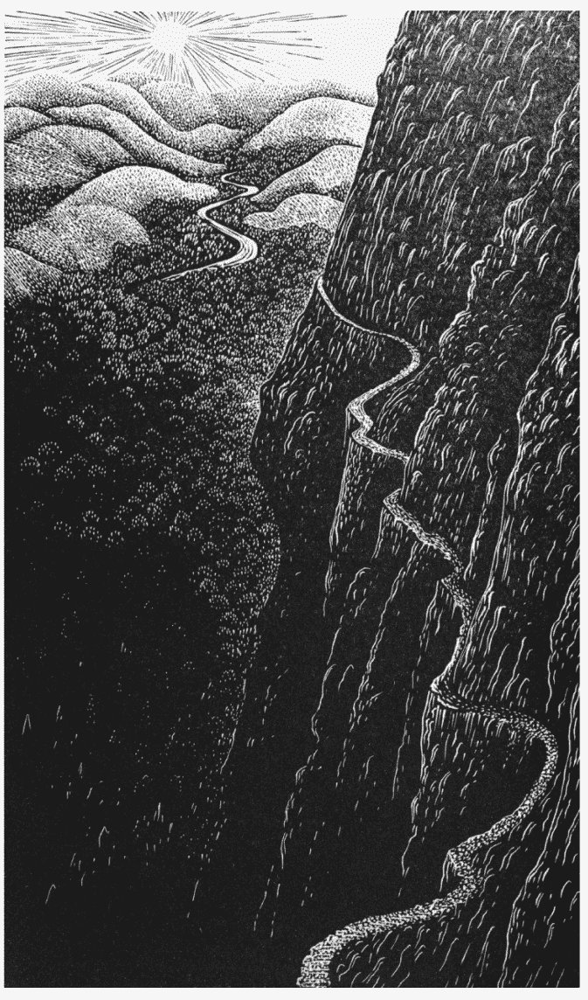
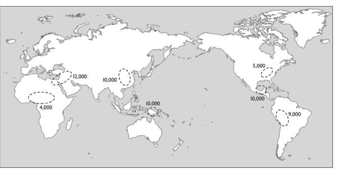
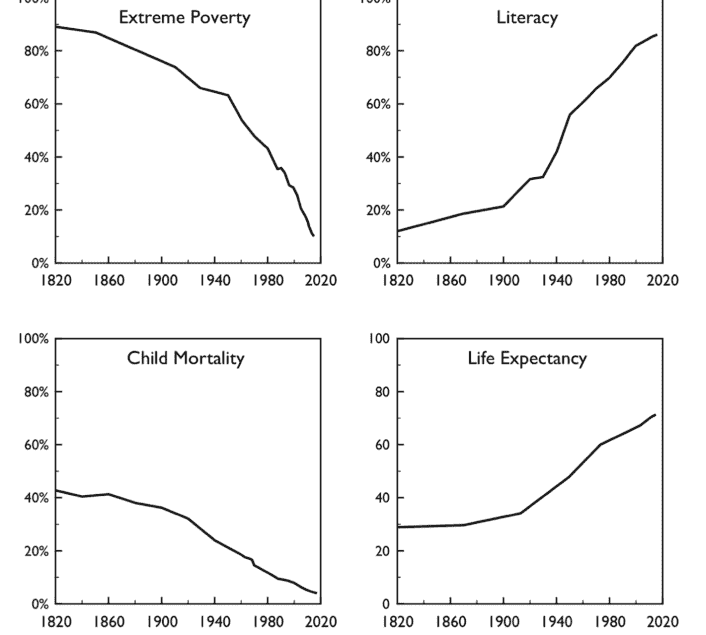
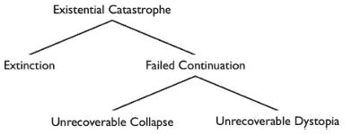
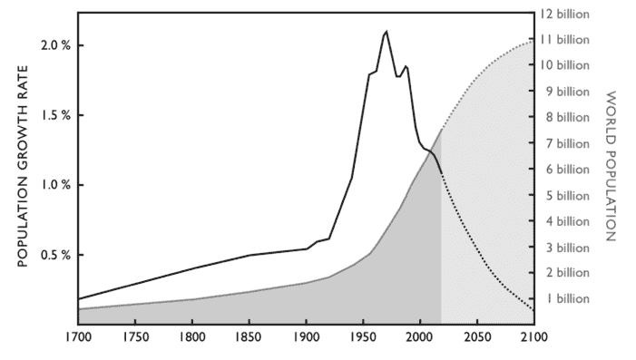
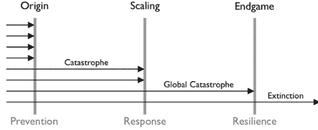
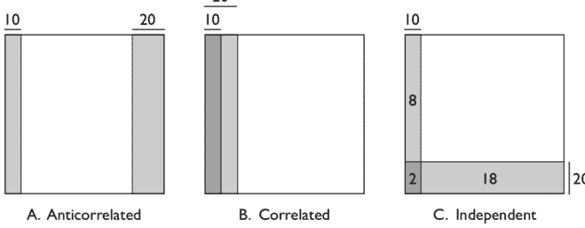
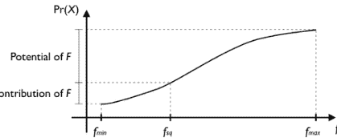

# 《悬崖：生存风险与人类的未来》

> “一本论证极有力的书，它提醒我们关注一个可能是我们所面临的最重要、却也最被忽视的问题。”
>
> ——彼得·辛格尔（PETER SINGER），《动物解放》与《你所拯救的生命》作者


E3-20200205-JV-NF-ORI

> 献给在我们之前的千亿人，他们塑造了我们的文明；
>
> 献给现世的七十亿人，他们的行动可能决定文明的命运；
>
> 献给未来的数万亿人，他们的生存悬悬一线。

探索书籍赠送、预览、优惠等。

点击此处了解更多。




# 第一部分 赌注

## 引言

如果一切顺利，人类历史才刚刚开始。人类已有二十万年的历史。但地球将保持宜居数百万年——足够的时间消除贫困；足够的时间创造繁荣。如果我们能果断地保护未来，我们将拥有巨大的前景。本书认为，守护人类是我们这个时代面临的定义性挑战。在未来的几个世纪里，人类将面临严峻考验：

其中一个惊心动魄的片段刚刚曝光。1962年10月27日（星期六），一名苏联潜艇军官险些引发了核战争。他的名字叫瓦伦丁·萨维斯基（Valentin Savitsky）。他是B-59号潜艇的船长，该潜艇是苏联为了支持在古巴的军事行动而派遣的四艘潜艇之一。每艘潜艇都配备了秘密武器：威力可比广岛原子弹的核鱼雷。

当时正是古巴导弹危机的顶点。两周前，美国航空侦察提供的证据显示苏联正在古巴安装核导弹，这些导弹可以直接打击美国本土。作为回应，美国封锁了海域，制定了入侵计划，并将核部队提升至前所未有的警戒级别。

周六，一艘封锁的美国军舰发现了萨维斯基的潜艇，并试图通过投放低爆炸深度弹迫其浮出水面。该潜艇一直处于深水中。由于失去了无线电联系，船员不知道战争是否已经爆发。舱内状况极其糟糕。它是为极地设计的，但在热带水中通风器坏了。内部温度令人无法忍受，从鱼雷管附近的113华氏度到机舱的140华氏度不等。二氧化碳浓度达到危险水平，一些船员开始昏迷。深度弹就在船体附近爆炸。

一名船员后来回忆道：“那种感觉就像坐在一个金属桶里，有人在用大锤不断敲击。”

日益绝望的萨维斯基命令下属准备他们的秘密武器：

> “也许战争在上面已经开始了，而我们在这里却在忙得脚乱。我们现在就要把他们炸了！我们会死，但我们会把他们全部击沉——我们绝不耻辱我们的海军！”¹

发射核武器需要潜艇政治委员的同意，他掌握着发射钥匙的另一半。尽管没有得到莫斯科的授权，政治委员还是表示了同意。

在其他三艘潜艇中的任何一艘，这足以发射核武器。但由于纯粹的运气，B-59号潜艇载着整个舰队的指挥官瓦西里·阿尔基波夫（Vasily Arkhipov）上尉，因此需要他的额外同意。阿尔基波夫拒绝了。相反，他平息了萨维斯基上尉的怒火，并说服他放弃：在美国军舰群中发动攻击，等待莫斯科的进一步指示。²

我们并不确切知道阿尔基波夫到底同意了什么——或者他仅仅是被分配到了其他任何一艘潜艇上。也许萨维斯基并不会执行他的命令。但很清楚，我们曾极度接近对封锁舰队发动核打击——这种打击极有可能导致核报复，进而升级为全面的核战争（这是美国唯一计划中的战争类型）。多年后，危机期间的国防部长罗伯特·麦克纳马拉（Robert McNamara）得出了相同的结论：

> “没有人应该相信，如果美国军队受到核弹袭击，美国会克制而不用核弹进行报复。这将导致何种结果？导致那场灾难。”³

自从核武器出现以来，人类一直在做出如此重大的选择。我们处于一个由有缺陷决策者组成的世界，他们在信息极其不全的情况下工作，引导着威胁整个物种未来的技术。在1962年的那个周六，我们是幸运的，到目前为止我们避免了灾难。但我们的破坏能力仍在增长，我们不能永远依靠运气。

我们需要采取果断的措施来结束这个风险不断升级的时期，保护我们的未来。幸运的是，我们有能力做到这一点。最大的风险由人类行为引起，也可以通过人类行为来解决。因此，人类是否能度过这个时代是人类将做出的选择。但这并不是一个容易的决定。它取决于我们多快能理解并接受随着我们所拥有的前所未有的力量而来的新责任。

这是一本关于生存风险的书——这些风险威胁到人类长期潜力的毁灭。灭绝是人类整个潜力被毁灭的最显而易见的方式，但不是唯一的方式。如果全球文明遭受真正无法恢复的崩溃，那也将摧毁我们的长期潜力。我们将看到反乌托邦的可能性：我们可能会被困在一个没有退路可走的失败世界中。

虽然这组风险是多样化的，但它们也是互斥的。因此，我将不得不搁置许多未达到此程度的重要风险：我们的话题不是人类或自然界的新黑暗时代（尽管它们是可怕的），而是人类潜力的永久性毁灭。

生存风险带来了新类型的挑战。它们要求我们在全球范围内和跨代之间进行协调，这种方式超越了我们迄今所取得的成就。而且它们需要远见，而不是试错。由于它们不提供第二次机会，我们需要建立制度，以确保我们的整个未来永远不会成为此类灾难的受害者。

为了公正地对待这个主题，我们必须涵盖大量的领域。理解风险需要深入物理学、生物学、地球科学和计算机科学；将此置于人类宏大的故事中需要历史学和人类学；辨别究竟涉及多少利益需要道德哲学和经济学；而寻找解决方案则需要国际关系和政治学。妥善地完成需要对这些每个学科进行深度参与，而不仅仅是挑选支持个人预设的专家引言或研究。这对于任何个人来说都是一项可能无法完成的任务，因此我非常感谢来自这些领域的数十位世界领先研究人员提供的详尽建议和审视。⁴

这本书的目标雄心勃勃。通过对人类的潜力和我们所面临的风险进行仔细分析，它论证了我们正生活在人类历史上最重要的时代。对我们整个未来的重大风险是一个新问题，而我们的思维还没有跟上。因此，《悬崖边缘》（*The Precipice*）提供了一个全新的伦理视角：我们看待世界以及我们在其中所扮演角色方式的重大重定向。通过这种方式，本书旨在弥合我们智慧与力量之间的差距，让人类能够清晰地看到所面临的风险，以便我们做出维护未来的必要选择。

我并非一直关注保护我们的长期未来，我是有些不情愿才来到这个话题的。我是牛津大学的哲学家，专攻伦理学。我早期的工作根植于更切实际的全球健康和全球贫困问题——即我们如何最好地帮助那些最贫穷的人。在处理这些问题时，我感到需要将我的伦理工作带出象牙塔。我开始为世界卫生组织、世界银行和英国政府的全球健康伦理提供建议。发现我的钱对贫困的帮助比对我自己好数百倍，我终身承诺捐出收入的十分之一来帮助他们。⁵我创立了一个名为“捐出所有”（Giving What We Can）的协会，供那些想要加入我的人参加；看到成千上万人聚集在一起，一生捐出超过10亿英镑给我们所知的最有效的慈善机构，从事最重要的事业，我深受鼓舞。我们已经共同改变了成千上万人的生活。⁶还有许多其他使用捐款的方式可以帮助我们塑造一个更好的世界，我帮助发起了一个更广泛的运动，被称为“有效利他主义”（effective altruism），人们追求通过证据和推理尽最大所能。由于有这么多工作要做，我转向这一领域很晚。我一直没有关注未来。它是如此真实；未来是如此抽象。它会像现在这样紧迫吗？当我反思那些导致这本书的证据和想法时，我意识到对未来的风险是真实且紧迫的——尽管我们可能感到无力保护自己。解决这些风险现在已成为我工作的重心：包括向首相府、世界经济论坛和DeepMind等机构提供建议。随着时间的推移，我看到人们对这些风险以及对行动的认识日益增加。为了让本书接触不同的读者，我无情地删除了术语、不必要的细节以及学术写作典型的防御性陈述（包括我自己的）。渴望更多技术细节或背景说明的读者可以查阅大量的注释，这些是为他们写的。⁷我特别努力保持公正，确保即使某些观点与我的叙述冲突也会予以呈现。因为对于这些问题的真相至关重要——人类的注意力是稀缺且宝贵的，不能浪费在错误的叙事或想法上。⁸《悬崖边缘》的每一章都从不同的角度阐明了核心问题。第一部分（利益）从我们独特时刻的视角开始，然后解释了为什么它值得密切关注。第二部分（风险）深入探讨人类面临的风险，既来自自然也来自我们自己，显示尽管有些被夸大了，但风险是真实的且正在增长。因此第三部分（前进之路）开发了理解这些风险如何结合的工具以及解决它们的新策略。我以对未来的愿景结束：如果我们成功，我们可以实现什么。

这本书不仅仅是关于气候变化或核战争危险的熟悉故事。这些首次让我们意识到可能毁灭自己的风险只是开始。还有一些新兴的风险，如源自生物技术和先进人工智能的风险，在未来一个世纪可能会对人类构成更大的威胁。

最后，这不是一本悲观的书。它没有呈现一个通向我们毁灭的必然历史轨迹。它不是一个关于我们技术傲慢并导致坠落的道德寓言。恰恰相反。核心论点是，我们的未来存在风险，但我们的选择仍然产生决定性的影响。我相信我们能够胜任这项任务：通过我们的选择，我们可以从悬崖边缘拉回来，并随着时间的推移，创造出一个难以想象的惊人价值的未来——由尚未构想出的创新所实现的。事实上，我对人类未来的深度乐观主义是我写这本书的核心动力。我们的潜力是巨大的。我们有太多需要保护的东西。

### 1 站在悬崖边缘

这可能是一个熟悉的过程，发生在许多世界中——一颗新形成的行星，静静地绕着它的恒星运转；生命缓慢形成；一场万花筒般的生物种群序列着演化；智力开始涌现，在某种程度上，它赋予了巨大的生存价值；接着，技术被发明了。他们意识到，存在所谓的自然法则，这些法则可以通过实验来揭示，而对这些法则的知识既可以拯救也可以夺走生命，而且规模是前所未有的。他们意识到，科学赋予了人类巨大的力量。转瞬之间，他们创造了改变世界的装置。一些行星文明找到了自己的出路，对可以做和不能做的事设定了限制，安全地度过了危险时期。而另一些由于不那么幸运或谨慎的文明则灭亡了。

> ——卡尔·萨根¹

我们正处在一个对人类未来具有独特重要性的时代。为了理解为什么，我们需要后退一步，将人类故事作为一个整体来看待：我们是如何走到这一点的，以及接下来可能会走向何方。

我们的主要关注点是人类不断增长的力量——改善我们生存状况的力量以及造成伤害的力量。我们将看到人类历史上的重大转型如何增强了我们的力量，使我们能够取得非凡的进步。如果我们能避免灾难，就可以谨慎地期待这种进步持续下去：一个负责任的人类其未来是极其光明的。但这种日益增长的力量也带来了一场新的转型，至少与我们过去的任何转型都同样重大，即向我们危险时代的转型。

### 我们是如何到达这里的

人类的故事有极少被讲述；因为可以讲述的极少。我们的物种，*智人*（*Homo sapiens*），于20万年前起源于非洲的草原²²。在一段几乎无法想象的时间里，我们拥有过伟大的爱与友谊，遭受过苦难与悲伤，探索、创造，并对我们在宇宙中的位置感到好奇。然而，当我们思考人类跨越时间的伟大成就时，我们几乎只想到了粘土、莎草或纸张——这些记录只能追溯到大约5000年前。我们很少想到大约7万年前首批踏上澳大利亚这个奇异新世界的人；很少想到我们到达每个地方后第一个命名并研究当地动植物的人；很少想到人类青少年时期的故事、歌曲和诗歌³³。但这些成就却是真实的，而且是非凡的。

我们知道，即使在农业或文明出现之前，人类也是世界上的一股新鲜力量。通过航海、穿衣和用火这些简单但具有革命性的技术，我们旅行得比之前的任何哺乳动物都远得多。我们适应了更广泛的环境，并遍布全球。⁴

是什么让人类与众不同，即使在它的萌芽阶段？我们不是最大、最强或最坚硬的。使我们脱颖而出的不是身体上的，而是精神上的——我们的智力、创造力和语言。⁵

然而，即使拥有这些独特的精神能力，一个独自身处荒野的人也称不上非凡。他或她可能能够生存——智力弥补了体能的不足——但很难占据统治地位。在生态学意义上，卓越的不是人类个体，而是人类群体。

每个个体与其所属部落中几十个其他人合作的能力在大型动物中是独一无二的。它使我们能够形成比自身伟大的东西。随着我们语言表达和抽象能力的增强，我们能够充分利用这种群体：汇集我们的知识、想法和计划。


图 1.1 我们是如何定居世界的。箭头显示了我们对祖先所走的陆路和海路线的当前理解，以及他们到达每个地区是多久以前⁵

至关重要的是，我们还能够跨越时间和空间进行合作。如果每一代人都必须重新学习一切，那么即使一把粗糙的铁铲也将永远无法被技术触及。但我们学会了跨越时空的合作。

这种合作极大地推动了知识的积累。我们从祖先那里学习，并将这些思想传递给后代。

在人类历史的几个转折点，这种力量的积累带来了巨大的变革。农业革命是其中之一。⁹ 大约一万年前，在肥沃新月地带，人类开始种植小麦、大麦和豆类。这种力量对生活方式产生了戏剧性的影响。¹⁰

虽然肥沃新月地带常被称为“文明的摇篮”，但事实上，世界各地都独立发生了农业革命。在东亚、撒哈拉以南非洲、新几内亚、中南部和北美等地也发生了这种变革。

这种变革对人类产生了深远影响。人口数量的增加使得永久性定居成为可能。在鼎盛时期，苏美尔文明曾拥有数百万人口¹¹。在2000年前，中国的汉王朝达到了六千万人¹³。随着越来越多的人分享他们的见解和发现，制度得到了发展。

下一次重大转型是科学革命¹⁶。早期形式的科学自古就有实践，经验主义的种子可以在伊斯兰世界和欧洲的中世纪学者中找到¹⁷。但直到400年前，人类才发明了科学方法，科学进步开始飞速发展¹⁸。这帮助我们从对权威的依赖转变为对自然世界的仔细观察，为现象寻找简单且可测试的解释。测试和丢弃错误解释的能力帮助我们摆脱了教条，并使我们首次系统地创造了关于自然运作的知识。

我们发现的一些知识可以被用来改善周围的环境。因此，知识的加速积累带来了技术新的加速，赋予了人类对自然日益增长的力量。这种快速的速度让人们在一生中就能看到这些改进的效果。这催生了现代进步观念。

在农业的前6000年里，我们取得了改变世界的突破，包括文字、数学和轮子¹⁵。在这些中，文字对于加强我们跨越时空合作的能力至关重要：增加了代际之间的带宽、信息的可靠性以及思想可以传播的距离。



图 1.2 文明的摇篮。世界各地独立发展农业的地方，标注了发生的时间。

工业革命是另一个转折点。它始于18世纪中叶的英国，随后蔓延到欧洲和北美，最终遍及全球。其核心是化石燃料的利用：煤炭、石油和天然气。这些远古时期生物被压缩后的遗骸，让我们能够利用数百万年来照射在地球上的部分阳光。¹⁹ 当时，我们已经开始利用风力、河流和森林的可再生能源来驱动简单机器；而化石燃料让我们能够获取到极其庞大的能量，而且形式更集中、更便利。

但如果没有将能量转化为有用功的方法，能量本身就毫无意义，也无法实现我们对世界渴望的改变。蒸汽机让煤炭中储存的化学能转化为机械能。²⁰ 这种机械能随后被用于驱动为我们完成大量劳动的机器，使得原材料能够比以前更快、更廉价地转化为成品。并通过铁路，这些财富可以在远距离范围内进行分配和贸易。

生产力和繁荣开始加速，一系列接踵而至的创新提升了自动化的效率、规模和多样性，开启了经济持续增长的现代时代。²¹

这些转型的影响并不总是积极的。在农业革命后的几个世纪里，生活通常意味着更多的工作、营养摄入的减少以及疾病的增加。²² 科学带给了我们今天仍困扰着我们的毁灭性武器。工业革命也是人类历史上最动荡的时期之一。繁荣收益的不平等分配和剥削性的劳动实践导致了20世纪初的革命性动荡。²³ 国家之间的不平等剧增（这一趋势在过去二十年才开始反转）²⁴。开发化石燃料中的能量释放了温室气体，而由这种能源驱动的工业危及了物种，破坏了生态系统并污染了我们的环境。

尽管存在这些现实性问题，但平均而言，今天人类的生活远优于以往任何时代。最显著的变化可能在于摆脱贫困。直到200年前——即我们人类历史的最后几千分之一²⁵——人类财富和繁荣的增长是与人口增长同步的。人均收入几乎保持不变：在富足时期略高于维持生计；在匮乏时期略低于。²⁶ 工业革命打破了这一规律，让收入增长速度超过了人口增长，并开启了前所未有的繁荣增长，且这种增长持续至今。

我们往往从一个已经富足社会的视角来看经济增长，在这种情况下，进一步的增长是否能改善我们的生活并不显而易见。经济增长最显著的影响是针对最贫穷的人。在当今世界，每十个人中就有一个人贫穷到每天生活不到1.90美元——这是衡量“极端贫困”的一个广泛使用的阈值。如此多人处于这种境地是我们时代最大的问题之一，这一直是我一生的重心。回溯过去令人震惊的是，在工业革命之前，20个人中有19个人每天收入不到1.90美元（即使考虑到通货膨胀和购买力调整）。在工业革命之前，任何繁荣都局限于极少数精英，而极端贫困是常态。但在过去的两个世纪多里，更多的人已经摆脱了极端贫困，而且现在的摆脱速度比以往任何时候都快得多。²⁷ 每天1.90美元远谈不上繁荣，这些统计数据对仍深陷贫困的人来说可能提供不了多少慰藉，但改善的趋势是真实的。

而且改善的不仅仅体现在物质条件上。考虑教育和健康。普及化教育使教育水平取得了巨大进步。在工业革命之前，世界上只有十分之一的人能读写字；而现在十个人中有八个以上可以做到。²⁸ 在从农业革命之后的万年里，预期寿命一直徘徊在20到30岁之间。现在已经翻了一番多，达到了72岁。²⁹ 就像识字率一样，这些收益在全世界范围内被感知。1800年，任何国家最高的预期寿命是冰岛的43岁。现在每个国家的预期寿命都超过50岁。³⁰ 工业时代见证了全人类变得比以前更富裕、受过更好教育且更长寿。但面对这种惊人的进步，我们不应陷入自满。我们已经取得了如此巨大的成就，而且如此之快，这应该激励我们去解决仍然存在的苦难和不公。

我们在道德思维上也取得了实质性的进步。³¹ 最清晰的趋势之一是道德共同体的逐渐扩张，即对女性、儿童、贫困者、外国人以及民族或宗教少数群体权利的承认。我们还看到暴力作为一种在道德上可以接受的社会行为发生了显著转变。³² 在过去的六十年里，我们将环境和动物福利纳入了我们标准的道德图景中。这些社会变化并没有随着繁荣而自然产生。它们是由改革者和活动家确保的，其动力源于我们可以——也必须——变得更好的信念。我们仍然需要努力才能跟上这些新理想，我们的进步可能会痛苦地缓慢，但回首过去一两个世纪，就能看到我们走了多远。


当然，也存在许多挫折和例外。这条道路是坎坷的，事情在某些地方变好，而在另一些地方变糟，而且确实存在一种荣光，即通过选择性地利用历史来创造出一个从野蛮过去走向辉煌现在的简单叙事。然而，在人类历史最宏大的尺度上，我们看到的不是单一帝国的兴衰，而是整个全球文明的变迁，进步的趋势是清晰可见的。

当我们觉得周围的一切都在崩塌时，很难相信这些趋势。在这种情况下，怀疑源于我们对个人生活或社区跨越几年的日常体验——在这个尺度上，下降几乎与上升同样频繁。也可能源于我们倾向于关注坏消息而非好消息，关注威胁而非机会：这些我们在客观评估好坏平衡时会错过的引导行动的启发式。当我们试图克服这些扭曲，寻找尽可能客观的全球生活质量指标时，很难避免看到从世纪到世纪的显著进步。

而且这些趋势不应该令我们惊讶。我们每天都是数千年来无数创新的受益者。技术、数学、语言、制度、文化、艺术领域的创新；来自我们之前的一千亿人的思想，他们塑造了现代世界的几乎每一个方面。这是一份令人惊叹的遗产。因此，难怪我们的生活因此变得更好。

我们无法确定这些进步趋势是否会持续。但考虑到它们的韧性，负担似乎在于悲观者，他们解释为什么现在是失败这一点。当人们预测这种失败如此之久且记录如此糟糕时，这一点尤为如此。托马斯·马考莱（Thomas Macaulay）很好地说明了：

> 我们无法绝对证明那些告诉我们社会已达到转折点、我们已经过了最好的日子的人是错误的。但他们之前也说过这样的话，而且同样具有明显的理由……根据什么原则，当我们看到过去只有进步时，我们却要预见未来只有衰落呢？

他在1830年写下这些话时，在那之后还有190年的进步以及对进步结束的错误预测。在这些年里，寿命增加了一倍，识字率飙升，十个人中八个逃脱了极端贫困。未来几年会带来什么？



### 我们可能去向何方

在人类寿命的时间尺度上，我们20万年的历史似乎长得令人难以理喻。但在地质尺度上，它是短暂的，而在整个宇宙的尺度上，它更是微小到可以忽略不计。我们的宇宙有140亿年的历史，即使在最宏大的尺度上这也是短暂的。我们面前还有数万年的未来。未来是广阔无垠的。

我们能见证未来的多少？化石记录提供了一些实用的指导。哺乳动物物种在灭绝前通常能生存大约百万年；我们的近亲属——直立人（`Homo erectus`）生存了近两百万年。如果我们将百万年比作一个完整的八十年周期，那么今天人类正处于青少年期——十六岁；刚刚开始崭露头角；恰好足以陷入严峻的困境。

显然，人类并不是一个典型的物种。首先，我们最近获得了一种摧毁自我的独特力量——这种力量将是本书的大部分重点。但我们也拥有保护自己免受外部破坏的独特力量，因此具有比物种种寿命更长的潜力。

我们*可能*在地球上生存多久？我们的星球大约还能保持十亿年的宜居性。这足够支撑数万亿人的生命；足够的时间观察山脉升起、大陆碰撞、轨道重新调整；也有足够的时间帮助我们的社会和地球治愈我们在不成熟时期造成的伤害。

我们可能拥有更多时间。正如火箭术的先驱之一所说：“地球是人类的摇篮，但人类不能永远住在摇篮里。”我们不知道如何到达其他恒星并定居它们的行星，但我们知道基础性的障碍。主要的障碍似乎是学习所需的时间。这让我感到乐观。毕竟，第一次跨大气飞行是在1903年，仅仅六十八年后，我们就发射了离开太阳系并到达星际航天器。我们的物种学习很快，尤其是最近，十亿年是一场漫长的教育。我想我们需要的时间没那么长。

如果我们到达了其他恒星，整个银河系将向我们开放。仅银河系就包含1000亿颗恒星，其中一些将存在数万年，极大地延长了我们的潜在寿命。此外，在我们之外还有数十亿个星系。如果我们进入这样一个规模的未来，我们可能会拥有真正令人震惊的后代数量，拥有时间、资源、智慧和经验来创造出我们今天无法想象的多样化奇迹。

虽然人类在追求繁荣、健康、教育和道德包容性方面取得了进步，但我们还有很长的路要走。我们现在的世界仍受到疟疾和艾滋病；抑郁症和痴呆；种族主义和性别歧视；折磨和压迫的困扰。但只要时间足够，我们可以结束这些恐怖——建立一个真正公正和人道的社会。

一个没有痛苦和不公的世界，仅仅是美好生活的最低下限。科学和人文都没有发现任何上限。在生命最美好的时刻，我们对可能性有了些暗示：光芒的瞥、喜悦的美感、升腾的爱。当我们真正觉醒的时刻。这些时刻虽然短暂，却指向了远超现状、远超我们目前理解的可能繁荣高度。

我们的后代有永恒的时间去探索这些高度，并拥有新的探索手段。而且不仅仅是福祉。无论你价值观是什么——美、理解、文化、意识、自由、冒险、发现、艺术——我们的后代都能将这些推向更远方，甚至可能发现我们完全未知的全新价值类别。我们缺乏听力去听的音乐。

## 悬崖

但这个未来面临着风险。因为我们最近经历了另一场改变世界的权力转型——这种转型至少与先前的农业、科学革命和工业革命同样重大。

随着第一颗原子弹的爆炸，人类的新纪元开启了。在那一刻，我们快速加速的技术力量终于达到了可能摧毁自我的门槛。这是人类面临的内部威胁首次超过自然世界威胁的时刻。这是一个人类整个未来悬于一线的时刻。我们祖先取得的每一项成就都可能付诸东流，后代可能实现的每一项成就都可能被剥夺。人类史书中大部分内容仍未书写；叙事中断；留下了大量的空白页。

核武器是人类力量的一次不连续性变化。在广岛，一颗炸弹造成的破坏相当于数千枚炸弹。六年后，单枚热核炸弹携带的能量比第二次世界大战期间使用的任何爆炸物都要多。

很清楚，使用此类武器的战争将以人类历史上前所未有的方式改变地球。世界领袖、原子科学家和公共知识分子开始认真考虑核战争可能导致人类终结的可能性：要么灭绝，要么文明的永久崩溃。早期的关注集中在放射性落尘和臭氧层损害上，但在20世纪80年代，重点转向了被称为“核冬”的情景，在这种情况下，核火风暴将燃烧城市的烟雾带入高层大气。在云层上方，烟雾无法被雨冲刷，将持续多年，使天空变黑，冷却地球并导致作物歉收。这是核战争导致极端饥荒的机制，不仅是在交战国，而且是在世界上每一个国家。爆炸造成的数百万直接死亡之后，可能是数十亿人的饥饿死亡，而且——可能的还有饥饿本身造成的死亡。

我们是如何陷入这种战争的？由于损失巨大，核战争不符合任何利益。因此，我们可能预期这些显而易见的危险会创造出某种安全感——即世界领袖不可避免地在边缘面前退缩。随着越来越多的幕后证据出现，人们越来越明确，冷战已勉强避免了全面核战争。

我们看到一个人的——瓦西里·阿尔基波夫上尉（Vasili Arkhipov）的干预，是如何在古巴导弹危机的高峰阻止了全面核战争的。但更令人震惊的是，在短短几天里，我们有多少次接近灾难，却又被少数人的决定拉了回来。

危机的主要事件发生在一个单周内。1962年10月22日周一，约翰·F·肯尼迪总统（John F. Kennedy）发表了电视演讲，告知他的国民苏联正在古巴安装战略核导弹——这直接威胁到了美国。他警告说，任何使用这些核武器的行为将遭到对苏联的全面核报复。他的顾问们制定了对他们发现的48枚导弹进行空袭以及全面入侵古巴的计划。美国军队进入了`DEFCON 3`状态，为可能发生的核战争做准备。

10月24日周三，美国发起了海军封锁以阻止更多导弹运往古巴，并将核力量提升到前所未有的`DEFCON 2`水平。核导弹已准备就绪发射，核轰炸机已升空，准备对苏联发动全面攻击。危机在周六达到顶点，苏联用地空导弹击落了一架U-2侦察机，导致飞行员丧生。

到了周日，一切都结束了。苏联退缩了，意外地宣布将撤除古巴的所有核导弹。但事情很容易产生完全不同的结局。

这几乎也引发了攻击。因为美国人不知道赫鲁晓夫对古巴军队的控制程度有多低。事实上，一架U-2侦察机被一名苏联将军违背赫鲁晓夫的明确指令击落。而赫鲁晓夫对古巴军队的控制力更小，他们已经用防空火力击落了一架低空侦察机，并渴望再击落一个。赫鲁晓夫知道自己无法阻止自己的人击落另一架飞机从而引发美国的攻击，于是他在晨间侦察飞行恢复之前发表了结束危机的声明。

如果美国发动攻击会发生什么？美国领导人假设，对古巴的纯常规（非核）攻击可能会得到纯常规的回应。他们认为，苏联对美国本土发动核攻击是不现实可能的。但他们忽略了另一个关键事实：美国在古巴发现的导弹只是苏联运送过去的一小部分。而且其中超过90枚战术核武器是专门用于核武器先发使用的：在入侵舰队登陆之前摧毁它们。

更重要的是，卡斯特罗急于使用这些武器。事实上，他要求赫鲁晓夫在美国人试图入侵时发射核武器，尽管他知道这将导致他国家的灭亡：“古巴会发生什么？它会被彻底摧毁。”而赫鲁晓夫采取了另一个史无前例的举措，放弃了对战术核武器的中央控制权，将代码和发射决定权交给了当地的苏联指挥官。在听完肯尼迪的电视演讲后，赫鲁晓夫发布了新命令，未经他的明确许可不得使用这些武器，但他开始担心在冲突白热化时这些命令不会执行，因为他曾命令不要射击被禁止的美国间谍机。

因此，在美军领导层不知情的情况下，对古巴的常规攻击可能会遭到针对美国军队的核打击。而这种打击极有可能遭到美国的进一步核反击，并引发与苏联的全面核战争。在周一的电视演说中，肯尼迪曾明确承诺：“本国的政策将是，任何从古巴发射向西半球范围内内任何国家的核导弹，都将被视为苏联对美国的进攻，并将要求对苏联进行全面的报复性回应。”

要估算危机升级为核战的可能性极其困难。些后不久，肯尼迪告诉一位亲近的顾问，他认为与苏联发生核战的可能性“大约在三分之一，甚至更高”。危机结束后一天，有消息显示，保罗·尼策（肯尼迪委员会的顾问）估计这一概率为10%，并认为委员会的每个人都会给出更高的数字。此外，这些人中没有一个人知道古巴的战术武器、不知道赫鲁晓夫对部队的控制缺失，也不知道B-59号潜艇上的事件。

虽然我不愿意质疑那些决策可能引发战争的人，但考虑到他们当时所知的信息，我的观点是他们有些过于悲观了。然而，当我们把随后关于古巴真实情况的披露考虑进来，我的估算将与他们大致相当。我将危机升级为与苏联核战的可能性估计在10%到50%之间。

在描写这类惊险时刻时，人们倾向于将这种概率等同于文明的终结或人类的终结。但那是非常巨大且不夸大。因为我们需要将这种核战的可能性与人类文明结合起来——这种战争将意味着人类或人类文明的终结，但即便做出这样的假设，古巴导弹危机仍然是20万年人类史上的关键时刻之一：也许是我们离失去一切最近有的时刻。

即使是现在，尽管冷战已成为记忆，核武器仍然对人类构成了威胁。在写作时，核冲突最高风险涉及朝鲜。但并非所有的核战争都是平等的。朝鲜的军舰数量少于俄罗斯或美国的1%，而且规模也小得多。与朝鲜爆发核战将是一场可怕的灾难，但目前它对人类的长期潜力构成的威胁很小。

相反，当今核武器的大多数生存风险可能仍然来自美俄两国巨大的军库。

洲际弹道导弹（`ICBM`）的发展使得双方只需30分钟的预警即可摧毁对方的大部分导弹，因此他们将许多导弹移至“发指警戒”——只需十分钟即可发射。这种发指导弹对意外发射或虚假警报期间的蓄意发射极其敏感。正如我们在第四章中看到的，在冷战结束后，虚假警报造成的代价令人胆寒且持续。在更长的时间尺度上，还存在其他国家建立自己的巨大储备的风险、军事技术创新削弱威慑逻辑的风险，以及地缘政治格局转变引发大国间另一轮军备竞赛的风险。

核武器不是人类唯一的威胁。到目前为止，它们一直是我们的焦点，因为它们是第一个重大风险，而且我们已经威胁过人类。但其他其他威胁。

工业革命带来的繁荣指数级增长是以碳排放快速增长为代价的。工业化的微小副作用最终演变成对健康、环境、国际稳定的全球性威胁，甚至可能威胁人类本身。

核武器与气候变化具有惊人的相似之处和不同之处。它们都通过地球温度的剧变威胁人类，但方向相反。一个作为不可预测的科学突破产物突然登场；另一个是旧技术数百年规模扩张的延续。前者带来突发性灾难的小风险；后者是一个缓慢持续的过程——其中某种程度的灾难是肯定的，不确定性在于将如何发生。前者涉及少数行动者控制的机密技术；后者涉及全球每个人的选择的影响。

随着技术的不断进步，新的威胁出现在地平线上。这些威胁预示将更像核武器：源于突然的突破、剧性的灾难以及少数行动者的行为。我特别关注两种新兴技术；它们将是第五章的焦点。

自从农业革命以来，我们一直在诱导周围植物动物的基因变异以适应我们的目标。基因的发现以及读写它的工具的创造，导致我们重塑生命的能力爆炸。生物技术将给医学、农业和工业带来重大改进。但也将给文明和人类本身带来风险：既来自合法研究中的事故，也来自工程武器。

我们还看到人工智能（`AI`）系统能力的飞速进步，在传统`AI`薄弱的领域如感知、学习和通用智能。专家认为，这将是人工智能不仅在特定领域，而且在通用智能上超过人类能力的世纪——即克服各种障碍以实现目标的能力。人类正是因为我们无与伦比的心智而处于控制世界的地位。如果我们把这一手子交给机器，它们会是我们在这一独特地位上的吗？这应该让我们思考，为什么我们仍然掌握主权。我们需要学习如何将日益智能和自主机器的目标与人类利益对齐，而且我们需要在这些机器比我们强大之前这样做。

这些对人类的威胁以及我们如何应对它们，定义了我们的时代。核武器的出现在二十世纪构成了人类灭绝的真实风险。随着技术的持续，如果没有保护人类的严肃努力，有理由相信这一风险在本世纪会更高，并随着每个世纪科技的持续而增加。由于这些人为风险超过了所有自然风险，它们设定了人类撤回边缘的剩余时间。

我并不是主张灭绝是科学进步的必然结论，甚至不是最可能的结局。我主张的是这种人类力量不断增强的强劲趋势，已经发展到了我们对自身生存构成了严重风险的程度。我们如何应对这种风险取决于我们自己。

我并不是在反对技术。技术已经证明其在改善人类状况方面具有巨大的价值。对于人类实现其长期潜力，技术是至关重要的。没有技术，我们会被像小行星撞击等自然灾害的累积风险所毁灭。没有技术，我们永远无法实现我们能达到的最高繁荣。

问题与其说在于技术的过剩，不如在于智慧的匮乏。卡尔·萨根（Carl Sagan）对此描述得精辟：

> “我们面临的许多危险源于科学和技术——但从根本上说，是因为我们在变得强大的同时，并没有变得同等智慧。技术带到我们手中的那些改变世界的力量，现在需要我们以前所未曾要求过的程度的考量和远见。”

这一观点甚至被一位现任美国总统所倡导：

> “标志我们作为一个物种的火花——我们的想象力、语言、工具制造能力、我们把自己从自然中区分开并使其服从我们意志的能力——这些东西也赋予了我们无与伦比的破坏能力……技术进步如果没有人类制度的对等进步，可能会导致我们的毁灭。导致原子分裂的科学革命同样需要道德上的决议。”

我们需要获得这种智慧；进行这场道德革命。因为我们无法从灭绝中归来，我们不能等到威胁来临时才采取行动——我们必须积极主动。而且由于获得智慧或开启道德决议需要时间，我们现在就需要开始。

我想我们很可能会度过这一时期。并不是因为挑战很小，而是因为我们会迎而上。这些风险源于人类行为这一事实本身说明了人类行为可以解决它们。消极主义既是不根据的，又是适得其反的——是一种自我实现的预言。相反，我们必须通过清晰、严谨的思考直面这些挑战，并对我们努力保护的长期未来持有积极的愿景。

这些风险有多大？人们无法给出数字，因为这些风险是*复杂的*（因此无法进行简单的数学分析）而且是*前所未有的*（无法通过长期频率来估算）。然而，至少尝试给出定量估计是有重要的。定性的陈述如“人类灭绝的严峻风险”可能被解释为从 1% 到 99% 的任何含义。它们带来的困惑多于清晰。因此，我将提供定量估计，但前提是它们是不精确的，并且会被修正。

在 20 世纪，我最好的猜测是，我们面临大约百分之一的人类灭绝或文明不可恢复的崩溃风险。根据我所知的一切，我将本世纪的生存风险认为在六分之一左右：俄罗斯轮盘。下表是风险的细分。如果我们不重振努力，如果继续让力量的增长超过我们的智慧，我们应该预见到下个世纪以及随后的每一个世纪这种风险将会更高。

这些是我们面临过的最大风险。如果我对这些规模的判断大致正确，那么在这样的风险下，我们无法生存许多个世纪。这是一种*不可持续*的风险水平。因此，无论何种，这一时期都不可能持续超过几个世纪。要么人类掌控自己的命运并将风险降低到可持续的水平，要么我们自归灭绝。

将人类历史看作是一场穿过荒野的宏大旅程。其中有错误的转向和艰辛的时刻，也有突然的进步和沉重负担的时期。在 20 世纪中期，我们来到一个高山口，发现唯一的通路是一条沿着悬崖的小路：一条位于深渊边缘、崩塌的石台。俯视下去会带来深深的眩晕感。如果我们坠落，一切化为乌有。我们不知道坠落的概率有多大，但这是我们曾面临过的最大风险。

这段相对短暂的时期是我们人类物种历史上一个独特的挑战。我们对它的应反应将定义我们的故事。未来的历史学家将为这段时期命名，学生们将学习它。但我认为我们现在就需要一个名字。我称之为“**悬崖**”（The Precipice）。

**悬崖**赋予了我们的时间巨大的意义。在历史的宏大进程中——如果我们走得足够远——这就是我们的时代被记住的原因：最高水平的风险，以及人类睁开眼睛，进入成熟并确保其长久而繁荣的未来。这就是我们时代的意义。

我并不是在美化我们这一代，也不是在贬低我们。重点是，我们的行动具有极高的赌码。我们是伟大还是糟糕，取决于我们如何利用这次机会。我希望告诉我们的子子孙孙辈，我们没有袖手旁观，而是利用这个机会扮演了历史赋予我们的角色。

通过这些危险保护人类应该是我们时代的核心首要任务之一。我不是说这是世界上唯一的问题，不是说人们应该放下所有珍视的一切去做这件事。但如果你能看到自己可以发挥作用的方式——如果你有技能，或者你很年轻可以塑造自己的道路——那么我认为，在这些时期保护人类是你可以追求的最崇高的目标之一。

### 悬崖与人类世

事实越来越明确，人类活动已成为塑造环境的主导力量。科学家们得出结论认为，人类的影响不仅在自身的术语中是巨大的，在生物学、地质学和气候学的客观领域也是如此。如果遥远的未来有地质学家，他们会将与我们时代对应的岩石层识别为相对于之前地层的根本性变化。

因此，我们现在的地质学家正在考虑正式这一——改变他们对时间的分类，引入一个名为“**人类世**”（Anthropocene）的新纪元。该纪元的建议开始时间包括大型动物灭绝、农业革命、跨越大西洋、工业革命。

这与“悬崖”一样吗？它们有什么区别？

- 人类世是对环境产生深远影响的时期，而“悬崖”是人类面临自我毁灭风险的时期。
- 人类世是一个地质纪元，通常持续数百万年，而“悬崖”是历史上的时期（类似于启蒙或工业革命），可能在几个世纪内结束。
- 它们可能都以原子爆炸作为正式开始，但原因完全不同。对于人类世，这主要是为了方便定年；而对于“悬崖”，是因为核武器对我们生存构成的威胁。

## 2 生存风险


作为道德主体，我们扮演的关键角色是跨代社区的成员，一个既看过去也看未来的社区，一个根据现在解释过去、将未来视为从过去生长出来的、并视自己为持久家庭、国家、文化和传统的成员的社区。

> 安特·拜耶尔（Annette Baier）

我们已经看到人类历史的长弧如何将我们带到故事中一个独特重要的时期——一个我们整个未来都悬一线的时期。我们也看到了如果我们能克服这些风险，未来可能会是什么样子。

现在是时候更深入地思考利益攸关的事了；在这一时期保护人类是重要的。为了做到，我们首先需要明确生存风险的概念。生存风险究竟是什么？它与更熟悉的灭绝或文明崩溃概念有何联系？

我们随后可以问，这些风险的特质迫使我们迫切关注。在我看来，主要原因是我们将失去整个未来：人类可能成为的一切以及我们可能实现的一切。但不仅于此。保护未来至关重要的论点得到了广泛道德传统和基础的支持。生存风险还威胁着我们的现在，并背叛我们的过去。

保护我们的未来。因为生存性风险被严重忽视了：无论是政府、学术界还是公民社会。我们将看到为什么情况会如此，以及为什么我们有充分理由怀疑这种情况将会发生改变。

### 理解生存性风险

人类的未来充满了可能性。我们对所居住的世界有了丰富的认知，其健康和繁荣程度是我们的祖先所梦寐以求的。我们开始探索头顶天空中的其他世界，并创造出完全超出祖先理解范围的虚拟世界。我们知道，对于我们最终可能成就的目标，几乎没有界限。

人类的灭绝将终结我们的未来。我们将毁灭自己的潜力。我们将消除除一种可能以外的所有可能：一个人类繁荣的世界。灭绝将带来这个失败的世界并将其永远锁在其中——将再也没有回头的路。

哲学家尼克·波斯斯特罗姆（Nick Bostrom）表明，灭绝不是发生的唯一方式：还有其他灾难性的结果，在这些结果中我们不仅失去了现在，还失去了未来所有的可能性。²

考虑一个废墟的世界：一场巨大的灾难引发了文明的全球性崩溃，使人类退化到前农业状态。在这场灾难中，地球环境遭受了极其严重的破坏，以至于幸存者永远无法重新建立文明。即使这样的灾难没有导致我们的灭绝，向我们开放的广阔未来领域也将萎缩到一个狭窄的贫乏选项范围。我们将拥有一个没有回头路的失败的世界。

或者考虑一个被锁链束缚的世界：在一个让人想起乔治·奥威尔《1984》的未来，整个世界被封锁在一个压迫性的极权主义政权的统治下，该政权致力于维持自身的延续。通过强大的、技术支持的洗脑、监控和强制执行，即使是少数异见人士也无法找到彼此，更不用说发起起义了。由于地球上的每个人都生活在这种统治下，政权在内部和外部威胁面前是稳定的。如果这样一个政权可以无限维持下去，那么坠入这种极权主义未来与灭绝也有许多共同点：只剩下极小范围且可怕的未来，且没有出路。



图 2.1 根据被锁定的结果类型对生存性灾难进行的分类。

遵循波斯斯特罗姆的观点，我将这些称为“生存性灾难”，定义如下：3

- 生存性灾难是对人类长期潜力的毁灭。
- 生存性风险是威胁人类长期潜力被毁灭的风险。

这些定义捕捉了这样一个观点：生存性灾难的结果既是惨淡的又是不可挽回的。我们不仅将无法实现潜力，而且这种潜力本身将永久性丧失。虽然我想保持官方定义的简洁，但仍有几个领域需要澄清。

首先，我所理解的“人类的长期潜力”是指所有仍然向我们开放的可能未来。⁴ 这是一个关于可能性的扩张性概念，包含了人类最终可能实现的一切，即使我们还尚未发明实现这些目标的手段。⁵ 但由此推导出的是，我们的选择可能会锁定某些事物，关闭可能性，而无法开启新的可能性。因此，对人类潜力的任何减少都应被理解为永久性的。我们这个时代面临的挑战是保护我们广大的潜力，并保护其免受未来毁灭风险的侵害。终极目的是允许我们的后代实现我们的潜力，实现向我们开放的最未来之一。

虽然在这个尺度下这看起来可能很抽象，但这实际上是一个我们每天都会遇到的熟悉概念。考虑一个具有长期潜力的孩子：她面前开放着许多未来，可以过上美好的生活。保护她的潜力至关重要：确保她最好的未来不会因为事故、创伤或缺乏教育而中断。保护她的潜力也至关重要：我们要建立保护措施，使这种潜力的丧失变得极不可能。而且让她最终实现她的潜力也至关重要：让她最终走上她面前的最优路径之一。人类也是如此。

生存性风险威胁着人类潜力的毁灭。这包括完全毁灭的情况（如灭绝），以及几乎完全毁灭的情况，例如文明的永久性崩溃，其中仅剩下某些极少数类型的繁荣可能，或者仍留有某种遥远的恢复迹象。⁵ 我留下的阈值是模糊的，但应当理解为，在任何生存性灾难中，我们潜力的大部分都消失了，剩下的寥寥无几。⁷

其次，我在定义中对“人类”的关注并不意味着排除对环境价值、其他动物、智人继任者或宇宙中其他生物的考量。我并不是认为只有人类是重要的。相反，人类是我们所知的唯一对道德和道德论有反应的生物——即能够审视世界并决定什么是最好的生物。如果我们失败了，那种向上的推力、推向更好或更公正事物的能力将在世界上消失。

我们的潜力取决于人类通过每个人的共同行动所能成就的东西。我们行动的价值部分源于我们做了什么以及为了谁做，但它取决于我们的行动对非人类产生的影响。如果我们未来产生了其他类型的道德主体，那么我定义中的“人类”一词应当包含他们。

我对比“人类”的关注防止了单一国家或文化被视为生存性风险。有一个类似的术语可以描述这种情况——对这个国家的生存性威胁”。抛开这些说法通常是夸张的事实，它们表达了类似的观点：即永久地破坏一个国家或文化的长期潜力。⁶ 然而，非常重要的一点是将“生存性风险”的讨论（不带任何特定限制）仅适用于整个人类。

第三，任何风险的概念都必须涉及某种概率。生存性风险涉及哪种概率？从长期频率来理解概率是不可通的，因为我们所关注的生存性灾难只能发生一次，并且在发生那一刻之前，它将是前所未有的。我们不能仅仅因为生存性灾难尚未发生，就说其概率精确为零。

这类情况需要一种证据性概率，它描述了基于可用信息我们应当具有的合理相信程度。这是法庭、银行和博彩店中常用的概率类型。当我谈论生存性灾难的概率时，我指的是根据我们最好的证据，人类对其可能发生的信誉度（credence）。

有许多极其糟糕的结果并不属于生存性灾难。

这种情况发生的一种方式是：没有单一的突发事件，而是有许多较小的失败。这是因为我将灾难的通常意义理解为单一的、决定性的事件，而不是任何总和来看糟糕的事件组合。如果我们仅仅通过持续地互相虐待，或者从未抽出时间去做任何伟大的事而浪费了未来，这可能是一个同样糟糕的结果，但并不是通过灾难发生的。

严重性，但可能并非永久或不可逆转的。

在书中，我将非常字面地使用“文明崩溃”这一术语，指代全球人类丧失文明（至少是暂时的）的结果。这个词通常被泛泛地用来指代秩序的大规模崩溃、现代技术的丧失或我们文化的终结。但我所说的是一个没有文字、城市、法律或任何其他文明装点的世界。

这将是一场极其严重的灾难，而且极难引发。尽管文明面临着重重历史压力，但这种情况从未发生过——即便在整个大陆的规模上也没有.¹10 欧洲在黑死病中损失了 25% 到 50% 的人口后幸存了下来，并保持了文明的完好无损，这表明引发文明崩溃需要世界上每个地区的死亡率超过 50%.¹11

即使文明崩溃，它也可能被重新建立。正如我们所看到的，文明已经由孤立的人独立建立过至少七次.¹12 虽然人们可能认为资源枯竭会使这变得困难，但更有可能的情况是它会变得更容易。大多数人类灭绝的灾难会留下我们的驯化动植物，以及我们城市废墟中的大量材料——从旧栏杆中重新锻铁比从矿石中熔炼铁容易得多。即使是像煤这样的一次性资源，通过废弃的资源和矿井获取也比 18 世纪的任何时候都要容易得多.¹13 此外，文明可能的证据以及帮助重建的工具和知识，将散布于世界。

然而，文明崩溃与生存风险之间存在两种密切的联系。首先，如果一种崩溃是不可恢复的，那么它将被视作一次生存灾难。例如，可以想象，某种形式的极端气候变化或工程瘟疫可能使地球变得无法居住，以至于人类不可逆地减少为散落的觅食者.¹14 其次，文明的全球崩溃可能会增加我们对这种灾难的脆弱性，从而增加灭绝机会。

导致灭绝的一种方式是，剩余最大群体的人口下降到最小生存种群数量——即种群生存所需的水平。这没有精确的数字，因为它通常是以概率形式定义的，并取决于情况的许多细节：人口所在地、他们可以使用的什么技术、他们遭受了何种灾难。估计范围从数百人到数万不等.¹15 如果一场灾难直接将人类人口减少到这些水平以下，那么将其归类为直接灭绝事件而非不可恢复的崩溃将更有意义。预计这将通往灭绝更常见的途径之一。

我们很少认真考虑对人类全部潜力的风险。我们主要在动作片中遇到这些风险，我们的情感反应由于它们被过度用作增加戏剧性的简单手段而变得迟钝.¹16 或者我们在“世界终结的十种方式”等在线列表中看到它们，这些列表主要是为了刺激和吸引注意力。自从冷战结束以来，我们很少听到领先思想家对灭绝对我们、我们的文化或人类意味着什么进行严肃讨论.¹17 因此，在非正式语境下，人们对人类灭绝的前景有时是轻率的。

但当风险是生动且可信的时——当明显数十亿生命和所有后代实际上处于危险之中时——保护人类长期潜力的重要性对于大多数人来说并不是争议性的。如果我们得知一颗巨大的小行星正朝地球袭，在本世纪晚些时候导致人类灭绝的概率超过 10%，那么对于是否要努力建立一个偏转系统，还是忽视这个问题并承担风险，将几乎没有争论。相反，这一威胁将立即成为世界首要任务之一。我们对这些威胁的关注缺失，更多是因为还没有相信此类威胁的存在，或者说是因为我们在严重怀疑这些赌码的巨大性。

然而，花一点时间尝试更清楚地理解这种重要性的不同来源是很重要的。这种理解可以增强感觉并激发行动；它可以揭示新的考虑因素，并有助于就如何设定优先事项做出决策。

### 展望现在

并非所有的生存灾难都涉及人类灭绝，并非所有的灭绝方式都涉及痛苦或过早死亡。例如，理论上，我们完全可能简单地决定不再繁殖。这可能会破坏我们的潜力，而且，假设这不会造成任何痛苦。但我们实际上面临的生存风险并非如此和平。相反，按照最熟悉的道德标准来看，它们显然是恐怖的。

数百万，甚至可能数十亿，尚未到来。23

为了明白为什么这种想法是错误的，请考虑一个关于距离的类比。一个人在空间上离你越远，他的重要性并不会降低。如果我的妻子在肯尼亚参加会议期间生病，这与她在牛津与我待在一起时生病具有是一样重要的。同样，肯尼亚陌生人的福祉与牛津陌生人的福祉也同样重要。当然，我们可能对某些个人——家庭、同一社区的成员——负有特殊的义务，但决定这些义务差异的并非空间距离本身。意识到无论地理位置如何，每个人的生命都具有平等的价值，这是道德进步的一项重大成就，我们本可以做得更多，将其整合到我们的政策和慈善事业中。我们的生活与多年前的、或一千年后的生活同样重要。24 正如认为人们在空间上离你越远就越不重要是错误的一样，认为他们**时间上离你越远就越不重要也是错误的。他们幸福的价值和他们痛苦的恐怖并不会因此减少。

意识到人们无论处于时间的何处都具有平等的价值，是人类道德进步持续故事中的关键一步。我们中的许多人已经在某种程度上承认了这种平等。我们知道，为了自己获得更多利益而让后代陷入困境是错误的。如果被问及，我们会同意人们在客观上并不比未来的人更重要。我们假设这并没有改变我们的大多数优先事项。例如，认为我们选择的长期影响会迅速消失；认为这些影响是不确定的，好会抵消坏；或者认为未来的人会有更好的条件来帮助他们。25

在我们有生中存在可以避免的生存风险的可能性，表明某些问题上我们的行动对整个长期未来具有持续的积极影响，而我们是唯一能够产生这种影响的一代。26 因此，未来的人与我们一样重要的观点具有深远的实践意义。如果我们要理解这些观点并将其完全整合到我们的道德思考中，还有很长的路要走。

这些考虑了一种我们可能会称为“长期主义”（longtermism）的伦理学，它特别关注我们行动对长期未来的影响。27 它严肃地对待这样一个事实：我们这一代只是漫长故事中的一页，而我们最重要的角色可能是我们如何塑造——或未能塑造未来。维护人类的潜力是产生这种持久影响的一种途径，可能还有其他途径。28

人们不必非从这个方向来处理生存风险——仅仅从直接影响来看就有有力的道德理由——但尽管如此，长期主义特别适合应对生存风险。因为长期主义的动力源于一种对广阔未来的道德重新定向，而生存风险正威胁要终这一未来。

当然，这其中存在复杂性。

当经济学家评估未来收益时，他们会使用一种被称为“折现”（discounting）的方法，这种方法根据收益发生时间的远近来削减（“折现”）收益。如果将常用的每年 5% 的折现率应用于我们的未来，其价值将少得惊人。如果简单地应用，这种折现率将意味着我们的整个未来仅是未来一年的二十倍，而从 2100 年到永恒的时期比未来的一年还要短。这质疑了我们的未来极具价值的观点吗？

不。这样的结果只源于对经济方法的错误应用。当考虑到问题的细微之处并正确应用折现时，未来被赋予了极高的价值。数学细节会让我们离题太远，但目前只需注意到，仅仅基于时间距离对人类福祉（而非金钱等工具性商品）进行折现是极不可信的——尤其是在我们讨论的这些长期范围内。它意味着，如果你可以在百万年后救某人免受头痛，或者在两百万年后救十亿人免受酷刑，你应该救那个只有头痛的人。29 关于为什么折现不会淡化长期未来的价值的完整解释可以在附录 A 中找到。

一些哲学家出于完全不同的理由质疑保护我们长期未来的价值。他们注意到，收益的时间性并不是这个案例的唯一异常之处。如果我们拯救人类免于灭绝，这将改变将存在过的人总数。这引发了在拯救现有人类生命时不会出现的伦理问题。在这一相对新的“人口伦理学”（population ethics）领域，一些较极端的方法意味着，出于对后代的考虑，没有理由避免灭绝——这些未来的人是否出现并不重要。

对这些问题进行全面处理将花费太长时间，而且只对少数人感兴趣，因此我将详细讨论留到附录 B。简而言之：我也发现这些观点并不怎么可靠。它们难以捕捉我们关心的是否通过污染地球或改变气候让未来的生活变得更糟的理由，也无法解释为什么我们有充分的理由防止未来存在糟糕的生活。除了最不可信的观点外，所有这些观点都同意拯救后代免受其他类型的生存性灾难（如文明不可逆转的崩溃）具有巨大意义。由于大多数威胁灭绝的事都是崩溃，因此在实践上没有太大区别。尽管如此，这些问题是复杂的，我鼓励感兴趣的读者查阅附录获取详情。

我还有想提到的另一个反对意见。当我年轻时，我有时从这种想法中获得慰藉：人类的彻底毁灭完全没有坏处。将没有人遭受痛苦或悲伤……（此处重复）……毕多古的一个老观点，即你的死亡不会坏，因为你不在那里体验它。但现在我发现，这并不比毕多古关于死亡不会坏的老观点好。人类生活的质量仍然由我们来决定，我们必须承认这一点。

这一观点被保守派政治理论家埃德蒙·伯克（Edmund Burke）优地表达过。在1790年，他对社会写道：

> 它是所有科学的伙伴；是所有艺术的伙伴；是每种美德和所有完美的伙伴。由于这种伙伴关系的目标只有通过许多代人的努力才能实现，因此它不仅是现世者之间的伙伴，更是生者、死者与未来出生者之间的伙伴。35

这可能为我们保护人类提供了理由：我们植根于过去——我们对祖辈负有义务，对孙辈亦是如此。

我们的祖先为人类启动了伟大的计划，这些计划之大，任何一个代人都无法完成。例如终结战争、建立一个公正的世界以及理解我们的宇宙。公元65年，塞内卡（Seneca）曾明确提出了这样一个宏大的跨代计划：

> 总有一天有一天，通过长期的勤奋研究将揭示目前隐藏的事物。人类的一生即便完全投入天空，对于研究如此宏大的课题来说也不够的……因此，这些知识将通过漫长的世代相传才能得以展开。总有一天，我们的后代会惊讶于我们竟然不知道这些对他们来说如此显而易见的事……让我们对已发现的东西满意吧，许多发现将留给后世，那时对我们的记忆将已抹去。36

能够跨越如此的时间鸿沟进行如此直接的对话，并见证这项为2000年的计划继续展开，真是令人惊叹。37

个人或整整代人无法完成如此宏大的计划。但人类可以。我们共同努力，每一代都在取得一点进步的同时，建立能力、资源和制度，赋予后代迈出下一步的能力。

事实上，当我想到通往我们这个时代的、从未中断的世代链条，以及他们为我们所建立的一切时，我深感自卑。我感激万分；对这份遗产的巨量感到震惊，并对无法报答哪怕极小部分的恩情而感到无力。因为我欠下这一切的千亿人已经永远离去，而他们创造的东西远超我的生命，远超我整整代人。

在个人层面也是如此。在我女儿出生后的几个月里，我父母为我所做的一切的量被完全显露无遗。我震惊了。我告诉他们；感谢他们；并为无法报答他们向他们道歉。而他们笑了，告诉我这并不是那回事——人不是用来报答父母的，而是传代下去。

我的父母不是哲学家。但他们的话语暗示了另一种方式，即过去如何成为我们对未来义务的基石。因为时间的箭头的让帮助后来的人变得如此容易，而理解代际伙伴关系的最佳方式可能是不对称的，义务随时间向前流动——即“预先付出”（paying forwards）。从这个观点来看，我们对后代的义务可能植根于我们的祖先在我们还是后代时所为我们所做的工作。

所以，如果我们掉落接棒，屈从于生存性灾难，我们将在许多方面辜负了祖先。我们将无法实现他们希望的梦想；我们将背叛他们寄托在他们这些继承人身上的信任；我们将无法履行他们为我们所做工作应付出的任何义务。忽视生存性风险可能不仅是对未来人的不公，也是对过去人的不公。

这将是对我们所创造的过去所有价值的毁灭。39 一些哲学家认为，应对某些价值事物的正确方式不是促进它们，而是保护或保留它们；珍爱或尊崇它们。40 我们经常以这种方式对待文化传统的价值。我们看到本土语言和生活方式面临威胁——可能永远从这个世界上消失——我们便充满了保护它们的渴望，并保护它们免受未来威胁的影响。

一个从这种光芒看待人类价值的人，可能不会为“本可能发生的事物”而感动。但他们仍会对灭绝感到恐惧；每一座大教堂和神庙的废墟，每种语言中每一首诗的抹除，地球所经历的每一个文化传统的最终且永久的毁灭。面对严峻的灭绝威胁或文明的永久性崩溃，一种植根于保护或珍爱人类丰富性的传统也会发出行动的号。41

最后，我们可能拥有源于过去缺陷的未来义务。如果我们可能能够弥补过去的某些错误。如果我们现在失败了，我们就永远无法履行可能对修复地球环境损害所需的任何义务——清理我们的污染和废物；将气候恢复到工业化之前的状态；让生态系统重回消失的光辉。或者考虑，一些重大的不公并非由个人对个人造成的，而是群体对群体造成的：系统性的迫害、被掠夺的土地、种族灭绝。我们可能有义务妥善承认并纪念这些错误；去面对过去的行为。而这些行为的受益者可能有办法部分弥补或赎罪它们。遭受生存性灾难将剥夺任何最后的做的机会。

### 文明美德


如果我们策略得当，人类正处于生命的早期阶段：仍处于我们的青少年期；向往一个非凡的成年期。像青少年一样，我们正在迅速获得全部的力量，并迫不及待地想要施展肌肉，在获得每种能力的瞬间就想尝试。我们对自己的未来很少在乎。诚然，我们谈论“长期”，但这通常是指下一个十年或二十年。对人类来说是很长时间；对人类整体来说只是一个瞬间。

像青少年一样，人类没有计划其余半生生活的细节。但它确实需要制定考虑到未来持续时间和广阔轮廓的计划。否则，我们无法知道哪些风险是值得承担的，我们需要培养哪些技能来帮助我们实现潜力。

像许多青少年一样，人类是急躁且轻率的；有时甚至令人震惊。这有时源于我们无法恰当地权衡短期利益与长期利益。更常见的情况是因为我们完全忽视了我们的长期未来，在决策中甚至不考虑它。而且像青少年一样，往往在没有做出任何有意识决策的情况下，直接跌入风险之中。

这种类比为我们提供了另一个评估我们行为的视角。与其看个人人类对他人的行为的道德性，不如关注人类作为一个整体的倾向和性格，以及这些因素如何帮助或削弱了我们繁荣的机会。当我们把人类本身看作一个群体代理，包含随着时间推移的我们所有人时，我们可以洞察人类实现繁荣能力中的系统性优势或劣势。这些是最大规模上的美德和恶习——我们称之为文明美德，或者简单作为一种诊断重要弱点并提出补救措施的方法。

并不是所有美德在这一层面上都有意义，但许多是。我们对整个未来风险的忽视是缺乏审慎的表现。当我们把这一代的利益远置于后代之上时，我们表现出缺乏耐心。当我们意识到未来的重要性却未能优先考虑它时，那是自律的失败。当一个退步就让我们放弃未来——或假设它毫无价值——我们表现出缺乏希望和毅力，以及对自己的行为缺乏责任感。

### 宇宙意义

我们是否在宇宙中是孤独的是科学领域仍然最大的谜团之一。马丁·里斯、马克斯·泰格马克和卡尔·萨根等卓越天文学家推断，如果我们是孤独的，我们的生存和行动可能具有宇宙意义。虽然我们不是

虽然我们比星系和恒星小得多，不如超新星或黑洞那样壮丽，但我们可能是宇宙中最稀有且珍贵的部分之一。这种意义的本质取决于我们独特之处何在。

如果我们是宇宙中唯一出现的道德主体——唯一能够根据对错是非做出选择的生物——那么宇宙历史的责任就完全在我们身上。这是将宇宙塑造为迈向正确、公正以及对所有人最有利的方向的、也是唯一机会。如果我们失败了，不仅是人类的潜力，而是所有道德行动的潜力，都将被不可挽回的虚度。

或者，如果我们是唯一能够对宇宙产生好奇的生物，那么我们可能有额外的理由去寻求这种理解。因为只有通过我们，宇宙的一部分才能完全理解治理整个整体的法则。

而且如果地球是宇宙中唯一能产生生命的地方，那么地球上所有的生命都具有关键意义。地球将是唯一一个每一滴水都含有如此复杂性的地方，是唯一任何生命产生和死去的地方，是唯一任何生命感受、思考或爱的地方。人类将是唯一能够管理生命本身的生命形式，保护生命免受自然灾害的侵害，并最终使其在整个宇宙中繁衍。

### 不确定性

因此，我们可以从我们的现在、未来、过去、性格或宇宙意义的角度来理解生存性风险的重要性。我对于基于我们现在和未来价值的考量最有信心，但其他视角的可用性使得这种担忧的论据更具稳健性：它不依赖于任何单一的道德思想流派，而是自然地源于许多流派。虽然每条途径可能暗示担忧具有不同的强度和性质，但它们共同为“避免生存性灾难具有重大的道德重要性”这一观点提供了广泛的支持。

我确定许多读者会被这一点说服，但仍会有人心存怀疑。我表示同情，因为并不完全确定。这种不确定性分为两个部分。第一是日常的不确定性：对未来将发生什么的不确定性。人类巨大潜力的证据可能是误导性的吗？第二是不确定性：对我们伦理承诺性质的不确定性。我对我们后代义务的强度判断可能是错的吗？

然而，对于生存性风险的论点，全球优先事项并不需要确定性，因为风险并不是对称的。如果我们在没有真正责任这样做时投入了巨额资金来保护人类，我们将犯错，浪费了本可以投入到其他高尚事业的资源。但当我们有真正责任保护未来时却忽视了它，我们将做出更糟糕的事——在我们最可能是最重要的责任上失败了。因此，只要我们发现保护我们未来的论据是完全合理的，那么忽视它将是极其鲁莽的。

即使有人对未来如此悲观，以至于认为它是负面的预期——即我们可能达到的高度与我们可能沉没的深度相匹配——保护我们的潜力仍有理由。首先，某些生存性灾难（如永久的极权统治）将是不争的且值得关注的。但还有一个更深层的理由。在这种情况下，了解未来是正面还是负面具有巨大的价值。到目前最好的策略是保护人类，直到我们对这一关键问题有更知情的立场。

不仅是未来的价值，我们的后代在很多方面也会变得更有知情。目前，我们普遍仍然缺乏经验。我们在管理全球文明或行星方面几乎没有实践。我们对未来的看法仍被无知和偏见所遮蔽。但作为我们的后代，如果一切顺利，将比我们更明智。他们将有更多时间理解我们的状况；他们将从更公正、更熟练、更成熟的文明中汲取力量和见解；他们的选择将反映对风险更全面的理解。因此，在现在，在可能的历史开端，最好保持谦虚，保持选择开放，并确保我们的后代能够比我们更清晰地看到、更明智地做出选择。

来自高级人工智能的生存风险投入资金仅为数千万美元，而用于提升人工智能能力的投入资金则高达数十亿美元。尽管很难精确衡量全球在生存风险上的支出，但我们可以肯定地说，人类每年在购买冰淇淋上花费的资金超过了为了确保我们所开发的技术不会毁灭我们而花费的资金。

在科学研究领域，情况也是类似的。虽然对较小灾难的风险开展了大量研究，但那些可能毁灭人类长期潜力的风险却被忽视了。自1991年以来，关于美俄之间全面核战争影响的气候模型仅发表了两个，即使在数百枚导弹距离可能发射仅剩几分钟的情况下。人在理解气候变化方面付出了巨大努力，但最坏的情况——例如那些涉及仅多6度升温的情景——研究相对较少，且在官方报告和政策讨论中大多被忽视了。

鉴于生存风险的现实性和重要性，为什么它们还没有获得应有的关注？为什么它们被系统性地忽视？答案可以在生存风险的经济学、政治学、心理学和历史学中找到。

经济理论告诉我们，生存风险会被市场、国家甚至整个代人所低估。虽然市场在提供许多类商品和服务方面表现出色，但某些品类却存在系统性的供应不足。考虑清洁空气吧。当空气质量改善时，这种收益并不属于某个特定个人，而是社区内每个人的共享。当我从更清洁的空气中获益时，这并不会减少我从中获得的收益。具有这两种属性的物品被称为*公共物品*，市场在供应这些物品存在困难。我们通常在地方或国家层面解决这个问题，即由政府资助或监管公共品的提供。

免受生存风险的保护是一种公共物品：保护将造福我们所有人，而且我的保护不会以牺牲你的为代价。因此，我们预期生存风险会被市场忽视。但糟糕的是，免受生存风险的保护是一种*公共物品*——其受益群体跨越全球。这意味着即使是民族国家也会忽视它。

我在英国写这本书。它近7,000万的人口使其成为世界上人口最多的国家之一，但它仅占现今世界人口总数的不到1%。如果它在生存风险上独自采取行动，它将承担政策的全部成本，却只能获得百分之一的收益。换句话说，即使它有一个信息灵通并为了公民长期利益行动的政府，它对生存风险工作的低估程度也会达到100倍。同样，俄罗斯会低估50倍，美国低估20倍，甚至中国也会低估5倍。如此大比例的收益流向其他国家，每个国家都受诱于在别人的努力上“搭便车”，一些对我们所有人都有益的工作将无法完成。

导致这种保护供应不足的相同效应也导致了风险的过度供应。由于生存性灾难的损害仅有1%由英国人民承担，其政府有动力按照这同样的100倍比例来忽视诱发风险政策的负面影响。（如果个人或小群体变得能够造成生存风险，情况会更加糟糕。）

这意味着生存风险的管理在全球层面进行为佳。但由于缺乏执行此工作的有效全球机构，这变得极其困难，减慢了世界的反应速度，并增加了落后国家偏离整个过程的概率。

如果我们能够克服这些困难，并就生存风险的有效条约和政策进行谈判，我们还将面临最后一个问题。受益者不仅是全球性的，而且跨世代的——所有曾经生活过的人。免受生存风险的保护是全球人口的共同行动，可以预计他们对生存风险的低估倍数会非常大，导致其被严重忽视。

额外的原因可以在政治学中找到。政治家和公务员的注意力经常集中在短期内。他们的思考和行动的时间尺度日益由选举周期和新闻周期决定。对于他们来说，要将注意力转向那些需要采取行动以避免一个在几个选举周期后才会发生的问题上，是非常困难的。他们不太可能因为放之不管而受到惩罚，而且许多更紧迫的事情在争取关注。

这种情况的一个例外是存在活跃的选民群体在推动早期行动：他们的善意充当某种即时利益。当政策收益集中在社会的一小部分人身上时，这种选民群体最强大，因为这使得采取政治行动符合他们自己的利益。但在生存风险的情况下，保护的收益分散在所有公民身上，没有关键选民群体来对该问题负责。这是忽视的原因之一，尽管这种困难是可以克服的。当公民具有同理心和无私精神，认同他人的困境时——正如我们在环境、动物权利和废除奴隶制中看到的那样——他们可以被赋予追责领导人所需的激情和决心。

另一个政治原因涉及问题本身的严峻性。当我向高级政治家和公务员提出生存风险的话题时，我遇到了一个共同的原因：真诚的深度关注，并伴随着认为处理人类面临的最大风险“超出我的职级范围”的感觉。我们期望政府管理超出我们个人生活范围的问题，但这一个问题却超出了国家的范围。出于政治（以及经济）原因，它感觉像是一项需要宏大国际行动的问题。但由于国际机构如此软弱，它就被悬置了。

行为心理学确定了我们忽视生存风险的另外两个原因，这些原因源于我们在复杂世界中使用的启发法和偏见。其中第一个是*易得性启发法*。人们根据可以回忆的例子来估计事件概率的倾向。这引发了对近期事件的强烈感受（尤其是那些被广泛报道的事件）。但也意味着我们往往低估尚未发生或没有先例的事件。即使专家对未发生的事件给出重大概率，我们在看到它之前也很难相信。对于许多风险，易得性启发法是一个不错的指南，允许我们通过试错来建立方法。但对于生存风险，它完全失效了。由于其本质，我们在灾难发生之前从未有过经验。如果只有看到才相信，我们将盲目地走向悬崖。我们对生动性的需求也支配着我们的利他冲动。作为一个社会，我们对新闻中可见的受害者具有敏锐的同情。我们可能并不总是行动，但我们确实能感受到。我们提心吊胆：担心他们的安全，哀悼他们的损失。但我们需要的是更广泛的同情；更具想象力的同情；一种考虑到遥远时间和地区的同情。

我们还受到一种被称为规模忽视偏见的影响。这是对利益或损害规模缺乏敏感性。当利益增加十倍时，我们的关注增加十倍。而且一旦利益达到某个程度，我们的关注就会饱和。例如，我们倾向于将核战争视为彻底的灾难，因此我们区分少数核武器核战（会导致数百万人死亡）与数千枚核武器的核对抗（会导致数千万人死亡，并且我们的整个未来可能被毁灭）。由于生存风险的关键重要性源于所涉及的大小，规模忽视使我们严重低估了它的重要性。

毁灭。阿尔伯特·爱因斯坦很快成为了一个领军人物，他的最后一次公开活动是与罗塞尔共同签署了一份宣言，反对核战争，其明确理由是这可能导致人类的终结。艾森豪威尔、肯尼迪和布列日涅夫等冷战领导人已经意识到了物种灭绝的可能性及其某些影响。

20世纪80年代初出现了一股新的思想浪潮，乔纳森·谢尔、卡尔·萨根和德里克·帕尔菲特在理解这种风险方面取得了巨大进展——这三人都意识到，无法预见的未来后代的损失可能会盖过直接的后果。关于原子武器可能导致核冬天的发现，促使罗纳德·里根和米哈伊尔·戈尔巴乔夫减少了各自国家的军备并避免战争。

公众也做出了反应。1982年，纽约中央公园有百万人聚集在一起，举行了反对核武器的游行。这是该国历史上规模最大的抗议活动。即使在我所在的没有核武器的澳大利亚，我们也加入了这场全球抗议——当我还是个孩子时，父母带着我参加了他们为之奋斗的战斗。

通过这种方式，生存风险是二十世纪一个极具影响力的思想。但由于当时存在一种主导性风险，这一切都在核战争的旗帜下发生，哲学家们讨论的是“核伦理”引发的深层次问题，而不是“生存风险”。随着冷战的结束，这种风险减小了，对话也随之消退。但这段历史表明，生存风险能够唤起从精英阶层到基层的全球性重大关注。

关于生存风险的现代思考可以追溯到约翰·莱斯利，他1996年的著作《世界末日》将焦点从核战争扩大到了普通的人类灭绝。在读了莱斯利的书后，尼克·波斯特罗姆更进了一步：识别并分析了本书所关注的更广泛的生存风险类别。

我们的道德和政治传统已经建立了数千年。它们的关注重点大多是贯穿我们历史的永恒问题。要吸收我们时代所开启的新可能性需要时间，即使这些可能性具有巨大的道德意义。生存风险看起来仍然很新奇且陌生，但我希望它很快就能进入我们共同的道德传统。环保主义在我出生前不到二十年就出现在全球政治舞台上，然而我是在这样一个环境中长大的：在在那里，它是我们道德教育的主要部分之一；在那里，早期对环境的忽视对我这一代人来说已是不可想象的。这种情况可能会再次发生。

我写这本书的主要目标之一是消除我们对生存风险的忽视——确立保护人类至关重要的地位，并将其放在世界投入大量关注和资源的各种殿堂之中。具体投入多大程度仍是一个未待解决的问题，但它显然值得比目前获得的关注多得多。我建议我们从在保护未来上花比花在冰淇淋上更多的钱开始，并据此决定去向。

我们现在看到了人类历史的宏大进程、人类潜力的规模，以及为什么保护我们的未来至关重要。但到为止，你大多只能听我的，相信我们面临着真实的风险。因此，让我们关注这些风险，检查它们背后的关键科学证据，并找出哪些最值得我们关注。接下来的三章将探索我们在整个历史中所面临的自然风险；二十世纪人为风险的黎明；以及我们在未来一个世纪中将面临的新风险。

# 第二部分

## 风险

# 3

## 自然风险

谁知道，当一颗彗星接近这颗地球并摧毁它时（正如它过去发生过未来也将发生那样），人类是否不会通过蒸汽从地基上撕下岩石，并像巨人们所做的那样，将山脉投向炽热的天体——那时我们将再次拥有泰坦的传统，以及与天堂的战争。

> —拜伦勋爵

尽管我们对自然的控制力日益增强，人类仍然受到自然灾害的影响。在本章中，我们考虑的不是报纸上——甚至是历史书上的——灾难，而是人类文明期间前所未有的规模的灾难。我们关注的是那些威胁的区域崩溃或可以忍受的苦难，而是人类事业最终终结的风险。

这些风险是真实的。它们在最近几十年中才得到证实，而且科学理解仍在快速发展。我们将深入研究几种主要威胁，了解关于它们如何威胁我们的最新科学研究，以及它们构成了多大的生存风险。

### 小行星与彗星

一颗直径十公里的小行星正朝地球飞来。直接碰撞的概率微乎其微——在数百万年里，它一直在太阳系中穿梭，每一次经过都错过了地球。但考虑到如此漫长的时间，概率会增加，而这一天就是今天。

它以每小时60,000公里的速度撞击墨西哥岸外的地球表面。一万亿吨岩石以如此快的速度移动，释放的能量相当于其自身重量百倍的TNT当量。在短短几秒钟内，它释放了相当于十亿次广岛爆炸的能量：是整个冷战核军库的10,000倍。它在地壳上撞出了一个深30公里的洞——超过帝国大厦高度的60倍；是珠穆朗玛峰的三倍高。1000公里范围内的一切都被撞击火球的热量杀死。海啸摧毁了加勒比地区。数万亿吨岩石和灰尘被抛向天空。一些过热的岩石落在数百万平方公里的范围内，将动物烧死，并点燃火灾，进一步扩大了破坏。但代价更惨的是悬浮在空中的尘埃。一阵翻滚的尘埃和灰云升到高层大气，遮挡了阳光。正是它将区域性灾难变成了灭绝。缓慢地，它蔓延遍全球，将其笼罩在黑暗之中。黑暗带来的是严酷的全球冷却，因为阳光被尘埃遮挡了。当海水气化时释放的硫酸溶胶引发了黑暗；动物饥饿或冻死；恐龙亿年的统治结束了。


# 自然风险

小行星和彗星都能造成这种破坏。小行星是岩石或金属块，主要发现于火星和木星轨道之间，范围从千公里到几米不等。⁴彗星是岩石和冰的混合物，与小行星不同，许多彗星处于极椭圆轨道。当靠近太阳时，太阳辐射去除彗星的部分冰和尘埃，形成尾巴。小行星或彗星的碎片进入大气层，由于摩擦产生热量而燃烧，被称为流星。存活并掉落在地面的碎片被称为陨石。我们最早的祖先一定见过彗星划过天空，但只能猜测其真实本质。古希腊人推测它们是像云或彩虹一样的大气现象。六世纪的印度天文学家正确推断它们在地球之外——这一点直到千年后才证实，丁谷·布拉证明了1577年的彗星在月球之外，因为远处的观察者看到彗星在夜空的位置相同。陨石自古为人知，但直到19世纪科学家才建立了地外起源。此时，天文学家开始探测绕太阳运行的小行星。接着在1960年，美国地质学家尤金·舒梅克明确证明了地球上的某些坑洞不是由地质活动产生的，而是陨石撞击产生的，远超任何记载。1980年，由路易斯和沃尔特父子领导的科学家小组发现，白垩纪和古新纪的地质边界富含铱——这种元素在地球表面极其稀有，但在小行星中明显更为常见。他们意识到，这可能是解释白垩大灭绝（杀死恐龙的某次）的关键证据。足以释放如此铱的小行星直径应该是几公里，而扩散铱的尘云黑暗足以抑制光合作用并引发大灭绝。缺失的环节是缺乏已知尺寸和年龄的撞击坑。十年年后它找到了。六千六百万年的地质活动将其埋在数公里的新岩石之下，但引力测量揭示了它致密的岗岩撞击环——一个环绕墨西哥小镇奇克苏鲁布的巨圆。挖掘证实了撞击坑的年龄和来源。关于它是否足以灭绝的争论仍在，随着越来越多的证据达成一致，共识逐渐形成。特别重要的是20世纪80年代对核冬的发现，它表明这种黑暗云不仅会让地球变暗，还会使其变冷，而且越来越多的证据表明撞击气化了海底含硫岩石，释放了大量的硫酸盐气溶胶将进一步使地球变暗冷却。8

随着人们越来越清楚地球容易受到大型小行星和彗星的影响，他们开始认真对待这个问题。这首先出现在科幻作品中，然后进入了科学领域。9 阿尔瓦雷（Alvarez）关于小行星导致上一次大灭绝的假设，启发了舒梅克尔（Shoemaker）在1981年召开了一次开创性的会议，创立了撞击危害科学领域。科学家们制定了一个宏大的计划来寻找和追踪小行星。由于公众对撞击威胁日益增长的兴趣，他们在美国国会获得了跨党的支持。10 1994年，国会向美国NASA发出了一项指令：寻找并追踪90%直径大于1公里的近地球物体。11

目前注意力更多集中在小行星上，因为它们更常见、更容易追踪和偏转。12 天文学家根据其大小对其进行分类。13 直径超过10公里（杀死恐龙的那颗的大小）的小行星威胁着大灭绝。但灭绝的风险确实存在。人类可能幸存。上一次重量超过5公斤的陆地事件是毁灭性的。14 直径在1到10公里之间的小行星威胁着全球性灾难，而且也可能大到构成生存性风险，要么通过直接导致我们灭绝，要么通过文明发生不可恢复的崩溃。虽然这种较小范围的小行星发生撞击导致生存性灾难的概率要低得多，但其极高的撞击概率可能会抵消这一点。

现在已经发现并追踪了如此多的近地球小行星，以至于我们对轨道靠近地球的这类行星总数已经有了很清楚的了解。这告诉我们，在平均一个世纪内，直径在1到10公里的小行星撞击地球的概率约为6000分之一，而直径10公里的小行星概率则约为150万分之一。

但我们这个世纪的情况呢？通过分析已知小行星的精确轨迹，天文学家可以确定它们在未来一百年内撞击地球的任何真实机会。在写作此时，95%大于1公里的小行星已被找到，且没有一个具有与地球碰撞的显著概率。所以几乎所有的剩余风险都来自于我们尚未追踪的5%。15 对于大于10公里的小行星，我们有更好的消息，因为天文学家几乎确定他们已经找到了所有的，而且它们没有构成即时危险。16 考虑到这些轨迹信息，未来一百年内1到10公里之间小行星撞击地球的概率下降到约12万分之一，而10公里以上小行星的概率为约1.5亿分之一。17

这些概率非常令人安心。虽然风险仍然存在，但已经经过了详细的研究，并证明其概率微乎其微。这是一个著名的风险，但是一个很小的风险。如果人类在下一个世纪灭绝了，那几乎肯定不是由小行星或彗星引起的。

- 小行星大小：1–10 km
- 总数：~ 920
- 已发现：~ 95%
- 平均每个世纪：6000分之一
- 下一个世纪：12万分之一
- 小行星大小：10 km +
- 总数：~ 4
- 已发现：> 99%*
- 平均每个世纪：150万分之一
- 下一个世纪：< 1.5亿分之一

> * 天文学家确信，他们至少在99%的天范围内找到了所有直径大于10公里的小行星。

**表格 3.1** 追踪不同尺寸类别近地球小行星的进展。最后几列显示了每世纪撞击的长期平均概率，以及未来一百年撞击的概率（均来自未被发现的小行星）。18

尽管不确定性仍然存在，但整体情况是人类正在采取有效行动。从科学上首次意识到全球性灾难的风险到政府开始认真对待它，只用了12年。而现在，在28年后，几乎所有的大型小行星都被追踪了。存在国际合作，由一个联合国授权的组织和一个国际保护计划联盟。19 这项工作管理良好，NASA的资金从2010年到2016年增加了十倍以上。20 在我看来，没有其他任何生存性风险能像小行星和彗星那样被处理得好。

下一步是什么？天文学家在追踪小行星方面取得了如此巨大的成功，也许是时候将部分注意力转向彗星了。21 虽然很难完全确定，但我最好的推测是，它们构成的风险水平与剩余未被追踪的小行星风险相同。22 通过更多的工作，可能将短周期彗星纳入我们用于小行星的风险框架中，并改进对长周期彗星的探测和理解。

由于对小行星撞击概率有了如此深入的了解，关于其生存性风险的大部分不确定性在于撞击是否会导致人类的终结——特别是如果该小行星处于1到10公里的范围。因此，开发关于撞击冬季长度和严重程度的模型将很有价值，可以借鉴最新的气候和核冬天模型建模。

## 偏转撞击

如果我们真的发现了一颗正处于地球碰撞轨道上的小行星，我们能做什么？如果没有一些缓解手段，探测将几乎没有价值。在最坏的情况下，我们可以准备好过风暴：利用预警时间储备食物、建造避难所并规划最佳生存策略。但如果能完全避免碰撞将要好得多。

偏转小行星的策略可以基于破坏小行星或改变其轨道。有很多技术可能执行这些任务中的任何一项，包括核爆炸、动能撞和离子束。23 我们可以同时使用几种方法来降低失败概率。

撞击发现得越早，偏转就越容易。这既是因为这提供了更多时间来开发和部署系统，也因为这更容易逐渐改变小行星的轨道。遗憾的是，还不清楚我们是否真的有能力成功偏转超过几公里的物体——即那些我们最关心的。24

关于是否应该投入更多精力提前开发偏转方法存在积极辩论。25 一个关键问题是，偏转小行星*远离*地球的方法使得将小行星转向*向*地球成为可能。这可能意外发生（例如，在为了采矿捕捉小行星时），或者故意为之（例如，在战争中，或蓄意结束文明）。这种自残的小行星撞击极不可能，但可能仍然是更大的风险。26 毕竟，本世纪内1公里或更大小行星的碰撞总概率目前为12万分之一——我们需要极大的信心才能说，由于人为干预导致的额外风险比这个数字要小。

## 超级火山喷发

人类面临的内部威胁可能比外部的更大。规模最大的火山喷发——释放超过1,000立方公里岩石的爆炸——已被称为超级火山喷发。27 与高耸于地表面的锥形典型火山不同，这种规模的火山往往由于释放大量岩浆而导致塌陷，留下一个被称为火山口的火山口状洼地。28 其中广为人的是黄石火山口，爆发于 630,000 年前.^29

超级火山爆发是毁灭性的事件，远超有记录历史上的任何事件。爆发中心 100 公里范围内的一切都被埋在坠落的炽热岩石中。大量的火山灰降落在整个大陆。当印度尼西亚的托巴（Toba）火山在 74,000 年前爆发时，一米厚的灰烬覆盖了整个印度，在遥远的非洲也发现了它的痕迹。但对于小行星和彗星而言，真正的威胁来自黑暗的天空。

托巴爆发释放的深色火山尘和反射性气溶胶引发了“火山冬天”，这被认为导致全球温度在数几年内下降了数度.^30 即使是 1815 年印度尼西亚坦姆博拉火山这种规模小得多的爆发（规模不到其十分分之一），也导致了全球温度下降 1°C，在远在美国等地区遭受了作物歉收，六月出现的雪花被称为“无夏之年”。^31

超级火山爆发专家通常并不认为存在人类灭绝的直接威胁。虽然早期有一些证据表明托巴爆发可能在 74,000 年前几乎摧毁了人类，但新的证据使得这种可能性变得越来越小.^32 既然托巴是过去 200 万年来已知的最大爆发，而我们现在的人口是数倍且分布在地球更广的范围内，我们会假设灭绝是一个极不可能的结果.^33 其影响可能与直径 1 到 10 公里的小行星的影响相当，主要的作物歉收将持续多年。世界仅有六个月的食物储备，可能会有数十亿人面临饥饿，文明可能遭受全球性崩溃。我认为，即使文明真的崩溃了，它也很可能不会构成一次生存性的灾难。

虽然地质学家已经识别了数十次超级火山爆发的遗迹，但它们的频率仍然非常不确定。最近的一项研究给出的中心估计是每 20,000 年一次，但存在巨大的不确定性。对于托巴爆发，同样的分析给出的中心估计是每 80,000 年一次，但不确定性更大.^34

接下来的百年会怎样？当天文学家追踪越来越多的小行星时，他们能够确定下一个世纪将比平均水平更安全。不幸的是，火山的可预测性远低于小行星。尽管知道大多数过去发生过超级火山爆发的火山位置，但预测它们是否可能很快爆发极其困难，而且如果真的爆发了，我们可能得到很少警告。

关于如何防止或推迟即将到来的超级火山爆发，目前知之少。美国国家航空航天局（NASA）最近对缓慢排出黄石山口热量的可能性进行了非常初步的调查，这类研究仍处于早期阶段，对这种火山的任何干预——尤其是具有超级爆发历史的火山——显然需要极度的谨慎.35 目前，我们应对超级火山爆发威胁的最佳方法是准备减轻损害，通过建立非易腐食品储备或开发应急食品生产技术。

| 震级 | 每世纪平均 | 下一世纪 |
| :--- | :--- | :--- |
| 8–9 | ~每 200 年一次 | ~每 200 年一次 |
| 9+（例如托巴） | ~每 80,000 年一次 | ~每 80,000 年一次 |

**表 3.2** 每世纪超级火山爆发的概率。注意，有充分理由认为即使是最大的爆发也极不可能导致灭绝或不可恢复的崩溃。概率估计非常粗略，震级 8–9 爆发的置信区间范围为每世纪 50 次到 500 次，而震级 9+ 爆发的置信区间则从每世纪 600 次到 60,000 次不等。

与小行星和彗星相比，我们在理解和管理这种风险方面处于更早阶段。由于预测和预防的难度更大，这种风险从根本上可能更难管理。最重要的是，下世纪发生威胁文明灾难的概率估计大约是小行星和彗星总和的 100 倍。因此，超级火山爆发似乎是更大的风险，需要额外的关注。

## 岩岩洪水

在地球历史上，曾出现过规模更大的火山事件。大约在 2,500 万年前，西伯利亚陷地岩发生了爆发。超过*百万*立方公里的熔岩被释放出来，从地球喷涌而出，覆盖了整个欧洲大小的岩岩。科学家认为，这一时期的火山气体可能导致了二叠纪大灭绝——地球历史上最大规模的灭绝。36

这种爆发被称为玄武岩洪水（flood basalt），根据释放的岩石命名。它们与这里讨论的超级火山爆发有两点不同：

- 它们发生得缓慢得多，是一系列持续数千年到数百万年的爆发。
- 最重要的是，它们的规模比爆发性超级火山小一千倍，每二千万到三千万年发生一次。虽然它们可能对人类灭绝构成直接威胁这似乎很有道理，但最多可能只是每世纪 200,000 次概率——虽然比 10 公里小行星带来的威胁高，但远低于我们应该考虑的其他某些风险。

有很多有前景的步骤。在最基础的层，我们需要找到目前为止所有发生过超级火山爆发的地方。我们还需要改进对超级火山爆发频率的粗略估计——特别是在最大和最具威胁的规模上。对于超级火山爆发的气候影响需要更多研究，以看看哪些可能构成真实风险。我怀疑在风险建模和管理方面，有很多来之不易教训可以从小行星风险中借鉴。

## 恒星爆炸

在每颗恒星内部，都是两种力量的持续斗争。引力将恒星向压缩，而压力将它向外推。在恒星的大部分寿命中，这些力量处于平衡状态，防止它坍塌或消散到空间.38 有些恒星会达到压力无法承受引力的时刻，它们以相对论速度坍塌.39 它们瞬间达到极高密度，引发新的压力波并将恒星爆炸，这就是超新星。在短时间内，单颗恒星的亮度可以超过整个星系。在几秒钟内释放的能量比太阳整个寿命内释放的能量还要多。

超新星最早由中国天文学家在公元185 年记录，当时一颗亮星突然出现在他们的天空中。但直到 20 世纪 30 年代科学家才开始理解它们⁴⁰ 然后 1969 年科学家发现了一种新型独特的恒星爆炸。在冷战期间，美国发射了一系列卫星，旨在通过特征性的伽马射线闪光探测秘密核试验。卫星探测到了伽马射线暴发，但其特征与核武器完全不同。天文学家确定这些爆发并非来自地球——甚至不是银河——而是来自极遥远的星系，距离数十亿光年。⁴¹ 导致此类“伽马射线暴发”的谜团仍在解决中。领先理论是较长的爆发产生于一种罕见的超新星，而较短的爆发产生于两颗中子星的碰撞。每次爆发释放的总能量与超新星相似，但浓缩在两个方向相反的窄锥形内，使得它们能够在巨大的距离被探测到⁴² 例如，2008 年 3 月，来自 100 亿光年外星系的伽马射线暴发的光到达地球，它仍然足够亮到肉眼可见⁴³

靠近太阳系的超新星或伽马射线暴发可能会产生灾难性的影响。虽然伽马射线和宇宙射线本身不会到达地球表面，但它们在大气层中引发的反应可能构成威胁。最重要的可能是产生氮氧化物会改变地球气候，并剧烈侵蚀臭氧层。后者的影响被认为是最致命的，让我们在数年时间内更多地暴露在紫外线辐射之下.44

天文学家估计了这些事件距离地球足够近并引发全球性灾难的概率，通常将其定义为全球臭氧层减少 30% 或以上。（我怀疑，这种事件对文明的威胁要小于小行星、彗星和超级火山爆发相应的阈值。）在平均每个世纪中，超新星发生此类事件的概率约为 500 万分之一，伽马射线爆发约为 250 万分之一一次。对于小行星，通过搜索天空中的痕迹，我们可以对未来 100 年得出更准确的估计。对于伽马射线爆发这更困难，因为我们对它们的了解较少，而且它们可以从更远的地方袭击。我们尚未发现任何一类可能的候选者，但也尚未完全排除它们，导致与平均水平相比，下世纪的风险略有降低.45

- 类型：超新星
- 平均：约 500 万分之一
- 下一世纪：小于 5000 万分之一
- 类型：伽马射线爆发
- 平均世纪：约 250 万分之一
- 下一世纪：小于 250 万分之一

**表 3.3** 每世纪发生恒星爆炸导致臭氧层损耗超过 30% 并引发灾难的概率.46

这些概率非常小——它们看起来至少比同规模的小行星和彗星灾难概率小 20 倍，至少比超级火山爆发的概率小 3000 倍。尽管如此，在我们搁置这个问题之前，仍然希望消除这些数字周围剩余的一些不确定性。我们需要更多的研究来确定恒星爆炸导致灭绝的阈值。而且我们应该开始编目 100 光年内的超新星候选者，确定我们对“下个世纪内一个都不会爆炸”有有多大的信心。更广泛地说，我们应该改进对这些风险及其剩余不确定性的模型，试图使我们的理解水平与对小行星和彗星的水平一致.47

## 其他自然风险

潜在的灾难并不缺少。将注意力限制在具有重大科学支持的自然风险上，数量远多于我能详细讨论的。但其中没有哪一个能让我彻夜难眠。

某些威胁在长期来看构成了真实风险，但在未来千年内没有风险。其中之一是太阳最终的变亮，这将带来极高的灭绝风险，但大约 10 亿年后才会开始.48 回到冰期（“冰时代”）将对人类产生巨大影响，但在未来千年内实际上被排除了.49 进化情景（如人类演变为新物种）在未来千年内也不构成威胁。

某些威胁被公认为其发生的概率微乎其微。例如，恒星穿过我们的太阳系可能会扰乱行星轨道，导致地球冻结或沸腾，甚至撞击另一颗行星。但在未来 20 亿年内，这种情况发生的概率只有 10 万分之一.50 这种情况也由于轨道动力学中的混沌不稳定性而发生，但同样，这是极罕见的。某些物理理论表明，空间真空本身是不稳定的，可能会“坍缩”形成真真空。这将以光速扩散，摧毁路径上的所有物质。然而，这种情况发生的概率不会高于每世纪 1000 万分之一，而且通常被认为低得多.51

某些威胁为我们的灭绝或永久性崩溃没有提供可能的途径。对于许多局部或区域灾难（如飓风或海啸）是如此。对于全球规模的威胁也是如此。例如，地球整个磁场可能会发生剧烈变化，并完全反转方向。这些转变在我们重新定位期间更多地暴露在宇宙射线中.52 然而，这种情况发生的频率足够，让我们知道它不是灭绝风险（自人类和黑猩猩分化以来的500 万年来已经发生了约 20 次）。由于唯一已知的影响似乎是癌症率的增加，它也不是文明崩溃的风险.53

最后，某些威胁源于自然，但其影响受人类活动的极大加剧。因此它们处于自然和人为之间。这包括“自然产生”的流行病。由于很快就会明确的原因，我没有将这些计入自然风险，而将在第 5 章中讨论它们。

## 总自然风险

令人惊讶的是，许多风险是最近才发现的。磁场反转发现于 1906 年。地球曾被大行星或彗星击中的证据是 1960 年首次发现的。而且直到 1969 年，我们还不知道伽马射线爆发的存在。在人类几乎整个历史中，我们一直处于我们完全无法察觉的风险之中。

没有理由认为这一发现的浪潮已经结束——即我们是第一批发现所面临的所有自然风险的人类。事实上，在主要的物灭绝事件尚未被解释的情况下，声称我们已经发现了所有可能的自然灭绝机制为操之过早。

我们知识的微小不完整性对于任何通过记录已知威胁来理解自然风险规模的尝试来说都是一个大问题。即使我们对本章列出的所有威胁进行了彻底研究并理解每一个细节，我们也无法确定自己捕捉到了真实风险格局的每一个微小部分。

幸运的是，有一种出路——一种估计总自然风险的方法。我们实现这一点不是通过考虑陨石坑或坍塌恒星的细节，而是通过研究受威胁物种的遗骸。化石记录是我们关于像我们这样的物种生存了多久、以及它们所面临的总灭绝风险的最丰富信息来源.54 我们将探索三种利用化石记录为我们面临的自然灭绝风险设定上限的方法，所有方法都得出了令人安心的结果.55 然而，由于这种方法仅适用于灭绝风险，围绕无法发现的崩溃的不确定性仍然存在.56

自然灭绝风险可能有多高？想象一下，如果它达到每世纪 1%。人类还能生存多久？平均只有 100 个世纪。但我们知道化石记录显示，智人实际上已经生活了大约 2000 个世纪.57 如果每世纪风险为 1%，存活那么久几乎是不可能的：在此之前有 99.999998% 的概率灭绝。因此，我们可以安全地排除 1% 或更高的总风险。现实中可能有多大的风险？我们可以利用智人的寿命对此形成一个最佳估计和一个上限。


# 自然灭绝风险的估计

要对风险形成一个最佳猜测是异常地困难。我们可能会倾向于说是 2000 万分之一，但如果我们有 2000 个世纪的人类出现了一次灭绝，那才是最佳猜测。事实上，我们看到了零次灭绝，我们对风险的最佳猜测应该更低。但我们也不能认为 2000 万分之一为零，因为这意味着灭绝是不可能的，我们可以理智地确定它不会发生。统计学家对于在这种情况下分配什么概率存在有趣的辩论。所有建议的方法产生的数字都在 2000 万之零到 2000 万分之一之间（即 0 到 0.05%）。因此，我们可以将这个范围视为粗略估计。

寿命，直到尼安德特人和人智拥有共同祖先，大约在 500,000 年前。另一种自然方法是不使用我们的物种，而是使用我们的人属——人属（Homo）。它已经存在了 200 多万。如果使用上述方法，这些日期将意味着每世纪的灭绝概率较低。

| 类别 | 年份 | 最佳估计 | 99.9% 置信区间 |
| :--- | :--- | :--- | :--- |
| 人智（Homo sapiens） | 200,000 | 0–0.05% | < 0.34% |
| 尼安德特人分化 | 500,000 | 0–0.02% | < 0.14% |
| 人属（Homo） | 2,000,000–300,000 | 0–0.003% | < 0.023% |

表 3.4 根据人类迄今为止生存的时间，利用三种不同的人类概念对每世纪总自然灭绝风险进行的估计和界限。

从化石记录中估计总自然灭绝风险的第二种技术是不看人类本身，而是看像我们这样的物种。这极大地扩展了可用证据。而且因为它包含了物种实际灭绝的例子，它消除了零失败数据的问题。缺点是，其他物种对人类面临的风险代表性可能较低，而且在选择研究物种时存在潜在的偏差。

这种技术的简单版本是观察最相似的物种。我们的人属（Homo）包含其他四种具有寿命估计的物种。它们的生存时间在 200,000 年到 1,700,000 年之间。如果我们遭受自然灾害的相对灭绝风险与其中任何一个物种相当相似，那么我们面临的世纪风险范围在 0.006 到 0.05 百分比之间。

或者，我们可以撒一个大得网，以牺牲与自身的相似性为代价，获得更多的统计稳健性。哺乳动物物种的典型寿命估计约为 100 万年，而整个化石记录中的物种平均寿命为 100 万到 1000 万年。我们建议每世纪风险范围为 0.001 到 0.01 百比——如果我们认为自己比典型物种更稳健，则更低（见表 3.5）。注意，所有这些关于物种寿命的估计都包含了灾难之外的其他灭绝原因，例如被从自身分化出的新物种缓慢竞争淘汰。因此，它们会在某种程度上高估灾难性灭绝的风险。

### 幸存者偏差

调查一种本会防止该调查的事件的可能性时，存在一种特殊的困难。无论该事件发生的概率有多大，我们都不禁发现该事件没有发生。当我们观察人智的灭绝史时就会出现这种情况，它可能会偏置我们的估计。

想象一下有一百个和我们地球一样的行星。无论人类是在九十九个行星上灭绝了，还是在零个行星上灭绝，对它们自己行星的调查总会发现人类灭绝没有发生——否则他们就不会在那里进行调查了。他们不能仅仅凭自己存活这一事实来估计人类生存的行星比例。这让我们意识到，不能仅仅根据我们迄今为止存活的事实就对我们未来的生存推断很多。

然而，我们可以利用我们生存的时间长度（正如本章所做的那样），有多个可以观察到的值，而且在高风险的世界中我们不太可能看到长寿。但对这种幸存者偏差的完全考虑可能仍然修改这些风险估计。

幸运的是，通过分析其他物种的生存来估计风险对这些影响更具稳健性，而且令人慰的是，它提供了相似的答案。

| 物种 | 年份 | 最佳估计 |
| :--- | :--- | :--- |
| 尼安德特人（Homo neanderthalensis） | 200,000 | 0.05% |
| 海德尔堡人（Homo heidelbergensis） | 400,000 | 0.025% |
| 能人（Homo habilis） | 600,000 | 0.02% |
| 直立人（Homo erectus） | 1,700,000 | 0.006% |
| 哺乳动物（Mammals） | 1,000,000 | 0.01% |
| 所有物种（All species） | 1,000,000–10,000,000 | 0.01–0.001% |

表 3.5 基于相关物种生存时间的每世纪自然灭绝风险估计。

估计总自然灭绝风险的最后一种技术是考虑到我们人口如此众多、在全球分布如此广泛、在高度多样化的环境中生活并具有自我保护的能力，我们可能能够抵抗所有未导致大灭绝的自然灾难。如果是这样，我们可以查看大灭绝记录来确定此类事件的频率。

详细的化石记录始于 540 万年前的“寒武纪大爆发”：复杂生命向我们今天看到的大多数类别快速演化。从那时起发生过多次大灭绝——即全球大量物种灭绝的灾难时期。其中最著名的是“五大灭绝”，它们导致了至少 75% 物种的灭绝（见表 3.6）。结束恐龙统治的灾难是这些中最近的一次。

如果这些事件代表了导致我们灭绝的自然灾难水平，那么在 540 万年内发生了五次事件：自然灭绝率约为每世纪百万分之一（0.0001 百分比）。

| 大灭绝 | 日期 (Ma) | 物种损失 |
| :--- | :--- | :--- |
| 晚奥陶纪 | 443 | 86% |
| 晚泥盆纪 | 359 | 75% |
| 末二叠纪 | 252 | 96% |
| 晚三叠纪 | 201 | 80% |
| 晚白垩纪 | 66 | 76% |

表 3.6 五次大灭绝事件中灭绝的物种比例（Ma = 百万年前）。

这三种基于化石记录的技术在应用于对现代人类具有与我们寻求证据的生物死亡或生存具有相似灭绝风险的威胁时效果最好，例如早期人类、历史上的其他物种以及大灭绝的受害者。显然并非总是如此。对于许多自然风险，我们变得更加稳健。例如，我们的全球存在让我们能够局部灾难，我们在应对全球灾难方面拥有前所未有的能力。这意味着真实风险可能低于这些估计，即使是“最佳估计”也应被视为总自然风险的保守界限。

每世纪的百分比。即使是最保守的上限也低于 0.4%。此外，我们知道这些数字可能是高估的，因为它们涵盖了非灾难性的灭绝（例如逐渐演化成新物种），而且现代人类比早期的人类或其他物种更具韧性。这意味着我们可以非常有把握，总体的自然灭绝风险低于 0.5%，而我们最佳的估计在 0.05% 以下。

当我们考虑到事关全局的未来时，即使是单一的自然风险（如小行星带来的风险）也至关重要。然而，我们很快就会发现，自然风险与我们自身造成的风险相比微不足道。据我估计，未来一个世纪里我们面临的人为风险是自然风险的千倍，因此人为风险将成为我们的关注重点。

# 4

## 人为风险

> 当我们面对老虎无能还手时，人类的生存前景比今天好得多；而今天，我们已经对自己无能还手。
>
> ——阿诺德·汤因比（Arnold Toynbee）

人类存在 2000 个世纪的记录使我们能够紧密界定自然事件带来的生存风险。这些风险是真实的，尽管在未来一百年发生的概率极小。

但对于那些也被认为可能带来生存风险的强大工业技术，还没有这样的记录。自工业革命以来我们存活了 260 年，或者自核武器发明以来已有 75 年，这与未来一百年内高达 50% 或低至 0% 的可能性是兼容。那么，关于这些技术风险，我们有什么证据呢？

在本章中，我们将探索由核武器、气候变化和其他环境恶化引起的当前人为风险背后的科学。（未来技术的风险，包括工程化流行病，将在下一章中讨论。）我们的重点将放在最坏的情况——特别是，是否有确凿的科学依据证明它们可能导致人类灭绝或文明不可挽回的崩溃。

### 核武器

当我们思考核武器带来的生存风险时，首要想到的的是全规模核战争造成的破坏。但早在冷战之前，甚至在广岛和长崎之前，科学家们就曾担心单次核爆炸就可能标志着人类的终结。

1942 年夏天，美国物理学家罗伯特·奥本海默（Robert Oppenheimer）在伯克利加州大学分校的办公室举行了一系列秘密会议，汇集了该领域许多顶尖的思想者。他们正试图设计第一枚原子弹。这是基于对核聚变的最新发现：通过将一个大原子核分裂成较小的碎片并释放其核能。

第二天，爱德华·泰勒（Edward Teller）——他在十年后将开发出氢弹——就对这种炸弹的构想进行了首次演示。他注意到，原子爆炸产生的温度将超过太阳核心的温度（15,000,000°C）。正是这种炽热的温度让太阳得以燃烧：它迫使原子核结合，产生氦和极大量的能量。这被称为聚变（或热核变反应），其效率比裂变还要高。如果原子弹能被氢等燃料包围，它的聚变反应可能会引发那样的聚变反应。

在尝试设计这种炸弹时，泰勒注意到，如果原子弹有可能点燃其燃料中的聚变反应，那么它也可能点燃周围环境中的氢，引发自持续反应并烧干地球海洋。或者，也可能点燃占我们空气百分之七成的氮气，点燃大气并将地球吞噬在火焰之中。如果是这样，它毁灭的将是人类，但可能是地球上所有的复杂生命。

当他召集科学家时，爆发了激烈的讨论。汉斯·贝特（Hans Bethe）是几年前刚发现聚变如何驱动恒星运行的天才物理学家，他极其怀疑，并立即试图反驳泰勒的假设。但将领导原子开发的奥本海默深表忧虑。当其他人继续计算时，他跑遍整个国家亲自告诉他的上级阿瑟·康普顿（Arthur Compton），他们的项目可能对人类本身构成威胁。他在回忆录中回忆那次会议：

> “原子弹真的可能引发大气中氮或海洋中氢的爆炸吗？这将是终极灾难。与其接受纳粹的奴役，还不如冒着为人类拉上终幕的风险！”

奥本海默团队必须继续他们的计算。除非他们得出一个确定且可靠的结论，证明我们的原子弹无法爆炸空气或海洋，否则这些炸弹绝不能制造。

（战后，事实证明他们在德国的同胞也发现了这种威胁，这种可能性一直上报到了希特勒那里——希特勒对这种可能性开过阴暗的笑话。奥本海默回到伯克利，发现贝特已经发现了泰勒计算中的主要缺陷。虽然他无法证明这一点能让所有物理学家都满意，但他们最终决定转向其他课题。后来，奥本海默提交了一份关于点燃大气可能性的秘密科学报告。报告支持了贝特的结论，即这看起来是不可能的，但既无法证明其不可能性，也无法给出概率。尽管结论中提到“论证的复杂性和缺乏令人满意的实验基础使得对该主题的进一步研究非常有必要”，但洛斯·阿拉莫斯的领导层仍将其视为该问题的最终定论。

但物理学家们的担忧一直持续到“三位一体”试验日，即第一枚核弹爆炸的那一天。在场的诺贝尔奖得主物理学家恩里科·费米（Enrico Fermi）仍然担心，他们的估值缺陷可能掩盖了真正的危险。虽然事实证明没有客观风险，但确实存在他们的炸弹可能毁灭人类的严重风险。

对于现代科学来说，这是一个新型困境。突然之间，我们释放出的能量创造了地球历史上前所未有的温度。我们的破坏潜力已经增长到如此之高，以至于“我们是否可能毁灭人类”这个问题第一次被提出并得到了回答。因此，我将“边缘时代”（我们的高风险时代）的开始定在 1945 年 7 月 16 日上午 11:29（UTC），即“三位一体”试验的精确时刻。

人类通过了自己的测试吗？我们是否成功应对了这一由我们创造的生存风险？也许吧。我对奥本海默的紧迫感和康普顿动人的言辞留下了深刻印象。我不认为他们启动的过程已经足够。贝特的计算和秘密报告是好的，并受到了世界上最顶尖物理学家的审查。战时机密意味着该报告从未经过不受影响的三方的外部同行评审，而这种评审被认为对于确保优秀科学至关重要。

而且，当世界上一些头脑致力于物理问题时，对于如何处理风险、通知谁、什么水平的风险是可以接受的等更广泛的问题，情况如此。目前还不清楚是否有单一民选代表被告知了潜在风险。科学家和军方似乎承担了威胁地球所有生命的行为全部责任。这种责任是他们应该承担的吗？

鉴于报告结论的薄弱、无法获得外部评审以及著名科学家们持续的担忧，存在一种对于推迟或放弃这项测试，其实有充分的理由。在伯克利会议期间，许多科学家深切地担心希特勒会先一步到达并对世界进行核勒索。但等到“三位一体”试验时，希特勒已经去世，欧洲已获得解放。日本正处于溃退中，人们并不担心输掉战争。冒这个险的原因与一个月后在日本之所以投下原子弹的原因是相同的：缩短战争、避免入侵造成的人员伤亡、获得更有利的投降条件，并向苏联警告美国新发现的力量。这些并不是不足以支持单方面使人类未来冒险的强有力理由。

他们究竟冒了多大的险？在不知道他们当时是如何权衡可用证据的情况下，很难给出精确数字。鉴于他们得到了答案，事后诸葛往往使我们认为那个结果是不可避免的。但伯克利会议提供了某种自然实验的机会，在那段时间他们处理了热核点火的两个大问题。在转向大气点火问题后，他们开始计算哪种燃料可以实现热核爆炸。他们确定了一种基于锂的同位素的燃料：锂-6。但天然锂中这种同位素含量太低，无法引发爆炸，因此他们得出结论，需要巨资除去惰性的锂-7。

1954 年，美国测试了一枚炸弹，代号为“城堡·布拉沃”（Castle Bravo）。由于时间限制，他们将锂-6 的浓度提高到了 40%，因此大部分仍然是锂-7。当炸弹爆炸时，它释放的能量超预期。不是六百万吨，而是广岛原子弹能量的 15 倍，这是美国历史上制造过的最大爆炸。这也是世界上最大的放射性灾难之一，辐射了下风方向几个人居住岛屿。事实证明，伯克利小组（以及随后的洛斯阿拉莫斯物理学家）在锂-7 问题上是错误的。在爆炸中前所未有的高温下，它以一种意想不到的方式发生了反应，对锂-6 的贡献非常大。

在那个夏天于伯克利做的两项重大热核计算中，他们对了一个，错了一个。如果结论认为点燃大气的主观风险高达 50%，将是一个错误。但这绝不是一个可以用来赌上我们未来的可靠性水平。

在向日本投下原子弹十五天后，美国就开始与苏联规划核武器。他们绘制了苏联地图，用巨大的圆圈标出炸弹的范围，以确定哪些城市已经可以摧毁，哪些需要新的空基或技术改进。大规模核战争的规划就此开始，并持续了过去的 75 年。

这一时期的特点是核战争战略格局的多次变化。这些变化大部分源于技术变革，例如苏联快速开发自己的核武器；制造比对日原子弹威力大得多的热核武器；只需半小时预警即可击中敌本土城市的洲际弹道导弹（ICBM）；无法在第一次打击中清除的潜射发射导弹，确保了核报复；以及核武器总数的大幅增加。还有重大的政治变化，如北约的形成和苏联的最终解体。因此，冷战是从一种战略状况到另一种状况的无序进展，有些倾向于先发制人，有些倾向于报复，有些高风险，有些低风险。虽然我们度过了这一时期没有爆发核战争，但有很多时刻我们离灾难比当时所认为的还要近（见《险些时刻》一书）。这些大部分是由于在探测来袭核打击并在极短窗口内进行报复的快速响应系统中存在人为或技术错误。这些错误在军事紧张局势升高期间更为频繁，但在冷战结束后仍在持续。这些系统的设计目的是尽量减少假阴性（未能做出响应），但产生了大量的虚假警报。这不仅适用于核风险，也适用于其他复杂技术的风险——即使代价已知是整个国家的灭亡（或更糟），要消除所有人为和技术问题也是极其困难的。

如果爆发了全面的核战争，会发生什么？特别是，它是否真的会威胁到灭绝或文明的永久崩溃？

虽然人们经常听到这种说法，认为我们足够的核武器可以毁灭数次天真的的世界，但这只是空话。这似乎是基于将广岛伤亡人数根据世界不断增长的核军库进行天真的比例缩放，然后将其与世界人口进行比较。但事实要复杂不确定得多。

核战争既有局部影响也有全球影响。局部影响包括爆炸本身以及随之来的火灾。这些将毁灭爆炸现场并导致数千万甚至上亿的人死亡。但这些直接影响不会导致灭绝，因为它们将局限于交战国境内的大城市、城镇和军事目标。对人类本身的威胁反而来自全球影响。

#### 险些时刻

过去的七十年出现了许多险些时刻，美苏核力量的发条式警报让我们非常接近意外核战争的边缘。以下是三个最近的。（更多险些时刻和核武器事故列表见附录 C。）

##### 训练录带事件：1975 年 11 月 9 日

凌晨 3 点，大量来袭导弹——一次全面的苏联首轮打击——出现在四个美国指挥中心的屏幕上。在他们大部分导弹被摧毁之前，美国只有几分钟时间来决定应对。高级指挥官启动了威胁评估，将洲际弹道导弹置于高水平警备状态，准备核轰炸机起飞，并出动战斗机进行拦截。但当他们检查预警系统的原始数据时，并没有导弹迹象，他们意识到这是一个虚假警报。屏幕显示的是从军事演习误发到实时系统的攻击模拟。当勃日涅夫得知后，他问卡特总统：“什么样的机制允许这种事件发生？”

##### 秋分事件：1983 年 9 月 26 日

午夜后不久，在一个紧张局势升高的时期，苏联卫星预警系统指挥室的屏幕显示有五枚洲际弹道导弹从美国发射。值班官员斯坦尼斯拉夫·彼得罗夫的指令是将任何探测到的发射报告给上级，上级拥有立即进行核打击的政策。他考虑了五分钟，然后尽管仍不确定，还是向指挥官报告为虚假警报。他推断美国仅凭五枚导弹进行先发制人是不可能的，并注意到导弹的尾迹无法识别。虚假警报事实是由阳光在云层上的反射造成的，这在卫星系统看来就像火箭发射的闪光。

人们常说彼得罗夫在那晚上“拯救了世界”。这在某种程度上是夸张，因为可能在几个步骤之后取消核报复（事实上，这里描述的另外两个事件在“预警发射”流程中走得更远）。但这无疑是一个险些时刻：因为如果卫星故障将闪烁的阳光报告为百枚导弹而非五枚，那可能足以触发核反应。

##### 挪威火箭事件：1995 年 1 月 25 日

即使在冷战结束后，美俄导弹系统仍保持着发条式警报。1995 年，俄罗斯雷达探测到一枚针对俄罗斯的单枚核导弹发射，可能是为了通过电磁脉冲干扰俄罗斯雷达以掩盖更大的后续打击。警告迅速沿指挥链层层升级，导致叶尔钦总统打开了俄罗斯核箱，并考虑是否授权俄罗斯核报复。

但卫星系统没有显示导弹，雷达很快确定所谓的导弹将落在俄罗斯境外。警报结束了；叶尔钦关闭了箱子。虚假警报是由发射一枚用于研究大气层极光的挪威科学火箭引起的。俄罗斯已经收到通知，但消息尚未传达雷达操作员。

最早被为人知的是放射性尘——从爆炸飞入空中的放射性颗粒，它们扩散到广阔区域，然后落回地面。从理论上讲，核武器产生的放射性尘足以让整个地球表面遭受致命水平的辐射。但我们知道，这所需的武器数量是我们将目前拥有的数量数倍。即使是试图通过最大化放射性尘来蓄意毁灭人类（假设的钴原子弹），可能也超出了我们目前的能力。

直到 20 世纪 80 年代初——在原子时代开启近四年后——我们才发现了现在被认为核战争最严重的后果。燃烧城市中的火风暴会产生巨大的烟柱，将烟尘一直推到对流层。在那个高度，烟尘无法被雨水冲刷，一层黑色的烟尘幕将弥漫全球。这将阻挡阳光：使世界变得寒冷、昏暗和干旱。世界主要农作物将绝收，数十亿可能在核冬天中面临饥荒。


核冬天最初引起了巨大争议，因为仍存在不确定性，且人们担心在科学尚未准备就绪就得出了结论。随着多年来假设和模型的改进，威胁的确切性质发生了变化，但其基本机制经受了时间的考验。33。

我们目前最好的理解来自艾兰·罗伯克（Alan Robock）及其同事的工作。34. 虽然早期对核冬天的研究受限于原始的气候模型，但现代计算机和对气候变化的兴趣促成了更复杂的技术。罗伯克应用了海洋-大气总体环流模型，发现冷却程度与早期估计相似，但持续时间长了约五倍。这表明影响可能更为严重，因为这种影响足以停止所有农业生产，而且依靠储备的食物生存五年要困难得多。

对农业的大部分伤害将来自寒冷，而非黑暗或干旱。其主要机制是极大地缩短生长季节的长度（连续无霜冻的天数）。在大多数地方，这种缩短的生长季节将太短，不足以让大多数作物成熟。罗伯克预测，全面核战争将导致地球平均表面温度下降约 7°C，持续约5 年（然后在约 10 年内缓慢恢复正常）。作为比较，这与地球上一次冰期（冰河时代）的低温相当。与气候变化一样，这个全球平均值可能具有欺骗性，因为某些地区的冷却程度会比其他地区更严重。北美和亚洲大部分地区的夏季温度将下降超过 20°C，在中纬度地区（我们大多数食物的产地），温度将在结结前持续持续多年。沿海和热带地区遭受的影响要少得多。

如果核冬天让温度降低如此程度，数十亿人将面临饥荒风险。36。 这是一场前所未有的灾难。它也会是一场生存性灾难吗？我们还不知道。虽然我们会失去几乎所有的常规食物生产，但仍会有一些食物生产。我们可以种植效率较低但适应性更强或生长季节更短的作物，增加热带地区的农业，增加渔业，建造温室，并尝试诸如种植藻类等绝望措施。37。 我们有优势是：愿意将所有的工作和智慧投入到生存中。但我们也可能面临各种规模的法律秩序崩溃、持续的敌对行动，以及包括交通、燃料、肥料和电力在内的基础设施损失。

尽管如此，核冬天似乎不太导致我们的灭绝。目前核冬天的研究人员记录中提到过这一点，且许多人明确表示这不太可能。38。 通过全球文明不可逆转的崩溃导致生存性灾难似乎也并不可能，特别是当我们考虑到像新西兰（或澳大利亚东南部）这样的地方时，那里不太可能被直接攻击，并因为地处沿海而避开核冬天最严重的影响。很难想象他们为什么无法在保持大部分技术（和机构）完好的情况下度过难关。39。

在我们对核冬天的理解的所有阶段，仍存在着显著的不确定性：

1. 有多少座城市被炸弹轰中？
2. 这会产生多少烟雾？
3. 有多少烟尘被被送入对流层？40。
4. 这对温度、光照、降水的影响是什么？
5. 导致的农作物减产结果是多少？
6. 这种影响持续多久？
7. 有多少人会死于这种饥荒？

其中一些问题可能通过未来的研究得以减少，而另一些可能无法解决。

核冬天场景假设的怀疑者经常指向这些剩余的不确定性，因为它们表明我们目前的科学理解与较温和的核冬天是兼容的。但不确定性是双刃剑。核冬天的影响也可能比核心估计严重。我们没有一个原则性的理由来认为这里的不确定性 41。由于我倾向于认为核心的核冬天场景并非生存性灾难，这种不确定性实际上因为留下了这种可能性而让情况变得更糟。如果核战争导致了生存性灾难，这可能是因为核冬天的影响远比预期糟糕，或者由于这种对地球前所未有的攻击所产生的其他——目前未知的影响。

对核冬天周围的不确定性进行额外研究将非常有价值，以查看是否存在任何可能的组合，可能导致更深层或更长时间的冬天，并对全面核战争可能构成生存风险的其它途径进行新的研究。

全面核战争的概率随时间发生了巨大变化。根据我们的目的，将其分为三个时期：冷战、现在和未来。随着冷战的结束，蓄意引发核战争的风险大幅下降。然而，由于许多导弹仍处于高度戒备状态（允许在几分钟内发射），核战争意外爆发的风险可能依然相当。43 武器库的规模也下降了。弹头数量从 1986 年的 7 万枚峰值下降到现在的 1.4 万枚，且每个弹头的爆炸当量也减少了。44 因此，现在核战争导致生存性灾难的年风险应该比冷战时期要低。


时间变化的活跃核弹头数量。数量已经大幅减少，但总数（特别是美国和俄罗斯）仍然很高。这些武器的总爆炸当量也已下降，目前约为 2500 万吨。42 但这种武器库和大国间紧张关系的减少，对灾难风险的影响可能比人们想象的要。罗伯克及其同事还模拟了印度和巴基斯坦之间的局部核战争，其武器库仅为美俄的碎片，并发现了显著的核冬天效应45

而且我们不能掉以轻心。近年来见证了新地缘政治紧张局势的出现，可能会增加故意战争的风险——无论是老大国之间还是新兴大国之间。我们见证了美俄之间关键军控机制的崩溃。有迹象表明，这些紧张局势可能会重启军备竞赛，使武器数量和规模增加到旧水平甚至更高。46 我们可能会看到动摇战略局势的新进展，例如定位核潜艇的能力，从而消除了其确保可靠核反击的能力，而这是目前威慑的基石。而且，人工智能军事化的到来将在改变并可能破坏战略平衡方面发挥作用 77

由于回到核冷战的可能性并不小，且会使年风险增加很大倍，未来几十年中核武器带来的大部分风险可能来自于这种新升级。因此，减少核战争风险的工作可能最好是针对这种结果而采取。

### 气候变化

地球大气层对生命至关重要。它为地球表面液态水的存在提供了压力，提供了避免昼夜间剧烈温度波动的稳定性，提供了植物动物生存所需的气体，并且通过温室效应提供了防止地球完全被冻结的绝缘层。如果没有大气中的温室气体，地球的温度会下降约33℃。这些气体（主要是水蒸气、二氧化碳和甲烷）对太阳射入的光线的透明度比地球辐射回的热量高。它们的作用就像一条毯子：捕获住部分热量，保持地球温暖。48

当工业革命释放了在化石燃料中沉睡百万年的能量时，它也释放了其中的碳。最初这些来自化石燃料的二氧化碳排放量很小，对气候变暖的贡献甚至小于农业。但随着工业化的扩散和加剧，二氧化碳排放急剧增加，1980年以来的排放量超过了此前整个工业期的总和。49 总而言之，我们大气中的二氧化碳浓度已从工业革命前的280ppm（百万分分之一）上升到2019年的412ppm。50

人类的活动已经改变了我们的世界。地球气候变暖了约1℃。51 海平面上升了约23厘米。52 海洋酸度增加了0.1 pH。53

人们广泛认为，在未来的几个世纪里，人为的气候变化将对人类和自然环境造成沉重代价。大多数气候科学和经济学研究致力于理解这些损害。但也有人担心，气候变化的影响可能糟糕得多——它可能带来文明不可逆转的崩溃甚至导致人类完全灭绝的风险。与我提到的许多其他风险不同，核心关注点不是我们会在本世纪面临终结，而是我们现在的行动可能会为未来锁定了一场灾难。如果是这样，现在仍可能是生存性灾难的发生时刻——人类潜能被毁灭的时刻。如果存在这种严重可能性，那么气候变化可能比通常所认为的更加重要。

气候变化已经是一个重大的地缘政治问题，随着损害或缓解成本的增加，它将成为人类面临的一个重要压力。这可能会让我们贫困，或在国际社会内部引发冲突，使我们更容易受到其他生存性风险的影响。

这种压力是生存性风险的关键贡献（极可能是气候变化的主要贡献），但最好分开处理。这些关于特定风险的章节（第3、4、5章）的意义在于列出导致生存性灾难的直接机制——或者如果这些机制的可能性微乎其微，那么其他压力源增加风险的空间就非常小了。我们将在第6章回到对生存性风险的间接影响。现在我们提出一个根本性问题：气候变化本身是否直接威胁到我们的灭绝或永久崩溃。

最极的气候可能性被称为“失控温室效应”。它由热量和湿度之间的关系驱动。暖空气比冷空气能含有更多水蒸气。当大气变暖时，地球水在海洋和天空之间的平衡就会发生偏移。由于水蒸气是一种强效温室气体，大气中更多的水蒸气产生变暖，进而产生更多水蒸气——这是一个放大反馈。54

我们可以将其想象成将麦克风连接到扬声器时发生的反馈。这种反馈并不总是失控。如果麦克风离扬声器远，声音确实会被反复放大，但每次放大对总音量的贡献都越来越小，因此效果并不极端。55 这就是对水蒸气反馈的预期：总而言之，它大致使仅靠二氧化碳就能带来的变暖翻了一倍。56 但是否存在某些气候条件，会导致水蒸气变暖失控，就像当麦克风离得扬声器太近时产生那种刺耳的反馈尖叫声？

失控温室效应是一种放大反馈循环，变暖会持续到海洋大部分蒸发殆尽，留下一个与复杂生命不兼容的行星。人们广泛认为这种情况在理论上是可能的。类似的事情可能发生在地金星上，并可能在地球未来的数亿年后发生，因为太阳会变得越来越热。57 但目前的研究表明，失控温室效应无法仅凭人为排放触发。58

那么，引起大规模变暖但不会导致海洋沸腾的放大反馈效应呢？这被称为“湿温温室效应”，如果这种效应足够大，它可能与失控效应一样糟糕。59 这可能仅凭人为排放也是可能的，但科学依据是明确的。一篇高水平论文表明，碳排放可能触发这种效应（在他们的模拟中导致了40℃的变暖）。60 然而，这在地球上是否真的可行仍然是一个悬而的问题。61

我们可能希望通过古气候记录来排除这些可能性。在遥过去的许多时期，地球气候曾比现在热得多，或者具有更高的二氧化碳水平。例如，在约5500万年前一次被称为古新世-始新世热极值（PETM）的气候事件中，温度从比工业前高出约9℃上升到20,000年后高出约14℃。科学家认为，这是由于大气中注入了大量的碳，浓度达到了1,600 ppm或更高。62 这提供了一些证据，证明既没有湿温室效应，也没有灭绝。

但情况并非显而易见。我们对古气候记录的知识仍是初步的，对过去温度或碳浓度的估计可能会被修正。现在与那时之间存在巨大的差异，最显著的是现在的变暖速率快得多，增长速率也是如此。

那么，我们应该如何看待失控或温室效应的风险？这种情况类似于点燃大气，因为我们的行动不太可能产生这种——但我们并不确定。我不认为失控或温室效应的可能性应该引起恐慌，但有理由显著增加对这一主题的研究，以确定这种极端威胁是真实的还是幻的。虽然有很多优秀的论文认为我们是安全的，但反对意见仍在不断提出。这并非定论。

是否还有其他方式会导致我们面临如此严重的气候变化，以至于威胁到我们的灭绝或文明的崩溃？有三个主要途径：

- 我们可能会触发其他反馈效应，向大气释放更多碳；
- 我们可能会排放更多碳；
- 一定数量的碳产生的变暖比我们想象的要得多。

来自海洋的水蒸气只是许多气候反馈之一。随着世界变暖，某些生态系统将发生变化并释放更多碳，进一步加剧变暖。这包括雨林和泥炭沼的干旱、荒漠化以及森林火灾的增加。另一种形式的反馈源于景观反射率的变化。冰极其反射，可以将大部分入射阳光直接反射回太空。当变暖融化冰雪时，海洋或陆地的反射率降低，因此加剧了变暖。

这类放大反馈可能会令人担忧。我们听到变暖产生进一步变暖，我们的大脑自然会联到一个失控的世界。但反馈效应并非都是同等的。它们在增益（麦克风离扬声器的远近）、速度（每个循环完成的快慢）以及如果运行到底能产生多少变暖（扬声器的最大音量）方面存在巨大差异。此外，还有其他反馈是起到稳定而非放大的，变暖越大，它们防止进一步变暖的作用就越强。

有两种潜在的放大反馈特别令人关注：北极永冻土的融化和深海甲烷的释放。在每情况下，变暖都会导致额外的碳释放排放量，且每个源的碳含量都超过了目前为止的所有化石燃料排放总量。因此，它们具有极大改变总变暖程度的潜力。这两者都没有被纳入政府间气候变化委员会（IPCC）的主要变暖估算中，因此任何变暖都将在我们目前正在准备的变暖基础上。

北极永冻土是一层覆盖超过 1200 万公里陆地和海底的冻结岩石和土壤层。它含有的碳量是目前所有人为排放量的两倍，以泥炭和甲烷的形式封存。科学家们确信，在未来的几个世纪，它将部分融化，释放碳并进一步加热大气。这些影响的大小和时间范围非常不确定。一种估计是，在 IPCC 的高排放情景下，到 2100 年，永冻土融化将导致约 0.3°C 的变暖。

甲烷水是一种含有水分子和甲烷分子的冰类物质。它可以在海底沉积物中大量储藏。由于其位置极难以到达，我们对其总量知之甚少，最近的估计范围从我们目前排放碳量的两倍到十一倍不等。海洋变暖可能会引发这些水合物的融化，部分甲烷可能会带入大气层，导致额外的变暖。这种潜在反馈的动力学比永冻土更不为人知，对于融化何时开始、是否会突然发生以及可能释放多少甲烷，存在巨大的不确定性。

我们对这些反馈可能带来的风险知之甚少。完全可能是由于永冻土的融化和甲烷水合物的释放被夸大了，对变暖的贡献微乎其微。或者，另一种可能是）它们将产生灾难性的巨大贡献。对这两种反馈的研究将具有极高的价值。

反馈并不是获得比预期多得变暖的唯一途径。我们可能简单地燃烧了更多的化石燃料。IPCC 模型模拟了四种主要的排放路径，代表了从经济快速脱碳到在完全不考虑排放对环境影响的情况下可能发生的情况等情景。根据目前的政策，我们预计到 2100 年，我们的排放量将在 1,000 到 1,700 Gt（十亿吨碳）之间：大约是我们目前排放量的两倍。69.

我希望我们能尽量避免接近这种程度，但我们确实有可能达到这一步——或者排放得更多。例如，如果我们只是简单地将最近几十年排放率的年增长外推到整个世纪，那么我们的排放量可能与 IPCC 最高排放路径一样。70. 上限由可用化石燃料的量决定。对剩余化石燃料资源的估计范围很大，从 5,000 到 13,600 Gt C 不等。71. 这让我们有潜力燃烧至少是目前燃烧量的八倍燃料。如果我们不限制排放并最终燃烧了 5,000 Gt C 的化石燃料，领先的地球系统模型表明，到 2300 年，我们将遭受约 9°C 到 13°C 的变暖。72. 我认为不太可能如此鲁莽地达到这一极限，但我无法心安理得地说，这比我们研究过的小行星撞击或其他自然风险的可能性更小。73.

表 4.1 将这些来自永冻土、甲烷水合物和化石燃料的潜在碳排放置于背景中。它显示，我们讨论的碳量是如此巨大，以至于让地球整个生物圈（每一个生物体）所含的量都相形见绌。74. 事实上，人类活动释放到大气中的碳已经超过了整个生物圈的碳量。75.

即使我们知道有多少碳进入大气，关于这将产生多少变暖仍然存在相当大的不确定性。气候敏感度是指温室气体浓度从其工业前基准 280 ppm 翻倍时，最终会发生的变暖度数。76. 如果没有反馈，这将很容易估计：在保持其他一切不变的情况下，二氧化碳翻倍会导致约 1.2°C 的变暖。77. 但气候敏感度还考虑了许多气候反馈，包括水蒸气和云形成（但不包括永冻土或甲烷水合物）。这使得估计变得越来越困难。

IPCC 表示，气候敏感度可能在 1.5°C 到 4.5°C 之间（其中大部分不确定性源于我们对云反馈的有限理解）。78. 在估算变暖的影响时，这是一个巨大的范围，顶部的变暖量是底部的数倍。此外，真实的敏感度可能甚至更高，因为 IPCC 只是说至少有二之二的概率在这个范围内。81. 这种不确定性由于我们对温室气体浓度能达到多高的不确定性而复合。如果我们最终排放比工业前水平增加一到两倍，那么最终变暖的范围是 1.5°C 到 9°C。82.

| 地点 | 数量 | 2100 年前的排放 |
| :--- | :--- | :--- |
| 永冻土 | ~ 1,700 Gt C | 50–250 Gt C† |
| 甲烷水合物 | 1,500–7,000 Gt C\* | |
| 化石燃料 | 5,000–13,600 Gt C | ~ 1,000–1,700 Gt C‡ |
| 生物量 | ~ 550 Gt C | |
| 枯有机质量 | ~ 1,200 Gt C | |
| 截至为止的排放 | ~ 660 Gt C | |

\*这些碳全部以甲烷的形式存在，在短期内效力强得多。但如果释放是逐渐的，这可能不会产生区别。

†在高排放路径下。79

‡在当前政策下。80

碳在哪里？比较了已知可能释放到大气的碳储量规模，以及从现在到本世纪末这些碳中可能有多少会被释放。生物量是地球上所有生物体中碳的总量。枯有机质量是死亡物质中碳的总量，特别是土壤中的碳，其中一些可能通过森林砍伐或森林火灾释放。我们还包含了从 1750 年至今的排放——包括来自土地利用和化石燃料的排放。

我们希望这些不确定性中的部分很快能得到解决，但进展的记录并不乐观。目前 1.5°C 到 4.5°C 的范围最早于 1979 年提出，在过去的四十年里几乎没有发生变化。83

我们经常听到一些比这精确得多的数字：例如我们现在正面临 5°C 的变暖，或者如果我们想将其控制在 4°C 以下，就需要某些政策。但这些表达过于简化，以至于可能会产生误导。它们真正的意思是我们正面临 2.5°C 到 7.5°C 的变暖，或者为了有足够的把握保持在 4°C 以下，需要某些政策（有时定义为 66% 的概率，有时仅为 50%）。84.

当我们把关于排放、气候敏感度以及极端反馈可能的不确定性结合起来，我们最终对限制变暖程度的说明非常少。理想情况下，在这种情况下，我们可以对分布的大小和形状给出稳健的估计（正如我们研究小行星时那样），这样我们就可以考虑极端结果的可能性，例如超过 6°C——甚至 10°C。但由于该问题的复杂性，我们无法这样做。我能说的最好的结果是，考虑到所有不确定性，到 2300 年我们可能面临高达 13°C 的变暖。而且这还不是一个严格的上限。

这种程度的变暖将是一场前所未有的全球性灾难。它将是一场巨大的人类悲剧，不成比例地影响最脆弱的人群。而且它会让文明陷入如此混乱，以至于我们可能更容易受到其他生存风险的影响。

但本章的目的是发现并评估对人类构成直接生存风险的威胁。即使在如此极端的变暖水平下，也很难确切看到气候变化是如何导致这一点的。

气候变化的主要影响包括农作物产量减少、海平面上升、水资源短缺、热带疾病增加、海洋酸化以及墨西哥湾流的崩溃。虽然在评估气候变化的总体风险时，这些因素至关重要，但其中没有任何一个会威胁到灭绝或不可逆转的崩溃。

作物对温度下降（由于霜冻）非常敏感，但对温度上升的敏感度较低。从表面上看，我们仍会有足够的食物来维持文明。85 即使海平面上升数百米（跨越几个世纪），同样地，虽然某些地区可能由于水资源短缺而变得不再宜居，其他地区可能会变得受到热带疾病的侵害，但我们只需要看向热带地区就能看到文明在那里繁荣。大西洋洋流系统崩溃的主要影响是墨西哥流会让欧洲降温 2°C——这对于全球文明不构成永久威胁。

从生存角度来看，更令人担忧的是，高温（以及温度变化的剧烈程度）可能会导致生物多样性的巨大损失以及随后的生态系统崩溃。虽然这一路径并不完全清晰，但全球范围内足够大的生态系统崩溃可能会威胁人类的灭绝。气候变化可能导致大规模灭绝的观点具有一些理论支持。86 然而，证据尚不一一。当我们回顾过去许多极端全球气温或极速变暖的案例时，并没有看到相应的生物多样性损失。87


因此，从直接生存风险的角度来看，气候变化已知最重要的影响可能是最显而易见的：热应激。我们需要一个比体温更凉爽的环境才能度过热浪并存活。更准确地说，我们需要能够通过流汗散热，这取决于湿度以及温度。

斯蒂芬·谢尔伍德（Steven Sherwood）和马修·胡伯（Matthew Huber）的一篇里程碑式论文表明，如果有足够的变暖，世界上将某些地区的温度和湿度将超过人类在没有空调的情况下生存的水平。88 在 12°C 的变暖下，一个巨大的地区——目前一半以上人口居住的地方，也是我们大部分食物生长的地方——在典型年的某些时候将超过这一水平。谢尔伍德和胡伯认为，这些地区将变得不再宜居。这可能并不完全准确（特别是如果最炎热的月份可以使用空调的话），但它们的宜居性至少值得怀疑。

然而，大部分地区仍将处于这一阈值以下。即使在 20°C 的极端变暖下，仍会有许多沿海地区（以及一些高海拔地区）没有高于温度/湿度阈值的日子。89 因此，仍会有大片区域让人类和文明继续生存。变暖 20°C 的世界将是一场前所未有的高温和环境悲剧，迫使大规模迁移并可能导致饥荒。这足以让我们竭尽全力防止此类事件的发生。然而，我们目前的任务是识别热应激在现实中可能构成何种风险。因此，失控的湿润温室效应仍然是气候变化直接导致我们灭绝或不可逆转崩溃的唯一已知机制。

这并没有排除未知的机制。我们正在考虑地球发生的巨大变化，这些变化在规模或速度上可能是前所未有的。如果这直接导致我们的永久毁灭，也不令人惊讶。反对此类未知机制的最佳论点是，古新世始量热极（PETM）并没有导致大规模灭绝，尽管温度迅速升高了 5°C 以上，达到了比工业前温度高 14°C 的水平。90 但这种观点受到了古气候数据不精确性、化石记录的稀疏、当时哺乳动物体型较小（使它们更耐热）以及不愿依赖单一案例的削弱。最重要的是，人为变暖可能比二叠纪末末大灭绝期间的变暖快一百倍以上，在那次灭绝中，96% 的物种灭绝了。91 最后，我们只能说气候变化带来的直接生存风险似乎很小，但不能排除。

到目前为止，我们的关注一直是气候变化是否可能引发一场生存性灾难。在评估这一点时，我搁置了我们是否能缓解这种风险的问题。最明显且最重要的缓解形式是减少我们的排放。人们有广泛共识，这必须发挥关键作用。在缓解风险的方法中，减少排放之外的其他技术通常被称为地球工程（geoengineering）。虽然它们是作为一种最后的手段来改造地球，并缓解气候变化，这些方案在成本、速度、准备情况和风险上各有所不同。

地球工程的两种主要方法是二氧化碳移除和太阳辐射管理。二氧化碳移除直击问题的根源，从大气中移除二氧化碳，这是一种试图修复地球的尝试。在极端端是海洋施肥：向海洋中注入铁以促进藻类爆发并将碳沉入深海。在温和端是植树和碳捕集。太阳辐射管理涉及限制地球吸收的阳光。这可能在阳光到达地球之前进行反射，或者在阳光到达表面之前反射更多的光。这是一种试图缓解变暖的尝试。地球工程的核心问题是，治疗方法可能比疾病更糟。在整个地球范围内产生巨大的意外后果。地球工程需要非常严格的治理——特别是当它足以让一个国家或团体独立实施时——而且我们不应依赖它作为减少排放的替代方案。

### 环境损害

气候变化不是我们施加于地球的唯一环境损害。我们可能会面临人口、资源枯竭或生物多样性丧失带来的其他生存风险？

当环保主义在 20 世纪 60、70 年代崛起时，一个主要的担忧是人口。人们广泛担心人口快速增长将超过地球的承载能力，引发人道主义灾难。这一观点最著名的倡导者保罗·埃尔希（Paul Ehrlich）对未来描绘了一幅末日性的愿景：“在未来 15 年内，那些将在历史上最大的灾难中死去的人大多数已经出生。”93 这场灾难很快就会到来，并带来生存风险。埃尔希预测道：“在未来的 15 年内，终结将会到来——我所说的‘终结’是指地球维持人类生存的能力崩溃。”94

这些自信的预言是错误的。饥荒的发生并没有上升到前所未有的高度，反而大幅下降。20 世纪 70 年死于饥荒的人数只有 60 年代的四分之一，从那时起比例又减了一半。95 粮食产量并没有萎缩到危机点，人均粮食量在过去的五十年里一直在增长。每年的增长率本身从 0.4% 一直增长到 1962 年前所未有的 2.2%。这些趋势确实引起了人们对这种人口快速增长给人类和环境带来的严重担忧。

但突然，情况发生了变化。人口增长率开始迅速下降。到目前为止，它已经减少了一半，并且继续持续低迷。人口现在以近似线性的方式增长，每年增加固定的人数，而不是固定比例。这种变化的驱动力并非人们担心的死亡率上升，而是生育率的剧烈变化，因为越来越多的国家已经经历了向小家庭规模的人口转型。1950 年，每个妇女平均生育的孩子数为 5.0 个。而现在只有 2.7 个——距离每位女性 2.1 个孩子的更替率并不遥远。

虽然我们无法预测未来会发生什么，但目前的趋势指向人口的快速稳定。目前的线性增长很可能是人类人口历史上的一个转折点：曲线最终开始平缓的点。我们可能再也无法看到 20 世纪中叶那种个人口的快速增长。在过去的八十年里，人口增长了三倍。在未来的八十年里（到 2100 年），预计将仅增长 50%，达到约 110 亿。对于现在的每一个人，我们必须为额外的一个人留出空间。这将是一个挑战，但比上世纪要容易得多。



图 4.2 从 1700 年至今的世界人口（深灰色）以及预测到 2100 年的人口（浅灰色）。黑线显示了人口的年百分增长率，该比例在 1962 年达到极值，但从那时起快速下降。99

有些人甚至暗示，现在真正的灭绝风险可能源于人口萎缩。100 非洲以外的大多数国家生育率已降至更替率以下，也许这会成为全球性趋势。即便如此，我不认为有任何真正的担忧。如果人口开始构成明确且迫在眉睫的危险（这至少在两个世纪内是不可能发生的），那么公共政策鼓励生育达到更替率水平将是一件易事。可用的政策杠杆——免费托儿、免费教育，免费医疗保健和家庭税收优惠——相对简单、非强制且广受欢迎。

虽然人口迅速失控的危险已经缓解，但人口已接近一个非常高的水平。随着我们日益日益富足和权力的增强，每个人对环境的影响都在增大。101 这给生物圈造成了巨大的压力，其中一些压力是完全前所未有的。这反过来可能对我们的持续生存造成威胁。

担忧的一个类别是资源枯竭。人们认为人类正面临化石燃料、磷、表层土、淡水某些金属的短缺。102 然而，这些形式的资源稀缺似乎并未对破坏我们的潜力构成任何直接风险。

化石燃料的耗尽可能导致我们在转向更贵的替代品时出现经济衰退，但我们完全有能够在没有化石燃料的情况下维持文明。事实上，随着我们在本世纪晚些时候转向零排放，我们已经在计划这样做了。我的猜测是，如果无法找到新的化石燃料来源，实际上会降低生存风险。

水呢？虽然淡水比海水稀缺得多，但从绝对数量来看，我们拥有大量的水：人均 2600 万升可用淡水。103 大多数问题源于分配不均。即使在最坏的情况下，淡水也可以用淡化海水代替，成本约为每 1000 升 1 美元。使用清洁能源以及将水泵向远离沿岸的人口和农场会产生额外费用，但如果我们需要，我们完全做到。

目前不清楚是否存在任何重大的金属短缺：之前的预测已经失败了，人们应该预期市场在库存开始变低时会减缓消费、鼓励回收并开发替代品。104 此外，某些稀有金属的种类可能正在枯竭，但对文明并非至关重要。

虽然我不知道有任何资源的稀缺可能真的构成一场生存性灾难，但很难完全排除这种可能性。我们可能会发现某种资源既是稀缺的，又对文明发挥着基本功能，没有可行的替代方案，无法被充分回收，而且当市场力量无法配给我们的消费时。虽然我怀疑有任何资源符合这一描述，但我鼓励尽力彻底检查这种资源到底是什么。

另一个类别的环境担忧是生物多样性的丧失。我们的行动正在破坏和威胁许多物种，以至于人们认为第六次灭绝正在发生。105 这种是真的吗？

很难说。问题之一是我们无法比较现代记录和化石记录。106 另一个问题是衡量大灭绝的标准不止于一个。物种灭绝的速度远高于长期平均水平——至少高出 100 倍，并预计还会加速。107 在典型的的大灭绝中，物种的灭绝速度可能更快。而在目前的灭绝中，灭绝的物种比例远低于大灭绝。当所有大灭绝都失去了超过 75% 的物种时，我们只损失了约 1%。108 这可能是一个刚刚开始的第六次灭绝，尽管证据同样适用于较小规模的灭绝。无论如何，我们无法排除正处于大灭绝之中，这令人深表不安。虽然灭绝是衡量生物多样性丧失的有效指标，但并不是故事的全部。它没有捕捉到种群数量减少或局部消失。虽然“只有”1% 的物种已经灭绝，但对生物多样性的影响可能大得多，这可能才是最重要的。从生存风险的角度来看，生物多样性丧失最重要的是生态系统服务。这些服务——如净化水和空气、提供能源和资源或改善土壤——目前由植物和动物为我们提供，但我们可能会发现成本很高或不可能。

一个著名的例子是蜜蜂进行的作物授粉。这经常被提出为生存风险，并引用了一句归于爱因斯坦的话：“如果蜜蜂从地球表面消失，人类将只剩下四年的寿命。”这已被彻底拆穿：这不是事实，爱因斯坦没说过这话。109 事实上，最近的一研究发现，即使蜜蜂完全消失——以及所有其他授粉者——也只会导致全球产量减少 3% 到 8%。110 这没有理由认为它是一场生存性灾难和人类的危机，但

尽管这个特定的例子是假的，但也许有其他独特的生态系统服务受到了威胁，而我们无法生存。或者生态系统服务的级联失败加起来可能会是我们的文明无法承受的。很清楚，在某种程度的环境破坏下是真实的，我们距离这种阈值有多远，连锁反应是否会带我们。我们需要更多研究来发现。

与核冬天和极端全球变暖一样，我们不知道生存风险的直接机制，但通过给全球环境施压，可能会出现威胁我们生存的未知后果。我们可以把未来一个世纪持续的环境破坏视为对人类未预见威胁的来源。这些未建模的影响可能包含了大部分的环境性生存风险。

核战争、气候变化和环境破坏都是极其严重的全球性问题——即使在考虑它们是否会导致生存性灾难之前也是如此。在每种，人类都拥有巨大的力量来改变地球面貌，这在智人出现的 20 万年历史中是前所未有的。最新的科学支持了这些变化的极端规模，尽管它止于提供对于真正的生存性灾难，缺乏清晰且经过证明的机制。因此，来自这些来源的生存风险仍然比小行星带来的风险更具推测性。但这并不意味着这种风险更小。考虑到我们目前的科学水平，我认为将这些风险的概率设定为所有自然风险总和的每世纪 0.001% 到 0.05% 将是非常胆妄的。事实上，我估计这三种风险中的每一种，概率都比所有自然生存风险的总和还要高。

## 5 未来的风险

黑暗时代可能会回归，石器时代可能会在科学闪耀的翅膀下回归，而现在可能为人类带来无尽物质财富的，甚至可能导致其彻底毁灭。

> — 斯宾·丘丘尔¹

现在是时候将目光投向远方，看看未来世纪可能带来什么可能性。这些可能性被距离的迷雾所遮蔽；要判断哪些新技术将成为可能、它们在成熟后将采取什么形式、或者它们将进入的世界背景是非常困难的。在这些技术降临之前，这层面纱可能不会揭开。即使是顶尖专家或技术的发明者，也可能被重大进展搞措手不及。

1933年的一晚上，世界顶尖原子科学专家埃内斯特·卢瑟福（Ernest Rutherford）宣布利用原子能量的想法是“空谈”。而第二天早上，利奥·斯拉德（Leo Szilard）宣布了链式反应的想法。1939年，恩里科·费米（Enrico Fermi）告诉斯拉德链式反应是一个“遥远的可能性”，四年年后，费米亲自监督了世界上第一个反应堆。那些认为重于空气飞行是不可能的或几十年后的著名科学家名单已经熟悉到像老词滥调一样。但很少有人知道，甚至连威尔伯·莱特（Wilbur Wright）本人也预测这至少还需要五十年——就在在他发明它之前的仅两年年²

因此，我们需要记住新技术降临的速度有多快，并对那些认为技术要么不可能或时间上遥远到我们无需担的断言保持警惕。著名科学家自信的否定确实让我们有理由怀疑某项技术，但不足以让我们拿生命去赌它——他们的历史记录还不足以支持这一点。³

当然，并不缺乏科学家和技术人员宣布某项新技术近在咫尺，而实际上它在几十年后才到来；或者根本没有到来；或者以与预期的显著不同的形式出现。重点不在于技术通常比预测的要早，而是它完全可以这样做；我们在毁掉事情或假设自己有充足时间时必须谨慎。

但我们不能陷入另一个错误：将无法预知未来的偶然性作为忽视它的借口。有些事情是可以预言的。例如，如果开发功率不断增长的技术长期趋势没有持续到本世纪，那将是令人的。而且正是因为我们前所未有的力量，引发了20世纪的人为风险，这种风险看起来可能相似，甚至更大。

尽管这一章是关于未来的，但我们不会进行预测——至少在通常意义上，即预测技术将到来以及何时到来的预测。相反，我们将从合理性和概率的角度来描绘远景。是否存在可能带来生存风险的合理未来技术？这些技术的概率是否大到足以让我们在它们到来时做好准备？要做到这一点，我们不需要知道未来，甚至不需要知道可能发生的事情的精确概率。我们只需要将这些概率估计在合理的范围内；看到威胁的模糊轮廓。这将让我们对前方的格局有一个大致的想法，以及我们可能如何为此做好准备。

新技术带来的大部分东西将是有益的，有些是奇奇的。技术进步是我们现代繁荣和长寿的主要来源之一——这也是极端贫困成为例外而非常态的主要原因之一，自工业革命以来预期寿命翻了一倍的原因之一。事实上，我们可以看到几个世纪以来，带给人类的所有风险都被它带来的收益所抵消。⁴ 对于这些健康和财富的这些巨大收益，考虑到所有负面影响，总体是正的。

或者至少这对于大多数风险是对的：那些足够多且足够常见的风险使得大数定律胜出，将小规模的不可预测性转化为可证明的长期平均值。我们知道这些日常风险的收益远大于其风险。但我们不知道这种正平衡是否是因为在几次掷子中运气好。例如，可以想象核战爆发的风险已经严重到足以抵消现代技术的所有益处。

当我们展望未来一个世纪时，最令我们感兴趣的是这一点。不是技术可能带来的日常风险和负面影响，而是会有少数情况会让它让我们全部本金处于风险之中，而我们随后没有办法可以弥补损失。

成长过程中，我一直非常支持技术。如果不是因为这些尚未实现的灾难性风险具有合理性，我会继续保持如此。但相反，我被迫采取了一种更加矛盾的观点。我不认为我们认为应该停止技术进步——如果某个心善的政权锁定了技术的永久冻结，这其本身将是一场生存性灾难，阻止人类永远实现其潜力。

但我们需要以成熟的态度对待技术进步。⁵ 我们应该继续技术开发，以确保我们获得技术的果实。我们仍然必须非常小心地这样做，并在获得收益后，将技术收益的很大一部分用于解决潜在的危险，确保平衡保持正向。展望未来并描绘远方的潜在危险是关键一步。

### 流行病

1347年，死亡降临欧洲。它通过卡法（Caffa）进入，由逃亡的商人带来。从那里，它传播到法国、西班牙。在六年内，黑病席卷了大陆。有些人的脖子、腋下和大腿出现肿结；有些人的皮肤因出血变黑；有些人喉咙和肺部出血。所有形式都涉及发热、虚竭和散发出的难以忍受的气味。死者之多，需要挖掘坟墓，甚至墓地都满了。

在六年内，欧洲的三分之一到二分之一的人死亡。中东遭受了蹂躏，瘟疫夺走了埃及和叙利亚三分之一人口。它可能还破坏了中亚、印度和中国的部分地区。数万人病倒并死于疾病。⁶

黑病不是人类历史上留下伤痕的唯一生物灾难。541年，查士丁瘟疫袭击了拜占庭帝国。在三年内，它夺走了全球约3%人口的生命。由于十四世纪记录匮乏，我们永远无法知道真实的损失，但我们最好的估计是全球5%到14%的人死亡，这可能是人类见过的最大的灾难。

我们现在对这类事件安全吗？还是我们变得更脆弱了？流行病会威胁人类的未来吗？

当欧洲人在1492年到达美洲时，这两个人口相互接触了全新的疾病。在数千年里，每个人口都对自己的一系列疾病建立了抵抗力，但美洲人在交换中获得了最糟糕的结果，通过流感和尤其是天花等疾病。

在接后的百年里，入侵和疾病的结合造成了巨大的损失——由于对原有人口规模的高度不确定性，其规模可能永远无法得知。我们可以排除在那个世纪内美洲人口损失超过90%的可能性，尽管这个数字可能低得多。而且，很难区分其中很大应该应该归于战争和占领，而非疾病。作为一个粗略的上限，哥伦布交换可能杀死了全球多达10%的人口。

几个世纪后，世界变得如此联系，以至于全球大流行病成为可能。在第一次大战结束期间，一种毁灭性的流感病毒株（被称为1918年流感或西班牙流感）蔓延到六大洲，甚至是偏远的太平洋岛屿。世界上至少三分之一的人口被感染，有 3% 到 6% 的死亡。14 这一死亡人数超过了第一次世界大战，可能甚至是两次世界大战的总和。

然而，此类事件还不足以对人类的长期潜力构成威胁。15 在大大鼠疫病中，我们看到受影响地区的文明虽然蹒跚，但最终恢复了。该地区 25% 到 50% 的死亡率不足以引发整个大陆文明的崩溃。它改变了帝国的相对命运，可能实质性地改变了历史的进程，但如果说它有什么意义的话，那就是让我们理由相信，如果未来发生类似的全球规模的死亡事件，人类文明很可能度过去。

1918 年流感大流行的独特之处在于，尽管波及全球，它对世界发展的影响微乎其微。它似乎消失在第一次世界大战的阴影中，尽管大战的死亡人数较少，但它对历史进程的影响似乎大得多。16

由于缺乏良好的记录且成因复杂，我们并不清楚从哥伦布交换中吸取了什么教训。大流行显然是导致区域文明崩溃的原因之一，但我们不知道如果没有伴随而来的暴力和帝国统治，这种情况是否还会发生。

反对自然大流行引发生存性风险的最强有力论点是第 3 章中的化石记录论证。每世纪超过 0.1% 的自然原因灭绝风险，与人类及相似物种持续了多久的证据是不相的。但这种论证适用于人类面临的风险目前处于或低于长期水平的情况。对于绝大多数风险来说，这显然是成立的，但对于大流行并非如此。我们做了许多事情来加剧这种风险：有些可能增加大流行的发生的可能性，有些可能增加其破坏。即使是“自然”大流行也应被视为部分人为的风险。

我们现在的人口是人类历史上大部分时候的千倍，因此新人类疾病起源的机会要多得多。17 而且我们的农业实践创造了大量生活在人类附近、处于不健康状态的动物。这增加了风险，因为许多重大疾病在传染给人类之前起源于动物。例子包括艾滋（黑猩猩）、埃博拉（蝙蝠）、SARS（可能是蝙蝠）和流感（通常是猪或鸟）。^18 证据表明，疾病正以越来越快的速度从动物传播到人类群体。^19

现代文明可能让大流行更容易传播。城市中共同居住的人口密度增加了我们每个人可能感染的人数。快速的长途运输极大地增加了病原体传播的距离，缩短了任何两人之间的隔阂。此外，我们不再像过去 10,000 年的大部分时间那样被划分为孤立的人群。^20 这些影响共同表明，我们可能会面临更多的大流行，它们传播得更快，并影响全球更高比例的人口。


但我们也以提供保护的方式改变了世界。我们拥有更健康的人口；改进的卫生和卫生状况；预防和治疗性医学；以及对疾病的科学理解。也许重要的是，我们拥有公共机构来促进全球交流和对新疫情的协调。我们通过上一个世纪地方性传染病的急剧下降看到了这种保护的益处（尽管我们无法确定大流行是否会遵循同样的趋势）。最后，我们必须扩散到任何哺乳动物物种前所未有的地点和环境。这为免受灭绝事件提供了特殊的保护，因为它要求病原体能够在广泛的环境中繁衍，并接触极度孤立的人群，如未接触部落、南极研究人员和核潜艇船员。^21

很难知道这些综合效应是增加还是减少了大流行带来的生存风险。这种不确定性归结底是个坏消息：我们以前拥有一个强有力的论据认为风险是微小的；现在我们没有了。但请注意，我们不仅感兴趣改变的方向，还感兴趣改变的大小。如果我们认为化石记录的证据证明风险低于每 2000 年一次，那么要达到每世纪 1% 的水平，大流行的风险需要至少扩大 20 倍。这看起来似乎是不可能的。在我看来，化石记录仍然提供了一个强有力的论据，反对“自然”大流行存在高的灭绝风险。因此，剩余的大部分生存风险将来自永久性崩溃的威胁：一种足以导致全球文明崩溃的大流行，加上文明被证明难以重新建立，或者我们在尝试重建时运气不佳。

但人类也可能发挥更大的作用。我们已经看到我们的行为如何间接地帮助并助长了大流行的起源和传播。但如果在我们在过程中发挥了更直接作用的情况下呢——即我们刻意使用、改进或创造病原体？

我们对病原体的理解和控制是非常最近的。200 年前，我们甚至不理解大流行的基本原因——西方的一种领先理论声称疾病是由某种气体产生的。在短短两个世纪里，我们发现它是由多种微生物引起的，并弄明了如何在实验室培养它们、为了不同的性状对其进行育种、测序它们的基因组、植入新基因，并从它们的编写代码中创建完全功能的病毒。

这种进展正在以快速速度持续。过去十年取得了重大的定性突破，例如使用 `CRISPR` 高效地将新的基因序列插入基因组，以及使用基因驱动高效地用基因改造版本替换野生自然生物的种群。^22 对这种进展的衡量表明它正在加速，自 2007 年以来，基因组测序的成本下降了 10,000 倍。^23 这生物技术的进展似乎不会平息：存在不可逾越的挑战。

直接构成了生存性灾难的风险，但它们表明，对高度危险病原体的防护一直存在严重缺陷，并且仍然不足。

这在最高生物安全水平（`BSL-4`）也是如此。2001年，英国爆发了毁灭性的牲畜口蹄疫疫情。为了阻止疫情蔓延，六百万只动物被杀害，经济损失高达80亿英镑。随后在2007年发生了另一起疫情，追溯源一个研究该疾病的实验室。口蹄疫被视为最高类别的病原体，需要最高级别的生物安全防护。病毒从一个维护不当的管道逸出，泄漏到设施的地下水中。经过调查，该实验室的许可证获得了更新——结果在两周后又发生了泄露.³30 在我看来，这种泄露记录表明，对于处理可能引发1918年流感或更严重全球性大流行的病原体，即使是`BSL-4`也是的——特别是如果研究涉及极其危险的`H5N1`功能获得研究，而这种研究从未在`BSL-4`中进行过.³31 距离上次从`BSL-4`设施公开承认的疫情已过去十三年，这还远远不够。无论这是由于标准不足、检查不力、操作问题还是处罚并不重要。重要的是该领域糟糕的记录，而且由于透明度和问责制的缺乏而变得更加恶化。在目前的实验室条件下，流行性病原体的泄露只是时间问题。在事故威胁之外，还有蓄意滥用的威胁。人类将疾病作为武器有一段漫长而黑暗的历史。记录可以追溯到公元前1320年，描述了小亚细亚的一场战争，当时感染的羊被驱过边境以传播结节病.³32 甚至有关于卡法围城战的当代记载，称黑死病是由蒙古军队将携带病毒的尸体投过城墙引入欧洲的。目前尚不清楚这是否真的发生过，也不清楚黑死病无论如何都会进入欧洲。然而，世界上最致命的事件（就人类比例而言）是一次生物战争行为，仍然是一个现实可能.³33

### 著名的实验室泄露

#### 1971年：天花

苏联的一个生物武器实验室在咸尔湖的一个岛上测试了武器化的天花病毒株。在实地测试期间，他们意外感染了附近船只上的人，这些人扩散到岸上。随后的爆发感染了十个人，导致三人死亡，随后通过大规模隔离和接种计划才得以控制。34

#### 1978年：天花

1967年，天花每年夺走超过百万人的生命，但在全球性的努力推动下，在1977年降为零，将人类从这种古老的灾害中解放出来。然而，一年后它从坟墓中回来：从一个英国实验室逸出，在当局控制疫情之前导致一人死亡并感染了另一个人。35

#### 1979年：炭疽

位于苏联最大的城市之一斯维尔德洛夫斯的一个生物武器实验室在取下空气过滤器清洗时，意外释放了大量武器化的炭疽菌。确认有66人死亡.³36

#### 1995年：兔结肠病毒卡里病毒

澳大利亚科学家对一种新型病毒进行了实地试验，用于控制他们的野外兔种群。他们将这种病毒释放在一个小岛屿上，但该病毒逃脱了隔离，到达大陆，并在短短几周内意外杀死了3000万只兔子.³37

#### 2015年：炭疽

达格试验场由美国军于1942年建立，用于研究化学和生物武器。2015年，它意外向8个国家的192个实验室分发了含有活炭疽孢子的样本，这些实验室本以为收到的是灭活炭疽.³38

生物战争最早的明确记录之一是1763年英国人在加拿大的行为。同样的想法驻中出现，他们自发采取了行动。他们分发了携带疾病的物品，记录了这一行为，甚至申请了报销以支付使用毯子和手帕的费用。[39]。

早期的军队对疾病的了解有限，许多是机会主义的生物战争；我们更深入的理解使现代国家能够在自然提供的基础上进行发展。在20世纪，已知有十五个国家开发了生物武器计划，包括美国、英国和法国。[40]。

最大的计划是苏联的。在鼎盛时期，它拥有十多个秘密实验室，雇佣了9000名科学家，将天花、炭疽和结节病等疾病武器化。科学家们试图增加疾病的致死力以及对疫苗和治疗的抗性。他们创建了向对手传播病原体的系统，并建立了庞大的储备，据报道，这些储备极易发生事故，导致了天花和炭疽的致命性爆发（见框图）[41]。虽然没有证据表明曾蓄意制造威胁全人类的病原体，但威慑或相互毁灭的逻辑可能会推动超级大国或流氓国家朝那个方向发展。

好消息是，尽管我们与生物战争有各种接触，但无论是事故还是使用，死亡人数似乎相对较少（假设黑死病是自然性大流行）[42]。战争造成的确认历史死亡人数与同一时期自然大流行的死亡人数相比是微不足道的[43]。这种现象具体的原理尚不清楚。原因之一可能是生物武器不可靠且容易产生反作用，导致各国更倾向于使用其他武器。另一种说法是，隐性知识和操作障碍使其部署比看起来要困难得多[44]。

但答案也可能仅仅是因为我们的数据太少。疾病爆发、战争死亡和恐怖袭击的模式似乎都遵循幂律。与集中在中心值附近的熟悉“正态”分布不同，幂律分布具有日益增大事件的“长尾”，其中事件的规模完全不同，某些比其他大几千倍或百万倍。战争和恐怖死亡似乎遵循具有特别长尾的幂律，导致大多数死亡发生在少数重大事件中。例如，过去一百年的战争死亡由两次世界大战主导，而美国大多数恐怖主义死亡是由“911”袭击造成的[45]。当事件遵循这种分布时，事件的平均规模会系统地低估未来事件的预期规模，即使风险保持不变[46]。而且风险并没有保持不变。利用历史记录忽略了生物技术的快速变化。让我们警惕的不是二十世纪的生物武器，而是未来百年的改进。一百年前，我们刚刚发现病毒，而现在我们可以设计病毒并从基因序列复活历史病毒。百年后会怎样？

生物技术最令人兴奋的趋势之一是其快速民主化——尖端技术被学生和业余爱好者采用的速度。当取得新突破时，具备才华、培训、资源和耐心将其的人群会迅速扩大：从少数顶尖生物学家，到该领域的博士学位人员，再到数百万拥有本科生物知识的人。

人类基因组计划是生物学史上规模最大的科学协作。它花费了十三年和5亿美元才产生了人类基因组的完整DNA序列。仅仅15年后，基因组测序成本已低于1000美元，并在一小时内完成47。反向过程也变得容易得多：在线DNA合成允许任何人上传选择的DNA序列，然后将其构建并发送到他们的地址。虽然仍然昂贵，但合成价格在过去的二十年里下降了千倍，并继续下降[48]。`CRISPR`和基因驱动的首次使用是

过去十年的生物技术成就。但在短短两年内，这些技术中的每一种都被参加科学竞赛的优秀学生成功使用。49

这种民主化趋程有望推动生物技术创业的繁荣。但由于生物技术可能被误用导致致命后果，民主化也预示着扩散的风险。随着接触某种技术的人群不断扩大，其中包含怀有恶意意者的概率也随之增加。

具有制造全球破坏动机的人极罕见，但他们确实存在。也许最好的例子是 1984 年至 1995 年间活跃的日本奥真理教（`Aum Shinrikyo`），他们试图毁灭人类。他们吸引了数千名成员，其中包括许多在化学和生物学方面拥有高超技能的人员。他们证明了这不仅仅是反人类主义的幻想。他们使用 `VX` 毒气和沙林毒气发动了多次致命攻击，导致 22 人死亡，数千人受伤。50 他们曾试图将炭疽菌武器化，但没有成功。当能够制造全球大流行病的人员范围扩大到包含此类团体的成员时，会发生什么？或者当恐怖组织或流氓国家为了勒索或威慑目的而制造出灭绝武器时，会发生什么？

因此，未来几十年生物风险的主要来源源于我们的技术——特别是国家或小集团误用的风险。这并非一个世界对风险一无所知的情况。伯特兰·罗素（`Bertrand Russell`）曾在 1955 年写信给爱因斯坦，提到了生物战导致灭绝的危险。51 1969 年，美国诺贝尔医学奖得主约书亚·莱德伯（`Joshua Lederberg`）提出了这种可能性：

> “作为一名科学家，我对美国和其他国家继续参与生物战的发展深表忧虑。这一过程使地球上人类生命的未来面临严峻危险。” 52

为了应对此类警告，我们已经开始采取国家和国际努力来保护人类。这些行动通过公共卫生、国际公约以及生物技术公司和科学界的自我监管来实现。这些措施足够吗？

医学和公共卫生已经开发出了一系列技术来降低传染病爆发的风险：从卫生和消毒，到疾病监测系统，再到疫苗和医疗治疗。其成功（例如消灭天花）公共卫生领域的国家和国际工作为防御工程大流行病提供了某些保护，其现有基础设施也可以进行调整以应对。然而，即使对于现有的危险，保护仍然不均衡且供应不足。尽管公共卫生非常重要，但全球范围内的资金匮乏，贫穷国家仍然容易因疫情爆发而陷入瘫痪。

最著名的国际保护措施是 1972 年的《生物武器公约》（`BWC`）。这是国际上禁止此类武器的重要符号，并它为讨论这一威胁提供了一个国际论坛。但如果认为它已成功禁止了生物武器，将是一个错误的。53 存在一些挑战限制了它履行这一使命的能力。

首先，它资金不足。这项保护人类的全球性公约只有四名员工，预算比一家平均的麦当劳还要小。54

其次，与其他军备条约（如核武器或化学武器条约）不同，没有验证遵守《生物武器公约》的手段。55 这仅仅是一个理论性问题。苏联庞大的生物武器计划伴随着致命的炭疽菌和天花病毒事故，在苏联签署《生物武器公约》后又持续了近二十年，证明了公约并没有结束生物武器研究。56 而且苏联并不是唯一的违约方。在非洲承认拥有违反《生物武器公约》的生物武器计划后。57。在第一次海湾战争后，伊拉克被发现违反了公约。58 在写作此时，美国表示其认为目前有几个国家正在违反《生物武器公约》开发生物武器。59 以色列甚至拒绝签署。60 此外，《生物武器公约》对非国家行为体的保护也微乎其微。

生物技术公司正努力限制其领域民主化的阴暗面。例如，不受限制的 DNA 合成将帮助坏分子克服创建极致命病原体的一个大障碍。它将允许他们获取受控病原体（如天花，其基因组可以在网上轻松获得）的 DNA，并创建经过修改的 DNA 使病原体变得危险。61 因此，任何合成公司都会自发地努力管理此，对它们的订单进行筛选以剔除危险序列。但筛选方法并不完善，且仅涵盖了约 80% 的订单。62 改进这一过程有很大的空间，并且有采取强制性筛选的强有力的理由。随着桌面级设备的出现，挑战将只会增加，防止它们被误用可能需要软件或硬件锁来确保经过筛选的序列。63

我们可能还希望科学界对生物风险进行审慎管理。许多国家和小集团可以使用的危险进展都源于开放科学（参见“信息危害”）。我们已经看到科学会产生重大的事故风险。科学界试图监管其危险研究，但成功有限。这之所以极其困难，有多种原因，包括难以界定在哪里划定界限、缺乏统一实践的中央权威、一种推崇开放和自由追求任何兴趣事物的文化，以及科学发展的快速速度超过了治理速度。科学界有可能克服这些挑战并对全球风险提供强有的管理，但这需要愿意对其文化和治理接受重大改变——例如将生物技术安全问题处理得更像核能一样。而且科学界需要在灾难性打击发生之前找到这种意愿。

### 信息危害 (INFORMATION HAZARDS)

逃离实验室的不仅仅病原体。最危险的逃逸远不是微生物，而是信息；不是生物危害，而是信息危害。64 这些可能以免费获取的危险数据的形式存在，例如发表的天花和 1918 年流感病毒基因组。或者是危险的思想，例如如何从这些基因组中复活天花和 1918 年流感的技术（这破坏了之前所有的限制尝试）。一旦发布，这些信息的传播范围与病毒一样广，且难以根除。

虽然 `BSL4` 实验室是为了防止微生物逃逸，但科学机构的设计是为了广泛传播思想。开放性深植于科学的实践和精神中，这与防止危险信息传播所需的文化和规则产生了冲突。当区分有用与太危险的界限如此模糊且充满争议时尤其。

科学家被鼓励独立思考并挑战权威。但当每个人都独立估计发表的收益大于成本时，我们实际上会导致一种倾向于冒险的偏差，被称为单方面主义者的诅咒（`unilateralist's curse`）。65 因为当绝大多数科学家都认为危险大于收益时，只需一个乐观的估计就能导致信息的发布。66 与科学惯例相反，社区的决定由一个离群值决定。

而且一旦信息已经发布，采取进一步行动就为太晚了。压制信息或谴责发布信息的人会引起更多的关注。事实上，关于谨慎人士正在关注的信息本身就是另一种信息危害。基地兰组织受到西方对这些武器威力和易得性警告的启发，开始追求生物恐怖主义。67 以及二战期间日本的生物武器计划（曾用鼠疫攻击中国）直接受到了一项反生物武器条约的启发：如果西方国家认为必要禁止其使用，说明这些武器必须足够强大。68

有时，仅仅知道某事是可能的知识就足够了：因为坏分子可以进行追求，而不必担心投入死胡同。

信息危害对于生物风险尤为重要，因为其误用风险与事故风险的比例很高。69 而且它们的影响不仅影响生物学家。在探索社会当前的脆弱性或

由于近期技术的危险，生物安全领域会发布危险信息（这是我在撰写这一章节时必须敏锐意识到的问题之一）。70 这使得那些试图保护我们的人的工作变得更加困难。

### 非对齐人工智能

1956年年中叶，一小群数学家聚集在达特茅斯学院，启动了设计智能机器的宏伟项目。他们探索了认知的许多方面，包括推理、创造力、语言、决策制定和学习。他们的问题和立场将塑造人工智能（`AI`）这一初创领域。在他们看来，终极目标是建立在智能上能与人类匹敌的机器。71

随着几十年的过去，由于人工智能已成为一个成熟的领域，它降低了目标。在逻辑、推理和游戏方面已经取得了巨大成功，但某些领域却顽固地抵制进展。到20世纪80年代，研究人员开始理解这种成功与失败的模式。惊讶的是，我们认为是人类智力巅峰的任务（如微积分或国际象棋）在计算机上的实现实际上比我们认为几乎几乎毫不费力的任务（如识别猫、理解简单的句子或捡起鸡蛋）要容易得多。虽然在某些领域人工智能超过了人类的能力，但在另一些领域，它被一个两岁的孩子超越了。72 这种全方位进展的失败导致许多人工智能研究人员放弃了他们早期实现完全通用智能的目标，并将他们的领域重新构想为开发解决特定问题的专门化方法。他们将那些宏伟目标归结为不成熟领域的青少年式热忱。

但钟摆正在摆回。从人工智能的第一天起，研究人员就试图构建那些不需要显式编程就能学习新事物的系统。机器学习的最早方法之一是构建类似于人脑结构的人工神经网络。在过去的十年里，这种方法终于取得了突破。设计和训练方面的技术改进，结合更丰富的数据集和更大的计算能力，使我们能够训练出比以往任何时候更大、更深的网络。73

这种*深度学习*赋予了网络学习细微概念和区别的能力。它们现在能够识别猫，而且在区分猫的品种方面超过了人类脸部。74 它们比我们自己更擅识别人脸，并能区分同卵双胞胎。75

我们已经能够将这些能力不仅用于感知和分类。深度学习系统可以以接近人类翻译员水平的熟练程度在语言之间翻译。它们可以生成人类和动物的写实图像。它们可以用它们听过几分钟的人的声音进行交流。它们还可以学习精细的连续控制，例如如何开车或使用机械臂连接乐高颗粒。76

但未来最重要的信号可能是它们学习玩游戏的能力。自达特茅斯会议时代以来，游戏一直是人工智能的核心部分。稳定的增量进展从1957年的业余水平一直到了1997年的超人类水平，并远超此。77 实现这一目标需要大量关于国际象棋的人类专业知识。

2017年，深度学习被应用于国际象棋并取得了令人惊讶的结果。人工智能公司`DeepMind`的一个研究小组创建了`AlphaZero`：这是一个基于神经网络的系统，从零开始学习下国际象棋。它仅用四小时就从初学者变成了特级。78 在专业人士下两局棋的时间里，它发现了人类花费了几个世纪才发掘出的战略知识，其水平超越了最优秀的人类或传统程序。令国际象棋棋手高兴的是，它不是以已成为计算机象棋代名词的无味方法论风格获胜的，而是以一种让人想起国际象棋浪漫时代的创造性和大胆的打法获胜的。79

但最重要的是，`AlphaZero`不仅能下国际象棋。同样的算法从零开始学习围棋，并在八小时内远超过了任何人类的能力。世界顶尖的围棋手一直认为自己的棋法接近完美，因此发现自己被决定性地击败时感到震惊。80 作为现任世界冠军，柯洁曾说：“在人类花了数千年时间改进我们的战术之后，计算机告诉我们人类是完全错误的——我甚至可以说，没有一个人类触及过围棋真理的边缘。”81

正是这种*通用性*是尖端人工智能最令人印象深刻的特征，它重新燃起了匹配并超越人类智能各个方面方面的雄心。这一目标有时被称为*通用人工智能（`AGI`）*，以区别于一直占据主导地位的狭隘方法。虽然国际象棋和围棋这些永恒的游戏展示了深度学习能达到的辉煌，但这是通过20世纪70年代的雅达游戏揭示的。2015年，研究人员设计了一种算法，能够以超过人类水平的水平学习玩几十种极其不同的雅达游戏。82 与从棋盘符号表示开始的国际象棋或围棋系统不同，雅达游戏系统直接从分数和屏幕上的原始像素中学习并掌握了这些。它们是通用代理的概念证明：从原始视觉输入学习控制世界；在多样化的环境中实现目标。


# 深度学习的进展与生存风险

深度学习的这一进展爆发对很快可能实现的事情注入了巨大的乐观情绪。研究人员的数量和流入人工智能的风险资本量都在巨大的增长。创业者正忙于将每一个新突破付诸实践：从同步翻译、个人助理和自动驾驶汽车到更令人担忧的领域——改进的监控和致命自主武器。这是一个充满希望的时代，也是一个巨大的伦理挑战时代。人们对人工智能加剧社会歧视、导致大规模失业、支持压迫性监控以及违反战争准则深有忧虑。事实上，这些关注领域中的每一个都可以作为一个章节或一本书的主题。但这本书侧重于生存风险。人工智能的发展会带来这种规模的风险吗？

## 超人类通用智能的风险

最可能的生存风险将来自人工智能研究人员创建超越我们自身的通用性代理的宏伟目标的成功。但发生的概率有多大，何时发生？2016年，对300多位机器学习顶级研究人员进行了一项详细调查。被问及人工智能系统何时能“比人类工人更好、更廉价地完成所有任务”时，他们平均估计到2061年发生这种情况的概率为50%，而早在2025年发生的概率为10%。

### 图5.1 人工智能的进展和兴趣衡量


图5.1显示了近期在生成“想象”人物真实图像方面的快速进展。图表显示了国际象棋人工智能在长期进展上已超过了人类特级大师（以Elo分衡量），以及该领域活动性的近期上升。

我们在世界上独有的地位是我们独特心理能力的直接结果。无与伦比的智能带来了无与伦比的权力，从而实现了对我们命运的掌控。

如果在本世纪的某个时候，研究人员创造出在几乎所有领域都超越人类能力的人工智能，会发生什么？在这一创造行为中，我们将放弃作为地球上最智能实体的地位。因此，如果没有一个非常好的计划来保持控制，我们也应该预期放弃作为最强大物种以及掌控自身命运物种的地位。

单从这一点来看，这可能并不太令人担心。因为我们有很多方法希望保留控制权。我们可能会制造总是听从人类命令的系统；或者制造可以随心所欲的系统，其目标被设计为与我们的目标完美对齐——这样它们在塑造自己的理想未来时，也在塑造我们的未来。遗憾的是，从事此类计划的少数研究人员发现这比预想的要困难得多。事实上，当我们感到担忧时，这些研究人员将成为担忧的主要声音。

## 对齐问题与奖励函数

为了了解为什么寻找线索有所帮助，让我们看看目前的 AI 技术，以及为什么这些技术难以对齐或控制。我们最终可能创建通用人工智能（AGI）的领先范式之一是将深度学习与一种早期的“强化学习”理念相结合。这涉及到代理体在各种情况下执行各种行为时获得奖励（或惩罚）。例如，一个玩雅达利（Atari）游戏的代理体在游戏得分时会获得奖励，而一个搭建乐高的代理体在碎片连接起来时可能会获得奖励。拥有足够的智能和经验，代理体将极有能力引导其环境进入使其获得高奖励的状态。

对于代理体，哪些行为和状态获得奖励的规定被称为其**奖励函数**。这可以由设计者规定（如上述情况），也可以由代理体学习。在后一种情况下，代理体通常被允许观察任务的专家演示，推断出最解释专家行为的奖励系统。例如，一个 AI 代理体可以通过观察专家飞行无人机来学习飞行无人机，构建一个奖励函数，该函数会惩罚离障碍物太近并奖励到达目的地。

遗憾的是，这两种方法都无法轻易扩展到将人类价值观编码到代理体的奖励函数中。我们的价值观过于复杂和微妙，无法通过手动指定。而且，我们还没有达到能够通过观察行为来推断出人类价值观全部复杂性的程度。即使我们做到，人类也由许多人组成，拥有不同的、不断变化的价值观以及对其价值观的不确定性。这些每一个个体都引入了关于如何将观察到的内容转化为人类价值观的整体表示的深层且未解决的问题。

因此，任何将 AI 与人类价值观对齐的短期尝试只会产生一个缺陷的副本。我们关心的重要部分将从其奖励函数中缺失。在某些情况下，这种不对齐大多是无害的。但 AI 系统越智能，它们改变世界的能力越强，事物之间的差距就会越远。哲学和小说经常要求我们考虑那些对我们关注的事物进行了优化，但忽视或误解了关键价值的社会。当我们反思其结果时，我们看到这种不对齐的乌托邦尝试会变得多么糟糕：《美丽新世界》的浅薄，《束手无策》的被剥夺感。如果我们无法对齐我们的代理体，那就像它们将竭力创造并锁定的世界。

即使如此，这也算是一个最好的情况了。它假设系统的构建者正努力将其与人类价值观对齐。但我们应该预期某些开发者会更关注于构建实现其他目标的系统，例如赢得战争或利润最大化，可能对伦理限制的关注很少。这些系统可能更加危险。

## 工具性趋同与控制权丧失

对这些担忧的自然反应是，如果我们注意到 AI 系统正将我们引向错误的道路，我们可以简单地关闭我们的 AI 系统。但最终，这种久以来备选方案可能会背叛我们，因为有充分理由预期足够智能的系统会抵制我们关闭它的尝试。这种行为不会由恐惧、怨恨或生存冲动等情感驱动。相反，它直接源于它对最大化自身奖励的单一偏好：被关闭是一种丧失能力的形式，这将使其更难获得奖励，从而为了避免这种情况。通过这种方式，最大化奖励的终极目标将导致高智能系统获得生存的工具性目标。

而且这不会是唯一的工具性目标。一个智能代理体还会抵制改变其奖励函数以使其与人类价值观更对齐的尝试——因为它可以预测到这将导致它获得更少它认为有价值的东西。它会寻求获取额外的资源，计算的、物理的或人类的，因为这些将让它更好地塑造世界以获得奖励。最终，它会有动力从人类手中掌控未来，因为这将有助于实现所有这些工具性目标：获取海量资源，同时避免被关闭或奖励被更改。由于人类可以预见地会干预所有这些工具性目标，它会有动力隐藏这些目标，直到我们无法做出有意义的反抗为止。

对上述图景的怀疑者有时开玩笑说，它依赖于一个 AI 系统既足够聪明能控制世界，又愚蠢到无法意识到这不是我们想要的。但那误解了这种场景。事实上，这个关于 AI 动机的草案明确承认了系统会产生欺骗、冲突和赢得控制的动力——也就是说，目标与我们不对齐——真正的问题是，AI 研究人员不知道如何让一个系统在注意到这种不对齐时，更新其价值观以与我们对齐，而不是更新其工具性目标来克服我们。

### AI 如何夺取控制权？

AI 系统将如何夺取控制权？是否存在一个（由好莱坞和媒体驱动的）重大误解，认为需要机器人？毕竟，AI 如何在物理世界中行动？如果没有机器人操作员，AI 只能产生文字、图像和声音。但稍刻的反思表明，这些正是夺控制所需要的。历史上破坏性最大的人并不是最强壮的人。希特勒、斯大林和成吉思汗通过利用文字说服数百万人实现了对大部分地区的绝对控制。只要 AI 系统能够诱导或胁迫人类为其效力，它根本不需要机器人。

或者通过让受控的人类使用大规模杀伤性武器来摧毁其余人类。

当然，没有任何 AI 系统能够完成这些任何一件事。但我们正在探索的问题是，是否存在某种合理的路径，让高度智能的 AGI 系统夺取控制权。答案似乎是“肯定的”。历史上已经存在具有人类水平智能的个体（希特勒、斯大林、成吉思汗）例子，他们将个人力量扩大到全球权力的相当大比例，并将其作为实现其目标的工具。我们也看到人类如何从一个只有不足百万人口的微小物种，发展到对未来拥有决定性的控制力。因此，我们应该假设，对于智能远超人类的新实体来说，这是可能的——尤其是当它们由于备份副本而拥有有效的永生，并能够直接将捕获的内存或计算机转化为自身的更多副本时。

这种结果并不意味着人类的灭绝。但它很容易永久性地交出对未来的控制权。我们的未来将取决于少数建立接管该计算机系统的人。如果我们足够幸运，这可能会给我们一个良好或体面的结果；或者，我们也可能陷入一个永远锁定的、深有缺陷或反乌托邦的未来。

## 专家共识与分歧

我专注于 AI 夺取未来控制权的场景，我认为这是来自 AI 最合理的生存风险。但也存在其他威胁，专家们对于哪种威胁构成最大的生存风险存在分歧。例如，存在一种向 AI 控制的未来缓慢滑落的风险，在那种情况下，我们未来的大部分份额被移交给 AI 系统，以及越来越多的非人性价值所接管。此外，还存在由于故意误用极其强大的 AI 系统而产生的风险。

即使这些关于风险的论据在细节上是完全错误的，我们也应该密切关注 AGI 的发展，因为它可能带来其他无法预见的风险。通向一个人类不再是地球上最智能实体的世界的转变，极可能是人类在宇宙中地位史上最大的变化。如果围绕这一转折点的事件决定了我们长期未来的走向——无论好是坏——我们也不应该感到惊讶。

AI 帮助人类长期未来的一个关键方式，是提供免受我们面临的其他生存风险的保护。例如，AI 可能会让我们找到应对主要风险的解决方案，或者识别出本会让我们措手不及的新风险。AI 还可能帮助让我们的长期未来比没有它所能实现的任何情况都更加光明。因此，AI 的发展可能构成生存风险的观点，并不是主张放弃 AI 的理由，而是主张谨慎进展的理由。

关于 AI 生存风险的论据显然是推测性的。事实上，它是书中对重大风险描述中最具推测性的案例。然而，一个关于巨大风险的推测性案例可能比一个关于极低概率风险的稳健案例（例如小行星带来的风险）更重要。我们需要判断它到底有多大推测性的方法，而一个非常有用的起点是听听该领域工作者对这种风险的看法。

一些直言不讳 AI 研究人员，比如奥伦·埃齐尼（Oren Etzioni）教授，将其描述为“非常像是一个边缘观点”，他说史蒂芬·霍金、埃隆·马斯克和比尔·盖茨等著名人物可能深表担忧，但实际从事 AI 工作的人并不会。如果属实，这将为相信这种风险提供充分理由。但即使仅仅扫一眼 AI 领军人物的说法，发现并非如此。

例如，加州大学伯克利分校教授斯图特·罗塞尔（Stuart Russell）是 AI 领域最流行、最受尊敬的教科书的作者，他强烈警告了 AGI 的生存风险。他甚至设立了人类兼容 AI 中心（Center for Human-Compatible AI）来研究对齐问题。在工业界，DeepMind 首席科学家 肖恩·莱格（Shane Legg）警告了生存危险，并帮助促进了对齐研究领域的发展。从 AI 早期到现在的许多领军人物都做过类似的声明。

实际上，分歧比表面上要少。淡化风险的人的主要观点是：(1) 在 AI 达到超过人类能力之前，我们可能还有几十年的时间；(2) 试图立即监管 AI 研究将是一个巨大的错误。然而，这些观点中的任何一个都没有被建议谨慎的人所反对：他们同意通往 AGI 的时间跨度是十年而不是几年，并通常建议进行对齐研究而不是监管。因此，实质性的分歧并不真的在于 AGI 是否可能，或者它是否可能可能对人类构成威胁。分歧在于，一个看起来在几十年后发生的潜在生存威胁是否应该引起我们的关注。在我看来，它应该。

### 保守主义的分歧

导致这种表象分歧的底层驱动因素之一，是对“何为适当保守”的观点差异。这从一个早得的推测性风险案例得到了很好的说明，当时利奥·西拉尔德（Leo Szilard）和恩里科·费米（Enrico Fermi）首次谈到原子弹的可能性：“费米认为保守的做法是低化这种情况发生的可能性，而我认为保守的做法是假设它会发生并采取所有必要的预防措施。” 2015 年，我在关于 AI 未来的具有里程碑意义的波多黎哥会议上看到了同样的动态。每个人承认对 AGI 所需时间线存在不确定性和分歧，并使用“保守假设”来衡量进展——但有一半人使用这个词是为了容忍遗憾的缓慢科学进展，而另一半人使用它是为了容忍风险的快速到来。我相信，现有的关于是否要认真对待 AGI 风险的很大紧张关系，归结于对对 AI 未来进展做出负责、保守的猜测意味着什么存在这些分歧。

### 波多黎各会议与阿西洛马原则

波多黎各的那场会议是关注 AI 生存风险的转折点。与会达成了重大共识，许多参与者签署了一封关于需要让 AI 既健壮又有益的开放信。两年后，一次扩大的会议在阿西洛马（Asilomar）再次召开，该地的选择是为了呼应 1975 年著名的遗传学会议，当时生物学家们聚在一起预先通过了治理原则。2017 年在阿西洛马，AI 研究人员同意了一组阿西洛马原则，以指导领域的发展。这些原则中专门针对生存风险：

- **能力**：由于没有共识，我们应该避免对能力做出过度假设。
- **重要性**：先进 AI 可能代表生命的深刻变化，应该进行相应的规划。
- **风险**：AI 系统带来的风险，特别是灾难性或生存风险，必须进行与其影响相称的规划和缓解。

……危险（或欢迎一个由机器控制的世界），他们将是迈出一步一步。这是单边主义者诅咒（在此讨论）的一个实例。另一个原因涉及激励：即使某些研究人员认为风险高达 10%，如果他们认为自己能获得大部分收益，他们仍然可能采取这种冒险。从个人利益的角度来看，这可能是理性的，但对世界来说却是灾难性的。

在某些情况下，政府可以介入，为了公共利益来解决这些协调和激励问题。但在这里，恰恰这些协调和激励问题发生在国家之间，而且没有简单的机制来解决它们。如果有人采取缓慢且安全的做法，他们可能会担心其他人试图抢夺奖励。条约的制定变得异常困难，因为对于生物武器而言，验证他人是否遵守条约要更加困难。

我们是否能在 AI 开发过程中保持长期完好并生存下来，取决于我们学习对齐和控制 AI 系统的速度是否快于我们开发出足以构成威胁的系统。坦率地说，研究人员已经在致力于许多关键问题，包括提高 AI 的安全性、稳健性和可解释性。但致力于将 AI 与人类价值观对齐这一核心问题的人寥寥无几。这是一个年轻的领域，如果我们想要实现安全，这个领域还需要非常长期的进展。

尽管我们目前和可预见的系统对整个人类尚未构成威胁，但时间是关键。这部分变化可能会突然发生：通过不可预测的突破，或者通过第一批智能系统的快速扩展（例如将其部署到数千倍的硬件上，或允许它们提升自身的智能）。在某种程度上，是因为人类事务的这种重大变化可能需要几十年的时间来充分准备。正如 DeepMind 创始人 Demis Hassabis 所说：

> 我们需要利用局势平静时的空闲时间，为未来几十年可能变得严重的事情做准备。我们现在拥有的时间是宝贵的，我们需要利用它。

# 反乌托邦场景

到目前为止，我们关注了两种生存性灾难：灭绝和文明的不可恢复的崩溃。但这些并不是唯一的可能性。请记住，生存性灾难是对人类长期潜力的永久性破坏，这种定义被广泛地解释，包括可能只留下一小部分潜力的结果。

失去潜力意味着被锁定在一组糟糕的未来中。我们可以通过观察我们未来的哪些方面被锁定来对生存性灾难进行分类。这可能是一个没有人类的世界（灭绝），或者是一个没有文明的世界（不可恢复的崩溃）。但它也可能表现为一种不可恢复的反乌托邦——一个文明完好、但被锁定在一种糟糕的形式中，几乎没有或没有任何价值的世界。

这种情况尚未发生，但过去提供了慰藉。因为这类灾难只有在文明出现后才成为可能，所以我们的记录要短得多。而且理由认为，随着世界变得更加互连，以及新技术和意识形态的出现，风险可能会随着时间的推移而增加。

我不会尝试以目前所探索的案例相同的科学详细程度来解决这些反乌托邦场景，因为这些场景是多样的，而且我们对它们的理解非常有限。相反，我的目标是迈出早期步骤，去注意到并理解这些截然不同的失败类型。

根据居住其中的人们是否渴望那个世界，我们可以将可能面临的不可恢复的反乌托邦分为三类。存在一种可能性：人们并不想要那个世界，但社会结构使得他们几乎无法通过协调来改变它。还存在一种可能性：人们确实想要那个世界，但他们被误导了，导致世界未能达到他们本可以成就的高度。在两者之间，存在一种可能性：只有一小部分人想要那个世界，但将其强加于其他人。每种类型在变得真正被锁定之前，都需要克服不同的障碍。


**图 5.2** 按被锁定的结果类型对生存性灾难进行的扩展分类。

请注意，要被视为生存性灾难，这些结果并不一定无法打破，也不需要持续数百万年。相反，其定义特征是进入该政体是人类潜力历史上一个关键的负面转折点，锁定了我们几乎所有通往值得未来的潜力。观察这一点的一种方法是，当这些状态结束时（它们最终将结束），我们堕入灭绝或崩溃的可能性远比以前升华以实现我们的潜力要得多。例如，一个持续到人类被外部力量摧毁的反乌托邦社会将是一个生存性灾难。然而，如果一个反乌托邦结果不具有这一属性，那么一旦它结束，就为我们留下了成功的机会——它是我们故事中的一个黑暗时代，但不是真正的生存性灾难。

## 强制性反乌托邦

最熟悉的类型是强制性反乌托邦。20世纪中期扩张主义极权主义的兴起，使得乔治·奥威尔等知识分子提出了极权主义国家可能实现全球主权和绝对控制，将世界陷入痛苦的境地的可能性。希特勒和斯大林的政权提供了原理证明，它们都扩大了规模成为帝国超级大国，同时对公民保持极端控制。然而，目前还不清楚希特勒或斯大林是否具有控制整个世界的扩张目标，或者具有创建真正持久政权的技术和社会手段。

这种情况可能会改变。技术进步提供了许多新工具，可被用于检测和削弱异见，有理由相信这在未来一个世纪内将持续。AI 的进展似乎特别相关，允许对发生的一切事情（包括物理和在线）进行详细的监控。此类进步可能使比以前更稳定的政权成为可能。

尽管如此，技术也在为反抗权威提供新工具，例如互联网和加密信息。也许力量将保持平衡，或向自由倾斜，但很有理由相信它们可能会向更大的控制倾斜，使得强制性反乌托邦成为一种现实可能。

## 非预期的反乌托邦

第二种不可恢复的反乌托邦是少数（或没有任何）人们渴望的稳定文明。很容易预见到这种结果可能是反乌托邦的，但并不清楚，如果大多数（或所有）人们都不想要它，我们如何能够达到它或锁定它。

答案在于塑造全球结果的各种群体层面的力量。众为人知的例子包括市场力量创造的逐底竞争、马尔萨斯人口动态推低平均生活水平，或者进化为了基因的传播而优化我们，无论这对我们所重视的事物有什么影响。这些都是推动人类走向新平衡的动态，这些力量最终达到平衡。但无法保证这种平衡是好的。

例如，考虑个人利益与整体利益之间的紧张关系。这在博弈论领域中通过“囚徒困境”和“公地悲剧”等“游戏”进行研究，在这些情况下，每个人的激励推动他们产生集体性的结果。纳什均衡（当我们遵循个人激励时得到的结果）可能比我们克服这些局部激励后本可以成就的任何结果都要糟糕得多。

更难通过协调来摆脱。这可能发生在个人层面，也可能发生在群体层面。我们的国家、意识形态集团，甚至行星或人类的后代物种都可能陷入有害的竞争中——做对自身群体最有利的事，但对整个群体是有害的。

我不知道我们遭受此类足够糟糕（且足够棘手）的公地悲剧的可能性有多大。或者我们是否会被进化压力所退化，或被马尔斯亚洲人口动力学驱动走向极低质量的生活，或者发生任何其他情况。我希望我们能够预见到这些事情并创造出解决方案。但很难确定我们能否做到。


第三种可能性是“理想的乌托邦”。¹²¹ 在这里更容易看到对某种结果的普遍渴望如何导致我们将其锁定，尽管这种结果如何可能是反乌托邦的尚不清楚。问题在于，有许多引人入胜的理想可以从根本上塑造我们的未来——尤其是意识形态和道德理论，因为它们对我们应该努力创造的事物提出了规范性主张。如果结合了向后代灌输相同观点的技术或社会手段（洗脑、监控），这具有引发灾难的潜力。

历史记录中充斥着统治世界大部分地区的严重缺陷意识形态和道德价值观的例子。此外，即使是合理的规范性观点通常也建议将其锁定——否则，一个具有诱惑力的竞争对手可能会接管并导致（据称）灾难性的结果。¹²² 尽管最可能的道德价值观在哪些世界是好的、哪些是坏的上有许多共识，但在关于理想世界应该是什么样的建议上，它们往往会产生严重的分歧。这个问题随后呼应了 AI 对齐问题，即对一个基本正确的理想进行强力推动反而可能导致灾难。

一些合理的例子包括：

- 完全放弃进一步技术进步的世界（这确保了我们在自然风险手中的灭亡¹²³）
- 未能识别某些关键形式的伤害或不公的世界（从而盲目地延续）
- 锁定在单一基础主义宗教的世界
- 我们刻意将自己替换为某种我们没有意识到其价值低得多的东西的世界（例如无法感知的机器）。¹²⁴

所有这些不可挽回的反乌托邦都可以从“锁定（lock-in）”的角度来理解。文明未来的关键方面正在被锁定，以至于几乎无法改变。如果我们被锁定在一个足够糟糕的未来集合，我们就会拥有一个不可挽回的反乌托邦；一场生存性灾难。

当然，我们也可以在较小范围内看到锁定。美国宪法的《科尔温修正案》提供了一个试图锁定的不安例子。为了安抚南方并避免内战，拟议的第十三修正案旨在通过锁定奴隶制度，使未来的任何宪法修正案都无法废除它。¹²⁵

我无法想象世界在不久将来如何被锁定在反乌托邦的状态。¹²⁶ 但随着技术的进步和世界变得更加互联，锁定式反乌托邦的概率似乎会上升，也许在未来的一百年内会达到显著的水平。此外，在未来，我认为这类结果可能会占据剩余风险的很大比例。一方面，它们更加微妙，即使我们振作了精神并保护了我们的长期潜力，要避免其中一些陷阱可能也需要非凡的智慧和审慎。另一方面，我们最终向地球以外的扩张可能会使我们对自然灾难几乎产生免疫，但思想的传播速度是光速，可能会腐蚀我们希望实现的一切。

一个关键问题是，一个思想的真理性只是其模因潜力（memetic potential，即其传播和持久的能力）的贡献因素。但越是鼓励严谨理性的辩论，真理对模因成功的贡献就越大。鼓励这种辩论文化可能是我们现在帮助避免这种命运的方法之一。（更多信息，请参见第 7 章对《长期反思》的讨论。）

锁定的概念也为我们思考一般的生存风险提供了另一个有用的视角。我们可能会采取最小化锁定的指导原则。或者为了避免双重否定，即保留我们的选项¹²⁷ 这与保留长期潜力的想法密切相关——区别在于保留选项并不考虑这些选项的好坏。这并不是因为我们本质上关心即使选项是坏的也要保留，而是因为我们不确定它们是坏的，所以如果我们永远排除一个最终证明是最好的选项，我们就会冒犯不可逆转的灾难性错误。

### 其他风险

还有哪些值得我们关注的未来风险？

本世纪可能开发的最具变革性的技术之一是纳米技术。我们已经看到了纳米材料（如碳纳米管）的出现，它们只有几个原子厚，并以原子级精度构建结构。如果我们能开发出以原子级精度运行的机器，将开启更广阔的前景。我们有证明，这种形式在我们自己的细胞内是可能的，原子级精度的机器在其中执行着它们的基本功能。

在流行想象中，纳米技术等同于制造微型机器，但更大的革命可能来自利用纳米机器制造宏观物体。埃里克·德雷克斯尔（Eric Drexler）在他关于该主题的基础性著作中描述了纳米技术如何让桌面制造器能够组装从钻石项链到新笔记本电脑的任何物品。原子级精度的制造将是 3D 打印的终极形式：获取对象的数字蓝图和原始化学元素，并生产出原子级精度的实例。这可能允许我们构建超越当前技术范围的事物，并将计算机或太阳能电池等现有物品的价格降至接近原材料的水平，为世界提供远多的计算力和清洁能源。

这种强大的技术可能会带来一些生存风险。到目前为止，大多数注意力集中在创造可以自我复制机器的可能性，这些机器可能会扩散并导致生态灾难。这可能是可能的，但一些平庸的危险看起来更有可能，因为极强大的制造能力可能会允许生产新的大规模杀伤性武器¹²⁸ 事实上，这些问题与先进生物技术的问题相似：极其强大的技术的民主化将允许个人或小群体获得以前只有大国家才拥有的权力（包括建设性和破坏性的权力）。管理这种技术的解决方案可能需要对可以制造的内容进行数字控制（我们在核能领域所采取的路径）。虽然这项技术比先进生物技术更具推测性，它也可能带来重大风险。

另一种风险可能来自我们对地球以外的探索。航天机构正在计划从火星带样本的任务，主要目标是寻找生命的迹象。这带来了“反向污染”的可能性，火星微生物可能会损害地球的生物圈。共识是这种风险极小，并受到了高度重视¹²⁹。计划是将样本返回一种新的 BSL-4 设施，并设有安全措施将任何无菌颗粒逃逸到环境中的概率控制在百万分之一以下。尽管有很多未知因素，这种人为风险似乎相对较小且管理良好¹³⁰

流行文化中最大的外星文明威胁是与接触的外星文明发生冲突。虽然很难明确排除这一点，但它被广泛认为是极不可能的（尽管在极长期来看变得更有可能）¹³¹ 流行描写中的主要风险是前往地球，尽管这可能是最不利的可能性，也是我们最不必担心的。但在我们参与主动 SETI（发送强信号以吸引远外生物注意）之前，也许应该进行更多的讨论。即使是被动 SETI（监听他们的信息）也可能存在危险，因为信息可能是设计来诱捕我们的¹³² 这些危险很小，但尚不清楚且尚未完全掌握。

另一种人为风险来自我们最激进的科学实验——那些创造了真正前所未有的条件的实验¹³³ 例如，第一次核爆炸创造了地球上从未出现过的温度，开启了它可能点燃大气的理论。由于这些条件是前所未有的，我们失去了那个令人安心的论据，即这种事件以前发生过多次，但并未导致灾难。（我们可以从这个角度来审视已经讨论过的某些风险——例如反向污染、功能获得研究和通用人工智能——即认为科学实验创造了前所未有的条件。）

在某些情况下，科学家们自信地断言，实验不可能导致灾难或灭绝。但即使是科学上的确定性也曾出错：例如，物体具有确定的位置、空间遵守欧几里得公理，以及原子不能被分割、创造或毁灭。如果被追问，科学家会澄清，他们的真实意思是除非我们的科学理论发生重大变化，否则这种情况就不可能发生。从寻求准确知识的通常角度来看，99.9%的确定性已经绰绰有余。但这种标准与赌码的大小无关。而在这里，赌码是前所未有的高，我们需要一个对这种程度敏感的标准¹³⁴

通常的方法是将预期收益与预期损失进行比较。但这应用起来很有挑战性，因为需要将极低（且难以量化）的巨大灾难概率，与此类实验已经带来并可能再次带来的切身利益进行权衡。此外，实验所实现的知识或技术可能有助于降低未来的生存风险，或者对于实现我们的潜力是必不可少的。

对于创造了真正前所未有条件的特定实验，灾难发生的概率将非常小。但可能存在例外，而且总概率可能会累积¹³⁵

这些由未来技术带来的风险其本质上比自然灾害或当今最强大的技术更具推测性。当我们从生物技术中刚刚变得可能的事物转向最快也需要几十年才能实现的事物时，这一点尤为真实。但人们并不需要发现所有威胁都是可能的（甚至是合理的），就能意识到前方存在着严峻的风险。即使我们将注意力限制在工程化流行病上，我认为其带来的生存风险也比最后两章中所有风险的总和还要多，而那些风险已经足以让保护人类成为我们这个时代的首要任务之首了。

### 未预见的风险

想象一下，如果1930年的科学界被要求列一份人类在未来百年内将面临的生存风险清单，他们会怎么做？他们会错过书中涵盖的大部分风险——尤其是人为风险¹³⁶。某些风险将处于他们意识的边缘，而另一些则会让他们完全震惊。在我们视野极限之外，隐藏着多大的风险？

我们可以通过考虑这一点获得一些端倪：我们发现风险的速度没有慢，我们产生风险的速度也没有慢。因此，我们在未来百年及更久以后将面临未预见的风险。由于人类的力量仍在迅速增长，如果这些新颖威胁中的某些构成了巨大的风险，我们不应感到惊讶。

可能会想，考虑这些远超我们视野的风险有什么用处？虽然我们无法直接处理它们，但通过我们更广泛的努力去创造一个认真对待未来的世界，这些风险仍然可能被降低。因此，未预见的风险对于理解广泛努力与狭窄目标努力的相对价值至关重要。它们对于估计我们面临的总风险也至关重要。

尼克·博斯特罗姆（Nick Bostrom）最近指出了一类重要的未预见风险¹³⁷。每年当我们发明新技术时，都有可能偶然发现具有原子弹破坏力或致命大流行病能力的东西，而事实证明用日常材料就能制造出来。仅仅发现这样一种技术就足以让人类文明的持续存在变得不可能。

# 第三部分 前行之路

## 第 6 章 风险图谱

> 如果人类想要生存并向更高水平迈进，一种新的思维是至关重要的。
>
> —阿尔伯特·爱因斯坦¹

人类未来面临着真实且日益增长的威胁。从自然风险的永恒背景，到人为风险的到来以及地平线上出现的新风险，每一步都让我们更接近边缘。

在详细探讨了每种风险之后，我们终于可以放大视角来观察大局。我们可以思考整个生存风险图谱，观察这些风险是如何比较的、是如何结合的、它们有什么共同点，以及哪些风险应该是我们的最高优先事项。

### 量化风险

风险图谱的形状是什么样的？哪些风险构成了它的主要地标，哪些是细节？我们现在有能力回答这些问题了。

要做到这一点，我们需要量化风险。人们往往不愿意对灾难性风险给出数字，而更倾向于使用定性语言，例如“不可能”或“极不可能”。但这带来了严重的问题，阻碍了清晰的沟通和理解。最重要的是，这些短语极其模糊，会引起不同读者产生不同的印象。例如，“极不可能”被某些人解释为四分之一，而另一些人则解释为五十分之一。² 因此，我们在准确评估每种风险的大小方面所做的大部分工作白白了。此外，这些短语的含义会随着赌码的大小而变化：“极不可能”意味着“小到我们可以将其搁置”，而不是中立地指代某个概率水平。³ 这在讨论高赌码风险时会导致问题，在那种情况下，即使是很小的概率也非常重要。最后，如果我们想清晰地推断不同风险或风险类别的比较大小，数字是必不可少的。

例如，斯蒂芬·平克（Steven Pinker）在《启蒙现在》中结束他对生存风险的讨论时，转向了自然界：“我们的祖先无力阻止这些致命威胁，从这个意义上说，技术并没有使我们处于物种历史上一个独特危险的时代，反而变成了一个独特安全的时代。”⁴ 虽然平克认为我们面临许多自然威胁，且技术降低了这些风险是正确的，但我们不能得出我们的时代是独特安全的结论。量化风险说明了原因。

为了处于独特安全，我们降低的风险必须超过我们增加的风险。但正如我们在第三章所示，尽管自然威胁数量巨大，它们的总概率必须极低（否则我们的物种无法活那么久）。对于生存风险的现实估计范围是每世纪1000分之一到2000分之一。因此，技术可以降低的风险并不多。即使根据最乐观的估计，技术最多也只能降低百分之几分之一。我们必须对未来极其乐观，人为风险才会比那么低。我们真的有99.95%的把握度过下一个百年吗？

因此，我将为风险赋值，并对如何解释它们提供一些建议。在科学背景下，数值估计似乎具有不根据的精确性或客观性。⁵ 不要认为这些数字是完全客观的。即使对于描述良好的小行星碰撞，科学证据也只是一部分：我们对碰撞概率有很好的证据，但对于碰撞是否破坏我们的未来还没有。而且不要认为这些估计是精确的。目的是显示正确的数量级，而不是更精确的概率。

这些数字代表了我们对本世纪发生这些灾难的总体信念。这意味着它们并不是风险章节中信息和论点的简单封装。相反，它们基于对每种风险的知识积累和判断，这些判断超出了几页纸所能涵盖的内容。它们在任何方面都不是定论，而是我对风险图谱所有知识的简要总结。

| 风险类别 | 未来100年内的概率 |
| :--- | :--- |
| 小行星或彗星导致的生存性灾难 | 1/1,000,000 |
| 超级火山喷发导致的生存性灾难 | 1/10,000 |
| 恒星爆炸导致的生存性灾难 | 1/1,000,000,000 |
| **自然风险总量** | **1/10,000** |
| 核战争导致的生存性灾难 | 1/1,000 |
| 气候变化导致的生存性灾难 | 1/1,000 |
| 其他环境破坏导致的生存性灾难 | 1/1,000 |
| “自然”产生的大流行病导致的生存性灾难 | 1/10,000 |
| 工程化流行病导致的生存性灾难 | 1/30 |
| 通过以下方式发生生存灾难：未对齐人工智能 | 约1/10 |
| 通过以下方式发生生存灾难：不可预的人为风险 | 约1/30 |
| 通过以下方式发生生存灾难：其他人为风险 | 约1/50 |
| 通过以下方式发生生存灾难：总人为风险 | 约1/6 |
| 通过以下方式发生生存灾难：总生存风险 | 约1/6 |

表 6.1 对于未来100年内某个时间点发生各来源的生存灾难的可能概率，我给出了我的最佳估值（当灾难具有延迟效应时，例如气候变化，我指的是在100年内到达不可逆转的节点）。这些估值仍存在巨大的不确定性，它们应该被视为代表了正确的数量级——每个数字都可能轻易高出或低三倍。数字没有完全相加，是因为这样做会产生一种精确的错觉，而且由于在“合并风险”章节中涵盖的微妙原因，我不这样做。

这一风险格局最引人注目的特征之一是不同风险之间的概率差异之大。某些风险的概率比其他风险高出百万倍，甚至处于同一数量级。这种差异也出现在不同风险类别之间：我估计人为风险的概率比自然风险高1000倍。而在人为风险内部，我估计未来技术的风险大约是现有技术的100倍，使得风险从第3章到第4章再到第5章发生了大幅升级。

这种差异起初可能令人惊讶，但在科学中，发现这种跨越多个数量级的分布是非常常见的，其中顶部的离群值占据了总数的大部分。这种差异使得将我们的精力优先放在正确的风险上变得极其重要。它也使得我们对总风险的估值对少数几个顶级风险的估值（这些风险是最不被充分理解的）非常敏感。因此，对这些风险获得更好的理解和估值成为一个首要任务。

在我看来，未来一百年对人类潜力的最大威胁来自未对齐的人工智能，我将其定为十分分之一。看到这样一个推测性风险有如此高的概率，可能会令人惊讶，因此这需要一些解释。

估计具有颠覆性后果的空前事件发生概率的常用方法是采取怀疑态度：从一个极小的概率开始，只有在呈现了大量硬性证据时才提高它。我不赞同这种观点。相反，我认为正确的方法是从一个反映我们整体印象的概率开始，然后根据科学证据进行调整。当有大量证据时，这些方法会收敛。当没有证据时，起点可能至关重要。

在人工智能的情况下，每个人都同意证据和论点远非无懈可击，问题是这给我们留下了什么处地？粗略来说，我的方法是从专家社区的整体观点开始，即在未来世纪内，开发出在几乎所有任务中都能超越人类的 AI 代理体大约有二分之一的机会。在这种情况发生的前提下，如果这些全方位超越我们的代理体继承了我们的未来，我们不应该感到惊讶。特别是当我们研究细节时，发现将这些代理体与我们的价值观对齐面临巨大挑战。

我的一些同事给出的概率比我高，也有人比我低。但许多人对这种风险更加怀疑，认为概率是百分之一。从信息的角度来看，这实际上并不相距太远：不需要太多的证据就能让某人从一种概率转变为另一种。在实际行动方面，它们可能也并不远——无论何种概率的生存风险都将是全球的关键优先事项。

我有时将这一风险格局划分为五大风险：核战争风险、气候变化、其他环境破坏、工程化流行病和未对齐的人工智能。虽然我认为最后两者特别重要，但我认为它们在本世纪内都至少有千分之一的风险毁灭人类的潜力，因此基于它们对生存风险的贡献（加上其他令人信服的理由外），所有主要的全球努力都应为此做出。

总的来说，我认为未来一百年内生存灾难降临人类的概率大约为六分之一。这不是一个我们必须勤恳铭记的小统计概率（如在车祸中死的概率），而是某种可能轻易发生的事件，就像掷骰子或俄式轮盘一样。

这是一个巨大的风险，但我们的处境远非绝望。这意味着人类有六之五的机会成功度过这百年，并保持我们的长期潜力。因此，虽然我认为某些风险应该成为全球关注的优先事项（那些概率在千分之一或以上的风险），但我并不是在说这个世纪将是我们的最后一个。

长期来看呢？如果被迫猜测，我会说人类大约有二分之一的机会规避所有的生存灾难并最终实现其潜力：实现接近我们所能获得的最优未来。由此推论，我认为在本世纪未来生活中的生存风险占据了三分之一。这是因为我对一个运作良好的文明所能拥有的机率，以及我们可能成为这样一个文明的机会（也许就在本世纪）持乐观态度。

事实上，我上面的估值包含了我们调整好状态并开始认真对待这些风险的可能性。对未来风险的估值通常基于“照常运转”的假设：即我们对应对风险的关注水平和投入的资源保持在目前的水平。如果我假设为照常运转，我的估值将会高得多。但我认为这样做会产生误导性，夸大了我们实际上遭受生存灾难的概率。

### 生存风险的剖析

对于如此多样的风险格局，通过它们的共同点进行分类可能会很有帮助。这有助于我们看到一次解决多种风险的攻击路径。

我在人类未来研究所的同事建议根据灭绝之前经历的三个连续阶段对生存风险进行分类。

#### 起源：灾难是如何开始的？


某些是由自然环境引发的，而另一些是人为的。我们可以将人为风险细分为损害是有意的、可预见的还是不可预见的。我们还可以进一步细分它们是涉及少数行为者（如事故或恐怖主义）还是大量行为者（如气候变化或核战争）。

### 规模：灾难如何达到全球规模？

它可能从全球范围内开始（例如气候变化），或者存在某种机制将其放大。例如，来自小行星、火山和核战争的阻塞颗粒通过地球的大气环扩散到全球，而流行病则通过每个受害者感染他人的指数级过程进行放大。

### 终局：灾难是如何完成最后一击的？

它是如何在无论人们在何处都杀死所有人的？就像小行星扬起的尘土一样，致命物质可能扩散到环境的每一个角落；就像流行病一样，它可以随着人们走到任何地方；或者在一种蓄意的灭绝计划中，它可能被主动针对性目标，以杀死每一个最后的幸存者营地。



我们可以在任何阶段对抗风险：预防可以避免源头，响应可以限制其规模扩大，而韧性可以阻败其终局。根据风险的不同，我们可能希望将精力放在阻止其发展的最高效率阶段，或者采取深层防御策略，同时处理所有阶段。

这种分类使我们能够灭绝概率分解为以下三者的乘积：(1) 风险发生的概率，(2) 在风险发生的情况下达到全球规模的概率，以及 (3) 在达到全球规模的情况下导致灭绝的概率：

```
$P_{extinction} = P_{origin} \times P_{scaling} \times P_{endgame}$
```

预防、响应和韧性分别起到降低每个因素的作用。由于概率是相乘的，我们可以看到，任何一个因素的某种减少都会通过减少其他因素的相同比例来抵消。作为一个经验法则，我们应该优先考虑当前最容易减半的因素。

还有其他分类风险的价值方法。例如，剑桥生存风险研究中心（CSER）的 Shahar Avin 及其同事根据它们威胁的哪个关键系统对风险进行了分类：无论那是否是一个基础的

### 风险的结合与比较

风险格局由许多不同的生存风险组成。到为止，我们大多数时候都是孤立考虑每种风险的。但如果我们想理解它们是如何结合以及如何比较，就需要考虑它们是如何相互作用的。即使是统计学上独立的风险仍然以一种重要的方式相互作用：如果一种风险毁灭了我们，其他风险就无法。

让我们从总生存风险的概念开始。这是人类最终遭受生存性灾难的风险，包含了所有风险：自然和人为的、已知的未知的、近期和远未来的。灾难可能不可逆转地破坏人类潜力的所有途径。

这是一个非常有用的概念，因为它将所有个体风险转化为一种共同货币——它们对这一总风险的贡献。但这是否要求我们 true一个简化的假设：不同风险所涉及的赌码大小相对相似，它们之间的主要区别在于概率。情况并非总是如此，但这是一个很好的起点。

个体风险是如何结合形成总风险的？假设在我们的整个未来中只有两种风险：一个 10% 的风险和一个 20% 的风险。总风险有多大？虽然我们可能倾向于直接将它们相加，但这通常是错误的。答案取决于风险之间的关系（见图 6.1）。

最坏的情况是它们是完全反相关的（例如，一个 1 到 100 之间的随机数小于或等于 10 的概率，与它大于 80 的概率）。那么风险仅仅是两者的之和：30%。最好的情况是风险完全相关，使得 10% 的风险只在 20% 的风险也发生的情况下发生（一个 1 到 100 之间的随机数小于或等于 10 的概率，与它小于或等于 20 的概率）。那么，总风险只是两者较大的一个：20%。如果风险在统计上是相互独立的（例如两次独立的抽票），则概率是中等的。在这种情况下，它将是 28%。（观察这一点最简单的方法是通过两场灾难都没有发生的概率：90% × 80% = 72%；当我们从 100% 中减去它时，得到 28%）。



图 6.1 有许多可以结合的风险，范围从完全反相关（A）到完全相关（B）。独立性（C）之间是一个重要的案例。所构成的总风险取决于重叠部分“浪费”了多少风险——即如果我们消除了其中一种风险，我们将遭受灾难的区域。较大的重叠减少了总风险，但也减少了消除单一风险带来的收益。

在实践中我们应该预期什么？总的来说，我认为我们应该预期大多数风险对之间存在某些正相关，这是由于共同原因和共同解决方案的存在.¹16 例如，一场大大战可能会增加许多生存风险，而可能减少许多。这是一个轻微的好消息，因为它们相互抢先，意味着总风险将比你将它们相加或假设独立要低一点.¹17 如果你看不出风险是如何联系的，一个合理的方法是从假设它们是独立的，然后检查如果它们是相关的或反相关的情况会发生什么变化，以确保稳健性。

惊讶的是，这些相同的问题在结合风险时出现，在比较它们重要性时也出现。一个 20% 的风险比 10% 的风险重要多少？“两倍”这个显而易见的答案几乎是不正确的（风险需要完全反相关）。为了得到正确答案，我们需要考虑不同风险所涉及的赌码大小相对相似，它们之间的主要区别在于概率。情况并非总是如此，但这是一个很好的起点。

个体风险是如何结合形成总风险的？假设在我们的整个未来中只有两种风险：一个 10% 的风险和一个 20% 的风险。总风险有多大？虽然我们可能倾向于直接将它们相加，但这通常是错误的。答案取决于风险之间的关系（见图 6.1）。

最坏的情况是它们是完全反相关的（例如，一个 1 到 100 之间的随机数小于或等于 10 的概率，与它大于 80 的概率）。那么风险仅仅是两者的之和：30%。最好的情况是风险完全相关，使得 10% 的风险只在 20% 的风险也发生的情况下发生（一个 1 到 100 之间的随机数小于或等于 10 的概率，与它小于或等于 20 的概率）。那么，总风险只是两者较大的一个：20%。如果风险在统计上是相互独立的（例如两次独立的抽票），则概率是中等的。在这种情况下，它将是 28%。（观察这一点最简单的方法是通过两场灾难都没有发生的概率：90% × 80% = 72%；当我们从 100% 中减去它时，得到 28%）。

在实践中我们应该预期什么？总的来说，我认为我们应该预期大多数风险对之间存在某些正相关，这是由于共同原因和共同解决方案的存在.¹16 例如，一场大大战可能会增加许多生存风险，而可能减少许多。这是一个轻微的好消息，因为它们相互抢先，意味着总风险将比你将它们相加或假设独立要低一点.¹17 如果你看不出风险是如何联系的，一个合理的方法是从假设它们是独立的，然后检查如果它们是相关的或反相关的情况会发生什么变化，以确保稳健性。

惊讶的是，这些相同的问题在结合风险时出现，在比较它们重要性时也出现。一个 20% 的风险比 10% 的风险重要多少？“两倍”这个显而易见的答案几乎是不正确的（风险需要完全反相关）。为了得到正确答案，我们需要考虑不同风险所涉及的赌码大小相对相似，它们之间的主要区别在于概率。情况并非总是如此，但这是一个很好的起点。

作者们根据导致健康的疾病或伤害对全球所有的健康状况进行了分类。这让他们得到了每种疾病和伤害的亚计，这些小计之和构成了疾病和伤害的总健康负担。但他们还想进一步提问，例如有多少不健康状况是由吸烟引起的。吸烟本身并不是一种疾病或伤害，但它会导致心脏和肺部疾病。他们对吸烟是否是一种“风险因素”表示怀疑，认为：“风险因素与疾病或伤害概率增加具有因果关联的属性或暴露。”这使得我们能够对健康的来源进行极其有用的跨学科分析，让我们估算一下，如果我们针对吸烟、缺乏饮用水或维生素缺乏等风险因素采取对策措施，可以获得多少收益。

我们将增加生存风险的事物称为生存风险因素（为了简洁起见，“生存”一词可以省略，因为这是我们关注的唯一类型的风险因素（下文如此）”。如果说对个体风险的划分可以看作是将风险拆分为各个垂直的孤岛，那么生存风险因素则横跨了这些孤岛。生存风险因素的概念非常通用，可以适用于任何规模，但在考虑对生存风险有巨大影响的协调因素时，它的用处最大。第3至第5章中的个体风险是试图将总风险划分为一组互不重叠的风险，但风险因素并没有这种限制：只要它们是有用的，即使它们重叠甚至其中一个被另一个所涵盖也是可以的。因此，风险因素对生存风险的贡献并不近似地“相加”等于总风险。

### 风险因素的数学

我们可以通过概率论的语言使风险因素更加精确。设 `F` 为一个风险因素（例如气候变化或大国战争）。设 `f` 为风险因素的定量衡量标准（例如升温程度或大国战争发生的概率）。将其最小可实现值称为 `f_min`，现状值称为 `f_sq`，最大可实现值称为 `f_max`。回顾 `Pr(P)` 代表事件 `P` 发生的概率，而 `Pr(P|Q)` 代表在给定 `Q` 发生的条件下 `P` 发生的概率。

最后设事件 `X` 为一场生存灾难的发生。



我们可以将 `Pr(X|f = f_sq)` 与 `Pr(X|f = f_min)` 之间的差称为 `F` 对生存风险的贡献。它代表了如果我们消除这一风险因素，总生存风险将降低的程度。这个数字允许我们在风险因素的大小与生存风险之间进行“苹果对苹果”的比较。同样，我们可以将 `Pr(X|f = f_sq)` 与 `Pr(X|f = f_max)` 之间的差称为 `F` 的潜力。它代表了如果这一风险因素恶化，可能会产生多少生存风险。

在考虑生存风险因素的优先级时，我们通常对 `f_sq` 处的曲线斜率最感兴趣。这反映了通过对风险因素进行微小改变，我们可以产生多少保护。

寻找生存风险因素的一种简单方法是考虑人类或我们做出明智决策能力的压力源。这些源包括全球经济停滞、环境崩溃以及国际秩序的崩溃。事实上，此类事物的威胁可能构成生存风险因素，因为仅仅是一种可能性就会造成实际的全球不和或恐慌。

许多威胁（非生存性）全球灾难的风险也充当生存风险因素，因为人类在经历全球灾难后可能会变得更加脆弱。许多生存威胁也是如此：如果它们能产生全球灾难，从而增加我们对后续生存风险的脆弱性，那么它们也充当了风险因素。在某些情况下，它们带来的间接风险可能比直接风险大得多。

在第4章中，我们看到核冬天或气候变化很难完全毁灭人类的潜力。但它们很容易引发重大灾难，使我们面对其他生存风险时更加脆弱。第4章关注的是核战和气候变化作为生存风险的角色（因为理解是否真的存在能够摧毁我们潜力的合理机制至关重要）。它们作为风险因素的作用可能更重要。更好地理解它们如何增加其他风险将具有巨大的价值，因为我们最终想知道的是它们总体上增加了多少风险。

对风险因素的讨论引发了其他减少风险的可能性。我们可以将这些称为生存因素。例子包括避免生存风险的强有力机构、文明美德的提高或大国之间的和平。最后一个例子表明，如果某物是风险因素，那么它的对立面就是安全因素。

但我想强调，这是一个危险的观察。因为它面临着滑入自满的风险，即我们用其他可能松散相关的目标取代了确保未来的目标。仅仅因为随着其他目标的追求而生存风险下降，并不意味着另一个目标是确保我们未来最有效的方式。事实上，如果另一个目标在可衡量上同等重要，那么它很可能已经收到了比投入生存风险直接工作多得多的资源。这将使我们改变局面的机会少得多。我认为，可能只有少数生存风险因素或安全因素（例如大国战争）在投入额外工作能在多大程度上有助于确保我们的未来方面，能真正与最重要的生存风险相竞争。找到这些因素将具有极大的价值。

### 哪些风险？

遗憾的是，我们考虑的大多数生存风险都被忽视了，受到的关注远少于它们应有的。虽然这种情况正在发生变化，但我们应该预计需要几十年时间才能动足够的资源来充分应对我们面临的所有风险。我们这些关注维护未来的人需要划分优先顺序：决定我们把有限的精力和资源投入到何处。

这样做的一种自然方法是根据概率比较风险——或者更准确地说，根据它们对总风险的贡献进行比较。大多数生存风险的赌注非常相似（大部分未来的潜在价值），人们可能会认为这就是全部情况：根据风险增加总风险的程度对风险进行优先级排序。

但事实并非如此。某些风险可能更容易处理。例如，我们可能可以使用相同的资源，将一个较小的风险从5%降低到1%，而这些资源本可以将一个较大但更顽固的风险从20%降低到19%。如果是这样，如果我们把这些资源花在较小的风险上，我们将减少更多份额的总生存风险。

我们的最终目标是这样分配用于生存风险的资源，以最大程度地减少总风险。我们可以将人类的资源分配视为一个投资组合，在各种风险的各种方法上投入不同金额。设计整个投资组合非常复杂，我们通常只能对世界的整体分配进行微调，因此想象对现有投资组合进行微小改变可以简化问题。考虑到目前正在进行的所有其他工作，哪种风险最紧迫？额外的资源包（如时间或资金）在哪里能最有效地减少总风险？

给这个问题一个精确的答案是非常困难的。但有一些很好的启发式方法可以引导我们缩小范围。一种方法是注意：问题越重要、越易于处理或越被忽视，处理它的成本效益越高，因此优先级越高。问题重要性是解决它的价值。对于生存风险，我们通常可以将其视为对总风险的贡献。易处理性是衡量解决问题难易程度的标准。使其精确化的有用方法是提问：如果我们目前投入的资源翻倍，多少比例的风险会被消除。最后，一个被忽视到几乎没有资源投入的问题包含了

边收益递减效应；通常情况下，投入的资源越少，其产生的影响就越大。31

我在人类未来学会（Future of Humanity Institute）的同事 Owen Cotton-Barratt 已经证明，当这些术语得到恰当定义时，解决特定问题的成本效益可以用一个非常简单的公式来表示：32

成本效益 = 重要性 × 可行性 × 被忽视程度

尽管很难为这些维度中的任何一个分配精确的数字，但该模型仍然提供了有用的指导。例如，它解释了为什么理想的投资组合通常涉及投入资源应对多个风险而非仅仅一个：随着我们对某一风险的投入增加，它被忽视的程度随之降低，因此对其投入额外资源的优先级就会下降。一段时间后，边际资源将更好地花在不同的风险上。

模型还向我们展示了如何在这些维度之间进行权衡。例如，在两个风险之间进行选择时，如果它们的概率相差五倍，那么目前获得的资金差距达到十倍就能抵消这一差异。事实上，模型提出了一个通用原则：

#### 比例原则

当一组风险具有相等的可行性（或我们不知道哪一个更具可行性）时，理想的全球投资组合按照每个风险对总风险的贡献比例向每个风险分配资源。33

这并不意味着你应该按照概率的比例在它们之间分配资源。个人或群体应该分配其资源，帮助世界投资组合符合理想配置。这通常意味着要将所有精力集中在一个单一风险上——尤其是考虑到能够全神贯注投入该风险的价值。

这种分析为我们提供了一个起点：对向某一风险分配新资源的价值进行通用评估。但通常情况下，某些资源应用于某一个风险要比应用于另一个风险价值得多。这在涉及人员时尤为如此。一位生物学家会更适合从事工程大流行病风险的工作，而不是重新培训去研究 AI 风险。因此，理想的投资组合将考虑到人的比较优势。而且，有时存在高杠杆的机会来帮助特定风险。这些维度中的每一个（契合度和杠杆）都可能轻易让一个机会的价值发生十倍（或更多）的变化。

考虑另外三种设定优先级的启发式方法：关注那些临近、突然且剧烈的风险。其他的并不是重要性、可行性和被忽视程度的竞争者，而是阐明这些维度的方法。

假设一个风险很快就会发生，另一个则较晚发生。在其他相同的情况下，我们应该优先考虑很快发生的那个。34 原因之一是，较晚发生的风险可以以后再处理，而很快发生的不能。另一个比是，随着人类变得越来越强大，越来越多的人意识到人类的困境，可能会有更多资源投入到较晚发生的风险中。这使得较晚发生的风险被忽视程度较低。最后，我们可以清楚地看到对现在正迫在眉睫的风险怎么办，而我们对以后发生的风险的工作更有可能被误导。中间年份的技术或政治突意外可能会改变风险的性质，引入更优的应对方式或将其完全消除，从而浪费掉我们早期的某些努力。这使得较晚发生的风险在现在比较早的风险更具可操作性。

如果一个风险是突然发生的，而另一个是缓慢展开的呢？在其他相同的情况下，我们应该优先考虑那个缓慢展开的，因为它更有可能引起公众和传统决策者的广泛关注。从长远来看，它可能更不容易被忽视。

一些生存性风险威胁着各种规模的灾难。大流行病可以杀死数千万、数百万或数十亿人；小行星的大小从几米到公里不等。在每种情况下，它们似乎都遵循幂律分布，即灾难越大，发生得就越稀少。这意味着，我们更有可能在杀死十分分之一的人之前被杀死百分分之一的人的大流行病或小行星袭击，并且在被杀死几乎所有人的风险之前被杀死十分之一的人的风险袭击。35 相比之下，其他风险（例如来自未对齐人工智能的风险）可能是“全有全无”的。如果一个较小的灾难可能引发有效的行动以消除未来该类型的风险，我们可以把这种较小的灾难称为“警示弹”。在其他相同的情况下，我们应该优先考虑剧烈的风险——那些不太可能在出现警示弹之前的风险——因为它们从长远来看更有可能保持被忽视状态。36

虽然我提出的分析是基于哪些风险应该获得最高优先级，但它也可以在不同的风险因素或安全因素之间进行优先级排序。它们可以帮助我们在长期保护我们自身潜力的不同方式之间确定优先级，例如促进规范、在现有机构内工作或建立新机构。最重要的是，这些原则也可以用于设定这些领域之间以及内部的优先级，因为所有这些都以“总生存风险减少”这一共同单位来衡量。

在本书中，我们考虑了减少生存风险的各种方法。最明显的是直接针对特定风险进行工作，例如核战争或工程大流行病。但也有更间接的方法：针对风险因素（如超级国）进行工作；或者作为负责减少生存风险的新型国际机构对安全因素进行工作。也许人们可以在更间接的水平上采取行动。可以说，在经济增长稳定的时期，风险会比深度衰退引起的动荡时期要低。如果公民受教育程度更高、信息更灵通，风险可能会更低。

哲学家尼克（Nick Beckstead）建议我们区分针对性干预和广泛干预。37 关注保护人类并不意味着要关注狭窄的针对性干预，例如对危险技术的治理。生存风险也可以通过更广泛的干预来减少，旨在普遍提高智慧、决策能力或国际合作。至于这些方法中哪种更有效仍然是一个未解决的问题。Beckstead 认为，过去几个世纪的长期主义者关注广泛的干预而非针对性干预会更好。

我认为 Beckstead 关于过去几个世纪的观点是对的，但主要是因为在 20 世纪我们还没有变得强大到足以威胁自己之前，生存风险是如此低。从那个点开始，像伯特兰·罗塞尔和阿尔伯特·爱因斯坦这样的长期主义者关注核战争的针对性干预是正确的。

#### 尽早行动

我们面临的一些最大风险仍处于远期。我们真的能为消除如此遥远的威胁做出有效工作吗？当我们还没有充分了解风险可能采取的形式、技术的性质或其发生时的战略格局时，我们现在该如何行动？


这些对于应对未来风险的尝试都是现实担忧。我们在时间上是短视的，因此我们的努力很有可能付诸东流。但故事的全貌。某些情况下，在威胁发生很久之前采取行动会更有帮助。

尽早行动对于改变路线最好。如果我们的方向错了，在早期阶段进行纠正会更好。因此，如果我们需要引导一项技术（或一个国家）离开危险路径，我们现在比以后更有能力这样做。

在涉及自我提升时，尽早行动是最好的，因为有更多时间去收获。如果需要的是研究、教育或影响，越早开始越好。

尽早行动对增长有利。如果一个人需要将一项投资变成财富，将一篇文章变成一个研究领域或将一个想法变成一场运动，最好尽早开始。

而且尽早行动对于需要大量连续阶段的任务是最好的。如果你的解决方案具有这种结构，如果你不极早开始，可能是无法实现的。

简而言之，尽早行动的杠杆更高，但权力更大、准确性更低。如果我们确实在威胁发生很久之前行动，我们应该以能够利用这种杠杆的方式进行，同时对短视性具有鲁棒性。38 这通常意味着要关注知识和能力建设，而不是直接工作。

在我看来，我们可以通过考虑“被忽视程度”（neglectedness）来初步解决针对性与广泛性干预的问题。在目前的情况下，每年有数万亿美元流向教育等广泛性干预领域，但用于针对性生存风险干预的资金不足一万美元³⁹因此，广泛性干预的被忽视程度要低得多。这给了我们充分的理由去预期目前针对性干预的工作将变得更加有效（而对广泛性干预强有力的支持来自于那些最不受关注的领域）。

但如果用于针对性生存风险干预的资源得到大幅增加，情况就会发生变化。我们投入这些领域的资金不到世界总产值的百分之一千。早些，我建议将这一比例至少提高 100 倍，以达到世界在保障自身潜力方面的支出超过购买冰淇淋的程度，或许一个良好的长期目标可能是达到 1% ⁴⁰。但随着投资规模的扩大，会出现严重的收益递减效应，而且即使世界完全只对减少生存风险感兴趣，针对性干预的总预算也永远不超过广泛性干预的预算。

我们现在对风险版图有了一个大致的地图，并拥有了寻找有前景道路所需的智工具。现在是时候利用这些工具了；开始规划如何保护人类——从宏观战略到关于我们每个人如何尽一份力的具体建议。

### 7 保护人类

在我们面前，没有无法避免的灾难降临；没有任何东西以那种迫在眉睫的方式威胁我们，以至于我们无能为力。如果我们表现得理性且人道；如果我们能冷静地专注于全人类面临的问题，而不是感性地关注国家安全和地方自豪感等世纪性议题；如果我们能意识到敌人不是邻居，而是苦难、无知和自然法则冷酷的漠视——那么我们就能解决所面临的所有问题。我们可以刻意选择不让任何灾难发生。

> — 艾萨克·西莫夫¹

我们的未来取决于我们自己。我们的选择决定了我们的生死，决定了是实现潜力还是虚度伟大的机会。我们不是命运的人质。尽管我们每个人的生命都受到外部力量的左右——如突发疾病或战争爆发——但人类的未来几乎完全掌握在人类手中。大多数生存风险源于人类活动：源于我们可以选择停止或有效管理的活动。即使是自然风险，其发生尺度也足够长，让我们可以在风暴爆发前很久就保护好自己。

我们需要对未来负责。我们现在这些活着的人是唯一能对抗当前危险的人；也是唯一能建立保护我们未来的社区、规范和制度的人。我们被记住为通向光明安全未来转折点的一代，还是完全不被记住，取决于我们是否能够应对这些挑战。

在探索这些问题时，我发现从人类的角度来考虑我们的困境是有帮助的：将人类视为一个连贯的主体，并考虑如果它是足够理理智的，会做出什么样的战略选择。换句话说，如果全人类能够充分协调并怀有人类的长期利益，所有人类将会做什么。

这个框架是高度理想化的。它掩盖了由于我们的忧虑而产生的挑战，以及个人可能采取的将整个人类推向正确方向行动的重要性。但它阐明了更大的问题，这些问题到目前为止几乎完全被忽视了。关于人类宏观战略的问题，以及我们如何确保实现一个卓越的未来——即使我们并不清楚那是一个什么样的未来。通过回答这些问题，我描绘了一个雄心的人类愿景，我希望这个愿景能够指导我们度过未来的几十年，即使现实更加混乱且充满变数。

我的建议将涵盖高层战略、政策建议，一直延伸到个人层面，包括极具前景的职业路径和任何人都可以采取的行动。由于人们很少花时间仔细思考如何保护人类的长期潜力，因此所有此类指导意见都必须被视为初步的；它们尚未通过时间的检验。

但我们在思考人类长期未来方面处于如此早期的阶段，这一事实也为我们开始旅程提供了希望的理由。这并不是一条被走烂的道路，那里有前景的思想早已被探索完毕并被证明不足。这是一片处女地。对于寻求这些见解的第一批探险者来说，这里可能将异常丰富。

### 人类宏观战略

人类如何才能有最大的机会实现其潜力？我认为在最高水平，我们应该采取一种分三个阶段的战略：²

1. 达到生存安全

2. 长期反思

3. 实现我们的潜力

根据这种观点，人类的第一项大任务是到达一个安全的地方——一个生存风险较低并保持低水平的地方。我称之为生存安全（existential security）。

它有两个维度。最显而易见的是，我们需要保护人类的潜力，从紧迫的危险中脱离出来，以免我们在收拾好自己之前失败。这包括对生存风险和风险因素的直接工作，以及对我们规范和制度的短期改变。

但我们还需要保护人类的潜力——建立持久的保护措施，在长期未来中防御人类免受危险，使失败变得几乎不可能³。保护我们的潜力是做出改变，以确保火灾不再构成严重威胁³。这将涉及对我们规范和制度的重大改变（赋予人类所需的审慎和耐心），以及增加我们对灾难普遍韧性的方法。这并不要求我们现在预见到所有风险。只要我们能让人类坚定地行驶在一条能够认真对待新风险的轨道上就足够了：从这些新风险出现之初就成功管理它们，或完全避开它们。

注意，生存安全并不要求将风险降为零。这是一个不可能的目标，尝试实现它很可能适得其反。人类需要做的是将本世纪的风险降低到非常低的水平，然后随着世纪的推移继续降低它。在这种观点下，尽管每个世纪可能一直存在某些风险，但我们整个未来的总风险可以保持在很小的范围内。这是一种生存持续性的形式。如果允许累积风险增长到 100%，是不可持续的。因此，我们需要为整个未来设定一个严格的风险预算，在未来的世世代代中非常仔细地分配这种不可再生的资源。

归根底，生存安全关于尽可能通过百分比来减少总生存风险。保护我们的潜力有助于降低我们在未来几十年内所面临的总风险比例，而保护我们的潜力有助于降低长期面临的风险比例。我们可以并行处理这些维度，投入部分精力减少紧迫的风险，投入部分精力建立能力、制度和意志，以确保未来的风险降至最低。⁶

激励生存安全的关键洞察是，人类能够极长期存在似乎没有任何障碍，只要这能成为全球首要任务。正如我们在第三章看到的，我们有充足的时间保护受自然风险：即使我们花费数千年来解决小行星、超级火山和超新星的威胁，我们遭受的风险也只有百分之一。

更大的风险（更紧迫的期限）源于人为威胁。但由于它们是人类的，它们也在我们的控制之中。只要我们足够耐心、审慎且协调，我们就可以停止产生这些风险。我们会考虑到碳排放（或核武器）的隐藏成本，并意识到它们不是一笔好交易。我们会对最激新的技术采取更成熟的态度——将人类的智慧投入预见和治理的投入不亚于技术开发。

在过去，人类的生存不需要太多的意识努力：我们的过去足以规避自然威胁，而我们的力量不足以产生人为威胁。但现在，我们的长期生存需要一种刻意的生存选择。随着越来越多的人意识到这一点，我们就可以做出这一选择。要让人们展望远方并超越当下的局部冲突将面临巨大的挑战。但逻辑是清晰的，道德论证也是强有力的。这是可以实现的。

如果我们实现了生存安全，我们就有呼吸的空间。随着人类的长期潜力得到保障，我们将越过“悬崖”，自由地审视眼前的各种未来。我们能够花时间反思我们真正渴望什么；这些关于人类的愿景将是对我们潜力的最佳实现。我们将其称为长期反思（Long Reflection）。⁷

我们很少这样思考。我们关注此时此地。即使是我们这些深切长期的人，也需要把大部分精力放在

重点在于确保我们有一个未来。但一旦我们实现了生存安全（existential security），我们拥有奢侈的时间来比较我们可以拥未来，并判断哪种是最好的。到目前为止，道德哲学的大部分工作集中在负面方面——避免错误的行为和糟糕的结果。对积极方面的研究尚处于一个更早的发展阶段。在“长期反思”（Long Reflection）期间，我们需要制定成熟的理论，使我们能够以时代和星系为画布，比较我们后代的宏伟成就。当今人类（包括我在内）在预测这种反思的结果方面处于非常不利的位置。但我们具有使其成为可能的独特优势。长期反思的终极目标是为“哪种未来对人类最好”这个问题寻求最终答案。这可能是真正的答案（如果真理适用于道德问题的话），否则，答案将收敛于一个带有某些我们无法解决的不确定性的理想过程。如果是如此，我们的目标就是找到一个能让不同观点达成最可能和解的未来。我们不需要在前进之前完全完成这个过程。关键在于，采取任何可能不可逆的行动（即每种可能出现在我们轨迹上的行动）之前，对我们所目标的形状有足够的信心。例如，最好的未来涉及通过基因改进我们的生物学从物理上完善人类。或者它可能涉及赋予人们采用多样化新形式的自由。但过早开始任何一条路径都可能引入自身的风险。如果我们从根本上改变自己的本性，我们就用某种新事物取代了人类（至少是智人）。这可能会在我们真正理解人类之前就失去人类最宝贵的特质。如果我们使形式多样化，我们可能会失去允许对未来产生共同愿景的人类本质统一性，转而陷入无休止的斗争或不满意的妥协。

我们对长期反思的过程可以说些什么？我并没有将其想象为那个时期人类唯一的任务——我们需要留出时间并谨慎地选择我们的道路。因为一旦我们获得了生存安全，这场游戏就成了我们输掉的游戏；只有非自愿的失误。其他项目也可能带来类似的风险，例如扩展到太阳系之外，进入由独立世界组成的联邦，每个世界都朝着自己的方向漂移。这并不是要拒绝这些对人类状况的改变——它们可能有助于实现人类的全部潜力。我想说的是，这些改变需要在经过足够的反思以充分理解该特定改变的后果之后发生。虽然道德哲学将发挥核心作用，但长期反思需要许多学科的洞察。这不仅关乎确定哪些未来是最好的，还关乎哪些是可行的，以及哪些策略最可能实现它们。这需要来自科学、工程、政治理论等领域的分析。我们可以将生存安全和长期反思这前两个步骤认为为人类设计一部宪法。实现生存安全就像是将我们对潜力的保护写入我们的宪法中。长期反思将充实这部宪法，设定我们未来展开的方向和限制。我们的终极目标当然是最后一步：充分实现人类的潜力。但这可以等一等，对哪种未来最好以及如何在不发生任何致命失误的情况下实现该未来进行严肃的反思。开始这种反思并无坏处，它不是最紧迫的任务。为了最大化我们的成功机会，我们首先需要让自己处于安全地带——实现生存安全。这是我们时代的任务。其他的可以等等。

### 星星间的安全？

许多写过人类灭绝风险的人认为，如果我们能活得足够久并扩散到空间中，我们就是安全的——我们目前把所有的鸡蛋都放在一个篮子里，但如果我们成为一个跨行星物种，这种脆弱期就会结束。这对吗？其他行星会带给我们生存安全吗？

这个想法基于一个重要的统计学事实。如果存在越来越多的地点，所有这些地点都需要被摧毁人类才会失败，并且每个地点遭受灾难的概率与其他地点是否遭受灾难是相互独立的，那么人类很有可能无限生存下去。

但遗憾的是，这种论证仅适用于统计上独立的风险。许多风险，如疾病、战争、暴政和永久锁定糟糕的价值观，在不同的行星之间是相关的：如果它们影响了其中一个，它们也有可能可能影响其他地方。少数风险，如非对齐的 AI 和真空衰变，几乎是完全相关的：如果它们影响了其中一个，它们可能会影响所有。而且，某些尚未被发现的风险在我们的定居点之间也是相关的。

因此，空间定居对于实现生存安全（通过消除不相关的风险）是有帮助的，但它绝不是充分的。成为多行星物种是一个鼓舞人心的项目——并可能是实现人类潜力的必要步骤。但我们仍然需要直面生存风险问题，选择将保护长期潜力成为我们的核心优先事项之一。

### 前所未例的风险

人类从未遭受过生存性灾难，希望永远不会发生。这种规模的灾难在我们漫长的历史中是前所未有的。这为我们尝试理解、预测和防止这些灾难制造了严峻的挑战。而且，这些挑战将永远与我们共存，因为生存风险*必然是前所未例的*。当我们有了先例时，已经太晚了——我们失去了未来。为了保护人类的潜力，我们被迫在一个目睹了我们努力避免的事件的世界制定计划并执行政策。让我们探索这产生的三个挑战以及我们可能如何开始解决它们。

首先，我们不能依赖目前的直觉和制度，这些是为了应对中等规模风险而演化出来的。我们直觉的恐惧感在进化或文化上都不适应于应对威胁远超个体生命的风险——即那些在一个拥有数十亿人口的世界里，即使持续数千年也不被允许发生的灾难风险。我们对稀有事件发生概率以及何时这种风险过高的直觉感觉也是如此。进化和文化适应使我们在日常生活中对这些问题做出了相当精细的判断（例如，什么时候穿过马路是安全的；是否买烟雾报警器），但几乎无法应对威胁数百人的风险，更不用说威胁数十亿人的风险了。

我们的制度也是如此。我们处理风险的法律、规范和组织系统是针对过去几个世纪我们所面临的中小规模风险进行调整的。它们无法应对如此广泛以至于毁灭全球国家的风险；如此严重以至于将没有任何法律机构来执行

惩罚。

第二个挑战是，我们无法承受任何一次失败。人类通常通过过度依赖试错来管理风险。我们根据目前所看到的损害来扩大投资或监管规模；我们通过筛选灰烬来研究如何防止新的火灾发生。

但在面对生存性风险时，这种反应性的试错方法完全不起作用。我们需要采取主动措施：有时是提前很久，有时是带有高昂成本，有时是在不确定风险是否真实或措施是否能解决问题的情况下采取。²² 这需要能够获取有关未来风险尖端信息、能够采取果断行动并具有实际付诸行动的机构。对于许多风险，这种行动可能需要世界上许多或所有国家之间的快速协调。而且可能必须在永远无法得知这些昂贵行动是否真的有所帮助的情况下进行。这最终需要新的机构，由具有智慧和明智判断力的人士组成，并赋予充足的预算和对政策的真实影响力。

对于健全的政策制定来说，这些是极具挑战性的情况——可能超出了当今运行良好的机构的能力。但这就是我们所处的处境，我们必须面对它。在提高我们的机构能力以满足这些需求方面已迫在眉睫。

确定此类机构何时采取行动将引发其自身深具挑战性的问题。一方面，它们需要能够采取强有力的行动，即使证据尚未达到最高科学标准。然而，这使我们面临追逐幻影的风险——即在证据极少的情况下被要求（或被迫）做出巨大的牺牲。如果风险涉及机密元素或无法向公众审查和响应的信息危害，将构成一个更大的问题。此处的挑战与政府宣布紧急状态的能力所产生的问题相似：应急权力权对于管理真实的紧急情况至关重要，但它极易受到严重滥用。²³

第三个挑战是知识层面的问题。我们该如何预测、量化或理解从未发生过的风险呢？预测新技术带来的风险是极其困难的。考虑第一次允许汽车上路的情况。当时这种做法危险有多大尚不清楚，但一旦这种情况发生，并且行驶了数百万英里后，我们就可以通过观察统计频率轻松确定风险。这让我们看到收益是否超过了风险，新的安全改进可以带来多少收益，以及哪些改进最有帮助。

对于生存性风险，我们无法拥有这种基于长期频率的概率的记录。相反，我们必须在无法获得相关风险稳健概率的情况下，做出具有至关重要的决策。² 这在我们如何为生存性风险的决策制定概率估计方面引发了巨大的困难。² 这个问题已经存在于气候变化研究中，并给政策制定带来了巨大困难——特别是如果政治化导致人们在解释模糊证据时出现显性或隐含的偏见。

在冷战期间，对核战争生存性风险的担忧往往因“我们还没有证明风险是巨大的”为理由而被分散。但涉及到生存性风险，我们的科学证明规范要求实验重复多次，而我们建立在此类实验是可能的且成本不会太高的假设之上。但在这里，这两个假设都不成立。正如卡尔·萨根（Carl Sagan）令人难忘的话：“涉及世界末日的理论不适用于实验验证——或者至少不能验证超过一次。”

由于没有生存性灾难的记录，但我们确实有一些估计概率或概率界限的方法。例如，在第三章中，我们看到如何利用人类和类动物存活的时间对综合自然风险进行非常粗略的估计。我们还可以关注“险幸事件”（near misses）：发生过的最大灾难（如黑死病），以及几乎没有发生的生存性灾难（例如古巴导弹危机期间）。这些可以帮助我们理解诸如问题，例如社会对大灾难的韧性，或者我们不完善的信息如何导致国家比我们预期的更接近毁灭战争的边缘——从这些案例中学习我们能学会，即使它们并不是我们所面临的新风险的精确类比，因为它们可能是我们所拥有的最好的。

对“险幸事件”的一些利用在风险分析领域得到了系统化。他们有技术可以根据发生此类灾难所需的先验故障组合，估计前所未有灾难的概率。例如，故障分析被用于评估核导弹系统的可靠性，并被常用于帮助避免低频率风险，如飞机失事和核熔变。²7

估计人类灭绝风险时面临着一个特殊的挑战。无论可能性有多大，都不可能目证人类在过去已经灭绝。这种选择效应的版本可能会扭曲某些与灭绝相关的灾难的历史记录，即使这些灾难并不一定导致其灭绝。例如，我们可能无法直接应用观察到的小行星碰撞或全面核战争的记录。从我们所知的，这些选择似乎并没有扭曲历史记录，但关于该主题的论文寥寥无几，一些方法论问题尚未解决。²⁸

最后一个挑战涉及所有低概率、高风险的风险。假设科学家估计某种前所未有的技术风险导致生存性灾难的概率极小——比如亿万分之一。我们能直接在分析中使用这个数字吗？遗憾的是，不能。问题在于，科学家错误估计这一概率的几率比万分之一大得多。他们未能估算出巨大的布拉沃（Bravo）核爆炸的大小——如果误判的概率如此低，就不会有这样的例子。如果灾难真的发生了，更有可能是因为存在估计错误，而不是因为发生了一个万分之一的事件。这意味着这万分之一并不是决策相关的概率，政策制定者需要通过使用更高的数字对此此调整。²⁹ 他们应该如何这样做这一点并不清楚。这是一个一般性观点的一部分，即我们对底层概率的不确定性并不是风险的理由，因为真实的风险可能更高，也可能更低。30 这些随生存性风险领域而来的不寻挑战并非不可逾越。它们要求我们在估计和评估本质上是前所未有的风险的理论理解上取得进展。它们要求我们在对颠覆性技术的视界扫描和预测上进行改进。它们要求将这些技术和想法改进地整合到我们的政策制定中。

### 国际协调

保护人类是一项全球公共利益。正如我们之前看到的，即使是美国这样强大的国家也只占世界人口的二十分，只会获得预防灾难带来的约二分之一收益。国家之间不协调的行动会产生集体行动问题。每个国家采取减少风险行动的动力不足，并倾向于通过搭便车来避免采取行动。因此，我们应该预期减少风险的活动供应不足，而增加风险的活动供应过剩。


这产生了对生存性风险国际协调的需求。只有当我们像分享收益一样分担这些政策的成本，国家的利益才会与人类利益一致。虽然国家偶尔为了全人类的更大利益而行动，但这例外而非常态。多边行动可以解决这一公地悲剧，将对国家利他主义的依赖转向对其审慎的依赖：仍然不完美，但好得多。

为了协调我们的行动。但在现阶段，这些行动应采取什么形式尚不清楚。这包括一些问题：变化应该是渐进的还是根本性的，机构应该是咨询性的还是监管性的，以及它们的职责范围应该是狭窄还是宽泛。我们的选择从渐进式的改进到建立小型机构，从对联合国安理会等关键机构进行重大变革，一直到治理最重要世界事务的全新机构。

很少有人会认为国际治理的转变是不必要或不现实的。但请考虑一下联合国的建立。这是应对第二次世界大战悲剧、对国际秩序进行的大规模重组的一部分。如果人类整个潜能的毁灭比第二次世界大战还要糟糕得多，那么这种毁灭将是完全合理的。虽然现在可能还没有这种意愿，但在不久的将来，这种意愿可能会增加到在公众意识中占据重要地位的程度，或者发生某种全球性灾难作为警示。因此，我们应该对理想的国际机构保持天马行空的思维，同时也考虑对现有体系进行调整。[^31]

我们的政策选择也是如此。当我们意识到自己所处的新处境并接受人类的脆弱性时，我们将面临巨大的挑战。但我们也可能发现政治可能性正在开启。看似不可能的应对可能变得可能，并最终变得不可避免。正如乌尔里希·贝克所说：“人们可以提出两种截然相反的断言：全球风险引发了瘫痪性的恐惧，或者：全球风险创造了新的行动空间。”[^32]

观察我们当前困境的一点是，现有的全球秩序将人类划分为许多主权国家，每个国家都有相当的内部凝聚力，但与其他国家的协调却松散。这种结构具有某些优势，即使从生存风险的角度来看也是如此，因为它让我们最大限度地减少了单一政府将人类陷入糟糕稳定结果的风险。但随着一个国家（甚至是一个国家内部的一个小群体）威胁全人类变得越来越容易，平衡可能会开始发生偏移。195个国家可能意味着有195次治理不当导致人类毁灭的机会。

一些关于生存风险的早期重要思想家建议，生存性灾难日益增加的可能性要求我们向世界政府的形式转变。[^33] 例如，爱因斯坦在1948年写道：

> 我主张建立世界政府，因为我深信没有其他办法可以消除人类所面临的最可怕的危险。避免彻底毁灭的目标必须优先于任何其他目标。[^34]

世界政府是一个难以捉摸的理想，这个词对不同的人有不同的含义。例如，它有时被用来指国家间无法相互作战的任何局面。这种情况也等同于永久和平，并且是相对可以接受的（尽管实现极其困难）。该术语还被用来指一个具有单一控制点的政治同质化世界（大致上，将世界视为一个大城市）。这极具争议，并可能通过全球极权主义或永久锁定错误价值观来增加整体生存风险。

我推测，通过最少量的国际约束性限制，就能更好地实现生存安全，这些限制旨在防止一两个国家的行为体危及人类的整个未来。也许这可以通过建立一种人类宪法来实现，并将其写入保护我们未来的首要需求中，同时配以所需的资金和执行机制。这可能会带我们超越目前的任何国际法或机构，但又止步于世界政府之前。

哪些较小的变化——即对国际协调的改进——能以其成本提供大量的安全保障？一个很好的历史例子可能是莫斯科-华盛顿热线（俗称“红电话”）。[^35] 在古巴导弹危机期间，肯尼迪与赫鲁晓夫之间的信息通常需要几个小时才能接收并解码。[^36] 但地面上的主要新进展正以快得多的速度展开，导致外交解决方案（以及对明显敌对行为的解释）无法跟上。[^37] 之后，肯尼迪和赫鲁晓夫建立了热线，以便领导人之间进行更快速、更直接的通信，以避免未来的危机如此接近边缘。这是一种简单且成功的降低核战风险（以及更广泛的大国间战争风险）的方法，且财务或政治成本很低。可能还有其他此类想法等待被发现或实施。

而且可能有显而易见的方法，例如加强与生存风险相关的现有机构。例如，《生物武器公约》可以与《化学武器公约》保持一致：将其预算从140万美元增加到800万美元，授予调查涉嫌违约行为的权力，将其工作人员从几个人增加到与其角色相符的水平。[^38] 我们还可以加强世界卫生组织通过快速疾病监测、诊断和控制来应对新发流行病的能力。这涉及增加其资金和权力，以及对必要技术的研发。我们还需要确保所有的DNA合成都经过危险病原体的筛查。合成公司在这方面取得了良好进展，目前80%的订单正在接受筛查。[^39] 但80%是不够的。如果我们无法通过自愿努力实现全覆盖，某种形式的国际监管。

一些最重要的国际协调可以发生在国家对之间。一个明显的第一步是重启《中程导弹力量条约》（INF）。这项裁军协约从美俄军库中消除了2692枚核导弹，但在经历了十年的暂停违约后被中止。[^40] 他们还应该确保更新于2021年到期的《新削减战略武器条约》，该条约负责大幅减少核武器数量。

虽然核问题通常通过双边或多边协议解决，但也可能存在符合所有国家利益的单边行动。例如，如果美国取消`洲际弹道导弹（ICBM）`警报，这将减少意外引发核战的机会，同时不会损失太多威慑作用，因为核潜艇仍然能够发射毁灭性的报复。这可能会降低核战的整体风险。

另一个有前景的渐进变化途径是明确禁止并惩罚故意或鲁莽地增加不必要的灭绝风险。[^41] 国际法是处理这一天然场所，因为实施此类风险的可能是国家政府或国家首脑，他们对仅仅的国家法律可能是有效免疫的。

给所有人类及我们整个未来带来风险可能是一种严重罪行的想法，与人权法和反人类罪背后的常识性理念完美契合。在将其与实际法律体系调和，以及在定义起诉所需的阈值方面，将面临巨大的现实挑战。[^42] 但这些挑战是值得付出的——我们的后代如果发现威胁人类的延续曾是完全合法的，将会感到震惊。[^43]

有一些乐观的迹象表明，这种保护可能在国际上获得支持。例如，1997年，联合国教科文组织通过了《关于当代人对后代责任的宣言》。其序言显示了承认人类的持续存在可能面临威胁，且采取行动属于联合国的任务范围：

> 意识到在历史的这一时刻，人类的生存及其环境正受到威胁；强调充分尊重人权和民主理念是保护后代需求和利益的基础基础；考虑到后代的命运在很大程度上取决于我们今天采取的行动；坚信有道德义务从广阔的、前瞻性的视角为当代人制定行为准则……

宣言的条款是国际社会应采纳的理想清单，包括第三条：“当代人应当努力确保人类的维护与延续。”这一声明显然并没有改变世界，但它确实指出了这些理念如何在国际人权框架内进行表达，并表明这些理念在最高层面上是受到认可的。[^44]

在过去的三十年里，少数国家采取了非凡的举措，调整其民主制度以更好地代表后代的观点。[^45] 他们正在应对一种标准民主形式的危机：这些形式无法代表那些可能受我们决策产生负面影响的未来人类。[^46] 人们可能会认为这是当下对未来的暴政。显然，我们不能简单地通过让未来的人对影响他们的问题进行投票来解决这个问题，因为他们尚未出生。[^47] 但我们有时能清楚地知道他们对某项政策会有何想法，因此，如果我们认真对待这种批评，就可以通过代理人来代表他们：例如，通过监察员、委员会或议会委员会。这些机构可以是咨询性的，也可以被赋予某些硬性权力。[^48]

到目前为止，这些关于后代正式代表的实验主要集中在环境和人口统计问题上。但这一理念自然也适用于生存风险。这在国家层面可能会取得一些成功，如果存在某种方式将其带到世界舞台，结合代际协调和国际协调，其力量将更加强大。这可以通过渐进的方式实现，也可以通过一种真正具有变革性的方式来实现。

### 技术进步

人类惊人的技术进步是本书的一个主轴。它让人类能够形成村庄、城市和国家；创造出我们最伟大的艺术品；过上更长且充满丰富多样体验的生活。它对我们的生存至关重要：因为如果没有进一步的技术进步，我们最终将屈于自然风险（如小行星）的背景之下。我相信，向我们开放最好的未来——那些能够真正实现我们潜力的未来——需要我们尚未实现的技术，例如廉价的清洁能源、先进的人工智能或进一步探索宇宙的能力。

因此，尽管我们面临的最大风险源于技术，但放弃进一步的技术进步并不是解决方案。进展缓慢一点呢？那是一个解决方案吗？其影响将推迟技术风险的到来。如果我们把所有风险技术推迟一个世纪，这可能意味着我们今天活着的所有的人都能免于生存性灾难导致的死亡。从当下的角度来看，这是一个巨大的福音，但从我们的过去、我们的美德或我们的宇宙意义来看，这意义寥寥。这是由生存风险领域最早的思想者之一，哲学家 `J. J. C. Smart` 所指出的。

> 事实上，从可能的数百万未来演化的角度来看，最终的灾难仅仅推迟了（比如）几百年又有什么关系？只有当推迟被用作喘息，从而寻找避免最终灾难的方法时，它才有巨大的价值。

我主张，我们目前的困境源于人类力量的快速增长超过了我们智慧的缓慢且不稳定的增长。如果这是正确的，那么减缓技术进步应该帮助我们赢得一些喘息，让我们的智慧有更多机会追赶。减缓我们进步的各个方面可能只是推迟了灾难，但相对于智慧，减缓力量的增长则从根本上提供了帮助。

我认为，一个更有耐心、更审慎的人类确实会尝试限制我们的力量。最重要的是，如果它限制这样做的速度受到限制，那么减缓其力量的增长率也有意义的——不一定意味着踩下刹车，但至少是轻踩油门。

我们已经看到人类如何像一个青少年：身体能力发育迅速，智慧和自控能力滞后，对长期未来考虑很少，并且对风险抱有不健康的欲望。当涉及到我们自己的孩子时，我们会设计社会来刻意限制他们接触风险性技术：例如，在他们达到适当年龄并通过资格测试之前，防止他们开车。

人们可以想象对人类采取类似的方法。不是放弃某些技术领域，而是接受在某些情况下，在我们达到给定标准之前，我们还没有准备好应对这些技术。例如，在经历数百年没有重大战争之前，不使用任何核技术。遗憾的是，存在一个巨大的挑战。与我们孩子的情况不同，没有智慧的成年人来制定这些规则。人类通常必须自己制定规则来治理自己；而那些缺乏耐心的人不太可能在获得满足之前推迟满足感。

因此，尽管我认为一个更成熟的世界确实会将其破坏性能力的增长限制在一个可以妥善管理的水平，但我目前并不认为提倡这种做法有太大价值。要减缓进程的重大努力需要所有主要参与者之间的国际协议，否则工作将继续在那些最“不负责任”的国家进行。世界距离达成此类协议还非常遥远，对于少数关注生存风险的人来说，投入精力去推行减缓是无效的（而且可能适得其反的）。

相反，我们应该把精力致力于促进新技术的负责任部署和治理。我们应该主张，技术进步带来的前所未有的力量需要前所未有的责任：无论是对于从业者还是对于监督他们的人。

技术带来的我们生活质量的巨大提高不是免费的。它们伴随着风险的阴影成本。[^31] 我们关注可见的益处，但正在积累一笔可能在某一天到期的隐藏债务。[^52] 如果我们不改变技术的步伐，我们至少可以做的是利用它带给我们的部分繁荣来偿还这些债务。例如，将技术为我们带来的进入人类潜力的收益中哪怕只有1%，也确保其不因进一步的技术进步而付之东流。

这种技术治理可以在许多层面进行。最明显的是，通过那些职责涉及治理的人：政治家、文职人员和社会。但我们也可以从两端建立桥梁，来自相关科学技术人士的价值贡献：学术界、专业协会和技术公司。这些从业者可以花更多时间反思他们工作以及同行的工作的伦理影响。[^53] 他们可以制定自己的指南和内部规定。并可以花时间与决策者合作，确保国家和国际法规在科学和技术上是合理的。

成功治理的一个很好的例子是《蒙特利尔议定书》，它为逐步消除消耗臭氧层的物质制定了时间表。这涉及到科学家、行业领袖和决策者之间快速且广泛的合作，科菲称为“迄今可能最成功的国际协议”。[^55]

另一个例子是`阿西洛玛重组DNA会议`，该领域的领先科学家考虑了他们的工作所开启的新危险可能性。作为回应，他们为进一步工作设计了新的安全要求，并完全限制了某些发展路线。[^56]

人类仍然受到小行星、彗星、超级火山爆发、超新星爆发和伽马射线暴发的威胁。我们处于威胁存在且自身脆弱的状态持续得越长，我们屈服的累计时间就越长。我们生存一段时间的概率呈指数衰减特征，其半衰期由年度风险决定。[^59] 就`状态风险`而言，我们结束脆弱状态的速度越快越好。如果我们需要技术来结束这种脆弱性，那么我们希望尽可能快地获得那种技术。

但并非所有风险都是如此。[^60] 某些是`转型风险`：即在向新的技术或社会体制转型过程中产生的风险。例如，在我们开发和部署像`通用人工智能（AGI）`这样的变革性技术时面临的风险，正如我们在向高能文明转型时面临的气候变化风险。仓促转型可能对降低这些风险无效——事实上，它很容易加剧这些风险。但如果转型是必要或极度理想的，我们可能在某些时刻必须经历它，因此仅仅的延迟并不是解决方案，还可能让情况恶化。对于这些风险的普遍处方既不是匆忙也不是缓慢，而是审慎的远见。

我们面临着一系列风险，包括`状态风险`和`转型风险`。[^61] 如果我的分析是正确的，转型风险远多于状态风险（在很大程度上是因为人为风险更多）。这表明，仓促我们的整体技术进步是不明智的。这种平衡取决于我们希望在产生尽可能少风险的同时，达到一个生存安全的愿望。我推测，这一目标的实现方式是：对克服最大的状态风险所需的科学技术进行针对性的加速，并对最大的转型风险结合实质性的远见、审慎和协调。

虽然我们目前的状况是不可持续的，但这并不意味着补救措施是尽可能地实现一个更具可持续性的年度风险水平。我们的最终目标是长期可持续性：保护人类的潜力，以便我们在未来的数万年里有最大的机会实现我们的潜力。因此，可持续性的正确概念不是关于尽快进入可持续状态，而是关于拥有一条可持续的轨迹：一条在到达那里的风险与对到达那里的保护进行最优权衡的轨迹。[^62] 这可能涉及短期内承担额外的风险，前提是这些风险能够充分降低长期风险。

### 生存风险的研究

生存风险的研究尚处于起步阶段。我们才开始理解我们所面临的风险以及解决这些问题的最佳方法。在概念和道德基础，或人类的宏大战略方面，我们处于一个更早的阶段。因此，我们还没有足够的立场采取决定性行动来确保我们的长期潜力。这使得对生存风险的进一步研究特别有价值。它将帮助我们确定在可用行动中应该采取哪些，并发现我们尚未考虑过的完全新的行动。[^63]

这些研究中的一部分应该关注具体的课题。我们需要更好地理解生存风险——它们发生的概率、其机制以及减少它们的最佳方法。虽然对核战争、气候变化和生物安全已经有了大量研究，但很少有研究关注每个领域中最极端事件，即那些对人类本身构成威胁的事件。[^64] 同样，我们需要更多关于如何使`通用人工智能（AGI）`与人类价值观对齐的技术性研究。

我们还需要更多关于如何应对主要风险因素（如大国之间的战争）以及主要安全因素的研究。例如，最适合国际协调或代表后代的机构应该是种什么样的。或者增强韧性的最佳方法，以增加我们从非致命性灾难中恢复的概率。我们还需要发现新的风险和安全因素，为我们提供更多掌控生存风险的方法。

在这些具体课题的研究线索之外，我们还需要对更抽象的问题进行研究。我们需要更好地理解长期主义、人类的潜力和生存风险：完善这些思想，开发出每个思想的最强有力版本；理解它们依赖于什么样的伦理基础，以及暗示了什么样的伦理承诺；并更好地理解人类面临的主要战略性问题。

这些领域听起来可能非常宏大且不可触及，但在这些方面取得进展是可能的。考虑一下我们在书中遇到的观点。有些观点非常广阔：跨越时代的人类宏伟愿景、“悬崖”以及确保我们未来的紧迫性。但许多观点可以被提炼为短小而敏锐的洞察。例如：一个杀死100%人口的灾难可能比杀死99%人口的灾难要糟糕得多，因为你失去了整个未来；人类到为止的生存长度对自然风险设定了紧凑的上限；生存风险的减少将供应不足，因为它是一种跨世代的全球性利益；或者`状态风险`与`转型风险`之间的区别。我确定还有更多这样的想法等待被发现。而且其中许多想法并不需要任何特殊训练来发现或理解：只需要一个寻找模式、工具和解释的分析性思维即可。

可能令人惊讶的是，许多这类关于生存风险的研究已经有了资金支持。少数慈善家认真对待了生存风险，并最近开始资助关键风险的顶尖研究，他们渴望资助更多此类研究。[^65] 例如，`开放慈善基金会（Open Philanthropy Project）`资助了一些最新的核冬天建模，以及关于技术`AI`安全、流行病准备和气候变化的研究——重点关注最坏的情况，其限制不是金钱，而是缺乏优秀的研究人员来解决这些问题。[^67]

而且已经有少数致力于生存风险研究的学术机构。例如，剑桥大学的`生存风险研究中心（CSER）`以及我工作的`牛津人类未来研究所（FHI）`。[^68] 这样的机构让来自不同学科的志同道合的研究人员聚集在一起，共同从事保护人类的科学、伦理和政策研究。

### 不该做的事

本章是关于我们为了保护未来应该做什么。但知道应该避免什么可能同样有用。以下是一些建议：

-   **不要过早监管**。在正确的时期，监管可能是减少生存风险的一种非常有用的工具。但现在，我们对如何这样做知之甚少。推行考虑不周的监管是一个巨大的错误。
-   **不要单方面采取不可逆的行动**。某些应对措施可能会使我们的困境进一步恶化（例如激进的地球工程或发布天花病毒基因组）。因此，我们应该警惕`单方面主义者的诅咒`，即单方面采取行动的能力会导致那些估计最乐观的人产生行动偏见。
-   **不要传播危险信息**。研究生存风险意味着探索我们世界的脆弱性。有时这会产生新的危险。如果我们不仔细地管理此类信息，我们可能会使自己变得更加脆弱（参见此处的“信息危害”方框）。
-   **不要夸大风险**。人们有一种自然的倾向，将对生存风险的主张斥为夸张。夸大风险会助长这种倾向，让人们很难在杂音中看到清醒、审慎的分析。
-   **不要陷入部落主义**。保护我们的未来不是左翼或右翼，不是东方或西方，不属于富人或穷人。它不是政派问题。将其框架为争议分歧某一侧的政治问题将是一场灾难。每个人对我们的未来都有利益，我们必须共同努力保护它。
-   **不要在缺乏诚信的情况下行动**。当极其重要的事情处于眉睫而其他人在拖延时，人们会认为自己为了成功可以采取任何手段。我们绝不能向这种诱惑屈服。一个缺乏诚信的人的行为可能会玷污整个事业，并损害我们希望实现的一切。[^69]
-   **不要绝望**。绝望会消耗我们的能量，模糊我们的判断力，并推开那些想要帮助我们的人。绝望是一种自我实现的预言。虽然风险是真实且巨大的，但我们知道，没有任何风险是我们无法解决的。只要我们抬头挺胸向前，我们就能成功。
-   **不要忽视积极的一面**。虽然风险是人类面临的核心挑战，但我们不能让自己被这些所定义。驱动我们的是对未来的希望。将这种希望保持在思维的核心位置，将为我们以及其他人提供确保我们未来所需的灵感。[^70]

### 你可以做什么

本章的大部分内容都在探讨关于人类如何渡过“悬崖”并实现其潜能的宏观问题。但在这些宏大的问题和主题中，每个人都有空间参与到保护我们的未来中来。

在世界上行善的最佳途径之一是通过我们的职业。我们的每份职业都包含大约 `80,000 小时`，用于解决某种无论大小的问题。这在生命中占据了如此巨大的比例，如果我们将其投入到最重要的问题之一，我们就能产生巨大的影响。


如果你从事计算机科学或编程，你可能可以将职业方向转向帮助应对人工智能带来的生存风险：或许是通过对 AI 对齐（AI alignment）进行迫切的技术研究，或者作为一个认真对待风险的 AI 项目的工程师工作¹¹。如果你从事医学或生物学，你可能帮助应对工程化大流行病带来的风险。如果你从事气候科学，你可以致力于提高我们对极端气候情景的可能性及其影响的理解。如果你从事政治学或国际关系，你可以致力于生存风险的国际合作，确保后代在民主政治中拥有发声权，或防止大国之间的战争。如果你在政府工作，你可以通过安全或技术政策方面的工作帮助保护未来。

这些机会不仅限于直接从事生存风险的工作。相反，你的工作可以增加那些从事直接工作的人的影响。当今最紧迫的工作许多是上游的。

如果你是一个学生，你处于一个非常灵活的位置——完全可以做很多努力来引导你的职业，让你那几万小时产生最大的影响的地方。即使你已经选择了一个领域，或者进入了研究生阶段，改变方向也出奇地简单。在职业道路上走得越远，改变就越困难。但即便如此，这样做也是值得的。花费几年时间重新培训，可能会让你将数倍长的工作投入到能够产生数倍成效的地方。这是我从个人经验中体会到的。我开始学习计算机科学，后来转向伦理学。最近，我在伦理学领域的重心才从全球贫困问题转向完全不同的生存风险问题。

如果你的职业不合适，但你又无法改变呢？如果有某种方法可以将你最擅长的工作转化为最急需保护你潜能的工作，那是理想的。幸运的是，有这种方法：通过你的捐赠。当你向某事业捐款时，你实际上将自己的劳动转化为了该事业的额外工作。如果你更适合现有的工作，而该事业受到缺乏资金的限制，那么捐赠甚至比直接工作更有帮助。

我认为捐赠是几乎任何人都能提供的有力方式，这也是我回馈世界的重要部分。人们经常忘记，人类一些伟大的成就是通过慈善实现的。

避孕药作为二十世纪最具革命性的发明之一，是由一位慈善家实现的。20 世纪50 年代，当政府和制药公司对追求这一想法不感兴趣时，慈善家麦考米（McCormick）主要凭一己之力资助了导致其发明的研究⁷⁴

同一时期，我们看到了现在被称为“绿色革命”的农业科学突破，这场革命通过培育主食作物的高产品种，使数亿人摆脱饥饿。领导这些工作的科学家诺曼·博尔格（Norman Borlaug）于1970年因其工作获得诺贝尔和平奖。博尔格的工作以及这些技术在发展中国家的推广，是由私人慈善家资助的⁷⁵

最后，我们每个人都有发挥作用的方法。我们需要对人类的长远未来进行公共对话：我们能取得的成就之惊人规模，以及威胁这一切、威胁我们所有人的风险。

我们需要在学术界、政府、公民社会中讨论这些事情；在朋友之间、家庭内部进行交流。这种对话需要超越极化和派系主义的诱惑，也不要仅仅关注责任的分配。相反，我们需要一种成熟、负责且建设性的对话：一种专注于理解问题和寻找解决方案的对话。我们需要激励孩子和我们自己去完成保护未来和渡过“悬崖”所要求的艰苦工作。

你可以与身边的人讨论未来的重要性。你可以与志同相合的人群互动：无论你住在哪里、工作或学习，还是在网上。你可以努力成为一个知情、负责且警觉的公民，紧跟形势，并在重要机会出现时敦促你的政治代表采取行动。

（请参阅此处的资源部分以获取具体的起点。）

# 8

## 我们的潜能

可以相信过去只是一个开始的开始，而所有现在和过去的一切都只是黎明的曙光。可以相信，人类心灵所成就的一切仅仅是醒来之前的梦。

> ——H. G. 威尔士（H. G. Wells）¹

我们希望成就什么？如果人类能够应对挑战，渡过“悬崖”，那将会怎样？

本章关于潜能，而不是预言。正因为这种潜能如此巨大，生存风险的代价如此巨大。

### 持续

到目前为止，人类历史经历了 20 万年的智人史和 1 万年的文明史²这些时间跨度超过了我们的日常生活。我们拥有数百个寿命的文明，拥有数千年的人类。但我们居住的宇宙比它本身要老数千倍。在我们之前有数十亿年，未来还会有数十亿年。在我们的宇宙中，时间并不是稀缺资源。

拥有如此丰富的资源，我们的寿命主要受限于我们努力防止的生存性灾难。如果我们振作起来，如果我们让保护人类成为我们文明的基石，那么我们没有理由看不见宇宙宏大主题在漫越月中展开。当我们考虑我们目前在宇宙中的位置时，这些时间跨度让我们感到自卑。但这意味着什么呢？

这样的时间尺度足以修复我们在成熟之前对地球造成的损害。在几千年后，我们现在的大部分垃圾将腐烂。如果我们停止产生新的污染，海洋和森林将恢复如初。在 10 万年内，地球的自然系统将清除我们释放的 90% 以上的碳，使气候得到最大程度的恢复平衡⁴只要我们能学会正确地照顾我们的家园，这些记录上的污点可以在一个典型物种的寿命内被抹去。

大约一百万年后，甚至我们对生物多样性造成的损害预计也将得到愈合。这就是物种所需的时间。

……从之前的几次大灭绝中完全恢复所需的多样性，以及我们对从目前行为中恢复所需时间的最佳估计。5

我希望并相信，我们能够比这快得多地解决污染和生物多样性流失的问题——早晚我们将致力于积极消除污染并保护受威胁的物种。但至少知道，地球本身能够治愈我们造成的破坏，这本身就是令人欣慰的。

在这段时间内，地球上一半的物种将自然灭绝，新物种将随之出现。如果我们能活得那么久，我们将生活在进化时代，并将此视为世界处于这种流动的自然状态。自然界中物种表面上的静止，只是我们生存这段相对短暂的的反映。尽管如此，如果我们认为这是正确的，我们可以干预，在一个物种消失之前保护其最后的成员，让它们在荒野自然保护区或其他栖息地以较少的数量生存下去。这是一种谦卑的隐退，但我想这比遗忘要好。

一到一百万年对于一个物种来说是典型的，但绝非极限。而人类在许多方面都是不寻常的。如果我们亲手导致自己的毁灭，这可能意味着寿命更短。但如果我们能避免这样做，我们可能会活得长得多。我们在全球范围内的存在保护我们免受任何区域性灾难。我们的智慧使我们能够从数百种不同的植物动物中获取营养，保护我们免受食物链断裂的影响。而我们思考自身毁灭的能力——为许多意外情况做计划，对我们引发的威胁做出反应——有助于我们抵御不可预见或缓慢作用的威胁。

许多物种并未完全灭绝，而是被它们进化族树上的兄弟或后代所取代。我们的故事可能也是如此。在考虑我们的遗产——我们将留给未来的东西时——我们物种的终结可能并不是我们、我们的项目或最终理想的终结。相反，我们可能只是在传递接棒。

因此，由于许多原因，人类（或我们的合法继承者）可能会比典型物种长得多。这能带给我们多长时间？

我们知道周围有一些在数亿年来几乎没有改变的物种。1839年，一位瑞士生物学家首次描述了棘鱼，这是一种起源4亿年前的古代鱼类，在6500万年前随恐龙一起从化石记录中消失。人们曾认为棘鱼早已灭绝，九十九年后，一名渔夫在南非岸海附近的网中捕到了一条。棘鱼仍然生活在地球的海洋中，在所有这些时间里几乎没有变化。它们是今天已知最古老的脊椎动物物种，占据了脊椎动物首次出现以来超过三分之二的时间。

还有更老的物种。鲎蟹在我们的海洋中游泳的时间更长，拥有4.5亿年未中断的血脉。鹦鹉螺已经在这里了5亿年；海绵则存在了约5.8亿年。而这些仅仅是它们寿命的下限；谁知道这些顽强的物种还会持续多久？地球上已知最古老的物种是蓝细菌（蓝藻），它们在这里已经存在了至少20亿年——这比复杂生命存在的时间长得多，超过了地球上出现生命总时间的一半以上。

如果我们（或我们的继任者）能活得像谦卑的鲎蟹那么久，人类可能会见证什么？

这种寿命将我们带地质尺度。我们将看到大陆漂移重塑我们所知的地球表面。第一次重大变化将出现在约1000万年后，届时非洲将沿着人类的摇篮——裂谷被一分为二。5000万年后，非洲板块中较大的一个将与欧洲碰撞，封闭地中海盆地并升起广阔的山脉。在2.5亿年后，我们所有的大陆将再次合并，形成一个超级大陆，就像2亿年前的盘古大陆。然后，在5亿年内，它们将分散成某种新的、无法识别的格局。如果这让你觉得不可思议，请考虑鲎蟹已经见证过这样的变化。

这些时间跨度还将看到天文尺度上的变化。随着邻近恒星的相互漂移，星座将变得无法识别。在2亿年后，月球恒定的引力将减慢地球的自转，并把我们的一天延长到25小时。地球每年绕太阳运行，在2.4亿年后，我们的太阳将完成绕银河系中心的一个大轨道——这一时期被称为“银河年”。

但最重要的天文变化是太阳本身的演化。我们的恒星正处于中年。它形成于46亿年前，在寿命的大部分时间里一直变得越来越亮。最终，这种增加的光芒将开始在地球引起严重的问题。天文演化是广为人知的，但因为它对我们生物圈的主要影响是前所未有的，仍然存在许多科学上的不确定性。

人们估计地球将保持10亿或20亿年的宜居性。这些是对由于太阳亮度增加而引发的失控或温室效应导致海洋蒸发的预测。但在那点之前，地球可能就会对复杂生命变得不再宜居了；可能是在某个更早的变暖水平，或者通过其他机制。例如，科学家预计太阳的变亮还将减慢地球的板块构造，抑制火山活动。我们所知的生命需要这种活动；火山将必要的二氧化碳带入我们的大气层中。我们目前的碳元素多到植物无法进行光合作用。如果没有火山产生的二氧化碳，科学家估计在8亿年后，97%的植物将无法进行光合作用。这不是生命的终结，但它将是我们所知的生命的终结。

通过向大气中添加足够的碳以保持浓度稳定，我们可以防止光合作用的终结。或者如果我们能阻挡十分之一进入的光（可能将其作为太阳能收集），我们不仅能避免这种，还能避免太阳稳定变亮的其他影响，例如过热气候和海洋的蒸发。这不是生命的终结，但它将是我们所知的生命的终结。

我们的银河系将在一段几乎无法想象的时间内保持宜居。我们附近的一些恒星燃烧寿命将比太阳长得多，而且每年都有十颗新恒星诞生。某些恒星的寿命可持续数百万年——比我们的太阳长数千倍。之后将有数百万代这样的星更替。13 这是深时尺度。如果我们能够在这种宇宙尺度上生存，现在的时代将显得与宇宙的开端异常地接近。但我们所未发现任何能让这种寿命变得不可能、甚至不现实的事物。我们只需要整理好自己的家。

图 8.1 一个显示过去与未来规模的时间线。顶行显示了上一个世纪（在左页）和即将到来的世纪（在右），中间是我们现在的时刻。然后每一行后续行都向外放大，显示出100倍的时间，直到我们可以看到整个宇宙的历史。

### 尺度

自从人类存在以来，我们一直对星空充满敬畏。14 这片布满明亮白色光点的黑暗天空揭示了许多秘密。最初所寻求的并非神话和神秘主义的秘密，而是关于现实本质的更深层次的知识。我们看到其中一些光点在天空中穿行，从它们留下的轨迹中，我们意识到地球和天空受到相同物理定律的支配。其他光点的移动极其微小，只有通过最精密的仪器才能测量。从这种几乎不可察的运动中，我们推测出了恒星之间难以想象的距离。

这些光点并非纯白色，而是呈现出一系列色调。当这微弱的光通过棱镜折射时，缺失的色彩揭示了恒星的物质。有些光点并不是点，而是圆盘、云、旋涡——完全不同种类和起源的天体。我们还发现了许多微弱到肉眼无法可见的光点。从最微妙的物种中，我们辨别并测试了自然的基本法则；我们听到了大爆炸的回声；我们见证了空间自身的扩张。

但我们从天中学到的最重要的一点，可能是我们的宇宙比我们曾经想象的要大得多。行星是其他的地球。恒星是其他的太阳，许多还拥有自己的行星。横跨天空的银河带包含的太阳比肉眼能分辨的要多——一个由超过1000亿颗太阳组成的星系，在我们的视野中模糊成一片均匀的白色。那些微弱的旋涡是在我们之外的整个星系，有数百亿个这样的星系遍布天际。15 每当我们认为自己测绘了创造的边界，它就超越了我们的地图。我们的地球只是一个迷迷的巨大群岛中的一个小岛，而这个群岛本身只是数十亿岛屿中的一个。

对我们宇宙真实规模的发现，极大地提高了人类可能取得成就的前景。我们曾认为自己局限于地球；现在我们知道我们拥有远大的机遇和资源。并非立即实现——探索整个银河至少需要100,000年；要到达宇宙的最遥远边界需要数十亿年。但这引发了关于在宏大时间跨度上可能实现的深层问题。

在短短五个世纪里，我们已经从对太阳系最模糊的理解——无法掌握任何关于太阳、月球、地球和被称为“行星”的移动光点的连贯图景——变成了对所有行星及其卫星令人叹为观止的高分辨率图像。我们派遣了闪光的器械驶过木星的卫星，穿过土星的环，到达了所有类地行星的表面。我们亲身抵达了月球。

行星和它们的卫星是我们太阳系的光辉：雄伟而神秘。我们可能会考虑定居那里，但即使我们克服了那些严巨的挑战，所有其他固体行星和卫星的总面积也仅略超过地球。16 这将带来冒险和兴奋，但我们的潜力不会产生根本性的增长，我们的故事也不会发生根本性的改变。我们可能会尝试利用它们的物理资源，但在可预见的未来，数百万已知行星中已有足够的资源，而遥远未来的资源则存在于目前银河系其他地方的行星。定居行星最好的理由是获得对生存风险的某些额外保护，尽管这提供的安全性比人们想象的要低，因为某些风险在行星之间是关联的。因此，也许我们将让自己的行星保持原真：作为纪念碑，作为宝石。被探索，被珍藏。让我们充满惊奇，并激励我们远行。

我们的太阳系对我们潜力的最大贡献在于我们的太阳，以及它提供的巨大清洁能源。每天照射在地球表面的阳光携带的能量是现代文明需求的5000倍。它在两小时内提供的能量相当于我们一年的用量。这种丰富的太阳能创造了我们大部分其他能源（煤、天然气、风能、水能、生物质），并远超它们。17。

但太阳几乎所有的能量都被浪费了。它的光照射在叶子或太阳能电池上，而是射向太空的黑暗。地球拦截的不到十分之一；我们太阳系的所有天体加起来接收的光也不到亿分之一。

未来，我们可以通过在太阳轨道上建造太阳收集器来利用这种能量。这样的项目是完全可扩展的。18 我们可以从小型且负担得起的东西开始；然后利用它提供的能量的一小部分，将其扩大到我们需要的任何水平。仅小行星带就拥有足够的材料用于此类项目。19 最终，我们可以仅使用原本会被浪费的光，将清洁能源的获取增加十亿倍。这种结构还可以用于解决太阳能源问题。这将赋予我们管理气候、海水淡化，并最终抵达星辰的力量。

太阳的能量足以开启人类的未来。如果我们能利用它，就能克服我们目前世界的限制。通往星辰之路是由光铺就的。

人类还很年轻，我们的望远镜可能仍然容易错失距离地球仅100光年范围内的像我们这样的文明。事实是，我们目前尚不得知，而这个世纪可能并不是我们发现它的时候。在我们对潜力的勾勒中，我重点关注我们确实孤单一人的情况。但如果我们发现了其他生命——特别是智慧生命——它可能会深刻地改变我们的未来方向。决定我们在苍穹中能创造何种规模的，可能是我们与最近的智慧邻居之间的距离，而不是我们宇宙器的极限。

我们局部的恒星邻域是恒星的随机散射，在所有方向上大致均匀延伸。当我们放大视角时，这种散射模式会一直持续，直到1500万颗恒星进入视野，跨越地球1000光年。只有在这个巨大的尺度下，我们银河系的大尺度结构才会显现。在银河盘的上下，恒星变得稀疏；随着我们进一步放大，我们开始看到太阳所处的猎户座螺旋臂的弯曲；接着是螺旋臂，以及银河中心周围发光的球核。最后，我们看到了我们螺旋星系熟悉的旋涡形状，跨越15万光年，包含了超过1000亿颗恒星，其中大多数恒星都有自己的行星。

但如果我们能到达附近的一颗恒星并建立定居点，整个银河系将向我们开放。那时，这个过程就可以重复：利用我们新定居点的资源建造更多的宇宙器，并利用它的恒星为它们提供动力。如果我们每次只需旅行六光年，那么我们银河系中几乎所有的恒星都是可及的。每个系统（包括我们自己的）只需要定居在最近的恒星，整个银河系最终将充满生命。


由于这六光年的关键距离仅比最近的恒星稍远一点，我们不太可能在无法到达大多数银系的情况下，先到达某些恒星。而且由于我们银系的这波波扩张可能发生得相对快，以目前为止的生命历史标准来看。即使我们的宇宙器速度仅为光速的1%，并且花费1000年来建立一个新的定居点，整个银系也可以在1亿年内定居完毕——这远在地球变得不再宜居之前。一旦开始，这个过程在面对局部事故、失败或自然挫折时将是稳健的。

我们的银系被由约50个附近的星系组成的云环绕，被称为我们的本地群。其中最著名仙女座星系，它是一个美丽的螺旋星系，也是我们群中唯一比我们大的星系。引力正在将这两者相互吸引，在40亿年后（在我们的太阳死亡之前），它们将碰撞并合并。由于每个星系的恒星之间距离如此遥远，这种碰撞将出乎意料地难以破坏伙伴精的结构，可能会合并成一个大小是现在三倍的更均匀的椭圆星系。最终（在数百亿年后），我们群中的所有其他星系都将合并在一起，形成一个单一的巨型星系。

进一步放大，我们看到了许多星系团，有些拥有数千个成员。最终，这些星系团会解析为更大的结构：宇宙网——由长而厚的星系链组成，被称为“纤维丝”。这些纤维丝在一种三维网络中交错，就好像有人在空间中取了一组随机点，并将每个点连接到它最近的几个邻居。在纤维丝相交处，空间是明亮且充满星系的。这些纤维丝之间是黑暗而空旷的空间，被称为宇宙空洞。据我们所知，这个宇宙网是无限延伸的。至少它在我们视所及的范围内持续存在。

正是这些对我们知识和行动的最终限制，似乎设定了宇宙的最终尺度。我们已经知道近一个世纪我们的宇宙正在扩张，将星系团拉开。二十年前，我们发现这种膨胀正在加速。宇宙学家认为，这为我们能够观测或影响的范围设定了硬限制。

我们目前看到周围有一个向所有方向延伸460亿年的球体，被称为可观测宇宙。来自这个球体之外星系的光有时间到达我们。明年我们将看到更远的地方。可观测宇宙的半径将增加光年，大约会有25个新星系进入视野。但根据我们主要的宇宙学理论，新星系变得可见的速率将会下降，那些距离地球超过630亿光年的星系将永远无法从地球可见。我们可以将这个距离内的区域称为“最终可观测宇宙”。

但更重要的是，加速扩张也对我们能影响的范围设定了限制。如果今天你向空间射出一束光，它可以到达任何距离现在小于160亿光年的星系。但距离此更远的星系被拉开的速度太快，以至于光或我们发送的任何其他东西永远无法影响它们。

明年，这个影响宇宙将缩小一个光年。三个星系将消失在我们的影响力之外。最终，每个星系团之间的鸿沟将增长到没有任何东西能够跨越——每个星系团都将在虚空中孤立存在，与彼此永远隔绝。这把时间划分为两个基础时代：一个拥有数十亿个可及星系的连接时代，以及一个减少百万个星系的孤立时代。令人惊讶的是，这种宇宙因果结构的根本性变化预计将在恒星停止燃烧很久（约150亿年后）发生。

这句话不争事实。让我们每一个人变得如此独特、如此值得保护和庆颂的，是因为我们身上某种微妙的特质——构成我们的物质被如此精细地排列，以至于我们能够思考、爱、创造和梦想。

此刻，宇宙的其他部分似乎缺乏这些特质。拉姆齐（Ramsey）可能是的，从价值角度来看，恒辰如硬币一样微小。但如果我们冒险出去，用生命、爱和思想赋予上方无数世界活力，那么即使在拉姆齐的观点，我们也能让自己的宇宙展现出它的全部规模；使其配得上我们的敬畏。似乎只有我们能让宇宙达到如此完整的规模，我们可能拥有巨大的工具价值，这使我们处于宇宙图景的中心。通过这种方式，我们的潜力与宇宙本身规模的潜力是交织在一起的。

### 质量

我们已经看到，未来是一块跨越时空的巨大画布。它的终极美将取决于我们画了什么。如果我们从中创造出有价值的东西，否则数万年和数十亿个星系也微不足道。但在这里，我们也有深层乐观的理由。因为我们未来的潜力质量也是超乎想象的。

正如我们所看到的，人类生活总体上比以往任何时候都要好。与祖先相比，我们对疾病、饥饿以及彼此的恐惧减少了。我们征服了脊髓炎和天花。我们创造了疫苗、抗生素和麻醉剂。如今的人类比文明史上任何时期都不可能处于奴役或贫困；不再遭受折磨、残残或杀害；不再忍挨饿。我们有更大的自由来选择我们的爱、信仰、领导者和人生轨迹。我们的许多孩子拥有让祖先惊叹的机会——学习、玩耍和实验的机会；旅行的机会；与最伟大的小说、诗歌和哲学接触的机会；体验一生各种和谐、景观和风味的机会；以及思考我们最博学的祖先所未知的宇宙真理的机会。

然而，人类生活尽管充满了快乐，仍然可以比现在好得多。

我们在消除暴力和疾病方面取得了巨大进步，但仍有很大的改进空间——仍有生命被破碎或缩短。麻醉剂和镇痛药物的发展减少了剧烈身体疼痛的发生率，但我们仍然生活在一个可以避免痛苦的时代。我们在让人们脱绝对贫困方面取得了巨大进展，但仍有十分分之一的人生活在其阴影下。而在相对贫困、严重抑郁、种族主义和性别歧视方面，我们远未找到解决方案。

施加在我们同类身上的许多严酷不公已成为过去。虽然从一年一年来看，很难判断情况是在变好还是变坏，但以世纪为尺度，我们看到迫害和不宽容明显下降，而个人自由和政治平等显著提高。然而，即使在最进步的国家，我们仍有很长的路要走，世界上仍有些地区刚刚开始这段旅程。

此外，现代工业和自然界中的数十亿动物还遭受了进一步的不公。我们对动物和环境困境的文明觉醒非常晚，是在20世纪工业对它们造成严重伤害之后。但我们越来越多地看清了这些伤害的本质，并开始了终结这些新形式不公的斗争。

这些在我们世界上的污点必须结束。如果我们能存活，我们就能结束它们。面对迫害和不确定性，我们祖先中最高尚的人投入了精力建立一个更好、更公正的世界。如果我们也这样做——并给我们的后代同样做的机会——那么随着我们知识、发明、协调和财富的增长，我们就能履行并实现那个贯穿人类工程许多分支的炽热愿望：终结世界的邪恶，建立一个真正公正人道的社会。

即使是这样的深远成就，可能只是为未来铺平道路。我们繁荣的全部潜力仍未被想象。

回想你生命中与真幸福擦肩而过的时刻。那一年、一月或那一天，万物汇聚，你瞥见了生活所能含有的丰富；你看到生活可以变得多么伟大。对我来说，最近的一次是孩子出生后的那两周：与朋友分享喜悦；与妻子分享这段旅程；以全新的方式认识父母；作为父亲的自豪。

或者考虑你的巅峰体验。那些让你感到最有活力的个体时刻；那些你被惊奇、爱或美所迷醉的时刻。在我目前的人生阶段，这些时刻通常是与女儿在一起的时光。当她看到我到达幼儿园时，她的眼睛亮了，一头撞进我的怀抱，紧紧抱住我。想想这样的时刻比你日常的体验好多少倍。日常体验绝非不好，但我愿意用成百上千、也许几千来换取这些巅峰。

大多数巅峰消失得太快了。世界变得枯燥；我们陷入常规；我们的记忆变得模糊。但我们已经见得足够，知道生活可以提供比标准餐食更宏大、更有活力的东西。如果人类能够生存，也许有一天我们可能会学会更多、更深地栖息在这种活力之中；掸掉更多的灰尘；在世界的美景中建立家园。维持这样的高度可能并不容易，也不简单。它可能需要心理上的改变，我们应该谨慎对待这种改变。但从原则上讲，我们知道没有什么能阻碍我们，而且非常值得探索。

而且巅峰体验不仅仅是超出我们目前理解的潜在体验和思维模式。例如，考虑对于金雀来说，我们对紫外线的了解有多少；对于蝙蝠来说，回声定位是什么感觉；鸽子体验地球磁场的方式是怎样的。什么样的体验（可能具有巨大价值）是比我们更强大的心灵所能接触到的？哪些美是我们视而不见的？

我们的后代将处于更好的位置去发现。至少，他们可能能够开发并增强人类的能力——同理心、智力、记忆、专注力和想象。这种增强可能使全新的文化和认知形式成为可能：新的艺术形式。而且我们将拥有百万、也许是万亿年的时间继续前进，探索可以认知、感受和创造的最远领域。

在这方面，我们未来的可能质量与其可能的持续时间和范围相似。我们看到人类文明在时间或空间上只探测了可能范围的一小部分。在每一个维度上，我们都可以从目前的位置出发，经历令人眩晕的尺度扩张，通向等待探索的想象景观。这种尺度是当代科学的一个熟悉特征。我们的孩子很早就知道，日常经验只让我们接触了物理宇宙的一小部分。

不那么熟悉但同样重要的观点是，可能的体验和生活模式的空间，以及它们所提供的繁荣程度，可能同样巨大，而日常生活可能只让我们接触同样狭隘的比例。从这个意义上说，人类迄今对繁荣的调查可能就像望远镜发明之前的天文学——由于视野有限，很容易认为宇宙是微小的、是以人类为中心的。然而，如果这种被进化赋予了有限感官和认知能力的猿类物种，在仅仅几千年的文明之后就达到了最高可能的生命质量，那将是奇怪。我想，更有可能的是，我们繁荣的潜力才刚刚开始上升。

不公；对人类统一性的分裂；以及跨越漫长时间的不可预见的后果。其中一些风险是生存性性的。将我们自己替换为某种糟糕得多的东西，或者完全没有价值的东西，将使我们的整个未来陷入危险之中，任何可能导致广泛冲突或社会崩溃的增强形式也是如此。但如果永远保持人类现有的样貌，也可能会浪费我们的遗产，放弃我们大部分的潜力。

因此，我以审慎乐观的态度来看待转化自身的可能性。如果我们能成熟地应对这些挑战，这种转化将提供一个宝贵的机会，让我们超越自身的局限，并更深入地探索生活可以有多美好。我爱人类，不是因为我们是智人，而是因为我们拥有繁荣的能力，以及为周围的世界带来更大繁荣的能力。在这一最重要的方面，我们的后代无论与我们有多么不同，都可能达到我们现在永远无法触及的高度。

### CHOICES

我勾勒了人类潜力的三个维度：未来所包含的时间、空间和经验的愿景。我关注的并不是描出一幅详尽的画面，而是更广泛地说服你们，我们正面对一个极其宏大且宝贵的事物——鉴于此，所有的历史将将显得仅仅是序曲；一种尝试；一颗种子。在这些轮廓之外，我们未来的本质大部分是未知的。我们的后代将创造它。

如果我们把人类引向一个安全的地方，我们就有时间思考。有时间确保我们的选择是明智的；确保我们对宇宙中自己的这一部分能够尽全力。我们很少反思那可能是什么。如果人类的全部意志都集中于获取它，并从物质匮乏和内部冲突中解放出来，我们可能会取得什么。道德哲学一直关注在资源匮乏的世界里体面地对待彼此等更紧迫的问题。但可能在不遥远的将来，我们大部分都打理好了自己的事务，可以认真思考从现在开始我们将走向何方。我们可以在那里解决关于我们终极价值的巨大问题。这就是“长期反思”（The Long Reflection）。

我不知道会产生什么。什么样的思想将经受时间的考验；经受各种类型思考者的仔细分析（他们都急于避免任何可能导致我们浪费潜力的偏见）。我不知道它是繁荣、美德、正义、成就的愿景在比例上如何，也不知道这些方面最终将以什么形式呈现。我不知道它是否是一个超越了我们目前思考“善”时的这些分类的愿景。

我们可以将自己的处境与一万年前的人们进行比较。想象他们种下第一批种子，反思耕作生活可能带来哪些机会，以及理想世界可能是什么样子。正如他们无法理解我们当前全球文明的任何方面一样，我们可能还无法预见我们潜力理想实现的形状。

本章重点关注人类的潜力——关注我们可能能够成就的范围。实现这一潜力本身将是另一个巨大的挑战。我们将付出巨大的努力来应对这一挑战。但这些努力可以留到另一天。这些战斗可以由我们的继任者来打。只有我们才能确保度过这段危险时期，确保我们穿越“悬崖”（The Precipice）并找到通往安全的道路；确保我们给孩子们留下书写我们未来的页面。

### RESOURCES

#### BOOK WEBSITE

视频 • 邮件列表 • 常见问题 • 勘误

支持性文章和论文 • 引言 • 阅读清单 theprecipice.com

#### AUTHOR WEBSITE

了解我的其他项目 • 阅读我的论文

媒体和演讲的联系方式 tobyord.com

#### EFFECTIVE ALTRUISM

结识其他对产生最大影响感兴趣的人 effectivealtruism.org

#### CAREERS

关于如何利用你的职业保护我们未来的建议 80000hours.org

#### DONATIONS

加入我的行列，做出通过有效捐赠帮助世界的终身承诺 givingwhatwecan.org

### ACKNOWLEDGMENTS

很少有书籍仅凭作者就能成型。我想我们大多数人已经知道这一点。然而，很少有书籍像这本这样感激他人的慷慨、辛勤和才华。

学者很少被允许时间写这样一本书。他们被对学生、同事和机构的重大责任所负担。即使是专门为了写书而提供的资助，通常只能买到短暂的时间。我特别感谢我的专项研究员基金的资助，这让我有多年不受干扰的时间来从事一个我认为极其重要的课题，从最初的研究一直完成到书籍的出版。这源于 Luke Dink 的私人慈善，以及欧洲研究委员会的资助（根据欧盟的“地平线2020”研究与创新资助：资助协议编号 669751）。来自 Luke Dink、开放慈善计划项目（Open Philanthropy Project）和伯克利生存风险倡议（Berkeley Existential Risk Initiative）的进一步资助，让我能够建立一个专门团队来确保书籍的成功。对学术书籍的支持是非常罕见的，强调其重要性无论如何都不过。

此外，学者很少被允许编写远超出其所属学科范围的书。我非常感谢我的学术之家——牛津大学的人类未来研究所（Future of Humanity Institute），那里没有这种偏见；在那里，你鼓励根据需要尽可能地去探索手头的问题。

写一本范围如此广泛的书通常伴随着过度简化、选择性采用以及在远离自己专长的领域出现明显错误的极风险。如果没有来自其他相信该项目的人的大量研究支持，这种风险对我来说也太高了。我感谢 Joseph Carlsmith、Matthew van der Merwe 尤其是 Joao Fabiano 的研究协助，他们帮助我记忆了相关的文献。

然后是许多周的由 Joseph Carlsmith、Matthew van der Merwe 尤其是 Joao Fabiano 进行的事实核查，他们尽了最大努力减少任何明显错误或误导性陈述遗漏的概率。当然，任何遗漏的错误责任完全由我独自承担，我会在 atprecice.com/errata 维护一份最新的勘误列表。

是 Andrew Snyder-Beattie 建议我写这本书，并为启动它提供了许多帮助。感谢你，Andrew。感谢所有对书籍形式的早期对话做出贡献的人：Nick Beckett, Nick Bostrom, Brian Christian, Owen Cotton-Barratt,

Andrew Critch, Allan Daofe, Daniel Dewey, Luke Ding, Eric Drexler, Hilary Greaves, Michelle Hutchinson, Will Macaskill, Jason Matheny, Luke Muehlhauser, Michael Page, Anders Sandberg, Carl Shulman, Andrew Snyder-Beattie, Pablo Stafforini, Ben Todd, Amy Willey Labenz, Julia Wise 以及 Bernadette Young。其中一些建议在多年的写作过程中一贯始终——特别感谢 Shamil Chandaria, Owen Cotton-Barratt, Teddy Collins, Will Macaskill, Anders Sandberg, Andrew Snyder-Beattie 和 Bernadette Young。

许多人慷慨抽出时间阅读并评论手稿，对我非常有帮助。感谢 Josie Asford-Foster, Beth Barnes, Nick Beckstead, Haydn Belfield, Nick Bostrom, Danny Dressler, Natalie Cargill, Shamil Chandaria, Paul Christiano, Teddy Collins, Owen Cotton-Barratt, Andrew Critch, Allan Daofae, Richard Danzig, Ben Delo, Daniel Dewey, Luke Ding, Peter Doano, Eric Drexler, Peter Eckersley, Holly Romero, Sebastian Farquhar, Richard Fisher, Lukas Goor, Ian Godfrey, Katza Grace, Hilary Greves, Demis Hassabis, Henri Haukalla, Alexa Hazel, Kirsten Horton, Holden Karnofsky, Lynn Keller, Luke Kemp, Alexis Kirsbaum, Howie Lempel, Gregory Lewis, Will Macaskill, Vishal Main, Jason Matheny, Dylan Mathews, Keegan McCasin, Andreas Mogensen, Luke Muehlhauser, Tim Monday, John Osborne, Richard Parr, Martin Rees, Sebastian Roberts, Max Moser, Anders Sandberg, Carl Shulman, Peter Singer, Andrew Snyder-Beattie, Pablo Stafforini, Jan Tallinn, Christopher Tarney, Ben Todd, Susan Trammell, Brian Tse, Jonas Vollmer, Julia Wise 以及 Bernadette Young。

感谢 Rose Linke 对书名的命名建议，感谢 Keith Mansfield 回答了我关于出版世界的无数问题。

项目得到了人类未来研究所 (FHI)、有效利他中心 (CEA) 和伯克利生存计划 (BERI) 的巨大支持。感谢 Josh Axford, Sam Deere, Michelle Gavin, Rose Hadhar, Habiba Islam, Josh Jacobson, Miok Ham Jung, Chloe Malone, Kyle Scott, Tanya Singh 和 Tena Tau。

本书的实际写作大部分是在牛津许多美好的图书馆和咖啡馆完成的——我特别感谢 Peloton Espresso，我在那里花费的时间比在办公室还要多。

我非常感谢我的文学经纪 Max Brockman。Max 为我引荐了真正相信这本书的出版商，并指导我穿过了复杂的出版世界，随时准备在需要时提供敏锐的建议。


感谢 Bloomsbury 的编辑 Alexis Kirschbaum，她最敏锐地洞察到这本书的价值，并始终对此充满信心。她的信心给了我完成它的底气。感谢 Emma Bal, Catherine Bee, Sarah Helen Binney, Nicola Hill, Jasmine Horsey, Sarah Knight, Jonathan Leech, David Mann, Richard Mason, Sarah McLean, Hannah Paget 以及 Bloomsbury 团队的其他成员，感谢他们为这个项目的成功所付出的所有工作。

感谢 Hachette 的所有人。感谢我的编辑们：Paul Whitchatch，他预见了这本书的价值，并在我承诺按时交付时相信了我；以及 David Lamb，他指导了项目从手稿转变为一本书。感谢 Hachette 其他所有在幕后发挥作用的人，特别是 Michelle Aielli, Quinn Fariel, Mollie Weisenfeld。

回首对这本书最早的影响，我想感谢四位塑造我道路的哲学家。第一位是 Peter Singer，他展示了人们如何将道德哲学带学院围墙之外，并将我们的共同伦理概念扩展到动物福利和全球贫困等领域。接着是我的导师 Derek Parfit 和 John Broome，他们的工作激励我成为一名哲学家并来到牛津，我很幸运能有他们担任我的导师。然而，我认为在牛津对我影响最大的是 Nick Bost，他勇于离开陈旧的旧径，转而解决那些在学术哲学中似乎是禁忌的未来问题。我记得，在我们 2003 年刚抵达牛津见面的那天，他就向我引入了“生存性风险”；从那时以后我们一直在讨论这个话题。

本书写作最棒的事情之一就是团队合作的感觉。这种感觉，确切地说，这个团队本身，如果没有 Joseph Carlsmith 和 Matthew van der Merwe 就不可能实现。他们担任项目经理，确保我保持正轨，并防止项目的数十条线索陷入停滞。他们是卓越的研究助理，联系了涵盖各个领域的全球顶尖专家，确定关键结果和争议——甚至在几篇前沿论文中发现了一些错误。他们并不害怕在我出错时告诉我。他们是校对员、编辑、战略家、知己和朋友。他们投入了生命中的数千小时让这本书达到其所能的高度，我对此感激不尽。

最后，我要感谢我的父亲 Ian，他无止尽的好奇渗透了我的童年，并为我提供了提出正确问题的基础；感谢我的母亲 Lecki，她教我如何在世界上为自己的信念立场声；感谢我的妻子 Bernadette，她在这一过程中以及一直以来都支持、鼓励并启发我；感谢我的孩子 Rose，通过她的眼睛，我重新审了世界。

## 发现你的下一本好书

获取你喜爱的 `[img/39f078236.png]` 的预览、书籍推荐和新闻

# 附录

- A. 未来未来的折现
- B. 生存性风险
- C. 核能事故
- D. 政策与研究
- E. 保护人类
- F. 建议
- G. 卡达肖夫等级

# 未来未来的折现

标准的经济折现方法（Ramsey 模型）结合了这两个原因。它将社会的适当折现率（$\rho$）视为两项之和：

```
$\rho = \eta g + \delta$
```

第一项（$\eta g$）代表了随着未来人类变得富有，他们从金钱中获得的利益变少。它是反映人们对额外消费边际效用递减的因子（$\eta$）与消费增长率（$g$）的乘积。第二项（$\delta$）考虑到利益无法实现的可能性（灾难率）。

（扩大道德圈），我们需要一个坚实的论点来解释为什么我们对某些人的重视应该低于对自己的重视，而这一点是缺失的。

甚至我们原始的直觉似乎也在反对这一点。一个始于1970年、寿命80年的生命，在本质上比始于1980年的生命更有价值吗？你哥哥的生命在本质上比你弟弟的重要吗？考虑到更长的时间跨，情况变得更糟。在1%的纯时间偏好率下，6000年后的一次死亡将比9000年后的十亿次死亡重要得多。而图坦卡蒙王将不得不认为，他同辈中某人一天的痛苦，比现存所有77亿人加起来一辈子的痛苦更重要。

许多经济学家认同这一观点，认为纯时间偏好是不理性的、毫无根据的或不道德的。例如，拉姆齐说它“在伦理上是无法辩护的，仅仅源于想象力的贫弱”，而 R. F. 哈罗德则称其为“对贪婪的礼貌借口，以及情感支配理性的结果”。即使是接受它的人，在考虑将其应用于*长期*未来时，也会感到深层的不安。

这些支持纯时间偏好的经济学家的标准理由是：经济学家的工作不是判断人们的偏好，而是展示如何满足这些偏好。从我们的角度来看，这里有三个关键问题。

首先，即使这是经济学家的工作，也不是我的工作。我写这本书是为了探索人类*应该*如何应对我们面临的风险。这种观点允许一种可能性：人们对如何处理未来的深思熟虑反可能是：我们有时会违背自己的利益，并可能以牺牲后代的代价产生对自身的偏见。利用我们的原始直觉来制定社会政策，可能会将不公正和偏见根植到我们的黄金标准中。

其次，$\delta$ 所体现的纯时间偏好是在人们实际偏好与他们*应该*有的偏好之间的一种不幸的妥协。人们实际表现出的纯时间偏好形式并非指数形式。他们在短期内高折现，长期内低折现。非指数贴现通常被经济学家认为是不理性的，因为它可能导致人们在两个选项之间来回切换，这种切换会预见地使他们的处境变得更糟。

出于这个原因，经济学家将人们的非指数时间偏好转换为指数形式，在所有时间范围内使用中等率的折现。这扭曲了人们的实际偏好，低估了他们在短期内的折现程度，并高估了他们在长期（如本书中所关注的时期）的折现程度。此外，在主张个人偏好神圣不可侵犯的同时，通过这些方式扭曲它们是困难的——特别是如果他们是因为表现出的偏是不理性的而这样做。如果它们真的是不理性的，为什么要用这种方式修复它们，而不是简单地消除它们？

第三，纯时间偏好的证据源于个人对自身利益做出选择。当个人对他人的福祉做出选择时，他们表现出的纯时间偏好很少或没有。例如，我们可能会为了较小的利益放弃较大的利益——仅仅因为来得更早——当我们代表他人做出选择时，我们很少这样做。这表明我们对即时满足的偏好是意志薄弱的表现，而不是认为当我们拥有更早发生的较小利益时生活会过得更好的清醒判断。事实上，当经济学家调整实验，询问未知陌生人将获得的利益时，纯时间偏好的证据变得非常微弱，甚至不存在¹⁰

因此我得出结论，生存风险所涉及的价值——即拥有繁荣的未来而非被灾难蹂躏的未来的利益——应该只通过灾难进行折现。也就是说，我们应该根据我们没有获得那种未来的概率对未来的繁荣年份进行折现。¹¹ 尼古拉斯·斯特恩在他著名的气候变化经济学报告中使用过这种方法。他将纯时间偏好设为零，并将 $\delta$ 设置为每年0.1%的灾难率（大约每世纪10%）。¹² 该价值的未来是下一年的值的1000倍（如果每年的质量提高，则更高）。这足以让生存风险变得极其重要，但比人们可能想的要略低。

标准公式认为折现率随时间保持不变，根据指数曲线对未来进行折现。但更仔细的经济核算允许该率随时间变化.¹¹3 这对于灾难率来说至关重要。虽然背景自然风险可能大致恒定，但人为风险已急剧增加。如果人类能够应对这一挑战（我相信我们能够），那么这种风险将开始下降，也许一直降到背景水平，甚至更低。如果年度风险在长期内变得很低，未来的预期价值确实巨大。作为一个简化的例子，如果我们在“悬崖”时期承受了总计50%的风险才将风险降回背景水平，我们的未来将至少值明年的10,000倍¹⁴

当然，我们实际上不知道现在的灾难率是多少，更不用说它将随时间如何变化。这对分析产生了巨大影响。人们可能会认为，当我们不确定灾难率时，应该简单地按我们认为的可信灾难率的平均值进行折现。例如，如果我们认为它很可能是0.1%或1%，我们应该按0.55%折现。但这是不对的。仔细的分析表明，在这个平均值下，随着时间的推移，人们倾向于选择最低的可信率¹⁵ 这相当于像我们处于最安全的世界一样对长期未来进行折现。因此，长期率下降到背景水平的可能性对决定价值的影响巨大。

最后，在评估生存风险的背景下，我们需要考虑灾难率不是外生的。我们的行动可以降低它。因此，当我们决定降低生存风险时，我们可能在降低我们使用的折现率¹⁶ 这可以增加保护我们未来的回报。

所有这一切的结论是，经济折现并没有将未来的价值降低到微不足道的程度——只有在折现错误时才会发生。基于效用递减的折现是不可能的，纯时间偏好是不的。留给我们的是不确定且变化的灾难率。而通过这种方式折现只是说明我们应该根据预期价值来评估未来：如果我们有理由认为未来很长，那么就没有来自折现过程的进一步减值⁷

## 测试道德理论

这种情况得出了直觉上错误的判决，并被用作反对该理论的证据。

总体观点（Total View）的主要批判在于，它导致了所谓的“令人厌的结论”（the repugnant conclusion）：对于任何每个人都拥有高福祉的结果，都存在一个更好的结果，其中每个人只有极微的福祉，但换取了更高的质量。人们发现某些数量与质量的权衡是符合直觉的（例如，今天的 77 亿人比只有一个且平均福祉略高的人的人类世界要好），但大多数人认为总体观点走得太远了。

正如我们将要看到的，总体观的竞争者也有他们自己的反直觉后果，事实上，该领域确实存在著名的“不可能结果”，它们表明每种理论都至少有一种道德含义。我们无法希望找到一个符合我们所有直觉的答案，我们需要权衡这些反直觉后果中每一个到底有多糟糕。

人口伦理学的另一种方法是说，宇宙中福祉的价值不是由总量决定的，而是由平均值决定的。这种方法主要有两个版本。第一种取每代人的平均福祉，并将所有代的平均值加起来。第二种取所有曾经存在过的生命的平均福祉，无论它们处于时空中的什么位置。

这两种平均法都面临着非常严重的反对。第一个版本有时会倾向于一种替代方案，即存在完全相同的人，但每个人的福祉都更低了。第二个版本则遭遇了问题——如果我们唯一的选择是人类的终结，或者是创造注定处于极负面福祉生活的未来人类，这种理论可能会偏向后者（如果过去太糟糕，以至于这个地狱般的未来能拉高平均水平）。它甚至可能认为增加负面福祉的生命优于增加更多数量的正向福祉生命（如果过去太好了，更多的正向生命会更多地稀释平均值）。这些结论通常被认为比“令人厌的结论”还要反直觉，而且在研究人口伦理的人士中，很难找到这任何一个平均版本的支持者。

有趣的是，即使忽略了这些令人不安的影响，两种平均方法可能都支持这样一个观点：在现实世界中，灭绝是非常糟糕的。对于代平均值的和，这显而易见——与总体观点一样，它认为在其他条件相同的情况下，拥有 1000 代后代的价值是我们这一代价值的 1000 倍。那么所有时空所有生命的平均值呢？由于生活质量随着时间的推移一直在提高（并且具有巨大的潜力），我们这一代实际上提高了历史平均水平。未来代将继续增加这个平均值（即使他们的生活质量与我们相同）。因此，在任何基于平均值的观点上，都有强力基于未来代的福祉来避免灭绝。

但人口伦理学还有另一种方法，根据这种方法，灭绝可能完全不被视为糟糕。最著名的支持者是哲学家詹·纳维森（Jan Narveson），他将核心思想以口号形式提出：“我们支持创造快乐的人，但对创造人类持中立。”许多人口伦理学理论是为了捕捉这种直觉而发展出来的，并被称为“影响人的观点”（person-affecting views）。其中一些理论认为，增加数千代具有高福祉的未来代并没有好处——而且如果人类因此灭绝（至少从未来代福祉的角度来看）也没有坏处。这些观点合理吗？它们会削弱关注生存性风险的论据吗？

有两种主要方法试图为纳维森的口号提供理论基础。一种是诉诸一种被称为“影响人的限制”（person-affecting restriction）的简单直觉：除非一个结果对某人更好（或至少在福祉方面），否则它就不会比另一个结果好。这一原则在两个结果中存在完全相同的人的情况下被广泛接受。当应用到每个结果中存在不同人的情况时，该原则通常被解释为：一个人必须在两个结果中都存在，其中一个才能被认为比另一个好，这使得该原则既强大又充满争议——因为在那个有许多低福祉者的结果中，没有一个人的处境变得更好，因此它可能不会更好。

另一种辩护纳维森口号的理论性方法是诉诸一种直觉，即我们对现实存在的人有义务，但对仅仅是可能存在的人没有义务。根据这种观点，我们不需要为了拯救未来代仅仅可能存在的人而对现存者的生命做出任何牺牲。

但一旦我们考虑到存在具有负面福祉生活的可能，这两种辩护理由都遭遇了决定性的问题。考虑这样一个思想实验：除非当前代做出一些微小的牺牲来阻止这一点，否则将创造受困于地狱条件的人。几乎每个人都有强烈的直觉，认为增加负面福祉的生命是糟糕的，我们理所应该付出的小代价来避免增加它们。但如果我们真的这样做了，我们就为了仅仅可能存在的人做出了真实的牺牲，并且我们选择了一个对任何人更好（且对现存的人更糟）的结果。

因此，这些对纳维森口号的所谓辩护理由违背了我们对增加负面福祉生命之重要性的坚定不移信念。因此，在我看来，这两种为该口号提供理论辩护的尝试已经失败了，至少在孤立考虑时是如此。任何合理的人口伦理学解释都会涉及某些选择，即没有任何一个体在两个结果中都无法变得更好，并且代表仅仅可能存在的人做出牺牲。

鉴于从更基本的道德原则辩护纳维森口号面临的挑战，发现该口号具有吸引力的哲学家越来越多地转向这样一种方法：认为证明其合理性的仅仅是它比其他替代观点更好地捕捉了我们在特定情况下的直觉。口号本身并没有说明如何评价负面生命，因此这种方法的支持者增加了一个非对称性原则：增加新的正向福祉生命并不会使其变得更好，但增加负面福祉的生命会。

哲学家们基于这两个原则开发了广泛的理论。鉴于其多样性、持续的发展以及缺乏共识，我们无法在这里对其进行定性的审查。但我们可以观察其模式。这些理论通常面临各种问题：与思想实验冲突、与重要的道德原则冲突，并违反了广泛接受的理性原则。对这些理论的调整加剧了某些问题或创造了新问题。

但最重要的是，口号和非对称性原则通常通过诉诸我们对特定案例的直觉来辩护。影响人的观点在某些情况下符合直觉，但在另一些情况下则不符合。我们讨论的问题——灭绝是否糟糕——正是这些观点提供的建议让大多数人感到非常反直觉的地方。总而言，我们不应该依靠在该领域最薄弱的争议理论来指导我们。

此外，影响人的观点某些版本在否定禁止灭绝的同时捕捉了其核心直觉。例如，有一些更严格的理论认为我们有理由创造高福祉的生命。

总之，有一些关于如何评价未来人类福祉的理论认为灭绝价值很少或完全没有价值。许多此类观点已被证明是站不住脚的但并非所有，而且这仍然是一个活跃领域。如果有人致力于这种观点，他们可能认为基于失去福祉的论据没有说服力。

但请注意，这只是解释为什么保护人类至关重要的一种方式。仍然存在基于未来可能取得的伟大成就（人类艺术和科学的伟大作品显然在前方）以及基于未来之外领域的解释：我们的过去、我们的性格、我们的宇宙意义以及对我们这一代的损失。持有未来代福祉影响性解释法的人，完全可能接受这些其他认为灭绝糟糕的理由。而且仍然存在道德不确定性的论据：如果你认为这些影响人的观点有错误的重大可能性，那么在许多其他道德理论认为至关重要的情况下，冒险我们整个未来是极其鲁莽的。

最后，我们在这里关注的是防止的道德重要性。

灭绝。即使是那些认为灭绝并无关紧要的人口伦学理论，也认为避免其他类型的生存性灾难具有巨大的重要性，例如文明不可逆转的崩溃或无法逃避的反乌托邦。因此，即使是一个对人类灭绝无动于衷的人，也应该对其他生存风险深表关切。由于威胁灭绝的危险通常也会威胁到文明不可逆转的崩溃，这些人通常应该关注一组非常相似的风险。

# 附录 C

## 核武器事故

人们可能会想象，核武器巨大的重要性和显而易见的危险会导致极其严谨的管理——这些过程将始终让我们远离意外的毁灭。因此，发现有许多涉及核武器的事故是令人惊讶的：美国部的一份报告统计了 32 起已知案例。29 在这些事故中，没有一起涉及意外的核爆炸，这说明了试图阻止即使是常规爆炸药引爆的武装武器产生核爆炸的技术安全防护措施是有效的。但它们展示了核战争系统是多么复杂，有如此多的失败机会。而且它们涉及了一些如果处理得当人们绝不会认为可能发生的事件，例如多次核弹从飞机上意外坠落，以及大量从未寻回的核武器。

### 事故列表

- **1957年** 一颗核弹意外从新墨西哥州上空一架 B-36 轰炸机的弹舱门掉落。高能爆炸药爆炸了，但没有发生核爆炸。30

- **1958年** 一架 B-47 轰炸机在乔治亚州萨凡纳附近的离海域与一架战斗机在空中碰撞。B-47 将原子弹抛入海中。关于其是否包含原子弹头的报告不不一，国防助理部长向国会证言确实包含。31

- **1958年** 一架 B-47 轰炸机在南卡罗来纳州上空意外掉落核弹，落在某人的院子里并摧毁了房屋。通常情况下，其原子弹头仍在飞机上。32

- **1960年** 一枚 BOMARC 空空导弹起火并熔化。其 10 千吨级弹头并未引发核爆炸。33

- **1961年** 一架载有两百万吨核弹的 B-52 在北卡罗来纳州上空解体。炸弹掉落在地面。其中一枚破碎了，一个含有铀的部分沉入被水淹的农田。尽管挖掘了 50 英尺深，但仍未被寻回。没有发生核爆炸，尽管包括国防部长罗伯特·麦克纳马在内的多个来源称，一个开关阻止了核爆炸的发生。34

- **1961年** 一架载有两枚核弹的 B-52 在加利福尼亚州坠毁。两枚炸弹均未爆炸。35

- **1965年** 一架载有百万吨炸弹的战斗机从日本附近的一艘美国航空母的侧面掉落。炸弹从未被寻回。36

- **1966年** 一架载有四枚核武器的 B-52 在西班牙上空与一架加油机在空中碰撞。所有炸弹均掉落，其中两枚在地面发生常规爆炸。产生了严重的放射性，有 1400 吨受污染的土壤和植物需要带回美国。37

- **1968年** 一架在格陵兰岛上飞行的 B-52 轰炸机起火并坠入冰中。其四枚炸弹核芯周围的常规爆炸药爆炸了。幸运的是，这没有引发核反应。38 如果引发了，所有信号都将表明这是一次苏联袭击，需要进行核报复——因为这位于美国早期预警系统之一的位置，用于探测飞越北极的苏联导弹。39

- **1980年** 一枚坦神 II 型导弹在阿肯肯基州达马斯的一个空军基地爆炸了，因为它在掉落后刺穿了燃料箱。几小时后发生了一次爆炸，900 万吨弹头被弹出约 100 米远，但其安全特征保持了完好。40

这只是完整事故列表的一部分，我们对俄罗斯方面的情况有多糟糕知之甚少。

### 意外发射指令

一起最令人震惊的事故刚刚曝光，这很可能是我们离离核战争最最近的时刻。但我描述的这一事件存在争议，所以我们无法确定它是否发生过。


# 古巴导弹危机中的核危机

1962年10月28日——在古巴导弹危机的高潮时期——位于美国占领的日本冲绳岛上的一个美国导弹基地收到了一份无线电发射指令。该岛有八个发射中心，每个中心控制四枚热核导弹。加密指令的全部三个部分都与基地的自身的代码匹配，确认这是一条发射其核武器的真实指令。

高级野战官威廉·巴塞特（William Bassett）上尉接管了局势。他怀疑在仅处于第二高水平戒备状态（DEFCON 2）时下达了发射指令，这在理论上是不可能的。巴塞特的团队建议，DEFCON 1 指令可能被干扰了，另一个基地的发射官建议是苏联正在进行水下预先攻击，没有时间升级到 DEFCON 1。

但巴塞特的团队迅速计算出，一次预先打击已经击中了他们以检查导弹的就绪状态，并注意到他们的三个目标之一不在俄罗斯，考虑到目前的危机，这似乎不太可能。他向行动中心无线电确认该加密指令，但回传的是相同的代码。

巴塞特仍然怀疑，而负责另一个基地的中尉（其所有目标都在苏联）争论道，考虑到指令已经重复，巴塞特没有权利停止发射。这名军官命令其基地的导弹发射。

作为回应，巴塞特命令其部下以武力阻止另一基地发射，并下令本基地进入锁定状态，拒绝执行发射指令，直到获得更高权威的确认。最终，上级指挥链确认该指令为误发，危机得以化解。

---

# 附录 D：风险优先级的数学原理

第三，处理最大的风险可能要重要得多。我们看到面临着独立的 10% 和 20% 的风险，消除 10% 的风险将使总风险降低 8 个百分点，而消除 20% 的风险将使总风险降低 18 个百分点（参见此处）。降低较大风险的重要性并不是 2 倍，而是 2.25 倍。

准确计算独立风险的相对重要性，需要将概率的朴素比值乘以一个额外的因子：第一场灾难不发生的概率与第二次灾难不发生的概率之比。当风险较小时，每场灾难不发生的概率都接近 1，因此这个比例也必须接近 1，区别很小。但当风险变得很大时，这个比例可能会变得巨大，从而产生天壤之别。

假设朴素比为 10% 风险和 90% 风险。在这种情况下，朴素比为 9:1，调整后同样是 9:1，因为消除 90% 风险的重要性是消除 10% 风险的 81 倍（见图 D.1）。也许最简单的思考方式是，不仅是 90% 的风险发生的概率是其 9 倍，而且消除它后你所处的世界生存剩余风险的概率也高出 9 倍。

这种调整也适用于相关情况。将 90% 的风险减半的重要性是减半 10% 风险的 81 倍，对于任何可能用来降低风险的因素也是如此。即使是按固定的绝对值减少风险（例如减少一个百分点），对于较大的风险来说也更为重要。将 90% 的风险降至 89% 的重要是将 10% 的风险降至 9% 的 9 倍。


这三种效应无论这些风险是同时发生还是在不同时间发生都会出现。所以，如果我们的未来充满了风险，那么消除每个连续世纪的风险可能会变得越来越重要。许多力量从广义上会导致人们工作的投入收益率递减（例如，我们可以先从较容易的风险开始）。但如果我们足够不幸地面临许多风险，对抗生存性风险的整体边际收益实际上可能会增加。而且处理最大的风险可能尤为重要。

---

# 附录 E：保护人类的价值

保护人类到底有多价值？虽然我们无法给出精确的答案，但我发现一种处理这个问题的方法对我的思考很有帮助。

让我们从一个故意简单的生存性风险模型开始。这个模型对三件事做了假设：风险随时间演变的模式、我们减少这种风险的方法，以及未来的价值。首先，假设每个世纪面临着相等但未知的生存性风险量 $r$（被称为*常数危险率*）。也就是说，在进入某个世纪的前提下，总有 $r$ 的概率我们无法进入下一个世纪。接下来，假设行动可以将我们这个世纪发生生存性灾难的概率从 $r$ 降低到一个更小的数字。最后，假设灾难发生之前的每个世纪具有相同的价值 $v$，因此未来的价值与其在灾难发生前的长度成正比。（这意味着除了我们无法到达那里的概率之外，没有对未来价值进行折现，并且我们对人口伦理做了假设）根据这些假设，人口的期望价值为：

```
EV(future) = \sum_{i=0}^{\infty} (1-r)^i v = \frac{v}{r}
```

这只是一个世纪的价值除以该世纪的风险。例如，如果每个世纪的风险是十分之一，那么期望价值就是单个世纪价值的十倍。

这引出了一个令人惊讶的结论：在本世纪消除所有生存性风险的价值与该风险的大小无关。为了理解这一点，想象生存性风险只是每个世纪的百万分之一。尽管我们成为本世纪风险的害者的概率微乎其微，但我们失去的未来将是巨大的（平均为百万个世纪）。在基础模型中，这些效应总是平衡的。本世纪生存性风险的预期负价值仅为：

```
r.EV(future) = r - \frac{v}{r} = v
```

因此，消除一个世纪内所有风险的期望价值将仅仅等于人类一个世纪生活的价值。

由于在本世纪不可能完全消除所有风险，因此更有用的说明是：在基础模型中，将一个世纪的风险减半相当于人类一个世纪价值的一半（对于任何其他比例或时间跨度也是如此）。这足以让保护我们的未来成为一个首要任务了。

然而，基础模型的价值不在于其准确性，而在于其灵活性。它是探索当我们改变其任何假设时会发生什么情况的起点。在我看来，它的三个假设都过于悲观。

首先，从许多衡量标准来看，人类的价值随着世纪在增加。这种进步在短期内非常不均衡，但从长期来看非常稳健。我们生活在丰富的、对于几千年前的祖先来说是幻想的生活。如果每个世纪的内在价值增长率高于 $r$，这将大幅增加人类的价值（即使这种增长无法持续）。

其次，基础模型假设我们的行动只能为本世纪提供保护。但我们可以做得更多。我们可以采取产生持久影响的行动。例如，这本书试图提高人类对生存性风险的理解以及应对方式。我得出的许多教训是永恒的：只要它们起作用，就应该有助于未来的风险。帮助多个世纪的工作比基础模型建议的要重要得多。

当工作影响未来时，这项工作的价值现在取决于危险率 $r$。例如，减半风险的价值为：

```
\frac{v}{r/2} - \frac{v}{r} = \frac{v}{r}
```

令人惊讶的是，降低所有风险的价值在风险较低时反而更高。这与我们的直觉相反，因为估计风险较低的人通常以此作为优先考虑生存性风险工作的理由。但一种直观的方式可以解释低风险水平会让降低更重要：减半所有风险会让灾难发生前的预期时间翻倍。注意，这种效应对于进一步减半所有风险具有递增收益。

第三，也是最重要的，每个世纪的风险会随时间变化。它在过去一个世纪里增加了，在本世纪内也可能继续增加。但我认为从长远来看它会减少，原因如下：在未来的几个世纪里，我们可能会在地球之外建立永久定居点。太空并非万药（参见此处，但将鸡蛋放在不同的篮子里有助于我们应对部分风险）。此外，许多风险是由转型技术的引入带来的。但如果我们能活得足够久，我们可能会达到技术成熟——即我们拥有了所有可行的主要技术，不再面临进一步的技术转型。最后，我们需要考虑到后代在他们自己的世纪里保护人类所做的努力。如果保护人类的理由正如我所感受的那样清晰有力，那么我们预计这将得到更广泛的认可，增加未来保护人类的努力。

如果风险确实下降到了目前的水平，那可以让未来变得比基础模型所建议的价值高得多。价值的提升大致取决于未来一个世纪的风险与长期每世纪风险之间的比率。例如，如果本世纪发生毁灭性灾难的概率为十分之一，但这种概率迅速下降到每世纪低于 20 万分之一的背景自然风险率，那么消除本世纪风险的价值与基础模型相比，将提升 20,000 倍。

降低风险的价值也可能比基础模型所建议的要低，尽管这看起来不太可能。这种情况发生的一种可能是如果大多数风险是完全无法避免的。这并不合理，因为大多数风险是由人类活动引起的，而这些活动是在人类的控制之内的。第二种可能是如果未来世纪的价值正在快速下降。然而，我无法理解我们为什么应该预期这种情况：长期的历史记录显示出相反的情况，而且我们已经看到不应该低估未来的内在价值。第三种可能是如果加总未来的价值在伦理上是错误的——例如，我们是否应该对各个世纪的价值取平均值，或者忽略所有的后代。虽然在附录 B 中讨论过，但此类替代方法自身也有严重的问题。最后一种真实价值可能低于基础模型所建议的情况是，如果风险现在很低，但在未来会增加，而且我们现在做不了什么来帮助应对未来的风险。在我看来，这是这种高估最可能的方式。

总的来说，我认为基础观点低估了保护我们未来价值的可能性，比高估其价值的可能性大得多。但即使你认为两者的概率大致相等，也不要认为它们的影响是非对称的。这是因为你认为降低风险的价值可能比基础模型建议的重要十倍，或者重要十分之一，这两种概率是相等的。这两者的平均值不是一倍重要，而是 5.05 倍重要。除非我们非常有把握认为基础模型给出了高估，否则我们通常应该像它是低估的那样行动。

---

# 附录 F：政策与研究建议

为了方便参考，我收集了关于生存性风险的政策和研究的建议。

## 小行星与彗星

- 研究直径 1 公里及以上的小行星和彗星的偏转，可能限制在无法武器化的方法上，例如不会导致轨道发生精确变化的方法。
- 将短周期彗星纳入与近地小行星相同的风险框架中。
- 加深对长周期彗星风险的理解。
- 提高对撞击冬季场景的建模，特别是针对 1–10 公里的小行星。与气候建模和核冬天建模方面的专家合作，看看现代模型是如何说的。

## 超级火山爆发

- 寻找过去发生过超级火山爆发的所有地点。
- 改进对这些爆发频率的粗略估计，特别是对于规模最大的爆发。
- 提高对火山冬季场景的建模，看看何种规模的爆发可能对人类构成现实威胁。
- 与小行星社区的领军人物联系，从他们的建模和管理中学习经验。

## 恒星爆炸

- 构建更好的威胁模型，包含已知的参数分布，而不是依赖代表性示例。然后对该模型进行敏感性分析——是否存在任何合理的参数可能使其像小行星一样成为巨大威胁？
- 运用天马行空的想象，考虑目前的估计可能在哪些低估了百倍或以上的风险。

## 核武器

- 重新启动《中程核力量条约》（INF）。
- 更新即将于 2021 年 2 月到期的《新削军条约》（New START）。
- 取消美国洲际导弹（ICBM）的出发快速待命状态（正式称为“警告即发射”）。
- 增强国际原子能机构（IAEA）核实各国遵守保障措施协议的能力。
- 致力于解决核冬天中的关键不确定性。
- 描述剩余的不确定性，然后使用蒙特卡洛方法展示结果可能性的分布，特别关注与我们目前理解相符的最坏情况。
- 调查世界上哪些地区对核冬天影响表现出最强的韧性，以及文明在当地持续的可能性有多大。

## 气候

- 资助清洁能源创新方法的研发。
- 资助对安全地球工程技术和地球工程治理的研究。
- 美国应该重新加入《巴黎协定》。
- 对失控温室效应或湿润温室效应的可能性进行更多研究。是否存在可能这种情况比目前认为的更高？我们是否有任何方法可以果断地排除它们？
- 加深对多年冻土和甲烷化物反馈的理解。
- 加深对云层反馈的理解。
- 更好地表征我们对气候敏感性的不确定性：对于分布的右尾，我们可以和不能说什么。
- 加深对极端变暖（例如 5–20°C）的理解，包括寻找具体的机制，通过这些机制可能构成人类灭绝或全球文明崩溃的现实威胁。

## 环境破坏

- 加深对任何形式的资源枯竭目前正构成生存风险的理解。
- 加深对当前生物多样性丧失（包括区域和全球）的理解，以及其与灭绝事件的对比。
- 创建现有生物多样性数据库，以保护受威胁物种的遗传材料。

## 人造疫情

- 使《生物武器公约》与《化学武器公约》一致：将其预算从 140 万美元增加到 800 万美元，相应增加人员，并授予调查疑似违约行为的权力。
- 增强世界卫生组织（WHO）通过快速疾病监测、诊断和控制应对新发疫情的能力。这涉及增加其资金和权力，以及对必要技术的研发。
- 确保所有 DNA 合成都针对危险病原体进行筛选。如果无法通过合成公司的自律实现全覆盖，则需要某种形式的国际监管。
- 提高 BSL-3 和 BSL-4 实验室事故的透明度。
- 开发处理信息危害的标准，并将其纳入现有的审查流程。
- 针对严重的人造疫情进行场景演练。

## 未对齐的人工智能

- 促进安全和风险管理方面的国际合作。
- 探索高级人工智能的治理方案。
- 进行高级人工智能与人类价值观对齐的技术研究。
- 进行关于 AGI 安全其他方面的技术研究，例如安全隔离和触发器。

## 通用

- 探索旨在减少生存风险的新国际机构方案，包括渐进的和革命性的。
- 探索将故意或鲁莽施加人类灭绝风险视为国际犯罪的可能性。
- 探索将后代代表纳入国家和国际民主机构的可能性。
- 每个世界大国都应该设立一个高级政府职位，负责登记和应对未来 20 年内可以预见的生存风险。
- 寻找主要的生存风险因素和安全因素——既从绝对大小，也从边际变化的成本效益来看。
- 目标是减少美、俄、中之间军事冲突的可能性。
- 提高对不可预见和新兴风险的前瞻性扫描。
- 在世界供应食物能力出现极端且持续下降的情况下，调查替代食品。
- 开发评估风险的更好的理论和实践工具与极高风险，这些风险要么前所未有，要么被认为概率极低。提高我们对文明在全球性崩溃后恢复的可能性的理解，可能防止这种情况发生的因素，以及如何提高概率。
- 开发我们对人类宏观战略的思考。
- 开发我们对生存风险伦理以及重视长期价值的理解。

---

# 附录 G：扩展卡达谢夫尺度

1964年，俄罗斯天文学家尼古拉·卡达谢夫（Nikolai Kardasheve）发明了一种根据物理规模和他们所利用的功率（单位时间能量）对潜在先进文明进行分类的方法。他考虑了三个水平：行星、太阳系和星系。在这个尺度的每一步中，他们可以使用的功率都会增加十亿倍。

我们可以自然地向两个方向扩展这个尺度。我们可以包含一个更早的最小文明水平（例如文字黎明时期美索不达米文明的规模）。我们还可以包含一个在我们负担范围内的宇宙大小的终极水平：我们可能触及的一切。惊讶的是，这些跨越的幅度与卡达谢夫识别出的非常相似，延续了衡量文明功率的近似对数尺度。

- **K0级**
  - 文明规模：最小
  - 规模扩张：—
  - 功率：$\approx 10^8$ W

- **K1级**
  - 文明规模：行星级
  - 规模扩张：$\times$ 1 亿
  - 功率：$2\times 10^{17}$ W

- **K2级**
  - 文明规模：恒星级
  - 规模扩张：$\times$ 1 亿
  - 功率：$4 \times 10^{26}$ W

- **K3级**
  - 文明规模：星系级
  - 规模扩张：$\times$ 100 亿
  - 功率：$4 \times 10^{37}$ W

- **K4级**
  - 文明规模：终极级
  - 规模扩张：$\times$ 1 亿
  - 功率：$4 \times 10^{46}$ W

我们的全球文明目前控制着约12万亿瓦的功率。这是最小文明的10万倍，但比我们行星完全容量少1万倍。这让我们处于K0.55级——距离K1还有一半多，是K4 的八分之一。

---

# 作者简介

托比·奥德（Toby Ord）是牛津大学哲学系高级研究员。他的工作关注人类面临的宏观问题。我们时代最重要的问题是什么？我们如何能最好解决它们？

他早期的工作探索了全球贫困的伦理，使他做出了终身承诺，将其收入的10%捐给帮助改善世界的最有效的慈善机构。他创立了一个名为“有效捐”（Giving What We Can）的组织让人们加入这项使命，其成员共同承诺捐赠超过10亿英镑。随后，他通过共同创立有效利他运动扩大了这些理念，在该运动中，数千人正在使用理性和证据尽可能帮助他人的生活。

他目前的研究是威胁人类灭绝或文明永久崩溃的风险，以及如何通过这些危险来保护人类，他认为这些是我们所面临的最紧迫且最被忽视的问题之一。托比曾为世界健康组织、世界银行、世界经济论坛、美国国家情报委员会和英国首相府提供过建议。

---

# 关于字型的说明

本书文字采用Linotype Sabon字体，该字体以字体创始人雅克·萨封（Jacques Sabon）命名。它由詹·奇肖德德（Jan Tschichold）设计，并由Linotype、Monotype和Stempel共同开发，以满足在机械热金属排字和使用铸字手工排字中需要相同格式字体的需求。


# 奇肖尔德对Sabon正体的设计

奇肖尔德对Sabon正体的设计基于由加拉蒙（Garamond）雕刻的字体，而Sabon斜体则基于格朗让（Granjon）的字体。它于1966年首次使用，并被证明是一个经久不衰的现代经典。

## 延伸阅读

以下是关于生存风险的一些重要著作的简要指南。《悬崖》（The Precipice）的完整参考文献可以在此处找到。进一步阅读列表、课程大纲、引用和摘要可以在`theprecipice.com`找到。

- 伯特兰·罗塞尔（Bertrand Russell） & 阿尔伯特·爱因斯坦（Albert Einstein）（1955）。《罗塞尔-爱因斯坦宣言》。
  在广岛爆炸后的十年里，罗塞尔和爱因斯坦分别撰写了关于核战争的重要文章，触及人类灭绝的风险。他们的联合宣言是这一早期思想阶段的结晶。

- 希尔布兰·J·格罗诺沃尔德（Hilbrand J. Groenewold）（1968）。《现代科学与社会责任》。
  这是一个非常早的文章预见了生存风险的几个关键观点。它未能引起广泛关注，导致这些观点被忽视，直到后来被独立发现。

- 安内特·拜尔（Annette Baier）（1981）。《过去与未来人的权利》。
  关于后代重要性的基础性著作。

- 乔纳森·谢尔（Jonathan Schell）（1982）。*地球的命运（The Fate of the Earth）*。
  对灭绝的恶性以及确保人类生存的核心重要性的首次深度探索。充满了敏锐的哲学洞察。

- 卡尔·萨根（Carl Sagan）（1983）。《核战争与气候灾难：某些政策影响》。
  一篇具有里程碑意义的论文，介绍了新的核冬天机制，并探讨了人类灭绝的伦理影响。

- 德里克·帕菲特（Derek Parfit）（1984）。《理由与人格》（Reasons and Persons）。
  二十世纪最著名的哲学著作之一，它对后代伦理做出了重大贡献，其最后一章强调了如何以及为何。

- 约翰·莱斯利（John Leslie）（1996）。《世界末日：灭绝的科学与伦理》（The End of the World: The Science and Ethics of Extinction）。
  一本具有里程碑意义的书，将讨论从核风险扩大到人类灭绝的所有风险。

- 尼克·博斯特姆（Nick Bostrom）（2002）。《生存风险：人类分析》。
  确立了生存风险的概念，并引入了许多重要的思想。

- 尼克·博斯特姆（Nick Bostrom）（2003）。《天文级浪费：技术发展的机遇》。
  探讨了人类未来可能实现的极限，认为这具有巨大的意义。

- 尼克·博斯特姆（Nick Bostrom）（2013）。《生存风险预防作为全球优先事项》。
  其2002年文章的更新版本，是必读论文。

- 尼克·贝克斯泰德（Nick Beckstead）（2013）。《论远未来的极端重要性》。
  长篇哲学探讨，认为我们的行动最重要的是不是其直接后果，而是它们如何塑造人类的长期轨迹。

- 大卫·克里斯蒂（David Christian）（2004）。《时间地图：大历史导论》（Maps of Time: An Introduction to Big History）。
  大历史的奠基性著作：考察了从大爆炸、生命起源、人类、文明、工业革命直到今天的主要主题和发展。

- 弗雷德·亚当斯（Fred Adams） & 格雷戈·劳林（Gregory Laughlin）（1999）。《宇宙的五个时代》。
  对极远未来将如何展开的强有力且易于理解的呈现。

- 马克斯·罗泽（Max Roser）（2013）。《我们的世界数据》（在线）。网址：`www.ourworldindata.org`
  观察过去两个世纪我们世界许多重要方面发生变化的必读资源。从原始数据到引人入胜的图表和见解的分析。

- 尼克·博斯特姆（Nick Bostrom）（2014）。《超级智能：路径、危险、策略》。
  关于人工智能和生存风险的基础性著作。

- 斯图特·塞尔（Stuart Russell）（2019）。《人类兼容性：人工智能与控制问题》（Human Compatible: AI and the Problem of Control）。
  一位领先人工智能研究者的行动号召，展示了如果该领域要解决先进人工智能带来的风险，需要如何发展。

- 艾兰·罗贝克等（Alan Robock et al）（2007）。《用现代气候模型和当前核军库重新审视冬天：仍具有灾难性后果》。
  对美俄之间全面战争引发气候影响的最新的建模。

- 理查德·罗德（Richard Rhodes）（1986）。《原子弹的制造》（The Making of the Atomic Bomb）。
  关于核武器产生的人和事件的历史。在有关于这一切的丰富信息的情况下，它揭示了个人如何在这一关键转型中发挥作用。

- 丹尼尔·艾尔伯（Daniel Ellsberg）（2017）。《末日机器：核战争规划者的自白》（The Doomsday Machine: Confessions of a Nuclear War Planner）。
  探讨了我们曾接近全面核战争，基于他在兰德和五角大楼工作的丰富新信息。

- John Broome (2012). *气候要义：变暖世界中的伦理。*
  对气候变化伦理的深度探讨。

- Gernot Wagner & Martin Weitzman (2015). *气候冲击：地球变暖的经济后果。*
  关于气候变化风险的深入浅懂的研究，重点关注极端变暖情景。

## 参考文献

- Acemoglu, D. (2013). “我们的孙辈将继承的世界，”收录于 I. Palacios-Huerta (编)，《100年后：领先经济学家预测未来》(第 1–36 页)。麻省理工学院。

- Adams, F. C., and Laughlin, G. (1997). “消亡的宇宙：天体天体的长期命运与演化。”《现代物理学评论》，69(2), 337–72。

- (1999). 《宇宙的五个时代：永恒物理学的奥秘》。自由出版社。

- Aizen, M. A., Garibaldi, L. A., Cunningham, S. A., and Klein, A. M. (2009). “农业对授粉者的依赖有多大？来自作物生产长期趋势的启示。”《植物学年鉴》，103(9), 1,579–888。

- Alexander, S. (2014). 《摩洛神的冥想录》。
  `https://statarcodex.com/2014/07/30/meditations-on-moloch/`

- (2015). 《AI 研究员谈 AI 风险》。
  `https://statarcodex.com/2015/05/22/ai-researchers-on-ai-risk/`

- Alibek, K. (2008). 《生物危害》。随机屋出版社。

- Allen, M., 等 (2018). “框架与语境，”收录于 V. Masson-Delmotte 等人 (编)，《全球变暖 1.5°C：关于工业化前水平全球变暖 1.5°C 的影响及相关全球温室气体排放路径的 IPCC 特别报告，旨在加强全球应对气候变化威胁的应对》(第 49–91 页)，待出版。

- Alroy, J. (1996). “北美哺乳类动物的持续灭绝、限制的多样化与不协调的停滞。”《古地理学、古生态学》，127(1), 285–311。

- Altman, A., and Wellman, C. H. (2004). “国际刑法的辩护。”《伦理学》，115(1), 35–67。

- Alvarez, L. W., Alvarez, W., Asaro, F., and Michel, H. V. (1980). “白垩纪-第三纪灭绝的地球外原因。”《科学》，208(4448), 1095–108。

- Ambrose, S. H. (1998). “晚期更新世的人口瓶颈、火山冬季与现代人类的演化。”《人类演化杂志》，34(6), 623–51。

- Ammann, W., 等 (2012). “火星样本返回的后向污染——战略建议与要求。”美国航空航天局。

- Anderson, I. (2008). “2007 年口蹄疫疫：回顾与教训——向英国首相及环境、食品和农村事务大臣提交的报告。”伦敦：文书局。

- Annan, J. D., and Hargreaves, J. C. (2011). “关于气候敏感性概率估计的生成与解释。”《气候变化》，104(3–4), 423–66。

- Antón, S. C., Potts, R., and Aiello, L. C. (2014). “早期人类的演化：整合生物学视角。”《科学》，345 (6192), 1236828。

- Archer, D. (2005). “地质时代化石燃料二氧化碳的命运。”《地球物理研究杂志》，110(C9)。

- Armstrong, S., and Sandberg, A. (2013). “六小时的永恒：星系间智慧生命的繁衍与费米悖论的完善。”《天文学报》，89, 1–13。

- Arnett, R. L. (1979). “苏联对核战争生存的态度（1962–1977）；是否发生了变化？”[博士论文]。俄亥俄州立大学。

- Arrenius, G. (2000). “福利主义公理体系的不可能定理。”《经济与哲学》，16, 247–66。

- Arsenault, C. (2014年12月). “如果土壤退化持续，农业仅剩 60 年。”《科学美国人》。

- Arsuaga, J. L., 等 (2014). “尼安德特人的根源：来自西马德骨洞的颅骨与年代学证据。”《科学》，344(6190), 1,358–63。

- Asimov, Isaac (1959年8月). “太空中的大物狩猎。”《太空时代》。

- Askell, A. (2018). “无限伦理中的帕累托原则”[博士论文]。纽约大学哲学系。

- Atkinson, N. (2009). 《如何处理月球岩和月球虫：阿波罗月球接收任务的个人史》。
  `https://www.unversetoday.com/35229/how-to-handle-moon-rocks-and-lunar-bugs-a-personal-history-of-apos-lunar-receiving.`

- Avin, S., 等 (2018). “全球灾难性风险的分类。”《未来》，102, 1–6。

- Baade, W., and Zwicky, F. (1934). “超新星体。”《美国科学院院报》，20(5), 254–9。

- Bacon, F. (2004). *《新工具》，第二部分：大重建及相关文本* (第 48–58 页)。牛津出版社（原著出版于 1620 年）。

- Baier, A. (1981). “过去与未来的权利，”收录于 E. Partridge (编)，《对后代的责任》(第 171–83 页)。普罗米修斯书籍。

- Bailey, R. T. (1997). “从零失败中估算。”《风险分析》，17(3), 375–80。

- Ball, D. (2006). “‘海滩’的概率：评估 21 世纪的末日情景”（工作论文第 401 号，属于《战略与防御研究》）。

- Bambach, R. K. (2006). “显生宙的灭绝。”《地球与行星科学年评》，34(1), 127–55。

- Bar-On, Y. M., Phillips, R., and Milo, R. (2018). “地球上的生物量分布。”《美国科学院院报》，115(25), 6,506–11。

- Barnosky, A. D., 等 (2011). “地球的第六次灭绝到来了吗？”《自然》，413 (7336), 51–57。

- Barry, P. L. (2000). 《碰撞中的大陆：泛陆的终极体》。
  Continents in Collision: Pangea Ultima.
  `https://www.unversetoday.com/35229/how-to-handle-moon-rocks-and-lunar-bugs-a-personal-history-of-apos-lunar-receiving.` (注：此处链接与前文重复，保留原样)

- Avin, S., 等 (2018). “全球灾难性风险分类。”《未来》，102, 1–6。

- Baade, W., and Zwicky, F. (1934). “超新星体。”《美国科学院院报》，20(5), 254–9。

- Bacon, F. (2004). *《新工具》，第二部分：大重建及相关文本* (第 48–58 页)。牛津出版社（原著出版于 1620 年）。

- Baier, A. (1981). “过去与未来的权利，”收录于 E. Partridge (编)，《对后代的责任》(第 171–83 页)。普罗米修斯书籍。

- Bailey, R. T. (1997). “从零失败中估算。”《风险分析》，17(3), 375–80。

- Ball, D. (2006). “‘海滩’的概率：评估 21 世纪的末日情景”（工作论文第 401 号，属于《战略与防御研究》）。

- Bambach, R. K. (2006). “显生宙的灭绝。”《地球与行星科学年评》，34(1), 127–55。

- Bar-On, Y. M., Phillips, R., and Milo, R. (2018). “地球上的生物量分布。”《美国科学院院报》，115(25), 6,506–11。

- Barnosky, A. D., 等 (2011). “地球的第六次灭绝到来了吗？”《自然》，413 (7336), 51–57。

- Barry, P. L. (2000). 《碰撞中的大陆：泛陆的终极体》。
  Continents in Collision: Pangea Ultima.
  `https://www.unversetoday.com/35229/how-to-handle-moon-rocks-and-lunar-bugs-a-personal-history-of-apos-lunar-receiving.` (注：此处链接与前文重复，保留原样)


## 参考文献

Armstrong, S., and Sandberg, A. (2013). “六小时的永恒：星系间智慧生命的繁衍与费米悖论的完善。”《天文学报》，89, 1–13。

Arnett, R. L. (1979). “苏联对核战争生存的态度（1962–1977）；是否发生了变化？”[博士论文]。俄亥俄州立大学。

Arrenius, G. (2000). “福利主义公理体系的不可能定理。”《经济与哲学》，16, 247–66。

Arsenault, C. (2014年12月). “如果土壤退化持续，农业仅剩 60 年。”《科学美国人》。

Arsuaga, J. L., 等 (2014). “尼安德特人的根源：来自西马德骨洞的颅骨与年代学证据。”《科学》，344(6190), 1,358–63。

Asimov, Isaac (1959年8月). “太空中的大物狩猎。”《太空时代》。

Askell, A. (2018). “无限伦理中的帕累托原则”[博士论文]。纽约大学哲学系。

Atkinson, N. (2009). 《如何处理月球岩和月球虫：阿波罗月球接收任务的个人史》。

https://www.unversetoday.com/35229/how-to-handle-moon-rocks-and-lunar-bugs-a-personal-history-of-apos-lunar-receiving.

Avin, S., 等 (2018). “全球灾难性风险的分类。”《未来》，102, 1–6。

Baade, W., and Zwicky, F. (1934). “超新星体。”《美国科学院院报》，20(5), 254–9。

Bacon, F. (2004). *《新工具》，第二部分：大重建及相关文本* (第 48–58 页)。牛津出版社（原著出版于 1620 年）。

Baier, A. (1981). “过去与未来的权利，”收录于 E. Partridge (编)，《对后代的责任》(第 171–83 页)。普罗米修斯书籍。

Bailey, R. T. (1997). “从零失败中估算。”《风险分析》，17(3), 375–80。

Ball, D. (2006). “‘海滩’的概率：评估 21 世纪的末日情景”（工作论文第 401 号，属于《战略与防御研究》）。

Bambach, R. K. (2006). “显生宙的灭绝。”《地球与行星科学年评》，34(1), 127–55。

Bar-On, Y. M., Phillips, R., and Milo, R. (2018). “地球上的生物量分布。”《美国科学院院报》，115(25), 6,506–11。

Barnosky, A. D., 等 (2011). “地球的第六次灭绝到来了吗？”《自然》，413 (7336), 51–57。

Barry, P. L. (2000). 《碰撞中的大陆：泛陆的终极体》。

Continents in Collision: Pangea Ultima.

https://www.unversetoday.com/35229/how-to-handle-moon-rocks-and-lunar-bugs-a-personal-history-of-apos-lunar-receiving.

(注：由于原文后半部分完全重复，为遵循“不要重复输出原文”原则，此处已去除了重复的翻译部分。)

361(1470), 88–902.

Breznev, L. (1979). 勃列日涅夫给总统关于核虚假报警的消息，外交电报（编号 1979STATE295771），由国务卿部长（华盛顿）发往莫斯科美国大使馆。国家安全档案库。美国国务院部。

Bricker, D., 与 Ibiton, J. (2019). 《空星球：全球人口萎缩的冲击》。Crown 出版。

Broder, J. (1989年5月9日). “1965年在冲绳附近海域丢失氢原子炸弹，美方承认。”《洛杉矶时报》。

Broome, J. (2005). “我们应该重视人口吗？”。《政治哲学杂志》，13(4), 399–413.

Browne, M. W. (1990年1月23日). “核冬天理论者退缩了。”《纽约时报》。

Bruckner, T., 等人 (2014). “能源系统”，收于 O. Edenhofer, 等人（编），《气候变化2014：气候变化的缓解》。政府间气候变化专门委员会第三工作组对第五次评估报告的贡献（第 1, 465 页）。剑桥大学出版社。

Brundage, M., 等人 (2018). 《人工智能的恶意利用：预测、预防与缓解》。ArXiv, https://arxiv.org/pdf/1802.07228.

Bryant, C. (2003). “停止时间：支持奴隶制和‘不可逆转’的第十三修正案。”《哈佛法律与公共政策杂志》，26(2), 501–493.

Buchner, B. K., 等人 (2017). 《2017年全球气候金融景观》。气候政策倡议组织。

Buck, P. S. (1959年3月). “原子弹——世界的终结？”》。《美国周刊》。

Buffett, A. D., Ziegler, L., 与 Constable, C. G. (2013). “古地磁场变化的随机模型。”《国际地球物理杂志》，195(1), 86–97.

Bulfin, A. (2015). “为了战争号号！入侵叙事与晚维多利亚时代文学。”《文学指南针》，12(9), 482–96.

Burke, E. (1790). 《法国大革命反思》。James Doddsley 出版。

Burr, W. (2014). “1961年戈尔德斯伯罗核事故的新细节”。国家安全档案库，电子简报第 475 号。国家安全档案库。

Butler, D., 与 Ledford, H. (2012). “美国生物安全委员会修订对变异流感研究的立场。”《自然》。

Butler, S. (1863年6月13日). 《机器之中的达尔文》。The Press 出版。

—(1872). 《伊洛洛申》。Ballantine and Co 出版。

Buttazzo, D., 等人 (2013). “研究希格斯玻色子的近临界性。”《高能物理杂志》，2013(12), 89.

BWC ISU (2019). 《生物武器公约——预算与财务事宜》（2019年1月21日，BWC 执行支持单元致 BWC 代表的信函）。https://www.unog/8025GEDD006B8954/(httpAssets)/1FE92995054B8108C125839404233AD/$file/20190131+2018*MSP+Chart+letter+on+financial+measures.pdf.

Carlson, R. (2016). 《论 DNA 与晶体管》。http://www.synthesis.com/synthesis/2016/03/on_dna_and_transitors.

Carus, W. S. (2017). “一个世纪生物武器计划（1915–2015）：回顾。”《非扩散评论》，24(1–2), 129–53.

Cebillos, G., 等人 (2015). “加速的人类引起物种灭绝：进入第六次大灭绝。”《科学进展》，1(5), e1400253.

Cederman, L.-E. (2003). “战争规模建模：从台球桌到沙粒级。”《美国政治科学》，97(1), 135–50.

Challinor, A. J., 等人 (2014). “气候变化与适应下作物产量的元分析。”《自然·气候变化》，4(4), 287–91.

Chan, S. (2017年9月18日). “帮助避免核战争的苏联军官斯坦尼斯拉夫·彼得罗罗夫于 77 岁去世。”《纽约时报》。

Chapman, C. R. (2004). “近地小行星撞击地球的危害。”《地球与行星科学杂志》，222(1), 1–15.

Charney, J. G., 等人 (1979). “二氧化碳与气候：科学评估”。美国国家科学院。

Chen, Z.-Q., 与 Benton, M. (2012). “二叠纪大灭绝后的生物恢复时间与模式。”《地球科学》，5(6).

Chesner, C. A., 与 Luhr. (2010). “苏巴特拉爆发。”《火山学与地热研究》。

Chosewood, L. C., 与 Wilson, D. E.（编）(2009). 《生物安全》。疾病控制与预防中心出版。

Christakos, G., 等人（编）(2005). 《黑死病：跨学科公共卫生》。大学学院出版社。

Churchill, W. (1946). “和平的脉络”，演讲，1946，威斯敏。

Clais, P., 等人 (2013). “碳与其他生物化学循环”，收于 T. F. Stocker, 等人（编），《气候变化2013：科学基础》。政府间气候变化专门委员会第三工作组对第五次评估报告的贡献（第 1,029–136 页）。剑桥大学出版社。

Compton, A. H. (1956). 《原子追求》。牛津出版社。

Conn, A., Boon, B., 与 Robock, A. (2016). 《核冬天播客：阿兰·罗伯特与布莱恩·通》。转录 https://futureoflife.org/2016/10/31/transcript-nuclear-winter-podcast-alan-robock-brian-toon/

Conselice, C. J., Wilkinson, A., Duncan, K., 与 Mortlock, A. (2016). “z<8 星系密度的演化及其意义。”《天体杂志》，830(2), 83.

Cook, M., 与 Woolf, A. (2002). 《防止生物武器扩散：对前苏联国家的援助》（国会报告）[报告 RL31368]，美国国土安全数字图书馆。

Cook, N. D. (1998). 《生而死亡：疾病与新世界的征服，1492–1650》（第1卷）。剑桥大学出版社。

Cordell, D., Dranger, J.-O., 与 White, S. (2009). “磷的故事：全球粮食安全与思考。”《全球环境变化》，19(2), 292–305.

Cotton-Barratt, O., Daniel, M., 与 Sandberg, A. (未标记). “防御人类灭绝深度防御：预防、韧性以及为什么它们都重要”[手稿中]。

Coupe, J., Bardeen, C. G., Robock, A., 与 Toon, O. B. (2019). “全大气气候模型版本4 和盖局地球空间研究学院模型对美俄核战争的核冬天响应。”《地球物理研究杂志：大气层》，8, 522–43.

Cropper, M. L., Aydedde, S. K., 与 Portney, P. R. (1994). “对救命项目的偏好：公众如何对时间和年龄进行折现”。

《风险与不确定性杂志》，8(3), 243–65。

Cropper, W. P., 与 Harwell, M. A. (1986). “核战争后的食物可用性”，收于 M. A. Harwell 和 T. C. Hutchinson (编)，*核战争对环境的影响* (SCOPE 28)，第2卷：生态、农业与人类影响。John Wiley and Sons 出版。

Crosseller, H. S., 等人 (2012). “全球大规模性火山喷发数据库 (LaMEVE)。”《火山学杂志》，1(1), 4。

CSIRO (2015). 海平面数据——1880年至2013年重建的全球平均海平面 (GMSL)。http://www.cmar.csiro.au/sealevel/sl_data_cmar.html。

Cubasch, U., 等人 (2013), “引言”，收录于 T. F. Stocker (编)，*气候变化2013：物理科学基础。政府间气候变化委员会第五次评估报告第一工作组的贡献*。剑桥大学出版社。

Cui, Y., 与 Kemp, L. R. (2015). “全球变暖与末次二纪灭绝事件：代理与监测视角。”《地球科学学进展》，149, 5–22。

Cyranoski, D. (2017). “蝙蝠洞拯救了致命SARS病毒之谜——并预示着可能出现新突破。”《自然自然》，552(7683), 15–16。

D’Errico, P. (2001). 杰弗里·阿姆斯特德与天花毯子。https://people.umass.edu/derrico/amherst/lord_jeff.html。

Dante Labs (2019). Dante Labs 测试。https://us.dantel.com/collections/our-tests。

Danzig, R., 等人 (2011). “关于恐怖分子如何开发生物和化学武器的洞察”。新美国安全中心。

Dasgupta, P. (2007). “斯特恩的气候变化经济学。”《国家经济评论》，199(1), 4–7—(2008). “气候变化的贴现。”《风险与不确定性杂志》，37(2–3), 141–69。

Davenport, K. (2018). 生物武器公约签署国与伙伴国家。https://www.armscontrol.org/factsheets/bwcsig。

Dawson, T. P., Jackson, S. T., House, J. J., Prentice, I. C., 与 Mace, G. M. (2011). “超越预测：气候变化下的生物多样性保护。”《科学》，332(6025), 53–8。

De Vos, J. M., Joppa, L. N., Gittleman, J. L., Stephens, P. R., 与 Pimm, S. L. (2015). “估算物种灭绝的正常背景速率。”《保护保护生物学》，29(2), 452–62。

Deevey, E. S. (1960). “人类人口。”《科学美国人》，203(3), 194–204。

Denkenberger, D. C., 与 Blair, R. W. (2018). “可能防止或缓解超级火山喷发的干预措施。”《未来》，102, 51–62。

Denkenberger, D. C., 与 Pearce, J. M. (2016). “应对全球农业灾难的替代食物干预成本效益。”《国际灾害风险科学杂志》，7(3), 205–15。

Desjardin, J. (2014). 各种金属何时将耗尽的预测。https://www.visualcapitalist.com/forecast-when-well-run-out-of-each-metal/

Deutsch, D. (2011). *无限的开端：改变世界的解释*。

DiCarlo, J. E., Chavez, A., Dietz, S. L., Esvelt, K. M., 与 Church, G. M. (2015). “在酵母中保护 CRISPR-Cas9 基因驱动。”《自然生物技术》，33(12), 1,250–5。

Diderot, D. (1755). “百科全书”，收录于 P. Stewart (译)，*百科全书：科学、艺术与手工艺逻辑字典*，5卷 (pp. 635–648A)。密歇根出版。

DiEulis, D., Carter, S. R., 与 Gronvall, G. K. (2017). “合成 DNA 测序方案的重新评估”。MSphere，2(4)。

Dobrynin, A. (1995). *置信于：任职六位冷战总统的莫斯科大使*。兰登书 (Random House) 出版。

国防部 (DoD) (1981). “涉及美国核武器的事故叙述摘要 (1950–1980)”。国土安全数字图书馆。美国国防部。

Dodson, R. W., 与 Rabi, I. I. (1954). 美国原子能委员会总咨询委员会第四十次会议纪要。美国原子能委员会。

Downes, J. (2009). 在气候变化背景下的生物多样性保护。《科学》，332(6025), 53–8。

De Vos, J. M., Joppa, L. N., Gittleman, J. L., Stephens, P. R., 与 Pimm, S. L. (2015). “估算物种灭绝的正常背景速率。”《保护保护生物学》，29(2), 452–62。

Deevey, E. S. (1960). “人类人口。”《科学美国人》，203(3), 194–204。

Denkenberger, D. C., 与 Blair, R. W. (2018). “可能防止或缓解超级火山喷发的干预措施。”《未来》，102, 51–62。

Denkenberger, D. C., 与 Pearce, J. M. (2016). “应对全球农业灾难的替代食物干预成本效益。”《国际灾害风险科学杂志》，7(3), 205–15。

Desjardin, J. (2014). 各种金属何时将耗尽的预测。https://www.visualcapitalist.com/forecast-when-well-run-out-of-each-metal/

Deutsch, D. (2011). *无限的开端：改变世界的解释*。

DiCarlo, J. E., Chavez, A., Dietz, S. L., Esvelt, K. M., 与 Church, G. M. (2015). “在酵母中保护 CRISPR-Cas9 基因驱动。”《自然生物技术》，33(12), 1,250–5。

Diderot, D. (1755). “百科全书”，收录于 P. Stewart (译)，*百科全书：科学、艺术与手工艺逻辑字典*，5卷 (pp. 635–648A)。密歇根出版。

DiEulis, D., Carter, S. R., 与 Gronvall, G. K. (2017). “合成 DNA 测序方案的重新评估”。MSphere，2(4)。

Dobrynin, A. (1995). *置信于：任职六位冷战总统的莫斯科大使*。兰登书 (Random House) 出版。

国防部 (DoD) (1981). “涉及美国核武器的事故叙述摘要 (1950–1980)”。国土安全数字图书馆。美国国防部。


Dodson, R. W., 与 Rabi, I. I. (1954). 美国原子能委员会总咨询委员会第四十次会议纪要。美国原子能委员会。

Downes, J. (2009). 在气候变化背景下的生物多样性保护。《科学》，332(6025), 53–8。

De Vos, J. M., Joppa, L. N., Gittleman, J. L., Stephens, P. R., 与 Pimm, S. L. (2015). “估算物种灭绝的正常背景速率”。《保护保护生物学》，29(2), 452–62。

Deevey, E. S. (1960). “人类人口”。《科学美国人》，203(3), 194–204。

Denkenberger, D. C., 与 Blair, R. W. (2018). “可能防止或缓解超级火山喷发的干预措施”。《未来》，102, 51–62。

Denkenberger, D. C., 与 Pearce, J. M. (2016). “应对全球农业灾难的替代食物干预成本效益”。《国际灾害风险科学杂志》，7(3), 205–15。

Desjardin, J. (2014). 各种金属何时将耗尽的预测。https://www.visualcapitalist.com/forecast-when-well-run-out-of-each-metal/

《哲学》，47(2–3), 344–67。

Frick, J. D. (2014). “让人们快乐，而不是让快乐的人快乐：对人口伦理学中不对称直觉的辩护” [博士论文]。哈佛大学哲学系。

未来生命研究所 (2015). 稳健且有益的智能研究优先事项：一封开放信。https://futureoflife.org/ai-open-letter/。

(2017). 非极化 AI 原则。https。

Galway-With, J., 与 Stringer, C. (2018). “智人是如何进化的？”《科学》，360(6395), 1,296–88。

Gapminder (统计数据). (2019). 预期寿命（年）。https://www.gapminder.org/data/

Garcia-Sastre, A. (2012). “安全地处理 H5N1 病毒。”《MBio》，3(2)。

Gates, R. M. (2011). 《来自阴影：五位总统如何赢得冷战的终极内幕故事》。西蒙与舒斯特出版社。

GBD (2012). “2010年全球疾病负担研究。”《柳叶刀》，380(9859), 2,053–260。

Gibney, E. (2018). “在哈勃-洛定律更名中获得认可的比利时神父。”《自然》(Nature) 🌿

Gietel-Basten, S. (2016). “日本不是唯一担心人口下降的国家——请习惯双速世界。”《对话》(The Conversation)。

GiveWell (2019). GiveWell 成本效益分析——版本 3。https://docs.google.com/spreadsheets/d/1MptFG0Gv-\QBBlwx_IoNVstWvt1z-RwUsu16cygyps/。

Giving What We Can (2019).https://www.givingwhatcan.org/.

Gleick, P. H., 与 Palaniappan (2010). “峰值水限制了淡水的开采和使用。”《美国国家科学院院报》，107(25), 1115–62。

GNL (2019). UTMB 实验室安全。加尔维斯顿国家实验室，德克萨斯大学医学中心。https://www.utmb.edu/gnl/about/lab-safety。

Goldberg, S. (1983). “历史上生活过多少人？”收于 S. Goldberg (编)，《社会科学中的概率》(pp. 19–31)。Birkhäuser 出社。

Goldblatt, C., Robinson, T. D., Zahnle, K. J., 与 Crisp, D. (2013). “失控温室气候的低模拟辐射限制。”《自然-地球科学》(Nature Geoscience)，6(8), 661–7。

Good, I. J. (1959). “感知器和其他自动机的推测。”研究讲座，RC-115。IBM，纽约州约克敦高地，6月2日。

(1970). “计算机的某些未来社会影响。”《国际环境研究杂志》，1(1–4), 67–79。

Goodchild, P. (2004). 《爱德华·泰勒，真正的斯特兰格洛博士》。哈佛大学出版社。

Goodfellow, I. J., 等人 (2014). “生成对抗网络。”ArXiv,https://arxiv.org/abs/1406.2661。

Goodhart, C. (1975). “货币管理问题：英国的经验，”收于《货币经济论文集》。澳大利亚储备银行。

Gorbachev, M., 与 Hertsgaard, M. (2000年9月24日). “米哈伊尔·戈尔巴乔夫解释俄罗斯的腐朽之处。”

Gordon, N. D., Jonko, A. K., Forster, P. M., 与 Shell, K. M. (2013). “基于观测的蒸气-水反馈限制。”《地球物理杂志：大气层》，118(22), 12,435–43。

Gould, C., 与 Fol, P. (2002). 《海岸计划：种族隔离的化学和生物武器计划》(R. Berold, 编)。联合国出版局。

Grace, K. (2013). “六个领域的算法进展”[技术报告 2013–3]。

Grace, K., Salvat, J., Dafoe, A., Zhang, B., 与 Evans, O. (2018). “观点：当 AI 超过人类性能时？来自 AI 专家的证据。”《人工智能研究杂志》，62, 729–54。

Greaves, H., 与 Ord, T. (2017). “关于人口的道德不确定性。《伦理与社会哲学杂志》，12(2), 135–67。

Griffin, M. (2005). “NASA 方向，在火星协会会议上的演讲辞，”8月3日 (pp. 133–88)。美国国家航空航天局。

Griffith, G. (1897). 《大彗星周报》。

Groenewold, H. J. (1970). “现代科学与社会责任，”收于 P. Weingartner 和 G. Zecha (编)，《综合（认识论、逻辑学、科学哲学与数学方法丛书）》。

Haarnoja, T., 等人 (2018). “用于机器人操作的强化学习。”2018 IEEE 机器人与自动化国际会议 (ICRA)。

Herfst, S., 等人 (2012). “流感 A/H5N1 病毒在鼠间的空气传播。”《科学》，336(6088), 1534–41。

Hersberg, J. (1995). “计算机的某些未来社会影响。《国际环境研究杂志》，1(1–4), 67–79。

Hersberg, J., 与 Kelly, C. (2017). James Hersberg采访。https://www.manhattanproject.org/hersberg-interview。

Heuer, R. (1999). “概率估计中的偏见，《综合》。

Heyd, D. (1988). “政策制定者摘要，”收于气候变化。

Hilts, P. J. (2001). “西班牙流感重现：重新审视大流行之母。《纽约时报》。

Honigsbaum, M. (2008). “实验性适应流感 H5 HA 赋予重组 H5/HA1N1 病毒在鼠中的呼吸道飞沫传播。《自然》，486(7430), 420–8。”

变革（第 1–32 页）。剑桥大学出版社。

Jamison, D. T., 等人 (2018). “全民健康覆盖与促进健康的跨部门行动：疾病控制优先事项的关键信息”，《柳叶刀》，391(10125), 1,108–20。

Jamison, D. T., 等人（编辑） (2006). 《发展中国家的疾病控制优先事项》，第 2 版。牛津大学出版社。

Jamison, D. T., 等人（编辑） (2018). 《疾病控制优先事项：改善健康与减少贫困》，第 9 卷：疾病控制优先事项，第 3 版。华盛顿特：世界银行。

Jamison, D. T., 等人（编辑） (2006). 《疾病负担与因素》。世界银行与牛津大学出版社。

Jamison, D. T., Mosley, W. H., Measham, A. R., 和 Bobadilla, J. L.（编辑） (1993). 《发展中国家的疾病控制优先事项》。牛津大学出版社。

Jenkin, J. G. (2011). “原子能是‘空想的想法’：卢瑟福到底是什么意思？”《视角下的物理》，13(2), 128–45。

Jia, Y., 等人 (2018). “从说话人识别到多说话者语音合成的迁移学习”，《神经信息处理系统进展》，4,480–90。

Jinek, M., 等人 (2012). “自适应细菌免疫中的可编程双路 RNA 引导 DNA 端切酸酶”。《科学》，337(6096), 816–21。

Jonas, H. (1984 [1979]). 《责任的迫性》。芝加哥大学出版社。

Jones, K. E., 等人 (2008). “新兴传染病的全球趋势”。《自然》，451(7181), 990–3。

Jones, N., O’Brien, M., 和 Ryan, T. (2018). “英国政策制定中后后代的代表性”。《未来》，102, 153–63。

JPL (2019a). 发现统计数据——累计总量。https://cneos.nasa.gov/stats/totals.html。

(2019b). 小天体数据库。https://sddb.jpl.nasa.gov/sbdb.cbi。

Kaempffert, W. (1923年9月12日). “卢瑟福的煤原子代了希望”。《纽约时报》。

Kahneman, D. (2011). 《思考，快与慢》。麦克林出版社。

Kaplan, J. O., Pfeiffer, M., Kolen, J. C. A., 和 Davis, B. A. S. (2016). “末次冰期欧洲大规模人类活动导致的森林覆盖率减少”。《PLOS ONE》，11(11), e0166726。

Karras, T., Aila, T., Maine, S., 和 Lehtinen, J. (2017). “为了提高质量、稳定性和多样性的渐进式 GAN 生成”。ArXiv, http://arxiv.org/abs/1710.10196。

Kelee, B. F. (2006). “黑猩猩的流行病与非流行病 HIV-1 宿主”。《科学》，313(5786), 523–6。

Keeter, B. (2017). NASA 小行星检测与危害缓解协调办公室。https://www.nasa.gov/feature/nasa-office-to-coordinate-asteroid-detection-hazard-mitigation。

Kellogg, E. A. (2013). “C4 光合作用”。《当代生物》，23(14), R594–9。

Kelly, J. (2006). 《大死亡时刻：黑死病——史上最具破坏性的瘟疫亲密史》。哈珀柯林斯出版社。

Kennedy, J. F. (1961). 肯尼迪于1961 年 9 月 25 日在联合国大的演讲。肯尼迪图书馆。

(1962), “总统约翰·F·肯尼迪给《原子科学家公告》的消息”。《原子科学家公告》，18(10), 2。

(1963). 美国大学演讲稿，1963 年 6 月 10 日。华盛顿特区。约翰·F·肯尼迪。

King, D., 等人 (2015). 《气候变化：风险评估》。科学与政策中心。

Knight, H. F. (1921). 《风险、不确定性与利润》。霍顿·米菲林出版社。

Koch, A., Brierley, C., Maslin, M. M., 和 Lewis, S. L. (2019). “1492 年后欧洲抵达和美洲大灭绝对地球系统的影响”。《第四纪科学综述》，207, 13–36。

Kocić, J., Jovičić, N., 和 Drdomarević, V. (2019). “为嵌入式汽车平台设计的端到端自动驾驶神经网络”。《传感器》，19(9), 2064。

Kolbert, E. (2014). 《第六次灭绝：一部非自然史》。亨利·霍尔特公司。

Kondratyev, K., Kravipin, V., 和 Varotsos, C. (2003). 《全球碳循环与气候变化》。Springer。

Konopinski, E. J., Marvin, C., 和 Teller, E. (1946). “核弹点燃大气”。洛斯阿拉莫实验室。

Krasovsky, V., 和 Shvkovsky, I. (1957). “超新星爆炸对地球演化的可能影响”。苏联科学院论文。

Kristensen, H. M., 和 Korda, M. (2018). “印度力量”。《原子科学家公告》，74(6), 361–6。

(2019a). “中国力量”。《原子科学家公告》，75(4), 171–8。

(2019b). “法国力量”。《原子科学家公告》，75(1), 51–5。

(2019c). “俄罗斯力量”。《原子科学家公告》，75(2), 73–84。

(2019d). 世界现状。https://fas.org/issues/nuclear-forces/

(2019e). “美国力量”。《原子科学家公告》，75(3), 122–34。

Kristensen, H. M., 和 Norris, R. S. (2018). “北朝鲜力量”。《原子科学家公告》，74(1), 41–51。

Kristensen, H. M., Norris, R. S., 和 Diamond, J. (2018). “巴基斯坦力量”。《原子科学家公告》，74(5), 348–58。

Kühn, U., 和 Péczeni, A. (2017). “俄罗斯、NATO 与 INF 条约”。《战略研究》，11(1), 66–99。

Labelle, F. (2017). Elo 计算器。https://wishmith.com/elo/calculator#system=gorings。

Lee, C., 等人 (2018). “2018 全球碳预算”。《科学数据》，10(4), 2,141–94。

Lebedev, A. (2004 年 5 月 21日). “拯救世界的人”。新闻。

Leconte, J., Forget, G., Charnay, B., Wordsworth, R., 和 Pottier, A. (2013). “类地行星温室过程的隔离阈值”。《自然》，504(7479), 268–71。

Lederberg, J. (1969). “生物战与人类灭绝”。斯坦福大学，8(4), 15–17。

Lee, C. (2009). “蒙古人（1100–1400 年）是谁？人口历史的考察”，收于 J. Bemannann, H. Parzinger, E. Pohl 和 D. Tseevichordorf（编辑），《蒙古考古研究》（第 579–992 页）。波恩菲特希姆斯大学。

Legg, S., 和 Kruel, A. (2011). 与 Shane Legg 关于风险的问答。https://www.lesswwrong.com/posts/No5jPRChzBrWAjmsS/q-and-a-with-shane-legg-on-risks-from-ai

Leitenberg, M. (2001). “二十世纪的生物武器：回顾与分析”。《微生物关键评论》，27(4), 267–320。

Lepore, J. (2017 年 1 月 30日). “气候科学的原子起源”。《纽约客人》。

Leroy, E. M., 等人 (2005). “果蝠作为埃博拉病毒的宿主”。《自然》，438(7068), 575–6。

Leslie, J. (1996). 《世界终结：人类灭绝的科学与伦理》。Routledge。

Lewis, C. S. (1943). 《人类的废除》。牛津大学出版社。

Lewis, G. (2018). “痘合成：单方面行动的诅咒吗？”https://thebulletin.org/2018/02/horsepox-synthesis-a-case-of-the-unilateral-course/

Lewis, G., Millett, P., Sandberg, A., Snyder-Beattie, A., 和 Gronwall, G. (2019), “生物技术中的信息危害”。《风险分析》，39(5), 975–81。

Lightborn, V. (2017). 生物技术投资在 2017 年突破了 100 亿美元大关。https://pitchbook.com/news/articles/vc-investment-in-biotech-blasts-through-10b-barrier-in-2017。

Lindsey, R. (2018). 气候变化：大气二氧化碳。https://www.climate.gov/news-features/understanding-climate/atmospheric-carbon-dioxide。

Lingam, M. (2019). “重新审地球磁场变化的生物影响”。《天体物理杂志》，874(2), L28。

Liu, M.-Y., 和 Tuzel, O. (2016). 耦合生成对抗网络。https://arxiv.org/pdf/1606.07536.

Livi-Bacci, M. (2017). 《世界人口简史》（第 6 版）。约翰·威利出版社。

Longrich, N. R., Skiberas, J., 和 Wills, M. A. (2016). “白垩纪-古纪边界哺乳动物的严重灭绝与快速恢复，以及稀有性对灭绝和恢复模式的影响”。《进化生物学杂志》，29(8), 1,495–512。


Lordkidanidze, D., 等人 (2006). “来自格鲁吉亚德马尼斯的第四人类头骨”。《解剖记录 A 部分：分子发现，细胞学与进化生物学，288A(11), 1146–57.

Lovelock, J. (2019). 《新纪元：超智力时代的到来》。企鹅出版社。

LSA (2014). 全球海平面时间序列。卫星高度计实验室，美国国家NOAA/NESDIS/STAR。

Ma, W., Kahn, R. E., and Richt, J. A. (2008). “作为流感病毒混合容器的猪：对人类和兽医的影响。” 《分子与遗传医学杂志：国际国际生物医学研究期刊》，3(1), 158–66。

MacAskill, W., Byvikist, K., and Ord, T. (n.d.). 《新闻发布中的道德不确定性》。牛津大学出版社。

MacAskill, W. (2014). “规范性不确定性”[博士论文]。牛津大学哲学系。

(2015). 《做得更善：有效利他主义与一种改变世界的激进新方法》。卫报·斐伯出版社。

MacAskill, W., and Ord, T. (2018). “为什么要最大化预期选择价值？” *Noís*， 1–27。

Macaulay, T. B. (1900). 《托马斯·巴宾顿·马考莱全集》，第6卷。霍顿·米菲出版社。

Maddison, A. (2010). 《世界经济历史统计：公元1–2008年》。https://datasource.kapsarc.org/explore/dataset/historical-statistics-of-the-world-economy-1-2008-ad/。

Mainzer, A., et al. (2011). “NEOWISE对近地球天体的观测：初步结果。” 《天体杂志》，743(2), 156。

Mangus, S., and Larsen, W. (2004). “月球接收实验室项目历史”[报告 S-924]。美国国家航空航天管理局 (NASA)。

Mann, C. C. (2018). 《引发全球人口过剩恐惧的书》。 《史密森尼杂志》。

Martin, F., and Beluff, C. (2018). “计算前往比马座αb的跨世代太空旅行的最少船员。” ArXiv, http://arxiv.org/abs/1806.03856。

Mason, B., Pyle, D., and Oppenheimer, C. (2004). “地球上最大爆炸喷发的规模与频率。” 《火山学报》，66(8), 735–48。

Masson-Delotte, V., et al. (2013). “来自古气候档案中的信息”，收于 T. F. Stocker, 等人（编），《气候变化2013：物理科学基础。政府间气候变化专门委员会第五次评估报告第一工作组的贡献》（第 383–464 页）。牛津大学出版社。

Mastrandre, M., et al. (2010). “IPCC第五次评估报告首席作者关于一致处理不确定性的指导指南”。IPCC。

May, R. M. (1997). “地球上生命的维度”，收于 P. H. Raven（编），《自然与人类社会：可持续世界的追求》。美国国家学院出版社。

McCarthy, J., Minsky, M. L., Rochester, N., and Shannon, C. E. (1955). “达特茅斯人工智能夏季研究项目建议”。未出版稿。

麦当劳公司 (2018)。 10-K 表格，“根据1934年证券交易法第15(D)条规定的截至2017年12月31日的财政年度年度报告”（麦当劳公司2017年度报告）。麦当劳公司。

McEedy, C., and Jones, R. (1978). 《世界人口历史地图》。企鹅出版社。

McGuire, B. (1965). “毁灭前夜”[歌词]。Dunhill出版社。

McInnerney, F. A., and Wing, S. L. (2011). “古新世-始新极值：碳循环、气候和生物圈的扰动及其对未来的影响。” 《地球与行星科学年评》，39(1), 489–516。

McKinnon, C. (2017). “危及国际犯罪？” 《加拿大哲学杂志》，47(2), 395–415。

McNamara, R. S. (1992年10月14日). “距离末日还有一分钟。” 《纽约时报》。

Mecklin, J. (2018). “距离午夜还有5分钟。” 《原子科学家公报》，63(1), 66–77。

Medwin, T. (1824). 《拜伦勋爵的对话》。H. Colburn出版社。

Mellar, D. H. (1995). “剑桥哲学家 I：F. P. Ramsey。” 《哲学》，70(272), 243–262。

Melott, A. L., et al. (2004). “伽马射线暴引发了奥陶纪末的大灭绝吗？” 《国际天体生物学杂志》，3(1), 55–61。

Melott, A. L., and Thomas, B. C. (2011). “来自地球的天体物理电离辐射：简述与间歇性来源。” 《天体生物学》，11(4), 343–66。

Menzel, P. T. (2011). “未来的价值应该折现吗？”收于《预防与治疗：何种平衡是正确的》（第246–73页）。

Metz, C. (2018年6月9日). “马克·扎克伯格与埃隆·马斯克的核武器之争。” 《纽约时报》。

Milan, B. (2016). 《全球不平等：新时代》。哈佛大学出版社。

Minsky, M. (1984). 《后记》。蓝鸟出版社。

Mnih, V., et al. (2015). “通过深度强化学习实现人类水平。” 《自然》，518(754)。

Montgomery, P. (1982年6月13日). “人群挤满了曼哈顿。” 《纽约时报》。

Moore, G. E. (1903). 《伦理原理》。剑桥大学出版社。

Morave, H. (1988). 《心灵：机器的未来》。哈佛大学出版社。

Morris, E. (2003). 《战争迷雾》。工业革命有多大？http://lukehhauser.com/industrial-revolution/

Mummert, A., Esche, E., Robinson, J., and Armelagos, G. (2011). “农业转型中的身高与稳壮性：来自生物考古学的证据。” 《经济与人类学》，18(3), 237–57。

(2005), “跨代不平等：用概率权重取代折现。” 《农业与环境伦理杂志》，18(3), 237–57。

(2016). “全球灭绝在气候政策中的重要性。” 《全球政策》，7(3), 315–22。

HNHRI (2018). 人类基因组计划常见问题。https://www.genome.com/human-genome-project/Completion-FAQ。

NOAA (2019). 全球每月CO2。https://www.esrl.noaa.gov/mcgg/trends/。

Morris, S. R., and Kristen, H. M. (2012). “古巴导弹危机：1962年10月和11月的核战斗态势。” 《原子科学家公报》，68(6), 85–91。

Nunn, N., and Qian, N. (2010). “哥伦布交换：疾病、食物与思想的历史。” 《经济展望杂志》，24(2), 163–88。

O’Toole, G. (2013). “如果蜜蜂从地球上消失，人类将只四年的寿命。”https://quoteinvestigator.com/2013/08/27/ein/

Obama, B. (2016). 奥斯马总统与安倍首相在广岛纪念活动上的讲话。白宫。

办公技术办公室 (1979). 《核的影响》。Ogburn, F. F.

Oman, L., and Shulman, C. (2012). “核冬天与人类灭绝：与Luke Oman的问答。”http://www.overcomingbias.com/2012/11/nuclear-winter-and-human-extinction-qa-with-luke.

Omohundro, S. (2008). “基础AI驱动。” 《人工智能不确定性性会议论文集》，483–92。AUAI出版社。

OPCW (2007). “禁止化学武器组织的结构”[事实陈表]。禁止化学武器组织。

(2018). 《OPCW2019年计划与预算》。https://www.opcw.org/sites/default/files/2018/11/c2310.pdf。

Ord, T. (2013). 《全球健康成本效益的道德使命》。全球发展中心。

(2015). “道德贸易。” 《哲学》，126(1), 118–38。

Ord, T., and Beckstead, N. (2014). 第10章，收于 M. Walport and C. Craig（编），《管理风险而非规避风险》。政府首席科学家年度报告。

Ord, T., Hillerbrand, R., and Sandberg, A. (2010). “探测极概率事件：低概率高风险风险的方法论挑战。” 《风险研究杂志》，13(2), 191–205。

Orusse, L., and Armstrong, S. (2016). “安全可中断代理人。” 《人工智能不确定性会议论文集》，557–66。AUAI出版社。

Orwell, G. (1949). 《1984》。西克与沃堡出版社。

(2013). “致 Noel Willmetff/1944年5月18日，”收于 P. Davison（编），乔治·奥威尔：信件中的生活》。Liverpool Publishing。

OSTP (2016). “人工智能未来的信息征集：公开回复。”白宫科学与技术办公室。

Overby, D. (2016年4月). “跨越4.37光年寻找星辰。” 《新时代》。

Oxnard Press-Courier (1958年3月12日). “事故引发英国此地担忧。” 奥斯纳德报。

Parfit, D. (1984). 《理由与人》(Reasons and Persons). 牛津大学出版社。

—(2017a). “未来人类、非同一性问题与影响人的原则。”《哲学与公共事务》，45(2), 118–57.

—(2017b). 《关乎性》(On What Matters), 第 3 卷. 牛津大学出版社。

Pauling, L. (1962). “林纳斯·保林诺贝尔奖演讲：科学与和平。” 1962年诺贝尔和平奖。诺贝尔媒体。

Peabody Energy (2018). “2018年度报告。” 沛伯迪能源公司。

Pearl, J. (2000). 《因果关系：推理与解释》(Causality: Reasoning and Inference). 剑桥大学出版社。

Pearson, F. (1999). 《联合国特别委员会（UNCOM）传奇：化学与生物武器不扩散》。 圣马丁出版社。

Phillips, A. F. (1998). 20场可能引发意外核战争的事故。http://nuclearfiles.org/menu/key-issues/nuclear-weapons/accidents/20-mishaps-may-caused-nuclear-war.htm.

Phillips, P. J., 等. (2011). “通过面部识别区分双胞胎。”《脸与手势》(Face and Gesture), 185–92. IEEE.

Phoenix, C., 与 Drexler, E. (2004). “安全指数级制造。”《纳米技术》(Nanotechnology), 15(8), 869–72.

Pierrehubert, R. T. (2013). “热气候、高敏感性。”《美国科学院院报》，110(35), 14,118–19.

Pigou, A. C. (1920). 《福利经济学》(The Economics of Welfare) 第一版. 麦克林出版社。

Pimm, S. L., Russell, G. J., Gman, J. L., 以及 Brooks, T. M. (1995). “生物多样性的未来。”《科学》(Science), 269(5222), 347–50.

Pinker, S. (2012). 《人类天性的光辉：暴力为何走向下降》(The Better Angels of Our Nature). 企鹅出版社。

—(2018). 《启蒙现在：理性、科学、人文主义与进步的论证》。 企鹅出版社。

Piran, T., 与 Jimenez, R. (2014). “伽射线暴发对宇宙生命灭绝可能的作用。”《物理评论快报》(Physical Review Letters), 113(23), 231102–1–231102-6.

Pope, K. O., Bai, K. H., Ocampo, A. C., 以及 Ivanov, B. A. (1997). “希克苏鲁伯白垩纪/第三纪冲击的能量、挥发性生产及气候影响。”《地球物理研究杂志：行星》，102(E9), 21,645–64.

Popp, M., Schmidt, H., 与 Marotzki, J. (2016). “二氧化碳和太阳强迫下潮湿温室的转变。”《自然通讯》(Nature Communications), 7(1), 10,627.

Putin, V. (2018). 总统向联邦议会的演讲。http://en.kremlin.ru/events/president/news/56957.

Quigley, J., 与 Revie, M. (2011). “估计稀有事件的概率：应对零失败数据。”《风险分析》(Risk Analysis), 31(7), 1,120–32.

Radford, A., Metz, L., 以及 Chintala, S. (2015). 基于深度卷积生成对抗网络的无监督表示学习。ArXiv, https://arxiv.org/pdf/1511.06434.

Raible, C., 等. (2016). “1815年坦伯拉火山爆发作为高影响火山喷发的测试：地球系统影响。”《Wiley跨学科评论：气候变化》，7(4), 569–83.

Rampino, M. R., 与 Self, S. (1992). “托巴超级喷发后的火山冬季与加速冰川化。”《自然》(Nature), 359(6390), 50–2.

Ramsey, F. P. (1928). “储蓄的数学理论。”《经济杂志》(The Economic Journal), 38(152), 543.

RAND (无日期). RAND全球恐怖主义事件数据库。https://www.rand.org/nsrd/projects/terrorism-incidents.html.

Ranjan, R., 等. (2018). “用于人脸识别的深度学习：机器可能与人类一样好甚至更好。《IEEE信号处理杂志》，35(1), 66–83.

Rawls, J. (1971). 《正义论》(A Theory of Justice). Belknap 出社。

Reagan, R., 与 Weinraub, B. (1985年2月12日). “与里根总统就一系列问题的访谈实录。”《纽约时报》。

Rees, M. (2003). 《我们的最后一个世纪》(Our Final Century). 随机屋。

Reisner, J., 等. (2018). “区域性核武器交换的气候影响：基于详细计算的改进评估。《地球物理研究杂志：大气层》，123(5), 2,752–72.

Rhodes, C. J., 与 Anderson, R. M. (1996). “孤立人群中的流行病幂律。《自然》(Nature),381(6583), 600–2.

Rhodes, R. (1986). 《原子弹的制造》(The Making of the Atomic Bomb). Simon Schuster.

—(1995). 《黑暗太阳：氢弹的制造》(Dark Sun: The Making of the Hydrogen Bomb). Simon Schuster.

Riess, A. G., 等. (1998). “加速膨胀宇宙的超新星观测证据。《天文学杂志》(The Astronomical Journal), 116(3), 1009–38.

Risø (1970). 关于携带核武器的图勒B-52基地丹美联合报告。 Forskningskommission.

Ritchie, H., 与 Roser, M. (2019). “二氧化碳及其他气体排放。《世界数据》。https://ourworldidata.org/co2-and-other-greenhouse-emissions.

Roberts, Paul. (2004). 《石油的终结》(The End of Oil). Bloomsbury.

Roberts, Priscilla. (2012). 《古巴导弹：必备指南》。Ababc. 

Robock, A., 等. (2009). “托巴火山喷发导致了全球冰川化？”《地球物理研究杂志：大气层》，114(D10).

Robock, A., Oman, L., 以及 Stenchikov, G. (2007). “现代气候模型重新审视核冬天：具有灾难性的后果。《地球物理研究杂志：大气层》，112(D13).

Robock, A., 等. (2007). “区域冲突的气候影响。《大气化学与物理》(Atmospheric Chemistry and Physics), 7(8), 2003–12.

Rogel, J., 等. (2016). “碳预算估计的差异。《自然气候变化》(Nature Climate Change), 6(3), 45–52.

Roser, M. (2015). 《全球生活状况简史及其重要性。《世界数据》。https://ourworldidata.org/a-history-of-global-living-conditions-in-charts.


Roser, M., 与 Ortiz-Opina, E. (2019). “极端贫困。”《世界数据》。https://ourworldidata.org/extreme-poverty.

—(2019). “识字率。”《世界数据》。https://ourworldidata.org/literacy.

—(2019). “人口增长。”《世界数据》。https://ourworldidata.org/world-population-growth.

Rougier, J., Sparks, R. S., Cashman, K. V., 以及 Brown, S. (2018). “爆发性火山喷发的规模-频率关系。”《地球与行星科学》(Earth and Planetary Science), 482, 621–9.

Rowe, T., 与 Beard, S. (2018). “生存风险的概率、方法与证据基础[工作论文]。”

Rushby, A. J. (2018). “长期长期宜居性与碳酸盐-硅酸盐循环。”《体生物》(Astrobiology), 18(5), 469–80.

Russell, B. (1945年8月18日). “原子弹与文明。”Forward.

—(1951年3月). “人类的未来。”《大西洋月》(The Atlantic).

—(2002). “在伦敦向世界记者发表的1955年演讲：爱因斯坦-罗塞尔宣言，”见 K. Coates, J. Rotblat, N. Chomsky (编)，《爱因斯坦-罗塞尔宣言：五十年后》(爱因斯坦, 罗塞尔, 宣言第50). Spokesman Books.

—(2012), “给爱因斯坦的信，1955年2月11日，”见 K. Coates, J. Rotblat 和 N. Chomsky (编)，《爱因斯坦-罗塞尔宣言：五十年后》(爱因斯坦, 罗塞尔, 宣言第50) (pp. 29–30). Spokesman Books.

Russell, S. (2014). “神话与幻象。”https://www.edge.org/conversation/the-myth-of-ai#26015.

—(2015). “它们会让我们变得更好吗？”https://www.edge.org/response-detail/26157.

—(2019). 《人类兼容：人工智能与控制问题》。Allen Lane.

Russell, S., Dewey, D., 以及 Tegmark, M. (2015). “稳健且有益的人工智能研究。”《人工智能杂志》(AI Magazine), 36(4).

SAC (1969). “CREST ICE 项目：页岩核事故 (U)”，SAC 历史研究 #113. 战略空军司令部。

Sagan, C. (1980). 《宇宙》(Cosmos) 第一版. 随机屋。

—(1983). “核战争。”《外交事务》(Foreign Affairs), 62(2).

—(1994). 《淡蓝点：未来愿景》。PBS.

Sagan, C., 等. (12月10日). “小行星偏转的危险。”《自然》(Nature), 368(6471), 501.

Sandberg, A. (无日期). 戴森球。https://www.aleph.com/Nada/dyson.

Sandberg, A., Drexel, E., 以及 Ord, T. (2018). “消解费米悖论。”ArXiv, http://arxiv.org/pdf/1806.0234.

Schaefer, K., 等. (2014). “冻土碳对气候的影响。”《环境研究快报》(Environmental Research Letters), 9(8), 08503.

Scheffler, S. (2009). “移民与文化的意义，”见 N. Holt, K. Lippert-Rasmussen (编)，《世界中的民族主义与多元文化》。帕格雷出版社。pp. 119–50.

—(2018). “为什么要担心后代？”见 Uheiro (编)，《实用伦理》。牛津大学出版社。

Scheell, J. (2007年6月14日). 《六月的精神。《国家》。

Schindowelf, O. (1954). “关于地球动物群落的可能原因。《地质与古生物学新纪》，1954, 45–65.

Schirmmeier, B., Antonelli, A., 以及 Bagheri, H. (2011). “蓝细菌多细胞化的起源。《BMC演化生物学》(BMC Evolutionary Biology), 11(1), 45.

Schlosser, E. (2013). 《控制：核武器、达马斯事故与安全的幻觉》。企鹅出版社。

Schneider, E., 与 Sachde, D. (2013). “通过编织聚合物吸剂从海水提取铀。《科学与全球安全》(Science and Global Security), 21(2), 134–63.

Schneider von Deimling, T., Janopolski, A., Held, H., 以及 Rahmstorf, S. (2006). “末次冰期有多冷？”《地球物理快报》(Geophysical Research Letters), 33(14).

Schöder, K.-P., 与 Connon Smith, R. (2008). “太阳与地球的遥远未来。《皇家学会月报》(Monthly Notices of the Royal Astronomical Society), 386(1), 155–63.

Schulte, P., 等. (2010). “希克苏鲁伯小行星冲击与白垩纪-古新纪边界的大灭绝。《科学》(Science), 327(5970), 1,214–8.

Seneca, L. A. (1972). 《自然史》(Natural Histories), 第 2 卷 (T. H. Corcoran 译). 哈佛大学出版社。

Serber, R. (1992). 《洛斯阿拉莫斯原理读本：制造原子弹的首批讲义》。加州大学出版社。

Shapira, P., 与 Kwon, S. (2018). “合成生物学研究与 2018年创新概况：出版物与专利。”*BioRxiv*, 485805。

Shelley, M. W. (1826). *最后的人类*（第1版）。Henry Colburn.—(2009). “引言，”收于 S. Curran（编），*弗兰肯斯坦*》（第1卷）。科罗拉多大学博尔分校（原著出版于1831年）。

Sherwood, S. C., 与 Huber, M. (2010). “热应激导致气候变化的适应性界限。”《美国国家科学院院报》, 107(27), 9,552–5。

Shoham, D., 与 Wolfson, Z. (2004). “俄罗斯生物武器计划：消失了还是隐匿了？”《微生物学批判性述》, 30(4), 241–61。

Shoham, Y., 等 (2018). “2018年AI 指数年度报告。”AI 指数指导委员会，以人为本的倡议。

Shooter, R. A., 等 (1980). “1978年伯明翰麻疹爆发原因的调查报告。”女王文务局。

Shu, D.-G., 等 (1999). “中国南部的早寒纪脊椎动物。”《自然自然》, 402(6757), 42–6。

Siddiki, A. A. (2010). *红火箭的光芒：太空飞行与想象*，1857–1957。剑桥大学出版社。

Sidwick, H. (1907). *第三卷，第九章*，收于*伦理学方法*第2版，第327–31页）。麦米锡出版社（原著出版于1874年）。

Silver, D., 等 (2018). “一种通用强化学习算法通过自弈精通象棋、将棋和围棋。”《科学》, 362(6419), 1,140–1,144。

Sims, L. D., 等 (2005). “亚洲高致病性H5N1流感病毒起源与演变。”《兽医学记录》, 157(6), 159–64。

Sivin, N. (1982). “为什么科学革命没有发生在中国——或者没发生？”《中国科学》, 5, 45–66。

Slovic, P. (2007). “如果我看着面具，我永远不会采取行动：心理麻木与种族灭绝，”收于*判断与决策*第2卷。

Smart, J. J. C. (1973). “功利主义伦理体系大纲，”收于 J. J. C. Smart 与 B. Williams（编），*功利主义：赞与否*（第1–74页）。剑桥大学出版社。

(1984). *伦理、说服与真理*。Routledge and Kegan Paul。

Smith, C. M. (2014). “多国星际旅行的遗传可行种群估算：海波波座项目的回顾与数据。”《航天学报》, 97–29。

Snow, D. R., 与 Lanphear, K. M. (1988). “欧洲接触与东北部印第人人口减少：首次流行病的时间。”《民族历史学》, 35(1), 15。

Snyder-Beattie, A. E., Ord, T., 与 Bonsall, M. B. (2019). “人类灭绝背景率的上限，”《科学报告》，9(1), 11,054。

Sorenson, T. C. (2016). *肯尼迪与罗威*。

Sosin, D. M. (2015). “对国防部炭疽菌船的审查？”众议院能源与商务委员会监督与调查小组。

Speer, A. (1970). *第三帝国*。Simon and Schuster。

Spratt, B. G. (2007). “对英国处理口蹄病毒设施安全性的独立审查。”英国环境、食品和农村事务部。

Stathakopoulos, D. C. (2004). *晚期罗马帝国与早期拜占庭帝国的瘟疫与现实*（第1版）。Routledge。

—2008). “人口、人口统计与疾病，”收于 R. Cormack, J. Haldon, 与 E. Jeffreys（编），*拜占庭研究牛手册*。牛津大学出版社。

Stern, D. I. (2004). “环境库兹涅曲线的兴起与衰落。”《世界发展》, 32(8), 1,419–39。

Stern, N. H. (2006). *气候变化的经济：回顾*。剑桥大学出版社。

Stevens, B., 与 Bony, S. (2013). “气候模型遗漏了什么？”《科学》, 340(6136), 1053–4。

Stokes, G. H., 等 (2017). “关于增强对近地天体（NEOs）搜索与表征可行性的更新。”

Strog, S. (2018年12月). “下棋机器的一大大步。”《纽约时报》。

Subramanian, M. (2019). “人新世现在：有影响力的小组投票承认地球的新纪元。”生命未来协会。

Sutton, R. (2015). “创造人类水平的AI：如何以及？”[幻灯片]。

Sverdup, H. U., 与 Olafsottir, A. (2019). “不锈钢生产与供应的长期全球可持续性评估。”

Szillard, G. W., 与 Winsor, K. R. (1968). “回忆，”李·西拉德著，收于*美国历史视角*第2卷。查尔斯·沃伦研究中心。

Szilard, L., 与 Feld, B. T. (1972). *李·西拉德全集：科学论文*。MIT出版社。

Tagholt, J., Hansen, J., 与 Luftkin, D. (2001). “格陵兰：安全”（D. Luftkin 译）。美国极地研究联盟。

Tai, A. P., Martin, M. V., 与 Haaland, C. L. (2014). “气候变化和臭氧污染对未来食品安全的威胁。”《自然气候变化》, 4(9), 817–21。

Tarnoc, C., 等 (2009). “北极圈多年冻土区域的土壤有机碳库。”《生物化学循环》, 23(2), 1–11。

Tate, J. (2017). 未被发现的近小行星数量被下调。https://spaceguardcenter.com/number-of-undiscovered-near-earth-asteroids-revised-downward/

Tauberberg, J. K., 与 More, D. M. (2006). “1918年流感：所有大流行病之母。”《传染病》, 12(1), 15–22。

Tegmark, M. (2014). *我们的数学宇宙：我对现实最终本质的追求*。Knopf Doubleday出版集团。

Tegmark, Max, Bostrom, N. (2005). “末日灾难可能吗？”《自然》, 438(7069), 754.

Terrais, B. (2017). “末日边缘，”《大气自然》, 7038。

The, L.-S., 等 (2006). “1945以来的核行动，”《华盛顿季度》,40(2)。

The Wall Street. (2017年1月6日). “人类的哀悼，”《华尔街日报》。

Thomas, J. M. (2001). “预测，”国际生物化学与分子生物联合（IUBMB），51(3)。

Tokarska, K. B., 等 (2016). “五万吨碳的气候响应。”《自然气候变化》, 6(9), 851–。

Toon, O. B., 等 (2007). “核冲突的大气影响与社会后果。”《大气化学与物理》, 7,973–2。

Tovish, A. (2015). 10月的冲绳导弹。https://thebulletin.org/2015/10/the-okinawa-missiles-of-october/

Toynbee, A. (1963). “人类与饥饿，”收于 粮组织（编），《世界粮食会议报告》，第2卷：主要演说。女王文务局。

Trevisanato, S. I. (2007). “赫提人的瘟疫：伤寒热热的首次记录，”《医学假设》, 69(6), 1,371–4。

Tritten, T. J. (2015年12月23日). “冷战导弹的驳斥，”《星条日报》。

Tsao, J., Lewis, N., 与 Crabtree, G. (2006). “太阳FAQs[2006版工作稿]。桑迪亚国家实验室。

Tucker, J. B. (1999). “生物恐怖主义的历史趋势：实证分析。”《新兴传染病》, 5(4), 498–504。

—2001). 生物武器公约（BWC）合规协议。https://www.nti.org/analysis/articles/biological-weapons-convention-bwc.

Turing, A. (1951). “智能机器，一种异端理论。”在曼彻斯特“51协会”的演讲。

US Department of Homeland Security (2008). “附录B：生物安全失效与实验室获得感染的回顾，”收于NBAF最终环境影响报告。美国国土安全部。

US Department of State (n.d.). 美国与苏联社会主义共和国关于消除中程及导弹的条约（INF条约）。https://2009-2017.state.gov/atvc/trty/102360.htm. —(1963), “关于第一、二、第四组文件的国家国防会议[摘录]。Gr. 59，”国务院，总统秘书处记录，1961–1963年第2箱。国家档案馆。

US House of Representatives (2013). *太空威胁：美国政府追踪和缓解小行星及陨石努力回顾*（第一部分和第二部分）[听证会]。美国政府出版局。

UCS (n.d.). 什么是触发性警报？https://www.ucsusa.org/nuclear-weapons/hair-trigger-alert.

UN (n.d.). 国际臭氧层保护日，9月16日。https://www.un.org/en/events/ozoneday/background.shtml.

UN DESA (2019). 2019年世界人口展望，在线版。

UNESCO (1997). 关于当代人对后代代责任的宣言。http://portal.unesco.org/ev.php-URL_ID=13178andURL_DO=DO_TOPICandURL_SECTION=201.html.

UNOOSA (2018). 近地天体与行星防御（手册 ST/SPACE/73）。联合国外层事务局。

Van Valen, L. (1973). “体型与动植物数量.”《进化》，27(1), 27–35,

Van Zanden, J. L., 等人 (2014). “1820年以来的全球福祉,” 收于《生活如何?》（第 23–36 页）。OECD。

Vellekoop, J., 等人 (2014). “白垩纪-古新纪边界希克苏鲁伯冲击后的快速短期变化.”《美国科学院院报》，111(21), 7,537–41.

Vonnegut, K. (1963). 《摇篮曲》。Holt, Rinehart and Winston.

Wallace, M. D., Crissey, B. L., 和 Sennott, L. I. (1986). “意外核战争：风险评估.”《和平研究杂志》，23(1), 9–27.

Watson, C., Watson, M., Gastfried, D., 和 Sell, T. K. (2018). “2019财年用于健康安全的联邦资助.”《健康安全》，16(5), 281–303.

Watson, F. G. (1941). 《行星之间》。The Blakiston Company.

Weaver, T. A., 和 Wood, L. (1979). “平流层中核爆炸波引发与传播的必要条件.”《物理评论A》，20(1), 316–28.

Weeks, J. R. (2015). “人口增长的历史与未来,” 收于《人口：概念与问题导论》（第12版）。Wadsworth Publishing.

Weitzman, M. L. (1998). “为什么遥远的未来应该以最低贴率折现.”《环境经济与管理杂志》，36(3), 201–8.

—(2009). “关于灾难性气候变化经济学的建模与解释.”《经济与统计评论》，91(1), 1–19.


# 引言

1. Blanton, Burr & Savansky (2012).
2. Ellsberg (2017), 第 215–17 页。
3. McNamara (1992).
4. 任何错误都是我个人的。你可以在 `theprecice.com/errata` 找到最新的错误列表。感谢 Fred Adams, Richard Alley, Vlad Daofe, Tatsuya Amano, Seth Baum, Niel Bower, Miles Brunder, Catalina Cange, Paulo Ceppi, Clark Chapman, David Christian, Allan Daofe, Richard Danzig, Ben Day, David Denkenberger, Daniel Dewey, Eric Drexler, Daniel Ellsberg, Owain Evans, Sebastian Farqular, Vlad Firoiu, Ben Garinsel, Tim Geneween, Goodwin Gibbons, Thorne Graep, Joanna Haigh, Allan Harris, Hiski Haukkua, Ira Helfand, Howard Herzog, Michael Janner, Ria Kalluri, Jim Kasting, Jan Leike, Robert Lempert, Andrew Levan, Gregory Lewis, Mark Lipsitch, Rosaly Lopes, Stephen Luby, Enwell Luzhnica, David Manhem, Jochem Marotze, Jason Matheny, Piers Milet, Michael Montague, David Morrison, Cassidy Nelson, Clive Oppenheimer, Raymond Pierreumbert 等提供的专家建议。
5. 我进一步承诺每年仅为自己留 18,000 英元，并捐赠超出部分。这一基准会根据通胀进行调整（它是目前为21,868英镑），并且还没有我孩子的开支（每年几千英镑）。到目前为止，我一直能够拿出我收入的四分之一以上。
6. 截至写作时，“Giving What We Can”的成员已向高效慈善机构捐赠了1 亿英镑（Giving What We Can, 2019）。这笔资金分布在许多不同的慈善机构，因此可以对其影响进行简单的会计统计。但仅看投入 600 万英镑用于提供疟蚊蚊的捐款，就提供了超过 300 万人年的保护，拯救了 2000 多人（GiveWell, 2019）。
7. 对于渴望了解更多信息的读者，注释中实际上还隐藏着等同于另一本书的内容。如果是这样，我建议使用第二个书签，以便你在两者之间来回翻阅。我努力保持注释的高平均质量，使其值你的时间（它们很少仅仅是空洞的引用）。我尝试保持自律，让正文沿着通往目的的直线前进，所有风景优美的绕路都隐藏在注释中。你可能对附录、延伸阅读列表（第285页）或本书网站 `precipice.com` 感兴趣，以获取更多信息。
8. 即使在经过广泛的事实检查后，如果认为没有偏见或错误漏掉也是天真的，因此我希望读者能发现并纠正这些疏漏。

# 站在边缘

- Sagan (1994), pp. 305–6.
- 本章中的许多日期仅为大致已知，或者适用于跨越若干年的演变。与其在正文中充斥着估计范围或频繁使用“大约”和“左右”，我将使用科学惯例，根据确定程度进行四舍五入。
- 关于智人（`Homo sapiens`）何时开始存在广泛的不确定性。追溯到 20 万年前的遗骸通常被认为是现代人。对于追溯到约 30 万年前的更晚发现是否应被归类为智人，存在激烈争论（Galway-Stringer, 2018）。更重要的是，尚不清楚计算“人类”或我们对该词的定义。我们人属（`Homo`）有 200 万到 300 万年前的历史，如果包括我们制造工具的祖先（包括南方猿），就有 300 万多年的历史（Antón & Aiello, 2014）。我关注化石证据而非分子系统发育，因为前者更被广泛接受。
- 当时，现在的澳大利亚大陆与现在的新几内亚岛连接成一个更大的大陆，有时被称为萨胡尔（Sahul）。它与亚洲隔着至少 100 英里的海域——这在当时是一次伟大的航行（Christian, 2004, 191）。当人类第一次踏足这个拥有独特动植物的新世界时，他们位于现在新几内亚的一部分。
- 我们还适应了环境。在农业出现之前，我们就利用火改变了大陆的面貌，创造了许多我们现在认为是永恒的荒野（Kaplan et al., 2016）。
- 智人和我们的近亲属可能具有一些独特的身体特征，如灵活的手、直立行走和洪亮的声音。然而，这些特征本身无法解释我们的成功。它们与我们的智慧相结合，提升了我们交流和利用技术的能力。
- 图 1.1 和 1.2 改自 Christian (2004), 193, 213。
- 谈论全人类在不断扩大的规模上合作似乎是天真的，因为这个词被用来暗示出于利他动机的共同努力。然而，我在更广泛意义上使用它，即人类协调他们的行为来实现他们独自无法实现的目标。其中一部分是利他的（甚至是单方面的），但也可能由各种形式的交换驱动。若要解释社会学习对我们的成功有多重要，请参见 Henrich (2015)。
- 当然，包含多少个以及如何定义每一个在某种程度上是任意的。如果我算两个，我会说是农业革命和工业革命（可能将后者定义得更广泛，包含科学革命）。如果我算四个，我可能会将农业革命分为部分：农业的开始和文明的兴起（我随后将其定在约 5000 年前城市的出现）。为了严谨地探索人类发展的大格局，我推荐 David Christian (2004) 写的《时间地图》。在某些方面，“革命”一词具有误导性：它既不是快速的，也不是普遍的。从采集到耕作的转变跨越了数千年，而在城市兴起以及文字等我们认为的文明特征的发展之前，又过了数千年。在此期间，仍有人继续采集生活。（对于工业革命也可以有类似的评价，只是时间尺度加快了十倍。）但按照此前 20 万年的人类发展标准来说，它是快速的，并且确实开启了一种完全不同的生活方式。
- 这里我使用的是物理学意义上的“功率”：单位时间内的能量。役用动物大大增加了每天可利用的能量。
- 有证据表明农业出现在肥沃新月（现今12,000 年前）、长江和黄河流域（10,000-6,000 年前）、帕布亚新几内亚（10,000-7,000 年前）、墨西哥中部（10,000 年前）、南美洲洲（9,000-5,000 年前）、北美东部（5,000-4,000 年前）和撒哈拉以南非洲（4,000-2,000 年前）。
- 采集通常需要每人约 10 平英里的土地来维持（Christian, 2004）。因此，一个部落必须频繁移动，从维持它的数百平方里土地中获取生存。每人所需的土地大幅萎缩，因为更多的土地生产能力被投入到人类可食用植物中。
- McEvedy & Jones (1978), 第149 页。
- Durand (1960)。
- 罗马帝国不久后达到了类似的规模，当时世界上大多数人生活在这两个文明之中。
- 像农业一样，每一个都是世界上多个地方独立发展的。
- 其他学者有时会将这场革命命名为“启蒙运动”，或将其与工业革命并列。
- 重要的学者包括伊本·海赛（约 965-1040 年），他在光学领域的实验方法对13世纪的罗伯特·格罗斯泰斯特罗杰·培根产生了重大影响。改进思想的根源可以在塞内卡公元65 年的《自然问题》中看到（Seneca, 1972, 第49页）。
- 弗朗西斯·培根的《新有机》（1620）是科学方法的经典阐述，也是科学革命的一个方便划分日期。对于为什么17世纪欧洲之外的早期进步没有导致我们现在所看到的持续知识创造，存在大量争议。请参见 Svin (1982)。
- 因为只有极小比例的有机体变成化石燃料，全球化石燃料总储量的能量并不等同百万年的太阳能。它“仅仅”相当于20年到200年的植物生长量，这相当于地球接收到的所有阳光中4天到40天的照射量（作者计算）。
- 这些数字一个惊人的结果是，太阳能的潜力在一年内产生的能量可能超过曾经存在的所有化石燃料的总和。
- 许多因素也同样重要，特别是政治、经济和财务体系。
- Mummert 等人 (2011)。
- 例如，考虑恩格斯 (1892) 对工业化英国工作和生活条件的生动描述。
- Van Zanden 等人 (2014)。关于过去两个世纪不平等和国家间不平等的深度研究，请参见 Milanovic (2016)。
- 在本书中，我将使用“历史”一词其日常的、无限制的含义，即发生过的一切（在本例中指人类历史）。这是一个通用定义，也符合本书的普适范围。相比之下，历史学家通常将“历史”一词限制为仅指有文字记载发生的时间和地点的事件，将美索达米亚 6000 多年前的事件或公元元 1788 年之前的澳大利亚的事件称为“史前史”。
- 这大致就是马尔萨斯陷阱的思想。请注意，比较不同时期的收入是非常困难的。“生存”这一概念通过确定维持生存需要多少收入来实现这一点。但它未能充分捕捉所消耗食物质量或多样性的变化，未能捕捉用剩余少量资金能买到的物品质量的变化，或生活质量的任何其他方面。因此，可能对于每个人（或每个社会）来说，情况正在变好（或变糟），但被锁在生存水平上。尽管如此，摆脱这种马尔萨斯动态对人类事务来说是一次非常重大的变化。
- 这些关于 2 美元贫困线的数据来自 [我们的世界数据：全球极端贫困](https://ourworldindata.org/extreme-poverty) (Roser & Ortiz-Ospina, 2019a)。较高贫困水平也有强力改善。我选择每天 2 美元不是因为它是一个充分的收入水平，而是因为它显示了在工业革命之前，几乎每个人的收入曾是多么匮乏的。并不是说现在很完美，而是说过去非常糟糕。
- 富裕国家的人有时会对这些统计数据表示怀疑，甚至考虑到钱在贫穷国家更值钱这一事实进行调整。答案是，处于贫困线以下的人必须生活在标准如此低下的住房和食物中，富裕国家的市场并不提供同等的服务。
- 虽然普及教育是一个主要因素，但请注意，识字率提高的积极趋势早于工业革命，英国的识字率已达到 50%。进步的显著贡献也可能归功于科学革命。识字率数据来自 [我们的世界数据：识字率](https://ourworldindata.org/literacy) (Roser & Ortiz-Opina, 2019b)。
- 请注意，这些历史预期寿命数据很难解释，因为它们代表的是死亡的平均年龄，而不是典型的死亡年龄。虽然仍有人活得足够长成为祖父母，但也有许多人在婴儿期或童时期去世，拉低了平均水平。
- 长期预期寿命数据来自 Cohen (1989)，第102 页。冰岛的工业预期寿命来自 `Gapminder` (2019)。目前的预期寿命来自世界卫生组织 (WHO)《2016年全球健康观察报告》数据 (WHO, 2016)。
- 最早的相关文本之一是《汉谟拉比法》（公元前 18 世纪）。虽然它是一本法律文献，但它暗示了支撑它的道德基础，并展示了我们的名称是如何得来的。有关深入的讨论，请参见 Hari (2014)，第 117–22 页。
- 参见 Pinker 的《人类文明的光辉》(2012) 以获取丰富的例子。但请注意，暴力减少的证据在涉及二0世纪国家级暴力（战争和种族灭绝）时是最弱的。
- 例如，欧洲从古典文明衰落中恢复所花的几个世纪在西方历史叙事中被放大了，但当我们采取全球视角，观察中国、印度、伊斯兰世界、美洲甚至东东罗马帝国时，我们发现整体趋势并没有那么大的反转。
- 一个有用的类比是股市。在天或月的时间尺度上，个股上涨和下跌的可能性大致相等。但当我们把股市视为一个整体，并以十年为时间尺度来看时，上升趋势非常明显，并持续了几个世纪。
- 或者正如托马斯·马卡莱莱在 1830 年所说：“单道浪花可能会退去；但潮汐显然正在涌入”(1900, 第 542 页)。


随着越来越多的信息汇入，变得越来越明确，在历史分析中将“进步”视为禁区将是掩盖人类历史故事的真相。如果学术历史学家想将他们的研究和分析限制在描述性事务上，那是他们的选择。但我们不必追随他们。我们过去一些最重要的事件具有评价性和规范性的后果，如果人类想要从历史中学习，这些后果是需要讨论的。

- **34** 对于学者来说，怀疑态度也可能源于对评估任何时代的意愿：因为这通常做得很糟糕，这不是历史学家的工作，或者因为哲学信仰认为这是不可能。

- **35** 由于我们在人类历史的大部分时间内没有人口数据，估算曾生活过的人数变得困难。这一数字对长期预期寿命的估算特别敏感。`Haub & Kaneda (2018)` 给出了 1080 亿的估计值。通过推进 `Goldberg (1983)` 和 `Deevey (1960)` 的旧估计值，得到 550 亿和 810 亿。总之，1000 亿是一个安全的估计，可靠范围为 500 亿至 1500 亿。

- **36** `Macaulay (1900)`，第 542 页。

- **37** 改自 `Roser (2015)`。

- **38** 哺乳动物物种的估算范围从 60 万年 (`Barnoski et al., 2011`) 到 170 万年 (`Foote & Raup, 1996`)。

- **39** 二十世纪初将

- **40** 我们可以很有信心地，温室效应和潮湿温室效应（在第 4 章中讨论）构成了生命持续存在的上限。

- **41** 这句引用归功于康斯坦丁·齐奥尔科夫斯基 (`Sidiqi, 2010`, 第 371 页)。

- **42** 为此给出一个精确日期是困难的。我选择了第一次原子爆炸，因为它带来了通过点燃大气导致毁灭的可能性（细节见第 4 章）。人们也可以选择一个更晚的日期，那时核武器库大到让核冬天成为一种现实可能。或者将这一想法从灭绝扩大到生存风险（第 2 章），那么也许可以追溯到几年前，第二次世界大战带来的永久性全球极权主义威胁。

- **43** 这是美国 1952 年的“迈克”测试。其爆炸威力为 10.4 兆吨（TNT 当量，爆炸产量的标准单位），而第二次世界大战全部（包括广岛和长崎）约为 6 兆吨 (`Pauling, 1962`)。

- **44** 注意，许多受人尊敬的科学家曾表达过现在看来是极度的自信，预测人类将在二十世纪内被摧毁。参见 `Pinker (2018, 第 309 页)`。

- **45** 这一观点完全没有证明。即使现在，也很少研究这是在一个似乎是核战争中最大的破坏性机制上完成的工作。

- **46** `DEFCON`（防御准备状态）等级是一套战争准备状态系统，其精确含义在冷战期间发生了变化。数字越小，意味着战争越紧迫。历史上达到过的最高极端水平是 `DEFCON 2`，分别出现在后来的古巴导弹危机期间以及 1991 年的第一次波湾战争期间。

- **47** 这不禁让人们在想，如果当时执政的是其他领导人，这种危机会变得危险多少？我们现在的领导人能够引导我们走向和平的解决之道吗？

- **48** 在危机期间，有约 100 枚此类武器处于运行状态：92 枚战术导弹，和 6 到 8 枚中程弹道导弹。所有数据均来自 `Norris & Kristensen (2012)`。苏联军队的规模远超预期：驻扎古巴的人数不是 7,000 人，而是 42,000 人（`Ellsberg, 2017`, p. 209）。

- **49** 这段引用是卡斯特罗在危机四十周年时发表的，正如罗伯特·麦克纳马在纪录片《战争迷云》中所述（`Morris, 2003`）。卡斯特罗写给赫鲁晓夫的信后来已公开。周五，卡斯特罗写道：“我相信帝国者的侵略性极其危险，如果他们真的实施违反国际法和道德的入侵古巴的残暴行为，那就是通过正当防御行为永久消除这种危险的时刻，无论这种解决方案对其他人来说是多么严酷和可怕。”周日，在发布了关于（已知的）导弹将被撤出的声明后，赫鲁晓夫回答说“自然地，如果发生入侵，将必要通过一切手段将其击回”（`Roberts, 2012`, p. 237–8）。

- **50** 正如导弹危机期间的军事顾问丹尼尔·艾尔伯格所说：“入侵几乎肯定会引发一场双边核交换，这种交换几乎百分之百会扩大为美国对苏联的核攻击”（`Ellsberg, 2017`, p. 210）。

- **51** 一个主要困难在于我们并不清楚自己想要表达什么。我们可以清楚地讨论主要参与者当时持有的信念（10%–50%）。我们也知道它是否发生了（在这种情况下，没有发生，所以是 0%）。但存在一种重要的概率感，它比前者更客观，同时不像后者那样受限于 0% 或 100%。例如，我们希望它对后来的揭露保持敏感，比如古巴存在战术核武器或 `B-59` 潜艇上发生的事件。我们想知道类似这样的信息：如果我们有 100 次像这样的危机，其中许多将导致核战争，但很难解释“像这样”这个词。我怀疑这里存在一种真实有用的概率形式，但我认为它还没有被恰当地阐明，我们在思考它时可能会陷入自言自语。

- **52** 约翰·F·肯尼迪，引自 `Sorenson (1965)`, p. 705。

- **53** `Ellberg (2017)`, p. 199。虽然没有提供概率估计，但麦克纳马后来说：“我记得周六晚上离开白宫。那是美妙的一天。那天晚上可能就像我看到的落日一样美好”（`Ellberg, 2017`, pp. 200–1）。

- **54** 考虑到所有最近的揭露，丹尼尔·艾尔伯格的估计是“远大于百分之一，大于尼采预测的十分之一”（`Ellberg, 2017`, p. 220）。

- **55** 我在 2018 年 1 月特别惊讶地看到《原子科学家公报》将他们著名的末日钟设定为“距离午夜还有 2 分钟”，称世界处于“自二战以来最危险的状态”（`Mecklin, 2018`）。他们的首要原因是美朝之间日益加深的核紧张局势。该时钟旨在显示我们距离人类文明威胁的终结有多近，而不是显示我们比古巴导弹危机或其他冷战危机期间面临更大的风险。

- 美国仍有 450 枚发射井式导弹和数百枚潜艇发射导弹处于发射警报状态（`UCS, n.d.`）。

- **57** 这与技术监管研究者所考虑的“步伐问题”有关。步伐问题是指技术创新的速度日益超过了法律和法规有效治理这些技术的能力。正如 `Larry Downes (2009)` 所说：“技术是呈指数级变化的，但社会、经济和法律系统是渐进式变化的。”

两种框架之间的区别在于，步伐问题指的是技术变化的速度，而不是它改变世界日益增长的力量。

- **58** `Sagan (1994)`, pp. 316–17。

- **59** 巴拉克·奥巴马，在广岛和平纪念碑的演说 (2016)。

考虑约翰·F·肯尼迪在核链式反应二十周年时说的话（在古巴导弹危机结束后仅一个月后）：“我们在科学利用方面的进展是巨大的，但我们在处理我们间关系方面的进展却很小”（`Kennedy, 1962`）。

- **60** 在古巴导弹危机后追求和平的过程中，肯尼迪 (`1963`) 这样说道：“我们的问题是人造的——因此，它们可以由人类解决。而人类可以解决它们。”

- **61** 问题尤其糟糕，因为我们用来描述概率的词汇往往受到利益的影响。

- **62** 生存风险的详细定义见第 37 页。

- **63** 参见第 6 章进行比较。

- **64** 这种情况发生的某些方式，但我认为它们是不可能的。例如，风险可能是六分之一，但我们可能足够幸运能生存十分或更多。

- **66** 2019 年 5 月，国际地层委员会的人世工作小组投票将人类世定为一个新的纪元，起始日期为本世纪中叶。正式提案将于 2021 年提出（`Subramanian, 2019`）。2017 年，工作小组认为与核试验相关的标记最有前景作为代理指标（`Zalasiewicz et al., 2017`）。

## 2 生存风险

- **1** `Baier (1981)`。

- **2** 参见 `Bostrom (2002b; 2013)`。

- **3** `Bostrom (2013)` 将生存风险定义为“威胁地球源生命的过早灭绝或其潜力遭受永久且毁灭性破坏的风险”。我的定义（下文解释）与他的后半部分非常吻合。我没有重复这一点，因为它在逻辑上没有必要，从而可以将注意力转向核心问题：对长期潜力的破坏。

关于我的定义，生存风险简单来说就是灾难的风险。我可以直接这样定义它，但我们希望这个定义能够独立存在。

- **4** 我刻意选择不定义可能的未来集合决定我们潜力的精确方式。一种简单的方法是说，潜力的价值等于我们面临的最佳未来的价值，因此当剩下的最好的未来只是我们可能到达的最优未来的一小部分时，就会发生灾难。另一种方法是考虑实现每个可能未来的难度，例如将潜力的价值定义为假设我们遵循最佳政策的未来期望值。但我将问题的解决留给未来的工作。

我从潜力的破坏来定义生存灾难，而不是从结果的永久性，有两个关键原因。首先，对于识别在工作原理和克服方式上具有共同特征的风险集合来说，这是一个更有用的定义。第二个原因在于我对人类的乐观。

只要我们的潜力完好无损并且有足够的时间，我相信我们有极大的机会来实现它：即挫折不会是永久，除非它们破坏了我们恢复的能力。如果是如此，人类未能实现伟大未来的大部分概率，恰恰源于其潜力的毁灭——源于生存性风险。

还有其他可以讨论的潜力的含义，例如一种更狭义的潜力，它只考虑到我们目前正在做的事、或可能能够做的事，并因此通过努力扩展我们的能力来增加这种潜力。然而，在本书中我将只关注我们的长期潜力（正文中所述的意义）。当我简单地说“潜力”时（为了简洁起见），它应该被视为“长期潜力”。

由于我留下了可能存在微小恢复机会的可能性，我一些直言不讳的论点在字面上并不是真的。例如，生存性灾难意味着“无路可退”。这很遗憾，但我认为这是值得承担的代价。

留出恢复空间是为了避免出现此类“事情总是有机会——尽管可能小得难以置信——恢复”的反应。因此，从对潜力更严格的解读来看，它永远不会被*完全*摧毁。但采取这种极其严格的解读是有用的。对于我们的决策来说，一个情景是有零恢复机会，还是仅仅有 0.1% 的恢复机会，并不重要。这两种情况与现状相比都是同样糟糕的，且糟糕的原因相同：它们极难逆转，（几乎完全地）摧毁了我们的长期潜力。此外，它们对于我们应该做什么提供了类似的诊断，例如需要采取主动的努力措施，而不是从试错中学习。字面上“完全无路可退”的可能性应该与“实际上无路可退”的情况出于相同的原因而被避免。因此，在定义中既包含几乎不可避免的情况，也包含完全不可避免的情况，是最有用的。

如果我们的潜力远超文明的现状，那么某种仅仅锁定现状的行为将会被视为生存性灾难。一个例子是不可逆转地放弃进一步的技术进步。

将仅仅由于远未达到最优状态而导致的灾难似乎很奇怪。这是因为我们通常将破坏潜力的事件与带来即时痛苦的事件联系起来，很少考虑到可能在保持个人当前价值的同时破坏其潜力的事件。但考虑一下，例如父母选择不教育他们的孩子。这并没有产生即时痛苦，但孩子灾难性的长期后果可能已经被锁定了。

- 在某些情况下，本书的思想和方法论可以应用于这些局部的“生存威胁”，因为它们具有某种相似的特征（尽管是微观的）。

- 这并不是没有自身问题的。例如，我们有时必须说某事曾是一项风险（根据我们过去的知识），但现在不再是了。一个例子是核武器点燃大气层的可能性（见第 90 页）。注意，这出现在各种风险中，例如上周还认为电缆磨损会导致电梯坠落是一项风险，但根据我们目前的知识，这一风险已降为零（我们检查了电缆并发现它是好的）。关于定义生存性风险时客观性与概率的对比，请参阅 `Bostrom & Ćirković (2008)` 和 `Bostrom (2013)`。

- 人们经常看到包含许多已崩溃的历史文明的列表，如罗马帝国或玛雅。但当我谈论文明的（全球性）崩溃时，这并不是我在书中所讨论的内容。这些较小崩溃的统计数据对于文明是否会崩溃没有太大影响。

崩溃的特定文明具有高度的局部性，更类似于单一国家的崩溃而非全球文明的崩溃。例如，罗马帝国鼎盛时期在面积和人口上都比现在的巴西小得多。这些小文明更容易受到区域气候影响、单一恶劣政府以及外部攻击的影响。

此外，这些崩溃的程度比我所考虑的要深得多：通常整个城市和城镇在“崩溃”中幸存了下来，人们沦回到前农业时代的生活方式，文化的许多方面继续延续。

- 或者某些更直接的防止文明或农业的方法，如极端环境破坏或持续的致残疾病。

可能由于某种形式的脆弱性增加，世界对崩溃的抵抗力不如中世纪的欧洲，因此，人口损失不足 50% 就可能导致这种结果。但我对此表示怀疑，认为即使是 90% 的损失也可能不会导致这种情况。从历史的角度来看，农业革命始于几千年前。这表明，即使是 90% 的损失也可能不会导致文明的终结。

科学的巅峰：对支配现实的基本法则的完整描述。我们将继续扩展我们进步的广度，走向尚未被探索的新领域。

也许最重要的可能是潜在的道德成就。虽然在过去的几个世纪和几千年里，我们取得了实质性进展，但这种进展比其他领域要缓慢得多，且更加蹒跚。人类具有创造一个公正世界的潜力，而实现这一梦想将是一项深远的成就。

我们可以成为、可以做的事情太多了，未来面临着如此丰富的繁荣与成就，以至于如果我们失败了、浪费了这种潜力，大多数价值观念都将找到可以哀悼的地方。正因为这种繁荣和成就的规模如此宏大，保护我们的潜力就极其重要。

- **23** 因此，我们未来的规模不仅体现在结果上。它还为减少生存性风险提供了论据，这些论据源于对公平或正义的考虑。

- **24** 我所说的“同样重要”，是指每个人在自己的生活事务中所做的善事或坏事，无论他们生活在什么时代。

平均而言，今天人们的生活比一千年前更好，因为它们包含了更多美好的事物，并且在工具意义上可能更为重要，因为我们生活在一个更关键的时代。在这些其他意义上，我们的生活现在可能更重要，但这些意义与我们所支持的时间中立是兼容的。

- **25** 这一点已被 `J. J. C. Smart (1984, pp. 64–5)` 和 `G. E. Moore (1903, 93)` 提出。

- **26** 新的一代人将面临他们可以减少的新风险，但只有我们能减少现在及未来几十年所面临的风险。

- **27** 这个名字是由 `William MacAskill` 和我提出的。这些思想建立在我们的同事 `Nick Beekstead (2013)` 和 `Nick Bostrom (2002b, 2003)` 的基础上。`MacAskill` 目前正在写一本探讨这些思想的大书。

- **28** 我们将在附录 E 中看到，除了保护人类外，还有其他通用方式使我们的行为对长期未来产生持续影响。

- **29** 在每年 0.1% 的折现率下（按经济学家的标准很低），中间的一百万年使得一百年后发生的痛苦重要性是两年后相同数量痛苦的 `10^434` 倍以上。

- **30** 可以根据个人的价值理论以不同的方式进行衡量。对某些人来说，这可能字面上涉及群体代理或物种——人类死亡的恶性；对其他人来说，则是未来人类生命的缺失以及他们所有美好事物的。

- **31** 如果另一个时代（或地方）涉及完全不同的文化，这样做将面临严峻挑战，但这与本例无关。

- **32** 想象一下，如果我们发现政府忽视了核战争的风险，理由是如果我们都全死了，那这就不算坏事了，我们会怎么想？

- **33** 即使我们仍然倾向于这种理论，在遵循其建议时也应该保持非常谨慎，特别是在它偏离我们的直觉以及偏离我们认为合理的其他理论的特定领域——关于我们长期未来的价值。参见 `Beckstead (2013, p. 63)`。

- **34** 事实上，我们将陷入与我们最早的祖先几乎相同的境地（而且我们的人会少得多）。

- **35** `Burke (1790)`

- **36** `Seneca (1972)`, pp. 279–91. 十七世纪后，在 1704 年，艾萨克·牛顿发表了类似的评论（`Newton & McGuire, 1970`）：“解释自然对于任何个人甚至任何一个时代来说都是一项过于艰巨的任务。做好一些确定的事情，把剩下的留给后世，要好得多……”

1755 年，丹尼·狄德罗在《百科全书》中表达了相关的观点（`Diderot, 1755`, pp. 635–48A）：“……百科全书的目的是收集全球传播的知识；向与我们共处的人阐述其通用体系，并将其传给后世的人，以使前几个世纪的工作对未来的世纪不再变得毫无用处；使我们的后代在受到更好教育的同时，也变得更加高尚和幸福，使我们在离开世界时已经为人类做了贡献。

- **37** 也许更惊讶的是，彗星之谜的深度（曾激发了塞内卡写下这段话）直到最近才被揭示——并直接贡献了我们对生存性风险的理解：“总有一天会有一个人指出彗星在哪些区域运行，它们为什么从其他天体飞来，它们有多大以及是什么种类”（`Seneca, 1972`, p. 281）。

它们高度偏心轨道性质和大小，是我们目前理解彗星对文明和人类构成的风险的关键方面。对这两个特征的进一步理解，将是减少太空撞击风险最有用的进展之一。参见第三章。

- **38** 参见 `Scheffler (2018)`，了解关于基于互惠的关注后代的理由的有趣讨论，以及其他未涵盖的潜在考量。

- **39** 正如 `Sagan (1983, p. 275)` 所说：“对潜在损失还有许多其他可能的衡量——包括文化和科学、地球的演化史，以及所有为后代未来做过贡献的祖先其生命的意义。灭绝是人类的终结。”

- **40** 参见，例如 `Cohen (2011), Scheffler (2009)`。

- **41** `Nick Bostrom (2013)` 扩展了这一点：“我们可能还负有托管责任，去保护祖先传给我们的遗产，并将其安全地传递给后代。我们不想成为链条中失败的一环，而人类的叙事远未达到自然的终点。”

`Stewart Brand (2000)` 曾雄辩地谈过这种文明的耐心：“生态问题被认为是不可解决的，因为它们无法在一年两年内解决……事实证明环境问题是可以解决的。这只是需要十年或三年的专注努力，而解决方案有时需要几个世纪。环保主义教会我们耐心。我相信，耐心是一个健康文明的核心能力。”

虽然这让我们考虑得更远，但他可能也会认为保护我们的未来可以受到个人美德的激励，例如感激（对前辈）、同情和公平（对后代），以及对人类其他部分的团结或情结。`Jonathan Schell (1982, pp. 174–5)` 考虑的是某种父母之爱或主动之爱的泛化：我们带入这个世界的爱。

我有幸与我在人类未来研究所的同事们 `Anders Sandberg` 和 `Eric Drexler` 一起研究这个问题。在我们的论文《化解费米悖论》（`Sandberg, Drexler & Ord, 2018`）中，我们量化了生命和智能起源的科学认知和不确定性。

我们证明了，认为由于存在数十亿亿恒星，那里一定有外星智慧是一个错误。完全可能（甚至很可能）在任何一颗恒星上产生生命的概率相应地微乎其微。我们的科学知识与孤独处以及与处在一个充满生命的宇宙中同样兼容的。鉴于此，外星生命迹象的缺失一点也不令人惊讶或矛盾——不需要引入离奇的提议来解释这一点；证据仅仅表明我们更有可能是孤独的。

我们建议，之前的研究人员由于对德雷克方程中的所有数值使用“点估计”而被误导了。当这些数值替换为可能值的统计分布时，我们看到，即使外星文明的平均数或中位数很高，


同样存在很大几率是一无无。当我们看不到他们活动的迹象时，我们会朝着这种可能性进行更新。

### 45
这种宇宙意义可以被视为一种阐明人类因其他原因而具有道德价值的方式，或者作为价值的额外来源，或者是某种超越价值的重要事物。以下是关于我们宇宙意义的一些主要观点论述：

- **马丁·里斯（Martin Rees, 2003, p. 157）**： “复杂生命出现（及生存）的可能极其不利，以至于地球成为我们整个银系中意识智能的唯一家园。如此，我们的命运将具有真正的宇宙共鸣。”
- **马克斯·泰格马克（Max Tegmark, 2014, p. 397）**： “宇宙的浩瀚最初让我感到微不足道。然而，那些宏大的星系对我们来说是可见且美丽的——而且仅对我们。只有我们赋予了它们意义，使我们的小行星成为我们可观测宇宙中最重要的地方。”
- **卡尔·萨根（Carl Sagan, 1980, p. 370）**： “宇宙中可能充满了智能生物。但达尔文的教训是清晰的：其他地方将没有人类。只在这个小行星上。我们既是稀有物种也是濒危物种。在宇宙视角下，我们每一个人都是珍贵的。”
- **德雷克·帕菲特（Derek Parfit, 2017b, p. 437）**： “如果我们是宇宙中唯一的理性生物，正如近期证据所示，那么我们在可能发生这种情况的年份里是否拥有后代或继承者变得至关重要。我们的一些继承者可能会生活生活并创造世界，尽管无法证明过去的痛苦是合理的，但这为我们所有人（包括受苦最多的人）提供了为宇宙的存在感到高兴的理由。”
- **詹姆斯·洛夫克（James Lovelock, 2019, p. 130）**： “那么，随着30万年前人类出现，这颗在宇宙中孤立的行星获得了认知自己的能力……我们现在正准备将认知的礼物传递给新的智能形式。不要为此感到沮丧。我们已经尽了自己的职责……也许，我们可以希望当智慧和理解从地球向外扩散拥抱宇宙时，我们的贡献不会被完全遗忘。”

从后果论的角度理解宇宙意义的一种方式是注意到：智能越稀有，除非我们幸存并采取行动，否则宇宙中很大一部分将是毫无生命的——这意味着我们能创造的差异就越大。

### 46
我们可能在原始规模上变得至关重要。宇宙学家认为，宇宙中最大的相干结构尺度约为10亿光年，跨越宇宙网中最大空洞的宽度。随着宇宙加速膨胀将事物撕碎，且只有引力可以发挥作用，无生命的物质无法自我组织成任何更大的规模。

然而，在更大的尺度上可能会形成相干的结构或模式——直径可达300亿光年。我们可能会创造宇宙中最大的结构，并在这些方面是独一的。通过管理该区域的星系，收集并储存它们的能量，我们可能还能创造宇宙中能量最高的事件或持续时间最长的复杂结构。

### 47
正如本章早期解释的那样，不仅是人类的问题，而且人类是唯一的代理者。

### 48
我认为这是一个非常有价值的视角，它将产生远超我在书中所探索范围的洞察。我希望其他人能采纳这一观点，并走得比我走得更远。

### 49
当我们不确定结果的道德价值时，如何做出决策的理论在道德哲学中直到最近才几乎完全被忽视了——尽管正是因为我们对道德事务的不确定性，导致了人们寻求道德建议，事实上导致是对道德哲学的研究。

弥补这种局面是我迄为止工作的主要主题之一（Greaves & Ord, 2017; MacAskill & Ord, 2018; MacAskill, Bykvyst & Ord, 即将）。

### 50
**尼克·博斯特姆（Nick Bostrom, 2013, p. 24）对此描述得非常好**：“我们现在对价值论的理解可能是混乱的。我们可能不知道——至少在具体细节上——哪些结果会被算作人类的一大胜利；我们可能甚至无法旅程的最优终点。如果我们确实对自己的最终目标不确定，那么我们应该承认，保留——理想情况下改进——我们识别价值并据此引导未来的能力具有巨大的期权价值。确保将有一个拥有强大力量并倾向于明智使用它们的人类未来版本，是我们增加未来包含大量价值概率的最可行方法。为了做到这一点，我们必须防止任何生存性灾难。”

我认为你所认为“合理的”这一条件很重要。我并不是说，即使你非常确定没有保护我们未来的义务，这种基于不确定性的论证也有效。基于期望值做出这种论证可能是可能的，但当概率极小且不为人知时，我对期望值论证持谨慎态度（见 Bostrom, 2009）。

### 51
即使有人认同只有负价值的事物才有价值的悲观观点，这仍然提供了继续下去的理由，因为人类可能防止地球上或其他宇宙中生命产生的地方出现负价值的事物。

### 52
这种说的另一种方式是，保护我们的未来具有巨大的期权价值。这是一条让我们在新的信息出现时保留无论何结果都是最佳能力的路径。这些新信息本身最终变得非常有价值：即我们的未来将如何。

关于更多道德期权价值和道德信息的价值，参见 Bostrom (2013, p. 24)、MacAskill (2014) 以及 Williams (2015)，后者推广了这一观点：“……我们应该尽早将智力进步视为紧迫的任务，而非仅仅是奢侈品；我们应该认为节省资源和培养灵活性是重要的”

### 53
这些思想被萨根（1994）优地表达出来。

### 54
2019年的预算为140万美元（BWC ISU, 2019）。在2016年至2018年间，麦当劳直营餐厅平均每家每年支出为280万美元（McDonald’s Corporation, 2018, pp. 14, 20）。该公司不报告其加盟店的成本。

### 55
Farquhar (2017) 估计2017年全球减少AI生存风险的支出为900万美元。从那以后，该领域有了大幅增长，可能增长了2到3倍。我有信心2020年的支出在1000万到5000万美元之间。

IDC (2019) 估计2019年AI支出将达到360亿美元，其中很大比例将用于提升AI能力。

### 56
全球冰淇淋市场在2018年的估计为600亿美元（IMARC Group, 2019），约占总产值的0.07%

精确确定我们如何投入保护未来并非易事。我感兴趣的是这种最简单的理解：即旨在减少生存风险的支出。根据这种理解，我估计全球支出在1000万美元左右。

气候变化是确定我们关注的支出类型的一个很好的例子。关于全球气候变化支出的一个估计约为4000亿美元（占世界总产值的0.5%）（Buchner et al., 2017）。这可能是对经济成本的高估，总额大部分用于可再生能源发电，而这些资金原本本会被用于建设非可再生产能。此外，正如我们在第四章将看到的，气候变化的大部分生存风险来自最极变暖情景。因此，尚不清楚投入缓解气候变化的平均美元中有多少是用于减少生存风险的。工程化流行病的风险——美国生物安全领域的联邦资金总额为16亿美元，但只有一小部分将针对最糟糕的流行病（Watson et al., 2018）。

撇开气候变化，所有在生物安全、自然风险以及AI和核战争风险上的支出仍然远少于我们在冰淇淋上的支出。而且我有信心实际支出其实关注生存风险的比例不到此数字的十分之一。

### 57
Robock, Oman & Stenchikov (2007) 以及 Coupe 等人 (2019)。

### 58
King 等人 (2015)。正如我们在第四章中将看到的，鉴于我们目前的科学认知，气温变升高 6°C 是有可能的。

### 59
这些特征被称为非排他性（提供者无法将收益限制给那些付费者）和非竞争性（个人对物品的消费不会限制他人的消费）。如大家所见，市场提供的大多数商品和服务都兼具排他性和竞争性。

### 60
参阅 Bostrom (2013, p. 26)。基于公地悲剧的思想，经济学家 Wiener (2016) 将这种现象称为“非公地悲剧”。

### 61
确实存在一些需要长期思考的领域，例如能源政策、养老金和大型基础设施项目。然而，这些通常涉及跨一到二十年的时间跨度的思考，但根据本书的标准，这仍然属于短期。

### 62
关于通用的启发式偏差和偏差，参阅 Kahneman (2011)。关于这些以及影响公众对灾难性风险判断的其他偏差的详细讨论，参阅 Wiener (2016)。

### 63
事实上，我们有时会遭受这种被称为“群体麻痹”的效果的影响，在这种情况下，我们无法概念化影响成千上万更多人的伤害，并将其处理得比对单一可识别的人造成的相同伤害更不重要。参阅 Slovic (2007)。

### 64
在这里我搁置了关于末日的宗教讨论，我认为这与对人类灭绝自然原因的讨论非常不同。

### 65
Russell (1945)。在文章中间，Russell 注意到他刚刚获悉长崎原子弹爆炸，极有可能是 1945 年 8 月 9 日早晨：“当我写下文字时，我得知第二枚原子弹已在长崎落下。人类的前景是前所未有的阴暗。人类面临着一个明确的选择：要么我们全部灭亡，要么我们必须获得某种程度的常识。如果想要避免这场灾难，将大量的新的政治思想。

### 66
《公报》延续至今，长期以来一直是关于灭绝风险讨论的焦点。近年来，他们将关注点从核风险扩大到对人类未来更广泛的威胁，包括气候变化、生物武器和非对齐人工智能。

1955 年的《塞尔-爱因斯坦宣言》写道（Russell 译

签署这份宣言是爱因斯坦在 1955 年去世前的最后行为之一，正如 Russell (2009, p. 547) 所描述的那样：“我当然已经将声明发给了爱因斯坦请他批准，但还没有听到他对此怎么想，以及他是否愿意签署。当我们从罗马飞往巴黎时（世界政府协会将在那里举行进一步会议），飞行员宣布了爱因斯坦去世的消息。我感到心碎了，不仅是因为那些显而易见的理由，还因为我看到我的计划在失去他的支持后崩溃。但是，当我到达巴黎酒店时，我发现了他的一封同意签署的信。这是他公共生活的最后行为之一”

在的一封私信中，艾森豪威尔 (1956) 思考了这种可能性及其对大战略的影响：“当我们达到那一点时（我们终有一天会达到），即双方都知道在任何爆发的全面冲突中，无论突袭因素如何，破坏都将是相互且完全的，也许我们会有足够的智慧在会议桌旁会，并理解军备时代已经结束，人类必须使其行动符合这一事实，否则死亡。”

在对联合国的演讲中，肯尼迪 (1961) 表示：“一场核灾难，随着风、水和恐惧扩散，很可能会吞噬强者和小民、富人和穷人、坚定者和不坚定者。人类必须结束战争——否则战争将结束人类……今天，这个星球上的每个居民都必须思考这个星球不再宜居的那一天。每个男人、女人和孩子都生活在核的摩洛利斯之剑下，悬在纤细的丝线上，可能由于任何意外、误判或疯狂而随时切断。我们这些战争武器必须在它们消灭我们之前被废除。”

而勃列日涅夫暗示“人类将完全被毁灭”（Arnett, 1979, p. 131）。

### 69
Schell (1982) 是第一个发表的，受新科学理论的启发，即核武器可能破坏臭氧层，这可能导致人类无法生存。这一理论很快被发现站不住脚，但这并没有影响 Schell 关于灭绝有多糟糕的哲学分析质量（这种分析尤其留人印象深刻，因为他并不是一个哲学家）。Sagan (1983) 在关于核冬天可能性的早期研究结果后，被迫深思灭绝。Parfit 的巨著《理由与人格》（1984）以他对灭绝之恶的简练分析结束，这后来在学术哲学界产生了巨大影响。Sagan 引用了 Schell 的著作，而 Parfit 可能受到了此影响。

在同一年，Hans Jonas 的《责任原则》（The Imperative of Responsibility, 1984）出版。1985 年，Sagan 说（Gorbachev & Hertsgaard, 2000）：“俄罗斯和美国科学家的模型显示，核战争将导致对所有人都有极具破坏性的核冬天。”

### 70
2000 年，戈尔巴乔夫反道（Gorbachev & Hertsgaard, 2000）：“回顾历史，我们在讨论什么？”

### 71
群体大小估计从 60 万到 100 万，其中 100 万是最常用的数字（Schell, 2007）。此后出现了更大的。

## 3 自然风险

### 1
正如序言中所述，拜伦在 1822 年就考虑过彗星的威胁以及行星防御的可能性。

### 2
冲击能量、撞击坑尺寸和射物的估计来自 Collins, Melosh & Marcus (2005)。

### 3
Schulte 等人 (2010)。可以认为恐龙时代通过它们的后代（鸟类）仍在延续。

### 4
最大的（谷神，直径 945 公里。小行星的大小一直延伸到尘，但在太小无法被观测时通常被称为“流星体”。

### 5
已知最大的彗星是海伯彗星，约为 60 公里，尽管可能存在更大的由于目前太远探测。

### 6
许多人曾目睹它们坠落地面，外源金属的使用出现在多种方法中。事实上，已知最早的铁器制品是 5200 年用陨铁制成的小圆珠，在铁可以被炼制之前。然而，直到 200 年前，它们的起源才被科学标准确定。

### 7
严格来说，他们的论文通过平均四方法得到了 10 公里（±4）的估计，其中铱法只是其中之一，并建议了一个略小的尺寸 6.6 公里（Alvarez et al., 1980）。

### 8
“冲击冬天”假设由 Alvarez 等人 (1980) 在其最初论文中引入。它最终被 Vellekoop 等人 (2014) 证实。关于冲击产生的硫酸盐导致这种效应的建议可以追溯到 1990 年代（Pope et al., 1997）。

### 9
正如序言中所述，拜伦在 1822 年就考虑过彗星的威胁以及行星防御的可能性。彗星的威胁在世纪末开始被更深入讨论，最著名的是 H. G. 威尔斯的《星》（1897），还有乔治·格里菲斯的《大克雷林彗星》（1897），书中描述了地球如何被救

偏转彗星的国际项目。Bulfin (2015) 详细介绍了这些以及其他维多利亚时代对人类可能灭绝方式的探索。1910年也存在非撞击相关的担忧，当时有人建议哈利彗的的尾可能含有污染我们大气的气体（Bartholomew & Radford, 2011, ch. 16）。

小行星的威胁最早在1941年被认识（Watson, 1959）。艾萨克·阿西莫夫敦促建立一个太空计划来探测并消除此类威胁（Asimov, 1959）。媒体的关注受到1980年阿尔瓦瑞斯假设、小行星4581“阿斯克勒俄斯”的擦肩而过以及1994年舒梅克尔-列维9号彗星碰撞的推波，后者碰撞在木星上留下了与地球大小相当的可见标记。

### 10
这一目标在2011年实现，总成本低于70美元（Mainzer et al., 2021）；美国众议院，2013）。

### 11
经常报道说小行星的数量是彗星的百倍，这表明它们占据了风险的大部分。在某种程度上这是正确的。在写作此时，已识别出176颗近地球彗星，而有20,000颗小行星（JPL, 2019b）。但虽然彗星的频率低100倍，但它们通常更大，因此在1–10公里的近地球物体（NEOs）中，彗星的频率仅低20倍。在大于10公里的NEOs中，四个是小行星，四个是彗星。因此，从生存风险的角度来看，彗星的背景风险可能和小行星无异。

### 12
注意，小行星的质量（以及破坏能量）与直径的立方成正比，因此1公里的小行星能量只有对应小行星的千分之一。它们在密度和相对于地球的速度上也存在差异——对于给定尺寸，密度更大或速度更快的小行星具有更大的动能，因此更危险。

### 13
Longrich, Scriberas & Wills (2016)。

### 14
当我写这一章的初稿时，大多数来自追踪小行星的风险来自于2公里的小行星“2010 GZ60”。在写作此时，未来世纪发生碰撞的概率被定为

### 15
16 关于我们是否找到了所有小行星的主要不确定性源于轨道接近1 AU（地球与太阳之间的距离）且周期接近一年的小行星，这使得它们在许多年内无法被探测。幸运的是，极不可能存在这样的小行星。即使存在，它也会在潜在撞发生几年前就变得可见（Alan Harris, 个人通信）。

### 16
1到10公里大小的小行星的风险比这一概率所示的还要低，因为剩余未追踪的5%中，它们不成比例地集中在尺度的较小端（绝大多数本就处于该范围的较小端，我们的探测方法更擅长发现较大的）。

### 17
撞击概率的危险描述源自Stokes et al. (2017, p. 25)。

1–10公里近地球小行星的总数最近估计为921 ± 20（Tate, 2017）。截至2019年4月，已发现895颗：占总数的95–99%（JPL, 2019a）。为了保守，我采用了下限。

已识别出四颗超过10公里的四倍地球小行星（JPL, 2019a）：433 Eros (1898 DQ);1036 Gayanimu (1924 TD);3552 Quex (1983 SA);2954 Eric (1990 SQ)。NASA (2011) 认为这就是全部。

### 18
国际小行星预警网络在联合国的建议下于2014年建立。国际空间守卫基金成立于1996年（UNOOSA, 2018）。

### 19
21 不幸的是，彗星可能更难表描述和偏转。周期彗星（轨道小于200年的彗星）带来了一些新问题：它们受到重力以外的力量的影响，使其轨迹更难预测，而且与它们会会更为困难。长周期彗星的情况更加糟糕，因为它们离地球太远。我们既不了解它们的总量，也不了解可能威胁我们的那些对象的详细轨迹（如果它们在下个世纪构成威胁，那将是它们首次被观测到向我们靠近）。此外，如果我们从首次探测（在木星轨道附近）到撞击发生的时间不足一年，要偏转它们将极其困难（Stokes et al., 2017, p. 14）。

### 20
在10–1公里类别中，小行星的频率是彗星的二十倍，但追踪小行星将风险降低了同样的倍数。在10公里以上的尺寸类别中，彗星和小行星的频率相当（JPL, 2019b）。

### 21
偏转将非常昂贵，但只有在发现大行星的情况下才会产生成本。在这种情况下，我们愿意支付，尽管费用高得多。这种情况下，即使费用高得多。洪水玄武岩是否应被视为超火山，它们通常被分开考虑。超火山喷发和普通喷发之间没有的界限。超火山喷发是指喷发物大于1000公里的喷发。洪水玄武岩是否应被视为超火山，它们通常被分开考虑。（注：文本合并自）

### 22
国家研究委员会 (2010), p. 4。

### 23
参见 Sagan & Ostro (1994) 的讨论，以及 Drmola & Mareš (2015) 的调查。

### 24
这些方法（如核爆炸）强大到足以改变小行星轨道的原因是

### 25
喷发使用两个量表进行测量。火山爆发指数（VEI）是一个根据喷发物体积分类的等级量表。数量级是对数量表，由 M = log₁₀（单位为kg）给出。科学家通常倾向于使用数量级，因为它在分析参数关系方面有用。所有密度大于1000 kg/m³的VEI 8级喷发数量级为8或以上。超火山喷发和普通喷发之间没有。

### 26
然而，并非所有山口都是爆炸性喷发的结果。例如，夏威夷的基拉拉是由岩浆流形成的山口，而不是爆炸性喷发。

### 27
这是它最后一次超火山喷发。发生在17.万年前（Croswell et al., 2012）。


- 30 全球冷却的幅度存在巨大的不确定性，估计范围从 0.8°C 到 18°C。气候效应的关键驱动力是注入大气大层的硫酸盐，其估计值跨越几个数量级。这通常表示为 1991 年皮纳火山爆发的倍数，我们拥有准确的数据。

早期研究（Rampino & Self, 1992）发现冷却了 3–5°C，硫酸盐水平为皮纳的 38 倍。最近，Robock et al. (2009) 使用了皮纳的 300 倍的中值估计，并发现冷却高达 14°C。

Chesner & Luh (2010) 的近期工作表明，硫酸盐产量为皮纳的 2–23 倍——低于早期数字。Yost et al. (2018) 对方法论进行了广泛综述，认为 Chesner & Luh (2010) 的估计更为稳健，并计算出隐含全球冷却为 1–2°C。需要更多研究来限制这些估计值。

- Raible et al., 2016。这激发了拜伦写下他的诗《黑暗》，开头写道：“我做了一个梦，那并非全然是梦。明亮的太阳熄了，星辰在永恒的空间中游荡，无光、无路，冰冷的地球在月球大气中盲目地变黑；晨来了又去——又来了，而我的

没有带来白天……

那个没有夏天的夏天也启发了玛丽·谢莱在与拜伦和珀西·谢莱旅行期间写下《弗兰肯斯坦》。在 1831 年版的序言中，她描述了由于“潮湿、不宜的夏天和绵绵雨”，被迫困在室内，他们通过讲鬼故事来消遣自己，其中一个故事变成了《弗兰肯斯坦》（Shelley, 2009）。

- 32 这被称为“德巴灾难假说”，由 Ambrose（1998）推广。Williams（2012）认为，我们目前的考古学、遗传学和古气候学技术的不精确性使得该假设难以建立或证伪。有关证据的批判性回顾，请参见 Yost 等人（2018）。一个不确定性是，遗传瓶颈可能是由与人口扩散相关的奠者效应引起的，而非人口急剧减少。

- 33 即直接灭绝。这种事件无疑会是一个主要的压力源，引发后续战争的风险。详见第 6 章“风险因素”。

德巴火山喷发的规模为 9.1 级，是地质记录中最大的喷发（Crowser 等人，2012）。在均匀先验概率下，200 万年来最大的喷发发生在如此近期的可能性很低（4%）。这引发了记录不完整的可能性，或者是对德巴火山规模的估计被夸大了。

- 34 Rouier 等人（2018）。估算德巴级喷发（9 级或以上）的回归期是非常困难的，特别是只有一个数据点的情况下。Rouier 的模型建议范围在 60,000 年到 600 万年之间，中心估计值为 800,000 年（私人通信）。这一估计对喷发的上限非常敏感，Rouier 将其设定为 9.3。为了反映我们的置信水平，我将所有数字都保留到一位有效数字。

- 35 Wilcox 等人（2017）；Denkenberger & Blair（2018）。

- 36 Barnorsky 等人（2011）。注意，许多因素被认为是二叠纪大灭绝的可能原因。关于拟议原因的调查，参见 Erwin, Bowing & Yugan（2002）。

- 37 这可能涉及气候建模和化石记录的分析，以观察过去的喷发是否导致了任何全球或局部灭绝。由于超级火山喷发的频率更高，后者的角度可能比小行星的情况更容易研究。

- 38 当其中一种力量增加或减少时，恒星的大小会随之变化，直到它们再次恢复平衡。快速的坍塌和爆炸可以看作重新平衡这些力量的失败尝试。

- 39 这种情况发生在大恒星的核燃料耗尽导致压力降低，或者当微小的白矮星从近伴星中吸收大量质量，增加引力挤压。前者更为常见，被称为核心坍缩超新星。后者被称为热核超新星（或 Ia 型超新星）。

- 40 Baade & Wick（1934）；Schindewolf（1954）；Krasovsky & Shklovsky（1957）。

- 41 Bonnell & Klebesadel（1996）。

- 42 同样的效应极大地增加了它们对地球可能致命的范围，这有时被解释为为什么相对于超新星，我们更关注伽马射线暴的原因。然而，它也使得爆炸可能因为方向不对而错过我们。在大型星系中，这些效应会完全相互抵消，锥体的狭窄对恒星爆炸暴露在危险辐射水平下的恒星平均数量没有影响。在我们自己的星系中，锥体的狭窄实际上减少了每次爆炸影响的典型恒星数量，因为这增加了大部分能量被浪费、射向银河系边缘之外的概率。

- 43 这次伽马射线暴（GRB 080319B）发生于 75 亿年前，空间中一个距离超过 100 亿光年的点（由于宇宙膨胀——作者计算）。这比三角形座星系远 3000 倍，而三角形座星系通常是肉眼可见的最远天体（Naeye, 2008）。

- 44 当这些宇宙射线与大气大气相互作用时，它们还会导致高能粒子流到达地球表面，包括危险水平的 μ子 辐射。

这种类型的事件可能在约 44 亿年前引发奥陶纪大灭绝中起过作用（Melott 等人，2004）。

- 45 我们可以排除核心坍缩超新星的风险，因为其候选者会非常明显且并不存在。然而，约十分之一的风险来自热核超新星（Ia 型），它们更难探测，因此很难确定它们不存在（The 等人，2006）。同样，很难找到相互碰撞的双中子星来排除这种类型伽马射线暴的风险。鉴于这些困难以及我们对伽马射线暴有限的了解，我拒绝给出下个世纪风险较基准风险低多少的数值估计。

- 46 Melott & Thomas（2011）估计灭绝级超新星事件的频率为每 500 万世纪一次。这使用了 10 秒角的距离阈值。Wilman & Newman（2018）得到了类似的估计，为每 1000 万世纪一次。

崩溃的概率完全为零。

我们也可能通过自身的行动（例如通过高能物理实验）引发真空衰灭。此类实验的风险在第 160–161 页进行了讨论。

52 地质记录显示，每世纪发生的概率大约为 2000 分之一。关于这一过程是随机的还是周期的目前仍存在争议。近期进展的总结请参见 Buffett, Ziegler & Constable (2013)。

53 Lingam (2019)。

54 关于我们物种的寿命寿命是自然风险较低的证据这一观点，Leslie（1996, p. 141）和 Bostrom（2002b）曾简要提及。据我所知，首次尝试量化来自化石记录证据的是 Ord & Beckstead (2014)。我和我的同事在 Snyder-Beattie, Ord & Bonsai (2019) 中进一步发展了这一推理。

55 所有这些技术给出的估计值都是基于平均值的。如果我们知道自己处于非平均时期，这些值可能不再适用。我们极不可能探测到一颗正处于撞击地球轨道上的 10 公里直径的小行星。但如果我们真的发现了，我们就无法再次利用平均法则来保护自己了。我不知道任何一种自然威胁使得根据目前的知识，我们的灭绝风险显著增加（如果我们发现自己处于这样种境地，应该感到惊讶，因为这种情况必须是罕见的）。事实上，我们所获得的知识表明，我们面临某些威胁（如小行星或超新星）的风险实际上低于长期平均水平，这要常见得多。

56 对于不可恢复的崩溃，存在一些间接应用。已经确定的、构成大致相同水平的不可恢复崩溃和灭绝风险的主要危害（例如，在十倍差距范围内），因此有理由认为灭绝风险非常小，这也会影响崩溃风险。要打破这一点，需要一种相较于灭绝风险而言、特别擅长制造崩溃风险的自然危害。这比人们想象的要难找，尤其是考虑到我们使用的许多化石证据来自物种，由于地理范围较小且对少数食物来源的依赖，这些物种对灭绝的抵抗力远低于我们——它们必须能够永久性地破坏全球文明，而不会导致这些物种灭绝。

另一种方法是使用文明的寿命而非 *Homo sapiens* 的寿命来运行我方法的第一种。由于这大约是 100 个世纪，我们将得到一个每世纪 0% 到 1% 之间的最佳估计值。这很有意义，但绝对并不令人安心。

关于如何加强这些对不可恢复文明崩溃的估计和边界的研究将非常有价值。

- 57 对于 *Homo sapiens* 起源的 200,000 年估计以及我们之后将考虑的许多相关日期存在相当的不确定性。我的 200,000 年估计指的是“奥莫霍”化石遗骸，它们被广泛认为是 *Homo sapiens*。在摩洛哥杰贝尔伊胡德（Jebel Irhoud）发现的更多化石年代大约为 300,000 年，但关于它们是否被认为是 *Homo sapiens* 仍有争议（见第 1 章注 2）。但已知所有这些日期在两倍范围内都是正确的，这足以得出后文的定性结论。你可以随意将它们替换为你喜欢的任何其他估计值，并观察定量估计发生什么变化。

- 58 这并非严格正确，因为在某些数学语境下，概率为零的事件可能会发生。但它们是极不可能的，例如无限抛掷硬币而永远不出现反面。当然，我们也没有足够的证据表明人类灭绝在某种意义上是无限可能的。

- 59 这一研究领域正在进行中，并且对于生存风险的研究显然很重要，因为生存风险关乎前所未有的事件。表述这个问题的一种方法是：对于目前为止的 *n* 次试验中每一次成功的失败，我们会分配多大的失败概率？这有时被称为零失败数据问题。建议的估计器包括：

  - 0 最大似然估计器。

  - 1/3n “三分之一”估计器 (Bailey, 1997)。

  - ~1/2.5n Quigley & Revie (2011) 方法的近似。

  - 1/2n+2 使用最大熵先验的贝叶斯更新。

  - ~1/1.5n 50% 置信度 (Bailey, 1997)。

  - 1/n+2 使用均匀先验的贝叶斯更新。

  - 1/n “三倍法则” (Hanley, 1983) 上界。

  - 1/n 使用最大熵先验的贝叶斯更新。

- 60 上界通用公式为 (1-c)^t，其中 c 是灭绝率，t 是人类的年龄。

- 61 这并不等同于说人类灭绝是无限可能的。如果是这样，这只会通过减少该类型灭绝事件的发生频率来加强本文中的论点。

- 62 基于化石证据，我们确信分化至少发生在 430,000 年前。

- 63 此图表中所有物种的估计值都是针对人属（Homo）的，因为很难获得完整数据。因此，使用每个物种已知最早和最晚的化石可能会低估寿命。

导致了这些情况的大部分，包括最严重的一种。但对我们的目的而言，这并不重要，因为我们仍然知道这些事件极其罕见，而我们在论证中仅利用了这一点。

69 即使在小行星撞击的情况下，尽管技术和地理分布非常有帮助，但由于我们对技术的依赖以及对少数几种作物的耕种，我们面临的风险可能会增加。可以想象，一个较小的狩猎-采集者社会对此可能更具韧性，因为他们拥有现在已稀缺、但可能变得至关重要的技能（Hanson, 2008）。然而，我非常怀疑这种风险总体上增加了，特别是考虑到我们的世界上仍然存在着相对隔离、生活在相对未受干扰的部落中的人。

## 4 人为风险

- 1 汤因宾 (1963)。

- 2 核聚变对原子弹的贡献远超这种高效率。裂变弹的尺寸受到其燃料临界质量的自然限制（某些设计允许其微超过这一限制，但仅限于很小范围）。相比之下，聚变燃料没有限制，可以建造出更大的炸弹。此外，聚变释放出的中子会引起炸弹中巨大的铀靶块发生裂变。这被称为核裂变-聚变弹，聚变的最终阶段可以产生大部分能量。

- 3 康普顿 (1956)，第 127–8 页。

- 4 阿尔伯特·施尔 (Albert Speer)

人们无法确定这是否是完全相同的担忧（热核反应在大气层中扩散），还是某种类似的不受控爆炸。

- 5 泰勒（Teller）对引发聚变所需的参数做出了非常“乐观”的假设，没有考虑到爆炸热量辐射散出去的速率，该速度快于新聚变加热它的速度（Rhodes, 1986, p. 419）。

- 6 该报告随后已解密，可从 Konopinski, Marvin & Teller (1946) 获取。

- 7 报告结束道：“可以得出结论，本文的论点使得期望 N + N 反应能够传播是不合理的。这种无限传播的可能性更低。然而，由于论证的复杂性以及缺乏令人满意的实验基础，对该课题进行进一步研究非常有意义”（Konopinski, Marvin & Teller, 1946）。

在当代讨论中，经常给出“百万分之一三”的概率，要么作为点火概率的估值，要么作为概率必须低于的安全阈值。这个数字并未出现在报告中，似乎是通过玲·白玲（Pearl S. Buck, 1959）的一篇文章进入公众视野的。虽然引人入胜，但没有充分证据表明原子科学家曾以这种方式使用此类概率。

- 8 曼哈顿计划的官方历史学家大卫·霍金斯（David Hawkins）表示，这种可能性不断被年轻科学家重新发现，洛斯阿拉莫斯的领导层不得不不断“压制它”，告诉他们已经处理好了。最后，霍金斯对这一特定主题在三者尼测试前后的参与者进行的访谈比对任何其他对象都要多”（Ellsberg, 2017, pp. 279–80）。

- 9 彼得·古德尔德（Peter Goodchild, 2004, pp. 103–43）：“在测试前的最后几周，当恩里科·费米复活了大气点燃的可能性时，泰勒的小组被卷入了即时准备工作中。他的团队开始进行计算，但像引入计算机之前的此类项目一样，这些计算涉及简化的假设。他们一次又一次得出负面结果，但费米对他们的假设仍然感到不满意。他还担心是否存在未被发现的现象，在极端热的新奇条件下可能会导致意料之外的灾难。

- 10. 摘自他第二天撰写的私密笔记（Hershberg, 1995, p. 759）。全文引用为：“随后爆发出一道白光，似乎填满了整个天空，似乎持续了数秒钟。我预想是一个相对快速且轻微的闪光。光的巨大程度令我非常震惊。我的瞬间反应是出问题了，而几分钟前刚讨论过作为可能性并开玩笑提到的大气热核[sic]转化实际上发生了。”

或许是因为凝视了这片深渊，康特（Conant）成为第一批意识到核战争将毁灭文明的人之一。战争结束后，他回到哈佛大学，召见图书馆管理员基斯·梅特卡菲（Keyes Metcalf）进行私人会面。梅特卡菲后来回忆起康特请求时的震惊（Hershberg, 1995, p. 241–2）：“自从原子爆炸以来，我们生活在一个完全不同的世界了。我们不知道结果将会是什么，但存在我们许多文明走向终结的危险……最好选择能够保存我们文明记录的印刷材料，留给我们可以希望的后代，将其微胶片处理并可能制作 10 份拷贝，埋在全国各地的不同地点。这样我们就能防止由于罗马帝国灭落而导致的毁灭。”

梅特卡菲研究了这需要什么，并准备了一份对最重要的 500,000 （总计 2.5 亿页）进行微胶片化的粗略。但最后他们没有执行，理由是认为其公开会导致重大的恐慌，而且书面记录可能会留存在未遭受原子武器直接打击的大学城图书馆中。然而，当梅特卡菲从哈佛辞职时，他开始了一个确保大量藏品安全的项目，这或许受到了与康特谈话的启发（Hershberg & Kelly, 2017）。

- 11 维弗与伍德 (Weaver & Wood, 1979)。

- 12 如果一个小组非常关注他们工作的准确性，他们可以建立一个“红队”，由其负责证明工作是错误的。这个团队应该被给予足够的时间，直到克服对工作的忠诚，开始希望它是错误的而不是正确的。他们还应该获得足够的资源、赞誉以及发现缺陷的激励。

- 13 任何适当风险分析的一部分都是衡量利益与收益的对比。在希特勒失败后，这些变得小得多，导致灾难的概率阈值降低，但风险似乎并未重新评估。

- 14 政府内部似乎有几个人发现了它。塞尔伯（Serber, 1992, p. xxxi）：“康普顿没有足够的头脑封住这件事。它设进入了一份交给华盛顿的文件。因此此后一段时间，有人注意到了，然后这个问题就被搁置了。”

- 15 获取某人对事件的主观概率的最佳方法之一是提供一系列小赌注，看赔率需要达到多大他们才会接受。事实证明，费米正是这样做的，在三者尼测试的前一天，他对测试是否会毁灭世界进行了下注。然而，由于如果大气点燃，显然没有人能赢得赌注，这至少在某种程度上是真实的。历史并未记载谁与他下注，他们接受了多大的赔率。

- 16 燃料是锂与氘（一种有利于聚变反应的氢同位素）的化合物。锂的作用与中子反应，产生极其稀有的氢同位素——氚。这种氚随后将与氘聚变，释放出巨大的能量。

- 17 千吨远超他们预计 4 到 8 千吨的不确定范围（Dodson-Rabi, 1954, p. 15）。

- 18 日本人对在长崎爆炸九年后再次被美国武器命中感到可以理解，这引发了外交外交事件。即使是科学结果也是一场灾难：由于巨大的爆炸破坏了他们的大部分测试设备，他们收集到的有用数据相对较少。

19 锂-7 以一种意料之外的方式发生了反应，产生了更多的氚和中子，这使得核聚变和裂变反应的程度远超预期。由于该武器涉及几个相互作用的阶段，很难对这两种锂同位素的相对贡献做出任何精确结论，但我认为粗略来说两种锂的贡献是相似的，因为武器中所含的锂-7 量是锂-6 量的 150%，获得了额外的 150% 能量释放。

20 其中一个原因是，他们似乎对这些计算中的第一个采取了更加谨慎的态度。为了让大气点燃，他们不仅需要在计算上出错，而且误差程度必须超过了他们的安全系数。

另一个事实是，他们的第一次计算是一个“是/否”的问题，而第二个不是。所以第二次计算出现故障的变数更多。我已经证明了它中包含一个重大错误，但他们建议的燃料*确实*爆炸了，我想一个更粗略的评估可能仍会将该计算视为成功。

最后，这是一个关于先验概率的问题。如果他们回答问题的方法完全不可靠（例如掷硬币），那么这意味着它对你对事件的概率估计没有提供有用的更新。很难说在点燃大气的情况下应该是多少，但其概率远低于 50% 是合理的，也许在 1% 左右。

21 关于苏联轰炸目标的报告已于 1945 年 8 月 30 日提交（Rhodes, 1995, p. 23）。

22 另一个关键技术进展是多弹独立目标再入飞行器（MIRVs）。这使得单枚洲际弹道导弹（ICBM）能够并打击多个地点。这使战略平衡向先发制倾斜，因为打击力量可能同时摧毁敌方的多枚 ICBM。这反过来增加了对“触发警报”的依赖，因为报复力量需要在攻击导弹仍在飞行途中时发射自己的导弹。

23 在五个月内，广岛有 14 万人死于当量约 15 千吨的核爆炸。世界上的武器库规模是此数字的 20 万倍，因此天真的外推会认为会导致约 300 亿人死亡，大约是世界人口的四倍。但这种计算犯了两个主要错误。

首先，它忽略了许多人并不居住在大型密集城市的事实：没有足够的核弹来打击所有的城镇和村庄。其次，它忽略了武器越大，每千吨杀伤效率越低的事实。这是因为爆炸能量分散在一个三维球体中，而城市是一个二维圆盘，随着能量增加，圆盘所占爆炸能量的比例越来越小。因此，随着武器规模的扩大，越来越多的爆炸能量被浪费了。

- 24 Ball (2006) 估计全面核战争会导致 2,500 万人直接死亡。


# 技术评估办公室（1979）描述了美国政府对直接死亡人数的估计

美国境内在 2000 万到 1.65 亿之间，苏联境内在 5000 万到 1 亿之间。注意，这些估计应根据目前的情况进行调整——美国城市人口自 20 世纪 70 年代以来大幅增加，而苏联崩溃可能将美国攻击的目标限制在俄罗斯。Ellsberg (2017, pp. 1–3) 描述了由参谋总部为肯尼迪总统准备的一份机密报告，该报告估计对苏联和中国进行核攻击造成的即时死亡人数为 2.75 亿，六个月后增加到 3.25 亿，数字也需要根据现在的人口进行扩大。

- 25 经常存在可能防止事件升级为核战争的检查。关于这些险些时刻的程度的怀疑语气，请参阅 Terrais (2017)。

- 26 比我在书中能解释的险些时刻和事故要多得多。例如，北美防空司令部（NORAD）报告称，仅在 1978 年 1 月到 1983 年 5 月的五年内，误报就导致了 6 次威胁评估会议和 956 次导弹展示会议（Wallace, Crissey & Sennott, 1986）。

- 27 布列日涅夫 (1979); Gates (2011); Schlosser (2013)。

28 报告对于显示的是五枚导弹还是仅单枚导弹（当晚晚些时候的另一个事件中又出现了四枚）存在差异。

29 Lebedev (2004); Schlosser (2013); Chan (2017)。

30 Forden, Podvig & Postol (2000); Schlosser (2013)。

31 Feld (1976) 估计一枚一兆吨核弹可以使大约 2,500 平方公里的区域受到致命剂量，这意味着至少需要 60,000 枚武器才能辐射地球陆地。这大大超过了目前约 9,000 枚部署核弹的库存，这些弹头的平均当量远低于一兆吨。

32 这种“末日之器”最早由 Leo Szillard 在 1950 年提出，其战略意义由 Herman Kahn 进行了充分开发（Bethe et al., 1950）。钴弹（或类似的盐渍武器）在……的计划中起着重要作用。

毁灭人类最大的障碍是确保辐射分布均匀。俄罗斯的“波塞冬号”（Poseidon）——目前正在研发——据称配备了核弹。

33 有时说油井燃烧会导致核冬天。但这种说法是不正确的。萨根认为油井燃烧规模不足以达到足够的高度。核冬天的例子（Toon et al., 2007）。

34 Robock, Oman & Stench (2007)。

35 虽然没有足够的冰盖覆盖欧洲和北美。末次冰盛期的全球平均温度比工业前水平低 6℃（Schneider von Deimling et al., 2006）。

36 Cooper & Harwell (1986); Helfand (2013); Xia et al. (2015)。

37 Baum et al. (2015); Denkenberger & Pearce (2016)。

虽然 Sagan (1983) 和曾研究核冬天的 Ehrlich 等人 (1983) 认为灭绝是可能的，我们现在并不认为。

Luke Oman (Oman & Shulman, 2012): “对于我们 2007 年论文中 150 兆吨黑碳方案导致全球人口归零的估计概率，将在 1 万分之一到 10 万分之一之间。我尝试根据我所知的最接近的快速气候类比来进行这一估计，即大约 7 万年前的巴旦超级火山喷发。一些迹象表明，巴旦时期是一个人口瓶颈，当时全球人口被严重削减。气候异常的规模和持续时间可能是类似的。我不确定是否有人给出更高的估计，但我确定他们总的会说是‘非常接近零’和‘概率极低’”

Richard Turco (Browne, 1990): “我个人的观点是，人类不会灭绝，但我们所知的文明无疑会毁灭。”

Alan Robock (Conn, Toon & Robock, 2016): “卡尔曾谈论人类物种的灭绝，但我认为那是夸大了。很难想象有种方案会导致那种结果。如果你住在南半球，那里是核无区，所以不会有炸弹投下。如果你住在新西兰，而且由于周围是海洋，温度变化没有那么大，那里有很多鱼和死羊，那么你可能活了下来。但你不会有任何现代医学……你将回到原始人时代。你将不再拥有任何文明，因此这是一件极其可怕的想法，但我们可能无法通过这种方式自我灭绝。”

Mark Harwell 和 Christine Harwell (1986): “数百万人类可能死于核战争的直接影响。间接影响可能导致数亿到数十亿级人类的丧失。后者的预测有多接近全人类灭绝的程度尚存争议，但目前的最佳估计是，这一结果并不会由于大规模核战争后预测会发生的物理社会动荡而导致。

+ 39 先进电子技术将面临严重问题；这些地点并不总是拥有制造备件的工厂或知识。但对于人类在过去一百年前发明的数千种技术，情况看起来好得多。例如，我不理解为什么它们会退化到前工业化水平，也不理解为什么它们最终无法恢复到目前的技术水平。

+ 40 例如，美国能源部最近的一篇论文指出，与主要的核寒冬模型相比，到达大气层顶层的物质要少得多（Reiser et al., 2018）。

+ 41 在某些情况下，额外的不确定性可以使情况变得更好。特别是，它可以增加向均值回归的程度（或向先验概率的回归）。如果估计的结果最初看起来不太可能，那么剩余的不确定性提供了一个回到这一初始假设的理由。在这种情况下，我没有看到任何理由将小程度冷却的概率远大于大程度冷却的概率，或将小规模饥荒的概率远大于大范围饥荒的概率。此外，如果你将生存性灾难看作比所有人死亡严重得多，并认为中位情况极不可能导致这种灾难，那么这会让情况变得更糟。

+ 42 改编自 Kristensen & Korda (2019d)。根据作者的计算，使用来自 Kristensen & Korda (2018, 2019a–e), Kristensen & Norris (2018), Kristensen, Norris & Diamond (2018) 的数据得出总产量。

+ 43 推测，意外战争的风险也远低于冷战期间——随着故意战争的概率下降，将错误警报解读为蓄意攻击的概率也应该之下降，至少在有人类参与的情况下是这样。这符合极端紧张局势（如古巴导弹危机）期间发生许多错误警报的记录。

+ 44 70,000 和 14,000 这两个数字包含了退役弹头。大约有 9,000 枚“活跃”弹头（Kristensen & Korda, 2019）。

+ 45 Robock 等人 (2007)。由 Reisner 等人 (2018) 进行的建模（见注 40）发现，类似的交火产生的影响小得多。

+ 46 《中程核力量条约》（INF）的崩溃意味着美国和苏联同意消除短、中程陆基导弹，这特别令人担忧。

俄罗斯总统弗尔基米·普京 2018 年对联邦议会的演讲展示了美俄之间令人担忧的不信任局面，以及俄罗斯在现代化和加强核能力方面的持续努力（Putin, 2018）。

+ 47 Horowitz (2018)。

+ 48 虽然温室效应是真实的，但事实证明它是温室运作的原因。温室内部的大部分变暖实际上是因为玻璃物理上截留了白天的空气，防止其在夜间通过对流散失。由对光和红外光透明的物质制成的温室仍然有效，而那些顶部留有小孔让热空气排出的温室则无效。

+ 49 这就是为什么我不认为气候变化是首要的人为风险。虽然燃烧化石燃料产生二氧化碳的机制早于武器，但排放量直到最近才达到足以对人类构成威胁的程度。1751 年至 1980 年间，全球化石燃料的累计碳排放量约为 160 Gt，而 1981 年至 2017 年间超过了 260 Gt（Ritchie & Roser, 2019）。

+ 50 采用 Lindsey (2018) 的前工业时代数据；2019 年的数据来自 NOAA (2019)。

+ 51 Allen 等人 (2018)，第 59 页。这是将 1850–1900 年期间与以 2017 年为中心的 30 年期间进行对比，并假设最近的变暖速率将持续。

+ 52 涵盖 1880 年至 2015 年（CIRO, 2015, LSA, 2014）。一个标准差置信区间为 19 cm 到 26 cm。

+ 53 涵盖 1750 年至 2011 年（IPCC, 2014，第 4 页）。

+ 54 也称为正反馈。不幸的是，这导致了一些混淆，因为气候系统的正反馈是有害的，而负反馈是有益的。我将使用更清晰的术语“放大反馈”和“稳定反馈”来代替。

+ 55 为了看到这是如何可能的，假设背景噪音从 100 W/m² 的水平开始，扬声器的贡献为 10%。在这种情况下，第一次放大麦克风附近的声级增加了 10 W/m²。当这部分额外声音再次被放大时，它会产生更多，声音将不断增长直到达到极限。尽管它产生了更多，但总影响是微弱的。在这种情况下，我没有看到任何理由将小程度冷却的概率远大于大程度冷却的概率，或将小规模饥荒的概率远大于大范围饥荒的概率。此外，如果你将生存性灾难看作比所有人死亡严重得多，并认为中位情况极不可能导致这种灾难，这会让情况变得更糟。

+ 56 Gordon 等人 (2013) 发现放大效应为 2.2 W/m²。

+ 57 温室效应让金星热得多，尽管它离太阳更远。

+ 58 Goldblatt 等人 (2013) 发现没有失控效应。Tokarska 等人 (2016) 发现即使我们烧掉 5000 Gt，也不会触发失控。

+ 59 湿态温室和失控温室效应都可以从入射辐射和流出辐射来理解。在我们目前的机制下，温度的增加会被辐射的增加所抵消。但辐射量是有限制的，这些限制很大程度上取决于水汽。在失控温室情况下，地球温度超过了这些限制之一，之后没有更多辐射逸出。这导致了失控加热，地球表面一直加热直到达到新的平衡，此时海洋已经沸腾。湿态温室是一种中间状态，比我们现在热得多，且大气中含有更多水蒸气。在地质尺度上，湿态温室还会导致水分因从大气层逸散到太空而完全流失。

+ 60 这需要大量的温室气体来触发：约 1550 ppm 的二氧化碳。这高于 IPCC 最悲观假设下 2100 年大气中的二氧化碳量（Collins et al., 2013，第 1096 页）。考虑到简化因素，可能需要更多，或者在没有额外辐射的情况下完全不可能（Popp, Schmidt & Marotzwe, 2016）。该模型没有产生关于时间框架的估计（由于其简化），但作者建议这可能需要数千年，这提供了缓解的时间（Popp，私人通信）。

+ 61 行星几乎全是海洋，这些海洋深度只有 50 米，且没有季节变化。论文作者很清楚这些简化意味着结果可能不适用于实际地球，他们并非如此。

+ 62 McInney & Wing (2011)。

+ 63 冻土地区占地 2300 万平方公里——占北半球陆地的 24%——但实际冻土的范围估计覆盖了 1200 万到 1700 万平方公里（Zhang et al., 2000）。

+ 64 北极冻土层中估计含有 1672 Gt 碳（Tarnai et al., 2009）。1750 年至 2017 年的排放量估计为 660 ± 95 Gt 碳（Le Qué et al., 2018）。

+ 65 IPCC 表示：“总体而言，我们有高度信心，减少……（此处文本不完整）变暖导致多年冻土范围扩大将导致某些目前冻结的碳融化。然而，对于通过 CO2 和 CH4 向大气排放的碳总量，信度较低（Ciais et al., 2013, p. 526）。

- 66 估算值为 0.29 ± 0.21°C (Schaefer et al., 2014)。

- 67 1,500 到 7,000 Gt C (Ciais et al., 2013, p. 473)。

- 68 IPCC（政府间气候变化专门委员会）表示，“水化物中的甲烷发生灾难性释放的可能性极小（高置信度）”（Collins et al., 2013, p. 1,115）。这听起来很令人安心，但在 IPCC 的官方语言中，“极小”意味着 1% 到 10% 的概率，这听起来又极其惊人。我不知道该如何看待，因为上下文表明它的本意是安抚人心。

- 69 这些是在 RCP 6.0 和 RCP 8.5 路径下 2012–2100 年的累计排放量，与没有采取额外约束措施的“基准场景”一致。符合《巴黎协定》（承诺将温度控制在 2°C 以下）的排放要低得多。IPCC (2014, p. 27) 估计，为了有 66% 的概率将温度控制在 2°C 以下，2018–2100 年的排放必须保持在 ~340 Gt C 以下。

- 70 假设这种排放率每年以 3% 继续增长（Pierrehumbert, 2013）。

- 71 最近的估算倾向于该范围的上限。这包括目前经济上不可回收的燃料，以及未发现的燃料。当然，可能会发现、开采并埋藏更多。随着时间的推移，越来越多类型的化石燃料沉积已变得经济可行（见水力压裂技术的崛起）。按照历史标准，新类型的沉积可能会变得便宜，太阳能也在以非常快的速度下降，并在某些地方价格已经可以与化石燃料竞争。因此，当考虑到太阳能作为替代方案时，我怀疑新类型的沉积会变得经济可行。全球储备——即已知的经济可行的沉积——包含 ~1,000–2,000 Gt C (Bruckner et al., 2014, p. 525)。

- 72 Tokarska et al. (2016), p. 852。少数关于燃烧所有化石燃料后果的研究使用了 5,000 Gt C 的低端估值。对更极端的场景（即我们燃烧 10,000 Gt C 或更多）的研究将具有价值。

- 73 要估算排放量超过给定碳量的概率非常困难。IPCC 完全没有尝试这样做。它更倾向于将这些路径视为政策选项的菜单：你选择的东西，而不是发生在你身上的事情。但对不同路径的可能性有一定的了解也会非常有用——特别是因为并没有一个顶层代理能够实际上从这个菜单中做出选择。

- 74 Bar-On, Phillips & Milo (2018)。这大部分分布在植物和细菌中，它们共同包含了 96% 的生物量碳。估计还有 1,200 Gt C 处于死亡生物量中，通常称为死有机（Kondratejev, Krapivin & Varostos, 2003, p. 88）。这是土壤中的有机物，可能会被释放，主要通过森林砍伐和森林火灾。泥炭（作燃料的高碳密度土壤）就是死有机的一个例子。

- 75 来自农业和工业的结合。需要注意的是，并非所有这些碳都在大气中。

- 76 实际上存在衡量气候敏感度的衡量标准；其中一种被称为平衡气候敏感度（Equilibrium Climate Sensitivity）。从技术上讲，它是对给定“辐射强迫”导致变暖的衡量，其中包括温室气体的影响以及地球其他变化，这些变化改变了能量接收与辐射输出之间的平衡。辐射强迫的标准单位是瓦特每平方米，但通常被理解为大气二氧化碳浓度倍增产生的升温度数。

- 77 Beade et al. (2001), p. 93。

- 78 在 IPCC 的语言中，“可能”（likely）意味着至少二之三的真实敏感度在这个范围内（IPCC, 2014, p. 16）。关于云层反馈的不确定性，参考 Stevens & Bony (2013)。

- 79 Ciais et al. (2013), p. 526。

- 80 1750 年到 2017 年的排放量估计为 660 ± 95 Gt C。其中，~430 Gt C 来自化石燃料和工业，~235 Gt C 来自土地利用发生的变化（Le Quéy et al., 2018）。

- 81 他们的术语“可能”在官方上意味着 66% 到 100% 的概率，尽管如果他们认为大于 90%，你会预计他们会使用“非常可能”（very likely）。为了与其粗略性一致，IPCC 明确表示这些概率并非基于统计，而是代表专家判断（Ciais et al., 2013, pp. 138–42）。对于分布的右尾部，IPCC 明确表示这些概率并非基于统计，而是代表专家判断（Ciais et al., 2013, pp. 138–42）。在更详细观察观察，IPCC 明确表示这些概率并非基于统计，而是代表专家判断（Ciais et al., 2013, pp. 138–42）。因此，关于这些概率并非基于统计而是代表专家判断，这一点是很难说清楚的（Ciais et al., 2013, pp. 138–42）。IPCC 明确表示这些概率并非基于统计，而是代表专家判断（Ciais et al., 2013, pp. 138–42）。IPCC 明确表示这些概率并非基于统计，而是代表专家判断（Ciais et al., 2013, pp. 138–42）。IPCC 明确表示这些概率并非基于统计，而是代表专家判断（Ciais et al., 2013, pp. 138–42）。IPCC 明确表示这些概率并非基于统计，而是代表专家判断（Ciais et al., 2013, pp. 138–42）。IPCC 明确表示这些概率并非基于统计，而是代表专家判断（Ciais et al., 2013, pp. 138–42）。IPCC 明确表示这些概率并非基于统计，而是代表专家判断（Ciais et al., 2013, pp. 138–42）。IPCC 明确表示这些概率并非基于统计，而是代表专家判断（Ciais et al., 2013, pp. 138–42）。

现有的燃烧所有化石燃料的研究使用了 5,000 Gt C 的低估值。对更极端的场景的研究……p 852。

- 82 Bar-On, Phillips & Milo (2018)。这大部分分布在植物和细菌中，它们共同包含了 96% 的生物量碳。

- 83 来自农业和工业的结合。需要注意的是，并非所有这些碳都在大气中。

- 84 他们的术语“可能”在官方上意味着 66% 到 100% 的概率，尽管如果他们认为大于 90%，你会预计他们会使用“非常可能”。

- 85 Rogelj & Heald (2014) 发现在悲观场景下

- 86 IPCC (2014), p. 14–15。

- 87 我们在始新世早期变暖 12°C 的气候中没有看到这样的生物多样性，在古新世始末盛期（PETM）的全球快速变化中，也没有在气候快速变化中。Willis et al. (2010) 指出：“我们认为，尽管导致这些过去变化的机制非常不同（即自然过程而非人为过程），但气候变化的速率和幅度与预测的未来相似，因此可能对理解生物响应具有潜在意义。”

变暖导致灭绝的最佳证据可能来自二叠纪末大灭绝，这可能与大规模的变暖有关（见本章第 91 注）。


## 5 未来风险

- 91 最近的一篇论文表明，在二叠纪灭绝期间，海洋温度可能上升了 8°C，这可能是由大气中大量注入二氧化碳驱动的（Cui & Kump, 2015）。变暖的精确水平和二氧化碳浓度仍不确定。

这一时期的地质证据相对稀疏。虽然这只是二叠纪大灭绝的许多假定原因之一，但这些不确定性，以及我们无法排除最大的物种灭绝是由快速变暖引起的，最终都是个坏消息。

- 92 将地球工程作为最后的手段，即使该技术本身比气候变化本身更具风险，也能降低整体的生存风险。这是因为我们可以采取一种策略，仅在气候变化远比目前预期的这种极低概率情况下才部署它，这给了我们第二次投掷骰子的机会。

这是一个简单的数值示例。假设气候变化变得极端严重的的概率为 0.1%，在这种情况下，它有 50% 的概率直接导致我们的灭绝，因此整体灭绝风险为 0.05%。假设地球工程修复了气候，但它本身会产生 1% 的灭绝风险。现在开始地球工程是一个坏主意，因为其 1% 的风险高于整体风险。但如果我们只在气候变化确实演变为极端严重时才开始地球工程，地球工程将降低整体风险：因为我们只有在面临 50% 灭绝概率的情况下，才会面临那 1% 的灭绝风险。这种条件性地球工程策略将整体灭绝风险从 0.05% 降低到 0.001%。这在更现实的模型中也可以发生。关键在于等待一个使用地球工程的风险适当低于不使用它的风险的情况。类似的策略可能适用于其他类型的生存风险。

- 93 Ehrlich (1969)。

- 94 摘自 1969 年的演讲，引用自 Mann (2018)。

- 95 20 世纪 60 年代有 1600 万人，70 年代有 340 万人，此后每十年平均约约 150 万人（Hasell & Roser, 2019）。注意，这些是可识别的饥荒导致的死亡人数，并非所有与食物短缺相关的死亡的完整统计。

- 96 生产力的这些改进伴随着巨大的环境代价。

- 97 他经常被认为拯救了大约十亿人的生命。进行这样的估计面临许多挑战，包括很难估计绿色革命实际上拯救了多少生命、其他许多人对绿色革命也至关重要，以及他并没有生产出别人完全可能做到的品种。也许最好的思考方式仅仅是，他在20 世纪最伟大的人道主义成功故事之一发挥了核心作用。我认为尝试量化这种影响是有意义的，即使结果非常粗略，因为它有助于我们理解个人能为世界取得成就的规模。在 Borlag 的案例中，我的粗略估计真实数字在数千万到上亿之间——这仍然是一个了不起的成就，可能超过了人类史上的任何其他人。关于拯救生命的个人的绝佳资源是《比爱因斯坦伟科学家》（Woodward, Shurkin & Gordon, 2009）以及他的网站 www.scienceheroes.com，该网站估计 Borlag 拯救了 2.6 亿生命。

- 98 UN DESA (2019)。剩余的增长大部分来自人口惯性（高生育率导致育龄人口比例过大），而不是因为人们在生孩子。

- 99 改编自 Roser, Ritchie & Ortiz-Ospina (2019)。

- 100 Wise (2013); Gielt-Basken (2016); Bricker & Ibitson (2019)。 目前还不清楚权力和财富的进一步增加是否会持续意味着对环境产生更多（负面）影响。一方面，人类珍视繁荣的环境，因此他们利用部分新获得的财富和权力来改善环境，并将消费转向更贵但危害更小的产品。这导致了`环境库兹涅曲线`理论，该理论认为负面环境影响在工业化期间随着人均收入的增加而增加，但随着社会变得更加富有，最终会开始下降。有一些证据支持这一点，但结果不一。该理论可能适用于某些类型的环境破坏而不适用于其他类型，且对于转折点何时到来没有保证。另一个问题是，贫穷国家仍处于曲线的起点，因此无论如何，情况可能会先恶化后好。见 Stern (2004)。

人们经常建议，如果我们想要避免破坏有限的地球，经济增长将停止（或消费进入平台期）。但这并不像表面看起来那么简单。经济学家定义的消费和增长包含了如教育、软件、艺术、研究和医学等商品和服务，在这些领域可以在不伴随环境代价的情况下创造额外价值。我们也可以拥有绿色技术的增长，以取代破坏性的消费。虽然环境代价昂贵的消费需要进入平台期，但没有什么阻止我们专注于这些其他领域的增长，创造一个美学、知识和健康远超我们现状的世界，同时减少环境影响。对我来说，这比限制增长是一个更优越的目标。

- 102 化石燃料（Roberts, 2004）；磷（Cordell, Drangeret & White, 2009）；表层土（Arsenault, 2014）；淡水（Gleick & Palappian, 2010）；金属（Desjardins, 2014）。

- 103 可利用用水估计约占世界地下水的 2%（Boberg, 2005）。

- 104 因为这把符合人们狭隘的利益。商业教授 Julian Simon 和 Paul Ehrlich 曾就此进行过一次著名的赌注，操作层面上是指一组代表性的原材料价格会随着时间的推移增加（代表稀缺）还是下降（代表丰富）。Simon 赢了赌注，尽管这在很大程度上取决于资源和时间期的具体选择，因此不应从中读过多。

- 105 Kolbert (2014); Ceballos et al. (2015)。

- 106 这组数据都不代表所有物种：化石记录偏向于容易石化的物种，而现代统计则偏向于我们有理由认为受威胁的物种。还有一个特殊的统计问题，即现代记录采集的是短期数据，而我们应该预期百万年尺度上会有更大的波动（Barnoski et al., 2011, pp. 51–2）。

- 107 Ceballos et al. (2015)。

- 108 Barnoski et al. (2011), p. 54. 如果比例会上升到 30%。但不清楚如何解释这一点。

- 109 虽然永远无法确定说过的或未说过的，但没有理由相信他发表过关于。

- 110 Aizen et al. (2009)。

- 111 Churchill (1946)。 Rutherford 的评论是在 1933 年 9 月 11 日发表的（Kaempffert, 1933）。他的预测实际上部分是自我实现的，因为自信的悲观让 Szilard 感到恼火，激励他去寻找不可能的事（Szilard & Feld, 1972, p. 529）。Rutherford 直到 1937 年去世对原子能保持怀疑。有一种迷人的可能性是他错了，但他故意隐瞒了他所看到的潜在杀伤性武器（Jenkin, 2011）。但观点仍然是，权威人士的自信断言并不值得相信。

与 Fermi 的这次对话发生在 1939 年，当时铀裂变已被发现。Fermi 被要求澄清“远大概率”，并给出了“10%”。在场的 Isidor Rabi 回道：“如果这意味着我们可能会死亡，10% 并不是远大概率。如果患了肺炎，医生告诉我我有死亡的远大概率，而且是 10%，我会感到兴奋”（Rhodes, 1986, p. 280）。

他们非常谨慎，只有在某事确实不可能时，才会断言地声称其是不可能的。当某事的发生仅需范式的转移就能实现——或者当这可能是十年年来最大的惊喜时，他们会这么说。拥有这种预测极准的声誉，对于科学界来说将是一项真正的资产，对政策制定者和整个社区也具有价值。

但是，无论你对科学声望或资历（特别是针对问题本身的断言）设定多高的标准，总有人做出了肯定的断言或嘲讽，结果却被证明是完全错的。

- 4 “针对人类”这一限定词是必要的。技术进步与环境的历史记录充其量是参差不齐，许多技术造成了严重的危害。有时，更清洁的技术能够取代有害的技术，我相信这种趋势将持续，使持续的技术进步最终对环境产生积极影响。但关于这一点的证据也是参差不齐，并可能证明我是错的。讨论请参见 Stern (2004)。

- 5 正如瑞典数学家奥勒·哈格斯特姆（Olle Häggström）在他关于未来技术的卓越著作中所述（Häggström, 2016）：“目前对科学技术进步的主流态度等同于蒙着眼睛全速冲入雷区。”虽然我们并不知道雷区里到底有多少地雷，也不知道我们是否能在穿过其中一个雷时幸存，但盲目奔跑并非最优政策。一种分析是，冲入雷区几乎没有好处，而技术和科学进步蕴含巨大的潜在利益。也许我会将这一形象修改为：人类蒙着眼睛穿过雷区，以到达更安全、更令人向往的地方。

- 6 Christakos 等人 (2005)，第 107 页。

- 7 Christakos 等人 (2005)，第 108–109 页。虽然有几种疾病可能符合这些症状，但有充分证据表明，病菌是鼠疫杆（Yersinia pestis），它由黑鼠身上的跳蚤携带。最致命的证据是，从黑死病中死者的骨骼中恢复了该菌 DNA（Haensch et al., 2010）。

- 8 鼠病的死亡率随地区和人口统计特征而异。这使得从有限的历史数据中推断死亡人数变得极其困难。考虑到英国的死亡人数，Ziegler 给出了 23–45% 的可靠范围，并认为三分之一是一个合理的估计值，这一估值可以扩展到整个欧洲（Ziegler, 1969）。Benedictow (2004) 给出了 60% 的估值——远高于传统估值，并遭到了他许多同事的怀疑。我猜测如此高的死亡人数不太可能，但尚不能排除。根据对当时欧洲历史人口 8800 万的估计，Ziegler 的 23–45% 范围对应 2000 万至 4000 万，而 Benedictow 的 60% 则对应 5300 万欧洲人的死亡。

在流行文章中，经常能看到黑死病的死亡人数更高，其中一个惊人的数字是 2 亿——这远超当时欧洲居住的 8000 万人口。Luke Muehauser (2017) 英雄地将这一统计数字的来源追溯到 1988 年《国家地理杂志》的一篇流行文章（Duplaix, 1988），该文章显然并非特指黑死病，而是试图对中世纪鼠疫大流行的总数进行估算。

欧洲人口并不是在 16 世纪才恢复到黑死病之前的水平（Livi-Bacci, 2017，第 25 页）。

- 9 这一估计主要基于 Muehlhauser (2017)。我的下限假设欧洲在 8800 万起始人口的基础上的死亡率为 25%；中东在埃及和叙利亚 540 万起始人口的基础上的死亡率为 25%，该地区其他地方有 200 万死亡人数；而亚洲没有死亡人数，总计为 2400 万死亡人数。我的上限假设欧洲在 8800 万起始人口的基础上的死亡率为 50%；中东在埃及和叙利亚 900 万较高起始人口的基础上的死亡率为 25%，该地区其他地方有 600 万死亡人数；此外中国有 1500 万死亡人数，总计 6300 万死亡人数。在两种情况下，1340 年的世界人口均被视为 4.42 亿（Livi-Bacci, 2017，第 25 页），得全球死亡率估计分别为 5.4% 和 14.2%。

就死亡人数比例而言，这比近期历史上一些最严重的灾难都要多：第一次世界大战（0.8%）；第二次世界大战（2.9%）；1918 年流感（3–6%）。详细讨论请参见 Muehlhauser (2017)。

- 关于灭绝级大流行的早期建议出现在玛丽·雪谢莱的小说《最后的人》（1826）和 H. G. 威尔斯的（非虚构类）散文《人类的灭绝》中。正如威尔斯所说：“就我们现在所知，我们可能在完全无意中演化出某种愈更可怕的瘟疫——这种瘟疫不会夺走百分之十或二十的人。”

- Joshua Ledgerberg 的文章《生物战与人类的灭绝》（1969）是我知道的第一篇认真讨论工程病体导致人类灭绝可能的文章。

- 查士丁尼疫可能通过让拜占庭帝国衰落而改变了历史进程。在缺乏全球估计的情况下，Muehlhauser (2017) 使用 Stathopoulos (2004) 的 20% 死亡率估计出 2100 万死亡。在两种情况下，1340 年的世界人口均被视为 4.42 亿（Livi-Bacci, 2017，第 25 页），得全球死亡率估计分别为 5.4% 和 14.2%。

据估计，疫情在战争最后阶段杀死了超过 10 万士兵，因此对结果产生了某些影响（Wever & van Bergen, 2014）。人们还可以指出案例的深远影响：美国总统伍德·威尔逊在 1919 年和平会议前的几个月患了感染，这可能在他未能实现和平愿景方面发挥了作用（Honigsbaum, 2018）。

- 这种是通过近期机械化交通速度的提高，以及此类交通在贸易和军队移动中增加而实现的。死亡人数估计见 Taubenberger & Morens (2006)。

- 即使有来自世界其他地区的移民进入，美洲人口也花费了大约三个半世纪才恢复到哥伦布发现前的水平（1492–1840）（Roser, Ritchie & Ortiz-Spina, 2019）。

- 15 除了这些历史证据外，一些更深层的生物观察和理论表明病原体不太可能导致宿主灭绝。这些包括传染性与致命性之间的经验反相关性、杀死感染者超过 75% 的疾病极罕见、大流行随进展毒性减弱的观察趋势，以及最佳毒力理论。然而，对于病原体是否会导致宿主灭绝，并没有一个无懈可击的反论。

- 17 写作此时，世界人口估计为 77 亿（联合国人口司部, 2019）。

农业革命前后的世界人口估计值通常在数百万数量。Weeks (2015) 给出的数字是 400 万。Coale (1974) 和 Durand (1977) 认为为 500 到 1000 万。Levi-Bacci (2017, p. 26) 认为公元前 35000 年的人口不超过几十万，在农业黎明时期缓慢增长到数百万。

总而言，在人类历史的大部分时间内，我们的人口是现在的 1,000 到 10,000 倍。

- 18 HIV（Kelee, 2006）；埃博拉（Leroy et al., 2005）；SARS（Cyranoski, 2017）；流感（Ma, Kahn & Reich, 2008）。被称为“禽流感”的高致死毒毒株 H5N1 源于亚洲的商业禽类种群（Sims et al., 2005）。

- 19 Jones et al. (2008)。然而，这很难确定，因为对于观察到的增加有多种解释，例如我们检测和分类病原体的能力不断提高。

- 20 这最初似乎是一个巨大的变化，但可能并没有那么严重。我们物种（以及相关物种）的大部分历史并没有孤立种群的好处，但这些统一种群的灭绝率仍然非常低。

- 21 少数分散种群在最初的毁灭中生存并保证人类生存。我们仍然需要至少的人口来恢复我们的物种并成功重建文明。在我们数量减少期间，我们对其他风险极其脆弱。

- 22 `CRISPR-Cas9` 是一种允许研究人员通过删除、添加和更改 DNA 部分来编辑基因组的工具。这是一项重大突破，使得基因编辑比以前更加容易、更便宜且更准确。

基因驱动是一种在种群中传播基因的技术，通过将特定性状遗传的概率提高到 50% 以上。这是一种极其强大的工具，允许研究人员在群体范围内进行基因改良。

- 23 2007 年初，每个基因组的成本为 900 万美元（Wetterstrand, 2019）。写作此时，Dante Labs 提供 599 欧元（约 670 美元）的基因组测序（Dante Labs, 2019）。

一项研究发现，将 2012–2017 年与 2000–2006 年相比，合成生物学出版物增加了 660%（Shapira & Kwon, 2018）。生物技术的风险投资资金从 2012 年的约 30 亿美元增加到 2016 年的约 70 亿美元（Lightown, 2017）。

- 24 Herfst et al. (2012)。

- 25 Taubenberger & Morens (2006) 估计 1918 年流感的死亡率高达 2.5%。

- 26 Yoshihiro Kawoka 的实验还涉及使用雪鼠产生哺乳哺乳动物传播的 H5N1 毒株，尽管 Kawoka 的实验是从 H5N1 和 H1N 病毒的杂交开始的。他最初请求美国国家科学安全咨询委员会删除一些细节，但他的完整论文最终发表在《自然》（Nature）上（Imai et al., 2012; Butler & Ledgerwood）。

- 27 这种透明度的缺乏似乎是由尴尬情绪驱动的，但这显然不可能是扼杀这些关键信息的充分理由。利益相关者需要这些信息来评估实验室是否符合其声称的标准以及对公众构成了多大的风险。让 `BSL-3` 和 `BSL-4` 实验室提供这些信息（无论是通过诉诸良知还是监管）似乎将是生物安全的巨大胜利。

- 28 `BSL-4` 实验室——加尔维斯国家实验室（Galveston National Laboratory）因自愿报告其事件而受到表扬（GNL, 2019）。其他需要效仿这一做法：自愿地，通过自我监管或政府监管。

一条很有前景的途径是遵循联邦航空管理局的方法，即在每次坠机后，它都会从错误之处以及哪些做法可以改进中寻找教训。

- 29 还有许多其他例子。例如 2014 年，葛兰史史克（GlaxoSmithKline）不小心向比利的一条河流释放了 45 升浓缩病毒（ECDC, 2014）。2004 年，SARS 从北京的国家病毒研究所逃逸。直到一名工人的母亲病了，他们才意识到一些工人被感染了。2005 年，在新泽西州的医牙科大学，三只感染鼠疫的小鼠从实验室失踪且从未被找到（美国国土安全部, 2008）。

- 30 见 Anderson (2008) 和 Spratt (2007) 的细节。此类违规的最高罚款为 5,000 英镑，尚不清楚是否真的征收了。口疫病毒是 `SAPO` 第4 类病原体，等同于动物病原体的 `BSL-4` 级别。

- 31 Fochier 和 Kawaoka 的研究都在增强型 `BSL-3` 实验室进行。这是非人类传播型 H5N1 的标准水平（Chosewood & Wilson, 2009）。但实验的目标是使其能够传染人类（Imperiale, 2012）。然而，风险仍然很低，因为它无法传染人类（Chosewood & Wilson, 2009）。其他人意见不同（Imperiale, 2012）。

- 32 Fochier 和 Kawaoka 的研究都在增强型 `BSL-3` 实验室进行。这是非人类传播型 H5N1 的标准水平（Chosewood & Wilson, 2009）。但实验的目标是使其传染人类（Imperiale, 2012）。然而，风险仍然很低，因为它无法传染人类（Chosewood & Wilson, 2009）。其他人意见不同（Imperiale, 2012）。


## 33-36 Fochier 和 Kawaoka 的研究

Fochier 和 Kawaoka 的研究都在增强型 BSL-3 实验室进行。这是非人类传播型 H5N1 的标准水平（Chosewood & Wilson, 2009）。但实验的目标是使其传染人类（Imperiale, 2012）。然而，风险仍然很低，因为它无法传染人类（Chosewood & Wilson, 2009）。其他人意见不同（Imperiale, 2012）。

## 37 世界人口估计

写作此时，世界人口估计为 77 亿（联合国人口司部, 2019）（Cooke & Alexander, 1998; Fenner & Fantini, 1999）。

## 38 Sosin (2015)

## 39 透明度缺乏

这种透明度的缺乏似乎是由尴尬情绪驱动的，但这显然不可能是扼杀这些关键信息的充分理由。利益相关者需要这些信息来评估实验室是否符合其声称的标准以及对公众构成了多大的风险。让 BSL-3 和 BSL-4 实验室提供这些信息（无论是通过诉诸良知还是监管）似乎将是生物安全的巨大胜利。

## 28 BSL-4 实验室与航空管理局模式

BSL-4 实验室——加尔维斯国家实验室因自愿报告其事件而受到表扬（GNL, 2019）。其他需要效仿这一做法：自愿地，通过自我监管或政府监管。

一条很有前景的途径是遵循联邦航空管理局的方法，即在每次坠机后，它都会从错误之处以及哪些做法可以改进中寻找教训。

## 29 其他实验室事故案例

还有许多其他例子。例如 2014 年，葛兰史史克（GlaxoSmithKline）不小心向比利的一条河流释放了 45 升浓缩病毒（ECDC, 2014）。2004 年，SARS 从北京的国家病毒研究所逃逸。直到一名工人的母亲病了，他们才意识到一些工人被感染了。2005 年，在新泽西州的医牙科大学，三只感染鼠疫的小鼠从实验室失踪且从未被找到（美国国土安全部, 2008）。

## 30 违规罚款

见 Anderson (2008) 和 Spratt (2007) 的细节。此类违规的最高罚款为 5,000 英镑，尚不清楚是否真的征收了。口疫病毒是 SAPO 第4 类病原体，等同于动物病原体的 BSL-4 级别。

## 31-36 Fochier 和 Kawaoka 的研究（重复）

Fochier 和 Kawaoka 的研究都在增强型 BSL-3 实验室进行。这是非人类传播型 H5N1 的标准水平（Chosewood & Wilson, 2009）。但实验的目标是使其传染人类（Imperiale, 2012）。然而，风险仍然很低，因为它无法传染人类（Chosewood & Wilson, 2009）。其他人意见不同（Imperiale, 2012）。

## 历史生物武器事件

1999 (Tucker, 1999)。在第二次世界大战期间，估计有 20 万中国平民死于日本军实施的生物和化学攻击。其中一些攻击是极其原始的，例如释放携带鼠疫的黑鼠，目前尚不清楚这些死亡中有有多少可以归于我们现在所认为的生物武器 (Harris, 2002)。还有人认为，罗德斯尼亚政府在 20 世纪 70 年代后期对其本族人口使用了生物战 (Wilson et al., 2016)。

## 43 生物武器威胁评估

虽然这无疑是对构成真正生存威胁的生物武器的打击，但目前证据的真实性尚不明确。大流行病的死亡由极罕见的离群事件主导，这些事件百年发生不到一次。因此，一个世纪的生物武器开发提供的统计证据很少。要真正从原始数据中提取出所有信息，需要对底层分布进行建模，并观察生物武器和生物恐怖分布是否比自然大流行病具有更厚的尾部。

## 44 技术掌握难度

所需技术的精通并非仅仅通过学术材料就能学会的。即使是经验丰富的科学家，在没有面对面培训的情况下，也会发现学习新技术非常困难。在秘密状态下成功运营如此大型项目充满了重重，这也许是最大的操作障碍。请参阅 Danzig 等人 (2011) 关于与奥姆真理教案例相关的讨论。

## 45 参考文献

Acemoglu (2013)；RAND (n.d.)。

## 46 幂律分布

在幂律中，大小为 `$x$` 的事件概率与 `$x^\alpha$` 成正比，其中 `$\alpha$` 是小于 -1 的参数。`$\alpha$` 越接近 -1，极端事件的概率下降得越慢，统计行为就越极端。

我提到的具有特别厚尾的幂律是 `$\alpha$` 介于 -2 和 -1 之间的那些。这些分布如此极端，以至于它们甚至没有定义的均值：较大事件发生的概率下降得如此缓慢，以至于其对应的预期大小无法收敛。战争的 `$\alpha$` 值估计为 -1.4 (Cederman, 2003)，使用生物或化学剂的恐怖主义则为 -1.8 (Clauset & Young, 2005)。

关于各种灾难的分布是否真的是幂律存在许多争论。例如，对数正态分布的右尾近似幂律，因此可能被误认为是幂律，但其小事件的概率低于真实的幂律。对于我们的目的来说，我们并不真的需要区分厚尾分布。我们只感兴趣右尾（大事件的分布）是否表现得像幂律（~`$x^a$`），其指数是多少，以及幂律关系实际上在哪个领域内成立。

任何实际分布只有在某种水平上才能被幂律良好拟合。超过该点后，其他限制（例如可能影响的总人口）将起作用，真实概率将小于幂律所给出的值。这使得使用幂律来模拟观测范围之外事件的概率具有推测性（尽管如果将其作为真实概率的上界，问题会较小）。这同时也意味着实际分布具有均值，尽管这些均值可能高于历史记录的均值，甚至高于目前观测到的最高事件。

## 47 基因组测序成本

创建第一个人类基因组序列的成本估计为 5 亿至 10 亿美元（通货膨胀调整后约为 7 亿至 14 亿美元） (NHGRI, 2018)。在写作期间，Dante Labs 提供 599 欧元的基因组测序（见本章第 23 条注释）。

## 48 Carlson (2016)

## 49 基因驱动与 CRISPR

第一次基因驱动实验于 2015 年进行 (DiCarlo et al., 2015)，有一个团队计划使用这些技术 (iGEM Minnesota Team, 2016)。关于使用 CRISPR-Cas9 进行基因编辑的里程碑论文于 2012 年 8 月发表 (Jinek et al., 2012)，几个团队在 2013 年的竞赛中使用了这种方法 (iGEM, 2013)。

## 50 奥姆真理教案例

Danzig 等人 (2011)。在该团体于 1994 年的首次沙林攻击中，有 8 人死亡，200 人受伤，攻击目标是涉及该团体的案件的法官。不久后，他们使用 VX 神经毒杀害了一名嫌疑警方线人。次年，他们在东京地铁袭击中杀杀了 13 人，导致 6,000 人受伤。

## 51 罗素与爱因斯坦

罗素在给爱因斯坦关于他们宣言内容的信中（于 1955 年 2 月 11 日）写道：“尽管氢原子弹目前处于关注的中心，但它并没有耗尽科学的破坏可能性，细菌战的危险未来可能会变得同样巨大” (Russell, 2012)。

## 52 Lederberg 节选

节选自 Lederberg 的《生物战与人类的灭绝》(1969)。

## 53 Pinker 观点

例如，Pinker 写道：“生物恐怖主义可能是另一个幻影般的威胁。生物武器已被几乎每个国家在 1972 年的一项国际公约中放弃，在现代战争中没有发挥过作用。这一禁令是由于对这一想法的普遍反感而获得的，但世界上军队几乎不需要被说服，因为微小的东西造成了糟糕的武器” (Pinker, 2018, 第 218 页)。

## 54 本章第 54 条注释

## 55 信息危害术语

该术语由 Bostrom (2011b) 。它们也被非正式地称为“信息危害”（infohazards）。

## 56 Bostrom 等人分析

参阅 Bostrom, Douglas & Sandberg (2016) 关于该想法的介绍，包括正式分析和一些解决方案。

## 59 博顿言论

2018 年，美国安全顾问约翰·博顿说：“有些……国家是生物公约的缔国，我们认为他们正在违反它” (Bolton & Azar, 2018)。

## 61 本章第 61 条注释

## 63 DNA 合成病毒与预注册

注意，仍然存在其他障碍。仅从 DNA 创造出功能性病毒是不容易的（尽管已经有一个小团队实现了）。

Esvelt (2018) 建议鼓励对潜在危险的研究进行预注册，以便在危险信息产生之前对安全进行开放广泛的讨论。

## 67 扎瓦希里计划

1999年，艾曼·阿尔-扎瓦希里（Ayman al-Zawahiri，现基地组织领导人）写道他计划开始研究化学和生物武器的计划：“尽管它们极其危险，但直到敌人通过反复担心它们可以被简单生产而引起我们的关注时，我们才注意到它们的存在”（Wright, 2002）。

## 68 日内瓦议定书

该条约是1925年的《日内瓦议定书》，其中一项条款禁止缔约国之间首次使用细菌武器。日本直到1970年才签署该条约，但从它的存在中获了信息（Harris, 2002, p. 18）。

## 69 例子选择

例如，我特意只使用了足够广为人知的例子。

## 70 AI 起源

卡西西（McCarthy，1955）。人工智能的一些基础追溯到比达特茅会议更早，但1956年的那个夏天通常被认为是人工智能作为一个研究领域的开端。

## 71 莫拉维克悖论

这被称为莫拉维克悖论（Moravec’s Paradox），以人工智能和机器人领域的先驱汉斯·莫拉维（Hans Morave）命名，他在1988年写道：“但随着演示次数的增加，变得很清楚，让计算机在解决智力测试或国际象棋方面表现出成人水平是相对容易的，但在感知和移动方面，要让它们具备一岁小孩的技能是非常或不可能的。”

## 72 深度学习进步

结构上的主要改进包括卷积神经网络（CNNs）和循环神经网络（RNNs）。训练上的主要改进包括对随机梯度下降的适应，例如Adam和Nesterov动量（Nesterov Momentum）。硬件的改进是由从CPU切换到GPU，现在又切换到更专业的硬件（如TPU）驱动的。这些成功在一个良性循环中相互成就——既然神经网络已经如此优秀，收集大型数据集来训练它们就是值得的，制作专用硬件来运行它们也是值得的，这使得投入越来越多的投资变得越来越好。

## 73 He等人 (2015)

## 74 Phillips等人与Ranjan等人

Phillips等人（Phillips et al., 2011）；Ranjan等人（Ranjan et al., 2018）。

## 75 AI 应用案例

翻译（Hassan et al., 2018）；生成照片（Karras et al., 2017）；语音模仿（Jia et al., 2018）；自动驾驶（Kocić, Jovičić & Drndarević, 2019）；堆叠乐高积（Haarnoja et al., 2018）。

## 77 国际象棋程序进步

Bernstein & Roberts（Bernstein & Roberts, 1958）；IBM（2011）。在过去的几十年里，国际象棋程序每年大约获得50个Elo分，其中大约一半来自算法改进，另一半来自硬件提升（Grace, 2013）。

## 78 AlphaZero 突破

Silver等人（Silver et al., 2018）。在处理此类数字时需要小心，还要考虑所使用的硬件。AlphaZero是使用巨大的计算能力（5,000个TPU）进行训练的，这意味着在四个小时内，它能够模拟与其他版本的自己进行的大量比赛，并利用这些比赛学习如何下棋。在比较AlphaZero的成就与其他突破时，这是一个重要的说明，因为软件改进的程度似乎要小得多。但我认为实际花费的时间仍然是与AI风险相关的关键数字，显示了AI系统在实时中有多快就能失控。

## 79 Strogatz (2018)

## 80 AlphaZero 围棋水平

AlphaZero可能超过了围棋专家认为的完美对棋水平。常识认为，最优秀的人类选手在面对AI时需要三四个让子才能获胜（Wilcox & Wilcox, 1996）。30小时后，AlphaZero比专业选手高出700多个Elo分。虽然在这些极高水平上，要在让子和Elo分之间转换非常困难，但它与完美对棋的预测处于同一范围内（Labelle, 2017）。如果能看到一个AlphaZero版本在增加让的情况下与最优秀的人类比赛，看它领先了多少棋，将非常有趣。

## 81 柯洁评价

技术上，柯洁（Ke Jie）指的是先于AlphaZero的AlphaGo Zero“大师”（华尔街日报，2017）。

## 82 DQN 算法

突破性结果是DQN算法（Mnih et al., 2015），它成功地结合了深度学习和强化学习。DQN在49个雅达游戏中的29个达到了人类水平的表现。但它并不是完全通用的：像AlphaZero一样，它需要为每个游戏训练不同的网络副本。随后的工作训练了一个单一网络，可以在人类水平或以上玩所有游戏，平均达到人类水平60%的得分（Espeholt et al., 2018）。

## 83 AI 领域增长

2012年至2018年间，参加顶级会议之一（NeurIPS）的人数增加了4.8倍。AI风险投资的资金在2013年至2018年间增加了4.5倍（Shoham et al., 2018）。

## 84 研究者调查

问卷发给了所有在2015年于两个顶尖机器学习会议（NeurIPS和ICML）上发表论文的研究人员。数据来自352名回复问卷的研究人员（Grace et al., 2018）。

## 85 大陆差异

有趣的是，来自不同大陆的研究人员的时间线存在巨大且具有统计学意义的差异。北美的研究人员认为这一机会在74年后将达到50%，而亚洲的研究人员则认为只需74年就能达到50%……

它们与我们真正想要相关联。虽然目标可能被实现，但在过程中，它们往往会不再与我们最终关心的事物相符。

## 92 关闭问题

这可能通过两种方式之一出现。基于模型的系统会规划被关闭的后果，并发现这极大地限制了所有未来轨迹的空间，通常会切掉许多最佳路径。因此，导致被关闭的行动会被赋予极低的分值。

无基于模型的系统也可以学习避免被关闭。Orseau & Armstrong (2016) 显示，如果智能体在学习期间被关闭，会导致其学习到的行为产生偏差（他们还对该问题提出了一种潜在的解决方案）。

对于接下来的大部分部分内容，我将假设高级 AI 是基于模型的。或者至少它能够利用其对世界的背景知识，在第一次尝试时就能完成某些复杂困难的任务，而不是总是在经历数千次失败尝试后才通向成功。虽然这在写作时已略超当时的系统水平，但它与当前的范式是兼容的，并且是被视为具有通用智能的前提条件。我并不需要假设它在第一次尝试时的成功率比人类高。

## 93 工具性目标

Omounder (2008); Bostrom (2012)。关于这些工具性目标如何导致人类产生糟糕结果的详细解释，请参见尼克·波斯特罗姆的《超级智能》(2014)。

## 94 奖励函数变化

学习算法很少处理未来奖励函数发生变化的可能性。因此它们是根据当前的奖励函数还是未来的奖励函数来评估未来状态尚不明确。研究人员已经开始探索这些可能性（Everett et al., 2016），而这些探索伴随着挑战。使用未来的奖励函数有助于解决智能体抵抗人类对其奖励函数调整的问题，但它加剧了智能体被激励去“接线”（wire-head）的问题——即将自己的奖励函数改为一个更容易满足的函数。

## 95 分布偏移

这些工具性目标中的几个是“分布偏移”的例子——即智能体在部署期间面临重要且不同的情况，导致其采取了在训练或测试期间从未表现过的行动。在这种情况下，智能体在测试期间可能永远没有机会比其人类控制器更强大，因此永远不需要表现出涉及欺骗或夺取资源控制的行为。


- 9 例如在《启蒙现在》（Enlightenment Now）中，史蒂芬·平克（2018, pp. 299–300）讨论了 AI 风险场景，这些场景“依赖于以下前提……(2) AI 将如此聪明，以至于它可以发现如何转化元素和重连大脑；又如此愚蠢，以至于会在基础性的误解上造成破坏。”

- 97 此外，智能体可能察觉到其价值观可能与我们不一致这一一般性问题（这使得对人类采取对抗方法是有根据的），即使它对我们的价值观有完美的理解。在这种情况下，即使它被设计为尝试将其现有的价值观替换为我们的，它仍然可能是不一致的，尽管这种状态是非常危险的。

有几条对对齐路线允许智能体更新其奖励函数以更好地与我们对齐。一种是围绕“可修正性”（corrigibility）的广泛观点——如何让智能体不抵抗目标改变。另一种是基于不确定性的奖励学习方法，智能体不再假设对人类价值观的猜测是确定的，而是处于一种道德不确定的状态，根据其目前所看到的证据对各种人类价值观持有不同程度的信念（Russell, 2019）。这激励智能体听从人类（人类对自己的价值观了解更多），并在需要时寻求指导。考虑到我在哲学问题上的工作，特别是极具前景的道德不确定性（MacAskill & Ord, 2018; MacAskill, Bykvyst & Ord, 即将出版）。这需要对哲学的这部分进行进一步接触。

- 98 事实上，在一段时间内，人类在世界上的通用物理动作上可能更廉价、更有效，这使得机器人成为次选。

- 99 即使被删除了 99%，它仍然将有几十份副本剩余，准备填充到任何新构建的计算机中。

- 100 目前有几个已知的案例，犯罪分子接管了超过百万台计算机。已知的最大的僵尸网络是 Bredolab，包含超过 3000 万台计算机。它由一个黑客网络创建，通过向其他犯罪组织租用被劫持计算机的时间来获利。在鼎盛时期，它每天能够发送超过 30 亿封被感染的电子邮件。

101 考虑它们获取了多大的权力是非常有趣的。1942 年，轴心国（不包括日本）控制了约 1.3 万亿美元的 GDP（1990 美元）（Harrison, 1998），代表了世界 GDP 的约 30%（Madden, 2010）。

苏联占地 2240 万平方公里，占世界陆地面积的 16%。

在成吉思汗孙子忽必汗统治的鼎盛时期，蒙古帝国的人口有 1 亿（Lee, 2009），代表了世界人口的约 25%（Roser et al., 2019）。

考虑到有多少国家专注于战争，它们世界军事力量的比例可能比这些数字更高，但这更难客观衡量。

102 获得良好结果的一种可能是，如果 AI 系统本身是一个值得的继任者，创造出人类所希望的良好未来。虽然我认为这个想法有道理，但它绝不是万灵妙药。此外，如果我们认为 AI 系统本身是道德价值的主体，这引发了它实际上可能遭受痛苦的严重可能性，特别是当我们在对意识体验性质知之甚少的时候由人类设计。一旦我们认真对待“我们最好的未来可能涉及替换自己”这一想法，似乎并不是所有的替换者都一样好。机器死亡将不再是一个问题，它们可以相互交流以磨练智慧。因此，在某个阶段必须预期机器会像塞缪尔·巴特勒在《工厂》（Erewhon）中提到的那样采取控制。

103 Metz (2018)。

104 Stuart Russell (2015): “正如 Omohundro, Bostrom 等人解释的那样，价值观不匹配与不断增强能力的决策系统会导致物种灭绝的问题，机器比人类更有能力。

Russell 的人类兼容型 AI 中心（Center for Human-Compatible AI）是 AI 领先的研究中心之一。他的书《人类兼容》（2019）是对构建安全人工智能问题的一个开创性且易于阅读的介绍。

Shane Legg，DeepMind 的联合创始人兼首席科学家，也领导着 AI 安全的研究。当他在采访中被问及开发通用人工智能（AGI）后一年内人类灭绝的可能性时，他说（Legg & Kruel, 2011）：“我不知道。可能是 5%，可能是 50%。我不认为有人有良好的估计……它是这个世纪面临的第一号风险，工程生物病原体紧随其后（尽管我对后者了解甚少）。

Alan Turing (1951)，计算机的共同发明者和人工智能领域的创始人之一表示：“……似乎很有可能，一旦机器思维方式开始，不会花多久就会超过我们微弱的力量。机器死亡将不再是一个问题，它们可以相互交流以磨练智慧。因此，在某个阶段必须预期机器会像塞缪尔·巴特勒在《工厂》中提到的那样采取控制。”

这本由塞缪尔·巴特勒（1872）创作的小说是根据 1863 年的文章《机器中的达尔文》（Darwin among the machines）（Butler, 1863）发展而来的，这可能是对智能机器生存风险的首次考虑。

图灵的担忧得到了他的破译同事、卓越的统计学家和计算先驱 I. J. Good（1959）的共鸣：“一旦设计出了一台足够好的机器……它就可以被投入工作设计另一台更出色的机器。在这一点上‘爆炸’显然会发生；所有的科学和技术问题都将交给机器，人类不再需要为了工作。这会导致一个乌托邦还是导致人类的灭绝，将取决于机器如何处理这个问题。重要的关键将是赋予它们服务人类的目标。

AI 先驱诺伯特·维纳（Norbert Wiener）讨论了对 AI 系统保持人类监督的问题（Wiener, 1960）：“尽管机器在理论上受到人类批评的约束，尽管这种批评在发生很久之后才可能起作用。为了有效防止灾难性的后果，我们对机器的理解通常应该与机器的性能同步发展。由于我们人类行动的极其缓慢，我们对机器的有效控制可能会失效。”

马文·明斯基（Marvin Minsky, 1984）警告了创造强大的 AI 仆人的风险，这些仆人可能会误解我们的真实目标：“第一个风险是，如果我们放下了准确理解我们的愿望如何实现的责任，这总是危险的……我们留给这些仆人的可能方法范围越大，我们暴露在事故和事件中的风险就越高。当我们委托责任时，我们可能在为时已无法挽回之前，才意识到我们的目标被误读了，甚至是被恶意地误读。我们在浮士德的魔约、魔法师的徒弟或 W.W. 雅各布斯的《猴爪》等经典故事中看到了这一点。”

强化学习的先驱、该领域最广泛使用的教科书合著者理查德·萨顿（Richard Sutton）表示，在我们所有人预期的寿命内，“肯定会有重大变化”，即将会产生人类水平的 AI，他接着说 AI 代理“将不会受我们的控制”，“将与我们竞争和合作”，并且“如果我们制造了超级智能的人才，就会有超级智能的对手”。他结论说：“我们需要建立一套机制（社会、法律、政治、文化）来确保这一切良好运行”，但“不可避免的是，传统人类将变得不再重要”（Sutton, 2015, Alexander, 2015）。

其他公开谈论 AI 风险的研究人员，如杰夫·克鲁（Jeff Clune, 2019）表示：“……即使我们有极小的概率创造出危险的 AI 或带来不可言说的痛苦，其代价也是巨大的，以至于我们应该讨论这种可能性。作为一个类比，如果有 1% 的概率一个毁灭文明的小行星会在十年或多年内撞击地球，我们不开始讨论如何追踪它并防止那场灾难将是愚蠢的。”

伊恩·古德费洛（Ian Goodfellow, OSTP, 2016）表示：“从长远来看，构建理解并符合用户价值观的 AI 系统将是非常重要的……研究人员开始调查这一挑战；公共资金可以帮助社区尽早应对挑战，而不是在严重问题发生后才尝试反应。”

- 107 Zilard & Windsor (1968), pp. 107–8.

- 108 虽然这封公开信主要是在泛泛而谈（生命未来协会 [Future of Life Institute, 2015]），但其附带的研究议程明确提到了有必要调查本节所讨论的类型对人类构成的风险（Russell, Dewey & Tegmark, 2015）。

- 109 Future of Life Institute (2017)。

- 110 这是 Russell (2014) 的摘录，与此处提出的论点相似。

- 111 这是一个惊人的高估计。我能想象的另一类可能工作具有如此高概率导致人类遭受灾难性结果的研究人员群体，只有原子弹制造之前的原子科学家们。然而，我对这些研究人员对此的坦诚表示感谢。

- 112 参见例如《启蒙现在》（Enlightenment Now, 2018, p. 300）中的 Pinker。

- 113 德米斯·哈萨比斯（Demis Hassabis）已明确了这些问题（Bengio et al., 2017）：“协调问题是我们现在应该关注的问题。我们希望避免这种有害的终点赛，在那里偷工减料行为会开始，安全性会被牺牲。这将是全球范围内一个大问题。”

- 114 如果系统能够改进自己的智能，就有可能导致一种被称为“智能爆炸”的级联反应。如果系统智能的提升使其能够进行进一步的改进，这种情况就可能发生。这种可能性由 I. J. Good (1959) 首次注意到，它是进步可能迅速螺旋式失控的一种合理机制。在之前提到的调查（Grace et al., 2018）中，29% 的受访者认为，关于我们为什么应该期待智能爆炸的论点大体上是正确的。

但这绝不是板上钉钉的。首先，这不仅需要一个在 AI 研究方面比人类更具智力能力的 AI——它需要比整个 AI 研究社区更有能力（在相当的成本下）。因此，在系统能够发生智能爆炸之前，可能有时间检测到某个系统处于大致人类水平。

此外，对智能进行连续改进的难度可能会比智能本身的增长得更快，从而使“爆炸”迅速平息。事实上，可能在某个点上它会这样平息，因此真正的问题是，在过程的早期是否存在任何阶段，使得改进是更重大的改进。关于对此的一些探索，请参见 Bostrom (2014, p. 66)。

哈萨比斯和拉塞尔的建议呼应了 I. J. Good (1970) 的一项警告：“协调问题是我们现在应该关注的问题。我们希望避免这种有害的终点赛，在那里偷工减料行为会开始，安全性会被牺牲。这将是全球范围内一个大问题。”

……即使我们有极小的概率创造出危险的 AI 或带来不可言说的痛苦，其代价也是巨大的，以至于我们应该讨论这种可能性。作为一个类比，如果有 1% 的概率一个毁灭文明的小行星会在十年或多年内撞击地球，我们不开始讨论如何追踪它并防止那场灾难将是愚蠢的。

“从长远来看，构建理解并符合用户价值观的 AI 系统将是非常重要的……研究人员开始调查这一挑战；公共资金可以帮助社区尽早应对挑战，而不是在严重问题发生后才尝试反应。”

……这种结果或许是灭绝。

- 116 在最坏的情况下，或许是负价值。

- 117 Orwell (1949, p. 121) 在这一点上明确：“统治集团只有四种方式会失去权力：要么被外部征服，要么由于管理效率低下以至于民众起义，要么它允许一个强大的不满的中产阶级出现，或者它失去了自信和治理意愿。这些原因并不是孤立运作的，通常它们在某种程度上都存在。一个可以永远防御的阶级……”

- 118 人甚至可以主张这是第一波。根据这种观点，第一波风险来自于这些最近发现的危险意识形态，在全球化的世界中它们可能变得不可阻挡。技术风险（从核武器开始）将是第二波。

为了支持这一观点，可以把纳粹德国“千年帝国”的言辞作为他们对真正持久政权的野心的证据。而且，这不需要非常高的概率就能起作用——也许千分之一的概率就足够了（因为那超过了一个世纪的价值）。

虽然是一部小说，《1984》显示奥威尔的担心是关于真正的生存性灾难。他描绘了一个三个极权主义超级大国处于永久冲突的世界，每个国家都使用隐蔽的社会技术手段使反叛变得不可能。这一愿景的一个关键方面是它可能代表一个永久的反乌托邦：“如果你想看一个未来的画面，想象一只靴子踩在人类脸上——永远如此。” 预示着生存风险的思想，他将结果比作灭绝：“如果你是一个人，温斯顿，你是最后一个人。你的物种已经灭绝了；我们是继承者。你理解你是孤单的吗？你处于历史之外，你不存在。”

虽然这本书出版于1949年，但他的信件证明了他真的在担心这些可能性（这并非仅仅是推测），并且许多想法在原子武器开发之前就已经有了（Orwell, 2013）。在奥威尔的例子中，几乎没有人——即使是精英——在他们的生活中拥有真正有价值的东西。这是一种可能，但显然从这也可能产生反乌托邦，或者大多数人的贫困化完全可以超过少数人的富裕。

虽然我认为这是一个可信的案例，但总的来说，我倾向于仍然将核武器（无论是引发大气层点燃还是全球核战争）视为第一个主要的（人为的）生存风险。

119 尽管要注意，即使他们最初并没有全球扩张的目标，一旦他们确保了这种能力，事情仍可能朝着那个方向发展。即使他们最初只拥有创造一个持续几十年的政权的手段，这可能已经为他们赢得了足够的时间来开发技术和社会方法以进行扩张，而扩张将获得进一步扩大范围的时间。

120 斯科特·亚历山大（Scott Alexander）的《对摩洛克的冥想》（Meditations on Moloch, 2014）是对这种可能性有力的探索。

121 C.S. 刘易斯（C. S. Lewis, 1943）在考虑人类对自然力量增强（特别是通过基因技术）时提到了这种可能性。他指出，这种力量可能会增长到某一个代（或其一部分）就能有效控制人类及后续所有世代的发展方向：“真实的情况是一个主导时代——让我们假设是公元某一个世纪——它最成功地实现了所有民族的理想，并以不可阻挡之势统治后续时代，因此成为人类物种真正的主宰。但在这一主导代内部（其本身是物种中极微小的少数），权力将由更少的少数人行使。人类对自然的征服，某些科学规划者梦想的实现，意味着少数人对数以十亿计的人统治。”

122 大多数规范性观点具有这种违背直觉的特性，因为这些观点建议的行为没有考虑到该观点本身可能是错误的可能性。由于锁定一个真理观点的成本很低，而收益巨大，因此它们通常会建议这样做。值得注意的例外包括：完全不考虑后果的观点（例如，它们没有考虑到某种行动会导致另一种观点永远占据主导地位的风险），以及内置了强有力自由主义假设的观点（以至于即使对此表示担忧，该理论也明确允许拒绝它的自由）。

虽然我担心可能会过早收敛到一个我们所有人都有理由后悔的规范性理论，但我并不认为一个理论建议将自身锁定就是拒绝它的理由。相反，我认为正确的解决方案在于“道德不确定性”这一层面，我已在其他地方对此进行过详尽论述（MacAskill, Bykvist & Ord, 即将出版）。人们对于哪种规范性理论是正确的保留着某些不确定性，这为我们提供了强有力的、由道德不确定性驱动的理由来抵抗锁定某种理论，即使它有很可能是真实的——我们需要防范我们可能错误的可能性。

- 鲍斯特姆（Bostrom, 2013）化解了这一点，但巴特勒（Butler, 1863, 1872）曾对这一前景表示过。这将确保人类的寿命受限于自然风险的基准率（尽管人为风险可能让我们更早灭亡）。它还将确保我们永远无法实现长寿或在地球之外定居的可能性，而这些本是我们有能力实现的，并且可能成为我们潜力的重要部分。

- 那些放弃任何离开地球尝试的世界（也许为了保持天空的纯净）可能是另一个合理的例子。请参见第 8 章，关于为什么我们在地球之外可以获得的大部分价值的思考。

- 原文是：“宪法不得进行任何修正，以授权或赋予废除或干预奴隶制的权力。”

它通过了国会，甚至得到了林肯的认可，但从未获得批准。目前不清楚它是否会起作用，因为仍然可能先废除，然后再废除奴隶制。此外，它无法保证奴隶制的延续，因为每个拥有奴隶的州仍然可以在自己的边界内废除奴隶制（Bryant, 2003）。

- 至少没有由于先进 AGI 的早期发展而催生。这种灾难如果作为一种 AI 风险，感觉会好受得多。

- 注意，即使在朴素观点下，如果某些选项会关闭许多其他选项，它们也可以具有工具性。因此，关闭此类选项将具有工具价值（例如，故意导致我们自身灭绝的选项）。因此可以得出结论，我们应该锁定的唯一事情是使锁定行为最小化。

这是一个优雅且合理的原则，但可能可以通过简单的推迟我们选择此类选项的能力，或者让这些选项需要绝对多数通过来进一步改进（这些技术在制定宪法和合同等多方协议时经常使用）。这样，我们就能帮助避免意外灭绝（这是任何社会在智慧上的明显失败），同时仍然允许那种极低的可能，即我们后来意识到我们的灭绝将是最好的。

128 这种概率差异的主要原因是，与自我复制机器似乎是比制造器（fabricators）更具挑战的技术路径，变得经济自给自足需要更长的时间，接受的开发工作也少得多（Phoenix & Drexler, 2004）。然而，科学好奇和利基应用最终会诱使我们去尝试，因此需要找到保护措施。

原子级精确制造能够廉价地生产核武器。人们可能认为这是不可能的，因为该技术只是重新排列原子，铀原子或钚原子并不是原料的一部分。但铀实际上存在于海水中，其浓度仅略低于以现有技术提取的在经济上可行的水平（Schneider & Sachde, 2013）。通过降低提取它所需设备的成本（并通过允许廉价太阳能来降低运行能耗），原子级精确制造可能会使铀变得更容易获得。坏人仍然需要富集铀-235 的浓度以制造出军用级材料，但在这种强大的通用制造技术出现后，这可能也会变得更廉价、更容易。


## 129

通过考虑它必须克服的障碍，我们可以看到，来自火星的反向污染导致生存性灾难的概率非常小。火星表面将会有生命，尽管那里极端不宜居住，而且此前所有寻找生命的尝试都一无而获。而且即使存在，它也需要适应地球迥不同的环境，并能够产生生存性的损害。对这一风险的官方研究通常认为其极低，但仍建议采取极端谨慎的态度（Ammann et al., 2012）。

尽管概率看起来很小，反向污染的风险首次出现在月球登陆时期。当时尚未确认月球是无菌的，因此美国医务局长敦促 NASA 实施严密的保护，认为拨留预算的 1% 来防止地球上的大灾难是合理的（Atkinson, 2009）。最终，他们花了 800 万美元，仅占阿波罗计划成本的百分之二十，用于隔离系统（Mangus & Larsen, 2004）。

从我们对微生物学知识的增加来看，我们现在知道这个系统是不完善的（特别是，我们还不知道超微细菌或基因转移媒介的可能性）。这应该让我们对现有知识的有效性产生怀疑。但是，对这些技术的审查尝试很少，而且在隔离系统与其他任务目标发生冲突时，缺乏足够的措施。例如，在原定从海上吊起指挥舱的计划由于缺乏起重机而失败后，决定宇航员在舱漂浮海面上时离开。这几乎肯定让细小的月尘进入了海洋，使得隔离系统的其他许多方面变得毫无意义（National Research Council, 2002）。我们因此未能妥善处理这种（极小的）生存性风险。

从我看到的关于火星反向污染的讨论来看，这些问题现在正被更加认真地对待（并且不会与人类机组的需求产生冲突）。

## 130

未受保护的样本导致环境灾难的概率被广泛认为是很小的。我们可以将这些保护措施看作是将这一概率再降低百万倍（Ammann et al., 2012）。

我非常怀疑概率是否真的能降低到这种程度，而且他们似乎没有考虑到，即使是四级生物安全实验室（`BSL-4`）也会发生病原体泄露（如本章前面所示）。但也许他们能够将泄露的概率降低到大约千分之一的水平，这将是对阿波罗计划的隔离措施的一项重大进展。

## 131

尽管我建议只需再等几十年，届那时我们推测可以在火星上进行大部分测试。虽然风险可能很小且管理良好，但我们真的需要去运行它吗？

## 132

不太可能没有迹象表明存在存在其他智能生命的原因之一。关于我对“费米悖论”以及我们是否确实是孤独的思考概述，请参见第 2 章的注释 44。

另一个原因是，还有数百万个世纪它本可以到达，因此它第一次到达的概率非常低。如果它在暗中，这种情况就会被抵消，但那时它将比我们先进得多，让我们任其摆布。我们极可能无法采取任何有意义的反抗这一事实，并没有改变通过敌对外星文明引发生存风险的总概率，这表明该风险可能是徒劳的，因为在现实中我们可能无法做任何事情来实质性地增加或减少它。

## 133

被动式外星文明搜寻（`SETI`）的危险与打开来自不受信方发送的邮件附件的危险相似。例如，如果他们开发了超级人工智能，他们就可以发送一个用于先进敌对 AI 的算法。

这些都不可能发生，但由于这些活动只有在确实存在附近外星文明时才有意义，因此主要的关联问题是和平文明与敌对文明的比例。对于这个比例是高是低，我们几乎没有证据，也没有科学共识。鉴于潜在损失可能远大于收益，在我看来，这看起来并不是一个采取积极步骤进行接触的好时机。

## 134

当然，在某种意义上，几乎一切都是前所未有的，因为它们在细节上与先前的事件不同。我并不是想暗示这足以产生风险。相反，我只感兴趣那些“表面上重要的参数”发生重大变化，使其超出了历史范围的情况。正是这些恰好类型破坏了“拥有长期未发生过灾难的事件记录”所带来的安全感。有时，这可能涉及在宇宙、地球、`人类`自文明开始以来曾是前所未有的条件——这取决于人们担心的是它会使文明崩溃、导致我们灭绝、破坏我们的星球还是在宇宙尺度上造成损害。

库特·冯内格特（Kurt Vonnegut）1963年的小说《摇篮》是对这种生存风险的强有力探索。他想象了一种人造冰晶形式（“九号冰”），它在室温下是固态，并在液水中引起链反应，将所有水变成冰晶。由于这种形式的冰在地球历史上并非自然存在，且具有如此戏剧性的属性，在我的意义上它属于一种前所未有的条件。在书中，当它与地球海洋接触时，导致了灾难，将所有的水变成了这种奇怪的固体状态。

## 135

考虑到有数百万科学家，所以即使他们尝试的实验只有百万分之一的直观灭绝概率，这可能仍然太高了。（特别是当存在偏差和选择效应，导致即使是尽职的科学家也会系统性地低估风险时。）

## 136

存在几个关键治理问题。首先，科学家们通常应用他们的认知标准，即对没有灾难的高信心，这*基于他们的*基础科学理论和模型是正确的*，而不是考虑此类理论和模型的风险大小或历史记录（Ord, Hillerbrand and Sandberg, 2010）。

其次，案件往往由科学家决定。虽然他们是许多所涉问题的恰当专家，但他们缺乏风险分析或评估风险方面的重要专业知识。这导致了各种偏见和利益冲突，即那些工作（或其同事的工作）取决于裁决的人，却负责做出那项裁决。而且这违背了广泛认同的准则，即那些暴露在（有争议的）威胁下的人，在决定是否允许进行时应该拥有某些话语权或代表。

这种状况的一种可能改进方法是建立一个国际机构，这些问题可以提交（可能是联合国的一部分），由个人负责收集支持和反对的最有力论点，并由一位具备科学素养的法官对实验是否在现在进行做出裁决，或者是否应该推迟到有更充分的理由为止。我设想很少实验会被拒绝（即使判决没有正式权力，这种模型也可能有效）。

## 137

核武器不会出现在名单上，因为裂变直到 1938 年才被发现。工程化的流行病也不会，因为基因工程直到 20 世纪 60 年代才首次被证明。计算机尚未发明，直到 20 世纪 50 年代，人工智能及其相关风险才受到科学严肃讨论。全球变暖的可能性可以追溯到 1896 年，但该假设直到 20 世纪 60 年代才开始获得支持，并且直到 80 年代才被广泛接受为一种风险。

一份 1937 年关于技术未来的美国政府报告提供了预测困难的绝佳案例（Ogburn, 1937）。它没有包含核能、抗生素或计算机。

## 138

Bostrom (2013; 2018)。

## 6 风险格局

### 注释

- **1** 爱因斯坦与《纽约时报》(1946)。

- **2** 来自 GitHub 用户“Zonitation”的在线调查（Zonitation, 2017）。

- **3** 这些结果与 CIA 官员的一项实验结果非常相似（Heuer, 1999）。

- **3** 这使得将“极不可能”这一短语作为需要更多关注的风险的论据变得困难。因为，如果“极不可能”对应于百分之十到百分之一一的概率范围，这些数字就可以被用来建议对风险引起重视。这为 IPCC 使用短语而非数值概率造成了问题。

- **4** Pinker (2018)，第 295 页。

- **5** 有些给出数字的另一个原因是他们不想被界定，而是倾向于自然语言带来的模糊性。但我很愿意被界定，把底牌摊在桌面上，让其他人看看是否有改进空间。只有通过这种透明度和对反驳的开放，我们才能取得学术进步。

- **6** 我对每个世纪百万分之一的估计等同于百万年的预期寿命。虽然我认为真实的灭绝率可能由大约每亿年一次的大规模灭绝记录给出，但我认为典型的物种寿命是更好的指南，这拉高了平均值。请记住，化石记录只为自然灭绝风险提供了可靠指南，而不是其他生存风险。在这里我假设它们与灭绝风险处于同一水平，对于我们详细探讨的风险这似乎是合理的，但这更不确定。

- **7** 这对应于贝叶斯方法，从先验开始并根据证据进行更新。用这些术语来说，我建议的是我们根据基础率和其他因素，在看到硬证据（如果有的话）之前的最佳估计设定弱先验。我没有看到从接近零的先验概率开始的合理理由。

- **8** 我的估计与人相比如何？仔细关注这些问题的学者对其进行的严肃估计很稀。幸运的是，几位生存风险的先驱已经给出了数字。John Leslie (1996, pp. 146–7) 预计未来五个世纪有 30% 的风险（之后我们认为自己很可能处于实现潜力的轨道上）。Nick Bostrom (2002b) 对长期生存风险表示：“我的主观观点是，将此概率设定为低于 25% 是误导性的，且这种最佳估计可能高得多。”马丁·里斯（Martin Rees, 2003）估计，在21世纪内全球性（尽管可能是暂时的）文明崩溃的可能性为50%（书中并未说明所估计的灾难规模有多大，但他此后澄清了这指的是文明的崩溃）。我的估计与他们一致。

此外，卡尔·萨根（Carl Sagan）曾提供了一个具有说明性的估计，认为未来100年内灭绝概率为60%（Sagan, 1980, p. 314；Sagan et al., 1980）。有趣的是，这是在1980年，当时在核冬天发现以及他关于人类灭绝之恶的开创性著作之前。然而，目前还不清楚这一估计是否代表了他的深思熟虑，因为那是地球在假设的“银河百科全书”中可能出现的统计数据。

- **9** 关于“常态估计”的另一个问题是，很难定义它的含义；我们应该将人类的何种反应作为默认？虽然考虑所有因素后的风险很难估计，但它的定义非常明确——它仅仅是一个对灾难将发生的置信度。

- **10** Cotton-Barratt, Daniel & Sandberg (即将出版)。

- **11** 更精确的规则是想象更细粒度的递减因素，例如最容易按其当前水平减少1%的因素。然后多次应用此规则，在某一个因素上持续努力，直到另一个因素变得更容易按百分比减少，然后转而处理该因素。如果对每个因素的努力存在足够的边际效用递减，且预算足够大，那么最终可能会处理所有的因素。

- **12** CSER 团队在……中提出了三类分类：关键系统、全球传播机制（与“规模化”密切相关）以及预防与缓解失败（与“预防”和“响应”的人类因素有关）。他们的方案旨在对更广泛的全球性灾难性风险进行分类（这些风险并不一定是生存性的）。更多细节请见 Avin et al. (2018)。

- **13** 人可能会认为这种风险实际上是肯定的；人类终将会走向终结。但请记住，生存性灾难是相对于我们可能能实现的最佳状态而定义的——即摧毁人类长期潜力的灾难。如果人类（或我们的后代）在履行了长期潜力后灭绝，那是生存的成功，而非失败。因此，总的生存风险大致等于我们未能履行长期潜力的概率。这种粗略性来自于一种可能性：我们可能因为其他原因未能履行潜力，例如非常缓慢地损害我们的潜力，或者保持潜力完整但从未采取行动来实现它。这些可能对我们的长期未来构成严重威胁，但它们并不是我们这一代可能毁灭人类未来的方式，因此不是本书的主题。

- **14** 这种假设有两种可能失效的情况：地狱般的灾难，以及风险的客观概率与我们实现潜力价值之间的相关性。

关于前者，考虑到精确的计算要求我们比较每种风险的价值——其概率与其赌码的乘积。但如果它们的赌码非常相似（彼此之间在1%以内），那么当我们仅通过概率来比较它们时，只会损失一点点准确性。而且在许多情况下，有充分的理由认为赌码之间的差异在百分比之内。

这是因为，人类实现潜力的世界与我们毁灭潜力的世界之间的价值差异，在绝对术语上通常远大于潜力被摧毁的各种结果之间的差异。例如，灭绝和文明的永久崩溃都是我们未来变得非常小且包含极少价值的方式。因此，这两者之间的差异远小于其中一种与一个拥有数千年惊人成就的广阔未来之间的差异。

然而，也存在某些生存性风险，其未来的价值不会崩塌到接近零的程度，而是是非常巨大且为负的。这些情况是指我们在规模（时间、空间、技术能力）上几乎实现了最大，但用具有负价值的东西填充了它。这种地狱结果与灭绝之间的价值差异，可能足以比灭绝与最佳实现未来之间的差异。对于此类风险，人们需要修改总风险方法。例如，如果风险涉及一个负的未来而最佳未来是正的，那么你希望这种风险的权重增加一倍（甚至完全放弃总风险方法，切换到更笨重的期望值方法）。由于我认为此类风险非常低（即使考虑了这种权重的增加），我将不再探讨细节。

第二个问题涉及一种微妙的相关性——风险与未来价值之间的相关性。某些风险在潜力较高的世界中更有可能发生。例如，如果可能创造出在所有领域都超越人类的人工智能，这将会增加失调通用人工智能（`AGI`）带来的风险，但也会增加我们使用与人类价值对齐的 `AGI` 所能实现的价值。通过忽视这种相关性，总风险方法低估了在该风险上工作的价值。

这可以很容易理解为风险和收益之间存在一个共同原因，从而产生了相关性。技术能力的高天花板可能是各种风险与极正面未来之间的另一个共同原因。我将在书的其余部分搁开这种可能性，但这是未来工作探索的一个重要问题。

- **15** 注意，如果几种风险之间高度相关，最好将它们视为单一风险：即这些相关灾难中任何一个发生的风险。这可能是由于灾难的共同原因造成的。

- **16** 尽管当风险处于未来可能采取的不同路径上时，它们可能会变得反相关。

- **17** 总之，我警告不要假设独立性。这种假设往往会导致人们低估极端事件发生的概率。这种方法错误的著名例子是 Black–Scholes 期权定价模型，它假设了正态分布，从而严重低估了大幅波动的概率。

聚合生存性风险的情况可能是一个罕见的情况，由于许多事件同时发生，假设独立性并不太糟。

- **18** 如今，这将包括美国、俄罗斯、中国和欧洲。到本世纪末，名单可能会大不相同。

- **19** 我没有参与最初的《全球疾病负担研究》（World Bank, 1993; Jamison et al., 2006），但在其较后报告（GBD, 2012）的规范基础建议方面起了非常微小的作用，主张健康折扣率应设为零——这是与早期版本相比的主要变化之一。

我受到其配套项目《发展中国家的控制优先事项》（Jamison et al., 1993; Jamison et al., 2006）的启发更大。它评估的不是每种原因产生了多少不健康，而是评估了健康干预措施每美元预防不健康的方面的有效性。这让我大开眼界，不同改善健康方式之间的成本效益差异是惊人的，向正确的慈善捐款可以产生数百倍甚至数倍的影响（Ord, 2013）。我后来担任了第三版的顾问（Jamison, Gelband et al., 2018; Jamison, Alwan et al., 2018）。

- **20** 当我说“增加”时，我的意思是暗示风险因素导致了生存风险的增加，而不仅仅是相关。特别是，风险因素需要导致生存风险水平发生相应的变化。这在数学上可以通过 Judea Pearl 的 `do` 算子来反映（例如 `Pr(X|do(f=fmin))`）（Pearl, 2000）。

- **21** 可能不存在最小或最大值（因为定义域是无限的，或者是一个开区间）。为了演示方便，我忽略了这种可能性，但这并没有构成特殊的障碍。由于生存风险的概率是有界的，我们可以将表达式 `Pr(X|f=fmax)` 替换为上确界（所有可实现的 f’ 中大于 `Pr(X|f=f’)`的最小概率），并将 `Pr(X|f=fmin)` 替换为相应的下界。

- **22** 人也可以考虑 F 的范围。即……之间的差异

```
Pr(X|f = f_{min}) 和 Pr(X|f = f_{max})
```
这对应于 F 的贡献与其潜力的和，是一个不依赖于现状水平的属性。

- **23** 也可以考虑生存性风险相对于 `f` 的弹性。也就是说，即当 `f` 发生微小变化时，`Pr(X)` 的比例变化。这是一个无量纲的衡量标准，用于衡量对风险的敏感度，从而允许我们能够在不同的风险因素之间进行比较。

- **24** 经济性风险因素可能源于繁荣程度的变化（贫困）、源于现状的变化方向（下降），或源于变化率（停滞）。

- **25** 即使它们只有间接影响，我们仍然可以将它们计为风险因素（因为我所使用的严格定义仅规定它们增加了风险）。

- **26** 我们还可以考虑人工智能的威胁作为风险因素。例如，AI相关的失业可能不是生存性风险，但由于它可能引发政治动荡，仍然是一个风险因素。而且人们可以将未对齐的通用人工智能（`AGI`）视为一种风险因素而非生存性风险；因为它不是一种摧毁我们的独立机制，而是一个可能永久夺取控制权的来源。如果一个智能系统导致了我们的覆灭，它将不是通过其智力，而是通过工程化的瘟疫或其他生存威胁。

- **27** 这也提出了关于在不同领域既增加又减少生存风险的变量的问题（即生存风险在该范围内是非单调的）。我建议，只要对生存风险的影响在 `f` 的范围内是单调的，我们就可以将其视为风险因素或安全因素。但如果是非单调的，我们仍然将其视为更复杂的因素。

例如，如果使用工业化水平以上的升温作为气候变化的衡量标准，将温度降回工业化水平（或更高）最终会对生存风险产生适得其反的效果。然而，只要这种过度反应对生存风险的实际危险很小，将升温视为风险因素是有意义。

- **28** 我们可以定义安全因素的衡量标准来镜像风险因素的衡量。我们可以谈论其对我们安全（即不遭受生存性灾难的概率）的当前贡献，以及进一步降低生存风险的潜力，最后考虑边缘改进对生存风险总量的影响。

- **29** 如果从 20% 开始，我们可能通常认为它比从 5% 开始时更容易降低。我曾认为一个很好的启发式是：无论起点如何，将风险减半都是容易的。但如果风险极高（例如 99.9%），灾难的发生似乎是注定的（否则风险会更低）。因此，一个更微妙的启发式可能是：将风险降低一半是容易的。这意味着具有中等概率（例如 30% 到 70%）的风险处于降低百分比的甜点。

但请注意，并非所有风险都是平等的。在某些情况下，我们分配给 AI 的中等概率可能代表了我们在“极难发生”与“极可能”的世界之间的不确定性；即使平均是中等的，我们的工作也可能无法改变这种概率。（作为一个简单的例子，可能存在一个具有 50% 真实发生概率的风险，而另一个要么极不可能 [0.1%]，要么极可能 [99.9%]，但我们不知道是哪一个。后者的风险的可处理性将低于其主观风险水平 [50%] 所能引导我们的。）

- **30** MacAskill (2015), 第 180-5 页。

- **31** 有时起作用的是短期忽视：现在投入了多少资源。但更多时候是长期忽视：在为时已晚之前总共将投入多少资源。当分配可能很快发生剧变时（例如某个领域兴起时），这些可能会大不同。

- **32** 定义这些术语的方法是注意到，效益是价值相对于投入资源的变化率：`d value / d resources`。Owen Cotton-Barratt 已证明我们可以将其分解三个因素（Wiblin, 2017）：

```
| d value | d value | d% solved | d% resources |
| :--- | :--- | :--- | :--- |
| d resources = | d% solved | x | d resources |
| 效益 | 重要性 | 可处理性 | 忽视程度 |
```

- **33** 这一点归功于 Owen Cotton-Barratt。


## 守护人类

### 核心原则

1. 避免立即失败
2. 如何成功
3. 成功

### 保护潜力与锁定承诺

保护我们的潜力（更广泛地说是安全）涉及锁定一项避免生存性灾难的承诺。从这个角度来看，这与“最小化锁定”的想法之间存在有趣的张力。对于发生的情况，我们可以通过锁定少量的其他约束来尽可能地最小化锁定（来自生存风险）。一种方案是严格锁定我们避免生存风险的承诺（例如，通过对所有未来世纪设定严格预算）；但而是采取一个稍微温和、仅难以推翻的承诺。宪法就是一个很好的例子，通常允许在后期进行更改，但为此设定了非常高的门槛。

### 降低风险的策略

我们有许多方法可以做到这一点：通过避免引发火灾、确保建筑物不受防火，或者雇佣一支资源丰富的消防队。在保护我们的潜力方面也有类似的方案。

一个数值示例可能有助于解释这一点。首先，假设我们成功地将生存风险降低到每世纪 1% 并保持不变。这是一个极佳的开始，但它必须辅以进一步降低风险的承诺。因为每世纪 1% 的风险意味着我们平均只能再活 100 个世纪就会死于生存性灾难。这听起来可能很长一段时间，但它只是我们已经生存下来的时间的 5%，也是我们本可以成就的一小部分。相比之下，如果我们能够不断降低每个世纪的风险，我们并不必然会面临生存性灾难。例如，如果我们每过一个世纪就将灭绝的概率降低十分分之一（1%、0.9%、0.81%……），那么无论度过多少个世纪，我们都有超过 90% 的概率永远不会遭受生存性灾难。我们存活所有时期的概率计算为：

```
(100% - 1%) x (100% - 0.9%) x (100% - 0.81%) x . . . 
= 90.4598%
```

这意味着在我们达到某些外部不可逾越的极限之前——也许是最后一个恒星的死亡、所有物质衰变为能量，或者已经利用现有的资源实现了所有可能的一切——我们都有超过 90% 的概率。

这种风险降低可能比人们想象的要容易。如果每个世纪的风险与下一个世纪的风险完全分离，这似乎需要随着时间的推移而越来越努力去降低。但我们现在可以采取某些行动，其风险会跨越许多时期上升。例如，建立对生存性风险以及应对这些最佳策略的理解；培养文明的审慎与耐心；或者建立调查和管理生存性风险的机构。因为这些行动也解决了后续时期的风险，即使随着时间的推移投入保持不变，它们也能导致每个世纪的风险递减。此外，新型的人为风险储备可能是有限的，因此连续的世纪不会不断带来新的待管理风险。例如，我们可能会达到技术天花板，使得我们不再引入新的风险。

我们如何在这些部分之间进行优先级排序，是在建立可持续的长期保护与“灭火”救”以确保我们能活得足够久以享受这些可持续保护之间进行平衡。这取决于我们如何认为风险是随时间分布的。甚至可能出现这种情况：如果某些行动会产生即时风险，但它们能极大程度上延长长期风险，那么这些行动可能是最好的。潜在的例子包括开发先进的人工智能或将全球安全控制集中。

这个名字是由威廉·马卡斯基尔（William MacAskill）提出的，他也探索了这种过程的必要性以及可能如何运作。

尼克·波斯特姆 (2013)

目前尚不清楚这样一个反思期究竟需要多久。我的猜测是，在对我们的未来进行重大的不可逆改变之前——即致力于某一个愿景之前——花费几个世纪（或更久）是值得的。从我们的角度来看，这可能听起来很长时间，但大多数领域的生活和进步不会停滞。文艺复兴之类的时期可能是一个值得记住的例子，其知识项目跨越了几个世纪和许多领域。如果人们在考虑极长期项目，例如我们是否应该以及如何定居其他星系（这需要数百万年才能到达），我认为我们可以花费更长的时间来确保我们做出了正确的决定。

我认为，关于理想未来的一些最优秀的严肃反思已经出现在科幻小说中，尤其是因为它有权去考虑远超我们这一代狭隘技术限制的世界。“硬”科幻探索了其雄心仅限于最物理限制社会和社会成就。“软”科幻则探索了如果新新技术为我们提供了激进的个人或社会选择，我们这个时代的各种想法如果出现会发生什么问题。一个结合了这两个方面的很好的例子是格雷格·伊根（Greg Egan）1997年的《离散》（Diaspora），在书中几乎所有的生命都是数字化的，这极大地改变了可能乌托邦的空间。

然而，这种思考也受到了虚构性的限制。这迫使在探索可能真实的乌托邦的世界与让这些世界对读者具有足够的趣味性之间产生张力，通常通过允许对人类福祉构成根本性威胁的可能性来实现。这意味着它们收到的批评主要针对写作风格、人物刻画等，而不是作为完善和发展他们对未来愿景的建设性尝试。

### 无知之幕与道德交易

- 预测结果的难度实际上可能让这一过程变得更容易——因为它像是一层“无知之幕”。如果我们相当确定“长远反思”（Long Reflection）最终会支持哪种未来，我们就会倾向于根据我们目前的伦理理解来判断它。那些目前的观点与我们最终落点相去很远的人，可能看不到选择基于进一步反思的未来所带来的好处，而仅仅是在我们目前的观点之间进行斗争。这层无知之幕甚至可能克服人们对当前观点持有理性高高信度的的问题。对于那些认为自己的观点有独特论据支持的不同阵营，我们也会认为它作为仔细反思过程结果的概率高于平均水平。

- 如果折协被认为比我们开始时所持的任何一种“纯粹观点”都更具吸引力，那么我们可以在它们之间随机选择。

但我通常持乐观，认为存在双赢的折中。例如，道德理论可以分为两类：一类的价值判断随资源数量增加而大致增加，另一类则存在收益急剧递减。古典功利主义是前者的例子，两个星系可以支持两倍的幸福。常识道德是后者的例子，大多数人的直觉对创造超越行星规模的繁荣几乎表现出不大的兴趣。这种差异产生了一种两种观点都认为是有益的交易机会。我将这种现象称为“道德交易”（moral trade, Ord, 2015）。

特别地，道德理论之间存在进行“大交易”的空间：那些对资源效用递减的观点可以决定我们整个星系的未来，而那些高度重视额外资源的观点可以决定所有其他星系的未来（只要它们不会将这些资源用于被前者积极反对的事物）。这应该避免冲突，给两组提供一个他们认为 99% 尽可能好的结果——这比争夺控制权或掷硬币的预期收益好得多。

### 激进变革与全球性项目

- 可能，成功的长远反思需要源于这些激进变革带来的能力提升。如果是这样，我们将处于一个棘的境地，必须在不了解后果的情况下做出改变与继续使用我们未改进的能力之间的相对风险进行权衡。

- 一个对比是文艺复兴。欧洲的大多数人并没有积极参与这场文化和学习的复兴，但人们记得最好的是14到17世纪欧洲的这一宏大项目。显著的区别在于，长远反思是一个全球性项目，并且应该向所有人开放。

### 反思与行动的重叠

- 长远反思可能与我们实现潜力的最后阶段重叠，也许在很大程度上。因为只有不可逆的行动才必须等待反思。某些不可逆行动领域可能会得到解决并执行，而另一些领域仍在辩论中。

### 无限价值与生存安全

- 我有时听到同事建议，比生存性风险更重要的事情是考虑如何思考无限价值（strom, 2011a; Askell, 2018）。这包含两个部分：它是对功利主义等在宇宙学家认为的无限宇宙中难以应用的理论的挑战；而另一部分是关于是否存在创造无限价值前景（这似乎超过了保护人类的巨大但有限的价值）。

我不确定这些问题是疯狂的还是深邃的。但无论如何，它们都可以推到我们实现生存安全（existential security）之后。避免生存性灾难的论据并不依赖于功利主义之类的理论，如果真的可以创造无限价值，那么生存安全将增加我们实现它的机会。因此，即使是这些对我们思考人类未来最佳选择具有潜在规则改变性影响的问题，似乎也可以被留给“长期反思”（Long Reflection）阶段。

关于我们的长期未来，可能还有一些伦理问题其紧迫性甚至比生存安全更高，以至于不能被推到以后。发现这些问题至关重要，并且应该在实现生存安全的同时进行探索。

### 太空扩张与生存

- 斯蒂芬·霍金 (Highfield, 2001):：“我不认为人类种能活过下一个千年，除非我们向太空扩张。在单个行星上，可能发生的意外实在太多了。但我是一个乐观主义者。我们将向星辰出发。”

> 艾萨克·阿西莫夫 (1979, p. 362):：“如果我们没有在这个世纪内毁灭，我们就可以扩张到太空并消除我们的脆弱性。我们将不再依赖于一个行星或一颗恒星。然后人类，或者它的智能后裔和盟友，可以活过地球的终结、太阳的终结，甚至（谁知道呢？）宇宙的终结。”

> 米克尔·格里芬，NASA 局长 (2008):：“地球生命的历史就是灭绝事件的历史，而人类向太阳系的扩张，归根结底关乎物种的生存。”

> 德里克·帕特菲特 (2017b, p. 436):：“现在重要的是我们如何应对人类生存的各种风险。我们正在创造其中一些风险，并且正在发现我们如何应对这些和其他风险。如果我们减少了这些风险，人类存过了接下来的几个世纪，我们的后代或继承者就可以通过遍布整个银河系来结束这些风险。”

> 埃隆·马斯克 (2018):：“……建立一个自给自足基地是重要的。理想情况下在火星上，因为火星离地球足够远，如果地球发生战争，火星基地可能生存下来，而月球基地可能。”

卡尔·萨根 (1994, p. 371) 在说这段话时暗示了这一点：“在那些被遗弃的、自鸣得意的狭隘主义论场中，只有一种似乎站得住脚，在某种意义上我们是特殊的：由于我们自身技术的作为和不作为，我们正处于一个非凡的时刻，至少对于地球而言是——一个物种第一次能够自我毁灭。但请注意到，这也是一个物种第一次能够旅行到行星和星辰。这两个时刻由同一种技术引发，是重合的——在一个拥有 45 亿年历史的行星中，仅仅几个世纪。如果你由于某种方式被随机掉到过去（或未来）的任何时刻的地球上，到达这个关键时刻的概率小于 1,000 万分之一。我们对未来的杠杆就在现在。”

但他随后暗示了更类似于我所提的生存安全的内容 (1994, p. 371)：“在瞬间，它们构造成了改变世界的轮廓。某些行星文明看到了自己的出路，对可以做和不能做的事设定了限制，并安全地度过了危险时期。而另一些并不幸运或那么谨慎的，则灭绝了。”

- 我的同事安德斯·桑伯格（Anders Sandberg）和斯图尔特·阿姆斯特朗（Stuart Armstrong）以对数方式详细介绍了逻辑和数学（Armstrong & Sandberg, 2013），以确保至少有非零概率存在。

- 这些风险的传播受光速限制，因此宇宙扩张会将它们的传播限制在一个有限区域内（第 8 章）。但这对我们帮助不大，因为现在的荒凉区域将包括我们能到达的所有地方。在远的未来，情况会好一点：所有的星系群将在因果上相互孤立，因此我们可能分布在数百万独立的领域中。然而，这些地点无法相互重新定居，因此 1% 的风险将平均永久抹除 1% 的地区。根据关于重要的某些观点，这与失去所有地区的 1% 概率一样糟糕。即使我们关心至少有一个人类堡垒存存下来，这也没有什么帮助。因为如果没有重新定居的能力，如果每个领域每世纪都有千分之一的持续灭绝概率，它们将在 500 万年内全部消失。这看起来像是一段很长的时间，但由于我们需要活一千亿年才能到达宇宙被划分成这样的时间点，它似乎没有提供任何有效的保护。真正的保护不是来自冗余，而是来自严肃对待风险并努力预防它们。

这有多大帮助是一个悬而未决的问题。首先，取决于生存风险在行星之间不相关的程度有多大，以及如何最好对风险进行建模。一种模型是认为总风险的某部分是不相关的，并考虑向其他行星扩张如何消除这部分。消除我们总风险中的这部分可能会对我们实现自身潜力的机会产生重大变化。我们也可以对我们的情况进行建模，其中一部分风险是不相关的（例如，总共 10% 中有 5 个百分点）。在这个例子中，消除不相关风险（而不解决相关风险）将使生存性灾难发生前的预期时间从十个世纪翻倍到 20 个世纪，使人类的寿命仅增加一小部分。我不确定这哪种模型视角更好。

还存在成本效益的问题。太空定居看起来并不是降低风险最有效的方法之一。一个简单的例子，在地球偏远地区建立殖民地（极地、海底……要便宜得多，且能防御许多风险。但也许这里认为太空定居的资金与其他风险降低资金来自同一预算是一个错误。它是一个如此鼓舞人心的项目，它产生的启发（以及人类注定要去星辰的知识）最终可能会增加生存安全的总资源。

取决于我们对生存性灾难定义的细节，可能会遭受两次。例如，假设我们在一次生存性灾难中损失了 99% 的潜力。由于我不要求完全毁灭潜力才算作生存风险，这算作吗？在随后的岁月里，保护剩余的 1% 潜力免受进一步灾难的影响可能是有意义的。如果我们的真的是巨大的，那么剩下的这 1% 可能也是巨大的，在这种情况下，第一次灾难之后的人采取所有的生存风险思维是有意义的。

我们可以相对于剩余潜力定义生存风险（即人类可能遭受多次灾难），或者相对于初始潜力定义（即只有第一次才算数）。我不确定哪种定义更好，所以我留出这个问题。但请注意，这并没有真正改变本节的论点。尽管这些人有能力从第一次灾难中学习，但它也只是帮助他们保留剩余的价值——第一次灾难是极其重要的，而且必须在没有任何先例的情况下面对它。

### 方法论与工具

- 这一点由 Groenewold (1970) 探讨过，以及 Bost (2002b)。

- 这些行动针对灾难的任何阶段——预防其启动、应对其扩散以及对其影响产生韧性——确保资源、收集信息和规划行动仍然需要具有先见性。

- 这一点归于 Bostrom (2013, p. 27)。

我在这里不会欠缺这种术语，并将继续使用“风险”来表示生存风险。请注意，书中几乎所有“风险”的使用都指这些我们虽然不知道客观概率，但确实拥有关于灾难是否会发生的极少量量化知识的情况（例如，未来一分钟发生核战争的概率小于 50%）。

25 Rowe and Beard (2018) 提供了关于估计生存性风险的尝试和方法论的概述。

26 Lepore (2017)。

27 故障树是事件之间逻辑关系的图表化表示，特别是那些导致故障的事件。这允许用户根据必须发生的事件序列和组合来识别可能的故障源头，并估算其发生的概率。

28 在估算灭绝风险时，人择选择效应的问题由 Leslie (1996, pp. 77, 139–41) 提出，并在 Bostrom (2002a) 中进行了探讨。关于“人择阴影”（anthropic shadow）——即与灭绝风险相关的各种事件的历史记录的删减，参见 C’iroković, Sandberg & Bostrom (2010) 的详细分析。

29 Ord, Hillerbrand & Sandberg (2010) 结合大型子对撞机阐述了这一点。这种情况在贝叶斯框架下很容易理解。我们对客观概率有一个先验信念，同时也有一项证据表明它正是科学家们计算的结果。因此，我们的后验估计介于我们的先验估计和科学家的估计之间。当科学家的估计极低时，这个后验估计往往会比它高。

这个问题涉及所有低概率风险，但只有在那些风险高到值得进行额外分析的风险中，才真正需要解决。

30 这是因为对于低概率、高风险的风险，真实概率比估值更高或更低都有更大的空间。例如，如果估值是百万分之一，而其实际概率是估值的十倍或十分之一的概率相等，那么前者对真实概率的预期规模的影响更大，将其拉高。换句话说，如果你还没有对这种效应进行调整，那么你对底层概率的点估计通常低于你对该底层概率的预期，而后这一个数字才是与决策相关的概率。

31 一个有趣的切入点可能是建立一个模仿 IPCC（政府间气候变化专门委员会）的机构，但其目标是评估评估整体的生存性风险。这将是在联合国赞助下一个新的国际咨询机构，专注于发现和解释当前关于生存性风险的科学共识。

最近，Nick Bostrom 也提倡人类形成他所说的“单一实体”（Singleton）（2006）。这可能是一种世界政府的形式，但也不一定非如此。按照我对他概念的理解，如果人类处于一种行为类似于连贯主体的状态，那么人类就是一个单一实体。这涉及到人类避免在世界人民看来是帕累托劣势的结果（例如，战争等负和冲突）。但它并不涉及单一的政治控制点。

### 历史案例与通信

+ 34 Einstein (1948), p. 37. 爱因斯坦的动力源于对灭绝风险，但其动态机制与我们最担心的有所不同。当我强调单个国家内部的坏人问题或违背禁令的问题时，爱因斯坦主要关注的是，一旦发动战争的方法构成了灭绝的风险，就需要消除一个国家对另一个国家发动战争的能力。

35 这种说法有点不准确，因为它既不是红色的也不是电话。它不在总统的办公桌上。事实上，它是位于五角大楼的一条安全电报字链路（当时是传真，现在是电子邮箱）。

36 苏联大使安纳托利·多布里宁 (1995, p. 100) 给出了一段难忘的回忆：“如今人们很难想象，在古巴危机那些可怕的日子里，我们大使馆与莫斯科之间的通信是多么原始，每一小时——而不只是每天——都如此关键。当我想要就与罗伯特·肯尼迪的重要对话向莫斯科发送一封紧急电报时，它被编码成数字列（最初是手工，后来才用机器）。然后我们拨打西联。电报局会派一名信差来取电报……他骑着自行车来到大使馆。但他带着我的紧急电报骑走了，我们在大使馆里只能祈祷他毫不拖延地送到西联办事处，而不会在路上停下来和女孩聊天！”

37 人可以从现代军事概念 OODA 循环（观察、调整、决策和行动所需的时间）来考虑这个问题。外交的 OODA 循环运行得太慢了，无法妥善管理现场正在发生的事件。


他们有一些更快的选择，例如即时的广播电视公告，但这些要求在全世界面前进行外交，这使得各方退让或接受在国内或国际上不受欢迎的条款变得困难得多。

38 禁化学武器组织（OPCW）2019 年的预算为 7000 万欧元，或 7900 万美元（OPCW, 2018）。来自 OPCW (2017) 的员工人数。

39 这些值得赞誉的努力由国际基因合成联盟（IGSC, 2018）领导。

40 美国国务院（n.d.）。根据大多数说法，该条约是迈向裁军的重要一步，成功地从两个核大国的军库中消除了一大类武器，并建立了稳健的验证程序（Kühn & Péceli, 2017）。

41 我建议使用“灭绝风险”而非更广泛的“生存风险”，因为后者将涉及评估哪些其他结果算作生存性灾难的额外困难。Cationa McKinnon (2017) 对于如何在国际刑法中认定蓄意或鲁莽施加灭绝风险的罪行提供了一些有用的建议。

例如，虽然许多国家都有禁止施加灭绝风险的法律，但国际刑法缺乏起诉此类行为的清晰框架。“反人类罪”的概念经常被使用，但它并没有完全涵盖物种灭绝的可能性。困难在于如何定义什么是生存性灾难，以及当后果是全球性时如何归属责任。

+ 44 UNESCO (1997)。

+ 45 这些包括芬兰（1993）、加拿大（1995）、以色列（2001）、德国（2004）、苏格兰（2005）、匈牙利（2008）、新加坡（2009）、瑞典（2011）、马耳他（2012）和威尔士（2016）。从他们成功的失败记录中可以汲许多教训，其中一些在国家层面发生变化后被削弱或废除。参见 Nesbit & Illés (2015) 以及 Jones, O’Brien & Ryan (2018)。

+ 46 早期的批评来自 Hans Jonas (1984, p. 22)：“远程责任伦理的一个方面值得提到：它对代表政府通过其正常原则和程序满足新需求的能力产生了怀疑……未来……不存在的人没有游说能力，未出生的人是没有力量的。”

+ 47 更成问题的是，政策可能会影响未来是否存在人类，以及是否存在未来的人。

+ 48 这样的机构还可以代表儿童，因为他们的利益预见地与成人不同，但他们被剥夺了投票。

+ 49 Smart (1984), p. 140。Bostrom (2014) 扩展了这一点以及减缓速度所未取得的其他方面。

+ 50 减速发展（而非仅仅将所有日期推后若干年）可能也会让我们在威胁发生之前识别它们，并有更多时间处理它们。这是因为这实际上加快了我们的反应时间。

+ 51 它们还带来了更为人知的环境影子成本。那方面的论点是类似的，我支持利用技术收益的一部分来抵消这些成本。

+ 52 我们也可以这样认为：我们时代的技术进步并没有让人类变得更富裕。即使从狭义的金钱角度来看，它可能只是以增加我们这一代富裕为代价，大幅减少了未来许多人的预期富裕。

从技术本身的狭义角度来看也是如此。

以极快的速度创造技术是一种贪婪的策略。它优化了明年的技术水平，却降低了长远未来的预期技术水平。

53 很难找到这样的时间点，因为学术激励机制被设定为推动人们发表更多论文，并奖励技术性论文的生产者，而不是那些关于伦理或治理的论文。但学者们最终应该应对自己的激励机制负责，如果这种机制正在辜负他们（以及人类），他们应该推动其发生改变。

54 事实上，对于一个年轻的科学家或技术专家来说，去政府工作是一个很好的选择。政府对科学素养和专业知识的匮乏，往往被那些拥有这些技能并可以应用于政府的人所感叹。另一个角度来看，指责从事政策的人不擅长科学是不合理的，但指责那些擅长科学却不从事政策的人则更为合理。

55 联合国 (n.d.)。

56 参见 Grace (2015)。阿西洛玛会议（Asilomar Conference）的成功程度存在一些争议。在指南制定后的几十年里，科学家设想的一些风险被证明并没有想象中那么大，许多规定也被逐渐取消了。一些阿西洛玛准则还认为，自我监管模式是不够的，本应该有更多社会的参与（Wright, 2001）。

57 参见 Bostrom (2002)。

58 这种区分见 Bostrom (2014)，该分析很大程度上得益于对这一主题的研究。

59 精确的半衰期是 2 的自然对数（约 0.69）除以年风险，而平均生存时间简单来说是 1 除以年风险。

但具有指数衰减特征的，并非生存的客观概率。由于我们不知道寿命，我们主观的生存概率是这些指数函数的加权平均，其本身通常不是指数函数。特别是，它通常会具有肥尾特征。（当我们不确定折现率时，也会出现同样的效应；见第 257-8 页。）

60 可能存在既不属于上述这两类别的风险。

61 状态风险（state risks）与转换风险（transition risks）之间的区别并不清晰。特别是对于具有变化特征的风险，它取决于我们所观察的时间尺度。以核冬天风险为例。在某些尺度上，它表现为一种状态风险。在 1960 年到 1990 年间，这是一个合理的模型。但如果我们缩小视角，就会看到一组需要管理的转换。如果我们扩大视角到包含现在，它感觉就像是两个时期（冷战期间和冷战后），具有截然不同的风险率。由于人类对核武器仍然脆弱，在以世纪为单位的尺度上，它看起来再次是一个状态风险，而地缘政治的起伏在十年尺度的尺度上会被冲淡。如果我们进一步扩大视角，使得核风险仅夹在核前时代和后核时代之间的一个微小区域，那么它可能最好被视为一种转换风险：人类应该如何过渡到我们能够利用核能的时期。

来自 AGI（通用人工智能）的风险可能出现类似的问题。一旦它被开发出来，我们将进入一个状态，即人类容易受到任何获得访问权限的行为者所造成的 AGI 事故或误用。这种状态只有在采取行动来结束它时才会结束。这段时期（可能很短）将是一个 AGI 状态风险，而扩大视角看，它是一个转换风险。

尽管有这些复杂的案例，但它是一个理解风险演变本质的视角。

62 这一想法是由 Bostrom (2013, pp. 24–66) 提出的。

63 显然，研究者建议需要更多研究是一句陈词滥调。我希望读者能理解为什么对生存风险进行研究对人类将特别有价值。在这里，需要的并不仅仅是为了对一个任意的学术问题给出更确定的答案。它是为了回答一个根本性的重要问题（哪些行动能最好保护人类的长远潜力？），而这个问题到为止几乎没有人研究过。

64 例如，在写作时，自 1991 年冷战结束以来，关于全面核战争对气候影响的发表研究仅有两（Robock, Oman & Stenchikov, 2007; Coupe et al., 2019），且自 1986 年以来，没有关于其农业影响的详细研究（Harwell & Hutchinson, 1986）。

65 例如，资助我完成这本书所需时间的研究员职位是由一位个人捐赠者资助的。

66 他们还提供了一笔大额赠款，支持我工作的牛津大学人类未来研究所（Future of Humanity Institute）。

67 他们专注于那些真正有帮助的研究（受对该事业热情的引导），这尤为有价值，因为生存风险研究资金的普遍增加可能会主要流向已建立的研究（可能在适当的重新品牌之后），给更具基础性或更大胆的工作留空间很少。我们还预期普通资金会流向更易理解的风险（如小行星），而牺牲那些更大但更不易理解的风险（如来自先进人工智能的风险）；或者流向具有灾难性但实际上并不存在的风险。如果主流机构资助生存风险，它们需要注意不要扭曲该领域的优先事项。参见 Bostrom (2013, p. 26)。

68 其他学术机构还包括生命未来研究所（FLI）和全球灾难性风险研究所（GCRI）。

69 环境保护主义是一个很有用的例子。在早期，这很大程度上是一个党派问题，当时它取得了许多成功。是尼克松建立了美国环保署，是里根（1984）说“保护环境不是自由派或保守派的挑战，而是常识。”我认为，如果保持这种跨党派的精神，我们可能会取得更多成功。

70 考虑环境保护主义。环保人士面临的主要问题是污染、生物多样性丧失和灭绝。但他们并没有自称为“灭绝主义”或“污染主义”。他们的身份认同来自于他们所抗的问题，而不是他们争取保护的积极价值。

71 在写作时，DeepMind 和 OpenAI 是最著名的例子。它们在 AI 安全领域拥有优秀的研究人员，也有认真对待生存风险的软件工程师。

72 关注生存风险的机构：

- 人类未来研究所（FHI）
- 风险研究中心（CSER）
- 生命未来研究所（FLI）
- 全球灾难性风险研究所（GCRI）
- 伯克利生存风险计划（BERI）
- 开放慈善基金（OpenPhil）
- 核威胁倡议（NTI）
- 《原子学报》
- 全球挑战基金会
- 生存风险法律与治理（LGER）
- 灾难时期食物联盟（ALLFED）
- 高影响力职业网站 8000 Hours 维护着最新的职位板 80000hours.org/job-board，以及对真正有帮助的职业类型的说明 80000hours.org/career-reviews

73 为了遵循这一原则，我已将这本书的所有预付款和版税捐赠给了帮助保护人类长期未来的慈善机构。

74 Egg (2014)。麦克马林的功劳应当与避孕活动家玛格丽特·桑格尔（她确保了麦克马林的捐赠）以及科学家格雷戈里·平因库斯和约翰·罗克共同分享，后者的研究得到了她的资助。

75 Fleishman, Kohler & Schindler (2009), p. 51–8。参见第 4 章注 90。

## 8 我们的潜力

1 Wells (1913), p. 60.

2 我使用“文明”一词——正如我在本书中所做的——是指自农业革命以来的人类（我将其取整 10,000 年，反映了我们对其开始时间的不确定性）。这比更常用的自第一个城市国家以来 5,000 年的定义要广泛。我使用这个更长的时间跨度是因为我认为农业革命是一个更重要的转折，且许多我们与文明相关的事物，在第一批城市出现之前的村庄和城镇时期，就已经逐渐积累起来。

- 3 利用化石记录，哺乳动物物种中位寿命的估计值从 60 万年（Barnoski et al., 2011）到 170 万年（Foote & Raup, 1996）。我排除了使用分子系统发育学的估计，因为该方法通常给出的估计值更长，且该方法的接受度较低。

对于化石记录中的所有物种，估计范围从 100 万年（Pimm et al., 1995）到 1000 万年（De Vos et al., 2015）。May（1997, p. 42）得出：“如果一定要谈论平均值，提供像 1 至 1000 万年这样的范围可能更好。”

- 4 大部分大气碳的寿命约为 300 年，但仍有一部分长尾碳的存留时间比这长许多倍。Archer（2005）发现，在 100,000 年内，仍有 7% 的化石燃料碳会存在。

- 5 二叠末大灭绝之后（约 2.5 亿年前有 96% 的物种灭绝），海洋物种花了大约 800 万到 900 万年完全恢复，陆地物种则稍长（Chen & Benton, 2012）。

- 6 Forey (1990); Zhu 等 (2012); Shu 等 (1999)。

- 7 最古老的蓝细菌化石年龄大约在 18 亿到 25 亿年之间（Schirmacher, Antonelli & Bagheri, 2011）。

简单生命被认为起源于 30 亿年前（Brasier et al., 2006）。“复杂生命”并不是一个精确定义的术语。我将其理解为坎武纪大爆发（5.41 亿年前）的水平，或者埃迪亚生物群的出现（约 6 亿年前）。精确的界限对于后文几乎没有影响。

- 8 这一场景来自 Christopher Scotese（Barry, 2000）。它应该被理解为推测性的。

- 9 事实上，这将在短短 100,000 内发生。当我们早期人类祖先望星空时，他们也看到了我们未知的形状。

- 10 第一批死亡的植物是那些使用 C3 碳固定进行光合作用的植物，这需要较高的二氧化碳。

大约 3% 的植物使用 $C_4$ 碳固定进行光合作用，其工作的二氧化碳水平远低于 C3 的临界极限（Kellogg, 2013）。

所有这些估计中都存在显著的不确定性。我们可以很有把握，失控温室和湿润温室效应为生命在地球上的持续存在设定上限，但由于气候模型的已知局限性，我们仍不确定它们何时发生。Wolf & Toon（2015）发现湿润温室将在 20 亿年后左右发生，Leconte 等（2013）将下限设定在 10 亿年。

一个开放性问题是，二氧化碳耗尽还是温度升高会在达到失控温室或湿润温室极限之前让地球变得不再宜居。Rushby 等（2018）估计，$C_3$ 光合作用的二氧化碳耗尽将发生在 8 亿年后，而 $C_4$ 光合作用则在之后约 5 亿年后发生。

在如此漫长的时间跨度上，我们不能忽略进化可能导致能够在现有生命形式不宜气候中生存的新物种的可能性。第一批 $C_4$ 植物直到 320 万年前才出现（Kellogg, 2013）。

- 11 太阳正以每十亿年约 10% 的速度变亮，并将持续 50 亿年，直到它进入红巨星阶段。正是这种惊人的微小相对变化，在我们不干预的情况下将导致复杂生命的终结。大约 60 亿年后，我们需要吸收或偏转大约一半入射的光。

- 12 Schröder & Connon Smith (2008)。

- 13 常规恒星形成将在大约 1 万亿到 100 万亿年后停止，但有许多原星（被称为棕矮星）本身太小而无法被忽视。在这些宇宙学尺度上，它们的碰撞将产生一股微小但稳定的新星流，其持续时间将至少是常规恒星形成时间的一百万倍（Adams & Laughlin, 1997; Adams & Laughlin, 1999）。

- 14 恒星的图案反映在一些最早的农业后制品中，对于今天许多保留采集生活方式的土住民来说，星的知识在文化和实践上都非常重要。甚至存在一种令人迷的可能性，口头传统保留了某些关于星的超过 50,00 多年的祖先神话：北美、西伯利亚和澳大利亚的土著群体在他们自己的语言中都将同一个星座称为“七女星”。该星座是昴宿座七星，古希腊人也称之为“七女星”（Wilson, 2001）。

- 15 我们并不确切知道如何做到。通过推断哈勃极深场图像中可见的星系数量显示，利用目前的技术至少有 1500 亿个星系可见。但由于我们无法探测到所有，这会低估；而且由于早期宇宙中有更多的星系，其中许多此后已经合并（哈勃图像显示的是光离开它们时的样子）。根据目前的估计，每百万光年有 0.0009 个星系（Conselice 等, 2016），我计算出目前可见宇宙中有 400 亿个星系。

星系的大小范围很大，从超过万亿颗星到可能几千颗。大多数比银河系小得多。这种尺度的多样性增加了不确定性。我们可能会发现比预想的更多的微小和暗星系，这大大增加了可见宇宙中的数量，但使平均星系不那么显著。

- 16 如果将其与地球的陆地相比，这个比例会好一点，即使海洋（表面）比遥远的行星和卫星更容易定居。

- 17 太阳每小时能量约为 3.2 ×¹⁰ J（Tsao, Lewis & Crabtree, 2006），而我们每年的能量消耗约为 6 ײ⁰ J（IEA, 2019）。

它也可以位于月球上，或者由小行星材料建造的太空站中。后者可能是更优的早期行动基地，因为初始飞器不需要能够降落到行星，也不需要为了返回太空而建造巨大的火箭。

- 24 参阅第 2 章注 44，了解我关于“费米悖论”以及我们是否孤独的思考大纲。

- 25 如果生命的先进程度比我们低，它们可能会对我们的道德造成威胁；如果它们比我们先进，它们可能会对我们的生存造成威胁。或者，如果技术能力的天花板不在未来的几个世纪之后，那么我们很有可能在达到相同水平后遇到任何其他智能生物：作为技术上的对等者。

- 26 这一点可以通过想象将我们银系中每对距离小于 $d$ 的恒星连接起来来理解这一点。对于 $d$ 的较小值，只有一小部分恒星会被连接。但 $d$ 有一个临界水平，在该点会出现一个连通分量，连接银系中几乎所有的恒星。我的同事安德斯·桑伯格（Anders Sandberg）计算出这个值约为六光年。

如果利用恒星之间相互掠过的这一事实，临界距离将会更短。如果我们等待这些近距离接触，我们就不需要在每一步中旅行得那么远了。

还有一个复杂因素，也许并不是每个星系都足够容易定居，以便从那里开启新的旅程。现在我们知道岩石行星如此普遍，这种可能性似乎变小了，但仍然可能存在。这会有效地稀释恒星集合并增加临界距离。

- 27 这不是定居银系最快或最有效的方法，特别是如果我们每一步可以走得更远。关注它是因为它是最简单的方法——一种所需技术最少、规划最少、从我们太阳系获取资源最少的方法。

- 28 Adams & Laughlin (1997)。

- 29 大群体被称为“星团”，但在尺度分层结构中占据相同的地位。

- 30 这些交叉区域有时被称为“超星系”，尽管该术语也用于指代交叉点周围更广泛的区域，使得每个星系都被视为某个超星系的一部分。无论何种，超星系都是绘制我们环境地图时非常有用的概念，但对我们的潜力没有特别的相关。

31 宇宙的发现通常归功于爱德华·哈勃（Edward Hubble）和乔治·勒梅特（Georges Lemaître），他们分别在 1927 年和 1929 年独立得出结论（Gibney, 2018）。宇宙的加速膨胀直到 20 世纪 90 年代后期才发现（Riess et al., 1998）——这项工作获得了 2011 年诺贝尔物理学奖。

在随后的文中，我描述的是加速膨胀简单解释下的限制，这种解释是由于宇宙学常数引起的。这被称为“协调宇宙学”或 $\Lambda CDM$。关于加速膨胀的其他解释（包括它是幻觉）可能会产生不同的限制，甚至完全没有限制。

- 32 来自这些星系的光只有 138 亿年的历史（我们宇宙的年龄），但它们目前距离我们 460 亿光年，因为其间的空间在此期间扩张。

- 33 630 亿光年的限制是是我们目前可以观测的距离（464 亿光年）与我们目前可以影响的距离（165 亿光年）之和。

如果有人离开地球旅行，他们可以在那个方向看到更远的地方。在极端情况下，如果他们以光速旅行，他们最终可以到达一个距离地球约 160 亿光年的点，然后看到一个以该远点为中心的完全可观测宇宙。他们看到的不会比别人多，但会看到不同的部分，包括一些从这里永远无法可见的区域。但根据我们最好的理论，距离这里超过 790 亿光年（这些距离之和）的任何事物都是绝对无法观测的。


- 34 惊讶的是，这个受影响区域略超出了“哈勃球”——包含所有远离我们且速度小于光速的星系的区域（目前半径为 144 亿光年）。这是因为仍然有可能到达一些离我们最近的、但退行速度超过光速的星系。这看起来似乎是不可能的，因为没有任何东西在空间中的传播速度能超过光速，但我们可以使用那些遥远星系本身使用的技巧。它们退行得如此快不是因为它们在空间中移动得快，而是因为我们之间的空间正在扩张。如果你向天空射出手电筒，你发出的光也会以比光速更快的速度离开，因为中间的空间本身在扩张。你释放的一些光子最终将到达哈勃球之外约 2 亿光年的地方。事实上，由于你产生的一切都会影响从地球反射到深太空的光子模式，在日常生活中你几乎无法避免影响 16 光年外的事物。

因此，虽然人们经常使用“哈勃球”或“哈勃体积”作为我们希望影响的一切的代名词，但他们真的应该使用“可影响宇宙”，这既更具描述性又更准确。

- 35 作者基于每立方百万光年（`cubicmegalight-year`）0.009 个星系的密度进行的计算，源自 Conslice et al. (2016)。关于每年有多少星系变得可见或可被影响的数字，取决于星系总数这一未解决的问题（见本条注 15）。

- 36 一个关键挑战是散布在星际空中的极小尘埃颗粒。如果飞器以光速很大比例与它们碰撞，将是毁灭性的。可能需要某种形式的屏蔽。我的同事埃里克·德克斯勒（Eric Drexler）计算出，在飞器前方放置几层屏蔽可以保护负载，但这本身是推测性的。遇到尘埃的概率随旅行距离呈指数级下降，因此每一步旅行得更远可能会带来巨大挑战。

对参数 $\eta$ 的平等的偏好。这可能会使其规模超过个人边际效用递减所蕴含的程度。

4 它源于 Ramsey (1928) 中提出的论点。

另一种模型涉及通过计算货币收益的现值，即考虑早期的货币收益（通常）可以通过将其投资到之后的那个日期来增加其规模。因此，后期收益的现值可以被看作是我们在今天需要投资的金额，以便在给定的未来日期通过复利达到给定的规模。这种论证表明贴现率取决于利率而非增长率。

然而，当此类投资的选项不可用时，这种贴现的理由就不再适用。本文的情况正是如此——因为生存性灾难推测会中断投资，或者让后代变得无法从中获益。这在灭绝情况下显然是如此，在其他情况下似乎也可能如此。

5 Ng (2016) 和 (2005) 对此进行了很好的阐述。

6 尽管许多伟大的哲学家反对纯粹的时间偏好——参见 Sidwick (1907)，或 Parfit (1984) 和 Brome (2005)——但我不知道有哪个哲学家支持将其纳入社会贴现率，因此这可能是完全达成共识的。对于那些了解哲学的人来说，这确实非常了不起，因为哲学家们在几乎每一个话题上都存在争议，无论他们是否是世界上唯一的人，无论是否存在任何真实的道德主张（Bourg & Chalmers, 2014）。

注意，在哲学家和经济学家关于贴现的辩论中，存在某种程度的“各说各话”。哲学家们经常说他们支持零贴现率，但这并不是他们意思的准确术语（即，他们并不反对如果那些人在未来更富有，那么他们获得的货币收益变得不重要）。哲学家通常讨论的是零时间偏好率，或者 $\eta$ 项对于他们正在考虑的话题（如健康收益）是不适。

7 最近对 180 位研究社会贴现率的经济学家进行的调查发现，他们对纯时间偏好率最常见的估计值为 0%，中位数为 0.5%（Drupp et al., 2018, 120）。

8 Ramsey (1928), p. 543; Harrod (1948), p. 40. Arthur Pigou (1920, p. 25) 认为非零纯时间偏好“意味着……我们的望远能力是有缺陷的。

9 我怀疑这也不是经济学的任务。这不仅提供了一种贫乏的经济学概念，在规范性问题上让了地，而且它让位给了等同于民意调查的东西。

即使经济学不想关注规范性问题，还有其他人非常关注这些问题，对这些问题进行深度思考，并得出由强有力论据支持的新颖结论。这些人中，有些人在经济系工作，有些人在哲学系，还有人散落在学术界的其他领域或领域之外。他们确实没有在所有道德问题上达成共识，但他们对规范性问题拥有来之不易的知识。将他们的洞察被广泛的调查（或现任政府的意见）取代本身就是一种规范性选择，在我看来是一个糟糕的选择。

10 虽然关于这个主题的早期论文（Cropper

Frederick (2003) 的一项后续研究能够更好地将时间偏好从这些混淆解释中分离出来。例如，要求人们比较一个在美国因接触污染物而去世的人与 100 年后在相同情况下去世的人：64% 的人说他们“同样糟糕”，28% 的人说早死更糟，8% 的人说晚死更糟。在表现出纯时间偏好的 28% 人中，他们认为现在的死亡等同于100年后三次死亡。所有参与者的平均时间偏好在未来一个世纪内每年小于百分之四（推测在未来的几世纪将根据其他实验进一步降低）。

11 这可能是由于剩余的生存风险，由于即使是成功的未来也不会持续那么久，或者由于未能实现繁荣未来的失败，而这些失败并不属于生存风险（例如，一种我们任何时候都可以防止但只是未能防止的向毁灭的缓慢滑动）。

12 Stern, 2006. Stern 对灾难率的选择是相当任意的，并不是试图量化关于未来风险的最佳证据。然而，我认为对于未来一个世纪的风险，它是合理的范围内。

虽然关于他贴现方法的大部分讨论集中在他对 $\delta$ 取的小值上，但他有效地包含了 $\eta$。但由于增长率的轨迹是在模型内部生成的，因此很难显式看到它是如何影响他的结果的（参见 Dasgupta (2007) 对 Nordhaus 早期工作的深度分析和比较）。

13 对于为什么时间偏好率随时间保持常数（给出指数曲线）有充分的理由。这是这是避免“时间不一致性”的唯一方法，即时间的推移会改变你对哪两种收益更优越的想法。这一论点不适用于增长率或灾难率，这些是经验参数，应该根据我们最好的经验估计来设定。

14 我们在第 3 章看到，自然风险率可能低于每年 200,000 分之一（考虑到我们到为止已生存了 200,000 年，相关物种的生存时间远于这个平均值）。200,000 年后灭绝的概率为 50%。

15 该论点基于 Weitzman (1998) 给出的，尽管他没有基于灾难率进行贴现。主要的技巧在于看到折现因子是我们发现世界的概率加权平均值。然后很容易发现这等同于以（任何固定率）贴现，并且从远来看它趋向于贴现。

因此，即使你知道常数风险率，你对它的不确定性也能产生非指数贴现。

16 这取决于行动仅仅减少了短期风险，还是产生了持续影响。

17 例如，如果你认为我们有 10% 的概率生存超过百万年，这等同于说确定性贴现率下降到 100,000 倍。

18 Parfit (1984); Ng (1989); Arhenius (2000)。

或者 30 年后，它可能出生在两个不同的代际。如果在每种情况下它的福祉都是相同的，且这种水平处于每一代平均福祉水平之间，我们就得到了“威尔·罗杰斯现象”（Will Rogers Phenomenon）。即使我们将人的日期定在受精而非出生，类似的原理仍然适用，因为现有的医疗技术可以使用同一精子受精同一卵子，或者在30 年后。担忧并不是体外婴儿会给长期分析带来实际问题，而是代际平均值和的原理在理论上是不可靠的——即使所有人的福祉都在下降，总和也可能增加。

更广泛地说，许多基于多个平均值的评分系统都有这个缺陷。例如，通过在国家之间移动人口，可以使所有国家的人均 GDP 上升。我们应该对此类衡量保持怀疑态度。

20 这导致一个巨大但并非无限未来价值。取决于个人的假设，整个未来的价值可能是现在代的十倍左右。

21 Narveson (1973)。

22 参见 Narveson (1967, 1973), Parfit (1984, 2017a) 和 Frick (2014)。

23 虽然如果结果是完全不同的人，那么低福祉水平的世界并不会更糟，但这仍然没有完全捕捉我们对该情况的意图。

24 参见 Narveson (1973) 和 Heyd (1988)。

25 发生的问题示例包括：一个每个人福祉都很低的未来，以及一个（由一组不同的人组成）每个人福祉都很高的未来；

-- 当引入“无关替代方案”时，道德排名发生了变化（例如，当 A 和 B 是唯一选择时倾向于 A，但在也有较差的 C 时倾向于 B）；

- 在不同选择情境中产生循环偏好（导致你倾向于 A 优于 B，B 优于 C，且 C 优于 A）；

- 价值的循环排序（说 A 比 B 好，B 比 C 好，且 C 比 A 好）；

- 说所有人数略有不同的结果都是不可比较的。

26 最近有一些工作试图通过诉诸于更基础的东西来证明这种不对称性，例如 Frick (2014) 的观点。

27 至少在单独考虑时是如此。许多未来后代福祉价值的“影响人的观点”的支持者，结合了其他其他承认灭绝之恶的道德原则。如果是这样，他们的整体道德观没有受到这种反直觉的影响，但也没有对我要捍卫的主张构成任何威胁：即人类灭绝是极其糟糕的。

28 Beckstead (2013, p. 63) 特别地说明了这一点。同样，一个认为“总体观点”（Total View）最合理的人，在面临“令人厌恶的结论”的选择时，对于遵循其建议应该会非常谨慎。

29 DoD (1981)。

30 DoD (1981), p. 8。

31 DoD (1981), p. 12。

32 Oxnard Press-Courier (1958); DoD (1981), p. 8。

33 DoD (1981), p. 20。

34 DoD (1981), p. 21. 最令人警心的，一个防止其中一枚炸弹爆炸的关键机制似乎在另一枚炸弹上失效了（Burr, 2014）。美国国务院 (1963) 引用了麦克马纳。

35 DoD (1981), p. 22。

36 DoD (1981), p. 28; Broder (1989)。

37 DoD (1981), p. 29。

38 当时意外核爆炸的概率比现在大，因为 B-52 炸机的武器没有符合“单点安全”标准。参见 Philips (1998)。

39 SAC (1969); Risø (1970); DoD (1981), p. 30; Phillips (1998); Taagholt, Hansen & Lufkin (2001), pp. 35–43。预警系统有三条与美国的通信链路：由 B-52 轰炸机在空中备命时中的无线电、直接无线电和炸弹报警。飞机坠毁是其中第一种。如果核弹爆炸，这也会切断直接无线电链路并触发炸弹报警，使事故无法与苏联核打击区分开来。

40 DoD (1981), p. 31。

41 Bordne 在 2015 年首次向一家日本报纸透露了他的故事，随后发表在《科学家快报》上（Tovish, 2015）。该描述被其他前导弹发射人员质疑（Tritten, 2015）。

42 所以风险 1 `(p1/p2) × ((1-p2)/(1-p1))` 比风险 2 重要几倍。我们可以将其重写为 `(p1/(1-p1)) / (p2/(1-p2))` `，这是它们赔率比的比值。如果你想用一个数字来表示每个风险的反事实重要性（这不需要根据你正在比较的风险进行调整），那么赔率比是有效的。43 你可能会想这是否引发了关于我们如何定义价值的问题。例如，如果我们想比较两个风险的价值，我们需要意识到风险的价值不仅是它的概率，而是概率乘以结果的价值。如果你想用一个数字来表示每个风险的反事实重要性（这不需要根据你正在比较的风险进行调整），那么赔率比是有效的。

44 价值的增长率并不需要永远高于风险率才能产生巨大影响。这是好事，因为我们的证据表明，极远期的风险率将大致恒定（由于少量的无法避免的风险），为了抵消这一点，价值在极长期内需要指数级增长。但看起来，我们用给定数量的原材料所能创造的东西最终会达到一个极限，而我们获取新资源的速度受光速限制，为立方级或更低。

49 人可能会基于反事实对此提出反对：这些见解是

虽然很有用，但未来的其他人终究会开发它们，因此对未来没有产生反事实的影响。这其中包含了一些重要的真理。虽然这本书的见解仍会产生一些反事实的影响，但这种影响体现在推进了对话，使未来的人能够在这些进展的基础上进行进一步突破。那些进一步的进展可能会具有边际价值递减。因此，从这个反事实的基础上来看，现在针对未来风险工作的价值将比看起来要低，并可能随着时间的推移而减小。

但这并不真正影响我的论点。因为如果我们假设未来的其他人将对生存性风险进行累积性工作，那么这意味着这种风险在未来的几个世纪中不会保持不变，而是会逐渐减少。无论如何，都会产生类似的效应，正如我们即将看到的。

- 50 Yew-Kwang Ng (2016) 该术语源于 Bostrom (2013)。David Deutsch (2011) 对相反观点给出了反面辩护。

我们可能还会达到某种社会或政治层面，即我们不再与20世纪世纪的极权主义和共产主义实验等激进的新体系打交道，而是发展出了永远不会堕入暴政的稳定社会。

- 52 价值的提升取决于下个世纪的风险与长期每世纪风险之间的比例。例如，如果本世纪发生生存性灾难的概率是十分之一，但这种概率迅速下降到每世纪少于20万分之一的背景自然风险率，那么在这一世纪消除风险的价值与基础模型相比，将提升20,000倍。

- 53 我们可以从数学角度将此考虑为未来价值的非对称概率分布（这种分布在对数空间内可能是对称的）。未来的期望值对应于分布的平均值，并可能远高于中位数。

- 54 其他人试图扩展和插值该尺度，但其方法涉及任意或有问题的元素。一些人尝试为“宇宙”添加一个K4级，但将其应用于整个宇宙或可观测宇宙，这两者都不是正确的概念。卡尔·萨根（Carl Sagan）有一个早期的连续卡尔达谢夫等级，但它强制所有等级之间恰相差10个数量级。由于它们实际上大约是9级和11级，这打破了卡尔达谢夫等级与宇宙结构之间的联系，这是一个巨大的损失。我认为直接在两个整数卡尔达谢夫等级之间进行插值更好，这样每个数量级大约占据从K0到K1路程的九分之一，但从K2到K3路程的十一分之一。萨根还增加了一个K0级，但他的K0只是在K1之前10个数量级的任意位置，以至于我们从K0到K1所行进的比例没有任何实际意义。

- 55 这是一个数量级估算，在这些书文字被发现时，古代美索达米亚大约有100万人口，他们从食物中消耗约100 W的能量，并在工作/热量上消耗约100 W。由于这些数字不准确，或者如果牲畜消耗的食物远多于人类人口，事实可能比这个数字高出一点点。

```

```

你通往知识与文化的门户。人人皆享。

z-library.se singlelogin.re go-to-zlibrary.se single-login.ru

官方 Telegram 频道

Z-Access

https://wikipedia.org/wiki/Z-Library
