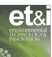
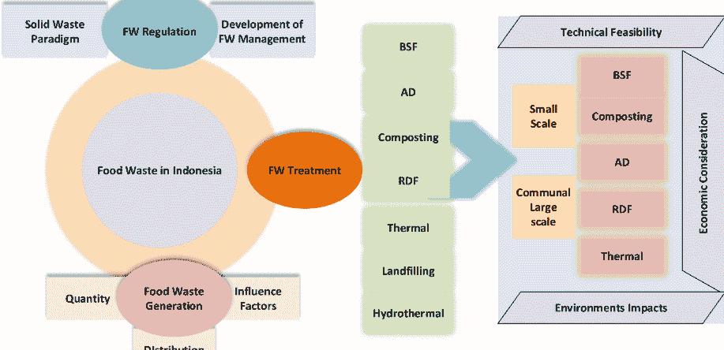
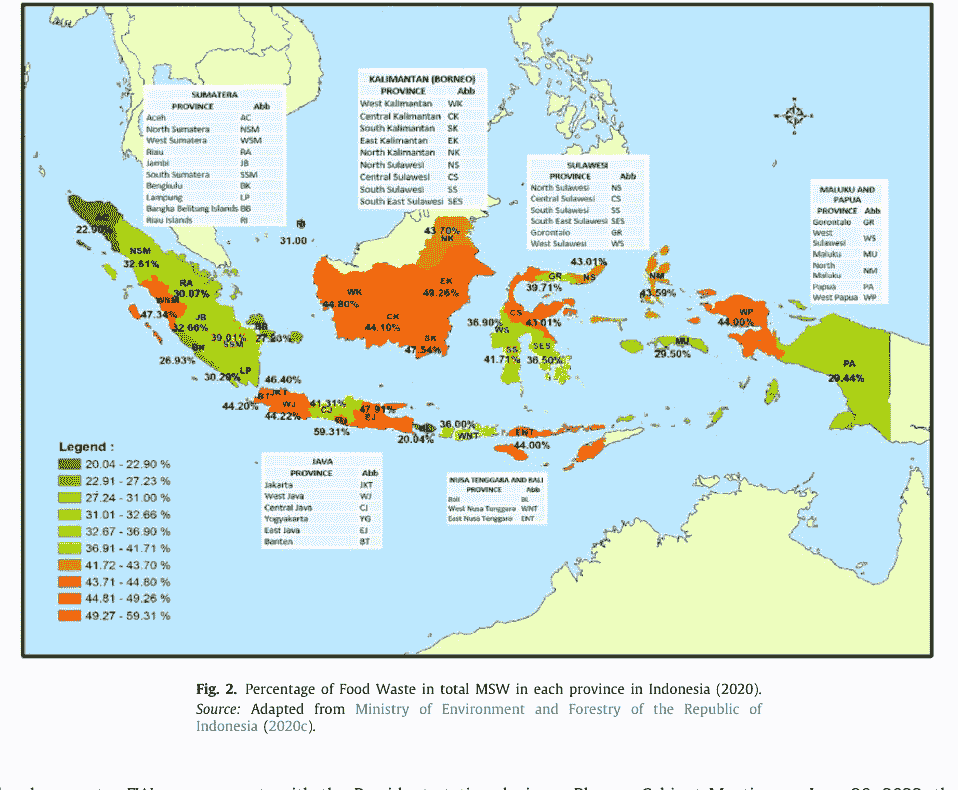
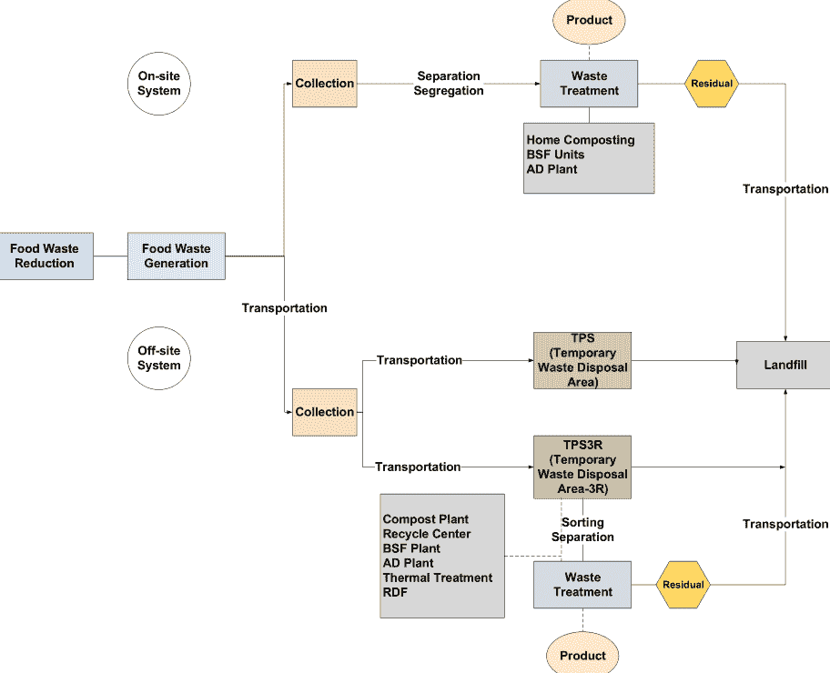

# 印度尼西亚现有与拟议可持续食品废物处理技术综述

# 印度尼西亚当前与建议的可持续食品浪费技术：综述

**作者：** Aulia Ulfah Farahdibaᵃ,b,e*, I.D.A.A. Marmadawanthiᵃ,c, Yunus Friscusᵃ,d, Elsa Rosaydidaᵇ, Joni Hermanaᶜ, Adhi Yuniartoᵉ

**单位：**
+   ᵃ 环境工程系，十月尼月理工学院，Jalan Teknik Kimia, Sukolilo, 60111, Surabaya, East Java, Indonesia
+   ᵇ 环境工程系，东部“老兵”建设大学，Jalan Raya Gunung Agung, 60294, Surabaya, East Java, Indonesia
+   ᶜ 基础设施与建设系，十月尼月理工学院，Jalan Teknik Kimia, Sukolilo, East Java, Indonesia
+   ᵈ 化学工程系，泗水雅大学，Jalan Raya Kalambung, 60293, Surabaya, East Java, Indonesia
+   ᵉ 环境工程系，Nahlatul Ulama Sidoarjo大学，Jalan Lingkar Timur Rangkap 61234, Sidoarjo, East Java, Indonesia

**关键词：** 食品浪费、处理、印尼西亚、法规

# 摘要

印尼西亚的国内废物是由食品浪费（FW）驱动的。印尼西亚已承诺根据国家战略政策（第97/2017号法规）推进食品浪费管理，目标是到2025年减少30%并处理70%。然而，目前的食品浪费法规和技术不足以实现这些目标。本文旨在量化食品浪费的产生并改进技术以支持这些目标。文中从技术、经济和环境考虑的背景讨论了印尼西亚建议的食品浪费处理方法。目前的食品浪费处理包括堆肥和填埋，后者对环境的影响最大。黑水虻和热处理是印尼西亚考虑用于垃圾发电的新技术。食品浪费处理的考量正在不同规模上发展。因此，必须考虑当前处理方法的环境影响。从产品和残余物对环境的影响以及产品质量方面来分析特定的食品浪费建议至关重要。

# 1. 引言

全球人口预计到2050年将增长到93亿，导致食物需求增加50%–70%。约三分之一的人类食用食物会流失或被浪费，相当于约13亿吨（Bond et al., 2013; FAO, 2020, 2011）。食品浪费（FW）导致了粮食危机，因为需要生产大量的食物来喂养人口。如果能减少食品浪费，食物将更容易获得，个人获取营养的机会也将增加。

> **通讯作者地址：** 环境工程系，十月尼月理工学院，Jalan Teknik Kimia, Sukolilo, 60111, Surabaya, East Java, Indonesia.
>
> **邮箱地址：** auliaulfaf@upnatim.id (A.A) Farahdiba.

减少食品浪费可以增加食物的可获得性，并提高个人获取营养的机会。在印尼西亚，食品浪费导致粮食危机，因为需要产生食物来供应人口。目前的印尼西亚建议的食品浪费处理是在技术、经济和环境考虑的背景下讨论的。印尼西亚的食品浪费处理技术。

之前的研究尚未充分解决食品浪费问题。国家战略政策（第97/2017号法规）。

印尼西亚的食品浪费处理考量正在不同规模上发展。因此，必须考虑当前处理方法的环境影响。从产品和残余物对环境的影响以及产品质量方面来分析特定的食品浪费建议至关重要。

印尼西亚的食品浪费处理技术。

印尼西亚减少食品浪费可以缓解饥饿，增加粮食安全。

印尼西亚是全球最大的食品浪费产生者之一。

印尼西亚的食品浪费处理技术。

# 2. 综述方法

本研究分析了 Scopus 数据库中与食品浪费相关的关键词。研究人员在标题、摘要和作者处使用了“food waste”关键词以确保数据的选择性。印尼西亚的固体废物管理数据来自政府报告、年度统计。然而，许多城市尚未报告数量和组成。

本综述关注印尼西亚食品浪费处理的现状和倡议，如图1所示。第一部分概述了定义、现状和影响因素。第二部分讨论并分析了发展。第三部分概述了目前的处理系统（黑水虻、堆肥、热处理、RDF、填埋和水热）。

# 3. 印尼西亚的食品与废物

## 3.1. 印尼西亚食品损失与浪费的定义

食品损失是指在供应链内部发生的人类食用食物减少。食品损失发生在收获后、加工后和加工阶段。食品损失的原因被认为是食品浪费（FAO, 2013, 2011; Parffitt et al., 2010）。在印尼西亚，法规定义为2008年第18号法律（Government of Indonesia, 2008）。印尼西亚的食品浪费管理关注分销和消费阶段产生的浪费，食品损失在农业工业废物背景下被认为是不恰的。本研究定义涉及分销和消费阶段。

## 3.2. 印尼西亚的废物产生

根据固体废物（MSW）的特征，2019-2020年印尼西亚的食品浪费产生量约占40%，2019年为60.34%，2020年为40.23%。两个主要的废物贡献者是食品浪费、食物和纸张。塑料在2019年占15.9%，2020年占17.29%，而食物和纸张约占16%。

2019年，2020年增长了11%（印度尼西亚共和国环境与森林部，2020a）。厨垃圾（FW）是印度尼西亚主要的废物来源。之前的研究发现，印度尼西亚的废物主要由厨垃圾组成（Dhokhai等，2015；Khair和2019；Nikmah和Warmadewanthi，2013；Suhartini等，2022）。

如图2所示，印尼西亚各地区固体生活垃圾（MSW）中厨垃圾的比例从2020年的11.93%-57.08%不等（印度尼西亚共和国环境与森林部，2020a）。印尼西亚拥有六个大岛，由若干省份组成：苏门答腊（6个省）、爪哇岛（6个省）、加里曼丹（9个省）；苏拉威西（6个省）；努苏苏登加拉和巴厘岛（3个省），以及马鲁古和巴布亚（6个省）。厨垃圾在大城市更为常见，例如雅加达特区（JK）和东爪哇（EJ），其厨垃圾率分别为45.63%和46.23%。大多数旅游城市，如日惹他泗（AK）、东爪哇（EJ）和南苏拉威西（SS），的厨垃圾率分别为57.08%、50%和35.77%。2020年产生的废物总量为6780万吨，预计2025年厨垃圾将增加到8630万吨（Indrawati等，2019）。这一增长与估计，总厨垃圾产生量为每年2400万-4300万吨，相当于人均每年115-184公斤（印度尼西亚国家发展规划部，2021a）。大部分废物产生于家庭，每年500万-1900万吨。据认为80%的废物源自家庭，其余20%来自非家庭部门。剩余厨垃圾占印度尼西亚所有厨垃圾的44%（印度尼西亚国家发展规划部，2021b）。这项研究提供了国家级的数据，但各区域的社会文化需求仍需更具体的详细分析。

## 3.3. 影响厨垃圾产生的因素

厨垃圾的产生可能受年龄、认知、收入、家庭规模和儿童的影响（Szabó-Bódi等，2018）。食品供需的变化、社会、文化和环境因素影响了印度尼西亚的厨垃圾产生模式。成员较少的家庭，人均产生的废物比大户家庭多。此类研究已经调查了人类行为。生活方式（Phatthan等，2019；Sugiharto，2021）；消费者行为（Vargas等，2019；Wang等，2019）、行为（Lasa，2021）以及文化（Elmelich等，2018；Payedanya等，2016）对厨垃圾的产生有显著影响。雇主与家庭佣工之间的减少可能会增加对厨垃圾量的意识（Lemy等，2021；Somero，2017）。如果不进行干预，预计印度尼西亚的厨垃圾产量到2045年将达到人均每年344公斤。然而，通过战略措施，这一数字可以减少到人均每年166公斤（印度尼西亚国家发展规划部，2021b）。

# 4. 厨垃圾管理与监管进展

印度尼西亚的人口年增长相当显著（1.12）。这将导致10年内厨垃圾产生量的大幅增加（印度尼西亚中央统计局，2020；世界银行，2021）。因此，印度尼西亚必须发展更强大的厨垃圾管理，总统在2022年6月的全体会议上表示，印度尼西亚面临着粮食、能源和财务危机的威胁。“我们需要协同与合作以满足相关利益者的需求”（印度尼西亚共和国内阁秘书，2020）。

印度尼西亚在固体废物管理方面经历了范式转变。在2008年颁布第18号法律之前，印度尼西亚使用的是“管道式废物”系统，该系统没有资源利用率，且存在过度开发自然资源的倾向（印度尼西亚政府，2008）。第18/2008号法律的实施和3Rs原则（减少、重复利用、回收；2015）通过改变行为和从源头减少废物，减少了与废物相关的污染物负荷。印度尼西亚实施了生产者责任延伸（EPR）和循环经济（CE），以最大限度地减少废物产生并鼓励回收包装（海事与事务协调部，2021）。EPR是指生产者对管理包装和废物产生承担责任，使包装能够被回收（印度尼西亚共和国环境与森林部，2021）。厨垃圾管理中实施循环经济包括管理包装、使用的产品材料以及再生自然系统（2020）。近年来，印度尼西亚政府采用了气化和堆肥等多种技术。这些技术涉及对厨垃圾处理技术的分析，并将技术、经济和环境影响相结合。

通过研究印度尼西亚的政府废物管理，总结了废物管理及相关厨垃圾政策的基本框架，所示（1）。涉及厨垃圾处理技术的分析与技术、经济和环境影响的整合。

# 印度尼西亚食品废物管理：现状、技术与未来展望

## 作者信息
A.U. Farahdiba, L.D.A. Warmadedwanthi, Y. Fransiscus 等人。

## 法律与政策背景
**第 17/2007 号法律**  
**时间跨度：2020 – 2024**

若干表述强调了考虑到对气候变化的影响，食品管理的紧迫性，这导致了印度尼西亚采用循环经济（CE）和低碳发展（Luthia et al., 2020; 印度尼西亚共和国国家发展计划部, 2021a; Subhartini et al., 2022）。印度尼西亚在其长期愿景中承诺应对气候变化（2045年印度尼西亚愿景；2050年低碳韧性发展长期战略）。具体而言，印度尼西亚设定了2050年关于气候变化对国家 GDP 影响减少 3.45% 的目标。印度尼西亚旨在通过提高四个部门——食物、水、能源和环境的韧性来实现这一目标。2021年国家自主贡献 (NDC) 中的三个目标领域和适应策略重点关注经济、社会与生、生态系统和景观的贡献（印度尼西亚共和国政府，2021）。

![图像：印度尼西亚各省目前的食品废物处理情况 (2020)]

生活垃圾是减少温室气体排放的优先部门。填埋场垃圾的大量甲烷导致了温室效应。此外，露天焚烧和非法废物处置仍然存在，且填埋场与甲烷利用无关（Auwaria, 2013; 印度尼西亚共和国政府, 2021; Lumban, 2017; Rachim, 2017）。未来将重点关注印度尼西亚《2050年低碳和气候韧性长期战略》中政府的关注点（印度尼西亚共和国政府，2021）。

## 5. 印度尼西亚目前的食品废物处理技术

关于固体废物处理，印度尼西亚报告称 2022 年的处理率为 25.3%，废物处理量为 49.2%（印度尼西亚共和国环境与林业部，2022）。政府引入了多种处理方法，包括堆肥、生物消化器、回收和热处理单元。在该研究中，堆肥被指定为社区垃圾处理方式。生物消化器是指使用厌氧过程的废物单元。填埋场是印度尼西亚政府管理的废物单元。在该研究中，填埋场是开放或受控填埋场（印度尼西亚环境与林业部，2020）。

图 5 显示了2020 年印度尼西亚食品废物处理的分布，基于（单位），由政府或非政府组织管理的废物处理。回收通常涉及手动收集过程（MRFs）废物处理。热处理包括焚烧、气化和热解。填埋技术仍用于印度尼西亚食品废物管理。令人惊讶的是，某些地区（如马鲁古）没有填埋场。然而，某些地区拥有堆肥、生物消化器、填埋场和回收中心（如爪哇和中爪哇）。不同技术分布在图 5 中，代表各省的食品废物技术。填埋系统在印度尼西亚各省分布于生物消化器、热处理和回收中心。食品废物处理加速依赖小规模社区参与（Colón et al., 2020）或大规模政府支持（Lokahita et al., 2019）。

### 黑水虻（BSF）技术
黑水虻（`Hermetia illucens`）广泛分布在热带和温暖地区。它们是水果、蔬菜、食物和其他有机物的分解者。这些昆虫的产卵和幼虫生长受多种条件影响，如环境温度、相对湿度、光源和其他废物相关的特征，包括水分含量和 pH（Hintkins et al., 2021; Fitirana et al., 2021; Indri et al., 2021; Sanjaya et al., 2019）。作为热带国家，印度尼西亚拥有黑水虻生长的最佳温度（Ojo et al., 2020）。2020-2021 年，泗水政府开发了四个使用黑水虻的废物处理单元，位于 Jambangan、Wonorejo 和 Majeng 回收中心（PDU）。PDU 产生了 5-10 吨食品废物，而 Wonorejo 的黑水虻单元产生了 40-50 吨食品废物。这一过程包括幼虫（蛹）和来自残留物的堆肥，泗水实现了 84% 和 54% 的废物减少（Zahra, 2022）。其他研究表明，使用家庭食品废物和咖啡渣作为基质可以减少 70-75% 的废物（Ibadrahman et al., 2020; Priyamada et al., 2021）。并非所有居民都意识到需要分离有机和无机废物，这使得食品废物收集更加有效（Environment Berau，2021）。黑水虻含有大量的粗蛋白（40-54%）和饮食脂肪（15-49%），其必需氨基酸组成与鱼肉相当（Eenezer et al., 2022）。在印度尼西亚进行的牛粪黑水虻研究产生的营养含量与其他研究相比（Ichwan et al., 2021）。黑水虻的残留过程在孵育 12 天后产生 29.1% 的蛋白和 11.86% 的重量（Ibadrahman et al., 2020）。此外，黑水虻技术比有机堆肥技术产生的全球变暖影响更小（Salakum et al., 2022）。

### 厌氧消化（AD）技术
厌氧消化（AD）技术可以从有机材料中产生能量。厌氧消化提供了无氧环境，允许微生物将有机物分解为沼气和富氮肥料（Luzquita et al., 2020; Santaryadi et al., 2018; Sumanti and Hadiyanto, 2020; Zhang et al., 2020）。厌氧消化在减少填埋废物方面具有环境和经济效益。此外，大规模厌氧消化运行可以提供运营效益和效率，例如降低成本并通过发电、供热和燃料产生效益（Hobbers et al., 2023; Tiong et al., 2021; Wang et al., 2021; Zhang et al., 2021）。印度尼西亚之前的厌氧消化已有试点或实验室研究。印度尼西亚的沼气单元通常通过添加细菌启动剂/炭来处理废物，主要来自牛粪、废水或油厂废水（Tiong et al., 2021）。监测厌氧消化涉及使用运行参数，如 pH、碱度和性能，以挥发性固体、沼气产量和甲烷含量为特征。有机废物向沼气的转化率从 8% 到 33% 不等（WWW，湿基）。这些特征至关重要，因为食品废物转化为有用产品（如能量回收）（Helena Perinis et al., 2020）。在印度尼西亚，厌氧消化厂具有较高的停留时间（Santaryadi et al., 2019; Sarahah et al., 2021; Wang et al., 2021）。甲烷气每吨棕榈油废水（POME）可产生 0.30 L³ CH₄（Tiong et al., 2021）。由高脂肪水平牛脂肪制成的基质每天产生 127-485 CH4/kg VS（Tassaka et al., 2019; Wulandari and Kristanto, 2016）。印度尼西亚食品废物厌氧消化项目之一是位于东爪哇马兰的综合资源回收中心（IRRC），由联合国亚太地区经济和社会委员会（UNESCAP）与 Waste Concern 合作开发。IRRC 是一个以去中心化、成本效益的方式处理中小型社区 50%-80% 食品废物的工厂。这些工厂利用传统的废物市场以及牛粪作为 1:1 的接种物。IRRC 的建设通常包括厌氧消化（AD）、污泥干燥床、堆肥场和发电机（Farahiba, 2021b; Subartini, 2022）。万隆地区 IRRC（Farahiba, 2021a）。自 2020 年以来，印度尼西亚的沼气产量不断增长。去年管理的废物达到了每年 300 吨，并预计在 2022 年将增加到每年 800 吨。这一过程每年生产多达 1000 吨原料的动物饲料、有机肥和农产品（印度尼西亚共和国环境与林业部，2020, 2022, 2020a）。在印度尼西亚国家数据库中，尚未详细说明特定底物的生产情况。

### 堆肥技术
堆肥是一种处理环境废物的方法，涉及有机物质的生物分解（Cai et al., 2023）。可以使用有氧堆肥产生堆肥，这涉及堆叠生物可降解材料。这种工艺适用于需要机械旋转的大规模流程，并经常用于农业处理厂（Abu et al., 2021; Keng et al., 2020; Sari et al., 2013）。印度尼西亚最常见的堆肥厂涉及带有管理安排的有氧堆肥，废物每年进行堆叠和翻堆。

印度尼西亚政府和社区使用堆肥进行管理。2021年，管理的废物和产生的堆肥产品达到每年 192,000 吨，动物饲料产品的剩余产量为每年 38,236 吨。大规模堆肥通常使用开放式窗格法，并由当地政府管理。大城市堆肥的一个例子是泗水市。每日废物量达到 26,000 吨，这些废物处理设施利用了城市废物以及来自家庭和市场的食品产品（作为补充材料）（泗水市环境局，2021）。堆肥与环境问题有关，例如酸化、异味以及由于浸滤液释放和分解废物产生的潜在重金属导致的土壤和水污染；堆肥可以改善废物处置条件并减少 20–25% 的温室气体排放（Salim et al., 2021）。

### 热处理技术
从废物材料中产生热的过程是热氧化，包括焚烧。含有碳氢化合物的废物在焚烧过程中被燃烧，将其转化为水、二氧化碳和其他污染物。为了开发一种有效的工艺，理解废气中的基本元素（如碳、氧、氮、硫和灰）至关重要（Lokahita et al., 2019）。热处理废物可以减少大量废物并将其转化为社区管理的电能（Kadanag and Sinaga, 2020）。

2016年2月，印度尼西亚政府发布了一项关于在七个城市加速废物发电（WTE）技术的总统条例。WTE 被定义为利用处理技术通过气化和热解将城市生活垃圾（MSW）、废物和塑料转化为能量的工厂。2021–2022年，印度尼西亚的热废物能力分别达到了每年 26947.05、11913.60 和 3160.90 吨（印度尼西亚共和国环境与林业部，2022）（作为补充材料）。人们认为，气化对于许多地区更为可靠，因为与填埋、焚烧和热解相比，它的影响较小（Biondo, 2021; Gamanunta, 2010; Mulawati, 2018; Rahim, 2017）。

### 填埋处置
填埋场处置（FW）被认为是对环境破坏最大的选择，因此是固体废物管理中最低的方法。这种废物系统被认为污染最严重，对全球变暖和酸化有显著贡献（Lumban, 2017; Nikmah and Warmadewanti, 2013）。

### 衍生燃料（RDF）技术
由于有机和塑料材料占印度尼西亚固体废物的 50% 以上，存在回收 RDF 的潜力（Lokahita et al., 2019）。印度尼西亚有三个 RDF 项目单位：美丹市（Medan）、德波克市（Depok）和与私人伙伴合作的西塔奇市（Citac），其中德波克的单位由当地政府管理。这三个项目在 2021–2022 年间处理了高达 57,784 吨废物（印度尼西亚共和国环境与林业部，2021）。西塔奇单位具有最高的处理能力，每天能处理 150 吨废物并产生约 54.89 吨 RDF，或约 36.069（政府，2023）。与生物质转换技术（如热解和气化）相比，RDF 技术需要大量的投资，这通常限制了其在废物管理中的利用。然而，RDF 产品在风险控制和确保最低热值方面具有优势，并获得了技术认可（Anastasia et al., 2020; Paramita et al., 2018）。

### 水热处理技术
2017 年标志着印度尼西亚水热处理设施的投入，该设施旨在处理未分类的城市垃圾。未分类的、高有机垃圾被投入反应器，在 2.5 MPa 的压力和 220 °C 的温度下暴露于蒸汽 30 分钟。热热处理可以减少大量废物并将其转化为社区管理的电能（Kadanag and Sinaga, 2020）（注：此处原文似乎存在逻辑跳跃或重复，已按字意翻译并保持结构）。

## 废物处理建议与讨论

**图 6.** 印度尼西亚的废物处理建议。

此外，这些国家对公众并没有强制要求，也没有适当激励措施来鼓励个人回收厨余垃圾（FW）（Dora et al., 2021; Geofilos, 2014）。在考虑厨余垃圾技术时，应当考虑垃圾收集、运输、设备设计和维护的成本（图 6）。某些技术更适用于低容量、高污染、高能耗处理，这些技术可以降低运行成本（Wang et al., 2022）。印度尼西亚需要开发专门应对印度尼西亚厨余垃圾要求的本土技术。其他的技术缺点还包括运营费用以及对熟练操作员和技术人员的负担（Karmarkar et al., 2023）。

图 6 显示社区家庭堆肥和黑水虻（BSF）处理可以减少与厨余垃圾相关的环境影响。现场系统对于管理厨余垃圾非常有益，因为它们不需要运输资源和废物储存设施，并能最大限度地减少有害物质的产生，包括厨余垃圾渗液。此外，需要使用生命周期框架进行技术比较。生命周期评估（LCA）可用于确定不同处理场景的最佳技术（Ahamed et al., 2016; Angelo et al., 2017; Beretta et al., 2017; Chen et al., 2018; Iseris et al., 2020; Jiao et al., 2021, 2022）。

对高水分（80–90%）和高有机物含量（约 90%）的厨余垃圾进行适当的管理和处理可以减少温室气体排放并实现生物能源的生产。厌氧消化（AD）技术被经常认为是比传统的废物处置方法更具能源和排放效益的厨余垃圾处理方式（Bernad and La Cour Janssen, 2012; Mondello et al., 2017; Thiberg and Tonjes, 2017; Zhang et al., 2020）。

以往对印度尼西亚废物处理单元环境影响的研究已经确定了各种处理技术在不同场景下的环境影响潜力。厌氧消化会导致高度酸化和富营养化，其中某些成分的富营养化较高（Ula et al., 2021）。研究分析了不同的处理方法，包括焚烧、气化、热解和再生燃料燃料（RDF）。大多数研究报告称，气化是最合适的技术，因为其环境影响低于垃圾填埋、焚烧和热解（Budiono, 2021; Gunamantha, 2010; Mulawani, 2018; Rachim, 2017）。RDF 被认为是露天倾倒更具可持续性的替代方案（Anastasia et al., 2020），它可以减少 178–330 吨的二氧化碳排放（Suyawan et al., 2021），而作为印度尼西亚最常见的废物处理方式，填埋的环境影响最大（Auvaria, 2013）。

本研究强调了分析厨余垃圾数据产生的重要性，并在技术可行性、环境影响评估和经济考虑中考虑了厨余垃圾的处理。该研究使用了国家数据，有必要在详细阶段进行进一步分析以揭示厨余垃圾管理系统所有的复杂性。生命周期评估是评估每种处理方式环境影响的有效工具。通过可视化和预测不同厨余垃圾管理系统的效果，场景有助于识别最环保的替代方案。可持续厨余垃圾管理策略的实施不仅可以减少环境影响并促进可持续性，还可以通过促进循环经济来创造经济机遇。

印度尼西亚地区每年产生约 2080 万吨厨余垃圾。实现 70% 的废物减少目标需要综合考虑法规、倡议和技术。然而，目前还没有具体的法规或激励措施来加速厨余垃圾的减少。从技术、环境和经济角度来看，必须考虑黑水虻（BSF）、厌氧消化、堆肥和 RDF 的应用。

## 编辑作者贡献
- **Ulia Farahdidi**：概念化、调查、资源、初稿撰写。
- **L.D.A. Marmadedwanthi**：审阅与编辑。
- **Yunus Franciscus**：调查、审阅与编辑。
- **Rosidah**：数据收集、可视化。
- **Adhi Yuniarto**：监督、编辑。

作者声明没有可能影响本文报告的已知利益冲突或个人关系。

## 致谢
这项工作得到了印度尼西亚奖学金（LPBI）和印度尼西亚基金（LPDP）的支持，以获得博士学位。https://doi.org/10.1016/j.ieti.2023.10325。

本研究相关的补充材料见于 https://doi.org/10.1016/j.ieti.2023.10326。

## 参考文献
- Ab, R., Abi, M., Cha, H., Noor, Z., Jalili, R. (2021). 使用风力和混合技术的废物垃圾管理生命周期评估。环境技术与创新, 83, 95–108. http://doi.org/10.1016/j.ieti.83.17199.
- Arwani, S., Huda, N., Rahman, A., & Yani, Y. (2016). 后损失对食品的影响：印度尼西亚食品系统的供应链分析。科学与技术, 511, 1165–1173. http://doi.org/10.1016/j.foodchem.2016.08019.
- Beresta, C., Stock, M., & Harvey, S. (2017). 食品损失的环境影响：食品系统的供应链分析。废物管理, 32, 2439–2455. http://doi.org/10.1016/j.wasman.2012.0723.
- Bernardi, A., La Cour, J. (2012). 废物管理系统的生命周期评估——现状与改进。
- Bond, M., Moamedi, T., Bhuno, R., Benton, T. G. (2013). 全球食品系统中的废物管理。食品计划, 1, 4-63.
- Cabulin. (2021). Sukajon 县垃圾填埋场（TPSA）废物循环分析。Abinet期刊, 1, 59–66.
- 印度尼西亚共和国内阁秘书 (2020). 印度尼西亚共和国总统声明[文档]。内阁。URL: https://setkab.go.id/arsippidato-presiden-mengenai-antisemi-dan-energi-strategis-nasional-pada-20-juni-2020/
- Cai, L., Gong, X., Ding, H., Li, S., and Wu, D. (2022). 芒果和甘蔗食品加工系统中的废物管理。环境技术与创新, 28, 106299. http://doi.org/10.1016/j.jenvpro.2022.106299.
- 印度尼西亚统计局 (2021). 2021 年印度尼西亚统计数据。
- Chung, Y.Y.K., Shih, L.O.M. (2017). 厨余垃圾幼虫营养成分评价：黑水虻的生长和存活率。废物管理, 67, 315–323. http://doi.org/10.1016/j.wasman.2017.05046.
- Coleman, R. R., and Fort, X. (2020). 家庭堆肥的环境评估。回收与保护, 54, 391–404.

## 参考文献

Elizalde, D., Pijay, J. L., Cessa, N. S., Chandrasekhar, S., and Vijayavan, P. (2021). 从厨余垃圾中开发的黑水虻幼虫（Hermia illucens）营养评估、生物能源潜力。环境技术与创新, 23, 107183. http://doi.org/10.1016/j.jeci.2021.107183.

Edwards, J., Morrison, C., and Ernst, B. (2018). 将厨余垃圾转化为黑水虻幼虫饲料的影响生命周期评估。废物管理, 76, 81–90. http://doi.org/10.1016/j.wasman.2018.03012.

Eimlech, A. L., and Ortiz, E. W. (2018). 谁得到了什么？废物管理评估综述。温室气体排放, 1, 10.

A.A. Farahullah, I.DA. Warmanwati, Y. Fransiscu 等人。

Iwan, M., Sireaj, A., Nursaini, T., 2021. 黑水（BSF）幼虫作为家庭规模有机废物管理的解决方案。Ecol. Ser. Env. 282, https://doi.org/10.1016/j.jenvenv.2021.112055

Indri, S., Sasm, G., Sasa, A., Devi, V.S., 2021. 饲料类型对黑水（Hermetia illucens）质量的影响。IOS Conf. Earth Ser. Env. Sci. 782, https://doi.org/10.1088/1755-1315/782/3/032023

Iswara, A., Parahadi, A.U., Nadhilan, N. E., Fardhanika, K., Mukhofifah, I., Rahayani, 2020. 有机废物管理解决方案生命周期影响评估的综合分析。Waste Management 107, https://doi.org/10.1016/j.wasman.2020.05.016

Kamada, M., Singga, N., 2020. 用于环保型垃圾管理的垃圾转换技术开发。Jurnal Teknik Lingkungan 24(1), 35-43. https://doi.org/10.22126/jtl.v24i1.38

Karakasih, A., Setiawan, A., Sugeng, K. B., 2023. 印度尼西亚废物能源化策略的潜力及其相关的污染危害。Environ. Technol. In. 29, https://doi.org/10.1016/j.jitenv.2023.e010317

Keng, X. Z., Zhang, S. G., Cheng, J. C., Nijuan, H. N., Pan, S., Tao, L., Supremanian, C.W., Singh, A., Chen, C.H., Ham, L.M., 2020. 发展中国家的可持续废物管理实践。Journal of Cleaner Production 262, https://doi.org/10.1016/j.jclepro.2020.121210

Khair, A., Iatmanman, T., 2019. 城市废物产生与成分分析以控制印度尼西亚固体废物银行问题：棉谷市研究。Journal of Waste Management. 21, 1027-1038. https://doi.org/10.1007/s10163-019-0980-6

Kim, C.H., Ryu, J. E., Lee, K. Y., Park, K. Y., Chung, H., 2021. 韩国用于黑蝇幼虫进行废物处理和能源生产。Waste Management 120, 46-52. https://doi.org/10.1016/j.wasman.2021.04.0111

KPMG, 2020. 利用循环经济进行废物利用：印度尼西亚的挑战与机遇。

Lamas, J., Fernandez-Rancera, S., Hohen, D., Rio, A., Ruiz-Zaldive, I., Quirino, J., Annes-Feto, J., Ortego, M. D., De Loza, S., 2021. 菲律宾建立黑蝇幼虫工厂的技术和经济可行性。

Lurena, A., Latrak, J., Bardiola, A., Bermero, N., Elizalde, A., Hernandez, M., Tifinan, H., 2014. 发展中城市固体废物管理实践综述。Waste Management, 34, 173-180.

Luharto, S. D., Rahmadani, S., Supriyani, E., 2020. 社区型废物管理的有效性。Environmental Sustainability, 12, 11. https://doi.org/10.1007/s13364-020-0531

Lutakiawan, P., Rahiyadi, M., Sarvati-Horth, L., Taherzadeh, J., 2020. 厌氧消化从食品废物产生幼虫的影响。Digestion 11, 39-52. https://doi.org/10.1080/10451759.2019.17549

Lestari, A. R., Sudarwsono, A. S., 2020. 印度尼西亚废物能源发电厂的动态。IOP Policy, 10(1), https://doi.org/10.1088/1755-1315/2

印度尼西亚共和国环境部，2020a. 印度尼西亚进入废物管理新时代。[WWW文档]。https://www.menlhk.go.id/informasi-data-komposisi

印度尼西亚共和国环境部，2020b. 国家废物管理信息。[WWW文档]。https://www.menlhk.go.id/informasi-data-komposisi

印度尼西亚共和国环境部，2021a. 国家废物管理来源。[WWW文档]。https://www.menlhk.go.id/informasi-data-komposisi

印度尼西亚共和国环境部，2022. 支持循环经济的废物管理策略。https://www.menlhk.go.id/informasi-data-komposisi

印度尼西亚国内部，2022. 废物管理能力建设。

印度尼西亚国家计划部，2021a. 支持循环经济的食品和废物管理。

印度尼西亚国家计划部，2021b. 印度尼西亚框架内的垃圾管理研究。

Mondello, G., Salerno, R., Ippolo, J., Sparasi, A., Marchetti, F., 2017. 废物管理方案的比较分析：循环经济的未来。Sustainability, 9(9). https://doi.org/10.3390/su9009

Muliawati, R., 2021. 垃圾场生命周期评估管理预测。Jurnal Lingkungan, 24, 245-251.

Muzaffar, S., 2014. 全球废物地图证据。Public Health BMC, 4, 1-8. https://doi.org/10.1186/1471-2202-4

Oelef, J. H., 2014. 南非的食品废物。理解规模：水足迹和碳成本。Waste Handled, 62, 95-108.

Oja, B., Scheler, S., Okter, O., 2006. 工业生产与加工中的废物管理和循环经济概念。Waste Management, 26, 1095-1100.

Parfitt, J., Martinez, M., Macaughton, S., 2011. 印度尼西亚水泥替代燃料废物评估（Jatilenguk案例研究）。IOS Conf. Earth Ser. Env. 175, 365-381. https://doi.org/10.1088/1755-1315/175/1/012017

A. Faurullah, I.DA. Warmanwati, Y. Franciscus 等人。Environmental Technology 32 (2023) 103256

Fahmi, T.T., Kasih, R., K.M., Rahmadi, B., Bastian, R., 2015. 食品废物-能源转换技术：现状与未来方向。Waste Management, 36, 399–408. https://doi.org/10.1016/j.was.2014.12.004

Priyambada, I., Sumiyati, S., Supita, A.S., Wijacana, R.A., 2021. 使用黑蝇幼虫处理有机废物的优化：迪波涅罗大学案例研究。IOP Conf. Ser. Earth Environ. Sci. 896, 012017. https://doi.org/10.1088/1755-1055/896/1/012017

Hitra, P.E., Demiansyah, D., Rahamwi, E., Paek, A., 2021. 城市固体废物的水热碳化动力学。I. J. Ecol Prod.

Rahim, T.A., 2017. 学校垃圾管理生命周期评估（LCA）：泗水市垃圾垃圾场案例。

Sari, A., Lansing, S., Dhansby, N.H., Graves, R.E., 2013. 食品废物系统的生命周期评估：环境影响选择。J. Consum Prod., 20, 15–23.

城市的可持续资源管理：黑蝇幼虫的作用及其在固体废物和污染缓解中的利用。Innov. Environ., 28, 102649. https://doi.org/10.1016/j.ininenv.2020.102649.

Sama, M., Alam, Fezi, D., Sherif, N., Hasan, J., Ali, N., Bilal, M., 2021. 黑蝇幼虫对市政废物可持续管理的作用。Environ. Technol., 24, 101934. https://doi.org/10.1016/j.jenvman.2021.101934

Suharto, S., Rohini, R., Mardiyani, H., Abillah, A., 2020. 从厌氧消化到食品废物处理的优化。Waste Manage., 105, 1–10. https://doi.org/10.1016/j.wasman.2020.07515.

Sanjaya, Y., Suura, Rahmuni, M., Shintawati, R., 2022. 黑蝇幼虫作为畜业替代饲料的研究。ACS J. Phys. Chem., 17(12), 7896. https://doi.org/10.1021/acs.jpcf.7526

Suharto, N.A., Harbour, M.B., Saragih, S.F., Friana, C.P., Rahmi, A.S., 2019. 通过水热处理评估食品废物评估。Environ. Technol. Manage., 255, 11468-11479. https://doi.org/10.1016/j.jenvman.2019.11468.

Syaifudin, S., Alviansyah, A., 2021. 热预处理对厌氧消化底物的影响。IOP Conf. Ser. Earth. Sci. 251, 01214. https://doi.org/10.1088/1755-1315/251/1/01214.

Sumit, A., Kumar, 2021. 有机废物管理的包容方法和黑蝇幼虫的使用综述。J. Environ. Manage., 298, 11363. https://doi.org/10.1016/j.jenvman.2021.11363.

Soma, T., Piringad, R.K., Faurullah, I.A., Wardawati, Y., 2022. 黑蝇幼虫在食品废物产生中的作用：印度消费者行为与家庭废物管理评估。Int. Pol. Man., 37, 292–302. https://doi.org/10.1108/JEF-05-2017-0049.

Sujodo, H., Majid, A., Pradana, Y.S., Wardawati, I.A., 2017. 雅加达环境废物管理系统评估。IJSSR, 1(1), 1. https://doi.org/10.20902/ijssr.v1i.1

Suharto, A., 2022. 雅加达农村食品废物管理评估。Earth Conf. 316, 02218. https://doi.org/10.1088/1755-1015/316/2/02218.

Rohini, S., Mahar, N., Elviana, I., List, R., Muktiwati, M., 2022. 食品废物管理：印度尼西亚的现状与作用。J Environ Manage., 312, 128528. https://doi.org/10.1016/j.jenvman.2022.128528.

Sumiyati, I., Supita, A.S., Wijacana, R.A., 2021. 使用黑蝇幼虫（BSFL）生产垃圾衍生燃料（RDF）的可行性。J. Hari Alam, 10, 95–109. https://doi.org/10.15242/jba.996/1/02080.

A.U. Farahdiba, IJDAA. Warmadeanthwi, Y. Franciscus et al. Environmental Technology & Innovation 32 (2023) 103256

Zhang, H., Liu, G., Xue, L., Zuo, J., Chen, T., Vuppaladadiyam, A., Duan, H. 基于厌氧消化的废物转能源技术到2040年将使中国快速增长的厨余垃圾气候影响减少一半。J. Clean. Prod. 277, 123490. http://dx.doi.org/10.1016/j.jclepro.2020.123490.

Zhang, Y., Tian, Q., Hu, H., Yu, M., 2019. 中国居民食品消费的水足迹。Int. J. Environ. Res. Public Health 16, 1–15. http://dx.doi.org/10.3390/ijerph160203979.
