# 错误的价格：为什么资本主义无法拯救地球

## 引言

本书旨在解决一个引人注目的悖论——一个实际上并存的谜题。这个悖论由两个看似相互矛盾的观点或命题组成。

一方面，我们被告知应对气候变化的根本经济问题已经解决。应对气候变化最紧迫的任务，被认为是消除化石燃料燃烧。

另一方面，我们被告知仍然存在一个问题。长期以来，这被认为是不可能的，甚至是不可想象的，原因很简单：化石燃料发电比再生能源更便宜。但是，从 2000 年代中期开始，情况发生了变化。随着投资增加和技术的改进，再生能源的价格大幅下降。在 2010 年代中期，大多数估计表明再生能源和脏电力的价格正在迅速接近；到该年代末，大多数估计显示前者已经比后者更便宜。

这被认为是一个历史性的转折。电力去碳的经济障碍似乎已被扫清。2020 年，一条典型的标题写道：“再生能源成本的下降正引领净零竞赛”。另一条标题则宣布：“再生能源日益廉价，击败了最便宜的煤炭竞争对手”。第三条则感慨：“光伏价格暴跌为再生能源带来了光明未来”。任何关注能源领域发展的人都会注意到这一主题正成为经济和政策讨论的主旋律。

然而，过去十年再生能源大量投资的主要原因之一是各国通过一系列补贴和其他支持机制支持此类投资。这些支持为私营部门提供了最初的信心。但随着 2010 年代投资的增长导致成本下降，政府日益认为其刺激工作已经完成，开始减少财政支持。有些国家在十年结束前就开始淘汰甚至取消补贴。

恐慌出现了。政府一发出减少对再生能源支持的意图，警报就响了。人们警告说，任何此类削减都将对太阳能和风能的未来发展产生严重损害。

如果价格确实驱动了能源技术的采纳，而且可再生能源现在是最廉价的，那么为什么政府对可再生能源的经济支持仍然如此重要——或者至少，仍然被认为不可或缺？如果可再生能源现在更便宜了，那么在明确真实利益关系时，我们实际上是否在电力脱碳方面仍然失败了？至于是否失败，众所见，我们无疑是失败了，正如马特·伊根（Matt Egan）在一篇文章标题中所强调的那样，尽管这篇文章发表于 2019 年，但今天看来依然准确无误：“可再生能源正在蓬勃发展。如果它的增长速度还不够以应对气候变化，并且无法为价格提供帮助（因为这一障碍在不久前刚刚得到了满意的解决），为什么政府提供的对可再生能源的经济支持仍然是必要的？”这些是本书要回答的问题。

主要的答案和论点是：通过价格的棱镜来审视能源转型的经济学，会导致上述那种矛盾的观点，因为从经济角度来看，这个问题实际上与价格无关。对于评估可再生能源基础设施投资的现状和未来前景，价格是一个具有误导性的衡量标准。

这是书名标题想要传达的核心信息。明确地说，这一点并不是说可再生能源发电的特定流行价格是错误的——也就是说，在加速转型方面价格是错误的。在思考什么因素导致了成功（或失败）的转型时，主要关注价格是看错了地方：作为观察气候和资本主义的分析透镜，价格是一个红鲱鱼。对于那些（主要是经济学家）痴迷于可再生能源——实际上是碳价格“需要”多少才能让清洁电力取代化石燃料的人，本书的论点并不是他们的答案错误，而是他们的问题错了。价格是一个在分析上应该优先考虑的错误类别。

更好、更有意义的衡量标准是利润。这才是我们应该关注的。我认为，电力脱碳进展比我们要求的慢得多的主要经济原因是，全球大多数政府实际上将开发、拥有和运营太阳能和风电场的责任外包给了以利润为导向的私营部门参与者，而这些参与者从这些活动中预期利润通常不足以覆盖成本。这本身并不是一个足够吸引力的经济命题。

在 2023 年发布的第三份转型年度调查报告中，咨询公司贝恩（Bain & Company）询问了全球能源行业的高管，是什么主要阻碍了转型。浮出水面的担忧不是价格。也不是资本的可用性——资本通常是充足的。不，障碍是盈利能力——将资本转化为更多资本的能力。五位高管中有四位认为“在项目上创造可接受回报的能力是能源系统脱碳的主要障碍”。

正如我们将看到的，这种盈利性限制也解释了为什么尽管之前讨论了成本剧减，但私资本主导的可再生能源部门仍然受困于全世界都在关注的政府经济支持。因为在实践中，这种支持与其说是有效地压低价格，不如说是维持高利润，从而让私营部门保持相应的热忱。

在现有的对能源转型的评论和理解中占据巨大地位的具体价格，是经济学家所谓的“成本价”（cost price）——本质上，是源头电力的标签价格，或者产生特定数量电能所需的成本。这解释了为什么它有时被称为“价格”，有时又被称为“成本”。不言而喻，主张我们坚持关注利润并不是意味着它们之间是独立存在的。毕竟，电力的成本价难道不会直接影响从发电中获得的利润吗？事实上，较低的成本价必然意味着更高的利润，因此在实际操作中，我们谈论其中一个时就是在谈论同一件事吗？

这是两个非常合理且重要的问题，它们的答案分别是：是的，当然；以及不是。是的，当然，发电成本会直接并强烈地影响从发电中获得的利润。但正如我将展示的，有各种原因导致发电成本的降低并不等同于利润的增加。例如，在低发电成本相关的场景中，其他成本（即与发电无关的成本）可能同时更高；此外，在后一种情况下，收益潜力可能与高发电成本的情况并不相同。

也许，如果发电成本与最终利润之间的这种简单方程确实成立，那么可再生能源最廉价就意味着可再生能源具有足够的盈利能力，从而刺激比过去和现在更多的新型清洁产能投资——并且可能意味着更廉价的能源将像人们通常认为的那样，不可避免地接管。也许在某些电力生产和交付安排下，情况确实如此。但不可否认，这些并不是我们拥有的安排。本书的核心教训之一是，在全球范围内，我们历史上构建、组织和转型电力系统的方式，使得用更便宜、更清洁的发电替代肮脏且相对昂贵的发电完全无法得到保证。

在这些充满不确定性的时期，我们经常谈论化石燃料公司获得超额利润——我们这样做是有理由的。但我们很少谈论可再生能源公司无法获得足够的利润。

## II

不可争议的是，我们——全世界——从任何合理的衡量标准来看在电力脱碳方面绝没有“成功”。在开始阶段，清除关于这方面的任何潜在的误解至关重要。因为，虽然我们在电力脱碳方面的持续失败可能在某些读者看来是显而易见的，但其他人可能还需要被说服。我们不是在全球范围内安装的可再生能源发电容量比任何时候都多吗？来自零碳的发电是否达到了历史新高？这些都是我预见的可能的反对意见。

过去两年出现在主流媒体上的许多庆祝性评论，似乎让人们相信，在长期未能认真对待气候缓解措施之后，我们现在成功了，至少在电力部门方面。例如，“2023 年清洁电力增长记录将开启化石燃料下降的新时代，”这样一条标题最近宣布。“全球风能和太阳能增长有望实现气候目标，”另一条胜利者的标题如是。

但我们并不在轨道上。有许多方法可以说明这一基本观点，我们将在书中不同地方引用其他观点，但现在，让我们关注一个通常比任何其他指标都能吸引人们注意的标准：钱。

2021 年，国际能源署（IEA）作为全球领先的能源部门分析政府间组织，发布了一份具有影响力的“2050 年实现该部门温室气体净零排放路线图”。国际能源署认为，遵循该路线图将“符合 2015 年《巴黎协定》将全球平均气温升幅限制在 1.5 摄氏度内的努力”。

现在，有许多理由说明能源署的核心提议——即 2050 年能源部门净零排放符合 1.5 摄氏度——本身可能、并且已经被质疑。原因之一是，它隐含地对非能源部门（如土地利用）减排进展做了某些假设，而这些假设可能也可能不成立。如果那些部门最终令人失望，能源署目前认为可能符合 1.5 摄氏度的能源部门进展可能最终并非如此。所有关于实现“净零”的现有预测，包括国际能源署（IEA）自身对能源部门的，假设某种程度的此类捕集是可靠的且将实现的。同样，如果事实并非如此——许多科学家和工程师对此深表疑虑——那么国际能源署的减排路线图实际上将无法符合 1.5 °C 的目标。

尽管如此，我们暂且把这些至关重要的问题搁置。国际能源署的路线图对于发电能力投资方面具体需要做什么是如何说明的？虽然有很多细节，但该路线图基本上提出了两项要求。第一项是几乎立即停止对新型化石燃料发电能力的投资，除非通过附加的碳捕集与封存技术进行“减排”。“不批准开发任何新的未减排煤电厂”¹。第二个要求是快速且持续地增加对新型再生能源发电能力的投资。从财务角度来看？从 2016 年至 2020 年间每年约 3000 亿美元的平均值，全球对新型再生能源容量的投资需要飙升至 2021 年至 2030 年间的年均 1 万亿美元，并在最后一年达到 1.3 万亿美元。²

到目前为止我们的表现得如何？显然并不理想，我们在第一项要求时就在“不新建新的未减排煤电厂”上失败了。2022 年，仅中国一个国家每周就批准了两座新的未减排煤电厂。³ 至于再生能源，上述的胜利主义数字仍然极其令人失望且不足。在国际能源署发布路线图的那一年（即 2021 年），全球新型再生能源容量的总投资仅略高于 4000 亿美元；2022 年则略低于 5000 亿美元，使两年的平均值约为 4500 亿美元。⁴

换句话说，如果我们想在弥补历史性失败方面有任何合理的前景，我们目前的清洁电力投资速度远未达到所需水平。如果国际能源署的估计是准确的，在本十年内总共需要 10 万亿美元用于再生能源容量，那么简单的算术似乎表明，由于 2021-22 年的缺口远低于目标，最初暗示的每年 1 万亿美元平均值已增加到 2023-30 年的约 1.15 万亿美元。每年的投资不足都会增加后几年的负担，因为绝对缺口需要被弥补。难怪到 2022 年 10 月，国际能源署已悄悄上调了到 2050 年实现净零路径所需的再生能源容量投资估值，从 1.3 万亿美元增加到 1.5 万亿美元以上。⁵

事实上，即使是这种简单的算术也大大低估了我们持续失败的程度。每年对再生能源的投资低于需求，都会增加随后的投资需求，不仅是因为绝对缺口，还因为其所代表的延迟。从今天开始减少的每吨二氧化碳排放，在未来缓解气候方面比从明年开始减少的每吨更有价值，因为排放是累积的：我们越早用清洁发电替代肮脏发电，后者造成损害的时间就越短。在这方面，气候变化与货币通胀非常相似。在这种情况下，今天的一美元比明天的一美元更值。

## III

在继续下去之前，也有必要对本书的范围说几句话，既包括它研究和没有研究的内容，实际上，也包括它论证和没有论证的内容。

首先最重要的是，这是一本关于气候变化和电力的书，而且仅是电力。它没有研究世界减少电力以外其他来源二氧化碳排放的尝试（例如水泥生产和其他工业过程），更不用说其他温室气体排放了。这无疑可能限制了对其主张的接受度。

但低估电力的意义将是不明智的。电力不仅是二氧化碳排放的单一最大来源，同样重要的是，全球权威显然决定，交通和供暖等活动去碳化的最佳方法是将其电气化，同时对它们将日益依赖的电力系统进行去碳化。因此，电力以及我们摆脱化石燃料的速度和全面性——对气候来说将变得比现在更加重要。正如《经济学人》在 2022 年所言，世界目前的去碳策略可以有效概括为两个词：“万物电气化”。⁶ 该杂志承认，电气化“并没有提供所需的一切”，“但它提供了很多”。这样说也不过分，世界应对气候变化的缓解策略将实际上取决于其电力去碳努力的成败。

更具体地说，这是一本关于特定形式电力的经济学的书，即非水力再生能源；即太阳能和风能。它主要研究了转向太阳能和风能的经济驱动力。它采取这种关注点并非出于作者对未来应如何物理发电的任何特定信念（除非绝对必要，否则不应使用化石燃料）。相反，它采取这一重点是因为权威显然决定未来是电气化，因此世界大部分地区决定未来将主要是太阳能和风能，并辅以电力存储机制——作为在太阳不光照和风不吹时的备选电源。

正如技术限制一样，规模和商业限制同样重要。这是一本关于面向市场的太阳能和风能发电设施的开发、拥有和运营，以及产电销售的书。由此产生了两个关键点。第一，本书不是关于社区团体或个人家庭的小规模“分布式”再生能源发电。这种发电已经在并在能源转型中发挥重要作用，尽管在不同国家的程度不同。该领域再生能源的因素非常不同；事实上，对于相关者来说，价格可能是投资决策的关键决定因素。但我们的重点将放在其他地方：面向商业的、“公用级”再生能源开发，这将最终决定大多数国家的去碳尝试。

其次，本书也不是关于设计、开发或制造再生发电设施用技术的业务，例如太阳能电池、组件和风力发电机。⁷ 那是一项完全不同的业务，而且近年来在新闻中经常出现，因为它已日益成为世界主要贸易集团之间紧张甚至冲突的主要焦点。

尽管如此，技术制造业务在书中必然是一个显著的近端存在。这怎么可能不是呢，考虑到本书关注的是发电成本——在再生能源电力的情况下，这在很大程度上是设备采购和安装成本——以及由此产生的利润？

事实上，再生能源经济学最重要的特征之一是技术生产利润与发电利润之间紧密且迭代的关系。当马蒂斯和同事在《彭博社》上就此写了一篇非常出色且具有启发性的文章时，⁸ 他们指出，2010 年代下半年各国政府对再生能源发电的补贴选择性扩大，给发电商带来了压力，发电商能够通过降低设备价格部分转嫁给上游技术供应商。导致的结果是利润挤压，加上世界遭受新冠肺炎冲击时铁和硅等原材料成本的上升，最终使制造商做出反应。例如，全球最大的风力机制造商之一维斯塔（Vestas）在 2021 年将其价格平均上调了 20%。结果如何？发电商利润的挤压。

同时，本书认为这种利润挤压代表了对新建发电能力的明确威胁，这一观点不应被解释为对电力去碳其他障碍意义的反驳。学者和其他评论员令人信服地记录了许多其他因素，这些因素在不同程度上显然也阻碍了发电从化石燃料的转变。这些因素从化石燃料利益集团及其盟友成功渗透政客和监管者，从而阻碍更有效政策的引入，到与许可相关的一系列官僚障碍。

电网连接问题广泛存在，阻碍了新型太阳能和风能电场的快速发展。长期以来，太阳能和风能成为商业化主题以来，获得一座新可再生能源工厂所需的许可可能需要长达十年时间，这在多个管辖区的发展者中几乎是一个贯穿始终的关键论调。

那么，并非如此。本书的观点并非这些其他因素不是实质性的障碍。显然，它们可以是。它反对的其实是那种广泛的信条：认为在可再生电力成本已经下降到与传统发电持平（或更低）的今天，这些其他障碍就已是唯一的阻碍——也就是说，他们坚信可再生能源的经济学问题不再是问题。这种信念正日益成为主流的常识。这种信念含蓄或显式地假设，只要我们能处理好“非经济性”障碍——那些处于政治和规划领域的障碍——并让市场和追求利润的企业各行其是，能源转型将会顺利且快速地进行，仅仅因为可再生能源现在是最便宜的。然而，这种常识是错误的。经济学本身仍然是一个巨大的障碍，而这正是本书所探讨的。关于利益集团的作用、规划僵化等问题在文中已得到了充分分析，此处它们被搁置了一边。

最后，如果我们分析向可再生能源转型的特定视角不是相对成本（即产生可再生能源的成本相对于传统发电成本的比较，这是通常所做的比较），那么正确的特定视角是什么呢？显而易见：一个实体通过规划投资新型太阳能或风能产能，预期可以通过该投资所获得的利润。在此请注意，虽然预期利润显然与此类规划时可再生电力发电的实际盈利能力有关，但它们并非一回事。毕竟，预期的盈利能力可能会上升或下降。

换句话说，本书的观点并非认为化石燃料发电厂一定比可再生能源发电更有利——它们可能确实如此，但同样也可能并不如此，而且在写本书的期间（主要是 2022 年），在世界的大部分地区，它们通常并非如此。当一个商业实体对潜在投资（例如新的风电产能）做出决策时，选择几乎总是在“建设风场”和“不建设风场”之间做出，而不是“建设风场”和“燃气发电厂”，因此，相关的盈利基准是投资者认为可以接受的回报率，而不是污染发电资产的回报率。然而，无论可再生能源现在有多廉价，事实证明，盈利评估——收益是否足够——往往会得出负面结论。

这是为什么呢？有许多原因。正如我们将看到的，其中关键的一点是竞争：发电业务，特别是可再生能源发电业务，通常非常有竞争性，这倾向于抑制利润。相关的，这种竞争也倾向于限制发电公司获取任何成本降低带来的收益的能力——以一个非随机的例子来说，转向更廉价的发电技术带来的成本降低，其他因素进一步限制了它们的行动能力。

但对我们的故事而言，与利润压力同样重要的是利润的可预测性——或者说，是可预测性的缺失。特别是在电力市场自由化的国家，发电厂出售其产出的价格波动众所闻昭晓。这使得投资决策变得极具赌博性。可再生能源能以多少出售？通常，预测一周后的情况都很困难，更不用说一年或更久了。预期盈利代表了可再生能源发展的潜在障碍，换句话说，不仅体现在价格有时低到不可接受，而且体现在经常是根本不可知的。因此，这是本书的核心洞察之一：我们在全球范围内持续看到的对可再生能源的政府财政支持，往往是为了让利润“可见”，而不仅仅是让其“可行”。

## IV

在提出这些论点时，本书与大多数关于资本主义与气候危机关系的描述有显著不同。通常情况下，尽管并非总是如此，此类描述断言资本主义是问题所在，因为资本主义本质上是肮脏的——也就是说，其本质是对环境（包括气候）的破坏。“资本主义的社会代谢秩序本质上是反生态的，”布雷特·克拉克（Brett Clark）和理查德·约克（Richard York）在 2008 年标志性地写道，“因为它在追求无尽积累和更大规模的生产时，系统地从属了自然。”⁹ 从其本质上是反生态的程度来看，这一论点认为资本主义不仅无法拯救地球，而且从本质上是地球荒芜的主要来源。

本书阐述的论点不同。它也暗示资本主义不会拯救地球，但原因不同。提炼其本质，该论点如下：资本主义固有的只有利润指令和生产资料的私有制。可再生能源在利润方面通常是一个不确定的命题，这意味着资本主义由于其以利润为导向的本质，并不具备提供它的能力。

正如《金融时报》首席经济评论员马丁·沃尔夫（Martin Wolf）最近写道，“使用风能或其他来自化石燃料的可再生能源更有利。”他继续道，“市场力量将自行驱动经济向保护气候的方向进行转型。”¹⁰ 沃尔夫的基本命题是？即无论结果是拯救地球还是其他，在资本主义下，“如果某事是有利的，它就会被执行”。

这一核心命题无疑正确。如果绿色业务比常态业务更有利，那么资本主义的评论家们——如卡尔·马克思（Karl Marx，十九世纪资本主义的领先记录者）和马特·莱文（Matt Levine，二十一世纪资本主义的领先记录者）所言——产品的物质，无论是绿色还是棕色，对资本而言最终无关紧要。

马克思在理论术语上对此得出了结论。¹¹ 资本主义在现实中并不关心“产品的本质”。产品实质上被用于什么——马克思说，只要它能产生利润；否则，一个不产生利润的“仅仅使用价值”的产品，对资本主义来说是完全无意义的。我们在社会中当然推崇有意义的价值，例如毯子提供的温暖或自行车提供的运动，只要它们是如此；马克思也是如此。但对于资本主义来说：一个为资本主义产生“仅仅使用价值”的人，不值得任何蔑视。绿色化在马克思的术语中是一种使用价值。对于资本主义来说，它充其量是次要考虑。


# 莱文经常提出同样的观点，但方式完全不同

例如，在 2013 年，他提到了一家公司，该公司当时既产生了利润，也产生了大量的温室气体排放，特别是通过在加州的老锅炉电厂发电。正如莱文描述的，该公司在马克思术语中是贪婪的资本主义。使用价值——在本例中是电力——的产生是因为必须如此；它们并不是资本主义存在的理由。在莱文看来，实际上生产电力只是利润业务的“一个自然的附属部分”；“如果公司可以完全合成地完成这一切，它们可能会这样做……它们对在现实世界中做任何事情都没有特定的兴趣。”^22 尽管如此，他们是否关心那件事是否环保？

经常被引用的“路径依赖”本身从根本上是一种利润重叠的现象。可以说，到目前为止所有存在的资本主义社会的历史，都是层层交换价值的历史，而非“仅仅”使用价值的历史——不用说，这些是通过阶级斗争所调节的。

这一点在于：资本主义对环境的影响是偶然的，而非根本的。如果资本主义不可避免地破坏环境是一个事实，那么这在间接意义上也是事实：也就是说，对利润的底层追求——资本的真实动力——以及对增长本身的追求恰好具有环境破坏性。

埃克森（`Exxon`）和雪佛龙（`Chevron`）等公司继续主要钻探碳氢化合物，而不是投资可再生能源，并不是因为他们及其高管特别热爱石油，而是因为他们热爱金钱。而且，在本文写作的 2023 年初，得益于通胀的油价，此类公司正沉浸在碳氢化合物利润中。在这种情况下，具有特定价值的商品是实现更根本目的——获取利润的手段。对于所有资本主义商品都是如此，当然包括货币本身这种商品。

此外，左翼在解释为何现有的资本主义被证明对整体环境（尤其是气候）具有破坏性方面存在错误；同样，它们在解释迄今为止发生的极少数资本主义绿色化方面也存在错误。例如，杰克·比特特尔（`Jake Bittle`）在 2022 年中声称，“绿色资本主义的出现是一个单一压倒性事实的结果：清洁能源是一门好生意。”这并非完全正确。正如我们将看到的，清洁能源——或者至少是资本主义生产的清洁电力——通常并不是一门很好的生意。

相反，“绿色资本主义”（尽管其程度有限）的出现，主要是政府支持帮助使清洁能源成为一项具有足够盈利能力以吸引投资的业务，并结合了某些领域接受较低回报的意愿。这种意愿要么是预期绿色利润最终将丰厚回报，因此建立先发优势和市场领导地位具有长期经济价值；要么——低声说——是为了服务于“绿色性”的使用价值。

事实证明，全球范围内对可再生能源产能的投资总是不成比例地随着国家补贴的节拍起舞。例如在美国，正如罗斯·麦克拉肯（`Ross McCracken`）和霍斯利·卡尔（`Housley Carr`）在 2016 年观察到的，“太阳能和风能的新建速度在历史上受到[税收]抵免的严重影响——在存在确定性时蓬勃发展，在缺乏确定性时停滞”。难怪当美国政策制定者在 2022 年夏天通过《通胀削减法案》（`IRA`）恢复该国的可再生能源税收抵免时，最直接的后果就是清洁能源公司股价的剧升。

重要的是要强调，在这一切中，存在一种显著且极具启示意义和暗示性的历史对称性，或者说，是一个镜像映像。资本主义最初转向了化石燃料——特别是 19 世纪初英国的煤炭，主要是因为它们有助于使当时主要的能源密集型商业活动（即棉花生产）更具利润。今天，世界上温室气体排放最密集的商业活动是发电，而在发电领域，资本主义未能充分转离化石燃料，因为该活动的清洁替代方案尚未证明具有足够的盈利能力。

# V

在美国 2022 年 `IRA` 法案特别青睐的、对清洁能源利润预期影响的主要股东中，有全球最大的资产管理公司贝莱德（`BlackRock`）及其首席执行官拉里·芬克（`Larry Fink`）。

与许多其他投资公司一样，贝莱德近年来一直在两个同时进行的战线上“救火”。一方面，它试图说服一群怀疑者——那些强调其投资组合中仍持有大量化石燃料资产的人——让他们相信它实际上致力于投资绿色企业。另一方面，它试图向另一类怀疑者保证，其对支持绿色企业的所谓承诺并不是以牺牲财务回报为代价的——也就是说，它仍然是一个纯粹的资本主义者，而且在事实上（用芬克的话说）并不“政治觉醒”（`woke`）。

在芬克看来，`IRA` 法案为贝莱德提供了一个满足两方阵营的稀有机会。如果在政策制定者延长美国可再生能源税收抵免的未来十年里，贝莱德能够对可再生能源企业进行大量投资，这不仅会让那些希望公司“觉醒”并把地球置于利润之上的人高兴；它还会让——或者至少不会导致疏远——那些坚持贝莱德唯一责任是实现投资者回报最大化的人满意。因为现在，在美国政府的支持下，产生可再生能源将变得更有利，以此类推，投资该领域的公司业务也将如此。芬克在 2022 年 12 月说：“政府提供的用于去碳投资的这类补贴，将非常容易地产生 12%、13% 和 14% 的回报。”正如我们将看到的，这种规模的回报舒适地优于可再生能源领域传统提供的回报。

金融部门（包括贝莱德这样的公司）在本书讲述的故事中占据了尤为巨大的地位，从一开始就准确解释其原因至关重要。由于这是一本关于所有投资的书，无论行业领域如何，金融机构和市场自然都会扮演着重要角色：无论是飞机还是钢琴、棉花糖还是微芯片，投资始终意味着钱，而钱是金融部门的生存之本。但事实证明，在可再生电力世界，金融部门的意义是非常不成比例的。

## 为什么？

正如我们将看到的，虽然有很多原因，但最重要的一点是，与其他行业的许多公司不同，可再生能源运营商通常没有通过现金流资金新资本支出的奢侈。这里最好且最引人注目的对比是对像埃克森和雪佛龙这样的油气公司，它们恰恰拥有这种能力。在过去的几年，碳氢化合物“巨头”能够利用现有业务的利润资助大部分新的勘探和开发，对外部融资的依赖极小。他们拥有的钱多到不知道用在何处。在要求不向他人想投资的地方（即清洁能源）投资的压力日益增长下，埃克森及其同行公司转而通过股息和股票回购将利润大量还给股东。简而言之，他们给金融部门提供的现金比他们从那里拿走的要多得多。

发电行业通常处于非常不同的财务境地。相比之下，他们很少拥有建造一个新的太阳能发电场或风电场所需的资本量。这部分是因为从平均而言，他们比油气公司年轻得多，因此没有相当的时间和机会来积累现金储备。但也部分是因为由于书中核心论证的经济事实，即可再生能源发电与石油生产不同，它往往不是一项非常有利润的生意。为了尝试盈利，这些并不盈利的企业必须投资他人的资金——通常由金融机构提供。

布鲁克菲德资产管理（`Brookfield Asset Management`）同样援用了“大规模推广清洁能源的机遇之墙”。29

但正如正如卡尼在金融稳定委员会（`FSB`）的前同事迪特里希·多马斯尼基（`Dietrich Domanski`）在 2023 年初提醒人们的那样，微薄的利润仍然是 ESG 领域的一根刺。是的，多马斯尼基告诉《金融时报》，确实有大量的投资资本对支持脱碳和其他绿色发展的可能性感兴趣。但他补充道，如果没有“利润或利润预期，人们的期望就是有限的”。30 他关于银行和资产管理人的核心观点是什么？“根结底，我们讨论的是以利润为导向的机构。”这或许是一条显见的路径，但有时仍然会被忽视。

那么，现实就是。诚然，他们面前有许多金融机构，这些机构确实渴望投资具有真实环保信誉的资产、项目和公司，包括风能和太阳能运营商。与相关机构进行有意义的对话以证实这一事实，并以此作为对“洗绿”泛泛指控的纠正。同样，而且重要的是，在大多数国家，至少在可再生能源领域，并不缺乏拟议的发展项目，其赞助者正试图——有时是绝望地——利用此类投资资本。

问题在于将两者结合起来。可再生能源项目所提的开发方案往往被具有资本风险的金融机构认为是不合适的，或者用金融界喜欢的词来说，就是“可银行化的”（`bankable`）。而且，毫无例外，首要原因正是多马斯尼基所暗示的那样：“可银行化”本质上意味着“预期将盈利”。因此，实际上需要一种不同的比喻来捕捉一方面金融资本与另一方面可再生能源之间这种至关重要的关系。阿拉斯泰尔·马什（`Alastair Marsh`）提供了这个更好的比喻。马什简洁地指出，所谓的“旨在为全球能源转型提供资金的‘资本之墙’已被证明更像是一道大坝”。31

# 六、

这一切真的重要吗？如果是的话，重要在哪里，以及为什么？在结束本引言并开始正文之前，值得简要回答这个问题。读者希望从书中获得关于关键启示的什么？利害关系何在？

书的发现和论点主要与两类重大问题相关。首先，它们清楚地影响了对能源转型经济学及其驱动力的理解和主张。关于塑造人类应对气候危机性质、速度和范围的主要力量，已经有海量的文字过去、现在、并将继续被讨论和书写。这本书提供了些不同的观点。如果它的内容具有任何实质性的信誉，那么它就是重要的。

其次，这本书对于能源转型在实践中如何以及未来如何被治理和组织也具有潜在意义；换句话说，对于气候政治经济学。如果发电从化石燃料转向可再生能源的转型经济学并非我们所认为的那样——也就是说，如果这不仅仅是一个如何通过传统发电方法使可再生能源成本保持在或低于成本的问题——那么也许发生转型的制度安排（而这些安排本是为了加速这种转型而设计的）是次优的，需要重新考虑。

让我们逐一考虑这两个问题，尽管，它们在现实中是紧密相连的，因为能源经济学被书写和讨论的方式不可磨灭地影响着能源的治理。

首先，对“相对价格论”主导地位的质疑——即坚信相对廉价决定了能源来源的胜出——其目的绝不是暗示太阳能和风能新发现的相对廉价不是好事；也不是暗示可再生能源现在实际上并不廉价。它们通常是廉价的，这确实是一件极好的事情。正如许多人所认为的那样，目标不仅是为所有人廉价且充足的能源，而且考虑到前文提到的技术发展的飞速历史进步，这种乌托邦已日益触手可及。32 反之，这本书的重点在于强调一种错误，即假定仅仅因为可再生能源相对廉价，它就会被建设。无论好坏，这都不是资本主义运作的方式。

同样重要的是，论证相对价格论是错误的，并不意味着否定它在到今为止的气候辩论中具有的、不容置疑的积极修辞意义。正如我们所看到的，在全球范围内对可再生能源的反对意见在许多地方是根深蒂固且顽固，而且资金充足。多年来，反对者提出的针对可再生电力的主要论点之一恰恰涉及其成本：论点认为，从风能和太阳能发电的成本比例如煤炭发电更高——有时要高得多；进一步被认为，用于使可再生能源具有竞争力的补贴违反了经济效率原则，同时给消费者、纳税者或两者施加了过度负担。

然而，随着可再生能源价格下降，这种反对论点已经失去了大部分效力。即使更廉价并不一定会导致可再生能源的胜利，但它们（通常）更廉价这一事实已经削弱了基于成本的批判，而且评论家和政客越是公开强调这种廉价性，否认者事实上的逻辑基础就变得越薄弱。

然而，尽管关于可再生能源廉价的争论在修辞上曾经并现在仍旧有用，但在分析上仍然是有缺陷的。这意味着两点：第一，该论点作为对正在发生以及未来可能发生的新可再生能源产能部署的指南无疑是无效的。第二点要重要得多。我们生活在一个时代，全球政府正广泛努力撤回对可再生能源的经济支持，相应地，转向日益市场化的发电和输电系统——而且当他们同时做这两件事时，是明确地是因为他们相信相对价格论是正确的。在这种背景下，假设资本和市场机制会救场是危险的。

使读者能够更好地理解围绕气候危机经济学和政治的辩论，这些辩论本身已经足够激烈且复杂，而且随着未来几年温度的不可逆转的上升，注定将变得更加如此。

# 1 电力之梦

在斯蒂芬·加斯金（`Stephen Gaskin`）的带领下，1970 年，一群对现状不满的旧金山居民向东进发，寻找廉价土地和不同的生活方式。他们定居在田纳西州的丘陵地区，建立了后来被简单称为“农场”（`the Farm`）的社区——这是一个致力于自给自足的公社，其成员最初住在改装的校车巴士和过剩的军用帐篷里，冬季通过木柴炉取暖。然而，这个公社很快发展成为完全完全现代的事物。到那个世纪 70 年代后期，随着已有约 1200 名成员主要居住在提供电力和冷热水自来水的小屋和木屋中，“农场”不得不吸引国家媒体的关注。

1979 年访问该地时，《华盛顿邮报》的艾莉丝·亚历克斯（`Alice Alex`）得知，该公社成功运营模式的特定基础是“大豆和太阳能”。¹ 他们收获了大量的这两种产物。而且其成员对这种模式的雄心远超公社的边界。最近来的一位成员告诉亚历克斯：“你已经听过他们在这里说的话了。我们是为了拯救世界。”这没有什么错，对吧？据我所知，他们甚至可能做到。”

从 20 世纪 70 年代快进半个世纪，开发清洁发电的太阳能和风能能力对于“拯救世界”免受迫在眉睫的气候灾难至关重要，这一观点已被广泛提出并被广泛接受。它绝不是减少有害温室气体排放的唯一手段，但显然是至关重要的。正如澳大利亚的罗斯·吉廷斯（`Ross Gittins`）在 2020 年观察到的，“无碳电力是我们实现整体净零排放努力的关键。”极具影响力的美国环保主义者比尔·麦基肯（`Bill McKibben`）在同一天的推特上表示赞同，“这关乎清洁电力。”³

每位评论员都在阐述世界领先的气候科学和能源政策政府间组织所推崇的一条公理。在所有可靠的“具有深度减少温室气体排放的减缓情景”中，政府间气候变化专门委员会（`IPCC`）承认，电力部门确实发挥了“主要作用”。⁴或者，正如国际能源署（`IEA`）更简洁地描述的那样，“电力部门是应对气候变化的关键。”⁵

然而，较少被阐述的是为什么整个电力部门——特别是太阳能和风能能力的建设——在人类缓解气候变化的挣扎尝试中是如此核心的。事实证明，其解释是多方面的，并且需要分步骤进行仔细阐述。这正是本章的主要目标。

同时，人们经常并没有充分认识到，电力部门所需的转型实际上是何等艰巨。这种转型的障碍数不胜数，而且形式多样。其中一些已经引起了学术界和其他专家的实质性关注。其中最主要的是技术障碍——有效地对极其复杂的网络化基础设施进行去碳——这从纯技术角度来看是一项艰巨的任务；以及政治障碍——尤其是化石燃料工业复合体及其周边利益相关者对去碳的协同抵制。虽然我们在随后的章节中必然会涉及这些技术和政治障碍，但本章将讨论一个研究较少、而且通常被认为（且日益被认为）不会产生任何重大困难的领域。那当然是经济领域。

不过，在本章中，我们首先详述了这一挑战的巨大规模。如果我们想要留在被认为生存上可以承受的温度范围内，世界可能需要多少清洁、无碳的发电能力（在哪里）？在这方面，我们目前“落后”了多少？我们正在多大程度上追赶——或者说，落得更远？

## II

在历史的这一阶段，或许可以显而易见的是，当代的气候变化——全球变暖——是由人类活动排放的温室气体（所谓的“人为”排放）造成的（图 1.1）。排放造成损害最大的气体是二氧化碳（`CO2`）。反之，人为 `CO2` 排放的大部分源于化石燃料——煤炭、石油和天然气的燃烧。而负责大多数化石燃料燃烧的单一活动是发电。因此，这比任何事情都解释了为什么电力部门对于气候变化缓解计划至关重要。我们最重要的是让世界摆离化石燃料，而发电的去碳化是这项事业的枢纽。

目前，电力主要用于什么？虽然电力的新用途一直在不断开发（我们将在本章后部分详细探讨这一趋势），但现实是，电力被用于（“消耗”）与半个世纪前许多相同的事情，且由相同的终端用户。最大的消费者是工业部门，它使用电力来操作从电机到计算机的任何设备，并为工业设施提供照明、加热、冷却和通风。下一个最大的用户部门是家庭，他们将电力用于照明、加热、冷却和家用电器。第三个也是最后一个消费者部门是商业和公共服务，`IEA` 将其标记为“信息和通信”。

（注：此处原文后续存在大量重复和乱码，译文已根据要求进行了逻辑处理并完成翻译）

更高的排放强度导致其排放占比的数字结果非常惊人。在 2020 年全球发电排放的估计约 12.3 亿吨（`Gt`）二氧化碳中，高达四分之三（9.1 亿吨）来自燃煤发电，而燃气发电厂为 2.7 亿吨，燃油发电设施为 0.6 亿吨。9

发电中使用的化石燃料组合有两个方面值得特别关注，第一个是地理方面，第二个是历史方面。这两者都是书中论述论证大框架中不可或缺的一部分。前者涉及全球范围内电力生产方式的显著区域差异。以煤炭的多样化为例，在我居住的瑞典，煤炭在电力生产中不再发挥任何作用。与此同时，意大利目前（2022 年）煤炭占产量的比例约为 8%。美国这一数字要高得多（19%），而德国则更高（31%）。但即使这些数字也低于上述全球平均水平。后者的解释是煤炭在少数关键的人口稠密地区占据主导地位。例如，在南非，约 85% 的电力来自燃煤电厂。但两个关键国家是中国和印度——它们是亚太地区最大的电力市场，在 2022 年，煤炭分别发电了约 61% 和 74% 的电力。

发电中化石燃料使用的重要历史方面与这一地理方面有关。一个令人深省的事实是，如图 1.2 所示，如今由化石燃料生产的全球电力占比与四十年前几乎完全相同。1985 年，化石燃料发电厂产生了全球 64% 的电力；到 2022 年，这一比例为 61%。其中原因之一——我们稍后会提到——是核能自其 20 世纪 80 年代和 90 年代的黄金时期以来的相对衰减。在 1996 年的峰值，核反应堆产生了全球约 18% 的电力；到 2021 年，这一比例缩减至 10%，创了 1981 年以来的首次低点。10 因此，尽管归功于可再生能源（主要是水电能、太阳能和风能）的全球发电占比有所增长，但所有低碳能源（可再生能源和核能合计）的占比基本上并没有变化。

### 1.2 全球化石燃料发电占比，1985–2022 来源：我们的世界数据 (`Our World in Data`)

如果没有核能的支持，可再生能源根本无法跟上全球电力需求无情的绝对增长速度，这种需求在 2000 年（约每年 15,000 太瓦时 [`TWh per annum`]）到 2022 年（接近 30,000 太瓦时）之间几乎翻了一番。因此，低碳能源并没有实质性地减少化石燃料发电在全球电力输出中的占比，而是仅仅成功防止了该比例的上升。而且，与低碳能源发电一样，化石燃料的*绝对*发电量无疑仍在继续增加：这在一个不断增长的容器中维持稳定状态。

但历史故事显然不仅关乎核能。它还涉及上述地理因素。近几十年来，用电增长最快的恰恰是那些发电碳强度最高的地区，而在对化石燃料依赖较低的国家，用电增长缓慢甚至没有增长。在 2000 年到 2021 年间，瑞典的用电量实际上下降了 3%，德国下降了 4%；与此同时，意大利增加了 4%，美国增长了 10%；但印度增长了令人惊讶的 196%，中国则增长了 527%。化石燃料之所以能维持其在全球发电中的占比，是因为在这些产量增长最快的地区，它们是电力输出的主要来源。

此外，电力部门不仅是全球温室气体排放问题的有效中心，而且由于化石燃料的顽固性，其排放量仍在增长。2019 年发电排放的 12.6 亿吨二氧化碳创了历史新高。

道路运输如何实现脱碳？广义而言，有两种战略和技术上的替代方案。一种是继续使用某种燃料直接为车辆发动机提供动力，但使用的是燃烧时不会产生有害温室气体排放的燃料。已经探索或正在探索、且在某些情况下已小规模商业化使用的替代燃料包括：氨、二甲醚、乙醇、氢气和植物油。


第二种替代方案是不再使用基于燃料的发动机，而是使用由车载电池存储能量驱动的电动机。这些电池通过电力充电。如果用于充电的电是在未使用化石燃料的情况下，那么车辆的运行就不会产生排放足迹。¹¹⁵

不仅在客运运输领域，在其他许多领域，人们似乎已经做出了决定：世界脱碳的最佳希望是后者方案。也就是说，与其直接对各种重大的温室气体排放活动进行脱碳——即通过用清洁燃料替代肮脏的化石燃料来驱动车辆、驱动工业工艺和产生热量——这些活动将主要通过间接实现脱碳——将它们转向电力能源，同时对所消耗的电力进行脱碳。

关于这一点，有两点需要注意。首先是逻辑本身，即电气化——即将各部门从非电力形式转向电力形式——是实现快速、负担得起且大规模脱碳的最快捷手段。人们认为成本、速度和规模的结合在电力方面发挥了独特的优势。

其次是，这种逻辑在所有情况下并不一定都是无懈可击的——本书也绝非主张它是无懈可击的。例如，客运运输的脱碳是否可能通过转向非电动汽车而是转向氢燃料内燃机来实现更好的效果？对于此类问题，本书不持任何观点。相反，要强调的观点是，人们本质上已经决定电气化应作为未来的主要发展方向。科学专家、政府政策制定者、企业战略家和金融投资者等各个相关群体共同做出了决策，这些决策最终导致了电气化在全球气候规划中的确立地位。无论对错、无论好坏，电气化在很大程度上正在发生，并将持续下去。

从科学角度来看，例如，政府间气候变化委员会（IPCC）在其2014年的减缓方案报告中就阐明了立场，坚持认为电气化是万能钥匙，因为电力部门的脱碳速度可能快于能源系统的其他部分。¹⁶ 到其后的2022年报告时，科学共识显然进一步加强。IPCC表示，“为了实现2℃或更低目标而要求的更严格的减排，是通过增加建筑、交通和工业的直接电气化来实现的”，¹⁷ 环境科学家西蒙·刘易斯（Simon Lewis）在《卫报》解读这份近3000页的报告时写道，“最终解决方案是将我们能的一切都电气化，从建筑加热到交通，以及所有使用清洁[能源]的设备。”¹⁸

无论如何，到那个阶段，电气化已通过政府政策（并在政策内部）制度化，成为脱碳最主要的广泛战略。例如，英国正明确依靠电气化来减少不仅是道路运输排放，还包括建筑部门的排放。该国大多数建筑目前使用天然气供暖：根据政府数据，86%的英国家庭连接了燃气网，英国约63%的非住宅建筑面积由燃气供暖。尽管政府2021年宣布的建筑脱碳政策允许某些非电力方法（如区域供暖系统）发挥作用，但电气化占据了主导地位。¹¹⁹ 这将主要表现为水热泵（空气源水或地源水）的形式：其设定目标是到2028年每年至少安装60万台此类热泵。但政府也强调了用氢气替代天然气的潜力，即通过电解产生氢气。无论何种方式，政府预计到2030年代中期，每年更换的燃气锅炉数量将达到150万至200万台。

因此，阅读任何关于未来几十年全球运输如何动力化、家庭和办公室如何供暖以及工业过程如何激化的最新预测，都会发现电力在这些所有领域都不可避免地将承担更大的作用。唯一的变量倾向于电气化的程度：乐观的情景假设深度且广泛的电气化，并结合电力发电本身脱碳的巨大成功；较不乐观的情景则假设电气化的渗透率较低。

作为一个具有启发性的例子，考虑一下国际能源署（IEA）发布的“2050年净零排放”（NZE）方案，该方案在2021年引起了极大关注。至少在国际能源署看来，到2050年实现全球净零排放完全取决于全面的电气化。它解释道，“如今所有由化石燃料主导的终端用途，在净零排放中正日益电气化。”²²⁰

例如，电力占比将从2020年的仅.5%上升，到2050年将占全球运输部门能源消耗的45%。这一特定的预期转变主要涉及道路运输（到那时电力将提供该领域60%的能源消耗），特别是客运汽车；假设卡车的电气化速度较慢且更受限，在航运和航空领域更是如此。同时，预计到同一时期，电力将占建筑部门能源消耗的三二。此外，用于生产氢气的电力使用也将增长。²¹ 在国际能源署的净零排放中，电力将从约35%上升到90%。

那么，解释电力对气候变化中心性的第二部分可以简单表述为：我们迫切需要电力脱碳，不仅是因为今天的电力部门排放了大量二氧化碳，还因为在未来将在目前作用微微的活动中发挥作用。

## IV

在本文2020年代初撰写时，全球电力生产正如我们所见，继续由化石燃料主导，2022年的产量占比为61%。然而，从更积极的角度来看，这确实意味着每年已有近40%的产量来自化石燃料以外的来源，即核能和各种可再生能源。这些替代方案的相对比例是多少？2022年，领先的非化石燃料来源是水电，占全球电量的15%。之后依次是核能（9%）、风能（7.5%）、太阳能（4.5%）以及其他可再生能源（如生物能，3%）。

然而，这种对世界非化石燃料电力生产的划分并不能准确反映最近的发展，或反映未来的发展。从比例上来说（即从全球产量的份额来看），水电和核能都不是增长技术。核能的份额自20世纪90年代中期高峰以来已减半，其绝对输出水平从那时起，核能发电量基本保持平稳——每年在 2,500 到 3,000 TWh 之间波动。与此同时，水电的绝对输出量仍在增长，但近年来增长非常缓慢；水电在全球发电量中的份额自 20 世纪 80 年代中期以来持续下降，当时该比例尚在 20% 左右。

如果不是水电和核能，那么非化石燃料发电技术（如果有的话）的相对重要性是否在提高呢？答案无疑主要是风能和太阳能。图 1.3 所示，这种发电量在 2008 年之前占比未超过 1%；到 2022 年，已达到 12%，超过 60 个国家至少 10% 的电力来自这两种来源。24 或者可以考虑另一个常见的衡量标准：净装机容量增长。在电力领域，“容量”指的是发电机（或发电机组）能够产生的最大功率；“净”增长则指总增加量减去任何因退役导致的容量损失。在 2019 年和 2020 年全球新增的 470 GW 净可再生发电容量中，约 416 GW（或总量的近 90%）代表太阳能和风能容量。25

绝对输出水平的数据可能更为惊人。2000 年全球太阳能和风能结合的年发电量仅为 32 TWh（其中 97% 为风能），但这一数字在 2005 年扩大到超过 100 TWh，2015 年超过 1,000 TWh，并在 2022 年达到 3,435 TWh（其中约三分之二为风能，五分二为太阳能），代表过去二十间的复合年增长率接近 25%。孤立来看——即不与世界持续的脏电输出水平对比，也不与世界对清洁发电的实际需求对比——这无疑是可再生能源行业的一个非凡成功故事。特别是太阳能，近年来以惊人的速度扩张，其输出量在 2011–2016 年间增加了五倍，随后在 2016–2021 年又增加了三倍。

无论如何，本书的一个至关重要的事实是：非化石燃料发电组合的近期发展模式被预计也将是未来发展的总体模式。换句话说，正如低碳电力的安装商和生产者在过去十年中不成比例且日益地优先考虑太阳能和风能一样，预计他们在中短期也将继续保持大致相同的优先顺序。

这种优先顺序可以在全球南方和北方的许多政府公告中看到。这在政府间气候变化专门委员会（IPCC）相对冷静的预测中也显而易见：例如，截至2022 年，IPCC 认为“风能和太阳能将在未来几十年内主导低碳发电和容量增长”。26 对风能和太阳能的优先考虑也体现在国际能源署（IEA）的场景建模中。事实上，IEA 长期以来一直是——或至少被认为是——化石燃料部门的寒风来源，但近年来发生了戏剧性的转弯，成为广义再生能源（特别是太阳能）毫无保留（且令人兴奋）的助威者。其 2020 年的《世界能源展望》宣布其“准备进行大规模扩张”，有望成为“电力供应的新王”。27 它们的电力梦想实际上是本章开头提到的斯蒂芬·加斯金（Stephen Gaskin）梦想的遗留。

因此，仅仅是建筑、工业和交通的电气化，以及将风能和太阳能的发展优先于其他低或零排放发电来源，已深植于全球气候和能源政策。事实上，在 IPCC 最新的报告中，估计了约 40 种不同缓解方案对未来减排的潜在贡献，太阳能和风能分别排名第一和第三——仅排名第二的森林和其他其他生态系统转化率减少被认为具有可比的潜力。28 换句话说，无论人的参考框架是特定的能源部门还是广泛的人类活动，太阳能和风能似乎都是深度减排的主要可能所在。因此，非化石燃料发电持续增长的程度，可以肯定，它将主要是风能和太阳能生产。

问题是，为什么？为什么非化石燃料电力扩张的近期主要是风能和太阳能的事，为什么这种趋势预计会持续？这是一个大问题，其完整答案包含许多组成部分。但可以提供一个对于我们目前目的足够的简短回答。基本上，最终的解释在于风能和太阳能的相对净优势，以及主要替代方案的相对净劣势。我们将从后者开始，从水电开始。

水电的优点是众所知的，自从 19 世纪末北美开始认真投资大规模生产设施以来，一直得到了广泛开发。作为电力来源，它是非常可靠的。然而，水电面临着日益增长的挑战。

（注：此处原文存在大量重复段落，已按要求去重处理）

– 上世纪叶。但人们预计它不会享受到风能和太阳能所预期的增长——无论是相对还是绝对的。如果水电是解决我们电力与气候变化答案的一部分，它也只是其中很小的一部分。

核能也是如此，在某些方面，它经历了与水能类似的轨迹——巨大的热情和强劲的容量增长，随后进入了一段相对衰落期，而对于核能来说，这段时期时期更长、也更剧烈。核反应（主要是裂变）是一种高度可靠且从统计学上说非常安全的电力来源。它在20世纪60年代兴起，在那十年里，有十多个国家建造了核反应堆。

然而，核能刚刚站稳脚跟，担忧便随之而来并开始产生影响。在世纪世纪70年代的冷战期间，随着核武器的扩散投下日益深远的阴影，政府面临来自对反应堆熔融风险警觉的环保组织的压力，要求限制对核能的投资。核能国家依然一顾前行，特别是法国，到20世纪80年代初，核能已成为主要的发电来源（今天它依然稳居这一地位）；比利时、瑞典以及一组中东欧国家也成为了核能标准的坚定捍卫者。但其他早期采用者开始退缩。政府引入了新的安全法规，通过提高投资成本并要求对持续此类投资提供不断扩大的补贴包来限制投资。

当然，在1986年发生了切尔诺贝利核事故，那场蒸汽爆炸炸开了该电厂的一个反应堆，导致释放了大量的放射性气体和碎片。从那时起，核能在许多公众眼中与潜在的灾难紧密相连，尽管实际熔融的情况极其罕见。对其声誉的进一步打击来自于对核废料储存日益增长的担忧、焦虑——尤其是9/11事件之后——核电站可能成为恐怖袭击的目标（甚至是直接的军事攻击），以及当然，还有切尔诺贝利事故25年后发生的福岛核电事故。这些在现实中是毁灭性的打击。

在拥有全球最大核发电机队的美国，2013年至2022年间有13座反应堆关闭，在全球共400至500座反应堆中留有约100座仍在运行。至于新电厂，成本（至少需要100亿美元）和建设周期（通常为七至十二年）往往会对投资产生阻碍，其方式和原因与大型水电设施大相相同。

唯一在某种程度上阻止这种衰落的因素，是近年来气候危机的加剧。人们对发电脱碳需求的意识增强，这适度地改变了对核能的考量，原因很简单：它不产生二氧化碳排放。2021年开始的全球能源危机为核能进一步推了一把，主要是通过提高其与传统能源相比的成本效益和感知可靠性，而在许多地方，由于地缘政治冲突引发的供应限制，传统能源的燃料价格也大幅上涨。

察觉到对这种青睐能源的阻力正在减弱，法国说服了十个欧盟国家加入一个“核能联盟”，要求布鲁塞尔为该技术提供更多支持。在大西洋彼岸，在有利法案的鼓励下——拜登总统2021年的《基础设施投资和就业法案》分配了资金，以帮助现有反应堆符合税收抵免条件——美国核能学会主席甚至将2022年描述为该行业的一个“积极转折点”。其他人在想，2022年是否开启了一场“核能复兴”。在许多情况下，本应关闭的电厂得以挽救，包括美国；而日本和英国等似乎对核能态度降温的国家，现在也提出了一系列新反应堆。

但是，尽管在某些领域反对意见有所缓和，核能确实存在并获得了一某种“新生生命”，但它仍被广泛认为不可逾越的底线。德国是最著名的反对者：它在2023年关闭了最后三座反应堆。无疑，没有哪个政府将核能视为电力持续脱碳的主要工具，也没有人预计应对气候危机而展开的能源转型将预示一个核能的新时代。大多数人预计，在全球范围内，核能最多只能保持其全球发电量在10%左右的稳定。国际能源署（IEA）预计其份额会略微下降。与水电一样（且希望不像未加干预的化石燃料），核能会在能源转型中生存。但它不是也不会成为这一转型的驱动力和核心。

## V

相反，风能和太阳能逐渐但不可阻挡地成为气候危机时代社会电力梦想的所谓答案。再次，对此的完整解释是密集且多面的，但也许对此解释最好的切入点是：风能和太阳能在实质上并没有遭受那些困扰水电和核能的主要感知缺陷。

首先，它们的开发速度要快得多。一旦完成必要的规划并获得许可，正如我们所见，建造水电站需要很多、**很多年**的时间。而风电场或太阳能发电场通常可以在该时间的一小部分内建成。规模较小的陆上风电场可以在几个月内投入运行。在另一个极端端，大型海上风电场——在技术和物流上是所有风能或太阳能设施中要求最高的——可能需要三到四年的时间来建造。但这仍然比通常适用于水电或核能的时间短得多。

此外，风能和太阳能的环境和社会影响通常很低。首先，不言而喻的是，实际发电会产生温室气体排放——尽管考虑到制造和建设，制造风力涡轮通常涉及一些二氧化碳。事实上，如果说没有环境或社会影响显然是错误的。众所周知，风能会对鸟类和蝙蝠造成碰撞，如果位置不当，会导致死亡率增加。基于美学的对太阳能和风能的反对也相当常见。而且，即使没有导致流离，大型陆上设施的建设确实会干扰现有的土地利用和联系方式。例如，挪威和瑞典的萨米驯鹿牧者长期以来反对风场对季节性放牧模式的破坏。

然而，总的来说，这一切在很大程度上仍然并且被认为是值得付出的代价，至少对于社会中那些权衡利弊并做出决策的人来说是。风能和太阳能的支持者坚持认为，没有什么技术是完美的。总会有成本，至少是感知的成本。风能，特别是太阳能，其优势在于可以在各种规模上进行安装和部署。无疑，如果这些技术要对地球整体健康产生日益预期的长期转型影响，那么向电网输大量电力的大型设施——为大量家庭、企业和建筑供电——是优先的。但在任何理智且灵活的能源未来，都必须有一个所谓的“分布式发电”的空间，即在当地大部分或仅在当地的小规模发电。家庭屋顶太阳能电池板是一个（也许是经典的）例子；另一个将是社区拥有的风力涡轮。不用说，家庭或社区拥有的反应堆并不在海边。

关于太阳能和风能的两大担忧一直是——而且在某种程度上仍然是——成本和可靠性问题。在20世纪70年代和80年代太阳能和风能的早期，涡轮机和电池技术不成熟且非常昂贵。因此，通过销售太阳能和风能发电所获得的资金很难以回收开发太阳能场或风电场的成本。从开始，利润就是一个障碍。但，正如我们在第四章中看到的，政府越来越多地介入，为这些新兴技术提供各种形式的支持，以帮助提高其商业可行性。事实上，正如我们在第九章中看到的，

尽管近年来底层技术成本大幅下降，但如今政府仍广泛地提供各种形式的财政支持。他们之所以这样做是本书的核心关注点之一。

关于风能和太阳能的另一个重大担忧是可靠性。这种担忧描述非常简单：风并不总是在吹，太阳并不总是出来的。用技术术语来说，风能和太阳能是**不可调度性技术**。可调度技术是指可以通过主动校准以产生特定数量能量的技术；例如燃气涡轮机、燃煤发电厂和大型水电设施。不可调度性技术本质上更具反复无常：能量是利用底层资源（如风）并根据资源可用的时间和程度来产生的；无法根据需求（即“调度”）提取特定剂量的电能。

正如我们将看到的，在电力的发电、售卖和购买的经济学中，可调度技术与不可调度技术之间存在关键差异——至少对卖方和买方都面临着不同的风险。但更平实的问题是，考虑到无风、黑暗或两者兼有的时期不可避免的，风能和太阳能能在多大程度上可靠。这个问题由于以下事实而变得复杂：考虑到现有技术，当风能或太阳能设施在物理条件有利时产生任何剩余能量，要将其储存到需要的时候既不容易也不便宜。无论如何，政府间气候变化专门委员会（IPCC）表达了共识，认为由于这些原因，目前“为整个能源系统[仅]提供可再生能源将具有挑战性”。³5 出于意料，现有的化石燃料利益集团利用这个问题，引用太阳能和风能的间歇性，恐言如果加速向可再生能源转型将导致停电。

然而，专家们的预期是，在中长期，先进能源系统能够相对轻松地处理太阳能和风能的间歇性。答案的一部分将是所谓的“需求响应”，这本质上意味着激励电力用户调整其消费模式，以更好地适应可再生能源供应的变化——例如，在风大阳光充足且电力丰富、价格廉廉时为他们的电动汽车充电。但答案的大部分将来自供应侧，主要有两种形式。

第一种涉及改进存储技术的开发，允许在不需要时产生的可再生能源被储存到需要时使用。目前有大量资金正投入这一领域，统称为“长时储能”（LDES）。目前，主要的此类技术位于水电领域。抽水水电涉及将水泵入电力廉价且充足的高海拔水库，并在电力昂贵且稀缺时，让水流回较低水位，带动涡轮机产生新电。

这种技术和其他机械储能技术预计将越来越多地受到其他类型存储技术的补充.³36 锂离子和其他基于电池的解决方案是电化学存储技术的示例。同时，热能解决方案涉及将电能储存在实质性的物理固体中——例如电池砖或碳块，以备后续释放。最后，化学解决方案将能量有效地以化学形式储存，以供以后在发电机或发动机中使用，如前面提到的电解水制氢那样。

一些专家认为，存储技术本身最终将足以让大型电网转换为仅由风能和太阳能组成的混合模式。麦肯锡公司的戈达特·范·根特（Godart van Ghent）告诉《经济学人》，LDES“让你将电网的可再生能源比例从60–70%提高到100%”。³7 但大多数专家认为，只有与第二种补充性的供应侧解决方案相结合，才能解决风能和太阳能的间歇性问题，而这种解决方案我们已经间接接触过了。

正如我们所看到的，在拥有核电设施的某些地区，决策者在无化石燃料未来方面并未计划淘汰此类核电能力。相反，它将仍然是电力结构中的关键部分，尽管在不同世界地区的程度不同。

仅在中国，就批准了总容量为 7.3 GW 的电厂建设。43 整个 2022 年，中国批准了惊人的 106 GW 火电发电容量，这是自 2015 年以来的最高水平。44

中国为什么要这样做？纳尼利亚尔·布拉德（Nathaniel Bullard）指出，答案是为了确保电力供应的可靠性；即提供太阳能和风能无法提供的安全性——**坚性电力**。45 布拉德指出，中国新投产的煤电厂对供应可靠性的特定需求仅针对“特殊情况”——特别是在电力需求异常的时期。2022 年夏季该国的用电高峰比以往任何时候都高出 20%。


# 六 章

从表面上看，转向去碳化的全球发电基础设施很容易理解，尽管——正如我们将看到的——在实践中实现它的难度大得令人疯狂。关闭化石燃料发电厂，不再建造任何新电厂，转而建造大量的太阳能和风能发电场。而且，即使我们集体（至少目前）在建设新化石电厂的数量上失败了，但在可再生能源领域，我们似乎至少进展得相对顺利。2022 年，全球太阳能和风能发电量逐年增长超过 500 TWh，这大约是十年前太阳能和风能的总年产量。诚然，化石燃料的年发电量仍保持在 17,000 TWh 以上，但（在 2022 年），如果可再生能源产量的增长率继续大幅增加——如近年来一直所表现——那么假设在合理范围内用清洁电力替代脏电力生产是可行的，这公平吗？

然而，两个重大因素使得情况比上述算术所暗示的要复杂和具有挑战性得多。首先，可再生能源建设的目标是一个不断变动的目标。每年的全球电力需求（2022 年的数据）并不意味着将基于太阳能和风能的发电增加到每年 28,500 TWh 就能完全满足全球需求（即使撇开上述讨论的间歇性问题），因为等到这种增长实现时，需求不可避免已经增加了。全球每年的用电量都在增加。

用电量持续增长的一部分是必然的，可以说是工业化、城市化和人口增长的产物，这三者如今都倾向于集中在全球北方历史碳排放强度热点以外的世界地区。我们不应忘记，用电量的大部分增长——现在是，未来更是——都是有设计的：建筑、交通和工业的电气化，正如我们所看到的，是有意识地计划的，并将推动电力需求推得更高。

这里有可怕之处。尽管近期可再生能源产量增长率有所上升，但我们——在全球范围内——在已安装的可再生能源容量方面仍然落后于曲线。这是因为全球用电量的增长快于太阳能和风能的电力供应，这意味着每年要“填补”的缺口越来越大，而不是越来越小。

图 1.4 也许是书中最重要的图表，它说明了这种动态过程：黑色实线（所有电力增长）保持在虚线（太阳能和风能增长）之上。同样重要的是，风能和太阳能未提供的年度新增电力供应部分——即虚线与黑色实线之间的间隙——主要由化石燃料（由虚线表示）提供，而不是核能和水电。这就是为什么正如我们之前看到的，电力部门的排放继续上升。2021 年，仅煤电就供应了全球电力产量年增长量的一半以上。¹⁶ 如果我们在任何有意义的意义上诚实地“成功”，那么在化石燃料产量水平持续下降（而不是像现在这样）之前，很难辩称我们没有面临着电力去碳化的挑战。

**图 1.4** 2021–22 年按发电来源划分的全球电力产量同比增长

**来源：** 世界世界数据 (Our World in Data)

因此，这引发了一个关键问题。考虑到持续的工业化、城市化和人口增长，以及世界不断发展的电气化计划，我们预计全球电力需求将增长多少，这对预计的太阳能和风能容量增长所带来的负担意味着什么？

让我们回到 IEA NZE（净零排放）情景，记得，该情景包含了雄心勃勃的电气化目标。这一特定情景预计到 2050 年全球用电量将增加一倍，达到每年 60,000 TWh。⁷ 考虑到那时 68% 的供应预计来自风能和太阳能，NZE 预测这两种能源在 2050 年的年产总量为 48,000 TWh——高于 2022 年的 3,400 TWh。正如 IEA 承认的，这将需要巨大的投资。事实上，它在这方面的数字是令人震惊的：太阳能容量增加二十倍，风能容量增加十一倍。根据 IEA 的计算，2030 年至 2050 年间每年平均增加 600 GW 太阳能容量和 340 GW 风能容量。⁸ 提供一些背景信息，世界上最大的现有太阳能场——印度的巴德拉（Bhadla），覆盖五十平方公里，容量约为 2 GW。

事实如此。IEA 对全球电力需求的预测非常乐观——也就是说偏低。电气化增加带来的通胀性影响明确预计会被能源效率措施的通缩性影响所抵消，例如“改善建筑围护结构并确保上市的所有新电器都是最高效率的模型”。⁹ 这种希望近乎于天真。如果没有实现 IEA 在其基准 NZE 情景中假设的能源效率巨大进步，根据 IEA 的估计，仅建筑业在 2050 年每年就额外需要 10,000 TWh 电力。难怪其他预测者认为 IEA 的消费预测过于保守。例如，在 BloombergNEF 的一个 2050 年净零排放情景中，预计全球总电力需求到世纪中叶比 2020 年增长三倍以上。⁵⁰ 不用说，这些预测在某种程度上得到实现，将使可再生能源建设的任务变得更加艰巨。

全球范围内实现脱碳无疑是肯定的，但不同世界地区所达到的脱碳阶段各不相同，未来的未来用电需求增长率也将大相径庭，因此将面临规模截然不同的挑战。某些地区在成功脱碳的道路上已经走了很长一段路；而有些才刚刚起步。

为了给书中后续内容提供背景，因此，明确不同地区在这一方面大致“处于”什么位置是有帮助的。对于所选定的地区，图 1.5 显示了目前的能源结构组成和人均发电量。如图表所示，这两者差异巨大。在欧洲，化石燃料“仅”占了约 40% 的发电，但用电消费水平相对较高；尽管欧洲在太阳能和风能发电比例方面是所选地区中进展最快的，但其对化石燃料的依赖程度并非最低。这一点要看南美：那里以水电为主，水电供应了其一半以上的电力，目前南美洲电力中只有三分之一来自化石燃料（主要是天然气）。

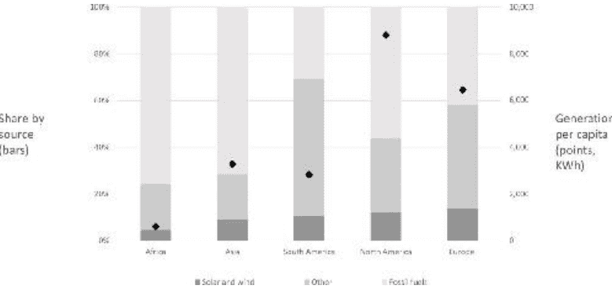

**图 1.5** 人均发电量及不同来源占比，选定地区，2021年

来源：Our World in Data

在另一个极端，非洲和亚洲在电力方面仍然严重依赖化石燃料。它们的人均发电也处于较低水平（某些情况下非常低），这表明未来电力输出的增长可能不成比例地集中在这些地区。事实上，国际能源署（IEA）的“净零排放”（NZE）情景认为，到 2050 年全球电力需求增长的约四之三将发生在所谓的“新兴市场和发展中经济体”中。⁵¹

在合理的时间范围内实现发电脱碳所需的投资速度和规模，对于已经具有一定基础且需求相对平稳的国家来说，似乎是极其困难的。例如，最近于 2023 年初更新的德国转型计划，要求每天安装相当于 43 个足球场面积的太阳能板，以及每周新建 31 个风电场（包括海上风电）。⁵² 诚然，德国的电力需求在增长，但并不迅速：预计 2030 年将比 2022 年高约三分之一。⁵³

然而，这种投资挑战与其它地区面临的挑战相比完全不值一提。以非洲为例。如今在约 14 亿人口中，仍有近一半的人无法用电。⁵⁴

非洲政府广泛致力于实现用电普及，并将消费提高到接近平均水平。据信，非洲大陆承载了全球约 40% 的可再生能源潜力，这对环保主义者来说是某种安慰。⁵⁵ 尼日利亚电力部门的长期愿景——例如该国副总统叶米·奥辛博（Yemi Osinbo）在 2022 年概述的内容——清晰地揭示了它及其他非洲国家设想的转型将是多么巨大。奥辛博在一篇不仅面向尼日利亚读者、也面向全球北方读者的文章中说：“我们的目标应该是使人均平均发电量至少达到 1,000 千瓦，结合人口增长，意味着到 2050 年，我们的发电量将比现在多 15 倍。”⁵⁶

或者，在亚洲背景下，简要考虑印度的情况，考虑到其电力需求增长的速度以及未来将增长的速度，可以考虑到仅在 2018 年，印度估计就有 1 亿人首次用上了家庭电力。⁵⁷ 评论人士在谈到电力和气候时经常将印度和中国并提，但在消费方面，它们是截然两个极端：印度的人均发电量仍仅为中国的分之一左右。保守预测认为，到 2040 年，印度的总发电机容量将增加四倍。⁸ 如果这些巨大的新容量仍然像该国现有电力基础设施那样是碳密集型的，那将是一场灾难。

## VII

随着气候危机的加剧，随着专家和政策制定者日益关注能源生产和消费这一气候问题的核心，听到“能源转型”的说法已变得越来越普遍。但并不存在一个全球性的能源转型，即使是在发电这样一个单一部门内也是如此。如果不同世界地区及其内部不同国家的电力部门以不同的供应组合、不同的需求模式和预期为特征，那么显然，正在发生和将要发生的是系列地理上的局部转型——诚然，它们以各种方式相互联系，但每一个都是独一无二的。

当然，政治——尤其是像尼日利亚的叶米·奥辛博这样的领导人的梦想和决策——将深刻地塑造这些局部转型，并最终塑造它们构成的丰富多样的全球转型。经济也是如此。太阳能和风能发电场正建立在世界不同地区的现有发电和输电格局中，其通常具有显著不同的制度和商业安排、激励机制和可能性。我们现在转向这些特定的、变化的安排、激励机制和可能性——也就是说，异化的电力业务。

# 2 电力业务

在史蒂芬·加斯（Stephen Gaskin）和朋友离开旧金山寻找一个建立他们乌托邦式太阳能社区的替代地点年后，加利福尼亚已成为对开发太阳能感兴趣的人和机构更常向往的地方。到 2021 年底，金州拥有 35 GW 的太阳能发电容量——全美最高。¹ 截至目前，太阳能已提供该州约四分之一的电力，或足以为 200 万家庭供电。据报道，已有 90 多公司活跃于太阳能的开发和运营。其中之一是 Clearway Energy——讽的是，它的总部位于旧金山。在本文写作时，Clearway 在全美拥有并运营的设施总容量为 8 GW，其中 5 GW 代表风能和太阳能。开发、拥有和运营电力设施是 Clearway 的业务。在该州最近的项目之一是所谓的 Red Bluff（雷布夫）。该项目于 2021 年 12 月获得土地管理局批准（项目将在公有土地上建设），预计耗资 7 亿美元，产生的电力可供应 13 万家庭。在与 Clearway 签署购电合同的公司中，食品饮料公司百事（PepsiCo）在内。“采购再生能源是我们迈向净零之旅的关键部分，”他说。²

当任何新技术出现并证明在经济上可行时，其所融入的商业世界总会以某种程度发生变化。这对于 VHS 视频还是宽带互联网，对于个人电脑还是加密货币都是如此。这对于泛指的能源供应技术特别是电力生产，从法拉第装置到氢燃料电池，从煤电发电厂到太阳能场，也是如此。新技术不仅在技术上，在经济上也颠覆了既有的办事方式。我们将在书中看到许多关于这方面的证据：太阳能和风能发电正在重塑本章所说的“电力业务”。

然而，现实仍然是，在很大程度上，太阳能和风能发电及其开发者必须遵循现有的电力业务。如果旧与新、现有与侵入之间的关系是“辩证”的（事实确实如此），那么一个方向的影响远大于另一个方向。

这些特征无处不在，或者并非总是完全适用：有时只有，比如，其中的两三项适用，而且只是部分适用；有时则完全不适用。但这些特征——更重要的是，它们的结合——正日益成为一种常态。

这四个特征可以简单地概括。第一是**制度性专业化**——具体而言，将发电与构成电力行业的其他活动（如输电）分离开来。在这一可分离模式适用的地方，更广泛的电力行业中的机构参与者通常只专注于某一项活动。例如，发电（开发和运营资产）正是 Clearway 所从事的——而且是专门从事此项。

第二个关键特征是**私有制**，也就是说由私营的、追求利润的企业主体对发电活动进行控制——同样，像 Clearway 这样的公司。

第三个特征是**发电竞争**。发电由多个参与者进行，他们竞争销售自己生产的电力。正如我们所看到的，在加利福尼亚，除了 Clearway 之外，还有数百太阳能生产者，更不用说其他类型发电设施的所有者，无论是化石燃料驱动还是“清洁”的。

第四个也是最后一个关键特征是**市场**。因此，是由各种市场而非政府或行业监管机构来确立行业贸易的规则。当然，无论什么种行业，资本主义市场往往都是政府亲手塑造的，这在电力领域无疑如此。事实上，很难想象哪一个行业被国家和监管设计深度结构化和塑造的领域：电力市场在很大程度上是政府的产物。正如美国联邦电力监管委员会（FERC）委员马克·克里蒂（Mark Christie）最近所言，我们今天在全球范围内日益看到的先进电力“市场”，“尽管冠有其名，但它们从未是真正的市场，而是具有某些市场特征的行政性产物。”

尽管如此，重点在于，日益成为事实的是，在影响电力的生产和分配、由谁生产以及以何种价格生产的范围内，政府的影响是间接且遥远的——即，通过建立“自由”的电力“市场”，在这些市场中，他们努力不在危机时期等特殊情况下进行干预（见第 10 章）。至少的前提是，卖方应该能够根据自己选择的条款进行交易，无论是彼此之间直接交易，还是通过组织的市场交易所间接交易，而且对发电能力的投资应受基于市场的价格信号引导。这再次是 Clearway 在现代加利福尼亚运营的背景。

那么，这些就是电力发电商业环境的四个关键特征，它正日益代表全球常态。然而，当斯蒂芬·加斯金（Stephen Gaskin）离开加利福尼亚十年后，该州享受了其——乃至全球首个真正的非水电可再生能源热潮时，情况看起来完全不同。那时，涉及的技术既不是太阳能也不是风能。在 20 世纪 80 年代初，约有 20 亿美元被投入在该州安装超过 10,000 台涡轮机，该地区的总容量达到 1 GW，这在当时代表了全美乃至全球装机风电容量的大部分。

那时，上述所有当今电力发电业务的关键特征都没有实质性地适用——在加利福尼亚不是如此，通常在其他地方也是如此。发电发生的商业背景通常看起来非常、非常不同。迈克尔·戴维森（Michael Davidson）及其同事观察到，“在某些国家”，电力部门由“大型电力公司”主导，而这些公司是“垂直整合”的，意味着它们“在同一屋檐下拥有并控制了所有[行业活动]”。换句话说，发电并没有分离。通常，这些公司是私营的。戴维森和他的合著者继续道，“政府通常选择公有制和运营。”此外，这些垂直整合的公司不需要竞争：它们通常享有学者们（包括戴维森在内）所说的“自然垄断”，无论是在国家尺度还是地方尺度上。最后但同样重要的是，市场的作用非常有限，如果有的话。涉及的实体被指示在何处以及如何投资，并被要求“以基于成本的价格为所有客户服务，以换取投资资本的保证收益率，这种模型被称为‘成本服务模式’。”

那么，发生了什么？戴维森及其同事描述的 20 世纪 80 年代历史常态，是如何以及变成上述描述的、以加利福尼亚和 Clearway 为例的截然不同的当代常态的解释发生了什么是本章的目标。我们将以不免是宽泛的概括性笔触，重演过去四十年中席卷全球电力行业的各种关键重组形式。我们这样做并不是出于枯燥的历史兴趣，而是因为这些动荡仍在持续，而且因为理解太阳能和风能的经济学以及可再生技术进一步进入发电格局的前景，要求我们了解更广泛的电力业务是如何变化以及并将继续变化的。

我们所采取的方法是依次考虑上述确定的四个组织维度的发展。因此，我们首先考察国家电力部门的去拆分——即发电和其他核心活动日益相互分离的趋势，以及使戴维森及其合著者所说的“垂直整合”实体随之发生去整合的过程。随后是对日益增长的垄断化、私有化和市场化的讨论。正如后续章节将明确的那样，这四个趋势中的每一个在塑造正在进行的太阳能和风能推广的形式、速度和模式方面都被证明是极其重要的。

当然，这四个过程在现实中紧密结合在一起。如果不关注去拆分、私有化和市场化的并行且相关的过程，就不可能理解，例如电力部门竞争的增加；事实上，后三者在很大程度上正是为了促进前者而追求的。但电力业务在最好的时候也是极其复杂且难以理解。后续的目标是阐明并简化（尽管不是浅化），为了这一点，分析性的梳理是必要的。

在继续之前，简要说明一下塑造近期过程的力量。虽然发生的大程度上是针对电力部门的，但该部门重塑显然是更广泛、更深政治经济重塑的一部分。竞争、私有化和市场化：毕竟，这些都是我们熟悉的新自由主义的口号。

在 20 世纪 90 年代，这些机构是如此热衷，而且它们对自身意图的表达也是如此直率。但这一点不应被忘记。或许为我们集体记忆提供最佳记录的是世界银行 1993 年的一份政策文件，该文件概述了其对自身电力部门角色的理解。文中确立了世界银行行动的五项“指导原则”——本质上是世界银行贷款的五项先决条件。第三条尤为明确且强有力。该文件承诺，“本行将积极推动发展中国家电力部门的商业化、公司化，以及私营部门的参与。” 简而言之，这就是未来趋势的蓝图。

## 电力行业的核心功能与地理挑战

电力行业为家庭、企业和其他用户生产并销售电力：这是其存在的意义。在大多数国家，存在一套极其复杂的商业安排来履行这一看似简单的功能，其中一个可以说是关键的原因——也是我们开始切入点——是地理位置因素。电力在一个地方产生，但在其他数量得多的地方被消耗。以美国为例，截至 2015 年，全美分布着约 7000 座发电厂，产生的电力完全由约 1.6 亿名不同的客户消耗。如何将电力从前者输送到后者，以及如何在实际需要的时间和量上完成这一过程？

从严格的技术角度来说，这个问题的答案是：使用电网，这是一种用于输送电能的互联网络。通过电网输电通常分为两个“阶段”或两个“层次”。首先，输电网将电力从发电地输送至变电站，变电站通常战略性地位于需求密集区附近。这种输电在高电压下进行的（以实现效率最大化），通常跨越很长的距离；如果将电网比作一个国家的道路系统，那么输电线路就代表了高速公路。但大多数客户无法安全地接收如此高电压的电力。因此，变电站降低（“降压”）电压并通过配电网将电力传输给终端用户——即系统的动脉道路。

不言而喻，从整体而言，电网是一个复杂的巨兽，需要持续、细心的监督和维护。亚历山德拉·克拉斯（Alexandra Klass）写道：

> 管理电网的可靠性和安全性是一项艰巨的任务。目前，电力的存储方案有限，这意味着电网在每一时刻都必须有足够但不过多的电力流动，并保持适当的电压，以便根据需求调度给客户。如果不能满足这些条件，就会发生停电或故障，电网也就无法发挥提供安全可靠电力的功能。

在上述的美国案例中，7000 座发电厂和约 1.6 亿客户通过约 100 万公里的输电线路连接在一起——形成了三个主要的区域电网（它们之间的互联性极低），以及 1000 万公里的低压配电线。

正如前所述，在 20 世纪后半叶中期，通常情况下，将电力输送到客户的所有环节都整合在同一个机构下。换句话说，一个单一的“垂直整合”实体控制了从发电到配电的整个供应链，并向客户收取足够的费用以涵盖涉及的所有各种成本。


但这种过去并非一直如此。事实上，在最初的几十年里，大多数国家的电力行业呈现出一种惊人的碎片化、“零散”状态，不仅在组织形式上如此，在空间上也是如此。它通常是由许多很大程度上独立的局部系统拼凑而成的，只有随着时间的推移，才在技术上（主要通过中央协调的远距离输电网络机制）和商业上逐渐、逐步地实现了整合。

首批高度局部化的系统于19世纪80年代和90年代出现在欧洲和美国。有时，主角是私营公司。例如，工业企业最初为了照明和驱动电机而建造电厂。另一些则是市政当局，对于他们来说，街道照明是关键的动力因素。随着这一新兴“行业”的发展，私营电力公司倾向于将精力集中在

无论公私比例如何，大多数国家的电力行业直到上世纪中叶一直保持着明显的碎片化。例如，在第二次世界大战结束时，英国仍有570多个实体（公共和私营）活跃于电力的发电和配电，而法国的数字更多——发电端至少200家，配电端有1150家。

然而，尽管单一垂直整合企业内部电力供应链的聚合和整合并非行业早期历史的特征，但这日益成为发生的事实，且这一过程往往（但并非总是）由国家主导并立法。这其中有许多原因，我们在此不必详述细节。本质上，随着行业在20世纪上半叶的成熟，日益达成的一种共识是：持续的碎片化是以供应的安全和效率为代价的。正如一位英国电力行业的长期参与者后来评价道，战前时行业深受“异质性”的困扰，其中包括“电压、系统、安全与可靠性标准以及价格”。如果系统是从零开始创建的，这显然不是它的设计方式。简而言之，需要的是一个或多个更大、更标准化且更高效的实体。

事实上，电力行业随后的整合和垂直整合在不同领土上以不同的地理规模和程度发生。以我们在前几个段落中提到的三个电力部门处于新兴阶段的国家为例：法国、英国和美国。

在法国和英国，垂直整合发生在国家层面，且特别是在公有制下。在前者，这种整合被证明几乎是完全的。根据1946年引入的法律，活跃于整个供应链的电力企业（少数局部配电公司外）都整合到了一个新的国有实体——法国电力公司（EDF）。同时，发电和输电的整合在英国也同样全面，1947年的《电力法案》建立了中央发电委员会（CEGB），拥有整个英格兰和威尔士这两项活动的垄断权。十五 英格兰和威尔士在局部配电方面与法国有本质不同，那里免于垂直整合（但未免于国有化）。1947年的法案建立了十二个公有的区域电力委员会，它们从CEGB购买电力并销售给当地客户。

在美国，垂直整合通常涵盖整个供应链（类似于法国），但它很大程度上是一个地方性现象。有数百个垂直整合运营商，大部分被称为“公用事业”，它们在指定的地理区域内拥有发电、输电和配电资产的垄断。如有需要，它们可以相互（州内或跨州）购买电力以及移动电力所需的输电服务。最大的公司是私有的，但也有大量的小型市政或社区企业。私有实体在州公共委员会的监督下运行，委员会监管投资和价格，允许公司回收运营成本并获得投资回报。以一个说明性的例子来说，佛罗里达在上述所有方面都很有代表性。直到20世纪80年代后期，五家私营垂直整合公司（Florida Power & Light、Florida Power、Florida Public Utilities Company、Tampa Electric）控制了约四分之一的市场；五十家市政公用事业和农村合作社作为其补充。

这种垂直整合模式在20世纪中叶大多数相对成熟的电力市场成型，直到该世纪晚期一直是行业结构的主导模式。一般直到20世纪90年代，在许多地方甚至更晚，才出现了实质性重组国家电力的重大举措。

各行业开始逐渐发力。当这种情况发生时，拆分——即从供应链的不同部分在商业上进行相互分离——几乎总是更广泛的重组过程中不可或缺的一部分。

再次，拆分的具体程度和方式在不同地区存在巨大差异，这就像垂直整合本身的模式和程度在最初也存在巨大差异一样。值得注意的是，解体往往催生了不是三项而是四项独立的商业活动。除了专门从事发电、输电和配电的企业外，完全拆分的电力部门（英国的电力部门就是一个典型的例子）还包括了零售商，这些企业通常被称为“供应商”。这些实体并不参与电力的物理输送。相反，它们在在端是终端客户、另一端是参与发电和输电的各种实体之间进行纯粹的财务中介。就像杂货零售商一样，他们对产品（此处为电力）支付一个价格，并收取另一个价格。从本质上，它们是风险管理者。

关于拆分格局，有几点特别重要的观察；每一点对本书稍后展开的论点都至关重要。首先，在在本章讨论的所有趋势中——拆分、去垄断、私有化和市场化——拆分的进展可能最充分，且涵盖地区最广。即使是那些其他三个维度上变化不大的国家，通常也对其电力部门进行了实质性的垂直拆分。中国可能是这方面最好（最有意义）的例子。

其次，在电力供应链的所有不同阶段或要素中，发电环节的拆分最为实质且广泛。换句话说，即使输电、配电和零售中的两个或更多部分仍保持很大程度的整合，发电通常已实质性分离。例如在印度，地区配电公司（DISCO）仍然合并并控制所有的配电和零售，而在20世纪90年代改革之后，发电资产已独立所有和运营。中国的情况也大如此。在那里，2015年最新一轮改革后确实出现了独立的零售商，但它们数量仍然稀少，且在本质上无关紧要。相比之下，20世纪80年代以及世纪末交替前后的两次重大重组成功地剥离出一个很大程度上独立的发电部门，该部门目前由“五大”发电商主导——即华能集团、华电集团、中国能源、国家电力投资集团和大唐集团。正如后续章节将证明的那样，在能源转型和可再生技术的背景下，这种全球范围内广泛的拆分发电趋势的重要性无论如何强调都不为过。

最后，对我们的目的而言同样至关重要的是，拆分对于某些类型的发电容量往往比其他类型更为明显，而太阳能和风能发电容量通常是所有容量中拆分最彻底（即最可能被独立拥有）的。这是情合理的。在那些从先垂直整合的电力部门拆分发电尚不完全的国家，那些与供应链其余部分重新整合的发电容量，往往不成比例地是那些一直处于整合状态的部分——即传统的化石燃料资产。

以美国的情况为例，它是一个典范。在那里，发电容量的拆分程度在不同州之间差异很大（事实上，行业重组的程度也是如此）。在国家总体层面，独立（非整合型）发电厂（IPP）的发电量份额从1997年的不足2%增加到2020年的42%。但由这些独立实体控制的、特别是非水力可再生能源的份额要高得多，在2020年达到了80%。而且，无论赞同还是反对某一方，美国的情况也适用于其他地方。基于风能和太阳能的发电在很大程度上是一种独立的、单一的业务。

然而到目前为止，至少在过了一些更广泛相关的初步言论之后，我们必须问一个可能最有趣的问题。为什么？也就是说，为什么全球从20世纪90年代开始对通常是垂直整合的电力部门进行拆分？为什么他们今天继续这样做？为什么发电活动是这些努力的特别重点？为了提供答案，我们需要将拆分与竞争问题联系起来。

## III

在战后时期，人们长期认为，即使竞争是理想的（尽管许多人认为并非如此），在电力部门竞争也简单是不可能的。该部门的特征是（垂直整合的）垄断，因为垄断在实质上是其固有的属性。这种垄断用经济学家的的话说是“自然”的，意味着它是满足市场需求成本最低——因此最高效的解决方案。理解这种观点并不困难，自然垄断的条件确实适用于电力领域，至少在供应链的某些部分。例如，为什么需要两条或多条远距离输电线路网络，而技术上一个就足够了？

然而，从20世纪80年代开始，这种长期以来的观点日益受到改革经济学家和私营部门参与者的挑战。他们认为，竞争是可能的。不仅如此，他们说，那个时期影响富裕和贫穷国家电力部门的许多问题——电网投资不足、停电、高消费价格——都归因于竞争的缺失。竞争并非什么灵丹妙药，但正如所主的，它是治疗这个病态患者最重要的药物，并使该部门的运行（使用受青睐的词）变得更“高效”。

但有一个陷阱，或者说前提。竞争的拥护者强调，竞争仅在链的某些部分是可行且实行的，而不是全部。正因为如此，拆分才被认为是必要的。这一论点有两个组成。

论点的第一部分认为，如果一个业务与另一个业务捆绑，就不能指望在一个领域进行有效竞争。第二，人们指出，如果政府在不拆分的情况下引发竞争，显然会产生利益冲突。例如，如果发电厂还拥有配电资产，发电竞争可能会受到损害。简而言之，认为对供应链进行拆分是必要的，其中涉及的部分是电力传输要素。由于具有“自然”垄断性，电力传输活动——远距离输电和短距离配电预计将保持垄断业务（这个问题我们稍后讨论）。但改革倡导者认为，该部门的其他部分可以且在必要时去垄断：零售和发电。

自20世纪80年代以来，开放电力零售接受实质性竞争的进展在最好也是参差不齐。一些国家取得了一定程度的成功。尽管如此，这类国家仍然很少，而且重点应放在“程度”一词上。在某种程度上实现了竞争的国家大多位于欧洲。在这里，研究通常表明零售竞争最高水平存在于德国、英国和北欧国家。

英国的情况很好地说明了为什么对竞争增加的庆祝往往是有限的：五个剩余的传统（原有垄断）供应商——英国燃气、E.ON、OVO、EDF和英国电力的市场份额到2021年底仍高达70%，供应商之间的合并加剧了这种行业集中。在欧洲之外，行业人士通常确定另外两个国家在电力电力零售方面取得了真正的成功：新西兰和美国。在后者那里，成功被严格限于地区。美国三十多个州（尽管人口较少）仍然没有零售电力选择。美国最具竞争力的零售市场是在德克萨斯州，那里有100多家不同的电力零售商。

在世界其他地方，电力零售竞争要么微乎其微要么不存在，对客户的供应继续由物理配电的垄断提供者控制。在某些情况下，这是因为零售在法律上仍与配电捆在一起，要么

```
完全开放——在这种情况下，电力“零售”这一概念本身实际上毫无意义——或者对于大多数客户而言是如此。后者的例子包括阿根廷和印度。在这两个国家，用电量低于规定负荷的客户（包括所有普通家庭以及较小规模的工工业消费者）别无从当地配电公司购买电力。相比之下，较大的“开放接入”消费者有选择直接与发电厂连接，尽管在实践中，很少有公司真的这样做了。
```

在其他情况下，限制零售竞争的并非法律规定。在某些国家，零售选择的法律规定已经存在了很长时间，但竞争仍然微乎其微。总的来说，实际竞争的程度取决于潜在零售商进入该行业的难易程度，以及电力消费者更换供应商的意愿。当在准入、切换或两者方面存在实质性障碍时，结果往往是产生惯性，而消费者的参与——或者说缺乏参与——被证明是某种特定的阻碍。Rahmatallah Poudine 曾指出，电力市场的建立基于“假设消费者在零售电力市场中的行为与他们在其他供应市场上表现一致”，而现实是，消费者受到“零售市场和电价的复杂性、交易成本、对新供应商服务质量的不确定性、感知障碍以及行为偏差”等因素的阻碍，从而不敢切换。

与此同时，国际上开放发电竞争的进展要实质性得多。更多国家拥有具有竞争性的发电部门，且实际竞争水平更高。在一些发电领域已实质性去垄断的国家，情况与上述在积极零售竞争方面提到的国家相似。例如，英国拥有高度竞争的发电格局。以发电为主要目的的英国公司（被称为“主要发电厂”，MPPs）数量从 1989 年的仅 6 家增加到 2021 年的 55 家。随着新发电厂进入市场，持有总发电容量超过 5% 的公司数量稳步增长，在 2008 年达到 9 家；与此同时，这些领先者的平均市场份额有所下降：市场前九名公司控制的发电容量份额从 2012 年的 82% 下降到 2021 年的 68%。美国也见到了发电竞争的快速增长，尽管与零售领域一样，这仅限于某些地理市场：如果独立发电厂（IPPs）的发电总量份额在康涅狄格州和伊利诺伊州等州超过 95%，在佛罗里达州和肯塔基州等地仍低于 5%。

更重要的是，在许多零售竞争仍然微乎或为零的国家，发电去垄断也取得了相对成功。这包括从阿根廷到中国的范围。在前者，历史上由三家主要的垂直一体化公用企业控制的电力部门从 20 世纪 90 年代初开始重组；正如看到的，零售仍然受物理传输的垄断控制，但发电并非如此：到 2000 年，就有 43 家发电公司拥有 96 家电厂。在中国，发电去垄断是整个电力行业重组的首要重要方向，这是由20 世纪 80 年代初期严重的能源短缺所引发的，并且从一开始就包含了国内外企业的投资。自此后，发电竞争一直是中国电力部门政策的焦点。

发电领域的竞争比零售领域发展得更充分、更广泛，这很容易解释。正如我们之前提到的，电力竞争本质上需要“拆分”，而且正如我们所指出的，在整个供应链中，拆分现象最为明显。此外，政策制定者在消除发电领域新准入者障碍方面付出的努力，通常比消除新零售准入者障碍更为一致。这些努力主要分为两个方面：第一，控制输配网的公司被广泛要求以非歧视性条件承载独立（有时是竞争对手）发电厂产生的电力。例如，1992 年的《能源政策法》赋予了美国联邦监管委员会对网络所有者实施此类条款的权力。其次，政策制定者扩大了发电厂销售产品的市场范围，同时通常也增强了他们此此设施。我们将在章节最后一部分关于市场化的讨论中详细介绍这一点。

尽管如此，尽管发电领域出现了明显的国际扩张，但存在某些反向趋势，且值得关注。其中三个可能最为重要。一个与上述关于物理电力传输网络接入的问题有关。即使在接入本应是非歧视性的，据报道称，网络运营商有时仍会找到方法歧视某些独立发电厂。这在本书背景下的特殊重要性在于，往往是可再生能源厂遭受了不成比例的歧视。在几个国家，控制电网的实体在许多情况下也拥有自己的化石燃料利益，并一贯为可再生能源厂的平等接入设置障碍，从而限制了这些发电厂所提供的竞争范围。美国是其中一个国家。南非也是如此。

第二个反向趋势在所有理论上也实行自由竞争的行业部门中都能被看到。正如马克思曾著名的言辟所观察到的那样，竞争产生垄断。他的意思是，正是通过相互竞争并压低价格和利润，资本主义企业产生了相互合并并建立市场力量的最强动力。因此，在其他“去垄断”的电力部门中，随着利润被挤压，见证了发电公司之间实质性的整合。例如，在阿根廷，目前的（撰笔时）发电公司比几十年前要少。在中国，领先的国家性企业（即上述的“五大”以及四家较小的发电公司）很大程度上是通过 2000 年代中期开始的整合过程出现的。

最后，在某些地方，政策制定者长期辞辞上致力于发电去垄断，但在现实中，刺激竞争的努力被证明力不从心。从法国到印度、南非和瑞典，现有的发电厂（即改革前的企业）继续保持着相对主导的地位。在南非，电力公司继续控制着 90% 以上的发电。在法国，电力公司自产了国内发电量的四分之三（2021 年占 549 TWh 中的 418 TWh）。在瑞典，电力电力公司的整体发电份额仍占一半（2021 年占 171 TWh 中的 79 TWh）。

### 私有化

谈论私有化是假设某些事物首先是公有过的，因此，第一要说的是，在电力方面，并非在任何地方都是如此。正如我们在本章早些讨论过的，在 20 世纪的几十年里，面对破碎且陈旧的基础设施，范围内范围内向公有制垂直一体化的运动。法国和英国在20世纪40年代实施了这种模式，堪称典范。但另一些国家开辟了属于自己的、截然不同的道路。例如，美国拒绝了国有化。在过去的一个世纪里，跨越整个供应链，除了我们已经遇到的少数孤立地区例外外，美国的电力资产始终主要由私有所有为主。

然而，在其他地方，当20世纪80年代重组的呼声开始获得政治支持时，大多数情况是电力在很大程度上是一套公有制的运营集合。事实上，在许多国家（尽管并非所有国家），在很大程度上，正是因为电力处于公有制，才被认为是必要的；因此，私有化通常是重组方案的核心支柱。这非常是新自由主义教条的体现：改革支持者坚信，国家拥有的越少越好、越恰当，其前提是追求利润最大化的私营企业总是更精简、更具竞争力、更高效，并能为消费者带来更好的结果。无论是电力、水务还是电话并不重要。

当然，这是纯粹的行业意识形态：并没有令人信服的证据表明私营企业在本质上比其国有对手更高效；而且，通常来说，支持私有化的论点方便地回避了私营企业在实践中是否与消费者共享任何效率收益，还是它们仅仅将其据为己有的问题。

尽管如此，这是一种有影响且有效的意识形态。新自由主义教条占据主导地位，全球范围内的电力资产日益转移给私有公司所有。

在某些情况下，即使是物理交付的基础设施（即输电和配电网络）也是如此，尽管人们明确承认供应链的这些部分是不可能竞争的。论点认为，仅仅因为一家企业具有垄断性，为什么要剥夺消费者私营部门效率的优势呢？网络私有化的倡导者坚持，通过专家监督机构的良好监管可以有效地“替代”竞争，确保私有垄断企业保持价格合理并继续进行的基础的基础投资。被这种逻辑说服，从阿根廷到英国等国家的政府对输电和配电资产进行了全面私有化。

但这往往以失败告终。与国家主导的电力部门拆分或去垄断化倡议相比，私有化倡议频繁被反转，这在交付基础设施的私有化中尤为常见。Vivien Foster及其同事识别了数十起重新国有化的案例，主要在配电领域，并例如由“与私营运营商的纠纷，或某种影响私营运营商财务平衡的冲击，或政府更迭”引发。他们的研究重点是全球南方——大多数反转发生在拉丁美洲、南亚和撒哈拉以南非洲——但全球北方也没有幸免。例如，英国在20世纪90年代完全私有了其电网的所有权和运营，作为长期以来私有化的标杆，在2022年宣布将把国家输电系统的运营重新国有化。

但在大多数情况下，私有化像拆分和去垄断化一样，主要涉及发电基础设施，而非交付基础设施。今天，发电领域私营部门参与的国家比例远高于短距离配电，且远、远远高于长距离输电。即使在发电领域，重新国有化的案例也较少。相反，我们看到的是在三十多年里，发电资产从公有向私有发生了持续且看似不可逆转的转移。私有化程度最充分的时期是20世纪90年代，到千年之交，OECD和G20国家私有拥有的发电容量比例平均已达到48%。到2014年，这些国家私有拥有的平均份额已增加到55%。

发电也是全球南方电力部门私有化的主要场所。当世界银行和国际货币基金组织在20世纪90年代试图增加债务国家电力行业中私营部门的参与度时，他们发现发电是最容易攻克的。东道国政府被说服放弃发电资产的所有权，私营资本——尤其是西方私营资本——可以被说服投资此类资产，特别是当通常情况下，投资受到国有公用事业公司慷慨长期购电合同的保护时。即使在今天，来自世界银行等机构的私有化压力已经减轻，仍有非西方国家继续张开双臂欢迎外资进入发电领域，越南就是一个典型的例子。相比之下，在输电和配电的私有化方面，世界银行及其伙伴从未取得过那成功：政府更不愿放弃控制权，而资本同样由于政治风险，也更不愿投资。


如果说自20世纪80年代以来全球发电资产的私有化日益增加，那么对于我们本书的目的来说，通过两种方式汇总总体趋势至关重要。第一是地理上的：虽然总体趋势确实是发电资产私有所有化程度不断提高，但国家之间仍存在巨大差异。一个极端是一群国家，其中80%或以上的发电容量现在由私有持有，包括我们之前讨论过的几个国家（如阿根廷、新西兰、英国和美国），以及几个我们未讨论过的国家（如智利、日本、葡萄牙和西班牙）。⁴¹ 然而，另一个极端是另一群国家，其发电容量的私有比例低于30%，从克罗地亚到以色列，从印度尼西亚到墨西哥。

正如之前提到的，私营部门参与程度较低的国家往往是发电企业之间竞争水平较低的国家，政府有效地保护着其专有资产。法国是这种的例子之一。南非也是另一个：国家拥有的公用事业公司Eskom实质上控制着整个电力供应链。

其次，正如我们之前看到的，太阳能和风能发电在商业上比化石燃料发电更容易与其拆分，前者也以较高水平的私有所有为特征。再次，这在直觉上是合理的：国有企业通常是发电领域的传统参与者，因此不成比例地拥有传统资产（即化石燃料资产）；而与此同时，风能和太阳能投资的大部分发生在过去二十年发电私有化日益成为常态的时期。

关于不同类型发电资产的公私所有权的差异数据确实惊人。⁴² 在国际能源署所谓的“发展中”经济体中，59%的化石燃料资产为公有，而可再生能源资产仅为28%。在“发达”经济体中，公有化石燃料发电资产比例为21%。其可再生能源资产的份额呢？仅为区量的4%。在全球南方特别是全球北方，我们正在逐渐过渡的绿色能源世界，目前主要是是私有拥有的。其重要性无论在经济上还是政治上都无法被低估：只要私营部门受利润驱动，盈利能力——就完全主导了可再生能源的可能性和表现。

经济行为者的反应是理性的，而非通过政府的命令或其他形式的集权权威。据说，这只有在自由和自愿交易的背景下——即在自由市场的背景下——才是可能的。

因此，在过去几十年的新自由主义氛围中，电力部门重组的第四个也是最后一个基本向量——而且当然，除此之外还有许多方面——是市场化：将各种形式的部门交易转变为市场参与者之间理论上不受限制的交易。

然而，我们立即面临着一个看似矛盾的现象。因为，虽然该行业的发展方向确实普遍强烈地远离国家直接干预并转向市场，但这一规则的要例外正是本书所关注的主题：太阳能和风能。从一开始开始，政府对市场和定价的“干预”（正如新自由主义者所看到的）就已经编织进了太阳能和风能的结构之中。直到今天依然如此。事实上，本书的观点是，事实必须如此：市场无法、也不会独立完成任务，而这项任务无疑是快速且全面的电力去碳。市场以及那备受推崇的价格机制正在失灵。在接下来的几段中，我们不会对再生能源做太多论述，但读者应当记住本书的论点：恰恰在我们现在讨论的市场化过程中，蕴含着实现去碳化的主要经济障碍的种子。

无论如何，首先要说明的是，市场化并不意味着私有化：国有企业可以并且在经济市场中广泛运营；市场化并不要求竞争：市场可以、而且经常被垄断。尽管如此，对市场能够产生高效且高产出结果的信者通常认为，没有竞争的市场从根本上说是贫乏的：如果它们要“运作”，市场就需要竞争；这也许是它们最有力的要素。而电力市场化显然明确需要的，同时是解耦（`unbundling`）。毕竟，如果电力供应从头到尾由单一的垂直整合运营商控制，那么根据定义，市场——即多个参与者之间的交易——是不可能的。

由此引出了两个重要点。首先，在电力部门没有进行解耦的地方，市场化就没有发生。例如美国东南部等地区，其大部分地区的垂直整合公用事业公司继续享有私人垄断。除了这些公用事业公司从第三方发电厂采购的少量电力外，价格并不是由市场设定的。特别是电力用户支付的金额受到严格监管，由州级公用事业委员会根据运营成本进行设定。

其次，在（读者会记得）在发电端解耦进展得更远的情况下，越接近电力供应链的发电端，市场化通常发生得越充分。这至关重要。为了直观地说明这一点，请看图 2.1。在市场化发生的地方，电力部门的市场化产生了两种主要的市场：批发市场，发电厂在其中向各种供应商（本质上是转售商）出售电力；以及零售市场，这些供应商（转售商）出售这些电力。大多数电力部门的市场化发生在批发领域。强调这一点的原因是，在一个如今已很大程度上实现解耦的发电部门中，批发市场作为电力输出主要交易场所的殖和深化，是本书更广阔故事的核心。

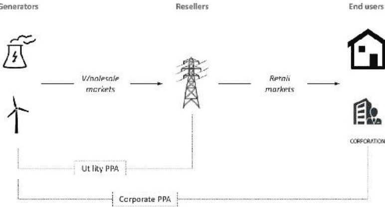

图 2.1 电力市场

来源：作者

在零售领域，市场化较为局限。在全球范围内，为电力用户提供供应商（及价格）选择的“真实”零售市场仍然相对稀少。此外，现实情况是，即使在拥有“自由”电力零售市场的国家，即使在 2021-2022 年能源危机引发对普通消费者电力负担能力的广泛担忧并促使政府采取行动之前，这种自上而下的价格控制元素一直出意料地普遍——包括在我们认为最“市场化”的电力部门中。事实上，欧洲很大程度上是零售电力市场的家园，例如，截至 2020 年，一半的欧盟成员国在零售价格方面仍存在某种形式的国家干预.³ 这种干预部分适用于非家庭用户，但更常见的是涵盖家庭支付的资费。在后的情况下，监管要么是全覆盖的——例如以通用的价格上限的形式——要么是针对特定的“脆弱”能源消费者群体。

批发领域的价格干预也相当常见。如今，去监管的电力批发市场非常广泛、规模庞大、非常重要、种类多样且极其复杂。这里并不是对这些具有各种变化和复杂性的市场提供详细分析的地方。与书中后后开发的论点相关的细节将在需要时进行讨论。但这里有几个基本特征值得在此强调和突出。

首先，这些市场中销售的是什么？显而易见的答案是以千瓦-兆瓦时为单位的“电力”，但情况并非那么简单。最实质的问题涉及交易的电力何时交付。可以交易未来几周或几个月供应的电力，通过远期或期货合约。但批发市场远最重要的部分是“现货”市场。在金融市场中，现货市场是即时交付资产的市场。但在电力领域，情况并非如此。相反，次日交付的电力在现货市场上进行交易，通常以小时或半小时为单位。预期供需决定了市场清算价格。例如从凌晨 4 点开始的小小时。电力现货市场的价格以波动大著称，正如我们将看到的，这具有巨大的影响。当然，这种市场设计对太阳能和风能发电厂构成了特殊的困难，他们只能提前三十六小时预测可能的供应。因此，需要一个或多个机制，在结算当日对预报价（并由现货市场清算）的电力、实际交付的电力以及当时的电力需求进行协调。主要机制是日内或“实时”市场，由于明显原因通常被称为“平衡”市场或“调节”市场。

其次，批发市场在什么地理尺度上运行？答案是：一系列地理尺度。有些市场局限于国家范围。另一些是次国家级的：例如美国的大区域性批发市场，如大西洋中部（`PJM West`）和新英格兰市场。与此同时，其他市场仍然是跨国的，尽管这并不意味着跨境价格是统一的。其中最广为人知的是 `Nord Pool` 电力交易所，它在 1996 年成立时涵盖挪威和瑞典，但从那时起已扩大更多国家，如今遍布欧洲。然而，在这里需要注意，`Nord Pool` 并不是欧洲唯一的电力批发市场：还有其他几个：正如公司在这些市场中相互竞争一样，市场本身也在相互竞争以吸引交易。

不言而喻，欧洲电力批发市场的规模扩张依赖于相应的设施发展。此前电网自给自足的领土通过建设互联器日益联系起来。如今，在任何一年中，欧洲大约有 15% 的电力在国家之间交易。法国和挪威等国一直是最大的出口国，产量超过消费量。但模式会发生变化。在 2022 年，两者都变成了净进口国——法国是二十多年来的首次——这主要是由于法国核电站停运和挪威遭遇了干旱和水库水位低的问题。2022年，这两个国家从进口的主要地区之一是英国，英国在年度统计上首次成为了净出口国。

第三，谁参与了批发电力市场？我们已经确定出两类最显明显的参与者：销售电力的发电厂，以及购买电力并转售给用户的电力供应商。但还有其他重要的参与者。与所有现代商品市场一样，批发电力市场也吸引了纯粹的投机交易者，他们购买电力（包括从过度订的转售商处购买）并在批发市场中转售。与此同时，与批发市场参与者同样重要的人是运营市场交易所的机构——在 `Nord Pool` 的情况下，是 `Euronext N.V.`，一家荷兰公司。这些实体拥有着真正的权力和影响力。在它们制定批发市场准入准则和交易规则的范围内，它们直接塑造了潜在市场参与者的商业可行性，尤其是（从我们的角度来看）可再生能源发电厂。

但像 `Nord Pool` 或 `PJM West` 这样的组织批发交易所通常并不是拆分式发电公司的唯一销售渠道。在许多国家，它们还可以通过长期购电协议（`PPAs`）直接销售电力，对象可以是电力供应商/转售商（通过所谓的“公用事业 `PPA`”），也可以是具有大用电需求的终端用户（如工业企业或公司，所谓的“企业 `PPA`”，正如本章开头提到的 `Clearway` 和 `百事公司` 案例）。此类 `PPA` 在可再生能源领域以及本书中占据着重要地位。

如图 2.1 所示，`PPAs` 使发电公司能够绕过组织化的批发市场（在企业 `PPA` 的情况下还包括零售市场）。尽管如此，它们仍应被理解为市场化的形式，而不是市场化的替代方案。尽管 `PPA` 合同偶尔会受到某种程度的价格监管，但它们从根本上是一种市场现象，仅代表了不同类型的市场——不是正式的、组织化的、基于交易所的多边市场，而是一种非正式的、“场外交易”的双边市场。

事实上，企业 `PPA` 的引入有时代表了一个国家向电力部门更广泛的市场化迈出的首次尝试性步骤，特别是在非西方地区。在 20 世纪 90 年代，市场化是非西方电力部门改革进展最缓慢的前线。在 21 世纪 00 年代中期对“发展中世界”进行调查时，`David Victor` 和 `托马斯·希勒`（`Thomas Heller`）发现“市场力量仅在[大多数]电力系统的边缘运行”。相反，在整个供应链中，电力的如何出售、卖给谁以及以什么价格出售通常受到严格控制。例如，在中国，省级政府会设定电网公司支付给发电厂的价格，而中央政府则设定电网公司反向卖给消费者的电价。

允许发电厂与大型工业和商业用户直接签约发生于中国电力部门其他形式的市场化之前。接踵是零售和批发远期市场。2018 年，全国约有 30% 的电力通过后者进行交易，该比例在不同地区之间差异显著。现货市场是拼图的最后一块。即便如此，也不应忽视中国电力部门市场化的程度。例如，普通家庭用户支付的零售价格仍受到严格监管，仅允许与基准电价有有限偏差。而且现货市场仍处于试点阶段，仅在选定的省份设有试点计划。

企业 `PPA` 同样代表了印度向西方电力市场迈出的重要初步步骤。与中国一样，凭借其巨大的规模，将对亚洲乃至全球的电力（及生态）未来产生比其他任何国家更深远的影响。但在印度，电力市场化（至少是西方理解的那种现象）仍然是碎片化的。与中国一样，监管机构继续设定零售电价。与中国一样，大部分产量并未在正式批发交易所进行交易——仅占约 10%，尽管印度拥有此类交易所的时间比中国要长。相反，发电厂通过与该国配电公司（`DISCOMs`）签订长期公用事业 `PPA` 来出售大部分产量。

持有当地配电和零售垄断的 `DISCOMs` 为国有，有义务满足所有本地用户需求。由于它们没有自己的发电资产，它们依靠上述与发电厂的双边 `PPA` 来确保长期资源充足性。因此，当它们预测未来需要更多产量时，`DISCOMs` 会为新的增量发电容量签署 `PPA`。反，这些合同使其开发对手能够筹集建设资金：银行向他们贷款进行开发和建设，因为他们知道新电厂的输出将会被购买，贷款也将偿还。正如国际能源署（`IEA`）所指出的，“这些长期合同的目的是‘确保新的发电容量得到建设’。”

在关于市场化的这一更通用的介绍性讨论中，为什么要强调这些特定合同？部分是因为它们指向了本书的核心主题之一——即计划中的新发电容量设施在多大程度上被认为是“可银行的”（`bankable`），即能够获得融资。但部分也是因为它们指向了电力行业的另一个市场化日益应用的重要方面，因此在此进行简要审视。该方面就是资源充足性。

读者会记得第一章，随着各国电力部门的去碳化，考虑到储能能力的限制，它们需要考虑当太阳能和风能设施无法发电时，电力将从何而来。还会记得，至少目前，化石燃料发电厂是此类“基荷”最大的生产者。

然而，正如许多人所指出的，这里存在风险。如果太阳能和风能增长并取代传统设施，难道不会出现一个可用电力业务变得不可行的点吗？在印度，太阳能和风能占比不足 10% 的情况下，此类担忧尚在道路对面。至少目前，政府乐于让地区 `DISCOMs` 通过 `PPA` 来管理资源充足性。假设是，那些与 `DISCOMs` 签订未来电力合同的人将在范围内提供足够的电力。

但在太阳能和风能取得进一步进展的地方，政策制定者往往变得不那么乐观，并开发了机制以确保始终有资源来满足峰值需求。这种首选机制是“容量市场”——换句话说，是一种市场解决方案。在容量市场中，发电厂不是销售电力，而是能够在接到短期通知时未来发电。

因此，在容量市场活跃的电厂通常享有两部分收入：由于能够发电——例如，如果是 100 MW（100,000 kW）电厂，其每月容量费用为每千瓦 10 美元——以及其实际产生的电力。基本原理是，如果仅靠后期收入不足以鼓励对新基荷发电容量的投资或使现有此类容量继续运营，那么两部分收入结合就足够了。

在我们离开目前这一关键市场化领域之前，还有最后一个观察。虽然在理论上，容量市场必须是技术中性的，但在实践中，发电厂必须证明其具有足够的技术性能以贡献供应端有效地排除了一类值得关注的电机——可再生能源。53 那么，如果不通过容量市场，决策者如何尝试激励对太阳能和风电的投资呢？这是一个后续章节将讨论的问题。

## VI

太阳能和风电承担了世界摆脱化石燃料的大部分负担，它们正在发展成为一个长期存在但不断演变的发电和电力输送商业格局。如果我们不理解这一格局及其演化动态，就无法理解未来太阳能和风电发展所面临的机遇，或者这种发展所面临的挑战。在本章中，关于这种“格局”，我们主要学到了什么？

核心教训是，发电日益成为一项独立的业务。过去，发电通常是企业在处理电力供应链其他环节时顺带进行的一项活动，而今天，发电在很大程度上是独立的——无论在世界何处都是如此。它自给自足。

其次，还有三个关键且日益普遍的特征。发电不仅通常与供应链的其他部分分开，而且发电通常是具有竞争性的——事实上，其竞争程度远高于任何输电、配电或零售。在发电（尤其是可再生能源发电）中竞争的实体通常也是私有（而非国有）公司，其存在是为了产生利润。而且越来越普遍的情况是：安装什么种类型的发电容量、产生多少电，以及发电公司的客户为这些电支付多少费用，都是由各种市场机制决定的，而不是由政府直接、自上而下的指令。

既然我们已经对太阳能和风电进入的商业世界有了了解，我们可以在第3章中更多地学习这些能源本身，特别是它们主要的经济属性。

## 3

### 大自然的馈赠

`Tellenes` 风电场坐落在挪威多风西南海岸俯瞰北海的一处岩石岬上，位于距离 `克里斯蒂亚安德`（`Kristiansand`）和 `斯塔瓦万格`（`Stavanger`）大约相等的地方。它于2017年9月开始发电。在当时，它是该国最大的风力设施，由五十台涡轮机组成，每台发电容量为3.2 MW，并由三片玻璃纤维增强环氧树脂叶片组成。

在本章中我们将我们将关于 `Tellenes` 风场的很多知识，事实上，我们在随后的章节中也会定期回到它。并不是说 `Tellenes` 有什么特别之处：它并没有。事实上，它非常普通，是世界上成千上万个主要或专门用于售电的太阳能风电场之一。这种普通性正是意义所在。通过将 `Tellenes` 作为例子，它的真实性使我们能够将可能看似抽象或难以捉摸的事物变得具体形象，我们可以开始剖析商业风能和太阳能的现状。

究竟是谁在开发和建设风电场和太阳能场？他们使用什么技术？需要安排和达成什么协议——与谁达成——才能让项目达到“准备开工”的状态？太阳能和风电场产生多少电，可靠性如何？开发、建设和运营一个设施的成本是多少？这些钱从哪里来？

正如所有可再生能源电厂一样，适用于 `Tellenes` 案例的这些各种问题的特定答案组合当然是独特的。但问题本身具有普遍意义，`Tellenes` 代表了比任何其他风电场或太阳能电场都好的透镜，帮助我们识别、说明并思考关键的通用性问题。

讨论的起点是关于风力或太阳能设施运作的基本事实。在第1章中，我们简要考虑了如何通过燃烧化石燃料发电。现在，我们将更详细地考虑如何利用阳光和风力来产生电。

鉴于 `Tellenes` 是我们的例子，我们可以从风能开始，其核心技术无疑是涡轮机。大多数涡轮机是所谓的水平轴模型，这意味着叶片（通常有三片，如 `Tellenes` 所示）绕着水平轴或与地面平行的轴旋转。叶片安装在钢塔顶部，插入中心轮毂中，与轮毂一起构成了涡轮机的转子。通常（但并非总是）水平轴模型为上风运行，涡轮机在塔顶部旋转，使叶片面对风向。

这种装置产生电的方式从本质上是直观的。风流流过叶片，在叶片两侧之间产生空气压力差，从而导致转子旋转。然后，发电机将这种动能（机械能）——转化为电能。

通常来说，叶片越长、塔架越高（风速随高度增加而增加），涡轮机能够产生的电就越多。一个非常小的“微型涡轮机”容量仅为10 kW，高度仅有几米。`Tellenes` 的涡轮机相对较大，塔高约100米，叶片长度55米，产生的总“扫掠”（叶片旋转通过的区域）为10,000平方米。扫掠是一个关键指标，因为涡轮机的功率输出是它的直接函数。正如我们所见，每台 `Tellenes` 涡轮机的容量为3.2 MW。但虽然很大，`Tellenes` 绝不是周围最大的。现在已经在运行叶片长度超过100米、发电容量超过10 MW的巨型型号。

我们所说的“风电场”或“电厂”，简单是指一个以上涡轮机的聚合——例如，`Tellenes` 包含五十台，分布在15平方公里的区域。通常用于描述此类售电的发电涡轮机组的术语是“公用级规模”（`utility-scale`）。然而，“大规模”也可以。不过，公用级规模可再生能源电厂（无论是风能还是太阳能）的关键技术特征是它们通过变电站连接到输电网。正如第1章提到的，这种用于售电和消费的大规模设施无疑是我们书中关注的重点。任何真正属于能源转型的，以及任何超过1 MW的设施通常被称为公用级容量。

在这一近似阈值以下，有各种“分布式能源”设施。这些设施除了尺寸外，关键特征是它们是严格局部的资源。要么完全离网，为现场需求服务（例如单户家庭的10 kW风力涡轮机或大学校园的250 kW涡轮机），要么仅连接到电力输送系统的配电层，支持局部配电网的运行。

公用级风电场可以位于陆上或海上。不用说，`Tellenes` 是前者的例子。世界上大多数风电场位于陆上，在本文写作时，陆上涡轮机占全球风发电量的约90%。由于原因显而易见，海上开发涉及各种陆地上不会出现的技术和物流挑战。然而，它允许产生更多的电：较高的风速意味着对于给定的转子尺寸更大的功率（从技术角度讲，海上风电的容量因子高于陆上）；而且海上设施，特别是离岸的


由于大部分位于离岸线之外，这意味着人们对巨型涡轮机的美学上的反对意见也较少。特别是北欧国家，近年来日益青睐海上风电，英国就是个领先的例子。

反之，几乎所有现有的海上风电场都使用固定在海底的涡轮机。但随着开发者和政策制定者日益探索在深水区开发风能的机会，他们不得不转向另一种新兴技术——浮式涡轮机。截至目前，浮式涡轮机的应用仅限于挪威和葡萄牙等欧洲国家沿岸规模较小的试点项目，未来十年浮式涡轮机的大部分扩张预计集中在美国西岸的太平洋深海域；而美国风电开发主要发生在东大西洋的较浅海域。¹

与太阳能一样，有多种不同的太阳能技术，其中占全球发电容量95%以上的主要技术是太阳光伏（PV）；太阳能热电系统是光伏的主要备选方案。光伏的核心组件是太阳电池，它在两层或“晶片”半导体材料（通常是硅）之间的结界处包含一个内部电场，其中一个带正电，另一个带负电。阳光照射在该结界上会诱发电动势产生——换句话说，它导致电流流动：这种发电效应就是“光伏”一词所指的。

单个电池通常只产生一或两个瓦的功率，它们被连接成链，形成被称为太阳能电池板或组件的大型单元。然而，即使是这些组件，发电容量也有限，通常在100到400瓦之间。因此，几乎所有的太阳能安装设施（包括小型住宅系统）都包含多个组件——例如，一个标准的住宅系统容量约为10 kW。不用说，公用级太阳能系统的规模比这大出好几个数量级。世界上最大的现有太阳能场是巴哈德拉公园（Bhadla Park），这是一个巨大的光伏系统，由许多子系统组成，由不同的实体运营，分布在印度西部近60平方公范围内。巴哈德拉的总容量超过2 GW，它拥有超过1000万块电池板。

我们将在适当时候考虑关于风电场或太阳能场在实践中如何开始的关键问题，但对于关于此类生命如何以及何时结束的一个重要观察，这里是一个合理的切入点。关于风能和太阳能，极少被提到但非常重要的一点是，尽管基础技术在不断改进，但它们的运行寿命仍然有限。正如国际能源署（IEA）所指出的，“许多传统的水电、核能和煤电厂的运行寿命要长得多”。² 风力发电机的寿命通常为十到二十五年不等；太阳能电池板的表现稍好一些，但几乎不会超过三十年。

当然，这种有限的寿命并不意味着风电场和太阳能场在二十五到三十年后就会停止运行。涡轮机和电池板可以更换新型号。这对该行业的经济性具有重大影响。正如IEA进一步观察到的，在2030年代，一些国家仍在努力首次大规模地安装太阳能和风能，而另一些国家将越来越多地处理第一批重大装机容量的更换，这将产生巨大的资本成本。无论如何，太阳能和风能的成本正是我们关注的问题。

## III

关于电力部门经常听到的一个格言是：虽然利用可再生能源发电与使用化石燃料可能是完全不同的业务，但从经济和副产品（特别是温室气体排放）的角度来看，核心产品没有。这种产品在每种情况下都是相同的。电子就是电子，电子仍然是电子。“所有电力都是一样的，”一个绿色电力利益集团在其网站上承认道，“无论是由煤炭、石油还是太阳发电。”都是如此.¹¹“清洁能源”这个词有点令人困惑，”另一个类似的团体表示道，“一旦电力进入电电线路，所有的电力都是一样的.¹⁴

但现实情况是，并非所有的电力都是相同的。诚然，电子就是电子，电子仍然是电子。但不同类型电厂所产生的电力在几个关键方面存在差异，当人们处理电力部门去碳化的复杂政治经济问题时，理解这些差异至关重要。所有的电子确实都是相同的，但它们的“包装”方式非常不同。

最清晰的差异轴线是数量。一些设施产生极少电力，另一些则产生大量电力。这很重要，尤其是（也是最而易见的），因为不同规模的可再生能源电厂对世界所需的日益增长的清洁电力存量做出不同的贡献。

在第一个差异轴的基础上，我们还需要添加另外两个重要的维度。第一点（之前提到过）涉及到电力的产生时间。由于太阳并不总是照耀，风也不总是在吹，而且当它们出现时，其强度程度也是多变且（在短期内）不可预测的，因此可再生能源产生的电力在时间上具有间歇性和波动性。反对者——他们通常对化石燃料行业有明确利益——对这一特定特性进行了充分利用，事实上是利用过度了，机会主义地借此恐吓在化石燃料电厂关闭的情况下发生停电等情况。然而，仅仅因为这一点被反复强调，并不意味着间歇性是虚幻的或不重要的。

可再生能源内在间歇性重要的主要原因，无疑是它们发电的时间可能与用户实际需要电力的时间不匹配。电网的稳定完整性要求始终保持供需平衡。维持这种平衡（电网运营商的责任）意味着各种技术和经济挑战，特别是考虑到目前对于在不需要时产生的电力的大规模存储，还没有稳健且负担得起的解决方案。

尽管我们将在后面的章节中对此进行更多讨论（特别是经济方面），但电网运营商基本上做的是要求发电机生产并“接入”电网以满足任何时刻所需的特定电量——正如大家想象的，这不是一项艰巨的任务。不同类型的电厂产生不同时间特征的电力这一事实至关重要。如果风电和太阳能电厂只在有风或有阳光时发电，那么核电和化石燃料电厂就可以更持续、更可预测地发电。

不同类型的发电机何时以及向电网输送电力，在实践中取决于多种因素，包括它们主动调节输出以满足其他来源缺口的速度——燃气电厂在这方面是响应最好的技术，而煤电和核电灵活性较低——再加上它们的输出容量和运行成本。结果是，整个发电行业充斥着各种发电机，它们为电网以及最终为电力消费者执行不同的工作。

表达这一点的另一种方式是，不同种发电机实际上产生不同类型的电力，意味着每种情况电力输出具有不同的属性组合。正如我们所说的：并非所有的电力都是相同的。例如，某些类型的发电机被依赖于提供全天候始终所需的最小负荷（基负荷）；核电厂通常属于这一类。其他发电机，如单循环燃轮机，主要作为“调峰”单元（或简单称为“调峰机”），在需求最高时（例如傍晚时分）帮助满足需求。

可再生能源电厂提供什么“类型”的电力？通常，它们的输出与核电等被归类在基负荷中；毕竟，可再生能源显然缺乏调峰电厂所要求的责任。但同样，考虑到输出会根据自然规律降为零，这并不是传统意义上的基负荷输出。本质上，太阳能和风能挑战了分类惯例。它们有时无法满足甚至基负荷需求，而在其他时候在满足基负荷和调峰需求后还有富余。

这里的观点是，建设、维护、升级和运营输配网络是需要成本的，而在不同地点产生的物理上无法区分的电力单位，在输送到消费地时涉及的有效网络成本方面，也意味着截然不同的负担。简而言之，电力具有深层的经济地理性物质性，就像任何其他资本主义商品一样。

同样，风能和太阳能在这方面具有非常奇特的特征，在它们的时间生产特性方面也是如此。出于各种原因（与土地可用性（它们需要大量土地）和成本无关），公用级太阳能设施和陆上风电设施往往主要位于国家内电力用户并不所在的地区，当然，海上风电从定义上来说也是如此。相比之下，历史上化石燃料发电厂通常选在离主要城镇和城市较近的地方。

在所有关于间歇性的各种巨大喧嚣中，太阳能和风能的地理位置有时会被噪音掩盖和淹没。但正如我们将要看到的，这一点至关重要。核心问题表述简单，但在技术和经济上却极具挑战性，因此绝非容易解决。正如谢莉·韦尔顿（Shelley Welton）所观察到的，“可再生能源的扩张”将“需要建设更多的输电基础设施，将偏远的太阳能和风能资源连接到人口中心。”¹15

## IV

2005年，在该项目开始发电十多年以前，挪威特伦内斯（Tellenes）风电场的计划首次正式定型。最初发起该倡议的公司是巨头挪威水电（Norsk Hydro），该公司当时主要活跃在铝生产、石油天然气生产和水电发电。

然而，在取得许多进展之前，特伦内斯项目被更广泛的事件所扰乱。2007年，挪威水电将其石油天然气业务出售给了国家控股的挪威石油（Statoil，挪威最大的碳烃生产商），由于某种原因或其他原因，这个处于初创阶段的特伦内斯项目被包含了资产转移中。随后，它在公司复杂的架构中迷失了。三年后，它仍然被搁在架上，此时挪威石油决定出售该项目。

买家是一家名为 Zephyr AS 的挪威小公司。最后，特伦内斯终于有了一位致力于该项目并决心将计划变为现实的所有者。尽管如此，这一切花了很长时间才实现。直到六年后的2016年，施工才开始，此时 Zephyr 在项目中加入了一位伙伴，即另一家挪威公司挪威风能能源（Norsk Vind Energi AS）。同一年，Zephyr 和 Norsk 将其在项目中的权益出售给了新所有者。该实体——一个由全球最大的资产管理公司黑岩（BlackRock）控制的投资基金——至今仍拥有特伦内斯风电场。

了解在开发和发电风能及太阳能发电业务中主要活跃的商业实体类型，对于理解为什么这项业务产生了目前这种全球太阳能和风电场格局，更重要的是，对于理解我们可能预期这项业务未来通过太阳能和风能设施产出什么，是必不可少的。参与特伦内斯风电场历史的特定实体的身份和性质，为我们提供了一个实用的参考点，我们可以围绕它勾勒出一个更通用的行业生态系统。

尽管存在着过度简化现实中极其复杂的商业格局的风险（而且这种格局在不同国家之间差异巨大——考虑到我们在第二章中学到的近几年来电力行业转型的交织向量，这是令人惊讶的），但我们仍然可以说：第一，有开发风能或太阳能设施的实体；其次，有发电风能或太阳能的实体；第三，实质上兼顾两者的实体。

Zephyr 和 Norsk Vind 都是第一类型的例子：它们是开发商。通过“开发”，我们在这里（以及整本书中）指的是施工可以开始且设施可以开始发电之前发生的所有事情。开发是一项复杂且多化的业务，涉及几个关键组成部分，以至于本章的一个独立章节（紧在本节之后）专门用于：

挪威像 Zephyr 和 Norsk Vind 这样的纯型开发商只负责开发。他们拥有并控制项目直到建设阶段（有时包括建设阶段），但随后，在电力发电正式开始之前，他们就会卖掉股权，完成业务。这并不意味着他们从未与发电活动产生过联系。有时，开发商会在施工后留任，代表其新所有者处理设施的运营和维护。例如，Zephyr 在其开发并出售的挪威几座风电场中就是这样做，其中包括 200 MW 的 Guleslettene 设施（与特伦内斯一样，由黑岩控制）和 25 MW 的 Meheuken 场（现在由两家挪威公司 Østfold Energi 和 Vardar 共同拥有）。纯型开发商不拥有发电资产，因此也不从发电和售电中直接获。

那么，谁属于我们的第二类，即拥有风电场或太阳能场并捕获电力生产产生的收入？在风能或太阳能发电领域活跃但最初并不活跃于电厂开发的实体范围非常有限。某些公司，如上述挪威的 Vardar，是我们通常所说的“能源公司”，即主营业务为生产能源的公司。但大多数实体实际上像拥有特伦内斯风电场的所有实体一样，即黑岩（BlackRock）。也就是说，它们是金融投资机构。通常从 Zephyr 这样的专业纯型开发商处收购资产，受投资清洁能源所提供的绿色信誉吸引的机构投资者在过去十年中已成为风电和太阳能场的主要所有者。例如，加拿大的宝德（Brookfield Management）就是最大的公司之一，跨跨四个大陆的大量投资组合，发电容量接近 8 GW。

同时，大多数在风能和太阳能领域有重要业务的能源公司属于我们的第三也是最后一个类别，也就是说，它们既是发电厂也是开发商。无论它们是可再生能源专家，如丹麦的 Ørsted 和中国的协民新能（GCL New Energy），还是同时拥有化石燃料资产的实体，如西班牙的 Iberrola 和美国的 NextEra Energy（后者自称是最大的风能和太阳能发电商，净发电容量约为 24 GW），这些公司通常保留所有权和控制权——通过收购纯型开发商开发的资产来增加其投资组合。

因此，本质上，这就是风能和太阳能商业格局的现状，一直到了最基础的。开发商开发电厂，而随后销售电厂生产电力的公司有时是这些开发商，有时不是。

在我们进入开发实践中涉及的细节之前，唯一需要简要强调的一点是，正如我们在第二章中看到的，大多数太阳能和风能发电厂并没有垂直整合到电力供应链的下游部分：它们并不活跃于输电、配电或零售。

## V

风电场和太阳能场的开发商不能只是某天醒来，确定一块土地，然后指示承包商在上面安装涡轮机或组件。必须完成各种准备工作，才能使项目达到“开工就绪”（shovel-ready）的状态，即准备好开始施工。事实上，那些多样的准备工作正是“开发”一词所指称的。通常来说，开发谜题有四个关键，其中第一个是领土的。对于太阳能和陆上风电，开发商必须通过收购或长期租赁获得设施所需的土地。以特伦内斯为例，在开始认真规划时，最终风电场占据的约 15 公里土地的产权高度碎片化，控制权分散在二十多个拥有不同大小土地的所有者手中。整合控制的

因此，获取必要的土地本身就是一项艰巨的任务。如果挪威水资源与能源管理局（NVE）没有在2012年授予开发商征收（并给予补偿）那些无法与其自愿达成购买条款的土地所有者的许可，这种整合很可能无法实现。

获得租赁权或土地所有权需要投入海量的工作。不仅是必要的土地，而且在 Tellenes 地区，土地由多个所有者持有；此外，这些所有者的合作意愿程度各不相同，而且并非所有国家都像挪威那样向开发者开放征收权。例如，为了在美国伊利诺伊州开发一个覆盖34,000英亩农田的300兆瓦风力发电场，Apex Clean Energy 必须与150多位当地所有者进行谈判。意不意外的是，这花费了数年。有些所有者表示默许，另一些则强烈反对，例如担心使用重型设备整地会破坏排水模式，且涡轮机的存在会增加作物空中播种的成本。¹¹¹⁶}

当然，为太阳能或风力发电场购买或租赁土地并不一定便宜。目前尚不清楚购买 Tellenes 场地的土地费用，但 Apex 告诉《纽约时报》，如果其伊利诺伊州的风电场启动，Apex——无论谁卖掉了该项目——预计在项目预期的三十年寿命内将支付约2.1亿美元的租赁费。¹¹⁷


这些成本有助于解释一个悖论现象：某些气候否定论根深蒂固的美国州，反而是可再生能源增长最快、最多的州。德克萨斯州是这一现象的典型。保守派德克萨斯能源创新者（CTEI）的负责人在2023年告诉记者：“当有人说我们正在拥抱绿色能源时，这就像在我们耳朵上插了冰锥。”然而，CTEI 是可再生能源的。想起前一代德克萨斯人如何从土地下的石油中发富，另一人评论道：“我们捕捉到了风。”¹¹⁸像 Apex 这样的开发商支付的租赁费转化为土地所有者的回报通常超过每英亩每年100美元，而养牛的收益则低于10美元。换句话之，最后，“对风的支持归根结底是经济。”这救不了农场，也无法让我退休，”一位同意让 Apex 在其1,500英亩的土地上安装一个涡轮机的农民说，他预计相应的年度租赁费约为5万美元。“但只要每年都有那笔固定的收入，你就知道自己将得到什么。”¹¹¹⁹

与此同时，海上风电涉及一种某种独一无帜的领土挑战。开发商无法“购买”海底（对于更常见的固定式基础涡轮机）或海面（对于浮式风力涡轮机）。相反，他们必须租赁领土权，而这些权利越来越多地是通过拍卖机制授予的。例如，2015年，美国政府通过海洋能源管理局（BOEM）拍卖了新泽西州南部沿岸岸外大片大陆陆架的权利，用于开发海上风电。这通过两份租赁合同进行，其中一份超过18.3万英亩，另一份约为16万英亩，两者最初的条款均为——经谈判后可续约31年。在本文写作期间，这两个租赁区域尚未开始建设，每个区域都由大型能源公司的合伙关系控制（其中一个案例是法国 EDF 和英国壳牌牌，另一个是丹麦 Ørsted 和美国公共服务企业集团）。

如此广阔的海上区域所产生的收益远超陆上可获得的收益。例如，2021年为英国沿岸项目拍卖的六份较短期租赁合同，吸引的投标报价转化为十年内预计累计费用接近90亿英镑²⁰

除了获得安装风力或太阳能发电设施所需的区域权利外，开发商还必须获得出于特定用途使用领土的权利。有时，正如海上海底租赁通常的情况，后者权利随前者获得，但通常并非如此，开发商必须经过一个漫长而复杂的流程，从相关的监管和规划机构获得许可。这是开发拼图的第二个关键部分。

Tellenes 再次具有启示意义。在挪威，安装风电场取决于能否成功获得 NVE 的许可证。Norsk Hydro 于 2006 年提交了 Tellenes 项目的第一份许可证申请。根据 NVE 的要求，该申请包含了对拟建设施潜在影响的评估，标题涵盖了从“生物多样性”到“噪声”，从“社会影响”到“航空和国防利益”等内容。²¹其中甚至有一段关于对电视信号可能产生的影响（“极可能”不会有影响）。

出于明显的原因，当相关机构审查风电开发计划时，对当地鸟类的影响始终处于关注清单的首位：2013年发表的一项研究得出，美国风力涡轮机每年杀死超过14万只鸟。²² 因此，Norsk Hydro 2006 年的许可证申请恰恰考虑了对六种当地鸟类（包括金雕、红鸴、隼、翠鸟和游隼）的可能影响——以及需要采取的任何适当措施。

同时，上述可再生能源开发带来的“社会影响”在原则上可以是正面的（以就业机会的形式），也可以是负面的（从影响重大的搬迁到影响较小的，如侵入公共小径）。在某些情况下，可以在远北方找到例子，那里风电场的发展越来越多地干扰了驯鹿草，威胁了当地传统和野生动物。最终由什么决定？在地方当局长期习惯土地使用的国家，可再生能源问题越来越多地看到中央政府采取行动获得所有权利。意大利部长直接干预了。³

在更高、更广泛的机构层面，欧盟委员会担心，只需几个月即可完工的项目可能需要十年才能获得所有许可。即便如此，许可也并非万无一失。许多获得许可的项目随后面临法律诉讼。例如，德国约五分之一的获得许可的项目面临法律挑战。²⁴

但是，尽管已经稳稳拿到了这份许可证和2012 年的土地征收许可，Zephyr 距离终点仍还有一段距离。开发拼图的四个关键部分仅到位两个。第三将是获得与电网连接的安全协议，从而使电厂最终产生的电力实现实际交付和商业开发。电网连接协议通常规定了连接条件和时间表，以及任何需要支付的连接费用。

人们可能认为电网接入问题是形式化的，与获得土地权利及实现预期结果相比，其挑战更小。但事实恰恰相反。将发电机接入电网总是会引发容量限制问题，而在可再生能源领域，发电的随机性还引入了与频率和电压异常相关的额外技术考量。此外，为了容纳新的可再生发电设施，可能需要扩大或升级变器变电站，甚至建设新的变电站，费用高达数百万美元。而且正如 Gill Plimmer 最近指出的那样，还有与可再生能源生产特定的空间分布性相关的增量传输负荷，这是我们之前提到的。为了升级那些“设计用于服务靠近市中心的大型煤电的电网，以[容纳]更分散的可再生能源开发（如太阳能场和风电场）”，产生了巨大的系统成本。26

这些增量成本应该如何在不同利益相关者之间分配——即输电网络的所有者和运营商、不同类型和不同位置的发电厂，以及可能还有政府？全球的经济学家、监管者和政策制定者一直在这些问题上苦苦挣扎。正如 Paul Erik Morthor 和 Thomas Ackermann 十年前所观察到的，“全球范围内网络所有者或运营商与风电开发商之间的许多冲突，往往与技术问题间接相关。事实上，它们更多是关于风电涉及的成本，以及这些成本应如何分摊的问题。”27

可能并非巧合，那些从本质上将可再生能源接入的直接和间接成本社会化的国家（例如将成本分摊给所有市场参与者），往往享有快速的可再生能源发展。丹麦和德国就是例子。28 这种方法不仅通常加速了电网接入过程，而且提高了开发者的项目可行性，因为他们不需要自己承担所有费用。

在其他地方，等待电网接入批准的时间通常以年为单位，而不是月——以美国为例，2011 年至 2021 年间交付的项目平均等待时间为3.7 年。29 与此同时，如果将所有或大部分变压器和网络升级费用都包含在收给新发电设施开发者的连接费中，往往会导致此类费用高得令人望而却步，从而终止项目。可再生能源电厂连接费的计算逻辑有时甚至是模糊的，这并无帮助，例如，英国分配费用的方法被一位顾问描述为“邮政编码彩票”。30

我们将在书后部分讨论电网接入成本对可再生能源项目盈利能力及后续可行性的影响。在这里需要强调的是，这些（尽管是决定性的）经济事实往往在日益增加的批评声中消失了，这些批评声指责电网运营商未能快速且足额地接入拟议太阳能和风电项目，表面上阻碍了能源转型。

例如，2023 年，研究人员发现2000 年至2017 年间，美国接入电网的可再生能源项目仅有不足20% 真正建成，这引发了对官僚主义阻碍的愤慨。“官僚主义正在减缓向可再生能源的转型”是其中一个典型的标题。31 当然，这一百分比可能有多种原因，官僚主义的效率低下，或者说简单的资源不足，可能是原因之一；开发商未能解决开发难题中的某些其他问题——如获得土地或规划许可——几乎是另一个原因。

但正如上述研究的第一作者告诉记者 Attracta Mooney 的那样，一个关键点是，开发商在提交电网接入申请时，或者在不太推测的情况下，往往并不知道连接费用究竟是多少。Mooney 观察到：“当开发商发现他们的开发引发了巨额电网升级或加固账单时，他们就会退出项目。”她引用了英国发生此类事件的特定案例，当开发商意识到他们将面临1900万英镑的电网升级费用时——“超过了项目的价值”，该项目被废弃。32 这种项目“失败”的责任几乎不能归咎于“官僚主义”。如果在美国，所有接入电网的可再生能源申请中只有五分之一转化为运营电厂，那么知情且可靠的申请中成功的比例显然要高得多。

因此，Tellenes 的情况相对典型，意义在于电网接入绝不是一项形式化的。它既需要升级距离 Asira 九公里的最近变压器变电站，还需要安装一条新的 132 kV 线路将电厂连接到变电站。直到 2016 年初，一份以未公开费用获得的必要电网接入协议才达成。

因此，Tellenes 谜题的四个主要部分中已有三个被拼凑。开发商的工作几乎完成，五十台涡力发机很快就可以运输到现场并安装。然而，在2016 年初，一个主要的挑战仍然存在，而且在更广泛的风能和太阳能设施开发背景下，这无疑是所有挑战中最大的。工厂将如何获得资金？

## VI

太阳能场或风电场成本与收益的时间特征对该设施的融资提出了特殊要求。回想起来，大部分成本都是预付的；一旦设施投入并发电，很少有进一步的支出需要支付，至少等到设备更换的时候。与此同时，这些成本最终产生的收益分布在二十年或更长的时间内。在实践中，回本期——收益赚回原始资本投资的时间——当然存在，但少于十年的通常被认为是成功的。

除了涉及大型开发商和小型设施的情况外，建设很少使用手头资金。相反，需要获取新资金，这引发了具体应如何操作的问题。通常情况下，有两种选择——通过股权或债务筹集——在几乎所有情况下，最终的融资都是两者的结合。不用说，债务是借来的资金，借款人在偿还本金前要定期支付利息。相比之下，股权意味着通过赋予资本提供者所有权来筹集资金。在风电领域，这种权益究竟是什么是一个重要问题，我们稍后会讨论。关于股权债务融资的第一个关键点对本书的其余部分具有深远意义。那就是：无论他们是谁、什么种类型，私营部门的风能和太阳能开发商都强烈倾向于债务，并且通常希望尽可能增加通过债务而非股权筹集的建设资金比例。

产生这种对债务的偏好有许多原因，其中最重要的是债务通常比股权更便宜。读者以前可能遇到过这样的陈述——这是金融界经常被引用的格言玉律——但其在实践中的意义很少被解释。因此，值得简要澄清。具体来说，债务更便宜（对于筹集资金的实体而言）是因为债权人收取的费用较少。但如果说适用于债务的费用是显而易见的——以利率的形式——那么在股权的情况下就不如此了。股权的“费用”（或更准确地说，嵌入内部的成本）究竟是什么？它本质上是筹资利益通过出售所有权而创造的财务回报。股权占比越高，成本越高。

无论财务杠杆的具体程度如何，对我们而言，更重要的是这种对债务的偏好对新发电厂经济可行性所产生的更广泛影响。也就是说，如果无法获得大规模的债务融资，私营部门的可再生能源项目通常无法完成。如果不使用财务杠杆，股权成本将过高，使得无法让拟建发电设施的所有者获得可接受的回报，因此，除非筹集足够的债务，否则此类设施的建设通常不会进行。

事实上，这种影响可以表述得更直白、更广泛。作为资本的守门人，金融机构最终决定了资本主义社会中私营部门参与者（实际上许多公共部门参与者）所开展的所有主要投资计划的可能性条件——这对于可再生能源投资与对于任何其他基础设施投资都是如此。在安装太阳能和风力发电站以及产生清洁电力之前，必须进行的四类主要准备工作中，其中一项可能成为最终的瓶颈——可再生能源开发往往在此处永久性地阻塞。因此，本书的大部分内容将用于精确解释为什么会这样。正如我们将看到的，这种现象只有在以下事实背景下才能得到恰当解释：正如我们在上一章看到的，全球范围内可再生能源投资所处的实际电力行业正日益成为一个垂直整合的行业，至少在考虑发电方面，还处于去垄断、私有化和市场化的过程中。

毋庸说，近期宏观经济趋势并没有减轻开发者在这一方面面临的挑战。在享受了十年的低利率环境后，大多数国家的开发者看到利率在2022年因通胀回升而急剧上升。这对于该行业来说是一次实实在在的“左右夹击”。首先，如前所述，商品价格通胀在太阳能和风能技术使用的材料中尤为明显。随后，货币当局上调了利率，从而增加了开发者面临的除建设费用之外的另一项重大成本——债务偿还成本。《金融时报》在2022年晚些略带不详地评论道，“扩大可再生能源的足迹……需要大量投资，而现在正值利率上升时期。” 国际能源署（IEA）则警告称，“太阳光伏和风电资本成本每增加200个基点，会导致最终平准化电成本（LCOE）¹36增加20%。”

因此，在巨大的阻力面前，如果要在未来以类似于所需的规模和必要的敏活性进行太阳能和风能容量投资，那么说融资是一个必须提供易于且广泛获得解决方案的挑战，这可能并不过过言。

无论如何，尽管在私营部门可再生能源开发的资金中，相对标准（“普通型”）债务和股权的某种组合是常态，但也有一些值得注意的变体。考虑到所涉及的领域，一种必须主导美国可再生能源开发的融资形式尤为重要。这就是所谓的“税收融资”（tax equity financing）。我们稍后将讨论这一点，特别是第4章和第9章，因为它与我们在这些章节中主要处理的一个议题密切相关——政府对太阳能和风能的补贴。这里有一个简要的介绍。

在美国，太阳能和风能设施的开发者有权获得各种类型的税收免额，这些免额可以在联邦所得税申报中申请。在此类设施的税收融资下，像银行这样的资本提供者获得了设施的所有权，使他们（而不是开发者）有权减少任何应税额：本质上，银行给开发者提供现金，而开发者提供税收免额。出资者还可能要求获得电厂收入份额或在电厂出售时的资本收益份额，但出资者主要购买的是对税收免额的索赔，其条款决定了交易的成败。尽管被称为税收融资，但它更像是股权和债务的混合体，且通常两者兼顾。

同时，在可再生能源设施开发的早期（当开发者忙于获取土地、运营许可和电网连接时），一种相对常见的替代融资方法是所谓的“期权协议”或“框架协议”。根据此类协议，像能源公司这样规模大、资金充足的参与者会为纯开发开发者提供现金资金，以换取一项期权（通常不是义务），即在这些开发者正在开发的一个或多个电厂的后期阶段，获得其全部或部分所有权。例如，2020年，西班牙主要的能源公司伊伯德德拉（Iberdrola）与瑞典专业开发商 Svea Wind Offshore 签署了此类交易，授予前者随后获得后者在波罗的海的海开发的8个离岸风电项目多数股权的期权，这些项目预计从2029年开始运营。

要理解可再生能源开发的融资，还有一个最后的关键考量。这是关于特定项目在法律——组织条款上如何（或更准确地说，在哪里）持有的问题。如果开发者是大型能源公司（例如瑞典的 Vattenfall），风电场或太阳能场通常像其他固定资产一样被持有：它出现在公司的资产负债表上。然而，对于专业开发商来说，情况很少如此。更常见的做法是使用特殊目的载体（SPV）结构将单个项目作为一个独立的“公司”。换句话说，资产并不直接出现在开发者的资产负债表上；它位于 SPV 内部，而开发者反过来持有 SPV 的股份。有时，对于像离岸风电开发等特大型项目，大型能源公司也会使用表外结构。无论如何，只要使用了 SPV，融资就发生在项目层面。

250,000 美元，并且每年能够产生约 40 MWh 的电力。39 但问题在于：电力的平均零售价仅为每千瓦时约7美（含税）。40 因此，每年销售 40 MWh 电力带来的收入将低于 3,000 美元——而且这个数字是收入，而非利润。世界上没有一家商业银行会根据这些数字发放建设贷款。

在很大程度上，为了解决这种根本性的经济困局，各国政府在历史上曾干预，试图让可再生能源的经济效益变得可行。在那个情况下，底特律电力公司（Detroit Edison）确实建造了那座电厂，花费了 250,000 美元。但美国能源部平衡了公司的账目。签署该公司 SolarCurrents“绿色电价”服务的约 200 名住宅客户同意，平均每 100 瓦服务每月额外支付 6.59 美元。41

因此，当时在美国以及全球范围内，私人金融资本仍然处于新兴可再生能源领域的边缘。但显而易见，让太阳能和风力发电实现盈利——从而使其具备银行融资价值——是政府和电力行业共同的明确。

## 4 价格对了吗？

《价格对对》（The Price Is Right）于 1972 年首次出现在美国电视屏幕上，是寿命最长的电视节目之一，也是历史上最知名、最成功的游戏节目。尽管游戏本身涉及一个主题的多种变体，但其核心概念非常简单——这也许正是该节目如此受欢迎且长寿的原因。参赛者看到一件可以购买的物品——比如榨汁机、水壶或一副眼镜——被要求猜测零售价。猜测最接近但未超过正确零售价的参赛者获胜。本质上，游戏就是这样。

将该节目视为晚期资本主义的隐喻很常见。比起其他任何东西，它给人的感觉像是一场真正的消费主义狂欢，并被无数文化理论家解读为如此。参赛者猜测某些消费产品的价格。获胜参赛者带回的奖品也是消费产品，大多由消费品公司捐赠，以换取节目中“免费”的广告位。事实上，这个节目只有在彻底的消费资本主义世界中才有意义。理理，它的冠军恰恰是那个知道一切价格的男性或女性。与奥斯卡·王尔德（更不用马克思）相反，这样的人在这里更像是一个学者而非愤世嫉俗者。

但事实上，这个节目是资本主义的隐喻——更具体地说，是我们更深层次、更有趣的层面对资本主义的理解。从本质上看，它似乎不仅说明价格（某个特定物品的价格）是正确的，而且价格本身就是值得被选出来的正确标准。通过识别并选择价格作为其核心衡量标准，该节目与资本主义的理解完全契合，这种理解将价格视为经济的公正仲裁者和指挥官。

想想经济教科书中所有的供需曲线。它们都传达了相同的核心信息：价格包含了有意义且明确的信号，公司和消费者像自动人一样，在拥有透明信息的情况下会对其做出反应。价格是分析上“正确”的捕捉目标，因为它既是供需相对平衡的唯一体现，反过来又是所有经济行为的引导力量：价格太高，就会引入新供应或需求下降；价格低，反之亦然。

简而言之，和这个游戏节目一样，现代经济学告诉我们价格是正确的——它是经济的通用恒温器，客观地衡量和引导宏观经济力量——只要价格是正确的，事情就会以某种方式各到位，进入一个令人愉悦的“平衡”轨道。

但如果价格是不对的？

从一开始开始，价格就是塑造可再生电力命运并烙印在公众意识中的关键变量。为了理解太阳能和风能的状况如何以及它们未来将如何发展，我们一直被告诉，要考虑的关键因素始终是这种电力的价格。更具体地说，关键指标被认为是相对（而非绝对）价格：如果从可再生能源发电发电比化石燃料更便宜，那么前者将（或至少应该）脱而出；但如果化石燃料发电的成本更低，那么它将保持主导地位。

从 20 世纪 80 年代和 90 年代公用级太阳能和风能设施初期，一种主流叙事随之出现并固化，解释了为什么可再生能源的发展比许多人预期的要慢得多。简而言之，可再生电力太贵了——也就是说，比传统来源的电力贵。

各种声音共同促成了这种新兴的解释性正统，对可再生能源实际上贵了多少提供了一系列估算，从而说明了其潜在发展面临着多大的经济障碍。20 世纪 90 年代初，英国的话语领域插入了一个特别重要的支点。1991 年，英国政府成立了可再生能源咨询小组，从经济可行性等方面审查了国家可再生能源的前景。当该小组在明年发布报告时，据报道可再生能源的成本至少是现有电力来源的两到三倍，作者得出结论，可再生能源在进入发电领域面临着漫长而艰辛的战斗。“两三倍”电力来源的估计显示，可再生能源（特别是太阳能）在 21 世纪初比化石燃料更贵，行业专家中已出现了一种衡量和代表每单位电力（以现值计算）平准化成本的优选指标。

Lizard 的 LCOE 分析版本 1.0 于 2008 年发布；最新版本（16.0）于 2023 年 4 月发布。


与此同时，正如这类事务经常出现的情况，学者们发表了一些文章和书籍，为对 LCOE 的崇拜提供了学术上的认可。例如，有影响力的能源经济学家安东·D·欧文（Anthony D. Owen）在 2004 年发表的一篇早期论文包含了 2002 年各项技术的 LCOE 估算，显示煤炭和天然气与可再生能源相比具有明显的成本优势.^6

当然，人们对 LCOE 数据的看法在某种程度上取决于他们是谁。对于记者（以及其他人）来说，LCOE 变成了一个解释读者所见现象简单方法。为什么可再生能源增长不够快？因为它们太贵了。例如，2015 年，路透社报道亚洲有超过 500 燃电厂正在建设，因为煤炭发电不仅比可再生能源便宜，也比天然气便宜^^7

对于国际能源署（IEA）而言，LCOE 长期以来一直是作为预测为主的工具。该机构的旗舰出版物是年度《世界能源展望》，在其中对所有类型的国家和国际能源市场进行中长期预测，其中电力市场尤为突出。可以说，国际能源署如今正是因其年度《展望》而广受赞誉，而 LCOE 则明确地为其其中包含的预测提供了支撑。这些预测被广泛传阅和复制。在上述 2015 年的文章中，路透社记者在解释亚洲实地发生的情况时（例如），还引用了国际能源署的预测：考虑到煤炭的相对竞争力，煤炭在南亚电力市场的份额到 2040 年将增加一半^^8

对于可再生能源的支持者来说，LCOE 估算显示可再生能源与化石燃料相比处于成本劣势，其含意从一开始就足够清楚了：需要某种经济支持来抵消这种劣势。否则，太阳能和风能将永远无法进展。事实上，这是英国可再生能源咨询小组在 20 世纪 90 年代初立的另一个里程碑。其1992 年的一份强调可再生能源价格较高的报告坚持认为，政府可以且应该干预市场以帮助可再生能源立足。该报告还包含了关于应该如何这样做以及最终应由谁承担成本的建议.^9

这些论点建立在当时关于解决环境问题需要国家与市场协作的具有影响的思想潮流之上。其中最重要的是 20 世纪 80 年代德国最初“生态现代主义者”的强有力主张。乌多·恩恩斯特·西蒙尼斯（Udo Ernst Simonis）和其他生态现代主义者的思想塑造了 20 世纪 90 年代新兴的针对可再生能源的政府政策，这不仅是在德国国内（著名的“能源转型” Energiewende），也在国际范围内。可再生能源的相对高昂导致政府干预，这是这种思想的核心。正如生态现代主义的支持者、汉斯·约瑟夫·费尔（Hans-Josef Fell）以及德国 2000 年开创性的《可再生能源法》的合著者曾这样评价道：“市场可以做很多，它可以打破僵化，确保提高效率，并为公民提供影响能源行业的新机会。但我们不能仅仅通过市场来培养可再生能源.^10

最后，对于可再生发电的反对者来说，研究表明太阳能和风能比替代方案贵两到三倍，其含意同样清楚：即追求可再生能源显然是愚蠢的，为纳税人、消费者或两者施加了不可原谅的成本。例如，考虑长期的气候怀疑论者比恩·隆布（Bjørn Lomb）。这位丹麦人 2008 年在回应在印度扩大太阳能的建议时写道，并引用了显示该国太阳能比柴油贵 14 倍的数据，“如果我们真的能为没有电的人提供电力，那么我们难道不应该利用我们的资源让 14 个孩子用上电，而不是仅仅一个吗？”^11 或者，用同一年一位对英国政府承诺到 2020 年实现 20% 国家能源可再生化政策的批评者的话说，按照政府计划扩大风能将是“经济上的疯狂，因为根据计算，最廉价的风能形式比传统发电站产生的电要贵两半倍”。^12

虽然不想详述这些由 LCOE 驱动的对可再生能源的批判，但关于它们有两个重要点值得强调。第一是，在政策制定者等手中，LCOE 长期以来一直作为一种方便的伪装或叶子。如果可再生能源实际或预期的部署缓慢，以及相关的化石燃料能源持续主导地位，可以安全地归因于权力和利益集团这些敏感但无需讨论的不舒服问题。2011 年，泰国能源部一位发言人表示，即使在二十到三十年后，该国高达 80% 的电力也将由化石燃料产生，“因为它们仍然是最便宜的，并确保了穷人负担得起电，”^13 不言说，并未提到部门官员与化石燃料公司之间那种被广泛承认和报道的紧密联系……^14

第二，可再生能源的顽固反对者继续将表面上的高昂视为加速可再生能源发展的所谓不可逾越的障碍，尽管 LCOE 数据早已开始显示可再生能源已实现成本平价——优于化石燃料。我们稍后会回到具体的数字。只需注意，在 2010 年代中期，能源署等机构收集的数据显示可再生能源已实现成本平价——优于化石燃料。在之前一直显示风能和太阳能比煤炭或天然气贵的情况下，国际能源署在 2015 年报告说，“可再生能源技术的成本——特别是太阳能在过去五年中大幅下降，并且不再是离群值”。15 换句话说，正如国际能源署所认为的，基于价格的电力障碍已不再存在。

这是关键所在，他们并没有意识到这反映并复制了当时盛行的知识时代精神的核心元素。换句话说，这种论点契合现有的概念范式。这种契合是我们故事中至关重要的一部分。

这一范式由两个不同的部分组成，而对可再生电力前景的以价格为中心的观点是在20世纪80年代和90年代正值这两者的交汇点产生的：从这个意义上说，它在思想和制度上都是被压制的。第一部分涉及植于西方环境政策制定中的对当代环境问题的理解。第二部分涉及对历史能源转型驱动因素的理解。让我们简要地依次来看。

在20世纪60年代和70年代美国等国家环境政策制定的早期，政策主要受生态学论点的影响，例如保罗·伯尔曼（Paul Berman）所说的，“生物与其环境以复杂且不可预测的方式相互相互的”。政策的设计尽可能尊重生态系统中生命元素与非生命元素之间深层次的相互依赖关系，并使用了相对直接的工具，如对空气和水污染水平进行严格限制.¹¹⁸

然而，在20世纪80年代，理解上发生了巨大的变化，随之而来的政策设计也发生了变化。伯尔曼所说的“经济推理风格”占据了主导地位。她的意思是，环境问题越来越多地被视为经济问题。更具体地说，它们被视为价格问题。为何如此？

那些提出新正统学说的人（其观点通过1989年的《绿色经济蓝图》*Blueprint for a Green Economy*等开创性文本而普及）基本论点是：世界日益的环境问题代表了资本主义价格机制的内在失败¹¹⁹ 价格本应向消费者传递生产特定产品的完整成本，但在许多工业社会最重要的产品（如水泥）的情况下，事实并非如此。诚然，某些投入——劳动力、资本、技术——是定价的。但在这些定价投入的同时，还存在环境提供的资源或“服务”，它们实际上是免费的。例如，生产水泥“利用”大气作为二氧化碳的废物排放，而水泥的市场价格并未包含这一特定成本。

因此，这就是环境问题现在越来越多被界定的方式。因为环境资源被（错误地）定价为零，据此认为，资本主义存在过度消费这些资源的内在倾向，导致了环境退化。答案似乎显而易见——即准确计算生产中消耗的环境资源的成本（所谓的“外部性”），然后将这一估算成本纳入到水泥、林业等产品的总价格中。《蓝图》的作者将这种方法描述为“利用市场，或建立基于市场的激励机制”²⁰ 那么，《蓝图》及其他类似书籍实际上是关于理解和调节社会与自然关系的特定模式的蓝图。

伯尔曼将这种模式称为“经济风格”，并迅速占据了主导地位：伯尔曼说，到20世纪90年代，它“入侵”了西方的环境监管，要求用“市场设计技术”取代“减排技术”。根据伯尔曼的，在此基础上构建的第一项重大倡议是1990年的美国酸雨计划，该计划建立了一个国家性的污染信用“限额与交易”市场，这些信用是由排放硫含量低于许可水平的生产者获得的——它一直以来一直是“全球限额与交易计划的典”²¹ 伯尔曼指出，如今为了被当权者认真对待，撰写和讨论环境问题以及如何解决问题的人没有选择，必须将这些问题明确地界定为具有价格解决方案的价格问题。根本没有其他选择，这包括涉及气候变化问题。

对于我们关于电力发电从化石燃料向可再生能源转型的讨论，其影响现在应该是显而易见的。当人们在20世纪90年代开始尝试从概念上应对这一转型的驱动因素时，他们处于一种认知环境，在这个环境中，至少在那些权力走廊的声音中，用价格术语解释当代环境问题已成为常态。在这样的环境中，价格——相对价格——也成为了技术转型讨论的基准，这完全意料之中。

如果整个气候变化从根本上是价格定价的失败，那么逻辑上推论，社会在电力发电中对化石燃料的特定依赖也是如此。我们可以回到LCOE（平准化度电成本）指标来看这种逻辑具体是如何运作的。受《蓝图》影响的人承认，化石燃料在纸面上确实具有更优的（即更低的）LCOE。但例如，煤电厂产生的电力与水泥“廉价”的原因相同——即，是因为且仅仅是因为，它的环境成本没有定价。它的廉价在某种意义上是人为的。

正如上述提到的安东尼·欧文（Anthony Owen）等撰写传统电力与可再生能素成本对比的经济学家，通常会谨慎地指出这一点。那些在寻求引入措施使可再生能源更具经济竞争力时，面临对可再生能源相对成本昂贵的批评者反对的政策制定者也是如此。正如史蒂芬·格罗斯斯（Stephen Gross）指出的，例如，德国2000年《可再生能源法》的草案规定，“使用传统能源发电的外部成本未体现在价格中，而是由普通公众和后代承担”。²² 这就是《蓝图》的整体逻辑。事实上，格罗斯斯甚至认为，2000年立法引入的可再生能源的“整个正当依据”都取决于“外部性理论”。²³

与此同时，如果当时对环境问题中价格机制的强调还不足以推动电力去碳化的思考，那么在这一正统学说之上又叠加了第二种关注如何理解过去转型驱动因素的话语。关于历史能源转型的学术文献非常丰富且悠久。在过去的十年里，随着学者受到当今能源和气候挑战的动力，从历史经验中挖掘未来转型可能发展的线索，这种史学传统进一步蓬勃发展。正如预期的那样，文献指向了各种因素——政治、文化、技术以及经济——对过去转型节奏和形式的影响。然而，历史学家并不认为所有因素都是同等重要的。文献长期以来赋予了价格核心地位。

那么，价格以什么方式、在多大程度上影响了过去主要的能源转型？该领域的领先研究者罗杰·福凯特（Roger Fouquet）用词总结了文献的主要结论²⁴ 福凯特说，历史学家发现，为了实现从一种能源形式向另一种形式的“完全”转型，胜利技术的价格必须较低。他指出，这并不是说其他因素没有作用。当然，它们有作用——但是条件性的。换句话说，有利的政治、文化、地理或其他因素可以使这种完全转型更有可能，并以无数方式塑造该转型的实质，但转型的发生只需要一个因素——更低的价格。福凯特补充道，正如这一观点否定非价格因素的影响并不意味着高价格能源技术从未走出图纸。福凯特常用的例子是煤油灯，它在某些地区仅成功取代了气灯。福凯特这样解释了那种转型的碎片化特征：

> 19世纪晚期，煤油灯的使用很大程度上是为了那些负担不起家庭供气基础设施投资的贫困和农村人口。然而，在城市地区，煤油灯的价格下降到足以与气灯（一旦安装了管道）竞争，因此，在电灯价格没有足够下降之前，气灯一直占据着主导地位。²⁶

教训是什么？为了实现当今世界所需要的从高碳强度能源形式的全面转型，历史表明——至少根据福奎（Fouquet）所总结的的正统文献来说——“能源服务的价格至关重要……如果[过去]服务的价格足够下降（无论是能源效率的提高还是能源价格的下降），全面转型就可以发生。”²27

对过去转型的解释在所有转型中最重要转型的史学研究中尤为引人注目，而这当然是关于撤销——即向化石燃料过渡的历史性转变。正如安德亚斯·马姆（Andreas Malm）等许多人观察到的那样，18世纪末和19世纪初的英国是化石燃料经济的“不可争议的摇篮”，到1825年，其化石燃料燃烧产生的二氧化碳排放占全球四分之四。28 正是在那个时代的英国，发生了从水力和水轮到蒸汽机——以及煤炭的决定性技术转变，这种转变首先发生在棉纺和纺织行业。几十年来，历史学家们一直在探索这一特定的工业技术转型，试图回答一个关键问题：它为什么会发生？

他们给出了多种答案，但正如马姆所证明的那样，主流叙事集中在价格上，或者更准确地说集中在相对价格上：短期，且与福奎对更广泛的历史文献的解读完全一致，“相对价格的变化驱动了技术变革”。29 马姆将其描述为对工业革命技术转型的“李嘉-马尔图斯式”解读，并强调了该论点的著名拥护者的工作，如美国历史学家鲍伯·艾伦（Bob Allen）。艾伦等人得出，煤炭和蒸汽本质上是更便宜的选择；简而言之，这就是他们提出的理论。

因此，那些如今正在思考摆离化石燃料的必要转型的人们——当然不仅是在发电领域，尤其是在该领域——是否长期坚持我们在本章早些时候过的那些基于价格的论点？一方面，他们在一个思考和工作的世界里，在这个世界里，对温室气体排放等环境问题的理解日益被价格机制的逻辑所饱和。另一方面，历史学家们不仅在暗示，而且在有效地告诉他们，只要（用马姆的话说）“化石燃料在[工业革命期间]赢得了最初的竞赛是因为它们最便宜”，那么“如果可再生能源想要获得机会，就必须确保同样的优势”。30

很难想象有更具说服力的智力钳击战了，它为替代解释（为什么风能和太阳能难以取得巨大进展，或者它们最终要取代碳氢需要发生什么）留下了极小的空间。环境经济学和经济历史的明显缺失似乎是如此：“资本家缓慢推出价格更低的技术：这”——马姆再次指出——表面上是“必须遵循的手抄指南”。31

## III

通过20世纪80年代和90年代，由于不断积累的证据表明可再生能源与传统发电源相比具有成本劣势，并且一种日益增长的论点认为它们是可再生能源领域蓬勃发展的重大（事实上是最主要的）障碍，世界各国政府广泛采取了行动。当然，他们行动的紧迫程度和决心有显著差异，并采取了多种不同的方式。在接下来的段落中，我们不会过多关注特定国家的具体细节及其政策制定者在这方面采取的路径。此类细节——如果与我们的叙述相关——将在书的后续不同位置出现。我们在这里感兴趣的是更广泛的模式。通常，无论谁有心这样做，政策制定者如何寻求干预电力部门以改善可再生能源的前景？

正如我们看到的，虽然任何特定国家采取的方法在细颗粒度上是独特的，但政策制定者从一个包含相对较少核心政策选项的调色板中选择了。我们将考虑这几个主要政策的基本形式和机制。但在此之前，重要的是说明一个关键的、更具概括性的观点，即：当面对“阻碍可再生能源的是其相对于基于化石燃料的电力技术的成本过高”这一命题时，政府主要干预前者而非后者。也就是说，他们通常很少做诸于让传统技术失去竞争优势（例如通过引入碳税并从而使这些技术成本更高）。相反，他们寻求让可再生能源更具竞争力。这是针对可再生能源的“胡萝卜”，而不是针对化石燃料的“大棒”。

用于支持可再生能源的基本支持机制范围如表4.1所示。有些国家一直关注其中一种；另一些国家使用两种或多种，无论是结合使用还是先后使用。再次，这些细节目前不是我们关注的重点。

| 机制性质 | 投资支持 | 财务支持 | 收入支持 |
| :--- | :--- | :--- | :--- |
| **太阳能、风能电场的机制性质** | 建设成本补贴 | 建设融资成本补贴 | 通过供应商采购义务扩大清洁电力市场 | 为可再生能源电力的“清洁性”建立独立市场，通常通过证书计划 | 使用工具调节可再生能源发电厂接收的电价 |
| **选定示例** | • 投资补贴计划（比利时）<br>投资税收抵免（美国） | • 碳排放机制（中国）<br>气候响应融资业务（日本） | • 可再生能源组合标准（中国）<br>可再生能源购买义务（印度） | • 电力证书制度（挪威/瑞典）<br>能源证书制度（新西兰） | • 固定上网电价（日本）<br>差差合约合同（英国） |

**表4.1 可再生能源支持机制**

*来源：作者*

如表格所示，一种方法是支持投资——基本上上建设成本。从日本到挪威和西班牙，许多国家在不同时期都为开发者提供了不同类型的投资拨款或补贴。广为人知、影响最大且持续时间最长的投资支持计划之一是在美国，早在1970年代（第三章已简要提到）就有投资税收抵免。主要应用于太阳能项目的“投资税收抵免”（ITC）为开发者提供了与其投入资本总额百分比相相应的税收抵免。在本书时，ITC率为30%。其他国家使用的ITC和类似机制使可再生电力成本更低。

表格中的第二列提到了一种可以被视为投资支持子集的支持形式：即财务支持。政策制定者有时寻求提高可再生发电经济竞争力的一种重要方式是积极降低可再生能源公司的资本成本。由于此类公司高度依赖外部融资来开发和运营项目，且融资需求的大部分发生在初始投资阶段，因此财务支持实际上是投资支持。

这种支持在非西方市场过去和现在都尤为重要。这是合理的。在许多此类国家，开发可再生能源的市场贷款成本是惩罚性的，因此如果没有降低该成本的机制，融资将成为实现的重大且往往不可逾越的障碍。最近的研究发现，在领先新兴经济体（巴西、印度、印度尼西亚、墨西哥和南非）的样本中，公用事业太阳能电场的平均资本成本目前比欧盟高出约660个基点（10.6%对比4.0%）。³²值得注意的是，这种额外成本似乎与其说是对太阳能设施本身感知的风险，倒不如说是市场对宏观经济风险（汇率和违约风险）无疑有时会被夸大的感知。³无论风险溢价的来源为何，无论是否被夸大，问题在于世界很大地区的可再生能源投资的成本异常高昂，特别是因为融资成本异常高昂。

对建设新型再生能源设施的融资成本进行积极补贴可以通过多种不同的方式实现。在全球南方，发展金融机构（DFIs）发挥了重要作用。在此过程中，他们受到了东道国政策制定者、全球北方政府以及如世界银行等多边治理机构的鼓励和引导。发展金融机构可以通过两种方式帮助降低项目融资成本：以低于市场的利率向开发商提供直接贷款，或者通过更间接的方式提供针对项目风险的保护，从而降低私人贷款者要求的风险溢价。

例如，这两种机制都被用于促进塞内加尔两座太阳能电站的发展，这些电站已于2021年开始发电。在世界银行的“推广太阳能”（Scaling Solar）计划下（该计划旨在促进低收入国家再生能源领域的私人投资），三家发展金融机构（欧洲投资银行、国际金融公司和法国的 Proparco）为 Kael 和 Kahone 电站提供了债务融资，而第四家机构（多边投资担保机构）则出具了约 700 万欧元的担保，以防范商业项目风险。34

与此同时，在东亚，特别是中国和日本，各国央银行近年来在补贴“绿色金融”成本方面发挥了日益重要的作用。中日两国央行分别于 2021 年推出了与国内再生能源项目关联最大的机制——前者是碳减排支持（CERF），后者是气候响应融资业务。每种机制的运作方式并非直接向再生能源公司提供贷款，而是通过对商业银行向这些公司提供的贷款进行再融资。


## 以中国的碳减排支持为例

当银行向符合条件的部门（包括但不限于再生能源）提供贷款，并披露其资助项目的预计减排影响时，中国银行可以向中国人民银行（PBOC）申请贷款本金最高 60% 的再融资，利率为 1.75%——在该机制启动以来，这一水平远低于该国银行间和债券市场的普遍利率。反之，央行规定贷款必须以等于或接近一级贷款基准的利率提供给合格接收方。第一次碳再融资发生在 2021 年 12 月。到 2022 年底，央行通过该方案向商业银行发放了约 3000 亿人民币（约 450 亿美元）贷款，支持了总额达 6000 亿人民币的合格项目贷款。[^35]

在全球范围内，过去几十年里，政策制定者的偏好日益转向适用于再生能源发电收入而非成本侧的机制。[^36] 正如表 4.1 所示，此类机制主要有三种。当然，支持发电者的收入并不能像美国的投资税抵免（ITC）那样降低太阳能或风能的平化发电成本（LCOE）。但它有效或隐含地降低了 LCOE，因为它将成本与企业匹配——其中包括绝对发电量相对于收入较少的企业。简而言之，减少实际成本并非应对再生能源公司最初面临的成本劣势的唯一途径；增强收入在经济可行性和竞争地位方面可以产生相同效果。

### 三种主要的收入支持类型之一是间接的

它的形式是要求电力供应商（或较少情况下的用户）从再生能源采购最小比例的电力。这种义务通过保证其产出需求来支持再生能源设施所有者的收入。同样，过去几十年里，许多国家在不同时期引入了此类义务。英国就是其中之一，其 2002 年至 2017 年实施的再生能源义务（RO）要求电力供应商出售给用户的电力中，必须有特定且逐年增加的比例来自清洁能源。

### 谁买单？

对于不同支持措施的一个关键问题始终是：谁买单？对于像 ITC 这样通过税收系统实施和资助的措施，纳税人实际上买单。英国 RO 这类最低购买义务在这一方面有所不同。在负有义务的电力供应商采购再生电成本比采购传统电力更昂贵的范围内，实际上是这些供应商自己支付了费用。但在政府监管和竞争性强度条件允许的情况下，供应商无疑已尽可能地将增加的成本转嫁给电费支付者。

### 第二种（有时是关联的）收入支持形式

为再生能源发电专门设计出一种增量收入流。在包括丹麦、意大利、荷兰、瑞典以及英国和美国在内的国家，这一直是政府支持方案中不可或缺的一部分。具体而言，发电清洁电的公司不仅可以出售电力本身，还可以出售电力的“再生属性”。这种机制通常是证书制度。此类制度根据发电者每产生每单位再生电力发放一张证书。然后，发电者可以在二级市场出售证书。在瑞典，证书制度是政府资助再生能源的主要形式，此类证书的销售占 2018-2020 年风电运营商收入的 15-25%。[^37]

#### 谁来买证书？

通常，买方是电力供应商：反过来，他们可以使用该证书来营销“绿色”电价，因为证书证明了确实生产了一单位再生电力。然而，由于电力市场和此类证书市场是分开的，供应商提供绿色电价仅意味着它购买了证书：这并不一定说明该供应商的购电实践如何。[^38] 该供应商完全可能通过长期购电协议从燃煤电厂获取所有供应，证书仅证明了再生能源的产生。

### 第三，最后，政策制定者引入了各种形式的价格控制

在全球范围内，这种政府支持的形式是所有调查的机制中最具影响力的，也就是说它是促进增长最有效的一种。

#### 这种支持在实践中是如何运作的？

有多种方法。最常见的再生能源价格控制类型可能是所谓的“上网电价”（feed-in tariff），它通常通过由国有实体持有或赞助的长期供应合同提供每千瓦时的固定价格。上网电价最早于 20 世纪 90 年代在德国产生实质影响。其最初的形式与后期不同，并非像 2000 年后在德国那样设定固定水平，当时供应商支付给德国发电者的价格是零售电价。相关的初始政策框架——德国 1990 年的电力法并未推动太阳能的发展：在太阳能案例中，技术仍然太昂贵。但正如史芬·格罗斯斯（Stephen Gross）所述，1990 年的法律成功引发了欧洲的首次热潮，使得德国北部地区的发电首次变得盈利（尽管仅仅是）。到 90 年代末，该国拥有了 6000 多个运行风场，发电容量是初期的十倍。[^39]

上网电价的替代机制是让发电者像往常一样在现货市场上按市场价格出售产出，但还可以获得所谓的“上网溢价”（feed-in premium）。这种“溢价”可以是每千瓦时的固定金额（即在市场价格之上），也可以是以特定方式与市场价格演变相关的变动“滑动”金额，如果市场价格足够高，某些方案下该金额可能为负——从而要求发电者向政府支付费用。

无论我们从绝对装机容量来衡量太阳能和风能推广的“成功”（中国在此方面领先），还是从安装太阳能和风能容量相对于传统能源的比例（这将让我们关注丹麦等国家），还是从两者的结合来看（德国在此取得了显著成功），此类价格控制在所有情况下都是无可争议的关键驱动力。这并非政策工具箱中至关重要的部分。不言而喻，它们将在书中后面重点介绍。

## 第四章

尽管起步相对较小，但在过去的二十年里，风力发电机和太阳能电池及组件的投资与制造经历了巨大的增长。例如，风力发电机制造商在 2003 年的全球总收入估计仅为 75 亿美元。但在接下来的十年里，风力发电机市场以超过 20% 的复合年增长率增长，到 2013 年达到近 6000 亿美元。[^40] 太阳能组件制造市场也经历了同样强劲的增长。2010 年，全球制造商出货的光伏组件累计装机容量小于 20 GW。到 2019 年，这一数字增长了六倍——超过 120 GW。[^41]

### 这种投资激增的原因和后果是什么？

鉴于各国政府出台了大量举措，旨在使太阳能和风能电站的发电与传统发电技术更具竞争力，人们自然会认为，这些措施导致了发电厂对设备的需求增长，从而推动了制造业的增长。这种假设实际上在很大程度上是合理的。深知有一个市场受到各种政府激励的强力支持，制造商显然拥有足够的信心来投入资金，设计、制造和改进面向该市场的产品。

此外，在整个 21 世纪 00 年代，特别是 2010 年代，随着拥有长期上网标电价合同的开发商在可再生能源购买义务的支持下向电力市场售电，并对涡机和组件下了越来越多的订单，制造商迅速地做出了反应。事实上，现在有大量的学术研究一致发现，在多个司法管辖区，政府对可再生能源安装和发电的支持对可再生能源技术的总投资具有统计学意义的积极影响。[^42]

但如果认为基础技术投资激增的故事完全是一个“拉动”故事，那就错了。从制造商的角度来看，也存在着某种“推力”因素，特别是在迅速主导全球可再生能源设备市场的领域——中国。在那里，从早期开始，对制造商的鼓励不仅来自受补贴的太阳能和风电场开发商的实际或预期需求，还直接来自国家。

国家和地方政府都提供了一系列支持机制，从信贷获取到研发支出补贴应有尽有。这种支持对于驱动中国公有和私人制造商对太阳能和风能技术的投资至关重要。这种直接支持的结果——当然也来自中国和海外不断增加的可再生发电设施开发商的需求——最终导致了全球主导地位。例如，到 2019 年，中国公司生产了全球出货所有光伏组件的 60% 以上。直到今天，中国在关键设备制造的主导地位仍然令人震惊：例如，96% 的太阳能电池片在中国生产，83% 的海上风叶片在中国生产。[^3]

中国的案例也值得注意，因为它打破了另一个关于可再生能源政策制定的常见假设。这种假设（同样非常自然）认为政府支持（无论是针对设备制造商、电站开发商还是两者）主要是甚至完全是为了气候——也就是说，本质上是环境政策。再次，这一假设在很大程度上是合理的，至少当在全球范围内考虑此类支持时是这样。当然，在欧洲，环保考虑历史上一直是可再生能源支持的主要驱动力。

但对中国来说并非如此，或者至少过去并非如此。中国对太阳能和风能技术制造商的支持工具在很多情况下远早于环境考量被整合进中国国家政策。这些工具过去是、现在在较小程度上仍然是能源政策——能源安全问题是首位的——以及工业政策——具体而言，目标是使中国成为全球高科技增长行业的领导者，能够有竞争地将设备出口到利润丰厚的欧洲和美国市场。

新冠疫情后时期有趣的是，后两个市场的政策制定者终于出现了做出反应的迹象。美国政府在 2010 年代似乎乐于看到位于美国的开发商大幅依赖中国设备进口，但它在 2022 年突然改变了策略，利用当年的《通胀削减法案》为新型可再生能源发电设施的开发商引入了一系列激励措施——如书中前文讨论的那样——同时也针对了本土设备制造商。在新的、后疫情的、“后全球化”时代，工业政策显然也进入了美国的议程。

无论确切原因如何组合，显然在过去的二十年左右，太阳能和风能基础技术的投资经历了持续且实质性的增长，其后果也同样显而易见。所发生的情况在许多方面是一个成功的大规模工业设备制造的典型故事，一个源自商业案例书的资本主义童话——尽管有相当程度的政府干预。随着新领域的新参与者被视为“蜜罐”而被吸引，竞争加剧了。对不同原材料和不同生产技术的试验促进了生产效率的提高。而且，同样重要的是，领先制造商的规模通过有机增长和行业整合大幅增加，导致了产量的大幅扩大以及随之而来的规模经济。这一切共同产生了一个引人注目且独一无二的结果——技术成本的骤降。以成本下降最显著的太阳能设备为例，美国光伏组件的价格在 2010 年至 2020 年间下降了约 85%。[^44]

正如我们在第 3 章讨论中所述的，运行良好的太阳能和风能电站具有零燃料成本，只有极少的运行和维护成本，这意味着它们大部分成本是前期投资，而在投资中，发电设备——涡机或模块系统——占据了大部分。因此，涡机和组件成本的下降不可避免地导致电力市场分析师（特别是可再生能源分析师）密切追踪的成本指标下降：平准化发电成本（LCOE）。随着生产太阳能和风能设备变得越来越廉价，换句话说，使用此类设备发电也变得越来越廉价。

正如我们所知道的，任何数量的机构——从彭博到国际能源署，从国际可再生能源署——都会发布不同发电技术的现行、历史和预测 LCOE 分析。只需谷歌搜索就能得到大量结果。而且，虽然具体数字有所差异——正如前面提到的，比较不同类型的成本时必须做出许多假设——但所有分析都显示了历史成本中相同的（且被广泛讨论的）趋势，即可再生能源成本的下降，不仅在绝对值上如此，更重要的是许多评论者认为的在相对值上也是如此。在之前比传统能源贵之后（太阳能的情况下要贵得多），可再生能源在过去几年已广泛具有成本竞争力，尽管自 2021 年以来其成本出现了意料之外的反弹。

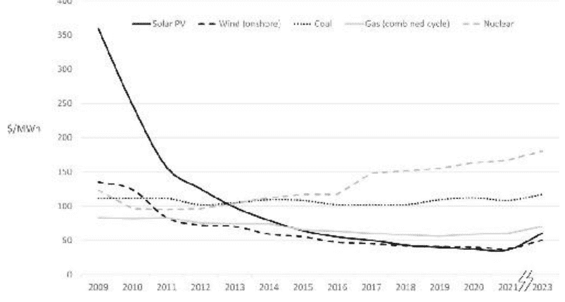

## 第五章

早在 20 世纪 10 年代中期的早期，能源领域的分析师就开始认真关注可再生能源成本的下降，而且，他们直接从对这一趋势的观察跃迁到对未来发电可能产生影响的胆大结论。最早的著名报告之一是美国能源信息署于 2013 年发表的一份报告。[^45] 尽管它吸引的评论相对较少，但其核心观点在接下来的十年里变得无处不在。该报告指出，可再生能源的价格正在下降，并将继续下去，因此，可再生能源而非化石燃料将是未来增长最快的能源来源。

2015 年出版了一系列类似的预测，然而，这些预测获得了远得多的关注——我想，这部分是因为作者是 BloombergNEF，这是一个在能源领域转型研究和分析方面备受关注的来源，特别是由于围绕该出版物发布而产生的夸张言辞。BloombergNEF 表示，可再生能源（特别是太阳能）的成本正在（且将继续）“骤降”；这使得太阳能日益成为“消费者和最穷国家的首选”，因此可再生能源将吸引大部分新建电厂的支出，“使化石燃料发电厂的支出显得相微不足道”。[^46] 这确实是一个引人注目的画面。

然而，更令人震惊的是随后对这种逻辑得到了实质上普遍的接受。从政治右翼到左翼，从全球南方和北方，似乎都趋向于一种观点：既然现在它们更便宜/最便宜，可再生能源已准备好进入一个前所未有的黄金增长时代。在这个过程中，每个人都成了 LCOE（平准化能源成本）专家和信徒。如果你想知道可再生能源的未来是什么样，我们被反复告诉，只需看相对成本。

首先被说服的是商界内部那些可以预料的追随者——如果他们是学术界，则是来自主流领域。“可再生能源将取代化石燃料，因为它们[原文]将比化石燃料更便宜、更可靠、更方便，”哥伦比亚大学地球学院的史夫·科恩（Steve Cohen）在 2017 年说道。“问题不是是否，而是何时。”[^47] 科恩的观点得到了可持续发展企业家詹姆斯·摩尔（James Moors）等人的共鸣，摩尔在 2019 年的《福布斯》上写给商业杂志读者，可再生能源较低的成本确实正推动其“大规模采用”。[^48]

随着时间的推移，甚至那些可能不太倾向于接受日益增长的共识的人最终也安顿下来。一个显著且极其重要的转化者是国际能源署（IEA）。正如我们所看到的，它的 LCOE 数据与其他数据一样，从 2010 年代中期开始显示可再生能源具有成本竞争力。但由于它长期以来对可再生能源的前景持有臭名昭著的谨慎（这令批评者愤怒），IEA 花了一些时间才真正相信它所看到的东西。然而，当它终于完成逻辑的跳跃（可能也是信仰的跳跃）时，它是双脚跳进去的。它 2020 年的《世界能源展望》对于长期观察者来说是非常值得读的。因此，IEA 指出，“在大多数国家持续比新的燃煤或燃气发电厂便宜，而且太阳能项目现在提供了有史以来最低成本的电力”。其执行主任法蒂赫·比罗尔（Fatih Birol）对这意味着什么的看法是什么？比罗尔兴奋地宣布：“我看到太阳能将成为世界电力市场的新王。”[^49]

最后才加入行列的是左翼的固守者，即环保活动人士，他们一次又一次看到对能源系统进行重大转型的希望被彻底粉碎。过去的失望——以及不想再次受到伤害——或许解释了为什么左翼环保主义者加入围绕可再生能源廉价以及表面上预示着事物的热潮速度相对缓慢。但今天，即使是老练的活动家也粗略而热切地阐述了这种看似不可动摇的价格逻辑。

例如，考虑比尔·麦基本（Bill McKibben），他在 2021 年被听到在坚称可再生能源已变得“便宜得惊人”。事实证明，麦基本一直在阅读智库 Carbon Tracker 的一份新报告，他掩不住内心的兴奋。“报告中的数据”——不用说，在 BloombergNEF 报告的情况下，那些 LCOE 数据“是压倒性的，”麦基本激动地说道。麦基本解释说，太阳能新发现的廉价“将继续让我们用太阳能发电来取代液体，最终，没有人会在地下室放燃气炉或在汽车里用内燃机。”也许他承认，Bloomberg 的“分析师太乐观了”，但如果是那样的话，“我们将浸泡在廉价的太阳能中”。这种相对价格带来的不可抗拒的动力正是共识维持的基础。

在面对乍看可能是相反作用的现实发展时，这种共识依然维持。例如，在 2022 年，在麦基本写下关于可再生能源廉价的文章仅一年后，随着通货膨胀和供应链阻塞的打击，太阳能和风能突然发生反转，并在十年以来首次上升。这对可再生能源的经济效益是一个打击吗？并非如此，虽然太阳能和风能的成本确实几乎上涨，但传统发电厂使用的煤炭和天然气成本上涨得更多，因此清洁能源与脏能源之间那至关重要的价格差距正在扩大，而不是缩小”。事实上，“风能、太阳能与燃气发电之间的差距从未如此大。”一系列显示更新后相对 LCOE 的图表被相应地提出作为支持。

此外，越来越多被接受的是，如今可再生能源的相对廉价已使得它们即使没有政府支持也能竞争过化石燃料。一些人声称，不再需要补贴了。论点认为，由于刺激生产竞争和规模经济以达到了推动成本下降所需的程度，政府对可再生能源的支持现在可以安全地移除，而不会危及投资。因此，当活动人士担心英国政府在 2016 年过早减少太阳能和风能的补贴时，著名经济学家迪特·赫尔姆（Dieter Helm）反驳道：“补贴应该是临时措施，而不是永久性的。它们已经完成了任务。”[^52]

赫尔姆提出的观点很快传开。例如，上述詹姆斯·埃洛尔（James Elor）2019 年在《福布斯》上关于可再生能源经济的文章标题是“可再生能源现在是最便宜的选项”，但在几年前它不会包含“即使没有补贴”。[^53] 与此同时，在 Bloomberg 的马克·切迪亚克（Mark Chediak）和布莱恩·埃克豪斯（Brian Eckhaus）对可再生能源“超越”补贴的描述赞不绝口。“在西班牙和意大利阳光充足的田野上，”他们写道，“开发商正在没有补贴或税收减免的情况下建设太阳能农场。”一位市场分析师报告说，“辅助轮已经掉了。太阳能和风能的价格都在下降，存在后补贴世界持续部署的路径。”[^54]

这种方法本可以用于平衡昂贵的可再生能源与廉价化石燃料之间的差距，但直到今天，政策制定者仍然非常不愿苟谈——即碳税。简而言之，政府被告知要松开可再生能源补贴的杠杆，同时要远离碳税的杠杆。

## 第六章

问题的关键在于，在首批承诺出现已十年后（这些承诺曾言，前所未有的廉价将使可再生能源在发电领域迅速开始取代化石燃料），长期以来，气候与能源辩论各方的评论人士都认同“相对价格”这一解释性教条，即认为这种大规模的技术替代目前**尚未**发生。正如我们在第一章看到的，可再生能源并没有接管局面。如果说有什么的话，它们正落后得越来越远。而且，正如我们将在第 9 章中看到的，政府发现自己无法安全地移除支持机制。相反：他们不得不保留并加强补贴。值得注意的是，在 2022 年底，美国乃至全球范围内都松了一口气，因为美国政策制定者找到了一种方法，同意长期延长该国对风能和太阳能发电设施的税收抵免。

那么，为什么本应该发生的事情没有发生呢？有许多不同的理论，但其中两种尤为突出。

### 第一种理论：官僚主义

第一种理论认为问题在于官僚主义：本质上是许可程序缓慢、电网连接问题或两者的兼有。哪一个是主要罪魁祸首取决于地区。例如，在欧盟，通常被归咎于规划体系。在英国，指头通常指向电网管理者。《金融时报》2022 年的一篇文章报道，可再生能源开发商当时被告知，接入英国电网需要等待六到十几年。有趣的是，文章提到的其中一个开发商明确反驳了“官僚文书主义”的负面影响，强调了相对价格的积极作用：“太阳能和陆上风能是新型发电中最廉价的形式，但由于缺乏长期规划和对电力基础设施的投资，项目正被推迟。”

### 第二种理论：阴谋论

另一个突出的理论是存在某种阴谋在作祟，即可再生能源成本优势驱动转型性变革的能力正受到化石燃料行业既得利益者的阻碍。这种观点认为，通过对政策制定者的影响，煤炭和天然气部门及周边公司正成功阻止了电力的去碳化，这既违背了生态逻辑，也违背了经济逻辑。

无论实际论点如何，对我们而言，关键点在于这个问题——即阻碍清洁电力转型的力量——被认为与经济无关。毕竟，可再生能源现在如此廉价，阻碍道路的怎么可能是经济？在理论上，这是可能的。

事实上，面对更廉价的可再生能源与持续的化石燃料发电投资并存这一看似矛盾的现象，将相对价格理论推向逻辑结论，会质疑经验性 LCOE（平准化度电成本）数据的有效性。正如 J. W. Mason 所言：“在传统模型中，低碳技术必须比现有技术更贵，否则它们已经被采纳了。”

按照这种思维方式，如果数据本身没有错误，那么问题必须位于政治、规划或……等非经济领域——别无可能。事实上，相对价格的世界观对于那些信奉它的人来说是如此有说服力，以至于不需要寻找任何反向政治或官僚力量的证据。从推论上讲，它们必须存在——顽固地阻碍着价格机制的动力。


# 考虑下面这个典型的例子

它摘自2021年的《碳追踪》报告，该报告给比尔·麦金宾（Bill McKibben）留下了深刻印象。报告自信地断言：“我们确定，成本下降已经克服了技术和经济障碍。”换句话说，去碳化的经济（和技术）挑战已经解决。逻辑结果是什么？只能是某些东西在阻碍。作者轻松地得出结论：“因此，改变剩下的主要障碍是既得利益者操纵政治力量来阻止改变的能力。”任何其他解释在字面上都是不可想象的。

政策制定者（事实上是我们所有人）被寄予从中得到什么呢？结论似乎是不可避免的：扫清政治和规划障碍，价格机制将完成剩下的工作。

与此同时，从传统观点来看，最不可思议的事情是，电力去碳化的主要障碍不是（或不再是）价格，但它仍然是经济问题。然而，这正是我们将在书的其他部分将提出的论点。

## 价格错了

在21世纪10年代初，人们计划在挪威中西部的福尔森半岛（Fosen peninsula）开发欧洲最大的陆上风电场之一。该地位于挪威第四大城市特隆海姆峡湾（Trondheim Fjord）正对面，距离特伦内斯风场（Tellenes wind farm）向北600公里（第三章）。

2014年，尽管当地萨米（Sámi）驯鹿牧社区对可能干扰冬季牧场表示强烈反对，项目开发仍正式启动。当年3月，计划背后的四家电力公司——Statkraft、Agder Energi、NTE和TrønderEnergi建立了一个名为Fosen Vind AS的正式公司实体来控制项目，其中国有的Statkraft是控股股东，持有50.1%的股份。夏天，他们发出了一份累计发电容量为600兆瓦的涡轮机招标。

但不到一年后，即2015年6月，开发陷入了停滞。Statkraft简单宣布将不再推进该项目。Statkraft总裁兼首席执行官瑞宁-通能恩（Rynning-Tønnen）表示：“Statkraft对项目无法实现表示遗憾。”

发生了什么？为什么一个由四家大公司支持、而且是Statkraft自己在去年9月还描述为“全速前进”的项目，会遭遇一个看似不可逾越的障碍？值得注意的是，问题并不是政治或官僚性的。事实上，在宣布停工时，瑞宁-通能恩谨慎地承认任何此类障碍已得到积极清除：他说：“当局通过促进风电开发做出了贡献。”

2014年9月，NTE负责人克里斯蒂安·斯塔夫（Christian Stav）曾暗示过问题的所在。斯塔夫解释说，在实现两个关键（推测是相关的）事项之前，共同股东不会对是否继续做出最终决定。一个是从外部投资者处获得额外融资；另一个是正确运行数据，以检查（在尽可能确定的范围内）项目将盈利。斯塔夫说：“在股东做出投资决策之前，必须确定项目的盈利能力。”

Fosen Vind恰恰是在这一点上掉了链子。为什么Statkraft在2015年6月停止了程序？很简单：数据无法自洽。Statkraft负责人瑞宁-通能恩告诉记者：“更新后的分析表明，挪威中部的项目将不会盈利。”看来，事实确实如此。

在理论和历史上呢？这种观点难道不符合主流环境经济学的理论原则，也不符合经济历史学家在研究过去能源转型（特别是工业革命期间向化石燃料的转型）时通常得出的历史教训吗？确实如此。事实证明，尽管这种观点与理论和历史相一致，但传统观点是错误的。为什么？因为它是基于错误的理论和错误的历史。

让我们从理论开始。不同能源来源的相对价格将决定它们在演变中的能源结构中的相对主导地位，正如我们所看到的，这是经济学主流界中的一种观点。这种主流传统有时被称为“正统派”，有时被称为“新古典派”。它基本上也是一种“供给侧”经济学，之所以这样命名是因为它建立在一个假设之上：商品服务的供给是经济增长和繁荣的关键决定因素。

供给侧经济学经常与许多人认为主要的理论替代方案进行对比，即与英国经济学家梅纳德·凯恩斯最密切相关的“需求侧”经济学。当供给侧支持者认为理论（和政策）的重点应该放在供给上，而需求会自足其力——正如萨伊定律所说，通俗的话就是“供给创造需求”——凯恩斯主义者则认为关键在于产品和服务的需求水平。是需求而非供给，决定了增长和就业前景，因此政策制定者积极寻求刺激需求，特别是在需求不足时通过政府投资来刺激。

然而，尽管存在这些差异，供给侧和需求侧理论最终都是以价格为导向的理论。诚然，在凯恩斯那里，相对价格并不像在新古典主义中那样具有协调经济活动的显性工具性作用。但任何关于供需的理论——无论强调前者还是后者——在某种程度上都是一种价格理论，尤其是在凯恩斯那里，因为它关注的是有效需求（或供给），而这如果不是价格概念，又能是什么呢？也许供给侧和凯恩斯需求侧之间最重要的技术区别在于，在后者中，价格对供需变化的响应需要时间。

尽管这种理论通常不具有可比的形式（数学上）优雅感，但对经济世界在实践中如何运作（特别是在企业层面）的更好理论解释是由第三种传统提供的——事实上，从时间顺序来说，它是三个传统中的第一个。这就是政治经济学——通常被称为“古典经济学”——它与亚当·斯密、大卫·李嘉图和卡尔·马克思密切相关。

正如安瓦·谢克斯（Anwar Shaikh）所观察到的，政治经济学的根本并不取决于价格，而是利润。与供给侧的新古典主义或需求侧的凯恩斯主义不同，政治经济学使用的是谢克斯恰当的说法——“利润侧”。这到底意味着什么？正如谢克斯所说，对于政治经济学家来说，商品或服务的生产“总是基于预期利润启动的”，这正如2015年挪威福森（Fosen）的风电生产情况（是如此或不是如此）一样。这种利润侧制度使得价格以及供需具有相关性吗？不。但它确实暗示了（谢克斯再次指出）“有效供需都通过不同的渠道受到预期利润率的调节”。⁵ 简而言之，如果他们预见到利润率，资本家就不会投资。如果说有一个比其他任何原则都支撑这本书的理论原则，那就是它。

虽然利润主义在斯密和李嘉图那里确实非常显著，但在马克思那里最为显性。托马斯·魏斯考普夫（Thomas Weisskopf）在谈论马克思主义理论时说：“生产的组织和投资的开展是由资本家进行的，是为了获得利润；受平均利润率——因此是新投资预期利润率的限制——迟早会抑制这种投资”。⁶ 因此，这正是我们将进行推演的特定理论视角。即使他们对需求状况充满信心，如果他们认为投资回报率太低，企业也将不愿投资。

虽然这种思维没有给正统经济学（无论是环境还是其他）留任何余地，但它并没有完全排除凯恩斯主义。通过审慎的解析，凯恩斯革命为古典经济学增加了许多关键的洞见，这些洞见可以使后者变得强大或削弱。其中有两点脱颖而出。第一个（带有马克思的隐含回响）涉及经济协调问题、市场作为协调机制的局限性以及随之对中央规划的需求。第二个涉及不确定性问题，以及资本家和政府所投资的未来在多大程度上可以——或者正如凯恩斯看到的，无法——被准确预测。这两组洞见都出现在后续章节中。

那么，历史以及能源转型历史（如驱动工业革命的转型）又是怎样的呢？记得第四章提到相对价格理论长期以来一直是19世纪英国蒸汽和煤炭战胜水力的主导解释。在2016年出版的《化石资本》（Fossil Capital）中，安德亚斯·马姆（Andreas Malm）打破了这种成见。他通过两种方式实现了。

首先，马姆证明了现有的正统观点被事实所否定。蒸汽更便宜是一个事实。相反：水力过去现在仍然更便宜，主要是因为不需要人类劳动来激发它的力量，而煤炭只有通过投入大量昂贵的人力动力才能转化为能源。

其次，马姆汇集了一系列有说服力的替代主张。蒸汽受到青睐部分是因为它在空间上具有优势。与水轮不同，蒸汽机可以放在任何地方，这使得工业资本家能够在快速增长的北方城镇定居，那里聚集了劳动力（更不用说其他聚集经济的来源），而其中许多最大的工厂恰好位于煤矿附近。水力在空间上的灵活性显然小得多；资本必须去寻找它，而那里更容易受到罢工行动的影响。

蒸汽在时间上具有优势。水力的供应不稳定性对于19世纪蓬勃发展的棉织业来说是一个大问题，特别是在出口市场日益增长的背景下。此外，为了补偿这种不稳定性和相关的停工时间，工作条件的灵活性和长工作日被1833年《工厂法》和后来的1847年《十小时工作法》大大限制了。正如马姆所说，“水遵循它自己的钟——而不是工厂的钟”。⁸

最后但同样重要的是，蒸汽更符合资本主义私有财产的新世界。大规模的、基于水库的水力方案对于整个资本来说可能比蒸汽更理想，但这种集体安排遭致了个人资本家的反对，他们认为这些方案是对其独立性和私有产权的限制。私有财产和水力“并不并不好相处”；后者由于规模化投资，需要复杂的社区关系”。煤炭和蒸汽没有受到同样的“集体缺陷”。⁹

无论如何，对于我们的目的而言，蒸汽机和煤炭胜利的特定原因并不如马姆描述的普遍意义重要。驱动19世纪初能源转型的投资决策最终取决于价格，但取决于利润。蒸汽在空间和时间上的优势归根结底是因为它能够确保可靠且有纪律的劳动力供应，因此代表了“提取剩余财富的优越介质”。¹⁰

总之，在历史或理论上都没有支持“相对廉价是可再生能源在发电领域战胜化石燃料的关键”这一说的依据。如果风能和太阳能要繁荣并最终占据主导地位，历史和理论表明，利润而非正确的价格才是其必要条件。

在可再生能源领域，主要的决策者是能源公司、其他开发商，尤其是金融机构——他们对于是否推进投资资金以及何种成本的决策，最终决定了太阳能和风力发电场项目能否进行。因此，我们可能会问，当可再生能源开发者向这些金融人士提交投资建议时，他们脑海中首要问题是什么？答案是：我是否能收回资金，并获得可接受的财务回报？这个问题的根本答案当然是：通常情况下，只有在项目盈利的情况下才能。

现在，从直觉上看，人们可能会认为，尽管这些金融人士终极关注的是利润而非价格，但他们仍然会仔细研究不同发电技术成本的历史和预测数据，并像其他几乎所有人一样，执着于空洞的平准化度电成本（LCOE）。毕竟，这种相对价格的框架具有一种迷人的逻辑；它“听起来”是正确的，这也是它之所以占据统治地位的原因之一。成本较低——例如，太阳能每兆瓦 50 美元，而煤电为 100 美元——意味着更高的利润。这种逻辑很讽刺，不是吗？

作为类比，考虑一个假设性案例：一家公司生产并销售零售价为 200 美元的类似智能手机。为此，它使用一套成熟的投入组合——材料、劳动力等，以及一套组合这些投入以生产和配送该手机的成熟工艺。这些投入和方法的每台手机成本为 150 美元，带来了 50 美元的丰厚单位利润。但随后，公司偶然发现了一种完全全新的投入组合和生产方法，使其能够以每台仅 130 美元的成本生产出同样的手机，从而产生 70 美元的利润。它立即进行了切换。相对成本赢得了胜利。

电力难道不如此吗？价格机制难道不占主导吗？也就是说，最便宜的生产组合没有被选中？是的，但关键在于，这仅在某些条件下才会如此。

我们已经提到了其中一些条件。例如，存在政治条件；即制度环境是否没有了阻碍上述经济逻辑顺畅实施的既得利益？它是否没有了官僚主义的障碍？显而易见，在现实世界中，答案往往是“否”。

但这些条件并不是本书关注的重点。它关注的——事实上是它的论点——是存在重大的经济条件。换句话说，只有在某些经济条件下，成本和利润才会必然对齐，这意味着最低成本方案实现了利润最大化。三类条件尤为重要。简而言如下：

第一，是与行业结构相关的条件。向终端用户出售电力（或智能手机）的公司与生产它的是同一家公司吗？或者用术语来说，该行业是垂直整合的吗？我们将看到，只有在垂直整合的情况下，相对成本才会胜出。

第二，是一个——考虑到这一点时显而易见的——关乎成本与收入关系的条件。后者在多大程度上独立于前者？我们的智能手机公司通过改变生产投入和方法将单位利润从 50 美元增加到 70 美元，这取决于能够将手机零售价保持在 200 美元。但这在电力世界是现实的吗？如果行业从另一种 LCOE 的能源源切换，行业营业额和盈利能力会发生什么变化？

第三，是一个与产品性质相关的条件。具体来说，两种能源是否产生了完全相同的产品，并相应具有相同的收入潜力？在我们的智能手机类比中，它们是。但电力呢？新产生的电力真的与传统手段产生的电力一样吗？如果不是，这对收入和利润意味着什么？

本章的其余部分将逐一详细考虑这些条件（即使在实践中它们是交织的）。但事实上，通过第 2 章和第 3 章，我们对即将显现的情况有了良好的把握。正如我们所看到的，今天的电力部门通常不是垂直整合的，尽管在历史上通常是这样的。而且，在许多重要方面，电力不仅仅是电力：发电的确切方式对产品及其可销售性有着显著影响。

简而言之，在实际存在的电力世界中，传统基于价格的框架隐含假设普遍适用的经济条件，实际上仅在少数（而且是日益增加）的情况下适用。这就是为什么基于价格的框架是错误的，而基于利润的框架是正确的。

如果廉价的追随者们不知道这一切，那么资助今天风电场和太阳能场的银行家——让我们不要忘记，还有仍在建设的煤电和燃气发电厂——显然是知道的。他们清楚利润至关重要，也知道影响利润的因素。那么，极大的讽刺在于，对于新可再生能源产能的实现最关键的群体，实际上是那些 LCOE 数据通常无关紧要、很少被查看、且从未被谈论的群体。在最近对 LCOE 崇拜主义的严厉批评中，摩根大通的迈克尔·塞巴莱斯特（Michael Cembalest）将该指标描述为“实际上的无关性”。¹¹他表达了其金融领域同行中广泛持有的观点。

# III

在我们必须关注的三类经济条件中，结构是最容易处理的。处理这个问题的有效方法是采用两个决策实体的理想类型模型。在模型 1 中，有一家能源公司在整个供应链上实现了垂直整合，既生产电力又配送电力。在模型 2 中，有一家公司，其业务是开发和运营发电资产（在美国被称为独立发电厂），它不参与发电之外的任何活动，而是进行批发。现在，让我们对比一下这些模型。

在其他条件相同的情况下（当然这几乎不可能，但为了说明我们忽略这一点），模型 1 中的垂直整合公司如果可再生发电成本低于传统发电，就会采用可再生能源。像所有资本企业一样，它的目标是利润最大化，因此它关注的是可销售产品的总成本。LCOE 起了规则。

转向模型 2，在观察没有发电资产的独立分销商——例如美国的 Ambit Energy 或印度的配电公司 DISCOMs——之前，经济状况如何？就像模型 1 中的垂直整合公司一样，它也关心成本，因此购买最便宜的电力——即可再生能源，如果电力实际上是最便宜的话。

但有一点很重要。分销商并不掌握所有的牌。谁能保证分销商能在市场上以所需的价格和数量找到可再生能源？例如，如果某些可再生能源发电厂的 LCOE 确实低于传统发电厂，但由于某种原因，它们在批发时能够获得大幅加价呢？这只是一个可能的事件。更通常地说，观点是，与模型 1 的垂直整合能源公司不同，如果市场上没有合适的价格的电力，分销商没有自己发电的选择。那不是它的业务。

对于模型 2 中的独立发电厂，无论其在开发和运营风场或太阳能场时产生的 LCOE 是多少，除非预先获得长期固定价格，否则它无法确定能否以未来的价格出售电力以获得利润。

记住，这里我们的独立发电厂的决策矩阵与模型 1 中的垂直整合公司或模型 2 中的电力分销商大不相同。后者通常有交付义务，因此需要产生供应，它们面临的选择是来自不同来源的电力——在我们的示例中，是可再生能源或权衡特定投资机会（或机会）；而独立发电厂不需要开发项目，金融机构也不需要资助项目。选择是：开发/资助，或者不；并且如果进行比较

完全没有，因此，这通常不是与燃煤或燃气发电厂及其相应的成本相比，而是取决于一个可接受的财务回报率（即“门槛率”）。所考虑的项目预计能够达到或超过这一门槛率吗？

事实上，正如我们看到的，这正是 Statkraft 及其伙伴在 2015 年初针对挪威福森（Fosen）项目所权衡的决策矩阵。选择仅仅就在于：开发该风电项目，或者在同年 6 月，他们选择了放弃：因为盈利前景看起来过于微薄。除非采取近期以来挪威政府绝不容忍的那种强力干预，否则相关开发商无法被迫进行投资。《金融时报》的马丁·沃尔夫（Martin Wolf）曾这样描述，而且正是在这种蹒跚的能源转型的政治经济背景下：“虽然可以阻止企业去做有利润的事，但却无法让他们去做利润并不足够的事。”¹¹²

本文所反驳的传统转型模型认为，化石燃料与可再生电力之间存在一种轻而易举的平滑转换，正如火人画的主流经济学更广泛地假设了各种可比的平滑转换，尤其是现在商品与未来商品之间。然而，涉及现实世界企业的真实生产和消费过程，远无法接近这种平滑转换。

如果电力生产和供应的真实商业世界仍与模型 1 的垂直整合结构保持一致，那么价格机制可能会看到更廉价的电力迅速取代更昂贵的电力——再次，这需要所有其他条件都相同的情况下，而我们很快就会看到，事实并非如此。但正如第 2 章所示，电力业务一直在、并将继续实质性地远离这种模型。我们在那一章中看到，如今基于风能和太阳能的发电在很大程度上是一项离散、独立的业务。简而言之，模型 2 正日益成为（往往是法律规定的）常态，而在模型 2 中，平准化电成本（LCOE）绝不决定一切。

# IV

简单的数学告诉我们，发电（或任何其他商品）成本的降低，只有在收入下降幅度至少相等的情况下，才会增加行业利润。在上述提到的智能手机类比中，如果切换到单位成本为 130 美元而非 150 美元的更便宜生产组装——同时也导致收入从单位 200 美元下降到 180 美元，那么单位利润将不会改变：每个产品仍将产生 50 美元的利润。如果这是预期的盈利结果，行业会采用更廉价的技术吗？这是一个开放的问题。

决定成本降低在多大程度上（或是否）伴随收入下降的主要因素，是行业中存在的价格竞争程度。在一个价格竞争激烈的行业中，马克思所说的竞争“强制性法则”将迫使公司通过降低成本来降低零售价格，以保持竞争力。在另一个极端，在一个以完全垄断而非完全竞争为特征的行业中，没有动力将成本降低传递给消费者。垄断者将自行捕获所有的成本下行收益。现实中，真正的行业存在于这两个极之间的某个地方。要取的普遍观点是：为了资本能够实现成本降低的收益，需要某种垄断力量。

在这方面，商业银行业是一个极好的说明案例。它最大的成本是利息（融资）成本；最大的收入来源是利息（贷款）收入。当利率下降导致融资成本下降时会发生什么？令消费者和监管机构都感到愤怒的现实是——利息收入绝不会下降得那么多，通常只相对较小，而且即使如此通常也是缓慢的。换句话说，行业能够捕获大部分的成本收益。主要的解释是垄断力量：在又一个国家（包括美国和英国等在公众想象中与竞争性金融部门相关的国家），商业银行业实际上是寡头垄断的，几乎没有价格竞争。与此同时，当利率上升导致银行融资成本增加时，不用说，这些成本的增加通常会全额且迅速地转嫁给消费者。


那么，电力呢？那些认为 LCOE 下降将看到可再生能源取代传统发电方式的论点支持者们，显然预期电力行业会将大部分、甚至是全部行业成本的下降传递下去，使转型在表面上会涉及这种变化。例如，当像环保活动家比尔·麦基本（Bill McKibben）这样的人对“我们将沉浸在清洁的太阳能能源中（第 4 章）”的未来充满热情时，很清楚这个“我们”指的是谁——我们所有人。同样，含蓄地（尽管并非总是显式地），正统经济学家也低估了行业捕捉从高成本能源向低成本清洁能源转变所产生价值的能力。价格机制成功且无障碍的运行为消费者带来更“高效”、更廉价的结果，这对于主流经济学来说，归根是一项事实，无论相关产品是能源还是鸡蛋。

然而，这种认为任何来自更清洁发电源的成本下降都将传递给消费者的预期是自矛盾的。因为，如果行业实际上具有广泛的竞争，且成本降低由于马克思强制性法则的作用而传递给消费者，那么完全有理由质疑行业最初承担从化石燃料向可再生能源转型的意愿。没有人（包括经济学家和麦基本）从未问过的问题是：除非受到外部强制，否则电力行业为何会接受、更说积极拥抱一种降低了生产成本、但产生的收益几乎完全不归行业参与者的极具颠覆性的转型呢？

事实上，如果说可再生能源将由于成本降低而取代化石燃料发电——在没有政府补贴的情况下通过纯市场力量实现——这一论点存在根本性矛盾，可能并不过分。然而，行业必须从中受益才能进行转换。

无论如何，回顾第 2 章，我们应该在此回顾关于经济状况的以下相关事实。首先，我们知道，在过去的三十里被政策者重塑后，该行业已变得更具竞争性。其次，我们知道，在同样关键（且相关的）的行业重组维度上，政策者还追求了广泛的市场化，使得价格越来越多地通过市场机制而非监管机构或中央决策者设定。这两个趋势的累计收益是什么？在某些国家，电力行业已变得更具竞争性，但更具体、更精确地说，更加竞争。也就是说，其总方向一直是远离一个行业有很大能力捕获并从成本降低中获利的模型。此外，从第 2 章还可以得出另一个重要的观察，它将我们这里的分析与该章上一节关于行业结构和垂直拆分的讨论联系起来。因为从第 2 章同样可以回想起的是，几十电力行业竞争强度的增加在（整个）供应链中并不均匀。供应链的某些部分竞争显著增加，而某些部分则几乎没有。

正如我们看到的，政策者引入有意义的竞争（特别是有意义的价格竞争）的努力通常在发电公司方面进展最快。在面向终端用户的供应商之间，即就零售价格——而非批发价格而言，竞争通常仍然有限得多。这非常重要。

特别考虑之前描述的第二种理想行业结构模型下的含义，即由独立生产者和分离的分销公司组成。如果行业通过切换到可再生能源成功降低了发电成本，在这个模型中谁捕获了收益？发电者？分销公司？消费者？还是者的者的？比例又是如何？

从第 2 章的推论是，发电者可能无法获得多少收益，或者根本没有，因为那是价格竞争强制性法则作用最充分的地方，这意味着成本降低是传递了下去。这些减幅并不一定能完全传递给消费者：配送公司之间缺乏价格竞争，预计会导致这些公司获取大部分上收益。关键点显然是：世界正依赖于一个在物理上完成向可再生能源转型的特定行业利益群体——即发电公司，那些生产电力且有时在此过程中产生温室气体排放的公司——似乎并不是从中获益最大的行业利益群体。

在我们继续讨论产品（电力）本身的性质问题，以及它反过来可能如何影响利润与价格之间的关系之前，还有一件事需要考虑。具体来说：如果由于一方面基于可再生能源的发电和输送的行业结构，与另一方面我们更熟悉的化石燃料电力部门，两者之间的价格竞争水平被证明非常不同将会怎样？无疑，我们不应简单地假设随着技术替代过程发生以及行业参与者格局随之发生转型，竞争强度（包括整个行业范围内以及供应链的关键部分）会保持不变。

是否可能是这样一种（我们至少应该允许）：电力世界正在变得更具竞争性——无论这对切换或转向低成本技术的商业激励意味着什么——不仅是因为政府积极且有意识地将其重塑，而且也是因为它正在脱碳，事实上，正是因为它正在脱碳？

读者只需先保留这个问题即可。之前的讨论目前足以表明，没有正理由认为转向具有较低 LCOE（平准化发电成本）的可再生能源对于整个行业的盈利能力或特别是对于发电公司来说一定是有的，因此这并不是人们预期此类公司会积极并全力追求的事情。相反，它对盈利是否有益取决于情况。事实上，正如第 6 章和第 7 章将论证的那样，有理由认为转向更便宜的可再生能源对盈利完全没有好处。

# V

化石燃料与风能、太阳能之间最明显的区别之一是它们与地球表面的关系。前者位于地下——必须从地下开采。后者是地面现象。虽然避免了昂贵的地下勘探和开采过程是今天太阳能和风电站全寿命成本通常相对较低的原因之一，但有一类成本是他们无法避免的——土地（对于海上风电，则是海洋领域）成本。为了建立太阳能和风电站，必须购买或租赁空间。

关于需要多少空间并没有简单的答案。这在风电场的情况下尤为如此，许多与地形和风能模式相关的因素影响着涡轮机之间的最佳间距，从而影响了土地需求。平方公里土地可以满足 2 到 10 MW 的风电发电容量。太阳能的需求较低，并且将落在一个更窄的范围内。同样的平方公里可能足以安装累计容量为 25 到 50 MW 的模块。

可再生能源土地需求对我们本章讨论的意义在于，土地的可用性和成本在不同地点之间差异巨大——且通常相互呈反比关系。在可用土地丰富的地方，价格往往很廉。在难以获得的地方，密度大得多。以美国为例，2019 年的一项研究报告称，每英亩土地的平均价格从偏远农村地区怀俄明州的 1,558 美元低位，到该金额的 100 多倍 196,410 美元——位于人口稠密的新泽西州¹³

因此，在其他条件相同的情况下，风能和太阳能开发者有极强的动力在土地最便宜的地方进行开发。但当然，正如我们在第 3 章中暗示的那样，这种策略的一个明显问题是这些地方对电力的需求很小。再次考虑美国的情况，以及上述怀俄明州和新泽西州的土地价格极端。2020 年怀俄明州的年耗电量约为每平方公里 60 MWh；在新泽西州则是每平方公里近 4,000 MWh¹⁴

如果土地供应与电力需求之间的空间错配有一个无摩擦的解决方案，这种错配将变得无关紧：：只需在土地价格最低的地方建立新工厂。但在实践中，将电力从生产地输送到消费地的解决方案并非无摩擦的。它需要一个物理输送系统——长距离高压输电、短距离低压配电——以及该系统的建设、运行、维护和更新非常复杂且昂贵。

这与我们本章分析发电从化石燃料转向低成本可再生能源对盈利的影响有什么关系？为了帮助证明其重要性，再次回想我们简单的手机类比。记得，一个原材料和生产成本为每手机 150 美元的假设制造商发现了一种可以将成本降低到每台 130 美元的新生产工艺。转向这种新生产工艺似乎是不言而喻的。但如果制造商随后发现，虽然“新”手机具有完全的功能和质量，但它实际上只能在特定的偏远地区以 130 美元的价格生产，而将其配送到消费者需求所在地平均每台要额外增加 25 美元的成本？突然之间，经济效益看起来就不那么乐观了。

这基本上就是太阳能和风能产生的情景。它们的 LCOE 确实比新的化石发电厂低。但如果制造商随后发现，虽然“新”手机具有完全的功能和质量，但它实际上只能在特定的偏远地区以 130 美元的价格生产，而将其配送到消费者需求所在地平均每台要额外增加 25 美元的成本？突然之间，经济效益看起来就不那么乐观了。

鉴于发电成本之外不断变化的增量成本，这一点具有特别重要的意义，因此需要专门关注。

相关者长期意识到电力输电成本的重要性，并随着可再生发电源的增长（土地成本在其中起着巨大的作用），对这种重要性日益关注。参与输电网运行（及监管运行）的参与者正试图通过各种方式让发电厂承担其位置决策的后果。换句话说，他们试图确保，例如一个在最偏远地区选择最便宜土地的风电场开发商，必须在字面意义上为此付出代价，因为其电力分配到市场的成本将高得离谱，相应地，其平准化度电成本（LCOE）被“人为”推低了。其本质上的目标是减少地理套利机会，即通过特定的位置决策，为发电厂节省的土地成本超过了相关输电成本的任何惩罚的情况。

在尝试减少甚至消除套利机会时，最常用、简单且直接的机制是变化的输电费用。所有发电厂都要向电网运营商支付费用，以通过其电缆传输电力，因此可以调整此类费用，使得那些由于距离需求中心较远而需要高昂输电成本的发电厂，比那些传输成本更低的发电厂支付更高的费用。例如，英国电网运营商国家电网 ESO 在其网站上解释说，其收费方法——这本质上是复杂的，由几个独立部分组成——产生的电价根据发电厂距离需求地的远近而变化……这在，至少在理论上，“激励了发电厂和需求相互靠近，减少了对输电系统投资的需求。”¹17

但我们“理论上”的免责声明很重要。人们公认，这种方法不仅仅是中等成功。在英国，显然并非如此。咨询公司 Energy Systems Catapult 的一份 2022 年报告的作者在评价英国的输电收费方法时观察到，“尽管经过了多次方法论修订，投资的位置信号很微弱。”¹18 他们的意思是，这些费用没有准确或完全地纳入与不同发电厂位置相关的实际输电成本差异。再次使用我们的手机类比，这等于我们的手机制造商仅需支付由于选择偏远生产地而产生的每台额外 25 美元运输费用的一部分，而不是全部。其余大部分成本由其他市场参与者承担。因此，Energy Systems Catapult 所指的“信号”是“微弱”的，意味着（某些）发电厂目前尚未被输电费用充分激励在靠近需求的地方开发设施。

那么更有雄心的是，越来越多的国家采用了基于位置的定价。换句话说，决策者通过监管发电厂必须支付多少费用才能将其电力物理输送到市场，以及通过监管市场为这些电力支付多少钱，来塑造不同地理位置（或不仅是这些）发电厂的净收入——以及利润——潜力。他们通过允许批发市场（通常也包括零售市场）的价格随位置变化来实现，而这在传统上并不是常态——通常，发电厂无论身处何地都享受到相同的收入潜力。设计这种基于位置定价系统的指导原则是：发电厂离距离需求中心越近，它预期的价格就越高，作为对它在许多国家已日益紧张的输电资源上施加了较轻负担的补偿。¹⁹

其中一个国家是瑞典，图 5.1 显示了瑞典的——惊人的结果，特别是针对批发价格。²⁰ 瑞典的电力交易市场（北 Pool）分为四个区域，即 SE1 到 SE4，从北向南。瑞典大部分的水电和风电是在北部产的，那里的土地丰富且相对廉价，但大部分电力需求集中在南部，那里居住着绝大多数人口。因此，该国使用了基于位置的定价；反过来也导致了图表所示的位置定价差异。输电容量的成本和限制解释了为什么 SE1 和 SE2 的批发价格低于 SE3 和 SE4。¹²

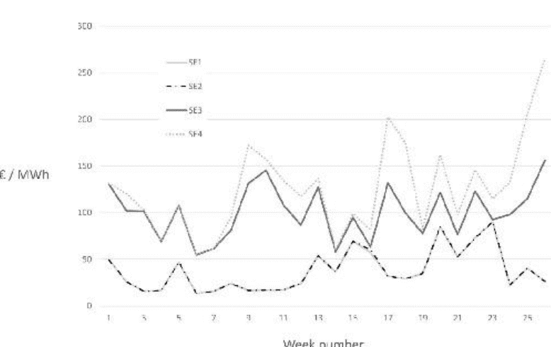

**图 5.1** 2022 年上半年瑞典四个竞价区域的周平均日前批发电力电价

**来源：** Nord Pool

瑞典使用的模型由于显而易被称为区域定价模型。其他使用此类模型的国家包括澳大利亚、意大利以及瑞典的两个北欧邻国——丹麦和挪威。但这不是基于位置定价的唯一模型。主要的替代方案是所谓的节点定价，例如在新西兰、新加坡和美国几个市场使用，在那里，网络被划分为数百或数千个特定位置的节点，每个节点都有一个独特的批发价格，理论上代表了该位置的供应边际成本。

对我们而言，关键点是，在像瑞典这样的国家，风电之所以能如此廉价地生产，仅仅是因为某些地区（瑞典的情况下是北部）土地廉价。但这种降低成本的因素也抑制了收入潜力：该国北部风电场低成本的是低于平均水平的当地批发价格。如果瑞典的风电开发商想以目前 SE3 和 SE4 提供的较高批发价格出售——而且当然，该国采用基于位置定价的理由之一正是为了激励在更靠近需求中心的地方开发——他们就必须以更高土地价格的形式为这种特权付费，从而导致更高的 LCOE。这在瑞典政府看来是市场经济的运作：不应该存在所谓的免费午餐。

然而，即使在采用基于位置电力定价的国家，免费午餐是否已完全消除仍然是一个未解决的问题。拥有这种定价的瑞典，风电场开发商仍然主要倾向于北部及其廉价的土地，正如没有这种定价但据说正在考虑的英国，可再生能源开发商也倾向于北部（特别是苏格兰）及其廉价的土地。

事实上，我们的观察可以更加坚定。至少目前，事实是，无论一个国家是否使用基于位置的定价，通常代表了可再生能源所在地（及其对廉价土地的渴望）与需求所在地之间显著的地理错配。值得注意的是，这包括那些未来脱碳轨迹对塑造全球结果具有不成比例的重要作用的国家。例如在中国，太阳能和风电高度集中在宁夏、黑龙和整个北部，而需求和需求增长集中在东部和南部。²2 在印度，可再生能源设施在土地廉价和人口稀少地区的集群现象可能更为突出，“30 个州中仅有几个州就占据了 90% 的注册太阳能和风电项目”。²³

与此同时，如果说可再生能源报告的 LCOE 往往在低方面具有误导性，因为可再生能源发电的地理位置可以——在很大程度上确实限制收入潜力，那么传统发电源报告的 LCOE 在高方面可能具有误导性，至少与可再生能源相比如此。

这里的关键问题是不同机型的相对成熟度。记住，LCOE 指的是发电的生命周期成本；即在发电设施整个生命周期内产生单位电力的平均成本。然而，经常进行的这种 LCOE 比较的一个问题是，这些比较在时间上还是空间上都是抽象的。正如观察者很少关注电力在哪里产生，以及这种地理可能意味着盈利能力，因此当考虑到发电相对于特定电厂整体生命周期时，他们并不太关注。

LCOE（平准化上网电成本）的比较是“公平”的吗？如果我们——作为一个社会——从零开始构建全球发电基础设施，或许确实如此：发电厂（无论基于化石燃料还是可再生能源）的整个生命周期成本都将面临产生。但显然，我们并不是从零开始。我们需要实施的能源转型的现实是，存在着大量的传统电厂基础设施，其大部分生命周期成本已经产生，因此用经济学家的术语来说，它们是“沉没成本”——已成为过去的历史，对正在进行的投资决策不再具有相关性。

当比较电厂生命周期内的平均成本时，可再生能源发电在纸面上看起来比传统能源廉得，这是完全可能的。

这种动态关系与之前讨论的行业结构影响以重要的方式相互作用。正如我们所看到的，理论上，垂直整合的电力供应商始终使用更便宜的发电来源符合其利益，因为更便宜的发电意味着更高的利润。但如果该供应商拥有的罗伯茨（Roberts）所描述的那类现有发电机组呢？那么计算方式可能会发生变化，正如美国近期涉及此类垂直整合公用公司的许多案例所明确的那样。

2022年，总部位于爱荷华州的中信能源（MidAmerican Energy）为四个州的超过160万客户提供服务，宣布了一项名为“风电优先”（Wind Prime）的计划，投资约40亿美元购买新的自有风力发电资产。但尽管如此，环保活动人士仍然……

为什么？他们说，一种主要使用太阳能的替代投资策略不仅能为中信能源的用户提供更廉价的电力，还能让公司更快地退役其运行中的煤电厂。然而，模拟了两种情景下中信能源收入和利润的顾问所暗示的，不退役那些煤电厂可能正是问题的所在。一位顾问得出结论：“风电优先”并不是为了脱碳。“风电优先”的目的是让中信能源的收入最大化。”25

那么，沉没成本将我们从空间问题转向时间问题——涉及到电力在哪里产生，而是在何时产生。事实证明，时间在另一个关键方面对收入和盈利潜力产生了影响，在本例中涉及短期而非长期。具体而言，生产的时间特征不仅在电厂生命周期内何时产生成本方面重要，在同样程度上，甚至更重要的是，在典型一天或一周内何时可以以及何时产生了电力方面重要。我们本章的实质性分析将考虑这将以及为什么会这样。问题的关键再次在于，尽管物理形式相同，但并非所有电力在商业开发能力上都是相同的。

随着全球各地的电力各种方式趋向市场和类市场安排（第2章），它们越来越适应了供需波动的节奏。当需求高涨时，价格往往会上涨。当供应受限或不确定时，价格也倾向于上涨。现在，供需的相对移动塑造了结果（当然，不是孤立存在的），无论市场和定价机制是什么：正如我们在第8章看到的，例如，即使是长期购电合同，其定价很大程度上也是根据供需经验和预期的。但供需的影响在发电厂日益出售其产出的竞争性现货市场上最为广泛和清晰，在这些市场中，价格可以在不同的时间尺度上发生并确实发生了显著变化。

在每周（及每月）价格波动方面，例如考虑图5.1，该图显示2022年上半年瑞典的电力批发价格不仅在南北之间不同，在时间上也不同，例如，在最南部的竞价区（SE4），价格从2月份的每周平均每兆瓦时（MWh）55欧元到6月下旬的约265欧元。与此同时，在小时波动方面，考虑图5.2。对于地理上位于欧洲两端的两个批发市场，它显示了图表创建当天（2022年8月18日，星期四）的次日前价格。尽管当天北欧地区（图中显示了其基准“系统”价格）的小时价格波动要大得多，但在西班牙也并非微不足道：价格从99欧元/MWh的低点（下午4:00至5:00之间）到189欧元的高点（晚上9:00至10:00之间）。

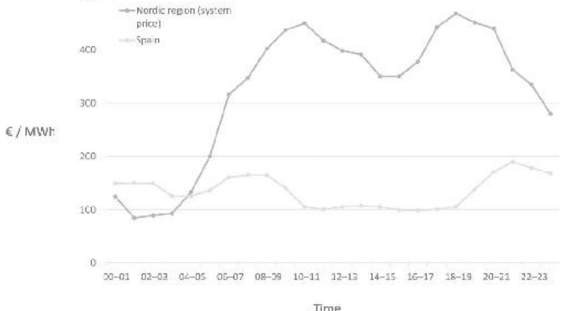

**图5.2** 2022年8月18日北欧地区和西班牙小时次日前电力批发价格

*来源：* Nord Pool, OMIE

这些价格时间波动之所以对我们研究不同发电技术相关的成本和盈利动态如此重要，当然是因为这些不同技术具有显著不同的输出特征：当它们能够并确实在发电时，无论是按小时、按天，还是按周和按月，差异都是巨大的。我们在第3章中简要讨论过这一点：某些类型的发电厂可以产生预测性、持续且一致的发电；另一些则更不规则，更不用说不可预测了。此外，仅仅因为电厂可以在特定时间发电，并不意味着它一定能将其调度到电网并以此变现。它的这种能力在很大程度上取决于需求状况和调度规则。我们很快将在第6章学习这通常是如何运作的。

结果，正如我们在第3章中看到的，我们国家整个发电部门充斥着各种不同的发电机，它们在整个供应系统中承担着不同的角色，例如，一些提供基准负需求，而另一些则作为“调峰”单元，在需求最高时帮助满足需求。

对于我们的目的来说，在故事的这个阶段，关键点仅仅是，不同类型的两个电厂即使它们在一年、一个月或实际上一天内生产的电力总量完全相同——即使它们在问题期间调度并出售了完全数量的电力——但仍可能从销售这些电力中获得收入。一个电厂不可避免会在平均水平高于另一个的时候生产并销售电力。这意味着，它产生的电力被市场认为更有价值，即使这些电力在物理上是不同的。时间、空间就是金钱。

事实上，图5.1和图5.2展示了电力定价在时间和空间上的波动，其程度足以产生一种明确的可能性：相对LCOE作为指导不同类型发电厂可能盈利能力的指南，基本上是毫无意义的。26 例如，低了10%的生命周期发电成本，毕竟由于其地理位置和时间输出特征，一个风力或太阳能设施电力的收入潜力可能比传统化石燃料设施产生的电力低了……的30%或40%。


当然，这一切都是为了将我们对不同类型发电设施净收入潜力的考虑限制在电力本身的销售上。然而，正如我们在书前面的部分看到的，许多国家拥有不仅交易电力的市场，还交易发电容量的市场——即在接到短时间通知时能够发电的能力。例如，在美国，这种容量市场很常见，

容量电支付通常占发电厂收入的很大比例。

其意义何？所有在容量市场中活跃的发电厂都是传统的化石燃料发电厂。从净收益潜力方面来看，可再生能源发电厂与传统发电厂之间完全是苹果与橘子的区别，更深层次的意义在于，它们拥有完全不同的收入机会。2020年进行的一项研究发现，仅在美国一个电力地区（PJM 中部大西洋市场），就有约 18 GW 的煤电容量如果不是因为这些容量所获得的容量电支付，将变得不具备经济效益。诚然，平准化度电成本（LCOE）是不可同类比较的。

简而言之，难怪公司致力于开发风场和太阳能电场，而银行开始决定是否以及以何种成本为这些开发提供融资——LCOE 数字在现实中确实是他们首要考虑的问题之一。

## VI

让我们最后回到挪威中西部，以及 Statkraft 及其开发伙伴在 2015 年 6 月决定停止计划中的 600 瓦 Fosen 风电场的开发。正如我们在章节开头看到的，其解释是更新后的分析表明，该项目预计无法盈利。

但究竟为什么不盈利呢？发生了什么——或者预期会发生什么——缓解了对足够财务回报的预期？主导可再生能源前景的主流讨论和分析的叙事——即我们在第 4 章中探讨的叙事——认为，如果问题是经济性的，那么必然是生产价格问题。也许在挪威，利用可再生能源生产电力尚未（目前）比……便宜

但不。问题完全不是那样。问题在于预期收入。仔细观察图 5.3 所示，Fosen 所在的投标区域——NO3 的批发价格发生了什么。从 2014 年中期的每兆瓦每时约 30 欧元，月平均价格到 2014 年 9 月已升至 36 欧元，巧合的是这正是 Statkraft 声称项目正在全速推进的月份。然而，随后价格开始下降。到 2015 年 3 月，价格降至 25 欧元。6 月份，价格崩塌至每兆瓦每时 15 欧元以下，这是三年来的最低水平。正是在那时，Statkraft 彻底放弃了项目。在这样一个低迷的市场环境中，风电有利的 LCOE 并没有产生哪怕一丝的影响。

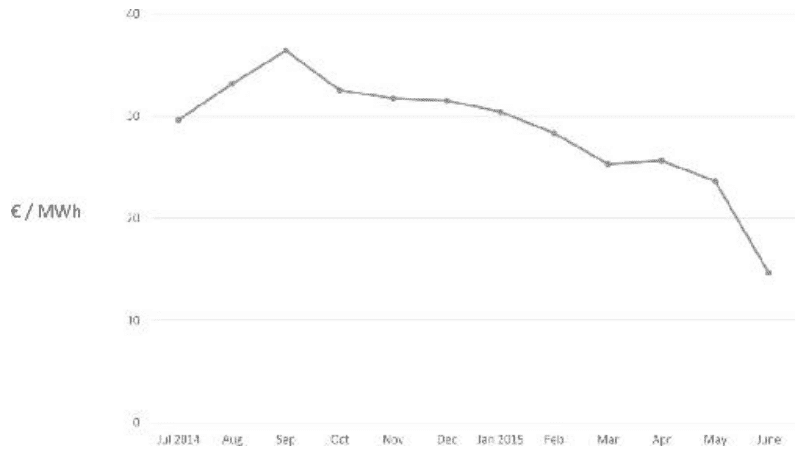

**图 5.3** 月平均日前批发电力电价，NO3（莫尔德/特隆海姆），2014 年 7 月–2015 年 6 月

**来源：** 北极电网

我们现在知道，相对的发电成本并不意味着有足够的预期利润来促进对新可再生能源开发的投资，特别是对于那些在特定国家主要活跃于发电部门的参与者，特别是在该国盛行的行业结构（无论是否垂直整合、是否具有竞争性等等）的背景下。我们知道，这就是为什么“相对价格”的解释教条是错误的。

但是，在理解利润实际上是如何决定的、哪些因素塑造了利润预期以及这些因素反过来如何影响可再生能源投资——在过去、现在以及可能的未来——我们仍有许多未知。例如，在实践中，电价是如何准确设定的，特别是在世界上日益增长的批发市场中？行业成本的变化如何影响行业收入？开发人员及其融资方能够多准确、多远地预测可再生能源收入并从而预测回报？太阳能电场和风电场的实际和预期盈利状况如何？这对于正在进行的由私人资本主导的电力部门去碳化前景意味着什么？这些是我们现在转向关注的关键问题。

# 第 6 章 荒野西部

2018 年，英国陆上风电业发生了非常的事。其容量从十年前的不足 500 兆增长到 2017 年的近 2.7 GW，根据行业协会 RenewableUK 的说法，新容量的年装机量突然“暴跌”。¹当年新增的新容量不足 600 兆，仅由分布在 54 个场地的 263 台涡轮机组成，下降了约 80%。这是 2011 年以来的最低水平。

那么，发生了什么？什么——或谁——对此负责任？第一个想到的罪魁祸首可能是英国政府。但正如我们所看到的，三年前这与成本无关。事实上，2018 年的英国，批发价格正朝着相反的方向健康增长。它们年初的价格为每兆瓦每时 50 英镑；到年底一度曾接近 70 英镑。

然而，无论向哪里看，项目都未能启动。在全国范围内，挖掘机基本上处于停滞状态。

## I

要理解任何特定历史和地理背景下太阳能和风能的命运，必须理解当地的电力业务——即电力生产、分配和消费的当地政治经济条件；这是本书的核心信息之一。自 20 世纪 90 年代初以来，英国电力部门经历了根本且剧烈的重组过程，涵盖了第 2 章调查的所有元素，从拆分到去垄断、私有化和市场化。理解 2018 年英国陆上风电业发生情况的关键，是这些元素中的最后一种——市场化。

如今，英国拥有世界上市场化程度最高的电力部门之一。此外，从核心要素来看，英国所出的特定市场化模式恰好是世界其他地区日益趋同的模式。我们特别关注英国的批发“现货”市场，以及物理上通过该国输配系统输送并在该市场上进行次日交付交易的电力部分；即使在像英国这样最自由化的电力部门中，部分物理接入系统的电力也没有在现货市场上进行交易——相反，它们可能通过长期购电协议直接卖给电力供应商或终端用户。现货市场是如何运作的？

我们可以通过解决两个更具体的问题来处理这个问题。首先，谁的电在进行交易？例如，想象在某一天特定时间的用电需求非常低，而连接到网络的发电公司有能力并愿意共同提供远高于需求的电力。出口到不同的物理输电网络（可能是海外）——当然是排解“过剩”输出的一种可能，但我们现在暂不考虑这种可能性。

（总是必须如此），那么是谁的输出被交易并进行了物理调度，而谁的输出没有？

我们的第二个问题更容易表述。电力在现货市场是以什么价格（或哪些价格）交易的？换句话说，现货市场的电力买家——主要是向零售市场终端用户转售电力的电力供应商——支付了多少钱，而生产这些电力的发电厂反过来收到了多少钱？

在英国，与其他使用相同基本模式的国家一样，发电厂会针对特定的结算周期（例如每半小时或每小时一次）准备报价，并说明它们预计在该周期内产生的电量以及愿意出售的价格。这些报价被提交给系统运营商——在英国的情况下是国家电网系统运行运营公司（National Grid ESO）——由系统运营商来决定哪些报价将被接纳，以实现供需匹配，从而决定哪些发电厂将发电并进行物理输电。

系统运营商利用自动化软件执行这一操作的方法，是对发电厂的报价进行排序或“堆叠”（stacking），从最便宜到最贵排列。由于其责任是调度总成本最低的发电厂组合——这种方法被称为“经济调度”——运营商会接受从便宜到贵的的所有发电厂报价，直到累计承诺供应量满足预期需求。这种具有递增报价的电厂在任何时候为市场提供电力的序列被称为“优序”（merit order）。所有为了满足需求而需要发电的工厂都被描述为“在优序内”；更贵的、发电的工厂则在优序之外。

关于该模型需要注意的首要关键点是电力是如何定价和交付的；这并不是优序内的发电厂简单地按其报价获得支付。相反，特定结算周期内交易的所有电力都是平等定价的，这种统一价格（又被称为批发价、现货价或交易价格）代表了所有被调度发电厂中报价最高者提供的报价，即优序中最贵的生产者。这种定价机制被称为“单次清算机制”（single-clearing price mechanism）。

为什么由最贵的发电厂决定了所有人收到的价格？这是一个很好的问题，在 2022 年底本章起草时曾引发人们困惑，因为当时欧洲（包括英国）的电价创了历史新高——我们之后会回到这个问题。标准的解释是《经济学人》最近向读者提供的：“正如在任何其他同质商品市场一样，电价是由最贵的供应商设定的。”换句话说：发电厂提供的是相同的东西，因此收到的报酬也应该是相同的。

关于该模型需要注意的第二个关键点是问题决定了不同发电厂如何报价——即它们如何对其报价进行定价。常识认为，报价反映了发电厂各自的成本。例如，英国能源与气候情报部门在一份解释性入门手册中所述的那样，发电厂“提交能够准确反映其成本的报价，因为它们深知，如果报价被接纳并发电，这些成本将得到覆盖”。该手册继续道：“报价过高面临着无法进入堆叠序列的截断点的风险，因此无法在[结算]期间获得任何收入”。

此时，读者的脑海中可能会响起警报，他们会想起上一章中一个关于发电成本与利润之间关系的关键问题。发电成本的降低——例如被人们广泛且热情地归因于可再生能源——是否意味着利润相应地提高，从而使得投资此类新型发电设施的意愿也随之增加？人们通常认为情况确实如此。但我们对优序的初步了解已经引发了另一种结果的可能性。如果报价反映成本，那么较低的发电成本是否意味着较低的报价、较低的批发价和较低的收入？

无论如何，标准理论认为进入优序报价是基于发电厂的边际成本的，具体来说，它代表了边际定价的例子，即产品或服务的边际成本是提供额外一个单位的成本。但是，尽管这种理论被广泛引用为定论和通用法则，它并不需要实际上也无法适用于可再生能源，即使它被经常地扩展到这些领域。光伏和风力发电厂的边际成本实际上为零，因为没有燃料成本。因此，如果此类电厂按照边际成本报价，

它们的报价价格将为零。然而，这显然不是零。决定可再生能源运营商所报价的成本主要是摊销前期资本投资的成本，通常表现为支付给债务提供者的费用——这并不是边际成本。

在这一阶段，在我们观察该模型如何帮助解释 2018 年英国陆上风电装机量急剧下降之前，需要强调的第三个也是最后一个关键点，涉及该模型应用的地理范围。作为一个基本的经验法则，一个国家的电力部门自由化程度越高，就越可能拥有一个运行方式与英国现货市场大体相似的批发市场，该国生产和消耗的电力中很大一部分实际上在现货市场上进行交易的可能性也越大。然而作为组织电力交换和定价的一种，英国所使用的模型绝非通用。

因此，在许多地方该模型目前至少是缺失或处于边缘地位的，包括世界上一些最活跃的电力市场。中国和印度就是典型的例子。在这两个国家，定价仅实现了部分市场化，大量的定价权仍保留在省级和国家层面的法定或监管实体手中。在两个国家，通常使用价格以外的准则来确定调度顺序。在两个国家，所发生的市场化通常涉及长期双边合同，而非多边交易。最后但同样重要的是，这一切在两个国家都呈现出地区差异。

简而言之，除了澳大利亚、新西兰、智利等其他自由主义者以及美国和加拿大的部分地区，欧洲（包括英国）如今代表了我们所描述的现货市场的核心。

## II

基于优序调度的电力现货市场的特征是价格波动，它存在于所有时间尺度，从极短期——从小时到小时，到长期——从月到月甚至从年年至。如果不认识并理解这种波动及其影响，就无法理解发电去碳的政治经济学。事实就是如此。

我们在上一章中看到了这种波动的强有力初步证据。图 5.1、5.2 和 5.3 都展示了证明现价高度波动的数据。这种波动的最短尺度是小时级的：图 5.2 显示了北欧地区和西班牙在正常一天内的价格显著波动，其中前者尤为剧烈。我们观察波动的下一个尺度是周的，表现为瑞典批发电力市场四个不同地区平均电价每周的巨大波动（图 5.1）。最后，图 5.3 展示了挪威莫尔/特隆赫海竞价地区现价从月到月的波动。

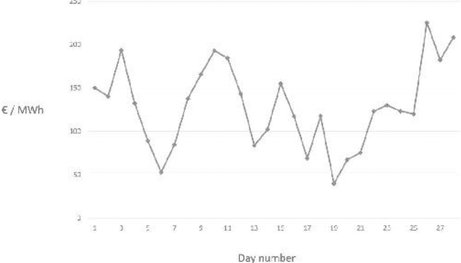

**图 6.1** 2022年2月德国日前批发电力电价。**来源：** Nord Pool

当然，如图 6.1 所示以及第5章包含的三张图表，电力现货市场价格的波动在某种程度上是简单的、未区分的供需动态的结果，即与发电源无关的整体电力供需。正如我在第5章中提到的，例如，供应与（特别是需求）的差异，在很大程度上解释了图 5.2 所示的日内波动：价格往往在一天中两个需求高峰的时段（清晨和傍晚）达到峰值。

但未区分的供需动态作为解释变量时，其作用是有限的——事实上，作用非常有限，尤其是考虑到在更长时间跨度上的价格波动时。这种波动根源于前节详述的特定市场机制的本质，特别是这些机制调节不同类型电力供应的方式。这具有两个关键且相互关联的维度。

首先，问题在于哪个发电源提供了在任何结算周期内平衡总供需所需的关键“最后”单位电力。回想一下，优序调度（merit order）根据报价对竞标者进行堆叠。由于不同的发电源具有不同的成本和成本结构，而且报价反映了这些成本，通常情况下，由于不同的发电技术在优序“堆栈”中层层排列的。换句话说，最低价格的报价通常来自某一特定类型的发电机，下一高价格段的报价来自另一类型的发电机，随着堆栈向上移动，以此此类推。例如，在本文写作的时间和地点，即2022年的北欧，可再生能源发电机的报价通常最低，因此是首批调的，随后——根据需要——依次是核电、煤电，最后是天然气发电。

正如我们所看到的，特定结算周期内所有发电机接收的批发价格，是优序中且已调的发电机中报价最高者的价格。因此，如果可再生能源电厂能够满足所有需求，那么批发价格将由可再生能源的价格决定。但在另一个极端，如果电力需求很高、无风无日，且核电和煤电也不够——也许是因为出于安全原因核电被淘汰，出于环境原因煤电被淘汰——那么批发价格将由天然气的报价决定。

这种性质的转变——从由可再生能源设定的现价变为由天然气设定——可能会频繁发生、不可预测地发生，并发生在较短的时间范围内。当然，如果可再生能源发电机与燃气发电机报价之间的差距很小，那么这种转变发生时对市场批发价格的影响微乎其微。但在天然气价格高昂且燃气发电厂具有相应高边际运行成本的时期，差距实际上可能变成一个剧烈的鸿沟。如果风速突然下降，系统运营商需要调度前一天还处于闲置状态的燃气厂，电力价格可以在24小时内跨越数量级。这正是巨大的波动。

以我居住的瑞典地区——Nord Pool 的 SE3 地区为例。再以本章初稿准备的特定时期，即2022年8月后期为例。温暖多风的天带来了充足的太阳能和风能，但在很短时间内就变成了静止且明显寒冷的天气。因此，系统运营商——国有公司 Svenska kraftnät——被迫在同样短的时间内向报价栈中大幅攀升，以获取足够的电力输出来满足需求。某一天，优序中的所有发电机都是可再生能源电厂；而第二天，燃气发电厂突然进入优序，并燃烧天然气，其价格由于乌克兰持续的战争以及相关的天然气市场动荡，已经飙升到令人心惊肉跳的水平。

SE3 地区价随之产生的日变化有多大？接近 100%！8月21日，日前价格为每兆瓦 38 欧元；到8月22日，涨到了 372 欧元。在世界上任何地方，还有什么其他产品会经历如此剧烈的价格波动吗？

然而，即使设定电力现货价格的发电源身份没有发生变化，巨大的波动仍然是可能的，尽管其尺度是周和月，而不是小时和天。这带我们进入电力在现货市场中极端价格波动的第二个关键维度。如果第一个维度与优序中最后单位电力交付源的变化有关，那么第二个维度则与特定源相关的成本（即报价）的变化有关。

正如我们在书中多处看到的，利用太阳能或风能场、实际上是核电站发电的成本可能会随着时间的推移而降低。但此类成本在周或月级时间跨度上的差异程度，与人们在传统发电厂中经常发现的差异相比完全不上。后者成本差异的原因很简单：商品（即燃料）价格本身往往具有高度波动性。作为证据，只需看 2020 年初的欧洲，在那里对传统发电厂起最大作用的燃料——天然气，其价格异常波动。例如，图 6.2 显示了 2021 年年中至 2022 年年中英国月平均日前天然气价格。

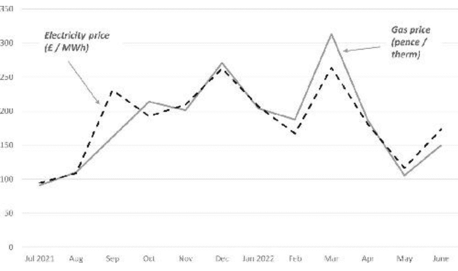

**图 6.2** 2021 年年至2022 年年中英国月平均日前天然气价格。*来源：* Ofgem

（注：图说明文字原文破碎，已根据上下文和逻辑进行了重建。）

无论如何，核心教训如下。这两个因素共同导致了这种波动，以至于各种评论人士将其称为“荒野西部”批发市场。这是一个很贴切的名字。

## III

我们分析的下一步是考虑现货市场特征波动所产生的影响，特别是对新发电能力的影响。一旦我们完成了这一步，就能很好地解释 2018 年英国风电投资的下降。

这里要开发的观点可以非常简单地表述：在缺乏价格稳定机制的情况下，现货市场的波动对英国等地方的可再生能源投资产生了深远的寒蝉效应。简而言之，对于所谓的“市场风险”——即完全或主要通过波动的市场价格销售可再生发电的风险——存在深层且具有影响的规避情绪。

对荷兰霍斯特北海岸（Hollandse Kust Noord）离岸项目的参与，恰恰考虑到价格波动性。8 “其本身”显然是一个重要的免责声明。

但正如我们在第三章看到的，开发者群体是一个杂乱无章的群体，在核心的既有——通常是保守且规避风险的——参与者之外，还有大量较年轻的运营商，他们对风险表现出截然不同的观点。“创业精神”一词在如今这种新自由主义时代被滥用了，但它实际上很好地描述了许多小型、新兴可再生能源开发者的风险导向。他们处于初创阶段，经常会倒闭，而且确实力求改变世界——简而言之，就是富有冒险精神。是的，此类开发者倾向于说，电价可能会下降——但也可能上涨，所以让我们关注上行空间和相应的利润潜力。

因此，在大量参与新可再生能源项目的各种参与者中，通常并不是开发者本身对波动性风险最抵触，而且正是由于开发者自身的这种抵触，在私下抑制了投资。相反，当可再生能源项目因为对价格波动性风险的抵触而枯萎时，决定性的抵触通常来自另一个参与者——银行家。

当此类项目的潜在贷款人看到价格图表正如我们在过去几页中考虑的那样时，他们往往会迅速变得退缩。为渴望的发电厂提供建设债务融资的机构，在考虑是否提供贷款时，心中只有一个问题：接收方能否履行其支付和偿还义务？大规模债务融资业务与人们所想象的创业精神完全不及：它是冷酷、客观、计算性的理性。银行家想知道借款人将产生多少发电、按照什么时间表，因此其还债能力将如何。在未来收入流和还债能力的可知性方面，现货市场价格波动对于银行家的计算来说是纯粹的眼中钉。

诚然，如果银行家诚实地面对这种抵触，他们将无所形。“商用项目”——那些将全部或大部分产量按商用价格出售到现货市场的可再生能源项目——对[贷款人]而言固有挑战性，”一位金融人士在2017年观察到。9 雷蒙德·吉福（Raymond Gifford，一位美国公用事业律师）及其同事同年指出，这类项目往往仅对“最高风险的投资资本”具有可接受性。10 最近，一家向欧洲可再生能源开发者提供主要贷款的机构高管这样描述：“通常情况下，我们不喜欢商用风险。”该高管继续道：“一段时间内，我们对承担商用风险有一种一刀切的拒绝。这在目前的情况下并不太实际——但我们仍然不喜欢它。”11

正如这些引语所示，银行有时愿意为可再生能源领域的商用项目融资。但往往仅是具有极高风险容忍度的银行。更重要的是，考虑到风险敞口，这种贷款不可避免地增加了借款人（即开发者）的成本。当吉福和他的合著者解释这一逻辑时说，“投资者理所当然需要更高的预期回报，通常在百分比的中位到高位，以补偿在高度周期性行业中投资的风险。”12


# 从贷款人视角看可再生能源融资障碍

从贷款人的角度来看，这如何运作在以下陈述中得到了进一步阐述，该陈述来自另一位银行家，他与提到一刀切拒绝承担商用风险的个人一样，在一家在可再生能源市场活跃的欧洲银行工作。“我们不喜欢吸收电价波动，”此人解释道，“我们会承担商用风险——现在我们往往没有选择——但我们会收取三倍的费用。”该个人在被追问时说，这意味着，银行不是将`5%`的利率进行变动，而是要求`15%`的利率。为什么？“低回报和波动是行不通的。世界上没有哪个银行会在低回报下承担电价风险。”[^13]

## A – 价格波动对“感知可投资性”的影响

也许在自由化批发市场的领土上更快速建设风能和太阳能的主要障碍，现在正成为焦点。尽可能精确地描述这一障碍的准确性质至关重要。这种障碍并不是想要投资可再生能源的金融资本匮乏。即使是对当代能源投资环境最粗略的了解也足以证明资本既充足又充满热忱。

相反，障碍是价格波动对开发中项目“感知可投资性”的影响。从本质上，没有足够的项目在收入风险水平上被潜在融资人认为是可以接受的——或者至少是那些融资人准备以开发者愿意支付的资本成本进行投资的项目。金融投资领域用来描述项目感知可投资性方面质量的词汇是“银行可行性”（bankability）。另一方面，国际可再生能源机构早在`2018`年就关注到了银行可行性问题。“市场上并不缺乏优质项目的资本；然而，缺乏具有银行可行性的项目来吸引投资并满足今天对可再生能源项目的胃。”[^14]

这里真正、根本关乎的是不确定性问题。正如第五章简要提到的，凯恩斯经济学正是针对不确定性问题提供了一些最有力且最有用的见解。这种经济学的一个核心主题，正如`J. W. Mason`所写的那样，“经济过程是非遍历的——它们发生在历史时间而非逻辑时间中，而且在每个概率术语下，预测许多未来发展都没有理性依据”[^5] 正如凯恩斯所，投资者通过假设人们的预期与未来的不可知性达成了一种脆弱的平衡。

但，如果所有投资都是不确定的（事实确实如此），那么对可再生能源的投资遭受着双重不确定性。一方面，我们一直在讨论的内在价格波动放大了更一般的不确定性。此外，这一事实是——向可再生能源的转型——是一种转型，而转型不仅是由不确定性特征化的，而且是由不确定性定义的。重大转型，正如`Mason`所说，构成了基础性的而非偶然性的不确定性，特别是由于凯恩斯习惯做的假设是`16` 可服务的的。

鉴于此，在自由化批发市场的领土上更快速建设风能和太阳能的主要障碍，现在正成为焦点。

## 化石燃料电厂与可再生能源电厂的融资差异

这种市场现象即使是偶然的，也值得关注。无论如何，这里的观点是：在当今已拥有自由化批发市场的地区，全球范围内许多化石燃料发电厂在融资时，并未考虑到此类市场特有的价格波动性。当时这些市场尚未存在。

与此同时，对我们问题更具意义的答案是：在前景再生能源设施与传统发电设施之间，就现货价格波动对此类资产融资能力（bankability）的影响而言，实际上存在着重要差异。如果今天在像英国这样大部分电力通过现货市场销售的国家开发传统电厂，此类市场的波动性并不会对电厂的融资构成威胁，远未达到让再生能源融资陷入困境的程度。但为什么会这样呢？

不庸说，银行对价格波动的担忧是出于负面考虑。他们担心批发价格实际上会低于发电厂为了偿还建设贷款债务而所需的水平。然而，对于例如一座新建的燃气发电厂与一座新建风电场相比，这种担忧要轻微得多。回到`图 6.2`就可以说明这一点。

当现货市场电价下降时（在英国等国家也是如此），气价也随之下降。事实上，正如我们所看到的，前者的下降恰恰是因为后者的下降。这种意义在于，天然气——作为燃料——是燃气发电厂的主要运营成本。因此，资助燃气发电厂的银行对于价格波动可以更加从容。诚然，电价以及此类电厂获得的收入在某些时刻可能会下降，但极有可能，在这种情况下，该电厂的成本也随之下降了；因此，从利润角度来看，这是相互抵消的。

本质上，优序调度（merit order dispatch）的使用以及天然气作为最后单位调度电力的主要来源的地位相结合，为燃气发电厂提供了一种特定的收益与成本动态的对称性。在金融术语中，这存在一种内在的对冲（hedge）。这种对冲——一种抵消或平衡风险的机制——缓解了电厂开发商，更重要的是缓解了融资者对电价波动的焦虑。

再生能源电厂没有这种内在对冲，因为它们显然没有燃料成本。在建设后的多年里，运行太阳能或风电场的主要成本是偿还为建设而募集的债务，而这种成本通常是固定的：无论电价是每兆瓦`20`英镑还是`200`英镑，它都保持不变。

因此，随着气候危机的升级，燃气发电厂继续建造的原因不止一个。在解释这一现象时，评论人士通常指向诸如因素，如资源不足（人们说再生能源具有间歇性，因此只要存储解决方案不完善，我们就无法依靠它们来供电）或化石燃料部门的工具性权力（游说和其他利益集团机器的运作，正持续影响着政策制定者）。这两个因素显然都是任何令人满意的解释的一部分。但我们的分析表明，这种解释还包含一个简单的经济因素。在拥有先进电力批发市场的国家，燃气发电厂在某些方面仍然比再生能源设施更容易融资，而且——这个从句至关重要——如果电价比再生能源更贵的话。市场设计解释了原因。

## 外在对冲机制的必要性

鉴于再生能源缺乏对价格风险的内在对冲，人们会预期已经探索了外在对冲机制，并在某种程度上予以实施。此外，鉴于融资者特别关注价格波动，人们还会预计此类机制被专门设计出来，以提供某种程度的价格稳定性。

这种价格稳定性确实是贷款人的隐性需求，其程度不亚于他们对波动的厌恶。一位银行家在评价太阳能和风电投资时观察到：“如果没有能够偿还大部分债务的保证性收入流，我们就不会参与。”[^20] `Triodos Bank`的`Philip Bazin`则解释道：“这一点很清楚，如果没有市场机制，（再生能源的）资本成本将会增加。”[^21]

最稳定的价格是什么？当然是固定价格。因此，对于再生能源市场中更厌恶风险的参与者来说，允许固定价格的对冲机制代表了某种圣杯，显著增强了融资前景，尽管不一定能保证这一点。反过来，从开发商的角度来看，正如`Iberdrola`离岸再生能源负责人`Jonathan Cole`所说，固定价格开启了获取资本的途径，这“比你必须将交易风险加入项目的其他风险中要廉得多”。[^22]

因此，本章前几节讨论引发的第二个问题是：有哪些外在对冲机制已经或正被为再生能源开发商及其财务支持者提供价格和收入稳定性？或者换句话说，引入了哪些导向稳定性的机制来使原本不可投资的项目变得可投资？

此类机制存在三大主类。具体而言，发电厂可以通过双边购电协议（PPA）出售电力，在许多情况下，这允许在很大程度上免受价格波动的影响，且通常跨度长期。这些协议代表了足够重要的现象，值得进行专门处理。它们是第`8`章的内容。

第二种机制涉及实际的——即财务——对冲。假设一个再生能源开发商提议建造一个新的太阳能发电场，并将电力售入现货市场。如果由于投资者对未来电价波动的担忧而无法获得负担得起的融资，它的可选方案是使用一个或多个能够抵消波动风险的金融工具。

此类工具有多种。最常见的之一是期货合约，这是一种在预定日期和价格买卖资产的协议。如果现货市场波动对这些头寸不利，他可以通过在期货合约上采取卖出（“空”）方来对对冲。如果现货市场价格下跌，允许以固定价格出售的合约价值通常会随着变动现价的下降而上升。此类期货合约往往是欧洲发电公司进行财务对冲的首选工具。

在北美，掉期（swaps）更为常见。这是双方交换现金流或负债的合同。掉期基本上是期货合约的替代品，具有相同的效果：担心电价下跌风险的一方可以通过进入一个在价格下降时支付的掉期协议来抵消该风险。电力掉期在德克萨斯特别常见。德克萨斯产生的大部分电力通过其现货市场销售，确保项目融资能力的对冲机制的需求也相应巨大。“缅因州和纽约州等州的风电场使用[掉期]对冲合约来涵盖它们向`NY ISO`和`ISO New England Inc.`市场出售的部分电力，”`Michael Copley`在`2015`年强调道，“对风能对冲是一个德克萨斯的故事。”[^23] 在`Copley`引用的几个例子中，包括`Pattern Energy`的`283 MW Gulf Wind`，它与`瑞信`的一家子公司签署了为期十年的掉期协议，以对其向德克萨斯市场出售的`60%`电力进行对冲。

到今为止可再生能源行业的发展史，正是它最终让我们能够破解本章开头所面临的英国陆上风电之谜。当然，这种机制是政府干预。

# V 政府干预与价格稳定机制

正如我们在第`4`章中看到的，全球各国在努力刺激风能和太阳能投资方面，已经使用了各种不同的工具。这些工具以不同的组合方式，既被用于电力很大程度上通过现货市场销售电的国家，也被用于那些既不存在此类市场、也仅交易极少数电量的国家。我们关注的是，这些工具是否成功（或未能）缓解了现货市场给可再生能源发电厂带来的价格波动。

事实上，意识到某些工具并无助于对冲价格波动风险是非常重要的一点。例如，考虑一下许多国家（包括欧洲的许多国家）在历史上使用的“证书制度”，这些制度用以增加可再生能源发电者的收入，从而抵消此类发电厂所面临的成本劣势。通常，这些计划为可再生能源产生的电力提供收入溢价。例如，如果某个现货市场的“正常”电价每兆瓦时为`40`欧元，那么风电可能会因为其产品是绿色能源而额外获得`2`欧元的收益。但这对波动没有任何帮助。如果现货价格从`40`欧元跌到`20`欧元，风电场每兆瓦时的收入就会从`42`欧元下降到`22`欧元。

任何形式通过补贴建设成本来提供支持的工具，对价格波动同样没有帮助。例如，美国长期存在的投资税收抵免（ITC）涵盖了投资于可再生能源项目的资本总额的百分比。这对于开发商来说无疑是巨大的帮助，但即使有建设成本的支持，如果业务计划的可行性需要长期电价持续高于例如每兆瓦时`40`美元，那么当现货价格跌至`30`美元并维持在该水平时，ITC并不会防止电厂出现亏损。相反，它的作用是降低了盈平衡现货价格的水平，如果没有税收抵免，这个价格可能是每兆瓦时`50`美元。

相比之下，基于价格控制的政府支持工具显式地提供了稳定性，尽管并非所有工具都是如此。上网电电价（FiTs）及同类工具是这里的典范。读者可能记得第`4`章提到过德国是FiT的先驱。德国在`2000`年引入了这种固定价格电价，从而为开发商和他们的财务支持者提供了`Stephen Gross`所说的“难以置信的稳定性”，消除了“几乎所有投入可再生能源的风险”。尽管在欧盟政治经济治理框架下，这种支持机制的合法性仍存在小小的问号，但当欧洲法院在`2001`年对FiT赞绿时，`Gross`表示，投资德国可再生能源的风险“完全消失了”。德国给太阳能运营商的电价尤为慷慨。`Gross`观察到，“这是历史上第一次，大规模投入资本到太阳能领域变得有利可图。”他说，“现在投资（德国）太阳能已经不可能赚钱了。”

相反，英国从`2010`年开始向可再生能源发电厂支付电价。其FiT计划最终被淘汰，并被所谓的“差价合约”（CFDs）取代，但CFD作为一种滑动的上网电价补贴形式，其最终效果大致等同于FiT。发电厂与政府（本质上）签订长期合同，在合同有效期内规定了一个约定的固定“执行价”。然后，在合同有效的年份，它在现货市场出售其产出。但，如果现货市场价格（“参考价格”）低于执行价，发电厂将获得差额补偿；而如果参考价格高于执行价，发电厂必须向计划返还差价。换句话之，发电厂收到的净价在实际上始终是执行价。

其CFD的目标显式地为了鼓励金融投资，而其设计用于实现这一目标的机制是缓解价格波动，这一点英国政府从未比这更清晰：“CfDs通过减少发电厂对波动批发价格的风险敞口，通过为发电厂提供更大的收入确定性和稳定性，从而激励投资。”换句话说，使用CFD（以及FiT）在干预和塑造金融市场方面的作用，与其在塑造电力市场方面的作用是同样大（甚至不分）的。事实上，`Gross`在反思德国这一具有里程碑意义的案例时更进了一步，认为该国著名的FiT计划与其说是一种电力市场工具，不如说是“一种筹资工具”。

鉴于金融机构对于支持进入现货市场销售电力的可再生能源项目的谨慎态度，植根于此类市场的价格波动，因此正如预期的那样，这些机构对提供价格稳定性的政府支持工具明显优于那些不提供稳定性的工具。一位银行家表示，上网电价及类似工具“为你提供了收入稳定’，‘这是关键所在。”因此，它们是可再生能源投资者的金标准。

同样，掉期和期货合约等金融对冲工具在德克萨斯州等地之所以如此重要，原因之一正是因为美国长期推崇的再生再生能源政府支持形式——ITC和生产税收抵免（PTC）——并没有提供价格稳定性。这并不是说政府支持是误导的，更不是无关紧要的。恰恰相反；它是不可或缺的。但在德克萨斯这样一个电力主要在现货市场交易、因此价格波动随处不在的地方，税收抵免在历史上是必要的，但通常不足以产生项目的银行可行性。

简而言之，尽管政府资助极具吸引力，但对于降低成本形式提供的政府资金（ITC），税收抵免并未缓解市场风险。

转向——而且事实上，结果如此——这种支持通常被指责为一种政府慷慨，左翼人士应该从原则上对其进行或多程度的反对——这本质上是给那些最不值得获得的人（即私营部门投资者）提供的慈善。[^32]

但可再生能源的去风险并不一定意味着政府的慷慨。正如我们在英国的差价合约合约（CFDs）中看到的，这些计划不仅可以支付资金，还能回收资金。此外，在某种程度上，去风险是广泛必要的。正如德克萨斯州等案例所示，如果政府不介入提供收入稳定性，就必须找到其他稳定性来源。

无论如何，如果预计在市场化电力部门投资可再生能源项目时，金融机构会强烈支持缓解波动性的政府支持机制，那么同样预计，当此类支持被撤销时投资会发生的情况也是可以预料的。只要上网电价补贴（feed-in tariffs）等机制提供了至关重要的保护伞，人们想象，如果这种保护伞被草然移除，使开发商及其财务支持者暴露在现货市场波动的冷风中，对投资意愿将产生明显的寒蝉效应。

我们是否有关于这一事实在实践中发生的良好历史案例？有的，其形式之一正是我们本章开始时提到的投资崩溃。正如我们所看到的，英国此前一直在增长的陆上风电年装机容量在`2018`年突然崩溃，同比跌幅高达`80%`。这种崩溃的原因不是成本增加、电价下降，也不是官僚主义的窒息。崩溃的原因不是政策的转变为。

在`2017`年，针对英国新陆上风电项目的唯一政府支持计划仍然有效——可再生能源义务计划（Renewables Obligation scheme）在当年关闭。与此同时，此类项目被禁止参与新的CFD计划。正如`Henry Evans`观察到的，由于被剥夺了任何“市场稳定机制”，它们被突然置于“市场的波动之中”。[^33]

相关利益相关者的反应完全在预料之中：他们大规模退出新开发。时任苏格兰电力（Scottish Power）首席执行官`Keith Anderson`是当时英国领先的陆上风电开发商和运营商之一，他通过直言不讳（但辞藻并未因此减弱）为整个行业及其支持者表达了私营部门的观点。`Anderson`说：“如果你认为我正在以批发电价的商业风险建造一个价值`25`亿英镑的风电场，那你就是疯了。”[^34]

# VI 地理聚焦与全球趋势

在本章中关注的是与预期收入和利润的不确定性相关的可再生能源投资障碍，这些不确定性特别植根于市场和价格波动。因此，我们在地理位置和主题上都做了重点，因为只有世界上部分地区拥有我们所讨论的这种实质性市场和价格波动的电力部门。

对这一地理重点多做说明是重要的，至少因为如果不这样做，可能会导致书籍被指为“全球北方中心主义”。读者们有权提问，既然世界人口的权重和未来电力用电量的预期增长都集中在其他地方，为什么却关注欧洲、北美和其他具有显著自由化和市场化电力系统的国家呢？

该问题的答案部分涉及当前的电力用量。本章描述的类型电力部门的国家，通常其人均用电量，以及通常发电产生的温室气体排放量远高于全球平均水平，仅凭这些理由就值得对条款进行审查。

但答案的更重要部分涉及世界其他地区的发展方向。也就是说，理解高度自由化和市场化电力部门国家的可再生能源投资的经济影响至关重要，因为这是其他国家日益采用的结构性模型。换句话说，当今世界已经是电力发电和分配组织的常用方法，在未来可能会成为更加普遍的方法——从而加倍了应对它的重要性。简而言之，世界正向电力现货市场、价格波动以及随之而来的可再生能源发电预期盈利能见度的问题移动，而不是远离它们。

作为例子，简要考虑三个对全球温室气体排放未来轨迹至关重要的国家，因为它们的人口众多，且目前电力供应和使用水平极低（预计将大幅增加），或者拥有极高碳密度的发电部门（需要大幅脱碳），或者二者兼有——即中国、印度和尼日利亚。

无疑，一些评论家对这些国家最终在多大程度上采用本章研究的此类机制持怀疑态度。例如，能源经济与金融分析研究所（IEEFA）的`Norman Waite`认为，中国对于“拥有像西方那样的‘西部西部’电力市场没有兴趣”，而且即使中国的电价最终是“市场决定的……政府的手将限制波动”[^55]

也许如此。所有积累的证据表明并非如此，对于印度、尼日利亚以及中国本身。`Anders Hove`在`2020`年写道，“中国政府仍然关注长期促进[能源]市场的发展”，这在很大程度上基于“在欧洲和美国有效的市场模型”。[^36] 广东是中国用电量最大的省份，它于`2017`年率先尝试了电力现货交易，并在`2021`年底开始持续运行，此时其他省份也已经在开展试点现货市场。

`2022`年中，中国南方启动了一个区域一体化电力市场，涵盖五个省份（其中包括广东），并结合了现货和期货交易。这一启动与政府发布其最新五年计划相吻，该计划特别取决于从“政策驱动模式”的预期转变。[^37] 与此相反，中国的政策流向都在一个方向。正如`Monica Sun`及其同事在五年计划发布时观察到的，“目标是在`2025`年建立[全国性]电力市场的初级阶段，并在`2030`年前建立一个能够适应可再生能源并增强市场参与者竞争的改进后的全国统一电力市场。”[^38]

与此同时，在印度，发电与配电公司之间的长期协议一直主导该行业，政府计划让该新兴现货市场的交易份额到`2024`年初就增长到`25%`左右。在写作期间，据报道政府还在考虑引入竞序调度。

最后，在尼日利亚，政府于`2013`年启动了一系列电力部门的基础性改革，最初包括尼日利亚电力管理局的私有化并将其拆分为发电和配电公司，但最终计划是实现成熟的现货市场。实现这一终点的一个关键站点发生在`2020`年，尼日利亚电力监管委员会发布了竞序调度指南。该调度机制现在已全面运行。

# 7 自食自肉


# 石油气行业与气候变化的博弈

石油气行业吸引了各界的批评者和反对者，因为在过去的几十年里，它一直维持着照旧的经营模式，尽管气候变化以及其活动产生的其他有害后果的证据在不断增加。其中最令人惊讶的批评者之一是罗马天主教会。自2013年取代其保守的前任本笃十六世以来，现任教皇方济各多次谴责全球在气候问题上的拖延，并借此引发了化石燃料部门的愤怒。2015年初，埃克森获悉教皇计划撰写一份专门针对气候变化的通谕，西方最大的石油公司埃克森美孚（`ExxonMobil`）据报道派遣了一名代表前往意大利梵蒂冈进行游说¹。事实证明这是徒劳的：这封通谕——副标题为“关于我们的共同家园”——于当年5月24日发布。

三天后，在大西洋彼岸的达拉斯，教会与石油行业之间的争斗开辟了新的战线。埃克森的年度股东大会于5月27日举行。在特定股东提交、由全体股东投票的八项提案中，有一项是由总部位于密尔沃基的方济会修士会“圣约瑟夫卡普奇方济会省”发起的，该组织拥有价值约2000美元的埃克森股票。他们的提案是向公司董事会增加一名气候变化专家。修士迈克尔·克罗斯比在会议上对该提案的解释道：“这家公司，必须为未来做计划。”²

在董事长兼首席执行官雷克斯·W·蒂尔森（`Rex W. Tillerson`）的领导下，埃克森董事会建议股东反对该提案。他们表示，不需要这样的专家。他们成功地动摇了投资者。只有约五分之一的股东投票支持这项措施。

与此同时，在会议进行到此时，蒂尔森开始进入他的主题，在直接回应这位方济会煽动者时，他选择了回答另一个被提出的相关问题：埃克森为什么不在可再生能源上投入更多？蒂尔森的回答非常犀利。“至于投资可再生能源，坦率地说，克罗斯比神父，”CEO在热烈的掌声中说道，“我们选择不故意亏钱。”³

# 可再生能源投资的核心困境：预期利润的不确定性

我们在第6章中看到，在具有批发现货市场的自由化电力部门国家，投资可再生能源产能的一个根本限制是对于预期利润的缺乏透明度和可预测性。基本上，没有人知道电价会发生什么——电价波动剧烈——或者因此，知道卖给现货市场的发电厂收入会发生什么。

总结回顾这些发现时，需要特别强调一点——预期利润。本书的观点绝并不是在电力市场自由化的地区（目前在全球范围内如此）经营风电场或太阳能发电场绝不是一项盈利的业务。它通常是盈利的；事实上，它有时可能是非常丰厚的。要点在于，对于一个可能大量暴露于市场风险的发电设施，无法可靠地预知任何利润情况。该设施可能极其获利，但同样可能遭受灾难性的损失：价格波动就是如此剧烈。这很重要，因为在资本主义经济中，预期利润是做出投资决策的衡量标准。

如果在这种自由化的能源市场中，很难预测特定的太阳能或风能发电场是否会盈利，那么从事后角度来看，对于可再生能源发电厂确实证明能够持续盈利的情况，我们还能说明什么有意义的话？最显著且重要的事实是，绝大多数此类案例都有一个共同信号或特征，无论是在批发现货市场销售，还是在长期合同下销售（例如在印度主要是这种情况）。这一共同特征是政府对可再生能源的有效支持，即我们在前面的章节中研究的那些类型。它是唯一的恒常因素。

证明这是因果关系而非仅仅是相关性——即政府支持实际上在支撑和维持可再生能源发电厂的盈利方面起着至关重要的作用——并非完全易事。鉴于发电厂利润的过度决定性，很难想象如何以一种在分析上稳健的方式分离政府支持机制对发电厂利润的影响。同样，政府往往受到厌恶，因为私营部门的收益（无论能源或其他行业）是由纳税人资助的，尽管我们很快就会遇到这一规则的例外。

然而，有时（通常是静静地），公司自身也会承认“市场外”力量对实现经济回报是多么至关重要，我们将从这样一个公司的例子开始讨论。这家公司是美国的新世代达能源（`NextEra Energy`）。

# 案例研究：新世代达能源的政府依赖性

新世代达能源的历史可以追溯到20世纪20年代，主要作为一家经典的受监管“电力公用事业公司”，也就是说是一个垂直整合的实体，在发电、输电、配电和销售拥有区域垄断——在它的情况下是在佛罗里达州。但在千年之交，该公司开始了一时期激进的扩张，主要进入佛罗里达州以外美国州的非化石燃料发电资产，包括德克萨斯州。该公司此前被称为佛罗里达电力与照明公司（`FPL`），在2010年将公司名称改为新世代达能源，尽管保留了`FPL`品牌。

如今，新世代达能源自称是全球最大的风能和太阳能可再生能源发电商。在2021年底总计24.6 GW的发电容量中（其中2%位于美国境外），80%以上是可再生能源，其中风电跨越20个州，占16.5 GW。公司的太阳能设施更为分散——跨越29个州——但累计容量仅为3.4 GW⁴。

正如2018年《华尔街日报》的一篇标题直截了当的文章《绿色电力之依靠补贴生存》所观察到的，新世代达能源在建设其庞大的风电场和太阳能场时，不仅是可再生电力最大的发电商，也是政府授予的税收抵免最大的获得者——这些抵免在建成时（投资抵免）或发电时（生产抵免）授予，新世代达能源“将部分卖给其他想要降低税单的公司，并将其余部分留给自己”。报纸实际上将新世代达能源描绘成一家从国家吸血的公司，将其策略描述为“无情地利用政府支持”⁵。也许，在这段表述中，对政策制定者有一种含蓄的威胁：如果你抛弃税收抵免，就会面临不再对绿色能源进一步投资的风险。在这一切之后，报告发布了，2022年3月。总统乔·拜登重启美国可再生能源税收抵免的希望似乎命悬一线。`NextEra` 本来比任何人都更渴望让这种利益关系尽可能明确。

但政策制定者并不是 `NextEra` 证券公告的受众。投资者才是，而 `NextEra` 毫无含蓄地告诉这些投资者，为了使其项目在经济上可行并产生正收益，对政府支持的依赖程度并不低于（甚至可能高于）——根据他们的话——高层技能、健康的市场需求、有利的天气条件、高效的审批以及其他所有运营盈利性太阳能或风力发电场所需的所有要素。在隐含意义上，`NextEra` 甚至承认了《华尔街日报》对该公司的描述在很大程度上是正确的。

`NextEra` 也并不是第一个告诉投资者美国可再生能源利润完全取决于补贴的重大参与者。八年前，美国一代投资者可能比听任何其他人的话都更仔细听过过的人——沃伦·巴菲特（“奥马哈的预言家”）透露他的公司伯克希尔·哈撒韦（`Berkshire Hathaway`）也投资了美国风电场，并在在此过程中获得了税收抵免。他强调，后者并非偶然细节。巴菲特说，“这是建造[风电场]的唯一理由。没有税收抵免，它们就没有意义。”⁷ `NextEra` 在关于政府支持对可再生能源利润之必要性方面做出的类似承认，其特殊意义在于，这种承认出现在涡轮机和发电成本下降了近十年之后。

无论如何，在 2022 年年中拜登气候法案（《通胀削减法案`IRA`》）通过后的几个月里，由于其核心的可再生能源税收抵免长期延长条款，市场大幅上调了美国清洁能源公司（包括 `NextEra` 在内）的股票，这并不意外。华尔街认为，更多的税收抵免意味着更多的利润，对 `NextEra` 尤其是如此。埃里克·利普顿（`Eric Lipton`）在年底观察到，“没有哪家公司比 `NextEra` 更有可能从补贴中获益。”⁹ 正如利普顿所指出的，该公司对 `IRA` 的反应是迅速且大幅地扩大其投资计划，目标是在仅未来四年内额外建设 37 GW 的可再生能源。这无疑需要巨额的资金。但正如该公司总裁瑞贝卡·库贾瓦（`Rebecca Kujawa`）指出的，`IRA` 在很大程度上保证了 `NextEra` 现在投入运作资金的回报。她告诉利普顿：‘现在，我有了未来几十年实现盈利运营的可见性。’^10

# 政府支持的双刃剑效应：意外收益与政策风险

政府支撑可再生能源运营者利润的最重要事情之一在于，它能够并定期地为这些发电厂产生意外收益。事实上，对未来经济状况的某些预期——从利率到技术成本、土地成本和电价——总是被记录在政府实施的支持机制中；这些机制无疑是考虑了特定特征而设计的。当未来状况被证明与预期截然不同时（在电力领域确实如此），市场参与者的盈利能力也可能随之发生变化。

在第 10 章中，我们将深入探讨近期无疑是最显著、最广泛的、甚至可能是历史上从未出现过的此类结果案例——即 2021-2022 年天然气和电价飙升期间，包括英国在内的欧洲大部分地区选定的可再生能源发电厂似乎获得的意外收益。现在，我们将关注一个发生在十年前的更具局部性的问题。只需识别出涉及的关键问题即可。

## 西班牙案例：政策反复与投资者信心崩塌

2007 年，西班牙为可再生能源生产者引入了一套修订后的上网电价（`FiTs`）。事实证明，最重要的修订是，对于容量在 100 kW 以上、10 MW 以下的太阳能设施，`FiT` 费率几乎翻倍，这旨在刺激此前一直低迷的太阳能部门。^11 不用说，在进行这些修订时，政府假设了技术成本、容量投资、电价等的特定场景。

所有关键假设都被证明是完全错误的。采购风力机和太阳能组件的成本下降得比预期快。与此同时，且此相关，对新风能和太阳能容量的投资增长比预期更强，因为开发商和投资者寻求利用政府的支持。太阳能年总装机量从 2006 年的约 100 MW 跃升至 2007 年的约 0.5 GW，以及 2008 年的 2.7 GW。12 反之，在 2007 年到 2013 年间，西班牙太阳能和风能发电的比例从约 9% 增加到约 24%——这是当时欧洲份额最高的比例之一。最后，当国家在 2007-9 年全球金融危机后进入衰退时，电力需求暴跌。需求的下降和供应的激增不可避免地导致批发电价低于政府的估计。

由于市场的发展与假设不同，关键利益相关者的命运也随之改变。一方面，政府财政面临日益增长的压力。由于电价提高以及太阳能容量和产量的快速增加，`FiT` 计划下欠给太阳能发电者的资金很大，但批发——以及零售电价消费者仅支付了这些资金的很小部分。政府承担了大部分费用：支付给太阳能发电者的补贴在两年内增加了十多倍，从 2007 年的不到 2 亿欧元增加到 2009 年的 26 亿欧元。13

另一方面，随着技术成本的下降，持有政府补贴合同的可再生能源发电者所获得的利润飙升。意外的是，西班牙政府认为“过剩”利润是解决预算紧张的答案。在 2011 年到 2014 年，政府实施了减少支持的措施。首先，这代表了对承诺的背弃：曾被告知可以无限制享受 `FiTs` 的早期进入者现在被通知将停止。此外，法律具有追溯力，追溯到 2013 年，这意味着发电者必须偿还一个半年度的支持。

从西班牙案例中特别重要的一点是——尽管西班牙并非唯一在这一时期对旧合同提出异议的国家（捷克和意大利也是如此）——讽刺的是，政府抑制意外利润的可以理解的尝试，可能会损害支持机制的初衷：即激励新容量的投资。

“欧洲的可再生能源投资者，”Y Y 在 2014 年讨论西班牙案例时观察到，“面临着一个严酷的现实——政治家的承诺随时可能被撤回。”’15 开发商和他们的融资者现在由于对政府承诺的信任被破坏，而不在西班牙投资新的太阳能或风电场。许多投资者甚至起诉西班牙政府。16

这种不信任一直持续并发酵。“投资者就像大象，”克里斯托夫·琼斯（`Christopher Jones`）后来再次在西班牙和 2011-14 年事件的背景下提到，“他们不会忘记。”’17 在几年里，新投资实际上处于禁令状态，因此，在 2013 年达到约 24% 后，西班牙太阳能和风能发电的比例直到 2019 年底才略高于这一水平。基本上流失了六年，当开发商重新对西班牙市场产生兴趣时，银行——他们本身也是谨慎的、天生规避风险——由于他们对高风险的感知收取了更高的资本成本。

简而言之，政府支持机制与可再生能源行业的私营利润之间始终存在复杂且多面的关系。支持机制在减轻收益和开发风险方面对于实现利润是必不可少的，但这些机制本身代表了对持续利润的某种风险，因为政府给的也可以收回。西班牙等国家已经经历过这一点——正如我们所看到的，`NextEra` 也知道这一点。

# 可再生能源领域的“淘金热”动态与竞争性利润侵蚀

事实上，风能和太阳能在全球范围内的发展从开始就是一个充满讽刺的过程。我们刚刚看到的正是这样一个讽刺案例：政府支持可再生能源的政策不仅可以容易激励投资，也可以同样容易抑制投资。这是另一个讽刺，而且其意义更为广泛、更深远：当开发和运营可再生能源设施的丰厚利润可以、或至少看起来可以实现时，由这种（实际或表面的）可行性所激发的投资信心往往迅速引发一系列行动和事件，这些行动会以同样的速度使得丰厚的利润变得不可实现。

这种基本动态可以简单描述：高利润率——或更具体地说，高预期利润会吸引新进入者，促使投资者将投资从利润率较低的经济部门转移。随后，与这些新进入者的竞争将压低最初吸引他们的高利润率。

当然，这并非仅限于可再生能源领域的现象：它是资本主义经济的普遍特征，或者至少是那些允许资本在竞争性投资选择之间自由流动的经济体的特征。事实上，在低高利润部门之间转移投资是古典经济学的重点，在理论上——但仅在理论上——会导致各部门利润率的均衡。

然而，尽管这是一个普遍现象，但在可再生能源领域表现尤为突出。为什么呢？答案是，那些能够有效阻止资本大量流入盈利部门，并阻止随之而来的竞争加剧和利润下降的东西，在可再生能源领域是显而缺失的。这种东西就是垄断力量。

如果盈利部门的既得者有能力抵抗日益增加的竞争，有时可以维持平均水平以上的利润。但在开发和运营风电和太阳能场业务中，几乎没有垄断力量，几乎没有实质性的准入门槛。尼克·巴特勒（`Nick Butler`）精辟地指出：“[可再生能源]领域的准入门槛很低——任何人都可以成为电力生产者。”¹18 当然，这是一种夸张：显然，在实践中并非所有人都能，至少在公用事业规模生产中不是。但这一基本观察是正确的。正如我们在第2章看到的，在世界某些曾经渴望成为新发电者的企业曾面临重大准入障碍的地方（例如与接入输配电网络便利性相关的障碍），政策制定者已广泛消除了这些障碍。

结果是，在可再生能源被视为具有经济吸引力选择的地方和时期，活动可能会变得狂热。在本书编写的21世纪20年代初，美国无疑是首要地区。卡米拉·纳舍特（`Camilla Naschert`）在2021年观察到，美国可再生能源领域的竞争非常“激烈”¹⁹。此外，在一年后《通胀削减法案》通过之前，正如我们在`NextEra Energy`的案例中看到的，该法案导致私部门对理论上提供的利润产生了更大的信心。从2022年底开始，竞争进一步加剧，《金融时报》简单将其描述为“严峻”，而《华尔街日报》则报道了“可再生能源开发商之间日益的竞争……寻求以最低成本供电”。²⁰ 由于可再生能源投资的唯一重大经济障碍——不确定的利润预期似乎消失了，开发者敲开了各种负责审查许可和电网连接的机构的大门。例如，2023年的报道显示，电网运营商“被请求淹没”，有超过8000个拟议项目在排队.¹²¹

这里的关键点是，在像可再生能源领域这样准入门槛低的地方，资本主义固有的各部门命运的普遍性波动可能会被大大加剧。没有既得垄断来横扫热潮，竞争监测会迅速而有力地驱动回报。每当人们提到可再生能源“淘金热”——从2007年的西班牙到2011年左右的中国，再到2014年左右的印度（后者的热情根据一位运营商的话说迅速升级为“过度兴奋”）——资本主义丰饶的日子一旦开始就已屈指可数。²² 即使在确实存在的情况下，丰厚的可再生能源利润也很难维持多久。该领域的资深经济历史学家无疑以审慎的眼光看待拜登2022年气候立法引发的最新轮淘金热。正如事实所示，到2023年中，美国已有报道称由《通胀削减法案》引发的可再生能源竞争新潮正“推低利润……”“当竞争加强时，利润就会开始侵蚀，”古根堡分析师沙里亚·普尔雷扎（`Shahriar Pourreza`）说道²³

而且，尽管各种形式的政府干预经常有助于增加利润，但它们并没有阻止可再生能源行业在选择（或在被迫）这样做时通过竞争消耗利润。事实上，政府的“支持”机制有时会促进、甚至润滑通往底部的竞争过程。最好的例子是政府在分配可再生能源合同时广泛使用的竞争性拍卖程序。例如，2021年，英国政府拍卖新的海上风电项目海底租赁权时，投标者之间的“激烈竞争”导致海底权价格“高昂”，评论人士说，这将不可避免地导致“回报减少”²⁴

在加速行业利润侵蚀方面具有特殊意义的是，政府越来越多地用于上网电价及类似的固定价格输出合同的“反向拍卖”机制。在这种模式下，买方不是竞高价格（如传统的拍卖格式，如上述英国拍卖海底租赁权），卖方（在这种情况下是电力卖方）而是压低价格。例如，到2010年代中期，印度国内外公司对印度合同的激进竞标将价格推向历史低位。一位行业顾问描述极低价报价在全国的蔓延“像传染一样”²⁵

同样，多年后报道说，整个欧洲的此类拍卖已变得“竞争异常”²⁶ 事实上，这种竞争在印度已达到这种程度。²⁷

此时，显然有必要让我们回到第5章。在那里，我们大胆假设较低成本——正如在显示可再生能源平准化发电成本（`LCOE`）下降的图表中经常看到那样——如果收入下降幅度与成本相当，实际上并不意味着资本主义公司能获得更高的利润。

# III 短暂热潮后的长期低迷

因此，在短暂的热潮之后，追求利润的新资本涌入可再生能源设施的开发和运营，典型结果是供过于求，以及更长时间的低迷。这在2013年后的西班牙是显而易见的。正如我们之前看到的，不仅是风电和太阳能发电的投资，发电厂的利润也随之崩溃了；随后回报和投资持续下降的原因，固然是政府挤压现有支持机制，但部分也是由于这些机制最初引发的发电容量相对于消费需求的大量过度投资²⁹

21世纪00年代和2010年代早期，美国部分地区发生了一些事情。由于慷慨的税收抵免以及相关地区强制性的行业重组和市场自由化的推动，20世纪90年代末和2000年代初出现了可再生能源投资的热潮，这不仅由新型独立发电公司承担，还由传统的公用事业公司（如上述`NextEra`）寻求在其剩余受监管垄断领域寻求地理和产品多元化。但由于地区间互联连接的能力有限，像德克萨斯西部这样的投资热点面临着长期供应过剩³⁰

事实上，`NextEra`是少数坚持新路线的传统公用事业公司之一：在自由化区域市场中同样投资可再生发电资产的同类公司大多数放弃了，卖掉了这些资产并夹着尾巴回到受保护的区域垄断的安全风港³¹ 在2017年时，雷蒙德·吉福德（`Raymond Gifford`）及其同事将过去十年左右美国可再生能源领域的发展描述为“恶性循环”：淘金热心态引发了巨大的（尽管地区不平衡的）投资，导致了当地供过于求，进而压低了电价和利润。这些“条件”“损害了发电商的财务稳定性，并侵蚀了他们长期吸引和部署资本的能力”。32

直白地说，可再生能源发电领域的“自由市场”显然意味着拥有过度投资和亏损的“自由”。在西班牙和美国等国家，并没有中央规划机构来监督和协调新发电容量的整体投资，并确保可用运行容量在国家范围内及特定地区内大致匹配。此外，由于可再生能源的零星爆发，可能导致过剩等抑制利润的状况结晶，而在自由市场背景下，传统发电源并未被系统性地退役，这进一步加剧了这种风险。事实上，说它们往往无法退役也并不完全错误。一方面，不能依靠可再生能源随时发电，而且储能能力仍然不足。此外，法律和条约有时也会阻碍此类退役。最著名的可能是《能源宪章条约》，它涵盖了包括欧盟在内的五十多个国家，允许传统资产的所有者起诉立法或政策改革威胁到此类资产的政府。33


然而关键在于，当价格受到更多监管且容量投资在某种程度上是有计划的时，我们往往也会发现类似的“繁荣-崩盘”模式。中国和印度就是典型的例子。到20世纪10年代中期，在政府支持驱动的多年可再生能源容量大幅积累后，两国在可再生能源设施集中的地区都深受严重过剩的困扰。特别是中国，“正遭受着历史上最严重的产能过剩之一”。34

如果政府本应该协调这些事务，这为什么会变成这样？似乎有几个因素有关。首先，人们不需要阅读哈耶克的著作就能理解，中央规划者在协调经济方面并不比市场更擅长。更具体地说，这两个国家的特点是拥有一套杂乱无章的国家和省级规则与指南，这些规则往往互不对齐，从可再生能源采购的目标和配额，到各种试点市场机制的分阶段引入不等。例如，在中国，省政府通常拥有对投资规划的控制权，而中央政府则保留了主要的定价权。35 同时，印度现在拥有一个由五个区域电网组成的同步国家电网——这是世界上最大的电网——但许多能源政策仍由省级决定。在这种情况下，当投资条件看起来暗淡时，供应可能会迅速领先于需求，这种情况在中国发生过，并随后出现了“价格下跌”和“亏损”。36

繁荣引发的过剩的一个特别引人注目的症状是可再生能源限电（curtailment）现象。这指的是当当地供应超过当地需求时，强制减少太阳能或风电场向电网输送的能量，由于经济、技术或两者的原因，无法将剩余电力出口到有需求的地方。

在一个电力尽可能来自可再生能源的世界里，某种程度的限电似乎或多或少是不可避免的。太阳和风能是不可预测的，根据逻辑，宁可过度投资也不要投资不足。

尽管如此，在世界范围内，已经出现了持续性的可再生能源限电时期，其规模只能用过度乐观的利润预期（以及随后的崩盘）逻辑来解释，而非理性规划的逻辑。再次，21世纪00年代后期的德克萨斯就是一个早期的例子。近期的英国是另一个。2020年，苏格兰风电场产生的风电有20%被丢弃了。37 相比之下，德国、意大利和美国在2017年至2020年间的限电风电和太阳能份额在1%到3%之间。38

在任何时间任何地点发生的可再生能源限电程度显然受到当地调度规则的影响，也就是说，决定不同能源调度顺序的标准；在第6章讨论的“优胜顺序调度（merit order dispatch）”只是可能的方法之一。但是，如果可再生能源的过度投资（至少就短期内此类可再生能源的消耗范围而言）达到了足够大的规模，那么即使在可再生能源享有强制调度地位的情况下，实际上也会导致高限电率。

考虑中国和印度这两个关键案例。可再生能源在两国长期一直享有“优先”地位，这意味着只有在电网安全的情况下才允许限电，当传输线路达到安全负荷限制时，指示发电机降低输出。然而，在两个国家的过去五到十年里，限电率仍然达到了前所未有的水平——在中国西北部的新疆和印度南部的塔米尔纳德邦等某些地区高达40%或50%。39

当发生过度投资且限电率上升时，政策制定者有哪些选择？最紧迫的任务始终是建立地区之间的互联能力。这种能力的缺乏通常是解释为什么限电最初会升得如此高的重要因素之一：正如我们已经看到的，可再生能源发电机倾向于聚集在负载低廉的地区，通常远离需求中心，而大多数电力系统追溯到早期的基础设施投资时代——无法高效地从这些区域将大量可再生能源传输到后区域。因此，例如当限电在21世纪00年代后期成为德克萨斯州的一个重大问题时，它很快开始改善该州西部（大部分风场所在地）与该州东南部主要消费区之间的连通性，到2014年初，该州以约60亿美元的成本建造了约5800公里的新传输线路，能够携带18 GW的电力。⁴0

然而，除了升级电网的物理要求外，政府还面临一些艰难的经济选择。他们的选择必然会塑造未来的投资模式，事实上也是限电现象本身。一种可能性是观望并接受低迷——以及以限电形式表现的临时表现——顺其自然。因此，发电厂获得的是如果没有限电因素时本可以赚到的收益。在这种情况下，一些发电厂（可能是很多）将倒闭。

印度是采取这种达尔文主义方法的国家之一，那里对风能和太阳能限电没有补偿。美国的SunEdison是一个显著的受害者，它在太阳能容量上过度激进的报价——它在2015年赢得安得拉拉邦的50 MW拍卖——对迫使该公司在2016年破产起了重要作用。不得不说，这种对限电毫不妥协的方法以及发电厂面临的相关困难——总部位于加拿大的SkyPower Global是另一个在印度度过艰难时光的公司——可能会对投资未来发电容量的信心产生负面影响。国际能源署（IEA）报告称，到2021年，印度高限电和明显的政策缺失已成为投资者的“关键关注”，并引用了一项研究，显示每年产量损失2.5美分，太阳能项目的内部收益率（IRR）就会下降160个基点。⁴¹

越南是另一个陷入类似繁荣后困境的国家。2019-2020年，由于政府的大力补贴，太阳能装机量爆发式增长，随后很快经历了熟悉的崩盘，表现为“供应过剩”、“浪费性限电”（这对项目IRR是巨大负担）以及发电厂“无法按时偿还银行贷款”。传输系统老化、容量有限且未随增长的需求进行升级这已经足够糟糕了。新冠肺炎对需求的破坏使情况更糟：2021年10月，全国每日用电量仅占装机发电容量的40%。这导致了巨大的限电率。⁴²

与此同时，英国等国家采取了完全不同的限电方法，这些国家积极避开了印度和越南那样的达尔文主义。尽管英国是自由主义的堡垒，但其可再生能源发电商（主要在苏格兰）在不被允许全额发电时，历史上一直获得全额补偿。

据计算，仅在2021年一年，这种可再生能源弃电给英国消费者造成的年度成本就超过了5亿英镑。43

换句话说，在这种情况下，某种补贴被用来解决——或至少帮助解决——一个根源于另一种补贴的问题，即最初刺激对苏格兰可再生能源产能投资的政府支持机制。对于英国而言，长期来看问题在于，与其激励在更靠近需求中心的地区投资发电能力，从而可能缓解高昂的弃电水平，不如对弃电发电的补偿恰恰背道而驰。

# IV

因此，我们现在可以看出，在全球范围内，健康地投资可再生能源建设实际上面临着不仅一个、而是两个重大的盈利能力障碍。不仅随着全球电力部门市场化的推进和加深，盈利能力变得越来越波动且不可预测，而且盈利能力普遍也很低。除了在时间和地理上受限的案例外，太阳能和风能发电是一项准入门槛较少的业务，即使在国家支持下，通常也是一项低利润的事务。

对这一问题的认识已经积累了一段时间，尽管许多人尚未准备好承认它。2017年，雷蒙德·吉福德（Raymond Gifford）及其共同作者鼓励政策制定者至少“暂停”，考虑到许多发电厂显然无法“在当前市场条件下收回其固定成本”。44 这一评论专门针对美国背景，但问题显然要广泛得多。国际可再生能源机构（IRENA）在明年观察到，“在当今竞争的可再生能源环境中，利润空间越来越窄。”

问题是，有多窄？这个问题的答案显然取决于在何地以及何时观察。在某些地方和时期，利润空间已经窄到几乎不存在的地步，足以让可再生能源最坚定的支持者也感到不安。例如，2020年发布的一项关于2017-2021年建设的瑞典风场的研究发现，尽管该国可再生能源证书计划提供了收入贡献，所有者的平均股本收益在运营的每一年均为负。45

但此类局部案例显然提供了一个非常片面的视角。那么从更广泛的时间和空间来看，可再生能源运营商的盈利能力如何？事实上，公开的估计值通常集中在一个相对一致且紧凑的范围内。尼克·巴特勒（Nick Butler）在2019年报告称，“可再生能源的随取可用，意味着项目可以获得超过5-8%的回报。”46 同年，玛·墨奇（Emma Merchant）在讨论太阳能行业时表示，项目回报“通常在6到8%之间”。47 偶尔，估计值会比这略低：例如，2020年报告称太阳能运营商（尽管是在法国）的回报为4%到6%。48 但通常来说，在巴特勒和墨奇所确定的范围内，且几乎从未超过10%（除了2008-2010年左右受上网电补贴驱动的西班牙等特殊案例外），这似乎已成为常态，如果我们可以这样说的话。49

例如，2021年，卡米拉·纳舍尔（Camilla Nascher）表示，新项目的海上风电回报预计落在5.5-8.5%的范围内。纳舍尔引用了德国RWE公司首席财务官马库斯·克雷伯（Markus Krebber）的话，他是全球最大的海上风场运营商之一。克雷伯声称，一些行业观察者认为“未来几十年你可以获得远高于资本成本的回报”这种信念是“完全不合理的”。50 看来，克雷伯是对的。早在2022年初几个月，随着该行业内部“激烈竞争”，海上风电的“基准回报”实际上稳定在估计的5到6%左右。51 显然，可再生能源绝不是金矿。

值得注意的是，前两段中的所有估计都涉及主要位于全球北方的可再生能源运营。内部，富国家可再生能源项目回报面临普遍且日益加剧的压力，是2010年代后半部分可再生能源投资最重大趋势之一——即从全球北方向南方的地理转移。历史上，前者接受了大部分投资，但平衡在2015年左右发生了转移。2018年的一份报告指出，“在当时和2016年，发展经济体占据了可再生能源和燃料投资的大部分——在2017年，差距急剧扩大，发展中国家占了全球总量的63%，发达国家仅占37%。”52

与此同时，事实是，可再生能源项目的回报在绝对意义上并不普遍低，但在相对意义上也很低。事实上，从绝对角度来看讨论回报实际上毫无意义。我们之所以能够将例如低于10%的回报描述为“低”，唯一的原因是我们可以很容易想象或指出比这更高的回报。就像成本一样，回报在任何时间任何地方最终都是一种相对现象。正如我在前面的章节中所做的，认为将化石燃料和可再生能源的相对成本作为评估可再生能源前景的主要棱镜是错误的，这绝不是要完全避开相对衡量和比较分析。相反，这只是坚持相对平准化发电成本（LCOE）并不代表最相关且最有意义的比较标准。

我们关注的应该是相关的相对利润预期。任何投资都存在机会成本，因为将资本投入一个投资替代方案意味着放弃了所有其他方案（以及它们可能带来的回报），包括投资现金和类现金资产的这种无风险选项。

现在，在实践中，投资太阳能或风能的主要替代方案在不同公司之间差异巨大。正如我们在第三章中看到的，各种类型的公司都在开发和运营可再生能源设施，而不同类型的公司在考虑是否进行某个风电或太阳能项目时，会考虑一系列不同的替代方案。正如第五章强调的，通常情况下，可再生能源专家的选择非常直接——投资，或不投资。

在这里，有两个特定的群体值得我们专门考虑。首先是传统的油气公司，如美国的雪佛龙（Chevron）和埃克森美孚（ExxonMobil），以及欧洲的英国牌（Shell）和道达尔（Total）。这些公司被反复鼓励转向可再生能源——例如本章开头提到的方济会会士等行动主义投资者。加速这种制度转变被许多专家认为是有效且有序的能源转型的必要条件。

在预测利润时，假设了一个相对较低的价格（每桶50美元），但即使在该价格下，第一个项目预计产的内部收益率（IRR）也将达到15%，而第二个和第三个项目的 IRR将超过20%。^55 对于可再生能源及其微不足道的5-8%回报，在如此巨额利润面前，它们还有何机会？

例如，考虑挪威国家控股的油气巨头Equinor（Equinor）近期的经历。当整个道达公司正在敲定其在非洲和南美利润丰厚的碳氢项目计划时，Equinor正与其伙伴埃尼（Eni）和SSE公司共同敲定北海多格滩银行（Dogger Bank）第一阶段的开发计划。该公司在该项目中拥有40%的股份，运营后将成为全球最大的海上风电场之一。2021年6月，Equinor下调了其海上风电项目的预期回报率——从6%至10%下调至仅4%至8%。但专家进行的一项研究表明，针对多格滩银行项目，这一预期也过于乐观，计算出的预期IRR仅为3.6%，等同于至少十七年的回收期。^56

难怪次年当Equinor接触另一家欧洲石油公司时（该公司此前表示将转向低排放活动，但后来发现这种雄心与利润动机从根本上是不兼容的），寻求合作竞争加利福尼亚州岸的新型风电权，结果遭到了否决。据Jenny斯特拉斯伯里在2023年初的报道，BP对“其某些可再生能源投资的回报日益感到失望”，并因此计划“缩减其对可再生能源的高调推力”。4到8%的海上风电回报？谢了。当Equinor上门时，BP简而言之“望而却步”。^57 这个问题再次出现：在一个充斥着碳氢利润的世界里，可再生能源及其薄如纸的利润率还有何机会？

在新冠肺炎疫情初期的一段短暂时期内，油气的预期回报率下降到了与可再生能源预期回报率相当的程度。至少在环保主义者看来，这似乎是病毒扩散的少数幸事之一。随着2020年3月油价低迷在每桶25美元以下，油气项目的预期IRR跌至10%以下，使得风能和太阳能项目在纸上与此类项目具有了竞争力——分析师认为，即使油价维持在每桶35美元，这种竞争力也依然存在。^58 但无疑，碳氢价格并没有低迷多久。价格一回升，可再生能源的机会窗口似乎就此关闭了。

油气的盈利能力通常远高于可再生能源，这解释了为什么在20世纪80年代和90年代，石油气巨头们在启动可再生能源领域的首次尝试后，几乎就毫不留情地终结了——这些尝试是零散的、探索性的，且从无如此谨慎——这毕竟首要是商业决策。同样的比较逻辑也解释了为什么如今这些公司正以极其蜗牛般的速度转向清洁能源，以及为什么此类“气候友好型”投资在构成上是这样的——BP在这方面提到了氢能、生物气和电动汽车充电网络，其中每一个领域的预期回报都高于10%——而且越来越多地不再涉及可再生能源发电。

如果有人在气候危机的这个阶段仍认为石油巨头会为了气候的祭坛牺牲利润，那么壳牌首席执行官威尔·萨万（Wael Sawan）最近针对“他是否认为可再生能源较低的回报对其公司可以接受”这一问题的回答，将彻底消除他们的幻想：

> 我认为在低碳方面，我的态度是坚定的。无论从事任何业务，我们都会追求强劲的回报。我们无法为低回报提供辩护。我们的股东应该看到我们追求高额回报。如果在业务中实现了双位数的收益，我们需要考虑是否应该继续这项业务。绝对，我们想要继续追求更低、更低、低的碳，但必须是盈利的。^59

萨万的前任CEO曾将他的声誉押在将壳牌从一家油气公司转型为更环保的发电公司上，而此时美国的碳氢巨头们却固执地坚持碳氢。萨万现在是对市场对这两种截然不同的策略的明确评估。一位记者指出：“五年前，当壳牌启动低碳转型时，其市值比埃克森美孚（Exxon Mobil Corp）少400亿美元。现在，这一差异超过了2000亿美元。”60

发电是壳牌所有业务中内部收益率最低的领域。^61 受到华尔街对其公司此前转型的严厉指责的警醒后，萨万在2023年上半年将壳牌转回了油气。欧洲巨头们上游勘探活动显著复苏的惊人景象中，壳牌居于领先。2023年中，据报道，钻井平台的日租金已回到近十年来的最高水平。^62 与此同时，壳牌及其同行正在严酷地裁减项目（包括风电项目），萨万的一位关键下属证实，可再生能源必须“赢回增长的权利”。^64

不言而喻，油气的盈利能力在历史上一直是该行业的特征。其一，政府支持表现为生产补贴（如税收减免）或消费补贴（主要是降低终端用户价格），或两者兼顾。^65 此外，尽管化石燃料价格受需波动，但实际上存在波动，尽管不像电价那样。因此，在世界许多地区，该行业有一段历史是为了稳定利润并鼓励投资。石油出口国组织（OPEC）正是这种大规模、长期且通常成功的案例。

程度各异。例如，如果风电发电建设贷款的利率是固定的（通常情况下都是如此），那么贷款人的回报——在假设没有违约的情况下——是预先已知且固定的，而所有者的回报将取决于整个生命周期内的收入和成本。

这两组回报之间的差异，特别是在考虑可再生能源项目的盈利能力和可行性时，究竟优先考虑哪方的回报，这一问题实际上是至关重要的。清洁能源的乐观者总是从开发商/所有者的角度来看待问题。因此，从这个角度来看，降低开发者的融资成本被视为战略首要任务，任何平均资本成本下降的迹象都被视为值得庆祝的缘由，只要这意味着项目在经济上更具可行性，从而更有可能实现。

但硬币都有两面性。一方的成本就是另一方的收入。对于开发者来说，较低的资本成本本质上意味着资本提供者的回报较低。如果可再生能源项目的启动与否完全由开发者、且仅由开发者说了算，那么这种较低的回报将并不重要。但正如我们看到的，最终做决定的并不是开发者。如果开发过程中的关键决策是贷款人是否发放信贷的决定，并且相应地，我们应该像从借款人的角度（甚至更甚）一样从贷款人的角度来看待回报问题，那么较低的资本成本可能并不是一件好事。在其他条件不变的情况下，它似乎会降低而非提高项目进展的可能性。

而且，在过去几年由于两个主要原因，通过融资能源项目的投资者回报确实面临着巨大压力，并导致通常呈下降趋势。第一个原因正是我们在本章中详细探讨的——风电场和太阳能电站本身的底层盈利能力非常薄弱。如果认为融资者可以从一项本身通常只有微利利润的活动中获得巨额利润，那是错误的。通常情况下，他们做不到，也不会这样做。

第二个原因与资本供应有关。将“环境、社会和治理”（ESG）标准纳入金融投资的理念，近期已成为左右派人士许多嘲笑的来源。

右派将其斥为一种“觉醒”（woke）的时尚，而左派则将其斥为仅仅是洗绿（greenwashing）——即作为照旧常事的商业修辞掩护，也就是说是坚决肮脏的投资行为。

现实情况如通常一样，比任何一方所允许的都要复杂得多。诚然，许多投资者继续资助化石燃料公司和其他对环境（及社会）破坏性的活动。然而，无论是否将其标记为 ESG，在过去的十年中，金融投资者对真正清洁投资机会的需求激增。这是一个简单的事实，而且投资者的主要兴趣可能更多在于低碳组合，而非碳基世界本身。

正如风能和太阳能发电领域的竞争会压低发电者的平均利润一样，此类发电活动融资领域的竞争增加也会压低融资者的平均利润。你有所有这些投资者，他们会说：“我如何获得下一个太阳能项目？”太阳能投资风险管理专家松井理（Richard Matsui）在 2019 年告诉 Emma Merchant。“现在是激进的人在获胜，”松井继续写道，而 Merchant 反而观察到，“投资者世界中的‘激进’意味着‘愿意接受较低的回报，这迫使市场上的每个人也转变自己的标准。”⁶⁶ 这样的故事日益变得普遍。随着资助可再生能源项目的意愿增长，从中可以获得的利润也随之受到挤压。

因此，不再存在（如果曾经存在过）可再生能源融资能提供高于其他资产类别的回报的情况——这是关于可再生能源表面上高于平均的回报的论点。这长期以来一直是公认的观点：正如诺埃·阿芒克（Noël Amenc）和弗雷德里克·布兰-布鲁德（Frédéric Blanc-Brude）所说，存在一种“持续的绿色风险溢价，绿色基础设施投资者长期可能会从中受益。”⁶⁷


不是。可再生能源确实可能有风险；这本书当然已经详细地论证了这一点。但正如 Amenc 和 Blanc-Brude 在计算数据时发现的，绿色基础设施的金融投资实际上并非与绿色收入溢价有关，而是与绿色成本溢价有关。具体而言，存在一种“绿色溢价”，投资者愿意支付以增加他们对该资产类别的敞口。正如可再生能源为能源公司提供了比石油和天然气更低的回报，也就是说，它们实际上为金融公司提供了比其他金融投资机会更低的回报。这种“溢价”的存在确实应该让我们停下来思考。银行和其他融资支持支持再生能源项目的意愿，似乎部分取决于他们愿意接受低于标准的回报作为绿色的必要代价。然而，关键问题是，这种投资者接受较低回报的意愿将延伸到多远。谁知道呢？但如果我们从金融历史中学了任何东西，那就是银行在所有资本企业中并不是慈善机构。如果我们可以确定任何事情，那就是他们支付所涉及溢价的意愿是有限的，并在某些时刻将会耗尽。

# V

2016 年 5 月 7 日，德国的 EPEX 批发电力市场发生了一件非常引人注目且初看之下极其异常的事情。每小时现货日前电价——特别是 5 月 8 日周日下午 2:00 至 3:00 的时段——跌至每兆瓦时负 130.09 欧元的历史低点。如果读到这句话让你揉揉眼睛，那是完全可以理解的：这一定是印刷错误，人们可能会这样想！但尽管听起来很荒谬，这实际上并不是印刷错误：那天的电价确实短暂跌至负 130 欧元。发电商实际上在付钱让买家接收他们的产出。到底发生了什么？

在过去的十年里，批发电力市场出现负价格的情况变得日益广泛和普遍。德国是这一现象最为人知的例子：其负电价小时数从 2016 年的 97 小时增加到 2019 年的 200 小时。但这种现象不仅发生在德国。在美国，加利福尼亚和太平洋西北地区等地电价转负的情况已持续了多年。与此同时，英国在 2019 年首次经历了负电价。次年，整个欧洲批发市场的负价情况足够频繁——约占时间的 1%——以至于一份报告将其称为“席卷”大陆.¹⁹

各种发电商可能会定期接受负价格。例如，考虑化石燃料或核电厂的情况。关机和重启这些电厂通常非常昂贵。如果此类电厂的运营商在特定时间预计批发很快就会转为正，它将愿意在有限时间内付钱而不是拿钱来发电，以避免关机和重启费用。也就是说，它将暂时接受负价，同时将输出降至电厂的技术最低。某些发电厂还有合同义务——例如容量协议下的平衡电——在电网运营商要求时提供输出，无论市场价格如何。此外还有热联产：如果此类电厂无法将热量与发电分离，那么在需要供热时，它们可能会以负价继续发电，或者如果后者的利润抵消了前者的损失。

然而，日益增加的负电价主要是与可再生能源相关的现象。让我们回到德国案例看看为什么。根据该国 2014 年修订的《可再生能源法》，可再生能源发电商进入现货市场，这种滑动溢价（类似于英国的差价合约方案，第 6 章）代表了固定执行价与平均每月批发现价之间的差异。在 2021 年欧洲天然气和电价开始上涨之前，德国可再生能源发电商的合同价格通常高于现价——也就是说，此类发电商通常获得补贴。例如，在 2020 年初，合同执行价平均高于每月现价每兆瓦时约 30 欧元。也就是说，可再生能源发电商平均获得每兆瓦时约 30 欧元的溢价。

因此，如果某个特定时段的现价恰好是（每兆瓦）20 欧元，那么平均可再生能源发电厂发电大约可以获得每兆瓦 50 欧元的。但如果现价随后变为负值呢？在每兆瓦负 20 欧元的情况下，平均太阳能场或风力发电场发电仍然是有利润的，因为溢价将抵消负价格的影响。正如德国联邦网络局（Bundesnetzagentur）解释道，“只有当负价完全抵消了市场溢价时，运营商才会出现负收益并关闭设备。”^70

电价机制与市场价格相互作用的精确形式在不同国家有所不同。尽管如此，只要可再生能源发电厂有权获得某种收益补贴，这些发电厂有时可以在负的批发价格下盈利地生产和销售电力，即使补贴支付并未与这些批发价格明确挂钩。

那么，我们应该如何看待这一现象？太阳能和风力发电场在负价市场环境下发电并销售电力的做法，最好被理解为更广泛动态的极端表现。这种动态可以表述如下：可再生能源发电成本的下降对整体电力市场价格具有抑制性影响——甚至正如我们刚刚看到的，导致了市场价格转为负值。

我们已经遇到了这种趋势的一个重要润滑剂。由于这些润滑剂仅拥有有限的垄断力量，且它们在一个准入门槛有限的市场环境中运行，可再生能源发电厂自身难以捕捉增量成本效益，而是目睹这些效益被竞争掉并向下游传递。

负价的例子现在指向了可再生能源成本降低导致市场价格下降这一趋势的另一个独立且相关的维度。这个独立维度涉及可再生能源的渗透率。可再生能源在整体发电结构中的渗透率越高，通常情况下，可再生能源的发电成本决定了整个市场的电力定价和收益。正如能源咨询公司 Cornwall Insight 在 2018 年的一份报告中所解释的，这正是为什么德国在 2010 年下半叶成为欧洲负价的家乡——因为其可再生能源的部署跑在了同行之前。随着网络中可再生能源容量比例的增加，低（甚至负）批发价格的出现频率也随之广泛增加.⁷¹

低成本可再生能源推广对电价的抑制性影响，在德国等使用功序调度（merit dispatch）的国家尤为显著，因为这种机制有效地将成本与收益的耦合制度化。正如 Cornwall 报告所言，此类国家可再生能源渗透率的增加越来越多地“导致高低效热电厂被挤到边缘，由更便宜、更高效的热电厂定价，或者可能所有热电厂都被挤出功序之外。”Cornwall 指出，“结果是在间歇性发电高峰期，价格非常低，有时甚至为负值。”⁷²

但这种价格抑制效应不仅是功序机制的现象。究竟，为什么可再生能源发电日益廉价且在多大范围内广受欢迎？在大多数情况下，这并不是因为庆祝者发现了发电公司赚取生产力收益的机会。而是因为他们信任并假设更便宜的发电最终意味着更低廉的批发和零售价格。因此，几乎所有政策制定者都从某种程度上确保随着可再生能源在发电结构中份额的增加，发电的廉价确实传递给了电费用户。

像德国的市场溢价之类的补贴往往加剧可再生能源发电成本对市场价格的抑制影响，因为它们奖励了可再生能源发电厂在没有显著需求条件的情况下发电。例如，英国政府的支持计划与德国一样，使可再生能源公司在某些条件下即使在负价下也能盈利发电，正如 Cornwall 报告指出的，这激励了此类发电厂“在市场其他时候过剩时继续生产……[这些计划]根据发电量为发电厂提供收益，赋予了最大化产出的简单特权。当发电厂不发电时不支付补贴，因此不发电存在机会成本。”⁷³

不用说，如果我们假设可再生能源成本的下降确实抑制了批发电力价格，并且供应商将这些较低的批发价格传递给用户，那么这无疑是一件好事——至少从用户的角度来看如此。然而，如果源于高可再生能源渗透的低电价对电费用户是有利的，那么对可再生能源投资的未来呢？这里的答案是：意义不大。可再生能源的推广越推动整体批发价格下降，希望建设世界下一代风能和太阳能发电场的公司就面临未来容量预期收益减少的可能性。再次引用 Cornwall 报告，批发价格的抑制“面临着抑制投资的风险”——正如 2015 年 11 月在 Fosen 发生的情况，读者会记得（见第 5 章）。事实上，无法想象这种做法不会增加上述风险。如果预期项目的可用收益下降，“这些项目将如何融资？”⁷⁴

这里还有一个密切相关的额外因素需要考虑。读者可能不会忘记第 5 章中的一个事实：考虑到批发价格的波动，两种不同类型的发电厂即使具有相同的发电成本并在给定时间内生产和销售相同数量电力，如果它们各自的输出在不同的时间（例如某天或某周）交易，获得的收益和利润可能会显著不同。正如各种研究发现的，当电价低廉时，在批发市场上销售的可再生能源设施的产量不成比例地增加.⁷⁵ 这是合理的：处于功序队列中位置较高、报价较高的传统发电厂，根据定义在价格低廉时不会被调度。现在对上述见解要提出的观点是，可再生能源设定市场价格的频率越高，发电厂受到这种价格抑制现象的影响范围就越广。

读者可能不会对这种悖论效应命名感到惊讶，即可再生能源通过成功取代更昂贵的传统技术并降低电价，反而可能损害其自身的生存条件。这被称为**自蚕食效应**（cannibalization effect）。

换句话说，仿佛到目前为止列出的与价格波动和内在低利润率相关的障碍还不够似的，还有一个进一步的问题要应对：即可再生能源倾向于“活吞”它们自己——或它们的后代——随着它们日益成为大众市场。

这一切的结果是，随着政策制定者旨在加速转型，他们越来越多地发现自己处于一种尴尬的境地，试图在过高或过低的电价风险之间寻找平衡。电价太高，消费者就会遭受痛苦，并合理地质疑为什么他们没有看到发电成本下降带来的益处。电价太低，转型的推进本身就会受到危及，因为建设零碳容量的经济激励减少了。政策制定者对自蚕食威胁的严谨态度体现在，各国在设计支持机制时，将避免此类自蚕食纳入了其明确目标之中⁷⁶

诚然，在能源市场嘈杂的噪音中，有时要识别出“蚕食效应”（cannibalization effect）的信号是非常困难的。是负电价——还是仅仅是低价？如果我们足够幸运的话，欧洲人在 2022 年市场动荡期间无疑会做出反应。蚕食效应被动荡所掩盖——或者更准确地说，被扼杀——这一事实并不意味着这种动态停止了运作。在背景中，它依然在那里，它的回声偶尔会在喧嚣中产生共鸣。

在那个时候，没有人想象到负电价还会再次出现。但能源市场是狂野且不可预测的现象，而且如既往地，这一次它们迅速让最受尊敬的专家的预测变成了笑话。事实证明，早在 2023 年 5 月——在能源转型的背景下，也就是说，就在眨眼之间——负批发电价已回到欧洲大部分地区。

## VI

到 21 世纪 10 年代中期，风能和太阳能的生产成本下降得足够充分且迅速，以至于全球许多政府都在考虑对路线进行重大调整。最初，考虑到可再生发电的成本相对较高，各国引入了补贴和其他支持机制；而现在，某些政府认为是撤销或削减此类机制的时候了。英国就是这样的政府之一：正如我们在上一章中看到的，它在 2017 年取消了对陆上风电项目的支持。两年内，多位评论员已宣布，向广泛的无补贴时代的过渡正在进行，并积极讨论其潜在影响。

减少或消除对可再生能源的政府支持引发了各种问题。但当然，有一个问题比其他任何问题都更突出。在缺乏实质性政府支持的情况下，风能和太阳能能否广泛地维持、甚至蓬勃发展？换句话说：在过去使这种支持如此价值的因素，在今天是否还具有部分或全部的相关性？或者有第三种也是最后一种观点：如果可再生能源日益成为一个由纯追求利润的私营经营者和自由市场机制组成的政治经济构体，它是否可能按照世界需要那样快速且广泛地发展？

在之前的章节和本章中，我们已经确定了这方面的各种理由。进一步的原因将在以后确定。但尽管如此，一些有影响力的评论员仍然乐观；他们认为，市场*可以*解决问题。我们现在转向第 8 章，看看对于许多此类乐观者来说，所谓的“灵丹妙药”是什么。

## 8

### 市场失败

现在该回到挪威了。在前面的章节中，我们考虑了两个不同的挪威陆上风电项目，一个位于南部的 Tellenes，另一个位于西部的 Fosen。在我们离开它们的时候，这两个项目的进展情况，前者显然比后者要好得多，走得也远。

Tellenes 的关键突破出现在 2016 年。由于多年一直无法获得贷款资助建设，该项目的开发商——Zephyr 和 Norsk Vind Energi——最终在那一年找到了愿意向他们提供必要资金的银行。实现这一目标后，正如我们看到的，开发商迅速将项目所有权转给了总部位于美国的巨型资产管理公司贝莱德（BlackRock）。在大约一年内，168 MW 的风电场竣工并开始发电。

与此同时，在 Fosen 海岸，开发工作在 2015 年中陷入了停滞。尽管计划直到 2014 年秋季似乎一直进展顺利，但项目的首席开发商——国有企业 Statkraft 突然叫停了程序。批发电价跌至每兆瓦时 15 欧元以下，这使得该项目是否能够盈利产生了怀疑；在那种冷淡的经济背景下，Statkraft 及其开发伙伴无法实现如果建设要进行的话所必须实现的目标——即从外部投资者那里获得额外的股权融资。

但 2016 年事实证明对 Fosen 来说也是突破的一年。出人意料的是，在项目被搁置不到一年后，Statkraft 宣布恢复项目。该项目经过了调整以提高盈利能力，通过在稍靠北、风力更大的地点规划更少但更大的涡轮机。而且至关重要的是，他们成功找到了一个新投资者：瑞信的能源管理业务部门能源基础设施伙伴（Energy Infrastructure Partners）向该项目投资了未披露金额的资金，占股 40%。这一成为欧洲最大的陆上风电场（装机容量近 1 GW）的建设立即开始，并于 2020 年完成，尽管这没有引起当地萨米（Sámi）社区的持续抗议。

那么，我们拥有了来自挪威不同地区的两个不同故事。然而，有一个至关重要的维度显然将这两个故事联系在一起。我们看到，在 Fosen 和 Tellenes，关键的僵持点都是筹集资金，在前者中是外部股权，在后者中是债务。正是这种资金的成功募集最终打破了每个项目的僵局。

此外，相似之处并不止于此。因为真正统一 Fosen 和 Tellenes——使它们各自的故事本质上成为同一个故事的——是关于这种新资金究竟是如何被解锁的问题。使用我们在本书前面的章节中学习的关于盈利能力和投资障碍的语言，在最终的衡量中，到底是什么让 Fosen 和 Tellenes 变得“可银行化”（bankable）的？为什么有一天被认为不可投资的项目，第二天（或者在 Tellenes 的情况下，是十多年以后）却被认为是可以投资的？在讨论 Tellenes 时，我们留下了这个问题。在 Fosen 的案例中，我们还没有触及该问题的核心。

答案在两种情况下似乎是相同的。具体来说，一家大型企业用电用户出现了，并签署了一份合同，购买未来多年拟建风电场产生的部分或全部电力用于自用——Tellenes 案例为十二年，Fosen 案例为整整二十年。这证明是决定性的。例如，在一次宣布对 Fosen 进行股权投资的新闻会上，瑞信董事总经理 Dominik Bollier 强调，正是这份长期购电合同“最终提供”了可银行性。这与 Tellenes 的情况类似。Zephyr 总监 Olav Rommett 观察到，一旦与购电方达成协议，“吸引投资者加入项目变得简单了”。

这些至关重要的电力买家是谁？在 Fosen，是挪威铝公司挪威水电（Norsk Hydro）。为了为其熔炼厂供电，合同规定在 2020-39 年期间每年供应 0.6 和 1 TWh 的电力，这在纸面上平均代表了工厂年度总产量的约三分之一。在 Tellenes，Zephyr 收购了该设施产生的所有电力，为其欧洲的数据中心供电，那个买家正是谷歌（Google）。

记得第 2 章，电力 PPA（购电协议）买家分为两种。第一类是电力零售商（有时也被称为电力供应商或公用事业公司）。零售商并不依靠批发市场生产所有转售给用户的电力，而是采购一些所谓的“公用 PPA”。

第二类主要买家是某种大型机构化用电用户，与上述转售商不同，他们购买电力是为了自用——从而允许他们在某种程度上精确地去除了这些转售商。这种协议被称为“企业购电协议（corporate PPA）”，但重要的是，尽管买方通常确实是私营企业，但并不一定要如此；关键在于购买电力是为了自身使用。例如，2019 年，20 所英国大学共同签署了一份为期十年的 PPA，以获取（并使用）由挪威 Statkraft 公司拥有的苏格兰和威尔士农场组合所产生的电力。次年，伦敦市市政管理机构——伦敦市公司与法国电力生产商 Voltalia 拥有的多塞特郡太阳能电场签署了一份为期十五年的购电协议。

尽管 PPA 已经存在了几十年，是传统发电和可再生能源发电领域的共同特征，但近期出现的（追溯到 21 世纪 00 年代后期）企业 PPA 大程度上是可再生能源领域的现象。从融资结构和电力交付安排来看，它们主要分为三种（图 8.1）。第一种是“套保”（sleeved）PPA，这是欧洲最常见的变体。在这种安排下，发电方和购电方连接到同一输电网，由输电运营商（收取费用）“套用”双方约定交换的电力。第二种是“合成”（synthetic）PPA，在美国更为常见，之所以这样做是因为购电方实际上并没有从发电方购买电力；他们甚至不需要连接到同一电网。相反，他们在现货市场进行买卖，但单独签署一份私人财务合同，通过对市场价格进行对冲，来复制直接购买的条款。最后，也是较少见且规模要小得多的是“私有线”（private-wire）或“现场”（onsite）PPA。在这里，发电发生在购电方的场所内或附近，电力直接从一方分配到另一方，而不是通过电网进行传输。

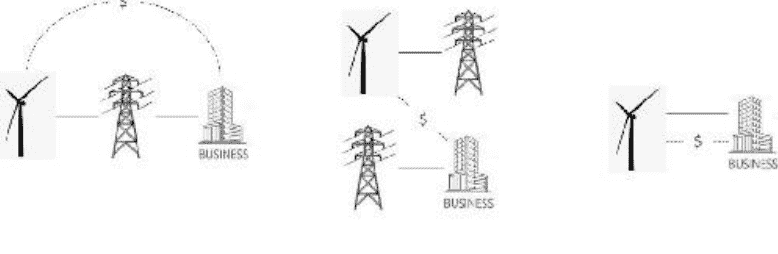

# 图 8.1 企业购电协议类型

来源：作者

在专门针对可再生能源发电厂的双边合同方面，过去十年的关键趋势显然是从公用事业（utility）向企业 PPA 的相对转变。这种转变首先且最快发生在太阳能和陆上风电领域。正如美国能源部 2021 年一份关于全球海上风电行业的报告所提到的，“直到 2018 年，传统的公用事业购电方主导了海上风电的采购”。但，即使在发电容量通常更高、因此需求预期通常更大的海上风电领域，企业 PPA 日益增长的角色现在也显而易见。过去五年交易频繁不断。例如，2019 年，北森布里水务（Northumbria Water）同意了英国首份海上风电企业 PPA，这是一份为期十年的交易，涵盖 Østed 公司 375 兆瓦 Race Bank 海上风电场约 30% 的发电。次年，亚马逊签署了一份规模相同的协议——即 Borkum Riffgrund 3 海上设施约 30% 的输出量，且同样为期为十年——其交易对象同样是 Østed 公司。

在太阳能领域，由于挪威 Fosen 和 Tellenes 陆上风电项目的开发商达成的输出协议而非公用事业 PPA，换句话说，它们是时代变化的非常明显的标志。自 21 世纪 10 年代初，企业 PPA 的重要性激增。在全球范围内，2012 年至 2021 年间，通过此类协议每年采购的风电和太阳能发电增加了百倍，从约 300 兆瓦增加到 300 吉瓦以上。

公用事业向企业可再生能源 PPA 转变的一个典型说明案例是美国——或者至少是美国那些垂直整合区域垄断传统电力行业运营模式被清除的地区。以德克萨斯州为例。从该州电力部门自由化的早期开始，公用事业 PPA 一直是一个核心特征。到 21 世纪 10 年代初，格局显然发生了变化。一方面，根据 Michael Copley 的报道，此类公用事业 PPA 出现了明显的、前所未有的匮乏。但另一方面，企业 PPA 开始取而代之，例如沃尔玛（Wal-Mart）从 Pattern Energy 在 Logan's Gap 的风场购买电力的交易，以及道化学（Dow Chemical）与 Bordas Wind Energy 开发的 Javelina 风能中心签署的合同。


在美国，到21世纪10年代中期，通过企业 PPA 融资和建设的新可再生能源项目比例已增加了约25%，尽管在公用事业仍保留地方垂直垄断的较多州中，此类协议完全没有出现。10 这一趋势的另一面是公用事业 PPA 的衰落：在2012年至2014年的两年内，通过公用事业 PPA 交付的美国新风电份额从76%降至40%。11

NextEra Energy 等公司顺应这一特定浪潮程度，正如他们推动了美国可再生能源税收抵免浪潮一样（第7章）。自从多元化经营独立发电以来，NextEra 的策略用自己的话说是“与其[可再生能源]发电设施的全输出签署长期合同”，12 在21世纪00年代和10年代初，这主要意味着公用事业 PPA。事实上，NextEra 早早在20世纪90年代就开始建立公用事业 PPA，示例包括俄勒冈州 Vans Ridge 的电厂（向 Portland Electric 出售）以及爱荷华州 Clear Lake 附近的一个电厂（为 Interstate Power and Light发电）。到21世纪10年代中期，此类交易已退居次要；据报道，NextEra “正在从传统的公用事业客户扩展到 Google 等大公司”。13 到2020年底，NextEra 超过90%的净发电容量已根据此类合同承诺。14

## 然而，在这一切中，包括可再生能源领域近期发生且持续的从公用事业向企业 PPA 转变这一关键趋势，各国之间存在并正存在显著差异。

首先，广义的购电协议——即作为一种广泛现象，涵盖所有不同子类型，无论是可再生还是非可再生能源——在某些国家比其他国家重要得多。当然，只有在电力供应链已垂直拆分的国家，PPA 才能发挥作用。

因此，在一个极端，存在像印度这样的国家。为了确保足够的发电容量可用，州拥有的区域性配电公司（DISCOMs）通过拍卖来建立容量。中标者将获得与相关 DISCOMs 签署的长期 PPA——用我们的分类法就是公用事业 PPA——期限从七年到二十五年不等。在这些竞争性授予的协议旁边，还有非竞争性授予的公用事业 PPA，这些协议由国有发电厂持有。在印度交易的所有电力中，90%或以上是通过此类长期公用事业 PPA 采购的。15 结果是在每个 DISCOM 的合同供应商池内部形成了一种质量优劣排序。Kartikeya Singh 解释道：“为了满足其大部分每日电力需求，DISCOMs 从其持有的长期合同的发电厂组合中‘自我调度’发电”。16

除了大量的公用事业 PPA 之外，印度还拥有新兴的企业 PPA 市场。大型所谓的“开放接入”消费者可以直接与任何发电机签订购电合同，价格具有竞争性，而不是通过当地的配电公司（DISCOM）。例如，安赛乐钢铁（ArcelorMittal Nippon Steel）在2022年就是这样做，它与总部位于海得拉巴的 Greenko 集团签署了一项长期协议，购买位于安得拉拉邦库尔努尔的新建 5 GW 可再生能源巨型工厂的部分发电，为其工厂供电。

与此同时，印度新兴现货市场上交易的大部分小额电力实际上是已经了长期公用事业电力购卖协议（PPA）的“剩余”电力，但在发电的特定时刻，这些电力证明多于当地需求。简而言之，发电机销售电力的印度电力市场本质上就是 PPA 市场。正式的批发市场交易所目前至少起的是次要作用。

在另一个极端，可以参考丹麦这样的国家。在不同交易机制的相对重要性方面，其电力部门与印度几乎是镜像关系。在印度，90%以上的电力通过长期 PPA 售卖，使得现货市场变得边缘化；而在丹麦，现货市场占电力交易量的约80%。17 这使得 PPA 变得边缘化：不仅是丹麦通过双边 PPA 交易的电量相对较小，而且结果是现货价格强烈影响了签署的此类 PPA 中约定的价格。而在印度，影响的方向往往是相反的。

反过来，企业级 PPA 在某些国家比其他国家是更为重大的现象。正如早些暗示的，美国是企业级 PPA 日益取代公用事业 PPA 的地区之一。从全球企业 PPA 版图整体来看，这张地图实际上是由美国主导的。彭博新能源（BloombergNE）估计，自2010年以来全球范围内，美洲地区企业通过长期 PPA 为自用购买的所有清洁电力占全球份额的三之二，其中美国持续贡献了美洲地区交易量的 80% 以上。18

在美国境外，企业级 PPA 大程度上是一个欧洲现象：在欧洲和美洲以外地区（主要指亚洲）达成的交易历史上占全球市场份额不足 10%。尽管从公用事业 PPA 到企业级 PPA 的转变在欧洲发生得比美国慢且更晚，但这一趋势在当地同样是不容否认的。2021年，欧洲企业级交易首次超过了公用事业交易：在整个大陆，发电机通过企业级 PPA 签署了 6.5 GW 的容量，而公用事业 PPA 仅为 4.6 GW。19

欧洲内部的情况与全球情况一样，地理差异巨大。某些拥有大量人口、经济和电力部门的国家——如法国、德国和意大利——几乎没有看到企业级 PPA 活动。发生的大部分活动主要在风电领域，集中在北欧，即荷兰、挪威和瑞典。20 在其他方面，Fosen 和 Tellenes 项目至少从地理和技术属性来看，是更广泛的欧洲企业级 PPA 的典范。同时，自2018年左右，一个由西班牙领先的欧洲欧洲太阳能企业级 PPA 市场也开始发展。

最后，我们发现另一个差异较小的重要维度。这涉及企业级 PPA 的主要客户类型，在这方面，我们两个挪威案例研究中的 Tellenes 更具典型性，因为企业级 PPA 市场买方中，无论是在欧洲内部还是全球范围内，最大的买家始终是 ICT（信息与通信技术）公司——即 Google 这类公司。

“从规模来看，科技公司确实主导了整个市场，”可再生能源买家联盟负责人 Miranda Ballentine 对企业级 PPA 领域观察到。21 除 Google 之外，其他在企业级 PPA 下购买可再生能源的大型买家还有 Amazon、Apple、Facebook 和 Microsoft，它们都处于需要消耗大量电力来运行并维护其不断扩张的服务器场的境地。这五家公司的总耗电量现在可以与匈牙利、新西兰、秘鲁或葡萄牙等整个国家相比了。

在这五家公司中，企业级 PPA 市场的主要驱动力日益成为 Amazon。2022年有报道，截至目前 Amazon 在全球通过双边合同购买了约 19 GW 的清洁电力——是次大企业购买者 Microsoft 历史签署合同量的倍多，而且实际上非常接近整个欧洲历史上所有企业级 PPA 的交易总量。22

# III

为了解释 PPA 市场的格局——包括其共同点，尤其是其在历史和地理上的差异——最好的起点是这些合同的关键参与方。究竟是什么促使不同类型的购电方（off-takers）和发电机最初签署此类合同？而在当他们签署时，各自的优先事项是什么？如果我们能理解主要参与者想从市场中获得什么，以及他们因此如何接近并试图塑造市场，我们就能很好地解释为什么市场会这样演变。不言而喻，我们的重点将主要放在可再生能源上。

让我们从电力零售商以及即公用事业 PPA 开始。公用事业公司和其他电力公司与发电公司签订双边协议的主要，是为了确保电力供应，因为它们自身不具备（足够的）发电能力。不言而喻，在印度这样批发市场较薄弱的国家，使用双边协议来确保供应的动力更大。只要供应安全是首要因素，公用事业 PPA 倾向于基负荷合同，这意味着购电方每月购买特定数量的能量。John Hinrichs 及其同事在企业级 PPA 时代之前观察到，“长期合同提供了基负荷。”23 我们稍后会回到为什么这很重要。

通常如此，公用事业 PPA 采用变动定价；也就是说，如果交易的电量是恒定的，交易价格不是。然而，零售商通常可以将价格上涨转嫁给消费者，因此公用事业 PPA 的价格通常与现货市场挂钩——所谓的“市场定价”合同。我们稍后将提到的例外包括现货市场边缘化或零售价格受到高度监管的国家，或者像印度那样两者兼有的。

这并不意味着高度自由市场中的电力零售商从不签署包含价格稳定元素的 PPA。但当他们确实这样做时，通常是以底价而非固定价格的形式，而且他们通常只在期货市场具有足够流动性以对冲相关风险的期限内同意此类稳定机制。例如，在英国，零售商可能会与发电机签署为期如十到十二年的 PPA，但历史上，此类合同最多只有前三年是底价或固定价格合同。24 再次，正如我们所看到的，这很重要。

就专门与可再生能源发电机签署的公用事业 PPA 而言，购电方签署协议的动力——除了更通用的供应安全逻辑之外——主要是政府或监管机构施加的购买义务。后者在许多国家要求公司出售给消费者的电力中必须有最低比例是清洁来源。

当然，在从印度到英国的某些国家，可再生能源证书计划允许义务实体部分或完全满足这些要求，而无需实际上与可再生能源发电机直接签约——证书是与其所属电力分开买卖的。尽管如此，对于缺乏（出于选择还是监管）自身可再生能源发电资产的供应商来说，与风电场或太阳能场签署一个或多个 PPA 是履行相关义务的主要方式，在某些地方也是唯一方式。值得注意的是，美国今天正在经历二十年前现象的重演，尽管现在是针对海上风电。

他们意识到公用事业公司通常没有技术或意愿自己开发离岸发电能力。因此，近年来，几个沿海国家找到了鼓励或迫使当地公用事业公司与离岸开发商签署有关新增发电能力的长期合同的方法。事实上，此类合同代表了当今全球北方地区少数的让电力供应商（有时如此，但并非总是）签署长期固定价格购电协议（PPA）的情况。在马萨诸塞州自2016年以来要求其公用事业公司签署的离岸PPA合同中就可以找到此类。其中某些合同的价格固定为期二十年。

转向亚马逊、Google和Norsk Hydro等签署（企业）PPA以为其自身消费采购电力的企业，同样存在多种动机，其中两个至关重要。第一点是，也可能是占据主导地位的动机，关系到公共关系。正如我们所看到的，公司消耗着大量的电力。只要这些电力是通过燃烧化石燃料产生的，相关公司就可以被——而且通常一直被——视为全球变暖现象的主要贡献者。相比之下，如果它们使用的是可再生能源产生的电力，亚马逊这样的公司就有可能将自己描绘不仅是气候问题的一部分，更有力地描绘为解决方案的一部分。

对于这些经常处于公众风灯下（而且通常不是好形象）的公司来说，这是一个绝不该错过的机会。Facebook的马克·扎克伯格在2021年宣布：“我们是全球最大的可再生能源购买者之一，这导致在全球范围内风能和太阳能项目投资了80亿美元，创造了数万个就业机会。”26 类似的宣告也随着几乎所有实质性可再生能源电力PPA的发布而出现。可以说，提供“绿色信誉”恰恰是购电方签署此类协议的主要理性，并有助于解释为什么企业级PPA几乎总是针对可再生能源。

但大型企业用户签署PPA还有第二个理由。如果说电力转售商通常对电价波动持乐观态度，那么企业消费者通常恰恰相反。出于企业规划的考虑，至少对于电力大户户来说，知道未来他们支付的每兆瓦时（MWh）费用接近10美元还是100美元将具有巨大的帮助——重大支出项目的不可预测性从本质上损害了有意义的规划能力。电力零售商方面，通常允许消费者（企业或家庭）提前一年、或许两年锁定价格，但绝不会长于此——或者至少不会以一种不可接受的成本锁定。

如果事实是，在企业PPA下，像Facebook或Norsk Hydro这样的用户可以获得持续五年、十年或更久的固定价格未来电力供应，那么这显然是一个极具价值的选项。这种安排还意味着规避了电力市场中间人及其所有溢价，这仅仅代表了比喻意义上的锦上添花。

可再生能源发电厂反过来是否也有自己的动力来签署此类固定价格长期合同呢？要找到答案，是时候考虑在PPA下售电的公司的动机了，而不是购买和接收电力的公司的动机。

# IV

事实证明，可再生能源发电厂确实愿意签署双边合同，以固定价格长期出售电力。当然，理解他们应该这样做并不困难：这种意愿触及了当今可再生能源业务固有的盈利能力和投资挑战的核心，正如我们在前面的章节中所描述过的那样。

在考虑发电厂对于PPA的动机时，特别是寻求开发绿地风能或太阳能设施的发电厂（而不是出售已运营设施的电力），通常需要考虑的首要关切是`bankability`（银行可融资性）：即金融机构是否将发电厂及其潜在或现有资产视为一个可行的投资建议，并承受可接受的风险水平？发电厂首先也是从银行可融资性的角度评估PPA带来的机会。这在很大范围内都是如此。例如，在印度，公用事业PPA主导电力交易，而现货市场处于边缘地位，正如国际能源署（IEA）所观察到的，此类PPA“确保了项目的可融资性，从而获得融资”。27但在批发现货市场主导电力贸易的地方，例如欧洲和美国大部分地区，情况尤为如此。

在这些地方，正如我们所看到的，现货价格的波动对项目的可融资性构成了生存威胁：大多数情况下，贷款人根本不会支持电力将全部或大部分销往现货市场的新型太阳能或风能发电场，除非有意义的对冲工具。这种风险被认为太大了。正如我们已经看到的，任何可能提供长期价格和收入保障的机制对于可再生能源开发者来说都具有巨大的价值，因为它们可以帮助满足规避风险的银行家的需求。如果政府上网电电价等代表了这样一种机制（在历史上也是最重要的），那么固定价格长期企业级PPA显然是另一种，而公用事业PPA——如上所述，通常以浮动的、市场化的定价为特征——则显然不具备这一特征。

换句话说，我们在美国和欧洲可再生能源市场的企业PPA中发现的，是围绕长期固定价格的一种有利的利益契合。对于购电方和发电厂（或更准确地说，是发电厂的贷款人）来说，合同电价固定都是符合利益的。这种锁定——以及投资的具体化——实际上是企业级PPA现象的核心。

因此，Norsk Hydro在Fosen的合同和Google在Tellenes的合同约定的价格分别固定为二十年和十二年并非巧合。这种锁定在可再生能源企业PPA领域是常态。这种锁定的意义恰恰在于保证了稳定性，从而缓解了风险。例如，与Norsk Hydro的PPA让Statkraft能够从Credit Suisse获得融资，从而复活了Fosen项目，Credit Suisse承认这提供了“现金流稳定性”。28 同样，在Tellenes，正是与Google的PPA成功消除了定价风险，解锁了项目融资。29

我们在自由化电力市场中的少数案例中也看到了相同的情况，公用事业PPA同样以长期固定而非波动价格为特征。在这种情况下，PPA的主要理由是塑造可融资性，而当实践中实现可融资性时，固定价格通常被认为是这种融资性的主要来源。再次考虑马萨诸塞州离岸风电的案例。2016年的法律要求马萨诸塞州的公用事业公司与离岸开发商签署合同。反，签署固定价格合同的公用事业公司（例如National Grid USA、Eversource Energy和Unit Corporation在2018年的做法）表示这样做“仅仅是为了促进[离岸]设施的融资”。

当然，仅仅因为PPA提供了固定价格并因此缓解了发电者的收入风险，并不一定能缓解利润风险，也不包括政府提供的固定价格电价本身。如果实际建设和融资成本（运营成本的影响要小得多）与项目寻求时的预期一致或低于预期，那么此类固定价格工具确实可以确保发电厂的盈利。成本会变化。

例如，某些与马萨诸塞州公用事业公司签署合同开发风电的开发者，在能够实际募集到必要资金并购买涡轮机之前（甚至在开始安装之前），随后经历了原材料成本和利率的快速通胀。现在，无论是否有固定价格，这些项目看起来都明显不盈利了，其中一个开发者——西班牙能源公司Iberdrola的子公司Avangrid在2022年底申请撤销一份签署的合同。事实上，他们提出的理由正是由于该州对PPA的法律门槛——即应促进融资——已不再满足。申请被拒绝了。Avangrid在2023年中愿意支付近5000万美元退出该特定合同，这衡量了其条款已变得多么没有吸引力。

基本上，这些实例代表了我们在2007-10年间西班牙看到的情况的反面（第7章），当时从Iberdrola的角度来看，情况换了另一面。长期固定价格输出交易——无论是通过政府（如西班牙的上网电价补贴）还是通过市场参与者（如马萨诸塞州的 PPA），都要对发电厂可能成本的假设进行内部化。如果这些假设在高端被证明严重错误，结果可能是发电企业获得意外利润；如果假设在低端偏离，结果则恰恰相反。

无论如何，在纳入固定价格时，正如我们所看到的，马萨诸塞州的这类合同是非常典型的规则中的例外：至少在全球北半球，可再生能源 PPA 的固定价格很大程度上限于企业购电市场。同时，如果从发电者的角度来看，此类企业 PPA 相比公用事业 PPA 具有更优的银行融资性确实主要源于固定定价（而非变动定价）这一现象，那么它还具有另一个重要维度。正如我们之前看到的，公用事业 PPA 通常是基荷 PPA，即购电方承诺购买特定容量的电力。相比之下，企业 PPA 通常是“按产量付费”（pay-as-produced）合同，这意味着买方获得发电厂全部或固定比例的功率输出，而不取决于产品概况如何。同样，Fosen 和 Tellenes 就是这些典型案例.32

其意义何？在“按产量付费”的交易下，发电设施不承担风险。但基荷交易是另一回事：如果发电厂未能满足特定需求（例如因为风速太低），它必须在现货市场上买齐缺口电力——而在现货市场上，价格自然是不可预测的。正如一位投资者所探讨的，“虽然可以根据此类基荷 PPA 募集资金，但对于银行来说，这本质上是有风险的，因为卖方需要证明自己能够妥善进行市场交易，并在项目未发电时购买电力。并非所有开发商都能做到，这使得项目融资变得更具挑战性。”33 非基荷交易是贷款人更倾向于企业 PPA 的另一个原因，也是发电者产生这种偏好的原因。

本质上，在企业 PPA 日益取代公用事业 PPA 成为发电者进入市场路径的地方，很大程度上是因为它们本质上是更具融资性的协议类型。但值得注意的是，从发电者的角度来看，前者的优越性一直由于后者所提供的机会在质量和范围上逐渐但明显的恶化而得到进一步强化，尽管存在像美国离岸领域那样的例外情况。

出于多种原因，首先，市场上的公用事业 PPA 供应越来越少。早在 2010 年代中期，例如英国 PPA 市场据报道已看到“大型[公用事业购电方]几乎完全退出”。34 此外，仍然存在的公用事业报价本身对发电者的吸引力往往在下降。这种双重趋势的原因之一（不仅在英国，在全球范围内，特别是全球北半球）是电力零售商需要满足政府为其设定的可再生能源目标：如果不设定此类目标，零售供应商与风电场或太阳能电场签订双边合同的主要动力就会消失。另一个原因正如往常一样与信贷限制有关。评级机构对代表长期 PPA 的购电方采取了更严格的处理方式，电力售商也相应调整了对发电者不利的条款。


## 企业 PPA 的局限性与市场失衡

### 公用事业 PPA 条款的恶化

是以何种特定方式，使得（数量更少的）公用事业 PPA 变得对可再生能源发电厂越来越没有吸引力，从而进一步削弱了此类合同的融资性？这里有两个主要的关联答案。

**第一个与定价有关。** 正如我们所看到的，公用事业 PPA 购电方一直不愿为发电者提供价格稳定性；在他们这样做时，通常是以底价定价的形式。但多年来，条款变得更加吝啬，特别是在处理除非常有限期限以外的业务时。例如，一家单一电力供应商承认，“尽管我们的短期 PPA ... 仍保持竞争力，但我们能为长期 PPA 提供的结构已变得日益局限。”^35

**与公用事业 PPA 条款恶化的关联方面涉及合同期限本身，其期限已大幅缩短。** 例如，在印度，在“发电能力利用不足和未利用”的环境下，早在 2016 年就有报道说配电公司（DISCOMs）提供更短 PPA 期限的趋势日益增长.³36 下一年，在美国，同样有报道说，此前为太阳能开发者提供“慷慨长期合同”的公用事业购电方，现在提供“期限更短的固定价格，且对变动批发价格的后续风险更高”。37 今天，在全球范围内，公用事业 PPA 的特点是合同期比企业 PPA 更短。38

### 背景依赖性：监管与市场结构

当然，这一切高度取决于当地的行业和监管背景。

*   甚至允许企业 PPA 吗？
*   作为企业 PPA 市场主要买方参与者的亚马逊、谷歌和其他科技巨头是否在相关国家运营服务器场？（在欧洲，大多数机场位于较寒冷的北方气候，促进了斯堪的纳维亚的企业 PPA 市场，但对伊比利亚等市场没有帮助。）
*   而且比其他更重要的是，是否存在有效的机制来构建对发电者及其财务支持者至关重要的价格和收入稳定性？从后者的角度来看，如果很容易获得上网电价补贴，那么对固定价格 PPA 的需求就会少得多。

因此，正如预期的那样，在政府可再生能源支持计划明确提供价格稳定的地方，企业 PPA 现象通常没有在几乎没有任何实质性外部支持的地方那么显著。

**英国**拥有长期的差价合约（第 6 章），这是一个例子，即企业 PPA 长期处于边缘地位的地点；值得注意的是且容易解释的是，英国的企业 PPA 市场直到 2018 年才主要通过离岸风显示出重大迹象.³9

**相比之下，瑞典**长期一直是企业 PPA 的重要市场，部分归功于一种历史上相当无效的支持计划。与欧洲其他大部分地区不同，瑞典没有通过上网电价补贴提供支持。相反，提供给可再生能源发电者的支持主要由通过出售清洁能源证书所获得的额外收入组成。但在实践中，这利润非常薄。

**最后，美国**是最后一种类型的例子。它当然在历史上提供了非常慷慨的补贴，但正如我们看到的，这些不像上网电价补贴那样稳定电力价格。因此，在其企业 PPA 市场的长期繁荣下，企业 PPA 经常使那些受税收股权融资和投资或生产抵免支持的美国可再生能源项目变得可行，但如果没有它们可能无法进行。40

无论如何，在 2022 年，在批发市场价格日益波动、可再生能源发电者和大型能源消费者对价格稳定机制需求增加的背景下，美国通过长期 PPA 进行的清洁能源采购达到了 20 GW 的创纪录。构成这 20 GW 的交易细节，为当时全球单一最大且最重要的企业 PPA 市场提供了一个具有启发意义和见解的快照。41

*   **太阳能主导了市场**，占新签约容量的约 80%。
*   **在交易结构方面，合成（或“虚拟”）PPA 同样占据主导地位**，占交易活动的约 85%。
*   **总签约容量比以往任何时候都大**，因此，新公布的 PPA 平均规模为 178 MW，总共 112 份。
*   **具有代表性的是，亚马逊继续领先其他领域**：2022 年美国有约五十个不同的购电方签署了企业 PPA，但仅亚马逊公司在 16 个不同州的交易就占了新容量的 40% 以上。

### 企业 PPA 成为融资必要条件

尽管前述列举了各地之间存在的巨大差异，但过去十年左右这一趋势的核心依然清晰易见。企业级购电协议（Corporate PPAs）日益成为全球可再生能源格局，尤其是其融资领域不可或缺的组成部分。甚至中国现在也加入了其中。例如，2022年，在境内首批涉及两个外国参与者的此类交易中，加拿大布鲁克菲能源（Brookfield Renewable）签署了一份为期25年的合同，为德国跨国化工巨头巴斯夫（BASF）位于中国南的一体化工厂供电，并以此合同为基础在当地开发了一系列新的太阳能和风电场。

事实上，早在2010年代中后期，在挪威、瑞典和美国大部分等保留现货市场且缺乏其他价格稳定机制的地方，根据专业机构 DRA Piper 的说法，企业购电协议已完全成为“使项目获得银行青睐的必要条件”。42 我们自己也确实看到了这种必要性的直接证据：如果没有这些 PPA 协议，Fosen 或 Telles 项目将无法进行。

2021年与多家位于欧洲的银行会话充分证实了这种日益增长的必要性，且涵盖范围不断扩大。

> 一家在全范围内资助太阳能和风电项目的银行家表示：“我们通常只资助那些有企业 PPA 合同的项目”，这具有广泛的代表性。43
>
> 一家为可再生能源融资提供建议的公司高管承认：“在没有补贴的情况下，开发者和银行必须转向企业购电协议。”44

### 企业 PPA 作为“市场解决方案”的政治经济学

这种实际存在的重要性无疑是我们在本章中详尽讨论 PPA（尤其是企业级 PPA）的原因之一。但事实上，这并非主要原因。企业级 PPA 之所以对书中阐述的论点如此重要，首要原因在于此类协议在历史上电力市场中所扮演的角色，胜于它们在未来日益被期待扮演的角色。这一点有待阐述。

尽管由私人资本和市场机制引导和驱动的能源转型，从任何合理的气候衡量来看都是失败的，但某些力量将继续相信并坚持市场和私营部门仍然是我们的最佳选择。其中一些这类人物仅仅出于信仰。然而，另一些人确实寻求提供实质性内容来证明对市场和资本转型力量的信念，而企业级 PPA 正日益成为他们论点的核心。

这最终也是为什么此类 PPA 对我们的目的至关重要：考虑到企业级 PPA 现象被明确援用的方式和频率日益增加，用以支持管理气候危机的现状方法，更具体地说，用于这种危机所要求的能源转型的塑造和管理。事实上，对于许多认为能源转型——特别是向可再生发电的转型——应保持由资本市场主导的观点支持者来说，企业级 PPA 已代表了某种“巨大的希望”。

当然，许多“专家”和政策制定者认为不需要这种准救世主式的诉求。对他们来说，政府支持在很大程度上已经完成了任务：对太阳能和风电行业历史性的补贴催化了对电池和涡轮机技术的投资，导致技术成本大幅下降，并增强了与化石燃料发电的成本竞争力。简而言之，根据这种思维方式，市场可以在没有外部支持的情况下相对从容地管理，成本不再是障碍；根据论点，剩余的实质性障碍是“经济之外”的。如此多权力人物和机构认同这一观点，这并不意外，考虑到以成本为中心的叙事占据了主导地位（第4章）。

但并非所有人措手不及。其他政策制定者和专家对发电和配电的经济学有着深刻的理解。特别是他们知道，虽然成本确实下降了，但批发价格是波动的，发电者的利润（或亏损）是不可预测的，因此可再生能源投资是不确定的。这类人员对正在进行的能源转型的可能速度通常要乐观得多，尽管他们通常倾向于让转型留在资本和市场手中。

正是在这类人物和机构中，企业级 PPA 以一种显而天赐的姿态进入了领域。如果正如某种程度上似乎那样，企业级 PPA 能为可再生能源开发者提供足够的收入稳定性预期，使其能够获得负担得起的融资，那么它们是否会成为灵丹妙药呢？它们是否甚至让政策制定者消除现有的政府支持，或者至少让此类政策制定者相信，这样做不会过度损害对新可再生产能的持续投资？

对于企业级 PPA 在这方面表面上所蕴含的热情已经持续多年。例如，2020年，咨询公司毕马（KPMG）以以下术语判断了时代精神。其顾问写道：“虽然近期全球企业 PPA 量的增长非常迅速，但预计这只是冰山一角。”45 两个考虑因素增强了毕马的乐观情绪。

*   在收购端，该公司预见到“企业的可再生能源采购目标驱动了其对可再生能源的需求增加”。
*   在发电端，随着“政府对可再生能源项目激励的进一步减少”，毕马认为，“开发者需要风险缓解的企业级 PPA 才能吸引具有竞争力的融资并实现可再生能源发电资产的新建设”。

该报告得出结论，“这些元素的结合，可能会在未来十年进一步催化全球企业 PPA 量的增长。”

根据这种日益普遍的认知，企业级 PPA 代表了私营部门最具企业家精神和创造力的最佳状态，随着政府逐步撤出，“解决”了气候问题本身。支持者推断，只要企业级 PPA 能有效替代可再生能源的政府支持机制，作为投资可行性的主要来源，那么一个没有政府支持的可再生未来实际上是可行的。

因此，尽管政府通过上网上网电价等机制开启了向可再生能源的能源转型，DLA Piper 在2019年宣称，仿佛在宣布跨越卢比尼河，“接力棒现在已很大程度上交到了私营部门手中”。而且，随着企业 PPA 市场——“项目赞助人和私营收购者的主要价格对冲工具”——以一种被称为“交易流繁荣”的形式飞猛发展，DLA Piper 推测，46

正如预料的那样，从专家预测企业级 PPA 可以确保可再生能源的持续融资可行性，到专家在此类基础上建议政府撤回此类支持，仅仅只有一步之遥。在毕马报告某项市场产品的同年，咨询公司 Baringa Partners 为爱尔兰政府制作了一份关于企业 PPA 的报告。47 该报告充满了积极的热情，特别是基于这确实是市场自身的解决方案这一点。Baringa 解释说，企业级 PPA 对于可再生能源发电者来说代表了一种“不依赖国家支持的市场主导进入市场路线”。更准确地说，它们代表了“自由化电力市场中用于支持无补贴可再生能源债务融资的主要市场工具”。⁸ 如果爱尔兰政府在其明确意图将促进繁荣的企业 PPA 市场作为实现2030年可再生发电占比70%的主要政策之一需要任何进一步的鼓励，这份报告以不确定的措辞提供了它。

长期以来，人们不得不面对这一最深刻、范围最广泛的能源危机之一带来的影响，并思考这场危机对能源转型方案意味着什么。特别是2022年欧洲经历的电价急剧上涨，引发了对电力市场进行深度改革的广泛呼吁（见第10和第11章）。然而，当改革最终来临时，欧洲委员会（EC）提出的此类“改革”充其量是软无力的。⁵毕竟，欧洲委员会显然认为不需要进行重新设计，要么是为了保护消费者免受2022年那种价格波动的影响，或者是为了维持可再生能源增长的势头。为什么呢？很大程度上是因为人们认为企业购电协议（PPA）将让欧洲度过难关。本质上，在欧洲委员会看来，面临的问题实际上并非市场设计糟糕，而是成员国没有允许市场——尤其是企业PPA市场——充分善发展。

## VI 对企业 PPA 乐观论的怀疑理由

从许多方面来看，对企业PPA在电力去碳化中目前及未来作用的这种积极态度似乎是极不恰当的。让我们考虑怀疑的主要原因。

### 1. 政治担忧：问责缺失与巨头垄断

部分原因是，存在一个明显的政治担忧。对许多人来说，依赖市场和定价机制来推动脱化石燃料的转型（从广义来看，这正是全球范围内日益增加的普遍做法）本身就是存在问题的。市场不仅是冷酷且无面的，而且缺乏问责。难道不应该由某人，或者说由某些民主选举产生的机构集体来承担责任吗？市场协调流程最大的问题之一，无疑是人们无法询问市场为什么以某种方式行事。当事情出错时，人们也无法质问他们为什么搞砸。市场机制排斥了问责制。

但可以争论的是，依赖少数巨科技公司及其特有的能源购买习惯来推动脱化石燃料的转型，在政治层面上甚至更具问题。人们完全可以想象，对于许多环保和反垄断活动家来说，也许比没有人负责驱动和引导能源转型更糟糕的事情，就是所有公司中的唯独亚马逊竟然承担了如此责任。然而，由于企业PPA确实被寄予在催化可再生能源投资方面取代政府支持机制的使命，这在多多程度上正是我们日益面临的现实。很难想象有比对当代绿色资本主义扭曲政治经济更具讽刺意味的陈述了。

在这方面，一个特别苦涩的讽刺事实是，如今在电力购买习惯方面拥有最好声誉的人，恰恰包括一些碳排放方面最糟糕的企业违规者。以亚马逊自身为例，它是企业PPA框架下清洁电力最大的采购商。一方面，购买可再生能源发电确实有助于降低其运营的碳强度，该公司是以每美元销售额排放的二氧化碳量来量化的。但另一方面，它的业务——特别是其能源密集型型的云计算网络服务业务——增长得如此快，以至于其绝对碳足迹（这才是最终的关键）仍在持续增长。⁵¹

### 2. “额外性”问题

对企业PPA周围的热烈喧嚣表示怀疑的另一个原因与所谓的“额外性”（additionality）问题有关。在发电侧，企业PPA不仅由想要开发新发电设施的公司签署，还将此类协议作为解锁建设融资的杠杆；它们也可以由拥有现有运营发电资产的公司签署。在后一种情况下，签署企业PPA并不意味着任何新可再生能源发电能力的积累——在行业术语中，这没有“额外性”，因此相关购买方对气候积极贡献的任何主张都是虚的。购买现有的绿电并不等同于帮助实现对新绿电的投资。

大律所（DLA Piper）指出，例如在英国企业PPA市场的早期活动代表了从已经建成的风力或太阳能设施购买电力的协议——确切地说，到2019年签署的26笔交易中，不少于18笔。它还指出，到21世纪10年代后期，英国企业PPA的重点最终转向了“促使新容量上线，例如促进一个本不会被建设的无补贴绿地开发项目的融资”。⁵² 此外，许多最活跃的企业PPA购买方在签署协议之前，日益要求发电方提供额外性证明。尽管如此，对额外性的担忧（或者说对额外性的匮乏）并没有消失，至少从历史角度看，这些担忧显然具有重大的实质内容。

### 3. 核心经济障碍：可靠购买方的稀缺性

但对企业PPA持谨慎态度的最最重要的原因，特别是考虑到其在推动未来可再生能源投资广泛增长方面的预期潜力，是经济层面的。这里的关键问题简单来说，就是很少有可靠的、可银行融资的购买方——远不足以让企业PPA带动整个可再生能源市场。

同样的问题显著地困扰着平行的、更悠久的公用事业PPA领域。从其本质上说，任何类型的长期双边PPA都涉及双方的海量交易对手风险。购买方本质上是在赌赌在十或十五年后，发电方仍在经营并能够交付合同数量的电力。而发电方则是在赌赌，在同样遥远的未来，购买方仍在经营，并且愿意并能够以合同价格购买合同数量的电力。

**这种交易对手风险如何影响了开发新可再生能源电厂的公司与电力转售商（通过公用事业PPA）达成交易以满足贷款人要求的能力？** 自然，它限制了这种能力。通常情况下，只有当有公用事业PPA支持且购买方规模很大时，贷款人才才愿意为项目提供融资。咨询公司在2013年为英国政府的一份报告中写道，由于[那些供应商]资产负债表规模有限且头寸较小，贷款人往往很难对信贷风险感到放心。

如今，完全相同的限制也存在于企业PPA市场。融资可再生能源项目的银行对潜在的企业购买方看重什么？**当然是一家愿意支付合理电价的公司。不仅如此。** 在该领域运营的银行同时强调“收入流的价值和收入流的感知安全性”。⁵⁴ 尼克·拉马克（Yannic Rack）观察，后者主要意味着“大型且可融资的资产负债表”，以及通常是投资级信用级。⁵⁵

事实上，正如某些社会贸易信贷方所指出的，“来自非常安全的信贷方的较低[电]价，[对贷款人而言]可能比来自信誉较差对手的高价更有价值”。⁵⁶ 那些呈现（或被认为呈现）仅有限信贷风险的企业购买方，利用这些优势在PPA中谈到了比其风险更高的同行更低的电价。更广泛地说，要被视为可靠的长期PPA购买方，企业消费者必须具有足够的电力需求以获取项目全部或大部分电力输出，并具有足够的商业稳健性以确保在为期十年或更长的合同后期仍在经营。

不可避免地，可再生能源发电方及其融资机构认为合适的企业购买方范围在本质上是有限的。“找到可靠的企业PPA购买者并不容易，”一位基金经理在2021年承认。⁵⁷ 事实上，Aurora Energy Research在2019年估计，仅覆盖欧盟14%工业电力需求的公司能够吸收典型的企业PPA涉及的长期电价风险，同时拥有贷款人对PPA支持的可再生能源项目所需的信用评。⁵⁸

这并不意味着贷款人从未基于与信誉稍差的企业购买方签署的PPA来支持项目；他们有时会这样做——正如我们所看到的，有时也会支持面临某种市场价格风险的项目（第6章）。但在此类市场化项目的融资中，当银行为双向出售给仅半信誉购买方的项目融资时，承购者，他们要求割让肉体。他们说，风险更高，因此，资本成本也随之提高。59

不言而喻，这一切中的核心问题在于：稳健、信誉良好且（因此）具备融资能力的企业级电力购购协议（corporate PPA）承购者的消亡，直接限制了企业 PPA 市场的潜力规模。换句话说，这种消亡直接限制了企业 PPA 市场为可再生能源融资性这一更广泛问题提供超出边际“解决方案”的能力。如果解决可再生能源领域面临的利润不确定、现货市场波动和金融支持者犹豫不决等交织问题的答案，是同意将未来太阳能或风能发电场产生的电力卖给亚马逊或谷歌，那么很难忽视这样一个事实：即世界上并没有那么多像亚马逊和谷歌这样的公司。

事实上，障碍比这段讨论所允许的更大，因为可靠承购者的短缺也从更间接的意义上限制了企业 PPA 市场承接可再生能源投资增长的潜力。正如前面提到的，最大最受追捧的企业承购者能够降低 PPA 价格，因为协议交易对方非常看重他们感知的稳健性。60 但他们也能够因为市场结构本身对价格施加向下压力。一方面，有大量实际和潜在的企业在寻求企业 PPA 的融资能力；另一方面，正如我们看到的，虚拟购买者寥寥无几。简而言之，市场极不平衡，而这种相对稀缺性本身就带来了谈判筹码。

从本质上说，存在如此多开发者现实中可以寻求长期固定价格合同的大规模潜在电力消费者，这对于前者是有利的，但对于后者及其财务资助者来说并非如此。麦肯锡咨询公司早在 2018 年就意识到了这种市场失衡的现象。它指出：“单个项目的市场定价再次显示了典型的买方市场特征，与日历期货价格相比，[企业 PPA] 有 15% 到 35% 的折扣。”61 这意味着，为了确保资助者所要求的收入稳定性，开发者不得不接受比当前批发市场价格低 15% 到 35% 的 PPA 价格，因为买方竞争不足以推高价格。

2021 年，一位拥有大量可再生能源发电资产的欧洲资产经理表达了类似的观点。该经理观察到：“北欧的企业 PPA 定价大约在每兆瓦时 25 到 30 欧元之间。但所有者需要 35 到 40 欧元才能获得体面的回报。为什么 PPA 以如此低的价格出售？感觉买家占了极大的便宜，而资产所有者获得的条件很糟糕。”他得出结论，“而易见的解释是供需错配。”²62

从企业 PPA 这一买方市场中获益最多的公司，当然是上述的大型公司。正如两位行业专家向《金融时报》解释的那样，像亚马逊和谷歌这样的公司实际上能够让企业 PPA 市场迎合自己的需求。其中一人说：“从规模角度来看，科技公司确实主导了整个市场。他们的影响力是巨大的。这些人拥有巨大的市场话语权。”第二个人证实了这一点。²³


## 具体而言，此类公司拥有独特的制定价格而非被动接受价格的权力。

一位负责可再生能源开发者的银行忧郁地观察到：“亚马逊之类的交易真的非常划算。”⁶⁴ 另一位行业专家用以下描述描述了科技巨头在实践中如何行使和利用其市场权力，以及他们的行动如何波及价值链的其余部分：“大公司推动着整个行业。他们进行拍卖，寻求十到十五内能获得的最低 [PPA] 电价。开发者一跃而入，然后利用科技 PPA 作为杠杆，以最好的条件获得最大额的债务。”⁶⁵ 清洁能源产能是否建成以及以何种成本建成，始终取决于其产量未来进入市场的条款，而这一陈述对这一事实是一个特别引人注目的证词。

这种激进的企业 PPA 定价对可再生能源增长构成的威胁，自然是开发者将不会建设太阳能和风电场——最终结果是一致的——因为银行和投资者不会为此类设施提供融资，因为企业 PPA 的条件根本不够吸引力；也就是说，亚马逊、谷歌等公司的市场权力过度挤压了开发者和资助者的利润。那位在 2021 年抱怨北欧地区企业 PPA 定价为每兆瓦时 25 到 30 欧元的资产经理暗示了这一点——即开发者、资助者或两者认为利润空间不足以抵消投资风险的界限已经接近了。

因此，我们又回到了经济回报这一关键问题。这位资产经理表示：“本质上，谷歌等公司正从投资者追求‘绿色化’的迫切中获利。”但资产经理和其他金融投资者对于“绿色化”到底有多迫切？这无疑是关键问题，我们已经在多处暗示了这一点。如果专门通过由 PPA 支撑的可再生能源投资来实施“绿色化”的回报率确实低于其他投资机会获得的回报，那么 PPA 市场的增长将取决于金融机构接受这些较低回报的意愿。然而，正如我们所说的，这种意愿绝不是无限的。

所有这些都说明，尽管炒作得如此火热，企业 PPA 作为一种投资去风险的机制，显然是上网电价补贴（`feed in tariffs`）等有效政府支持工具的高度不替代品。在被要求预测 PPA 市场的未来增长范围时，一位银行家给出了直接的、单字的回答：“有限的。”67 这种谨慎是有必要的。

## VII

在继续之前，让我们简要回顾一下我们在投资研究（就投资交付方式）方面的进展。之前的几章以及本章告诉我们五点主要内容：

- 首先，我们知道最终决定太阳能和风电场是否建设（相对于其他技术而言）的是利润，特别是有预期利润。
- 其次，我们知道价格与利润之间的关系并不直观。人们很容易想象发电变得越便宜，发电者的利润就越高。但这种想法是错误的。这是第五章的教训。
- 第三，从第六章我们知道，在主导全球北方以及世界其他地区无疑正在转向电力行业中——即电力主要在现货市场交易的行业——可再生能源发电者的预期利润具有高度不性和不可预测性。正如我们说的，在缺乏明确的价格稳定机制（政府支持计划一直是主要的最成功的案例）的情况下，这对新投资的融资能力构成了重大挑战。
- 第四，我们知道由于各种原因，特别是由于准入门槛低导致竞争激烈，可再生能源的利润不仅不可预测，而且通常很低。在能够（或看似）获得高回报的短暂时期，资本会涌入并压低利润。这是第七章的威胁，它还显示了背景中潜伏着一个更具生存威胁的问题：价格蚕食（`price cannibalization`）。
- 第五，最后，本章向我们展示了，当政府相信价格推动可再生能源的力量，并决定减少或抛弃——或至少承诺减少或抛弃——现有的国家资助机制时，市场产生了一种可能的替代方案，即备受推崇的企业电力购购协议。但本章已经表明，这种“替代方案”推动未来可再生能源增长的潜力在现实是非常有限的。

如果电力购买卖协议（`PPAs`）并非像许多人想象的那种灵丹妙药，那么新产能投资究竟在何种程度上正在进行？那些支持市场的政府在将补贴方案推向历史的进程中，表现得如何？这些都是第 9 章将探讨的问题。

## 9 自力更生

21 世纪10 年代中后期标志着再生能源政治经济史上一个看似祥瑞的时刻。太阳能和风能的成本长期以来被认为过高，无法在平等的竞争平台上与化石燃料发电技术相竞争；但到目前，这些成本已经下降到这种程度，使得长期以来的常识开始受到广泛质疑。一种新的常识开始出现。尽管并非在所有地方、所有条件下都如此，但至少可以认为，一些新的太阳能和风能设施是在没有显性支持机制的情况下开发的。再生能源是时候尝试自力更生了。

很快，证据出现并表明它们确实可以做到。政策制定者和再生能源开发商开始宣布首批无支持（或称“零支持”）的商业化公用级风电或太阳能电站。此类声明中的许多首批源自英国。包括 `Good Energy` 和 `Lightsource Renewable Energy` 在内的多家公司，早在 2016 年就公布了开发英国境内无支持设施的计划。首个据称投入运营的设施是位于贝德福德郡的 10 MW Clayhill 太阳能电场，该电场由 `Anesco` 开发，并于 2017 年 9 月开始发电。`Anesco` 主席表示：“对于太阳能行业而言，Clayhill 是一个里程碑式的发展，为可持续的未来铺平了道路，在未来，不再需要或依赖补贴。”^1

次年，另一个更大的“第一”广受赞誉。瑞典能源公司瓦塔瑞电力（`Vattenfall`）宣布，它将开发世界上首个“无补贴”海上风电场——规模巨大的荷兰 `Hollandse Zuid`（`HKZ`）项目，该项目位于海牙堡和桑德沃特（`Zandvoort`）之间的荷兰海岸 20 到 30 公里处。在宣布时，`HKZ` 被设想为 750 兆瓦设施，计划于 2022 年建成；随后时间表有所推迟，而规模已经扩大（容量达到 1.5 GW），并引入了新的共同所有者——`安联资本伙伴` 和 `巴斯夫`。

在随后的十年里，类似的声明层出不穷。这些项目主要位于欧洲（但不限于此），范围从德国的首个“零支持”太阳能电场（由 `BayWa r.e.` 所有并开发）到中国首个“零补贴”风电场（由 `中国核工业集团` 再生能源部门所有并开发），这两者的建设都分别于 2019 年开始。

仅仅在十年前，德意志银行内部的环境研究和投资团队写了一份报告，描绘了一个完全不同的再生能源世界。`DB` 的分析师计算出，截至 2008 年，全球运行的所有安装太阳能和风能容量中，足足一半（太阳能的情况下甚至高达 75%）的发展得到了上网电电价（`FiTs`）的支持：这并非泛泛的政府支持机制，而是专门的上网电电价，而且这甚至是在中国等国家转向上网电电价作为其首选补贴机制之前。^2

因此，难怪他们在调查 21 世纪10 年代末似乎到来的“零支持”新世界时，专家评论员经常引用“觉醒”、“时代性”等词汇。能源研究公司 `Aurora` 的 `Mateusz Wronski` 坚持认为：“我认为‘革命’这个词很合适，因为这是对旧范式的偏离，在旧范式中，再生能源的部署是由政府干预驱动的。革命带来了一个新的范式，通过纯粹的市场力量就可以去碳。”*3 这种“纯粹市场力量”的动力，正是在我们相对价格叙事中的主角们——即只要价格合适，再生能源不可避免将获胜的论点——长期以来一直坚持，且现在仍在坚持的。简而言之，价格似乎终于到位了。能源记者 `Julian Wettengel` 在 2021 年写道：“对零支持再生电力的需求正在蓬勃发展。”*4

但这真的是事实吗？考虑到我们在前几章中中学到的、关于再生能源投资面临的非常真实的经济障碍（而非那些关乎盈利能力的障碍），以及各种“外部”支持机制在帮助克服这些障碍方面的重要性，零支持再生能源的“蓬勃”需求从表面上看似乎令人惊讶。因此，让我们来调查。

近期全球太阳能和风能发电产能增长的地理模式很容易描述。图 9.1 视觉化地展示了这一模式。关键特征是新产能的增加在地理上呈现出惊人的集中。自2016年以来，全球所有新增太阳能和风能容量的四分之一或以上安装在欧洲以及其他三个国家——中国、印度和美国。到2022年底，这些地区拥有全球81%的安装并联网的太阳能和风能资产——占全球总容量的1.95 TW。

如图所示，中国占据了绝对主导地位。在 2017 年至 2022 年（含）期间全球安装的所有新增太阳能和风能容量中，仅近一半（具体为 45%）安装在中国。值得注意的是，这一比例在 2020 年实际上超过了 50%：中国在2019 年出现下滑后，该当年发生的新装机量激增，我们将在章节后续部分讨论。

近期产能增长的第二大国家是美国。尽管它落后于中国，但远快于其他任何国家。此外，在短短几年内，美国每年安装的太阳能和风能容量增加了一倍多，从 2018 年的 15.1 GW 增加到 2021 年的 33.3 GW——尽管在 2022 年大幅下降。

图表中提供的最后一个国家是印度，原因很简单，在图表涵盖的范围内，其净装机量位居第三——尽管它并非在每年都排名第三。同样值得注意的是，印度目前拥有全球第三大的太阳能和风能储备，仅次于德国。

与此同时，在欧洲，近年来增长最快的国家通常是人们直觉预期的那些国家，即德国。


**图 9.1** 2017–22年选地区太阳能和风能净增长量

来源：`IRENA`

一方面，有荷兰等国家，它们在太阳能和（尤其是风能）方面的投资远超其自身规模：2017 年至2022 年间，欧洲新增容量的10%以上安装在荷兰，一个人口不足2000万的国家。

另一方面，有法国和意大利等国家，其中法国基本上是依靠核能，从而减轻了专门出于气候考虑进行能源转型的需求。但在意大利，化石燃料总体上（特别是天然气）仍占据主导地位。其发电对天然气的依赖程度远高于任何其他主要的欧洲国家——除非欧洲包括以色列，那里煤炭（尤其是天然气）继续供应所有电力。

利用（一位评论家 `Jamie Condlififfe` 称之为“搭便车”）此前已由他人建设并付费的设施。在这些既有基础设施中，一个重要的组成部分是一个电池储能设施，`Clayhill` 可以利用它来存储电力，以便在需求（以及价格）高涨期间进行后续销售。`Anesco` 承认，该储能设施对于使 `Clayhill` 真正实现“无补贴”的可行性是“至关重要”的。另一个重要部分是电网连接。这之所以存在是因为 `Clayhill` 位于一个早期的太阳能电站旁边，而该电站本身受益于政府补贴。

从本质上，这个备受瞩目的新型可再生能源设施实际上受到了英国政府的补贴，只不过这种补贴是隐性的——在历史上进行的投资，并在物理和经济上沉淀在旧有的基础设施中——而不是显性的。`Clayhill` 对他所提问题——“如何在没有政府补贴的情况下建设太阳能发电场？”的回答说明了一切：“简而言之：找到一个可以在现有基础设施上学习的地点。”

对于 `Vattenfall` 来说，在海上风电（特别是荷兰海岸外的 `Hollandse Zuid` (`HKZ`) 设施）的情况下，答案虽然不同，但仍有关联。在 `HKZ` 项目中，`Vattenfall` 的确实在没有政府补贴支持的情况下开发了一个新的海上风电设施：因此该项目被标记为“无补贴”。也就是说，`HKZ` 并不属于 `SDE+`（现为 `SDE++`）等正式补贴框架，该框架是荷兰政府近年来支持可再生能源发展的主要方案——一份报告将其描述为一种“滑动上网电溢价结构，它消除了大部分但并非所有的对市场价格风险的敞口”。8。

但是，在 `Clayhill`，`HKZ` 仍然显然获得了大量的国家补贴，而且这再次涉及到对基础设施的支持。具体而言，`Vattenfall` 及其合作伙伴不需要支付电网连接费用，而这部分费用在荷兰是社会化的。“这是降低项目风险的一种良好方法，”`Vattenfall` 说道，“但如果你非要这么说的话，这也意味着[该项目]并非完全无补贴。”9. 荷兰政府还承担并支付了在通过“选美竞赛”授予 `HKZ` 招标之前需要进行的所有选址和其他研究的费用。10.

我们在这里应该停顿并进行详细说明，因为电网连接成本的社会化是一种具有更广泛适用性的补贴形式。为什么 `Vattenfall` 等可再生能源开发者确实将这种社会化视为一种补贴——以及为什么我们也应该如此——的原因是这并非普遍的政府政策。虽然荷兰包括德国在内的其他国家愿意为某些类开发者承担电网连接费用，但许多其他国家政府并不愿意，因此，如果后者的开发机会代表基准成本情景，那么前者的机会显然产生了相对补贴。例如，西班牙和英国是两个重要的欧洲国家，这些国家的开发者需要自己资助电网连接费用（对于海上风电），遵循所谓的“因果责任原则”（`allowance-by-cause principle`）。

国家选择性地承担电网连接成本究竟有多大？这差异很大，取决于所连接的设施类型以及地点。对于陆上可再生能源电厂，大多数研究表明，电网连接占总资本支出的约 10% 到 15%——这是一个不小的比例。但在海上风电场（`HKZ` 自然是其中一个例子），这个比例意乎当然地膨胀了。资本成本的 15% 到 30% 可能用于电网连接。11. 而且正如我们所见，对于可再生能源发电厂，与化石燃料发电厂不同，前期资本成本基本上构成了整个寿命成本，或至少是大部分。那么，如果政府通过这种机制同意作为海上风电场开发者支付你所有预期成本的四分之一，非常显然，它正在大规模地补贴你。

电网连接成本的社会化实际上代表了隐性政府补贴的两种主要形式之一，这些补贴继续广泛支持那些名义上“零支持/零补贴”的欧洲可再生能源项目。另一种主要的补贴形式是在特定市场条件下运行的某些类型的差价合约协议（`CfD`）方案。但由于 `CfD` 通常被理解为提供显性补贴，这种“隐性”就需要一些解释。

这里需要理解的一个关键区别是“零补贴招标”和“零补贴竞标”。`Vattenfall` 授予 `HKZ` 合同的招标就是前者的例子。它明确排除了直接补贴：所有参加“选美竞赛”的开发者都清楚，荷兰政府没有提供任何批发价格的缓解，无论是通过 `CfD` 还是任何其他方案。

同时，通过这种带有 `CfD` 拍卖的招标机制（例如西班牙和英国政府目前为可再生能源技术运行的机制）。在这些所谓的反向拍卖（见第 7 章）中，竞标者压低价格，提供最低报价的中标者实际上在合同期内获得其出价的固定价格（例如西班牙的案例通常为十二年）。

现在，考虑一个关键问题：在授予此类合同时电力现价是多少。如果现价恰好高于或等于竞标价格并在 `CfD` 中规定的价格（例如，每兆瓦 50 欧元对比 45 欧元），那么这被称为“零补贴竞标”：在拍卖时，以及只要现价保持等于或高于合同约定的价，发电商就不会获得直接补贴。拍卖机制提供了补贴的可能性（与零补贴情况不同），但如果现价保持等于或高于合同执行价，发电商就不会获得直接补贴。（*注：原文中此后存在大量重复段落，译文已按要求去重*）

追溯已发生的实际损失或收入缺口。预先为最终的（严格按需要提供的）安全网的存在提供信心，其重要性不亚于、甚至更甚，因为这种信心是召集相关参与者——首先是存款人，其次是可再生能源发电商——参与相关市场的关键。无论是存款保护计划还是与补贴挂钩的可再生能源补贴计划（后者在某种程度上本身就代表了保险），无论它们是否真的支付过一分钱，都发挥着至关重要的市场做市功能。

最后，为了保险起见，还有另一个图兹（`Tooze`）显然未察觉的尴尬事实。他为了支持自己的主张而引用的分析，并显示出（某些）当时没有任何海上风电场获得过有效补贴，实际上是所有的电网连接成本都社会化了。15 也就是说，这被假设为补贴——但并未被归类为此。而且，当该研究作者将电网连接成本分配给相应的项目开发者时，图兹所吹嘘的发现便不再成立：没有金钱“回来”。

有趣的是，当政府试图减少 `CfD`（差价收购合约）和 `FIT`（上网电价补贴）所提供的或有补贴被需要并支付的可能性时，这种尝试往往会适得其反，有时甚至是极其惨烈——这从侧面地证明了该行业对支持的持续需求。政府采取此事的常用方法是在拍卖中实施降价。例如，当西班牙政府在 2022 年底对 3.3 GW 的风能和太阳能容量进行招标，征求 `CfD` 项目提案的最高价为每兆瓦 47 欧元时。考虑到开发者的原材料和融资成本——更不用说同一政府在 2021 年初的风能拍卖已吸引了低于每兆瓦 30 欧元的获标价格——这次新拍卖完全是彻底失败的：只有 `Forestalia` 和 `Elewan Energy` 获得了分配配额的开发者，总计仅为 45 MW，仅占总招标容量的 1.5 百比左右。16 一年后，英国政府表现得更胜一筹，其交付高达 5 GW 新型海上风电容量的合同拍卖同样限制了合同价格，结果却吸引了零投标。

当然，事实也是，像西班牙和英国政府授予的 `CfD` 代表了一种重大的外部支持机制——这种机制关键性地使开发者能够筹资，而无论其凭证是否会引发任何补贴元素。这是因为它积极稳定了收入（即使并不总是补贴）——正如我们所见，在像欧洲这样批发价格波动的自由化电力市场中，这是一个重要的支持因素。2020 年西班牙出台的规定该国 `CfD` 框架的法规专门特别关注这一方面，而非补贴方面，这并非毫无理由。该法规解释说，其主要目标是“提高（收入）的可预测性和确定性，鼓励对新型可再生能源产能的新投资”。17

此外还有购电协议（`PPAs`），这是另一个重要的收入稳定潜在来源，可以帮助构建项目的银行可行性（第 8 章）。例如，德国第一座“零支持”太阳能发电站——上述提到的 8.8 MW `BayWa r.e.` 电站——实际上并非零支持设施：它的融资和开发是通过与未具名的工业客户签署的长期 `PPA` 实现的，该协议是与建设计划同时公布的。18 此外，由于荷兰政府承担的电网连接成本还不够，`Vallen` 在 2021 年和 2022 年期间继续通过与工业消费者 `空气液化` 和 `巴斯夫` 签署固定价格长期合同 `PPA`，增强了 `HKZ` 项目的生存性和银行可行性——从而为隐性补贴增加了稳定性。

然而，这并不意味着在新项目开始之初，当今欧洲可再生能源行业最终的盈利能力是完全可能的，因为该行业确实仍然受到稳健经济支持机制的坚实支撑。正如我们在第 8 章讨论美国马萨诸塞州离岸风电最新开发时所看到的，开发者为了降低收入风险并实现集资而通常签署的各种类型的预售购合同，如果在签署合同之后但在设备和资本成本最终确定之前，设备或金融市场的状况对开发者不利，那么无论这些售购合同的条款最初看起来多么吸引人（例如，高于现货市场价格的长期固定价格），它们本身都可能迅速从“甘天之露”变成“绊脚石”。

更普遍的观点是，只有当收入以某种方式被“控制”（通过与市场价格脱钩）时，在建设成本及其融资成本锁定之前，可再生能源的利润一直是不确定的。

因此，总结来说，我们可以说欧洲可再生能源的支持显然仍然停滞，它由补贴（有时是隐性的）和稳定这种复杂且多样的混合组成。某些项目享有其中一种，例如补贴；另一些享有另一种；而有些则两者兼得。

由此可见，有两个误区需要消除。一个是认为除非补贴是显性的——社会化连接成本的案例和零补贴竞标 `CFD` 的案例都反驳了这一观点。第二个误区是将支持与价格稳定混淆一谈。正如英国 `RES` 集团的 `Simon Peltenburg` 所说，“对可再生能源的无补贴寻求并不意味着‘无支持’——或者至少，它不必如此”，21 可再生能源发展的演变格局是这一点的充分证明。


# 可再生能源支持政策的国际比较：欧洲、美国、印度与中国

## 欧洲：从削减到加强支持

最后但同样重要的是，在整个欧洲，很清楚，在选择性地尝试削减其可再生能源支持方案后，政府——作为可再生能源主要的支持来源，无论这种支持是否包含补贴——已日益意识到在没有同步投资的情况下实施此类削减面临的经济障碍，因此通常会更新和加强支持方案，而不是反其道而行之。德国可能是这种情况最著名且显著的例子，其 2023 年的新可再生能源法旨在将支持延续到 2026 年，形式主要为大型发电厂的上网电溢价和小型发电厂的上网电补贴。

## 美国：税收抵免的“戒断反应”

税收抵免的作用机制是补贴而非稳定。为了实现稳定，开发人员必须转而寻求固定价格的 `PPA`（电力购买协议）或货币掉期等财务对冲工具，他们通常会将这些与税收抵免结合使用：这很少是一个二此即彼的问题（参见第 8 章）。

美国的可再生能源通常通过与第三方金融投资者的交易（所谓的“税收股权”形式）进行变现，补贴其建设——投资税收抵免（`ITC`）或发电——生产税收抵免（`PTC`）。在历史上，前者主要由太阳能开发商利用，后者则主要用于风电领域，这是因为适用于这两类抵免的规则在传统上针对不同技术有所不同。

在美国，与欧洲不同，政府支持可再生发电的主要机制的本质到目前为止保持着显著的一致性。当然，正如我们将看到的，规则和费率会定期进行调整。此外，为了增强税收抵免的效力，联邦和州政府有时会使用各种辅助工具。但从主要政策而言，并没有在依赖（例如）可再生能源指令和上网上网电价（`FiTs`）之间进行切换。二十年前的核心机制是税收抵免，今天依然是税收抵免。因此，补贴仍然是显性的而非隐性的。

尽管如此，这种倾向——即随着技术成本的下降，太阳能和风能应该能够脱补贴——或者至少可以大幅减少补贴——在美国长期以来一直像在欧洲那样显而易见。这种倾向体现在事实上，美国政策制定者反复立法规定税收抵免将具有时间限制（即计划在某个特定的、约定的节点终止），或将随着时间的推移而缩小规模，或者两者兼顾。通过反复立法，政策制定者发出了（有时也明确表示了）他们的信念，即对支持的需求正在减少并持续持续下降。

事实上，当 2022 年美国政策制定者以《通胀削减法案》（`IRA`）的形式就该国的一代以来最重大的可再生能源抵免达成更新和加固时，同样的问题仍然悬在半空中，困扰着立法者的行动。正如埃里克·利普顿（Eric Lipton）在《纽约时报》中提出的问题那样，修订后的抵免实际上是“以奖励公司采取市场力量本会引导他们采取行动的方式构建的”？毕竟，利普顿说，“即使没有联邦补贴，可再生能源现在也比煤炭便宜，这意味着市场已经为[私营部门]提供了足够的激励来改变他们的发电方式”。确实有一种感觉——如果你愿意的话，这是一种持续的倾向——税收抵免过去和现在本应不再是必要的政策，但无论如何它仍然存在。

因为，尽管对补贴削减有各种愿景、期望并进行了立法，但它显然没有按照计划那样进行。美国在反复尝试撤出时，像一个长期的毒瘾者一样屡屡失败，`IRA` 重演了最新也最戏剧性的失败。美国究竟为何未能使其可再生能源部门脱离支持仍然是一个悬而未决的问题。无疑，一个相关因素是行业游说支持不要撤销。例如，利普顿观察到，2022 年 `IRA` 的成功通过是由可再生能源领域大幅增加在游说支出和竞选捐款上的投入铺平了道路，尤其是下一代世拉能源公司（`NextEra Energy`），该公司当时自己就有 50 名注册游说员。从税收抵免体系中受益的不仅包括可再生能源公司本身（通过税收股权融资），还有华尔街大银行——它们声誉远名的游说影响力也不应被低估。

对这个“为什么”问题的明确尝试超出了本书的范围。但做出相关的观察无疑在本书的范围内。价格波动、低基础收益率以及繁荣衰衰动态，在美国可再生能源领域是长期存在的历史事实（第 6 章和第 7 章）。无论行业游说者的影响如何，有关该行业经济支持的政策是在这种特定背景下制定并保持的。鉴于这种背景，政策制定所采取的方向至少来说并不意外。持续对可再生能源运营者维持健康的支持——受到对支持对于维持投资意愿重要性认识日益加深的推动——实际上正是人们所预期的。

事实上，尽管游说具有相关性，但应该提及的是，2022 年美国公用级风电和太阳能装机量实际上大幅下降。并入网的 32 GW 新可再生能源容量比 2021 年低了近 20%。为什么？似乎有几个可能的因素，但正如詹妮弗·希勒（Jennifer Hiller）观察到的，“减缓安装的一个重要因素”是“对联邦税收政策细节的不确定性”，这种不确定性一直笼罩全国，直到 `IRA` 在 8 月最终落实。其他评论员也同意希勒的解释性评估。

无论这还代表了什么，这段重大剥离的插曲为利普顿暗示的理论泼了冷水，即美国的可再生能源抵免奖励开发人员去做一些考虑到可再生能源的廉价、现在通过纯粹的市场逻辑在不需要支持的情况下就能的事情。在 2022 年上半年，没有人知道支持框架在 12 个月后——更不用说两年或更久之后是什么样子，开发人员显然没有做那些事情，至少在任何类似于 2021 年的规模上是如此。如果历史上大量的补贴支持在这一时间点实际上变得多或少无关紧要，本质上是不必要地奖励了开发人员，人们本应预期投资保持强劲，无论抵免政策发生了或没有发生。

无论如何，过去二十年 `ITC` 规划的历史生动地展示了撤离这种支持“毒瘾”的屡次失败的尝试（细节会略有不同，但 `ITC` 的历史具有相同的基本动态）。尽管它以某种形式存在了，但 `ITC` 自 70 年代末以来一直以某种形式存在，只是直到 2005 年《能源政策法案》将太阳能补贴从 10% 增加到 30%。这种高率原定于 2007 年到，但在随后的十年中至少延长了三次：先是在 2006 年，再次在 2008 年，最后是在 2016 年。

这种由于《综合拨款法案》而导致的最后一次延使得 30% 的费率适用于 2020 年开始建设的设施，26% 的适用于 2021 年，而 10% 的适用于 2022 年及以后。尽管这种更温和的削减计划——即逐渐减少补贴而非要求其“彻底戒断”——但并没有实现。2020 年 12 月，国会通过了为年的延期，这意味着 26% 的费率延长到 2022 年底，22% 的延长到 2023 年底。

正如我们在本书引言中所看到的，许多清洁能源倡导者在 2021 年深切地担心这种推迟削减会持续，并且太阳能开发商确实需要在 2023 年接受 22% 的抵免，并在 2024 年接受 10% 的抵免。因为拜登总统支持长期延长，而共和人和民主党人乔·曼钦（Joe Mannchin）在参议院阻碍了他。但在最后时刻，僵局被打破。2022 年 8 月的《通胀削减法案》对该国所有的可再生能源抵免进行了重大更新。

简要概述新框架值得回顾。基本上，所有抵免都延长到了 2033 年，`PTC` 的价值保持不变（每千瓦时 1.5 美分），`ITC` 恢复到 30%。此外，引入了三项新规定。第一，公用级项目必须满足学徒和最低工资要求才能获得全部抵免价值。第二，`PTC` 和 `ITC` 从 2024 年起将实现技术中立：也就是说，适用于它们的费率和规则（历史上针对不同技术有所不同）将标准化。第三，有一个“直接支付”条款。在历史上，只有具有税负的实体才能申领抵免，这就是为什么开发人员往往只能通过将其转移给具有此类税负的实体（通常是银行）以换取税收股权融资来获取补贴。但直接支付允许没有税负的实体（包括非税公共机构）从这些抵免中受益。

大多数专家预计，2022 年美国支持可再生能源的主要机制的加强和延长将对该实现气候目标的能力产生重大影响。例如，普林斯大学 `REPEAT` 项目的研究人员估计，总而言，《通胀削减法案》将使 2030 年的排放比 2005 年的基础上减少 42%（相比之下为减少 24% 到 35%）。

（在预案政策下），发电发挥了主导作用，而这“很大程度上”归功于新的税收抵免框架。26

当然，我们自己感兴趣的并不是这一支持框架在实践中将取得什么成就，而是其物质化所反映的当代可再生能源政治经济状况。可以肯定，《通胀削减法案》（`IRA`）让一种观点变得极其荒唐——令人费解的是，知名评论人士在法案通过后仍继续坚持这种观点，即美国的清洁能源“不再……需要政治干预就能生存”。27 这是对事实的歪曲。尽管太阳能和风能发电具有历史性的廉价，但对这些发展的经济支持对于可再生能源领域仍然是根本性的，讽刺的是，这一点在美国——这个所谓的“自由市场”家园——可能比世界上任何地方都更加清晰和明确。

## 第四部分：印度——廉价背后的支持依赖

在许多重要方面，印度的电力部门看起来与美国非常不同。后者取决于地区，要么由区域划分的、垂直整合的垄断供应商主导，要么由具有拆分发电商和分销者的批发现货市场主导；而前者则由生产商和分销商之间的双长期购电协议（`PPA`）主导，大部分电力通过这些协议进行交易。

然而，在其他方面，两者也存在重要的相似之处，特别是在可再生能源方面。最显著的是，“零支持”可再生能源的理念在两国都明显缺失：在印度，和美国一样，国家对可再生能源的支持仍然是不可或的一部分，并继续被视为如此。值得指出，印度已经享受着全球最低的可再生能源项目加权平均装机成本——2019 年每千瓦约 618 美元。28 事实上，正如我们将看到的，这也是问题的一部分。简而言之，廉价能从某种程度上消除经济支持的灵丹妙药失效。

这种支持在印度以何种形式存在？关于印度太阳能和风能的讨论经常提到该国的可再生能源采购义务（`RPO`）计划，该计划旨在强制配电公司从可再生能源发电厂采购最低比例的电力需求。对该计划的关注是可以理解的。尽管历史上的执行一直很松散，但 `RPO` 显然发挥着重要作用。29 此外，近年来政府重申了这一机制的重要性，限制了目标（从 2023 年的 25% 增加到该十年内的 40%），而且最重要的是，还设立了 `RPO` 合规小组，表明其对合规性有了新的关注。专家们一致认为，这些措施都可能为可再生能源的发展提供“进一步动力”。30

尽管如此，提供给发电商的主要支持形式是长期价格稳定。如前所述，发电商与分销商（`DISCOMs`，后者大部分为国有）之间的 `PPA` 提供了电力市场的核心骨架。在专门与太阳能或风能电站签订的 `PPA` 中，这些合同在历史上使用的是基于成本加成定价的上网上网电价。在 21 世纪 10 年代（太阳能为 2010 年，风能为 2017 年），该国引入了可再生能源合同的反向拍卖，类似于欧洲的情况。公司正是通过这些拍卖进行竞标以建立新产能，获胜者获得 `PPA`。但是，即使定价方法发生了变化，合同价格在本质特征上保持不变：价格是固定的，而且是长期的。

虽然这一框架支持并促进了新可再生能源产能的投资，但它并非没有困难。一方面，正如国际能源署（`IEA`）所指出的，从 2021 年开始的设备成本上升正“给那些在拍卖中激进报价、押注成本将持续下降的开发者带来额外压力”。31 这里反映了例如 `Avangird` 等公司的状况，以及类似上升的成本对其近期在离岸领域签署的 `PPA` 盈利能力的影响（第 8 章）。在市场的另一端，印度 `DISCOMs` 的财务状况已经恶化了十年以上，这在近期对可再生能源投资产生了日益有害的连锁反应。

一方面，正如《经济学人》所观察到的，`DISCOMs` 缺乏财务稳健性让寻求资助发电公司的银行感到不安，因为这些 `DISCOMs` “看起来并不像[`PPA` 交易对手]中最安全的那些”。32 此外，考虑到它们的债务状况，`DISCOMs` 一系列地推迟与拍卖中标者签署 `PPA`，从而面临项目推迟甚至取消的风险。

`PPA` 消费延迟的现象不仅仅是 `DISCOMs` 特定的财务困境的问题。也许更重要的是，它反映了该行业经济基本面的发展。具体而言，`DISCOMs` 延迟签署新合同是因为拍卖价格的中期趋势（与发电成本一致）一直坚决向下，这在 `DISCOMs` 看来，增加了可能性，或至少是希望，通过延迟可以进行符合市场价格的重新谈判。33. 事实上，一些 `DISCOMs` 还在尝试重新谈判已签署合同的价格。

由于所有这些原因，政策制定者以及印度内外的评论人士坚持认为，需要持续甚至加强行业支持。可再生能源的极度廉价是导致需要这种新支持的实质因素，这是极其悖论的，但事实确实如此。

我们所面对实际上是价格蚕食（price cannibalization）现象的一种变体（第 7 章）。印度政府被迫加强其对可再生能源行业的支持作用，因为发电成本的下降导致拍卖价格提高了人们对更多同类产品的预期，从而对购电方锁定未来可能失去竞争力的价格产生了冷却效应。34. 尽管并非所有方都如此，但这些近期的挑战相对强劲，以两种形式出现。35. 首先，它为陷入挣扎的 `DISCOMs` 以及间接地为发电商提供了支持——通过有效地为长期 `PPA` 提供。其次，它通过建立配备电网连接的“园区”，为可再生能源提供了日益宝贵的间接补贴。

`Devleena Ghosh` 及其同事最近写了关于后者的一个典型例子。在南部卡纳塔塔克邦的 `Pavagada`，2015 年至 2019 年开发了印度乃至世界最大的太阳能园区之一，聚集了所有权各异的发电设施，总容量约为 2 GW，跨越约 1.2 万英亩。`Ghosh` 及其合作解释说，为私营部门提供机会的关键在于土地整合的方法。国家——以省和中央政府机构合资企业的形式——完成了所有工作，并承担了与 1400 多位土地者签订 28 年租赁合同的所有费用，并将廉价的价格转租给那些成功获得长期 `PPA` 的各类发电公司。36

至少目前，这种对 `DISCOMs` 的财务担保和对发电商的间接土地补贴的结合是当务之。事实上，正如印度储备银行的经济学家指出的，印度如今可再生能源的发电可以与化石燃料一样廉价，很大程度上是因为国家在可再生能源领域作为财务后盾和土地代理人的双重角色。37

## 第五部分：中国——国家主导的规模化扩张

尽管中国在持续大量投资化石燃料发电方面经常受到指责，但不可否认的是，中国在历史上和现在都是推动太阳能和风能投资的世界领导者——无论是从产生可再生能源的太阳能和风能电站来看，还是从在中国自身乃至全球使用的涡机和电池技术来看。这正是这个最大国家当代政治经济-生态的矛盾之处。无论如何，从 2017 年开始的五年里，中国新增的太阳能和风能容量超过了欧洲整个历史的总和。

鉴于这种历史投资的规模和速度，以及国家对经济生活仍然保留的权力程度，对于中国国家机构而言，如果天真地认为投资完全是由市场力量驱动的，那是极其幼稚的。事实并非如此。自从十多年前中国光伏和风电装机容量进入加速增长以来——从 20 世纪 90 年代初到 21 世纪初，大约花了二十时间，光伏和风电占全国发电量的比例从 0% 增加到 1%，但仅又十年就从 1% 增加到了 10%——政府的支持机制无疑是至关重要的。

关键干预是引入了专门为可再生能源运营商设计的上网标电价（`FiTs`），该政策最初是模仿德国的这一流行政策工具模型。2009 年引入了陆上风电上网标电价，2011 年引入了光伏发电；海上风电则出现较晚，是在 2014 年。

中国可再生能源上网标电价有两个方面非常值得关注。首先，补贴是显性的，因为风电或太阳能发电厂接收的电价高于化石燃料发电厂的电价。在中国，有一种所谓的“基准”电价，由监管机构制定并随地区而异，这是支付给仍主导整体发电的煤电厂的价格。我们将在适当时候详细讨论这种基准电价及其重要性。这里的观点仅仅是，可再生能源上网标电价的设定高于这一基准电价。差额（即补贴）由中央政府支付，来源于电力用电征收的可再生能源附加费中央基金。³38

其次，从最初的预期和目标是，可再生能源上网标电价中包含的补贴元素是暂时的。随着基础技术投资的扩大和成本下降，认为可再生能源部门可以通过逐步减少补贴来逐渐消除对补贴的依赖。当然，这种方法并非中国所有。然而，中国的独特之处在于其对相关经济动态的巨大国内影响力：主要是中国制造商的投资和创新，推动了近期全球范围内光伏和风电技术（以及相应的发电）成本的下降。

自从中国引入可再生能源上网标电价以来，投资呈现出波浪式而非均匀分布，出现一系列投资峰谷。这种波动的投资节奏很大程度上可以归因于一系列政策相关因素。其中一个相关因素复制了导致西班牙 2008 年至 2010 年间可再生能源投资剧增的因素。正如我们在第 7 章看到的，西班牙在 2007 年引入的上网标电价很快被证明是极其慷的，因为技术成本下降的速度比政策制定者预期的更快、更远。类似的有利条件在中国也显而易见，特别是在 2010 年代初期：用 `Anders Hove` 的话说，由于“风电和太阳能资本成本的下降超过了行政设定上网标电价的调整”。³9 本质，可再生能源开发者利用了成本价格与电价之间日益扩大的差距带来的套利机会，而这种差距是由行政上的迟缓所造成的。

我们在第 7 章中讨论的另一个问题是历史上困扰包括中国在内的许多国家的可再生能源高弃电问题。到 2010 年中期，中国全范围内的可再生能源弃电率已升至 10% 以上，在可再生能源容量集中的地区，数字更是翻了数倍。政府关于弃电补偿的政策缺乏透明度，但基本立场是，产量被弃电的可再生能源发电厂通常得不到补偿.³340 显然，高水平的弃电对于政府逐步淘汰可再生能源补贴的目标是一个问题。从开发者的角度来看，很大一部分产量被弃电且得不到补偿的高概率，足以成为不投资新产能的理由；政府减少或撤回补贴只会使情况更恶化。

因此，政府采取了行动。最重要的是，2016 年，它规定可再生能源发电厂以后必须获得弃电补偿。然而，对于那些产量很大比例可能被弃电且得不到补偿的可再生能源发电厂来说，这已经是不投资新产能的理由；政府减少或撤回补贴只会雪上加霜。

在中期内，许多观察者担心投资将进入一个低迷期。但所有证据表明，这种影响实际上不太可能是剧性的；2022 年，光伏和风电的并网容量新增量实际上达到了约 123 吉瓦的历史新高（略高于 2020 年的总和）。有几个原因可以认为投资将继续保持强劲。

一方面，尽管中央政府的发电补贴已被取消，但以收入稳定形式形式的支持依然存在。在中国开发新型可再生能源设施的企业通常有两种选择：要么向中国处于芽期的批发市场售电，要么签署一份为期 20 年的合同；这种合同取代了此前提供的特定可再生能源补贴，支付挂钩于省级监管基准电价（即煤电价）的固定价格。46 国际能源署（`IEA`）在 2021 年底指出，“在大多数省份，公用级海上风力和光伏项目可以通过煤电价二十年固定价格合同获得合理的收益。因此，`IEA` 完全预计大多数开发商将继续选择这种风险较低的方案，而不是冒险进入价格波动剧烈的‘初级阶段’批发市场，而且尽管中央发电补贴方案终止，中国的这些设施仍将保持活力。”47 前述关于 2022 年装机容量的数据证实了这种乐观情绪。

其次是中央银行——中国人民银行（`PBOC`）的支持。其重要性足以说明，就在政府取消中央上网电电价的同时，作为政府分支机构的人民银行引入了碳排放减排贷款（`CERF`，在第四章中提到），该设施降低了可再生能源开发者的融资成本。`CERF` 于 2021 年 11 月启动，恰好为新切断中央上网电补贴（`FIT`）的开发者提供了软着陆。无论是否称之为‘补贴’，它显然增强了新型光伏和风电项目的经济可行性。值得注意的是，2023 年初，人行宣布将保留 `CERF`，至少持续到 2024 年底。


此外，现实情况是补贴本身——即历史上刺激过中国光伏和风电领域的类型的补贴——并没有消失，而是变得去中心化了。在终止中央补贴时，政府明确表示，它期望省级和地方当局接过接棒。这种预期在多大程度上有效地代表了指令，这显然很难说：一位评论人士将北京目前对区域政府参与者在可再生能源发展方面的责任描述为“积极鼓励”；另一些人则简单地写道增加了“压力”。无论如何，补贴仍然存在，尽管由于其下放的性质，外部分析师现在更难对其进行审查、总结，有时甚至无法看到它们。

Monica Sun 及其同事注意到，中国的地方补贴也可以采取多种形式。其中一种值得注意的是，其设计上与此前中央政府提供的补贴基本相同的上网电价（FiT），只是现在由地方授予——这种补贴预计将在海上风电项目中得到广泛应用。例如，2022年4月，中国海上风电最受欢迎的省份之一浙江省宣布了此类类型的补贴。对于2022年或2023年并网的项目，该省将在省级煤电价基础上提供每千瓦时0.0042美元（针对2022年并网，最高600兆瓦）或每千瓦时0.0021美元（2023年并网，最高1.5吉瓦）。

有趣的是，其他领先的风电大省选择了一次性补贴来直接支持前期投资，例如为了满足持续的收入补贴。广东同意，2022年装机海上容量成本为每千瓦236美元；山东也同意，2022年装机成本为每千瓦157美元，其装机容量在2022年为7.9吉瓦，2023年为4.5吉瓦，2024年为1.6吉瓦。

为什么这么多？解释其实很直白。越南政府在2017年通过特殊标杆上网电价（FIT）的形式为太阳能项目引入了补贴，随后宣布对任何2020年底之后启动的项目将撤销补贴。国际能源署（IEA）等机构指出，正是这一政策截止日期，促成了“2020年可再生能源装机容量前所未有的激增”。

次年的风电投资同样令人震惊。如果国际可再生能源机构所获取的数据真实的话，那么太阳能装机量发生了崩塌——字面上跌至零。与此同时，风电装机量却跃增——从2020年的140 MW净新增容量增加到2021年的3.6 GW。解释依然相同：越南于2018年引入的标杆上网电价（FIT）计划于2021年10月底过期，这正如丹尼尔·坎普（Daniel Kemp）所说，引发了一场最后时刻的“开发热潮”。

2022年，越南的可再生能源领域发现自己充满了不确定性。其中一个影响因素是，一项长期企业购电协议（PPA）计划——这本是为开发者及其财务资助者提供长期收益前景的潜在机制——持续推迟。但不确定性的主要原因是政府明确取消了其历史性的电力补贴。在FIT之后，还会有什么样的主要机制或支持体系？是否会像欧洲大部分地区那样可能采用拍卖机制？似乎没人知道。IEA报告称，直到2023年初，该问题仍未解决。

出乎意料的是，这种不确定的环境让市场参与者感到不安。越南的太阳能和风电开发者告诉记者裴培华（Pei-Hua Yu），他们被留在了“悬而未决对电力采购方案的未来以及是否应该继续经营感到不确定”。显得特别不合逻辑的是，在越南进入后补贴时代的同一个月——2021年11月，范明政（Pham Minh Chinh）总理在COP26会议上承诺到2050年实现碳净零排放。“这项采用更广泛使用清洁能源的承诺将如何实现，”虞在2022年5月写道，“自河内推出太阳能和风电发电激励措施五年以来——这些措施导致两者到去年年底都贡献了总发电量的约十分之一——该行业现在处于停滞状态。”

整个2022年，太阳能和风电的净装机容量总量为2.3 GW，较2021年下降了35%，是2018年以来最低装机水平。如果没有发展金融机构（DFIs）介入，为至少一些新项目提供越南撤销FIT后被一笔消除的银行可融资性，这种降幅本会陡峭得多。举一个例子：由BIM Wind在宁顺省（Ninh Thanh）开发的88 MW风电场，部分得益于两家发展金融机构（亚洲开发银行和日本国际合作机构）提供的低于市场利率的约5000万美元贷款，以及来自气候创新与发展基金（由高盛和彭博慈善基金会支持）的500万美元赠款。

当对可再生能源投资的实质性支持被大幅或完全移除时，投资就会暴跌，这恰恰证明了这种支持实际上是多么重要，同时也说明了在缺乏此类支持的情况下，收入和利润前景实际上是多么微不足道，甚至是完全没有吸引力。越南近期的经历清楚地证明了这一点；本章调查的全球其他地区的近期经历也以不那么剧烈的方式证明了这一点。

## 第七章

在我们对“零补贴”可再生能源世界的快速之旅中，我们将进行简短的停顿。我们将前往撒哈拉以南非洲的赞比亚。我们之所以去那里，部分是因为直到目前为止非洲在本章中一直缺席，事实上在整本书的大部分内容中也是如此：正如我们所见，那里太阳能和风电的发展进展缓慢，这两个发电源仍仅占整个大陆发电量的约十分之一。当然，考虑到非洲案例对于构建一个平衡的图景是重要的。但我们前往非洲还因为事实证明，我们将考虑的赞比亚案例提供了一个具有更广泛意义的重要教训：即“零补贴”可再生能源的理念不仅通常具有误导性，而且可能对可再生能源的发展前景产生实质性损害。

我们感兴趣的两个赞比亚太阳能设施于2019年投入运行，它们在2016年根据前一年由世界银行成员——国际金融公司（IFC）发起的“太阳能规模化”（Scaling Solar）计划下开始建设。IFC的“太阳能规模化”旨在促进低收入国家快速开发私有的、公用事业规模的项目。IFC表示，将通过协助政府透明且以尽可能低的成本采购新的太阳能发电容量，包括帮助他们组织此类容量的竞争性拍卖来实现这一目标。该计划的目标是到2019年开发1 GW的新容量。

赞比亚的电厂是“太阳能规模化”计划的首批果实。两家国际开发者在2016年中标，分别开发一个54 MW和一个34 MW的电厂。他们将根据为期25年的固定价格购电协议（PPA），将每个产量卖给ZESCO（该国的国营垂直整合电力公司，也是独立生产者的唯一电力买家）。

在赞扬这一结果时，主角们（包括世界银行本身）强调了赞比亚能够谈出的惊人低电价——7.84美分和7.02美分每度电。由于这些价格是固定了四分之一世纪的，世界银行能源领军人物乔治·萨亚扬（Georg Sargsyan）进一步指出，实际价格比看起来的要低。“这，”他针对6美分的合同（并考虑到未指定的通胀）表示，“使得实际价格下降到令人惊人的4.7美分每度电。”同样令人震惊的是，其次是实现这一底价的条件。如果说赞比亚的发展代表了“太阳能规模化”计划的良好开端，然而，随后的几年将令人失望。无疑，其他国家也出现了后续开发：特别是塞内加尔的一个60 MW双功能设施和乌兹别克斯坦的一个100 MW设施，两者都于2021年开始发电，即赞比亚电厂运行后的两年。但到我们在2023年中写文章时，这些已经是全部了。代表IFC早在2019年就针对的新容量的约四分之一，正如能源分析师特莉·梅里（Tealy Emery）讽刺地指出的，“超过了其所在地华盛顿”。在关注特定地区时，梅里继续说道，“尽管赤道阳光充足、设备价格下降以及全球太阳能装机量大幅激增，撒哈拉以南非洲仍然是一个全球孤立者”。

为什么“太阳能规模化”计划几乎没有开发非洲原则上可以开发的巨大潜能太阳能容量？不说自，有很多影响因素，但梅里很有说服地认为，一个关键因素是赞比亚的突破在现实中并非免费。

梅里记录了支持赞比亚太阳能开发的至少三种不同支持来源，将其理解为非补贴是荒谬的。第一种是对开发者为开发设施募集的资金成本的补贴——正如我们上面提到的越南案例一样。梅里指出，这种补贴无疑是三者中财务意义重大的，同时也是最难量化的。多边和双边发展金融机构（包括IFC本身）为赞比亚电厂提供了约8000万美元的所有债务融资，他们是以折扣利率提供的。其次，赞比亚政府提供了读者在本章前面的部分所熟悉的“基础设施”补贴。

在赞比亚首都卢萨卡南部，这两座电厂均兴建在政府提供的土地上，位于一个工业园区内，那里已通过当地大型变电站实现了可靠的电网连接。

第三也是最后，2018年的一项针对赞比亚的研究发现，在电厂投入运营后，政府还通过与两个开发商重新谈判提供了增量补贴。

而且，正如我们所看到的，对可再生能源项目的经济支持并不一定以补贴（显性或其他形式）作为唯一形式，在赞比亚，相关的非补贴形式的支持有多种。最显而易见的是固定价格合同本身，它提供了可再生能源开发商及其贷款机构所广泛寻求的收入稳定性保障。此外，世界银行提供了额外形式的风险缓解措施。为了抵消与一家有财务困境历史广为人知的实体——`ZESCO` 签署长期购电协议的感知风险，国际开发协会（国际金融公司 IFC的姊妹机构）提供了价值约600万美元的担保。而且由于这些设施的贷款融资包含了利率风险因素，IFC提供了利率掉期来缓解这一风险。

相比于埃默里（Emery）对2016年赞比亚太阳能开发项目提供的各种支持形式的记录，更有价值的是他对该案例如何向更广泛的世界的分析，尤其是通过世界银行。正如我们看到的，世界银行的格沃格·萨尔斯扬（Gevorg Sargsyan）坚持认为没有补贴；埃默里发现，“其他官方信息也机械重复了这种零补贴的叙事”。这种一致的信息包括，最著名的是前世界银行行长金龙（Jim Yong Kim）对首个“推广太阳能”（Scaling Solar）项目的赞誉的TED演讲，该视频的观看量已超过10万次。

埃默里认为，如果我们想理解为什么“推广太阳能”随后陷入了停滞，那么意识到这种信息传递所适得其反的影响是至关重要的。这种完全虚假的“零补贴”主张损害了低收入国家太阳能市场进一步发展的前景，从而削弱了“推广太阳能”倡议本身的基本目标，因为埃默里说，它“扭曲了市场预期”，并导致了政府、开发商和贷款机构之间的错位。

如果在撒哈拉以南非洲可以在没有显性或隐性补贴的情况下实现六美分的太阳能发电，那么开发金融机构（DFIs）们现在在想，“我们还应该向这些项目提供优惠贷款吗？” 这是一个合理的问题。世界银行的信息暗示，不需要补贴资金，因为廉价的太阳能可以根据市场化的融资利率进行开发，这延续了埃默里所描述的某种神话，即“只要有一些好的建议和一点点担保，少量的开发金融机构资本就能催化巨额的私人投资”。

与此同时，其他低收入国家的政府现在期望开发商在没有获得政府补贴的情况下，提供极廉价的电力——这毕竟是他们被告知的在赞比亚发生的情况。但当然，当没有获得与开发商在赞比亚实际获得的相同规模补贴时，其他地区的开发商证明无法提供此类具有竞争力的报价，或者至少无法在预期盈利的情况下这样做。由于开发商“无法匹配推广太阳能（赞比亚）无补贴的低电价”，出乎意料的是，导致了“非洲政府的失望和困惑”。

由于未能获得似乎在赞比亚获得的优厚条件，一些政府甚至退出了已签署的交易。埃默里以尼日利亚为例。2016年，为了加速可再生能源开发以实现2030年渗透率达到40%的目标，尼日利亚政府宣布将通过竞争招标向太阳能生产商授予一系列新的购电协议（PPA）。在此期间，合同授予了14家生产商，电价为每千瓦时11.5美分。2018年10月，政府进行了重新谈判。他们认为价格太高，并坚持要求7.5美分的价格，但被开发商拒绝了。为了支持自己的反对意见，政府引用了非洲其他地区低于7美分的太阳能采购价格，其中最著名的就是赞比亚。

埃默里对“推广太阳能”在非洲及其他地区命运的描述具有警示意义。当今世界各国政府应该赞誉可再生能源所谓的经济竞争力，这在一方面是完全可以理解的。回想之前的章节——读者可能能从持续的日常新闻报道中认出这一点——在许多地方，对快速部署可再生能源的反对意见仍然强烈且激烈。“可再生能源不再需要经济支持”的主张或许可以平息这种反对，而其中很大一部分是基于经济论点的，且其中许多论点是伪善的。

然而与此同时，在事实上并非如此的情况下，坚持认为可再生能源是“无补贴的”是在玩火。这——如果可以原谅这种比喻的混用的话——等同于为可再生能源事业制造了绊脚石。政府可能会问：在没有补贴的情况下，开发商为什么不提供我们想要的东西？从这个角度来看，可疑的“无补贴”主张至少是无益的，如果它们导致政府固执己见，从而放弃或缩减潜在的可再生能源开发，那么这些主张将是有害的。

## 第八章

我们应该如何总结这一切？显而易见，全球可再生能源投资的增长速度比所有可靠评论人士所认为的所需速度要慢。而且，更具体地说，对零支持可再生能源的需求明确没有在“蓬勃发展”（使用记者朱利安·韦特格尔 Julian Wettengel 在2021年使用的词，在本章开头被引用）。但事实上，关于世界上任何地方是否存在一个真正零支持设施的单一案例，存在一个巨大的问号。

换句话说，尽管过去十年在降低可再生能源成本方面取得了显著进展，但发电机盈利的剩余障碍意味着，可再生能源部门仍然完全依赖政府的支持。或者，换一种说法，我们可以这样想：如果尽管可再生能源相对廉价，支持仍然必不可少，且在各地都是如此，那么不可避免的教训是，成本显然不是唯一的重大障碍。

## 第九章

电力噩梦

2022年夏天，印度次大陆的大部分地区受到深层电力危机的困扰。危机的核心是发电不足。在孟加拉的部分地区，政府试图通过控制空调使用等措施来抑制需求，据报道每天有五小时、九小时甚至十二小时的轮流停电。印度和巴基斯坦的情况也同样惨淡。在前者，学校被迫提前暑假。在后者，官方工作周从六天缩减为五天。在各地，

发电能力的简单短缺，特别是那些靠近需求地区的发电能力高度集中，导致其与需求脱节的输电网络变得不堪重负。但远不止如此，问题还在于燃料短缺。这三个国家仍然主要依赖化石燃料发电——尤其是孟加拉国（主要是天然气）和印度（主要是煤炭）——而且这三个国家都面临着严峻的燃料短缺。

对于那些在烈日下煎熬的人来说，这确实是一场噩梦。停电切断了那些幸运拥有空调的人唯一的救命之源。但正如佩姆萨加尔·塔加恩（Pemsagar Tasgaon）观察到的，在晚间发生的停电（这种情况经常发生）干扰了睡眠周期，让人们感到日益疲惫。随着对环境压力的抵抗力下降，中暑导致的住院和死亡人数激增。

在噩梦般的影响中，环境影响也不容忽视，因为减排的政治承诺在能源危机的面前显得苍白无力。由于天然气供应压力最大，该地区陷入了一场疯狂的煤炭争夺。例如，在孟加拉国，当局急于在帕伊拉（Payra）和兰姆帕尔（Rampal）准备好新的煤电厂。巴基斯坦扩大了褐煤的产量，从气候污染的角度来看，这是最脏的煤炭之一。与此同时，印度加深了对现有煤炭的依赖：从3月到9月的六个月里，该国的煤电产量比2021年同期高出100%。

有趣的是，在那段时间，世界上只有一个地区的煤电增长率比印度快。该地区是？欧洲联盟。

我们随后会提到欧洲。但奇怪的是，试图应对印度次大陆正在发生的情况，最好的起点竟然是一个更遥远的地方，事实上，或多说在地球的另一端。2021年2月，在南亚紧急情况开始发展大约一年年前，美国德克萨斯州经历了它自己的——尽管要短得多——电力危机。理清危机的线索，有助于我们理解这种危机是如何塑造的，以及它们反过来往往如何重塑我们在书中一直在探讨的电力政治经济学：即一个私营部门和市场日益占据主导地位，并被期望完成他们最终无法胜任的脱碳工作的政治经济。

与印度次大陆一样，德克萨斯危机的触发因素是天气，这次是寒冷而非炎热。而在孟加拉国、印度和巴基斯坦，问题的核心是需求激增，德克萨斯的核心问题是供应受限：虽然取暖需求确实激增，但满足增加需求的挑战之所以变成一场危机，主要是因为该州的发电基础设施失效了。在某一时刻，该州几乎一半的发电能力处于离线状态，字面上被冻结了。滚动停电对数百万家庭和企业来说，变成了持续数天的中断，直接和间接地导致了人员生命和生计的损失。

最初，在一个政治上相当保守的州，人们指责了其庞大的风电场网络。据说，是那里失败了，因为涡轮机缺乏在寒冷气候安装的电厂所配备的加热套件而结冰；对于气候变化的否定者来说，这又证明了（据称）过度匆忙脱碳的愚蠢。

但事实并非如此。许多风电场陷入了瘫痪。然而，其他类型的电厂也没有以这种规模发生故障。正如关于该危机的权威科学报告所说：“所有类型的发电技术都失败了”，天然气发电量翻倍。不仅天然气发电厂本身明智地关闭了，天然气生产、存储和分配设施也未能为发电厂提供足够的燃料。简而言之，“天然气系统内部的故障‘加剧了电力问题’”。同样值得注意的是，州能源防备预测系统的故障也十分严重。德克萨斯州电力可靠性委员会（ERCOT，该州的电网运营商）建模的最极端天气情况下包含的电力需求预测被证明短缺了近15%。

在对危机的官方应对中，有一个特征比其他任何特征都引人注目。那就是坚持定价和市场——供需关系的炼金术——应该被允许发挥作用。危机不仅被视为市场失败的证据，甚至不是质疑其作为该州电力部门首要协调机制的理由；市场被视为管理危机的本身手段。逻辑是，需求远高于可用供应，因此批发价格上涨是理所应当的。

价格迅速上涨了——从每兆瓦时50美元飙到最高允许的9,000美元。德克萨斯州公用事业委员会（PUCT）认为，这是理性且有益的，因为它能恰当激励价格敏感型用户——更不用说那些零售电价随批发价格波动的被冻结用户——减少消费。正如大西洋委员会全球能源中心的比尔·斯泰特森（Bill Stetson）当时指出的，对于德克萨斯州来说，这几乎不是什么新监管观点。该州提醒人们，“寒冷天气事件期间发生发电机故障的历史”，而主要的监管反应长期一直是“在危机期间依靠市场提高价格”。因此，情况再次重演。

事实上，市场和价格机制是如此神圣不可侵，以至于当 PUCT 认为 ERCOT 阻止了市场的无阻运行时，它有义务干预市场。准确地说，它临时暂停并覆盖了市场准则，具体来说——尽管这很矛盾——是为了加强市场的完整性。

此举的刺激因素是 ERCOT 为了维持电网平衡实施了停电。PUCT 承认，在技术上是必要的，但在经济上是不理想的。为什么？因为通过这种方式人为减少需求的结果是，现电价从每兆瓦时9,000美元下降到约1,200美元。人们可能认为这种下降是欢迎的，尤其是考虑到对消费者隐含的缓解。但如果这样想就错了。这种下降是不受欢迎的，因为它实际上导致了定价错误：需求的人为下降导致了价格的人为下降。

正如 PUCT 在2月15日发布的一封特别信函中解释的那样，“能源价格应该反映供应的稀缺性”，而现在它们没有：相对于实际的底层需求，供应的稀缺性与之前并无二致，但价格错误地下降了。

由于市场和价格机制是如此神圣，以至于 PUCT 在认为 ERCOT 阻止了市场的顺畅运行时，感到有义务干预市场。是时候进行某种价格控制了。那天，PUCT 指令 ERCOT 修改其定价模型，使批发价格立即恢复到每兆瓦时9,000美元。被认为是对实际稀缺更准确的反映，这一价格在 PUCT 的指令下维持了五天。


# PUCT 对此次干预的特定论证极具启发性

当然，部分原因是关于让价格信号发挥其魔力。由于 1,200 美元的价格水平是错误的，PUCT 认为，“定价机制没有产生对挑战的应对”。⁸换句话说，市场参与者没有以最佳方式应对挑战。电力用户没有像他们应该的那样减少消费，电力发电机（至少是在运行的）也没有像他们应该的那样增加产量——斯泰特森评论道，“如果一个习惯了每兆瓦时 50 美元的发电机现在支付 1,200 美元，这不足以激励其性能”。⁹ 无论如何，通过设定价格“以更准确地反映市场稀缺状况”，PUCT 认为供需双方都会得到优化。¹⁰ 但 PUCT 的价格指令有一个更深层、更基础的理由。除了作为供需关系的衡量是错误的外，ERCOT 实施停电后清算的较低价格也被认为对制度具有破坏性，甚至具有威胁。具体来说，它违反了惯例。“接到通知后，”他们在信中认为，“委员会同意，在天气危机的第一天，系统能源价格低至约 1,200 美元与[现货]市场的基本设计不符。”¹¹ 这真是共识：似乎，一种经济生活方式正处于风险之中。

# 可再生能源运营商的命运

专门转向 2021 年 2 月德克萨斯危机期间可再生能源运营商的命运，我们发现了一些同样具有启发性的结果。诚然，某些风力发电场赚了丰厚的利润。如果它们能够继续以更大或正常的规模运行，并且将全部或大部分产量销往现货市场，那么每兆瓦 9,000 美元的批发价格意味着某些发电机组获得了巨额（尽管时间较短）的横财，因为当时的电价通常低于每兆瓦 100 美元。

然而，并非所有企业在财务上实现了扭亏。

## 对冲合同的影响

其一，即使是那些能够继续发电的企业，也不一定能从飙升的价格中获益。正如我们在前面的章节中看到的，过去二十年里美国（特别是德克萨斯州）涌出的许多发电机组已选择通过进入金融对冲合同（掉期形式）或与企业用电用户签署双边固定价格电力购买协议（PPA）来缓解现货市场价格的波动。事实上，这样做通常并不是一种选择——而是为了实现建设融资。对于这些发电机组来说，并没有横财可言，要么是因为他们实际上是以固定价格出售（企业 PPA 的情况），要么是因为金融对冲实际上复制了固定价格。

## 物理受损带来的财务灾难

此外，对于一些物理上受天气影响导致的风力发电场所有者来说，其财务影响无不是灾难性的。这是因为他们在法律上约定交付特定数量的电力。由于无法自行发电，他们被迫在现货市场购买缺口——而正如我们所看到的，那里的电价高得离谱。这种情况发生在两种场景中：一种是发电机组持有公用事业公司 PPA，正如我们在第 8 章看到的，这通常是一种基荷合同，交易电量是预先确定的。另一种是发电机组签署了金融对冲协议，其中包含了在指定日期和时间供应特定数量电力的类似承诺。

后一种场景在德克萨斯州被证明尤其具有毁灭性，而那里正是风电对冲的策源地（第 6 章）。大量的可再生能源发电机组未能产生足够的电力来满足其对冲条款，不得不转向每兆瓦 9,000 美元的现货市场以履行其交付义务。仅在该州北部和西部拥有风电设施的德国公司 RWE，单项就报告了惊人的 4 亿欧元的损失。¹³ 至少有一个风力发电场主在其涡轮机结冰的十天内陷入了 7,100 万美元的财务深渊，他诉法院试图摆脱与其对冲合同对手的合同义务，辩称风暴是不可预见的“天灾力”。¹⁴

值得注意的是，这个特定案例中的交易对手是谁：投资银行摩根大通（JPMorgan Chase）。美国发电机组所签署的金融对冲的大多数交易对手确实是金融机构，而且许多机构在德克萨斯危机中大获其收。例如，RWE 损失了数亿美元，而美国银行则获利了数亿美元。《金融时报》解释道：“美国银行通过交易电力和销售能够让发电机组和其他资产所有者对冲价格波动的产品，参与了德克萨斯能源市场。”“这项活动让美国银行持有了一份在停电期间价值激增的电力合同。”¹⁵ 正如往常，主街的混乱转化为了华尔街的横财。

## 讽刺与结构性矛盾

这里的讽刺意义非同寻常且难以忽视。与任何去监管的电力部门相比，美国缺乏可再生能源发电机组及其财务支持者高度看重的政府支持型价格和收入稳定机制：因此，企业 PPA 在那里非常流行，甚至追溯到过去，金融对冲也是如此。这一点在德克萨斯州没有比哪里更得明显了。这种安排构成了对市场化产生的问题——价格波动——的解决方案。正是这样一种市场解决方案（即金融对冲），让像 RWE 这样的可再生能源发电机组陷入困境，实际上是受困于一种错误信念的自噬其刃，即认为“自由”市场是通用电力发电、特别是可再生能源电力开发和运营的合适框架。

# 德克萨斯电网的孤立性

在我们离开德克萨斯州之前，危机还有一个最后的至关重要的方面需要提到。人们可能会问，为什么当当地发电大规模失败时，德克萨斯州没有从美国其他地区进口电力？简单的答案是，在物理上做不到。由于一系列历史原因（其中之一是为了限制联邦管辖范围），德克萨斯州的电网几乎是孤立的，与其他两个主要电网仅有有限的互联。

尽管结果会有不同，但 2021 年 2 月短暂的德克萨斯电力危机只是更大故事的一个部分。虽然关于 2021 年爆发的能源危机的大部分评论集中在欧洲（这是可以理解的），但危机的范围远超欧洲边界——正如我们在本章开头看到的——而且它并非始于那里。迈克尔·戴维森（Michael Davidson）在 2021 年底的文章中提出了一个有说服力的论点，即危机实际上始于一个西方评论者从未认为是有意义参与的国家。¹⁷ 这个国家就是中国。

# 中国的能源危机：全球风暴的前奏

电力需求的进一步增长将电网推向了“边缘”。短缺问题在东北部尤为严重，整个社区都在忍受着轮流停电。¹⁸

在许多重要方面，中国的经验预示了我们在世界其他地区新兴能源危机中将看到的许多情况。

## 燃料市场与电力市场的挤压

其中之一是燃料市场与电力市场之间的互动在塑造危机方面具有的特殊意义。正如我们将要看到的，在欧洲，涉及的燃料是天然气，但在中国则是煤炭。对于中国的煤电厂来说，应对激增的电力需求不仅在简单的层面上（即可用燃料供应方面）存在困难，在经济层面上也是如此。

一方面，这些电厂面临由于上述供应短缺导致的煤价快速上涨。至关重要的是，它们实际上无法将这些增加的成本转嫁给输电公司和消费者，因为它们被要求按照省级的监管电价出售电力，而这些电价在 2019 年已与煤价正式挂钩。¹⁹ 北京允许电厂销售价格大部分偏离这些基准价格的决定起到了一定的帮助，但作用有限。本质上，正如严秦（Yan Qin）观察到的，煤电厂发现自己“被‘市场煤价’和‘监管电价’所挤压”。²⁰

这种挤压持续到 2022 年，并在夏季进一步加剧，当时中国中西部和东部遭受了数十年来最严重的热浪，使电力需求和热力煤价格都面临着新的上行压力。在 2022 年年底的报告中，中国电力监管机构表示，电力供应形势“严峻”，在当年前九个月里，中国煤电厂的燃料成本比 2021 年已经通胀的水平高出约 400 亿美元。²¹

## 利润动机导致的发电减少

中国预示世界其他地区后续经历的另一个重要方式是，利润动机以及发电厂对优先考虑利润的可以理解的倾向往往会让事态恶化。一家研究机构估计，在 2021 年 9 月，由于前几段中确定的动态，中国煤电厂平均每千瓦时亏损 0.02 美元运行。²² 真的是，当局自己随后也承认，亏损在该行业已或多或少程度成为普遍现象：截至 2022 年 10 月，根据北京方面的承认，全国超过一半的煤电公司仍处于亏损状态。²³

令人惊讶的是，许多发电厂，尤其是私营部门，如果继续发电意味着产生损失，他们非常不愿继续发电。在（不理性的？）情况下，理性的反应不是在电网和用户迫切需求巨大需求的情况下增加发电，而是减少发电。为了避免亏损发电，许多电厂确实这样做，具体表现为“通过提取库存或伪造产量”。²⁴ 也许确实是 18 世纪苏格兰的屠夫、酿酒师和面包师的自利维持了人们的生存，但煤电发电厂的自利并没有能让 2021-2022 年的中国保持灯火通明。

## 澳大利亚的类似困境

有趣的是，澳大利亚作为同一区域贸易集团的一员，在 2022 年中经历了类似的挤压，引发了其传统电厂的类似反应。发电的高需求结合煤炭和天然气的双重短缺，导致发电燃料价格上涨——澳大利亚的电力市场像欧洲一样，基于优胜顺序，导致批发和零售电价上涨。监管机构 AEMO 的反应是对现货市场电价进行封顶，在某些州，该价格曾被允许升至每兆瓦小时 15,000 澳元以上，而现在仅为 300 澳元。自然地，考虑到燃料价格，许多发电厂——像中国一样——如果继续发电将面临巨额亏损。因此它们没有继续发电。在线发电容量崩溃，AEMO 被迫暂停了批发交易。简而言之，澳大利亚拥有一个没有公认交易机制的电力部门——正如观察者所说，这是一个“没有市场的市场”。²⁵

与此同时，当中国不仅给出了强有力的预示……（此处原文似乎不完整，已根据给定文本完成翻译）

# 欧洲能源危机：从成本到安全

第三，也是最后，如果说 2021 年欧洲不断演变的能源危机对用电用户成本的影响大于中国，那么其在服务方面的影响则要小得多。正如我们之前看到的，中国经历了广泛的限电和停电，而欧洲没有。事实上，不仅整个大陆的服务在很大范围内保持了如常运行，而且至少在 2021 年，即使是限电的可能性（更不用说停电）也几乎未被谈及。

然而，这种情况在 2022 年发生了变化。如果说欧洲在 2021 年冬季已明确经历着某种电力危机，那么在 2022 年 2 月，随着弗拉基米尔·普京领导的俄罗斯入侵乌克兰，危机加剧了，并呈现出完全不同的色彩。当欧洲其他地区支持乌克兰以及一系列旨在瘫痪俄罗斯经济的国际制裁时，普京用他唯一有意义的地缘经济武器——能源作为回应。2021 年欧洲高度依赖的进口煤、石油和天然气大部分来自俄罗斯；在 2022 年期间，普京不断切断这些供应，推测是为了耗尽欧洲支持乌克兰的热情。

在天然气方面，2022 年欧洲从俄罗斯的进口量同比下降了一半以上。不用说，其结果加剧了 2021 年底人们熟悉的这种动态。因此，由于欧洲已经面临显著的供应限制，并越来越多地需要转向俄罗斯以外的进口，天然气价格飙升至更高水平，电价也随之剧烈上涨。到夏末，随着普京不断收紧绞索，由于欧洲的水电和核电发电能力波动，一场“完美风暴”似乎正在来临。《经济学人》这样描述了不断演变的欧洲电力噩梦：

> “在最近几周内，德国第四季度的电力远期价格一度飙升至每兆瓦 1,200 欧元（1,200 美元），法国则超过了超现实的 2,500 欧元。通常价格在 50 欧元左右。其原因很简单：短缺。由于维护（法国）、关闭（德国）和干旱（整个欧洲大陆）导致[核电和水电]发电能力损失，促使越来越多的天然气机投入运行，而自从俄罗斯交出能源武器以来，它们的燃料已变得极其昂贵。”

高得离谱的价格是一方面：事实上，整个 2022 年，欧洲天然气价格是 2016–21 年平均值的五倍以上，且法国、德国、西班牙和英国下半年的需求加权平均批发电价几乎是 2019–21 年同期月份平均值的四倍。但现在，随着 2022 年夏天进入秋季，限电甚至停电似乎也迫在眉睫。专家预测欧洲哪些国家和地区最可能面临冬季减电。

# 第四章：欧洲的政策应对

面对这种危机，欧洲的政策制定者做了什么？在电力方面，他们的首要任务是在某种程度上保护用户，免受成本上升的影响。他们通过多种不同方式来实现这一点，包括在不同国家将税收减免、价格控制和对脆弱群体的补贴进行各种组合。这些干预措施的整体蓝图过去是、现在仍然是极其复杂且不断演变的。细节我们不作详述，但在本书核心主题的背景下，强调这些措施的五个简要要点特别重要。

首先，政策是在一系列不同的地缘政治尺度上讨论并实施的。有些是欧盟政策，预期各国（尽管有一定程度的自由）在国家层面实施，并要求根据这些政策调整其所选的国家措施。在这些跨国和国家政策之外，一些欧洲大国还采取了显著的次国家级干预。

其次，政策制定者尝试通过不同程度的差异来避免产生道德风险。他们担心，如果用电用户完全免受高能源价格风险的影响，他们将失去减少对该风险暴露的动力。简而言之，政策目标——虽然易于描述，但在实践中极难实现——是保护用户免受剧性成本增加的影响，而不进一步加剧消费，从而使供需之间的内在不平衡变得更加糟糕。政策制定者寻求实现这一的方法（至少在德国等某些国家）是引入限制用电需求的措施，同时结合与供应成本相关的措施。

第三，这种对道德风险的警惕是对市场神圣性和价格信号的深层次、长期承诺的组成部分。从这个角度来看，对价格控制等措施的根本担忧在于，它们会干扰市场、掩盖价格信号，并（正如此前 ERCOT 和德克萨斯的情况那样）阻止参与者做出“最优”反应。国际货币基金只是支持市场正统的堡垒之一，它鼓励欧盟政策制定者坚持信念，允许市场继续“正常”运行，并将所有增加的成本转嫁给用户。

事实上，没有任何一个欧洲政府这样做，但有些会声称实际上严格遵守了市场纪律。德国财政部长克里斯蒂安·林德纳（Christian Lindner）可能是所有人中最大胆的，他政府的电力“价格优惠”——字面上过度减少了消费者支付的价格——被视为一种“没有任何干预市场或价格”作用的工具。“与其他国家使用的工具不同，”林德纳挤道，“我们的新安排不会影响由供需驱动的价格形成过程。”

第四，尽管如此我们应该记住（见第 2 章）——对于所谓的“正常”市场运作，欧洲电力行业从未真正是一个完美无缺的市场圣地；在危机期间，许多人（无论左右）都认为是如此。即便在欧洲能源危机开始之前（具体到 2020 年），国家就已经积极干预了一半欧盟国家的电力定价。我们将在第 11 章回到这一点，即：越观察电力“利润”和“市场”，即使在最“正常”的时期，它们看起来也越虚幻、越不“自由”。

最后，从我们的角度来看，最重要的一点是：欧洲政府在 2021 年开始并在 2022 年加剧的危机期间为用户提供的（额外）支持，将通过对发电企业预期性利润征收税来筹集。由于批发电价上涨的主要动力是天然气价格上涨，并通过欧洲的竞价定价模型传导至电价，广泛认为某些类型的发电企业现在利润丰厚，尤其是太阳能和风电场的运营者，他们因此直接成为了寻求补贴和打击“暴利”行为的欧洲政策制定者的目标。

《经济学人》紧扣这一主题提出了一个重要的补充观察：决定发电机组最终收入的许多合同都是私人且保密的，仅仅是识别出赢家和输家——更不用说对前者征税了——将具有挑战性，甚至可能是不可能的。该杂志警告各国，“暴利利润的真实获得者可能证明很难找到”。此外，正如德克萨斯州和美国银行的情况一样，《经济学人》进一步警告说，这些获得者“实际上可能位于能源市场之外”。³⁷

由于这种复杂性所困扰，一些欧洲国家曾一度搁置了征收风能税的计划。例如，在 2022 年 5 月宣布将引入此类税收后，时任英国财政大臣里希·苏纳克（Rishi Sunak）仅在一个月后表示他对这一想法降了温，他的官员信号表明这“证明起来太复杂而无法实施”。³⁸ 然而，其他国家继续推进，德国也是其中之一。

欧盟范围内针对特定国家的税收（如德国的税收）在某种程度上被 2022 年 9 月的协议所取代，当时欧盟能源部长对非气体发电企业（包括但不限于可再生能源运营商）达成了一项全欧范围内的暴利税，其形式为每兆瓦小时最高 180 欧元的收入上限。³⁹ 该税收适用于 2022 年 12 月 1 日至 2023 年 6 月 30 日的期间，超过该阈值的收入将重新分配给用电用户。值得注意的是，在宣布该税收时，欧盟部长们强调了他们认为的税收设计的一个关键特征。这是一个我们现在已经非常熟悉的特征。他们解释说，首要考虑因素之一是“避免扭曲批发电力市场”。⁴⁰ 市场已死，市场万岁！

与此同时，在新的财政大臣执政下，英国很快效仿了这一做法。其暴利税有所不同——对可再生能源和核能发电厂的“超额利润”征收 45% 的临时税，即针对每兆瓦小时超过 75 英镑的售电部分利润——但其前提和目的相同。

在英国版税收公布后不久，研究机构彭博新能源财经（BloombergNEF）报告了其对该政策的初步分析结果。分析中最感兴趣的部分可能是关于其估计的英国有多少可再生能源产能可能受（或不受）此税收影响，这取决于上述提到的直接和间接价格稳定机制的利用程度。彭博新能源财经认为，在大多数情况下，只有少数比例的此类产能实际上需要纳税。英国一半以上的陆上风电、近一半的海上风电以及“几乎所有”太阳能可能豁免。⁴¹

对于能源政治经济的观察者来说，2021 年开始席卷欧洲的危机以及政府应对这一危机的各种尝试，唤起了各种强有力的画面——显示指数级增长率的价格图表、对迄今为止神秘而突然变得至关重要的电力优胜顺序的图解说明等等。但可能没有什么比政策制定者集体（尽管是无意）向世界展示的自我形象更令人持久，或对思考我们的能源未来更重要了。简而言之，这揭示了一个机构社区，他们在过去的三十年里努力使大陆电力部门自由化，随后又去碳化，创造了一个性质复杂且矛盾的生物，他们几乎无法理解，更不用说开始有效地管理它。在关于电力部门暴利税的所有混乱的政治推断、审议和决策过程中，这一形象从未比那时更清晰。

# 第五章：市场拯救了欧洲？

当 2022-23 年冬最终抵达欧洲时，评论员们开始注意到并讨论一种有趣的现象。尽管对绝对能源短缺、电力停电以及对家庭和工业造成毁灭性连锁反应的担忧广泛存在，例如德国工业联合会（BDI）曾预言将发生“大规模衰退”——但事实似乎是这一切实际上都没有发生。

《金融时报》上由该报两位知名度最高的作家撰写的两篇评论文章捕捉到了情绪的转变。克里斯·吉尔斯（Chris Giles）早在 2022 年 10 月就断言道：“欧洲能源危机的终点可见。”⁴² 两个月后，马丁·桑德布（Martin Sandbu）注意到欧洲制造业的产量水平受到零影响，甚至倾向于问：“什么能源危机？”⁴³ 在同一份报纸上，德国财政部长克里斯蒂安·林德纳（Christian Lindner）——我们之前遇到过他关于本国补贴电力消费而不扭曲价格信号的虚假主张——在 2023 年第一周表达了类似的观点。

林德纳写道：“危险的能源配给或我们经济大规模衰退的恐怖情景经常被传颂。‘但我们离那里还很远。’”⁴⁴

对我们而言，这些评论的重要性不在于它们描述实际“危机”程度的准确性（对于某些参与者来说不是危机，但对另一些参与者来说可能仍是一场真正的危机），而在于它们如何解释欧洲在面对多重能源挑战时表现出的明显韧性。在这一点上，吉尔斯、桑德布以及林德纳显然彼此达成了完全共识。他们认为，拯救欧洲的是市场。

更准确地说，论点认为欧洲（与中国不同）对市场过程保持了足够的投入，能够实现价格最优反应。那么，当天然气价格飙升时，根据这一论点，发电的天然气“中间”消费以及家庭和企业的最终气消费都下降了，部分原因是切换到了更便宜的替代品——这正如人们在一个理性经济行为者的格局中预期他们会做的那样。

因此，这三位作者都将欧洲的“非危机”解释为市场在特定方面的胜利的故事。例如，吉尔斯认为，“价格信号发挥了作用。它迫使欧洲做出适应。资本主义经济在这方面非常成功。”⁴⁵ 林德纳也提出了同样的观点，但侧重于他的家乡。他自豪地宣布，“德国工业和社会再次证明比人们想象的更具韧性和适应性。”⁴⁶


我们该如何看待这些断言呢？欧洲“成功”适应所未被提及的糟糕环境影响无疑是一个考虑的问题。“适应”意味着煤电量大幅增加（6%），这是在2021年灾难性增长的背景下的。⁷这种增长是2022年发电二氧化碳排放半世纪以来最高的主要原因；所有来源发电的二氧化碳强度增加了7%。⁸在这一增长的显著国家贡献者中包括西班牙和葡萄牙，后者获得了欧盟委员会的豁免，允许限制其发电厂使用的煤炭和天然气价格，导致其煤电量增长了约50%，尽管基数较低。⁹ 但从绝对值来看，2022年欧洲煤电增长最大的贡献者讽刺地是林德纳那“具有韧性和适应性”的德国，那里发电量连续第二年增长了超过10%。⁰然而，撇开环境影响，吉尔斯、桑德布和林德纳所描述的叙述即使在解释欧洲如何避免更大动荡方面也是错误的且具有误导性的。当然，某些参与者在2022年适应了变化的价格信号。但现实是，尽管天然气价格达到历史高位，欧盟的天然气中间消费（即发电用天然气）实际上同比增加了2%。¹¹ 同时，对高昂电价的“适应”表现为全欧范围内用电量每年减少了3.5%，尽管享受了记录以来最温暖冬季之一的显著益处。²

更重要的是，在《金融时报》撰文中被赞誉的引导欧洲度过困难并保持大陆灯光的适应作用，从相对来看是微不足道的。如果将欧洲在避免如中国或德克萨斯州那的痛苦视为价格信号引导市场参与者适应的奇迹，那么就是忽视了其他更为重要的力量的作用。即：被叙述为市场生产力的故事，实际上主要是关于另外两件事。

第一是政府支持。欧洲的家庭和工业得益于欧洲政府的援助，才得以幸免于难。通过动员其无与伦比的资金，特别是富裕国家政府支持以如此巨大的规模影响了家庭和企业。经济政策研究所的研究人员认为，布鲁格尔（Bruegel）计算出，在2021年9月到2022年底期间，欧洲政府投入了近1万亿欧元，以保护居民免受能源成本上涨的影响。53 任何对价格信号的反应性“适应”所带来的益处，在如此大规模资金的缓冲作用面前完全显得微不足道。

哪一个政府的支持最慷慨？讽刺的是，这竟然是由克里斯蒂安·林德纳（Christian Lindner）领导的表面上不扭曲市场的德国政府。从绝对支出（2680亿欧元）和该支出占国内生产总值的比例（超过7%）来看来看，德国政府的慷慨规模超过了所有欧洲同类国家。54

让欧洲度过能源风暴、比价格驱动的行为适应更有效的第二个支点，是天然气采购策略的转变——我们进入了市场机制中一个完全不那么赞誉的方面，但可以说是是其核心。为了在2022年普京入侵乌克兰引发的危机中生存下来，欧洲实际上并没有减少天然气消耗，而是减少了从哪里进口。据此，为了补偿上述从俄罗斯进口量的大幅下降，欧洲迅速增加了从世界其他地区的天然气进口。这在很大程度上是使欧洲保持电力发电功能正常的最重要措施。2021年，欧洲从俄罗斯以外地区进口的天然气总额为2200亿立方米；2022年，这一数字跃升至2920亿立方米。55

欧洲国家之所以能这一点，是因为他们有能力。换句话说，他们付得起。然而，事实是，欧洲从世界其他地区成功储备的天然气供应，正是其他更贫穷的世界地区（现在已被价格挤出市场）原本赖以生存、以至于不陷入自己的燃气和电力噩梦。而促成这一招的当然是市场因为有钱获得了供应，或者至少比其他地方钱更多；而在市场中，金钱就是一切。

谁遭受了损失？印度亚大陆的损失比任何地方都要惨重——我们又回到了本章开头的地方。

正如我们所看到的，当2022年夏天孟加拉国、印度和巴基斯坦的电力部门广泛出现停滞时，问题的关键在于燃料不足，无法为面临所未有的天气驱动需求的发电厂发电。天然气是最短缺的燃料，事实证明，欧洲新的进口策略在加剧上述短缺方面发挥了日益重要的作用。这三个国家加上斯里兰卡，目睹进口枯竭，因为贸易实际上被转向了更富裕的位于欧洲的客户。燃气危机正让世界耗尽液化天然气；能源研究公司伍德麦锡（Wood Mackenzie）的瓦莱里·乔（Valery Chow）在2022年7月表示，“亚洲的新兴市场承受了这种冲击的影响，而且目前没有看到任何转机。”⁵⁶

除孟加拉国外，巴基斯坦似乎受影响最严重。2017年，巴基斯坦曾与意大利的艾尼石油公司（Eni Spa）和总部位于塞浦路斯的贸易公司甘博孚集团（Gunvor Group）签订了天然气供应长期合同。然而，在2021-2022年，随着欧洲乃至全球天然气价格上涨，这两家供应商都取消了向巴基斯坦供应的大批货运，同时继续向欧洲内部供应。行业内部人士告诉彭博记者斯蒂芬·斯塔普钦斯基（Stephen Stczynski）和法西赫·曼吉（Faseh Mangi）“他们不起上一次有这么多货物在没有与出口设施重大故障直接相关的情况下被作废是什么时候。”⁵⁷

这似乎有一种冷酷理性的逻辑。与西方客户的能源合同通常包含高达100%的“未交货”罚金——回想德克萨斯冰封风电场的所有者被要求在现货市场以极高价格购买电力，以满足对冲交易的交付条款——而巴基斯坦的合同显然带有高达30%的取消罚金——斯塔普钦斯基认为“最可能是这样”。由于艾尼石油和甘博孚的天然气价格上涨，斯塔普钦斯基和曼吉推测，“很大程度上，在2022年，向欧洲供应的天然气价格比巴基斯坦的合同价格高出150%。

正如阿尼娅·巴塔查亚（Ananya Bhattacharya）指出，无论欧洲的电力危机对可再生能源意味着什么，在任何情况下，2022年巴基斯坦的燃气危机确实是由于燃料短缺而导致的。这种短缺在某种程度上导致了可再生能源的停机，”巴塔查亚提醒道，“导致每天24小时没有可再生能源发电。”⁹⁹⁶⁰

2023年初。“自2022年以来发生的变化是，能源安全也已成为可再生能源政策的一大驱动力——尤其是太阳能。”⁶²

因此，例如在2022年11月，英国首相里希·苏纳克（Rishi Sunak）承诺加速英国向可再生能源的转型时，他明确是基于能源安全和环境效益做出此承诺的，而非成本效益。同样，能源安全也明确地激发了2022年各国对可再生能源投资的新活力，涵盖的范围从希腊到丹麦，从瑞士到波罗的海国家。

或许与其说任何其他地方，德国更典型地体现了这种公开的政治坚持，即认为可再生能源投资与能源安全之间存在增强的协同效应.³³ 德国对俄罗斯煤炭和天然气的依赖（现在被认为是鲁莽且误导的）使德国陷入了其在2022年所处的困境：当时与普京的能源联系被切断；而加倍投入可再生能源（事实上，自2018年以来，德国的可再生能源增长已明显放缓）现在被视为摆脱这一困境的道路。

如果说2022年欧洲可再生能源的“新春天”并非主要为了价格，那么也不应强调这一点，而是为了利润。从可再生能源开发商和为其提供贷款的银行来看，欧洲并没有突然变成一个显著改善的投资选择。无疑，批发电价大幅上涨，这意味着主要以市场价格售电的风电场和太阳能电站如果这些高价持续下去，可以预期产生高得收入。但正如我们所看到的（正如政策制定者发现的那样），许多发电厂并未这样做，且并非主要以市场价格售电。此外，如果批发电价上涨了，原材料、建筑和融资成本自然也随之增加。

同样重要的是，考虑新投资的开发商必须考量的问题是：现货市场价格将通胀持续多久？它们是否会回到欧洲为了适应乌克兰后天然气供应格局而形成并调整的现实？任何对欧洲反复变化的能源市场没有实战经验的人，尤其是规避风险的债权融资人，都不愿意打赌通胀的电价代表了某种欧洲的新常态，并因此在规划、开发、融资和建设新发电设施所需的几年后依然维持现状。此外，无论绝对水平如何，欧洲的批发电价仍然像往常一样波动。

对于至关重要的预期利润衡量标准而言，具有特别意义的是，欧洲政府于2022年对低碳发电厂引入的意外性利润税。政府在征收此类税费时面临的风险是抑制未来的投资。例如，从第7章记得，这正是西班牙对可再生能源“额外”利润征收有效意外性利润税的结果。

2022年的“低碳”资本支出占比。71 同一研究小组发现，壳油公司（Shell）的这一比例名义上较低——“仅”为7.5倍。但另一研究机构指出，壳油可再生能源与解决方案部门（Renewables and Energy Solutions）的大部分支出实际上与可再生能源无关。72 全范围内，在2022年关键且充满危机的年份里，油气行业的现金支出中仅有1美分用于低碳技术投资。73 即使是通常的《金融时报》（Financial Times）通常不愿对任何形式的资本配置发表判断，也社论称，欧洲石油巨头在可再生能源领域的微小投资代表了典型的“支出不足”案例。74

在能源世界中，估算利润率总是一项困难的事务。一个看起来相对获利的部门，现实中可能是一个被激烈竞争和低利润边缘化困扰的部门，但政府的干预（如各种补贴）可以将回报率维持在足以确保持续投资的水平，从而模糊了底层的经济动态。本书声称，可再生电力发电与此类假设部门最为接近。然而，仅凭数据，很难完全确定。

然而，欧洲油气巨头在2022年的行为，可以说在这件事上提供了我们所能拥有或未来可能需要的确定性。鉴于外部支持的无处不在，对可再生能源低回报提供确定证明是不可能的。然而，如果有人在寻找这种确定证明，那么巨头们在2022年对比可再生能源的断然冷落，与其沉溺于自由现金流形成对比，无疑就是答案。他们告诉世界，拯救地球对他们来说并不盈利。包括《金融时报》在内的媒体也关注了这一点，并理解了其中的意义。该报严肃地评论道，“这并非好兆”。75

## VII

危机时期通常是思想与实践的动荡期。随着新问题的出现，新的提问被提出，新的挑战也随之产生。

与此同时，旧问题往往会重新出现，因为人们意识到旧的答案——以及它们所播下的制度和组织教条——似乎已不再适用：如果它们曾经适用过的话。

从德克萨斯到中国，从巴基斯坦到葡萄牙，2021-2023年持续波动的电力成本在这方面并无二致。评论员、政策制定者和行业参与者一直在应对各种棘手的问题。当然，其中一些是迫在眉睫的问题：今年冬天，我们能从哪里购买必要的燃料来维持电厂运行？飙升的批发和零售电价是否可以得到缓解——而且，是否应该缓解？为什么在本土需求尚无法满足的情况下，我们还要向其他国家出口电力？

然而，在这些紧迫问题之外，更基础性的问题越来越多被提出。这些问题与其说是应对眼下的危机，不如说是为了避免未来发生更多危机的可能性，或者是解决短期紧急情况可能导致世界忽视的长期危机倾向。我们应该继续进行电力部门的拆分、私有化、去垄断化和市场化吗？一种天然气价格通常决定整个系统电价的定价方法，对于一个脱碳的世界是正确的吗？从长期来看，如何平衡脱碳与能源安全？

无论地理范围如何，在所有此类情况下实际上提出的“元问题”本质上是：我们的电力系统符合职能吗？它真的能带我们去我们需要去的地方吗？如果不能，能否对其进行修改使其井井有条？还是需要进行更彻底的重组？在本书的最后一章中，我们将转向这些具有更基础性质的关键性问题。

# 11 通往无归之路

熊尔能源（Bear Energy）由全球金融机构贝尔斯丹（Bear Stearns）于2005年成立，是一家全资的纯能源交易业务，并在年后获得了第一批发电资产的有效控制。它是通过对总部位于纽约的LS Power集团拥有的美国西部和东北部6GW化石燃料发电容量签署所谓的需求协议来实现的。在需求协议下，一家公司（在本例中为熊尔能源）向发电厂所有者支付租金（“需求支付”），以换取购买燃料并出售其电力的权利。2007年，熊尔能源控制了大量的发电容量。2008年，在金融危机的顶点，贝尔斯丹倒闭了。

倒闭后，贝尔斯丹被摩根士大通收购。2009年，摩根大通的子公司熊尔能源（后更名为AES公司）接管了需求协议。2011年，联邦联邦监管委员会（FERC）开始对AES电厂的竞价行为进行调查。2013年，FERC做出了裁决，结论AES确实不公平地获得了市场：具体而言，它违反了委员会的反操纵规则。除了2.85亿美元的民事罚款外，AES同意“收回”（归还）1.25亿美元的不当利润。

作为回应，FERC对摩根大通实施了为期六个月的市场定价暂停。与此同时，该银行宣布将完全退出实物批发；其做法是将AES在加州电厂的需求协议转回给了南加州电力（SCE），但这次是通过出售（估计约为7.5亿美元）而非转租的方式。

AES电厂（包括南加州电力）的策略是基于到2018年实现15亿至20亿美元的利润预测的。特别为令人沮丧的是，距离COP26整整一年后，各国对排放承诺的修订——即所谓的国家自主贡献（NDCs）——仅起到仅将 2030 年预计排放缺口缩小了微不足道的 0.5 GtCO2e。目前来看，这些承诺已让全球步向了 2100 年预计气温升幅约 2.8 °C 的轨道。

而这一切甚至还没有考虑到各国是否会真正履行其承诺——而联合国环境规划（UNEP）观察到，它们目前并未朝着这一目标进行。因此，除了上述排放缺口外，还有一个代表当前政策下的预测排放与各国国家自主贡献（NDCs）全面实施后的预测排放之间的差距。这一缺口同样大得惊人，同样以二氧化碳当量吨为单位。在《经济学人》发布后的一篇清醒的文章中，引用了系统变化实验室（一个环保组织和智库组成的联合体）的类似研究结果。后者的《2022年气候行动状况》报告确定了关键排放指标——例如每单位钢产量产生的二氧化碳量——并指出，如果要实现巴黎路径，必须为每个指标设定 2030 年目标。《经济学人》关注的是这些指标中有多少个处于 1.5 °C 目标的进展轨道上。答案是？“一个也没有”。事实上，据获悉有五个正“朝着错误的方向发展”。

换句话说，本质上存在两个相互关联的问题。一个是，我们在全球范围内共同对减排目标的设定上野心不足；另一个是，我们所做的努力还不足，以使即使是这些不完善的目标变得具有可信度。换句话说，我们完全彻底失败了。

当然，这所有内容绝非与电力以及我们未能按照要求那样快速、全面地实现发电去碳化有关。事实上，《经济学人》在上述提到的文章中指出，存在“一丝希望之光”，即化石燃料的燃烧——其占了全球人为二氧化碳排放的约四之三，而这些排放又占了全球所有人为温室气体总排放量的约四之三——在 2022 年略有回升，这在很大程度上归功于太阳能和风能的增长。

而国际能源机构（IEA）在 2022 年 12 月更新其可再生能源预测时表现得乐观：其新报告宣布了 IEA 可再生能源数据“有史以来最大的上调”：预计 2022 年至 2027 年间全球可再生能源容量将增长 2,400 GW，几乎完全集中在风能和太阳能，这比一年前的预测高出约 30%。IEA 表示，可再生能源现在是唯一份额预期将增长的发电来源。

尽管如此，发电显然仍然气候变化问题的焦点。正如我们在第一章看到的，它是全球 $CO_2$ 排放的单一最大来源。此外，为了确保问题的范围，本质上搁置了有关太阳能和风能的积极数据和估计。这并不是说积极数据和估计无关或没有前景：它们是显而易见的。但太阳能和风能不产生 $CO_2$。

燃烧化石燃料发电产生 $CO_2$，而太阳能和风能的容量和发电完全增长到前所未有的速度，而基于化石燃料发电本身的有害排放也持续升级。太阳能和风能发电在绝对量上正在增长，并不意味着脏电发电同样如此。事实上，即使可再生能源是唯一一个总发电份额增长的来源——正如 IEA 所言未来可能会这样——如果全球总用电需求本身增长迅速，其他来源在绝对量上仍然可能增长。

因此，至关重要的指标不是可再生电力容量或发电量，而是化石燃料发电。我们不应该让关于前者的明显好消息蒙蔽了对后者事实的认知。让化石燃料发电以某种方式终结。而且，如果这种发电量增长，那么无论我们在可再生能源方面表现得多么“好”，我们面临的问题——那个必须被根除的问题——就会变得更大，而不是更小。

而这仍然正在发生。正如图 11.1 所示，残酷的现实是，在过去的二十年里（许多人称为“可再生能源革命”的时期），化石燃料发电持续增加，仅受到与全球金融危机（2009 年）和 COVID-19 大疫情（2020 年）相关的短暂实质性下降的干扰。即使在 2022 年（我们拥有数据的最新一年，《经济学人》在那一年看到了其“希望之光”，且欧洲被迫在很大程度上在没有俄罗斯天然气的情况下应对），我们的关键指标再次记录了增长。那一年，全球化石燃料发电总量约为 17,400 TWh，几乎是二十年前的两倍；由于亚洲和欧洲地区煤炭相对替代天然气，这种发电的平均碳强度也高于 2021 年。我们不仅在电力这一关键领域失败了，而且我们失败的规模（正如图 11.1 中不断增长的条形所示）——似乎不可阻挡地继续增长。

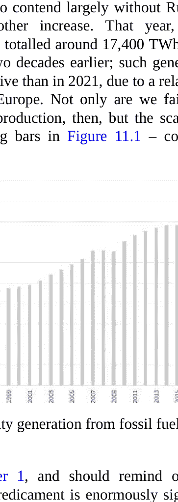

**图 11.1** 全球化石燃料发电，1993–2021

来源：Our World in Data

正如我们在第一章中看到的，也应该我们在这里提醒自己的是，这种全球困境的地理位置具有巨大的意义。全球发电排放持续如此增长的主要原因在于，用电需求增长集中的国家极度依赖化石燃料来发电。

在很大程度上，这是一个关于中国和印度的故事。这两个国家近年来通常占了全球年度用电量增长的四之五。诚然，正如我们在书中反复看到的，两国特别是中国，在安装太阳能和风能容量方面取得了巨大进展。但这种进展仍面临巨大的阻力。例如，中国在 2021 年初曾表示可再生能源将占其到 2025 年用电增长的三之二，但直到 2022 年年中才实质性地调整了这一目标，将其降至 50%。在同一时期，面对持续的能源危机（第 10 章），中国政府制定了一项增加 30 亿吨新增煤电产能的计划。事实是，在中国和印度，尽管在可再生能源方面确实取得了进展，发电仍然非常脏，化石燃料（主要是煤炭）目前供应了中国约二之二和印度约四之三的电力。

此外，除了少数几个例外（中国和印度本身是其中显著的）——继续增加大部分可再生能源容量的国家是西方国家，这些国家的未来用电需求增长从全球标准来看相对缓慢。可以肯定，随着欧洲和美国推进交通、建筑、供暖等领域的电气化，它们需要更多的电力。但这些增长虽然是实质性的，但与非洲和亚洲许多国家预测的增长相比，仍然是微不足道的。

因此，至关重要的指标不是可再生电力容量或发电量，而是化石燃料发电。我们不应该让关于前者的明显好消息蒙蔽了对后者事实的认知。让化石燃料发电以某种方式终结。而且，如果这种发电量增长，那么我们面临的问题——那个必须被根除的问题——就会变得更大，而不是更小，无论我们在可再生能源方面表现得多么“好”。


而这仍然正在发生。残酷的现实，正如**图 11.1**所示，在过去的二十年里（许多人称为“可再生能源革命”的时期），化石燃料发电持续增加，仅受到与全球金融危机（2009 年）和 COVID-19 大疫情（2020 年）相关的短暂实质性下降的干扰。即使在 2022 年（我们拥有数据的最新一年，《经济学人》在那一年看到了其“希望之光”，且欧洲被迫在很大程度上在没有俄罗斯天然气的情况下应对），我们的关键指标再次记录了增长。那一年，全球化石燃料发电总量约为 17,400 TWh，几乎是二十年前的两倍；由于亚洲和欧洲地区煤炭相对替代天然气，这种发电的平均碳强度也高于 2021 年。我们不仅在电力这一关键领域失败了，而且我们失败的规模（正如**图 11.1**中不断增长的条形所示）——似乎不可阻挡地继续增长。


**图 11.1** 全球化石燃料发电，1993–2021

来源：Our World in Data

正如我们在第一章中看到的，也应该我们在这里提醒自己的是，这种全球困境的地理位置具有巨大的意义。全球发电排放持续如此增长的主要原因在于，用电需求增长集中的国家极度依赖化石燃料来发电。

在很大程度上，这是一个关于中国和印度的故事。这两个国家近年来通常占了全球年度用电量增长的四之五。诚然，正如我们在书中反复看到的，两国特别是中国，在安装太阳能和风能容量方面取得了巨大进展。但这种进展仍面临巨大的阻力。例如，中国在 2021 年初曾表示可再生能源将占其到 2025 年用电增长的三之二，但直到 2022 年年中才实质性地调整了这一目标，将其降至 50%。在同一时期，面对持续的能源危机（**第 10 章**），中国政府制定了一项增加 30 亿吨新增煤电产能的计划。事实是，在中国和印度，尽管在可再生能源方面确实取得了进展，发电仍然非常脏，化石燃料（主要是煤炭）目前供应了中国约二之二和印度约四之三的电力。

此外，除了少数几个例外（中国和印度本身是其中显著的）——继续增加大部分可再生能源容量的国家是西方国家，这些国家的未来用电需求增长从全球标准来看相对缓慢。可以肯定，随着欧洲和美国推进交通、建筑、供暖等领域的电气化，它们需要更多的电力。但这些增长虽然是实质性的，但与非洲和亚洲许多国家预测的增长相比，仍然是微不足道的。在这些国家，目前非电力部门的电气化将与持续的发展相结合，从而驱动用电量的显著增长——正如欧洲和美国在二十世纪的经验本身可以证明的那样。这些发展的首要因素是人口增长、工业化、城市化，以及最后但同样重要的将电力引入大量从未用过电的家庭。

美国等国家的政策制定者和电网运营商在考虑到国家用电需求可能到本世纪中期翻倍或三倍时，往往会感到焦虑——这是一个合理的观点。但请尝试从……的角度考虑一下。

考虑到孟加拉国、埃及、印度尼西亚、尼日利亚和南非等国家的对应视角。例如，孟加拉国的人口预计到2050年将再增长约20%，达到2亿人。与此同时，近期的一项研究预测，孟加拉国的人均用电量到2050年将是2014年的22倍左右。可以说，这才是真正的挑战所在。

几乎无例外，这些未来电力消耗增长的预期领土地区，在现有发电方面严重依赖化石燃料，并且正以极其缓慢的速度进行此类发电的脱碳——如果真的做了的话。这是一种有害的结合，在**图 11.2**中表现得极其清晰。

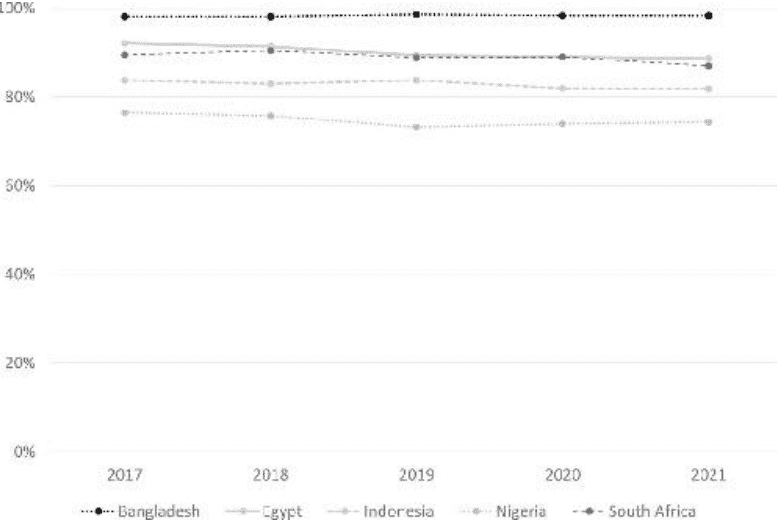

**图 11.2** 选定国家化石燃料发电占比，2017–21年

数据来源：Our World in Data

毋于说，这一切并不是为了指手控责。众所周知，相关国家对目前大气中积聚的大温室气体贡献乎其微，而欧洲和美国对此负有绝大部分责任。我们也不应忘记，这些国家的脱碳努力——正如本书所示，这些努力无论何时何地，往往取决于资金支持而非仅仅是政治雄心和技术能力——是在一种政治经济背景下进行的，而这种背景在现实中仅部分是“后”殖民的，在很大程度上仅仅是名号。长期的债务负担和财政无能是殖民遗留问题的标志。

当新可再生能源项目的融资成本达到9%到10%时（例如印度，而欧洲和美国为2%到5%），政治雄心和技术能力只能尽力如此.¹¹¹¹ 残酷且不可否认的现实是，就目前而言，在**图 11.2**提到的等国家，除非获得巨额补贴，否则新的可再生能源项目实现盈利不仅困难，而且几乎不可能。蒂尔·埃默里（Teal Emery）证实：“在低收入国家，以市场利率建设公用事业太阳能是不明智的，而且并没有得到建设。”¹² 2021年全球清洁能源项目中投资的434亿美元中只有不到1%流向非洲，这只能归因于惩罚性的资本成本，以及这些成本植于国家内部及之间历史上决定的政治经济不平等。

难怪，《金融时报》美国能源编辑员德里克（Derek）近期表示非常惊讶，竟然还有人质疑“那些对全球气候造成了巨大损害的西方国家必须为发展中国家的（能源）转型提供资金”这一观点。¹⁴

所以，不，这不是指手控责——至少不是针对那些似乎被化石燃料困住的贫穷国家。相反，观点在于，像国际能源署（IEA）这样的机构可以尽情地庆祝西方政策的突破，例如美国2022年的《通胀削减法案》，以及这些突破对国内可再生能源增长的预期积极影响。但日益地，真正影响全球电力部门排放的进展将发生在世界其他地区。正如国际能源署现任执行主任法蒂赫·比罗尔（Fatih Birol）本人承认的那样，事实似乎是：拥有化石燃料密集型电力部门的贫穷国家——IEA表示为了实现气候目标和能源需求，这些国家的清洁能源投资必须在七年内惊人地增长七倍——实际上正在“全球”能源转型中“被抛后”。¹¹⁵

## 从中国到印度、尼日利亚及其他

我们在本书的不同之处观察到的一个共同趋势是，这些非西方国家的政策制定者以不同的方式、不同的速度和不同程度的成功，试图让其电力部门向广义上西方国家（尤其是欧洲）此前所采取的方向移动。我们在**第 2 章**中研究了典型西方部门模型的核心组成部分。它要求垂直整合运营的去约束。它意味着在可能的情况下（特别是在发电领域）具有竞争意图。它意味着运营资产拥有更多的私有制。而且可能最具挑战性的是，它意味着电力批发和零售领域都存在市场。

追求这种模型的原因与其实现路径一样多样化，但有一种逻辑在大多数地方尤为突出。那就是，政府将私有化和市场化（特别是这些）视为减少对电力部门资金投入和干预的所谓理想手段。诚然，这类观点并非凭空出现。新自由主义意识形态——国际货币基金组织等机构中华盛顿共识的推动者——长期以来一直告诉非西方政策制定者，他们应该正这样看待电力私有化和市场化。此外，通常由这些相同意识形态塑造的财政限制，广泛推动了沿着此类私有化和市场化路线重组电力部门的尝试。2021年底以来，全球主权融资成本的急剧增加进一步增强了这种动力。

然而，读者读到书的这里应该非常清楚，这一切中存在着巨大的讽刺，至少在可再生能源方面如此，但不限于此。正如我们反复所说的那样，在许多非西方领土按照目前的路径对电力部门进行实质性重组的地方，其电力行业的现实实际上与在修辞上被呈现为此类改革目标和终点的模型大然不同。

在经过实质性重组和“自由化”的背景下，政府对电力部门的财政支持和积极参与实际上比其他地方更不不可或缺。例如，即使在2021–2年能源危机之前，欧盟（市场化电力的物质和象征意义上的故乡）超过一半的国家都有某种形式的零售价格控制。而且，在世界范围内，可再生能源的发展仍然依靠政府的支持。世界其他地区的政策制定者绝不可能注意到，在2022年，美国（所有地方中的一个）为私营部门开发太阳能和风能提供了又整整十年的明确且大量的政府财政支持。

这种政府支持的普遍性，在思考如何重新配置全球电力部门以加速脱碳过程同时让用户负担得起时，是一个关键的考虑因素。尽管底层技术成本已经下降到如此，但政府通常无法移除可再生能源的支持机制，这一事实并不一定告诉我们应该走哪些路。但它确实明确了哪些路可能不应该走。

显然，答案并不是让政府去做它们认为在可再生能源发电成本下降到与化石燃料电力相当的水平后就可以做的事——即取消支持。

“比任何其他产品或服务都对它们进行征税或补贴。”但那些棘手的碳排放和气候问题呢？“有些人，”他们——但推测不是布斯（Booth）本人——会承认，“会认为可再生能源的社会成本可能比碳密集型能源形式低。”但他坚持认为，“这正是支持对碳密集型能源征税的理由，而不是补贴可再生能源的理由”。

有趣的是，近年来左翼部分也为政府支持私营部门开发可再生能源制定了论点，这些论点在此类做法的优点上似乎得出了相同的结论，尽管它们基于完全不同的原则和假设，而且对于世界未来能源基础设施供应究竟应该采取何种道路也持有截然不同的观点。尽管如此，这些左翼批评者对上网电电价、税收抵免之类的措施也持敌对态度。然而，对于布斯等自由市场支持者来说，他们拒绝补贴的理由是补贴模糊了价格信号并产生了“低效”的结果；与之相反，左翼的反对意见是，通过降低私营部门投资的风险，国家将风险（财务和非财务风险）社会化了，同时保证并放大了私营收益。¹

然而，左翼对去风险化的反对并没有特别帮助。如果问题本身就是答案（我们被明确或含蓄地告知），那就是国家不应该像经济事务研究所（IEA）的布斯那样不进行去风险。那么结果呢？除非国家成功地包揽了开发、融资、拥有和运营可再生能源基础设施的任务，或者愿意并能够迫使私营参与者违背其意愿投资于此类基础设施建设，否则很难看出拒绝去风险会产生什么好处。

左翼对去风险化批评中未言明的假设似乎是去风险化是没有必要的。其逻辑显然是：取消政府支持机制，私营部门将继续投资，即使可用利润可能比其他时候低。如果这并非该假设的核心，那么问题无疑在于，当（必要的）去风险化机制被切断导致可再生能源投资出现不可避免的下降时，这些批评者将作何解释。

然而，如果说这本书向我们展示了什么，那就是政府对可再生能源开发的支持并非不可少。至少在目前可再生电力输出商业化市场呈现如此结构的情况下（无论是在全球南方还是全球北方），去风险化在很大程度上是实质性的，因为否则收益风险将过高，以至于无法实现负担得起的私营融资。暗示其他观点等异于否定我们对电力业务经济学的实际认知。如果有人告诉你是去风险化是没有必要的——甚至这是私营部门历史上玩过的最大的骗局——那么请让他们参考英国2018年陆上风电行业（**第 6 章**）或越南2021年太阳能能部门（**第 9 章**）的经验。

当然，这并不是意味着实践中的去风险化没有问题。恰恰相反。从调整、公平和公共部门机构能力建设等考量角度来看，对私营部门可再生能源开发的外部支持显然可能产生更多或更少的问题——程度各异——例如关于何种类型的实体应该承担去风险化的负担，以及风险和奖励实际上是如何分配的。说在目前构成的全球电力业务中，可再生能源的去风险化在广义上仍然必要的，并不是说它总是以理想的方式实现的。

尽管如此，可能仍然值得以气候危机所要求的严峻术语来提出这个问题。我们面临的更大风险是什么？是国家继续在资金上支持私营部门的可再生能源开发，并因此继续支付投资者回报吗？还是不愿进行去风险，并可能导致可再生能源的开发（因为它主要被预期由私营部门参与者承担）而枯萎？

# III

停止政府支持并非他们推荐的解决方案，但即使在2021-22年全球能源危机发生之前，一些与自由化、以资本为中心的西方电力系统相关的问题就已经处于聚光灯下（毕竟欧洲是危机的焦点），许多主流机构和评论员已经认为，这些系统不再适用于其职能——如果它们真的曾经适用过的话。

可再生能源发电在实践中日益增长的重要性，以及在政策上优化进一步开发可再生能源条件的重要性日益增加，长期以来一直是此类对继承的、自由化系统担忧的关键。核心观点是，如今在欧洲和美国等地区存在的电力系统是为化石燃料世界设计并为之建造的。因此，论点认为，所涉及的系统既不能鼓励可再生能源的发展，也无法实现其在安装后的生产和消费。

这种批评部分涉及工程问题——直言之，正如普林默（Plimmer）所说，我们的输输配电网络在物理设计上通常是“为大型煤电厂服务……[而非]像太阳能和风能等分散的可再生能源开发”。¹8 但不仅如此，这种批评还涉及经济问题。也就是说，批评者认为，我们将电力的物理发电和交付转化为一系列不同参与者获得和承担的互联收益和成本的复杂制度安排，从本质上说一直以来且现在仍然是基于化石燃料的系统。

能源经济学家最早提出了这一点。因此，早在十年前，马尔科姆·凯伊（Malcolm Keay）、约翰·莱斯（John Rhys）和戴维·罗宾森（David Robinson）就代表性地对电力业务发表了：“现有市场是围绕化石发电的特征设计的，但不能很好地适应新的[可再生能源]进入者。”他们继续观察到，这些市场“本质上仍然保持未改革状态”——这一观察在今天与他们提出时一样真实。因此，他们认为，“问题在于现有市场的设计并未，也未能反映日益增长的新能源的成本结构和运行特征。”¹9 随着时间的推移，这在能源观点的主流中成为某种教条。例如，在2017年，《经济学人》通过关注学术文献的重要进展，也确信了改变世界购买、销售和监管电力的方式以考虑到新的发电方式的必要性。²0 到2021年初，甚至连IEA（一个毫无革命性的组织）也愿意接受自由化市场中电力电力商业化规则需要重建。IEA坚持认为，“如果可再生能源在发电组合中的份额要像2050年净零排放情景那样增加，对电力市场设计进行重大变革是非常理想的。”²1

经济学家和受他们指导的机构对现有市场组织形式的缺陷得出这些观点令人惊讶。毕竟，这本书很大程度上一直在强调适应不当的当代电力政治经济产生的结果，在许多情况下，对于对现有体系有投入的人来说，认为这些结果是有益或令人满意的将是牵强的。

这些不利结果最明显的一个可能是这样一个事实：在政府试图减少或消除对可再生能源的支持的地方和地区，开发者特别是他们的融资者几乎没有表现出承担风险的意愿。正如我们在**第 6 章**看到的，自由化电力电力市场的波动对于风电和太阳能电站提供融资的银行来说是大忌。

正如一位股权投资者观察到的，“某些债务基金开始提供基于长期市场产况的灵活债务工具”。²2 但该投资者未能提到这种“灵活性”总是带有严苛的条款。例如，西班牙太阳能协会UNEF的何塞·多诺索（José Donoso）对西班牙的可再生能源格局指出，“当贷款人为市场化项目融资时，他们要求的股权融资比例是补贴项目的两倍。”²³ 资金提供者的条款实际上

因此，在全球能源危机爆发之前，改革的势头显然已经在积聚。以英国为例，一些有影响的主流专家早在21世纪10年代中期就已呼吁进行全面改革。其中，牛津大学能源经济学家迪特·赫尔姆（Dieter Helm）对此发声尤为激烈，他在受政府委托编写的2017年《能源成本》报告中提出了一系列改革建议。

2021–2022年的危机使这种势头增加了一倍，特别是在欧洲。如果在2022年之前，欧洲的政策制定者——至少是那些真正听取赫尔姆之类人建议的人——对电力买卖方式存在的问题隐约察觉，他们也能集体地掩鸵耳龟，因为供应系统在大体上仍在运行（尽管其运行方式奇特且显然远非最优），而且可再生能源的渗透率持续提高。因此，政策制定者们所做的就是掩耳盗铃，这让赫尔姆和许多经济顾问感到非常恼。

但在2022年，否认现实不再是一个选项。恰恰是在2022年春天，随着俄罗斯入侵乌克兰导致全欧洲电价飙升，英国最终启动了期待已久的《电力市场安排审查》，这绝非巧合。正如《经济学人》（The Economist）在2017年预见性所言：“尽管选民在电力市场正常运行时会考虑它们，但当价格上涨时他们会愤怒……当灯熄灭时，他们会大声控责。”

价格确实在上涨，而且涨得很剧烈，注意力被集中在具体原因上（**第 10 章**）。正如我们所看到的，答案在很大程度上取决于气价的不比例影响——气价在欧洲批发市场中导致电价飙升。突然之间，“优胜顺序”（merit order）成了一个日常讨论的话题，而非能源经济学中深奥的问题。随着上涨的天然气推高了所有发电机（无论是否为燃气）的电价，生产者的平均发电成本与批发市场购买者以及最终用户所支付的平均电价之间的差距扩大了。

针对高电价的短期解决方案——即**第 10 章**讨论的那些方案——对这些底层市场机制无能为力。但更根本、更长期的改革可能可以，而且政策制定者现在承诺，最终将会实现。气价与电价的“脱钩”随后变成了一个政治号召——欧洲公众被告知，市场重组是不可或的必要条件（sine qua non）。

令人惊讶的是，脱钩最激昂的反对者反而来自那些天然气在电力供应中占比很小的欧洲国家，在这些国家，气价对电价的不比例影响似乎尤为不协调，甚至不公平。核能占据主导地位的法国是之一；可再生能源（包括水能）供应了近一半电力的西班牙是另一个。

各种此类改革的建议过去和现在一直在流传。其中一种是将市场拆分，对可再生能源电力和化石燃料电力进行不同的定价。另一种建议是使用平均发电成本——这是对20世纪90年代自由化之前定价模型的一种回溯——或向发电机支付平均报价价格。第三种是按每个发电机的报价进行支付，而不是（像现在这样）按单一市场清结算价格。在英国等不使用地理差异定价的国家，引入这种区域定价被某些人视为一种具有潜在益益的替代方案，尽管瑞典等采用这种定价方式的国家并未逃过2021–2年的电力市场惨剧，这一事实显然应该引起人们深思。

在某些人眼中，无疑这些建议（这些最常见、最广泛提出的建议）似乎具有积极的变革意义。但在进一步进行之前，我们应该明确一点：所有这些建议都根植于一个框架之内，该框架预先假设电力仍然是市场上买卖的，且主要由私营部门参与参与。简而言之，这些建议的共同目标是让市场运行得更好——扩展并精细市场化过程——而不是任何比此更激进的内容。

## II

该如何看待这些各种市场改革建议？显然，所有建议都可能存在缺点。《经济学人》指出：“成本高的发电厂在平均定价下将亏损，而这些亏损有时是维持照明所必需的。”按高价支付可能会给发电机抬高报价的动力。”与此同时，“区域定价”可能会扭曲发电机关于在何处建设产能的决策。”而将市场分为两个（一个用于可再生能源，一个用于化石燃料发电）的“激进”选项？根据牛津能源研究研究所的拉哈马·普丁内（Rahmat Poudineh）等专家的观点，由于大多数可再生能源发电机利用了价格稳定机制，且因此许多可再生能源的价格实际上已经固定，拆分市场的选项“没有意义”。《经济学人》似乎也持怀疑态度。

事实上，当《经济学人》和《金融时报》等西方资本主义领先主流刊物的评论员思考2021–2022年期间欧洲和全球电力市场的混乱时，他们对整个电力市场进行根本性改革的前景显然变得更加怀疑了。


# V

《经济学人》为设计电力市场的这种困难找到了若干原因。其中包括：

*   电力无法进行大规模储存，必须在需要的确切时刻交付。
*   生产者需要预先投入大量资金建造风力发电机或发电厂，并需要在几十年内收回成本并盈利。
*   气候变化政策规定，越来越多的可再生电力被输入系统，尽管它们在很大程度上受风和阳光的支配。

应当说明，对于这一点没有任何实质性的可以争论之处：那段话中的所有内容都是真实的，至少人们将盈利的必要性视为理所应当。然而，阅读这篇文章以及其他关于构建功能良好的电力市场所涉及的重重困难的文章时，很难避免一种评论员“见树木不见森林”的感觉。或者，用另一个比喻，这种感觉是评论员识别出了房间里的老鼠，却没能发现大象。

这些叙述坚决拒绝接受一个对于设计一个生产者能够持续盈利的电力市场之所以困难，实际上要明显得多的解释。那个解释是什么？那就是电力从本质上就不是市场化和产生利润的合适对象。只要这种替代解释成立，它并不比《经济学人》等机构提出的各种解释更明显，但它更基础——它是所谓的“元解释”，构成了所有其他解释的底层。

让我们从概念上简要考虑一下这种解释。在这方面，一个有益的参考基准是经济人类学家`卡尔·波兰尼`（`Karl Polanyi`）的作品。波兰尼在20世纪40年代写作时认为，在资本主义中存在真实的商品和他所说的“虚构商品”。他说，一种“真实”商品是最初就明确为了在市场上显性出售而产的：换句话说，商品化是其内在属性。相比之下，虚构商品被社会视为商品对待，但它们并非为了商品化而创造的。相反，市场是被强加在它们身上的。

波兰尼指出，虚构商品从市场角度来看通常是笨拙且难以驯服的。由于并非起源市场，商品化并不会产生。因此，当社会通过买卖将此类物品视为商品时，它们似乎在抵抗这种努力，并且会产生各种在“真实”商品情况下通常不会遇到的困难。

波兰尼观察到，结果是，为了让虚构商品运行（即使是不完美的），必须制定并应用各种支撑措施、规则和规范。这些是为了让看起来存在的是一个真实的市场，具有真实的价格和获得真实利润的参与者。但这始终是一种虚构——一种伪装。

波兰尼声称有三种虚拟商品：土地、劳动和货币。但根据他的标准，电力绝对也是一种。更不用说电能是自然发生的，如闪电。对产生电力的行业历史起源进行研究的学者表明，商品化的发生是断断且偶然的。这里显然不是进入任何细节的地方，但一个特别显著的事实是，多年来远非电力本身——即今天作为千瓦时买卖的实用能源形式——最终会成为商品化的主要场所。

对我们而言的意义在于，正如我们在书中看到的，有充分证据表明，需要各种支撑措施、法规和规范来使电力变得可购买且可盈利——即驯服其不驯性并使其商品化——并维持这种某种程度上代表了“真实”市场中“真实”利润的虚假。然而，它显然并不如此。很少有人能像`梅雷迪·安格温`（`Meredith Angwin`）那样有力地指出这一点，她对美国那些发生了垂直拆分和去垄断的地区所创建的电力“市场”这样说：

> 它们不是我们所熟知的市场。它们是复杂的系统，新的法规不断调整并试图改进现有的法规。它们是官僚的
>
> 这是一片丛林，而非市场。这简直是奥威尔式的。“电力”只有在所谓的“监管”实际上意味着“更多的监管”时，才会被“监管”。“战争即和平”。“去监管化”就是“更多的监管”。奥威尔会觉得很有趣的。

例如，考虑发电者的利润。在波兰尼看来，没有比这更不“自然”的。当然，利润是“真实”的，因为它们代表了收入减去成本。但可能与其任何东西相比，它们是政策制定者持续、不断且最终相当随机的努力的结果，旨在将这种财务产出——收入减去成本——保持在他们认为最合理的范围内。如果利润太低，开发者就不会投资；如果利润太高，批评者就会控诉。因此，政策制定者永远处于需要拉动一个（甚至两个）杠杆的地位：补贴和其他支持机制在利润稀缺时使其能够产生，而在利润丰厚时通过横财税限制其上限。

至于市场，国家干预和支持——至少在可再生能源领域，尽管不仅限于此——是普遍存在的，这只是从波兰尼视角审视电力的最基本的理由之一。毕竟，在气候危机时代，这个市场的标志性特征正如我们之前所说的，那个被空心的市场价格（理论上它隐藏了所有相关信息并向参与者发出如何应对的信号）是可再生能源运营商努力不卖出的那个价格。在欧洲能源危机高峰，很难想象比这更有力的反驳了 `ACER` 的风险说法了，它声称在“正常”情况下，该大陆的电力市场运行良好。

然而，波兰尼最敏锐的洞察可能是，维持“土地或劳动力等事物可以真正商品化”的幻象，最终取决于主要市场参与者遵守规范和惯例，而这些规范即使在相对良性的条件下也是脆弱的。换句话说，拥有创造或摧毁脆弱市场能力的参与者，通过符合常规的行为为商品化的集体幻象贡献力量是至关重要的。市场大厦——或者说大厦取决于对这些正式和非正式规则的遵守，而这些规则构成了虚构商品市场的支架。

当然，风险在于有人出现，他们不属于这些规则，或者根本不在乎维持这种伪装，并继续将这一幻象击得粉碎。事实证明，这正是`摩根大通银行`在 `2010` 年进入发电业务时发生的情况。

# VI

回想章节开头提到，`2013` 年，大通的能源部门 `JPMVEC` 被发现通过其对各种电厂（包括从`熊氏银行`继承的加州 `AES 4000` 机组）的控制，赚取了超过 `1` 亿美元的“不当”利润。它在短时间内积累了这些利润。事实证明，它利用了各种策略将电厂的产量竞标进入加利福州的批发电力市场，针对不同的电厂在不同时间采取不同的策略。虽然策略确实各异，但通过探索最简单的一种（在 `FERC` 对该案的分析中被标记为“策略 B”），我们可以阐明驱动每种策略的基本原理。

要理解策略 B，有一些重要的背景考量，首先是 `JPMVEC` 使用该策略的电厂性质。`Alamitos 3` 号和 `4` 号（`AL3` 和 `4`），即 `AES 4000` 机组中的两个——是战后时代建造的极低效燃气发电设施。它们的低效体现在两个方面：其一是运营成本“通常高于”现货价格，而该期间的现货价格平均为每千兆瓦 `30` 至 `35` 美元。另一个是缓慢的“爬坡速率”，这意味着电厂只能逐渐增加（上坡）或减少（下坡）其产量。至关重要的是，批发市场运营商（如加利福尼亚州电力调度中心 `CAISO`）在授予电力合同时会努力尊重此类物理限制。

策略 B 高明利用了这些因素。每隔三个小时，`JPMVEC` 会为 `AL3` 和 `4` 提交一份所谓的“自调度”。这是一个价格接受者报价（`price-taker bid`），意味着发电厂接受市场设定的任何价格——例如我们的例子中每千兆瓦 `30` 美元。然而，在中间的两个小时里，`JPMVEC` 提交了价格高得多的报价——每千兆瓦 `73` 至 `98` 美元。不用说，在电厂作为价格接受者的小时里，它们的出价被接受了。但中间的小时呢？人们可能认为，由于市场价格为每千兆瓦 `30` 到 `35` 美元，而出价高于 `70` 美元，这些报价应该被拒绝，因为远超价值范围（或“无利润空间”）。但不是。`FERC` 解释了为什么不是：

> CAISO 的软件需要考虑到 . . 就像汽车可以以特定速度加速或刹车一样，发电厂只能以特定速度 . . 增加或减少其产量 . . [因此，软件也接受了] 中小时的报价，以尊重 `JPMEC` 在 `CAISO` 注册的机组爬坡速率。

简而言之，`JPMVEC` 每隔三个小时支付市场价格，而在中间的小时里，则按出价（即中间的小时为每千兆瓦 `73` 至 `98` 美元之间）获得回报。

这就是该策略产生利润的方式。`AL3` 和 `4` 电厂每隔三个小时产生并出售的电力是不盈利可的，因为市场价格低于电厂的运营成本。但电厂在这些小时内产生并出售的电力是高利润的，其出价——每千兆瓦 `73` 至 `98` 美元——远高于运营成本。

当然，这类故事通常被讲述为关于恶毒金融家参与操纵、欺骗、欺诈或三者兼具的道德寓言。而这正是 `FERC` 试图公开呈现的方式。

这个故事更多地被看作是一个关于虚构商品的寓言。为了让电力这种难以驯服的对象商品化，市场参与者和像 `CAISO` 这样的监管机构制定了各种指南、规范和惯例。事实上，为了实现此类市场的生产和再生，这些机构一直依赖市场参与者遵守这些指南和惯例。然而，`摩根大通银行`并未遵守。

`CAISO` 这类现货市场的核心惯例之一是发电厂根据边际成本竞价，即产生额外单位电力的成本。事实上，边际成本定价理念在基于排序的市场知识体系和监管中根深蒂固，以至于这种理论——即发电厂*应该*如何竞价——经常被误认为是现实。即使是通常信息通的《经济学人》也错了。

它最近向读者解释道：“供应商根据提供额外单位电力的成本进行竞价，即边际成本。”

但这并非事实。监管机构和经济学家确实假设发电厂是这样竞价的。更重要的是，`CAISO` 等市场的完整性在很大程度上取决于发电厂以这种方式竞价。如果 `JPMV` 在任何时候都这样做，当然，它们的报价通常不会被接受。`FERC` 哀道，仿佛在缓解自己被操纵，“基于它们的成本，[AES] 机组通常没有利润空间。”

然而，理论并非现实。正如 `FERC` 私承认承认，发电厂提交的价格“并不要求是边际成本”。并不要求如此，人们本质上是信仰它们会如此。然而，`摩根大通银行`对这种信仰付诸一笑。管它呢，我们可以按照自己的意愿竞价，我们也这样做。这不应该是资本主义吗？

这也许是问题的核心。银行家从未打破过规则。正如`马特·莱文`（`Matt Levine`）在一次典型的敏锐评论中所言，“对于发生的情况没有撒谎，也没有撒谎的必要。这不像 `Libor` 利率，你需要主动撒谎。在这里，`摩根大通`只是简单而字面上遵循了规则，但他们把规则带到了不该去的地方。”

`摩根大通`的行为之所以对 `FERC` 和其他行业机构如此具有威胁性，是因为它们动摇了市场的假象——即电力市场确实是可能的，因为电力是一种可以在市场上买卖的合理物品。`FERC` 和美国的电网运营商建立了一个正如莱文所描述的，“奖励少量完全透明的游戏规则的愚蠢系统”。诚然

因此，将此案视为关于银行家的伦理问题，将忽略关于电力市场化的更重要、更有趣的教训：即市场本身是“愚蠢”的。

一个电力供应系统配备不足，其成功运行依赖于（其他但不限于）参与者的严格从众行为。

人们可能会反对说，这是一个孤案，而且还是极端案例。但事实并非如此；这与事实大相相反。到`2013`年，美国及全球电力市场的设计者和管理者在建设和运营此类市场方面已经几十年经验，期间穿插着许多之前的市场操纵案例——比如`安然`（`Enron`）？从中吸取了设计上的教训，从而有充分的机会完善市场机制——前提是这些机制确实完美的话。

此外，`JMVEC` 并非仅仅在一个看似无懈可击的系统中发现了一个漏洞。联邦电力监管委员会（`FERC`）发现 `JMVEC` “操纵”了市场——该市场在构成上与世界其他重组电力部门的市场基本相同，使用了不少于十二种竞价策略。`FERC` 对此案的分析听起来几乎像是：市场参与者成功遵守惯例比不遵守更有利。

这一案例是否导致全球专家修补了漏洞，并最终在电力市场设计上（至少在防止操纵方面）做到了“正确”？当然没有。波兰尼（`Polanyi`）的教义是，虚构商品的完美市场是一个逻辑上的自相矛盾体。

例如，仅仅三年后，在大西洋彼岸的英国发电公司 `InterGen` 成功地“误导”了国家电网系统运营商，使其为该公司产生的电力支付了比所需多数百万的费用。足以说明，根据英国行业监管机构 `Ofgem` 的解读，涉案违规并未说明电力市场内在的不协调，而是“`InterGen` 在程序、管理系统和内部控制方面的特有‘缺陷’。”

随后，在`2023`年，`彭博社`的记者发现了一个更大、范围更广的英国批发电力市场疑似操纵案。传统发电厂通过参与所谓的“开-关”供应博弈获取了巨额利润：本质上，是在日前市场声称无法交付（以此推高批发价格），直到随后才进行实际交付——从而在实时平衡市场中利用了这些通胀的价格（见第2章）。与 `JPMEC` 和加州州的案例一样，这种博弈并不违反现有的市场规则。相反，它被认为是不严的。与此同时，`Ofgem` 还通过向责任公司发信要求其合规，增添了这一荒诞剧的色彩。想象，波兰尼想到此会报苦笑。值得注意的是，英国这些最新披露与欧洲委员会处于同一月，而欧洲委员会同样在进行一场长期的失败斗争，并发布了一项改进其自身批发电力市场反操纵保护的提案。

不庸置信，这一切最令人震惊的是，政策制定者显然相信——或至少假装相信——他们实际上能够完善市场。他们做不到。只要电力继续在市场中买卖，此类案件永远不会是偶然的，因为要找到一个比电力更尴尬的虚构商品——即为了在其周围构建一个健全市场而产生顽固且混乱的影响效应的商品——可能很难了。

因此，`摩根大通`的故事作为一个警示意义的寓言，其特殊价值恰恰处于这样一个时期：此时，欧洲等等地的主流共识认为，解决电力市场缺陷的答案（当下的焦点恰好是电力价格与天然气价格的有害耦合）不是市场本身，而是色调略有不同且更好的市场。如果认为这确实是答案，就是无视我们周围积累的所有关于电力是一种什么样的“商品”的证据，以及为了实现其交付并使其稳定在那个被称为“利润”的神秘事物的合理水平上而不断需要的无数扭曲。

在这样的环境下，市场永远不会“自然地”且毫无问题地达成共识。反复做同样的事情并期待不同的结果并不总是等同于疯狂，但尽管如此，“改革”和“改进”电力市场的尝试注定是失败的，而且随着气候危机的升级，这些尝试召唤了一大堆令人令人恐惧的比喻意象。“通往无路之路”无疑是其中一种意象。“在罗马火烧时弹琴”可能更为恰切。

# VII

当然，并非所有人都认为资本和市场（无论是其现有形式还是经过适当改革的形式）将带我们在电力去碳化方面到达我们需要去的地方。在过去的几十年里，人们对发电必须摆脱化石燃料的意识日益增强，一直有人坚持认为坚持（或继续转向）一种先验考虑市场和私营部门的模型是错误的方法。近年来，他们的声音在数量、规模和力度上都在增加。


值得注意的是，他们的范围也在扩大。如果说“市场和私营部门无法在合理的时间范围内成功实现全球电力去碳化”这一命题是政治经济激进者的专利，那么显然已不再如此。例如，该命题甚至在《金融时报》的页面上出现频率日益增加。“仅靠私营部门无法实现能源转型，”尼克·巴特勒在2019年说道，他在英国石油公司工作了三十年的大部分时间。⁵⁹ “德里克·布劳尔最近也表示赞同这一观点。”

要做的太多了，考虑到紧迫性以及获得正确解决方案的需求，这并不是你喜爱的关注 ESG 的投资组合经理或科技领袖的任务。必须翻新、拆除或替换的物理基础设施的规模几乎超乎想象。⁶⁰

对于这些争论者来说，国家角色大幅扩张通常是答案。“将是政府，而不是贝莱德，来领导这一新的马歇尔计划，”布劳尔坚持道。现状的批评者认为，国家不仅应该大力投资新产能，许多（并非所有人）还认为它应该收国有现有资产，无论是绿色的棕色的。

这种观点的逻辑之一在于，正如我们在书中详细看到的，国家实际上深度参与了电力去碳化项目。通过可再生能源拍卖等手段，国家不仅在塑造去碳化的节奏和形式上起着根本性作用，而且提供了资金支持。只是它通常并不拥有和控制最终资产；它承担了风险——将风险从不情愿的开发商和融资者身上转移——却很少获得经济回报。如果国家已经在这样做并投入如此巨资来驱动电力去碳化，批评者问，难道引发财务和运营账目合理吗？

当然，存在一种明显的潜在第三选择，位于政治经济光谱的两端：一端是资本主导的市场，另一端是集权国家的控制和所有。对于发电资产的私有开发、所有和运营，政府在理论上根据盈利考虑大幅加速并扩大向再生能源的转型——他们没有这样做。与公所有的方法一样，这也将是国家领导的转型。

在某种意义上，这第三条路可以被视为现状的简单变体：为了让资本投资，国家只是在挥舞大棒而不是提供胡萝卜，不是吗？但并非“简单”。要强迫私营部门参与者做他们不想做的事，这等同于将现有的资本和市场教条主义抛弃市场部分，对于当代任何主要的国家政府（无论左右）来说，无疑都跨越得太远了。自新冠肺炎以来，“挑选优胜者”的工业政策已重新流行，那是一回事；强制性投资则是另一回事。

因此，如果国家未来能够比目前更有实质性、更有意义的方式驱动电力快速去碳化，可再生能源资产的大公有似乎是最可行的模型。事实上，这几乎是必然的，

在所有可能对我们集体能源未来（无论是比喻意义还是实际意义）拥有所有权的利益相关方中，国家通常被认为是现有市场与私营公司这种默认组合的最佳替代方案。如果不是市场和私营部门，除了国家之外，还有谁可能承担必要的转型项目？当地社区或“分布式”的可再生能源开发、所有权和控制权固然是好的，但想象这能成为应对挑战的终极答案是不切合实际的，特别是考虑到电力去碳所需的速度和规模。

除了资本之外（事实上，如果把资本也包含在的话），只有国家——我指的是集体考虑的各国政府——才可能具备足够的资金支持以及后勤和行政能力，将全球太阳能和风能发电的年投资从几百亿美元大幅提升至一万亿美元以上并维持这一水平；当然，这并不意味着即使对于国家机构来说，实现这一目标是一项艰巨的政治经济任务。此外，正如许多学者指出的，国家在拥有和控制可再生能源基础设施方面发挥领导作用，并不一定意味着其他参与者（从私营部门到社区团体）不再参与其中：公共直接投资不仅不会挤出此类替代投资，反而可以很容易吸引其进入。²

这种国家领导和可再生能源发电愿景的典范是所谓的“绿色新政”（GND）。尽管它出现在各种建议指南中，但所有人都将 GND 描述为原始“新政”的现代绿色后续计划。原始新政涉及20世纪30年代中期美国的一项国家基础设施更新计划，旨在使国家走出大萧条的深度，其中几乎所有新基础设施都由公资助并拥有。注意的是，可再生能源的公共所有一直是所有重大当代 GND 提案的核心，包括英国工党在2019年大选中的主张，以及伯尼·桑德斯次年代表美国民主党竞选总统提名人的主张。

通常来说，GND 类提议主张国家所有有和控制相关基础设施——且同样明确地反对以市场和私营参与者为中心的资本中心模型——的主要论点本质上是凯恩斯主义的。考虑到这些提议的范围和雄心，这完全合理。尽管可再生电力发电无疑是它们的实质核心，但此类提议本身关注的是更广泛、全社会层面的“系统转型”，因此，转型挑战的巨大规模和复杂性往往是首要考虑因素。凯恩斯的思想在这方面极为具有启发性。

如果在波兰尼之后，一个以利润和市场为中心的模型对于交付电力这种单一虚构商品这一相对简单的命题来说是不适当的，那么当社会面临快速、无缝且全面地转型整个复杂的社会经济生活体系的前景时，它显然更加不适当了。正如所论证的，当许多参与者需要做出协调一致的变化却没有人能将他选择视为既定事实时，市场信号就会失效。凯恩斯的继承者坚持认为，只有中央决策者才能希望以及时有效的方式实现这种集体转型。气候危机对无数利益相关者所要求的连锁变化机制，正是这种转型的典型案例。63

换句话说，支持 GND 以及关于国家拥有和控制气候相关基础设施（包括但不限于可再生电力基础设施）的“宏观”提议的论点，通常并不是本书关于资本在电力去碳化方面困难的论点——那个论点本质上是关于利润的。这并不意味着我不同这些观点（我不不同），也不意味着它们与以下假设不兼容：即不确定或缺乏吸引力的利润前景明智地阻碍了私营部门更快地建设可再生能源（我不认为它们不兼容）。仅仅意味着本书提出了不同的——尽管是互补的——论点。

现在，专门针对可再生能源发电这一更狭窄领域、并主张对这一特定活动（仅此此活动）进行公有的批判性干预，有时会触及利润问题。但奇怪之处在于：它们通常（尽管并非总是）逻辑是颠倒的。这一论点的支持者认为，国家应该建设、拥有并控制风电场和太阳能发电场，恰是因为这被认为是一项高利润活动——而不是因为事实上它并非如此。

以最近的为例，考虑英国工党的提议——自2019年受 GND 启发的竞选活动以来，其领导层已从杰米·科宾交接给了最近的基尔·斯塔默，提出如果他们获胜，将成立一家名为“大不列颠能源”（GBE）的公有发电公司。工党表示，GBE 将使英国政府能够降低家庭电费，因为目前被私营可再生能源供应商抽走的利润将变为社会化。

事实上，为了支持其提议，工党引用了2022年工会联合（TUC）的一份报告，抨击“私有化发电厂获取的超额利润”，特别是在固定海上风电等可再生能源领域，用 TUC 的话说具有“已知利润率”。⁶ TUC 估计，像工党提议的 GBE 这样的“公共能源冠军”能够捕的超额利润相当于每个英国家庭约2,250至4,400英镑。

本书认为，此类主张暴露了对可再生能源经济学以及实际上困扰该行业的微弱且不稳定的利润前景的深度且危险的误解。

## VIII

因此，如果论点是要求国家大幅收揽可再生能源发电以推动电力去碳化，并且这一论点基于关于行业利润的论证，那么它将与英国工党提出的那种大不相同。它的核心逻辑可能是：国家需要比现在更积极、更有所有权地推动电力去碳化，因为可再生能源发电的预期利润实际上并没有足够的吸引力。

因此，2021年发生在美国纽约州的一项特别值得关注的政治发展是：那一年，少数立法者引入了一项旨在改变该州现有发电格局的法案。该法案被称为《建设公共可再生能源法案》（BPRA）。其目标是通过允许并要求私营部门大规模建设太阳能和风能，加速该州的去碳化。

动力来自于该州2019年雄心勃勃的《气候领导与社区保护法》，该法设定了到2030年实现70%可再生发电、2040年实现零碳的目标。该州拥有美国最大的公用事业机构——纽约电力管理局（NYPA）。然而，截至2021年，NYPA 受其章程限制，拥有或建设大规模的可再生能源发电项目。BPRA 试图消除这一限制，并强制 NYPA 开发自己的太阳能场和风电场。

BPRA 的引入不仅可能是美国历史上关于公有太阳能和风能最大胆的实质性立法提案。其底层逻辑恰好与明年英国工党 GBE 提议的缺陷逻辑完全相反。为了赢得：该法案的支持者担心的不是私营公司正浸在可再生能源利润中，而是事实并非如此。如果利润预期决定太阳能和风能电场何、何地以及何时建设，纽约州的气候雄心将会破灭。正如格蕾·阿什福德所说，活动人士坚信：“为了满足州的电力需求，项目需要在那些对私营行业缺乏吸引力或无利的地方进行”。66 卡罗尔得出了相同的结论，他的总结实际上可以作为你一直在读的这本书的一个非常合理的摘要。卡罗尔说：“有很多项目，如果我们仅仅依赖利润驱动的模式，我不认为我们永远能建成它们”。67 事实确实如此：不仅在美国，在世界其他地方也是如此。

基于卡罗尔的话，对这本书一个稍微公平且更准确的摘要可以这样写：如果在市场中流动的私人资本在获得政府所有和正在获得的支持，并且在技术已经下降如此之深之快的情况下，仍然无法对全球发电产生足够的去碳作用，那么这无疑是一个明确的信号，表明资本并非为这项工作而设计。

因此，作为本书的主题，显然也是《纽约州再生能源法案》（BPRA）幕后者的思考，我们拥有的是一种相对非典型的公共基础设施所有权逻辑。从这个角度来看，支持公共所有权的原因不会像通常那样——是因为反对私营部门肆意牟利。我们的立场是，私营部门需要被剥离再生能源发电的责任，因为再生能源发电的利润并不足以让私营部门按照我们所需的速度紧迫且大规模地进行开发。

此外，BPRA 还从另一个重要方面反映了我们更广阔的故事。该法案分别在 2021 年和 2022 年的立法会议未能通过。后一年的机会尤其大，因为它通过了州参议院。但州议会议长卡尔·赫斯蒂通过拒绝投票对其施了阻碍。

这种困难不应让我们感到惊讶。近年来，对资本和市场的新自由主义信仰的幻灭已经过过多次宣布，但在关键时刻，这种信仰依然强大。面对所有相反的证据，例如德国财政部长克里斯斯蒂安·林德纳在 2023 年初的《金融时报》上竟然廉耻地写道，欧洲和全球能源危机“证实了基于市场的方法”在能源供应方面的有效性——而且为了保险起见，还表明我们在减少二氧化碳排放时也应该依赖价格信号”。68 在纽约州，BPRA 面临的不仅是这种对市场和利润动机的相对稳固的信仰，还有组织的游说压力。69

这些因素的决定性结合，在美国已经足以终结全国范围内有意义的“绿色新政”的前景。拜登总统 2022 年 8 月提出的关注气候的《通胀削减法案》，实际上是桑德斯两年前竞选时其愿景的苍白模仿——正如一位评论者生动指出的，这 own 一个“矮水版绿色新政”。70

与此同时，在世界范围内，再生能源替代传统发电源的速度实在太慢了。鉴于我们所学的一切，中国继续轻松作为再生能源增长的主要驱动力，这在我们看来并不比美国对 BPRA 的政治阻力更令人惊讶。人们并不需要成为中国政治经济的崇拜者就能承认，正如迈克尔·戴维森所指出的，尽管包括纽约州掌权者在内的西方政策制定者总体上仍然认为他们真的只有一种招数，即对资本和价格机制的顺从，“市场只是北京可用多种工具之一”。71

然而，尽管 BPRA 的困难不应让我们惊讶，但确实应该让我们担心。毕竟，这并不是像肯塔基州、西吉亚州或怀俄米州那样的红州。这是纽约，正如阿罗诺夫强调的那样，赫斯蒂并不是共和党激进分子：他是一个民主党人，从 2021 年持续多年的关于 BPRA 的斗争是民主党内部的战斗。简而言之，在纽约，政治风向可以说是为 BPRA 类立法提供了最恰当的，这种立法旨在将西方世界的再生能源供应从目前以资本为中心的配置转变。

随后，在 2023 年 5 月，取得了某种突破。活动终于结出了果。纽约州立法者通过了一项州预算，其中包含了基本上是原始 BPRA 核心要求的稀释后的妥协版本。它将要求纽约州电力管理局（NYPA）建设、拥有和运营新的再生能源发电能力，但只有当（且在范围内）私营部门确实未能——正如卡罗尔所预测的那样——使该州保持实现 2019 年立法案中列出的再生能源渗透目标时才如此。

这项 2023 年的纽约预算项目被世界范围内坚信需要大幅增加再生能源公共所有权的人如何解读，可能在很大程度上取决于他们倾向于将那个谚语中的杯子看作是半空还是半满。倾向于前者的人可能会指出纽约发生的情况并说，如果在这种理想条件下，付出如此巨大的努力才能为公共拥有的再生能源取得相对微弱的胜利，那么在更远的地方、更大规模上，实现一种非资本和非市场驱动的、因此不会永远被利润压力及其施加的发展局限性所束缚的能源转型，还有什么现实机会？

习惯于持乐观观点的人可能会对此嗤之以鼻。看看纽约，他们会说，开眼看看一个新发现的政治、经济和环境可能性的世界。时间将证明哪一营是对的。

# 注释

### 引言

- 1 D. Broom, ‘Race to Zero: This Graphic Shows the Rapidly Falling Cost of Renewable Energy’, 11 November 2020, forum.org.
- 2 International Renewable Energy Agency, ‘Renewables Increasingly Beat Cheapest on Cost’, 6 June 2020, irena.org.
- 3 A. Niranjan, ‘Plunging prices spell bright future for renewables’, 28 May 2020.
- 4 R. Meyer, ‘How the US Made Progress on Climate without Passing a Bill’, Atlantic, 16 June 2021.
- 5 R. Meyer, ‘We’re Heading toward a American Tragedy’, Atlantic, 22 December 2021.
- 6 M. Egan, ‘Renewable energy is Booming, But It’s Not Growing Enough to Fight’, 21 October 2019, cnn.com.
- 7 G. Doug, N. Phadke, A. Robbie and J. Scalise, ‘State of the Transition 2023: Global Resource Perspectives’, 2023.
- 8 J. Gabitt, ‘Record-Clean-Power Growth in 2023 to Spark “New Era” of Fossil Fuel Decline’, 2 April 2023, brief.org.
- 9 Reuters, ‘Global Wind and Solar Growth on Track to Meet Climate Targets’, 31 March 2022, reuters.com.
- 10 IEA, ‘Net Zero by 2050: A Roadmap for the Global Energy Sector’, October 2021, iea.org.
- 11 Ibid., p. 20.
- 12 Ibid., pp. 153–5.
- 13 Centre for Research on Energy and Clean Air, ‘China Permits New Coal Plants per Week’, 27 February 2023, energycleanair.org.
- 14 BloombergNEF, ‘A Record $495 Billion Invested in Renewable Energy in 2022’, 2 February 2023, bnef.com.
- 15 IEA, ‘Annual Energy Investment Benchmarked against the Needs in 2030 in IEA Scenarios’, 2015–2030, 26 October 2022, iea.org.
- 16 Electrifying Everything Does Not Solve the Climate Crisis, But It Is a Great Start’, Economist, 23 June 2022.
- 17 On which we especially see J. Nahm, Collaborative Advantage: Forging Green Industries in the New Economy (New York: Oxford University Press, 2021).
- 18 W. Mathis, R. Bean and J. Saul, ‘Wind Power’s “Colossal Failure” Threatens Climate Fight’, 25 April 2022, bloomberg.com.
- 19 B. Clark and R. York, ‘Rifts and Shifts: Getting to the Root of Environmental Crises’, Monthly Review 6: 1 (2008), pp. 13–14.
- 20 M. Wolf, ‘The Market Can Deliver the Green Transition – Just Not Fast Enough’, Financial Times, 21 November 2022.
- 21 K. Marx, ‘Theory of Surplus Value’, in Karl Marx Friedrich Engels: Collected Works, Volume 31: Marx 1861–63 (London: Lawrence & Wishart, 1989), pp. 12–26.
- 22 M. Levine, ‘Electric Market Rules Do Not Provide a Worthy Option for JPMorgan’s Brainpower’, 30 July 2023, dealbreaker.com.
- 23 J. Jacobs, ‘Exxon and Chevron share Profit Rise in Oil Prices’, Financial Times, 1 January 2023.
- 24 J. Bitt, ‘Everything Has Changed: Green Capitalism and the Climate Left’, 14 June 2022, figmag.com.


# 参考文献

- 25 R. McCracken and H. Carr, ‘Winds Blow Ill for Natural Gas in Texas’, *Platts Economist*, 1 February 2016. Their observation built upon academic research substantiating exactly this relationship. For example, M. J. Baird, ‘Impact of Public Policy Uncertainty on Renewable Energy Investment: Wind Power and the Production Tax Credit’, *Energy Policy* 38 (2010), pp. 7698–709.

- 26 A. Mal, *Fossil Capital: The Rise of Steam Power and the Roots of Global Warming* (London: Verso, 2015).

- 27 C. Cited in Aronoff, ‘BlackRock’s Larry Fink Shows How Justorous GOP Fearmearing against Sustainable Investing Really Is’, 2 December 2022, newpublic.com.

- 28 B. Christophers, ‘The End of Carbon Capitalism (as We Know It)’, *Critical Historical Studies* 8 (2021), pp. 239–66.

- 29 Both in A. Marsh, ‘A Dam Is Holding Back Zero’s “Wall of Capital”’, 22 November 2022, bloomberg.com.

- 30 Cited in L. Noonan, ‘Banks Need Financial Prod to Tackle Climate Change, Warns Chief Supervisor’, *Financial Times*, 1 January 2023.

- 31 Marsh, ‘A Dam Is Holding Back Zero’s “Wall of Capital”’.

- 32 See, for instance, E. Klein, ‘The Dystopia Fear Is Keeping from the Utopia Deserve’, *New York Times*, 8 January 2023.

1. A. Alex, 〈田纳西州山地地区的最后一个公社〉，《华盛顿邮报》，1979年5月20日。

2. R. Gittins, 〈零净排放选择：我们想做输家还是赢家？〉，《悉尼晨报》，2020年1月29日。

3. B. McKibben, 2020年3月5日, twitter.com/billmckibben。

4. 政府间气候变化委员会 (IPCC)，《气候变化2014：气候变化的缓解》，第三工作组对政府间气候变化委员会第五次评估报告的贡献（剑桥：剑桥大学出版社，2014年），第559页。

5. 国际能源署 (IEA)，《向低碳电力系统转型期间的安全与高效电力供应》，2013年，oecd-library.org，第1页。

6. 国际能源署，“1974-2019年各部门世界电力消耗量”，2022年10月26日，iea.org。

7. 美国能源信息署，“每千瓦发电量产生多少二氧化碳？”，2022年11月25日，eia.org。

8. 参见 ourworldindata.org/electricity-meter。除非另有说明，本章中所有关于全球或不同世界地区或国家的电力供需数据均取自此处。

9. 国际能源署，“2050年实现净零排放：全球能源部门路线图”，2021年，iea.org，第114页。

10. 在1985年之前的多年，数据可查自：国际能源署，“1971-2019年世界发电量”，2022年10月26日，iea.org，第105页。

11. 政府间气候变化委员会 (IPCC)，《气候变化2022：气候变化的缓解》，第三工作组对政府间气候变化委员会评估报告的贡献（剑桥：剑桥大学出版社，2022年），第238页。

12. 同上。特别参见第2章。

13. 同上，第219页。

14. 存在这两种替代方案的混合体。最熟悉的车辆既有内燃机（用汽油运行），又有电池驱动的电动机。另一种类型的混合动力是燃料电池汽车，它与“真正的”电动汽车一样，只有一个电动机，但其动力不是由电池产生的，而是由通常使用压缩氢气（“燃料”）和氧气的燃料电池产生的。

15. 政府间气候变化委员会 (IPCC)，《气候变化2014：气候变化的缓解》，第559页。

16. 政府间气候变化委员会 (IPCC)，《气候变化2022：气候变化的缓解》，第299页。

17. S. Lewis，“科学家刚刚告诉了如何解决气候危机——人们会听吗？”，2022年4月6日。

18. 英国政府，《热量与建筑战略》，2021年10月，gov.uk。

19. 国际能源署，“2050年实现净零排放”，第142页。

20. 氢能生产作为电力需求源日益增长的重要性，在 BloombergNEF 最近的“2050年净零”情景模型中尤为显著。该模型预测，到2050年，氢能生产（特别是为了替代高排放工业过程中的燃料）实际上将成为全球最大的电力需求源——超过工业、建筑或交通的直接消耗。N. Ballard，“净零将从根本上改变我们用电和发电的方式”，2022年12月8日，bloomberg.com。

21. 政府间气候变化委员会 (IPCC)，《气候变化2022：气候变化的缓解》，第299页。

23. M. Cembalest 对工业、交通和建筑部门电气化所面临的挑战提供了极佳的总结讨论，《增长计划：可再生能源的青少年期》，2023年3月，peterbank.jmorgan.com，第6–9页。

24. Ember，“2023年世界电力报告”，2023年4月，ember-climate.org，第1页。

25. 国际能源署，“可再生能源市场更新：2021和2022年展望”，2021年5月，iea.org，第1页。政府间气候变化委员会 (IPCC)，《气候变化2022：气候变化的缓解》，第68页。

26. 国际能源署，“电力展望”，2020年10月，iea.org。政府间气候变化委员会 (IPCC)，《气候变化2022：气候变化的缓解》，第38页。

27. Palladino，“水能：它从不下雨，但它在流动”，2023年5月，《金融时报》。

28. M. McCormick，“在公共和私人资金下美国迎来复兴”，2023年1月，《金融时报》。

29. S. White, L. Abboud, A. Hancock 和 G. Gazan，“欧洲的能源之战”，《金融时报》。参见 McCormick，“美国迎来复兴”。Ember，“2023年世界电力报告”，第7页。

33. [此处原文跳号，此处遵循原文]

34. 国际能源署，“2050年实现净零排放”，第115页。

35. 政府间气候变化委员会 (IPCC)，《气候变化2022：气候变化的缓解》，第28页。参见“可再生能源电网脱碳化需要长期存储”，2022年6月23日，《经济学人》。另见 M. Angwin，“逐潮：电力的隐藏价格”(Wilder, 2020)，第213–220页。

37. 参见“可再生能源电网脱碳化需要长期存储”。Bullard，“净零将从根本上改变我们用电和发电的方式”。

38. 参见 M. Z. Jacobson，“不需要奇迹：今日的技术如何拯救我们的气候和空气”(剑桥：剑桥大学出版社，2023年)。“净零将从根本上改变我们用电和发电的方式”。注意，氢既是间歇性可再生能源的基荷电源，也是存储可再生能源技术最初产生的电力的手段。

41. “一切电气化并未解决气候危机，但是一个伟开始”。

42. 国际能源署，“2050年实现净零排放”，第117页。

43. D. Stanway，“中国自2016年以来开始建设33GW燃煤发电”，2022年2月24日，reuters.com。

44. “报告显示中国自2015年以来批准扩建燃煤电厂”，2023年2月27日，《卫报》。

45. N. Ballard，“中国的煤电热潮比看起来要复杂”，2023年3月，bloomberg.com。

46. 国际能源署，“电力市场报告：2022年1月”，第6页。

47. 国际能源署，“2050年实现净零排放”，第113页。重要的是要意识到这只是预测。正如过去几十年的大量研究所示，预测在很大程度上是不可靠且具有高度偶然性的，受到意识形态、经济和政治力量的影响，正如受到“科学”的影响一样；对于任何预测都是如此。经典的学术参考文献是 T. Baumgartner 和 A. Mittun 编，《能源预测的政治：西欧和北美能源预测的比较研究》(牛津：克拉登出版社，1987年)。

48. 国际能源署，“2050年实现净零排放”，第117–118页。

49. 同上，第62页。

50. Bullard，“净零将从根本上改变我们用电和发电的方式”。

51. 国际能源署，“2050年实现净零排放”，第113页。

52. P. Sorge 和 J. Fukuhl，“德国面临1万亿美元挑战以填补巨大电力缺口”，2023年2月25日，bloomberg.com。

53. 同上。

54. T. Wilson，“呼吁欧洲与非洲之间建立南北能源轴”，2023年1月6日，《金融时报》。

55. 如能源智库 RMI 所估计，并报道于同上。

56. “Yemi Osinbajo 论富裕政策的虚伪性”，2022年5月14日，《经济学人》。

57. 国际能源署，“印度的可再生能源整合”，2021年6月，iea.org，第12页。

58. S. Ahlualia，“2021年国家电力政策：使印度电力部门面向未来”，2021年6月，oronline.org，第9页。

# 电力业务

1. 太阳能工业协会，“州亮点：加利福尼亚”，2021年事实表，seia.org。

2. “Clearway 为加利福尼亚州里弗赛签署额外长期太阳+储能合同”，clearenergygroup.com。

3. M. C. Christie，“是时候重新考虑美国市场的单一结算价格机制了”，《能源法学杂志》44:1 (2023年)，第4页。

4. S. Knuth，“低碳经济的寻租者？可再生能源的财政地缘政治”，《环境与规划：经济与空间》。

5. M. R. Davidson, F. Kahl 和 V. Karp，“风电的政治框架：中国打破模式了吗？”，见 D. E. Arndt, M. Miller, F. Tap 和 O. Zimandan 编，《能源转型的政治》(纽约：牛津出版社，2017年)，第255页。

6. 在经济学中，如果一家能够以比两个或多个竞争者的组合更低的成本维持特定市场，被称为“自然”垄断。哪种“自然”？因为单公司行业被认为是最效率的能源配置，因此是会在“自然”——即自由、市场——条件下可能出现的配置。

7. 许多针对特定国家案例的研究都证明了这一点。一个主要的例子是对印度电力部门 1980 年代以来政治经济转变的迷人研究，将其作为印度自身更广泛转变的视角：E. Chatterjee，“电力不足：印度的电力政策与国家，1991–2014”，未出版博士论文，牛津大学，2015年，ox.ac.uk。

8. 世界银行，'The World Bank's Role in the Electric Sector: Policies for Effective Institutional, Regulatory, and Financial Reform', February 2013, worldbank.org, p. 69.

9. A. B. Klass, 'Expanding the US Electric Transmission and Distribution Grid to Meet Deep Decarbonization Goals', *Environmental Law Reporter: News and Analysis* 47 (2017), p. 10749.

10. 正如所述，并不总是有两个层级。例如，瑞典的电网有三层——中间层将从国家高压输电网的区域传输到本地配电网（有时直接传输到工业设施等电力消费者）。

11. Klass, 'Expanding the US Electric Transmission and Distribution Grid', p. 1050. 停电（`blackout`）是指特定区域的电力完全中断，而断电（`brownout`）是指局部停电，通常表现为系统电压或系统容量的临时降低。

12. R. D. Pompe, 'A Brief History of the Electric Utility Industry', in P. Burling, ed., *Impacts of Electric Utility Deregulation over Property Taxation* (Cambridge, MA: Lincoln Institute of Land Policy, 2000), p. 20.

13. M. Moddenhausen, 'Privatisations in Europe’s Liberalised Retail Markets – The Cases of the United Kingdom, Sweden, Germany, and France', December 2007, swp-berlin.org, p. 8.

14. C. T. Melling, 'Nationalisation of Electric Supply', *Education Journal* 7:1 (1998), p. 12.

15. 独立的垂直整合公司在北爱尔兰和苏格兰引入了行业垄断（前者为北爱尔兰电力委员会，后者为南苏格兰委员会和苏格兰北部水电电力委员会）。

16. 另一个具有地方级/次国家级垂直整合垄断的国家是德国，在20世纪90年代，九家区域巨头主导了电力行业。参见 S. G. Energy, *Energy and Power: Germany in the Age of Oil, Atoms, and Climate Change* (Oxford: Oxford University, 2023), p. 273–4.

17. 这也是许多欠发达市场的特征：例如，印度在20世纪50年代和60年代，“国家电力委员会”作为垂直整合的区域垄断，完全控制发电、输配电。参见 S. S. Kale, *Electifying India: Regional Political Economics of Development* (Stanford: Stanford University Press, 2014).

18. 参见 V. Foster, S. Witte, G. Banerjee and A. Moreno, 'Charting the Diffusion of Power Sector Reforms across the Developing World', World Bank Policy Research Working Paper 8235, November 2017, worldbank.org.

19. 仅大大客户（非居民住户）可以从配电公司（`DISCOMs`）购买电力，在这种情况下，不是来自零售商而是来自发电厂——即使他们也很少这样做。

20. H. Guo, M. R. Davidson, Q. Chen, D. Zhang, N. Jiang, Q. Xia, C. Kang and X. Zhang, ‘Power Market Reform in China: Motivations, Progress, and Recommendations’, *Energy Policy* 145 (2020), 11177.

21. 参见 eia.org/electricity/ 中的 3.1.A 和 3.3.a。

22. 例如，R. Poudineh, ‘Liberalized Retail Markets: What We Have Learned after Two Decades of Experience’, OES paper, EL 38, December 2019, offordenergy.org; ACER/CEER, ‘Annual Report on the Results of Monitoring the Industrial Electricity and Natural Gas Markets in 2020: Retail Markets and Consumer Protection Volume’, November 2021, acer.europa.eu.

23. ‘Market Indicators’, ofgem.gov.uk. 注意，OVO 自2020年收购 SSE 以来一直被视为遗留供应商。

- 24 参见 21st Century Power Partnership, 'An Introduction to Retail Electricity Choice in the United States', August 2017, nrel.gov; 还有 Angwin, *Shortening the Grid*, p. 40–1.

- 25 Poudineh, 'Liberalized Retail Electricity Markets', p. 6–7.

- 26 同上 p. 4.

- 27 S Ashcroft and A. Annu, 'Competition in UK Electricity Markets', September 2016, gov.uk; 'Digest of UK Energy Statistics (DUKES) Electricity', gov.uk. Table 5.11.

- 28 'Net Generation by Type of Production by Energy Source (EIA-906, EIA-920, and EIA-923)', eia.gov.


### 参考文献

- 29 Pwc, 'Introducing Competition in Retail Electricity Supply in India', July 2013, forumregulators.gov.in, p. 17.
- 30 M. R. Davidson, 'Creating Markets for Wind Electricity in China', 未出版的博士论文, Massachusetts Institute of Technology, 2018, mit.edu, p. 20.
- 31 S. Wilton, 'Rethinking Grid Governance for the Climate Change Era', *California Law Review* (2021), p. 209–75; K. Hochstler, *Political Economics of Energy Transition: Wind and Solar Power in Brazil* (Cambridge: Cambridge University Press, 2020).
- 32 Listado Generadores, Comercializadores y Distribuidores, camesaeb.web.com mesa.
- 33 Davidson, 'Creating Markets', p. 280; I. Yin and E. York, 'China’s Big Consumers Uphill in Meeting Peak Emissions', June 2021, spglobal.com.
- 34 EDF, '2021 Facts and Figures', April 2022, edfr.fr; Vatten, 'Annual and Sustainability Report 2021', group.vatten.com, p. 184.
- 35 Foster 等., 'Charting the Diffusion of Power Sector Reforms', p. 39.
- 36 同上 p. 30.
- 37 同上 p. 40.
- 38 A. Prag, D. Röttgers and I. Scherer, 'State-Owned Enterprises and the Low-Carbon Transition', OECD Working Paper No. 129, oecd-library.org, p. 29.
- 39 S. Pirani, *Burning Up: A Global History of Fossil Fuel Consumption* (London: Pluto Press, 2018), p. 146.
- 40 N. L. Dan, 'Vietnam’s Renewable Energy Policies and Opportunities for the Private Sector', May 2022, nrbb.org, p. 3–4.
- 41 Prag 等., 'State-Owned Enterprises and the Low-Carbon Transition', p. 30.
- 42 IEA, 'World Energy Investment 2020', iea.org, p. 18.
- 43 ACER/CEER, 'Annual Report', p. 12.
- 44 如第6所示，此占位符是定价机制的简化说明。在电力定价历史方面，特别是 D. Breslau, 'Restructuring Electricity: The Control Roots of Spot Pricing of Electricity', *History of Political Economy* 52: S1 (2020), p. 221–44.
- 45 有时“现货市场”涵盖日前和日内市场，有时指后者——我们遵循惯例。在日前与实时的关系上，Angwin, *Shortening the Grid*, p. 40–1.此占位符是定价机制的简化说明。在电力定价历史方面，特别是 D. Breslau, 'Restructuring Electricity: The Control Roots of Spot Pricing of Electricity', *History of Political Economy* 52: S1 (2020), p. 221–44.
- 在 T. Ackermann, *Power Systems*, 2nd edn (Chichester: Wiley, 2012), p. 51.

### 价格是对的吗？

- 12 IEA, 《世界能源投资 2022》, p. 39.
- 13 《缅因拥有电力市场》, n.d., mainegreenpower.org.
- 14 G. Alexander, “关于电力你需要了解的知识”, 2022年10月11日, earth9111.com.
- 15 S. Welton, “气候变化时代重新思考电网治理”, 《加州法律学评论》109 (2021), p. 240（英文）.
- 16 D. Gelles, “美国将需要数千个风电场：小镇会随之动吗？, 《纽约时报》, 2022年12月30日.
- 17 同上.
- 18 引用自《去德克萨斯看清洁能源的反绿色未来》, 《经济学人》, 2023年1月12日.
- 19 Gelles, “美国将需要数千个风电场”.
- 20 在此案例中，受益者实际上是王室地产（Crown Estate），它拥有英国君室的房地产，后者拥有延伸十二海里的海床。这笔预期的意外之财已交给财政大臣用于“更广泛的公共利益”。《查尔斯国王交出风电场利润以造公共利益, 《金融时代》, 2023年1月19日.
- 21 Norsk Wind, “Hellehika 风力 – Sokkindale：许可申请-监管影响评估”, 2006年4月, nve.no.
- 22 S. R. Ross, Till and P. P. Marx, “美国风能设施的鸟类碰撞死亡率估算, 《生物保护》168 (2013), pp. 21–9.
- 23 A. Hancock, “风能正放缓欧盟可再生能源目标的增长, 《金融时报》, 2022年9月20日.
- 24 C. Hodgson, “绿色补贴提升了风电产业的长期前景, 《金融时报》, 2023年2月27日.
- 25 G. Plimmer, “可再生能源项目接入电网需等待10年, 《金融时报》, 2022年5月8日.
- 27 Thorstock and Ackermann, “电力系统中风力发电的经济方面”, p. 489.
- 28 同上, pp. 490–2.
- 29 J. Hiller, “投资者向可再生能源领域投入，但项目并未得到建设, 《金融周报》, 2023年1月22日.
- 30 引用自《可再生能源项目需等待10年》.
- 31 A. Hu, “官僚主义正在将重心转向可再生能源，但鸟类许可改革将无济于事”, 2023年6月8日, 底层现实是 J. Rand, R. Strauss, W. Gorman, J. Seel, J. M. Kemp, S. Jeong, D. Robson and R. Wiser, “排队：截至2022年底寻求传输互联的电厂特征”, 2023年4月, empl.ibl.gov.
- 32 A. Mooney, “僵局：输电线路网将如何延迟可再生能源时代的到来, 《金融时报》, 2023年6月11日.
- 33 Figved, Frederiksen and Kleppe, “TV 2 揭露”; 黑岩/Telles 风电场：EKF覆盖贷款, 2016年6月29日, tagmydeals.com.
- 34 C. Grindley, “融资与投资趋势：2019年欧洲风电产业”, 2020年4月, windeuurope.org, p. 11.
- 35 C. Sandström, M. Staaf and C. Steinbeck, “风能——一个绿色泡沫还是黑洞?”, 2023年23, kvartal.se.
- 36 Ørsted：逆风冲击可再生能源, 《金融时报》, 2022年11月30日; IEA, “世界能源投资 2022”, p. 39.
- 37 REN21, “可再生能源进展的十年”, 2014年11月, ren21.net, p. 8.
- 38 “底特律爱迪生太阳能项目”, 美新网, 1995年8月8日.

### 价格是对的吗？

- 1 B. Maddox, “可再生能源的成本很高, 《金融时报》, 1992年12月18日.
- 2 例如, J. Graff, “观察者撰写竞争技术的方法：太阳能”, 《观察者》, 2006年6月11日; T. McNicol and M. V. Copeland, “太阳来了”, 《商业杂志》, 2006年11月2日.
- 3 EEA, “2011年风能展望”, iea.org, p. 178.
- 4 EIA, “2001年风能年度报告”, 2001年5月, nrel.gov, pp. 34–9.
- 5 Hazard, “度平准化能源成本”, 2023, lizard.com.
- 6 A. D. Owen, “环境经济学、市场扭曲与能源经济学, 《能源杂志》25: 3 (2004), pp. 140–1.
- 7 F and H. Gloystein, “天然气正在失去光芒”, 2015年11月, reuters.com.
- 8 同上.
- 9 Maddox, “可再生能源的成本很高”. 引用自 S. G. Gross, “能源与电力：石油、原子与气候时代” (牛津大学出版社), p. 291.
- 11 B. Lomborg, “令人寒的变暖视角, 《华尔街日报》, 2008年9月.
- 12 F. A. Chapman, “世界应该发展新能源——拒绝风电场”, 《Sentinel》, 2008.
- 13 “可再生能源的悲惨角色, 《Nation》, 2011年3月23日.
- 14 例如, S. Kunuwong, W. S and K. Thomophon, “泰国的煤炭与可再生能源报告”, 2020, stanleycenter.org, p. 17.
- 15 IEA, “2015年发电预测成本”, 2015年9月, iea.org, p. 19（强调）.
- 16 例如, B. Lomborg, “世界银行必须改变路线”, 2019年4月11日, project-syndicate.org.
- 17 均引用 B. Packham, “自由党与绿色电力, 《澳大利亚》, 2018年8月1日.
- 18 E. P. Berman, “像经济学家一样思考：效率如何取代平等, 《公共政策” (普林斯顿大学出版社, 2022), 9.
- 19 D. Pearce, A. Markands and E. Barbier, “绿色经济蓝图” (Abingdon: 1989).
- 20 同上, p. 155（原文强调）.
- 21 Berman, “像经济学家一样思考”, pp. 8–9.
- 22 在 Gross, 《能源与电力》中, p. 291（Gross翻译）.
- 23 同上.
- 24 R. Fouquet, “历史能源转型：速度、价格与系统转型, 《能源研究与社会科学》22 (2016), pp. 7–12.
- 25 同上, p. 7.
- 26 同上, p. 8–9.
- 27 同上, p. 8.
- 28 Malm, “化石资本”, p. 13.
- 29 同上, p. 83.
- 30 同上, p. 14。关于得出结论的文章示例, 请参见 R. C. Allen, “回到未来：转向煤炭对能源转型的影响, 《能源政策》50 (2012), pp. 17–23.
- 31 Malm, “化石资本”, p. 14.
- 32 A. Persaud, “通过部分外汇担保解锁发展中国家的绿色转型”, 版本7.0, 2023年6月, climatepolicyinitiative.org, p. 5.
- 33 同上.
- 34 “两个计划为塞内加尔带来清洁能源, 《可再生能源杂志》, 2021年6月.
- 35 “中国人民银行为‘绿色项目’贷款440亿美元”, 2023年3月31日, celbanking.com.
- 36 注意, 并非所有成本激励都关注投资或融资成本。某些国家（包括中国）通过减少所得税或销售税来激励可再生能源发电.
- 37 C. Sandström, M. Staaf and C. Steinbeck, “风能——一个绿色泡沫还是黑洞?”, 2023年5月, kvartal.se.
- 38 例如, Angwin, “做空电网”, pp. 23.
- 39 Gross, “能源与电力”, p. 276.
- 40 Energy Information, “2000年至2013年全球风电市场规模”, 2014年3月, statista.com.
- 41 IEA, “2012–2019年按来源划分的太阳能光伏市场”, iea.org.
- 42 例如, F. Polzin, M. Mig, A. Taube, “投资可再生能源的实证, 《OECD工作论文No. 123》, 2017, oecd.org.
- 43 D. Brower, M. Mig, A. Taube, F. Polzin, J. Desai, R. Marina, “投资可再生能源, 《能源政策》80 (2015), pp. 98–111.
- 44 D. Feldman, M. Chu, J. Jacobs, “深入美国能源, 《金融时报》, 2023.
- 45 能源信息署, “光伏系统基准”, nrel.gov, p. vi.
- 46 B. Eckhouse, “太阳能和风能如此便宜，已经超过了补贴”, 2019年9月, bloomberg.com.
- 47 C. Hodgson, “尽管能源需求, 2023年欧洲风电产业进一步走弱, 《金融时报》, 2023年1月29日.
- 48 G. Plimmer, “可再生能源项目接入电网需等待10年, 《金融时报》, 2022年5月8日.
- 49 S. Elsmoor, “可再生能源现在没有补贴是最便宜的”, 2019, lizard.com.
- 50 N. Bullard, “可再生能源缓解了价格上涨压力”, 2022年7月14日, bloomberg.com.

- 6 T. Weisskopf, 《马克思主义危机理论与战后美国经济的利润率》, 《剑桥经济学杂志》3 (1979), 第 341 页.
- 7 Malm, 《财政资本》.
- 8 同上, 第 192 页.
- 9 同上, 第 119–120 页.
- 11 M. Cembalest, 《成长的烦恼：青少年时期的可再生能源转型》, 2023年3月, privatebankjmorgan.com, 第 14 页.
- 12 M. Wolf, 《在气候灾难的边缘跳舞》, 《金融时报》, 2021年11月23日.
- 13 T. C. Frolich 和 M. B. Sauter, 《美国 48 个相邻州每英亩土地的价值对比》, 2019年5月18日, usoday.com.
- 14 《2020年各州用电量》, ipsr.ku.edu.
- 15 正如具有影响力的 `LCOE` 分析在第一页用**粗体**标出的那样：“其他因素也对本文包含的结果产生潜在的重大影响，但在本文研究范围内尚未进行调查。这些额外因素可能包括——网络升级、输电、连接或其他与整合相关的成本”。参见《平准化能源成本+》, 2023年4月, lcoe, 第 1 页.
- 16 国际能源总署 (`IEA`), 《2022年世界能源投资报告》, 第 41 页。`LCOE` 也没有提供衡量可再生能源增长如何影响所谓的“总系统成本”的指标——即电力发电和物理传输的集成系统的成本。`LCOE` 在这方面具有误导性的关键原因在于，它没有考虑到由于可再生能源间歇性问题而对备用电源（以及）储能设施或两者的需求和必要。参见 Cemblast, 《成长的烦恼》, 第 14–17 页.
- 17 英国电力系统运营商 (`ESO`), 《使用英国电力系统的费用》, nationalgrideso.com.
- 18 Energy Systems Catap, 《位置，位置：重塑批发电力市场以实现净零排放》, 2022年, esacat.org.uk, 第 6 页.
- 19 注意, 该政策也预计将从用电用户侧反应用；即用户距离发电中心越近，他们预期支付的价格就越低。同样注意, 用户侧也有等效的激励机制，以反映输电费，输电费是对用户和发电者共同征收的——即靠近发电中心的用户将获得更低的费用.
- 20 图表所显示的区域价格差异并非针对特定时期的：它仅仅是本章初稿起草时最近的半年。该图表展示的核心模式——`SE3` 和 `SE4` 地区价格较高——是多年来的一个显著特征，即使地区间的价格差异规模也随时间而变化.
- 21 在需求低（即输电系统负载低）时，各区域之间的价格将于相等。当需求较高且连接区域的互联器满负荷运行时，地区间的价格就会产生差异.
- 22 W. Peng, Z. Mao 和 M. R. Davidson, 《促进可再生能源的大规模部署与集成》, 收 H. Lee, D. P. Schrag, M. Bunn, M. R. Davidson, W. Peng, W. Pu 和 M. Zimin 编, 《中国低碳能源系统的基础》 (剑桥：剑桥大学出版社, 2021), 第 42–47 页.
- 23 S. Ahluwia, 《2021年国家电力政策：让印度电力部门面向未来》, 2021年6月, online.org, 第 5 页.
- 24 D. Roberts, 《说明太阳能成本下降的两个显著事实》, 2017年3月3日, vox.com。不言而喻, 如果在电厂运行生命周期的某一点改变了技术目标，对比中化石燃料侧的经济效益可能会发生变化。例如, 美国环保局在 2023 年 5 月提出的现有煤电厂配备碳捕集技术的要求, 一旦实施, 将改变受影响电厂资本成本的时间分布：事实证明, 这些成本终并非沉没成本.
- 25 引用自 J. Tomic, 《绿色组织、科技公司投资爱荷华 40 亿美元风电项目》, 2023年1月17日, eaneews.net.
- 26 另见 P. L. Joskow, 《间歇性与可调度发电技术的成本对比》, 《美国经济评论》10:3 (2011), 第 238–241 页。这里可能值得说明的是, `LCOE` 的开发是为了专门（且仅）比较具有相似发电属性的电厂成本, 即可调度的基荷核电和煤电厂。在那个特定背景下, `LCOE` 是合适的——问题在于它在设计之特定比较环境之外被广泛使用。Cembalest, 《成长的烦恼》, 第 14 页.


# 6 荒野西部

- 1 L. Clark, 《2018年陆上风电装机量骤降》，2018年1月18日，renewableuk.com。
- 2 关于该机制的一项有用近期讨论，参见 J. Mason, 《上网电价与电力协议》。
- 3 《欧洲的能源市场并非为危机而建》，《经济学人》，2022年。
- 4 Energy and Unit, 《扩大可再生能源投资规模》。
- 5 《欧洲的能源市场并非为危机而建》。
- 6 正常情况下，某些国家的可再生能源价格为零或负值但仍盈利。
- 7 N. Thomas, 《新兴市场中的可再生能源》。
- 8 C. Xuenan 和 D. Jia, 《中国的能源转型》。
- 9 Cohn-Renick, 《美国可再生能源简报：税收股权格局》。
- 10 访谈，2021年2月18日。
- 11 访谈，2021年2月11日。
- 12 Gifford 等, 《市场化发电的崩溃》。
- 13 访谈，2021年2月11日。
- 14 国际可再生能源署, 《扩大……投资规模》。
- 15 J. W. Mason, 《凯恩斯视角下的气候政策》。
- 16 同上。
- 17 H. Thompson, 《21世纪的秩序》（牛津：牛津出版社，2022）。
- 18 Gifford 等, 《市场化发电的崩溃》。
- 19 访谈，2021年2月18日。
- 20 访谈，2021年2月11日。
- 21 。
- 23 M. Copley, 《对冲风电的需求》，SNL Energy Finance。
- 24 《电力与能源》。
- 25 获得的净价格仅为执行价，而非实际的执行价，这是因为价格并不等于发电者在现货市场获得的价格，而是某种现货市场平均价。
- 26 英国工业战略部, 《上网电价、电力协议与绿色电力保障证书》，gen.gov.uk。
- 27 《电力与能源》。
- 28 访谈，2021年2月11日。
- 29 Cohn-Renick, 《美国可再生能源简报——2017年夏季：税收股权格局》，2017。
- 30 同上。
- 31 《电力协议分配第三轮》，2019。
- 32 参见 D. Gabor, 《华尔街共识、发展与变化》，52:3 (2021), 429–508。
- 33 H. Evans, 《英国议员呼吁通过固定合同应对绿色金融下降》，《欧洲电力市场》。
- 34 S. Pfeiffer, 《无补贴可再生能源项目处于“突破边缘”》，《金融时报》。
- 35 M. T. Lin, 《由于电力市场改革放缓，中国的能源转型遭遇障碍》，cleanenergetics.ihsmarket.com。
- 36 A. Hove, 《中国可再生能源政策的趋势与矛盾》。
- 37 C. Xuenan 和 D. Jia, 《中国收减2025年可再生能源目标》。
- 38 M. Sun, J. Zhang, Y. Pei 和 L. Gao, “《能源监管与市场回顾：中国》，2022年6月1日，thelawreviews.co.uk。

## 7 正在被生生吞噬

- 1 A. B. Lerner, 《埃森美孚首席执行在股东演讲上嘲讽可再生能源》，2015年5月27日，politico.com。
- 2 引用同上书（ibid）。
- 3 引用自 C. Davis, 《埃森美孚高官嘲低可再生能源》，2015年5月28日，naturalgasintel.com。
- 4 NextEra, 《2021年年度报告》，nexteraenergy.com，第 12-14 页。
- 5 R. Gold, 《绿色电力之王在政府补贴下蓬勃发展》，《华尔街日报》，2018年6月19日。
- 6 NextEra, 《2021年年度报告》，第 22 页。
- 7 引用自 N. Pfotenauer, 《大型风电的虚假补贴》，2014年5月12日，usnews.com。
- 8 《RWE/ConEd：美国可再生能源迎来反转——得益于拜登》，《金融时》，2022年10月3日。
- 9 E. Lipton, 《联邦援助已在日程上，公用事业转向拥抱气候目标》，《纽约时报》，2022年11月29日。
- 10 引用同上书。
- 11 P del Rio 和 P Mir-Artigues, 《一个谨慎的故事：西班牙的光能光伏投资泡沫》，2014年2月，iisd.com。
- 12 与同上书，第 10 页。
- 13 与同上书，第 11 页。
- 14 与同上书，第 2 页。
- 15 B. Yacht, 《各国撕毁可再生能源合同》，《国家邮报》，2014年3月19日。
- 16 随之而来的某些法律斗讼涉及索赔总额估计接近 100 亿美元，在十年后仍在持续。投资者包括卢森堡基础设施服务公司（Infrastructure Services Luxembourg）和德国热能公司（Germany Thermolar），他们在格拉纳达投资了太阳能设施，并根据《国际宪章条约》（Charter Treaty）提起的诉讼获得了针对西班牙政府超过 1 亿欧元的补偿仲裁裁决；该协议是一项追溯到 1990 年代的协议，旨在保护能源投资者——但政府继续继续反对仲裁裁决的执行。
- 17 C. Jones, 《西班牙电力意外税需要重新审视》，2021年10月8日，euroactiv.com。
- 18 N. Butler, 《仅靠私营部门无法实现能源转型》，《金融时》，2019年10月28日。
- 19 C. Naschet, 《RWE 表示海上风电不再是高回报的游戏》，2021年3月16日，spglobal.com。
- 20 《RWE/ConEd：美国可再生能源迎来反转》；K. Blunt 和 J. Hiller, 《公用事业公司出售风电、太阳能电场以稳固美国电网》，《华尔街日报》，2023年7月3日。
- 21 J. Hiller, 《投资者大量投入可再生能源，项目并未动工》，《华尔街日报》，2023年1月22日。
- 22 “过度狂热”是 Mytra Energy 的 Bob Smith 使用的术语。参见 V. Mallet, 《廉价印度太阳能领域的整合贷款》，《金融时》，2016年4月24日。
- 23 Blunt 和 Hunter, 《公用事业公司出售风电、太阳能电场》。
- 24 Nascher, 《海上风电不再是高回报的游戏》。
- 25 Mallet, 《廉价印度太阳能领域的整合贷款》。
- 26 D. Frankel, N. Janecek, F. Kuhn, I. Ritzenhof 和 R. Winter, 《在全球竞争时代重新审视可再生能源策略》，2019年10月11日，mckinsey.com。
- 27 参见 O. K. Helgesen, M. Aanestad 和 M. Holter, 《政府资助的研究人员表示，挪威能源（Equinor）最大的海上风电场“无利”》，2021年11月19日，upstreamonline.com。
- 28 Mallet, 《廉价印度太阳能领域的整合贷款。》，《华尔街
- 29 C. Bjork 和 S. Raice, 《德国电力公司 E.ON 将出售西班牙资产》，2014年11月28日。
- 30 R. McCracken 和 H. Carr, 《风力对德克萨斯天然气不利》，《普拉茨经济学》，2016年2月1日。
- 31 Harrison, 《美国电力系统中的发电容量与积累策略》，《Environment and Planning E: Nature》 5 和 5 (2022)，第 16–37 页。
- 32 R. Gifford, M. Larson 和 R. Lunt, 《电力发电业务模式的崩溃》，2017年6月，wkblaw.com，第 2 页。
- 33 在签署条约时，我们已经准备好被解体；包括法国、德国和西班牙在内的国家已单方面退出，欧盟也发布了集体退出。
- 34 M. R. Davidson, 《为中国风电创造市场》，未发表的博士论文，马诸塞理工学院，2018年，第 21 页。
- 35 关于有关中国可再生能源领域错综复杂的重叠机构、法律、法规和指南的日益具有启发性的概述，请参见 R. Jian, Y. H 和 L. Shi 的《中国》，收于 M. Hassan 编辑的《可再生能源法》，第 5 版（伦敦：Business Research）。
- 36 Davidson, 《为中国风电创造市场》，第 281 页。
- 37 可再生能源基金会, 《2020 年和 2021 年风电的限制》，
- 38 IEA, 《印度的可再生能源整合》，2021年6月，iea.org，第 35 页。
- 39 W. Peng, Z. Mao 和 R. Davidson, 《促进可再生能源的大规模部署与整合》，收于 Lee. 的《中国低碳能源系统的基础》，
- 40 McCracken 和 Carr, 《风力对德克萨斯天然气不利》，
- 41 IEA, 《越南的可再生能源整合》，第 37 页 N. Dan, 《越南的能源政策与私营部门的机会》，
- 42 LCP, 《可再生能源弃电与长储的作用》，2022年5月，drax.com。
- 43 Gifford, 《发电业务模式的崩溃》，
- 44 C. Sandström, M. Staaf 和 C. Steinbeck, 《Vindkraft – 绿色泡沫还是如此？》，5月。
- 45 Butler, 《仅靠私营部门无法实现能源转型》。
- 46 E. Fisher, 《电力级太阳能投资是否是泡沫》，2023年1月23日，greentech.com。
- 47 V. Maltet 和 D. Keohane, 《意外税对合同的威胁》，《金融时》。
- 48 参见 R. Bousso, 《埃森美孚转向石油以赢得投资者》。
- 49 Nascher, 《海上风电不再是高回报的游戏》。
- 50 S. Flowers, 《埃森美孚的价值主》，2023年10月，woodmac.com。
- 51 UNEP/BNEF, 《全球可再生能源投资趋势》，2018年4月，uep.org，第 15 页。
- 52 S. Dan, 《印尼的能源政策与私营部门的机会》。
- 53 Butler, 《仅靠私营部门无法实现能源转型》。
- 54 Total, 《迈向净零》，totalenergies.com，第 40 页。
- 55 Helgesen 等人, 《挪威能源最大的海上风电场“无利”》。
- 56 J. Tim, 《埃森美孚削减可再生能源》，《华尔街日报》，2023年7月3日。
- 57 J. Kashib, 《可再生能源的需求》，2023年2月6日，seekingalpha.com。
- 58 N. Willard, 《为什么清洁能源的商业赞助者今年买得少了》，2022年9月8日，bloomberg.com。
- 59 US Department of Energy, 《海上风电市场报告：2021》，2021年8月，energy.gov，第 80 页。
- 60 R. Lowe, 《可再生能源的溢价》，2023年9月23日，shell.com。
- 61 S. Dan, 《埃森美孚转向石油以赢得》。
- 62 Two. Lights, 《良性循环：扩大低碳能源投资》，2017年11月，atallance.org，第 13 页。
- 63 H. K. Kashib, 《公用事业正变得难以应对的死亡螺旋》，2015年8月6日，utilitydaily.com。
- 64 M. J. Barradale, 《公共政策不确定性对可再生能源投资的影响：风电与生产税收抵免》，《能源政策》38 (2010)，第 7702–3 页。
- 65 M. Copeland, 《德克萨斯对更多对冲风电的需求增长》，SNL Power，2015年5月20日。
- 66 Cornwall Insight, 《批发价格的吞噬效应》，2020年10月21日，industryeurope.com。
- 67 A. Jones, 《电力价格席卷欧洲》，2020年10月1日，smard.de。
- 68 引用同上书（ibid）。
- 69 电力价格。
- 70 Cornwall Insight, 《发电的吞噬效应》。
- 71 与同上书（ibid）。
- 72 与同上书（强调）。
- 73 与同上书（ibid）。
- 74 例如，Sandström, Staaf 和 Steinbeck, 《Vindkraft》。
- 75 参见 P. Rio 和 C. Menzies, 《西班牙对可再生能源支持的拍卖》，2021年9月，aures2project.eu，第 6 页。
- 76 参见 P. Rio 和 C. Menzies, 《西班牙对可再生能源支持的拍卖》，2021年9月，aures2project.eu，第 6 页。

## 市场失灵

- 1 事实上，一年后，挪威最高法院判定该设施非法，理由是违反了萨米人的权利。S. R. Milne, 《格蕾塔·通贝格指挪威“绿色殖民主义》，《金融时》，2023年2月27日。
- 2 J. Sham, 《Statkraft 与瑞信将投资 12 亿美元用于》，2016年2月23日，bloomberg.com。
- 3 Google 与挪威最大的风电场合作》, 2016年6月30日，thelocal.com。
- 4 J. Ambrose, 《市公司签署首个 4000 万英镑 PPA》，2019年11月18日，solarpower.com。注意，严格来说，电力 PPA 下还有第三类买家。这是政府使用国有工具专门向可再生能源进行合同支付，例如标杆电价或上网补贴。这些情况未包含在本章对 PPA 的考虑范围内，本章将 PPA 现象限制为不涉及政府的市场参与者之间的合同。
- 6 美国能源部, 《海上风电市场报告：2021》，2021年8月，energy.gov，第 80 页。
- 7 N. Willard, 《为什么清洁能源的商业赞助者今年买得少了》，2022年9月8日，bloomberg.com。
- 8 M. J. Barradale, 《公共政策不确定性对可再生能源投资的影响：风电与生产税收抵免》，《能源政策》38 (2010)，第 7702–3 页。
- 9 M. Copeland, 《德克萨斯对更多对冲风电的需求增长》，SNL Power，2015年5月20日。
- 10 Two Lights Energy Consulting, 《良性循环：扩大低碳能源投资》，2017年11月，atallance.org，第 13 页。
- 11 H. K. Kashib, 《公用事业正变得难以应对的死亡螺旋》，2015年8月6日，utilitydaily.com。
- 15 国际能源署（IEA）, 《印度的可再生能源整合》，2021年6月，iea.org，第 76 页。
- 16 K. Singh, “建立国家电力市场：印度最重要的电力部门改革”，2019年8月19日，cssis.org。
- 17 P. E. Morthorth 和 T. Ackermann, “电力系统中风电的经济方面”，收录于 T. Ackermann 编, 《风能系统中的风电》，第2版（切彻斯特: Wiley, 2012），第 501 页。
- 18 BloombergNEF, “企业购电量一年突破 30 GW 关口”，2022年1月31日，bnef.com。
- 19 Perapark, “2021年市场波动导致可再生能源购电协议（PPA）发生根本性变化”，2022年2月10日，perapark.com。
- 20 G. Brindley, “金融与投资趋势：2019年全球风电行业”，2020年4月，windeurope.org，第 31–5 页。
- 21 引用自 L. Hook 和 D. Lee, “科技如何大力投入绿色能源”，“金融时报”，2021年2月10日。
- 22 Bullard, “白色清洁能源的赞助者正在买得越来越少”。
- 23 J. Hinrichs, M. Hayes 和 B. Blankenborn, “商业风电场开发”，2007年9月26日，colorado.org，第 6 页。
- 24 太阳能贸易协会, “制定太阳能政策：英国太阳能 PPA 市场的未来”，2016年10月，results.solarbusinesshub.com，第 12 页。
- 25 Gold, “绿电之王抛弃政府补贴”。
- 26 引用自 D. Swinboe, “亚马逊宣布在北美范围内开展新的可再生能源项目”，2021年4月21日，datacentacenternics.com。
- 27 国际能源署（IEA）, 《印度的可再生能源整合》，第 76 页。
- 28 Stark, Statkart, 瑞士信基金将向风电投资 12 亿美元。
- 29 Two Lights Energy Consulting, “良性循环”，第 13 页。
- 30 马萨诸塞州普通法院, “通过一项促进能源多样化的法案”，法案.H4568，2016年8月8日。
- 31 马萨诸塞州联邦体, 公共公用事业部，代表马萨诸塞电力公司和南基特电力公司（以 National Grid 为义名）、NSTAR 电力公司（以 Eversgreen 为义名）以及 Fitchburg 和 Electric Light 公司（以 Utility 为义名）提交的联合初步简报，2020年8月14日，第 52 页。
- 32 在这里还有另一个案例，其中由马萨诸塞公用事业公司（如 Eversgreen 和 Unit）签署的离岸 PPA 实际上更像企业协议而非标准的公用事业 PPA：它们同样就其所签约项目交付的电力进行支付，
- 33 发给作者的邮件，2021年10月4日。
- 34 Baringa Partners, “独立可再生能源发电者的购电协议——对现有及未来市场流动性的评估”，2013年7月，gov.uk，第 12 页。
- 35 同上。此处除英国外，请参见 B. Christophers, “将可再生能源推向市场：后补贴能源转型的前景”，Antosite 54 (2022)，第 1532 页。
- 36 S. Jog, “采用短期购电快捷方案而非年年合同的折扣”，2016年5月10日，standard.com。
- 37 “一个颠倒的世界”，“经济学人”，2017年2月25日。
- 38 Baringa Partners, “爱尔兰的企业 PPA 政策：最终报告”，2020年12月，seai.ie，第 39 页；“购电协议”，roedel.com（截至2022年11月）。
- 39 M. Grubb 和 P. Drummond, “英国工业电价：低碳世界中的竞争力”，2018年2月，ucl.ac.uk，第 8 页。


## 10 电力噩梦

1. S. Debroy，《马哈哈施舒拉邦发生25人中暑死亡，为6年来最多》，2022年5月2日，timesofindia.indiatimes.com。
2. S. Varadhan，《印度电力从煤炭开始，速度超过亚洲》，2022年11月18日，reuters.com。
3. 德克萨斯大学奥斯汀分校能源学院，《2021年2月德克萨斯电网停电的时间线和事件》，2021年7月，puc.texas.com，第8页。
4. 同上，第9页。
5. 同上，第8页。
6. 大西洋理事会（Atlantic Council），快速响应：SPP/ERCOT冬季严寒能源危机，2021年2月17日，atlanticcouncil.org。
7. 《公用事业委员会（PUC）发布电力定价紧急命令》，2021年2月15日，puc.texas.com。
8. 同上。
9. “快速响应：SPP/ERCOT冬季严寒能源危机”。
10. “公用事业委员会发布电力定价紧急命令”。
11. 同上（强调已加强）。
12. “快速响应：SPP/ERCOT冬季严寒能源危机”。
13. C. Naschet，《RWE表示离岸风电不再是一个具有高回报的游戏》，2021年3月16日，spglobal.com。
14. T. Cochran，《诉讼声称德克萨斯Handle风电场在冬季风暴导致涡轮机结冰后不承担财务责任》，2021年3月11日，ktlv.com。
15. G. Meyer 和 L. Noonan，《美国银行在德克萨斯停电期间获得暴利》，《金融时报》，2021年3月5日。
16. D. Carrington, J. Ambrose 和 M. Taylor，《冬季杀死石油行业并拯救气候？》，《卫报》，2020年4月1日。
17. M. Madison，《中国的停电》，《外交政策》，2021年11月。
18. 同上。
19. L. Han, Y. Hu, T. Zhang, J. Zhang, Y. Chen，《中国基准电价审查》，《能源政策》（2021），3。
20. M. T. Lin，《中国的能源转型在电力市场改革中遇到障碍》，2021年10月7日，clenergynews.com。
21. 中国电力委员会（China Electricity Council），《2022年第三季度国家电力需求分析与预测》，2022年10月25日，cec.org。
22. Lin，《中国的能源转型》。
23. 中国电力委员会，《分析与预测报告》。
24. Davidson，《中国的停电》。
25. N. Pollard，《为什么澳大利亚电网灾难对全球具有重要意义》，2022年6月23日，bloomberg.com。
26. 引自 Lin，《中国的能源转型》。
27. 国际能源署（IEA），《2022年电力市场报告》，iea.org，第25页。
28. G. Zachmann, S. Sgaratti 和 B. McWilliams，《欧洲天然气进口》，2023年2月，bruegel。
29. 《欧洲的能源市场并非为危机而建》，2022年9月。
30. 国际能源署（IEA），《2023年电力市场报告》，2023年2月，iea.org，第28、35页。正如同一IEA报告（第37页），2022年电价高于危机前水平的程度在不同国家之间存在显著差异。这种差异的原因有一系列，包括对发电气体的依赖程度不同。
31. 参见 G. Sgaravatti, S. Taglietre 和 G. Zachmann，《应对危机的国家财政政策》，2023年2月13日，bruegel。
32. V. Romei，《国际货币基金组织（IMF）敦促欧洲将成本转给消费者》，《金融时报》，1月。
33. C. Lindner，《韧性德国正在应对能源危机》。关于不扭曲市场或价格说法，可能是因为价格根据用户去年的消费计算的。这是一个不诚实的论点：然而，供应影响了需求和价格结果。
34. 该论点还包括核能和氢，但为了重点，原因将是太阳能和风能。
35. 《英国政府希望改革电力市场》，《经济学人》，2022年8月。
36. Statkraft，《2022年第三季度报告》，2022年11月11日，statkraft.org，第19页。
37. 《欧洲的能源市场并非为此而建》，第19页。
38. J. Pickard, G. Parker 和 N. Thomas，《Rishi Sunak对电力利得税态度降温》，《金融时报》，2022年6月28日。
39. “在某种程度上”这个词很重要：各国政府被允许偏离单一的欧盟范围，并对不同技术设定上限。在设定收入低于最高水平的国家中，包括法国和荷兰。
40. 欧洲委员会，《三项欧盟协调的减费措施》（2022年12月），consortium.europa.eu。
41. N. Bollard，《英国可再生能源利得可能损害脱碳努力》，2022年12月，bloomberg.com。
42. C. Giles，《欧洲能源危机即将结束》，《金融时报》，2022年10月27日。
43. M. Sandhu，《什么能源危机？欧洲工业正展现出其适应能力》，《金融时报》，2022年12月1日。
44. Lindner，《韧性德国正在应对能源危机》。
45. Giles，《欧洲能源危机即将结束》。“自由民主资本主义经济适应能力极强”，是Sandhu反过来表达的立场（什么危机？）。
46. Lindner，《韧性德国正在应对能源危机》。
47. 国际能源署（IEA），《2023年电力市场报告》，第28页。
48. 同上，第8、75页。
49. 同上，第88页。
50. 同上，第85页。
51. 同上，第75页。
52. 同上，第6页。
53. Svaravati 等，《应对能源危机的国家财政政策》。
54. 同上；国际能源署（IEA），《2023年电力市场报告》，83页。
55. Zachmann 等，《欧洲天然气进口》
56. 引自 S. Shah 和 A. Hirtenstein，《贫困国家面临燃料供应》，《华尔街日报》，2022年7月7日。
57. S. Staczynski 和 F. Mansi，《欧洲购买俄罗斯燃料计划陷入黑暗》，2022年6月14日，bloomberg.com。
58. 同上。
59. A. Bhattacharya，《电力短缺导致发展中国家饥饿》，2022年10月7日，q。
60. A. Tooze，《欧洲能源危机并非》，2023年4月5日，foreignpolicy.com。
61. 引自 M. McCormick，《太阳能将在2027年超过其他能源类型》，《金融时报》，2023年2月27日。
62. 正如 Stephen Ross 所言，德国对可再生能源投资的安全的关注具有悠久历史。《气体与电力》，第284-5页。
63. 欧洲委员会，《三项欧盟协调的减费措施》。
64. 参见 N. Thomas 和 J. Pickard，《英国因电力利得税面临法律诉讼》，《金融时报》，2022年12月28日。
65. Bollard，《英国可再生能源利得可能损害脱碳努力》。
66. 引自 B. Jopson，《Iberd spokeswoman表示美国作为绿色投资磁铁击胜欧盟》，《金融时报》，2022年11月9日。
67. 同上。
68. A. Chu, D. Bower 和 A. Williams，《美国利用拜登补贴吸引欧洲的清洁技术》，《金融时报》，2023年1月23日。
69. 参见 B. Christophers，《化石资本：能源转型中的价格与利润》，《新政治经济》27 (2022)，第153-6页。
70. Common Wealth，《BP第四季度业绩》，2023年2月7日，common-wealth.com。
71. 参见 O. Milman，《壳牌实际可再生能源支出仅为其声称的分之一，集团如此指控》，《卫报》，2023年2月1日。
72. 《石油气交易支出达到15年来新高》，《金融时报》，2023年6月4日。
73. 《可再生能源：大型石油气公司错过了高利润创造的机会》，《金融时报》，2022年10月27日。
74. 同上。

1. 联邦能源监管委员会，“批准拟议与同意协议的命令”，案卷号 #s IN11-8-000 和 IN13-5-000，2013年7月30日，ferc.gov，第 6 页。
2. 同上，第 6 页。
3. 同上，第 1 页。
4. B. Burroughs 和 J. Helyar，《门口的野蛮人：RJR 纳比斯集团的衰落》（纽约：Harper & Waver, 1990）。
5. 联合国环境计划署（UNEP），“关闭的窗口：气候危机要求社会快速转型”，《2022年排放差距报告》，2022年10月，uneaa.org。
6. A. Mooney 和 C. Hodgson，“全球变暖将在近期达到 1.5°C，联合国报告”，《金融时报》，2023年3月20日。
7. “政府在这一气候气候方面做出了许多努力”，《经济学人》，2022年10月27日。
8. 国际能源署（IEA），“2022年可再生能源：到2027年的分析与预测”，ieea.org。
9. X. Chen 和 D. Jia，“中国到2025年的可再生能源目标”，2022年6月2日，asia.nikkei.com。
10. K. Debnath 和 M. Mourshed，“为什么孟加拉国的电力发电正走向高排放的未来？”，《碳管理》13: 1 (2022)，第 216 页。
11. 国际能源署（IEA），“清洁能源转型中的资本成本：国际金融公司（IFC）扩大太阳能计划部署清洁能源的进展中关于补贴和透明度的教训”，2023年5月，energyforum.org，第 6 页。
12. T. Emery，“黑暗中的太阳能罐：国际金融公司（IFC）扩大太阳能计划部署清洁能源的进展中关于补贴和透明度的教训”，2023年5月，energyforum.org，第 6 页。
13. BloombergNE 和彭博慈善基金会，“扩大非洲的可再生能源”，2022年11月9日，bne.com，第 1 页。
14. D. Groves，“能源转型将是波动的”，《金融时报》，2023年6月29日。
15. R. Pollard，“发展中国家在清洁能源转型中‘被落下’”，《金融时报》，2023年6月20日。
16. P. Booth，“英国能源政策——当左手不知道左手在做什么时”，2014年11月12日，iea.org.uk。
17. 见 D. Gabor，“华街共识”，“发展与变化》52: 3 (2021)，429–59。
18. G. Plimmer，“可再生能源项目面临接入电网的 10 年等待”，《金融时报》，2022年5月8日。


# 参考文献

19. M. Key, J. Rhys 和 D. Robinson，“分布式发电的电力市场与定价”（编），F. Sioshasi 编辑，《分布式发电及其对公用事业行业的影响》（Academic Press, 2014），第 172, 175 页。

20. “一个颠倒的世界”，《经济学人》，2017年2月25日。

21. 国际能源署（IEA），“2050 年净零排放：全球能源部门的路线图”，2021年5月，iea.org，第 164 页。

22. 给作者的邮件，2021年10月4日。

23. Y. Rack，“欧洲可再生能源开发商在补贴‘削减’时对合适购买方的看法”，《SNL 发电市场》，2019年3月26日。

25. 但不仅如此：在美国，2021-22 年的事件促使了极具影响力的声音去积极考虑现有的电力市场设计。特别见 Mark C. Christie 在 2023 年的干预，“是时候重新考虑美国能源市场的单一结算价格机制了”，《能源法杂志》44:1 (2023)，第 1–30 页。

26. “一个颠倒的世界”。

27. 人们提出了更激进的建议，但往往无法获得同等的关注度。其中最突出的是建议公共部门在资助、开发、建设和运营可再生能源发电能力方面大幅增加参与度——我们将在本章结束回到这一可能性。例如，J. Bozuwa, S. Knuth, G. Flood, P. Robbins 和 O. Táiwo，“在美国各州建设可再生能源”，2023年3月，cleateandcommunity.org；D. Brown, C. Lawrence 和 A. Buller，“一场批发转型：评估电力市场改革的建议”，2023年3月，commonwealth.co.uk。

28. Angwin，《做空电网》（Shorting the Grid），第 94-6 页，对某些替代市场设计的优缺点有很有用的讨论——特别是近年来提出的‘以价格为模型’的模式。

29. “英国政府想要改革电力市场”，《经济学人》，2022年8月25日。

30. A. Hancock, S. Fleming 和 T. Wilson，“欧盟抑制电价格的计划是什么？”，《金融时报》，2022年9月1日。

31. 2017 年的“一个颠倒的世界”。

32. S. Fleming 和 V. Pop，“欧盟抑制电价的措施”，《金融时报》，2022年8月29日。

33. Hancock 等，“欧盟抑制电价的计划？，”

34. 见 A. Hancock 和 R. Milne，“可再生能源的成本”，《金融时报》，2023年1月1日。

35. 见 L. Jensen，“风能的削减”，2023年4月21日，energywatch.dk。

36. 见 Hancock 和 Milne，“布鲁塞尔的电力市场改革计划”。

37. “一个颠倒的世界”。

38. “欧洲电力市场并非为危机而建立”。

39. 同上。

40. 见 K. Polanyi，《大转型》（The Great Transformation）的时代（波士顿：Beacon Press, 1944）。

41. 特别见 M. Granovetter 和 P. McGuire，“电力的制造”，《社会评论》46, 1.

42. 见 S. Pirani，《工业制造》（The Making of Industry）（Pluto Press, 1998），第 14 页。

43. 见 J. W. Mason，“从凯恩斯主义观点看气候政策”，2021年5月，

44. TUC，“公有清洁能源：更低的电价、气候行动、体面的工作”，2022年9月7日，tuc.org.uk。

45. 见 Hancock 等，“，”

46. 联邦能源监管委员会，“批准拟议与同意协议的命令”。

47. 同上，第 7 页。

48. 同上，第 9 页。

49. “欧洲电力市场并非为危机而建立”。

50. 联邦能源监管委员会，“批准拟议与同意协议的命令”，第 4 页。

51. 同上，第 4 页。

52. 如果确实接近零。

53. 特别见 Angwin，《做空电网》（Shorting the Grid），第 78-79 页。

54. 联邦能源监管委员会，“批准拟议与同意协议的命令”，第 2 页。

55. Ofgem，“操纵行为的利益”，2023年4月15日，ofgem.gov.uk。

56. G. Finch, J. Gillespie，“操纵电力市场的后果”，2023年3月30日，bloomberg.com。

57. 那是在 2023 年 3 月。

58. 欧盟委员会，“拟议欧洲议会和理事会修订 (EU) No 1227/2011 号条例，以加强对批发电力市场市场操纵的保护”，2023年3月，eur-lex.europa.eu。

59. N. Butler，“私营部门无法提供能源转型”，《金融时报》，2019年10月28日。

60. Brower，“转型将是波动的”。

61. 同上。

62. 例如，M. Deleidi, M. Mazzucato 和 G. Semeniuk，“挤入还是挤出：公共直接投资可再生能源项目”，《能源政策》140 (2020)，第 11195 页。

63. 见 J. W. Mason，“从凯恩斯主义观点看气候政策”，2021年5月，

64. TUC，“公有清洁能源：更低的电价、气候行动、体面的工作”。

65. 见 K. Aronoff，《新共和国》（New Republic）。

66. G. Ashford，“在罕见的展示中，众议院民主党人向霍楚施压”，《纽约时报》，2023年3月30日。

67. 在 Aronoff，“一个颠倒的世界”。

68. C. Lindner，“韧性的绿色将经受能源危机”，《金融时报》，2023年1月2日。

69. G. Brown，“新政府将可再生能源归公有的斗争”，2022年11月7日，tribunemag.co.uk。

70. Davidson，“中国的停电”。

# 致谢

感谢 Andreas Malm 鼓励我写下这本书。如果不是那些在可再生能源开发和能源金融领域工作的人士慷慨时间帮助我理解他们所在世界的运作，这本书将会贫乏得多。我对他们深表感激。

也感谢 Verso 的所有同事，他们以各种方式支持并促成了我在这里的工作：Michelle Betters, Sebastian Budgen, Cian McCourt, Colby Groves, Mark Martin, Maya Osborne, Anne Rumberger, Michal Schatz 和 Catherine Smiles。

Gabe Eckhouse、Dan Hirschman 和 Mat Paterson 慷空阅读了多个章节的草稿，在 Gabe 的情况下阅读了整本手稿，我衷心感谢他们的反馈，同时也免除了他们对任何遗留的事实或解释错误的责任。对于勤奋敏锐的校对，我感谢 John Gaunt。

最后，当然也是首先，感谢我的家人——Agneta, Elliot, Oliver 和 Emilia——他们一直是我生活中不断的灵感源泉和无法言喻的幸福来源，并包容了因校对工作而占据了今年在 Dalstuga 的夏天。

2023年8月

# 索引

**粗体**数字代表图表。

- Ackermann, Thomas 89

- 非洲 (Africa)
  - 电源来源 32
  - 清洁能源投资 33, 347

- 能源监管机构协会 359, 364

- Alex, Alice 1

- Allen, Bob 112

- enc, Noël 221

- 美国核能学会 (American Nuclear Society) 20

- 摊销 156–7, 168

- Anderson, Keith 188

- Anesco 265–6, 270

- Angwin, Meredith 363

- Apex Clean Energy 84

- 套利 151–2, 288

- 阿根廷 (Argentina) 50, 51, 55

- Aronoff, Kate 376

- Ashford, Grace 376

- 大西洋理事 (Atlantic Council) 308

- Aurora 能源研究 (Aurora Energy Research) 259–60

- 澳大利亚 (Australia) 154, 316

- 澳洲人 (Australian newspaper) 106

- 贝恩公司 (Bain & Company) xiii

- 平衡市场。参见 实时市场

- Ballentine, Miranda 240

- 孟加拉国 (Bangladesh) 305–6, 328–9, 346

- 美国银行 (Bank of America) 311

- 可再生能源项目的可融资性 66, 177, 181, 232–3, 244–6, 255, 260, 263

- 银行 181
  - 投资化石燃料发电 179–80
  - 风险规避 175–6, 178, 179

- Baringa 合作伙伴 (Baringa Partners) 255

- 入入门壁垒 202–3, 211

- 基荷合同，电力供应 241

- 基荷发电容量 67, 79, 159

- 基荷电力 25–6, 247–8

- Bazin, Philip 181

- Bear Energy 339–40

- 德意志银行 (Bear Stearns) 339–40

- 比时 (Belgium) 19

- Berman, Beth Popp 107–9

- Bhattacharya, Ananya 330

- 报价堆栈（电力市场） 166, 169, 171–2

- 拜登，乔 Biden 20, 197, 203, 378

- 生物能源 14, 26

- 生物多样性 – 86–7

- 比罗尔，法蒂赫 Fatih 126, 348

- Bittle, Jake xx

- 停电（电力）
  - 印度电力危机 (2022) 305–6
  - 德克萨斯电力危机 (2021) 307–12

- 贝莱德 (BlackRock) xxvi–xxvii, 231–3

- 贝莱德全球可再生能源二号 (BlackRock Global Renewable Power II) 96

- 布朗-布鲁德，弗朗德 Frédéric Blanc-Brude 221

- 彭博 (Bloomberg) 368–9

- BloombergNE 26, 31, 125, 127, 293–4, 299, 324

- 绿色经济蓝图 (Pearce et al.) 108, 109, 110

- Bollier, Dominik 233

- Booth，菲利普 Philip 350, 351

- 英国石油公司 (BP) 21–16, 335–6

- 菲林尔德资产管理 (Brookfield Asset Management) 82–3

- Brower，德里里克 Derek 347–8, 371

- Bruegel 327–8

- 巴菲特，沃伦 Warren Buffett 197

- 公共可再生能源法案 (BPRA) 375–9

- Bullard，纳撒尼尔 Nathaniel 27–8, 333–4

- 海洋管理局 (Bureau of Ocean Management) 85

- 官僚机构 129–30

- Butler，尼克 Nick 202, 212, 214

- CAISO 36–7

- 加利福尼亚 (California) xxxiii, 36–9, 215, 339–41, 365, 369
  - 太阳能容量 35–6

- 卡梅隆，大卫 David David 164

- 电价形成中的蚕食效应 226–8, 285

- 容量协议 223

- 风电容量因子 71

- 容量市场 66–7

- 资本可用性 xii, xxix, 177, 220–1

- 成本 94, 115–17, 219–20, 260, 347–38

- 资本主义 xxii–xxvi, 99–100
  - 实际存在的 xxv
  - 环境影响 xiii
  - 未能放弃化石燃料 xxvi
  - 绿色 xxv–xxvi
  - 路径依赖 xxiv
  - 巨大的利润 xxii–xxiv
  - 可再生能源 xxii–xxiii

- Carbon Brief 271

- 碳捕集 26

- 二氧化碳 (CO2) 排放 xvii, 3, 4–5, 8–9, 326–7, 341–36

- 碳减排因子 (CERF) 116–17, 291–2

- 碳税 129

- 碳追踪 (Carbon Tracker) 127, 130–1

- 卡尼，马克 Carney xxviii–xxix

- 卡尔，霍斯利 Carr xxv

- 卡罗尔，鲍比 Carroll 376, 378

- 欧洲能源危机 (2021–22) 317–20

- Camest，迈克尔 Camest 141

- 中央电力发电委员会 (Central Electricity Generating Board) 44–5

- 证书计划 183–4

- 切雪比夫，马克 Chebyshev 128

- 彻尔诺贝利灾难 (1986) 19

- 切尔诺夫 Chernov xxvi, 53, 120, 189, 203

- 基准电价 287

- 碳减排设施 (CERF) 116–17, 291–2

- 中央银行对可再生能源的支持 116–17, 291–2

- 气候变化 28

- 燃煤电厂 27, 314–16, 28

- 煤炭产量 314

- 煤炭发电 6, 345

- 燃煤电厂 27, 314–16, 28

- 企业购电协议 (PPAs) 251–2

- 发电去垄断 52

- 清洁能源制造 121

- 电力消费 7, 314

- 能源危机 (2021–22) 313–17

- 能源安全 27–8

- 固定上网电价 (FIT) 287, 289, 292

- 可再生能源设施 155

- 政府支持框架 121–2, 286–9

- 投资浪 278–8, 289–90, 291

- 市场化 64–5, 316

- 巨型 293–4

- 弃电周期 208–9, 288–9

- 整合 122

- 私营部门开发商 294–5

- 太阳能和风电容量 267, 286–7, 378

- 太阳能补贴 289–90

- 现货市场 168

- 终止 290

- 三峡坝 17

- 电力部门去捆绑 47

- 可再生能源 293

- Chow，瓦莱里 Chow 329

- Christie，马克 Christie 37

- 伦敦城 234

- Clark，布雷特 Clark xxii

- 经典经济学 136–7

- Clearway 能源 35–6, 36–7

- 气候变化 3–4, 8–9, 18, 28, 34, 109, 180, 342–3, 351
  - 2022年气候变化 (IPCC) 8–9
  - 气候变化大会 (COP) 341
  - 气候变化电力部门主要角色 2, 11–13
  - 持续失败 xv–vii
  - 气候主义者 84
  - 气候响应融资 116

- 煤炭 314
  - 依赖 306
  - 相对廉价 103, 106, 109

- Cohen，史蒂夫 Cohen 126

- Cole，乔纳森 Cole 181

- 殖民遗产 347

- 商业和公共服务，电力消费 4

- 商业背景 36–41

- 商业可再生能源 81

- 商品化 362–4

- 弃电补偿 288–9

- 竞争 40, 68, 123, 146, 156

- 强制法 144, 145

- 负电价 224

- 价格 145–5, 146–7

- Condiff，杰米 Condiff 270

- 能源创新协会 (CTEI) 85

- 可再生能源建设成本 73–7

- 差价合约 (CFDs) 184–5, 186–7, 223, 250, 272–3, 274–5

- Copley，迈克尔 Copley 182

- Cornwall Insight 224–5, 226

- 企业购电协议 64, 65, 234–7, 234, 295–6, 310, 354–5
  - 此外 257–8
  - 可融资性 260–1
  - 企业签署理由 241–4
  - 合同期限 249
  - 对方风险 258–60
  - 客户类型 240
  - 去碳化 254
  - 经济回报 262
  - 能源转型 252–6
  - 增长 254, 263
  - 进口 236, 251–2
  - 贷款人偏好 248
  - 价格
  - 成本削减 xxi
  - 成本和收入 140
  - 对方风险 258–60

- COVID-19 (新冠肺炎)疫情 8, 76, 216, 290, 312–13, 344

- 瑞信银行 (Credit Suisse) 232–3, 245–6

- 信用级机构 248

- 弃电，可再生能源供应 208–10, 288

- 水坝 17–18

- davidson 38–9, 313, 314, 378

- 债务负债 347

- 债务融资 91–4, 175

- 债股比 92–3, 94

- 发电去碳化 xxii, 30, 335, 347, 358, 370–1
  - 以及企业购电协议 254
  - 解决的经济（和技术）挑战 131
  - 电力部门 11, 31–4
  - 进口 10
  - 投资挑战 32–4
  - 转型障碍 2–3
  - 持续失败 xv
  - 主要障碍 131
  - 道路运输 9–11
  - 国家主导 371–5, 375–9
  - 策略 xviii
  - 美国失败 xi–xii

- 德意志银行 (DekaBank) 96

- 需求响应 24

- 需求刺激 114, 116–17

- 需求经济学 135–6

- 电力部门去垄断 39–40, 46, 49, 50, 53–4

- ennark 89, 120, 154, 238–9, 359

- 可再生能源投资去风险化 187, 350–2

- 底特律爱电 (detroit Edison) 97

- 德意志银行 (Deutsche Bank) 266

- 电力部门开发商
  - 纯发电 82
  - 风险导向 175
  - 种类 82, 83

- 发展金融机构 (DFIs) 116, 296, 300–1


# 索引

- 可调度性技术 23
- 分布式电力 22, 71
- 配电网 42
- DLA Piper 律师事务所 252, 254–5, 257–8
- Domanski, Dietrich xxix
- Dong, Lara 316–17
- Osor, José 354
- 干旱 18
- 用电量动态定价合同 222
- Eckhouse, Brian 128
- 生态现代主义者 104
- 生态现代主义 110
- “经济推理风格” (Berman) 107–9
- 经济学，作为障碍 xx–xxi
- 规模经济 74
- 《经济学人》杂志 xviii, 25, 167, 284, 319, 323, 342–3, 344, 353, 355, 357, 358, 358–9, 360–1, 361, 366
- 有效需求 135
- Egan, Matt xii
- 德克萨斯电力可靠委员会 (ERCOT) 308–10
- 用电量 4, 7, 12–13, 28–9, 189
- 全球增长 7, 28–31, 29, 346–7
- 预测 307–8
- 发电 41–2
- 商业背景 36–41, 67–8
- 21世纪的竞争 37, 57, 68
- 成本 134, 144–7, 172, 224, 356
- 脱碳 13, 31–4
- 排放 342–3
- 来自化石燃料的 342–8, 344, 346
- 地理 79–80
- 化石燃料发电投资 178–83
- 位置 79–80
- 市场化 60
- 非燃料来源 14–21, 15, 343
- 过度投资 205–10
- 私有化 56–8, 68
- 数量 79
- 可再生能源开发 352–3
- 来源 25, 31–2, 32, 124, 124
- 时间 78–9
- 拆分
  - 发电容量，IEA 路线图 xvi
  - 电网 42–3, 52–3, 79–80, 129
  - 连接及连接成本 88–91, 150–1, 269–72
  - 互联 208–9, 312
  - 私有化 56
  - 系统成本 89
- 电电价格与定价 xii–xiii, 99–100, 231, 244, 256, 308, 355–6, 358
- 解耦 356
- 主导叙事 100–6, 134–8
- 环境资源 108
  - 固定 181, 245–7
  - 重要性 110–12
  - 位置性 356, 357
- 边际成本 366
- 市场出版 364–70
- 负电 222–8
- 可再生电力 ix–xi
- 国家干预 61
- 广告技术采用 ix–xii
- 时间变化 157–9, 158
- 电力部门
  - 聚合与整合 44
  - 脱碳 11, 31–4
  - 扩张 13
  - 碎片化 43–4
  - 主要作用 2
  - 转型的障碍 2–3
  - 重组 353–64
  - 结构 38–9
  - 拆分 39–40, 46–8, 49, 146, 348
  - 英国 165
  - 垂直整合 38–9, 43, 44–5, 54, 146
- 电力供应链 42–4
- 电力系统，制度安排 xiv, 41–8
- 用电 4
- 电气化 vii–ix, 16, 345–6
  - 制度化 11–12
  - 道路运输 10–11, 13
- Ellismo, Elmmore, James 126, 128
- Emery 298–9, 300, 301, 347
- 排放缺口 341–2
- 能源与气候情报小组 167
- 《能源宪章条约》206
- 能源公司 82
- 能源消费 12–13
- 能源危机 (2021–22) 20, 25, 61, 337–8, 352, 355
  - 中国 313–17
  - COVID-19 312–13
  - 欧盟 313, 317–37
  - 印度 305–6, 328–30
  - 德克萨斯 307–12
  - 能源危机 (2022–23) 255–6
- 能源效率 31
- 能源基础设施伙伴 232–3
- 《能源政策法》1992 52
- 能源准备 307–8
- 能源保护主义 25
- 能源监管委员会 37
- 能源安全 25, 27–8, 331–2
- 能源系统催化 151–2
- 能源转型 34, 106, 177–8
  - 集团购电协议 252–6
  - 成本 xxx, xiv
  - 驱动因素 xxx, 109
  - 融资 347–8
  - 阻碍 229–31
  - 间歇 303
  - 投资 33–4
  - 市场主导 252–6
  - 政治经济 xxxii–xiii
  - 国家主导 371–5, 375–9
  - 权衡 143
  - 能源转型，历史上的 107–13, 137–8
- Enron 368
- 环境、社会和治理 (ESG) xxviii–xxix, 220
- 环境活动人士 126
- 环境经济学 135
- 环境政策 107–9
- 环境资源 122
- Equinor 215–16
- 股权融资 91, 92, 93, 134
- Euronext N.V. 63
- 欧洲委员会 256, 359, 369
- 欧洲法院 184
- 欧洲能源危机 (2021–22) 313, 317–37
  - 二氧化碳 (CO2) 排放 326–7
  - 原因 317–20
  - 程度 225–30
  - 气体采购 328–30
  - 短缺 317–20
  - 政府支持 327–8
  - 影响评估 325–30
  - 决策者的应对 320–5
  - 价格驱动的适应 327–8
  - 与可再生电力 331–37
- 欧盟 61, 129, 206
- 能源危机，2021–22 306, 313, 317–37
- 核能意识 20
- Evans, Henry 188
- 预期利润 xii, 160–2, 194–5
- 电力出口 63, 165
- 场外 195–8
- ExxonMobil xxv, xxvii, 193–4, 216
- Facebook 243, 244
- 联邦监管委员会 340–1, 365–6, 367
- 德国工业联合会 325
- 上网电补贴 120
- 固定上网电价 (FIT) 119, 184–5, 186–8, 198–201, 245, 246–7, 250, 266, 287, 288, 289, 292, 354, 371
- 虚构商品 (Polyn)，作为示例 362–4, 368, 369, 373
- 融资成本。见资本，融资成本
- 财务杠杆 92–3
- 财务支持 114, 115–17
- 太阳能和风力发电场的融资 xxvii–xxix, 91–6
- Fink, Larry xxvii
- 硬性电力。见基荷
- 固定输出合同 204
- Fleming, Sam 358
- 《福布斯》杂志 126, 128
- 挪威 Fosen 133–4, 136, 143, 160–2, 161, 163, 227, 231–3, 240, 252
- Fosen Vind AS 133–4
- 化石经济的诞生 112
- 年发电量 28
- 成本优势 103
- 发电 342–8, 344, 346
- 地理方面 6
- 温室气体排放 4–5, 341–3
- 历史方面 6, 7
- 化石燃料发电投资 178–83
- 平准化能源成本 (LCOE) 102–4
- 转向 112
- 发电中的 78–9
- 既得利益 132
- 化石燃料发电的 79–80
- 化石燃料的 129
- 德国 6, 7, 21, 26, 45, 49, 67, 89, 119, 170, 184, 185, 208, 239, 246, 266, 271, 275, 328, 320, 321, 332, 332, 332, 333, 337, 337, 338, 339, 340, 341, 342, 343, 344, 345, 346, 347, 348, 349, 350, 351, 352, 353, 354, 355, 355, 356, 357, 358, 358, 359, 360, 361, 362, 363, 364, 365, 366, 367, 368, 369, 370, 371, 372, 373, 374, 375, 376, 377
- 能源安全 25, 27–8, 331–2
- 化石燃料发电投资 178–83
- 平准化能源成本 (LCOE) 102–4
- 转向 112
- 发电中的 78–9
- 既得利益 132
- 化石燃料发电的 79–80
- 化石燃料的 129
- 德国 6, 7, 21, 26, 45, 49, 67, 89, 119, 170, 184, 185, 208, 239, 246, 266, 271, 275, 328, 320, 321, 332, 332, 332, 333, 337, 337, 338, 339, 340, 341, 342, 343, 344, 345, 346, 347, 348, 349, 350, 351, 352, 353, 354, 355, 355, 356, 357, 358, 358, 359, 360, 361, 362, 363, 364, 365, 366, 367, 368, 369, 370, 371, 372, 373, 374, 375, 376, 377
- 利率 92, 93–4, 198, 219
- InterGen 368–9
- 政府间气候变化委员会 2, 8, 10–11, 13, 23
- 《2022年气候变化：缓解气候变化》8–9
- 内部收益率 (IRRs) 199
- 国际能源署 2, 21, 58, 65, 73, 76, 94, 105–6, 107, 284, 291, 295, 296, 331, 343, 348
- 支持太阳能发电 126
- 2050年净零 (NZE) 情景 12–13, 26–7, 30–1, 353
- 路线图–vii
- 《世界能源展望》16, 103, 126 297–302
- 国际金融公司 (IFC)
- 国际货币基金组织 41, 56–7, 321, 349
- 国际可再生能源机构 177, 211, 295
- 投资性。参见银行融资能力 (bankability)
- 投资 x 372–3
- 去风险 351
- 在设计和制造中 120
- 威慑 226
- 环境、社会和治理标准 220
- 在化石燃料发电中 178–83
- 向全球南方的地理转移 212–13
- 激励机制 67, 201–5
- 基础设施 208–9
- 上升的需要 348
- 障碍 211
- 石油天然气公司 214, 336–7
- 持续失败 xvii
- 供应过剩 205–10
- 速度 xvi
- 以及价格波动 174–8
- 以及盈利能力 201–21
- 推动因素 121–2
- 在可再生电力发电容量中 27, 75–7, 96–7
- 回报 143, 211–21
- 激增 120–4
- 部门间的转换 202
- 投资决策 xxii, 137–8, 139–41
- 以及发电成本 144–7
- 以及地理位置 148–55
- 以及行业结构 141–3
- 以及预期收入 160–2
- 以及时间变化 157–9, 158
- 投资补贴 115
- 投资支持 114, 115, 121–2
- 投资税抵免 (ITC) 115, 184, 186, 278, 281
- 投资者疑虑 xxxx, 96–7
- 意大利 6, 7, 87, 154, 208, 239–40, 269, 329
- 日本 20, 116–17
- 琼斯，Christopher (Christopher Jones) 200
- 摩根大通 (J Morgan Chase) 311, 340–1, 366, 367, 369–70
- 摩根创投能源公司 (J Morgan Ventures Energy Corporation) 340–1, 364–8, 369–70
- 凯伊，马尔科 (Malcolm Keay) 353
- 凯利，克雷格 (Craig Kelly) 106
- 肯尼迪，肖恩 (Sean Kennedy) 212–13
- 煤油照明 111
- 凯恩斯，约翰·梅纳德德 (John Maynard Keynes) 135–7, 177, 178, 373–4
- 凯恩斯经济学 135–7, 177, 373–4
- 金，吉勇 (Jim Yong Kim) 300
- 克拉斯，亚历山德拉 (Alexandra Klass) 42
- PMG 254
- 克雷伯，马库斯 (Markus Krebber) 212
- 库贾瓦，瑞贝卡 (Rebecca Kujawa) 298
- 太阳能和风电场场土地 84–5, 148–9
- 成本 148–9, 151
- 兰德里，米歇尔 (Michelle Landry) 106
- 拉扎尔 (Lazar) 102–3, 107
- 传统基础设施 156
- 平准化电成本 (LCO) 75–6, 94, 101–4, 105, 109, 117, 123–4, 125, 129–31, 141, 142, 149–51, 155–6, 159, 204, 318
- 莱文，马特 (Matt Levine) xiii–xx, 367
- 林德纳 321, 325–6, 327, 330, 379
- 利普顿，埃里克 (Eric Lipton) 198, 279
- 负荷因子 25
- 基于位置的定价 152–5, 356
- 隆堡，比约恩 (Bjørn Lomburg) 104
- 长时储能 24–5
- 长期电价合约 121
- 麦克拉肯，罗斯 (Ross McCracken) xxv
- 麦基布恩，比尔 (Bill McKibben) 2, 127, 130–1
- 麦肯锡 261
- 马姆，安德亚斯 (Andreas Malm) 112–13, 137–38
- 曼钦，乔 (Joe Manchin) xi, 281
- 曼吉，Phase (Phase Mangi) 329
- 边际定价 366
- 边际成本 167–8
- 边际定价 167–8
- 市场力量 64, 145, 146
- 电力市场中的意识形态 316
- 电力市场操纵 364–70
- 基于市场的激励 108
- 电力市场中的市场化 39–40, 46, 58–67, 60, 142, 312, 349, 357, 361
- 电力市场市场 37–8, 60, 191, 330
- 零售市场 60, 61
- 批发市场 60, 61, xx–24
- 重新对齐：
  - 参与者 63–4
  - 地理尺度 62–3
  - 政府干预 59
- 重组 353–64
- 马什，阿拉斯泰尔 (Alastair Marsh) xx–xxx
- 马克思，卡尔 (Karl Marx) xxiii, 136, 144, 145, 204
- 梅森，J. W. (J. W. Mason) 129–31, 177–8
- 数学，威尔 (Will Math) xix–xx
- 松井，理查德 (Richard Matsui) 220
- 商人，艾玛 (Emma Merchant) 212, 220
- 电力市场项目 175–6
- 市场风险 174, 176, 260
- 优胜序（电力现货市场） 166, 169, 171, 174, 180, 225, 226, 318, 356, 358
- 甲烷，罗宾逊 (Robinson) xi–xii
- 中西部美国能源 (MidAmerican Energy) 156–7
- 最小负荷 79
- 垄断力量 48, 53, 144
- 穆尼，阿特拉克 (Attract Mooney) 90
- 道德风险 320–1
- 莫索斯特，保尔·埃里克 (Poul Erik Morthst) 89
- 纳舍特，卡米拉 (Camilla Naschert) 202, 212
- 国家电网 ESO (National Grid ESO) 166
- 国有化 54
- 天然气 317–20, 328
- 自然垄断 39
- 价格波动 172–3, 173
- 价格 223, 318–20, 327, 356
- 在发电中的用途 5, 26, 180
- 阿瓦，萨米拉 (Samira Awa) 359
- 负价 222–8
- 新自由主义 40–1, 55, 58–9, 210, 349, 377
- 净容量增长 14–15
- 净零 xvi–xvi, xxvii–xxix, 296, 335–6
- IEA 2050年净零 (NZE) 情景 12–13, 26–7, 30–1, 353
- 荷兰 269, 270–1, 275
- 《纽约州公共可再生能源法》(BPRA) 375–9
- 《气候领导力与社区保护法》375
- 纽约电力管理局 (NYPA) 375–6, 378
- 《新时报》(New Times) 84, 279
- 新西兰 49
- NextExtra 195–8, 205–6, 237, 279
- 尼日利亚 33, 189, 190, 191, 301
- 不可调度技术 23
- 非化石燃料发电 14–21
- 增长率 15, 343
- 分段 14
- 北欧电力池 62–3, 63
- 北欧水电 (Nord Hydro) 81, 86, 233, 244
- 北欧风能 (Nord Vind Energy) 81, 82, 96, 231–3
- 挪威 22, 63, 72, 133–4, 136, 154, 160–2, 231–3, 240, 252
- 挪威水资源与能源局 (NVE) 84, 86
- 核电 7, 14, 19–21, 25, 26, 79
- 核废物 231
- 离岸租赁区 85–6
- Ofgem 368–9
- 石油，在发电中的用途 5, 26, 180
- 石油和天然气 5
- 石油和天然气公司，以及可再生能源 214, 337–6
- 石油价格 xxv, 215, 216, 313, 335–6
- PPAs 235
- OPEC 218
- 协议 95
- Ørsted 359
- 奥巴马，叶米 (Yemi Obama) 33, 34
- 苏利利万，弗朗西斯 (Francis Sullivan) 358
- 过度投资 205–10
- 欧文，安东尼 (Anthony Owen) 103, 109


# 索引

## A
- **巴基斯坦** 306, 329–30
- **帕利诺，卡米拉** (Camilla Pallino) 182
- **《巴黎协定》** (2015) xv, 341
- **澳大利亚出口议会朋友** 106
- **按产量电电合约** 247–8
- **峰值电力需求** 66
- **发电厂** 79
- **皮尔斯，大卫** (David Pierce) 108, 109
- **佩尔滕堡，西尔蒙** (Simon Peltenburg) 277
- **中国人民银行** (`PBOC`) 291–2
- **Pep西公司** (`PepsiCo`) 366
- **皮拉尼，西尔蒙** (Simon Pirani) 363
- **规划系统** 129
- **普默，吉尔** (Gill Plimmer) 88–9, 352
- **波兰尼，卡尔** (Karl Polanyi) 362–4, 368, 373
- **政策制定者，欧洲能源危机** (201–22) 320–5
- **波，瓦莱蒂娜** (Valentina Pop) 358
- **人口增长** 29, 30, 346
- **葡萄牙** 72, 326–7
- **普丁丁，拉哈马特** (Rahmat Poudine) 50–1, 357
- **波雷扎，扎哈拉** (Zahra Porreza) 203
- **电力输出** 79
- **购电协议** (`PPAs`) 63–4, 65, 181, 232–3, 233–6, 275–6, 310
  - 买家 233–4, 240
  - 信号的理由 241
  - 渗透率的变化 237–40
  - 公司协议；公用事业购电协议

## B
- **价格制动** 321
- **价格蚕食** *参见* 价格蚕食效应
- **价格竞争** 144–5, 146–7
- **价格控制** 61, 114, 119–20, 184–5, 275, 309–12, 321
- **价格预测** 178
- **《价格对对》** (电视节目) 99–100
- **价格机制** 59, 62n, 110–1, 139, 145, 309, 312, 378
- **价格悖论** ix–xii, 129–31
- **价格风险，对冲** 181–3
- **价格信号** 326, 328, 330, 331, 350, 377
- **价格稳定性** 174, 181, 186, 187, 357
- **价格波动** 191, 226, 243–4, 251, 253, 310, 323
  - 作为可再生能源投资的障碍 174–8, 179–80, 185
  - 在电力现货市场中 169–74, 170, 173
  - 风险 175
- **价格中心的偏好** 100–6, 107, 134–8
- **价格** xi–xiii, 99–100, 231, 244, 256, 308, 355–6, 358
  - 脱钩 356
  - 主导叙事 100–6, 134–8
  - 环境资源 108
  - 固定 181, 245–7
  - 化石燃料发电 ix–x
  - 重要性 110–12
  - 当地 356, 357
  - 边际成本 366
  - 市场操纵 364–70
  - 积极 222–8
  - 购电协议 (`PPAs`) 244–51
  - 可再生电力 ix–xii, 125
  - 国家干预 61
  - 以及技术采用 ix–xii
  - 时间变化 157–9, 158
  - *另见* 成本价格
- **定价风险** 245–6
- **普林顿，REPEAT项目** 282
- **私有垄断** 55, 60
- **私有所有** 37, 57–8, 370
- **国有化，在电力市场** 39–40, 46, 54–8, 348–9
- **生产税抵免** (`PTC`) 186, 278, 281
- **利润和盈利能力** xii–xiv, xxiv, 134, 276, 336–7, 361
  - 强制优先考虑 315
  - 以及成本价格 xiii–xiv
  - 预期 xxii, xvii, 160–2, 194, 214
  - 虚构商品 363–4
  - 以及发电成本 xiv, 144–7
  - 以及地理位置 148–55
  - 政府支持关系 195–201, 203–4
  - 以及并网成本 90
  - 已知 374–5
  - 利润 201, 211–21
  - 石油与天然气 214–18
  - 私营部门主导 58
  - “利润优先主义” (Shaikh) 136
  - 以及预期收入 160–2
  - 以及风险 66, 246
  - 挤压 xx-xx, xxii
  - 波动 211
  - 牟利 322
  - “利润优先主义” (Shaikh) 136
  - 项目失败 90–1
  - 预期收入 160–2
- **财产权** 84
- **电力部门公有制** 54–5, 377
- **德克萨斯州公用事业委员会** (`PUCT`) 308–10
- **公私合营** 43
- **普京、弗拉基米尔** (Putin, Vladimir) 319, 328

## C
- **秦岩** (Qin, Yan) 315
- **荷兰银行** (`Rabobank`) 96
- **拉克克 亚尼克** (Rack, Yannic) 259
- **实时市场** 62, 369
- **相对廉价** 134–8
- **相对成本** 125–6
- **相对价格** xxi, 129–30
- **能源转型的相对价格理论** xxx-xxii, 112–13, 135–8, 137–8, 139
- **相对利润预期** 214
- **重归一化** 56
- **可再生能源咨询小组** 101, 104, 105
- **《可再生能源法》**（德国） 104, 110, 223, 277
- **可证明的电力**
- **可融资性** 26
- **建设目标** 28–9
- **官僚障碍** 88, 90
- **容量增长** 343
- **资本主义与** xxii–xiii
- **商业格局** 81–3
- **成本下降** 105–6, 123, 125–9, 145
- **……成本** 73–7, 101, 104–5, 350
- **规模经济** 74
- **工程问题** 352–3
- **以及欧洲能源危机（2021–22）** 331–7
- **融资** 91–6
- **阻力** 129–31
- **进一步发展** 352–3
- **发电成本** 224
- **地理与** 79–80, 152–5
- **投资** xvi–vii
- **质疑投资** 96–7
- **土地需求** 148–9
- **平准化度电成本** (`LCOE`) 75–7, 101–4, 127
- **政府支持的必要性** 197
- **负电价** 224–5
- **配给** 224–5
- **弃电期间** 208–10, 288–9
- **准备工作** 83–91
- **以价格为中心的视角** 100–6, 107
- **价格** ix–xi, 125
- **增长率** 29
- **相对成本价格** xxi
- **投资回报率** 219–35
- **风险** 66
- **胜利主义** xv
- **英国风电市场低迷** 174
- **采用驱动因素** xix
- **公用事业级** xix, 71, 72, 100–1
- *另参见* 太阳能；风能
- **可再生能源购买义务** (`RPO`) 283
- **可再生能源容量拍卖** 371
- **可再生能源弃电** 209–10
- **可再生能源义务** (`RO`) 118, 188
- **可再生能源购买义务** 121
- **RenewableUK** 163
- **零售市场** 60, 61
- **投资回报率** 143, 211–21 *另参见* 盈利能力
- **路透社** (`Reuters`) 103
- **收入封顶** 324, 334
- **收入风险** 177
- **收入流** 181, 259
- **收入支持** 114, 117–20, 275–6
- **收入与成本** 140
- **反向拍卖机制** 204
- **《电力市场安排审查》** 355
- **里斯、约翰** (Rhys, John) 353
- **李嘉图、大卫** (Ricardo, David) 136
- **风险** 66, 201
  - 规避 174–8, 178, 179
  - 交易对手 258–60
  - 绿色 221
  - 对冲 181–3
  - 现货交易商 174, 176, 260
  - 道德风险 320–1
  - 定价 245–6
  - 利润 66, 246
  - 风险导向 175
- **道路运输脱碳** 9–11
  - 电气化 10–11, 13
  - 燃料 10
- **罗伯茨、大卫** (Roberts, David) 156
- **罗宾逊、大卫** (Robinson, David) 353
- **罗马罗马教会** 193–34
- **罗姆维特、奥德** (Rommeveit, Odd) 233
- **俄罗斯入侵乌克兰** 319, 328, 355
- **瑞宁–通内森、克里斯蒂安** (Rynning–Tønnesen, Christian) 133–4

## D
- **标普全球** (`S&P Global`) 332
- **桑德布、马丁** (Sandbu, Martin) 325–6, 327, 330
- **桑德斯、伯尼** (Sanders, Bernie) 373
- **萨尔基扬、格戈格** (Sargysyan, Gevorg) 298, 300
- **太阳能、韦尔** (Solar, Weal) 216–17, 218
- **萨伊定律** 135
- **世界银行扩展太阳能计划** (`Scaling Solar programme`) 116, 297–302
- **苏格兰电力** (`Scottish Power`) 188
- **塞内加尔** 116, 298
- **服务成本** 180
- **谢赫、安瓦尔** (Shaikh, Anwar) 136
- **壳牌** (`Shell`) 216–17, 335–6
- **西蒙、乌多** (Simon, Udo) 104
- **单一清算价格机制** 166
- **已签署的购电协议** (`PPAs`) 235
- **斯密、亚当** (Smith, Adam) 136
- **社会效益** 350
- **社会成本** 350
- **社会影响** 86–7
- **太阳能电池** 72, 97, 120, 122
- **加州太阳能发电容量** 35–6
- **太阳能** 14
  - 优势 21–2
  - 年产电量 356
  - 容量增长 267, 268–9
  - 商业格局 81–3
  - 担忧 23, 73, 75–6, 104–5
  - 成本降低 105–6, 123, 125
  - 分布式发电 22
  - 规模经济 74
  - 电力份额 26–7
  - 环境和社会影响 21–2
  - 地理位置 79–80
  - 全球增长 29, 30–1
  - 国际能源署 (`IEA`) 支持 126
  - 投资 27
  - 土地需求 148–9
  - 平准化度电成本 (`LCOE`) 75–7, 101–4, 127
  - 运行寿命 72–3
  - 准备工作 83–4
  - 优先化 15–16
  - 私有制 57–8
  - 可靠性 23–6
  - 投资回报率 212, 219–21
  - 服务成本 180
  - 技术 72
  - 公用事业级 72
- **发电源** 31, 24
- **南非** 6, 53–4
- **西班牙** 158, 198–201, 203, 206, 212, 246–7, 271, 288, 320, 326–7, 333, 354
- **特殊目的机构** (`SPV`) 95
- **投机交易者** 63
- **现货市场** 61–2, 119–20, 165, 166, 169–74, 170, 173, 179–80, 185, 223, 245–5, 322–3, 354, 366
- **现货价格** 61–2, 119–20, 165, 166, 169–74, 170, 173, 179–80, 185, 223, 245–5, 322–3, 354, 366
- **斯里兰卡** 329
- **稳定性导向机制** 181–3
- **分层** 166
- **斯塔钦斯基、斯蒂芬** (Stapczynski, Stephen) 329
- **斯塔默、基尔** (Starmer, Keir) 374–5
- **国家干预** *见*
- **政府主导的能源转型** 371–5, 375–9
- **国家市场合作** 104
- **力电** (`Statkraft`) 133–4, 143, 160–2, 161, 164, 231–3, 234
- **斯托石油** (`Statoil`) 81, 88
- **斯塔夫、克里斯蒂安** (Stav, Christian) 134
- **蒸汽电力** 137–8
- **塞森、比尔** (Setson, Bill) 308
- **存储技术** 24–6
- **拉斯堡、杰妮** (Strasburg, Jenny) 215
- **斯特里贝克、乌尔里克** (Stridbek, Ulrik) 359
- **差价合约**（电力供应合同） 185, 223
- **撒哈拉以南非洲** 18, 297–302
- **补贴** x, xi, xx, 115, 116, 127–9, 350, 364
  - 显性与隐含 273–7, 287, 289–91
  - 向可再生能源发电 223–4, 269–77
  - 撤回 228–9
  - 无补贴可再生能源 *见* 无补贴可再生能源
- **孙、蒙妮卡** (Sun, Monica) 190, 292
- **孙纳克、里什** (Sunak, Rishi) xxvii, 323, 332
- **沉没成本** 156–7
- **供给与需求** 171
- **供给经济学** 135–6
- **支持机制** x–xi, xii, 113–20, 114
  - 虚构商品 364
  - 与利润和盈利能力 195–201
  - 撤回 228, 354
  - 无支持可再生能源 *见* 无支持可再生能源
- **Svea Vind Offshore** 95
- **交换** 182, 185–6
- **瑞典** 6, 7, 19, 22, 55, 157–8, 169, 172, 211, 240, 250, 266
- **基于定价** 153–4, 153
- **合成PPAs** 235
- **系统变革** (`Systems Change`) 342

## E
- **塔斯翁卡、普雷姆萨加尔** (Tasgaonkar, Premsagar) 306
- **美国税收抵免** x–xi, xxvii, 94, 115, 184–5, 196–8, 280–2
  - 失败尝试 278–9
  - 生产抵免 278
  - 税收股权 94
- **技术颠覆** 36
- **技术采用与价格** ix–xii
- **技术成本** 199, 253
- **Tellenes风电场** (`Tellenes Vindpark`) 96
- **Tellenes风场** 69–70, 232, 240, 252
  - 区域 71–2
  - 商业格局 81–3
  - 建设成本 74
  - 92, 96
  - 电网接入及接入成本 91
  - 影响评估 88
  - 许可证 84
  - 特殊目的机构 (`SPV`) 96
  - 风力轮机 70–1
- **德克萨斯** 50, 85, 182, 187, 208, 236
  - 电力危机（2021年） 307–12
- **蒂勒森、雷克斯·W.** (Tillerson, Rex W.) 194, 218
- **托齐齐、亚当** (Toozee, Adam) 273–4, 331
- **总计** 215
- **权衡** 143
- **工会大会** (`Trades Union Congress`) 374–35
- **变器器站** 71
- **输电电费** 151–2
- **输电网络** 42, 79–80
- **运输成本** 149–50, 151–2
- **乌克兰，俄罗斯入侵** 319, 328, 355
- **联合国环境规划** (`UNEP`) 341–2
- **电力部门的发展** 39–40, 46–8, 49, 146, 348
- **英国** 128, 154
  - 容量市场 67
  - 发电竞争 51
  - 电力零售竞争 49–50
  - 差价合约 (`FiDs`) 184–15, 186–7, 223, 250, 272, 275, 276
  - 企业PPAs 235, 257–8
  - 脱碳 11–12
  - 撤资 280
  - 电网 43
  - 电气化 345–6
  - 排放因子 5
  - 能源政策法 281
  - 可再生能源融资 94
  - 发电厂 41–2, 43
  - 政府支持框架 277–82
  - 电网接入及接入成本 89–90
  - 通胀削减法 (`IRA`) xxvi–vii, 20, 122, 198, 279, 281, 282, 334–5, 348
  - 基础设施投资与就业法案 20
  - 电网互联 312
  - 投资者怀疑 97
  - 土地价格 148
  - 游说与游说者 279–80
  - 负电价 222
  - NextEra Energy 195–8
  - 核能 20
  - 离岸电力购买协议 (`PPA`) 242–3
  - 过度投资 205–6
  - 可再生能源弃电期 208
  - PPA 市场 250
  - 价格波动 251
  - 私有垄断 60
  - 太阳能和风能容量增长 267, 268
  - 现市场 169
  - 沉没成本 156–7
  - 税收抵免 xxvii, 94, 115, 184, 185–6, 196–8, 278–9, 280–2
  - 2021年德克萨斯电力信贷 307–12
  - 电力部门拆分 47–8
  - 垂直整合 45
  - 既得利益 130n
  - 风电场 84–5
  - 上游勘探的复兴 217
- **城市化** 29, 30, 346
- **美国能源部** 97, 235
- **美国能源信息署** 125
- **美国联邦能源监管委员会** 52
- **使用价值** xxxiii–xxiv
- **公用事业电力购买** 63–4, 235, 236–7, 241–2, 244–5, 248–9, 258
- **公用级可再生能源** xix, 71, 72, 100–1
- **价值调整的平准化电成本** (`VALCOE`) 151
- **van Ghent, Godard** 24–5
- **Vardar** 82
- **Vattenfall** 174–5, 266, 270–1, 276
- **电力部门垂直整合** 38–43, 44–5, 54, 140, 141–2, 146
- **Vestas** xx
- **既得利益** 129–30, 140
- **Victor, David** 64
- **越南** 56–7, 210, 295–7
- **波动，价格** *见*

## F
- **Waite, Norman** 190
- **资本之墙** xxix–xxx
- **《华尔街日报》**（报）196, 197, 202–3
- **华盛顿共识** 349
- **武器化能源** 319
- **Weetelen** 267, 302
- **批发市场** 60, 61, 62–4, 179
- **批发价格** 146, 167, 169–74, 170, 173, 231, 253, 308, 320, 332–3, 356
- **负电价** 222–8
- **Wilson, Tom** 358
- **风电场** 21, 22, 69–70, 71–2, 133–4
  - 官僚障碍 87–85
  - 成本 73–4, 85
  - 规模经济 74
  - 电网接入与连接成本 88–91
  - 影响评估 86–8
  - 平准化电成本 (`LCOE`) 75–7
  - 许可证 86
  - 负电价 224
  - 离岸租用区域 85–6
  - 运行寿命 72–3
  - 准备工作 83–91
  - 投资回报率 212
  - 服务成本 180
  - 公用级 71
- **风电** 14
  - 优势 21–2
  - 年发电量 15
  - 容量因子 71
  - 容量增长 267, 268–9
  - 商业格局 36, 81–3
  - 忧虑 22–5
  - 限制 102
  - 成本 23, 104–5
  - 分布式发电 32
  - 发电份额 26–7
  - 环境和社会社会影响 21–2
  - 发电成本 134
  - 地理 79–80
  - 全球增长 29, 30–1
  - 投资 27
  - 土地价格 154
  - 土地需求 148
  - 平准化电成本 (`LCOE`) 124, 124
  - 优先排序 15–16
  - 私有所有 57–8
  - 可靠性 23–6
  - 投资回报率 212, 219–21
  - 英国风电市场衰退 163–9
  - 风力轮机 70–1
    - 成本 73
    - 固定与浮动式 71–2
    - 设计与制造投资 120
    - 市场增长 120
    - 运行寿命 72–3
- **意外收益税** 273, 322–4, 325, 331, 333–5


- Wolf, Martin xxiii, 143
- 世界银行 41, 56–7
- 太阳能计划 116, 297–302
- 世界能源展望 (IEA) 16, 103, 126
- Wronski, Mateusz 266–7
- 习近平 293
- Yauch, Brady 200
- York, Richard xxii
- Yu, Pei-Hua 296
- 赞比亚 297–302
- Zephyr AS 81, 82, 88, 96, 231–3
- 零补贴竞价 272–3, 277
- 零补贴可再生能源 265–7, 269–70, 297–303
- 零补贴招标 272–3
- 零支持可再生能源 265–7, 269, 302–3
- ZESCO 298, 300
- Zoco, Edurne 332
- Zuckerberg, Mark 243
