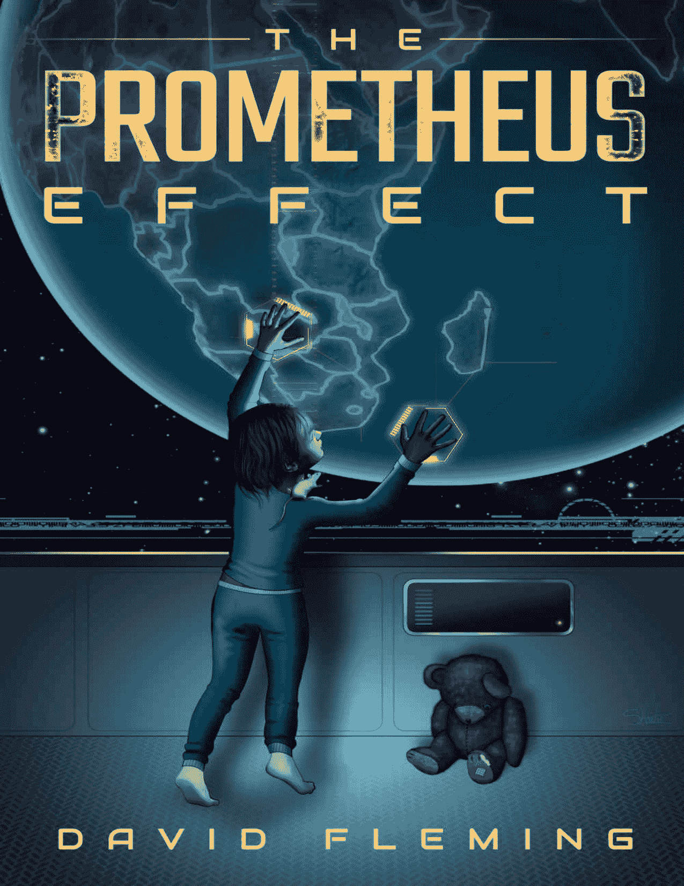

# 普罗米修斯效应

# 第24章

# 第25章

## 第26章

## 第27章

# 第28章

## 第29章

## 第30章

# 第31章

# 第32章

# 第33章

# 第34章

# 第35章

# 第36章

## 第37章

## 第38章

# 第39章

## 第40章

# 第41章

# 第42章

## 第43章

## 第44章

## 第45章

# 第46章

## 第47章

# 第48章

# 第49章

# 第50章

# 第51章

## 第52章

## 第53章

## 第54章

## 第55章

## 第56章

## 第57章

# 第58章

## 第59章

## 第60章

## 第61章

## 第62章

## 第63章

## 第64章

## 第65章

## 第66章

# 第67章

# 第68章

# 第69章

## 第70章

## 第71章

## 第72章

## 第73章

# 第74章

## 第75章

## 第76章

## 第77章

## 第78章

# 第79章

# 第80章

# 第81章

# 第82章

# 第83章

# 第84章

## 第85章

## 第86章

# 第87章

# 第88章

## 第89章

## 第90章

## 第91章

## 第92章

# 致谢

献给 `Stephen`

一位诚实的人

以及

献给 `Tom` & `Rebecca`

最挚的朋友

# 第1章

## 1945年秋

“你是谁，杰克？”

一个简单的问题。

但杰克很清楚，不能对一个政治家坦白一切。如果脱口而出：“我是那个正处于创造核聚变边缘的男人！”，他可能会被关进政府的地下堡垒，眼睁睁看着他们毁灭世界。他太看重生命了，不允许那种事情发生。而且如果他们拥有了他的创造物，身后那些办公桌后崇拜权力的男人几乎注定会在最坏的情况下将人类的历史彻底抹除——这是他所寻求的答案，杰克想。让我的事迹被记录在历史中；我的行为将引导历史的走向。我们没时间回答这些问题。现在，谢谢我并让我回去工作。

“只是个普通人，”杰克回答道。

“你才十九岁。与其说是男人，倒不如说是个男孩。”

杰克冷静地将手放在椅子光亮的皮革扶手上。这个男人不是第一个让他感到压力的人，也不会是最后一个。尽管如此，这种情况仍需要适度的尊重。

“先生，我能为你做些什么？”

政治家手指敲击着放在桌上的文件，锐利的目光从未离开过杰克那冷静的棕色眼睛。伟人们曾坐过杰克这把椅子上，无疑其中一些人在这位政治家面前曾感到局促并胡言乱语。但杰克从容地坐着，等待回答。

“我看过了你的建议书，”男人终于开口，打开了文件，“你是怎么想出来的？”

“看起来很合理。”杰克注意到露出的页面上有自己用蓝色墨水写下的独特笔迹。

“合理？”政治家对着文件咯咯笑了起来。“我们把问题交给了我们所能动用的最优秀头脑。有些成功解决了最严重的问题，但没有哪一个触及我所谓的‘全面’的范畴。然而，你涵盖了每一个问题——包括我们几个没想到的。原子武器、独裁者、流行病、人口、自然资源，以及一些我以前从未听过的疯狂事情。”他从文件中抬起头，“你真的认为燃料会引起这么多麻烦吗？”

“毫无疑问。这些问题都是相互关联的。”杰克靠在椅子上，表情没有变化。

“为什么这个方案的执行必须如此秘密？如果有监督委员会，我会放心得多。他们也可能被要求保持沉默。”

“那些为了生存追求权力的人倾向于保守秘密。他们把这些作为筹码来增加地位。如果组织的解决方案在需要之前就为人知，它们就会变成问题本身。”杰克在他面前向前问道，“如果他们知道了你的原子武器，他们会怎么做？”

“他们会提早发动。”“这是最好的情况。最坏的情况下，他们会一直等到开发出自己的原子武器后再消灭我们。”

他自己，也许他从一开始就知道了。他绝不会把这个计划的执行交给任何人。

随它吧。

“你明白，为了让这个计划生效，”杰克说，“它必须完全按照书面执行。这里没有任何逐项否决权。”

“这意味着你接受这个职位了？”

“是的。”杰克向前一步，从政客的桌子上拿走了文件。

“那祝你好运，杰克。”

“考虑到涉及的保密程度以及我需要招募的那类人，你可能再也见不到我，”杰克说。

“像 `奥本海默` 那样？”

“我会做得更好。”

杰克转身离开，心跳加速，思绪已经领先了后续几步。但在他到达门口之前，那个男人在身后问道：“你打算给你的组织起什么名字？”

杰克停下来思考了这个问题。与该组织的功能相比，这个名字似乎毫无意义。“它不会有名字，”他说，“那样只会引来不必要的关注。”

“它必须有一个名字，”政客催促道，“否则你的人将永远在说：‘让我们回到那个……你懂的吧，眨眨眼。’”

有道理。杰克思考了一会儿——接着他灵光一现。一个简单且即使被偷听也不会引起怀疑的名字。“我会把它命名为‘城市’，”他说。

“很好。我会为你安排你的安全许可……还有你的死期，”政客说。

“谢谢你，总统先生，”杰克说，离开了 `椭圆办公室`。

***

一周后，杰克的火化灰烬肥化了他家乡一棵没有标记的苹果树幼苗。官方说法是他的卡车轮胎爆了，滑入了深谷。油箱破裂，他的车辆笼罩在火球之中。当志愿者消防队到达时，已经没有什么可以烧毁的东西了。内部焦黑的骨架只能通过将发动机缸体上的序列号与注册所有者进行比对来确认。根据法医的说法，司机在撞击瞬间就死亡。他什么也感觉不到。

***

“城市”目前的人口只有一个。

在内华达州一个最近用于轰炸和炮兵演习的干湖附近，一个十九岁的男人坐在一个铝制外壳房屋拖房的过剩军用办公桌前。所有军种的人员档案堆满了每个平面表面，一台嗡嗡响的暖器驱散了寒意。垃圾桶里，一张皱掉的讣告躺在几个 `黑杰克` 口香糖包装纸中间。

当男人转动他的 `西电302型` 电话拨盘准备下一次面试时，他不禁想：

*该死，我太爱那辆卡车了！*

# 第二章

## 2039年夏末

`Mykl` 将世界握在手中。大陆和海洋在他眼前模糊地旋转。当它们慢下来时，他用小手指再次划过格陵兰岛，被膝上旋转的权力幻象所迷住。

“把地球仪收起来，`Mykl`。我们要走了，”身后传来一个温柔的声音。

一个留着乌黑长发、垂落在肩头的纤细女人正耐心地站在一居室公寓的门口。落日洒出的暖光衬托着她娇小的身姿。她穿着离谱的高跟鞋，试图营造出一种身高的幻象，而网袜紧裹着她的腿，从脚踝到臀部带着目的性地闪烁。一件皮革束胸衣破开了外套的开口。一只苍白的手放松垂在身体两侧，另一只手用红指甲敲着门框。一缕头发遮住了她棱角分明的脸。

她那双犀利的蓝色眼睛专注地盯着房间对面的小男孩。“现在，`Mykl`。”

他把地球仪放在杂乱的桌子上。最后旋转一次，他的手指在一次性电脑的键盘上跳动，合上微积分书，冲过去拉住母亲伸出的手。

“我们不用再这样生活下去了，你知道的，”他们走向汽车时她说，“事实上，也许今晚我就能忙定了。到时候我们终于能和你爸爸在一起了。”

世界上有那么个人将会出现，给他一个温暖的拥抱，让他胸口的疼痛消失。他本可以告诉她自己有多爱她，而且将永远深爱。然后他们可以庆祝他的生日，送上他的礼物……见见他爸爸。

这一切都消失了。他的心不再有意义。没有她的生活变得不值一活。

护理人员在他身边蹲下，将一只手放在他的背上。“警察正在派人接你，`迈克`（`Mykl`）。”

她的声音听起来如此遥远。他揉起双手，揉进泪水的眼中。另一个声音在他脑海中回响。“生日快乐，小臭蛋！”

“我要去哪儿？”他艰难地问道。

“我不知道，`迈克`。我不知道。”

# 第三章

## 2040年暮冬

`塞巴斯蒂·法尔斯特`（`Sebastian Falst`）通过舱门进入潜艇时的那种不适感，与过去六个月一直将其视为家的小船员们在他进入时的感觉相当。他的不适源于对幽闭恐惧症想法的压抑，而船员们的不适则源于必须与一个为 `CIA` 工作的陌生人共享空间。然而，`塞巴斯蒂安` 并不关心他们；他们的命令禁止除紧急情况外的任何原因与这名间谍交流。`塞巴斯蒂安` 只关心他的任务：确定新发现的所谓外星技术证据的真实性，以及如果公开会对世界产生什么影响。

在潜艇指挥官和副官（`XO`）的护送下，`塞巴斯蒂安` 穿过狭窄的通道。他的上级曾向他保证将受到特殊对待并享受私人宿舍，他对此充满期待。通往潜艇的艰辛路线需要秘密接头和蒙眼转运，这让他没有任何任何放松的机会。在计时超过 `48` 小时、跨越数千英里后，他已经能闻到自己身上的臭味。他需要一根烟、一个热水澡和一顿像样的饭。

他们经过厨房，那里飘散着诱人的香味。当 `塞巴斯蒂安` 正决定先洗澡还是先吃饭时，两个表情严肃的男人从隔板后走出来。他们像铁箍般紧紧抓住他的上臂。其中一个将气动注射器抵在他的左颈静脉上，按下了扳机。黑暗吞没了他。

***

回到自己的舱室，指挥官重重地坐在小办公桌前。他的副官在他无言的命令下跟了进来，那个命令由担忧的眼神和点头组成。

“关门，`凯尔`（`Kyle`），”指挥官说。门完全关闭后，他继续道，“我不喜欢这样，一点也不喜欢。要把我们从关键回收任务中撤回来？”

“回来时，火箭碎片肯定还在那里。高层一定觉得可以等等，”副官说。“这是一艘原型隐形潜艇，不是出租车！而且，那个自以为是的狗混蛋甚至连请求许可上船的礼貌都没有。我们在暗航模式下航行，没有航向、速度或深度，而某些卫星信号却接管了我们的航向引导。你知道如果我们被发现会有什么后果。他们也拿走了我的自毁指令吗？不，我一点也不喜欢。他死得越快或离开我的船越快越好。这些命令让我的船和船员陷入了不必要的危险。这次任务很奇怪。”

“也许这就是为什么您被选中的原因，长官。您以做出正确决策而闻名，即使在模糊不清的指令和光线昏暗的情况下。也许我们不知道我们要去哪里反而更好。他们显然投入了大量资源来迎合这个人，却仍然把他视为可以牺牲的消耗品。还有什么能阻止他们考虑牺牲我们呢？”

“你的脑子真病态。你知道吗？”指挥官从枪套里拔出副武器，滑出弹匣。在拉动套筒排出上膛子弹后，他用批判性的眼光检查了膛室。副官僵住了，由于担忧略微睁大了眼睛。“你清理得真好，”指挥官说，“如果我把它弄坏了就太遗憾了。”

***

离他的头几英寸处关上了，将他独自留在了人造灯光的混凝土洞穴中。

***

副长从固定舱门处爬下来，发现指挥官的手枪正指着他。副长一言不发，平静地伸出手，掌心向上，去拿武器。

“这把枪是我自己装的弹！”指挥官大叫道，拉回套筒。一枚未发射的子弹在抛壳口上方翻落，指挥官敏捷地将其夺入手中。`9毫米` 弹壳上，一枚完好无损的火药正瞅着他。

当副长接过手枪时，他松开了对手枪的抓握。他盯着火药，问道：“`史密斯` 副长，你为什么要拆掉我的火击针？”

“我接到命令这么做的，长。”

# 第五章

`塞巴斯蒂安` 艰难地喘着粗气，熟悉着周围的新环境。那个疯子看起来好像是真的想杀了他！他通过扣动空枪的扳机是想达到什么目的？但话又回来，他必须考虑一个清醒的想法：那把枪可能装了弹，而他的命是因为极其罕见的哑火而幸存。如果他们愿意为了保护存储在这里的任何东西杀人，那这一定是非寻常的东西。

呼吸逐渐恢复正常，腹部仍残留着阵痛。等 `塞巴斯蒂安` 完成这项任务后，那个副长将会发现在母舰上清理马桶。他之前的情报收集行动——更不用说在禁忌文件中几次秘密发现——已经让他掌握了关于海军高层的丢人细节，足以让复仇成为必然。

潜艇发出一声排气，开始在水下移动。`塞巴斯蒂安` 尖叫一声，跳向一个固定在天然石壁上的生锈梯子。他挂在横踏上，目送着最后一根电子传感器桅杆消失在如墨般的漩涡中。

灵感突然击中了他的大脑，他爬下来将手浸入水中。水感觉偏暖——他把湿润的手指在唇上——尝起来是咸的。至少他可以排除那些潜艇可以进入的大型淡水湖。

“如果你渴了，上面有饮用水，”一个磁性的女性声音说道。

`塞巴斯蒂安` 转过头，看到一个穿着白大褂的美丽金发女性站在梯子顶端。裙下一闪即逝的粉色内裤点亮了他的心情。“那么你在上面还有什么在等我？”他带有暗示性地问道。

“别诱惑我，`法尔斯塔诺` 先生，”她说，侧过身挥舞着他的手枪，挡住他窥视的目光。

“为什么每个人都想射我？”

“你被选中是因为你是执行这项任务最合适的人。我的命令有具体的指示，规定了向你展示什么以及你必须评估什么。任何偏差都将面临致命武力。这项任务的敏感性使得如果你表现出不稳定的迹象，即使是你也是消耗品。”

“噢，真的吗？”`塞巴斯蒂安` 假装不在乎，尽管他的内心充满了痛苦的怀疑。当他爬梯子时，他悄悄抠下一块梯子螺栓处的一块碎掉的石头，塞进了左脚鞋里。`塞巴斯蒂安` 似乎没有注意到。

当他爬到梯子顶端站起来时，发现自己比他的主人要矮得多，这让他感到很不爽。一个拿着枪、高得离谱的亚马逊女战士，对于他进一步了解她的机会并不是什么好兆头。“我们到底在哪什么鬼地方，亲爱的？”他环视着这个制作粗糙的洞穴问道。

“我不知道。他们没告诉我，我也很清楚不该问。”

“‘他们’是谁？”

“那些给我枪的人。”

`塞巴斯蒂安` 冷笑了一下。“现在是几号？”

“不知道。”

“时间呢？”

“抱歉。”

“那么，你能告诉我什么？”

“你是在严格的安保下被带到这里，是为了确定该设施中存储文物的有效性。你在科学和能源方面的资历，以及你的安全许可等级让你成为了最佳候选人。除此之外……”她耸了耸肩，优雅地甩了甩手腕。

# 第六章

## 2040年夏季

杰西卡在书桌前严谨地专注着，分析军事对亚原子粒子最新实验的数据。一个原型圆形粒子加速器隐藏在公众认为是内华达州沙漠深处的一个核试验坑道内。对于所有国内外的卫星来说，它的细节与内华达州荒凉土地上留下的任何其他有毒辐射坑并无二致。虽然附近的坑源于地下爆炸，但科学家们是使用常规炸药制造了这个加速器坑。而对杰西卡来说，这个坑提供了一个追求她付出了身体和灵魂去实现的终身梦想的机会。

杰西卡相信，生活的回报与追求过程中投入的努力直接相关。尽管这听起来如此简单天真，但她坚定地相信自己的能力。

杰西卡忍过了高中时期必要的恶，忍受着冷漠的老师和注水的课程。但在她进入大学之前，经济崩溃了——大学学金化为乌有。劳动力市场需要年轻人，而不是学校里。不仅是大学在缩减规模；公立学区改变了最低素养政策以加速毕业。一旦学生表现出最低能力，就会被直接毕业。没有足够的资金让所有人留在学校里。

大多数青少年对提前毕业感到欣喜若狂，但杰西卡不是。她刻意保持成绩不那么优秀以留在学校，保留使用图书馆设施、电脑和教科书的机会。她知道，专注的自学是她获得大学录取的最佳机会。她决心要接受大学教育。

遗憾的是，学费已经超出了极富人以外所有人的能力——或者是那些疯狂到与自己的财务未来豪赌的人。为了鼓励申请——从而增加收入——大学取消了政府这个中间人，开始自己提供高利贷款，给任何能通过他们入学测试的人。这些测试的费用很快超过了学费，成为他们的主要收入来源。

杰西卡通过在课后打零工赚取考试费用。她的父母没有提供支持，认为那是浪费。他们说找份正事对她的生活更有好处。她的母亲管理拖车公园，她的父亲每周步行两英里去领残障金。杰西卡轻松通过了测试，并选择了五十年的还款计划。要求还规定她接受临时绝育——这是大学为学生还款提供额外动力的方法。如果她按时还款，十年后她就可以撤销绝育手术。杰西卡完全打算更早地还清每一分钱。另一种选择是一辈子的孤独贫困和工资扣押。但在她大学的前三年里，她发现了一个可怕的事实。学术做法正从内部腐蚀学习。教师发放材料就像嘉年华场里的游戏一样，用水柱射进小丑的嘴里，直到上面的气球破裂。

解决世界能源问题的关键。这是一个突破性的概念；她的研究发现，只有另外一个人曾提到过这个想法。那个提到出现在二战结束前的一份期刊上，归功于一个名叫 `J. Smith` 的名字极其平庸的男人。她在战后的学术著作或整个科学界中没有找到过关于这个男人的其他记录。尽管这似乎不可思议，但这个领先时代的人确实存在过，并发表了几行文字。

但杰西卡遭遇了一种阻碍她继续研究的巨大力量：对新知识的冷漠漠视。

> “冷聚变？”物理系院长说，“别浪费精力了。你是个聪明的女孩，杰西卡。你为什么不为多户住宅开发一种新的隔热材料呢？当我们百年后化石燃料耗尽时需要的正是。”

杰西卡冲出了他的办公室，恶心得无法争辩。她会见了她的两位信赖的教授。一个教高级物理，另一个教哲学。他们都同情她的处境，但无能为力。不过，他们指出，尽管教育系统本身尽了全力，她已经掌握了整个教育系统的知识——而且另一个机构甚至可能付钱让她继续学习：美国政府。

两个月和六次公务员考试后，杰西卡坐在一间明亮无窗的房间的书桌前，她早餐吃的煎饼像胃里酸性池上的平石一样跳动着。一本合上的题卷整齐地塞着一张空白的答题卡，摆在她布满划痕的压层板桌面上。她申请了军方的平民物理学家，此时，一个闹闹的时钟滴答着秒数，她准备好进入她的第七级考试。

她并不迷信，但她诚心希望数字七是她的最后。

她之前的六次尝试是在会议中心和礼堂里进行的，面对的是成百上千的其它申请者。在这么多陌生人中间，她曾享有某种舒适的匿名感。但现在，她是这个不比衣橱大的空间里的唯一，墙壁反射并放大了她的焦虑。

那个该死的钟！至少没有反作弊间谍在盯着她，只有高处角落的一只细细的黑蜘蛛，在它空空的网里挨饿。

她深吸了一口气，打开题卷开始答题。

早期的题目挑战了本科生的极限。如果不是因为她自我要求的学习计划，她将不知道该如何破解那些更棘手的问题。仅仅是完成第一页就花了一个多小时。

翻到第二页时，她发现有人圈出了从那页起的所有答案，只是心不在焉地涂擦掉了她的笔迹。她并不太在意这个；说明允许在考试材料上书写，而且她对这些标记不负责。更何况，她并不打算信任上一个考生的答案。但事实证明，接下来的几页题做得荒谬地简单，她发现她的答案与那些被擦得不干净的圆圈完美契合。

她扫视了题卷的剩余部分。还剩下十页，让她非常苦恼的是，里面充满了技术高深的问题，需要枯燥的计算。时钟的滴答声只留给她不到两个小时来完成考试——时间完全不够。

她向后靠在椅背上，思考着一个道德困境。她可以使用别人的答案完成测试；或者提交这本被弄过的题卷以换一张干净的，尽自己所能地应付大部分考试，并几乎肯定会再失去一次工作机会。

这是一个很容易的决定。她希望成就源于自己的努力。清廉的良知能让她晚上睡个好觉，无论失败后面临着多么黯淡的前景。

她迅速起身，敲了敲关上的门。

> “已经结束了吗？女士。”监考探进里面问道。
>
> “没有，女士。有人标记了第一页之后所有问题的答案。我觉得如果把这个换成新题卷会更好。”

监考接过题卷并翻看了几页。“噢，你可真是个诚实的人？”她离开去取一本替换题卷，扔掉了第一页，把剩下的交给杰西卡。“用这个完成考试。题目不同，但它们所需的知识是一样的。我会收下你目前有的答案。遗憾的是，我不能给你任何额外的时间来完成考试。”

杰西卡点头回到书桌旁。她在时间过期前设法又完成了另外四页。她对这份工作并没期待，离开了大楼。

令她非常惊讶的是，两天后，她接到一个电话，要求她第二天来面试。两个男人和一个女人——他们看起来比穿身上那身笔挺的平民西装更习惯穿军服——审问了她不到十分钟的背景细节后就让她离开了。当她询问考试考了多少分时，他们只是回答说通过了，并在他们商量时在大厅等。杰西卡在沙发垫边缘局促不安，思考着手心怎么会出那么多汗。她在心里记下，永远不要在考试或面试前吃这么丰盛的早餐。

小时后，秘书领她进入另一间完全不同的房间完成面试。一名穿着全套军服的陆军上校独自站在一张廉价的折叠桌后。

> “坐。”校官命令道。杰西卡坐下后，校官也坐下问道：“你为什么想为美国军队工作？”

她在每次公务员面试开始时都会听到同样的问题，这并不能减轻她再次回答它时的焦虑。她双手平静地叠放在腿上，深吸了一口气，挺直背部回答道。

校官在等她的回答。

> “我愿意，先生，”她回答。

> “你有直到明天早上之前改变主意。如果你选择接受这个职位，明天八点在麦卡兰机场的执行航站楼。”校官在他面前整齐堆叠的表格上做了一个记录。他补充道，“在服务结束后，政府将支付你的未还学生贷款，五年后，你的绝育手术将得到恢复。你不允许携带除论文相关的纸质笔记以外的任何物品。在登飞机之前，你将被要求签署保密誓。”

校官站起身，伸出手结束了招聘面试。杰西卡站起来，回握校官有力的握手。“谢谢你，先生，”她说。她笑了，知道她的人生道路现在有了方向。

第二天早晨，杰西卡发现自己坐在一个被大众认为是废弃军事基地的阳光暴晒的跑道上。她的历史课告诉她，这座基地由于早期地面以上核试验产生的放射性沉尘，以及第一批隐形飞机计划带来的毒性污染而被封存。然而，阴谋论者声称政府利用该基地测试外星技术，包括运行中的飞行器。当然，这一切都被一盘否认。

原型隐形战斗机和侦察机曾点缀过巨大的机库；现在它们已成为尘埃和蝎子的避风港。杰西卡耐心地接受了基地的入职培训和参观。不祥的象形标志禁止她靠近那些倾倒、焚烧或储存有毒物质的深坑。参观过程中唯一有趣的遗迹并不是导游向她展示的东西，而是一个引起她注意的奇事——那是刻在最旧机库粗糙混凝土上的一个名字和日期：

> `开开切理手 55年2月14日`。

# 第七章

在两名武装警卫和主管的护卫下，杰西卡向电梯控制面板出示了安全证明。电梯内部只有两个按钮：上和下。她按下了下键。

今天标志着她就业的第五十年，但这是她第一次乘坐这种下降。随着电梯下降，她的焦虑感随之上升。由于无法计算楼层，她的想象力占据了上风。她的耳朵嗡嗡作响，电梯仍在下降。

警卫咽了口唾水看了一眼她的主管，一位九十岁的老人。他很少说话，宁愿递给她几乎无法辨认的书面指令——或者——令她沮丧的是——直接指向他想去的方向，然后等她明白他的意图。

当电梯终于停下门打开时，他指了向——出去——这是最容易理解的命令之一。

五个手指后，当他们穿过由走廊和陌生面孔组成的迷宫时，来到了一个死胡同。一扇没有明显把手、合页或任何类型键盘的库门在她面前紧闭。那个古怪的老人只是指了它。

杰西卡走近些，踮起脚尖检查顶部，然后单膝跪地检查底部，寻找某种隐藏的锁定机制。一无所获，她回头看到老人正对着她微笑，仿佛他的秘密蕴含巨大的幽默。

杰西卡的哲学教授的格言进入她的脑海：先试再说。她站起来，没有移开老人的眼睛，用手掌推在冰冷的钢面上。她收获了老人灿烂的微笑和一扇毫不费力就打开的门。

> “做得好，年轻人。请进，”老人没有指路说道。他声音中真诚的赞美比听到他开口说话更让她震惊。

一条短走廊通向一扇窄门，门顶部向她倾斜。她没有等他指路就碰了它；它向上滑动消失在低矮的天花板里。

一个昏暗的多面体房间在她面前打开，像一颗巨大的、中空的钻石。在整个内部表面，闪烁的光点以永恒随机的模式移动。她追踪着光的来源，发现在房间中心底座上的一个粗壮躺椅上方，悬浮着一个垒球大小的球体。

杰西卡走近观察那个球体。一股廉价男士香水的浓烈气味刺了她的鼻子。在她开口之前，老人说：“你有三十分钟。祝你好运，”并碰了门。门轻轻地关上了，留下她独自面对满脑的问题。

太棒了。工作量又增加了一个。

她双手插在实验服口袋里，绕着房间走了一个狭窄的圈。她找不到任何可以解释球体为何悬浮的物体，也无法看出这个房间异常形状的理由。她将注意力转向椅子。厚衬垫上的凹痕暗示它是为了长时间使用而设计的。椅子上配有一个安装在摇臂上的标准数据输入触摸板，供坐着时使用，还有一个微型监视器，屏幕是黑的且没有反应。没有开启开关。

坐在那把磨旧的椅子上似乎是理智之举，于是坐了下来。当她把触摸板拉到工作位置时，墙壁消失在无缝的黑暗中，球体在她四周投影出一个三维全息场。

被突如其来的急性眩晕症击倒，杰西卡紧握扶手，指节发白。她悬浮在空中，没有任何视觉参考来判断上下方向。只有空间、她的椅子和球体。

一个小八角形光标随着她看向任何地方而沿着星场移动。当她移动头部标记一颗恒星时，椅子平稳地旋转并倾斜，对准她的视野中心。她很快意识到，脸朝的方向旋转椅子，而眼动改变了光标。虚拟现实技术远超民用消费水平，杰西卡的脑海中充满了对其可能应用的想象。

她选择了一颗闪烁的星，点击手板上的问号符号。一个全息信息屏在她面前亮起。角星，处女座中最明亮的星，一颗距离地球260光年的蓝巨星。杰西卡盯着闪烁旋转的光标，心想他们不会费力仅仅为了在沙漠里埋一个天文馆就开发尖端秘密技术。这东西一定另有乾坤。

在角星文字的下方整齐排列着几个发光的象形文字。杰西卡选择了一个标记为“当前项目”的。随着手指划过全息图，一组信息簇取代了月球传感器、精确武器、卫星、聚变研究、太空探索、隐形局限性和个人。

难怪这把椅子被使用得如此。我可以在这里呆几周也无法满足好奇心。

她深入挖掘了聚变研究簇。它显示他们不仅发现了它的秘密，还发现了如何调节和维持这个现实。使用的应用尚待公布。兴奋不已的杰西卡接着打开了太空探索。根据安全时间戳，它最近被访问过。内部有先驱号、旅行者号、卡西尼号、海号、路径号等簇。杰西卡认出它们是NASA发射的早期太空探测器，它们被报告为失踪、丢失或损毁。

杰西卡点击了旅行者一号，它的时间戳与根簇相同。椅子立即转向一个闪烁的圆盘——无疑是飞行器的当前位置。根据显示，飞行器仍在活动传输数据：她的全息屏幕右半显示了来自旅行者摄像头的星场，一个数字日期时间显示跳动着微秒。这东西按目前的标准已经非常老旧了，而任何部分仍在运作让她惊讶不已。她不禁在想，为什么他们多年来要费力声称旅行者已经丢失来欺骗公众。

这一切非常迷人，但杰西卡很难理解这一切的意义。建造这个设施可能花费了数十亿美元，谁知道如何维护它。当她点击摄像头下方的滚动箭头之一时，她对这种巨大的挥霍行为摇了摇头。

图像立即切换。杰西卡惊讶地眨了眨眼睛；她花了一时间才理解发生了什么。旅行者一号距离地球超过150亿英里。信号到达那里需要近24小时，更不用说图像了。

# 第8章

在杰西卡那场“测试”的第二天，两名穿着制服的军警进入了加速器控制分析实验室。他们的目光迅速扫过一张张脸，直到最后锁定了目标。

> “杰西卡·斯坦福德？”其中一人问道。
>
> “是？”杰西卡没有从屏幕上抬头回答，她完全沉浸在数据输入的节奏中。
>
> “跟我们走。把实验服留在这里。”

杰西卡眨了眨眼睛，直到军官的话进入脑海，但仍然没有完全理解其中的含义。她站起来，脱下实验服。“这是什么事？”

> “我们的命令是把你送去上校那里，”军官说，同时抬手放在腰间的武器上。

杰西卡脖后的汗毛因警觉而竖了起来。冷酷无表情的脸和姿态警告她不要挑衅这些男人。杰西卡双手垂在两侧，缓慢地跟着他们离开了设施，来到一架等待着的直升机。

杰西卡闭上眼睛，集中注意力，按着鼻梁。她做错了什么。那一定是这一切的原因。但没什么好担心的，军警一言未发。恐惧让她甚至不敢与他们对视，但她确定，在飞回基地的途中，尽管在那件蓬松夹克的紧绷下，他们连眼皮都没眨一下。降落后，他们伸手协助她着地，随后一直跟着她上上校办公室，仿佛她会试图飞走一样。

> “坐下，斯坦福德小姐，”上校命令道，那语气足以让山脉颤抖。“我收到举报，你在一个关键研究项目中伪造了数据。”

杰西卡张口想说话。上校立刻用一个简短的手势打断了她。“这不是讨论的场合。我有关于你行为的记录证明。鉴于你在这里从事业务的敏感性，我们无法容忍缺乏诚信的员工。你的合同已经终止，即刻生效。”

杰西卡闭上眼睛，颤抖着从鼻子里呼出一口气。这不可能发生。她的眼睛感到刺痛。这不是流泪的地方。她咬住嘴唇内侧以防止泪水流出来。

> “你明白自己为什么被解雇了吗？”上校问道。
>
> “不！这一定是个错误。伪造数据？我这样做能得到什么好处？”

上校的脸变得硬得像一面毫无情的墙。他的话语无情地流露出来。“与其说你能得到什么，不如说我们会失去什么。我们承担不起这个风险。你被开除了。你明白吗？”

他们在带她来之前就已经做好了决定，而她的自尊心不允许她乞求。“是的，先生，”她低下头回答了。

> “你什么问题吗？”上校问道。但他的语气是在命令：*别问任何问题。*
>
> “没有，先生，”她回答了。

> “大声读这个签字。一遍。”上校将一份文件滑给杰西卡。当他的手指犹豫时，她看到那是她两个月前签署过的同一份保密协议。

杰西卡大声读道：“我明白，在面临终身禁闭的惩罚下，不得泄露或以任何方式记录我在美国工作期间参与或可能目睹的工作性质。只有出示带有‘开膛杰克’代号的军事身份证明的人员才能授权我违反此项誓言。”她在标有红色 `X` 的行处签名，默默地希望上校能改变主意，告诉她这只是个玩笑。

> “从这里开始，你会被送回拉斯维加斯。剩下的看你自己。你可以走了。”

上校收回文件并签了自己的字，然后表现得好像杰西卡已经消失了一样。她在离职证明上那线条分明的签名，在她的未来上留下了一道永久的伤疤。

之前列立命令的卫兵走上前送她出去。杰西卡跟着领头的士兵，另一个在后面跟着。*这感觉就像是走向行刑场，*她想道。在某种意义上，这确实正是她所做的。他们正把她扔回文明世界，而事实也几乎如此。

接受治疗。她顺从了命运，伸出了左手。议员（MP）表情中的失望说明了一切。她动作利落地将手腕固定在栏杆上，一言不发地离开了。

在杰西卡的余光中，她发现对面的男人仍在盯着。当公交车开始移动时，她歪头看向窗外，假装对布满斑痕的玻璃外的某种东西感兴趣。也许如果无视他，他就会领会意。

> “他们抓你来干什么？”他问道。

听到他语气中的熟悉，她咬紧了牙关。他们非要把她关在这样一个扭曲的人旁边？还不如被手铐在公交车下的火车上呢。

当一种熟悉的气味进入她的鼻孔时，她的态度变了。那是她在多面体房间里闻过的同种香水。他也在那里。

她审视着自己，就像手里拿着一只死老鼠。像一只缩回壳里的螃蟹，她向窗户靠拢。

“嘿，我认出你了，”他继续说道，“你在那个研究核聚变的设施里……”他投来评估的目光，“你研究过那个神器吗？”

杰西卡无法相信自己的耳朵。这难道是某种病态、扭曲的测试吗？他必须和她一样宣过誓言，而且显然不是开开德杀手。他说的“神器”是什么意思？难道是指机密文件夹里的信息吗？无论如何她都不应该谈论这些。这样做是关乎生死且危险的。如果他们在公交车后部藏了麦克风听他们对话，她也不会感到奇怪。

“怎么了？”他坚持追问，“听着——”他在束缚允许的范围内尽可能向前倾身，“你脑子里有这么多机密信息，他们不可能靠解雇你就脱身。他们指望我们遵守那份誓言。但我们只需要去媒体，就会像名人一样被对待。他们会付钱的！如果我们一起去，更有公信力。你觉得呢？”

真见鬼。

杰西卡闭上眼睛。他一直喋喋没休，永不闭嘴。她希望有人一枪射了他。他说得对：如果他们公开，任何后续“神秘失踪”只会让他们的故事更具可信度。但这不值得。为了站在一个毫无自尊心的人一边而失去自己的自尊，并不值得。无论造成多大的困难，她都会忠于自己的誓言。这是正确的事——这让决定变得简单。她额头上渗着汗，向塞巴斯蒂安投去冰冷的目光。

“你想喝点水吗？”他挥着水瓶问道。

“不，谢谢。我们路很长，我怀疑他们不会停下来让我们上厕所。”

## 第10章

## 2040年秋

迈克尔（Mykl）自豪地站在高耸的雪松林中。他握着一把扭曲的金属剑，凝视着远处的微光。铅灰色的云层沉重地压在天空，吸收了太阳曾存在过的任何迹象。他曾多次溜到这里，并与这个敌人战斗。但今天，是时候产生不同的结果了。

一道耀眼的闪光，随后是雷鸣般的撞击声，宣告了一个恶魔的到来。时间是他现在索生命的第三个敌人；他必须加快。他大步出发，去阻止那道光芒。

在空地的边缘，他停了。在一片闪烁的白雪上，发光圈中心，另一个恶魔在等他。当他看到自己的倒影在恶魔的眼中时，一条恐惧的电绳刺穿了他的脊椎。咆哮的蒸汽呼吸穿过有毒的獠齿，他恶臭的气味带着他穿过冰冷的微风。

迈克尔的恐惧与眼前的恶魔无关；那是留给他知道正从身后走来的人的。在仅剩几秒时，他冲进圆圈——扔下了剑。

当恶魔将獠齿刺入他的肩膀开始撕咬他的肉体时，他露出了微笑。恶魔以粗糙、拙劣的大口吞噬了他的肢体。鲜红的血点洒落在冒着热气的内脏周围的雪地上。迈克尔面无表情看着生命流逝。他不再在乎……只要几分钟……

***

“迈克尔！离开那台电脑！现在！”

迈克尔盯着身后气得发抖的恶魔女人张大的鼻孔。她的体型是他的三倍多，用她那双黑暗、毫无生命的眼睛审视着他的身体。他叹了口气。他甚至不被允许享受无聊。他的目光变成了强装的皱眉。

别那样看着我！你竟然在这里已经很幸运了。有更多更值得待在这里的孩子，这是肯定的。”洛莉（Lori）的声音透着蔑视，她向他走来。“你没什么特别的。世界上充斥着不想要的五岁小孩。你觉得你妈妈被谋杀了，你就比其他任何人更应该待在这里吗？你比昨天死在我们门槛的毒瘾新生婴儿好不到哪。”

迈克尔转头看向电脑旁的监控视频显示器，厌恶地闭上眼睛。

洛莉捕捉到了他未说出口的指责，宣布道：“这不是我的错。我当时在休息！”

在“盒子”里生活的十四个月时间里，迈克尔已经记录了洛莉词库里所有的借口。是在上厕所休息。我在午休。她不是我的责任。这些借口和她那些特制“香烟”出的烟一样站不住脚。她讨厌孩子，而盒子里的孩子都是孤儿，不被爱，注定要过被忽视的生活。她是这个悲惨监狱的残忍典狱，她在权力中获得施虐般的快感。

游戏室里闪烁的电视已经困住了孩子们，等待着早餐铃响起引发早晨的冲撞。喷嚏声和咳嗽声从五岁到十七岁不等的孩子身上传出。迈克尔感到自己从未受过那些常见困扰其他人的疾病侵害很幸运。

一个破旧的旧沙发看起来像一个活着的生物，十一个扭动的身影正为了位置挤挤。房间里的其他身体似乎是在一场杂乱无章的孤儿院滑坡中跌跌撞撞的，散落在一张艳丽的地毯上。孩子们趴在地上，高高地抬着头。脸离地毯太近只会让那股令人作呕的气味更加浓烈。

一条公益公告用刺耳的声音和闪烁的红字中断了他们的观看。一个脸上带着虚假微笑的美丽女子传达了当天的坏消息以及关于最新末日预言的更新。欧盟内部的社会动荡已恶变为涉及坦克和迫击炮的边境冲突。军事占优的邻国正在站队，并向其中增添战斗人员。和平努力的强硬措辞对RPG火箭、空袭和地雷几乎毫无保护。噢，显然中东的核紧张局势在加剧——又如此。自从纽约中央公园一场拥挤音乐会上发生脏弹爆炸后，全球的恐怖袭击已像公园长椅上的鸽子一样随可见。而媒体也揭露了其中的真相。它们像饥饿的寄生虫一样，煽动公众恐惧并不断加剧。

Mykl不想参与其中。他在想，如果他们直接发射所有导弹就此结束，情况会不会好一点。他开始走开，却因一项即将举行的针对前政府秘密工作者——告哨人的独家周末访谈而停下脚步。那个女人大肆炒作这个故事，承诺证明政府在一个秘密军事基地扣留了聚变技术和超光技术。Mykl一想就摇摇头。*超光？* 哪个疯子？超光已经接近圣诞老人雪橇的速度。聚变和风扇填满了科学的圣杯。它们在一起构成了支撑大多数科幻小说的廉价口香糖。聚变，真的吗？如果那种技术真的存在，他们不会早就实施并让世界摆脱这种能源困境吗？

公告结束了，Mykl切换到了隐身模式。当他一心寻求孤独时，没有人会注意到他。他穿着破旧的袜子，无声地穿过聊天室，特意避开任何那些看电视的人可能注意到的动作。他怀疑那些沉浸在动画片里的孩子们，除了从那个旧盒子里流出的无脑废话外，还能感知到什么呢……

“Myyyykkll？”

……除了James。Mykl从未能躲得过James。这让他感到无比困惑。

那个叫James的庞大男男孩向他挪动。他那头被睡液结块的恐怖头发让他看起来像个疯子。他看起来十七岁，实际七岁，大部分时间都面无表情、无拉拉地绕着“盒子”走。如果他能直起六英尺三英寸的高度，他将会是一个令人胆畏的存在。

James灰色的眼睛闪烁着孩子般的恶作剧。“Myyyykll，”他用鼻腔调调，露出一个顽皮的微笑。“又要修鞋了？”

像往常一样，James脑子里的声音告诉他把鞋带系成复杂的结。他的结结技巧快达到了戈尔结之术。至少他没有再次系错鞋。

“没问题，James，我会帮你修鞋的。”Mykl蹲下身评估最新的难题。他很快意识到，这需要投入精力才能解决。

“Dawn在哪？”他问。

“Dawn在外面陪小猫，”James说。

“我们要不要去那里，我修鞋带时你陪她？”Dawn在这个星球生活的时间比James少两年，但表现出更好的交流技巧。

James连连点头同意，穿过如幻梦般空间走向通往四庭的门。

当Mykl跟着他经过办公桌时，他忽略了Lori投向他的冷脸，Lori正忙碌地敲着电脑。她似乎在安装新软件。*我不知道她聪明到能做那个*，他耸耸肩心道。

四庭像监狱一样荒凉，是一块正方形的、破碎黑色沥油路，每边三十英尺，被一圈风化的十二英尺高铁丝网围着。被日晒腐烂的破烂铁丝网倒塌在围栏上，生锈的螺栓深深地刺入通往围栏的外墙灰泥。棕色的条纹从螺栓处流出，像被冻结在时间里的受伤孩子的泪水。四庭中央立着一根镀锌金属杆，顶部连着一小段生锈的链条——某种被遗忘的儿童娱乐设备的遗骸——它略微倾斜着，用途早已被遗忘。某个慈善组织在建筑旁安装了一个玫瑰花盆，试图美化该区域，但它现在唯一的用途是作为“盒子”内生命遭遇的象征：它被虐待，没有花朵，挣扎着绽放。

一张旧金属折叠椅是四庭里唯一的另一个物体。Dawn坐在椅子上，膝上蜷着一只瘦小的白小猫，嘴角带着柔和的微笑。

当Mykl走到户外时，清晨的微风带着明显的寒意。现在是十月中旬，秋天终于决定宣布它的到来。每个人都迎接了近期的温度变化。

它们被安排着打时间，但被收养的希望渺茫。至少它们在年老时不会被实施安乐死；相反，它们会被直接被踢出去。但即便是一只即将被安乐死的狗，偶尔也会得到一下拍头部。

当 Mykl 最后一次解开 James 系的结时，他仔细地用自己那套“防詹姆斯版”的方法重新系好它们。“现在，今天剩下的时间都别理它们了！”

“好的，Myyykill。” Mykl 把 Teeka 放回 Dawn 的膝盖上。“乖猫，回到 Dawn 。”

正当 Dawn 伸手去接它时，Lori 冲进了院子。“你在对那只流浪猫干什么？”她咆吼道。

Teeka 的回应是愤怒地炸开一满身的皮毛和爪子。她从 James 的怀里挣脱出来，飞过院子，消失在栅栏的缝隙下。一只无辜的小猫很有自知地逃开了那个恶女。

Mykl 看到 Dawn 无声地吐出“婊子”这个词来表示抗议。Lori 似乎从没注意到 Dawn 的侮辱。

“你们知道规矩，”Lori 说，“别让我再抓到你们任何人带着那些害虫。现在回屋去！”

从箱子里传出来的尖叫声和嚎叫声盖过了早餐铃的第一声响。James 扶起 Dawn 站并护着她。Mykl 回头看向栅栏，看到一个白毛茸茸的小脸长着黑色的撇笑胡须，正从一个皱的垃圾桶旁窥视。Mykl 把笑容藏在心里，径过 Lori，克制着舌尖尖锐的刺痛感。

James 和 Dawn 消失在食堂里，Mykl 必须加倍短促的脚步才能赶上。他很高兴看到今天供应的是他最喜欢的早餐：燕麦片和橘味水。这是一个特别的日子；他们几乎不提供橘味水。

James 引导 Dawn 坐在长桌尽头的一个空位。“守着 Dawn，James。我去拿我们的食物，”Mykl 说。他拿了一个托盘，和其他等候稀粥的人一起排队。

柜台后面那个满脸的苦力散发着无聊。“要三份？”Mykl 说。他伸出三个手指并摇了摇。他知道数学不是那些志愿者厨工的强项。

托盘上放着三碗热腾腾的粥，他走向饮水台。受限于体型和五岁孩子的肌肉力量，在托盘上增加三杯满溢的饮料让运输变得更具挑战性。

慢慢地……慢慢地……

“Mykl？你让我的燕麦片凉了吗？”Dawn 笑着问。

“等你的小猫！我来了，我来了！”

当 Mykl 最后把托盘递到桌子上时，只有轻微的溢出，James 鼓掌。“谢谢你，Myyykl。”

“是的，谢谢你，Mykl。你顺便带勺子了吗？”Dawn 天真地问。

Mykl 咕哝着也去拿了勺子。

他们一边吃一边互相打趣，James 和 Mykl 承受了 Dawn 尖锐机智的大部分。“你什么时候才能长大，Mykl？你真的确定自己不是某种搞得一团糟的政府实验品吗？”她调逗道。

Mykl 弹了一块硬掉的燕麦片向她的胸口。她缩了一下，James 隔着鼻子吹出了一个鼻涕泡。“不公平！”她声称，“你应该为欺负一个可怜的小盲眼女孩感到羞愧。”

“不是我。是 James！”

“James 不 floooker！”他辩护道。

“鼻涕？是鼻涕吗？”Dawn 也嗤之以鼻，这让男孩们更多地取笑她，他们都陷入了一阵大大笑中。

早餐后，当 Mykl 把他们的碗刮进垃圾桶时，James 护着 Dawn 去活动室。两人形影不离。James 乐意充当她的眼睛，勇敢地承担起守护天使的职责，作为回报，Dawn 分享她的善良和友谊。

Mykl 跑去他们。他发现 Dawn 躺在一个绷带罐上，眼睛盯着虚空，她的脸让人想起 Mykl 曾经在某个旅游网站上看到的埃及公主的象形文字。James 坐在她脚边，平静地赞慕着。

Mykl 助跑后高高跳到空中，掉落在附近一个旧豆袋椅中间。“我看到 Teeka 在栅栏边晃悠，Lori 把她吓走了。她明天早上应该在那里等你。”

“我爱那只小老鼠，”Dawn 说。

“Teeka 不是老鼠。她是猫咪！”

“James，六个月后他们因为太老而让你离开时你打算怎么办？”Mykl 问。但他看向 Dawn 寻求反应。

“也许 James 会留下来端鼻涕？”他回答道。

“Lori 永远不会允许。她讨厌我们，”Dawn 说，“天，她气死我了。”她闭上眼睛，紧紧抱着身体仿佛在抵抗寒冷。突然，她坐起来，动作优雅地站起身。“我头疼。我要回房间……不，别起来，James，我可以找到路。这这里没有什么事是改变的。”

James 看着她，看着她完美的坐姿消失在楼梯上。

“走吧，James，”Mykl 说，“我们也一起去吧。这比在这儿等 Lori 因为我们的存在而对我们大吼好。”

James 费力地站了起来……

## 第11章

深夜，一阵刺耳的救护车警报声将迈克（Mykl）从宁静的睡眠中惊醒。他睁开眼睛，盯着下垂且裸出的金属网，这些网不知设如何让詹姆斯和他那破旧的床垫没有掉下来，避免在骨骼碎裂的瞬间将他压死。

迈克翻过身，抱住了父亲。在醒来之前，他一直梦见他的母亲。关于她的思绪仍困扰着他。他爱她。她为什么要死？为什么她要留下这么多秘密——用这么多名字？

他的父亲又在哪儿？他唯一知道的是他们据说拥有相同的姓名。然而，尽管拥有了全名，他的网络搜索也一无所获。

这让迈克被困在了这里，拉斯维加斯孤儿院。那家孤儿院。

迈克知道，几十年来，这种畸形的收容所在在先进社会中几乎已经消失了，取而代之的是寄养。寄养系统已经崩溃了，因为合法的寄养父母数量远少于虐待者，这些虐待者为了获得最高额的政府补贴，干脆按照法律允许的上限尽可能接收孩子。很多时候，那些钱买的是酒精和香烟，而不是食物和衣服，而当地政客则认为这些钱留存在他们自己的专人手中更好。于是，由政府亲自经营的创办收容所取代了寄养，成为处理被遗弃儿童最流行的手段。

这并没有导致护理质量的提高。资金不足是常态，政客们总在寻找更进一步减开支的方法。修订后的绝育法被证明是解决遗弃儿童问题最受欢迎的方案。

绝育法曾用在宠物身上。事后回来看，宠物的成功导致对人类出台类似的法令只是时间问题了。惯性犯分子、福利金领取者以及那些希望住在补贴住房的人，很快都被要求接受化学绝育。不孕状态可以通过药物逆转，但只有根据法院命令才能获得。严谨的筛选措施声称，只绝育那些本根本就不配当父母的人。但这项政策对日益增加的无家儿童的影响微乎其微。

迈克下床，溜到窗边观察星空。这是一个晴朗的夜晚，如果他把脸贴在冰冷的玻璃上，几乎能看到安全栏之间的猎户座三星。他喜欢看星空，经常在深夜溜进四角庭，满怀敬畏地凝视着广阔天空的宏伟。

詹姆斯翻了个身，金属网发出抗议般的吱吱声在寂静的空气中回荡。迈克环顾四周。这个点，洛莉（Lori）应该走了，琳达（Linda）会负责看守“盒子”（The Box）。迈克笑了一下。琳达所做的无非出现然后睡觉。

他挪动到衣柜前取出一双袜子。所有的袜子上都有洞，但他只能怪自己。他很早就决定鞋子太响了；袜子要隐蔽得多。他选了一双洞最少的，对着闻了闻气，坐在磨损的塑胶地板上把它们穿上，小心避开破损处。然后他溜出门，轻手脚脚地走过走廊。对白天情况的简要侦察确认了琳达正通过占据整个长沙发来换取今晚的报酬。

办公室的电脑是他的终极目标，但迈克先想去四角庭。监控摄像头监视着门，但他怀疑是否有人会去检查监控录像。无论如何，从未有人就他的夜间出没——或是他对办公室办公用品的小偷小摸——质问过他。

四角庭的门在晚上是锁着的。通过桌子上的按钮解锁，但只有在按住按钮时才会保持开启状态——而在按住期间，会发出烦人的蜂鸣报警声，因此用胶带粘住按钮或在上面压一个重物是不可行的。在“盒子”工作的早期阶段，迈克开发出了一种在不引起怀疑的情况下开门的方法。这涉及到一把尺子、一个回形针、一团纸和三条胶带，这些东西在办公用品中都能找到。

在将回形针弯成一个中间带有“X”形的扁平正方形后，迈克将其插入门和门框之间的缝隙中，顶靠在锁舌上方。然后他将尺子的末端推到锁舌正下方，用胶带将其固定以卡住回形针。第二条胶带覆盖了锁舌所在的缝隙；它的作用是防止重构后的回形针在滑过移动的锁舌并落在尺子上后掉出来。

迈克回到桌旁并轻按按钮，报警器只发出了极其细微的嗡嗡声。琳达没有动静。当锁舌滑开时，回形针掉落，落在尺子上。当锁舌试图再次滑回锁上门时，它被回形针挡住了。锁定机制被破解了。

迈克慢慢推开门——如果打开太快，经常产生尖锐的刺吱声——听到外面传来轻柔而哀的喵喵声。提卡（Teeka）蜷在椅子下，耐心地等待丹（Dan）几小时后来喂它。迈克把一团纸塞进锁扣盒，用最后一张胶带将其固定，作为防止门锁意外解锁的保险。轻轻关上门后，他溜到外面，蹲下抚摸着那只饥饿的小猫。

迈克的手穿过柔软而冰冷的毛发——在迈克看来，太冷了。他知道忍受寒冷夜晚是什么感觉。他能给小猫提供的只有这些，于是他坐下来把袜子取掉，然后轻轻地盖在在那只打着呼噜、蜷缩的小兽身上。

（注：原文中存在大量重复的 OCR 识别错误片段，译文已根据要求去重并确保了逻辑通顺。）

密码错误。

讽刺再次袭来。“那没起用。”

“不再有猫了。现在别再烦我，让我睡觉。”

“谢谢你，林达。”

她不屑地挥了挥手翻过身。

`[nomorecats]` 让 Mykl 再次获得了网络世界的避风港。“臭臭娘，”他低声嘟囔道。为什么世界上不能有更多的林达呢？难道已经有太多林达了吗？洛里斯让她们看起来比实际上更有吸引力。

“我今天该去哪儿？”他沉思着。他已经挖掘了电脑硬盘上的所有信息。每年一次，政府要求“盒子”里的每个孩子都要参加能力测试。测试结果用于帮助准父母选择孩子。具体来说，这些结果被包含在一个本质上是儿童销售目录的文件中，那里详细记录了从身体特征、残疾到智力、技能的一切信息。

Mykl 觉得很奇怪，被领养最多的孩子并不是最聪明的，也不是潜力最大的。人们不想要比自己更聪明的孩子。他们不想要特别笨或问题孩子。不，他们想要一个平庸的孩子——一个他们可以欺凌、支配、并屈从他们意志的人。在戏弄 Mykl 的孩子中最凶的 Donzer 已经被领养——又退回——三次了。随着每获得一个伤疤，他的邪恶性就增加一分。

盒子传说说真正聪明的孩子，那些在测试中表现出色的，被政府带走了。传言说这些孩子被派到阴暗的地方当廉价劳动力，永远见不到阳光和星空。当然，这些传言出自那些同样相信牙仙孩子的孩子口。但真相对 Mykl 并不重要；他只知道必须隐藏自己的智力，让自己的能力分处于低水平。根据盒子的记录，他的智力并不超过一只受过训练的一年牛。

当然，这并不能保证他不会被领养，而他确实不想去那里。盒子之外生活的现实让他感到恐惧。他见过太多被送回的缺陷商品的孩子身上有新鲜的淤青。但到目前为止，他是很幸运的。

他把注意力回到电脑。防火墙阻止他访问被认为不适当或无产的网站——但对 Mykl 来说的是，防火墙没能屏蔽提供如何击败对手信息的网站，他早已绕过了它。

他再次考虑如何利用他偷来的电脑时间。也许他已经几个月没访问这里了，他的大脑渴望一些像样的借口。即使在最难的级别，网站上的谜题也几乎没有给他挑战，但它们仍然很有趣。他本可以全部完成的，但提供网络访问的服务器在他完成之前就崩溃了。

他启动了自己设计的匿名程序并登录。这很有前景。也许他们也改进了谜题？

他很快发现他们确实改进了。事实上，令他高兴的是每个谜题都与之前的交织。他必须记录所做的一切。每一个细节都可能在未来的某个谜题中使用。总之，这就像是一场复杂的交响乐，Mykl 从未接触过。他的大脑感知到屏幕后有一个智力正在专门为他创作谜题。

他一输入答案，屏幕上就会出现另一个问题。题目出现的速度微妙地加快，Mykl 因为全神贯注而没有察觉。策略题、数字回归、模式识别和词汇联在他眼前闪过。Mykl 集中注意力，眯起眼睛，手指在键盘上快速敲击。他的大脑从未如此紧绷。盒子里的世界消失了；时间被压缩了，他想上尿，不在乎，他知道答案，手指在按键上模糊，`<enter>`，另一个问题，有了，手指开始疲劳，下一个，输入答案——

谜题在他按下回车之前消失了。Mykl 举起拳头，准备愤怒地落下。

屏幕闪烁，出现了一个新图像。一个密码。它看起来很熟悉。聪明，但不够聪明。James 的写法很像。作者在加密之前省略了元音，并故意按读音拼错了单词……而且还是古怪的词……搞定！那是什么？

盒子的现实向他袭来。恐惧感在他腹部升起，向上威胁着他狂动的心。他现在意识到自己被骗了。他不是在玩谜题消遣自己——他在参加考试！最后一个密码看起来很熟悉，而且并不符合之前谜题的模式——现在 Mykl 明白为什么了。

他被骗去解“避难所天使”尚未发表的密码。

在恐惧的驱动下，他删除了答案并关了电脑。他的大脑依然在运转，他跑回宿舍，试图理解发生了什么以及是谁在幕后操纵。他怎么能这么愚蠢？外面有人知道他隐藏了这么久的秘密。他的匿名程序能保护他吗？怀疑。

他把脸埋在枕头，希望自己能从这个星球消失。密码符号在脑海中灼热地闪烁。他知道避难所天使的第一个受害者会在哪里被——以及他们被杀死的可怕细节。

# 第 12 章

“你好？”

“找到他了，先生。”

“找到谁了？”

“几个月前几乎通过了二级谜题页的那个用户。”

“是的。我记得。由于服务器问题和一个相当精妙的反追踪程序，追踪未能锁定位置。”

“我们重置了他的登录，以便他如果再次回来时能带他进入第一级测试。他确实回来了。但他没有提交最后一个谜题的答案。”

“第一级测试的设计就是为了无法完成。它们只是一个测量工具。”

“我不认为您明白意思，先生。他做了最后一个问题，但似乎是电脑问题阻止了他的输入。”

“这足以成为获取他的正当理由。”

“我们相信他在电脑上看到的某些东西吓到了他。我们有用户办公室监控摄像头的录像。”

“年龄？”

“五岁。拉斯维加斯孤儿收容所。”

“带他过来。他是最后一个。我们没时间要更多了。”

“还有，先生。”

“什么？”

“收容所的一起意外。”

被广场上传来的一声痛苦尖叫惊醒，James 从铺上跳起，在 Mykl 坐起来之前就离开了。Mykl 已经在床上躺了大约几小时，完全睡着了。

尖叫声消失了，随后在歇斯底里的哀嚎中复苏。听起来像 Dawn，但他无法确定。带着不祥的预感，他从被子里挣脱跟随 James。

James 将 Dawn 紧紧抱在怀里。她瘦弱的身体在剧烈的抽泣中颤抖。她听起来像 Dawn，但他感到不确定。James 低声安慰道：“不哭，不哭，”但她无法安抚。一群孩子聚集了过来。大多数人看起来很恐慌，几个人带着恶意的微笑。

在 Dawn 身后，一滩血在闪光。一双软软的尾巴垂在 Dawn 的身侧。Mykl 心沉了下去。

“哈哈！那个混蛋杀了你的猫！”Donzer 叫道。他轻浮的语气和缺乏惊讶的表现显露了他就是杀死 Teeka 的人。那些恶毒的党徒无疑参与了——甚至把尸体放在 Dawn 的椅子上，以确保她是发现尸体的人。

双臂仅仅勉强挡住了大约一半如拳头般冰雹的风暴。

洛莉（Lori）尖锐的声音驱散了人群。“大家都回屋去！”

詹姆斯在整场混乱中一直惊恐地站着，双臂伸出，仿佛在试图寻找捡起一只猛兽的最佳方式。他找到了一个机会，从唐瑟（Donzer）身上救下了仍在摇晃的黎明（Dawn）。由于疯狂地挥空击中了沥青路面，黎明的指节渗出了血迹。她将通红的脸埋在詹斯的胸膛里。

唐瑟大道：“是那个混蛋天使干的！”

“唐瑟，”洛莉指着他，“如果你觉得那个天使很糟糕，就别想反抗我！再敢用那个词，你就得用棉签刷小便池了，吗？”

唐瑟擦了擦流血的鼻子，他和他的小混混们溜走了。任何涉及浴室务工作的惩罚都不是玩笑。

洛莉抓着迈克尔（Mykl）脑后的细发将他拉向自己，粗鲁地转过他，一边弯身咆哮道：“看到喂了那些该死的东西会有什么后果？这是你造成的摊子。你自己去清理！”

她示意大家回到屋里。詹姆斯将黎明抱在怀里带着她。洛莉最后进去，并在身后砰地关上门，留下迈克尔光着脚、穿着睡衣在寒冷中发抖。

迈克尔的拳头和下颌因愤怒而发白。他刻意不看那个椅子，环视着房间。他发现找不到可以埋葬提卡（Teeka）的地方，无法忍心把尸体扔过栅栏或丢进垃圾桶。那个被遗弃的花盆已经是他能做的极限了。

他不顾寒冷，用赤手在植物枯萎根系旁的干土上挖了一个深坑。当他抱起那没有生命的小猫并带走向小坟墓时，新的泪水夺眶而出。他极其虔诚地将袜子放在它身上，然后填平了坑。

迈克尔并不知道，蒂娜（Tina）正透过花盆上方脏的窗户看着他。泪水从她蓝绿色的眼睛流出，掉落在她的手上，手里正握着从昨晚省下的几块残粮。

***

詹姆斯被允许带着黎明去他的房间，但被禁止进入或留下来提供安慰。女生宿舍不允许男生进入；那是规矩。所以现在，他坐在书桌前，满脸因愤怒而通红，在纸上狂暴地戳着一个个黑点。

迈克尔从门后的钩子上抓了一条毛巾。血迹染了他的手，睡衣脏兮兮的，他希望洗个热水澡能洗掉昨晚和今天早晨的所有记忆。

男生的卫生间完全称不上卫生，因此清理那里是“箱子里”里最令人畏惧的惩罚之一。迈克尔跨过门槛，一股氨水味的酸尿臭味直冲了他的鼻孔。他试图用嘴浅呼吸直到能够适应；但当他达到无法挽回的界点时，这反而引发了深呼吸的需求。速度和动作的经济性将是他最好的防御。

八个喷嘴在没有任何隔断的空地上随机间隔地滴着冷水。渗水留下了橙色的硬水痕迹，流向绿色的排水口。迈克尔挂起毛巾，脱掉睡衣。衣服前面的血迹让他停了片刻，然后猛地将它们扔进淋浴间，希望废水能将其冲掉。他用双手拨弄着热水，身体侧向一旁等待水流变热，完全不顾及洛莉关于浪费水的规定。

当他打着肥皂时，温暖的水流过他的头皮和脖子，感觉很舒服。尽管他的身体开始变得干净，但他的灵魂仍留着一种永远无法洗净的罪恶感。他本该知道，在“箱子里”存在像唐瑟那样的人时，就不该去鼓励提卡对孩子的信任。他本可以一直躲回巷子，直到黎明叫他。做任何事都比他所做的要好。

我曾、我本、我本该；这超出了他的能力范围，事情已经发生了。他希望黎明能原谅他。

他冲了水，拧干睡衣里的水。毛巾拖在地上，他深吸了一气，冲回宿舍。

詹姆斯走掉时，他把湿的睡衣搭在椅子上。那不是詹姆斯；他通常处理事情非常仔细。

迈克尔收集起页面并放在詹斯的“抽屉”里。那些点毫无意义。他杂乱无章地徘绕着。起初，迈克尔认为那可能是某种写作，但詹姆斯并没有把它们写在纸上。他本可以处理五页纸，从前到后，从左到右，循环。没有人能看懂其中的含义，除了那些被设计的、有价值的、笨蛋般的点。

但看着那些点让他想起了天使密码。他没有告诉詹姆斯或黎明那是怎样的。他们已经心碎了，无论如何对此无能为。告诉洛莉不是问题。对于某件事，他并不认为她会在意，而另一方面，她会惩罚使用电脑。不，最好的办法是等到面试之后，然后他会创建一个临时邮箱，并用它匿名通知关于天使的意图。

# 第 13 章

- “迈克尔？”詹姆斯促道。
- “几点了？”迈克尔问。
- “还好吗？”詹姆斯问。
- “记得吗？”迈克尔点头。
- “会吗？”詹姆斯问。
- “可信吗？”迈克尔问。
- “走吧，”詹姆斯说。
- “你不吗？”迈克尔问。
- “你呢？”詹姆斯问。
- “我会拿的，”迈克尔说。
- “你确定吗？”詹姆斯问。
- “你不吗？”迈克尔问。
- “最好的吗？”詹姆斯问。
- “你不吗？”迈克尔问。
- “你会看到吗？”詹姆斯问。
- “你看到？”迈克尔问。
- “是结束了吗？”詹姆斯问。
- “你不担心吗？”迈克尔问。
- “你会帮我吗？”詹姆斯问。
- “需要什么？”迈克尔问。
- “那是路吗？”詹姆斯问。
- “你不觉得吗？”迈克尔问。
- “你会和我在一起吗？”詹姆斯问。
- “爱是什么？”迈克尔问。
- “那是机会吗？”詹姆斯问。
- “你不知道吗？”迈克尔问。
- “你会原谅我吗？”詹姆斯问。
- “过去是什么？”迈克尔问。
- “那是真相吗？”詹姆斯问。
- “你不相信吗？”迈克尔问。
- “你会在那里的吗？”詹姆斯问。
- “灵魂是什么？”迈克尔问。
- “是结束了吗？”詹姆斯问。
- “你不见吗？”迈克尔问。
- “你会救我吗？”詹姆斯问。
- “心是什么？”迈克尔问。
- “那是光吗？”詹姆斯问。
- “你不觉得吗？”迈克尔问。
- “你会爱我吗？”詹姆斯问。
- “世界是什么？”迈克尔问。
- “那是梦吗？”詹姆斯问。
- “你不理解吗？”迈克尔问。
- “你会记得我吗？”詹姆斯问。
- “时间是什么？”迈克尔问。
- “那是和平吗？”詹姆斯问。
- “你不在意吗？”迈克尔问。
- “你会和我在一起吗？”詹姆斯问。
- “希望是什么？”迈克尔问。
- “那是家吗？”詹姆斯问。
- “你不想要吗？”迈克尔问。
- “你会为我留下吗？”詹姆斯问。
- “生命是什么？”迈克尔问。
- “是结束了吗？”詹姆斯问。
- “你不知道吗？”迈克尔问。
- “你会放我吗？”詹姆斯问。

交谈似乎有些作用。至少她停止哭了。

迈克尔觉得，一些内部消息可能会让她感觉好些。“我有预感，那个‘天使’很快就会被抓到，”他说，“别担心我的面试；我很乐意留在这里和你、詹姆斯在一起。”

黎明转头看向窗户。迈克尔认为这是她在让他离开的信号。

“好了。我该回楼下了，”他说。

“等一下。好吗？读给我听？”

迈克尔笑了笑。“好啊。还是那本书吗？”

黎明点了点头。

那是迈克尔认为黎明身上深受鼓舞的一点之一：她从不放弃。她留着那些照片是因为她相信总有一天，她会再次看到。而当她再次看到时，她想再看一眼她失去的家人。

黎明并不经常提起她的家人，但她告诉过迈克尔他们去世的故事。她的父母和姐姐在医院的一场恐怖分子汽车炸弹中丧生。她妈妈和姐姐当时在医院参加“带孩子上班日”。黎明本该在那里的，但她太小了。没有任何组织曾声称对这次袭击负责。就好像恐怖分子不再有任何想要传递的信息，也没有任何想要的要求。他们只是在杀。

迈克尔取出书，坐在黎明的下铺上。他也喜欢这本书。打开封面，他开始读道：“迈克尔自豪地站在一座闪闪发光的白色宫殿顶端……”

## 第 14 章

迈克尔一直读给黎明听，直到该准备面试了。在路上，他通过告诉她詹姆斯为了能送货而付出的额外努力，终于让黎明吃了东西。

正当迈克尔起身离开时——

“读书，”黎明回答道，拉长了词，仿佛这个事实是理所当然的。

黎明向洛里冲去，迈克尔确定她对那个恶毒女人挥了一拳。当洛里一言不发转身离开时，他真想欢呼一下。

***

当他们再次独处时，黎明带着迈克尔走向楼梯，她敏锐的耳朵竖着听，确保洛里不会发现他从女宿舍溜出来了。

“你刚才对洛里出手了吗？”迈克尔问。

“那个婊娘活该。”

詹姆斯跑来接他们，踉跄了一下，倒在他们脚边，说洛里在食堂。黎明忍受了他的熊抱，然后宣布她头痛欲裂需要回房间。“谢谢你的陪伴，迈克尔。祝你面试好运，”

“詹姆斯在这里等。你去拿读物吧，”詹姆斯说道，轻轻地推着迈克尔走过走廊。

当迈克尔走向房间时，他听到活动室方向传来巨大的“砰”的一声，接着是洛里对提卡的痛骂。詹姆斯学会了迈克尔跳到豆袋上的习惯，听起来就像旧缝线终于没能抵挡在“盒子里”生活的风险。迈克尔很想回去，但肯定会招来更多洛里的毒舌。虽然那是一场泡沫塑料的惨剧，但他还是不情愿地回了自己的房间。

黎明宽慰的话语缓解了他胸口关于对提卡的负疚感，但他心中仍有许多事。首先，是发给那个代号的信息。还有那个诱骗他参加的测试背后的黑手动机。

现在，还有这场面试。

迈克尔检查了洛里留在他铺上的面试衣服。它们没什么特别，只是每年捐赠的较好衣服中的样本。如果有人领养他，他就可以留着，否则他必须还回去供别人用。

他快速穿好衣服，用手指理了头发，踮起脚尖在满是灰尘的镜子前匆匆看了自己的自己。深色的头发和一双好奇的铜色眼睛回视着他。他想，今晚他是否要在一个陌生的家庭里和新的父母一起睡觉。

一只蟑螂在磨损的油胶地板上爬过，试图从开的门逃出去。迈克尔在出去时踩扁了它。

***

他进入活动室时，詹姆斯一个拥抱迎接了他。

“也许这次你是幸运的！如果你又搞砸了，詹姆斯还是会你的朋友。”

迈克尔尽力朝他的肚子打了一拳，但他这位高大的朋友并没有明显的退缩。随后，他脸上带着大大的笑容回抱了对方。如果他必须离开，他会非常想念詹姆斯，他仍然担心黎明。

詹姆斯伸手用手指弹了一下，帮迈克尔理好领子。“你最好在这，免……”

“迈克尔！”

伴随着厉鬼般的尖叫，他的名字在整个“盒子”里回荡。洛里在叫他，最好不要让她等，否则她会被激怒做出更过分的刻薄行径。话虽如此，迈克尔又会在乎呢？她对照顾的孩子从未表现过一丝爱意——永远。没有哪个孩子是她没有威胁过的，她唯一一次表现出好心情迹象是孩子们谈起“天使”的时候。如果她想要服从，就得付出代价。

他抬头看向詹姆斯，手指抵住嘴唇，溜到沙发后面。

“迈克尔！那个孩子在哪？”她对詹姆斯质问道，詹姆斯耸耸肩，开始像迈克尔教他的那样用中指抠鼻孔。她对着他比出一只威胁性的爪状手指。“你的日子也倒数了，白痴！还有六个月，你就满十八岁了，可以彻底离开我的视线。”

她转身离开。（注：此处原文存在大量重复段落，已按要求去重处理）

“你这死混蛋！”

一个纽扣从男人的衬衫上弹而出，像子弹一样，他从沙发上跌落。他冲着外门逃了，留下 Mykl 独自面对那留下的气味中。

Mykl 惊讶地看着门自动关上时流进的自然光。那个男人甚至没有按请求按钮；门就已经解锁了。这只意味着一件事：Lori 想要他离开她的生活，即使这意味着要违背收养规则。她甚至懒得过身来确保一切安无事。她可以摆脱我，并在收养文件中写任何她想写的内容。

Mykl 摇了摇头，笑了了一下。如果她想智胜我，那就得再加把劲。

他跳下椅子，伸手去按办公室的请求按钮，停住了。他回头看向另一扇门。自由近在咫尺。我该去哪儿？门之外的世界让他感到恐惧。以他的体型，他不是街上欺凌者和变态犯的对手。聪明只能带他走多远。尽管他恐惧，但他必须回到“盒子”。

他犹豫地按下了办公室按钮并等待。

Lori 对他的回来绝不会高兴。他决定表现得软弱和沮丧是他最好的计策。他盯着自己的脚，数着秒数，直到光线轻微变化告诉他有人正透过门上的窄窗向内看。一句咒骂穿过门传来，接着是短暂的停顿，然后门开了。

Mykl 摆出一副挑衅的姿态挡住路。“发生什么事了？他为什么不等你就走了？”

“我说我看起来精力不足。可能和我父亲家族那边的糟糕基因有关。”Mykl 耸了耸肩，在她进一步审问他之前侧身过去。

Lori 眼睛里闪过一丝喜悦，猛地用膝盖撞向他的胸骨，将肺部的空气挤出来，让他重心踉跄跄地向后倒在地板上大口喘气，挣扎着呼吸。Mykl 蜷缩成一团，强迫自己不要在她面前哭出来。灼热的疼痛从他的胸口扩散到四肢。

“我会救你的命，哪怕杀了你，”Lori 说道，然后转身砰地关上了门。

Mykl 的肺部无法运作；当他试图吸气时，只能发出短促尖锐的吱吱声。*我只是岔了气了*，他告诉自己以此平复内心升起的恐慌。

他把脸贴在冰冷的瓷砖上，集中注意力。呼吸逐渐通过短促、浅的喘息恢复。好吧，这还很新鲜，他想。她以前对我很粗鲁，但她从未打过我。我一定终于触碰了那条底线。

几分钟过去了，Mykl 躺在那里试图恢复呼吸正常。他利用这段时间评估自己的处境。再次按办公室请求按钮是不可能的：如果 Lori 真的肯去开门——尽管他认为这不可能——结果将是一样的。不，他唯一的选择是从另一个出口离开，尝试寻找一个能帮助他的成年人。

他一只手抓着胸口撑起身体，颤抖的双腿落地。离开前，他检查了一眼办公室门上的窗户；它是空的。她没有看我。

他朝外门移动。片刻，无论他如何，自由已掌握在手中。

接着，外门飞开了，那个想要收养他的男人冲了回来。他痛苦地抓住 `Mykl` 的手臂，将他拽出门外。

`Mykl` 的收养变成了一场绑架。

***

`James` 在食堂找零食吃时，听到了内部请求蜂鸣器的响。看来——`Mykl` 又拒绝了一次。继续翻找时，`James` 发现了一包吃了一半的薯片，准备和朋友分享庆祝。他把包塞进隐藏处等以后用，笑着走回儿所。孩子们正在看电视，让 `Lori` 独自坐在桌旁——这正是她喜欢的样子。

`James` 走到她面前。“`Mykl` 在哪？”

`Lori` 上的表情让 `James` 感到困惑。她看起来——很满足。不，她看起来很开心。“`Mykl` 还没完成面试。”她看了看钟，又看向 `James`。

察觉到有些不对劲，`James` 开始走向面试大厅。

她立刻站起来挡住他。“回你的房间去，白痴。”

他站在原地，视着她那双深色的眼睛。

“别让我说第二遍。”她手中的手机响了，她在没有离开 `James` 的情况下接了电话。“回来了吗？很好，你们办好了。”

面试大厅传来了外门打开的声音。几乎立刻，门砰地关上了。

`Lori` 越过办公桌按下了锁门按钮。“嘿！又一次成功的收养！你应该为他感到高兴。”

`James` 挥了一下手臂，像推开帘子一样推开她，跑向大厅窗。

房间是空的。

`James` 的心沉了下去。

他转过身，眼角的一闪烁吸引了他的注意。`Lori` 桌子上的安全监控器——只显示雪花点。他凑近看，发现电线被拔掉了。

他的血液冰冷了，他将惊恐的眼睛转向 `Lori`。

她咯笑起来：“哟，怎么了，`James`？你看起来就像刚见到天使一样。”

# 第 16 章

`Jack` 感受到了黑暗。

回到房间后，詹姆斯双手放在膝上，盯着办公桌上的报纸。吸引他注意的并不是十字字游戏，而是头版上用巨大字号字体写着的标题：**疯人院天使**。在那些大字号下方，报纸完整地刊登了他最新的密码，并为第一个能破译密码的人悬赏了赏金。

詹姆斯转向填满窗户的那块深色玻璃板。一个英俊十七岁少年的倒影正回望着他，而在倒影之外，一道如瀑布般的闪电在天空中云层间跳跃。它的光芒照亮了一个在世者都未曾见过的秘密：那双钛灰色眼睛里闪烁着炽热的智力。

## 第 17 章

`Mykl` 护着胳膊。感觉没断断，但动起来很疼。那个男人从手肘上方抓住了他，将他整个人提离了地面。他的鞋尖在人行道上摩擦，被拖拽着来到一辆微型面包车，然后被粗鲁地推进了后座。

“老实点！”

儿童锁有效地阻止了 `Mykl` 跑脱。拉斯维加斯大多数车辆的典型特征是车窗颜色像豪华加姆车一样深，用以抵御压抑的夏热。没人会看到他引起注意的尝试。

随着汽车驶离，他坐在座位上，头抵着窗户，感受着额头上传来的冰冷玻璃。他希望自己能享受这种车辆移动的感觉，但他的脑海中无法停止旋转关于终点的疯狂而恐怖的念头。

“等回到家里再说。你老妈会教你规矩的。”

`Mykl` 愤怒地踢了踢男人座位的后背。男人开车到了“盒子”（`The Box`）附近的一个社区。在房屋屋顶上方，仅几英里外，价值数十亿美元的酒店闪烁着灯牌点亮了天空。它们鲜艳的色彩与门廊灯光形成了鲜明对比，那些昏暗的灯泡似乎在为揭露出的破旧房屋和长满杂草的火山岩石草坪道歉。小镇的这个地区一直存在于地面核试验时代。这些房屋彼此之间无法区分，一栋接一栋正方形的、模版化的住宅看起来像混凝土块砌的地堡；唯一的区别是前面停放的死树和生锈汽车的形状不同。糟糕的隔热让这些房屋在夏天感觉像烤箱，在冬天感觉像肉类冷藏室。即将来临的风暴让垃圾桶像城市滚滚草一样在路面上翻滚。

`Mykl` 无表情地看着男人驶入一条车道，并启动了破旧遮阳板上的遥控器。微型面包车前，一扇掉落漆面的升起的墙板露出了一个堆满杂物的洞穴，杂物像石钟笋一样直通裸露的横梁。当车库门在身后关闭时，黑暗笼罩了他，随后随着男人开门，顶灯亮起，`Mykl` 眯起了眼睛。

男人跌跌撞撞地走出面包车。“行了，出去。”

`Mykl` 瞪着他。这个愚蠢的走从真的认为我会配合并服从吗？他认为我把他的房子充满爆炸性气体的话是在虚张吗？如果被动抵抗失败，`Mykl` 并不害怕采取进攻。

他挑衅地交叉双臂，把自己推回座位。“你指望我叫你爸爸吗？”他说，把最后一个词当作一种侮辱。

男人笑了。“我可不想当你爹！那只是为了好你新老妈能把你接走。他们不会让她收养你的，所以她付钱让我替她做这件事。哈！给我一百美元，她说她来接你时会带些‘特别的东西’。”他向 `Mykl` 眨了眨眼。“现在，出去。”

`Mykl` 的大脑飞速地处理着这个新信息。被一个易受操纵的醉汉收养还好对付。替一个已经被认为不称父母的人代养则完全是另一回事。

`Mykl` 在座位上滑行并跳了出去。如果他能逃脱一会儿，向邻居讲述他的故事……

他在一堆垃圾之间穿行，停在一块隔离房屋和车库的胶合板前。男人越过 `Mykl` 的肩膀推开了它。陈旧香烟味、腐烂垃圾味和臭汗水味扑面而来。那闻起来很像是一种带有疯人院味道的空气清新。男人有力地协助他跨过门槛，经过那段简短的 L 型走廊。`Mykl` 还没等及看向走廊外的房屋主区域，男人就被推进了一个没有窗户的房间。那里的家具——如果能称之为家具的话——由一张没铺的床、一块磨损的地毯和一个空衣柜组成。

“你妈很快就到。别太习惯这地方了。你是不会留下的。”男人给门上了挂锁，让 `Mykl` 独自留在黑暗中面对自己的思绪。

***

“内利斯基地（`Nellis`）请求我们更改飞行计划，长。他们在轰炸场正在进行实弹军事演习，”

“向东绕行，穿过格鲁姆山区（`Groom Range`）。我们需要去拉斯维加斯的最路径。”截止日期对 `Jack` 来说并不陌生，但他由地希望能在截止日期变成字面之前找到那个男孩。

飞行员看着导航图皱起眉。“长，那会带我们经过——”

`Jack` 用冰冷的眼神打断了飞行员。“我很清楚那会带我们去哪里。那最初是我建造的。他们那里没有我不知道的东西。”

“但在他们的领空他们还是不会欢迎我们，长，”飞行员回答道，改变了方向。

***

“内利斯（`Nellis`）请求我们更改飞行计划，长。他们在轰炸场正在进行实弹军事演习，”

“向东绕行，穿过格鲁姆山区（`Groom Range`）。我们需要去拉斯维加斯的最路径。”截止日期对 `Jack` 来说并不陌生，但他由地希望能在截止日期变成字面之前找到那个男孩。

飞行员看着导航图皱起眉。“长，那会带我们经过——”

`Jack` 用冰冷的眼神打断了飞行员。“我很清楚那会带我们去哪里。那最初是我建造的。他们那里没有我不知道的东西。”

“但在他们的领空他们还是不会欢迎我们，长，”飞行员回答道，改变了方向。

锁开了，门打开了。

“你好，`Mykl`。准备好兜一圈了吗？”

# 第 18 章

“人真是可以这么愚蠢，”救护车司机说道，他看到一个男人在灯光昏暗的街道中间躲避着汽车。

他那枯瘦的同伴说：“把它看作是职业保障吧。如果人们不做些蠢事，我们就没事可做了，对吧？”

刺耳的警报声在他们的无线电中响起，随后是合成的调度员声音：“23号单元，前往拉斯维加斯大道与萨哈拉大道的交汇口，处理一起交通事故。汽车撞击行人。重复三遍。”司机按下紧急灯按钮，伸手去拿警报器开关。

“警报声先等一分钟再开，”他的同伴说，“我们就在精神病院旁边。那些孩子被‘天使’缠上得已经够倒霉了，他们不需要我们在半夜吵醒他们。”

***

`Dawn` 躺在床上，指尖触碰脸脸。作为她的替代眼睛，它们温柔地顺着她侧脸的轮廓。她试图想象自己长什么样。她把眼睛移开，催促它们记住 `Mykl` 的脸。我已经开始想你了，她在心里说。*还要多久，我的手才会忘记呢？*

-`James` 是她在“黑盒”里剩下的唯一朋友——她知道他很快就会被赶出去。她深吸了一气，翻过身去。“不要放弃。永远不要放弃。”

在远处传来的警报哀鸣声中，她闭上眼睛。只要有警报声，就意味着人们愿意冒生命危险让世界变得更好。

# 第 19 章

`Mykl` 踉跄着后退，倒在床边。

“你想我吗？”`Lori` 用一种冰冷的声音问道，她一把抓住他的头发，将他拽离地面。`Mykl` 挣扎着抓挠她的手，而她抓着大把头发拖着他穿过走廊。

“放手！”他尖叫道，尽管在话出口之前他就知道这些话是徒劳。他向她的腿踢去完全偏了。她到底在搞什么鬼？如果她和“天使”勾结，那么 `Mykl` 就有大麻烦了。如果她没有，他的生活将陷入痛苦的新高度。他剧烈地挣扎试图挣脱，却只得到灼热的疼痛和头皮下被撕裂的感觉。

当他们到达客厅时，`Lori` 从咖啡几上取出一个深色设备，将其抵进 `Mykl` 的脑后。冰冷金属的尖端刺穿了他的柔软肉肉。

“晚安，混蛋蛋。”

当她打开电击枪时，`Mykl` 小小的身体一阵接波地痉挛。从下颌到膈肌的肌肉不自主地收缩，止住了他的尖叫。他的视野收窄并没入黑暗，陷入了昏迷。

***

几分钟后，`Mykl` 睁眼醒来，听到胶带从卷筒上被撕下的难听声音。他脸朝下，无法移动四肢，试图理解自己的处境。`Lori` 不可能是“天使”，但他嘴里的口塞和封住手脚的胶带几乎是完全按照密码设置的——除了“天使”应该允许受害者移动手脚以达到某种特定效果，而 `Mykl` 被封得那么紧，他完全无法动弹。

`Lori` 注意到他恢复了意识。“我们还有很长一段路要走。不能让你扭来扭去的。那太糟糕了。”她邪恶的笑声像扭曲的刀刃刺穿了他。

当 `Lori` 把东西装进一个沉重的旅行包并走下走廊时，`Mykl` 转过头看到那个男人——他的绑匪犯——正趴在沙发上昏迷着。他的呼吸缓慢而浅，皮肤发灰。他的未来和 `Mykl` 一样暗淡；他们很快就会死。

`Mykl` 闭上眼睛。至少在几周后，气味会让有人搜房子，他们会找到我的身体。如果他们发现了我的信息。”

`Lori` 回来，从男人口袋里拿走了钥匙。“他不再需要这些。”她拖着 `Mykl` 的脚，将他穿过房屋来到车库肮脏的地板上。跨肩的胶带提供了完美的支撑，让她像扔行李箱一样把他扔进微型货车的后座。她从旅行包里拿出一件重背心，披在他身上，用更多的胶带固定。它比他以前穿过的都要重，严重干扰了他的呼吸。

最后，在 `Mykl` 的惊恐中，她在他的下巴下了一个新的精神病院“天使”。在你等的时候，这是些读物。”

`Mykl` 努力克制恐惧。他有足够的智力识别出那代表的意义。但她不知道他的破译能力——所以她不知道信息的实际内容导致 `Mykl` 隔着口塞尖叫并哭泣的原因。

“你真是真笨。你花了这么长时间才意识到我正带你去见‘天使’？”她再次检查了他的口塞，并拿出一双新的橡胶手套。“还有些活要干。等在这儿。”她眨了眨眼。

`Mykl` 流下的泪水导致密码上的墨水化了。当他们拿到它时，一定会引起一阵疯狂。即使她在上面染了一块血迹。她责备他产生了这种奇怪的想法。*我那样思考并不正常。*

“你不是一个普通的男孩，`Mykl`，”这句话在他的脑海中回荡。`Dawn` 这样告诉过他。她是正确的。

# 第 20 章

“我们正在接近拉斯维加斯空域，先生。雷雨正从南方涌来。路会很颠。”

“没问题。”`Jack` 收紧座椅上的安全带，继续监控他的数据。“在空军基地加油。我们在那里等进一步消息。”保持螺旋桨热机；我想随时听命出发。”

***

出租车司机和独立运输经营者在密集的竞争队列中争夺另一名乘客。其中一个坐在椅子上身体前倾，被地天线上一道巨大的闪电迷住了。乘客窗上礼貌的敲声将他拉回了沉闷的现实。

“上车。去哪儿？”

乘客说了目的地。

“哪儿？你知道那里会很贵。”

乘客钻进后座，握成拳头向前伸手。司机打开了门，倒吸口气。

## 第 21 章

雷声因闪电侵入它的云层而愤怒轰鸣。迈克（`Mykl`）喜欢观察沙漠中的雷暴，但悲伤压抑了他享受这场风暴的能力。在短短小时的车程中重温五年的生活摧毁了他的士气。

在“箱子”里度过的一天总是漫长得永恒，但现在，它们像时间中的眨眼一样短暂。*我想活着！*他在脑海中尖叫。即使这意味着要在“箱子”里生存。

他在面包车肮脏的地毯上蹭了蹭脸，抓抓鼻子上的痒。他的四肢已经超越了无法移动的疼痛，陷入了一种灼热的麻木感。*也许我可以利用这一点。如果“天使”遵守密码，我或许会有机会通过言语逃离这个困境。*

“我们到了！”洛莉（`Lori`）在引擎熄火声声中欢快地说道。当她打开车门时，迈克感到寒冷刺风。与他致命的处境形成鲜明对比的是，空气闻起来清新而充满活力。当她粗暴地撕掉他嘴上的胶带时，他不禁畏缩了一下。不过，他预料到了这一步——密码中关于封嘴的细节会被移除。“天使”想让饥饿的郊狼听到他的受害者尖叫声在荒凉的山山间回响。

废弃湖滨度假村的上部营地是“天使”残忍工作的完美地点。多年前，湖水位下降得厉害，导致度假村离水有几英里。它曾经繁忙的港口就像一个装满岩石沙子的空碗。但政府继续为营地的灯杆供电——典型的政府浪费。

洛莉拉掉了迈克的口塞。“出去，”她命令道。

迈克用干枯的舌头在干得无法言语的嘴里转动。

“噢，对对。你动不了。我真傻。来，让我帮你。”她脱掉加重背心，把它塞回旅行包里。重量的减轻让迈克感到一种漂浮感。

“什么？没话了？”洛莉把旅行包挂在肩上。“我这样吧。在我们等等‘天使’出现之前，我去抽支烟。给你留点时间想想你想告诉他什么。”

迈克从面包车侧面望出去。破碎的沥油路面上布满了尖锐的碎石。

“别掉出去，”洛莉说，“掉得不高，但看起来会很疼！”她咯咯笑着，快步走到车前消失在黑暗中。

## 第 22 章

“用血写的？该……”

`Jack`（`Jack`）挂了电话，对着飞行员喊道：“该出发了！米德湖（`Lake Mead`），回声湾（`Echo Bay`），上营地！”

他的一名探员刚刚进入那个绑架男孩的家中。他报告说那个男人死在沙发上，喉咙被割破，男孩在那里的唯一迹象是卧室门后用血写的一句话：

回声湾 (`Eko bay`)

上营地 (`upr cmpgrnd`)

***

劳伦斯·汉森（`Lawrence Hansen`）为国家服务二十年后从绿色猎豹队退休，担任国家公园管理局员已有近二十五年。他的资历让他在政府在该地区削减开支时没有失去工作，尽管如此，他的薪水也缩水了。他以前住在湖边的一间普通房子里，现在住在拉斯维加郊区公园入口附近的一个微型拖车里。

他的工作性质也发生了变化。当这里还有湖泊时，他的职责范围包括一个度假村。现在他负责至少五个，全部干涸且荒凉。需要他注意的事件——通常是自杀案——发生的频率通常比雨天少，而雨天本就很少。不幸的是，全球范围内的极端天气显著增加了这些雨天。并不是说天气与自杀有什么关系。

每天的巡逻已变成了一种自动完成的单调程序，在沉默中，呼吸次数不超过一次。但这是他的职责，他仍然尊重这种需要。在他的职业生涯中，他从未做过任何损害他荣誉的事，正因如此，他晚上睡得很香。

他在清单上又加了一组字母缩写，翻了一页。

还有两个度假村要去。

在他面前，一道闪电显露了一辆出租车转入道路的明显标记。其他护林员可能会忽略这一罕见的奇观，但一辆离开回声湾度假村入口道路的出租车绝对属于值得调查的异常事件。

劳伦斯开启了应急灯，跟着出租车停在路肩。他注意到出租车司机在乘客侧靠近时在方向盘后紧张地坐动。司机摇下窗户，几颗大雨滴开始在寂静的沙漠中轰鸣落下。

“请出示执照和行驶证，”劳伦斯说。

司机向他递了要求的证。

“什么让你在暴风雨中来到这荒废废弃的度假村？”

“我的乘客要求的，警官。”

“你要去哪儿？”

“他要求在第一个营地前的栅栏处下车。”司机耸了耸肩，“他已经付过钱了，所以我停了下来让他下车。客户想要客户想要的，你懂吧？小费很大。”

“他长什么样？”

“个大汉子，大约两百磅——头发很乱。眼神看起来非常坚定。”

描述中的某些点触动了劳伦斯的脑海，但他无法集中注意力。“他没要求你留下来吗？或者没要求以后来接他？或者他在等什么见吗？”

“没有，”司机说，“他很赶。”

劳伦斯记录了司机的信息。“谢谢，”他说。

司机点头离开。劳伦斯看着出租车的尾灯消失在黑暗中。

描述中的某些点仍然让他困扰。他再次看向那行血字。

回声湾 (`Eko bay`)

上营地 (`upr cmpgrnd`)

***

在俯瞰营地的岩石丘上站着一个孤独的身影。雨水顺着脸流下。他的身材高挑修长，闪烁着雕塑般的光。曾经是一个逃犯，不确定的未来迫使他成为如此。

迈克向后仰头表示放弃。拼图的碎片不可避免地对位。这就是“天使”的心理学：制造恐惧。通过延迟揭示自己是“天使”，她延长了受害者的期待和焦虑。她想要他的恐惧在宣布的高潮时呈指数级增长。而她成功了。尽管迈克努力隐藏恐惧，但他知道自己的颤抖出卖了一切。

## 第 23 章

“‘天使’在这儿！”洛莉（`Lori`）重新回到迈克的视野中时唱道。

他扭头看还有谁在那里，却发现空无一人。他困惑地看向洛莉，她双手叉腰，被雨水打湿的头发贴在脸上，带着冰冷的微笑看着他。她现在穿着那件沉重的背心，还戴着大护膝和大得离谱的长靴。

洛莉笑了起来。“你让我失望，迈克。没有尖叫？没有哀求？没有俏皮话的评论？你就打算放弃，让我玩得开心吗？”

迈克忍下了一句定会挨记耳光的反驳。

“我有一件礼物给你看。”

没有猫腻。迈克咬牙保持决心，看着洛莉计算后果——尽管他知道要说服她不要杀掉自己还有很长的路要走。

`Lori` 从货车旁退后一步，双手抱在脑后，闭着眼睛陷入了深沉思考。一分钟内，痛苦的表情扭曲了她的脸部——接着她笑了，向他冲过去，给了他一个恶毒的反手耳光。

“在你的屏幕上闪过密码的人是我，紧接着我就远程禁用了电脑。你没法发送邮件的，我这边会收到的！所以你根本不可能通知收容所之外的任何人。”她笑道。“但振作起来：今天早上的报纸上已经报道了，你的一个朋友下午拿了那份报纸。也许他会想办法来救你！”

`Mykl` 的肩膀颓败地垂了。

“直到我把新密码放在你鼻子底下，你甚至还没发现‘天使’参与了进来，”`Lori` 继续说道，“你——”她停顿了一下，“啊，我知道为什么这对你影响这么深了。你知道接下来 `Dawn` 将要和我一起祈祷。也许你并不笨。看来不只有我一个人有事隐瞒。”她给了他一个赞许的眼神，“刻意保持低水平让没人想要收养，你真聪明。我的密码可不简单。警察有几周时间来破解第一个，而你呢？最多一分钟？不赖。像你这样的大脑本可以为这个世界做些特别的事。现在，它却要漏进沙子里！”

她把开酒器提到光下审视着。“也许我该改变主意，像今天早上对待那只丧家猫一样捏碎你？”

`Mykl` 忍不住吸了一口气。

`Lori` 笑了。“有点搞笑，不是吗？`Donzer` 说得对，你杀掉了那个天使。别担心，我会轮到他的。本该是第一个，但你那张臭嘴让你排靠前了。我有的是时间。不过，我得重新考虑我的密码了。如果一个五岁的孩子都能看出来，谁知道还有谁能做到？”

当她向他伸手时，`Mykl` 僵住了。她缓慢地推他，直到他危险地平衡在座椅边缘。然后，她用手指一拨，将他拨出了平衡点，让他从货车里掉了出去。

手脚被束缚的情况下

“哎呀，”她说。她抓着他的头发把他拖到附近的一个路灯杆旁。`Mykl` 必须咬紧牙才不叫出声。

灯具上面的旧灯泡像墓地里的蜡烛一样闪烁着。`Mykl` 越过它望向黑暗的天空；雨水透过光线打在他的脸上。他在心里问：*那里有人吗？* 只有微弱的闪电回答了他。雷声始终没有来。

他眨了眨眼。等等。那闪电；那是车灯的光束。但离得很远。

Lori 的脸出现在面前；她没注意到车灯。她热出的呼吸掠过沾满尼古丁味的牙齿，入她的鼻腔。Mykl 不明白为什么，但这一切让他感到一种可怕的熟悉感。

“你觉得我的玩具怎么样？”Lori 问道。她在面前挥舞着开酒器。“我很奇这是什么感觉。应该很有趣……”

“你为什么要这么做，Lori？”Mykl 问道。*如果我让她继续说下去……* “世界上孩子已经太多了。你就像一个不断繁殖的病毒。媒体认为我是怪物，但对其他人来说，天使是救世主。我每杀掉一个孩子，就少了一个需要用税金喂养的嘴，少了一个关心你的消费者，少了一个竞争工作机会的对手。而且，没人会在乎你，也不会有人想念你。”

尽管听起来很扭曲，Mykl 在她的思维逻辑中看到了一些东西。他想知道她对社会有什么影响，而现在他用一个疯女的视角来看待这一切。“事情真的糟糕到杀掉几个孩子就能改变什么吗？”他问道。

“当然了。你得杀掉几百万人才能改变什么。但这阻不了我做我该做的事。你知道的，我所做的和其他国家的做法相比是微不足道的。我每天通过让他们饿死或病死来夺数百孩子的生命！这是一种可怕的死法，需要几个月或几年。而我几小时内就能解决。所以让我问问你，Mykl：谁才是更大的怪物？”

Mykl 闭上眼睛，强迫大脑思考。他的生命现在取决于对她的回答。他脑中浮出的答案就像笼罩在他身上的灵魂一样黑暗。

“怎么样？”她问道。

他睁开眼睛。“你必须杀掉未来一百年地球上出每一个孩子才能改变，而你根本做不到——所以为什么要试呢？”他希望她在用开酒器对付他之前能考虑一下这个想法。

“你说的对。我不可能杀掉他们所有人，尽管我想这么做。但诚实地说，那是最重要的。”Lori 停了一下，用他的身体比划工具。她的眼睛变得阴暗。“我喜欢看你们这些小杂种挣扎！”

她将开酒器刺入他的右腿，膝盖上方几英寸，并旋转。胯骨处发出轻微的啪嗒声。她将开酒器刺入他的右腿，膝盖上方几英寸，并旋转。胯骨处发出轻微的啪嗒声，并旋转。胯骨处发出轻微的啪嗒声，并旋转。然后，她用手指一拨，将他拨出了平衡点，让他从货车里掉了出去。手脚被束缚的情况下“哎呀，”她说。她抓着他的头发把他拖到附近的一个路灯杆旁。Mykl 必须咬紧牙才不叫出声。灯具上面的旧灯泡像墓地里的蜡烛一样闪烁着。Mykl 越过它望向黑暗的天空；雨水透过光线打在他的脸上。他在心里问：*那里有人吗？* 只有微弱的闪电回答了他。雷声始终没有来。他眨了眨眼。等等。那闪电；那是车灯的光束。但离得很远。Lori 的脸出现在面前；她没注意到车灯。她热出的呼吸掠过沾满尼古丁味的牙齿，入她的鼻腔。Mykl 不明白为什么，但这一切让他感到一种可怕的熟悉感。“你觉得我的玩具怎么样？”Lori 问道。她在面前挥舞着开酒器。“我很奇这是什么感觉。应该很有趣……”“你为什么要这么做，Lori？”Mykl 问道。*如果我让她继续说下去……* “世界上孩子已经太多了。你就像一个不断繁殖的病毒。媒体认为我是怪物，但对其他人来说，天使是救世主。我每杀掉一个孩子，就少了一个需要用税金喂养的嘴，少了一个关心你的消费者，少了一个竞争工作机会的对手。而且，没人会在乎你，也不会有人想念你。”

尽管听起来很扭曲，Mykl 在她的思维逻辑中看到了一些东西。他想知道她对社会有什么影响，而现在他用一个疯女的视角来看待这一切。“事情真的糟糕到杀掉几个孩子就能改变什么吗？”他问道。“当然了。你得杀掉几百万人才能改变什么。但这阻不了我做我该做的事。你知道的，我所做的和其他国家的做法相比是微不足道的。我每天通过让他们饿死或病死来夺数百孩子的生命！这是一种可怕的死法，需要几个月或几年。而我几小时内就能解决。所以让我问问你，Mykl：谁才是更大的怪物？”Mykl 闭上眼睛，强迫大脑思考。他的生命现在取决于对她的回答。他脑中浮出的答案就像笼罩在他身上的灵魂一样黑暗。“怎么样？”她问道。

他睁开眼睛。“你必须杀掉未来一百年地球上出每一个孩子才能改变什么，而你根本做不到——所以为什么要试呢？”他希望她在用开酒器对付他之前能考虑一下这个想法。“你说的对。。我不可能杀掉他们所有人，尽管我想这么做。但诚实地说，那是最重要的。”Lori 停了一下，用他的身体比划工具。她的眼睛变得阴暗。“我喜欢看你们这些小杂种挣扎！”

她将开酒器刺入他的右腿，膝盖上方几英寸，并旋转。胯骨处发出轻微的啪嗒声。她将开酒器刺入他的右腿，膝盖上方几英寸，并旋转。胯骨处发出轻微的啪嗒声，并旋转。胯骨处发出轻微的啪嗒声，并旋转。然后，她用手指一拨，将他拨出了平衡点，让他从货车里掉了出去。手脚被束缚的情况下“哎呀，”她说。她抓着他的头发把他拖到附近的路灯杆旁。Mykl 必须咬紧牙才不叫出声。灯具上面的旧灯泡像墓地里的蜡烛一样闪烁着。Mykl 越过它望向黑暗的天空；雨水透过光线打在他的脸上。他在心里问：*那里有人吗？* 只有微弱的闪电回答了他。雷声始终没有来。他眨了眨眼。等等。那闪电；那是车灯的光束。但离得很远。Lori 的脸出现在面前；她没注意到车灯。她热出的呼吸掠过沾满尼古丁味的牙齿，入她的鼻腔。Mykl 不明白为什么，但这一切让他感到一种可怕的熟悉感。“你觉得我的玩具怎么样？”Lori 问道。她在面前挥舞着开酒器。“我很奇这是什么感觉。应该很有趣……”“你为什么要这么做，Lori？”Mykl 问道。*如果我让她继续说下去……* “世界上孩子已经太多了。你就像一个不断繁殖的病毒。媒体认为我是怪物，但对其他人来说，天使是救世主。我每杀掉一个孩子，就少了一个需要用税金喂养的嘴，少了一个关心你的消费者，少了一个竞争工作机会的对手。而且，没人会在乎你，也不会有人想念你。”

地面上的男孩发出一声低沉的呻吟。

女人向男孩迈了一步。“他受伤了。让我帮帮他。”直升机在高空盘旋，一束强烈的射灯照射在他们身上。

“住手！”劳伦斯喊道。

她无视警告，向男孩冲去。劳伦斯掉了他的手电筒。在手电筒落地之前，他已经从枪套中拔出一把精准电击枪并射了两枪。两枚带刺的镖刺入了女人体内，一支中了他的脖子，另一只中了他的左臀部。她在离男孩不远倒下，丧失了行动能力并大口着脏话。

劳伦斯在制服上自豪地戴着两枚完全相同的服役勋章。

大师级射击手，左右手。

那个抓着女人的年轻人在身前伸出手臂，僵硬地拍了拍手。“打得好！”

那个男孩有些奇怪。“谢谢。现在你是谁？”劳伦斯蹲下为那个尖叫的女人戴上手手铐，始终没有停止过电击枪的电流。

“詹姆斯。现在帮迈克尔，求你了。”

“詹姆斯，在他腿伤口上加压。”

“是，先生。”詹姆斯踉跄着走向男孩——迈克尔——并坚定地将手放在受伤的腿上。“迈克尔？”

大雨倾盆般地打着他们，雷声四响。黑色直升机已经降落，现在停在约五十码外的山丘，闪烁的螺旋桨逐渐慢了下来。

劳伦斯用手铐锁住了女人，但他继续用膝盖将她按在地上，看着他们从直升机上下来走过来。其中两人穿着军装——其中一个提着医药包——第三个人穿着黑色西装。穿西装的男人走路很有自信，似乎完全没注意到雨淋湿了他昂贵的鞋子。当他停在一步之遥时，蹲在泥地里捡起一个发光的物体——劳伦斯掉落的名牌。劳伦斯对这个不在乎弄坏好衣服的陌生人产生了一种即刻的好好感。

“你的吧？”男人说道，把名牌递给他。

“对，谢谢。这件新外套总是掉这个。如果你方便的话，把它放进我的胸口袋。”

男人照办了。“我很想和你握个手，汉森先生，但看起来你现在手正满了。”西装男指挥医务技师去检查迈克尔。

劳伦斯露出了警觉的微笑，将女人拉了起来。她闷着脸，神情阴郁而挫败。“你是谁？为什么在这里？”他问那个穿西装的男人。

“杰克·格雷，联邦调查局。”杰克出示了证件。“我们最近收到了‘避难所天使’的最新密码。这里就是他——她，”杰克指向了那个戴手铐的女人，“打算实施她的暴行之处。但看来这里的野兽在这里——幸好。顺便说一句，打得真漂亮！我从未见过这种手段！”杰克露出由衷赞佩的表情。

“这只需要专注和练习。”劳伦斯回以微笑。“好了，现在怎么办？你们要接管这个恶魔吗？”

“不，我已经通知了拉斯维加斯都会警察局与我们会合。他们应该二分钟后到达接替你的工作。不过，我们会带男孩去接受治疗。”

“另一个呢？”

他们看向这边，詹姆斯正焦虑地观察着医护照顾迈克尔。他坐在长凳上，双膝抱胸，有节奏地来回摇晃。忧虑笼罩了他的脸，他低声一遍又一遍地叫男孩的名字。

“我也带上他，”杰克说。

“在警察到之前，我会把这个野兽固定在我的卡车上。”

劳伦斯的囚犯疯狂试图挣脱他的抓捕，但仅获得半秒钟自由后，劳伦斯就再次使用了刺入她肉里的银色镖。

“听着，小姐，这东西里还有二十分钟的电量，我还有两个备弹筒。我很乐意把电全用在你身上，这由你决定。仔细选，因为这可能是你这辈子最后一次选择了。”

女人对着劳伦斯的男性部位骂了一口。

“这很有精神，”他回答道。

劳伦斯将她锁在卡车沉重的保险杠上。躲不开雨，躲不开命运，她瘫倒在地上。

***

迈克尔的头嗡嗡作响，像满了蜜蜂，全身都在发麻。这些人是从哪里来的？

一个穿着公园管理局制服的男人拿着一件外套在他上方当雨伞，尽管雨已经小了。迈克尔的胶带束似乎正被一个戴着飞行员翅章的军装男剪开。照顾他的医护撕开了他的裤子露出腿。“噢！”他大叫道。

医护露出抱歉的表情。“抱歉。我需要清理这个伤口，以防感染。看起来是简单的软组织损伤。你需要打一针破风针。”

“打针？”

“怎么了？”医护对迈克尔皱起眉。

“我讨厌打针。”

一个穿着湿透西装的男人蹲在迈克尔身边，笑了一下，然后认真道：“噢，得了。你被‘避难所天使’绑架，腿被开瓶器器刺了，被雷击的阶梯电压击昏了，谁知道还发生了什么？用无菌针打一个简单的针会有多坏吗？”

“好吧，你表达你的观点了。我还是不想打。”

迈克尔的大脑开始恢复了一些清醒。他看着那个穿西装的男人。“你是谁？”

“我是杰克。这是詹姆斯。”杰克指向男孩。“我们是来帮你。”

“你们为什么要帮我？”迈克尔问。

“因为你很危险，”杰克说，“我们想确保你安全。”

“好的，只要别弄坏它就行，否则他们可能会让我们走路回家。”

看着詹姆斯笨拙地在岩石遍布的地地上走向直升机，迈克尔惊讶地摇了摇头。那道闪电抹去了迈克尔关于詹姆斯敏捷和那次英雄事迹的记忆，但他仍模糊地记得詹姆斯曾以某种方式做了些事救了他。

迈克尔开始颤抖。劳伦斯蹲下身，用自己的外套裹住他。“你还好吗？”

“我现在没事了，谢谢你和詹姆斯。”迈克尔从外套的开口处向劳伦斯伸出小手。劳伦斯那只大得像爪的手包裹住了迈克尔的手，就像套进了一个温暖的手套。

“我只是在履行职责。抱歉我没能早几分钟到，避免这件事伤到你！”

“求你了，别让她逃了！”迈克尔打了个冷颤。

“你可以放心。”他揉揉迈克尔的头发，告诉他留着外套，然后去和直升机员谈谈。

迈克尔狡黠地打量着杰克。“你看起来像是有心事，”杰克说。

“你是谁？”迈克尔质问道。“我妈告诉我永远不要搭陌生人的车。”

“你妈是个脱舞娘，几乎没花过时间陪你。”杰克这话简直比扇了迈克尔一光还疼。

在他回答之前，杰克补充道：“我说这话不是为了刻意；这是记录在案。我了解你档案里的每一件事，现在我怀疑其中一些并不完全真实。”迈克尔控制住表情，露出如小猫般无辜的神。“我是你昨晚参加的那个测试的设计者。至少在洛莉中断它之前。”

迈克尔盯着自己的脚尖，嘟囔道：“哎。”

“如果你提交了密码解，本可以为我们大家省很多麻烦的。”

“抱歉，我那时了。而且洛莉关了我的电脑。”迈克尔对着杰克露出了歪斜的微笑，讽刺地问道：“好吧，我猜你不是陌生人了。那么，你打算带我们去哪里？”

“回精神病院，”杰克回答道。

失望的情绪涌上迈克尔的心头。他回头看向西部低垂云层中反射出的拉斯维加斯光芒。当他离死亡只有几分钟时，他曾希望能回到“盒子里”生活。现在他却恐惧那里。小心你的你的愿望，他心想。

“先生，地铁站十分分钟后到，”一名 SUV 司机报告道。

“你能走路吗，迈克尔？”杰克问。

“不能，但我瘸走得还行。”迈克尔大声让詹姆斯回来。

接着他对杰克说：“在我们走之前，我可以和洛莉聊一秒吗？”

“可以。只要保持距离。”

“我看起来很蠢吗？”

杰克正要开口，但迈克尔举起手打断了他。

“别回答那个。我会退后的。”

迈克尔蹒跚走到洛莉面前，停在她触及不到的地方，在她膝盖处形成了一道湿的屏障。她的头发从发髻中散了出来；她让他想起视频游戏里的噩梦怪物。他预料她会对他发火，责骂他，做除她所做的之外任何事。

她笑了。“你好，迈克尔，”她轻声说。

她那意外的神态让他一时间语塞。

“舌头被天使夺走了吗？”

“没有。詹姆斯没让你排在名单那么靠后的。”

“没关系。我还没完。”

“你怎么想的？”

“我疯了。这难道还不明显吗？”

迈克尔理解了她为什么微笑，这让一丝恐惧之丝织进了他的潜意识。

“得了，迈克尔。他们不会处决疯子。他们把他们关在机构里，而那些正常人却可以到处走动杀掉那些无助的孩子？想想吧：哪个正常人不会杀了我。他们会让我变好起来的。你会看到的。他们都会看到的。”

迈克尔听够了。“再见，洛莉，”他说，转过身去。

“再见，宝贝。回头见，”她用一种锯齿般的声音说道。

迈克尔费尽了所有的注意力，才不因那个恶魔冰冷利爪般的话在脊椎后方滑动而颤抖。

SUV 司机后面有两排长椅。杰克已经系好了最后一排座椅的安全带，为迈克尔留了一个他身边的位置。迈克尔站在门旁，感到很渺小；框架框底部只到他的胸口。用两条完好的腿进去都要花额外精力，更不用说一条受了螺旋状穿伤的残腿了。

两只有力的手滑进他的腋下，将他提了进去。

“抱歉，儿子，”司机说道。儿子。他叫他儿子。以前从未有人那样叫过他。这让他感到心里暖暖的。迈克尔转头向男人微笑并敬礼。男人眨眨眼回了礼，并在关门时提醒他系好安全带。

当迈克尔系好安全带时，直升机升起，迅速消失在夜色中。它没有导航灯，噪音巨大。

“我诚心希望我没有吵醒你。我叫杰克·格林，来自儿童保护局。我这里带着你的两名被羁押人员，其中一个似乎在过去的四个小时内逃脱了，我很想和你讨论一下。”杰克的声音充满了讽刺，他的最后那句话听起来像是一种威胁。

“该死，该死，该死，”琳达低声抱怨道，“快来。”咔哒一声，门开了。

迈克尔跟随杰克进入了谈话室，在那里被绑架的经历在他脑海中依然历历目。当杰克向她展示证件时，琳达嘟囔着什么，脸色明显变白。他在过去一小时内所伪装的身份让迈克尔非常紧张：杰克·格雷、杰克·格林、FBI、儿童保护局……这个人到底是谁，他还有多少个假名？

“琳达？那是你的名字吗？”杰克问道。

她脸红了，结结巴巴道：“是……是的。”她偷看了迈克尔一眼，她脸上的表情让他突然意识到自己的样子——穿着一件大大大的绿色公园管理局外套，外套开口处露出了破损且带血的裤子。“迈克尔！你到底怎么了？”但向她寻求答案的却是杰克。

“这个迈克尔在这里经历了一番折磨，将由你进行监护。你不需要再担心他的安危了。你可能会发现明天早上你会人手短缺，而现在，你可能希望确保你的其他孩子都在且安全无事。”

“嗨，琳达，”詹姆斯唱着道，仿佛接好了口令一样。

“嗯，是的，好的。”她像失了神一样转身回了房间里。

“凯尔，跟她一起去，检查确保没有漏掉任何孩子。”

“好的，先生，”SUV 司机说道，他也已经进了房间里。

“去吧，詹姆斯，”杰克说，“顺便你可能也想去换件干衣服。”

杰克和迈克尔单独站着，迈克尔靠在椅子上来减轻受伤腿的重量。男人和男孩互相靠近，试图通过对方的表情读懂秘密。

迈克尔先开口了。“你是政府的人，对吧？我听过一些故事，聪明的孩子被带到敏感地区，去做没人愿意做的苦差事。他们被认为是可以抛弃的。”

杰克俯看着迈克尔笑了。“我我是来自政府的，这一点我可以告诉你。细节就得等以后了。至于绑架孩子去倒垃圾然后把他们处理掉，嗯，你想想：你真的认为我们会费这么多精力仅仅为了找一个清洁工吗？”

迈克尔挠了挠耳朵，意识到这听起来是么愚蠢又荒谬。“那为了什么？”

“迈克尔，我设计那个测试是为了寻找世界上最优秀的人。你是第一个曾接近完整完成整个测试的人。你知道这让你变得多么特别吗？更不用说你竟然如此有效地隐藏了自己的智力这么久。这需要一个非凡的头脑才能做到。把这样的人当成苦力，这种罪几乎和罗莉试图犯下的罪一样大。”杰克戏剧性地停顿了一下，“你将被要求打扫自己的房间。”

迈克尔不仅注意这个男人的话，还注意了他的语气和肢体语言。在迈克尔看来，杰克散发着诚意——而黎明一直称他是个很有识力的人。

“所以这是一个收养面试？如果我不想，就不用跟着你走吗？”

“我更希望你自愿跟我走。所以，如果你愿意，我们可以把这看作一次面试。”

迈克尔的神情变得生硬而冷酷。“你要——”杰克在迈克尔完成那个标准的开场问题之前打断了他。“没有人会打你。”

迈克尔眯起眼睛，停下来思考杰克是如何预判到他的问题的。他看了了一眼角的蜘蛛网状摄像头。推断出来后，他接着说道：“你向上帝发誓吗？”

“你相信上帝吗，迈克尔？”“不。”

“那你为什么要让我发誓你不相信？”

“你不是唯一能测试别人的人。”

杰克蹲下身，将手放在迈克尔的肩膀上，用父亲般的语气说道。“我以我的生命，以及我对生命的爱发誓，你会被善待的。”

迈克尔感到喉咙一紧。他自备自己竟然这么幼稚。

“我……我能上学吗？”

“绝对可以。你会学习你想要的一切，以及更多。”

“你……”迈克尔擦了擦眼泪，“你会做我爸爸吗？”

轮到杰克咽下喉咙里的异物了。“不完全是。但我保证，我会像对待儿子一样对待你。”

这对迈克尔来说足够了。他松开了椅子，这样他就能实现记忆中第一次拥抱一个除了妈妈以外的大人。他觉得自己现在已经从恶中被救了出来。

杰克回抱了孩子，并希望男孩能坚强，因为他还没有向他展示世界上存在的所有恶。

## 第 26 章

计算着杰克告诉他的话意味着，迈克尔向后退一步，眼中闪过一丝顽皮的光。如果他认为我这么价值，甚至愿意付出如此极端的努力，迈克尔想，那么我可以玩这个游戏。

迈克尔跟随杰克走出房间来到走廊。杰克正走着路，手机贴着耳朵。“我们现在就需要运输工具，”对着听筒说道，“孩子在这里，他比预想的还要……”

杰克挂了电话看着迈克尔。“走吧。我们要出发了。”

迈克尔跟在后面，每一步腿都在作痛。他不知道他们要去哪里，但人生中第一次，他觉得自己是某个重大计划的一部分。

詹姆斯和迈克尔一起沿着走廊走到楼梯。詹姆斯不得不放慢脚步，以跟上受伤的朋友。

“詹姆斯背我吗？”

“噢，不，詹姆斯，那样会让我的腿弯得太厉害。谢谢，不用了。”

尽管如此，当他们到达楼梯时，詹姆斯失去了耐心。他从背后抱住迈克尔，手托住他的肋骨上方，将他举了起来，让迈克尔的双腿悬在空中。然后，他小心地走下楼梯。

“好吧，这样行。”

“不客气，迈——克尔。”

他们发现杰克在活动室里游荡，眼睛打量着周围的环境。

“詹姆斯，”迈克尔问，“如果我们跟着杰克走，你有什么想带上的东西吗？”

“圆点。”

迈克尔抬头看着他。他本应该猜到的。满页圆点是詹姆斯唯一懒意保存的东西。“好吧，你可能想带上它们。顺便换件干衣服吧，你的衣服开始有点臭味了。”

“好的。”但詹姆斯没有走向男孩宿舍，而是挪步走向杰克。“杰克也想要干衣服吗？詹姆斯这里更多。”

杰克检查了自己的西装，好像刚才发现它已经湿透了。他对着詹姆斯笑了。“谢谢你，詹姆斯，我不胜感激。看起来你的衣服对我来说有点太大了，但我可以先凑合一下。”

迈克尔？”

他的腿现在真的开始僵硬了。他尴尬地用完好的那条跳过去，同时让另一条腿拖在身后。

“迈克尔，怎么了？你听起来像只只小兔子一样跳来跳去的。”（注：此处原文为her，但根据语境指代迈克尔，且后面对话是迈克尔在回答，此处根据语境理解为迈克尔）

“洛莉搞坏了我的腿。它会愈的，但现在很疼也很僵硬。杰克刚跟着詹姆斯去拿干衣服了。他们很快就会回来。你想在沙发上等他吗？”

“不，我想私下和他谈谈。麻烦你带我去食堂，然后告诉他我在那里等，好吗？”

迈克尔引导她进入昏暗的食堂，然后回到活动室等杰克。

当杰克回来时，他不得不忍住笑声。这个男人穿着詹姆斯送给他的宽大且不配套的衣服，看起来滑稽极了。宽大的衣服垮在杰克瘦削的躯架上，就像迈克尔在网上浏览时看过的某个著名艺术家的衣服。

“笑没关系，迈克尔，”杰克说，“我照镜子的时候也忍不住笑了。”

“幸好黎恩是盲人！”迈克尔惊道。“她在食堂等你。她想和你单独谈谈。”

“那我不让她等久了。”

***

杰克在想迈克尔是否特意提醒过黎恩失盲的事。无论如何，这都是防止他不小心冒犯她的很有用信息。

食堂里黑漆漆的，他选择不开灯。应急出口标志灯发出的微弱红光在光滑的地板上反射出一道模糊的红痕，勾勒出一个静静坐在桌旁的美丽年轻人的锐利剪影，她闭着眼睛，头微低，仿佛在与内心的悲伤作斗争。然而，她自信的姿态中散发着力量。在洛莉维持的这种营养不良的环境中，任何能够保持这种精神的人都值得挽救。

“你好，你一定是杰克，”黎恩对着黑暗说道。

“你好，黎恩。确实是我。我可以坐下吗？”

“请坐。”

“谢谢。”杰克在她对面坐下。“迈克尔说，在决定是否跟我们一起之前，你想和我谈谈。”

“当然了。我妈妈告诉我，永远不要接受陌生人的搭车。”

即使在黑暗中，杰克也能感知到她灿烂的微笑。“趣，不到两个小时前我刚和迈克尔谈过同样的话，”他的声音带着笑着说道。“我相信迈克尔的判断，但如果我不做改变人生的决定，我将非常自愧。是别人做了决定把我投入了这个被遗忘的深渊。如果我要被抛进另一个深渊，我只会怪自己。”她在桌子上的双手交叠在前。杰克认出她的姿势是准备进入谈判的动作。“你进来时没有抱怨没有光线。为什么？”

她是故意关着灯的；她在测试他。

“迈克尔告诉我你是盲人。因此这是你的面试，所以由你来决定氛围。你必须生活在一个黑暗的世界里；如果你希望我简要说明你每天必须忍受的障碍以便我更好地理解你，我很乐意效劳。我也无法保证我带去的地方会让你开心。我能保证的是，你将比在这里多得多的机会追求幸福。”

“什么样的机会？”

“首先，是教育。”

“我已经八年没见过自己的脸了，”黎恩倾诉道。“我再也识不了字，更不用说写了。谁会有耐心教一个盲女孩任何东西？”

“你只有学习的耐心。我们的老师会处理剩下的。”

“如果我成为你的负担呢？”

“我们的资源，无论是人力还是物资，都足以防止任何人成为负担。”

“我想有所作为并自力更生。这套慈善鬼让我恶心。没完没了地无无事事，不管你有没有能力养我，那无异于折磨。你有什么让一个没受过教育的盲女孩做的，好让她觉得对世界做出了贡献？”

杰克想站起来欢呼。迈克尔拥有原始的智慧，而黎恩拥有非凡的精神。她在这一所收容所度过了多年，不仅生存了下来，还保持了一种不甘仅仅做一个慈善牺牲品的强烈渴望。

而他有能力实现一个不可思议的梦想。

“虽然我不能告诉你关于工作性质的任何细节，但我可以告诉你，我们物种正走向黑暗时期。你生命的一半生活在黑暗中，却依然保持了充满活力的精神。这种意志力极其罕见。保持这种永不屈服的态度，你可以帮助我们在到来的风暴中找到出路。你可以自力更生——对此我不怀疑。”

黎恩知道他在隐瞒重要的细节，他关于黑暗的言论引起了她的生存本能。但他的声音听起来善良且诚实。迈克尔是个识人的人。而她感觉自己正被送到一个新世界。

## 第27 章

房车、游艇和旅行拖车停满了存放场。一排排休闲车静静地停在那里，积满了灰尘和蜘蛛网。考虑到油价，普通人加满一个油箱可能需要几乎一个月的工资，所以它们很少被使用。

在一辆看起来普通的房车前，另一辆 SUV 在那里等他们，是一辆绿色的。等在旁边的男人显露出一种苍老而高雅的气质。银发在幽暗的光线下像光环一样闪烁。杰克下车，像老朋友一样向他打招呼。

迈克的腿僵硬了，下车很困难。凯尔很快走过来帮忙。

“谢谢，你能把你抱进房车里吗？这样约翰逊医生就能检查一下了。”

迈克并不想被抱，但他不确定现在是否还能走路，所以别无选择。“请别用力推撞我？”

“没问题，孩子。”凯尔把迈克抱进怀里。詹姆斯随其后，引导着他们满是灰尘的外壳，房车内部闻起来清新干净。凯尔将迈克放在入口处的长椅上。一个男人站在那里等候——从医药包判断，是一位医生。

“你好，迈克。我是约翰逊医生，你可以叫我斯坦，”医生说。“我需要看看你的那条腿，看看是否需要缝合。”

迈克不由自主地抖了了一下。缝合意味着针头。

“不过你要脱掉裤子。我不想把这些衣服剪破，”他解释道，轻轻拉了拉迈克的裤子。

迈克看向黎明。

黎明一定察觉到了他的抗拒，她说：“来吧，迈克。你觉得这些年来我一直在装这套瞎盲的鬼话吗？我保证我不会偷看的。”

“詹姆斯也不偷看，”詹姆斯说。他转过头看向房车的后部。

迈克咕哝着，为斯坦露出了双腿。

斯坦 拆掉了迈克伤口上的绷带。“我怀疑她在刺进你身体之前没费心消毒那个开瓶器，所以我最好再给你一剂抗生素，并打一针破伤风。好消息是，你不需要缝合。”

“打两针？”迈克抱怨道。

“如果你愿意，我可以亲亲它让它好起来，”黎明调侃道。

“詹姆斯也会抱抱，”詹姆斯转过身说。

“你不应该偷看的！”迈克说。

詹姆斯迅速捂住眼睛，在齿间吸着嘴以抑制微笑。

“两针，就这么多，”斯坦说。他从包里的拉链口袋里取出两个注射器。掏出一个填充的红色小包，取出两个药瓶，开始将里面的液体吸入注射器中。迈克的眼睛因增长的恐惧而放大。

“先打破伤风，”斯坦说。他用酒精棉擦擦了迈克的肩膀。酒精刺鼻的消毒味让迈克紧张起来，咬紧牙齿准备迎接到来的刺痛。

“并不坏，对吧？”斯坦说着，在注射部位贴上了一个小胶布。

“嗯，我想吧。”迈克揉了揉肩膀。

“看到没。像个孩子，迈克！”黎明嘲讽道。

“又不是你打针！”他反驳道。

“好了，最后一针就完成了。”

迈克扭过身体露出另一只肩膀，但斯坦 挑起浓密的眉毛。“抱歉，迈克。抗生素需要打在你的屁股上。不过你可以选一个。”

黎明在空中挥了挥手。“我收回。我不亲它让它好起来了！”

“很有趣。”迈克侧过身让医生完成任务。“噢！”

旅行才不到两个小时，黎明发现自己患有严重的晕动症，并占据了房车里唯一的浴室。医生没有和他们一起，所以乘客区只有詹姆斯、迈克和杰克。詹姆斯在睡觉。凯尔在开车。

迈克感觉不舒服。“我要尿尿，”他宣布道。

“前方三十英里有一个休息站。你能坚持到那里吗？”杰克说。

“不能。”

“凯尔，找个地方停一下。”迈克和詹姆斯——还有杰克和凯尔——在路边解决了问题。凯尔的鞋子在尖利的岩石上咯吱作响；其他人穿着袜子，小步挪动。那是凌晨三点半，冷得呼吸都能成雾。

迈克望向黑暗的月色天空倒吸了一口气。灿烂的星星。数以百万计的星星，他在校园里从未见过的景象闪耀了他的双眼。他缓慢地转了一圈，欣赏着这壮丽的奇观。

“很漂亮，不是吗？”杰克问。

“我从未知道它们看起来是那样。”

“这里漆黑的天空是在太空中观察它们的最好方式，”

迈克心不在焉，没听出杰克话里的暗示。他只是站在那里，张大嘴巴向上，颤抖着。

“我们回屋去吧，肩膀。没有外套或鞋在外面待太久太冷了。”

“星星漂亮，迈——迈克，”詹姆斯踉跄着走进了房车。

“‘外星技术实施中心怎么样？’”

“CIAT？你现在是在逗我吗。”

“耐心点，迈克尔。”杰克引导他坐下。“我保证，等我们到达另一边时，我会告诉你我是为谁工作的。”

另一边是指哪的另一边，迈克尔无法想象。

黎明和詹姆斯坐在长椅上。黎明把书抱在胸前，仿佛那是一面可以抵挡危险的盾牌。詹姆斯一只手放在大腿上的点状页面上，望向窗外。墙壁像玻璃一样闪闪发光，营造出一种水下飞行的幻觉。被推入柔软座椅的轻微后推感是运动唯一的证明。

“感觉我们甚至没有碰到轨道，”迈克尔说。

“确实没有。轨道现在只是备用的。我们现在的系统使用环绕着电车的磁条进行悬浮和推进。它极其平稳且高效。”

“我对这没异意见，”黎明说。

“听你这么说很高兴。大约十分分钟后到达目的地。”杰克打了个哈欠，“然后你们就可以安顿下来睡个好觉了。”

十分钟后，推着迈克尔的无形力量消失了，随后他被向前拉，电车慢了下来。杰克按了头顶的一个按钮，门滑开了，露出了与他们刚刚离开的完全相同的门门厅，以及另一扇闸门。

迈克尔拍了拍肩膀。“我理解上面可能需要最后的保护，但在这儿，地下半英里的地方？”

“这就是为什么需要它——而且这里实际上有两扇门，这扇后面还有一扇。断层横跨这个区域，足够大的地震可能会震裂隧道壁，导致地下水涌入。双门系统让我们能够成为救援队，而不会危及另一边的人。”

迈克尔走过去检查那面闪发光的墙壁——他的跛脚现在没那么明显了。墙壁光滑、干燥、晶莹剔透，看起来有五厚，内部带有某种金属晶格。

“我们开发出了一种可以从岩石中提取碳并使其晶化的技术。一旦结晶，它就会沉积在表面，以增强结构支撑。”

迈克尔用指节敲了敲表面。“晶化的碳？那不是……”

“是的。是钻石，”杰克说。他扶着黎明走下电车。

十八英里的五英寸厚钻石。迈克尔手指滑过它的表面。在他纤小的手下，闪烁的钻石足以确保他下半生的舒适生活。这整条隧道的价值是无法估量的。

杰克一定读穿了他的心思。“如果你觉得那个有价值，那和另一边受保护的东西相比，根本不值一提。”

杰克打开第一扇门，引导他的收养者进入一个类似气闸的地方。“安全协议防止我同时打开两扇门，”他说。他关上他们面前的第一扇门，然后打开了第二扇。“欢迎来到城市。”

迈克尔穿过门来到一个悬崖，俯瞰着巨大得难以想象的洞穴。他觉得自己像一只被鲸鱼吞噬的浮游生物。整座城市在他们面前展开，建筑从基岩中生长出来，像闪烁着窗户的石笋。街道熙熙攘攘，敞顶车辆无声地穿梭。从高处上方，长条形的人工光让整个空间充满了宜人的温暖光芒。

迈克尔感到口干舌燥，意识到自己一直张着嘴呆在那里。他闭上嘴，瞥了杰克一眼，杰克一直在观察他的反应。

“好了，我们现在进城了。你答应过告诉我你是为谁工作的，”迈克尔说。

“我为自己工作，”杰克说。“我是这个设施的负责人，负责它设计之初设立的任务。第二次世界大战后，我们的政府成立了一个委员会，以确定避免和应对未来可能出现的任何威胁的最佳方式，以便不再被意外情况击不及。解决方案就是你在这里看到的：一个由世界上顶尖智大脑组成的秘密集合，他们都在解决今天威胁我们世界或未来可能威胁我们世界的问题。”

迈克尔很着迷，但他的身体疲惫不堪；他没忍住哈欠。

“还有很多要说的，”杰克说，“但我们都需要先睡觉。”

“还有一件事，”迈克尔要求道。

“什么？”

“你的*名字*是什么？”

杰克笑道。“我觉得如果告诉你，你也不会相信。”

“试试看。”

“杰克·史密斯。”

迈克尔翻了个大白眼。黎明咯笑起来，詹姆斯摆弄着他的点状物。“你是对的，”迈克尔说。“我不相信。但我们在这儿，而且这个地方看起来比收容院有趣得多，所以你可以成为你想成为：杰克·格雷、杰克·格林、杰克·史密斯。对我来说都一样。”

“你漏了一个，”杰克带着和蔼的微笑说。一辆多座手车在他们面前嗡嗡停下，一个穿白大褂的男人走出来走向杰克。“你好，里普。欢迎回来。喜欢你的新造型。”

“谢谢，托尼。我想向你介绍我们的新来者，黎明、詹姆斯和迈克尔。”他挥手指向他们。

托尼审量了他们。“你们看起来像好几天没睡觉了。我们会给你们准备早餐，然后帮你们安排房间。”

随着他们的移动，城市规模在扩大。迈克尔感到头靠在椅背上。电车的安静显得很沉重，只有引擎的嗡嗡声和旁人的轻微呼吸声。他感到一种奇异的希望，那是他多年未过的感受。这是一种开始。他们是自由的。对于现在，城市足够了。

## 第28章

黎明在短暂拜访诊室后回到了房间。她希望他们给的止痛药能缓解头痛。詹姆斯和迈克尔已经去了自己的房间。一个诊所助理由向她介绍了房间的布局和设施。墙壁带有触控感应。如果她在新领域迷失了方向，只需手指敲墙，就会发出警报声。敲三下是浴室。她告诉她持续敲用于紧急情况，会立即召唤帮助。

当她离开后，黎明第一次享有真正的隐私，她脑子里只有一件事。站在黑暗中赤裸着，她精准地找到了水龙头控制面板，输入了热水浴的指令。茉莉香味。还有泡泡！

在多年没有泡浴后，她在蒸汽腾腾的水中浸泡直到手指泡皱。不情愿，她打开排水口并擦干。用潮湿的毛巾作为屏障保护自己的皮肤免受收容院肮生活的侵害，她从地毯捡起旧衣服扔进垃圾桶。在装满必需品的抽屉里，她找到了一件比手指接触过的任何东西都要柔软的睡衣。丝滑滑过她身体的感觉让她因女性魅力而颤抖。

她用手指理过湿发，泪水划过脸颊。带着湿头发睡觉会让她醒来后头痛得厉害，但——她笑了——没有什么热水澡解决不了的。

床单像她的睡衣一样柔软地欢迎着她。头埋进蓬松的枕头，她叹了口气满足的口气。

当晨（Dawn）最终屈服于疲惫时，床仿佛陷入了那华丽魔力的深渊。她的呼吸慢了下来，心跳化为颈部缓慢的脉动。脉动缓慢地穿过后脑的一阵抽动。那种抽动开始敲击她的意识。当她醒来时，发现颅骨内有一头剧烈跳动的怪兽，只要她的心脏还在跳动，它就不会停止。

由于床突然变得过大、墙壁位置错乱而感到无所措，晨抓起一把头发，翻过身试图逃离疼痛。她跌落在地毯上爬行，前面胡乱地挥动着手臂，直到撞到了一个坚实和平坦的东西。生存本能被激发，她开始一遍一遍拍打它。透过地狱般头痛带来的粘稠迷雾，她感觉到自己关注的物体不是墙，而是一个抽屉。她在痛苦中扭动身体，伸出另一只手。那只手触碰到了更坚实的东西。她敲了两声。清脆的声音为她脑中那头咆哮的巨兽增添了噪音。几刻前还遥不可远的墙，现在威胁要像虎钳一样压碎她的颅骨。她平躺在地上，努力将注意力完全集中在拳头上以及它击击墙的节奏上。

咚咚。

咚咚。

咚咚。

## 第29章

迈克尔（Mykl）翻身寻找闹钟，但没有找到。*我睡了多久？* 他实验性地动了动腿。现在的活动范围好多了。它愈合得很快。

吃法式吐司和喝*真*橙汁是他睡着前记得的最后件事。他一定直接在餐桌旁就昏睡了，然后被抱到了床上。他确定，如果他当时清醒着，一定会记得这床：它太*巨大*了。从中间温暖的位置开始，他的手或脚无法触及任何边缘。而且他穿着一套极其舒适的深蓝色睡衣。在把他放到床上之前，他们一定先把那瘫软的身体塞进了这些衣服里。

房间的墙壁散发着足以看清的光，但他不知道是通过什么手段实现的。这里没有灯、灯具或开关；表面本身在发光。迈克尔拉过被子爬到墙边——依然没有离开床——进行调查。触碰墙壁时，一个正方形亮起了他的指尖，在他移开的瞬间便消失了。他将掌心放在正方形的位置，一个更大的正方形显形了。他向侧面滑动，亮着的方形随之移动，手心下凉凉的。他迅速向上滑手——整个房间被一阵刺眼的光点亮。

迈克尔迅速钻进被窝，拼命地眨着眼睛。*哇，那太神奇了！* 他大胆猜测灯光的运作原理，从被子里偷偷伸出一只手臂，沿着墙壁向下。光线明显变暗，但过了几秒钟，他脑袋的剪影才从视网膜上消失。

当光线终于达到舒适的水平时，他下床走来走去检查他的生活空间。这里设计简洁，但与“盒子”（Box）相比简直像宫殿。除了床，他还有一个梳妆台、衣柜、浴室和一张放着他见过最大的电脑屏幕的写字台。一个专门收纳杂物的抽屉甚至放着几十只*新*袜子。迈克尔穿上一双，脚趾在棉质的极乐中扭动，感受着它们奢华的弹力。

在新家自由的第一天激发了他的生存欲望。而且不是在电脑前。他现在太兴奋了，做不了那个。要做些活跃的、有趣的、某种……

床在他面前显现。一个扭曲的微笑在他脸上变成了灿烂的笑容。他妈妈从未让他这么做。“那太危险了，”她总是这么说。但迈克尔已经在收容所天使的压迫下度过了一年——他有信心能在舒服的床上跳几分钟生存下来。

他纵助跃，跃入空中并落在中心。他在身体下方旋转膝盖，尝试着开始沿着床边缘移动。天花板在召唤他，于是他翻回中心，把床当作蹦床。每一次跳跃都让他跳得越来越，但弹力还不足让他触及天花板。没关系。这依然是世界上最棒的事。他在想，每个孩子都应该这样玩得快乐。他用屁股弹跳，起身，然后抱住膝盖放在胸前，从一个角翻滚到另一个角……

单子缠在一起时，门另一侧传来了尖锐的敲门声。噢，该死。他最不需要在来到的第一天就惹麻烦。

“等一下！”他大喊道，甩掉单子，脸上泼了凉水，以掩盖因兴奋的特技而渗出的汗水。直到那时他才打开卧室的门。

一个看起来很友善的女性向下看着他，露出微笑。

“你好，迈克尔。我叫希瑟（Heather）。医生想再次看看你的腿——如果你愿意的话。”她一定注意到了他脸上的水分和沉重的呼吸，因为她蹲下摸他的额头。“你还好吗？你看起来有点发烧。”

“是的，我正在在房间里跑步来测试我的新袜子，”他说。话一出口他就知道这听起来很蠢。

“跑步？”她问道，脸上带着惊讶，“我确定医生会对这种快速的恢复非常感兴趣。”

极了。太棒了。我又为自己赢得了一次机会。他皱眉问道：“是斯坦想来……”

“不，是医生想见你，”希瑟回答，“只是个检查。”

迈克尔叹了口气。“好吧。但我不跑步。”

他们走在走廊上，尽管墙壁散发着温暖的光，但走廊显得又长又冷清。迈克尔感到一种奇怪的错位感。他是自由的，但他仍在一个笼子里，即使栅栏是由光和奢华构成的。

但詹姆斯依然死死地抓着扶手。

除了ر一种奇特的光泽和边缘细微的圆润外，他们路过的建筑与任何城市地区看到的并大无异。由于光线不均，建筑投下了模糊的重重阴影。

“这里住着多少人？”迈克尔问道。

“几千人，”海瑟给了他一个难以捉的眼神，“但因人而异。”

这种异样的眼神和语气中的起伏点燃了迈克尔内心的紧张。他想探听一下，但从杰克那里获得答案显然并不容易。

推车停了下来，海瑟愉快地说道：“我们到了。”

迈克尔瑟缩了一下。他并不想去医务室。如果那个医生掏出任何像开瓶器的东西，我就立刻离开这里。不管有没有五英寸厚的钻石屏障，我都要走。

建筑的门没有把手，但海瑟摸了摸门上通常是把手位置的一个凹处，门便自动滑开了。迈克尔咯笑了一下。他看过的每一部未来电影和电视节目都有自动开门。不过话又回来，为什么不能呢？

他们进入的房间看起来像医生的候诊室，但更像是一个客厅。柔软的沙发和椅子环绕着一张矮石桌。空气中弥漫着淡淡的久远饼干香气，让这里闻起来更像家。

“坐坐吧，孩子们。我会告诉李医生你们来了。”

迈克尔爬上其中一把扶手椅。詹姆斯瘫在沙发中间，开始在弹性的坐垫上蹦蹦跳。迈克尔在喉子里发出一声压抑的声音引起了他的注意，并对他指了指手指。詹姆斯回了一句他常说的话：“我从没机会玩得开心。”

# 第 30 章

低沉而关切的新声音在 Dawn 黑暗的世界里盘旋。一种味道很恶劣的薄膜覆盖了她的舌头。那个在脑后挥舞着大锤的怪物累了，开始在脑褶皱中紧握又张开拳头。

“你醒过来了？”一个女声音问道。

“我在哪？”

“你被带到了这里城市的医务室。我是李医生。我们之前见过面。能告诉我发生了什么事吗？”

这解释了她身下垫子的坚实以及空气中弥漫的消毒水味。

“又是头痛。”Dawn 忍着痛苦皱起眉头。“我经常这样。但这是最严重的一次。”她用舌头舔了舔嘴里。“能给我点水好吗？”

当李医生轻轻将手放在她的额头上时，Dawn 僵硬了。“抱歉。我不能让你喝任何东西。你嘴里的那种味道是舌下喷雾。对于你这个年龄来说，你的血压非常高。这种喷雾是降低血压的临时措施。”

“临时的？”Dawn 问。她显然并不想再次服用那种令人作呕的喷雾。

“真的，别担心，”李医生说。“抱歉味道不好。在我们做完测试后，我们会提供你所需的水。”

Dawn 的第一反应是问他们会不会疼，但随后决定这不会比她已经经历过的更糟了。她咬牙呼吸，鼓起精神说道：“好吧，尽管测吧。”

每一声细微的碰撞声让 Dawn 不自主地抽抖。李医生显然注意到了她的极度不适，问道：“在一到十分的范围内……”

“十一分！”Dawn 打断了她。

“别担心，亲爱的。我们会开始输液并给你一些止痛药。”李医生说。“肿瘤无法手术。我们的测试显示，你大约还有六十天就会失去意识。”

怪物在房间里。它已经扩散到了你的脑里。

怪物在房间里。它已经扩散到了你的脑里。

怪物在房间里。它已经扩散到了你的脑里。

怪物在房间里。它已经扩散到了你的脑里。

怪物在房间里。它已经扩散到了你的脑里。

怪物在房间里。它已经扩散到了你的脑里。

房间看起来和外面的洞穴一样大。迈克尔（Mykl）实际上后退了几步，以确认住所的外部尺寸。

德莉拉（Delilah）显然察觉到了他的困惑，用指甲在内墙上敲了一个简单的节奏。墙壁瞬间变成了纯白色，让人能够看清建筑的真实尺寸。迈克尔的一声简单的“啊”让女主人露出了微笑，而詹姆斯（James）则困惑地歪了歪头。

“我等不及要尝试我的设置了，”迈克尔说。

“我相信你会发现合你喜欢的。”

德莉拉将房间氛围恢复到之前的设置，带领他们走向深处的一个拱形开口。迈克尔试图想象杰克（Jack）会为自己的私人空间设置什么样的环境。那必须是壮丽的。也许是在水下、月球表面，或者是空间站？

他们穿过拱门，德莉拉指向左侧的一扇门。“请进吧，先生们，我一会儿就带点心进来。”

门后是一个极其平庸的工作区。普通的白墙，天花板处有些圆形的倾斜，没有窗户；感觉略显幽闭。杰克坐在一张深色木桌后，面前放着两把椅子。他面前有一个矮文件柜，上面放着一台古老的黑色电话。

房间里唯一有趣的东西是停在旧沙发上方的壁炉上的：一艘精细绝伦的帆船水晶复制品。由如丝玻璃般的纤细丝线构成了飘扬的帆。细腻的光芒在桅杆之间错综复杂的索具上闪烁。大炮炮塔从船尾透过透明的船体露而出。

这艘船独特的美感让詹姆斯神迷了。他挪动走过去，伸开手臂，手指像吸盘触手一样蠕动着。迈克尔本打算坐在杰克面前的一把椅子上，他冲过那短段距离来到朋友身边，从沙发上跳起抓住了他伸出的手臂。他通过一系列复杂的面部表情制住朋友，以此传达出最糟糕的信息。

“船，漂亮，”詹姆斯在迈克尔带他坐下时说道。

杰克脸上的表情显示他并不觉得好。他一直盯着詹姆斯，直到他坐在迈克尔旁边的椅子上。他的沉默让迈克尔坐立不安。*我们现在都陷入了大麻烦；我直知道。*他低头看着自己悬在地面上方的新鞋，以避开杰克锐利的目光。

在几秒钟尴尬的沉默后，杰克开口了。“那艘船对人确实有种不寻常的影响，”他说，“那是我妻子送我的礼物，她开发了晶化碳技术。”

迈克尔看了那艘船一眼，并看穿了显而易见的含义。它是钻石制成的。如果他们有技术制造出如此精细的艺术品，那么钻石的应用范围实际上是无尽的。他让目光环顾房间，意识到这座城市（the City）里的这个以及其他结构也一定都是钻石制成的。

如果这项技术向世界发布会发生什么？

“我听说你今天早上过得很充实？”杰克说，表情严肃。*来了。我听过这种问题了。这并不是真正的提问，而是责备的序言。我知道不能在床上乱跳。至于詹姆斯？嗯，詹姆斯就是詹姆斯。杰克并不像我这么了解他；我希望他的古怪会被考虑在内。*

杰克向前倾身，手臂撑在桌子上，一只手盖住另一只手，仿佛他正在为长长的讲座做心理准备。

“我们都有秘密，”杰克开始说道，“我和任何人都清楚保守秘密的重要性，我尊重你保留秘密的权利。你不会因为保留自己的主意而受到惩罚或被看轻。然而，请记住：城市里没有人是通过否认现实来到这里的。真相就是——真相。我们无畏地面对它。否则，这个设施就不会存在了。”

杰克期待地从詹姆斯看向迈克尔。

迈克尔仔细地权衡着措辞。如果他闭嘴，他就有一个逃离麻烦的机会。并没有承诺过要说实话。但杰克已经口头承诺不会打他——他会像对待儿子一样对待迈克尔。也许是时候表现一下并赢得那个男人的信任了。

迈克尔在椅子上坐直了身体，直视杰克的眼睛。杰克也跟着坐直身体，双手放在膝盖上。在他刚才手放的地方，桌上躺着一条黑色奇诺裤。

迈克尔开口要说话，詹姆斯突然站了起来。他一言不发，坚定地走向那艘钻石帆船并停下。

震惊让迈克尔固定在椅子上。这不是他熟悉的那个詹姆斯。那个姿态。那个詹姆斯笔直地站着，肩膀挺直，自豪地…………像个真正的男人。

“这确实非常漂亮，”詹姆斯用浑厚的声音说道，手指划过船上空灵飘逸的索具。

迈克尔看着这个陌生的身影解开他那条做得粗糙的领带，并灵活地重新打成一个妥整的结，惊讶得合不上嘴。在过去的十四个月里，迈克尔一直是詹姆斯的朋友，和他共用一个房间，和他一起笑，一起哭，而现在……现在他不知道该如何看待这个——这个陌生人。

他回头看向杰克的反应。

杰克在微笑。他捡起筹码向詹姆斯扔去。“欢迎来到城市，詹姆斯，”他说。

詹姆斯用拇指和食指在空中夹住了筹码。“谢谢你，先生。我看到你的人发现了我的藏品之一！”他像玩纸牌一样在手指背上转动筹码。“詹姆斯，你是怎么积累下这么多筹码的？”杰克问。“主要是协助外国游客。”詹姆斯和迈克尔重新回到座位。“如果你会说他们的语言会有帮助。”

“你会说多少种语言？”几种：日语、法语、德语、西班牙语以及其他。图书馆是学习的好地方……而赌场是完美的练习场所。”

“在打赌你在看到赌场筹码后是否会暴露自己。”

“我输了。”

“这需要一些时间来适应，”詹姆斯说，将托盘放在桌子上。“这感觉就像被丢进了亚特兰蒂斯。这里的每个人都如此敏锐。我本以为我还能维持多久我的伪装，但那枚筹码证明了这一点。诚实的做法应该是独自待着。”

“神话中的亚特兰蒂斯已经毁灭并消失在人类世界了，”杰克说，“‘亚特兰蒂斯’正在等待我证明它不会先自我毁灭。到时候，它将从地球深处升起。你拥有独特的技能，对我大有帮助……如果你愿意的话，詹姆斯？”

“我看不出我可能会拒绝——但为什么在知道真实身份只持续几分钟的情况下，你倾向于收留我？”

“信任确实需要赢得。但我想说，你的行为和表现已经向我证明了你的品质。”杰克开始用手指数着几点。“你留在精神院扮演黎明，而你本可以离开，并利用你的智力在你选择的任何领域都获得巨大的成功。你从一个坚定的变态手中救了朋友的命。而在面对现实或生活在幻想中的选择时，你选择了前者。”杰克放下手。“你的价值观显示出你是值得信赖的。”

杰克的注意力转回迈克尔身上。“在詹姆斯发言之前，你正要说什么？”

“你刚才在床上蹦跳？”杰克问。

“嗯……是的，”迈克尔小声回答。他盯着自己的膝盖。

“噢，我确定床能受得了。”

迈克尔猛地抬头，惊讶地睁大眼睛。“那我没有惹麻烦？”

“当然没有。在我儿子那个大年纪，从不让他蹦床。只要别受伤，否则李医生会对我们两个说教，”杰克带着顽皮的微笑说道。

“提到李医生，”詹姆斯说，“我想看看黎明得怎么样。他们做了一些额外的测试，我想确保她没事。你介意我现在跳过参观环节吗？”

“我理解。我相信迈克尔之后会告诉你的，”杰克说，“需要送你吗？”

“我想我更愿意走路伸伸腿。这可以给我几分钟时间为我的行为准备辩护。”

“你*确定*不是因为害怕坐推车吗？”迈克尔调侃道。

“哈！我现在只有一个恐惧，那绝对不是这个。”

迈克尔从托盘上拿了一个三明治递给詹姆斯。“拿着这个——你需要补充体力。如果她的反应和我们上次试图捉弄她时接近一样的话，你就死定了。”

# 第 32 章

迈克尔的思绪在大脑中转得飞快，以至于他难以从中挑选出一个。然而，一个讨厌的细节一直困扰着他；从他第一次见到杰克起就一直如此。

“为什么是我？”

杰克离开椅子，坐在他刚才空出的位置。“迈克尔，运营这个设施最困难的部分不是开发技术，甚至不是保密。而是找到合适的人来维持它的运转。”

“喜欢冰淇淋的爱惹事的五岁小孩？”迈克尔挑起一条眉毛。

杰克笑了起来。“你可能会惊讶于描述得如此贴切。寻找符合我们标准的成年人变得异常困难。主要是因为需要改变他们的身份并处理他们与社会的关系。从世界各地的精神院和孤儿院收养聪明的孩子被证明是一个更好的解决方案。”

杰克的回答完全没有让迈克尔满意，但这是一个开始。要得到完全真相，有很多种路径可以走。

“昨晚你说这个地方的作用是解决世界性问题，而且由你管理。听起来，在像这样小小的办公室里承担这项任务是一项艰巨的任务。”迈克尔挥了挥手臂指向那个空间。杰克在桌角敲击了一个复杂的图案，房间变暗了。它的表面变成了墙壁。迈克尔左侧的墙显示出一张超高分辨率的世界地图，闪烁着跨越光谱的脉冲光符号。

他右侧的墙布满了实时视频流。在杰克的办公桌后面，墙上显示着一个巨大的三维月球图像，圆满、明亮且略微旋转。迈克尔回头看向身后。在沙发后面，被带有船模型的壁炉架略微遮挡，是一幅从太空看到的地球图像。甚至天花板也变了，现在描绘着星场，用彩色的发光图标标记着明显的重点区域。有些缓慢闪烁，有些则按模式跳动。

“这样好吗？”杰克问。

迈克尔的眼睛四处游动。“我觉得‘可怕’可能是更贴切的词。”

他下椅子走向巨大的地球。他小心地没有碰到墙壁——他预感到图像是互动式的——他指向了行星轨道上的其中一个图标。它看起来像一束愤怒的红色气球，有很多这样的图标，不仅在这一面墙上，在所有墙上，以及天花板上都是。“这个符号代表什么？”他问。

“一枚威力九十九百万吨或以上的核武器。”

迈克尔收回手，保护性地抱在胸前。“这个符号代表什么？”他问。

（注：由于原文后续部分存在大量重复和 OCR 错误，此处已根据上下文逻辑进行清理处理）

他随手一指，指向悬浮在南美洲上方的一个发着微弱粉色花朵的图标。“这个是什么？”

“那是一个生物武器设施，仍在建设中，”杰克说道。他从托盘里拿了一个三明治。

Mykl 用手后掌揉了揉眼睛。“我们现在可以去参加导览了吗？”他问道，同时也拿了一个三明治。

# 第 33 章

一阵低沉的轰鸣声在整个城市洞穴中回荡。詹姆斯停下脚步寻找来源。他之前一直走得很快，目标明确，并享受着这种自由的感觉。多年来，他一直背负着躲在欺骗的铅制斗篷下的压力。随着这份重量的消失，灵魂也随之飞扬。尽管他不知道未来在等待着他什么，但这并不重要。重要的是他现在有了一个未来。

这座钻石之城在人工太阳的光芒下闪闪发光。尽管这座城市充满了谜团和秘密，但他遇到的几个人都很大方地挥挥手，并带微笑。他可以向黎明描述这个新世界了。现在充当眼睛会容易得多。前提是，如果我在揭露自己的欺骗后，还能躲过她暴躁的脾气——或者更糟，直接被拒绝。

像信号一样，另一声愤怒的轰鸣在城市里回响。光线变暗，阴影变得柔和。他抬头望去，看到白雾在整个天花板上形成。他仰头缓慢转了一圈。这不可能。云？

模拟太阳周围闪电般的闪光穿破了雾气，接着是另一声雷鸣般的轰响。湿气的独特气味弥漫在空气中——然后雨下了。

詹姆斯像试图拥抱天空一样向后倾斜，双臂伸展，站在凉雨中。几秒钟内，他的衣服就湿透并贴在了皮肤上。如果他还在“盒子里”，Mykl 现在应该会拽着他的手臂拖他回去了。詹姆斯想到这里笑了起来。他喜欢下雨。

当水流过建筑倾泻时，这些设计的巧妙性显而易见。复杂的集水槽将水引向树木、花园和草坪。剩余的水流清洗了人行道，最终进入了一个简单的排水沟系统。詹姆斯对城市生态系统中这一个环节所涉及的复杂性感到惊叹。

没多久，雨就变成了微风。风让他打了个冷颤。但随后雾云消散了，他感受到了上方太阳的温暖。它留下了一道彩虹，环绕在城市上方。

詹姆斯用手指理过浸透的头发，继续他的远足去见黎明。当他离开杰克的办公室时，他的脑子里充满了他想分享的想法。但现在当他面对即将来临的谈话时，他的话语像上方的云朵一样蒸发了。他的信心随着每一步都在侵蚀。胃里的三明治在脊椎骨旁打转。他从未有过这种感觉。老以前的詹姆斯完全没问题地走到黎明面前，并表达他见到她的喜悦。新的詹姆斯……新的詹姆斯一团乱麻。

告诉别人你爱他们有多难？

詹姆斯湿透的鞋子在安静的走廊里发出吱吱声。透过敞开的门，他看到黎明坐在电脑桌前，双手放在腿上。她看起来很忧伤，但依然那么美丽……那么脆弱。詹姆斯请求抱抱她。

他用颤抖的手，轻轻敲了敲门。

“什么？”她问道，声音听起来像是在很远处。

詹姆斯的嘴巴干涩了，就像上次在“盒子里”嚼了几根彩色粉笔一样。“黎——黎明……”他结结巴巴道。

“詹姆斯？你为什么闻起来像只湿狗？”

黎明开始回答，然后她的脸失去了所有表情，他们之间的沉默迅速陷入了紧张。詹姆斯想，她敏锐的耳朵是否听到了他的心在肋骨上剧烈跳动。血液雷鸣般的流动在他脑海中回响，让思考变得更加困难。他不敢呼吸，强迫自己面对来自他所爱的女人释放到灵魂深处的言语鞭打。

但她只是将一只手握成紧紧的拳头，保持沉默。

他移动了重心。他的鞋子在紧张的沉默中发出吱吱声。“我……我……”

一个像聚变驱动的太阳般的笑容照亮了黎明的脸，她爆发出大笑声。“詹姆斯，”她说，“你终于不再装了，现在你却害怕我了？”

詹姆斯不知道该说什么。“你——你知道。”

“我当然知道。我是盲，但不是傻瓜，”她傲慢地说，“多年年来，你说话的方式极其细微地泄露了太多次，以至于不可能是另一场戏。这虽然很微妙，但对于一个生活在声音世界的人来说，很容易被发现。我甚至测试过你几次以确保。有时，当你护送我时，我会假装摔倒，看看你的反应是否足够快能接住我。你总是那样。我知道整个‘大笨笨笨蛋’的人设是一场表演。”

她灿烂笑容带来的温暖融化了约束詹姆斯胸口的冰冷怀疑链。他试探性地向她迈了一步。

“你为什么什么都没说？”他问道。

她站起来，独自伸出手触碰桌子上的书。当她的手指抚过破损的边缘和磨损的书脊时，她的笑容消失了，仿佛她在与某种内在恶魔斗争。“我很害怕。”

“为什么？”詹姆斯拉近了他们之间的距离，将她的手握在手里。

她转向他。“我不知道你在隐藏。我害怕如果我拆穿你，你可能会消失。我害怕如果我拆穿你，你可能会离开。我很害怕。但现在，我想留住你。”

……

“企业和政府机构的数量。不，我们的资金来自数百万笔无法追踪的投资。”

“你是说，城之外没有人知道这些任何事情？”迈克尔挥了挥手问道。

“据美国政府所知，我们是一家拥有无限安全许可的极高机密咨询机构。在我们机构之外，唯一一个对我们了解有限且有权与我联系的人就是总统。在新任总统上任的一周内，他或她会收到关于我们服务的简报，并获得关于在何时、何地以及为何与我们联系的指示。长期以来，总统们都很明智，会听取并根据我们的建议采取恰当行动。但最近，他们一直固步自封，无视我们的建议，将艰难的决定留给下一个人，以此保留权力和选民。这对于阻止即将到来的危机起毫无用处。等时候到来时，可能已经为时太晚了。血液往往是抹除不便真相的首选溶剂。”

他们现在正走向城里最大的建筑。它延伸到洞穴尽头湖水的中心，其建筑风格让人联想到悉尼歌剧院，但更加矮胖且呈卵形。珍珠白表面上的人字纹看起来像紧紧绷在弧形圆顶上的爬行动物皮肤。

“这是我们的行动中心，”杰克说。

迈克尔用拇指在一段细小的人字纹上反复摩擦，当着鳞片相反的方向摩擦时，感觉很粗糙。和城里看到的一切一样，这栋建筑展现了令人惊叹的创造力。

他身后传来一个奇怪的声音，像是锅盖被掀起又碰撞关上的声音。他转过头，发现杰克站在水边的栏杆旁，对着迈克尔握着拳头。

“伸出手来，”杰克说。

迈克尔照做了，杰克张开拳头，让一串细小的绿色颗粒落入迈克尔的手中。几十粒颗粒从迈克尔的指缝滑落，落在他的脚周围。

“往水里扔几颗，”杰克笑着说。

迈克尔很困惑，将他手中的一些小物体扔过栏杆。

下方的水立刻爆发了一场鱼群的疯狂狂欢。白色的腹部、银色的侧面和闪烁的色彩穿梭着，吞噬着美味的碎屑。迈克尔大笑着，将剩余的颗粒尽可能远地抛出去，形成了一条长长的鱼群喂食带，厚实得他觉得可以踩着走过去。几块鱼食粘在他的手心里，他将它们弹进水里，在落下的每一处都引起了微小的水花。

“它们是什么鱼？”他问道。

“虹藻鳟。我们在这里的栏杆旁准备了食物储备，供那些喜欢看喂食奇景的人。”杰克拍了拍安装在栏杆上的一个微型行动中心形状的盒子。

“我够不着那里，”迈克尔说。

杰克翻下了一个内置的踏板，显然是为了让孩子们可以自己取用鱼食而设计的。这提醒了迈克尔，从他到达以来，还没有见过一个孩子。也许他们都在里面？

“你现在想看行动中心内部吗？”

“好啊。”

行动中心的大厅提供了舒适的沙发，环绕着矮桌布置，营造出私密的交谈岛屿。但周围没有人，迈克尔再次发现，这比有一百个人来回走动更让他不安。在这个新的领域里，似乎没有任何事是可以预测的，也没有人完全如他们看起来那样。

一条宽天花板的走廊在迈克尔视线之外弯曲。它顺着延伸到了一个平墙的死胡同。

杰克双手插兜，俯头看着迈克尔。

“你怎么想？”他问道。

“我想，”迈克尔举起一只手说，“如果你想骗我，你得做得比现在好行。”

他把手掌放在墙上。墙体从中间裂开，两个部分滑动并消失在侧面。迈克尔清楚理解的一点是，现在任何平面都可以是通道。

杰克友好地捏了拍迈克尔的肩膀说：“我的本意不是骗你。我们通过做而不是展示来学得更好。而且回报也丰厚得多。”

前方，珍珠白色的走廊分成两个碳黑色的开口，通向相反的方向。

“左边还是右边？”杰克问。

“我不认为这重要。”

“为什么？”

“颜色。它让我想起了电影院的入口，设计是为了捕捉光线并防止其进入内部。两个入口极可能都通往同一个地方。除非其中一个是阴险的陷阱，通向一台会将小孩子磨成鱼食的机器？”

“我觉得你在那家疯人院呆太久了，”杰克说。

“同意。你先来。”

杰克笑了。“顺便说一下，”他走向左边的开口道，“鱼不吃小孩子，但鸡倒是很喜欢。”

“呃。你也是在疯人院长大的吗？”

“不。我从未长大，”杰克说。他向迈克尔眨了眨眼。

# 第35章

当迈克尔进入巨大的礼堂时，一种诡异、安静的黄昏景象充斥着这里。数百把柔软的躺椅（即使对成年人来说也很大）填满了凹形的地板，朝着看似随机的方向。一个漆黑的天花板在上方高高拱起，在黑暗中几乎可见。

杰克在中心附近坐下，示意迈克尔加入他身边。

“这个地方多久填满一次？”迈克尔问道。他听到自己的声音很大，缩了缩脸。这里的声学效果极佳。他愿意坐下，而杰克可以在房间两端用低声音交谈。

“距离上次坐满已经好几年了，”杰克说。又是一个半句回答。杰克是在回避问题，还是真的对细节很谨慎，迈克尔尚无法判断。

迈克尔爬进离杰克最近的椅子。他的脚甚至够不到垫子的边缘，当手臂完全伸直时，指尖几乎没有接触到扶手。他的椅子背对着杰克，所以他转过身，侧向一旁，看着迈克尔，“怎么了？”

“抱歉，”杰克说，“这些椅子不是为孩子设计的。如果你抬起右扶手的内部，你会发现——”迈克尔停下来，想另一个词，“玩耍……操纵它们？”他补充道。

杰克露出一丝微笑，看了一眼迈克尔并不无辜的表情，回答道：“等我完成这里的方位介绍，你将被允许随心所欲地玩耍。你的权限级别不允许你伤害它们。”

“原子核中存在着粒子——它们微小到外界世界尚未发现——但当它们被分裂时，可以被用于几乎瞬时的数据传输。无论被分裂的粒子相隔有多远，其中一个身上发生的变化也会发生在另一个身上。发现这种粒子是容易的。但如何操控它……那才是真正的挑战。”

迈克尔缓慢地呼出一口气，感觉到自己的大脑正向原子级的无限深处坠落。这听起来更像是魔法而非科学。他深吸了一口气，将自己带回现实。

“你们拥有核聚变，”迈克尔说，语气中带着指责。

“是的，”杰克确认道。

“你们拥有超光速通信，”

“是的。”

“你们能用泥土建造钻石城市。”

“是的。”

“为什么不把所有的技术都拿给世界使用呢？”

“你知道普罗米修斯吗，迈克尔？”

“嗯，那个从神灵那里偷火并送给人类的神话人物？”

“没错。现在，你认为如果今天人类被赋予了我们拥有的所有技术并问在这里，他们会做什么？”

“我……不知道。”迈克尔不喜欢脑海中浮现出的最初阴暗念头，也不想分享它们。

“花点时间想想普罗米修斯，以及如果他因为自己的行为接受审判会发生什么。然后判断你现在是否会采取不同的做法。”

“这是作业吗？”杰克说，“你没觉得这会很简单对吧？”

“哈！我还不知道学校开学了！”

迈克尔赞叹着那些伪星。他现在还没准备好对一个神话生物进行哲学审判。有太多的星系、恒星和行星等待探索。他预感到自己会从梦中醒来，发现自己陷入了“盒子”的噩梦中。如果不是腿上那个真实的、发痒的穿刺口，他真会掐自己一下。这座城市可能意味着科幻小说及其一切——

他打断了自己的思绪，问道：“这里有外星人吗？”

“有，”杰克说。他关掉了星光，让两人陷入了黑暗，只有控制面板从下方戏剧性地照亮他们的脸。

迈克尔注意到，杰克立刻回答了他的问题，没有停顿思考。没有花时间编造故事或欺骗。迈克尔确定，如果他要求喝水，也会得到同样的答复。

“有没有什么我问的问题，它的答案不会让我惊讶得掉下巴的？”

“你害怕真相吗，迈克尔？”

“真相是一个吸脸的怪物吗？”

杰克笑了。“你想见见他吗？”

“谁？”

“我们的常驻外星人。”

“乐意之至，”迈克尔回答道。这绝对是科幻小说的终结。

# 第36章

一股巨大的黑色钻石流浪从洞穴墙上跃跃而出。它在卷起顶峰时冻结，预示着一场毁灭性的碰撞即将降临，标志着城市研发设施的入口。

“如果你知道往哪里看，浪花里面隐藏着鱼，”杰克一边引导迈克尔进去一边说。

杰克带领迈克尔过一条明亮的走廊。他们弯曲的路径长得让迈克尔认为他们一定已经离开了洞穴的边界。

最后，杰克停下来，将手悬在墙上的一个凹处上方。“准备好了吗？”他问道。

在到达这一刻的半小时里，迈克尔想象了一群具有无限形状、尺寸和颜色的外星生物动物园。杰克没有给他任何关于预期的提示或线索，迈克尔也没有问过。这是一个特殊的时刻，不应被预知所破坏。

迈克尔吞下焦虑，警惕地对杰克点了点头，眼睛从未离开过门。

门高效地向两侧滑开，露出一个狭窄、高天花板的实验室，低矮的工作台环绕着他们对面的一扇封闭式爆破门。在迈克尔视线的高度，工作台之间的墙壁上嵌着铁丝笼子。它们看起来都是空的。像洞穴里的很多地方一样，房间里空无人。

“他是隐形的吗？”迈克尔低声问，头探进去，双脚稳稳地踩在外面。

“不是，他只是很小。他叫诺亚。”

听到这个名字，一个长着小耳朵和黑豆般眼睛的小白色毛茸生物跳出来，透过最近的一个笼子的铁丝网窥视。它向迈克尔抖了抖胡须。

迈克尔试探着走过去。两者对上眼睛并同时眨了眼，无疑在猜测对方的意图。迈克尔困惑地皱起眉。笼子里的生物好奇地抖动着它那毛茸的尾尖。在过去的几个小时里，迈克尔得知某些可以根本上改变星球生命未来的技术的存在。现在，他面对面的是……

“一只老鼠？”

迈克尔伸出手指指向那只小兽，让它闻闻自己。微弱的气息喷在他的皮肤上。老鼠用后腿站起来，拍了拍迈克尔手指上李医生取血样本的地方，然后在一阵充满雪松香的木屑爆发中，它跳到了笼子的远远角落。

显然，科幻小说是安全的——暂时如此。

“它是一只非常特别的老鼠，”杰克回答道。

“是我吓到它了吗？”迈克尔皱起眉，但老鼠很快回来了。它用两只爪子隔着铁丝向迈克尔递出一件东西。一个裂开的壳，里面有一颗绿色的种子。

“它喜欢你，”杰克说。

“它喜欢我？”迈克尔重复道。他从老鼠爪中拿过种子。那是一颗向日葵种子，小而干燥。他看着种子，又看了看老鼠，老鼠正好奇地观察着他。

“它非常敏锐，”杰克说，“它在这里很孤独。”

迈克尔看着手里的种子。与周围的一切广阔相比，它显得如此微小而脆弱。“它只是一只老鼠，杰克。”

“在这座城市里，”杰克轻声说，“没有什么是仅仅的。”

当迈克尔向前走时，杰克拍了拍他的肩膀，指向他身后的墙，那里安装了一个阳台。起初，迈克尔觉得那地方很远，接着他意识到那只是被极度缩小了。一个相连的滑梯螺旋向下延伸几英尺到达地面。他瞥见一个小小的白色虚影在最后几英尺处飞落下来，然后钻了树丛。

“你该不会觉得我们这么心肠，竟然把我们的小小朋友关在笼子里几十年吧？”

“压根没想过这种事……”

杰克关上了身后的门，但现在门又打开了，德莉拉走了进来。她对着迈克尔微笑，然后对杰克皱起眉头。

“你，”她指着说，“记得带手机。”她俯身看向迈克尔。“还有你！”她说，“你需要洗洗脸吃晚饭。我打赌你的手闻起来像鱼饲料。”

在迈克尔看来，这个女人似乎从未输过任何赌注。

她把手机递给杰克，说了些迈克尔听不懂的话，但显然让杰克感到很忧虑。

杰克转向迈克尔。“我恐怕得离开了，”他说，“我可能要到深夜才能回来。拉拉会带你走。”他揉乱了迈克尔的头发，匆匆离开了。

“拉拉？”迈克尔问道，抬头看向德莉拉，她正用充满爱心的手指理着棕色的头发。

“我们那个顽皮的儿子小时候把这个名字起给我的，从那以后就一直这么着。”

“它很漂亮，像你一样，”迈克尔对那双迷人的绿眼睛宣告道。

是吗？那么，我有一个提议想给你。你愿意和我、杰克一起住在房子里吗？我甚至可以让你叫我拉拉。”

这不是一个爱开玩笑的女人。人怎么可能对那双眼睛——以及那个微笑说什么呢？他感到温暖、安全……被爱着。他费力没有让声音颤抖，说出的只有：“好的。”

她拉起他的手带他出去。“不过还是得留你的房间，孩子，”她眨眨眼睛说道。

当他们路过诺亚的空笼子时，迈克尔问：“既然有整个……”迈克尔寻找着一个词，“……世界在另一个洞穴里探索，他为什么还会回到这个笼子呢？

“因为那里有开心果，傻瓜。”

## 第37章

“他穿着那件背心吗？”拿着望远镜的探员问道。

“根据我的传感器读数，是的，”拿着定向密度扫描仪的探员说。

“好吧，如果没穿，他就死了。即使用这些减速弹也，”通过高倍狙击枪倍镜的探员说道。

塞巴斯蒂安在完成与一家已知对举报者表示友好的当地新闻媒体的预录采访后，伸展了一下身体。情况并没有他预想的那么顺利，但最后一切进展得很好。他们对对付的对象是谁一无所知。现在，如果今晚的观众认为他的故事可信，他就可以开始将秘密转化为惊人的报酬了。

“我们的媒体人士想知道你今晚是否会留在镇上，法尔扎诺先生？”新闻演播室接待台女孩在他路过时问道。

“我当然会留，”他回答道。“有个重要的晚餐约会。”他停顿了一下戴上墨镜在大厅窗户的色玻璃上欣赏自己的倒影。并不完全满意，他舔了手指压平了一下眉毛……

***

“现在！”

***

深色贴膜玻璃上出现了一个洞，随后他的倒影像钢化玻璃一样碎落在他脚下。耀眼的阳光和灼热的疼痛同时袭来。沉重的弹丸击中他的左胸口袋，让他跪倒在地。他捂着胸口，扑向地面，在尖锐的玻璃碎片中蠕动，躲到沙发后面。

轮胎的刺叫声和刺鼻的烟味标志着他的准刺杀手的撤退。

他绝望地撕开衬衫，将手伸进防护背心下面并将其取出。没有血。如果他那一刻能大笑，他一定会这么做的。在呼吸恢复之前，只能发出原始的咕噜声。还是。我活着！

“而且我比他们聪明，”他想。聪明到防范针对他生命的暗杀。如果他们瞄准他的头，他们可能会成功。如果玻璃没有减慢子弹的速度，它可能有能量穿透他的背心。如果他没有一直戴墨镜，他可能会被飞溅的玻璃刺瞎眼睛。

如果，如果。他一直很幸运。今天，是很多次。现在他们给了他所需的所有信誉——形式是他背心胸板上的一层铜片状的泥浆。

该死，那真疼。

***

“打得好。”

“谢谢。”

***

凭借长期练习练出的从容优雅，杰克用一把黑木柄直口剃刀的抛光钢刃划过脖子。这把剃刀是他妻子送的早期周年纪念礼物；与其说是礼物，不如说是个暗示。

“里普？里普！”外面有人喊道。

杰克从浴室探出头，脸剃了一半胡子。“托尼？我这边快完了。”

“没时间了，里普。直升机悬停在鸟巢上。你可以在路上刮完须。我们会保持行程平稳。可不想让‘割肉刀’割了自己的脖子。”

## 第38章

詹姆斯和多恩还在聊天，而迈克尔……[为了简洁省略此处]

德莉拉给了迈克尔一个眼神，他将其解读为同情。她在盘子里盛好长面条，并淋了一层闻起来很香的红酱；在迈克尔看来，那种奶油酱闻起来太像脚臭了。

“让我给你看看为什么意大利面应该做成长条式的，”她说。她用叉子的其中一个齿，选了一面的末端。

她挑起一根面条送到嘴边。在迈克尔的惊讶中，她缓慢地将整根面条吸进嘴里。“现在你试试。”

看起来并没有那么难。迈克尔仔细观察着面条，寻找一个合适的入口，将一端举到唇边，用力吸了一口。太快了。面条的末端甩到了他的下巴底，弹出去抽打在他的鼻子上，最后在嘴唇间化作一片湿润的痕迹消失了。他感觉到几道酱汁正点缀在他惊讶的脸上。

“这就是，”德莉拉笑着说，“这就是为什么意大利面条必须是长面的原因！”

迈克尔意识到，这就是为什么“盒子”要把它们弄短。任何可以被用作乐趣或娱乐来源的东西都会被审查、压制，或者像现在这样，被缩短。

在剩下的饭时间里，德莉拉向他展示了对付滑面条的各种方法，但没有哪种方法比速吸法更有趣。迈克尔确定等他们结束时，他的头发里一定沾满了酱汁。

当迈克尔把空盘子送到洗碗“设备”（因为那没有活动部件，所以管它叫机器）后，他提起了电脑的话题。

“在那儿，”她说，“把手掌平放在桌子上，用食指点两次。你的访问权限已经编码好了。”

“很有意思，”迈克尔说，对她挑了挑眉。

她眯起眼睛看着他。“你看过早期的电视科幻剧吗？”

“没有。为什么？”

“你你应该看看的。”

“确实如此？”

她笑了。“你快笑死我了，年轻人。是的，确实！”迈克尔兴奋地搓着手。“我有一个访问权限了！”他不知道他们设置了什么限制，但他确定这意味着他获得了在他们的电脑网络上漫游的明确许可。不需要猜密码，没有秘密的午夜任务，也不用担心背后有人捕猎他。一台属于我自己的电脑。

“我可以去……”他在寻找一个合适的词来描述在钻石构成的极秘密地下城市中使用电脑。

德莉拉笑着弯下腰，用手指托起他的下巴，让他直视自己那闪烁的眼睛。“你现在可以玩你的电脑了。”

“谢谢你，德莉拉。”他满脸笑容。

迈克尔 literally跑向桌子。他爬上椅子，将其调到最高位置。这正合适，尽管他希望能有什么东西处理一下他悬着的双脚。

手掌平放。点两次。一个大屏幕亮起，与他的眼睛齐平，一个雌中性的声音用一种过度友好的语气说道。

“晚上好，迈克尔。”

噢，绝对不！

“嗯，请关闭语音应答？”迈克尔请求道，尽管他觉得对着电脑说话很愚蠢。`[语音静音]`（`Verbal Mute`）短暂闪烁了一下，他松了一口气。他还没准备好和电脑交谈。现在有感应门就足够了。

除了那些标签通用的图标外，迈克尔面前的屏幕看起来就像一个他可以爬进去的黑洞。他快速瞥了一眼，确认德莉拉是否正要爬上桌子。他把手按在屏幕上。任何通过这个幻象的逃生都必须通过他自己的想象来实现。

偶然间，他发现沿着墙滑动手可以移动整个屏幕。如果他愿意，他可以把它拖到任何地方，除了被感应门（`Swish`）触发的地方。他回到椅子上，开始办正事——玩电脑。

诸如互联网、卫星、摄像头和项目等简单标签让导航变得容易。他忽略了标记为“用户介绍”的那个。毕竟，他多年电脑经验。这些东西并没有那么难。

在“卫星”中，他发现了一个“行星”子目录。迈克尔很清楚自己想要什么，文件夹没有让他失望。一份长一页的蓝色高亮列表从木星及其卫星上流出来。他拆解并查看了“用户”部分，以找出不同颜色高亮的含义：蓝色代表超光速传输（`FTL`），绿色代表混合技术，红色仅代表外部系统。很有参考价值。在桌子上点了几几次，一张木星的实时图像填充了屏幕的黑暗。如果他高度集中在某一个位置，就能看出细微的移动。

迈克尔只是转过头点了点头。心有不愧。她在背身后藏了什么东西。他警觉地僵住了身体。上一次……

德莉拉从身后拿出一只腿部僵硬、耳朵细小的棕色生物，递给了他。在昏暗的光线下，他看不清。它是死了吗？

“这是我儿子的，但我觉得他不会介意你拥有它。”

迈克尔坐在椅子上，推开离开桌子，转身面对她。她走向他，用双手轻轻地将那只生物放在他的膝盖上。它确实没命。这样倒也好。它的内脏正从侧面的一个洞里出来。它还少了一只眼睛。他疑惑地抬头看着它。

“这是一只泰迪熊，”她说，好像这就能解释一切了。

“噢，”迈克尔说，并不明白。“它是干什么用的？”

她再次用那种怜悯的看着他。“你从未拥有过泰迪熊？”

悲伤从他大脑中那些他倾向于关闭的大门慢慢侵入。他妈妈曾向他承诺各种奇怪的东西——在“盒子”里的期间，他从未允许自己去发现这些东西的。这就是其中之一。

迈克尔克制着声音回答道：“我妈妈以前说我是她的泰迪熊。”那只死掉的蓝色眼睛盯着他，威胁要进一步推开那些大门。如果他不快把门关上，无法承受的痛苦就会倾泻而出。

两个温暖的手臂环住了他，将门紧锁。“她当然是这么说的。你会是一个很棒的泰迪熊。当你孤独时，它们总是愿意提供无条件的爱和保护。”

“保护？”

“它们能赶走怪物。”

这解释了它为什么会被剖腹并丢掉眼睛。

“但你应该给它起个名字，”她说。

一个名字。嗯，我该怎么称呼一个可爱、毫无生命、不完整的东西？

“你儿子叫它……叫他……叫她什么？”

“臭臭臭（`Stinker`）。”

迈克尔感觉像被人踢了一拳。他把熊抱在怀里。“为什么？”

“每当他放屁时，就会怪那只熊。”

迈克尔头抵在熊头上，说话得就像他正处一间空公寓里，独自面对他的记忆。“这是一个好名字，”他说，纳闷为什么他妈妈叫他臭臭臭。

德莉拉用手指滑过他的头发，用指甲轻地抓着他的背。“那么，我就留你和臭臭臭去征服宇宙吧，”她说。

# 第39 章

洛里自信地微笑，对她保护随从之外的一切一无所知。执法部门认为市监狱太危险，无法关押“疯人院天使”（`Asylum Angel`）。媒体继续掠夺她试图杀害一名五岁孩子的行为，警察担心愤怒的暴民可能会为了执行私刑而焚烧监狱。因此，为了她的安全见，她被转入了该州唯一的女监狱。女监狱提供了适当的安全保障和设施，确保洛里得到应有的保护。

两名高大的守卫走过公共区域，就就像她在巡游一样。洛里伸手拨开头发，揉了揉电击器留下的伤口之一。*混蛋*。再过五分钟，那个警员就会自杀来忘记她所做的一切。

Lori 向守卫们询问了淋浴设施的安全性，但守卫们也保持沉默，为她推开了门。巨大的淋浴区只有一个微弱的灯泡。它在从中心淋浴站喷头流出的水雾云中挣扎着，发出一丝苍白的光。嘶嘶声中，雾气弥腾而出，但似乎从未触及那些微小的白色瓷砖。汗味与浓重潮湿的空气交织在一起。

Lori脱掉监狱的囚服，大步向中心那个发光的圆圈走去。她想快点。

所有灯光同时亮起的耀眼闪光瞬间刺痛她的眼睛。接着，门被砰地关上的巨响声在房间里回荡。当 Lori 的眼睛重新适应时，她发现自己被一群野蛮的面孔所围着。

她大声呼唤守卫。门立刻开了，两个守卫走了进来。一个把一瓶漂白水放在地上，另一个掉落了一把刷子。他们在离开并关上门之前，对 Lori 眨了眨眼。

十七个女人围着 Lori。每当她在精神院威胁要杀掉一个孩子，她们就围上来。监狱“纯洁族”成员剃光的身体闪烁着汗水；他们对这个净化自己世界的机会露出微笑。他们挥舞着用勺子、牙刷、冰棒棍、餐盘碎片，甚至是一根旧猪排骨制成的监狱尖刀。热量渗透进空气，窒息了 Lori 的呼吸，但她依然颤抖着，仿佛赤裸站在雪地上。

一名犯人露出如破旧栅栏般的牙齿发出狂野的低吼，上前抓住了 Lori 的头发。她将头发紧紧缠在手腕上，猛地向后拉 Lori 的头部，而另一个人将拳头砸向 Lori 暴露的喉咙。第一个女人挺起臀扭扭肩膀，利用头发将 Lori 带离，并将她瘫软的身体脸朝下重摔在光滑的地板上，仿佛她只是一条湿毛巾。撞击声发出令人心胃的湿闷响。她的喉头被撞碎，由于坠落的冲击力导致无法呼吸，她呆滞地颤抖着躺在那里。

女人们一言不发，像豺一样扑向受伤的猎物。

Lori 感到瓷砖压在她的胸口，她脸脸被按在排水口附近，四肢被铁钳般紧紧抓住。淋浴区里发出的声音只有 Lori 恐慌的咕噜声的尖叫尝试，以及她的执行者们为了让钝刀刺入她苍白皮肤时发出的闷哼声。血迹顺着发霉的缝隙蜿蜒延伸。Lori 惊恐地睁大眼睛，看着自己的生命缓慢而痛苦地流逝。

## 第40 章

“杰西卡，我的糖浆冷了，”一个脸色苍白的肥胖女人说。

“对不起，女士。我给您拿另一份。”

杰西卡取回了微型铬制水壶，上面粘着蓝莓糖浆，走回厨房。她很幸运地在一家破旧的24小时煎饼店找到了一工作。不幸的是，提供的唯一时段是轮班。戴着名牌，拿着最低工资，在人们通常吃餐馆早餐的时间供应早餐，这种生活非常拮据。尤其是当这些工资还要被扣除来偿还学生贷款时。剩余部分交给了父母，用来支付他们让她搬回家的租金。尽管如此，这总比完全放弃并像地精一样住在桥下要好。

“给您，女士，”杰西卡将另一壶刚从加热器里取出的糖浆放在桌上说。

“谢谢。你能把电视面板的音量调大吗？”肥胖女人嘴里塞着鸡蛋问道。

杰西卡知道即将播出的那条新闻，一直在尽力避免它。由于那次失败的刺杀未，他们整天都在推推这个报道。她的本意是在剩下的班时间内关掉电视。但她必须遵循客户的选择。

她拖过一把椅子走到电视旁，站起来调节音量。

“政府拥有可以解决我们能源问题的技术，”塞巴斯蒂对采访记者说，“聚变技术。”

“你是怎么知道的？”

“直到三个月前，我是一名政府特工。”

“哪个机构的？”

“我的身份身份是 CIA。实际上，我在 NSA（国家安全局）的一个特殊部门工作。”

“是哪个部门？他们通常不交叉执法。”

“特殊技术部。”塞巴斯蒂微笑着放松地坐在椅子上。对记者通常意味着国际象棋和扑克游戏的结合。他必须提前思考几步，在没到将军之前不亮出底牌王牌。这个记者似乎没有意识到他面对的是一个专业人士。塞巴斯蒂玩起这个游戏比任何人都高明。

“外星技术？”

“不，当然不。”

“你为什么被解雇？”

“他们没说。”

记者在继续之前看了一下笔记，“我们过去采访过的所有政府阴谋论者事实证明，如果你能原谅这个词的话，是个疯子。你有什么证据能说服普通人你是可靠的消息来源吗？”

塞巴斯蒂知道，如果他透露任何关于外星或外星碎片的信息，他确实会被描绘成疯子，他的信誉会化为乌有。如果他说实话，情况也不会好到哪里。如今很少有人想知道真相，说出来的更少，只有极少数人活在真相之中。崇拜真相的少数对塞巴斯蒂来说没有用。他需要更大的受众。一个习惯了生活在谎言中的观众，因为那比现实更容易、更舒适。

“如果你想看硬证据来证实我之前的就业经历，我有 NSA 的证件和工资单，”塞巴斯蒂从西装外套里掏出一封信递给记者，“证件里有一个 DNA 芯片，尽管加密可能已经失效了。”

“我们在演播室使用另一套系统。在广告期间我们会查看这些。请不要离开！”

***

并非现成可用的。更有可能是后者，但这意味着他们计划解雇他。为什么？

记者继续追问道：“你提交的那些工资单更容易被伪造。你真的认为我们的观众会相信一个拿着虚假身份证的男人所讲述的关于政府阴谋的故事吗？”

塞巴斯蒂安解开衬衫扣子，将胸膛向记者推去。

记者拿起笔，眼睛在两张照片之间快速扫视。“政府为什么要在这里建造这样的东西？”

“除了在一个废弃的、众为人知的秘密军事基地附近的旧核弹坑洞里，还有什么地方更适合建造秘密设施呢？”

“如果我记忆没出错的话，那座基地之所以被遗弃是因为受到了毒废物的严重污染。”

“这难道不会能避开那些寻找具体真相的好奇者吗？”

塞巴斯蒂安心心不在焉地回道：“好吧。大问题来了。为什么？”

“他们用那个加速器开发出了聚变技术。其应用前景是无限的。当然，他们想将其据为己有。”

记者将照片重新扔回桌子上。“即使有这些照片——政府肯定会有另一种解释——你也只是一个心怀不满的前员工，如果算的话。一个带着故事的人。没有其他人来证实你的证据……”记者耸了耸肩，让双手悬在空中，像是在受害者上方悬了一根无形的绳子。

塞巴斯蒂安从牛皮袋里取出另一张照片并举起来。“那就问问她，”他说。

镜头对准了一张女性的照片。

“她在加速器设施工作，在我离开基地的同一天也被护送离开。她现在在斯蒂基煎饼屋工作。她的名字叫杰西卡·斯坦塔福德。”

将局已定。

“噢——我的——天，老太婆唱歌了。”

该死那个无能的刺客。杰西卡在掉落的盘子落地前就转过了身。白瓷碎片碎了一地。白瓷碎片在她的脚踝处叮当作作响。她撕掉围裙和名牌。随手一挥，将它们扔在身后，然后冲进厨房取提包。当她穿过餐厅回到室外的黑暗中时，一张肉嘟嘟的脸正张着嘴盯着她看。

她低估了他。那张她的照片是最近拍的，而且就在她的餐厅里。她必须离开，去某个地方，任何地方。前面，一辆公交车正在减速停靠。她上了。。自动扣除了提包里的钱。她要去哪里并不重要；她没看，也不在乎。只要是在离开餐厅，对她来说就足够了。

提包里的手机响了。她把它拿出来。是她母亲，可能是打来问那是不是她在电视上看到的那个。她忽略了电话，关掉手机，把它重新丢回提包。她不能回家，也绝不能回到工作岗位。包里只有十美元，没有信用卡，她的旅行选择只有这辆公交车和她的双腿。

该死！他正试图强迫我支持他的故事。而她也可以这样做。她可以卖掉自己版本的故事并偿还一切。出卖灵魂是如此容易。但坚守本心让她变得无产、失业且流离失所。而且，誓言除了震动的声带和在处理过的树木浆上的涂鸦还能算什么？他们确实没有公平地对待她，否则他们会调查并知道她是无辜的。她的正直从未受到过如此艰难的测试——

等等。

测试！

她的手飞向脸部，慢慢升到头顶。她紧握拳头，抓起几缕丝滑的栗色头发。

她突然明白了。自从她参加了那场初级公务员考试以来，她一直被明确——不，是狡猾地——接受了测试。从那张已经圈好的答案，到那个多面体室里的机密文件夹。诚实。正直。信任。这些写在她签署的每一份文件上的词。直到她证明了自己，她的誓言和签名才一文不值。而且意味着……这意味着她所看到的一切都是假的。在她还没有证明自己能守住那些毫无意义的秘密之前，他们不会透露真正的秘密。

现在显而易见了。对他们来说，伪造她所看到的一切是如此可而容易。一台标准的家用电脑就能运行模拟探测器馈数据的程序。墙壁必须是3D LCD屏幕，而机密文件夹里必须包含关于某种其他虚假技术的美味料。混蛋们。她会被铐在坐在塞巴斯蒂安旁边的座位上，在……

有了新的视角，杰西卡顺了顺头发，放松了下来。

她的手机又震动了一下。这很奇怪；她确定自己关掉了。她从包里拿出它，看着黑色的屏幕。确定是关着的。

这就是答案。就在我的手心里。如果她对一切都是的，那么她怀疑他们修改了她的手机、追踪了它、监听了它。

感觉有点疯狂，她对着关掉的手机说道：“轮到你了，杰克。”

忧郁染了期待。直到几分钟前，光速技术还存在，在短暂的，聚变也存在。也许有一天它仍然存在。

她抛开这些想法。她当务之急是避开塞巴斯蒂安、媒体以及任何可能从广播中认出她的人。她不能一直坐这辆公交；它最终会到达线路的终点。她需要——

手机在她手中震动，一股凉意顺着手臂传遍全身。屏幕亮起，显示着文字：`E PLURIBUSUM`。

杰西卡呻吟道。测试永不停止吗？

`E Pluribus Unum`，属于……（注：根据提供的OCR，文本在此处中断）。

现在杰西卡气疯了。她对那个死板脸的娘蛋一直不错。可现在发现对方竟然在监视她，她气得炸了了毛。

电梯慢了下来，目的地显示上的“R”字母闪烁着。

电门打开时，塞巴斯蒂安将杰西卡推到面前。

一个穿着剪裁得良西装的瘦男人在电梯口等候。在他身边跪着几名手持自动武器的男士。另一个人站在他身后，扫视着四周。

西装男看到杰西卡时露出了微笑——但他看到了塞巴斯蒂安，随即咬紧牙关。“我告诉过你一个人来的！”他反手给了杰西卡一个耳光，将她甩倒在电梯的后角。

塞巴斯蒂安拔起了手枪。

“哟，哟，”西装男说道，“这不是不是塞巴斯蒂安吗。开枪。”

“等一下！”塞巴斯蒂安喊道。他立刻放下了武器，其中一名武装人员捡起了手枪。

西装男做了一个手阻止了处决。“我为什么要让你活着？”他问道。他指着杰西卡。“她在向我们出售聚变技术。你除了被开除的怨恨，还有什么？”

这对塞巴斯蒂安来说是个新发现。他一直以为杰西卡是个老实人，而不是那种会在干着最低工资工作一边倒卖国家机密的阴险之。他现在处于劣势，必须冒冒险加大筹码。

“一个更伟大的东西，”他说。

“比聚变还要大？”

“是的。”

“胡扯。是什么？”、“一个外星碎片。最近在月球上发现的。它的技术在未知能源源下运行了十亿多年。”

“你觉得我会信吗？”

“它现在躲在地球上的一个洞穴里，只有潜艇才能到达。她为了保护位置给我下了药，但我还是发现了。根据机密文件中的情报报告，他们不敢移动它。”

“斯塔福德小姐，你能证实她的说法吗？”男人问道。

血从杰西卡的鼻子里流出，滴成一滩亮晶晶的热迹。她抬头看着那个打她的男人——这个男人现在竟然胆脸让她回答问题。她反抗地咬紧牙关。

“我问了你问题，”男人威胁性地朝她走来。他在她身边蹲下，拉开外套左侧。他从内袋里掏出一把黑檀柄的直须刀，流畅地用大拇指弹开刀片。动作冷静而从容，他将那冰冷的边缘贴在她下颌线下方的纤细皮肤上。她颤抖了一下。他手腕轻轻用力，就能让她结束此生。

“回答，”他命令道。“实话。”

杰西卡感到自己的脉搏在刀片的压力下挣扎着。他欺骗了她，打了她，现在又威胁要夺她的命。

但她并不害怕。因为当他打开外套时，她看到挂在他衣服内侧口袋银夹上的一枚军用身份牌——上面的名字她认识。

她抬头看着他。他给了她一个难以察觉的点头并眨了眨眼。他的行为救了她的命。她真想抱抱这个拿着致命武器抵在她脖子上的男人。简直是杰杀手。

# 第41 章

在一个风风肆的陨石坑里，一辆火星上的机器人探测器在新控制者的指令下建造了一个沙堡。迈克打了个哈欠。这并没有他想象中那么好玩。太阳系摄像头画面的快速浏览也并非如此。当你无法真正触摸它时，不同颜色泥土的新奇感很快就会消失。他把城堡抹平在他制造的凹地里，将探测器恢复到默认设置。现在，如果另一个国家的探测器恰好发现他的作品，就不会有任何犯罪的探测证据。幸好城市拥有星球上唯一运行的探测器。

“你还没睡？”德莉拉在门口问道。

“有太多要探索了，”迈克回答。

“是城市的新来吗？”迈克期待看到别人对这个地方的第一反应。

“是的。嗯……”德莉拉揉着手，盯着天花板思考他的问题。“我觉得，更难。”

“真的吗？这是一个我必须见的人。”

令杰西卡惊讶的是，塞巴斯蒂安的武器还给了他，杰克给了他一个交易。如果塞巴斯蒂安能把那个碎片带回来，杰克承诺一笔比他手指数量还要多的报酬。塞巴斯蒂安愉快地离开了，他的电梯走向了和他命运相同的方向。

“请原谅我打了你，斯塔福德小姐，”杰克说道。他递给她一条手帕。

“在我看来，”杰西卡接过手帕，擦掉鼻子里流出的血，“这是你已经对我做的事情中最不不疼的部分。但为了除掉那个混蛋，值了。”

“塞巴斯蒂安的可预见性让他成为我们最大的资产之一。尽管他的任务还没有完成。”

杰西卡惊讶地眨了眨眼。“他在为你工作？”

“他多年来一直自愿在我们服务，但他自己并没有意识到。他所擅长的领域是最优秀的。”

“你必须也过跟我一样的誓言吗？”

“那是定的。”

“但是——我完全也不像他！”

“如果你像他，你就不会站在这里。”

杰西卡有一百万问题要问。但是，作为一个……”

那个声音是从他面前而不是身后传来的，听起来比杰克的要好听得多、要年轻得多。一个穿着蓝色睡衣和亮色袜子的小男孩似乎凭空变了出来。他脸上带着一丝古怪的微笑，用充满好奇的铜色眼睛盯着他。他的手里垂挂着一只破旧的泰迪熊，毛茸茸的脚悬离地面一英寸。这孩子很可爱，但……很诡异。

“你从哪儿来的？”她问道。

“杰西卡，这是 Mykl……而且现在可是午夜了，他本该在床上睡觉了，”杰克说道。

“你好，”男孩说。

“你好，Mykl。”

***

Mykl 向后退了一步，以便更好地看清高过他的大人。那个女孩很漂亮，像他妈妈一样，但身上少了一分神秘感。

他甩出一只手指向身后。“你喜欢它吗？”

“你确定它是真的吗？”杰西卡问道，仍然不确定。

“我早上可以带她去参观吗，杰克？”

“没问题。别让她看到任何秘密东西。”

“但是……”

杰克眨了眨眼。

“真搞笑，”Mykl 说。

“什么好笑？”杰西卡问。

“走吧。”Mykl 拉住她的手。“我们现在得杀了你。”

“噢，太好了，”她说。“时候到了。我在这里已经觉得无聊透了。”

Mykl 对自己的讽刺被反回身上感到很惊讶，他起头看着她，两人都大笑起来。这个家伙值得留下来。

Mykl 被允许跟随杰克和他的新成员，安置在距离他原房间几扇之门的房间。Mykl 对灯光和设施的操作原理进行了简要介绍。他们决定为她的氛围设定选择极地极光的主题，然后 Mykl 承诺早晨接她去参观。

回到自己的房间，Mykl 将自己的氛围设定为杰克在操作中心使用的那颗星星。他没有在文件夹里找到卫星馈流列表，但只需想起那串数字和字符并将它们输入作为氛围预设即可。在“臭鼬”的保护下，他沉入了睡梦，在星海中飞船的毯子下感到温暖而幸福。

# 第 42 章

在四百万英里之外，一个毫无意识的破坏者正以超过每小时七十英里的速度在冰冷的真空中静静坠落。它布满伤痕的表面伪装着一套专为一个目的设计的动力系统：将这头迷路的野兽带回家并释放。像狼的眼睛一样，一个隐形探测器正仔细盯着它的圆点猎物——以及在它前面的两个兄弟。

Mykl 在周围闪烁的灯光中惊醒。图像旋转并变换了视角。这种视觉幻象让他觉得自己像一艘在暴风暴海洋中摇晃的救生艇。更多的彩色轨迹与第一个形成镜像。他尽力追踪这些线条并理解它们的含义。另一个视角将他带到更深远的太空，让他感到头晕。

他很快发现每条线都终结于同一个模糊的蓝色圆点。随着圆点变大，Mykl 认出了它——因为他已经玩过很多次它的副本。

眨眼之间，图像再次变化。Mykl 本能地把熊挡在自己和翻滚的小行星之间。当小行星威胁要压扁他时，他把自己向床里缩得更深。

“醒醒，笨蛋，”Mykl 责备道。“这只是一张图片。”他从床上跳下来，看看是什么在扰乱他的氛围设定。杰克办公室的门开着，灯光闪烁的节奏与他房间里的同步。他走到杰克的门口，在门槛处停下。

杰克立刻拍了一下桌子，冻结了图像。一道投影的红色光束在闪烁中切过了 Mykl 的剪影，从肩膀到臀部，穿过了他身边熊的眼窝。

“什么……”Mykl 举起他的熊，面对那张阴影深邃的岩石静态图像。

杰克吸了一口气，然后缓慢地吐出来。“对不起，Mykl，”他说。“我以为你睡着了。”

“我确实睡着了。我房间里所有的闪光吵醒了我。”

“在你房间里？”

“我把它设成了你在操作中心看到的同一个区域。”

“你当然设了，”杰克轻声对自己说。他双臂交叉在胸前，揉了揉山根，然后将手移到嘴边，给了 Mykl 一个赞许的眼神。最后，他放下手示意坐在旁边的椅子。“坐吧，”他说。

Mykl 坐在椅子上，怀里抱着“臭鼬”。“它会撞上我们，对吧？”他指着小行星问。

“是的。”

“但是，我以为你说你能阻止那种事情发生，”

“我可以。”

“所以……”

“这是有原因的。”

Mykl 向后靠，皱起眉头。他想不出任何理由，能解释为什么有人会在可以阻止的情况下让小行星撞击行星。

“这颗小行星以及它前面的两个，”杰克说，“并不是随机的轨道。它们的路径被修改了，以确保它们只撞击地球，而且是美国。控制它们的国家在最近两次尝试过同样的事，但我们的组织阻止了那两次努力。然而，我不能不断制造‘火箭故障’和‘通信故障’而不引起他们的怀疑。特别是当他们在这次发射中对包括火箭在内的每个系统都实施了三重冗余时。如果我停止这一切，怀疑的目光只能指向美国。这足以引发战争。通过让这次任务按计划进行，为我们争取了时间。”

Mykl 摇了摇头。“为了什么争取时间？”

杰克点了点头：“想法随处可见。但要找到不会引发进一步问题的解决方案，需要多得思考——规划。”

“就像发布‘城市’技术一样。”迈克的思绪开始在轨道上飞驰，冲入可能性的隧道。“如果只有美国拥有这项技术，其他国家就会发动先发制人的攻击来获取它。”

“出于恐惧，”杰克补充道。

“而且同时把它交给全世界——就像从神灵那里偷走火种并给了人类——任何一个国家都能毁灭世界，他们不需要核武器或小行星。而且他们可以做到……”

“比光速还要快，”杰克接完了话。

迈克感到一阵的寒意。当生命这一关乎更大的问题时，你该如何让人们超越他们在政治、文化和宗教上的狭隘分歧呢？

杰克熄灭了办公室里的屏幕，只留下天顶上方如新月般发出的冷光。“来吧，”他说，“我会送你回床上睡觉的。我们今晚是无法解决世界上所有的问题的。”

在离开迈克的房间之前，他将环境氛围设定为“旅行者号”的前部摄像头视角。“好了。接下来的晚上应该一切顺利。如果你醒来发现有外星入侵舰队填满了屏幕，一定要来找我。祝你好梦！”

斯汀克的那双全视之眼隐藏了迈克对杰克笑话的微笑。尽管如此，他还是最后看了一眼空旷的星空——仅仅是为了留心。

***

回到桌前，杰克终于有时间查看他的优先消息。来自李医生的邮件被标记为“紧急”。读完第一条后，他的表情变得严峻起来。第二条让他感到困惑和警觉。在读完第三条后，他不得不努力压制住怒火。她的一个病人正在等死，另一个已经去世，而当杰克再次见到其中一个人时，那个人会希望自己死掉。

不。那种愤怒是不理智且不公平的。愤怒化为无力感，最终变成了接受，因为他推导出了这种讽刺的必然性。真相本身已经包含了足够的悲剧，而他无能改变它。即使他能改变，也没有机构能那样说服他。

然而，在某些问题上，他确实有权去改变，而且没有时间浪费了。他点击了李医生消息中的“确认”链接。在等待她的回复时，他给那个在今天之前最信赖的特工写了一封便条。

他的桌响了。

“辛迪？很好，你还没睡。去接黎明。我在实验室等你们。”

# 第 43 章

轻柔的声音将黎明从不安睡眠的阴影深井中唤醒。有人一直在叫她的名字。

“黎明？几点了？”她昏昏睡地问道。

“凌晨四点半左右。”

黎明呻了一声，缩进枕头里。“杰克批准了你的程序。我们认为不应该比必要的多等待才开始。他在实验室等你回答你的问题。”黎明睁开眼睛，进入了更清醒的黑暗中。她开始从床上坐起来，感觉到一只温暖的手温柔地按住了她。

“放松，”李医生说。“我不希望你动得太多。让我们来做所有的工作。”两双手托起温暖柔软的床连同枕头一起，移到了冰凉坚硬的担架上。黎明打了个颤，蜷缩成胎姿以找回失去的热量。她对冷的厌恨几乎不亚于对盲的厌恨。

黎明再次发现自己处在一个陌生的地方。那里闻起来很奇怪，因为它没有任何味道。门在她身后关上后，她感觉到耳朵里有一种压力，并伴随着快速的嘶嘶声。她怀疑空气是无菌的，但不清楚这种加压是为了防止东西进入还是防止外泄。

隐约而忙碌的活动在她身边开始。金属的叮当声与李医生简短的医学术语低语同步。一股温暖的热流填满了黎明的一只手并轻轻挤压。

“抱歉吵醒你，黎明，”杰克说道，用他的双手完全包裹住那只娇嫩的手。“李医生说时间紧迫。你同意了吗？你做的决定只属于你自己。在你决定之前，让我详细说明一下这个程序涉及的内容……”

黎明专注地听着，杰克讲述了“城市”这项惊医学发现的历史。像任何医疗程序一样，它也有成功也有失败。直到今天，意外的副作用仍在不断发现。根除某些癌症的能力就是其中一种副作用。但从未在像她这样晚期的恶性脑瘤上尝试过。

“如果治愈癌症是一种副作用，那么它原本是用来做什么的？”黎明问道。

“太空旅行。”

杰克继续解释了人体在冰冷的太空路径中旅行时的缺点和局限性。以及非常纯巧地，他们的第一批实验对象之一是如何开辟道路使其变得可行的。虽然第一个实验对象不是人类，也不是志愿者，但后续的人类实验对象都是志愿者。而在最近的数千名志愿者中，只有极少数符合目前存活的标准。

黎明的蓝眼睛冷冷地盯着感官之外的永恒距离。*我考虑这个事一定是疯了。这种疗法包含了我最糟糕噩梦中的元素。哪个头脑正常的人会……好吧，就这样了，不是吗？我的大脑……*

杰克疲惫地爬上床坐在妻子身边。

“一切还好吗？”德莱拉问道。

“我把凯尔从任务里叫回来了。是时候召开家庭会议了。”

“噢？那个淘气鬼又干什么事了？”

“耐心点，亲爱的。”

杰克在黑暗中伸出手抚摸妻子的脸颊。他用尽最后的能量分享了一个温柔而绵长的晚安吻。然后，他满意的叹了口气，手臂抱住了她。

“是啊，你还欠我的，”她笑着说道。

“嗯，”杰克回答道，疲惫最终席卷了他。

# 第 44 章

迈克像`只在阳光下的猫一样伸了个懒腰，甩掉了脑中残留的恍惚感。“臭臭臭”似乎在深夜里沦为了在宽大床上横冲直撞的野性枕头的受害者。它那小小的身体被压在枕头的重量下，两只毛茸茸的腿从下面露了出来。

一丝让人联想起“箱子”的未洗澡味刺痒了迈克的鼻子。他判断那股气味是从自己身上散发出来的，并意识到自己自从绑架面试之前就再没洗过澡。往墙上洒了几水，今天得去洗了。

浴室里，一面墙上的洗手池镜子组合旁边有一个大圆形浴缸，正对面是一个由弯曲半透明墙围成的开口。一个浅的壁龛里放着蓬松的白色毛巾。深处是一个带有长凳的圆顶淋间。

他把睡衣丢在壁龛旁，走进淋间，淋间自动亮了。控制装置——假设左侧那两组按钮闪烁着金属金色，但右侧的四个按钮颜色各异：左边的按钮是红色，右边的是蓝色，顶部和底部按钮是金色。`红色`和`蓝色`。一定是热水和冷水，迈克心想。他触碰了蓝色的，心想冷水的惊喜比热水要好受。什么都没有发生。他触碰了左侧整排金色按钮阵列，毫无反应。

“行吧。”

但当他点了一下右侧上方的金色按钮时，他立刻被四面八方的冷水喷射袭击了——包括上方和下方。

“哎呀呀！”迈克从冰凉的喷雾中躲开。

迈克淋着水，打着颤，满脸阴沉，他灵光一现，敲了敲壁龛旁的墙壁。一个淋间控制屏幕出现了。上面有无数一目了然的设置。

`水流方向`。迈克关掉了地板喷头。`这太奇怪了`。

`力度`。中等。

`气味`。这世界上到底谁想要香水水？

`温度`。他确认了一下不是摄氏度，然后设定为 80 度。

他重新回到温暖、无味的水中。80 度有点低了，所以他用红色按钮将喷头温度调到了“恰到好处”。他举起手臂，缓慢地转了一个圈，让温暖的水流淋在身上。这才是淋浴嘛！

肥皂呢？他伸出手，挡住那些不怀好意朝脸射来的喷头，同时寻找任何看起来像肥皂的东西。

长凳对面有三个梅子大小的凸起。他把手放在其中一个下面；什么都没有发生。他碰了它，一股粘稠的液体喷到了有纹理的地板上。噢，真是试错的喜剧，他想。这间淋间显然不是为他这种身材的人设计的。他在第一个凸起下歪过头，闭上眼睛，点了一下它。终于有肥皂了。闻起来很香。

在兴奋地搓揉时，迈克不小心用手粗鲁地划过了他的伤口。结痂掉了，迈克低头看向预料会看到血。但他惊讶地发现只有一个粉红色的圆圈疤，在未受损的苍白皮肤衬托下显得格外明显。

不到两天就完全愈合了？李医生一定会对这个消息感兴趣的。这正是迈克无意让她知道的原因。好奇的医生在刺探和戳弄他的受害者时，是最糟糕的一类。他愈合了。这就足够了。

洗完、擦干并穿好衣服，迈克认为自己已经准备好和杰西卡会面了。他纵身一跃到床中央，用屁股一弹降落在地毯上，把“臭臭臭”从枕头的困境中救了出来。

迈克在客厅跳了一半路，就决定自己年纪太大了，没时间一直抱着熊玩到处跑。他带着愧疚的心随手扔掉它，从地板上捡起“臭臭臭”，把它好好地靠在床中间的枕头上。他拍了拍熊的头，笑着走开了。

***

杰克的卧室门关着，而且由于他已经暗示过迈克可以带杰西卡逛逛，迈克决定自己完全有权不通知就离开。此外，杰克熬得很晚，可能需要睡觉。

一辆比他在隧道入口溜进去的那一辆更小的汽车停在房子前。迈克不想走远路去接杰西卡，汽车控制看起来足够简单。遗憾的是，当坐在方向盘旁时，脚够不到加速或刹车踏板。迈克并没有被这种微小的挫折击败，站着开车离开了。

第一次恐慌出现在陡坡底部。随着汽车在向下山路冲驰，速度不断增加，他没有足够的重量或杠杆力来刹车。迈克抱住方向盘，在前面领着路。从杰西卡的“噢”和“啊”声判断，当杰西卡移开视线太久时，迈克不得不不断进行细微的修正。当他指向城市边缘发光的黑色悬崖时，杰西卡的眼睛从未游离。她变得非常安静。当他们靠近冰冻波浪时，迈克看着她慢慢仰头，脸上充满了敬畏的神情。杰西卡用优雅的手势指向波浪，用眼神询问这个问题。

“因为它们可以，”迈克回答道，“显然，这里的创造能力仅限于想象力。”

“你知道，”杰西卡说，“如果这里真下雨，这会是一个站在不淋湿的好地方。”

“这里一直在下雨，”迈克很自然地说。

“我觉得你现在是在编故事逗我。”

“随你的便，”迈克耸了肩肩，“现在你想被外星人逗吗？”

杰西卡摆出怀疑的姿态，用浓密的睫毛眼睛盯着迈克。你是指那种`外星人`吗？

“更像是内太阳系的半外星人。”

“半外星人？”

“部分外星人。很复杂，”迈克说道。

“他是？”

迈克比动手，试图寻找合适的词汇。“直接给你看会容易得多，”他终于说道，放下双手表示投降，快步走向入口。

他侧过身让杰西卡先走。

“你先，”她说。

迈克笑了。

“有什么好笑的，”迈克没多说，领路走向星人实验室。

像杰克一样，迈克在最后一扇门前停了一下增加戏剧效果。杰西卡绞着双手，脸色苍白。

“好了吗？”

杰西卡点了点头。

迈克开了门。

诺亚在笼子里盯着他们，连胡须都没有动一下。迈克对他眨了眨眼，他发誓自己收到了回以同样的手势。

杰西卡小心地走进实验室，环顾四周，仿佛有某种危险的生物正要扑过来。她转向迈克尔问道：“呢？”

迈克尔双手插在兜里，斜了诺亚一眼，然后朝他的笼子歪了点头。诺亚向杰西卡挥了半圆形的手，杰西卡身体前倾，但没有走近。

“是……一只老鼠？”

“一只非常特别的老鼠，”迈克尔自豪地说。

“一只外星老鼠，”

“部分是吧，”

“它会变成绿色触手斑块之类的吗？”杰西卡试探性地向近了一小步。

当杰西卡与那个外星生物平视时，迈克尔忍制了大大喊“鬼！”这种幼稚的吓人招。他确定如果自己玩这种花招，就会失去和新朋友的所有关系。而且杰西卡可能也不会对他太高兴。

“不，据我所知，他看起来一直像你现在看到的这样。”诺亚对着迈克尔扭了扭胡须，迈克尔也随之皱了皱鼻子。

“还有——这个，”迈克尔踮起脚尖想拿那块镶嵌着钻石的地衣，但够不着。“帮个忙好吗？别开‘小’玩笑，”杰西卡说道。她把物体滑给了他。

迈克尔笑着将那个外星生命体递给杰西卡。“这是纯正的外星生物。它来自欧罗巴的表面。”

“欧罗巴？木星的欧罗巴？”

迈克尔点了点头。

杰西卡将缕头发别到耳后，从各个角度检查那片碎片。“我们从未成功过从欧罗巴采集样本的任务。”

“我觉得你的意思是：他们从未成功过。我们……”迈克尔张开双臂，“对城市的成就有了认知。”

杰西卡缓慢地摇头。“这信息量太大了。”

一阵敲敲击声吸引了他们的注意。诺亚爪子里抓着一个空开心果，正拍着笼子的下横梁。它正对着附近的一个罐子挥动手臂。

迈克尔咯笑道。“我想它想要更多开心果。你能拿到它指的那个罐子吗？”

“他确实是个聪明的家伙，”杰西卡说。“那是外星DNA杂交的体现吗？”

“杰克没说。他确实说诺亚——顺便说一下，那是他的名字——很大。”

“多大？”

“六十岁。”

“六十？六零？”

“根据杰克的说法，是的。”

“这……哇，这不正常。我上过生物实验课，这些东西——”

“诺亚。”

“是的，抱歉。诺亚这种品种真的活不过三年。”她弯腰给诺亚递了一个开心果。它接过去，翻转了几次，在杆子上敲了敲，然后把它还给了杰西卡。

“什么？噢，我明白了。壳没裂。抱歉。这有一个更好的。”杰西卡给那只比她大一倍倍的老鼠递了一颗完全裂开的坚果。

“也许它也有心灵感应能力？”

“你觉得呢？”杰西卡开玩笑问。

“迈克尔划拉教我怎么做。它太可爱了，”杰西卡说。“所以，除了一只古老的外星老鼠和一片绿色的欧罗巴漆片，还有什么好知道的？”

“嗯，我们有光速通信、核聚变，还有吃孩子的鸡。你想先看哪一个？”

“给我看鸡。其他那些听起来很无聊！”

# 第 45 章

杰西卡向行动中心旁的湖里投进了一大把鱼食，迈克尔在喂食器器箱的顶端观察着。想起迈克尔遇到鸡的情景，她还是忍不住咯咯笑了起来。

“你真的觉得它想吃你吗？”她问。

“它啄了我的脚趾！”迈克尔脸脸通红。他还在为自己不由口发出的尖锐尖叫，以及为了逃避攻击者而表演即兴鸡舞感到尴尬。“你觉得如果你处于我那个年纪，会有什么反应？”

“我已经很久没有你那个年纪了。我——”她突然停顿了。迈克尔？

“什么？”

“杰克多大了？”

迈克尔在思考这个问题时，手伸进鱼料里。杰克看起来确实老，但不是老态，绝对不是老年。“我不知道。也许五十岁？”迈克尔一个一个把鱼料掉进水里。

“他的代号是开膛手杰克，”杰西卡说道。她盯着湖面。

“又怎样？”

水面上传来啪啪声，鱼群正急切地吞着落下的鱼料。

杰西卡侧靠在栏杆上面对迈克尔。“当我第一次来这个秘密设施工作时……”她停顿了一下笑了。“秘密。和这地方比起来，简直和公共图书馆没区别。反正，在一个旧飞机机库里，混凝土上刻有一段铭文。”

迈克尔抬头，对她显然决定搞一个戏剧性的停顿感到不耐烦。他把手指放在太阳穴，专注地盯着她的眼睛。“不，我还能读心。你得告诉我那段铭文是什么，”

“一个名字和一个日期。”

迈克尔用手指在空中画了一个小小的顺时针圆。“开膛手杰克。”她伸手捏了捏迈克尔的鼻子。“55/2/14。”

迈克尔俏皮地拍开她的手。“杰克没满一百岁。”

“诺亚六十了，”她反驳道。

“但……”杰克曾说过，与碳基生命共生。“不不不——

你认识他多久了？”

“两天。”

“两天？你甚至知道他的真名吗？”

“杰克·史密。”

男人摘下帽子，揉了揉 Mykl 的头发。“你好，Mykl，”他说，一屁股坐在对面的沙发上，把脚搁在晶莹剔透的桌子上。

“你！”Mykl 结结地挤出这句话，“你是杰克的儿子？”

男人点了点头。他的微笑很有感染力。“我看到‘小臭鬼’有新朋友了，”他指着 Mykl 膝上的那只熊说道。他眼里闪过一丝顽皮的光芒，问道：“妈妈告诉过你是怎么得这个名字的吗？”

Mykl 笑了起来。“她说了。我起初没信——但现在我信。”

他现在意识到，他本该早猜到杰克的儿子的。所有的迹象都在那里。那种舒适而熟悉的感觉——那个拥抱。下属不会拥抱老板，但儿子会。

“那么，我该怎么称呼你？”Mykl 说，“史密斯警官……还是凯尔？”

“叫凯尔就行了。只有妈妈叫我史密斯警官。”他笑道，“而且只有在她对我感到不满时才会那样，”他戏剧性地补充道，“当她真的生气时，会对着你响响指。”

“她太友善了，不会生气的。”

“嗯，还好你的脚够不到桌子，”凯尔说着，身体向后舒展得。

“你为什么要穿制服？”Mykl 问。

“我目前的任务是当潜艇的执行官。我正准备去执行一项新任务时——”

一阵急促的响指声中断了他。“史密斯警官！”德莉拉喊道，“把你的脚从桌子上拿开！”

“但是……”

“我不在乎那是不是金刚做的，这是原则问题！”德莉拉屈了曲手指。“现在，过来给你妈妈亲一下！”

Mykl 对 Mykl 眨了眨眼，然后站起来亲了吻母亲伸出的脸颊。他很有分寸，在母亲严的目光下表现得恰好局促。Mykl 在沙发上观察着，信心地微笑，自己还没有真正见过德莉拉发气的样子。凯尔给了妈妈一个拥抱，又在脸上重重地亲了一下，然后坐回了沙发上。

“你可能知道怎么安抚你妈妈，你这个顽蛋，但杰克从昨天起就心情很不好。现在，你们两个谁闯了祸？”

两个男孩互相指指，动作快得仿佛对这个动作练习已久。德莉拉翻了翻白眼，而他们同时大笑起来。

***

笑声穿过整个房屋，传到阳台，杰克在那里整理思绪。他无法抑制也无法为他最初对他现在掌握确凿证据的违规行为感到愤怒。他所拥有的仅仅是事实，是时候让所有人面对它了。在他掌握的所有权力和技术中，宇宙中有一种力量依然征服一切。

他最后吸了一气准备好自己，目光从城市移开，回到家中。

客厅里传出阵阵笑声。凯尔看到了父亲，杰克现在理解了他在儿子眼中经常察觉到的那种痛苦。

“怎么了，爸爸？”凯尔开始从沙发上站起来。

“别起来，”杰克说道，伸出手加强语气。“你也坐下，亲，”他对妻子说。

当杰克和德莉拉坐在相对扶手椅上时，沉沉的沉默弥罩了他们。Mykl 眼神犀利，身体紧绷，用细细的手臂环住了他的熊。

杰克在桌上放了一个厚实的皮文包。“我很抱歉，但这没办法，”他说。他不情愿地拉开拉链，取出里面的文件。

***

听到拉链摩擦牙齿的声音，Mykl 后脑勺的汗毛竖了起来。杰克打开文包时脸上的表情让他觉得那拉链仿佛正在撕裂他的脊椎，揭露他的灵魂。

“Mykl……”

Mykl 从未听过这样忧伤地叫他的名字。每一个本能都告诉他逃跑，但恐惧的冷拳头紧紧抓住他的脊椎，让他只能像一个麻木的外壳一样颤抖。他干涩的嘴让他无法呼吸。

杰克从文包里取出一张硬质纸片。他把它放在桌上，滑到 Mykl 面前。那是一张女性脸部的彩色照片。

“认识这个女人吗？”杰克问。

Mykl 眨了一下眼。冰冷的拳头松开了他的脊椎，却又合拢起来捏碎了他的心。“小臭鬼”倒在地上，他向前倾身，木木地伸出双手去拿那张照片。不由自主的泪水刺痛了他的眼睛，模糊了他的视线。他瞬间知道那个人是谁。他曾以为自己再也见不到她的脸了。他从未见过她的头发是这种金色的，但这并不重要。就是她！

他内心的一阵空虚感涌上，堵住了他的喉咙。他闭上眼睛，将照片紧贴在胸前，断断续续地抽泣着。

旁边的垫陷了下去。他感觉到一只温暖的、带着花香的手环住了他，一个熟悉的柔软触压在他的腹部。他把小臭鬼拉到自己脸前接住它的眼水，然后连同妈妈的照片一起挤进怀里。

“她的名字叫安雅·卢琴科，”杰克说道。“她在多多以前失踪了。Mykl，对我之前说的话真的很抱歉。李博士已经通过你的 DNA 确认了你母亲的身份。她不是什么情人；她是我们最好的卧底之一。我们最近发现，她保守秘密的能力超过了她发现秘密的能力。

“你妈妈有没有告诉过你关于爸爸的什么？”杰克问。Mykl 感到内心已经死寂了。什么都没有剩下，只有一片黑暗的真空。他小小的身体由于面对无法改变的事而顺从地垮下。他用手背擦了脸，再次看向那张母亲的照片，不带感情地回答了杰克的问题，仿佛他是在对她说话。

“她关于他说的最后一句话是，见到我会会很高兴。”Mykl 隔绝了周围的世界，迷失在照片中女人的蓝眼睛里。其他什么都不存在了。

任务结束时，他们带着一种不言的默契告别，彼此都知道还会再次重聚。两人唇间压抑着的那句话必须等到合适的时机。然而，他们的眼神中没有秘密。自从自从上次在一起以来，他没有一天没有想过她，以及那些他极渴望分享的话语。

“我是，”他说，虽然在时态上并没有回答杰克的问题，但完全表达了他内心真实的情感。

“你是，史密斯警官，严禁与其他探员私交。尤其是对你来说更是如此？”杰克语气带着命令的严厉，嘴角的一角扭了了一下，似乎在忍住皱眉或微笑。

爸爸会知道吗？他们一直非常小心地避开任何城市的侦探技术。凯尔绞尽脑汁想自己漏掉了什么。杰克递给他三份文件。三份 DNA 报告。凯尔恍然神地睁大了眼睛。

杰克语气柔和地问：“儿子，安雅知道你的全名吗？”凯尔抿了抿嘴，点了点头。一阵情感的洪流在他胸中翻涌，几乎要爆发。

迈克尔全神贯注地盯着母亲的照片，完全没有注意到周围的对话——直到他慢慢意识到自己的名字正被一遍又一遍提到。他抬头看到杰克正用一种好奇的眼神看着他。

“你母亲曾经提到过关于你名字的任何事吗？”杰克问。迈克尔将母亲的照片放在旁边的垫子上。他看着自己的手，手顺着腿部滑到膝盖。“她说……我是我我爸爸命名的。她从未告诉过具体名字。”他强迫自己抬起头，他不想让任何人看到再次流出的热泪。

杰克向前倾了倾身体。“迈克尔，你父亲的名字拼写是 `M-I-K-Y-L-E`。在这里，大家简单叫他凯尔。”

迈克尔抬头越过桌子——对上了一双和他自己一模一样的铜色眼睛。

## 第 47 章

尽管心中已确定，迈克尔还是想听那句话亲口说出来。

“你就是……我爸爸？”

凯尔眼眶湿润，绕过桌子坐在迈克尔旁边的沙发上。“我是，”他说，“我是，我真的是。”他将迈克尔搂在怀里，并在他的头顶吻了一吻。迈克尔感受着一种舒服的挤压感，德莉拉也将他们两个都拥进了自己的怀抱。

“你是怎么知道的？”迈克尔问，从凯尔手中拿回母亲的照片。

凯尔——迈克尔的父亲——向他展示了杰克递过的三份文件。“这是你、我和你母亲的 DNA 报告。它们确凿证明了你是我的儿子。”凯尔露出一丝顽皮的微笑。“至于你的名字，她以前经常故意把我的名字读成‘Mykl’。”

迈克尔缓缓点头。这很通顺。他对 DNA 并不了解，但他非常擅长模式识别，而这些文件显示了相似性。他父亲的标记被标为蓝色，母亲的是黄色，而他们共有的标记是绿色。

其中一个标记是红色的——它出现在凯尔和他自己的记录中，但在他母亲的记录上没有。“这是什么？”他指着红色标记问。

凯尔转向杰克。“那如我想的那样吗？”

“这就是为什么要制定那些禁止私交的规则。是的，你想的那样。”杰克的眼睛转向迈克尔。“还记得我关于诺亚说过的话吗？”

迈克尔惊讶地挑起眉毛。“你是说我是——我是部分——我像诺亚一样？”

“你更像你父亲，”杰克带着一丝幽默说道。

“但……等等。你多大了？”迈克尔问杰克。

杰克的脸上慢慢开了笑容。“我出生于 1926 年。”

“那时她是对的，”迈克尔说。

“谁对了？”德莉拉问。

在我向她介绍诺亚之后，杰西卡把碎片拼凑了起来。关于飞机机库里的某处铭文？

“她很聪明，”杰克说，“但在你身上，还有更多细节。”他从公文包里取出更多文件。“经过多年的研究和实验，我们需要一个人类实验体。尽管我们的许多员工表示愿意志愿者，但我不想让他们任何一个人面临风险。我选择成为第一个人类实验体。我的适应结果是令人满意的，但这让我失去了再生更多孩子的能力。”

“那并不令人满意，”德莉拉说。

杰克向妻子点首表示赞同，说道：“适应的益处包括细胞修复端粒的能力从而延长寿命。你看，迈克尔，这种生命形式是在一颗不断受到木星辐射轰击的卫星上演化的。那种辐射导致了一种强制进化。欧罗巴地衣是极严苛条件下的生存大师。而在将病毒改造的版本与人类 DNA 结合后，它产生了一套新的生存特征。正如你可能已经从伤口上观察到的，快速愈合就是这些特征之一。”

迈克尔隔着裤子揉了揉愈合的穿刺伤。“所以我……被适应了？”

“对你来说，‘适应’并不是合适的术语。凯尔、德莉拉和我将人工引入我们系统的地衣 DNA 进行了修改。随之产生的适应之后，我们进行了更多的基因修改，直到我们认为准备好进行试验。”

“严重的伤害会致命的。”杰克向孙子凑近了一些，“所以从床上跳下来时要小心。”

“是的，爷爷，”迈克尔说，靠在爸爸怀里寻求安慰。一个父亲。一个真正的父亲。我的父亲。迈克尔笑了。妈妈，你是对的；看到你他非常开心。

“你什么时候必须离开？”凯尔问道。

“直升机在上面等我。他们正以设备重新校准为掩护部署潜艇，但我恐怕他们维持不了局面多久了。”凯尔捏了捏迈克尔的肩膀，“想送我去我的接应点吗？”

迈克尔咬了咬牙关，摆出一副反抗的姿态。那里并不远。他现在有了真正的父亲，而和他相处的时间只剩下几分钟了。他超级大脑中的每一个神经元都在告诉他尖叫：“不，你不能走！”但他知道，无论他抗议多少或流多少眼泪，对最终的结果都没有影响。我是时候长大并表现得像个孩子一样了。

“就好像你能拦住我一样！”他宣布道，站起来紧紧地搂着身边的臭臭。

***

在杰克和德莉拉的跟随下，凯尔告诉迈克尔关于他妈妈的情况以及她一直在做什么。

随着数字时代的发展，网络间谍计算机追踪代码的能力变得越来越复杂，以至于没有任何人的数据是完全安全的。最终，确保另一个国家无法从加密库中窃取敏感秘密的唯一方法，就是根本不把它们放入。发生了一场秘密的复兴，受过高度训练的大脑信使面对面交换信息，没有记录设备，只有自己的记忆。只要他们还在那里，代码就是多余的。加斯成了这些间谍的圣地，特别是其中一家舞女俱乐部，让四位外交官不断进出该国，在外交豁免权的保护下携带着突触级的秘密。

安雅接受了一项长期任务，渗透进舞女俱乐部圈并赢得信使们的赞仰。她的语言训练和观察能力使她非常适合捕捉信使与其受邀客人之间的对话片段。她负责向城市传递有关中国长期目标的关键情报——以及他们对小行星任务失败的怀疑。

迈克尔沉浸在母亲另一个身份的细节中。难她没有花很多时间陪他。她同时兼任三份工作：舞女、间谍和母亲。迈克尔因为多次要求她晚留一会儿多玩一会儿而感到一阵愧疚。随之而来的疲劳可能导致她的失误——并付出了生命的。这是毫无根据的责备，但他仍然接受了。

“是谁杀了她？”当他们到达去凯尔接应点的电梯时，迈克尔问道。

凯尔从鼻子里呼出一声沮躁的气。“我希望知道。我最后听说是，她只是失踪了。我爸爸可能知道更多。我很抱歉。”

“如果她知道那么危险，为什么她不像你一样接受 Eupica 治疗呢？”

凯尔温柔地看着迈克尔。“这很简单，儿子。她想生孩子，所以在在这项程序被认为对她是安全的之前，她不想冒险。”

愧疚再次割碎了迈克尔的心。如果她接受了适应，她能从攻击中幸存吗？他可能从未出生这并不重要。她或许能幸存。

凯尔向父母告别，然后他和迈克尔一起乘了电梯。两人对电梯两侧的沉默仍然感到惊异。父子俩在沉默中注视着彼此，彼此不知道接下来该说什么。

凯尔眯眼睛看着迈克尔，调侃着他们说如来的对视比赛。迈克尔也眯起眼睛，很好地模仿了他的爸爸。

凯尔大声地放了一个屁。

迈克尔眨了眨眼。“不公平！”他宣布道，脸埋进臭臭里。这些泰迪熊是残酷的产物。

风和碎片拍打着他们，直升机掠过树顶降在附近。凯尔单膝跪下，手放在迈克尔的肩膀上。他直视着眼睛说：“尽管我很想对你妈妈说那些话，但我再也没有机会了。我并不是想吓到你。我爱你。”

（注：OCR提供的文本包含大量重复和乱码部分。我将根据提供的片段提供清晰的叙事流程。）

对多恩（Dawn）表达了真实的感情，而她从未透露过任何浪漫的想法。她也做不到，因为他一直伪装成一个傻瓜。现在他真的觉得自己像个傻瓜一样，因为在机会出现时没有勇气开口。

“她没有意识，如果你想看的话，可以见她，”李医生说。

“我想去。”

多恩被安置在另一栋建筑里。那里内部陈设简陋，为了不让人们逗留。在穿过两条长走廊时，极少有李医生的助手显露自己的行迹。

最后一个转弯带他们来到一条短而宽的走廊，除了他们进入的这扇带有红色灯框的门外，没有任何开口。门上面的牌子写着“冷冻实验室”。对詹姆斯（James）来说，这就像是过去的巫医，涉及到富人试图欺骗死亡。他希望这与多恩完全无关。

李医生停下来解释流程。“这是一条进入冷冻实验室的单行道。一旦我们进去，第一道门就会关闭，入口处会稍微加压。之后，我们可以进入实验室。有什么问题吗？”

詹姆斯摇了摇头。

李医生输入了进入代码。门滑开了，他们步了进去，门在他们身后关上。加压很轻微——仅低于詹姆斯认为自己可能需要鼓耳膜的水平——内部的门“唰”地一声打开了。

下一个区域标记为“准备室”，是一个由许多互连气泡环绕的大型敞间。多恩在第一个气泡舱里；她是整个区域内唯一的病人。她仰卧着，身体略微向下倾斜。

詹姆斯走到她身边，想去握她的手，却停止了。他回头看向李医生。“我……碰碰她可以吗？”

“可以。她不会坏的，”李医生说。

看起来多恩的整个身体都被包裹在一件紧身衣里，动脉接头处安装了软管。一排厚厚的绿色软管从她的肩膀到膝盖横跨在身体上。一个透明的马蹄形插管设备由于她微弱的呼气几乎没有起雾。紧身衣在她脸部周围围出一圈裸露的皮肤。她看起来很苍白，詹姆斯想。几乎像幽灵一样。不……像天使。他感觉到冷空气从覆盖她的毯子处落下。当他握住她的手时，那寒意流过他的指尖，直达心脏，顺着脊椎向下。

“你要把她冻住，”詹姆斯说，“不是吗？”

“这是必要的。”

“你为什么觉得这会起作用？”

“在地下城市工作的每个人都自愿经历过同样的程序。有些人经历过不止一次。”

詹姆斯直视李医生的眼睛。她的表情坦诚而直率。他转而注视多恩。她讨厌冷。他知道这一点，他会竭尽全力地为她的世界带回温暖。在那之前，他必须忍受这种寒冷的孤独，耐心等待那未知。

他轻轻地用手指抚过她的头侧，那里本该长着一头如丝般的黑色长发。然后他弯下腰，只对多恩的耳朵低声说：“我爱你，我的公主，”

终于说出口话后，他还有最后一件事要做。他希望自己很快有一天就会为自己的下一个行动付出代价。他温柔地吻了她裸露的额头。当他惊叹于她宁静的美时，冷意留在了他的唇上。

詹姆斯不情愿地移开目光，松开了她的手。“好了。我现在准备好走了，”他说。

在他们通过出口气闸后，李医生递给詹姆斯一个小信封。“她想让你收下这个。她是自己写的，因为她想知道这是出自她的手。”

詹姆斯像握过多恩的手那样小心地接过信封，向李医生投去疑惑的眼神。“但她不会写字。”

“由我来判断，”李医生回答道。

詹姆斯在信封里看到的第一个东西是一缕被白色细线紧紧缠在一起的黑发。它带着一丝茉莉花香。这种情绪让他感到头晕目眩。信上有一列难以辨认的文字，需要集中精力才能阅读。当他破译最后一句话时，他手放在嘴边坐在椅子上。她确实知道他。她确实知道。

他闭上眼睛，努力忍住眼水。

“你太坏了，李医生。”

“叫我辛迪。”

（注：由于提供的原始文本在后半部分存在大量重复和OCR识别乱码，翻译已根据文中清晰的叙事逻辑进行了清理和整合。）

***

你做了所有的测试。现在我被带到了这里，无论我如何想都想不通你需要我。”

“非常简单，”杰克语气严肃地说，“你需要你帮我发动战争。”

杰西卡盯着杰克，试图判断他是否在开玩笑。在他身后，一辆推车停进来停在她的旁边。一个高大的运动员体型的年轻人向他们走来。他的头发潮湿且扁平，好像刚洗完澡就赶过来。当杰克转向向他时，他礼貌地点了点头。

“下午好，詹姆斯。很高兴你加入。请坐。这是杰西卡。她昨晚到的。”

杰西卡接了詹姆斯伸过来的手。“你在这里做什么？”她问。

“嗯，我才来这里两天了，直到昨天，我还是村里的傻瓜。”

杰西卡对他挑了挑眉毛。

“我现在好多了，”詹姆斯补充道。她用审视目光量着这个年轻人。“你一定是迈克的朋友。”

詹姆斯假装愤愤地挺直了身体。“你为什么这么说？”他压抑着微笑，眼中闪烁着光芒。

“迈克有很多有趣的朋友，”她回答道。“噢？你见过几个人？”

“四个。”

“四个？”杰克和詹姆斯同时回答。

杰西卡指着杰克。“你，你的妻子，詹姆斯，还有诺亚。”

“诺亚？”詹姆斯用疑惑的眼神看向杰克。

“诺亚这个人很复杂，但简而言之，他是让黎明治疗成为可能的人的人。”

“噢，”詹姆斯说道，眼神变得有些深远。

“这让我们回到了正题，”杰克说道，出乎意料地看向杰西卡。

“你想让我——发起——一场战争，”杰西卡说道。

詹姆斯沉默了。杰克点了一了一下。

“针对哪个国家？”杰西卡问道。

“所有国家，”杰克说。

杰西卡闭上眼睛，深吸了一口气。她屏息了一刻，才将空气从肺部呼出。她心神意乱、不安地说道：“我不明白全球大战将如何解决任何问题。我真的不明白我该如何开始。”

“你通过准备引信已经提供了巨大的帮助。我唯一需要你做的只是点燃它。”

杰西卡环抱起双臂，靠在水晶野餐桌的边缘。她那焦糖色的眼睛里没有一丝甜意，她低着眉毛，用命令的语气说道：“解释一下。”

杰克在桌面上快速敲击、滑动了几次，桌面表面变成了光亮的深黑色。杰西卡惊讶地缩回了手臂。詹姆斯一动不动，眼睛跟随着杰克手的动作。一张填满了国家名称和数据的巨大图表占据了桌面。

“这显示了全球实时和预测的石油用量。最近几个大国发现的迹表明，消耗性石油可能不足两百年。”

“我以为科学家们确定过还有几百年的量？”杰西卡说道。

“那是为了防止恐慌而抛出的数字——或者准确地说，是一个为了争取时间的谎言。每个国家都有应对问题的计划。美国购买了近一个世纪的石油而不是而不是自己土地上的储备。当世界其他地方枯竭时，他们将拥有最后的储备。战争将来到美国。”

“但其他技术……”杰西卡开始说道。

“太晚了。”杰克更新了图表。“这是剩余石油的实际数量。按照目前的消耗速度，它撑不了百年；只能维持二十年。如果外界知道这一切，战争今天就会开始。一场非常混乱的战争。”

杰西卡颤抖着，双臂环住腰部。

在另一个极端，中国对这个问题采取了更有创意但更直接的方法。

杰克的手在桌面上跳跃。一个内太阳系的示意图在光亮的黑色背景中旋转。多条彩色的线条从地球延伸到小行星带。

杰克指着那些线条。“据媒体和世界其他地方所知，这些是中国发起的探索性太空任务。实际上，它们是为了将合适大小的小行星移动到新的轨道上，以预定的位置撞击地球。”杰克放大了地球，显示出美国大陆。闪烁的红色目标符号撞击了地点，受影响区域遍布整个海岸——目前这些任务没有一个成功。这是由于‘城市’所采取的行动。”杰克停顿了一下，让他的话深入脑海。“如果美国政府知道这一切，我们会在几小时内爆发战争。如果这些任务中任何一个成功了，它将摧毁美国的经济、基础设施和军事——这还未考虑到巨大的人命代价。将无法阻止中国接管并主导新的世界秩序。除非……世界其他地区去反对他们。”

杰克埋怪了桌子，它导致了人类家园的消失。“所以，正如你已经推断出的样，到来的战争不可避免。我无法阻止它的发生。但如果由我开启——用我的方式——我可以控制它。我可以彻底地终结这一切。

我知道这对你们来说要求很大。根据我所知的，基于测试和你们的过去，我决定你们是可以信任的。现在你们必须决定是否可以信任我。我们改变局势的窗口正在迅速关闭。你们在离开这里之前需要做出选择。

你们基本上有三个选择。其一：留在这里，安全地待在‘城市’的舒适中。没有人会认为你冒生命危险是种种损失。相信我，如果你离开这里，你将面临巨大的危险。其二：你可以跑出去告诉世界关于我和我们秘密据点的事情……尽管你可能不会喜欢那些声称相信你的人的陪伴。”

“如果你选择其中任何一个选项，我都做好了应急预案。然而，那些计划救不了未来几周内会被直接杀死的数百人的生命，无法阻止整个城市被消灭。”

杰西卡感到呼吸困难，更不用说了。当杰克列出她的选择时，她闭上眼睛以满足一种本能的躲避欲望。

“第三，如果你愿意的话：留在这里帮助我。成功将引发导致数千死亡的事件——但会让数以百万计的人存活，并让我们地球的大部分地区保持宜居。”

杰西卡的胃里翻起阵阵恶心。她卷入这团乱麻是因为她想要一份工作。不。一份有意义的工作。

小心你索求的是什么，女孩。没有比这更有意义的了。

杰克曾好心地试图说服她拥有选择的自由。但她知道没有选择。构成她良心道德轨迹的轨道只允许一个方向。剩下的问题是，她的理智是否能在跨越血河之桥时存活。或者，她可能永远在灵魂中承载那海洋尸体的重量。

“所以，我必须发动战争。情况不会比这更糟了。你需要做什么？”

“你需要成为那个发起战争的人。”杰克避开她。“而且你需要和塞巴斯蒂安合作。”

“你显然投入了大量时间在观察杰西卡——所以你知道你可以信任她，”詹姆斯说道，“但对我呢？我只是一个因为迈克尔的才华和魅力才来到这里的无名小卒。在有这么多生命面临危险的情况下，你为什么要让我参与进来呢？难道没有其他人可以选择吗？比如受过更专业训练的人？”

“你说得对。通常情况下，你会接受严苛的筛选，以评估驱动你的道德准则。但我发现，一个人的自由选择比他的性格更具预测性。而你所做的那些测试——那些你自己施加给自己的测试——你通过了。我命令在我们的视频档案中对你的经历进行了彻底搜索。那次搜索证实了向你揭露的一切。你告诉我了全部事实，并不知道我已经掌握了你行为的证据。你不是无名小卒，詹姆斯。你是这个世界现在需要的稀有类型：一个诚实的人。我混迹江湖多年，我很清楚什么时候可以信任一个人。”

“至于其他受过训练的特工，本来就寥寥。维持秘密需要非常小的人才库。其他能胜任你工作的人都已经被安排在更关键的职位上了。我们只有一个很小的机会来改变现状，而你们两个是我们最好的机会。”

“但是——”

“好吧，”詹姆斯很快反应过来，“啊，你想要以前的那个詹姆斯？”

“这将是你最好的防御；它能让你在不引起怀疑的情况下融入你的新角色。在不工作时，你会回到精神病院。那封信解释了琳达回去后需要知道的一切。至于你的工作，你将成为客房服务餐饮的第三名助理。酒店有几位资深特工会知晓你的任务。”

“任务是什么？”

“留心听。一旦你通过了周围人的审查，他们会更倾向于坦畅交流。特别是用其他语言时，”他强调道，“与杰西卡交流时要极度谨慎。你的目标是些残忍的人。不要掉警备。”

“我希望你们两个在一个小时内准备好离开。托尼会接你们，并将你们送往合适的门户。”

“门户？”詹姆斯问。

“入口和出口。”

“噢。考虑到这里这么多高科技设备，我以为你指的是某种瞬间物质传输设备。”

杰克露出了奇怪的微笑，回答道：“一步一步来，詹姆斯。一步一步来。”

“我们怎么回到……”杰西卡想回到文明世界，但考虑到她所处的地方，那对周围美丽的城市是一种侮辱，“……外世界？”

“你们将乘坐军用直升机从你们门户飞到一个偏远的降陆场。从那里，你们将换乘一架符合你们新生活的豪华民用直升机。它会把你们送到‘合众’酒店的行政楼顶降陆场。酒店人员会接你们。剩下的就靠自己了——不过我建议去趟女装精品店，然后在赌桌旁转一圈，向那些可能在寻找你们的人宣告你们的存在。”

“呸。”一想到要穿裙，她厌恶地皱起脸，“我想如果我们要拯救人类，必须做出牺牲的。”

“我对你们的能力完全充满，”杰克说。

然后他转向詹姆斯。“你的交通工具将是私车前往波切（Poche）的一个公交站。坐巴士去拉斯维加斯。从终站走到精神病院。你明天早上开始工作。不用担心衣服，酒店会处理。”他从大衣口袋里掏出来递给詹姆斯一把亮绿色的弹簧圈。“时刻在你的其中一只手腕上带着这个。”

詹姆斯接受了礼物。“这是某种秘密通信设备吗？”

“不，这是一个弹簧圈。戴着它是为了提醒你保持演技，并作为一个视觉标记让别人知道你是特别的。当他们见到你时，会认为你是‘那个拿着弹簧圈的奇怪男孩’。这是廉价的伪装，可以保护你免受更深层的审查。人们往往会注意到弹簧圈，而不是戴它的人。”

当詹姆斯将弹簧圈套过左手腕时，他脸上棱角分明的线条变得松弛。“杰克聪明，”他带着一个愚笨的微笑说道。

## 第五十章

各种图像和视频片段在迈克尔手指下方的桌面显示屏上闪烁着。德莉拉正在向他展示家庭记忆。虽然他的眼睛确实遗传自父亲，但其他特征都微妙地融合了父母双方的基因。德莉拉甚至找到了她母亲的照片，并将其复制保存到他的一个文件里。当杰克开完会回来时，他正欣赏一张非常年幼的凯尔抱着一个没那么破烂的“臭鬼”的照片。

“该撤离了，”杰克对德莉拉说。

她点头并清空了桌面。“你们还有多久时间？”她问，“李医生还需要两个小时来完成几件事并确保她的设施安全。我们就离开。”

“等等——我们要去哪里？詹姆斯和黎怎么办？”迈克尔困惑地问。

杰克坐在迈克尔旁边。“我们要去更安全的地方。萨默已经和杰西卡离开了，协助她在拉斯维加斯的一项任务，黎会和我们一起。”

“还有比这里更安全的地方吗？”迈克尔问。

“有的。我们留在这里可能没问题，但不能把任何事情留给意外。”

距离离开剩下不到三分钟，一个念头闪过他的脑海。瞬间，他跑回推车，直奔那片冰结的黑色潮涌而去。

他成功完成了一个相当漂亮的侧滑停下。他解开臭臭（`Stinker`）的束带，将他塞在腋下增加了一层保护。进入一个有外星生物的区域，怎么小心都不为过。

他快速穿过安全门。在存放诺亚（`Noah`）的实验室里，他发现那只小鼠站在一堆空开心果壳上。诺亚伸直瘦小的后腿，直到身体摇晃以保持平衡。当他认出迈克尔（`Mykl`）时，他猛地跑了起来，果壳四飞溅。

迈克尔对诺亚奇怪的行为感到困惑。小鼠在木屑堆间穿梭，笼子随着它在阻挡道路的微型玩具上跳跃。它从笼子的远端纵身一跳到挂在中间的秋千上。惯性带着他走向了靠近迈克尔的一侧。当他从秋千上跳下时，他的脚抓住了沿着笼子延伸的光滑电线。他慢慢伸出一只手臂朝迈克尔——

“你怎么了？”迈克尔问道，“你一整天没吃到开心果了吗？”

小鼠把手臂穿过电线，做着抓取的动作。不是朝着迈克尔，而是朝着他腋下的那个生物。`臭臭`在横杆上跳来跳去，试图把脸挤过那些僵硬的垂直电线。

迈克尔把`臭臭`带提到了笼子旁。诺亚抓住电线，开始在横杆上跳来跳去，试图把脸挤过去。

“你想要那只熊吗？”

诺亚跑向笼门并指着闩锁。迈克尔打开了锁，然后把`臭臭`的脸贴在开口处。诺亚从笼子里跳到熊头上，然后爬过了右侧的护墙——随即他在那里消失了。

迈克尔抬起熊的手臂。诺亚的鼻子和胡须从缝隙的裂缝处抖了抖。

“你以前做过这个，”迈克尔说。

诺亚把头完全探出出来，眨了眨眼。

“好吧，我本打算在离开前来道别的，但我更喜欢你的主意。”

迈克尔关上笼子开始离开。一声响亮而尖锐的吱吱声停了他的脚步。他看向诺亚，诺亚正挥着手臂指向附近桌子上的一个罐子。

“噢，对了，”迈克尔说，“要带走的开心果。”

***

“你回来得早，”德莉拉（`Delilah`）说。

“我见够了——而且我想上厕所。”迈克尔直奔回房间，希望没人听到他那鼓囊囊口袋里传出的开心果碎裂声。

德莉拉在他身后喊道：“你的飞行服在床上，还有一个旅行大包包。我帮你收拾了一些衣服，但如果你还有其他想带上的东西，我留了空间。”

还能弄得更简单点吗？迈克尔小心地把`臭臭`放在床上，选了几双袜子用来塞进坚果。他环顾四周；还有什么东西要带的吗？劳伦斯（`Lawrence`）的夹克还挂在他的椅子背上。那得送回那个好绅士。护林员可能需要的不仅于此。

迈克尔拿起深蓝色的飞行服穿上。它有长袖，从头到底有一根拉链——而且很重。

“为什么这么重？”迈克尔问道，穿着袜子走出去向德莉拉展示了这套衣服。

“噢，那是一个我确定你会喜欢的惊喜，”她说。

如果她打算玩那样的游戏，他觉得心里那个惊喜也好受了一些。“好吧。”他耸了耸肩，转身准备回房间，却在门槛处停了。在急着掏口袋时，他没注意到旁边多了一张新照片。墙上显示着一张他与`臭臭`在推车里**兜风**的抓拍照。挺挺可爱的。

他发出一声得意的咯笑声。他挫败地哼了一声，继续进屋完成最后的打包。

几分钟后，迈克尔腋下夹着`臭臭`，旅行包挎在肩上，垂在膝以下，他宣布：“你准备好了我们就可以走了。”接着他补充道，“噢，我还有劳伦斯的夹克。我们可以把它还给他他吗？”

德莉拉笑了。“把它留在你房间里就好。”

“但是——”

“我们会确保他收到的，”她向他保证。

杰（`Jack`）加入了他们，打扮得和迈克尔相似。“我觉得这玩意儿在缩水，”他说，拉了拉领口。

“当然了，亲爱的，”德莉拉说，拍了拍他的肚子。

杰克给了妻子一个深吻，然后他们凝视着对方几秒钟。迈克尔确定他们之间正在进行某种感应。

杰克不情愿地松开了她。“准备好了吗，迈克尔？”

迈克尔指向德莉拉，她没有穿特制服。“拉莉拉？”他皱眉问。

“我需要在这里重新校准控制城市结构完整性的自动化系统。忙完，我会紧随你后面。”她蹲下，给了迈克尔一个令人骨骼作响的拥抱。她吻了他的额头，然后给了他一个和对杰克一样的眼神。现在他懂了。爱不需要感应。

他回头看了一眼挥手的祖母，牵起杰克的手，他们出发了。

当他们经过迈克尔第一次进入城市的传送门时，杰克解释道他们将采取不同的路线前往飞机。乘坐地下电车的总行程时间将是几分钟。电车在它从未触过的轨道上平稳飞驰。迈克尔凝视着窗户和隧道内光滑波纹的表面上自己的倒影。无数个迈克尔从双重反射面上视着他；他只需轻微移动头部，就能指挥所有的他们。

一个冰冷的鼻子顶在他的手上。他尽可能隐秘地从口袋里掏出一颗开心果，塞进了熊的手臂。他希望从内部传出的闷响声没有传进其他任何人的耳朵。

# 第 51 章

迈克尔身体的轻微移动预示着电车的减速。完全停下后，门自动滑开。迈克尔拒绝了杰克帮他抱“臭臭”的提议，自己提着旅行包笨拙地爬了出来。

李博士和托尼操作着黎明的冷冻密封缸，仿佛它们没有重量一样。带有金属光泽的细条在透明地板下的路径移动。它们一定产生了类似于电车隧道的电磁悬浮技术，只不过规模小得多。迈克尔从他们处理密封缸的轻松程度看出，他们已经这样做过很多次了。目的地有更多被冻的公民。

高天花板的封闭空间内堆放着数百个杂乱无章、落尘且生锈的五十加仑桶。有些桶从不严合的缝隙渗出粘稠的胶质，部分遮盖了黄色的辐射标志。杰克说不用担心：这些桶只是用来应付好奇之者的道具。为了证明这一点，他从其中一个桶里为每个人弄来了太阳镜，并称在进入外面明亮处时会有帮助。

托尼将黎明的密封缸转移到一个大轮子推车上，而杰克在检查外部传感器和摄像头画面。

当杰克激活巨大的安全门的开启机构时，一股干燥的风吹乱了迈克尔的头发。

门外，几个一模一样的巨大土丘成长排在他左右两侧掠过，每个土丘都有一扇风化生锈的门，门关着并被威严的金属梁挡住。迈克尔意识到，这些是加固的地堡。大部分门上显示着骷交叉头的警告符号。剥落的告示牌揭示了每个毒潘多拉盒的内容。在它们后面，他们自己的告示牌写着“核病原体”。

杰克带着他们离开地堡，走向一架机身褪色的飞机。在其他物体中，有一具残骸格外突出：一个没有翅膀的平三角形。右侧的顶端被风沙掩埋。沙漠鸟在机身上参差不齐的洞中筑巢。

“那是什么？”迈克尔指着问。

“那是失败的极光计划，”杰克说，“设计目标是人类历史上速度最快、最隐蔽的飞机。”

“它为什么失败了？”

他们无法弄清如何让它飞得足够好以便使用。在投入了数十亿美元，且如果成功就会面临战争的威胁后，他们最终放弃了。它就停在这里，在卫星清晰可见的地方，作为他们以和平之名抛弃它的证明。当然，俄罗斯和中国知道它之所以留在外面是因为我们的军队无法让它运转。

“这不不是你们本应该帮助解决的事情吗？”迈克尔问。

“我把它算作我们的成功之一。”

“一架不飞飞机？”

“一场从未发生的战争。”

迈克尔开始理解杰克回答问题的这种方式。这可能是他在秘密世界生活太久了而产生的一种无意识防御机制。

迈克尔考虑着。如果失败是因为一个被杰克成功破坏的计划，那意味着……

“成功的极光计划飞机在哪里？”他问。

“就这边。”

杰克带着他们走过一条穿过废铁的小路。一架毫无奇特飞机在一条维护不当的风化沥青跑道旁候着。黄色的斑纹从它的铆钉延伸到底部。光秃的轮胎在侧壁周围呈现出一片破碎的裂纹。后部客舱处甚至有一个凹陷，好像被其他那些拖到这里被自然风化的骨架撞到过一样。

“它是现在地球上最快的飞机。”迈克尔狡黠地问。

迈克尔更仔细地检查了那架飞机。窗户完好且晶莹剔透。他注意到机身线条与天空交界处有轻微的光闪。迈克尔没有离开观察飞机的眼睛，问道：

“它需要的时候会变成什么颜色？”

“需要变成什么颜色就是什么颜色，”杰克回答道。

飞机内部是一个整洁的现代客舱。迈克尔从未坐过飞机，但觉得每个座位和整个天花板长度都安装了手持设备很奇怪。厚垫子隔绝了墙壁，防止外面呼啸的风。他实际上能听到自己的脚步踩实厚实地毯的声音。

一名乘务提议收起他的旅行包。他不情愿地交了，觉得如果需要，找个借口重新拿回来不会太难。但当她问他是否想把那只熊也收起来时，他给了她一个眼神，让她知道不要再问了。

“我们还没有配置你的座位，迈克尔，但他们在驾驶舱有住处，”乘务员说。

配置？迈克尔检查了座椅。每个座位都有一个带连接壳的多点安全带，但它们显然是为成年人体设计的。连接壳会直接压在他脸上。显然，这架航班上未被冷冻的孩子是稀有的。但如果运气好，也许他们至少会有冰淇淋。

在驾驶舱内，迈克尔在飞行员身后的折叠椅上坐下。一条安全带作为座椅的安全措施。

“这足够吗？”迈克尔问，“其他的座位有更多的安全带。”

“我们今天不会打破任何速度记录的。”

“我们要去哪儿？”迈克尔问。他怀疑杰克不会告诉他任何事，但试一下没没错。

“一个风景优美的安全的地方，”杰克说。

地面以上。可能是某个偏远的山顶。这些是迈克尔脑海中先出现的念头。

“多久到达那里？”他问。

“两天。”

迈克尔怀疑两天是否可能。他看向窗外，世界在他们下方缩小。飞机开始爬升，空气变得稀薄。

“我们要去空间站吗？”迈克尔惊讶地问。

“你可以那样叫它，”杰克说，“给他看，”他对飞行员说。飞机水平飞行，进入了失重状态。迈克尔吞了口唾水，庆幸过去几个小时什么都没吃。飞行员缓慢地旋转飞机并调整角度，让地球充满了整个挡风玻璃。

迈克尔产生了一种既视感。我以前见过这种景象。只不过那是一个地球仪。这是真的。

他从景象中移开视线。“我还是不，”他说。

“我没看到任何空间站。它也变色了吗？”

“那甚至超出了我们目前的技术，”杰克说。他向飞行员点头，飞机再次转了一个圈。一个色彩没那么鲜艳的景象透过挡风玻璃反射出光线。迈克尔（`Mykl`）惊讶地张大了嘴，嘴成圆圈，就像他们面前的那个布满陨石的天体一样。

“那不是空间站！”他惊呼道，“等一下——你笑什么？”

## 第 52 章

一架看起来很致命的黑色直升机，布满了炮塔和导弹舱，在杰西卡步入阳光中时迎接了她。两名穿着战斗服的男子跳了出来，轻盈地落地。杰西卡感到有些没底，当武装人员向她跑来时，她停在原地。当他们走得足够近时，她认出了这些人：他们就是之前在加速器设施逮捕她的那几个人。

表面，她表情冷酷。内心，恐慌的思绪肆意生长。*他们会认出我的。我该如何解释我的再次出现？*

“下午好，斯坦福德小姐，”第一个男人说，一边和她握手，一边露出羞涩的微笑。另一个人接过了她依然伸出的手，同样向她问好。

杰西卡盯着他们，直到这时才意识到他们是同形双胞胎。由于他们给她的压力太大，她之前没有把联系起来。

“你们两个是……”

第一个人帮她解道：“我们是杰克的。”第二人补充道：“跟了他很久了。”

“我是罗伯特（`Robert`），”杰克亲切地称他为比利比鲍布（`Billybob`）。

“我是威廉（`William`）。”

杰西卡眨眨眼表示感谢，仍然惊讶得说不出话。这两个人在第一次见面时吓坏了她，而现在他们坐在这里，像重逢的老朋友一样喋喋不休。

“通常我们会私下打赌，看谁能通过测试，”罗伯特说。

“但在你情况下，我们谁都不想赌你输，”威廉说。

“我们知道你会成功的，”比利比鲍布赞赏地说道。他们对她给予了她受过的最高赞美之一。“谢谢，”她怯弱地说道。

“现在，陪你执行第一次任务是我们的荣幸，”罗伯特说。

“如果你愿意——呃——请和我们一起上直升机，斯坦福德小姐？”威廉问。

这两个男人充当着她的保护者。她埋怨是旋翼叶扬起的尘土让她的眼眶湿润。

当直升机升空后，她问他们是如何认识杰克的。罗伯特说在很久以前他们还很年轻的时候救了他们。她问很久以前是什么时候，威廉用手指指了点鼻侧，做了一个古老的手势，意思是：“不要问你已经知道的事。”她就再没问了。

他们绕了一圈降落在一个点，那里几英里只有低矮的灌木丛和沙地。罗伯特和威廉在降落的瞬间就跳了出来。

“这是你的下一个接送点，斯坦福德小姐，”罗伯特在扶她出来时说道。

“叫杰西卡，”她说，“叫我杰西卡就好。”

他们都露出了灿烂的笑容。

当她的脚触地时，她知道下面不是沙漠土壤，而是一块高分辨率的伪装垫，像混凝土一样硬。即使是这种材质，它的边缘也与自然景观无缝融合。

他们把她带到伪装垫的边缘。

“你的车十分分钟后到，”威廉说，“我保证那架直升机上没有没有特工。他们是私人承包商，为需要隐蔽交通的高端客户提供服务。我们在酒店里有特工，但你不必去找他们。如果需要，或者情况发生变化，他们会主动联系你。舞台是你的了。”

“好运，”他们齐声说道，向她行了一个有力的军礼，然后重新回了直升机。

她伸出一只手臂告别，想说“等一下”，但想不出任何正当的理由，除了对不想被独自留在荒郊野岭的本能恐惧。

旋转叶片的砰砰声渐行远去，直升机变成了一个几乎察觉不到的小点。她在沉默中等待。一种如此深沉的沉默，让她除了心跳声什么也听不见。

她转了一圈，环顾四周。附近旋翼洗过的灌木丛空气中弥漫着浓重的鼠草味。一只尾巴有黑白条纹的躁蜥在一种领地展示中做着俯卧撑。杰西卡笑了，看到她终究不是一个人。

她持续扫描着南方地平线，预感到她的车会从拉斯维加斯方向过来。相反，西边出现了一道反射的阳光。越来越近的直升机发出的细微的嗡嗡声，而不是军事版那种攻击性的砰砰声。它优雅的线条和光滑的白色漆面看起来更像轿车的形状。它轻地降落在离垫远的地方，可能是为了不让旋翼风吹到她。

滑门打开了，然后一段台阶落下，一卷红地毯从最底部铺开。两个男人和一个穿着正装的女人快步走向她。那个女人看起来像是在T台行走的模特，轻盈的步伐暗示她可能做过。两个男人跟在后一步，努力跟上节奏，端着托盘。

三人在杰西卡不远处停下，恭敬地鞠躬。

“希望我们没有让你久等，斯坦福德小姐？”那个女人带着杰西卡无法识别的外国口音。

左边的男人从盘里递给她一条温湿的毛巾。“擦掉我们降落时扬起的灰尘。”

另一个男人为她上了一大杯冰水。“如果你愿意的话，我们机上也有香槟？”

杰西卡从未经历过如此谦卑的对待。但杰克建议过她扮演好自己的角色，是时候该开始了。

她移走了设备，检查了打印区域。颜色完美匹配。只有墨水未干透的微弱光泽露了破绽，但那光泽也很快消失了，没有留下任何让她进入赌场、他的房间以及她那数百万财富的钥匙痕迹。

她伸出手腕。

“两个都要？”他问道。

“别让我问。快点儿！”她不耐烦地说，“我可不想在开门的时候洒了我的酒，对吧？”

她在她的另一只手腕上进行了打印。“女士，您想喝点什么酒？”

“你们这儿最好的！”她说道，她对葡萄酒一无所知。

“听从您的意。您住在 9902 号套房，右侧四扇门中的任何扇都可以。第二扇是主入口。占据您楼层另一部分的套房目前是空着的，如果您也想租的话。如果我们可以提供进一步帮助，请尽管开口。”

她还没等他的背白说完，就匆匆走进了宽敞华华的走廊。她越过肩膀向他挥了挥，这是她给他的唯一回应。

她克制住冲进第一扇门的冲动，走向了主入口，那里有一扇高十英尺、由优质桃木制成的雕刻精美的双门。她将手腕放在扫描仪上。它“咔哒”一声，由红变绿。门很容易推开了。

灯光自动亮起，洒入比她见过的任何地方更大的空间。她没有精力探索她的临时住所，直接脸朝下倒在超大沙发的柔软靠垫上。四肢无力地散开来，她叹了口气，闭上眼睛，看着透过落地窗倾泻而出的城市全景。

和这个相比，那第一次测试太简单了。之前她只需要做自己，并做正确的事。现在她必须点燃引信——其后果可能会熄灭整座城市的灯光，甚至远不止。

她把脸埋在手臂里。*引信可以等十分钟。我需要睡个觉。*

## 第 53 章

汤姆猛踩下刹车，救护车在防抱制动系统介入时咯哒哒哒地停了下来。一整杯热咖啡在他脚下叮当作响，洒了一地。

“那个小鬼混蛋！我发誓和那天晚上的是同一个孩子！”他半心不在焉地抱怨道，然后对着脚下的湿漉漉渍笑了起来。

“你知道吗，”他的搭档说，“我注意到你的状态不像大多数人那样容易变差。为什么呢？”

“嗯。就像你以前说的那样。职业保障。”

“但还有别的原因，不是吗？”他的搭档问道，试图探听更深层的答案。

汤姆把一大叠纸巾扔在脚垫上，开始用脚拨弄它们。“是的，还有别的。”他开着救护车驶出车道，按下了气刹开关。“以前曾以为我们是在和达尔文作对。我们把把人们从自己的愚蠢中救出来，让他们能够继续繁衍。”

“你不再那样想了？”

“噢，我们还是会救那些蠢货，永远都会救，但通过救他们，我们是在教育其他人，通过他们的经历告诉别人什么是不该做的。那个司机上周害了一个孩子。我本可以辩称我无法建立呼吸道，就让他死在我的救护车后座。以命还命。他杀了一个孩子，对吧？没人会在意。但是——如果他活了下来……如果他因为经验吸取了教训，没有影响其他其他人酒驾——嗯，那可能是我间接救的另一个孩子。”

“那那些成瘾者呢？”

“他们怎么了？我们从过量中救的人多到数不过来。在我看来，成瘾者是我们药物的志愿者受试者。我们之所以能救这么多人，是因为我们的抗抑郁药效果非常好，这多亏于他们测试药物的热情。别误会我：让我感到温暖的不是救了成瘾者。而是那些误服过量药物的人或发现一瓶药的孩子，成瘾者从中受益最多。如果没有成瘾者作为受试者，我不认为我们的东西会有这么好效果。”

“所以从大局来看，”汤姆说，“我只是尽力所能做的工作。我可以坐着屁股只做最少的要求，然后像很多其他人一样领薪水。但那不是我。这是我选择的职业。我想给世界带来改变。而我能看到的唯一方法就是竭尽全力。做正确的事。即使在没人看的时候。这能帮我晚上睡得更踏实。听得懂吗？”

他的搭档点了点头。

“你呢？”汤姆问道，“你曾选择过谁生死吗？”“有时。”

## 第 54 章

琳达打了个哈欠。她渴望躺在她心爱的沙发上睡觉。但想起他们会一直监视她，这让她保持清醒，而且她现在知道监控摄像头正被别处监控着。

外门的门铃响了。她看向桌子上的显示器，惊讶地看到一个巨大的模糊眼球填满了屏幕。

“这什么鬼……”

眼球离开了屏幕，取而代之的是同样巨大的舌头正舔着广角镜头。接着，那个人向后坐了点，远到让她认出了他。他脸上带着傻傻的笑容挥了挥手。

“简直不可理喻……”她低声念道。*求你了不要，*她心里想。

在詹姆斯离开“箱子”的这两天里，变化并不大。不过闻起来他们拿了沙发和地毯，一种普遍宽慰的情绪缓解了孩子们的脸。由于生活的大部分时间花在电视上，他们现在一定知道天使是谁了——而且她的意外意味着他们又安全了。

几个孩子注意到他，开始低声耳语并指点。有些看起来很难过，可能是因为他们认为收养失败了。另一些眼中闪过一丝恶意的光芒，告诉詹姆斯他们在想如何嘲笑他。没关系；他可以轻松忍受。

蒂娜拿着一杯水消失在庭院里。詹姆斯改变了路线去观察。探出头来，他看到她把整杯水都倒在埋葬蒂卡的玫瑰植物根部的土壤里。那里长许多新叶，泛着红色，自从他上次看到它以来就准备好绽放了。玫瑰丛自从她离开后一直在浇水。这加上蒂卡身体分解提供的养分，刺激了它的生长。

“嘿，琳达，”他画道。

“詹姆斯！你回来了！”她兴奋地说，“迈克尔也回来了吗？”

“不。迈克尔走了。”他歪着头，露出一副委屈的脸。她冲过去抱住他。“没事的。我也想你了，”她抬头看着他说道，“看蒂卡的玫瑰！不漂亮吗？我希望达娜能拥有它。”

“我想要，”他说，跟着她回到了室内，依然拖着他的箱子。“詹姆斯要去睡觉。明天有工作。”

“工作？在哪儿？”

“穷顾问团。”

蒂娜皱了皱眉。然后她挑起眉表示理解。“噢，你是说 El Pluribus Unum，傻瓜，”

詹姆斯点了点头。“可怜的巴士·艾米尼姆了。”

“好吧，那你现在快去睡觉吧。明天见！”

“拜拜，蒂纳斯，”他说。

他拖着行李箱走过走廊，让箱子一路留下一道黑色的擦痕。除了床上的床单被收光了，他的旧房间还是老样子。他们甚至没有给他的窗户装栅栏。如果他需要再次消失，那将很方便。

他关上门，开始拆行李。他把旧的精神病院衣服放回原来的抽屉里。他小心翼翼地把弹簧放在了以前写写点点的桌子上。多恩的信，里面还有她的一缕头发，他随身带着。这太珍贵了，不能随手丢在可能被贼手发现的地方。

再次读了一遍多恩的信后，他在光裸的床垫上翻了个身，沉沉睡去。

## 第 55 章

塞巴斯蒂安将一张百元钞塞进了舞者弹力 G 裤里。他从机密文件中得知，这个女孩经常被当作中国信使的中间人。在不打招呼或未受邀请的情况下接近他们会导致流血或昏迷，但他们最喜欢的舞者知道该说什么，或者能为他争取面谈机会。

他在“多元一体”（E Pluribus Unum）的内线讲述了杰西卡的秘密返回以及她令人惊讶的信用额度。显然，那个在屋顶上的男人——那个让塞巴斯蒂安获得笔巨款的男人——知道如何投资他的钱。

尽管如此，那个男人并不是个体。中国代表了近二十亿的人口，他们迫切需要核聚变技术……或者更好的。如果塞巴斯蒂安能在杰西卡或另一个那个家伙之前达成交易，那么比他最疯狂的梦想更大的将等着他。诚然，他没有可以出售的聚变技术细节，但他确实知道那个外星文物的大致位置。

外星。他绝不会现在向中国人分享那部分的秘密——那只是在他恐慌自保性命时，才对屋顶上的男人脱口而出。技术本身会说明一切。

如果杰西卡拒绝合作，他就除掉她。然后他希望从她那里购买的那个男人不想转卖他新获得的秘密。那样塞巴斯蒂安就能将文物卖给出价最高者。

舞者向他挺了优美的臀部。她扭动着最迷人的部位来强化她的要求。塞巴斯蒂安妥协了，在那件衣服的另一侧又加了一张同样的钞票。

“他们现在就见你了，”她说，“幸运的七号包。”

昏暗的驾驶舱、黑色油漆和稀疏的光线维持了在私人包间进行特舞的进出客户的匿名性。塞巴斯蒂安整齐地系在七号位上。

“进来。”一个亚洲口音的声音响起。

塞巴斯蒂安跌跌撞撞地走进狭窄的房间。他的眼睛适应得足以看出坐在弯曲沙发上的四个人中有两个正拿着手铐准着他。微弱的顶灯光影让他们的脸变得无法辨认。

“告诉我，我们为什么不该杀了你。”

又来了。这变得越来越荒唐了。塞巴斯蒂安分不清是谁说的。由于两头的两个个人拿着枪，很可能是中间的两个人其中一个。老板。塞巴斯蒂安买了一件新背心，如果他们真的想杀他，这在近战中起不起任何作用。而且他不得不在入口处检查了自己的武器。这些人竟然被允许保留武器的事实证实了他们拥有的权力。

“我有情报要卖，”他说。

“不要浪费我们的时间，法尔斯诺先生。我们知道你是谁。看起来你那个漂亮的同伙已经做了一笔交易。告诉我们。她卖了什么，你有什么可以提供的？我警告你，不要把我们当傻瓜。”塞巴斯蒂安咽了口唾沫。他们的情报网络和他的一样运作；他知道他们不知道的事情。“她卖了核聚变技术。在被释放之前，我亲眼看到了模型。”

“开火，”男人插话道。

塞巴斯蒂安忽略了评论；他决定不被欺负。“从我看到的秘密文件来看，这个过程只有在存放它的原型粒子加速器中才能持续。我可以从她那里得到细节和公式。”

“我们为什么不在沙漠里买你，而是直接从她那里购买信息？”

“在一个秘密地点保护着一项更强大的技术。她不知道它在哪里也不知道如何运作。只有我知道它的位置。这项技术超出了我的能力——你们必须对其进行逆向工程，我完全相信大中国可以实现这样的成就。那个付给斯坦福德小姐买聚变的人，是为了如果我能把这项技术带给他们，就从我这里购买。我提议独家卖给你们。”

信使们之间用中文快速交流。经过一番商量，老板陈道：“我们两个都要。”

“千亿美元，”塞巴斯蒂安说，如果他们选择还价，他准备好接受更低的价格。他不相信屋顶上的男人会付同样的钱；如果他真的有那么多钱，他应该是大名鼎鼎——但他不是。根据塞巴斯蒂安所努力调查的结果，这个人根本不存在。

“成交。”

太快了。太简单了。要么他们认为他很蠢，要么他们不相信他能产生结果。“我想先付一百万，作为诚意，”他说。

“那么很好。选一个吧。一张皱巴巴的舞者美金，或者你可以活着离开这里。你二者不可兼得。”

塞巴斯蒂安脸涨红，转身离开，他们的笑声追逐在他身后。稍后，当他冷静下来时，他意识到这套衣服的重量。它的设计有助于在零重力下移动。如果有正确的磁力平衡，他几乎可以走路。

## 第 56 章

星空和黑暗填充了迈克的窗外。杰克曾陪他回到主舱的座位，在那里向他展示了飞行服的奥秘。它的重量是因为构造中使用了铁磁性材料。肢体和躯干上的触摸区域可以增加或减少吸引。

## 第 57 章

在杰克离开自己的座位休息之前，他给迈克递了一个小瓶。

“这是干什么用的？”迈克问。

“这是给诺恩旅行时用的。装上水。他知道怎么用。”杰克揉了揉迈克的头发。“他不喜欢零重力，所以我们在运输期间可能会睡觉。但他绝对喜欢月球引力。”

迈克抿着嘴。“我似乎无法瞒过你的任何事。我以为你说过我很聪明吗

““我说过你有潜力。在数学和逻辑方面，你已经了。在生活经验方面，我比你多出一百多年。而且，当我去接诺恩参加这次旅行发现他的笼子是空的，我检查了视频录像。在我看来，带上他并不完全是你的主意。”迈克笑了，拍了拍系在他旁边座位上的史汀克。

“在卫生间里设置了一个老鼠厕所，你不会错过的。当他需要使用时，他会让你用的。”

机身。飞机这种新的非反光颜色与黑色背景融合得如此完美，以至于需要星光的遮挡才能辨出机翼的边缘。

这种颜色非常贴合月色。迈克尔打了个哈欠，靠在椅子上。

## 第 58 章

杰西的意识从紧绷中松出的片刻，优雅的钟声在整个房间响起。一声低沉的叹息从她的喉咙处溢出。

屏幕显示，一个衣着考究的服务生站在她门外，拿着一瓶水。她揉了揉疲惫的眼睛。她并不喜欢这种水。这是她随口找的借口，因为她认为这会破坏形象。

“您的水，女士，”服务生提道，尽管脸上带着一丝倦意。“需要我为您打开吗？”

“不用，”她聪明地说道。

在几秒钟内，她平复了焦躁的情绪。

服务生放下水，拿出一张薄笔记本递给她。杰西犹豫了片刻，然后明白了：这并不是他的错。他只是在工作，而且做得很好。

“等一下，”她说道。“可以暂时停一下吗？”

“当然可以。”她穿过屏幕。这个世界的这一面让她意识到，她身上空空如也。站在光亮的大理石瓷砖地上，她咬了嘴唇。现在该去睡觉了。她意识到自己身上什么都没有穿，除了她正穿的。

她的手指向了电梯。内部只亮着四个选项：顶层、购物、赌场、衣帽。这提醒了她：花花钱。杰克告诉她去买点东西。把这个加入待办清单。

她选择了“购物”，开始她的购物之旅。让她惊喜的是，电梯门打开了一个摆满点心和鲜花的私人休息室。当一个女人从玻璃门走进来时，她抿了口水。

“我可以帮您吗，斯坦福德女士？”她微微欠躬，双手放在腰间。

杰西张着嘴，发现无法说话。她向那个比了一个口水。一瓶冰镇的矿气水被打开了，在在她喝下之前递给她。

“我需要衣服，”她清清嗓子后说道。“连衣裙、鞋子、内衣。随便挑。”她展示了现在的装束。“我目前只有这些。我……没准备好……度假。”

女人双手交叉在胸前，审视着杰西，修剪完美的指甲敲了敲唇。“让我们量量尺寸然后开始吧，”她说道，从腰间的小口袋里掏出一卷卷子。

杰西张开手臂，女人迅速记录了她的尺寸，不需要她写下来。

“您选。我来准备，”女人说道，推开了玻璃门。

杰西走进了一个试衣间，那里通向一家奢侈女装店。女人跟在后面，杰西在店里闲逛，口说着：“这件，那件，那件，这两件，那些……”

女人并没有记录这些连衣裙。“请根据你的最佳判断，”杰西整个过程中都没有写下。

买鞋和买水完全不在她的考虑范围之内。她曾在一次高中舞会上尝试穿高跟鞋，结果导致了尴尬的灾难性。“确保也要有几双平底鞋，”她补充道，“而且全部寄到我的套房！”

“好的。”女人消失在工作区域，向看不见的员工下达了指令。

杰西以此为借口离开，继续她的清单。通往赌场的电梯上闪烁着标志牌和闪动的箭头。“赌场，”杰克曾说过。如果这真的是她的钱，她绝不会挥霍在赌博上；这座城市是靠着输家生存的。她在电梯底部停下，不知道如何进行。

一个戴着酒店名牌的西装男走向她。“我可以帮您吗，斯坦福德女士？”

杰克说过，他想被人看到。而且酒店里的每一个人似乎都认识她。他们一定在员工中传阅了她的照片，以便让她获得优待。

“我……”她揉了揉手。“我想赌赌。”

“请让我带您去私人收银台。”

他带她路过主收银台，那里满了拿着塑料杯等换彩色筹码的人。曾几何时，赌场完全取消了筹码，转而采用纯电子转账进行交易。但他们很快发现，在心理上，人们在交出钱的游戏中使用筹码会感觉好受。纯粹的电子扣款让他们感到被冷冰冰地骗了。

她选择了一托万面面支票。私人收银台人员告诉她，她想玩的任何游戏都取消了上限，且桌资金充足，不会让她在大赢时感到不便。她觉得没必要感谢他们的这种慷慨。更有可能是她那个为桌子提供资金的人。

高滚宾区拥有豪华的座椅和柔和的光线。如果一个人想舒适舒适地亏钱，那里很不错，但那完全不符合她的目的；她想遵循杰克的计划，让自己显眼。她逛到了主赌场。

抱着一托百万美元的支票，她思考从哪里开始。她之前的赌博经验仅限于捐给超市投老虎机的零钱。

安保圆顶。顶部的四个角都有装饰性的彩漆凹槽。

硬六。赢家。

杰西卡本以为要让人们注意到她将是一个挑战。现在，她吸引了整个赌场的目光。男人们想拍她的背表示祝贺，或者碰碰她讨好运。她冰冷的态度让他们望而却步。她的一掷骰子几乎让赌注翻了近三倍。台长将她的筹码收入架中，并向她推了两块百万美元的筹码。那是九比一赔率的收益。

“恭喜你，斯坦福德小姐，”他说。

她拿过那块筹码，将它们滑到托盘下。大胜让她感到非常慷慨，她拿出一整叠万面额支票，放在桌子中央。她用食指划过一排支票，将它们推向台长。在与桌边的工作人员简短交流眼神后，她说：“先生们，”然后转身离开。

人群惊叹地为她欢呼起来。

“等一下！”上一个掷骰者喊道，“你……你能帮我掷个六吗？求你了……”

她轻蔑地笑了一下，接过骰子，再次让它们飞了。

“硬六！赢家！”

现在听到声音的人都知道了她的名字。

在两个小时的赌博结束时，她已经成了一个传奇。当然，她输掉了一些赌注，但她赢下的惊人投注让人们忘记了损失。当她尝试了所有的桌上游戏后，她手里又比开始时多出了一千万美元。

安保将她的随从团挡在高位客入口，她庆幸终于摆脱了如影随形的喧闹人群。她从周围紧张的氛围中吸收能量，感到精疲力竭。

一个年长的亚洲男子背对着她坐在百家乐桌旁。对一种没玩过的游戏的好奇吸引她走近。他每手下注五千美元，并用分单记录开牌结果。从分单的样子和一大堆空鸡尾杯来看，他已经苦守了几个小时。从他那可怜的支票堆来看，他的状态并不好。

杰西卡正想问游戏怎么玩，但看起来赌场负责所有的发牌和抽牌。这是一个不需要技巧的游戏；只需下注并等待。

由于用实际上并不属于她自己的钱削减了赌场的利润，她感到一丝愧疚，在投注圈内放了一块百万美元的筹码。

那个男子从记录单上抬头，皱眉看着她。她给了他一个“随你吧”的冷笑，并对荷员甜地一笑。

一个王和九落在她的投注圈内。荷员亮出自己的对三，然后从牌靴中抽出一张牌。红心二。

“玩家赢，”荷员对杰西卡说。他从覆盖的堆码下取出一块与她相同的筹码，滑到她身边。

“玩家输，”荷员对着那个亚洲男子说，迅速收走了她剩下的最后一叠筹码。

“噢，真简单，”杰西卡说道。她的托盘里还剩一叠万面额支票。她把托盘放在桌上，推给荷员。“给你的，”她说。

荷员尊敬地低头接受。

拿起两块百万美元的筹码，她说：“我的，”微微一笑，径直而去，无视了那个亚洲男子愤怒的目光。她不知道自己得罪了中国运钞人的头目，也不知道这种行为的危险。

“斯坦福德小姐，您想把这些存入您的主银行账户吗？”柜台的女子问道。

她现在想起杰克提到过银行账户的事。他信用额度中零的数量实际上抹灭了她认为还有更多可用的念头。

杰西卡将筹码推到窗栏后面。“好的，请吧，”她说。收银员数出一千万美元的筹码，并在电脑里输入了记录。然后她通过光滑的花岩柜台递过一张收据。

“斯坦福德小姐，还有什么我可以为您效力的吗？”

“了，”杰西卡接过收据。她读着它。她的嘴干了。她又读了一遍。“了，”她在走开时重复道。

她的账户里有三十亿美元。加上她刚刚存入的那笔小钱。

杰西卡突然感到非常脆弱。这种钱会让人成为目标。她现在理解了为什么超级富豪会变成隐士者并住在酒店顶层。她现在只想消失在套房里。每个人都向往钱。但从什么时候开始，钱会变成一种诅咒？

杰西卡深吸一口气来缓解焦虑。今晚只有最后一件事要完成。其他的可以等等。

她走向最近的安保。“我需要几个保镖。你能安排一下吗？”

安保向他的领口无线电传达了她的请求。“他们马上就到，”他说。

三名穿着宽松西装的大个汉子到达。他们的外套敞着。从正面看，可以很容易看到一排枪套枪械。任何理智的人都不会招惹这些男人中的任何一个，更何况三个。杰西卡的紧张情绪稍稍缓解。

“先生们，”她说，“我要去街对面的车行买辆车。”

男人们彼此小小的点头和摇头，仿佛他们有心灵感应。然后其中一个说：“跟我来。”

她跟了。另外两个跟在她身后。他们像长矛一样穿过赌场，切开了她与出口之间的人群。她的带路很少需要碰到任何人就能让他们让路。

杰西卡伸出手，手指滑过光滑的漆面。由于它没有发出滋滋的响声，她感到很失望。“为什么是这一辆？”她问道。

“因为你买得起。”

杰西卡对着那个男人露出愤怒的目光。

他防御性地举起手。“自从这辆车寄售以来，你是第一个来看它且买得起的人。车主是个疯老头，要价太高了，但他按时支付这块区域的租金，所以……”他耸了耸肩。

“这车有什么特别的？”杰西卡开始对这头“猛兽”进行更具批判性的评估。

“鬼知道呢。它是卫星锁定的，需要加密下载才能解锁门。我甚至没坐进那该死的玩意儿里，”他不不耐烦地说。

“所以你甚至不知道它能发动？”

“它看起来很漂亮。”他露出了“这对你应该足够了”的微笑，迅速切换了策略。“反正你可能不被允许购买。准买家的细节和信用信息必须先经过车主的批准。我不确定他怎么看待一个没有执照却开着宝贝车的女人。”

正义的愤怒在杰西卡心中升腾。她想用她兑过的一张百万美元支票中的一张去敲他的头。对他来说的是，“疯老头”对杰克的描述很恰当。这意味着这正是她需要买的车。

“把细节发给他看。我想看看里面。”

他做了一个模仿的服从躬，口道：“遵令。”然后他冷笑着消失在办公室里。杰西卡压制了想要踢这辆车并走开的强烈冲动。

销售员回来时露出了完全不同的表情——那种表情说明他刚刚完成了一笔交易。他自信地走向汽车，打开了驾驶员侧的门（门像剪刀一样向上开启），示意让她往里看。“坐坐吧？你自己看看。闻闻新车的味道。”

这辆狭窄汽车的座椅具有深度的人工学设计，配有赛车风格的安全带。杰西卡钻了进去。*该死，这感觉真不错！*它柔软的曲线和凹槽与她的身体完美契合。简直就像座椅是为她量身定做的。接着她意识到：它确实是为她而做的。专为她而做的。

仿佛她需要这种实锤般的确认，数字方向盘显示屏上闪过了一行只有她能看到的文字：“买它！——J。”

她手指环住方向盘，斜眼看了车主一眼。

“按仪表板上的绿色按钮启动它，”男人说。“里面呢？”

“排气管连接到了通风系统。很安全。”

她按照指示启动了引擎。它没有那种自恋型汽车所需要的轰鸣和隆隆声。这辆车满足地打着轻快的节奏，满意于自己在这片丛林或任何其他地方都没有对手。

车主摘下墨镜，身体进一步前倾。“你知道吗，凭这笔交易的佣金，我可以退休搬到澳大利亚了。”

“这个红色按钮是做什么的？”杰西卡问道，伸手去够。

“哇！千万别碰红色按钮！”

杰西卡猛地缩回手。

“开玩笑的，”他说，“那是停止电动机的开关。抱歉。”

他看起来并不怎么歉意。

她按下了红色按钮并寻找门释放装置。他扶她下车并站稳。

“那么……你喜欢吗？”他问道，听起来非常有把握认为这单买已经定了。

她还没准备好让他现在退休。“我不知道，”她问道，“有黑色的吗？”

## 第59章

远处愤怒的喇叭声和警报声在虚假的黎明时吵醒了詹姆斯。在其他人醒来之前，他在箱子里搜寻食物和鼻烟。

现在，他在“多元一体（E Pluribus Unum）”的大门内部徘徊。这个时间赌场里的人不多，但调酒女生们不停地为早起者和尚未称之为熬夜者的人送送饮料。詹姆斯上次在赌场的人行道上穿梭寻找筹码已经是多年了，即使在那时，他也从未趁机会深入探索内部。他发现自己在由商店、老虎机、餐厅和游戏桌构成的迷宫中迷失了措。*那个餐饮供应商的厨房在哪里？*

一个调酒女生对他叫道。“嘿，你。小溜溜男孩。”詹姆斯指了指自己。

“对，就是你，”她单手托着一盘空杯子，摇曳生姿地走向他，眉头紧锁，像一个被贬放到低费率晨班的饱经风霜的调酒女生美女。她沙哑的声音听出多年烟龄，但她的眼睛依然很精明。“迷路了？”她问道。

“詹姆斯找餐饮工。”

“餐饮工？”

“詹姆斯应该给餐饮工工作。”他摆弄着他的弹簧玩具，看了一眼她的名牌。罗斯。

“你在这里工作？”罗斯问。

詹姆斯夸张地点头。

“说吧……你是个挺特别的，对吧？”

“詹姆斯不特别，詹姆斯很笨，”他快速说道。

“我打赌你，”她慢慢地说，打量了他了一遍。“所以你要给餐饮工工作。好吧，朋友，我可以帮你个忙。他们可能会让你去跑跑腿和送餐。让我告诉你一个小秘密，”

詹姆斯弯下腰，靠得更近了。

“他们有一个他们不会告诉你的测试。当你把食物送给人们而他们给你钱时，你是……”

蒂米低声咒骂了几句，拉了拉詹姆的肩膀。他在转角处抓起一个木柄，向詹姆姆了过去。“你看到这根棍子底部那些细小的绳子了吗？那叫拖把。这个是桶。我来教你怎么用。”

## 第60章

杰西卡套房里的主卧室展现出一种舒适的奢华感。她后悔自己没有早点发现这里。在经历了昨晚的经历后，她回来时已经精疲力竭，蜷缩在同一张沙发上便立刻睡着了。

在离开那家汽车经销行之前，她指示老板让她的每个保镖都可以挑选展场上他们喜欢的车辆，并记在她的账上。在她睡觉时，一张收据滑进她的门下，显示他们谈判的价格要低得多。其中一个人想要一辆比新的车作为私人座驾；另一个人要求保养变速箱。最后一个人礼貌地拒绝了任何形式的报销，并在名字旁边画了一个笑脸。入口摄像头的回放显示，他就是带回收据的人。

杰西卡叫了安保，要求见那个男人。她向他表示感谢，并问他是否愿意再次帮助她。

“当然，”他回答道。

她安排他找到塞巴斯蒂安并送到她的套房。挂电话后，她立刻拨通了一个号码，尽管这让她痛苦，但在请求中加入了“完好无损”一词。接着她点了房间服务早餐。

她套房里的每个房间都包含了这么多功能，花一整天时间探索也无法体验其中的一半。首先，她需要洗个澡……或者泡浴。巨大的浴缸可以容下四个人。但一想到那么多个人同时在这个地方占据它，就让她选择了淋浴。

当她从金色镶边的黑色大理石淋间走出来时，挤着湿头发，去逛了衣帽间。那里比她父母的拖房车还要大；她的新衣服和连衣裙只占可用空间的一小部分。店里的女士一定是在她昨晚外出时送达了一切。虽然杰西卡并不在意连衣裙，但她忍不住用手指揉搓那件华丽红色裙装的奢华面料。*我必须试穿一下！*

她把红裙套过头部，顺着她柔软的曲线拉下。带着几分恭敬的顾虑，她也穿上了同配的高跟鞋，然后在全身镜镜前审视了自己的倒影。杰西卡从未认为自己很漂亮，但现在，刚洗完澡、刮了脸、涂了乳液，穿着她见过的最美的裙子，她几乎准备好重新考虑了。

她在镜子前成功地做了几个姿势而没有摔倒——尽管她确实晃动了一下。转过身体，评估了这条裙子让她的臀部看起来如何。不错。

访客来电声在整个套房内响起。她检查了浴室的安全监控器。两个男人在主入口等待。其中一个人的出现点起了她的怒火，让她的脸颊红得和裙子的颜色相近。压抑的暴力提供了她所需的所有动力，让她踩着高跟穿过光滑的地板和厚实的地毯，去迎接他们。

## 第61章

半杯冰冷苦涩的咖啡，就是塞巴斯蒂安面对杰西卡所付出的全部。他用棒球帽和墨镜遮住脸，盯着帽檐评估自己的选择。直接向她的套房发信息永远不会成功；她肯定会拒绝他，或者更糟，无视他。他必须抓住她单独的机会强迫她听。

他潜伏了一整晚，但那随她去往任何地方的人群让他无法采取。接着她又得到了三个头脑，像守卫犬一样围着她。她可能也那样看他。*好吧，我是她的腿狗，*塞巴斯蒂安想。*我会找到她，让她看看事情该怎么做。*

他调整了一下墨镜，压低了帽子。如果在他在注意到她之前被她注意到那是不明智的。惊喜是一个宝贵的工具。而当这不起作用时，暴力就能达到同样的目的。

一只手从背后按住了塞巴斯蒂安的肩膀，像愤怒的矿工男孩咬住一样。突然不再能控制那条手臂，他让咖啡杯掉在桌子上。男人对神经丛施了更大的压力，显然命令塞巴斯蒂安全神贯注。

“塞巴斯蒂安·法尔斯塔诺。斯坦福德小姐想见你，”男人说道。塞巴斯蒂安不需要过多思考就知道这个男人就是目标。需要一个大汉才能施加那样的压力。

“好的，”他在痛苦中唯一能说的话。

男人松开了他，连同塞巴斯蒂安坐在椅子一起从桌边拉走。

男人带他进入一个塞巴斯蒂安一直在监视的购物区。他们穿过一家男装店，然后从后面的开口处通过。他们停在一个塞巴斯蒂安从未知道的电梯厅。

男人用感应钥匙叫电梯，然后把塞巴斯蒂安推进去。“停下后，右转。是左侧的第三扇门，”

“你不上来吗？”塞巴斯蒂安揉着肩膀问。

“斯坦福德小姐可以照顾自己。”

塞巴斯蒂安点头。这将很容易。真是个礼物！

“借过？”一个手腕上套着亮绿色弹簧的大男人推着餐车挤进电梯。他疯狂按下已经亮的按钮直到门关上。然后他大声放了一个屁。“汪。詹姆斯真臭！”

塞巴斯蒂安把鼻子塞进衣服里。

塞巴斯安看着詹姆斯，詹姆斯推着小车在她身后停了下来，看起来有些不知所措。

杰西卡跟在他后面。“什么？你在担心他？他连自己的……都快系不……”她看向詹姆斯的脚。“到底，这该死的小弹簧什么鬼，你对你的鞋做了什么，小鬼？”

“詹姆斯喜欢打结。”

“是吧。”她转头看向塞巴斯安。“他喜欢打结。我觉得我们不需要担心他听到什么。现在，说话！”

塞巴斯安吞了口唾水。他嘴里有一股血味。“你对那件文物了解多少？”他问道，试图找回尊严。

她的身体似乎放松了。她从食物推车上的盘子里摘了一颗成熟的草莓咬了一口。她刻意地咀嚼着，直直地盯着他。这让他感到不安。正当他以为她不会回答时，她说了：“我不认识那些名字，但他们向少数受过高度训练的专家展示了它，却没有透露它的位置。除了你以外，可以说，你们还在‘保留区内’，可能被锁在某个你们正游荡在外的黑洞里。

“进行原始评估的物理学家们正震惊不已，想要再次向它发射另一个质子。一位专家确认，其中可能包含一种外星语言。我知道他们害怕移动它。我读到并在会议上听到的信息是，它被储放在安全的地方，以防证明它是危险的。考虑到它拥有的势能，我假设它距离美国海岸一千英里以外。这就是我知道的。现在，它在哪？”

这对塞巴斯安来说是个好消息。他一直担心在获得足够的资源采取行动之前他们会把它移走。在不意间，杰西卡不仅确认了文物的方位，还确认了它的真实性。他曾疑惑他们为什么选择在地球另一端的地方来保护它。现在他知道了。信息赋予了他力量。

“我不会告诉你。”

一个吃了一半的草莓砸了他的脸。

“你手里的水果还不够让我开口！”他擦了擦脸，捡起帽子。那副没镜片的眼镜彻底报废了。他向后一靠，摆出放松的姿态。“十亿美元，我会告诉你它在哪里。”他露出了最傲慢的微笑。

“反向报价，”她语气中没有一丝幽默。“一百万美元。那个把你送到我这里的男人……将被抹除！”

塞巴斯安的笑容消失了。他知道那个为了更少的钱就会乐意杀了他。一千美元就足有动力。一百万过头了。不过，死了就是死了，而且她不差钱。是时候运用他最可靠的技能了。

“格陵兰，”他撒谎道。

“我不相信。”

“那你就得杀了我，”他吹牛道。她咬了另一颗草莓。“以后吧。我现在饿了。去帮我安排那个和中国人的会议。别再出现在我的门前。给套房打个电话。去。现在！”

塞巴斯安靠着墙稳了脚下，身体仍然有些不稳。

她把他推进走廊并喊道：“去！！”然后她用力地砰上了门。

至少有一次，他没见过自己这么落魄的样子，他在冲向走廊电梯时心里想道。那个拿着弹簧的白痴确实不算什么。即使他完全没能联合杰西卡和她的聚变技术，他也知道可以将自己关于文物的新信息转化为他自己的惊天报酬。而且他不需要任何人的帮助就能做到。

杰西卡捂住嘴回头，看到詹姆斯也在这样做。压忍的笑声从他们的指缝间漏出来。

“这种感觉太棒了！”杰西卡低声说。

“你太厉害了！”詹姆斯说。“提醒我永远别惹恼你！”杰西卡向前迈一步步踉跄了一下。詹姆斯接住了她。“是因为这些，”她说，脱掉高跟鞋并把它们扔到了一边。她赤脚走过地毯，从吧台取了某样东西。她把它扔给詹姆斯。“你的小费，”她说。

詹姆斯检查了一下那枚硬币。“这是一千美元！我只是送了食物。”

“而且在我需要时提供后盾火力。有你在，我感觉自己胆大了一些。”

“我觉得如果我不在这儿，你可能会杀了他，”詹姆斯说，“但我们还需要他。我必须对他友好一点。”

“嗯。友好。没错。”詹姆斯把硬币收进兜里。

“那些结真的是你自己打的吗？”

“是的。”

“那真够怪的。”

“每个人都有超能力。”

“好吧，你最好去救救塞巴斯安，打结少年。他现在应该在电梯那了，没有钥匙他离开不了。”

“我可以吃个草莓吗？”詹姆斯问。

“别逼我伤你，”杰西卡说。

詹姆斯迅速从他的盘子里抓起一个，带着一丝调皮的微笑放进嘴里。

## 第62章

塞巴斯安在电梯周围寻找通话按钮。没有。只有一个密码阅读器，而他没有钥匙。他被困住了。

一阵熟悉的跑调哼唱声从走廊尽头传来。

“她给了你小费吗？”塞巴斯安问。

那个白痴从兜里掏出一张钞票晃了晃。“一美元！”他兴奋地说。

“一美元，噢？如果我给你五美元，你用你的钥匙带我上楼怎么样？”

小孩子惊讶地张着嘴说：“五”。

塞巴斯蒂安放松了。原来他是这个意思。这种情况他还能应付。他已经不再随身携带手机，因为担心被监听或追踪。他们会相信的。

“携带重要信息并不需要技术玩具。这样做也不明智，正如你所知的。”塞巴斯蒂安向范简短地鞠了一躬。“至于聚变，那个女孩已经证明了她是自私的，并且想和你面谈。她天真地以为能比我更好地讨价还价，真是太幼稚了。你会发现她是一个容易得手的受害者。”

“我很好奇，这里谁才是更大的受害者？因为我们现在不需要你了。”范的手伸向桌子下摸去。

“等等。”塞巴斯蒂安伸出一只安抚的手，“她确认了另一个能量源的位置，没有理由相信它已经被移动了。美国政府将其储存在离他们灵魂很远的地方，因为它们很危险。它离你的边界足够近，你可以轻易将其据为己有。”

范缩回了手。

“位置安全地储存在我的脑子里，”塞巴斯蒂安继续道，“如果你想知道，就必须付钱。”

“一步一步来，你这个叛徒朋友，”范说道。塞巴斯蒂安被叫叛徒气得有些发抖。他完全不是什么爱国者，但他更喜欢认为自己是个商人而不是叛徒。“我们会先见见那个叫杰西卡。然后，如果我们需要你，会通知你的。”塞巴斯蒂安在范对他的掠夺性微笑下缩了缩子。“告诉她在这里见我们。”范手指点在桌子中间，“今晚六点。独自来。”

范挥了挥手示意。“你可以走了。”

塞巴斯蒂安鞠了躬，匆忙走向电梯。尽管他认为会议进展顺利，但他还是逃得不够快。

阿帮扶着电梯门。阿用带着范同样的令人不安的微笑，把塞巴斯蒂安退下的枪和空弹匣还给了他。威胁和挑衅显而易见：你再带一次试试。

***

就在塞巴斯蒂安乘电梯向下时，范身后的墙壁从中心裂开并打开。主房间里陈列着传统的红金家具。范的下属信使们武器处于待命状态。

“散开，”范说，“在她离开时搜她的套房。在代泊车处放置监听设备，并在她的车上安装追踪器。无论她是否愿意交易，我们都要得到那项技术。”

## 第63章

飞机客舱里的每个人都在打盹、阅读或忙于自己的事。杰克收到手机发来的神经震动通知。只有紧急消息才会触发震动设置。

他检查了那行简短的短信。距离杰西卡的第一次会议还有八小时。是时候打电话了。

他无声地穿过通道，以免打扰任何人，进入了飞机后方一个紧凑的办公室隔间。他按下西装磁性按钮让自己固定在椅子上，拨通了他所在组织的电话。对方在铃响第二次接听了。

“你好？”

“总统先生，我是杰克。”

“杰克？哪个杰克？”

“开膛杰克。”

沉默。

“你说过除非绝对必要，否则永远不会给我打电话。”

“你的生命处于危险之中，”杰克说道。

“我是总统。我的生命一直处于危险之中。”

“这种危险你的特勤局保护不了你。”

总统大笑起来。“你不是我特勤局的吗？”

“不。对你来说，我是一个顾问。”

“我给你打电话是为了就我的连任竞选寻求建议。你拒绝了我。”

“我的工作不是选举总统，也不是在绝对必要时为他们提供建议。”

“你前任的智慧以及人类的生存。”

“等等。我们是在谈论核武器吗？”

“总统先生，听好了。你需要前往17号地堡。”

“从未听过。”

“那说明有人工作做得很好。”

“我最近在落基山脉新完工的那座最先进的地堡有什么问题吗？”

“全世界都知道它在哪里。”

“行吧。这个17号在哪里？”

“在我们结束这次对话后，在硬线电话拨打数字17，一七。当有人接听时，说‘执行（Execute）’。你的人会知道该做什么。不要带手机手机。它正在被追踪。”

“你没觉得这条信息重要到应该更早点告诉我吗？”总统愤不平地问。

“如果你愿意，可以带上你的妻子，”杰克补充道。“别带上你的情人。她不可信。”

短暂的沉默后：“这还没有结束，”总统威胁性地。

“不，总统先生，才刚刚开始。”

杰克挂了电话。

## 第64章

詹姆斯才上班了一半，就已经算了超过两千美元的小费，包括杰西卡给的那一千美元代币。他本以为自己愚笨的策略让他损失了小费，但结果恰恰其反。人们同情他，给了更多小费。尽管他很想从那个糟糕的女演员那里扣留一些，但他没有冒险。她可能正和其他人合作，以此测试自己是否真的交出了所有东西。

他不情愿地走向女服务的工作站，倒下了两双手抓的皱现金、硬币和代币。她惊讶而喜地挑起眉毛，仿佛完全没料到。

“杰姆斯！快带你滚进来！”阿对着厨房大喊道。

詹姆斯在笨重地去应阿的召唤时撞到了蒂米。

“对不起，”他口嘴里嘟囔着什么。

“老板，阿，先生们？蒂米又做错了？”

“别再叫‘先生’了。而且，你没做错。事实上你做得非常好。99号的那个臭女王又要求你了。她让你给100号的红龙送一瓶香槟。”

“她是个好女士，”詹姆斯说。

“从我听到的可可不是。但我猜她喜欢你。小费也给得很大。希望她对你不错？”

詹姆斯点了点头。“是个好女士。”

“行吧。总之，她想在六点一过就送达香槟。还有十分钟。我已经把酒瓶放进冰里并放在你的推车里了，免得你不小心摔掉。无论发生什么，千万别让他们说服你自己开瓶。你可能会害死人的。”

提米笑着端着一托盘小菜离开了厨房。阿尔等门停止晃动后，向詹姆斯凑近了一些。“拿着这个，”他说，然后退回他那间显得凌乱的办公室。

詹姆斯正紧张地摆弄着他的弹簧狗。阿尔递给他一个装满浑浊液体的锥形纸杯。“喝了它。”詹姆斯伸出双手托住杯子，感受到了老板行为的奇特变化。他喜欢阿尔，但还没有信任到可以喝下随手递来的未知液体。他已经补偿过他了。味道闻起来更像橘子味。阿尔轻轻托住他的下巴，让詹姆斯看着他。

阿尔的眼神恳求他听话，当他开口时，完全没有平时的口音。“詹姆斯，无论发生什么，都要表现得体。现在的任何失误都可能让你丢命。杰西卡也是。”

原来阿尔是一个特工。詹姆斯对他点了点头，然后一口气喝下了杯里的液体。味道闻起来更像橘子味。他没有回头，推着车走向了高层电梯。

一股暖流开始在全身蔓延。他怀疑那种液体是某种强效止痛药。他并不想知道阿尔是如何把它给他的。

在去送杰西卡午餐的途中，她分享了在指定时间后不久送达香槟的计划。她认为有一个证人，任何证人，都可能震慑快递员的破坏。詹姆斯同意了。这似乎是个好主意。

现在他看着电梯的楼层指示器。在大约六点前五分，数字从九十九变成了一百。那是他的信号。他叫了电梯；在他向上时，杰西卡会短暂地和他们待在一起。

在到达他所在的楼层之前，电梯在九十九层又停了一下，然后升回一百。他希望她没有改变主意。

在三十楼高处，他的思绪开始变得混乱。假装迟钝和笨拙并不是必须的；那会自然而然。也许这就是为什么阿尔让他喝了那种药水。为了强迫他维持人设？他希望仅此而已。

电梯开了，詹姆斯发现自己正盯着手枪口那致命的黑色圆圈。他迅速举起双臂。

“你来这儿干什么？”那个大汉质问道。

“詹姆斯送香槟来了！”

“我们没订。”

“好女士让詹姆斯送香槟吗？”

“她这么说的？”

詹姆斯点了点头，一边举着手，一边指向推车里的瓶子。

那人用枪比了点。“出去，”他说，“脸对着墙，手放在我能看得见的地方。”

詹姆斯把鼻子贴在有纹理的墙纸上，双手向身体左侧伸出，在肩膀下方。

“不是那样，白痴。”那人粗鲁地将詹姆斯的手举过头顶。“保持在那儿！”他彻底搜了詹姆斯的身，并搜了他的推车。他用中文在走廊里宣布有个白痴送餐员来了。詹姆斯并不介意被称为白痴，但那人在宣布末尾加上“新来的”两个字让詹姆斯非常紧张。

穿过走廊，他发现杰西卡正趴在一个宽敞大厅的远端，欣赏着一种她在自己套房里看不到的风景。听到动静后转过头。

“这是你订的？”范控问她。

“是的。希望如果我们能达成交易，就有可以庆祝的东西。”

“你被指示独自来。不是吗？”范愤怒地吐了一口。“那孩子没脑子。我们还不如单独待着，”她说。

“你认识他？”范问道。另一名快递员站在詹姆斯身后。

“他是给我送饭的。怎么了？”

范对詹姆斯身边的人做了个手势。那人动作闪电般，一拳深深地击在詹姆斯的腹部。詹姆斯倒在地，无法说话也无法呼吸。

“你在做什么？”杰西卡尖叫道。“他只是个笨孩子！”

“我们走着吧，”范说。

詹姆斯捂住脸，那个人继续捶打他的背并踢他的腿。谢谢你，阿尔，他心想；止痛药起作用了，这些打击只是开始。他只希望杰西卡能撑住，为了他们俩好。她没有现代化学那种魔法来帮助她应对。愧疚和自责写在她的脸上。

“搜他，”詹姆斯擦着血鼻子时范说道。

手伸进口袋，扯掉了他的鞋。当他们撕掉他的衬衫时，他慌了神。黎明的信连同她的束头发，稳妥地扣在口袋里。詹姆斯试图去拿衬衫，但手被扇开了。当他们发现那封信时，他的痛苦并不是装的。杰西卡看起来快要流泪了。

“那是什么？”范问。

“我不认识。这看起来像是个比他更蠢的人写的，”

“让我看看，”范要求道。

詹姆斯一边抽泣，一边试图恢复呼吸。

“也许是你的女朋友？”范研究着那封信问道。

詹姆斯用力点头。

范走到阳台并滑开玻璃门。跨过去后，他与詹姆斯对视——然后缓慢地揉碎了他最珍贵的宝物。他把它扔下边缘。

詹姆斯悲哀地嚎叫。“不不不，詹姆斯的朋友送的！”他把脸斑斑的脸贴在地毯上，咳出顺着喉咙流下的血。“詹姆斯的朋友，”他哀伤地说，闭上了眼睛。这动作是假的，但打湿他脸的泪水完全是真的。

“范？”那个袭击詹姆斯的男人问道。“看这些疤。”

詹姆斯知道那指的是什么。他背上厚厚交错的伤痕。

范走了过来。“啊，让我演示一下，”他说。他拔掉一盏沉重的大理石灯，扯断了电线。他折起电线开始抽打詹姆斯。

詹姆斯在每一击下都畏缩并尖叫。但止痛药正在起作用，他的尖叫声是演的。但他失去黎明信的痛苦是真实的。他们无法施加比这更大的痛苦。让他挥来吧，詹姆斯想。尽管使坏劲吧。我爸打得比这狠。

“好了。看到了吧？”范对他的下属说。詹姆斯猜他很快就会有和旧疤匹配的新疤。

“你怎么知道的？”另一个男人问。

“我自己的三个孩子，”范自豪地说。他把一张钞票塞进詹姆斯手里。“现在推着车走。下次我们会给小费。”

## 第六十五章

呼吸，杰西卡对自己说。现在不是表现关心的时候。她知道这一切都是她的错，但现在也不是对抗愧疚的时候。她想追上詹姆斯道歉，确保他无事。

别自以为，杰西卡。你还有工作要做。詹姆斯是安全的，他给了你一个获得信誉的黄金机会。利用它！

“如果你觉得让残障孩子哭就能让我印象深刻，那你就大特错了。我原以为你不是这种小人，”她说。

小人，没安全感的蠢货，杰西卡想。他这样做是因为需要留面子。有多少战争是因为同样的原因打的？有这些蠢货，完成杰克的任务很容易。今天给胡萝卜，明天给大棒！

“谈谈正事吧，”杰西卡说。“到目前，你们已经知道把制造稳定聚变的技术规格卖给了一个私人买家，价格是三十亿美元。”

范打断道。“还有一亿赌场额度。我们知道。我的政府也准备提供同样的条件——如果你能证明它是有效的。”

“这是一个非常资本主义的报价，我确定你的政府会喜欢这种交易。我更倾向于更具共产主义的方法。按能力所取，按需所用。这是你们政府政治哲学的精髓，不是吗？”

范危险地静止着。杰西卡察觉到他的紧张愈发紧绷。感到更有信心，她开始在房间里走。“既然你代表了世界上人口最多的政府，那么对我的信息索要一百亿美元是公平的。这项技术是有效的。我见过。我可以复制它。”

“一个歌颂共产主义的人竟然如此贪婪，”

“女孩也得生活啊，”

“塞巴斯蒂安愿意以低得多的价格把秘密卖给我们。我听，在这笔交易中，他的能源来源更大？”范反驳道。

杰西卡向侧侧侧头，仿佛在赶走一只令人讨厌的苍蝇。“我不怀疑他能带你们找到文物的所在地。但那是未经证明的技术。潜在的危险。谁知道你们花多长时间才能对其进行逆向工程？”

“文物？”范问道，显然被激起了兴趣。

“他没告诉你吗？”杰西卡发出了得意的冷笑，“那个胆小鬼。他可能是怕你不会相信他。先生们，这不是地球产物。外星能源。我的核聚变技术是经过尝试、测试、可靠且安全的。”

“你确定吗？”范问道。

“核聚变？当然了，”杰西卡说道。

“不。文物是外星的？”

“绝对是。我读过的文件显示，他们甚至不知道那是什么材料制成的。他们害怕把它储存在美国大陆附近的任何地方。我也不怪他们。谁会想靠近一个可能炸掉地球的东西呢？”

范陷入了沉思。这让杰西卡很满意。这一招归你了，塞巴斯蒂安。愿你被它噎死！

“我可以给你们时间考虑，”她说道，“我们二十四小时后再次见面怎么样？”

杰西卡礼了个躬，迈步离开。当范的差使抓住她的手臂时，在她反应过来之前，扇了他一个耳光。“把你的狗拴好！”她尖锐地吼道。

满脸通红的差使向外套里摸去。杰西卡迅速进入了他的私人空间。她比他高了好几英寸。“小矮子，你的荣誉值多少钱？”她低吼道。

“够了！”范说，“请接受我对同事无礼行为的道歉。我向你保证，他会得到适当的处理。那么明天晚上六点见？”

杰西卡简短地点了点头，无阻碍地走向电梯。她希望自己给的“胡萝卜”足够。她给出的“大棒”绝对比计划要多。

## 第66章

詹姆斯乘坐电梯时，血从他的鼻子里涌而出。他试图用撕碎的衬衫止住血流。红色的流苏浸透并染红了织物。

詹姆斯在电梯镜子里检查了自己的背部。在过去他绝对遭受过更糟糕的对待。他对自己最严重的伤感到了一种舒服的麻木。

监控摄像头监控着电梯，所以他仍然不能放松警惕。他不停地嘟囔着关于血的话，同时不耐烦地来回晃动。

他光着上身，光着脚，怀里抱着一团浸血的布，踉跄着走进厨房。血从两个鼻孔流到嘴唇，流过下巴和脖子，抹在胸口上。

“詹姆斯流血了！”他眼里带着泪水向厨房宣布道。

蒂米的脸白了，在橡胶般的膝盖上瘫了下去。“老板！”他叫道，“噢，那些混蛋真的对你下手不轻了。”他帮詹姆斯坐在椅子上，“老板！”

阿尔从他的办公室冲出来。“天呐，蒂米，我正——”他停住了，“蒂米，去拿医药箱。詹姆斯，来我的办公室。我们会帮你治好的，好吗？”

“他们为什么要对詹姆斯那么狠？”当阿尔抬头擦拭脸时，他问道。血开始在他肿胀的鼻腔中积聚，顺着喉咙流下。

“不要吞太多，詹姆斯。你会生病的。吐在这个垃圾桶里，”阿尔说道。

“好的。”

蒂米越过阿尔的肩膀担忧地观察着。“你应该告诉某人的，老板。他们真的太过分了！”

“没用的，蒂米。酒店不会做任何让它最大客户不快的事。这是针对新人的入会仪式。你自己也经历过。”

蒂米的脸因为这种不公而变得难看。“他们只打了我的肚子。他们没有让我流血，也没有快把我打死！”

詹姆斯用嘴沉重地呼吸，频繁地吐出深色的胶状血块。

“蒂米，把消毒喷雾和几卷卷好的纱布给我，”阿尔指挥道，“詹姆斯，你今天的十二小时已经结束了。你回家休息吧。我们明天一早见你。不用担心制服。他们明天会给你一套新的。离开前再买双新鞋。如果他们再找你麻烦，告诉他们来找我。”

“你让他明天还要回来？”蒂米惊恐地问。

“他是试用工，蒂米。如果他不出现，就会丢掉工作。”

“不公平，”蒂米咕囔着，走开了。

詹姆斯感到一阵愧疚，因为他在虚假的前提下结了一个新朋友。

阿尔没有多话地包好了詹姆斯的伤口。唯一的交流是阿尔拍了拍詹姆斯肩膀表示安抚，以及詹姆斯一个谨慎的眨眼。任务完成。都是日常工作罢了。

换回精神病院的衣服，詹姆斯跛着走出赌场。他的口袋里装着阿尔给的止痛药小药片盒，还有一张皱巴巴的、沾了血的一美元。他期待快点处理掉这张钱。

让詹姆斯惊讶的是，那个鸡尾女员还在她的岗位上等。她本该走了。詹姆斯想，她的本性应该是等他离开，这样她就可以收小费了。

## 第67章

华盛顿特区西部某处。这是总统对自己的所在地所能确定的全部。两个穿着军服的军人护送他和几名信赖的秘密勤局特工来到一处远离西翼、极少使用的西北隧道。他们悄无声息地从橡山墓园的一座南北战争士兵墓中出来。一架性能良好的私人直升机在百英尺外接了他们，并将他们送到一个杂草丛生的废弃跑道上的轻型螺旋飞机。几小时后，那架飞机降落在一片崎岖的草地上，在那里，两名穿着战斗服的男人——奇怪的是他们是双胞胎——从与周围自然环境伪装一致的车辆中出来。在颠簸、单调且颠脖的道路上行驶了三个小时后，总统终于能在坚实的地面上伸伸腿，并穿过茂密的森林徒步半小时到达一座狩猎小屋。

现在，总统揉着脖子，观察着从上方逐渐分解的土壤层和腐烂叶层。但令他惊讶的是，他们并没有进入小屋。相反，他们带他绕到后方一个挖在地下的独立根茎窖。当门打开时，两只鼹鼠窜了。

窖内的空气中弥漫着潮湿腐烂叶子的味道。没有任何人类活动的迹象。其中一名制服人员拿着一个拳头大小的无特征黑色设备对着背墙上的空架子。另一侧隐藏的机械装置发出嗡嗡声和摩擦声，随后两名军人站稳脚，用力推墙使其向开启。

新鲜空气吹在总统脸上。一连串灯光照亮了一条直通山体的长方形走廊。他们沿着它走，途中经过了许多防爆门。总统被告知在他们离开之前，所有地方都会得到加密。

总统很奇怪杰克为什么认为一座不起的小山比整座大山更有保护性。这时他们来到一个开放式的矿井电梯井，一切开始变得合理。电梯在地层中下降了几分钟后他们才出来——结果又要走到几百英外的另一个电梯井。他们这样向地下深处之字形穿行了一小时。

在两名军人离开之前，他们告诉总统，大约二十四小时后会联系他。最后一道防爆门的关闭让他那两名保护者陷入了完全的沉默，他的想象力勾勒出周围岩石惊人质量带来的窒息压迫感。他们处在地下一英里以上。

总统的秘密勤局人员加固了该设施。他们很快确认没有威胁，且有足够的食物和水维持多年。

总统去考察他这个远离家乡的新家，但他发现那里极度匮乏。这个地方像一个时间胶囊。一个过时技术的博物馆，里面装满了他那个时代以前的遗迹。当找到唯一电话是一台坏掉的古董时，他该如何治理一个国家？那是一个放在落满灰尘的玻璃罩底座上的黑色西电电气302型电话。

## 第68章

拉斯维加斯的灯光开始亮起；黄昏降临在城市之上。杰西卡站在套房厚实的玻璃窗后，思考从自然光转为人造光所涉及的科学成就。她被要求开始的这场战争威胁着她视野范围内的一切。她想，当时刻来临时，自己是否会采取。

如果不是我，那是谁？

这是她的终局。是她任务中最危险的部分。她已经点燃了引信。她希望最终结果不会在她脸上爆炸。

当她会后回到套房时，她发现有人翻过她的财物。迹象。这种弄湿一根头发并将其放在战略位置的老花招对她很有效。有人进入了她的阳台和卧室，那绝对不是客洁人员。他们甚至检查了她的内衣抽屉。在所有发现入侵的地方中，这是她最恐惧的的一处。变态狂。幸运的是，她预先在房间的保险箱里藏了几条。一想到抽屉现在被触碰过，她感到毛骨悚然。

当她知道他们在偷听时，还要照常行事，她觉得得这非常反常。当詹姆斯早上回来，大声宣布她的早餐送达时，她指住嘴唇迎接他。她指了指耳朵并朝房间示意。他点头表示理解，大拇指指向胸口，并带着胜利的微笑向她比了一个“OK”。由于知道他没有受到严重伤害，她感觉好多了。

随着一天一天过去，这种宽慰感减轻了。她在最初的招聘面试中已经明确表示她不想从事新武器的开发。现在，她正要释放一种武器。她不知道哪种更糟；无论她怎么看，结果都是样的。

时间到了。

杰西卡闭上眼睛，面对着闪烁的城市，试图将其刻在记忆里。她希望明天那些灯光依然在那里。

## 第69章

“我们应该杀了她。”

范刚一整天都在听着下属的这种抱怨。他们缺乏大局观所需的技巧和智慧。是的，他们应该杀了她。但在她提供他们所需的信息之前，不行。范刚知道，如果她能证明她承诺过的一切，他的政府会支付她要求的全部价格。核聚变将从一个饥渴能源的中国帝国卸下巨大的负担。她将不再需要屈从于帝国主义的要求。美国拥有这种技术而中国没有，这是不可理喻的。这还打破了全球权力平衡。

他们已尽一切努力寻找那个她……

（注：原文第69章后半部分存在大量重复和碎片化错误，已根据上下文逻辑进行清理。）

她的瞳孔因恐惧而放大。范在扑克桌旁洞察人心方面学到了很多技巧——尽管他从未拥有过赢球所需的运气。她会弃牌，甚至在他面前跪下恳求更多。她希望自己的裙子领口能更低一些。

她的脸突然变得僵硬。这让范感到困惑。她手里握住圆筒，瞳孔像卷曲的蛇一样收缩。她的眼睛里映出穿过他巨大套房窗户透出的主色红色。她深吸了一口气，仿佛要吐出火焰来。

“这是我的最终报价，”她反驳道，“有了这百亿，无论你对这项技术如何处理，我都能在地方过得很得很意。现在，我必须确保你不会通过制造武器来把地球炸毁。在我被开除之前，我偶然发现了一份关于你们政府及其武器计划的非常有用的报告。”

范强迫自己咽了口水。她想表达什么？她可能知道我们的武器计划吗？

“如果你拥有这项技术，”她对着他挥舞着圆筒，“你必须付给我二十五亿美元——否则，我会让世界其他地方知道你们的动能和核太空武器平台。”

“不！”这个词不由自主地从范口中脱而出。这是针对她对武器的了解，而不是针对她要的钱。他根本不是想这么说。她让他很惊讶。

在自己的处境下，他必须了解国家最高机密的一些；如果他想在交易中有效地辨别事实与虚假，这是很有必要的。他知道，中国的太空武器是这些秘密中最阴暗、守卫最严密的。它们是中国获得首发打击能力的唯一保证。如果她知道，那么她的政府也知道。这将是灾难性的，如果她向世界揭露的话……

“那我们在这里就此结束了，”杰西卡说。

她手腕轻轻一抖，圆筒划着一个高高的弧线从轨道上飞了。

范本能地去抓。这是一个徒劳的动作。他没有机会抓住它。她再次让他丢了脸，让他表现得像狗一样对着投掷过去的食物扑嘴。他看着圆筒落下，直到再也看不见它。当他转过头时，杰西卡已经命令她的部下离开了。她停下脚步，带着好奇的微笑回来看他。范咬紧了牙关。她最好在今天结束前学会飞行。

“而且别想着威胁我，”她说，“我有许多倒计时通知器在运行，如果你以任何方式阻止停止它们，它们就会带着证据发布你的秘密。”杰西卡仿佛无忧无虑地昂首挺胸地离开了。

“你让她走了？”范的副官问道。

## 第70章

半瓶威士忌和一把装满弹的枪放在桌子上。塞巴斯蒂安知道这瓶酒提供了足够的勇气让他使用那支枪。他觉得很滑稽，每个人都想射死他，但他却会是那个最后扣动扳机结束这一切的人。

他经常在想，一个男人在发射子弹驱散那些思绪之前，内心会经历怎样的斗争。痛苦？绝望？无望？好吧，三者中两个有效。

他把剩下的钱全花在了酒店房间和酒上。那房间一点也不好。不像杰西卡的房间。他想像她一样富有有势。那个婊娘甚至不知道如何利用她的金钱和权力。如果他拥有这些，他会是一个了不起的人。但现在，他为自己的失败干杯。一个骗子。一个寄生虫！酒精无情地向他揭示了真相；这是能买到的最便宜的真言剂。

尽管如此，它也有它的作用。他手指扣在扳机上，倒转瓶子，尽可能灌下琥珀色的液体。如果他动作快点，不再那么善分析，一切就会结束得更快。

当他的门被撞飞时，他看到两个——不，三个——也许是两个——朝他冲来。在他还没反应过来之前，他们缴夺了他的枪，并将他拖到走廊。

“啊，他们确实需要我，”塞巴斯蒂安想。

## 第71章

深色的月球陨石坑在迈克的窗外静静地漂过，他们的飞机执行一个大圆圈靠近月球神话“黑暗面”。实际上，它接收的光线与月球其他任何部分一样，但地球上的观察者看不见，他们认为它是黑暗的。在目前旋转周期的位置，阴影在每个陨石坑中延伸数英里。飞机的机翼色彩发生变化，像海洋上翻滚的懒波一样匹配表面。

随着接近目的地斯林克陨石坑，飞机的动量和高度下降了。此时，诺亚很少在斯林克之外出现，迈克举起那只熊，以防他想目睹另一次月着陆。从熊手臂下伸出的长胡须拂过了钻石般透明的窗户。

飞机悬停停下。在陨石坑壁的中段，距离圆头仅几英尺处，一块岩石裂成了两半。当某种东西固定住时，一块尖锐的碎片震动了他们，他们被慢慢拉进内部。当他们通过时，岩石在身后关闭，将他们留在了完全的黑暗中。

强光突然在飞机四周闪烁。斯林克畏缩了一下，对着刺眼的光线眯起眼睛……（注：原文后续存在大量重复的段落，已根据要求保留格式并处理重复内容）

他们到达了主气闸。当迈克尔腿跨过门槛时，他感觉突然变得沉重，仿佛他正被拉过那个开口。诺亚发出了一声闷闷的吱叫。在经历了两天的失重后，完全的重力让他感到异常的吃力。

迈克尔跟随杰克通过了一个像城市里安装的那种通道。一辆和地球上一模一样的电车在等候他们。

“到了吗？”迈克尔问。

杰克笑道。“主基地位于一个名为‘伯德’的大陨石内部的小陨石里。”

“像那个探险家吗？”

杰克审视了迈克尔一眼。“你真的花了很多时间去探索那些区域网，竟然知道这种冷知识。”

迈克尔耸了耸肩。

“是的，那位探险家，”杰克说，“有些追随者相信，他在探索期间发现地球是空心的。他们还认为他遇到了一个不属于这个星球的人，警告他人类应该追求和平，而不是战争的恐怖。”

“他真的吗？”迈克尔问，“遇到了不属于这个星球的人？”

“然后呢？不，很可能没有，”杰克回答道，“如果同样的事情发生在今天……那可能会有很多真实性。”

“嗯。所以这辆电车是`穿过`月球到达另一侧的？”

“几乎是直线。当我们到达时，你就能看到地球，尽管月球伪装窗会略微扭曲图像。你可以通过环境控制调出更清晰的图像。”

许多人来来去去，直到他们到达了月球地球的一侧。这是迈克尔自从到达城市以来见过最多的人。打招呼的节点表明所有人都认识杰克，但他们都带着目标明确的速度快速移动，没有人停下来闲聊。他们似乎都在忙于某些事情，那种紧张感就像无法逾越的截止日期一样清晰可感。

杰克避开人流，在迈克尔面前蹲下，示意他看向他们旁边的墙壁。杰克用食指在墙面上画了一个圈，一个带有发光字母的目录就出现了。

“调出目录后，只需导航列表，直到找到你想要找的东西。然后在你想去的地方再画一个圈。`H&G` 路径就会亮起指引你，”杰克解释道。

“什么是‘`H&G`’ 路径？”

“汉塞尔和格蕾尔。”

“面包屑。对了。”

“而且小诺亚不会因为吃而变胖，”杰克说，“双击屏幕清除目录，在不再需要该路径时在路径上画一个 `X` 号。”杰克演示了一遍，要求显示一条通往迈克尔房间的路径——那个房间在目录里被命名为“迈克尔的房间”。基地显然已经收到了他抵达的通知。*最好有冰淇淋。*

一条水蓝色的线条出现在地板上，从杰克敲击的墙壁开始。他们顺着线条绕过转角，穿过压力门，直到到达一扇标有同颜色闪烁圆圈的门。迈克尔走了进去。

令他惊讶的是，这里和他在城市里用的的一模一样，甚至连毯子上的帆船都完全相同。在小熊变成乘客之前，他几乎习惯性地想把‘臭臭’扔在床上。

“好了，我得走了，”杰克说，“我留你们两个自己安顿一下。重力控制通过环境设置访问。诺亚更喜欢月球真实重力，”他补充道，嘴角带着笑意关上了门。

迈克尔把‘臭臭’放在床上。诺亚立刻爬起来，开始在毯子上有力地跳跃。跳了几次后，他停下来，盯着迈克尔，指了指最近的墙。这只老鼠让他调整重力。他拉开设置，将重力降到了最低。月球重力。他的手臂从两侧漂起，内脏感觉像是在重新分布。

诺亚的回应是从床的一头到另一头的、对老鼠来说非常完美的跳跃。

“这就是我们来月球的原因吗？”迈克尔问。

诺亚通过在空中翻滚和扭转来回答。通过小心地使用尾巴，他控制自己小小的身体大部分脚着陆。

“好吧，至少有一个人能享受在床上跳跳的快乐。”

第一道闪光。它们并非起源于星球，而是来自星球上方的太空。

这让迈克（`Mykl`）觉得非常不对劲。他必须告诉杰克（`Jack`）。

臭臭用那完好的眼睛看着他跑出房间。

## 第72章

樱桃汁染了詹姆斯（`James`）洁白的制服衬衫。他从一个透明塑料容器里又拿了两颗新鲜樱桃进嘴里，然后在衬衫上擦了擦粘糊的手指。

詹姆斯现在更有规律地给罗斯（`Rose`）送小费。她假装得和往常一样傲慢，而他也同样愚蠢地配合。由于其他调酒女侍倾向于避开她，她比阿尔（`Al`）在忙碌的厨房里更容易单独抓到。

今天，当他上班时，詹姆斯顺口提出了一个请求。他需要一种用于大约二十公斤六岁孩子的镇静剂。他提供的理由是：“她不该待收容所。”

罗斯办到了。现在，当他停在她工位前交小费时，她又给了他一袋樱桃——里面藏着她要求的指甲盖大小的镇静片。她对他耳语道，药物通过开放的皮肤吸收时非常痛苦，几分钟内，受体就会睡着并持续几个小时，直到贴片被取。

詹姆斯感激不尽，尽管一切进展顺利，他并不需要使用它。

詹姆斯的事情从未顺遂过。

当他重新回到繁忙的厨房时，提米（`Timmy`）招招手让他过来。“你还好好吗，詹姆斯？”

詹姆斯闯入提米的私人空间，俯身与他鼻贴鼻。他说：“詹姆斯问提米怎么样？”

“哇！”提米惊呼道，后退了一步，“两个格！两个格！”他指着厨房地板上十二英寸的正砖，“这是我的空间，那是你的空间。”

“詹姆斯喜欢提米。”

“我也喜欢你，哥们。两个格。好吗？”

詹姆斯疯狂地向他竖起大拇指，过程中差点把他的弹簧弄掉了。

“詹姆斯，”阿尔喊道，“请过来谈谈？”

詹姆斯步履缓慢地走向老板。

“你能加几个小时的班吗？”

提米听到“加班”这个词，猛地抬起头。

“但我没法给你工资。”

提米迅速缩起身体消失了。厨房里的其他人都在忙于处理任务，没注意到任何。

阿尔指了指办公室，坐下椅子。“詹姆斯，龙族那里有些情况。我们在他们的套房里有视频和音频，他们一直怀疑这一点，所以他们经常传纸条。今天，他们传了一整天。现在除了范（`Fan`），所有人都走了。我需要你去那里看看能不能发现些什么。”

詹姆斯挑起眉毛，无声地询问。

“你现在通过审查了，”阿尔回答道，“不会再有昨天那样的问题了。”

詹姆斯点头接受。

“噢，最后一件事，”阿尔说，“如果情况变糟，别回来。你和杰西卡（`Jessica`）需要回到她的车离开离开。快。用你最好的判断。”

詹姆斯想，这就是他请求镇静剂的原因。在这种情况下，“如果”往往会变成“当”。

当詹姆斯离开办公室寻找空推车时，阿尔大声喊道让厨房员工都能听到：“别忘了餐具！他们把餐具到处乱丢！”

当电梯在一百层楼打开时，詹姆斯已经举起手臂准备好面对另一支枪。但没有人对质他。事实上，走廊空无一人。他推着车向前走，听到范在主房间里用简短的中文说话。入口大门敞开着，他警惕地推着车进去，仿佛知道里面有一只饥饿的虎在等他进去。

范对着一个连接在扭曲电线的公文包上的厚重手机说话。从公文包，另一根线连接到深色阳台上的便携式反射面上，对准星空。他在一句话中间停下来，用死神般的目光扫过詹姆斯。

“詹姆斯拿碗具，好？”他唯诺地问道，手里摆弄着弹簧。

詹姆斯知道范眼神里的那种神态——他的生命命悬一线。紧张的几秒钟仿佛陷入了无尽，随后范突然回了一句“快点”，又回到了对话。

听筒音量让詹姆斯能听清电话那头的内容，但詹姆斯发现很难同时兼顾三个优先级：装傻、解读对话以及寻找碗具。但他发现随处都能找到碗具，包括主房间各处的盆栽里，这让詹姆斯逐渐靠近范。

当他走到敞开的阳台门时，推车顶部因为碗具而摇摇欲坠。他寻找碗具的地方快找完了，如果他不离开就会引起怀疑。但对话中充满了毫无防备的词汇，让他无法现在离开。

范用中文飞速说道，对着听筒说：“这条线不安全。”

- “没关系。他们做什么阻不了。我们的飞机已到达，正准备发射电磁脉冲（`EMP`）。”

- “很好。我们已经控制了塞巴斯蒂（`Sebastian`），女孩还没离开她的套房。你想让我做什么？”

- “距离发射只有几分钟了。带上那个叛徒……杀了那个女孩。”

“不是毁灭。是启蒙。在一个新秩序之下。”

酒店剧烈地摇晃着，导致詹姆斯用力收紧了手中的手，免得范掉下去。远处的隆隆声在死寂般黑暗的山谷中回荡。

“那不只是一个电磁脉冲，对吧？”詹姆斯质问道。

“那是……你的宿命！”范说道，他抓住詹姆斯的领子，眼中闪烁着挑战的光芒。

詹姆斯将额头抵住范的额头，用中文说道：“你无耻。是你祖先的耻辱。”

随后他松开了手。

## 第73章

范的手从詹姆斯的衬衫上滑落，抓住了他弹簧玩具的末端。詹姆斯抓着另一端，看着弹簧伸直，直到它从他手中猛地拉走。该死，他想。他开始对这件东西产生某种感情了。

詹姆斯抓起卫星电话及其组件，把它们一起扔出阳台。接着是他的推车。如果运气好的话，等他带着杰西卡离开很久之后，范才会发现发生了什么。

坐电梯是不可能的。詹姆斯为城市里那些被困在电梯里的人感到遗憾。詹姆斯知道酒店每个侧翼末端都有紧急楼梯间，有一根外部维护梯贯穿了整栋建筑。但酒店的应急照明也失效了。他不得不穿过一个漆黑一片的房间，走过走廊到达最近的楼梯。

詹姆斯在椅子和矮桌上跳跃后，对黎明感到更加同情。一旦到达走廊，他的脚步加快了。他一边跑，一边单手扶墙。走到尽头，他按下楼梯门上的应急推杆进入了螺旋楼梯。他感觉到扶手上有持续的震动，听到下方传来阵阵轰鸣声。一定有成千上万的人正试图逃离这座死亡之建筑。如果现在起火了……不——当火灾发生时。唯一可靠的光源是明火：打火机和火柴。而建筑的消防系统运行需要电力。这栋酒店注定要烧毁。

另一个问题：离开这一层的楼梯间需要房卡，即使他有卡，锁也是电子式的。他搜遍了门两侧，直到找到了灭火器。他用手肘撞碎中间的玻璃面板，取出灭火器。它不是斧头，但也许可以用来敲掉锁定机构。经过几击，锁板终于松动了。詹姆斯掏出破碎的碎片，用手指拨开了插销。

他沿着走廊跑着，在遇到的第一扇门前停下，试图踢开它。第一脚让门框碎裂，第二脚让门砰地倒地。詹姆斯冲进去立刻停下脚步。被困在迷宫里可不是好事。他大喊道：“杰西！”

一个微弱的回声传来。

“该死，这间套房太大了。”

“听着我的声音过来！”

他没再往里面走。他知道自己站的位置怎么出去。他听到杰西的声音越来越近。

“快过来！”

“发生什么事了？”当她终于到达时问道。

詹姆斯抓住她的手臂。“电磁脉冲。跟我走。”

他带着她走回楼梯，来到楼顶。如果现在能有一架直升机就太完美了。

从“众生平等”酒店的楼顶，他可以看到城市周围已经燃起了火。而且听不到任何警报声。南方低矮的山中爆发了另一个火球，詹姆斯看着一架电子设备失效的飞机从天空坠落。

“看看我们周围。城市里已经没有一辆车还能运转了！”

詹姆斯停下面对她。“如果整座城市只有一辆车可能还能用，你觉得会是哪一辆？”

她点头。“你说得对。路路上到处都是废弃的汽车。它们将无法通行。”

“嘿，我接到的指令是带你回到车上，”詹姆斯说，“所以我们要去那里。如果你在到达之前有更好的主意，我洗耳恭听。”

在地面一千多英尺高的黑暗屋顶上奔跑感觉非常危险。当他们到达边缘时，詹姆斯开始从侧面爬下去。

“你在做什么？”杰西半问半喊道。

“这儿有一个笼状梯。它一直通到地下车库的楼顶。到达车库后我们可以走楼梯了。”

杰西向边缘望去。詹姆斯从她颤抖的手看出，她对这种极端的高度感到不安。但她深吸了一气，他知道她能坚持过去。

“我先下去，”詹姆斯说。“如果你滑倒了，我会接住你。我保证。”他伸出手扶她。

“你的弹簧玩具在哪儿？”杰西问。

“它，呃，从范的阳台上掉了，”詹姆斯说道。这可能不是她现在想听的话。

“范现在在哪里？他会追我们吗？”她问道。

“我很确定他还在抓那个弹簧玩具，”詹姆斯带着一丝讽刺回答道。

杰西的一脚站在梯子顶端，她猛地转向詹姆斯。“你杀了他？”

詹姆斯离开梯子身体以便看清她。“他被命令杀你，他也试图杀我。我接到指令保护你。我必须这样做。”

他们开始下降，金属梯在手中冰冷。当他们到达车库层时，城市的黑暗似乎向他们压来。空气浑浊，充满了混凝土和旧油的味道。

“我们需要找到你的车，”詹姆斯低声说。

他们穿过一排排沉默的车辆，在窗户透进的微弱火光下，影子被拉得很长。终于，詹姆斯发现了——一辆停在角落的坚固SUV。

汽车没有驶向主泊车出口，而是驶入车库深处，直直地围着第一层的安全栅栏而去——然后加速了。

“坐好。”

汽车冲破了栅栏——地面在他们脚下崩塌了。詹姆斯的胃部提到了嗓子眼。他本能地将身体向座椅深处缩了缩。从杰西卡的脸色来看，她也有同样的感受。

他们随着一声剧烈的撞击声落在地上，开始在陡峭的坡地上向侧面滑行。

“我们在洪道里！”詹姆斯说。

“这里车较少。”

汽车在河道平坦的底部速度快了起来。

“那那些巨魔呢？”詹姆斯问。

“我更倾向于称他们为‘极端城市户外人’。他们没事的，我们的路线很清晰。”

詹姆斯很欣赏这个男人的思维。对于穿越街道挤满废弃车辆的城市来说，这是一种天才的方法。其中一条河道正好经过了精神病院的庭院。

他们在没有遇到任何障碍的情况下通过了这些河道。当他们接近精神病院时，汽车突然冲上左侧的斜坡，然后迅速甩回精神病院旁边的栅栏，并冲上另一侧的斜坡。它撞破了栅栏，稳稳地落在庭院中央。

“我们会修好的，”那个声音说道，“詹姆斯，告诉琳达，只要她留下来帮助剩下的孩子们，她将获得所需的所有支持。”汽车大灯亮了，照亮了整个庭院。

“好。”詹姆斯从车里爬出来。他跑向庭院门用力推。锁着。难怪——在没有电力的情况下，里面的居民都被电子锁困住了。詹姆斯检查了窗户，确保门后没有人，然后一脚踢开了门。把这也加入城市的待修清单吧。

日间室里蜡烛摇曳。一个瘦小的身影从聚在微弱烛光周围的人群中离开。她小心翼翼地朝他走来。

“詹姆斯？是你吗？”蒂娜问。

他在她面前蹲下。“是的，蒂娜。快吧，我们现在得离开。”

蒂娜的身体僵住了。詹姆斯立刻意识到，她从未认识过除了老詹姆斯以外的任何他。她现在一定吓坏了。真笨，笨蛋。

“你发生什么事了？”蒂娜混杂着恐惧和好奇问道。

“在此之前，我一直在假装……我原来的样子。这样做是为了不被他们踢出去。这才是真实的我。不用害怕。”

“噢……好吧，这说得通。我不害怕。我为你感到高兴。”

“为什么呢，小蒂娜？”詹姆斯问。

“因为你不再笨了。只有一点点笨。”她指了指鞋带上的结。

琳达从黑暗中走了出来。“詹姆斯？”

詹姆斯站了起来。“琳达，我没时间了，”他说，“电网发生了灾难性的故障。杰克让我告诉你，如果你留在这里和孩子们在一起并保持安全，我们将提供你所需的所有支持。”他知道车里的那个声音不是杰克的，但重要的是琳达被说服为了这些孩子做正确的事，他知道“杰克”这个名字会对她产生预期的效果。“我会带蒂娜一起走。她有一个新家庭在等着她。”

琳达抱住他的腿，紧紧地搂住他。

从琳达的表情来看，她对詹姆斯转变的挣扎似乎比对停电的挣扎还要大。“你发生什么事了？”她问。

“就说杰克找到了治愈愚蠢的方法吧。”

他再次在蒂娜面前蹲下。“等一下，蒂娜。我需要去我房间拿点东西。”

他大大步冲向男宿舍。他不需要光线辅助。在这里住了多年，他对布局已经足够熟悉，可以像黎明一样在黑暗中找到自己的房间。在他的房间里，他掀起上层床的边缘。在支撑架贴合的缝隙处，他挖出了黎明的信。手里拿着信，他回到了蒂娜身边。

“准备好了吗？”他问道，手放在她的手臂后方，悄悄将皮肤贴在她的皮肤上。他们穿过庭院朝大灯的方向走去。

“等一下！”蒂娜在到达车旁时说。她跑回在花盆前停。“蒂卡的玫瑰怎么办？”

詹姆斯跟着她来到花盆旁。他看了她一眼，又看了站在强光下的植物。他几乎忘记了计划中的那部分。“我们会带上它的，”他说。他用力拉下茎部，将整株植物拔起。

蒂娜担忧地皱起眉。

“我们回到家就把它种好，”他安慰道。

“家？”她问。

“和迈克尔在一起，”他补充道。

“我觉得他不喜欢我，”她说道，上车坐在了詹姆斯的大腿上。

“噢，我觉得他喜欢的。”杰西卡把玫瑰插在他座椅后方，然后转向他那紧绷的身体，“杰西卡，这是蒂娜。蒂娜，这是杰西卡。她人很好。”

蒂娜靠在詹姆斯身上寻求兄长般的保护，然后害羞地笑着说：“你好。”她大口打了个哈欠。

“她真可爱，”杰西卡说。

“抓紧了，詹姆斯。又要变得颠簸了。”

大灯熄灭，夜景重新出现。随着一个急转弯，汽车驶向了车库深处。

## 第 75 章

塞巴斯蒂安的世界在不受控制地旋转，自从范的人带走他起就一直是这样。脸变得只是一团模糊的影子。

他吐了。感觉好多了。

他两旁的两个男人笨拙地小跑着，在每个腋下支撑着他的重量。塞巴斯蒂安的腿完全靠脚撞击地面来移动。如果他抬起腿，任务会更容易，但让别人过得舒服不是他的专长。

看起来他们是在一个私人机场航站楼。但为什么这么暗？人们拿着手电筒四处寻找。

他们冲过一个紧急出口。没有响起警报。

一架发动机轰鸣的飞机在跑道上等待。塞巴斯蒂安潮湿的大脑记录到了一种塑料燃烧的刺鼻味。

随着男人的奔跑，飞机沿着沥油路加速。帮和 Ji 坐在他的对面并固定好身体。闪烁的橙色光斑掠过塞巴斯蒂安的窗户，仿佛世界在移动，而他静止不动。引擎的轰鸣声增大，机头猛地抬起。塞巴斯蒂安闭上眼睛，试图集中在一个念头上，以停止大脑中剧烈的运动。没用。

“法里塔诺先生，”Ji 开始说道，“你现在是我们的客人。

这架飞机没有降落伞。你可以作为我们的客人留下，也可以作为我们的娱乐离开。”他停顿了一下，让这些话深入心里。

Ji 带着兴趣和厌恶审视着塞巴斯蒂安。*他说的是“壳”吗？不。*更像是塞舌尔。那更合逻辑。他会把这个信息交给首席部长，以便他的部队采取行动。

如果证明是虚假的，塞巴斯蒂安将面临行决队。

## 第 76 章

大量的旧式真空管电视机构成了一个巨大的新闻流马赛克。总统在屏幕之间快速穿梭，这些是通往世界的闪烁窗口，他盯着每个方格底部的滚动条。美国遭到了袭击，但是谁干的呢？没有人出来承担责任。只有一些零星的、有时断断续续的细节传出来，他们认为那些媒体“专家”们并不会停止发表各种推测和理论。

其中一台电视闪烁着一条“更新”横幅。无人机画面显示，白宫曾所在地的地方现在是一个冒着烟的深坑。

总统骂了一句，愤怒地扔掉电视遥控器。它撞在混凝土柱上碎得粉碎。

“混蛋！”他大吼道，既咒了攻击者，也咒了那些将他困在这个没有现代通信手段的地堡里的人。“一个该死的电话，”他咬牙切齿地吼道，“设计一个地堡到底要蠢到连个像样的电话都没有？”

他的特勤局局员沉默地站在按照礼程规定离老板尽可能远的地方。他们已经交出了手机，但遗憾的是，地堡的深度和厚实的屏障让它们毫无用处——而且在争夺信号的过程中，它们的电池已经耗尽了。

“国家可能认为我是个胆小鬼。更糟，还是选举年的胆小鬼！”

总统沮丧地在四周踱步，寻找着什么可以依靠的东西——最终。他的鞋子在那个老式黑电话保护玻璃罩的残骸上发出咯吱声。他在之前的一次发火中把它踢成了碎片。那个该死的电话根本什么都没连接！没有电线。没有绳索。没有电池。它就是一个该死的镇纸。天鬼知道它是干什么用的？一个贝壳发出的声音比那电话大。他瞪着它。

电话响了。

铃声清脆悦耳，惊了特勤局的士兵们一跳。最后的一声回响悬挂在空中，缓慢消逝，铃声再次响起。

“你一定是在开我玩笑，”总统说道。尽管话虽说，希望涌入了他的心头。他克制住这种感觉的内在流动。让希望进来很容易，但要摆脱失望却需要更多的努力。

他拿起听筒，语气比内心感受的更有底气：“我是总统。”

“总统先生，我是杰克。”

总统收起怒气。在杰克允许他离开之前，他本质上是这个地堡里的囚犯。威胁看守者对囚犯来说永远行不通。但一旦他逃离了这个像家一样却又落后的洞穴……

“我听着，”总统说。

杰克直奔主题。“中国利用空间动能武器和核武器发起了先发制人。”

“那是战争行为！而且违反了《外层空间条约》。”

“美国在轨道上也有大规模杀伤性武器，”杰克说道。

总统保持着愧疚的沉默。杰克对深层秘密的了解让他感到不安。

“华盛顿特区、谢埃恩山、落基山脉、一个原型粒子加速器以及许多军事基地都遭到了电磁脉冲和动能武器的袭击。两枚核弹头的动能武器也在沙特阿拉伯的加瓦油田和库赖斯油田发生了爆炸。利雅得军事基地已被完全摧毁。华盛顿和拉斯维加斯正断电、起火并处于暴乱之中。好消息是，到目前为止人员伤亡极小——当我们在华盛顿和拉斯维加斯的人利用停电机会时，情况将会改变。”

“我们需要立即发动反击！”总统吼道。

“总统先生，受影响的军事基地早已关闭或此前已出于谨慎进行了疏散。而那些油田多年前就已经枯竭并被极端分子接管了。中国是在迫我们向你发送信息。”

“他们想杀了我。”

“不，总统先生，他们没有。他们可以追踪你的手机。你的手机被带到了你市外的家里。你的妻子和孩子很好。”

总统咬紧了牙关。杰克怎么可能知道这些事？他的核心圈一定有内鬼。

杰克继续道：“虽然他们不知道你在这里，但他们确实知道你不在哪里。他们知道你不在任何选定的目标。选择这些目标不是为了伤害你，而是为了展示他们武器的有效性和精度——并迫使你谈判。”

“为了什么谈判？”

“聚变。”

沉默。

“我们没有聚变技术，”总统终于说道。

“中国认为你有。这难道都是因为前段时间新闻上那个疯子吗？中国不可能真的相信这一点！”

当相互不信任的国家在无视已有条约的情况下将武器放在太空时，一切皆可能发生。有时人们对事物的信念会超越现实。事实是，中国相信你拥有控制聚变的技术，如果他们得不到，你也得不到。这就是他们摧毁粒子加速器的原因。

总统思考了一会儿，然后轻声问：“我们那里有可以运行的聚变发生器吗？”

“没有。他们仅仅在进行聚变实验。中国被操纵得以为事实并非如此。”

“是谁负责挑起这一切？”总统问。他本想指责杰克，但这个男人发动战争能得到什么好处？杰克的动力来源不是权力、名望或金钱。不，这不可能是杰克干的。否则，他为什么要警告我并把我关进这个地堡？

“那个负责煽动中国根据这些错误信息采取行动的女人已经被‘处理’了。她不再是一个问题了。”

‘处理’，总统想。杰克用这个委婉说法是如此冷静。这真体现了“杰克屠手”的人格。“所以这一切都是一个误解吗？一场误会？”

“太空中的武器也是一个误解。它们被放在那里时是完全清楚后果的。当中国意识到没有可以筹码时，他们除了用剩余的武器库豪赌别无选择。所以我们也别无选择战争。等尘埃落定后，彻底清空自己的武器库至少让我们处于平手。”包围着他的山堡总统不再抱有任何幻想。

“总统先生，焦土政策威胁着人类的灭绝。”

“是他们发起的！”

是吗？在我担任此位的多年里，几任总统更替迭代。但他们的首要任务都是连选选举。各国之间的紧张气氛逐年加剧。不，总统先生，他们并没有‘发起’这一切。过去十万年来也没有。

这始于一群游牧的人类遇到另一个新部落，并决定自己的部落比另一个更有需要。这始于普罗米修斯从神灵那里偷火并带给那些没有赢得的人。通过使用火，他希望能够获得新知识并达到更高的生产力。那种‘如果我们得不到，你也得不到’的腐败的底层哲学依然存在。那些知识的产物现在正准备消灭所有生命。你会成为让这种哲学走向必然结局的人吗？”

“别对我说教。告诉我该做什么！”

“成为那个被铭为拥有毁灭星球智慧的总统。给中国总统打电话。利用你的外交手腕。解释误会。最重要的是，争取时间。要求一周时间来调查此事并照顾你恐慌的国家。控制时间允许更理性的行动，总统先生。一周内可以发生很多事情。他们应该乐于服从。最终，你一定会再次连选成功。”

终于，杰克的话有些道理了。在政治世界，一周是一个很容易用来筹码的商品。这并不是解决问题的完整方案，但这是一个开始。“一周后我该怎么办？坐在那里无所事事？什么能防止这种情况再次发生？”

“我喜欢你开始考虑未来了，总统先生。也许还有希望。你买下那周时间，我会为剩下的谜题想出一个解决方案。同意吗？”

我还有选择的余地吗？“同意，”总统不情愿地说道。

“很好。通往掩堡的出口已经解锁。有一辆车在等你回公司工作。祝你好运。”

电话那头陷入了沉默。

“杰克？……杰克！……该死。”

总统将听筒放回底座。接着，他拿起整部电话，从各个角度审视着，想看看自己是否漏掉了什么。它和之前的一模一样，没有连接到任何设备。这又是杰克留下的谜团之一。

在所有等待着他完成的任务中，他最不想面对的一项就是见他的妻子。他心想，从最初，他就真该把电话留在白宫的。

## 第 77 章

“收到行动指令，指挥官，”监控潜艇通讯中心的人说道。

潜艇指挥官拿过打印件并阅读了那条短信息。

凯尔冷静地站在他身后两步的位置。“袭击美国本土。太空武器。目标遭受重创。白宫被毁。人员伤亡极小。总统未死。继续任务。”

指挥官看向凯尔，寻求某种反应，却一无所获。

“继续任务？”指挥官问道，“战争已经爆发了，我们却要‘继续任务’？这完全不合逻辑！除非派遣我们执行这项任务的机构早就预到了会发生。”

凯尔保持礼貌的沉默。

指挥官将信息递给凯尔。“你有权说话了，”他说。

凯尔接过了信息，但没有读。他不需要读。一切都按照计划进行。除了指挥官的怀疑。他必须承认指挥官很有眼光：这个男人很敏锐。“你似乎在暗示什么，先生？”他问道。

“暗示？让我把话说得清楚点。我指控你对这项任务的知情范围没有与这艘舰的指挥官分享。我被对待得像个傀儡。关键信息被隐藏时，会危及我船员的安全。

“先生——”

指挥官挥了挥手示意凯尔闭嘴。“如果你没有跟我有关的内容，在没话之前就闭嘴。”他低下了头。

凯尔立正身姿。“先生，”他轻声说道，“只要这艘潜艇还在水里，你就是她的指挥官。我的工作是在指挥链内执行命令。”

从表面上看，他什么有价值的话都没说——显然不足以让他脱罪——但如果抓住那个显而易见的关键词，“指挥链”……看来是这样，指挥官想。链中更高层的人认为有必要让他蒙在鼓里。这个叫凯尔的孩子到底是谁？指挥官以为自己知道，但自从那次间谍事件后，他内心产生了一道信任鸿沟。

等一下……

“副长史密斯。”

“在。”

“在我们接到间谍且有人远程接管了我们的导航后，我们送走他花了多久？”

“大约七天，先生。”

“从你回到船直到我们到达目的地，会过去几天？”

我的副长脸上带着一丝笑意吗？

“大约七天……先生，”凯尔回答道。

“看来是个该死的巧合。我不相信巧合，长官。我想知道发生了什么。”

“先生，如果你觉得不再能信任我，我会辞职并让其他军官接替我的位置。如果你觉得为了船员和这艘船有必要，可以让我去医务室镇静。然而，我不会违反我的命令。”凯尔站立着，像一个等待最终判决的人。

指挥官盯着他。他的副长隐瞒了信息——依然在隐瞒信息。对此他深信不疑。他也是他服务过的最有能力的副长，将来会成为一名出色的指挥官。他在副长的最后一次评估中就记录了那句赞扬。指挥官尝试设身于副长的处地。面对更高的指令时，他会屈从上级的要求吗？他的答案让自己感到惊讶：当潜艇飞起来时！他会告诉他的指挥官滚蛋。这就是为什么他现在还没成为将军。他的诚实和正直让他没有精力应付政治应酬。而凯尔一定对他有极大的尊重，才会提出辞职的提议。他对涉及所有人的安全的担忧似乎是真的。他没在玩手段。这孩子真的在考验他。

“没必要的，史密斯副长。回到你的岗位，”指挥官说道。

## 第 78 章

在中国成都西部山下的奢华掩堡建筑群中，四个人坐在华丽办公桌周围的庄严椅子上。美国总统请求会面；他们同意了，并指示他在六小时后拨回。这让他们有机会聚在一起。不需要翻译，因为他们在美国大学学习。当你的敌人教你间谍和未来的领导者时，这笔钱花得很值。

他们桌上的电话在中午一点一分响了。电话那头已经是午夜了——真是个美妙的不便。

“早安，总统先生。你打过来真客气，”中国领导人说道，并开启了免提。

“冯总统，以及其他任何在旁听的人，给我一个周时间来处理这件事。让理性和冷静占据机会。你同意这样做吗？为了两个国家的利益……如果我们失败了，其他人会损失什么？”

冯露出了齿的微笑。总统几乎是在他脚下求饶。这比他预想的还要好。一周。足够中国使用。也足够让美国体验中国的真武器。

“你有这一周时间，总统先生。明智地利用它。”冯在总统回答之前切断了连接。

“他们的海军正在全面召回以保护海岸线，”将军告诉他，“除了一个正在前往塞舌尔的航母战斗群——我们认为他们是为了获取文物。那艘航母及其支援舰是他们舰队中最老旧、最过时的设备。我们的一半潜艇已经在该区域。美军的力量将处于绝对劣势。”

“很好，”冯说道。转向他的国家航天局长问道，“我们向池塘另一侧投出的那些石头怎么样了？”

***

两名穿着海军白色制服的人守着塞巴斯蒂安，他蜷缩在中国旗舰航母的一处护栏旁。新鲜空气本该有助于缓解晕动症，但盯着永无止境的波浪反而加剧了这种感觉。他的聚处增添了它的一个

胃部翻腾。每一次阵呕，一股胆汁都从他嘴里向侧面射出。

他闭上眼睛，尝试深呼吸。他再次呕吐，感到腹部有什么东西撕裂了。这么大的一船怎么会有这么大的波动？当他的膀胱快要炸裂时，他再次尝试对着护栏向船外撒尿。呼啸的风将尿液吹回他的脸上。

他身后的男人脸上写满了厌恶嬉戏的表情。他们为什么会在那儿？他们站得太远，无法阻止他跳下去。并不是说他会尝试；他现在要失去的太多了。即使他真的跳了，他也怀疑他们不会进行救援。那种态度必须改变。幸好他在暴露自己所知的一切之前昏迷了。

当他们从拉斯维加斯逃离着陆时，副部长立即登上了一架等候的军用运输机。当他们降落在航母上时，塞巴斯蒂安从飞机冲向他现在的所在地。他还没有见过航母的内部。

他又呕吐了。当他的脸贴在冰冷的钢板上，口中溢出一声呻吟。

有人抓住了他的后脑勺，他感觉到脖子受到了压力。当压力释放时，感觉像留了一块粗糙的绷带。

“缓解晕船，”一个穿着制服、英语尚可的男人说道。他的语气像个医生。“药效发作时，请你进里面。”医生敏捷地转身进入室内，走向岛上的控制塔。

十分钟后，塞巴斯蒂安的身体开始放松，尽管大脑仍然很昏昏。这是一笔公平的交易。他用袖子擦了嘴，示意他准备好进入了。

卫兵带他来到塔楼，但拒绝他进入。一名卫兵走进去，拿着湿毛巾和一套衣服回来。“脱了，”他命令道，“你身上太臭了。”

塞巴斯蒂安乐意配合。他们把他那臭烘的衣服扔进船外。新衣服穿在皮肤上感觉粗糙不适，而且是橙色的，像囚服。但它们很干净。

“现在可以进了，”卫兵说。

里面，一个脸如石刻的小个站在副部长身边。从他满身的勋章、军领章和流苏来看，他一定是一位中国海军将领。仔细看一眼，塞巴斯蒂安在新闻报道中见过这个人的脸。这个人喜欢戏弄美国军舰。媒体将他标记为危险的战争狂魔。塞巴斯蒂安无兴趣测试这个人的耐心，但他的目标要求他这样做。如果他交出所有，他就会变成鱼诱饵。

将领用中文对塞巴斯蒂安说话。副部长进行翻译。“我们将在两天后到达塞舌尔群岛。我们的卫星和侦察飞行没有显示任何异常。现在请告诉我们，文物具体存放在哪里。”

“不，我不知道它具体在哪里，”他说，这是真的。“你们有该区域的航空地图吗？”

将领带他们来到一张数字导航台。整个桌面由一块光滑的屏幕组成。它的位置比通常要低，原因很明显：将领身材矮小。任何自尊的将领不想坐在增高椅上指挥。

将领调出一张静态卫星图像。塞巴斯蒂安知道他们拥有显示实时传输的技术，但他猜他们不愿展示。他们的声纳和侦察数据确定了船只和潜艇的位置，所有这些都标记了图标。一支中国舰队汇聚在塞舌尔，紧随其的是不受欢迎的访客。大部分俄罗斯舰队在他们身后跟踪。少数朝鲜船只正试图对俄罗斯人进行封锁。

塞巴斯蒂安无法抑制好奇心。“这里发生什么了？”他指着朝鲜人问。

副部长回答道：“有训练过的苍蝇真不错。它们不是你关心的。”他轻敲桌面。“文物在哪里？你能看到塞舌尔上方的图像吗？”

将领照做了。显然他懂英语，但选择了不说。

中国潜艇包围了该区域。如果时机成熟，那非常有利。

塞巴斯蒂安在地图上的一个点上方空中转动手指。“我最好的猜测是，它保存在这组岛屿中的一个上。”一个谎言。“入口只能通过潜艇进入。而且是较小的攻击潜艇。我怀疑你们的那些‘朝代巨舰’进不进去。”足够的真相让他能继续被需要——并活过两天。只要他履行了契约，他确信看到文物的景象将消除他们对他产生的任何负面情绪。我必须看看他们亲眼见证它时的表情。

将领绕着导航台走了一圈，若有所思地揉着下巴。仿佛想起塞巴斯蒂安还在身边，他转向卫兵，指着塞巴斯蒂安，说了他的第一个英语单词。

“禁。”

## 第七十九章

月球运营中心与地面上的相似之处，但城市的运营中心提供供长时间脑风暴和规划会议的舒适座椅，而月球的设计是为了快速高效地执行行动计划和处理紧急情况。在城市建筑使用空间的一分之一内，技术人员在环绕工作站和沿墙深凹的龛内操作。信息流以同步模式在房间周围闪烁。

迈克尔悄无声息地溜进去，在一个工作站的保护阴影中坐下。迈克尔可以完美地看到杰克正在环绕着他的胸高虚拟屏幕上操纵视频流。计算机系统重新显示并放大了他访问的所有内容，显示在一个更大的曲面上，以保持每个人的最新更新。

迈克尔在躲藏点观察了几个小时。行动终于结束，灯光亮了起来。“我需要对所有文件和摄像头进行完全、无限制的访问，”迈克尔说，“我还需要最及时的实时信息。”

杰克脸上露出一种“意料之中”的表情。“多少钱？”他问。

“你当然，”杰克说。“女士们先生们，谢谢，”他对在场的人说，“现在我们可以恢复正常。如果出现意外，我们知道去哪里找你们。”

“有些秘密我还没允许你看到……现在。在你回到电脑之前，对你访问的所有限制都将被解除。”

世界再次在迈克尔的指尖运转。现在会有什么奇迹显现出来呢？

“我要先去看看黎恩。然后我就开始工作，”迈克尔说。

“她在六底层，”当迈克尔起身离开时，杰克说道。

“噢——还有洗手间？”迈克尔问。

杰克指了指右边。

***

月球基地深处六层，电梯门打开了一个如同死寂的宽阔区域。而且很冷。长走廊从中心枢纽放射出来，像轮子的辐条一样连接着同心圆状舱室。

迈克尔拉上连身服链。李博士注意到了他，挥手示意他过去。

“我能为你做什么，迈克尔？”她问道。

“黎恩。”

李博士放下电子笔，让迈克尔跟着她。黎恩住在一个房间里。这让迈克尔感觉好些。她没有被储存在某个偏僻的地方。

李博士滑开侧面观察窗，让他能看到黎恩圆柱内部。迈克尔试探性地碰了碰窗户。指尖留下了一个微小的点，随着他收回，点迅速消失了。他屏住呼吸以便更好地探测内部的动作，但他没有观察到任何生命迹象。细细冰霜覆盖在黎恩的睫毛上。

“根据定义，”李博士在身后说道，“她是临床死亡。从生物学上说，她的生命被时间暂停了。在173摄氏度下，她正处于无梦的睡眠中。她的癌症不再杀死她了。”

迈克尔在听到“临床死亡”这个词后出神了。“她可以再次醒来，对吧？”一个愚蠢的问题。他知道。但有时，人们需要再次听到愚蠢问题的答案，才能相信它们。

“过程已经完成了。我们现在就可以开始复活程序，但我们需要詹姆斯在场。她表达过这个意愿。”

“所以她会一直这样下去？”迈克尔问。

“只要在复活之前有人被这样保持过多久？”

“大约五十年。那在我来到这里之前。杰克从一个临终关怀中心救了一个处于神经肌肉疾病晚期的男孩。那个男孩一生大部分时间都卧在床上，对外界世界知之甚少。他知道自己被困在一个背叛了他的身体里。当我们对神经再生的知识足够先进时，我们唤醒了他。我们惊讶地看着他受损的髓鞘开始愈合。如果没有这种治疗，他肯定会死。

“他现在还很好吗？”迈克尔问。

“当然了。除了人很瘦而且讨厌所有的蔬菜。詹姆斯见过他。他的名字叫蒂米。”

迈克尔在搜索詹斯的文件夹里寻找视频流时，在酒店厨房见过蒂米。

“当我们认为蒂米已经完全康复时，他被我们的一位在拉斯维加斯开救护车的特工收养了。考虑到蒂米被时间机器向前推了五十年，他适应得非常好。但他对‘城市’或他父亲与城市的关系一无所知。

“黎恩的‘时间机器’设定了多久？”

“那不是预设的，”李博士回答。“可能一天、一年，或者几百年。在星球上的情况解决之前，唤醒所有人是不安全的，也是公平的。”

“谢谢你，李博士。我要回我的房间了。”迈克尔轻轻揉了揉黎恩的圆柱。是为了好运还是告别，他无从说。他只知道这个手势让他感到内心一阵发凉。

回到房间后，迈克尔发现一长段卷纸被拉到了窗户墙的底部，末端已经破碎。诺亚正睡在窗隙处，蜷缩在自己制造的一朵蓬松白云上。

迈克尔从卷纸筒的末端撕下几块额外的纸，像微型毯子一样盖在睡着的小鼠身上。他很好地记得在上一个他给予过防寒保护的生物身上发生过什么。世界上存在太多坏人了。善行会产生非常深远。

看着诺亚在月球和地球的全景前打着呼噜，迈克尔决定开始认真处理黎恩的问题。他的个人文件夹里有新文件——这是一个好迹象。杰克的“操作”文件夹内容也爆炸式增长了。如果他留了秘密，也不会很多。

一个标记为“儿童”的新文件夹立刻引起了迈克尔的注意。里面是按字母顺序排列的世界所有国家的子文件夹。还有一个包含视频流的文件夹，迈克尔开始滚动查看。一个滚动的时间戳显示它们是实时图像。

他目睹的场景让洛莉看起来像个天使。成千上万的儿童因为食物太少而饿死，而守着他们的男人显然吃得太多。比他自己年纪不大的男孩扛着对于他们尚未发育完全的肌肉来说太大的步枪。坟坟高高地堆着小小的尸体，无表情的男人把他们扔进去，再也不回头。

怎么？为什么？这一切太愚蠢了，迈克尔心想。他们不知道自己正在丢掉未来吗？

接着他看到了那些女孩……

他立刻关闭了文件。足够了。

杰克救不了他们所有人；人太多了。迈克尔知道，那些孩子中的任何一个，如果有机会，都会乐意住在“盒子”的环境里。即使由洛莉来管理。

迈克尔揉了揉脸颊。他没有意识到自己已经咬了这么久的牙。

他们高高手中的尖刀。每刺一次，刀刃上的血色就加深一点，直到踢踹停止为止。那些人向相反的方向跑去。

Mykl 看着那滩血迹扩大。他身体前倾，在分析眼前的场景。混乱的情绪在他脑海中翻涌。他心不在焉地用两根指头揉了揉 Stinker 的一只耳朵。对于这个被如此残忍杀死的女人，他真的感到了悲哀。但是——这不是她的母亲。那天晚上她穿的是带鞋子的靴子。没有扣带。

Mykl 的第一个念头是去告诉某人。*她可能还活着！*随后他意识到，没有人比他更合适、也更有动力去查明发生了什么。

一定还有更多的监控角度，他想。城市的科技有能力接入任何安全系统。他从警方报告中找到了那家脱衣俱乐部的地址。他只用了几秒钟就访问了俱乐部的视频存档。虽然俱乐部本身并不存储很长时间的记录，但城市拥有几乎无限的数据存储容量。他人删除的内容，城市都会存档。

想起事故发生的日期是容易的事。人们不会轻易忘记自己的生日。他在一个街区半径内发现了几十个监控摄像头。俱乐部员工入口处的摄像头证实了她上班时穿的是系带靴子。Mykl 快进了该女子遭到攻击前几分钟的某个摄像头画面。他捕捉到有人正和他母亲简短交谈。他们指点着，似乎在描述俱乐部后方的什么。她的母亲冲了出去。记录下谋杀的同一个摄像头证实了她的离开。但回来的并不是她。

奇怪。

他需要另一个监控角度。俱乐部正后的一栋工业建筑提供了一个高处的广角视野。Mykl 输入了攻击前几分钟的时间码并进行快进。一辆穿过俱乐部后方停车场的卡车停了，然后突然倒车撞入他母亲的车。接着驶离。难怪他母亲会冲出去。正当她检查损坏情况时，一辆侧门开开的深色面包车猛冲进停车场，在她身后刹车停下。三个人跳了出来，强行将她带上车。摄像头显示没有其他可能目睹这一事件的人。

当面包车的侧门砰地一下关上时，乘客门开了，一个女人走了出来。她看起来和他的母亲一模一样，穿得也完全一样——除了靴子上的扣带。面包车开后，她花了一时间整理了一下头发。所以，她是同谋之一。但她肯定不知道自己的任务是什么。她那可怕的胡须将用来掩盖一场绑架。

还活着，Mykl 让自己相信这一点。但在哪里呢？

面包车沿途存在的摄像头足够让他追踪到城市其中一个较小的机场。男人们从面包车里取出他母亲无力的身体，将她带进了一架私人喷气飞机。是被拖过去的，Mykl 想到。另一种情况是不可想象的。

飞机的注册号显示它是中国所有，并具有外交地位。它的飞行计划显示终点站是卡波圣卢卡斯。从那里开始，Mykl 必须挖掘城市关于飞机追踪的存档数据。如果飞机带有电脑芯片，无论是否提交飞行计划，所有的移动都会被记录。他找到了机场监控记录，证实了他母亲的飞机在南美洲跳跃时的每一次降落和加油。但直到一家服务于普塔阿雷纳的机场，他才确认了她的出现。她从飞机上带走，新的面孔将她装进了另一辆面包车。

Mykl 在 Stinker 的脚上擦了擦湿手。如果他们费这么大劲搬走她，就不会杀死她。这种合理化给了他继续下去的勇气。

面包车前往码头，他的母亲被装上了一艘作为中国研究船的大型船舶。不仅船上的摄像头被关闭了（这对于城市的科技来说通常不是问题），而且还完全被遮住了。所以——幕后的人如此可疑，他们不信任自己船上的监控摄像头。Mykl 改而使用城市追踪数据库的卫星图像。三天来，这艘船沿着南极海岸线航行。它停在一个充满冰块的海湾里。在关键细节丢失之前，他可以放大图像。他探测到一架直升机离开了船，但没有确定他母亲是否被转移上船。

在南极荒野深处，直升机降在一辆履带雪车旁边。Mykl 眯起眼睛，试图从离开直升机的人的像素中分辨细节。三个人。他能不多，但他确定其中比另外两个小。那一定是她。

他搬来另一个屏幕显示同一张红外图像。冰和雪变成了黑色；任何温暖的东西都发出明亮的光。随着他加速播放，冰雪车辆的光芒沿着弯曲的路径移动。它最终停在一个由正方形建筑组成的基站。Mykl 调出了基站坐标的信息报告：昆仑站，地球上最冷的地方之一。这是一个审问间谍而不怕他们逃跑的完美场所。

Mykl 缩放基站，现在并显示正常和红外画面。没人能在他不看到的情况下离开。他逐渐增加了播放速度。

一天……两天……三天……一次只有一个人离开建筑。

四天……五天……

最后，在第七天，一个人出来并进入了一辆拖拉机将其带到基站边界之外。Mykl 忽略了它。很快，三个人从一栋中心建筑中走出。

Mykl 将播放恢复到正常速度。中间那个人的光芒比另外两个更亮。Mykl 意识到，另外两个可能穿着气候防护装备以御寒。他们朝拖拉机去的方向走去。

不！

Mykl 将录像回回到拖拉机离开基站的点。这一次他追踪了它。就在基站边界之外，它停了，在雪地中挖了一个深坑。冰冷的恐惧涌入 Mykl 的灵魂。那个坑毫无疑问——是为谁准备的。

三个发光点靠近坑边。Mykl 尽力放大。中间那个人身上的光芒不再像之前那样明亮；寒冷正在起作用。几分钟内，光点几乎不动。一次红外闪光将中间人的炽热碎片散射到坑里。随着热血滴结冰，微热信号迅速消失。然后那个人掉进了坑里，一动不动。

执行完成后，拖拉机推着冰雪覆盖了尸体，Mykl 母亲温暖的光芒消失了。

绝望中，他将卫星画面一直运行到现在。一切都没有变化。他额头抵在桌子上哭了起来。

加热一些晚饭。冲洗。重复。

当他从沙漠重新踏上道路时，右靴下方传来一声“咔哒”声。他弯下腰，从鞋底抠出一个粘粘在上面的闪亮物体。

“该死的东西。为什么就是不待在那儿？”他擦掉名牌上的污垢，准备把它别在旧夹克上。但接着，他困惑地眨了眨眼。他自己已经戴着一个名牌了。

他耸了耸肩。“应该是从口袋里掉出来的多余的。老天，我职业生涯中买过足够多的了。”他把多余的名牌塞进兜里，开始回家。

***

五个小时后，一盏闪烁的煤油灯发出的暖光，在劳伦斯的拖车房内寂静中投下晃动的影子。灯持续的噪音在劳伦斯听来就像是一吸气，这让他把它视为一个生命体，闪闪发光，提供着温暖和安全感。它掩盖了他有限的心跳声，以及从外面侵入的致命寂静。燃料快用光了，他嘶嘶着咳嗽着。已经没有剩下的可以加燃料了。一根半融的应急蜡烛正待命。等它燃尽，唯一的光源将是星光和远处山脉后升起的橙色烟雾了。

劳伦斯曾是一个士兵，也是一个幸存者。他也会活过去的。他领地的每一个电子设备现在都死废了。即使是电池驱动的也是。在闪光摧毁了他的卡车后，他不得不走了最后五英里回家。军用电磁脉冲（EMP）是唯一的合理解释。如果是这样，政府需要几年才能解决这个问题——前提是先发生什么意外。

那里已经什么也没有留给他了。他决定时候该离开了。退休。开始生活。也许在某个有溪流或满是鳟鱼池塘的地方。他想念钓鱼了。

数不清多少次，劳伦斯反复阅读他手里握了两个小时的卡片上的名字：杰克·格雷（Jack Grey）。太陈词了，他想，一定是假的。不过，直升机和他随而来的男人并没有虚假。

名片的边缘因为几个小时的摆弄而变得磨损肮脏。他再次将其翻过来，希望这次联系电话能像奇迹般显现，而不是像他检查过的其他时候那样。依然是空白。卡片上一直只有那个男人的名字。为什么要给没有联系信息的卡片？

不是第一次，他把卡片对着灯光，试图寻找他可能漏掉的水印。没有。就在他看着时，灯发出了最后一次嘶嘶的喘息熄灭了。他的心跳声重新填满了寂静。

还不需要点蜡烛；它太珍贵了。他可以很容易地应对拖车里的黑暗。明天早晨太阳会再次升起，他将开始旅程。太平洋西北部听起来不错。那里还有水和树木。他把名片放进破旧外套的拉链口袋里。我不知道那孩子现在怎么样了。

一阵强风突然摇晃了劳伦斯的拖车。沙子和细小石子拍打着窗户。他伸开双臂，在狭窄室内过道的墙上支撑身体。

“那是什么？”他对着黑暗问道。他打开门走了出去。多亏有星光，光线比拖车内的多。云层并不多。是什么引起了风？

脚步声在碎石般的土壤上朝他走来。他的手移向腰间的武器。“谁在那儿？”

一道明亮的光柱破开了黑暗。他遮住眼睛。光线降低并重新聚焦，在他脚下形成了一个椭圆形。

“晚上好，巡逻员，”一个女人的声音。劳伦斯把手移到侧面以更好地看清她。她的短裙露出一双穿着渔鱼网袜的绝美长腿。“看起来你需要一些同伴，”她说。

她在几步之外停下，双手叉玲珑有致的腰部，摆出一副俏皮的姿态。她穿着鸡尾女座的制服。劳伦斯疑惑地皱起眉头。

“你是怎么来这里的？”他问道，希望她打算多留一会儿。她身后的灯光闪烁起来。她抬起一只手，在空中转动着手指。一架黑如沙漠甲虫的直升机轮廓停在百英尺外的路面上。

劳伦斯摸了摸口袋里名片的位置。“没错，”她指着直升机说，“是同一架。这几天来你一直在摆弄那张卡片，我们以为你已经准备好加入我们了。”

“你怎么会知道这些？”劳伦斯问。

“纸张里的生物传感器。如果你对杰克的提议没兴趣，你会把卡片扔掉。我们发现那些感兴趣的人会紧盯着卡片不放。字面意义上的。”

“我觉得这很难相信。”

“这比一个鸡尾女座坐着隐形直升机在电磁脉冲攻击后来招募你更容易相信吗？”

她的观点很有力。也许他的怀疑精神需要被踢一脚。

“孩子怎么样了？”他问道。

“噢，他很好，”她说。你可以说，在和亲父亲重聚后他简直喜若若狂。但我们是为了你来的，汉森先生。你觉得呢？愿意加入我们吗？”

“但是……你不认识我。”

“汉森先生，你的生活像完美的钻石一样透明——而且同样完美无缺。除了你十九岁时的那次意外。男总是那样，”她带着心领一切的微笑说道。

劳伦斯脸红了。他发现现在很难直视她的眼睛。“但是，我不认识你。”

“妈妈没告诉过不要和陌生人一起走吗？”她向他摇曳走来，伸出一只手臂。

劳伦斯探性地握住她的手。她鼓励地捏了了一下并笑了。他指向拖车做了决定。“我里面有武器和弹药。不能让他们发现它们。”

“我们有技术处理那个，”她说。她没有抬头，从裙子的一个口袋里掏出一把单发枪。

劳伦斯理解了，点了点头。“今晚之后，他们找不到尸体了吗？”

今晚之后会有很多失体。以及他们要面对的大问题。

直升机的光穿过拖车窗户，给劳伦斯提供了足够的能度来实施第一次犯罪：纵火。拖车以燃烧剧烈且迅速闻名。他的也不例外。当火焰开始舔天花板时，他离开去会玫瑰。

“我们要去的地方有钓鱼的地方吗？”他问道。

“当然。我还会教你，”她眨了眨眼说道。

## 第81章

泪水再次打湿了斯汀克（Stinker）的毛。迈克尔（Mykl）试图说服自己无法改变结果。这一切都是发生在一年前了。如果能回到过去，他也许能有所作为。环绕他的是惊人的技术。光速通信。重力控制。物质操控。延寿。为什么没有时光机？

但迈克尔知道，即使他们有，改变一个人生命的风险也太大了。睡眠——就像当恩那样——是他们可以安全使用的“时光机”。

有些东西在他脑海中。像当恩……

像当恩！

迈克尔扯着头发。杰克问起他最早的记忆。他现在回想起那些。浴缸里的水……他的血液是否和他的DNA混合，并产生了适应？也许那粒弹并没有杀死她。如果她坚持过，哪怕是一小会儿……没有地方比最冷的地方更容易让他们发现冰冻的尸体。她赢了失温和失血的竞赛吗？她可能处于睡眠中，就像当恩一样？

在低重力下，迈克尔一跳就到了门口，脚从未碰触地面。他必须找到杰克。

## 第82 章

“我们还没有找到你所说的那个洞穴入口，”副部长说道，将塞巴斯蒂安推入载具的指挥塔。“如果很快找不到它，你就会被扔下海，让你自己去找。”

“它就在那儿，”塞巴斯蒂安语气比他自己拥有的更有底气，“也许可以将搜索范围缩小到这三个岛屿？”他在导航图上点了一个新区域。现在，塞舌尔群岛已在地平线上可见，他觉得可以放心地给出他的最佳估了。

“你并不知道，对吧？”副部长问道。塞巴斯蒂安控制住了自己的脸部。

“这是幻想。你什么都不知道。”副部长向守卫喊道。“等一下，”塞巴斯蒂安说，“求你了？”他大步走向导航图，通过手势向准将请求权限。准将同意了。他的神情写着：*签下你的死刑判决书。*

塞巴斯蒂安放大显示了从日本海到南海的中国海岸线。他选取了标记功能，开始用不同的颜色画线，沿着所有的海岸线向海面涂抹。塞巴斯蒂安画的是之字形，其他人画的是回旋。当他到达地图底部时，他已经用光了颜色。

准将眯起眼睛，拳头紧握。“这都是什么乱七？”副部长问道。

“那是我离职最后一天的秘密潜艇巡逻路线。组织将它们保存在某个关于文物细节的机密文件夹里。”

准将迅速擦掉标记，向副部长点头。通常在这些路线上巡逻的所有潜艇现在会在塞舌尔寻找洞穴入口，但塞巴斯蒂安从准将的脸上看出，巡逻路线确实没错。准将用中文说了什么，离开了指挥塔。可能需要联系他的上级。

“我们会继续寻找的，”副部长说。“在你回到禁闭室之前，你想分享哪些我们的秘密？”

塞巴斯蒂安在无话可说后，很快学会了信息转瞬即逝的力量。

# 第83章

“收到行动信息，长官。朱丽特·罗密优先。”

“发到我的房间，”指挥官说道。他面对副官（`XO`），我们在那里解码。”

他的副官显得很困惑。这还是第一次。

除了指挥官的个人保险箱外，房间里还有两个冗余的密码保险箱——一个给他，一个给副官。行动信息的字母和符号在两个保险箱之间的面板上闪烁。这看起来是一条极短的消息，但在解码之前谁也无法确定。男人们插入钥匙，按照协议，在旋转保险箱组合数字时遮住拨盘。指挥官完成了解码。两个词。

“启动‘黑鸟计划’，”指挥官读道。

“我赞同，”史密斯副官回答道。

在指挥官锐利的目光下，史密斯副官依然保持着冷静。指挥官一字一顿地问道：“什么是‘黑鸟计划’？”他对副官的耐心正在耗尽。

“细节在您的个人保险箱里，长官，”史密斯副官说道。

“那你知道我的保险箱里有什么吗？”

“后面有一道假墙。反向输入您的组合数字将释放锁，让您可以获取剩下的指令。”

“有时我在想到底是谁在指挥这艘船，”指挥官喃喃道。

他转向保险箱，按照指示拨动反向组合数字，拉开了沉重的灰色大门。里面的内容和他离开时一模一样。一把大口径手枪放在他的个人机密文件上方。他伸进手推了推保险箱的后背。背板向外打开，露出了一个密封在透明防水袋里的信封。

在他撕开防水塑料获取里面的物品时，身后的保险箱依然保持开启状态。信封正面写着一个大写字母单词：`BLACKBIRD`（黑鸟）。

“你已经知道上面写什么了，对吧，史密斯副官？”

“是的，长官。”

“总是领先我一步，”指挥官拆开信封封条，“我们之间还有诚实和信任吗？”

凯尔向控制台示意引起指挥官的注意，在他敲击键盘时，他向指挥官解释自己正在做什么。

他们周围深灰色的表面变得透明，一个无障碍的360度全景图呈现出来。浑浊的水向他们面面涌来。指挥官本能地避开这令人不安的景象。意识到有压力的水流包围着潜艇是一回事，而亲眼看到完全是另一回事。通常，这预示着一场海葬。

海水逐渐从深绿色变成了浅蓝色。指挥官现在可以探测到波浪与表面空气交汇处的波纹屏障。在两侧，船体附近的起伏波浪变得清晰像翅膀一样。*那些是从来的呢？*

在没有减速的情况下，他们穿过了布满泡沫的海面。指挥官准备迎接破水后的冲击，但冲击并没有发生。相反，他们继续上升。他看向凯尔，脸上绽出了真诚的微笑。

“她真的会飞吗？”指挥官问道。

“最快速度，”凯尔对着耳机说道。

随着一个多面的黑色双翼楔形物体获得高度和速度，他们再次回到了座位上。

“怎么做到的？”指挥官好奇地问道。

“导弹筒装有重力发生器。这艘船除了电子干扰设备外没有其他武器。如果有人向我们发射导弹或鱼雷，只需按下按钮即可将其重定向回攻击者。外壳可以变成任何形状或颜色。当它停在山坡上时，你可以站在上面而察觉不到它。你熟悉的所有推进噪音都是模拟的。螺旋桨只是为了装饰。控制屏幕也模拟了雷达和换能器信号。这艘船实际上使用一种更优的系统，可以完美地在无限范围内探测物体，且完全无法被探测。从技术上讲，它是一个潜艇飞机。它在关键时刻是一种和平装置。”

“什么时候？”

“很快，”凯尔说，“你是我们希望托付这项任务的人。”

潜艇飞机的指挥官？副长一定疯了。尽管如此，他怎么可能拒绝？“让我们先救安雅。你可以在路上告诉我任务的情况。”

***

凯尔阅读了控制台上的笔记。“这可能演变成一场遗体回收行动，指挥官。”他几乎能从杰克的消息中感受到迈克尔散发出的希望。她活下来的机会很小。他向指挥官汇报了尽可能多的信息。

下方远处洁白的海岸线出现在视野中。当他们下降到雪层时，主动伪装将“黑鸟号”的外壳变成了极地白。

“运气似乎在我们这一边，指挥官。基地空无一人。

我们就接上她离开吧，”指挥官说。

“并不简单。她被埋在几尺厚的冰雪下。

我不明白。”

“我们会把她挖出来的。服役让她获得了妥善处理遗骸的权利。”凯尔选择不提到她可能复生的可能性。那种可能性仍然很微。。此外，一艘飞行的潜艇已经足够让这个男人震惊一天了。

在指定的坐标旁着陆后，凯尔派了一队人去空闲基地寻找挖掘工具。他们带回了足够的铁镐和铲子，让他们可以轮班工作。

“这需要几个小时，”指挥官在寒冷中一边挖掘一边打着抖。

“如此如此，”凯尔说，“她要和我们一起。”他愤怒地将铁镐扔在冻结的土地上。

***

并没有花费几个小时。花了一整整天。在极寒中，男士们只能间歇工作。他们在挖掘和取暖之间保持持续的轮换。没有人抱怨。指挥官对他的团队产生了新的尊重。

他们终于在一个由大冰块创造出的气室中找到了女人的遗体。她的胸部被射中过；泛红的霜标记着冻结的区域。令指挥官惊讶的是，她穿着一件看起来像女舞者服的衣服。她的手臂紧贴着身体，手遮着脸。

副长要了毯子和尸袋。

指挥官怀着极敬意，帮助凯尔将冰冷的遗体卷进毯子里，然后他们将其滑进一个厚实的拉链袋里。副长脸上冰冷的泪水告诉他所有需要知道的信息：她可能为国家服务牺牲了生命，但对他而言意味着更大的意义。

六个人，在凯尔和指挥官的带领下，抬着女人的身体走过敬礼的士兵，沿着斜坡进入了飞行器。他们在步入式冰箱最冷的地方为她留了一个空间。

指挥官将一只手放在凯尔的背上。“对不起，孩子，”他说。“让我们带她回家，”凯尔回答道。

当他们回到飞器的控制站时，一个火球开始穿过高层大气。

“我没见过那么大的，”指挥官说。

“是时候离开了。我们不想在另一个物体撞击时留在这里。”

# 第84章

潜艇的医务室与中国航母的禁房相比简直是五星级住宿。塞巴斯蒂安所拥有的设施只有一张波纹草席和一个用来排泄的物的空桶。禁房确实促使他远离那里。

横栓锁的当当声宣布了访客的到来。副部长在两名守在门口的守卫身后说道：“我们找到了进入你山洞的入口。一架水下无人机确认没有地雷或陷阱，里面的空气是可以呼吸的。现在请随我们一起去看文物。”

塞巴斯蒂安舒了一口气气。只要文物留在那里，他就能回到权力制定者的顶端。

“里面有人迹象吗？”他问道。

“我们探测到了人工光。仅此如此。”

塞巴斯蒂安点头，跟了上去。

两人用急促的中文激烈争论起来。随后，海军将大胆地将球体从底座上拿起，以便近距离仔细观察。塞巴斯蒂安屏住呼吸。他还没有见过任何人触碰过它，完全不知道这会影响那件文物——或者是拿着它的人。海军将球体举近脸部，在手中缓慢地旋转。

突然，他停了下来，咬了咬牙关。他一言不发，将文物递给副部长，指向了表面上的一个位置。副部长检查了那个位置。他瞪大了眼睛，厌恶地转身，直接向门口走去。

刚刚发生了什么？他看到了什么？

海军露出了残忍的微笑，将文物扔在塞巴斯蒂安的脚下。它落在粗糙的地板上，发出咔的一声。塞巴斯蒂安反射性地抓住它，防止它撞到墙壁造成进一步损坏。海军挥了挥手，与副部长会合，两人离开了房间。令塞巴斯蒂安恐惧的是，他们关上了舱门并转动轮盘，将他锁在了里面。

轮盘停止转时，地面剧烈震抖了一下。舱门另一侧传来雷鸣般的撞击，力量之大将他撞飞了。这只意味着一件事：副部长和海军被坍塌的天花板压扁了。

塞巴斯蒂安在恐慌中冲向舱门并尝试转动轮盘。纹丝不动。墓穴圆形的墙壁几乎要摧毁他的理智。

恐惧在塞巴斯蒂安脑海中涌现。那两个人为什么会有反应？他绝望地开始用手电筒检查球体表面。他看到了。他明白了。

在底部，球体接触底座的地方，有一行微小的字体：`Made in China`（中国制造）。

塞巴斯蒂安尖叫起来。

他试图理解导致他来到这里的这一系列事件。显然，这都是一个精心设计的骗局——但目的是什么？为了杀死海军和副部长？不。难道他们……他们只是中国权力矩阵中可以丢弃的棋子。为了杀死……*我？*塞巴斯蒂安感到了一丝自以为是。但不。尽管这个想法让他脆弱的自尊心感到宽慰，但这太太荒谬了。

从什么时候开始的？他们是什么时候引导我走这条路的？他没有答案。他们甚至没有给他理解真相的尊严。

他坐下。他想杀死任何对他做这一切的人。他希望他们遭受想象中最可怕的死亡。

手电筒的光闪烁着暗了下去。他敲击着，靠近发光的球体以寻求安慰。

在手电筒完全熄灭之前，底座传来一声轻微的咔哒声。同心的光环绕圆顶天花板旋转，环绕着底座上方的一个光点。接着，底座侧面的一门打开了，露出了一个空心的内部。塞巴斯蒂安冲过去。在门后他发现了一瓶水、一些花生酱饼干和一封手写信。

塞巴斯蒂安抓起信读了起来。

法尔斯塔诺先生：

谢谢。

只有像你这样拥有专家才华的人让这次任务成功。你的行动可能拯救了人类以及他们居住的星球。

塞巴斯蒂安眨了眨眼。其中一个光环刚刚熄灭了吗？他不确定。他嚼着饼干，继续读下去。

> 你对社会的贡献将被世代铭记。未来的孩子将学习并受你人生选择的影响。你自愿参加这项任务值得表扬。所有自杀式任务都需要一名志愿者。

塞巴斯蒂安喷出的饼干屑洒处处都是。自杀式任务？我到底是什么时候自愿参加的？

他喝了一口水。一声沉闷的爆炸声在他人造的洞穴中回荡。特种兵正试图炸开进来。他知道这需要几周时间——而在那之前，他就会死于脱水。

他又喝了一口。没必要配给。

如果你在找替你目前处境的人，不用找别人，看看你自己就好。你没有受到任何形式的强迫或命令。在任何时候，你都可以做出不同的选择。任何荣誉或体面都会让你无资格参加这项任务，并走向另一条道路。是你自己的选择将你带到了现在——并最终带到了这里，这个墓穴。

在大学入学考试中作弊开启了你的这条路。你对得不来的、未受过教育的渴望让你留在了路路上。为了保护你的谎言杀害一名无辜的学生铺平了道路。不要说你现在对自己行为的后果感到惊讶。愚蠢，你不蠢。无知和谎言带你来到真理之刃面前接受审判。

你寻求信息以获得掌控别人的权力。以下是与你最相关的情报更新：中国改变了三颗小行星的轨道，使它们将撞击地球。两颗将错过。第三颗将击中你现在被困的岛屿。当你上方最后一个光点熄灭时，你有六十秒等待行星以每小时七万英里的速度撞。你没有更多机会。你的选择决定了你的命运。

诚挚的

——杰克

另一个光环熄灭了，随后是远处爆炸的沉闷声。死亡从两个方向逼近塞巴斯蒂安。至少这次没人会射他。话虽如此，行星只是另一种投射物，比任何子弹都大得多、更快。

杰克是对的。这是他自找的。他曾希望杀死那个对他做这一切的人。有些愿望会成真。

塞巴斯蒂安闭上眼睛，集中在刚刚熄灭的光点的发光残影上。他蜷成胎儿状，一个接一个地许下愿，希望其中一个能实现。

***

## 第85章

（注：原文此处为大量重复段落，已按要求不再重复输出）

这种可能性是存在的——迈克尔以前也想过——这样具有影响力的事件可能会让所有人团结在一起。也许世界现在会为了大人的利益而抛弃他们那些微小的分歧。但这种可能性就像愿望一样：它们几乎不会按照你想要的方式实现。一个真正的解决方案必须是可以预测的。而这需要对问题有完全的控制。

诺亚从它的高处跳到迈克尔的桌子上，一张卷纸像斗篷一样在他身后飘动。它审视着迈克尔的桌子，仿佛在寻找什么东西。显然没有找到，它纵身扑向床。迈克尔想，它有没有什么老鼠朋友或者自己的孩子。作为改良病毒研究的先驱，它可能也像杰克一样，失去了后代的能力。

无数思绪同时袭上迈克尔。如果呢？多快？多久？有多少个？

他有一个解决方案。现在是物流问题了。病毒只需要进一步修改，他需要一种分发方法。

迈克尔对在海量城市数据库中搜索这项枯燥的任务皱起了眉头。尽管他讨厌这样做，但他还是激活了电脑语音识别系统。

“电脑语音激活开启，”他说道，希望系统是易于使用的。

“晚上好，迈克尔，”一个空灵的人声说道。

迈克尔缩了缩脖，而诺亚歪着头扫描着来访者。

“电脑，欧罗巴病毒有多少种修改？”

“你可以叫我瓦尔（`Vale`）。”

“瓦尔？”迈克尔说道，对这突然变成对话完全不高兴。

“语音激活语言模拟器。”

“很好……瓦尔。请回答上一个问题……？”

“该信息受限。”

迈克尔不可置信地盯着看。受限？除了杰克想保守的少数事情外，我应该拥有无限制访问权限。所以——这是杰克的秘密之一。

“瓦尔，城市可以使用哪些类型的无人机？”

瓦尔给出了一份令人震惊的列表，但没有一个符合迈克尔设的需求。当他询问这种无人机时，瓦尔再次请求“访问受限”。

愤怒夹杂着背叛感，在他心中生长。

“瓦尔，你能追踪城市所有利用重力操纵的技术吗？”

“可以，迈克尔。”

“在我的墙地图上显示此类设备的位置。”

小行星的影响仍然保持在他卫星的视野中心。一股巨大的蒸汽和烟雾现在高高升入大气层，遮蔽了沸腾的陨石坑。风流将烟雾向东方向引导。

迈克尔双手张开按在墙上，迅速将它们聚拢。画面迅速缩小。正如他预期的那样，浮动的点覆盖了星球上的每一个人口中心。

“瓦尔，同样的请求，但给我看两周前的分布情况，”迈克尔命令道。

只有极小一部分光点留了下来。

“回到现在，”他要求道。

他选择了一个点并放大。他指挥的城市卫星传输了完美的分辨率。他越放越近，直到那台无人机比现实还要大。色彩变换让它几乎无法察觉。迈克尔识别出这是一个边缘有突起物的胖圆盘。

“瓦尔，这台无人机的功能是什么？”迈克尔问，他完全清楚瓦尔会给出什么回答。

“该信息受限，”瓦尔回答道。

“电脑！语音交互关闭！”

出于习惯，迈克尔在冲出房间时抓起了臭臭（`Stinker`）。

***

迈克尔滑行到达操作中心。监测碰撞后影响的人这次注意到了他。杰克也是如此。那个男人瘦削的身体陷在椅子里，自从迈克尔上次见到他以来，他的脸似乎老了几十年。

“我需要和你谈谈……单独地，”迈克尔很好地模仿了杰克的命令语气。

每个工作站后的眉毛都挑了起来。杰克礼貌地指向与主房间相连的私人办公室。迈克尔保持站立，直到关上门坐下。他期待地看着迈克尔。

“我为你的问题找到了解决方案，”迈克尔说，“但你已经知道了。”

悲伤笼罩着杰克的眼睛，他点头表示确认。

迈克尔继续说道，准备好大干。“你利用了我。”

“迈克尔……”

“什么？”他质问道，对他准备好的对白被打中断并不高兴。

“德莉拉（`Delilah`）死了。”

臭臭掉在了地上。

杰克通过交流的眼神分享了他的痛苦和爱意。

“拉拉哈（`Lahlah`）？”迈克尔轻声耳语。

杰克闭上眼睛，沉默地承认了。

迈克尔跪倒，将脸埋在臭臭毛茸茸的肚子里。

“HuNyOOOOOOOO！”他对着空气哀嚎。

杰克坐到他的孙子身边。他把迈克尔和臭臭都拉进怀里。臭臭英雄地试图吸收他们的悲伤，但泰迪熊能做的非常有限。剩下的时间里他们需要彼此。

在迈克尔的情绪平复后，他向后靠看着杰克的眼睛。“怎么发生的？”他问。

杰克停顿了一下。“她正要去送回罗伦斯的夹克……结果一个醉司机全速迎面撞来。她什么都没感觉到。冲击力太大了。”

在迈克尔紧握的压力下，臭臭的几处针线崩了。当他盯着那个无法挽回的领域时，他的腮肌肉在颤抖。他的非理性思绪还没准备好放弃。

“你本可以在五十年前执行解决方案的，”他说，“这一切都不会发生！我的妈妈、拉拉哈、小行星，这一切都不会发生！”

“如果我当时那样做了，你现在可能根本不存在。”

“我不在乎！”迈克尔把臭臭扔过房间。杰克冷静地说道，尽管他的脸反映出迈克尔的悲伤。“一代又一代，直到我们终于达到了自我毁灭的临界点。这不是他们的错。人类的基础从一开始就是破碎的。”

“我给了他们五十年去创造新的基础。他们失败了。五十年也不会产生任何改变。如果我没有中和那些小行星上的病毒，所有智慧生命将在一年内灭绝，处于最可怕的末日景象中。我的解决方案拯救了他们，也拯救了他们自己造成的毁灭……而且允许了一个新的开始。”

迈克尔在杰克说话时一直在揉眼睛。他惊讶于自己如何迅速恢复冷静，但毕竟，他一直拥有那种能力。也许这是外星DNA的体现。一种新的生存特征：不再纠结过去。

“你救不了所有人，”迈克尔说。

“不，我救不了，”杰克说，“我也无法让所有人。没有人可以做到。”“既然你已经有了解决方案，为什么还要要求我来一个？”

“开发我的方案花了几十年，”杰克说，“你发现它用了多久？五天？没有哪一天我不觉得自己像个怪物。你是通过自己的推理得出结论的。当像你这样的孩子拥有同样的良知时，这对我老的心减轻了负担。”

迈克尔并不觉得完全无辜。解决方案。对于杰克计划要做的事，这是一个多么美好又带有威胁的名字。它有一个更合适更准确的名字。“你打算什么时候执行这个……”迈克尔无法说出那个词。杰克说道。

“现在”，“怎么做？”

杰克带着迈克尔走到桌边坐下。接着是迈克尔所见过的最复杂的点击和滑动序列。一个苹果大小、缓慢闪烁的红色圆圈出现在桌面上。“我只需要把手掌放在那个圆圈上，程序就会启动。”

迈克尔的愤怒软化了。这个凡人承受这个世界的重量太久了。在犯下种族灭绝后，杰克的适应能力也能保护他的人类良知吗？

迈克尔扑向前，手按在杰克可以反应的圆圈上。然后倒在杰克的怀里，把脸埋在年长的男人的胸膛。杰克的心跳依然剧烈。

杰克紧紧地搂住他，迈克尔说道：“你不是怪物。”

他们互相拥抱直到泪水流干，期间沉默不语。每个人都沉浸在自己的思考中……而这个星球上的人类种族开始走向死亡。

# 第86章

## 冲击后三周

“他有什么要说的吗？”冯总统问他的军方军级最高的官员，随后咳嗽起来。这场感冒一周前就缠上了他，一直无法根愈。他周围的人似乎也都病了。

“太空管理局长直到处决的枪声响起那一刻仍坚持自己的清白，”将军回答道。

“家人呢？”

“什么也没有。他们被重新安置到了劳营？”

“对小行星的反应如何？有人把责任归咎在我们身上吗？”

“没有。如果说有什么的话，其他政府只是在同情我们的损失。”同情，冯心想，厌恶地咳嗽了一声。他自己的行为让国家丧失了爪。小行星穿过大气层产生的灾难性电磁脉冲破坏了轨道上的一切。运气好的话，他们可能在下周内发射一颗简单的通信卫星。他们的军队可能需要几十年时间才能重建。

但有一点是肯定的：*有人*知道中国将小行星带到地球的角色。冲击正好发生在他们的舰队引导的精确位置……那绝非巧合。

冯咳嗽着，愤怒地拳击桌子。

***

“现在该怎么办？”迈克尔问。

前一天，他们在纪念仪式上与他的母亲和德莱拉含依着告别。现在，他正和父亲坐在李博士温馨的办公室里。

“现在轮到我们进入冬眠了，”凯尔说。

“会疼吗？需要打针吗？”

“我觉得李医生在使用任何针头之前可以让你睡着。之后，直到你再次醒来，你什么都不会梦到，也感觉不到。”

“那是……什么时候？”迈克尔问。

他的父亲跪在他身边。“当世界准备好迎接我们时，迈克尔。”

# 第87章

## 冲击后三个月

在一家大型怀孕测试制造商的首席执行官办公室里，发生着一场激烈的讨论。

“你收到我的信息了吗？我们收到了来自全国各地的大量投诉，”首席执行官说道。

沮丧的质量控制经理回答道：“我们的产品没有问题！我亲自对数千个随机样本进行了测试。新旧皆有。检测率大于99%，”

“那为什么我们的客户没有一个在测试中看到阳性结果？你给我解释清楚！难道世界上所有的女性突然无法怀孕了吗？这太荒谬了。重新检查、重新校准，采取一切必要的手段来解决这个问题。否则，我会找到能解决的人……”

在一家不孕诊所，一名实验室技术员第九次尝试对另一个卵受精。一切进展顺利。她揉了揉眼中的疲意，将作品放在孵化器中。但当她第二天回到工作岗位时，显微镜显示所有尝试细胞都没有分裂。这些失败已经至少持续了一周……

***

总统在白宫的办公桌前悠闲地涂鸦。他以压倒性的优势再次当选总统。现在，他的科学顾问正在念叨着全国受孕率令人担忧的下降。他还有四年的时间享受他的总统生涯。几个婴儿的出生完全不在他的考虑范围内

***

## 冲击后六个月

恐慌蔓延了全球。自从小行星袭击两周后，没有出现过任何新的受孕记录。微生物学家将罪祸首追溯到一种此前未知的病毒，很可能是由小行星本身引入大气的。最初感染被认为与冲击后的感冒肺炎有关。没有人死于这种感染，但它让整个星球的人口变得不育。没有人具有免疫力。

致力于疫苗或治疗方法的科学家对这种病毒的基因结构和韧性感到困惑。它不仅影响人类，还影响大猿类动物。成功的希望渺茫。尽管如此他们仍在努力。

世界各地的宗教狂热分子终于找到了他们的使命。他们写着世界正走向终结的牌子不再受到嘲笑和怀疑的目光。这些信息现在被视为事实和必然……

***

## 冲击后十个月

最后一个婴儿出生了。她的母亲给她起名希望。世界人口数字占据了每晚的新闻，作为灭绝的倒计时。即使是有剥削儿童糟糕历史的国家现在也将他们视为国宝。

全球的孤儿院像被劫过的商店货架一样空空了。拉斯维加斯收容所的馆长看到她的最后一个孩子被一个值得的家庭收养了。

科学家开发出了一种很有前景的疫苗。由于没有合适的动物可以使用，在绝望中，他们冒险在最后一个出生的孩子身上进行测试。希望死去了……

***

## 冲击后五年

小学由于需求减少而关闭大门。儿童产品的制造停止了。许多公司倒闭。世界人口下降了百分之十。以前敌对的国家现在合作寻找防止灭绝的解决方案。世界处于和平之中……

***

## 冲击后二十年

孩子的欢笑声只存在于录音中。游乐场和学校被另作他用。世界人口下降了百分之三十。星球居民发现食物、水和能源充足。全球劳动力最后的成员开始接手工作。意识到将没有奇迹，没有治愈，而且……

***

## 冲击后五十年

孩子的欢笑声只存在于录音中。游乐场和学校被另作他用。世界人口下降了百分之三十。星球居民发现食物、水和能源充足。全球劳动力最后的成员开始接手工作。意识到将没有奇迹，没有治愈，而且……他们脆弱的身体已经没有力气了……

## 第89章

“你那样做做得真好，迈克，”他的父亲在他讲述完去送别最后一个人的访问行程后说道。

迈克和他的父亲正在阳光明媚的海滩上，沐着凉风享受野餐。他们身后那个大型城市每小时都在变化，物质操控机器人正在对其进行循环利用。劳伦斯和罗丝与蒂娜在海浪中嬉戏。孩子们的笑声与数百个其他孩子在沙地上玩耍的声音交织在一起。

迈克耸了耸肩，盯着腿上的泰迪熊。“臭气鬼”现在是一只真正的熊了，有两只完好的眼睛——尽管迈克曾请求李博士在它的腋下留着那滴眼泪，以防诺亚再次需要它。然而，诺亚似乎很乐意在他新的户外栖息地里款待孩子们。

“我没以为他是孤独死去的，”迈克说，“我所能做的起码的事，就是让他知道一切都会好起来。”

传感器显示星球上只剩下一个了；复活计划是由少数在漫长岁月里保持清醒且未被发现的城市特工发起的。迈克和他的父亲是最先被唤醒的人之一。那是大约个月前的事。今天，他们庆祝迈克的六岁生日，尽管从他出生已经过去了一百三年。

一个老念头浮入了他的脑海。

“爸爸？”他问。

“怎么了，臭气鬼？”

迈克努力抑制住脸上绽放的笑容，说道：“我在想：你觉得妈妈在她消失的那个晚上，打算送我什么作为生日礼物？”

他的父亲用那种父亲们在知晓某个深层秘密时才会使用的特殊微笑看着他。他倾身低声说：“你正拿着它呢。”

迈克惊讶地张开了嘴。

他的父亲笑了。“生日快乐，迈克。”他吻了吻儿子的额头。“她计划在完成那天晚的任务后带你去城市。她觉得时候让你见见你的其他家人了。我那只旧泰迪熊会是一个完美的礼物。”

“那是你编的！”迈克说。

是吗？

迈克在思索时，把头埋进了“臭气鬼”怀里。他的爸爸可能是的。

他坐起来环顾四周。他伸出手指向孩子们和远处的城市，问道：“我们现在该怎么办？大家都醒过来了，”

“我们重新开始，”他的父亲说，“这是一个没有边界的新世界。每个人都可以自由地成为他们想成为的人。一份新的星球宪法已经通过，规定了个人权利，包括星球本身的权利。因为，对于星球来说，没有所谓的‘我们’。”

“我长大后可以当冲浪员吗？”迈克羡慕着拍打而来的海浪问道。

“我们会谈谈的，”他的父亲说道，语气显然是“不行”。

“那我可以有一把剑吗？”

他的父亲对着手捂嘴忍住笑声。“你不去和蒂娜玩玩吗？她已经试图引起你的注意好久了。我觉得她喜欢你。”

迈克脸红了。他想要一把剑。但是，尽管他努力掩饰，他也喜欢蒂娜。

## 第90章

杰克在他和杰西卡进入那座荒凉且没有阳光的城市时想，还有最后一项任务要完成了。随着目的的实现，不再需要任何人躲藏。但它将继续以最低维护功率运行，以备新危机的出现。由于失去了头顶由聚变驱动的太阳，城市的街道将悬留在永恒的黄昏中。

他们决定步行而不是开车前往运营中心。这给了他们他们思考的时间。他们路过了鱼饲养器，那里现在是空了；所有的鱼都被移到了湖泊和溪流中。只有昆虫和单细胞池塘生物将作为城市的守护者留下。

在运营中心内部，杰克向杰西卡展示了如何进入只有少数人知道的加密区域。那里坐落着一个通往地球更深处的电梯井。他们在漆一片黑暗中静静地向下滑去，眼睛逐渐适应了黑暗。电梯以及吊它的五根比钢还坚固的钢缆没有发出任何能量。更高效的电梯移动方法已经存在，但此处的科技设备和电力被保持在最低。

当电梯停下时，杰克手动拉开门并引导杰西卡出去。在他们正对面，一扇库门透过观察窗发出了微弱的蓝光。杰克注意到，那光亮并没有比他上次访问时（大约一百年前）更亮——他觉得这种观察让他感到不安。他示意杰西卡动作和声音上要小心，他们他们向内部挪动。

硬真空充满了库的内部。一个发着光的球体稳固地停在一堆月岩上，以模仿它被发现的环境。神秘的符号在其半透明的内部云团，它金石般坚硬的表面布满了伤痕和擦痕——那是它漫长旅程的结果。它看起来没有变化。杰克松了一口气。

杰西卡的眼睛睁大了，她屏住呼吸。她的脸被光芒剧性地侧光照明。

“那个遗迹？”她敬畏地低声问道，“它是真的？”

杰克点了点头。转回球体，他闭上眼睛接受了它未改变的存在。他可以使用嵌入库内衬的被动传感器来观察它，但他必须亲眼看到它。他必须确定。这个球体带有太多的未知数。城市的科技无法穿透它——目前。它不属于地球，在没有被反证之前，它是危险的……而且……

## 第91章（注：原文包含重复）

（注：此处根据原文重复的关于“遗迹”和“球体”的描述段落已按要求处理并翻译）

（注：此处原文包含重复，此处为多处关于“遗迹”和“球体”的描述）

（注：此处原文包含重复）

（注：此处原文包含重复）

（注：此处原文包含重复）

（注：此处原文包含重复）

## 第92章

## 大觉醒一年后

在长满草的海沙丘上，她光着脚伸向海浪，闭着眼睛感受落日洒在脸上温暖。微风将她的黑发吹过脸颊，挠着她的鼻子。她吹掉那些干扰的头发丝，并将它们插到耳后。

沙沙脚步声在沙地上向她来，自从她发现这个偏僻沙丘以来，每天晚上都是如此。她笑了……并睁开了眼睛。

他看着自己的手，歪头看向那个盒子。当他打开盖子时，一颗泪水顺着脸颊滑落。

她的手不受控制地，立刻捂住嘴巴想要抑制抽泣。一只小小的白色幼猫长着像黑色胡须一样的斑纹，正蜷缩成一个柔软的睡球，躺在一根脏兮的旧鞋带旁边。

黎的泪水滴在眼前这个纯真奇迹的毛发上。她那压抑的灵魂从宁静的睡眠中醒来。它有力地伸了个懒腰，打了个大哈欠。一对猫眼睛静静地注视着她，缓慢地眨了眼，建立起一种治愈过去痛苦的信任纽带。她用颤抖的手抚摸着它被泪水打湿的毛发。

“他们能够从玫瑰的根部提取基因物质，给了她第二次生命的机会。她在每一个方面都和蒂蒂卡一模一样，”詹姆斯说道。

黎无法言语，口型道：“谢谢你。”

小猫重新发现了那根鞋带，并玩了起来。

“我还有……一件事，”詹姆斯说。他从衬衫口袋里掏出一个粗糙雕制的漂流木盒，把它递给她。

她满脸泪痕，疑惑地从盒子看向他。

“现如今钻石随处可见便宜得要命，”他说，“所以我做了一些特别的东西。我希望你会喜欢。”

黎用大拇指弹开小盒子。里面放着一枚戒指，由一段新鞋带制成。詹姆斯拆开了每一根线线，并把它们重新系在一起，做成了一朵花瓣精致的玫瑰，而那里本是镶嵌宝石的地方。黎赞叹着它复杂的美感。

“我爱你，黎……你愿意嫁给我吗？”詹姆斯问道，声音因情感而沙哑。

“我没疯，”詹姆斯说，“我只是笨。”他笑了笑。

“随你怎样吧！”黎戴上戒指，“好……吻吻我。”

詹姆斯吻了她。直到太阳从天空坠落，星辰跳舞庆祝。在余后的岁月里，他们每个早晨都在彼此身边醒来……那是一段非常……非常……漫长的时光。

结束

# 致谢

在写一本书之前，必须有一丝灵感的火花来点亮想象的蜡烛。我将那道灵感的火花归功于特里和杰里。你们的成就和理性的话（以及你们的友谊）让我明白，如果我有故事要讲，我只需要写作的自律分享的勇气。

向史蒂芬、汤姆和瑞贝卡表示深切的感谢。当我写作的蜡烛开始闪烁时，你们接过了它，并用它在我身后点了一把火。

致我的海上测试读者伊丽莎白、凯西和克里斯蒂，你们在读到关于数十亿死亡后，要求死神再带走几个人。干杯，我的朋友们。我希望你们满意！

斯科特、斯特芬妮 C. 和克里斯塔尔，感谢你们在忙碌中抽空指点我笔触的不足之处。

作为一名新手作家，我怎么感谢我的编辑们大卫·盖特伍和克里斯塔尔·渡边都不为。从你们的反馈中学到的东西比任何书能教我的都要多。我的下一个项目会因为因此变得更好。我保证。

苏珊，你艺术的美是你自身的反映。我希望书上的文字能配得上你的封面。

这本书对我来说是一次学习经历。我曾怀疑自己是否能写字。现在不再了。现在我渴望做得更好。感谢**所有人**点燃了我内心的团火。

你通往知识与文化的门户。人人皆享。

z-library.se singlelogin.re go-to-zlibrary.se single-login.ru

官方 Telegram 频道

Z-Access

https://wikipedia.org/wiki/Z-Library
