# 地球脉动：Java 政治地质学

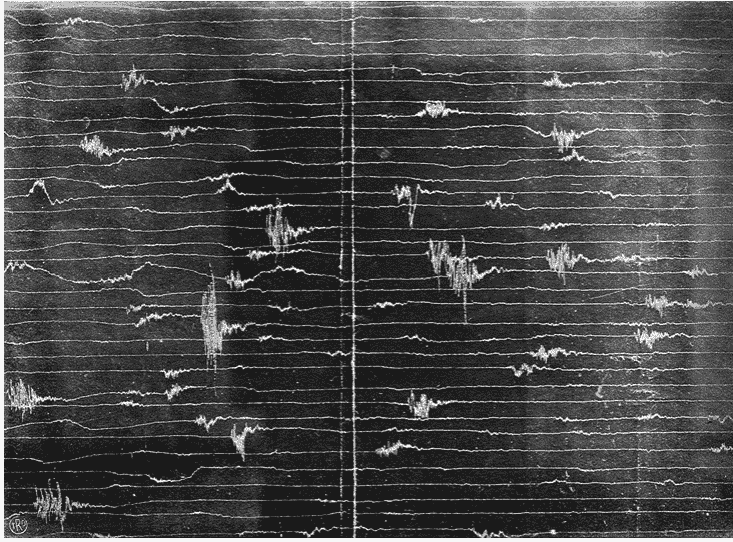

1930年11月23日至24日梅拉比火山喷发时的地震仪记录。

《Vulkanologische en Seismologische Mededeelingen》12 (1933): 138。

封面艺术：印尼西亚梅拉比山，约1930年。由 Balai Penyelidikan dan Pengembangan Teknologi Kebencarnaan Geologi 档案馆提供。

感谢 Giyono, Suparno 和 Sukidi

本页特意留白

本页特意留白

# 序言

现代地球是在爪哇岛诞生的。我们——正如那些相信地球被分裂成构造板块、这些板块在地球表面滑动并相互挤压、海洋床被巨大的海沟横断、而海沟中渗出构成大陆的物质的人们一样——我们是从爪哇岛继承了这些故事。我们的正统观念，即对地球历史和结构那种理所当然的科学图景，是在爪哇火山的山坡上锻造的，当时科学家们目睹了火山的颤抖、爆发、崩塌、化为尘埃和灰烬，并冲入海洋。科学家们拍摄了地震导致裂缝的房屋遗迹，然后他们乘飞机绕着冒烟的火山口飞翔，躲在地堡里，从监狱的瞭望塔窥视，徒步穿过火山土壤上的巨型蕨类和松树森林。正是在这些动荡不安、狂野的景观中——一个强调地球在压力下形成的故事，一个创造性破坏的系统，一个在深层时间内保持完自身的表面——扭曲、挤压并从其自身的裂缝中重新出现。

爪哇岛一个世纪以来一直是叙事的智力中心。这些叙事不仅是由在印尼西亚工作的科学家建立的，也是通过与神秘主义者、基督徒、穆斯林、梵语学者、古董学家、神秘术士、后殖民革命者和泛灵论者的复杂合作建立的。地球故事是宇宙的，是关于火山口和废墟的。火山学家带着望远镜和测量仪讲述了这些；我们继承了这些过去，我们现在知道。

当我们想象人类世是一个前所未有的时刻时，因为人类现在被承认参与了这一过程，而我们对地质学的理解是如此匮乏。人类世对于少数科学家和人文主义者来说是革命性的，但核心问题在过去多世纪里一直是现代地质学的中心。在殖民地质学家在19世纪末开始绘制该岛地图之前，这个问题就已经以特别强度被提出的。爪哇岛的社会传统上基于地质学是社会性的，社会历史是地质历史，而火山口是社会。现代欧洲物理学建立了这种地质学社会性的广泛概念，欧洲殖民者对此着迷；他们从中学会了理解地质与社会之间的关系。标准的西方地质科学并非简单强加于先存的地质学；相反，本土与殖民的地质知识相互产生，尽管这一过程是不均匀的、凹陷的，有时甚至是暴力的。而且在当代西方学者关注之前，人类世在爪哇就已经以深刻的智力和政治强度被理论化了。

爪哇地质科学将社会视为地质性的，使塑造当代人类世理论的传统多元化。不幸的是，人类世仍然与继续以西方科学为中心的历史联系在一起，以牺牲其更多元、国际化的起源为代价。当地质理论试图识别人类世的物质标记时，我们也有机会将对地质思想的理解扩展到关注西方之外。人们通常认为地质学与神学并不远，地质叙事是世俗主义的结果。爪哇向我们展示了不同。地质叙事中不仅有基督教，还有伊斯兰教、佛教和泛灵论。深层时间是在多种时间性——灾难性的、循环的、节奏性的、线性的中构成的。它适应了它们，包含了它们，有时又试图压制它们。

## 与动荡的地质共存

我第一次在转弯后了解到爪哇地质。我当时正坐在出租车前往雅加达机场，那是爪哇中部的一个中型城市。当出租司机左转时，道路突然指向一个从陆地上冒出的锥体，山顶崎岖不平，呈石灰色，被云层遮挡。“那是什么？”我问出租司机。“那个？噢，那是梅拉比。”我很快了解到梅拉比是一个活跃且有人居住的火山。有人说那里有近一百万人。

人们与它生活了几个世纪。在我看来，这就是人们可以分享智慧的地方。

第一次去德莱斯（Deles）村的山坡时，我遇到了一位名叫苏基曼（Sukiman）的人。他有一种无政府主义精神，并崇拜这座火山，火口仅在几公里外冒着烟。他拥抱一种人类、非生物与火山之间的互助伦理。我们讨论了他如何照顾生活在火山坡上的猴子群落，并在人类感知到危险之前为它们逃离喷发提供预警信号。他还倡导无农药农业和种植本土作物。苏基曼在当地闻名，是政府的直言批评者，灾害管理改革的倡导者，他甚至向联合国提交了他的诉求。

我逐渐了解到，德莱斯的村民在苏基曼的鼓励下，正在自发管理自己的减灾和准备工作。他们利用靠近火口的地理优势，拍摄喷发的视频和照片，随后将其卖给国际媒体机构，并将收益投入一个专门用于灾害救援的社区基金。社区储蓄还通过村民收获的自愿捐赠形成。他们告诉我，疏散被描述成假期，是从日常劳动的枯燥中获得的休息。村民正试图建立一种社区互助伦理来应对火山的不确定性。他们并不是恐惧火山，而是分享了一种互惠主义的生态学和宇宙观。这看起来很有前景——实际上非常令人启发。也许我们也可以学习如何在自然的极度不确定性中茁壮成长，即使在最极端的情况下。也许我们可以将不确定性转化为在社会与自然之间创造更深层次依赖关系的媒介。也许这就是梅拉比火山（Merapi）居民教给我们的。

在那次旅行中，我访问了基纳雷德乔（Kinaredjo）村，那里《卫报》文章中提到的“精神守护者”马尔迪扬在2010年的喷发中去世了。村子被毁的部分已经重建，包括一座传统的爪哇木质风格的新清真寺。我遇到了马尔迪扬的儿子阿西（Asih），他接替了父亲的工作，并向我解释他正在继续父亲每年向火山朝圣的工作。在村子里，出现了一种灾害旅游业，带着好奇的乘客乘坐吉普车前往附近坚硬、灰尘、干燥的岩浆流。摊位上卖着基纳雷德乔茶、纪念品，以及印有马尔迪扬脸部的T恤。我听说吉普业务非常丰厚，一些司机赚的钱已经足够开自己的餐厅了。喷发是毁灭性的，但它提供了新的经济机会和重生的机会。

正是在这次访问中，我了解到关于火山故事的丰富性，以及居住在内部及其山坡上广阔的神灵体系。保持这些故事的活力并赋予意义，对于马尔迪扬、阿西以及村里乃至整个印尼的信徒来说至关重要。许多爪哇男人看到，马尔迪扬在去世前维护了一种所谓的“地方智慧”传统，这是一种典型的爪哇式神秘主义，在这种主义中，火山活动与社会和政治秩序不可分，火山震动和爆炸不仅是自然现象，更是处于压力下的社会。

后来，我开始在雅加达北部绿树成荫的森达纳街（Cendana Street）火山天文台。天文台的起源和使命追溯到20世纪初，当时印尼是荷兰的殖民地，目的是监测火山并向民众发出喷发警告。今天，它是一个高科技、备受尊敬的科学观测台。当科学家从森达纳街监测火山时，山坡上有六个观测站，还有几十个较小的无人发射站。主天文台有近百名员工。其中一些人每两小时轮换一次，读取地震仪数据并监控电视显示器。倾角仪测量地面变形，其他各种仪器调查并记录火山的每一个动作和每一声呼吸。在2010年喷发期间，观测范围从梅拉比山坡一直延伸到雅加达、万隆、博戈尔的总统宫以及美国地质调查局（USGS）。

这种魔力召唤了火山与地球隐藏的内部世界。正如伯纳德·西格尔特（Bernard Siegert）所言，人们通常认为的高科技与民间技术之间的区别是居高临下的；两者以其不同的方式，共同分享着召唤隐形世界的魔力。现代日本火山学与神秘主义的技术，从感知的震颤中召唤出不断自我更新的板块构造的持续翻涌，以及躁动不安之灵的声音。火山科学的魔力让我们清晰地认识到我们当代的叙事是多么缺陷——即现代科学的幻灭与去魅。事实上，地球科学的本体论足点（如果这么说的话）在于召唤隐藏世界的魔法行为中，在那里，过程被深埋在火山山内部或其涌流的腔室中。火山观测站是一个完全被魔化的空间，充满了神像（火山照片）、日常仪式（阅读地震仪或倾斜计），以及火山学家之间的一种认同：他们是地球过程极度神秘性的见证者。这种认可与批判性社会理论的传统背道而驰，这些传统指责科学通过理性化、异化和工具化使神秘感从世界中消失。当代试图通过对自然的诗意反思或对社会理论的诗意实验来复兴地质神秘性的尝试，往往重复了这种误解：火山学；特别是爪哇的火山学，从未被去魅；它一直与神秘主义伊斯兰教、地质泛灵论、社会地质、附魂游戏、祖先执念以及与隐形世界共处的技巧处于魔法碰撞之中。这本书关于那些看不见的、移动的边界、搭车行为以及意料之外的合作。当我们试图想象在一个岩石与人类过程似乎独特结合的新地质纪元中生活时，我们实际上是在继承一种更古老的地球观念。本书的其余部分将展示这种观念可以如何存在，以及它能告诉与地球共处的人什么。

## 全书大纲

第一章概述了政治地质学的核心目标，即探索政治、地质科学、宇宙论与文化之间的交汇。政治地质学的灵感部分源于围绕“人类世”的讨论，以及人文科学转向对地质能动性的应对。然而，正如章节所示，政治地质学对地质和地球知识历史的关注，揭示了地球科学中的“人类世”辩论至少在一个世纪前就被爪哇的精神地理学和火山学所预示。事实上，人类世辩论属于地质科学中一个更古老的目标，即质疑社会与地球、生物与地质之间的边界。人类世辩论也标志着一个时刻，现代科学家正含蓄地参与着长期以来一直是爪哇政治哲学核心的古老思想，包括政治本质上是地质的观点。本章探讨了三个重要的火山爆发以及殖民政治环境，这些因素促成了火山学作为一种现代治理科学在印尼的形成。

第二章考察了爪哇的地质地图及其背景，探索爪哇的地质叙事自19世纪后期以来发生了变化。章节追踪了这些地图如何代表爪哇火山活动，并如何与地球历史变化的科学叙事挂钩。章节展示了地质学家如何将对爪哇的视角从一个自然与文化古迹岛屿（火山是大山的遗迹）转变为一个处于地球剧剧痛苦中的年轻岛屿。在世界上许多其他陆地质学家之前采用并适应大陆漂移思想，是这一转变的关键。结合海洋学对于这一新观点至关重要，这一观点后来为20世纪70年代板块构造理论的发展奠定了基础。

第三章展示了板块构造理论如何落在梅拉皮山。章节探讨了当代海洋与陆地关系理论是如何被爪哇的精神地理学预示并实现的。中爪哇苏丹领的崛起源于一种承认：海洋和火山中的神灵与苏丹有关。政治权力通过这些与软体神灵的关联而成为可能。板块构造理论镜像了这种信仰结构。它基于地质思想的激进转变，即理解海洋与火山之间的交换。本章探讨了这两种愿景如何契合，以及它们冲突与融合的政治。它追踪了神秘主义者和苏丹向火山和海洋神献祭的过程，也追踪了地质学家反过来思考板块构造的神秘基础的过程。章节用“叠插”术语描述了这些交汇。

第四章转向荷兰东属印度群火山学的开端以及殖民晚期的焦虑。它追踪了这样观念的命运：中世纪爪哇印度教文明被公元1006年梅拉皮山的灾难性爆发所摧毁。这成为将文化终结自然化并解释伊斯兰教兴起的方式。在他们帝国黄昏时期，殖民科学家探索了激进环境变化和文化无常的想象。神智学家、爪哇民族主义者、贵族、梵文学者、语言学家和火山科学家在梅拉皮山上反复爬升，寻找与地球的神秘交流。

第五章追踪了地缘政治在20世纪20年代爪哇被遗忘的地质学家约翰·翁布格罗（Johannes Umbgrove）作品中的起源。章节展示了翁布格罗发展出了一种“地质化的审美联系”，这种联系变成了一个关于宇宙和陆地演变的广泛概念。在他1942年出版的著作《地球脉动》（The Pulse of the Earth）中，翁布格罗发展了“地缘政治”这一术语，用来描述他将心理与星系联系的科学方法。地球、心灵和宇宙被理解为多声节奏和周期的结构；地缘政治与诗意岩石无关。本章探讨了翁布格罗不仅在爪哇火山上发展了地缘政治，还与东方主义者如保罗·杜森（Paul Deussen）进行对话，他是尼采的朋友，《奥义书》的译者。翁布格罗的地缘政治在20世纪60年代变成了海底扩张和板块构造。

第六章考虑了火山观测站作为火山学、地缘政治和神秘主义伊斯兰教之间接触区的意义。章节探讨了梅拉皮山上一个观测站的发展与演变，它充当了人体、地球和通信的角色。章节还考察了观测站如何成为印尼、法国等国家在农村边疆管理政治危机场所。观测站既是国家的建筑，也是科学家和神秘主义者关于时空邻近性的想法相互转化的地方。

# 致谢

这个项目移动了很多地方，我带着它移动，而它反过来也带着我。部分内容是在新加坡的笔记本上、在雅加达的一个房间里、在日惹火山观测站一个堆满摄影画集的临时办公桌上写的，并在苏拉威西中部完成了最后的校对。万隆地质调查局有一个带安静晶体管收音机的舒适图书馆，也有洛隆博腰果林旁甲板上的雨天。许多小时是度在梅拉皮山边缘的一间小屋（gubuk）里的，躲避项目，倾听森林的声音，并与吉亚诺（Giyono）待在一起。剑桥、悉尼、日惹、马兰、雅加达、吉隆坡、香港、伦敦、阿姆斯特丹、塔斯马尼亚、格拉斯哥和南丘是其他编写片段或整个章节、丢弃和重写的地方。还有火山，主要是梅拉皮，但也汤班佩拉胡、伊真、克鲁杜、梅尔巴布、林贾尼、维苏威。这些地形滋养了这本书，值得被感谢。

使这本书可能的对话、友谊和支持（物质和精神上的）同样分散且范围广泛。我将按时间顺序叙述。在构思该项目的剑桥，它受到了什·敏（Ash Amin）、克莱夫·奥本海默（Clive Oppenheimer）、迈克尔·布劳（Michael Bravo）、西蒙·沙费勒（Simon Schaffer）和安德鲁·巴里（Andrew Barry）的滋养、挑战和启发。在日惹，感谢Kunci社区提供的门廊和晚餐桌对话。伊丽莎白·因纳迪亚（Elizabeth Inandiak）为我提供了小房间。感谢索菲亚·霍恩巴赫-舍恩莱伯（Sophia Hornbacher-Schönleber）的对话和摩托车之旅。感谢Mes 56。感谢法里德·拉昆（Farid Rakun）以及 Ening Nurajah，为了雅加达一直以来最好。我向以下人士致以诚挚的感谢：那些让我随他们并加入他们晚餐桌的火山学家；以及所有 Keniring 的人，以及在漫长的廊台夜晚分享故事和魔力教训的那些人。在悉尼，Alison Bashford、Emily Kern、Jarrod Hore 和 Naomi Parkinson 为项目提供了新方向的帮助。在南威尔士新大学（UNSW）的“新地球历史”研究计划度过的三年是无价的。Kasia Jezzewska 给予了批评与鼓励。Zeynep Oguz、Mira Asringintyas 和 Dito Yuwono 推动了该项目，在它似乎毫无进展时给予了能量。Francesca Hughes 和 Jonathan Meyer 欢迎我的加入，并在南下郡的山丘为我提供了一个避风港，让我远离大流行，完成了最终初稿。感谢 Nigel Clark，从开始到 2018 年剑桥的政治地质学研讨会一直鼓励这个项目，并在所有的转折中提供了睿智的指导。Jeffrey Malecki 为我提供了所需的文字编辑帮助。杜克大学出版社的 Courtney Berger 负责此事，并亲切地将其引向世界。匿名读者二鼓励我澄清这项工作的贡献。感谢杜克大学的制作团队的所有细致工作。感谢 Seth Denizen——无论如何——从我们在香港一家 7-Eleven 门前台阶上谈论梅拉皮火山的守门人之初，他就一直参与着这场对话。完成一书可能会疲惫，而与一个正在完书的人生活在一起更是如此，更不用说经常感到无聊了；感谢 Candice Chung 的耐心和滋养。

书中某些论点的早期版本曾以不同形式出现在以下著作：“Processions: How the Spiritual Geographies of Central Java Modern Volcano Science,”刊于 *Indonesia* 113 (2022): 51–66；“A Javanese Anthropocene?,”HKW Anthropocene Curriculum, 2022年4月22日，https://www.anthropocene-curriculum.org/contribution/a-javanese-anthropocene；以及“The Spiritual Geographies of Plate Tect: Javanese Islam, Volcanology, and Earth’s New History,”*New Earth Histories*, Alison Bashford, Emily Kern 和 Adam Bobbette 编（芝加哥：芝加哥大学出版社，2023）。

除非另有说明，所有翻译均出自。

# 第一章

## 政治地质学作为方法

政治地质学。政治地质学的产生是为了新的方式将地质学与政治结合起来。它很大程度上是在地理学者的环境中发展的，并在某种程度上受到了“人类世”相关讨论的启发。¹ 但政治地质学也与人文科学领域的对话产生了共鸣，这些领域对地质的社会生活以及社交生活的地质学有着共同兴趣。政治地质学试图扩展这些兴趣，在许多当代地缘政治分析忘记了政治的*地理*（geos）实际上是真实的物质——即扎根的地质过程——的时刻，重点强调了地缘政治中的*地理*。² 转向对地球和地质物质政治化方式的协调分析，与新兴的开采主义和现代国家政治的批判性分析相契合，这些分析表明，自然转化为资源是一个结合了认识论和技术的过程³。随后，政治地质学可以强调地质科学在塑造现代世界方面可能是最大的力量，因为它们提供了驱动开采主义的知识。换句话说，如果没有地质科学，就不会有碳资本主义。因此，试图解释这种改变地球的资本主义历史而不解释科学如何帮助定义、勘探和开采矿物、矿石和燃料，将是错误的。因此，本书所解释的政治地质学通过解释开采主义提供了一个广泛的说明，解释了深层地质时间的社会生产、其背景和争议，以及它是如何与神学和宇宙论相结合的。可以说，开采主义是一种宇宙论。提供这样的说明意味着承认地质科学是欧洲帝国的工具。

然而，较不明显的是，这些工具也被世界知识传统所塑造或转化。这一事实在关于开采主义或人类世的批判文献中很少得到充分承认，在这些文献中，科学知识扩散模型（“从西方到其他地方”）随处可见。事实上，地质科学在某种意义上是国际化的，一方面是因为它们是由世界许多地方行动的科学家开发的，另一方面是因为它们是（并且仍然是）独立于欧洲或北美科学的地质知识的全球传统。此外，这些传统帮助编写了标准的欧洲地质科学。因此，现代地质学（包括开采科学）是智力的产物：相遇、调解和谈判塑造了它们，而不是线性的传播。⁴ 虽然地质科学史已经从欧洲和美国科学家的视角被详述过，但人们并不太了解它们是如何被传统上视为边缘或外围的行动者所编写的，并反过来转化了大都市的思维方式。一种地质知识运动的多中心愿景，关注产生它的相遇、调解、窃取和馈赠，可以帮助完成试图在当地或原住民的反知识中寻找作为对开采主义现代性抵抗的救赎的叙事。相反，书中的政治地质学证明了许多普通地质概念的路径是多么漫长而曲折；事实上，许多全球地质知识是地方性的变为行星性的。例如，20世纪荷兰殖民者在印度尼西亚遭遇的相同地质学思考方式，随后创造了关于整个地球的新西方科学叙事。事实上，它们甚至被重新部署到新的理论背景中，形成板块构造理论的基础，而该理论的局部起源（以及印尼知识分子）被从故事中删除了。政治地质学的方法的一部分是追踪这些时代、规模的转变以及地质知识意料之外的影响 2 · 第一章

追踪它们的传播以及它们如何最终开启开采实践。

书中的许多地质学是处于运动中和生成中的。与许多其他开采背景不同——在那里通过量化、空间化和制图将地质稳定并固定在地方——转化为资源——火山完全不同。它们会爆炸和轰鸣。它们不能像金矿或镍矿那样被接近或开采。因此，火山政治地质学是一种不同的政治和不同的知识。正如我们所看到的，殖民时期印度尼西亚对火山的核心关系并不是通过稳定进行提取——那是关于地下挖掘或表面刮削——相反，它是关于对时空中不稳定、不可预测物质的管理，通过否定流动、节奏和脉冲来保护种植园经济。关于火山的地质知识的重点不是识别盈利的矿石、矿物和燃料，而是如何预测灾害、识别喷发的周期和模式，并预测未来以保护种植园劳动并更好地组织土地。地质学家考虑地质不是稳定的和固定的物体，也不是地质演变的长期而缓慢的转化，而是作为一种流动的物质。他们的目标不是将地质材料转化为商品，而是协商其突然移动并破坏已经盈利的种植园经济的能力；这是一种编舞的政治地质学。他们试图与运动的本质相结合。

这种爆发政治地质学经常受到`geos`（地理）和`bios`（生物）渗透性的困扰。正如 Kathryn Yusoff 和 Elizabeth Povinelli 在对开采资本主义的分析中所示，这些类别——`geos`和`bios`、地质学与生物学、生命与死亡——是根本性的文化、政治和历史过程的产物。地质科学在塑造这种区别方面发挥了关键作用。`geos`和`bios`不仅是现代科学分类的产物，也是一种深刻的政治手段。通过将`生物生命`与`死物质`分离，事物可以被排列成新的等级：物质可以变成可开采、可利用和可替代的，而被赋予生命的有机物则可以被置于上方并被赋予独特的尊重价值。这些类别的固化为想象的人类等级提供了支撑。这些类别的固化为想象的人类等级提供了支撑

以及地质材料；如果不将`生命`（bios）优于`地理`（geos），就不可能存在人类例外论。（某些）人类被认为从本质上与下方的无机（死死的）地质物质迥然不同。然而，自19世纪末以来，爪哇岛火山学的政治地质学讲述了一个更为复杂的故事。爪哇岛`生命`与`地理`之间的关系一直被认为是水平的、渗透的，且从根本上说是不稳定的。导致这一现象的原因之一是火山持续的破坏；它们似乎在表达地球本身的生命力。对于研究火山的科学家和地球理论家来说，很难将生物物质从死死的无机物质中清晰地剥离开来。怎么能不承认一座赋予生命大山活力的主动性呢？事实上，即使地质学家约翰内斯·翁布鲁格夫（Johannes Umbrugrove）在20世纪30年代也意识到`地理`与`生命`之间的界限是渗透的、处于运动中的，并且从根本上难以捉摸。他还发现，这种认知与《奥义毗书》（Upanishads）中概述的宇宙观是一致的，而这种宇宙观塑造了建立在火山平原上的早期印尼王国的知识体系，他在那里恰恰开始质疑`地理`与`生命`的区分。翁布鲁格夫认为，印度教宇宙观已经表明生命是地质性的。他认为，现代科学现在才开始赶上这一洞察。因此，像翁布鲁格夫这样的殖民火山学家准备好想象一种不同的自然，一种不受榨取主义等级负担的自然。翁布鲁格夫的工作属于现代地质科学中的一股暗流，而这种暗流通常被关注人类世和地质科学史的当代研究人员所忽视或遗忘。揭示这一暗流有助于让我们关于地质史的叙述变得复杂，因为它为那些科学家提供了立足点——他们并不想区分生者与死，而是模糊它们之间的界限，在生物生命与岩石生命之间的模糊空间中运作；在那里，火山可以变成人，而人可以变成悬挂在火口边缘、被称为“岩舌”的冰冷石化岩层。

## 对爪哇火山学的关注与漠视

鉴于其对地质思想史的重要性，印尼火山学在全球地质史中的缺席程度令人惊讶。马丁·鲁德维克（Martin Rudwick）关于深层时间的开创性历史略过了印尼群岛，并仅承认了少数荷兰殖民地质学家的贡献。⁶ 关于印尼火山历史的大量且广为人知的科普文献，大多忽略了这门科学的背景、历史或政治。在火山灾害的社会学和人类学中，这些遗漏的情况较少一些，因为那里有大量关于火山风险社会生产的文献；然而，这些学术研究很少具有长远眼光，也没有对印尼地质科学的政治史进行语境化。许多学者转向了关于爪哇岛风险的传统和民间观点，试图质疑科学中阶段性的、且往往带有新殖民主义色彩的的发展主义方法；但这仍然是将科学与爪哇精神传统隔离开来，并使它们相互对立，仿佛它们的历史是相互独立的。⁸ 还没有人将火山科学的现代史与爪哇精神传统结合起来，或者展示过它们是如何相互成就或相互依赖的。现代科学与地方知识之间假设的分野是脆弱的，尽管它并非真实。因此，人们并不清楚科学和地方知识不仅如何塑造了彼此，还告知了关于爪哇地球历史更广泛的地质叙事。例如，娜奥米·奥雷克斯（Naomi Oreskes）和亨利·弗兰克尔（Henry Frankel）关于大陆漂移理论和板块构造史的全面研究，承认了“荷兰学派”——即20世纪20和30年代在荷属东印的殖民地质学家——的工作，但几乎完全排除了印尼人的角色.¹⁹ 他们的历史与其他许多地方（如地质科学史）的历史一样，始于并终于欧洲和北美，给人一种印象，即主要是这些人塑造了关于地球历史、结构和起源的全球叙事。将印尼人排除在这个故事之外并不是一个微小的遗漏；而是一种熟悉的、欧洲中心主义的做法。印尼是世界上第四大受欢迎的国家，位于一个面积几乎相当于欧洲大陆的地区；它无疑是战后地质科学发展的关键场所。刘易斯·皮森（Lewis Pearson）是少数赞赏印尼地球科学的史学家之一，但他的《理性帝国：印尼的精确科学，1840–1940》奇地排除了对火山学的描述，尽管它是殖民科学的“皇冠上的宝石”之一.¹⁰ 让·盖尔曼·泰勒（Jean Gelman Taylor）的《雅加达的世界：殖民时期印尼的欧洲人和欧亚人》描述了科学和混血文化在巴达维的作用，但只到20世纪，而且对地质学和火山学的关注很少.¹¹ 鲁道夫·姆拉热谢克（Rudolf Mrážek）对殖民地晚期工程师生存危机的精辟研究《快乐土地的工程师》（Engineers of Happy Land）主要关注泰勒书籍结束之后的时期，但对火山学也只是浅尝为止.¹²

因此，关于印尼火山科学史的学术很大程度上留给了科学家来写。从殖民地后期开始，乔治·L·L·凯梅尔林（Georg L. L. Kemmerling）、莱诺特·范·贝梅伦（Reinout van Bemmelen）、H. 阿尔伯特·布鲁威尔（H. Albert Brouwer）、范帕当（van Padang）和约翰内斯·翁布鲁格夫（Johannes Umbrugrove）代表了他们记录这门先驱科学历史的努力。他们在技术期刊、简报、讣告和学术专著上发表过。在后殖民时期，约翰·A·卡提利（John A. Katili）、阿贾特·苏德拉亚特（Adjat Sudrajat）和苏乔（Surjo）脱而出。能源和矿产资源部地质局（Badan Kagian Energi dan Sumber Daya Mineral）也编写了少量关于火山科学史的优秀资源³ 上述著作对于本书至关重要。除了这些文献外，印尼科学家的许多科普作品同样有用：阿贾特·苏德拉亚特写了荷兰地质学家莱诺特·范·贝梅伦的传记式传，后者也出现在本书的第2章和第4章.¹⁴ 苏德拉亚特可能是第一个写过以火山为主角的科普小说的火山学家，《加隆贡火山之风暴》（Prahara Gunung Galungung），该书由地质局出版.¹⁵⁵ 苏德拉亚特还写了一本印尼火山科学的导论史.¹⁶ 后殖民时期最著名的地质学家之一是约翰·A·卡提利，他在1952年至1955年间担任民族主义杂志《印尼讲坛》（Mimbar Indonesia）的专栏作家，在杂志上为新的后殖民读者讨论地质问题⁷ 他后来发表了许多关于科学问题的印尼语和英语书籍，并将地质与国家发展联系起来。在1951年至2008年间，他发表了250多篇文章⁸ 苏德拉亚特和卡提利合作写了一本关于1982–83年巴隆附近加隆贡火山喷发的专著¹⁹ 自殖民政府在1920年建立火山监测服务处（Volcanoanakingsdienst），后来更名为火山调查处（Onder Volcanological Survey）以来，火山学家一直是印尼最著名、最直言不讳的科学家；他们的著作帮助这一科学成为现代科学文化的核心，并应对了该国最紧迫的问题。令人惊讶的是，英语和印尼语学者很少关注这项工作。与印尼植物和农业科学的压倒性研究相比，火山科学的边缘化显得尤为显著。作为最的

地球上火山活跃且人口稠密的地区拥有地球科学领域最具影响力的传统之一，而这正是本书试图纠正的一个重大疏忽。

现在经常将地质学与人类学分开的界限是印度尼西亚的一项近期发明。1931年，当菲利克斯·A·维宁梅尼斯向伦敦皇家学会介绍他发现的长长近八千英里的印度尼西亚群岛海沟时，他将整个演讲重点给了他对从潜艇视角观察印度尼西亚文化的研究。¹² 维宁梅尼斯的菲利普·库嫩（Philip Kuenen）是1929-1930年参加群岛东部开创性斯内利乌斯海洋探险征中的一名地质学家。1941年，他出版了*Kruststochten over de indische diepebekken（（印度洋海盆的远征》）；在这种情况下，他的“远征”包括他对印度尼西亚文化的民族志研究，这些研究是在没有测量或从海底采集样本时进行的。³ 当火山调查局的创始人之一乔治·凯默林（George Kemmerling）在20世纪10年代和20年代调查爪哇、巴厘岛和马鲁古群岛的火口时，他在科学论文中反复包含了对神圣场所、仪式和祈祷的描述。⁴ 寻找可开采矿石和矿物的地质学家也写了关于印度尼西亚文化的记录，这些记录模糊了勘探作为纯粹经济关注的意义，并构成了一种民族学形式；开采场的寻找与发现交织在一起。在某些情况下，地质学家的工作与旅行和游客日记融合，尽管如此，这表明了对爪哇文化的熟悉和着迷。关于火山的思想和关于文化的思想在殖民地爪哇是相互创造。

与爪哇火山科学的历史相比，关于印度尼西亚灵性和宗教的学术研究是巨大的。无疑，这与事实：自玛格丽特·米德（Margaret Mead）和格雷高里·贝蒂森（Gregory Bateson）于1936年登陆巴厘岛以来，爪哇和印度尼西亚一直是西方英语人类学实野调查的范畴。后来，随着“亚洲社区”概念的传播，东南亚研究日益发展，进一步将印度尼西亚群岛确立在人类学野外点的网络中。但最近，印度尼西亚的人类学家开始接手研究印度尼西亚文化和信仰体系的角色。本书主要依赖于20世纪初至今爪哇灵性和宗教运动的英语、荷兰语和印尼语记录。历史学家默尔（Merle）对爪哇苏丹的详尽工作对此不可或缺。我很大程度上同意里克莱夫斯（Ricklefs）的诊断，即中爪哇伊斯兰教是一种“神秘合成”，它将神秘主义、当地神灵、强烈的穆斯林身份以及在动荡火山景观中动态统治的必要性结合在一起。²³ 我对这一经常引发启发（往往令人敬畏）的中爪哇史学经典所做的贡献是，展示了这种神秘合成是如何影响火山学和现代地球系统科学概念，并反过来被其转换的。

这引出了我关于政治地质学作为一种方法的倒数第二个观点。正如我上面提到的，政治地质学的野心之一是将“地（geo）”置于地缘政治的核心。近年来，地理学家倾向于关注大量非地质人类的主动性。这与地质学的当代转向相一致，例如新物质主义和人类世辩论的兴起，这些趋势将地质考量置于学科的核心，但往往经常考虑地质过程本身或地质知识的历史。我在这里希望政治地质学不仅有助于更好地理解地质材料，还致力于应对地质知识的文化以及地质科学的历史及其在社会生活和政治权力中的作用。理解这种观点意味着对关于地球的概念进行历史化和定位，而这些概念在当前关于地质学的批判性论述中通常被认为是理所当然的。同样，政治地质学可能解决某些地理学家对人文与自然地理之间分的长期哀叹。两者之间的鸿沟或许可以通过更好地理解地球科学的产生和社会影响来弥补。

政治地质学的这些野心在某些方面一直与古老的政治生态学传统并行，政治生态学的根源之一可以追溯到20世纪70和80年代皮斯·布莱基（Piers Blaikie）等人的工作，他们研究了地质政治——通过“第三世界”的土壤侵蚀和土地退化。⁴ 自此以后，巨大的政治生态学世界没有忘记地球物质的政治。⁵ 在印度尼西亚的背景下，我重申，学术界并没有充分考虑火山学史、地质科学的政治，或它们与印度尼西亚知识传统的交汇。相反，爪哇的政治生态学倾向于关注植物与政治过程之间的联系；正因如此，正如我想的，政治地质学是补充而非掩盖——或者糟，竞争——这种政治生态学传统。

## 爪哇的人类世

最近将当前地质时代命名为“人类世”的提议标志着地质学家意识到地质学与社会之间的边界已变得渗透。对于许多地质学家来说，这是前所未有的。然而，在爪哇火山史上，这并不意外。正如我上面提到的，模糊地质学与社会的边界对于爪哇火山学家来说一个多世纪以来一直是关键的。火山学家莱因·范梅伦（Reinout van Bemmelen）在1954年研究火山二十多年后说：“山运动提供了我们在地球上生存的最基础。”²⁶ 他开发了一种火山学决定论，将火山过程置于文化过程的核心。他认为，如果不理解地球的动态性，就无法理解文明。范梅伦的朋友和同事翁布格罗（Umbgrove）在《地球的脉动》（1942）中发展了他的互补理论，试图将文明、物种分化和意识与火山过程结合。翁布格罗引用了地质学家兼医生约瑟夫·勒孔特（Joseph Le Conte）使用的“心理选择”（Psychochoic）一词，勒孔特在1877年声称该术语基于“作为精神和智分化专家的人出现在舞台并开始扩大其对世界的霸权这一事实”。²⁷ 勒孔特继续道：“人类出现的地质意义不仅或不主要在于他的超验尊严，而在于他作为一个代理人的重要性，他已经非常大地、并且必须更深刻地改变了整个地球的动植物。”²⁸ 翁布格罗对“心理选择”的使用不仅预示了人类世辩论，也是爪哇地质学家试图解释地质学与社会之间多向影响方向的一个例子。正如翁布格罗和范梅伦都很了解的，全新世之所以这样命名，是因为它反映了人类农业的出现。⁹ 在爪哇，地质学长期以来就是社会史。

中爪哇的灵性传统也承认了这些边界。中爪哇的苏丹（某些形成于16世纪）被认为通过婚姻或友谊与火山神灵建立了联系。

主权与地质学的共同生产持续到后殖民时期，并于1965年至1998年的“新秩序”时期变得强有力。这一时期由独裁者苏哈托（Suharto）统治，他把自己塑造成同样的爪哇苏丹的形象，而荷兰殖民官员和民族学家记录过这些苏丹与地底神灵发生过性关系。例如，当20世纪90年代权力从苏哈托手中流失时，据传他有一个由近五十名灵媒和魔法师组成的网络为他工作。³ 他还因向印度洋女神尼雅拉图基杜（Nyai Ratu Kidul）以及阿贡山的神灵供奉而闻名.¹ 例如他在梅皮山边的普兰巴南寺（Prambanan）举行了一场仪式，在那里埋了一把克里斯（kris）以稳定他的政治权力；当宇宙混乱时，1991年东爪哇的克古德（Kelud）火山喷发，支持政权的廉价杂志《神秘》（Misteri）声称这是苏哈托作为末世拯救穷民的“正义王”的标志³在新秩序时期，威权政治权力是神秘且地质的，而自然灾难是灾难的结果。说没有所谓的自然灾害是常有的；这对于新秩序威权主义来说是公理。

学者们已经注意到这种社会与地质融合的当代遗产。尼尔斯·布布丹特（Nils Bubandt）展示了泗水外勘探钻引起的泥火山喷发如何加剧了爪哇的人类世³⁴ 拉平多布兰塔（Lapindo Brantas）作为一家印度尼西亚油气公司，在2006年勘探天然气时引发了爆炸。爆炸变成了泥火山喷发，淹没并埋葬了巴隆戈戈（Balongongo）村。

在尚未匆忙修建土墙来围堵泄漏之前。但政府、法院和土墙都是无效的，当公司拒绝承担责任时，村民们变成了难民。来自印度尼西亚各地的支持者举行了抗议和仪式，巴厘尼祭司命令准备供品。泥土纪念品罐和从淤泥中来的石头变成了强大的法器。正如布班特（Bubandt）所说：“石头和泥土的奇异生命讲述了印度尼西亚一个幽灵时刻，地质是政治的，政治是腐败的，而腐败被灵体所困扰。”这些交汇想起了爪哇岛的火山，无论是科学家研究的颤抖泥浆或岩浆，还是独裁者提供的祭品，它们长期以来一直是边界模糊并相互构成的场所。从这个角度来看，爪哇对于我们这些正试图理解如何在人类世中生活的人来说，有许多教诲我们。

# 爪哇岛火山学的起源

现代科学火山学的根源无疑源于19世纪末全球对爪哇岛火山活动的关注。这显然是因为爪哇（过去和现在）都是地球上人口最密集、火山活动最活跃的地区之一。岛屿中心的火山脊带在19世纪末到20世纪初之间爆发了数百次。过去两个世纪最著名的喷发几次发生在印度尼西亚：1815年的坦伯拉火山（Tambora）和1883年的克拉拉托火山（Krakatoa）。不出意外，爪哇被认为是理解火山的重要地点。

20世纪之交，殖民地爪哇依靠火山爆发肥沃土壤发展种植园经济；然而，这些种植园需要保护。荷兰东印度生产并出口植物产品（香料、米、茶、烟草、药品、橡胶、金鸡树）到欧洲市场，并使荷兰成为欧洲最富有的地方之一。自然科学在很大程度上是由管理和改善当地种植园经济的努力驱动的，因此爪哇成为世界植物知识的中心。布容（Buitenzorg）和万隆（Bandung）的研究站和花园处于种植园技术的前沿，与英国和荷兰帝国的植物中心（如阿姆斯特丹、邱园、新加坡、加尔各答等）建立了紧密的网络。20世纪10年代，博戈尔（Bogor）的金鸡树实验在治疗疟疾方面处于领先地位，整个热带殖民地的欧洲人都依靠它来保命。同样，橡胶种植园在整个岛屿扩张，满足了工业对橡胶制品的需求，棕榈油正被实验用作零件和蜡烛的润滑剂。1920年在巴达维亚（Batavia）和博戈尔举行了太平洋会议，两百多名科学家学习了科学和工程的状态。但种植园不可避免地延伸到绿意盎然的山坡上，那里较高的海拔和凉爽的空气为茶叶、烟草和柚木的种植提供了绝佳条件。不仅是作物让人们靠近火山，还有从火口中融化并将水带入低地并流向海洋的河流，将爪哇连接成一系列被火山环绕的富含冲积物的小谷。火口喷发的邻近必会产生巨大的局部和全球成本。

这段期间的三次喷发具有重要意义。第一次是1883年的克拉卡托火山喷发，其规模之大、声音之响震动全球。火山位于爪哇岛和苏门答腊之间的海峡，距离内陆种植园有一定的距离，但力量之大仍然摧毁了许多种植园。对当局来说，最严重的是从荷兰东印度到欧洲和亚洲的贸易中断。船只停止行驶，货物停止移动。这种威胁可能再次发生促使地质学家罗杰尔·维贝克（Rogier Verbeek）尝试首次系统地对爪哇和苏门答腊所有的火山及其地质背景进行制图，以诊断未来的喷发。

第二次事件是36年后1919年东爪哇格鲁德火山喷发。火山口中心形成了一个湖；它喷涌而出顺着山坡冲下（图1.1）。一道泥土和碎片的墙卷入布塔尔（Blitar）市场镇，推翻了房屋，掀起了汽车，并拦截了一列试图逃离小镇的火车。衣衫褴褛的士兵后来在泥浆中精疲力竭。超过5000人死亡，135平方公里的种植园被毁，9000间房屋被毁。在前往火口考察了解发生了什么后，政府工程师想在火山口内钻一条隧道以排出火山口湖。这样的工程需要采矿、铁路和道路方面的专业知识（图1.2）。钻探从未在荷兰东印度（或者可能在任何地方）的火山墙内部进行过，这面临了一系列挑战，尤其是火山口壁内部的热量以及从下方钻入热湖的危险。这也是当局首次尝试干预火山过程，以塑造有利于其种植园经济的结果。

另一个结果是建立了由政府运行的火山监测机构，专门监测岛屿上破坏性最大的火山。当局决定将现代科学监测与殖民政策相结合，这促进了显而易见的现代国际化火山学形式。参与此事的少数科学家主要是采矿或军事工程师以及地质学家。他们开始发表观察和研究简报，这些报告很快在试图将火山学定义为美国、日本和欧洲的新兴科学的地质学家中流传。火山监测机构（后来的荷兰东印度火山调查局）的形成使火山学在东印度制度化。Bernard G. Escher、Charles E. Stehn、Georg L. L. Kemmerling、Reinout van Bemmelden、Johannes Imbouw、Maur van Padang、Louis Rutten、Gustaf Molengraff等火山学家不仅是火山学家（当时甚至还没有流行这个词）；他们还是经济地质学家、探矿者、工程师和地层学家。然而，火山活动成为了他们理解广泛地质问题的棱镜。对于他们中的许多人来说，他们的理论关注点变成了火山的起源，反过来又变成了创造它们的行星和历史过程。换句话说，他们对造山运动着迷。他们经常将火山过程理解为岩石演变的引擎，这使他们处于欧洲和美国地质历史争论的前沿，因为他们同阿尔弗雷德·维格纳（Alfred Wegener）1912年提出的大陆漂移说。大多数美国或欧洲科学家对“大陆漂移”不屑一顾，而荷兰东印度的地质学家开发了创新的概念来重新思考行星历史。换句话说，爪哇火山成为了科学家理解整个地球的模型。回顾过去，他们被称为“荷兰学派”。

第三次重要的喷发是1930年的默拉皮火山。喷发后，火山学家在那里建立了永久的观测站。

克鲁德（Kelud）是火山调查的一项成果。它曾是位于马伦山（Maron）上的一个简陋小屋，配有望远镜，以及似乎是东印度群岛火山第一台地震仪（图1.3）。巨大的爆发冲毁了小屋，掩埋了地震仪和数千名居民，并摧毁了近四十个村庄（图1.4）。作为回应，科学家们重新集结，在火山口脚附近的巴巴德（Babad）计划了一个更耐用的观测站，其中包含一个可以抵御过热气体云和飞溅岩石的地堡。地堡内有一台新的地震仪，很快成为默拉皮（Merapi）南和西南侧不断扩展的观测站网络的一部分。新之处在于安装了电话和电报电缆，将观测站与低地市场镇连接起来。通信网络比其他观测站要广泛得多，它加速了从火山口顶部到城市中心的交流，同时也将低地技术引入了农村且往往贫困的村庄。因此，观测站成为了国家的建筑前哨，以及殖民科学家与农村文化之间的接触区。

火山学在爪哇的出现源于这三次喷发，随后成为殖民治理的一种既定机制。正如火山学家经常所说，他们的目标是保护人员和财产。对监测的新兴趣帮助科学家获得了资源——办公室、交通工具、助手、资金——以极大地扩展他们的工作范围。第一代国家火山学家利用了他们所能使用的技术；他们根据观测记录和实地考察撰写了详细的案例研究，并根据目击者的证词对喷发进行摄影、测量、素描和描述。整套知识构建体系被付诸实施。例如，在克鲁德爆发后，肯默林（Kemmerling）为荷兰东印度群岛矿业局火山报告（Dienst van Nederlands Oost-Indie, Vulkanologische Mededeelingen）编写了一份近120页的报告，其中包含了库尔克吉安工作室（Kurkjian studios）绘制的工程图和精美照片，该工作室是荷兰东印度群岛产出最多的摄影工作室，同时也为游客拍摄风景肖像。到20世纪20年代，火山学家得到了军事的支持，通过飞机对喷发及其影响进行航空测量，汇编了从各个角度拍摄的火山口航空照片的海量档案（图1.5、1.6和1.7）。正如西蒂·普特奇斯（Siti Protchsky）观察到的，航空摄影将军事与科学结合在了一起。

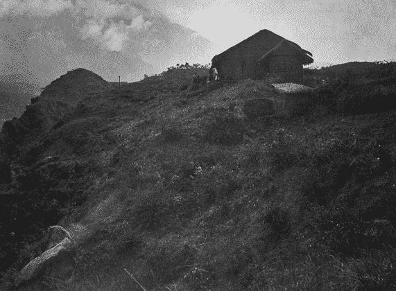

图1.3 1920年3月位于马伦山、布隆肯河（Blongkeng River）旁的默拉皮山第一个监测站。Post Maron bij K. Blongkeng, Maart 1920. 地质灾害技术调查与开发（Balai Penyelidikan dan Pengembangan Teknologi Kebencanaan Geologi）档案提供。

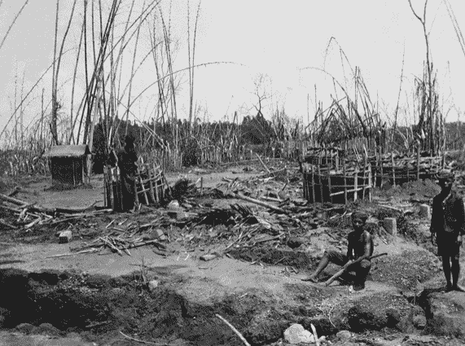

图1.4 1931年的照片，调查了1930年默拉皮喷发对德蒙村（Demong village）的破坏情况。Kroon verwoeste desa Demong met graven en vliegenhuisje. 地质灾害技术调查与开发档案提供。

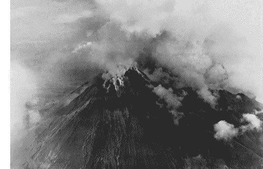

图1.5 1930年12月22日默拉皮山的军事航空测量。Militaire luchtvaart, afd. top en zuidflank G. Merapi. 地质灾害技术调查与开发档案提供。

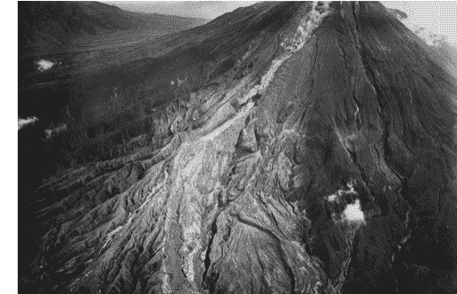

图1.6 1930年12月默拉皮山的军事航空测量。Militaire luchtvaart, afd. bovengendeelte van het gloedwolkgebied met de grote bocht in het Longkong ravijn. 地质灾害技术调查与开发档案提供。

图1.7 1933年在马格兰（Magelang）提达机场的韦格纳（Wegner）中尉。Lt. Wegner voor het vliegtuig op het vliegtterrein tidar bei Magelang. 地质灾害技术调查与开发档案提供。

这四幅地图中的每一幅都耗费了近十年的时间才完成。制图者们穿过的地理距离相当于巴黎到维也纳之间的距离。他们跨越了山脉、森林、城市、稻田、种植园、海岸线和火山。其中一幅是自荷兰到东印度群岛潜水航行的成果，期间他们在海上度过了数月的艰苦时光，与故障仪器和极端酷热作斗争。这些地图的绘制正值冷战、热战以及局部与全球冲突时期，这些冲突限制或促进了地质学家的野外工作。他们所使用的一些技术——飞机、船只、地堡——是在战斗部署后才被采纳的。1883年、1899年、1930年的火山灾害迫使人们绘制了新地图，而其他灾害——洪水和泥石流——则中断了野外工作。1945年的印尼革命结束了殖民地地质局的历史；它们的制图部门关闭了，直到1979年，爪哇岛没有产生过任何具有意义的地图。因此，这里的四幅地图代表了两个状态之间的过渡：荷属东印度群岛和印尼共和国。它们带我们进入了印尼后殖民历史的第三阶段——新秩序时期，该时期于1998年倒台，而这是在板块构造理论首次应用于该地区二十年后。关于国家界限在哪里以及地球如何变化的不断思想，可以从这些地图的线条和颜色中读出。例如，罗格尔·维贝克（Rogier Verbeek）和莱因哈德·费内马（Reinhard Fennema）的第一幅地图完成于1896年，它是对“大陆永久固定不动且地球正在收缩”这一坚定信念的结果，甚至证明了这一观点的证据。相反，20世纪20年代和1930年代的后期地图注入了对大陆漂移的热情，当时世界上很少有其他地质学家相信这一点。殖民地地质学家认为，陆地的剧烈震动和山的爆发可能暗示着海洋正在撞击坚硬的大陆结构。在20世纪70年代新秩序时期的印尼，当板块构造理论被说服力地应用于群岛时，海洋被赋予了让年轻国家获得愿景和前所未有的矿产财富的梦想。这些地图刻着这些认知上的重新转向；通过它们，我们不仅可以读出关于爪哇如何形成的叙事，还能读出它是如何代表整个地球的。至于制作这些地图的地质学家，我们可以看到他们也逐渐理解到，爪哇并非边缘，而是处处体现的基础行星过程的典范。

火山是这一新制图叙事中的关键参与者。整个爪哇岛毁灭性的火山喷发促使地质学家寻找其原因。这种寻找需要地图来显示火山活动的范围、它们的深度和延伸距离、火山口的形状以及它们由什么物质组成。这也意味着要理解该岛屿更广泛的构造结构及其历史。对火山活动的理解几乎立即变成了形而上学；它意味着将不可见的、地底的、在野外无法测量或触碰的事物可视化；它意味着要创建一个关于不可触及的地下世界、其历史及其主角的叙事。地质学家们询问火山是否在巨大的岩体在地下相连，还是它们是独立的、相互独立作用的？提出此类问题使他们审视了关于爪哇作为一个具有固定边界岛屿的假设，转而对洋床的活跃作用敞开态度。也许爪哇是重构的海洋？于是，火山变成了通往地球深层结构的窗户。绘制火山火口的边缘就是窥视整个地球。这些地图代表了地质学家从这些边缘看到的四种愿景，以及他们如何将这些视觉汇聚成现代地球理论。

## 维贝克与费内马：爪哇与马杜拉的地质学

罗格尔·维贝克（Rogier Verbeek）是一位地质学家兼矿业工程师，他于19世纪70年代首次完成了苏门答腊岛的地质图。当时，人们对开采煤炭、石油和锡矿的前景表现出新兴的殖民兴奋，殖民政府聘请了维贝克完成调查。基于他的成功，他立即被一个急于在邻近的爪哇岛继续该项目的政府所聘用。该政府的动机之一是确定爪哇岛已知但尚未开发的煤矿和石油矿的范围。维贝克在苏门答腊拥有丰富的煤和石油经验，并希望在爪哇也这样做；因此，从1880年开始，他专注于万隆附近普兰格尔（Preanger）丘陵地带爪哇著名的煤矿。项目因火山喷发而中断；1883年，克拉卡托火山爆发，这是现代史上最大、最著名的喷发之一。作物大面积歉收，船只被海啸冲向内陆深处。欧洲的太阳落山了，爆炸产生的声波如此强大，甚至震倒了中爪哇三宝垄和泗水的墙壁。海啸波冲击了南非和斯里兰卡的海滩，东印度群岛与世界其他地区的航运停滞。突然间，荷兰的经济陷入了停滞。总督召见维贝克停止制图，将精力投入到理解灾难程度和爆炸原因中。维贝克在接下来的一年里致力于此工作。他的结果后来发表在《自然》（Nature）杂志上，并在世界各大报纸上被简述或引用，被对这一奇观的细节和超自然美学着迷的公众广泛阅读。当他回到爪哇地图绘制工作时，他已成为一名闻名的地质学家，对火山活动的兴趣变得浓厚，并将其置于爪哇更广泛的背景和地球理论之中。毕竟，爪哇到处都是可能像克拉卡托火山一样爆发的火山，其中许多火山距离城市或荷兰统治的种植园还要近。然而，他刚刚开始制图，就再次被中断了。1885年，东爪哇的埃鲁火山爆发，他的团队成员被派去完成任务。维贝克的合作者费内马（Fennema）此前绘制了许多地图，曾被派往苏门答腊进行了九个月的调查，随后又花了两年时间对爪哇进行了调查。维贝克在1896年最终以法语出版了这卷书的报告之前，他与殖民官员、爪哇当地人和种植园工人会谈，了解任何矿产情况，并将其纳入地图中。在分析维贝克的地图之前，首先通过研究克拉卡托火山（图2.2）是有用的。这些地图包含了当时最全面的地质图（图2.1）。

## 爪哇的起源：四幅地图

图2.1 Geological overzichtkaart tevens vulankaart van Java en Madoura（爪哇与马杜拉的地质概图及火山地图）。Rogier D. M. Verbeek 和 Reinder Fennema，《Description géologique de Java et Madoura》，第3卷，图集（阿姆斯特丹: Joh. G. Stemler, 1896），附录II，地图II。

海平面以下数百米，尽管有用的细节止于约两米，约为火山向上延伸的四分之一。他的图像表明，他对克拉卡托的理解局限于表面，且火山是一个几乎自成一体、垂直线性的单元。

### 地层学

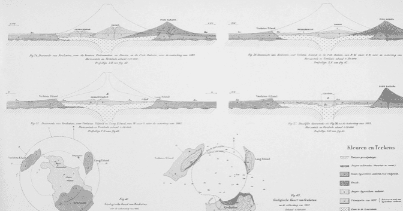

图 2.2 克拉卡托岛的平面与剖面。Rogier D. M. Verbeek，《Krakatoa: Album》（Brussels: Institut National de Géographie, 1886）。皇家收藏信托。

……证实了地层中发现的物质，并根据其“老”与“新”的程度进行了松散的时间顺序排序。Verbeek 显然对对地球年龄的推测，或对确定岩石的确切年代不感兴趣。在 Verbeek 和 Fennema 写作期间，其他欧洲地质学家经常争论地球的年龄，但他们的推测范围很大。17 世纪，詹姆斯·乌舍（James Usher）描述地球起源于耶稣出生前 4004 年。到 19 世纪中期，这种观点发生了剧变。达尔文作为查尔斯·莱尔（Charles Lyell）地层学的学生，在《物种起源》的早期版本中暗示地球年龄超过 3 亿年，或至少有 1 亿年。如此巨大的跨度部分是因为缺乏公认的地质时间测量方法。1863 年，汤姆森（Thomson，后来的开尔文勋爵）根据他的热力学理论和地球冷却速率，认为地球年龄在 1 亿到 2 亿年之间。Verbeek 和 Fennema 的同代人埃德华德·苏埃斯（Eduard Suess，他也使用了一些 Verbeek 和 Fennema 的著作）反对提出绝对年代，但在《地球的面貌》（*Face of Earth*）中，他将圣经洪水和其他古代文献视为可以用地质过程解释的真实事件的历史描述。地球的确切年龄存在争议，但大多数地质学家确定它至少有数百万年，甚至更多。

然而，地层学并不需要绝对年代来重建过去的世界；它根据化石记录通过连续的时期和亚划分来运作。对于 Verbeek 和 Fennema 来说，该地区的已知历史始于白垩纪——爪哇首次沉积的时代——其特征是遍布该地区的古代单细胞生物环藻（orbitolines）。正如约翰·菲利普（John Phillips）在他 1860 年的《地质时间尺度》中所说，白垩纪是一个“有袋动物和哺乳动物”的时期。换句话说，对于 Verbeek 和 Fennema 来说，原始爪哇是有生物的。下一个阶段是始新世，其特征是软壳体（比指甲还小的透形化石）和繁盛的单细胞海洋原生动物。始新世的特征还有有孔虫，这是一种巨大的多孔、海绵状单细胞海洋生物。或是因为如此，对爪哇历史的描述既具有空间性，也具有时间性。通过横跨整个岛屿的地质学家发现并定义的相应化石和沉积物，过去变得可读的。当 Verbeek 和 Fennema 转而计算爪哇地层的年代时，他们发现爪哇只有 1% 的沉积物自“最早时期”以来一直保留。37% 的沉积物占 33% 的土地属于第四纪（即现代），而剩余的 27% 沉积物是“新火山”的。换句话说，爪哇是年轻的。

从地质角度来看，爪哇的近期历史并不波澜；它由灾难和变化周期定义，这些周期足够古老，让 Verbeek 和 Fennema 能够想象出火山遗迹，这与他们认为爪哇文化属于那个古老过去的理解相契合。

在最古老的时期，Verbeek 和 Fennema 认为，当时海水较低，爪哇通过陆桥与亚洲相连。来自婆罗洲和马来半岛的化石显示出曾在它们之间迁移的动物。Verbeek 和 Fennema 同意 Suez 的观点，地球正在冷却、收缩并像老苹果一样扭曲地壳¹¹⁴。Verbeek 想象爪哇通过这一过程被抬升，对相邻地区施加压力并迫使其形成沉积物褶皱。在白垩纪晚期，Verbeek 认为爪哇的部分地区沉没了，海水淹没并中断了连接大陆的陆桥。随后，地壳的大规模沉降和位移出现，表面出现裂缝，就像他在克拉喀托岛看到的那样，表面下陷，随着大量熔岩物质涌出、生长并溢入侧向褶皱形成山脉¹⁵。Verbeek 和 Fennema 想象“数万立方公里”的物质喷发导致了深达 3000 到 6000 米的沉积¹¹⁶。他们写道，“释放这种质量需要等同于 1883 年克拉喀托岛的 2000 多次喷发”¹⁷。因此，爪哇始于前所未有的巨大灾难；克拉喀托岛的破坏并不能窥见爪哇形成的喷发过程。海水一直保持高水位直到新第三纪，随着大规模喷发的持续，最终冲破了海面，形成了八座独立的火山岛。他们在山山高处的河流沉积物和珊瑚中发现了这一证据，推论认为由于海水较高，它们才可能存在那里。当海水退去时，河流冲刷土壤并重新沉积，揭示了岛屿形状的大新喷发物质，岛屿从东西延伸，南北变窄，有一条纵贯的火山脊。

尽管如此，土地由于地球挤压被抬升了高达 180 米。Verbeek 和 Fennema 最终希望他们的灾难史能引导他们发现可开采材料；根据地层章节划分历史，是一种在景观上施加可认知网格以勘探矿藏的方法。例如，始新世和中世地层含有褐煤；他们希望中世地层含有石油；而在泗水的山丘地带，或许会有盐和碘。²⁴ 但 Verbeek 和 Fennema 注意到，在花费了近十年时间拼凑爪哇岩石与文化的故事、攀爬了其海岸后，他们关于可开发物质的章节“遗憾的是将会非常短，因为除了石油和一些建筑石，在爪哇没有遇到过任何一种值得开采的矿物物种；丰富的矿物和煤炭沉积完全没有技术价值。”²⁵ 此外，他们发现的油藏规模很小。最大的开采作业已经在泗水附近建立，但与苏门答腊的油藏相比无足轻重，而苏门答腊很快成为东印度群岛石油提取产量最高的地区。在经历了所有努力后，他们明白，火山产生的土地很少产出。

《爪哇与马杜拉地质描述》（*Description géologique de Java et Madoura*）还包含了《东群岛地图》（*Kaart van den Oost-Archipel*），该地图描绘了爪哇的地层，但与其说是其火山与海洋的关系（该地图揭示了一个理论问题，其解决后来将对新的地球理论产生影响）。地图将爪哇及其火山置于与亚洲连续的海下陆架上。正如他们所描绘的那样，东印度群岛是欧亚大陆的最东南边缘。意义在于，他们还描绘了贯穿群岛的深色火山脊线。在南方，他们显示了非常浅的水深，指示了船用测深的深度。然而，他们写道，电报电缆的调查已经显示，印度洋深得惊人，可能超过三千半公里。²⁶ 这些电报线旨在连接欧洲与殖民地，荷兰人一直试图开发电报连接，以减少对英国电缆的依赖。²⁷ 随着这一有力证据的出现，产生了一个谜；Verbeek 无法解释海底的下凹。他将其称为“撕裂”（tearing）。他写道：“我们完全不确定，这种不确定性将一直存在，因为我们永远无法从印度洋采集岩石样品。”²⁸

那里太深了。这背了他对北部和西部的执着；那是已知极限之外。爪哇的边缘和深度是由与亚洲大陆的古代水下陆桥定义的。随着几十年后海底以更高的分辨率呈现，他的坐标将重新定位，并作为火山弧的因果关系，代表了爪哇与印度洋之间完全不同的因果关系；爪哇不再起源于

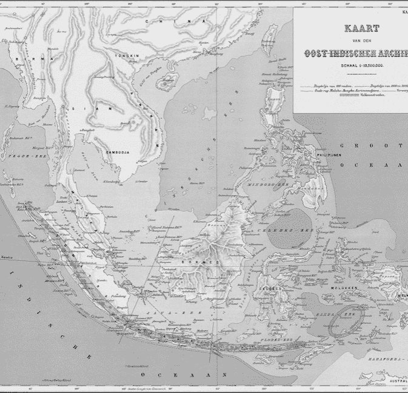

图 2.3 “Kaart van den Oost-Indischen Archipel”（东印度群岛地图）。Rogier D. M. Verbeek 和 Reinner Fennema 著，*géologique de Java et Madoura*（阿姆斯特丹：Joh. G. Stemler, 1896），附录 I，地图 I。

## Vening Meinesz：东部群岛的重力异常

下一张叙述爪哇新起源故事的地图不是由地层定义的地质图。相反，它是一张重力图。它描绘的爪哇并非废墟，而是海底的一处褶皱。Felix Vening Meinesz 花了近八年时间为荷兰测量委员会（Nederlandse Commissie voor Geodesie）完成了它，部分目的是为了给向殖民地铺设电报电缆而绘制海底地图。²⁹

历史学家 Peter Boomgaard 已经表明，Vening Meinesz 的项目也是“后期殖民国家全盛时期”对纯科学兴趣增加的结果。资助调查科学被认为与教育殖民地并使其与其他欧洲殖民地进行科学竞争的殖民野心一致。³⁰ 人们认为，科学将培养一种绅士般的探索文化。³¹ Levi Py 也注意到 Vening Meinesz 的财富以及一战后荷兰皇家海军与殖民地之间紧张的关系，这使他能够说服海军借给他一艘潜艇作为外交友好的姿态。³² Vening Meinesz 陈述其目的如下：“在地球上构造活动最活跃区域之一调查重力场。”³³

Vening Meinesz 于 1910 年毕业于代尔夫特理工大学成为土木工程师，不久后加入了荷兰的重力测量。在博士研究中，他寻求克服利用摆测量重力的难题。摆曾被用于确定重力分布，从而确定地表面的质量。该技术也应用于山脉、河流和沉积盆地，并在测量大陆质量方面变得非常有用。重力测量对于试图理解大陆是否与海洋处于平衡的科学家来说极具吸引力，这种理论被称为“地壳均衡”（isostatic equilibrium），它是固定地质理论的核心，因为解释了大陆和海洋如何保持水平稳定。重力测量可以在很大程度上解释大陆的形状、重量，以及它们是如何与海底相连的。Vening Meinesz 曾将这些方法应用于潮湿的河口地区荷兰，但他注意到水浸的土壤导致他的仪器在做出准确测量之前就发生倾斜。取而代之，他首次发明了一种系统，同时使用四个摆来抵消运动，并在它们旋转的间隙中决定重力的大小。他推测重力计足够精确，甚至可以在海上使用，而在此之前由于船只在波浪中的不稳定，这种测量一直是不可及的。³⁴ 他提出通过获取大地准面（地球形状的数学模型）来测绘大地准面。Vening Meinesz 反思道，“为了确定……”

Vening Meinesz 的早期实验失败了，因为他将仪器放在甲板上，甲板在波浪中摇晃得剧烈，导致结果混乱。随后他将仪器移到了潜艇上，因为它可以潜入水柱下方。³⁶ 在荷兰海岸附近进行成功实验后，海军借给他一艘潜艇和一批人员，并于 1923 年开始了首次东印群岛考察。到 1939 年，即十六年后，他在西洋、太平洋和印度洋进行了前所未有的巨大测量。³⁷ 1923 年，他经苏伊士运河从荷兰前往爪哇；1923 年，从荷兰到达亚历山大；1926 年，从荷兰出发穿过巴拿马运河到达爪哇；1928 年至 1930 年间，他多次穿过东印度群岛；以及 1932 年，他在加勒比海进行了测量。1935 年至 1939 年间，他经南非和澳大利亚西部从荷兰前往爪哇，然后返回荷兰。他覆盖的距离非常惊人，这不仅是因为航程漫长、测量点和重力站数量极多，还因为 Vening Meinesz 在狭窄的潜艇空间内身高很高，感到非常不适。这项工作也以枯燥和闷热著称。为了测量，船员必须停止发动机以减少干扰，这反而升高了潜艇内的温度。在 1926 年至 1927 年的三次航行中，他们跨越 2.5 万公里，建立了近 300 个重力站；每 24 小时潜水三四次，每晚一次两次。Vening Meinesz 干涩报告道，“经历了两个月的持续恶劣天气；这对于缓解船上的生活没有帮助。”³⁸ 1930 年，他在伦敦地理学会发表了两次关于其初步发现的演讲。随演讲一起的出版物后来成为一张广泛传播的结果地图（图 2.4）。地图上有两点引人注目：他四次航行的广泛轨迹，以及一条深色的“负重力异常”线，该线海底的重力揭示了一个连续的海下海沟。该海沟长近 8000 公里，宽近 160 公里。爪哇南方，

这些异常现象遵循 Verbeek 所知的“撕裂”脊线。³⁹ Vening Meinesz 说它延伸在“深海旁”。⁴⁰ 在某些地方，它与海底山脉或岛链重合，但在其他地方并非如此。人们从未想象过，整个群岛的南部竟然被一个隐形的、巨大的山谷所环绕。

同样值得注意的是，海沟的发现与关于地震源的新想法恰逢一起。在巴达维亚郊外的皇家磁力气象天文台工作时，Simon W. Visser 开始理解到地震源于比此前认为更深的地球内部，深达六百公里。⁴¹ 此前，许多地质学家认为地震是浅层产物，或者源于爆发火山的内部。然而，当 Visser 利用地震仪的新方法绘制它们的起源图时，他发现这些起源与海洋海沟几乎完全吻合。Vening Meinesz 指出，这一低洼地“与该地区的火山分布呈现出明显的相关性”；它也几乎与 Verbeek 和 Fennema 在《东印度群岛地图》（Kaart van den Oost-Indischen Archipel）上的黑色火山线完全平行。⁴² 这由山峰和山谷组成的双脊正变得清晰起来，

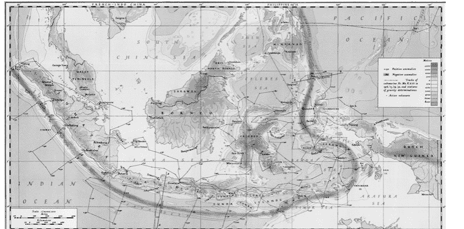

图 2.4 所示东印度群岛重力异常的地图。F. A. Vening Meinesz，“东印度群岛的重力异常”，《地理杂志》第 77 卷，第 4 期（1931 年 4 月）。

必须相互相关。Vening Meinesz 不确定导致该地带的原因，并且不愿提出理论，但他暗示这是一种巨大的褶皱；他想象地壳正以某种方式流入其中，产生应力并裂缝，从而导致火山和地震。⁴³ 这种认为大陆处于相互平衡状态的传统观点无法解释这种褶皱。Verbeek 将火山视为离散单元的观点正让位于以海洋为中心的理解。

Vening Meinesz 想象地壳流入褶皱这一事实，表明他对 Alfred Wegener 于 1912 年和 1915 年再次提出的大陆漂移理论认同。Wegener 建议大陆通过穿过海底来实现水平移动。⁴⁴ Vening Meinesz 对海沟的发现，以及对其在结构上与地震和火山活动日益增加的确定性，增加了陆海之间巨大水平运动的可信度。然而，寻求这些元素的 Vening Meinesz 等人并未完全成为 Wegener 式的漂移者，他们发展出了一种充满活力的局部理论辩论和仪器创新文化，以解释漂移术语的具体含义。尽管漂移理论被许多美国和欧洲地质学家拒绝，但在随后的几十年里，它仍然是爪哇理论推测的核心，部分原因是因为 Vening Meinesz 的制图。

在 1932 年至 1948 年，荷兰几何委员会以四卷本的形式出版了 Vening Meinesz 的成果——《海洋重力考察》（Gravity Expeditions at Sea）。在 1924 年出版的第 2 卷中，Vening Meinesz 偶尔的合作者 Johannes Umbgrove 贡献了一个章节，指出褶皱的形成似乎发生在中新世，并与 Verbeek 对大喷发期的定义相对应⁴⁶。然而，Umbgrove 与 Verbeek 不同，他认为褶皱是“地壳下沉，直到超过了弹性极限并发生向下褶皱”的结果。他写道，这“得到了这些地区地表结构和地质历史的支持”，并描绘了爪哇及整个群岛的新型构造结构图景。⁴⁷

在 1948 年的第 4 卷中，Vening Meinesz 包含了一张来自 Philip Kuenen 实验的照片，该实验解释了海沟（图 2.5）。Kuenen 是一位地质学家，曾于 1929 年至 1930 年参加 Snellius Expedition，这是荷兰东印度群岛规模最广的海洋考察，揭示了关于海底无与伦比的细节。他还是大陆漂移理论的拥护者，并与 Vening Meinesz 和 Umbgrove 就如何解释爪哇起源进行辩论。为了测试 Meinesz 对向下褶皱的设想，Kuenen 建立了一个地球表面模型，容器装满了水，上方有一层凡士林；一侧有一个虎钳可以压缩。⁴⁸ 这些组件代表了他们对地球的假设：底层水层代表地幔，比相对塑性的物质密度大；凡士林代表地壳，更轻、漂浮且更坚硬。同时，虎钳代表了导致褶皱的水平“压缩应力”。⁴⁹ 随着虎钳压缩内容物，表面向下折叠并保持不破裂。随着褶皱加深，较轻的物质汇聚并在顶部凸起（这些人想象这将是泥土、沙子和粘土，作为隆起和抬升的地表物质）。他们认为，其结果是对海底的一个极具暗示性的再创造。Vening Meinesz 满意地写道：“地壳的塑性变形通过 Kuenen 的实验得到了很好的说明。”剩下的令人困惑的问题是压缩应力来自哪里。这是几十年前批评者对 Wegener 理论提出的相同问题：驱动漂移的机制是什么？如果海底确实在向东南陆地移动，力量又是什么？这个问题让 Vening Meinesz 对地球的演化史以及作为原始事件产物的陆地进行了推测。

Meinesz 建议在美国地质学家 David T. Griggs 工作的基础上（他因此在地质学家中是一个异类），提出一个初步答案：巨大的对流。对流意味着地壳或地幔处于半流态，并由热循环驱动。在开始，Meinesz 想象在镍铁核心完全形成之前，一股巨大的对流从深处涌出并向宇宙辐射热量。地壳硬化并增厚，形成了第一个原大陆——一个完整的大陆，覆盖了地球表面的三分之一。它创造的原始分化产生了一个转折点，一种不可逆的、加速了热镍铁核心与冷地壳的分离，将热量困在地球内部，并加大了大陆厚度与较薄海底之间的差异。⁵⁰ 然后电流以某种方式倍增并撕裂了巨大的原大陆，将碎片拖过较薄的海底移动。这种原始

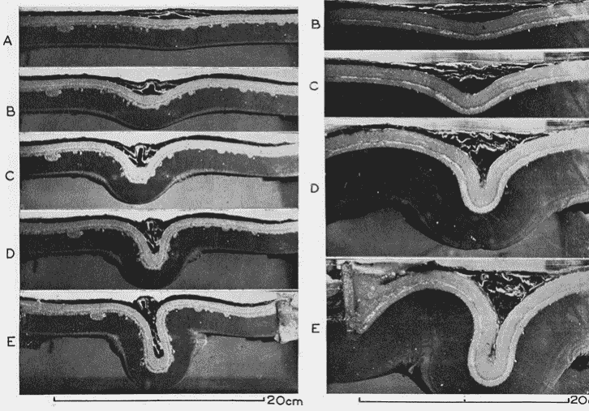

图 2.5 实验结果。Ph. H. Kuenen，“东印度群岛的负等静力异常”，《莱顿地质学报》，第 8 卷，第 2 期（1937 年 1 月）：第 186–87 页。

褶皱发生处。对流驱动地表流入褶皱，当它向下弯曲时，热物质上升、冷却，然后下沉到盆地下方。⁵¹ 他认为，对流不是像实验中的虎钳那样从边缘推动，而是从褶皱本身的位置推动。这个想法在 1952 年的《大陆与海洋的起源》中发展成了一个全新的、宏大的地球起源神话。⁵²

灾难，是从一到多的破碎，是不可逆转的自我分化走向碎片化，这解释了为什么大陆的基本成分大致相同：它们形成于单一源头并跨越海洋迁移。这种破碎过程也解释了大陆的地理特征：他写道，“大陆对极点”通常是海洋；“地球表面只有 6% 的区域不符合这一规则。”⁵⁴ Vening Meinesz 想象了这些破碎的、类玄武岩的、具有浮力的原大陆在近乎对等的部分被撕裂；所有的大陆都指向那个原大陆，那是一个陆地曾一度统一的时代。他在印度尼西亚发现的是一个关于所有大陆的故事，一个关于灾难性坠落的故事，一个碎片化的时代。殖民地遥远海域的海底海沟实际上是所有陆地漂移起源的模式；它是地球演化的中心。他的起源故事解释了海沟，但他也利用海沟来解释了地球。

1928 年，Vening Meinesz 受美国海军邀请，将他的“金牛犊”（他的四摆重力计）带到西印度群岛。他记录了波多黎各和海地附近的一条异常带，该区域几乎是东部海底的镜像。1932 年，他受邀乘坐“切威辛克号”（USS Chewink）参加美国海军-普林斯顿重力远征，教授科学家如何使用四摆重力计。他的助手是 Thomas T. Brown 和 Harry H. Hess。Hess 后来在普林斯顿大学工作，并根据他在广泛的海上工作以及 Vening Meinesz 那里学到的技能，成为板块构造理论的领先理论家。Hess 与 Vening Meinesz 保持着长期的通信，在早期特别是在与 Vening Meinesz 合作期间，Hess 愿意用漂移理论挑战美国的正统观点。⁵⁷ “切威辛克号”航行的目的是调查 Vening Meinesz 在 1928 年在加勒比海发现的异常，并解释巴哈马群岛的构造结构。⁵⁶ 借鉴 Vening Meinesz 的指导，Hess 在 1933 年的报告中解释说，“地震现象与火山活动之间存在直接相关性”，这与爪哇岛附近发现的情况相同。⁵⁷ 翌年，日本大地测量委员会进口了一台四摆重力计以调查地震和海啸的起源，他们在东印度群岛的另一个海域的镜像处发现了第三条重力异常带。⁵⁸ 通过发现大陆边缘的褶皱（这些褶皱总是与高度火山活动和地震活跃的岛弧相联系），Vening Meinesz 和四摆重力计揭示了一个传统冷却地球和静水平衡理论已无法充分解释的问题。

1945 年之后，四摆重力计在全球范围内至少 27 艘潜艇上召唤科学家们进入深海。⁵⁹ 1948 年和 1949 年，J. Lamar Worzel 和 Maurice Ewing 在美军潜艇上使用改进版的“金牛犊”，在北美东岸和大西洋沿岸、夏威夷和关岛、澳大利亚，以及白令海和楚科奇海进行了近 900 次观测。到 1965 年，Worzel 发表了关于 1930 年至 1959 年间海上近 4000 个重力测量站的报告。⁶⁰ 英国人同样投入了重力测量，到 20 世纪 60 年代，在冷战对潜艇战和通信基础设施利益的推动下，Vening Meinesz 的设备已被大多数对海底探险和大地测量感兴趣的西方国家所使用。⁶¹ Vening Meinesz 于 1958 年与 Veikko A. Heiskanen 合著的著作《地球及其重力场》（*The Earth and Its Gravity Field*）是哥伦比亚大学拉蒙特地质天文台重力测量和理论学生的必读资源。⁶² 这本书不仅揭示了海底未曾预见的复杂性，还帮助将这些过程置于地球演化的中心，以及后来被称为“新构造”或板块构造的中心。美国和欧洲的地质学家在 20 世纪 60 年代末 70 年代初果断地采纳了这一理论作为岩石圈演化的机制，而 Vening Meinesz 在东印度群岛和西印度群岛发现的海沟，成为了海洋如何遇到陆地以及地球灾难性历史的新愿景的证据。

在讨论板块构造理论如何重塑对印度尼西亚群岛的认知之前，首先需要理解另一个制图项目——Reinout van Bemmelen 于 1949 年出版的反动派著作《印度尼西亚地质》（*The Geology of Indonesia*）。这是该地区下一份完整的调查和历史，尽管如此，它回归了 Verbekian 式的地球缩小观点，拒绝了 Vening Meinesz 的假设。

## Bemmelen：印度尼西亚地质

Reinout van Bemmelen 的杰作《印度尼西亚地质》并非一张地图。第一卷包含 378 页，第二卷 732 页。它不仅仅是一幅地质图，更是自 20 世纪以来在印度尼西亚收集的不断增长、庞大到难以处理的地质数据汇集。

# 第二章

# 贝梅伦与印度尼西亚地质学的发展

## 早年生活与教育

贝梅伦于1882年出生于巴达维亚，父亲是威廉·范·贝梅伦老士（Willem van Bemmelen Sr.），他是巴达维亚皇家磁力气象观测台的主管。在1905年至1922年间，贝梅伦老士担任了后来发现地震起源深度的同一观测台主任。威廉·范·贝梅伦老士是科学知识其本身的捍卫者，并培养了对自然的审美欣赏。年轻的贝梅伦与父亲一起徒步了几个月；正是在这些旅行中，小贝梅伦被鼓励思考地质构造。在20世纪巴达维亚的殖民精英中，许多人是荷兰人，贝梅伦（Brouwer）和威廉·范·贝梅伦老士。在巴达维亚，贝梅伦接受了成为地质工程师的培训。亨德里克·布劳威尔（Hendrik Brouwer）和古斯塔·A·莫伦加夫（Gustav A. Molengaaff）等人，尽管他们对维宁格·米纳亚尔德的漂移理论持怀疑态度，但也是早期的支持者。贝梅伦曾参加过由韦尼格展示漂移理论的会议，但贝梅伦拒绝了这一理论。

## 《印度尼西亚地质》手稿的编写与命运

他在1937年至1941年间编写了《印度尼西亚地质》的手稿。正如维宁格·米纳亚尔德一样，贝梅伦将他在印度尼西亚的所见并应用于整个地球，并发展了关于地球起源的新观点。在矿业局（Dienst van Mijnbouw）工作后，他在1940年被任命为火山调查（Vulkanisch Onderzoek）的负责人，直到1942年日本占领印度尼西亚期间被关押。他对爪哇火山的研究可以解释行星的演化。

由于几个因素，由于荷皇家壳公司（Royal-Dutch Shell）在新几内亚和苏门腊、提答腊和松巴岛屿的地质工作自20世纪初以来有所加速。荷兰殖民政府允许私人矿场进行勘探，这增加了在印度群岛的地质学家数量。将私人记录和科学论文整合成关于该地区的连贯描述绝非易事。到1932年，地质矿业杂志（Geologisch Mijnbouw Genochap）已发表了五千多篇关于荷兰东印度矿业和地质的文献。⁶8 不仅维宁格·米纳亚尔德揭示了海底的新地理；1929年至1930年向东的斯纳远险释放了大量的测深测量数据。库宁（Kuenen）曾建立了米纳格的褶皱模型，他参加了斯纳远险并发表了总结结果的论文。布劳威尔、威廉·H·赫策（Wilhelm H. Hetzel）和亨利·E·G·斯特特（Henri E. G. Straeter）于1929年对望加岛和1937年对巽他群岛进行了新的探险。1936年至1939年还在新几内亚进行了探险。此外路易·鲁滕（Louis Rutten）和沃尔特·霍茨（Walter Hotz）等人在1917年至1929年在塞腊姆岛探险的发现也已发表。⁶9

1942年，贝梅伦成为日军的战俘，未能完成这些材料的整合。在通往监狱的途中，他显然将《印度尼西亚地质》的手稿托给了一位助手，但对方在1945年爪哇岛解放后拒绝归还给他。根据贝梅伦的说法，被盗的手稿被转移到了雅加达，那里是新政府所在地。我们可以假设，如果手稿确实被盗了，那是因为包含了关于这个新兴殖民国家的宝贵细节。手稿从未再次出现，在贝梅伦战战回到荷兰后，他在几年时间里重写了它。

## 波皱理论与地质演化观

韦格纳的假说被维宁-梅因茨的对流理论所取代，转而回溯了维尔贝克关于地球冷却和收缩的模型。对于范·贝梅林而言，是由于冷却产生的大贯穿整个地壳的巨大波皱波，以巨大的水平石化脉冲的形式形成了山脉、火山和海沟。他将他的第一卷按照对每个区域地理特征的详尽描述进行组织，然后是每个区域的层序学和地质年代划分，以及对火山活动、其地质、喷发风格和周期性的描述。其后是地球物理学，包括地震、重力测量，以及上述理论在每个地理单元演化中的应用；他根据波皱理论阐述了他宏大的地质演化理论。

回想范·贝梅林与维尔贝克地图之间的主要差异是有价值的。维尔贝克的是根据当时行政辖区的政治边界和层序单元组织的，而正如前提到的，当时的层序学既没有绝对年代，也没有公认的地质年代划分。当范·贝梅林写作时（大约在四十年后），层序学已变得非常细分；定义了许多新年代，且利用放射性同素年代定确定绝对地质时间被越来越认为是合法的。亚瑟·霍姆斯在1927年的《地球的年龄：地质思想导论》中，利用放射性论证证明了地球有10亿到30亿年的历史。⁷¹ 范·贝梅林也有过同样的想法。⁷² 群岛的地层超过了3亿年，在地球历史中相对较年轻，正如维尔贝克所认同的那样，该地区的化石证据绝大多数处于第三纪至现今之间。⁷³ 他证实了维尔贝克关于通过陆桥与东南亚大陆相连的淹没再浮现陆地的图景。抬升也被认为是至关重要的。波皱理论将维尔贝克的叙述带入了二十世纪。对于范·贝梅林来说，爪哇和群岛的大部分地区可以被解释为一个冷却的行星，它产生了巨大的陆地隆起、火山和穿过地面的极缓慢的波动。简而言之，大陆和海洋的起源源于一个能量耗尽的地球，它在冷却和向内收缩时发生了褶皱。

根据波皱理论，被称为“大波皱”（megaundations）的震中——由于地球内部能量向外宇宙释放引起的巨大隆起——从其中心向外辐射波动，就像掉进池里的石头一样。⁷⁴ 例如，爪哇和苏门答腊这些由海洋表面褶皱形成的岛屿就是这些涟漪的结果。但波动扩散在整个地球表面，多个波皱波相互碰撞。火山是波皱中的位点，在那里地下物质到达外部并释放了来自地球内部的耗尽能量。火山也会漂移，在岩石圈波的推动下向前移动并最终死亡。范·贝梅林偏离了维宁格的观点以及任何关于初级对流的想法；相反，对流认为是尾迹中旋转涡流的热流。他可能引用了维宁格对库宁“凡士林模型”的依赖，他写道：“我否认陆斜盆地的收窄以及由于刚性框架的侧向移动而挤出的其内容，就像虎钳的波动一样。”通过此，贝梅林仅仅是表示他不同意于维宁格关于对流作为漂移机制的愿景。他继续坚持认为“波皱理论与所有地壳弯曲或大陆漂移理论对立”。⁷⁵ 反反，他复活了地球收缩模型及其对表面平衡的干扰。对于他而言，地球表面的演化是由宇宙能量驱动的；这是一个通过能量损失运动起来的忧郁愿景。⁷⁶ 如我们在第四章中看到的，范·贝梅林通过维尔贝克对遗迹也感兴趣；他的爪哇是通过灾难创造的，而地球是由损失定义的。

## 西爪哇构造演化剖面图

西爪哇的构造演化（图2-6）描述了爪哇的波皱。北侧（右侧）代表巴达达和爪哇海的沿海平原，朝欧亚大陆方向。南部边缘延伸印度洋三十公里，几乎进入维宁格描绘的重力异常区域。顶部的第一个剖面代表奥新世，维尔贝克和芬尼马注意到这一时期存在化石记录的空白。在范·贝梅林的渲染中，这是一个波皱时期；西爪哇正在下沉，表面是石灰岩沉积的“坚硬地壳”。当观众向下从一个剖面移动到下一个时，他们沿着时间向现在进展，看到一个简单的景观转变为复杂的景观，火山侵入源自南方并向北波动。这股波动的起源深达地面以下七点五公里，比维尔贝克1885年绘制的克拉托火山地图深了大约十倍。当范·贝梅林试图用这些图表来证明他的构造起源故事时，其结果之一是他将爪哇表现为

南 北

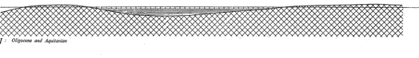

I：始新世和上新世

II：下中世和中新世

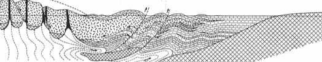

III：上新世

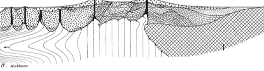

IV：中新世-上新世

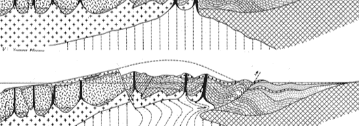

| 印度洋 | 南部山脉 | 万达隆带 | 8000带 | 巴达达沿海平原 | 爪哇海 |
| :--- | :--- | :--- | :--- | :--- | :--- |
| 2.5 K | | 普拉蒂马 (344R) | 帕拉汉根 (418R) | 塔鲁 (319R) | |
| 沉积物 | | 地壳元素 | 下地壳 | | |
| 始新世 | 爪哇侏纪复合 | 第三纪和上新世 | 其他深海 |
| 中新世 | 新生岩石 | 第三纪岩石 | |

图2.6 穿越爪哇的剖面。雷诺特·范·贝梅林，“爪哇的构造演化”。《印度尼西亚地质》，第1卷（海牙：政府出版局，1949），图37

具有以前从未见过的横截深度。尽管范·贝梅林的历史后来受到了争议，但它不仅对现有数据进行了前所未有的综合，还以比前者更密集、更具动态的方式展示了爪哇。他的连续序列胶片让地质学家以以前所未有的方式看到了动态和速度。

## 经济地质学与波皱理论的局限

范·贝梅林的爪哇历史与人一样，对印度尼西亚的资源地理几乎没有价值。他的《印度尼西亚地质》第二卷致力于经济地质学，与波皱理论的直接对应很少。波皱理论对于寻找矿藏或确定新区域几乎没有。在1939年，他指出殖民出口价值的29%来自矿产，大部分是石油产品。他认为历史不能还原为经济地质学的反复。相反，他识别出“动态和谐”，即构建宇宙的混沌与共之间的相互依赖和共同产生。他在经济地质卷的前言警告不要过度开发自然资源和现代机械的破坏性，而是主张明智地利用地质学，并反对对地球有限矿产的开发。波皱理论是一种自然秩序的说明，他认为这种秩序必须共存；但在实际执行中是不可预测的。波皱理论的遗产被板块构造学所掩盖，并成为地质思想史上的一个脚注。范·贝梅林的同行们证明了大波皱中心无法充分解释海底的传送带式运动及其与大陆的接触带，而地质学家已开始到处发现这些。⁷8 《印度尼西亚地质》仍然是基础性的。它形成了未来印度尼西亚工作和火山学家培训的基础。

# 汉密顿：印度尼西亚区域构造

## 卡提与板块构造学的引入

印度尼西亚地质学家约翰·卡提最果断地将从韦格纳的漂移语言更新的板块构造语言和概念应用于该地区。当维宁-梅因塑造了欧洲的板块构造理论时-

以及美国地质学家根据他对爪哇岛南部褶皱的经验，该理论通过卡提以改进后的的形式回到印尼，这创造出了一种关于印尼巨大财富的新复合愿景。卡提是1960年第一个从万隆理工学院（Institut Teknologi Bandung; ITB）获得地质学博士学位的人。他接受过荷兰地质学家西奥多·库普（Theodor Kulp）的训练，他是ITB地质项目的奠基人，那里有许多革命性的反殖民主义民族主义学生，其中包括第一任总统苏加诺，他在20世纪20年代学习工程学（手稿很可能是递给了苏加诺在雅加达塔的革命政府）。库普经历了从殖民到战后的动荡转型期，并教了一代印度尼西亚地质学家殖民地质学方法。可能因为这种教育经历，卡提是范·贝梅伦（van Bemmeelen）的仰慕者；他甚至在1979年《地质与矿业》的纪念刊上贡献了一篇修订性文章，在文中他认为范·贝梅伦的适应理论为板块构造学奠定了基础。卡提在将他的地质训练与新共和国的野心相结合方面非常成功，他后来成为了苏哈托的亲密顾问和伙伴，并在职业后期被任命为莫斯科大使。正如我们将会看到的，卡提将板块构造学应用于印尼也具有政治意义；它允许他为这个渴望增长和财富乐观形象的初生的“第三世界”共和国产生一种对新资源潜力的乐观情绪。

## 哈密尔顿的制图工作

卡提产出了首批几个应用板块构造学语言解释该地区的分析报告；但由于他担任国家测绘局（Badan Nasional Nasional Nasional）顾问，以及后来担任国家矿业与能源部（Departemen Pertambangan dan Energi）总长的职责，他本人无法独立完成一项新的制图项目。相反，他在1970年邀请了来自美国地质调查局的地质学家沃伦·哈密尔顿（Warren Hamilton）将新的语言和技术应用于整个地区。哈密尔顿花了八多时间才完成这项任务，在万隆、美国和东南亚各地的地质办公室之间穿梭。他依靠对29家石油公司（包括印尼国家石油公司Pertamina）的咨询和私人文件；他还依靠了巴布亚新几内亚、澳大利亚、泰国、马来西亚和菲律宾的机构，以及哥伦比亚大学的 Lamont特-多霍蒂地质天文台，后者通过“Vema”号帆船进行了7万公里的连续地震反射测量（该帆船还携带了一个四周摆重力计，这是一个由莫里斯·斯里普斯海洋研究所和其他许多公立和私人机构驱动支持的项目）。

哈密尔顿依靠这个庞大的网络汇总了绘制《印尼地区构造图》（图2.7）的信息基础。与范·贝梅伦一样，哈密尔顿的专著是综合性的，但结果是一张图像（加上长近四百页的长篇论证）。他表示，他的目的是改变印尼的叙述，而且像他之前的其他人一样，他的目标次于经济性的。正如他在1970年完成工作前所说：“尽管板块构造地图项目是关于经济地质学的最终呼吁，但希望最终地图能引起人们对寻找金属或石油的有利阶地的关注。”

## 对前人理论的批判与新构造愿景

他努力拒绝他的前任者。费尔贝克（Verbeek）的地图没有被引用（可能是因为他的工作已经整合并转化到了后来的地图中）。将范·贝梅伦和翁贝尔（Umbumber）归为地斜构造体系，即固定主义者，他们认为地球的收缩导致地壳的褶皱和断裂。哈密尔顿坚定地表示：“不存在所谓的‘地斜带’，”大胆地摒弃了半个世纪的地质思想。

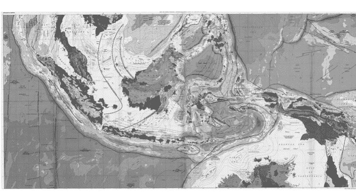

图2.7 沃伦·哈密尔顿，“印尼地区构造，”美国地质调查局，专业论文1078（华盛顿特区：美国地质调查局，1979），图1。

造山过程是循环或周期的，正如范·贝梅伦、翁贝尔和许多人所认为的那样。他否定了维宁·梅纳斯（Vening Meiners），写道他的重力异常甚至没有测量实际情况，而是海沟区域地壳与他的数学模型假设的密度之间的差异。根据哈密尔顿的说法，尤因（Ewing）是一位同样接受过维宁·梅纳斯教育的美国同事，他用地震折射数据补充了维宁·梅纳斯的“金牛犊”并修正了该理论。在这种否定式的“焦土式”方法中存在许多姿态。哈密尔顿的方法也符合许多美国地球科学理论者的大男子主义。相比之下，卡提对他的前任者采取了更为温和的方法，试图将他们纳入其中，即使他们属于一个充满矛盾且困难的殖民过去，而这段历史是哈密尔顿并未应对的。

哈密尔顿那种牛仔式的直率也被应用于荷兰前任者对该地区的历史。他写道，荷兰地质学家错误地假设火山弧自白垩纪末以来一直没有移动。哈密尔顿认为恰相反：爪哇移动了；它的形状向南漂移，大陆边界曾位于非常北方。荷兰人认为，对样本的理解粗率误导，认为它们比实际要老。此外，同样的样本很可能被运输到了他们发现它们的地方，而不是所假设的那样来自它们的原始位置。他还认为荷兰人错误标记了

四张地图中的爪哇的起源 · 47

构成印尼的土地，主要是这些构造遭遇的结果。

哈密尔顿对星球故事的新愿景如下。地球地壳被破碎成七个大岩石圈，并有许多碎片和较小碎片相互运动。

这个过程大致是循环的，火山是海洋

海底变成了陆地，而爪哇岛是印度洋的延伸。然而，汉密顿的愿景并非革命性的；它建立在维宁·梅尼斯斯（Vening Meinesz）、翁格罗夫（Umgrove），甚至在某种程度上贝尔梅伦（Belmelen）提出的愿景之上。“爪哇岛是一个重构的海洋”这一核心思想早已世纪初。卡提利对荷兰殖民地质学家更为同情，他愿意将板块构造学视为更悠久的局部地质理论传统的延伸，而汉密顿则简单地抹掉了那些预示并塑造了其自身叙事的关键理论家。

## 板块构造学在苏哈托新秩序时期的政治应用

在苏哈托的新秩序时期，卡提利担任自然资源部长，应用板块构造学来确定海上石油开采点，从而服务于国家发展。他的传记作者甚至暗示，这种将地质理论应用于资源开采和国家发展的意愿，促进了他在20世纪70年代和80年代的政治运作，使其成为国家最著名的科学家之一。1983年的《Sumberdaya Alam dalam Pembangunan Nasional（国家建设中的自然资源）》设定了这一新展望的基调。他在书开头承认，国家的资源是真主赐予的；它们是人民的遗产，是他们的自然资本。随后，他主张利用自然资源和技术进行国家发展。反思当时关于行星资源限制的讨论，他认为富穷国家之间的全球不平等是资源分配的结果。他主张加强富裕国家与发展中国家之间的科学合作，以平衡资源分配。板块构造理论在他的愿景中发挥了特殊作用。他写道：

> “在过去的几十年里，由于全球构造或板块构造概念的出现，地质思想发生了革命性的变化。这种新构想不仅对构造过程提供了全面的解释，还解释了矿床（包括石油）的起源和分布。其影响是巨大的，而最终的画面仍然难以想象。”

在印度尼的背景下，这果性地将对国家财富（矿产和石油）的寻找从陆地转向了爪哇岛北部、苏答腊岛外以及东部班达海的海盆地，那里板块相互碰撞。维宁·梅尼斯发现的板块构造活动位点现在被石油和矿石的潜在来源。他在1984年写道：“每个‘造山带’的地质和矿化作用现在可以通过板块构造解释来解决，这种解释以比以前更现实的方式联系了矿产区。”他继续说道：“通常情况下，在印度尼西亚，板块构造模型所设的各种年龄的入岩弧与斑岩铜、锰金-铅-锌-铜-银脉、铅锌-铜-银层状矿、矽卡矿以及锡钨钼矿床之间着极佳的相关性。”这些矿物预示着新的财富，因为它们与全球新兴的电子工业和汽车驱动的城市化增长有关；它们为日益电气化和硅基化的世界提供了电缆、微芯片、电池、钢和金属部件所需的材料供应潜力。卡提利绘制了一张新的印度尼西亚地图，将构造环境与其相关的矿床编汇在一起；这是一张充满抱负的地图，投影出一个为冷战增长提供供应的新富足未来。

新的板块构造现实也为印度尼西亚与技术先进国家提供了新的国际合作。由于这项新理论，新的海洋钻探计划已经在深海进行，国际海洋钻探计划看到各国和公司投资于技术措施，以获取此前无法触及的海床下资源。深海钻探计划（由斯里普斯海洋学院和加州大学协调）、国际海洋海洋探险十年、东亚构造与资源研究以及一系列其他国际合作，都试图建立在构造汇聚位点开采海洋的新技术。

# 结论：爪哇岛与板块构造

板块构造理论诞生于印度尼西亚群岛。卡提利在20世纪70年代关于爪哇岛的历史，是一个故事的最新章节，这个故事始于20世纪地质学家寻找爪哇火山与印度洋深处之间的相关性。科学家们试图将费尔贝克（Verbeek）和维宁·梅尼斯地图上的等值线叠加在一起，在此过程中，他们塑造了地球的板块构造叙事，这一叙事在冷战期间被欧美地质学家进一步阐述。在爪哇岛的发现成为了新地球历史的模式。维宁·梅尼斯发明的四单摆重力计随后被美国和欧洲科学家用于测量海洋重力，使科学家能够定位加勒比海和日本的更多板块汇聚带，以及反映了印度尼西亚群岛已发现地质特征的洋中洋脊。换言之，始于印度尼西亚南岸及其火山的理论化和测量，通过贡献对海底与大陆之间关系的新理解，继续改变了地球的现代叙事。

正如卡提利在1984年承认的那样：

> “维宁·梅尼斯（1934）、翁格罗夫（1949）、库嫩（1935）和贝尔梅伦（1949）的地质构造理论的影响，只有当人们意识到这些科学家是先驱时，他们首次意识到整合陆地和海洋地质以理解印度尼西亚地质复杂性的重要性，这种方法在几十年后导致了被称为新全球构造的概念的发展。爪哇岛、它的火山、地震和海沟促成了现代地球的出现。”

# 插页

## 板块构造的政治与精神地理学

**海滩上的科学家** · 1960年，随后在1962年，来自加利福尼亚州斯里普斯海洋学院的美国研究船“利迪亚号”（Lidia）和“季风号”（Monsoon）携带了改装版的维宁·梅尼斯四单摆重力计（“金牛犊”），前往爪哇岛中南部几百公里处。船员们进行疏浚、旅行并向海底发射地震信号。这些探险是1959年至1965年间进行的国际印度洋探险（IOE）的一部分（图3.1）。用主管罗伯特·斯尼德（Robert G. Snider）的话，印度洋是“全球最后的未知区域之一”。来自全球多个国家的五个研究船参与了其中。利迪亚号和季风号不仅提供了爪哇和苏答腊以南的数据，还提供了远远地区的数据。

这两艘船收集的样本在我们关于爪哇岛塑造地球新叙事的故事中有两个重要的命运。首先，样本被整理成海洋板块构造结构的早期描绘。例如，它们贡献了《印度洋、红海、南海和西里伯斯海地形图》（图3.2），这幅图后来成了1967年发表在《国家地理》杂志上的关于印度洋洋床流行描绘的基础。该地形图是由玛丽·萨尔普（Marie Tharp）绘制的，她在哥伦比亚大学的蒙特-多霍蒂地质天文台与Hezeen合作，创造了前所未过的海底结构肖像。在《国家地理》的版本中，瑞士画家海因希·贝兰（Heinrich Berran）将他作为阿尔卑斯山印象派风景画家的训练背景应用到广阔的水下山脉和海沟地形中，用阿尔卑斯山熟悉的戏剧性表现了维宁·梅尼斯在20世纪30年代发现的褶皱，并即使是含蓄地证实了欧洲科学家的对印度尼西亚群岛的理解将其视为正在形成中的阿尔卑斯山。印度洋床也是板块汇聚隐藏机制的早期流行表征；当地壳发生褶皱时，洋壳俯冲到大陆下方并重新生成，正如沃伦·哈密尔顿（Warren Hamilton）在《印度尼西亚地区构造学》中所描述的那样。它展示了一种对地球的新观念，由其深层结构——洋床来定义，而这些结构本身是流动的。然而，同时，面向欧洲和北美观众的新视野呈现方式让他们感到像阿尔卑斯山一样舒适且崇高。

“卢西亚号”（Lusiad）和“季风号”（Monsoon）的样本也有它们的第二个命运。它们最终落入了沃伦·哈密尔顿手中，并出现在他的《印度尼西亚地区构造学》一页中。他将这些样本作为图表的基础，显示了一条从测好的日加射（Yogyakarta）地区向南延伸至爪哇海沟的轴线，海沟最初是由维宁·梅内斯（Vening Meinez）测绘的。哈密尔顿利用“卢西亚号”和“季风号”的样本作为证据，认为水下水是俯冲的结果，这是地球物理学中的新术语，描述了板块构造中板块驱动至下方的关键过程。两个板块之间的接触导致了巨大的水下海沟和谷。哈密尔顿认为这些过程创造了“卢西亚号”和“季风号”收集的材料。他继续认为，与他的许多荷兰地质学先驱一样，当南印澳板块板块下沉到欧亚板块下方时，它会融化并液化成爪哇和苏门答腊的岩浆弧，形成火山脊。当一个板块在另一个板块挤压下，它会融化、升到表面并爆炸。这是一个循环关系：当火山喷发而出时，这些物质就顺着坡度进入海沟。因此，爪哇——正如我们在上一章看到的那样——被重构了。对于哈密尔顿来说，板块构造是爪哇水平循环的肖像，是该岛屿与印度洋床之间不可分割的关系。正如约翰·卡提利（John Katili）所说，土地开始被视为海洋，而海洋被视为陆地。⁵

当“卢西亚号”和“季风号”的船员采集样本时，他们很可能不知道自己是在偷窃。事实上，印度洋并非未知。这种新殖民主义叙事暗示海洋是一个荒凉、空白的空间，等待科学知识来点亮。事实上，科学家们是从尼伊·拉图·杜尔（Nyai Ratu Kidul）——印度洋的女神女王的王国中取走了他们的样本。在哈密尔顿或其他美国科学家出现之前的几个世纪里，苏丹、学者和神秘主义者几乎在后来被盗取的同一个地点向她献祭。

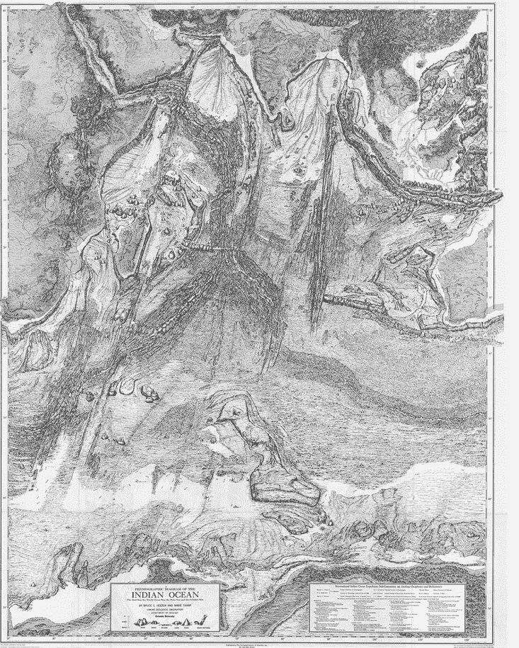

图 3.2. 布鲁斯·希森（Bruce Heezen）和玛丽·塔尔普（Marie Tharp），印度洋、红海、中国南海、苏禄海和和西里巴斯海的地貌图（纽约：美国地质学会，1964年）。图中爪哇海沟（右上三分之一）以夸张的细节描绘。该数据图像部分源于印度洋的航行（见图 3.1）。爪哇南方的巨大海沟是菲利克斯·A·维宁·梅内斯“褶皱”的首次描述之一，也是印度洋板块构造结构的早期愿景。图片由菲奥娜·雅科皮诺（Fiona Yacopino）提供。

中爪哇的苏丹、学者和神秘主义者在样本被盗取的同一地点向她献祭。朝圣者建造了载着给女王礼物的竹筏，将它们释放到“卢西亚号”和“季风号”进入的海域中。那些祭品中可能很就包含了科学者的样本。当荷兰地质学家彼得·J.（Pieter J.）在1882年写关于爪哇的里程碑式著作《爪哇：地理、民族学、历史》（*Java: Geophysch, ethnologisch, historisch*）时，他将印度洋称为“尼伊·拉图·杜尔的广阔领域”。1896年，他在《爪哇精神世界》（De Javaansche geestenwereld）中写道：“尼伊·拉图·杜尔的南岸拥有高耸的波浪，是居住在这一片荒凉陡峭海岸裂缝和洞穴中的人们的强大保护者。”他承认了爪哇人长期来的理解，即定义南方海岸的海啸、火山爆发和频繁的地震活动是女王力量的体现。当哈密尔顿和卡提利对板块构造理论的革命性做出主张时，他们实际上是在呼应这些老故事。尼伊·拉图·杜尔长期被认为与爪哇火山中的神灵结盟，而在那些故事中，源自海洋的地震通常与喷发有关。换句话说，海洋被理解为陆地，两者被视为一个整体。当哈密尔顿辩称海洋是火山的起源地时，他无意中提出了一个长期处于爪哇精神地理学中核心的论点。换句话之，板块构造在中爪哇并不是新事了。尼伊·拉图·杜尔的精神地理学早已揭示了它。

这如何改变我们对板块构造理论的理解？本章从第二章主要关于爪哇地质测图历史的内部描述，转而展示科学如何协商、映射并被爪哇精神地理学所转化。我探讨了爪哇的精神地理学与板块构造理论如何相互改变。虽然大多数关于板块构造理论的当代描述展示了冷战军事主义如何塑造了这一新叙事，但事实上，它与古老的爪哇地球观念完全相连。

哈密尔顿用来描述海洋与陆地交汇空间的术语之一是“间生的”（intercalated）。这是一个熟悉的术语。

关于尼雅·拉图基杜（Nyai Ratu Kidul）的故事可能非常古老，但在18和19世纪有了详尽的记载。在许多中爪哇的“巴达”（babad）编年史——这些主要是用卡维语（古爪哇语）为宫廷编写并收藏于其图书馆的故事和史诗中——拉图基杜是王朝历史中的核心人物。她的意义不仅令爪哇朝圣者和神秘主义者了熟于心，对19世纪晚期的荷兰学者和民族学家来说也日益如此。关于她一个广为人知的故事是：她是16世纪马塔拉姆苏丹国建立的关键人物，该国通常被中爪哇君主尊为爪哇历史上最强大的伊斯兰帝国之一。据说，她在16世纪中期与马塔拉姆的创始人苏苏哈南·塞诺帕蒂（Susuhanan Senopati）会面。他们会面的基本轮如下：塞诺帕蒂在爪哇岛各王国游历，寻找可以与之建立伊斯兰苏丹国的建议以及精神和世俗联盟。当时，王国在政治上是融合的，伊斯兰教正从北方缓慢渗透。塞诺帕蒂的苏丹国不是第一个，但就影响力而言，它是最广泛的伊斯兰王国之一。首批荷兰船只尚未抵达爪哇，荷兰商人定居巴达维亚还有半个世纪的时间。塞诺帕蒂前往印度洋岸边冥想，在那里遇到了了尼雅·拉图基杜。她与塞诺帕蒂同睡了三天；他们结婚了，约定她也将结婚并保护塞诺帕蒂的后代，同时根据苏丹的话，她是宇宙的中心。有证据表明，在19世纪之际，雅加加塔苏丹国的王室成员曾向尼雅·拉图基杜献上祭品，但这种做法无疑久老得多，可能与18世纪苏丹国的建立同时期.¹1

尼雅·拉图基杜与雅加加塔苏丹之间紧密的关系对20世纪20年代的荷兰民族学家来说特别感兴趣。1919年在雅加加塔成立的爪哇学院及其期刊《爪哇》（Djáwá）是反思这些地理以及精神地理与政治交织的媒介。该期刊的贡献者范围从欧洲学者到受过教育的殖民官僚以及爪哇翻译员，他们通常与宫廷有关。1933年的一期包含了一由爪哇翻译员、学院成员R·苏德贾纳·蒂尔塔库苏马（R. Soedjana Tirtakoesoema）的文章，他描述了1921年参加的“labuhan”仪式。这是一场年度游行，苏丹向拉图基杜献上祭品，随后登上默拉皮山的南坡向火山中的神灵提供祭品。“labuhan”明确承认了火山和海洋的精神地理是结合在一起的。通过向这两个拓扑区域提供祭品，苏丹承认他的权力是由这两个地方的神灵所构成的，并承认它们之间存在交换关系。也许是在某次“labuhan”期间，祭品被放在竹筏上释放给尼雅·拉图基杜，这些祭品最终被拉萨德洋和季风冲起。

蒂尔塔库苏马在1933年解释道，献给尼雅·拉图基杜的祭品包括各种织物和布料，如印有苏丹国图案的纱笼。人们还献上硬币、香水和香，这表明女王参与了苏丹的社交生活，甚至穿着臣民的衣服.¹² 在向女王献上祭品后，蒂尔塔库苏马报告说，随队随后转向默拉皮。他们首先乘坐火车到达卡拉桑（普兰巴南附近），到达基詹姆隆的行政中心，最后到达火山南坡的恩格拉卡（Umbulharjo）村。随队越过陡峭的山坡几公里到达植被线边缘，提供最后的祭品。然后，他们为宫廷采集了硫磺块；负责代表苏丹主持仪式的守门人（或juru kunci——字面意思是“钥匙工人”）说：“我受雅加加塔苏丹殿下派遣，呈献献给那些统治着爪哇之陆‘脐带’——默拉皮山的人的王室服装。”¹³ 守门人列出了以下神灵为统治者：Sangyang Umar、Kyai Empu Permadi、Kyai Brama Kedheli、Gusti Eyang Prabahan Prabag、Kiai Sabuk Agkin、Bok Nyai Gadhung Mlathi以及 Gusti Panembahan Megantara.¹⁴ 这些名字之所以重要提到，部分是因为它们带有尊称（如“最高”和“最伟大”），部分是因为它们赋予了如国王或kyai（穆斯林学者）之类的头衔和等级。它们也具有重要意义，作为当地祖先的神灵、历史性人物，或作为印度谱系成员的伊斯兰后裔神灵。例如，Kyai Empu Permadi是Batara Guro谱系中的一个皮影（wayang）角色，这是《摩婆罗多》中一个角色的变体。在这种情况下，这个来自印度史诗的角色蜕变成为了一个kyai。Gusti Eyang Panembahan Prabag Jagad也具有暗示（jagad指“宇宙”），而其他关于默拉皮神灵的记载暗示，同名的神灵Kyai Sapu Jagat（意为“打扫者”）也住在那里¹⁵ 对Jagad或Jagat的召唤暗示了多种可能的谱系；也许是迪帕萨纳王子（Prince Dipasana），又可能是领导反抗荷兰人的迪尼戈罗王子（Prince Diponegoro）。某些记载中也提到，默拉皮神灵被认为位于印度洋，即南方之神。

Pasar Bubar（市场市场）之所以得此名，是因为那些岩石被认为是火山神灵群的的摊位，神灵们在此建立夜市进行商品交易。在阿斯林（asmerling）出现在那里的同一时期，另一个指代大山的地名也出现在殖民时期火山科学家的词汇中——Mesjidlana，意为“老清真寺”，因那里是崇拜火山神的清真寺。荷兰人对这些术语的关注不仅证明了20世纪20年代这些精神地理的存在，还通过带他们那里的巡游仪式基础设施记录了科学家在这些地方的存在。正是那些长到足以提供供品或进行朝圣的路径，让科学家开展了野外考察。那些路径是通往如此高海拔地区的唯一路径；那里地形过于荒凉危险，不宜居住，唯一的规律性出现都是出于精神目的。“废墟市场”和“老清真寺”等精神地理出现在科学家的地图上，表明了梅拉比火山精神地理的方式如何直接影响了火山科学家不仅进入火山、而且理解火山的方式。

近三十年后，当卢西亚洋（Lusian）和季风（Monsoon）沉没印度洋表面时，他们完全并不是在进入一个未知空间。他们并不是在进入海洋，而是在进入一个延伸到火山的完全政治化的领域。这是一个社会空间——印度洋和梅拉比火山——政治权力和政体的基础。他们采集的样本确实是政治化的地质，是来自中爪爪岛地质组合的石块、鹅卵石和沙子。这些政治化物质最终出现在完全不同的地方：在国内《国家地理》杂志中塑造了板块构造地球的形象，并被挂在学校教室的墙上。

## 新秩序精神地理

20世纪30年代以后，记录梅拉比精神地理与印度洋之间联系的日本文献消失了近半个世纪。这并不是因为拉布汉（labuhan）仪式停止了；苏加尔诺（Sukarno）和苏哈托（Suharto）众周知在20世纪50年代到70年代一直参与其中。同样确定的是，自从蒂尔塔科索埃马（Tirtakoesoema）在1921年记录他的经历以来，姆布尔哈乔（Umbulharjo）守门人的角色一直有人担任。但直到20世纪80年代和苏哈托新秩序末期，对它们的民族学、人类学和文学描述仍然寥寥无几。我在此转向那个时刻，以及该地区的精神地理如何与军事独政交汇，并为后期更现代的与板块构造介入奠定了基础，这种介入试图干预政治-精神话语。

当印尼人类学家卢卡斯·萨松戈科·特约加（Lucas Sasongko Triyoga）在1984–85年与梅拉比的村民进行野外考察时，他发现火山和印度洋相连的想法仍然具有深刻意义.^27。他记录了一种幽灵政治地质：

> 梅拉比山坡上的居民相信，除了人类，自然界也被被称为隐藏民族（*bangsa halus*）或隐藏生物（*makhluk halus*）的灵所居住。正如人类生活一样，精神世界根据具有精神功能和活动的政府层级进行组织。这些精神政府层级中，最贴近居民心中的是梅拉比上的精神克拉顿（Spiritual Kraton）。^28

十年后，在部分受到特约加工作的启发下，德国人类学家施莱格（Schlegel）住在姆布尔哈乔，并记录基亚·萨普贾达（Kyai Sapu Jagad）仍是火山中的一位高级神灵；在这种情况下，他是隐藏民族的一位部长，负责其隐藏军队以及坡上的森林和田野。对于其他人来说，发现萨普贾达被认为是统治者：“他的任务是确保岩浆永远不会向南方流向雅加达皇宫（*kraton*）”。她继续道，拉布汉（*labuhan*）是食物和衣服的“奖励”。施莱格再次发现，“梅拉比山王国与其他王国保持着紧密联系，主要是与雅加达克拉顿……这些王国通过主要河流连接在一起。”^29

1998年，在独裁者苏哈托下台后，法印尼籍记者兼作家伊丽莎白·因达贾克（Elisabeth Inandjak）出版了《白榕树的重生》（*Lahirnya Kembali Berangin Putih*/*The White Banyan*），基于她参与拉布汉的经历以及与守门人（*juru kunci*）的友谊。这位守门人马里贾万（Maridjan）住在姆布尔哈乔的一间简屋里，那是蒂尔塔科索埃马1921年记录提到的同一个村庄。马里贾万也是特约加和施莱格的重要人物，他们采访了他并在他的村子里进行了野外考察。我们将在下文详细地回到马里贾万，但现在转向一段简短的记录已经足够，这段记录可能是普拉塞乔（Prasety）在《白榕树》中半虚构化的，它强调了火山与海洋之间的关系。

普拉塞乔描述了马里贾万讲述的梦。其中一个梦来自他年轻、还没成为守门人的时候。有一天，他爬上了火山，到达山顶后很快睡着了。他在火山口内醒来，那是一个摆满了整齐一排椅子的巨大房间。“那里有一座纪念性的绿门，那是梅拉比皇宫的大门。”他继续说道，“进入巨大房间的通道由一个坐在倾斜桌前椅子上的员工保护着。”叙述随后切换回他爬山的过程，他提到一直都在下雨，倾盆如雨。“‘通过内心的眼睛（[mata batin]），这（小路）……[文本继续]]’”

秩序或安全（slamet），这是一种通过其他手段进行政治的方式，一种通过仪式化的精神实践所进行的国家政治.^36 然而，混乱的可能性始终存在，它表现为社会暴力、火山的喷发，或是来自南南海的地震和海啸。“拉布汉”（labuhan）这一仪式在博涉权势者的谱系的同时，也在与景观本身可能产生的混乱进行博弈。此外，自然与社会的混乱是如此具有构成性，以至于它们相互映照；自然也是一支军队。

当Triyoga在1983年完成他的实地调查时，距离汉密尔顿（Hamilton）发表印度尼西亚板块构造地图（1979）仅过了四年，当时彭伯顿（Pemberton）正开始研究爪哇的仪式政治。到20世纪80年代中期，板块构造语言已成为应用于中爪哇火山活动的决定性科学语言；人们理解梅拉比（Merapi）是一个重新配置的海床，而两者之间的关系由俯冲作用定义。拉杜古尔（Ratu Kidul）的领域被视为俯冲进火山之中；他们确实在相互交流。不久后，苏哈托将约翰·卡提利（John Katili）提升为矿业与资源部部长，以及国家发展和资源开发事务的个人顾问。然而，汉密尔顿喜欢声称并非如此，他并没有发明一种看待爪哇的新方式——他是被海洋女王教导的。

在深入研究板块构造如何与“拉布汉”的仪式巡游交汇之前，有必要考虑守护者梅里迪安（Meridjan）人生的另一个重要阶段，即他在20世纪80年代被人类学家研究之后。梅里迪安作为“钥匙守护”（juru kunci）而闻名，这一职位在爪哇的许多地方都有，不仅与火山有关，还与墓地和圣地有关。守护者的任务是清理墓地、提供祭品，并为游客开放和关闭这些遗址。在雅加加塔（Jogja）地区，南海也有守护者；而且正如我们之前看到的，梅里迪安并非这座火山的第一位守护者。他直接由第九任“宇宙之钉”（Nail of the Cosmos）——苏丹哈门格库布沃沃诺九世（Sultan Hamengkubuwono IX）任命，被视为“内臣”（abdi dalem），即苏丹随从的一部分。他被赐予带有苏丹国纹饰的服装、传宝和一把克里斯剑（kris）。伊丽莎白·因纳迪（Elisabeth Inandi）记录道，他在20世纪80和90年代的客厅里只有一张简单的垫子，没有椅子，一个放着苏丹传宝的柜子，一张苏丹加冕的照片和一张梅拉比火口的照片。梅里迪安的其他任务是寻找迷路的徒步者并为客人提供精神建议。和其他“钥匙守护”一样，他是皇宫（kraton）和苏丹的代表——但在领土的北疆，一个贫困的偏远地区，以及精神世界的边缘。然而，我们不应将梅拉比仅仅构为苏丹的傀儡；正如我们将看到的，他的任命产生了一种代理性（agency），因为他可以利用他与火山和苏丹国灵界之间的关系。作为守护者，他既可以巩固苏丹的力量，也可以干预这种力量，并关闭两个世界之间的大门。

第十任“宇宙之钉”，即苏丹哈门格库布沃诺十世（Sultan Hamengkubuwono X），在其父亲去世后于1988年继位雅加达。在1998年苏哈托倒台后，在动乱、火灾和流血中，新苏丹很快在梅拉皮山坡启动了雄心勃勃的发展项目。其中包括一个引开奥帕河（Opak River）的高尔夫球场，灵魂在火山口和大海之间移动。这条河还连接了梅拉皮的村庄与印度洋。苏丹在高尔夫球场增加了精美的酒店，那里本很悠闲，导致新的住宅大楼和酒店拔地而起，阻挡了城市内部观察火山的视野。当水从河流引流以支持新开发时，导致了下游村庄的水短缺。火山河流中的采砂规模比以往任何时候都更大、速度更快，开采出昂贵的沙子以支持新的建筑热潮，而河流的引流或堵塞进一步中断了供水。像山坡上的许多村庄一样，克达乔（Kedarjo）的居民在苏丹的监视下不断被鼓励（甚至骚扰）迁移，这是苏哈托时代的一个项目，将人们从人口过密的爪哇搬迁到群岛的其他岛屿。梅拉皮上的村庄特别受到此影响，因为那里存在持续的危险。在喷发前后，当地政治人物（县长 `bupati`）经常向居民施压迁移，承诺在其他地方提供住房和安全。威胁、受损的水源、粗俗商业主义以及对王国精神地缘政治的公然忽视，这些力量使得梅拉皮与苏丹之间的关系恶化。

2006年4月，梅拉皮开始喷发：云从火口升起，岩浆顺着南坡滚落。天文台提高了警告级别，并要求村民准备疏散。整个月内活动不断增加，军方抵达引导人们走向安全区域。雅加达的观察者看到马里德扬离开，苏丹要求居民疏散到附近的避难所。但马里德扬拒绝了，并在喷发威胁增加时仍坚持留在家里。前总统阿卜杜拉·瓦希德（Abdurrahman Wahid）给马里德扬打了电话提出了同样的要求，但他再次拒绝了。在当地媒体的一篇文章中，马里德扬提到了萨普贾加德（Kyai Sapu Jagad）正在进行清理山坡的自然工作：梅拉皮正在苏醒，排出热云和岩浆。这是清理梅拉皮的一部分。没有必要担心，因为昌格林根（Cangkringen [马里德扬居住地]）是安全的。

医药巨头。因纳迪亚讲述道，老板询问马里德扬，是否可以为他一种名为“Kuku Bima”的能量饮料拍摄广告——这种饮料意为“比马之钉”，灵感来自一个拥有巨大大拇指的皮影（`wayang`）角色——据说他曾用大拇指为一位公主遮挡阳光（印度尼西亚工人阶级男性留一只很长的指甲，通常是大拇指，这也是时尚）。据报道，马里德扬像他常那样回答道：“我们这里不卖任何东西。”随后，老板开始辩称，马里德扬在多年前安装水管时偏袒了希达亚特的家族。“从现在回想起来，”老板显然是说，“和那根水管相比，一个人的形象有那么价值吗？$^{46}$”

因纳迪亚暗示，这种对家庭和人情的诉求是无法拒绝的，马里德扬被迫同意了。他暗示，利润的承诺可能也能解决村庄目前因采砂而面临的水源问题。马里德扬签署了合同。直系家人之外没有人有机会阅读它。不久后，马里德扬的面孔出现在雅加达的街头，推销这种能量饮料。大量游客开始出现在村庄观看这位传统的守门人，能量广告资金被用于修建一座新清真寺，并铺设了马里德扬家与火山内部精神世界之间的道路。然而，水问题从未得到解决。$^{47}$

马里德扬被媒体称为“健康饮料之星”，他很快受到了朱苏夫·卡拉（Jusuf Kalla）的接触，这位在2006年危机期间曾将村民称为“迷信的”副总统。在2007年代表苏哈托的政党——哥尔卡党（Golkar）竞选总统，马里德扬同意加入，担任在凯悦君民酒店举行的党会议的发言人——另一座酒店是1995年作为苏丹商业计划的一部分在火山上建造的另一五星级酒店。腐败的苏丹也是哥尔卡党的成员，并将竞选总统，他在那里会见了马里德扬。苏丹甚至为马里德扬充当爪哇语译印尼语的翻译，从字面上来说是在替他说话。$^{48}$ 卡拉介绍马里德扬时说他是一个“果敢且能够在任何情况下或风险下做出决策”的人。$^{49}$

在因纳迪亚的解读中，这种反转是绝对的。火山山口的精神地理与印度洋之间的联系被切断了。马里德扬失去了道德权威，被他所批判的系统冷酷地收编了。作为一个国家名人，他不再是萨普·贾加德（Kyai Sapu Jagad）的仆人，而是Kuku Bima能量饮料的仆人。确定的是，他逐渐变成了一个投影多种幻想的表面。外国记者是一组：他们在2007年至2009年间定期访问并参加祭礼（`labuhan`），将马里德扬的表现框定为神秘的爪哇传统，这与火山科学的现代性形成了鲜明对比。马里德扬代表了受到现代世界和快速发展的印度尼西亚威胁的史前传统的生存。在基纳雷乔，满载着寻找这位传统守门人的印尼人投射了他们对中爪哇传统的幻想，以及与国际化来源对话时对“本土智慧”的怀旧想法。这些游客还带来了大量现金，支持了火山吉普之旅、商店和产品等繁荣的当地旅游业。因纳迪亚叹息道，焚香（就像马里德扬童年梦中焚烧精神士兵的那样）据称在村里被禁止了，因为是对伊斯兰正统传统的侵犯。在因纳迪亚的解读中，最具破坏性的不仅是简单的商业化，而是这种使得祭礼（`labuhan`）旨在维持的南北关系。那种联系或许是她对马里德扬的自己的幻想：他新名字的蛮力、记者、客人和金钱都干扰了马里德扬守护中轴这一简单但至关重要的任务；仿佛马里德扬是真正的“宇宙之钉”，仿佛他是最后一个维系精神-政治-物质地理结构的人。

令人惊讶的是，马里德扬的名声意味着关于中轴和火山众神的故事传遍了人类学家那些晦涩的民族志，出现在当地和国际记者的报道中，并代表了一个关于神秘与现代、仪式与科学、岩石与灵魂的冲突，以及神圣商品化的广为人知的故事。或许马里德扬从苏丹那里的背离，以及他随后作为媒体明星的回归，为马里德扬作为这些更大、更令人困扰的现代化条件的密码提供了这不仅在印度尼西亚，而且具有更广泛的共鸣。从这一观点来看，我们在2010年的一个事件后回到了板块构造学，那是在《奥德赛诗》和《季风》从尼雅·拉图基杜尔（Nyai Ratu Kidul）领域采集样本近六十年之后。再次，通过一位名为苏罗诺（Surono）的火山科学家的工作，爪哇的精神地理最终与板块构造学融合在一起。令人惊讶的是，马里德扬所代表的系统变成了一个不是古代“本土智慧”的模型，而是现代火山科学的模型。尽管马里德扬是商业化和腐败的悲剧受害者，但他很快转变为负责任火山学的典范。

苏罗诺在万隆理工学院（Institut Teknologi Bandung; ITB）的本科论文，该学院成立于荷兰殖民统治末期的最后几十年，变成了一个不是古代“本土智慧”的模型，而是现代火山科学。尽管马里德扬是商业化和腐败的悲剧受害者，但他很快转变为负责任火山学的典范。

地震能量，位于火山口下方约一公里处。^^53 观测站对马里德扬村及其周边地区发布了疏散。想起2006年，马里德扬拒绝离开。担心他的拒绝会让其他人的留下合理化，总统苏西洛·班班扬·尤迪约诺再次致电马里德扬，要求他离开。尤迪约诺在2006年曾暗示，正是马里德扬拒绝离开可能导致了南方的地震.^54 记者和朋友们无视了疏散命令，去探望马里德扬、采访他、寻求建议或为他带来物资。在这些访谈中，他非常谦逊，反复说自己很“愚蠢”，只是“小平民”（`wong cilik`）中的一员。他说，人们应该相信科学家——“他们拥有科学”。^^55 然而他确实在那里，他会留下来；那是他的家。Surono变得具有攻击性。这再次变成了一个科学与魔法、神秘主义与现代性的冲突。Surono告诉PBS的一份杂志：“梅拉皮的逻辑不仅仅是迷信。我相信梅拉皮的[逻辑]，而不是巫术。”^^56 10月25日晚上，一股巨大的碎屑流喷出火山口并沿山坡流下。马里德扬和记者、亲友一起在家里祈祷，此时灰云以每小时20公里的速度穿过森林；它像火柴一样点燃树木，然后降临房屋，在马里德扬和其他34人处于俯拜姿（`sujud`）时干燥了他们的身体。他俯拜的形象在人们哀悼他的去世时传遍网络，新闻媒体在印尼和国外转载了这张照片。BBC刊登标题为“印尼火山精神守护者去世”的文章^^57

在随后的几周里，爆发加剧，达到了自1930年以来未见的破坏程度。近35万人被疏散到临时避难所。在一个月内，火山口喷出的物质体积超过了一座帝国大厦的容量。火山爆发持续了三个月。Surono大部分时间待在日惹，在整个危机期间向媒体更新情况，成为这一标志性人物，并对危机行动发表声明。报纸对他个人历史感到着迷，他是一个两个孩子的父亲，却愿意放弃与家人在一起的时间，在危机期间留在日惹度过几个月。马里德扬去世后，Surono受公众和记者之托接替守门人；他被赋予了马里德扬的尊称 `mBah`，这是爪哇语中对长辈的尊敬。报纸报道说，他准确的预报证明他接替了马里德扬的位置。地震仪和倾角计在现代性与传统、科学与巫术的竞争中获胜了。正如2006年的爆发让马里德扬闻名一样，2010年的爆发让Surono成名。他成为了保护Ratu Kidul领域与Sapu Jagad之间相互联系的守门人。

# 板块构造的灵性

科学对抗巫术、技术对抗迷信的现代主义叙事并没有持续多久。在两篇分析爆发的科学论文中，Surono开始发展一种板块构造叙事，这种叙事与`labuhan`（祭祀地）南北轴叙事交织在一起。Surono和他的同事认为，2010年爆发的起源位于南海，通过奥帕克断层（Opak Fault），该断层从印度洋出发，大致位于奥帕克河下方，一直延伸火山底部。该断层轴与Lusi和Monsoon在20世纪60年代采集样本的轴线吻合。Hamilton也曾认为印度海沟与岩浆弧交织，并为梅拉皮提供岩浆。Surono将奥帕克断层称为“水利系统”，将岩浆从Ratu Kidul领域海洋下的俯冲带区带入。这套水利系统位于同一个河流系统下方，据说该系统载着Nyai Ratu Kidul的坐骑往返，去拜访Kyai Sapu Jagad。正如诗人G. J. Resink在1997年提到Code河时写的，Code河沿岸的`kentongan`（隙鼓）如同鼓声陪伴着R[atu] Kidul在水面上方的途中前往梅拉皮火山，梅拉皮早学会了将R[atu]与新鲜空气以及盐水联系在一起^^17^78

板块构造的理解与灵性地理汇合了：两者都认为海洋与火山通过奥帕克连接在一起。在马里德扬去世后的几年里，Surono对印尼政治局势的态度发生了转变。他的变化在2015年《Tempo》杂志的一篇题为“Penuhi Gunung Berapi”（尊重火山的权利）的采访中显露无遗^^59 他在雅加达家中穿着一套休闲西装拍照，他认为科学家们已经变得傲慢，过于执着于仪器，且技术官僚。技术让人们认为火山是可以被掌控的，地球是可以被预测的。记者问及他对传统知识和灵性地理的立场，以及它们如何融入现代科学框架。他们回答道：

> 当地知识并非神秘的：它是应用于日常生活的对自然的尊重。

地理提醒我们，它们并非新事，也从未像某些科学家所希望认为的那样具有如此本质的区别。Ratu Kidul 和 Sapu Jagad 的精神地理预示了板块构造的洞见，在某些情况下，正是这些仪式性路径承载了科学家们开展工作，并使他们在此发现了火山与海洋之间的联系。必须承认，板块构造理论的出现部分源于这些仪式性路径。拒绝承认这一点就是对“影响”这一概念持有一种过于狭隘的观点。十九世纪的朝圣者通往连接海洋与火山的精神世界的同一条路径，也让科学家们开始理解火山与海洋在根本上是相互联系的。这种意义并不在于两个在同一地点发生的相互独立的类比见解，而在于看到：在更广阔的意义上，欧洲地质学家的构造见解得以实现，并随后复制了爪哇族精神地理的核心见解。

然而，即使板块构造理论的起源于爪哇岛的精神地理，现代地质科学在政治化地思考地质问题方面表现糟糕。相比之下，爪哇族的精神地理明确且通过仪式承认了政体的出现，源于火山与海洋之间的关系。“间插”（intercalation）有助于思考这些问题，让我们能够看到地球知识与政治（无论是地方性的全球性的）是如何始终、明确且毫无悔地结合在一起的。爪哇族的精神地理坚持地质学与政治的共同生产；板块构造理论随后加入这些术语中，并与精神政治混合在一起，而这种精神政治反过来在协商宗教政治中具有地方意义，同时又是完全现代的、全球性的，并赞美“本土知识”。“间插”不仅是合一主义的另一个说法；它针对的是不同的东西，即地球知识是如何接触、相互转化并结合在一起的。这种方法旨在突出那些对“新颖性”主张的社会和政治影响进行互锁、拆解和重组的过程，以及旧知识如何赋能新的认知形式。

# 公元 1006 年

## 地质决定论

## 灾难文化与一个日期的故事

我们正在见证的是世界的崩溃。

爱德华·苏斯斯（EDUARD SUESS），1885

# 静寂的神秘主义：殖民黄昏中的火山学

在二十世纪之初，荷兰在印尼殖民地的长期存在似乎变得愈发不稳定。流行小说作家路易·库珀鲁斯（Louis Couperus）被他的同代人视为最好的作家之一，他在1900年的小说《隐藏的力量》（*The Hidden Force*）中捕捉了殖民晚期的裂痕：

> 在一切表象之下，潜伏着隐藏的力量，它正沉睡着不愿战斗。在这一切有形事物之下，静寂神秘主义的本质正威胁着，正如地下暗燃的火火，正如心中的仇恨与神秘。在这一切宏伟的和平之下，危险正威胁着，未来正如火山内地下的地鸣，人类的耳朵无法听见。

库珀鲁斯捕捉到了欧洲人与爪哇当地人之间感受到的普遍的疏离感。尽管他们并肩生活，而且经常生活在一起（许多爪哇家政劳工住在荷兰殖民者的房屋里，如果他们不是种植园的劳工），但他们的关系往往标志着一种文化上的不相容。在小说出版时，殖民地的 3500 万殖民民仅由 250 名欧洲人统治；他们有 1.5 万名本土公务员和荷兰军队之间。殖民者与被殖民者的社会世界因此是不对称的且不可分割的。库珀鲁斯在这里看到了不安且具有构造性的摩擦；对他而言，爪哇人的神秘主义意味着，对不可见世界力量的信仰触及了“异族种群与心灵”。

然而，文化差异并未被构想为一种疏离的关系。1901年（在《隐藏的力量》出版仅一年后）引入的“伦理政策”（Ethical Policy）是殖民地治理发生转向自由主义的结果，通过建立自由主义经济监管制度来解决近一个世纪的强迫劳动、极端贫困、饥荒和经济不安全感。该政策在群岛中创建了新的外资控股公司，例如英国壳牌（Royal Shell），它于 1907 年由英国和荷兰公司创立。英国比里顿矿业公司（Billiton Mining company）和美国标准石油（Standard Oil）此时进一步在苏门答腊确立了他们的业务。茶、油、橡胶和烟草的新出口成为殖民地的主要收入来源，经济自由化与铁路的雄勃扩张和城市的现代化联系在一起。“伦理政策也是文化性的。它是殖民主义转型应成为一种仁慈的、文明的力量的结果；它将促进当地文化，提高当地人的生活水平并提高教育程度。结果，在20世纪的前几十年里，第一批考古机构成立了，在1907年至1911年间，婆罗浮屠（Borobudur）寺庙得到了修复。本土语言研究和受教育机会是早期对爪哇民间文化的首次详尽研究，随之出现的是对爪哇文化的前所未有的痴迷。这种哲学导致其在印度尼西亚各地勃勃生长，并激发了殖民精英对神秘学和“东方神圣记录”的新兴趣。对当地文化的新兴趣滋养了库珀鲁斯和其他人对认识论差异和异质性的着迷。库珀鲁斯看到的本土世界与殖民欧洲世界之间的紧张，源于对殖民项目本身未来的焦虑；如果他们的臣民在根本上、存在上、内在上是不同的，殖民主义如何能改善他们的臣民呢？也许殖民项目已经在“隐藏的力量”中遇到了极限。

火山学家未能免受这些问题的影响。在某些情况下，他们的科学是协商殖民紧张局势不可或缺的一部分，因为火山被理解为开启当地心灵的关键。火山学成为了一种将殖民文化政治与地球联系起来的方式。地球形成过程科学变成了一个空间，用于测试什么构成环境灾难、文化是否遭受此类灾难，以及历史的方向是什么（是毁灭与重建的循环，还是单一的进步方向）。所有这些问题为今天存在全球科学中的新科学方法奠定了舞台。雷诺特·范·贝梅伦（Reinout van Bemelen）从20世纪20年代开始，试图将地质史与爪哇历史相结合。早期爪哇的岩石碑——他通过一位著名的爪哇哲学家理解了这些——包含了爪哇文化如何作为火山活动产物的新颖记录。他开发了一种新颖的地质决定论理论，认为爪哇文化和历史是地质力量的结果。与此同时，他也参与了关于爪哇衰落原因的更广泛殖民讨论。然而，对文化衰落和毁灭的讨论也反映了殖民欧洲人对殖民项目的焦虑：他们思考早期爪哇为何以及如何被毁，他们也想象自己的殖民地未来将成为废墟。爪哇的古迹帮助殖民者思考他们自己的无常性。这一努力的另一个层面是，对于殖民欧洲知识分子来说，理解爪哇文化如何消亡与在爪哇人中复兴这些消失的文化是并行的。历史复兴将现在与过去连接起来，但它也是荷兰殖民对当地人负有“道义债务”中教育维度的延伸；它将教导当地人他们被遗忘的文化。像所有的复兴运动一样，这个项目是修正主义的；其目标之一是关注早期印度教时期的衰落，因为它代表了伊斯兰教传入之前的爪哇世界，一个与东方主义和殖民世界观更契合的世界。殖民欧洲人认为，那个世界仍然可以被见证。

在当今习俗和爪哇语的存续中；这些被视为爪哇人的精髓，而伊斯兰教仅被视为一个浅薄的层次。复兴运动——尽管深植于殖民地精英阶层、神智学会所和出版物中——在当地爪哇精英中也找到了志同道合的支持者，这些人助长了反殖民的民族主义。他们试图加强其高度阶层化、等级森严的伊斯兰教君主国家的权威，同时也对殖民机器持有批判态度。对他们来说，印度教和佛教揭示了欧洲殖民之前的历史和传统，这些历史可以服务于批判殖民主义。火山学家对伊斯兰教之前过去的复兴（包括其所谓的“寂静神秘主义”），将这些不同且往往相互冲突的能量和野心聚集在了一起。

本章通过追踪“公元1006年大喷发毁了现代早期爪哇文化”这一理论的发展，考察了火山科学是如何应对这些晚期殖民时代焦虑的。有人认为，这次爆发导致了印度佛教爪哇岛的衰落（这种可能的爆发反映了殖民科学家下意识地将基督教的时间框架应用于他们对地质历史的理解中）。这种通过火山灾难毁灭爪哇文化的叙事，使文化衰落的想法变得自然化，同时也表达了殖民者对火山危害以及库珀斯（Couper）所描述的“地下雷鸣”可能性的担忧。然而，随着民族主义的复兴和当地伊斯兰王国历史占据主导地位，这一殖民故事发生了根本性的变化。印度教和佛教过去的叙事以不同的方式压迫而来；当被认为是关键的决定性的文化认同在新的、后殖民的和面向未来的想象出现时，它失去了大部分意义。然而，关于公元1006年作为灾难性事件的意义的故事在印度尼西亚的流行和科学叙事中继续流传，这是由于那些关于一次性的、大规模的、环境和文化灾难性事件的故事具有吸引力。这是一种末日论叙事，通过它，我们可以解释自然和文化的历史。库珀斯将“隐藏力量”比作“地下雷鸣”的概念仍然留存在我们心中，表现为对非人类力量的焦虑、对其对人类努力的极端冷漠，以及其瞬间转化和毁灭的能力；然而，也有人认为自己比其他人更擅长解读这些迹象并与之共处。

## 1920年10月，迪尔克·范·林洛恩·拉伯顿在巴达维亚皇家科学院发表演讲

1920年10月，迪尔克·范·林洛恩·拉伯顿（Dirk van Hinloopen Labberton）在巴达维亚皇家科学院的一个小型会议上发表了演讲；标题很直截了当：“爪哇古语火山学资料（Old-Javanese Gegevens van Java）”。林洛恩·拉伯顿接受过文献语言学和民族学训练，这是他首次向皇家科学院介绍火山学问题。通常，他花时间给殖民官员教授爪哇语，并研究梵语或卡维语（Kawi）；他还是新兴的国际神智学运动的成员。他的反对者因其灵性化而称他为“星之呼吸”。和其他神智学士一样，林洛恩·拉伯顿在很大程度上支持兴起的爪哇主义浪潮。例如，他曾向布迪奥托莫组织（Boedi Oetomo）发表过同情演讲，这是一个致力于恢复爪哇遗产并抵抗荷兰统治的爪哇贵族团体。林洛恩·拉伯顿对现代早期爪哇文化也着迷，并协助巴达维亚科学学会（Bataviaasch Genootschap van Kunsten en Wetenschappen）重印了十七世纪的爪哇文本。1912年，他出版了一本名为《哇扬：爪哇的影戏》（Wayang, or Shadow Play as Given in Java）的小册，他在书中认为，现代早期的影戏可以作为当代爪哇“民族理想”的来源——他暗示，爪哇民族主义（民族主义和反殖民斗争）是更古老的、伊斯兰教之前的、来自印度次大陆古代湿婆派和佛教爪哇文化的表达。在荷属东印度群岛，文化在15世纪就被伊斯兰教取代或同步，正如他所说，古代湿婆派和佛教文化“披着穆罕默德的外衣”。他认为，通过接触古代印度教和佛教过去，民族主义者可以更好地阐述他们表达正统本土视角的目标。

林洛恩·拉伯顿向皇家科学院辩道，地质学家也可以从印度佛教爪哇中学习。他建议他们考虑最近发表的关于加尔各答石这一有趣证据的翻译，那是一块一人高、重两多吨的石碑。这块石头在英国间歇时期（1811年至1815年间）被斯坦姆福德·拉斐斯（Stamford Raffles）从东爪哇夺走，拉斐斯在殖民新加坡之前曾统治过该岛。当时，拉斐斯写信给他的苏格兰赞助人明托勋爵（Lord Minto），表示他想把这块“爪哇岩”送给他，这样在我们头部变得更光滑很久之后，它还能告诉我们关于东方的故事。拉斐斯偷走了石头并将其寄给了加尔各答的明托。四分之一个世纪后，精通印度教和佛教的强大荷兰文献语言学家约翰·肯（Johan Kern）是最早发表基于石刻拓本的梵文转录和解释的人之一。肯解释说，铭文记录了早期国王埃尔兰加（Airlangga）在爪哇岛陷入战争和社会动荡时期，逃离“大灾难洪泛”的历史。然而，林洛恩·拉伯顿不同于肯的观点，他认为印度教中关于“大灾难洪泛”概念的普拉拉雅（pralaya）和大普拉拉雅（mahapralaya）概念是有错误的。林洛恩·拉伯顿认为，当铭文被应用于政治时，“一切在新的[国家]建立之前回到混沌”意味着自然灾害，而非战争。林洛恩·拉伯顿解释说，铭文发生在萨迦历928-29年。林洛恩·拉伯顿将日期转换为1006年，这与格里历相差七八年，并隐含地重塑了这些事件。林洛恩·拉伯顿的演讲之所以重要，是因为他首次向地质学家朋友建议，火山可能导致了中世纪爪哇社会的断裂：火山灾难正是加尔各答石上记载的内容，并且发生在公元1006年。这个日期立即捕捉了科学家的想象力，并成为思考地质如何塑造爪哇文化以及本土爪哇文化如何承载地质事件记录的诱因。

### 为什么归于沉默？

林洛恩·拉伯顿提出了以下问题：早期爪哇文化产生了世界上最雄心勃勃的纪念碑。例如，位于美罗毕山脚下的黑色火山岩筑成的婆罗布卓神庙（Borobudur）是世界上已知最大的佛教建筑。20世纪访问该寺庙的殖民者曾将其与吉萨金字塔进行了热烈的比较。在建成不久，它似乎突然被遗弃了。东面十几公里处同样位于美罗毕山脚下有一座巨大的湿婆庙，同样令人震撼；但它也被遗弃了。拉斐斯在他1817年的《爪哇史》中包含了一幅普兰巴南遗迹插图，背景是冒烟的美罗毕山（图4.1）。当他在1812年巡视该岛时，他记录附近的迪延高原（Dieng plateau）拥有近400座寺庙，全部被遗弃。他写道，整个中爪哇，“到处是寺庙遗迹、破损的神像和印度教的痕迹。”

**图4.1 “普兰巴南的大庙”，背景为美罗毕山。斯坦姆福德·拉斐斯，《The History of Java》（London: Black, Parbury and Allen, 1817），20.**

清晰可见的碎片，穿过浅层伊斯兰外壳的缝隙闪烁。对于像莱诺特·范·贝梅伦（Reinout van Bemmelen）这样的火山学家来说，这促使他们重新思考历史，以及文化是如何被火山力量创造并拆解的。

## 神智学会与“秘学”网络

当希诺卢彭·拉伯顿（Hinloopen Laberton）在巴达维亚发表演讲时，他被登记为神智学会荷属东印度分会的总秘书。²² 当时，神智学会是一个令人印象深刻的国际机构，在三十个国家设有“分会”；1928年，全球有45,000名成员。²³ 神智学计划在承诺上宏大且多元，在影响上深远。它通过挪用来自印度、非洲和东亚的哲学传统（通常来自被欧洲国家殖民或占领的地区），为欧洲的非主流宗教和灵性实践做出了贡献。²⁴ 哲学家们创造了“秘学”的概念，将其视为一个贯通的系统，包含了古代亚洲世界发展的哲学、精神和科学见解。他们认为，欧洲的殖民和对西方科学技术的强迫强加，使这些思想流向了地下。哲学不仅承诺滋养“人类兄弟情”并反抗现代性的异化力量，还发展出一种“精神科学”，复活被遗忘的亚洲知识历史。这种“秘学”将有助于解决宗教与现代科学之间存在的紧张关系，因为古代的秘学智慧被认为不受现代科学与理性二分法的影响；秘学者设想，这种思想将解决西方思想的幻灭与异化。正如早期英国神智学家阿尔弗雷德·珀西·辛内特（Alfred Percy Sinnett）在他1884年关于秘学的导言《秘学世界》（*The Occult World*）中所说，“安全的东方人可能比法拉第更了解电，比丁达尔更了解物理学。”²⁵ 东方的多元文化被视为理解西方根基的关键，随着时间的推移，神智学家将东方构造成了一种“传统”。与此同时，秘学还提供了一种合法化机制，殖民者可以借此批判自身的殖民处境，并在印度尼西亚后殖民主义运动的发展中发挥重要作用。正如苏马蒂·拉马斯瓦米（Sumathi Ramaswamy）所示，神智学是一个让现代科学重新魔化的项目，它并非产生于科学之外，而是产生于科学内部；是科学家们成为了“哲学家”，这些科学家在分会中进行降神会，然后回到他们的办公室和实地工作中。²⁶

“哲学家”的出版业务制作了数百种刊物，包括定期杂志《哲学家：兄弟会、东方哲学、艺术、文学与秘学杂志》（*The Philosophist: A Magazine of Brotherhood, Oriental Philosophy, Art, Literature and Occultism*），该杂志在位于金奈阿德亚（Adyar, Chennai）的总部出版，那里于1882年从最初的纽约总部迁至。该组织最初由海琳娜·P·布拉瓦茨基（Helena P. Blavatsky）领导，她是一位乌克兰贵族女性，青少年时期逃离俄罗斯，并通过举行公开仪式和降神会成为纽约的名人。后来接替她成为金奈“哲学家”领袖的是安妮·贝森（Annie Besant），一位英国社会主义组织者，曾活跃于费边社和社会民主联邦。在东印度群岛，“哲学家”们对爪哇文化的历史及其受印度教和佛教的影响感兴趣；许多“哲学家”希望利用爪哇文化的“秘学智慧”来理解那个时代激进的科学变革，例如地质时间的加深、地球的年龄以及演化时间。²⁷ 通过将爪哇文化与“古代智慧”以及与深远的过去联系起来，殖民地科学家们认为自己并非处于边缘，而是处于一种与印度古代文化和科学智慧相连的中心。在这方面，他们的项目具有自我救赎的性质，因为他们理解，自己作为殖民者的角色是将爪哇文化的智慧揭示给爪哇人，而这些爪哇人已经在伊斯兰化和欧洲殖民的双重力量下遗忘了或异化了自身的文化认同。欧洲人在成为本土知识的仲裁者和权威的同时，也将自己视为其继承者。1925年，在荷属东印度群岛，正式成员为1,735人（尽管这绝非由欧洲人组成）。其中还包括了一部分直接从贵族和中央苏丹国抽出的强大本土爪哇人。这些重要的爪哇成员通常代表了融合的印度教-佛教-伊斯兰动态，其历史可以追溯到15世纪荷兰殖民存在的最早期（在前章中已描述）。还有来自荷兰统治阶层的神智学会成员，包括种植园主、矿业工程师、工业家以及如希诺约恩·拉伯顿这样的学者。²⁸ 分会的图书馆藏有国际版本的神智学会出版物（当然），以及关于反殖民主义、国际主义社会主义、共产主义的著作。分会的分布具有令人深刻的国际化特征，位于并连接了印度、南美、澳洲、新西兰、欧洲、非洲、日本、香港、中国、加勒比、东欧和美国的出版物。它们是成员练习科学、神秘主义、降神会和仪式的空间；无疑，在爪哇精英、资本家和科学家之间存在着重叠的社会功能和多元的意图，他们以自己的方式对殖民地的生活感到幻灭。

神智学家在1920年5月的期刊中为爪哇民族主义留出了空间，其中包含了希诺卢彭·拉伯顿对苏拉卡塔苏丹兄弟库苏穆迪拉特王子（Prince Kusumodingrat）向神智学家和“爪哇兄弟”发表演讲的报告。²⁹ 库苏穆迪拉特还是荷属东印度军队的一位将领，而希诺卢彭·拉伯顿是他的导师。在他的演讲中，库苏穆迪拉特……[注：此处原文似乎是碎片化/重复的，但保持了逻辑连贯]。

*等等，此处原文似乎是碎片化/重复的，但逻辑流得以维持。*

## 布拉瓦茨基的“秘密学说”与亚特兰蒂斯叙事

并非某种特定的形状或地点（如在伊甸传统中），而是多源起源的。事实上，存在“七个亚当”或“七个种族”。³⁵ “地球上七不同区域的七组人类，第一组出现于1800万年前（这虽然非常古老，但对她的一些地质学同行来说并非闻所未闻）。”³⁶ 在这方面，布拉瓦茨基的人类学巧妙结合了地质时间，并反转了赫胥黎和达尔文的进化论。她的人类学以新颖且异常的方式指向了失落世界的“缺失环节”，例如爪哇人。

《秘密学说》的第二部分《人类起源》是对七个种族漫长的谱系和历史，这些种族在神话、寓言和“秘密”来源材料中以各种面貌出现。布拉瓦茨基认为，现代科学对这段历史一无所知，但她也选择性地利用科学结论作为权威，以此支持她的主张。她的进化故事始于由幻影组成的第一个种族；第二种族从第一种族的某种自我证实中“萌芽”；随后的种族开始变得像现代人类。其中一个后来的种族居住在东南亚大陆，她解释说，他们是“棕色和黄色种族”以及“完全的人类物种”，³⁷ 布拉瓦茨基对他们的地理位置并不精确，但她告诉我们，在印度洋的姆勒大陆被地震和火山淹没沉没之前，他们曾占据那片大陆。³⁸

该大陆“朝南极”，她补充道，是“在宇宙和陆地上包裹着那些被作为宇宙元素吹入飓风的情感的深渊，”³⁹ 亚特兰蒂斯多次升起又沉入海底，形成了与其他大陆相连又断开的陆桥，使早期种族得以迁移。

通过亚特兰蒂斯的兴起与沉没，布拉瓦茨基解释道，它的居民建造了石质巨城，随后在火山灾难的力量下毁灭。这些遗迹可以在复活节岛的纪念碑中看到，也可以在斯里兰卡、非洲部分地区，或许还有澳大利亚。但他们的后裔是现代马来人、爪哇人和澳大利亚原住民。⁴⁰ 她解释说，从最早的第三纪开始，巨人族受到地球力量的影响，经历了长期的灭绝和体缩小：“它改变了地球的面貌，而关于[他们]繁盛大陆和岛屿、关于其文明和科学的记忆，没有留存在史书中，唯有留存在东方的圣典之中。”⁴¹

因此，在布拉瓦茨基关于东南亚人起源的新叙述中，殖民哲学家们试图理解的婆罗浮屠和普兰巴南的遗迹，突然指向了人类及其首批种族的真正起源。布拉瓦茨基扩展了对东南亚古代性的认知，超越了加尔各答石上的记载。在她的表述中，爪哇人与凡人种族相连。当然，她在这一推测上并不孤单，在亚洲或印度寻找原始人类祖先也并非她独特。但她的诠释至关重要，欧洲殖民哲学家们意识到自己正在与古代人接触，而在新的、自由主义的殖民氛围中，古老具有权威性。

布拉瓦茨基影响了查尔斯·W·利德比特（Charles W. Leadbeater），他是一位圣公会牧师，后来成为著名的神秘学家，安妮·贝森（Annie Besant）的二号人物，先在阿德亚，后在澳大利亚。1909年至1934年去世期间，利德比特是该组织中最有力的神秘学家之一。他在1914年访问了爪哇并多次与辛隆·拉伯顿（Hinloopen Laberton）在一起；随后于1922年返回并写了成为《爪哇神秘史》（*The Occult History of Java*）的文章。⁴² 他发展了布拉瓦茨基的叙述，并结合了辛隆·拉伯顿对公元1006年大喷发的思考。在《爪哇神秘史》中，利德比特主张，通过透视和进入`星界`，他了解到爪哇曾是亚特兰蒂斯殖民地的一部分。（这个想法来自布拉瓦茨基，他肯定读过她的，人们可能会奇怪为什么利德比特非要去星界才能找到它。）尽管如此，他辩称在亚特兰蒂斯被火山活动毁灭期间，爪哇变成了一个独立的国家。当古代的亚特兰蒂斯统治者被奴役以控制其火山时，现代爪哇形成了现在的形状。这些统治者对喷发如此恐惧，以至于要求爪哇人献祭以满足火山。这些邪恶的统治者极具说服力，以他们创造了一种魔法力量，“磁化”了火山，使其需要祭品。因此，爪哇文化此后受火山恐惧的统治，并受到自然残暴的压迫。

压迫者将这一切交给了一个名叫萨卡吉（Sakaji，或Aji Saka，萨卡以此命名）的印度教人，他应对诅咒的方式是将祭品永久地埋入地下来对抗亚特兰蒂斯统治者的力量。这些祭品之一就是后来建造婆罗浮屠的那座山，山下是钉子；因此，在利德比特的历史中，婆罗浮屠是一座为了纪念埋钉以镇火山而建造的纪念碑。这是一份永久的祭品，将爪哇人从自然的压迫力量中解放出来——这是一个关于文化从自然并通过自然控制产生的熟悉叙事——在这种情况下，指的是火山自然。

利德比特在亚特兰蒂斯一直到八世纪婆罗浮屠的建造之间画了一条线。他还借用了辛隆·拉伯顿和肯的说法，引用了加尔各答石上的故事：“美拉皮火山喷出了惊人的沙子和灰烬，摧毁了埃兰加在中爪哇几乎整个王国，并完全埋葬了……婆罗浮屠……过了几个世纪，才可能重新居住中爪哇。”⁴³ 那些祭品似乎失败了，尽管我们没有从利德比特的叙述中得知，只知道爪哇人是这些早期人类的后裔。

## 范·贝梅伦的波动理论与火山循环

……，随后是巨大的爆炸。⁴⁵ 当岩浆从通道突出时，它破碎并焚毁了塞子，导致了地震、岩石坠落和滑坡。塞子塌陷，引发了一股炽热的云团，直冲对流层上缘。随着几个月甚至几年的体积缩小，爆炸的程度也随之减轻。根据范·贝梅伦（van Bemmelen）的说法，随后是塞子的加强和硬化，持续了大约一年。一切结束后，循环将再次开始：新的岩浆从内部注入、挤出、爆炸、消小、平静。

范·贝梅伦认为这个过程是循环的，部分是因为他认为所有的造山运动都是循环的。从20世纪30年代初开始，他开发并大大完善了他的`波动理论`（undation），根据该理论，正如埃里·哈特曼（Erich Hartmann）所说，地壳由于一种“未知的宇宙力量”而隆起。⁴⁶ 这些隆起在重力作用下破碎并坠落，在地表形成像池塘波纹一样的涟漪和褶皱。他理解到，这些过程是由周期定义的。

范·贝梅伦坚信`波动理论`提供了当前地质理论的综合。与他的荷兰殖民时期的同事不同——他们当时探索大陆漂移的想法，想象大陆穿过液体基底移动——`波动理论`认为垂直抬升和隆起通过水平位移是驱动大陆水平运动的原始力量。并不是说范·贝梅伦是一个坚固的固定论者（当时许多美国和欧洲的地质学家正是如此）；而是他对漂移机制的理解本质上不同于维宁茨（Vening Meinesz）、乌姆格罗夫（Umgrove）和魏格纳（Wegener）。与他的许多地质学家同事一样，范·贝梅伦理解地球外层是由两种物质之间的原始差异定义的，即`地幔`（sima）和`硅铝层`（sial）：他的同事莫伦格拉夫（Molengraaff）在评价范·贝梅伦时写道：“`波动理论`真正的基础是由于原始硅酸盐地幔冷却导致的最外几公里层的分化倾向。”⁴⁷ 换句话说，在地球早期，爆炸性的、炽热的液体物质从坚硬寒冷的外壳分离出来。形成地球的物质经历了从外部到内部、从液体到固态的原始分化过程，而这种原始分化引发了随后的所有其他分化。在这里，范·贝梅伦与布拉瓦茨基（Blavatsky）不谋而合，后者曾写过宇宙的原始分化，

### 公元1006 地球决定论 · 95

并支持一个地质学和神学共同具有的主题：地球和宇宙如何从完整走向分化，从一到多；通过这样，`波动理论`也是一种用现代科学方法进行的宇宙论。

对于贝梅伦（Bemmelen）来说，火山是“颈部”——或者可能再次呼应布拉瓦茨基的模式，“凡俗蛋中的点”——通过它们可以观察到表面与地下、固体与液体之间的这种原始分化。范·贝梅伦经常将波动描述为巨浪，而火山活动是将内部物质转移到外部的机制，随后它在外部压迫并压缩表面使其回地球。波动是地表自我复制的机制。范·贝梅伦认为，这种起伏是有节奏的——不是像机器那样的机械节奏，而是一种松散的、不规则的节奏。

测量这种节奏并识别其地理特征，包括波动的形状和尺寸。它们从哪里开始，结束在哪里？它们有多大，有多重？他首先必须识别它们的周期，并阐明单个火山与其所属系统（或波动）之间的关系，这就是为什么他下令绘制美拉皮山（Merapi）的第一幅详细地质图。理解它的波动有助于了解其喷发周期，而且关键的是——有助于判断它是否将会爆发。

# 第四章

## 1941年全年野外考察与地质发现

1941年全年，他们进行了野外考察以绘制地图。范贝梅伦绘制了比例为`1:50,000`的结果示意图，首次解释了两个美拉皮的区别，一个是古代的，一个是现代的（图4.2）。他确定山口实际上位于一个更大更古老的火山口内部。这让他理解到，整年看到的爆炸性喷发活动是“年轻的美拉皮”的结果。这暗示喷发周期可能比以前想象的更多样，同时在现代和古代的时间尺度上运行。

他指着侧面上突出的山丘，每个高300或400米，在图戈山（`Gunung Toergo`）、普拉万根山（`Gunung Plawangan`）和肯迪尔山（`Gunung Kendil`），有些长有森林或种植烟草和蔬菜；⁴⁸ 并认为它们是“寄生的”，从旧锥体中伸出，像通往地下岩浆系统的管道一样。⁹ 在他看来，“年轻的美拉皮”填满了旧的空白。然后他转向辛卢普·拉伯顿（`Hinlooop Labberton`）：“一段梵文和古爪哇语的石碑讲述了一场洪水的故事”

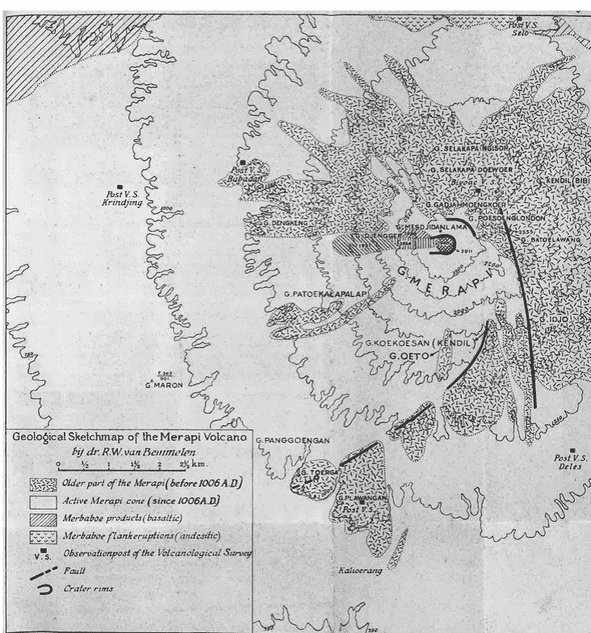

**美拉皮火山地质草图**

**RW. van Bemmelen 博士绘制**

- 美拉皮较老的部分（公元1006年以前）
- 活跃的美拉皮产物（公元1006年以来）
- Merbabao产物（玄武岩）
- Merbab侧翼喷发（安山岩）
- 火山调查局观测站
- 断层
- 火口边缘

图4.2 美拉皮山，用深色阴影标记了1006年之前的喷发物质。Reinout W. van Bemmelen，《美拉皮山地质草图》，东印度火山调查公报，第95-98期（1941年），第17页。

## 战时合作与监禁

为了与日本人合作.^55 确定的是，他与和田上校（`Colonel Wada`）一起前往梅拉比山（`Merapi`），因为当局担心疏散人口，而和田命令他继续研究。范梅梅伦（`Van Bemmelen`）的报告提交给日本的统治当局，并采用了从公元前 660 年日本王国建立开始的日本皇纪。1942 年是元纪 2602 年.^56 范梅梅伦认为，1939–40 年间的流出周期持续了九个月，而当前的周期已经持续八个月，且看起来相似。他得出结论说：“我们可以预测当前的周期在未来将会结束。”57

不久后，他被送回一个关留营，并一直留到战争结束。一场反对荷兰军事重建的争取印尼独立的艰苦斗斗随随之发生，撤退的日本军队要么自愿交出武器，要么武器被印尼民族主义者没收，其中包括苏苏卡诺（`Sukarno`）在内的这些人与同一个密教会所（`Theosphist lodges`）有关.^58 职业服务部的主长查尔斯·斯特恩（`Charles Stern`）于 1945 年被关在英属印度的监狱，由范梅梅伦写了他的讣.^59 印尼华裔科学家陈和（`Tan Hok`）是约翰内斯·安布鲁斯（`Johannes Ambrose`）的同事，他在万隆被杀，根据他的讣是因为他是华人和高层合作者，“被一群极端印度人杀死”。当他的妻子孩子逃跑时，他的房子被烧毁了.^60 荷兰建立了一个政府，并通过重新开放机构来竞争控制权。在后殖民共和国与荷兰殖民办公室之间的对峙中，例如，矿业部（`Dienst de Mijnbouw`）在万隆重新开放，但其竞争对手——独立的印尼共和国办公室在马格朗开放，并迁到了雅加达。这种竞争性政府之间的斗争持续到 20 世纪 50 年代。

## 战后流亡与宇宙论转向

在敌对的后殖民环境中从营中释放且没有工作可，范梅梅伦回到了荷兰，并写了《印度尼西亚地质》（`The Geology of Indonesia`）的手稿。他继续发展他违背流行地质理论的“逆流”理论，他的工作变得更加明确的宇宙论和神学色彩：他在 1972 年写道：“地球的节奏由各种周期性组成”，这些周期性累积成一个巨大的宇宙多态性。“所有地质过程都是和谐地发展的，”并且“受到我们宇宙系统原始能量的推动……这就是我们宇宙演化的‘动态和谐’。”61 它变成了一种美学宇宙论，灵感源于地质-宇宙系统之美，是由一个在殖民地结束后后流亡海外的人所写。

他继续相信地质过程的循环本质，并认为它们代表了和谐与毁灭的宇宙力量。造山和这种火山活动是这种二元论的体现。这也形成了他对人类生活和文化的观念；正如他在 1954 年所说，“造山提供了我们在地球上存在的最基础的基础。”⁶2 因此，人们无法区分火山学和人类学。

他认为人类生活和文明的目的是理解宇宙秩序的动态，以便与之和谐处。

在关留营中，他写道：

- 我相信美
- 源自自然的创造者上帝
- 我相信神圣
- 源自充满情的火焰

⁴²–'⁴5

在日本监狱里

## 一座民族主义的火山

公元 1006 年在后殖民时代的印尼西亚有着不同的命运。在新的印尼共和国，印度教和佛教的过去被雅加达和苏拉卡塔中爪哇中部苏丹的新颖意义所掩盖。这一最后部分考察了去殖民化后从印度佛教复兴主义向以伊斯兰为中心的民族主义历史的转变。这种转变改变了人们对梅拉比的作用如何塑造爪哇岛历史和文化的理解。

火山服务的出版物于 1941 年停止，观测站在革命动荡期间遭到洗劫。乔治·A·德内夫写道，“主权移交[给印尼共和国]之际，火山调查局只有十五个温度计和一台 Rolleflex 相机⁶⁴ 观测站尽可能重建，但到 1950 年，Dinas Gung Berapi（原名 Vulkanologisch Onderzoek）只有六名人员负责监测六十座火山。⁶⁵ 1950 年 11 月和 1953 年初对梅拉比进行了空中侦察，以便在人员少的情况下进行远距离测量。

[image link]

图 4.3 从空俯的梅拉比

[image link]

火山新闻（1952 年 9 月）

梅拉比的作用被认为塑造了爪哇岛的历史和文化。

雅加达是首府。但重新夺回现代爪早期失去的光光岁月已不再在眼前，也不再像殖民时期后期那样以同样的能量和重要性去追求。

日惹加瓦和苏尔卡塔这两个苏丹国不再仅仅是复兴印度教佛教过去的中心，而是作为一种新的后殖民神秘主义-技术共和主义的象征力量获得了新的意义。苏丹哈孟库布波沃诺九世（`Sultan Hamengkubuwono IX`）曾任命米贾贾兰（`Midjajalan`）为梅拉山的守护者，当日军撤离后荷兰当局试图收回这座时，他拒绝合作。在苏丹的许可下，苏卡诺（`Sukarno`）和哈塔（`Hatta`）在国家仍正式受荷兰统治期间，在雅加达建立了共和国的首个亲属政府。作为回报，苏卡诺允许苏丹在宪法中获得承认，并让苏丹继续担任共和国领内的世袭总督。没有其他苏丹国被授予同样的特权。当苏卡诺主持湿婆神庙时，它是在哈孟库波沃诺九世的领土内。20世纪50年代，据报道苏卡诺采取了苏丹们更老的做法，在靠近印度洋的酒店与尼雅·鲁托杜尔（`Nyai Ruto Kidul`）同居。他与她的交往标志着总统与苏丹国历史之间的重新对齐，总统成为苏丹血系的延续；或者至少是强大统治者需要通过婚姻来维持权力的传统的延续。梅拉山与南海之间的轴线，以及通往火山和海洋的祭仪式（`labuhan`），在后殖民时代的爪哇人伊斯兰政治权力观念中持续存在；火山科学也被纳入了这种统一。

1953年，中央天文台在雅加达建立，以协调梅拉山侧翼七座观测站和哨所的活动。它将组织并执行三个主要地区的疏散：苏尔卡塔和日惹苏丹国，以及肯杜平原。这些站点通过无线电和电话连接。它们将梅拉山的管理整合到了雅加达，远离了此前位于西部马格朗（`Magelang`）和蒙蒂兰（`Muntilan`）的地点，并将拉山的管理纳入了苏丹的领地（图4.5和4.6）。结果是将苏丹国的历史及其与梅拉山的深层政治地质关系与共和国对现代科学的乐观主义统一了一起。1954年，苏卡诺和哈塔访问了位于火山口几公里外的巴巴丹（`Babadan`）梅拉山观测台。值得关注的是，他们在苏丹哈孟库波沃诺九世和乔治·A·德·内夫（`George A. de Neve`）的陪同下，他是共和国火山局主任以及《火山新闻》（`Berita Gunung Berapi`）的作者之一。“这四个人代表了火山学的新共和主义合成，将马塔拉姆的遗产、科学和后殖民地结合在一起。他们参观了观测台附近的村庄，慰问了近期喷发的幸存者，但他们去那里也是为了翻新后的观测台开幕，并检查最新的疏散和监测策略。苏卡诺被拍下观测台外挥手的照片（图4.7），而哈塔被拍到正在使用无线电，无线电将山顶的观测站与雅加达总部连接起来。

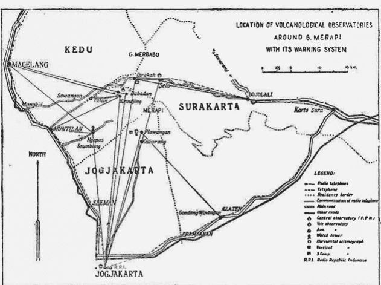

**图 5. G.P.M. 梅拉山的警告系统。**

- **P.P.M 的主要职责：**
    1. 汇总来自所有梅拉山观测站的报告。
    2. 在危险情况下执行警告指令。
    3. 更新梅拉山的守护系统，以适应现状（火山本身及其坡面的状况）。
    4. 执行山顶调查（特别是从空中）。

   1953年的活动。

图 4.5 这幅地图显示了以雅加达为中心的梅拉山新警告系统。它反映了叠加在苏丹国精神坐标上的新民族主义技术网络和想象。Surjo，“1950–1957年期间印尼的火山活动”，“火山定期报告”（`Berita Berkala Volkanologi`），第100期（1961年7月10日）：35。

公元1006年地理决定论 105

## 将梅拉山分为三个同心区域和11个扇区。

图 4.6 梅拉山划分为同心危险区域的新划分。Surjo，“梅拉山守护系统”，“Chagaku Sasshi（地理杂志）66，第4期（1958年）：34。

图 4.7 1954年在巴巴丹，贾维南甘（`Djajawinangun`）的苏卡诺总统。地质研究与开发中心存档。

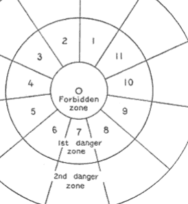

他们随行的电影队记录了他们的访问过程，并在观测台前的人群发表了演讲。新的通信网络将观测台接入了苏丹国和共和国。这种苏丹国治理并被火山和海洋治理的旧观念因此被折进了新的无线电和电话系统中。

1923年，这场运动在爪哇成立，到20世纪50年代，该岛屿的精神传统正与现代思想融合。群岛的去殖民化导致了当地信仰与全球政治运动的新合一。苏丹国的影响仍然是新共和国文化身份的核心，尽管梅拉山的科学景观已通过现代监测和基础设施发生了变化。

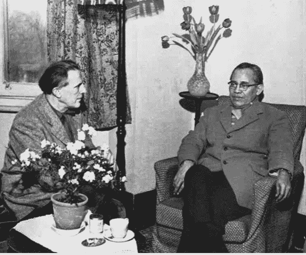

图 4.9 Subud 标志，“七灵力”。对于 J. G. Bennett 来说，这个符号代表了现代性：“圆一直被视为无尽的象征；因为它没有终点。圆作为一个符号，意味着对无限发展可能性以及人类灵魂不断进步的信念。” J. G. Bennett，《关于 Subud》（伦敦: Hodder and Stoughton, 1959), 112–13。

澳大利亚工程师 雷蒙德·冯·索默斯（`Raymond von Sommers`）在 Coombe Springs 通过 Bennett 结识了 Subuh，成为该组织的核心成员之一和狂喜的信徒。他描述了在经历了高强度工作后，完成苏拉威锡矿业镇主计划时的精神维度：“令人惊讶的结果是，我穿过了疲劳——感觉与自己的本性完全合一——我能够按时完成详尽的报告和记录。当完成时，这是一种如此强大的体验，我觉得我应该给 [Subuh] 看一份。我知道他会理解的。”

作为爪哇岛殖民工业家和种植园主的理论，Subuh 推广了一种新的资本主义精神，这是一种工程师、工厂主、金融家以及其他对基督教或伊斯兰教感到幻灭但对世俗主义不满的人的精神性实践。它承诺了异化劳动的解放以及对工作、进步和世界发展的重新入迷。当 Subuh 于 1987 年去世时，该组织不再拥有具有魅力的领袖，它便萎缩并很大程度上消失了，除了少数分散的修行者外，被所有人遗忘。

## 1006 今日 · 1006年作为爪哇岛文化巨变标记的吸引力

1006年作为爪哇岛文化巨变标记的吸引力，在考古学家圈和大众媒体中继续发酵。印度尼西亚考古学家 波埃里（`Boechari`）在 1976 年访问了 van Bemmler 关于古代喷发的证据，并将日期推后了，声称这次“大劫”（`pralaya`）发生在 1016 年，并认为 Kern 误读了加尔加答石上的日期。

法国电影制作人和火山学家夫妇 卡蒂亚（`Katia`）和莫里世·克拉夫特（`Maurice Krafft`）（我们将在第6章再次见到他们）也被卷入了这一叙述中，他们在 1976 年写道：“美拉比的山顶被粉碎了——用更厚的灰层覆盖了爪哇岛中部。”1979 年，《华尔街日报》记者巴里·纽曼（`Barry Newman`）在美拉比山山坡的 Krindjing 撰写报道时，他报告称 1006 年的中部爪哇已被摧毁。

但那种“一次巨型喷发摧毁了爪哇岛并导致其在整个20 世纪70 年代和80 年代失去声望”的观点，随着考古证据开始显示喷发可能在九世纪、十世纪和十一世纪期间发生过多次。有人认为，这可能根本不是一场巨型喷发，Hinloopen Labberto 对“大劫”含义的解释可能是错误的。也许 Kern 是正确的，这是一场在竞争国家之间爆发的战争，导致了早期现代爪哇文明的崩溃。其他人则认为疾病消灭了人口，又也许建造罗布杜和普拉兰巴南的劳动者厌倦了无尽的工作和对债务的奴役，他们在一次出离行动中放弃了他们的统治者。

20 世纪 80 年代初，来自美国地质调查局的火山科学家开始与印度尼西亚科学家合作以解决这一争议。他们进行了沉积物分析以重新校准 Bem 的假设，并认为没有证据表明发生过单一大规模喷发，而是随着时间的推移，许多小规模喷发与社会政治力量交织，迫使爪哇人向东移动。他们写道：“在爪哇中部主要寺庙建造之前、期间和之后都发生了爆发喷发。我们无法证明喷发导致了爪哇中部文明的去中心化，但我们可以说，这些早期的喷发具有很强的破坏性。”他们想象了食物短缺、可能的饥荒，以及灌溉网络和农业系统的破坏，这些可能会加剧现有的社会和政治裂痕。古典爪哇的崩溃并非单一事件，而是社会和自然系统一种更为逐渐的多维度削弱。他们结束反思的方式与 Bemmler 不相似，推测因为美拉比在近现代历史中的喷发具有更大的力和破坏性，因此它在未来可能再次发生。他们淡化了公元 1006 年的威力，尽管他们认为应该为未来的巨型喷发做好准备。尽管如此，这种态度的转变是决定性的，历史学家和考古学家不再被单一日期和单一事件的想法所吸引，这项事业也不再与殖民试图对抗伊斯兰教并揭示其作为印度教徒和佛教徒真面目的企图同步。

萨拉姆村（`Salam`）位于罗布杜（`Borobudur`）东部几公里处。2004年初，那里的一位农民在挖掘灌溉沟以扩大他的小型油榈种植园时，铲到了一个被埋的印度教寺庙的石屋顶。在接下来的几年里，当地大学部门和政府机构挖掘了四座寺庙，其中最大的一座有四点五米高。顶部早已消失，但一些精复杂的装饰仍然清晰可辨：在林加石（`Lingaa`）开口上方，那个刻有生殖器的火山石（曾可能在这里倒入牛奶、蜂蜜和花）是一只微笑露出獠牙的龙，守护着信徒。另一堵墙上有大黑时天罗（`Mahakala`）的浮雕，他是湿婆的一个化身，地界的守护者。洛卡帕（`Lokapa`）作为方位的守护者，从另一个石质表面凸出来。

在一个炎热的下午，我开车沿着主路穿过萨拉姆村去参观寺庙。村子为了庆祝独立日粉刷了漆，包括苏加诺（`Sukarno`）和哈塔（`Hatta`）在内的民族英雄画像挂在路灯杆上，红白旗在微风中飘扬。我们停在一个生锈的栅栏前，守卫示意我们。洛萨里（`Losari`）经过挖掘并向游客展示，在波楞铁屋顶下避风雨。遗址的老管理员里万托（`Wiranto`）解释说，几个月前在附近的稻田中发现了另一座寺庙；它来自同一时期，即印度教佛教王国黄金时代——据他解释，这些王国在 1006 年的一场大规模喷发中被“摧毁”了。

这些寺庙很可能被美拉比溢出的数百甚至数千年的泥沙掩埋了。

成为社会的一员。对于神智学者和殖民火山学家来说，对挥发性地质的思考从未与参与关于地球和宇宙的投测性、神学和神话叙事有无区别。换句话之，火山学是另一种手段实现的的神学；关于文化崩溃的叙事是通过这种混合了基督教、印度教和佛教的故事来解释的，这些故事讲述了地球如何让文化繁荣或如何将其推向终结。火山科学变成了一种将神学叙事融入地面物理性的方式，通过使其变得可测量和可观测，为它们提供了一个世俗化的框架。公元1006年是地神学的。

公元1006年 地决定论 · 113

# 第五章

## 地质诗学 (GEPOETICS)

### 约翰内斯·翁格罗夫的宇宙与审美科学

站在它旁，立在上，在它的中心……

约翰内斯·翁格罗夫，1928

地质诗学在爪地的起源 · 约翰内斯·翁格罗夫或许是第一个将自己的方法描述为“地质伦理”的西方地质学家。他在两部有影响力的著作中发展了这一思想：1942年的《地球的脉动》和1950年的《地球的交响乐》。这些著作当时欧洲和美国的地质学家广泛阅读并影响了他们的思考，但在专业领域之外被忽视了。这些令人印象深刻的综合性与突触性文本试图将星系、地球、岩石圈、物种和意识的历史联系在一起。连接这一切的核心机制是火山活动。翁格罗夫像他的先驱埃德华德·苏斯一样，是一位综合性地质学家，希望对地球、所有生物和宇宙的基本结构进行理论化。事实上，地质伦理的目标之一是跨越巨大的空间和时间尺度进行连接，而不是像后来所含义的那样，关于地质的诗。对于翁格罗夫来说，地质诗学是诗意的，因为它是推测性的；它在科学认知边缘运作，以连接不同的知识领域。至关重要的是，地质诗学也是尺度的；它意味着跨尺度的连接；它的作用展示了最小维度的实体如何与最大的实体连接，最近的与最遥远的连接。从这个意义上说，它是生态的；它坚持将关系性视为本体论上的首要性，视为存在的基础。翁格罗夫还称之为*互补性*，一种关于连接性和宇宙共栖的科学。

翁格罗夫的地质诗学同样引人注目的是，它创造于爪哇，并受到他与爪哇火山、伊斯兰教和印度教邂逅的影响。地质诗学是爪哇精神传统的另一个产物，塑造了现代地球系统科学。地质诗学并非与现代科学传统对立，而是它们发展的中心：科学家们在重构地球历史时，认为自己正在实践*地理学*；而地质诗学允许在20世纪早期和中期的背景下发展新的地球叙事，而当时的背景往往避开宏大的推测性思想。翁格罗夫对地质诗学的构想也让地质学家开始思考地球历史中的灾难性事件与日益增长的时间跨度之间的关系。但最重要的是，地质诗学真正受到重视的意义在于，它是一种花花科学（`dandy science`），不毫不掩饰地过度、推测，并对美感到着迷；它是一门看到宇宙、地球和人类以深邃、华丽、意想不到的方式连接在一起的科学。在我们所有的过度分化中，我们是岩石的、行星的和宇宙的。地质花花科学家的工作是追踪贯穿于地球和宇宙的差异产生的力量；这是一场庆典。地质诗学史是一部关于地下和被忽视的“花花地质”的历史，是一部在爪哇火山坡上锻造、在与该岛精神传统的对话中铸就的历史，它让西方地质学家能够重新思考一切。

# 翁格罗夫在爪哇发展的地质诗学概念

翁格罗夫在爪哇发展的地质诗学概念与该术语典型的现代用法不同。近期，地质诗学在文学理论和自然写作中变得重要，这与法籍苏作家学者肯尼斯·怀特（Kenneth White）有关。怀特使用该术语解释文学和叙事传统如何塑造地理空间，以及地理如何转化文学想象力。地理学家也从另一个方向对地质诗学进行了理论化。安杰拉·拉斯特（Angela Last）援引瓜达卢普作家丹尼尔·马西敏（Daniel Maximin），将其作为一种去殖民化的地球物理学模式。

拉斯特认为，地质诗学是一种批判性思维，暴露了自然概念如何与欧洲帝国和殖民的地缘政治历史相关并受其影响。在拉斯特的解读中，马西敏的批判性地质诗学利用加勒比作为一个特权场所，解读帝国、科学与自然概念的交汇。根据拉斯特的描述，地质诗学根植于跨黑主义（négritude）、法农（Fanon）和格里桑（Glissant）的加勒比后殖民思想。格里桑特别擅长拒绝地球物理与文化之间的区分，即将自然作为地质诗学展开的舞台的概念。相反，加勒比的地质诗学询问“一种永久性不平衡的地质诗学看起来像什么”。在马提尼克的火山口上，这种后殖民地质诗学的意义不容低估。地质诗学同样为后殖民的理论思考提供了一个框架，正如凯瑟琳·尤索（Kathryn Yuseof）所实践的那样。地质诗学在爪哇有一段更早的历史。对于翁格罗夫来说，地质诗学并非始于不平衡、混沌的思想或循环。它是对地球的一种多声的愿景。那么，地质诗学既处于地球科学的中心，也处于其边缘。然而，翁格罗夫对神智学者的特殊性并不感冒：“神智学在原则上可能有些益处，但在实践中，它是一种非常疯狂的运动。”

## 地质诗学：翁格罗夫对“做地质意味着什么”的理解

地质诗学是翁格罗夫对“做地质意味着什么”的理解。与那些通常接受过矿业工程师培训、技术导向的同类人相比，翁格罗夫的地质科学基于一种压倒性的审美体验。景观发现了他，并困扰着他。地质诗学并非经济地质学；他认为寻找石油是“令人头脑发木的”，公司地质学家像自动化一样被利用。他在1928年在位于婆罗洲的一个开采点写给巴达维石油公司（英国壳牌公司的子公司）的信中写道：“我对这种产物的厌恶在很大程度上并不小，”他继续写道。地质诗学是经济地质学的对立面。他对快乐和广阔空间的构想源于翁格罗夫1926年至1929年在爪哇的时光，当时他27岁，抵达万隆在殖民地质部门工作。他与莱因·冯·贝梅伦（Reinout von Bemmelden）一同旅行，并在查尔斯·E·斯恩（Charles E. Stehn）的指导下工作。他进入的地质世界并非由精神追求与科学追求之间的严格区分定义的。他的老板A.C·德宗（A. C. de Jong）是一位矿业工程师，地质调查局局长，他也是当地神智学会的成员，最近在1914年的《神秘主义》杂志发表了《关于外形神学概念相关的化学原子化力》（图5.1）。在文中，德宗试图为查尔斯·利德贝特（Charles Leadbeater）和安妮·贝尚（Annie Besant）1908年在金奈纳进行的“神秘化学”实验给出一个化学解释，这些实验构成了他们1914年出版的《神秘化学：对元素的透视观察》的基础（图5.2、5.3和5.4）。⁶在他们的工作中，贝尚和利德贝特通过透视能力描述了他们如何“实际上看到一个物理分子”。⁷他们利用透视方法绘制并描述了不可见的分子世界。⁸德宗的文章试图通过将其与原子结构的主流理解相结合，为贝尚和利德贝特的工作增加科学信誉。

在印度尼群岛，尤其是万隆，那里非常繁荣，他们的“会所”有很多成员，包括我们的老板德·容赫（de Jongh）（他对这方面的了解比对地质学的了解还要多）。

姆格罗夫（Umgrove）职业工作的目的是研究巴塔维亚湾珊瑚礁的演化和结构，因此他经常从万隆往返巴塔维亚，乘船访问该市北部的岛屿。当他在万隆时，他并不是在理论者会所社交，而是去打网球、拉小提琴并跳舞（在那个时期写给母亲的近两百封信中，他对追求恋爱几乎没有表现出兴趣）。他阅读关于印度尼群岛的通史，并在周末或在可能的范围内，访问万隆周边和中爪哇岛的火山口，住在种植园主的家中或殖民酒店里。他花了三年的时间，乘汽车或火车在火山口和珊瑚礁之间穿梭。这些火山与海洋之间的路线影响了他20世纪30年代和40年代的工作，当时他正在研究珊瑚礁的形成、火山口起源以及东印群岛的结构史，以及支配地球和宇宙的节奏。

与范·贝梅伦（Van Bemmelen）一样，姆格罗夫对循环时间感到着迷；他试图调和地质灾难论的传统（这种传统认为地震、洪水和其他意外事件在地质历史中具有重要意义）与莱尔（Lyell）的地球稳态观念之间的矛盾。对于姆格罗夫来说，地质时间似乎是由火山喷发等灾难性事件，以及地球和银系旋转等可靠的重复事件构成的。他苦苦于理解新奇性是如何在宇宙中产生的，并试图将这些重复与生物和地质差异的产生联系起来。爪哇的火山迫使他去重新思考并思考这些问题。

姆格罗夫的思维也受到殖民地关系的塑造，他之所以能够访问火山口，是因为有带他那里的爪哇族司机、搬运他科学仪器的苦力，以及用一个说法来说，他的“男仆”阿米尔——一个苏门达族人，他负责做饭、清洁并在早晨叫醒他。也是因为有了爪哇劳动力，他游览了中爪哇和西爪哇的爪哇族和苏门达族遗迹，这让他接触到了印度教和佛教的古迹，影响了他对地球学的观念。1923年至1933年间，地质调查局的人员包括37名经过训练的地质学家，其中大多数是欧洲人，以及一百多名印度尼西亚员工。¹姆格罗夫与这些环境的关系并非独特：他赞美了

### 关于化学原子化价与其关于外部形式的神智学观念的联系

**作者：A. C.德·容赫**

**矿业工程师**

**译者注：**

为了公平起见，应当说明上述文章的手稿是用荷兰语撰写的，且在没有作者协助的情况下翻译的。两位译者是一位非化学专业背景的荷兰人和一位英国化学家，他们不懂荷兰语，像盲人和跛子合作那样，尽其所能完成了翻译。然而，看到这篇文章极具技术性——不仅充斥着化学技术术语

A. C.德·容赫，一名矿业工程师，在其文章《与其关于外部形式的神智学观念相关的化学原子化价》中，试图为“秘术化学”提供科学信誉，发表于《神智学者》（*Theosophist*）第35卷第10期（1914年7月）。

1

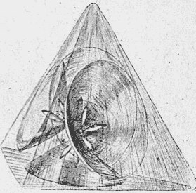

2

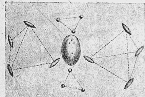

3

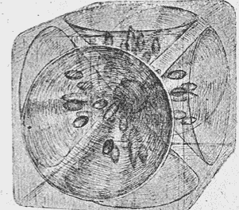

4

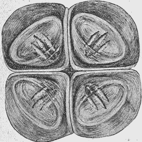

5

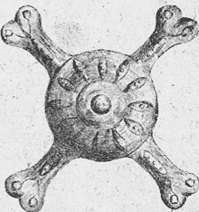

6

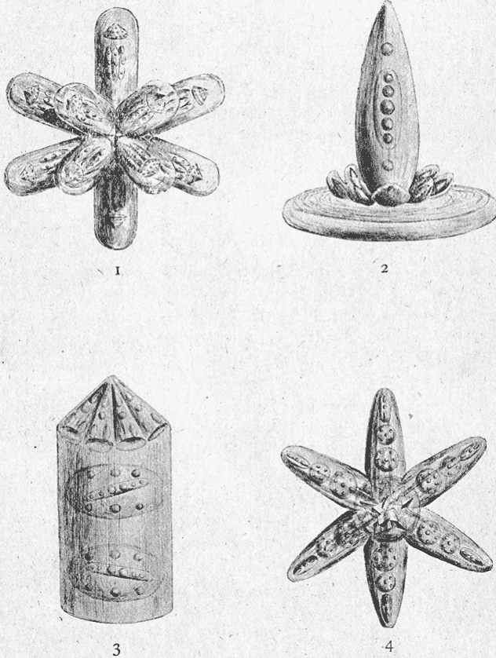

**图 5.2 和 5.3** 根据安妮·贝尚（Annie Besant）和查尔斯·里比特特（Charles Leadbeater）描述的分子结构秘术幻象。安妮·贝尚和查尔斯·W·里比特特，《秘术化学：对化学元素的透视观察》（伦敦：神智学出版社，1919年），插图 III 和 IV。

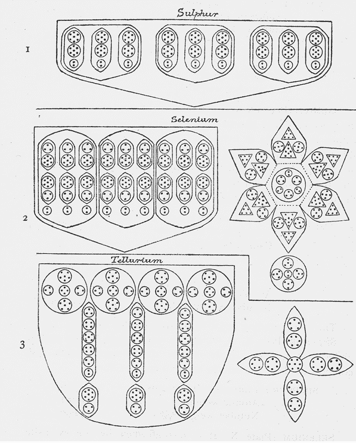

**图 5.4** 视角中硫、硒和碲的秘术结构。安妮·贝尚和查尔斯·W·里比特特，《秘术化学：对化学元素的透视观察》（伦敦：神智学出版社，1919年），4。122 第五章

姆格罗夫对殖民地的观点及其早期采纳揭示了地缘政治中的内在张力。对于姆格罗夫来说，这种连接宇宙最深处的尺度是一种方式，阐明了空间和时间的尺度，然而它也是一种地缘政治的方法。地缘政治在相同的运动中使极其细微的、技术性的以及社会阶层变得不可察觉。这种地球的新观念帮助塑造了演变，是这一故事的自然化版本，地缘政治试图改变这一点。本章的其余部分是

## 丁根（DIENG）：地质的美学

许多抵达印度尼群岛时，姆格罗夫被其美丽所震撼。这种“童话般的”特质让他想起了小时候读过的故事。色彩鲜艳、垂柳般的树树、冒着烟的火山峰、森林中震耳欲聋的哭声，都在他停留期间写给母亲的信中提到。对美的体验和对旅行的渴望在地质工作的观念中联系在一起。一当他到达万隆时，他开始前往当地的火山汤库班普（Tangkuban Peru），然后是更远的地方。由于爪哇劳动力，他游览了中爪哇和西爪哇的爪哇族和苏门达族遗迹。他的同事迪特洛（Dittloff）、维斯曼（Visman）和范·梅克斯坦（van Merkestijn）。在1926年10月的一次早期旅行中，他访问了井里迈（Ciremai），一座位于帕腾湖（Lake Pateng）附近的层状火山。火山被一个火山群包围着，这里：

姆格罗夫经常回到类似的场景，并感叹那些经历是“最美的”、“令人愉悦的”。再次爬上海拔，那些只在1200米以上生长的蕨类植物和其他植物，然后呈现出一片美丽的

地缘政治 123

后来，当他加入查尔斯·史滕（Charles Stehn）前往克拉拉喀火山（Krakatoa）进行侦察时，他们乘坐一艘小船环绕着开始喷发的火山。姆格罗夫回忆道，他们是如此迷恋喷发的美丽，以至于几乎忘记拍照。²这种有组织的、有纪律的科学观察（后来由史滕出版¹）被这种非直接见证的快感所中断了。这是姆格罗夫实地工作的美学维度：协商对压倒性体验的渴望和沉浸于新的景观，以及叙述形成它们的隐藏力量的自然史。

他的科学工作——他称之为“地质化”——以及对日本景观的美学方法之间的关系，在他1927年和1928年访问中爪哇的丁根高原以及随后在1930年发表的一篇论文中明确化。丁根位于美拉比（Merapi）和婆罗布迪（Borobudur）西北几公里处；那里是拉莱斯（Raffles）曾访问并记录废弃庙的地方。姆格罗夫于1927年11月抵达，并将其描述为“带有寺庙遗迹的平原，伟大的缩影”。他对遗迹感兴趣并不意外；正如我们从前几章所知，地质学家对前伊斯兰时代的印度教和佛教的消失文化痴迷。姆格罗夫最近读了富因·梅斯（Fruin-Mees）关于前伊斯兰王国和伊斯兰教进入爪哇的通俗两卷本历史。⁷富因·梅斯的叙述也以马来语出版，以便向马来语者普及前伊斯兰历史。丁根和婆罗布迪在富因·梅斯的书中主要作为其王国的谱系被讨论。她写道丁根建立于9世纪，并包含一张高原中心神圣印度教建筑比马庙（Candi Bima）的视图，周围被火山坡环绕（图5.5）。照片显示了没有人的高原，这种视角是从军事侦察飞行中获得，这种视角正变得日益

由于现在那令人厌恶的穆兰教不再

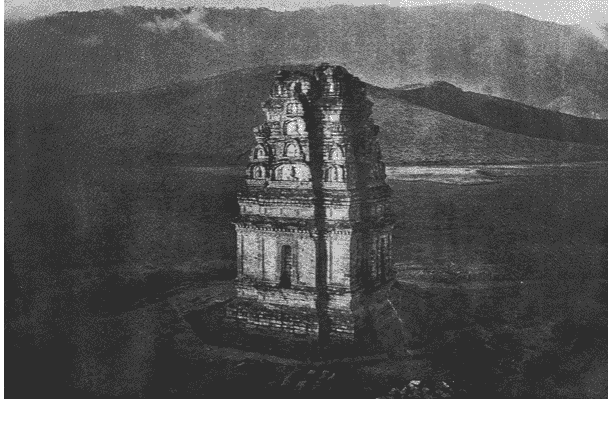

**图 5.5** 爪哇丁登高原（Dieng Plateau）Bima 寺的俯视图。这座印度教寺庙建于七世纪至九世纪之间。Willemine Fruin-Meese，*Sedjarah Tanah Djawa: Zaman Hindoe Ditanan Djawa, Djilid I (Weltevreden: Balai Poestaka, 1921)*，图版3。

这不仅仅是一个外部的、薄的外壳，许多古老的东西依然存在于甘美兰长夜的无数历史中。Ardjeno 直今天仍受到尊重，在某些地方，人们仍然向古老的佛像供花 [10] {pgt21} 从这个意义上说，印度教和佛教也作为遗迹延续，被埋没或部分可见在伊斯兰教的“薄壳”之下。罗布杜udur和丁登的纪念碑，并由此延伸出的爪哇人，都是遗迹；他们是失落辉煌的古迹，尽管并非因为废墟本身，却显得十分壮观 {pgt22} Umgrove 还引用了一种关于“爪哇作为废墟”的概念，Verbeek 和 Fennama 在1996年的 *Description géologique de Java et Madoura*（爪哇与马杜拉地质学）中阐述了这一观点，他们证明了火山是曾经的山的山迹——一种将景观及其文化视为废墟的观点。地质物质是导致浪费的过去事件的物质化；曾经生动的生物和文化已变成化石，山脉崩入大海。正如 Umgrove 后来在《地球脉动》（*The Pulse of the Earth*）中所说，自然史将过去视为遗迹的散射和堆积；这不仅是静止背景上的人类事件，更是人类与景观本身的转化与融合。Umgrove 无疑在将作为文化和自然衰落形式的废墟对比概念，与殖民的进步观念进行谈判。

在罗布杜udur，他惊叹地站着，从带他的新道路、铁路和汽车的视角审视废墟的美，这一切都是得益于承诺改善印度属地的殖民伦理政策，以及在1907年至1911年间挖掘并修复该遗址的考古部门。从事地质学可以将爪哇人与其遗迹联系起来，而与过去的联系可以让他们现代化。通过这种方式，殖民地质学融合了自然和社会历史；它是现代化，但也是对抗伊斯兰教影响的杠。

Umgrove 于1928年1月与 Reinout van Bemellen 回到丁登，带着由殖民空军拍摄的地图和航空照片。Van Bemellen 在第一天后离开，而 Umgrove 在另一天回来后离开。“这里如此令人美妙，这些品种是纯粹的享受。”23 他将景观描述为“几十个大小和形状不同的火口、巨大的古老岩浆流、美丽的深绿色湖泊、荒野的山谷和流动的溪流。”24 他将高原的新历史叙述为自然与文化的连结历史，并写道：“你几乎不知道调查这样一个国家意味着什么，问题，包括你可以站在它旁边站上两个半天，在线路上，和”

第四届太平洋科学大会于次年（1929年5月）举行，为700名科学家（许多来自应用领域的专家）展示了荷属印度群岛的科学与现代化。Buitorg 植物园的植物学和生态工作发挥了重要作用，因为它是印度属地科学研究的关键中心，提供与种植园经济相关的专业知识。到1930年，它雇佣了700名科学家。但大会还展示了新无线电技术、兽医学、考古学和火山学的发展。考察不仅涵盖了种植园野站，还前往了克拉角、罗布杜udur 和普兰姆巴南，向外国科学家强调了火山活动与印度佛教古迹之间的联系。Umgrove 被指命带领代表团前往巴达维亚湾，在那里他遇到了一些美国科学家，在两次世界大战之间经济困难的时期，他后来请求这些人提供工作。

日本军队进入东南亚并将荷兰人从印度尼西亚驱逐，而 Umbgrove 则将地缘政治发展为一种宏大的宇宙叙事，将银河历史、山脉和物种联系在一起，并以火山活动为中心。

1942年出版的《地球脉动》（*The Pulse of the Earth*）开篇章节表明，这本书并非一本狭角的专业地质书籍。他借鉴了维也纳工程师兼地质学家埃德华德·苏斯（Eduard Suess），后者通过将大量的地质研究合成为一个关于行星构造的整体图景，改变了上世纪的地球理论。Umbgrove 将他的工作与其前人的行星尺度构造尝试保持一致。Umbgrove 引用苏斯引人注目的之处在于，他不仅将苏斯视为权威，还将苏斯与 Umbgrove 对爪哇印度文化历史的接触直接联系起来。具体而言，这是通过引用苏斯引用《罗摩衍那》（*Ramayana*）实现的：“当罗摩望向海洋，它的边界与地平线上的天空交融统一时，当他疑惑是否可以在‘无量界’中建造一条道路时，正如我们望向时间的海洋，却无处看到岸边的迹象。”³0 Umbgrove 借鉴苏斯绘制《罗摩衍那》（爪哇皮戏 *wayang* 的核心文本之一）来描述深层地质时间。换句话说，Umbgrove 承认西方地质深层时间的概念被印度教宇宙论所预示。他也通过苏斯对传统的依赖，承认了传统是科学地质规范的核心。从这个意义上说，西方地质现代性是印度教宇宙论的回归，是将新事并入旧事，将苏斯这位维也纳人带入了爪哇文化。

这些开头页面指出，《地球脉动》将引导读者穿过“无量界”（The Immeasurable）。Umbgrove 表示，地质学家利用地质推理来解释水平时间尺度（深层时间）与垂直空间尺度（从微观到宏观）之间的关系，Umbgrove 解释说，这一过程就是所谓的“地缘政治的”。³¹ 他所说的“诗意”并非传统的文学体裁，而是指在现代科学已知边界内运作的地质学推测维度——只要地质学家有可用数据支持。地缘政治运作于现代科学知识之间的空间，以理解这些边缘如何相互连接和关联。它的首要原则是连通性，而连通性是“无量界”、是深层时间的基础和构造。由于“无量界”（显然）无法被测量，地缘政治的目的令人震惊：它是为了连接最大与最小、连接古老与现代、连接人体内部与宇宙。对于 Umbgrove 来说，结缔组织是模式和节奏。

“无量界”是音乐性的。黑夜转白，潮汐涨退，季节更替。他将周期性视为深层时空的结构：海平面升降，山脉形成与消亡，碳浓度起伏，银河旋转。重复指示了无处不在的模式，而地缘政治项目则是追踪这些周期如何在不同尺度上相互关联、影响或制约。Umbgrove 推理道，循环的周期无法独立发展，因此它们必须连接。他将它们的相互作用称为“复声的”，源自巴洛克音乐风格，这种风格以不断增长、复杂的和声声部为中心。自然并非由简单的模式定义，而是由相互关联的周期、不断增加复杂性和多样性的循环定义的。

他对周期性的兴趣并非偶然；这是20世纪世纪初许多地质学家的核心关注点。理解潮汐运动的周期性对于制定时间标准和航海表、确定平均海平面至关重要，而这又为确定作为海拔的地理信息提供了数据。20世纪初，像 Umbgrove 这样的地质学家思考地球旋转周期是否对其相对流体状态的地壳和地幔的形状产生影响。例如，气体理论试图理解这些流体动力学，许多地质学家认真考虑地球质量的周期性如何有助于塑造其表面。周期性对一些关注开发测量地质时间方法的地质学家来说：他们考虑了从月球和太阳周期如何定义地质年代。美国地貌学家 G. K. 吉尔伯特（G. K. Gilbert）对莱尔的“现在决定过去”原则表示怀疑，并思考是否可以假设月球和太阳周期与现在相同。如果地球的运行可能正如实用原则所暗示的那样，那么如何推导出地质年代？即使历法系统只是一种时间标准，它也包含了对可能运行完全不同的地球的偏见。因此，周期及其回归率的问题不仅是建立地球年龄的重要问题，也是开发基础地质时间标准的重要问题。

如果周期时间对某些地质学家来说是一个重要的理论关注，对另一些人来说是一个现实问题，但很少有地质学家像 Umbgrove 那样赋予其重要性。这种重要性部分源于他对火山活动和造山运动的研究。通过火山活动以及相关的抬升、沉降和褶皱事件研究山脉的形成，Umbgrove 开始理解火山是由他称为“海侵”（transgressions）的地质周期定义的。他将海侵置于其系统的中心，并试图在垂直方向上将其与上方的宇宙力量和地球内核的过程联系起来，最后在水平方向上与生物演化的地理联系起来。他对造山周期的关注使他看到这些周期与银河、气候变暖和多样化相关。

1939年，Umbgrove 发表了一篇名为《地球历史中的节奏》（On Rhythms in the Earth’s History）的文章，概述了他将要发展的一些原则。20世纪30年代，他就熟悉并赞同大陆漂移的概述，并在文宁·梅泽（Vening Meizes）的海上重力考察中对适用于荷属东印度的大陆漂移理论做出了贡献。他也熟悉将漂移的大陆和移动的与深层热周期联系起来的想法。然而，他并未确定热周期是否导致了东印度弯曲的地壳、剧烈的火山活动和地震性；与当时欧洲和美国的地质界不同，他和他的同事对该理论的解释力持赞同态度。在《地球脉动》中，他提出应该在更广阔的背景下考虑洋流；它们最终是银河旋转的对位法，因此是由未知的宇宙过程引起，或与之某种关联。

这些模糊的描述指示了所有地壳下能量的最主要来源，这种能量通过地壳及其地表一系列现象中观察到的周期性表现出来，即：地壳压力的交替减少与增加，以及密切相关的褶皱时代、造山过程和边疆地区的淹没、盆地和圆顶形高地的周期性形成、岩浆循环以及全球范围内海进海退的节奏波动、气候的脉动，以及最后——生命的脉动。³³

《地球脉动》是一个坚定的、以造山运动为中心的宇宙观和闲谈。他指责格拉包（Grabau）没有深入观察行星的反向节律，同时他还将他在爪哇火山上目睹的山脉起伏放在地球故事的核心。以此类推，他痴迷于将生物历史与造山运动联系起来，将人类历史与山脉历史联系起来。更进一步，他问道：“心理纪元（Psychozoic）——其名称源于人类当时对世界的统治地位——与一个异常密集的造山运动和冰川期重合，这仅仅是巧合吗？”⁴⁴ 通过地貌差异进行的行星分化与生物分化是不可分割的；这是行星和宇宙决定论。他正通过地球内部、其运动表面和河系，背离熟悉的国家形式或生物形式的地理决定论。在这一迭代中，火山科学是一种关于文化形成和意识的理论。“心理纪元”是一个翁布格夫（Umbgrove）广泛采用的术语，源于美国地质学家约瑟夫·勒康特（Joseph Le Conte）在19世纪末的使用，翁布格夫的同代人也经常使用该词。勒康特对心理纪元的定义显然预示了对“人类世”（Anthropocene）的尝试：“人类出现的地质意义不仅或主要在于他超凡的尊严，更在于他作为一个代理的重要性，他已经极大地且将来必须继续深刻地改变整个地球的动植物。”⁴⁵ 翁布格夫对此进行了阐述：心理纪元“其名称源于人类——这一精神和智力分化的专家——出现在舞台上并开始扩展他对世界的统治。”⁴⁶ 在翁布格夫的体系中，“精神和智力分化”是行星分化的延伸；分化是对位法，是复杂相互关系的深化，是行星从内部转化自身的能力。

这就是地缘政治方法：追踪连接星系与物种演化的节律之间的内在联系。这样做显然抵制了简化的模式，而翁布格夫的审美体系是还原论的。在他看来，使宇宙变得美妙的是各个部分之间极其丰富的关系，以及它们相互连接的节律产生了日益复杂性。巴洛克对位法恰恰表达了这一点，正如它对范贝梅勒（van Bemmelle）所表达：部分之间的关系产生更多部分，这些部分反过来产生更多关系，然后是更多部分，形成一种相互关系的级联。地质诗人处于一种不断扩张（尽管可能不可能）的搜索中，试图绘制一个复合关系宇宙中的关系节律。换句话说，即不可不可量者。正如他所说，“一个生物体的特征，”尽管他可能在谈论岩石或任何其他东西，“必须在未知的‘链接’中寻找。”⁴7

## 互补性、德国唯心主义与乌潘尼沙德

《地球交响曲》引入了一个新术语来描述翁布格夫的体系，*互补性*（complementarity）。他写道：“尽管非常奇，[互补性]让人们⁴⁸联想到婆罗门教乌潘尼沙德的某些方面。在《生命与物质》中——这是一部1943年的论文集，构成了《地球交响曲》的基础——因此他对乌潘尼沙德的尝试预示了他关于互补性的思想，以及他试图将深层地质时间与循环时间结合的尝试。⁴⁹‘在古老的乌潘尼沙德中已经找到类似的结论，在那里人类生命的问题被称为‘阿特曼’（Atman），而整个自然界中不可喻的部分被称为‘大梵’（Brahman）。古代高等文化所达到的最高智慧可以表述为：梵等于阿特曼（Atmos）。’⁵⁰”

翁布格夫通过保罗·迪森（Paul Deussen）接触了乌潘尼沙德，迪森是一位德国东方主义者，叔本华的弟子，也是尼采的朋友。迪森将尼采引入了印度教和佛教思想；他将印度哲学引入德国唯心主义，通过《乌潘尼沙德哲学》（*The Philosophy of the Upanishads*, 1906）等著作，在书中他认为乌潘尼沙德是世界哲学的创立时刻。⁵¹ 这一时刻随后在古希腊重复，接着又在康德理想主义中重复，最后在叔本华那里重复。⁵² 每一个时刻尽管在历史和时间上不同，但都基于同一个洞见：宇宙和人类意识是幻象。⁵³ 正如康德所证明，对世界的知识完全取决于时间、空间和因果关系的范畴，这些是心灵的功能，因此是施加在宇宙上的扭曲，而不是宇宙本身。自然本身除了意识的扭曲外，是不可知的。正如迪森所说：

> 整个宗教和哲学都根于这样思想（如果采用康德的语言，宇宙只是现象而非现实（‘自在自身’ *Ding an sich*）；也就是说，整个外部宇宙 . . 总是告诉我们它对于我们、对于我们的智力而言是如何构成的，而不是它们本身以及脱于我们这样的智力是怎样的。）⁵⁴

迪森认为，思想是乌潘尼沙德的核心。与其使用康德那种“自在自身”的语言，乌潘尼沙德使用了“阿特曼”一词，即行星从内部转化自身的能力。

构造学。地质学家很少直接提到姆格罗夫（Umgrove），或许是因为在战后避开唯美主义的地质科学文化中，他们对从美学或审美角度进行理论化感到犹豫。此外，不断积累的实证证据很快让他的工作显得过时，但地缘政治对地球物理的影响仍然是深远的。

姆格罗夫对荷属东印度群构造史的研究以及他与维宁·米内兹（Vening Meinez）的合作，使姆格罗夫与哥伦比亚大学蒙特地质观测的美国海洋学家建立了联系。当美国地质学家和工程师正试图开发理解海洋海底和大陆形成的新模型时，维宁·米内兹教他们如何使用重力计并寻找新的海底海沟。1950年9月，维宁·米内兹、姆格罗夫以及他们在莱顿的同事 B. G. Escher 和 J. M. Bergers 参加在宾夕法尼亚州赫希举办的“地球内部塑性流动与变形”研讨会。这是一个由24名美国和欧洲科学家、美国地质调查局、华盛顿卡内基学院以及西西子电气代表的商业利益方参加的小活动。其目的是讨论关于地球中心的主流理论，包括引起争议的对流假设。姆格罗夫主张与化学家更密切地合作，以理解地球深处的过程及其影响。

来自普林斯大学的哈里·赫斯（Harry Hess）也出席了会议，讨论与多年前维宁·米内兹教他寻找的海洋海沟系统发现相关的理论问题。赫斯将这些问题引入地幔对流问题：“目前无法证明地幔中存在对流，也无法证明它们不存在。在解释岛弧根部持续存在而又看起来并不像这种对流的情况下，这种困难使得作者强烈倾向于支持这些对流的存在。”

很大程度上基于维宁·米内兹和姆格罗夫在印度尼西亚的工作，美国科学家越来越坚信对流可能影响着大陆漂移。

几乎在近近十年后，在1962年（即姆格罗夫去世八年后），赫斯发表了他的《海洋盆地历史》（History of Ocean Basins），在其中阐述了他关于海底扩张机制的新理论。在开头段落中，他表示：“像姆格罗夫一样，我将本文视为一次地球物理学的练习。”赫斯将《地球脉动》描述为一份“辉煌的总结”，但坚持认为从中并没有得出任何新证据。但是，

赫斯误解了姆格罗夫的地缘政治；他认为这意味着奇幻、虚构和天思幻想。换句话说，这与（他对现代科学的构想）相反。正如马丁·鲁德维克（Martin Rudwick）所说，赫斯引用地缘政治“就像在为原本不可接受的推测性理论化开口”。⁶³ 将他的理论称为地质学也是一种为了在激烈反对大陆漂移的美国地质学家群体面前回避论点的方法。地缘政治让赫斯能够提出开创性的论点，但也对姆格罗夫的项目造成了损害。

赫斯的地质故事是这样的：他以一种神话的方式讲述了地球最初是45亿年前由太阳粒子形成的。一旦这些粒子转变为固体地球且其形状大致类似于现代地球，就发生了一场大灾难（赫斯强调的重点），这非常类似于维宁·米内兹关于最初“对流翻转”的起源故事。对于赫斯来说，这场灾难是对流开始在地球中心和地壳之间循环的时刻，它放大了表面与中心之间的差异，并形成了镍铁核心，在其上方有一个“原始的单一大陆”（再次类似于维宁·米内兹的描述）。他推测50%的陆地物质是由大灾难产生的。此后，海洋盆地和大陆一直落在一个粘性的腹部之上。大灾难使他假设了一个双对流胞系统的起源，其中热量上升，穿过并从地球表面扩散，然后向中心下降。这种上升和下降是海洋盆地演变的机制。他关注了大西洋和太平洋的中洋洋脊，那里最近的证据表明那里的火山随着时间的推移远离了洋脊；他提出，大灾难的遗产可以在海底远离离心的扩张中看到，它们在3000到6000公里之间旅行，最后撞击大陆并向地球中心俯冲回归。”⁶⁴

这一提议直接源于维宁·米内兹和姆格罗夫的教导以及他们在爪哇的工作，促进了美国地球物理学家接受地幔对流作为地球演化史的机制。很快，它成为了几乎所有西方地球物理学家的正统模型。框架是姆格罗夫的，起源故事是维宁·米内兹的。赫斯引用“大灾难”也并非毫无，这是一个关于毁灭与荒废的故事：现代地球的形式再次被描绘为灾难论与莱尔（Lyellian）一致深度时间过程观念之间的妥协。赫斯将毁灭与创造结合：创造性的破坏定义了地球的演化。

《地球脉动》也影响了赫斯在蒙特地质观测的同事布鲁斯·尤因（Bruce Ewing），他与莫里基层·尤因（Maurice Ewing）合作了一项为期十年的项目，利用五角大楼资助的船只，携带了“金牛犊”（四摆锤）重力计，进行地震折射测量、拍摄照片和采集样本，并在20世纪40、50和60年代对整个大西洋和太平洋进行了磁性测量。⁵ 根据地理学家学家罗纳德·E·多尔（Ronald E. Doel）、坦雅·J·列维文（Tanya J. Levin）和梅森·K·马内核（Mason K.Marker）的观点，尤因被姆格罗夫关于结构镜像海底构造的观察所吸引。他们在攻读研究生时读了《地球脉动》，并标注了关于“尼雅·拉图”（Nyai Ratu，南海女神）一章的章节。⁶ 他们认为，这影响了尤因利用当代地球物理技术来回答关于地球的问题，导致美国科学家相信板块构造理论。⁷

## 结论

姆格罗夫的工作在很大程度上被遗忘了，他在开发作为地质方法的地球物理学方面的作用也被近期的后殖民和文学发展所边缘化。对于某些人来说，地缘政治仅仅意味着一种围绕地质学的抒情写作风格。对于另一些人，它是地质学传统的一种反运动，为被排除的人开放了地质学话。对于某些人，地缘政治已成为拯救或重新回归古代科学的方式。正如凯特琳·尤索夫（Kathryn Yusoff）所引，它提供了一种几何思考的方式，打破了生物与地理、生命与物质之间的划分，根据伊莉莎白·波维内利（Elizabeth Povinelli）的观点，这种划分是构建晚期资本主义社会的基础划分。⁸ 活与死的区别支撑了可以成为商品和不可以、可以被剥削和应该被保护的常见层级区别。地缘政治为某些理论家承诺拒绝这种划分。然而，姆格罗夫不仅提醒我们地球物理学在现代地球理论中发挥了关键作用，还提醒我们地理与偏见之间关系的根本问题一直是一个持续、令人困扰且未解决的关注。姆格罗夫的地缘政治与现代地球物理并非对立；事实上，它从底层以关键方式塑造了后者，作为其精致的地球化学底层、毫无掩饰的、独特的美学科学。

## 科学与神秘主义中的接近与距离

接触的建筑 · 脉冲、哔哔声、刮擦声、一个鸣响的宇宙、连接、触碰：在地球尺度和心灵尺度上流动的重复。我们自身与地球内部之间的距离本质是什么？它延伸到多远？它能变成完全的即时性吗？跨越尺度需要努力。即时性有时是一种亲密关系的梦想。火山科学家们有时会共享这种幻想：克服世界的物质，克服它在万物中创造的、那种无情的距离；这种梦想是变得超越物质，让身体内部与地球内部相互坍塌，让彼此包含在对方之中，微观世界折叠进微观，让它们之间的门槛由行星脉冲和通过充满活力的、喧闹的地球发出的波动所跨越——这片从未沉默的地球，总是处于一种无法承载、无法把握的过剩状态。波动可以克服距离；它们可以创造即时性；岩石的亲密是这种梦想。惊讶的是，建筑成了第一个停靠站：观测站建立在火山边缘，成为人类用以实验“人体是什么”以及“人体如何与地球连接”等想法的工具。观察意味着感受，感受意味着缩短距离，在拉近火山的同时，保护好观察者脆弱的、人类肉体和器官；这是作为冥想和神秘迁移的科学，是岩石的交融。这种科学传播了。那里的观测站建筑产出了工具和技术——视觉机器、听觉机器、绘图机器、测量机器、通信机器、网络机器。机器幻化出了火山内部、震颤、如钟声般的气味、波动和脉冲。一个混沌的地球，在说话、作画，有时在尖叫。观测站遍布山丘，它们的机器流经这些村庄，并在那里被拾起并重塑为关于“与火山并存”以及“位于火山上的人体”的新愿景。我们在所有的曲折和变化中继承了这些愿景。

在20世纪30年代的印度尼西亚，火山观测站首先建立在火山上，以保护上坡的种植园和富有的殖民别墅。¹ 科学家们仔细考虑了观测站建立的位置，使其既足够靠近火口以便进行观察，又足够远以保持安全，创造了一个比最初看起来更困难的问题。多近才算太近？喷发期间何时是安全的？在默拉比火山（Merapi）上设计的一种解决方案是在偏远的地形的山顶建立，那里可以清晰地看到火口。这些结构是带有茅草屋顶的竹木小屋，通过电报电线与低地地区的其他小屋和办公室相连。位于马德隆（Maraton）山丘的一个观测站被证明在视野上是个好主意，当1930年火山喷发时，喷出的沙子、灰烬和岩石冲破了堤岸并被冲走；内部的地震仪被毁了。1930年喷发造成的破坏导致了一系列关于距离与观察之间张力的科学实验；这些实验还人乎意料地涉及关于人体和地球是由什么构成的的问题。

关于距离、物质的意义以及人体和地球的物质组成的想法，随后从火山观测站传播到各个社区，原因很简单：建立观测站的区域非常繁忙。观测站靠近村庄、农田、矿工和种植园工人。身在那里意味着科学家生活在这些社区中，并与他们进行交流。当地人帮助建造观测站；有些当地人甚至操作仪器；另一些人变成了监测员。观测站改变了村庄，因为它们是这些海拔首批通电并配备电话、地震仪、无线电和电报的建筑；换句话说，它们是技术的卫，，将地的技术引入到农村边疆，通过远距离发送前所未有的快速电报和无线信号将山谷与低地连接，坍塌了火口与城市中心之间的距离。火山活动通过纸上的地震仪刮擦痕、用于化学分析的玻璃管和瓶、温度计、望远镜和照片变得变得清晰可见：在观测站所在地开启了一个火山通信的新世界，改变了关于地球如何交流的想法。

但观测站也融入了环境。它们无处不在且具有伪装性。它们的建筑看起来与乡村村庄房屋非常相似，拥有竹墙和土瓦屋顶。在后的日子里，它们被重建得像荷兰中产阶级的度假别墅（图6.1）。科学家们和家人在那里睡觉、吃饭，并拍下自己放松的照片（图6.2）。洗好的衣服挂在门廊的临时晾衣绳上晾干（图6.3）。在某种意义上，它们是社会编舞的无形建筑，无处不在地在火山与与其生活的人之间创造了新的空间和时间亲近的形式，坍塌了距离并压缩了时间。

当然，火山坡上的社区长期以来发展出了当地的火山监测形式。祖先的坟墓、圣山、仪式路径和圣石都与理解、预测和监测火山活动有关。例如，位于默拉比火山上的Plawangan观测站就建立在Turqu山旁，那是一座许多神灵居住的山丘。Pasar Bubar的高原是一个神灵晚上访问的灵市。Jakah观测站的哨所位于通往祖先神灵墓地的路上。转变为科学观测站的山丘和岬长期以来一直是火山活动相关的当地神灵的场所。火山活动也可以通过梦境和恍神进行预测。当地的监测传统与低地雅加达塔（Yogyakarta）和苏卡尔塔（Surakarta）宫廷政治事件进行对话。因此，占卜充满了当地、政治和神秘历史，这些历史不可避免地遇到并在某些情况下被20世纪30年代观测站出现的新监测方式所转化，同时也转化了它们。在爪哇丰富且充满故事的精神地理中，科学家们就他们究竟在监测什么不同的概念进行着。火山是地球的边缘

## 第一集：恩霍文的心脏 · 廉姆·恩霍文（Willem Einhoven Sr.）于1860年出生在三宝，那是爪哇北岸的一个港口城市，他的父亲在那里担任医生。像许多在殖民地的欧洲人一样，廉姆回到荷兰学习，并在乌特勒支完成了中学和医学学业。1886年，当他仅25岁时，他被任命为莱顿大学的生理学教授。十九年后，在这一宽敞、布满仪器的实验室里，他正试图与技术人员解决一个问题。他们成功设计并制造了一台心电图，能够以前所未有的精度放大并记录心脏发出的电脉冲。第一次，健康和疾病患者的心跳可以进行准确比较。全新的诊断机会随之出现；心律失常（心跳不规则的状态）可以被精确识别并与生理原因精确联系起来。但问题是这台机器需要五个人操作；它占据了两个房间并由巨大的电磁铁驱动。如果患者生病了，往往无法移动，如何让他们来到他的机器旁呢？他需要反过来安排，把机器带给他们。莱顿最近安装了第一批电话，1906年，恩霍文通过埋地下的电缆将他的心电图连接到一里外的大学医院。在排除了干扰后（因为电话网络中的声音会干扰心脏信号），为患者准备了一把椅子，让他们可以将手脚浸在盐水桶里（图6.4）。导致心脏收缩（收缩期）的电脉冲通过电缆进入实验室，进入恩霍文的另一项发明——字符串电流计：一种悬挂在巨大旋转电磁铁内部的薄金属镀层细弦。9 当心跳到达这根弦时，它们干扰了弦的自然振动，就像手指拨动竖琴一样。该机器将弦运动的阴影投影到感光板上，感光板像摄影机一样定期机械更换。爱因霍芬（Einthoven）将结果称为心电图，因为心跳变成了一种像电报一样通过基础设施传输的信号。10 他设想将椅子与海牙、阿姆斯特丹及更远地区的医院连接起来，患者可以从全国各地将心跳信号传回他的实验室进行分析。11

到1912年，通过与私人仪器制造商的合作，该设备变得足够小巧，以便了直接运输到医院的实用性。12 与此同时，爱因霍芬还想象了这种独特的线式电流计在研究心律之外的其他可能用途。在其他地方，爱因霍芬设计的线式电流计已在英国、俄罗斯、日本和欧洲大陆设立，其中包括古格利埃莫·马可尼（Guglielmo Marconi）的无线电实验室，它们被用作电报信号的读取器。战争的地缘政治随后介入，为爱因霍芬的发明开辟了新道路。

# 爱因霍芬的儿子威廉·弗雷德里克·爱因霍芬二世

爱因霍芬的儿子威廉·弗雷德里克·爱因霍芬二世（Willem Frederik Eindhoven Jr.）在德尔夫特学习电气工程，并在实验室协助父亲。他建议设计一种用于荷兰印度群岛无线通信的电流计。

印度群岛内的线路通信最早于1856年建立，到1900年，爪哇城市已有两千电话用户。正如鲁道夫·马拉泽克（Rudolf Mrázek）指出的，无线通信在促进殖民地现代化理念方面发挥了至关重要的作用。然而，无线通信直到1918年才成功，即便如此，跨距离通信也受到天气和竞争无线信号的干扰。对于老父子来说，电流计无与伦比的灵敏度可以通过提供更精确的接收器来连接印度群岛。这在战略上也有重要意义，因为第一次世界大战期间，与印度群岛的电报连接变得政治上复杂，因为电缆网络需要在英国领土新加坡建立基站进行传输。因为由于荷兰在冲突中保持中立，威胁在于他们无法再依靠电缆网络，这实际上切断了东印度群岛与荷兰之间的通信。爱因霍芬父子提议开发改进的无线设备以绕过英国基站的地缘政治，爱因霍芬二世提出的技术解决方案是将电流计封装在真空中以进一步增加其对空中信号的灵敏度。

爱因霍芬父子的项目是秘密，实验室工作在关门后进行。经过“几年的艰苦努力”，在1917年，爱因霍芬二世带着真空线式电流计登上前往爪哇的船。抵达后不久，父子俩对其进行了测试，并成功通过莱顿的一根六毫米接收器弦进行了通信。老爱因霍芬解释说，通过对发射站的“其他振动”进行“精确调谐”，一系列点和划被成功地投影到移动的纸条上。爱因霍芬父子可能克服了地理障碍，并重新建立了殖民地与宗国之间可靠的连接。他们正在使用用于视觉化人类心跳的技术来视觉化远处的声音。人体以及荷兰与印度群岛关系的地缘政治，与线式电流计独特地联系在了一起。

值得注意的是爱因霍芬父子的术语。对于老爱因霍芬来说，“调谐”（tuning）一词具有技术含义：它意味着消除干扰并增加电流计弦的灵敏度。它意味着协调入射波的振动与电流计上弦的振动之间的频率，就像接收机调谐无线电台一样。调谐需要找到弦接收来自海外脉冲振动的频率。将弦缩短至仅六毫米长使其自然振动频率增加到每秒40,000次。相比之下，来自12,000公里外的万隆的输入信号是一个波长7.5公里的波；其频率与弦更短、更快的振动截获，从而产生摩尔斯码的长划和短划。老爱因霍芬对调谐的含义隐含暗示了非常重要的一点：通过在真空中使用六毫米弦的地理特征来实现时空压缩。调谐有望绕过地缘政治力量。从技术上讲，这也意味着管理电流计弦的特性，以及将弦拉伸到精确长度而不折断或松动的精度，使其能够以恰好的速率振动以记录信号。通过操纵笨拙的

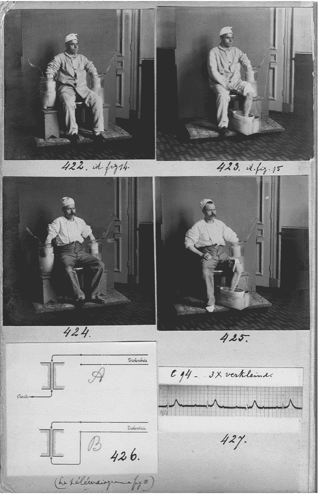

422. d. fig.14

423. d. fig.15

| Class | A | C 14 - 3x verkleind |
|---|---|---|
| | B | 426. |

(生理电图 fig.)

图 6.4 通过盐水桶和电报线连接到威廉·爱因霍芬老士心电图机的患者。莱顿生理实验室照片集“diapositieven II”中的一页。物体编号 P11636-30。由 Rijksmuseum Boerhaave 感谢。

图 6.5 通过盐水桶和电报线连接到威廉·爱因霍芬老士心电图机的患者。（注：OCR显示图 6.5位于第170页）。

然而，Weichert地震仪很容易发生机械故障。范·贝梅伦写道，它无法“听”；它的敏感性不足以记录山体滑坡或塌陷引起的远处小震动和颤抖，无法记录可能与斜坡上村庄碰撞的岩石。Weichert 更擅长记录如火山和构造地震等较大的震动。这种机器灵敏度的缺乏实际上让观察者处于盲目状态，并与火口保持着距离。范·贝梅伦推断，因霍文制造的放大器和发射器可能会增强 Weichert 的灵敏度。在他看来，圈线电流计变成了一个更完美的“耳朵”，通过这种方式，灾难来临的预兆就可以被记录下来。敏感度的提高意味着再次克服距离，而克服距离意味着缩短了现在与未来、火口与斜坡之间的延迟。如果仪器能够调节得恰到好处，黑暗隧道中的观察者就能看到、听到，并继续根据远方火口的事件来对人口进行编排调度。

因霍文二世在日本占领军的权威下工作，并获得新任矿务主任马塞赫先生的许可，与范·贝梅伦合作。他们开始致力于将为圈线电流计开发的电磁铁与悬挂移动线圈相结合，后者可以放大地面的微小运动，并触发铃铛和红灯。随后可以向蒙蒂兰拨通电话，斜坡上的警报随之响起。范·贝梅伦写道，“溢出气体的隆隆声、岩边的叮当声、雪崩的轰鸣声、岩浆穹随质量变化的共鸣音调”，这一切首次在地震仪纸上被见证了；曾经在远处不可见的事物呈现出了新的分辨率。观察不再需要亲眼看到或听见火山。科学家们通过地震仪纸上的划痕，从地道的黑暗中被带到火山口，正如爪哇岛通过空气中的脉冲被带到莱登一样。地震仪是跨越空间并延伸未来的延伸。通过预警信号的中继，它还将火山口的事件带到五公里外的斜坡，并在事件发生之前。因霍文二世的短波地震仪为他们调准了这一切。

当范·贝梅伦和因霍文二世于1943年5月在巴达丹的地下道内安装地震仪时，梅拉皮火山的活动已经平息，火山从未爆发。因霍文二世的地震仪消失了，从未再次被用于其他记录用途或进一步开发；战争的地缘政治再次干预，这次是中断了因霍文二世对亲近性的幻想；他被关留并于1945年死在战俘营中。功能不全且笨重的 Weichert 留在地下道里，留了几十年。

# 油田中的心跳

圈线电流计在油气勘探中还有另一个甚至更奇特的“后世”。它被频繁用于将数百磅炸药爆炸产生的冲击波转化为纸上的墨水划痕。教授们阅读盐丘的地震图，总部位于德克萨斯的 Petty 地物理工程一直是使用圈线电流计进行此类目的的前沿，并在1918年开发了了自己的技术版本。1954年，与 Petty 地理合并并成为全球最大的地球物理勘探公司之一的 Robert H. Ray 公司，在一份油气勘探行业杂志上刊登了一份广告，上面印有因霍文老士的照片、一张心跳波图像和一个心脏的轮廓。大字字体写道：“地球也有心跳！” 随后是解释性文字：

> 因霍文博士是现代心电图仪之父，这对人类受益巨大。地震仪记录了地球心跳的准确图表，其在石油工业的发展中对人类也大有益。
>
> 我们，Robert H. Ray 公司，记录地球的心跳或地震反射已经有20年了，相信这些丰富的经验使我们都成为了了诊断师

Robert H. Ray 公司不仅理解他们对医学诊断的负债之情，还意识到这项技术使人体也变得同样易于判读。这可以被理解为一种诗意的隐喻，或者更世俗地说，是石油工业对一种备受推崇的诺贝尔奖得主诊断手段的兼并。但承认因霍文老士的意义远于此；他们还承认地震仪通过相同的信号代表了人体和地球。他们消解了身体内部与地球之间的差异；这是对更古老的理念的召唤——即包含在人体微观世界中的宏观小宇宙，而这种理念竟然是由一家化石燃料勘探公司所阐述。

# 第二集：Kejawen（爪哇文化）

《自我完善》（Mawas Diri）杂志在20世纪70年代到90年代间于雅加达出版（图6.6）。它将灵性与哲学、民族主义问题相结合，并将以爪哇为中心的历史、印度教和佛教研究与政治历史及个人成长融合。哲学家杰尔达蒂·苏帕贾尔、日惹苏丹的顾问以及加加·马达大学的讲师是常驻作者。他还是爪哇文化（Kejawen或Javanism）的思想家，这是一种根于神学运动和20世纪初民族主义革命的族群民族哲学。爪哇文化在苏哈托时期（即70年代和80年代）蓬勃发展，当时它获得了政府的官方认可，被视为一种 `kepercayaan`（信仰/信仰体系）。苏哈托个人支持这一运动，1970年，苏尔卡塔有近一万五千人报告是*信仰*的成员。扬·巴克在1973年的一份记录列出了印尼西亚的二十八种 `kebatinan`（内在灵性），其中许多与现代主义接轨。但强调，爪哇文化不是一种宗教，而是一种信仰体系，因此不与宗教组织竞争。当某些做法——如祖先崇拜、仪式舞蹈和供品——被框架化“传统”时，它们为自己开辟了空间。这吸引了苏哈托和他的政权，该政权主要由爪哇将组成，他们致力于将爪哇文化认同作为国家认同的基础。布吉人在船上养公鸡以警示恶灵和幽灵的存在；巽达人说，如果公鸡在晚上鸣鸣，早上就会有一个怀孕的处女。苏帕贾尔写道，一位朋友对爪哇族群认同以及对爪哇历史的浪漫化想法。K.·苏帕贾尔在1990年发表在《自我完善》上的一篇名为《鸡叫作为热线电话的指示器》的文章，从爪哇文化的视角讨论了亲近性、距离、技术和身体的主题。在他通俗而幽默的文章中，苏帕贾尔主张鸡叫——这种遍布印尼西亚城市和乡村生活的现象——是与神进行神秘交流的线路。他写道，“热线”是“天地之间精神交流的手段”。像吉卜利（（加百列）这样的天使也使用热线；在斋戒节之夜（圣洁夜）用于与天堂交流的梯子是热线，基督教圣灵降临的日期也是如此。苏帕贾尔详述了在印尼西亚传统中，鸡叫预示着精神健康或超自然力量的存在。例如，万隆的一座教堂甚至是鸡的形状，因为鸣叫的公鸡是“圣灵降临的信者”。苏帕贾尔写道，一位朋友曾向他推荐冥想的最佳时间是清晨当

鸡鸣声和谐共鸣，热线便在这个世界与“现实世界”——上帝的世界之间诞生了。“鸡鸣，”他叙述道，“这是一种摆脱了魔力、鬼魂、恶魔和各种魔法影响的物质。”它是物质世界与非物质世界、神圣与世俗之间一种字面上的、电话式的连接。

人们可能认为，引入电话仅仅是一个方便的比喻；但事实远不止于此。这条热线是将精神生活构想为一种技术的模型，也是一种从精神上理解现代技术的方式。这样做使得鸡鸣和电话在趣味性上清晰地被呈现为非凡的神秘设备。如果将它们斥为比喻，就会忽略它们在使现代技术和物质世界具有独特意义方面所实际发挥的作用。Kartusodirdjo 不仅仅是将电话的逻辑应用于电话相关的物品，他利用鸡鸣的意义并与现代通信技术相结合，直到它们产生裂缝，揭示出无法预见的感知和赋予意义的能力、创造和连接世界的能力。此外，鸡鸣电话并非完全新奇。我们把民间和宗教叙事引入现代电话世界；我们通过暗示这些信仰一直处于技术进步的前沿，将许多面临因技术进步而变得边缘危险的民间信仰从历史的垃圾桶中拉出来。此外，鸡鸣预示了电话。

收音机和地震仪也被用作神秘体验的基础。然而，爪哇族神秘主义（Kejawen mysticism）实际上并非关于对神性的直接体验；相反，它完全专注于技术中介如何促进灵性。在火山上，爪哇族神秘主义者甚至将火山科学家在天文台引入的相同技术作为他们自身神秘交流的机制。

# 肯宁加的脉动

Keningar 位于铺装路的尽头，在印度洋上方一千米，距离巴巴丹（Babadan）天文台四公里。该村庄早在1931年天文台建立之前，那时经常受到保护。我在2016-17年在那里，之后也曾。Keningar 曾是森林，然后是梅拉皮山（Merapi）的山，距离约四公里。火山碎片形成的河谷位于村庄南北两侧，近七十个家庭住在一个由深色火山岩覆盖的房屋群中。狭窄的小巷连接着水稻、烟草、辣椒和耐用蔬菜的田地。一些居民担任手工矿工，从河谷中提取火山石和沙子。白天，一辆卡车穿过村庄，运走采出的物质并将其带往东南亚的沙子贸易。

Suparno 出生于1972年；他在路口几分钟程的立伊斯兰学校完成了中学教育。当他二十岁时，娶了来自东爪哇望岸（Banyiwangi）的 Anik。他们住在从父亲那里继承的二居室房子里，他的父亲一辈子都住在 Keningar。Suparno 的父亲在2000年去世后，Suparno 的母亲 Yoni 与他们住在一起。Suparno 有三个孩子；长女 Dewi 就读于 Suparno 曾读过的同一所中学。她很少离开 Keningar，从未离开过爪哇岛；每年会有几次，正如他所说的那样，“下山”到低地地区的城镇和城市。他只去过几次雅加达。Suparno 的邻居也出生于 Keningar 或嫁入 Keningar 庭。白天，他在离家短程步行可达的三块地上种水稻和辣椒。晚上，他经常在客厅招待客人，或者出去拜访朋友。

一天傍晚，他邀请我进客厅给我看一些东西。我到达后，他的母亲请我喝了咖啡。我等 Suparno 翻找柜子并带着他收藏的抛光石头和水晶体回来。他把一个黑色丝鹅绒袋倒在桌子上。有些石头还没有固定在银色环托上，有时，他说，他会花空闲时间打磨它们的边缘以贴合环托。有些石头是乳白色且光滑的，带有不同的纹理；其中一块是黑色的、小小的且呈磨光面。有些是玉石、石英和玛瑙。他的玉石最贵，来自婆罗洲，花费了 200,000 印尼盾，约相当于养家支付账单的两个周的收入。他解释说，每块石头都具有不同的属性；它们影响健康，可用于冥想和祈祷；有些能拉近人与距离或推开他人，有时还会带来好运。我追问关于它们功能的更多细节，但他回避回答，并压低声音直到几乎听不见的耳语。他正在告诉我一些我无法理解的秘密，而且，是时候见 Santos 了。

当我喝完那杯苦黑咖啡时，Suparno 骑着他的本田摩托车到了房子前面。我感谢他的招待，并和 Suparno 一起坐在摩托车上，在夜晚穿过稻田。梅拉皮山被银色的云层遮挡，我们沿着狭窄到汽车无法通过的旧砖路，穿过竹林和椰子林，进入了一个河谷，河谷穿过了一座国家电信塔的底部。在那个高度，手机的蜂窝数据接入非常不稳定，直到2016年数字手机都很稀少。几乎没有人拥有个人电脑。电视很常见，通过固定在红瓦屋顶的几只生锈卫星天线显示当地和国家节目。收音机很普及，第一台接收机早在1931年就进了村庄。政府工作人员比农民富一点，但他们退休有养老金，而农民要一直工作直到子女供养。有时 Santoso 会接到来自雅加达商人朋友的电话以寻求建议。我们到达几分钟后，Suparno 的表弟加入了我们；他年轻，未婚，在附近一家经营大型机械的沙场工作。

当我们靠近 Santoso 家时，我们首先转进一条小巷，然后进入一栋绿漆房子前的一条窄车道。Suparno 推开前门，说了几句，示意我跟上。我坐在一个铺着塑料膜的沙发上，那是一间薄荷绿墙壁的客厅里。一面墙上贴着一张克尔白（Kaaba）俯拍照的垫，另一面墙挂着一幅巨大的金鱼油画。一个裸露的灯泡挂在房间中央，Santoso 的头从帘后出现，他坐了下来。他戴着一个大号深红色石头戒指，就像丝鹅绒袋里的其中一个一样。

Santoso 出生于苏门答腊，十年前（在他五十多岁时）和妻子 Sutri 一起搬到了塔拉曼（Talaman）。白天，他在开车几分钟车程的市场里当一名鞋匠，他在那里每天赚取几千卢比，以补充他二十年仆人工作的国家养老金。他的妻子也在市场工作，他的孩子还住在塔拉曼。晚上，他为他的（主要是男性）客人提供占卜、精神指导和情感咨询。许多人来自附近的村庄，像 Suparno 这样的农民、矿工或在当地办公室工作的公务员。

Suparno 告诉 Santoso 我对了解 Kejawan（爪哇传统）感兴趣。该地区的当地农民和工人声称他们修行这种信仰；它通常被称为神秘主义、`kebaitan` 或 `kerifan lokal`（地方智慧）。在与 Kenaring 相邻的村庄有一个私人爪哇图书馆，阅读小组会在那里参考爪哇出版物和占卜手册。例如，老年人和年轻村民会一起朗读《Puisi Kejawen》（爪哇诗歌）（它在泗加达出版，包含了诗歌和精神咒语）。

数术、占星术、天文学、传统医学以及历法是修行 Kejaven 的爪哇岛老年男性所咨询的对象。加加·马达大学 Suwardi Endraswara 著的《Agama Jawa: Ajaran, Ajaran, Amalan, dan Asal-Usul Kejaven》（爪哇教：教义、实践与 Kejaven 的起源）以及加加·马达大学 Suhardhi 著的《Manekung di Puncak Gunung: Jalan Keselamatan Kejaven》（山顶祭品：Kejaven 之路）等专著，解释了 Kejaven 作为一种内在的爪哇民族形而上学的历史和意义，可以在当地的小书店和大型商店中找到。在雅万加达和苏拉卡塔，小群 Kejaven 信徒在当地导师的鼓励下聚会，前往马特拉姆时期的祖坟进行朝圣。Kejaven Maneges 小组出版了自己的专著《Ajaran Kejaven Maneges: Agama Asli Jawa》（Kejaven Maneges 教义：爪哇原始宗教），详细阐述了与伊斯兰教之前的马六白特王国的谱系联系。在 Kining 或 Badaban 附近的其他村庄，遇到声称以不同程度投入修行 Kejaven 的男性并不稀奇。Santoso 就是其中之一。

Santoso 解释说，他对 Kejaven 的理解这是一种关于交流与传递的哲学。一切万物都是交流的，无论是言语、石头、火山还是人。重要的是学习人或事物的“频率”；频率并非物质，它们是穿过并赋予物质以活力的能量波。他用雅万加达五十公里外的一个无线电台做了一个比方：波浪无处不在，我们沉浸其中，但在我们“调谐”它们之前，我们无法听见它们。所有生物都在广播，并可以学会调谐它们的信号。他解释说他认识 Suparno，并且会在 Suparno 不需要叫他的情况下与我们一同到达。后来，Suparno 告诉他，他和 Santoso 经常通过这种方式交流，不需要手机，而是通过“调谐”。

我问 Santoso 交流源自哪里，又构成了什么。他解释说能量是从心脏发散的。他使用的术语“mata batin”（心眼）也意味着感觉或直觉。通过训练自己去调谐朋友的心，他们不再需要依赖国家或私有的电信基础设施，比如 Suparno 和我在通往 Santoso 家的路上路过的巨型电信发射塔。那些横跨稻田并延伸至爪哇火山山脊两侧的红白高塔并非为他存在；它们不是他的基础设施。心脏是它自身的、优越且独立的设备。通过“心眼”，他可以在一天的任何时候知道 Suparno 在哪里。Suparno 提到，Santoso 有一个习惯，知道他前一天做了什么；他曾解释过，Santoso 知道 Suparno 在为女儿的学费担心，而 Suparno 并没有提起。Santoso 还能直接与远方的人交流，雅万加达和苏门答腊的朋友们也会向他“调谐”。“心眼”可以克服距离并创造出新的亲近形式。Santoso 的实践与 Kartosudedjo 的公鸡鸣产生了共鸣，因为它们都是对直接交流的幻想，尽管它们自身也依赖于交流媒介。无线电的调谐为身体提供了一个比喻，正如公鸡鸣是将公鸡视作电话的愿景。

Santoso 继续说道，心脏并非向一个方向广播。换句话说，它不是在无线波上传输的广播节目。相反，它更像是一个热线节目。这类节目通常在 Kiningar 的晚上听到，当时人们将他们的接收机或手机调到这些节目上。在美国乡村音乐、爪哇甘兰和印度尼西亚流行情歌之间，当地来电者会带来简短的讨论、提出请求，或只是打电话打个招呼，提到他们的村庄，并向朋友问候。

这就是 Santoso 的 Kejawan 神秘交流哲学的模型——热线电台节目。如果人们能调到正确的频率，心就可以对话。但在这种模型中，调谐并非一个物质的、基础设施的过程；它几乎不是物质；但它有实体，它是一个东西，是由身体构成的。它体现了 Kiningar 人经常描述的“神秘”——即处于物质与空间边缘的事物。因为交流是神秘的，它不受传统施加的时空阻力和摩擦的限制。Suparno 和 Santoso 可以在不需要中介的情况下相互联系；他们可以绕过技术、基础设施以及他们没有的金钱，仅依靠自己的身体。他们不需要手机的脉冲或国家建造的高塔；他们拥有自主权和亲近性，拥有对距离的力量。Suparno 和 Santoso 的神秘主义通过 Einhoven Jr. 和 van Bemmel 试图从火山中记录的那些脉冲克服了物质世界。

Suparno 正在学习 Santoso 的技巧，一个月前，Santoso 要求他进行长时间的苦修和冥想。他花时间在自己的稻田里学习如何调谐他工作了一辈子的稻植物的频率。这让他能更好地理解它们的需求，反过来增加产量。它使他能够与动物交流，包括生活在田里的老鼠和青蛙，它们有时会变成害虫。练习之一包括与一只爪哇蝎子冥想；其目的是用“心眼”征服蝎子并让它放松。他曾对公鸡进行过类似的练习。对于 Suparno 来说，调谐也是一种自我控制的精神技术。Santoso 的对讲机让这种悖论的情况变得格外显著。在 2010 年爆发期间，Kining 的居民被迫疏散了六周。这使他们离开了田地和生计，被迫在蒙蒂兰的难民营中依靠捐款生存。

## 第 3 集：METAXIAN 的波

我去万隆的火山质质害减灾中心会见了来自法国开发研究院（IRD）的法国地震学家 Jean-Philippe Metaxian，那里负责协调印尼的火山监测工作受人监管。他曾主持一个名为 DOMErapi 的多年项目。该项目的目标是研究梅拉皮火山（Merapi）的通道和穹顶系统。¹⁴⁹ 然而，他的火山科学家和工程师团队正在进行研究，但地点不在万隆，而是在雅加达梅拉皮火山台的一间混乱的、仪器驱动的办公室里。他解释说，DOMErapi 是印尼和法国政府之间的合作，他们的团队会将数据传输给印尼火山科学家，以换取进入火山权限。他解释道，法国政府将梅拉皮视为一个活的实验室：它是独特的，因为它是世界上最活跃的火山之一，而且周围居住着密集的人口。虽然法国本土没有类似的火山，但在法国管辖地区有很多——例如索弗莱尔火山（Souffffler）、皮埃火山（Plee）和福纳火山（Piton de la Fournais）。但那些火山并不频繁爆发，因此梅拉皮成了他们的替代品。理想情况下，他们从梅拉皮中学到的经验之后会被转移并应用到这些岛屿上。¹⁵

万隆的火山学主任要求梅塔西扬（Metaxian）在万隆而非雅加达指导项目，梅塔西扬并不理解其中的原因（但他怀疑这一决定是办公室政治的结果）。当他在万隆山丘一个富有的殖民社区的租屋里解释这一点时，那栋别墅是典型的 1920 年代热带现代风格，万隆大部分建筑都是这种风格，也是范贝梅伦（van Bemelen）和因霍芬（Einhoven）可能居住的房屋风格。我们吃着拉斯萨尼亚，坐在安静、通风的餐厅里，餐厅四周由弧形玻璃和百叶窗组成，窗外是后花园里的榕树和椰子树。修剪整齐的木质树篱以现代主义绘画的几何感点缀着这片热带景观。

梅塔西扬解释说，作为世界上许多火山观测站的地球物理学家，他的工作长期一直受到地缘政治力量的影响。法国国家监测法国以外火山的事实，意味着他们有时处于爆发线的最前沿。除了促进本国的国家科学利益外，法国火山学还受到冷战后国际发展和援助政治的推动，这些通常是在前欧洲殖民地。梅塔西扬描述了 1999 年厄瓜的一个例子，当时他在国家火山观测站工作，而国家银行系统崩溃了。苏克（sucre）处于恶性通胀的边缘，银行存款被冻结；银行纷纷关闭，马瓦德（Mahuad）宣布了紧急状态³⁵¹ 大规模游威涌上街，与此同时，位于基多西方的皮钦查亚火山（Pichincha）开始爆发。梅塔西扬解释道，“人们对马瓦德的信任破灭了，他有美国的支持。”观测站工作人员和政府内部开始担心爆发将进一步动摇国家局势，部分是因为他们资源太匮乏，无法实施有效的灾害管理计划。危险在于，失败的疏散可能会进一步激怒民众并动摇国家。梅塔西扬说，很快，神神秘的美国人开始出现在[国家]观测站的走廊里。”法国大使弗朗索·古达（François Goudard）请求梅塔西扬带他去火山进行调查。梅塔西扬带着一名法国校上和 1RDD 主管前往火山，在此期间（他怀疑），他们一直受到美国秘密特工队的跟踪。不久后，法国科学家突然且费解地被排除在关于爆发的科学会议之外；只有美国人和厄瓜多尔人可以参加。1999 年全年到处都有爆炸，但最终没有发生大规模爆发，2000 年 1 月，马瓦德在军政府政变中从皇宫逃亡³⁵² 政府的更迭让民众宣泄了对美国及其在该地区支持傀儡政权历史的不满；结果是，美国军事基地很快被迫关闭，外交官被遣返回国³⁵³

被基多拒之门外，梅塔西扬搬到了加拉帕戈斯群岛达文（Darwin）的科学工作人员。他解释说，当一座火山爆发时，科学家们跑向海滩将脆弱的乌龟带到安全地带：“他们必须用手捡起来，有时它们太重了，需要两或三个人。”他在加拉帕戈斯群岛的目的是更新监测方法并建立新的地震站，但用他的的话，观测站“充满了间谍³⁵⁴ 他认为，美国人在被厄瓜多尔逐出后，正利用科学间谍进入该地区。美国军事基地自第二次世界大战以来一直位于加拉帕戈斯群岛，但当他们被赶出去时，“毁掉了基地，撕掉了柏油路，粉碎了一切，”使其对厄瓜多尔人毫无用处。他怀疑美国和其他结盟的科学家正与情报机构合作。他告诉我，一位拥有行政权的澳大利亚科学家曾对质并质疑他在加拉帕戈斯群岛的存在，不久后梅塔西扬的项目就关闭了。岛上的监测设备从未升级过。

在梅塔西扬讲述这个故事的第二天，我坐在他租来的宝马汽车副座上，前往万隆的观测站总部。我们路过了从茂密山丘中凸出的网球场和白色别墅，开始下雨了。当我们穿过帕苏帕蒂桥（Pasupati Bridge）时，可以看到下方河谷中充满了棚民窟。转入范贝贝尔（Bembabel）在仍为荷属东印度工作期间建造的白色现代主义建筑群，我们进入了印尼火山学任务控制中心。我坐在梅塔西扬办公室的皮沙发上，他打开了空调，旁边是一张装框的照片，照片上苏哈尔托（Suharto）总统正握手并向前矿业与部部长约翰·卡提利（John Katili）颁奖。

梅塔西扬解释说，作为世界上许多火山观测站的地球物理学家，他的工作长期一直受到地缘政治力量的影响。法国国家监测法国以外火山的事实，意味着他们有时处于爆发线的最前沿。除了促进本国的国家科学利益外，法国火山学还受到冷战后国际发展和援助政治的推动，这些通常是在前欧洲殖民地。梅塔西扬描述了 1999 年厄瓜的一个例子，当时他在国家火山观测站工作，而国家银行系统崩溃了。苏克（sucre）处于恶性通胀的边缘，银行存款被冻结；银行纷纷关闭，马瓦德（Mahuad）宣布了紧急状态³⁵¹ 大规模游威涌上街……内容继续梅塔西扬解释道，“人们对马瓦德的信任破灭了，他有美国的支持。”观测站工作人员和政府内部开始担心爆发将进一步动摇国家局势，部分是因为他们资源太匮乏，无法实施有效的灾害管理计划。危险在于，失败的疏散可能会进一步激怒民众并动摇国家。梅塔西扬说，很快，神神秘的美国人开始出现在[国家]观测站的走廊里。”法国大使弗朗索·古达（François Goudard）请求梅塔西扬带他去火山进行调查。梅塔西扬带着一名法国校上和 1RDD 主管前往火山，在此期间（他怀疑），他们一直受到美国秘密特工队的跟踪。不久后，法国科学家突然且费解地被排除在关于爆发的科学会议之外；只有美国人和厄瓜多尔人可以参加。1999 年全年到处都有爆炸，但最终没有发生大规模爆发，2000 年 1 月，马瓦德在军政府政变中从皇宫逃亡³⁵² 政府的更迭让民众宣泄了对美国及其在该地区支持傀儡政权历史的不满；结果是，美国军事基地很快被迫关闭，外交官被遣返回国³⁵³

被基多拒之门外，梅塔西扬搬到了加拉帕戈斯群岛达文（Darwin）的科学工作人员。他解释说，当一座火山爆发时，科学家们跑向海滩将脆弱的乌龟带到安全地带：“他们必须用手捡起来，有时它们太重了，需要两或三个人。”他在加拉帕戈斯群岛的目的是更新监测方法并建立新的地震站，但用他的的话，观测站“充满了间谍³⁵⁴ 他认为，美国人在被厄瓜多尔逐出后，正利用科学间谍进入该地区。美国军事基地自第二次世界大战以来一直位于加拉帕戈斯群岛，但当他们被赶出去时，“毁掉了基地，撕掉了柏油路，粉碎了一切，”使其对厄瓜多尔人毫无用处。他怀疑美国和其他结盟的科学家正与情报机构合作。他告诉我，一位拥有行政权的澳大利亚科学家曾对质并质疑他在加拉帕戈斯群岛的存在，不久后梅塔西扬的项目就关闭了。岛上的监测设备从未升级过。

在梅塔西扬讲述这个故事的第二天，我坐在他租来的宝马汽车副座上，前往万隆的观测站总部。我们路过了从茂密山丘中凸出的网球场和白色别墅，开始下雨了。当我们穿过帕苏帕蒂桥（Pasupati Bridge）时，可以看到下方河谷中充满了棚民窟。转入范贝贝尔（Bembabel）在仍为荷属东印度工作期间建造的白色现代主义建筑群，我们进入了印尼火山学任务控制中心。我坐在梅塔西扬办公室的皮沙发上，他打开了空调，旁边是一张装框的照片，照片上苏哈尔托（Suharto）总统正握手并向前矿业与部部长约翰·卡提利（John Katili）颁奖。

一场袭击；地球处于一种不断的创造性自我毁灭状态。

但这种冷战科学也改变了印尼的火山学。例如，蒂齐夫（Tiezief）帮助在梅拉皮火山（Merapi）周围建立了一个地震仪网络来监测地震。苏鲁诺（Surono）在 2006 年至 2014 年担任火山学与地质灾害缓解中心（Pusat Vulkanologi dan Mitigasi Bencana Geologi）主任，他在萨瓦大学（Université de Savoie）接受了地震学家培训，并由米歇尔·哈瓦克斯（Michel Halwachs）指导，后者曾指导过梅塔西扬（Metaxian）的博士论文。雅加达天文台的地震学家阿格斯·鲁迪·桑托斯（Agus Rudi Santos）也在萨瓦-蒙布朗大学完成了博士学位，而弗朗索索·博德尔（François Beaudel）则于 1988 年在巴黎七大学大学完成了关于地面变形的博士论文；博德尔后来就该天文台的监测技术提供了建议。自从蒂齐夫出现在那里以后，法国物理学家经常被纳入调查重大喷发影响的科学团队。当苏鲁诺发表了一篇分析 2010 年梅拉皮火山喷发的科学论文时（这是这一代以来最重要的的一篇），他的 14 位合作者中有 5 位来自法国大学。

梅塔西扬是独特的，与其他许多人不同，他是一位承认这段地缘政治历史的地物理学家。他明白，火山天文台是外国国家通过地物理外交进行运作的空间，这是一种通过传播地球本身的知识而联系起来的地缘政治形式——换句话说，它塑造了关于地球如何运作及其历史的叙述方式。例如，当克拉夫特夫妇（The Kraffts）冲击梅拉皮火山时，他们正将（对他们来说是新的）板块构造理论语言应用于该火山，这一理论是由沃伦·哈密尔顿（Warren Hamilton）和约翰·苏卡特诺（John Sukatno）在仅仅十年前开发的。在他们的分析中，监测梅拉皮的喷发与地球结构和演化历史的新的、更广泛的联系联系在一起。与此同时，无线地震学等新监测技术的进口也变得全球化，它从字面上将梅拉皮火山山坡的天文台与华盛顿美国地质调查局（USGS）办公室以及欧洲大学的监测站连接起来。地球理论沿着冷战地缘政治安排的相同路径流动，从资本主义国家到东南亚的新资本主义国家和最近发明的“第三世界”。当梅拉皮的喷发开始被轨道上的西方卫星监测时，梅拉皮天文台的结构很大程度上保持不变。巴巴丹（Babadan）被翻修得像一座舒适的荷兰式平房小屋，尽管它正通过卫星向华盛顿发送信号。

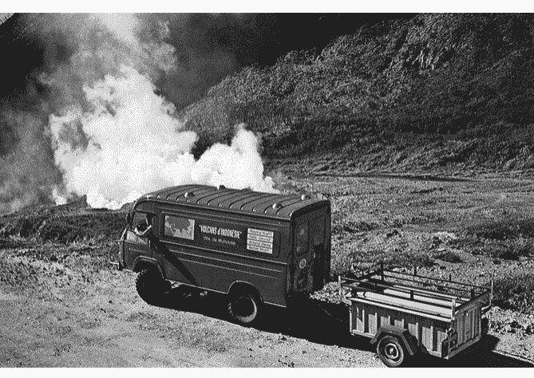

图 6.7 和 6.8（对面和上方）克拉夫特印尼探险。

卡蒂娅·克拉夫特（Katia Krafft）和莫里斯·克拉夫特（Maurice Krafft），《火山冲击：岛，印度尼西亚》（L'assaut des volcans: Island, Indonésie）（巴黎：Éditions G. P., 1976），86–87。

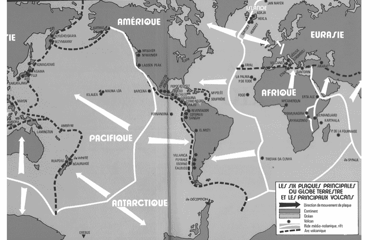

图 6.9 地球板块构造图。卡蒂娅·克拉夫特和莫里斯·克拉夫特，《火山冲击：岛，印度尼西亚》（A l'assaut des volcans: Island, Indonésie）（巴黎：Éditions G. P., 1976），扉页。

随着地堡在 20 世纪 80 年代和 90 年代日益破旧并最终被废弃，它与监测网络相，这些网络将其数据直接发送到位于阿尔卑斯山的萨瓦地球科学学院（Institut des Sciences la Terre, Savoie）；梅拉皮的监测可以使用贝梅伦（Bemmelen）和因托文二世（Einthoven Jr.）试图感受火口脉动的同一个潮湿地堡中的数据，但是在阿尔卑斯山的办公桌前进行的。

更具包容性的结局。他们重新改造的灵媒术并非地球物理学的退化或派生形式；相反，它扩展了能够参与感知地球的人。

那么，这三个片段揭示了默尔（Mer）山的火山观测站参与了远科学现代化的标准叙事，或理性火山监测取代当地民间科学的观点。事实上，观测站是就“与他人及地球亲近或疏远意味着什么”这一基本问题进行协商的结果；它们与什么构成介质，以及在人体与脉动的地球之间划定界限的问题有关。观测站不仅将国家延伸到其后陆；同时它们创造了现代全球地缘政治紧张局势的舞台，并将这些尺度——政治的、行星的和身体——融合在一起。

## 结论

人类世是地球科学在印度尼西亚的时刻。科学家们再次意识到，地质学是社会性的。现代政治史现在岩石记录中清晰可见。借助我们在书中中所述的这段近一个世纪的历史，我们可以理解这一记录。我们看到火山活动、地球的历史、其结构、大陆移动、断裂和重塑的能力，从头到尾是一个社会过程。我们刚刚考虑的地球科学是一场关于激进不确定性的庆典地质学，一种感官地质学，一种抵抗某些事物的地质学；它是一种看到陆地之海的地质学，一种对我们负有债务和义务的地下世界，因为我们的世界正源于此；一种关于石化英雄的政治地质学，提醒着我们拥有拒绝不可忍条件的近乎神迹的力量，这种拒绝的力量是如此令人印象深刻，以至于在景观中留下了形状，提醒我们下一次需要灵感；一种包含正义的地质学——地质正义——一种如此人性化、凡俗、脆弱且岩石化的正义；一种社会地质学；一种作为神灵祈祷场所的真寺的地质学，因为神灵也需要下跪；一种认识到我们地球的进程如何合谋形成这种供神灵使用之真寺的地质学；一种宇宙的、带有危险的神学色彩且具有神话色彩的地质学；一种深知人体与石头之间的界限是不稳定的地质学；一种核心上理解科学讲述了关于人类和地球的大故事的地质学；一种不加掩饰的、花花式的、审美学的、且总是过剩的地质学。

这就是人类世科学家目前思考是否可以承认的地质学。这让某些人感到恐的——我的一些地质学家朋友仍然相信神话与科学之间整洁而天真的划分；他们中仍有人在担心，他们说作为科学家，他们不“相信”某些东西，而是“知道”。但其他地质学家记得，他们之所以身处其中，是因为他们内心将地球科学视为一项宇宙的-神话的-宗教的计划，旨在理解我们居住的地方，通过讲述故事，并对这个被称为“地球”的地方进行不可能的抽象。在地球科学的领域中，我们开始窥见从爪哇火山学历史中可以学到的东西。还记得翁布格罗夫（Umbgrove），他在敬畏中环绕在波罗布迪（Borobudur）的云雾和陡峭黑色火山石山峰之间。他的愿景是一种不受限制的地质学，能够容纳宇宙的熵、复杂性，穿越身体内部与星系旋转之间的尺度。这是一种近乎清醒的科学，塑造了我们现在对地球系统的理解。翁布格罗夫脉动的宇宙最终是多声部的，在这个世界中，万物通过倍增连接来产生更多的复杂性，就像合唱安排每增加一个新声部时都会增加关系一样。在这个多声部世界中的重复始终是差异的扩散，在深层的时间中，从地球内部到我们跳动的心脏，一直到星系，一种伟大的、宇宙级的缓慢——但有时快得不可想象的——分化。思想本身仅仅是这种能力的表达和延伸，因为它是极佳的分化工具。意识是星系赋格曲中的另一个声音。花花式地质学的工作是帮助识别差异和连接，致力于对使人类石质化和使石质非人性化的因素进行拆解和重构。印度尼西亚的力量和地质学家就在这一条线上，为合唱增添了另一个声音，这复合并倍增了我们与地球之间的夹层区域。这种未加束缚且天真的肯定是地缘政治的本质，通过将人类分解为“*geo*（地理）”来消解人类，将其投入地球并投向太空，一种叙事性科学，拒绝将地球科学理解为现代神话之外的任何东西。地缘政治通过爪哇的精神地理学改变了对地球的现代理解；它创造了板块构造的故事，创造了对地球表面漂移、折叠和重塑的理解；它创造了“我们的”地球。然而，这门科学很大程度上被从我们的历史书中抹去了。印度尼西亚的精神地理学被划分到人类学书籍中，并记录在“信仰体系”和“世界观”的年书中。理论家和神秘主义者是不令人舒服的提醒，提醒着那些糟糕的日子，那时地球科学与信仰之间的界限尚未被完全净化。但那些在从地震仪测量数据之间参加仪式游行或在真寺祈祷的火山科学家们，搅乱了这些划分，并提醒我们，试图理解地球是多么地具有神学色彩。

# 第3章 间层

是我们——这群生活在板块构造、火山的、自我分化的地球上的我们——继承了爪哇的地缘政治，我们现在必须学习如何与埋在山坡上的偶像、从石头中凸出的革命英雄共处，与在梦中造访我们的海洋神，以及我们遥远而未知邻居那早已过去的幽灵祖先共处。需要学习我们自己的物质世界是由我们不认识的人的神灵构成的，如何迎接他们，如何知道地质学不是稳定的东西，而是流动的、狂暴的，并在部分是由我们构成的。

Pyenson，《理性的帝国》（Empire of Reason）。

Taylor，《巴达维亚社会》（Social World of Batavia）。

Mrázek，“快乐之地的工程师”（Engineers of Happy Land）。

例如，请参考 Kusumandadinata，《印尼火山基础数据》（Data Dasar Gunungapi [sic] Indonesia）；Sukamto, Soedarji 和 Wikarno，《揭秘印尼地质机构历史》（Menguak Sejarah Kelembagaan Geologi di Indonesia）。

Sudrajat，《Van Bemmelen》。

Sudrajat，《加隆贡贡火山》（Praharata Gunung Galungung）。关于西爪陶器、宇宙观与火山的融合，请参见 DW，《人与》（Manusia da Gunung）。Sudrajat，《印尼火山调查的发展》。

Katili，“印度尼西亚地质黄金地，第一部分”，23；Katili，“印度尼西亚地质黄金地，第二部分”，28。

关于 Katili 1951 年至 2005 年间的传记（他于 2008 年去世），请参考 Nusantara，《印度尼西亚地球财富》（Nusantara, Harta Bumi Indonesia），324–54。

Katili 和 Sudrajat，《加隆贡贡》（Galunggung）。

Vening Meinez，“通过潜水穿越荷兰属东群岛”，338–48。

Kuenen，“印度洋盆地的地壳构造”（Kraustochten over de indische diebekkens）。

Kemmerling，“特尔纳特峰”：Kemmerling，“Batoer 山的特征”（Belming van den G. Batoer），55–65。

Rickle，《极化的爪哇社会》（Polarifying Javanese Society），1–12；Ricklefs，《爪哇中可见与不可见的世界》（Seen and Unseen Worlds in Java）；Ricklefs，《曼加昆库布米苏丹下的雅加加塔》（Yogyakarta under Sultan Mangangkubumi）。

Blaikie，《土壤侵蚀政治经济学》。

Blaikie 的工作被人类学家 Michael Dove 和 Bambang Budayana 直接应用于美拉比山。参见 Dove 和 Budayana，“火山的视角”（View from the Volcano），736–43。

Van Bemmelen，《造山运动》（Mountain Building），2。

Umbgrove，《地球交响乐》（Symphony of the Earth），29。

Le Conte，“地球历史上的关键时期”（On Critical Periods in the History of the Earth），556。

Selcer，“全新世即是历史”（Holocene Is History）。

“Sojedando do Ord Dawah”。参见 Hannah，“印尼心理中的魔幻-神秘综合征，I”（Magical-Mystical Syndrome in the Indonesian Mentality, I），1–12。

Hollie，“印度尼”（Indonesia），9。

Friend，《印尼的命运》（Indonesian Destinies），260–63。

“Joko Piningit”，70–71。

Bubandt，“幽灵地质”（Haunted Geologies），G121–41。

Bubandt，“幽灵地质”（Haunted Geologies），G135。

关于喷发概况和各个火山的剖，请参见 Kusuminata，《火山基础数据》（Data Dasar Gunungapi [sic] Indonesia）。

参见 Goss，《植物统治者》（Floracrats）；Li，《改进意愿》（Will to Improve）1–31。关于新加坡背景，请参见 Barnard，《自然的殖民地》（Nature’s Colony）。

Geertz，《农业演变》（Agricultural Evolution），39。

Winchester，《克拉喀托》（Krakatoa）。

火山学家立即产了研究，以应对湖泊是如何形成和暴露的。例如：

- 2 Verbeek，“克拉喀托喷发”（Krakatoa Eruption），10–15。
- 3 Verbeek 和 Fennema，*地质描述*Description géologique），1:v–vii。
- 4 Verbeek，“克拉喀托喷发”，10–6。
- 5 Verbeek 和 Fennema，*地质描述*Description géologique），1:6–21。
- 6 Verbeek 和 Fennema，*地质描述*（Description géologique），1:38。第三纪被进一步细分为老第三纪和新第三纪。始新世和渐新世属于老第三纪，中新世属于新第三纪。第四纪被细分为上新世。
- 7 Birchfield，“地球的年龄”（Age of the Earth），137–43。
- 8 这位于井层部分，达尔文在此试图估算英南部威尔士地的年龄。达尔文，《物种起源论》（On the Origin of Species），251–52。
- 9 Thomson，“关于地球的长期冷却”（On the Secular Cooling of the Earth），1–14。Thomson 写道：“可以肯定，太阳系统中的能量总量在过去任何时期都比现在大 . . 长期耗散率可能与当前秩序的总和成某种正比，因此随着时间的推移而非常缓慢地减少 . . Thomson 认为能量耗散和地球冷却的速率是定年的基础。”
- 10 Rudwick，《地球的深史》（Earth's Deep History），229。
- 11 Verbeek 和 Fennema，*地质描述*Description géologique），2:928；Phillips，《地球上的生命》（Life on Earth），51。
- 12 Verbeek 和 Fennema，*地质描述*Description géologique），2:944–44。
- 13 Verbeek 和 Fennema，*地质描述*Description géologique），2:925。
- 14 Verbeek 和 Fennema，*地质描述*（Description géologique），2:031；Suess，《地球面貌》（Face of the Earth），4, pt. 5, 294。Suess 在 Verbeek 关于褶皱山的证据之上，对亚洲山脉的用处提出了更广泛的论断：形成亚洲边界的前哨：太平洋岛，尽管它看起来只是从广阔的海洋中升起的孤立山峰和碎片，但由于其分布广泛，在地球表面的规划中占据了显要位置。可见部分呈长且倾斜锐角的直线排列；变得越来越清楚的是，这些大部分是近期山脉的下斜面。我们已经看到在爪哇，含有纹状孔虫的岩层发生了褶皱，Verbeek 对 Leitimor 的描述显示，岛屿上许多珊瑚礁也被抬升到了相当的高度，倾斜且偶尔发生褶皱。
- 15 Verbeek 和 Fennema，*地质描述*（Description géologique），2:952–53,1032。
- 16 Verbeek 和 Fennema，*地质描述*（Description géologique），2:953。
- 17 Verbeek 和 Fennema，*地质描述*（Description géologique），2:953。
- 18 Verbeek 和 Fennema，*地质描述*（Description géologique），2:1020。
- 19 Verbeek 和 Fennema，*地质描述*（Description géologique），2:1014。
- 20 Verbeek 和 Fennema，*地质描述*（Description géologique），2:016。
- 21 Verbeek，《爪哇的古代》（Oudheid van Java），1–6。
- 22 参见 Verbeek，《爪哇的古代》（Oudheid van Java）。“随附的古地图由 Verbeek 发表，《爪哇古地图》。”
- 23 Verbeek，《爪哇古地图》（Oudhedijk van Java），7–14。
- 24 Verbeek 和 Fennema，*地质描述*（Description géologique），2:037–50。
- 25 Verbeek 和 Fennema，*地质描述*（Description géologique），2:037。
- 26 Verbeek 和 Fennema，*地质描述*（Description géologique），2:031。
- 27 Kuitenbrouwer，“战争期间的荷兰属东印度”（Dutch East during the First War），28–31。
- 28 Verbeek 和 Fennema，*地质描述*（Description géologique），2:031。
- 29 Van Aken，“印尼的海洋研究”（Dutch Oceanic Research in Indonesia），36。
- 30 Boomgaard，“热城市的形成与消亡”（Making and Unmaking of Tropical Cities），209。
- 31 关于19世纪末大都市文化的出现，请参见 Taylor，《巴达维亚社会》（Social World of Batavia），114–58。关于19世纪末到印尼革命，请参见 Pyenson，《理性的帝国》（Empire of Reason），83–125。
- 32 Pyenson，《理性的帝国》（Empire of Reason），126–28。
- 33 Vening Meinez，“东印度群岛的重力异常”（Gravity Anomalies in the East Indian Archipelago），323。
- 34 Laudan，“海洋学与地球物理学”（Oceanography and Geophysical Theory），656–57。
- 35 Vening Meinez，“海洋重力考察”（Gravity Expeditions at Sea），2:8, 9。
- 36 Laudan，“海洋学与地球物理学”（Oceanography and Geophysical Theory），656–66。
- 37 Vening Meinez，“海洋重力考察”（Gravity Expeditions at Sea），1:5。
- 38 Vening Meinez，“重力异常”（Gravity Anomalies），323–24。
- 39 Vening Meinez，“重力异常”（Gravity Anomalies），324。
- 40 Vening Meinez，“重力异常”（Gravity Anomalies），324。
- 41 Visser，“荷兰属东群岛的地震分布”（On the Distribution of Earthquakes in the Netherlands Indian Archipelago），1909–1919。参见 Veldkamp，《地球物理研究史》（History of Geophysical Research），69–81。
- 42 Vening Meinez，“重力异常”（Gravity Anomalies），329。正如 Kemmerling 在1922年所写：“与火山是地震原因的流行观点相反，人们越来越相信地壳的收缩导致了平衡破坏和地震，从而增加了火山活动，”De G. Keloet einde 1921，94。
- 43 Vening Meinez，“重力异常”（Gravity Anomalies），329。
- 44 Wegener，《大陆与海洋的起源》（Origins of Continents and Oceans）。
- 45 Ashworth，“今日科学家”（Scientist of the Day）。
- 46 Vening Meinez，《海洋重力考察》（Gravity Expeditions at Sea），2:210。
- 47 Umbgrove见Vening Meinez，《海洋重力考察》（Gravity Expeditions at Sea），2:214。
- 48 Kuenen，“负地壳平衡异常”（Negative Isostatic Anomalies），169–214。
- 49 Kuenen，“负地壳平衡异常”（Negative Isostatic Anomalies），171–72。
- 50 Vening Meinez，《海洋重力考察》（Gravity Expeditions at Sea），4:27。
- 51 Vening Meinez，《海洋重力考察与海洋》（Gravity Expeditions and Oceans）。
- 52 Vening Meinez，《大陆与海洋的起源》（Origin of Continents and Oceans）。
- 53 Vening Meinez的观点并不涉及水的起源，他解释说这太复杂，无法加入文中。
- 54 Vening Meinez，《大陆与海洋的起源》（Origin of Continents and Oceans），373。
- 55 Oreskes，《使命科学》（Science on a Mission），142–51。
- 56 海军-普林斯顿西群岛重力考察（Navy-Princeton Gravity Expedition to the West Indies），2。
- 57 海军-普林斯顿西群岛重力考察（Navy-Princeton Gravity Expedition to the West Indies），2。
- 58 Ewing，“重力测量方法与调查”（Gravity Gravimetric Methods and Surveys），47–70。另见 Tomoda，“海洋重力”（Gravity at Sea）。尽管Tomoda说进口日期是1934年，但Ewing说日本考察是在1932年和1935年进行的。
- 59 Tomoda，“海洋重力”（Gravity at Sea），771。
- 60 Worzel，《海上摆式重力测量》（Pendulum Gravity Measurements at Sea）。
- 61 Oreskes，《使命科学》（Science on a Mission），164–211。
- 62 Le Pichon，“板块构造学的五十年”（Fifty Years of Plate Tectonics），2924。
- 63 Pyenson，《理性的帝国》（Empire of Reason），13–17。
- 64 Sudrajat,Van Bemmelden,35–54。

例如，参见以下内容，布鲁威尔（Brouwer）认为印尼群岛演化中的水平褶皱和应力偏离了关注垂直应力的传统。他得出结论：“东南亚印度群岛未来可能会达到很久以前阿尔卑斯山就达到的阶段。随着水平运动的进行，海盆将变窄，最终目前岛屿列较深部分的质量体将被推向现在的澳大利亚大陆以及延伸其边界的萨胡尔陆架。至于产生运动的力是向东南还是向西北，根据霍布布斯（Hobbs）和魏格纳（Wegener）的概念，还没有足够的数据。”布鲁威尔，《巨地斜地的水平运动》，577页。同样，莫伦格拉夫（Molengraaff）要求地质学家建立足够稳健的大规模褶皱体系来理解印尼群岛的形状，因此引发了与漂移理论的理论交叉：“理由怀疑，粗糙深海盆的沉降与相邻对齐岛屿的抬升之间必然存在遗传联系；根据我的观点，这些对立运动的共同起源必须追溯到同一个地壳运动，即某一深度的褶皱过程。如果有人提出某一深度地壳运动在地球表面可能会看到什么，我会在回答中加入，其外观将与目前印度群岛东部的情况相似。”莫伦格拉夫，《印度群岛的现代深海研究》，107页。

- 66 Sudrajat, Van Bemmelen, 21。
- 67 Vickers, 《现代印度尼西亚史》，16–63页。
- 68 Van Bemmelen, 《印尼地质学》，1Av。
- 69 Van Bemmelen, 《印尼地质学》，1A：前言。
- 70 Van Gorsel, 《印尼地质学的先驱与里程碑》。
- 71 Holmes, 《地球时代》。
- 72 Van Bemmelen, 《印尼地质学》，1A:723。虽然分类已建立，地层已命名，但维尔贝克（Verbeek）和芬尼马（Fennema）可能无法理解这样的角度。此外，大多数细粒划分是在1927年至1940年间对爪哇岛进行14年地层调查后在爪哇和苏门答腊完成的。Van Bemmelen, 《印尼地质学》，1A:106。
- 73 Van Bemmelen, 《印尼地质学》，1A:79。
- 74 关于巨型褶皱理论，另见 van Bemmelen，“论巨型褶皱”，83–127页。
- 75 Van Bemmelen, 《印尼地质学》，1A:723。
- 76 他在《印尼地质学》第一卷的最后几页中总结了他的论文：“地球冷却的宇宙过程导致自由能量从行星内部较热的部分流向地表。然而，

## 第 4 章 公元 1006 年的地质决定论

> 题铭：苏斯，引自魏格纳，《大陆与海洋的起源》，9。

- 冷却并非简单的热力过程。在通向地面的途中，在最终辐射和消散到宇宙之前，自由能量呈现出各种状态。首先，温度梯度引发了带有弥散的、原子和离子物质流的放热化学反应，导致地球地壳成分的地球化学调整。物理化学过程引起密度的变化，由于其分布不均，导致了流体动力学平衡的扰动。因此，化学过程的平衡-稳定性效应周期地产生具有集中质量位移特征的恢复反应。这些深部的平衡运动伴随着地表的波浪状变形或“褶皱（undations）”。Van Bammelen, 《印尼地质学》，1A:723。

- Van Bammelen, 《印尼地质学》，1A:6。

- Van Bammelen, 《印尼地质学》，1A:6。Van Bammelen 在多篇论文中攻击过构造学；例如 Van Bammelen，“板块构造学与褶皱模型”，145–82页。

- 见仅由他本人撰写的 Katili 传记。Nusantara, Harta Indonesia。

- Katili and Hartono, “Van Bammelen 的贡献”，107–16页。

- Hamilton, 《印度尼西亚构造图》，21页。

- Hamilton, 《印度尼西亚构造图》，8页。

- Hamilton, “印尼地区构造学”，31页。

- Ewing and Worzel, “西印度群岛的重力异常”，165–74页。

- Hamilton, “印尼地区构造学”。

- Hamilton, “印尼地区构造学”，41页。

- Hamilton, “印尼地区构造学”，7页。

- Hamilton, “汇聚板块构造学”，37页。另见 Hamilton, “印尼地区构造学”，8页。

- See Hamilton, “印尼地区构造学”，39–44页。

- Hamilton, “汇聚板块构造学”，43页。

- Nusantara, Harta Indonesia,134–43。

- Katili, Sumberday Alam，83页。

- Katili and Reinemund, 东南亚，44页。

- Katili and Reinemund, 东南亚，46页。

- Katili, Sumberday Alam，75–92页。

- Katili and Reinemund, 东南亚，18页。

- Snider, “印度洋”，289页。另见 Snider，“国际海洋考察”，113页。他写道：“在未来的四年里，一支配备高度专业装备的船队将在印度洋进行新的发现之旅，对地球上最后的未区域区域进行严密审查。”

- Fischer, 《季风考察初步报告》，36,52–88页。

- 3 Molengraaff and Tharp, 《印度洋地形图》（地图），《印度洋海底》（地图）。另见 [国会图书馆地理与地图](https://lccn.loc.gov/20105827)。

- 4 Hamilton，“印尼地区构造学”，28页。

- 5 Katili and Reinemund, 东南亚，44页。

- 6 Veth, 《爪哇岛》，337页。

- 7 Van Dien, 《爪哇社区与联系》，17页。

- 8 Hamilton, “印尼地区构造学”，28页。

- 9 关于 Ratu Kidul 与中爪哇苏丹的历史，见 Ricklefs, 《曼库布米统治下的爪哇》，13,23页。见文中关于马塔拉姆苏国的建立和划分的历史处理。从苏卡加塔皇宫内部的视角看，见 Ricklefs, 《爪哇的危机》。

- 10 Ricklefs 说 Ratu Kidul 是一个追溯到13世纪的古老本土神灵。她可能在建立王国之前住在像穆罗莫那样的沿海国家。根据 Ricklefs 的说法，她最初以名为 Cemara Tunggal 的隐士身份出现，被惩罚结婚。“她是男性也可以女性，或者是老的，直到审判日才会死去。”Ricklefs, 见《爪哇未见的世界》，10页。Ricklefs 还暗示 Ratu Kidul 是建立 Taman Sari 水宫作为伴侣住所的原因。

- 11 Carey, Ricklefs 记录了雅加达的苏丹访问过 Ratu Kidul，曼库布米二世在她住所附近建造了一座小亭。

- 12 Molengraaff, “升平日的纪念”，372–89页。

- 14 Molengraaff, “升平日的纪念”，380页。关于与爪哇精神地理相关的某些地名的起源讨论，见 Adam, 《雅加加达的一些历史与传奇地名》，150–62页。

- 15 关于 Ricklefs 的 Sapu Jagad 与 Ratu Kidul 相关的地理和谱系，见上述第10条注释。

- 16 Wieringa, “隐喻的幻象”，199页。Carey，《预言的力量》，493–99页。

- 17 Carey, 《预言的力量》，495–96页。

- 18 Ricklefs, 《曼库布米统治下的爪哇》，404n188。

- 19 De Graaf, 《阿贡·苏丹的统治》，125页。

- 20 Pigeaud, 《Alexander, Sakandër en Sénapti》，354页。

- 21 Kemmerling, 《火山报告》，188–94页。

- 22 Kemmerling, 《火山报告》，188页。

- 23 Kemmerling, 《火山报告》，194页。

- 24 Kemmerling, 《火山报告》，188–94页。

- 25 另见 Protschky and Morgan, 《硫磺开矿的历史化》，8–9页。

- 26 Kemmerling, 《火山报告》，188页。

O'Brien, 《科学与神秘主义的融合》。

Lang, 《印度尼西亚火山的精神守护者去世》。

Resink, 《Kanjeng Ratu Kidul》，第314页。另见 Trumbull 在《液体世界》中第105–6页对 Ratu Kidul 水生混合体的迷人演变描述。

“满足火山的权利。”

“满足火山的权利。”

Syafiullah, 《梅拉比祭祀》，《地质构造与人类世世》，3–23页。

- 1 Couperus, 《隐藏的力量》，151页。

- 2 Couperus, 《隐藏的力量》，151页。

- 3 Vickers, 《现代印度尼西亚史》，18页。

- 4 Vickers, 《现代印度尼西亚史》，18页。

- 5 Vickers, 《现代印度尼西亚史》，18页。

- 6 Hinloopen Laberton, 《关于爪哇火山学的古爪哇数据》

- 7 Van Dijk, 《荷兰东属与第一次世界大战》，275页。

- 8 参见 Hinloopen Laberton, 《Lanjang Damar-woolan》。

- 9 Hinloopen Laberton, 《哇扬，或皮影戏》，1页。

- 10 巴厘的语言和文化也是其直接后裔。Hinloopen Laberton, 《中世纪爪哇语中的摩罗哈拉塔》，1–3页。

- 11 Hinloopen Laberton, 《中世纪爪哇语中的摩罗哈拉塔》，1页。

- 12 Kern, 《爪哇 Er-Langa 地区的梵语铭文》，1–21页。

- 13 在本书写作时，该物品尚未遣回印度。Bullough and Carry, 《加尔各塔石（加尔各答石）》，4–5页。

- 14 Kern, 《相关的梵语铭文》，1–21页。

- 15 Hinloopen Laberton, 《古爪哇数据》，141页。

- 16 Hinloopen Laberton, 《古爪哇数据》，142–48页。

- 17 Hinloopen Laberton, 《古爪哇数据》，124–58页。

- 18 Hinloopen Laberton, 《古爪哇数据》，123页。

- 19 Bonner, 《过去与现在的浪漫主义爪哇》，132页。另见 Schelterna, 《纪念碑式的爪哇》。

- 20 Raffles, 《爪哇史》，32页。

- 21 Raffles, 《爪哇史》，32页。

- 22 Besant and Leadbeater, 《理论协会》。

- 23 Poller, 《在幻术之下》，86页。

- 24 Franklin, 《精神要事》，185–11页。

- 25 Sinnett, 《奥秘世界》，4页。

- 26 Ramaswamy, 《莱姆里亚陆地的最后》，53–55页。

参见 Ryan, 《波罗布杜尔，爪哇的大金字塔》，482–85页；Ryan, 《爪哇的大寺庙》，225–36页；Edge, 《地球时代》，77–148页。Edge 试图将理论与现代地质学相结合：“这些漫长时期完全赋予沉积作用和低级生命形式的地球，由于无处不在，因此没有进入理论视角。很清楚，我们不能允许自己被仅仅的广阔所恐惧……地质记录显示了陆地和水分布的许多变迁时期，这些时期标记了人类较大划分之间的界限”（80）。地层学变成了人类的演化史。

De Tollenara, 《神圣智慧政治学》，115–15页。

他是苏卡尔塔苏丹帕库布沃诺十世的兄弟。参见 Brown, 《现代印度尼西亚佛教的复兴》，47页。演讲稿的原文源自 Hinlooper Harper, 《巴塔拉·卡拉给桑希亚·维希努的谜题》，156–58页。

Hinlooper Labenton, 《巴塔拉·卡拉给桑希亚·维希努的谜题》，156–58页。

De Tollenara, 《神圣智慧政治学》，115–24页。

Blavatsky, 《秘密学义》，1页。

Blavatsky, 《秘密学义》，1页。

参见 Charles Leadbeater，他解释道“在我们的太阳系中存在完全不同的平面，每个平面都有不同密度程度的物质，其中一些平面可以被那些为这项工作做了准备的人员访问和观察，就像访问和观察一个外国一样容易；而且，通过对比那些在这些平面上不断工作的观察者，可以获得关于它们存在和本质的证据，至少与我们大多数人对格兰岛或斯皮茨贝根岛存在的所的证据同样令人满意。”Leadbeater, 《星界面》，1页。他解释说这些土地的人口包括活着的和死的人类、非人类（包括人类的元素和星灵体、自然神灵）、印度教神灵，最后是人类的思想和情感。

Blavatsky, 《秘密学义》，2:46。

Blavatsky, 《秘密学义》，2:41。她后来提到地球年龄时说，“我们准备承认地质学所提供的1亿年。”然而，她拒绝给予地质学权威性，直到它追溯到他的原质形式（72页）。Rudwick, 《地球史》，181–206页。

Blavatsky, 《秘密学义》，2:227。

Blavatsky, 《秘密学义》，2:266。另见 Ramaswamy 关于莱姆里亚和后殖民运动的作用。

Blavatsky, 《秘密学义》，2:274页。

- 40 Blavatsky, 《秘密学义》，2:332页。

- 41 Blavatsky, 《秘密学义》，2:314页。

- 42 关于日期参见 Tillet, “57”由 Tollenere, 《神圣智慧》，114页。

- 43 Lebeader, 《爪哇秘史》，16–18页。

- 44 Vanmelen, [未命名贡献]，69–72页。

- 45 Vanmelen, [未命名贡献]，69页。

- 46 Sudrajat, Vanmelen, 90页；Barzalay, 《该理论》，8–10页。

- 47 Vanmelen, 《理论的物理基础》，338页。

- 48 Vanmelen, [未命名贡献]，70页。

- 49 Vanmelen, [未命名贡献]，69–74页。

- 50 Vanmelen, [未命名贡献]，71页。

- 51 Sudrajat, Vanmelen,174页。

- 52 Sudrajat, Vanmelen,181页。

- 53 Sudrajat, Vanmelen,183页。

- 54 Sukamoto, Soeradi, and Wikarno, 《揭秘印度尼西亚地质史》，60页。

- 55 Van Gorsel, 《印度尼西亚地质学的先驱与里程碑》，6页。

- 56 Vanmelen, 《梅拉比喷发周期2602–2603 (1943)》，6页。

- 57 Vanmelen, 《梅拉比喷发周期2602–2603 (1943)》。6页。

- 58 Mortimer, 《苏加诺下的共产主义》，39页。

- 59 Vanmelen, 《Charles Edgar Steen》，133页；另见 Sudrajat, Vanmelen,186页。

- 60 Thalmann, 《Tan Sin Hok：1902–1945》，25页。

- 61 Vanmelen, 《地动力学模型：评估与综合》，5页。

- 62 Vanmelen, 《造山》，2页。

- 63 Sudrajat, Vanmelen,200页。

- 64 De Neve, 《与A合作的火山调查》，34页。

- 65 在那之前，有70名员工。De Neve, 《与A合作的火山调查》，34页。

- 66 Hadikusumo, 《火山研究与火山活动》，34页。De Neve, 《与A合作的火山调查》，36页。

- 68 Van Dijk, 《伊斯兰旗帜下的反抗》，102页。

- 69 Adnwidajaja 等人，《来自编辑》，1页。

- 70 Petrochevsky, 《印度尼西亚的火山活动》，22页。

190 · 第四章注释

- 71 Petrokuschevsky, 《印度尼西亚的火山活动》，22–23页。

- 72 Hadikusumo, 《火山研究》，36页。

- 73 Hadikusumo, 《火山研究》，37页。

- 74 Hadikusumo, 《火山研究》，41页。

- 75 Bloemberberg and Eickhoff, 《保护过去》，405页。

- 76 Hadikusumo, 《火山研究》，35页。

- 77 Hadikusumo, 《火山研究》，15页。

- 78 Hadikusumo, 《火山研究》，16页。

- 79 Djajawinangun, 《G. Merapi》。

- 80 Leadbeater, 《作为象征与事实的母亲》。

- 81 Bennett, 《见证》，326页。

- 82 Van Sommers, 《Subud生活》，129页。

- 83 该银行在1989年卖给国家所有的 Mandiri 银行，并更名为 Bank Syariah Mandiri。它现在属于印度尼西亚最大的银行集团之一。

- 84 Van Sommers, 《Subud生活》，93–128页。

- 85 Van Sommers, 《Subud生活》，134页。

- 86 Simanjak, 《考古学》，461页。另见 Andreasto, Newhall, and Dwijanto, 《探寻梅拉比喷发的新性》，2006,201–7。

1–64; “深海槽的起源”，73–80; “陆地过程的周期性”，573–76; “地球历史中的节奏”，116–29; “第二种双盘螺旋虫”，82–89; 东印度群岛的构造史；“第三纪有孔虫”，35–91; “Verschillende Arten tertiare geosynclinalen”（第三纪地向的不同种类），33–44.

10 Sukamoto, Soeradi, 和 Wikarno, 《印尼地质机构史》，213。

11 Umbridge, 《地球交响曲》，

12 例如，Umbridge 给其母亲的信，1927年11月19日和1927年3月14日。

13 Umbridge, 给其母亲的信，1926年10月18日。

14 Umbridge, 给其母亲的信，1926年11月29日。

15 Umbridge, 给其母亲的信，1928年1月7日。

16 Umbridge 这一天的笔记已发表于 Umbridge, 《克拉卡托火山附近新海洋火山的初期》，325–28。Umbridge 指出 Stehn 在《Vulkanologische Mededelingen》上发表了他的记述。

17 Umbridge, 给其母亲的信，1927年2月8日；另见 Fruin-Meese, 《Geschiedenis van Java》（爪哇史）。

18 Protschky, “对自然灾害的响应与形式”，67–91。

19 Umbridge, 给其母亲的信，1927年11月19日。

20 Umbridge, 给其母亲的信，1927年11月19日。

21 Umbridge, 给其母亲的信，1927年11月19日。

22 见 Tiffin, 《爪哇的荒废的犬科动物与英国画意理想》，525–58。

23 Umbridge, 给其母亲的信，1928年5月3日。

24 Umbridge, 给其母亲的信，1928年5月3日。

25 Umbridge, 给其母亲的信，1928年5月3日。他指的是法国地质学家 Termier 的书，*La joie de la connaissance*（知识之喜悦）。

26 Umbridge, “Het ontstaan van het Dientplateau”（迪恩高原的起源）。

27 Umbridge, “Het ontstaan van het Dientplateau”（迪恩高原的起源）。

28 Goss, 《植物统治者》（Floracrats）。

29 见 Umbridge, 《地球脉动》，2。

30 Umbridge, 《地球脉动》，2，

31 D, “海平面运动升降简介”，1–16。另见 Barrell, “地质时间的节奏与测定”，745–904。

32 Umbridge, 《地球脉动》，73–114。

33 Gott, “海平面运动升降简介”，1–16。

34 Gilbert, “地质时间的节奏”，1001–12。

35 Grabau 曾在北京国立大学任教，并为中国地质调查和中国地质学的黄金时代做出了贡献。《挖掘国家》（Unearthing the Nation），67–107；另见 Mazur, 《中国的 Amadeus Grabau》，51–94。

36 Johnson, “A. W. Grabau 的胚胎地层学”，43–54。

38 Johnson, “A. W. Grabau 的胚胎层序地层学”，43–54。

39 Umbgrove, “地球历史中的节奏”，116。

40 Umbgrove, “地球历史中的节奏”，116。

# 参考文献

## 注释

41 Umbgrove, 《地球脉动》，26。

42 Vening Mens, 《海洋重力探险》，2:163–82。

43 Umbgrove, 《地球脉动》，152。另见 Umbgrove, 《地球交响曲》，209–10。“在我们星球的历史中，一种极其异质的性质被显现出来；海平面在长时间的内发生了巨大的上升和下降运动，其节奏因其单调的规律性而引起关注；巨大的大陆冰盖生长并融化；盆地和构造槽如同地球覆盖层上的凹痕出现；山脉高耸入云又被侵蚀；花岗岩和其他‘火成岩’在某些时期产生于地球地壳。现在可以观察到这些异质现象之间的相互关系。发现它们之间存在着明确的相互联系。它们不再是散乱的音乐线条；它们似乎被交织在一起，正如我们为这如同交响乐谱般的和谐声声而感到欣喜。而且由于这种包裹了不同部分的统一性。”

44 Umbgrove, 《地球脉动》，146。

45 Le Conte, “地球历史中的关键时期”，556。

46 Umbgrove, 《地球交响曲》，29。

47 Umbgrove, 《地球交响曲》，206。

48 Umbgrove, 《地球交响曲》，147。

49 Umbgrove, 《Leven en materie》（生命与物质），118–23。

50 Umbgrove, 《Leven en materie》（生命与物质），122。

51 Deussen, 《奥义书哲学》（Philosophy of the Upanads）。

52 Deussen, 《奥义书哲学》，40–50。

53 Deussen, 《奥义书哲学》，40–50。

54 Deussen, 《奥义书哲学》，40。

55 Deussen, 《奥义书哲学》，40–50（此处似乎与52重复，或为原文页码错误，此处按原文翻译）。

56 Umbgrove, 《地球交响曲》，209–210。

57 Umbgrove, 《地球交响曲》，211。

58 Umbgrove, 《地球交响曲》，211。

59 Umbgrove 等, “地质构造的节奏”，514。

60 Umbgrove 等, “地质构造的节奏”，54。

61 Umbgrove 等, “地质构造的节奏”，550。

62 Hess, 《海洋盆地》，599–620。

63 Rudwick, 《地球构造》，258。

64 Hess, 《海洋盆地》，599–620。

65 Ewing 等, 《海洋研究》，508–35。

66 Doel, Marker, “现代海平面”，608–10。

67 Doel, Marker, “现代海平面”，609–10。

68 Yusoff, 《地质学》。

## 第 6 章 火山观测

1 关于克拉卡托火山爆发的描述，见 Holst, 《地质构造》，119–45。

2 Swellen, Willem Inhoven，13。

3 Swellen, Willem Inhoven，14–16。

4 Burnett, 《心电图》，9。

5 Burnett, 《心电图》，62。

6 Swellen, Willem Inhoven，78。

7 Swellen, Willem Inhoven，73。

8 Swellen, Willem Inhoven，99。

9 Robert H. Ray 公司，心电图的发明展示了心电图是独立发明的仪器。根据 Umbridge 的说法，心电图的伟大之处在于对这些能力（此处指功能）的组合。

10 Umbridge, 《地球交响曲》，81。

11 Umbridge, 《地球交响曲》，81。

12 Burnett, 《心电图》，54。

13 Burnett, 《心电图》。

14 Swellen, Willem Inhoven,73。

15 Mracek, 《我们变得机械化》，4–4。

16 Mracek, 《我们变得机械化》，4–33。

17 Swellen, Willem Inhoven，49。

18 Swellen, Willem Inhoven，49。

19 Swellen, Willem Inhoven，50；重力仪，99。

20 重力仪，98。

21 这里的 Petrovsky 的更多细节，见 Petrovsky、Belousov 和 Belousova，《第一俄罗斯火山学家》。

22 Van Padang, “采取的措施”，188；van Padang, 《爪哇的爆发》，110–12。

23 Van Padang, 《火山现象》，56。

24 Van Bemmelen, 《2602 年新克拉卡托火山爆发周期》。

25 Van Bemmelen, 《2602 年新克拉卡托火山爆发周期》，4。

26 Van Bemmelen, 《2602 年新克拉卡托火山爆发周期》，4。

27 Hadikusumo, 《印尼火山研究与火山活动报告》，49。

30 Van Bemmelen, 《2602 年新克拉卡托火山爆发周期》，4。

31 Van Bemmelen, 《2602 年新克拉卡托火山爆发周期》，4。

44 Van Padang, “火山现象,” 56; van Padang, “梅拉皮火山的爆发,” 108–112。

45 Suparno，作者采访，Keningar，2017年1月16日。

46 Yehezkel Sugiyono，与作者的 WhatsApp 通信，2019年6月27日。

47 Sukidi，作者采访，Keningar，2017年5月6日。这段历史对应了 20 世纪 80 年代村庄通电的日期，反映了苏哈托时期“新秩序”的恩赐政策。另见 Moshin 关于其他地区大规模村庄通电化的论证。Moshin, “新秩序的布线,” 63–95。

48 参见 Aji，《爪哇教义：爪哇原始宗教》。

49 Domerapi 是 dome（穹）和 Merapi（梅拉皮）的合成词。

50 Jean-Philippe Metaxian，作者采访，万隆，2016年4月21日。

51 Jácome, “20世纪90年代末厄瓜多尔金融危机,” 5; Cistern, “厄瓜多尔面临严经济措施。”

52 美联社，“叛乱日结束。”

53 Romero，“厄瓜多尔领导清洗军队。”

54 Jean-Philippe Metaxian，作者采访，万隆，2016年4月21日。

55 Tazieff, “火山调查,” 310。

56 Jean-Philippe Metaxian，作者采访，万隆，2016年1月18–20日。

## 参考文献目录

Adam, L. “雅加加达的一些历史与传奇地点。”《Djāwā》 4–5, no. 10 (1929): 150–162.

Adnwidaja, M. I., Djajadi Hadikusumo, G. A. de Neve, Moh. Slamet Padmokusum, and Surjo. “来自编辑部。”《Berita Gunung Berapi》 1, nos. 1–2 (1952): 1.

Aji, Rosa Mulya. 《爪哇教：爪哇原始宗教》。雅加达：Bening Pustaka dan Dua Aksara, 2018.

“Marjan 爷爷不愿搬迁的原因。”。《Tempo（雅加达）》，2010年10月25日。https://www.ababakarsidimpuan/alasan-mbah-marjan-tak-mau-mengungsi/.

Andreastuti, Supriati Dewi, Chris Blackwell, and Joko Dwiyanto. “追踪2006年梅拉皮火山喷发的规模。”《Jurnal Geologi Indonesia》 1, no. 4 (2006年12月): 21–27.

Ashworth, William B. “今日科学家。”Linda Hall 图馆，2019年7月30日。https://www.lindallah.org/felix-veining-meinez/

美联社。“叛乱日以厄瓜多尔领导下台告终。”《纽约时报》，2000年1月22日。

Hanner, H. S. 《过去与现在的浪漫主义》。伦敦: Seely, Verify, 1927.

Barnard, Timothy P. 《自然的殖民地：新加坡植物园的帝国、自然与环境》。NUS Press, 2016.

Barrell, Joseph. “地球的起源。”收于《地球及其居民的演化》，1–44. 新亥: 耶鲁大学出版社, 2018.

Barrell, Joseph. “节奏与几何时间的测量。”《Bulletin of the Geological Society of America》 26 (1917年12月): 745–904.

Barron, S. T. 《心电图的发展：附关于 W. Einthoven 教授的传记笔记》。伦敦：Cambridge Instrument Company, 1952.

Barry, Andrew. 《物质政治：沿 Pincheter 断裂线的争端》。Wiley Blackwell, 2013.

Barzilay, Willem. “Rein van Bemmelens (1904–1983) 的发展史与时间理论：荷兰地质学的四十年。”《Studium》 2 (2009): 8–10.

Bashford, Alison, Emily Kern, and Adam Bobgette (编). 《新地球史：宇宙观与现代世界的构建》。芝加哥：芝加大学出版社, 2023.

Belousov, Alexander, and Marina Belousova. “第一位火山学家：弗拉基米尔·彼得列申夫斯基。”俄罗斯科学院火山学与地震研究所东分部（博客），2022年10月11日访问。https://blogs.dickson-edu/petruveshevsky/files/2017/Priroda-article-translation.pdf.

Bennett, J. G. 《关于俯冲带》。伦敦：Hodder and Sutton, 1959.

Bennett, J. G. 《见证：John G. Bennett 自传》。亚利桑那州图森（AZ）:Sufi Community, 1974.

Besant, Annie, and Charles W. Leadbeater. 《奥秘化学：对元素的透视观察》。Philosophical Publishing House, 1919.

Besant, Annie, and Charles W. Leadbeater. 《哲学学会》。补充刊，《Theophonist》 41, no. 10 (1920年7月).

Birfield, Joe. “地球的时代与地质时间的发明。”收于《Lyell：过去是现在的关键》，由 Derek J. Blundell 和 Andrew C. Scott 编, 137–143.

Blaikie, Pierre. 《发展中国家土壤侵蚀的政治经济学》。伦敦：Routledge, 1985.

Blavatsky, Helena P. 《秘密学：科学与哲学的综合》，第1卷：宇宙发生。加州帕萨迪纳（CA）：大学出版社, 1952.

Blavatsky, Helena P. 《秘密学：科学与哲学的综合》，第2卷：人类发生。加州帕萨迪纳（CA）：大学出版社, 1952.

Bloembergen, Marieke, and Jan Eckhoff. “保护过去，创造未来：考古遗址、政权更迭与20世纪50年代的印尼。”《Bijdragen van Taal, en Volkenkunde》 167, no. 4 (2011): 45–36.

Bobette, Adam, and Andy Donovan. 《政治地质学：活跃策略与生命的创造》。恰姆（Cham）：Palgrave, 2019.

Boechari, M. “关于某处古代碑文的初步报告。”《Mandala Ilmu》 2–3 (2016).

Boomgaard, Peter. “热带香料的产的构建与瓦解。”《Bijdragen van Taal, en Volkenkunde》 167, no. 4 (2011): 19–27.

Braak, C. “关于荷兰殖民地活动的报告。”《Verslag omt der Koninklijke Natuureniging in Nederlands-ië》 71, 1920.

Braun, P. “全球性构造：科学的全球史。”《History of Science》, no. 1 (2017).

Brouwer, H. “地质构造断层。”《Journal of Geology》 29, no. 1 (1985): 55–76.

Burnett, John. “心电图的起源：作为一种医疗仪器。”《Medical History》, 补充刊, no. 5 (2005): 53–7.

Cary, Peter. 《预言的力量：苏丹·迪帕纳与旧秩序的终结》。莱登：KITLV Press, 2008.

Cistern, Carlos. “厄瓜多尔面临严经济措施。”《华盛顿邮报》，1999年3月11日。

Clark, Nigel. “人类世的科学挑战。”《Theory, Culture and Society》 34, no. 2 (2017): 3–23.

Crawford, John. 《印度群岛历史：习俗、艺术、语言、宗教》，3卷。爱丁堡: Constable, 1820.

Couperus, Louis. 《隐藏的力量：一个印尼的故事》。由 Alexander Teixeira 译。伦敦：Cape, 1922.

D’Arc Wood, Gill. 《Tambura：改变世界的情绪》。普林斯顿：普林斯顿出版社, 2014.

Darwin, Charles. 《物种起源：自然选择对优良物种的保护》。纽约：Appleton, 1861.

de Graaf, H. J. 《苏丹·阿古贡的统治（1613–1645）及其先父迪帕纳加的统治（1601–1613）》。海牙：Martinus Nijhoff, 1958.

de Jong, A. C. “与其外部形式概念相关的化学原子价值。”《Theosopher》 35, no. 10 (1914年7月）。http://iapsap.com/archive/materials/theosopher/theosopher_v35_jul_1914.pdf.

de Borborne, James. “认知世界：科学的全球史。”《History of Science》, no. 3 (2017): 373–99.

de Neve, George A. “关于印尼新教师宗教的审查计划。”《Berita Gunung Berapi》 1, no. 1–2 (1952): 75–83.

de Neve, George A. “与 Auri 合作的地质调查（1950–1952）。”《Berita Gunung Berapi》 1, no. 1–2 (1952年9月–12月): 34–64.

de Neve, George A. “关于印尼新教师宗教的审查计划。”《Berita Gunung Berapi》 1, no. 1–2 (1952): 75–83.

Deussen, Paul. 《奥义奴书的哲学》。爱丁堡：T. T. Clark，2008年。

Dajawainunangun. “G. kunjungan P. J. M. Drs Moh. Hatta dan Sutan Jogja IX di Pos Badan. Tanggal 14–25 Februari”。地质灾害技术研究开发中心 [Center for Research and Development of Geological Disaster Technology], Yogyakarta。

Doel, Ronald E., Tanya Levin, and Mason K. “将现代制图扩展到深海：军事赞助、冷战优先事项以及 Heeezen-Harp 绘图项目，1952–1959年。”《历史地理杂志》32 (2006): 605–26。

Donovan, Amy, and Clive Oppenheimer. “火山灾害中的科学、地点与政策：来自蒙特拉的启示。”《环境科学与政策》39 (2014): 150–61。

Donovan, Amy, and Clive Oppenheimer “边界上的火山：一场科学与地缘政治的挑战。”《火山学报》81, no. 31 (2019): 1–27。

Donovan, Katherine. “做社会文化：探索印度尼西亚的火山文化。《区域》42, no. 1 (2020): 117–26。

Dott, Robert H., Jr. “地平运动起伏简介。”收于《地平运动：主要地质概念的历史起伏》，1–16。博尔德，美国地质学会，1992年。

Dove, Michael, and Bandung Hayati. “来自火山的视角：对 Piers Blaikie 作品的赞赏。《地缘论坛》39 (2008): 736–46。

DW, Pepew. 《人与地质：神学、爪加达、生态》。Yogyakarta: Djeladajah Pustaka，2018年。

Edge, H. T. “地球的时代。《哲学之路》2, no. 2 (1912): 77–148。

Escher, Bernard George. 自荷兰语原版《De Kloet》中的“开尔文”。《水利工程师》73 (1919): 1–18。项目 E.19–9。印尼万万达，火山局图书馆（档案馆）。

Einthoven, Willem, S. “心电记录图。”由 F. A. L. Mathewson 和 H J. Jackck 译译。《美国心脏杂志》，no. 41 (1955年1月): 77–82。

Elden, Stuart. “体积：火山地缘政治与权力的深度。《政治地理》34 (2003): 35–51。

Endraswara, Suwardi. 《爪哇宗教：爪哇教的教义、修持与起源》。Yogyakarta-Lembah Jawa，2018年。

Ewing, Maurice. “海洋重力测量方法与调查。《美国哲学学会论文集》63, no. 1 (1938年4月): 47–70。

# 参考文献

Ewing, Maurice, and Bruce C. Heezen. “拉蒙地质天文台的海洋研究计划。”《美国地理学会》46, no. 4 (1956年10月): 508–35。

Ewing, Maurice, and J. Lamar Worzel. “西印度群岛的重力异常与结构，第一部分。”《美国地质学会报》65 (1954年2月): 165–74。

Fischer, Robert L. 《1960–1963年季风与吕西德远征初步报告》。圣地亚哥：斯里普斯海洋学院，1964年。https://scholarship.org/ucitem/2q24qq7ss。

Florida, Nancy. “阅读传统爪哇文学中未被阅读的内容。”《印尼西亚》44 (1987): 1–15。

Frankel, Henry R. 《大陆漂移的构造》，4卷。剑桥：剑桥大学出版社，2012年。

Franklin, J. Jeffrey. 《精神事项：维多利亚时代英国的信仰、替代宗教与信仰危机》。伊塔卡，纽约州：康奈尔大学出版社，2018年。

Freedom, Theodore. 《印度尼西亚密度》。剑桥，马萨诸塞州：Belknap，2003年。

Freun-Meese, Willem. 《爪哇著作：印度教时代》。Weltevreden：文学委员会，1919–20年。

Freun-Meese, Willem. 《爪哇土地之史：爪哇土地的印度教时代，第一卷》。Weltevreden：Balai Poestaka，1921年。

Geertz, Clifford. 《农业卷化：印度尼西亚的生态演变过程》。伯克利：加利大学大学出版社，1966年。

Giern, Thomas F. “边界工作与科学与非科学的界定：科学家职业身份中的张力与利益。”《美国社会评论》48, no. 6 (1983年12月): 781–95。

Gilt, G. K. “地质时间的节律。”《科学》111, no. 287 (1953年6月): 498–543。

Goss, Andrew. 《国家资助的科学与启蒙的失败》。麦迪逊：威斯康星大学出版社，2011年。

Gutenberg, B., Benio, M. Burgers, and David Griggs. “地球塑性流动与变形研讨会。”《美国地球物理交易》32, no. 4 (1957年8月): 122。https://doi.org/10.1029/TR04p7

Hadikusumo, Djadi. “1950–1957年印度尼西亚火山研究与活动。”《火山调查公报》100 (1961): 1–63。

Hamilton, Warren. “从印度尼西亚区域看汇聚板块构造。”《地质》12, no. 1 (1989): 35–88。

Hamilton, Warren. 《印度尼西亚区域构造图——地质调查开放文件1474》。华盛顿：美国内政部，1970年。

Hamilton, Warren. “印度尼西亚区域构造。”《美国地质调查专业论文1078》。

Hannah, Willard. “印度尼西亚心态中的魔法-神秘综合征，I：符号与启示者。”《美国大学东南亚系列》15, no. 5 (1967): 1–12。

Hannah, Willard. “印度尼西亚心态中的魔法-神秘综合征，II：Ka与其他入门者。”《美国大学东南亚系列》15, no. 6 (1967): 1–11。

Hannah, Willard. “印度尼西亚心态中的魔法-神秘综合征，III：Mbah Samo的兴衰。”《美国大学东南亚系列》15, no. 7 (1967): 1–14。

Hannah, Willard. “印度尼西亚心态中的魔法-神秘综合征：Pak Deadjia与民主指南。”《美国大学东南亚系列》15, no. 8 (1967): 1–10。

Hannah, Willard. “印度尼西亚心态中的魔法-神秘综合征，V：Pak Partho、人与掌控。”《美国大学东南亚系列》15, no. 9 (1967): 1–19。

Heezen, Bruce C., and Marie Tharp. 《印度洋地形图：红海、南海、苏禄海和西里比海》。纽约：美国地质学会，1964年。

Heezen, Bruce C., Marie Tharp, and Heinrich Berner. 《印度洋海底（地图）》。《国家地理》132, no. 4 (1967年10月): 600–601。

Hess, Harry H. “洋盆历史。”收于《地质研究：纪念A. F.。“印度尼西亚梅拉皮火山诚实预警》。BBC新闻，2010年10月25日。https://www.bbc.com/news/asia-pacific-116752

Hloopenlapbert, Dirk van. 《Lajang Damar-woelen：D. van Hloopenlapbert修订》。巴达维：Dekker，1905年。

Hloopenlapbert, Dirk van. “中世纪爪哇语版的大诃婆罗。”《英国皇家亚洲学会杂志》(1913): 1–22。

Hloopenlapbert, Dirk van. “古代爪哇事件与爪哇火山学。”《荷兰殖民地自然科学杂志》81 (1921): 12–58。

Hloopenlapbert, Dirk van. “Bhatara Kala对毗湿奴的谜题。”《心电记录图》41, no. 8 (1920年5月): 156–58。https://iasop.com/archive/materials/theophonist/theophonistv41_n8_may_1920.pdf

Hloopenlapbert, Dirk van. 《爪哇的Wayang，即皮影戏》。万隆：Be Uitgevers Trust Jam Dwipa，1912年。

Hollie, Pamela G. “火山泛滥与众多仪式。”《纽约时报》，1981年2月8日。

Holmes, Arthur. 《地球的时代：地质思想简介》。伦敦：Ernest Ness，1927年。

Holst, Paleta. “名字分离但距离足够：分离而不远。”收于《小屋所说的话》，Mira Asrinatnya, Paleta Holst, Gita Murti 编，119–45。Primoto：Ono-matopee，2021年。

Inandiak, Elisabeth D. B. 《Bidadab Ngalor-Njidul》。雅加达：Gramedia，2016年。

Inandiak, Elisabeth D. B. 《2010梅拉皮喷发》。Yogyakarta。作者收藏。

Jácome, Luis I. “20世纪90年代末厄瓜多尔金融危机：制度性点、刚性与金融美元化的作用。”《IMF工作论文第4/12，国际货币基金组织，2004年1月。

Johnson, Markes E. A. “W. Grabau的胚胎层序地质与海平面曲线。”收于《海平面：主要地质概念的历史起伏》，第43–54页。布尔德，科州：美国地质学会，1992年。

Joko Piniting: 弱者守护者。《奥秘》（Misteri），1991年1月5日，70–71页。

Junghans, Frans. 《爪哇专辑：爪哇的景观》。莱比锡：Arnoldische Buchhandlung，1856年。

Junghans, Frans. 《爪哇专辑：它的面貌、它的植物与独特的结构》，第1卷。海牙：C. W. Molling，1854年。

Kartosedito, K. “公鸡啼叫作为热线指标。”《自我省》（Mawas Diri）第9卷，第19期（1990年9月30日），5–13页。

Katili, John. A. “印度尼西亚地构造理论与构造地图评述。”《地球科学评论》（Earth-Sciences Review）第7卷（1971年），63–86页。

Katili, John. A. 《印度尼西亚地构造：现代视角》。雅加达：矿业总局，1980年。

Katili, John. A. “印度尼西亚黄金多拉地质，第一部分。”《印度尼西亚讲坛》（Mimbar Indonesia），1951年12月8日，10–11页。

Katili, John. A. “印度尼西亚黄金多拉地质，第二部分。”《印度尼西亚讲坛》（Mimbar Indonesia），1951年12月15日，27–29页。

Katili, John A. 《国家建设的资源》（Sunderday Alam untuk Pembangunan Nasional）。雅加达：Ghalia，1983年。

Katili, A., and H. M. S. Hartono. “范梅伦对地构造学发展的贡献以及印度尼西亚地球科学研究的现状。”《地质》（Geotij in Mijbudur）第58，第2期（1979年），107–16页。

Katili, John., and John A. Reinmund. “东南亚：构造框架、地球资源与区域地质计划。”《国际地学联合会》第13卷（1984年），167–23。

Katili, A., and Adj Sukradat Galungung: 《加隆贡火山喷发：1982–1983》。未出版：印度尼西亚火山调查局，1984年。

Kemmering, Merorg L. “对G. Bater的了解。”《荷属东印度自然杂志》（Natuurkundig Tijdschrift voor Nederlands-Indie）第78卷（1919年），55–65页。

Kemmering, Merorg L. “克鲁特火山的火口”。1921年。项目 E.21–22。印尼西亚火山局图书馆（档案馆），万加达。

Kemmering, Merorg L. “1921年的信仰。《荷属东印度自然杂志》（Natuurkundig Tijdschrift voor Nederlands-Indie）第82卷（1922年），92–105页。

Kemmering, Merorg L. “特尔纳特的山峰。《荷属东印度自然杂志》（Natuurkundig Tijdschrift voor Nederlands-Indie）第80卷（1920年），37–49页。

Kemmering, Merorg L. “1919年5月19日夜至20日凌晨G. Kelut火山的喷发。《火山学报告》（Vulkanologische Medeechelingen）（1922年），1–120页。

Kemmering, Merorg L. “1919年G. Kelut火山的爆发”。译自荷兰语，1922年，1922年5月20日。项目 E.19–22。印尼西亚火山局图书馆（档案馆），万加达。

Kemmerling, Georg L. L. “火山报告。《荷属东印度自然杂志》（Natuurkundig Tijdschrift voor Nederlands-Indië）第82卷，第2期（1922年），188–94页。

Kemmerling, Georg L. L. “祈祷之山：关于美拉皮火山及其喷发的的一些性考虑”。译自荷兰语原著，“1920年8月至1921年2月爪哇中部G. Merapi火山的重新活动”，项目 E.21–3。印尼西亚火山局图书馆（档案馆），万加达。

Kern, John. “为纪念爪哇祭司Er-Langa而刻的梵文铭文。《荷属东印度语言与民族的贡献》第34卷（1885年），1–21页。

“Marjan的故事与四个禁忌。《德特新闻》（Det News），2006年5月。https://news.detik.com/berita/d-59521/kisah-marjan-dan-4-kata-pantangan。

Klink, Ian. “论地下物理学的历史。《地学》（Geoforum）第127卷（2019年），35–63页。doi.org/10.1016/j.geoforum.2019.10.

Kraft, and Maurice Kraft. 《火山：印度尼西亚》（assaut: Indésie）。Editions G.P.，1996年。

Kraft, and Maurice Kraft. 《火山》。巴黎：Editions Martinière，1992年。

Kraft, and Maurice Kraft. 《火山》。纽约：Harry N. Abrams，1975年。

Kuenen, Phil. H. “探险对荷属东印度地质的贡献。《莱登地质学报》（Leiden Geologische Mededeelingen）第7卷，第1期（1935年），273–231。

Kuenen, Phil. H. “荷属东印度的等圈力异常。《莱登地质学报》（Leiden Geologische Mededeelingen）第8卷，第2期（1991年），170–214。

Knuitenrouwer, Vincent. “第一次世界大战期间的荷属东印度。《世界史报》（World History Bulletin）第31卷（2014年），83–103。

Kurnia, Atep. “火。《地质杂志》（Majalah Geologi）第4卷，第1期，36–47页。

Kasumadinata, K., ed. 《国家建设的资源》（Alam untuk Pembangunan Nasional）。万加达：矿业与能源部，火山局，1979年。

Lamarzel, J. “1936–1959年的重力测量。《地质观测站》第807。纽约：Wiley，1965年。

Lang, Olivia. “印度尼西亚的精神引导。《BBC新闻》，2015年10月27日。https://www.bbc.com/news/world-asia-316324。

Last, Angela. “火山的泛滥：地缘政治与全球政治的解构。《Geoforum》第64卷（2015），56–64页。doi.org/10.1016/j.geoforum.2015.05.019。

Last, Angela. “我们是世界吗？人类世地缘政治与全球政治之间的文化生产。《理论、文化与社会》第34卷，第2–3期（2017年），147–68。

Lauden, Rachel. “20世纪上半叶的海洋学与地球物理理论。《海洋学：过去》，Mary Sears和Daniel Merriam编辑，56–66页。纽约：Springer-Verlag，1980年。

Leadbeater, Charles. 《星界面（The Astral Plane）：景观、居民与现象》。第3版。伦敦：The Publishing Society，1900年。

Leadbeater, Charles. 《爪哇的神秘史》。阿雅达：The Publishing House，1951年。

Leadbeater, Charles. 《作为符号与父亲的世界母亲》。阿雅达：The Publishing House，1928年。

Le Conte, Joseph. “论地球历史中的关键原则及其与演化的关系：论第四纪。《美国自然者》（American Naturalist）第11卷，第9期（1877年9月），540–57页。

Le Pichon, Xavier. “板块构造五十年：一个见证者的叙述。《Tonics》第38卷，第8期（2019年），2919–33页。https://doi.org/10.1029/2018TC0530。

Li, Tanya. 《改进的意志：治理、发展与政治实践》。北罗卡莱纳纳州：杜克大学出版社，2007年。

Lyell, Charles. 《地质学原理：地表变化在多程度上取决于现在正在变化的调查》。第4版，4卷。伦敦：John Murray，1835年。

Mahaguru Meri（第一部分）。能源与矿产部，BPPFKG频道，2018年5月16日，视频，15:20。https://www.youtube.com/watch?v=LauktsUCC。

Marshall, Andrew. “神灵必须休息：在印度尼西亚火山的阴影下。《国家地理杂志》第213卷，第1期（2008年1月），35–57页。

Mazur, Allan. “1920–1946年在中国的学者 Grabau。《碳酸盐与蒸发岩》（Carbonates and Evaporites）第21卷，第1期（2006年），51–94页。

“Mbah Merijen会见副总统。《德特新闻》，2007年4月15日。https://news.detik.com/berita/d76733/mbah-merijen-bertemu-wapres。

“克鲁特火山喷发期间的奇迹波”。译自荷兰语，“奇迹般的救援，Kedirische Courant”（2019）1–4。项目 E19–7a。印尼西亚火山局图书馆（档案馆），万加达。

Molengraaff, G. A. F. “荷属东印度的现代深海研究。《地理杂志》（geographical Journal）第57卷，第2期（1921年），95–118页。

Mortimer, Rex. 《苏加诺时下的印度尼西亚共产主义：1959–1965意识形态与政治》。雅加达：Equinox。

Moshin, Ant. “布线秩序：印度尼西亚农村通电与赞助技术政治（1966–1998）。《Sojourn东南亚社会问题期刊》第29卷，第1期（2014年），63–95页。

Mrázdek, Rudolf. 《快乐土地的工程师：殖民地的技术与民族主义》。新泽西州：普林顿大学出版社，2002年。

Mrázdek, Rudolf. “让我们成为无线电机械师：晚殖民时期荷属东印度的技术与民族认同。《社会与历史比较研究》（Comparative Studies in Society and History）第39卷，第1期（1997年1月），3–33页。

Mus, Paul. “巴拉布杜：凝灰岩的起源与迁徙，一次民间宗教考古尝试。《法属远东学院报》（Bulletin de l’École française d’Extrême-Orient）第32卷，第1期（1932年），269–439。”

1932年海军-普林斯顿西印度群岛重力探险队。华盛顿：政府印刷局，1933年。

# 参考文献

1932年海军-普林斯顿西印度群岛重力探险队。华盛顿：政府印刷局，1933年。

Newhall, C. G., S. Bronto, B. Alloway, N. G. Banks, I. Bahar, M. A. del Marmol, R. D. Hadisantono, 等。“中爪哇梅拉比火山10,000年的喷发：考古学与现代启示。”《火山学与地热研究杂志》第100卷（2000年7月）：9–50页。https://doi.org/10.1016/S0337-0273(00)00132-3。

Newman, Barry. “在Krindijaya，Tempo报上，‘发光云’带来了死亡之雨。”《华尔街日报》，1979年5月23日，第1版，第28页。

Nusantara, A. Aribio, 等。《印度尼西亚大地》（Bumi Indonesia）。雅加达：Gramedia，2007年。

O'Brien, Miles. “神秘主义在预测梅拉比致命喷发中的交织。”PBS新闻时报，2010年12月2日。https://www.pbs.org/newshour/show/science-mysticism-meld-in-predicting-merapi-deadly-eruptions。

Oreski, Naomi. 《大陆漂移的否定：地球科学中的理论与方法》。纽约：牛津大学出版社，1999年。

Oreski, Naomi. 《使命中的科学：军事资助如何塑造了我们对海洋的未知认知》。芝加哥：芝加哥大学出版社，2021年。

Pepperton, John. 关于“爪哇”的主题。纽约州伊塔卡：康奈尔大学出版社，1994年。

Penu Hu Ganing Gunung Berapi（火山爆发）。Tempo报（雅加达），2015年5月25日。https://majalah.tempo/co/weawacan/14853/penuhi-ha-gunung-berapi。

Pesan Intan Mbah Marjan（马詹爷爷的信息）。Tempo报（雅加达）。

Petrochevsky, V. A. “1942–1948期间印度尼西亚的火山活动。”第1卷，1期（1952年）：9–31页。

Petrushevsky, Vladimir. “日记。”弗拉基米尔·彼特鲁舍夫斯基档案（博客），访问于2022年10月19日，https://blogs.dickinson.edu/petrushevsky/category/diary/。

Phillips, John. 《地球生命：起源与演替》。英国剑桥：麦米伦，1860年。

Pigeaud, Theodore. “Alexander En Sénapti。”《爪哇7》，第1卷（1927年）：32–61页。

Pigeaud, Theodore. 《王子的时光》（De temp pangeran）：一部古爪哇语散文，出版、翻译并注释。海牙：H. L. Smits，2024年。

Pigeaud, Theodore. 《爪哇民间传说》（Javaanse volksvertingen）：对土地与人民描述的贡献。海牙：Magnus Nijhof，1938年。

Poker, Late. “魅力：安妮·贝森特、查尔斯·里德巴特与新哲学。”收于《英国的隐秘时代（1875–1947）》，由Christine Ferguson和Andrew Radford编选，第77–93页。伦敦：Taylor and Francis，2018年。

Povenilli, Elisabeth. 《地质本体学：晚期自由主义的安魂曲》。北卡罗来纳州DM：杜克大学出版社，2016年。

Prasetyo, Elisabeth D. 与 Her Dono. 《白榕的重生》（Lahirnya Kembali Beringin Putih）。雅加达：Badas Alas，1998年。

Protchsky, Sidney. “印度尼西亚的灾难：沿着断层线的新方法。”《印度尼西亚》第113期（2022年4月）：1–8页。

Protschsky, Susie. “殖民时期印度尼西亚对灾害的军事反应及知识形式，1865–1930。”《印度尼西亚》第113期（2022年4月）：67–91页。

Protschsky, Susie 与 Ruth Morgan. “印度尼西亚和澳大利亚硫磺开采、石灰提取与地质旅游。”《采矿业与社会》第8卷第4期（2021年12月）：10081。https://doi.org/10.1016/j.esis.2021.02.001。

Pyenson, Lewis. 《理性帝国：印度尼西亚的精确科学，1840–1940》。莱顿：Brill，1989年。

Raffles, Thomas. 《爪哇史》（The History of Java）。伦敦：Black, Parbury and Allen, 1817年。

Ramaswamy, Swami. 《记忆的最后的一片土地：虚幻的地理与灾难性的历史》（The Last Land of Memory）。伯克利：加利福尼亚大学出版社，2004年。

Resink, J. G. “Kanjeng Ratu Kidul：Ngayakarta苏丹的第二位神圣配偶。”《亚洲民俗研究》第56卷第2期（1997年）：313–36页。

Riffles, M. C. “1740–41年爪哇的危机：爪哇人、中国人、安德雷人和荷兰人以及卡塔苏拉宫的衰落。”《语言、土地与民俗贡献》（Bijdragen van Taal-, Land en Volkskunde）第139卷，第2–3期（1983年）：268–90页。https://doi.org/10.1163/2213437-000345。

Riffles, M. C. “爪哇的伊斯兰化及其反对者。《爪哇历史，1930–1949与国家》。”莱顿：Brill，2012年。

# 参考文献

Raffles, Thomas. 《爪哇史》（The History of Java）。伦敦：Black, Parbury and Allen, 1817年。Ramaswamy, Swami. 《记忆的最后的一片土地：虚幻的地理与灾难性的历史》（The Last Land of Memory）。伯克利：加利福尼亚大学出版社，2004年。

Resink, J. G. “Kanjeng Ratu Kidul：Ngayakarta苏丹的第二位神圣配偶。”《亚洲民俗研究》第56卷第2期（1997年）：313–36页。

Riffles, M. C. “1740–41年爪哇的危机：爪哇人、中国人、安德雷人和荷兰人以及卡塔苏拉宫的衰落。”《语言、土地与民俗贡献》（*Bijdragen van Taal-, Land en Volkskunde*）第139卷，第2–3期（1983年）：268–90页。https://doi.org/10.1163/2213437-000345。

1932年海军-普林斯顿西印度群岛重力探险队。华盛顿：政府印刷局，1933年。

Newhall, C. G., S. Bronto, B. Alloway, N. G. Banks, I. Bahar, M. A. del Marmol, R. D. Hadisantono, 等。“中爪哇梅拉比火山10,000年的喷发：考古学与现代启示。”《火山学与地热研究杂志》第100卷（2000年7月）：9–50页。https://doi.org/10.1016/S0337-0273(00)00132-3。

Newman, Barry. “在Krindijaya，Tempo报上，‘发光云’带来了死亡之雨。”《华尔街日报》，1979年5月23日，第1版，第28页。

Nusantara, A. Aribio, 等。《印度尼西亚大地》（Bumi Indonesia）。雅加达：Gramedia，2007年。

O'Brien, Miles. “神秘主义在预测梅拉比致命喷发中的交织。”PBS新闻时报，2010年12月2日。https://www.pbs.org/newshour/show/science-mysticism-meld-in-predicting-merapi-deadly-eruptions。

Oreski, Naomi. 《大陆漂移的否定：地球科学中的理论与方法》。纽约：牛津大学出版社，1999年。

Oreski, Naomi. 《使命中的科学：军事资助如何塑造了我们对海洋的未知认知》。芝加哥：芝加哥大学出版社，2021年。

Pepperton, John. 关于“爪哇”的主题。纽约州伊塔卡：康奈尔大学出版社，1994年。

Penu Hu Ganing Gunung Berapi（火山爆发）。Tempo报（雅加达），2015年5月25日。https://majalah.tempo/co/weawacan/14853/penuhi-ha-gunung-berapi。

Pesan Intan Mbah Marjan（马詹爷爷的信息）。Tempo报（雅加达）。

Petrochevsky, V. A. “1942–1948期间印度尼西亚的火山活动。”第1卷，1期（1952年）：9–31页。

Petrushevsky, Vladimir. “日记。”弗拉基米尔·彼特鲁舍夫斯基档案（博客），访问于2022年10月19日，https://blogs.dickinson.edu/petrushevsky/category/diary/。

Phillips, John. 《地球生命：起源与演替》。英国剑桥：麦米伦，1860年。

Pigeaud, Theodore. “Alexander En Sénapti。”《爪哇7》，第1卷（1927年）：32–61页。

Pigeaud, Theodore. 《王子的时光》（De temp pangeran）：一部古爪哇语散文，出版、翻译并注释。海牙：H. L. Smits，2024年。

Pigeaud, Theodore. 《爪哇民间传说》（Javaanse volksvertingen）：对土地与人民描述的贡献。海牙：Magnus Nijhof，1938年。

Poker, Late. “魅力：安妮·贝森特、查尔斯·里德巴特与新哲学。”收于《英国的隐秘时代（1875–1947）》，由Christine Ferguson和Andrew Radford编选，第77–93页。伦敦：Taylor and Francis，2018年。

Povenilli, Elisabeth. 《地质本体学：晚期自由主义的安魂曲》。北卡罗来纳州DM：杜克大学出版社，2016年。

Prasetyo, Elisabeth D. 与 Her Dono. 《白榕的重生》（Lahirnya Kembali Beringin Putih）。雅加达：Badas Alas，1998年。

Protchsky, Sidney. “印度尼西亚的灾难：沿着断层线的新方法。”《印度尼西亚》第113期（2022年4月）：1–8页。

Protschsky, Susie. “殖民时期印度尼西亚对灾害的军事反应及知识形式，1865–1930。”《印度尼西亚》第113期（2022年4月）：67–91页。

Protschsky, Susie 与 Ruth Morgan. “印度尼西亚和澳大利亚硫磺开采、石灰提取与地质旅游。”《采矿业与社会》第8卷第4期（2021年12月）：10081。https://doi.org/10.1016/j.esis.2021.02.001。

Pyenson, Lewis. 《理性帝国：印度尼西亚的精确科学，1840–1940》。莱顿：Brill，1989年。

Surjo. “梅拉皮引导系统。”学誌 Chikaku Zasshi [地理杂志] 67, no. 4 (1958): 31–37.

Surjo. “1950–1957期间印度尼西亚的火山活动。”Berita Berkala Volkanologi/印度尼西亚1950–1957年火山调查公告，no. 100 (1961年7月), 17–21.

Swann, Richard. “生命的脉动。”收于《地球及其居民的演化》，109–46。新亥文：耶尔大学出版社，1819。

Tanudir, David A. “印度尼西亚考古学的理论趋势。”收于*考古学理论：全球视角*，Peter Ucko 编，62–76。伦敦：Routledge出版社，1995。

Taverne, N. J. “G 库。”译自荷兰语原著“De G Kult”（1923）:1–17。E Pustakaan Direktorat Volkanologi（档案），万隆，印度尼西亚。

Taylor, Leon Geoffrey. *巴达达的社会世界：殖民时期印度尼西亚的欧洲人与亚洲人*。麦迪逊：威斯康星大学出版社，1983。

Tazieff, H. “火山表面。”地球科学评论 (1966): 299–355.

Ter Horst Boer, T. “克洛特特的传说。”译自荷兰语原著“Een legend van den Kloet”，1919。E 19–6。Pustakaan Direktorat Volkanologi（档案），万隆，印度尼西亚。

Tiermier, Pierre. “相遇的喜悦：一位地质学家的回忆。”*Micropaleontologist* 3, no. 4 (1949年10月): 25.

Thalmann, Hen. “关于地球的性冷却。”*伦敦、爱丁堡和柏林哲学杂志与期刊*第25, no. 165 (1863): 1–14.

Tiffin, Sarah. “爪哇的废墟城堡与英国画作。”*SOAS公报* 72, no. 3 (2009): 52–58.

Tillet, Gregory John. “查尔斯·韦伯斯特·德贝特：传记期刊。”博士论文，悉尼大学，1986.

火山活动等级（印尼语）。BPTPEK Channel，1, 2016, 视频，15:20。https://www.youtube.com/watch?v=Eq9aletPA.

Tirkartooso, R. Soedjana. “日日加塔苏丹殿下周年庆典（Tinjalan Panjengan）。”收于*Kraton：爪哇宫廷论文选集*，Stuart Boarto 编，143–68。KITLY Press，2003.

Tirkartooso, R. Soedjana. “日日加塔苏丹殿下周年纪念日的庆祝（Tinjalan Panjengan）。”*Djawa* 12, 2–3 (1933): 372–89.

Tomoda, Yoshihumi. “海洋中的重力：一位海洋地球物理学家的回忆。”*日本学术学会会报，B系：物理与生物科学*，86, no. 8 (2010): 769–87。https://doi.org/10.2183/pjab.86.769.

Triyoga, Lucas Sasongo. 《爪哇人与梅拉皮火山：他们的感知与信仰》。日日加塔：加查·马达大学出版社。

Trumbull, Raissa Desmet. “液态世界：构想东印度群岛的殖民性。”博士论文，加州大学圣克鲁斯分校，2013。https://escholarlyship.org/content/qt6fm7vid2/qt6fm7vid2.pdf.

Umbgrove, Johannes F. “克拉喀火山附近新海底火山的前几天。”Leidse Geologische Mededingungen 22, no. 1 (1926年1月): 325–28.

Umbgrove, Johannes F. “东印度群岛的地史。”美国地质学家协会公告 22, no. 1 (1938): 1–70.

Umbgrove, Johannes F. “有孔虫：婆罗洲三世地层的一种有孔虫属。”Leidse Geologische Mededingen 8, no. 1 (1936): 155–59.

Umbgrove, Johannes F. “迪登高原的形成。”Leidse Geologische Mededingen 3, no. 1 (1928): 131–49.

Umbgrove, Johannes F. Umbgrove 写给母亲的信（1926年6月24日–1929年7月30日）。173封信。Frederik van Veen 个人收藏，荷兰格罗宁根。

Umbgrove, Johannes F. “悼念 G. A. F. Molengraaff 教授、博士。”Geologie 4 no. 3 (1942): 33–38.

Umbgrove, Johannes F. “生命与玛丽。”海牙：Martinus Nijhoff，1943.

Umbgrove, Johannes F. “来自巴达达湾的珊瑚虫。”Zoologische Mededingen 22, no. 1 (1939): 1–64.

Umbgrove, Johannes F. “地球历史中的节奏。”Geological Magazine 76, no. 3 (1939): 116–29.

Umbgrove, Johannes F. “东印度群岛深海海槽的起源。”重印于1948年英国第十八次国际会议报告，第8部分: 73–80.

Umbgrove, Johannes F. “陆地过程的周期性。”美国科学杂志 238, no. 8 (1940): 53–76.

Umbgrove, Johannes F. “地球的脉动。”海牙：Martinus Nijhoff，1942.

Umbgrove, Johannes F. “婆罗洲始新世的第二种有孔虫。”Leidse Geologische Mededingen 10, no. 1 (1938): 82–89.

Umbgrove, Johannes F. “东印度群岛的构造史。”剑桥：剑桥大学出版社，1949.

Umbgrove, Johannes F. “地球的交响乐。”海牙：Martinus Nijhoff，1950.

Umbgrove, Johannes F. “三世有孔虫。”Leidse Geologische Mededingen 5, no. 1 (1931): 35–41.

Umbgrove, Johannes F. “印度尼西亚群岛不同的三世地质类型。”Leidse Geologische Mededingen 6, no. 1 (1933): 33–44.

van Aken, Hendrik M. “印度尼西亚的荷兰研究。”收于“印度尼西亚海洋”特刊，海洋学 18, no. 4 (2005): 30–41.

van Bemmel, Reinout W. [未命名投稿]。Shimizu Bandoeng Chitsuhu-Chosajo (Kwazan Chosaku)/1941年东印度火山调查公告，no. 95–98 (1943): 69–72.

van Bemmel, Reinout W. “查尔斯·埃德加·斯特恩。”Bulletin Volologique 8, no. 1 (1949): 133–37.

van Bemmel, Reinout W. “地球的物理化学发展。”Geologische Mijbouw, no. 1 (1949年1月): 1–21.

van Bemmel, Reinout W. “梅拉皮喷发周期2602–2603第VIII报告（1943）。”手稿。Pustakaan Pusat Volkanologi（档案），万隆，印度尼西亚。

van Bemmel, Reinout W. “2602梅拉皮新喷发周期第V报告（1942）。”手稿。Pustakaan Pusat Volkanologi（档案），万隆，印度尼西亚。

van Bemmel, Reinout W. 地动力学模型：评估与综合。阿姆斯特丹：Elsevier，1972.

van Bemmel, Reinout W. *印度尼西亚地质*，3卷。海牙：政府出版社，1949.

van Bemmel, Reinout W. “造山与地层之间的地球物理对比。”Geological in Mijbouw, no. s., 166 (1954年8月): 326–34.

van Bemmel, Reinout W. “造山运动：主要基于世界地壳形变中印度尼西亚地区的研究。”海牙：Martinus Nijhoff, 1954.

van Bemmel, Reinout W. “关于大波动：地球演化的模型。”Tectonophysics 3, no. 2 (1966): 83–127.

van Bemmel, Reinout W. “关于波动理论的物理基础（由G. A. F. Molengraaff 通报）。”阿姆斯特丹皇家学院会报 33 (1963): 322–42.

van Bemmel, Reinout W. “印度尼西亚火岩的起源。”Geologie in Mijbouw 12, no. 7 (1950年7月): 207–20.

van Bemmel, Reinout W. “板块构造学与波动模型：1936–1948期间印度尼西亚的比较研究。”节自《火山公报》，国际地质联合火山协会杂志，第II系列，第9卷 (1949): 3–29.

van Bemmel, Reinout W. “地质学的科学特征。”《地质杂志》 69, no. 4 (1961年7月): 453–63.

van Dijk, C. *在伊斯兰旗帜下的起义：印度尼西亚的达鲁尔伊斯兰*。莱登：荷兰语言、文化与民族研究所，1981.

## 参考文献

- van Dijk, Kees. 《荷兰群岛与世界大战》。KITLV Press，2007。http://www.youtube.com/watch.

- Verbeek, D. M. “克拉喀火山喷发。”布鲁塞尔：国家地理学院，1886.

- Verbeek, D. M. 《爪哇古迹：石器时代祖先遗迹清单及附局部地图》。万隆：国家印刷局，1891.

- Verbeek, D. M. “爪哇古质地图。”荷兰艺术与科学协会 46 (1891): 五幅地图。

- Verbeek, D. M. “马鲁古群岛报告：荷兰东印度群岛部分地质考察。”万隆：国家印刷局，1908.

Verbeek, Rogier D. M., and Reinder Fennema. *Description géologique de Java et Madoura, vol. 3: Atlas: Cartes géologique de Java et Madoura, et feuilles annexes*. Amsterdam: John. G. Stemler, 1896.

Veth, Peter J. *Java: Geographisch, ethnologisch, historisch*. Harlem: De Erven F. Bonn, 1882.

Vickers, Adrian. *A History of Modern Indonesia*. Cambridge: Cambridge University Press, 2005.

Wisser, S. W. *On the Distribution of Earthquakes in the Netherlands East Indian Archipelago, 1900–1919; with a Discussion of Time Tables*. Batavia: Javasche Boekhandel en der Drukkerij, 1921.

Wisser, S. W. "Verslag van de werkzaamheden van de Commissie voor Vulcanologie en het ontworpen plan voor de vulkaanbewaking." *Natuurkund Tijdschrift voor Nederlands-Indië* 81 (1921): 159–65.

Wegener, Alfred. *The Origins of Continents and Oceans*. New York: Dover, 1966.

Wessing, Robert. "Porous Boundaries: Addressing Calamities in East Java, Indonesia-sia." *Bijdragen tot Taal-, Land- en Volkskenunde* 166, no. 1 (2010): 49–82.

Weringa, Edwin. "The Illusion of an Allusion: A Soothing Song for the Exiled Prince Dipasana (ca. 1840) in Ambon." *Journal of the Royal Asiatic Society* 10, no. 2 (2000): 244–63.

Winchester, Simon. *Krakatoa: The Day the World Exploded, August 27, 1883*. New York: HarperCollins, 2003.

Yusoff, Kathryn. *A Billion Black Anthropocenes or None*. Minneapolis: University of Minnesota Press, 2018.

Yusoff, Kathryn. "Queer Coal: Genealogies in/of the Blood." *PHILOPHIA: A Journal of Continental Feminism* 5, no. 2 (2015): 203–29.

## 索引

*斜体页码指图表。*

**abdi dalem**（苏丹的随从成员），66, 76, 78。另见 **labuhan** 航空摄影；关于 **Candi Bima**，125, 126, 127–28；关于 **Merapi**，15, 17, 100–101, 101

**aliran kepercayaan**（信仰体系），155 **阿尔卑斯山**（Alps），53–54；**人类世**（Anthropocene epoch），xv, 2, 4, 135；关于的辩论，xvi–xvii, 9–11；**政治地质学**与，vii, 1, 177 **人**90–91 **人类学**，反殖民主义，45, 83, 84, 89, 98。另见民族主义

**古迹**，27–28, 92；**印度教佛教**，118, 129。另见**考古学**，27–28, 103, 110, 111 **星界界**，90, 92, 189i38 **亚特兰蒂斯**，91, 92, 93, 189i38

**阿特曼**（Atman）概念，135–37 **babad** 编年史，58 **Badaban** 天文台，103, 158, 159, 163；**地堡**，15, 146, 151–53, 169；**法国科学家**在，165, 166, 167；**苏加尔诺**在；**Bakker, Jan**，151–55, 106, 107 **Balongnongo**（村庄），10–11

**万隆**（Bandung），11, 45, 72, 124；**政府办公楼**，88, 99；**Umgrove** 的任职地，117–18, 123；**火山监测站**，73, 164–65

**Susila Bakti** 银行，108, 191n83 **雅加达**（Batavia），5, 12, 57, 98, 118, 129；**沿海平原**，42, 44；**皇家科学院**，84, 94；**皇家磁气象观测台**，33, 39。另见**雅加达科学协会**（Bataviaisch Genootschap van Wetenschappen），28, 84

**Beaudceux, François**，169 **Bennett, John G.**，107–8, 109, 110 **Berita Gintung Berani**（火山事件），101, 101–2 **Berr, Heinrich**，53 **Besant, Annie**，88, 92, 117–120 **偏见**与，vii, 3–4, 8, 116–37, 140–41 **Blaies**，8, 180on25 **Blavatsky, Helena P.**，88, 92–95, 96, 18933 **Blitar**（镇），12, 181n41 **Boechari, M.**，110, 191n89 **Boomgaard, Peter**，31 **罗布udur**（Borobudur）寺庙，85, 92–93, 111, 125, 176；**修复**，81, 103, 127 **植物科学**，11, 12–29 **婆罗曼**概念，135, 137 **英国煤利用协会**，108 **Brouwer, Hendrik A.**，39, 40, 184n65 **Buband, Niels**，10–11 **佛教**，84–85, 88, 89, 111, 118, 155；**种姓制度**，93–94；**衰落与复兴**，82–83, 99, 104, 112；**遗迹与寺庙**，85–86, 125, 126, 128 **沟通**。

**共产党**，65, 167 **互补性**，9, 135, 136–37 **锥**，27, 47, 96 **意识**，9, 134–36–176 **大陆漂移**，5, 14, 18, 184n65；**Hamilton** 的理论，47–49；**地图**，21；**大陆理论**，36–37；**热循环**与，133；**扩张**，14, 42, 95；**Wegener** 的理论，14, 34, 39 **对流**，35–36, 41, 123, 138–39 **珊瑚礁**，15, 58, 163 **加尔答**（Calcutta），84–86, 92, 93, 94–96, 110；**宇宙论**，90 **火口山口**（Kelud），12, 13, 14 184n40；**制图**，22；**观测台及其距离**，143–144, 151, 163, 163, 164 **白垩纪纪**，24, 66, 47, 68 **循环时间**，118, 131, 132–35 **达尔文**（Charles），25, 90, 188n8 **de Jong, A.C.**，117–119 **de De Neve, George A.**，100, 195n67 **深度时间**。另见**地质**深海钻探，50 **神灵**。另见 **Kei Sapu Jagad**；**Nyai Ratu Kidul**；**村民**，vii **民主制**，167 **爪哇与马杜拉岛的地质描述**（Verbeek 和 Fennema），21, 22–26, 24, 42, 98, 126 “**印度洋群岛地图**”（Kaart van den Indischen Archipel），29, 30, 33 **Deussen, Paul**，xviii, 135–37, 141 **在高原**，85, 125, 126 **扩张**，9, 115, 116, 118–130–35, 141 **婆罗曼**概念，135, 137 **宇宙的**，90, 176 **扩张的**，14, 42, 95；**Dipasana** 王子，60, 144, 150, 162 **资本主义**，1, 3, 110, 163, 167 **加勒比海**，32, 37, 51 **灾难性事件**，10, 26, 42, 82 100, viii, 83–86, 87–93, 97–110 **地球的历史**，118, 139–42；**大陆陆**的起源，139 **火山学与地质灾害缓解中心**，72–73, 164, 165– **爪爪哇**，xi, 8, 22, 74；**因果关系**，1006, 97, 110–91 **纪念碑**，85–86, 94, 118–25– **灵性地理学**，56, 57；**苏丹/苏丹国**，xiv, xvii, 9, 10; 58, 65 **化学元素**，117–120–22 **船**（Chewik），37 **圆圈符号**，109 **Ciremai**，123–24 **文明**，9, 18, 82, 100, 111, 112。另见**亚特兰蒂斯** **预知**，12, 77 **Clark, Nigel**，78 **煤炭**，22–28, 99, 108 **冷战**，47, 50, 51, 69；**军事主义**与，38, 56 167, 183；**殖民项目**，81–82, 112。另见**荷兰东属印度**，xii, 2, 60, 147; 176；**意识**与，137；**印度教**，4, 189n34 90；**Umbrego** 的地缘政治与，115, 116, 118–130–35, 141 **van Bemmer** 的工作，**Louis**，80–81, 98, 112 **火口**，124, 127, 167–168 **凯鲁德**，12, 13, 14 184n40；**制图**，22；**观测台及其距离**，143–144, 151, 163, 163, 164 **白垩纪**，24, 66, 47, 68 **循环时间**，118, 131, 132–35 **达尔文**（Charles），25, 90, 188n8 **de Jong, A.C.**，117–119 **de De Neve, George A.**，100, 195n67 **深度时间**。另见**地质**深海钻探，50 **神灵**。另见 **Kei Sapu Jagad**；**Nyai Ratu Kidul**；**村民**，vii **民主制**，167

**地质时代**, 2, 4, 44, 88, 176; **地球循环与周期**, 以及 18, 118;

130–34;**人类演化**和, 91,

18936;**测量与测定**, 24–26,

41, 83, 18199。另参见**印度的地缘政治战略**, (the van Bemmel)

38–42, 43, 44, 99, 184n72, 184n76

**地球物理**, X, 41, 116, 172–173; **法**–

169; **地球物理**与, 138, 139, 141: **油**

**气与勘探**, 以及 154。另参见 **Metaxian, Jean-Philippe**

**地缘政治**, 176–77; **殖民地质学**与,

117–118, 23; **宇宙节奏**与

130–131, 135; **起源与现代用法**, 81–114, 116–142; **板块**

**构造**与, 137–39, 176

**地缘政治**, 103, 116, 148, 174; **冷**

**战**与, 167, 168; **东印度群**和荷兰的, 150; **法国–印尼**

**合作**与, 165, 167, 168

以及 1, 8; **地缘政治外交**与,

169, 172; **精神性**的, 67, 68–geos。另参见**偏见**与

**地球科学**, 46–47

**德国唯心主义** 135–36

**Gilbert, K.**, 131

**Glissant, Edouard**, 116

**Golkar**, 70

**Goss, Andrew**, 129

**Grabau, Andreas William**, 132–33, 134,

140, 192n16

**重力测量**, 30–34, 33, 41, 72,

138; **海洋探征**与, 37–38, 46,

51, 52, 140

**Griggs, David T.**, 35

**Gurdjeiff, George**, 108

**Haarmann, Erich**, 95

**Halwachs, Michel**, 72, 169

**Hamilton, Rouen**, 167, 168, 169; “**印度地区构造地图**, 45–46,

54, 56, 66; **关于爪哇岛的测定**, 47–49: **关于间插**, 55–57; **对前驱者的拒绝由**, 46–47

**Hatta, Mohammad**, 89, 104–5, 112

**心跳**, 147–48, 150, 157

**Heezen, Bruce**, 53, 55, 140

**Hess, Harry H.**, 37, 116, 138–40

**Hidayat**, 69–70

**印度教**, 84, 92, 118, 189n34; **种姓制度**在, 93–94; **宇宙观**, 4, 130n93

**文化与传统**, 88, 97, 127,

130; **衰落与复兴**, 82–93, 100,

112; 以及**《摩婆罗多》**, 62, 192320; **哲**–与, 133, 151; **普拉拉雅**（pralaya）概念在,

85, 110; **寺庙与遗迹**, 86, 103,

111, 126; 以及**《奥义尼书》**, 4–37

**Hillepen Labarker, Dirk Van**, 93, 96,

123; **对加尔答石的解释由**, 84–86, 90, 94, 107;

**神智学会成员身份**, 88–89

**Holmes, Arthur**, 41

**全新世时代**, 9

**全息体**, 60, 74

**人体**, 131, 174, 175; **地球物理学**与,

172, 173; **心脏与心跳**在, 147–48,

150, 154, 161–62; **火山爆发**与, xviii, 42–43, 164

**人类演化**, 90–99, 189n36

**不可测量性**, 130–31, 135

**Inandiak, Elisabeth**, 66, 68, 69–71, 738

**白榕树**, 63–64

**印度洋**, 29, 49, 60, 172; **地震**与, 61, 69; **探征**在,

52–54, 58; **海洋爆发**在, 7, 75

**连接**与, 62–63, 64–65, 78–79; 另参见 **Ratu Kul**; **海底**

**印-澳板块**, 48, 56–57

**印尼西亚**, 64, 87–99; **文化**, 123;

**去殖民化**, 100–103, 4–112;

**地质学**与, 38–42, 43–44; **地缘政治**与, 167; **独立**在, 112; **日本占领**, 39, 40,

98–99; **国家身份**与, 155; **板块**

**构造理论**与, 45–46, 48,

56; **政治转型**的, 76;

**火山学**, 4–7

**印尼群岛**, 4, 7, 21, 54,

184n65; **重力异常**与, 32–33,

**基础设施**, 38, 107,

148, 161, 162, 163

**万隆理工学院** (Institut Teknik Bandung; ITB), 45, 72

**间插**, xii, 63, 71, 79, 176

**解构的**, 56–57

**隐形国家** (bangsa halus), 63, 64, 68

**伊斯兰**, 73: **对殖民的态度**,

82–83, 111, 116, 123; **日本**-

化的, 57: **学者们**, xvi, xvii,

8, 105; **起起**, 76, 100–101, 125

**宇宙** (jagad), 含义, 60

**雅加达**, 70, 104, 108, 55。另参见 **Batavia**

**日本**: **占领印尼**

由 39, 40, 129; **探征**的

37, 51, 185

**爪哇海沟**, 54, 55, 75; **Viner**的发现, 7, 32–35, 36, 37

**爪哇文化**, 7, 26, 28, 81–100; **公元1026年的灾难**, 以及 86–87;

92–93, 97, 110–111, 123; **苏加诺**-

**项目**与: **后殖民**

**身份**与, 83, 88, 155: **保护**

19537; **遗迹**, 85–86, 91,

125–27: **哲学家们**, 88, 91–93

**爪哇主义**。另参见 **Kejawian** (jakarta)

**Junghahn, Franz**, 127

**juru kursi** (门人), 59, 63, 66, 67, 76

**正义**, **地质学**, 以及 175

**Kalla, Jusuf**, 68, 70

**康德**, **Immanuel**, 135–36

**Kartosudideo, K.**, 155–157, 162

**Katilin, John A.**, 6, 47, 48, 52–73: **板块理论的应用由**, 44–45,

49–50, 51, 168; **苏哈托**与,, 46,

167, 172

**Kejawian**(ism): **通信**

**技术**与, xvii, 155–158, 173–

**频率**与“图灵”概念在,

161–162, 164; **出版与实践**

**者**, 160–63; **火山观测站**与, 163–64

**古鲁德**, 10, 72, 101: **1919年的爆发**, 12, 13,

14, 15

**Kemmerling, Georg L. L.**, 74, 15, 61–62,

18394

**Keningar** (村庄), xiv–xv, 158, 161, 162, 164

**Kern, Johan**, 85, 93, 110

**Kinarejdo** (村庄), vii, xiii, 67; **婚礼仪式**在, 73, 76, 78

# 索引

## K

**Klompe, Theodor**, 45, 72

**Kaftia, Kraft and Maurice**, 110, 170, 171

**克拉喀托亚**, 125: 1883年的爆发, 11, 22, 27: **Verbeek**的研究, 23–24, 25, 26–47

**Kuen, Philip**, 7, 35, 40, 42, 51

**Kuka Bima能量饮料**, 69–

**Kusomodratno**, 以及, 89

**Kyai, Sapaj (神)**, 65, 68, 70, 73, 75, 79; 出出的, 63: 精神军队的, 64

**ai的含义**, 60

## 仪

**仪式**, 62–65, 71, 104: 祭品与, 59, 78; 过程期间, 76, 77: 仪式路径的, 61

## 景

**景观**, 53, 62, 94, 175: 美学上的, 123–25: 转型的, 42

## L

**Lapindo Bantu**, 10–11

**Last, Angela**, 115–16

## 岩

**岩浆**, 27–3, 64: 拉皮火山与, 67, 94–102–3; 语言的, 92–93

**岩石**, 19, 23, 24, 38

**活-非活划分**。另参见生物与地

## 当

**当地知识**, xiii, 2, 71, 79, 180; 科学与, 5, 72, 76

**usi (船)**, 140: 采集样本由 52–54, 56, 59, 62, 75: 覆盖由 53

## M

**Magelang**, 17, 99

**魔法**, xvi, 60; 科学对比., 74, 75

**岩浆**, 18, 48, 54, 72, 78

**摩婆罗多**, 60, 192

**Mahuad, Jamil**, 165–66

**满者惹王国**, 61, 186

**疟疾**, 12

**Mangkumbuku王国**, 58

**地幔**, 35, 95, 131, 139

**轨迹**, 61

**地图与横截面**, xvii, 20–22, 140: 东印度群岛的, 29, 30; 印尼西亚的地质学, 38–42, 43, 爪哇岛的地质学与Madoura, 24–26; 重力异常, 30–33, 73; 克拉喀托亚的, 23–24; 25; 拉皮火山, 96, 98

**Midjakan (拉皮火山守护者)**: 2010年的爆发和死亡的, xii, xiii–73, 75, 78; 名声与批评, 69–72; 回忆, 3, 64; 与苏丹的关系, 66–69; **Asih**, 76-

**mata bata (心脏)**, 64, 61–62, 63-

**马塔兰苏丹国**, 55, 105, 161

**mataram**, 90, 99, 142, 143, 176; 地质的, 1, 57, 126; 生活与, 3–4, 136

**Mawas Diri**, 155–157, 159, 155

**Maximin, Daniel**

**冥想**, 156, 169–162; 练习 (小组), 107, 108

**船**, 162, 172–73-

**拉皮火山航空照片**, 15, 17, 100–101, 102; 雪崩的, 13; 神灵与仪式祭品的, 59–62; 开发项目与, 67, 70; **DOMAE项目**与, 165; 爆发周期, 94–98, 77, 102–3-

**拉皮火山的爆发**, 816, 83, 92- 110–119; 2006年的爆发, 67–68; 2010年的爆发, 73–75, 164; 执行的 65; 法国宪法关于, 169–170; 海洋连接与, 62–63, 64–65; 1943年的潜在爆发, 152–53; 地震仪网络在, 172–73; 精神地理, 61–62, 75; 仓库, xiii–xiv; 不可预测性, xi–xii; 警告系统在, 105–105, 106, 107。另参见观测站; **Meridian (拉皮火山守护者)**

**Metaxian, Jean-Philippe**, 72, 164–73, 69, 72

**矿床**, 29, 44–49

**采矿公司**, 39–40, 81

**上新世**, 26, 34, 47, 48

**现代科学**, 3, 4, 104

**分子结构**, 117–120–2

**Molengraff, Gustav A.**, 39, 95, 184

**监控**, 73, 144, 150, 174: 系统与, 105–105, 106, 107。另参见

**Monson (船)**, 140: 采集样本由 52–54, 56, 59, 62, 75: 覆盖由 53

**摩斯密码**, 151, 112

**山体建造**, 14, 18, 47, 95, 100, 134; 压缩与, 133; 现代爪哇岛的创造, 26–27; 违背的, 132

**Mržadek, Rudof**, 512, 118

**爆发的**, 10–12

## 神

**神秘主义**, xii, xv, vii, 8, 68, 74, 通信技术与, vii, 155–158, 173–; 频率与, 161–162, 164; 出版与实践 者, 160–63; 火山观测站与, 163–64: 伊斯兰的, xvi, viii, 8, 108, 155; 静默的, 80–81。另参见 **Kejawan (爪哇主义)**; 精神 - 社会与，xii：灵性与，63；作为苏丹国的，64；转型的，1, 85, 116；不可知性的，136

## 荷

**荷兰**, 22, 21, 32–39；与东印度群的通信，148, 135

**荷兰属东印度**: 进口与贸易的，11, 12, 58；地质探险与采矿的，39–40；44；日本占领的，98–99, 130；爪哇文化与de，80–82, 84, 93；112；劳动力与，117, 122–23；作为主要产地de，21；现代化在，127, 128；摄影研究在，15；后殖民主义与，103；居住地的，24, 41；科学家在，31, 62, 112–28；电信与，148, 150；神智者与，87–88；词汇与，xviii, 4–6, 14, 18, 99

**新秩序政府**, 10, 21, 49, 65-1964；修辞的自传体，1953；精神聚会与，62–63

**新拜尔节**, 110

**Ngepos 天文台**, 151–52

**Niedersch**, 213

**Nai Ratu Kidul（神）**, 65, 79, 1860；与 **Kyai Sapu Jagad** 以及，60, 75；祭品给，10, 54, 59, 66, 78；与苏丹的关系，58–59, 104, 1861

## 天

**天文台**, xvi, 174；在阿巴丹的，104–106, 154, 151–64, 172；在巴达维的，33；在厄瓜多尔的，165；修改的，159；在加拉帕戈斯群岛的66–67；爪哇神秘主义者与，163–64；位置与建筑的，100, 142–44, 145–46；在马隆山上，14–15, 163, 151；地震仪和弦激磁力计遥测在，151–53, 172；在雅加达的，68, 73, 104, 107

**《爪哇奥秘史》（Leadbutter 著）**, 22

**裂隙**, 87–90；世纪与，117, 119–92

## 海

**海床**, 7, 21, 22, 23, 38, 44；内容与，36–37, 51, 140；扩张的，116, 138–39；褶皱在，30, 33–36, 42；下沉的，133；测绘的，31–32, 140；梅拉皮与，66；从...采集的样本，52–54, 56；电缆与，29, 30；火山爆发与，48–49

**海沟槽**, 7, 41, 138。亦爪哇海沟

**石油气勘探**, 110–11, 22, 23, 29, 54；公司，39–40, 45, 817；开发与和，44；**板块构造学**, 46–50

**奥新世**, 28, 42, 44, 48，在 **inper 河**中，67

**Oresakes, Naomi**, 5

**起源故事**, 20, 30, 39；大陆的，36–37, 139；人类演化的，90–91；现代地球的，77；板块构造学的，48；宇宙的，90

**osegree. May 建筑**

**Uspensky, Pytotr**, 108

**太平洋会议**, 12, 128–29

**棕榈种植园**, 12, 111

**Basar Bub**, 61–62, 144, 168

**佩莱火山**, 116

**Pemberton**, 60, 65–66

**周期性**, 99, 131, 132, 134

**Phillips, John**, 26

**Pigeaud, Theodore**, 61

**朝圣**, xii, 56, 62, 76, 79, 16

**种植园经济**, 3, 2, 5, 11–12, 14, 23, 128

**板块构造**, 2, 5, 66, 185 -78；地球的，167；土住民与，xi, 20, 50–51；地震，72；地球物理学与，xiii, 137–148, 171: **Hamilton** 的地图和，45, 48–64；印度洋的，52, 54, 55；**Katili** 的应用，44, 45–49, 50, 51, 168；梅拉皮的，xiii, 169；精神聚会，vii, 57–75, 76–79；**Surono** 的系统用于，75, 78；和，44, 50；美国地质学家与，37, 38；另见... - 大陆漂移，61, 65, 96, 144

**上新世**, 26, 48, 181

**地质学**, xv. 19, 63, 79, 175；中新世和，vi–vii, 177；提取主义和，1–3；火山-海洋连接，64, 69

**Pinelli, Elisabeth**, 34

**Prambanan 寺**, 10, 85, 92, 103, 129

**Prasetyo, Elisabeth**.另见 jak

**祈祷**, 74, 103, 175

**tsky, Susie**, 15

**地球脉冲（The Umbrug）**, viii, 9, 126–31, 133–34；对地质学家的影响，137–180

**脉冲/震动**, 41, 134–42, 153, 162, 172；深度时间和，18；电的，147–48, 157；人体和，173, 174；海洋的，冰，320

**种族阶层**, 118, 123；无线电，129；火山观测和，104, 107, 144, 151；另见 **Keiawan**

**Raffles, Stamford**, 84–85, 86, 125

**Ramaswamy, Smith**, 87

**Ramayana**, 130

**现实**, 宇宙和，136–37

**宗教**, 7, 76–83, 90；地质的和，91；哲学和，136；科学和，87, 88, 108, 137；另见印度尼西亚共和国

**Resink, G. J.**, 75

**复兴主义**: 文化的，82；印度教佛教的，82–83, 99, 100

**节奏**, 9, 3, 18, 31；类型，99, 116–35, 193；作为，96

**Rickles, Merle**, 7–8, 186

**风险**, 火山的，5, 179

**祭品**, 62, 66, 155, 177；给地球（sedekah bumi），76；花作为，126；给 **Nyai Ratu Kidul**, 10, 54, 56, 79, 78；给火山，11, 92–93

**Robert H. Ray 公司**, 154

**公鸡鸣声**, 155–57, 162

**旋转**, 地球和银河系的，118, 131, 132, 136

**Royal Duck Shell**, 81, 117

**橡胶产品**, 12

**Rudwick, Martin**, 4, 139

**遗迹**, 26–28, 42, 92–111, 118；亚兰提斯的，91；**Dieng 高原**, 85, 125, 126–27–28, 129；早期演化和，139–40；爪哇文化的，82–86, 98–125

**安全（lamet）**, 66, 187

**Slam（村庄）**, 111–112

**砂矿开采**, xiv–xv, 67, 70, 160

**Santoso（Keajaan投影）**, 159–, 172, 173

**Santoso, Agus Budi**, 169

**Schlehid**, 63, 65

**Scripps Organic Institute**, 46, 50, 52

**海平面**, 241, 192

**秘密教义（The Blavatsky）**, 90–99

**地震仪**, 74, 144, 157–58；在 **Babadan** 中，153, 152–154；人体和，173, 72–73；用于地震，33, 79；新技术，168

**地震学家**, 37, 61, 162, 164

**siegetert, Bernard**, xvi

**单耦合生物**, 26

**Sinnett, Alfred Percy**, 7, 35, 40

**Snellius, Expedition**, 7, 52, 185

**社会**, 地质学和，x, 1–10–175；与东印度群的通信，57–58；灵性的和，xii, 63, 134, 176；地理学的，vii, 59–70；板块构造的，56–57, 71–75, 78–79；火山-海洋连接，177；另见 **Kyai Sapu Jagad**

**Stehn, Charles E.**, 14, 99, 117, 124–25

**地层层**, 28–29, 30, 132, 184

**划分和日期**, 24, 26, 218

**地震仪**, 74, 144, 157–58

**在 Babadan 中**, 153, 152–154

**人体和**, 173, 72–73; 人体, 174

**地震的**, 33, 79

**新技术**, 168

**地震学家**, 37, 61, 162, 164

**siegetert, Bernard**, xvi

**单耦合生物**, 26

**Sinnett, Alfred Percy**, 7, 35, 40

**Snellius, Expedition**, 7, 52, 185

**给 Nyai Ratu Kidul**, 10, 54, 56, 79, 78；给火山，11, 92–93

**Robert H. Ray 公司**, 154

**公鸡鸣声**, 155–57, 162

**旋转**, 地球和银河系的，118, 131, 132, 136

**Royal Duck Shell**, 81, 117

**橡胶产品**, 12

**Rudwick, Martin**, 4, 139

**遗迹**, 26–28, 42, 92–111, 118；亚兰提斯的，91；**Dieng 高原**, 85, 125, 126–27–28, 129；早期演化和，139–40；爪哇文化的，82–86, 98–125

**安全（lamet）**, 66, 187

**Slam（村庄）**, 111–112

- 砂矿开采，xiv–xv, 67, 70, 160
- Santoso（Keajaan投影），159–, 172, 173
- Santoso, Agus Budi，169
- Schlehid，63, 65
- Scripps Organic Institute，46, 50, 52
- 海平面，241, 192
- 秘密教义（The Blavatsky），90–99，地震仪，74, 144, 157–58；在 Babadan 中，153, 152–154；人体和，173, 72–73；用于地震，33, 79；新技术，168，地震学家，37, 61, 162, 164
- Senopati, Susuhun，58, 65, 76
- siegetert, Bernard，xvi
- 单耦合生物，26
- Sinnett, Alfred Percy，7, 35, 40
- Snellius, Expedition，7, 52, 185
- Sumohadidwidijojo, Muhammad Subuh。另见 Subuh, Sundanese laborers，118, 122–23- 给 Nyai Ratu Kidul，10, 54, 56, 79, 78；给火山，11, 92–93
- Robert H. Ray 公司，154
- 公鸡鸣声，155–57, 162
- 旋转，地球和银河系的，118, 131, 132, 136
- Royal Duck Shell，81, 117
- 橡胶产品，12
- Rudwick, Martin，4, 139
- 遗迹，26–28, 42, 92–111, 118；亚兰提斯的，91；Dieng 高原，85, 125, 126–27–28, 129；早期演化和，139–40；爪哇文化的，82–86, 98–125
- 安全（lamet），66, 187
- Slam（村庄），111–112
- 砂矿开采，xiv–xv, 67, 70, 160
- Santoso（Keajaan投影），159–, 172, 173
- Santoso, Agus Budi，169
- Schlehid，63, 65
- Scripps Organic Institute，46, 50, 52
- 海平面，241, 192
- 秘密教义（The Blavatsky），90–99，地震仪，74, 144, 157–58；在 Babadan 中，153, 152–154；人体和，173, 72–73；用于地震，33, 79；新技术，168，地震学家，37, 61, 162, 164

- Umbalharjo（村庄）, 59, 62, 63, 65
- 波动理论 (undation theory), 18, 38–42, 44–96, 99, 185n76
- 美国地质调查局 (USGS), 45, 111, 138, 167, 169
- 印度奥义书 (Upanishads), 4, 135–37
- 美国军事基地, 166
- 美国海军, 37, 38
- 詹姆斯·阿舍（James Usher），25
- van Bembelen, Lusi（妻子）, 39, 98
- van Bembelen, Reinout, 6, 92, 153, 172, 173; 宇宙论方法, 99–100; 《印尼地质学》(The Geology of Indonesia), 38–42, 43, 44, 99, 18472a, 74; 汉密顿的解雇, 46–47; 印度尼西亚的方位, 152; 兴趣；日本历史, 82, 87; 关于梅拉火山喷发周期, 94–98, 97, 102; 与 Umbrugvo 一行, 117; 波动理论, 18, 42, 45
- van Bembelen, Willem（父亲）, 39
- van Dijk, Cornelius, 101
- van H, H. A., 56
- van Pangadam, M. Neumann, 14, 146, 152
- van Sommers, Raymond, 110
- Vema（船）, 46
- Vening Meinez, Felix A., 53, 合作 133–38; 与 Umbrugvo 合作, 30–34, 33; 重力测量, 37–38, 41, 51, 72; 海洋底理论, 35–40, 55; 板块构造理论, 42, 50, 185n78
- Verbeek, Rogier, 12, 34, 46, 48, 50, 182n14; 东印度群岛地图, 29, 33; 爪哇岛和马杜拉地图, 21, 22–26, 23, 41, 98, 126, 127; 苏门答腊地图, 22; 克拉喀火山的研究, 23–24, 25, 42; 火山作为理论, 26–28, 126, 127
- Veth, Pier, J., 56
- 村庄电气化, 159, 196n47
- Visser, S. W., 181n44
- 火山监测局 (Volkaanwingsdienst), 6, 14, 184n44
- 火山观测站。见观测站 (observatories)
- 火山地质调查 (Volkanologisch Onderzoek), 6, 7, 14, 15, 39, 61, 100
- 火山学, 39, 72, 169, 176; 人类学, 90, 100; 《沼泽》(Fens), 65–68; 现代爪哇, 4–7; 9, 11, 14–15, 18–19; 爪哇族文化, 2, 84, 86–87; 新共和国, 104–5; 神学, 113
- 对讲机, 164
- 波, 41–42, 140, 150; 能量, 161; 关于 Metaxian 的, 162–173; 冲击, 54; 声音, 22, 72; 海啸, 22, 37, 66
- 雨字 (yuyang), 78, 84, 89, 130; 字形, 60, 70, 76
- 魏格纳, 阿尔弗雷德 (Alfred Wegener), 41n465; 陆漂移理论, 14, 34, 35, 39
- 西印度群岛, 37
- 西爪哇, 22, 42, 44, 76, 122
- 白，肯尼斯 (Kenneth White), 115
- 怀特黑, 阿尔弗雷德·诺斯 (Alfred North Whitehead), 137
- 维多多, 乔科 (Joko Widodo), 76
- 无线通信, 148, 150, 151
- Worzel, J., 38
- 雅加达 (Jogja), 40, 69, 161, 186n11; 其中的开发项目, 67; 爪哇研究所, 59; 观测站, 68, 73, 104, 105, 107, 165; 宫殿 (kraton), 63, 67, 68, 76, 186n10; xiv 苏丹国, 58–60, 65, 104
- 尤迪多约诺，苏西洛·班班当 (Susilo Bambang Yudhoyono), 74
- Yusoff, 凯瑟琳 (Kathryn Yusoff), 33, 78, 160
