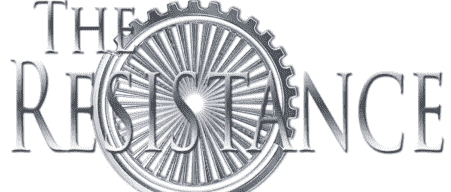
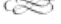
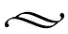
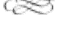
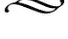
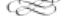

# 反抗者（仿生学小说2）

- 关于作者
- 艾莉西亚·迈克尔斯的其他作品

# 第一部分：火花

## 第一章

**布莱丝·索**
复兴反抗军总部
4010年10月1日
上午8:00

清晨的空气清新凉爽，脚下的草地弹性且潮湿。当我奔跑时，水滴落在光光的小腿上，令人心旷神怡。我的高马尾左右甩动着，挠着我的后脑勺。我专注于呼吸，胸部起伏着，让肺部充盈着清新的晨气。“狗狗”以稳定的步态在我身边小跑，它的爪子在地上轻轻踏着。

在过去的六周里，我每个早晨从反抗军总部的一端跑到另一端。那里恰好是四英里。我感激每天季节的更迭，即使那只是一个电脑程序。这种感觉——在某些方面——我们仍然是世界的一部分，这很好。当我跑步时，只有我和狗狗，我可以假装一切都没有发生变化。我几乎可以想象出我在亚特兰大的居住社区，那里有一个和我现在跑步的地方非常相似的公园，周围环绕着松树。我可以想象脚下踩着枯松针的沙沙声，并在鼻腔里闻到它们的香气。那里没有反抗军，没有复兴军，也没有邪恶的总统。宪兵（`MPs`）没有理由怀疑一个带着狗去跑步的小女孩，他们甚至懒得多看她一眼。

没有了达克斯，不再用那种交织着友谊、欲望、渴望和爱的情感困扰我。没有了杰妮卡，不再用死死的眼睛盯着我，静静地哀悼失去孩子的痛苦——那是由于我们社会的残酷本性而被迫进行的流产。没有了奥莉维娅，她的夜噩魇并不输于我，她日渐消瘦的身躯每天提醒着我们是如何辜负了她。没有了盖奇……

事实上，即使在现实中，也没有了盖奇，因为他不在了。他走了是因为我投下了那张腐朽的票。别误会——我会毫不犹豫地再次这样做。

现实比我的幻想要残酷得多。在现实中，复兴军依然非常活跃，作为相对，反抗军也是如此。宪兵永远不会把我仅仅看作女孩。他们恐惧我，恐惧我所是的样子，以及我可能变成的样子。现实是，达克斯每天都在这里，不断提醒着我的缺陷，以及无法像他们值得那样完全地爱任何人。在现实世界，奥莉维娅和杰妮卡只是他们昔日的躯壳。前者蜷缩在内心，逃避了世界；后者则用她所拥有的所有毒液和恶意进行反击。

无论我多么想去想象一个事情发生得不同的平行现实，我总会被拉回到现在。无论我跑得多快、多用力，我都无法逃离盖奇。他的缺席比他的存在更折磨，而我本以为是相反的。我以为通过送走他，我终于能把那些不安的情感抛在脑后。愚蠢地，我假设不需要看着他那双漂亮的蓝眼睛，面对他时我就不再是情感的奴隶。通过将他从生活中剔除，我可以停止感到如此巨大的痛苦。我更喜欢麻木的时候，那时什么也无法动摇于我，因为我筑起了墙，保护自己不受一切侵害。

但随后达克斯吻了我，并告诉我他爱我，而盖奇让我觉得自己再次像个正常人。他们在一起让我忘记了。但我打算再次忘记。我想记住那些让我变得麻木的痛苦，记住我为什么要避免这类复杂的情况，以及为什么我独自生活更好。至少，在我生命中……我将永远记得。

“准备好了吗，狗狗？”当我们到达半程时，我喘着粗气问道。该回头了。狗狗跟着我转弯，我们跑了起来，保持着稳定的节奏，汗水从我的脖后流到肩胛骨之间。在最后一英里我全力冲刺，我知道我会开会迟到。我们今天有一项任务，我不打算错过它。我需要一些新鲜空气和刺激，可能还要踢几个宪兵的场。或者，几个被弃者的场。哪种都行。距离我们上次巡逻已经一周了，时间挺够的。我希望有更多时间。任何能把我从这种低落中抽出来的办法。

当我到达莫斯利大厅时，我在台阶上停下，双手撑在膝盖上，努力平复呼吸。

“嘿，布莱丝。”

我抬头看到劳拉·罗森伯格正结束完自己的跑步回来，对我笑了。

我好几次看到他走过来，就绕了另一条路，我能感觉到他那受伤的目光落在我的背背上。那种感觉像被鞭子抽一样刺痛，但我永远无法强迫自己面对他。面对他意味着，在我们最后一次交话后，我必须直视他的眼睛。想起这些，我内心充满了羞愧。

盖奇才离开了整整两周，而我设法到了珍妮卡私藏的烈酒。她只在特殊场合才会拿出来，比如我们为反抗军的小胜利干酒，或者在某人的生日时。但她不会放过任何一瓶，而我需要醉醉。我需要帮助让自己麻木，直到我能完全独自应对。酒喝了一半，脑海中涌入的思绪和情感让我头晕眼眩，这时，达克斯找到了我。

“珍妮卡会杀了你的，”他笑着说道，将沉重的身体靠在我床的另一端。我靠着床头，他靠着床尾，我们面对面，沉默中来回传递酒瓶了一会儿。“那么，”当瓶底只剩下最后一口酒时，他说，“我有东西要给你。”

他从口袋里掏出一封白色信封，上面用工整的笔迹写着我的名字。我接了它，皱起眉头。“一封信？”

达克斯点头，垂着眼睛盯着他折叠在膝上的手。“是盖奇的。我想在交给你之前，他需要时间冷静一下。他在离开前把它给我的。”

我立刻松了手，任由它飘落在地板上。我抓起酒瓶，喝下了剩下的酒。更多，我需要更多。我开始重新有了感觉。“不，谢谢。”

他叹了口气，在床上坐起来，向我靠近。“布莱特，你们在华盛顿之间发生了什么？”

我耸了耸肩。“没什么重要的。我不想谈这个。”

当我们第一次从华盛顿的任务回来时，如果我以为达克斯知道盖奇和我发生了什么，我根本不在乎他是否生气。因为那时我正处于云端，皮肤上还残留着盖奇欢爱后的光彩。现在……现在，我是在乎的。我在乎，是因为达克斯从一开始对盖奇的判断就是对的，而我太信任他了。我太信任了，结果却伤了心。现在，我永远毁掉了可能和达克斯在一起的机会。在知道我选择了别人而不是他之后，他怎么可能还爱我？

“我也不在，”他缓慢地说，“因为如果我所想的真的发生了，那会比现在更让我难受。光是想到他吻你、触碰你、靠近你……”他的声音消失了，避开了我的目光。“你选择了他。你为了他放弃了我。我也没法生气。你告诉过我不介意，而且你需要空间。我想你已经想通了。”

当笑声出现时，我不禁笑了起来。它就像呕吐物一样喷薄而出。等我的肩膀停止颤抖，胃部不再抽动时，达克斯正盯着我，像在看一个疯子。“你不明白，对吧？”我冷哼一声问道。“我做了一个选择，但那是错误的。选择盖奇是因为我想……我以为……”

我的声音戛然而止，低下了头，泪水夺眶而出。我的头发垂下来遮住了泪水，达克斯比任何一个人都清楚这一点。他握住我的手并将其举起，用手指擦掉泪水。

“你选择了他，而他伤害了你，”他替我说了下去。“我不认为他是故意的。但如果他还在这里，我会教训他的。”

我流着泪水微笑。“我本该把你关在牢里五分钟的。那会让我感觉好受。”

达克斯把我的头发别到耳后，吻了我的额头，让一阵知觉感蔓延在脸上。他是怎么做到的？仅仅一个触摸就让骨头都变软了？为什么我总是这么糟糕，无法接受并让他爱我？

“什么能让你感觉好受？”他问。

“这个，”我回答道。“只要你在，我就感觉好多了。达克斯，你对我太好了。”

他托着我的脸，眼睛盯着我。“你值得。你值得得到比生活中那些人给予你的更多。我试图给你所有的时间，但你一直在拒绝。”

“我不是故意拒绝你，”

接着，那个磁性的笑容出现了。“我知道。这就是为什么我很坚持。因为总有一天，你会用你那厚脸脑袋想明白的。然后，也许你就会让自己获得幸福。”

我的手覆在他身上，在床上向他靠近了。“达克斯，我——”

话还没说完，他就吻了我，双手托住我的脸。他的嘴吻在我的唇上很轻，像羽毛拂过一般，每当我闭上眼睛时，我不自主地想到了盖奇。我无法从脑海中抹去那一刻：他把我放在硬地板上，瓷砖贴着我的背，低声唤着我的名字。我无法忘记他触碰我的皮肤，轻柔而甜蜜。

为了从脑海中剔除这一切，我紧抓住达克斯，加深了吻，舌尖掠过他的口腔。他在触碰中呻吟，手指插进我的头发里用力，动作大得有些疼痛。这将我从背叛的记忆中惊醒，并将我解救。

这种想法很痛苦，但它是事实。雅斯敏（`Yasmine`）经历了这么多，却依然展现出了作为一个普通人的人的卓越能力。她可以大笑、可以交友、可以恋爱。而我在情感上是如此迟钝，这些事情对我来说感觉是不对劲的。我唯一一次尝试去大笑去恋爱……结果，我得到了一个骗子当男朋友，那段关系只持续了几天，最后以我彻底把他踢出我的生活而终结。

既然你那么讨厌他，为什么停不住想他呢？

走进淋浴时，我闭上眼睛，当热水洒在身上时，我摇着头，试图让那些嘲弄般的情绪抖落。顺着我赤裸身体流下的水提醒我想起盖奇（`Gage`）的手指，修长而灵活，亲密地触碰着我。想起他在那些让我脸发烫的地方出现，我不禁颤抖起来。一个吻得如此热烈的嘴巴，怎么能撒谎得如此容易？看来盖奇是个多才多艺的人。

他的最终目的是什么？在过去的六周里，我问了自己无数次，这简直一点都不好笑。为什么像盖奇这样的人要溜进反抗军？我们过去曾有过别人试图获得我们信任的经历，结果他们带着军事警察（`MPs`）火枪乱溅地冲进其中一个据点。结果从没有好过。盖奇是总统之子的这一事实让事情变得更糟。他能够进入总部，并和教授（`Professor`）以及杰妮卡（`Jenica`）并肩——她是美国最通缉犯犯。他靠得太近了；不是离我，而是离我们中的每一个人。

“他已经走了。结束了，”我走出淋浴间擦干身体大声对自己说。我需要这个提醒，因为现在有太多更重要的事情需要担心。我们最新的任务。我迫不及待想出去做点什么，所以我希望那是个不错的任务。

伸手进梳妆台的最顶层抽屉，我的手指摸到了塞在袜子下面的信封。在达克斯（`Dax`）那天晚愤怒地离开我后，我从地上捡起盖奇的信并把它塞进了抽屉。我还没有打开它。我内心的一部分很想知道里面是什么，而另一部分又想把它撕碎。把它留在这个我看不见的抽屉里似乎是个公平的折中。我还没有准备好决定哪一个。

把信封放回原处后，我匆忙穿上衣服，套了一件背心和卡其工裤，外面再套上保暖服和我那件臭名昭著的口袋外套。那是我父亲服役留下的，一件难陋的橄榄绿色东西，胸前的拉链闪着光。里面有一枚代表他退休时军衔的章。在每一次任务中，我都把它贴在胸口，贴近心脏。它提醒着我战斗的。不仅是为了正义，更是为了复仇。

### 两年前……

我本该逃的。现在当我跪在家里前草坪上，手枪枪口抵着我的太阳穴时，我意识到。留下来是我人生中最大的错误之一。无论我父母说什么，我本该直接离开的。那里有一条地下铁路，一个想要帮助比斯（`Bios`）逃亡的人网络。我知道这件事，但还是没有逃。

“我们是一家人，”我爸爸说，“我们会在一起。”

我妈妈同意了。生机人（`Bionics`）在政府决定我们因为与众不同而危险后正被猎杀。他们创造的这项技术，现在他们感到恐惧，我们每一个人的背后都背着目标。一个刚从高中毕业、住在郊区的十七岁女孩，也不例外。

袭击在没有任何预警的情况下降临。军事警察开着悬浮车，现在排满了街道，当军官撕扯囚犯时，他们打开舱门等待着。被离子手铐锁在一起，在袭击中被捕的可怜灵魂们看起来很惊愕。如果他们像我一样，他们可能很难相信这真的在发生。尽管我们在新闻上看到过、听过传闻，但我们从未真正想过这一刻会到来，就在我们自家的前草坪上。这一天热得令人无法忍受，却美得令人作呕。无云的天空呈现出完美的蓝色，太阳在头顶炙烤，导致汗水顺着我的脸和脖后流下。

“求了，”我向站在面前的士兵哀求，他的头盔面罩被推了上去，“带走我放了他们。他们和这件事没关系。”

不远处，我父母趴在地上，双手反扣在身后。我的小妹妹跪在他们身边抽泣，脸埋在手里。那个现在我知道是执行者小队的罗德尼·琼斯上尉（`Captain Rodney Jones`）的士兵轻蔑地看了我一眼，然后朝地上吐了一口唾沫。他的口水离我只有几英寸。“小姑娘，你知不知道关于藏匿生机人的法律及其后果？”

我点头，泪水从我人类的眼睛里流出。我的心在胸腔里剧烈跳动。“是的，但是……这些人并没有藏匿我，”我说，“我每晚都溜进溜出他们的地下室找地方睡觉，仅此而已。他们完全不知道我在那里。”

“真的吗？”他的语气告诉他不相信我说的每一个字。他走向我躺在地上的父母。他抓起我妈妈那头漂亮的、小麦色的头发用力拽，强迫她抬起头。她尖叫起来，我父亲在束缚中挣扎。

“住手！”他大吼道，宽阔的肩膀在手铐下紧绷。汗水从他深色的额头上流下，他的眼睛眯着，充满了杀意。“放开我的妻子和女儿，”他说，语气异常冷静，“你们需要对付的是我。我。”

他被一个巨大的黑色人影——一个男人——撞倒在地。那个男人面色阴暗且危险，皮肤在阳光下像乌檀木一样闪着光泽，眼睛深邃、冷酷而犀利，他在踢向琼斯胸口后，将一根尖利的白色木栅栏桩刺穿了杀害我妹妹的那名卫兵的面罩。转瞬之间，他将我拥入怀中。尽管我已经麻木了，但一种感觉依然存在。安全感。我是安全的。当我看着那双充满怜悯和悲伤俯视着我的深色眼睛时，我深知。他在逃离现场时将我的脸按在他的胸口，防止我看向散落在我家草坪上的尸体。就在这一天，达克斯·贾纳（`Dax Janner`）将成为我生命中永久的一部分。

## 第二章

**布莱斯·索（`Blythe Sol`）、达克斯·贾纳（`Dax Janner`）、雅丝·扎姆布拉（`Yasmine Zambrano`）、劳拉·罗森伯格（`Laura Rosenberg`）、赛耶·斯特罗姆（`Sayer Strom`）、杰妮卡·斯旺（`Jenica Swan`）以及内维尔·辛克利教授（`Professor Neville Hinkley`）**

抵抗组织总部，辛克利教授办公室
4010年10月1日
上午10:00

所有人都在那里，坐在教授办公室旁会议室里那张长长的、闪光的钢桌旁。我在淋浴室留得太久了，现在我是最后一个到的。每个人都点头或低声打招呼，除了达克斯外，他甚至没有看我一眼。他坐在雅丝旁边，头低着向她。当他在她耳边耳语什么，雅丝咯咯笑起来时，我的血沸腾了。嫉妒像飓风一样席卷了我。并不是因为我讨厌雅丝，而是因为她像我支破碎的我那样完整。我真愿意付出一切，只要坐在达克斯身边表现得那么开心。如果我能，也许这一切永远不会发生过。而且，她占了我的位置。

我耸耸肩，滑到杰妮卡旁边，她占据着桌首的老位置。她穿着惯常的那套从头到脚全黑制服，她偏爱的飞行服贴着她完美身材的每一处曲线和凹陷。我禁不住瞥了一眼她的腹部，心想她怀孕会怎么穿。这个念头让我喉里涌起酸水，胃里翻江倒海。

“你能光临真是荣幸，索，”她站起来时刻薄地说道。

我张着嘴看着她，房间里陷入了沉默。会议定在上午十点，而我准时到了。我提醒自己杰妮卡现在正经历着艰难时期，低下了眼睛。只有我和盖奇知道医务室发生了什么，而现在他走了，除了教授之外，我是这里唯一能给杰妮卡提供应有的理解和哀悼空间的人。换做平时，我会回一句讽刺的话，但现在我闭了嘴。

“我们已经拖延够久了，”当我没有回应时，她双手背在身后说道，那双眯起的深色眼睛——一只是人类的，一只是机械——扫过房间里的每个人，最后停下来，“是时候处理‘被拒绝者’（`Rejects`）的问题了。”终于。他们挡了我们太多次道，并且成功完成了让所有生化人（`Bionics`）看起来都像疯子一样的任务。至于任何理智的人都能在英里外看出他们之间的区别，这似乎并不重要。当政府和媒体在人们脑子里充满了为了煽动情绪的谎言和荒谬主张时。

杰妮卡用她的小遥控器指向背后的平板板。她又按了一个按钮，内置在桌子上、个人大小的小型屏幕在底座的支撑下在我们面前升起。“被拒绝者”的领袖巴隆（`Baron`）填满了我们的屏幕，他的声音在会议室的墙壁间回响。

“美国公民请注意，”他说，声音带着欺骗性的光滑和平。我比房间里的许多人更清楚，表面之下涌动着多么狂疯狂。“你们现在看到的是你们新统治者的脸。”他停顿了一下，为自己的小笑话笑了，“不认识我的脸吗？不用担心……很快，你们就会认出你们的神，德鲁蒙总统（`President Drummond`）。你们曾崇拜他为英雄，赞美他在4006轰炸后将破碎的世界重新结合。然而，你们忘记了那些为了让他达到高位而被践踏的的人。他的成名之路铺满了无辜者的尸体。”

“他说得对，”我不确定是谁在低声嘀咕这句话，但杰妮卡看起来并不愉快。她示意保持安静，我们将注意力转回屏幕。“但正如古老的宗教典籍所说，谦卑的人将承受地土，”巴隆继续说道，他的眼睛盯着镜头。我颤抖着，感觉那双眼睛正俯视着我的灵魂。“现在对一个迫害我们的人的崇拜，将让你们付出代价。生化人正走出藏身，我们来找你们。在你们的工作场所，在你们的家里，在街道上……没有人是安全的。作为对我们所罪行的惩罚，我们正在夺回我们的世界。我们不再满足于逃跑和躲藏，从阴影中爬出来夺回世界。不要误会——我们并不打算仁慈。你们对我们的对待将被十倍地回到你们身上。我会把你们的头撞在构成城市地基的石头上，我会恐吓你们的孩子并杀害你们的妻子，我会从白宫带走你们并处决他。你们看到，人类到达了一个进化的点。生化人是优越种族，当这个腐败的社会被一块块砖地拆除时，我们将是幸存者。新时代的黎明就在你们身上。上帝怜悯你们的灵魂吧，因为我并不打算如此。”屏幕黑了，巴隆消失了。当我再次抬头时，房间里的每个眼睛都盯着杰妮卡。表情从愤怒、震惊到悲伤和沮丧。我们该怎么办？巴隆和他的那群变态证明了总统是对的，让每个人相信我们真正想要对美国完全统治。这与事实完全不符。

“他们找到了一种绕过卫星频率的方法，”在大家吸收信息后，杰妮卡说道，“那段短视频广播到了美国的每一个家庭和工作场所。没有谁见过它，并且现在没有那么害怕我们。”

“他在捅马蜂窝，”教授在桌子另一头温柔地说道。他的卷发直了起来，我看出他一直在揉搓双手。圆眼镜后面是一张十分和蔼且英俊的脸。眼角的鱼尾纹和嘴角的笑纹比平时更深。和这些“被拒绝者”纠斗对他这个从未想要和平的人来说太艰难了。“他正在发动战争。”

“是的，”杰妮卡赞同，指向她背后的平板板，那里正在播放更多的画面，“在过去的二十四小时里，这段画面一直在播放。”

我们看着巴隆和其他被拒绝者在高大、无色的建筑间的街道上聚集。他们全副武装，黑市生化人被武器化，让他们具有致命的危险。远处爆炸声此起，枪声几乎掩盖了被屠杀的人的哭声和尖叫。卫兵来保护民众，但他们直接面对了一群半机械变异人。我的生化手紧握住面前的钢桌。我听到金属发出抗议的吱呀声，看着巴隆从一辆悬浮摩托跳下，用他的金属圆头撞碎了附近一名卫兵的面罩。他再次用头撞那家伙，导致他的脸塌陷，溅出鲜血和血肉。踢开尸体，他加入了另一组被拒绝者，翻转了一辆半卡车的拖车，几个人躲那里躲避。一个手臂上带着喷火器的“被拒绝者”在撤退时点燃了他们。

有人呕吐着向门口跑去。她的眼睛，我知道她在想被点燃是什么感觉。在大部分皮肤被换成凯夫拉纤维补片后，她比我们任何人都更清楚。达克斯的手盖住她的手，安慰性地捏了捏，泪水顺着她的脸流下，嘴抿成一条线。教授震惊得甚至无法看那些图像。我低头看，发现我抓坏了面前的桌子直到它几乎无法辨认。松开手，我把它放在腿上。

> “那段画面来自弗吉尼亚州的一个小市利斯堡（`Leesburg`）。被拒绝者昨天早上袭击了那里，攻击沿路遇到的任何人。直到昨晚，他们占领了该市并守着自己的防线。他们发布了网络视频片段展示了这段堕落疯狂的故事，并承诺在每个城市、每个州发生更多。”

> “怎么可能？”劳拉在桌对面问道，她胸前的钛板在白色背心下闪闪发光。“被拒绝者是一小群恐怖分子。”
>
> “他们的人数并没有我们以前想象的那么小，”杰妮卡反驳道，“最新情报估计他们已经达到了数千，并且随着抵抗组织的成员厌倦了我们的办事方式并倒向另一方，人数仍在不断增长。我们的任务是去利斯堡并拯救那些人。”

美国多个城市正遭受着袭击。一旦利斯堡（Leesburg）获得安全，我们的任务就是保护目标区域的公民，并弄清楚他们到底想要什么。

达克斯的拳头砸在桌子上，导致桌面上的通讯设备和水瓶震得嗡嗡响。他站起身，六英尺四英寸的高大身躯在闪发光的钢甲上投下了一道阴影。“还不够，”他咬着牙说道，“我受够了总是处于防守状态然后胆战如冰。现在是战斗的时候了。他们必须知道我们和他们不一样！”

杰妮卡（Jenica）越过桌子盯着达克斯，对他那表现出的荷尔蒙爆发丝毫不畏惧。“我们的名誉和形象在这里不是问题，詹纳，”她冷静地说道，“那些被‘拒绝者’（The Rejects）恐吓的可怜民众。你想证明我们比他们更好吗？我们就是这么做的。

“为什么？”达克斯反驳道，“为了让他们能伪造视频，让我们看起来像是和‘拒绝者’勾结在一起吗？为了让他们让美国人认为民兵卫队（MPs）是这里的英雄吗？我们正中了男爵（Baron）的下怀！”

达克斯激昂的辩论引发了一场风暴。房间里爆发了激烈的争吵，每个人都试图盖过别人的声音说话，有人支持达克斯，也有人支持杰妮卡。杰妮卡迈着长腿，三步就跨到了房间的另一侧。她不得不仰视达克斯，这一事实甚至根本不是问题。

“詹纳，我们之间是有妈的麻烦吗？”

房间安静了，所有的目光都滑向了杰妮卡。她可能是个硬骨头，但从未见过她失去冷静。她的声音里带着一种新的锐利感，仿佛她下一秒就会把达克斯劈成两半。尽管达克斯块头长得那么大，我还是赌杰妮卡赢。

“杰妮卡，”教授温柔地说，“放手吧。”

“不，”她厉声断道，“詹纳觉得他比我更有资格领导我们的士兵。告诉我，达克斯，你在军方情报部门工作了多年？”

达克斯的下颌紧得我觉得可能随时会断裂并崩碎他的牙齿。“没有，”他咆哮着，用他那双深色的眼睛紧盯着杰妮卡。

“中情局（CIA）？”

“没有。”

“干过 FBI 吗？”

“没有。”

“除了你作为毒贩的过去生活，你为这个抵抗组织牺牲了多少？”

“现在等我妈的一下——”

“不，”杰妮卡插话道，“你等。在我把你踢出小队之前闭嘴。在你能就任何与这次行动相关的事情提到我或辛克利教授（Professor Hinkley）的经验之前，听我的，否则你就可以出门走蛋。”

达克斯气得浑身发抖。愤怒的力量从皮肤散发出来。他的双拳握在身体两侧，几乎在颤抖。我看得出来，在大家面前克制自己快要折死他了。

“清楚了吗，詹纳？”

两人又对视了几秒，达克斯才点了点头。“是地，”他说道，沙哑的声音紧张而吃力，“非常清楚。”

他没再说一句话，转身大步走出房间。他穿着战术靴的金属脚很沉重，在脚下的地板上发出响亮的“哐当”声。杰妮卡将锐利的目光转向我，皱起眉来。

“去追他。”

我猛地抬头，眼睛飞快地看向雅斯明（Yasmine）。她，和所有人一样，正期待地看着我。

“我？”我当了达克斯的训练师吗？他不是条狗，我不喜欢被派去让他服帖。”

“对，就是你，”杰妮卡没地地说，显然还在生气，“你是这里唯一听得话的人，而我们需要他执行这次任务。”

这本该伤到我的感情，但并没有。“而且有时候你太情绪化了，”我反驳道，“你在那儿失去了理智。”

达克斯耸了耸肩，捡起随手丢掉的背心，套在身上，盖住了那些迷人的肉体。“珍妮卡知道我绝不会错过这次任务的。即使我不同意她的方法，我仍然加入。她是错的，你心里很清楚。”

他坐在旁边的长凳上，将毛巾搭在肩上。我坐在他身边，把肘支在膝盖上。“我知道。她是错了，但她永远不会承认的。这就是为什么我们需要你，达克斯。”

达克斯嗤了一声，用手抹了把脸。他看起来精疲力竭。“结果如何？”

“三个小组，每个小组一百双靴子。我是其中一组的飞行员。”

“我猜她是想让我和你一起带头冲？”

我点了点头。麻木。麻木。“是的。”

他叹了口气。“在那个金发娘出现之前，我们一直是一个很棒的组合。”

提到盖奇（Gage），我的喉咙收紧，感到恐慌袭来。我不能谈起他，不能在达克斯面前。我强迫自己压下情绪，清了清嗓子。我是麻木的。“我从未想过在我们之间产生任何隔阂，达克斯。我也从未想过让你觉得自己是个替胎。那天晚上我只是……醉了，困惑，而且愤怒。我只是想要某种能带走痛苦的东西，而你在那里，说着那些话，我失去了理智。我很对不起。”

“我知道。可悲的是，我比你更清楚。我知道你还没准备好。”他苦笑道。“我想对你所做的事生气，但这不是你的错。是盖奇的错。他伤害了你，这让他再次回到了我的黑名单。”

“是吧，不管如何，关于他你是对的。我希望……”

达克斯审视着我，眉头微锁。“什么……什么？你想要什么？”

我无法回答，因为我不知道自己想要什么。我是希望盖奇来过这里吗？我是希望达克斯从未告诉过他爱我吗？或者也许，我真正希望的，是达克斯那天让我死。那样我就能和家人在一起，而不是在这里为一个注定的失败而战，并试图学习如何再次感到正常。达克斯在长凳上向我靠拢，他的小指掠过我的。出于某种原因，那小小的触碰让我融化了，我向他倾倒，头靠在他的肩膀上。一如既往，他是我的依靠，我的慰藉。当他的头靠在我头顶时，他的气息入侵了我的鼻腔。

“知道我想要什么吗？”他轻声说。“我希望我们可以再次成为朋友。这种回避快要逼死了，B。”

我叹了口气。“是的，我也是。我只是不知道该如何……我以为你会生气的。就像你因为盖奇伤害了我而生气，我对伤害了你而愤怒。我从未想过那样。”

“我相信你。你不是那种故意伤害别人的人。让我们让过去过去，好吗？我们有奥利维娅要担心，有任务要处理，还有一大堆其他问题。”他转向我，伸出手。

我笑了，把手放在他的手心里。回到生命中那个正常且恒常的人身边感觉很好。“朋友。”

在他松手前捏了捏我的手。“很好。我刚以为我要踢你屁股了。”

我笑了起来，这是几周以来第一次真心的笑。“我们都知道你赢不了我。太大也太慢了。”

达克斯在我们站起身时脸抖了一下。我捡起衬衫和外套。“噢。好吧，如果我赢不了你，那我就叫我的女孩来！”

话在他来得及阻止之前就脱口而出，我睁大了眼睛。“你的什么？你刚才想说女朋友对吧？”

他清了清嗓子，在我穿回衣服时不安地挪动了一下身体。“呃，是的。我的意思是，她并不真的……我还不确定，好吗？”

我笑了，安慰地把手放在他的手臂上。我用尽了意志力来压制胃里作作的嫉妒。在内心深处，我不确定是因为达克斯而嫉妒，还是因为我和盖奇那段失败的感情让我满嘴苦味。“她是个很好的女孩。你找没比更糟的。”噢，真是讽刺。他确实找了更糟的——当我选择时。

“你觉得吗？”他问。“我喜欢她，你知道的？目前仅此。”

“没关系。我为你感到高兴。”

当我们一起离开健身房时，我意识到我是真的这么想。在我们生活的这些黑暗时期里，幸福并不来得容易，也留不住多久。最好的办法是在发现它时抓住它。仅仅因为我似乎拼命也留不住它，并不意味着我不希望达克斯幸福。在他为我所做的一切之后，我竭尽全力祝他幸福。就是这样。这就是我的愿望。

## 第三章

### 布莱德·索

莫斯利大厅，复兴抵抗组织总部

4010年10月2日

凌晨1:00

破碎的玻璃碎片在我的眼前跳跃，像是一场扭曲、死亡的芭蕾。轮胎的刺耳声和橡胶烧焦路面的气味入侵了我的感官，时间仿佛变慢了。我是倒过来的，窗外的世界在倾斜、移动。Skyye的手紧紧抓着我的手，她的嘴在尖叫中张开，我们的SUV在路上翻滚、坠落。我这一侧后座的门飞了，通过那个巨大的空洞，我现在可以看到悬浮在曾经的亚特兰大繁华市中心上方的蘑菇云……

我被尖叫声从睡中惊醒。当我挣扎坐起来时，只花了一点时间就意识到那些尖叫不是我的。

奥利维娅。

我从床上跃起，对我刚刚踩到的狗嘟囔着道歉，去拿了一条运动裤。在棉质内裤外套上运动裤，再在背心外套上一件连帽衫，我离开了房间，赤脚快速而安静地走在走廊上。

奥利维娅点了点头，泪夺眶而出，她瘦骨嶙峋的身体在我的怀里颤抖。

接着，她突然大笑起来。“结束了吗？”她在混乱的情绪中大哭道，“你以为结束了吗？这永远不会结束的！他们就在这儿，永远都在这儿。”

“不，奥利维娅，”雅斯明说，她在达克斯身边跪下，去摸她的手。奥利维娅瑟缩了一下，但随后用手指扣住了雅斯明的手。在雅斯明深色肤色的映衬下，她的皮肤近乎透明。“他们不在。他们再也无法伤害你了。”

奥利维娅再次大笑起来，声音在寂静的房间里听起来幽灵而令人作呕。“但他们确实在这。他们在这里，切断我的手，在我身体里掏挖，夺走我的器官。你知道我的肠子长到横跨整个房间吗？因为我清楚……我见过它们。它们让我一直无法入睡，你知道吗。我瘫痪了，但意识清醒，看着他们偷走了我的肾上腺，直接从我的肾脏上撕下来。”她再次笑道，“它们消失了吗？不，你们这些笨蛋，他们一直都在。叫着我的名字。‘闭嘴，你这个婊货，安静点！’他们在这里看着我，殴打我，在我双腿之间……他们一直在这里。我会带着它们一起进坟墓的。”

我的目光与雅斯明交汇在一起，她所描述的恐怖景象直击我们的心胆。达克斯依然盯着奥利维娅，嘴唇紧成愤怒的一线。教授能够为她更换仿生手和肾上腺，这并不重要。她在自己舒适的家里已经待了六周，而且她所有所爱的人都在这里，准备好不惜一切让她好起来。我们所认识的那个奥利维娅已经消失了，她再也不会回来了。当那些来自石头的混蛋在凌虐她时，他们把她夺走了，随后在手术台上将她撕成碎片，并对她施加毒打。在一次深夜突袭中，她提到过他们向她体内注射肾上腺素，这样在切除她的肾上腺导致肾上腺素流失时，就不会让她的器官在被殴打时陷入休克。他们靠这些药物兴奋，这样就可以在不杀死她的情况下进一步虐待她，因为他们想在全世界面前处决她之前，让她先受苦。

想起恢复执行者首领杰克逊警官的脸，我充满了愤怒。这是他的所为，那个当着我的面处决了我家人的男人。达克斯的眼睛迎上我的眼睛，我知道我们都有同一个想法。

那个混蛋必须死。

花了几个小时才让奥利维娅重新入睡，而那时，是时候为我们的任务准备了。我们三个人留在了奥利维娅身边，没有人愿意让其他人单独留下她。当奥利维娅陷入那种臭名昭著的发作时，尽管身材瘦如柴，力气却大得惊人。在闪回的痛苦中，她会忘记自己是谁，并曾在试图自救时伤害到他人。

我们离开她的房间后，各自分头去准备任务。匆忙穿上我的银色飞行服后，我从外套上取下父亲的别章，把它别在飞行服的高领上。当我看着镜子里的自己，整齐地将头发向后梳成一个紧紧的发髻时，金色的别章在脖颈处闪闪发光。我没有费力戴上教授为了掩盖仿生零件制作的聚氨酯手套或特殊隐形眼镜。这次任务不需要我隐藏，而在不需要的时候我拒绝这样做。当我们努力拯救这些人时——这些迫害并排挤我们同类的人——我想让他们看到，我们并不是敌手。达克斯是对的。他们必须知道我们是什么身份。

在离开房间之前，我在门口停顿了一下，确保自己没有忘记任何东西。我的顶层抽屉开着，盖奇寄来的信正露出来看着我。密封信封那挺拔、洁白的边缘在挑衅着我。我哼了一声，冲进房间，准备好用力关上抽屉。纸张擦过我的手，我从袜子下面把它拿起来，终于准备好把它扔进垃圾桶。相反，我把它塞进了腿部的一个口袋里。为什么，我不知道，但我不想为此纠结太久。

准备好后，我从我的私人物资中拿了一个蛋白棒和一瓶水。在冲向机库时，我一边吞下蛋白棒一边灌水，杰妮卡要求我们在比定时间早一小时在那里集合。检查我的通讯设备，我看到我早了十分钟。很好。我不想给杰妮卡任何对我发火的理由。我们最大、最好的飞行器停在停机坪上准备就绪，每组百名士兵整齐地排列在他们被分配的飞行器旁。

杰妮卡站在“内维尔一号”的机头附近，检查着她的飞行前清单。

“索，你负责‘伊卡洛斯号’，”她说，几乎没有从写板上抬头。

“太棒了，”我一边走向中间的那架飞机一边低声说。伊卡洛斯是我加入反抗军以来开过的飞行器中最喜爱的。我和伊卡洛斯之间有一段历史。在我读高三时，军警飞行员把这架飞机带到我的学校。为了招募即将毕业的毕业生，为了炫耀。军警向我们介绍了他们工作的各个方面。这是在轰炸之前，那时我还是一个未来。我想成为一名军警，像我父亲一样为国家效力，戴上那种闪闪发光的别章，携带武器。我想骑悬浮摩托，学习驾驶飞行器。我想成为一个英雄。

那个讲座的军官还带了几辆政府车辆来炫耀。讲座结束后，我们走出礼堂来到校园草坪。他允许几个学生轮流骑他带来的悬浮摩托。然后我们轮流参观伊卡洛斯号的内部。当我坐在伊卡洛斯号的控制台前，手滑过油门时，我感到一阵兴奋传遍全身。我告诉自己，有一天我会驾驶伊卡洛斯号。

当达克斯和我第一次发现反抗军总部时，杰妮卡带我们参观了。她告诉我们，如果我们想加入战斗，就会成为经过训练的士兵。达克斯的背景和我的柔道黑带仅仅是基础。课程结束时，我们学会了如何驾驶、飞行和射击所有的车辆和武器。

人们纷纷散开让路。几名机械师瘫坐在地上，他们刚才在试图控制局面时被撞倒了。是奥利维娅。

她在我面前停下，金色短发在脸边凌乱。她平时那件紧贴身的飞行服现在松松垮垮地挂在她消瘦的身体上。

“有人忘了给我发派对邀请函吗？”她问道。我看得出她只是在开半玩笑。奥利维娅对我们排挤她感到很难过。

我不确定该对她说，所以当杰妮卡出现时感到庆幸，她正有力地走上我飞行甲板楼梯。“麦纳布，你还没有获得任务许可，”她说。

奥利维娅双臂交叉放在肩膀上，死死盯着杰妮卡。“那就批准吧。”

“我们每支船队都有一百名飞行员。没有位置了。”

“那就踢掉某个人，”她咬牙切齿地道。

杰妮卡坚持立场。“抱歉，但你这次只能旁观了。如果你想参加下一次任务，就去通过医疗和心理评估。”她转身离开，没有回头，那头笔直的黑色马尾在肩间甩动。“出发，索尔！”

我投去同怜的目光。“对不起，”我低声说。虽然我是发自内心的，但我禁不住感到庆幸，这次任务不需要照顾奥利维娅了。经历了昨晚之后，很显然创伤还没有消退。即便现在，站在我面前的她也睁大双眼睛，左右张望，防备着来自任何方向的攻击。她伸手抓住我，瘦骨嶙峋的手指抓住我的手臂，考虑到她变得如此瘦小，力气大得惊人。

“你可以把我藏在船上，布莱德。杰妮卡永远不会知道的。求你了。”

她的声音充满了绝望，我几乎因为怜悯她而想要答应。但随后我想起昨晚为了不让她伤害自己而抱着她，于是下定了决心。

“去检查一下，奥利维娅，”我说，“快点好起来，这样才能回到队伍。”

我掰开她手臂上的手指，让她的手垂回身体两侧。当我慢慢向飞行器走去时，她盯着我，我不忍让她就这样这种状态独自离开。当看到医务室的几名护士朝我们走来时，我松了一口气。

“我要他们的血，”她低嘶道，双手在两侧握成拳头。“我要报仇。”

凯耶破碎、血淋淋的身体在我脑海中闪过，我在伊卡洛斯号的门口转过身。“我也是，”我低声说，看着护士们把奥利维娅带走。“我也是。”

“那是回事？”当我滑进驾驶座时，达克斯问道。我选择他和劳拉作为我的射手，他们正坐在我两侧的座位上。

“奥利维娅以为她能参加这次任务，”我系好飞行器的安全带时嘟囔道，“杰妮卡拒绝了。”

当我开始拨动开关时，达克斯摇了摇头。飞行器在起飞离开甲板前发出了轻微的嗡嗡声。我们是第二个离开，所以我等杰妮卡启动通往机库的圆形舱门，穿过峡谷岩石的内部，走向世界。内维尔号上升、转弯，然后冲了出去。我随其后。

“她也在想昨晚的事。然而，我不禁想，我们身上有多少奥利维娅的影子。老实说，我不知道如何熬过一天，更不用说在必须忍受我们这种人绝望处境的任务中了。真的，奥利维娅和我之间唯一的区别仅仅是外表。我内心的恐惧、消瘦、悲伤和空虚，和她外表看起来的一模一样。

前往利斯堡的飞行几乎占据了一整天时间。这是一个跨国飞行，我们必须采取复杂的路线，以避免被警察用来探测我们的传感器捕获。这意味着我们要飞过许多美国城市的荒凉废墟。从空中看，它们不再是环绕着死亡、绝望和半坍塌建筑的巨大陨石，空洞的窗户像在无神地凝视。看着它们很痛苦，但每当我们看去时，整个飞行器都会变得寂静，百双眼睛透过飞行器的小窗凝视着。无论过了多少年，无论他们展示多少次'06年炸弹留下的残骸和废物的影像，看着曾经是家的地方变得空无一人，并不会变得更容易接受。它只会提醒我们是如何走到这一步的。

下午四点左右到达利斯堡郊区时，我感到庆幸。温度下降了大约30度，但没有雪，阳光充足。阳光总是好事；警察可以戴着夜视头盔偷袭我们。在看到男爵折磨、残害和杀害军官的影像后，我不怀疑援军已经到达这里或在路上。通过耳机，我听到了杰妮卡的声音。

“索尔，我是天鹅，能听到吗？”

“收到，天鹅。”

“我先一步去侦察了该区域。看起来通往镇的所有主路都设了路障。从这里看，那里有人守着，但守得并不严密。我们渗透进去应该不难。主公路从东部进入市区。我会从那边过去。北边和南方有几种进入方式。你去北边，斯特罗姆去南方。市政厅大楼就在正中心，那是我们需要战斗进入的地方。人质就在那里。”

当我向北转弯，我皱起眉，眼睛已经在寻找从中心向外延伸的街道以找到入口。“收到，但我们为什么要步行进去？在市政厅附近着陆不是更容易吗？”

“不行，索尔。不要尝试在市区内着陆。情报显示‘被遗弃者’拥有几枚‘歼灭者’。我们不知道他们是否把它们带到了这里，但防患于未然。步行进去是辛苦路，但也是安全的路。收到吗？”

杰妮卡在这一点上说得对。如果有一枚‘歼灭者’在我们飞行器附近爆炸，我们会瞬间被粉碎。我们步行是为了避免一次性损失一百名成员。

“收到，天鹅，收到。现在向北移动。计划是什么？”达克斯问道。

“我喜欢你的思考方式，”劳拉赞同道。

“他们没料到，”达克斯勉强地说道。“选得好。”

“好了。”我让伊卡洛斯号减速，在系好安全带前将其设置为自动驾驶。我离开驾驶舱，走到过道顶端，我的百名船员正期待地看着我。他们的眼中交织着期待、兴奋甚至恐惧。“听着，大家，”我提高声音，让他们能听见。”

## 第四章

Blythe Sol, Dax Janner, Laura Rosenberg, and Yasmine Zambrano

弗吉尼亚州，利斯堡

4010年10月2日

下午 4:30

我们下方是由堆叠和被压扁的汽车构成的路障。在路障前方，叛逆者（Rejects）来回踱着。有些人栖在路障的不同部分，坐在汽车的引擎盖和车门上。有些人甚至在临时建筑物的顶部巡逻。根据他们的行为，我推测宪兵（MP）的援军还没到。他们处于高度警惕状态，等待着。

“伊卡洛斯”悬在他们上方，我们的隐形设备依然开启，我逐渐靠近他们。我的手紧了油门；需要我手臂上的每一块肌肉来控制这艘足以容纳一百人的飞行器。达克斯关闭了我们的隐形机制。我想让他们，以及其他人知道，我们正追捕那些叛逆者。

> “劳拉，准备好发射那些大炮。达克斯，留心观察任何落单飞行器或坦克。如果看到歼灭者——”

“我看到了，”Dax说，手放在他飞船一侧的武器控制杆上，“砰。”

我用余光瞥了一眼Yasmine。她是前排中离我最近的人。“告诉大家确保系好安全带。我们要开始垂直俯冲了。”

Yasmine重复了指令，我在推开油门之前给每个人留了整整三十秒时间，飞行器也随之倾斜。我们朝路障冲去，我紧握油门，手臂上的每一块肌肉都紧绷着，以完美的角度对准路障。

“准备好！”

劳拉点了点头。“准备好了。”

汗水从我的额头上渗，但我忽略了它。“1-2-3。开火！”

劳拉开火的同时，我猛地向左一拉，将飞器的机头拉向那个方向并平稳。随着飞行器的转动，劳拉的弹丸从大炮口喷射而出，炸碎了玻璃和金属。叛逆者立刻行动起来，像蟑螂一样散开，趴在地上躲避弹击。这艘飞行器里的弹药是老式的；这台机器上只有一个设定——杀戮与毁灭。

当劳拉进行横扫射击时，引擎燃起了火焰，目标主要集中在路障的中心。弹丸的冲击导致许多汽车从临时墙的位置上滑落，导致它们上方的车辆塌陷，杂物像金属玩具一样散落在地上。

“Dax！”

当我向右转时，他已经就位了。他飞船的一侧配备着弹药量更大的枪。我们只有几发弹药，但其中一个就能起大作用。现在我们已经削弱了路障，他可以用大炮炸出一个洞。Dax的武器随着“砰”的一声发射，弹丸划过空气撞击目标。随之而来的巨大噪音震耳欲聋，但当路障中间崩塌，堆叠的车辆成堆倒地时，我的小队脸上带着笑容。

Dax的另一声爆炸让汽车散落，在路障中开辟出了一条仅够我们走进去的通道。

几个叛逆者被压在车下或受伤，躺在附近。那些在墙顶巡逻的人早已消失，随着他们的路障在脚下崩塌而坠落。绕回几英尺后，我开始让“伊卡洛斯”降落。Dax解开安全带，劳拉也随其动作。Dax站在走道顶端，从背后的鞘里拔出武器。

“让我们大干一场，伙计们！”他的声音在走道里回荡。“一旦我们的起落架放下，迅速离开这艘飞行器。武器先行，其他人以紧凑的阵型跟上。我们已经穿过了路障，要散开，但要保持至少五个人。那些会攀爬或跳跃的人，去屋顶。利用你们的坐标前往市中心和市政厅。记住我们的首要任务。”

“利斯堡市民的安全，”Yasmine说道。Dax点了点头。他向前迈一步抱住她，将头贴向她的脸。“留在我身边，”他低声说，“当我们离开这艘船时，确保你紧紧跟在我后面。”

她点了点头。“好的。”

我试图避开他们在飞行器挡风玻璃上的倒影，但很难错过Dax吻在她额头上，那个轻柔的吻。我的胃一阵收缩，但我强迫自己专注于降落。一秒钟后一只手按在了我的肩膀上，从体型我知道那是他。

“准备好了吗，B？”他问。

我点了点头。“像我往常一样好，Dax，如果 Jones在这里……”

“那混蛋已经是虫饲了。”

“我知道，”他回答道。

想到这里，我充满了满足感，尽管我知道我们来这里并不是为了复仇。然而，一想起我的家人以及Olivia那受了惊且空洞的眼神，我无法假装看着Dax掐死他的命并感觉不好受。或者用我的枪射死自己。真的，这取决于我们中谁先到达他面前。

我翻过那排开关放下起落架，在距离路障几英尺的一处空地上停稳。一些叛逆者身上武器化肢体射出的激光和子弹已经在飞行器上反弹，而另一些则躲在汽车和冒着热气的金属块后，等待我们出现。一旦我放下舱门，迅速解开安全带，在走道顶端与Dax和Yasmine汇合。没有武器留在座位上，直到他们聚集在前方。

“那个女孩的屁股上插了根木棍，”劳拉调侃道，“我不会去惹那浑水的。”

即使在珍妮卡经历了了这一切之后，我知道我应该同情她。我确实很同情。但我禁在想，她对我们的领袖处于什么状态——如果有的话。她在会议期间的爆发让我怀疑她的稳定性。

“你说得对，”我赞同道，“让我们按计划前往市政厅。一旦安全了，我们甚至可能找到一些人，告诉我们这里哪种行业最重要。无论是什么，被遗弃者（Rejects）一定非常想要它。”

劳拉点点头。“我加入。”

“我也是，”雅斯明说。

“你们知道我也算，”达克斯补充道。

我点头，关闭了投影，将我的COMM设备挂回腰间。“好了，我们走吧。”

“等一下，”在我迈出小巷之前，劳拉说道，“让雅斯明和我带路。”

达克斯皱了皱眉。“不可能。”

“认真的，”雅斯明翻了个白眼说，“清醒点，达克斯。这很明智。”

“我的色膜是金属做的，而她的皮肤是装甲，”劳拉耸耸肩说，“把我们当成人体盾牌吧。”

达克斯不喜欢。我听到他低声嘟囔着类似的话，但他没有争辩。雅斯明先走了出去，示意一切安全。劳拉随其后，我们再次沿着街口出发。我们走了五个街区，尖叫声再次让我们停下了脚步。就在我们的路口。

“救命！谁来，救救我们！”

我们四个人背对背站着，举起武器寻找上方建筑的窗户。小队的另一组加入了我们。我们在一个公寓综合体里，窗户多得一个人根本搜不完。

“知道是从哪里来的吗？”一个右手机械化、左腿机械爪的女孩问道。

我的义眼锁定了几个热信号，显示这些建筑的几乎每层都有几个人。

“大部分是遗弃者，”我在扫描建筑时告诉他们，“这些建筑里有他们几个，至少一百个。”

“那儿！”另一组的一个家伙喊道，用枪指向我右侧一栋楼的顶层。他手臂上的钛在夕阳的光下闪闪发光。

达克斯眯起眼睛，抵抗直眼的橙色阳光。“我什么也看不见。”

我闭上肉眼，缩放义眼，捕捉到了建筑楼顶大约二十个人的热信号。“老天，”我喃喃自语，“是猴手臂（Monkey Arms）。”

达克斯发出一声像低吼/闷哼的声音，双手在两侧握成拳。“猴手臂”是达克斯给一个遗弃者的绰号。那家伙有两条机械臂，像大猩猩一样在树木间荡荡。他比巴隆还要残忍——甚至更甚。他正用两只金属手臂各吊着一个孩子悬在楼顶边缘。

“小心！”我尖叫道，在他松开第一个时，我掉下手枪冲了上去。我的孩子在压力下软了腿，就像一个小男孩掉进我怀里一样。一声哭声和另一声正正朝我们冲来。劳拉及时接住了这一个，是一个小女孩，她的尖叫声在高层楼宇间回荡。

“嘘，乖乖，”劳拉轻声安抚着让女孩站起来，揉了揉她的金金色马尾。“你安全了。”

两个孩子睁大眼睛从我们身后后退，恐惧地发抖。他们为什么不害怕呢？我们和那些在楼顶恐吓他们的怪胎拥有同样的零件。

“有多少个，布莱德（Blythe）？”达克斯问道，手遮着眼睛试图看到我看到的。

“二十个。至少十二个是遗弃者。剩下的都是孩子。”

“那个妈死的胆鬼喜欢把孩子从楼顶扔下来。”他蹲下身，眼睛盯着楼顶。“我要上去。”

“一个人？”雅斯明哀道，用两只小手紧紧抓着她的手臂。“达克斯，你不能。”

“我们一个人对他们？他们会把你撕成碎片的，达克斯，”劳拉补充道。

“孩子，”他咬牙切道，“被从楼顶扔下来——而且他还有更多。我要上去。你们走楼梯，快点上去。如果我在你们到达之前之前了，我会魂缠着你们的。”

“等一下。”我从地上捡起手枪插回枪套，向前迈一步。

达克斯点头并跪下。我爬上他的背，手臂环住他的脖子，双腿环住他的腰。我们小组的其他人难以置信地看着。

“别担心，”我紧张地告诉他们，“我们以前做过。”

“是，”，”达克斯干涩地说，“一次，在训练中。而且还有垫子让你们掉在上面。”

“你只要闭嘴别掉我行。”

“你闭嘴别掉下去。”

劳拉笑了起来。“你们疯了。”

“没疯，”达克斯说，他的背顶着我的胸口。“准备大干一场吧。楼梯，”他在确认我的双腿绕得足够紧后补充道。

“我会留在这里，以防有人需要接，”那个机械手臂的家伙说道。

我专注于那个女孩，屏绝了周围的噪音。我用人类手臂紧紧抓住建筑物的侧面，用力坚持，努力将女孩拉过侧缘。

“你叫什么名字？”我问她。

她闷哼一声，双手抓住我的手臂，并用脚帮我我爬过侧缘。“蕾莎（Teresa），”她说。

“蕾莎，我是布莱德，”我告诉她。当她意识到我们是来帮助她的时，她眼中的恐惧消失了大部分。“你多大了？”

“九岁，”她一边踏上屋顶一边说。我抓住她，将她推到某个空调管道后面。

“哇，”我回答道，努力听起来很惊讶，“我打赌你是个聪明的女孩。而且很勇敢。这些孩子很多都比你小。我打赌如果你让他们听话，他们会听你的的。”

她点了点头。“他们会的。”

“很好。我的朋友可能会朝那个家伙的脸来一拳。等那发生时，你带着其他孩子跑掉。你会在楼梯上看到我的朋友，他们会确保你安全到达街道。待在巷子和阴影里，去任何你能到的安全的地方。不要停止跑，听到了我的吗？”

她颤抖了一下，但点头表示理解了。“我会尽力的。”

“我知道你会的。记住，如果你看到穿和我一样这种西装的人，他们是好人。别害怕寻求帮助。”

蕾莎笑了。“谢谢。等我离开这里，我要去找我爸爸。你知道我打算告诉他什么吗？”

“什么，蕾莎？”

“我会告诉他，你并不像他想的那么坏。你和那些坏生化人（Bionics）不一样。”

我回给了她一个微小的微笑。“确实如此。”

离开管道后，我走向达克斯（Dax）所在的地方，他已经被十二个“被遗弃者（Rejects）”包围了，其中一个有着我见过最疯狂的生化眼。那只眼睛让我的显得黯黯无光，上面掉落了一堆零件看起来可能被武器化。我并不想去弄清楚那玩意儿能做什么。

“他在虚张，”一个脖子上插着金属尖刺的女孩说道。我认出她就是孟菲斯藏身点跟着男爵的那一个。“反抗军是一个和平组织，”她挑衅道，双手叉在纤细的间，“你们不杀人。”

达克斯的微笑很冰冷，眼睛里闪烁着恶意。“嗯，你说对了一点，”他说，死死地盯着刺刺女孩的眼睛。我想他可能会打破“不打女性”的规则，把刺刺女孩的脸砸烂。我对此不会生气。“内维尔·辛克利教授（Professor Neville Hinkley）是个和平的人，他不批准无故剥夺生命。”

刺刺女孩笑了起来。“看，但教授并不在这里，不是吗？”

刹那间，达克斯抓住了猴子手臂（Monkey Arms），将他高高举过头顶，转向了屋顶边缘。猴子手臂飞了出去，等他抓牢几楼下逃生梯的侧面时，其他人已经像臭屎一样扑向了达克斯。

刺刺女孩跳到他背上，尖叫着并疯狂地抓挠，另外两个试图将他按倒在地。达克斯像野兽一样咆哮，二头肌肌肉隆起，用力抵御他们的抓制，拒绝倒下。他用一只巨大的手掐住其中一个的脖子并将其猛摔，伴随着令人作呕的闷响，头部撞在屋顶上。

那个带着加强版生化眼的家伙朝我冲来，双臂张开，笨拙地试图锁喉。我躲开他并抓住他的手臂，将其扭到背后并向上拉，直到他膝跪在地，痛苦地尖叫起来。我用肘部砸在他的手臂上，让他听到了骨头断裂的声音。

达克斯抓住刺刺女孩的头发将她甩开，而我从腰带拔出枪并击晕了他。他踢了在他身上的最后一个人，将他踢过整个屋顶，撞在蕾莎躲藏的空调管道上。我看到她已经离开了，带着其他孩子一起走了。另一个“被遗弃者”朝我冲来，他胸口中心的红圈亮了。一道激光从那里射出，我及时躲闪，避开了致命伤。我并不幻想这个家伙胸口的胸炮会有什么“击晕”设定。我翻滚并单膝跪地，对准手枪开火，将他像铅块一样击倒在地。达克斯正在和猴子手臂搏斗，后者设法回到了屋顶。

我朝他杀过去，我知道达克斯无法永远躲避那些钛合金手臂，一拳就能让他丧失意识。到目前为止，他受到的大部分是部击，我知道他的金属肋骨能经受住这番挨打。我朝另一个头部来一拳，在她试图插在达克斯和我之间时将她击晕。她倒在我脚边，但另一个人随之而。这个女孩一定有像奥莉娅（Olivia）那样的生化肾腺素，因为她快得不人类。我设法躲过了她的前几下攻击，但在拔枪前被中了一下下巴和一下肾脏。武器从我手中掉落，当我被另一记攻击击得膝跪在地时，我看到达克斯变得迟缓了，因为与这么多敌人战斗而感到疲惫。

他将猴子手臂按倒在地，两人为了争夺主权扭斗，而快快（Speedy）对我的攻击时间长到足以叫来她的一个朋友。

我检查了我的 COMM 设备。“四英里。我们最好快点。”

单排队，爬下消防逃梯，从一把梯子移动到另一把，直到到达我们建筑与另一栋建筑之间的巷子。屋顶上的战斗现在已成为遥远的记忆，我们穿过夜色继续前行。

## 第五章

Blythe Sol, Dax Janner, Laura Rosenberg, Yasmine Zambrano 和 Sayer Strom

维吉尼亚州，利斯斯堡

4010年10月2日

晚上 7:35

当我们到达市政厅时，Jenica 和她的团队已经定位并封锁了那里。身穿黑、白、银色连体服的身影在我们靠近这座位于法院、政府大楼和办公楼建筑群中心的建筑时，是一个令人欣慰的景象。我团队的许多成员以及第三小组也已经到达。Sayer 和其他几个人一起了第一班守夜，在双门前巡逻，手里拿着一把自动 CBX。

> “看来我们错过了热闹，”当我们蹒跚走上前门阶梯时，Laura 说道。

Sayer 笑了。“确实错过了。五十个‘被弃者’守着三倍数量的俘虏。当我们到达时，他们像纸牌一样溃散了。Swan 正把他们关在建筑内一间较大的会议室里。”

Dax 皱起眉。“只有五十个人？好像不对。”

Yasmine 耸耸肩。“有什么不对的？这看起来足够简单。他们有火力，也有傲慢自大，认为自己可以制服那种规模的人。”

“确实如此，”Laura 同意道。“但看起来太简单了。”

“你是对的，”我回答道，眉头紧锁，努力思考过去二十四小时发生的事情。这里绝对有问题，我觉得我们似乎刚刚掉进了陷阱。

“我现在需要和 Jenica 谈谈。她在哪？”

“她在二楼，负责监督食物和床位。‘被弃者’有足够的物资可以在这里躲一段时间。我们认为应该至少利用这段时间休息一天。‘被弃者’很安静，所以可能有足够的时间在再次面对他们之前重新整编并计划进攻。”

“谢谢你，Sayer。”在我们继续前进时，拍了拍他的肩膀，穿过双门进入这栋曾是宏伟的建筑。吊灯碎成一堆落在地板上，光光的大理石地板上染着血迹。墙上布满了弹孔和凹痕——很可能是人体被撞在墙上造成的。碎片随处可见，我可以看到天花板上巨大的破洞中露出的金属梁。这个地方被完全捣毁了。

在我们周围，我们的人为了安全正在清理玻璃碎片和断钢块，同时正把那些光头的俘虏赶往楼上，那里有食物、水和铺位等待。孩子们在哭泣，大人在低声私语，许多人盯着我们看，似乎在决定我们是否可以信任。别提 Jenica 和她的团队救了这些人的命这一事实——我们的义体零件在他们眼里就是敌人。不过，平给他们面子，人群中感激和宽慰的脸和怀疑和恐惧的脸一样多。

玻璃升电梯坏了，圆柱裂开并倒在地上，我们被迫走楼梯上二楼。在那里，我们找到了 Jenica，她正对着 COMM 设备说话。

“是的，教授，人质已经安全。我们正努力让他们休息并保持他们的保护。我们预计随时会有‘被弃者’袭击，并已经做好了准备。我会尽可能向你汇报最新进展。”

“尽力安抚他们，”教授的声音从 Jenica 掌心的设备传出来。“我想让他们知道，我们在这里是为了帮助他们。”

“没问题，”Jenica 回答道。她的声音里没有一丝温度。她的眼神像既往一样坚硬。她切断了电话转向我们，看到我们的伤势时眉毛挑了起来。“你们怎么了？”

“记得我们那个来自孟菲、长着双假手臂的朋友吗！”Dax 问道。

Jenica 点了点头。“当然。我们的消息发现他是 Baron 的副指挥官。”

“噢，我们在进来时遇到了，”Dax 说道。“看到他把孩子从公寓楼顶像扔棒球一样扔下去。”

Jenica 的上唇因厌恶而卷起，但她没有提到那些孩子。“我猜你们处理了局面。”

“自然，”Laura 说道。“我们把他们放定了。不过他们现在应该从电击中恢复过来了，所以我预计之后会有麻烦。”

“这就是为什么我安排了值班，”Jenica 回答。“Sayer 和我负责第一班。我想你们都想休息一下。Blythe 和 Laura 可以负责第二班。Dax 和 Yasmine 负责最后一班。我们每小时轮换一次。”

我们只是想活动活动筋，透透新鲜气。Sayer 还在建筑正门附近的哨位上。他嘴里叼着一根烟，透过垂落在眼睛前的小麦色发丝凝视着深夜。CBX 处于静止状态，挂在他的左手边。当我们靠近时，他眯起蓝色的眼睛打量着我们。

“你们在搞什么鬼，”

这不是一个问题。他的目光从我看向劳拉，再看向达克斯，最后又回到我身上。我耸了耸肩。“没，”我漫不经心地，“只是过来来看看你们在这里需不需要帮忙。我们睡不着。”

“我们在想你们是不是在绕着建筑巡逻，”达克斯很有针对性地说道，“我想伸伸筋，如果你们需要更多人绕着建筑转圈，我很乐意加入。”

Sayer 眉毛挑了起来，点了点头：“有巡逻。两个男人每十分钟循环一次。如果发现任何异常，他们应该叫我。另外，你们或许可能对这个感兴趣……”他声音小了，凑近了身体。“我在建筑东南角看到几辆 MP 军用悬浮摩托车。它们状况良好，我想油应该是满的。我在想珍妮卡，因为应该得人把它们挪个地方。我们不想让错的人溜进来并拿到它们。它们对我们可能很有用。”

“没必要让珍妮卡担心那个，”劳拉说，“我们现在就去处理好。”

Sayer 点点头。“听起来不错。”

当我们路过 Sayer 时，我在他身边停顿了一下。“谢谢，”我低声说。他的嘴角勾起一抹冷笑。“不管你们在做什么，一定要小心。”

跟着达克斯绕到建筑侧面走，我们刻意保持表情冷淡，肢体语言自然。一旦绕过建筑侧面，我们就消失在他们的视线中。一分钟后，路过了 Sayer 的巡逻队。两个我叫不出名字的生化人在经过我们时向我们挥了挥手。等他们消失在视线中，我们跑了起来，在 Sayer 说的地方找到了那些摩托车。劳拉骑了一辆，我爬到达克斯后面。当我双臂环住他的腰时，我手指下的腹肌紧绷了。当他转过头看向我时，脖子上的肌肉抽动了一下。他的目光几乎带着指责。

“抱歉，”我低声说，垂下眼睛，不知道在为什么道歉。为他吗？让他产生了感觉？感受着热量从我的指尖传到他那肌肉发达的身体上？可能以上皆是。这让我感到很愧疚，我猜他也是一样。

他叹了口气。“不是你的错，”他低声咕囔道，“仅仅因为我选择了雅斯敏，并不意味着我突然失了视觉、嗅觉和触觉。我是一个男人。”

我对他最后那句话翻了个白眼，但他是对的。这消解了当我因为他和盖奇在一起而对他产生任何感觉时所感受的些微愧疚。这种感觉很肮脏、不对，而且老实说，有点刺激。当达克斯启动摩托车时，我抱得更紧了，我们冲进了夜色。

我们上方建筑上那些敞开的、黑暗的窗户像一双双深色的眼睛直盯着我。当我们潜行在阴暗的小巷，穿梭在利斯堡工业区时，我的手臂上起了一层鸡皮疙。这里就像全国各地城市里的其他工厂区一样：荒冷、灰色的建筑里装满了机器，盲目的羊群被驱赶着，日复一日地从事着政府工作。

我们将悬浮摩托车停在几个街区外，知道引擎的嗡嗡声可能会提醒男爵和他的团队我们就在附近。当然，如果男爵真的在这儿的话。

“他在这，他一定在这，”我大声说出来，主要是对自己说的。我现在不能让怀疑渗进来，毕竟我已经违背了珍妮卡的命令溜到这里了。

我的呼吸似乎停在了肺部，无论我如何努力都无法呼出。即便在她已经消失在那辆大型车辆的拖车后面后，我的呼吸依然被困住，开始在胸口中灼烧。

当“被弃者”们进进出出时，光线从工厂内部漏出来，他们搬着装满制造破坏性部件的木箱。劳拉回来似乎像过了一个世纪，但当她出现时，我终于可以重新呼吸了。她对着 Dax 露出一个得意的微笑。接着，她带领我们回到黑暗中，我们也随之变成了幽灵。

当我们回到市政厅时，我迅速将义眼中的照片无线上传到我的 COMM 设备上。尽管我们希望 Jenica 能通理一些，但当我们带着情报去找她时，她简直气疯了。

> “我的理解是，你们在未经许可的情况下执行了任务？甚至没有先向我汇报？”

她像一只被关住的黑豹一样在我们面前踱步，双手背在身后。愤怒从她身上散发，但她的脸却维持着一张冷静的面具。她是怎么做到的？

“我知道你在背后捣鬼，”她对着 Dax 嘶斯道，眯起眼瞪着他。

Dax 张口想要回答，但我向前迈了一步。“放过他，”我争辩道，“他只是在执行我的命令。你确实让我负责了整个小队。作为领导，我根据提供的证据做出了决定，并和下属商量过了。劳拉和 Dax 只是在执行我的指示。”

“你呢，Strom？”她猛地转向 Sayer，马尾辫在空中像黑色的刀刃一样甩过。“在这场小秘密行动中，你扮演了什么角色？”

在他回答之前，我再次走上前。“他没有参与，”我说，瞥了 Sayer 一眼，眼神清楚地在说“闭嘴”。“我告诉他你已经批准了任务。别怪他们任何一个。我承担全部责任。”

“不！”她说，转向我，声音尖锐地提高。组里的每一个人都同时张了嘴。Jenica 在我们面前几近崩溃，她的脸每秒钟都变得越来越红。“不，Sol，你并不负责。那是你的问题。你光顾着自己脑子里的事，根本没有考虑过你行为的后果。你和你那个小男朋友想当英雄，所以你们不顾一切地擅自行动。你觉得反军有那么需要你，以至于你可以出这种乱子而不会被踢出未来的任务吗？

“在我看来，你只是因为有人做了正确的决定而感到愤怒。你不认为我们——这些过去两年在你身边战斗的人——对反军很重要吗？也许是因为你为了成为最优秀，你不惜踩尽可能多的脚。你想要所有的关注和荣耀，而别人可能挡了你的路，这让你很火。”

Jenica 走近了。

她下颚的肌肉抽动了一下，我们沉默地对视了几乎整整一分钟。“离开我的视线，Sol。”

Dax 抓住我的胳膊用力一拽，推着我沿走廊。周围的人在睡袋上翻动，睡眼惺忪地看着，试图弄清楚发生了什么。我在 Dax 的怀里挣扎，但他抓得更紧了。

“在你让自己陷入更深困境之前，赶紧闭嘴，”他低头对着我低吼道。“给她一点时间冷静一下，她会做出正确的决定。”

“随便吧，”我生气地回道，挣脱他的怀抱。Dax 看着我，就像我刚刚给了他一拳一样。“抱歉，”我补充道，“我想我只是累了。”

“行了，去找你的睡袋睡觉吧。Yasmine 和我会替你值第二个班。你和劳拉值第三个班。”

“谢谢，”当我们分开时我说。当我回到我们决定今晚留宿的壁龛时，我的大脑在飞速运转。Sayer 已经在那里了，用着 Dax 的睡袋在值完班休息。我在离他几英尺的地方找到自己的睡袋躺下，头枕在双手上。我抬头发现他正盯着我。

“你没必要为我撒谎，你知道的，”他低声说道。在走廊的黑暗和周围睡人的寂静中，感觉好像只有我们两个。“为了一个我的主意而受罚似乎不公平。我再也不会让我的父母和妹妹为我的行为买单了。”

“那没什么。”

片刻的沉默。接着，“你的眼睛怎么了？”他问。通常我不喜欢谈论这件事。但在 Sayer 身上，我对他那道横跨他完美脸庞的伤疤好奇得要命。“亚特兰大爆炸引起的意外。一片三英寸长的玻璃碎片划开了我的眼睛，”他说，“重建手术很顺利，但我告诉他们我不想要伤疤的治疗。”Sayer 是个挺帅的哥们，他看起来不像那种乐意带着脸上这么大块污点走走的类型。“为什么不？”我问。

他笑了。“因为我永远不想忘记。”我没再多说什么，但我知道我太理解了。在我的脑海里，父母和妹妹被杀死的画面肆意游走，还有他们的幻影俯在我身上侵入我的身体，以及 Jenica 躺在台上，一台机器吸走了她体内的生命。这一切中，琼斯上尉和德鲁蒙总统的脸带着嘲讽的目光纠缠着我。

“得吧！”她说着，俏皮地撞了一下他的肩膀。“你比谁都了解我。”

我清了清嗓子，提醒这两个人注意我的存在。

“抱歉，”拉拉羞愧地说，“亚历·金尼尔（Alec Kinnear），这是我的中队队长，布莱特·索尔（Blythe Sol）。”

他上下打量了我一眼，笑了：“真的吗？这就是你的中队队长？看起来像我妹妹一样，而且还是个娇气的小姑娘。”

我的钛指由于体型而握成了拳头。“除非你想从我拳头上啃回那些话，否则我建议你说话小心点。”

他并没有像我预期的那样感到畏缩，反而大笑起来。“我收回这句话，”他笑完后说道，“我想反抗军培养的人比我想象中要硬得多，尤其是在你这个年纪。对了，你到底多大了？”

我没理会他，转向拉拉。“拉拉，这个家伙到底是谁？”

她笑了，把一只手放在我的肩膀上。“放松点，他是我朋友。核弹爆炸前我们在同一个部队。”

他拉起 T 恤的短袖，指向了其中一个纹身。那是一个长着巨大角的红色恶魔，沐浴在火焰和硝烟中。下方写着：`D-CO 1-12 Infantry`（步兵）。“D连魔鬼团，1-12部队，”他带着腔调说道。傲慢从他的毛孔里渗出来，我已经决定我不喜欢这家伙了。“陆军强。”

“你一直躲在哪儿了？”拉拉问，“你还在部队吗？”

他那双闪亮的绿眼睛眯了眯，皱起眉来。“当然都没有。要重新入伍时，我对山大叔说了声谢谢。核弹爆炸后，我觉得自己像是在为一个不同的目标而战斗，你懂吗？”

拉拉点头。“是的，你不用告诉我。在他们把我的心脏换成引擎、乳房换成钛合金后，我被迫退休了。军队里没有生物改造人（Bios）；我们太危险了。”

亚历冷哼了一声。“你算捡了便宜。如果你留下来，过去两年你将目睹接二连三发生的谋杀案。”他低下了头。“甚至不得不违背自己的意愿去杀几次。那日子可不怎么过。”

一想到像亚历这样的人——他们反对政府的政策却无力阻止——是什么感受，我心中涌起一丝同情。光靠像他这样的人改变不了什么。出于某种原因，他让我想起了盖（Gage），伴随那些记忆而来的感受让我感到不安。

“所以，”我脱口而出，希望打破这种紧张的气氛，“你说你可以帮我们？”

他的眼睛睁大了，似乎想起了接近我的理由。“是的。”他示意我们尽可能聚拢，近到我能闻到拉拉的洗发水味和亚历的古龙水味。“所以，”他低声说，“我打赌你们需要更多的武器。”

想到我们拥有的武器是多么稀少——我的中队有一半的人都没带家伙——我接话道。“我在听着呢。”

“在李斯堡（Leesburg）郊外有一个小小的陆军基地，就在过工厂区之后，”他说，“‘被抛弃者’不知道它在那儿，他们也不知道那里有一座正待采摘的武器金矿。”

“废话，白痴蛋，”拉拉翻了个白眼，“陆军基地意味着要守卫他们珍贵的武器。”

亚历眯起翡翠色的眼睛看着她。“认真的，闭嘴让我说完，军士。”

“小心点，下士。无论你退没退，我都能制服你。”那个基地已经关闭并疏散了。它被封锁起来，周围环绕着感应激光。任何试图走、跑、爬或飞过它的东西都会被烧焦。

“所以，你的计划是……干什么？”我问，“把我变成‘油炸鸡版布莱特’？谢了。”

“如果你身边有一个懂这种技术的人，谁也不用被油炸了。”

拉拉的眼睛睁大了。“亚历，你是个天才。”

“什么？”我问，在两人之间来回看了看，“错过了什么？”

“在加入陆军之前，亚历是一个发明家的学徒。他拥有应用科学学位。我敢打赌他对这种技术非常了解。”

他点头。“了解吗？我几乎是帮那家伙把它发明出来的。”

所以，亚历的表现远比表面复杂。“应用科学？有着那样的背景，你为什么要参军战斗部队？”我好奇地问。

亚历再次微笑，露出一排完美笔直洁白的牙齿，令人火大。

“为了玩玩枪之类的，还能为了干嘛？”

拉拉冷哼一声并翻了个白眼。“你确定那些武器吗？”

“我表弟是陆战队，”他说，“在‘被抛弃者’攻击之前，他们撤离了那里。他告诉我他们什么都没带走，只是把所有士兵送到了新泽西的一个基地。”

“他们为什么要干这么蠢的事？”拉拉问，表情很困惑。

我咬牙。“因为他们知道‘被抛弃者’的攻击就要来了。记得吗，珍妮卡（Jenica）说过达克斯（Dax）和盖给她的情报是来自宪兵（MPs）内部的。他们撤离是为了保住自己的命。”

“不，”亚历说道，眼中闪过一丝愤怒的火光，“他们自愿牺牲了李斯堡。这个小镇只是总统游戏中的一个棋子。”

我点头赞同。“你说得对。”

“但为什么？”拉拉揉着头。“这不符合逻辑。”“对我们来说不符合，”我说，“但你不能只顾着自己的同情心去思考。像总统那样思考，像他的爪牙那样思考。出于什么理由会让一个危险的恐怖分子教派在他们针对人类的行动中取得进展？”

拉拉眼中闪现了明悟。“宣传，”她说，“为了向世界展示他们有多危险。”

“我们有多危险，”我纠正她。“记得，对他们来说，我们全是一样的。如果媒体没有借题大做，我不会意外。”

“聪明女孩，”亚历说，“我只能从手机上看到新闻片段，但他们基本上称你们是他们的同犯。他们先出现，然后叫你们来支援。至少，他们是这么说的。”

“该死的，”拉拉开始走动。“达克斯是对的。是时候向世界展示我们到底站在哪一边了。我们必须停止躲藏，表态了。”

劳拉翻了她的白眼。“听起来倒不是个坏主意。想想有像艾莱克这样的人站在我们这边的好处。”

她是对的，我承认。在我们在石头搞完那个花样之后，利用宪兵 DNA 伪装了达克斯和盖奇，他们会对这种事情保持高度警惕。我预见到他们会使用扫描仪探测假体，以确保我们派过去的人不是伪装的生物人（Bios）。有了艾莱克这样的人，我们可以派人过去，而不用担心他触发扫描仪导致暴露身份。他的军事和应用科学背景是另一个加分项。但杰妮卡绝不会让他一直待下去。我唯一的希望就是能在不被人知觉的情况下将他送到教授那里。

“好了，大家，”我说道，眼睛左右扫视，确保没有人离得太近，“我有个主意。”

杰妮卡站在市政厅阶梯的顶端，目光审视着院子里聚集的一百名士兵。太阳在远处开始缓慢坠落，将橙色和粉色的光芒如五星爆发般绽放。在工厂区上方，悬浮着一层厚厚的烟雾，黑如墨汁。在我身边，达克斯挪着身体，调整着艾莱克白色 T 恤的下摆。

“别扭了，”我低声道，“她会注意到的。”

“她什么都能注意到，”劳拉在我身后反驳道，“比如詹纳的衬衫小了整整两个码。”

“你们就不能帮我找个大个个子来换衣服吗？”达克斯配合道，扯了扯那件被拉得变形的衬衫领口。

“嘘，”雅斯敏在达克斯另一侧低声说，“她朝这边过来了。”

杰妮卡靠近时，艾莱克直视前方，正如我料中的样，她甚至没有注意到他。在一片黑、白、银色制服士兵的海洋中，他一点也不显眼。反正，杰妮卡只盯着我看。

“索尔，谈谈，”她命令道。她将困惑的目光转向达克斯，皱起眉。“詹纳，你的制服在哪？”

达克斯再次扯了扯领子。“是，嗯，关于那个。我呃，我把它弄破了个洞。就在大裆部。而且因为我没穿内衣……”

杰妮卡挥了挥手让他闭嘴。“够了。我明白了。索尔？”她示意我跟随她，带我离开了等待小组几英尺远。一旦离开了他们的听力范围，她转过身对我耳语。“我们这次任务会出问题吗？”

我立刻想到了艾莱克和我们的计划，但保持了冷静。“没有，”我简单地回答道。

她挑起眉毛。“我很欣赏情报，索尔，但不欣赏你进行的那次擅自侦察任务。你让你两个小队成员陷入了危险，也包括你你自己。我需要知道我可以信任在这里做出正确的决定。否则，我不得不向辛克利教授报告，说你不胜任中队队长。由于我训练过你，并且知道你有多大的潜力，我不想那样做。你明白吗？

“明白，”我回答道，决定在这里采取阻力最小的路径是最好的。反抗是肯定的，而且她可能会禁止我参加几次任务。这太重要了。如果艾莱克说的是真的，当宪兵回来时，他们是为了消灭我们并向世界展示他们是这种情况下的“好人”。所以，我们不仅要面对被遗弃者（Rejects），还要面对宪兵。这是一场如果没有火力我们绝不可能获胜的战斗。说到底，杰妮卡无法反驳这一点，无论她是多么不理智。

她点了点头。“很好。回到队型。”

我加入达克斯和艾莱克，位于队伍的前列。

“这对我们来说更好，”阿莱克说着，手里玩着一把步枪，抚摸着枪管。

“噢，她真是个宝贝。”

“那么，我们找辆交通工具，赶紧离开这鬼地方，”我说道，回头瞥了一眼，依然无法摆脱那种被监视的感觉。

“那边有一个装卸口，”阿莱克指着单层建筑另一端的一扇大型装卸门说道，“找一架飞行器把它开到装卸口。我们就可以准备好装载了。”

“布莱特？”达克斯示意我跟着他，我们穿过那间宽敞的大房间，朝装卸门小跑走去。达克斯将门从框架中向上滑动，明亮的阳光洒满了整个房间。空气变冷了，随着云层在天空快速移动并向着太阳奔驰，我能感觉到空气中即将到来的雪味。

“太棒了，”达克斯从装卸口跳下来，咕哝着道，“雪正是我们现在需要的。”他伸手抓住我的腰，将我从四英尺高的落差中拽下，轻轻地放在地上。

“我本可以自己跳过去的，”我说，语气里透出一丝烦躁。我真正想要的是求他别收手；他的手依然停留在我的臀部上方。在他的触碰下，我的皮肤变得温暖起来，我在想一个长着如此巨大双手的人，怎么会有如此温柔且令人安心的抓力。知道他有足够的力量只需轻轻用力就能将我的肋骨压成粉末，这种感觉有些刺激。

他的大拇指在我的髋骨上转了一圈，时间长到让一阵战栗顺着我的脊椎爬升。“你不能总是这样做，对吧？”

我皱起眉。“做什么？”

“让别人来主导一次。”

我冷笑一声，推开他，被这种近距离对我身体带来的冲击所淹没。没有任何男人有权拥有完全的磁性。“我不需要任何人照顾我。”

“你的意思是——你不想要任何人照顾你。但我已经这么做了多年了。”

我转身大步走去寻找一架悬浮器。离这里百码处就有一个。达克斯跟了上来。“也许是你该停手了，”我对着肩膀说道。

当他追上我时，手臂搭在我的肩膀上，他长长的跨步迈得一步就能抵上我的两步。“绝不，”他低声说道。

前往工厂区的飞行很安静。因为距离近，我们只花了几分钟。我驾驶，达克斯和劳拉负责操控火力。飞行器的火力帮助大型器械穿了障碍。在达克斯和劳拉又击毁几个之后，那里出现了一个足够大的洞，凭借我相当出色的操作——如果我不这么自夸的话——我们飞了过去。

阿莱克和雅斯敏待在货舱里，那里装满了武器。那里有几箱枪支、充电器、枪套，甚至有一箱手榴弹。我希望我们用不上后者。我专注于让我的仿义眼工作，搜索下方城市的体热信号。当我们靠近男爵和他的爪牙们彻夜装箱备件的那栋烟雾弥漫的建筑时，我捕捉到了几百人的热读数。

“他们在这里，”我一边放下悬浮器的起落架，一边寻找一个足够大的路口让它停下来。“珍妮卡其他人也在这里。”

“好吧，我们下去吧，”劳拉笑着说，“派对在我们没来之前开始了。”

阿莱克在货舱里笑了起来，但我们着陆后看到的景象并不好笑。

街道上满了人——生物人与被抛弃者——空气中充斥着哼哼声、咒骂声、哭喊和尖叫声。激光的红光令人眩目，而抛弃者武器上的子弹、火焰和刀刃则是致命的。火焰从仿生手臂中喷射而出，子弹从安装在各种假体上的枪中飞出。钛在阳光下闪烁，像翻滚的海浪。

“老天！”阿莱克叫道。他的脸惨白如纸。

当我引导悬浮器降落时回头看了他，开始拨向货舱的开关。“还想加入我们的队伍吗？”

当我们着陆时，每个人像蟑螂一样四散避让，举起武器指向我们的飞行器，等待看我们是朋友还是敌人。达克斯和劳拉解开安全带跑去加入雅斯敏和阿莱克，而我关闭了引擎。等我解开安全带时，他们已经打开了装武器的箱子。我抓住阿莱克，将他拽向登板。

“跟我来！”随着战斗重新开始，我在叫喊声和枪声中吼道。人们已经认出了我们，正朝我们冲来。抛弃者们准备好要杀了。赛耶是第一个冲上登板的人之一。他在斜坡上转身，用 ARX 步枪向汇聚的人群开火。一个头发长着金属尖刺的抛弃者倒下了，顺着登板滚落，被珍妮卡小队的另外两个士兵踩在脚下。

“你终于出现了！”赛耶吼道，“带了好东西给我吗？”

达克斯出现在登板顶部，扔给他一把半自动 ARX。“新玩具。”

“酷毙。”

赛耶跑下登板，散布我们有武器的消息，并用他新枪的枪托撞碎了一个抛弃者的脸。达克斯跟在后面，在阿莱克的紧随下穿过人群，一起冲入战斗。雅斯敏和我开始分发武器，许多我们自己的人也聚集上登板，手急切地抓着。所有的混乱让我头晕脑胀，我的手抓着枪套和枪，以比我思考还快的速度分发。一个抛弃者设法爬上坡道，在我还没做出反应之前，他举起仿生手臂向雅斯敏发射了一轮。子弹从她的额头反弹，飞回开击的那个人那里，穿过了他的左眼，从后脑射出。

劳拉看着他的尸体滚下坡道笑着。“我永远看不腻这一幕。”

雅斯敏耸耸肩，将两把手枪插进腿部枪套。“你觉得他们会学会吗？”

看到我们的箱子空了，我拿过放在一旁的两件武器。口袋里有两个手榴弹，背上背着步枪，大腿插着手枪，手里拿着霰弹枪，我设置货舱门关闭，让登板收回飞行器。雅斯敏、劳拉和我从坡道跳下，加入了最后一波战斗。赛耶还在附近，但我已无法在人群中找到达克斯或阿莱克。摩托车从头顶疾驰，抛弃者从天空向我们射击。劳拉拉掉手榴弹引信，朝其中一个扔，导致飞行器和驾驶者坠落在地面。有了武器后，我们成功地平衡了局势。

“绝不！”我嘶嘶道，“我完全不像你！”

他冷笑一声。“你和我比你想象的要相似得多，亲爱的。我确实喜欢你，但如果你不让路，我就不得不更严重地伤害你了。”

我举起满是血的手臂，手指握成拳头。“收起那把刀，让我好教训你。”

巴隆（Baron）笑了，眼中闪烁着疯狂的光芒。“如你所愿。”

刀消失了，我向他冲过去，脸上带着冷蔑。我飞奔迎向他，在他挥出第一拳时侧身躲过。我的腿扫了出去想绊倒他的脚，但在他倒下的瞬间，他的腿勾住了我的腿并扭转，将我一起带倒了。转瞬之间，他压在我身上，双手锁住我的脖子，切断了我的呼吸。想起我的训练，我用双腿环住他的腰部。抓住他外套的衣领，我将他翻在地并交换了位置，跨在他身上，用我的钛合金拳砸向他的头部。金属圆顶头部撞击地面弹了开，毫发无伤。想到那个视频里那些被烧成焦炭的人和从屋顶掉下的孩子，愤怒模糊了我的视线。我胸中发出一声如愤怒低吼般的声响从喉咙发出，我一次又一次地向他挥拳，金属碰撞的当当声随着我的重击回响。巴隆的头像个布娃娃一样晃动，随后在他力的右钩下折断了。血从他口中喷射而出，一颗牙飞了。通常情况下，我手的一拳足以让人昏迷。显然，疯子确实比别人更有韧性。一片血红充斥了我的视野，当我意识到巴隆的血溅到了我脸上时，我痛苦在愤怒和恶心之间挣扎。我眨着眼睛，看清脸上像血泪一样滴落的鲜血，我没料到他那只被我的攻击撞凹的头正朝向我撞来。

我的头猛地后仰，剧痛穿过大脑并延至脊椎，我一瘫倒在地上。揉了揉眼睛，我没有力气抬起头，更不用说起来了。我感觉到身体正试图陷入昏迷，但我用尽全身力气抵抗着。现在失去意识意味着死亡。巴隆站在我面前，握紧他仿生手的拳头，导致刀刃再次滑出。他高高举起刀，俯视着我。

“如果你不想成为新世界秩序的一部分，就必须被消除。我不会允许任何人挡我的路。哪怕是你也不行。”

# 火焰

## 第八章

**Dax Janner, Blythe Sol, Yasmine Zambrano, Laura Rosenberg 和 Alec Kinear**

**反抗军总部**

**4010年10月10日**

**上午 10:00**

> “所有人都在吗？”

我从钢制桌面抬起，对上了 `Jenica` 的目光。她坐在会议桌的首端，大家正聚在一起参加另一次会议。她看起来比最近冷静了些，这很好。我不知道发生了什么让她像之前那样彻底失控，但她似乎正在回到正轨。

“除了 `Blythe`，其他人都都在，”`Yasmine` 在我身边回答道。

在桌下，她的手放在我的大腿上。这种触碰并不完全性，而是一种安慰。它提醒着我在身边，而不只是字面上的意义。我看向她眨了眨眼，她报以微笑。当她看着我时，我的内心没有那种翻江倒海的动荡，也没有那种求而不得的热情的灼烧感。只有轻松和舒适，我喜欢这种感觉。在最简单的事物中可以发现非常美的东西。比如按在大腿上的手，或者一个甜甜的微笑。一种永不动摇、且确定的存在。

第一次和她发生关系是一个规模巨大的错误。在和 `Blythe` 发生那件事后，我去找她时，我既痛苦又渴望，而且这两者的顺序并不固定。我与 `Blythe` 的那次近乎性的遭遇让我神经高度紧绷，她的话在我脑海中回响，那节奏随着我越想越久，将我心里的刀越刺得越深。`Jasmine` 只是……在那里。我从一开始就知道她喜欢我。如果我完全诚诚的话（这是我所闻名的特质），我起初找她只是为了把 `Blythe` 从我脑子里挤出去。当我在回房间的走廊上发现她时，我的第一直觉是抓住她并将她推进房间。

她用自己的激情回应了我的欲望，当我吻她时，她的手臂环住我的脖子。她的身体是完美的，拥有运动性的体态，恰好带有恰好处的女性柔美。我不在乎第二天早晨她是什么感觉，那时我会表现得好像我们所做的事没什么大。当她告诉我那是她的第一次时，我甚至不在乎，尽管按照常理，我不碰处女。太混乱，也太复杂了。然而，我还是坚持了下来并投入了那一刻，决定用第一个遇到的心甘情愿的女性来平复自己的痛苦。

我利用了她。

`Jasmine` 是个聪明的女孩。她根本不知道 `Blythe` 和我之间发生了什么，但我一直在想，她是否理解那第一次意味着什么。无论如何，她都在我身边，让我可以在她身上迷失自我——让我利用了她。不知不觉中，第二天晚上我站在了她的门外，想要更多。那个以一夜情和不负责承诺闻名的男人变成了一个完全不同的人。从某时候起，我们开始在对方的房间睡觉，很多夜晚我们只是躺在一起，手指交错。她一直陪在我身边，在我无数次从房间跑去安慰 `Olivia` 时，她从未抱怨过。她没有一次试图让我谈论起 `Blythe`。

简单、轻松、不复杂。这像是一股我不知道自己需要的清新的空气。现在我可以诚实地说，我的大错误变成了一些奇妙而甜蜜的东西，是我们双方感到慰藉的东西。

我将手指穿过她的手指，让两只手都放在我的腿上，`Jenica` 继续说道：“`Blythe` 正在帮我办事，很快就会到。但首先，有些我想让你们大家看看。`Blythe`、教授、`Alec` 和我在过去的几周一直在研究这个项目，现在我们准备好与你们分享了。`Dax`，你是对的。”

这话让我精神一振，眉头不可置信地挑了起来。`Jenica Swan` 竟然承认别人是对的？这是一个令人震惊的惊喜。是时候让我们作为反对“被弃者”的力量采取立场了。是时候向所有人展示我们站在正义的一方了。是时候赢得这场战争了。

`Jenica` 开启了她的平显屏，随着她的继续，我们的独立屏幕从桌子上滑出。视频画面开始播放，我盯着屏幕。那是军事警察恐吓我们同类的画面。男人和女人被殴打，孩子在街上被射杀。当我注意到来自 `Blythe` 父母被杀的那场袭击行动的片段时，一些画面变得熟悉起来。甚至有一段 `Zion Soul` 头部中弹后坠落的片段。我畏缩了一下，太清晰地记得那一天，心想这些视频是从哪里来的。当片段结束时，我们正注视着 `Blythe`，她站在一个看起来像悬浮器机库的地方。她盯着摄像头说话了。

> “我的美国公民同胞们，我叫 `Blythe`……我是你们中的一员。”她微微一笑，好像自己说了什么好笑的话，然后继续道，“我知道你们在想什么。你们可能看出我的一只眼睛是机械的，那条手臂也是。你们在想我是政府一直警告你们的那些怪物之一。你们在想我是那个应该害怕的人。让我给你们多介绍一下关于我自己。我是退伍军人 `Zion Sol` 和学校教师 `Tandra Sol` 19 岁的女儿。在 4006 年核战争之前，我只是一个普通的女孩。就像你们一样，像你们的女儿、姐姐和朋友一样。我想加入军事警察，为我的国家效力。我想在某天结婚并生孩子。我想活下去。”

更多画面开始播放，是 `Blythe` 父母被杀那天发生的其他部分。随着画面播放，我的手紧紧握住 `Yasmine`，回想起那一天，口中泛起苦涩的味道。我的胸口因愤的愤怒而灼烧。

> “两年前的一天，我的家人就在我面前被屠杀，因为我是谁。一个身体被机器人零件增强过的女孩。一个女孩，”她强调道，“不是恐怖分子，不是极端分子，不是机械人。只是一个女孩。我向你们分享我的故事，不是为了获得你们的怜悯，而是为了让你们看到我是多么相似。像我这样的人有很多过类似的经历；许多人在席卷我们国家的仇恨浪潮中失去了家人。我在这里是告诉你们，我们想要和平。我们想要在社会中占有一席。我们拒绝继续受迫。我们拒绝逃跑、躲藏和钻进阴影。我们会站起来，为正义、为我们在这个世界中的位置而战斗。”

`Blythe` 动了，离摄像头更近，眼睛里燃烧着激情和目标，下颌紧绷。

> “现在，关于 `Helsing` 男爵和他的恐怖分子同伙的事。你们对我们社会动荡的责任和政府、军事警察一样。你们试图通过你们的统治方式和人类的进化，用仇恨和分裂来进一步割裂我们。我在每一位美国公民面前称你们为你们应有的反社会极端分子。美国的人们，不要让政府欺骗你们，让相信这个反社会的杀人犯是我们中的一员。他不是。我们争取和平，而他却在讲述战争和死亡。”

随着视频继续，会议室的门开了，`Blythe` 走了进来，`Alec` 跟随其后。他们身后有几个壮汉拖着沉重的箱子。他们打开箱子，开始把盒子传给我们每个人，放在桌子上。`Blythe` 在把我的盒子放在我面前时给了我一个小小的微笑。当我伸手打开它时，视频继续播放。

> “你们将通过我们的名字认识我们，”当我拿起盖子时，她的声音说道，“我们是反抗军。你们将通过这个符号认识我们。”

盒子里有两个连体服，都是黑色的，由一种柔软而结固的面料制成。每件衣服的左胸处都有标志。它是一个齿轮，中心向外的辐条像太阳的光芒。一侧是光滑的，另一侧有凹槽，像时钟中旋转并与另一个齿轮啮合的齿轮。

> “当你看到这个符号时，不要害怕。不要沮丧。我们在这里是为了和平而战。我们在这里是为了为了正义而战。当你看到这个符号时，请记住，我们都要站起来，战斗，向我们的领导展示我们已经厌倦了生活在他们压迫的阴影下。我们在这里。我们不会退缩。”

镜头在横幅上停留了一会儿，随后屏幕变黑。

桌子周围的盒子都打开了，露出了制服，旁边还配有带有相同符号的黑色臂章。在我的桌子对面，`Laura` 正笑着。`Yasmine` 神情充满了希望。坐在桌子首位的 `Jenica` 旁边的是 `Blythe`，我第一次注意到她正穿着其中一件新制服。

“我们的新成员 `Alec Kinnear` 通过黑入卫星频率，让这段视频在全国范围内播放，”`Jenica` 说道，“它现在是全球网上观看次数最多的视频。这是你们的新制服。所有任务都要穿上；符号必须时刻保持可见。”她的目光与我交汇，并点了点头。“你想向世界展示我们是谁吗？现在是我们的机会。”

当我盯着手中臂章上刻着的符号时，我感受到了一种自第一次加入反抗军以来没有过的感觉。希望。

当我们离开会议室时，我在走廊里发现了布莱德，她被一群参加会议的人包围着。他们赞扬她在视频中的勇敢，感谢她与亚莱克和珍妮卡合作制作了新制服，并为我们的运动注入了新的生命。她值得所有的荣誉。每一分都属于她，我从未因称她为我的朋友而感到如此自豪。

“你先走吧，”我对雅斯明说。我想和布莱德谈谈，我知道我得等一等。“我们在食堂见，午餐？”

“好的，”雅斯明说，踮起脚尖吻了吻我的脸颊。她消失在走廊尽头，留下我独自等待布莱德。等人群散去时，我已经等了半小时。现在走廊里只剩下我们两个了。她羞涩地看着我，然后低下眼睛，盯着自己的靴子。我向前迈一步，抓住了她的肩膀。

“我知道这对你来说有多难，”我说，“那段我父母被杀的画面……”

她抬头看着我，眼中闪烁着火光。“我想让世界看到。我想让他们知道我们为什么要战斗。”

我点了点头。“你做得很好。”

她耸了耸肩。“这只是开始。远远未结束。我们才刚刚开始。”

当她留下我站在走廊消失在转角处时，我意识到她是对的。我们才刚刚开始。布莱德用反抗和希望的火花开启了这一切。现在，我们将熊熊燃起。

我的通讯设备在胯间发出啾啾声，我伸手去拿，以为是收到来自珍妮卡或教授的消息。我们收到消息，`内维尔（Neville）`号悬浮艇被从`利斯堡`轰炸中逃脱的`生物人（Bios）`救了。他们正在返回总部，很快就会到达。但我发现的是一条来自我未知频率的消息。

我皱着眉，打开信息，发现只有四个字。

我们需要谈谈。

我快速输入了一条回复。

首先，告诉我我在和谁说话。

回复是我最意料之外的。

是我，`盖奇（Gage）`。

## 第九章

### 训练模拟室

反抗军总部

4010年1月1日

上午7:00

四周后……

我的食指环绕在侧边自动`ARX 5000`步枪的扳机上，我躲在树向外窥视，屏住呼吸。在这种情况下，我发现自己很嫉妒布莱德的义眼，以及她那种想看任何东西而无需冒着在危险任务中脑袋被炸飞的能力。窥视着站在空地中央聚成一类的六名`宪兵（MP）`，我滑回树木后的躲避点并蹲下身。在我的对面，`拉拉·罗森伯格（Laura Rosenberg）`蜷缩在她自家的树旁，手里紧握着两把`CBX 250`手枪。我用两个手指指向自己的眼睛，然后指向我身后的军官，举起六根手指告诉她人数。她点了点头并重复了我的信号，面对着躲在她左侧某处的隐形躯体。我知道`亚莱克`正在向`雅斯明`传递信号，现在我们的四人小组都掌握了内情。

拉拉低身爬向我，武器小心翼翼地握在手中。亚莱克跟在后面，雅斯明跟在他身后。

“我觉得我们可以在伏击中解决他们，”等他们都聚在我周围，蹲在灌木丛中，我低声说道。泥土和叶叶的味道充斥着鼻腔，我的靴子踩在脚下的泥土里。我的指尖滑过武器侧面的控制装置，拨开安全栓并设置为击晕模式。“拉拉和亚莱克去左边。雅斯明跟我在一起。我们会包围他们，从四个方向进攻。”

“收起这套秘密的鬼话吧，”亚莱克嘟囔道。我瞪着我们的新兵，看着他张开的鼻翼和闪动的眼睛。起初，我完全支持他加入我们的团队，但现在我开始后悔对他太好了。他是个变数，一个没有隐蔽或规划概念的野兽。闪击、砰响、杀一通……”那这就是`亚莱克·金纳尔`的缩影。“我说——”

“等你在这里待够久，让珍妮卡让你带一个小组时，我再决定听你几句，”我低声吼道，“现在，这是我的团队，我的任务。听我的没错。”

亚莱克向我瞪了一秒，然后无不在乎地耸了耸肩。“随便，”他不情愿地嘟囔着，“路吧。”

“很好。我和拉拉去左边，我说了。雅斯明，我们走。”

我们分开了，雅斯明留在我的左侧并稍稍在我身后。在空地上，宪兵们正站着聊天，面罩抬着。他们很放松。我知道这里的情况比我们看到的要多，这就是为什么我们行动得非常谨慎。

“在这里，”我对雅斯明低声说，在一个良好的观察点附近停下。“等在这里。我会再往前走一点，从正面进攻他们。你留在这里，从这一侧过来。”

雅斯明点了点头，她在这一丛叶丛后单膝跪起，脸上满严严的专注，纤细的手握着小小的`CBX`手枪。

“别鼓励他，”我对我身边的拉拉斥道。和亚莱克不同，她知道什么时候该走，什么时候该留。“你不再是`Delta`连了，”她看着我说，“也许一点小碰撞和爆炸正是反抗军需要的。”

我深吸了一气，手抓过头发，克制住想揍这哥们儿脸的冲动。正当我开口回答时，被某种物体划破空气的声音打断了。

“旋转片！”拉拉大吼道，“趴下！”

没有时间思考了，正当我脸朝地摔在地上时，金属圆盘从四面八方向我们飞来。它们在空中旋转了几秒钟，然后释放出密集的激光束，足以粉碎百码范围内的任何东西。雅斯明和亚莱克没能及时躲避，我眼睁睁看着雅斯明被撞在树上，侧倒在地上，激光击中了她的胸口。亚莱克消失在两棵树之间，激光击中他头部的力量将他甩出几码远。旋转片“砰”地一声落在地上，现在已经空空了，我抬起头，周围的森林开始摇晃并消失。树木不见了，大自然的气味停留了一瞬，在训练室出现在视野时产生了一种眩晕感。

我重重地摔在地上，喘着气，随着肾上腺素消退，我的心脏剧烈跳动。在我左侧，`雅斯敏（Yasmine）`站在那里，毫发无伤。但当`莱克（Alec）`一瘸一拐朝我们走来时，我看到他中了好几次激光。他的连服上有一个洞，腹部被激光命中的地方留下了一道可怕的灼伤。一个同样的水泡横跨他的额头，就在他左眉上方。训练模拟器的激光火在不产生持久性神经影响的前提下，已经尽可能接近真实了。那种刺痛感足以提醒你避开那些射出的红光。它们不会让你昏迷，只会让你感到疼痛。

尽管受伤了，莱克还是像个傻瓜一样笑大了起来。

“我的妈，我真没料到那手！”

“没开玩笑，笨蛋，”我低吼道，一边转向他一边把我的 `ARX` 枪掉在地上。我俯在他身上，手指痉挛地紧握，恨不得掐死他。“如果那是真正的任务，你会死掉的。`劳拉（Laura）`和`雅斯敏`可能会受伤！”

莱克推开了我的抓着。“万一你没注意到，你这女朋友可是铁打的做的。”

“是啊，但你不是，”我反驳道。“我们团队的其他成员也不是。你这个脑残把我们带进了一个我们完全没有准备的陷阱，就因为你非要当英雄。”

“看来这儿有人有点嫉妒。让开，大腿。今天就到此为止，”`詹妮卡（Jenica）`的声音通过对讲器传来。

我们停下动作，抬头看向她，她正坐在休息廊的平板玻璃后面，操控着模拟器的控制台。有时模拟器关闭后，我们需要一点时间才能想起自己在哪里。感官控制确保了味觉、触觉、嗅觉和听觉就像真实发生的一样，看着雅斯敏飞向那棵树，我依然能感受到肾上腺素的飙升。在那一秒钟，我忘记了她是无不可摧的——恐惧在口中是一种苦涩的味道。

“`金尼尔（Kinnear）`，去医务室处理那些灼伤。然后来我办公室。”

即便从这里看，我也能看出她对他的表现并不满意，我不禁感到有一丝自得。在莱克开始遵守我们的协议之前，他不会被放过，这意味着我不用再对付他这个鲁莽之子搞砸我的任务了。

“你们其他人去食堂，”詹妮卡说。“我们早上九点准时出发。”

很好。找人撞破头——真正的破头——正是我发泄今天这场灾难性训练挫败感的方法。我用手臂搂住雅斯敏的肩膀，领着她走向出口。离开模拟室时，我问道：“你还好吗？”我们在大楼的第三楼，这里还有健身房、格斗室、射击场，而顶层是教授的住处、实验室、办公室和会议室。其他楼层由会议室和实验室组成，教授的弟子们在那里进行研究并尝试应用科学。通过我们两侧宽大的平板玻璃窗，我能看到其他人正在工作、格斗、射击和健身。在`布莱斯（Blythe）`和詹妮卡为我们的革命注入新生命后，每个人都还处于兴奋中。没有人想被措手不及；我们都在为即将到来的战斗磨炼自己的技能，因为我们知道战斗会很多，而且局面会变得非常残酷。“你刚才受了不轻伤。”

“当然受了，”雅斯敏说着，朝电梯走时向我靠了。“你不用担心我，`达克斯（Dax）`。我比看起来要坚强。”

我俯视着怀下这个美女，微笑了。她不仅仅是坚强。和雅斯敏相处越久，我越发现她是一股自然的力量。强大、可靠、忠诚、勇敢；她是像我这样的男人在女孩身上想要的一切，也是我所知晓我不配拥有的一切。我永远不知道自己为什么如此幸运能拥有她，但我选择不去追问。她是生活苦难和笼罩在头顶危险中一种令人欢迎的分心。不仅如此，她正迅速成为我愿意付出一切信任的人。从那时起，我还没有那样信任过任何人……

不，我不能想她。我不会。想起医务室里的那一天太该痛苦了，当时`布莱斯`用着紧闭且空无表情的眼睛看着我。如果她请求我留在她身边，安慰她并成为她的依靠，这世界上任何力量都无法阻挡我。哪怕是我身边那个甜美漂亮的女孩，用诚实的眼睛仰望着我。事实是——布莱斯知道这一点。她比任何人都清楚，如果她想要，她可以拥有什么。然而，在那一刻，她选择了放手让我。那时我就明白了发生了什么，就像她当着我的面说出那些话一样清晰。

她放走了我。

毫不回头地离开她并不容易。她的决定让一切对我来说变得无比清晰，给了我离开她前进所需的最后推力。布莱斯现在的重心是我们的事业。`赛尔·斯特罗姆（Sayer Strom）`的死让她变得冷酷、坚决，并且没有时间处理感情纠葛。她现在是革命的脸面。她那激情的演讲在世界各地的电视和电脑屏幕上反复播放。她给了我们希望，随之而来的，是一个可以崇仰的对象。

一个——距离旧城不到一百英里，但辐射让人们望而却步。那是最好的藏身之处——在大天之下。他找到了一个旧的悬浮飞行器机库，并和一个在躲藏之前是机械师的难民一起，成功地让它重新运转了起来。我们达成了一项协议，我知道这会让`杰妮卡（Jenica）`和`布莱特（Blythe）`生气，但这同样非常重要。`盖奇（Gage）`会把他藏在他在`芝加哥`的家里。我会从内部提供情报，让他知道情况以及在哪里带着找到的人和我汇合，我会把他们带回总部。杰妮卡永远不需要知道他们从哪里来，在这个过程中，盖奇可以在外部帮助反抗军。如果我曾对他的忠诚有过任何怀疑，现在这些怀疑完全消失了。无论我们之间，或者他与布莱特之间发生过什么，都不重要了。他充分证明了自己的立场这边。

“我是`詹纳（Janner）`，”当盖奇回答时我说，“你的频率安全吗？”“像`石头（Stonehead）`一样锁死了，”他在电话那头回答道，“我是`布朗森（Bronson）`。我们有五十个人准备好运输了。还有其他人，但我们在上一次救援任务中遭遇了枪击，受了一些轻伤。我想在尝试运输他们之前先把这些人医治好。”

“五十个？哇，你可忙坏了。”

“这里每个人都认识需要营救的人，”他回答道，“丈夫、妻子、表兄弟、姐妹、朋友……我们发现的每一个人都会引出更多。我们甚至还没有触及冰角。”

“好吧，你运气不错；我正带领着一支前往`圣路易斯（St. Louis）`的小队。有一群人躲在一个以前的反抗军藏身处里。杰妮卡的情报显示`宪兵（MPs）`正在追他们，如果我们没能在宪兵之前赶到，多出五十个人空间会很挤，但飞行应该足够安全，让一些人可以站着。如果有孩子，他们可以坐在腿上。我们会想办法的。”

“圣路易斯离这里不远。这里只有废弃的建筑和茂密的森林，所以我们可以汇合，不用担心被发现。”

“收到。给我大概七个小时。把坐标发给我，我会在去圣路易斯之前顺路去那里。”

“完美了。我们会汇合，我会把货物交给你。有没有可能从你的飞行器上掉落一些食物和武器？我们一直在尽力搜寻，但物资快用光了。”

“我会检查储物室并给你们安排，”我说，“我需要一些帮助，所以我得把其他人也带来。你觉得这样可以吗？”

“为什么不呢？人越多越好。我假设杰妮卡还我们一直在联系。”

“还没有人知道，她是我最不想让她发现的个人。要保守这个守密不应该太难。她和布莱特一直在忙着录制更多视频来轰炸电波频道。那个新来的技术人员说，他每天能向数百万人传达我们的信息。”

我们之间沉默了一秒钟。当盖奇再次开口时，他的声音听起来很紧张。“她怎么样了？”他低声问道。

我的手指在`通讯器（COMM）`上紧握着，胸中涌现出我甚至都不想命名的情绪。仅仅因为我放弃了与布莱特在一起的，并不意味着我不想保护她。盖奇已经伤害过她一次了。“她很好，”我回答道，语气不由自觉地变得尖锐起来。

“视频录制让她很忙，在那些空隙，她还承担了许多救援任务。”

“很好，”他说，“这样很好。告诉她……”

我眉毛一挑。“告诉她什么？”求请不要让我告诉她你爱她。只是……

他清了清嗓子，叹了口气。“没什么，”他很快说道，“没关系。我的侄女怎么样了？”

我笑了，想着那个留着盖奇金色头发和蓝色眼睛的可爱女孩。“自从你离开后，她至少长了两英寸，”我告诉他，“她过得很好，哥们。`米莉卡（Milica）`在照顾她，她和其他孩子相处很好。”`米莉卡·布雷迪（Milica Brady）`，`赫克斯利厅（Hexley Hall）`的院长——那是所有孤儿居住的宿舍——她对那些小孩子来说就像妈妈一样。没有一个孩子没有被她那亲切而坚定的态度赢得服。“教授把她收为他的门徒之一。她不需要和其他孩子一起上课，因为她不需要。”

盖奇笑了起来。“那是我的侄女，总是房间里最聪明的人。”

“噢，她是个天才童。当其他孩子在教室里时，她在实验室里实验和学习。她和教授形影不离。我觉得教授完全迷上她的仿生大脑了。”

“很好，”盖奇说，“我很高兴她没事。我曾担心她会担心我。”

“别担心，”我说，“我觉得她能说告别是有帮助。她知道你是个幸存者，你会在那里保持清醒的。别证明她是错的。”

“我不会的。”

“好。今天下午见？”

“收到。”

电话挂断了，我走向走廊，顺手关上了`奥莉娅（Olivia）`的门。我看着他们离开，杰妮卡是最后一个。

“就只有这些了吗？”劳拉突然出现在我身边问道。

“放过他吧，达克斯。他是个好兵士兵。”

“他是个不受控的火药，”我反驳道，“如果他在任务中决定擅自行动，他会让我们所有人丧命。劳拉，你在模拟器里见过他了。他那个蠢货搞出的花招，在真实的实火环境下会让我们死于无形。”

“别忘了他在利斯堡是怎么救了我们一命的，”她指出道。

“`艾莱克`确实很规蹈矩，但在关键时刻，他是你身边能找到的最可靠的人。”

当我们朝我的房间走时，我轻轻推了推她的肩膀。“我更希望你就在我身边。”我没说出我其实也希望盖奇也在身边。“准备好去大干一场了了吗？”

她咧嘴一笑，手按在腰间的`CBX`手枪上。“那是肯定的。”

“很好，”我推开门，示意她进屋，“让我快点换件衣服我们就出发。等我们独处时，我件事想和你谈谈。我需要你帮我执行一项侧翼任务。这有点……不记录在案。”

劳拉挑起眉毛，笑容更深了。“无论是什么，算我我一个。”

### 第10章

达克斯·贾纳、雅斯敏·赞姆布拉、劳拉·罗森堡、布莱德·索尔和杰妮卡·斯旺

悬浮艇库，恢复组织总部

4010年11月1日

上午9:00

> “贾纳，你迟了。”

我看了了一眼手表，眉头紧锁，避开杰妮卡狭窄的目光。“我很准时。现在是九点。”

“这意味着你迟了。你现在应该已经起飞了。”

她是对的，但我不能让她知道我迟到是因为和雅斯敏、劳拉去搜仓库了。“抱歉，我忙了。”

杰妮卡甩甩马尾离开，动作带着令人恼的精准。“让你的小组进入队型，等待我的命令。”

这一次，我听话了，没有争论或冷嘲热讽。我最不希望的就是她取消我的任务。这次的赌注太大了。当我的二十人小组进入队型时，我向左向右看了一眼今天出发的其他小组。四艘闪闪发光的悬浮艇停在飞行甲板上，下方是一排排整齐立队的士兵。杰妮卡带领其中一组乘坐了“`内维尔一号`”。在她的右侧是我和小组，身后是“`内维尔二号`”。我的右侧是布莱德和“`伊卡洛斯号`”，而在尽头是一个拥有四肢假肢的前海军特种队队员`韦斯·格拉登`。他将驾驶“`赫拉克勒斯号`”。

我们都穿着惯用的飞行服和靴子，队型点缀着黑灰色。这种轻质材料设计用于适应任何天气，热时凉爽，冷时保暖。与之前的任务不同，每个士兵都配了武器，口袋里塞满了弹药贴在腿部。我们的胸前缝着恢复组织新的战斗标准——由盖奇设计的圆形齿轮。黑色条带上印着每个人左二臂上相同的符号。不再躲藏，不再伪装。看着这一幕，我露出了微笑。这正是我一直渴望的，在反对政府和那些“弃者”混蛋的战斗中，自豪且公开地行军。隐藏的时代结束了。每个人都知道我们是谁，以及我们的立场。

布莱德在她身边拿着那把从`利斯堡`陆军基地的`ARX`狙击枪。自从从脑震中康复以来，我就没见过她离开过那个东西。她在靶场上花了几个小时学习如何使用它。杰妮卡在四个集结的小组面前来回去，像教官一样快速背诵指令。

“今天的任务对所有小组都是救援和侦察，”她说，声音响彻整个机库。“我将带领`阿尔法`小组前往`亚特兰大`接难民。我们的情报显示那里出现了一个避难所，我们需要在军警察觉之前把他们救出来。据点已经暴露，我下令完全撤离；那里的难民和保护他们的士兵都要带到这里。`索尔`和`查理`小组将护送我们的物资车前往`菲尼克斯`和`休斯顿`的避难所，运送武器、食物和燃料。`格拉登`将带领`德尔塔`小组前往`德梅因`执行侦察，我们听说那里有一个“弃者”窝穴渗透了废弃的工厂区。他们那里正在策划什么大动作，我想知道那是什么。大家都明白自己的任务了吗？”

每个人点头表示同意。

“很好，”杰妮卡继续道，“如果你们散了，记住与小组长保持持续联系。小组长要向总部报告所有动向，`金尼尔`将在那里负责中线。他给出的所有指令将直接从我这里传达，所以毫无疑问地执行。”

一想到离开时那个混蛋要负责，我下颌的肌肉抽动了一下。尽管如此，我宁愿让他待在控制室接听那些在我小组周围乱响的电话。

“大家，出发吧，”杰妮卡示意她的小组登上“`内维尔一号`”。“记住——对非杀性抵抗仍然是你们的任务。如果遇到军警，你们将用非杀性武力回击。”

“斯旺。”我的声音在机库中回荡。所有人停下脚步，等待我的提问。我侧手握成拳，回想起在利斯堡那些被从屋顶扔下去的孩子身体，目睹了`斯特姆·塞耶尔`被刺穿，以及染红利斯堡街道的血屠。“那些‘弃者’呢？”

杰妮卡脸部的一半扭曲成厌恶和愤怒的表情。她的一手握住腰间`CBX`手枪的握柄。“别留手。杀了那群混蛋。”

我点了点头，想到了背在背上的自动`CBX`步枪，以及我多么想去测试一下那个杀伤模式。“听听她的了，”我向我的小组大吼道，“出发！”

随着一阵忙碌动作和交谈声涌入机库，我们小组开始登上悬浮艇飞行甲板的台梯。我转过头，发现布莱德站在不到一码的地方，看着她的小组装载。离她这么近很奇怪，但依然感到如此遥远。我们之间产生了一道鸿沟，我不知道我们是否永远能……

继续前往地下藏身处。你的指令很简单：在交易期间守卫，不要告诉任何人这些“`生化人（Bios）`”是从哪里来的。对于总部来说，它们和剩下的一起被藏起来了。明白吗？

我报以起伏的“收到”作为回答并点头表示满意。我迅速设定前往`盖奇（Gage）`坐标的路线。他并不远，我们在不到二十分钟就找到了他，发现他蜷缩在`芝加哥`曾经繁华的市中心废墟深处。树木和植物被覆盖了这片区域，与曾经建筑所在地存在的砖块和金属堆交织在一起。当我降落在一个碎片的交汇处时，几只流浪狗急忙避让，消失在树木和残骸的丛林中，留下阵阵吠叫声。`雅丝（Yasmine）`从悬浮飞行器仪表盘的隔层中取出`辐射计`并开启了开关。

“记住，”当我们离开飞行器时，我告诉她说，“任何超过一百毫米的，我们就离开这里。”

“明白了，”她说，举起`辐射计`等待读数，“现在是 110。不理想，但足够安全。”

## 正文

110 足以让我们的白细胞计数暂时下降，但不会造成任何永久性损害。超过 200 就会面临严重的损害。尽管奥利维娅（Olivia）的仿生肾上腺很酷炫，但我不想在近期就去安装什么仿生器官。

“举起枪，解除保险，”当我们踏入灌木丛时，我命令我的小队。我不打算冒险，即使在封锁的辐射区内也是如此。如果一个生化人细胞可以躲在地下且不被察觉，我并不幻想政府没有可能安插他们的间谍。

我手里握着武器，带领小队穿过这片窒息了曾经充满活力的城市的自然丛林。远方，新芝加哥高耸、闪烁着白光的白色摩天大楼升起，像搜索的手指一样伸向天空。随着我们深入森林深处，建筑的残骸开始消失，阳光被上方的叶冠遮住。

我们身后传来低沉的人语声，我知道我们快了。我吹响口哨，发出两个长而低沉的音调，这是我和盖奇预先约好的信号。树林外方了静，几秒钟后，哨声响了回来。

我带领小队向前，进入一片空地，盖奇正等在一个曾经是仓库的空壳外面。里面是通往他地下安全屋的隐藏门，还有他设法重新组装好的悬浮飞行器。它是一件破烂货，但我可以告诉他已经尽力而为。在飞行器的侧面，有人没有画名字画了一只鹰，和盖奇手臂上的纹身一模一样。他向我伸出手，笑了。

“准时。。你怎么样，大头笨蛋，傻牛？”

当我们的手在中间相握时，我拍了拍他的背。“好极了，你这个傲慢、受宠的混蛋。”

面对其他船员投来的异样目光，我们大笑起来。用男人的语言来说，我们用两句话向彼此表达了见到对方的高兴。我从未想过自己会说这话，但这家伙已经成了我的朋友，我很庆幸有他在身边。我本以为会看到一个破败、面容憔悴的盖奇，但我发现的是完全不同的东西。他的头发比以前长了，垂在眼睛里，扫过军装风工装夹克的衣领，脸上留着几天的胡渣。他的眼神中多了一份以前没有的坚决和果敢，脸的一侧有一道新伤口。伤口刚被缝合过，缝得不太好，可能会留下疤痕。

“你到底发生什么事了？”我问道，指了指他。

他耸了耸肩。“只是上次救援任务中的一点小伤。宪兵（MPs）对这个安全屋进行了突袭，但我们把他们击退并救出了大部分人。我和其中一名军官打了一场拳，他用口袋刀划开了我的脸颊。然后我让他把刀吃了回去。”

他带我走向飞行器的坡道时，我笑了。“现在我是漂亮的那个了。”

盖奇用肘撞撞我的肋骨。“没门。即使有这道疤，我也比你好看。噢，我希望你们有地方多下几个人。我最后带了几个看起来还能坚持路程的伤员。”

“还有几个？”

“十个。”

“没问题。”当我走进仓库时，面对的是一个熟悉的景象。六十张衣衫破烂、睁大双眼睛的脸盯着我。他们的表情固定在所有新被营救的生化人身上那种那种绝望中。“别担心，”我告诉他们，“你们现在安全了。反抗军总部是一座堡垒。你们再也不用担心被恐怖主义了。”

几个人明显地松了口气，许多人在路过我离开仓库时向我表示感谢并握了我的手。一个小女孩甚至让我弯下腰亲吻，她用钛手臂抱住我，用力勒了勒我。

“130 毫米，”雅丝皱眉看着辐射计警告道。

“你们躲在这个区域里真的在挑战极限。”

盖奇耸了耸肩。“辐射水平没有渗透到足够到达地下的我们，我们在地面的停留时间也不长，不至于产生太大影响。让我们离开这里吧。你们在这里站得越久，白细胞计数就会越低。我不想冒你们生病的风险。”

我们迅速把其他人带出去，其中几人需要半扶着。一个带着仿生眼睛的男孩盯着我，他是最后一个离开仓库的，手臂上着简易的吊带。

“这是莫希德尔·巴拉尼（Mohinder Bharani），”盖奇抓住男孩没受伤的肩膀说道，“他想加入反抗军。”

我不禁盯着莫希德尔，打量着他闪着光的钛脸，周围是一头齐肩的黑色卷发。脖子以下，他的皮肤光滑，呈褐色。珍妮的仿生脸是我见过的最接近这种东西的东西。莫希德尔是我见过的脸完全被教授的技术取代的人。看到这个他会高兴得流泪的。

“你只是个孩子，”我没别的话说说道。

莫希德尔耸了耸肩。“我十六岁了，”一个人的声音回答道。随着他的说话，嘴、颧骨和眉毛都在动。他妈真酷。“我老到足以看到家人被杀害。我很年轻，我很壮。我可以战斗。”

我点头，决定已经喜欢这个孩子了。“让我们带你去总部让医生检查一下。然后我们再做打算，好吗？”

莫希德尔点了点头。“好。”

劳拉在我们费力走上跳板回到悬浮器时，向我碰了碰拳。几分钟内，我飞快地完成了飞行前检查，我们便升空了。距离圣路易斯安全屋的坐标不到一小时，所以我输入了位置，并将飞行器设置为自动驾驶。小组中弥漫着一种欢快的氛围，每个人都在笑着交谈，结识我们的新乘客。这次任务进展得不能再顺利了，我对此每一个时刻都感到庆幸。

我靠在驾驶座上，望向雅斯敏。她那深色的眼睛里闪烁着恶作剧的光芒，手指滑进我连体服的袖子，指甲轻轻地划过我手腕内侧敏感的皮肤。当我俯近品尝那美味的双唇时，悬浮器剧烈震动了一下。雅斯敏睁大了眼睛，整个人被甩回椅子上，飞行器偏离了航向。我抢向推油门，拉起飞机，迅速扫描平线寻找震荡的源头。

“该死的！”我吼道，拳头重地撞击在仪表台上，我向左猛转，避开几英里外翻滚而出的灰色蘑菇云。

劳拉和雅斯敏守在炮位，但我们的雷达屏幕没有探测到任何东西。

“那到底是什么？”劳拉大喊道。

“导弹吗？”雅斯敏猜道，“但为什么？”

劳拉吸了一口气，一种恶心的感觉在我胃里翻腾。“不，”劳拉低声说，“他们不可能……他们会这么的。”

“他们会，”我说，手在控制台上颤抖着。那场爆炸来自我在悬浮器上设置的坐标方向。我们现在距离那个坐标不到十分钟。那里是藏身所在地。“他们做到了。”

“噢我的天，”雅斯敏低声呢喃道，“你们意识到刚才差点发生了什么吗？如果我们没有偏离任务，在爆炸发生时我们就在那里了。我们会……”

“死掉，”我替她把完，“像其他人一样。”

说出口并没让我们中的任何一个人感觉好受。“现在怎么办？”劳拉问，“我们现在不可能进去了，那里是个死亡陷阱。”

我摇了摇头。“我们至少应该飞过去，”我抗议道，“看看是否有生命的迹象。如果那里哪怕还有一个活人，我就让这台机器落地。”

### 第11章

**达克斯·贾纳**

**复兴抵抗总部**

**4010年11月2日**

**凌晨12:00**

圣路易斯藏身处的遗迹中没有发现任何具尸体。甚至没有一片焦黑的手臂或腿。当烟雾和火光最终消散时，地上只留下一个巨大的空洞。几小时后，在总部着陆并回到健身房独处后，这对我来说仍然感觉不真实。

我想进去看看，但雅斯敏和劳拉说服了我，她们提醒我，投下那枚导弹的人可能知道我们会在那里。他们会等我们降落后再来第二轮攻击。更不用说圣路易斯仍然是一座繁华的城市。爆炸发生在郊区，但好奇的人开始尝试靠近炸弹只是时间问题。他们想知道发生了什么，而我们最不希望的就是陷入一个可能被指责的境地。我照顾的人太多，无法冒这个风险，于是我们离开了现场。

“你运气不错，”在我们向珍妮卡汇报完情况后，她说。

“如果你没迟到，你就会和他们一起被毁灭了。至少有些人成功逃脱并和你们汇合了。”

我关于那群在炸弹落下后从圣路易斯藏身处逃脱的生物人（Bios）的编造故事是我能做的最好的解释。我很庆幸珍妮卡没有质疑，因为那时，我几乎无法从所见的事中思考出来。

“你觉得是谁干的？”劳拉问，她的脸脸情茫且憔悴，我确定我的脸也是那样。对目睹这一切的愤怒映照在她的眼中。“放弃者（Rejects）还是政府？”

“这闻起来像琼斯的圈套，”珍妮卡叹了口气回答，“我知道他们在盯着我们，但从未想他们会这样袭击。执行者（Enforcers）最喜欢的不过就是搜捕我们的藏身处。”

“他们正被放弃者搞得不可交，”教授说道，手指揉弄着凌乱的姜黄色卷发。他的鬓角开始变白，眼角和嘴角周围出现了深深的皱纹。这整件事以我们无法想象的方式对他造成了打击。

“整天，我都在看放弃者和军事警察之间冲突的新闻报道。他们占领了德梅因，还袭击了东海岸的几个军警站。政府的所有人力都集中在那那些问题上。”

“所以他们朝我们扔炸弹，而不是派活士兵，”我嘟囔着摇了摇头，“太极了。现在怎么办？”

教授摇了摇头。“我们继续战斗。这是一场战争，我们搅动了局面。现在我们要面对后果……无论它们有多难忍受。”

现在，独自在健身房里，我对着沙袋发泄不满，决定在骨子里的力量被耗尽之前不离开这个房间。否则，我可能会忍不住开出一辆悬浮摩托去猎杀某些人。

（注：原文后续部分存在大量重复，译文已按要求去重）

当然，雅斯敏相信上帝。她为什么不信呢？一个如此善良、善良、充满希望与爱的人……这对我来说很合逻辑。而我要世俗得多。“上帝无处不在，”她说着，伸手抚摸我的脸庞。她的触碰在我火热滚烫的皮肤上显得冰凉，我向她靠去，寻找着慰藉。“他在万物之中。甚至在死亡之中。人们撕碎了他的世界，并不是他的错。我想这就是为什么我们依然留在这里，为了纠正那些错误。它在召唤我们。”

我试图对她微笑，但我的脸僵住了，生硬而无表情。尽管如此，当我回答她时，我的声音还是颤抖了一下。“你相信在这么多人死去的情况下，活下来是我们的命运吗？”

她点点头。我相信。也相信你，达克斯。你对自己太刻刻了。你输了一场战斗，但你赢了很多其他战斗。而且你会一直赢下去。直到某一天，战斗将会结束，我们就可以和平生活了。

我将她揽入怀中抱起。当我吻她时，她的腿环住了我的腰。我的嘴唇并不温柔，触碰也不轻，但她紧紧贴着我，用她自己绝望的疯狂回应着我。

“和平，”我在她的唇间低声说。“总有一天。”

她点头，双唇反复掠过我的嘴唇，带着调情般的缓慢，甜得令人心碎。“是的。”

“我们可以在一起，没有这些动荡和混乱。正常的生活。”当她抱着我时，眼睛睁大了，腿跨在我的背部。“你想要吗？和我在一起？”

“是的的，你不想要吗？一个牵手走在街上的机会？一次没有私语语、注视或恐惧的真实约会？一个知道我们在此地、此刻之后，还有未来的机会？”

一个灿烂的笑容绽满了她的脸。“我当然想要，达克斯。我只是觉得……我想你可能会和……别人想要那样。”

布莱德的脸在我的脑海中闪过，我没准备好这种感觉竟然如此刺痛。我曾经想要过，也许在内心深处，我依然想要。但很久以前我就学会了根据别人发给我的牌来行事。从第一天起，我一直在用一副烂牌打牌：不负责任的父亲、混乱的社区、毒瘾，以及一个永远无法像我爱她那样爱我的女孩。但这个——一个名为雅斯敏的王牌——是我的底牌王，是我获得爱与幸福的机会。

“你看到这里还有别人吗？”

她咬着下唇，摇了摇头。“没有。”

“那这已经说明了你需要知道的一切。”

“噢，达克斯，”她低吟着，再次将唇贴在我的唇上，光亮和希望充满了我的眼睛。我紧紧抱着她，将她更完全地按在墙上，双手托起她的脸。“我爱你。”

她的告白像是一记击腹拳，击醒了我的感官。当我距离再次吻她仅差几英寸并感到隐隐作痛时，我的眼睛睁大了。“你是真的吗？”

她点头，一颗泪水顺着她深色的脸颊滑落。“我知道你可能还没到那一步，没关系。我只是……我想让你知道。”

我不说不言地将雅斯敏从墙边拉开，和她一起坐在地板上。当我覆在她身上时，她黑色的波浪发在垫子上散开，我舒服地跨在她双腿之间。热量在我的盆腔底部汇聚，逃离我的大脑，充满了想要埋在她体内永不出来的欲望。我的手指固执地向下伸向她汗裤的抽绳，另一只手缓慢地抬起她T恤的下摆，露出她的腹部。当她意识到我的意图时，眼睛睁大了。

“在这里？有人可能会——”

“我不在乎，”我说，声音低沉而沙哑，我俯身去吻另一个吻。这一次，我们的嘴在温柔的拥抱中相遇，那是我从未感受过的灵魂的交汇。上帝，她不知道我多么需要她。仅仅是因为她带给了我生命的和平。这是一种温柔的爱，不像我对布莱德那种全吞噬的、狂暴的爱。这像是一场春雨，对比飓风。然而，它同样甜蜜，同样暖心。仅仅八周，我就让自己的心交给了这个女孩。这仅仅是一段正常关系的时间，但局势是不确定的，我可能任何一天死去。没有时间游戏，没有时间保留，没有理由不把心交给这个女孩。

当这句话从我口中说出时，这种感觉同时击中了我。“我也爱你。”

雅斯敏的回应是向我伸手，将我的衬衫从头上拉过并扔在一旁。随后的时间里，那间健身房之外什么都不存在了，我允许自己感受一切。伤害和痛苦依然在那里，但那些感受的利刃被更深的情感所磨平——我知道我并不孤单，我有一个可以爱的人，她也爱我，我在这场战争之外可能有一个未来。希望现在不再那么遥远。

几小时后，我躺在床上，怀里抱着雅斯敏，无法入睡。她缩在我的手臂下，头贴着我的胸口，雅斯敏已经睡得死死的，她的呼吸在我裸露的皮肤上很轻。她的嘴角微微上扬，仿佛在梦中微笑。吻吻她的额头，我也露出了微笑。

她摇了摇头。“这难道不讽刺吗？在我们做了这一切之后，他竟然只用了几周就让她听了进去？”

“是啊，也许他没那么糟。如果他能把奥莉娅带回来，我会亲他的嘴，并叫他小甜心。”

布莱斯咯咯笑起来，在那一刻，一切似乎又回到了以前的样子。她羞涩地看了我一眼，指了指敞开的门。“陪我待一会儿好？我睡不着，看得出来你也一样。杰妮卡允许我搜刮了她的储藏物资。”

几分钟后，我们坐在布莱斯房间的地板上，你我传着杰妮卡的一瓶酒。我试着不去想我们上次共饮酒的场景。那是盖奇放手后不久，布莱斯整个人都崩溃了。她在自己跳下去的时候是醉了，但在那一刹那里，我曾希望相信她是选择了我。想起这一幕，我的嘴里泛起一丝苦味，于是对着瓶子猛地灌了一大口。想起那个夜晚总是隐隐作痛，但我想起我和雅斯敏在一起的第一个夜晚，而那导致了现在的局面。这是一种苦涩参味的感觉，却又混乱得要命，我不喜欢。

我回到现实，强迫自己不去想它。喝了几口后，胃里的暖意蔓延到全身，让我的肌肉放松了下来。我把头靠在布莱斯床垫的侧面，把瓶子递给她，闭上眼睛。

“我今天做了一件事，”我说。

当她又喝了一口时，我感觉到她的目光落在我身上。“真的？”

我点了点头，闭着眼睛。面对着她说这些太难了。“我告诉雅斯敏，我爱她。”

我们之间陷入了长久的沉默，久到我不得不抬起看向她。布莱斯的眼睛睁得很大，脸上闪过一抹难以置信，随后她笑了，掩饰了情绪。“那太好了。”她的声音听起来紧绷而细小，近乎耳语。“我为你感到高兴。”她又从瓶子里喝了一口更深的酒。

“B，如果你不是真的那样想，没非要说太好了。我们一直都彼此坦诚。”

布莱斯把瓶子放在我们之间的地板上，转向我。

“Dax，我说的是心里话，好吗？真的很棒。我为你感到高兴。你值得拥有幸福。”

“但是呢？”

她叹了口气，手掠过头发。“我没法假装不疼。即使我曾对你的感情感到很困惑，我也一直认为你是我的。我想这很自私，不是吗？”

我伸出手，用手臂搂住她的肩膀，将她拉向我的侧边。“不，不是那样的。我们是一个团队，不可分割的整体。你很幸运，雅斯敏接受这一切。她其实很喜欢你。”

她戳了戳我的肋窝笑了起来。“这很难相信吗？”

“当然不，”我说，这次很认真。“你有一种让别人爱上你的办法，即使你觉得自己并不值得。这就是为什么你作为反抗军的新面孔是完美的。人们因为你聚集到我们这边，他们会对你的故事产生共鸣，并受到启发。你身上有那种特质，B，那是很特别的东西。”

她低下头，垂落的长发遮住了脸。“我做这件事时，并并没有意识到自己陷入了什么样的境地，”她坦白道。“我只是知道我必须成为某人。”

布莱斯抬头看向我，微笑着说。“是的，你说得对。明白让这一切变得简单多了。”

“我很高兴你这么想，”我回答道，站起来伸了个腰，疲意终于袭来。离黎明只有几个小时了，我们都知道今天会发生什么。“我要去睡了。”

“好。晚安。噢，Dax？”

“怎么？”

“我是真的为你感到高兴。希望你和雅斯敏能在一起非常幸福。如果在那一刻之前我不爱布莱斯，那就彻底定下来了。”“谢谢你，B。”

几个小时后我去吃早餐时，发现食堂几乎空空如如。我的床是空的，我想雅斯敏回房间洗完澡穿衣服了。我在就在食堂旁边的休息室找到了她，还有杰妮卡、布莱斯、劳拉、亚历克、奥莉娅和教授。所有人的目光都盯着墙上固定屏幕上投影到房间里的记者们。在投影画面的底部——两个新闻主播正在播报本周头条新闻的地方——滚动的文字承诺总统将在整点发表讲话……“残骸已得到控制，”当我进入房间时，女记者正说着，“FBI调查员认为，针对圣路易斯的这次失败的攻击是一个名为‘被弃者’的仿生人恐怖分子细胞所为，尽管尚未公布任何证据来支持这一说法。幸运的是，军方通过无人机打击的拦截成功，在市边缘击落了导弹，没有对任何公民造成伤害。”

接过雅斯敏递来的一杯热黑咖啡，我坐在她旁边的黑色皮革沙发上。“发生什么了？我们又上新闻了吗？”

“算是吧，”雅斯敏低声说，凑近我。“但我们认识的人也上新闻了？”

它们并不一样。全息投影中闪烁着一丝恶意和仇恨，仿佛正向我伸来，仅仅是看到他，我就感到脊骨发凉。他站在白宫前方的草坪上，红领带在白色衬衫和蓝色西装的衬托下格外醒目。翻领上的美国国旗针闪闪发光，微风吹动着他沙棕色的头发。

“美国公民们，感谢你们今晚邀请我进入家。今晚，我怀着沉痛的心情向你们带来一个严峻的消息。我们的国家正处于本土全面战争的边缘。这场战争始于名为‘复兴抵抗军’的恐怖组织，他们开始袭击无辜、勤劳的美国人，试图证明自己的优越性。在全球范围内，暴力行为正以正义的名义进行。我的美国同胞们，我站在你们面前，为这些事件感到悲哀，并对这些恐怖分子认为可以如此轻易地欺骗你们感到愤怒。那些在我们的电波中传播的煽动性视频，将逃犯布莱·索尔（Blythe Sol）塑造成纯洁与真理的典范，简直是荒谬至极。这不过是试图误导你们。不要误会，仿生人（The Bionics）是一群残酷的极端分子，由我们国家最受通缉的罪犯领导，他们在将我们伟大的国家纳入控制的使命中将不择手段。就在不久前，赫尔辛男爵（Baron Helsing）还干扰了我们的电波，清楚地表达了对无辜、勤劳的美国人的报复。不要让自己被欺骗。这些所谓的‘被遗弃者’（Rejects）完全勾结在一起，他们的目标是统治。”

镜头向外拉远，露出了总统的狗腿守在他两侧。副总统麦卡尔（McCall）和复兴执行局的头目罗德尼·琼斯（Rodney Jones）警官。琼斯穿着他常的军警察盔甲，脸像是一张不可捉测的面具，灰蓝色的眼睛眯着，正审视着一切。奥莉薇娅（Olivia）看到他气愤不已，拳头在膝上紧紧握。阿莱克（Alec）的手放在她的肩膀上，她深吸了一口气，似乎平静了许多。

“正因如此，我宣布国家进入紧急状态。此时此刻，就在4010年大选的前夕，国会已经召集紧急会议，对我放在他们手中的一项法案进行投票。我请求暂停所有选举，直到美国的恐怖危机结束。我的美国同胞们，你们已经信任了我这么久。请求你们再信任我一会儿，让我们努力结束这个笼罩在我们伟大国家之上的可怕危机。”

“他是认真的吗？”阿莱克大声问道，跳了起来，像只被困的野兽一样在沙发后面踱步。其他人陆续进入餐厅，他们睁大眼睛消化着这个消息。德鲁蒙总统（President Drummond）在第一次竞选期间在国会结了许多朋友。他可能是美国历史上最受欢迎的总统。我们都知道他的法案将会通过，而美国将在他的指下变成一个绝对君主制。随着所有选举的暂停，这意味着他在众议院和参议院的朋友将继续不受反对地维护他的政策。

“这太疯了，”劳拉（Laura）在我身边低声说道，“他不能这么做，对吧？”

“多亏了3030年对宪法的修正，他绝对可以，”珍妮卡（Jenica）坐在椅子边缘说道，“在危机时刻，总统有权暂停选举，直到危机得到控制，只要参议院和众议院投票并同意即可。真该死他。”

总统继续着他的独白。“此外，从现在起，我宣布实施戒严法。其条款将是严格的，任何偏离这些新法规的行为都将受到迅速而严厉的惩处。只有遵守这些规则并努力协助执法，我们才能为国家的和平而努力。在我们说话时，军警察正在你们的城市、你们的街道上就位。但不要恐惧——他们守那里是为了保护你们。从今晚开始，将执行晚上10点的严格宵禁。从明天早上开始，军警察将搜查每个州每个城市和城镇的每个社区。主要道路上将设立检查站，每辆经过的车辆都将接受随机检查。所有被发现藏匿违禁逃犯的公民都将受到法律的最严惩处。我请求你们在此期间配合。与你们的立法者和执法部门共同努力，将确保我们和平团结地度过这场危机。谢谢大家，愿上帝保佑美国。”

房间里爆发了一阵嘈杂的交谈、激烈的争论和咒骂。珍妮卡现在正在踱步，双手紧紧背在身后，她脸部的人性肌肉紧紧绷着。

“这简直是胡闹！”阿莱克站起身，用手揉着光秃秃脑袋说道，“他们不能这样做。我们必须反击。”

“不，”珍妮卡轻声说。尽管如此，当珍妮卡说话时，人们会倾听，每个人都感到如此安静，以至于她平静的声音在房间里就像枪声一样。“德鲁蒙正在出大招。我们也时候该这么做了。”

“我们打算怎么做？”劳拉问道。*除了进军白宫并除掉他，我们到底该如何阻止他？他拥有国会和众议院的支持，还有大部分美国的支持。*

“由于恐惧产生的支持和盲目忠诚并不是一回事，”我站了起来。跟着珍妮卡来到大家面前，转过身看向他们——布莱、劳拉、奥莉薇娅和雅斯敏（Yasmine）。“德鲁蒙总统深受喜爱，但更多的是他令人畏畏。我们需要向人们展示我们并不害怕。我们需要组织、抗议并让我们的声音被听到。如果我们能证明我们愿意共同战斗，也许我们就有机会。”

“我们从哪里开始？”奥莉薇娅问。

“今晚，”珍妮卡说，“我们从今晚开始。”

Jenica 盯着她的通讯设备。“飞船正在加油并补给。在我们获悉抗议活动之前，我原计划带领整个部队前往德梅因斯，彻底镇压这次‘拒绝者’的占领活动。现在，你和 Sol 可以拥有我们三分之一的人力，外加伊卡洛斯号。去华盛顿去做该做的事吧。我会带着 Alpha 小组去德梅因斯。希望由于我们的力量分散在两个地方，宪兵们也会精疲力竭，这会让我们的处境更从容。我们格雷登家族将担任这次任务的主力。”

Blythe 回道：“你把华盛顿留给我们了？”

“Sol，你是革命的新面孔。对你来说，被大众看到比其他任何事情都重要。更重要的是，你需要被认为处于强势地位并具有领导力。你们两个将在华盛顿领导Bravo 小组。尽管‘拒绝者’中很大一部分会和我们一起待在爱荷华州，但我不能保证他们不会察觉这次抗议，并派一些人来搅局。上一任赫辛男爵绝不会希望看到一群非义生人类试图为了我们的事业而战。在他看来，我们高于他们他们，而且在经历了这么多不公正对待之后，我们并不需要他们现在来提供帮助。”

她是对的。站在‘拒绝者’的角度思考，我能理解看到人们在经历了四年的迫害后终于起义会让他们感到多么愤怒。对我来说，他们的行动时机恰好。局势本不可能比现在更危险了，他们的行动将改变战争的天平——希望是向着我们这边。

“Rosenberg，你和 Sol 以及 Janner 在一起。Zambrano，你跟我走。”Jenica 瞪着我，似乎她指望我会抗议，但我只是把雅斯敏拉到自己身边，亲了吻她的头顶。“享受在爱荷华的时光吧，宝贝，”我低声说，“给我带件纪念品回来。”

她咯咯笑着，Jenica 继续道：“McNabb。”

奥利维娅像士兵立正一样挺直了身体，眼中闪烁着溢于言表的希望。“在？”她气促地回答道。

“别让我后悔这个决定。你和 Sol、Janner 在一起。”

奥利维娅笑了。“不会的。我准备好了……该死地准备好了。”

“很好。Janner，去检查一下 Kinnear 的进度。告诉他我们三小时后起飞。如果那时他完成了那项任务，就让他上装备加入 Bravo 小组。”

我皱起眉。“真的吗？”

“Janner，我今天没时间陪你抗抗。去办吧。”

我耸了耸肩转身离开。“行吧，”我对着肩膀喊道，“但如果他越界了，我保留射穿他脑壳的权利。”

# 第 12 章

Dax Janner, Blythe Sol

复兴抵抗组织总部

4010年11月3日

上午11:00

枪声在射击场内回荡，激光束在空旷的房间里穿梭。在横跨整个空间的隔间里，人们正在进行目标射击练习，有些是为了好玩，有些是为了竞技，还有一些为了即将到来的任务磨炼技能。这就是我找到 `Blythe` 的地方——在她一直占据的那个隔间里，最左侧最后一个。她把那巨大的狙击步枪架在面前平台的三脚架上，盯着几码之外外的目标。

我静静地站在她身后，等她开火。她的每一个肌肉都放松着，这和我第一次看到她使用这种武器时不同。以前，是武器在操控 `Blythe`；而现在，她绝对是掌控者。她深吸一口气然后呼出，人类的一只眼睛闭着，义体眼睛的旋转声表明她正在对准目标。

“好吧，这不太公平，”当她开火时我喃喃道，一道激光化作一道红光流射向目标。

她越过肩膀瞪了我一眼。“我是一台移动的瞄准镜。你不是总是说‘有什么用用什么’吗？”

我耸了耸肩，走到她身边，她转动了平台上的旋钮，导致目标分裂成了三份。她改变了步枪的设置，继续无视我。“没问题，”我说，“为什么不呢？我们在外面需要尽可能获得所有的优势。“你在这方面越来越熟练了，”当她再次开火时我说，这次武器射出三道光束，每道都锁定了一个不同的目标。这不仅是一把酷炫的狙击步枪，还能同时锁定并击中多五个目标。爆炸的冲击力作用在 `Blythe` 的肩膀上，但她纹丝不动。

“我们都有自己的长处，”她同意道，尽管声音听起来紧绷且艰难。她的肩膀在紧绷。绝对有问题。“例如，”她继续道，“我的这只眼睛能看到几乎任何东西——衣服、皮肤、肌肉、骨骼、器官和墙。但是，我不需要看穿你的鬼话。”

我由于愤怒而下颌紧动了一下，向前迈一步，抓住她的前臂并用力，直到她被迫转过身面对我。“好了，B，快说出来。我不是读心术士，也没有时间把女人的象形文字翻译成英文。你现在到底遇什么问题了？”

她从我手中抽回手臂，瞪着我……

我身体的一部分将永远爱着她，随着时间的推移，我身体的一部分将永远属于 `Blythe`。

在格斗室被被打得惨不像狗后——我没法在不杀死她的情况下反击，对吧？——我只有足够的时间洗个澡吃完午饭，然后就要出发了。在圣路易斯任务失败后不久就回到机库，这让我感到不安，已经在思考任务可能出错的百种方式了。尤其是莉莉维娅（Olivia）和亚历克（Alec）在我团队中。但，`Blythe` 站在我们方列的首位，双手背在，直视前方，下颌紧绷。她很沉稳，如果没有别人，我可以依靠她。当我走到她身边列队等待杰妮卡（Jenica）的命令时，不安感消散了一些。

“飞行前检查过了，”她说，“‘伊卡斯号’准备就绪了。”

“太棒了，”我回答道，杰妮卡在我们方列间穿行，清点并检查制服。我们都穿着黑色的战斗服和靴子，左胸处缝着抵抗军的代号。我的二头肌上戴着有相同符号的黑色臂章，`Blythe` 和其他几个人也是如此。臂章是可选的，但我总是选择戴上。

“抱歉我迟到了，”亚历克从身后滑到莉莉维娅身边说道，“我刚才和那个叫莫希德·巴哈拉尼（Mohinder Bharani）的孩子在一起。哥们儿超酷。”

我转过头对着亚历克脖子上那个大红圈皱起眉头。他看起来像被电击棒烙过一样。当我意识到那是另一个纹身时，我眯起了眼睛。他身上都是纹身；这么多，我很惊讶他竟然还能在身上找到地方来纹新的。`Blythe` 转过身看到他在皮肤上纹的图案，露出了笑容。

那是抵抗军标志。

“那太酷了，”`Blythe` 低声说，“是你纹的吗，亚历克？”他摇了摇头。“不。我会纹身，但我从不给自己纹。我告诉过你们了，我是和莫希德在一起。他的手艺绝了。”

这每秒都变得更有趣了。“我也想要一个，”`Blythe` 宣布道，“你觉得他会给我纹吗？”

亚历克的笑容加深。“老兄，我可以给你纹。”

莉莉维娅用肘部撞了他的肋骨。“嘿，我正站这儿呢，混蛋。”

亚历克笑着揉了揉莉莉维娅戳他的地方。“开玩笑的，宝贝，冷静点。我确定他会纹，但如果他忙，我很乐意给你纹。”

`Blythe` 兴奋得几乎要跳起来。“我真不敢相信我终于要去纹身了。多年来我一直在决定纹什么。希望你不介意我偷你的主意。”

亚历克耸了耸肩。“那是你的标志。你想拿它干什么？”

她的回答被杰妮卡响彻机库的声音打断了。“好了大家，听着。出发了。”集结的士兵陷入了沉默——总共四百人，Alpha组三人，Bravo组一人。母亲、父亲、女儿、儿子……被遗弃者。肾上腺素已经在体内奔涌，而我们还没离开家。这种任务一直是我想要参加的。一次对政府的公开反抗——一种宣言。

杰妮卡发表了惯常演讲，然后我们就可以出发了。`Blythe` 和我等登上“伊卡斯号”，让团队成员先上去。看着杰妮卡的团队走上“内维尔一号”和“二号”的跳板——杰妮卡驾驶，韦斯（Wes）开另一艘，因为他们不太确定在迪莫因会发生什么——我在他们中发现了雅明（Jasmine）。我大步上前，拉住她的手臂将她拉离人群，避开视线，靠在悬浮器的侧面。我们的嘴唇探索性地吻在一起，她踮起脚尖跟上我的高度。我的手找到她的腰，不可思议地纤细，她的肋骨在我手里就像火柴棒。

“在外面照顾好自己，宝贝。”

“你也是，”她推开我回答。“别做蠢事。”

我皱起眉。“你从不让我过快快。”

她咯咯笑着。“如果你能完好无损地回到这里，我会让你享受各种乐趣。”她挑性地扬起眉毛，意料之中的男人的反应随之而来。太极了，现在我得顶着生理反应去登机。

“停住那，”我低吼道，弯腰咬了咬她的耳垂。“去吧，你有飞机要赶。”

她钻过我的手臂逃了去，隔着肩膀喊道：“我爱你！”

“我也爱你，”我回答道，惊讶于这话从我口中出口如此自然。等我回到自己飞机的跳板时，只剩下亚历克、莉莉维娅和`Blythe` 了。

“出发吧，”`Blythe` 宣布，带领我们上并进入“伊卡斯号”。莉莉维娅按下开关关闭了身后的舱门，`Blythe` 大步走过中间过道走向驾驶舱。她坐在驾驶位上，亚历克和我坐在两侧的射击位上。莉莉维娅在前排的座位坐下并系好安全带。她看起来准备就绪了，神情严峻坚定，身躯包裹在黑色战斗服中。我只能希望她内心像表面看起来一样准备充分。我从背后的枪套上取下自动`CBX`手枪并将其放在仪表台上，系好自己的安全带。几分钟内，我们便飞越了内华达沙漠上空，向着革命向空升起。

几小时后，我们飞越了华盛顿特区城市，那是该国家最大的都市之一。许多大城市在轰炸中被毁并不得不重建，但华盛顿因为数百年来环绕着那里的超常安全性而从未受到影响。政府在意识到大量针对国家首都的恐怖计划后变得明智了。因此，华盛顿是新旧交织的有趣结合——高耸、纤细、闪光的大塔与二十世纪以来一直保留的古老建筑交织在一起。国家纪念碑是旧神庙和新建筑的混合体。

尽管加强了安全，我们能够在不引起动静的情况下进入城市。杰妮卡对该系统运作方式的内部了解让她在我们所有的飞行器上安装了干扰器。我们可以在无人察觉的情况下进入华盛顿空域。这加上我们的隐形机制，确保了我们完好无损地抵达华盛顿纪念碑。在我们下方，纪念碑周围，延伸数英里的地方都是人。他们成千上万地聚集在草坪和池塘周围，向林肯纪念馆延伸，高举着手写的标牌。从这里看，我看不清内容，也听不见他们的口号，但这仍然是一个令人振奋的景象。

“看那里，”莉莉维娅解开安全带走进驾驶舱。在亚历克的座椅后面，她靠在他肩膀上盯着前窗，双眼睛睁得很大。“终于发生了，”她低声说。“人们正在起义。”

“让我们看看当这些战士冲过来时，他们能坚持多久，”亚历克抱怨道，指着朝聚集人群行进的装甲宪兵（MPs）。他们只有几百人，但全副武装并穿着装甲。如果他们决定向人群开火，将会有数百死亡。

“这就是我们在这里的原因，”`Blythe` 关掉隐形机制说道，将我们降落在宪兵和民众之间。在我们下方，人们向后退以躲避飞行器，宪兵向它对准武器，似乎不确定该怎么办。我打赌他们没预料到我们会来搅局。“大家，放下武器，”`Blythe` 在穿过座椅排走向飞行器后方说道。大家在跟在`Blythe` 身后后听话地将武器插回枪套。亚历克、莉莉维娅和我从她的两侧侧护，另外九六个人跟在我们身后列队。当我们出现时，人群中爆发出一声欢呼，将我们包裹在英雄式的欢迎中。在我们周围，人们尖喊着`Blythe` 的名字，从过去几周充斥互联网的视频中认出了她。

呼喊声在人群中波动，随着同时向我们聚拢变得越来越清晰，吞噬并包裹了我们，改变了位置，使他们现在形成了一个围着我们的圈，宪兵不穿过他们就无法接触我们。

- 我们都是上帝的孩子。
- 仿生人 = 人类
- 自由之土。
- 不再有政府压迫。

“是她！”

“`Blythe Sol`！`Blythe`，我们和你在一起！”

“演讲！快演讲，`Blythe`！”

人群从四面八方压了过来，许多手握住我的手，摇着，欢迎我，欢迎我们。我的肩膀被热心的手拍打着，一位上身涂满星星条纹的女性抓住我，狠狠地吻了我的嘴。气氛是节日般的，但由于我们的出现引发了聚集的抗议者对宪兵的反抗情绪，气氛正迅速变得紧张。

宪兵在人群周围巡逻，拔出武器严阵待发，对着他们的通讯设备疯狂地大叫着，等待上级的指令。他们不知道如何处理我们的出现，尤其是周围还有这么多摄像和记者。正如杰妮卡（Jenica）预测的那样——他们不会攻击，因为他们无法承担引发更多人反抗的风险。

纪念碑下方搭建了一个平台，几个人站在上面，站在讲台后面。在他们中间站着一个穿着干练白色长裤装的女性。她双手撑在讲台两侧，似乎正准备开始演讲，但在看到我们这一群时，她陷入了沉默，双眼睁大。她身上有些地方很眼熟，但我无法完全确定。她身上散发着一种重要感，头部倾斜的角度和肩膀的线条。她纤细而冷峻，铂金色的头发在脑后扎成一个紧紧的发髻，眼睛是蓝色的，锐利而清澈。

“我在哪里见过这个女人？”当她举手极大降低了噪音时，我低声问道。

“在我们离开之前，我没机会向杰妮卡分享我的发现，”艾里克低声回应，“但你认识她是因为她是一个政治家。伙计们，介绍我们反对总统新法的唯一坚守者：艾莉克斯斯·戴维斯议员（Senator Alexis Davis）。”

“女士们、先生们，”她开始了，声音通过头顶悬浮的扬声器在拱廊上回荡。“感谢邀请我今天做主旨演讲。看到这么多准备好为正义而在这里，我感到非常荣幸和高兴。然而，我希望你们能给我这个荣幸，把舞台交给比我更值得的人。一个声音需要被听见的人。你们愿意加入我，欢迎来自复兴运动（Restoration movement）的朋友们吗？如果我没记错，革命本身的脸孔——布莱斯·索（Blythe Sol）小姐，就在我们之中！

当议员的几位朋友从台上走下来引导`Blythe` 上去时，掌声如雷。艾里克、奥利维娅（Olivia）和我随她一起去，在她登上平台时形成一个紧凑的阵型包围着她。在聚集地的边缘，宪兵们疯了，几乎是对着通讯设备大叫这里发生了什么。局面马上就要失控了，我们最不希望的就是`Blythe` 受伤。在这里的所有人中，她和那位议员可能是最重要的。我背上绑着的 `CBX` 给了我安全感，大腿枪套里的手枪也是。当`Blythe` 站在讲台前时，掌声消失了，她的手颤抖着抓住讲台边缘，紧紧抓。

我鼓励性地拍了拍她的后背，她的背挺直了。她的手停了下来。“我很高兴今天来到这里，”她说，声音通过扬声器响亮有力。“非常自豪能和你们站在一起，团结一致，向政府展示他们无法分裂我们。几具仿生义体并不能分开我们，因为正义将我们联系在一起。因为你们勇敢且公开地聚集进行和平抗议，我们在这里加入你们。无论付出什么代价，无论后果如何，我们在这里与你们站在一起，为了一个和平的社会和一个新世界。一个我们的差异不会分裂我们，也不会让我们遭受迫害和嘲笑的世界。我相信戴维斯议员将像我即将这样做那样激励你们。请，不要让我们的革命死去。继续抗议，举起你们的手，签署请愿书，和平集会，向总统证明我们不会被沉默、击溃或被打服。。”

当`Blythe` 停顿时，人群中再次爆发出一声欢呼，这次声音大得我耳朵嗡嗡作响。在其他抗议者中，我们的团队正带着希望看着`Blythe`，那是他们许多人已经放弃的希望。就这样，`Blythe` 的火花已成长为巨大的东西。在我们眼眼前，变革之火正被点燃。我的皮肤因这种快感而颤抖。

当`Blythe` 离开讲台时，戴维斯议员上前继续她的演讲。在她开口之前，机车引擎的嗡嗡声在头顶盘旋，数十道影子不祥地掠过，将地面上所有的目光引向天空。

“拒绝者（Rejects），”奥利维娅低吼道，它们在我们上方盘旋，傲慢地俯视着。在他们中间，我发现了巴隆（Baron），他们疯狂的领袖。他和他女朋友（亲切地被称为“刺”Spikes）共用一辆机车——身上似乎增加了一些新零件。赛尔·斯特姆（Sayer Strom）在利兹堡（Leedsberg）的战斗中断掉了手臂，但我们看到了。然而，巴隆的仿生手臂上伸出一个新的，长度是两倍，在阳光下闪闪发光。看起来他手术把原本完好的右眼换成了一个仿生眼。那个混蛋可能给那里装了激光之类的什么东西。我做了一个标记，在知道他的新装备有什么用之前，不离开我的视线。和这些家伙在一起，你永远不知道。

抗议者们睁睁看着，似乎不确定该留下还是逃跑。宪兵同时用激光武器开火，而拒绝者们也倾出了所有的武器。恐慌在非仿生人中蔓延，他们四处逃窜、尖叫、倒在地上，而拒绝者开始穿过人群。其他人反击，用他们涂满油的刺和拳头挥打，大多数人的努力只换来了满脸的金属。

`Blythe` 冲到“刺”和我之间，两人以极快的精准度互相搏斗。“刺”扇了`Blythe` 一个耳光，身上的刺在`Blythe` 的脸上划了一道口，但`Blythe` 反击用仿生拳击了她的脸，导致鲜血喷而出，一颗牙齿飞了出去。

巴隆向我袭来，刀刃挥扫。我腿部关节处的活塞快速启动，我纵跃起躲避被他一斩为二。我的脚落在他的刀刃上，但这些比他上一把要坚固。它们并没有像我预想的那样断裂，而是紧紧吸附在一起，在我落地时将巴隆拉向地面，我的靴子震动了平台。巴隆伸出另一只手，抓住了我的脚踝，在我再次给他一记“靴子明治”之前。他扭转身体，让我失去了平衡，“砰”地一声将我摔在平台上。等我站稳脚时，他已经消失了，没入人群中。

“该死的，”我一边在人群中寻找他，一边低声咒，在跌落受伤后艰难地喘息。

“趴下，参议员！”亚克大吼道，将戴维斯参议员推倒在地上，撞翻了讲台并用它作为护盾。“在我们来接你之前，不要出来。”

她终于露出了恐惧的迹象，睁大双眼睛，紧紧抓住讲台躲在后面，用力点头。亚克和奥莉维亚和我同时拔出武器，我们围住了讲台，快速射击，击退了一群从平台阶梯向我们走来的“被遗弃者”。

“人们……”为了在战斗声、枪声和哀叫声中被听见，我大声吼道。混乱人群的边缘已经满了尸体——有些是抗议者，有些是我们自己的人，有些是被遗弃者，甚至还有几名议员。今天死亡并不分青白。“我们必须保护他们！”

“把他们送到飞行器去！告诉他们聚集并靠紧一点，”亚克回答，“剩下的交给我。”

记得珍妮卡承诺过会对飞行器进行改装，我决定信任亚克。“收到！奥莉维亚，你守着参议员，别让那个婊娘杀了`Blythe`。我进去了！”

“看起来布莱特控制得住局面，”奥莉维亚抱怨道，此时亚克冲下平台楼梯，他的枪击中了一个被遗弃者的后脑，阻止了他杀掉一名无辜的抗议者。不远处，布莱特在平台上压制着斯派克斯，膝盖顶着他的肩膀，手枪对准了他的头部。布莱特的手臂被其中一个尖刺划出了一道深口，腹部也有一道，但她其他地方完好无损。她喘着粗气，咬紧牙扣动扳机，在斯派克斯的后脑上炸开了一个冒着烟的。我畏缩了缩，知道巴隆看到女朋友死掉绝不会高兴。

“布莱特没事，”她在沉重的呼吸间隙喘息道。她擦掉额头的汗水，起身转身避开尸体。我看得出她对拥有生命这件事深受触动，但我们有命令。如果我们想要和平，就必须让那些被遗弃者离开。“我们走吧，戴维斯参议员。快走。”

我点头，转身跳到亚克身后，冲入人群。“去飞行器！”我的声音随着亚克一起提高，我们顶着拥挤的人群，在混乱中挤出一条路。我的CBX枪柄撞进了一个被遗弃者的嘴里，当时他正用那口钢制且被磨成凶狠尖角的牙齿试图撕开那个女人的喉咙。血液填了他的嘴。我再次抽打他的脸，溅起另一口血溅到了我脸上。我抓住那个可怜女人的手臂，用身体挡住她，继续在人群中挤过去。

当我们到达人群边缘时，我跪下，从脚踝枪鞘中拔出手枪。我将它按在她的手里，将设置切换到“击杀”。

“听我说，”我对她说，眼睛紧盯着她那双大大的棕色眼睛。我意识到她是个星条纹女孩，尽管她套了一件男士的T恤盖住身上的彩绘，牛仔裤上的草渍也让她斑驳。她喘着粗气，眼睛疯狂地转动。她很害怕。“看到那边那个家伙了吗？”我指了指亚克正躲在一群抗议者身后奔跑，那些人正逃离现场并直奔飞行器，他提供火力掩护帮助他们安全撤离。在池塘对面，有更多人逃了，正朝林肯纪念碑及更远而去。

如果你站在台阶上，他们的手机摄像头大胆地指向我们，捕捉着这一刻。那些靠近华盛顿纪念碑并被被遗弃者和议员包围的人无法那么容易地逃脱。

她点了点头。“是的。”她的声音在颤抖，但握枪的手很稳。

“尽可能多集一些人，跟着他去那架飞行器。那里是安全的。如果那群被遗弃者怪胎挡你的路，直接朝脸开他。不要犹豫，因为他们不会。明白吗？”

她再次点头，这次咬紧了下颌。“收到。”

“如果你遇到任何散落的武器，捡起来交给别人，你们要保护好自己……无论如何。”

“好的。”她的声音冷酷如铁，下颌紧绷。“我能行。”

我给了她一个安心的微笑。“你当然行，”我鼓励道。任何出门时脸上画着红白蓝三色彩的女孩都是勇敢的。“噢，谢谢你的吻，亲爱的。”

她冲我笑了一下，然后转身跑开。几秒钟，她开了一枪，击中了一个被遗弃者的后脑，随后和一群妇女手拉手，带领她们走向安全地带。我很满意，重新跳回战斗。一个手臂上装有喷火器的被遗弃者向我冲来。在喷火器击中前我一个闪避，挥动CBX，击中了他的胸口。他向后倒下，喷火器向空中喷射火焰。我没有等他恢复；冲向前，将刀刃刺入他的喉咙。他尖叫起来，在我扭转钢刃时声音戛然而止。

“移动！”我对其他人大喊。我们到达飞行器，引擎已经轰嗡启动。我们爬进里面，门在波被遗弃者的潮冲击车辆时刚好关上。当我们起飞时，我看着下方的混乱在缩小。

“看！”

顺着伊森的手指，我露出了微笑，眼前的景象是我一整天中看到的最甜蜜的画面。另一架悬浮器的阴影掠过我们头顶，战斗几乎陷入停滞，因为所有人转过好奇的目光望向天空。他们都在好奇这个新入侵者是谁，以及他们站在哪一边。但我已经知道了，当它降落在只有几百码外时，双翼像一只侧卧展开的鹰的翅膀。

“爱国者”进场了。

## 第13章

达克斯·贾纳、布莱德·索尔、亚历·金纳尔、奥莉娅·麦纳比、盖奇·布朗森

华盛顿特区

2010年11月3日

下午5:00

看到盖奇和他的团队，警察们像蟑螂一样四散逃窜。他带了五十个“生物人”，他们武装着我从总部偷来给他们的物资。他们目标明确地走下跳板，神情写满了冷酷的决心。警察们正在重新集结，我想他们确定接下来会发生什么。他们的人数被“被弃者”削减了一半，我们的也减少了三分之一。如果我们和“被弃者”合在一起，他们将毫无机会。

但那可行不通的。

“来吧，”我告诉伊森，此时“被弃者”正重新集合，与警察对峙。他们的人数只比警察少一点点，但他们多出的装备让竞争完全不在了一个层级。我们即将扭转局势。伊森不情愿地跟上来，在救过他命的男人和回到自己的部队之间挣扎。“相信我。”

盖奇现在到了我身边，手臂搂过我和她的肩膀。“我是来参加聚会了吗？”

“你在开玩笑吗？你刚好赶上好戏了。”

他指了指我的脸，那里现在布满了干结的血迹。“现在我又变回漂亮那个了。”

“做梦吧。”

到此时，我们团队剩余的成员——大约七十人——已经加入了盖奇、他的手下以及我的行列。我们自己挡在像监狱里的娘们一样发抖的警察和“被弃者”之间。我确信他们认为我们会把他们宰了。他们的军士举起手臂，示意他们准备进行最后的战斗。

“等一下！”戴斯参议员说。奥莉娅和布莱德从右侧走来，她们已经离开了讲台和舞台的保护。看到参议员手里拿着一把手枪，我不皱起眉头。

“这是什么？”

参议员加入了我们的阵型。“如果我不愿意这样做，我绝不会要求一名美国公民去送死。我可能没有义体，但我是个天才射手。”

布莱德注意到了我身边的盖奇，愣了一下，眼睛睁得大大的。“盖奇？”她低声说，胸口起伏着，大口地咽着口水。她看起来像是有千百种情绪同时涌上心头——混乱、愤怒、快乐、震惊，还有一种我无法形容的情绪。“你在这里干什么？”

盖奇坚定地向前走。当他一把拉住她时，布莱德倒吸了一口气，在她抗议之前吻了她。他将她向后倾，引起我们团队发出一阵阵惊呼和欢呼。当他再次将她扶正并松手时，她的唇是红的，眼睑充满了只能被描述为欲望的沉重。

“再过一天我就没法活了，”他说，仿佛为了这一个吻他跨越了几个州界并躲避了逮捕一样。

“我还在生你的气，”她嘶声道。

盖奇只是笑了。“没关系，亲爱的。我有整整一天的时间让你改变主意。”

他们被参议员打断了，她走上前站在军士和我们之间。她对警察们说：“听我的！”她提高的声音让他们停了下来，他们停下动作，举起枪指向我们。在操场地的另一边，巴隆正站在那里。

他躲过一个金属拳头的击打，并回击了一拳，随后一记有力的勾拳将另一个人击倒。两人又搏斗了一会儿，亚莱克占据了上风，也将那个人放到了地上。他俯身，用前臂抵住那个人的脖子，用尽全力按压。他喘着气，嘴角溢出血水和唾液，但亚莱克并没有收手。对方试图反抗，在亚莱克的手臂上落下了一记无效的攻击，但这位前士兵守得很死，直到那个男人在他下方抽动并静止了，由于缺氧，嘴唇发青，脸色惨白。

“达克斯，小心身后！”

在疼痛在我脑后爆发之前，布莱斯的声音是我唯一的警告。当我向前倾倒，脸撞在草地上时，眼睑后旋转着白色的光点……我受伤了，转过身躺下，模糊地感觉到一股热而带有铜味的血顺着脖子流进西装衣领。我的视线模糊了一会儿，直到我看清了那张俯临的脸。愤怒在我胸中蔓延并向外扩散，在肾上腺素的推动下，我的皮肤感到刺痛。那是我的血液在作痛，染污了巴隆闪着光的钛金属额头，简直快把我烧了。那个混蛋竟然偷袭头部！

当他将双刃举过头顶向我砍来时，那肾上腺素给了我所需的体力。我翻滚并挣扎着起身，刀刃刺入草地和泥土，我推巴隆让他失去平衡，同时努力恢复重心。一道红色激光从他的仿生眼中射出，我再次翻滚躲开了被烧焦。我知道他把那该死的武器化了。

盖奇和亚莱克瞬间出现在我两侧，拔出了手枪。他们同时向巴隆开火，但他用刀刃偏转了红光。红光弹开金属表面射入人群，击中了一名MP和另一个“遗弃者”。他也射了几道激光，但被盖奇和亚莱克向相反方向翻滚躲过。他们瞬间站起身，再次开火。巴隆再次偏转激光，这次击中了我们团队的一名成员以及另一个遗弃者。

亚莱克放下ARX步枪，盯着巴隆。“不准用枪。”

盖奇将手枪滑回腰间的枪套，点了点头。“不用枪，”他同意道。

巴隆对我们露出微笑，露出一抹红色的笑容，掉了一颗牙的地方形成了一个黑口。“三打一？”他挑起一边眉毛，“你们确定喜欢这种胜算吗？”

亚莱克对着他握成拳头。“没人告诉过你？我一个人至少值五个人的。”

还没等他回答，亚莱克就向前扑去，握紧拳头向巴隆冲去。巴隆用刀挥了一记，亚莱克后缩，在身体向向利边缘时保持脚稳。当他直起身体时，向巴隆挥出一拳，拳头击了他的下巴。巴隆迅速恢复，抬起一只脚踢在亚莱克的胸口。亚莱克飞撞回我身上，我稳住了他，这时盖奇上前接替了他的位置。

他挡住一接一的攻击，动作敏捷果断，蹲下躲过巴隆的一记横扫，随后向对方腹部落下连串重击。巴隆的刀刃切入盖奇大腿，穿过一侧从另一侧出来。盖奇痛苦地咆哮，单膝跪地，血液涌出并散满了他的一条腿。巴隆试图用双刃砍盖奇的头部，但我一个纵跃挡在他们之间，拳头撞击巴隆的手腕偏挡了那次攻击。

盖奇挣扎着站起来，亚莱克也走了。巴隆缓慢地转了一圈，在我们围住他时，目光与我们每一个人的锁定。亚莱克先出手，巴隆预判了攻击，用肉手挡住。我从另一侧袭来，腿击中了他的膝盖。他在这一击下崩了，但在我们三个人同时向他围攻时，他没有丝毫慌乱。

他可能彻底疯了，但巴隆是我见过最强大的战士，能够在不眨眼的情况下同时预判三个不同对手的动作。他还有一种超人的能力，能承受巨大的痛苦和创伤而不退缩。

由于那该死的刀，盖奇无法靠近他的右侧，这并无帮助。亚莱克在左侧补了这一点，他的其中一拳重击在巴隆下巴上，将其击倒在地。在任何人阻止他之前，亚莱克扑了过去，巴隆出手之前我知道会发生什么。这就像看着赛尔·斯特姆再次死一次，这次巴隆用的是横割而不是刺。当亚莱克倒地，血液从他右手断处喷涌而出。断肢落在地上，带有纹身的手指僵在困惑的拳头中。

亚莱克在地上尖叫扭滚，奥莉维娅像一道黑闪出现并冲到他身边，睁大双眼跪在他旁。“亚莱克！噢我的天，亚莱克！那个混蛋！”

从眼角处，我看到巴隆想要站起来。在他移动之前，我的脚抵住了他仿生手臂的手腕，将其按在地上。我的另一只脚落在他的头上，随着令人作呕的咯吱声凹陷了金属头。巴隆空的一只手抓住我的脚踝，将我拉到他身边的地上。

……按着他的胸口。压力还不够；伤得太重了。布莱丝俯视着他抽泣，手指穿过我的指间紧紧地握住，握着我，握着盖奇……也握着我们两个。

“盖奇，”她抽泣道，“你真傻。你太傻了，盖奇。你为什么在这里？你做了什么？为什么，为什么？”她歇斯底里地，泪水顺着脸流下，滴落在下巴。我用空出来的手手搂住她，让盖奇的头靠在我的腿上，将她护在我的侧边。

我的喉咙感到一阵哽堵，但我生生咽了回去，我知道现在必须成为那个坚强的人。在我们周围，战斗正在平息，我们的人赢了。少数幸存的“被抛弃者”正在逃离，其余的人不是受伤就是死亡。我们胜利了。

然而，这场胜利伴随着最残酷的损失，我不确定我们是否能从中恢复。盖奇试图伸手，但手又无力地落回身体两侧。在尝试几次后，我帮了他，握住他的手臂并托起，直到他的手贴到了布莱丝的脸。她用机械手抓住他的手吻了吻，然后将其按在自己的脸颊上。盖奇笑了，嘴唇被血染红了。接着他咳嗽起来，转过头，在草地上染上了更深的红色。

“我是为了你来的，布莱丝，”他低声说，声音沙哑虚弱，“为了反抗军，为了正义。我告诉过你要成为火星，你做到了。你做到了，布莱丝。你让我燃烧了起来。我告诉过我会为你、为这项事业献出生命。难道你不相信我吗？”

布莱丝摇头，闭上眼睛。“求你了。别这样。你不能死。你不该死的。”

“过来。”布莱丝向他靠去，盖奇伸出手搂住她，将她紧紧贴住。“现在别停，听到了吗？你才刚刚开始。你会回去战斗的。我们的国家将迎来和平，那是因为你。”他再次咳嗽，生命顺着鲜红的血流迅速流逝，身体颤抖着。

“不，”布莱丝回答道，“是因为你。没有你我做不到。”

当她不顾血迹吻上他的唇时，我体内的某种情感产生了剧烈的反应。那个吻是绝望的、依恋的、甜得心碎的，我几乎无法忍直视他们。这真的很可怜，即使在临死之际，盖奇依然能让我既嫉妒又自豪，能让我像爱兄弟一样爱他，却又恨他。布莱丝松开了，我看到局势已经平息了。宪兵正在检查散落在各处的尸体，放弃了死掉的“被抛弃者”而带走活着的人，用离子枷锁将他们铐在一起并排队。

“B，”我低声说，不忍心这样对她，但知道必须这样做。“我们得现在了。”

“不！”她尖叫着，在我试图把她从盖奇身边拉开时挣脱。“我们不能离开他！”

“我们必须走，”我轻声说，“看，结束了。宪兵如果想的话随时可以对我们不利。亚历受伤了，如果不带他回总部，我们会失去他。我们现在得走。”

“不，不！”她再次说道，从我身上挣开，紧贴盖奇。“求你了，不要！”

盖奇透过她的肩膀看向我，下颌紧绷。“带走她，”他低声说。“现在。带她离开这里。”

在我手在她身上的几秒钟里，布莱不断挣扎，但决心胜过了一，尽管她踢踢打打，我还是把她扛在了肩上。盖奇的眼睛目不眨地，从苍白的脸上仰望着我。

“对不起，兄弟，”我对他说道，我的手臂像铁锁一样箍着布莱丝，而她踢着、捶着我的背，尖叫着咒骂着。“真的很对不起。”

盖奇没有回答。他空洞的目光直向天空，胸口已几乎不再起伏。几秒之后，他就会离开，我必须带布莱丝走。强迫自己转过头，走向伊卡洛斯号，将盖奇留在身后。我离开他的每一步都让我心中的裂缝进一步撕裂，直到我感觉自己也要死掉了。由于危险已经过去，飞行器周围的力场已经解除，抗议者们惊恐的脸聚集在我四周。他们中有些人盯着我，仿佛在想这一切是否值得——为了正义而战是否足以弥补今天发生的一切。另一些向我安慰性地点头，仿佛在告诉我，对我来说是值得的。其余的人仅仅是震惊，眼神呆滞地漫无目的地在走廊里移动。几个人被记者围住了，他们现在已经从躲藏中出来捕捉现场。我看到那个星条纹旗女孩和伊森都在接受采访。今晚的新闻报道一定会非常充实。

当我登上飞行器时，发现奥利莉娅和我们团队的其他几名成员正在照顾伤员。我们带来的百人中，只有大约一半活了下来，其中一半又受伤了。每个人都靠在椅子上，被安全带固定，断肢处缠着绷带。他和盖奇一样灰白苍白，但眼里闪烁着野性的愤怒。

“你杀了那个混蛋吗？”他虚弱地问。

我走过飞行器的中间过道点头，询问坐在亚历对面座位上的布莱丝。

亚历生硬地点了点头。“很好。”他注意到了布莱丝，皱起眉。她还在我怀里失神，抽咽和哭泣在我的肩膀肩膀。“盖奇？”我默默摇头，亚历的皱更深了。“妈的。抱歉，哥们。”

他转过头闭上眼睛，一名士兵提着医药箱朝他走来。她从袋里拿出一支注射器和药瓶，快速地给他注射了大剂量的吗啡。他叹了口气，靠在椅背上。当我把布莱丝放在椅子上时，她没有动，我跪下越过她的身体将她固定好。盖奇的血抹了她的脸和手，染了她战斗服的前部。她的泪水仍在流，但她直视前方，下颌紧绷，紧锁着。固定好后，我从跪着仰望着她，试图寻找她在想的一丝端倪。盖奇的死比我想象的还要痛苦……

他们想亲自照顾他也是情合理的。想到小小的艾加塔，我不皱了皱眉。也许她没看到他那样的样子更好。

再次在游乐场绕了一圈后，小心地避开守在草坪边缘的记者，抓住了几名军警和和平民进行问话后，我与中士面对面了。他的头盔面罩是抬着的，里面是一个五十左右、饱经风霜的男人，下颌坚毅，眼神告诉他在担任官的这些年里见证和经历了许多。

他不情愿地向我伸出手，我们握了手。“我已经指示我的人这次放了你走了，”他说，“但下次，我不能保证还是这样了。我有家庭，有生活。我有需要考虑的生活。”

我点了点头。“我也有家庭，”我回答道，抽回手，“而且我们不会停止为在世界上占有一席之地而战斗。我们不是针对你，哥们。我们只是想活着。”

他点头似地理解，但在转身离开时没有回答，他与士兵们汇合，他们开始引导“反叛者”囚犯走向他们的悬浮器。年轻的士兵伊森朝我走来，脸上带着大的笑容。

“嘿，你没事吧！”他说，“刚才那一刻，我还以为你完蛋了。我看到那哥们用头撞了你。”

我头作痛，皱了皱脸。“没事，孩子，我没事。我也高兴你没事。”

我点了点头。“太棒了！你和参议员团结大家在一起！这让我认真思考了这整件事，我想……我只是在错误的一方战斗。我想做正确的事。”

我笑了，拍了拍男孩的肩膀。“你已经做了正确的事，”我安慰他道，“我知道你会继续做下去的。世界上还有更多的人，一旦他们都站起来，我们就能赢得这一切。”

伊森皱起眉。“但是，我想让你带我一起走。求求你，我想加入反抗军。”

“她叫什么名字？”

他皱眉。“什么？”

“你喜欢的女孩，她叫什么名字？”

他的眼神变得温柔，一抹慵懒的微笑浮上唇角。“克里斯。”

我点了点头。“回家吧，给她打电话，约她出来。带她去个漂亮的地方，系上领带。告诉她你的感受，不要留任何余地。抓住那个女孩，别让她离开。糟糕的日子快要来了，你会希望知道世界上有人爱你着，有一个你可以回到的家。如果你跟我我走，你可能永远再也见不到她了。那太可惜了。”

我转身回到飞行器旁，伊森向我喊道。“我不会忘记今天发生的事情。我会确保每个人都知道真相！”

真相。现在，这真是个惊人的主意。今天在这里发生的真相非常简单。在过去过去和未来将要来的漫长战斗序列中，我们赢得了一场战斗。我们失去了，也得到了……只有时间会告诉我们，我们得到的东西是否值得付出的失去的代价。

## 第14章

达克斯·贾纳 & 内维尔尔·辛克利教授

复兴反抗军总部

4010年11月5日

凌晨6:00

“你好，儿子。”当教授抬头发现我站在他门口时，对着声音中流露出的深情微笑了一下。我永远不会忘记他第一次那样称呼我，这个词背后的爱意就像他对他自己的家人那样样……如果他曾经有的话。现在看着他，很难再看到那个作为“治愈之手”项目一部分拯救世界的、脸脸年轻的科学家了。现在，世界的重量在他肩上，在他湿润的绿色眼睛下形成了深深的眼圈，嘴角布满了皱纹。尽管他近四十了，卷发间也出了几根白发。他一直很瘦，但现在完全消瘦了，实验大褂挂在他因忧伤而塌的肩膀上。尽管，尽管我有这样的体力，我知道在韧性方面，我永远不是这个男人的对手。

他在工作时的眼神充满了专注和决心——为亚历制作一只钛手。他真正的激情是科学——研究、实验和发明。他为了这些时刻而活，当他可以用知识行善时。实验室乱七八糟，就像他的凌乱头发、圆眼镜和皱衣服一样。“你好，”我回答道，走进实验室并关上门。“如果我打扰你了，我可以离开。”

教授放下正在用的钻头笑了笑了。“当然没有打扰到我。进来，坐吧。”他面前的钢桌上满了齿轮、小轮和各种零件和工具。他脱下一双工作手套坐在凳子上坐起来，我接过了他手中的那只。“你来早了，”他评论道，“我以为你上午大部分时间都会睡觉。昨天真是糟糕的一天。”

我耸了耸肩。“睡不着。昨晚对我来说就像模糊了一样。我们提前打电话报告了亚历的伤情，当我们降落时，医务室的医疗小组已经在等了。亚历虽然昏迷但依然稳定，立即被送入手术室清理手臂残肢并为安装假肢做准备。他被留下休息一夜，但教授在几小时后就要手术。在神经还有活力可以连接手之前，窗口期很短。我试着和她说话，但她拒绝了我，像她一常那样。我上一次见到她时，她正走向莫斯利，几乎没有回应。昨晚，我站在通她房间的浴室门口，耳朵贴在门上听着任何动静。一点也没有……连一丝哭泣或吸鼻声都没有。我举起拳想敲，但记得她的手贴在我脸颊以及她炽热的话语。

我收回拳头转过身，知道我的脸是她最不想看到的脸。我们昨晚深夜回到总部时，发现杰妮卡还在德斯莫因。她用一架悬浮器送走了她的队伍，切断了自己的援军。韦斯顿驾驶第二架飞行器回到总部，我很兴看到雅斯敏在上面。在经历了那样的日子之后，我只想靠近她。“杰妮卡有一个计划，”雅斯敏向我吐露，“她打算通过假装加入‘反叛者’来渗透德斯莫因。”

“搞什么鬼？独自去？她会带上另一半队伍。那是进去的唯一办法，达克斯。德斯莫因像堡垒一样封锁了。几名军警在尝试时已经被杀死了。她会害死我们的人的。这是一个自杀性的任务。她为什么不直接退缩呢？”

雅斯敏睁大眼睛看着我。“他们是自愿的。杰妮卡说只会带那些想要和她一起去并且理解任务有多危险的人。她实际上不得不拒绝一些人，因为超过一半的人都自愿了。”她低下眼睛叹了口气。“我觉得自己没站出来有点像胆小鬼。但我……”

“不，”我坚持道，粗鲁地将她拉进怀里并紧紧抱住她。看着盖奇死提醒了我生命是多么脆弱，以及我们多容易失去所爱的人。我不能失去她。“绝对不行。绝不。”

我晚上大部分时间都躺在床上，她靠在我胸口，盯着天花板。我告诉她盖奇发生的事并预料会有同情。相反，我得到的是我意识到那是雅斯敏性格的一部分的力量。没有同情，没有安慰的话，但我感到被慰藉了。她的存在就足够，即使是在我闭上眼睛梦见他死亡的时刻，血液从他的胸口流出，染污了他的嘴唇，我不得不把手贴在脸颊。我猛地醒来发现雅斯敏还在我身边，抱得更紧了，确定拥有她的爱，尽管我失去了其他。

“听到盖奇的消息我很难过，”教授温柔地说道，将我拉回现实。现在都知道反抗者是盖奇，他现在去世了。如此年轻的生命就，真是一件悲哀。”

“他想站出来，”我摆弄着桌上一个松动的齿轮说，“他想做正确的事，并为此付出了生命。那是什么鬼事？我记得我粗鲁的性格和刻毒的嘴曾让教授感到震惊。我打赌现在很少事能让他震惊了。当我说脏话时，他不像以前那样畏缩。

“这既不公平也不公正，”他同意道，“但这是战争的本质。你们都想更进一步。你们预料会发生什么？”

他像条毒蛇一样，但他现在坐在这里谈论她，就好像她是个该死的圣人一样。真奇怪。

“下午安排了一个会议，”他说，“杰妮卡会从德斯莫因视频接入会议。这将是我们一段时间内最后一次和她交流。从那时起直到她回来，你们要听从参议员或我的命令。你会在你的 `COMM` 通器上收到会议时间的通知。现在，你为什么不试着休息一下？你这几天时间太紧了。”

“好的，没，”我说。他绕过桌子向我走来。转瞬之间，他抱住了我，双手紧紧抓住我的肩膀，将我那高大的身躯拉了下去。情绪在我内心涌动，我回抱住他，找到了我童年时从未有过的慰藉。那种只能从身边另一个男性的怀抱中获得的慰藉，一个有力的背部拍打，以及一个鼓励的声音。

“我从来没有过儿子，”他说，声音低沉且因悲恸而哽咽，“我曾有过当父亲的机会，但……唉，生活有时会阻碍我们想要的事情。”这真令人震惊。我不知道他是否结过婚，或者他是指革命的开始让他错失了当父亲的机会。他声音中的痛苦是如此浓烈，我不敢开口问。“但如果我有儿子，我希望他像你一样忠诚、勇敢且坚强。我希望你知道你对我有多重要。”

一滴泪水从眼角滑落，我没有试图阻止它。“嗯，我从来没有过父亲，”我回答道。更像是精子提供者。你是我的父亲，教授，即使你没有把我带这个世。你是我的父亲，我会做你的儿子。

他点了点头，眼眼里也闪烁着泪光。“我爱你，儿子。去吧，睡吧。在会议之前我不想再见到你。”

我笑了，抹了抹湿润的眼睛。“是的，先生。”

我慢不慢地回到莫斯利厅，途中路过医务室检查了头部，顺便看了看阿雷克。检查我的医生说我的伤口愈合良好，叮嘱我保持干燥清洁以便愈合。当我探头进他的房间时，阿雷克还在那里抱怨疼痛，并且依然能感觉到那只已经不存在的手。除此之外，他还是老样子。奥莉维娅坐在床边的椅子上，告诉他别抱怨了。

“我的手被切掉过两次，”她翻着白眼说，“我没像你现在这样这么多抱怨。看这边；你现在是我们中的一员了，一个像我一样的怪物。”

他们两个傻瓜互相微笑，一瞬间，我在他们的世界里消失了。“是，你说得对。”

“只是，我比你酷，”奥莉维娅调笑道，“等你能在三十秒内跑完一英里，你就会像我一样酷了。”

我让他们独处，即便如此，也为他们两个感到高兴。看到奥莉维娅恢复了自我，这比我们所希望的还要多。阿雷克是对的；他知道她需要什么才能好起来。我不情愿地不得不承认，我喜欢那家伙。

我在公园找到了狗，它坐一个穿着蓝色衣服、瘦小落寞的身影旁。是阿加塔。

我咒自己忘记了盖奇的侄女。这时，她可能正独自坐在长椅上，用忧伤的眼睛看着虚假的日出。当我绕过长椅时，她的目光撞向了我，像极了她的叔叔，令人心惊。她的脸因为哭泣而红肿斑，嘴唇颤抖，当我坐在她身边的座位上。对于她的年龄来说，她很高，我长宽的脸庞让她显得很矮小。我把手放在她的手上，完全覆盖了它。

“我刚才和你叔叔在一起过，”在沉默了几分钟后我说，“在他去世之前和他在一起，在那期间……我一直在一起。”

她抬头看着我，抽泣着。她的脸颊红肿，那个可怜的女孩看起来也一整晚没睡。“他痛苦吗？”

我摇了摇头，决定不告诉她细节。有些事情孩子是不需要知道的。“没有，”我撒谎道。“很快，他什么感觉也没有。他是战斗中倒下的。”

阿加塔缓缓点头，一滴泪滑过脸颊。“他们这样告诉我的，但他们不必知道。我知道他会的。他就是那样的人。用过去式来称呼他太奇怪了。他……”

“我很抱歉，”我说，声音在词句间卡住了。“我很抱歉，阿加塔。”

她低下头，金色的长发遮住了她的眼睛。“在他离开之前，他告诉我得到我是值得的。如果他现在死去，他会很幸福地死去，因为他救了我。这都是我的错。如果我不是义体人，如果我只是普通人，这一切永远都不会发生。”

噢，阿加塔，你完全不知道。这不是你的错——是我的。但我该如何在不让痛苦加剧的情况下告诉你呢？

当我的手臂环住她时，她靠在我的身侧，泪水浸透了我的衬衫。我缓慢地摇着她，以此压抑自己的悲伤。我的痛苦和她的相比微道。我习惯了孤独，习惯了无人可依。这个小女孩才第一次体验到这种感觉，以及它带来的原始痛苦。我该如何告诉她这可能只是开始？她的父亲去世了，现在她的母亲可能是下一个。她在义体人家族之外没有任何依靠。紧紧握着她，我决定在那时成为她的家人。

“你应该回床上睡的，”雅斯明说，“我去换件干衣服。”她的牛仔裤和上衣因为刚才和布莱德一起站在淋浴间里而潮湿了。我点头，在雅斯明溜出房间时，紧张地瞥了布莱德一眼。现在我害怕触碰她，因为我们只有两个人了。雅斯明不再站这里阻隔在我们之间。然而，当我抓起她的手，将她拉进房间并走向床铺时，她并没有反抗。我让她坐下，然后把她向后推倒在枕头上。她蜷缩成团脸对着墙，背对着我。

在她身旁的床垫上坐下，我内心涌起一股贴近她的冲动。她现在可能并不想要，但需求是另一回事。它是直觉的、本能的。它不在乎愤怒或悲伤。它存在于两个人之间，无论他们是否想要。正是这一点，当我躺在她床后的身后，手臂环住她的腰，将她拉回我的胸膛时，她能够放松下来。我把头靠在她头上方，用手臂固定住她，在安静寂静的房间里，我的呼吸与她同步。好一会儿，我们就那样躺着，共同呼吸。最后，她的一只手盖在我的手手上，按在她的腹部。我闭上眼睛叹了口气，为这种触碰感到高兴，这是她给我的我们会没事的信号。也许现在不是，但终会。

“达克斯。”

她的声音如此小得令人心碎且破碎。

“怎么，B？”

“对不起我曾恨你。我不恨你了。我永远不会……”

我吻了吻她的头顶。“我知道你不恨我，”我隔着湿润的发丝轻声说，“没关系的。”

“不，没关系。昨天的盖奇。他……”她话断了，声音再次哽咽。她吸了吸鼻子，我知道她又在哭了。“而且我从未真正告诉过我对他的什么感受。甚至在他死在我怀里时也是如此。在太晚之前，让你生命中的那些人知道你对他们的感受，这是重要的。我从不该说过我恨你。我们今天可能会死，而你永远不知道你对我有多重要。

“我一直知道，”我告诉她。我知道她说出这些话有多难，但她一直在用自己的方式表现出来。“我一直都知道。”

“尽管如此，我必须告诉你，这样你就永远不会怀疑。好吗？我想知道我是爱你的。你一直照顾我，我并不总是对你说我有多庆幸有你这个朋友。但我现在说了。我爱你，达克斯。”

我闭上眼睛，紧紧地抱了她又加用力。我等了这么久才听到她说这句话，但我依然没有准备好迎接这一刻。“也爱你你，B。即使你恨我我也不在乎。我永远不会停止爱你。”

沉默在我们之间弥延，最后，布莱德呼吸的变化告诉我，她已经睡着了。几分钟后，门开了，雅斯明换上干衣服回了房间。我转过身，一只手臂依然环着布莱德，面对着她。她拉过椅子放在床边并坐下，拉起我空着的那只手带到她的唇边。她的吻像是一剂抚慰的药膏，遍布我的全身，充盈了我的平静。我的眼皮变得沉重，疲惫终于袭来。

“谢谢你，”我在沉入睡意时低声说道。

透过模糊的视线，我看到了她灿烂的笑容。“为了什么？”

“为了你关心她。为了让我在这里陪她。”

她把椅子拉近床边，将头靠在我的胸口。她头发的气味弥漫在我的感官中，我伸手抚摸着，手指没入那浓密的卷发中。“我爱你，达克斯，”她轻声说。“她是你的朋友，这意味着我也爱她。我们现在都需要彼此。”

当我同时拥着他们，最终陷入无意识状态时，我意识到这句话是多么真实。布莱德需要我们两个，盖奇和我，而我从不明白为什么。但现在雅斯明在我身边，我明白了。这有种平衡，而他们代表了我生活中这种平衡的两个面。黑暗与光、甜蜜与苦涩、柔软与坚强、爱与友谊。没有其中一方就不存在，而没有了他们我就无法生存。那么，又怎么能指望布莱德在没有盖奇、在没有他带给她生活的平衡的情况下生存呢？

我们下午会议上有几把空椅子，但没人想谈论这件事。布莱德仍然蜷缩在房间里呈胎儿状。我不想让她孤单，所以雅斯明坚持留下来照顾她。我我离开时，她正试图劝布莱德吃点东西。当然，珍妮卡在半个国家外的爱荷华州。奥莉维亚自从阿莱克手术后就没离开过他，她让我一定要去医务室把消息转告他们。阿莱克手术非常顺利，据我所知，他很兴奋尝试他的新手。教授在漫长的手术过程后很累，但他仍坐在他桌首的老位置。在他身后的一块大显示板上显示着珍妮卡的影像。看起来她正从我们所在的“内维尔一号”舰归来。他们躲在地下避难，早晨，珍妮卡计划联系那些“被抛弃者”并尝试建立联系。如果她害怕……

假装若不在经的样子。“行，假设我能联系上他们。如果他们同意帮我们把韦斯（Wes）冒充盖奇（Gage），计划是什么？”

“我们将继续与爱国者和他新建立的地下铁路网络合作。我们将利用盖奇的关系继续将我们的人走私送到总部。詹纳（Janner）”

我双臂交叉胸前，不情愿地点了点头。“好吧。”

珍妮卡（Jenica）转向其他人。“与此同时，我们有一项新任务——从其他藏身点营救难民并将他们带到这里。我们的情报显示，政府快要找到他们了。其他的藏身点很脆弱，那里的人正处于危险之中。他们必须被带进来。即使他们在这里发现了我们，这里也是一座堡垒。我们在这里可以更好地保护他们。”

劳拉（Laura）皱起眉。“有多少人？我们不可能把他们都住在这里。”

教授插话道。“我们会腾出空间的。我们已经完成了新宿舍，很快就会开始建设另一栋。新的宿舍比你们现在住的要小一些，这使我们能够在在一栋楼里建造更多的单元。此外，我们可能要求你们的一些人合住，以腾出更多空间。我们将竭尽全力度过这个新阶段。如果一切顺利，它只会持续大约一年。”

“一年？”我大声沉思道。“考虑到过去几个月发生的一切，你真的相信这个吗？男爵（Baron）可能死了，但我一秒钟也不相信被遗弃者（Rejects）就此结束了。此外，我们还有德蒙德（Drummond）和他那套新的军事法法鬼。那家伙成功地让一项暂停总统选举的法案变成了法律。在我看来，我们还要面对至少四年的垃圾。”

“不，”戴斯参议员（Senator Davis）站起来，“我们不是。会有选举的，年轻人。”

“怎么？”劳拉挑战道。“山上的每个政客都投票让这项法案成为法律。民主党候选人已经让了，比赛结束了。德蒙德赢了。”

亚克斯（Alex）笑了。“会有选举，会有候选人。我将非常公开地向德蒙德总统发起挑战，并赢得每一个相信仿生人（Bionics）事业的人的支持。相信他们的人比你想象的要多。他们就在那里，他们感到恐惧。他们需要一个声音来弥合你和他们之间的差距。布莱·索（Blythe Sol）的视频广告很有效，因为它们让人们讨论起来。在闭门之后，人们在谈论她的故事，并好奇其他人又是怎样的。他们开始相信你们都只是受迫害的普通人。他们缺乏的是一座桥梁——由他们自己站在她身边说‘是的，她是对的，这是不公正的’。我将成为那桥梁。”

桌周围的人都在点头，珍妮卡竟然在微笑。好吧，她确实是在坏笑，但对她来说，这已经是我们能看到的笑容了。“计划很简单，”珍妮卡说，“一旦金纳（Kinnear）康复，我们将依靠他丰富的技术知识，让自己的竞选活动充满频道。更多的视频广告，由我们自己的人主演——达克斯（Dax）、劳拉、雅斯敏（Yasmine）、奥莉维娅（Olivia），甚至亚莱克（Alec）。你们的故事都应该被听到，而且它们会被听到。人们需要在你们身上看到他们自己。反之，我们将发起一场针对总统的政治运动。我们将联系每一个主要媒体，并尝试通过卫星安排戴斯参议员的采访。自由派媒体将无法抵制。我们将直接挑战德蒙德，迫使他进入政治对抗。他别无选择面对我们，而在公众舞台上，他必须玩公平。”

“你不能指望他让我们事了法，”我不可置信地说道。这个计划让我很兴奋，但过去的失败和艰辛让我变得世故。我天生就很谨慎。“他会像往常一样派遣执行者（Enforcers）。琼斯（Jones）可不是闹玩的，而且没有每五分钟就对着他的镜头。你最好相信他会来找我们，而且过程不会很好看。提一下，我们还要对付被遗弃者。”

“把被遗弃者留给我，”珍妮卡坚持道。“我信任你们在这些不同的计划中扮演好自己的角色，所以我专注于渗透被遗弃者组织，并寻找从内部将其推翻的方法。我指望你们严格执行命令，就好像我还在那里一样。接下来的几个月对我们所有人来说都是一种尝试，但我们可以做到的。”

我点了点头，与劳拉对视。“干干吧。我加入。”

劳拉在桌子对面对我咧笑。“太棒了，”她说。“我也是。我们干吧。”

连韦斯也兴奋了，尽管他比较内敛。他和珍妮卡很像，我明白她为什么选择他去德赛斯（Desines）执行侦察任务。他是一个很强大的战斗伙伴。我站起来拍了拍他的肩膀。

“来，韦斯，”我说，“我们去找莫辛德（Mohinder），帮你准备好那台新的爱国者。”

会议结束时，他站起来随我离开了房间。珍妮卡、教授和戴斯参议员留下来继续交流。“我得说，”韦斯在我们离开会议室走向……时开始

## 第15章

达克斯，莫辛德，修复

11月5日，晚上11:30

噢！“别动，詹纳，”莫辛德说，“快好了。”

看着他，很难把他和我之前在芝加哥认识的那个男孩联系起来。他的仿生眼睛闪烁着深色的光，但那是骨骼并非骨头的唯一线索。当说话时，下方的仿生结构会产生表情。说实话，我很想念那个看起来像机器人的酷小子，但我明白他为什么想要这个。即使在仿生人中，莫辛德也是个异类，而且比我们其他人更容易被注视。

这意味着爆炸发生时，他只有十三岁。

“妈的，哥们，你太惨了。你完全没能享受到青少年时期。”

他耸了耸肩。“没错。青春期和伤势康复同时降临了。因为投向曼哈顿的炸弹冲击，我被压在一辆车下面。”

我不禁地缩了缩脖，下腿因回忆而感到阵阵幻肢痛。

“我当时在那儿，”我说，“被一辆半挂车压扁了下半身。”

“一辆大型 SUV 的轮子掉在了我的头上，”他说，“它压碎了我的颅骨，震碎了我脸上的骨头，但奇迹的是，我免受了脑损伤。只有我的视神经受了影响——完全断裂了。手术无法修复我破碎的脸，所以用钛金属替换了。皮肤下的大部分骨结构也是金属的，而且我失明了，我的眼睛被换成了仿生眼。在躲藏之前，我曾试过像这样的面具。我的父母尽可能长时间地留住我，但在军宪兵找到我之前我就离家逃了。我不想为了我连累家人被杀。”

“所以，你是怎么变成纹身师的？”韦斯问道，靠在墙上，双腿在狭窄的床上铺开。

“两年前我躲起来时，在宾夕法尼亚州的一间安全屋里。那家伙在我们楼下的纹身店里藏了一多年，直到一次搜查迫使我们离开。在那段时间里，他教了我一切。当我们离开那里时，我带走了他的一些设备。”

我皱起眉。“你偷了？”

莫辛德低下了眼睛。“你不能从死人身上偷东西。”

韦斯和我一起点头，表示理解。跟在我们身边的幽魂足够多，我们完全理解。失去是每个“机械人”过去的一部分。门声响了，当韦斯起身去开门时，雅斯敏在门另一侧。在她进来时，我站了起来。

“嘿，”她说，目光与我交汇。“你们忙完了吗？时间快到了。”

“该死，”我嘟囔着看了手表，“你说得对，我们迟到了。”

哥几位也站了起来，我们跟着雅斯敏走向走廊，脚步匆忙。“一切都准备好了吗？”我问，若无意地搭在她肩膀上。

雅斯敏点头，她的长发掠过我的手臂，让我的皮肤起了一层鸡皮疙瘩。我把她拉近了，脑子里已经在想象把那些头发散落在我的枕头上，然后分开她的腿并……

“好了。”她打断了我的思绪，我努力集中注意力。“布莱特什么也没料。她会惊喜的。”

“很好。大家都在楼上了吗？”

“是的，准备好了。”

“完美。你们去准备吧，我去把她带。”

我们在楼梯口分开，他们三个人上楼，我们继续往下走。韦斯的房间在二楼，我们的在一楼。我发现布莱特独自在她的房间里，自从我们从华士顿回来，她一直待在那儿。她手里拿着一叠纸，匆忙将其放在一边并用被子盖住，然后在床上坐直。她的眼睛布满血丝，我知道尽管她之前睡过觉，但依然精疲力竭。而且，她正浸在痛苦和悲伤中。她太需要惊喜了，以至于这都不及好笑了。

“嘿，B，”我随口道，“只是来看看你。”

她试图微笑，但那只是个可怜的尝试，很快就放弃。“嘿，”她说，声音低沉而沙哑——那是哭过后的。“我很好。”

不，她并不好，但我不想点破这一点。“嘿，我们去楼顶待一会儿，”我说，得好像这个建议是我刚想出来的，“我听今晚的人造天空很晴朗，星星很亮。我们可以去搜杰妮卡的存货，喝个大醉。她甚至不在儿拦着我们。”

布莱特皱着眉，眼睛在床和隐藏的纸之间移动。无论是什么，她都不想让人看到，她想独自面对它。“我不知道。我想我就在这儿呆着吧。”

我走上前抓住她的肩膀。“来吧，就一会儿。雅斯敏在训练模拟器里进行额外的战斗练习，我很无聊。我们可以互相作伴。”

她叹了口气，仿佛光是想想这件事就让她精疲力竭。“行吧，可以。让我拿件毛衣。”

当她翻抽屉时，我向被子挪动，迅速取回了她的纸。那是画——盖的作品——还有一封签着他名字的信。当我转向她时，我皱了脸，等她找毛衣。看起来我来得正好。某人需要把她从悲伤中救出来，即使只有几个小时。在她把毛衣套在睡衣外面后，她穿上一双运动鞋，用手理了理凌乱的头发。

“好了，走吧。”

我们沉默着走上五楼。我的手找到了她的手，手指交缠在一起，但我们没有说话。布莱特的手紧紧地抓着我的，她在握住时颤抖，仿佛在拼命抓着。我回回握住她，希望她能通过这一触碰感受到。我们到达楼顶，空气在皮肤上是凉的。城市的灯光在我们下方延伸，像一片人造的火海。

“看那些星星，”我指向上，“我是对的。”

布莱特的头靠在我的肩膀上。“它们真美。”

我们在那里呆了很久，只是看着世界在脚下运转。一瞬间，痛苦感觉很遥远，我们所失去的一切重量似乎减轻了一些。但我们知道这不会永远持续。当我们最终回到楼下时，现实正等着我们，但此时此刻，我们是好的。

我环顾着聚在一起的人群，久以来第一次感到满足。事情并不完美，远非如此。明天，战斗将继续，我们的苦难将随着日出如期而至。但对于今晚——仅此今晚而言——我们是一个家人。因一个事业、一个目标而团结。被境遇吸引在一起，被相似的经历紧紧相连。如果分开，我们可能会分崩离析，像枯萎的叶子一样散在风中。但聚在一起，我们就是强大的，是一团咆哮的火，是由于单星火花点燃的火焰。

# 第三部分 反叛

(Gage Bronson)

## 第16章

Gage Bronson

未知地点

未知日期或时间

黑暗。

它无处不在，包裹着我，窒息而厚重。我沉溺在其中……过了多久了？一天？一周？几个月？几年？我不确定，但感觉自己就像在溺水却没有死去，被按在水下无限久，而我周围的一切都在继续。就好像我的头被浸在一个鱼缸里，声音掠过耳边，我却无法留住任何一个词或想法。一切都是模糊且扭曲的，这完全导致我向黑暗深处退缩。

我是静止的，失重量的，在这里却又不在，因光亮而沉重，漂浮却又沉没。起初这一切都不合逻辑，但在这黑暗中，唯有时间。时间让我弄清我是谁，我在哪里，我发生了什么。在似乎多年之后，声音再次回到我的耳朵里，尽管我仍然无法在那层厚重的黑色外之外看到或感觉到任何东西。声音向我伸来，回响着仿佛是从我身体内部。

砰，咚，咚，砰，咚，咚。

这是一个奇怪的声音，但又很熟悉，我无法完全确定它是什么。尽管如此，这是某种可以抓住的东西，我对此充满感激。我把这个声音当作一种节拍器，抓住节奏，并利用它来集中我的思想。

砰，咚，咚，砰，咚，咚。

在某个时刻，闪电开始击击，我的视觉恢复了。并非完全恢复，而是断断续续，看到一些可能是记忆的碎片。一个长着犀利蓝眼睛、嘴脸刻薄的男人对我大吼，叫我没用。一个金发女孩哭着叫我的名字Gage。是的，那是我的名字，我记得这些。那个女孩是我的外女，那个男人是我的父亲。现在我们有些头绪了。还有更多，但在我来得及理解之前它们就消失了。我不认识或认出的面孔，我确定从未去过的地方……然后，我一定——我正在想起。

砰，咚，咚，砰，咚。

又是一道闪电，一个女孩的脸出现了，清晰而聚焦。焦糖色的皮肤，深邃、忧伤的眼睛，丰满的双唇。长而优雅的脖子和哀伤的微笑。第二次闪光，我看到一个高大的金发男人和女孩在一起，将她拉入怀中。是的，那个男人是我，我对这个女人的渴望比以往渴望过的任何东西都要。看着她躺在水泥地上，喜悦溢满了了我。

“Gage。”当我的身体加入爱爱的动作时，她低声唤着我的名字。随着图像淡去，她快感的喘息融化，一切再次陷入黑暗。Blythe。女孩的名字叫Blythe，我爱她……深自骨髓，带着一种无法解释的强度。

砰咚。砰咚。砰咚。

我再次看到那个女孩，但这次她正在尖叫、哭泣，叫着我的名字。我的舌尖尝到了血味，痛苦在胸中爆发，炽热火烈。还有更多的面孔在叫喊，有枪声。但在这一切之中，有Blythe，她把我的手放在沾血的唇上。然后，什么都没有了。又是。

砰咚。砰咚。砰咚。砰咚。

当光冲向我时，我毫无准备。它爆发了，导致太阳穴和眼后阵痛。这就是每个人谈论死亡时总是提到的光吗？我死了吗？正在死去吗？

随着光退去，显露出我上方天花板上的一个灯泡，我眨了眼以适应并恢复平衡。现在，除了那“咚”的声音，还有稳定的哔哔声和机器的嗡嗡声。我立刻认出了那种消毒水味，我知道我没死。一家医院，这是一家医院。一定是。我上方冷峻的灰色瓷砖，以及我躺在上面的不舒服的东西，揭露了这一点。

胸口的疼痛，一定是我被带到这里的。。发生了什么，我在想。闪电击击没有给我太多信息，我因为想得太多而头疼。我专注于周围的环境，试图找回所有的感官。

我试图坐起来，但有疼痛和眩晕，我呻吟一声倒回平坦的枕头上。我的喉咙又干热，我沙哑着要水。一张脸出现在我的视线上——棱角分明且空灵，像个精灵。她的头发是短金发，夹杂着粉色和黑色的挑染。这时，她说话了。“Gage，你醒了。”

“别动，”她说，“你昏迷了很久。”

“我在哪儿？”我沙哑着问，心脏在胸口剧跳。

“你在医院，”她说，“你心脏病发作了。”

我不明白。心脏病发作？我本来好好的。我环顾房间，眼睛寻找答案。“你是谁？”

“我是Tamryn，”她说，“我是你的医生。”

我看着她，试图相信她，但世界在旋转，我精疲力竭。我闭上眼睛，让黑暗再次带走我。

如果你够聪明，就配合我演下去，直到我找到带你离开这里的方法。

“你为什么要帮我？几个月前你还铁了心要把反抗军总部踢出去。”杰妮卡（Jenica）低下眼睛。“听着，孩子，显然我们对你的判断错了。现在别在我面前提这事了。”她警觉起来，当沉重的脚步声走过走廊时，她那只人类眼睛睁大了。“他来了！”她低声道，“记住，斯旺（Swan）在这里并不存在，但无论发生什么……我都站在你这一边。”

在接后的几秒钟里，杰妮卡的表情从安静的紧张变成了懒散的无聊。当一个人出现在她身后时，她斜靠在门框上。我向床边退去，被眼前的景象惊呆了。

我摇了摇头，坐在床垫上，盯着那个大步走进房间的高大身影。他穿着一件黑色皮背心，配着同款的裤子和靴子，机械手臂垂在身体一侧，金属圆顶头部光秃且打磨得光滑。

“巴隆（Baron）？”

他站在我面前，双手交叉抱在胸前，笑了。“看来你终于醒了。很好，伙计，你让我们吃了一惊，但你挺过来了。”

我眉头紧锁，目光从他身上看向杰妮卡，又看回他身上。“但是……你明明死了。”

巴隆大笑起来。他伸手拉上背心的拉链并猛地下拉。拉开背心，露出了宽阔的胸膛，正中有一道和我一模一样的疤痕。他比我老得多，但透过他的皮肤，我能看到里面机械器官在沉重地跳动。“我在那些炸弹导致我失去手臂那天就死了。而你在三周前被我的剑穿了胸部死掉了。我们都是死死的奴隶，盲目地追随主人。死亡揭示了真相，现在，我们复活了。这是死后的世界。欢迎来到你的来世。”

## 第17章

盖奇·布朗森（Gage Bronson）与杰妮卡·斯旺（Jenica Swan）

被弃者藏身处，华盛顿特区

4010年12月15日

晚上9:15

“我不会问你第二遍，布朗森。爱国者的藏身处在哪？”

盯着那双充满威胁性地直视着我的黑色眼睛，我无赖地耸了耸单肩。拒绝回答是有后果的，所以当杰妮卡·斯旺抡起拳头重重击在我的下颌上时，我准备好了。不过别误会——仅仅因为预料到了，并不意味着那一下不疼。可悲，我知道她这一拳并没有使尽全力。我为下一个被惹怒杰妮卡的人感到难过，因为任何落在她拳头下的人可能都会掉一两颗牙。我摇了摇头清醒一下，眨了眨眼，驱散眼前飞舞的星光。我们已经持续了一个小时了，尽管她已经很留情了，但也开始让我吃不消。我头疼作痛，下颌酸疼。此外，我胸口那道手术疤痕正像疯一样抽动着。

我眯起眼睛看着她，微微抬起巴，无声地示挑。杰妮卡威胁性地撇起上唇，向前迈了一步，近到我几乎能从她的机械眼睛里看到自己的倒影。她的表演太有说服力，让我几乎相信他真的恨我。

我不再是斯旺了。在这里不是。

她抓起我的白色T恤领口，用力一拉，直到我的肩膀从椅背上抬起。

“别跟我玩，布朗森。还是我该叫你德鲁蒙德（Drummond）？”

噢，她很擅长这个。杰妮卡知道如何让审讯变得私人化。

“我不再用那个名字了，”我低声咆道，“我什么也不会告诉你。不像你，我不是那种两面脸的逃兵。”

一个耳光是对这句话挑衅的回报，我的嘴里充满了血。她的击导致我咬到了下唇，现在正在流血。

“我现在就要一个答案，”她嘶道，“我们知道你离开反抗军后一定在某处安了，知道你有几个同伙。我要地点、名字……我现在就要，否则你将遭罪。”

我凑近身体，几乎鼻尖贴鼻子，露出了最傲慢的微笑。“去你妈的。”

她又打了我一次，这次力度更大了。想到玻璃另一侧注视着我们的眼睛，我故意从椅子上摔下以增加戏剧效果，重重地撞在水泥地上。我的肩膀现在疼，胸口的疼痛简直不真实，但我需要让巴隆和他的帮凶相信我真的在被挨打。

我们两个人的性命全取决于此。

“到此为止了。”

我没听到巴隆进房间，但我认出了那个声音——带着浓重的澳洲口音。当我抬头时，他正双臂交叉站在我面前。他的右臂从肩膀向下都是钛金属做的，在作为“被弃者”囚犯了这么久之后，我知道他每天都会自豪地擦拭它。它在地下审讯室微弱的光线下闪闪发光。现在它看起来毫无威胁，但我亲身体验过那玩意儿能做什么。我胸口的灼热感和背后机械器官的跳动，就是那玩意儿能做到的。

“你需要知道的是，如果你不开口，你就会失去更多的肢。我才不在乎你父亲是谁……我会把你一片片碎地送回他那里，直到你变成一个赛博人。你觉得他会在乎我们其他人吗？”

他听到这话大大笑起来，残忍地扭转了他的脚，然后完全将其移除。他离开时，军术靴在地板发出沉重的声音，但我什么也看不见了。疼痛导致视觉模糊，我能感觉到自己正迅速失去意识，在

昏迷前的最后一个念头是巴隆的问题有多讽刺。他的错误在于认为我父亲曾在乎过我。

“布莱雅。”

凝视着下方的女人，我被迷住了。她很美，不仅是在外表上。布莱雅·索尔（Blythe Sol）破碎且有缺陷，但依然强大且热情，像磁铁一样吸引着人们。正是她的破碎和缺陷，让我如此渴望去捕捉并留住她的心。

“盖奇。”

我闭上眼睛，低下嘴吻上她的唇，在顺从的瞬间捕捉了它。我的身体与她的身体融合在一起，肉体交织，我永远丢失了……

没有任何外界的烦虑能压得我们喘不过气……比起她意识到我要死时的那种表情。将这两件事分开并不容易，因为有时候梦想会变成噩梦，在梦里我比任何时候都想告诉她一切都会好的，但那时血液已经充满了我的肺部，在喉咙里翻涌，我却无能为力。我只能眼睁睁地看着她从我身边被夺走，我相信这将是最后一次。事实证明，我获得了第二次生命，尽管我不确定这能持续多久，或者是否会持续。“嗯，”我喃喃道，转向那只擦拭我额头汗水的温柔的手。“布莱（Blythe），”我希望那只手在摸我，尽管我知道它并没有。“猜吧，”一个熟悉的声音说道。

缓慢地睁开眼睛，我看到了那个我以为会共度余生的女孩，她那张圆圆的、甜美精灵般的脸。像其他一切事物一样，那被06年的袭击以及随之而来的“修复计划”改变了。“塔姆琳（Tamryn），”我沙着嗓子在枕头上挪了动身体。“我昏了多久？”她拿走我额头的毛巾放在一旁。她靠在我身边的椅子上，叠起双腿。她穿着的黑色短裤自豪地展示着那双腿。“四个小时，”她回答道，“你屈于痛苦了。”

我点头，用手臂撑起身体坐起来。忍住痛苦的呻吟，重新靠回枕头。“你为什么在这里？”我尖锐地问向她。“我不蠢，塔姆琳。我知道你想从我这里打听情报。”她抿起嘴，向我翻了个白眼。“有时我在想……”我讽刺地笑笑，胸口因疼痛而皱了一下。“这是一种非常消极攻击的叫笨的方式吗？”

“如果你觉得是的话，”她说。我能感觉到心跳，但不是以正常的方式。那种跳动非常剧烈，以至于有些夜晚这种感觉让我无法入眠。这需要时间适应，术后六周，我正处于持续的痛苦中，大部分时候精疲力竭。男爵（Baron），但他知道我永远不会背叛他。这就是他让我来看的原因。”

我对她挑起眉毛。“问题是为什么。你为什么还在关心，塔姆琳？你真的很努力假装不在乎，但你还是以前的那个个人。”她在椅子上向我倾身。“你可以叫我多愁善感。我们一起长大的，尽管我们的关系没有延续下去，但我对你一直很心软。我有同样的感觉。”不过，我不会说出口，这更多是出于愧疚而不是其他别的。我一直为从爆炸中幸存感到羞耻，因为在塔姆琳受苦时，我恰好在夏威夷。因为强迫她加入了“医治之手”计划，让她变成了一个生人（Bionic）。因为在他们带走她时我没能救下她。也许如果我做到了，一切都会不同。当然，我不认为有什么能阻止我爱上布莱，但如果情况不同，塔姆琳现在可能正站在战争正义的一方。现在看着她提醒着我，我面对的是一个死女人。塔姆琳没有能力生存这场战斗，尤其是当她站在坏人一边时。

“这就是我为什么在这里，盖奇（Gage），因为我在乎你告诉你这些。无论男爵想要你什么，你都得给他。如果你一直坚持，他会杀了你。”我的下颌因焦虑而抽动，双臂交叉在胸前，忽略了疼痛。“你想让我背叛我关心的所有人来保住自己的命？”

塔姆琳耸了耸肩。“你的朋友珍妮卡（Jenica）做了。“珍妮卡·斯万（Jenica Swan）……”我声音小了下去，在思考接下来要的话。我不信任塔姆琳会我们的秘密。“不一样。她对自己的自己的遭遇感到愤怒和愤恨，而且一直如此。”那一点至少不是谎言。尽管珍妮卡是反抗军的创始人之一，但很容易看出她皮肤下翻涌的愤怒。它在那里，是一个真实存在的东西，是她性格中的一部分。尽管她在为生人在社会中争取席之地而战，但她私下里对任何与驱逐他们的人或事感到发火。我们……被驱逐。如果我不断提醒自己我现在也是生人之一。

“我不会放弃他们的，”我挑衅地告诉她。“你忘了，我的女儿正躲在反抗军那里。你觉得我想看到她像罪犯一样被戴上手铐，绑在手术台上被他们挖掉一半大脑，让她余生都变成流口水的植物吗？”

“男爵绝不会交出她的，”塔姆琳坚持道，伸出手紧紧握住我的手。“如果你加入我们并保持忠诚。反抗军赢不了的，你应该知道的。但我们可以，我们也一定会。随着男爵的计划完美展开，我们拭以待之。”

持续的痛苦，我最终会崩溃并告诉他们“爱国者”的藏匿点在哪里。

尽管我几乎确定那里已经被撤离了，但我不会冒险引导他们去靠近反抗军的地方。在旧芝加哥找到“爱国者”的藏匿点会将他们直接引向反抗军总部。

等我能清醒思考时，我展开那张纸，阅读詹妮卡整洁而精准的字迹。

> “墙壁很快就要向你压迫过来了。巴隆告诉我，他已经厌倦了等你崩溃。如果你不快给他们点东西，他们就会加大酷刑，相信我，你可不想那样的。我曾听过他们其他一些更激烈的审讯，有些人人再也没有从那些房间里活着出来。”
>
> “当然，我们不能告诉你‘爱国者’藏匿处的真实位置，我在下面写了一些坐标，那是一个旧的废弃的反抗军藏匿点。记住它，然后毁掉这张纸。军警在六个月前就发现了它，所有躲在那里的人都逃到了总部，但那些‘被遗弃者’并不知道这一点。当他们到达时，会发现一栋烧毁的建筑，并认为是政府先到了那里，或者是你们的人变聪明了撤离了。无论如何，让他们去白费力气可以为你争取一些时间。开始节省体力吧，因为我正在制定一个计划，尽快带你离开这里。”
>
> “还有更多要讨论的，但我不敢写在纸上，以防有人在你之前发现它。记住，无论发生什么，从现在起，我所做的一切都是为了反抗军的利益。”

我读了几遍坐标，然后将字条撕成碎片。揉碎剩余的纸张，我把它们和注射器一起丢进马桶冲走，等待着确保它们不会再浮上来。等一切顺利下去后，我踉跄着回到床边，仰躺下来，闭上眼睛。当吗啡缓解我的疼痛时，睡觉总是容易些。而且，一旦我闭上眼睛，我就可以想象自己处于任何非这里的地方。詹妮卡给我的毒打让我太累了，以至于这一次胸腔里心跳的节奏已经无法阻止我睡过去。

## 第18章

盖奇·布朗森

被遗弃者藏匿点，华盛顿特区

4010年12月16日

上午 7:45

我刚吃完一顿毫无胃欲的早餐，由一块橡胶质感的蛋白棒和一杯温水组成，牢室的门砰砰地推开了，撞在墙上。我跳了起来，盯着那两个正朝我走来的、经过生化改装的健硕大汉。这绝不是好事。每当巴隆叫我去审讯时，他通常只派一个人，而且通常只是开门让我跟着走。这两个人眼中透出的威胁光芒告诉我，我现在陷入大麻烦了。他们每人抓住我的一手臂，将我拖向门口。

虽然我在身高上比他们有优势，但他们每个人都比我至少重三十磅。更不用说那些武器化的硬件将他们每一个人都变成了一个单人军队。所以，当他们拉着我走走廊时，我没有反抗，他们把我推向通往一系列穿梭在华盛顿特区下方的地下隧道闸口。在我们到达舱口之前，一个黑头罩蒙在了我的头上，遮住了我的视线。从那里开始，旅程不过是一段我无法理解的扭曲迷宫。我试图数着转弯，但在四个右转和一个左转后就迷失了方向。在某个时刻，我几乎觉得他们只是在让我转圈以干扰我的方向，让我无法准确数清转弯。

这段路似乎没尽头，地下隧道里闷闷的热气让我在黑头罩下汗流浃背。最后，一股凉风给了我一点缓解。没多久我意识到我们进入了一栋建筑……也许是建筑的地下室。无论如何，那里有空调。

门打开又关上，接着我被推着走上楼梯。在某一点，我摔倒并撞到了膝盖，疼痛延伸到大腿和臀部。其中一名护卫粗鲁地将我拽起来，继续推着向上，直到另一扇门打开。头罩从我头上被夺掉，我快速眨着眼睛，试图弄清方位并观察周围环境。从落地窗透进的光线明亮而刺眼，反射着窗外的积雪。当我的眼睛终于适应后，我更清楚了自己身处何地。

惊讶的是，我所在的房间某种程度上是一个生活区。很漂亮。厚实柔软的地毯，木护墙板，窗户上挂着厚重的窗帘，还有着着鲜亮灰色和白色钢玻璃家具。

> “我在哪儿？发生了什么？”

我的问题像是石沉入大海，我的守卫们一句话不说就转身走出去，留下我一个人。从他们丢给我的白色扶手椅站起来，我缓慢地转了一圈，环视房间。我从未来过这里，但仍有一种挥之不去的似曾相识。

旁边的小桌上放着一壶水和三个杯。吃完蛋白棒并从地下藏匿点走了长长热路后，我的喉咙很干，但我不敢喝。它的位置实在太方便了，让我怀疑里面是否加了什么——追踪药、诚实剂或某种麻醉剂。但我确实倒了一杯，希望这能让他们放松警惕，我好弄清楚这里到底在发生什么事。

我继续转动，发现了一台大平板电视。它正播放着新闻，但音量调得很小，我什么也听不见。不过，底部滚动的标题吸引了我的注意力，我无法压制好奇心不去拿遥控器。调大音量后，我靠回椅子上，新闻主播的三维影像投影在房间里。

# 第19章

盖奇·布朗森与 `罗纳德·德鲁蒙德总统`

白宫，华盛顿特区

4010年12月16日

上午9:15

“今天早上关于纽约市的突发新闻。昨晚在麦迪逊花园，市民与军警之间爆发了暴乱。五频道专属的贾米拉·莱因哈特正身处现场。‘正如你们所看到的，’贾米拉说道，‘麦迪逊花园现在很安静，但我们收到了许多报告，称全范围内正计划举行更多集会和抗议活动。我们敦促大家不要参与。我们理解由于最近实施的戒严带来的沮丧，但我向你们保证，这只是你们的安全，并将是一个临时状况。在涉及生化的危机得到控制之前，我们要求大家遵守已制定的规则。目前正在执行晚上十点的严格宵禁，任何违反者都将不分青红逮捕。如果你被要求在军警检查站停下，必须服从官员的指示。在家里或车辆中发现任何违禁品，如武器、毒品或逃犯的生化人，将依法处罚，并将进行逮捕……再次，不分青红。’”

记者的形象出现了，取代了新闻室。她身后穿着一件亮色的风衣。“现在与我在一起的是军警的琼斯上尉。琼斯上尉，你能给我们介绍一下昨晚发生了什么吗？”

琼斯上尉钢灰色的眼睛从投影中盯着我，我知道美国又要迎来一些鬼话了。他的面罩抬着，汗水流在他深色的额头上。他的头发和胡须修剪得一丝不苟，他的每一个字都发音清晰且重。在他身后，另一辆军警车里堆着拉上的尸袋。

“士兵在街上巡逻是为了纽约市民的安全，”他说，即使在采访中声音也生硬有力，“自德鲁蒙德总统宣布戒严以来。我的士兵遭遭了一群自称抗议新法律的极端分子的袭击。当动荡开始时，我就收到了警报，我的部队从华盛顿乘坐直升机部署，及时赶到现场增加警察，并结束了那场暴乱。”

翻译——一场计划中的和平游行是为了抗议我父亲的新戒严限制。军警试图驱散他们，当抗议者不配合时，催泪弹和防暴盾就出现了。人们反击了，这是军警没有预料到的，所以他们召集了琼斯和部队。我甚至不想知道他们用了多少尸袋来清理现场。“现在很平静，”琼斯继续道，“但我们收到了许多报告，称全范围内正计划举行更多集会和抗议活动。我们敦促大家不要参与。我们理解由于最近实施的戒严带来的沮丧，但我向你们保证，这只是你们的安全，并将是一个临时状况。在涉及生化的危机得到控制之前，我们要求大家遵守已制定的规则。目前正在执行晚上十点的严格宵禁，任何违反者都将不分青红逮捕。如果你被要求在军警检查站停下，必须服从官员的指示。在家里或车辆中发现任何违禁品，如武器、毒品或逃犯的生化人，将依法处罚，并将进行逮捕……再次，不分青红。”

任何针对宪兵的肢体暴力行为都将导致死刑……再次如此，不容置疑。

画面回到了新闻编辑室，两名记者正盯着镜头。“你们已经听到了。这是宪兵部队琼斯上尉对所有公民的恳求。请遵守为保护你们安全而制定的法律——”

屏幕突然变黑，投影在房间内的 `3D` 图像消失了。一阵明显的嗡嗡声告诉我，设备仍在运行，灯光依然亮着，所以我知道不是电源的问题。当我意识到发生了什么时，脸上露出了灿烂的。一个熟悉的声音向我袭来——亚历克·金纳（`Alec Kinnear`），反军的驻点技术天才。在过去的几个月里，他一直在入侵卫星信号，并尽可能播放反军的视频广告。讽刺的是，似乎没有人知道如何阻止他。

“我们现在中断你们例行的胡扯节目，播送这段公益公告。”

突然，画面恢复了，但我看到的并不是新闻编辑室。我认出了反军总部主楼内的一间会议室。站在临时讲台前的是亚历西斯·戴维斯参议员（`Alexis Davis`），她是唯一反对德鲁蒙德总统推迟年度总统法案的政客。我没有正式见过她，但在迪华盛顿的那场战斗中——她去世的那一次——她与反军和宪兵部队并肩作战，对“被弃者”（`Rejects`）发起了冲锋。你不得不佩服一个穿着西装拿着步枪的女性。

“美利坚共和国的公民们，”她开始说道，声音有力且权威，却又冷静宁静，“我今天站在这里，为纽约那些勇敢于挑战我们腐败政府的男女们喝彩。琼斯上尉和德鲁蒙德总统想要剥夺你们和平集会的宪法，但我知道你们不会坐视旁毙。我号召你们所有人帮助让总统为他卑劣的行为负责。这不是我所认识和爱的美国……这不是那个建立在自由之上的伟大国家。在这个国家的各地，人们正在聚集让自己的声音被听到。他们正在给他们的议员和参议员写信。他们正在以非暴力抵抗作为回应，这是他们的权利。我们的总统试图建立绝对君主制，但我们人民绝不会坐视旁毙。我挑战你们，你们每一个人……要求行使你们选举领导人的宪法权利。如果你厌倦了压迫和恐惧战术，现在就是站出来的时候。不仅是为了你们自己的自由，也是为了生化人（`Bionics`）的自由，他们仅仅因为德鲁蒙德对权力的贪欲而遭受迫害和恐怖。他利用恐惧剥夺了你们所有最基本的自由。反击的时刻已经到了。团结……革命的时刻已经到了。”

参议员的影像闪烁了一下然后消失了。

“现在，回到你们例行的胡扯节目，”亚历克·金纳的声音响起，黑色屏幕融化，再次露出新闻编辑室。记者们手忙脚乱，手指抵着耳朵听着内耳设备另一端传来的尖叫声。女记者整理了一下桌子上的文件，清了清嗓子继续说道。

电视机正后方右侧的一扇门开了，这打破了我的注意力。三名穿着黑色无装饰制服、腰带上挂着墨镜的男人走了进来，迈着如军事般的精准步法。其中两人守在门两侧，双手背负。第三个人迅速扫视了房间的四周，我知道他的眼睛在眼镜后左右游移，搜寻空间内任何感知到的威胁。

就在那时，我明白了为什么这个房间如此熟悉。我曾来过这里，就在我家人第一次搬进来的时候。我当时在曲折的走廊里追捕阿加塔（`Agata`），而她躲进这里躲避。

第四个人走进了房间，他的出现让我直了起来——不是出于尊重，更多是出于震惊和沮丧。巴伦（`Baron`）的那些打手竟然通过一条通往“被弃者”藏身处的秘密隧道带我来，这完全不合逻辑。然而，事实确实如此，而那个在房间另一头用冰冷的蓝眼直视着我的男人进一步证明了这一点。他穿得很休闲——或者说对他而言算休闲的——卡其裤，一件卷起袖子的白色纽扣衫和一双擦得锃亮的乐福鞋。他的头发向分分，梳成那种典型的政客风格。对任何其他人来说，他可能看起来平平无奇，也许有点无害，但我很清楚。那双眼睛太锐利、太残忍、太洞察了。如果有人愿意透过表象，他们会清楚地看到我深信不疑的事实——这个男人是个怪物。

他进一步走进房间，目光冷冷地审量着我。

我双臂交叉在胸前。“爸。”

他在离我几英尺远停下脚步。“儿子。”

当他叫我“儿子”时，语气里没有一丝温暖。他见到我并不感到高兴，也没有因为我还活着而感到庆慰。他对我成为这样一个失望感到厌恶，并且可能正在计算杀死我能带来的政治利益。

“你看到我的样子并不觉得意外，”我指出道，“这让我认为你知道我会在这里。这只能说明你和巴伦以及‘被弃者’之间有某种联系。我已经建立了这种联系，你来告诉我这一切意味着什么。一旦你说了，我就离开。”

他没有动。他只是盯着我，眯起眼睛。“向我要要信息？你可确实没丢掉那份老傲慢。”

“我不在乎我的傲慢，”我生硬地回道，“我想知道为什么在这里。”

“你在这里是因为我需要你，”他说，声音变成了低沉的咆哮，“而你是唯一能给我需要的东西的人。”

“你需要什么？”我问，心跳加速。

“我需要你告诉我一切，”他向前迈了一步，“反军计划的一切，他们躲藏在哪里，他们在做什么。”

但我甚至不知道自己是否能活得足够告诉任何人。尽管如此，我依然保持着那种随意的疏离，再次坐在沙发上，好奇地打量着我的父亲。

“如果我客气点请求，你会告诉我吗？”我打趣道。

他翻了个白眼，双手放在膝盖上。“我会告诉你，但不是因为你那些刻薄的言论。我告诉你是因为你现在是我计划中不可或缺的一部分，而这一次，我不会让你逃跑并无法履行你对这个家族的义务。”

我并没有提醒他，作为“爱国者”（`The Patriot`），我也有需要完成的义务，我只是点了点头，示意他继续说下去。

“别误会，自'06年炸弹以来发生的一切都是计划之中的。发生的每一个事件都不是错误或失误。这都是我计划的一部分，为了给美国它真正且迫切需要的东西。”

“那是什么？”我质问道。

“当然是控制，”他漫不经地耸了耸肩回答道，“在控制问题上，我们国家的政府一直都在迎合大众。多少才算过头？人们起初会反抗，因为这是人性。然而，当他们看到有一种更好的方法——一种对整个社会有利而不仅仅是对个人有利的方法——他们最终会顺从。”

“你屠杀了好几个美国城市的人口，就为了教每个人一些关于自由和控制的病态教训？”

他摇了摇头。“炸弹不是我们干的，尽管在发生时，我们对此感激尽尽。我们已经处于计划阶段一段时间，那个事件只是需要的催化剂。攻击造成的混乱为我们提供了一个机会，给人们一个可以仰望的形象，一个能团结并领导他们的人。”

“那个人就是你。”

“自然然，”他回答道。

“我不明白，”我承认道，“如果这关乎权力，为什么要停于此？你是总统，是世界上最有权力的男人。每个人都爱你，你把他们玩弄于掌心。这里的终局是什么？”

社会还没有吸取这个教训。他们信任我们会带他们度过爆炸后的那些黑暗时期，但我们知道这种信任终会消磨殆尽。关于枪支法律太严厉以及反对警察部队军事化的流言蜚语再次开始抬头。甚至在义生人（`Bionics`）诞生之前，各地已经有了骚动，请愿书被撰写和签名——

“美国！”我插话道，“这就是美国的样子！你剥夺了人民的权利，而他们想要回来。你，通过你的配给、控制和监管……你想夺走这个国家本应拥有的一切。”

“这个国家曾是一片废墟！”他吼道，脸因愤怒通红。“人们是愚蠢的，盖奇（`Gage`）！他们不知道什么是好的，所以必须有人他们指路。他们的要求和自私的想法会让这个国家比现在分得更加破碎。政治、战争、暴力……很快，它们就会摧毁我们所有人。必须有人介入并掌控局面。我做出了决定。在治愈手（`Healing Hands`）计划启动之前，这是一项秘密的政府计划，被称为‘CyGen计划’——即机械人类起源（`Cyborg Genesis`）。掌舵当然是辛克利教授。起初，这项研究旨在发现一种能让人们在严重受伤后重获生命的技术。它将彻底改变我们所知的医学……但在炸弹袭击之后，我们意识到它的潜力远不止于此。一种团结对抗共同敌人的方法。”

我睁大眼睛，大脑中的齿轮飞速转动，我几乎跟不上。事实像一系列拼图碎片一样互相翻转、叠加。问题是，它们在我的脑海中总是以某种方式契合，而现在我发现整个拼图实际上是另一个完全不同的画面。没有什么如我想象的那样。

“义生人，”我一想到朋友就低声说道，“你让他们变得更优越，是因为你知道人们会反叛他们。”

“这是自然的，”他回答道，并不介意确认或否定我刚才对他的指控。“当一个群体面对一个更先进的群体时，他们要么反击，要么灭亡。我们知道义生肢器和肢体是不够的。人类和义生人之间必须有明确的区别，所以我们要求辛克利将项目推向极限。他认为我们想探索在装备技术后人类能力的全部范围，于是他高兴地同意了。很快，我们就拥有了比任何人类同类跑得更快、跳得更高、举得更重的实验对象。我们拥有了能看透墙、攀爬建筑并奔跑数英而不累的义生人。”

“大多数政府都会利用那种技术来建立他们自己的超级士兵军队。为什么不走那条路？”我问。

他对此笑了笑，然后轻蔑地挥了手。“我们绝不会把时间浪费在如此幼稚的想法上。CyGen计划被终结了，生物危机行动（`Operation BioCrisis`）启动了。在全国范围内，我们开始为爆炸中受伤的人配上我们的技术。辛克利教授试图反对使用增强版的假肢。那个人确实聪明得过头了，他知道能力超出常常的人会被单独挑出来。这对他们来说可能变成一个问题。我们说服了他，认为这一切都是为了大局。”

“辛克利教授从未愿望比帮助别人更想要的，”我摇头说道。“当我们建议将这些部件军事化时，他拒绝了。那时我知道他永远无法成为我们新秩序的一部分。尽管如此，他还有他的用处。我一直留着他，直到他刚刚完成他的杰作。”

我想起侄女。没有哪一天我不担心她是否安全。我知道她认为我死了，这让我更加坚定要离开这里回到她身边。她的父亲死了，我不知道我姐姐在哪里……我可能就是她留下的唯一亲人了。

“义生大脑超出了我们的预期。我很遗憾看到辛克利，但他以其他方式发挥了作用。义生人的第一次暴力行为是策划出来的，”他继续道。“但当然，人性再次起了作用。随着更多由义生人犯下的犯罪登上新闻——在我们的一小帮助下——人们很快就害怕他们了。从那里开始，我们能够安定并利用恐惧采取行动。围捕义生人是我们计划中的又一步。”

“那反抗军呢？你不能告诉我你预到了那个？”

“我们预料有些义生人会反击，”他承认道。“逃脱并建队的确实比我们预想的要，但这对我们有利。它让我们为男爵（`Baron`）铺平了道路。现在，我们正进入实质性阶段。”

“大家都知道男爵是一个认为义生人应该统治世界的极端疯子。这如何能符合你通过行使最高控制来垄断世界和平的计划？”

他笑了，这是自从我们开始交谈以来的第一次。我相信他开始享受这段对话了。当我的父亲知道房间里其他任何人都不知道的事情时，他总是表现最好。他迫不及待要进入下一个部分，所以我知道内容会精彩。

“因为，”他缓慢地说，紧紧观察着我以评估我的反应，“我创造了他。”

---

盖奇·布朗森与 `罗纳德·德鲁蒙德总统`

白宫，华盛顿特区

4010年12月16日

上午9:15

等一下。你什么意思，你说你创造了他？他在爆炸中受了伤，像其他人一样，也装了义生零件。

“那是每个人都知晓的版本，”我父亲反驳道，他站起身，走向我刚才刻意避开的水壶和玻璃杯。他意味深长地瞥了我一眼一眼，倒满了一整杯水，长而缓慢地啜了一口。“那是他口中说的故事，因为那是我告诉他的。事实是，巴罗恩·赫尔辛（`Baron Helsing`）是首批签署‘赛根计划’（`Project CyGen`）的候选人之一。巴罗恩是一个来自澳大利亚的新美国公民，曾是海军陆战战的精英士兵。专注、纪律、强壮……他正是我们需要的实验对象。他是第一个义生心脏的接受者。”

我想海着巴罗恩那闪烁的金属圆顶头部、武器化的手臂以及冷酷的性格，试着想象他年轻当兵时的样子。我的想象力完全失效了。我无法将巴罗恩想象成现在现在的任何模样。

“那颗义生心脏产生了奇迹，”他继续说道，放下杯子恢复了缓慢的踱步。“拥有一颗永不停的心脏，他可以连续跑好几个小时、几里又几里，同时保持着极低的心率。随着心输出输出量的增加以及向骨骼肌的血液和氧气流量，他变得不知疲倦——更强壮、更快、更灵活。这简直不可思议。”

这突然变得说通了——为什么巴罗恩可能是我遇到过的最强大的战士。在知道他拥有义生心脏之前，我一直惊叹于他是如此不知疲倦、如此灵活、如此快速、如此强壮。

“他非常感激能参加‘赛根计划’的机会，”他说。“但他想要更多。他想成为其他部位的实验对象，但辛克利教授（`Professor Hinkley`）不同意。他担心对人体形态的过度修改会影响人的精神，导致他们无法认出自己，甚至产生某种成瘾心理，就像某种躯体变形障碍（`Body Dysmorphic Disorder`）。他拒绝了巴罗恩，但我知道他以后对我会有用处。当‘生物危机’（`BioCrisis`）启动时，我知道可以用他。逮捕并处决危险的义生人确实有效，但带来的恐惧感没有像我预想的那么大。仍然有人反对我们，质疑我们的动机和战术。我需要一种方法来确保他们的合作，赢得他们的信任。那时，我已经秘密地为巴罗恩配备了那条武器化的义生手臂。他住在一个地下堡垒里，等待着我利用他建立名为‘被遗弃者’（`The Rejects`）的日日到来。”

“让我理清楚，”我缓慢地说道，手抓过头发，一阵头痛开始在眼后方阵阵作痛。“你想让人们信任你，所以你用一群本土恐怖分子欺骗了他们。”

“只有巴罗恩是我亲手创造的。其他人都忠实地跟随他。”看着我目瞪口呆的样子，我父亲只是笑了。“你看，儿子，我对人的判断是对的。他们天生就是邪恶的，会在第一个反抗机会立刻行动。只需要在正确的耳朵边吹几句风，巴罗恩就搞定了他们。他要做的只是找到最绝望的逃亡者，那些失去了一切、别无可失的人——他们像呆羊一样跟随他，每一个都是如此，直到人数变成成百、上千。他们很好地服务了我的目的。”

“那你的目的是什么呢？让人们害怕义生人吗？在‘被遗弃者’出现之前，你已经实现了这一点。你拥有他们的信任。你是历史上最受喜爱的总统；你的选举是压倒性的胜利。为什么这些对你来说还不够呢？”

他嘲蔑地哼了一声。“你难道没听进我说的任何话吗？”他问道，闪烁的双眼上方紧锁。“这从来不仅仅关乎权力。人们需要指引。他们需要理解，通往他们社会和平的唯一途径就是完全的服从。”

“如果你注意到了的话，这并不完全有利于你。由于布莱德（`Blythe`）和反抗军（`Resistance`），人们现在比以往任何时候都在反抗。”

“啊，，索小姐（`Ms. Sol`），你的小女朋友。”他对我震惊的表情大笑并挥了挥手。“什么，你以为我不知道她吗？这正是我整个对话中一直想告诉你的。在你见到她之前，我就知道她是谁了——我知道他们会把她当作你们那个小反抗军的吉祥物到处展示，因为她的身份，因为她父亲的身份，因为我是那个下令杀他的人。”

我的呼吸卡在喉咙里，瞬间，他再次让我措手不及。这是一个大时刻，让我意识到我曾以为只是个恶魔的男人其实是路西（`Lucifer`）本人。我本以为知道他有多恶，但事实证明，我像他指责我的那个窥探者一样无知。

“锡恩·索（`Zion Sol`）对你做过什么？”我问道。我等待他的回答，决心要知道真相，因为布莱德应该知道。无论通过什么方式，我都会把真相带回她那里，即使我永远无法亲口传达。“他的死不仅仅是因为他收留了布莱德，对吧？”

“他知道……他的死不仅仅是因为他收留了布莱德，对吧？”

“把它关掉，”我嘟囔着，走到附近的窗边，向外望去。

“你到底想要我怎样？”

至少这个请求让我满足了。我们都知道他已经传达了他的意思。他早就知道我的弱点之一是阿加塔。现在她不在他的触及范围内了，他想利用另一个能让我跪下的唯一东西。他走到我身边，我们的肩膀几乎贴在一起。我僵硬了，一想到这种接触，我的鼻孔就皱起。上一次父亲碰我，是用他的拳头砸在我的脸上。我反击了。从以后我们再也没有碰过彼此，除了刚才那段抓衬衫的小插曲。

“合作，”他简单地说道，“男爵告诉我你一直非常难对付。他本打算推翻你的所有方法，但我禁止了。无论你做了什么，你毕竟是我的儿子。”

我冷笑一声。“我们都知道你根本不在乎我。我现在我知道救我的命是你的手之笔，但如果你指望借此报答，那就别白想了。你这样做不是出于爱或忠诚。你不想让我死，是因为你知道可以利用我。所以，何不为我们节省些时间，告诉我你妈的想要什么，好让我让你滚开蛋？”

“很好，”他回答道，“从世界的角度来看，你现在是一个恐怖分子。媒体发布的那些片段极具破坏性，但如果我们处理得当，就可以扭转局面。直到现在，当被问及你时我一直保持沉默，但现在还有机会。三天后，将安排一场发布会，你要参加。你要穿上西装领带，站在我身边，向人们告诉我想让你听到的话。你被绑架并胁迫了，机械组织强迫你成为他们恐怖组织的一部分。如果你不听从，他们就会威胁阿加塔，而你才刚刚死里逃生。别担心，在你说话时，有人正在为你写演讲稿，所以你不需要自己构思。”

我转向他，靠在窗户上。“那有什么用？”

“首先，它能让你换回生命，”他回答道，“另一方面，它将进一步证实我的观点，即机械组织正如我们告诉大家的那样危险。我需要一种方法来彻底终结戴维斯议员，这就是办法。我们可以让人们相信她也被洗脑了，她在我们的电波中吐出的刻毒言论，不过是一群极端分子强迫她做的抵抗组织宣传，这些人正试图摧毁自爆炸以来我们努力建立的一切。

“你是想让我相信，如果我按照你说的做，就会放过布莱特？你不会觉得我那么蠢吧。”

“不，”他回答道，摇头，“我是在告诉你，如果你发表了演讲，把坐标交给爱国者的藏身处，并继续扮演你尽职总统的角色，你就可以得到那个女孩。她在抗议活动的前线度过了大量时间，与我的军事警察发生过……确保她消失，再也不被抵抗组织看到应该并不太难。每天注射一次辛克利教授那种改变DNA的药剂，她在面前可以保持伪装，而且她将归你所有。娶那个女孩，生很多孩子……我不在乎你做什么。只要按照我说的做，你就可以拥有她，我不会干涉。”

一瞬间，这个提议几乎太诱人而无法拒绝。自从我被迫离开抵抗组织避难所以来，布莱特每天每一分钟都出现在我的脑海里。让她在我身边，远离吞噬我们世界的混乱，这种前景是如此诱人，以至于我甚至幻想了一会儿拥有她有多好。没有抵抗组织，没有戴克斯，没有战斗……只有我和她。

这种幻想持续了几秒钟，让我清醒了过来。一想到没有戴克斯——完全没有——我感到愤怒。我想起了他、教授、雅斯敏、珍妮卡、奥利娅……那些指望爱国者为他们战斗的成千上万的人。我想起他们，就知道布莱特绝不会想要这样——在她所有的朋友都死去或被捕猎时获得自由。更重要的是，我意识到这不是我想要的——布莱特为了我们的秘密而伪装。我想走在街上，她的钛手握着我的人类手，阳光吻着她的脸。我想按照我们设定的规则拥有她，并让世界知道我是她的，而她是我的。

## 第 20 章

### 盖奇·布朗森 (Gage Bronson)

#### 华盛顿特区，白宫

#### 4010年12月16日

#### 下午 12:00

回到我的旧卧室，感觉就像走进了一个时间胶囊。在我离开的期间，这里似乎什么都没有改变，但实际上一切都已不从前。我变了。门从外面被锁着，我被困在四墙之间，与过去面对面。我无事可做，只能审视它。

我缓慢地转了一圈，惊讶于自己对这一切竟然如此不在乎。这种感觉就像是闯进了另一个人的房间，另一个男人的生活。装修色调是显眼的深蓝色和纯白色，衣柜里挂着黑色的私立学校西装外套，还有我和那些人的合影——现在我意识到他们从未真正是我的朋友……这一切对我来说都不再重要。被这些财富的象征包围只会让我想起自己曾多么天真，这种感觉并不好。

当布莱特（Blythe）在她焚毁的房子前跪在地上，眼睁睁看着她的家人被处决时，我却在这里，因为我父亲不肯放过我，不让我像我想要的那样去学习艺术。

“谢谢你，”我在心中默默祈祷。毕竟在经历了这一切之后，我已经很久没有和上帝交谈了，我甚至开始怀疑他是否存在。但现在我有了目标——我知道上面有人在守护着我。如果不是为了让我揭露父亲和他的计划，他为什么会给我第二次生命呢？我生命中的很大一部分时间都在无目的地，试图寻找我是谁，以及我应该做什么。

我睁开眼，面对镜子里的倒影。脸颊上那道划痕现在变淡了，除非近距离观察并刻意寻找，否则几乎看不见。但它提醒着我经历过什么，以及我变成了什么样。连同胸口那道伤口，它是一个非常切切的提醒。

“我的名字叫盖奇·布朗森，”我对着镜中的自己说道，“我是爱国者（The Patriot）。”

没有人能进来，也没有人被允许离开。接管后，每一位留在市内的宪兵军官都被公开处决了。死亡过程在电视上直播，我坐在那里，失神地地看着每一个人。到第三个人被处决时，我知道该关掉电视了，但我无法移开视线。这里没有人能保护我们，没有人能确保我们的安全。

起初，一些勇敢的人自发反抗。男人们聚集在一起，结成反对“被遗弃者”（Rejects）的阵营。前任士兵、消防员，甚至是学校老师……所有人都站出来反对“被遗弃者”试图夺取我们城市的邪恶行为。他们中很少有人活着回来，现在人们甚至害怕于大声对他们提出抗议。

我们留待在家里等待……为了什么，我们并不知道。没有人告诉过我们为什么被囚禁，或者他们想要什么。他们一定有某种入侵电视信号的方法，因为我们经常在屏幕上收到他们发来的视频，告诉我们不听意味着死亡。我们被要求毫无疑问地按照他们的指示行，这样就能免于一劫。在新闻上，我看到有几支宪兵部队被派遣试图渗透这座城市。一个排曾尝试跳伞进入，但他们的脚刚触碰地面几秒钟内就被击杀了。

“被遗弃者”是残忍的。他们杀人时眼睛都不眨一下，并将腐烂的尸体留在街上让我们清理和埋葬。他们抢劫我们的商店，寻找食物、衣服、金钱以及任何他们看中的东西……仅仅是因为他们可以。他们在我们的街道上巡逻寻找麻烦，大多数时候要么醉酒，要么因为从商店或家里偷来的东西而处于兴奋。有些夜晚，我能听到女性被从房子里拖走时的尖叫声，一想到她们遭受的一切，我的胃就翻江倒海。我体内的血性想要冲出去为她们战斗，保护她们。我羞愧于承认自己是个胆小鬼。我知道出去为别人战斗意味着必死无疑，对他们和我来说都是如此。所以我只能躺在床上，祈祷那些女性不要反抗。她们或许能活下来看到明天。

伴随着这个祈祷的，还有救援即将到的祈祷。如果读到此的任何人与“复兴抵抗运动”（Restoration Resistance）有联系，请知道我们与你们同在一起。我们知道你们与这些在我们生活中肆意破坏的恐怖分子不同。我们正在等待并观察你们。请不要拖延。你们等得越久，我们的希望就会继续死去，直到我们中再也没有一个人有力量在时机成熟站在你们身边并肩战斗。

如果有所帮助的话，他们似乎把首都大楼变成了他们的某种大本。除了夜间巡逻的人外，他们每天晚上都会回到那里，我的许多朋友报告说有“被遗弃者”带着物资、食物和武器进进出。那栋建筑的守卫甚至比城市的边界还要严密，任何进入他们在首都大楼周围建立的一百码范围内的人，都会被他们布置的某种地雷系统炸成碎片。无论那里面在发生什么，他们都不想要任何人。

我希望有人能读到这些。我祈祷救援尽快到来。如果你到达时我已经死了，那么至少我知道我写这篇博客的最后一个行为将帮助了我的家人和朋友。

下次见，

亚当

当我读到亚当最新的帖子结尾时，我揉了揉疲劳的眼睛。还有几篇，有些详细描述了最初的袭击，另一些只是关于他能从公寓窗户看到的东西。

“坚持住，亚当，”我对着平板电脑屏幕低声说，“救援就来。”

关闭博客后，我继续我的搜索，这次中心位于德斯莫因（Des Moines）的首都大楼。知道“被遗弃者”在周围营造的安全水平改变了一切。当我在浏览关于这座爱荷华州最美建筑之一的文章时，我遇到了一篇来自3960年的文章。

## 爱荷华州首都大楼坍塌，引发混乱。

这发生在我出生之前的几年，所以对我来说是个新奇。目前的钛金属和玻璃结构是我见过的首都大楼唯一版本，但根据这篇文章和其他几篇文章，它并不是最初的首都大楼。急救人员不疲竭地工作了几天，清理碎片并运回死者和伤者。最终，在旧建筑所在地建造了新设施。当旧建筑倒塌而新建筑在原址建成时，这似乎并不值得担心，但某些事情让我觉得不对劲。

敲门声在门被打开锁之前提醒了我，随后有人进来了。我迅速关闭搜索，关掉平板电脑并将其放在一边。我屏住呼吸，转头看是谁进来了，为可能出现的任何人或任何事做好准备。我不知道我父亲是否打算尝试某些特定的“说服”方法来配合他的计划。当我的妹妹特里塔（Trista）进入房间并在身后关上门时，我的肩膀垮了下来，松了一口气。我站起来面对她，胸口因宽慰而舒展。在斯通黑德（Stonehead）与她分开后，我开始担心再也见不到她。我想可以说，我父亲还没有发现她协助了抵抗军。

特里塔靠在门框上，眼中闪烁着泪水，从头到脚量了我。她抽了抽鼻子深吸了一气，但我能看到她快崩溃了。“盖奇！”她叫道，向我冲来并抱住了我。我回抱住她，感觉到她的心跳在我胸前剧烈加速。

“我没事，”我在她的头发间低声说，“我在这里。”

她退开，用手背擦掉眼睛。“我以为……我以为你丢命了。”

“我没丢，”我坚定地说，“我只是躲了起来。”

特里塔点头，泪水顺着脸颊流下。她用手背抹着泪水，沉默了一会儿，若有所思地盯着窗外。对丈夫去世熟悉的忧伤再次笼罩了她。“我们该怎么办？”她轻声问。

那个符合我基本身体特征，在我的二头肌上纹了一只鹰，并派他去那里接手我未完成的工作。他们真是太天才极了。

特里塔笑着说：“我就该知道是你。如果你仔细想想，那只鹰让一切显而易见。”她双臂环住我——

“嘿——”

我的眼睛左右张量，凑近她，压低声音变成耳语，以防万起见。“这里到处都是耳朵，”我低声说道，“所以小声点。我要告诉你的事……绝对不能让别人知道这件事，好吗？”

特里塔的眼中充满了恐惧，但她坚定地挺直了肩膀。“好，”她低声回答。

我尽可能快、尽可能安静地，向特里塔讲述了父亲告诉我的所有事情。她一直听着我说完。

“噢天呐——”

她用手揉着头发，重地叹了口气。“我知道他是邪恶的，但我从未想过他会伤害我们。当你告诉我他对阿加塔的计划时……我不能就这样呆在这里等死，盖奇。我必须做些什么。做些比我所做的更多的事情。我想帮助你。”

一想到特里塔纠缠在我的思绪中，我的胃紧缩了，但她是我唯一的盟友。“这很危险，”我警告她道，“我所决定离开家的每一个行动，都可能让我丢命。我不希望你遭遇那种事。”

“我的宝贝在外面，”她抗议道，声音稍微提高了一点，“她现在是安全的，但能安全多久？如果爸爸是这么多事的背后，你不觉得他可能知道反抗军总部在哪里吗？即使他现在不知道，过不了多久他就会找到那里，到那时她就会像其他人一样死掉。”她的手放在了我的胸口。我的机械心脏在她的掌心剧烈跳动着。“你也会死的，”她又补充道，声音再次变回耳语，“我是这里的姐姐，我给你施加了太多的负担。”

“你没有给我增加任何负担，是我自己承担的。我们都知道我可以保护阿加塔并带她去安全的地方。我不在乎付出什么，特里塔。我会毫不犹豫地再次做一次。它改变了我的生活……让我走上了一条我相信是注定的道路。”

“好，”她坚定地点头道，“在我需要的时候你帮了我，现在让我也这么做。告诉我该怎么办。”

我瞥了一眼门口，感觉到一只手指抵住了我的唇，摇了摇头。特工局可能已经知道的事情是一回事，但大声策划太太险了，即使电视里正播放着枪声和引擎轰鸣声。如果他们甚至能听到我们说的一半话，风险也太高了。我从桌上拿起平板电脑，打开文字处理器开始打字。至少，这些是听不到的。

> 你明天要在 Stonehead 工作吗？

特里塔默默点头。

> 很好。当你到达那里时，我需要你潜入存放 COMM 设备的地方。你可以做到吗？

特里塔示意让我给她平板电脑，她输入了回复。

> 可以。有一个储藏室存放着那些需要修理的设备。它们每周出去一次，回来时就像新的一样。实际上，最近修复的一批明天就会回来。

> 完美，”我回答道。“你需要记住这个代码。这是联系任何反抗军设备的绝密频率。

我快速输入了频率，特里塔读了几遍，嘴唇无声地动着。在她记住后点了点头，我又输入了一些内容。

> 一旦你调出了频率，尝试联系设备 405 或 417。那些是属于 Blythe Sol 和 Dax Janner 的 COMM 设备，他们是我唯一会托付把信息传达给他们的人。仅通过文本形式发送信息，并确保他们知道你是阿加塔的母亲。告诉他们我告诉你的一切，以及“被遗弃者”最近所做的一切，这些都与爱荷华正在发生的事情有关。告诉他们当他们渗透时，必须进入市政大楼。无论他们想要什么都在里面，他们正拼命守护着。大大事即将发生，我们需要弄清楚到底是什么。告诉他们不要担心我——我会找到离开这里的方法。我不希望让他们为了救我而冒生命。

特里塔吸收了这一切，然后盯着我点了点头。“收到了，”她低声说。

删除了整个对话，我再次开始打字。

> 在你做完之后，我想让你逃跑。

“什么？”特里塔倒吸一口气，“为什么？”

> 你在这里不会再安全多久了。你需要找到阿加塔和反抗军。因为她是她的母亲，他们会收留你并保护你的安全。无论爱荷华会发生什么，它将影响整个国家，这场酝酿已久的战争即将爆发。我需要知道你在某个地方是安全的，这样我才能出去战斗。你能为我这样做吗？

特里塔忍住另一波泪水，从平板电脑上抬头看向我，缓慢地点头。

“我什么都没有了，”她低声说，声音轻微颤抖，“我的丈夫死了，女儿不在了，而我在这里。”

“你还有我，”我说。“你还有阿加塔。”

“这足够吗？不够。我需要知道她是安全的。”

> 她是安全的，”我保证。“我会确保。

特里塔看着我很久，然后点了点头。“好。我会去做必须做的事。”

她离开了，留下我独自留在安静的房间里。我看着平板电脑，所有的重量压在我身上。我们有太多要做了，时间已经不够了。

保持清醒。我今天需要保持所有的警觉。此外，疼痛已经变得可以忍受了，我是时候开始克服它了。

拉开窗帘，拨开百叶窗，我站着凝望着白宫的草坪，注视着每一根完美无瑕的草草和从左到右延伸并环绕四周的围栏。房子里布满了秘密通道和地下逃生路线，但它们都通往地下总统地难所。少数没有在每个角落都安装监控摄像头的。关键在于选择风险最低的方案并执行一个完美的计划。如果我让自己失了手，那将意味着我的生命。

转离窗户，我决定推迟一天也没有关系。这能给我更多时间来制定一个好计划，并为接下来的行动做好休息。虽然我比手术后醒来时要强壮，但我仍然感觉状态不太对。至少我的手术伤口已基本愈合，所以我不用再担心在努力逃自由时让伤口裂裂。

重新坐回床上，靠在枕头上，我伸手拿过床头柜遥控器并打开电视。跳过那些色情的肥皂剧和愚蠢得令人发指的真人秀后，我找到了新闻频道并将遥控器放在一边。

> “今天旧金山传来突发新闻。军事警察与名为‘反抗军’的恐怖组织小派之间发生了冲突。名为‘复兴执法者’的军警特种部队正在加利福尼亚某地区进行突袭，由于4006年袭击造成的持续破坏和辐射危险，该市自那以后一直被封锁。当局有理由相信，恐怖分子所属的多个藏身处之一位于地下，有五十多名逃犯躲匿在那里。当一架再熟悉的悬停器抵达现场时，行动变了了，船上载着被称为‘爱国者’的警卫人员和其他几名武装生化人（Bionics）。”

我直直地坐在床上，身体前倾，张着嘴看着眼前的场景发生。从其中一个军警悬停器上拍摄的视频画面填满了屏幕，我的替身在旧金山的废墟——被遗弃的辐射区中战斗。在他旁边是达克斯蜷缩的身影——尽管相机距离很远，我认出了他。他们都是黑色连体服和白色玻璃纤维装甲的模糊身影，红色激光火在战斗中迸进迸出。军警队列的最前方是罗德尼·琼斯上尉。远处，我那架带有爱国者鹰标志的悬停器停在那里，舱门敞开，跳板放下。我更加凑近屏幕，眯着眼睛看着一个黑衣纤细身影正朝它冲去，带领着一群人奔跑。其中包括妇女和儿童，还有几名男子在努力保护飞行器安全时提供火力。

我的肺部扩张，当她停在跳板上回头看时，我痛苦地屏住呼吸，用手臂示意那小小组向前。。深色的马尾紧紧地扎着，健健的体型，忧伤而富有表现力的眼睛……那是布莱特（Blythe）。在看到他们安全登上悬停器后，她跑了回去，被那些正冲回战斗群的武装士兵淹没了。

记者回到屏幕，她的脸以画中画的形式浮现在画面上。

> “虽然‘爱国者’和大多数在地下受骚扰的人逃脱了，但罗德尼·琼斯上尉和复兴执法者中队成功抓获了数名反抗军成员。他们希望彻底的审问将捕获其他涉案人员，”

我现在站了起来，喉咙紧紧收缩，我向镜头进一步挪近，双手痉挛地紧握又松开，等待看到他们的脸。

请不要是布莱特，请不要是布莱特。

当突袭中被捕的十名反抗军士兵的照片在屏幕上闪过时，我只是暂时地松了一口气。那些脸中没有一张是布莱特的，但其中有两个我非常熟悉的人。雅斯敏·扎姆布拉（Yasmine Zambrano）在证件照上眼睛睁得充满恐惧；她的头发在她棱角分明的脸上是一团凌乱纠结的卷发。劳拉（Laura）的证件照则完全不同。由于面部斑驳的淤青和肿胀，她几乎无法认出来，但无心心吊带下方钛金属胸甲闪出的光暴露了她的身份。她恶毒地盯着镜头，仿佛在挑衅带她的她的官解开手铐，释放她所有的愤怒。

“关于琼斯上尉计划如何处理这些被捕的恐怖分子，目前还没有消息。可以推断，在彻底调查后，他们都将面临指控并受到法律的最严惩罚。被捕罪犯已被送往华盛顿特区的石头（Stonehead）设施，他们正在那里等待判决。

对于生化人来说，法律面前只有一个不可避免的结局。知道这让我的胃里翻腾得更剧烈了。我的胃收缩着，呕吐着，跳起来冲向连接浴室的门。我及时赶到，在马桶上，紧紧抓住它，我的早餐又回来向我小坐了。

那个记者随他怎么粉饰都可以，我很清楚雅斯敏和劳拉在石头面临着什么。想起六多个月前我们从那里救出的奥利维娅（Olivia）和其他囚犯的状况，让我充满了恐惧。我不稳稳地站起来，冲脸，踉跄走到洗手池旁，用牙刷刷口腔，漱了几次，直到胆汁的酸味……

……下去，我知道把朋友的生命置于他人之上是错误的，但以后会有时间感到愧的。雅斯敏（Yasmine）和劳拉（Laura）牺牲了这么多，她们对反抗军来说很重要。“我为了其中两个人。”

他缓慢地点头，然后耸了耸肩，仿佛这对他没有什么影响。“行，”他回答道，“你可以要两个。把他们的名字写下来，我会安排好。”

被他如此轻易地妥协让我吃了一惊，我快速眨着眼，观察着他，寻找他在玩我的迹象。他依然像往常一样难以捉摸。“真的吗。”这更像是一个陈述而非疑问。“你会放他们走——由我选的两个？”

“作为你合作的代价，这似乎很小。作为定金，我要那几个坐标，以及你想释放的那两个囚犯的名字。我会让他们被运到镇边并释放。在那之后他们发生了什么就不再是我的责任了。”

我从桌上抓起一张废纸，迅速写下杰妮卡（Jenica）给我的坐标，以及雅斯敏和劳拉的名字。我将纸条对折，递给他，与他的目光交汇。

“在他们释放之前，我不会对着麦克风说一个字。我要看到证据。”

他打开纸条扫了一眼，然后把它滑进胸前的口袋。“你会得到的，”他向我保证道。“在此之前，你必须留在这里。”他走近了一些，伸出手将一只手放在我的肩膀上。他的抓力很大，像铁钳子一样，勒进了我的肩膀肌肉。“所以，如果你在考虑背叛我，我建议你重新考虑一下。你还没有领教过我愤怒的程度。”

我从他的怀抱中挣脱出来，将他推回门上，一只手伸住他的脖子。尽管我施了压力，他依然保持着令人烦恼的冷静。

“你又低估我了，”我低声说，让外面的守卫听不见。“我不再是以前你欺负的那个男孩了，我不会犹豫在此时此刻就折断你的脖子。”

他坏笑，微微歪过头。“在你离开大楼之前就会死掉，我的内阁会在没有我的继续执行计划。如果你觉得我已经很坏了，我向你保证，你不想看到麦卡尔（McCall）总统上台。他的观点比我激进得多。”

知道他是对的，我放开了他。如果我死了，我什么也做不了，即使死意味着能带他同归。我拉了拉他的外套领口将其平整，他一言不发转身离开。等门在他身后关上，我瘫倒在床上，双手掩住脸。当然，我并没有打算履行我的承诺。我只需要让他认为我会拖延足够的时间，直到我看到雅斯敏和劳拉安全释放。在此期间，那些坐标应该让他忙碌一番。留给我计划逃跑的时间不到两天了。

门开了又关上，引起了我的注意。我皱眉抬头，发现一名特勤人员站在那里，严密地观察着我。

“怎么了？”我没耐心地瞪着他。

他默默地伸手进制服胸前的口袋，取出一个小圆柱形物体。当他按下侧面的按钮时，物体顶端亮起一个红色的光点。他把它放在床头柜上，双手交叉在胸前。

“信号干扰器，”他解释道，“麦克风什么也捕捉不到，我们可以自由畅谈。”

我向他挪了几步，皱眉仔细观察他。“这是什么？”

“那个，你不是打算直接把他想要的交给他吧？”他忽略了我的问题。

我不置信地看着守卫，皱眉更深了。“你说什么？”

守卫进一步走进房间，扯掉耳朵上的耳机。

“是我，布朗森。斯万。”

这是什么样的游戏？

“你爸让你这么说的吗？”我嘲笑着，翻了个白眼。“玩得不错，哥们儿。”

守卫出手抓住我的手臂，粗鲁地将我拉起来。

“听着，孩子，”他的声音低沉而坚定，“我们跳过我不相信你的部分，因为我们没时间了。在我去加入叛徒组织之前，我拿了几支教授用来改变DNA的注射器，以防我需要伪装。我不知道这个人是谁，但他看起来有那种计划性的、低调的特勤形象，不是吗？

不管这个工作的人是谁，他确实抓准了我。留着棕色的头发、眼睛和几乎及格的五官，这家伙是个完美的特勤探员。我比任何时候都想相信她是。我亲身知道过辛克利教授的DNA血清的作用，它可以让任何认识过此的人完全无法辨认。尽管如此，这可能是我父亲的另一个花招。

“好，”我说，“如果你真的是雅妮卡·斯万，你就证明给我看。”

守卫翻了个白眼。“我一直觉得你是个傲慢的混蛋，布朗森。”

“呃，这倒有帮助，但我还需要更多。告诉我一些只有你我才知道的事情。能毫无置疑地证明你就是雅妮卡·斯万的事。”

他深叹了口气，用拇指和手指按在鼻梁上。“好吧，行。内维尔和我是一对，而你和布莱斯几乎是唯一知道这事的人。”

“嗯……”我嘟囔着，手抓过头发。这很有说服力，尤其是考虑到这是事实。

守卫不满地哼了一声，将手放在纤细的腰上。

“好，行。你还要更多吗？你和索在医务室的一间检查室里闹欢，结果内维尔和我闯了进来。你们躲在观察室里，在他给我做流产时在场。”

“你怎么知道这个的？”我脱口而出，睁大了眼睛。

她——他？——坏笑了。“索告诉我的，”雅妮卡回答道，“她承认你们知道，并且在那一天。知道当我躺在产托架时你们在双向镜的另一侧，这可不是我什么值得自豪的时刻，也许我们可以停止谈论这个？”

我缩着脖子低下了眼睛。“我转过了头，”我嘟囔道，“我什么都没看到，”

“很好。你不需要看到任何东西，”她说，“现在，让我们回到正题。我们需要想办法怎么让你离开这里。”

“怎么做？”我问。

“我们需要利用信号干扰器禁用摄像头，然后找一条通过通风口的方法。这很大，但这是我们唯一的真正的机会。”

我点头，心跳加速。“我们开始吧。”

遍布全球。在4006年的袭击之后，那里许多遗址都被移到了地下。甚至制造武器的工厂也被移到了地面以下以确保安全。直到我在藏身点发现了巴伦的计划，我才忘记了这事。我潜入了他的个人平板电脑并破解了代码，解锁了所有内容。

我难以置信地挑起眉毛。“为了把那些东西拿到他的个人电脑，你到底去搞了谁？”

她低下了眼睛。

“嘘！”她嘶道，“与此同时，布莱特可能正在某地方和达克斯玩捉迷藏。等你回到总部，就轮到你了。别评判我，布朗森。当我告诉你我不再是天鹅，不再属于这里也不再属于叛逆者时，我是认真的。我必须这样做……我们都必须这样做。”

“对不起，”我很快说道，“我没有评判。我只是……我知道你对内维尔的感觉。”

“我想，如果他知道，他会原谅我的——”

杰妮卡耸了耸肩。“我们开始这项运动时就清楚其中的危险了。总之，回到正题。我弄清楚了——为什么叛逆者一直在袭击这么多拥有大型工业和军事基地的城市。这一切都是为了给更大的战斗做武器准备。巴伦计划为自己配备更多的武器……他，还有和他一起几乎所有的其他叛逆者。等他们完成后，他们将比人类更像半人。”

“该死。”

“那不是最糟糕，”她补充道，“你想知道为什么他们要严密守护德梅因的那座市议大楼吗？并不是建筑内部有什么。而是在它的下面。”

“你一定是在开我玩笑。”

“不，布朗森，我没有放弃你。叛逆者占领德梅因是因为你父亲可能告诉了他们我提到的那些地下核设施之一的位置……就在市议大楼正下方。”

我再次来回踱步，墙壁似乎在向我挤压。这一切的意义瞬间向我袭来，我意识到我父亲完全没有低估过我。是我低估了他。

“你不是是说——”

“是的，”杰妮卡插道，“正如你想的那样。他们要炸掉华盛顿，布朗森。他们要炸了它，而我们要来背黑锅。”

## 第22章

盖奇·布朗森

华盛顿特区，白宫

4010年12月18日

晚上10:00

第百次在房间里来回踱步，我听着预示着杰妮卡来接的敲门声。对于离开太早我很焦虑，现在我迫不及待想离开这个鬼地方了。杰妮卡的发现太具有爆炸性，我几乎不知道如何消化它。我只知道必须做点什么，而被关在这个房间里我什么也做不成。

我蹲下检查床底下的包，确认自己已经带了所需的一切：几套换洗衣服、一件暖外套、袜子和一把牙刷，还有我的写生簿和铅笔。我把平板留在在那里，知道它可能在几秒钟内就被用来追踪。

我希望我能进入阿加塔的房间，这样我也能带上她的一些东西——当我带她逃出来时我们带得太少了——但我没机会了。这个逃生计划的一切都取决于时机；我承担不起任何偏差。

一声尖锐的声音响彻房间——三声快速的敲门声。我把包放在床上，穿过房间打开门，发现杰妮卡——或者说，伪装成人类的杰妮卡——在门外。我侧过身让她进来。她快步走进房间，把她自己的一个挎包扔在床上。

“这些是够你撑到回到总部的物资，”她解释道，把里面的东西倒在床上。我迅速捡起蛋白棒，把它们和我的其他东西一起装进包里。

“我看来没法说服你跟我一起了，”我说，转身面对她。

“这次不行，布朗森。”她用一只手递给我一封密封信封。“帮我把这个交给内维尔。”

我皱着眉，扫了一眼我推测是某种情书，或者——一种我甚至不愿想的可能性——一封告别信。

“你不指望自己能活着回来吧？”

“我会尽力的，但阻止这枚炸弹和随之而来的后果是我首要任务，这意味着要让自己处于一个从内部将其摧毁的位置。如果巴伦发现了……呃，我们都知道结果会怎样。”

“他现在知道你在哪儿吗？”

“巴伦去德梅因了，这让我相信这件事很快就会发生。他预计我几天后在那里与他会合。在那之前，我得做一个手术。”

“手术？”我好奇地问。

“得跟着队伍行动，布朗森。我要安装一些新科技，但不是太张扬的。”

我严重低估了杰妮卡对计划的投入，以及击败巴伦的决心。尽管她一直让我不快，但我无法否认我是唯一可以信任的人。

我拿起武器，在向出口奔跑时与珍妮卡并肩前进。

“警醒点，布朗森，”珍妮卡在靠近门口时喘着气说道，“别指望他们会将枪调到麻醉模式，因为根本不会发生。”

守在西翼大门的两名守卫自动向我们举起武器。“停下，否则开枪！”一名特工大吼道。

我回击了一枪，但与他差之毫厘。他举起手枪朝我冲来，连续射出两枪。我躲过一颗，但另一颗擦过了我的大腿，我的鼻腔里充斥着焦肉和烧焦织物的味道。疼痛从伤口扩散开，但当那名特工直冲向我时，我没有让疼痛阻止我缴械。抓住他的手腕，扭并向上拉，导致他倒地，我施加的压力让他的手臂几乎脱出肩关节。一记凌厉的踢腿踢晕了他，他脸朝地摔在地上，目镜飞过走廊，撞在护板墙上粉碎。我知道我可能还需要另一把武器，于是捡起一把被丢弃的手枪，将其切换到麻醉模式。

珍妮卡用两记快速射击解决了另一名守卫，我们继续穿过大厅——而且恰好及时。当我们冲入夜色时，我听到了金属应急门滑入原位的清晰响声，白宫进入了物理封锁模式。

草坪向远处的围栏略微倾斜，现在，阴影在草地上快速朝我们袭来。我收紧背部背包的带子，掌心握住两把枪，将它们指向前方。我的手指无情地扣动扳机，将几道红色激光射入那群迅速逼近的特工之中。

突然，由于有如此开阔的空间，加上惯性的推动，我开始理解自己心脏的全部能力。我的心率保持在接近静息的水平，我甚至完全没有喘不上气。血液涌动并将肾上腺素推向全身的感觉如此令人陶醉，让我几乎像醉了一样。这种冲动也让我没有感到任何胸痛，因此我使出了全力。

一名守卫躲过攻击，张开手臂向我冲来，想对我锁喉。我俯身向他冲过去，双臂环住他的腰部，用铲摔将他放倒。我们在倾斜的小径上翻滚了几英尺，你来我回。最终，我压在他身上，对着他的喉咙一拳，他在地上痛苦地窒息、喘气。等我重新站起来时，又有两名守卫向我来，试图从侧面包抄。我用扫踢踢中其中一个的胸口，送他滚下坡撞进围栏。我用右钩拳击中第二名守卫，将他击飞，然后踢开他的脚使他摔倒。

再次拿起枪，在珍妮卡目不眨眼地击退三个对手时，我麻醉了一名溜到她身后的特工。我们现在距离大门只有六英尺，还有几名守卫需要对付。我们背对背缓慢转圈，用准时的激光扫射将他们逐个击落。

清理完毕后，我推开大门，让珍妮卡走在我前面，自己跟着她来到纽约大道。我们躲在阴影中，保持着快速的脚步。

“留心警惕宪兵，”珍妮卡在我们转弯并继续向西南方向奔跑时说道。

仿佛接到信号一样，悬浮摩托明亮的闪光和无人机车辆的低嗡嗡声宣告了宪兵的到来。其中两个朝我们走来，显然意图将我们撞下。

“布朗森，托我一下，”珍妮卡在我们进入一条窄巷时命令道，迫使他们一个接一个袭来。我弯腰用手为她的脚做了一个支撑。她的脚踩上来并跳了起来。我用力推了她一把，将她送向空中，此时两辆悬浮摩托的第一辆正从街道向我们飞驰过来。

珍妮卡伸手抓住车把，当摩托因她的重量而失去平衡时她紧紧抓住不放。警官操控摩托，险些撞上我左侧建筑的石墙。他试图俯冲一下来甩掉她，但她没有放手。她将膝盖顶向胸，找到了支撑点并开始向摩托车前方爬。警官拉起车头，使其几乎呈垂直。珍妮卡直立在车头上，险些避开了警官的激光射击。她回击了几枪，那名昏迷的警官掉落在地上，此时第二辆悬浮摩托正穿过巷口。

掉落的警官压在同伴身上，让他们两人从第二辆摩托上跌成一团。摩托撞在墙上，我躲在废墟附近的一个垃圾桶后，看着它燃起火焰。两秒后，现在坐在第一辆悬浮摩托上的珍妮卡将车停在我躲藏处附近，给了我一个意味深长的眼神。

“你就打算那样呆着，布朗森，还是打算上来？”

我从垃圾桶后爬出来，迅速跨上摩托，一条腿跨过座椅。在我坐在她身后的那一秒，她启动了摩托引擎，送我们在城市上空飞驰。另外三辆悬浮摩托出现在身后追逐。我转过座椅，对准并开火，让一名警官从摩托上跌落，另一名则撞在路面上。

“该离开这里了，”珍妮卡的声音在风声中变大，“我们需要在他们封锁周边区域之前到达安全屋。”

我们在狭窄的街道中穿梭，摩托引擎在我们推向极限时轰鸣着。每一次转弯都是一次博弈，每一条巷都是一个潜在的陷阱。我手按侧武器，眼睛扫描着屋顶，寻找任何追击的迹象。

“你看到他们了吗？”我回头问道。

“还没有，”她回答道，注意力盯着前方，“但他们很近。我能感觉到。”

突然，一道光闪照亮了前方的建筑。一轮激光火划破空气，距离摩托仅几英寸。“他们来了！”珍妮卡大喊道。

我压低身体，控制摩托转过一个急弯，我们俯入了一个黑暗的隧道。混凝土墙吞噬了我们，随着我们消失在深处，引擎的声音也逐渐减弱。

## 第23章

盖·布朗

弗吉尼亚州，未知地点

4010年12月19日

凌晨 6:00

第二天早上醒来时，因为靠着树睡觉，我的脖子僵硬了，大腿上的激光伤口也传来阵阵抽痛般的剧痛。在经历了昨晚几个小时的奔跑后，我最终来到了波特马克河的西岸，由于疲惫感正步步紧逼。从白宫逃亡的这几个小时让我精疲力竭，恨不得立刻倒在一堆叶子旁大睡好几天。我知道自己只剩下几个小时时间，于是迅速在树下安顿下来。

吃了一块口感像粉笔一样的蛋白棒，并喝了水壶里配给份的水后，我在岸边不远处找到了一棵树。这里足够隐蔽，不会被那些可能在有毒淤泥里游泳的人看到。多年来，全球变暖和污染已将波特马克河变成了一条干涸的、有毒的粪便径流。在河上游建立了一座大坝，从华盛顿特区北部到曾经的格林岭州立森林的水经过化学粉碎处理后变得可饮——尽管称其为“可饮”也有些牵强，因为它留下一股可怕的金属后味。我下定决心要节约水壶里的水，因为我不知道近期是否或何时能遇到淡水源。

拨开破损且烧焦的裤腿，我评估了大腿的受损情况。伤口疼得像火烧一样，但深度较浅，激光的热量已经将其烧灼了，所以我没有到处流血。我翻开背包，找到一件薄薄的白色内衬并将其撕成条状。我现在能做的就是紧紧包扎。虽然看起来会很糟糕，但如果再向右偏一点，那道激光可能就切掉我的腿了，所以我也没什么好抱怨的。

手里拿着两件武器之一，我在树下小睡了几个小时。

我醒来时，根据太阳的位置判断，大约是早上六点。在清晨寒冷的空气中，我能看到呼吸出的白气，冷刺骨。就在昨晚，还是舒适的65华氏度。现在，至少下降到了15华氏度。我打着冷颤，牙齿打颤，伸了伸酸痛疲惫的肌肉。伸手进背包，在偷来的制服外面套上毛衣和外套，用一个黑色无舌帽盖住约翰·史密斯探员那火红的头发。将僵硬的手指塞进手套，我开始移动，决定边走边吃早餐，这样可以暖和一下。

这件外套是几年前里斯塔送的圣诞礼物，由一种特殊的隔热面料制成，活动得越多越暖。当我回到岸边时，外套和手套让我感到很暖和了，尽管我的脸已经有些麻木。

过河没花很长时间，因为水位比大坝低得离谱。到达西岸后，我取出珍妮卡给我的通讯器并打开。它电量充足，如果我在不用时关闭它并节省电量，应该够我用几天。打开带有指南针的地图程序，确保我的行进方向正确。

我抱有很大希望，几个我和阿加塔几个月前从华盛顿特区逃离时去的阿灵顿安全屋还没被搜查过。因为离华盛顿特区近，那里实际上比大多数其他藏身点都要安全。宪兵没料到有人会胆大到在他们眼皮底下建立一个仿生安全屋，这就是为什么它这么久没被发现。

转入正确的方向，我开始向阿灵顿步行五英里。除了希望安全屋依然完好无损，我还希望里斯塔——可能还有雅斯明和拉拉——也在那里。如果是里斯塔的话，可能性大得多，因为我告诉过她那个地方。我知道雅斯明和拉拉机会很渺茫，由于拉拉来自东海岸，她可能听说过阿灵顿安全屋，但我无法得知她们是否还在那里、是否还活着。考虑到我那报复心强得像蛇一样的父亲，在我被发现失踪后，他很可能派了一小队恶棍来追捕。希望拉拉作为士兵的经验能给他们优势。如果说谁能被信赖把雅斯明安全地带回总部，那是罗德格军士。

到达阿灵顿后，我得以融入了快速增长的上班和上学的人群中。我路过了几名在城市里步行巡逻的宪兵，但他们没有一个多看我一眼。我确定已经发布了警报，寻找两名符合我们伪装描述的特工局探员，还有一个我。但由于史密斯探员亮眼的头发被盖住，我的脸下半部分陷在外套的高领里，对他们来说我只是透明人。

GIO披萨店内部自从我上次来这里后没有变化。一个闪闪发亮的不锈钢长柜台配着高大的软胶垫凳，坐着几名顾客。穿着黑色短裤和白色无背心的女服务员提供着巨大的深盘披萨和大杯啤酒。角落里的几张圆桌坐着几个家庭。房间另一侧有几张台球桌。音响里播放着金属摇滚，低沉的交谈声交织在一起。

叹了口气，我再次举起手。“听着，我可以解释一切。真的是我。为了伪装，我被注射了改变DNA的血清。今晚药效就会消失，到时候你就知道我说的是真话。”

“小女孩在哪？”乔问道，他的怀疑似乎随着时间的推移而逐渐减少。

“安全，”我回答道，“在反抗军那里。我正努力回到她身边。”

“看，”女人指着屏幕说，“他就在那里。”

我瞥了一眼屏幕，看到了自己的脸——或者说是特工约翰·史密斯的脸——连同珍妮卡借用的马克杯，正铺在屏幕上。声音是静音的，但我们照片下方滚动的头条新闻承诺，出卖我们将获得赏金。

“他是特勤局的，”她转过头，用指责的目光盯着我，“我说我们干掉了他。”

“不，”乔回答道，将一只手按在她的手上，迫她放下枪。

“我们承担不起任何风险，乔，”她争辩道，“再也不行。他是他们的一员。”

“不，他不是，”房间另一头传来另一个声音。另一个和这个女孩几乎一模一样的女孩站在门口。“他是我们的一员。”

她朝房间内走来，好奇地打量着我，侧过头，仿佛在听什么。

乔转向那个新女孩并点了点头。“你听到了什么吗？”

女孩向我挪近了几步，伸手解开了我外套的纽扣。我向后退去，但她很执着，抓着我的毛衫将我拉向她。她有橄榄色的皮肤、深色的头发和褐色的眼睛。她很矮，所以当她转过头把耳朵贴在我胸口时，不得不踮起脚尖。

我皱着眉，看了看她的头顶，又看了看乔。

他对我耸了耸肩，但似乎并不担心她的行为。她在向后退时露出了笑容。

“你有一颗仿生心脏，”她说，声音是低低的耳语，“我在另一个房间就能听到跳动声。”看到我目瞪口呆的表情，她咯咯了起来。“仿生内耳，”她解释道，指着自己的头部，“顺便介绍一下，我是阿莱西娅，”她补充道，“大家都知道乔是谁。这是我妹妹，米凯拉。别理会她——她只是有点保护欲强。”

“这很有道理，但看起来这家伙儿没问题，”乔说，“你可以放下手了，哥们儿。”

我舒了一口气，垂下手臂。“谢谢。我知道要信任这些人很难，但我感谢你们的帮助。”

“你想呆多久就呆多久，”他回答道，“但我不明白……之前住这里的那个盲孩子身上没有任何仿生器官。他是为了女孩来的。”

“情况变了，”我说，“我发生了一小意外，心脏丢了命。”

乔揉着下巴，缓慢点了点头。“好了，欢迎回来，哥们儿。我们有三张空床。米凯拉会带你过去。安顿好，尽管来一起吃披萨。”

“听起来很棒，谢谢。”

米凯拉不情愿地把枪插进腰带，带我去阿莱西娅出现的那个门口。这扇门后面是卧室。共有六间，很小，但每间房间都有两张床。米凯拉带我去的房间是空的。整洁的床上铺着洁净的黑色床单和一条毛毯。房间里唯一的家具就是一张小金属床头柜、一盏灯和另一张床。

“走廊尽头有浴室，”米凯拉说，“不过，你已经知道了，对吧？”

我把背包放在床上，转身面对她。“当然，”我回答道，“马桶旁边那个柜子里有干净的毛巾，对吧？”

米凯拉没有微笑，但她点了点头，仿佛这个小细节足以赢得她的认可。“正如乔所说，我们正准备吃午饭，你安顿好就出来吧。”

“谢谢。”

门在她身后关上，我留了自己。我坐在床上，把背包丢在地板上打开。取出干净的衣服后，我离开房间，走过走廊来到那间整洁的小浴室。洗了一个长热水澡让我感觉自己更像自己了——至少在面对镜子审视自己之前。我缩着脸，避开了镜子里史密斯探员苍白的皮肤和火红的头发，擦干身体。换上干净的牛仔裤和毛衫，我再次回到客厅。咖啡桌上的东西已经清理过了，为披萨留出了空间。米凯拉和阿莱西娅坐在电视前吃着披萨。

“嗨，”阿莱西娅微笑着看着我。我发誓我的脚步声很轻，但她还是听到了。这种感觉真毛骨悚然。“坐吧，”她提议道。我坐在米凯拉和沙发上。“乔要去楼上一趟，他等会回来。”

而他们的监禁者正沿着街道上随心所欲地游荡。我可以向你们保证，如果我们让他们设法逃脱，我们这个伟大国家的每一座城市都将陷入他们的控制。我们不能让这种事情发生。我理解你们希望自己的声音被听到。请继续签署你们的请愿书并给你们的州领导人写信。这是非常受鼓励的。然而，由于许多人的情绪高涨，公共抗议正变得危险，导致了无意义的暴力和死亡。在你们的合作下，我们可以彻底结束这场战争。现在我将接受媒体的提问。

“真个混蛋，”米凯拉在抿口啤酒间小声嘀囔道。

“你只知道一半，”我回答道。

“总统先生，”第一位记者说，“关于那两个从斯通角设施逃脱的囚犯，你能告诉我们什么？他们是在你自己的两名特勤人员的帮助下逃脱的。你的员工已经遭到渗透，你是否担心你自己的安全？”

“逃犯仍旧在逃，这是继续实施戒严的另一个理由。生人有一种利用他人的 DNA 进行伪装的方法，这使得他们对我们所有人都是危险的。据我们所知，城市的交通灯将配备与我们的军事警察和特勤局相同的技术。这种技术将允许我们检测出隐藏的生化硬件，即使是在他们精明的伪装之下。这个世界上将不再有他们可以躲避我们的地方。回答你的问题，小姐，不，我不担心我自己的安全。这项技术正在白宫安装，在每一个门口和每一扇大门处。他们再也用他们聪明的伪装欺骗我们了。”

那个回答之后引发了更多的骚动，我父亲指向了人群中的另一位记者，后者立即开始了自己的提问。

“德鲁蒙总统，有几位目击者声称军事警察在麦迪逊广场花园煽起了暴乱。事实上，全美国许多其他城市的几个市民也报告了类似的事件。对于这些指控，你怎么说？”

额，如果说我见过这种蠢事，那绝对是最典型的。无论那个记者是谁，如果听到他在接下来的二十四小时内失踪，我不会感到意外。

“我不想称任何人为谎者，”我父亲谨慎地闪烁着，确保脸上保持那种宁静而空洞的表情，“但我们都知道，当混乱发生时，信息会变得多么扭曲。当情绪高涨时，人们对现实的感受不同。我们一定会调查这些发现并报告它们，但我认为重要的是记住我们的军事警察不是敌人。这些好人不疲倦地工作以保护我们维持安全。让我们给他们一点面子。

“对的，我以前也有胆量，而且还叫‘提托’。”

我的头猛地朝米凯拉的方向转过去，差点把啤酒从鼻孔里喷出来。米凯拉竟然笑了。

“我是在开玩笑的，”

“我猜到了，”当我吞下啤酒没有让它喷得到处都是时回答道。“干得好。”

“我有一个问题，”人群中传出另一个声音。由于记者在摄像机的另一侧，我们无法看到他们，发布会现场人员的反应起初让我很困惑。人群中传出吸气声和低语，相机抖动并旋转，以在录带中捕捉这一混乱。我惊讶得掉了下巴，身体前倾，记者和摄像师的人群散开，露出了艾莉西斯·戴维斯参议员。

她走着人群留下的空隙，穿着一件紧身的黑色连体衣，二头肌上戴着一条印有反抗军符号的黑色臂带。看到另一个人穿着我创作的东西，我的胸中充满了自豪。我想起我父亲坚持认为艺术是轻浮且愚蠢的。曾几何段时间我相信他，但不再了。看到一位参议员戴着我倾注心血的符号，这告诉我我需要的一切。艺术可以改变世界。它可以向人们展示真相。我可以召集人们在一起。它可以引发一场革命。

“我服了你了，参议员，”当她走近时嘲讽道，她在讲台下方停下，双手交叉在胸前。“这确实比你在电视电波上攻击我是更有胆得的策略。”

艾莉西斯耸了耸肩。“我觉得我们该面对面谈了，总统先生。”

从屏幕的边缘，我可以看到特勤局人员正迅速向她围拢，拔出了武器。我屏住呼吸，靠得更近了，忘记了披萨和啤酒。

“她在做什么？”艾莉希亚低声说。“她是就为了来被捕的吗？”

我眯着眼睛看着小电视，摇头。“不，”我回答道，脸上绽开了缓慢的微笑……因为我刚刚意识到了一些特工尚未注意到的事情。艾莉西斯·戴维斯在那里，但又不在。当三名特工同时向她扑去并并在地上倒成一团时，他们直接穿过了那位参议员的全息影像。米凯拉咯笑了几，艾莉希亚咯咯笑着，而全息影像跨过特工纠缠在一起的躯体，直走向讲台。

“现在，总统先生，”她冷冷地说，双手交叉在胸前。“你准备好谈正事了吗？”

## 第24章

**盖奇·布朗森，米凯拉·阿尔洛蒂，艾莉希亚·阿尔洛蒂**

**乔的披萨安全屋**

**弗吉尼亚州，阿灵顿**

**4010年12月19日**

**下午3:00**

> “噢，这变得有趣了，”米凯拉说着，去拿另一瓶啤酒并拉开，戏剧性的一幕在我们眼前展开。“这小娘妞很有胆量。”

“像你以前拥有的那种吗？”我开玩笑道，用肩膀撞了她一下。尽管她之前的态度很粗鲁，但我开始喜欢米凯拉了。她只是一个必须坚强的女孩。理解了这一点，我更喜欢她了。“再给我一个披萨好吗？”

她给了我刚打开的那一个，自己又拿了一个，我们将注意力转回电视。

“无论你今天来这里想做什么，参议员，你可以省省口水了，”我父亲俯视着全息影像说道。“我不知道他是是怎么做到的，但他这个天才般的举动确保了参议员可以获得她所需的时长，而不会被干扰、逮捕或杀死。“我不会站在这里给一个已知的恐怖分子关注。”

啊，所以因为我不同意你的政策，我就是恐怖分子。我怀疑我是唯一一个注意到，任何不顺从你和你的政府的人都会被标记为恐怖威胁。你为什么会这么想，先生？”

我们能听到记者中的特勤人员敦促他们关闭摄像头，但遭到了阻力。在全世界的目睽之下，他们无能为力。尤其是考虑到最近几次抗议的情况。

也许我是在考虑人民的最高利益，而你选择了与一个暴力的私刑罪犯组织结盟。

“我们都知道真正的罪犯是谁，”艾莉西斯反驳道，“反抗军和被弃者并不是同一个组织，尽管你会试图让美国人相信它们是同一个。反抗军致力于维护生化与其他社会之间的和平。他们只想夺回自己的生活、家园和家庭。你应该和他们并肩作战，对抗真正的恐怖分子……那些在爱达华州囚禁人们的人。相反，你通过戒严和压迫造成了更多分裂和冲突。”

你竟站在这里为我辩护这些杀人犯？你可能欺骗了一些人，参议员，但你无法蒙蔽诚实勤工作的美国人的眼睛。他们知道并见证了真相。”

参议员笑了起来，仿佛那是她本周听过最好笑的事情。

“那么，你如何称呼你对美国人和平集会的权利？自由发表见解的权利？质疑领导层并让他们他们负责的权利？改变的时刻已经到了，总统先生。”

他傲慢地冷笑一声，靠在讲台上。“我猜你认为你会是那个带来这一切的人？”

“那取决于人民，”亚历克斯反驳道，“你还记得他们，总统先生……那些你被选为他们服务的人？噢，等等……你的任期似乎该结束了，不是吗？”

人民选出了他们的领导者，由领导者代表他们采取行动。任何对参议员和国员的投票感到不满的公民，都可以自由地向他们写信。正如我之前提到的，我们非常乐意听取民众的声音。

亚历克斯带着灿烂的微笑背对着他，面对镜头。

你们听到了吗，美国？你们的总统说他想听到你们的声音。很好，就让这些声音被听到吧！你们的屏幕底部有一个网站。

足够了，在亚历克斯的特写镜头下方，用**粗体黑色字体**写着——`www.right2vote.org`。

在访问该网站时你会发现，会被要求为你认为最适合担任美国总统职位的候选人投票。你会发现不止一个选择。虽然我的名字在选票上，但也有填写选票的选项。你的声音像自由钟的当声一样响亮。让总统知道，他打算创造的这种绝对君主制不是我们所生活的美国！这不是我们的国父们设想的美国。我们，人民，必须要有自己的话。我们——人民。而不是他——独裁者。提高你们的声音，投下你们被剥夺的票。我正式向德鲁蒙总统发起挑战。你们将获得发表意见的机会。一旦你投票了

当戴斯参议员的影像波动并消失时，另一条信息在屏幕底部闪过：关注第97频道，反抗军电视网络，以获取最新的民意调查结果以及更多关于戴斯参议员的消息。上帝保佑美国。

我抑制不住内心涌入的兴奋感，我跳了起来，在空中用力挥舞拳头，发出一大声的欢呼。米凯拉和艾莱西娅也站了起来，在广播终于停止时欢呼鼓掌。画面回到了新闻编辑部，记者们已经在手忙脚乱地解释骚动，但那些都不再重要了。

我不在乎这个老父亲计划了多少，我确信他从未算到亚历克斯·戴斯参议员身上。意识到这一点让我充满了得意和自豪。

> “太太棒了！”米凯拉说，笑着坐回沙发上。“如果有她站在我们这一边，我们现在真的有机会了。”

> “她很有影响力，”我赞同道。“正是反抗军所需要的。”

艾莱西娅站起来收起空啤酒瓶，准备去扔掉。她在厨房里忙碌着，洗着碗，轻声哼着歌。我接过米凯拉递来的第三瓶啤酒，拉开盖子靠在沙发背上。能有一点时间放松并沉浸在小胜利中，感觉很好。

> “那么，”我随口问道，“我不记得上次我来这儿时有你们。你姐姐有生化耳朵，这很酷。你呢？”

“艾莱西娅和我我是双胞胎，在各方面都完全一样……除了那一点。她在爆炸中受伤了，而我幸免了。乔是我们的表哥，多年来一直帮助躲藏艾莱西娅。你上次来时没看到她是因为她病得很重，可能一直都呆在房间里。我……我当时不在这里。”

“病了？她还好吗？”

米凯拉低下头，用瀑布般的黑发遮住脸。“她现在好了。我一直都在照顾她。”

转头看向正在哼着歌扫着水泥地的那个甜美女孩，我点了点头。“看起来你做得很好。”

“目前是，”米凯拉回答。“我正在等他们冲破这些门并找到我们的一天。”

“尽管如此，你们仍然窝藏逃犯……即使是与你们没有血缘关系的人。”

“我们都是有缘的，”她坚持道，直视着我。她那激烈的目光像重击一样击中我的胸口。“我们都是人，是人类大家。尽管乔和我没有经过生化增强，我们也会为事业付出生命。为了艾莱西娅和其他这样的人。”

“在我成为其中之一之前，我也有同样的感受，”我告诉她。“你们在这里所做的事情很重要。乔的这里是东海岸剩下的最后几个安全屋之一。”

“并不是说现在没有人通过这里了。他们在逃离并到达这里之前就被猎捕了。”

“最近几天有人通过这里吗？”我问，对我的姐姐和朋友们充满希望。”

“只有一个女人。三十多岁，金发，身材娇小。她只留了一晚，看起来很匆忙。”

希望在我心中涌起，我在沙发上坐直了身子。“她给名字了吗？”

米凯拉摇摇头。“没有，我们没问。她说她需要去反抗军总部，所以我们通过网络送她走了。她的下一站应该是辛辛那提。从那里开始，有一辆被偷的MP悬浮飞行器。”

我回头看了一眼，发现走廊昏暗而空旷。Gio 和 Alessia 似乎已经睡了。“是的，”我低声回答她，尽管如果 Alessia 醒着，我确信她能听清我所说的每一个字。

“她戴着耳塞睡觉，”Michela 说，她似乎看穿了我的思绪，“她听不见我们说话。所以……这就是你的样子。他们说你身上有和那架悬浮器匹配的纹身，但从未在摄像头上拍到过你的脸。”

我挑起眉毛。“你不能告诉任何人我的真名。”

她快地摇了摇头。“不，我绝对不会那样。”她好奇的目光转向房间的其他地方，打量着我简陋的行李。看到我的速写本，她蹲下身捡起来。“这些是你画的吗？”

“是的，”我回答道，从地板上捡起枕头把它扔回床上。我不自然地挪了挪身体，盯着她低下的头。她想从我这儿要什么，但又怕开口。

她在我前几天画的布莱（Blythe）速写上停顿了许。“她看起来很眼熟，”Michela 说，“我的意思是，我知道这是画画，但是……我以前见过这张脸。”

我清了清嗓子。“那是布莱·索尔（Blythe Sol）。”

Michela 点点头笑了。“是的，当然。”她翻过页。“这是达克斯·贾纳（Dax Janner）！我在电视上见过他的广告片。天哪，他太帅了。”

我阴郁地笑了一下。“是，没错，我是比较好看那个。”

她也笑了，看了我一眼。笑容消失了，她若思地看着我了一会儿。“在这里的女人……我现在确定了，她一定是你的姐姐。”

“真的吗？你怎么知道的？”

“眼睛是一样的，”她评论道，回到书中，“同样的蓝色。”

我揉着后脑勺，再次清了清嗓子。“Michela——”

“离开时带上我吧！”她脱口而出跳了起来。“求你了。”

我一时间无法言言。这确实出乎意料。

“Michela……我不觉得——”

“不！”她坚持道，开始走来走去，“别告诉我不安全或者我不行。我可以战斗。我想战斗！”

“Gio 和 Alessia 呢？他们需要你。”

“我是为了他们才做的，”她反驳道，“在反抗军中，我比蜷缩在地下能做更多贡献。”

我抓住她的肩膀让她停下来，稳稳地按住她。“你不是在蜷缩。你为需要的人提供了一个避风港。如果没有这个地方，会有很多人死掉。”

“这还不够。求求你了，盖奇（Gage）。我能跟上的，我发誓。而且我知道沿铁路所有的藏身点在哪里。我可以安全地到达总部，没问题。”

我叹了口气，寻找着拒绝她的理由，但我发现一个也找不到。Michela 很坚强，已经证明了她能用用枪，而且对这项事业充满热情。反抗军拥有她将是幸运的。

“让我考虑考虑吧，”我提议道，依然感到不情愿，并不确定为什么。

她在胸前交叉双臂呈防御姿态，但她没有争辩。“好，”她同意道，“只要知道我真的很想要这个机会。和爱国者（The Patriot）并肩战斗的机会……对我来说意义重大。”

“谢谢，”我回答道，因为无话可说。有人因为我所做的事对我露出那种崇拜的眼神，而不是因为我父亲……我甚至不知道该如何应对这种感觉。

“好了，让你去睡觉吧，”她转过身去。“晚安。”

“晚安，Michela。”

我再次倒回床上，合上速写本，把它塞回背包里。我的手碰到了 COMM 设备，我把它取出，打开电源测试信号。正如我预料的那样，地下的信号并不多。再次将其关掉，放回包里，脱掉上衣，躺回床上。我感觉身体里舒服了一些，但发现很难再次入睡。尝试了一个小时后，我放弃了，翻过身去拿灯并打开它。然后我抓起速写本，决定打发时间。

在某个时刻，我一定睡着了，因为醒来时手里拿着一支铅笔，手指上沾着炭黑。我能闻到食物烹饪的味道，听到客厅传来的低声交语声，所以可以推断早晨到了。

去完浴室，洗漱并刷牙后，我回到房间，发现昨天的衣服已经洗好并摆放在床上。Alessia 探头进来。

“我希望你不介意，”她用那轻柔的声音说，“昨晚我悄悄溜进来把它们去洗了。我不知道你有多少衣服，但我知道穿同一件或两件脏衣服旅行有多糟糕。”

拿起那件刚洗好的毛衣，我笑了。“谢谢你，Alessia。我很感激你的。”

“早餐十分分钟后准备好！”她轻快地说道，离开时头发在背部跳动。

我迅速穿好衣服，多穿了几层，然后重新整理背包并连同外套一起带着。当我进入客厅时，Gio 在那里，坐一张小桌旁，面前放着一盘培根和鸡蛋。

“喝咖啡吗？”Alessia 提议道，已经递给我一个锡杯。

接过杯子，我喝了一口热乎的黑咖啡，点了点头。“哇，你真行，”评价道。

“比我想象要快。‘被弃者’正在计划一场灾难性事件，这一切都是从爱荷华开始的。我想去那里，但我需要确认我妹妹很安全。还有我在反抗军的朋友。我需要想办法把我在华盛顿收集到的信息告诉他们，但这该死的 COMM 信号太差了。”

“抱歉，我帮不上什么忙，”她回答道，“我们没用他们，是因为我们不想被追踪。”

“好吧，这个是加密的，但我对不上正确的频率。我们可能需要靠得近一点。见鬼，我不知道该从哪里开始。”

“这个，”她说，“辛辛那提只有几个小时车程。我们可以从那里开始，因为那是我让你妹妹去的地方。他们可以告诉我们她是否去过那里……嘿，她可能还在那里！”

我点了点头，这是一个好主意。反正辛辛那提在西方，所以并不偏离我们的路程。“就去辛辛那提吧，”我同意道。

与反抗军使用的大型笨重飞行器不同，这些较小的型号很容易操作，我很快就上手了。这和开车没什么区别。当我导航时，米凯拉用接接一个的问题填补沉默——关于我的家庭、我是如何长大的、作为总统之子是什么感觉。

“这很烦人，”我诚实地告诉她，“你无法因此拥有自己的生活。如果没有特勤局的跟随，我哪儿也去不了。有很多期望……这并不好过。”

“我能理解，”米凯拉回答，“我小时候也有类似的经历。也许没那么激烈，但作为海军将领的女儿，也有相应的压力。”

“哇，将领。令人印象深刻。你难道没想过参伍吗？”

“你没想过进入政界吗？”她反驳道。

我并没有对她生气，而是笑了起来。“实际上，有的，”我回答。

“这就是为什么我问起你和海军的事。我知道你父母的遗产如何成为你个人生活的蓝图。我确定你父亲会很希望你走他的后路线。我知道我父亲也是这么想的。

“是什么阻止了你追求政界？”

“当然是那些爆炸。当这个国家的一切发生变化时，我看清了我父亲的真面目以及我们的政府能做些什么。我不想参与其中。”

“如果你能改变它呢？”

我转头看向她，发现她正满期待地看着我。“我的朋友曾经问过我非常相似的问题。老实说，我不知道。我以前认为它是可以改变的，但现在……我不太确定了。你呢？你为什么不去海军？”

“理由和你没进政界的原因一样。我父亲在坍塌的瓦砾堆下救阿莱西亚时死了。他把她挖出来递给我，结果整堆瓦砾发生位移并塌在他身上。我以为我会失去我所爱的每一个人。我妈妈在核爆炸几年前去世了，所以只有我们三个人。阿莱西亚昏迷了数周。他们担心她会脑损伤，但当她醒来时，她还是以前的那个她。起初我松了一口气，但一年后，她病了。她死于癌症，那是放射性中毒引起的。是影响鼻部、喉咙和耳朵区域的鼻咽癌。他们尝试了所有可能的疗法，但没能救回听力。她战胜了癌症，等她好到可以参加‘治愈手计划计划时，我给她报了名。”

“她现在看起来好些了，”我瞥了一眼仪表上的 GPS 说道。我们现在离辛辛那提只有几分钟了。

米凯拉耸了耸肩。“癌症复发了。”

“你上次在 Gio 那里说她很严重，指的就是这个。”

她点头。“没错。幸运的是，我们有一个以前是医生的反抗军联系人。他在以前工作的医院还有朋友，所以他为我们弄到了治疗她所需的物资。现在又处于缓解期了，希望这次是彻底的。”

“哇，”我再次看向她。她的背直得笔直，下巴高高的。她的眼里满了泪水，但她拒绝让它们流下来。“你们经历了太多。”

“你也是。”

“但我们挺过来了。”

她转向我，咧一笑，眨掉了眼角的泪水。“因为我们就是这么酷啊，”她笑着说道。

“这句话完全适用于你。”我轻声笑道。“好了，我们到了。安全屋在哪儿？”

米凯拉引导我走向一座属于教会的旧传道所，那座教堂在爆炸中被摧毁了。在城市的一个被遗弃区域，那里几乎没有人住了。在犯罪让该地区变成毒品、卖淫和其他秘密活动的温床后，所有有声望的人都收拾行李搬走了。残破的房屋排满了街道，流浪狗在闻着残渣。两只动物正啃着某具我认不出是什么的尸体——我不确定我想不想看。

“在那儿，”米凯拉指向几座仍然屹立的建筑之一。在它旁边，一个倒塌的尖塔危地地斜在一堆混凝土上，十字架依然完好。那栋建筑很宽，有四层楼。从外面看，看起来无法居住。

一个接一个。男人、女人、孩子……满身遍是弹孔，倒倒在血泊中。

米凯拉尖叫起来，但很快就用自己的手捂住嘴巴。她脸色惨白，双眼圆睁，拼命地摇头，不敢相信自己看到的一切。压抑的抽泣声让她的肩膀颤抖，我伸手去抱住她，让她转过身体，背对着那片惨烈的场面。这里至少有一百具尸体，没有一个活着的。我转回看向伊莱利亚，在他身边跪下。

“过去多久了？”

伊莱利亚的眼睛转向向我。“几个小时了……也许吧。不知道。试着……结束……”

“阿利，”我说，抓住他的肩膀摇了摇，让他保持清醒，“我知道你很痛苦，但我们会帮你的，好吗？首先，我需要知道是否有人活着逃脱。有没有人被捕，或者逃脱了？求你了，这非常重要。”

伊莱利的眼睑垂下又猛地闭上，一瞬间，我以为我们失去了他。

“噢，天呐，不要！”米凯拉呻吟着，蜷缩在地上，歇斯底里地哭泣起来。

牧师的眼睛突然再次睁开。“有个女人……年轻的金发女孩……她带着剩下的孩子……逃了……”

“特里斯塔，”我低声说，尽管在这个藏身点里至少有几个甚至更多金发头发的人。“有几个孩子？他们逃脱了吗？”

“MP 护卫……六个小家伙……我提供了掩护火力，他们跑了……她做得很好。”

我点头，轻轻拍了拍他的肩膀。“你也一样，哥们儿。”我转向米凯拉。“听着，我会处理这里的事务，好吗？带上你的武器，回楼上等我。如果听到什么动静就立刻。”

“但是——”

“米凯拉，我等要做的事，你不想看到的，”我低声说，朝伊莱利亚的方向点了点头。这时她似乎终于理解了。我提供的帮助并不是她想象中的那种方式。

“求你了……我们必须试着救救他。”

我摇了摇头，咬紧牙关接受了必须做的事。“太晚了，”我坚定地告诉她，“上去吧，我马上就到。求你了，米凯拉。”

在经历了片刻死一般的沉默后，我以为她会拒绝，但最终她站起身，踮着脚走上楼梯。确保她离开后，我再次跪在伊莱利亚面前。他的呼吸浅浅而艰难，眼睛盯着我。

“动作快点，”他说，伸手去抓挂在脖子上的沾满血迹的十字架。

我毫不犹豫地伸出手，双手按住他的头部两侧。“上帝保佑你，先生，”我对他低声说，“感谢你所做的一切善事。”

在我快速而有效地扭转他的头部并折断他的脖颈骨后，他的脸上依然留着一丝微笑。他的死亡是瞬间且痛苦的——他完全没有预料。他脸上宁静的表情告诉我，他不再受苦了。

我闭上睁着的眼睛，起身慢步走进房间，光线来回扫视。无论这项任务多么不愉快，在确认特里斯塔的身体不在死者之中，我无法离开这个房间。如果她不在这里，我依然希望她是那个活下来并带着孩子们逃脱的人。而现在，由于手上染了另一个人的血，我需要一点希望。

当我出现时，米凯拉正在楼梯口等候。我想我的梦可能永远会被楼下那惨状的景象困扰——睁睁的大眼睛无神地向上盯着我，脸部扭曲在恐惧和恐惧的表情中，血液在我的靴下形成了水洼和血流。

她转向我时很冷静，但双眼布满了血丝。“结束了吗？”

我点了点头。“很快，并不痛苦。他不再受苦了。”

她的手放在我的肩膀上，轻轻捏了捏。“谢谢你。”

“谢什么？”我嘲笑道。杀了你的朋友？

“谢谢你做了我没有力量去做的事，”她回答道，“你找到你姐姐了吗？”

“没有，”我松了一口气回答，“我想她可能是她提到的那个带着孩子逃走的金发女人。如果她那里有一架悬浮艇，今晚之前她就能到达总部。她是安全的。”

“好。我们现在去那里吗？”

我开始沿着原路返回，米凯拉跟在后面。“是的，”我回答道，“但在路上，我们会停下铁路沿每一个藏身点，尽可能多地带上我们的人。反抗军总部是我们剩下的唯一安全的地方——除非也许是乔（Gio）那里——但回到那里不是一个选项。”

她点了点头。“好的，下一站，旧芝加哥。我听说《爱国者号》在那里有一个基地，”她笑着补充道。

想起珍妮卡安排的替身，我意识到去旧芝加哥比我最初想的要好得得多。与他合作将让我接触到达克斯或——

“你很有才华，”我说。

米凯拉笑着向我倾身。“我可以教你。”

米凯拉急切地点头，接过了我过的几张纸。我们花了至少一小时学习基础。课程结束时，我们都因为她画得太糟糕而歇斯大笑起来。

“这太糟糕了，”她大笑道，“我真笨。”

我努力不大笑出来，但肩膀在颤抖。“并不糟。这只是第一课。练习可以提高的。”米凯拉翻了个白眼，举起她的画让我检查。她的线条是扭曲的，曲线是锯齿状的，而且……好吧，是的，你在这方面很差劲，”我笑着说道。

米凯拉擦掉眼角的泪水，努力呼吸。她把纸搁在一旁耸了耸肩。“没事，我永远成不了著名的艺术家了，我可以接受。谢谢你的尝试。”

“没问题，”我回答道，放下书和笔。当我转过头时，米凯拉跪在睡垫上，向我倾身。

在事情发生前我就知道会发生，但我还没来得及反应，她的嘴就吻上了我的。我的手轻轻地捧住她的脸，她的唇正渴望地咬住我的嘴。我尽可能轻轻地抓住她的肩膀，推开了她，摇头。

“对不起，米凯拉，我不行。”

“……抱歉。”

“不用道歉，”我对她说，“你是我见过最酷、最坚韧的女孩之一。能成为你的朋友是我的荣幸。”

她微微一笑，尽管眼神里依然透着深深的哀伤。“你把我当成朋友了吗？”

我点了点头。“当然了。我打算履行对乔（Gio）的承诺。只要我在，你就什么都不会发生。”

“谢谢你，盖奇（Gage）。你是个靠谱的家伙。不管那个女孩是谁，我希望她能意识到自己有多幸运。”说完，她转过身，钻进了被子下面。

过了一会儿，她均匀的呼吸声表明她已经睡着了。我回到背包，掏出 `COMM` 设备并打开它。信号仍然不够好，无法通话。我决定还有件事我可以做，于是我找到了我的散枪，并从上面拆下瞄准镜的光源灯。我把它放在地上，用我的写生本支撑着它，像聚光灯一样对准我的脸。我拿起 `COMM` 设备，打开摄像头并将它切换到视频录制模式。翻转设备对准自己，我倾出了肺腑之言。

“我是盖奇·布朗森（Gage Bronson），”我说，声音低沉但清晰平静。“如果你正在看这个，说明我可能已经死了，无法亲手把这些交给你。请仔细听我要说的每一句话。我即将告诉你们的与我们所认知相反，但真相必须被讲述。这是关于生人（Bionics）毁誉的真实故事……”

半小时后，我记录好了忏白并保存在设备中。再次关闭它，我把它扔进背包，找到某种备用计划感到松了一口气。当我躺在自己的睡袋上试图入睡时，我在想是否有人会看到这段视频，或者它在我们所处的这个绝望境地中是否有任何用处。我在想，我是否会在再次见到布莱（Blythe）之前就死去，还是我的最后一个吻将给一个陌生人。

## 尾声

（布莱·索）

布莱·索（Blythe Sol），达克斯·贾纳（Dax Janner），阿莱克·金纳（Alec Kinnear）

抵抗组织总部

4010年12月21日

上午10:00

看！票数真的源源不断。我越过阿莱克的肩膀看向他面前的三块平板屏幕之一。在他左边的是他用来维持新抵抗组织网站运行的系统。上面，我们小小总统投票的票数以百百计涌入。我发誓，引进阿莱克·金纳是我们做过的最精明的决定之一。他不仅对网站进行了加密，使其无法被政府黑进关闭，我们的电视频道也无懈击，每天二十四小时播放我们的视频广告和来自戴斯参议员（Senator Davis）的消息。

“参议员领先德蒙德总统，三比一，”阿莱克宣布道，他转离开网站屏幕面向另外两个屏幕。每个屏幕都分成五个方格——总部的监控系统。

“这太棒了。不是吗，达克斯？”

我回头看向他，发现他保持着之前的姿势。缩在椅子上，眼神空洞，嘴唇紧闭，下颌紧绷。我叹了口气，走向他并紧紧握住他的肩膀。

“你还好吗？”我问道，声音低声呢喃。

自从盖奇去世后，我非常依赖达克斯和雅丝敏（Yasmine）。。他的缺席是我胃部隐隐作痛的隐痛，是我心中阵阵剧痛，短期内没有任何缓解。支撑我下去的唯一动力我们的任务以及可以依靠的朋友。

当珍妮卡（Jenica）命令撤散所有抵抗组织藏点并安置所有难民时，我们都变得精疲力竭。在来回奔波中——途中经历了几次战斗和惊险——与韦斯·格雷多登（Wes Graydon，那个新的“爱国者”）合作行动，并处理最新的政治进展，可以说我有做不完的事了。

此外，自从我们开始收留所有人以后，这里的空间非常紧张，这意味着局势紧张，人们也易怒。人们不得不挤在同一个宿舍里，因为我们已经正式用尽了空地。我请求让阿格莎塔（Agatha）和我一起住在莫斯莱大厅（Mosley Hall），这样她就不会孤单，也不会被困在一个她不认识的陌生孩子的房间里。此外，拥有一点盖奇留下的东西，无论多微小。照顾她让我多了一个目标，另一个重心……另一个继续努力活一天的理由。

“我只是想理解，为什么我们坐在这儿等死，而不是去华盛顿把我们的人从监狱里救出来。”

我叹了口气，在他身边拉过椅子，肘撑在膝盖上。我仔细思着每一个措辞。自从雅丝敏和劳拉（Laura）在旧金山袭击中被捕后，达克斯的情绪就像一个药桶。

“达克斯，进入石角（Stonehead）比六个月前还要鲁莽。我们必须得智一点。珍妮卡让教授负责，我们听从他的命令。一旦我们有了计划——

“去妈的计划！”达克斯吼道，向我靠倾。他的脸是一张扭曲的愤怒脸。“如果你想等，告诉我。如果你想表现得像个混蛋，那你就去吧。但我不明白那些对我们有什么意义。如果你现在想等，没关系。如果你想行动，没关系。但我不明白那些对我们有什么意义。如果你现在想等，没关系。如果你想行动，没关系。但我不明白那些对我们有什么意义。”

那些只有她和教授似乎才能读懂的象形文字。

他们一直在一起研究某个某个大项目，但没人真的知道是什么。

“阿加塔！”我说着，轻轻地拉住她的手臂，“跟我来，亲爱的。”

她困惑地皱起眉，但没有反抗。“发生什么了？”

当我们走出大楼时，她眨着眼睛环顾四周。

一整队执行安全任务的退伍士兵按照艾莱克的指示，匆忙地从我们身边跑过，手里提着武器。

“你需要你的帮助，”当我们加快脚步时对她说。达克斯默默地接过了阿加塔的包，让女孩能跟上脚步，他们并在我身边小跑。“机库里有一架敌人的悬浮器，我需要你用EMP信号把它关掉。”

“你疯了吗？”达克斯终于开口了，“我们不会带她靠近那个机库的。”

“我们会去的，”我断定道，在靠近建在圆顶远端的巨大机库时，几乎没顾多看它一眼。“我们不知道他们装备了什么，不能冒被伏击的风险。阿加塔是唯一能做到这一点的人。”

达克斯不情愿地点了点头。“行吧。阿加塔，离我近点。如果有人靠近你，我会朝他们的脸射。”

“好的，”阿加塔冷静地同意道。自从盖奇把她带到我们这里，这个女孩长了许多。她身高至少长了两英寸，脸也变瘦了，褪去了那张娃娃脸。她的眼睛和盖奇的一样是那种闪电蓝，从近乎白金色的刘海后面注视着我。

在靠近机库时，达克斯和我遇到了奥利维娅，她正带着几把手枪在等我们。她的腰带上系着其中一把手枪和一把刀子，她已经很擅长以闪电般的速度挥舞它们了。

“他们进去了，出口被封锁了，”她报告道，跟我们保持步伐并递过了枪。达克斯打开开关，立即将其设置为杀戮模式……他今天真是想大干一场。

“很好，”艾莱说道。当我们进入机库的主厅，在一排排反抗军车辆中穿行时，我们发现了那架MP飞行器，就在已经密封的大门内。

“现在，阿加塔！”我催促道，当我们靠近飞行器时，和其他一起举起武器。

阿加塔停下脚步，大大的眼睛盯着那架悬浮器。眨眼间，它的引擎停止了，它可能携带的任何其他意外设备也几乎被摧毁了。

“干得好，”达克斯粗鲁地说，亲昵地揉了揉她金色的头顶，“现在，快离开这儿，孩子。去读读书之类的吧。”

阿加塔从他那里接过包，跑出了机库，立刻被一堵围上来的卫兵挡在危险之外。艾莱克举起一只手让他们停下。

“不准射，”他说。“我们先评估情况。”

“不管是谁在里面，现在出来！”我吼道，声音在挑高的天花板上回荡。“没有路可逃，你们可能得面对我们。”

慢慢地，舱门开了，我最意想不到看到的那个脸出现了。当劳拉从飞行器中走出来时，我惊讶得掉了下巴，她那肌肉发达的手臂里抱着一个软软无意识的雅斯敏。

“等等！别开枪，是我！是我们，求求了！”

“放下你们，你们这群白痴！”达克斯大喊道，丢掉自己的武器，看到雅斯敏昏迷过去后冲向前去。劳拉的呼吸急促，她那张满是淤青的脸上眼睛睁得很大。几行泪水顺着脸颊流下，我不记得见过她如此情绪化。

“她发生什么事了？”达克斯质问道，将雅斯敏抱在怀里，嘴贴在她的额头上，“雅……快醒醒，宝贝。醒醒。”

“我不知道，”劳拉说。“她只是开始呻吟，说哪里疼。我当时正试着驾驶，里面还有别人……布莱特，快来，我们必须帮助他们。那个女人伤得很重。艾莱克，给医务室打电话，搬些担架过来。”

“雅斯敏用什么担架，我来抱，”达克斯一边说完一边就朝机库门跑去。劳拉转身，冲回飞行器那边，我紧随其后。

“劳拉，发生什么事了？你们逃出来还带回了一架MP飞行器？”

“我们被释放了，”劳拉在急促的呼吸间说道。“那是最奇怪的事了。他们告诉我们很幸运，有人替我们谈判了释放。我们走了几天才回来，甚至在盐湖市和MP军发生过冲突。我们就在拉斯维加斯郊区时在路边发现了这架飞行器。里面有一个女人和几个孩子……过来看。”

跟着劳拉进入驾驶舱，我转身进入乘客区，在几双年轻的眼睛盯着我时停停了脚步。飞行器的座椅上坐着年龄从十二岁到六个月不等的孩子。大约有十个，他们衣衫凌乱；有些身上还有血迹。

“在这儿！”劳拉从最后排叫道，我可以看到一双腿从座椅上垂到了走道上。艾莱克和奥利维娅现在已经在飞行器上，站在走道顶部目睹着震惊的一幕。

“发生什么事了？”艾莱克问。

“我们要死了，”劳拉说，由于痛苦她眼睛睁得很大。“我们需要帮助。我们得把她送进去。”

我们推着担架经过走廊，轮子在地板上咯吱作响。那个女人呻着，身体随着每一次颠簸而抽搐。

“坚持住，崔丝，”我俯身在她身边说，“我们快到了。”

她没有回答，在努力保持意识时眼睛闪烁着。

当我们到达医务室时，医生们已经在那里了。他们迅速地将她从担架上抬起，推进了房间。门关上了，留我们在走廊里一片中。

翠丝抽泣着，又一股泪水涌而出，与她脸上流下的血水混合在一起。“在爱荷华……那些被弃者……并非看起来那样。你们必须……去那里……阻止他们……州会大厦……看那里……地下。”

我点了点头。“好的，很好。这样可以，翠丝。我们可以从这里想办法，对吧，劳拉？”

劳拉点头，她依然震惊地睁大眼睛，在我和翠丝之间来回盯着。“当然。”

“看到了吗？现在可以走了，翠丝。你已经把孩子们安全地送到了这里。你传达了信息。我知道你一定累坏了。”

翠丝点了点头，另一声抽泣从口溢出。我用手指穿过她的头发，强挤出一个微笑。

“闭上眼睛，”我低声说，“睡睡吧。”

翠丝听从了，眼睑缓慢合上。她吐出了最后一口气，即便在死后也显得很释然。我把手从她的头顶移开，从担架后退。

“你们可以把她走了，”我对医护人员说。

“她本来撑不过去的，”其中一人为了安慰我说道，“那个女孩该怎么办？”

“让我来告诉她，”我说。“在我告诉她之前，别让艾加塔留下来。确保她打理干净，穿得体面点见女儿。”

“知道了，”医护回答道，他们推着担架消失在走廊尽头。

离开电梯后，劳拉和我转向另一个方向，在治疗室里寻找雅斯敏和达克斯。

“你也应该去检查一下，”我对劳拉说。她的脸惨糟的，我知道她一定精疲力竭。

“我没事，”她坚持道，似乎恢复了以前那副粗鲁的自己，“我想看看雅斯敏得怎么样。”

突然，一声尖锐的尖叫在走廊尽响起，阴森地回荡着。那是痛苦和绝望的哀嚎。那个声音再熟悉不过。

“雅斯敏，”我低声说，跑了过去。劳拉紧随在我身后，我们来到右侧的最后一间治疗室。我顾不得门另一头会发现什么，推开门冲进房间。我停住了脚步，劳拉撞到了我身上，而我正面对雅斯敏在检查台上扭动身体的景象。达克斯脸色发白，他坐在角落里，看着教授俯在雅斯敏身上，不停地戳刺按揉。

“发生什么了？”我大喊道，好盖过她的尖叫声。

她转过头，眼睛定在我身上，但眼神浑浊且涣散。除了折磨她的痛苦，她对外界的一切一无所知。

“我们不知道，”教授平静地说道，一边盯着监视器，一边为超声波检查做准备。“出了问题，我无法确定是什么。”

“但她是无敌的，”我回答道，“这怎么可能？自从她做了凯夫拉皮肤植入后，就没生过病。”

“这正是我要检查她内部的原因。帮我按住她。”

我抓住她的手臂，劳拉拉住她的双腿，因为达克斯只是坐在那里盯着，眼睛睁大，聚焦在雅斯敏身上。

“达克斯！”我大喊，教授正努力获取清晰的图像。雅斯敏仍然在扭动，呻着、尖叫着，甚至伸手作了要呕吐的样子。“过来按住她。她需要你。”

这似乎让他醒了神。他站起身慢慢走近，站在我身边，将一只手放在她的头顶，手指穿过她头上那团黑波般的长发。

“雅斯敏，”他沙哑着声音，苍老而痛苦。“雅斯敏，是我。我是达克斯。”

雅斯敏立刻安静了，她涣散的眼睛找到了他并锁定了他。在痛苦的呻吟中，她低声唤着他的名字。“达克斯。”她的声音如此微小且充满了痛苦，让你禁不住感受到她的煎熬。

“我在这里，好吗？我们会治好你的。”

她点了点头，但仍因疼痛轻微抽动。无论是什么在伤害她，都不肯停手。“好，”她在浅的呼吸间艰难地说道。

达克斯俯身吻了吻她的鼻梁。“你不能离开我，好吗？战斗吧，雅斯敏。无论这是什么，战斗下去。”

雅斯敏咬着牙，忍住另一声尖叫，点了点头，坚定的目光盯着达克斯。

“老天爷。”辛克利教授的低语绝不是什么好事。

“怎么了？”我看了监视器上的画面。“什么东西？”

“那个，”他回答道，指着监视器上的一个点。

我凑近眯起眼睛，试图看清他想展示什么。

“我的妈，”劳拉倒吸了一口气，“那是……那是虫吗？”

果真，有什么长六条腿的东西在她体内爬行。

“那妈的是什么鬼？”达克斯吼道。“把它弄出来！”

“她不能切开！”教授惊呼道，圆眼镜后的眼睛剧烈转动。“无论那是什么，它正在缓慢地吞噬她。”

“你必须做点什么。我们不能就让她死！”达克斯尖叫着，脖子和额头的青筋暴起。“做点什么！”

教授一只手按住额头。

“进去？怎么进去？”达克斯问道，看着我按照他给的指令执行每一个动作。

随时可能倒下却依然拒绝沉落，而我几乎无法呼吸。悲伤仿佛是一个实体，像铅块一样压在我的胸口，让我感到窒息。

我专注于呼吸，让空气进入肺部又呼出，试图吞咽掉喉咙里那个如拳头般肿结的感觉。在结束之前，还有多少痛苦？当我们每迈出一步都意味着失去又一个人、又一个朋友时，又怎么能被要求继续前行？我们失去了生命和家人还不够吗？世界还要夺走我们被给予的每一块碎片，提醒我们，在这场我们正在战斗的战争之外，根本没有生活的可能。

“是我创造了这项技术。”

闯入我孤独时刻的是教授的声音。我没发现他在这里，因为他蜷缩在房间最远处的角落里。他的眼镜上方架着一个奇怪的装置，可以放大他正在观察的东西，他正在检查杀死雅斯明的那个东西。

我溜进房间深处，目光从他身上移到那个大拇指大小、刚刚咬穿我朋友的机械虫身上。它看起来像一只钛金属做的蟑螂。

“它是什么？”我问道，在小桌对面找了把凳子坐了下来。

他放下了一直用来拆解虫子的仪器，摘下眼镜。他那双圆圆、清澈的蓝色眼睛里充满了未出的泪水。他低下头，抽噎了一下，用大拇指和食指按住眼睛。

“几年前，在炸弹爆炸之前，我为政府工作。那是一个被称为‘赛根计划’的秘密项目。它本应该彻底改变我们所知的医学，改变生命并延长人类的预期寿命。”

我点头表示理解。“那是仿生（Bionics）技术诞生的地方。”

“是的。但在我们制造出义体之前，我们实验了药物以及给药方法。这是我们最早的发明之一——一种可以在人体内部工作、进行修复和给药的技术。我们想要彻底改变手术领域，让它可以在不切开的情况下完成。”

我明白他想表达什么，于是越过桌子抓住了他的手。“这不是你的错，”我坚持道，每一句都是发自内心的真心，“我们都知道政府是如何利用你的。他们让你以为自己正在做善事，然后就偷走了你的发明并扭曲了它们。就像他们扭曲了这一样。”

教授抓了抓他凌乱的金黄色卷发，摇了摇头。“他们程序化了杀戮，”他低声说，声音因悲伤而沙哑。“怎么能把一个本意是行善的东西扭曲成死亡的工具？我的初衷是治愈疾病、改变生活，布莱（Blythe），但我所做的只是创造武器……那些被用来杀死我本想要帮助的人的武器。上帝保佑我，我对这个怪物负责。我就是弗兰肯斯坦本人。”

我只能静静地坐在他身边，用手按住他的手给予安慰。我们习惯了在需要交流时去找他。他是我们许多人本该死掉却能活下来的原因。这其中没有说明书。当你的父亲痛苦时，没有人会告诉你该怎么做。当你的英雄陷入绝望时，你又该说什么？

我盯着桌子和从那只杀手虫上取下来的各种零件，发现了一个熟悉的东西。在所有我对此一无所知的碎件中，有一个用于视频信息的小芯片。

“教授？”我伸手拿过镊子，从桌上取出那块微小的芯片，举在我们面前。“这是一条视频信息。”

他皱着眉盯着芯片，仿佛是第一次看到它。“是这样。我很好奇为什么有人会在这个东西里安装一个信息芯片。”

我拿过我的`COMM`通讯设备，打开侧面的一个端口，将芯片滑了进去。不其然，芯片上有一个文件，我迅速打开了它。一旦我按下播放，一段视频投影就出现了。我坐在我们之间的桌子上，德鲁蒙德总统的三维影像在我们面前闪烁着亮。

“如果你收到了这条信息，那么你们的小朋友已经不在了。我希望你们明白我是认真的。当我告诉你们还没有体验过我的震怒时，我并不是在进行虚无的威胁。希望你们现在能亲眼看到，不要忽视我的威胁。我给过你们一个机会按照我的方式去做，而你们却把它摔在了我的脸上。”

教授和我交换了困惑的眼神。

“你觉得他在对谁说话？”他问。

“劳拉说有人谈判了他们的释放……那个让德鲁蒙德气得够呛的家伙。这是他报复他们的方式。”

“你觉得是杰妮卡吗？”

我耸了耸肩，看着投影。他还没说完。“可能是吧，”我低声呢喃，投影继续播放着。“而且为了让你们知道，我对你或任何与反抗组织有关的人提供的豁免建议已被永久撤销。将不再有仁慈或第二次机会。不再有逮捕或正当程序。从现在起，在任何地点发现任何仿生人都要现场处决。任何试图隐藏仿生人的同伙将受到同样的对待。在我们说话时，正在采取措施，让你们任何一个‘生物怪胎’连个喷嚏都无法瞒过我们。你们想要革命吗？你们想要战争吗？很好，你们得到了。我希望你们准备好了。”

“我知道你很生气，”我说，“但我们不能这样。”

达克斯轻蔑地笑了一声，摇了摇头。“你不明白吗？你失去的比我们任何人都多。盖死了。雅斯明死了。你的父母，我的母亲，我们爱过的所有人——全毁了。这就是战争，布莱。是时候停止当输家了。是时候开始战斗了。”

他转身，像火车一样冲出了房间。

痛苦。盖奇的回归只会让局面变得更加复杂。随着名为“被遗弃者”（`The Rejects`）的恐怖组织开始与政府合作，将反抗军推向全面战争，战斗将降临在他们的家门口。这场运动会屹立不倒并赢得胜利——还是会在压力下崩溃并彻底覆灭？

# 不要等待，今天就购买你的副本！

## 他是异星球上的陌生人

尽管被他人轻视，她依然爱着他

当两人的纽带遭受考验

他们能否幸存下来？

## 《奥尼石》（ONYX）

《奥赛罗》的青少年科幻重构

只要订阅

Alicia 的通讯，

即可

免费阅读！

[点击此处](#) 订阅 Alicia 的通讯并获取你的免费书籍。

## 关于作者

从第一次读到《纳纳尼亚编年史》或《胆惊小事》之类的书籍起，Alicia 一直是脑洞小说的爱好者。无论想象力将她带向何方，她都乐意将那里视为自己的家。Alicia 拥有七部奇幻和科幻作品，她致力于创作触动人心的多元文化角色和故事。

作为三个孩子的母亲和一名军人的妻子，她热爱巧克力、咖啡，当然，还有好书。在不写作时，你通常能发现她正埋头看书、购物鞋子和华丽的珠宝，或者与她爱的家人共度时光。

订阅 Alicia 的每月通讯，可以提前预览新作品、获取内部消息，以及仅限订阅者的每月特别抽奖活动。

可以通过以下任何链接在网上找到 Alicia：

`www.fantasybyalicia.com`

## ALICIA MICHAELS 的其他作品

## 《仿生系列小说》（The Bionics Novels）

- 《仿生》（The Bionics）
- 《反抗军》（The Resistance）
- 《革命》（The Revolution）

- 《贝拉米与野蛮》（Bellamy and the Brute）
- 《贝拉米与幽灵》（中篇小说）（Bellamy and the Haunting）

你通往知识与文化的门户。人人可用。

`z-library.sk` `z-lib.gs` `z-lib.fm` `go-to-library.sk`

官方 Telegram 频道

Z-Access

`https://wikipedia.org/wiki/Z-Library`
