# Scalyr 快速上手日志指南：Java、Log4j2、PHP、Ruby、Rails、Swift、Scala、Django、Angular 与 Meteor 日志快速启动指南

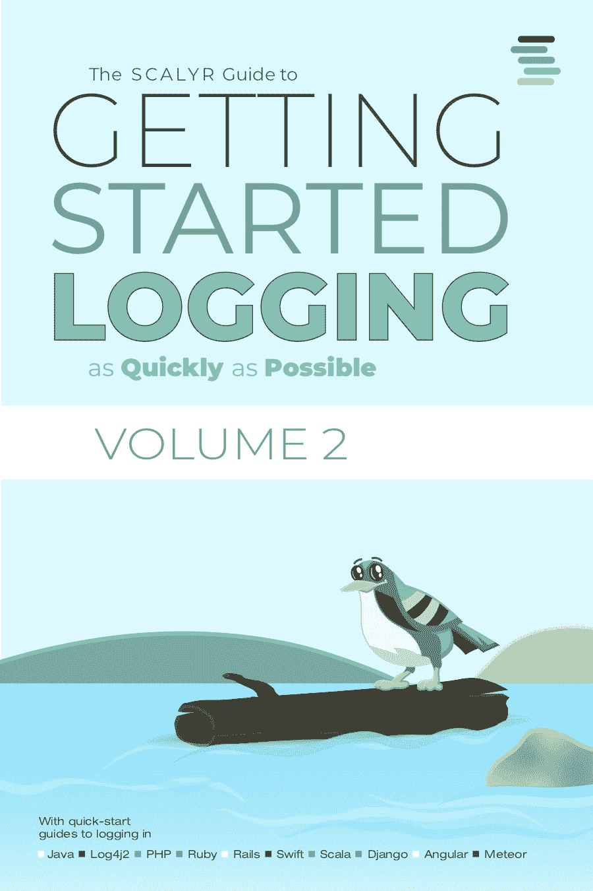


## 第 1 章：集中式日志是大规模应用的现代解决方案

我记得我创建的第一个网站。那是 90 世纪 90 年代后期。它是关于军事战斗机的，我用纯 HTML 和内联 CSS 构建了它——没有 JavaScript。而且我只在本地运行过它。

那个最复杂的网站可能是电子商务网站。它们必须处理内容管理、用户账户和支付处理。虽然在当时这并不是一项易事，但 90 年代后期和 2000 年代初 Web 应用的构建方式在今天看来是简单直接的。

这些年来，情况发生了变化。公司以前只在单个服务器上运行一个应用程序实例。只有最大的企业才需要考虑扩展性，因为大多数网站的流量非常有限。今天，即使是规模较小的组织也会考虑扩展性。

幸运的是，云让我们能够在无需管理硬件的情况下构建服务。这可以为中小型企业节省大量的成本和精力。更进一步，微服务让我们有机会开发保持松散耦合且更容易扩展的单个服务。

然而，我们不能只说事情变得更简单更轻松了。事实上，云环境中的微服务可能会形成一个移动部件的丛林，使得难以获取其通信流的概览。我们需要更多的东西。

我们需要日志记录。

### 扩展增加了我们对日志的需求

如果你只有一个应用程序，可能只对一两个服务有依赖，日志记录很容易。应用程序可以将信息记录到服务器的磁盘上，然后你可以检查它以查看发生了什么。你将获得所有执行操作的按时间顺序排列的概述。这为你调查任何出现的问题提供了一种方便的方法。

在扩展环境中，情况会变得复杂一些。你的应用程序可能由多个服务组成，这些服务提供不同的功能，或者是同一个服务的不同实例。这些服务之间的交互增加了出错的概率。因此，对日志的需求也随之增加。

当你进行进程内方法调用时，只要你提供正确的输入，就不会出什么问题。但是，如果你正在调用另一个服务，就有更多可能失败的机会：

*   网络可能会缓慢或中断。
*   另一个服务可能会产生错误。
*   你的服务可能会提供错误的输入。

这一切都放大了对日志的需求，以便你更更容易看到哪里出了问题。

### 集中式日志的需求

让每个服务都将日志记录到服务器磁盘很快就会变成一场噩梦。当一个服务调用另一个服务时，你需要查看另一个服务的日志。如果该服务又调用了第三个服务，你就有更多工作要做。在调查了所有日志后，你需要汇总这些信息以完成完整图景。如果你调查过跨越多个服务的问题，你就体会过日志散落在世界各处的痛苦。

这就是为什么集中式日志变得越来越重要，因为公司正向一种架构迁移，在这种架构中，一个应用程序实际上由多个相互交互的服务组成。但事实上，这与我们以前所做的并没有太大区别。过去，我们去一个中心位置读取日志——具体来说就是运行单个服务的服务器。现在我们有了多个服务，能够去单一位置仍然很有用。

### 微服务作为大规模扩展的模型

微服务是开发需要扩展应用程序的极佳方法。但它们为日志记录带来了挑战。我们需要能够关联不同服务之间的日志语句，特别是当有大量请求快速涌入时。

虽然这些听起来可能很复杂，但日志记录可能仍然识别问题根源的最佳方法。监控提供了应用程序健康状况的良好概览，但当出现问题时，我们通常需要回溯几步来查看是什么导致了问题。堆栈跟踪（`stack trace`）通常是不够的。

集中式日志允许我们跟踪用户请求跨多个服务的流，因此它是正确的选择。

### 混合环境

如今，许多公司在云/本地化选择上采取混合方法。某些服务运行在公司管理的本地服务器上。某些服务可能运行在托管的基础设施上。另一些则可能运行在主要的云提供商之一上。

这部分是因为我们的世界演变太快。我们可能先在平台 A 上运行，后来为新服务切换到平台 B。旧服务并不总是立即迁移。如果它们运行得很好，为什么要迁移呢？

在规划这些架构时，日志记录经常被忽视。第一步是在本地记录。这在开发者机器上效果良好。但当我们讨论部署在多个平台上的多个服务时，这种方法就开始失效了。然而，许多公司让每个服务记录到自己的位置。

将所有服务迁移到单一平台是一个昂贵且不必要的解决方案。更简单的解决方案是保持现状，但将日志发送到中心位置。当然，这意味着中心日志可能会变得巨大。但如果使用良好的工具，这不应该是问题。

集中式日志确实可以为公司节省资金。支持人员需要更少的时间找到问题根源。开发者能够更快复现问题。这减少了组织内部的挫败感和人员流失。但也减少了客户的挫败感，因为问题可以更快地识别和解决。

### 无服务器架构

无服务器，或函数即服务（FaaS），是一种开发应用程序的新方法。我曾看到它描述为加强版的微服务。每个函数的范围非常有限。这意味着一个应用程序由几十个甚至数百个（或数千个！）独立的函数组成。

*   自动化测试、构建和部署工具。
*   低代码或无代码平台，允许你在几乎或完全没有编程经验的情况下构建应用程序。

但尽管事情变得更容易了，但它们并没有变得更简单。事实上，它们变得更复杂了。我们现在不再构建单一独立的应用程序，而是编写由多个较小应用程序组成的程序。这些程序相互交互，并与我们无法控制的服务进行交互。

这一切复杂性为我们带来了巨大的优势，例如更容易扩展和提高效率。但它们也增加了可能出现错误和问题的地方。幸运的是，我们拥有现代的监控工具，它们可以快速通知我们，甚至提供上下文和信息。但日志记录（`logging`）仍然查看问题产生源的最佳方式。

在这些复杂的环境中，集中式日志是获取所有必要首要方法。集中式日志让我们的生活变得简单，并允许我们更快、更廉地解决问题。

## 第 2 章：快速上手 Java 日志

在我们快速上手日志记录的第一个实验中，我们将处理 Java。在本章中，我们不仅将提供一份快速指南，还会深入讨论日志记录，特别是探讨日志记录的“是什么”以及“为什么”。


### 可能运行的最简单 Java 日志

对于这个演示，我将使用免费的 [IntelliJ IDEA 社区版](https://www.jetbrains.com/idea/download/#section=windows)。我假设你的机器上已经安装了 [Java JDK](http://www.oracle.com/technetwork/java/javase/downloads/jdk8-downloads-2133151.html?ssSourceSiteId=otnpt)。

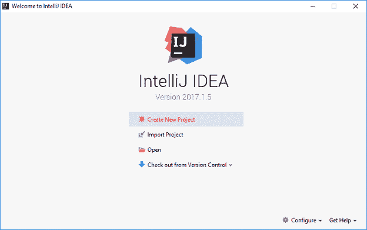

在下一个屏幕上，在左侧面板中选择 Java 作为项目类型。如果你还没有指定 JDK 路径，还需要指向它。

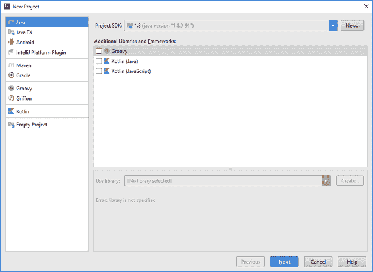

第三步——勾选“从模板创建项目”（Create project from template）选项，然后选择“命令行应用程序”（Command Line App）：

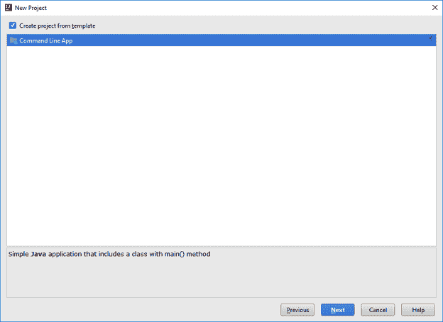

我将我的项目命名为 `JavaLoggingDemo`，如下图所示。

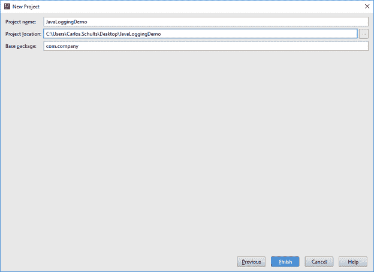

完成上述步骤后，你应该能看到自动为你创建的 `Main` 类。它看起来应该是这样的：

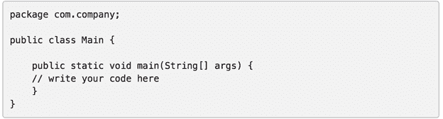

让我们开始工作吧。将 `// write your code here` 注释替换为以下行：

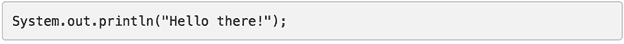

现在你有了一个显示友好问候的应用程序。

接下来，运行我们的程序。转到 Run > Run ‘Main’，或使用快捷键 `SHIFT+F10`（Windows 和 Linux）或 Mac 上的 `CTRL+R`。

如果一切顺利，你应该能看到类似的内容：

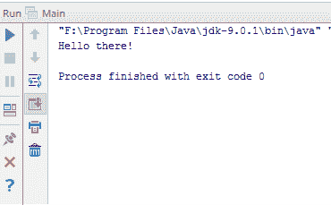

很好。但假设我们小程序的需求发生了变化（它们通常总是会这样）。现在，我们需要程序不仅显示一条消息，还要将其记录到某处。我们该如何做呢？

我们有很多复杂的选项可以使用，但让我们尝试做能做的最简单的事情。编辑你 `main` 函数中的代码，使其看起来像这样：

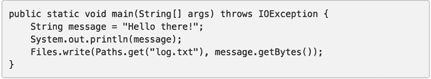

注意这些变化。我们添加了一个新变量 `message` 来存储问候文本。然后是打印语句。最后是新的一行，用于将文本保存到文件中。

我们还必须在方法中添加 `throw` 声明，因为最后一行可能会抛出 `IOException`。此外，我们添加了一些新的 import 声明。现在代码看起来如下：

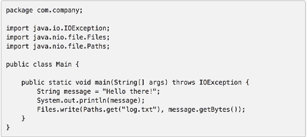

当你再次运行应用程序时，它的行为将与之前相同。但添加的最后一行将为你创建一个日志文件。日志文件将位于你的项目文件夹中：

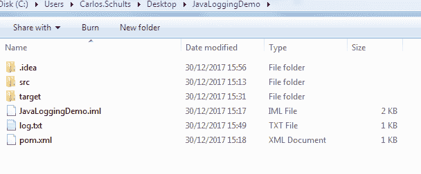

就是这样。你刚刚写了你的第一个 Java 日志记录器！通过这第一个小步，你已经准备好尝试更大的步了。

#### 什么是应用程序日志？

让我们退后一步，简要定义一下什么是应用程序日志。

根据 [维基百科](https://en.wikipedia.org/wiki/Log_file) 的定义：

在计算中，日志文件是记录操作系统或其他软件运行期间发生的事件，或通信软件中不同用户之间消息的文件。日志记录（Logging）是保存日志的行为。

有点模糊，对吧？我更倾向于我们在 Scalyr 第一本关于日志记录的书开头给出的定义，[Scalyr 快速上手日志指南](https://www.amazon.com/Getting-Started-Logging-Quickly-Possible-ebook/dp/B07H8SNT2Q)：

应用程序日志涉及将你的应用程序运行行为信息记录到更持久的介质中。

解决了“是什么”之后，让我们来看看日志记录的“为什么”。

### 日志记录的动机是什么？

我认为上一节日志定义中的关键部分是“持久”（persistent）这个词。为什么我们需要在持久介质中记录应用程序的行为信息呢？

嗯，与我们记录任何内容到持久介质的原因相同：以便我们以后可以回顾。那么问题变成了：“你为什么想这样做？”

这都归结为软件的本质。生产环境中的软件是非常复杂的东西，而且通常处于运行环境中。你可以一直祈祷并希望，但正如俗所说，希望不是策略。但日志记录是！

简而言之，你使用日志记录是为了事后对应用程序进行调试。通过读取日志条目，你可以理解发生了什么，甚至回溯用户采取的步骤，以便诊断并修复问题。

### 演进我们的方法：我们应该捕获什么？记录到哪里？

能够对你的程序进行事后调查听起来是一个很棒的优势——确实如此。不过，我们刚刚创建的这个简单的日志记录器并不能提供这种优势，因为它能做的只是向文件中写入一些文本。我们现在的工作应该是演进我们的日志记录器，将其变为未来读者更丰富的信息源。那么，我们该如何做呢？

要理解的关键点是日志条目的本质。将日志条目视为一个事件。在特定的时刻，发生了对你的应用程序感兴趣的事情。因此，日志条目的价值来自于你捕获事件的数据。

以下列表包含了一些你想要捕获的数据示例：

*   时间戳（`timestamp`）。事件具体发生在什么时候？（如果你将其记录到文件中，你会希望使用 `UTC` 并使用 `ISO8601` 等标准格式记录时间。）
*   上下文，让读者清楚该条目关于什么。仅仅记录“Hello, user!”在几周或几个月后可能会令人困惑。更好的消息可能是“记录了用户问候：‘Hello, user!’”。
*   每个条目的标签或类别，以便日后搜索和分类。
*   日志级别，如 `Error`、`Warning` 或 `Info`，允许更多的过滤和上下文支持。

在决定了想要捕获的内容后，下一步是定义你想将其记录到哪里。虽然我们在示例中使用了文件，但没有什么阻止你将其记录到其他介质，例如数据库（关系型或非关系型）、Windows 事件查看器甚至是控制台。

### 使用日志框架

回到我们的演示中。事实是这样的：这个设计是为了让你快速上手 Java 日志世界。但现在你已经具备了更具批判性的视角来审视它。所以，让我们这样做吧。

事实证明，我们简单的日志记录器在几个重要的方面上是不够的。

首先，代码总是会覆盖日志文件。一个只让你看到最后一次事件的日志策略并没有那么好用，对吧？既然我们谈到了覆盖文件，那么考虑一下文件权限、如何处理并发访问以及其他类似的问题可能大无害。

最后，在每次日志调用中都要编写大量的样板代码（`boilerplate code`）来获取日志级别、时间戳以及我在上一节中提到的所有这些内容，听起来像是一项极其繁琐的工作。

我可以一直说下去，但你心里有数了：构思一个合理的 Java 日志方案需要大量的思考。不过，我有一个好消息。事实证明，人们已经解决了这些问题。不仅如此，他们还以日志框架的形式为你们提供了解决方案，这些方案是开箱即用的，而且通常是免费的。

日志框架是你安装在应用程序中的一个包，它可以为你提供易用且可配置的日志记录。通过少量的配置，你就可以让单行调用变得像我们玩具示例中的代码一样简单。但这一次，它们将拥有一致格式且格式良好的日志条目，并对上一节中提到的所有问题都给出答案。

### 安装日志框架

我们要做的第一件事是回到代码库，删除那行写入文件的代码。然后我们就可以安装一个名为 [Log4j](https://logging.apache.org/log4j/2.x/) 的日志框架。这只是众多可选方案之一，我鼓励你以后尝试其他替代方案。但由于这是一份快速指南，选择 Log4j 是合理的，因为它是一个广泛使用的框架。

在 Project（项目）工具窗口中，右键点击 `JavaLoggingDemo` 模块，然后点击 Add Framework Support...（添加框架支持）……

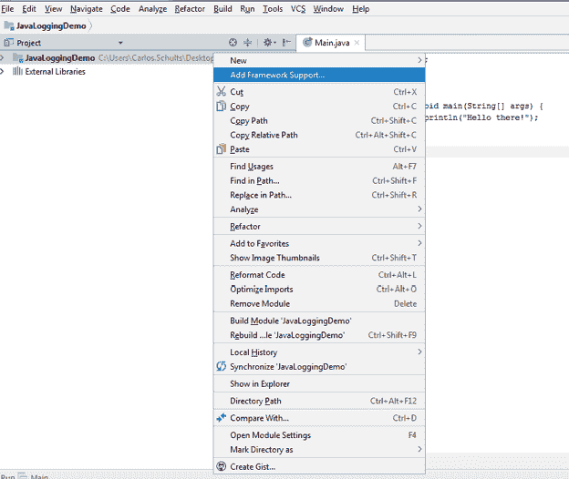

现在，选择 Maven 并点击 OK：

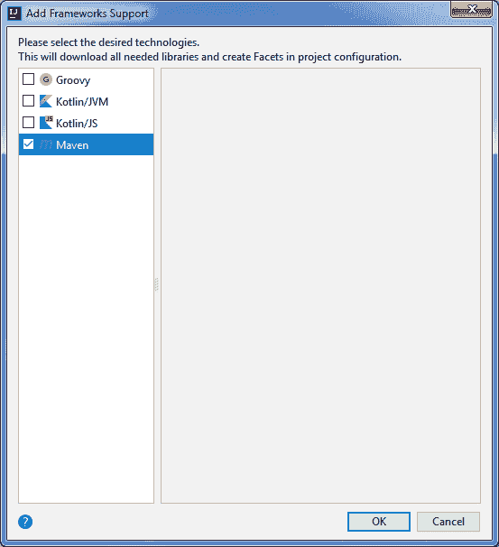

完成这些操作后，IDE 将为你创建一个 `pom.xml` 文件并打开进行编辑：

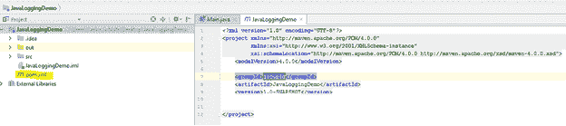

现在，在文件中使用以下 XML 文本：

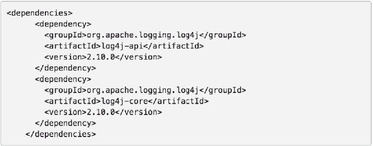

到此时，整个文件应该是应该是：

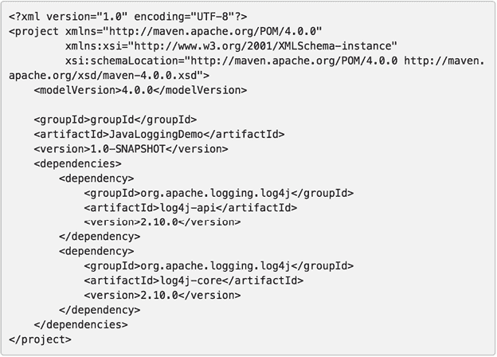

在文件中添加依赖项后，你应该会在屏幕右下角看到一个小的弹窗。点击 Import Changes（导入更改）以完成安装。

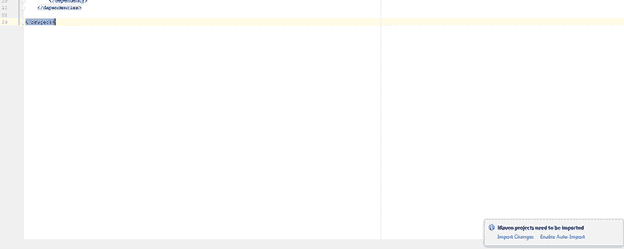

### 配置日志记录器

现在是时候配置 Log4j 了。我要向你展示的只是一种方法；它不是唯一的方法，可能甚至不是最好的方法，无论“最好”如何定义。但它绝对比你在外面看到的很多教程要短得多。

你几乎需要做的就是创建一个配置文件，然后写几行代码。不相信我的吗？好吧，让我给你看！

首先，转到 IntelliJ 的 Project（项目）工具窗口。展开文件夹并找到 `resources` 文件夹，它位于 `JavaLoggingDemo > src > main` 下，如下所示：

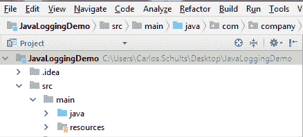

现在，右键点击 `resources` 文件夹，然后选择 New（新建）> File（文件）：

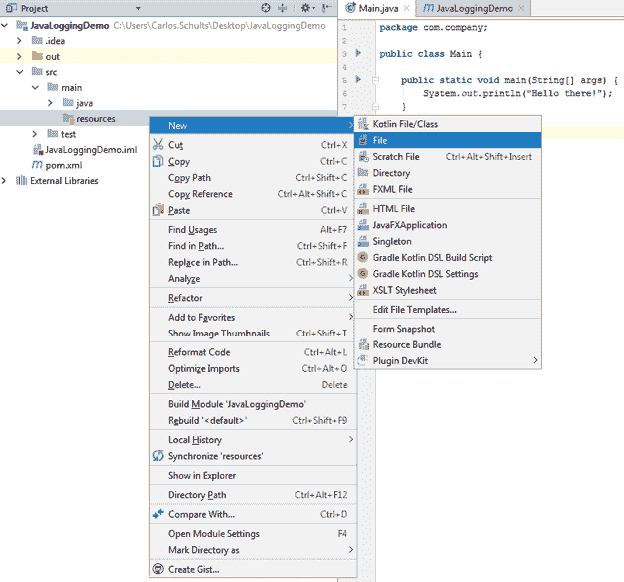

当系统提示输入名称时，输入 `log4j2.xml`。文件创建后，向其中添加以下文本：

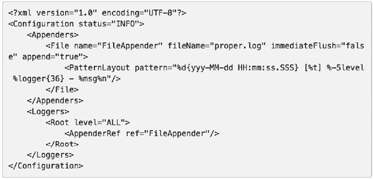

### 编辑代码

首先，在文件顶部添加以下两个 import 声明：

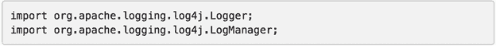

然后，在 `Main` 类的顶部添加以下行，声明一个私有字段来持有日志记录器的实例：

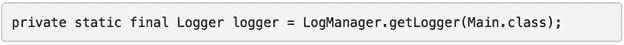

最后，在你之前调用 `Files.write(Paths.get("log.txt"), message.getBytes())` 的地方添加以下代码行：

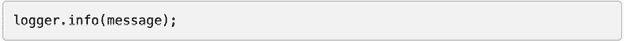

现在整个类应该像这样：

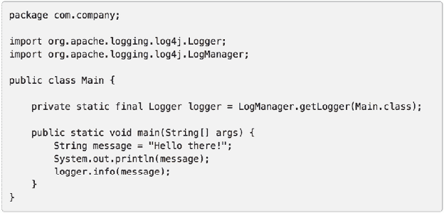

我们完成了！现在你所要的就是运行应用程序。

### 检查结果

现在，如果你回到应用程序文件夹，你应该会发现那里有一个名为 `proper.log` 的新文件。如果你使用文本编辑器打开它，你应该能看到如下：


让我们把这行内容拆解成各个部分。

首先是时间戳 `2017-12-31 15:39:29.739`，采用符合 ISO-8601 标准的格式。

然后是 `[main]`。指的是产生事件的线程名称。

接下来是 `Info`，即日志级别。

然后是 `com.company.Main`，类名。

最后也是同样重要的一点是消息本身：`Hello there!`。

### 日志框架的力量

我想你也会认同，在我们进行更新后，我们的日志记录器变得有用得多的。仅仅通过创建一个配置文件并写几行代码，我们就能配置出一个真实的日志记录器示例。当然，这并不是全部，但它在实际应用中已经足够好用了。而且，它让你对日志框架能带给你的力量有很很好的认识。

XML 配置文件是这种力量体现的地方之一。Log4j 提供的灵活性很大源于被称为 appender（输出器）的东西。有很多 appender，这意味着通过添加一个新的 appender，可以将日志定向到其他地方，而无需触动应用程序代码。

这就是关注点分离的精髓，如果你问我的话。

### 接下来是什么？

在本节中看到的只是冰山一角。如果这是你第一次记录日志，请不要怀疑：你还有很多需要学习的。但你已经有一个可以运行的设置。以下是一些你可以尝试的内容：

*   学习如何为不同的日志级别配置日志记录器。
*   研究并尝试不同的 appender。
*   尝试布局的可用选项。
*   学习配置 Log4j 的其他方法。
*   尝试一些日志框架。

从零开始学习某事可能是一项令人压力的任务。幸运的是，你不必这样做。为你提供了坚实且持久的知识基础。现在交给你了。


本章由 Carlos Schults 贡献。[Carlos](http://carlossults.net/)是一位拥有桌面和 Web 开发经验的软件人员，正在尝试移动开发。他热爱编写简洁的代码，并且对有助于提高应用程序健康的实践非常感兴趣。

## 第 3 章：快速上手 Log4j 配置

在上一节中，我们使用了来自 Apache 项目的 Log4j。让我们更进一步，通过 Java 应用程序日志查看 Log4j 配置。

Log4j 的功能使其成为 Java 最流行的日志框架之一。它可以被配置为多个日志目的地和各种日志文件格式。日志消息可以在类级别进行过滤和重定向，为开发者和运维人员提供了对应用程序消息的粒度控制。

让我们通过为命令行 Java 配置 Log4j 来研究这些机制。

### 应用程序

让我们从上一节结束的地方开始：一个使用 Log4j 记录的应用程序。

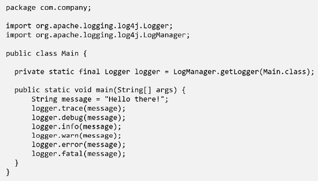

我们在 Log4j 预定义的每个日志级别上记录了相同的消息：Trace、Debug、Info、Warn、Error 和 Fatal。

我们将使用 Log4j 的 YAML 文件格式，因此你需要在`pom.xml`（或`build.gradle`）中添加一些额外的项。

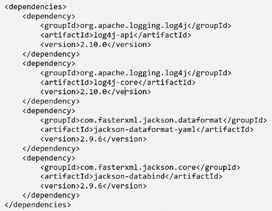

设置此代码，以便你使用喜喜欢的 Java 工具来构建并运行它。

### 核心 Log4j2 配置

接下来，我们来讨论一下配置。

#### 默认配置

让我们在没有 Log4j 配置文件的情况下运行应用程序。如果你已经有了，请将其删除或移动到另一个文件名，这样`Log4j`就会忽略它。

当我们运行应用程序时，会在控制台上看到以下内容：

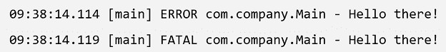

六条日志消息中的两条（被指定为`Error`和`Fatal`的消息）被发送到了控制台。

注意：`Log4j`有一个默认配置。它会将日志输出到控制台，显示分类为`Error`或更高级消息。

了解`Log4j`在没有配置文件时的行为是有用的，但让我们看看如何根据我们的需求对其进行设置。

##### 配置文件位置

我们可以通过`log4j.configurationFile`系统属性为`Log4j`提供一个位于特定位置的配置文件。这是它查找配置的第一地方。

如果`Log4j`找不到该系统属性，它会在类路径（classpath）中查找文件。由于`Log4j2`支持四种不同的文件格式和两种不同的文件命名规范，定位文件的规则非常复杂。在我们涵盖不同的格式和命名选项之后，我们将介绍如何定位文件。

##### 配置文件格式

`Log4j`会加载 Java properties 以及 YAML、JSON 和 XML 配置文件。它通过检查文件扩展名来识别文件格式。

*   对于 Java properties，扩展名为为`.properties`
*   对于 YAML，扩展名为为`.yaml`或`.yml`
*   对于 JSON，扩展名为为`.json`或`.jsn`
*   对于 XML，扩展名为为`.xml`

由`log4j.configurationFile`系统属性指定的文件必须具有这些扩展名之一，但可以有任何基本文件名。`Log4j`将根据扩展名指示的格式对其进行解析。

当`Log4j`扫描类路径中的文件时，它会按照上述顺序检查每种格式，并在找到匹配项时停止。例如，如果它找到了 YAML 配置，它将停止搜索并加载它。如果没有 YAML 文件但找到了 JSON 文件，它将停止搜索并改用后者。

##### 配置文件名称

当`Log4j`扫描类路径时，它会寻找两个文件名之一：`log4j2-test.[extension]`或`log4j2.[extension]`。它会先测试文件，为开发者提供了一种方便的机制，可以在不更改标准配置的情况下，强制应用程序以`Debug`或`Trace`级别记录日志。

##### 扫描配置

我们将文件格式和名称的规则结合在一起时，就可以看到`Log4j`自行配置的算法。

如果以下步骤中的任何一个成功，`Log4j`将会停止并加载生成的配置文件。

1.  检查`log4j.configurationFile`系统属性，如果找到则加载指定的文件。
2.  在类路径中搜索`log4j2-test.properties`。
3.  扫描类路径查找`log4j2-test.yaml`或`log4j2-test.yml`。
4.  检查`log4j2-test.json`或`log4j2-test.jsn`。
5.  搜索`log4j2-test.xml`。
6.  查找`log4j2.properties`。
7.  搜索`log4j2.yaml`或`log4j2.yml`。
8.  扫描类路径查找`log4j2.json`或`log4j2.jsn`。
9.  检查`log4j2.xml`。
10. 使用默认配置。

#### 良好的配置文件卫生习惯

`Log4j`共有 12 个潜在的配置文件名称。加载错误的文件会导致日志信息丢失或性能下降。这是因为应用程序在生产环境中可能会记录不必要的消息。

在部署代码之前，确保你的应用程序有一个且仅有一个配置文件，并且你知道它在哪里。如果你坚持从类路径加载配置，请在发布代码之前扫描多余的文件。

#### 基础配置

现在我们已经知道如何为`Log4j`提供配置，让我们创建一个配置并使用它来定制我们的应用程序。

### 重温 Log4j 的默认配置

我们将从默认配置开始，并在此基础上修改应用程序的行为。借鉴`Log4j`配置规则的提示，我们将使用 YAML。

默认配置如下：

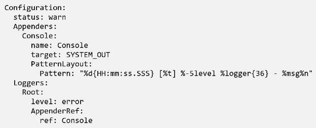

创建一个名为`log4j2.yaml`的文件并包含这些内容，并将`log4j.configurationFile`指向其位置。

接下来，运行应用程序。你会看到与之前相同的输出。

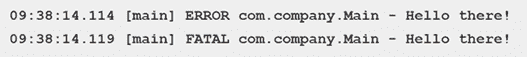

我们已经控制了应用程序的日志配置。现在让我们改进它。

#### 日志文件位置

第一步是将日志从控制台移到文件中。为了做到这一点，我们需要理解 appenders（日志输出器）。

Appenders 将日志消息放置在它们所在的地方。默认配置提供了一个控制台 appender。正如名称所示，它将消息附加到控制台。

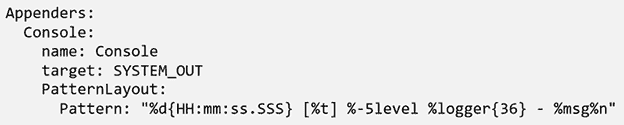

我们需要一个文件 appender。让我们替换控制台 appender。

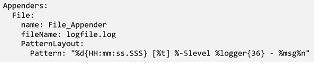

文件 appender 有一个名称，就像控制台 appender 一样。但它们的目标不是控制台，而是文件。

（注：此处原文后续存在部分重复描述，已根据指令要求翻译并保持核心逻辑）

添加第二个文件输出器（appender）。要做到这一点，创建一个列表，包含原始 appender 以及另一个具有不同名称和文件的 appender。你的`Appenders`部分如下所示：

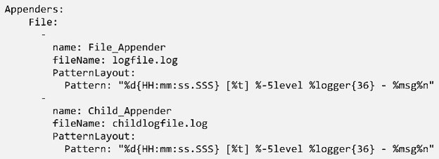

接下来，将`LoggerChild`日志指向新的 appender。你的`Loggers`部分如下所示。

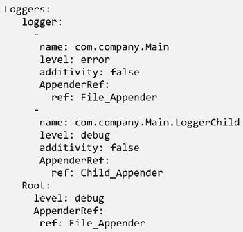

现在运行应用程序。你会看到两个不同的日志文件，每个文件都包含其关联类的消息。

### 日志消息格式化

我们的每个 appender 都有一个`PatternLayout`。

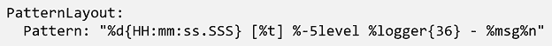

`PatternLayout`是 Log4j 布局类的一个实例。`Log4j`内置了多种布局，用于以 CSV、JSON、Syslog 以及多种不同格式记录消息。

`PatternLayout`拥有一组用于格式化消息的操作符，用法类似于 C 语言的`sprintf`函数。通过指定模式（pattern），我们可以控制日志消息在被 appender 写入时的格式。

我们的布局字符串看起来如下：


每个`%`对应日志消息中的一个字段。

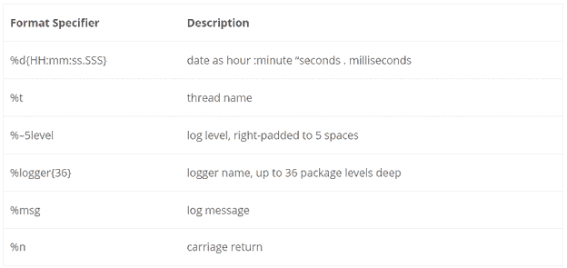

`PatternLayout`还有许多额外的操作符，你可以自己去探索。

### 变量替换

随着 appenders 和 loggers 的数量增加，配置文件可能会变得重复。`Log4j`支持变量替换，有助于减少重复并使维护变得更简单。让我们使用`Properties`来完善我们的配置。

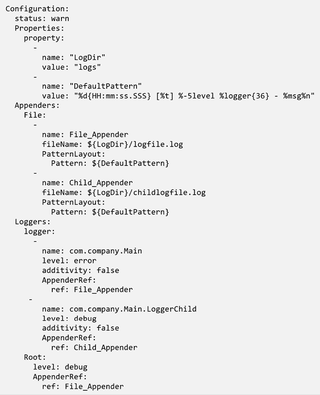

在文件顶部，我们声明了两个`Properties`，一个命名为`LogDir`，另一个命名为`DefaultPattern`。

声明属性后，可以使用大括号和美元符号在配置中使用它：`${LogDir}`或`${DefaultPattern}`。

`LogDir`是我们添加到两个日志文件文件名中的一个子目录名称。当我们运行应用程序时，`Log4j`会创建此目录并将日志文件放置在其中。

我们将`DefaultPattern`指定为两个日志文件的布局模式，将定义移动到了一个地方。现在，如果我们要修改日志文件格式，我们只需要担心修改一次就行了。

`Log4j`还可以从环境中导入属性。（你可以在 [Apache Logging Services 网站上阅读更多相关信息。](https://logging.apache.org/log4j/2.x/manual/configuration.html#Property_Substitution)）例如，如果我们想从 Java 系统属性导入日志文件目录，我们在`Log4j`配置中将其指定为`${sys:LogDir}`，并将`LogDir`系统属性设置为所需的目录。

### 自动重配置

`Log4j`可以按定期间隔重新加载配置，这使我们能够在不重启应用程序的情况下更改其日志配置。

在文件的`Configuration`部分添加`monitorInterval`设置，`Log4j`就会按照指定的间隔扫描文件。

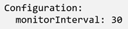

间隔以秒为单位。

### 总结

`Log4j`是一个强大的日志框架，允许我们配置应用程序以多种方式记录日志，并对不同组件使用日志文件的方式进行粒度控制。本教程涵盖了配置`Log4j`的基本方面，但还有更多内容可以学习。你可以在该项目的[网站](https://logging.apache.org/log4j/2.x/manual/configuration.html)上学习`Log4j`配置。

本章由 Eric Goebelbecker 贡献。[Eric](http://ericgoebelbecker.com/) 在纽约市金融市场工作了 25 年，负责市场数据和金融信息交换 (FIX) 协议网络设施开发。他喜欢谈论什么让团队变得高效（或不高效）！

## 第 4 章：快速上手 PHP 日志记录

在本章中，让我们讨论一种非常流行的语言中的日志记录技术：PHP。

我将用一个 PHP 手动记录日志的快速示例开头。然后，我将重新回顾本书第二章讨论的细节——关于为什么日志很重要以及你的日志应该显示内容的细节。最后，我将向你展示如何设置和使用最流行的 PHP 日志框架。

让我们开始吧！


### PHP 日志记录（超级简单）示例

为了本教程，我将使用安装了纯净版 [LAMP 堆栈](https://www.digitalocean.com/community/tags/lamp-stack?type=tutorials) 的 Linux。如果你使用的是 Mac 或 Windows 而不是 Linux，可能需要调整工具和命令。

导航到`/var/www/html`文件夹并删除那里名为`index.html`的文件：

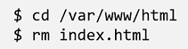

然后创建一个新文件`index.php`并用你喜欢的文本编辑器打开它（我正在使用 Emacs）：

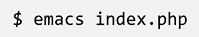

在`index.php`中添加以下 HTML 代码：

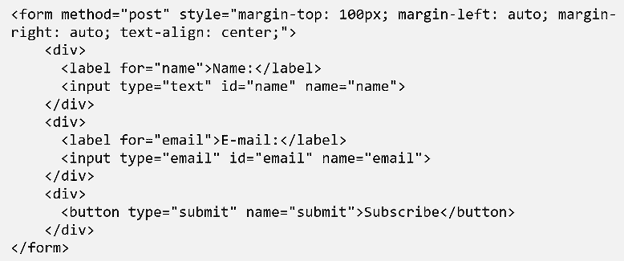

这段 HTML 代码将创建一个简单的订阅表单。要查看生成的页面，打开浏览器并访问`http://localhost`：

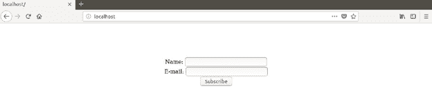

尽管你可以在浏览器中看到表单，但它现在并没有任何实用的功能。为了让它运行，请在`index.php`文件的顶部、HTML 代码之前添加以下 PHP 脚本：

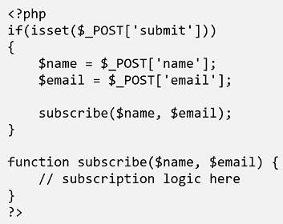

上面的代码将从提交请求中提取 name 和 email 参数，并将它们传递给`subscribe`函数。由于本教程是关于日志记录的，我们暂时保持`subscribe`函数体为空。

现在，假设你想创建一个记录所有订阅请求及其参数的文件。你可以通过在调用`subscribe`之前添加两行代码来实现：

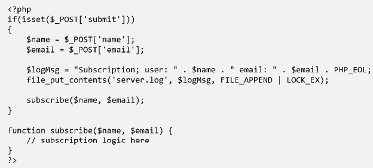

这些代码将调用 PHP 的`file_put_contents`函数，将日志消息追加到`server.log`内容中。

现在如果你在浏览器中打开`http://localhost`，填充字段并点击订阅按钮，此脚本会在`/var/www/html`中创建`server.log`文件并写入内容。我可以使用`cat`命令读取文件内容：

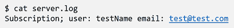

恭喜！你记录了第一条 PHP 日志。

现在，让我们退一步。

### 什么是应用程序日志记录？

你可能对日志有了直观的理解，但值得花时间回顾一个正式的定义。我们之前将日志记录定义为：

日志记录涉及将应用程序运行行为的信息记录到更持久的介质中。

这里有两个重要的点需要注意：

首先，日志与应用程序的运行行为有关。也就是说，它是记录随时间变化的应用程序事件。

其次，你总是希望将日志存储在更持久的介质中。“更持久”的具体含义取决于你的需求和环境，但至少，即使应用程序或整个服务器崩溃，你也能够读取日志。

虽然这个定义解释了什么是日志，但它并没有解释为什么要在程序中使用日志。这是一个重要的问题，我想详细讨论。

但在某个某个时刻，你需要将应用程序发布给用户。他们会以原始的方式以及在你无法想象的环境中运行它，并且可能会有许多用户并发使用该应用程序。此外，你的应用程序需要运行更长的时间。在没有额外信息的情况下，在这种情况下调试错误是不可能的。

这就是日志（logging）的用武之地。

拥有应用程序过去运行行为的记录，可以让你在事后调查各种非预期行为。换句话说，即使你的应用程序崩溃并丢失了所有的运行状态，你仍然可以通过应用程序日志来理解导致崩溃的原因。

但日志的用处并不仅于此。当用户报告 Bug 时，日志变得价值连城。它们可以对你的应用程序进行审计，包括特定业务领域所需的监管审计。或者，它们可以被实时处理和分析，以警示潜在的性能问题。这只是其中一角。

简而言之，应用程序日志是生产环境应用程序的必备之物，因为它让你对应用程序的运行历史可见。

### 你应该记录什么？

本章开头介绍的简单日志方法满足了持久化要求，因为它将日志存储在文件中。然而，它对于记录运行行为并不理想，因为它没有告诉你是每个特定事件具体何时发生的。

这引出了一个更通用的问题：应该记录哪些信息？

在每条日志条目中包含以下信息是一项广泛的做法：

*   时间戳，准确说明日志条目描述的事件发生的时间。为了方便你的工作，请使用 UTC 格式下格式正确的 [ISO 8601](https://en.wikipedia.org/wiki/ISO_8601) 日期时间。
*   具有描述性的事件上下文。例如，记录`name: testName; email: test@test.com`是一个坏主意，因为一个月后，你可能会忘记这些是什么意思。这里有一些上下文可以让日志条目更具描述性：`Subscription; user: testName email: test@test.com`。
*   日志级别，如 Error（错误）、Warning（警告）、Info（信息）等。这些信息提供了额外的上下文，并允许你按级别轻松过滤日志。

我建议你将上述列表视为日志策略的绝对基准，记录的信息不要少于此。否则，你在阅读和理解日志时会变得非常困难。

### 使用 Monolog 框架让日志变得更容易

在本章开头的示例中，我向你展示了如何在 PHP 中进行基础日志记录。然而，我的解决方案没有记录时间戳和级别，正如你现在所知的，这是每条日志条目中必须包含的两个强制性信息。

当然，我可以添加更多代码并增强我的解决方案以适应更高级的需求，但那样将是浪费。你看，我记录日志是因为我需要——它 true 不是我的应用程序功能的一部分。因此，我花在实现日志解决方案上的每分钟，都意味着我少有了一分钟用于开发应用程序核心功能的时间。

幸运的是，我的日志需求与数百万其他开发者的需求非常相似，因此这个问题已经以日志框架的形式解决了。这些是第三方库，我可以将它们导入并使用到我的项目中，而无需担心它们具体是如何工作的。换句话说，在日志记录方面，我不需要重复造轮子。

最流行的 PHP 日志框架是 [Monolog](https://github.com/Seldaek/monolog)。在接下来的章节中，我将向你展示如何在项目中使用它。

#### 安装 Monolog PHP 日志框架

如果你正在使用 PHP 框架（例如 Laravel）开发应用程序，很有可能该框架已经集成了`Monolog`。请检查你的框架文档以获取详情。

由于我正在处理一个简单的 PHP 项目，我可以向你展示如何从零安装并使用`Monolog`。

首先，你需要安装 PHP [Composer](https://getcomposer.org/doc/00-intro.md) 包管理器。以下命令将实现该目标：

```
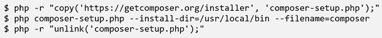
```

一旦你的机器上安装了`Composer`，进入你的项目根目录`/var/www/html/`并执行以下命令：

```
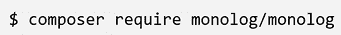
```

此命令将创建`vendor`目录并将`Monolog`文件导入到那里。下一步是在 PHP 代码中使用`Monolog`。


#### 使用 Monolog

要在你的代码中使用`Monolog`，你将需要将其作为依赖项加载。出于此目的，`Composer`方便地生成了一个`autoload.php`文件，你可以从代码中访问它。

将以下代码放在`index.php`文件的 PHP 脚本顶部：

```
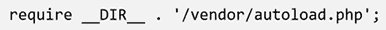
```

紧随其后，指定你将要使用的两个特定的`Monolog`依赖项：

```
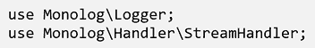
```

`Logger`是生成日志的实例，而`StreamHandler`是`Logger`内部用于将日志写入文件的特殊实例。正如你可能想到的，`Monolog`支持不同的处理器，允许你将日志路由到不同的媒介。

到目前为止，你已经加载了`Monolog`并导入了特定的依赖。现在实例化一个新的`Logger`并将其命名为`SimpleLogger`：

```
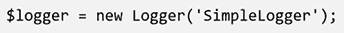
```

接下来，使用`StreamHandler`确保日志记录将日志存储到现有的`server.log`文件：

```
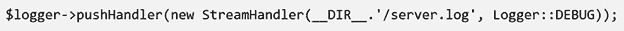
```

`StreamHandler`构造函数的第二个参数定义了它捕获的最低级别。由于在这种你想让它捕捉所有的日志条目，请指定最低级别，即`Debug`。

设置`Logger`对象后，你可以用`Monolog`的日志器替换旧的日志实现。因此，删除此行：

```

```

现在用以下调用替换它：

```

```

如你所见，尽管你需要做一些前期准备，但这个过程让日志记录变得简单得多。鉴于在实际应用程序中你可能想要记录数百个事件，这种简洁性将非常有用。

总而言之，你的`index.php`文件应该像这样：

```

```

#### 读取 Monolog 日志

如果你再次在浏览器中访问`http://localhost`，指定相同的用户详情并点击订阅，一个新的日志条目将被添加到`server.log`文件中。让我们对比一下原始的日志条目和`Monolog`生成的条目。

这是原始日志条目：

```

```

而这是`Monolog`输出：

```

```

你可以看到，`Monolog`自动为日志条目添加了以下信息：

* 时间戳
* 日志名称
* 日志级别

最棒的部分是你不需要自己编写所有内容。

这个日志条目的唯一问题是时间戳不是 UTC。至少有两种方法可以修复这个问题：

1. 在实例化`Logger`时指定 UTC 时区。
2. 为整个 PHP 脚本指定 UTC 时区。

大多数情况下，你会希望整个应用程序使用 UTC 时间，因此我建议在 PHP 脚本顶部添加以下方法调用：

```

```

此行之后的所有日期时间函数调用将默认使用 UTC 时区——非常有用。

### 现在怎么？

在本章中，我解释了 PHP 日志的基本知识，这应该足够让你开始。尽管，你可能想搜索更高级的信息来巩固你的理解。

如果你打算使用`Monolog`（你应该这样做），请花时间阅读它的[文档](https://github.com/Seldaek/monolog/blob/master/doc/01-usage.md)。这个日志框架非常强大且可配置，允许你支持几乎任何日志需求。

随着你的应用程序规模不断扩大，日志文件变得越来越复杂，即使你遵循了所有最佳实践，也可能发现理解它们是具有挑战性的。这时，日志聚合工具就可以成为你的救命稻草。这些工具可以帮助你聚合、处理、搜索和可视化日志，让你在海量的日志条目中更容易找到你需要的内容。

所以，尽管在你的 PHP 项目中使用应用程序日志吧！并记住：你可能应该记录比你目前认为需要的更多的日志。

本章由 Vasiliy Zukanov 贡献。[Vasily](https://www.techyourchance.com/) 曾在半导体行业工作过，后来成为了一名专攻 Android 的软件工程师。在经历了几年的 9-5 点工作后，他决定从事 Android 开发自由职业。目前，他为开发者提供咨询服务并制作 Android 视频课程。

## 第 5 章：快速上手 Ruby 日志

让我们继续快速开始日志，这次我们使用 Ruby。

到目前我们已经讨论了许多语言。那么，把天平向动态类型解释型语言倾斜如何？这正是我们在本章要做的：教你如何使用 Ruby 编程语言运行日志功能。

本章将涵盖：

* 如何实现一个非常原始的日志器。
* 我对日志基础知识的看法：为什么要记录日志、记录什么数据以及在何处记录。
* 最后，在`Logger`类的帮助下，给出一个非常简单但真实的正确日志记录示例。

与之前的章节一样，我们将创建一个非常简单的玩具应用来演示如何记录日志。我们将从一个非常原始——虽然可行——的方法开始，然后将其演进为一个更复杂、更真实的解决方案。


### 关于 Ruby 和 Rails 的几点

在进入日志部分之前，我认为设定一下背景是很有用的。Ruby 语言首次出现于 1995 年，由松本裕弘（Yukihiro Matsumoto，又名 Matz）创建。但它在 2005 年之后才真正流行起来，这很大程度上归功于非常成功的 Ruby On Rails Web 框架。

许多（甚至大部分）开发者都是通过 Rails 熟悉 Ruby 的，但 Ruby 本身是一种通用语言，可以用于各种情况，而不仅仅是构建 Web 应用程序。出于如此，本章将不涵盖 Rails 中的日志记录——那将在下一章详细介绍。在这里，我们将在简单的命令行 Ruby 应用程序背景下探索日志记录。

处理完这些，我认为是时候大显身手了。让我们开始吧。

### 可能的最简单的 Ruby 日志

在演示中，我将使用 [JetBrain](https://www.jetbrains.com/ruby/)[’](https://www.jetbrains.com/ruby/s RubyMine IDE]。同时，请确保你已经安装了 [Ruby](https://www.ruby-lang.org)。

一旦你准备好就绪，打开 RubyMine 并点击`Create New Project`（创建新项目）：


在下一个屏幕中，会被要求选择项目类型：


正如我已经提到的，我们不是在创建一个 Rails 应用，而是创建一个简单的 Ruby 应用。因此选择`Empty Project`（空项目），它是左侧栏 Ruby 下的第一个选项。下一步是为项目设置位置/名称。完成后后，选择 Ruby SDK 的位置：


完成后，点击`Create`（创建）按钮。我们成功在 RubyMine 上创建了一个新的 Ruby 项目。是时候写代码了。

首先，让我们添加一个类。进入`File > New... > Ruby class`：


将其命名为`Greeter`并点击`OK`：


RubyMine 将创建该类并打开进行编辑。让我们添加一个`Greet`方法，它接收用户名作为输入并打印一条友好的问候：


很好。现在让我们添加一个新文件。进入`File`菜单，然后`New...`，最后点击`File`。当对话框出现时，输入`main.rb`作为文件名并点击`OK`：


该文件将作为我们小程序的入口点。插入以下代码：

```ruby
require_relative 'greeter'

name = gets.chomp
greeter = Greeter.new
greeter.greet(name)
```

这段代码应该很容易理解。在第一行，我们加载了`greeter.rb`。

这可能是不言而喻的，但软件是一项极其复杂的工作。在开发它时，你希望采用各种技术、工具和原则来尝试确保它的正确性。

但当发布时间到来，你将你的应用程序发布到世界上时，你基本上放弃了控制权。事情可能会出问题，而且经常会发生。如果你没有一套适当的策略来监控应用程序在生产环境中的行为，你基本上就是在盲目运行。如果没有日志记录，你无法知诸如下信息：

* 一切是否正常。
* 当出现问题时，究竟发生了什么。你还不知道它是何时或如何发生的。
* 人们最常使用哪些功能，哪些功能他们完全不使用。
* 应用程序的哪个区域导致了大多数崩溃。

正如我们所看到的，应用程序日志不仅有助于帮助你理解和修复错误，还能帮助你收集数据以理解用户的需求。

### 演进我们的方法：我们应该记录什么？应该存储何处？

正如我们刚刚看到的，通过调查应用程序的日志文件来戴上“侦探帽”可以带来许多益处。我们的示例日志以目前的形式还没有达到要求。毕竟，它只是将问候语写入文件。

现在，我们需要我们演进自己的方法，以便我们的日志文件发挥最大的效用。但该如何进行呢？

首先，我们必须理解日志条目的本质。如果你读过之前的章节，这听起来会很熟悉，但为了完整起见，我在这里回顾一下。你应该将一个日志条目视为一个事件——即你的应用程序感兴趣的在某个时间发生的事情。因此，你的条目的价值完全取决于你针对该事件记录了什么。

以下是一些你认为值得记录的内容的示例：

* `timestamp`（时间戳）。事件发生在什么时候？（你可能希望遵循处理日期时间的最佳实践，例如使用`ISO-8601`格式。）
* `Context`（上下文）。你需要让未来的读者尽可能容易地理解此条目关于什么。
* `Log levels`（日志级别）。日志条目的目的差异巨大。你必须有一种方法，将一个唯一目的是调试某些执行路径的条目与另一个记录业务相关事件（客户下了订单）的条目，甚至是记录致命崩溃详情供日后调查的条目区分开。`Log levels`在这里是你的朋友。

在决定了你想记录什么类型的事件（每次方法调用？仅业务事件？仅致命错误？）以及你想记录关于它们的什么数据（`timestamp`、`description`、`log level`、`logged user`或`time of session`？）之后，下一步是决定你想记录日志到哪里。

你看，尽管演示应用记录日志到文件中，但没有什么阻止你将日志记录到各种目标，例如数据库、控制台，甚至是在线服务。

本教程使用了 [Ruby v2.5.1](https://www.ruby-lang.org/en/downloads/) 和 [Rails 5.2.0](https://weblog.rubyonrails.org/2018/4/9/Rails-5-2-0-final/)。你需要安装这些版本才能跟上操作。这些指令将使用命令行来创建和配置应用程序，而不会依赖于特定的 IDE 或编辑器。我们将让 Rails 使用`SQLite`作为后端数据库。


### 创建 Rails 应用程序

我们将从创建一个 Rails 应用程序开始。首先运行此命令：


在几屏输出后，Rails 已经创建了应用程序。

接下来，我们将让 Rails 为我们创建一个模型（model）和一个控制器（controller），这样我们就有有趣的内容可以记录了。进入`logging_app`目录并运行此：


Rails 为带有名称和电子邮件地址的用户记录创建了脚架（scaffolding）。

最后，让 Rails 将应用程序迁移到`SQLite`。


我们有一个应用程序了！让我们运行它并确认一切都已就绪。


将浏览器指向`http://localhost:3000/users`，我们看到了管理用户的主页：


我们准备好开始记录了！

### Rails 日志器

Rails 在初始化时创建一个`ActiveSupport::Logger`实例，并使用它将日志输出到标准输出。

查看我们打开`/users`页面时应用程序的输出：


`Logger`产生了这种输出。除了标准输出外，我们还可以在默认日志文件中找到相同的输入。停止服务器并查看日志文件的最后十行：


日志文件的默认名称是环境名称。在开发环境中，它命名为`development.log`；在生产环境中，它名为`production.log`；以此此类推。

默认日志器通过一个全局可用的实例`logger`供应用程序代码使用。让我们在应用程序显示用户时添加额外的调试消息。

首先，在`app/user_controller.rb`的`show`方法中添加日志消息。


然后启动应用程序。访问`/users`并添加一个名为 John Doe、电子邮件地址为 john@doe.com 的用户。

你的日志应该有一个类似这样的条目：


Rails 以为开发者提供便利而闻名，日志记录就是它获得声誉的例子之一。让我们看看如何自定义 Rails 日志器。

#### 什么是应用程序日志？

在深入如何改进 Rails 日志器之前，让我们回到基本原理。我们试图要做什么？应用程序日志是什么？如果你读过我们的其他章节，你已经对我们的定义非常熟悉了：

应用程序日志涉及将你的应用程序运行行为的信息记录到更持久的介质中。

所以，在 Rails 中，我们已经看到有方法将应用程序信息记录到文件和标准输出中，我们的 DevOps 团队可以通过标准输出将其重定向到他们想要的地方。但我们还可以做更多。

### 应用程序日志目的是什么？

我们为什么要写日志？这似乎是一个显而易见的问题，但值得考虑。

我们写日志是为了对正在发生的事情有一个记录。

我们已经将代码发布到生产环境，并且我们需要去处理其他事情。但在某个时刻，某些事情会出错，我们会被要求诊断问题。日志通常是我们唯一拥有的东西。

当没有任何问题发生时，我们也可能被要求提供有关生产环境中发生情况的信息。每天加载多少页面？每小时？每分钟？用户来自哪里？哪些功能使用最频繁，哪些功能被忽略了？

虽然其中一些信息可以通过网络分析获得，但日志可以深入到更高级层次的细节。

应用程序日志是帮助我们定位和修复错误，以及收集帮助我们改进应用程序的信息的关键工具。

### 我们应该记录什么信息？

我们从 Rails 看到的这些是关于应用程序中正在发生的事情的消息。不过，它们缺乏上下文。让我们定义我们从日志消息中想要什么，然后配置系统来提供这些。

一个日志条目代表一个事件。应用程序发生了某些事情，开发者认为它足够有趣可以保存以备日后审查。

关于一个事件我们最想知道的可能是它发生的时间。到目前为止看到的任何日志条目都没有时间戳。我们需要添加它。

拥有一些上下文也是很有用的。我们之前在代码中添加了这条日志消息。


Rails 记录了这些：


Debug 发生了什么？我们在`Debug`级别调用了`logger`，但该信息没有传递。在默认配置下，所有日志条目看起来都等价，降低了它们的用途。

让我们开始更改 Rails 日志器的配置。

### 配置日志

像大多数日志器一样，`ActiveSupport::Logger`支持不同的级别。这些级别是`Debug`、`Info`、`Warn`、`Error`和`Fatal`。

我们可以通过调用这些任何一个级别来记录消息：

```ruby
debug("message")
```

这给了我们分类消息的方法。但让我们先看看过滤。`Debug`消息对于调试是有用的。

我们可以过滤哪些消息进入控制台：

```ruby
logger.level = :error
```

Rails 具有分级配置方案。我们可以在`config/application.rb`或`config/environment/{environment_name}.rb`中配置。环境特定的文件具有优先级。

所以当我们在`config/application.rb`中添加这些……


并在`config/development.rb`中添加这些……


……我们仍然在开发环境中看到`Debug`消息，但在生产环境中只看到`Error`。


我们可以通过向 Rails 提供初始化了我们偏好的`logger`实例来更改日志文件的名称和位置。

```ruby
config.logger = ActiveSupport::Logger.new("log/development")
```

这意味着如果我们想要，也可以创建`Logger`的新子类。

但让我们改变现在最感兴趣的行为：日志消息格式。

### 日志消息格式

Rails 配置有一种机制为 Rails 提供日志消息格式化实例。第一步是创建那个格式化器类。


我们扩展了`ActiveSupport::Logger::SimpleFormatter`并重写了它的`call`方法。配置一个`SimpleFormatter`的实例。

`Logger`向`call`传递四个参数。它们是：

- 日志级别（作为严重性）。
- 消息的时间。
- 程序名。
- 消息内容。

我们将严重性格式化为固定宽度字段，并将时间格式化为可读的字符串。然后我们将这些部分组合成熟悉的消息格式。

我们有多种方法可以将此类添加到我们的代码中。在 Rails 中使用`libs`目录是有争议的，但为了安装格式化器，我们将使用它。

首先，在`logging_app/libs`中创建`message_formatter.rb`。

接下来，由于 Rails 5.x 不会自动加载`lib`中的类，在`config/application.rb`的`LoggingApp`类声明中添加这些行：

```ruby
config.autoload_paths << Rails.root.join('libs')
```

最后，在`config/environment/development.rb`中添加格式化器：

```ruby
config.logger.formatter = MyCustomFormatter.new
```

当我们运行服务器并打开用户条目时，我们看到了带有自定义格式的日志消息。


我们已经在消息中添加了日志严重性和时间戳。程序名称并非总是会被使用，如果在调用中指定了它，它就会出现。

### 你准备就绪了！

在本章中，我们查看了 Rails 日志器以及如何在应用程序代码中调用它。然后，我们查看了如何自定义配置并扩展日志消息以使其更有用。

在日志方面你还有很多事情可以做，所以请继续学习吧！

本章由 Eric Goebelbecker 贡献。[Eric](http://ericgoebelbecker.com/) 在纽约的金融市场工作了 25 年，负责开发市场数据和金融信息交换 (FIX) 协议网络的基础设施。他喜欢讨论什么因素让团队变得高效（或者没那么高效！）。

## 第 7 章：快速上手 Swift 日志记录

在本章中，是时候谈谈 Apple 的 Swift 语言了。Swift 语言正在逐渐变得流行，尤其是自其开源以来。

我将先从一个 Swift 手动日志的快速示例开始。然后，我将对本书书中经常讨论的一个主题给出我自己的见解：日志记录如何以及为什么重要的细节。最后，我将转向在 Swift 应用程序中使用 Apple 的统一日志器（Unified Logger），并让你知道它可以提高你监控应用程序和追踪问题的能力。

代码示例将适用于 MacOS，但你可以轻松地将其适配到任何 Apple 平台。

让我们开始工作吧！


### 可能运行的最简单 Swift 日志记录

让我们从在 Xcode 中创建一个项目开始。如果你还没有安装它，请前往 App Store 并从那里安装。

接下来，启动 Xcode，并在第一个对话框中选择`Create a new Xcode Project`（新建 Xcode 项目）。


在教程中，我们将保持代码尽可能简单，因此请选择`MacOS`和`Command Line Tool`，然后点击`Next`。你会看到这个。


现在，你可以给你的项目命名。这些值并不关键重要，但请确保将 Swift 设置为项目语言。


最后，我们有了一个项目。


在 IDE 中选择`main.swift`，你就可以看到 Xcode 为我们添加的代码。


与其打印到控制台，我们更想将日志信息保存到文本文件中。

Swift 的工作方式与我们之前过的许多其他语言不同。有多种方法可以将字符串写入文件。但由于这里的目的是演示最简单的方法，这里是它：


将文件名设置为一个让你快速定位它的名称。请记住，Xcode 项目的工作目录隐藏在你的`Library`目录的深处，所以你可能想将日志文件位置设置为你的主目录。

当你选好文件位置后，构建并运行项目。然后找到该文件并使用你喜欢的任何编辑器打开它。你会看到你的日志消息。

我们首先声明了日志文件将放在哪里。如下文所示，这是重要的。这是所有组件都必须知道的——除非有一个框架为我们管理日志位置。

接下来，我们将该文件名转换为`URL`。所有的 Swift 字符串都可以将自己写入`URL`，所以我们正在利用这一点。

最后，我们创建了一个字符串并将其写入`URL`。

虽然这种方法对于简单的日志记录有效，但并不一定能良好运行。每条日志消息都打开一个`URL`并将其写入其中的代价是什么？我怀疑它对于成百上千条日志消息的扩展性并不良好。当有多条消息想要同时记录自己时会发生什么？这种机制是线程安全的吗？它会阻塞整个程序吗？

让我们看看更好的方法。

### 什么是应用程序日志记录？

首先，让我们看看什么是日志记录。

你可能以前处理过日志记录，并对它的含义有所了解，但仍然值得定义它，以便我们根据自己的需求来评估日志框架。你已经知道我们喜欢这样定义应用程序日志记录：

应用程序日志记录涉及将应用程序运行的行为信息记录到更持久的介质中。

但让我来拆解一下。

日志记录意味着记录运行时行为。我们正在记录有关应用程序的事件。时间因素意味着按时间顺序排列。

其次，我们将日志存储在更持久的介质中。应用程序事件发生很快，我们希望能够回溯并审查它们。也许我们正在尝试追踪一个错误，或者也许我们必须维护审计跟踪。持久性介质可以是磁盘、关系型数据库或搜索引擎。

所以，这就是日志记录。在 Swift 中你如何更有效地这样做？你为什么想这样做？这些都是重要的问题。让我们回到工作中。

### Apple 的统一日志系统

随着 MacOS Sierra 和 iOS 10，Apple 引入了新的统一日志系统。虽然他们还没有弃用旧的日志系统，但这个新的日志器是他们所在的方向。

统一日志器内置的安全和性能功能使其变得极具吸引力。但它确实有一个许多开发者不喜欢的特性：消息存储在内存和专有数据存储中。没有明文日志文件，消息只能通过`Console.app`读取。

让我们在 Swift 应用程序中使用统一日志器，并看看它如何提高你监控应用程序和追踪问题的能力。

通过添加统一日志器来开始。我们需要导入`OS`包并添加`os_log`调用。


嗯。这个程序无法构建。

我们只能向`os_log`传递静态字符串。所以我们将更改字符串定义。


构建并运行这个版本，一切看起来良好。

但日志消息在哪里？

运行`Console`。你可以在`Applications/Utilities`中找到它，或者通过 Spotlight 搜索它。

在搜索框中搜索文本`Process: Swift`，如下所示

这就是我们的日志消息。

统一日志器通过将所有日志存储在系统中并进行索引来处理日志位置。我们不需要担心它们在哪里、如何打开它们以及何时关闭它们。

所以对于 Swift 日志，我们需要关注什么？

### 为什么要日志？

总有一天你会写出那个完美的应用程序。你知道指的是哪一个——没有 Bug、对意外事件做出正确反应，并预测客户的每个需求。在此之前，你需要一种方法来监控情况。在现实世界中，即使是结构良好的应用程序也有 Bug 和缺陷，我们需要监控它们内部发生了什么。

在开发代码时，我们可以快速发现并解决问题。我们有调试器，可以添加打印语句，是的，我们在编写代码时也会使用日志。我们是在受控的环境中观察我们的应用程序。

但我们的应用程序最终会离开开发环境的怀抱。它将以我们没有预测到的方式被使用，并遇到我们从未想象过的条件。并且当它失败时，我们需要一种方法来确定发生了什么。

这就是日志大显身手的地方。

隔离 Bug 并不是日志的唯一用途。它们对于观察运行良好的应用程序并发现改进机会也很有用。我们可以利用它们来检测可以改进的行为模式。我们可能会发现某个应该缓存在内存而不是文件中的资源，或者一个从未被使用的功能。

而且当然，日志的用性并不仅于此。有时我们需要交易数据的额外副本，例如信用卡费用或其他金融交易。

我们需要了解应用程序运行行为的可见性，我们可以通过记录日志来实现。

### 你应该如何记录日志？

我们已经快速查看了 Apple 的统一日志系统（unified logging system）。它满足了在中央位置持久存储日志的需求。我们可以通过控制台（console）应用程序或命令行工具通过文本搜索来找到这些日志。

但如果日志在系统内部更容易找到，并且包含更多的上下文信息就太棒了。

这引出了更通用的问题：哪些信息应该被记录？

大多数日志系统在每条日志记录中至少包含以下信息：

*   时间戳（Timestamp）：日志条目中描述的事件发生的时间。统一日志器为我们处理了这一点。
*   事件上下文（Event context）：关于事件的有用信息。在调试期间，"它运行正常"或"它坏了"可能有用或很有趣。而在生产环境中，"连接到数据库`192.168.3:5000`失败"更有用。
*   严重级别（Severity level）：日志通常有一个级别，以便与其他条目相比时提供上下文。统一日志器定义了`Default`、`Info`、`Debug`、`Error`和`Fault`。我们将在下文中详细查看日志级别。

因此，统一日志器为我们处理了日志三个基本方面中的两个。但有效地管理我们消息的内容取决于我们自己。

### 自定义统一日志系统

让我们花些时间讨论一下自定义化。

#### 添加日志级别

首先，我们将介绍如何让对统一日志器的使用更高效。我们已经可以通过一行代码将信息记录到持久化存储中。但我们还能做些什么呢？

首先，让我们通过日志级别为日志添加一些额外的上下文。通过添加几个更多参数和日志消息文本来更改对`os_log`的调用。


编译、运行并查看控制台应用程序。


日志记录器为我们将消息标记为`Error`，因为我们在类型参数（`type:` argument）中传递了`.error`。我们也可以传递`.info`、`.debug`或`.fatal`。如果我们省略了`type:`参数，消息将被记录为默认（default）。

为了做到这一点，我们必须在调用`os_log`时传递日志消息、一个日志器实例以及日志类型。

在继续自定义我们的消息之前，让我们仔细查看一下日志实例（log instance）的概念。

#### 日志实例

在上一个练习之前，我们一直通过单次调用`os_log`来记录日志消息。这是一个便利函数。当我们只传递一个消息调用它时，它使用默认的日志器实例。当我们传递一个实例和日志类型调用它时，我们调用的是另一个不同的函数，该函数会处理我们传递的实例。

让我们仔细查看控制台应用程序中的日志消息。


由于我们使用了默认日志器实例，消息没有包含子系统（subsystem）或类别（category）信息。

如果我们想填充这些字段，我们需要自己的日志器实例——一个用我们的应用程序信息初始化的实例。让我们创建一个。

第一步是创建一个带有日志配置信息的`plist`文件。

在 Xcode 中，创建一个新文件。选择属性列表（property list）类型。


将其命名为`com.scalyr.SwiftLogger`并保存文件。

文件将在属性编辑器中打开。但人生太短，没时间浪费在上面。在项目导航器中右键点击文件名，选择"打开方式为"（open as），然后选择"源代码"（source code）。


输入以下文本：


此属性列表定义了一个定义处理`Info`级别消息的日志系统。我们将在示例之后详细介绍这一点。

将此文件复制到系统的`/Library`区域。

你需要处于项目的工作目录并拥有 root 权限。


## 第 8 章：快速上手 Scala 日志

现在我们已经讨论了使用不同语言和平台的日志记录，现在是向你们展示如何快速上手 Scala 日志记录了。

首先，我将通过一个简单的 Scala 手动日志示例向你们演示。我将使用`IntelliJ IDEA`创建并运行一个 Scala 项目，并使用`sbt`来构建代码。这样，你就可以通过应用程序在任何支持 Scala 和 Java 的平台上启动。

接下来，我将讨论日志记录的细节以及为什么很重要。你可能已经听过其他人对此的看法，但我在这里也会分享我的见解。

最后，我将介绍如何在应用程序中使用 Scala 日志包装器（wrapper），并告诉你们它可以如何提高你监控应用程序和问题的能力。

让我们开始吧！


### 简单的 Scala 日志实现

让我们从启动 Scala 项目开始。然后，我们将展示可能的最简单的 Scala 日志记录。

#### 创建 Scala 项目

本教程将使用 [IntelliJ IDEA](https://www.jetbrains.com/idea/download/)，你可以下载其免费的社区版。

首先，确保你已经安装并激活了 Scala 插件。设置完成后，启动`IntelliJ`。在打开任何项目之前，从启动界面选择`Preferences`（设置）。


从配置菜单中选择`Plugins`（插件）。

这将打开插件管理窗口。


现在，点击窗口左下角的`Install JetBrains plugin...`（安装 JetBrains 插件...）。这将弹出一个列出 IDEA 官方支持的插件的窗口。


现在，选择顶部的`Languages`（语言）类别并向下滚动直到找到`Scala`选项。如果尚未安装，请安装该插件。插件下载完成后，系统会提示你重启 IDE。

你现在准备好编写 Scala 应用程序了！


在下一个窗口中，如所示选择`Scala`和`sbt`，然后点击`Next`（下一步）。


现在在顶部为项目命名。验证是否选择了你当前可用的最新`JDK`，以及`Scala SDK`和`sbt`版本。


如果没有安装`Scala`，将没有可用的`SDK`。点击`Create`（创建）按钮下载最新的可用版本（截至本文发布为`2.12.7`）。现在点击`Finish`（完成），`IDEA`将创建你的项目。

在开始编码之前，我们还需要完成最后一步。向项目添加 Scala 框架将让创建 Scala 类和对象变得更容易。项目加载完成后，在浏览器窗口中右键点击项目名称。


如所示选择`Add Framework Support...`（添加框架支持...）。这将弹出`Add Frameworks`（添加框架）窗口。在左侧面板中向下滚动直到找到`Scala`。勾选框并点击`OK`。


好了。让我们写些代码吧！

#### 简单的 Scala 日志

让我们从一个新类开始。在项目浏览器中打开`src`文件夹并导航到`Scala`文件夹。


右键并选择`Scala Class`。


将选择器从`class`改为`object`，并给你的新对象命名。然后点击`OK`。

`IDEA`将创建一个文件并为其添加骨架代码。


现在，修改新类以扩展`App`类。这样我们就可以运行它了。然后添加一行代码：


现在让 IDE 运行该类。在项目浏览器中右键点击对象名称。


如所示在菜单中选择`Run`（运行）。


在 IDE 中打开一个运行面板，你将看到程序的输出。


这很简单！但现在你的应用程序发生了发生了。你不仅需要将日志记录到控制台，还要记录到文件中。你的运维人员希望能够回溯查看过去的日志消息。

在 Scala 中写入文本文件有多种选项，但让我们使用最简单的选项。编辑对象中的代码，使其看起来像这样：


现在重新运行程序。输出相同，但项目浏览器中出现了一个名为 `output.log` 的新文件。


双击 `output.log`，IDE 将显示内容。


我们有了一个日志文件。

但这种方法存在一些问题。例如，`PrintWriter` 使用当前平台的默认编码。因此，在 Mac 上创建的日志文件在 Windows 上查看时可能显示不，反之亦然。

让我们讨论一些日志的基础知识，然后看一种更好的 Scala 日志记录方法。

## 什么是应用程序日志？

什么是日志？为什么我们需要它？我们我们需要它？

在书的这里，你可能对日志是什么有了很好的了解。你可能已经在你创建或维护的应用程序中处理过它。但让我们回顾一下定义，以便根据我们的需求来评估日志框架。在本书的开头，我们这样定义应用程序日志：

应用程序日志涉及将应用程序的运行时行为信息记录到更持久的介质中。

让我们仔细审视这个定义。

当我们记录日志时，我们记录的是运行时行为。我们记录了应用程序内部发生的事件。虽然这个定义中没有明确说明，但我们也可以假设事件是按时间顺序记录的。

其次，我们将日志存储在更持久的介质中，如磁盘、关系型数据库或搜索引擎。有时应用程序事件发生得比我们实时跟进的速度快。我们希望以后能够查看它们。也许我们正试图追踪某个错误，或者我们必须维护审计追踪。

以下列表包含了你可能想记录在日志记录中的某些示例：

*   时间戳。事件具体何时发生？（如果你记录到文件，你可能希望使用 `UTC` 时间并使用 `ISO8601` 等标准格式。）

*   上下文，让读者清楚条目的含义。仅仅记录“Hello, user!”在几周或几个月后可能很难解释。更好的信息可能是“User greeting of‘Hello, user!’”

*   日志级别，例如 `Error`、`Warning` 或 `Info`。这些提供了上下文。

## 引入日志框架

所以，这就是日志记录。我们上面的简单方案只触及了有效日志所需的表面。它还依赖开发者打开文件、关闭文件、管理日志条目格式并在应用程序重启时不覆盖旧日志。此外，该方案无法在多个对象之间扩展。我们需要为此编写库或框架。

我可以继续，但我相信理解这需要大量的工作和思考。但这些问题已经在 Java 中得到了解决，因此也适用于 Scala。

`Scala-logging` 是一个将 [Java 简单日志门面 (SLF4J)](https://www.slf4j.org) 封装的 Scala 友好型库。SLF4J 支持许多不同的日志框架，包括我们在本书早些介绍过的 `Log4j`；以及 [Logback](https://logback.qos.ch)，一个类似的框架。我们将在本教程中使用 `Logback`，因为设置会更简单。

让我们回到教程。

### 使用框架进行 Scala 日志记录

首先，我们需要将 `SLF4J` 添加到应用程序依赖中。在代码编辑器中打开 `build.sbt`。


添加 `scala-logging` 依赖，使文件内容如下：


接下来，我们需要下载 `logback` 的 jar 文件并将其添加到运行时类路径中。

首先，在项目文件夹中创建一个名为 `libs` 的新目录。

然后，将其添加到项目的类路径中。右键点击项目名称并选择 `Open Module Settings`（打开模块设置）。


选择 `Dependencies` 标签，然后点击加号添加目录。


当你选择 `Add jars or directories` 时，`IDEA` 将允许你选择一个文件夹。以下是 `IDEA` 在 Mac 上的显示。


选择文件夹，然后点击 `OK`。

我们已经将文件夹添加到类路径。现在我们需要添加 jar。从其网站下载最新的 `Logback` jar 包，具体地址为 [`logback.qos.ch/download.html`](https://logback.qos.ch/download.html)。打开压缩包并将 `logback-classic-XXX.jar` 和 `logback-core-XXX.jar` 拷贝到 `libs` 目录，其中 `XXX` 是最新版本。

我们终于准备好编写代码了。

修改你的教程类，如下所示。


我们正在导入 `logger` 类并创建一个名为 `logger` 的实例。然后，我们在错误日志设施处打印日志消息。

重新运行应用程序。


`SLF4J` 将我们的日志消息传递给 `Logback`。然后，`Logback` 将它们打印到控制台，这是在未指定配置时的默认行为。你可以看到每条日志消息都有时间戳、与我们调用消息的函数对应的级别，以及记录日志的线程名称。我们已经满足了日志消息的要求，而且我们写的代码比上面的简单示例更少。

## Scala 日志：任务完成

我们做到了——在 `Scala` 中记录日志！但这仅仅是开始。Java 现有的日志框架支持 `Scala`，所以入门是容易的部分。

你的下一个任务？花些时间制定一个日志策略。你需要它的。

本章由 `Eric Goebelbecker` 贡献。[Eric](http://ericgoebelbecker.com/) 在纽约的金融市场工作了 25 年，为市场数据和金融信息交换 (`FIX`) 协议网络开发基础设施。他喜欢谈论什么让团队变得高效（或不够高效）！

# 第 9 章：快速上手 Django 日志

`Django` 是最流行的 `Python` Web 应用框架之一，这并非偶然。由于它采用了内置的 `Python` 日志设施，在 `Django` 中记录日志轻而易举。

尽管如此，有一些特定的 `Django` 配置需要注意。在本章中，我们将：

* 创建 `Python` 虚拟环境。

* 设置一个小型 `Django` 项目进行操作。

* 编写一个基础日志示例。

* 配置 `Django` 日志器。

* 探索 `Django` 日志扩展。

如果你想跳过编写代码，可以在 GitHub 上找到本章的所有代码： [`github.com/caseydunham/django-logging`](https://github.com/caseydunham/django-logging)。

## 创建 Python 虚拟环境

`Python` 虚拟环境是保持系统无依赖的极佳方法。要创建虚拟环境，首先为你的项目创建一个目录：


接下来，激活你的虚拟环境：


## 安装 Django

现在我们已经准备好了环境，让我们安装 `Django`：

```bash
pip install django
```

通过检查版本验证安装：

```bash
python -m --version
```

## 添加新的 Django 模块

现在脚架已经就绪，让我们创建一个名为 `hello` 的模块：

```bash
django-admin startproject hello
```

这创建了我们的 `views.py`，但我们仍然需要让 `Django` 它。在 `hello/urls.py` 中创建一个新文件：

```python
from django.urls import path
from . import views

urlpatterns = [
    path('', views.index, name='index'),
]
```

现在用以下内容更新 `hello/views.py`：

```python
from django.http import HttpResponse

def index(request):
    return HttpResponse("Hello, world!")
```

最后，我们需要将其挂钩到主 `hello/urls.py` 文件中。将其内容替换为：

```python
from django.contrib import admin
from django.urls import path, include

urlpatterns = [
    path('admin/', admin.site.urls),
    path('', include('hello.urls')),
]
```

接下来，启动 Web 服务器：

```bash
python manage.py runserver
```

除了默认的 Django 欢迎界面，我们将在 `http://127.0.0.1:8000` 看到我们平淡但实用的视图。

## 日志的第一步

我们能做的最简单的日志就是导入 `Python` 日志模块并开始记录。

开始用以下代码更新 `hello/views.py` 文件：

```python
import logging
from django.http import HttpResponse

logger = logging.getLogger(__name__)

def index(request):
    logger.error("This is an error message")
    return HttpResponse("Hello, world!")
```

重启 Web 服务器并刷新页面，在控制窗口看到我们的消息。

## 配置日志器

默认情况下，`Django` 使用 `dictConfig` 格式来配置日志处理器、过滤器和格式化器。这些设置通过 `LOGGING` 字典进行。让我们看一个简单的日志配置并逐一说明：

```python
LOGGING = {
    'version': 1,
    'disable_existing_loggers': False,
    'handlers': {
        'console': {
            'class': 'django.app.logging.ConsoleHandler',
            'formatter': 'verbose',
        },
    },
    'formatters': {
        'verbose': {
            'format': '{levelname} {asctime} {processName} {module} {module} {thread}: {message}',
        },
    },
    'loggers': {
        '': {
            'handlers': ['console'],
            'level': 'INFO',
            'propagate': True,
        },
    },
}
```

`disable_existing_loggers`: 此设置用于禁用现有的日志器。默认值为 `False`，但显式设置也无妨。当将此项设置为 `True` 时，请定义额外的日志器。否则，消息可能会丢失。

`formatters`: 此部分定义了日志语句的外。让我们来看控制台日志格式：


以下是其工作原理：

* `%(name)`：这是发布日志消息的包名。

* `%(levelname)`：消息的日志级别（Error, Warning, Info 等）。

* `%(message)`：这是实际的日志消息。

`-12s` 和 `-8s` 控制不同格式规范之间的间距。该格式下的示例消息如下：


你会发现文件格式化器（file formatter）包含了一个额外的指定符 `%(asctime)`。它为通过文件处理器发送的每条消息添加了时间戳。例如，我们定义的 `debug.log` 中的消息将如下所示：


`handlers`: 此部分定义了如何处理日志消息。我们可以将消息发送到控制台、文件，甚至是套字！所有的默认处理器都在 Python [官方网站的文档](https://docs.python.org/3/library/logging.handlers.html) 中。此配置定义了单独处理器：一个用于控制台消息，另一个用于发送到文件的消息。此外，对于文件处理器，我们指定了处理器类、记录日志的文件以及日志级别。该处理器还指定了使用哪种格式化器。

`loggers`: 最后这一部分是将所有内容整合在一起并定义日志器的地方，包括如何处理根日志器（由空字符串表示）的消息。我们还将日志级别设置为 `Debug`，并定义了两个处理器——一个到控制台，一个到文件。

现在让我们更新配置并运行一下吧。

## 更新并测试新配置

更新 `app/views.py` 以包含上述日志配置。它看起来应该是这样的：


像以前一样运行并刷新浏览器，控制台日志消息现在包含了来自我们格式化字符串的额外信息：


日志文件将包含相同的消息和格式，但增加了时间戳：


这对于在任何 Django 项目中引入日志记录已经足够了。然而，我们还有一个主题要介绍：Django 提供的日志扩展。

## 浏览 Django 日志扩展

在 Web 服务器环境中，我们经常有需要记录的常规信息。Django 提供了几个日志扩展来涵盖这些用例。

* `django`：这是一个用于 `django` 层次结构中消息的通型日志器。不会使用此日志器名称发布消息，因为将使用以下日志器之一。

* `django.request`：此日志器处理 HTTP 请求的记录，并会对某些状态码抛出异常。所有的 HTTP 5xx 错误码将引发 `Error` 消息。同样，HTTP 4xx 码将显示为 `Warning` 消息。

* `django.server`：当使用 `runserver` 命令运行服务器时（我们一直一直在这样做），它将记录与处理这些请求相关的消息，就像 `django.request` 日志器一样——只是所有其他消息都以 `Info` 级别记录。这些是不会触发 HTTP 5xx 或 4xx 状态码的消息。

* `django.template`：无论我处理 Django 模板有多少次，从没有在第一次组合时不出错。`django.template` 日志器处理与模板渲染相关的错误。缺失的上下文变量将以 `Debug` 消息的形式出现在日志中。

* `django.db.backends`：此日志器处理代码与数据库交互的所有消息。所有应用程序级别的 SQL 语句将以 `Debug` 级别出现。由于这可能会产生大量噪音，需要通过将 `settings.DEBUG` 改为 `True` 来启用 `Debug` 日志。

* `django.security.*`：Django 为安全错误提供了处理器。特别是，日志器将接收任何由 `SuspiciousOperation` 错误引起的消息。Django 为每种安全错误定义了子类，例如 `DisallowedHost` 或 `InvalidSessionKey`。`SuspiciousOperation` 的其余子类可以在 [Django 网站](https://docs.djangoproject.com/en/2.1/ref/exceptions/#django.core.exceptions.SuspiciousOperation) [文档中的异常页面下](https://docs.djangoproject.com/en/2.1/ref/exceptions/#django.core.exceptions.SuspiciousOperation) 找到。提醒一下——如果 `django.security` 日志器处理了消息，它将不会通过 `django.request` 日志器发送。所以不要忽略来自 `django.security.*` 日志的消息！

* `django.security.csrf`：此日志器没有继承自其他安全处理器扩展的 `SuspiciousOperation` 日志器。它处理由于跨站请求伪造（CSRF）攻击引起的任何异常。

作为最后一个示例，让我们记录来自 `django.request` 扩展的消息。通过像所示将日志器添加到配置的日志部分来实现：


这将记录如下请求消息：


请尽管尝试，不要忘记记录 `django.security.*` 消息！

## 你可以的！

信息非常多，让我们总结一下：

* Django 使用标准的 Python 日志设施。

* 日志设置通过 `logging.dictConfig` 字典设置。

* Django 提供了几个[日志扩展](https://docs.djangoproject.com/en/2.1/topics/logging/#django-logging-extensions) 来处理常见的服务器问题。

以上就是关于 Angular 的一些背景介绍。现在，让我们开始在 AngularJS 中记录日志吧！

# AngularJS 日志应用程序


让我从回顾过去的往事开始，那时 Angular 还很年轻，被称为 AngularJS。尽管它现在是一个旧版本了，但仍有许多当前的应用程序在使用 Angular 1。在 AngularJS（最后一个版本 1.7.2）中，引导过程非常简单。让我们重新回顾一个使用 AngularJS 记录的简单示例。

在 Windows 资源管理器中，创建一个名为 `angular-logging` 的新文件夹。将其放在硬盘上的开发文件夹中。此文件夹将包含我们的两个简单文件：`script.js`（包含日志逻辑）和 `index.html`（包含模板视图）。

在 Visual Studio Code 中，通过选择 `File > Open Folder` 打开此文件夹。然后，点击 `File > New File`（`CTRL+N`）并输入文件名：`script.js`。这个新文件将包含我们的 Angular 1 控制器，它将执行 Angular 日志逻辑。


在创建 Angular 控制器时，我们传递一个控制器的名称以及一个定义该控制器依赖项的参数数组。在我们的情况下，我们传递了我们将使用的 `$scope` 对象和 `$log` 模块。

最后一个参数是执行我们逻辑（……记录日志）的实际函数。为了保持简单，我们在全局 `$scope` 对象上添加两个变量：`logger` 和 `message`。

`logger` 变量是实际的 `$log`，而 `message` 变量将绑定到 HTML 模板 `index.html`。

接下来，我们创建 HTML 模板——我们的视图——它将由 `LogController` 控制。


我们的 HTML 视图中有什么呢？让我们仔细查看上面的 `index.html` 内部内容。

在导入 Angular 库和我们的控制器代码后，开始将 HTML 元素绑定到 `LogController` 和 `message` 变量。此外，使用 Angular 1 指令 `ng-click` 添加点击监听器，这样当我们点击按钮时，控制器的函数就会被调用。

## 测试我们的 AngularJS 日志应用程序

在 Firefox 中，点击 `File > Open File` 并导航到 `index.html` 文件。文件加载后，调出 Firefox 开发者工具，然后点击 `Console` 选项卡。


通过点击按钮，我们可以看到显示的各种日志级别。我们也可以更改 `Message` 字段中记录的文本，因为它与控制器是双向绑定。

在 AngularJS 中，`$log` 模块是 `console.log` 的简单封装，不提供任何额外功能。

就是这样！几步就完成了 AngularJS 的日志记录。在 AngularJS 中，事情要简单得多。

现在，让我们转向在当今版本的 Angular 中记录日志。但在查看之前，我们需要构建一个简单的 Angular 应用程序骨架。事实证明这比在 AngularJS 中要困难。

# 构建简单的 Angular 应用程序

开始学习 Angular 将将有所不同。已经没有可以简单从浏览器加载 HTML 文件并快速开始编码的日子了。为了引导即使是简单的应用程序，你也必须安装一些东西。

让我们开始吧！首先，我们需要[安装 Node.js](https://nodejs.org/)。Node 自带了它的包管理器 `npm`，我们需要它来安装 Angular。

接下来，我们需要安装 Angular 命令行界面 (CLI)。在我们讨论使用 Angular 记录日志之前，我们需要使用 `Angular CLI` 来生成应用程序骨架：


`-g` 标志代表全局。如果不使用 `-g`，Angular CLI 将只会安装在当前文件夹中，无法在其他地方访问。

如果你使用的是 Mac，你需要在此命令开头加上 `sudo` 以以管理员身份执行它。否则，你将收到权限错误。

如果你是第一次这样做，这一步可能需要花费一些时间。一旦安装了 Angular CLI，我们就可以创建一个简单的应用程序：


在这里，我们告诉 Angular CLI 生成一个名为 `hello-world` 的新项目，并将其存储在同名的文件夹中。它将在你运行 Angular CLI 命令的文件夹中创建，并包含运行 Angular 应用程序所需的所有文件。

现在，让我们运行它。


呃！现在你必须等一会儿（取决于你机器的性能），让 Angular 实际编译生成的所有 TypeScript 代码。寻找类似这样的输出：


## 测试我们的新 Angular 应用程序

终于好了！现在你只需将浏览器指向 `localhost:4200` 并看到 Angular 图标。正如你看到的，哇——这可非易事。


现在让我们看看 `hello-world` 文件夹，看看 Angular CLI 实际上为我们创建了什么：


# 生成 Angular 组件

现在，正如所言，让我们关注在 Angular 中记录日志。我们将添加一个带有多个按钮的新 Angular 组件，此外我们为每个日志语句添加时间戳。


第一步是生成一个用于日志的组件。我们将在 `hello-world` 文件夹中使用 Angular CLI 执行。


在这个命令中，`g` 代表生成，而 `c` 代表组件。`Logger` 是我们新组件的名称。查看 `src/app` 下的 `hello-world` 项目文件夹，我们看到了名为 `logger` 的新文件夹。

`logger` 文件夹包含了 Angular 组件的四个部分：`.css`、`.html`、`.spec.ts` 和 `.ts`。

此外，我们的应用程序模块文件 `app.module.ts` 已经修改以自动导入新组件。


这样，一旦生成新组件就可以就可以使用它。让我们使用全新的 Angular 组件。

## 在我们的 Angular 组件中添加日志逻辑

为了开始添加日志逻辑，我们首先打开应用程序视图文件 `app.component.html`。我们在创建世界应用之初就生成了这个文件。

让我们添加新的 Angular 组件，以及生成的自定义 HTML 标签（`<app-logger></app-logger>`）：


现在，让我们进入新的 Angular 组件模型 `logger.component.ts` 并添加一些日志逻辑。


查看我们的模型文件。我们的主方法是 `log(level, message)` 方法，它根据传入的级别将传入的消息记录到控制台。


让我们在视图中注意几点。首先，注意第 1 行和第 6 行，它们是 `{{title}}` 和 `{{logStatement}}`。这些是我们绑定到视图的模型变量。在 Angular 中，它们是双向绑定的，这意味着如果视图中的值发生变化，模型值就会更新，反之亦然。如果你更改了模型中的值，视图中的值也会同步更新。

在我们的特殊情况下，当我们点击各种日志级别按钮时，我们模型中的 `{{logStatement}}` 会发生变化。当模型值更新时，HTML 视图也会更新。

让我们来看看我们的 Angular 日志应用程序：


在右侧，我们有 Google Chrome 控制台，它首先显示 `ngOnInit()` 方法中的消息。然后，随着我们点击各种日志按钮，我们就会以相应的日志级别向控制台记录日志。

## 使用 Angular CLI 生成新服务

在 Angular 组件内部进行日志记录无疑是使用 Angular 记录日志非常快速的方法。但对于创建一个可以复用的日志工具以便在 Angular 应用中记录日志，这并不是正确的方法。

为了正确实现，让我们创建一个名为 `LogEngine` 的日志服务。服务是软件中的一小部分，专门执行一个特定的功能。我们的新服务专门负责向控制台记录消息。

这次，由于我们已经有了日志记录组件，让我们创建一个包含日志逻辑的 Angular 服务。我们还将修改日志组件，使其仅包含使用新服务的用户界面。

我们可以再次简单使用 Angular CLI 来生成服务，就像我们上面生成 Angular 组件一样。要这样做，在终端窗口中，我们需要确保我们处于 `hello-world` 文件夹内。然后我们使用 Angular CLI 生成服务而不是组件：


像往常一样，`g` 代表 generate（生成），而 `s` 代表 service（服务）。我们将日志服务命名为 `logEngine`。注意，除了服务名称外，我们还包含了此新服务的路径。让我分享一个建议：当通过 CLI 创建服务时，请确保不要在服务的命名称中使用 `service` 单词。Angular CLI 会自动在类定义中添加 `service` 单词。

但我选择不使用 Angular CLI 生成我们的新服务。让我们来讨论如何手动执行此。

## 手动创建新的 Angular 日志服务

这次，让我们手动创建新的 Angular 日志服务。了解如何这样做是有好的，因为很多时候，当系统为我们生成内容时，看到背后发生了什么会有帮助。

在 Visual Studio Code 中，在 `src/app` 下，我们将创建一个名为 `services` 的新文件夹。在里面，创建另一个名为 `log-engine` 的新文件夹。该文件夹将存放我们的 `logEngine` 服务。在新文件夹内部，让我们创建一个名为 `log-engine.service.ts` 的新文件。这就是我们的服务文件。


接下来，让我们看看 IDE。我们仍然应该看到上面的日志组件文件夹。现在我们有了带有 `log-engine` 子文件夹的 `services` 文件夹。我们在这里可以找到新建的 `log-engine.service.ts` 文件。在这个文件中，我们将创建 `LogEngineService` 逻辑。

现在，我们将所有的日志逻辑从旧的 `logger.component.ts` 移动到新的日志服务 `log-engine.service.ts` 中。

我们还将重构日志方法，使其更像标准的日志接口，为每个日志级别提供特定的方法。

## 将日志逻辑移动到新的 Angular 服务

在此时，我们将简单地将现有的日志逻辑从日志组件移动到新的 `LogEngineService`。此外，我们将重构现有的 `log` 方法，并将其拆分为适用于每个日志级别的特定方法。这是一个更好的日志接口，因为它类似于著名的 `console` 控制台日志接口。


注意类名是 `LogEngineService`。Angular CLI 在创建服务时会自动添加 `service` 单词。尽管我们是手动创建文件，我们也应该这样做。

我们仍然想在每个日志条目中添加日志级别和时间戳。此外，`LogEngineService` 中的每个方法都返回每个日志条目。我们还想通过 HTML 视图在应用程序中显示日志语句。这稍后会变得清晰。

现在，让我们连接 `LogEngineService` 并在我们的日志 Angular 组件中使用它。

## 连接新的 Angular 日志服务

为了连接服务，我们将打开 `app.module.ts`。这里是我们定义应用级依赖的地方。我们需要将我们的新服务作为提供者（providers）之一。


注意我们在 `providers` 列表中添加了 `LogEngineService`——`providers: [LogEngineService]`。

### 在我们的 Angular 组件中使用服务

在快速使用 Angular 记录日志的旅程中，我们需要向 `logger.component.ts` 内部的日志组件添加 `LogEngineService`。让我们看看文件顶部的导入语句：


现在我们的日志组件已准备好使用 `logEngine` 服务。重构了现有的组件，使其不再包含日志逻辑，因为我们将所有逻辑都移动到了服务中。让我们再次查看整个 `logger.component.ts` 文件：


注意新的监听器。但 `logService` 是什么？它是我们刚刚创建并导入到组件中的 `LogEngineService`。注意构造函数。这就是 `LogEngineService` 变为 `logService` 的方式：


### 重构 HTML 视图并测试

最后一步是更新我们的组件 HTML 视图（`logger.component.html`）以使用刚刚创建的新监听器：


我们我们为每个按钮监听器添加了带消息的调用。我们不再需要手动传递所需的日志级别，因为每个按钮监听器都会向 `LogEngineService` 方法发送正确的日志级别。

我们现在只需要保存所有文件，并刷新运行在 `localhost:4200` 的应用程序。让我们来看看：


就是这样！这与我们之前在容器本身中记录日志时的功能完全相同。然而，现在我们有了一个独立的 Angular 服务，专门负责记录我们的消息，并带有日志级别和时间戳。

## 增强你的日志服务！

在本章中，我们学习了如何使用 Angular 和 AngularJS 快速开始记录日志。我们还涉及了安装 Angular CLI 并使用它创建开发 Angular 的框架骨架。此外，我们重构了日志组件，使其使用 Angular 日志服务。这改进了我们代码和逻辑的组织。

显然，除了调试，日志可能没什么价值。但在探索了 Angular 服务之后，你现在应该有了如何增强日志服务的想法，以便通过 REST 调用持久化日志或与日志聚合服务集成。所以，去吧，像专业人士一样在 Angular 中记录日志吧！


本章由 [Vlad Georgescu](https://www.organizepictures.com/) 贡献。Vlad 是一位高级系统架构师和全栈企业软件开发人员，在开发生命周期方面拥有近二十年的经验。他还拥有 SCRUM master、敏捷教练和团队组长的经验。在沟通方面，Vlad 也非常高效：他创建了在线社区并研究过社交媒体营销策略。

# 第 11 章：快速上手 Meteor 日志

在之前的章节中，我们已经涵盖了许多内容。除了 Java 和 PHP 之外，我们还为 Ruby、Swift、Django 等语言编写了指南。现在，我们将从 Meteor 的角度讨论日志。

由于 Meteor 可以遵循与 JavaScript 和 Node.js 相同的前提，我们将稍微进行一些改变。我们不会创建一个空应用，而是克隆一个现有的示例应用并为其添加日志功能。但如果这个教程不是你寻找的内容，请查看我们第一本日志书籍中关于基础 JavaScript 和 Node.js 的章节，[Scalyr 快速上手日志记录指南](https://www.amazon.com/Getting-Started-Logging-Quickly-Possible-ebook/dp/B07H8SNT2Q)。它们将涵盖你可能需要的其他内容。

但别担心，我们仍然涵盖这些主题：

* Meteor 概述
* 基础日志
* 在哪里记录日志
* 记录什么

现在让我们开始吧。


## Meteor 概述

如果你带着使用 Meteor 的经验来到这一章，你可能不需要这一部分。但我想确保我们从同一个起点开始，所以这里有一些 Meteor 的快速信息。别担心，我会很短的。

Meteor 提供了一个全栈 JavaScript 平台，用于开发 Web 和移动应用。它包含了许多来自 Node.js 和其他 JavaScript 库的包。它专注于提供全栈响应式，以便你的 UI 与后端服务器无缝交互。作为一个奖励，它开箱即提供了简单的 MongoDB 集成。

## 基础日志

正如我上面提到的，我们不会创建一个空白应用，而是将克隆 Meteor 团队提供的现有示例应用之一。由于我们已经在现有的应用中添加日志，我们将以极小的努力看到不同的日志输出。

### 设置

如果你以前没有用过 Meteor，别担心——基础设置非常简单。首先，你需要安装 Node.js 和 `npm`。如果你使用的是 Mac，你还需要 Xcode。

第二步，我们将根据你的操作系统使用 Chocolatey 或 `curl` 命令安装 Meteor。


都准备好了吗？太好了。接下来，让我们克隆 Meteor 简单的 todo 应用：


一旦你下载并安装好一切，`cd` 进入 `simple-todo` 目录并使用 `meteor` 命令运行应用。


一旦应用启动，访问 `http://localhost:3000/`。你应该在那里看到一个简单的 todo 应用。


你应该能够添加用户、向清单添加项目等。尽管去玩玩它吧。我会在下一节等候。

### 控制台日志

现在你已经有机会查看该应用程序，让我们开始吧。为了演示简单的日志记录，我们将向应用程序添加一些控制台日志。这对于在开发期间调试客户端问题很有帮助。但一旦你的应用程序被现实世界中的用户使用，它对你的帮助就不大了——你无法访问他们的控制台日志。

首先，让我们向 `imports/api/tasks.js` 文件添加一些代码。该文件包含了在我们从列表中添加或删除任务时执行的 JavaScript。在 `tasks.insert` 方法中，添加图像所示的 `log.console` 行：


接下来，保存该文件后，转到浏览器窗口。它应该会自动更新，所以你不需要重启应用。当你添加新任务时，你应该在浏览器控制台中看到输出。


看起来很棒，对吧？如果我们也想添加一些用户上下文呢？修改 `tasks.insert` 方法中的行，也打印出此应用程序定义的 `userId` 对象。


之后，你应该看到类似这样的内容：


嗯，这取决于情况——不仅取决于你的应用程序的功能，还取决于你是在客户端还是服务器端记录日志。你还希望确保所记录的内容具有价值。记录每一个微小的操作通常是一个坏主意。

事实上，上面的示例并不能代表我希望在自己的系统中记录的内容。我不在乎客户在待办事项列表中添加了什么。我关心的是指标、性能和错误。我需要的是能够帮助调试问题的特定信息。

#### 我们可以记录什么类型的数据？

* **错误**：如果发生了问题，我们希望了解这些情况。
* **使用情况**：让我们看看应用程序的不同部分被使用的频率。如果我们有无人使用的功能，我们就可以将其弃用，或对其进行改进。
* **性能**：我们想知道客户在延迟方面的体验。如果应用程序对他们来说运行得太慢，我们需要进行调查。

#### 具体针对错误日志，我们需要哪些信息？

* **时间戳**：准确告诉我们错误发生的时间。
* **用户 ID** 或上下文，以便我们知道受影响的是哪些用户。
* **相关参数**：帮助重现问题并找到解决方案。
* **唯一且特定的错误信息**：帮助准确定问题。

### 你正处于正确的道路上

你现在的状态非常棒。你有一个 Meteor 应用程序可以进行实验，还有关于如何在其中记录信息的指导。一旦从你的应用程序记录了数据，请记住定期查看日志。不断对记录的内容和格式进行迭代，直到你拥有一组有助于调试和优化应用程序的有用数据。现在，你可以放心了，因为你将能够在生产环境中支持你的 Meteor 应用程序。

本章节由 Sylvia Fronczak 贡献。[Sylvia](https://sylviafronczak.com/) 是一位软件开发人员，曾在多个行业中使用过各种软件方法论。她目前专注于整个团队可以共同拥有、理解并随时间演化的设计实践。

## 关于 Scalyr

Scalyr 是针对新技术栈的日志管理和可观测平台。Scalyr 专为现代云架构的规模和复杂性而构建，通过允许工程师快速排除故障并专注于他们喜爱的领域——编码，改变了交付健康应用的动态。凭借 96% 的搜索在一秒内完成，并拥有数千名活跃用户，Scalyr 将日志从事后考虑转为了优势。

访问 [scalyr.com](http://scalyr.com/) 了解更多信息并在 Twitter 上关注我们 (@scalyr)。
