# 《镰刀秘籍：使用手工工具割干草、除草及收获小五谷物》

插图：Tara Devereux

致谢：

- 7页：Chansononetta Emmons（缅因州沃特维尔，科比学院艺术博物馆）；
- 18页：费尔迪南·霍德勒（Ferdinand Hodler），《牧羊人》，1910年（瑞士阿拉绍，阿尔高豪艺术馆）；
- 19页：弗朗西斯·亚历山大（Francis Alexander）作品《拉尔夫·韦洛克的农场》细节，1822（华盛顿国家美术馆，埃德·威廉与伯尼丝·克莱斯勒·加西奇捐赠）；
- 23页：E. B. Nebot 画作细节，1738年（伯金汉郡博物馆，艾尔斯伯里）；
- 29页：让·弗朗索瓦·米勒（Jean Francois Millet），《死神与伐木工》，1859年（哥本哈根新卡尔斯伯石塑博物馆）；
- 30页：陶制奉神面具，爱提时期（波士顿美术博物馆，凯瑟琳·珀金斯基金）；
- 31页：埃米尔·伯纳德（Emile Bernard），《黑小麦》，1888年（洛桑，约瑟夫维茨收藏）；
- 32页：托马斯·哈特·本顿（Thomas Hart Benton），《摇篮小麦》，1939年（圣路易斯艺术博物馆）；

其他插图均由 Tara Devereux 绘制。

# 前言

二十年前，我从埃莱奥特·科尔曼（Eliot Coleman）那里学习了镰刀的正确用法。随后，我设计了美国版的欧洲刀柄（snath），进口了欧洲最好的刀片，并组合了一套集成化的工具系统，用于磨利和保养这种收割草类、谷物和灌木的奇妙工具。我的公司名为“By Hand and Foot, Ltd.：依赖人体能量的工具”，后来变成了 Green River Tools，我们通过邮购销售许多园艺和农用工具。十年前，Green River Tools 被卖掉了，新所有者放弃了镰刀系列。其他公司也停止了这一生产。

我使用镰刀收割几英亩干草，这些干草被我用作花园的覆盖，并在冬季饲养我养的小型牲畜。我也用镰刀收获用于制作面包和煎饼的小种谷物。通过投入非常少的时间和精力，我得以自己种植干草和谷物。通过镰刀，我保持我的领地边缘区域没有杂草结籽，从而将我花园里的除草工作量减少了至少等同于割草所需的时间。我发现，使用镰刀完成一项中等规模任务所需的时间，与取回、安装、适配和修理机械替代品所需的时间相当。机器的维护意味着金钱的支出；人体的维护意味着健康的获得。挥动镰刀并不费力或困难；我割草的经验以及工具本身都是具有持久价值的资源。

在 19 世纪后期开始的割草和收割机器广泛使用之前，镰刀是收割干草、谷物，以及维持富贵主和自由民庄园整洁的主要工具。与任何普通工具一样，早期关于镰刀的文字很少解释其用法，因为这是常识。然而，从 20 世纪初开始，对农村生活的兴趣增加导致了作者开始接受一种自传形式，被总结为“我在农场的经历”。这些作者在记录老乡下人的回忆时，往往会包含一些关于他们遇到的老一辈人被遗忘做法的说明。其中一些作家自己已经变成了优秀的割草者，并传授了他们学到的知识。

通过这些自传、旧的农业期刊、图画、绘画和雕塑的证据，以及人类学家和历史学者的著作，我们可以拼凑出一个关于镰刀如何设计和使用的相当准确的画面。根据时期和地区，有许多细微的差异。我将不会记录所有的差异。只需说，对于我关于镰刀设计和技术的每一条“规则”或传统，总有人以略有不同的方式去做，并把草割了。

用老办法使用古老的工具有一种特殊的浪漫，体验我们祖先可能经历过的东西。然而，工具在今天必须是高效的。也就是说，抛开浪漫不谈，它必须能够有效地利用人的时间和精力，以至于与完成手头任务的其他手段相比具有竞争力。一把缺口的石刀虽然代表了那个时代巨大的技术飞跃，但并不符合这一标准。一把用于收获谷物的镰刀在小区域内符合这一标准。一把好的镰刀在较大区域和更多样化的任务中符合实用效率的标准。

大学推广代理人非常有说服力地论证，农民没有时间去割草：受经济因素迫使，他被迫整天坐在拖拉机上，一个接一个地安装工具具，以产生足够的产量来支付设备的贷款。我提供镰刀及其相关工具并不是作为这种规模农业的替代方案；然而，即使在这里，镰刀也有一席之地，用于修剪机器无法到达的边缘。

我使用镰刀不是为了赚足够的钱来维持生计，而是仅仅是为了维持生计。不仅我的劳动产物——干草、覆盖物、谷物——比我在这个化学时代在任何地方能获得的都要优越。此外，我深享受这种为自己的食物做贡献以及与土地亲密联系的体验。

# 本书

手册的第一部分详细介绍了镰刀的各个部分，内容可能比普通割草者想的还要多。我开始写时，本想写一本关于割草技术的简明手册，但发现制造细节、传统等内容对我的割草如此重要，以至于我将研究做到了极致，结果手册就变成了一本小书。我问过一位自称是“镰刀领域极少数几个真正的权威之一”的美国作家，他在技术方面使用了哪些资源。他惊呼道：“你在开玩笑吗？去外面挥挥那玩意儿就行了！”这就是他关于如何使用镰刀所说的全部。然而，我坚信，有了正确的工具，普通的割草者很快就会成为严肃的割草者，届时我在这里提供的细节将更有趣。无论如何，阅读关于磨刀和割草技术的章节就足够走出去面对大群蒲公英了。随后的章节列出了割干草、割除杂草和收获谷物所需的最低考虑。

# 镰刀的部位

## 刀刃

在勒格兰·坎农（Legrand Cannon）的《望山》（Look to the Mountain）中讲述了一个故事，一位大师铁匠在 1769 年为新罕布什尔州的一个年轻割草者制作了一把大马士钢镰刀。¹在他的锻炉的高温下，他将铁钢条锻在一起，反复地相互折叠。淬火后，刀刃中混合金属的效果非常像大理石纹。铁赋予了刀刃灵活性，作为钢脆性的解药；钢保持了边缘锋利如刃，并赋予了刀刃持久的形状。价格呢？二十一捆岩石枫木，经过切割、劈开和堆叠。大师铁匠向那个年轻人保证，每一斧头落下都至少会有一次锤击。

今天，普通五金店的镰刀刃是在强力落锻机上冲压的，其边缘在高速磨光轮上磨利。相比之下，更锋利、更精细的欧式或奥地利风格刀刃边缘是被锤打到正确的薄度，正如自 15 世纪奥地利斯山谷建立镰刀匠行会以来，它一直是这样做的。水力跳击锤的出现，以及现在小巧而强大的手动引导锤的出现，使得精良的镰刀刃变得不到二十一捆硬木，但手工锻造的刀刃仍然昂贵。

普通五金店的镰刀刃通常被称为“美式”类型，较好的刀刃则是“奥地利”类型。事实上，镰刀刃在这一制造已经制造了近二十年，当它们是这样时，有些是高质量的。“美式”图案是高质量的；他们公开承认冲压刃是其产品线的底端。

镰刀的部位

| 冲压刃 | 锻造刃 |
| :--- | :--- |
| 正视图 | 正视图 |
| 边缘视图 | 边缘视图 |
| 端视图 | 端视图 |
| 装柄 | 装柄 |

精良的镰刀刃必须重量轻，并且经过淬火后可以保持边缘而不撕裂。然而，它必须足够柔软，在意外撞到石头或树桩时会凹陷而不是断裂，并且能够通过锤击恢复边缘。问题在于找到具有合适一致性的钢以实现这种完美的平衡。在英国，“皇冠”刀刃曾将边缘铆在更坚固的“软”钢背上。

图 3 锻造刃的二十六个步骤

图 3 所示的锻造刃的制造从高质量钢开始，通过热加工和冷加工，排列分子并使钢应力硬化。这些刀刃的精确要求清楚地解释了为什么在开始这二十六个阶段时，超过一半的刀刃在途中被淘汰了。尽管步骤 14 到 20 之间没有明显变化，但这里是最重要的温度和成型的地方。刀刃在炉中加热，在油中冷却，喷砂，并对角线锤打，以赋予背部和边缘最佳的形状厚度。

较好的刀刃在柄上盖有制造商的商标（图 4），这些可以在 Franz Schrokenfux 和 Josef Zeitlinger 的目录中查到。这些参考将商标与特定公司的制造方法以及大师的谱系联系起来，这一直受到奥斯曼帝国的影响。

十五世纪。为了承认这些土耳其起源，其中一个品牌命名为 Turkensensen，意为“土耳其镰刀”。

某些刀片型号上有一系列百个锤出的圆点，看起来像一个球在刀刃边缘跳动，在频闪灯光下飞行途中停住。这些圆点既是华丽的装饰，也是引导锤子技艺的见证。

当镰刀是许多农业作业的首要工具时，刀片的长度不一：从用于在藤蔓和树木周围精细工作的短刀片，到非常长的刀片（在某些地区超过四英尺），用于修剪大面积草坪等要求不那么高的任务。现在欧洲农场最常用于各种任务的长度是 27.5 英寸（70 厘米）。

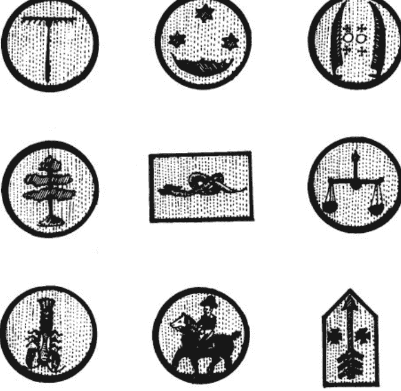

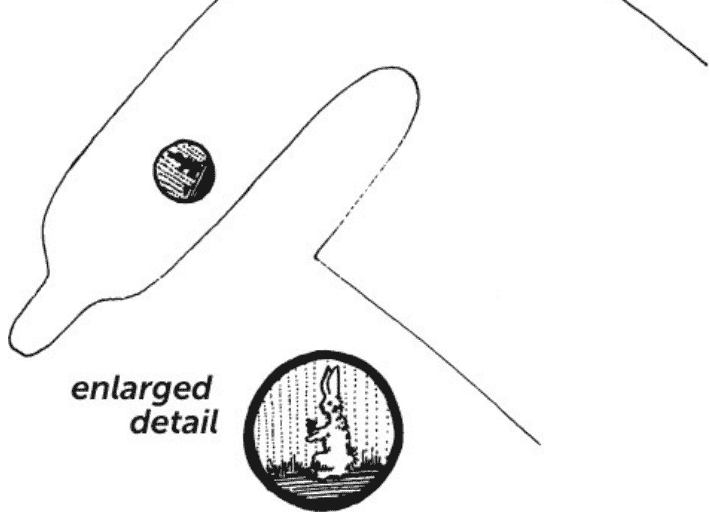

图 4 某些刀片商标

灌木或丛林镰刀片短至十五英寸，且通常更厚，以承受反复撞击幼树的冲击。70 厘米的草刀片适用于所有的草、杂草、刺棘和一年生树。

## 刀鞘

当你拿着握柄时，不会被镰刀割伤。然而，在工作的往返途中，刀片对自己和其他都是危险的。防止割伤人和划伤刀刃的好方法是套上一个完全覆盖刀片的鞘，并牢固地系在跟部端。有时贴在刀片上以保护边缘免受快递服务的窄塑料条在送货后应丢弃，因为它们反复使用并不可靠。

开始切割时，取下鞘并折叠放在口袋里。切割结束，擦掉刀片上的草和泥土，重新套上鞘。在刀片跟部后用一个简单的头结固定好。季节结束时，镰刀应储放在孩子够不到的高处。记住，刀鞘在修草时不能保护旁观者的腿部，也不能保护磨刀者的手。

当镰刀使用得更广泛时，不用时会用袋子或定制鞘覆盖。在英国一个不使用镰刀鞘的地区，传统是成群结队走向田野，刀片悬空，右手握上方握柄，下方的握柄牢牢抵在右腋下。这种规范化防止了事故的发生。³ 在每个地区，午餐休息期间，镰刀片被放置在未修剪的草或谷物中，任何男人、妇女或小孩都不会进入，从而保护了刀片和肉体。在现代，这些传统并非所有人所知，而刀鞘提供了必要的安全余量。

## 镰柄 (SNATH)

各种类型的镰柄（snaths）都与同样的长弯曲镰片配合使用。一种英国传统只使用自然弯曲的幼苗，而在东欧，则将偏移手柄卯在直木杆上（通常是白蜡木或核桃）。传统的苏格兰设计有一个长偏移柄，它几乎在镰环处与镰柄相接。镰刀是少数不对称的工具之一；双手并不执行相反或互换的任务。⁴

握柄（或称为 nibs 或 nog）以不同的方式连接在镰柄上，时而指向刀片相同的方向，时而指向相反方向，偶尔是混合的。可调节握柄由环绕在镰柄上的金属圈组成，通过旋转木握柄来拧紧，在博物馆收藏中发现它们指向几乎每一个方向。在某些传统中，只使用下握柄；而在另一些传统中，镰柄的上部曲在左肘窝处。在任何当地制作的工具上都可以预见到这些无数的变化。

美国五金店常见的典型扫掠弯镰柄是用美国南部的弯曲白蜡木制成的。木杆经过蒸汽处理，弯曲成所需的形状并干燥。这种方法的问题在于，保持永久弯曲所需的木材量增加了镰柄的重量。老辈人说，去农用用品商店买镰柄时要花半天时间测试库存中的某一个，它们每一个都略有不同。为了减少这种形状上的不确定性，现在的镰柄做得更重，以至于做出来的图案完全相同。1980 年称量的几个样本平均重量为 4/3 磅。配上更重的冲制刀片，弯曲白蜡木镰柄刀片的总重量达到 6.5 磅，而锤制刀片和直镰柄仅为 3.5 磅。考虑一下在修剪一英亩草的大约一千次动作后这种重量差异意味着什么。

弯曲的“美式”镰柄手柄可以绕点任何方向完全旋转，试图将锤制刀片（图 2）的角度带给更简单的冲制刀片。我更倾向于更简单的镰柄和更好的刀片。有时，旧镰柄会非常轻且平衡良好，主要缺点是木材干枯且脆弱，以及可调节握柄永久松动。此外，有些镰环非常小，只有某些非常窄的刀背（tangs）才能通过。

沉重木镰柄的重量使得美式镰刀导致右手腕处于局促位置的倾向更加严重。这种小指背向手腕弯曲的位置（“尺侧偏斜”）会降低手腕的功能并可能导致肌腱劳损。美式的轻质镰柄偶尔有铝制的，但我怀疑铝在压力下的表现。与钢不同，铝会随着使用而变弱——没有“疲劳极限”，意味着金属没有弱化的极限。即使是微小的弯曲也会破坏镰柄的角度。在尝试了不同的镰柄三年后，我决定欧洲生产的微曲钢镰柄最适合普通用户。它轻而坚固；刀片与镰柄的角度正确；靠近刀片的下握柄可以调节，而上握柄是固定的。每个调节握柄最终都会松动，必须用硬木或皮革垫紧。刀背头部插入镰柄末端的槽内，通过镰环上的两个螺丝固定，用专用钥匙拧紧。钥匙可以存在刀鞘末端或挂在腰带上；如果丢失了钥匙，1/4 英寸方形适配头可以很好地匹配镰环的螺丝。

我还开发了一种由风干蜡木制成的直镰柄。它的设计综合了目前欧洲使用的几种型号。它额外的特点是下握柄有卯道，允许不同的体型。它轻、坚固，并允许直立使用。然而，像所有木质工具一样，木镰柄需要额外的照顾：如果太湿，可能会轻微变形并改变镰柄与刀片的角度。这时就需要调整。季节开始时应轻涂油——一份亚麻油配一份松节油是一种渗透性且清洁的溶液。在湿草中长时间使用镰刀后，下握柄与刀片之间的部分应再次涂油。上漆而不是上油的选择必须在开始时决定，镰柄需要四到五层漆才能完全确保木材的每个孔隙都被填充。

如果没有这些额外的照顾，木镰柄可能会比管钢镰柄更难用。因此，这种镰柄最适合那些有一定的修草经验并以此做出调整决策的人。这是一个比任何其他手柄都要宽大，并允许在平衡的挥动中充分发挥刀刃的优势。木材的灵活性在手掌肉与金属刀刃之间提供了一种良好的触感缓冲。


# 镰刀的调整与维护

关于刀刃相对于镰柄（snath）的放置，以及沿镰柄调节手柄位置的几条规则，在镰刀的古代记载中反复出现：

1. 如果刀刃的跟部靠近右脚跟部，那么第一个手柄的位置应恰好位于右髋骨下方（图 6）。

2. 当以这种姿势握镰刀时，左脚应顺着刀片的弯度向外摆动。继续使用左脚可以很好地了解用于修剪草坪的长刀刃的形状。为了更准确地获得刀刃与镰柄的角度（“装配角”），将镰柄靠在刀刃上，上方手柄贴近地面，镰柄处于“12点钟”位置（图 5）。标记刀刃“牥”（靠近镰柄的边缘）接触墙壁的点。现在以上方手柄为轴向右转镰柄，此时镰柄大约在“2点钟”位置，刀尖与墙上的标记处于一条垂直线上。刀尖应在第一个标记下方三手指处。这种方法可以通过在地面上标记来适应田间作业。

3. 两个手柄之间的距离应等于肘部到指尖的长度（一个美索米米）。这使得上方手柄位于肩膀处（图 6）。这一测量值可以根据情况而变化，在易于切割的情况下，可以短至四手宽（一只手约为四英寸）。

4. 镰刀应保持平衡，使刀刃与地面平行，并由下方手柄中间的一根手指支撑。

镰刀片相对于其刀柄（tang）是扭曲或“翘起”的。当镰刀片出厂时与刀柄没有角度，且使用简单的圆环和楔子固定刀片时，需要通过虎口钳进行小心弯曲，直到刀柄旋转到与刀刃约 25 度角的程度（图 2，俯视图）。

这里的基本规则是镰刀要在其圆形的背部拖动，而不让边缘切入地面，但边缘距离地面不超过 1/4 英寸。这就是修剪草坪的方法，如果你能修剪草坪，说明刀片的翘起角度和装配是正确的。

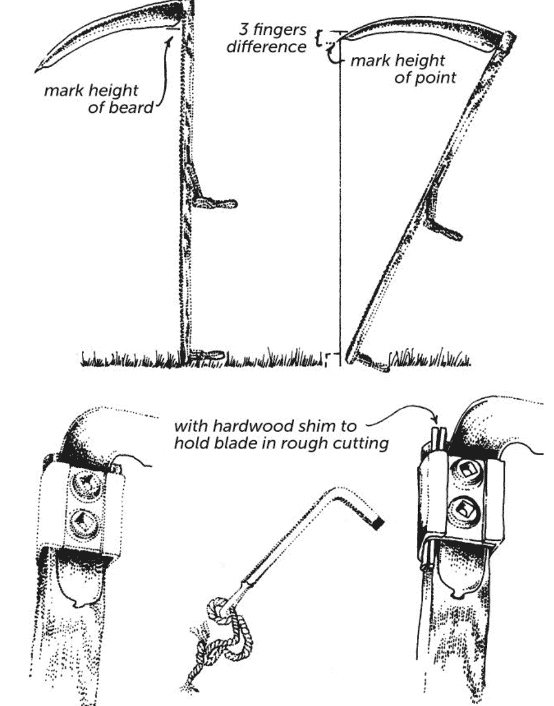

图 5 修正装配角度

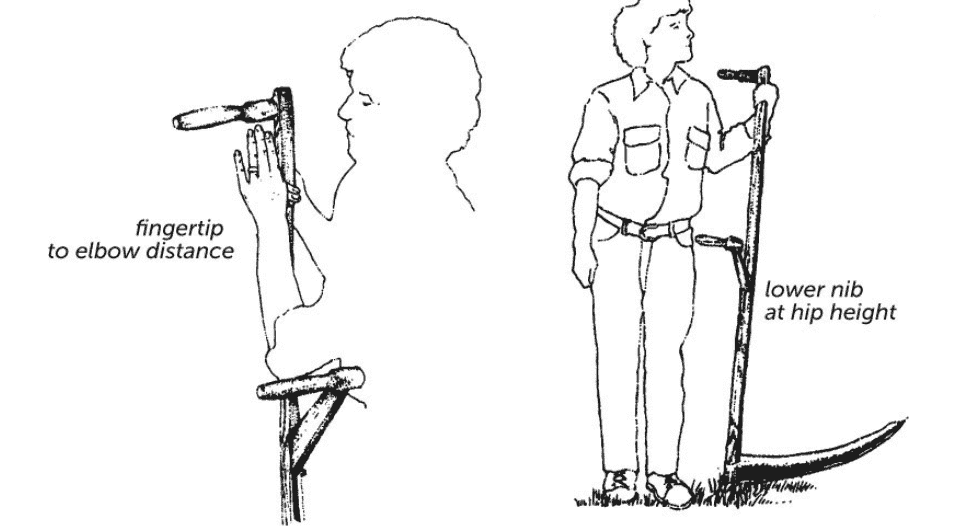

图 6 调整凸部

这些规则应该能让镰刀各部分之间的关系有一个大致的概念，但不同设计的镰刀、不同的人以及不同的切割条件有时需要进行修改。

风干白蜡制成的直镰柄可以适应任何尺寸的成年人，这是其他可用镰柄都无法做到的。上方手柄是固定的。下方手柄可以在槽内调节，并通过两个承载螺栓和翼形螺固定（图 1）。该手柄的设置应距离上方手柄一个尺长，或稍远一点。镰柄非常长，因此必要时所有者可以自行裁剪刀跟的长度；当镰刀靠在刀刃跟部时，下方手柄应恰好位于髋骨下方。在镰柄中心，距离适配刀柄销的末端 3¼ 英寸处，必须钻一个宽 5/16 英寸、深 1/2 英寸的孔（图 2）。刀片按上述第 2 点的方法装配，并通过镰刀环的紧固螺钉固定。

你可以尝试让镰柄比上述建议的稍长一点，但如果你觉得太笨重，且在切割时刀片似乎会将你拉倒，那么就把镰柄裁剪到合适尺寸。镰刀环将刀片紧紧固定在位置，但如果刀柄与钻孔的配合有问题，可以使用金属片（如屋顶防水板）。

## 磨刀

镰刀片相对于其刀柄（tang）是扭曲或“翘起”的。当镰刀片出厂时与刀柄没有角度，且使用简单的圆环和楔子固定刀片时，需要通过虎口钳进行小心弯曲，直到刀柄旋转到与刀刃约 25 度的程度（图 2，俯视图）。

这里的基本规则是镰刀要在其圆形的背部拖动，而不让边缘切入地面，但边缘距离地面不超过 1/4 英寸。这就是修剪草坪的方法，如果你能修剪草坪，说明刀片的翘起角度和装配是正确的。


图 5 修正装配角度


图 6 调整凸部

这些规则应该能让镰刀各部分之间的关系有一个大致的概念，但不同设计的镰刀、不同的人以及不同的切割条件有时需要进行修改。

风干白蜡制成的直镰柄可以适应任何尺寸的成年人，这是其他可用镰柄都无法做到的。上方手柄是固定的。下方手柄可以在槽内调节，并通过两个承载螺栓和翼形螺固定（图 1）。该手柄的设置应距离上方手柄一个尺长，或稍远一点。镰柄非常长，因此必要时所有者可以自行裁剪刀跟的长度；当镰刀靠在刀刃跟部时，下方手柄应恰好位于髋骨下方。在镰柄中心，距离适配刀柄销的末端 3¼ 英寸处，必须钻一个宽 5/16 英寸、深 1/2 英寸的孔（图 2）。刀片按上述第 2 点的方法装配，并通过镰刀环的紧固螺钉固定。

## 锻打（PEENING）

适用于奥地利模式的磨刀方法包含两个步骤：1) **锻打**：在小砧上敲击刀片；2) **磨石**：用磨刀石进行最后的精磨。

锻打今天在今天和欧洲的农场中使用，方法与布鲁尔 16 世纪画作《割草》中所示的方法完全相同。将一个小砧固定在土里或工作台上，用圆头锤或方头锤轻敲敲击刀片（图 8）。本国制造的最轻的方头锤是一种重量 2.5 磅的昂贵铁匠锤；进口的锤子大约 1.5 磅。

刀片的边缘完美地落在砧上。锤击从距离边缘 3/8 英寸处开始，向边缘延伸。通过图 9 所示的每四击一组的多次快速轻敲击，更容易实现这一目标。圆头锤增强了边缘处的钢材；锤子、砧或两者必须有这种圆头。

为了保持刀片在砧上，你可以将镰柄平衡在右肩上，或者让另一个人将上方手柄握在合适的高度，你手持刀片，另一只手握锤。上方手柄也可以用绳子系在树枝或横梁上，如图 10 所示：这样人就可以坐在两侧

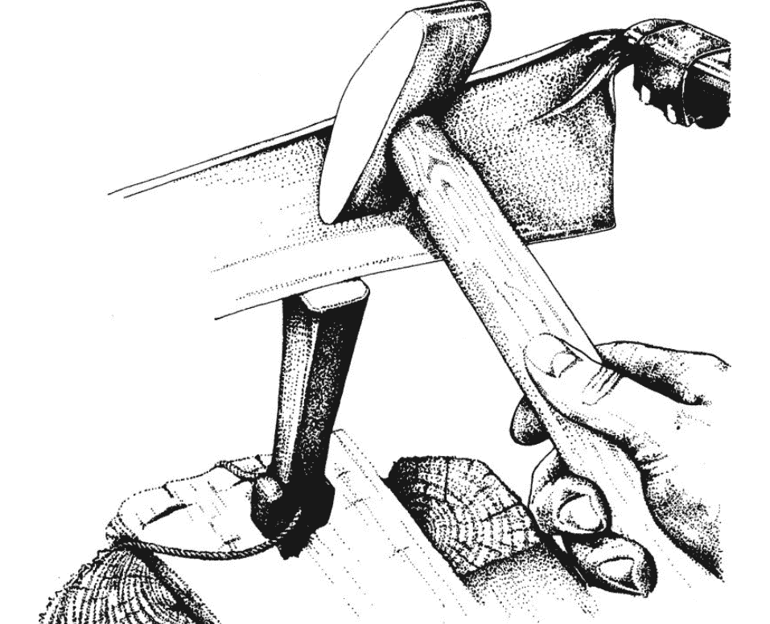

图 8 修整：锤子、刀片和砧板

刀片。整个修整过程需要五分钟，应每使用十二小时进行一次，或在需要时校直刀片上的意外凹痕。

对淬火过的刀片进行冷锤，每次敲击都会拉出一点钢材，以保持理想的厚度。大多数人不相信在没有铁匠炉的情况下可以塑造钢材。对于坚硬的“美式”刀片，这可能是不可能的。然而，高质量淬钢的晶体结构是可以被塑造的。

在冷作的分子排列中，钢变得应力硬化，而不会失去在剧烈压力下发生变形的能力（延展性）。然而，如果敲击过度导致边缘过薄且变脆，刀片会在薄弱处断裂。修整的目的是保持大师铁匠打造的原始刀片的刃角和厚度。一个经验法是像图 8 所示握住刀片，用大拇指甲向上推边缘。如果边缘在压力下可以轻微移动，那么厚度就是正确的。如果它完全不动，则需要更多修整。如果它移动但没有弹回原位，说明你敲的时间远超过五分钟！

许多人声称他们不可能沿着刀片的整个长度敲击，而且敲击很快就会耗光整个刀片。事实如此。我见过几把刀片每季使用二到三十年，它们比原始宽度窄了 1/4 到 1/2 英寸。边缘不再完全平直，而是变得有些波浪，这表明磨损和磨削不均匀。然而，对于镰刀来说，这是可以接受的，不会损害它的性能。正如艾德里安·贝尔在《苹果农场》中所说：“他的镰刀像海浪一样起伏；每一处缺口都是他劳作的历史。”

如果刀片不小心撞到隐藏在草丛中的石头或树桩，边缘的一个部分可能会变迟钝、弯曲，甚至可能出现长达 1/6 英寸的裂缝。为了避免这种损坏风险，首先不要要求镰刀承担斧头或长钩刀的工作。这些高质量的镰刀刀片可以切断一年的树和灌木，但不能切断直径像手指或更大的树干。然而，石头、围栏的意外，以及修整是校直凹痕的唯一方法。锤子和砧板是轻量化的，留有孔可以系绳子，以便方便地携带到工作地点应对此类紧急情况。通过反复敲击凹痕周围，你让刀片恢复原形状。而且，如果你足够聪明，借此机会移除或清晰地标记障碍物。

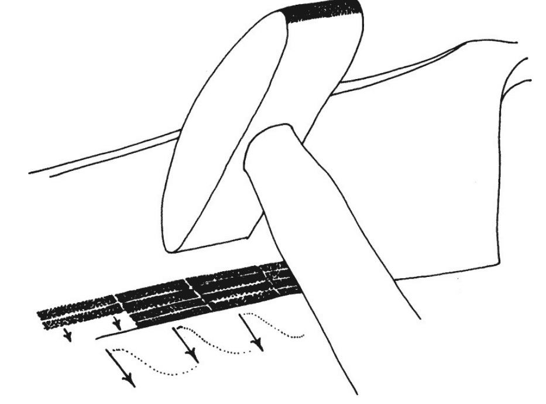

图 9 修整时的锤击序列

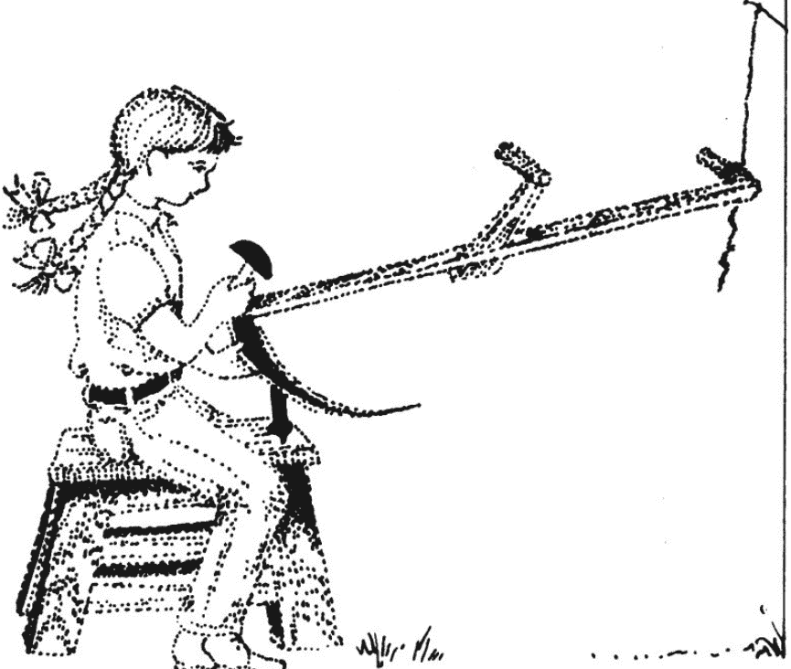

图 10 修整时固定镰刀的简单方法

当盯着一个大凹痕看时，我必须提醒自己，刀片有凹痕比没有凹痕要好。凹痕是可以修复的；没有显示应力迹象的刀片会将损伤储存在微小的裂纹中，这会缩短它的寿命。

# 磨石

> 带着欢快的木杖和笑语
>
> 我们挥动着尖叫的磨石。
>
> WILLIAM ALLINGHAM, 《割草者》, 1865

用石头润湿可以使刀片获得均匀的剃刀般锋利，并在工作期间定期进行。你每割完一片干草地，或者说你割了十五分钟的量，然后停止三十秒或一分钟磨刀。从硬质压制刀片的传统来看（它们从未像锤敲过的刀片那样锋利，且只会缓慢失去原有的锋利），这种休息被认为是懒惰的。然而，质量更高的刀片通过这种对锋利的定期关注，换来了更彻底的切割，从而需要更少的力。常规的磨刀不是浪费时间，因为割草者拿着更好的工具重新开始。使用钝刀会促使在割草时更用力地挥动镰刀——这既疲累又具有潜在危险。章节开头的两句引用显示了关于应该花多少时间磨刀的观点冲突；但我更倾向于每当我打破割草的专注状态就尽可能多磨。这可能是十五分钟。

从历史上看，磨石是从合适岩石的自然露头处切割而成的。自从 1906 年大量生产且更廉价的合成磨料出现以来，天然石的使用越来越少。五金店的镰刀石通常由加拿大的碳化硅或氧化铝制成，用树脂粘并在 2500 华氏度下烘烤。这些普通石头对于精钢刀片来说太粗糙了。欧洲的碳化硅石目数更细，更适合在锤敲过的刀片后使用。天然石的目数还要细得多；当用于最后的精细加工时，它们为边缘带来了一种完美感，初学者可能察觉不到，但经验较少的割草者会对此感激不尽。

| 石头类型 | 目数 | 备注 |
| :--- | :--- | :--- |
| 普通石头 | 50 | 碳化硅或氧化铝 |
| 欧洲石 | 120 | 目数更细，用于修整后 |
| 天然石 | 320 | 极细目数，用于最终加工 |

建议初学者缓慢进行磨刀，并戴着手套。镰刀片可以牢固地靠在树上或插入地面以保持稳定。用布或草擦净刀片。石头相对于刀片的角度为零。你应该能看到边缘 1/4 英寸处在磨刀时变亮。刀片的刃角由刀片正面决定。缓慢润湿；正确的角度比速度重要得多。如图所示，从石头的基部开始，到石头的尖端结束；从根部到尖。这种顺序的原因是微小的锯齿是朝刀片方向建立的。这些锯齿有助于切割。如果我是在磨剃刀，我会从尖部开始，朝刀片方向回磨，以消除偶尔在刀片边缘之外产生的极小毛刺。对于割草来说，这种毛刺不会影响切割，而且很快就会脱落。无论如何，将磨石和手远离边缘比向边缘移动更安全。

一种传统建议磨刀者站在那里，让光线落在左肩上，以观察石头是如何作用于边缘的。有人说磨刀时刀片不应指向北方或南方。事实上，地球磁场与刀片边缘钢分子的排列之间存在相互作用，但它们非常细微。

磨石架（见图 11）在运输过程中保护易碎的石头。它还能盛少许水（宾夕法尼亚德国人会与醋混合），以便清理磨刀期间堵塞石头孔隙的微小金属颗粒。旧式的刀架是由牛角或精制木头制成的，具有独特性。但牛角稀有且木头会开裂，它们已被带有腰带夹的硬塑料架所取代。

图 11 磨石与磨石架

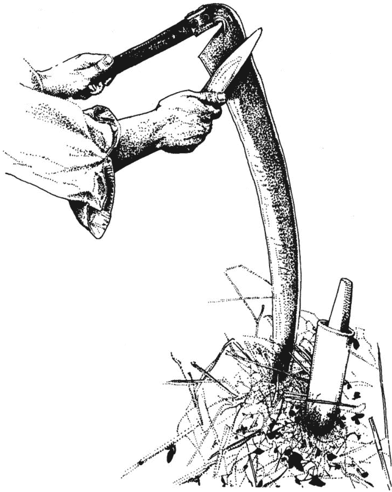

图 12 磨刀

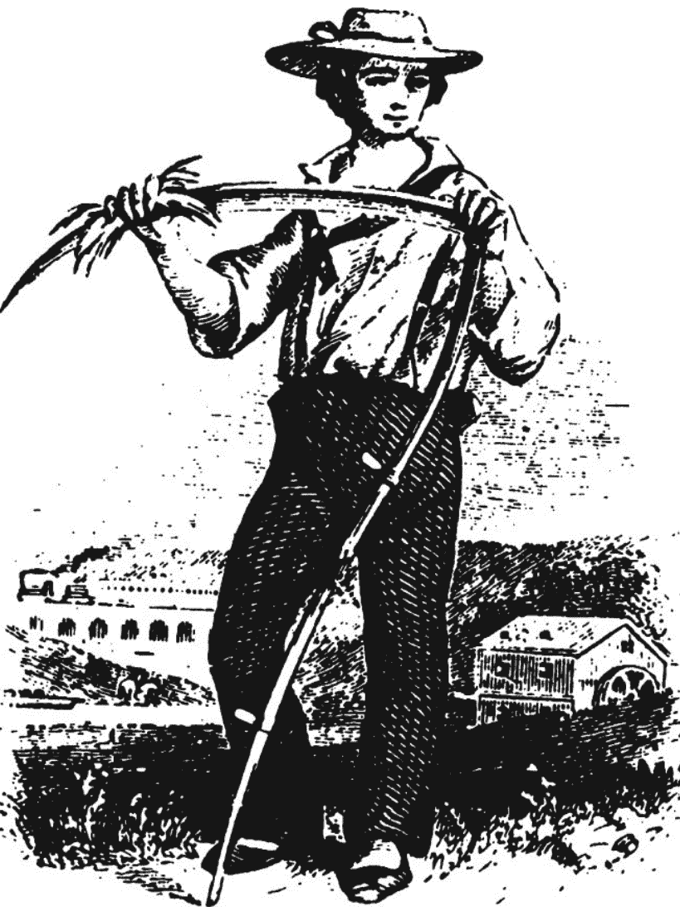

图 13 清洁刀刃

每个地区都有当地不同的采石场。在《工具制造者》（Man the Tool-maker）一书中，肯尼斯·奥克利（Kenneth Oakley）展示了一块萨森岩（一种经次生硅侵入硬化的砂岩），它在数千年前被用于磨锐石斧。优质的铺路石和纪念碑曾作为固定式磨刀非常流行。9 我有一块来自附近惠特斯通溪（Whetstone Brook）的板岩，还有一块我爷爷经过多年使用而磨损的板岩磨刀，我发现它们能磨出非常锋利的刃。最后的润光来自一种英国传统，我从未在这个国家听说过，但我尝试过并非常满意：使用生长在死桦树上的干壳真菌（Polyporus betulinus）进行细磨，它非常贴合手部。

在某些地方，用木棍代替石头，磨刀过程需要一套新的工具。使用锯子或特殊的铁质钻孔器钻出小的“孔”（delfs）来盛入脂肪或油脂；额外的油脂装在特殊的袋子或角里带到田间；锋利的或金刚砂被装在小袋里带到田间；刀柄（snaths）有时制成一英尺长，以适应刀柄架。10 保持油脂低温不流失，保持锋利的边缘等等——这些都是失传的艺术。我对从这两种等级的石头上获得的锋利度感到满意。

保持刃口锋利的最后一步是每天使用后擦拭刀刃，如图 13 所示，这可以防止生锈并提高镜面光泽。割草者达蒙（Damon）的刀刃使得：“我在其中看到我的作品已完成，宛如新月中的太阳。”11

我不借出我的镰刀。我享受精心维护的刃口带来的益处，而钝的边缘则提醒我自己的责任。每当我锻锤和磨刀时，我都在重新制作属于我自己的工具；随着时间的推移，它成了我工作态度的镜像。一个芬兰故事描述了一个疲惫的割草者，他叫道：“让魔鬼磨我的镰刀吧！”魔鬼死了，留下了刀柄。

## 割草技巧

以此声驱散忧虑的烦恼，

晨露中镰刀的挥动

> —阿尔伯特·勋爵·丁尼森，《纪念集》LIX，1833

割草应该是舒适的，不应该太费力，不应该——立即——疲累。如果是这样，说明做法错误。因此，割草的着装也应该舒适。最好的穿着包括宽松的裤子和衬衫。鞋应该是轻的；脚不会受到威胁，而且割草经常赤脚进行。草帽是个好主意，欧洲割草者总是戴着。围巾在清晨可以用来暖脖子，在下午可以擦额头。

## 一项有用的练习

每次割草开始前的一项练习帮助我记住动作的形状（图 14）。我直立着，既不萎缩，也不僵硬地立正，将重力视为地球的基本力，它每刻都作用于我的全身。重力是一种加速度，与恒速相反：一种不断产生、将我向下拉得更快且更新的力量。我以向上的加速度作为回应，相反，也每刻都在更新，这是一种反重力。我倾向于用“能量”（energy）或“弹力”（spring）而不是反重力来表示这种反向运动；它不是一种反地球力，也不是排斥。地球是我们弹出的实体。我们是地球的后代。“弹力/spring）的其他含义都是正确的。既没有拉去与源头融合，也没有失控地飞向逃离，我直立着，脚踏实地却又向天空跃动。姿势本身就是一种创造行为。尽管这种互动

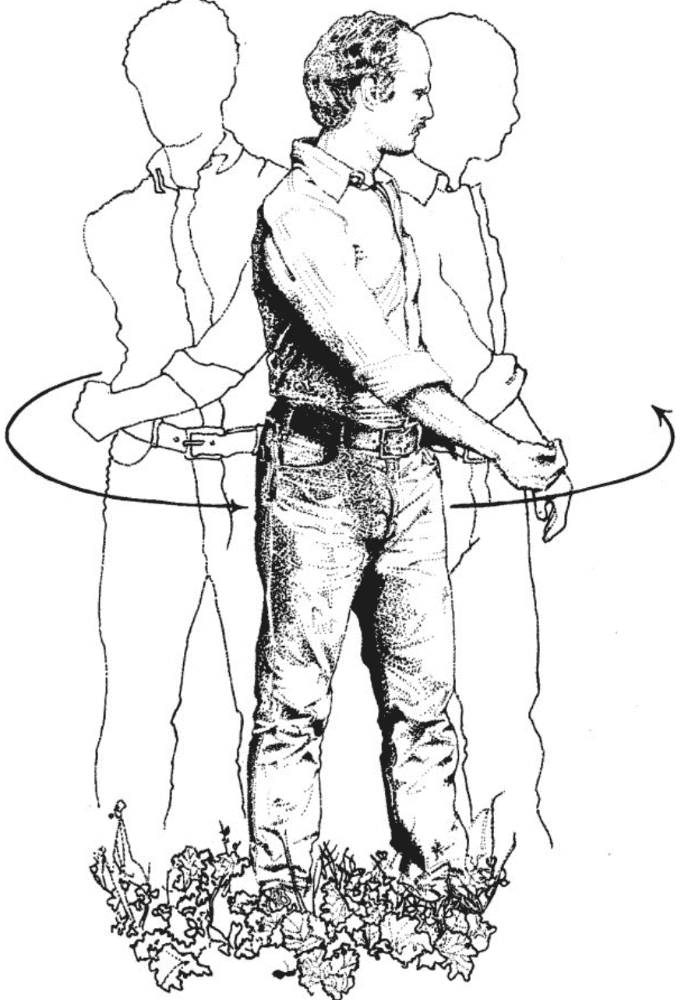

图 14 我与重力之间的扭转练习一直在进行，它通常是无意识的。割草提醒了我这种关系，因为它恢复了重力和弹力的平衡。

在这重力与弹力的这两个加速度流的中间，我是放松的；我的肩膀没有耸起，脖子不僵硬，我可以在大脑中从身体的一个部位移动到另一个，释放不必要的紧张。然后我开始从一侧扭转到另一侧，面向右侧，然后让手臂自由摆动。我的右手落在左大腿上，一秒后我的左手落在右大腿上。脚踝、膝盖、臀部以及整个脊椎都有扭转动作。这项练习旨在提醒我三件事：

1. 割草是一种扭转动作，从身体右侧绕过前方到达左侧；
2. 我的手臂和肩膀不需要紧张，可以保持放松；
3. 我的整个身体都参与了扭转运动。人体可以被看作两个在动态平衡中以相反方向斜向上穿过身体的扭螺旋。在割草中，这种动态平衡是关键。


# 人体动态平衡与割草艺术

人体可以被看作两个在动态平衡中以相反方向斜向上穿过身体的扭螺旋。在割草中，这种动态平衡是关键。

割草动作划出的优美弧线：“帆在蓝天下来回地挥割。”镰锄是桅杆，长横杆就是镰刀。

我在草坪上练习，在挥割和返回的过程中都拖动刀片。刀片从刀刃到刀部的横截面显示，刀刃后的区域向外微弯曲。

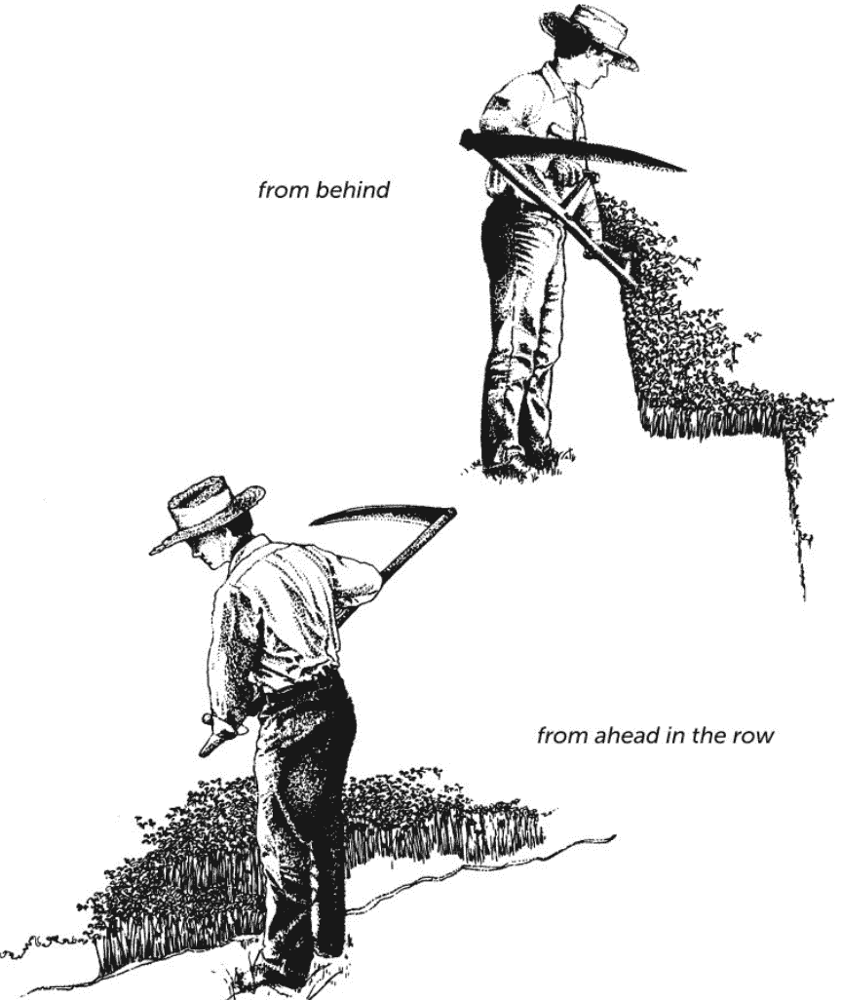

从后面看

从行内前方看

图 16 挥割姿态

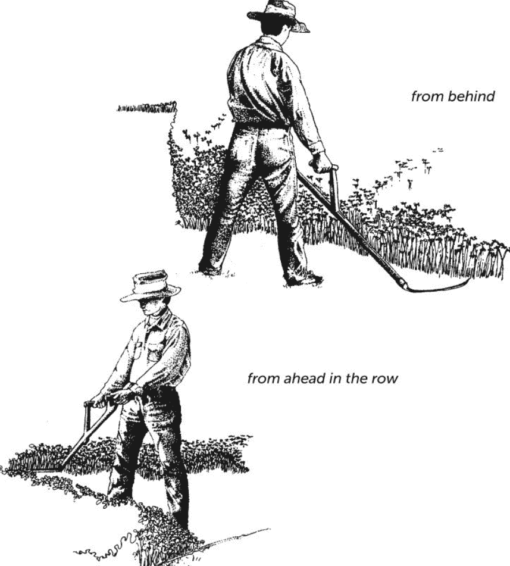

图 17 割草时的节奏性旋转，刀片始终贴地

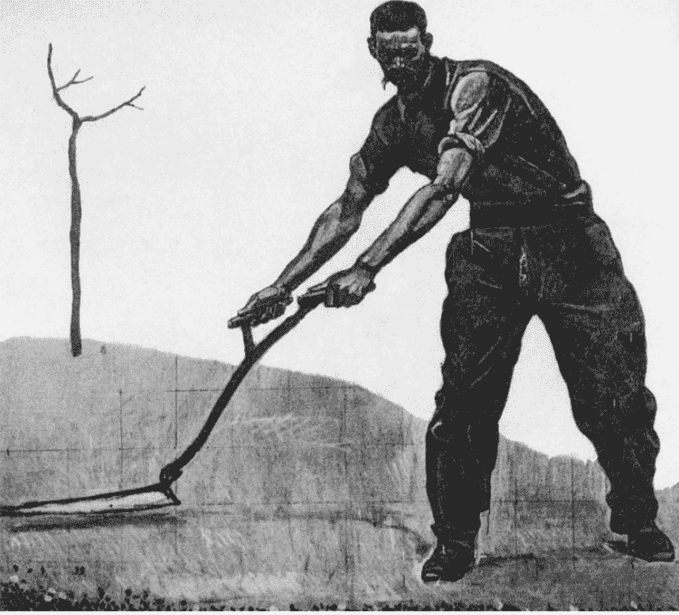

图 18 伸出手以扩大割幅（图 5）。在近距离割草时，凸形刀片像压入式刀片一样沿着挖掘处滑动。通过这种练习，草坪被割了，我可以保持刀片平行并贴近地面。为了获得更宽的割幅，我的左右手在挥割开始时向右伸出，在挥动过程中远离身体。图 18 中所示的割草者向草倾斜，没有失去平衡也没有弯腰。在状况良好的草地上，经验割草者可以用刀片割出七英尺或更宽的宽度。在干草场中，六到七英尺宽的平均宽度被用作长度单位。缺乏经验的割草者最好减小步幅，稍微向左走一点，即使是在上一行的割口处。整洁的切割比宽割更重要，这一点从新罕什尔州苏利文县乳制品改进协会年度会议的割草评分系统中得到了体现：

| 准则 | 分数 |
| :--- | :--- |
| 枯茬整洁度 | 45 |
| 割幅宽度 | 30 |
| 割一平方英尺的时间 | 15 |
| 割十平方英尺的时间 | 10 |
| 切割粗糙程度 | 扣分 |

允许更宽切割的很大程度上不是力量，而是通过正确的扭转在肌腱中储存能量。割幅的长度和宽度也随作物的状况而变化，而切割的均匀毕竟是割草的目标。石质土地上短而枯黄的劣草显然比平地上的高杂草更难割。

## 小进步

尽管对于初学者来说，直立而不弯腰最好是最好的，否则当增加割幅时，他们会有被向前拉的经历。当这种姿势变成弯腰时，就应该放弃；割草中定位的诀窍在于学习如何在不失去平衡的情况下投入工作。即便遵循了所有的技术规则，仍有变化的空间。镰锄柄和刀片的制造确保了切口边缘与草之间保持正确的关系。然而，可以通过操纵刀片来最大化切割角度。我总是保持刀片平行于地面切割；但这给了我两种处理草丛的方法。如果我左手按住腰带，右手在挥割过程中绕过，我可以进行狭窄的切割。相反的方法是像菜刀剁肉一样，将整个刀片直接横跨草。用狭窄的切割，只割下一英寸草；用宽阔的砍割，草往往会倒下。所有的割草都结合了两种方法；在不同的条件下，我必须改变方法以获得更多的切割或更多的砍割。如果切割容易，我可以在挥割开始时伸出手来增加割幅，同时牺牲一些切割效果。如果切割困难，我可能希望通过将刀片内倾来最大化切割效果并最小化砍割效果。在镰锄环的限制范围内，刀片可以在底座上轻微移动以产生切割或砍割效果，但我发现，如上述描述的那样使用手臂的方法已足够适应大多数割草条件。在某些情况下，我割草时并不保持脚静止。我开始将重心放在右脚上；然后随着身体开始松开，我的重量移到左脚上。我慢走着穿过田野。这些和其他变化在不同的切割条件下是合适的。去尝试吧。草会教你的。列夫·托尔斯泰在《安娜·卡列尼娜》中描写贵族列文加入农民进行一天的割草的描述，生动地表达了割草中固有的轻松与优雅：

> 老人挺直身体，双脚向外撇，迈着长而有节奏的步子，动作精准而规律，这种动作似乎比走路时挥动手臂更费力，仿佛是在玩耍，他铺下沉重而均匀的一行草。仿佛不是他，而是那锋利的镰刀自己在穿过多汁的草丛中沙沙……列文移动得越久，就越感到那些无意识的时刻，在那些时刻，似乎不是他的手在挥镰刀，而是镰刀本身——一个充满生命力和自我意识的物体，仿佛像魔法般，无需思索，工作就自己变得规律而完。了。这些是最幸福的时刻。
>
> 只有当他必须停止动作并思考时，才是苦差；当他必须割一个小土丘或一丛镰草时。老人轻而易举地这样做。遇到土丘，他改变了动作，有时用脚跟，有时用镰刀尖，用短促的动作割掉土丘两侧。在做这些的同时，他不断观察视线所及的一切：时而摘下一颗野果吃给列文吃，时而用镰刀片甩出一根树枝，时而看着鹌鹑从草丛下方飞过。

回看过去的几割，割出的草带看起来像起伏的波浪吗？刀片可能没有与地面平行，导致刀尖切入的高度与刀柄不同。

事实于此。如果我不理解为什么草坪会凹凸不平，我就会尝试夸张地重现那种修剪得很糟糕的草。这样，我就能发现挥割动作中的问题所在，并纠正自己的技巧。

草会教导你，但在绿干草或杂草上学习比在狼尾草和地草上容易。当刀片轻声穿过芬芳的茎时，苜草教会你一种从容的风格。而对于刺棘和坚硬杂草的更难切割，可以通过付出更多努力，但要保持良好的姿态。

割草技术的改进还需要对身体进行观察，其关注细节的程度正如运动员所需的那样。

是你的二头肌因工作而酸痛，还是背部？让你的右臂自然垂下。多转臀部，利用脚踝和膝盖的力量。

脖子酸吗？不要耸肩，不要弯腰，也不要在宽宽的草带上过度用力。

肚子疼吗？不要停止呼吸。常见的抱怨是由于不习惯扭转导致的腹部酸痛。你可能像打高尔夫一样面对田地，应该要求自己保持左右脚与切割线垂直，甚至让右脚超过左脚。

让刀片处于身体扭转节奏的控制下，而不是猛烈地挥打草地，可以防止疲劳，延长割草者的工作日和职业生涯。当所有部分协同工作时，你将会认同斯蒂芬·天赋爵士（Sir Stephen Talents）的经验，他通过“平静地引导刀片穿过”草丛来割草。

观察别人，让别人观察你，看看微的变化如何影响切割效果。风格上存在个人差异的空间。有些人的能量从左髋骨爆发，有些人来自左肘，有些人则均匀地分布在全身。

## 身体的使用

列文（Levin）在他一天割草工作后对他住在城市的兄弟说：“你无法想象这对于各种愚蠢行为是多么有效的疗法。我想为医学增加一个新词：Arbeitkur（劳动疗法）。Arbeit 是德语中工作、运动、能量的意思；kur 意味着治愈。”

> ——列夫·托尔斯泰，《安娜·卡列宁》，1876

对自身身体动力学的感知可以用来提高割草能力，反之亦然。对这种理解最有帮助的是F·马蒂亚斯·亚历山大（F. Matthias Alexander）教学中提供的知识。

亚历山大是世纪初的一名演员和公共演讲员，他的职业因日益严重的嗓音问题而中断。由于无法找到医学解释或治疗方法，他花了几年时间在镜子的帮助下，在说话和休息时仔细观察自己。他发现，在说话之前，甚至在思考说话时，他都会不意识地向后仰头向前伸下。虽然这是一个小动作，但它让他的脖子僵硬，切断了脊椎和喉咙的能量柱，损害了他的声音和表现力。同时，亚历山大发现，他会抬头挺胸并收缩背部，进一步挤压了喉部。经过几个月的观察，他发现防止头部的紧张和运动，使声音得以恢复，整体健康状况也得到改善。困扰他一生的哮喘逐渐减轻，直到发作完全停止。

怀疑自己发现头颈在发声中的作用包含更大的益处，亚历山大继续研究，审查头颈与整个人体有机体的联系，以及身体的使用，或者更准确地说，整个自我的使用。从头颈关系首要重要的前提出发，他能够教他人意识到习惯性的使用，从而让他们交给一个更符合人体机能功能的老师来重新教育他们的身体。

亚历山大发现，当他试图在头部和躯干之间保持动态平衡时，他的努力是徒劳的。他的身体僵硬地固定在一个新位置。他还发现，如果没有镜子，他就无法可靠地知道自己的头和颈在做什么，因此不知道是否正以“正确”的方式支撑它们。由于他无法做什么来改善糟糕的使用，他选择不做那些伤害自己的事。抑制错误的习惯性使用模式成为亚历山大法的核心特征。亚历山大的一位弟子说道：

> 在未被察觉的行为模式引起你的注意之前，你必须识别出这种习惯，例如通过镜子、通过亚历山大的观察，或者在准备进行某项活动时“通过思考让自己停下”。当你准备移动时，想“不！”然后，通过重复的抑制而非重复的习惯，你培养了增强的运动感知力，让你能够在物理上“准备好”去执行某事时感知到自己.¹¹⁴

在我的情况下，我首先意识到自己在割草时对自身的使用不当；例如，我发现看到前方行中的干狼尾草会导致我的脖子和肩膀紧张，从而在割草时产生紧绷。我学会了在上述描述的方法中抑制这种收缩。一旦抑制了反应，在感知（看到狼尾草）和反应（准备割草）之间产生了一个停顿。那个停顿是重新教育我自身的机会。在停顿期间，亚历山大建议了三个静默的方向：

1. 让脖子自由（不要增加脖子的紧张），
2. 让头顶向前向上（不要向后或向下拉），
3. 让躯干伸长并变宽（不要收缩背部）。

这些指令听起来很简单，但单独执行某一个几乎是不可能的。合在一起，这些指令构成了一种感觉，亚历山大称之为“动作中真实的原始运动”。

“原始运动”一词提醒我们，我们总是在响应重力的加速度而运动，而头颈关系是这种反应的控制中心。亚历山大也将此称为“原始控制”，以强调抑制对于消除习惯模式并允许身体做其最擅长的事情有多重要。我使用“原始运动”一词，但不忽视“原始控制”中的感觉。

原始运动可以在任何孩子身上观察到，同样的顶级运动员身上。它的缺失会导致身体滥用，并引起功能障碍。为了帮助客户重新发现原始运动，亚历山大技术的实践者使用最轻的手法，通常在头部和肩膀区域。人们可以重新学会处于一种平衡状态，没有紧张（没有军事立正！），也不会因自身重量而坍塌。在割草前的扭转练习中使用的身体抗重力体验，是与地球力量相关的原始运动积极使用的例子。

人类学家雷蒙·达特（Raymond Dart）用“平衡”（poise）来命名“原始运动”。他所说的平衡是指永恒的动态平衡，即使在身体休息时也有效。他将其与整个身体长度内反向扭转的双螺旋肌肉中的平衡能量联系起来。医学标志中相互缠绕的双条蛇生动地说明了这一原理。

此时是最放松的时刻，同时引导我的“颈部保持自由”，“头部向前并向上移动”，以及“让背部拉伸并变宽”。

镰刀的握柄仅由手握住，不需要让手臂和肩膀处于紧张状态。头部从脊柱中释放出来的“首要运动”，随着头顶向前并向上移动，为身体其他部分的扭转留下了充足的能量。工具可以自由地挥动，由每一个关节平均地提供动力，从而释放了所有的关节。

工具与割草者结合在一起产生的内在节奏，就像一个旋转又扭转的轮子，拥有一种力量，并创造了一个属于它们自己的时间范围。一位英国农民这样描述这种经历：

> 我感到动作中产生了一种慵懒，是镰刀在做，一种非凡的力量占据了我们两人，我们便挥动着，挥动着^16

# 我们再次构建列文

又是一排，又是一排，紧接着——长排和短排，有好的草也有差的草。列文完全失去了时间感，根本不知道是晚一排还是早一排。一种变化临到了他的工作上，这带给他巨大的满足感。在劳作中，他某些时刻会忘记自己在做什么，这让一切变得轻而易举，而在同样的时刻，他割出的草排几乎像提特的那样平整整齐。但只要他回想起自己在做什么，并试图做得更好，他就会意识到任务的所有困难，草排也变得割得很糟糕。

我们看到，亚历山大的“首要运动”已被他人很好地表达出来，我们还可以遇到身体最佳使用的另一个方面：它是如何改变我们对时间的感知。当我良好地使用身体时，我进入了这个时间范围，并遵循我与镰刀、草地和大地之间首要运动的节奏^17

迈克尔·墨菲在《王国中的高尔夫》和尤根·黑里格尔在《弓道禅》中记录的经历强化了亚历山大的教训，并在精神领域对其进行了阐述。禅宗的悖论在于，如果我放弃了“收干草”的匆忙意图，实际上我会做得更好。从亚历山大的观点来看，匆忙的割草者在所有的忙碌中忘记了身体最好的状态。人们往往倾向于关注目标，而忘记了我们用来到达那里所采用的手段。总是追求结果，让我们忘记了正在发生的事情。我的目标是获得干草；我的注意力在割它的过程中：我把自己置于草带的起始，让割草开始。“保佑割草顺利！”作为割草者之间的一种问候方式，就像“早上好”，对我来说，这是一种促进首要控制的召唤。

然而，抑制我习惯性的紧张，并允许自己随着镰刀进入时钟的运动，必须在我意识不到周围环境的情况下完成。那时，我被自己首要运动那不可阻挡的节奏所吸引，不再回头查看工作以检查动作；而节奏的变化——例如由土丘、石头以及罕见的蟾蜍或鹌鹑所要求的波动——很容易破坏这种天般的平衡。在对环境保持意识的情况下进入一种平衡的节奏，允许我像列文的老老师那样均匀且灵活。

人类割草的节奏以及它允许的灵活性，是镰刀作为工具优越性能的核心。最早的机械割草使用一把或多把镰刀，由地面上机器轮直接驱动的水平轮旋转圆周。发明者们试图做得人类割草者正在做的事情，但速度更快。事实上，这些机器的表现比人类更差——它们无法适应地形的变化、草的种类、倒伏草的生长方向以及障碍。在任何非最平整的均匀地面上，刀片经常会刺入地面或将草压倒而不将其切断。118

## 重新考虑扭转练习

> 他在执行（工作准备）时那种冥想般的宁静，赋予了他那种至关重要的放松和所有力量的平衡、专注和头脑清醒，没有这些，就无法完成任何正确的工作。
>
> —尤根·黑里格尔，《弓道禅》，1953

我再次以放松的姿态站立，镰刀放在面前。我花一点时间放松。然后我让我的脚踝变得放松，从而开始左右旋转。我放松膝盖、臀部和躯干，让手臂从一侧甩到另一侧。我时刻意识到头部与颈部以及身体其他部分的关系。

到此为止，我集中在自己的首要控制和对习惯运动方式的抑制上，以便我的身体可以更自由地扭转。现在，在不实际操作的情况下，我想象在这种运动中握住镰刀。如果我紧张了，我就可以花时间放松紧张，而没有手中镰刀带来的真实干扰。

然后我拿起镰刀并继续扭转实验，感受工具的重量和形状。最后，我可以带着镰刀靠近草地。通过这种方式，我谨慎地从与重力的关系，过渡到我自己的首要控制，到我与工具的关系，到我与草的关系。镰刀将我的首要控制从身体引出，与大地建立联系。19

## 割干草

草是大自然的宽恕——她永恒的祝福……如果它的收获在某一年失败，饥荒将导致世界人口减少。

> —参议员约翰·詹姆斯·英格尔斯

[正文其余根据提供的 OCR 段落遵循类似的逻辑...]

1/4 磅洋蓍草 (Achillea millefolium)

每英亩 33 磅

这些草地植物中的最后五种是草药，少量播种，以为动物提供不同类型的营养资源，22。这实际上是包含如此多种种子的原因：从一年一年一年，到季节中的周一周周，另一种植物会找到其茁长的条件，充分利用土壤，使取食这些植物的动物获得最大利益。草本干草不仅适用于牛、羊等反刍动物。对于饲养家禽来说，每只鸡一盎司多样的绿色植物是预防疾病和健康产蛋的秘诀，23。

镰刀割机还有一个最后的奖励。每根草的切口都有其独特的芬芳，增添了多样性的乐趣。

## 制作干草

> 我长长的镰刀低语，留待干草被制成。
>
> —罗伯特·弗罗斯特，《割草》，1913

一英亩被认为等同于一天的割草量。然而，有些人可以在不需要太早起的情况下一天割两英亩。一个英国传说说，有一个人在打赌中一天内割了五英亩地；他使用了两把镰刀，并雇佣了一个助手来磨未使用的镰刀。

这些测量值相对于所使用的“英亩”类型。我们现在的英亩包含43,560平方英尺；但旧的苏格兰英亩是我们英亩的1.27倍，旧的爱尔兰英亩是1.62英亩，旧的柴郡英亩是2.12英亩，东欧的几种单位为1.42英亩。每一种最初都与一天内割的面积有关。

严谨的割草者会在凌晨四点开始，那时他们几乎看不清磨刀刃。晨露赋予了草更大的重量和惯性；它们更容易弯曲而不是被切断。低割不是割低的唯一理由：对于干草或覆盖物，每根茎越靠近地面，分越多。因此俗话说：“底部一寸值顶部两寸。”

在英国，使用一种附件来改善割好的草向风堆的输送。这种工具被称为“草钉”，它是一根硬丝，连接了刀舌上的孔和刀柄上三英寸处（略高于刀根）的孔。欧洲其他地区使用的另一种附件是一个半径为四英寸的小半圆弧，安装在刀柄底部，并垂直于刀片线条（非常类似于图26中的大型弧形摇篮）。24。

干草有多种干燥方法。在一种传统中，男孩和女孩跟在割草者后面，用双手将新割的草扫过对面的肩膀撒在地上，尽可能轻地地铺开。他们带着干草叉回来，再次翻动，让不同的表面暴露在阳光和风中。在奥地利，我观察到他们将留有几个树枝的幼树（heinzen）插在地上，干草挂在它们周围，利用树枝作为钩子。在欧洲还会制作草石或草堆，有时建在平台上以让空气进入中心。顶部绑在一起的三根木子让干草离开地面以便于干燥；这样的三脚架出现在图20的背景中。表面的草用耙子梳理，使雨水在干燥过程中避开草的主体。在斯堪的纳维亚的山区小农场，在支撑柱之间架起水平线，草像晾衣绳一样挂起来。

雨水不仅是一种麻烦，因为它会冲走草表面的养分。“他必如雨降降在月亮草之上”（《诗篇》，72:6）。如果雨水来临，最好将正在干燥的干草风堆收集成一个大堆并覆盖起来。等地面干燥后，再次将干草铺开。或者将干草带到通风良好的遮蔽处，在堆放储存之前让它干燥得慢一些。

干燥草的目的是保存它。如果太湿，细菌就会使其腐烂并毁掉它。腐烂还会产生大量的热量，在历史上曾导致许多谷仓起火。然而，如果太干，像苜蓿草（lucerne）、三叶草和草药等叶类作物在处理过程中会破碎，并遗留在田里或通往储存地的路上。

当老辈们在田里闻到干草那诱人而浓郁的芬芳时，就知道它们已经足够干燥了。

呈45度角；通过翻转耙子，你可以将草推向一侧或另一侧形成草垄，而不是在脚下堆成一堆。27另一种是系在腰带上以这种方式拖动的。长柄草耙宽2½英尺，有十四个齿，且头部与手柄之间的连接非常牢固，仍然可用，并且胜任清理田地的工作。它也比一些大型大耙更容易运输。

握持草耙的最佳方法可以在布鲁盖尔的画作《割草》以及古埃及的卷轴中观察到：上手的拇指指向杆子上方，而下手的拇指通常指向下方。这样，耙子就不会


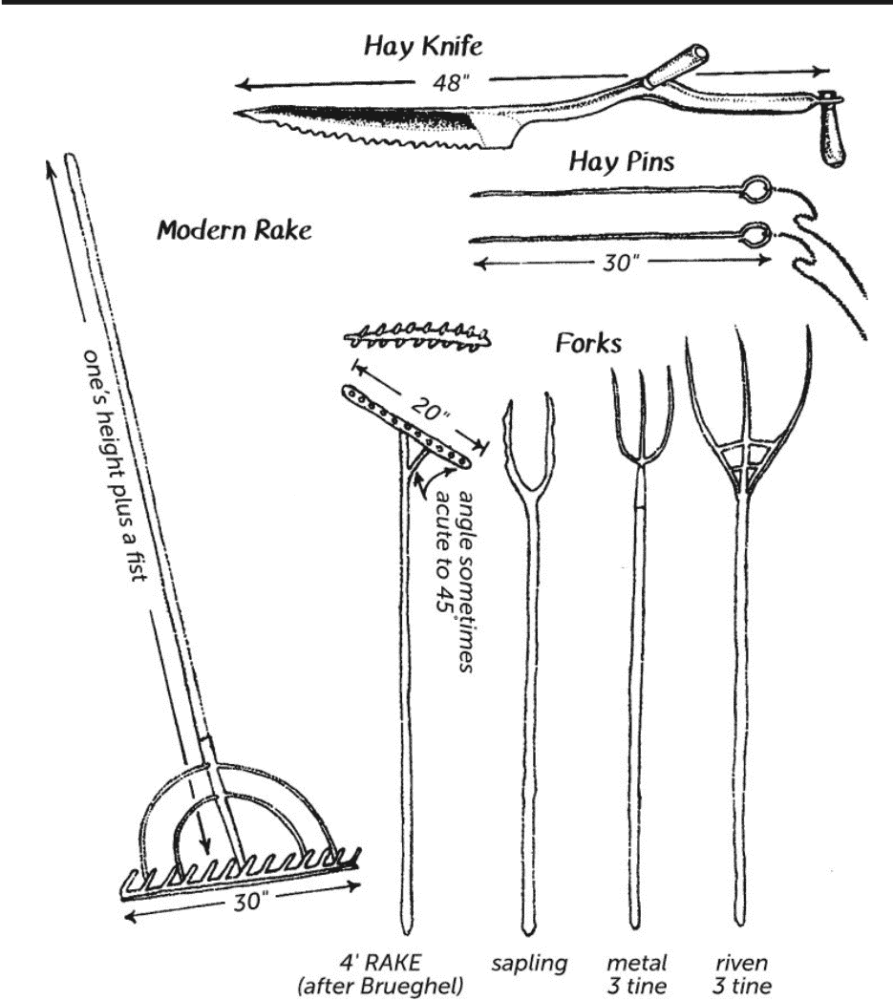

**图 21 割草设备**

横跨在地面上，否则可能会在草中缠绕并弄断耙齿。像梳子一样，耙子将割好的草从草茬上拉出来。

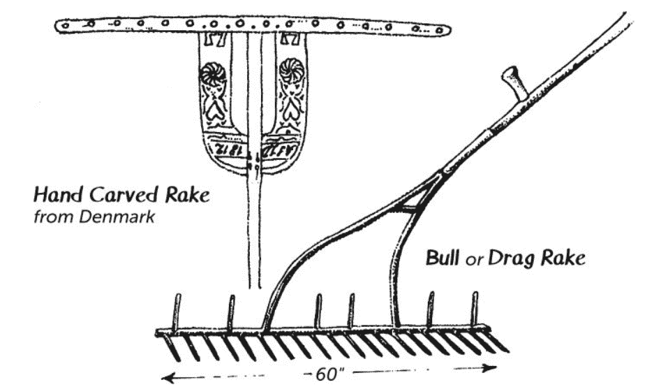

如果耙齿断了，必须钻掉断头，并用一根新的硬木销子填其位置。可以通过手工沿木纹劈裂制作更坚固的备用齿。在耙齿或木制草叉上，手工劈裂比加工暴露在天气中的端面更少，这使工具更耐用。

当动力来自役畜时，用于运草的轻型车辆很常见。现代动力设备往往无法获得、对于春季潮湿的田地太重，或者无法到达某些地方。美国大多数园艺和农用在轮子和车身之间没有保护空间；当草掉进这个区域时，就会卡住轮子。一种坚固的车载设计带有可拆卸的挡板（传统上称为“车梯”），它们保护了车身与轮子之间的脆弱区域，并在功能上将容量增加了三倍。

由于运草的问题是体积而非重量，使用草针可以进一步增加负载。草针是长细的金属杆，像发卡一样插在草中，将负载的顶部固定在下方的草上。这些针必须带有孔并系上绳子，以便从负载中拉出。你是否想过，草堆里丢失的针最初是怎么出现在那里的？这些就是针，在运下一批草时必须取回来。

在装载较大的推车或卡车时，将每一叉草放在草床边缘围成一个圆。随着负载的增加，让圆变得越小，这样大部分草就会向中心倾斜。通常在生长的堆上有一个助手，他将草叉放置在最佳位置，以形成大而稳定的负载。在谷仓处，同一个人应该按照装载时的完全顺序拆卸草叉。

当松散的草叉入草楼或草堆时，它们会随着时间的推移自然沉降；一些农民通过在上面走来鼓励这样做，排除空气，从而保存脱水的绿色。当草被压实后，只能从放入的地方取出，一次一叉从顶部开始。长双柄草刀可用于对草进行垂直切割，以便从侧面取草或进行精确的划分。1939年，美国86%的割草是松散存放的，因此这仍在在世农民的记忆中。

## 团队协作割草

> 镰刀挥动，镰刀挥动，我们一同割草山谷。
>
> —威廉·奥尔林哈姆，《割草者》，1865年

割草者沿田边等距排列。他们中技巧最好的将以放松的节奏进行切割，这种节奏会随着时间的推移而加快。每个人轮流在几步后跟随，每割掉同伴右侧的一条草，并将左侧的草留成整齐的行。团队绕着田移动，呈

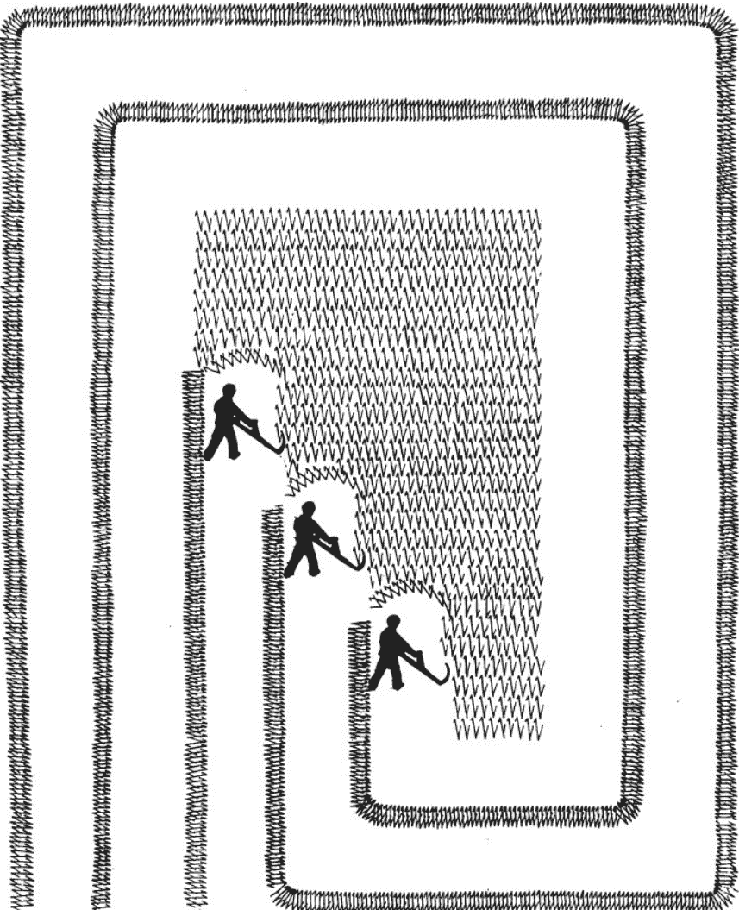

图 22 割草的进展

顺时针方向绕田移动，每一圈都比上一次短（图 22）。在最后，田地的外缘沿逆时针方向仔细修剪，将草抛向田内。世纪交替时期，三四人的割团队在英国是常见的景象，现在在中欧和东欧的高山上仍然可见。列文在《安娜·卡列尼娜》中是以42人的团队割草的。他们一天必须覆盖多少土地！在某些地区，他们倾向于与其他农民结队割草，从一个农场移动到另一个。

有些记载提到把最好的割草者放在前面以设定一个适中的恒定速度；其他割草者被迫跟上。其他记载显示最好的割草者在行末尾；前面割草者脚跟传来的跳动感促使他们在想稍微聊天和休息的时刻坚持下去。尽管一些文字记载提到割草者会大喊：“小心，否则我会切断你的腿！”，但总的来说，这些队友之间关系很好。

当镰刀停歇，夕阳已西下，
我们将停止劳作哭泣；
为了扑灭干渴的喉咙，
低头入睡。
但现在，割草仍在继续，
草依然翠绿如新。

## 割草季节的饮品

> 哦，让苹果酒流淌
>
> 在耕作和播种时——我所知最健康的饮料，
>
> 在收获和割草时。
>
> —德文郡劳动歌

割草从清晨很早就开始，直到上午十一点。然后割草者会休息吃啤酒、奶酪和面包，然后睡午觉，两小时后恢复工作。他们可能会工作到天黑。补给是奖励也是燃料，割草季节的爱兰人预计部分获得啤酒——每个割草者四三加仑桶。除非必要，否则割草者会避免在午休休息前喝酒。但那时！

那里产生了水汽，一个已经插好的塞子发出“砰”的一。啤酒！他的妻子来接他，递给他一个未开口的罐子。他短短点头，手抹过粘黏湿润的嘴唇，拿起熟悉的容器……神灵们一定拥有迷人的凡间关节，才能让他们那一口酒带来的全身沉浸的狂喜……

午休休息时大量饮用的还有硬苹果酒，其酒精含量与啤酒相似，并能在下午割草前带来良好的睡眠。在苹果生长良好的地区，冬季饲养通常需要草。优质的苹果酒由多种苹果制成，包括一小部分山苹果，并在橡木桶中陈化以改善风味。这是一种极度清爽的饮料。

另一种流行的割草季节提神剂是甜草水（switchel）：

- 1 杯枫糖浆、蜂蜜或红糖
- 1 杯苹果醋
- ½ 杯轻糖蜜
- 1 汤匙姜粉
- 1 加仑冷水

混合并搅拌均匀。可制约约6个7盎司杯。赫茨伯格、沃恩和格林在《Putting Food By》中将甜草水推荐给现代运动员，认为它是“一种不会引起‘口干’的良好能量恢复剂”，这种饮料是割草季节漫长劳作日子的奖励之一。现代割草者也可以享受它们。

## 洁净文化

草本在黄铜镰刀下反复生长。
> —《萨里的里的埃涅伊德》，1547年

……每一位农夫都修剪了土地周边的每一寸路边。每一处草地都被割过，环绕着石墙、树木、建筑……
> —来自佛蒙特州兰多尔夫中心的弗洛伊德·富勒

## 杂草

如果有意识地割除花园周围、沿路以及每个边缘区域在杂草结实之前的，我将慢慢改善我的家庭居住地。园艺害虫最喜爱的筑巢地被消除了；多年来，成群结队的杂草将逐渐退去。我访问过的每一个无论大小的欧洲农场都至少有一把镰刀；在几处高度机械化的农场，镰刀的唯一用途就是大面积的修剪。这种执着并非老家乡的一种古怪特质。以这种方式使用镰刀度过的每一分钟，都会在除草的时间上得到报偿。

在割除杂草时，对镰刀的控制必须比割草时更加谨慎。刀法要更短、更精确，以避开石头、树木、栅栏柱、鸟巢以及一朵想要留下的花。我正在慢慢学会利用镰刀尖在草叶和苹果树干之间做出最细微的区别。

罗伯特·弗罗斯特在《花簇》中描述了他发现“溪流旁一簇高高的花”的情景：

> 镰刀放过了一簇跃动的花朵
> 镰刀在长满芦苇的溪流旁挡住了它们。
> 露水中的割草者曾如此爱着它们，
> 任由它们茂盛生长，不是为了我们，
> 也不是为了引起我们的一丝思绪，
> 仅仅是出于清晨岸边纯粹的喜悦.

镰刀提供了一种辨别与观察的机会，而这是机械替代品所无法提供的。许多杂草都有极大的价值，当受到控制时，人们可以更深刻地欣赏镰刀。蒲公英可以酿美酒，乳草荚是极佳的升降剂，藜子叶是非常营养丰富的早期蔬菜（这让这种植物有了另一个名字——“野菠菜”），金黄草可以为孩子的学校项目制作简单的染料，等等.

在家里或农场周围的不同地方割除杂草时，问自己一个问题：为什么这种特定品种生长在这里？埃伦雷希·费费勒写过一本回答这个问题的小册，名为《杂草以及它们告诉我们的事》。与拖拉机相比，镰刀允许贴近土地，使得识别杂草成为可能。这些信息可以被解读，并有助于改善土地的决策。

## 牧场

在牧场上，营养丰富且味道甜的植物首先被吃掉，剩下的是不理想的。最后剩下动物不吃的植物。这些植物成熟、结实，并最终占据主导。动物会吃光食物供应。良好的牧场管理不仅涉及关注土壤的矿物质平衡和轮轮的定期休息，还要在最差的植物结实之前将其铲除。镰刀可以快速做到这一点，即使在大田里也是如此，因为割草者从一个堆放点移动到另一个点时比拖拉机更具灵活性。

## 草坪

草坪的重点在于割掉的草后留下的部分；因此，打理草坪是洁净文化法的一种变。在1831年手推旋转式割草机发明之前，所有草坪都是通过啃食的动物或使用长叶镰刀的园艺师来修剪的（图23）。

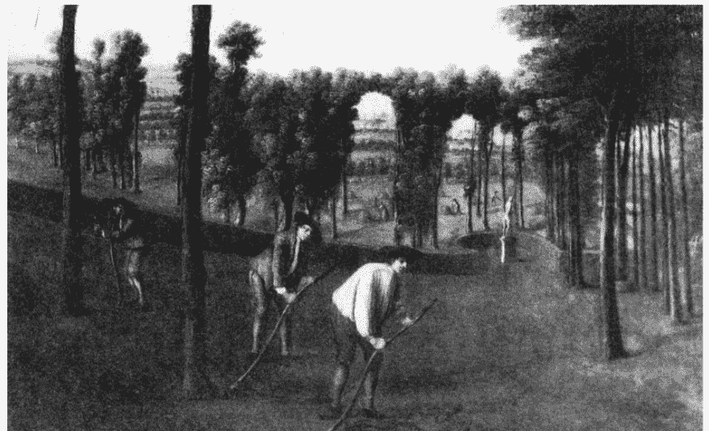

图23 **割草**

根据旅行者的报告，镰刀在希腊和土耳其，可能在其他地方也被用于修剪草坪。修剪我那八千平方英尺的草坪，70厘米的镰刀需要一小时十五分钟；手推和汽油动力割草机都需要大约四分钟。考虑到新设备的购买和维护成本，并考虑到为自己的劳动支付合理的工资，镰刀在经济上是具有竞争力的。它没有噪音和废气，也免除了汽油动力割草机的危险（消费者产品安全委员会估计，每年有77,000人被割草机割伤或失去手指或脚趾）。在较小范围内，镰刀会更加经济，但不适用于现代高尔夫球场。

对于草坪边缘，新型汽油动力镰刀替代品采用一条短尼龙绳，在手持的三英尺手柄末端旋转。旋转的尼龙绳将草叶击散，导致叶片受损而非整齐切断。尼龙绳也会击碎（尽管速度较慢），并加入草坪边缘的落叶物中。我多次观察到人们非常有效地使用这些工具，速度取决于他们学会挥动镰刀快慢。我也多次看到他们顽固地攻击小簇杂草，让工具在那些太平坦而无法移动的茎上来回移动。在使用镰刀时，操作者比面对机器时学会挥动镰刀的速度更灵活。

# 收割小谷物

清晨播种，播种善意，
正午播种，在露间播种；
等待收获，和收割的季节，
我们将欢喜地到来，带着麦穗。
> —乔治·米诺与诺尔斯·肖，《十九世纪赞美诗》

从对美国饮食的研究来看，许多人忘记了一句直到上一代以前农业人才就熟知的格言：面包是生命的食粮。所有形式的面包——从煎饼到硬干——都是可食的谷物。虽然我们的许多孩子只知道作为甜味早餐麦片和汉堡包形式的谷物，但不久前的农民他们熟悉用于特定用途的多种谷物。他们知道在特定的工作负载和天气条件下，自己和动物吃什么最好。他们知道什么最酿酒。

现代园艺师或小农可以很容易为自己的餐桌种植少量谷物。这值得尝试。在38平方英尺的良好土地上花费几个小时，你可以种出一蒲小麦，这可以制作1792个4英寸的煎饼。黑麦、燕麦、大麦、荞的其他部分增加了不同的口味和体验。通过熟悉这些谷物为身体提供的不同营养，你可以建立与一万年前新石器时代之前的农业土地利用遗产的联系 圣雄马·甘地为种植自己的食物增添道德维度，他坚持每个人都应该为自己的生计贡献部分劳动；他称之为“面包劳动”。

自从谷物（也属于禾本科）被收获以来，人类就一直使用一种类似镰刀的工具，即一种将石质或金属刀刃垂直安装在手柄上的工具。欧洲人将任何地区的当地谷物统称为“玉米（corn）”，但他们在美洲大陆发现了一种完全不同的玉米。他们称之为“印第安玉米（Indian corn）”或“玉米（maize）”。这是唯一无法用镰刀收获的谷物作物，尽管传统的“[印第安式]玉米刀”是一种非常锋利的十二英寸刀片，垂直安装在短木制手柄上。

本节首先简要介绍了小粒物收割工具的历史，然后描述了小粒物的生产过程，最后简要阐述了一些古今收割习俗。

# 镰刀及其前身

最初，谷物是通过连根拔起整株植物来收获的，然后将谷粒打入篮中。早期的切割工具是动物的颌骨，在牙齿位置嵌上锋利的燧石碎片，或者是带有燧石碎片的弯曲木头。这些设计都利用了“钩”的概念——将工具从直立的草丛后方向身体方向拉。早期的青铜镰也是垂直安装在木制或骨制手柄上的。刀片最终被弯成向右，然后延伸成一条长弧线指向左侧。因此，在规定的时刻准确挥动镰刀后，工具的重量得到了均匀平衡，手腕的压力也减轻了。

单手持握短柄镰刀允许收割者在直立时工作。使用镰刀时，收割者的左手抓住草丛进行切割。而使用短柄镰刀时，左手伸出一根短木钩，在收割的谷物随镰刀动作落下时将其从田里拉出。这种方法的简单易读插图可以在著名的15世纪《贝里公爵让约翰的华丽时辰书》（Tres Riches Heures de Jean, Duke of Berry）中找到。

奥诺或弗兰德式的短柄镰刀刀片长超过两英尺，刀柄长十四英寸，在与刀柄垂直的处有一个雕刻精美的握手。木钩（或称mathook）也经过了精心成型以适应手部。斯蒂芬斯（《农场之书》The Book of the Farm）估计，这种镰刀比镰刀节省了25%的工作量。然而，弗兰德镰刀对操作者来说比双手持握的长柄镰刀危险得多。

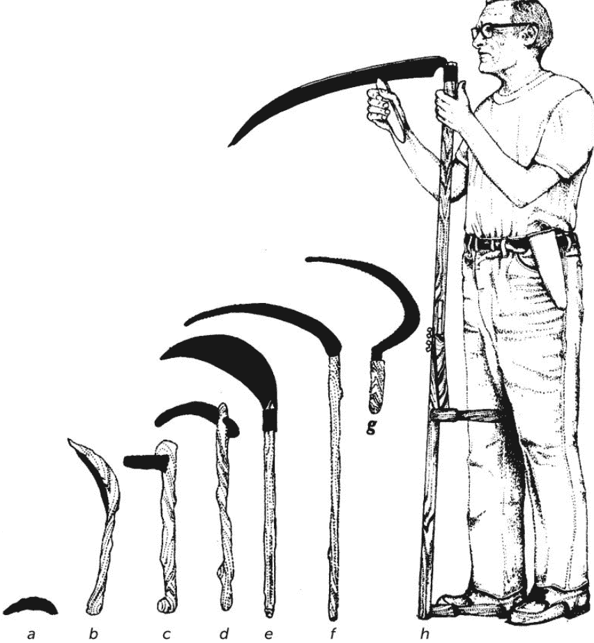

图24 古代与现代收割工具，按比例绘制

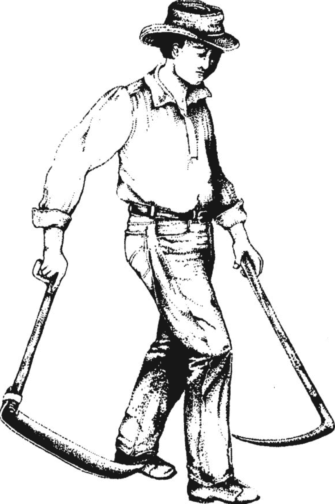

图25 弗兰德镰刀与收割钩

约翰·杰拉德（John Gerard）在他17世纪的《草本》（Herball）中记录了一次事故，当时割草者：

> 伤了骨头，伤口非常大且宽，而且流了很多；那个可怜的人爬到这种草上（伤痕草或全愈草），用手揉搓，并用他衣服的一块布将大量的药草包在伤口上，随即止血并缓解了疼痛，使得那个可怜的人立刻回到了妇女的工作中，日复一日，一天不休息，直到完全痊愈，这在几天内就做成了。

弗兰德镰刀在纽约哈德逊河、莫霍河和肖哈里谷的荷兰人定居点被广泛使用。

在高卢地区被开发的罗马庄园中，由于收割季节需要更高的效率，开发了长柄镰刀，最初比我们今天所知的镰刀更长，且没有握手。带有一个握手的镰刀最早出现在12世纪的插图中；这种设计使割草者能够充分伸展手臂，从而增加割幅带的宽度。后来，大多数地区出现了两个握手，进一步提高了工具的效率。

在对遗产清点清单的分析中，乔治·杜比（Georges Duby）发现，大多数中世纪的欧洲农民拥有一把镰刀，通常作为他们的金属工具。杜比报告说，在14世纪，上普罗旺斯（Haute Provence）的一把镰刀价值连城。约翰·罗珀（John Roper）对遗产记录的展示表明，在16世纪的英国，镰刀同样非常昂贵。通过比较遗产清单中镰刀与其他物品（如马、猪和母牛）的估值，并与现代同类农畜的价格进行比较，我们可以推测，16世纪英国一把价值1先令的镰刀大约相当于1981年美国货币的87美元。这种高昂的费用是导致直到18世纪长柄镰刀才成为西方世界通用收割工具的原因之一。

尽管镰刀设计的效率有所提高，但当工人不熟练、动作缓慢，或者成熟的谷物在强风暴雨中倒伏时，农民更倾向于使用镰刀，因为镰刀不容易损坏作物。在某些地区，保留了用镰刀收获小麦和大麦、用镰刀收获燕麦和黑麦的传统。

## 摇镰镰

> 使用带长柄的大镰刀，并用弯曲的木架围起来，它们割下谷物并将其排成束。
>
> ——康拉德·赫斯巴赫（CONRAD HERESBACH），《农事》（FOURES OF HUSBANDRIE），1577年

在收割时将谷物更整齐地铺在侧面，最精妙、最美丽的发明就是摇镰（grain cradle）。根据杰里德·范瓦根（Jared Van Wagenen）详尽的研究，摇镰于1776年发明于新英格兰。这是一种完全不同的工具，原理上类似于镰刀，但带有一个架，齿片顺着刀片的形状弯曲（如图26）。在动作结束时，草会被聚集在一起并由齿片支撑，摇镰向左倾斜并将谷物滑入整齐的一束。19世纪中期，美国东北部有百万把摇镰在使用；它们一直用于阿拉拉契亚和奥泽克的山山区。

并非所有权威都认同范瓦根的观点，即摇镰是美国发明。阿塞尔·斯滕伯格（Axel Steenberg）声称摇镰是在斯堪的纳维亚开发的，而其他欧洲作者对起源持有意见。斯滕伯格在13世纪玛格丽特·斯库尔斯特（Margrethe Skulesatter）的诗书中提到过此处。他仔细分析了17和18世纪的丹麦遗产记录，发现1767年的摇镰占了所有收割和割草工具的一半。然而，斯滕伯格所说的摇镰与美国式的设计显然不同：一个由二到三个齿组成的小耙连接在镰环上，从刀片起8英寸，沿刀片延伸6至15英寸。

在美国式镰刀上，工人们能够使架子从刀片完全升高24英寸，齿片沿着刀片的轮廓延伸36英寸。因此，这项发明是对现有设计的戏剧性延伸。更大的柄和更大的摇镰用于更大的地区最常见的是直型或鸡翼形、非常弯曲的葡萄形。对于葡萄形，摇镰必须弯腰以获得最佳切割角度。在某些地区，传统做法是用右手和左腿来平衡摇镰，用左手将谷物从架子上拨起并放在地上。这种平衡动作似乎总是一项巨大的工作量，而且没有很好地利用身体。鸡翼模型的效果更好；摇镰变得更加直立，在动作结束时，摇镰向左倾斜并用力将谷物倾倒在地上。

理查德·魏斯泰格（Richard Weisteiger）在一篇文章中介绍了如何在“美式”镰刀上制作谷物摇镰附件。这种摇镰有两个问题：首先，制作非常困难——弯曲木齿片和组装部件需要经验丰富的工人，精良的摇镰会标上制者的名字（例如纽约矿物泉市的“克里斯蒂安·布克”）。其次，摇镰附件让“美式”镰刀变得更重、更难操作。

在欧洲，草镰开发了类似摇镰的附件以提高收获谷物的效率。这些附件通常是一个木制或金属丝制的弓，从刀柄的刀片端开始，在下方握手下方再次连接到刀柄。因此，割下的谷物沿着整个刀片长度被“托起”或支撑，但是在最后阶段被这种简单的框架捕捉到了。这种附件很轻，在不需要时可以拆卸，收割者的姿态可以像在割草时那样保持直立。看来，在捆扎谷物时由于效率较低而损失的时间，将通过更高效地使用收割机收获回来。

图26所示的现代欧洲式大弧形摇镰，是以直型硬木木条的形式邮寄的，每端各有一个金属配件。其中一个配件插在镰刀和刀刃之间，通过镰环上的两个固定螺钉固定在那里。另一个配件通过螺栓固定在下握手最低位置下方的镰柄（snath）上，使其略微背离刀刃。收割者在镰柄和镰形之间形成一个绳索框架，像摇篮一样接住谷物，并将镰柄的强度延伸到相对脆弱的镰形上。形状被调整为与图26匹配，并进一步根据收割条件进行调整。由于两种类型的镰形中一种的规格较薄，可能需要一根支撑绳向前环绕在刀尖上。较重的镰形可以保持自身的形状，但必须通过

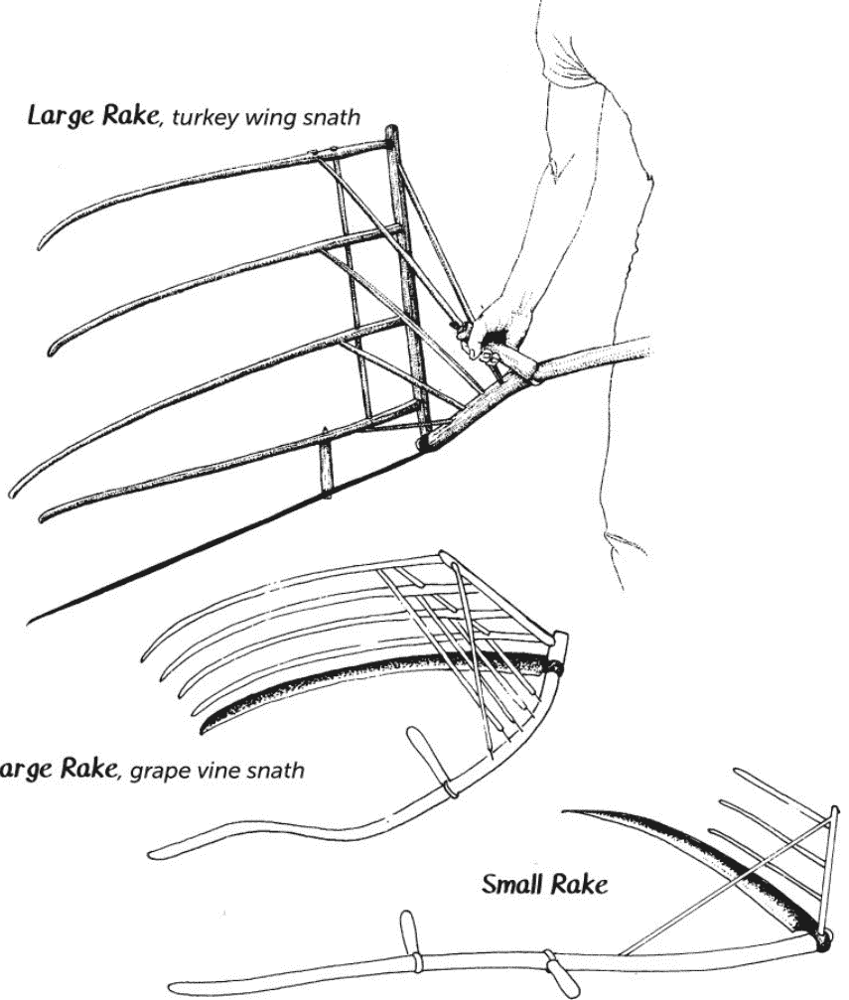

图26 摇镰镰刀（非等比例图）

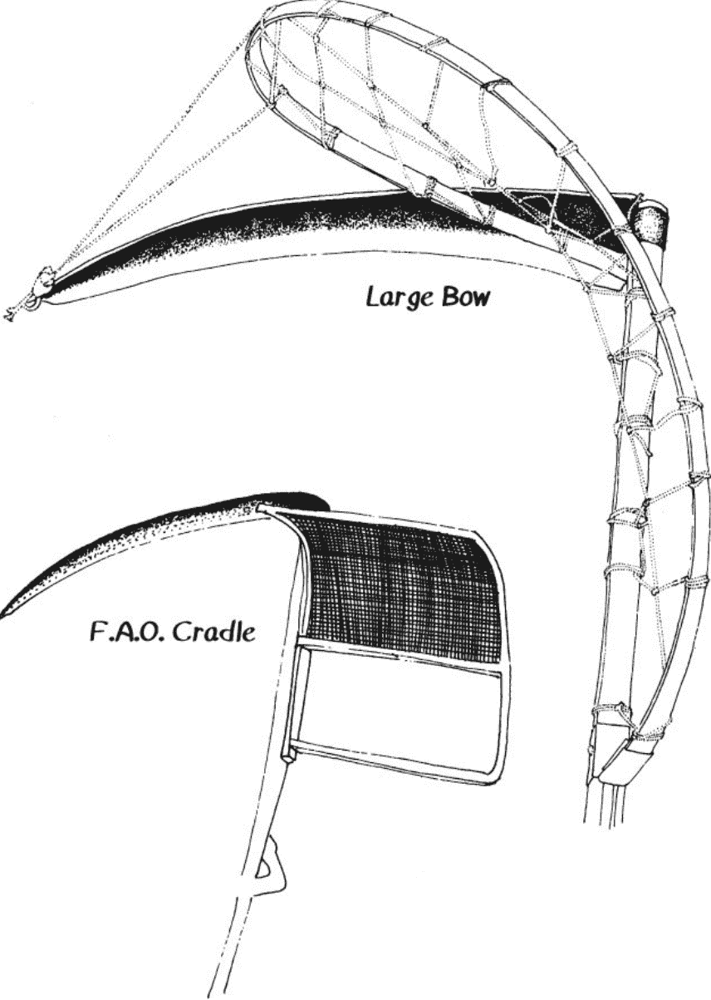

通过将木材蒸汽十五分钟并弯曲成右曲线，在将其安装到镰柄之前将其塑成那种形状。对于每种类型，收割结束后都可以从镰柄上解开绳并将摇镰储存到下一个季节。

这些基本设计有许多变体，并且仍在在使用。20世纪20年代，位于印第安纳州西摩尔的 Seymour制造公司提供了十六种不同型号的美国大谷物摇镰。镰形摇镰每种尺寸都有，最小的半径为8英寸的半圆，用于短粒作物或高草。目前尚不清楚不同设计起源于何时、何地，以及每种变体设计具体试图适应哪种作物状况。二战后不久，位于罗马的联合国粮农组织向第三世界引入了用于直型镰柄的带有奥地利刀刃的可拆卸摇镰，但这种摇镰制造和维修太复杂，“绿色革命”的重点很快转向了更大、更好的机械。

## 使用新旧工具收割谷物

在对现代和古代收割工具迷人的研究中，阿克塞尔·斯滕堡（Axel Steensburg）对来自农业各时期的镰刀和长镰进行了对比计时试验。1938年和1939年8月，他用每种工具在宽5米、长10米（538平方英尺）的地上收割了成熟的大麦和燕麦。斯滕堡实际上数了每个样地的麦秆数量，得出的平均数字为26,646！在表1中，我简要描述了使用的工具以及收割这些匹配样地所需的时间。当斯滕堡收割超过一个样地时，我记录了重复次数；这显示了相同条件下可能随机发生的某些变化。


# 斯滕堡测试与古代收割工具

斯滕堡测试中所有的燧石石器都是六千多年前使用的工具，它们是由考古学家挖掘出来的。它们的长度从 4½ 到 7 英寸不等。斯滕尔德燧石镰刀（长 11.6 厘米或 4½ 英寸）之所以闻名，是因为它在尤特兰的斯滕尔德被发现时手柄是完好的，因此可以精确复制（图 24 中的 c）。它被追溯到青铜时代早期，大约六千年前，因为它显示出被金属加工过的痕迹。青铜器的年代在公元前 4000 年至公元前 1500 年之间，边缘在 6 到 8 英寸之间。丹麦北端乌格尔比（Uggerby）的罗马短柄镰（图 24 中的 e）要较晚，可能可以追溯到公元前一世纪；其刀刃长 30.5 厘米（12 英寸），手柄长 61 厘米（24 英寸）。维京人的挪威短柄镰更晚，刀刃长约 18 英寸，手柄长 31 英寸，距离刀刃 18 至 22 英寸处握（图 24 中的 f）。斯滕堡测试中工具的手柄范围很大：

1.  **无手柄**，刀刃包裹在布或皮中以保护手（a）。
2.  **半月形木块**，像回旋镖，切割边缘嵌入其中（b）。
3.  **“纽扣”型**，将青铜刀刃装在手柄末端，使一部分突出到另一侧，暗示了早期用于平衡刀刃重量的圆头形形式（d）。
4.  **罗马和维京手柄**，手柄和刀刃的连接方式与现代长镰相似（e 和 f）。

## 收割效率对比试验

1979 年和 1980 年 8 月，我对四种不同的收割燕麦和大麦的方法进行了计时试验，并根据 50 平方米的样地大小在表 1 中给出了时间。无法确定每个平方英尺内是否像斯滕堡那样有五十根麦秆。

**表 1 使用古代和现代工具收割大麦和燕麦所需的分钟数（538 平方米）**

| 斯滕堡的测试 | 我的试验 |
| :--- | :--- |
| 布裹 (a) | 现代锯齿美国型 (g): 23, 27, 38 |
| 半月形块 (b) | 带有“奥地利”锤头的现代长镰 (h): 6, 6, 9 |
| “纽扣”型 (d) | 带有“奥地利”刀刃、摇镰的现代长镰: 6, 7 |
| 罗马和维京手柄 (e, f) | 现代割刀，拖拉机 (30 hp): 2, 3 |
| 斯滕尔德燧石镰 (c) | 95, 76 |
| 罗马短柄镰 (e) | 76, 101 |
| 挪威短柄镰 (f) | 73, 59 |
| 半月形燧石镰 (b) | 65, 69 |
| 半月形青铜镰 (d) | 63, 64 |
| 平镰 (g) | 30, 31 |

摇镰会将谷物留成整齐的堆，但它比大耙摇镰轻得多（平均重量四磅），令我惊讶的是，它的收割速度并不比没有摇镰的镰刀慢。

# 播种、收割、脱粒、扬场

> 在阳光下播种，在阴影中播种，
>
> 不畏云层，也不畏冬日的寒风；
>
> 终将迎来收获，劳作结束，
>
> 我们将欢喜而归，带着麦束。
>
> ——乔治·米诺尔与诺尔斯·肖

## 播种

小谷物播种在清理过杂草的区域，最好在前一年在该块地上种植过根类作物。你必须通过耕作将杂草排除在根类作物之外；谷物将受益于这种清洁的栽培。过量的氮和缺乏钾会导致谷物倒伏或歪，使收割变得困难。摇镰无法用于倒伏的谷物，倒伏的谷物必须尽快用镰刀或镰收获，以防止种子因太潮湿土地而发芽。倒伏的谷物可以像干草一样耙起并耕作。

谷物可以在秋季或早春播种，取决于气候和农事安排。如果秋季播种太晚，或春季播种太早，寒冷潮湿的土壤会在种子发芽前将其腐烂。尽管产量较高，但八月或九月播种的冬小麦可能被严冬完全杀死。具有最高面蛋白含量以促进膨起的最优质面粉是春季硬小麦，品种如 `Neepawa`、`Olaf`、`Manitou`、`Justin` 和 `Selkirk`。大麦、燕麦和荞麦也在早春播种，因为它们不耐寒。黑麦几乎可以在任何时间播种，因为它非常耐寒，只需要很短的生长周期；“小麦长肥，黑麦长力”的说法可能更多是指生活在生长期短地区的人群，而不是谷物的营养质量。

种子可以从袋子里用手撒播，但旋转式手摇播种机将产生更均匀的结果。在田里按一个方向来回交叉移动，然后以与第一个方向垂直或对角线的方向再次移动，以获得最佳效果；这种方法每英亩需要一小时。每英亩平均种子率为一百磅。

播种后，必须通过耙地将种子覆盖土壤下，以改善发芽并保护种子免受鸟类侵害。干草耙在这里起到分级的作用，耙地时最好踩耙过的土地，因为脚会将覆盖的种子压入土壤。对于较大的区域，有机器可以一次完成播种、埋种和压实土地。

同时播种三叶草或苜蓿是个好主意。当谷物收获时，生长较慢的豆类植物将生长到秋季，为土地提供越冬保护，并在春天提供干草。

关于向各个方向撒播（用手或用旋转机器）的播种效率，乔治·塞尔引用了撒种者的比喻：

> 有一个撒种的人出去撒种；他撒种时，有些种子落在路边，被野兽吞了；有些落在岩石地上，那里没有土，它们就发芽了，因为土不深；当太阳升起时，它们被烤焦了，因为没有根就枯萎了。有些落在刺丛中；刺丛生长起来窒息了它们；但另一些落在好地上，结了果实，百倍、六十倍、三十倍。

塞尔用这个故事作为播种机优越性的证据，播种机开一条小沟，将种子掉入其中，覆盖并压实上方的土地。如果有播种机，可以使用老而可靠的 `Planet Jr.` 行播器，可以将谷物密集地行播，行间距为十二英寸。播种机可以调整种子率、锄深和行间距，这些都根据土壤和气候限制内的实验决定。行间空间可以在生长季节内耕作或锄除一两次，以抑制杂草的竞争。行间作物的产量通常比撒播法好，且成熟谷物中的杂草问题较少。行播是欧洲有机农民中一种流行的方法。然而，这涉及的工作显然更多，如果起初就有杂草，我就使用撒播法，并将撒种者的比喻当成一个比喻来读。

1911 年，美国农业部土壤管理处前主任 F. H. King 出版了他的《东方之旅》回忆录，他在那里发现生长在丘上或成丛的小麦，平均每丛四十六株。丘与丘之间的行距为二十四英寸，行与行之间为十六英寸，每对行与相邻的行对之间为三十英寸。丘间的空间在每场雨后都经过仔细锄除以消除杂草，掺入经常施用的人类粪便有机肥，并创造一种保持水分的蓬松覆盖物。King 观察到的收获为每英亩 12 蒲耳，但计算出 1901 年的丰收为每英亩 116 蒲耳。

## 收割

什么时候应该收割谷物？农书给出了令人恼火的答案：在准备好的时候。和其他农民一起工作以及我自己种植谷物，我惊讶地发现没有更好的答案了。当你把指甲按入即将收获的谷物颗粒时，它不应该在“乳期”阶段喷出内容。但当它变得非常硬时，也准备好脱落；那时植物被切断时，穗头闭合，所有的种子都会不可挽回地落在地上。在两掌之间搓揉穗头以判断是否处于“硬壳期”。

无论用大镰刀还是摇镰，收割的动作都比割草要宽，砍割动作较少。用摇镰时，左手尽可能靠近地面以保持摇镰直立。右手在挥动结束时抬起，将货物倾倒，头部远离未收割的区域。用镰刀时，左手在挥动结束时突然抬起，从而使头部指向未收割的区域。向左摆动过多会导致草混杂。镰刀比摇镰轻，但需要更多控制。谷物更容易割干草，因为穗头的重量和茎的高度使植物具有惯性，使其弯曲而非折断。由于这种更大的易割性，1921 年的《农业百科》建议调整动作和镰柄的角度来调节宽度：12-14 英寸，而干草地和牧场为 6-9 英寸。

收割时，辅助人员比割草多得多。托马斯·杰斐逊在 1795 年雇了 58 个人收割他的小麦：

- 18 名摇镰者
- 18 名捆扎者
- 6 名收集者
- 3 名搬运工
- 6 名堆垛工
- 4 名运车工
- 2 名厨师

第五十八个人是工头或“收获主”。1812 年，他记录了 15 名摇镰者、15 名捆扎者、16 名收集者（这包含了搬运工和运车工）、4 名堆垛工和 2 名厨师。收集者、搬运工和堆垛工通常是孩子。他将这群描述为一台“机器”：

> 在精确的平衡下，任何部分的减少都不会损害整体，任何部分的增加都不会浪费力量……这每天能收割、运入并堆垛 54 英亩，并在 6 天内完成 320 英亩的收获。

Stephens 建议将收割组织为单位：两个镰手（不带摇镰）、两个收集者、两个捆扎者和一个耙子。

显然，用镰刀收割谷物的时间只是整个收割过程的一部分。每一割谷物都必须聚集成麦束，并用两三根草结简单的活结扎在一起。麦束的直径由捆扎用草的长度限制，尽管有用于检查麦束的旧量规，宽约十二英寸。如果稻草太干脆而无法捆扎，我就用一两根在麦田边缘生长得依然翠绿且高大的杂草。用稻草或杂草扎带环绕麦束，直到扎带的顶部和底部重叠。握住扎带的最底部，将它的顶部滑过自己的底座，打一个半结。沿着底座滑动这个半结，直到麦束被扎得紧紧。将扎带的底座重新压回半结上方，并将其塞入自身下方抵在麦束上。用于捆扎麦束的捆扎器是一个两个正方形的木块，中间的孔里穿过一根 36 英寸的绳子。绳子的一端打结，使其紧贴着杂草；另一端绕在麦束上，然后绕过木块方的绳子。

几捆麦束堆叠在一起，麦穗朝向外形成一个麦垛。关于小麦、燕麦、黑麦和大麦几捆组成一个麦垛有不同的传统，但我通常习惯将八捆或十捆靠在一起。在麦垛中，麦穗会在风和阳光下干燥变硬。用一束大麦覆盖在麦垛顶部，即使是雨水也能挡开，尽管如果天气变得潮湿，就必须堆叠、覆盖或搬进谷仓。托马斯·杰斐逊为每四十英亩的地配备一个大型谷仓，他的谷物在那里完成大部分干燥。有些人喜欢将谷物堆在防鼠的平台上（离地面的蘑菇状菌柄上），麦穗朝向中心，并在大堆的顶部盖上茅草或用塑料布覆盖。无论你使用哪种方法，在束中缓慢干燥都能使籽粒成熟，从而利于储存。现代方法包括热干燥处理，这通常会杀死谷物的胚芽。夺走谷物的生命意味着明年没有种子，并使谷物的价值变得存疑。另一方面，除非你有一支推车队，否则在脱粒前将麦束散放在谷仓里太久会损失所有的营养价值。并不是所有的谷物在收割时都会掉落成整齐的束子，田地看起来可能一片狼藉。过去，收获后捡拾农民田的特权是梦寐以求的，因为留下的东西可以用来捡稻草。相反，我把鸡或鹅赶进田里。最后，浅种的三叶草和草从残茬中生长出来，提供了晚期作物并为田地提供了良好的冬季覆盖。我直到最近才发现塔瑟（Tusser）在 16 世纪曾给出类似的建议：

- 携带玉米，任其贫瘠并被捡拾，
- 在它们之后，将其彻底清理干净；
- 然后留给云麦草（rowen）直到过去，
- 以延长你的乳业期，你再没别的选择了。


## 脱粒

在秋季或冬季的某个时候，我会拆开麦束，通过脱粒将籽粒与稻草和谷壳分离：将它们放在椅背上击打、在桶里撞击、踩在上面、或者让有蹄动物在上面践踏、用打粒机或使用脱粒机。自四世纪以来使用的双节脱粒机是一根六英尺的长杆，上面铰接着一个由硬木或偶尔用打结绳子制成的 18 英寸长的打槌。打槌可以很容易地举到肩膀高度，然后沿着整个长度重重地打落在厚堆散开的麦上，发出砰砰声，一次又一次。击打不需要猛烈或精疲力竭；谷物不是被打出来的，而是通过脱粒机的击打从深层的草堆中抖出来的。像镰割一样，脱粒这项工作有一种内在的节奏，使工作变得更容易。脱粒队的领队通过工作歌、吟唱甚至舞蹈来协调连续的击打。

设计问题在于铰链的材料。即使是皮革也会很快磨损，所以只要可用就使用羊皮。罗伯特·约翰斯（Robert Johnston）提出了一种优秀的设计来防止打槌缠入自己的铰链中（图 28）。沉重的轮在手柄末端的槽处自由旋转，这样绳子就不会被扭曲。

收割前的田地可能像琥珀色的麦浪，但脱粒显示出籽粒仅占从田里收获重量的一小部分。相比之下，谷壳和稻草的数量显得惊人，而籽粒仅占总量的二十分之一，在体积上比例更小。

小麦、黑麦和荞麦很容易脱粒。只有“裸壳”或“无壳”品种的大麦和燕麦容易脱粒。带壳品种需要更多脱粒机工作；加热和轻微研磨也能去除壳。

用脱粒机脱粒被认为是农场最辛苦的工作，因为需要大量的谷物来饲养牲畜。机械脱粒受到了欢呼。然而，在小规模操作时，脱粒或任何任务都不是苦差；而且这项工作是实用的。对于用打槌将种子从壳和茎分离，H.J.马西辛姆（H.J. Massingham）曾说：“挥动打槌的人是塑造生命源的人；而照顾机器的人是在拿命。”

马西辛姆所指的早期脱粒机非常大、嘈杂且危险。相比之下，脚踩式脱粒机（在日本广泛用于少量谷物，并出现在福冈的《稻草革命》中）是一个覆盖有金属环的木制圆筒，通过踏板以每分钟 350-450 圈的速度旋转。稻草用手持在移动的金属环上方，由金属环将籽粒击出。这台机器据称每小时可以脱六桶，且籽粒破碎的风险比打槌脱粒低。然而，在将旋转筒与打槌脱粒进行比较的一系列实验中，我发现只有当籽粒在麦穗中非常松散时，旋转筒的效果最好。如果籽粒很容易脱落且麦束小心地放在许多钢指上，旋转筒所需的时间与打粒机相同——每桶半小时到一小时——但能多出三分之一的籽粒。然而，急进会导致产量低于打粒机。旋转筒的开销似乎只在大数量谷物时合理。


脱粒后剩下的稻草可以作为动物饲料、屋顶隔热、动物垫料或园艺覆盖物（在这方面优于锯末和干草）、用于在冬季风中固定草垛的草绳，以及农场所需的许多蜂箱、篮子和垫子，以及传统的产床。事实上，我遇到过几位欧洲农民专门种植谷物以供他们的蔬菜或果园使用；福冈的小麦肥力计划完全取决于将脱粒后的稻草回到田间。而那些脱粒后的谷物稻草可以剪成节段来吸水，让孩子们喜欢这种原始的有机吸管！

## 扬场与储存

过去，将谷物与谷壳、泥土、破碎的颗粒、杂草种子、茎叶碎片以及堆落在打谷场或防水布上的其他杂质分离是非常困难的，这在许多传说中得到了很好的说明——在这些故事中，英雄或女主角被赋予了一项不可能的任务：要在短时间内分拣一斗谷物。除了手工清理，分离谷物与废弃物的传统方法是等待有利的风，然后将谷物和其他杂物抛向空中；谷壳和泥土会被吹向侧面，而谷粒则落回风簸箕。谷壳被用来填充床垫、香肠等。为了将谷物与茎段分离，人们会使用一系列筛子或滤网让谷粒通过其掉落。随后是手工挑选剩余的杂质，这使得谷物清理成为收获季节最耗时的任务。洗谷物——先冲洗后放在盘上晒——可以让剩余的谷壳浮起来并洗掉任何尘土。尽管如此，面包除了谷粉外，还必须含有其他成分。

早期的改进是风簸扇，用于在有风的日子产生气流。奥德修斯的最后一个任务是肩扛船桨向内陆旅行，直到遇到一个将其误认为风簸扇的人。今天，一些小规模农民使用电扇来达到同样的效果。在 19 世纪以前，美国的风簸布会为了风而频繁拍打；每斗谷物需要三四十分钟。1898 年的研究得出结论，用连枷打碎 20 斗谷物、用布风簸、堆放谷物和堆放稻草共需要 26 小时，这比现代农民认为自己种植谷物所拥有的时间要多得多。

带有曲柄手柄的旋转风簸机在公元前 40 年就已经在中国使用，它在 18 世纪被引入荷兰，然后进入苏格兰，滞后了一千四百年。到 1794 年，英国的每个户主都在使用它，并由每个乡村的木工制造。最近，使用的筛子类型已经有了改进。在图 27 所示的手摇版本中，打碎的谷物从顶部倒入，通过手摇带动风扇旋转并摇动三个筛网。筛网是从一百多种筛子中选出的，以满足特定的分拣任务，我发现这种实验非常有趣。颗粒太大的从一个喷口排出，太小的从另一个出口排出，谷壳从第三个喷口吹出，谷粒则被分成两种大小。产量为每小时 20 到 30 斗，如果谷物中含有大量稻草，产量会更低。

储物箱或粮仓需要干燥。仓位应该抬离地面，以便空气在下方流通。可以在仓内的不同位置垂直放置几根 2x4 木板。当仓位装满时，移除木板以供空气流动提供通道。使用厚筛网或结构坚固的木箱可以防止老鼠。通过将小部分谷物放在家用冷冻室一天，可以消除虫害侵害的可能性；对于较大量的谷物，则储存在冬天的寒冷室外。干冰（二氧化碳）对于杀死大量谷物中的昆虫是可行的。这些处理方法不像高温和强力化学品那样杀死种子中的胚芽。

## 研磨与烹饪

至于谷物的研磨和烹饪，有很多关于该主题的书。应该说，全粒是一个天然的容器，营养品质和种子活力在此保持完好。从埃及法老坟墓中出土的种子润湿后会发芽，而发现小麦在储存 32 年后发芽率仍达 85%。当颗粒被以任何方式切开时，这种保护就会被破坏；那时内容就会开始失去效力，油脂也会变酸。最好的做法是将谷物保留到使用前不久。这样，就可以利用“生命之粮”全部的生命力量。

我想知道我自己种的小麦与其他来源相比如何，因此我设计了一个简单的实验……（注：原文此处句子似乎不完整，翻译仅涵盖了现有内容）。

# 镰刀的象征意义

源自 `snath`。这种联系是微弱的，而且似乎并不奏效。关于亚述人在战车轮上安装镰刀以收割敌人的传闻是一种误译：这种目的是通过使用小刀和剑来实现，而镰刀是做不到的。事实上，镰刀正是对土地进行和平、定居式耕作的象征。在《以赛亚书》（第 2:6）中，那些放弃战争的民族“要将刀打成犁锄，将矛打成镰刀”。对于约翰·米尔顿（John Milton）来说，镰刀也代表了和平的田园生活：

> 当近处的耕夫
>
> 在布满垄沟的土地上吹着口哨，
>
> 当挤奶女欢快地歌唱，
>
> 当割草者正磨着他的镰刀。

在技巧章节中引用的每一位作者，都提到过刀刃用石头磨利时发出的那种美妙的响声。

那么，既然镰刀的其他内涵是如此良性的，为什么时间和死亡却要挥舞镰刀呢？因为收割的节奏是如此强大且迷人，以至于它感觉就像时间一样，不可阻挡。草木不可避免的倒下与我们生命的不可避免消逝之间存在着一种对应。“因为他们像草一样被割除”（诗篇，37:2）。这种强迫性的节奏比我们经历过的任何工具都更强大。时间可以有一把锤子到处敲头，或者有一把锯子，或者……所有这些其他工具为死亡带来的想象都比收割和采收更恐怖，而收割这些行为与地球的季节并行，正对应着一个人生命的繁盛与消亡。在创造的节奏中，死亡的收割也与春季对生命的重建希望相联系。

> 没有任何东西能抵御时间的镰刀
>
> 唯有繁衍，能在它带你离去时勇敢面对它 `pigit60`}

因此，谷物和收获它的工具，一直与死亡和埋葬、受孕和出生联系在一起。


# 丰收习俗与镰刀文化

专门处理收割结束、将大地果实带回家的习俗因地而异。一种共同的体验是，当最后一车谷物或干草在欢呼和歌声中被运回谷仓时，会感到一种完成、从劳作中解脱的感觉：

> 丰收了！丰收回家了！
>
> 我们耕了，我们播了种，
>
> 我们割了，我们收了割，
>
> 我们把所有的收获都带了家。
>
> 丰收了！丰收回家了！
>
> 我们想要水却得不到！

结束了，但并未完全结束。自古以来，各地农耕习俗中一个共同的主线是相信：最后一束草承载着作为特定地区主要谷物的“生命灵魂”（“玉米”）。所有的收割者现在都会割下最后一束被收割压平的玉米。这一时刻具有极强的魔力；此时此刻路过田野会遭到白眼，而割草者会大声地磨他们的镰刀，或者有人拿着镰刀威胁性地向他走，或者他会被绑起来并做出砍掉他头的动作。陌生人被视为对重要仪式的干扰，也被视为灵魂的化身。通常，整个麦穗会被编织在一起，偶尔会被装扮成“玉米娃娃”（Corn Dolly），用来主持丰收晚宴并一直保存到下一次丰收。我也曾感受过在镰刀割平的田野和成堆的捆草中，最后一束谷物蕴含的能量。当最后一点被切断时，能量去了哪里？我不知道，但我理解那种对最后一束进行特殊对待的冲动，仿佛能量留在了它身上，我也以特殊的方式对待我收获的最后一束谷物。作物的丰歉由农神女神保障——希腊人的`Demeter`，罗马人的`Ceres`。图30描绘了一个古希腊使用的`Demeter`还愿面具，上面的祈：“愿它属于我，让那巨大的风扇筛过她的草堆，而当她手里拿着罂药站在微笑时。”在更近的时期，玉米娃娃在春季的冬季和新作物季节代表着母亲的保证——因此，在秋季的丰收庆祝中，她受到尊重，直到她回到草地。那种完美启示的伟大而神奇的奥秘，一株被割下的谷物，在基督前之前的数千年里一直是农业仪式的中心。从那时起，谷物作为饼，也一直与基督之躯保持着这种神秘的、宗教性的联系。

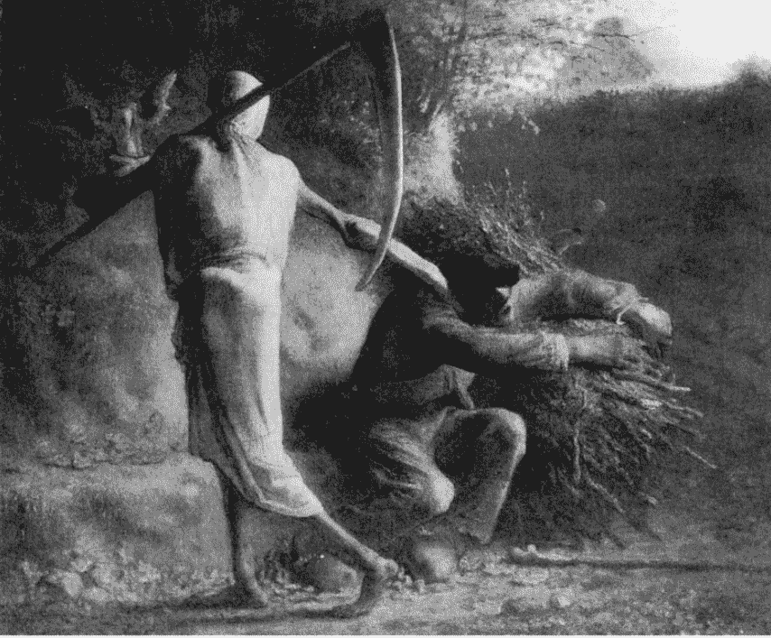

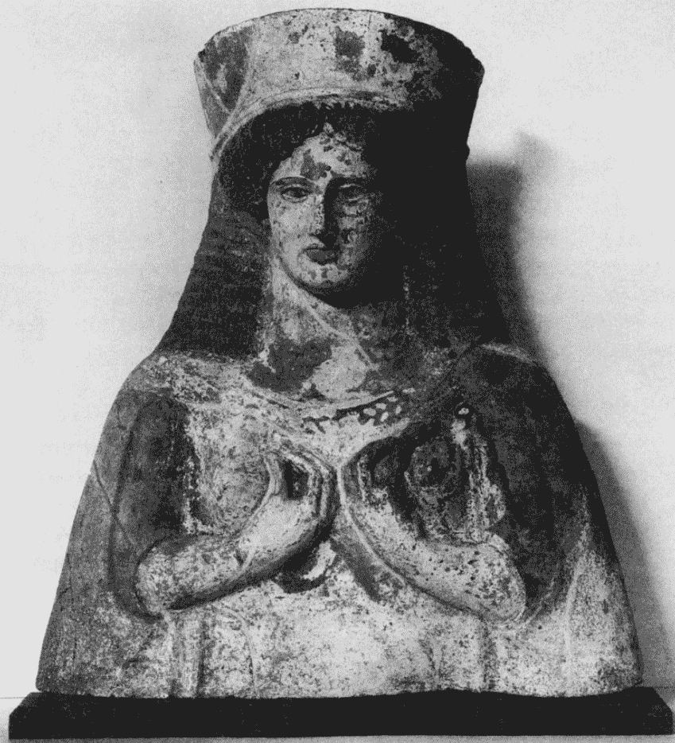

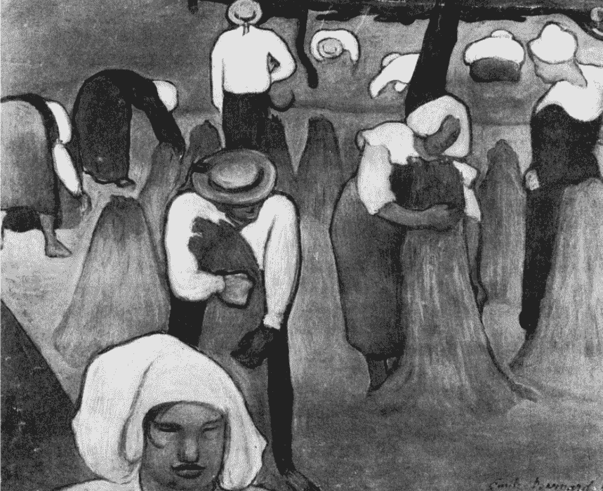

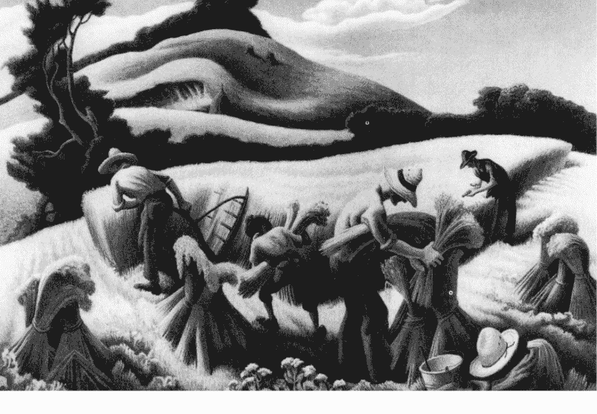

我们在11月下旬举行的感恩节庆祝源于这一同样的传统，尽管它已经丧失了与季节律动的联结，失去了那种对田间和园子工作结束的感觉，也失去了那种谷仓和家中满载大地果实、为冬季提供滋养保护的感觉。现在，那些被模糊遗忘的丰收旋律，通过礼品商店出售由非专家手工大量生产的编织玉米娃娃而被拨动。但全年供应的丰收小装饰并非生活在土地上的重点。玉米灵魂的化身不必是一个美观、可售卖的物品。它的目的是通过一个符号，强化农场主/园艺师通过农业与一小块土地的交融。对我来说，`Emile Bernard`在图31中创作的丰收画，最有力地唤起了与玉米灵魂交融的情感，以及从地上汲取维持生存所需的能量。

对地球律动的依恋在现代工业时代可能会迷失，且难以找回。虽然我们不再记得有几十首可以在丰盛的丰收晚宴上吟唱的传统丰收歌，但与大地建立深层联系的体验始终随处可得。它就在家门外。苏格兰的`Findlay Community`甚至在与植物以及环绕它们的罕见的灵性生物互动中，将对更高意识的追求提升到了更清晰的水平。我不相信这仅仅是因为他们写了一本关于此的书。我很务实。当我与草木、杂草和谷物说话，并花时间倾听回应时，这会改变作物的性质吗？这会改变我播种、收割和食用的体验吗？

# 老人的礼物

“镰刀必须跳舞，”老人说道

“是的，我脑海中可以想象那个画面；

但这一步是先做的还是后做的？

我可没读过相关的指南。

在你临终之前，我会教你每一步吗？”

“看我怎么做——现在仔细看！

你将学会这种舞蹈——我会教你如何做。”小女孩微笑并鞠了一躬，

她想着满是芬香干草的收割，

以及她那头孤牛的绿叶饲料。

他们每天清晨在草地上相遇，

在黎明到来前起舞。

一个教动作，一个学姿态，

石头经常从盛满水的角上滑落，

刀刃平稳地割过青草和玉米。

自豪地看着整齐的收割区域，

她掩饰不住内心的感激，

感谢身边的老师，

为了这项让心灵如此欢畅的技能——老人临终前的礼物。

`FAYE ABEND VIDO`

2001年1月

# 引言

在学习的某个时刻，我们可能所谓的“完整”的每一个版本，当然只是相对的；知识之径是无限的。`David Tresemer`对镰刀相关的研究，用他的话说……已经“尽所能。”当我偶然遇到《镰刀书》（`The Scythe Book`）时，发现竟然有人对我正要爱上的这种工具写了这么多，这真是令人兴奋。今天，我感到沮丧，因为我目前为止找到的所有关于如何使用镰刀的文字都缺乏深度。

尽管如此，`Tresemer`在书中包含的割草诗歌和古代记载，以及某些段落形而上学的色彩，最终发挥了作用，也许是重要的作用，激励我继续搜寻。

对于工具本身，我可以从其自身的价值表示欣赏。我在斯洛伐克长大，虽然是个镇上孩子而非农村，但我经常看到镰刀。我推断，这是一种收割大面积饲料的高效方法，否则尽管社会主义制度有种种缺陷，它不会如此依赖它。在共产政权时代结束并带来某种“自由”之前，所有的路边水沟以及城镇界限内的草地都是由老人们用镰刀修剪的。[参见注释 1]。

巧合的是，就在那个夏天，一个来学习如何使用刷子的农场学徒带了那本《镰刀书》（在此之前从未见过），与此同时，我来自斯洛伐克的父母也在这里进行长时间拜访。我正在教学徒如何使用包括`镰刀马拖式割草机`在内的其他工具在内的工具，而我父亲拿着一把我在拍卖会上花几美元买的旧镰刀，去修剪那些马力机器无法到达的地方。幸运的是，那把镰刀由一个欧式的奥地利制造刀片组成，带有高刀背，安装在一个比平均水平更好的轻铝刀柄（`snath`）上。我父亲不是个话多的人，因此《镰刀书》中的哲学很好地补充了发生的事情。我试用了镰刀并立刻喜欢了，尽管直到下一个季节才开始使用。一场剧烈的风暴让几英亩黑麦变得一团糟，任何机械切割机在收割时都是无用之力的。用镰刀，我可以顺着风的路径，根据茎秆所需方向在田间穿行。这种感觉很有力量，我割光了每一处，外加几英亩长得良好的倒伏谷物。

明年夏天，当我仍在用马收割 50 到 60 英亩的土地时，我追随着父亲的足迹去了那些小地方……

然而，刀刃的冷锻是另一回事。回到1977年，我的老农场导师的第一堂课是：铁匠只有两种罪会下地狱。第一种是锤打冷钢；第二种是不够用心。钱对我父亲来说意义不大。因此，他从未向我灌输过能量是一种受荣誉的交换手段，所以我已经处于不稳固的基础上了……去地狱还不在我的计划之内；除此之外，手工割草实在太有趣了。

但有一句斯洛伐克谚语说：“修火之刀刃，如面包之割草者。”`David Tresemer`赞同了这一点。于是，冒着进入地狱之门的风险，我尝试了修火。这时我才发现修火是一项至关重要的技能。

面包之割草者，修火之刀刃。没有适当的修火，刀刃就会失去它的锋利和能力。`David Tresemer`的作品强调了这个过程的重要性，而这在现代割草技术中往往被忽视。

## 术语解释

将“冲压”（`stamped`）作为所有非欧式刀片的统术语，贬低了所有锻造其作品的英国和美国铁匠的技能。区分批量生产的冲压刀片和手工锻工具是重要的。后者通常具有前者无法比拟的质量和耐用性。

还要强调的是，在磨剑过程中产生的通常不被注意的微小斜角（更准确的说法是“次级斜角”）大部分情况下是无意且不受欢迎的，尽管在手工练习中是不可避免的。

开角的另一个术语是刀刃的*塑造*（`shaping of the edge`）。这里讨论的刀片是通过被称为“锻打”（`peening`）的过程进行*塑造*的。

大多数镰刀描述这一活动的的替代术语是*锤击*(`hammering`)或*削薄*(`thinning`)。这两者都是正确的，因为确实使用了锤子，而且刀刃会变得更薄。然而，我更喜欢用*塑造*，因为它暗示了更精确几何形状的重要性。将在文中更深入地讨论。

以下是含义基本相同的术语分组，我交替使用它们，因为在某些情况下，细微的差别能更好地表达我想说的内容。在任何一组中，斜体标记的术语是我偏好的。

- 锋利、刀刃般锋利、磨好的、*锐利*(`keen`)、切切如泥。
- 不锋利、钝、晦、相对没用、刀刃反光、*缺乏锐度*(`lacks keenness`)。
- 锻打、锤击、削薄、*开角*(`beveling`)、*塑造*(`shaping`)。
- 精整、砥、*研磨*(`honing`)；
- 磨刀石、光石、*磨石*(`honing stone`)或简单的石头。
- （锤子）击、撞、*轻敲*(`taps`）（因为这表示锤子更轻、更小心）。
- “锯齿或锯缘”；羽毛状边缘、*崩刺*(`burr`）（这些都是指微小颗粒在用极细磨料去除或在使用过程中折断之前凸在刀刃边缘的状态）。

此外，我经常用“镰草割草”（`scytheing`）代替*手工割草*(`hand mowing`)，或直接说割草。请不要问我为什么。这本书是关于镰刀的。每当我提到用拖拉机、马或其他机器进行割草时，我会明确说明。

在某些情况下，人们可能需要注意 `moving`（移动）和 `mowing`（割草）这两个词中“v”和“w”的区别（尽管大多数时候这种区别无关紧要）。当我 `moving` 时，如在“……横过坡地，顺着风向……”时，我是在割草的同时移动。在这些书中，我很少在没有镰刀（或至少刀刃）在手边的情况下移动……所以，每当我写*这件工具*(`this tool`)或只是*工具*(`tool`)时，除非特别指定或作为对其他工具的参考，否则我指的镰刀。

## 将镰柄（Snath）适配割草机

我“发明”了两个额外的术语，为了更准确地描述我眼中的这种工具的两个版本。这些术语是：*田间割草镰*(`field mowing scythe`)和*修边镰镰*(`trimming scythe`)。

与之相关的是，分别是田间割草镰柄和修边镰柄，通常用于田间割草和修边。（我说的“田间”是指较大的区域，通常更开阔且没有障碍；我同样可以将其描述为草场、草甸或草坪）。

这是一种有些任意的区分，因为在割草大田或类草坪区域时，偶尔可能需要进行短促的修边动作，例如绕过岩石、大蚁丘或草坪装饰。反之，在树木茂密、修边镰更适合的果园工作时，人们可以在切割其总面积的一半时，使用更长的刀片/或镰柄（即*田间镰*），这将是有益的。

尽管每种工具都可以部分替代另一种，但我相信，任何稍有经验并有多样化割草任务的人都能很快地欣赏这两个不同版本的优点。

例如，虽然我可以使用田间镰柄完成很多修边工作，但在这样做我会一直意识到它更笨重、准确性更低，并且会让手臂更快疲劳。

### A. 修边型 (Trimming Model)

- **柄部**：榉木
- **握把**：山榉
- **重量**：2磅 4盎司

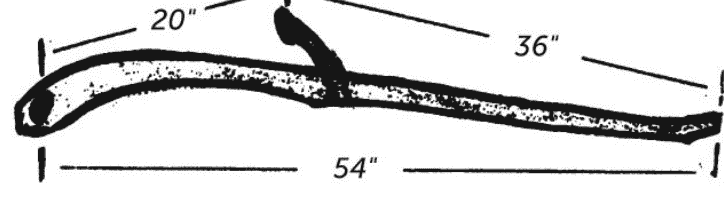

### B. 田间型 (Field Model)

- **柄部**：杨树
- **握把**：苹果木
- **重量**：2磅 10盎司

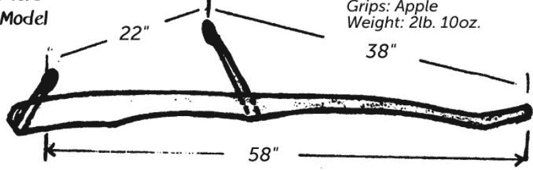

### C. 折中型 (Compromise Model)

- **柄部**：白蜡
- **握把**：云杉
- **重量**：2磅 14盎司

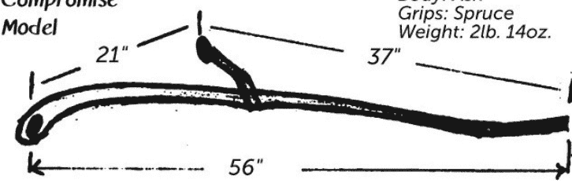

**图 1** [A], [B], 和 [C] 对应我的尺寸，身高5英尺10英寸，赤脚

- **(A) 修边型** - 柄部：榉木；握把：山榉；重量：2磅 4盎司。
- **(B) 田间型** - 柄部：杨树；握把：苹果木；重量：2磅 10盎司。
- **(C) 折中型** - 柄部：白蜡；握把：云杉；重量：2磅 14盎司。

### D) Fairlight 的, E) Ashley 的

- **(D) 儿童型**（适用于10-12岁儿童 [身高4英尺8英寸-4英尺10英寸]，使用小于14盎司的刀片） - 柄部：榉木；握把：白蜡；重量：1磅 6盎司。
- **(E) 儿童型**（适用于6-9岁儿童 [身高4英尺2英寸-4英尺6英寸]） - 柄部：榉木；握把：云杉；重量：1磅 8盎司。

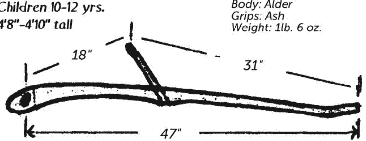

> 10-12岁，4英尺8英寸-4英尺10英寸
>
> 柄部：榉木；握把：白蜡；重量：1磅 6盎司。

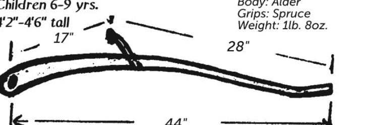

> 6-9岁，4英尺2英寸-4英尺6英寸
>
> 柄部：榉木；握把：云杉；重量：1磅 8盎司。

此外，我经常用“镰草割草”代替*手工割草*(`hand mowing`)，或直接说割草。请不要问我为什么。这本书是关于镰刀的。每当我提到用拖拉机、马或其他机器进行割草时，我会明确说明。

在某些情况下，人们可能需要注意 `moving`（移动）和 `mowing`（割草）这两个词中“v”和“w”的区别（尽管大多数时候这种区别无关紧要）。当我 `moving` 时，如在“……横过坡地，顺着风向……”时，我是在割草的同时移动。在这些书中，我很少在没有镰刀（或至少刀刃）在手边的情况下移动……所以，每当我写*这件工具*(`this tool`)或只是*工具*(`tool`)时，除非特别指定或作为对其他工具的参考，否则我指的镰刀。

# 镰刀刃有多硬？

我对我们所有的刀片都并不特别温柔，并且对它们能承受的程度一直感到惊叹。它们经常要面对石头。通常情况下，我会观察岩石和刀刃的受损情况。很多时候，是石头缺了一小块，而刀刃却完好无损。有时，我必须仔细观察刀刃上的反光，以判断是哪一部分接触了石头。我曾用这些刀片遇到过铁丝网和钢制地面，我确实敢于去清理一个垃圾处理场，在散落在各处的汽车零件间穿梭。

在缅因州联合市（`Unity`）举办的共同地游览会期间，我正与 `Marc Harmon` 讨论镰刀刃的“韧性”问题。这个人整天大部分时间都在我们的演示区周围，问了一些“高于平均水平”的问题。我们恰好蹲在一辆 76 年款雪佛 `LUV` 皮卡车后面，我手里拿着一把 `Fairlight` 品牌的 24 英寸土耳其纹路刃。为了强调它比看起来要坚固，我握住刀柄，用刀尖反复撞击卡车的钢制保险杠。`Marc` 惊了，他先检查了刀刃，刀刃上没有任何战斗痕迹，然后保险杠上留下了明显的凹痕。

他立刻就想买下这把刃，尽管我告诉他它没什么特别的，其他的奥地利刀刃都是按照同样的规格制造的。他仍然坚持，于是我把它让给了他。

我觉得这挺好笑的，就把这个故事告诉了缅因州蓝山（`Blue Hill`）的 `Scott Howell`。不久后他就过来了，我便用另一把恰好放在桌上的旧刀刃（一把 22 英寸希腊纹路刃）向他展示了我所做的一切。然后我走开去和别人聊天了。回来时，我得知 `Scott` 同样说服了我儿子，把那把小刀刃（那是那个夏天 `Fairlight` 和 `Ashley` 等人使用过的一把之一）卖给了他。我觉得这更有趣了。你知道的，`Scott` 长得像个拓荒时代的铁匠，那时候所有的马，无论愿不愿意，都必须钉蹄……

两年前当他来到我的工作坊时，他带着自己的镰刀，刀上的战斗痕迹是他力量的证明。随后，我为他做了一个黄杨木（鹅毛角松）的柄。有些刀刃更适合干格外勤奋的人。它们不会是上述型号之一，那些型号非常窄，是目前奥地利生产的重量最轻的刀。其中哪一个都没有“碰石点”。甚至有人告诉我，它们看起来对于“真正的干活”来说太精细了。

这是一种错觉。那些刀刃以及类似的刀刃在这里已经割过很多高大、茂密的草，还有看起来很强壮的小鸟类、一岁的绿杨树苗、成丛的金黄草、覆盆藤藤等等……

它们是由奥地利`Styria`州`Rossleithen`的镰刀工厂制造的；如今美国市场上的刀刃也源于此，包括“平刃”。

某些来源错误地将“奥地利式”刀刃称为由“低碳钢”或“便于锤打的软钢”制成。我认为，一把由碳含量为 0.8 的钢锻造、并淬火到硬度接近优质斧头的刀刃，几乎没有什么“温和”之处——除非某人对“温和”的定义来自某些对我来说未知的分类表。

`Styria`的“奥地利式”、“美国式”以及其他其他图案由同样的钢制成，在锤击下成型并淬火到非常接近硬度，目前这种硬度为 47 到 48 Rc（洛氏硬度）。

我希望我用镰刀尖撞击卡车保险杠的行为不会鼓励别人效仿。让我在这里补充一点，我从未弯曲或折断过任何一把，而且几年前，我还不敢这样做。

# 刀刃选择

镰刀刃的长度仍然从 12 到 50 英寸不等，有许多不同的图案，且每种图案都有更多型号。24 到 32 英寸的长度在全球范围内可能最常见。然而，我觉得，对于当今普通的美国用户来说，要决定哪种是最合适的单一图案、型号和长度是一项不可能完成的任务。然而，经过更多的考虑，经销商以及客户应该可以在折协的水平上做出某种理智且集体的决定。

最短的刀刃和最长的刀刃代表了机动性的极端与一次动作可以割出最大草面积之间的极端。将客户的选择限制在仅一把刀刃是不公平的。无论何种理由，它在所有情况下都无法最好地服务于大多数割草者。此外，这传播了大多数客户并未被告知的无知，使他们不知道存在多种选择。相反，对于任何提供了几种长度刀刃以供选择的割草者来说，只满足于一种会贬低镰刀的潜力以及他自身的潜力。从时间的角度来看，即使不考虑使用合身且合适的工具带来的愉悦，这也是一种糟糕的经济行为。

尽管我是光脚割草的，但当我坐在这里寻找类比时，脑子里首先想到了鞋。我们都靠一双鞋过日子。穿着舒适的登山靴，我们可以全年去教堂或跳舞，攀爬雪山，在热带海滩散步或在城市人行道上跑步。我们为什么不这样做，每个人无疑都有自己的个人原因。然而，从每个拥有如此不同镰刀刀刃而被宠坏的人的角度来看，我发现只有一双鞋比只有一把刀刃更容易生活或更容易被接受。

因此，请意识到，我帮助你决定哪一把是“理想”刀刃的任何努力，都可以写下来。目前可用的长度如下：

- 20 英寸和 22 英寸
- 20 英寸和 24 英寸
- 20 英寸和 26 英寸 —— 适用于儿童或小区域专家
- 22 英寸和 28 英寸
- 22 英寸和 30 英寸
- 24 英寸和 28 英寸
- 24 英寸和 30 英寸
- 26 英寸和 30 英寸
- 28 英寸和 32 英寸 —— 适用于面积较大的区域

如果我必须只留两把，我会保留 22 英寸和 34 英寸。“通用型折中者”可能会满足于 24 英寸或 26 英寸（如果他们主要进行修剪工作），或者在草地开阔时选择 28 英寸。22 英寸可能是我喜欢的短长度，非常推荐给那些以后会考虑增加、但喜欢“从小开始”的人。（也用它来修剪！）

与这一个配合良好的长度是 28 英寸，用于更开阔的区域。像我一样将镰刀视为严肃的割草工具的人可能会增加 30 英寸。


手头有两种长度而不是只有一种时，我发现实用性增加了一倍。在大多数情况下，重量的差异会被认可。它们是为那些对这种工具有大量工作的人开发的。然而，如果你觉得需要一把，它不需要很长；它的动作较短，通常针对单根茎部，`20`英寸就足够了，`18`英寸甚至`16`英寸也可以。

在受限的区域，如花园或果园，我发现`22`英寸的刀刃比长的更合适。

长刀刃的优点在于可以更深地切入草中。那些拥有几英亩草地的人会从中受益。

长期以来有两种刀刃跨越了坚固灌丛刀与轻型草刀之间的用途差异。这些被称为“森林文化”刀和“沟渠刀”。我发现它们的使用频率比那些更重的亲戚高得多。此外，我发现

在农场中遇到的情况是，如果判断得当，一个边缘形状合适的草地模型将不会产生（处理）问题。

## 磨刀原理

即便是一把质量极佳且**特别适合**某项任务的刀刃，如果刀刃是钝的，也将毫无用处。割草者磨刀技巧的重要性怎么强调都不为过。为了避免陷入“锐度”一词相对性所带来的早期困扰，我们简单来说，锋利的刀刃就是*能够轻松切割的刃*。

在某个早期阶段，我以为自己已经知道什么叫“锐”，便胆于向一些使用镰刀的朋友分享了我的“知识”。但也许在接下来的季节，我掌握了其他相关的细节，结果使平均小时工作量翻了一倍，或者每割一刀都比以前轻松了一倍。这种现象绝不仅限于镰刀刃，我认为一位经验丰富的屠夫、老派理发师或木工都会认同这一点。多年以后，当你已经认为自己是一个经验丰富的割草者时，因此以下内容仅作为学徒向他人分享的某种尝试。

“剃刀一样锋”这种陈词经常被滥用，而人们并没有理解，对于剃刀以外的许多刀刃来说，这种比喻某种程度上毫无意义。磨刀是一个减薄金属边缘的过程，任何使用切割工具的人对此都有不同程度的理解。然而，普通用户对*刃角的特定形状*的考虑太少。结果是，许多工具如刀、斧头，是的，具有相对锋利甚至“剃刀般锋利”边缘的镰刀表现并不理想。换句话说法，可以表述为薄的边缘并不总是意味着“易于切割”，而厚（相对而言）并不一定意味着是钝。

大多数依赖手工工具的现代木工都理解这一点，例如，最优秀的伐木工也是如此。他们因塑造刃口的技艺而闻名。因此，他们的斧头能从树干上切下最大的木屑，却又没有“卡刃”的倾向。这些人中的许多人无法在理论上很好地解释它，甚至不知道他们磨圆和抛光工具时的具体角度。他们所知道的是如何让他们的斧头轻松切割。（顺便说一下，德德利·库克在《斧头书》中解释了相关的原理，这是我目前为止找到的唯一关于斧头技的综合性著作。）[参见注释 3]。

由于我们无法编织镰刀刃（除非切掉刀刃的一部分），让我以斧头为例来阐述“形状”的概念。它们前部和边缘的几何形状足够大，可以易于观察。

仅凭手工工具和几分钟的时间，在几乎任何斧头（甚至一把劈柴斧）上磨出一个可以剃须的边缘并不是困难的。[参见注释 4]。

具有这种边缘的劈柴斧作为伐木工具将是毫无用处的。为了切断纤维，除了锋利之外，它还需要更具穿透力的轮廓，例如伐木斧天生形状所提供的那种形状。同样，一把可以刮掉头发的镰刀刃，并不一定在某些割草条件下也能轻松切割，无论如何，它都无法持续工作超过几下。另一方面，它的锋利程度可能不如“剃刀般锋利”，但如果形状合适，对于伐木斧也可以这样描述的。然而，“形状合适”和“薄”并不一定是对义词。

虽然在理论上边缘越薄越容易渗透，但植物的抗性现实作为限制因素进入了方程。轮廓过薄的边缘将直接崩裂。因此，磨刀过程可以被视为在两个对立目标——易渗透和耐用性之间寻找折中的游戏。

这在两个独立又相互相关的镰刀刃磨刀步骤中都是相关的考虑因素，这在第1章中被称为开刃（beveling）和精磨（honing）。

工具的刃角作为其主体与切割边缘最外缘点之间的中间部分——这是强度与渗透力质量之间的初步折协。有些工具只有一个刃角，称为*主刃*（primary）；另一些还有*次刃*（secondary）角。它们中的任何一个都可以位于刃的一侧或两侧。它们的确切角度进一步定义了上述折协的程度。

大多数工具在制造过程中或之后立即获得主刃。次刃有时是由制造者刻意添加的，或后期由用户添加的。其目的是增加耐用性，并通过减少从整个主刃上去除不必要的钢来缩短精磨时间。

决定两个刃角的特定角度，以及次刃是从一侧、两侧还是两边都不制成，这是个体使用者的个人特色。例如，在某些宽斧、削皮刀或大型刨凿子的*底部*增加一个轻微的（`5`度）次级“背刃”，减少了它们过于积极地切入木材的倾向。当然，刃角区域是任何工具在使用和精磨过程中一个持续的演变过程。

欧陆大陆、俄罗斯和中东的镰刀具有定义明确的*顶端主刃*。镰刀技师最初的任务是，开刃是通过一种相当不寻常的*冷成型*（cold-shaping）过程完成的，被称为*锻打*（peening）。这是由割草者在持续使用工具期间，定期采取的*磨刀的第一步*。其目的是重建主刃的*理想几何形状*。在更频繁的间隔内（约`5`分钟），刃角进一步通过精磨来完成，在提到镰刀时，通常称为石磨（whetting）。

对于不仅是这种工具，而且是任何带刃工具的使用者来说，理解精磨其本质上是一个某种自矛盾的过程将极有帮助。虽然使用钢材对于帮助实现这种性能至关重要，但它会逐渐磨损刃尖，最终需要回到磨刀的第一步——重塑主刃。关于镰刀，这是一个非常相关的考虑，因为精磨这种工具是无意产生次刃的典型例子，这会很快破坏刃尖并随之破坏性能。

在多次石磨后（使用`2`到`6`小时）刃尖会获得某种圆润或凸形形状。虽然肉眼难以察觉，但在使用时很容易注意到。精磨的效果会变得短暂。在某个阶段，刀刃可能仍较好地切入植物材料，特别是当用力时。

最终，坚韧的草茎将完全无法切断，而是弯曲；相对于其潜力，工具已经失去了很多用处。

图2中的阴影区域说明了这种变化。让我们假设刃尖去掉了`1/6`英寸。底部的刃可能会变得比顶部更陡、更圆，但以至于几乎无法察觉，

```

```
图2

这种现象看起来微不足道，但在功能上与宽斧的“背刃”类似——两者都减少了渗透。然而，对于用镰刀割草，这并不是理想的。

尽管“奥地利式”刀刃在横截面上稍微弯曲，但边缘本身的最外部分应保持平整。锻打如果做得好，可以自动确保这一点。此外，它还可以实现磨刀者无法做到的事情；即创造“凹磨”效果，这使得随后的精磨更快，切割动作更流畅。这就是良好锻打的镰刀刃与仅仅磨过的刃之间的区别。只有优质的工具可以

在长时间使用期间可以保持这种优势。然而，在许多情况下，我不建议使用如此薄的刃口。人们必须理解的是，这种刃口类似于凿子或刨刀刃，经过精细成型，目的是在平整的木材上削下如纸薄的木片。细心的的木工绝不会用力地将这样的刃口撞在木节上——即使他这样做了，也会以工具受损为代价。我们能学会像工匠使用凿子一样使用我们的镰刀吗？

在没有石头的田野里，一个明智的割草者无疑会感激上述刃口。

威胁镰刀的“木节”本质上是非常坚硬的植物，或者说，那些在季节初或种子期就会崩坏“完美刃口”的植物。为了切割这类材料（如果我们不这样做，就会限制镰刀的实用性），我们必须放弃这种具有穿透力的形状，改为具有更大耐用性的形状。当我们意识地使用工具并获得**“割草者的感觉”**时，就能掌握到具体的程度。

下面列出了我不希望刃口如此薄的一些示例：

- 1. `8`月份我们农场大部分的田间割草工作，此时一些大型金黄草（通常成多达十根茎簇生长）正盛开。

- 2. 含有梅子或梨品种的果园，这些品种容易在距离主干较远的地方萌芽。

- 3. 岩石非常多的区域。

- 4. 不熟悉的院子，我可能预计在刀片处遇到植物材料以外的物体。

对于这些任务，一个几乎准备重新开角的刀片可能只需要更频繁地磨削即可。此外，还可以换到较粗的磨刀石。

然而，最符合特定用途的刃口仍然是底部平整、顶部斜角较短，且整体不是那么薄的；换句话说，它比那种“可以容易滑过指甲盖但形状正确”的刃口要厚一点。它对细砂石的反应会更好，切割起来更轻松，同时也更耐用。

我重点关注了锻打（peening）的理论方面，这并不难理解和应用。结果是显而易见的，因为它们与物理形状有关。参与这项古代活动还有其他较为抽象的理由，即刃口的硬化和“刀片内部相反电磁荷的积累”。这两点都值得介绍，尽管是在篇幅较长的文中。

## VI 刃口的成型实践

温德·贝里（WENDELL BERRY）在他的启发性散文《一把好镰刀》中简单地指出，锻打“需要一些努力和思考”。指的是经典的“手工法”，特雷梅瑟（Tresemer）在他的正书中讨论了这种方法。第五章代表了我对“思考”的尝试。该理论适用于一般的镰刀片锻打方法。在实践中，手工法需要耐心和良好的锤击瞄准。

幸运的是，为了那些太匆忙或没有好老师的人的考虑，几十年前的一些修补匠发明了各种形式的设备，使这个过程变得更容易、不那么复杂。在英语中，它被称为“镰刀锤”、“镰刀片磨刀设备”或“锤击装置”。我在这里简单地称为“具（jig）”。美国现有的两种模型之一如图 3–4 所示。

特雷梅瑟是不知道这种具的存在，还是认为它没有必要，我不知道。也许他非常有天赋，锤得很快。或者，虽然没有明确说明，但他认为如果不使用辅助设备，我们有更好的机会保留现在已处于濒危名单的技能之一。如果是这样，我那怀旧的一部分会为他喝彩，因为我个人太偏于传统的镰刀刃口成型方法。

```
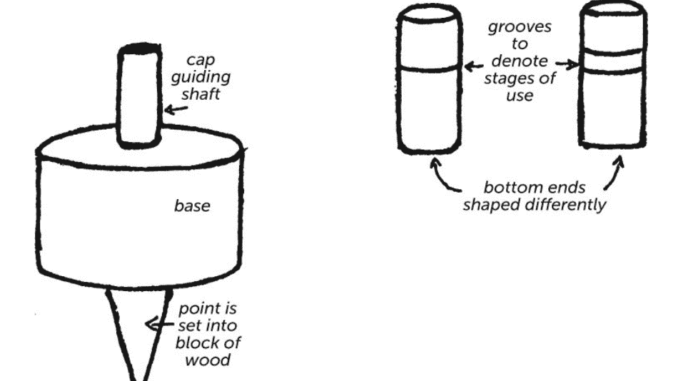
```

图 3–4 锻打具

遗憾的是，我开始认为对于当的普通割草者来说，这种具几乎是不可或缺的辅助。（我在美国看到的许多通过手工法“锻得很薄”的刀片，都由于所有者缺乏技巧而遭受了严重损坏。）

具的主要优点是它补偿了锤击的不准确性。人们还可以有效地磨出正确的刃口宽度，而没有过度延伸的危险。结果将一致得多。

完成满意的锻打工作的基础是设置一个稳定的底座，让人可以舒适地坐在那里且光线良好。具可以夹在虎钳上，正如某些型号包装上的说明建议的那样。我认为这是一个糟糕的替代品，因为用这种方法的用户可能不会费力制作一个辅助装置来支撑刀片突出的部分，而在处理另一端时。对于短刀片这并不困难；然而，在尝试固定一个例如`28`英寸长的刀片并在锤击头部时，某些支撑手段的好处显而易见。

在欧洲部分地区，习惯在刀片仍连接在镰柄（snath）上时进行锻打。人们发明了各种固定镰柄和刀片的方法。我不会在这里描述它们，因为我相信如果刀片与镰柄分离，可以获得更准确的结果。有了今天连接环的便利，这只需要几秒钟。它还提供了正确重新安装刀片的机会，清洁并偶尔油润积累污垢和水分的镰柄部分，以及环上螺钉的螺纹。

我最喜欢的刀片支撑方式是我的腿。与我尝试过的任何方法相比，它们能对所需的角度提供最准确、最即时的调整。

为了将具放入底座中，预先钻一个略小的孔要容易得多。除非装了盖子，否则绝不应该击中中央导轴，因为它可能会损坏到足以防止盖子平滑移动。在没有插入刀片的情况下，最好也不要用力敲盖子；如果它被撞扁，它保持下端理想形状的时间会长得多。

在欧洲部分地区，习惯在刀片仍连接在镰柄上时进行锻打。人们发明了各种固定镰柄和刀片的方法。我不会在这里描述它们，因为我相信如果刀片与镰柄分离，可以获得更准确的结果。有了今天连接环的便利，这只需要几秒钟。它还提供了正确重新安装刀片的机会，清洁并偶尔油润积累污垢和水分镰柄部分，以及环上螺钉的螺纹。

我最喜欢的刀片支撑方式是我的腿。与我尝试过的任何方法相比，它们能对所需的角度提供最准确、最即时的调整。

为了将具放入底座中，预先钻一个略小的孔要容易得多。除非装了盖子，否则绝不应该击中中央导轴，因为它可能会损坏到足以防止盖子平滑移动。在没有插入刀片的情况下，最好也不要用力敲盖子；如果它被撞扁，它保持下端理想形状的时间会长得多。

轻轻将具敲孔中，直到大约一半。这时你可以插入刀片并开始锻打。此时具会接触底座表面。在目前美国有两种型号具的情况下，一次完整的锻打涉及连续使用两个盖子。第一个会在边缘约`5/32`英寸（`4`毫米）处产生一个槽。第二个会平整槽和边缘之间的金属，从而使其向前移动。

如果刀片被忽视了（锻打得太久），可能需要重复此过程。定期进行，每次可以跳过第一个盖子。

```
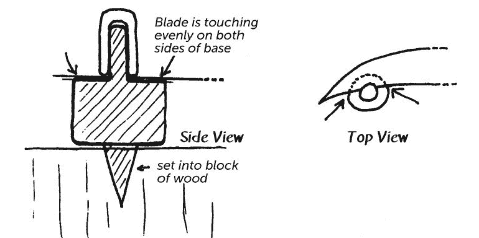
```

图 5

广告宣传可能让潜在买家认为这种“专业磨刀设备”每次都能产生“完美刃口”。相对于手工法，使用具很容易，但成功并非自动。偏离“完美”可能是几个因素中的一个或多个引起的。为了确保均匀，请观察：

- 1. 锤击期间刀片与底座的两侧接触均匀。（见图 5）

- 2. 刃口本身得到了盖子的良好支撑。（许多镰刀片的整体形状需要向前倾斜以实现这一点。）（见图 6）

- 3. 锤击的节奏与你移动刀片的速度同步。

- 4. 你敲击的力量处处均匀。

这种具不需要特殊的锤子。任何至少`16`盎司重的普通锤子都可以。对于被忽视的刀片和灌木型型号，`20`盎司会更有效。我觉得用重锤轻轻敲击比用轻锤用力敲要好。锻打即使均匀，如果击得太猛也会过度，特别是当金属较新或较薄时（大多数在奥地利制造的新刀片都是如此）。

专注于平整后角而不是变薄本身（这会自动发生）。你可能想轻轻地在刀片上过一遍，以感受稳固、节奏以及刃口的反应程度。然后非常仔细地检查后角。它可能仍在某几个地方。从顶部用粉笔标记这些区域，并再次锻打，力度轻一点。

从夹具取出后，如果工作完成得当，刀刃的边缘已经具有理想的形状（即已开刃），但并不锋利。这是因为在锻打过程中，刀刃会沿着中心导向轴滑动，而导轴显然会因此磨钝。作为补偿，一些肉眼无法察觉的微小损伤被“接合”或磨平了。因此，我们最终留下的的是一个平整、开刃良好、相对较薄但很钝的边缘。

请注意边缘上的光线反光，这表明了锋利度的缺乏。无论是口袋刀还是镰刀，如果普通人的眼睛在将边缘对准良好的光线时能轻易检测到任何反光，那么该工具对于许多任务来说就可以被认为太钝了。检查刀刃边缘：向左右反复拨动它，直到你从反光最强的角度观察它。在正常使用的任何时候，该阶段的刀刃都不应反射出如此多的光线。现在就可以理解为什么在刀刃抵住夹具导向轴时，不应施加超过必要的压力了。

## 正确完成开刃边缘的处理

因此，现在需要用磨刀石进行更多工作来准备刀刃切割，这比田间的磨口要多得多。使用合成石将快得多地完成这项任务的第一部分。我建议在安装刀刃之前，在舒适且稳固的位置进行此操作。我先从顶部开始磨。我用左手握住刀柄，让刀尖抵在一个木块上，跪着时斜着放在我正前方；如果你愿意，也可以尝试其他姿势。

对于这种从顶部对刀刃进行快速磨口的任务，请使用磨刀石的窄边（见图 7）。大多数镰刀石的形状与刀刃略微上翘的边缘与背部脊之间的内曲率大致相对应。用它们的弯曲边缘时，它们可以契合这个空隙，如果割草者需要的话，这提供了获得更小刃角的机会。正如第 115 页所示，这样做可以提供更具穿透力的轮廓，但增加了脆弱性。

因此，真正的灌木刀（例如）最好具有不那么尖锐的次刃，且磨得应该比脊部到边缘的关系更陡。（见图 9）。

如果用脊部作为角度引导，我建议操作方式是让磨石几乎接触到它，并将压力集中在边缘上。等等用力磨擦脊部和边缘（如果你发现最初这样做最容易的话）并没有直接伤害，只会导致磨石产生不必要的磨损。

我只向一个方向磨，远离我的方向，从刀跟到刀尖呈斜线进行，因为这让我获得更长的行程。这项任务的这部分需要多少次动作取决于使用的磨石、施加的压力以及锻打期间刀刃压在夹具轴上的硬度。继续磨，直到你感觉到另一侧开始产生轻微的“毛刺”（burr）。（解释请参阅第 103 页）

刚开始磨刀工具的人需要学会非常仔细地感受毛刺。偶尔冲洗刀刃或用抹布擦拭会有帮助。一旦在任何地方检测到极微小的毛刺，就跳过该区域继续继续磨剩余部分。当沿着整个长度都能感觉到它时，将刀刃反过来并去除毛刺。

```
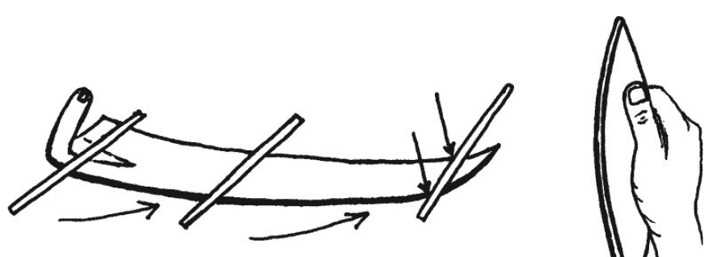
```

图 7

这项任务我更倾向于使用磨石的宽面，并小心地向边缘（即朝向边缘）滑动，因为这样去除毛刺更快。磨石的较小部分会被使用，因此行程也会更短。如果你想要一个更安全的选择，请让边缘远离你的方向进行操作。一次由从刀跟到刀尖的几次重叠动作组成的完整通过过程就足够了。使用天然石重复这些动作，从顶部进行二三次，从底部进行一两次。平滑的切割边缘是通过使用性质相当温和的磨料剂实现的。今天市面上大多数合成磨刀石不属于这一类。

所有的磨刀石的工作原理都是在钢上切出凹槽。越大、越硬和/或越有棱角的磨料颗粒（即砂粒），凹槽就越大。被除去的钢屑以粉尘的形式排出。这一过程不可避免的副作用是某些钢碎片仍然附在边缘上，但凸出了边缘。它们大部分将从相反侧以不同程度地弯曲，导致部分毛刺又被折回了回来。由于磨石是从远离磨石作用的方向施加的，一些被折回的毛刺可能会“永远”存在，因为即使有些毛刺断了，磨料的砂粒也会产生更多的毛刺。（石头越粗，这种情况就越如此。）一个外行在测试边缘锋利度时，可能会感觉到组成毛刺的单个牙齿抓住了他们拇指的皮肤，工具看起来似乎具有欺骗性地“锋利”。实际上，它们应该被视为一种干扰，或者充其只是彻底磨削过程中某个特定阶段的临时状态。

```
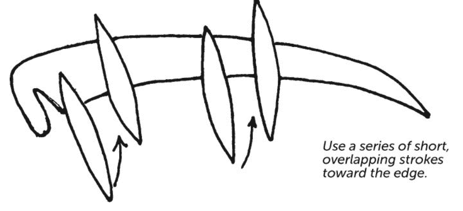
```

图 8

因此，最后磨口的目的一直是尽可能完全地去除毛刺。关于边缘带有锯齿是理想的流行观点半是一个神话。在制造过程中在某些切割工具上创建锯齿边缘的目的是减少对通常磨削频率的需求。

锯齿刀确实可能运行非常好。

在有更详细的笔记出版之前，我想给你们一个建议。请在旧的“美式”刀片上练习锻尾（即使使用夹具也一样）。这些刀片通常只需几美元就能买到，可以保护你的好刀片免受磨损。

- 我还没有遇到过无法锻尾的刀片；事实上，有些刀片的反应甚至比近期生产的刀片更好。缺乏经验的人可能会使之开裂（这本身就是一个很好的教训和练习修复刃口的机会），但并不是因为它们太硬。

- 反之，这些刀片的刃口两边都太厚且圆了。如果在没有被夹具盖板或锤子良好支撑的情况下受到击打，它们会开裂或崩口。最初将斜面磨得更平整会有帮助。

## Note

- *The Gift of Good Land, North Point Press, 1981*

## VII

### 野外磨刀

为了在野外保持刀片易于切割，需要非常频繁地磨削。取决于植物固有的韧性及其成熟度，以及一天中的时间（见第148页），我的平均做法是每割`5`分钟后磨一次。这花费我大约`15`到`20`秒，不包括擦刀片的时间，擦刀应在每次磨刀课程之前进行。


我很少进行超过一次完整的“通过”（从刀柄到刀尖），使用磨石时采用短促、叠加且交替的动作，并仅使用手腕动作。这种方法很快且节奏良好，尽管学习这种技巧时一次集中在一侧会更容易。

到目前应该已经清楚了，重点是磨刀片的正面（带有主斜面的那一侧）。在刀片背面使用磨刀石的主要目的是去除或对齐“毛刺”。考虑到这一点，我在斜面上使用石头时施加双倍的压力，尽管观察者可能察觉不到。延迟会导致刃口背部不可避免的圆钝，即产生短的“背斜面”。

图9代表了三种基本的“石刀角”角度示例。事实上，考虑因素可能会变得复杂得多（类似于木工凿刀的斜面角），因为除了了解切割材料的性质外，角度还取决于在锻尾过程中刃口上精确产生了多少“磨凹”效果，以及镰刀匠在刀片主体中融入的曲线。

### a) b) c)

| 刀脊 | 磨石边缘 |
| :--- | :--- |
| “通用”角度 | 可能适用于未锻尾（即圆刃）和/或灌木刀片的角度 |
| 适用于非常弯曲主体和/或磨凹刃刀片的角度 | |

图9

c) 位置是最弯曲的刀片和刃口所需的。相反，在曲率较小的刃口上使用此位置将导致最小的斜面角（这意味着渗透力更好，但耐用性也较低）。这要求磨石尖端不要沿着刀脊运行，而是在其下方，几乎触及刀片主体的中心。a) 和 b) 中随磨石角度位置的说明将是自而见明的。

磨刀时镰刀如何握持并不重要，重要的是刀片要稳定，割草者要舒适。我偏好的位置是刀片横跨在我面前，指向我的右侧，这样我就可以观察它的背面，如图10所示。

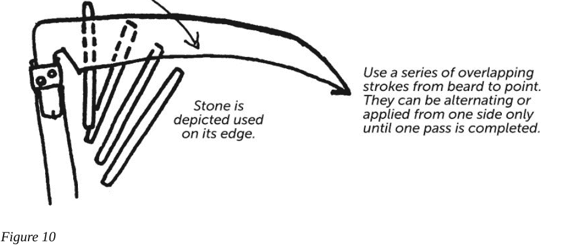

镰柄（snath）在开始或磨刀期间不需要保持垂直位置。将其一端放在地面上，使刀片的角度允许以舒适的方式进行磨刀，有助于保持所需的石刀角，从而提高效率。

我有些奇特的个人技巧在于，我继续在正面前磨刀，同时通过左手手指沿着刀脊“爬行”，让刀片逐渐向左移动。这样做效果很好，因为左手始终非常靠近石头正接触刃口的地方，以便在该处提供稳定的支撑。

在我们离开镰刀这个话题之前，可以补充几点反思：

***

关于镰刀有很多话说，但我将重点放在石头上。天然石比近期生产的合成石好得多。它们更耐用，而且保持刃的能力更好。

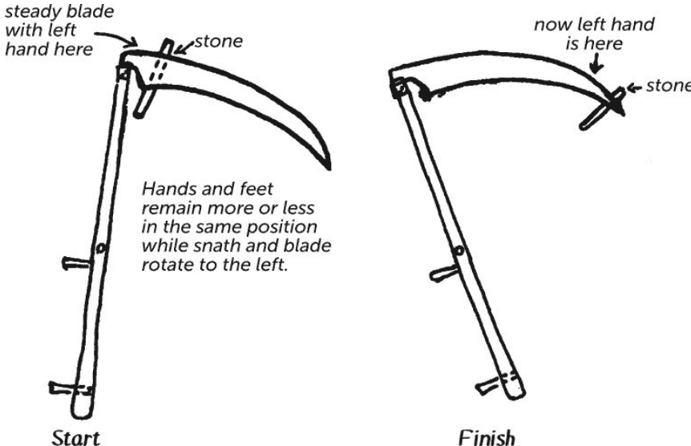

图11

然而，天然石因以下用途而倍受欢迎：

- 1. 使用夹具进行初始处理。
- 2. 去除“背斜面”。
- 3. 刃口修复。
- 4. 其他工具的成型。

## VIII

修复受损的刃口

最终，大多数镰刀都需要进行轻微或重大的刃口修复。作为开场白，我想强调的是*损伤应该在发生时及时处理，而不应让其累积直到需要进行“合适的修整（peening proper）”为止。* 整个刃口的成型和对其中一小部分的修复是截然不同的任务。当刃口正好到了整片刀需要修整的时间时，可以将两者结合。在这种情况下，我会先完成修复，然后再进行实际的修整。

为了修理维修，传统上会将锤子和铁砧架具带到现场，通常由一组割草者共享。我偶尔也曾用过两块石头来压平一个简单的“凹痕”，即一段弯曲但*未断裂*的刃口。这比忽视这种损伤要好；或者即使是两个粗糙点，即使初学者没有注意到刀身上额外的磨损，他在磨刀石上也会有发现。对于单项的修复工作，你会发现锤子是比夹具更顺手、更准确的工具。这从某种程度上说，始于徒手法的练习。

如果凹痕不明显，特别是当向下弯曲时，夹具的效果很好。当弯曲得很厉害时，先只用锤子将其复位到位，然后在夹具上用第二个盖完成完成。更频繁的凹痕是向上弯曲的，最好“倒过来”来处理。

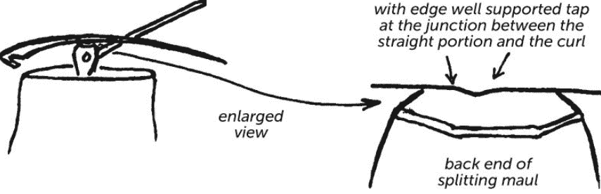

图 12

对于这种情况，我倾向于只用锤子。在没有真正的修整铁砧的情况下，斧头或钉入木块中的劈木斧头都是合适的替代品。

当刃口的较长一段被严重钝化时（例如撞到铁丝网后），夹具会工作得很好。通常它还会显得有些“参差”；先锉平，再使用夹具。

更棘手的损伤是垂直的裂缝，以及“撕裂”和刃口缺失的各种形状的碎片。后两者通常是由裂缝引发的，但也可能独立发生，如果刀片撞到了锋利的金属物体（遗忘在草丛中的钢板、角铁等）或半埋的岩石角。如果刃口很薄，可能会是一个“撕裂”；对于较厚、更耐用的刃口，可能会掉落一个新月形的碎片。（当然，后者在挥动时需要更大的力量。）

“裂缝”本身可能是突然造成的，例如当刀片撞击到之前切过的幼树残桩、牛公英等时。为了这种遭遇而经过适当成型的刃口会产生凹痕。如果太薄，可能会部分切入，但在切断茎部之前，它会瞬间“弯曲”或扭曲。损伤的程度取决于：

- 1. 植物材料的韧性
- 2. 主斜角的几何形状
- 3. 制作刀片的铁匠的技艺
- 4. 制造刀片的钢材质量，以及当然，
- 5. 引导工具的割草者的手感。

承认，这包含了大量的相对性，很难一次性考虑。早晚，大多数经常使用镰刀或在各种条件下使用的人都会遇到这种类型的裂缝损伤。

我们可能会在一次挥动中产生几个相互靠近的裂缝。接下来的一下，特别是针对类似目标的侧面，会加剧损伤。它可能会延伸裂缝，产生更多裂缝，移除两个裂缝之间或其中一个裂缝侧边的细小碎片，或使其中一些弯曲。图 14a。一个“弄坏了”的刃口表现仍会像以前一样；希望在割草者第三次挥动前能注意到发生了什么，停下来并修复损伤。

这听起来可能很严重，但并不真正需要报警。几英寸的这种刃口修理起来并不比几个大单条裂缝麻烦多少。

但在我们开始修理过程之前，允许我补充一点：很有可能有同样数量甚至更多的垂直裂缝是直接或间接地由所有者的锤子造成的。过度用力或不准确的敲击可能会导致刃口沿一个或多个位置钢材产生应力，几乎达到断裂边缘，直到某种挑战（可能是不显眼的）完成这项工作。

这种挑战可能是后续操作中同样方式的敲击。在此期间，我们可能只割嫩草，而没有意识到正在发生什么。裂缝最初可能太微小，肉眼难以察觉，并且可能不会严重损害刀片的性能。一旦变多，它们就会变得更大、更棘手：刃口的角开始弯曲并挂住草。此时我们会注意，但可能会诅咒那个“自己裂开”的刀片，因为我们确定没有撞到任何硬物。

这不是一个假设性的故事，而是一些人实际上告诉我的。

仅仅一次疏忽的修整就能让刃口从健康状态变为应力状态，继而是产生微裂缝，然后可能是严重的裂缝。建议养成在放大镜下检查刃口的习惯。即使是3倍手镜也会发现端倪；10倍更好。如果检测到裂缝，应避免在其附近敲击。无论技术多熟练或小心，任何敲击都无法重新连接分子间键，即重新连接裂缝的两侧。

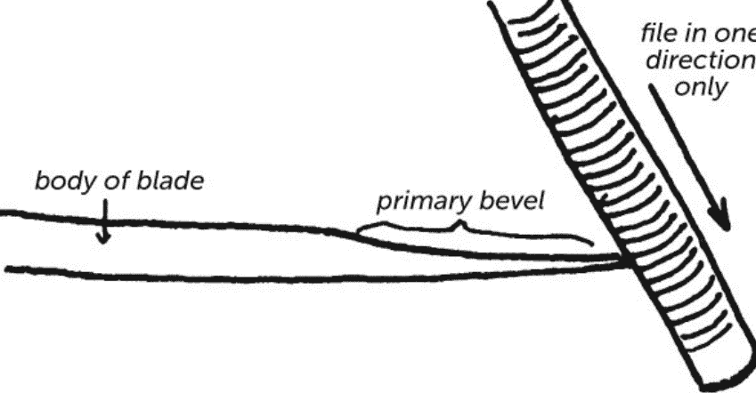

图 13

要进行有效的“修复”，必须完全移除裂缝。这是锉的工作（我最喜欢的是一把用了一半的 6 英寸链锯耙子锉）。

在考虑彻底修复之前，在某些情况下可以尝试折中方案。单条垂直裂缝，即使很大（1/4 英寸），也可以保持完好并密切观察。它在很长一段时间内都不会产生麻烦，并在使用过程中逐渐磨损。每当修整刀片的其余部分时，避免击中周围区域——可能是两侧 3/16 英寸到 3/4 英寸。相反，仅用合成石修整该部分刃口，并保持比其他地方厚一点。

在敲平突出且弯曲的撕裂碎片后，我们留下的斜裂缝是另一回事了。一旦刃口承受了这种应力（通过弯曲），它就会失去一些“刚性”。

- a) 各种损伤示例
- b) 敲击后的状态
- i) 锉不够宽
- ii) 锉不足
- iii) 未锉到边缘

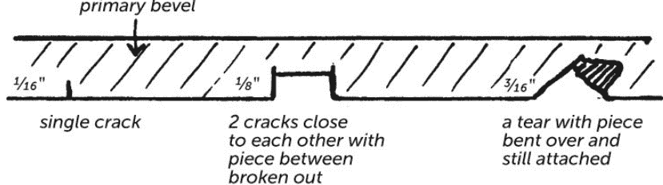

图 14

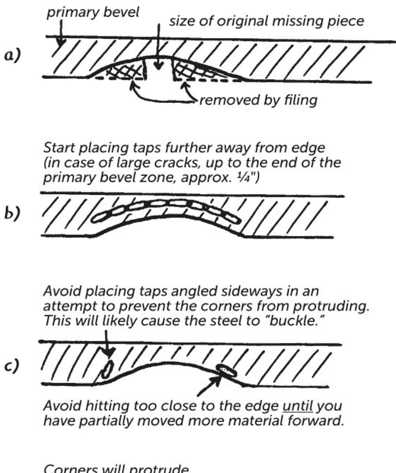

图 15

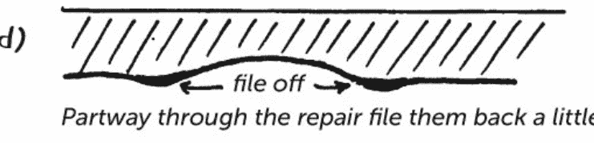

图 15

## IX

动作原理

大卫·特默（David Tremer）是正确的，他说：“……我关于镰刀设计和技术的任何‘规则’，别人都以不同的方式成功了。”

所有割草方式的共同点是刀片平行于地面并以各种曲线运动，而不是直线，以确保牧草是被切断而不是砍断。关于镰刀的使用，我发现高效、舒适且令人愉全面的指南可以简化为三条“规则”。

将重量在双脚之间移动。这在“田间割草”时最为明显，尽管在进行许多短促的修剪动作时，我仍然（即使只是稍微）侧向摇动。这并不是我见过的任何传统镰草割法的特征，因此对于熟悉几乎所有东方武术动作原理（以及如何产生大部分力量）的读者来说，这种做法很容易被认同。

将这些原理应用于割草时，值得强调的是，为了充分利用身体移动产生的动量，割出小于8英尺宽的路带并不是理想的。如果我坚持按照更传统的宽度（视地区而定，为5 到 7 英尺）来割一个特定区域，会让我更加疲累。

除了无法将身体动作与深呼吸的节奏同步外，我还无法利用腿部的天生力量。最好在切割时完全呼气（通过嘴巴），并在返回动作时吸气（通过鼻子）。短促的修剪动作无法做到这一点，尽管其他节奏仍然可以……

使用“重心转移技术”，我们8 岁的女儿 Ashley 可以在密集的草丛中割出一条整齐的 8 英尺宽草带。承认的是，那是一个夸张的宽度，身高身高4英尺3寸。事实上，她更喜欢在杂乱的草丛或会限制这种宽幅动作的地形上割草。11 岁的 Fairlight 的通常宽度是 7 英尺，当他们割草时，我尽量让 Ashley 割到那个宽度。经常，我回头一看，看到她再次逐渐拉长这个距离……

图 16 是根据照片描勒的 Ashley 的真实轮廓（没有对尺寸进行“拉伸”）。她显然比我们大多数人认为舒适的高度要更贴地面，但这幅画可能会解释体重不足 50 磅的人如何获得所需的速度并补偿手臂力量的不足。

相对于我的身高，我站得并没有那么低或那么宽，尽管我的站姿（在田里）比大多数人似乎尝试过的要低。

9 到 9.5 英尺是我喜欢的挥幅宽度，在右侧有高度差的微坡上，我可以割出 10 英尺宽的路带。对于每个人来说，无疑有一个最佳宽度，能够充分利用重心转移原理的潜力，同时又不会让任何单一部位劳累。

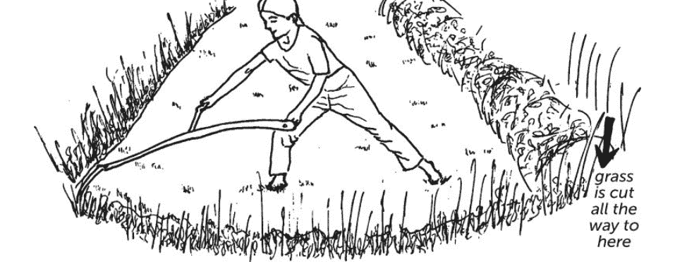

图 16

起初，那些不习惯需要侧向灵活性膝盖动作的人可能会觉得我夸大了上述测量值。有些人实际上告诉过我，他们的腿做不到那样。然而，在不引起自己不适的情况下，我建议你信任身体放松的与生潜力。我经常在仅通过一次专注的课程中就能看到非常振奋人心的进步。

其中一个“秘密”仅仅在于学会让身体保持一些弹性，尤其是膝盖。对我来说，《割草者的镰刀》中所有的插图都描绘了他双腿笔直的样子。唯一的例外是第 34 页上的那幅旧画，我本该把它放在首页的。我的田间移动站姿更宽，膝盖弯曲更大，脚趾指向前进的方向。图 17 所示的足间距离是我感到舒适的距离；它与人的身体比例、腿部状况和身高有关。

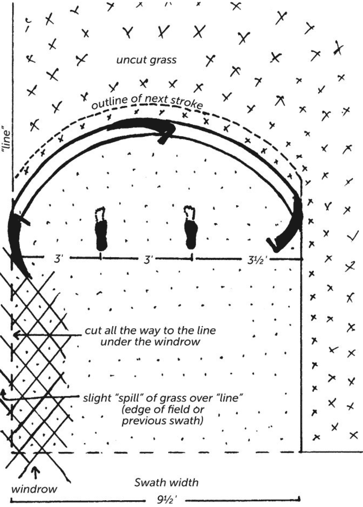

图 17

图 17 展示了如何应用规则 2 和规则 3。

如所示，草堆大部分堆积在割出的路带内。只有一小部分（随草的密度和/或高度而异）会“溢出”到线之外。

如果我是在田地中间割草，左侧的立草将“接住溢出的部分”，但不应被其推倒。因此，在完成这样一次作业后，我向左转并反转了方向；我可以割出一条路带，将新的草堆靠在第一条上。这种所谓的“双重窗口”下的残茬将没有未割的茎。

向前的运动如下：如所示，草堆大部分堆积在割出的路带内。只有一小部分（随草的密度和/或高度而异）会“溢出”到线之外。

如果我是在田地中间割草，左侧的立草将“接住溢出的部分”，但不应被其推倒。因此，在完成这样一次作业后，我向左转并反转了方向；我可以割出一条路带，将新的草堆靠在第一条上。这种所谓的“双重窗口”下的残茬将没有未割的茎。

向前的运动如下：如所示，草堆大部分堆积在割出的路带内。只有一小部分（随草的密度和/或高度而异）会“溢出”到线之外。

如果我是在田地中间割草，左侧的立草将“接住溢出的部分”，但不应被其推倒。因此，在完成这样一次作业后，我向左转并反转了方向；我可以割出一条路带，将新的草堆靠在第一条上。这种所谓的“双重窗口”下的残茬将没有未割的茎。

向前的运动如下：如所示，草堆大部分堆积在割出的路带内。只有一小部分（随草的密度和/或高度而异）会“溢出”到线之外。

如果我是在田地中间割草，左侧的立草将“接住溢出的部分”，但不应被其推倒。因此，在完成这样一次作业后，我向左转并反转了方向；我可以割出一条路带，将新的草堆靠在第一条上。这种所谓的“双重窗口”下的残茬将没有未割的茎。

向前的运动如下：如所示，草堆大部分堆积在割出的路带内。只有一小部分（随草的密度和/或高度而异）会“溢出”到线之外。

如果我是在田地中间割草，左侧的立草将“接住溢出的部分”，但不应被其推倒。因此，在完成这样一次作业后，我向左转并反转了方向；我可以割出一条路带，将新的草堆靠在第一条上。这种所谓的“双重窗口”下的残茬将没有未割的茎。

向前的运动如下：如所示，草堆大部分堆积在割出的路带内。只有一小部分（随草的密度和/或高度而异）会“溢出”到线之外。

就密度而言，最难割除的是两个极端情况：

- a. 极其茂密、频繁修剪的草坪或过度放牧的牧场。
- b. 生长稀疏，伴有牛蒡或无支撑的独立茎秆。

关于成熟度，牛蒡（Arctium sp.）可以被视为一个极端例子。在开花阶段之前，无论高度或茎径如何，都可以用最轻的割草刀型号进行割除。要处理任何完全成熟的大片牛蒡丛，我宁愿用一把坚固的灌木镰刀去换一把锋利的斧头或一把长柄修枝器。上述原则对几乎每种植物都适用，尽管程度较小，但只要刀刃形状合适且割草者的技巧正确，大多数植物确实可以用割草刀割除。

## 3. 进草路径的方向

在许多情况下，主要沿着直线或绕着整个田移动并不是理想的。镰刀的使用并不限于这种方式，通过简单改变方向，往往可以将割草从苦差变为一种享受。

在这里，有两个因素共同决定了最简便的路径：地形以及特定植被群内部的“倾斜度”（即使并不明显，通常也存在）。

关于最小阻力路径这一主题的最初材料有好几页长。正如我写的任何东西一样，它源于我那18岁、在家教育（用“自学”更准确）的儿子 Kai 的审视。他是我第一位也是最挑剔的编辑。除了拆解我冗长的斯拉夫式句子，他还试图删掉所有感性的内容和许多哲学段落。凭借他强烈的实用倾向，如果由他来写这段附录，长度将只有三分之一，标题将为：“毫无废话的割草指南！”

Faye 主要是个行动派而非言语家，尽管偶尔她会在几分钟内写下我可能苦思好几天才能写出来。在我们三个人花了几个晚上争论如何浓缩关于“简易路径”的详尽笔记后，她拿起笔写下了以下内容：

> “用这种工具创造路径时，意识成为了一个核心概念……考量土地，判断倾角，反思植物，检查边缘，通过角度移动，留意残茬，思考动作，冥想呼吸……”

所以，这就是答案了——一个简洁的配方。简短、准确，且表达了我正尝试描写的内容不仅仅是草草。它是农民的舞蹈，是天空下的晨祷……

诸如“如果你在割草时不能放松自己，说明你的方法不对”之类的公理证明了这样一种理解：任务几乎可以是不毫不费力的。[参见笔记8。]

太极拳练习强调在反思的心态下执行流畅动作，这是一个完美的——即使是理想化的——模型。

不“流失”消耗的能量，而是引导其返回圆周模式的概念，呼吸的方式以及相关的意象，我认为都非常适用于手割艺术。我们真的能学会引导刀刃穿过植物细胞之间的空间吗？我认为值得一试……

## 刀片适配的挑战

从我在文中做出的某些陈述中，读者可能会推断出，我对镰刀通常如何进行适配、调整、磨利和使用的看法相当低。

为了向100年前的农夫描述整体情况，我可能会说，如今平均镰刀的工作方式有点像一匹没吃饱、鞋子不合脚，还戴着大两个号项圈的马。这只是粗略的描述，因为大多数现代割草者（或未来的割草者）从未驾驭过那样的马。

用汽车来类比可能更合适，因为现在的人确实知道坐在一辆运行平稳的汽车驾驶座上是什么感觉。使用这个比喻，我认为极少有镰刀组合在运行时是“全速运转”的。它们大多数时候需要推或拉才能爬上任何陡峭的山坡，而且在舒适性配置方面，就像开着没有避震器的车辆。

如果你愿意，就把这看作一种幽默的夸张——它可能会舒缓你的心情，而这本身就有利于割草。然而，我是认真的，并且确信，在适配适配的某些基础性挑战得到解决和处理之前，对于许多割草者来说，在保持身体舒适姿势的同时，保持图 20a 所示的理想刃地关系，将是相互互斥的目标。

“a” 影响刀片的平放位置。忽视它的变化是导致许多设备天生不协调的主要原因。

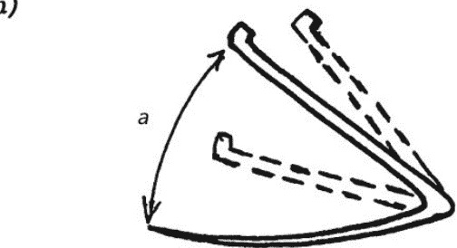

“b” 影响柄部的限制。通常情况下，如果经销商选择销售的刀片型号适配特定的柄（snath），那么它将适合所有割草者，除非他们的动作风格截然不同。

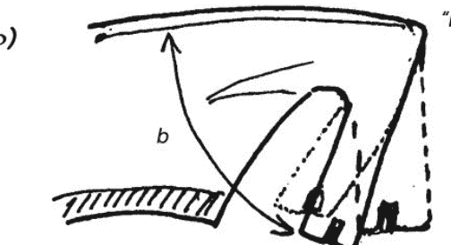

我发现“c” 的概念在这里太复杂，无法处理。

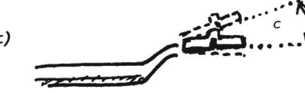

图 18

镰刀销售商和买家通常没有考虑的事实是：没有任何一种刀片型号的特定柄位置适合所有使用相同型号柄的割草者，即使后者是“定制尺寸”或可调节的。

有些组合确实比其他组合更有效。

## 为什么如此复杂？

刀片的角度并不适合所有使用相同型号柄的割草者，即使后者是“定制尺寸”或可调节的。除了定义刀片的所有其他特征外，镰刀匠并不发明这些角度。他们总是遵循客户的精确规格。每个相应型号作为*独特型号*，其柄在三个平面上都是倾斜的。

许多型号被构思并制造。例如，仅 Styria 公司就拥有一千多种型号的专利。每个型号的规格都在记录中，完全可以复制。目前，尽管对多样性的需求（与其他任何事物一样）正在日益萎缩，他们仍然生产 200 多种型号供选择。然而，我们——我在这里指的是经销商和割草者——需要学习要求什么以及为什么。

无论“信息时代”带来了什么好处，它在某些地区抹杀了智慧、技能和服务。决定选择的因素，在考虑所有其他因素之后，是能以最低价格获得的产品。[参见笔记9。]

这些问题的例外极少；瑞士的 Sahli 公司就是其中之一，每种刀片都与20 多种不同的柄进行单独匹配，并在那些仍然偏好的相应地区。


# 正文

这种服务在当今世界是难得的。它在那些能获得明显收益（即更大直接利润）的供应地区持续存在——即客户愿意为此买单。那些购买镰刀的人在商业世界中被分为两类：

1. 他们需要这种工具，这意味着他们来自“落后”国家，因此贫穷到无法高价。
2. 他们是富裕国家的偶尔用户，无法区分高质量与替代品，或合适与否。因此，对于第二类人来说，携带昂贵的系列或多种选择也是划算的。

接头角，而且还没有考虑到今天的客户已经是完全不同的群体了这一事实。

可调节刀柄——一种相对现代的发明——在一定程度上模糊了这个问题。它们目的是为了适应不同身高的割草者，而不是适应不同的接头角。如果设计刀柄时也考虑了接头角，那么它还需要在底部某处设计一个铰链接头。

在使用过程中，刀柄以各种角度接触地面。为了尽力保持刀刃与草茎之间的最佳关系，割草者必须不断补偿地形的变化以及刀片与脚部距离的变化（希望是通过改变刀柄角度并抬高或降低手臂来实现，而不是弯腰）。

在匹配设备时需要考虑的一点是，身高越高的人，这种刀柄与地面的平均角度就会越大。在靠近脚部的修剪动作中，身高每增加一英寸，角度差异就可能高达一度！

要具体讨论今天美国销售的每种刀柄/刀片组合已超出本文的讨论范围。尽管我希望激励个体经销商对这个问题进行思考，但我们可以共同从几个基本的考虑因素开始。

除了根据人的身高和预期用途选择正确的刀柄尺寸外，还有两个区分优质设备与劣质设备的重要特征：获得理想“握持角”的能力以及刀片的“贴地度”。

## 检查刀片的贴地度

像割草一样将镰刀举在面前，如图 19 所示用刀片接触表面。

刀背和刀尖比刀片中心离表面更远。保持刀尖略高于刀须。

用刀片的这一区域接触地面

图 20 所示是这个方向的

刀尖 -> 此部分边缘与地面的关系如图 20 所示

图 19

截面

从刀跟向刀尖向下观察刀片

a) 通用用途的理想贴地度

b) 边缘过低

c) 边缘过高

图 20

刀片的贴地方式应如图 20a 所示。

矮个割草者，特别是当使用弯刀柄配合灌木刀片（其接头通常较陡）时，可能会遇到 b) 的情况。如果添加楔块（如图 21 所示）还不够，可能需要换一个更直的刀柄或接头角较缓的刀片。

身高在 5'8" 以下的人由现有供应商提供的服务最充分，但目前为止销售的所有带草地刀片的直刀柄，供任何高于此身高的人使用，可能都需要按照图 22 所示修掉底部 3 英寸。

对于许多高个割草者来说，这仍然不够；添加楔块以进一步增加刀柄底部的锥度，可能是下一步。在此之外，在我看来，自制刀柄是最好的解决方案。

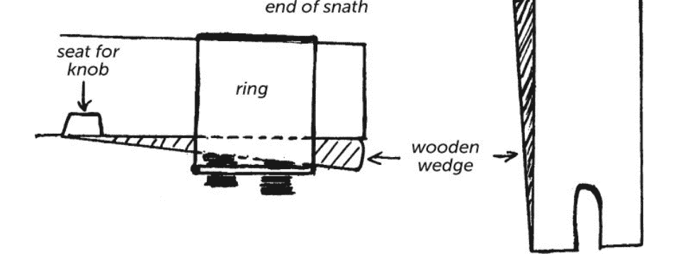

图 21

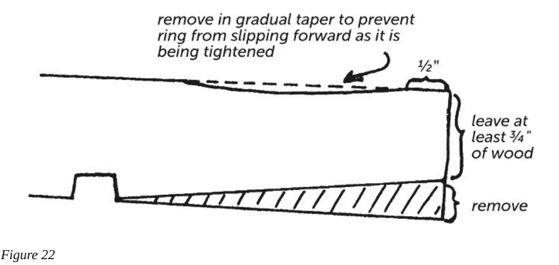

## 握持角

这是上握柄中心 A) 刀须 B) 和其刀尖 C 之间的距离关系。

动作方式以及所使用的刀柄和刀片型号，精确决定了 A–B 和 A–C 之间应该有多大的差异（如果有）。请注意，《镰刀书》第 11 页图 5 所示的指南仅在握持角相对于左手移动的确切位置进行测量时才有效。使用刀柄末端作为参考点，如果上握柄也跨过那条线（即安装方式在刀柄顶端形成一个“T”字），那么设备将是准确。

如果你选择这种握持方法，即将设备靠在墙上，我建议增加一个额外的操作。使用一个框架，或者如果墙是木制的，在距离地面 4 到 6 英寸处钉一个钉子，你可以将握柄中心靠在上面。此外，这可以防止握柄末端撞击地面导致测量失真。

如果你认为向左右偏移 3 英寸没有太大影响，可以用胶带或图钉将一根木固定在刀柄末端，依次将每个位置（图 24 中用 X 标记的位置）靠在钉子上，看它如何影响握持角。

最简单且准确的方法可能是使用卷尺并在设备躺在地面上进行初始测量。最终，所有经验丰富的割草者都会进行微调，仅凭肉眼估计距离。然而，我敦促你进行实验，最好是在茂密的草坪上练习大跨度动作，直到找到一个切割最顺畅的位置。这将是一项值得的成就，因为对于每种特定的刀片设计，相对于其所引导的切割模式，草茎将最低，而每一挥切割出的面积可能是最大的。

一旦你认为你找到了那个“最佳”设置，就在接头后面、圆环上方处做一个清晰的标记。这对于提醒割草者刀片已在环内滑动的情况很有用。在每次磨刀时，都可以看一眼标记。

冒着被认为是挑事者的风险，我诚实地说，我见过的几乎没有哪个刀片的握持是完美的。我不推荐这个大陆的传统刀柄；它是非常不符合人体工程学的例子。

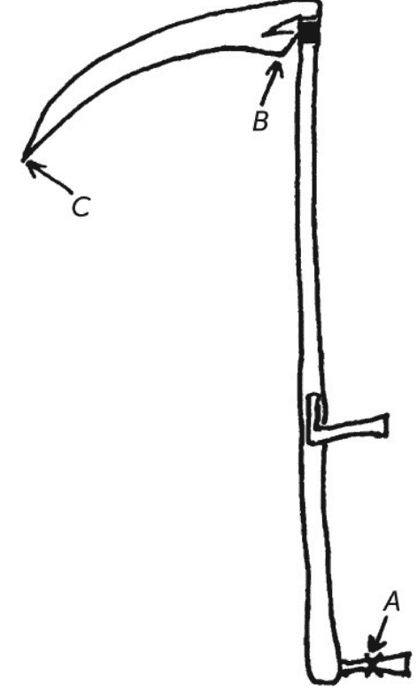

对于某些刀片/刀柄组合，如果不进行修改，很难获得理想的握持角。这是因为在美国销售的许多刀片是为向左弯曲的刀柄或两个握柄都远离割草者的型号设计的。然而，它们的接头可以从正面磨削或锉，使其更像美国刀片的接头。这有助于（尽管并非所有情况）“收窄”或关闭握持角。（顺便说一下，这就是让奥地利式刀片适应美国环的所有要求。）

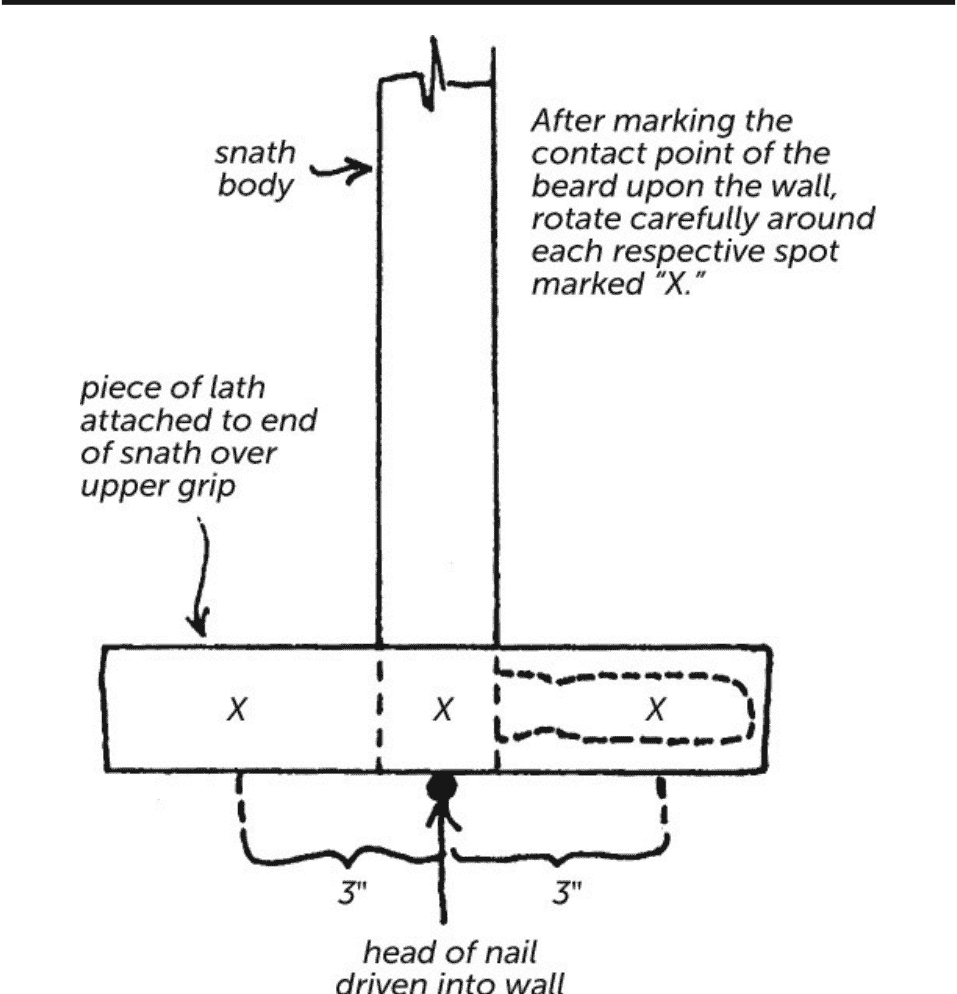

图 23


图 24

木刀柄底部在使用后会膨胀，挂在干燥的棚里时会收缩。除非每天在使用前仔细拧紧环上的螺丝，否则刀片会滑动。以该接触点为支点，下次刀片受到压力时，接头将变成一个有效的劈木工具（撞击干桩、石头甚至是密集的草丛）。许多木刀柄都是这样坏掉的；角度过“开”可能在草稀疏、使用短促动作时并不明显，甚至没问题。在正式的割草中，它会“拖拽”，并需要割草者消耗更多能量。

另一方面，我可以接受经典的“美国式”刀片。除了用锤保持它的边缘外，我会为它制作一个合适的柄……这就是为什么我非常遗憾遗漏了一个关于制作刀柄的章节。

（刨刀。）手柄的圆孔比方形榫眼更容易制作，而且完全符合功能性。


图 25

对极佳的贴合度、人体工程学设计以及可能的艺术触感进行综合考虑，可能会非常复杂，或者，我想补充一句，非常有趣。

单就这个话题就可以写一本小书。我不知道有多少人会利用它；我听说过大多数现代割草机使用者根本不会花力去制作自己的刀柄。无论如何，目前我还不给你们提供一个正统的刀柄制作章节。如果兴趣足够，可以在下一版中增加一个。然而，敏锐的读者会在图 1 中发现丰富的细微视觉暗示。这里有几条额外的建议：

我无法忍受圆形手柄，尤其是在修剪用刀柄上。它们需要比放松体验所更多的“抓握”力度。仅将平每个手柄的“内侧”（如图 25 所示）是对任何商业型号一种快速且值得的改进。以最舒适的角度对平整后的边缘进行修饰。

另一个有助于平衡刀片的特征是在刀柄末端增加 5–10 盎司的重量。在尖端套上一个漂亮的黄铜球（从旧火腿上取），或者钻一个洞，在上方手柄附近系上你的宠物石（不是小卵石）。尝试不同的重量；它与刀柄和刀片的大小、各自的重量以及预期用途有关。

我花了几个季节才完全领会这个概念。现在我非常困惑，为什么这个“平衡问题”没有得到各地刀柄制造者和用户的关注。

在欧洲与各种个人从理论上讨论这个“颠倒过来”的想法几乎没有效果；去年，当我第一次在草生长季节期间旅行时，我带了几个自制的刀柄，其中一个装了刀片。在奥地利和瑞士的一位割草机使用者接过其中一个，握在手里，了点头表示赞同。大多数挥了几几下的人问我是否也能为他们也做一个……我做到了。

手柄的形状和位置是他们都欣赏的额外特征。

附录概述了我为了激励“后方”提供更好服务而的一些尝试，以及我对一个更有前景的未来的愿景。

# 后记

尽管我有很多不中听的言论，但我认为镰刀的未来是光明的。我的乐观通过通过遇到那些被我视为希望象征的人而定期更新。

来自缅因州金菲尔德的18岁少女汉娜·索耶（Hannah Sawyer）就是这样的人的人，我在这里提供她家庭学校论文中的一段话：

> “镰刀很简单；它也很放松。难怪以前的人几乎没有压力问题。宁静的节奏消除了紧张感：呼唰，割，呼唰，割，割，呼唰……如果我闭上眼睛，很容易想象自己回到了过去——一只鸟在向天空歌唱，风在对树木低语，马蹄拨起的水花，母牛唤小牛的低鸣。你想穿越旅行吗？我教教你如何做。”

## 谢谢

任何像我这样的非作家，都试图将许多难以捉摸的概念和信念投入书籍的固定形式中，并让自己的家人完好无损，他们知道，支持他们的亲人才值得巨大的感激。

除了许多塑造我以及我所做之事之外，我只知道这一切始于我的母亲玛丽（Maria）和父亲约瑟夫（Jozef）。

许多人帮助了我与镰刀相关的追求。其中，丹麦的“惊人女性”格里特·勒彻（Grith Lerche）以及新罕布什州的奶场主、终身镰刀传教士汉斯·埃卡德（Hans Eccard）似乎是我有时迫切需要的力量源泉。

此外，如果不是弗朗茨·保罗·施罗肯（Franz Paul Schrocken）镰刀工厂全体工作集体（尤其是 Peter Wagner）的热情，我在那里学到了这么多，这部分知识的书文字就不会存在了。

如果没有兰·胡德（Alan Hood）的必要安排以及他随后表现出的极大耐心，它现在也不会在你的手中。

这份手稿的第一版本都是在旧纸背面用铅笔写的。在我和 Kai 的争斗得到解决（或几乎解决）后，Faye 用手动打字机打印了它。我们的朋友、邻居、第二编辑兼校对员菲利普·艾伦（Philip Allen）花费了大量时间将文本和图表细致地转换到——嗯，是的，我羞愧地承认——一种“清晰的数字化格式”。

你可能对构中的任何不清晰感到困扰，这是由于我固执地坚持保留一种带有异常双重含义和“言外之意”哲学的表达方式。斯洛伐克式的思维模式一定有深根，很难拔除。

尽管我努力沟通时保持了正直，但对于本文本在概念和技术正确性方面可能存在的缺陷，我个人负责。

# 附录

从 1994 年到写本文期间，我接触了每一位美国镰刀进口商，包括大多数“欧洲款式”刀片和配件的经销商，并提供帮助。（这是一项免费服务；我支付了电话费，并花了时间写了许多页信。）

有些人把我当成一个罕见的狂热分子并以此方式对待我；有些人似乎在礼貌地听，但继续照旧行事。其他人想要建议（或他们是这么说的），但并没有采纳

- 客户会对过多的选择感到困惑。
- 对工具的兴趣不足以支撑打印更详细描述的成本。
- 他们的选择虽然不完整，但对于“初学者”来说足够了。

也许我是一个天真的乐观主义者，偏爱镰刀，相信这种工具应该被对待

到目前为止，最大的“失败”是我在过去 20 年里与一家加拿大公司的经历，这家公司代表了园艺世界。当他们的下一个目录到达时，我对这种选择感到震惊：一片刀片、一个铝刀柄、一个石座和一个一块合成石。这对于木工来说提供了大约 250 种不同的凿子和圆凿，以及大量的磨削方法。

你看，我在几封信中敦促他们销售比市面上任何现有产品都短的刀片，并建议安大略省的木工用加拿大木材制作设计更好的刀柄。我自愿——免费——编写一本说明小书附在每把镰刀中；他们没有接受我的提议，后来我才意识到我本该像对公司说的那样清楚地说明——如果边缘不定期进行“修边”，这些刀片的性能会很糟糕。我很沮丧，虽然还没准备好放弃，我给总裁打了了电话。他告诉我，这个国家最多只有四个人认真地使用镰刀，而且，此外，现在已经无法教普通人如何塑造工具的边缘，即使有“夹具”的帮助。

一本书不能取代手持工具的好老师，但它是一个开始。特雷梅瑟（Tresemer）的《镰刀书》非常有启发性（且不具有威胁性），并履行了某种重要的作用。我的这部分可能会引起一些人的不满，但也提供了一份更完整的教学文本。

我目前正在对其进行进一步扩展，也许超出了“业余割草机使用者”所欣赏的水平（它还将包括关于徒手锻制和镰刀柄制作的章节）。此外，一段教学视频正在制作中，以填补现在以及“老师匮乏时代”的空白。

愿意帮助这一扩展项目的人可以通过写信方式与我们联系：Vido Family, 1636 Kintore Road, Lower Kintore, New Brunswick, E7H2L4, Canada.

# 注释

## 镰刀书

1. `scythe`（镰刀）一词是更容易读的古英语 `sithe` 的变体。彼得·库金斯（Peter Cousins）建议更早的荷兰词 `zicht` 是其起源。这三个词拥有相同的印欧语词根 `sek-`，意为“锯”、“剑”、“镰刀”，以及“犁铧”、“分裂”、“科学”等。所有派生词都有将某物从一个地方移动到另一个地方的含义。现代德语中表示镰刀的词是 `die Sense`，它与印欧语词根 `sent-` 相关，意为“朝……而去”；在某些地区，镰刀的发音像“sigh”；刀片割草的声音与这种强烈的赞叹声之间并没有词源上的关系。法语的 `faux` 和意大利语的 `falce` 源于拉丁语的 `faux foenaria`，没有更早的词根。

2. “钢”的碳含量低于0.2%，强度较低，脆性较小，更不易磨利，且更具韧性。杰拉德·詹金斯（Gerard Jenkins）在《工艺工业》中详细描述了不列颠群岛刀片制造的历史。

3. 在马克·夏加尔（Marc Chagall）1911年描绘其俄罗斯童年的绘画《我与村庄》（I and the Village，纽约现代艺术博物馆）中，上握由割草者的手握住，镰刀柄水平靠在右肩上，刀片指向背部。在温斯斯洛·霍默（Winslow Homer）1869年的绘画《持镰刀的人》（Man with Scythe，华盛顿特区库珀-海维特博物馆）中，下握靠在割草者的右肘上，右手握着上握正下方的镰刀柄，刀片弯曲并指向地面上方一点。

4. 在关于镰刀的著作中没有提到左手型型号（1921年的《鲁梭农用书》中有一处例外）。尽管如此，在一些著名的插图中，镰刀是以左手持的。例如布鲁格尔（Bruegel）的《割草者》（1565年，布拉格国家博物馆）。诺曼·罗克韦尔（Norman Rockwell）为1964年首次出版的《穷理查德年鉴》创作的插图似乎是一把左手镰刀，这引起了许多老法人的会笑（《乡村之美》，最令人惊讶的美国人：本杰明·富兰克林，第38页）。这些显然是左手的镰刀是因为艺术家希望呈现一种和谐的设计——许多插图虽然画得很漂亮，但镰刀技巧是错误的。

5. 将镰刀柄靠在左肘窝处大大限制了双手握持偏移手柄的活动范围。尽管如此，这种方法出现在英国十一世纪历法的七月场景中（E. M. Jope，“农具”），并且令人惊讶地也出现在现代芬兰的农村（Christopher Williams，“必需的工匠”）中。现代旅行者在希腊和土耳其拍摄过只有一个下节的镰刀。H. J. 霍普芬（H. J. Hopfen，《农具》）介绍了镰刀柄的六个基本区域，遗憾的是没有讨论它们的不同用途。斯滕伯格（Steenberg）的《Hestredskaber》展示了在斯堪的纳维亚偏远山谷发现的各种手工镰刀柄。

6. E. R.icker 和霍华·盖奇（Howard Gage），“基于人体工程学原理的手工具设计”。

7. 任何工程学入门书都可以解释这些分子层面迷人的重新排列。范克（Van Vack）的《材料科学基础》特别清晰。金属的“疲劳极限”或“持久极限”是指在正常应力下不会变形的部分。这时，钢柄会缓慢发生微小变形，然后停止。铝柄则不会停止。

8. 由 Hand & Foot, Ltd. 提供了一项服务，在瑞士使用强大的手动操作压机对严重弯曲的刀片进行冷加工。

9. 1646年4月23日伦敦教区登记中的一条记录写道：“在索耶尔先生街上发现一个孩子，在有刀子的地方，名叫爱德华·夏普（Edward Sharp）。”鲁道尔夫·霍梅尔（Rudolf Hommel）在《在中国工作》中注意到了这种使用磨膏进行磨刀的方法；他还发现20世纪30年代固定磨石在中国和日本非常普遍。

10. 在威廉·西德尼·蒙特（William Sydney Mount）1848年的绘画《农夫修理他的镰刀》中可以看到滴水痕迹，该画收藏于长岛斯托尼布克的萨福克博物馆。

11. 出自安德鲁·马维尔（Andrew Marvel）《割草人达蒙》第八章，选自Margoliouth编辑的马维尔作品集。

12. 肌腱每公斤储存2500焦耳能量，而张紧状态为900焦耳（J. Gordon，《结构》）。在中世纪，木制设计更有效，弹簧为130焦耳（J.E. Gordon，《结构》）。整个镰刀动作具有“推运动”的性质（有力、直接且持续）。它由瞬间的“挥割运动”（突然、有力且间接）引发，不是抖动动作，而是一种向空气中的灵活发射，就像时钟装置一样。

13. 在英格加德·巴滕尼夫（Ingard Bartenief）的《身体动作：应对环境》中，整个镰刀动作具有“推运动”的性质（有力、直接且持续）。它由瞬间的“挥割运动”（突然、有力且间接）引发，不是抖动动作，而是一种向空气中的灵活发射，就像时钟装置一样。

14. 出自汤米·汤普森（Tommy Thompson）1980年10月的一封信。汤普森是波士顿地区的Alexander老师，受过已故兰克·约翰斯（Frank Jones）的训练，而约翰斯又受过F. 亚历山大的的训练。约翰斯的《行动中的身体意识》是一部佳作。

15. 雷蒙德·达特（Raymond Dart），《平衡的实现》和《人体的自主肌肉》。

16. 艾德里安·贝尔（Adrian Bell），《苹果核心》。

17. 英格加德·巴滕尼夫（《身体动作》）阐述了对这种节奏的需求：工业社会对有机节奏具有破坏性。它的压力减少了活动所需的恢复节奏……当人们限制自己的动作而不休息，或试图让动作完全适应机器时，依赖下一层次创造的人类因素就被抛弃了（第75页）。

18. R. L. 阿德里（Ardrey），美国农业进口；乔治·福塞尔（George Fussel），农用工具：1500-1900。

19. 雅各布·布朗诺夫斯基（Jacob Bronowski）在《人类的》中写道：“延伸手的工具也是视觉的仪器”（第118页）。这句话对于镰刀来说似乎特别真实，因为“镰刀”和“视觉”（古英语为 `sithe`）拥有相同的词根 `sek-`（见注释1）。通过镰刀，我有机会了解我的身体、我的世界，以及它们如何相互联系。


- 20. 赫伯特·科夫（Herbert Koef）、波·彼得森（Bo Peterson）和沃尔夫加斯·绍曼（Wolfgang Schaumann），生物动力农业。

- 21. 这种种子混合物与其每种成分一样，可以在英国切斯特的亨特种子供应商（Hunter's Seedsman）处购买。《亨特草类、苜蓿和杂草指南》有42种草地植物的彩色插图，可通过 Hand & Foot, Ltd. 购买。这些特定植物可能并不适用于所有地区；多样性是它们的特征。

- 23. 吉姆·沃辛顿，《自然家禽饲养》。

- 24. 布鲁格尔画作《割草》中也出现了此图。

- 25. 克拉伦斯·丹霍夫，“采集草类”。菲利普·莱特在《旧农用具》中给出了1661年埃塞克斯郡每项任务的工资。虽然从目前的价格来看，这些实际金额意义并不大，但它们之间可以相互比较，以了解完成每项工作所需的相对时间。割一英亩草草的工资是1/10士林；耙草并捆一英亩草是2/-士林；收割、脱粒并捆一英亩小麦是4/-士林；同样，黑麦也是4/-士林；割一英亩豌豆或草陆草是1/9/-士林；脱粒两蒲克小麦是1/-士林。货币单位是士林和便士；12便士等于1士林。一把梳子用于英制蒲扇，相当于4.13美国蒲扇。

- 26. 关于报春花水，马戈利奥斯引用了马维尔草本书中的话：“报春花的汁液和水，贵妇们知道如何去除其上的斑点或褪色，还能消除皱纹，使皮肤变得光滑白皙。”

- 27. 我在法国观察过这些耙子的使用情况。同样的设计也出现在布鲁格16世纪荷兰的画作《割草》中。鲁道夫·德里尔斯（在《叉子标准与生物力学》中）发现，拉脱维亚人对耙子的尺寸测量是个性化的：手柄长度等于一个身高加一个拳头的宽度，耙头等于一个尺，齿间距离等于两个手指的宽度。

- 28. 木制干草叉和草耙的制作在德鲁·兰斯纳的《乡村木工》中有详细介绍。许多图片和图解展示了制造简单工具是有多么困难。

- 29. 这些卡片可以通过 By Hand & Foot 有限获得；其设计特征在《通过 By Hand & Foot 有限的手绘卡片历史》中有详细描述。

- 30. 鲁道夫·拉班在《儿童体操与舞蹈》中（被巴特尼夫的《身体运动》第69页引用）说道：

> 工作和节日有自己的节奏和法则，它们必须根据这些节奏的感觉来组织。人们呼求节奏性的力量波——工作和节日的——来复苏并活跃他们被压抑的生命感，使其具有意义。

20世纪30年代，拉班在德国城市的工业工人小组中组织了“运动合唱”，这些动作基于农业任务中的团队合作。在该国练习的古尔季夫动作就源于这些合唱。

- 31. 摘自詹姆斯·汤姆的《季节》，收于奥·亨利·沃伦的《美好生活》。在《爱尔兰民谣传说》中，梅森·雷德芬给出了耕作、锻造和纺织的曲目，即工作期间实际使用的调子，而不是工作后唱的关于工作的歌。塞西尔·夏普的《英国民歌集》中提到了可能伴随工作的简单歌曲（包括《割大麦》，以及《小休爵爵》和《真爱人的告别》），以及《南方阿拉巴契亚民歌》（收割吧，孩子们，收割吧）。黑泽明《七武士》结尾处配合鼓手和击唱者节奏进行的稻谷收获场景，是我所知道的劳动歌最好的例子；观看这一幕能让人立即感受到此类歌曲的力量。《黑人工作歌与呼声》（国会图书馆录音 CFS LB）也具有这种力量。苏格兰方面，亚历山大·芬顿（《苏格兰乡村生活》）报告说，如果观察者是工人熟悉的，那么协调的脱粒小组就不会为观众表演。采矿业可能也是如此，在这种情况下，歌曲随着那些被机器取代的主人的去世而消失了。如果社会学的观点是正确的，这些动作的记忆仍在我们的血液中，并将通过工作重新发现。

- 32. “午休”或正午休息在威廉·辛德罗·蒙特的画作《农夫午休》（萨福克博物馆，长岛）以及温斯洛·霍默的画作《午休》（哈特福德沃兹沃艺术馆）中表现得非常生动。布鲁格尔的《收割者》在书开头显示了一些收割者在享受午休，而另一些仍在工作。艺术家显然想在同一幅画中描绘不同的任务。

- 33. 艾德里安·贝尔，《户外生活》。

- 34. 鲁丝·赫兹伯格、贝特丽丝·沃恩和妮特·格林，《食物就位》。

- 35. 摘自贝特·西洛韦和杰西·莱特特的旧历史，《枫糖树与老奥斯莫》修订版。

| 十小时内收割的面积 | | | | | | |
|---|---|---|---|---|---|---|
| 小麦 | | 大麦和燕麦 | | | |
| A. | R. | P. | A. | R. | P. |
| 镰刀 | 2 | 3 | 0 | 4 | 0 | 20 |
| 光光镰 | 1 | 1 | 18 | 2 | 2 | 10 |
| 锯齿镰 | 1 | 0 | 8 | 2 | 0 | 10 |

Van Wagen、Johnston 以及1834 年的《新英格兰农夫》声称每天收割谷物可达四英亩以上，但并未为这些主张提供数据。Rogin 所引用的许多文献从每天使用摇篮镰收割二到四英亩不等。

- 48. 乔治·福塞尔尔（George Fussell），《农用工具》：1500–1900。

- 49. 这种铸铁部件的设备如今在美和欧洲仍能极少数找到可以使用几十年的老机器。与大多数拖拉机插件设备相比，Planet Jr 留下了持续的种子流，而“Shur Grow 种植机”则在行间固定间隔留下一粒或几粒种子。第一种有时被称为播种机，第二种是钻机。

- 50. F. H. 柯，《四十世纪的农民》。

- 51. 埃德温·贝茨（Edwin Betts），《杰斐逊的农场手册》。亨利·贝斯特（Henry Best，1641年约克郡郡的农村经济）以另一种方式组织他的收割：“我们允许一个捆扎工负责三个捆扎工和六个割草。”

- 52. 彼得·库欣（Peter Cushing）估计，用镰刀收割每英亩需要三个工日，捆扎和储存需要两个工日。他估计用弗兰德镰收割每英亩需要一个工日，捆扎和储存需要两天，这使得杰斐逊的计算显得有些乐观。

- 53. 在烘焙机出现之前，一些农民以处理谷物的方式捆干草。作为英国纹章的象征，捆扎的谷束或“garb”包含在许多地区和时代的徽章中，其材料和绑定风格差异巨大。多萝丝·哈特利（Dorothy Hartley）说，捆扎机是从牛排粪或尿液的长强杂草上切断的。布鲁格尔《收割者》中的捆扎位置特别高，草特别长，这表明稻草（可能是黑麦）正在被仔细晾干，用于屋顶茅草。

（华莱·沃兹沃斯，保罗·比安），“当保罗·比安在西部伐木时，松树和红杉开始像草一样倒下”（艾德森·斯陶滕堡，美国传说）。因此，镰刀在这个国家不像欧洲那样在机械农业出现前使用了数百年。然而，任何使用镰刀的人都可以立即参与我们文化背景中许多象征性习俗来源。

- 61. 在《黄金书》中，詹姆斯·弗雷泽（James Fraser）提供了这些收割习俗的许多变体。制作玉米娃娃（Corn Dolly）任何编织植物的图案都可以。如果你想尝试传统的英国设计，詹姆斯·阿诺德（James Arnold）的《乡村工艺书》和热梅·布罗德（Germaine Brother）的《芦苇和叶工艺》是很好的入门读。

- 62. 引自基督教主教希波吕图斯（Hippolutus），引用约瑟夫·坎贝尔的《神的面具：原始神话》第185页。该引用指的是以埃琉西斯为中心的德墨忒特成年仪式的顶点。来自 *ker-*，源于“谷物”、“创造”和“新月”；德墨忒，*mater-*，源于“母亲”、“物质”和“米”。他们名字中被崇拜的整体方面。要更深入地了解与收获的象征关联，以及对镰刀及其制成物品的影响，请参考上述引用的约瑟夫·坎贝尔的书，以及 K·凯伦伊（K. Kerenyi）和 C. G. 荣格（C. G. Jung）的《神话科学论文》，坎贝尔的《奥秘》。

- 63. Findhorn 社区，Findhorn 花园。现在许多寻求发展这种意识的有意社区。

## 镰刀必须舞动

**注 1。** 在社会主义国家，如果最大的生产力至关重要，这种道德是不值得吹嘘的。想象一下如果我们都为政府工作，北美将会变成什么样……

回来看，我对这种“机器尽可能取代人类身体”的观念留非常深刻。铲子、锄头和镰刀在可行时仍然被手工使用。当时没有失业。地基是挖掘的，英亩作物是手工除草的。许多动物的肚子被填满了，而且仍然用手制作干草……

**注 2。** Marugg 公司为 1932 年目录编写的“说明页”（我们告诉过，这现在仍然适用），显示了一个坐在地上、刀刃放在膝盖上的男人。我喜欢这张图片。然而，与锻打相关的文本如下：“这些刀刃是通过敲打而不是磨削来锋利的。”这种方法产生了一种宽的、凹凹不平的、锯齿状的边缘，同时使其硬化。任何聪明的人经过少量练习，都可以使用合适的锤子和砧产生完美的“锻打边缘”。我们展示了两种锤子和砧。

在我们的风格下，刀刃平放在砧上，从刀刃的上侧敲打。当使用镰刀时，刀刃翻向上，从下侧敲打。为了防止金属过热，最好偶尔浸入水中。新鲜锻打的镰刀足以完成一整天的收割。

也许“聪明”在那那些日子意味着其他意思……事实上，其他公司随镰刀附带的其他说明书同样缺乏实用性。它们强调“刀刃在任何情况下都不能通过磨削来”，而且锻打需要“非常仔细地执行”……但具体如何，取决于割草者的智慧。

**注 3。** 这本书以前名为《保养斧头》，这在现代入门类书中是罕见的。作者显然是那些*理解*这个主题的老手人之一。此外，他整体地对待问题，并写得清晰且幽默。对“正面区域”概念的良好解释，无疑救了我，在多年前，我摆脱了对锯木的依赖，在森林里度过了更愉快的时光。我强烈推荐这本书，即使你喜欢锯子！库也这样做；而且他从围栏的双面来写。

**注 4。** 我并不是说一把忽视的斧头可以在几分钟内重新整修。然而，使用一把细锉和三块逐渐变细的石头，我可以快速完成几乎任何斧头的刀刃，足以刮掉我手臂上的毛。即使是 60 到 70 的“组合角度”，连续使用来自斯洛伐克的天然石，也能留下光亮的、“如剃刀般锋利”的。皮带上擦几下是最后的，虽然不是必须。

我对那些 4.99 美元的“中国制造”手斧或类似的“经济型”斧头另例外。这并不是要贬低中国、韩国等国制造优质产品的潜力，而是指西方世界购买廉价物品并支持沃尔玛式帝国的盲目倾向。

**注 5。** 曾有那么时候……“准备割”的标签是相对的。大约 20 到 30 年前，这变得昂贵，但标签保留了下来。它没有放在所有经销商那里，在我看来，这造成了相当的影响。经验丰富的农民只会忽略它。他们听老人们告诉他们：“在第三或第五次锻打后，刀刃实际上是新的。”现代镰刀主人习惯了被其他方式照顾，落入了标签——或卖者的承诺……

尽管我们从奥地利收到的产品是经过预锻打的，比全球其他镰刀的情况更好，但在单批货物中并没有几个。当它们从锤子下出来时，就已经准备好使用磨刀了。但最后接触边缘的美容是在磨光轮上快速、轻地通过。正是这让它们再次“失去了读性”。大多数刀刃在顶部或底部有一个微小的角，通常两者都有，直到这些小角被移除，否则边缘对石的反应良好，尤其是细颗粒和天然色的石头。他们的第一次体验往往没有预期的那样令人鼓舞。

**注 6。** 钢制磨刀柄长期以来一直可用。那些认为客户可能欣赏选择的零售商仍然出售它们。不幸的是，大型国际分销商现在提供的塑料版本价格只有金属的三分之一。

但一个“廉价品”的寿命是多少？我爷爷携带的一个镀锌架，虽然轻微凹陷但饱经风霜，仍然很有用。今天货架上有多少塑料会幸运在被埋的车库里成为我们 80 年来方式的见证？

在瑞士，可以很容易买到更“昂贵”的木制磨刀柄。我也找到了一家小公司用铜制作它们。虽然不能完全替代个人雕刻的木制，但仍然不错。很少人有特权在那里拥有完好的角生活。当地的屠宰场可能是一个宝藏之地。

**注 7。** 仔细考虑这段说法，人们可能会发现 Treeser 可能是指的是“……甚至在在前行的[残茬]里行走。”那一行的草一旦被割掉，结果就会一直向左延伸（使用图 17 中的技术），以至于在其中的割草机无法触及未修剪的草区域。

**注 8。** 这可能不像其他异常常见，因为我只从兰伯特·绍伊斯沃尔尔（Lambert Schoiswohl）那里听过，他是法耶诗歌献给的人。他的父亲在兰伯特小时候已经是老头了，是他强调了这种“像太极一样”的方法，而在这当时，这几乎是每个乡村居民的必备任务。

**注 9。** 当我们购买一种有高质量对等替代品的“经济型”产品时，很少考虑到通过这种方式，我们认可了“办得快比做得好更重要”或“手工劳动成本太高而无法负担”的观点。在许多方面，我们都助长了人类技能的巨大流失。某些形式的手工艺需要对非常年幼的手进行高强度的训练，只有少数全投入的学徒才能达到质量的巅峰。一旦大师们离世，即使是世界上亿万富翁（如果他们再次渴望那种质量）也无法复活他们。

经典奥地利镰刀的制造就是这些技能之一。随着劳动力逐渐变得“成本过高”，质量不得不做出妥协。来自从未达到镰刀开采最高水平（或更早放弃了它）的国家的刀片，特别是自二战以来，一直在国际市场上进行竞争。

在我看来，中国制造的镰刀片对任何剩余的卓越之生存构成了威胁。（在如今这个“技术先进”的历史时期，“卓越”一词现在必须结合相对性来使用）。当我第一次听说它近期入侵欧洲镰刀市场时，我写信给一位德国批发商（曾是高品质镰刀配件的制造商）索要了一个样品。当我解释我需要对比工具的原因时，代表表示了同情，但也建议我是在浪费时间，因为这些刀片的质量“极低”。

当今的商业伦理包含了许多不公平的元素。中国刀片被允许在零售店中展示，并带有“ALPENKONE”这一名称（暗示其为该山地地区的产品），但没有显示任何产地质量。它有两个额外的标签（使用销售地的语言）“即割即用”（Ready-to-Mow）和“质量检测”（Quality Tested）。后者那个“金标”曾是一个声誉极高的标签，确实是通过卓越的工艺获得的。今天，那个贴纸显然是可以买到的……

那种“割草就绪”（与奥地利制造商在产品上提到的完全不同类别）就是，通过使用经典的标签，蒙蔽了许多潜在买家的眼睛——尤其是当价格低于奥地利制造刀片的三之一时。经验丰富的割草者只需通过拿着两把，就能知道“经济型”刀片并不划算。

然而，许多农村土地所有者属于另一代人，他们很少使用镰刀并对其知之甚少；他们购买它是作为一种备用，以防他们的修边机坏掉。毕竟，这种曾经极其重要、应该挂在每个人花园小屋里的工具，现在充也只是一件旧时代的遗迹。

这导致了大量的销售，商人在中国刀片上获得的利润比例可能比在奥地利刀片上还要高。

奥地利只有两个镰刀制造者，这比一百年前少了近百倍。他们很难为退休人员寻找继任者，因为年轻人没有足够的动力开始培训。

制造商从全球大型分销商那里收到的最频繁的问题是：“能做得更便宜一点吗？”

**注 10。** 希望最后这条注释读起来是令人的。一旦掌握了某些“贴合”的概念——实际上是简单物理的基础——你就可以制作一个适合你自己的刀柄（snath），即使你想站在高脚凳上割草。虽然我不认为自己想通了一切，但如果有人给我任何刀柄位置的刀片，我都能在赤杨木中找到适合它的刀柄材料（在国家的其他地区，可能由不同物种提供，但在当地，是刀柄材料弯度最丰富且直径几乎合适的地方）。赤杨木易于加工且足够坚固——也许不适合最“精力充沛”的割草者，但对于理智的人来说足够了。

在同一个票子上，我还能找到一个80度角的刀柄。世界充满了礼物！

## 参考文献

- Allingham, William. *Fifty Poems*.

- Ardrey, James. *American Implements*.

- Arnold, James. *The Open Air*.

- Berry, Wendell. *Organic Gardening*.

- Best, Edwin. *Thomas Jefferson’s Farm*.

- Betts, Edwin. *Rural Economy*.

- Blandford, Percy. *Old Tools and Machinery*.

- Commissioner of Labor. *Hand and machine*.

- Cooper, M. R., W. C. Holley, H. W. Hawthorne, and R. S. Washburn. *Labor Requirements for Crops and Livestock*.

- Brown, Jacob. *The Ascent of Man*.

- Brotherton, Germaine. *Tools*.

- Cornell Field Crop Handbook.

- Country Beautiful. *The Most Amazing American: Benjamin Franklin*.

- Cousins, Peter H. *Greenfield Village and Henry Ford Museum*.

- Dhof, Clarence. *Gathering the grass*.

- Dart, Raymond A. “The attainment of poise.”

- Dart, Raymond A. “Voluntary musculature in the human body: the double-spiral arrangement.”

- Cannon, Le Grand. *Look to the Mountain*.

- Clark, Victor. *History of Manufactures in the United States*.

- Collins, E. J. *Sickle to Combine*.

- Campbell, Joseph. *The Masks of God*.

- Campbell, Joseph (Ed.). *The Mysteries*.

- Campbell, Joseph K. “Power for field work.” In Diana Branch (Ed.) *Tools for Homesteaders, Gardeners, and Small Farmers*.

- Drillis, Rudolf J. “民俗规范与生物力学”，《因素》，1963, 5, 427–441。

- Duby, Georges. 《农村经济与乡村生活》（Cynthia Postan 译）。南卡罗莱纳州，哥：南卡罗莱纳州大学出版社，1968。

- Fél, Edit 和 Tamás Hofer. 《阿塔尼亚农民器具》。哥本哈根：丹麦皇家科学院委员会，1974。

- Fenton, Alexander. 《苏格兰乡村生活》。爱丁堡：John Donald 出版社，1976。

- Findhorn Community. 《芬德霍恩花园》。纽约，纽约州：Harper and Row出版社，1975。

- Fischer, Franz. 《蓝色的镰刀》。格拉茨-科隆：Hermann Bohlas 出版社，1966。


Fraser, James George. 《金枝》（第3版）。纽约，纽约州：麦米出版公司，1966 (1911)。

Frost, Robert. 《全诗》。纽约：Holt, Rinehart and Winston出版社，1949。

Fukoka, Masanobu. 《一草革命：自然农法导论》。宾法尼亚州，Emaus：Rodale出版社，1978。

Fussell, George Edwin. 《农民的工具：1500–1900》。伦敦：Andrew Melrose 出版社，1952。

Fussell, G. E. “英国的海纳诺特镰刀，”*《人》*，1960, 60, 105–108。

Gordon, J. E. 《结构》。纽约，纽约州：Plenum 出版社，1978。

Gould, John. “割草中也有安全感。”*《基督教科学监测》*，2018年10月6日。

Haferkamp, Mary E., Luther, Smith 和 R. A. Nilan. 老化种子研究I：种子年龄与种子发芽及长寿的关系。*《农学杂志》*，1953, 434–437。

Harris, Ben Charles. 《吃掉杂草》。马萨诸塞州，Barre：Barre 出版社，1971。

Herrigel, Eugen. 《弓道禅》（R. F. C. Hull 译）。纽约，纽约州：Pantheon 出版社，1953。

Hertzberg, Ruth, Vaughan, Beatrice 和 Greene, Janet. 食物规划。佛尔蒙特州，Brattleboro：The Stephen Greene Press，1973。

Homans, George Caspar. 《13世纪的英国村民》。纽约，纽约州：Russell & Wakefield 出版社，1960。

Hommel, Rudolf P. 《工作中的中国：中国大众原始工业图记，他们的生活即劳作，以及中国文明的记》。纽约，纽约州：John Day 出版社，1937。

Hopfen, H. J. 干旱和热带地区的农场工业（修订版）（FAO农业发展论文第91号）。罗马：联合国粮食及农业组织，1969。

Hopfen, H.J., 与 Biesalski, E. 小农场进口（FAO发展论文第32号）。罗马：联合国粮食及农业组织，1953。

Horne, Thomas Hartwell. 《完全牧羊者》（第5版）。伦敦：Baudwin & Craddock 出版社，1830。

Hunter, Peter J. P. 《亨特草类、三叶草和杂草指南》。英国，切斯特：Hunters of Chester，无日期。

Ingalls, John James. “赞美蓝草。”收于《美国农业部：1948年农业年鉴》。华盛顿，特华盛区：政府印刷局，1948, 6–8。

Jacobsen, Michael. 《变化的美国饮食》。华盛顿，特华盛区：公共利益科学中心，1978。

Jenkins, Geraint. 《手工业行业》。伦敦：Longman 出版社，1972。

Johnston, James F. W. 《北美笔记：农业、经济与社会，第一卷》。爱丁堡，1851。

Johnston, Robert, Jr. 《园艺种子生长与种植》。缅因州，Albion：Johnny’s Selected Seeds，1976。

Jones, Frank Pierce. 《行动中的意识：亚历山大技巧研究》。纽约，纽约州：Schocken Books 出版社，1976。

Jope, E. M. “农业器具。”收于 Singer, Charles, E. J. Holmary 和 A. R. Hall（编）《技术史》，第2卷。牛津：牛津大学出版社，1956, 81–102。

Jung, C. G. 《心理学与炼金术》（第二版；R. F. C. Hull 译）。新泽西州，Princeton：普林斯顿大学出版社，1968。

Jung, C. G. 《转变的象征》（第二版；R. F. C. Hull 译）。新泽西州，Princeton：普林斯顿大学出版社，1967。

Kerenyi, K., 与 Jung, C. G. 《神话科学》（R. F. C. Hull 译）。新泽西州，Princeton：普林斯顿大学出版社，1971。

King, F. 《四十世纪的农场：关于韩国和日本的有机机农法》。宾法尼亚州，Emmaus：Rodale出版社，1976。

Koefpt, Herbert., Peterson, D., 与 Schaumann, Wolfgang. 《有机农法》。纽约州，Spring Valley：Anthropos Press，1953。

Kushi, M. 《谷物书》。宾法尼亚州，Emmaus：Rodale出版社，1977。

Langners, Drew. 《乡村遗迹》。宾法尼亚州，Emmaus：Rodale出版社，1978。

Logsdon, Gene. 《小规模耕作》。宾法尼亚州，Emmaus：Rodale出版社，1977。

Lühning, Arnold. 《未出版的手稿》。哥廷根，1951。

Maisel, Edward. 《身体的复兴》。伦敦：Delta出版社，1969。

Massingham, H. 《亚历山大技巧选集》（第3版）。牛津：牛津大学出版社，1851。

Miller, Henry. “围栏的牧子。”收于 John Mitchell（编）《早期工业》。伦敦：Clarendon出版社，1965, 237。

Mitchell, John. “镰刀与苦架。”收于 Wayne Mitchell（编）《早期农业》。佛尔蒙特州，Brattleboro：The Stephen Greene Press，1973, 331–345。

Murphy, Michael. 《高尔夫》。纽约，纽约州：Dell 出版社，1972。

Taloumis, George. “将草坪变为草地，”*《波士顿环》*，1980年6月15日，82。

Thomas, James. “季节。”收于 O. Henry Warren（编）《美好生活》。伦敦：Eyre and Spottiswoode，1946, 237。

Tichauer, E. R., 与 Gage, Howard. 《手工具设计的基本工程学原理》。俄亥俄州，Akron：美国工业卫生协会，1977。

Tolst, Leo. 《安娜·卡列宁娜》（Constance Garnett 译）。印第安纳州，Indianapolis：Bobbs-Merrill出版社，1978 (1876)。

《贝里公爵约翰的华丽祷书》。纽约：George Braziller 出版社，1969。

Turner, Newman. 《肥沃牧草与覆盖作物》（第2版）。加利福尼亚州，Pauma Valley：Bargyla and Gylver Rateaver，1974。

Ucko, Peter J., 与 G. W. Dimbleby（编）.《植物与动物的驯化与利用》。芝加哥州，IL：Airline 出版社，1969。

Van Vack, Lawrence. 《Elements of Materials Science》。Reading, MA.: Addison-Wesley Publishing Co., 1959.

Van Wagenen, Jr., Jared. 《The Golden Age of Homespun》。 Ithaca, NY: Cornell University Press, 1953.

Vaughan, Charles E., Bill Gregg, and James C. De Louche (编).《Seed Processing and Handling》。State College, Mississippi: Seed Technology Laboratory, Mississippi State University, 1968.

Wadsworth, Wallace.《Paul Bunyan and his Great Blue Ox》。Garden City, NY: Doubleday, 1964 (1926).

Warner, Anne S. “关于镰草割割，《Country Journal》，1975年8月，第96页。Weinteiger, Richard. “自制谷物摇篮。”收于 Diana S. Branch (编)《Tools for Homesteaders, Gardeners, and Small-Scale Farmers》。Emaus, PA: Rodale Press, 1978, 244–245.

White, K. D. 《Agricultural Implements of the Roman World》。Cambridge: University Press, 1967.

White, Christopher.《Craftsmen of Necessity》。New York, NY: Random, 1974.

Worthington, Jim.《Natural Poultry-Keeping》。London: Crosby Lockwood Staples, 1960.

Wright, Philip .Old Farm Implements.North Pomfret, VT: David and Charles, 1975.

Zeitlinger, Josef, of Leonstein.《Sensens, Sensenschmiede, und undre Technik》。Linz-Donau: J. Wimmer, 1944.


您通往知识与文化的门户。人人可享。

z-library.se singlelogin.re go-to-zlibrary.se single-login.ru

官方 Telegram 频道

Z-Access

https://wikipedia.org/wiki/Z-Library
