# 全球化的不平等影响

本项目的支持由耶鲁大学经济增长中心提供。

# 耶鲁经济增长中心

麻省理工学院感谢对本书草案提供意见的匿名同行评审员。学术专家的投入工作对于建立我们出版物的权威性和质量至关重要。我们对其他未署名读者的贡献表示感谢。

本书由 New Best-set Typesetters Ltd. 使用 Palatino LT Std 字体排版。

前言 vii

致谢 xiii

# 前言

全球化目前是学术界、政策制定者以及日益增加的公众关注和辩论的焦点。当然，全球化现象并非新事。从古代苏美尔文明和希腊文明以来，商品的远程贸易一直是国家财富的来源，从迁移、探索到文化跨界交融，更广泛形式的全球化一直是人类的一项基本特征。然而，新颖的是从20世纪90年代末到2008年金融危机期间，全球化在范围和速度上发生的剧变——这一时期被称为“超全球化时代”，以及近期出现的反对全球化的趋势。

在与全球化相关的态度、政策和政治转变的关键时刻，本专著在进入辩论的同时，也退后一步，以评估全球贸易最近的演变及其在国家之间和内部的不平等影响。接下来的章节将调查全球化的多个维度、冲击和复杂的相互作用，从20世纪末的贸易自由化浪潮到中国的兴起，发达经济体制造业的衰落，劳动力市场，以及。

劳动力可能导致这些国家出现“人才流失”——或者更广泛地说，是“能力流失”，因为许多缺乏技能的移民者仍然是动力极强的个体，在创业和生产力方面具有巨大潜力。（作为一名希腊人，我的职业生涯大部分时间都在美国度过，我在这一领域有一些个人经验；我倾向于认为人口迁移对接收国通常是有益的，尽管大规模移民对我们所留下的国家的长期影响尚不明确。）对于关于全球化的经济和政策辩论来说，这些都是至关重要且相关的问题——但出于本专著的目的，我将完全集中在贸易上。

同样，本专著并没有关注全球化的所有辅助特征，如资本流动性。近几十年来，资本流动经历了剧剧增长，同时全球许多国家也发生了重大的政策变化，这些变化取消或放开了资本管制，并自由化了汇率制度。这种增强的资本流动性促进了贸易增长、外国直接投资以及全球价值链的形成，成为20世纪90年代和21世纪00年代“超全球化”不可或缺的方面。这一本质上不受限制的资本流动时代具有许多影响：大型跨国“超级明星”企业的兴起，以及在全球化不平等影响下，如何对资本进行征税的问题。然而，资本流动性的广泛特征、驱动因素和影响超出了本专著对全球化某一方面的观察的范围：国际贸易与不平等之间的关系。

在进行奥林（Ohlin）演讲时，我是世界银行集团的首席经济学家。讲座和本专著中表达的观点代表我个人，不代表世界银行的观点。自2019年底以来，世界发生了剧变，COVID-19疫情对全球化和不平等产生了深远影响。本专著的基础数据早于疫情，我不会尝试对全球健康和经济危机对全球化和不平等本质的长期影响进行任何推测；对于这样的任务来说现在还太早。尽管如此，我偶尔会对涉及新冠疫情之前的陈述进行限定，指出近期为应对疫情而出现的趋势。

# 致谢

我感谢斯德哥尔姆经济学院，特别是我的主讲人 David Domeij，邀请我发表2019年奥林演讲，本专著正是基于此讲座创作的。同样，感谢麻省理工学院出版社（MIT Press），特别是 Emily Taber，邀请我将该讲座转化为奥林演讲系列中的一本书，以及两位提供了许多建设性意见的评审员。我感谢耶鲁大学经济增长中心——特别是 Rohini Pande、Deanna Ford 和 Vestal McIntyre——对手稿起草阶段的支持。Greg Larson 提供了无价的写作支持，Rada Pavlova 专业地复制并设计了本专著的图表。奥林演讲和本专著很大程度上借鉴了我过去和现在的工作，其中许多工作是与耶鲁及其他机构的许多受崇同事共同完成的——包括我在世界银行首席经济学家期间的2020年《世界发展报告》团队。我对他们所有人深表感谢。特别感谢 Jan De Loecker、Amit Khandelwal、Nina Pavlik、Michele Ruta、Max Schwarz 和 Daria Taglioni，他们更新了本专著中包含的数据、图表和分析。

# 1 （超）全球化时代

## 1.1 总体趋势

直到最近，主流的经济共识是，人类正生活在一个前所未有的“全球化时代”：这一时期的特征是在技术不断进步和地缘政治局势持续稳定的背景下，通过商业和贸易日益增强的全球联系。但从经济角度来看，“全球化时代”到底意味着什么——而且，我们可能正处于其终结之际，这意味着什么？

从“全球化时代”的经济定义来看，有两个定义特征脱颖而出。首先，在第二次世界大战后的几十年里，所有可衡量的贸易壁垒（我们主要指关税水平）都大幅下降。虽然也存在重要的非关税贸易壁垒（例如，对进口的数量限制），但它们更难衡量，且尚不清楚它们是否下降到了同样的程度。图1.1 显示了1875年至2019年间的平均关税水平：在19世纪和20世纪初保持稳定，在二战期间开始上升，并在一战期间出现短暂波动后，二战后出现了急剧下降。从1975年至2019年（考虑到两次大战期间的异常峰值），平均关税低于6%。这一趋势并非局限于美国，近几十年来全球范围内关税下降至极低水平。这些趋势与技术驱动的成本下降相契合，下文将详细讨论。

这种历史性的低贸易成本使得“全球化时代”的另一个特征成为可能：二战后全球贸易量的爆发。图1.2 显示了在19世纪和20世纪初相当水平的世界出口在二战后开始上升，并在20世纪90年代和21世纪00年代加速——这一时期现在被称为“超全球化”。全球出口占GDP的比例在2007年（全球金融危机之前）达到顶峰。在2007年和2008年剧减后，全球出口迅速反弹，但尚未恢复到此前水平。在21世纪10年代，出口增长放缓——我们将在后续章节中探讨这一趋势。图表截止于2019年，即全球COVID-19疫情爆发前。虽然疫情及随后的经济危机确实影响了贸易、全球化和不平等，但要评估其复杂的长期影响和相互作用还为时尚早。正如序言所述，出于本专著的目的，我们考虑直到2020年疫情爆发前的数据。

重要的是，二战后贸易的快速增长并非由单一国家或国家集团驱动。虽然某些发展中国家（例如中国）经历了快速的出口增长，在此期间许多其他发展中国家也融入了世界贸易体系。图1.3 对比了前述的全球趋势与中国、印度、美国以及世界其他地区的经验进行对比（如图1所示）。显然，20世纪70年代后期中国市场改革的形成导致中国出口占GDP比重的急剧增加，从1977年的4%上升到2007年的41%。虽然这种增长对全球趋势产生了巨大影响，但并不仅仅是因为中国经济体量的巨大，其他国家也做出了贡献。例如，印度的出口份额在同样的三十年间从5%增加到14%。无疑，发达经济体并非全球趋势的主要驱动力；美国的出口份额在二战后期间仅小幅增长，从1945年的4%增加到2014年的9%。

图1.4生动地说明了发展中国家在“全球化时代”发挥的重要作用——特别是低收入国家。在1985年至2015年间，世界出口结构在国家收入组别上发生了巨大变化。1985年，高收入国家的出口占全球贸易的约87%。但在随后的三十年里，其他三组——中高收入国家、中低收入国家和低收入国家——的份额从全球贸易的约13%增加到约32%。（注意，这里的国家收入组是根据世界银行1987年的分类以不随时间变化的固定类别。）

低收入国家在此期间经历了所有收入组别中最大的增长，从世界贸易份额的2.8%增加到16.7%。同样，中国是这些变化的主要驱动力——在图1.4中被归类为低收入国家（正如其在1987年那样），尽管它在20世纪90年代后期进入中低收入国家，并在十年后升入中高收入国家。然而，许多其他发展中国家的全球整合也发挥了重要作用；例如，中低收入国家的全球贸易份额从8.5%增加到12.6%。发展中国家在世界贸易中日益增长的重要性，反映了它们对全球价值链（GVCs）的参与，正如我们在本专著中详细探讨的那样。

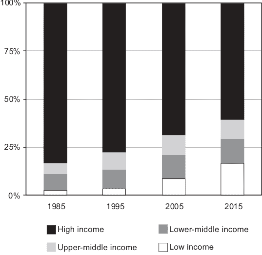

**图1.4** 按收入组别划分的世界出口构成。来源：Nina Pavcnik, “The Impact of Trade on Inequality in Developing Countries,” Jackson Hole Economic Policy Symposium Proceedings (Kansas City: Federal Reserve Bank of Kansas City, August 2017), 67。

## 1.2 贸易政策持续（且被低估）的重要性

这一长时期贸易增长的潜在驱动力是什么？经济学家们对这个问题争论了数十年。虽然二战后关税水平的下降是一个主要因素，但近年来出现了一种新的共识——学者和政策制定者达成一致——20世纪后期全球贸易额的爆发无法通过贸易政策来解释。这种观点认为更重要的因素在起作用，即技术，而且全球化是不可避免且不可阻挡的。根据这一新共识，20世纪后期的技术发展使世界更加联系，同时也导致了运输和通信成本的稳定下降，共同使得全球贸易繁荣。此类推，这种观点认为到20世纪末，贸易政策——即关税的征收和削减以及首先在《关税与贸易协定》（GATT）内、随后在世界贸易组织（WTO）内签署的贸易协议——对全球贸易水平或多无关。

这种观点反映在近期大众媒体的几段引言中。例如，在关于拟议的跨太平洋伙伴关系协定（TPP）益处和感知风险的文章中，《纽约时报》在2015年指出：

> [一个削弱对TPP支持的神话]是，近期的贸易协议损害了就业…… 这种论点未能将全球贸易增加的影响与协议产生的影响区分开来。[驱动这一趋势的是全球化、技术以及有缺陷的教育和税收体系，而非贸易协约。]

人们可能认为这种观点仅由不熟悉贸易政策细节的记者所持有。事实上，正如经济学家保罗·克鲁格曼（Paul Krugman）在1995年写道：

> 关于世界贸易增长的大多数新闻话语似乎将日益增长的整合视为技术必然性驱动的——即认为运输和通信技术的改进构成了一种消解国家边界的不可阻挡的力量。然而，国际经济学家倾向于认为贸易增长的大部分（尽管不是全部）本质上具有政治原因，将其二战后巨大的扩张在很大程度上归于消除了自1913年以来限制世界市场的保护主义措施。

在克鲁格曼发表这一声明二十多年后，贸易政策在国际贸易日益重要的情况下仅起次要作用的观点不再局限于记者圈；它现在已在学术研究中占据主导地位。新共识反映在经济学家普里切特（Pritchett）2008年的这段引言中：

> “与我20世纪70年代初开始从事贸易经济学家工作相比，世界已经完全自由化了……[ ]由于WTO谈判可能产生的任何结果所带来的增量收益微乎其微。”

虽然普里切特并未明确声称贸易政策和贸易协议是无关的，但他暗示尽管它们在过去有显著影响，但其自身的成功已使其变得无关紧要，进一步自由化带来的任何增量收益都注定是微小的。

罗斯（Rose）声称GATT或WTO成员身份对贸易量没有明显影响。认为贸易政策（特别是关税）无法解释近期全球化浪潮的权威学术论文是由伊毅（Kei Yi）在2003年发表在《政治经济学》上的。伊毅正确地指出，二战后关税的急剧下降到70年代已基本完成，此后关税继续下降但速度慢得多——而全球贸易却继续增长甚至加速。如果“全球化时代”是由二战后关税水平急剧下降所催化的，那么在关税水平实际上接近零后，什么解释了这种加速？除非出口水平对关税极其敏感（即关税弹性远高于大多数经济学家所认为的），否则伊毅认为是其他因素在驱动这些趋势。虽然技术发展确实贡献了90年代全球贸易的加速，但数据讲述了一个更为复杂的故事。例如，在图1.6的上图中，可以明显看到信息通信技术（ICTs）的使用——特别是手机和互联网——从1992年左右开始增长，迅速超过了在2000年代后期开始下降的“线路”订阅。与此同时，图1.6的底部显示了整个二十世纪的运输和通信成本。在1920年至2015年间，计算机存储、海运费、纽约与伦敦之间的往返机票以及三分钟通话费用均大幅下降——这似乎也支持了这样一种观点：技术进步推动了20世纪全球贸易水平的剧烈增长。

然而，仔细观察底部的面板可以发现，这些成本的下降在20世纪70年代或80年代初已或多或少完成。此后它们虽然继续下降，但与图1.5中的美国关税水平相比，下降幅度已变得小得多。在20世纪90年代，这些费用几乎没有变化，海运运费率在十年代上半段略有上升。基于这些数据，很难将全球贸易水平的剧烈增长（主要发生在20世纪90年代）仅仅归因于运输和通信成本的下降。换句话说，关税的下降可能对“超全球化”没有产生主要影响，但它并非完全由技术等神奇的“其他因素”所驱动。那么，到底还发生了什么呢？

事实上，贸易政策在促进贸易增长方面发挥的作用比近期共识所认为的要大得多——无论是在关税还是非关税壁垒方面。有三个因素可以帮助理解为什么会这样。

首先，意识到各国关税削减的多样性至关重要。例如，图1.7中的折线图比较了1948年至2016年间发达国家与发展中国家所实施的关税。（“实施”）关税简单是指某国实际征收的有效关税，它们可能低于根据海关关税法确立的“法定”或“法律”关税；“实施”关税通常是政府出于经济考虑，在有限或不确定的时期内通过的。一个很好的例子是20世纪后期的中美贸易：在海于2001年加入WTO之前，它在美国享有特殊的贸易地位，美国国会每年批准

# （超）全球化时代

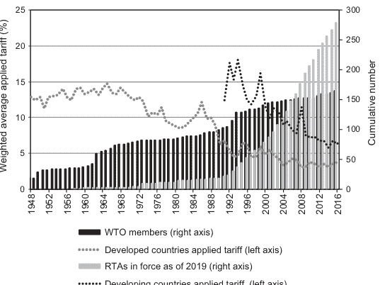

### 图 1.7

# （超）全球化时代

## 1948–2016年的关税与贸易协定

注：图表根据发达国家和发展中国家的简单平均值计算了关税。在1988年之前，发达国家样本涵盖35个国家，包括21个工业化国家（阿根廷、澳大利亚、奥地利-匈牙利、加拿大、智利、古巴、丹麦、法国、德国、希腊、意大利、新西兰、挪威、葡萄牙、塞尔维亚、西班牙、瑞典、英国、美国和乌圭）和当时的14个发展中国家（巴西、缅甸[现缅甸]、锡兰[现斯里兰卡]、中国、哥伦比亚、埃及、印度、印度尼西亚、日本、墨西哥、秘鲁、菲律宾、暹[现泰国]和土耳其）。1988年之后，根据世界银行2018年的分类，发展中国家定义为高收入国家和非高收入国家。

来源：世界银行，《2020年世界发展报告：全球价值链时代的贸易发展》（Washington: World Bank, 2019），基于Richard Baldwin，“Global Supply Chains: When They Emerged, Why They Matter, and Where They Are Going” CEPR Discussion Paper 9103, Centre for Economic Policy Research, 2012, https://www.cepr.org/active/publications/discussion_papers/dp.php?dpno=9103。来自WTO RTAS数据库的区域贸易协定（RTA）和WTO成员数据。1988年之前的关税数据来自Michael Clemens和Jeffrey Williamson，“Why Did the Tariff-Growth Correlation Change after 1950?” Journal of Economic Growth 9, no. 1 (2004年3月): 5–46。后续年份的关税数据来自世界银行的世界发展指标数据库，使用了所有国家的国家级加权实施关税。（正如我们第2.3.1节中进一步讨论的，美国对中国进口产品的实施关税远低于其本应面临的美国法定关税。）

该图显示，发达国家的实施关税在最近的几十年中仅略有下降，而且自1992年以来更是如此——这与毅（Yi）的观察一致。但发展中国家的实施关税下降非常剧烈，特别是自20世纪90年代初以来。

## 关税在全球供应链中的作用

其次，考虑关税在全球供应链（GVCs）中的作用非常重要，我们将在下一节中进行探讨。虽然全球供应链已存在几个世纪，但它们在20世纪90年代迅速增长，因为技术进步和贸易壁垒的降低促使企业专注于价值链的不同阶段，并将生产流程跨越国界以提高效率。事实上，毅强调了全球供应链——这在他的术语中对应于“垂直分工”。全球供应链反映了技术对贸易的另一个维度，同时也影响了贸易政策。具体而言，生产的碎片化放大了关税及任何减税政策的影响：由于产品、零件和组件在生产过程中多次跨越边界，即使是低关税在多个国家累积起来，也会对贸易产生巨大影响。换句话说，认为关税弹性很大并非不可能，这恰恰是因为全球供应链所体现的技术发展。正如毅所指出的，关税与技术的相互作用解释了如此大的关税弹性。

## 非贸易壁垒的作用

第三，非贸易壁垒——一个近期共识很大程度上忽略的因素——在促进贸易增长方面也发挥了重要作用。全球贸易架构在20世纪后期经历了显著扩张。

## （超）全球化时代

世纪后期。例如，上述图1.7中的柱状图显示了WTO成员在20世纪下半叶稳步且大幅增加，以及区域贸易协定的签署自20世纪90年代以来剧增——这恰好与超全球化浪潮的开始同步。虽然衡量WTO成员身份和区域贸易协定对贸易水平的精确影响是不可能的，但上述趋势提供了一些合理的联系。例如，作为一个促进贸易自由化的标准制定机构，WTO吸引了大量发展中国家的加入——而这类国家的关税水平自20世纪90年代以来急剧下降。WTO的食品安全和卫生标准只是这些趋势影响全球贸易的一个例子：于1995年1月生效的《实施卫生和植物卫生措施协定》（或“SPS协定”）确保了其他先进国家担心生产的食品不会危害人类、动物或植物的生命健康，消除了消费者的顾虑，最终促进了不同发展水平国家之间的食品贸易。此外，区域贸易协定（最近几十年许多涉及发展中国家）通常是根据反映WTO标准的草拟的，或者因为所有签署国都是WTO成员而具有可行性。

同样，WTO成员身份带来的稳定性和预测性（它规定了一套所有参与者必须遵守的规则体系），对于促进全球供应链出现的重要投资至关重要。虽然双边或区域贸易协定也能以此促进贸易繁荣，但现代全球供应链的独特特征是其全球性；美国的零件和服务被运往中国，用于出口到欧洲、非洲，甚至返回美国的产品中，跨越了多个国家甚至整个大陆的边界。这种投入品、中间品和最终商品在全球范围内同时向各个方向移动的真正全球贸易，得到了延伸至全球的稳定性和可预测性体系的支持。

当然，也可能是其他因素引发了“超级全球化”时期。事实上，并非所有世界贸易组织（WTO）的倡议都对所有参与国都有益；例如，极具争议的《与贸易相关的知识产权协定》（TRIPS）给人留下的印象是，世贸受跨国集团利益支配，以牺牲发展中国家的利益为代价服务发达国家的利益。¹¹¹ 如果没有多边主义，贸易增长显然也是可行的——许多行业标准，从手机通信协议、互联网到国际标准化组织（ISO）建立的生产最佳实践标准，都是在没有政府干预的情况下演变出来的，尽管它们通常得到世贸组织的支持。几家跨国公司也为了市场压力（即发达国家消费者的需求）对自己施加了“责任制规则”。跨国公司的形成以及全球价值链（GVCs）的出现和增长，在一定程度上也得到了区域和双边贸易协定中的法律条款以及欧盟等区域组织的辅助。尽管如此，很明显的是，超级全球化与全球价值链的增长以及发展中国家在全球贸易参与度的增加密切相关，如果没有像世贸组织这样的多边协议，这些趋势在20世纪90年代和2000年代不太可能如此巨大且快速增长。当货物和服务在全球范围内进行贸易时，区域协议是不够的；只有多边主义才能为全球贸易的繁荣提供所需的稳定性和预测性。

总之，二战后的“全球化时代”和20世纪末的超级全球化时期有许多驱动因素。但与近期的共识相反，贸易政策——特别是创建一个可预测且稳定的全球贸易环境——至少与技术发展一样重要，而后者的影响在近期可能被高估了。讽刺的是，正是由于贸易紧张局势的上升并最终导致近期中美贸易战，经济学家们才再次意识到我们曾认为理所当然的、相对开放且稳定的全球体系的重要性。正如我们在接下来的章节中看到的，贸易战的短期经济成本似乎是微道的——但其对贸易和投资的长期影响以及政治影响可能会变得更加严重。¹²

## 1.3 为什么说贸易“长期性放缓”的断言为时过早

自全球金融危机以来，国际贸易已大幅放缓。一些经济学家和政策制定者将这种放缓描述为长期性的（或长期的），认为通过全球价值链实现的全球生产碎片化可能已走到尽头。碎片化确实有其局限；例如汽车工业——全球价值链尤为盛行的行业——可以将汽车生产拆分为跨越数千家不同公司和市场的数千个独立零件和组件，但最终将无法进行进一步的专业化。

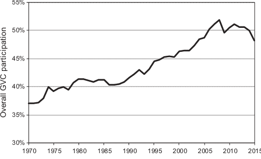

### 图 1.8：全球价值链贸易，1970–2015年

注：本图及后续方法论中所有图表中所使用的全球价值链参与度指标源自 Alessandro Borin 和 Michele Mancini，“Follow the Value Added: Bilateral Gross Export Accounting”（Temi di discussione [经济工作论文] 1026，意大利银行经济研究与国际关系部，2015年）；Alessandro Borin 和 Michele Mancini，“Measuring What Matters in Global Value Chains and Value-Added Trade”（Policy Research Working Paper 8804，世界银行，华盛顿，2019年4月），https://openknowledge.worldbank.org/handle/10986/31533。来源：世界银行，《2020年世界发展报告：全球价值链时代以贸易促进发展》（华盛顿：世界银行，2019年），使用了来自 Eora26 数据库的数据；Borin 和 Mancini，“Measuring What Matters in Global Value Chains and Value-Added Trade”；Robert Johnson 和 Guillermo Noguera，“A Portrait of Trade in Value Added over Four Decades”，Review of Economics and Statistics 99，第5期（2017年12月）：896–911。

这真的是正在发生的情况吗？全球贸易体系是否达到了某种根本性的技术限制？图 1.8 表明事实可能是，它显示了全球价值链在2008年后全球总贸易份额是如何萎缩的，短暂回升后又继续下降。如果这种放缓是长期性的，它可能对国际贸易和全球经济产生重大影响；全球价值链仍占据所有贸易的近一半，并在许多方面概括了过去几十年全球化的特征。

然而，这种观点远非定论，有许多充分理由相信国际碎片化实际上可能还有路要走。这个问题在经济学家中引发了激烈争论，大量且不断增长学术文献利用了多种不同的衡量标准和数据库。通常，不同的衡量可能会产生不同的结果。例如，许多经济学家通过追踪中间品贸易来衡量全球价值链贸易，中间品是生产制品的投入品。例如，图 1.9 中的灰色虚线显示了1990年到2017年间中间品贸易占世界GDP的百分比，底部图表显示了放大至2010–2017年的相同数据。中间品贸易的趋势与全球价值链总贸易相似：在2008年萎缩，短暂回升，然后继续下降。但这一衡量标准包含了大宗商品，其价格在许多地区可能会剧烈波动，再次暗示了长期性放缓的可能性。相比之下，许多经济学家还通过追踪零件和组件贸易来衡量全球价值链贸易，这排除了大宗商品贸易。图 1.9 中的黑色实线显示了零件和组件贸易，自2008年以来趋势更为平稳，没有长期性放缓的迹象。

同样，全球价值链贸易的近期趋势也受到中国努力将其经济重心从出口转向国内生产的影响。得益于中国经济的规模，其远离全球价值链的任何转变都会对总量数据产生巨大影响。

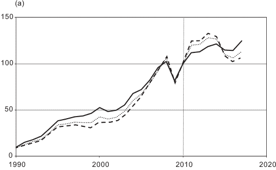
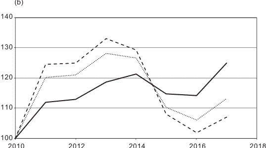

**图 1.9**

(a) 中间品以及零件组件的贸易，1990–2017年。

(b) 中间品以及零件组件的贸易，2010–2017年。

来源：Pinelopi Goldberg，“The Future of Trade,

## （超级）全球化时代

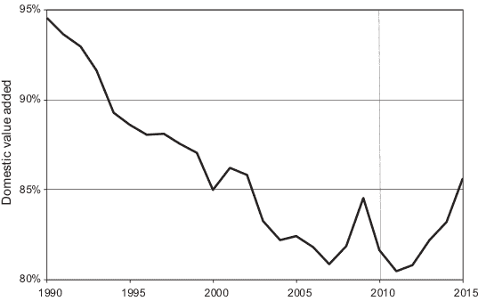

中国出口中所包含的国内价值，这种价值在20世纪90年代持续下降——当时中国由出口驱动的增长模式支持了超级全球化——在21世纪00年代后开始增加，并在全球金融危机后继续增长。如果这种趋势持续，中国的再平衡可能会进一步削弱全球价值链贸易，但这并不意味着全球化本身已进入了长期性放缓。当然，在目前，任何事情都可能发生，仅凭最近几年的数据就断定放缓是长期性的为时过早的。至少，这些图表对“碎片化已达到某种阻止未来贸易增长的技术限制”这一观点表示怀疑。

## 1.4 近期反弹为何仍可能引发去全球化或“慢全球化”

尽管最近关于全球贸易出现长期性放缓的说法可能还时过早，但世界显然正在经历对全球化的强烈反弹。归根结底，这种反弹及其引发的不确定性对未来贸易的影响可能比任何其他因素都要大。反弹的例子比比皆是——在发达国家，自由贸易和移民（全球化辩论中最频繁联系在一起的话题）现在已成为极具争议的政治和社会问题。这种反弹似乎是广泛且持久的，并不限于任何单一国家或政府。在美国，特朗普政府采纳的许多保护主义政策至今仍被拜登政府所维持。在英国，脱欧一直是多次议会选举的核心议题。虽然欧洲大陆的各国政府尚未完全拥抱保护主义，但有几位有影响力的政治人物或政党采取了强硬的反贸易或反欧盟立场——例如法国的玛丽娜·勒庞（Marine Le Pen）、德国的德国选择党（AfD）或匈牙利的维克托·奥尔班（Viktor Orbán），而且许多欧盟成员国对移民持有严重怀疑。或许最令人震惊的是，多年来，世贸组织（WTO）陷入了成员之间的一系列生存危机，新冠肺炎进一步加剧了这些危机，使该机构谈判、争端解决和贸易政策通知的核心功能陷入瘫痪。这些贸易紧张和阻碍国际合作的总体氛围导致近期新区域贸易协议签署放缓。图1.11显示了按年份形成的新区域贸易协议数量，凸显了20世纪10年代的放缓以及2018年的大幅下降。¹³

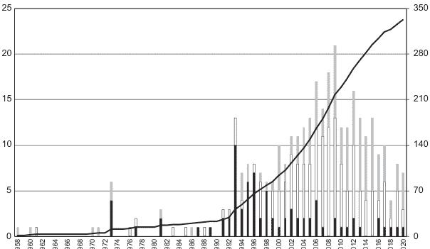

- 少于10个政策领域
- 介于10到20个政策领域
- 协议累计总数

### 图 1.11：1958–2020年区域贸易协议涵盖的政策领域数量

来源：Claudia Hofmann, Alberto Osnago, and Michele Ruta，“Horizontal Depth: A New Database on the Content of Preferential Trade Agreements”（Policy Research Working Paper No. 7981, World Bank, Washington, DC, February 2017），https://openknowledge.worldbank.org/handle/10986/26148。

对全球化的不满当然不是一个新现象，类似的反弹在近期历史中发生过。例如，在20世纪80年代末和90年代初，美国和日本经历了在许多方面与今天情况非常相似的贸易紧张局势。当时，人们对日本的出口增长、其汽车和其他行业在全球市场的快速成功以及其对市场准入的限制表示担忧。其他国家（以美国为首）担心这些因素对其国内工业和工人（主要是低技能工人）产生不利影响——当时，许多人警告说，与日本的贸易紧张局势可能导致全球开放贸易体系的终结。当然，如此严重的担忧最终并没有根据。虽然与日本的贸易冲突确实导致了美国采取了一些政策行动，包括对汽车行业的自愿出口限制（VERs），但贸易紧张局势在随后的几年里得到了解决，这与世贸组织时代和过度全球化时代相吻合。近期中美之间贸易紧张局势再次出现时，许多经济学家和政策制定者假设，正在发生类似于80年代末和90年代初的情景。他们假想，主要经济体之间的强硬辞令和手球贸易策略将是一个临时现象，可以迅速解决，可能导致另一个过度全球化时代。然而，现在很清楚，这次有所不同。强硬态度已升级为实质性的紧张局势，政策制定者对这些紧张采取了具体的贸易政策行动。我们已经进入了一个不确定性加剧的时期，这可能导致一个去全球化的新时代。

然而，应该注意到，对全球化的反弹仍然相对较新，而且尽管存在上述担忧，世界尚未进入持续或广泛的去全球化时期。正如许多经济学家近年来所指出的，虽然“全球化时代”和随其后的过度全球化以自由贸易为特征，但全球经济的某些部门在很大程度上一直以保护主义为特征。例如，在当前反弹之前，农业贸易就受到高度限制，服务贸易的自由化也有限。即使在可能是全球整合程度最高市场的欧盟内部，整合也主要延伸到货物贸易而非服务贸易。同样，尽管关税水平在过去几十年中达到了历史低位，但仍有许多限制贸易的所谓“边境后措施”。经济学家传统上将此类政策称为非关税贸易壁垒，但它们已演变为更广泛的形式——往往对国家间的贸易施加许多限制，并引入了干扰贸易的严重市场扭曲。¹⁴

考虑到这些因素，近期贸易紧张局势的总体效应似乎相当小，这并不意外。例如，图1.12反映了

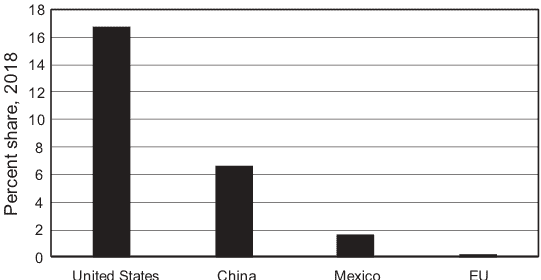

**图 1.12：新关税影响下的商品进口**

来源：改编自 Pablo Fajgelbaum, Pinelopi Goldberg, Patrick Kennedy, and Amit Khandelwal，“The Return to Protectionism,” Quarterly Journal of Economics 135, no.1 (February 2020): 1–55; Pablo Fajgelbaum, Pinelopi Goldberg, Patrick Kennedy, Amit Khandelwal, and Daria Taglioni，“The US-China Trade War and Global Reallocations,” NBER Working Paper 29562, National Bureau of Economic Research, Cambridge, MA, December 2021), https://www.nber.org/papers/w29562 我和我在2020年发表的分析。¹⁵ 显示了受新关税影响的商品进口份额在美国约为17%，在中国为7%，墨西哥为2%，在欧盟小于1%。考虑到贸易总规模，这些数字相当很小。

为了理解为什么保护主义带来的总体损失看起来很小，了解经济学家通常如何量化贸易收益是有帮助的。只需要两个变量：该国国内生产商品总支出的份额，以及贸易的总弹性（即贸易水平对价格变化的反应程度），这可以使用几种既有方法进行估计。这两个变量与贸易收益之间的关系——以经济学家 Costas Arkolakis, Arnaud Costinot 和 Andres Rodríguez-Clare 在2012年开发的公式命名为 ACR 公式——在一类使用不同且通常更复杂方法的广泛贸易模型中都是一致的。¹⁶ ACR 公式显示，贸易收益（或保护主义增加带来的损失）通常很小，特别是对于大型经济体，尤其是国内支出占比较大的经济体。这符合直觉：如果像美国或英国这样的大经济体对进出口的依赖较低，那么它们在贸易增加或减少方面的收益或损失（尽管存在效率收益）可能不会是巨大的。即使在中国，由于是一个大型经济体，新关税带来的损失也相对较小。

当然，这并不意味着近期贸易紧张局势没有产生巨大的成本。虽然静态贸易模型捕捉了其短期总体效应（即

（价格、贸易流量及其对福利的直接影响），它们并没有捕捉到在更长时期内通过间接且往往是复杂的渠道所实现的所谓动态收益或损失。例如，跨国贸易可以通过促进各国之间的思想交流来提高生产率；对进口竞争的面对可以驱动创新，并鼓励对高效业务模式的采用以及消除市场扭曲；贸易的稳定与安全需要繁荣的、无政府的国际合作，并促进和平。事实上，贸易协定的签署往往是出于政治目的考虑的；例如，1951年建立欧洲煤炭钢铁共同体的提议，当时法国外交部长罗伯特·舒曼（Robert Schuman）宣布该提议将“使战争不仅变得不可想象，而且在物质上变得不再可能”，这点燃了欧洲一体化的火花。

这种长期且间接的影响在实证研究中可能难以捕捉，但这并不意味着它们并不存在。事实上，其影响可能比贸易的静态效应大几个数量级。在中美近期贸易紧张局势背景下，这种情况尤为可能，这些局势导致了全球经济不确定性的增加，并对国际合作的未来产生了怀疑。不确定性对于实现贸易潜力的长期收益是有害的，因为这些收益依赖于长期投资——无论是经济还是政治性质——而这些投资只有在稳定和可预测的环境才是可能的。此外，有大量证据表明，考虑到消费者通常承担关税成本，近期贸易紧张局势的分配效应是相当显著的。在美国，农业地区的农民受新关税的影响最严重；中国（以及在某种程度上的欧盟）的报复措施专门针对了共和党支持率较高的地区，而许多生产农产品的地区正是此类地区。

尽管近期的紧张局势到目前对全球贸易尚未产生巨大的整体影响，但评论员、政策制定者和国际机构更为关注的重大担忧——是它们引发的不确定性的加剧。不确定性的增加对投资具有产生不利的长期影响，而投资与全球价值链（GVCs）紧密相随。鉴于全球价值链在全球经济中的核心作用，持续的不确定性可能会导致重要的转变，例如价值链的搬迁，这可能会影响全球增长前景。如果目前的紧张局势得不到解决，世界进入持续的贸易冲突和不稳定性时期，这些转变可能会波及全球经济。尽管如此，这可能对全球增长产生整体影响，除了暂时的放缓和一些边际效率与生产率损失之外。今天的经济极不可能在不参与国际贸易的情况下回到自给自足或完全经济独立；在中长期，更有可能的发展是贸易流的重新导向和区域集团的加强。

事实上，我和几位合著者的一篇新论文的发现证实了这一观点¹¹⁷⁷。通过考察中美近期贸易战对“旁观者”国家（即未直接受关税增加影响的国家，即美国和中国以外的国家）的影响，我们发现，许多国家的贸易实际上因为贸易战而增加了。事实上，它们全球出口的增长已足以抵消中美之间贸易的崩溃，因此到2019年底，受新关税影响最大的产品的全球贸易水平已在应对贸易战而有所增加。这一意外的发现表明，尽管不确定性加剧，全球贸易并未崩溃。相反，它从美国和中国转向了其他看到了增加全球存在感机会的国家。当然，这些旁观国家并没有免受贸易紧张局势升级而加剧的不确定性的影响。从轶事来看，它们贸易水平的上升伴随着日益增长的焦虑，担心自己的国家将成为下一个遭受关税打击的贸易战受害者。同样，这些国家对全球贸易系统的信任或依赖程度总体通常也变得更加不确定。尽管如此，其意义在于，近期趋势可能并不意味着全球化的终结，而是另一种全球化的开始。

从长期来看，去全球化或全球化放缓最严重的影响可能会出现在尚未完全融入全球贸易系统的低收入国家，尤其是非洲。由于没有像印度或中国那样庞大的国内市场，贸易正如我在最近的研究中所言，是这些国家消除贫困和实现繁荣的唯一可行路径。如果这条路径突然关闭，将没有明显的替代方案。当然，这项分析早于COVID-19的爆发，而疫情本身就是一种不同全球化的体现：健康的全球化。新冠肺炎引发的健康和经济危机导致了第二波反对贸易的回潮。这一次，论点集中在对全球价值链韧性的感知担忧上，这导致了对保护主义和自给自足更高声的呼吁。因此，考虑到目前的环境，一个关键问题是，目前的紧张局势、回潮和要求仅仅是全球化的小插曲，还是我们实际上正在见证一个持续去全球化或全球化的新时代的黎明。

我相信，答案最终将取决于政策选择。如果你认为近期的放缓并非完全由技术因素驱动，而是贸易政策实际上发挥了很大作用，那么推导出放缓并非不可逆或必然，贸易政策在原则上可以扭转。全球化的未来——或其毁灭——将取决于世界政策制定者和领导人在未来几年内如何应对这些紧迫的问题。

# 1 回潮的原因

## 1.1 贸易态度的演变

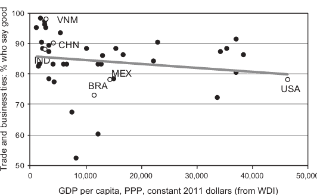

**图 1.1** 对自由贸易的态度，2002年。来源：Nina Pavcnik，“贸易对发展中国家不平等的影响，”杰克逊霍经济政策研讨会论文集（2017年8月）：72。

调查中的一个问题是：“你认为国家之间的贸易和商业关系对经济有益吗？”图 1.1 将 2002 年对该问题的调查结果与国家收入水平刻度结合在了一起。每个点代表一个国家，每个国家的调查回答位于垂直 y 轴，其收入（根据人均 GDP 计算，以 2011 年不变价格计）位于水平 x 轴。国家越富有，在图中的位置越靠右；点的位置越高，表示该国在 2002 年认为贸易对经济有益的人数比例越高。请注意，纵轴刻度从 50% 开始，大多数点落在 80% 到 90% 之间；这些是非常高的数字，表明 2002 年大多数国家的大多数人认为贸易和商业关系对整体经济有益。收入与调查回答之间的关系呈轻微负相关，表明每个人都重视贸易，但越贫困的国家甚至更加重视这一点。越南和中国是两个已知从自由贸易中获益的贫穷国家，在 2002 年显然非常重视贸易。

为了观察对贸易的总体态度随时间发生了变化，图 1.2 使用 2014 年的 Pew 调查结果绘制了相同的图表——这在最近贸易紧张局势出现之前的几年。尽管整体趋势略微负相关，但引人注目的是所有国家的调查回答比例仍高于 50%：2014 年，大多数国家的大多数人认为贸易对经济有益。在美国，认为贸易对经济有益的人数比例从 2002 年的近 80% 下降到 2014 年的略多于 65%，但这仍然反映了受访者中拥有一大部分健康的多数派。值得注意的是，2014 年的图显示点之间的分散程度大得多，表明国家之间对贸易的观点多样性已经扩大。

虽然某些国家正面回答的比例大幅下降（例如印度），但许多其他国家仍然非常支持贸易（例如越南和中国）。有趣的是，拉丁美洲国家（例如墨西哥或哥伦比亚）对贸易的态度似乎冷淡得多。但总的来说，即使在 2014 年，全球舆论也表明大多数人仍然认为贸易对整体经济有益。

关于对贸易更具体的意见呢？图 1.3 使用相同的国家收入数据绘制了对 2014 年 Pew 全球态度调查中关于贸易和劳动力市场结果问题的回答。调查中的问题是“贸易是提高了工资，还是降低了工资？”以及“贸易是创造了工作，还是摧毁了工作？”由于这些问题更多地关注市场结果而不是关于贸易对经济好坏的总体观点，出现了一幅截然不同的图景。例如，人均收入与对贸易劳动力影响的感知之间存在很强的关系。国家越富有，认为贸易降低工资和摧毁工作的信念就越明显。同样，国家越贫穷，认为贸易增加工资和创造工作的感知就越强。将这些调查结果与我们刚才在图 1.2 中看到的结合起来，对比是惊人的：在像这样的高收入国家，许多受访者认为贸易对劳动力市场是有害，尽管它对整体经济有益；而在越南、中国、印度、巴西和墨西哥等发展中国家，

这种对比为为什么现在可能发生反对全球化的反弹提供了一个可能的答案：全球化的影响在不同国家之间是不平等的，可能在国家内部也是不平等的。正如前节所述，贸易对整体经济的效应通常很小；最终，国际贸易——以及公众对它的感知以及源于这些感知的政策——更多是关于分配性的收益和损失。

经济学文献中越来越多的证据表明，对贸易的态度与这些分配效应密切相关。例如，Anna Maria Mayda 和 Dani Rodrik 在 2005 年的一篇论文分析了关于贸易态度的丰富跨国数据集，发现这些态度与一系列社会人口指标高度相关，包括个人在所在国家的相对经济地位以及他们的技能或人力资本¹。Mayda 和 Rodrik 记录了贸易偏好与个人就业的行业相关：在具有比较劣势的行业（在这里更容易受到贸易的负面影响）的人倾向于保护主义；相比之下，就业不受贸易直接影响的非贸易行业的人倾向于更具包容性。

在许多国家中也出现了类似的证据。例如，Esteban Méndez-Chacon 和 Diana van Patten 在 2022 年的一篇论文研究了经济基本面驱动哥斯达黎加贸易态度的程度：利用了 2007 年全民公投的结果，当时公民投票决定是否批准一项与美国的自由贸易协定（FTA），他们发现投票行为很大程度上取决于该地区受贸易竞争的影响程度（直接或间接）。²在美国，Jiwon Choi、Ilyana Kuziemko、Ebonya Washington 和 Gavin Wright 在 2021 年的一篇具有挑战性的论文中指出，1994 年北美自由贸易协定（NAFTA）对选举结果起了主要作用³。同样，两项研究——Yi Che、Yi Lu、Justin Pierce、Peter Schott 和 Zigang Tao 在 2016 年的一篇论文，以及 David Autor、David Dorn、Gordon Hanson 和 Kave Majlesi 在 2020 年的一篇论文——认为近期选举结果受到了地理区域受中国进口竞争程度的影响。在法国和德国，Clé-Malgouyres 在 2017 年的论文以及 Christian Dippel、Robert Gold 和 Stephan Heblich 在 2015 年的论文分别记录了进口竞争导致右翼政党的得票率更高。⁵ 在英国，Italo Colantone 和 Piero Stenig 在 2018 年的一篇论文同样显示，在过去几十年受贸易冲击较大的地区，对脱欧的支持更高。⁶

全球不平等是指如果我们完全忽略国界并进行评估时，会显而易见的不平等。

## 1.2 贸易与全球不平等：赢家还是输家？

经济学家和经济历史学家之间有充分的证据和广泛的共识，全球不平等在过去的几十年中显著下降，特别是二战后的几十年里。诺贝尔奖得主经济学家安格斯·迪顿（Angus Deaton）在他2013年的著作《大逃离》（The Great Escape）中强调了如今增长放缓和差距扩大，但也显示在过去的250年里，人类变得更加健康和富有，因为数十亿人在经历了千年的贫困后摆脱了贫困和疾病。同样，布兰科·米拉诺维奇（Branko Milanovic）在2016年的著作《全球不平等》（Global Inequality）显示，中国和印度等国中产阶级收入的增长，以及曾经分散地区（特别是中国和东亚，以及东欧）的整合如何导致了全球不平等的历史缩小。⁸ 2006年，世界银行旗舰年度报告《世界发展报告》认为公平与经济繁荣是互补的。⁹ 迪顿、米拉诺维奇、世界银行以及许多经济学家将我们在减少全球不平等方面的进展（特别是最近几十年）归功于长期关闭的边界的开放、国家间贸易的增长以及现代全球贸易体系的建立，认为更自由的贸易和迁移将进一步减少全球不平等。

然而，这种观点引发了一个问题：全球不平等与国内不平等之间是否存在权衡？这一点最明确的说明是所谓的“大象曲线”（elephant curve），由克里斯托夫·拉克纳（Christoph Lakner）和布兰科·米拉诺维奇于2016年首次开发。¹⁰ 图1.4复制了他们的原始图，该图将收入增长率与全球收入分布的不同百分位数（称为增长收益曲线）进行比对，时间跨度为1988年至2008年。¹¹ 对于水平x轴上的每个收入百分位数，垂直y轴显示了该特定百分位数的收入增长率。图下方的手绘线条是卡罗琳·弗瑞恩德（Caroline Freund）后期添加的，生动地突出了数据呈现的大象形状。虽然图表确实显示了全球前1%人口所获得的高增长率，以及处于第8和第20百分位数的人的人所经历的极低增长率，但在拉克纳和米拉诺维奇首次发表时，他们的主要目标是说明1988年至2008年间的增长显著减少了全球不平等和贫困。这一点得到了以下事实的支持：尽管收入分布中大多数百分位数的收入增长率为正且相对较高，但低端和中段的人群的收入增长率特别高，这表明世界上最贫困的群体从这一时期的增长中受益最多。

图1.5显示了大象曲线的最新更新版本，使用了1980年至2016年的数据，由包括托马斯·皮凯蒂（Thomas Piketty）、埃马纽埃尔·萨埃茨（Emmanuel Saez）和加布里埃尔·祖库曼（Gabriel Zucman）在内的研究小组完成——他们利用税收数据对美国的收入不平等问题进行了大量研究。¹¹² 更新产生了一张完全不同的图表，具有完全不同的含义。

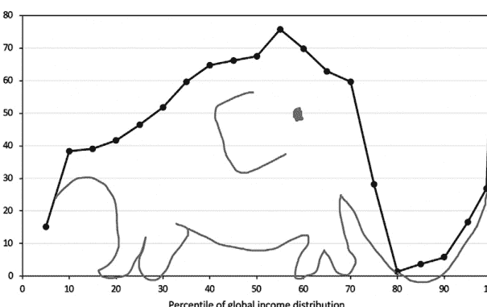

**图 1.4** （旧的）大象曲线：全球增长收益曲线，1988–2008。来源：Christoph Lakner and Branko Milanovic, “Global Income Distribution: From the Fall of the Berlin Wall to the Great Recession,” World Bank Economic Review 30, no. 2 (2016): 203–232. 大象由Rada Pavlova添加，改编自Caroline Freund。

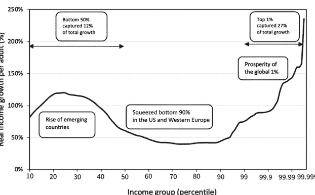

**图 1.5** （新的）大象曲线：所有地区按百分位数划分的总收入增长率，1980–2016。来源：Facundo Alvaredo, Lucas Ch, Thomas Piketty, Emmanuel Saez, and Gabriel Zucman, eds., World Inequality Report 2018 (Paris: World Inequality Lab, 2018), 13, https://wir2018.wid.world.

首先，通过在水平x轴上扩展第99百分位数并将垂直y轴增加到250%的收入增长，这条新曲线凸显了全球前1%的人口在近四十年的时间里获取了总收入增长的27%——这是一个真正巨大的份额。收入分布的底端50%仍然获取了总增长的12%，但与拉克纳和米拉诺维奇之前的图表相比，这一份额小得多，且在中等收入百分位数中的分布不那么广泛。

两张图之间的差异可以用两个图之间的几种方法论差异来解释，包括更长的时间跨度，但最重要的区别是更新后的曲线基于税收数据，而拉克纳和米拉诺维奇的曲线是基于调查数据。¹³ 使用税收数据让作者能够更清晰地捕捉收入分布的高端。在使用调查数据时，这些高收入水平的人群并不回答——即使他们回答了，他们的收入也被标记为“非常高”。如果你想展示不平等是如何由全球高收入者不成比例地获取增长驱动的，那么更新的大象曲线非常清晰有力地说明了这一点。

另一方面，如果你想展示世界上最贫困的人在过去的几十年中如何从增长中受益——且是以某些中等收入者的利益为代价的——那么图中收入分布的较低部分很好地说明了这一点。特别是在更新的大象中，底层人群（世界上最贫困的人，主要位于发展中国家和新兴市场）从1980年到2016年的收入增长高达125%。然而，尽管这表明了全球贫困和不平等的减少，处于第六、第七、八和第十百分位数（对应发达国家的中产阶级）的人在同一期的收入增长明显低得多。虽然两个大象曲线都没有反映负收益增长——图中全球收入分布的所有范围内实际收入都在增长——但决定不平等演变的不是收入增长，而是相对收入增长。

图1.6中贫困下降最剧烈的地区是亚洲和太平洋地区。这种进展大部分归功于中国，过去几十年那里有大约十亿人脱离贫困。显然，中国在此期间对贸易的进一步开放及其出口驱动的经济增长模式是这一进展的有力贡献者。

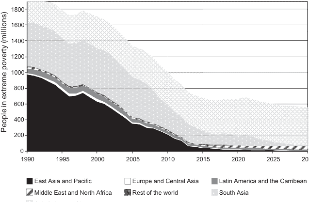

**图 1.6** 全球贫困率及区域分布。来源：世界银行数据。

**图 2.6** 全球贫困的下降，1990–2030。来源：Nishant Yonzan, Christopher Lakner and Daniel Gersson Mahler, “Projecting Global Extreme Poverty up to 2030: How Close Are We to World Bank’s 3% Goal,” World Bank Data Blog, October 9, 2020, https://opendata/projecting-global-extreme-poverty-2030-how-close-are-we/-world-banks-3-goal.

值得注意的是，过去几十年没有取得相应进展的唯一地区是撒哈拉以南非洲——全球整合程度最低的地区之一，该大陆的大部分人口与全球市场（通常也是国内城市市场）完全隔绝。

15. 撒哈拉以南非洲的贫困人口（如图 2.6 中图表顶层所示）自 20 世纪 90 年代以来在某种程度上处于停滞状态。如今，世界上大多数贫民生活在撒哈拉以南非洲，而大多数经济预测表明，这一趋势在未来几年仍将持续。近期，撒哈拉以南非洲的几项努力有望提高该地区的全球整合水平。例如，对交通和通信基础设施的大量投资（包括中国的巨大努力，这些努力通常通过因缺乏透明度而受到严厉批评的债务协议进行资助）正在创造能够促进贸易的道路、港口和跨境连接。此外，非洲大陆自由贸易区的建立旨在通过统一政策和标准来促进非洲内部贸易，这可能加强各国贸易方面的行政能力（海关、物流等）并培养规模经济。这些努力代表了在改善非洲全球整合方面取得的巨大进展，并可能导致增长加速和减贫成效增加。然而，长期影响尚不清楚，对于该地区高度依赖债务融资的基础设施开发模式从长期来看是否在经济上具有可持续性，仍存在许多悬而未决的问题。至少到目前，该大陆在国际贸易和全球价值链（GVCs）中的参与尚未赶上其他地区。

虽然贫困率是衡量全球繁荣和计算全球不平等的一个非常保守的标准，但上述探讨的相关性具有很强的暗示性，并支持对贸易在近期经济历史中作用的普遍积极观点：贸易和整合的增加有助于全球贫困的剧减，从而导致全球不平等的显著下降。但这种全球性的进步是以先进经济体挤压其中产阶级为代价的吗？

这个问题在近期反对全球化以及对全球贸易不公平的抱怨中非常突出。例如，政府和企业领袖经常抱怨大型发展中国家（即中国和印度）经常滥用其“特殊和优惠待遇”——这是世界贸易体系中为发展中国家提供的一系列贸易例外，包括更长的关税减让承诺和其他贸易自由化措施的实施时间。许多抱怨称，某些发展中国家的市场准入受限，许多发展中国家为当地企业和国有企业提供补贴和其他不公平优势，而且某些国家（尤其是中国）从事强制技术转让或直接盗取知识产权。此外，如前所述，服务贸易仍受到高度限制，这损害了在服务领域仍拥有优势的先进经济体。但同样，近期“边境后”限制激增，这些限制实际上限制了贸易。

这些担忧在过去的二十年里存在于美国和欧洲，跨越了不同的政权和经济周期，尽管在特朗普政府期间，这些问题在美国变得明显得多——导致了对发展中国家负面情绪的惊人上升。然而，要区分政治姿态和真实问题的迹象是挑战性的。从理论上讲，更好的数据应该有助于确定哪些论点是有据可查的。几十年来，贸易数据的可用性和质量大幅提高，但遗憾的是，如今国际贸易中争议最大的方面非常难以衡量，甚至无法衡量。关税是易于衡量的，但关税已不再像过去那样重要了。如今真正重要的贸易限制——非关税壁垒、“边境后”限制以及其他有效限制跨境贸易的监管限制——几乎无法衡量。

以食品安全法规为例，这些法规与跨境贸易高度相关，在许多欧洲国家尤为普遍。如何判断一个政府的食品安全法规是源于有效的健康和食品质量担忧，还是为了（全部或部分）保护本国农业生产者免受进口竞争而设计的贸易政策？标准数据指标无法反映政府对每项法规的底层逻辑；即使某些食品安全法规在事实上是“边境后”贸易限制，也无法确定其真实动机是什么，以及它们是否合理。原则上，人们可以检查法规对进口的影响是否大于对国内产品和服务的损害；如果是，那么它们应该被视为贸易限制而非消费者保护。但在实践中，这一标准对于某些完全不在国内生产的类型产品是没有帮助的。例如，氯洗鸡肉在英国被禁止，但在美国生产和消费。欧洲人以食品安全为理由证明禁令合理，但美国声称其担忧没有科学依据，且禁令反映了保护主义动机。

在所有产品标准案例中，区分基于国家公民偏好和价值观的有效监管与赤裸裸的保护主义之间的挑战都是普遍存在的。但在劳工和安全标准案例中，这一问题尤为尖锐。为了提高生活水平，中国、越南或埃塞俄比亚的（曾经）贫困人口可能乐于在极低薪水和恶劣（甚至危险）的情况下长时间工作。然而，人们不会预期先进经济体的工人为了支持世界其他地区的贫民，就轻易放弃他们从最低工资到其他劳动力市场监管中辛苦获得的成果——至少在不引发那种导致美国和欧洲经济民族主义兴起的抵抗的情况下。如果全球不平等和国家内部不平等之间存在权衡，那么这种权衡在劳工标准案例中最为显著。但与产品标准一样，很难在对工人安全和福利的合理担忧与保护先进经济体国内就业的尝试之间划出一条清晰的界限。

可以说，关于世界贫民是否以牺牲中产阶级为代价从全球化中受益的问题，数据和证据是不充分且不一的。显然，国家内部还有更多情况——这引出了我们的第二类不平等问题。

## 2.3 国家内部的不平等：劳工与价格

正如所述，贸易通过两个主要渠道影响国家内部的不平等：劳工渠道（通过对劳动力市场的影响）和消费者渠道（通过对价格的影响）。考虑到许多人（根据图 2.3 的调查结果）日益担心贸易会对工作和工资产生负面影响，从劳工渠道开始是合理的。

### 2.3.1 对工人的不平等影响

经济学家长期关注劳动力市场的不平等。从 20 世纪 70 年代开始，几篇论文记录了技能溢价（即技能工人与非技能工人之间的工资差距，通常根据工人教育水平定义，因此是劳动力市场不平等的关键驱动因素）在美国和欧洲不断增加。到 20 世纪 90 年代，技能溢价已变得显著。¹⁶ 那时，注意力也部分从低技能转向了中产阶级工作。几位经济学家认为，从 90 年代开始，中产阶级工人日益承受了大部分负面影响。相对于非技能和高技能工人，中产阶级的工资正在下降，工作正在消失——这种现象被称为劳动力市场极化。¹¹⁷

全球化在这些发展中起了什么作用？理解贸易与技能溢价增加之间关系的自然起点是国际贸易的主流模型，即所谓的赫克歇尔-俄林模型。该模型预测，贸易的增加将产生数据中观察到的现象：由于发展中国家拥有大量的低技能工人和低工资，增加先进经济体与发展中国家的贸易接触，预计会对先进经济体产生负面的劳动力市场后果，包括技能工人与非技能工人之间工资差距的扩大。

尽管如此，整个 20 世纪 90 年代，大多数经济学家认为贸易在这些趋势中并没有发挥主要作用。相反，当时的共识是，技能溢价的增加很大程度上是由技术发展驱动的，而贸易仅起到了次要的作用，主要通过其与技术的相互作用发挥。这一结论部分基于“要素含量”研究——即对贸易模式和生产过程的分析，这种分析使人们能够量化国家进出口中所包含的劳动力——利用 90 年代的贸易数据，研究人员量化了发达国家进口竞争加大的影响，并发现这种影响很小。该结论还基于一种观察：发展中国家在 20 世纪 90 年代不平等现象加剧，而传统的贸易模型预测恰好相反：考虑到发展中国家在低技能密集型活动中的比较优势，人们预期贸易增加会导致低技能工资增加和工资不平等缩小。¹⁸ 针对这一时期劳动力市场极化的研究也得出了结论，贸易并非主要驱动因素。

然而，这种共识在 21 世纪 20 年代开始发生转变，经济学家们突然开始将贸易视为劳动力市场不平等的潜在重要驱动力。但具体是如何发生的，为什么又发生在 21 世纪 20 年初呢？为什么他们在贸易历史上最快速增长的 20 世纪 90 年代未能发现这种联系？这些仍然是未解决的问题，但存在两个可能的答案——两者都与中国有关，后者与经济学家处理劳动力市场不平等方法的近期转变有关，即更多地关注区域不平等。

#### 中国

过去二十年来，美国制造业就业人数大幅下降。图 2.7，重制

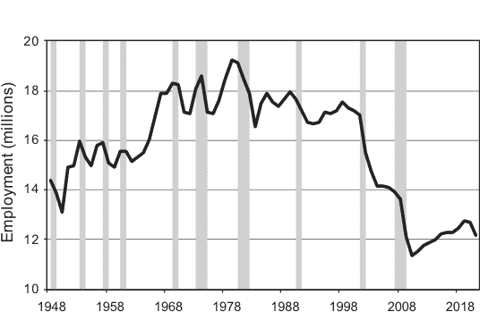

**图 2.7** 1948–2021 年美国制造业失业率。注：根据美国经济研究局的数据，阴影条表示美国衰退期。来源：Justin Pierce 和 Peter Schott，《美国制造业就业人数的意外下降》，《美国经济评论》第 106 卷，第 7 期（2016 年 7 月）：1632–1662，数据来自美国劳工统计局，“所有员工，制造业 [CEU3000000011]”，FRED，圣路易斯联邦储备银行，https://fred.stlouisfed.org/series/CEU3000000001，2022 年 10 月 8 日。来自 Justin Pierce 和 Peter Schott 在《美国经济评论》上的论文显示了自 1948 年以来美国制造业就业人数的演变。在 20 世纪下半叶的大部分时间内，制造业就业人数相对稳定——在衰退期间下降，通常在随后的年份中反弹。但从 2001 年开始，这一数字急剧下降。2001 年至 2004 年间损失了约 290 万个制造业岗位，在全球金融危机期间又损失了 250 万个。然而，与过去的衰退不同，美国制造业并没有出现实质性的复苏。尽管 21 世纪 10 年代初增长缓慢，但制造业就业人数仍然远低于历史水平。

为了解释这些剧烈变化，几位经济学家注意到，中国进入世界贸易体系的时刻恰好是美国制造业开始侵蚀的时刻——考虑到其经济规模，中国的加入对全球贸易动态产生了巨大、快速且深远的影响。

Autor、Dorn 和 Hanson 的开创性研究（通常被称为“中国冲击”文献）跨越美国当地劳动力市场——或“通勤区”（CZs）——是基于每个通勤区对中国进口产品竞争的暴露程度和脆弱性进行划分的。在 2000 年至 2007 年间，他们发现，制造业集中程度较高且来自中国的进口渗透率更大的通勤区，其制造业就业人数下降更为剧烈。有趣的是，Autor、Dorn 和 Hanson 所记录的效应导致了一个出人意料的结论：劳动力在不同通勤区之间似乎是不流动的。在他们的研究之前，大多数经济学家假设劳动力在当地劳动力市场之间具有高度的流动性。因此，他们的发现引发了一个重要问题：流动性摩擦的本质是什么？是什么阻碍了受贸易冲击影响的工人在国内移动以寻求更好的工作机会？

通常，美国的流动性限制是从地理摩擦的角度考虑的，包括诸如因素，如美国高住房拥有率（与欧洲等地区相比，那里更多的人租房）。在发生经济冲击期间，对于需要或想要搬迁的工人来说，拥有住房可能会带来重大的流动性挑战。除了必须卖房之外，如果当地住房市场处于低迷时期，他们可能需要折价出售，而如果他们搬到一个经济机会更具前景的地区，他们可能需要溢价购买新房。较难理解的是，部门流动性如何与区域流动性相互作用并进一步限制后者。例如，如果你是底特律一个被裁员的汽车工人，想转型到电子或计算机行业，除了需要获得必要的技能外，你可能需要搬到湾区或其他技术枢纽以利用当地的工作机会，从而进一步加剧了流动性摩擦。

Autor、Dorn 和 Hanson 发现的启示是，中国本身可能并不是“中国综合症”的唯一责任所在；相反，美国内部的当地劳动力摩擦在产生巨大影响方面也发挥了作用。探索这种不平等的独特维度，即空间上的不平等，转移了分析贸易对不平等影响的方法论重点。在上述 Choi、Kuziemko、Washington 和 Wright 对北美自由贸易协定（NAFTA）劳动力影响的研究中，也记录了类似的发现。他们的研究采用了与 Autor、Dorn 和 Hanson 相似的当地劳动力市场方法，记录了 NAFTA 对美国某些县的巨大负面影响，这些县的就业依赖于对贸易协定影响更为脆弱的行业。这些结果与当时的共识相悖，当时的共识认为在 21 世纪初中国贸易剧烈扩张之前，贸易对美国劳动力市场的影响微乎其微。

类似的研究已经发现了贸易对国家内部区域不平等的影响，以及流动性摩擦在发展中国家中所起的作用。重要的是，这些许多研究探索的是单边贸易自由化时期的效应，而非来自中国或其他任何其他国家的进口竞争，而且许多研究关注的是受“中国冲击”影响相对较小的发展中国家。这些发展中国家的贸易自由化时期中的几个，我曾与 Nina Pavcnik 早期进行了探讨，研究结果发表在《经济学文献杂志》（Journal of Economic Literature）上。特别是，我们探讨了发展中国家的关税差异如何与工资水平的变化、技能溢价以及这些国家不平等的其他维度相关。虽然我们确实发现了统计学上显著的效应，但其规模很小。例如，在拉丁美洲，我们发现贸易自由化确实影响了劳动力市场，但它无法解释 20 世纪 80 年代和 90 年代若干拉丁美洲经济体记录的不平等急剧上升。然而，我们并没有探讨 Autor、Dorn、Hanson 以及 Choi 及其同事所确定的空间不平等动态。更最近的工作已经发现了贸易自由化对发展中国家区域不平等产生巨大影响的证据（比我们记录的对技能或工资溢价的影响更大）。这些发现进一步证明了，许多经济学家记录的近几年贸易对劳动力市场产生的巨大影响，不仅是因为中国作为贸易超级国的崛起，也并非是因为技能溢价的上升，而是凸显了不平等的另一个维度：国家内部的空间不平等，这种不平等被流动性摩擦所加剧。

例如，Petia Topalova 2010 年的一篇论文探讨了 1991 年印度贸易自由化后对贫困和不平等的影响。在 1991 年国际收支危机期间，作为国际货币基金组织调整计划的一部分，印度政府突然放弃了极其限制性的贸易政策。Topalova 利用自由化之前印度工业组成的差异，分析了贸易自由化对该国的影响。她发现，在受自由化影响最大的地区，贫困减少的速度在 90 年代比其他地区慢了约 15%。

为了增加贸易冲击的不平等效应，2017 年 Rafael Dix-Carneiro 和 Brian Kovak 的一篇关于巴西的论文也显示了国家内部有限的流动性如何加剧并延长了这些影响。在 20 世纪 90 年代初，贸易自由化使巴西面对全球市场和国际竞争。巴西贸易自由化的便利特征是——与持续了十年的中国冲击不同——它在短时间内实施完成，并在 1995 年完成。这使得人们能够追踪其对当地劳动力市场的长期影响。图 2.8 通过将受影响最严重的地区（如圣保罗）与未受影响的地区进行比较，显示了这种自由化对就业的影响。

| 自由化前 | 自由化 | 自由化后 |
| :--- | :--- | :--- |
| (自 1986 年的变化) | (自 1991 年的变化) | |

+ 归因区域关税的正部门收入变化
- 95% 置信区间

**图 2.8** 巴西自由化对就业的影响，1988–2010。来源：Rafael Dix-Carneiro and Brian Kovak, “Trade Liberalization and Regional Dynamics,” *American Economic Review* 107, no. 10 (October 2017): 2908–2946.

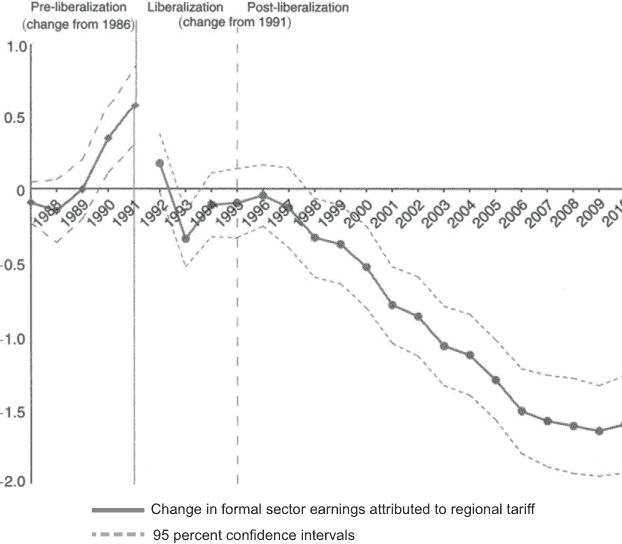

**图 2.9** 巴西贸易自由化对收入的影响，1988–2010 年。来源：Rafael Dix-Carneiro and Brian Kovak, “Trade Liberalization and Regional Dynamics,” *American Economic Review* 107, no. 10 (October 2017): 2908–2946.

在自由化之后，与未受自由化影响的地区相比，工资大幅下降，并持续下降了近二十年。正如 Dix-Carneiro 和 Kovak 所示，收入最终趋于稳定的唯一原因是工人离开了正式部门并寻求非正规就业（即未在税务机关注册的企业）。但这并不是一个积极的结果；这些工作通常被认为对工人来说不那么理想，福利更少、稳定性更差、职业安全感也降低。向非正规化的转型引发了许多关于劳动力市场摩擦的问题，这些问题在后续的研究中得到了探讨。²⁶ 如果这些影响可以推广到其他语境，它们对贸易与区域不平等之间的关系具有深远影响。

许多研究还发现，贸易的负面影响可能远超劳动力市场。Autor、Dorn 和 Hanson 发现，美国竞争性地区（CZs）对中国进口冲击的暴露也导致了制造业以外的工资下降、家庭平均总收入大幅下降，以及通过联邦和州收入援助计划（如失业保险、福利金和其他津贴）的整体转移支付的增加。在印度，Eric Edmonds、Nina Pavnick 和 Petia Topalova 的研究发现，与自由化程度较低的地区相比，自由化程度较高的地区童工率更高，受教育时间更短（相对而言），对女孩更是如此。²⁷ 在另一项关于巴西的研究中，Dix-Carneiro 及其合作者 Rodrigo Soares 和 Gabriel Ulyssea 发现，进口自由化增加了受进口竞争影响最严重地区的犯罪率（同样是相对而言的）。

重要的是，这些仅仅是相对效应；它们并不意味着整个经济体都受到了贸易的伤害。事实上，特别是对于发展中国家，贸易开放与许多积极的经济效益相关。尽管如此，贸易与区域不平等之间存在明确的联系。当各国开放贸易时，可能会产生巨大的区域差异——特别是进口自由化，这是过去几十年中发展中国家和发达国家经常采取的一种方式。再次，如此巨大且持久的影响令人惊讶；标准经济模型本会预期就业情况会……

### 2.3.2 对消费者的不平等影响

国内不平等的另一个维度与消费者渠道有关。通常情况下，我们预期消费者能从更高程度的国际整合中受益，表现为价格的降低。在标准经济模型中，减少贸易壁垒通过两种方式降低消费者价格：由于可以使用更廉价的外国制造“中间投入品”，降低了国内企业的生产成本，只要这些降低能以更低价格的形式转嫁给消费者，也能推动国内投入品价格的下降；和/或者由于存在更廉价的进口“制成品”，增加了国内企业面临的竞争压力。消费者还可以通过获得更高质量和更多种类的产品来从贸易中获益。这种观点在直觉上是合理的，并得到了经济学文献中大量理论工作的支持，长期以来一直是贸易经济学家和政策制定者倡导更多自由贸易的理由。但数据支持这一点吗？令人惊讶的是，关于贸易如何影响价格的直接证据并不丰富，关于全球化消费者侧的实证研究也相对有限。然而，尽管存在证据（大部分来自发展中国家），但也参差不齐。

例如，来自印度的最新证据表明，关于消费者从贸易中获益的标准经济理论在实践中并不总是适用——特别是在市场并非完全竞争的情况下。例如，2016 年，我与 Jan De Loocker、Amit Khandelwal 和 Nina Pavnick 合作写了一篇论文，分析了 1989 年至 2003 年间印度企业的生产数据，涵盖了印度贸易自由化前后的时期——这上面提到的 Topalova 对贸易对工人不平等影响的研究分析的是同一时期。² 利用价格和数量的企业数据，我们建立了一个框架来理解开放全球贸易如何影响印度企业的边际生产成本、消费者支付的价格以及企业利润（反映在企业在制成品上所加加价中）。

图 2.10 显示了我们分析的主要结果。我们发现，印度的贸易自由化（期间价格也下降了，但降幅不及平均水平）使企业边际成本平均降低了 18%。虽然消费者价格确实下降了，但其降幅仅比贸易模型预测的少 13%，与企业享有的平均成本下降相似。这种现象可能对印度内部的不平等以及任何国家贸易的分配效应产生影响。具体而言，这意味着贸易可能导致了另一个维度不平等的增加：消费者与生产者之间的不平等。

其他几项研究记录了过去几年全球范围内加价和利润的上升。例如，De Loecker、Jan Eeckhout 和 Gabriel Unger 最近的一篇论文通过分析企业级数据来估算总加价，记录了 20 世纪 50 年代以来美国经济市场权的演变.³31 图 2.11 显示了他们惊人的结果：虽然总加价在 1955 年至 1980 年间基本稳定，但之后从 21%（边际成本之上）稳步上升到 2016 年的 61%。期间，平均利润率从 1% 增加到 8%。关键是，De Loecker、Eeckhout 和 Unger 还发现加价并未按比例增加所有企业。相反，少数大企业获得了更高的加价，而大多数企业的加价没有增加并失去了市场份额——这表明了市场权的重新分配。这反映了美国和其他发达经济体中所谓的“巨星”企业的崛起，许多行业已变得日益呈现出集中状态，少数生产性企业占据了大部分市场份额并获得了巨额利润。这些趋势不仅限于美国。在后续的一篇工作论文中，De Loecker 和 Eeckhout 对全球经济进行了相同的分析。通过利用来自 134 个国家、70,000 多家企业财务报表的四十年数据，De Loecker 和 Eeckhout 记录显示，全球总加价率已从 1980 年的 1.15% 增长到 2016 年的约 1.6%。32 图 2.12 显示了他们在大洲层面的发现：虽然加价率在北美和欧洲增长最快，在非洲和拉丁美新兴经济体增长最慢——这两个地区恰好与全球贸易网络的整合程度较低——但整体趋势在各地区表现出显著的一致性。与美国的分析一样，这些变化凸显了价值向大型企业的重新分配（尽管 De Loecker 和 Eeckhout 发现这种现象在不同地区存在显著差异）。

## 反弹的原因

值得注意的是，企业利润的增加与劳动分配收入份额的下降相关——这一趋势在发达和发展中经济体中均可见——表明经济权力发生了再次重新分配。正如企业获取了更多贸易和技术收益的份额，而不是将这些收益传递给消费者一样，他们未能将这些收益传递给工人。

全球化在多大程度上对企业利润的广泛增长做出了贡献？毕竟，全球经济的这些剧烈变化发生在历史性的贸易增长时期。遗憾的是，这个问题很难给出确定的答案。在某些特定案例中，很明显全球贸易影响了市场势力，并加剧了消费者与生产者之间的不平等；正如我们对印度的分析所示，1991 年的贸易自由化对该十年剩余时间里企业的巨额利润产生了直接影响。在其他背景或全球范围内，这种因果关系更难识别。然而，有许多强有力的暗示性证据。

例如，世界银行 2020 年的《世界发展报告》在全球价值链（GVC）扩张的背景下探讨了这些问题——发现大量证据表明，参与 GVC 的收益在各国消费者和生产者之间并未平等分配。图 2.13 显示了三十年来比利时、法国、德国、英国、日本和美国纺织行业企业加价率与 GVC 参与之间的相关性。对于每个国家，灰线表示纺织行业的总加价率（或平均企业利润），黑线表示 GVC 集成程度。虽然不是因果关系，但 GVC 活动的增长与加价率之间显然存在关系——而且

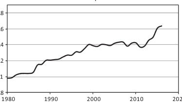
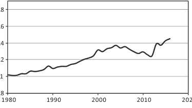
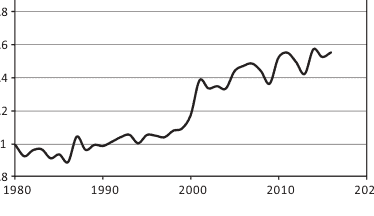

1980–2016 年全球加价率的上升。来源：Jan De Loecker and Jan Eckhout，“Global Market Power” (NBER Working Paper 24768, National Bureau of Economic Research, Cambridge, MA, June 2018), https://www.nber.org/papers/w24768.

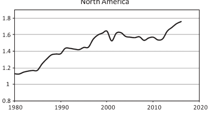
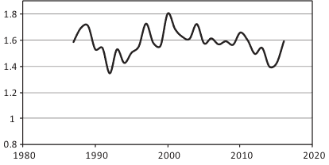
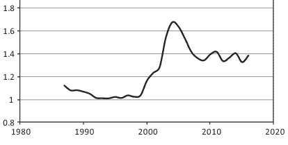

图 2.12（续）

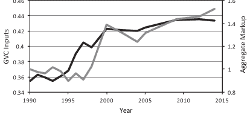
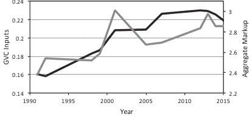
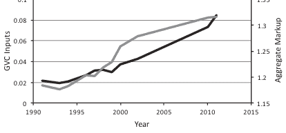

图 2.13

各纺织行业中的企业加价与 GVC 参与情况。注：左 y 轴衡量每个国家纺织行业总出口额中外国增加值的份额。右 y 轴衡量加权平均加价率。Jan De Loecker and Eeckhout,

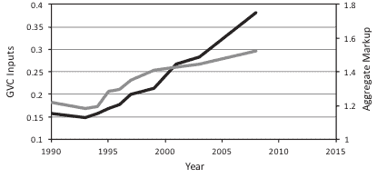
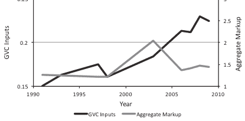
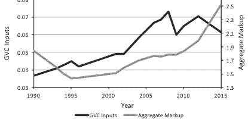
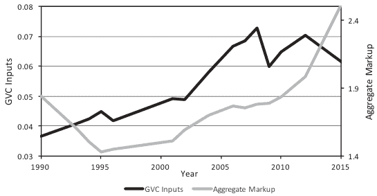
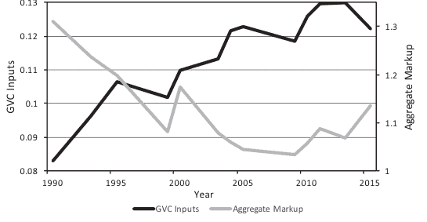

**图 2.14 美国和印度纺织业的企业加价与全球价值链（GVC）参与度。** 注：上方面板的左 y 轴衡量美国纺织业总出口中外国增加值的占比（后向 GVC 参与）。下方面板的左 y 轴衡量进口国国内增加值的占比（前向 GVC 参与）。两个面板的右 y 轴衡量纺织业上市公司的份额加权平均加价。加价率由 Jan De Loecker 和 Jan Eckhout 在《全球市场权力》（NBER 工作论文 24768，国家经济研究局，马萨诸塞州剑桥市，2018 年 6 月）计算，https://www.mber.org/papers/w24768。类似的结果在不同国家和行业也适用：世界银行，《2020 年世界发展报告：全球价值链时代的贸易》（华盛顿特区：世界银行，2019 年），第 85 页，使用了来自 Eora 和 Worldwide 的数据。

与图 2.14 所示国家相同，但针对的是运输业。尽管在过去几十年已与全球价值链（GVCs）高度整合，但这些国家的运输业加价率的增长并没有达到纺织业那样的速度或程度。然而，全球化显然是过去几十年各国内部消费者与生产者之间不平等现象加剧故事中的重要部分，但这种叙述并不统一适用于所有国家的所有行业。

展望未来，观察新技术如何影响不同国家企业对 GVC 的参与，以及对不平等现象产生的影响将非常有趣——这种影响可能是通过工人渠道而非消费者渠道实现的。自动化、机器人、3D 打印和人工智能可能给那些因廉价劳动力而从 GVC 参与中获益的发展中国家带来挑战。一个具体的担忧是，先进经济体的公司将“回流”或将生产运营迁回本国，从而限制发展中国家出口导向工业化的前景。然而，到目前为止，新兴证据相当令人鼓舞。自动化到目前增加了与发展中国家的贸易而非减少，尽管这种影响在不同国家和行业之间差异。一种表现是，目前先进经济体企业采用的许多机器人是在发展中国家制造的，因为其零部件和劳动力成本较低。但在更远的未来，发展中国家制造企业的自动化可能会严重削弱劳动力优势，并对这些国家的长期增长和发展前景带来某些挑战。一旦所有国家都采用机器人，通过贸易利用发展中国家较低劳动力成本的动力将寥寥无几。

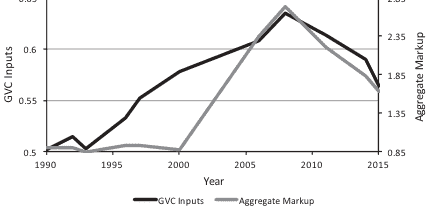
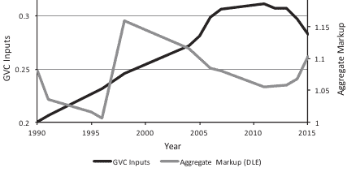
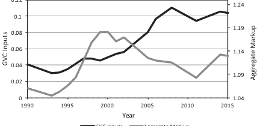

**图 2.15 各运输业的企业加价与 GVC 参与度。** 注：左 y 轴衡量每个国家运输业总出口中外国增加值的占比。右 y 轴衡量运输业上市公司的份额加权平均加价。加价率计算参考 Jan De Loecker 和 Jan

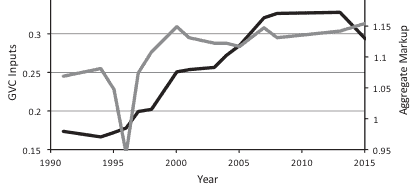
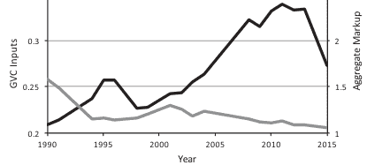
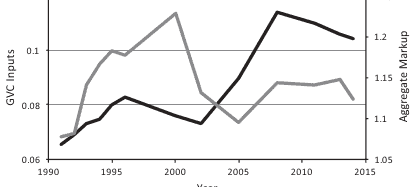

加价率由 Jan De Loecker 和 Jan Eckhout 在《全球市场权力》（NBER 工作论文 24768，国家经济研究局，马萨诸塞州剑桥市，2018 年 6 月）计算，https://www.mber.org/papers/w24768。类似的结果在不同国家和行业也适用：世界银行，《2020 年世界发展报告：全球价值链时代的贸易》（华盛顿特区：世界银行，2019 年），第 85 页，使用了来自 Eora 和 Worldwide 的数据。

例如，《迪顿评论》（Deaton Review）指出，评估贸易对价格的影响面临着许多衡量和识别困难。这些困难中的首要问题是缺乏高度细分的价格数据，以评估跨收入分布的价格影响。虽然支出调查为经济学家提供了用于分析价格效应的大型数据集，但它们记录支出和数量的粒度非常粗，这使得难以捕捉富人或穷人所消费特定品牌的差异。（不言而喻，例如，对来自意大利进口阿马尼夹克降价，其对不平等的影响将与对来自埃塞俄比亚进口夹克降价的影响大不相同。）零售扫描仪数据（如尼尔森提供的数据）收集了实时价格和其他信息，这可以部分弥补这种细粒度的缺失。然而，此类数据通常不包含从贸易中获益的大型产品类别，例如汽车。此外，此类数据最近才可用，往往导致其得出的样本时间太短，无法进行可靠的实证分析。所有这些困难都可能导致这样一种观点：贸易的价格效应不成比例地造福了穷人。

同样，现有的价格研究未能捕捉大多数国家（包括全球贫困人口在内）的大多数人现在已经能够获得一系列惊人的商品和服务，包括智能手机和互联网接入，而这些在几十年前是不可想象的。使这一切成为可能的关键因素是技术发展和国际贸易，即通过全球价值链（GVCs）内部国际分工所实现的成本和价格降低。在过去，对于许多无法负担这些商品服务的低收入家庭来说，这些商品服务的虚拟价格本质上是无限的。得益于贸易和技术，这一价格已经下降到了许多低收入消费者可以负担的有限数字。虽然很难进行正式衡量，但这种变化的影响极可能是全球数百万或数十亿贫困家庭福祉的首要考虑。衡量这种转型性转变的挑战，可能是分析贸易对消费者不平等影响努力中最重要的缺陷。

总而言之，全球化对价格和消费者的影响与其对工人和企业的影响非常相似：正如全球化的许多方面一样，其对不平等的影响是复杂的、难以理清的，并且与不断变化的因素（例如技术）存在着高度的相互作用。

全球化的影响既是不平等的又是极度不均衡的。它们在国家之间和国家内部是不均衡的；在不同地区和人口统计特征之间是不均衡的；在生产者、消费者和工人之间是不均衡的。有充分证据表明，全球化加剧了某些维度的不平等，同时也有充分证据表明全球化减少了其他维度的不平等（最重要的是全球不平等）。根本性的挑战在于，不平等是一个非常宽泛的概念。在许多方面，全球化的影响完全取决于你关注的是不平等的哪个维度。

对这种挑战性局势的理想研究和政策反应，应该是识别、利用和发挥全球化的积极特征，同时防止、减轻或补偿其负面影响。遗憾的是，研究人员对所有证据的理解以及政策制定者采取行动的能力，距离这一理想状态还有多年之久。可能只有一条广泛的发现是明确且肯定的：全球化引发了动荡，这通常需要巨大的转型和调整。事实上，最近的许多反弹都集中在贸易带来的这些复杂问题上，而不是关于它的任何抽象概念。然而，标准的国际贸易经济模型与关于它的许多政策辩论一样，倾向于关注稳态最终结果，无论是收益还是损失。至少，本专著及其展示的证据的一个关键启示是，全球化是一个过程，而不是一个终点。这一结论的主要意义在于，研究人员和政策制定者应该更认真关注全球化带来的动荡、转型和调整，而不是估计、辩护和谴责其最终影响。

这种关注至少有三个额外的意义。第一，空间或区域不平等是全球化最显著的影响之一，应该是未来研究人员和政策制定者的主要优先考虑事项。区域不平等的显著性不仅是因为实证证据日益表明全球化的负面影响在空间上是相当孤立的，而且因为它已经成为近期反全球化的重要驱动力。因此，虽然全球化的不平等影响有很多，但区域不平等可能是最可能产生重大社会后果的。这为加大关注和尝试所谓的“基于地区的政策”（place-based policies）提供了潜在的理由。虽然经济学领域传统由于其潜在的扭曲作用对地区政策持负面观点，但它们作为解决区域不平等的工具值得重新考虑。例如，支持失业工人的努力可以针对特定地区。越来越多的证据表明，再培训或“技能提升”计划通常是无效的，但如果此类计划和其他努力（包括劳动力开发、社会保护和创造就业机会的政策）能够专注于最需要它们的地方，可能会更有前景。

其次，全球化背景下企业利润的剧烈增长需要更多的关注和政策行动。全球价值链的出现、全球技术平台的增长，以及资本和市场权力向极其巨大、高度流动且深度连接的“超级巨星”企业的重新配置，都引发了关于企业、政府和社区之间关系的重要问题。虽然这些问题是永恒且基础的，但它们的当代表现非常新颖，并且在技术、法律和政治上几乎是无尽复杂的。首先，应对近期企业利润率的增加，要求更多关注这些大型公司是如何被征税和监管的。

最后，至关重要的是，本专著提出的问题强调了加强国际合作的至关重要性——不仅在贸易方面，在许多其他经济领域也是。正如提到的，全球化的不平等影响已超出贸易领域，但同时对贸易具有重要影响。同样，近年来看到的许多贸易摩擦增加不仅是因为关税等狭义定义的贸易政策；相反，它们涉及“边境后”措施、非关税贸易限制以及影响贸易但更难衡量的经济活动方面。

近期紧张局势和对全球化的反弹给全球贸易体系带来了严峻挑战，但加强国际合作仍有重大机会。例如，区域贸易提供了巨大的前景——不仅是因为自身，还作为日益增长的全球不确定性的平衡。虽然欧盟现在代表了一个相当有争议的模式（考虑到英国脱欧、负面货币影响和其他挑战），但毫无疑问，在欧洲建立自由贸易区对许多欧洲国家以及各收入阶层的许多工人和消费者产生了非常积极的结果。

在全球范围内，从非洲、中东到南美和东南亚，有许多人口众多的区域和次区域市场尚未实现高度的区域互联。这些地区的许多国家已经自由化并协调了其贸易政策以加入世贸并参与全球价值链；增加区域内部贸易是一个独特的机遇领域。因此，随着多边主义的衰落以及新的地缘政治担忧和联盟的出现，全球化可能会持续但呈现不同的面貌：例如，全球价值链可能会部分或完全将其运营转移到世界不同地区，区域主义可能成为全球化的新形式。

沿着这些思路，全球贸易安排可能发生的意外转变反映在我与合作者的上述论文中，该论文展示了中美贸易战如何为几个“旁观国”创造了新的贸易机会。正如预期，这些国家增加了对美国的出口（这是预料之中的，因为美国从中国的进口被重新分配给了其他出口国），也增加了对世界其他地区的出口，在贸易战期间增加了全球出口。值得注意的是，受益最多的国家拥有深厚的现有贸易协议和大量的外国直接投资——换句话说，是深度融入全球贸易体系的国家。在另一篇论文中，Pol Antras 探讨了“回流”前景，即跨国公司将其制造活动迁回总部所在国的努力。² Antras 认为，企业在全球范围内建立运营所付的固定成本是巨大的且沉没的。

大自然的本质是，除非面临大规模的负面冲击，否则不会产生制造业回流的阻力。尽管近年来贸易辞令言辞激烈，且全球化前景令人担忧，但我们似乎尚未到达那个节点。尽管可能出现重大的新政策发展，这些论点表明，尽管贸易紧张局势持续且多边主义日益衰落，全球化可能继续进行，尽管是以一种不同且更低调的形式。

然而，一个需要加强多边合作的领域是应对气候变化的全球努力。气候变化的影响预计是复杂且极不平等的，而缓解或适应这些变化的挑战将是巨大的。全球贸易领域的若干紧张局势与气候问题有关，包括国家之间的冲突。例如，发达国家与发展中国家之间在气候领域存在显著紧张——发达国家主要负责大部分历史碳排放，且富裕程度足以负担将其经济重心转向优先考虑环境可持续性的低速增长战略；而发展中国家，特别是低收入国家和受战争或贫困影响的国家，则渴望加速经济增长和发展。这些国家完全理解，不希望其未来的增长、发展和脱贫受到由于他们并未创造的问题上的全球努力的限制。在这种情况下，区域主义无法为解决国家间谈判和应对这些紧张局势的困境提供出口。排放不分国界、地区或大陆；问题的本质要求采取全球措施来解决，而这些措施需要多边协议。

在许多方面，国际气候协议的前景比全球化等问题要困难得多——正如我们在 COVID-19 疫情、乌克兰战争以及全球经济放缓风险中学到的，其他全球性挑战也将出现，同样令人困扰且具有破坏性。然而正如本专著所示，全球化的演变、其在国家及内部的不平等影响，以及公众对其支持或反对的态度和政策，绝非易事。面对气候变化、流行病和其他未知的挑战，我们同样应该预见到它们将以复杂且不可预测的方式展开。因此，加强我们对当今全球化不平等影响的应对——通过解决地区不平等、应对企业利润增长，以及在贸易的所有维度上加强多边合作——将帮助全球社区准备应对明日的挑战。

### 参考文献

1. 为了保持一致性，图 1.3 仅包含了财政研究学院的不平等报告（IFS Deaton Review of Inequalities, Institute for Fiscal Studies），访问于 2022 年 2 月 28 日，https://ifs.org.uk/inequality。

2. 关于该主题的一项密切相关的研究，特别是围绕全球化对国内不平等的影响，请参见 David Dorn 和 Peter Levelell 的《欧洲和美国的贸易与不平等》（Trade and Inequality in Europe and the United States），IFS Deaton Review of Inequalities, Institute for Fiscal Studies，访问于 2022 年 2 月 28 日，https://ifs.org.uk/inequality/trade-and-inequality-in-europe-and-the-us。

3. 为了一致性，图 1.3 仅包含截至 2014 年的数据，因为原始数据来源——Michel Fouquin 和 Jules Hugot 的《两个世纪的双边贸易与引力数据：2017-14》（CEPII Working Paper No. 2016-14, 2016 年 5 月），http://www.cepii.fr/pdf_pub/wp/2016/wp2016-14.pdf——未提供后期年份的数据。相比之下，图 1.2 通过合并两个来源的数据将样本扩展到了 2019 年：Fouquin 和 Hugot 的《两个世纪的双边贸易与引力数据》；以及世界银行数据库。正如图 1.2 所示，2014 年后没有趋势反转。

4. Nina Pavcnik，《贸易对发展中国家不平等的影响》（The Impact of Trade on Inequality in Developing Countries），杰克霍经济政策研讨会论文（堪萨斯市：堪萨斯市联邦储备银行，2017 年 8 月），61–114。

5. 详细讨论，请参见 Pinelopi Goldberg 和 Nina Pavcnik，《贸易政策的影响》（The Effects of Trade Policy），收于《商业政策手册》（第 92 卷，Kyle Bagwell 和 Robert Staiger 编，阿姆斯特丹：Elsevier，2016 年），161–206。

6. Roger Altman 和 Richard Haass，《为什么跨太平洋伙伴关系很重要》（Why the Trans-Pacific Partnership Matters），《纽约时报》，2015 年 4 月 3 日，https://www.nytimes.com/2015/04/04/opinion/why-the-trans-pacific-partnership-matters.html。文中特别强调了内容。

7. Paul Krugman，《增长的世界贸易：原因与后果》（Growing World Trade: Causes and Consequences），布鲁金斯学院经济活动论文集 1 (1995)：328。

8. Lant Pritchett，《移民：结束全球种族隔离》（Immigration: Ending Global Apartheid），Kerry Howley 采访，Reason，2008 年 2 月，https://www.reason.com/2008/01/24/ending-global-apartheid。

9. 关于这一早期证据的审查，请参见 Alan Deardorff 和 Robert Stern 的《密歇根世界生产与贸易模型：理论与应用》（The Michigan Model of World Production and Trade: Theory and Applications，马萨诸塞州剑桥：麻省理工出版社）。

10. Andrew Rose，“我们真的知道 WTO 增加了贸易吗？》（Do We Really Know That the WTO Increases Trade），《美国经济评论》第 94 卷，第 1 号（2004 年 3 月），98–114。

11. Kei-Mu Yi，“垂直化能解释增长吗？”（Can Verticalization Explain the Growth?），《政治经济杂志》第 111 卷，第 1 号（2003 年 2 月）：52。

12. 我与我的长期合作作者 Nina Pavcnik 对此有详尽论述，参见 Goldberg 和 Pavcnik，《贸易政策》（Trade Policy）。

13. 关于 TRIPS 对发展中国家的影响，参见 Pinelopi Goldberg 和 Nina Pavcnik，《知识产权》，欧洲协会第 8 卷，第 2 号（2010 年），226–353。

14. 关于估算，请参见 Pablo Fajgelbaum、Goldberg 和 Khandwal，《保护主义的回报》（The Return of Protectionism），《经济学杂志》第 135 卷，第 1 号（2020 年 2 月），55。

15. Claudia Hoffmann、Alberto Osnano 和 Miguel Ruta，《水平深度》（Horizontal Depth）（政策报告第 7981，世界银行，2017 年 2 月），https://openknowledge.worldbank.org/handle/10986/34260

16. 近期估计显示，2016 年 54% 的保护主义措施是非关税的。Lu Kincius、Alexander Sandkamp 和 Erdal Yalcin，《贸易保护与非关税壁垒》（Trade Protection and Non-Tariff），《评论》第 155 卷（2019 年），603–643。

17. Fajgelbaum、Goldberg 和 Kennedy，《保护主义的回报》。

18. Costas Arkolakis、Arnaud Cost 和 Andrés-Clare，《新贸易模型，旧收益》（New Trade Models, Old Gains），《美国评论》第 102 卷，第 1 号（2012 年 2 月），94–130。

19. Pablo Fajgelbaum、Goldberg、Kennedy 和 Dario Taglioni，《中美贸易战与全球重新配置》（NBER 工作论文第 29562，美国经济研究局，2021 年 12 月），https://www.nber.org/papers/w29562。

20. Pinelopi Goldberg 和 Tristan Reed，《收入分配、国际整合与持续减贫》（Income Distribution, International Integration and Sustained Poverty Reduction）（政策报告第 9342，世界银行，2020 年 7 月）。https://openknowledge.worldbank.org/handle/10986/34

21. Anna Maya Mayda 和 Dani Rodrik，“为什么人和国家更具保护主义？”（Why Are People (and Countries) More Protectionist than Others?），《欧洲经济评论》第 49 卷，第 6 号（2005 年 8 月），1393–1430。

22. Esteban Méndez-Chaco 和 Dani von Patten，《贸易投票：企业网络与开放态度》（Voting on a Trade Agreement: Firm Networks and Attitudes toward Openness）（NBER 工作论文第 30058，美国经济研究局，2022 年 5 月），https://www.nber.org/papers/w30052。

23. Jiwon Choi、Ilyana Kuziemko、Ebonya Washington 和 Gavin Wright，《贸易协定的地区就业和政治影响：来自 NAFTA 的证据》（Local Employment and Political Effects of Trade Deals: Evidence from NAFTA）（NBER 工作论文第 29525，2021 年 11 月），https://www.nber.org/papers/w29525。

24. Yi Che、Yi Lu、Justin Pierce、Peter Scott 和 Zhagang Tao，“与中国的贸易自由化影响选举吗？”（Does Trade Liberalization with China Influence Elections?）（NBER 工作论文第 22178，美国经济研究局，2016 年 4 月），https://www.nber.org/papers/w22178；David Autor、David Dorn、Gordon Hanson 和 Kaveh Majli，“进口政治极化？暴露度增加的选举后果”（Importing Political Polarization?: The Electoral Consequences of Rising Exposure），《美国经济评论》第 110 卷，第 10 号（2020 年 10 月），3139–3183。

25. Clément Malgouy，“贸易冲击与极右投票：来自法国总统选举的证据”（罗伯特·舒曼高级研究中心研究论文编号 RSCAS 2017/21，意大利佛罗伦斯，2017年3月）；Christian Dippel, Robert Gold 和 Stephan Heblich，“全球化及其（不）满意感：贸易冲击与投票行为”（NBER 工作论文第 21812 号，国家经济研究局，马萨诸塞州剑桥市，2015年12月），https://www.nber.org/papers/w21812。

26. Italo Colantone 和 Pietro Stangi，“全球竞争与英国脱欧”，《美国政治科学评论》第112卷，第2期（2018年）：201–218。

27. Angus Deaton，《大逃离：健康、财富与不平等的起源》（新泽西州普林斯顿：普林斯顿出版社，2013年）。

28. Branko Milanovic，《全球不平等：全球化时代的新方法》（马萨诸塞州剑桥市：哈佛大学出版社，2016年）。

29. 世界银行，《2006年世界发展报告：公平与发展》（华盛顿特区：世界银行，2006年）。

30. Christopher Lakner 和 Branko Milanovic，“全球收入分配：从柏林墙倒塌到大衰退”，《世界银行经济评论》第30卷，第2期（2016年）：203–232。

31. “大象曲线”基于国家家庭收入和支出调查数据，涵盖了处于不同发展阶段的162个国家。

32. Facundo Alvaro, Lucas Chancel, Thomas Piketty, Emmanuel Saez 和 Gabriel Zucman 编，《2018年世界不平等报告》（巴黎：世界不平等实验室，2018年），https://wir2018.wid.world.org。

33. 更新后的大象曲线的的原始数据库包含了全球所有发展阶段的一百多个国家。该数据库已逐渐扩展；截至2022年，它包含了所有国家，但许多国家的数据序列较短或不完整。“方法论，”世界不平等数据库，访问于2022年10月8日，https://wid.world/methodology。

34. 参见例如 Marta Bloch, Christoph Lakner 和 Melina Fleury，“消除贫困的进展放缓”，《世界银行博客》。2020年10月16日，https://blogs.worldbank.org/opendata/progress-toward-ending-poverty-has-slowed。

35. 关于非洲国家国内贸易摩擦的实证研究，请参见 David Atkins 和 David Donaldson，“谁在经历全球化？国内贸易成本的规模与影响”（NBER 工作论文第 21439 号，国家经济研究局，马萨诸塞州剑桥市，2015年7月），https://www.nber.org/papers/w21439。

36. 关于早期的贡献，请参见 Eli Berman, John Bound 和 Zvi Gliches，“美国制造业对技能劳动力需求的变化：来自制造业年度调查的证据”，《经济季度杂志》第109卷，第2期（1994年5月）：367–97。关于相关文献的详尽概述，请参见 Adrian Wood，“贸易如何损害非技术工人”，《经济展望杂志》第9卷，第3期（1995年夏季）：57–80。

37. 参见 David Autor 和 David Dorn，“低技能服务业岗位的增长与美国劳动力市场的极化”，《美国经济评论》第103卷，第5期（2013年8月）：1553–1597；David Autor, Lawrence Katz 和 Melissa Kearney，“美国劳动力市场的极化”，《美国经济评论》第96卷，第2期（2006年5月）：189–194；Maarten Goos 和 Alan Manning，“糟糕与美妙的工作：英国工作的极化”，《经济与统计学评论》第89卷，第1期（2007年2月）：118–133；Maarten Goos, Alan Manning 和 Anna Salomons，“解释工作极化：常规偏向型技术变革与外包”，《美国经济评论》第104卷，第8期（2014年8月）：2509–2526。

38. 然而，重要的是，在此期间几个发展中国家的实际贸易和贸易保护模式与 Heckscher-Olin（赫克歇尔-奥林模型）等贸易模型预测的模式显著不同。参见 Pinelopi Goldberg 和 Nina Pavcnik，“贸易、工资与贸易保护政策：来自哥伦比亚贸易改革的证据”，《国际经济杂志》第66卷，第1期（2005年5月）：75–105；Pinelopi Goldberg 和 Nina Pavcnik，“发展中国家全球化的分配效应”，《经济文献杂志》第45卷，第1期（2007年3月）：39–82。在哥伦比亚，关税保护集中在纺织和鞋类等低技能密集型行业，2080年代的贸易自由化减少了这些行业的关税保护——预计并不会惠及低技能工人。类似地，Rodrigo Adão及其同事最近的一篇论文表明，工人通过出口和进口渠道受到贸易的影响。使用厄瓜多尔记录显示，出口渠道有利于低收入个人，而进口渠道则相反。在“国际贸易与收入不平等：一个新因素”（NBER 工作论文第 28263 号，国家经济研究局，马萨诸塞州剑桥市，2020年12月），https://www.nber.org/papers/w28263。这些研究表明贸易与不平等之间的关系是复杂的，取决于个人和企业的出口情况。20世纪80和90年代许多发展中国家不平等的增加——尽管这些国家显著实现了贸易自由化——并不排除基于贸易的解释。尽管如此，从定量角度来看，贸易渠道导致的不平等增加与技术等因素相比仍然较小。详细讨论参见 Goldberg 和 Pavcnik，“发展中国家的全球化分配效应。”

39. Justin Pierce 和 Schott，“美国制造业就业的意外下降”，《美国经济评论》第106卷，第7期（2016年7月）：1632–1662。

40. David Autor, David Dorn 和 Gordon Hanson，“中国综合”，《美国经济评论》第103卷，第6期（2013年10月）：2121–2168。

41. David Dorn 和 Peter Levell，“欧洲和美国的贸易与不平等”，《IFS评论》，财政研究所，访问于2022年2月28日，https://ifs.org.uk/inequality-in-europe-and-us。

42. Choi, Kuziemko 和 Wright，“当地就业与政治交易。”关于我和Pavcnik的早期合作，参见 Pinelopi Goldberg 和 Nina Pavcnik，“非正式部门对贸易自由化的反应”，《发展杂志》第72卷，第2期（2003年12月）：463–496；Pinelopi Goldberg 和 Nina Pavcnik，“贸易、不平等与贫困：我们知道什么？来自发展中国家近期贸易自由化的证据”（NBER 工作论文第 10593 号，经济研究局，马萨诸塞州剑桥市，2004年6月），https://www.nber.org/papers/w10593）；Andreas Blomlo, Pinelopi Goldberg, Nina Pavcnik 和 Norbert Schatz，“贸易自由化与行业工资结构：来自巴西的证据”，《世界银行评论》第18卷，第3期（2004年）：319–344；Pinelopi Goldberg 和 Nina Pavcnik，“哥伦比亚的贸易改革与工资差异》，《发展杂志》第74卷，第2期（2004年8月）：331–366；Goldberg 和 Pavcnik，“贸易、工资与贸易保护的政治经济；城市贫困的贸易自由化，”收录于Ann Harrison编，《全球化》（芝加哥大学出版社，2006年），241–290。

43. Petia Topalova，“要素流动性与贸易自由化的区域影响：来自印度的贫困证据》，《美国经济杂志》第2卷，第4期（2010年10月）：1–41。

44. Rafael Dix-Carneiro 和 Brian Kovak，“贸易自由化与区域动态”，《美国经济评论》第107卷，第10期（2017年10月）：2908–2946。

## 参考文献

25. 参见例如 Rafael Dix-Carneiro, Pinelopi Goldberg, Costas Meghir 和 Gabriel Ulyssea，“劳动力市场摩擦与监管下的贸易与不平等”（NBER 工作论文第 28391 号，国家经济研究局，马萨诸塞州剑桥市，2021年1月），https://www.nber.org/papers/w28391。

26. Eric Edmonds, Petia Topalova 和 Nina Pavcnik，“全球化世界中的童工与教育：来自印度的部分证据”，《欧洲经济协会杂志》第7卷，第2–3期（2009年5月）：498–507；Eric Edmonds, Nina Pavcnik 和 Petia Topalova，“贸易调整与人力资本投资：来自印度关税改革的证据”，《美国经济杂志：应用经济》第2卷，第4期（2010年10月）：42–75。

27. Rafael Dix-Carneiro, Rodrigo Soares 和 Gabriel Ulyssea，“经济冲击与犯罪：来自巴西贸易自由化的证据”，《美国经济杂志：应用经济》第10卷，第4期（2018年10月）：158–195。

28. Jan De Loecker, Pinelopi Goldberg, Amit Khandelwal 和 Nina Pavcnik，“价格、加价与贸易改革”，《计量经济学》第84卷，第2期（2016年3月）：445–510。

29. 在经济学中，这种成本降低未传导给他人的现象被称为“不完全传导”。贸易带来的成本降低的不完全传导与国际宏观经济学文献中充分记载的“不完全汇率传导”相似。

30. Jan De Loecker, Jan Eeckhout 和 Gabriel Unger，“市场权力的兴起及其宏观经济影响”，《经济季度杂志》第135卷，第2期（2020年5月）：561–644。

31. Jan De Loecker 和 Jan Eeckhout，“全球市场权力”（NBER 工作论文第 24768 号，国家经济研究局，马萨诸塞州剑桥市，2018年6月），https://www.nber.org/papers/w24768。

33. “后向参与”涉及购买位于公司制造流程之前的供应链环节；在国际背景下，由于供应链的部分可能位于不同的国家，人们可以将后向整合理解为“进口以出口”（例如，进口中间品或半成品，以制成出口到其他国家的产品）。许多发达国家通过从成本通常较低的发展中国家进口零件或中间产品来参与这种后向整合。相比之下，“前向参与”涉及公司行业价值链中上游的业务活动；在国际背景下，人们可以将前向整合理解为“出口以出口”（例如，将原材料或零件出口到另一个国家，在这些国家将其用于制造随后出口到不同国家的产品）。许多发展中国家参与了这种前向整合。

34. 世界银行，《2020年世界发展报告：全球价值链时代的贸易发展》（华盛顿特区：世界银行，2019年）。

35. David Atkin, Benjamin Faber, 和 Marco Gonzalez-Navarro，“零售全球化与家庭福利：来自墨西哥的证据”，《政治经济学杂志》第126卷，第1期（2018年2月）：1–73页。

36. Xavier Jaravel 和 Erik Sager，“贸易具有价格影响吗？来自美国的证据及对量化贸易模型的启示”（经济绩效中心讨论论文第1642号，伦敦政治经济学院，2019年8月），https://cep.lse.ac.uk/pubs/download/dp1642.pdf。

37. Dorn 和 Levell，“欧洲和美国的贸易与不平等”。

38. Kirill Borusyak 和 Xavier Jaravel，“贸易的分配效应：理论与来自美国的证据”（NBER工作论文第28957号，国家经济研究局，马萨诸塞州剑桥，2021年6月），http://www.nber.org/papers/w28957。

39. Pablo Fajgelbaum 和 Amit Khandelwal，“衡量贸易的不平等收益”，《季度经济杂志》第131卷，第3期（2016年8月）：1113–1180页。

40. David Atkin，“贸易与价格指数不平等，”IFS Deaton不平等评述，财政研究协会，2022年2月28日访问，https://ifs.org.uk/inequality/trade-and-price-index-inequality。

- 1. 参见 Pablo Fajgelbaum, Pinelopi Goldberg, Patrick Kennedy, Amit Khandelwal, 和 Daria Taglioni，“中美贸易战与全球重新配置”（NBER工作论文第29562号，国家经济研究局，马萨诸塞州剑桥，2021年12月），https://www.nber.org/papers/w29562。

- 2. Pol Antràs，“去全球化？后新冠19时代的全球价值链，”欧洲央行论坛，欧洲中央银行，2020年11月。

Adão, Rodrigo, Paul Carrillo, Arnaud Costinot, Dave Donaldson, 和 Dina Pomeranz。“国际贸易与收入不平等：一种新的要素含量方法。”NBER工作论文第28263号，国家经济研究局，马萨诸塞州剑桥，2020年12月。https://www.nber.org/papers/w28263.

Altman, Roger C., 和 Richard N. Haass。“为什么太平洋伙伴关系很重要。”《纽约时报》，2015年4月3日。https://www.nytimes.com/2015/04/04/opinion/why-the-trans-pacific-partnership-matters.html.

Alvaredo, Facundo, Lucas Chancel, Thomas Piketty, Emmanuel Saez, 和 Gabriel Zucman，编辑。《2018年世界不平等报告》。巴黎：世界不平等实验室，2018年。https://wir2018.wid.world.

Antràs, Pol。“去全球化？后新冠19时代的全球价值链。”欧洲央行论坛，欧洲中央银行，2020年11月。

Arkolakis, Costas, Arnaud Costinot, 和 Andres Rodríguez-Clare。“新贸易模型，同样的旧收益？”《美国经济评论》第102卷，第1期（2012年2月）：94–130页。

Atkin, David。“贸易与价格指数不平等。”IFS Deaton不平等评述，财政研究协会。2022年2月28日访问。https://ifs.org.uk/inequality/trade-and-price-index-inequality.

Atkin, David 和 Donaldson, Dave。“谁在接受全球化？国内贸易成本的规模与维度。”NBER工作论文第21439号，国家经济研究局，马萨诸塞州剑桥，2015年7月。https://www.nber.org/papers/w21439.

Atkin, David, Benjamin Faber, 和 Marco Gonzalez-Navarro。“零售全球化与家庭福利：来自墨西哥的证据。”《政治经济学杂志》第126卷，第1期（2018年2月）：1–73页。

Attanasio, Orazio, Pinelopi Goldberg, 和 Nina Pavcnik。“哥伦比亚的贸易改革与工资不平等。”《发展经济学杂志》第74卷，第2期（2004年8月）：331–366页。

Autor, David, 和 Dorn, David。“技能的极化。”《美国经济评论》第103卷，第6期（2013年8月）：1553–1597页。

Autor, David, Dorn, David, 和 Hanson, Gordon H.。“中国的效应。”《美国经济评论》第103卷，第6期（2013年10月）：2121–2168页。

Autor, David, Gordon Hanson, 和 Kaveh Majlesi。“贸易自由化的选举影响。”《美国经济评论》第110卷，第6期（2020年10月）：3179–3183页。

Autor, David, Lawrence Katz, 和 Melissa Kearney。“劳动力市场的极化。”《美国经济评论》第96卷，第2期（2006年5月）：189–194页。

Baldwin, Richard。“全球供应链：它们的产生、重要性以及未来去向。”CEPR讨论论文9103。

De Loecker, Jan, Pinelopi Goldberg, Amit Khandelwal, 和 Nina Pavcnik。“价格、加价与贸易改革。”《计量经济学》第84卷，第2期（2016年3月）：445–510页。

De Loecker, Jan, Jan Eeckhout, 和 Gabriel Unger。“市场权力的崛起及其对宏观经济的影响。”《季度经济杂志》第135卷，第2期（2020年5月）：561–644页。

De Loecker, Jan, 和 Jan Eeckhout。“全球市场权力。”NBER工作论文第24768号，2018年6月。https://www.nber.org/papers/w24768.

Clemens, Michael, 和 Jeffrey Williamson。“1950年以来的关税与增长的相关性变化。”《经济增长》第9卷，第1期（2004年3月）：5–46页。

Colantone, Italo, 和 Piero Stanig。“全球竞争与英国。”《美国政治科学评论》第112卷，第2期（2018年5月）：201–218页。

Deardorff, Alan, 和 Robert Stern。《密歇根世界生产与贸易模型：理论与应用》。马萨诸塞州剑桥：MIT出版社，1985年。

Deaton, Angus。《大逃亡：健康、财富与不平等的起源》。普林斯顿，新泽西州：普林斯顿大学出版社，2013年。

Blom, Andreas, Pinelopi Goldberg, Nina Pavcnik, 和 Norbert Schady。“贸易自由化与产业结构。”《世界银行经济评论》第18卷，第2期（2004年8月）：319–34页。

Borin, Alessandro, 和 Michele Mancini。“增加值。”意大利银行研究报告，2015年。

Borin, Alessandro, 和 Michele Mancini。“增加值。”世界银行政策研究工作论文8804，2019年4月。https://knowledge.worldbank.org/handle/10986/3153.

Borusyak, Kirill, 和 Xavier Jaravel。“贸易的分配效应：理论与来自美国的证据。”NBER工作论文第28957号，2021年6月。http://www.nber.org/papers/w28957.

Fajgelbaum, Pablo, 和 Amit Khandelwal。“衡量贸易的不平等收益。”《季度经济杂志》第131卷，第3期（2016年8月）：1113–1180页。

Choi, Jaerim, Kuziemko, Ilyana, Washington, Ebonya, 和 Gavin Wright。“NAFTA对地方就业的影响，”NBER工作论文第29525号，2021年11月。https://www.nber.org/papers/w29525.

Dix-Carneiro, Rafael, Pinelopi Goldberg, Costas Meghir, and Gabriel Ulyssea. “劳动力市场摩擦与监管下的贸易与非正式化。” NBER 工作论文 No. 28391，国家经济研究局，马萨诸塞州剑桥，2021年1月。https://www.nber.org/papers/w28391.

Dix-Carneiro, Rafael, and Brian Kovak. “贸易自由化与区域动态性。” *美国经济评论* 107, no. 10 (2017年10月): 2908–2946.

Dix-Carneiro, Rafael, Rodrigo Soares, and Gabriel Ulyssea. “经济冲击与犯罪：来自巴西贸易自由化的证据。” *美国经济学期刊：应用经济学* 10, no. 4 (2018年10月): 158–195.

Dorn, David, and Peter Levell. “欧洲与美国的贸易与不平等。” IFS Deaton Review，财政研究学会。2022年2月28日访问。https://ifs.org.uk/inequality/trade-and-inequality-in-europe-and-the-us.

Edmonds, Eric, Nina Pavcnik, and Petia Topalova. “贸易调整与人力资本投资：来自印度关税改革的证据。” *美国经济学期刊：应用经济学* 2, no. 4 (2010年10月): 42–75.

Edmonds, Eric, Petia Topalova, and Nina Pavcnik. “全球化世界中的童工与教育：来自印度城市的某些证据。” *欧洲经济协会杂志* 7, no. 2–3 (2009年5月): 498–507.

Fajgelbaum, Pablo, Pinelopi Goldberg, Patrick Kennedy, and Amit Khandelwal. “保护主义的收益。” *经济学季度杂志* 135, no. 1 (2020年2月): 1–55.

# 参考文献

Fajgelbaum, Pablo, Pinelopi Goldberg, Patrick Kennedy, Amit Kandel, and Dario Tagioni. “中美贸易战与全球再配置。” NBER 工作论文 No. 29562，国家经济研究局，马萨诸塞州剑桥，2021年12月。https://www.nber.org/papers/w29562.

Fajgelbaum, Pablo, and Amit Khandelwal. “衡量贸易带来的不平等收益。” *经济学季度季度杂志* 131, no. 3 (2016年8月): 1113–1180.

Fouquin, Michel, and Jules Hugot. “两个世纪的双边贸易与引力数据：1827–2014。” CEPII 工作论文 No. 2016–14，2016年5月。http://www.cepi.fr/pdf_pub/wp2016-14.pdf.

Goldberg, Pinelopi, “贸易的未来。” *IMF 金融与发展*，2019年6月。https://www.library.imf.org/view/journals/022/2019/002/2019.issue-002-en.xml.

Goldberg, Pinelopi. “发展中国家的知识产权保护：以药品为例。” *欧洲经济协会杂志* 8, no. 2-3 (2010年5月): 326–353.

Goldberg, Pinelopi, and Nina Pavcnik. “全球化对发展中国家的分配效应。” *经济文献杂志* 45, no. 1 (2007年3月): 39–82.

Goldberg, Pinelopi, and Nina Pavcnik. “哥伦比亚贸易自由化对城市贫困的影响。” 收录于《全球化与贫困》，由 Ann Harrison 编，241–290。芝加哥：芝加哥大学出版社，2006年。

Goldberg, Pinelopi, and Nina Pavcnik. “贸易政策的影响。” 收录于《商业政策手册》（第一卷，A部分），Kyle Bagwell 和 Robert Taylor 编，161–206。阿姆斯特丹：Elsevier，2016年。

Goldberg, Pinelopi, and Nina Pavcnik. “非正式部门对贸易自由化的反应。” *发展经济学杂志* 72, no. 2 (2003年12月): 463–496.

Goldberg, Pinelopi, and Nina Pav. “贸易、不平等与贫困：我们知道了什么？来自发展中国家近期贸易自由化事件的证据。” NBER 工作论文 No. 10593，国家经济研究局，马萨诸塞州剑桥，2004年6月。https://www.nber.org/papers/w10593.

Goldberg, Pinelopi, and Nina Pav. “贸易、工资与贸易保护的政治：来自哥伦比亚贸易改革的证据。” *国际经济学杂志* 66, no. 1 (2005年5月): 75–105.

Goldberg, Pinelopi, and Tristan Reed. “收入分配、国际整合与持续的贫困减少。” 政策研究报告 No. 9342，世界银行，华盛顿特区，2020年7月。https://knowledge.worldbank.org/handle/10986/34260.

Goos, Maarten, and Alan Manning. “糟糕与完美的工作。” *经济与统计评论杂志* 89, no. 1 (2007年2月): 118–133.

Goos, Maarten, Alan Manning, and Anna Salomons. “解释工作极化：常规性技术变化与外包。” *美国经济评论* 104, no. 8 (2014年8月): 2509–2526.

Hofmann, Claudia, Alberto Rosario, and Michele Ruta. “水平深度：优惠协定的内容。” 政策研究报告 No. 7981，世界银行。https://openknowledge.worldbank.org/handle/10986/26148.

IFS Deaton Review，财政研究学会。2022年2月28日访问。https://ifs.org.uk/inequality/.

Japan, Xavier, and Erick Sachs. “贸易的价格效应是什么？来自定量模型的证据。” 经济绩效讨论报告 No. 1642，伦敦政治学院，2017年8月。https://cep.lse.ac.uk/pubs/dp/1642.

Johnson, Robert, and Guillermo Noguera. “四十年的贸易值。” *统计评论* 99, no. 5 (2017年12月): 896–991.

Kinzi, Luisa, Alexander Sandbox, and Erdal Yalcin. “贸易保护与非关税壁垒的作用。” *世界经济杂志* 155, no. 4 (2019年11月): 603–643.

Krugman, Paul. “增长的世界贸易：原因与结果。” *布鲁金斯报告* 1 (1995): 327–378.

Lakhner, Christoph, and Branko Milanovic. “全球收入分配：从柏林墙倒塌到大衰退。” *世界经济评论* 30, no. 2 (2016): 203–252.

Malgouy, Clément. “贸易冲击与极右翼投票：来自法国总统选举的证据。” 研究报告 No. 2017/21，佛罗伦萨，2017年3月。

Mayda, Anna Maria, and Dani Rodrik. “为什么有些人（和国家）是保护主义？” *欧洲经济评论* 49, no. 6 (2005年8月): 1393–1440.

Méndez-Chacón, Esteban, and van Patten. “贸易协定的投票：企业网络与开放态度。” NBER 工作论文 No. 30058，国家经济研究局，马萨诸塞州剑桥，2022年5月。https://www.nber.org/papers/w/30058.

Milanovic, Branko. *全球不平等：全球化的新方法*。马萨诸塞州剑桥：哈佛大学出版社，2016年。

Pavcnik, Nina. “贸易对发展中国家不平等的影响。” *杰克逊经济政策进展*，61–114。堪萨斯市：堪萨斯市联邦储备银行，2017年8月。

Pierre, Justin, and Peter Schott. “美国制造业就业人数的意外下降。” *美国经济评论* 106, no. 7 (2016年7月): 1632–1662.

Pritchett, Lant. “移民：结束全球种族隔离。” Kerry Howley 采访。*Reason*，2008年2月。https://reason.com/2008/01/24/ending-global-apartheid.

Rodriguez, Jean-Paul, Claude Comtois, and Brian Slack. *交通系统地理学*，第4版。纽约：R Routledge，2017年。

Rose, Andrew. “我们真的知道 WTO 增加了贸易吗？” *美国经济评论* 94, no. 1 (2004年3月): 98–114.

Schoch, Marta, Christopher Lakner, and Melina Fleury. “消除贫困的进展已经放缓。” 世界银行数据博客，2020年10月16日。https://blogs.worldbank.org/opendata/progress-toward-ending-poverty-has-slowed.

Topalova, Petia. “要素流动性与贸易自由化的区域影响：来自印度的贫困证据。” *美国经济学期刊：应用经济学* 2, no. 4 (2010年10月): 1–41.

Wood, Adrian. “贸易如何伤害了非技能工人。” *经济展望杂志* 9, no. 3 (1995年夏季): 57–80.

World Bank. “商品和服务出口额（占 GDP 百比）。” 世界银行集团。2022年7月25日访问。https://data.worldbank.org/indicator/NE.EXGNFS.ZS.

World Bank. *世界发展报告2006：公平与发展*。华盛顿特区：世界银行，2006年。

World Bank. *世界发展报告2020：全球价值链时代的贸易发展*。华盛顿特区：世界银行，2019年。

Yi, Kei-Mu. “垂直分化能解释世界贸易的增长吗？” *政治经济杂志* 111, no. 1 (2003年2月): 52–102.

Yonzan, Nishant, Christopher Lakner, and Daniel Gerszon Mahler. “预测 2030 年的全球极端贫困：我们距离世界银行 3% 的目标有多远？” 世界银行数据博客，2020年10月9日。https://blogs.worldbank.org/opendata/projecting-global-extreme-poverty-2030-how-close-are-we-world-banks-3-goal.

# 索引

- `ACR 公公式`, 26

- 非洲, 29, 45–46, 71

- 非洲大陆自由贸易区, 46

- 全球化时代, 24

    - 发展中国家，5–6

    - 经济学定义，1–2

    - 关税水平, 17

    - 以及贸易政策, 17

    - 贸易量, 3

- 《卫生与植物卫生措施协定》（“SPS协定”）, 15

- 农业贸易, 24–25, 27–28

- 德国选择党 (AfD), 22

- Antras, Pol 88

- 关税, 12–13

- Arkolakisis, Costas, 26

- Atkin, David, 80, 82–83

- 自动化, 54, 77, 80

- 汽车工业, 1, 17–18, 24

- Autor, David, 38, 54–58, 62–63

- 反全球化反弹, 22, 24, 30–31, 47. *另见* 不平等

- 边境贸易限制, 48, 87

- 比时, 69, 72, 78

- Borusyak, Kirill, 81–82

- 巴西, 59–66

- 英国脱欧, 22

- 英国. *参见* 联合王国

- Che, Yi, 38

- 中国, 51–55

    - 对贸易的态度, 33

    - 中国冲击/综合征, 53–55, 57, 62, 81–82

    - 出口, 4–5, 21

    - 商品进口, 26

    - 全球价值链（GVC）参与，19–21, 75

    - 贫困缓解, 44–45

    - 贸易限制, 47

    - 贸易损失, 26

    - 中美贸易, 12–14, 17, 24, 27–29, 38, 53, 81, 88

- Choi, Jiwon, 35, 57–58

- 气候变化, 89–90

- 服装业, 74

- Colantone, Italiano, 38

- 商品, 19

- 通勤区 (CZs), 56

- 竞争

    - 国内的, 63

    - 进口, 38, 51, 54, 62

- 消费者

    - 消费者之间之间的不平等, 80–83

    - 消费者与生产者之间的不平等, 67, 69, 77, 80

    - 以及企业利润, 65, 69, 80

    - 以及 GVC 参与，74

    - 低收入群体, 80–84

    - 价格下降, 65–67, 81–83

    - 以及关税, 27–28

    - 贸易收益, 63–64

    - 以及贸易政策, 65, 82

- 国际合作, 87, 89–90

- Dorn, David, 38, 54–58, 62–63, 81–82

- Edmonds, Eric, 62

- Eckhout, Jan, 67–68

- 贸易弹性, 26

- 大象曲线, 40–44

- 欧洲国家

    - 与中国冲击, 54–55

    - 欧盟 (EU), 25–27, 87–88

- 哥斯达黎加, 35

- Costinot, Arnaud, 26

- 运输与通信成本, 2–3, 7, 10–12

- COVID-19 疫情, 4, 22, 美国, 44

- 跨境贸易, 27

- Everlane, 74

- 出口

    - 中国, 4–5, 21

    - 美国, 5–9

    - 以及中美贸易战, 28–29, 世界–3

- 数据

    - 价格, 83

    - 零售扫描仪, 83

    - 贸易/调查, 43

    - 贸易, 48

- Deaton, Angus, 40

- 去全球化, 22, 24, 29–30

- De Loecker, Jan, 64, 67–68

- 发展中国家, 29–30

    - 负面局部影响, 50

    - 全球化时代, 5–6

    - 适用关税, 12–14

    - 对贸易的态度, 34

    - 以及气候变化, 89

    - 服装业, 74

    - GVC 参与, 75, 77

    - 不平等, 51, 57–58, 62

    - 移动摩擦, 57

    - 特殊和优惠待遇, 47

    - WTO 成员, 15

- Dippel, Christian, 38

- 分配效应, 28, 34, 39, 55

- Faber, Benjamin, 80

- 要素含量, 51

- Fogelbaum, Pablo, 82

- 企业利润, 65–69, 87

- 食品产品, 15

- 食品安全法规, 48

- 生产碎片化, 17–19

- 法国, 22, 69, 72

- 自由贸易, 33, 64. *另见* 贸易协定 (FTA)

- Freund, Caroline, 40

- 《关税与贸易总协定》(GATT), 7

- 德国, 22, 69, 73

    - 以及自由贸易, 40

    - 以及收入增长, 40–42

    - 以及中产阶级, 44

    - 减少, 40

    - 以及贸易/调查数据, 43

    - 以及国内间不平等, 40

- 全球化, 22, 24, 29–30, 超全球化, 3, 9–10, 16–17, 慢全球化, 22, 29–30

- 全球价值链 (GVCs), 14–19

    - 中国参与, 19–21, 75

    - 发展中国家, 75, 77

    - 以及不平等, 69, 74–77

    - 测量, 19

    - 感知韧性, 30

    - 以及电影, 74, 87

    - 以及贸易协定, 16–17

    - 以及不确定性, 28

- Gold, Robert, 38

- 良好进口, 26

- 《大逃离》(Great Escape), 39–40

- 增长曲线, 40

- 印度

    - 负面贸易效应, 62

    - 消费者效应, 64–67

    - 出口份额, 5

    - 贫困缓解, 58

    - 服装业, 75–76

- 不平等, 31, 39, 85

    - 消费者-生产者, 80–83

    - 消费者-生产者, 67, 69, 77, 80

    - 发展中国家, 51, 57–58, 62

    - 以及 GVCs, 69, 74–75

    - 劳动力市场, 50–51, 55, 57

    - 区域, 55–63, 86

    - 空间, 58, 86

    - 工资, 50–61

- 信息与通信技术 (ICTs), 10

- 中间品, 90

- 中间投入, 63

- 国际合作, 87, 89–90

- 日本

    - 企业利润, 69

    - 服装业, 72

    - 运输业, 78

    - 以及美国, 23–24

- Jaravel, Xavier, 81–82

- Hanson, Gordon, 38, 54–58, 62–63

- Heblich, 38

- 赫克歇-奥林模型, 50–51

- 匈牙利, 22

- Kajles, Kaveh, 38

- Khandwal, Amit, 64, 82

- Kovak, Brian, 59, 61, 63

- Krugman, Paul, 7

- Kuziemko, Ilyana, 35, 57

- 移民, 22

    - 对贸易的态度, 32–35

    - 以及出口, 5–6

    - 增长, 40–42

- 劳动力市场

    - 负面贸易效应, 81–82

    - 对贸易的态度, 34, 36–37

    - 不平等, 50–51, 55, 57

    - 极化, 50

    - 安全标准, 49

    - 以及贸易自由化, 57–60

    - 劳动力流动, 56–59, 61–63

- Lakner, Christoph, 40–43

- 拉美国家, 34, 58

-  Le Pen, Marine, 22

- Levell, Peter, 81–82

- 低收入国家, 80–84

    - 低收入国家, 5, 29–30

- 低技能工资, 50–51

- Lu, Yi, 38

- 永久性贸易关系, 53

- 皮尤全球态度调查, 31–32

- Pierce, Justin, 38–52

- Piketty, Thomas, 41

- 地缘政策, 86

- 贫困, 40–41, 43–47, 58–59

- 价格

    - 以及企业利润, 65–67

    - 加成率, 67–73, 75, 77, 81, 87

    - 价格数据, 83

    - 减少, 65–61

- Magres, Clément, 38

- 制造业就业, 51–54

# 索引

- 边际生产成本, 64–65
- 加成率, 67–73, 75, 77, 81, 87
- 生产成本, 64–65
- 企业利润, 65–69, 87
- 保护主义, 22, 25, 48
- Mayda, Anna, 35
- Mée-Chacón, Esteban, 35
- 墨西哥
    - 消费者收益, 80
    - 商品进口, 26
    - 中产阶级, 44, 49
- Milanovic, Branko, 40–43
- 多边主义, 17–19
- 区域不平等, 55–63, 86
    - 区域流动, 55–58, 86
    - 区域贸易, 87–88
- Reed, Tristan, 54
- Rodríguez-Clare, 26
- Rose, Andrew, 3–9
- 关税, 14, 15, 27, 28, 29
- 技术发展, 7, 10–12
- 电信, 10–12
- 服装行业, 73, 75–76
- Tao, Zhigang, 38
- 太平洋伙伴关系 (TPP), 7
- 运输业, 77–79
- Ulyssea, Gabriel, 62
- 不确定性, 27–28
- 联合王国, 22
- 美国
    - 负面贸易效应, 62, 81
    - 对贸易的态度, 33
    - 与中国冲击, 53–55, 62, 82
    - 出口, 5–10
    - 商品进口, 26, 53
    - 以及日本, 23–24
- 美国（续）
    - 贸易政策, 53
    - 运输业, 79
- 中美贸易, 12–14, 17, 24, 27–29, 38, 53, 81, 88
- 价值链。参见全球价值链（GVCs）
- vatten, Diana, 35
- 越南, 33
- 自愿出口限制（VERs), 24
- 工资
    - 负面贸易影响, 62
    - 不平等, 50–51, 61
    - 低技能, 50–51
- 沃尔玛 (Walmart), 82
- 华盛顿, Ebonyya, 35, 57
- 国内内部不平等, 39–40
- 通勤区（CZs), 56
- 消费者, 67, 69, 77, 80–83
- 以及全球不平等, 40, 49
- 空间不平等, 58
- 工人, 49–50
- 女性作为工人/经理
- 工人
    - 与自动化, 77, 80
    - 流离的, 86
    - 与进口竞争, 42
    - 不平等, 49–50
    - 中产阶级, 50
    - 流动性, 56, 58–59, 61, 63
- 世界银行, 40
- 《世界发展报告》, 40
- 世界出口, 3–6
- 世界贸易组织 (WTO), 7, 14–16, 22
- Wright, Gavin, 35, 57
- Yi, Kei-Mu, 9–10, 14
- Zucman, Gabriel, 41–42
