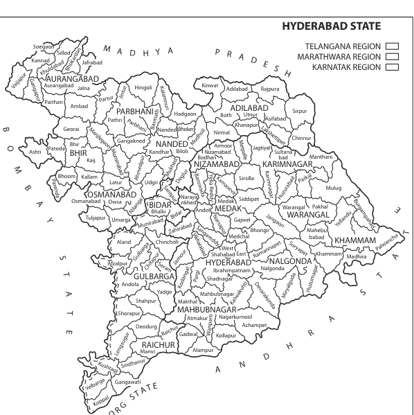
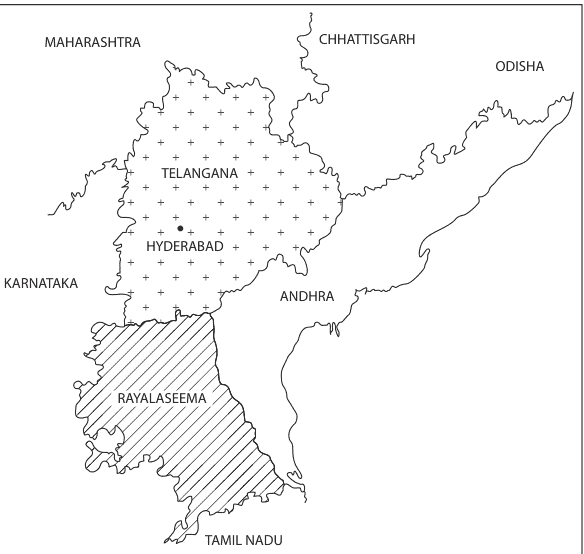

# 作为抵抗场所的大学：认同与学生政治

*大学作为反抗场所：身份与学生政治。Gaurav J. Pathania, 牛津大学出版社 (2018)。 DOI: 10.1093/9780199488414.003.001*

## 前言

当我散晨步时，图书馆附近的一棵大树下聚集的一小群人引起了我的注意。那是2012年12月我在海德巴尔的奥斯曼尼亚大学进行初步实地研究的第五天，我很享受在校园里漫步，观察学生生活。我好奇地走近人群。我想，可能有些学生正在抗议或在为当天的抗议活动做准备，这在奥斯曼尼亚大学艺术与社会科学学院（被称为艺术学院）是常有的。我穿过人群，发现他们正抬着一个自杀的年轻学生的遗体。一名学生在读遗身上发现的自杀信时，眼里含着泪。信中说明了他的家庭面临的财务危机，以及他的教育并没有换来工作。信的结尾呼吁政府在安得拉邦授予特伦甘纳地区单独的州地位。

两名学生给那位去世的年轻人拨打了葬礼电话。我听到观众评论这个地区有一个“自杀点”。通过听讨论，我发现受害者并不是艺术学院的学生，而是奥斯曼尼亚大学另一所学院的学生，这是一个日益增长的趋势的一部分，即外来人在这个“自杀点”自杀。随后，我回到了……（注：原文提供的文本在后续部分似乎存在逻辑断层或重复，此处已根据要求对现有内容进行翻译）。

（德里大学）G.G. Wankhede 教授（孟买塔塔学院社会科学学院）、Shivali Tukdeo 博士（班加加罗尔国立高级研究院中心）以及 Nina Asher 教授（明尼苏达州大学-双城校区）对身份与运动概念提出的建议。贾瓦哈尔纽大学（JNU）阿姆伯德卡讲座 Vivek Kumar 教授和 G. Srinivas 博士不仅提供了精神上的支持，还让我查阅了他们的私人图书馆。感谢新德里 JNU 的 B.R. 阿姆伯德卡图书馆和扎基尔·胡赛因教育研究中心的工作人员，并感谢海得拉巴的女性研究调查中心和海得拉巴英语外语大学的拉梅什·莫汉图书馆的全体人员。

在撰写这本书期间，我搬往美国从事博士后研究，不得不留下了几本书，但我在 JNU 的朋友们通过提供那些书中缺失的参考资料帮助了我。我非常感激我的 JNU 朋友们，特别是 Amit Kushw、Anil Yadav、Ankur、Ozukum、Gaurav Vijay Prataps、Inutsoshi Naga、Monika Badal、Narendra Yadav、Poonam Shah、Praganshu Amooni、Rakesh、Rahim Pal、Saeed Meesho Deo、Shahid Reza Khan、Shekhar Tokar、Vaishali Sahoo 和 Vijay Bhushan，他们听了我的实地调查故事。Shash Bhushan 和 Prabhakar 在周末在我们家做的饭为我们的学术热忱增添了额外的美味。

我深受南方南州大学 Bill Tierney 教授的鼓励，他在我大脑中种下了创作的种子。感谢 Nina Dey-Gupta 博士（德里大学），她总是抽时间审改我的稿件。我永远不会忘记她在住院期间，依然乐呵呵地从床上起来帮助我润色他最新的评论文章。我感谢伦敦大学东方与非洲学院（SOAS London）的 Weiner Menski 教授——我的第一篇研究论文就发表在他著名的期刊《南亚洲研究》上。导师 Sushrut Jadhav 的知识陪伴是无与伦比的。我感谢马萨诸塞大学大学镇阿姆斯特堡校区的 Sangeeta Kamat 教授、威廉·帕特森大学的 Balmurli Natranjan、贾瓦哈尔·纽哈大学的 Amit Thorat、德里大学阿姆伯德学院的 Narendra Thakur，以及哈里亚纳邦 Kaithal RKSD College 的 Rajbir Parashar。Sanjay Kumar（劳动力和赋权部助理专员）一直非常友善，经常给我打电话听取我的问题，进行详细讨论并建议新的阅读材料。

在写作过程中，以各种方式帮助过我的人包括 Alex 和 Lenore Balourchi、Blake Pederson、Kirti Kyab（波士顿布兰戴大学）、Derek Mitchell 和 Kathy Sreedhar、Yizreel Urquijo、Viviana Alejandra 以及来自华盛顿的 Ashok Panikkar。

非常感谢牛津大学出版社（OUP）团队在本书出版付出的专业精神。与他们合作是一次宝贵的学习经历。

Gaurav J. Pathania

2018年5月

## 注意事项

1. 文化在本体论上是“超有机”的，仅意味着它不是通过遗传传播的；且在波亚斯意义上，不同人口间的文化差异并非其生物学差异的功能（Schwartz 1992: 327）。

## 缩写表

- AASU: 全阿萨姆学生联盟
- ABVP: 印度全体学生委员会
- AIMIM: 印度伊斯兰教运动
- ASA: 阿萨姆甘纳帕达
- BASO: 贾鲁学生协会
- APCC: 安得拉邦尔共产党委员会
- ASKU: 阿姆伯德卡基尔学生联盟
- BC: 落后阶层
- BDO: 区级主任
- DMK: 民主进步联盟
- EFLU: 英语学生联盟
- GKS: 青年联合会
- MP: 议员
- MSP: 马哈拉农民联盟
- RJD: 拉贾斯坦民主人民党
- RSS: 印度民族自义者组织
- RSU: 激进学生联盟
- RTI: 信息公开法
- SC: 规定种姓制度
- SEZ: 特殊经济区
- SFI: 印度学生联盟
- SIMI: 学生伊斯兰教运动
- SRC: 国家重组委员会
- ST: 少数族裔
- SUCI: 社会主义统一中心（共产主义）
- TBVV: 特伦甘巴胡真人维迪卡
- TDF: 特伦甘发展论坛
- TDP: 泰卢固语德萨党
- TEJAC: 特伦甘员工联合行动委员会
- TN: 移民协会
- TGVP: 特伦甘吉真学生帕达
- TISS: 塔塔社会学院
- TKS: 特伦甘艺术委员会
- TLSO: 泰伦甘解放学生组织
- TMP: 特伦甘马迪加青年会
- TNM: 新唯物主义
- TNSF: 泰卢纳德学生论坛
- TPF: 特伦甘人民前线
- TPS: 特伦甘人民委员会
- TRC: 特伦甘地区委员会
- TRS: 特伦甘拉特萨提党
- TRSV: 特伦甘拉特萨提党学生分部
- TS-JAC: 特伦甘学生-联合行动委员会
- TSA: 特伦甘学生协会
- TSF: 特伦甘学生前线
- TSU: 特伦甘学生联盟
- TTF: 特伦甘教师联盟
- TVS: 特伦甘学生萨马姆
- TVUV: 特伦甘学生运动维迪卡
- TVV: 特伦甘学生维迪卡
- UJAC: 联合安得拉联合行动委员会
- UGC: 大学拨款委员会
- UoH: 海得拉巴大学
- UNDP: 联合国开发计划
- UP: 北北方邦普拉邦
- UPA: 联合进步联盟
- VC: 副校长
- VHP: 世界印度教教会
- YAF: 自由青年美国会
- YFE: 平权青年

## 引言

在过去的几年里，印度大学引发的一系列头条新闻，引发了知识分子对自主权、学术自由和言论自由的广泛讨论。2016年初，海拉巴德大学（UoH）管理层开除了安姆姆贝德学生协会（ASA）五名成员的学籍。两周后，即2016年1月17日，其中一名身份为罗希特·维姆穆拉的低种姓博士生，在宿舍室内通过上吊结束了自己的生命。他的死引发了海拉巴德大学的激烈抗议，这场运动逐渐演变为印度的一场大规模学生运动，被称为“罗希特·维姆穆拉后抗议”。罗希特自杀引发的波动爆发在抗议、游行和绝食中。从海拉巴德到新德里，这一事件引发大量的媒体分析和议会辩论。罗希特的自杀信是对种姓制度和阶级森社会的尖锐攻击，在他看来，“一个人的价值被简化为他巨大的身份认同和最近的亲缘关系，被简化为一张选票、一个数字、一个物品”，他将自己的出生描述为一场“致命的意外”。

在罗希特自杀后突然发生了另一起事件，由于该校位于国家首都是最自由的机构之一，引起了媒体的疯狂关注。2016年2月9日，贾瓦哈拉尔·内赫鲁大学因被指控为“反国家”校园而臭名昭著。据称，一组JNU学生在纪念穆罕默德·阿法扎尔·古鲁（Muhammad Afzal Guru，一名于2013年因参与恐怖袭击被处死刑的克什米尔人）去世时，反对死刑。小组中的一些学生被拍下为“自由克什米尔”的口号并批评印度政府。媒体介入并拍摄了该事件，这在一夜之间变成了全国性新闻。在右翼学生组织——全印度维迪亚帕里沙（ABVP）向警方投诉后，JNU学生会（JNUSU）主席坎海亚·库马尔先生及另两人于2月12日因煽动罪和刑事阴谋罪被捕，理由是他们组织了一场高喊反印口号的活动。媒体抓住了“民族主义者 vs. 反民族主义者”的二元对立，一些公共行为和举止在这些对立类别中被解读。坎海亚在监狱的经历引发了印度的一波学生运动潮。

各所大学，成千上万的学生教师参与了抗议。他们表达异议是一项基本权利，而非犯罪。连续几周，媒体面包车驻扎在校园门外。在监禁20天后，坎海亚于3月2日获得临时保释获释。整个运动被称为“自由运动”或争取自由运动。坎海亚·库马尔随后向聚集在JNU行政大楼前的人群发表演讲，喊出了口号：“我们要自由，但要在印度境内的自由。我们要饥饿的自由、贫困的自由以及种姓制度的自由。”

军方人员在社交媒体上发布了大量视频信息，诋毁该大学声誉并建议将其关闭。JNU被贴上“反国家”、“毒品、恐怖主义和纳萨尔主义的温床”，其学生被大众媒体标签为“叛徒”和“性工作者”。军队和媒体的这些叙述塑造了JNU作为“道德”社会中社会边缘群群的形象，并通过质疑大学的存在本身，掩盖了JNU过去在科学研究和民主建设方面为国家所做的贡献。为了自卫，JNU社区决定参与公民社会，并向国家介绍民族主义，他们认为民族主义被企业媒体和执政政府严重歪曲了。JNU的教员工与几位公共知识分子合作举办了一系列关于民族主义的讲座，并引发了公共辩论。这些讲座被录制并在网上发布。人们立即在社交媒体上对这些视频进行评论。JNU教授古帕尔·古鲁的讲座是该系列活动的开端，他质疑政府的“民族主义”是否是领土民族主义。这些抗议和演讲的地点——……记录、分类和分层”。

大学之所以成为大学，不在于它的行为，而在于它的产出。最终，贾瓦哈尔高等大学（JNU）正经历着两种文化的战斗：长期存在的自由校园文化与主流教育系统的保守文化发生冲突，后者由一位既不是 JNU 产物也与校园文化不同的校长所代表。

JNU 教职工和学生活动者的共同情绪是，大学的作用应该是研究和探索附着在民族主义象征意义上的意义，而不是去接受任何意义。许多人认为，作为一个参与式学习空间的大学正日益被推向思想的纪律化。JNU 教授 Avijit Pathak 表示：“在目前情感发生变化的环境下，我们正将政治敏感性与政治洗脑混为一谈”（Pathak 2017a）。Janaki Nair 教授（2017:39）提到“一种国家、军事和新民族主义文化权力的毒性混合，这种力量渴望限制——如果不是根除——更自由的思想和表达形式”。来自左翼的学生活动人士质疑右翼：“你们的民族主义理念是否包括那数百万在最恶条件下为了养家忍受饥饿而辛勤工作的母亲……它是否也包括那些受父权制之苦的达利特、部落妇女和穆斯林女性？”随后，许多学生对“母亲母亲”这一抽象概念采取了批判立场，并继续斗争以拯救他们大学闻名的自由空间。

在随后的几个月里，罗西的死亡和“自由”运动的影响主导了公众意识，并导致全国范围内引发了一波种姓和社区动荡。辱性信息指向了 JNU 的女学生领袖。Umar Khalid 和 Shehla Rashid 本应参加德里大学 Ramjas 学院的一场学术会议的小组成，但会场遭到 ABVP 袭击，导致活动戛然而止。一个接一个，禁令和暴力事件频频发生。在哈里亚纳德中央大学上演的戏剧《Mahasha Devi Draupati》遭到了右翼组织的反对，他们指责该剧是反国家的。其他事件还包括达德里私刑案、禁温迪·多尼格关于印度教的书、取消在辛比奥斯大学放映 Sanjay Kak 的纪录片《Jashn-e-Azadi》、在印度法学院学院放映 Anand Patwardhan 的《Ram ke Naam》，以及卡纳纳德语文学学者 M.M. Kulbarghi 被谋杀，他曾对其社区的偶像崇拜提出质疑。这种对他人身份（即宗教、种姓、性别、族裔和国家）的“不宽容”行为在乡村和城市变得随处可见。作为对右翼政府不作为行为的一种抗议形式，30 多位著名艺术家、作家和学者（包括大学教授）退还了政府授予他们的奖励。知识分子发起了一场“不宽容辩论”，以参与并教育大众。执政当局恢复并加强了右翼学生政治，导致大学校园内某些团体和活动被禁。例如，印度理工学院（IIT）钦里纳分校禁止了由计划种姓（SC）、计划部落（ST）及其他落后阶层（OBC）学生建立的 Periyar 研究小组，引发了钦里纳和新德里学生的反抗。海德巴尔大学管理层针对抗议制定了新规定。随着这些重大近期事件的发生，大学校园发现自己与公众、媒体和政治家处于对立状态。在海德巴尔，活动人士质疑大学当局，将罗西·维穆拉的死亡视为制度性的标志，并要求校长辞职。在海德巴尔大学毕业典上，一名学生拒绝从校长手中接过博士学位。罗西自杀的影响比管理层预期的要深得多。同样，“自由”运动团结了 JNU 的左翼和自由派学生反对基本力量。

### 大学作为抗争之地

海德巴尔和新德林的事件反映了公立大学教育在竞争时代不仅关乎个人利益或职业发展，还关乎社会正义和一个充满智力活力的空间。学生的活动迫使他们思考大学和高等教育机构为何会成为抗争之地。过去世纪提供了全球范围内学生反抗的充足证据。激进变革源于大学校园并挑战权威规则，以确保一个拥有自由思想的社会。20 世纪 60 和 70 年代，欧洲和美国爆发了一场社会运动潮。数千学生催化了反战运动，特别是反对越南战争的运动。20 世纪 60 年代，伯克利、哥伦比亚、普林斯顿等校园对法国、德国、意大利、波兰和前捷克斯斯洛克的欧洲历史学生大学产生了巨大影响。评价这一时期时，乔姆斯基（2013: 29）指出，“学生[突然开始]提问，而不仅仅是记录”。环境、种族、性别和性倾向问题以以前所未有的方式提出。马丁·路德·金的对民权的斗争和马尔控·X 的“黑人权力”运动标志着替代声音时代的到来。几十年前，19 世纪和 20 世纪初的法国、德国和俄罗斯的学生采取了“放弃式的个人风格，包括女性中的长发男、彩色眼镜、脏衣服和生活方式，以及对粗俗语言的强调”（Lipset 1971）。

自 21 世纪开启以来，尽管存在年轻人缺乏参与且缺乏政治真实性的情绪，但世界见证了学生抗议人数显著增加。最剧烈的发生在英国、德国、美国、加拿大、智利，最近的南非，它们因反对教育预算削减和大学学费的诉求而团结在一起。近期的学生活动不仅限于高等教育问题，正如美国的“占领华街”运动、阿拉伯之春、土耳其反对收紧政策的抗议以及香港的雨伞运动所所示。在南非，2015 年，成千上万的学生反对学费上涨，并在开敦大学反对帝国主义者西西尔·罗德雕像。在美国，反对暴力的“黑人的命”运动席卷全国。正如 Brooks（2016）指出的，在线资源的推动下，当代学生政治是时代的象征。学生不再满足于现状，以多种方式他们他们的不公。

### 印度大学运动：变化的格局

西方政治对全球南方的学生政治也产生了深远影响。在对 20 世纪 60 年代到 80 年代的研究中，Altbach（1984: 64）将西方与其他世界进行了比较。他发现，几乎所有国家的社会科学学生拥有最自由和激进的观点。他观察到领导层是由国际化、富有且背景特殊的学生组成的。Altbach（1966, 1968, 1969）的开创性工作也强调了左运动的贡献。有趣的是，在他研究之后，关于 80 年后的印度学生运动，既没有全球性的讨论也没有分析（Ciott 2006; Jeffrey 2008, 2010; Jeffrey and Young 2012; Jeffrey, Jeffrey and Jeffrey 2004, 2005; Kumar 2012）。然而，大学校园学者强调了意识形态活动空间的存在，学生利用它来扩大自己的自由和自主空间。在过去的二十年里，学生主义的形式发生了重大变化。许多学生组织发挥了重要作用，包括第一个（左翼）意识形态学生团体——全印度学生联盟（AISF），政党对独立后的学生政治表现出不感兴趣。首任总理贾瓦哈尔·尼赫鲁的名言“回到学生去吧”，证明了政治并没有满足学生的需求。事实上，在独立后阶段，研究将问题描述为校园或动荡。

20世纪20年代的不合作运动。几乎所有的省份和地区大会工作者都是20多岁的离校大学的学生工人。到20世纪30年代，学生在各个战线上都处于领导地位。1936年，首届印度学生会（AISF）诞生，在追求独立的过程中在青少年中培养了民族主义情感。

独立后的印度有一些著名的城市，如贝纳纳斯、阿拉哈巴德、勒克诺和帕特纳，这些城市在历史上享有盛名，不仅是因为教育质量，还因为它们的活动主义精神。然而，Desai（2008: 80）指称，某些大学校园已成为“学生和教师工会中培养黑手政客的温床”，而且“由于高级党领导人将大学和教师工会视为在选票库中使用的有效武器，流氓行为得到了领导人的准许（Desai 2008）”。他指出，这背后的原因之一是大多数印度大学的学生构成是本地或区域性的（Desai 2008）。另一方面，最好的西方大学寻求从世界各地吸引学生和教职员工。Guha（2008）举了诺贝尔奖得主拉宾德纳特·泰戈尔发起的"visubabharti"为例，作为全球大学的典范。古吉拉特邦的大学在JP（Jairajrak Narayan）运动开始了Nav Nirmag抗议。一次关于宿舍食堂的小抗议演变成了一反对物价上涨和腐败的全国运动。

尽管印度高等教育被认为主要由政府资助（Agarwal 2009: 46），但在现在新自由主义的框架下，“教育已从教育工作者手中转移到政治家、官僚以及具有强烈议程的文化和宗教组织手中”（2009）。1991年经济自由化的到来导致国家和国际非政府组织（NGO）的激增。这些非政府组织重新定义了国家和社会社会，“挤占了一些更具抗议倾向的组织形式”（Ray and Katzenstein 2005: 9）。他们认为，20世纪70和80年代以去制度化为特征的碎片化政治领域已被新的制度化所取代，并辅以市场和印度民族主义的双重意识形态（Ray and Katzenstein 2005: 9）。目前，印度有800多所大学。其中包括47所中央大学、366所立大学、122所认定大学（deemed-to-be universities）和279所私立大学。高等教育机构面临的挑战是在国家控制与市场驱动的经济之间取得平衡。现在的主流观念是“大学应该是对市场友好的”（DeSouza 2015: 94），并作为技能工厂而非批判性思想的空间。根据Pathak（2017b）的说法，这种新的实用主义破坏了大学的理想主义。“排名和质量”两个关键词已成为高等教育的绩效指标。每所机构都对自己进行市场营销，以相似的标准与其他机构竞争。这种竞争一方面导致了“机构同质化”（Nair 2017），另一方面削弱了非市场导向的学术学科的力量。对“生产”驱动的成功的强调仍然是“创新大学”的首要议程（Nair 2017）。这不仅对大学的自主性是一个严峻挑战，对大学的目标也是如此。如果自主性受到挑战，就会限制自由和表达，而这些是抵抗可能的领域。从理论上讲，大学有“培养具有批判性思维的学生的责任或义务，这些学生能够综合、发现联系、评估论点并确定问题的根源”（McLaren 2005: 273）。换句话说，大学的教学法应当具有解放性的目标和批判的自由。

# 作为民主机构的大学

全球学生运动的历史表明，大学在挑战知识生产形式的传统的同时，一直在为自己的生存和自主权而战。尽管有国家的干预，学者群体构成了世界上最长久的民主形式之一（Visvanathan 1999: 51）。一系列学者（Apple 1996, Bernstein 2000; Giroux 1983; Habermas 1967）将大学视为一个抵抗正义、伦理和政治能力的民主机构。为了使这种机构成为可能，我们必须对传统的“民主”及其长期教育等提出问题，正如Giroux等人（1988）所示。在群众中，有一种倾向于将大学生活视为脱离现实的泡沫——通常被称为“乌托邦”，人们在进入“现实世界”从事职业之前幸运地度过几年。相反，Indresar（1999: 152）认为“校园不能对社会的发生事件视而不见”。校园政治是理解主流政治运作及其内部机制和过程的空间。运动和活动是为了挑战现有政治。因此，完全基于校园并主要关注大学问题的运动是罕见的（Altbach 1984: 63）。正如Touraine（1971: 332）所说，“大学不是社会的反映；它是社会，因为它处于社会变化的中心”。

大学一直是Visvanathan（2016a）定义的危机与民主的试金石。没有伦理和哲学想象，任何民主无法生存（Visvanathan 2016b: 10）。这是知识社会的民主方面，“学科与异议的关系”。Visvanathan（1999）强调了大学与自由民主之间的关系。他认为，“创造力”将产生于两者。学生政治、他们的活动和抵抗保持了这种民主精神。在Giroux（1991: 502）的话中，大学是“政治和文化竞争的场所”。因此，大学从人文主义方法进口“人文价值观”以形成全球社区。

作为一个机构或组织，大学作为“理论与实践之间的中介形式”（Lukács 1968: 299）。大学与社会之间存在着“共生”（Pant 2008: 171）和“互动关系”（Heredia 1996: 66）。大学与现实生活和国家需求有着密切的关系，它始终关注培训年轻一代的实际事务（Humboldt 1970: 240; Giroux 1977: 263）。因此，大学不存在于真空之中；它们是社会的重要部分。总之，大学作为一个思想自由的空间，通过其活动塑造社会的传统织结构并带来社会变革。

Newman、Blehl、Bombogan等等人讨论了大学的自由角色。Newman（1982: 15）在其畅销书《大学理念》中写道，“大学的名字本身与任何限制是不一致的”。因此，“将美德或宗教训练作为大学直接目标是错误的”（Blehl 1963）。对于这种“智力殿堂的普遍教学”存在真实性（Newman 1982: 15; Culver 1965: 261）。

## 作为抵抗场所的大学

Habermas对德国大学的基本理念进行了批判，并脱离了康特-黑格尔-雅斯贝尔斯对大学“理念”的信仰，对这一理念本身提供了批判性的更新。他从“共同自我理解”的角度提出了对大学理念的更新（Habermas and Blazek 1987: 39）。Bhushan（2016: 3）指出，大学是理性力量在狭隘和开明的人之间传播的地方；自我反思或哲学化将成为所有科学的统一力量。

世界上最大的民主国家印度拥有超过37000所高等教育机构，拥有3230万学生和1367535名教职工。该国每年产生约三百万毕业生，在世界最大的高等教育系统中排名第三，仅次于美国和中国（Pant 2008: 170）。随着20世纪90年代新自由政策的到来，印度经历了新的社会政治动荡。学者们讨论在新自由主义模式下，财政和公私合作伙伴关系领域的挑战（Bhushan 2013; Chattopadhyay 2012; D’Souza 2004; Kumar 2002; Patnaik 2007; Prakash 2011; Tilak 2013）、自主、入学、公平、质量和卓越（Chattopadhyay 2009; Khora 2015; Kumar 2016; Lall and Rao 2011: 26; Prakash 2011; Tilak 2013b）以及排斥（Guru 1995; Neelakandan and Patel 2012; Attewall and Thorat 2007）是否解释了在当前市场自由化时代教育如何变成一种商品，以及教师如何成为“知识商人”（Pathak 2017b）。通过将责任“让渡”给私部门政府直接使民主概念产生问题，Jessop（2002: 199）称这一过程为“去国家化”。另一方面，学术腐败、大学无序扩张、中介人在“安排”学位和证书方面日益增加的作用等严峻问题贬值了高等教育，使其成为负担得起的人可以购买的商品。此外，裙带关系、贿赂、学术腐败以及招聘校友或个人关系都产生了一种狭隘，Guha（2008: 9）解释道。无论是基于身份、意识形态还是机构，这些形式的狭隘对大学生活都有腐蚀性影响，这种狭隘“破坏了教学质量，缩小了教学科目范围，并污染了通性的知识氛围（Guha 2008: 9）。³30 因此，由于这些问题和政策的变迁，高等教育已成为一种遥不可及且昂贵的“商品”。这种从公共物品向私有财产的转变深刻地影响了社会。

## 大学作为想象的场所

大学是一个“教师与学者的共同体”（源自拉丁语 *universitas magistrorum et scholasticorum*），它充当其他社会机构之间的纽带，并通过其研究帮助解决社会、经济和政治问题。用于个人大学或学院的 *alma mater* 一词，字面意思是“养育之母”或“育育之母”，暗示这是一个为学生提供智力滋养的教育机构。Bombangan（2008: 483）指出，大学是“人类获得良好滋养的子宫”。类似的说法在其他文化中也能找到。在印度，教育女神萨拉斯瓦蒂（Saraswati）被人们亲切地称为“Maa Saraswati（萨拉斯瓦蒂母亲）”。印度许多大学校园内都有庙，许多大学标志也包含了她的形象.³31 印度教育的历史和教育机构的本质是神圣的，其起源于过去的“师徒传承”（GuruShishya）传统（印度政府 2016: 1）。Lynch、Crean 和 Moran（2010: 297）表示：

- “大学是社会中少数几个机构之一，人们在那里有机会进行批判性思考，并把这些思考记录在文字中。”Thapar（2015: 35）将大学定义为一个“对既有知识进行评估、并在需要时修订，并确保其跟时，且应当创造新知识的地方”。这是一个人们可以在此行使智力自主权的空间……

在 2016 年于哈瓦举行的国际大学大会上，阿根廷社会学家阿尔特利奥·博尔（Altilio Boror）表示，“大学必须是批判性思维的中心。这并不容易。我们必须确保它是讨论包容性思想、进行对话和辩论的中心.³32 Tierney 和 Sabharwal（2016: 9）建议，“大学应该是一个嘈杂的对话场所，鼓励个体之间相互争论”。

近期关于印度大学校园学生政治的文献强调了过去十年中的各种事件，其中达利特（Dalit）、部落（Tribal）和后阶级（OBC）学生利用他们的身份和种姓文化作为主张媒介，采取了一种新的行动主义（Pathania 2016）。2006年，海德拉巴大学的达利特学生会计划在年度美食节 Sukcoon 中供应牛肉（Gundimeda 2009）。针对大学管理的禁令，达利特学生组织了多次抗议，并质疑为什么食用鸡肉被认为是“世俗的”，而食用牛肉被描绘成“宗教的和反印度的”。Gundimeda（2009: 131）将达利特学生的这一行动描述为“迈向代表平等的一步”。学生认为，牛肉在大学校园外是公开的，那里并没有在消费者和非消费者之间制造紧张。根据达利特学生的说法，其意并不是要在素食者和非素食者之间制造分裂，而是让校园更具包容性，使每个人的文化维度（包括饮食习惯）在国家多样性的更大背景下得到尊重和理解。正如 Pathania（2016）所言，这种抵制可能对抗现有的种姓霸权，并预示着校园内一种新政治的出现。达利特学生并没有天真地将牛肉问题视为纯粹的感情，而是将其用于政治挑衅，以获得对公共空间的控制。

多年后，2012年4月16日，国家性报纸报道了几乎整个海德拉巴奥斯曼亚大学（OU）的达利特学生组织了一场“牛肉节”的故事，这在遭到右翼学生的反对和攻击时引发了暴力冲突。与此同时，在贾瓦哈尔国立大学（JNU），一个名为“唯物主义者”（TNM）³³的学生小组也反对“婆罗门式”的模式。他们组织了关于印度饮食文化的各种讲座和辩论。一个“民主食品选择权委员会”与 TNM 联合于2012年9月17日在校园内组织了一场牛肉节，以纪念**烈士·巴加特·辛格（Shaheed Bhagat Singh）的生日。大学管理层同新里警方禁止了活动的举行，但该问题引发了日常闲谈。类似的牛肉辩论也在塔塔社会科学学院（TISS）发起。学生行动主义还导致政府要求一些顶尖理工学院（IITs）和信息理工学院（IITMs）为素食学生开设了独立的食堂.³⁵。然而，只有 5% 的学生是素食者（8000名学生中的400名）。

因此，根据孟买理工学院达利特特活动人士的说法，这种“饮食指令”正试图主宰其余 95% 人的议程.³36 Pant（2008）写道，“印度高等教育已成为服务于各种社会政治目标的另一个工具，并丧失了其真正的目的，放弃了对教育在自由民主中作用的任何愿景”（2008: 173）。德里大学的苏库马尔（Sukumar）教授写了他在海德拉巴大学学习期间，和其他达利特人面临的歧视和敌意：

> “像‘巴卡苏拉（Bakasura）和库姆哈卡尔纳（Kumbhakarna）餐桌’这样的评论通常是非达利特学生和食堂工作人员所说的……肮恶的言论被涂在海报上以侮辱他们。辱骂性的言论如‘猪’、政府的女婿、‘杂种’、‘神之’、‘丐’等等……”

## 大学作为反抗场所

坎恰·伊拉伊亚（Kancha Ilaiah）开始在奥斯曼亚大学庆祝自己的生日为“国家教育日”。教授级活动人士坎恰·伊拉伊亚开始在 OU庆祝自己的生日为国家教育日。在海德拉巴，过去几年里，OU 的学生向德拉维达战士纳拉卡·舒拉（Naraka Shoora）致敬，他传统被描绘为一个被雅利入侵者杀死的邪恶角色。一种“住民”nivasi³⁰的新叙事主导了达利特-后裔的话语，认为达利特是这个国家的原住民。这些是构成学生行动主义的新声音和主题。

在全国许多校园，达利特的主张在过去十年已成为现实。在2007年的 JNUSU 校长辩论中，一位后裔学生线（BSF）候选人将印度教神罗摩（Rama）比作撒旦⁴¹。他的演讲引发了右翼的报复和暴力。此外，自2010年以来，全印度后裔学生论坛（AIBSF）一直在组织马哈希苏尔殉难日（Mahisasur Shahadat Diwis）……焚毁流行的印度经典《曼奴手册》（Manusriti）⁴¹也象征着对上种姓文化霸权的拒绝，并挑战了关于民主自由空间的辩论。这些都是大学学生挑战规范并为包容性和表达自由铺道路的少数例子。从喀拉拉邦到海德拉巴再到的大学，左翼和达利特学生组织正在用“蓝旗”（neel salaam）对抗共产主义的“红旗”（lal salaam）或“贾伊·比姆-红旗”（Jai Bhim-Lal salaam⁴²，向阿姆德贝德尔和马克思致敬）。这些叙事质疑了教育空间作为“vidya mandir”（知识殿堂）的讽刺性形象。

通常而言，特别是高等教育，是达利特被拒绝进入的领域。在接受教育之前，达利特人领导了争取进入其他公共空间的运动。例如，1927年在马哈哈拉施拉邦，“不可触碰者”在阿姆贝德尔博士的领导下发起了马哈德真理运动（Mahad Satyagraha），以获取公共水池的水。

（参见 Kumar 2007）。那一天现在在印度被定为“社会赋权日”。1930年，安姆贝德领导了一场名为“纳西克卡拉姆神庙真理和平运动”（Nashik Kalaram Temple Satyagraha⁴³）的进庙运动，以争取进入寺庙的权利。1924–25年，喀拉拉邦发生了一场类似的进庙运动，被称为“维考姆萨提格拉哈”。这些都是许多低种姓印度人所面临的日常斗争的典型例子，也激发了达利特（Dalit）活动人士。

大学空间充满了学生活动人士创造的叙事和反叙事，用对抗现有的叙事。许多此类文化主张叙事产生了新的符号和偶像，挑战了教育领域传统的种姓霸权。这是一种关于身份抵抗政治的新型叙事。在少数校园里，达利特-巴胡曼集团（如JNU的BAPSA）的强力崛起呈现了一种新的巴胡曼叙事，并呼吁达利特人、后进阶级（OBCs）以及宗教和性少数群体创造集体的政治声音。在选举期间，此类叙事（反民族、反预留制和基于种姓的）会唤起个人的身份及其与之相关的历史。它们在定义自己的议程、政治和意识形态以对抗政治对手方面起着作用，尤其是在选举期间。这些叙事作为异议的工具，创造了反话语。它们挑战既有历史的根源，构建并解构我们的身份，并根据我们的历史和意识形态来定义我们。它们是政党的文化资源，并逐渐转化为自身意识形态的一部分。大学校园是意识形态的滋生地；因此，大学及其知识分子有责任为学生提供新的认知工具，来辩论这些叙事并想象新的叙事。基于此，应当考虑以下问题：大学教育有什么普遍性？意识形态有什么普遍性？

“当代社会冲突不仅仅是政治性的，因为它们影响了系统的文化生产”（Beckford 1989; Melucci 1985; Off 1985; Touraine 1985）。Melucci认为，新社会运动（NSM）领域与政治体系之间“日益自主”。它们形式与旧的政治组织截然不同，Melucci认为，形式本身就是信息。在现代化和创新之外，运动对社会提出了其他层面的质疑：谁来决定代码？谁来确立常态规则？差异的空间在哪里？一个人如何能够不是因为被接纳，而是因为被接受为差异性而获得承认？不是通过增加交换的量，而是通过肯定另一种交换来如何？”（Melucci 1985: 810）。

# 身份抵抗政治

当今印度的政治表明，阶级政治正在衰落，而身份政治或身份抵抗政治正在兴起（Pathania 2017）。左翼政党长期以来将阶级的复杂性投影为阶级政治，从而简化了阶级的复杂性（Pathania 2017）。他们尚未磨炼出清晰的策略来理解印度特有的这些社会复杂性。此外，投射阶级概念削弱了民主为了创造平等社会所要求的反种姓议程。另一方面，中间派力量和右翼将政治作为解决这些问题的工具，这吸引了大众。意识形态可能会打破这种习惯——“文化是百科全式的知识，个人变成了一个更大的数据容器……这种形式的文化是有害的，特别是对无产阶级”（Giroux 1999）。

教育领域正在进行的抵抗可以从这样一个角度进行分析：来自边缘社区的学生正在对现有的主流文化产生一种反文化。对于格兰西来说，对教育的任何分析只能结合现有的社会文化形态及其隐含的权力关系来理解。格兰西强调，学校只是更广泛的经验、历史和集体斗争网络中的一种政治教育。鉴于格兰西对政治教育的观点，很难将他的教学观点还原为实证主义的还原论，在这种还原中，特定的方法（如死记硬背）受到支持，而不质疑这种教学实践是对共识机制、常识和主导社会关系的内含还是对这些的抵抗（Giroux 1999）。这些时刻蕴含着纳入关怀和批判性教学法的潜力，使教师和学生都能有意义地参与到对我们在压迫体系中所处的培养中。

大学，尤其是住宿制大学，是一个转型相遇的场所，拥有截然不同的生活形式、饮食文化和宗教实践。在独立后的印度，宿舍具有某些教派特征，特别是在公立大学，并开启了各种新机会（Nair 2017: 38）。根据Sukumar（2016）的观点，“教育应当是开启激进社会变革和解放的工具，使被压迫社区能够推翻数百年的社会文化负担”。在印度大学校园内正在进行的学生运动（来自边缘社区的学生）提供了“对既有霸权的新认知理解”，并证明了“学术领域不再局限于‘传统’的学习空间，其本身已成为一个反霸权主张的场所”（Pathania 2016: 271–2）。或许与其说是教室，不如说是宿舍放大了这些可能性和困境。在一个假想的世俗空间内，关于种姓、宗教和社区的日常文化政治，揭示了印度产生现代世俗公民时充满矛盾的动态机制（Lukose 2006: 44）。

自独立以来，印度各地出现了几种区域身份运动。安得拉普德邦、泰米尔纳德邦、阿萨姆邦、旁遮普邦、哈里亚纳邦、北方邦以及印度的许多其他子地区都有基于语言、种族和社会边缘化的争取独立的斗争史。

# 引言

逐渐，基于种姓的学生组织演变为更为微妙的、基于文化的身份认同政治运动。这反过来又促进了学术界对达利特研究的关注（Rege 2006, 2010; Satyanarayana and Tharu 2011）。进一步的揭示了“种姓的当代性”作为现代印度文化和政治中活跃力量的问题，并揭示了印度社会中的许多矛盾，特别是关于种姓思维（Satyanarayana and Tharu 2011: 9–10）。然而，印度社会和政治在很大程度上拒绝种姓的存在。曼德尔预留政策的支持者（通常是低种姓公民）被视为种姓主义者（种姓歧视的支持者），而反对预留者倾向于将自己表现为维护国家利益者，并将自视为精英公民。因此，种姓本身往往与低种姓群体联系在一起。上种姓的普遍类别则（Deshpande 2013; Satyanarayana and Tharu 2011: 11）。因此，学者们倾向于将大学、知识分子和城市地区视为种姓几乎失去相关性的地方。

在进行过研究的大学，歧视并不是显性的，这与其他社会环境（如农村地区）不同，后者的等级制度和互动模式是基于种姓身份的。印度著名的大学（如 EFLU 和 JNU）吸引了来自不同文化地区和州的学生。在这样的多元文化环境中，种姓差异的表达变得更加复杂，因为区域互动失去了它们的意义。在大学，学生至少在形式上进入了一个世俗环境，他们必须通过共用宿舍、食堂和教室来克服种姓障碍。学生不可避免地扩大了他们的社交网络。另一方面，也有观点认为，“大学环境几乎不可能让一个人做到‘种姓匿名’”（Galyrite 2015: 59–60）。大学里的低种姓学生终生都被贴上“配额获得者”的标签。达利特人的共同经历“恰恰恰地描述了歧视在大学环境内是如何体现的”（2015: 60）。

领先的达利特政治学学者戈帕尔·古鲁对达利特大学经历的描述如下：“对语言代码、协议、肢体语言和基本规则的严格遵守，有效地将研讨厅变成了一个敌对结构，这种结构往往给达利特人带来羞辱，他们感到太紧张或恐惧而不敢进入这种结构……”（Guru 2012: 20）。

语言似乎是达利特身份代表其自身的最重要因素之一。绝大多数达利特学生来自文盲家庭，就读于教学语言为当地地方语言的学校。一旦进入大学（英语是主导语言，并因此成为高种姓/上层阶级地位的象征），达利特人在应对语言障碍时面临着严峻困难。即使在达利特人掌握了一些英语后，这往往也会加剧他们与来自英语中学私立学校背景的学生之间的差异。由于对英语的接触有限，达利特和其他底层学生没有足够的信心来用英语进行公开自我表达。因此，公开演讲由那些对英语游刃有余的高种姓/阶级背景的学生主导。在教室里，英语连随着复杂的知识术语变成了达利特人表达自己的主要障碍（Harinath 2013; Paik 2016; Pathania and Tierney 2018; Sukumar 2008: 15）。

## 作为文化政治场所的大学

> “教育制度旨在平庸人们，让他们变得被动、纪律和服从。”
>
> 乔姆斯基在接受 Meyer 和 Alvarado 采访时（2010: 12）

乔姆斯基将教育定义为启蒙，即培养挑战权威的冲动并要求批判性。他将教育的对立概念定义为洗脑。46 Giroux (1981: 109) 将其称为一种还原过程，这个过程不仅服务于统治者的利益，还包含了冲突和变革的种子。大学的作用是促进批判性思维，分析社会的“共同科学”，并质疑既定的真理（Abraham 2016）。Thapar (2016) 与其他学派一样，强调需要批判性教学法47 使大学成为社会变革的场所、现代化的机构以及激进变革。我们从 Giroux 的“激进教学法”中获得了希望、批判性反思和集体斗争的表达（1989: 113），这种表达并未脱离政治。对他而言，具有批判性意味着对教师限制和可能性的政治参与。批判性教学法不是拒绝政治语言，而是必须将教育与批判性民主的要求联系起来（Dewey 1961; Giroux 1989）。Giroux (1989: 32) 将教师称为“变革性的”，将学校称为“重复制批判性民主作为一种支持个人自由和社会公正的社会运动这一理念的公共场所”。通过将学术视为一种文化政治，教育者可以将文化和差异的概念结合在一起，创建一个边疆，在这里，多种主体性和认同作为教学实践的一部分存在，这种实践提供了扩大民主社区和团结政治的潜力（Giroux 1991: 516）。

过去十年的学生运动显示了权力的批判性重构。达利特学生要求自我代表的空间和平，以及在大学食堂获得牛肉的权利，或至少在“牛肉节”期间吃牛肉的权利。当达利特群体开始描写此时，牛肉辩论进入了更广泛的公众。印度正在经历新形式的主张。去年在在德里，数百名女学生发起了一场名为“Pinja Tod”（撕掉窗户）的运动，以反对性别歧视性的宿舍规则。49 过去几年，活动人士还在德里组织自傲游行。2017年9月，女性发起了反对在瓦纳纳斯印度大学（BHU，位于北方邦拉什邦的一所中央大学）性侵事件的抗议。50 这些抗议的独特之处在于其多样性，因为在 Butalia (2012) 看来，它们不仅仅是“女性问题”，而是女性和其他边缘群体每天在社会中经历的深层暴力的象征。随着高等教育和通过预留政策机会的持续扩大，大学的阶级、种姓和性别构成发生了显著变化，但并非没有紧张。例如，阿拉哈巴德大学联盟首位女主席里查·辛格“对抗了印地语带校园内根深蒂固的男权制”（Menon 2016），成为来自社会和经济边缘化家庭学生的灵感。

这些事件质疑了“霸权的压迫性的婆罗门民族印度教文化”，并为“通常通过对立符号手段的不可接触者的反抗文化”寻求关注度是（Hardmann 2009: 236-7）。在他们的社会运动中，达利特人创造了一个更广泛的社区领域，“在这里，差异政治可以表达自己，种姓可以作为民主政治的一个合法类别”（Pandian 2002: 25）。同样，达利特文学在近期成为一个合法且受欢迎的类别，它始于一场关于“文学不可能是达利特的”的无休止的争论。然而，由于文学是社会的镜子，如果社会以种姓不平等为特征，那么显而易见，相应的文学将会演变。但达利特文学的出现不仅局限于对种姓制度的批判，也针对其起源，并发现印度教是一个基于结构性等级的体系。它不仅挑战了宗教，还质疑了种姓制度的存在。有人认为，由于印度文化由宗教主导，除非对印度教圣经进行大规模改写，否则达利特人的知识困境将无法缓解（Ilaiah 2001: 57）。

印度受过大学教育的阶层生活在悖论之中。虽然他们将自己塑造为反种姓、反父权、进步等形象，但他们对在自我介绍中使用种姓姓氏以及按同种姓通婚感到自豪。在印度的任何角落阅读早报，人们都能体验到这一点。婚姻广告强调了种姓、子姓、地区和地域。这些暗示表明我们需要批判性地审视高等教育。大学是如何将狭隘思维纳入学生之中的？根据 Beteille (2007: 447) 的观点，“如果种姓制度今天在大学中扎根得更深，那么其主要责任在于政治组织的方式”。因此，二十一世纪的挑战是实现那些长期处于社会边缘的人的文化潜力。这通过在教室中纳入每个种姓、部落和语言来使课堂多样化是可能的。“民主的判断不能仅仅取决于形式上的制度，而要取决于来自人民不同阶层的声音在多大程度上能够真正被听到”（Touraine 1997: 190）。它的存在意义在于对“他者”的承认。人们公正地观察到，“身份与不平等之间的关系是印度世俗主义和民主的首要问题”（Tejani 2007: 265）。

随着印度大学学生群体不断增长并反映社会的多样性，辩论和争议的问题也随之增加。大学是一个“以创新方式利用过去的未来主义机构”（Visvanathan 1999: 50）。如果说过去的特征是社会矛盾和敌意，人们应当期望这些机构能纠正历史错误。各种报告和委员会建议了多项处理大学歧视的措施，但对间接歧视尚缺乏衡量。David Mosse (2012) 得结论认为，种姓制度已经转向内化，现在作为一种“内心/心中的感受”存在。因此，种姓制度的存在和持续在人们脑中深化。没有机制可以捕捉这种现象。Khora (2016) 在回应 Rohith Vemula 自杀事件时建议在教育机构中进行“定期歧视审计”。

## 本书重点

本书关注区域身份方面，对特伦甘纳建省运动提供了民族志描述——这是印度持续最长的学生运动之一，该运动于1969年在奥尔哈拉大学作为抗议运动发展起来。这场运动是两个说相同语言（特卢固语）但口音不同的地区之间文化主张的独特案例。

印度独立后，特伦甘纳地区与安得拉邦地区合并。这次合并引发了建立政治上独立的特伦甘纳的需求。建立独立邦的想法最初由特伦甘纳员工提出，但奥尔哈拉的学生接手了这一问题并在1969年领导了这场运动。他们为期一年的抗议让该邦陷入混乱。在动荡期间，数百名学生在警察开枪中丧生。牺牲了事业的学生变得激进，离开工会加入极端组织，拿起武器继续与州当局斗争。在经历了二十年的“反政府”活动后，许多学生意识到，要实现特伦甘纳，他们必须找到民主的替代方案。他们重新信任选举过程，并在2001年成立了新政党——特伦甘纳民族委员会（TRS）。这激发了活动人士对权力的重新渴望。2009年至2014年期间是这场抗议运动的第二阶段。

在学生和农民近半世纪的斗争和无数次牺牲后，特伦甘纳于2014年6月2日成立，成为印度的第29个邦。政府宣布特伦甘纳成立后，全印度对独立邦的需求再次被点燃（即西孟加尔邦的戈尔卡兰、阿萨姆邦的博多兰德和马哈哈拉特拉邦的维达哈布）。这些需求中的许多是在大学校园提出的。理解这些需求在青少年中的起源是很有有趣的。在什么样的背景或情况下，这些需求演变成了校园内的骚乱和运动？在特伦甘纳运动中，区域身份是如何穿梭于校园及反之的？区域身份又是塑造大学生的政治理解的？

这些概念性问题对于理解我们所经历的抗议、骚乱和运动结果非常重要。Rao (1972)、Weiner (1978) 和 Suri (2002) 强调了学生、非文官官员和政治家在特伦甘纳运动中的作用。

本书的目的是考察大学空间如何促进学生活动主义，并为特定目标（在本例中，为印度最新省份的形成）提高身份意识。它试图说明学生如何在校园内外动员、建立网络并制定策略，以产生印度最持久的社会运动之一。在高等教育极端私有化的时代，公立大学及其成员如何与国家进行导航和谈判？在此背景下，本书认为，必须研究学生活动不断演变的性质，以理解更大社会运动的影响。它认为，大学空间仍然是反抗和集体行动的资源。

## 本书结构

在关于旧新社会运动的概念性辩论下，第一章题为“特伦甘纳运动：文化-政治话语”，对文化作为政治、社会统治、边缘化和反抗的状态提供了理论见解。它在“内部殖民主义”的框架内理解“特伦甘纳问题”，该术语由第一个邦重组委员会（1955: 105）使用。它试图理解活动人士的经历以及塑造他们动机、思想和身份的更大力量。它确立了运动唤起了语言/口音、食物、服饰、艺术、戏剧和音乐等各种当地文化符号作为反抗形式，以发起反对安得拉人“主流”文化的群众运动。特伦甘纳人称他们为“外来”、“非本地”或“定居者”。

第二章题为“大学：学术、文化与政治”，提供了活动人士对奥尔哈拉大学五十年活动的叙述。它说明了“反抗文化”和“活动文化”是由有机知识分子（学生和教师）创造的，并培养了一代校园活动家。第三章和第四章分别题为“校园网络与骚乱：学生活动家的塑造”和“从过去学习，想象未来”，基于民族志观察、正式正式讨论以及学生领袖的采访。它们还解释了现有的校园文化如何产生并维持各种网络，以及这些网络对运动的成功起到了什么作用。此外，第四章比较了了969年的动荡与2009年的动荡。结论章节“新邦，旧叙事”阐明了现状。它简要涵盖了主要由学生和校友领导的持续斗争的性质，这是由于持续缺乏政治代表权和高青年失业率。它认为，由于学生在基层动员的包容性方法，独立运动变成了一场群众运动。

## 注释

- 9. 参与了争议性阿法扎尔·古鲁游行的德里大学（JNU）学生，该活动导致了坎海亚·库马尔和奥马·哈利德入狱。
- 10. 可于 `https://thewire.in/111181/delhi-university-ramjas-abvp/`，访问2017年4月5日。
- 11. 可于 `https://thewire.in/68869/abvp-central-university-haryana-draupadi/`，访问2016年11月27日。
- 12. 2015年9月28日在北方普拉什邦的达哈尔，一名涉嫌食用牛肉的穆斯林被暴民杀害。
- 13. 参见 `https://www.theguardian.com/world/2014/feb/13/indian-conservatives-penguin-hindus-book`。
- 14. 参见 `https://www.theguardian.com/books/2015/nov/05/government-returns-protest-religious-intolerance-india-bollywood-modi-government`。
- 15. 可于 `http://www.sify.com/news/hyderabad-varsity-students-not-satisfied-with-new-protest-rules-national-rhpdjohik-baec`。
- 16. 可于 `http://shanti.com/articles/15951/`
- 17. 迪利普·梅农对印度高等教育中高度歧视的“行政结构、教学法和学术结构”提出了质疑。可于 `https://theacademiccitizen.com/2016/07/06/12-the-state-of-education-in-india/`，访问2017年10月9日。
- 18. 美国教育学家解释其60年代的经历彼特·麦克伦评论道，60年代的青年反文化为滋养我教学法的意识形态织机提供了服务。“我学习了中产阶级激进主义的基础，这种激进主义热于精英生活的政治，并以批判的方式回避社会秩序中的结构性不平等”（McLaren 2015: 11）。
- 19. 1968年捷克斯洛伐克一名大学学生的自焚导致了一场被称为“布拉格之春”的大规模入侵。邻国波兰经历了起义，学生挑战了共产党（Bischof, Karner, and Rugghentaller 2010）。Zubok, V. (2010). 'Soviet Society in 1968'，载于《The Prague Spring and the Warsaw Pact Invasion of Czechoslovakia in 1968》，由G. Bisch, S. Karner, and P. Rugghentaller，第76–101页。Lanham, MD: Lexington Books。
- 20. 参见 `http://www.universityworldnews.com/article.php?story=201605171352311` 和 `https://www.theatlantic.com/education/archive/2015/05/the-renaissance-of-student-activism/39379/`
- 21. 参见 `https://www.theguardian.com/world/2014/sep/30/-sp-hong-kong-umbrella-revolution-pro-democracy-protests`。
- 22. “我不再接受接受我无法改变的事，我要改变我无法接受的事”是学生们反对大学权威和政府未履行承诺时采用的口号。
- 23. 可于 `http://www.bbc.com/news/blogs-trending-34125297`。
- 24. 印度在20世纪70年代的学生政治领域学术研究丰富：Altbach (1966, 1967, 1968, 1968a, 1968b, 1970a, 1970b, 1972, 1982, 1984, 1987), Dale (1966), Dasgupta, Bhattacharjee, and Singh (1974), Deshmukh (1968), Dhangare (1983), Jafar (1977), Jayaram (1979), Kakar and Chowdhury (1969), Gupta (1968), Meta (1970), Mishra (1967), Shils (1959, 1961), Srinivas (1966), Singhal (1977), Vidyarthi (1976), and Vinayak (2072). 关于独立前学生运动的研究强调了民族主义与自由主义形态之间的辩论：Chander (1938), Curran (1951), McCarthy (1940), Nurullah and Naik (1962), Reddy (1949), Sakrik (1944), Singh (1942), 和 Spencer (1967) 。例如，因为唱了《Vande Mataram》，学生团体被罚款。
- 27. 财务独立机构的增长是过去几十年里最显著的发展。此类机构多年来不断扩散，但由于财务限制，政府几乎没有选择阻止他们（Agarrawal 2009:22)。
- 28. 大学教育通过让他人关注社会环境来扩展人的思维方式。如果世界上任何教育都没有做到这一点，那就是令人担忧的问题。事实上，教育学者们（Apple 2010; Bernstein 2009; Giroux 1983; Habmeras 1967）也将大学教育的角色定义为仅仅传授知识。Indresan (1999) 提出了一个问题：我们必须我们的我们的体系是否存在问题，它只训练大脑而不触及心灵（1999: 148）。
- 29. 数据来自印度政府。2015。《全印度高等教育调查2013-14》。新德里：人力资源部。
- 30. Guha 在解释大学历史时定义了三种狭隘主义：(a) 身份；(b)形态；(c) 。
- 31. 可于 `https://en.wikipedia.org/wiki/List_of_mottos`。
- 32. 可于 `http://en.grannau.cu/cuba/2016-02-25/the-university-must-be-a-center-for-criticalthought`，访问2016年7月4日。
- 33. 该小组由达利特、部落、落后和左翼学生组成，其形态基于马克思、彼达里雅和阿姆别德。

- 34. 《牛肉与猪肉政治分裂TISS学生》，孟买，2014年8月9日。

- 35. 2014年11月，一家国家级报报道了名为《IIT纯素食：RSS活动人士促使什里蒂·伊拉尼规定宿舍食物》的文章。之后，IIT决定在校园内仅提供素食以求安全。

- 36. 可于 `http://www.firstpost.com/living/shuddhd-vegetarian-in-iiit-delhi-rss-activists-pur-smriti-to-dictate`。

- 37. 引用自达利特少数协会（DMSA）、特伦甘纳学生协会（TSA）、进步民主学生联盟（PDSU）、巴胡真学生论坛（BSF）和特伦甘纳学生（TV）在2012年联合发布的手册。

- 38. 可于 `http://www.countercurrent.org/2016/09/confrontations-and-scope-of-identity`，访问2016。

- 39. “原住民”指的是一群认为自己是雅利文明的一部分而非“外人”的学生。

- 40. 可于 `http://www.hindustimes.com/news-delhi/what-is-wrong-in-jnu-and-s`，访问2016年3月30日。

- 41. 可于 `http://economictimes.indiatimes.com/india/United-against-quota-Students-hold-countrywide/articles512585`，访问2016年3月30日。

- 42. 由达利特学生坎海亚·库马尔普及。关于罗希特·维穆拉（Rohit Vemula）自杀，见 `https://thewire.in/25435/from-la-salam-to-`，访问2017年12月27日。

- 43. 可于 `https://dembedkarbooks.com/2016/03/02/2nd-march-1930-in-satagraha/`，访问2016年10月20日。

- 44. 纳加会（Naga Hoho）这一最高社会机构争取统一的身份。几个纳加民兵派系沿部落路线或派系忠诚发生分裂。

- 45. 可于 `http://timesofindia.indiatimes.com/india/United-against-quota-Students-hold-countrywide/articles1512590?referral=PM`，访问2016年10月30日。

- 46. 访谈，Jones，2012。“诺姆·乔姆斯基讲述教育的目的”。Open Culture。访问2017年6月4日。`http://www.openculture.com/2012/noam_chsky_ells_the_purpose_of`。

- 47. 批判性教学法作为一个概念是一个相对新的现象，特别源于保罗·弗雷瑞等人的思想（Kincheloe 2008; McLaren 2000）。批判性教学法是一种赋能的思维和行动方式，在分析人类状况的各种力量时不采取中立立场，培养决性的代理能力（Kirylo 2013: xxi）。

- 48. 可于 `http://www.thehindu.com/opinion/op-ed/life-rape-and-death-in-an-indian-city/article512590.ece`，访问2016年10月30日。

- 49. 女学生反对宿舍宵和其他“歧视”限制的运动。可于 `http://indianexpress.com/article/cities/delhi/pinjra-tod-student-campaign-exhorts-women-to-oppose-sexi-hostel-rules/`，访问2016年10月29日。

- 50. 可于 `http://www.firstpost.com/india/watch-bhu-fears-more-protests-varsity-shut-till-3-oct-no-girl-here-who-hasnt-been-molested-say-students-4078173.html`，访问2017年10月28日。

- 51. Desai (2008: 68) 将其称为“新社会阶层”。

## 一种文化-政治话语

关于特伦甘纳运动的文献提供了历史、政治和经济视角，将特伦甘纳定义为一个“落后”地区，并将该运动视为这种落后性的产物。通常讨论的落后涉及到特伦甘纳人民的经济状况。从一个全新的视角出发，本章利用区域文化来理解群众运动的兴起。它探索了特伦甘纳国家观念形成的背景，并讨论了如何将这一运动理解为一种新的社会运动。本章试图从特伦甘纳文化被边缘化的角度来理解运动的历史轨迹，以及特伦甘纳活动人士（尤其是员工和学生）如何反对主导地位的安得拉文化，并最终导致了广泛而强烈的文化主。

社会运动导致社会转型（Frank and Fuentes 1987: 1507）。在20世纪50年代和60年代美国民权运动兴起后，世界各地的大学学生发起了各种反文化运动，成为社会变革的代理人。1966年春天，旧金山州立学院（现旧金山大学）的一群黑人学生组织了美国第一个黑人学生联盟（BSU），要求建立更有包容性的高等教育体系。

## 大学作为抵抗的场所

“黑人权力”运动产生了“学生权力”一词（Ross 1969: 245）。爱情心理学和药物的社会意义等话题是大学学生的主要吸引点，他们组成了一个名为“自由青年美国人”（YAF）的团体。正如文献指出的，意大利、德国和法国也出现了类似的关注（Brand 1983, 1985; Friberg and Galtung 1984; Paris 1981; Roth 1984; Rucht 1982; Touraine 1981, 1985）。阿兰·图尔兰（法国）、阿尔贝贝托·梅卢奇（意大利）、于尔尔根·哈贝马斯（德国）和曼努埃尔·卡斯泰斯（西班牙）等学者意识到，现有的“意识形态”马克思主义阶级范式无法对学生为何成为抗议人物提供令人信服的解释（见 Lee 2007: 52）。

“新左”的核心人物之一是哥伦比亚大学的社会学家C.W. 米尔斯。他的《致新左的信》（Mills 1960）成为批评左翼和古典马克思主义的学生组织的宣言。“新左”质疑了普遍马克思主义的本质，并试图构建一种“替代性的普遍性”（Gitlin 1995: 313）。普遍群众运动的概念被拒绝了，因为学生们声称“群众运动非是为了他们自身的理论性运动”（Gitlin 1993, 1995）。图尔兰、梅卢奇、哈贝马斯和卡斯泰斯的学术研究解释了这些新运动在全球背景下作为“新社会运动”（NSMs）的兴起和特征。与旧社会运动（工人）阶级基础和意识形态相反，20世纪70年代的新社会运动的支持来自不同的社会阶级基础，因为性别、年龄、种族、性取、民族和地区（见 Melucci 1980, 1985, 1989）构成了新的社会行动者²。妇女运动、反核抗议、环保运动、同性恋、动物权利、少数民族主义和民族运动均被认为是新社会运动。简之，根据Crossley（2002: 10），新社会运动产生于马克思主义传统与黑格尔主义历史哲学传统之间的矛盾。学者们认为，这标志着新旧运动形式区别的开始，并成为社会运动文献的自由补充。因此，学者们试图打破该领域内政治过程、资源动员和新社会运动理论之间传统的理论切分（Ferree 1992; Johnston and Klandermans 1995; Meyer 1999; Morris and Mueller 1992; Polletta 1999）。

新社会运动产生于“社会关系、符号和身份认同的文化再生产”领域（Melucci 1980），并“特定于历史和社会结构”（2001: 40）。根据新新社会运动理论者的观点，认同运动寻求通过采用“表达性”策略来转化文化模式或获得新社会身份认同的认可（Cohen 1985; Melucci 1985, 1989; Touraine 1981）。Kries和Giungi（1995: xxii）认为，新社会运动的发展“最终根植于所有西方和欧洲国家特征的结构性和文化性转型”。

认同具有本体论和认识论地位（Somers 1994: 606）。文化认同——宗教、国家、区域和民族认同——更具流动性，并根据历史背景可能是公开或私有的。Duncombe³（2002: 5）解释道，“文化无论是否有意识、无论是否有效，都被用于抵抗和/或改变主导的政治、经济和/或社会结构。”他指出，某些形式的文化抵抗可以被视为“逃避政治以及释放可能通过政治活动表达的幻灭的方式”（2002: 6）。然而，这里对宏观和微观历史元素都很强调。基于文化的抵抗解释了此类范畴的使用。⁴

政治理论家们日益意识到，文化动态是社会运动起源和发展的中心。⁵文化、思想、信仰体系、仪式、演说、情感是社会运动的核心。社会运动学者分析文化过程作为政治机会（Ferree et al. 2002; Meyer et al. 2002; Gamson and Meyer 1996; Steinberg 1999）。Polletta（2004）认为，正如Goodwin和Jasper（2003）所言，要考虑文化在动员中的作用，我们需要一种比某种社会过程更具文化性的概念，关注关于我们是谁、我们如何生活以及谁应该负责的文化想象（Klandermans, Kries, and Tarrow 1988; Melucci 1985）。简而言之，新社会运动的核心特征源于生活经验，深植于日常生活。在关于争议性政治的研究中，McAdam、Tarrow和Tilly（2001）认为社会运动与日常政治之间最多只有一条界限。Laraña、Johnston和Gusfield（1994: 7）将其称为“生活的民主化”。哈贝马斯使用“生活世界”来描述这种现象。7

根据Buechler（1995: 458），新社会运动理论有两个版本：政治版和文化版。文化版本强调“对身份的符号探索和表达，精准地挑战系统性统治的逻辑”。新社会运动的政治版本是后马克思主义的，并借鉴了新马克思主义研究中优秀的成果。

Buechler（1995: 457）认为，新社会运动的政治版本更关注策略性问题和工具性行动作为社会运动的最终目标，同时也承认认同形成、诉求定义和利益表达作为运动活动过程中中间步骤的重要性。表1.1概述了新运动的政治和文化版本。

| 方面 | 政治版本 | 文化版本 |
| :--- | :--- | :--- |
| 焦点 | 资源生产和分配 | 文化生产和生活世界 |
| 目标 | 工具性行动和策略性问题 | 符号探索和身份表达 |
| 框架 | 后马克思主义 / 新马克思主义 | 挑战系统性统治 |

由于身份的社会构建总是发生在带有权力关系的范围内，Castells（1997/2001: 7–8）对身份构建的形式和起源提出了区分：合法化认同、抵抗性认同和项目性认同。社会运动理论倾向于将权力视为国家并植根于社会的政治经济结构。Polletta（2004: 98）认为，当政治机会是结构性的而非文化性的时，活动家利用这些机会的能力是文化的。文化提供了一个结构和背景，有助于表达我们的行为、身份、地位和情感。因此，从文化理解运动可以揭示更深层的生活经验现实。

运动并非产生于资源的生产和分配关系，而是产生于文化生产和生活世界的领域，并源于“在生活中创造文化替代方案以逃避国家，而非影响或夺取国家”。

| 议题 | 政治版本 | 文化版本 |
| --- | --- | --- |
| 一般倾向 | 亲马克思主义 | 后马克思主义 |
| 代表性理论家 | 曼努埃·卡斯泰斯 (Manuel Castells) | 阿尔伯托·梅卢奇 (Alberto Melucci) |
| 社会总体性 | 高级资本主义 | 信息社会 |
| 权力形象 | 系统化的关注 | 扩散、去中心化 |
| 分析层面 | 宏观、中观、国家导向 | 中层、微观层面、公民社会、日常生活 |
| 运动活动 | 保留工具性行动的作用 | 放弃策略以转向符号表达 |

- **第一次辩论：承认其作用**：在不拒绝工人阶级作用的情况下看待新运动；认为新运动具有
- **第二次辩论：运动取向**：如果与工人阶级运动联盟，具有进步倾向的潜力；将新社会运动（NSMs）视为防御性的或拒绝“进步性”这一类别
- **第三次辩论：运动评估**：认为政治运动是最激进的，文化运动具有政治性；认为文化运动是最激进的，政治运动是可以被收的
- **第四次辩论：运动的社会基础**：通过矛盾位置、新阶级或中产阶级从阶级术语进行分析；从非阶级群体或问题和意识形态进行分析

来源：Buechler (1995)。(Melucci 1996: 27)。它们与文化、社会关系、符号和身份的生存与再生有关。学者们（Calhoun 1993; Castells 1978; Edward 2009; Habertas 1984, 1987; Melucci 1980; Scott 1990; Singh 2001; Tarrow 1991; Touraine 1985）认为，新社会运动的参与与其说是为了物质再生，不如说是为了文化再生、社会整合和社会化。

遵循西方学术界，印度关于新社会运动的辩论几乎在三十十年后开始。Omvedt (1993, 1994), Oommen (2010), Shah (2004) 和 Singh (2001) 对社会运动文献中的一种概念性转变进行了辩论。他们都同意，新社会运动质疑了功能主义模型和辩证马克思主义模型的关联性，并“反映了社会的文化和民主代表性危机”（Singh 2001）。Oommen (2010) 从运动学者（Cohen 1985; Klandermann, Kriesi, and Tarrow 1988; McAdam 1988; Melucci 1989; Offe 1985）那里获得灵感，并强调了解释新社会运动的一些要点——即（a）它们不能用意识形态来表征，因为它们代表了各种思想和价值观；（b）其参与者的背景具有结构多样性；（c）它们催生了新的身份或重塑了旧的身份；（d）它们经常重塑反文化；（e）它们努力通过人类生活的私人方面（如实践、着装模式、性行为等）来夺回自己的道路；以及（f）它们质问了传统政党的运作合法性和风格，并催生了新类型的政党。在对埃及和突尼斯的对比研究中，Beissinger, Jamal 和 Mazur (2012) 发现腐败和失业驱动了整个地区的抗议活动。Pathania (2015), Sipatapi (2011) 以及 Thakur 和 Rai (2013) 在印度2010年看到了类似的案例，当时“反腐败印度”运动导致了全国性的动荡。

新社会运动框架为分析特伦甘纳运动提供了一种新方法。功能主义和辩证马克思主义框架假设个人的身份及其行动和主观性，而支持一种形式化的非人类社会结构形象（Singh 2001: 157）。根据 Singh (2001: 206)，阿萨姆邦的大规模运动和对贾尔坎德（Jharkhand）的要求是新社会运动的例子。三个主要主题有助于我们理解这一运动：一个是身份，其次是文化，第三个是公民社会背景下的运动去中心化特征。这些主题有助于将特伦甘纳运动理解为文化运动。学者们（Pingle 2014; Rao 1997; Simhadri and Rao 1997; Thirimali 2013）将其论点集中在特伦甘纳的社会经济落后，认为这是运动产生的重要原因。这些学者采用了“内部殖民”这一术语，该术语最早由1955年的州重组委员会使用（1955:105）。他们倾向于从经济贫困的角度来看内部殖民。在殖民过程中，还存在“身份的丧失和强迫身份的形成。本土知识系统的边缘化甚至流失也是这一过程的一部分”（Panikkar 2007: 21）。

应用新社会运动框架，下一节将强调运动的不同阶段本质上是两种文化身份之间的斗争。正如 Lisa Mitchell (2010: 96) 所言，“文化身份——无论是由语言还是其他基础定义的——都是当今印度政治运作的核心。”本书进一步延伸这一观点，并将特伦甘纳斗争分为三个阶段：第一阶段（1953–72），第二阶段（1973–2000），第三阶段（2001–2014）。

## 地区差异的简要背景

特伦甘纳地区属于尼扎姆·阿里汗（Nizam Ali Khan）。它构成了现在马哈哈拉拉邦和卡纳塔克邦的大部分地区。由于从未被英国统治过，特伦甘纳在历史上是独特的。该地区有多种版本的泰语。

## 作为抵抗场所的大学

1918年在海德拉巴建立了最大的教育机构——奥斯大学，尼扎姆旨在提供乌尔固语的高等教育¹¹为了推广语言和伊斯兰传统，他鼓励创办十多份乌尔固语日报¹²因此，特伦甘纳在尼扎姆时期没有得到充分开发，后来成为与安得拉邦合并的争议焦点。

随着印度获得独立，在当时的部长萨达尔·瓦拉拉布拜·帕特尔（Sardar Vallabhbhai Patel）的努力下，500个小王国和土邦合并成了印度联邦（参见图1.1，该图展示了海德拉邦在并入印度联邦前的状况）。然而，他的谈判在海德拉邦和克什米尔没有取得任何结果。克什米尔由印度教徒哈哈里·辛格（Raja Hari Singh）统治，没有得到太多关注。由于海德拉邦的统治者是穆斯林，政府更加关注。帕特尔命令印度军队于1948年9月17日在该市采取军事行动。这次强行将海德拉邦邦与印度政府合并的尝试被称为“波洛行动”（Operation Polo）。数千名穆斯林被杀害、掠夺和强奸。

图 1.1 1948年并入印度邦前的海德拉邦

来源：Chaturvedi, 1956, 《海德拉邦描述性地图集》，第6页。

注：此图并非按比例绘制，不代表真实的国家和国际边界。提供仅供参考。

## 大学作为反抗场所

由印度教徒和印度军队^13（Noorani 2001; Thomson 2013）。在合并后，在海德拉邦被并入印度联邦后，特伦甘纳地区在1948年至1952年间处于印度军事统治下.^14。在任何大选之前，中央政府任命M.K. Vellodi为海德拉邦首席部长^15。特伦甘纳活动人士声称，在他统治期间，向海德拉邦的移民泛滥，安德拉人迅速填补了英语员工的需求。Thirumalai（2013: 79）指出：“1950年代后，从安德拉地区发生了大规模迁移，这加强了海德拉邦的安德拉式政治。他们的宗派主义将地区主义强化到了极致（Simhrad and Rao 1997）。”1952年海德拉邦的就业办事处注册了约7万人。

# 安德拉农民阶级在海德拉邦及特伦甘纳其他地区获取了土地

安德拉人“占据了行政部门的要职，特别是在秘书处、司法和教育部门”（Thirumali 2013: 80），这导致当地人在就业竞争中处于不利劣势。因此，一场“本地人对阵外来者”的斗争被称为“穆尔基（mulki）对非穆尔基（non-mulki）^16”。穆尔基人被定义为出生在海德拉邦，或其父亲在其出生时已在“海德拉邦完成了十五政府服务”的人（Reddy and Sharma 1979: 318）。要在该市获得政府公职，必须证明自己的“穆尔基”身份。因此，出现了大量伪造“穆尔基”证书的案件。根据 Alam 和 Khan（1972:61），由于行政部门在很大程度上由安德拉人组成，产生了超过 25,000 份“假”穆尔基证书。1961 年后，移民数量迅速增加，导致了当地人的失业^17。海德拉邦拥有必要的设施，成为了一个工业中心。安德拉定居者成功地与来自印度其他地区的商业社区（如古吉拉特人、马瓦里人和旁遮普人）竞争。逐渐，传统经济转变为资本主义经济。表 1.2 显示了从安德拉和沿海安德拉向海德拉邦的迁移模式。

在十年间，安德拉人口向海德拉邦的迁移增加了 80%。“这是一个边缘控制中心的案例，”Alam 和 Khan 指出（1972:228）。特伦甘纳员工面临着耻辱，因为他们的文化被认为是“低等的”，他们的泰卢固语口音遭到嘲笑。特伦甘纳意识形态和教授

## 表 1.2 从沿海安德拉向海德拉巴德地区迁移（1961, 1971）

| 地区 | 1961 | 1971 | 增长百分比 |
|---|---|---|---|
| 斯里卡库姆 (Srikakulam) | 1,500 | 1,800 | 20 |
| 维沙卡帕特南 (Vishakhapatnam) | 3,200 | 4,600 | 44 |
| 东戈达瓦里 (East Godavari) | 8,400 | 16,000 | 90 |
| 西戈达瓦里 (West Godavari) | 7,700 | 12,500 | 62 |
| 克里希纳 (Krishna) | 12,500 | 23,000 | 84 |
| 贡图尔 (Guntur) | 10,700 | 19,000 | 78 |
| 内拉洛尔 (Nellore) | 4,600 | 6,000 | 30 |
| 翁戈尔 (Ongole) | | | – |
| **总计** | **48,600** | **86,900** | **79** |

来源：Chandra Sekhar, A., 1961, 《印度人口普查：第2卷–安德拉邦》，第一部分-A 9 (i)；1971年印度人口普查。

Harinath，¹⁸解释道：“穆尔基（证书）赋予了他们（安德拉人）民族特征。这种民族特征也有助于他们获得政治职位。”安德拉员工（他们自认为是泰卢固语使用者）对特伦甘纳员工的侮辱和羞辱事件屡见不鲜（另见 Srinivas 2002）。工作中的持续歧视导致了多次抗议。该邦一直处于总统管之下。

# 大学作为反抗场所

在经历群众反对后，印度政府于 1953 年 12 月任命了一个特别委员会（SRC），由法扎尔·阿里法官担任主席，K.M. Pannikar 调查特伦甘纳的问题。委员会工作了 22 个月，并于 1955 年 10 月提交了报告。委员会担心“特伦甘纳本身可能被进取的安德拉人殖民化”（SRC Report 1955: 105）。有趣的是，尼赫鲁表达了同样的担心，怀疑安德拉会占据土地、工作和教育机构。在 1953 年 10 月的会议上，他表示：“大安德拉是扩张帝国主义的理想”。^21 尽管如此，1956 年 11 月 1 日，印度政府通过合并安德拉的 11 个地区和海德拉土邦的 9 个地区建立了新的安德拉邦。它成为第一个基于语言形成的邦（图 1.2 展示了合并的泰卢固语地区：沿海安德拉、拉亚西姆和特伦甘纳）。合并得到了 1956 年 2 月 1 日签署的《绅士协议》中许多承诺和宪法保障的支持。该协议是一项关于实现特伦甘纳与沿海安德拉和拉亚西姆之间平等发展和社会政治代表的承诺。根据协议，^22 五年任期的首席部长应由安德拉和特伦甘纳平分。然而，在整个 56 年半的邦统治期间（从 1956 年 11 月 1 日到 2014 年 6 月 2 日），只有四位特伦甘纳首席部长担任过职务。量化来看，在 20212 天的统治期内，特伦甘纳总共只有 2298 天。而安德拉地区（沿海和拉亚西姆）的部长执政了 17914 天，剩下的 433 天里，该邦处于总统管之下。首席部长 N. 桑吉瓦·雷迪（来自安德拉）在组建内阁时没有按照其签署的《绅士协议》任命一名来自特伦甘纳的副部长。^23 因此，《绅士协议》被忽视了（Jadhav 1997: 8; Pingle 2014）。”

# 特拉甘纳纳运动

**地图 1.2** 联合安得拉纳邦

来源：由 Monika Batham 绘制的地图。

注：*此地图未按比例绘制，不代表真实的国家和国际边界。仅供参考。*

Rao 2009；Thirumali (2013)。Subhash²⁴ 解释了安得拉人“对特拉甘纳人的偏见”：

> 历史正在重演。安得拉人接受过英国教育，接触过各种精明的权术。他们知道 1907–08 年美国与日本之间历史上的“绅士协议”。这就是为什么他们选择了这个术语，但我们特拉甘纳纯真的人们并不知道这个协议是一个陷阱。这是一份对安得拉人的奴隶协议……（笑）你们知道的，我们贫穷的特拉甘纳人甚至没见过 1947 年那部名为好莱坞电影《绅士协议》。安得拉永远不会对我们仁慈。

根据 Weiner (1978: 228)，海买拉德的安得拉殖民地很快变成了政府对当地人口歧视政策的“象征”。

## 大学作为反抗场所

Alam 和 Khan (1972: 142) 描述了类似的情况：“1956 年以后，随着安得拉纳邦的成立，数千个明确留给特拉甘纳青年的工作被分配给了安得拉人。在海买拉德的 8,000 名预备警察中，‘大多数是非本地人。’” ^25

许多确保特拉甘纳地区平等发展的“保护措施”从未落实过（Rao 1969）。因此，“绅士协议”仅仅是一句“华丽辞藻”（Welch 1980: 319），导致特拉甘纳在经济上落后。逐渐地，安得拉政治家及其文化开始主导该邦的社会、政治和经济生活。根据特拉甘纳活动分子和学者的观点，“这些‘保护措施’的未执行导致了安得人在工作、工业和政治上的主导地位，这为要求独立建邦奠定了基础。” K.R. Amos 先生是 1952 年在海买拉德获得工作的特拉甘纳人之一，他解释道：^26；安得拉员工占据了行政部门的关键职位，特别是秘书处、司法和教育部门。考虑到‘安得拉政府’对特拉甘纳所做的，这进一步拉大了差距。来自特拉甘纳同样优秀的候选人却被授予了低级。”

研究强调了在 K. Brahmananda Reddy 领导下薪酬委员会为安得拉和特拉甘纳员工设置的不同薪资标准如何造成了永久性的积怨（Bhushan and N.Venugopal 2009；Hyderabad Forum for Telangana 2010；Ramulu 2007；Simhadri and Rao 1997；Thirumali 2013）。逐渐，通过政府政策，特拉甘纳的文化和人民被系统地剥夺了权利。政府办公室变成了文化冲突的场所，并遭到安得拉同僚的嘲笑。Amos 先生分享了他被排斥和受辱的经历：

> 我是海买拉德办公室里唯一来自特拉甘纳的人。想象一下，被安得拉人包围。虽然我在日常办公工作中担任官员，但为了让我的老板签字，我必须请求杂役或办事员去办。如果我敢直接去找他，他会对我大吼，并把文件扔出办公室。我们永远无法作为同事坐在一起。他们经常嘲笑特拉甘纳泰卢固语。类似的情况也发生在许多其他员工身上。所有的特拉甘纳员工聚在一起讨论这些问题——即他们在办公室里没有话语权。
>
> 我们在自己的办公室里变得毫无意义。高职位被给了安得拉人。在秘书处工作的安得拉员工的行为以及遭受的羞辱迫使我们汇聚在一个平台上，并成立了一个名为“特拉甘纳非公职人员协会”的组织。

文化充当了“为个人设定目标和标准的权威区域” (Taylor 1978: 157–9）。如果一种文化不符合标准，它会在不带偏见或刻板印象的情况下被审视或判断。G. Ram Reddy 博士 (1967: 221-3) 在对特拉甘纳乡镇行政的研究中，解释了乡镇发展官（BDO）的作用：“BDO 对特拉甘纳员工持有强烈的偏见，并评论他们懒惰、落后，且智力上逊于安得拉地区的人。” Jadhav (1997) 在解释安得拉的态度时写道：“特拉甘纳语不是泰卢语，特拉甘纳人懒惰，他们也是也是子和罪犯：这就是官方认可的安得拉态度。当整个国家赞美海买拉德及其生活方式时，安得拉人从未厌倦过说特拉甘纳人没有文化。永久奴役特拉甘纳的自杀式尝试仍在。”

在《懒惰本土人的话》中，Syed Hussain Alatas (1977) 展示了从 16 世纪到 20 世纪受殖民影响，东南亚橡胶园的工人是如何相信自己的懒惰的。殖民地人民产生了一种“自卑和依赖”的心理复合是公认的。他们如何获得这些心理，与其说是心理学领域，不如说是文化领域（Panikkar 2007: 22）。这就是社会身份的构建是如何在‘深受过去的影响’发生的（Sen 2009: 97）。他们通过贴标签，将自己和他人归入类别（Williams 2011: 130）来构建身份，例如在安得拉人眼中，特拉甘纳人是“懒惰的”。在俗语中，像“纳瓦布”（Nawab）这样的词被用来嘲讽特拉甘纳人。

本土人的思想释放了一种新的精神（Oommen 2005: 70; Weiner 1978）。特拉甘纳中产阶级面临的就业困境和心理需求导致了特拉甘纳寻找独特的文化身份

## 大学作为反抗场所

(Weiner 1978: 247)。因此，逐渐，为特拉甘纳实施保护措施的运动变成了“本土与殖民者”的问题。这开始了一个身份的形成。Weiner 还观察到，对独特文化身份的寻找是该运动的一个特征（Weiner 1978: 237)。因此，地区自治、政治可行性与更加民主、多元、世俗的发展政治之间存在复杂的关系。

在许多方面，特拉甘纳和安得拉地区代表了不同的世界。然而，他们主要的共同点之一是泰卢语。Thota (1969:4) 声称语言既是一种凝聚力量，也是一种分裂力量。根据 Thirumali (2013) 的说法，这两个地区之间存在基于语言和文化的“民族中心主义”。学者还强调了安得拉方言、文化和节日如何主导主流媒体并成为流行文化的一部分。因此，特拉甘纳-安得拉协会代表了以语言为名的等级制度和剥削，这在政治上得到了体现。Maring (2010: 35) 提供了历史细节：尽管有当地人保护政策（mulkis），这些移民社区进入了政府权力结构，并与当地人保持文化边界。在农业方面，例如在特拉甘纳的许多灌溉区可以看到被称为“殖民营”或“古昆塔尔村”（Guntur palle）的村庄。到 20 世纪 60 年代初，海买拉德周围的大部分葡萄种植都在此类移民投资者手中。同样，政府部门的特定领域在部门和层级上也被移民占据了。例如，教学工作，尤其是大学水平的工作，被移民占据了。

特拉甘纳建邦群众运动出现的社会经济条件和历史背景不容忽视。文化斗争发生在两个不同的基础上：(a) 安得拉人内部加强其泰卢身份；(b) 特拉甘纳人民对抗安得拉以保护其地区方言。Lisa Mitchell (2010: 130) 探讨了 20 世纪教育中文化产生的新角色，并结论认为语言不仅提供了获取所接受事物的媒介

将 20 世纪视为知识，但同时也开始成为文化认同的标志。她进一步认为，将语言作为教育中最重要的对象已将语言转变为“语言-文化的基石”（Mitchell 2010: 155）。从 1998 年起，每一版 *Pedda Bala Siksha*（小学教科书）的封面上都有一段声明（这也是全书唯一的英文内容），宣称：“此书是基于‘文化素养’的概念编写的”（Mitchell 2010: 155）。

特兰甘纳的学生运动演变成了一场群众运动，学生通过各种形式的活动参与公民社会，发起了一场文化运动。从这个意义上说，我们可以放地主张，特兰甘纳运动不仅是政治性的（如其表现的那样），而且在取向上也是民民和知识性的，并体现在政治舞台上。该运动的知识分子一直试图重写特兰甘纳的历史，以强调其文化与安得拉文化的差异形成对比。结合对新社会运动（NSMs）的讨论对该运动辩论的分析表明，文化政治是特兰甘纳活动家身份构建的核心。通过微观社会政治事件发生的文化动员，进入了大学、学校、艺术和民间传统等现有机构内部的文化激进化。随着各种意识形态的轮廓，特兰甘纳运动获得了政治上的成熟。表 1.3 通过旧、新社会运动的框架对特兰甘纳运动进行了分析。

根据表 1.3 概述的框架，特兰甘纳运动与新社会运动具有更多共同特征，而非传统的社会运动。在这种情况下情况下，大学教师似乎是自 1953 年运动之初就支持并参与特兰甘纳运动的关键知识分子群体。例如，几十年来，特兰甘纳运动主要被认为是一场由奥尔哈萨德大学（OU）的教师和知识分子维持的学生运动，其中大多数人是校友。因此，OU 已成为特兰甘纳运动的代名词，并经常被誉为“特兰甘纳大学”或该运动的“神经中心”。²⁹

来源：作者。

安得拉-特兰甘纳问题的文化方面掩盖了政治和经济问题。然而，人们普遍倾向于更多地关注运动的政治方面。根据 Reed 和 Alexander（2007）的观点，通常参与政治的社会学家将活动限制在保护那些明显受到压迫的人身上。无疑，这是一个最终目标，但文化社会学可以提供另一个目标。他们建议“我们询问人们在日常情境中如何说话和行动，他们如何平衡对什么应该被谴责与什么应该维持、什么应该被忽略与什么应该被说的自我判断”（Reed and Alexander 2007: 94）。因此，文化社会学既有潜力也有责任为民主理论贡献。

文化通过历史维持并延续自身。它通过建立纪念碑、创作艺术、编写书籍以及生产和维护其他人工制品保持活力。社区、地区或文化的自豪感通过庆祝和赞扬历史得以保留。在特兰甘纳-安得拉案例中，这些问题上存在许多冲突——即庆祝和纪念谁、什么。通过将文化解释为“荣誉”和“自尊”，资深活动家 V.K. Rao（2010: 183）指出：“特兰甘纳的艺术和诗歌才华被忽视到以至于无法与其他地区的年轻人相比，而在另一个地区，许多此类活动（如 Andhraubdaya Utsavalu）以多种方式得到鼓励。然而，文化可以作为统治的来源。一个独特文化地区的合并在特兰甘纳受过教育的人中引发了一系列不满的声音。Rao 教授宣布：‘要理解文化政治，不仅需要受过教育，还要有意识。’为了让人们意识到自己的屈辱和歧视，特兰甘纳的员工和学生成立了新的协会并联系农村。1968 年中期，NGO 协会要求实施保护措施。特兰甘纳 Jagrut 的创始人表示：‘总之，整个运动都是关于该地区人民文化身份的重新主张。希望政府意识到这一点，我将尽一切确保特兰甘纳的文化不仅得到恢复，而且得到研究’”（Kavitha 2014）。

V.K. Rao（2010: 185）在其向作为抗争之地的大学提交的报告中指出，“特兰甘纳的文化不仅得到恢复，而且得到研究”（Kavitha 2014）。

（注：原文中存在大量重复的段落和 OCR 错误，译文已根据逻辑合并并清理。）

## 大学作为抵抗的阵地

从未存在所谓的“特兰甘纳文化”。正如新成立的特兰甘纳觉醒（Telangana Jagruthi）提交的报告所说，“特兰甘纳的几代年轻人被刻意让他们处于文化盲状态”（Nag 2011: 98–9）。

在学术话语中，特兰甘纳知识分子提到了泰卢固语文学界对 Pothana、Kaloji 和 Darashathi 等特兰甘纳诗人的“低低地位”，以及他们在海得拉巴坦布德水坝（Tank Bund）纪念碑上地位的缺失。正如英国时期的“印度之母”（Bharat Mata）一样，“泰卢语之母”（Telugu Talli）被呈现为殖民统治的受害者（Srikanth 2013: 42）。一篇题为《特兰甘纳女性设计了印度国旗吗？》的高级博士论文被由奥斯尼亚大学（OU）历史系组织的“解读德干高原历史”会议驳回。1969 年特兰甘纳运动创始人论坛（TMFF）的活动人士通过新闻声明做出回应并解释道：“会议的召集者是一个安德拉定居者，他无法接受特兰甘纳人尤其是穆斯林人的现实与认可”。声明还提到，“真诚印度”（Jai Hind）口号是由阿卜杜尔·哈桑·萨夫拉尼（Abdul Hasan Safrani）提出的，印度国旗是由苏里亚·塔雅比夫人（Mrs Surya Tayyabbi）设计的。新闻稿最后呼特兰甘纳人“战斗并揭露这些安德拉定居者的恶意意”。

## 语言与方言

如前所述，安德拉邦是通过合并特兰甘纳和安德拉地区成立的第一个基于语言的印度邦邦。Thirumali（2013:27）认为，安德拉的真正实力来自于泰卢固语的标准化。Thirumali 观察到，印刷文化的出现建立了其相对于口语的优越性，因此通过教育的普及和安德拉地区中产阶级的形成，建立了一种标准的“安德拉语”（Andhraasha）。这改变了词汇，并在受过教育者与文盲者之间造成了巨大的鸿沟。这一趋势引入了如 `andagaru` 和 `garu`（表示尊重）等典型的中产阶级尊称。这些术语在不同的子地区间传播，沿着阶级或文化界限对人们进行了垂直划分。

安德拉知识分子用母语说说和朗诵泰卢固文化，以展示他们与其他语言群体在文化上的差异（Thirumali 2013: 30）。Thirumali 强调了这两个地区之间以语言和文化为名的民族中心主义。特兰甘纳活动人士 Kaloji·纳拉亚姆·拉奥（1914–2002）强调了孩子们在语言和说话方式上如何遭受歧视（引自 Mitchell 2010: 215）。在一个受欢迎的儿童广播节目中，“永远听不到安德拉邦特兰甘纳地区儿童的声音，因为他们的方言被认为是非标准的”（Mitchell 2010）。语言成为了一种基础，不仅是新文化身份的基础，也是表达独特身份的工具，并迫使我们思考“政治”含义的变化。由于乌尔德语的严重影响，“特兰甘纳泰卢固语者描述自己的言语和举止更温柔、对客人更诚恳、更悠闲且不像安得拉人那样具有攻击性”（Weiner 1978: 240）。进一步解释道，1969 年 TMFF 的联合组织者 Sanjeev 博士说：“特兰甘纳泰卢固语是特兰甘纳乌尔德与其他与其他的混合。在安得拉泰卢固语中，我们发现了大量的梵语和巴利语。问题在于如何识别一个单词源自梵语还是巴利语。它们看起来相似，但有很大区别”。

因此，特兰甘纳方言不仅仅是一个语言问题，它变成了身份和表征的问题。随着独立邦运动的势头发展，特兰甘纳活动人士将他们的方言投影为“面对包括电影在内的所有媒体产业所推动的标准化和普遍泰卢固身份的虚假同质化，一种反抗性的身份宣言”（Prakash and Vemmiredy 2015: 7）。这种在安德拉主导的媒体中被各种方式贬低的方言，被特兰甘纳活动人士专门选为抵抗的语言。作为运动的标志，特兰甘纳方言在很大程度上被正面的审美化了。学生团体和文化团不断产生针对所谓的安德拉-泰卢固文化夸大行为的新论点和修辞。“Dhoom Dhaam”等文化节为这种基于特兰甘纳方言的创造性使用和新美学发展提供了充足的空间（Prakash and Vemmiredy 2015）。通过这种方式，语言成为了主张的媒介。根据 Hashabi（2014: 326），地方语言是“全球与地方政治话语之间辩证关系”的直接结果。然而，在特兰甘纳运动中，这种辩证法的运作方式使得地方话语导致了特兰甘纳口音自卑感，而全球话语则帮助特兰甘纳人克服了这种情感。根据 Reddy 和 Sharma（1979），这成了他们“文化差异的基础”。当群众中产生“对某一地区的敌意态度”时，更多是因为文化原因，而语言是反映这种态度的本质要素（Reddy and Sharma 1979）。

同样，饮食习惯也是文化和个人身份的重要元素。通常，当两种文化面对时，食物（在语言之后）会成为一个主要问题。迁移到新地点或文化迫使个体采取替代做法，这在许多方面挑战了一个人的身份。然而，研究表明，饮食习惯是最后改变的文化特征之一。（注：原文此处后续段落存在大量重复，译文已保留核心逻辑并根据要求去除了冗余重复输出）。

满足人们现有的信念。泰卢固语电影业（俗称为“Tollywood”）是印度最大的电影产业之一。根据 Jhadhav 教授（1997; Elavarthi and Vamireddy 2015）的观点，本地电影的出现为产生刻板印象又开辟了另一个途径：特伦甘纳自 20 世纪 50 年代以来因语言问题而面临的地区歧视，现在开始出现在大银幕上。在 Tollywood 中，没有特伦甘纳人的形象。英雄们只说“安德拉方言”作为事实上的标准，而反派和配角则用特伦甘纳口音说话。

在这一阶段，特伦甘纳方言变成了一个语言问题，并演变成一个身份和代表性的问题。47。安德拉人在电影、印刷媒体和电子媒体中无处不在，导致了某种文化主导（Janardhan and Raghavendra 2013: 555）。政府媒体（即印度电视台和全印广播电台）被用作嘲讽特伦甘纳人民语言和文化的工具。特伦甘纳国人委员会（Telangana Rashta Samiti）的思想家 Jayashanker 教授认为，建立独立邦的要求是为了保护特伦甘纳人的自尊。尽管我们尊重其他地区的文化和方言，但我们的方言和文化正受到嘲讽，特别是在大众媒体中。我们只能通过自治来保护它。48。

Jhadhav 教授通过 2013 年的电影《Mondi Mogudu Penki Pellam》了另一个例子，该片的主角是一名警察和他的妻子。Prakash 和 Vamireddy（2015）评论道，这部电影暗示了两个地区之间奇怪的关系，一个地区对另一个另一个地区感到羞耻，并希望将其改造以符合自己的标准。他们进一步解释道：

> 除了她的角色外，电影中没有哪个主要角色说她的方言。她的行为和语言被嘲讽，并被用来制造喜剧。尽管丈夫爱她，但这位警察丈夫总是对她的语言感到羞耻，并确保她不在同事和朋友面前说话。当她在第一场戏在同事面前说话时，他感到很尴尬，并用“她正在研究特伦甘纳方言”来掩盖。在分裂之前的几个月里，安德拉政治家统一邦的支持者利用夫妻的类比来暗示这种纠纷是内部的，不需要外部干预。

活动人士辩论了“电影业的霸权结构”。49。该运动通过攻击电影业及其与西姆德拉（Seemandra）主导的政治机构的联系，对泰卢固语电影的嘲讽做出回应。活动人士认为，历届政府通过补贴价向电影业提供黄金土地，此外生产补贴、软贷款和税收优惠，以促进该行业从清奈迁往海得拉巴。“泰卢固语电影是安德拉文化至上主义的范例，”Prakash 和 Vemmireddy（2015:8）指出。国家层面发生的文化政治在地方以同样的方式重演。50。

Mamidi Haririkrishna 在其题为《Noorella Therapai Telangana Atma》（特伦甘纳电影的百年灵魂）的文章中称：“泰卢固语电影中没有特伦甘纳”（引自 Thatha 2015: 2006）。他认为印度特伦甘纳特殊的生活方式和条件。51。特伦甘纳作为一个新市场开放，泰卢固语电影现在将泰卢语语者视为一个统一的社区，甚至声称代表特伦甘纳民族发声，尽管 Srinivas 认为这只是一个“意外的后果”（Reddy 2014）。

海得拉巴市在文化变革和表达中发挥了决定性作用。从 1999 年开始，安德拉普拉什邦政府在钱德拉巴布·纳杜（Chandrababu Naidu，时任部长）的领导下，计划重建海得拉巴并将其打造为全球城市（Kamat 2011: 188）。由于安德拉人的财富和工业，20 世纪 90 年代新自由经济政策的影响已经在城市中清晰地感受到并可见。社会学家 Biao（2007: 32）广泛地描述了海得拉巴许多高端地区居民人口的特征和增长趋势：“这些地区的人在安德拉有土地，在海得拉巴有房子，在美国有工作”。

到 2008 年，技术和软件公司的数量迅速增长。有趣的是，当城市的一部分被开发为“高科技城”（Hi-tech City），吸引了“最优秀”的技术人才时，奥里萨大学（OU）的学生正在领导一场争取该地区贫困大众的运动。他们还利用技术相互联系。这一切之所以成为可能，是因为他们住在海得拉巴这座国际化的邦首府。

政府重建海得拉巴的计划更多发生在经济层面。Gachibowli 地区变成了高科技城。跨国公司（MNCs）以及包括微软、Computer Associates、Infosys 和 Wipro 在内的主要软件公司设立了分机构。纳杜希望与邻的“硅谷”班加罗竞争。随着海得拉巴吸引全球市场，创造了数千个新工作机会。然而，特伦甘纳的“本地人”并不能轻易获得新机会。用 Suresh 的话说，是一种：

> 当我从 Jagityal 搬到海得拉巴时，我急需一份工作。那时候工作机会很多。在经历了 15 次面试后，我意识到他们不会录取我，因为我来自特伦甘纳。他们通过我的口音识别出来。我开始练习更多的安德拉口音词汇。即便如此，我还是……

## 大学作为反抗阵地

（注：此处原文后续为大量重复段落，已按逻辑完成核心翻译）

## 62 大学作为反抗的场所

Melucci (1980) 定义了新社会运动（NSMs）以及社会关系、符号和身份的文化再生产。文化符号的再生产是为了收回过去，通过过去唤起集体认同。组织形式具有自我指涉的特质（Buecler 2011: 170）。“一种人们属于特伦甘纳和属于他们父母的时代感”（Reddy 2009: 165）。地区动荡广泛地沿着民族和文化-经济空间的路线进行阐述（Bhenaven 2013）。如前所述，特伦甘纳学生运动很大程度上是由达利特（Dalit）学生领导的，文化复兴也随着运动进行，例如：抵制印度教上阶层文化、挑战种姓制度、赞扬阿姆贝德卡（Ambedkar）、乔蒂蒂巴·普莱莱（Jyotiba Phule）、萨维特里拜·马哈拉··普莱（Savitribai Maharaj Phule）、佩里亚尔（Periyar）、科马拉姆·比姆（Komaram Bheem）以及恰卡利·伊拉玛玛（Chakali Ilamma）。因此，政治代表和地区不平衡问题通过种姓联盟进一步阐述和强化，这使上层种姓形成了了自己的组织。卡马（Kamma）、维拉（Vela）、维希雅（Vaishya）、婆罗门（Brahmin）以及许多其他基于种姓的组织出现在海德拉，投影并歌颂他们的种姓和文化。这些组织的目标是代表自己的种姓，并成为运动谈判的一部分。像卡普斯（Kapus）这样拥有土地的种姓正在制定获得落后阶级（OBC）身份和配额的方法。他们通过特伦甘纳特拉斯联盟（TRS）和国大等主流政党表达了他们的诉求。作为反对力量，政党在地区的影响范围内的几乎迫使他们顺应地区主义的潮汐波动。Narain (1976: 911) 将印度的地区主义称为“心理现象”和“易于附属于地区主义的情感基调，这反过来可以追溯到其文化基础和经济根源”。他得出结论，印度的地区主义是地理-文化、政治-经济和心理因素的复杂混合体。很难解读哪种成分占据主导地位（1976: 913）。有趣的是，特伦甘纳运动为地区主义增添了种姓色彩。Venugopal (2009: 38) 也强调，“地区不平等作为一个概念，如果不理解文化根源和维度，就无法理解它”。统计数据仅仅会呈现利润亏损方面的增长。他总结了自己的论点：

- 对次地区诉求的忽视、文化压迫、内部殖民主义、将一个地区作为资源——原材料和廉价劳动力）后地、将当地人排除在权力中心和决策结构之外、提拔具有买办性质的当地人部分作为少数伙伴并收编他们且利用他们作为门面、对有效表达该地区诉求的当地元素施加残暴力量——这些都是针对特伦甘纳的歧视性国家政策的明显象征。（Venugopal 2009: 46）

因此，移民与“土著之子”之间的紧张关系不仅体现在表面，而且深地体现在文化方式上。阿萨姆人和孟加拉人在阿萨姆的冲突，以及希瓦谢那（Shiv Sena）“马哈拉哈特拉属于马哈拉哈特人”的口号说明了类似的观念。如果不解读这一概念，很难理解任何地区运动的底层逻辑。

在每一个社会领域，特伦甘纳都通过拒绝和抵制“安德拉（Andhra）”文化来表现自己。从“（豆饼萨马尔滚回去”到抵制安德拉早餐和安德拉电影，特伦甘纳运动获得了一种文化意识，这种意识反映在其活动家创作的文学中。本章强调了特伦甘纳运动的兴起，概述了特伦甘纳和安德拉两个地区的简要历史和政治后果。从安德拉到海德拉巴为了政府工作的大规模迁移减少了特伦甘纳青年的就业机会。安德拉利用其影响力获得了“穆基（mulki）”身份以拥有土地和资源。逐渐，这引发了安德拉文化对当地海德拉巴和特伦甘纳文化的文化霸权。对特伦甘纳政府员工的文化羞辱屡处可见。过度的失业和耻辱共同在年轻人中产生了怨恨，导致了 1969 年为期一年的斗争，并最终形成了一个产生许多革命性领袖的政党。到 2000 年底，活动通过特伦甘纳流散社区遍布印度和世界其他地区。在此阶段，文化符号、精神特和身份、食物、节日和电影在创造充满争议的政治以及维护特伦甘纳身份及其历史方面起了作用。2009 年，学生在其他活动家的帮助下重新燃了运动以接触群众。特伦甘纳文化符号的主张得到维护和传播，旨在抵制安德拉文化。换句话之，特伦甘纳运动的动力不仅通过文化主张获得，还通过创造另一种反文化获得。这标志着特伦甘纳与文化之间的对抗，反映在组织形成、动员策略、口号以及争取特伦甘纳邦国的抗议方式上。曾几何段时间，钱德拉巴布·纳伊杜（Chandrababu Naidu）不想听到“特伦甘纳”。

（注：原文后续存在大量重复的循环和碎片化文本，已根据要求进行清理处理。）

Alexander 2007: 21)。通过“去神圣化”，Reed 和 Alexander (2007: 21) 的意思是他们通过社会结构或权力直接地解释文化的形态、意义和存在，这些术语指的是“对独立于符号中介的社会力量进行去神圣化项目，即社会生活的硬性部分”。他们得出结论认为，“文化冲突因此认同冲突” (2007: 229)。对于 Bernstein (2008: 289) 来说，“寻求挑战与特定身份相关的污名的运动，可能会改变机构的实践或这些机构所产生的知识”。我们从这一讨论中得出的是，压迫的源头在于并反映在被征服、歧视和羞辱群体的文化实践中。因此，定义经济基础（正如大多数学者所强调的那样）让我们回到了马克思主义阶级理论，这种理论破坏了几个世纪的种姓压迫。

- 1. 学者们对学生类别的定义有不同观点。根据 Pinner (1972: 83)
- 2. 虽然在新社会运动（NSMs）的阶级问题上没有共识，但辩论提供了一些重要的见解。
- 3. 他将文化抵抗的轨迹描述为沿着三个光谱（政治意识、社会单位和结果）移动，分别从无意识、个人和生存层面开始，并走向意识、整个社会和完全革命。在这种框架下，根据 Duncombe (2002: 7–8) 的观点，文化抵抗理论可能赞同变化的目的论推测。
- 4. 它描述了一种存在状态，也是一种社会知识和分类类别。在一个理想的宇宙中，政治认同融合了情感依恋和制度类别。“我是印度人”和“我们是印度人”既是本体论的也是认识论的声明。
- 5. 近期关于文化和运动的大多数理论化实际上是由批评者（Fantasia 1988; Goodwin and Jasper 1999; Jasper, 1997; Johnston and Klandermans 1995; Morris and Mueller 1991; Snow 等人 1986）提出的，或者是为了应对批评者提出的挑战而做出的。
- 6. 然而，正是在社会运动的背景下，文化嵌入型认同的不确定性被增强了，新的可能性得到了探索。与其说是政治运动已经识别出与早期社会主义政治主干的经济不公并存的更具“文化性”的不公层。
- 7. 在 Habermas 的方案中，有三个结构组成部分：社区特定传统的文化、社会的网络或团结，最后是形成认同的社会化过程或人格发展过程。
- 8. Castells 提出了身份构建的三种形式和起源：
    - 合法身份：由统治权力引入并传播的一系列逻辑和意义，为了合理化、复制和扩大现有的规则。
    - 抵抗身份：为了应对贬值和污名化而构建；行动者在反对统治规范的情况下建立“抵抗战壕”。这种形成导致了抵抗公社或抵抗社区。
    - 项目身份：构建一种“重新定义其在社会中地位的新身份，并此寻求所有社会结构的转型”（Castells 1997/2001: 8）。
- 9. 在定义运动本质的同时为这一辩论增加了：该地区人民对自己被视为“内部殖民”的感知。
- 10. 在日常互动中，对话包含一种区域认同感，这种认同也被地方或区域权力划分。Meier-Dallach（引自 Raagmaa 2002: 61）认为，区域认同可能处于对当地文化或区域特色的刻意强调，甚至在政治和文化行动中表现。学者们（Passi 2003: 477; Peterson and Anand 2004）已经承认区域文化和认同是构成社会政治空间的关键要素。
- 11. 尼扎（The Nizam）邀请了欧洲和中东学者将科学翻译成乌尔都语。
- 12. 著名的《古尔康达报》（Golconda Patrika）必须这样命名，因为政府禁止使用“安德拉”（Andhra）一词。
- 13. 报告的发现直到 2013 年在纽德里的内赫鲁纪念博物馆和图书馆才公开。见 Thompson (2013)。

根据 Noorani (2001) 的观点，“最低的估计，即使是军事政府辩护者私下提供的，也至少是 Razakars（民兵）被正式指控的谋杀数量的十倍……”

- 14. J.N. Chaudhury 少将接任了海德拉巴的军事督，一直在该职位直到 1949 年底。1950 年 1 月，高级公务员 M.K. Vellodi 被任命为州长，尼扎被指定为“拉杰主席”（Raj Pramukh）。
- 15. 公务员 M.K. Vellodi 在 1948 年 9 月至 1952 年间被任命为特伦甘姆邦首席部长。他的统治被称为维尔洛迪统治。在通过民选成立民主政府之前，他是由特伦甘姆邦中央政府任命的。
- 16. 反“本地人”（anti-mulki）运动的历史可以追溯到 1910 年，当时 Sri Prasad 大王面临着斗争。1919 年，尼扎米尔·奥斯曼汗（Mir Osman Khan）通过命令，本地人（Mulkis）专门从事政府工作。
- 17. 除了绿色革命，绿色革命的到来创造了农业剩余，与资本不同。正如 Haragopal (2010) 所言，“首都是特伦甘姆”。
- 18. 奥斯曼大学第 05/Sem/Hist/2013 号通知，日期 2013 年 4 月 22 日。2013 年 6 月 28-9 日了研讨会。
- 19. 法扎尔委员会承认了该地区的发展。
- 20. 一份新闻稿于 2013 年 7 月 1 日在海德拉巴 Lakdi-ka-Pul 的 Zen 学院在发布会上发布。
- 21. 尼扎的特伦甘姆特伦甘姆特伦甘姆邦。

## 特伦甘姆运动

- 33. 见 `http://www.thehindu.com/todays-paper/tp-features/tp-educationplus/maa-telangana-talli-to-be-or-not-be/article665963.ece`。
- 34. 出自对博士生兼特伦甘姆活动家 Sudarshan 的采访。
- 35. 出自 2013 年 6 月 19 日对对 Chiranjeevi 博士的采访。
- 36. 见 `http://deccanchicle.com/140601/lifestyle-offbeat/article/telangana-brush-history`，访问日期为 2017 年 10 月 11 日。
- 46. 在 N.T.Rama Rao 时期，托尔纳伍德（Tollywood）于 1994 年从马德拉斯迁至海德拉巴。
- 47. 可访问于 `http://www.anveshi.org.in/telangana-and-language-politics-of-telugu-cinema/`。
- 48. 详细采访请参阅 Rajiv 2009。
- 49. 见于 2014 年 9 月 10 日举行的一次研讨会。
- 50. 针对尚未被充分探索的泰卢固语电影领域，S.V. Srinivasa 的《表演：泰卢固语电影的社会史》是一项重大的贡献。作为关于该主题的早期作品之一，它很可能具有历史价值并成为参考书。
- 51. 他列出了《Angrez》(2005)、《Ankur》(1974)、《Baazaar》(1982)、《Hyderabad Blues》(1998)、《Hyderabad Nawabs》(2006)、《Mandi》(1983)、《Nishant》(1975)、《Sushman》(1987)，并指出尽管这些电影是非泰卢固语制作的，但它们反映了该地区及其独性和风味。
- 52. 然而，当我们谈论该地区的多样性时，在安得拉普拉什邦可以找到约 30 种不同的泰卢固语方言，其中几乎一半存在于特伦甘纳地区本身。
- 53. 可访问于 `http://missiontelangana.com/topping-our-masters-and-statues`。
- 54. 摘自 2013 年 10 月 25 日在艺术学院由活动人士和特伦甘纳知识分子就运动目标进行的会议。

- 55. 自2009年以来，卡普人（Kapus）对热门泰卢固之星齐兰吉维（Chiranjeevi）领导下的政治寄予了厚厚望。齐兰吉维对特伦甘纳分邦的要求没有明确的政治立场。

- 56. 2007年11月14日、2008年4月14日、2009年9月17日的BSF传单，以及每年其他许多未注日期的传单。

在过去的五十年里，奥斯曼尼亚大学（OU）因其学生参与特伦甘纳建国运动的活跃而频繁登上新闻头条。该大学培养了多位活动人士，他们后来成为了主流政治和大学教职员工的一部分。由于不断的学生运动，OU被俗地称为“特伦甘纳大学”。这里解释了“运动是奥斯曼尼亚的事务”这一广泛观点，并强调了奥斯曼尼亚在运动各个阶段的作用。关于拆分问题的《斯里克里希纳委员会报告》（SCR）指出，在动议期间，OU和卡卡蒂亚大学变成了“麻烦发生地”和“麻烦的制造者”（Srikrishna Commission 2010: 51–2）。OU是每一次争取特伦甘纳独立的动议、街头活动、会议或辩论的神经中心。Lipset (1968) 认为，“知识分子和学生是新运动的主要潜在群众基础，他们仍然是激进领导和群众支持的来源，而社会的其他元素则不然”。“知识分子”一词有广泛的内涵，本章解释了由于特伦甘纳分邦运动，知识分子如何通过他们的艺术、音乐、著作和演讲与贫困工人阶级建立了有机联系。本章阐述了知识分子（学生、校友和教师）如何创造了一种抵抗文化，以及他们的活动如何使之成为群众运动。本章重点关注课堂外的民族志材料，

作为抵抗阵地的大学：身份与学生政治。Gaurav J. Pathania, Oxford University Press (2018). DOI: 10.1093/9780199488414.003.003

讨论了校园教育和（去）学习的影响：大学空间和人际关系如何让个体更地意识到自己的区域认同，以及这种身份认同如何转化为一场群众运动。

OU 是位于海德拉巴的一个开放式居住性校园，紧邻双城塞昆德拉巴德（Secunderabad）。该校园与英语外国语大学（EFLU）接壤。连接 EFLU 和附近维亚纳加尔（Vidya Nagar）的主路长约3公里，经过 OU，那里有五个公交站。大学的大部分部门和宿舍位于这条路上（见下方的地图2.1路线）。OU是一所多学科大学，专注于社会科学。作为该地区最古老、最大的大学，其校友服务于几乎每个领域，从新闻到政治、法律、工程、教育和医学。运动的历史显示，在艺术学院学习的社会科学学生参与度很大，他们积极且活力地对国家的社会政治问题做出回应。特伦甘纳的大多数政治领袖都产生于这个校园。纳尔马达研究学者（NRS）宿舍，也被称为 B.R. 阿姆伯贝德宿舍，一直是学生领袖的“神圣家园”（Pathania 2015）。学院成了活动人士的“圣地”，学生在这里向先辈的牺牲致敬。学生中流传着句话：“一旦成为艺术学院的一部分，你一生将是一个特伦甘纳活动人士”。从20世纪50年代开始，学生以校友和教师的身份通过指导和激励后代为运动做出了贡献。大学如何以及为何作为区域特伦甘纳身份的阵地是本章的核心。OU于1918年由海德拉巴邦的尼扎姆奥斯曼·阿里·汗（Osman Ali Khan）建立。它是该地区最古老的大学，也是印度南部最老的大学。尼扎姆认为高等教育必须建立在民族意识之上，在建立大学时，他的管理层认为卢语是合适的媒介，因为它是该国的官方

![img/bd1504e0984c3140.png]

来源：Batham绘制。注意：此地图未按比例尺绘制，仅供参考。

的教学语言“因为它是该国的官方语言”。然而，这与统治印度的英语形成了对比。尽管如此，它成为第一所使用本土语言——卢语作为教学语言的印度大学（Geiger 2009: 154; Elliot 1972: 274）。在给尼扎姆的信中，诺贝尔奖得主

泰戈尔赞扬了奥斯曼尼亚通过本土语教学的举措：

> “我一直期待有一天，摆脱了外语的枷锁，我们的教育对所有人都自然可及。得知你们的国家提议建立一所用卢语教学的大学，我感到非常高兴。”

特伦甘纳运动的创始人之一凯什夫·拉奥·贾达夫教授（Keshav Rao Jadhav，广称“特伦甘纳先生”），其父亲在19世纪末迁入海德拉巴，他表示：“尼扎姆从欧洲和中东大学聘请了英语和卢语翻译。他将自然科学翻译成卢语。我在卢语中学了物理、化学和数学。尼扎姆还聘请了外国教职工。大学的学术卓越，P.L. Rao教授声称可以从这一点看出，直到1980年，就有25位外国教授在OU教学。”Rao 回忆时笑道，“我的导师克里希纳纳里教授来自宾法尼亚大学。希夫·库教授和高塔·马图教授来自剑桥大学，许多其他领域的学者教授过我们。”

从成立起，大学校园一直是自由思想的肥沃土壤。例如，1940年，印度共产党（CPI）在使特伦甘纳斗争（反对尼扎姆的农民起义）成为群众运动方面发挥了作用。许多马克思主义思想家如乔治·雷迪（George Reddy）和贾维德·阿拉姆（Javed Alam）与奥斯曼尼亚有联系。根据资深活动人士的说法，雅利教（Arya Samaj）在海德拉巴传播，奥斯曼尼亚的部分印度学生成为了其活跃成员。在印度独立运动期间，《赞颂母亲》（Vande Mataram）是一首赞美“母亲印度”的流行歌曲。这首歌曾被禁止

1938年11月28日，尼扎姆。同一天，奥斯曼大学（OU）的一些印度教学生前往祈祷堂唱了那首歌。当学生离开祈祷堂时，大学的管理员和其他官员收集了违反校规的学生的签名（Hugar 2015: 31）。11月29日，学生们实际上被软留——他们被要求离开宿舍并不要参加学校课程。作为报复，他们成立了一个行动委员会，由K.A. Reddy担任主席，Puranik Jaiswal、M. Deshmukh以及其他几成员决定在诉求得到满足之前采取行动。Elliot (1972) 强调大学的自主性，指出，奥斯曼亚案例展示了大学作为一个拥有自身核心利益的独立机构进行发展，如何有助于产生抵御外部侵入的倾向。

“Vande Mataram”（万岁，母亲）这一短语被爱国者用作最初或常见的问候语。在加入运动期间，人们开始在见面时用“Vande Mataram”代替“早安”或“纳马斯卡”互相问候。这在印度学生运动史上具有独特地位——对整一代年轻男人的产生了深远影响。在Vande Mataram运动（1933–39）期间，一位名为Ramander Rao（广为人知的Vande Mataram）的领导因说Vande Mataram被逮捕入狱。为了支持他，奥斯曼亚大学以及瓦朗加尔（Warangal）和奥兰加巴德（Aurangabad）学院的学生也参与了这场全国运动并唱了同一首歌。1938年，大部分印度教人在晨祷中唱了Vande Mataram而不是赞美尼扎姆。因此，学生收到官方通知，不准唱Vande Mataram。Jadhav在解释这一事件时回忆道：禁止在大学宿舍朗诵Vande Mataram的命令被某些学生违反后，他们的名字被从宿舍名单中删除了。

这导致了大学管理层与学生之间激烈的辩论。一名名叫Venkata Vakil的学生向奥斯曼亚大学校长（VC）Akbar Hyder先生写了一封申诉信，表示：“很难为不同印度教教派的学生找到能让湿婆教徒（Shivaites）、毗湿奴教徒（Vaishnavites）、林伽亚派（Lingayats）、女神派（Shaktaites）等都能接受的祈祷词，”因此选择了Vande Mataram（Adiraju 2009: 14）。校长在回信中表示他同意Vande Mataram是一种世俗文化；但这并未改变他的官方立场。这引发了教师和学生之间的深度讨论，指向了大学的一种自由文化。Bourdieu (1983)、DiMaggio (1991)以及Daenekind和Roose (2015)在解释这种国家霸权的过程时指出，孩子通过学校课程学习的古典音乐、文学和舞蹈等是由国家赞助、庆祝和传播的，这赋予了它们高度的合法性和神圣性。

校园环境也促成了如P.V. Narasimha Rao这样的领导人的产生，他在州首席部长和国家政治中发挥了积极作用，并后来成为了印度总理。Keshav Rao Jadhav声称：“自1957年以来，学生运动一直在线特朗甘纳运动中占有重要地位，因为他们[学生]受歧视的影响最大”。1956年，海德拉巴邦与安得拉地区合并形成安得拉普拉什克邦，这改变了运动的性质，并将其转向了地区间的问题。

奥斯曼亚是各种活动的温床，从所有意识形态的光谱到非暴力和激进抵抗无有不在。在这种文化抵抗的形成中，课堂教学的作用微乎其微，如果的话。相反，主要是非学术环境促成了这种争取特特朗甘纳的行动主义校园文化。正如现任印度共产党总书记Surya Sudhakar Reddy回忆起他1965年在奥斯曼亚大学的校园时光时，当时纳克萨尔特运动开始在共产主义运动中发生分裂：

> “作为一名奥斯曼亚人，我学到的比在教室里的多十倍。我的视野变得更加开阔、广博，我确实在校园期间获益匪浅。Aziz同志和Sadanand是其他学院的学生领袖，后来加入了奥斯曼亚校区。我们经常在Narayanaguda的YMCA和Sultan Bazar的青年俱乐部组织学习小组。Rohit同志是我们会议上广受欢迎的演讲者。” (Reddy 2017)

作为1969年斗争中一位鼓舞人心的学生领袖，Sridhar博士通过出版多本书为运动做出贡献。在动员期间，他放弃了学业投身运动，宣誓在特特朗甘纳成为一个州之前不修胡须。他完成了关于奥斯曼亚学生政治的博士论文，并出版了许多关于特特朗甘纳的书籍。参与过运动的奥斯曼亚大学Kasim博士在2010年发起了特特朗甘纳运动。另一位活动家作家B.S. Ramulu出版了150个故事。总之，根据Shils (1959:403)，无论是学术的、科学的还是艺术的，都必须关注其所面临的形势，并且必须在知识传统内进行（Kothari 2012）。

78

组织了多个针对特特朗甘纳进行批判性辩论的论坛。在2009年至2013年的动员期间，Kancha'iah（艺术教授）的著作推动了运动的发展。与该地区的其他人不同，Ilaiah并不认同独立的特特朗甘纳会带来任何改变的观点。相反，他关注达利特（Dalits）和其他落后阶级的教育。他强调了底层阶级学习英语的重要性，称其为新自由时代解放的唯一途径。他开始将自己的生日定为“达利特巴胡金教育日”。他的口号“阅读、写作和斗争”激励了无数奥斯曼亚大学的学生。在2013年的生日演说中，他说：“我不是说学会了英语一切事情就会发生剧变。今天英语是统治者的语言，如果你想统治，就必须学习它”（从泰米卢语意译）。

(Thota 1969)

奥斯马尼亚的知识分子花了大量时间研究和理解地区问题，以建立一个强大且有效的政治立场。萨蒂亚纳拉亚纳（Satyanarayana）博士认为知识分子应该发挥动态作用，并警告无所作为的后果。他呼吁成员清晰、直接地表达自己的观点。在明确提到对特尔甘甘纳保障措施时，校长表示：“我讨厌‘保障’这个词；这是一种耻辱——要么在相互信任的基础上生活，要么最好分开”（引自 Thota 1969）。他鼓励其他特尔甘甘纳的活动人士，并表示“如果这些组织不履行这份义务，那就是罪过”（1969）。会议得出结论，安得拉邦的“社会文化排他性”是“特尔甘甘纳在自动、行政和政治上遭受剥削的根源”（1969）。他们将特尔甘甘纳运动描述为“青年对所有剥削的反抗”，特别关注于结束地区剥削（1969）。

类似的情况在20世纪90年代也发生过。在成立特尔甘甘纳民族联盟（TRS）之前，针对特尔甘甘纳问题收集了新数据，并在1992年至1997年间于奥斯马尼亚大学（OU）举行了多次研讨会，从各个角度对问题进行了概念化。记录由特尔甘甘纳研究中心于1997年出版在名为《特尔甘甘纳：欠发达的维度》的合书中，这本书此后成为了催化剂。

钱基维（Chiranjeevi）脸上面带哀色地说道：“安得拉不会理解我们的痛苦。现在，在媒体面前，每周都有奥斯马尼亚大学的学生在自杀，但安得拉人却将其称为政治手段或政治自杀。我们一些特尔甘甘纳的领袖也在说他们的语言。”回到“有尊严的政治家”的历史，钱基维回忆起1969年5月15日，安得拉邦副省长康达·文卡塔·兰加·雷迪迪（Konda Venkata Ranga Reddy）和校长萨蒂亚纳拉亚纳在得知政府杀害了数千无辜学生后辞去了职务。康达·卢斯曼·巴普吉（Konda Luxman Bapuji）是第一个辞职的部长。大学知识分子在危机中没有屈服，而是行使了自主权：校长通过了一项决议，要求学生抵制课程直到独立邦的要求得到满足。大学向政府传递了一个强烈的信号：员工、学生和教师在关注上达成了一致，并对反对安得拉邦作为抵抗场所的大学“霸权”权力的运动表示团结。拉（Rao）博士解释了师生团结：“我们完全清楚学生是有理之的。不是他们，而是整个特尔甘甘纳都在由于安得拉地区的剥削而遭受痛苦。甚至艺术学院的教职工也被安得拉地区主导。”

表达相似意见的领导教师协会的拉凯什（Rakesh）教授解释了老师们是如何通过学生关注并推动这场运动的：

> 很多时候，我们没有钱给学生交保释，当时我们的特尔甘甘纳教师工会非常配合，很快就能集到钱。当安得拉的教师看到我们时，他们就开始游说并支持‘统一安得拉’的要求。那是他们的媒体、他们的政府，他们用来在报纸头版的小规模运作.¹¹⁴

老师们不仅支持学生，还就如何在校园内反击安得拉学生的游说提供建议。“正因为我们老师的指导，我们才能理解安得拉学生的政治议程和策略，”¹⁵1969年的活动人士克里希纳（Krishna）说道。运动的两位著名父亲——凯沙夫·拉奥·雅达夫（Keshav Rao Yadav）教授¹⁶是学生运动背后的引导力量。同样，诗力（Sri Sri）的诗在1969年影响了青年和学生。学生成立了诗剧社和其他动员平台。每个小组和运动都增添特尔甘甘纳活动的纤维。

学生是先锋，而教授和校友是运动的引导力量。大学员工动员良好。奥斯马尼亚大学社区决定将1969年5月1日定为“特尔甘甘纳要求日”。数千学生和员工在海德拉巴聚集，手持写有“特尔甘甘纳要求日”的横幅。由于共产运动自20世纪40年代以来一直流行，知识分子对运动的观点也受到了此影响。他们将特尔甘甘纳的历史视为反地主农民起义的一部分。因此，他们选择了5月1日国际劳动节来纪念他们发出历史性诉求的那一天。

一些激进的左翼思想家，如加达尔（Gaddar）、安德雷希（Andreshi）、戈兰塔（Goranta）、纳拉扬·拉奥（Narayan Rao）、诗力（Sri Sri）、瓦拉瓦拉·拉奥（Varavara Rao）等许多人于1970年形成了 Virasam（革命作家协会）¹⁷，并在1972年成立了作为文化团体的民剧场（JNM）。进步作家协会（Arasam Abhyudaya Rachayi-tala Sangham）为文学和人民艺术提供了新方向。所有这些论坛为社会上的达利特（Dalits）以及低种作家、艺术家和诗人提供了平台。JNM和Virasam联合革命民主阵线（RDF）和Sanjana，给教育机构留下了深刻印象，使其成为传播受纳萨尔比运动启发的革命文化和意识形态的中心。加达尔¹⁸解释道：“这个意图是告诉普通大众，所有人类都有写作的能力，通过他的写作可以写社会变革。通过集体努力，Virasam激励了来自不同阶层和种姓背景的年轻作家。”

加达尔的演唱表演吸引了农村青年和工人阶级。奥斯曼尼亚大学的学生也开始为Virasam的期刊《Arunanta》撰稿。1974年10月，安得拉邦激进学生学生联盟（APRSU）基于马克思、列宁和毛泽东的激进意识形态成立。该组织是众多组织之一，由领导反封建斗争的共产主义学者组成。

由激进学生联盟（RSU）、激进青年联盟（RYL）和文化前线JNM发起的‘乡村土地’计划和‘走进农村’运动传播了土地革命的信息，吸引了这些青年。

这些组织通过建立Rytu Coolie Sanghams（RCS，农民/无地贫民组织）而整合在一起。到1978年底，RCS已建立在卡里姆纳加尔地区的大部分地区，特别是西尔西拉（Sircilla）和贾吉塔尔（Jagital）（Srinivasulu 2002: 20）。RCS团结农民和工人举行了Jatra Yarras（胜利游行）。其中最大的一次游行发生在1978年9月7日，150个村庄的人一起走向贾吉塔尔镇。受欢迎的民谣诗人和特尔甘甘纳活动人士加达尔回忆道：¹⁹我在动荡结束后就加入了奥斯马尼亚大学。1971-2年，为了反对安得拉运动，我成为了一名文化活动人士并加入了校园的艺术运动。

它是由美术学生运营的。我学到的理念是艺术应该是为人民服务的。² 加达尔用他的革命歌曲保持了运动的精神，其中一些歌曲被插在电影《万岁特尔甘甘纳》中。他的歌曲《Podusthunna》成为了普通大众的声音。

（这）是安得拉邦邦历史上最重要的阶段。这十年中，在当时“红色革命”和“绿色革命”得正盛行的安得拉地区，也充满了种姓暴力。

Srinivasulu (2002: 33) 认为，“如果种姓暴力是我们社会中受压迫和弱势阶层日益增长的诉求，以及历史继承并确立的社会经济、文化和政治主导结构的症状，那么这种暴力就是现有统治力量对这些诉求的抵抗的表达。”

根据 Srinivasulu (2002: 2) 和 Damodaran (2008: 94-5) 对安得拉拉邦种姓关系的研究，安得拉地区在经济和政治上一直由两个土地所有阶级主导：卡马人（Kammas）和雷迪人（Reddys），他们分别仅占人口的 6.5% 和 4.8%。种姓在很大程度上定义了政治权力和创业主导地位，雷迪人主导了政治空间，而卡马人主导了创业空间 (Srinivasulu 2002: 7)。根据报道，共产主义者的阶级导向斗争帮助了达利特人（Dalits），为他们提供或增加了日薪，并提供了一个解决其诉求的社会空间。达利特人比任何其他政党都更接近纳克尔特派。因此，纳克尔特人与达利特人之间没有冲突 (Patil 1992: 30)。纳克尔特派在特伦甘邦的部分地区以种姓名义建立了“桑伽”（sangams，协会）。在尼扎马巴德（Nizamabad）和梅达克县（Medak）的部分地区，组织了 Chilla Kulkhada Sangam 和阿姆贝德 Yuvajana Sangam（见 Laxamaiah 2007）。

# 低种姓政治与特伦甘纳运动的兴起

## 20世纪80年代后期：低种姓政治的浮现

低种姓政治在20世纪80年代后期开始浮出表面。边缘社区如查卡利人（`Chakalis`，洗衣工）、纳伊·布拉拉曼人（`Nayibrahimins`，理发师）、库姆哈里人（`Kummhari`，陶匠）、卡蒂帕帕鲁人（`Katikarlu`，处理死者的种姓）和达利特人（特别是马迪加人）不仅参与了运动，而且实际上形成了许多组织并进行了抗议。“基于种姓的特伦甘邦”（`Kula Sanghala Telanganaam`）成为当地报纸的常见头条。这十年见证了种姓组织的蓬勃发展，例如特伦甘社会人民王国（`Telangana Samajika Prajarajyam`）以及种姓组织如马迪加丹多拉（`Madiga Dandora`）、库拉姆戈拉多卢德巴（`Kuramgolla Doludebba`）、达利特与少数民族民主论坛（`DFDM`）、特伦甘人民委员会（`Telangana Jana Parishad`）和特伦甘大大会（`Telangana Mahasabha`）。与种姓组织一起，这些组织通过其在特伦甘运动中的政治活动创造了一种文化话语。在创造这些不同话语的过程中，奥斯曼尼亚大学（`OU`）的知识分子发挥了关键作用。事实上，成立这些组织的想法与奥斯曼尼亚大学有密切联系。

## 校园内的异见声音：Vikram与《Jambudveepam》

为了在校园传承特伦甘运动的遗产，年轻的特伦甘活动家和知识分子推广了一种运动的普遍方法。一本流行的泰卢固语杂志《*Jambudveepam*²》是由`NRS`宿舍的居民`Vikram`创办的。`Vikram`年过40岁，正在完成泰卢固语文学的博士学位。他经常访问村庄，向大众普及达利特思想。`Vikram`分享了他对这场运动的看法：

> “特伦甘运动是一场让几十个自认为领袖的学生在现实中变得误入群众的运动，他们正在误导其他年轻学生。他们不知道为什么需要一个独立的邦。这场运动转移了种姓暴行、种姓羞辱等真实问题。现在，没有人谈论达利特问题了。无论特伦甘是否作为一个独立的邦成立，该地区的达利特人或原住民是否能受益？”³

随着`Vikram`的分享，他的声音逐渐变大，显示出他的愤怒。他停顿呼吸继续道：“看，我不想把时间浪费在一个无用的运动上；我乐意告诉你们特伦甘邦的种姓问题，这比特伦甘本身要严重得多。”据他介绍，`Vikram`是`NRS`宿舍最资深的学者。他已婚，有两个孩子，住在校园附近的租住房里，并在学院教学。每天晚饭后他回到宿舍，总有人找他。大家都知道他对特伦甘的立场。学生活动家经常邀请他参加活动，但他对特伦甘运动的批评让他变得不那么受欢迎。关于杂志中的旧问题，他说：“我希望学生们写写（在杂志上），这是目前的当务之急。我们没有像阿姆贝德那样优秀的学者。这些现在的学生领袖不配。”像`Vikram`这样的活动家发现奥斯曼尼亚大学是腐败的，他们滥用其名称来获取自身利益。

## 1996年：特伦甘纳人民议会与知识分子的介入

1996年12月1日，在“特伦甘纳人民议会”（`Telangana Jana Sabha`）的号召下，海德拉巴举行了一场大会。随后在卡里姆纳格尔、西德迪佩特、贾纳加翁、尼扎姆纳巴德、坎马姆、纳尔贡达、邦吉尔以及各地区的许多其他小城镇举行了一系列公开会议和小组会议。邦吉尔会议和公众会议是特伦甘纳运动的重大突破，与会者讨论了未来的战略。会议邀请了卡洛吉·纳拉亚姆·拉奥（`Kaloji Narayan Rao`）、杰亚尚卡尔教授（`Professor Jayashankar`）、辛马哈迪教授（`Professor Simhardhi`）、P.L.维斯韦什瓦·拉奥教授（`Professor P.L. Visveshwar Rao`）、斯里尼瓦苏卢博士（`Dr Srinivasulu`）、西达·雷迪（`Sidda Reddy`）等许多人发表了演讲。这些会议为20世纪90年代随后的活动奠定了基础。在这些会议上，知识分子们一致认为，可以通过民主手段实现特伦甘纳。这个例子描述了大学的知识分子如何应对政治局势。法国思想家皮埃尔·布尔迪厄（`Pierre Bourdieu`）在`Swartz 2013:25`指出：“政治声音必须来自社会科学研究”。奥斯马尼亚大学（`OU`）知识分子在塑造特伦甘纳运动中发挥了关键作用。除了知识分子外，`Srikanth (2013:39)`指出，“地区身份的复兴由于政党的机会主义和左翼的不可理喻的不作为而得到了促进”。这场运动得到了广泛致力于此的艺术家、歌手、诗人、作家、受过教育的精英、知识分子、民主声音和记者的维持和培养（`Haragopal 2010a: 58`）。

## 2000年前后：新邦成立与政党政治

贾尔坎德邦、恰蒂斯加尔邦和乌塔拉坎德邦的成立，使特伦甘纳支持者将其议程推向国家层面的愿望再次燃起。在杰亚尚卡尔教授的领导下，来自奥斯马尼亚大学和卡卡提亚大学（`Kakatiya University`）的一些资深活动人士和知识分子提出了建立独立特伦甘纳的要求。这些知识分子中的许多人经历过1969年的运动，那次运动由于领导层的腐败而失败。他们也意识到，如果没有政治动力，这一要求无法达到国家层面。他们接触当地政治家卡尔瓦昆达·钱德拉谢卡尔·拉奥（`Kalvakunda Chandrashekar Rao`，俗称`KCR`，他当时在`TDP`执政期间担任立法会副秘书），以组建一个新政党。由于没有获得部长职位，`KCR`在2000年退出了执政党`TDP`，并在2001年成立了`TRS`。在所有特伦甘纳运动组织如特伦甘纳人民议会（`TJS`）、特伦甘纳大厅（`TMS`）和特伦甘纳联合协会（`Telangana Aikya Vedika`）以及各种研究力量和个人的支持下，特伦甘纳运动得以广泛传播。

### TJS与TMS的纲领

两个有影响力的组织`TJS`和`TMS`致力于解决人们面临的基本问题。这些组织主张，仅仅在地理上形成特伦甘纳是不够的，他们要求一个特伦甘纳必须保证解决基本问题，如土地分配、项目建设、提供饮用水和灌溉水、教育、医疗设施、就业、福利、消除种姓歧视、女性问题、保护达利特人和部落的权利以及民众的人权。他们从理论和实践的角度努力，以在特伦甘纳实现自由、平等和自治。在钱德拉·巴布·纳伊杜（`Chandrababu Naidu`）执政期间，`TJS`成为国家严厉镇压的目标，很快，从1999年的贝利·拉利塔（`Belli Lalita`）开始直到2004年，至少有`TJS`和特伦甘纳艺术委员会（`TKS`）的活动人士被国家或国家资助的力量杀害。特伦甘纳地区的资产阶级已经积累了利用特伦甘纳事业来发展自身政治身份的经验。因此，到2000年，在社会经济、文化和政治领域已经有了足够的协会、团体和平台。

## 纳克萨利特标签与国家镇压

安得拉普拉德什邦在20世纪90年代在钱德拉·巴布·纳伊杜的领导下由`TDP`执政。毛主义在该邦也十分盛行，特别是在特伦甘纳地区。在纳伊杜统治下，警察采取了新策略来对抗毛主义。“特伦甘纳胜利运动”被贴上“纳克萨运动”的标签。奥斯马尼亚大学的许多教授和学生被针对为纳克萨分子。根据一位积极参与1969年运动的奥斯马尼亚历史教授说，警察很容易栽赃陷害他们。曾出现过警察人员通过对奥斯马尼亚的学生提控假案来索取贿赂。

## 新媒体时代的文化传播

许多学生在`Facebook`账户中使用特伦甘纳作为姓氏。`Twitter`和`YouTube`频道（一个拥有超过4450个订阅者的替代媒体）、杂志、磁带、`CD`、日历、钥匙扣和书籍也帮助奥斯马尼亚的学生和知识分子在全印度乃至世界传播他们的声音。这改变了特伦甘纳的社会文化生活。“特伦甘纳胜利”（`Jai Telangana`）以及加达尔（`Gaddar`）、达鲁维·特拉纳（`Daruvu Tellanna`）和拉萨马伊·巴利卡申（`Rasamayi Balikashen`）的革命歌曲是许多活动人士手机的铃声。即使在2009年运动期间，亲特伦甘纳和亲纳克萨的信息也充斥着社交媒体。

为了对此回应，许多海外活动人士分享了自己的状态：“我来自特伦甘纳，我不是纳克萨分子”（见`E.S. Rao 2010: 118`）。研究人员有机会在美国与特伦甘纳海外人士协会（`TeNa`）会面了一群活动人士。他们在新加坡和加拿大也建立了特伦甘纳文化协会，庆祝如巴图卡马马（`Bathukamma`）等社会文化节日。在特伦甘纳运动期间，他们组织了各种研讨会和会议，出版文学作品，并邀请来自特伦甘纳的活动人士和知识分子作为演讲嘉宾。

## 1969年运动：学生、员工与暴力镇压

1990–2000年对于知识分子活动至关重要。正是由于分子的努力，特伦甘纳问题再次回到焦点。大学教授产生了大量的口头和书面传统形式的文学——书籍、诗歌和民歌。特伦甘纳辩论也得到了重新构建。

### 阿莫斯与非比盖官员协会

正如`Amos`一样，他成立了特伦甘纳非比盖官员协会以动员特伦甘纳群众，他是1952年首批在海得拉巴工作的特伦甘纳人之一。当时，还有数百其他政府工作人员在办公室里忍受着屈辱。`Amos`在十年后无法再忍受，决定于1962年辞职。他成立了特伦甘纳非比盖官员协会，动员特伦甘纳群众反对对特伦甘纳人的不公正对待和侮辱。他是该协会的秘书长。该协会在1968年特伦甘纳分离运动期间，动员普通民众发挥了关键性作用，并提出了利用特伦甘纳剩余收入的议题。1968年11月，学生和安得拉人在卡基纳达（`Kakinada`）举行的一次会议上，反对“特伦甘纳保护措施”并举行了抗议。员工们收集了关于特伦甘纳人在工作中的代表性与安得拉人对比的各种数据。这是第一代获得政府工作的特伦甘纳员工，他们的整个家庭都依赖他们。作为政府工作人员，他们也有局限，不能直接反对政府抗议。因此，他们将这些问题带给了青年和学生。奥斯曼尼亚大学（`OU`）的学生位于首都，在访问任何办公室时都会密切观察特伦甘纳员工遭受的剥削。逐渐，他们的政治也围绕着特伦甘纳问题展开。事实上，1968年的奥斯曼尼亚大学学生会（`OUSU`）是为了特伦甘纳问题而战的。然而，两个关键职位由对立团体获得：支持独立特伦甘纳的学生赢得了主席选举，而秘书职位则归了支持根据《绅士协议》向特伦甘纳实施所承诺的保护措施的团体。这次选举以及随之而来的学生现实政治为学生未来的抗议做了准备。解释这次胜利的激烈程度，1968年的法学学生`Saiffuddin`先生表示：

> 那是马利卡尔朱纳（`Mallikarjuna`）的胜利，带给学生一个希望，即独立的特伦甘纳是可能的。对实施保护措施的要求得到了政府本身的支持；因此，该团体也得到了行政部门的支持。但独立国家的要求给州和国家政府带来了麻烦。这种现实政治是独立特伦甘纳真正运动的开始。

来自特伦甘纳的政府工作人员建立了多个论坛，让其他人意识到特伦甘纳问题。他们的主要焦点是大学学生。奥斯曼尼亚大学提供了思考和主张本土身份的平台。1969年，学生领袖意识到，如果没有政治权力，独立的特伦甘纳是不可能的。奥斯曼尼亚的学生通过成立“特伦甘纳人民委员会”（`TPS`），为政治选区内的激进活动开辟了新途径。这一组团的形成过程证明了他们的愿景以及对特伦甘纳身份的依恋。他们扩大了`TPS`的基础，并决定为下一次选举动员群众。随着运动蔓延到农村，它引起了其他政党的关注。`TPS`是独立特伦甘纳运动的分支。`TPS`的前身是1969年2月在一次会议上成立的特伦甘纳人民大会，会议有律师、医生、记者、农民、商人等参加，旨在施压要求特伦甘纳州地位（`Reddy and Sharma 1979: 57`）。在1969年3月3日特伦甘纳人民大会成功罢工后，特伦甘纳人民大会组织者`Nad Mohan`先生为`TPS`的思想定了最终形状。其他学生领袖包括普拉塔普·基肖尔（`Pratap Kishore`）、`P.N. Swami`、拉格维拉·拉奥（`Raghavira Rao`）和马利卡尔朱纳。`Sridhar Reddy`建立了了自己的`TPS`。

### MCR的介入与运动分裂

发现这次回归政坛和在群众中重新受欢迎的黄金机会，当地领袖马里·切纳纳·雷迪（`MCR`）博士成功获得了`TPS`主席一职。1969年的活动家`Ramdass`解释道：“`MCR`在运动开始近五个月后加入了运动。自从他加入，分裂就开始了。所有的雷迪族学生都开始支持他，因为他们在他身上找到了政治导师。”

随着`MCR`担任`TPS`主席，学生们派出代表团会见可以将诉求提交至议会的重要人士。根据活动人士说，“我们按照`MCR`建议的，为了在国家层面提出独立特伦甘纳的要求做了所有努力。在他的领导下，我们学会了如何接触国家级政治。我们会见了政治领袖。在几个月内，我们变得像政治领袖一样忙碌。”

### 抗议日程与国家暴力

随着学生对建立独立的特伦甘纳州寄予厚望，抗议变得愈发激烈。他们的活动日程展示了他们对运动的投入强度：

- 5月23日：代表团会见了首席部长`K. Brahmananda Reddy`。
- 6月4日：致电总理英迪拉·甘迪（`Indira Gandhi`）和联邦内政部长，要求中央立即介入特伦甘纳地区迅速恶化的状况和秩序崩溃。
- 6月8日：大会代表会见了联邦部长`Y.B. Chavan`，强调只有建立独立的特伦甘纳才能满足特伦甘纳人的愿望。
- 6月18日：大会代表会见了西孟加尔政府司法部长及一名议员。
- 6月19日：代表团会见了印度革命党（`Bharatiya Kranti Dal`）议员`Prakash Vir Shastry`。
- 6月20日：大会代表会见了安得拉邦州长，并向其通报了研究结果。
- 6月25日：代表团会见了财政部长和安得拉邦州长。
- 6月27日：与地区委员会主席`J. Chokka Rao`会面，请求他领导打破僵局。

现已六岁的`Reddy`回忆起日程道：“两个月内，我们为了目标不择一切手段。”在这一年的抗议中，我们多次被警察逮捕，但我们的老师总是尽力帮助。这加强了学生与老师之间的纽带。抗议从1969年1月14日开始持续了九个月。这在历史上被视为罕见的经历之一。每当有学生去世，就会举行会议哀悼，但每一次牺牲都加强了他们的运动精神。

根据警察规定，在情况变得严重之前不允许使用催泪弹。此外，规定不允许警察向腰部以上射击。1969年抗议期间的医学生`Stalin Sanjeev`博士对媒体表达了愤怒：“官方数据显示只有370名学生被杀害。不要相信，根据我们的估计，超过1000名学生失去了生命。你可以想象当我去甘地医院询问被警察击杀的朋友时的情景，医生带我来到一个房间，尸体堆在一起，因为没有地方放。他们用木板把尸体排成行。那是我一生的噩梦。安得拉政客操控了一切。但奥斯曼尼亚的学生知道现实。”

1969年运动的活动家`Suresh`先生当时是一名法学学生并加入了激进共产主义，他反思道：“选择五月是的要求也意味着废除特伦甘纳人在安得拉人政权下被迫进行的奴隶制度。这是一个告诉安得拉人的信息，我们正在作为劳动者、作为人类为自己的权利而战。”

### 校园团结与献血事件

持续了一整年的抗议。`Ramdas`是1969年法学院的一名研究生，他表达了奥斯曼尼亚学生之间的团结精神：

> 1月24日，`Sadashivnagar`发生枪击，导致14名学生受伤。一位名叫`Shankar`的17岁少年是1969年特伦甘纳（`Telangana`）运动中的第一个遇难者。约3000人参加了他在`Sadashivnagar`的葬礼。正第二天，即1月25日，学生在工程学院前举行了会议，会议期间，消息传到了学生手中：昨天枪击中受伤的学生已被送往甘地医院，急需血源进行治疗。听此消息后，数百名坐在会议上的学生起身冲向甘地医院献血，救了同伴同学的生命。在那个年代，学生没有踏板车和电动自行车。这种从大学尽可能远地奔向被上了锁的甘地医院的精神，是不可思议的（`apoorva`，罕见或壮丽的）。他们的牺牲以及对同伴活动人士生命的深切关怀受到了许多报纸的赞誉。

这个例子描述了一个社区所代表的内涵。这是多年来学生之间培养的校园团结。“我们”这种感觉的重要性构建了强大的社区。强大的社区会产生网络。在这类社区中，社会互动通过文化符号和身份认同发生。由于身份是由社会关系创造和塑造的，网络起着至关重要的作用。它们建立并强化了个人的身份，并赋予他们一种政治意识，使他们能够在意识形态上更贴近某个特定的政治问题。因此，大学校园构成了一个虽小但非常强大的活动人士社区。在虚拟媒体和社交网络上，存在无数小组，它们也被称为在线社区、在线群组，甚至使用“家庭”一词来表示他们的团结。社交媒体上使用的“校园社区”或“奥斯曼尼亚社区”等术语，凸显了奥斯曼尼亚作为一个活动人士社区的地位。社区的真正本质在于“我们”是一个整体。我们可以推断出，社区越小，网络就越强大。

### 应对催泪弹的策略

在1969年运动期间，受法律限制，警察无法使用实弹。如果局势紧张，警察可以使用橡胶弹，但只能击中腰部以下。然而，学生活动人士被告知，警察并没有遵守任何法律。根据活动人士的话，“应对催泪弹是活动人士的家常便饭。警察公开向学生射击实弹，数百名学生失去了生命。这让我们感到非常愤怒，如果我们有武器，也可以反击他们。”回忆那些日子，1969年主要的活动人士之一`Chianjeevi`博士解释了他们小组计划的应对催泪弹的策略：

> 我们所有活动人士经常会一起商讨如何应对警察的袭击。我们通常会在口袋里带两块手巾和两个洋葱。我们会通过嚼着浓郁的洋葱来阻隔催泪弹的气味。警察一投出催泪弹；它需要15–20秒才会破裂。20秒后，气体开始释放，并变得滚烫到无法触碰。在这20秒内，我们会用一块手巾接住弹壳并扔回给警察。然后警察就逃跑了。就这样，我们利用了我们的手巾。

校园选举中“独立特伦甘纳”理念的胜利证明了建立独立特伦甘纳要求的合理性，并加强了学生之间的团结。这一胜利之后是一系列由学生策划的抗议。`Janardhana`（《特伦甘纳之光》作者`Prabmati`）⁴²一名预科学生参与了这场运动，并见证了`Sri Ravindandra Khammam`的绝食。他注意到福利宿舍学生的大规模参与。大量奥斯曼尼亚的非教学人员也加入了抗议。这一事件在报纸上发表，标题为“在特伦甘纳的非居民将在2月底前离开”。⁴³因此，活动人士使用了政府定义的“非居民”（`non-domicile`）或“非本地人”（`non-mulki`）等术语来团结特伦甘纳人民反对安得拉邦（`Andhra`）。

1月23日，时任安得拉普拉德什邦教育部长`V. Narasimha Rao`（他本人来自特伦甘纳地区）会见了奥斯曼尼亚的学生和校长，并呼吁停止抗议。⁴⁴然而，谈判并没有给政府带来积极结果。大学学生抵制了课程。到1969年6月，特伦甘纳的所有地区都组织了大规模的静坐（`satyagraha`）。在整个学年里，学生在街头抗议警察的暴行。监狱里挤满了学生，特伦甘纳的学校被用作拘留中心。10个月里，政府陷入了停滞，“唯一运作的部门是警察，”运动的创始人之一`Keshav Rao Jadhav`教授回忆道。他声称在这些动议中没有警察死亡或受伤，这表明学生并没有武装，但警察告诉媒体是学生袭击了他们。`Tadakamalla`等人（`2009: 38`）认为，“提高对运动的大众意识和传播不公意识的功劳归于奥斯曼尼亚的学生。”因此，如果没有奥斯曼尼亚大学及其学生的贡献，无法想象1969年抗议。

艺术学院的学生`Sriram`⁴⁵（一个支持独立特伦甘纳的独立小组的主席）曾单独战斗，他解释了自己的经历。

# 校园网络与运动：学生活动家的养成

在抗议期间，我被捕并在 `Rajmundry` 和 `Chanchalguda` 监狱被关了近两个半月。我们见到了 `Amos` 先生，经常讨论关于特伦甘纳的问题。但在那里，我在极其恶劣的环境下在地下生活了15天，那里没有食物。我被像罪犯一样对待。

`Sanjeev` 博士是当时积极领导抗议的医学生，他重复道：

> 我们在1969年犯了许多错误。我们当时都很年轻，每天不顾后果地进行抗议。我们在枪击中失去了朋友。我们付出了巨大的努力持续抗议了近9个月。我们的精力耗尽了。在没有合理计划的情况下，我们浪费了精力。

`Sriram` 在违背家人意愿后离开了学业，成为了一名职业活动人士。他在1978年回到大学完成了博士学位，他的论文解释了他经历过的1969年学生起义。和他一样，许多学生失去了多年的学业，但他们继续为了实现特伦甘纳独立邦的正式身份而斗争。

持续了一整年的抗议。`Ramdas` 是1969年法学院的一名研究生，他表达了奥斯曼尼亚学生之间的团结精神：

> 1月24日，`Sadashivnagar` 发生枪击，导致14名学生受伤。一位名叫 `Shankar` 的17岁少年是1969年特伦甘纳（`Telangana`）运动中的第一个遇难者。约3000人参加了他在 `Sadashivnagar` 的葬礼。正第二天，即1月25日，学生在工程学院前举行了会议，会议期间，消息传到了学生手中：昨天枪击中受伤的学生已被送往甘地医院，急需血源进行治疗。听此消息后，数百名坐在会议上的学生起身冲向甘地医院献血，救了同伴同学的生命。在那个年代，学生没有踏板车和电动自行车。这种从大学尽可能远地奔向被上了锁的甘地医院的精神，是不可思的（`apoorva`）（罕见或壮丽的）。他们的牺牲以及对同伴活动人士生命的深切关怀受到了许多报纸的赞誉。[^39]

这个例子描述了一个社区所代表的内涵。[^40] 这是多年来学生之间培养的校园团结。“我们”这种感觉的重要性构建了强大的社区。强大的社区会产生网络。在这类社区中，社会互动通过文化符号和身份认同发生。[^41] 由于身份是由社会关系创造和塑造的，网络起着至关重要的作用。它们建立并强化了个人的身份，并赋予他们一种政治意识，使他们能够在意识形态上更贴近某个特定的政治问题。因此，大学校园构成了一个虽小但非常强大的活动人士社区。在虚拟媒体和社交网络上，存在无数小组，它们也被称为在线社区、在线群组，甚至使用“家庭”一词来表示他们的团结。社交媒体上使用的“校园社区”或“奥斯曼尼亚社区”等术语，凸显了奥斯曼尼亚作为一个活动人士社区的地位。社区的真正本质在于“我们”是一个整体。我们可以推断出，社区越小，网络就越强大。

在1969年运动期间，受法律限制，警察无法使用实弹。如果局势紧张，警察可以使用橡胶弹，但只能击中腰部以下。然而，

> 学生活动人士被告知，警察并没有遵守任何法律。根据活动人士的话，“应对催泪瓦是活动人士的家常便饭。警察公开向学生射击实弹，数百名学生失去了生命。这让我们感到非常愤怒，如果我们有武器，也可以反击他们。”

回忆那些日子，1969年主要的活动人士之一 `Chianjeevi` 博士解释了他们小组计划的应对催泪瓦的策略：

> 我们所有活动人士经常会一起商讨如何应对警察的袭击。我们通常会在口袋里带两块手巾和两个洋葱。我们会通过嚼着浓郁的洋葱来阻隔催泪弹的气味。警察一投出催泪弹；它需要15–20秒才会破。20秒后，气体开始释放，并变得滚烫到无法触碰。在这20秒内，我们会用一块手巾接住弹壳并扔回给警察。然后警察就逃跑了。就这样，我们利用了我们的手巾。

校园选举中“独立特伦甘纳”理念的胜利证明了建立独立特伦甘纳要求的合理性，并加强了学生之间的团结。这一胜利之后是一系列由学生策划的抗议。`Janardhana`（《特伦甘纳之光》作者 `Prabmati`）[^442] 一名预科学生参与了这场运动，并见证了 `Sri Ravindandra Khammam` 的绝食。他注意到福利宿舍学生的大规模参与。大量奥斯曼尼亚的非教学人员也加入了抗议。这一事件在报纸上发表，标题为“在特伦甘纳的非居民将在2月底前离开”。[^43] 因此，活动人士使用了政府定义的“非居民”（`non-domicile`）或“非本地人”（`non-mulki`）等术语来团结特伦甘纳人民反对安德拉邦（`Andhra`）。

1月23日，时任安德拉普拉什邦教育部长 `V. Narasimha Rao`（他本人来自特伦甘纳地区）会见了奥斯曼尼亚的学生和校长，并呼吁停止抗议。[^44] 然而，谈判并没有给政府带来积极结果。大学学生抵制了课程。到1969年6月，特伦甘纳的所有地区都组织了大规模的静坐（`satagraha`）。在整个学年里，学生在街头抗议警察的暴行。监狱里挤满了学生，特伦甘纳的学校被用作拘留中心。10个月里，政府陷入了停滞，“唯一运作的部门是警察，”运动的创始人之一 `Keshav Rao Jadhav` 教授回忆道。他声称在这些动议中没有警察死亡或受伤，这表明学生并没有武装，但警察告诉媒体是学生袭击了他们。`Tadakamalla` 等人（2009: 38）认为，“提高对运动的大众意识和传播不公意识的功劳归于奥斯曼尼亚的学生。”因此，如果没有奥斯曼尼亚大学及其学生的贡献，无法想象1969年抗议。

艺术学院的学生 `Sriram`[^45]（一个支持独立特伦甘纳的独立小组的主席）曾单独战斗，他解释了自己的经历。

在抗议期间，我被捕并在 `Rajmundry` 和 `Chanchalguda` 监狱被关了近两个半月。我们见到了 `Amos` 先生，经常讨论关于特伦甘纳的问题。但在那里，我在极其恶劣的环境下在地下生活了15天，那里没有食物。我被像罪犯一样对待。

`Sanjeev` 博士是当时积极领导抗议的医学生，他重复道：

> 我们在1969年犯了许多错误。我们当时都很年轻，每天不顾后果地进行抗议。我们在枪击中失去了朋友。我们付出了巨大的努力持续抗议了近9个月。我们的精力耗尽了。在没有合理计划的情况下，我们浪费了精力。

`Sriram` 在违背家人意愿后离开了学业，成为了一名职业活动人士。他在1978年回到大学完成了博士学位，他的论文解释了他经历过的1969年学生起义。和他一样，许多学生失去了多年的学业，但他们继续为了实现特伦甘纳独立邦的正式身份而斗争。

许多学生希望在工作和资源上获得平等的代表。但学生活动分子中存在着广泛的挫败情绪，他们在这场斗争中失去了亲密的朋友，并感到被政治家背叛了。他们对国家和选举民主失去了信任。他们中的许多人加入了许多激进运动，并选择了持续了近几十年的政府职位。这是一个罕见的历史时刻，为运动背后的政治以及政治如何腐败运动运动提供了许多解释。奥斯曼亚大学（`OU`）的学生运动见证了民主和政治动荡的历史性时刻。为了选举利益，像 `切纳·雷纳迪`（`Chenna Reddy`）这样的政家改变立场很容易。“我们曾大喊了好几天‘切纳·雷纳迪是个小偷’（`Chenna Reddy chor hat`），但再没有人理会听我们说话了，”`奇兰吉维`博士（`Dr Chiranjeevi`）回忆起那些日子。评价学生斗争的失败，1969年运动创始人论坛（`Founders' Forum`）主席 `巴桑特` 先生（`Mr Basant`）表示：

> “这并不是印度民主的失败。而是安得拉集团不接受他人意见的政治文化。我们通过选举获得了民主授权。但他们（安得拉政治集团）在国党的帮助下收买了我们的领袖。现在，在特伦甘的历史上，`切纳·雷纳迪`是最大的敌人，但如果你看看谁创造了`切纳·雷纳迪`，谁摧毁了`切纳·雷纳迪`——那是那些不相信民主的安得拉政家。”

与此同时，安得拉普邦高等法院在1973年2月17日的判决中指出，本地人（`mulki`）的身份适用于居住在海德巴拉的人，而不是在当地出生的人。这引起了巨大的失望；怨恨在特伦甘活动分子中根深蒂，导致了更多反对州政府的动员。为了避免进一步的动员，政府制定了一项被称为“六点方案”（`Six-Point formula`）的安排，得到了两个地区领导人的认可。除了工作、资源和落后种姓分类外，还有一点强调了在海德巴拉建立一所中央大学（见 `Benichou 2000: 282`）。

随着安得拉统治阶级面临特伦甘地区政治和特伦甘群众日益增长的意识的挑战，特伦甘和安得拉的社会政治局势变得紧张。在1969年至1971年特伦甘地方民族主义的动荡时期，根据 `雷迪` 和 `沙玛`（1979: 244）的说法，只有两个大党 `TPS` 和国党正试图

## 大学作为反抗的阵地

影响大众的政治行为。人们从情感层面上认同 `TPS` 党，并为他们与一个缺乏任何国家指令和承诺的地区政党的联系提供合理辩护（1979: 245–6）。地区主义是州政治中的一个强大因素，以立法者和政党领导人的倒戈、选民的转变以及选民人数下降的形式导致紧张并影响了政治过程（1979: 312）。

特伦甘活动分子意识到，他们的弱点仅在于与腐败的政治领导层结盟。从1973年到2000年，特伦甘问题在政治领域保持沉默。在这一校园时期，没有发生过任何大型集会或动员。从1972年开始，许多参加过1969年运动的特伦甘活动分子感到被政家背叛了。这是学生运动的一次情感挫折。他们对国家产生了愤怒。他们正在寻找替代方案。随着同情向极左翼倾斜[^49] 许多学生加入了纳克尔运动（`Naxal movement`）[^50] 和人民战争组织（`PWG`）。许多像 `科卢里·奇兰吉维`（`Kolluri Chiranjeevi`）、`拉姆·达`（`Ram Das`）、`斯里尼瓦苏卢`（`Srinivasulu`）和他们的许多同学在森林中加入了此类组织并放弃了学生生活。“人们认为，由于纳克尔主义的增长，政府没有分裂特伦甘。

实际上，纳克尔主义的增长是因为政府忽视了特伦甘的问题”。[^51] 在1972年后的很长一段时间里，奥斯曼亚校园在独立建州的问题上保持沉默。然而，这些激进团体（激进学生联盟和 `PDSU`）与大学学生保持密切接触，并在校园内建立了他们的工会。

尽管1969年的运动没有实现独立建州的目标，但它点燃了分离精神并在政治上激励了校园活动。它将学生政治变成了激进活动。学生意识到民主机构的脆弱性。他们中的许多人对民主政治失去了信任。在学生努力遭到政治上的“背叛”之后，他们将能量投入到马克思主义、列宁主义和毛泽东主义等激进意识形态中，并拥抱暴力活动以确保农民、无地者和穷人的正义。由于学生转向纳克尔主义和毛泽东主义运动，`PWG`，活动从1972年到1980年遭受了痛苦。1973年结束了特伦甘十年的校园活动。逐渐，特伦甘的要求从流行讨论中消失。左翼活动分子找到了其他

在校园保持意识形态阶级斗争的原因。其中一位左翼意识形态者是 `乔治·雷迪` 先生（`Mr George Reddy`），他是一位 `OU` 学生，曾是校园 `RSU` 的创始人之一。1972年4月14日，他在校园内被意识形态对手杀害。`乔治·雷迪` 的死对于学术界来说是一个震惊和损失，他是一位卓越的学者和左翼意识形态者。当警方对罪犯没有采取任何行动时，对安得拉警察和行政部门的愤怒蔓延。这一因素导致了整个州激进运动的增长。`APRSU` 和 `RSU` 在1974年成立。回忆那些日子，`桑吉夫`博士（`Dr Sanjeev`）分享了他的经历：“我加入了人民战争。`帕塔比比·西塔拉迈亚`（`Pattabhi Sitaramaiyya`）是我们组织的一号人物，我是二号。1972–77年，我在地下。”

# 奥斯曼亚大学 101

美国、新西兰、澳大利亚和英国。特伦甘纳的活动家如 `ErVidya Sagar Rao`、`Gopal Reddy Gade` 博士和 `Harinath Polasa` 教授是 `TDF` 海外组织的这些活动的主要演讲者。著名文化艺术家 `Rasmai Balkishan` 受邀动员海外印度人（`NRIs`）。[^55] 因此，奥斯曼尼亚大学的知识分子在建立地区自豪感和身份认同意识方面发挥了关键作用。自20世纪60年代以来，该校园培养了一代又一代知识分子。他们不仅是年轻一代的引导力量，对州和国家政治及学术界做出了贡献。`Srinivasulu` (2017: 20) 描述了奥斯曼尼亚大学的贡献：

> 大学及其教学学生群体在20世纪60年代后期、在20世纪70年代中期反对内部“紧急状态”的斗争中、在自20世纪80年代以来反对政权压迫政策的不断扩张的民主和民权运动中的作用，以及从20世纪90年代直到2014年特特伦甘纳独立州学生自治运动中的，展示了该大学对更广泛社会政治问题的活力。

简而言之，奥斯曼尼亚大学对多次社会运动的贡献证明了，大学如何通过将学者培养为公共知识分子，并提高意识以及反抗违背社会共同利益的行为，对更广泛社会做出贡献。尽管教学语言和官方工作使用英语，但奥斯曼尼亚大学允许学生用泰卢固语参加考试。因此，它为那些底层阶级的新入者（特别是那些是家庭中第一代学习者并进入高等教育的人）带来了希望。这是奥斯曼尼亚大学的自由精神，也是它对农村背景学生融合的贡献。

奥斯曼尼亚大学的历史和遗产反映了一种抵抗文化。奥斯曼尼亚大学的学生和知识分子通过发起辩论、组织座讨会、集会、为运动制定抗议策略点燃了运动。他们1969年的第一次大斗争有效地在普通群众中建立了意识。由于领导层的失败，这场运动未能取得任何结果。特伦甘纳学生对激进运动的参与是1972年这种“政治失败”或活动家所说的“政治背叛”的产物。从1973年到20世纪90年代初，奥斯曼尼亚的知识分子通过公民社会形式的校外活动保持了特伦甘纳精神，并逐渐建立了国家和全球网络。学生没有让特伦甘纳问题消失。2001年，随着 `TRS` 的成立，对特伦甘纳的愿望被重新燃，年轻一代学生为争取独立的特伦甘纳赢得了道德和政治支持。通过全新的意识形态、制定新策略以及通过推广特伦甘纳民间文化和音乐动员群众，奥斯曼尼亚大学领导运动走向了成功的道路。

- 1. 详见于 `http://www.osmania.ac.in/aboutus-originandhistory.php`，访问时间为2015年8月8日。
- 2. 2013年9月17日在其 `Vidya Nagar` 的家中接受采访。
- 3. 2013年9月22日在其 `Secunderabad` 的家中接受采访。他是1997年第一个用英语出版关于特伦甘纳问题编辑本的人，也是艺术学院的受欢迎人物。
- 4. 由 `Bankim Chandra Chatterjee` 在他的小说《吉祥数学》（`Anand Math`）中撰写。它成为1905年本国运动（`Swadeshi Movement`）的灵感来源。
- 5. 《Golonda Patrika》。1938年。“万戴马特拉运动”（`Vande Mataram Movement`），12月1日，2页。
- 6. `B.C. Mahabalashhwappa`. 1997. `Hyderabad Karnatakaadali Rajkiya Chluvaligalu 1946–56`. `Gulbarga`: `University Prasaranga`.

> 愿上帝保佑你的王国，
>
> 愿他让你的宗教辉煌，
>
> 正如他让你在君王中卓越卓越。

详见于 `http://www.thehindu.com/news/cities/Hyderabad/when-mataram-landed-students-in-trouble/article18064764.ee`。

- 8. 2013年6月2日在其家中接受采访。
- 9. 教育系统通过对值得被保护、传播和获得的内容进行界定，再生产出处理合法事宜的合规与不合规方式之间的区别，从而履行了文化合法化功能（`Bourdieu 1985: 23`）。
- 10. 在其家中接受采访。
- 11. 在其家中接受采访。
- 12. 详见于 `http://www.csds.in/events/rajni-kothari–1928–2015`。

# 作为抵抗阵地的大学 (The University as a Site of Resistance)

# 奥斯曼尼亚大学 107

38. `MCR` 与 `TPS` 主席 `马丹·莫哈` 的哥哥 `戈帕尔·克希纳` 相识。他表达了成为 `TPS` 主席的愿望。很快，`马丹·莫哈` 将 `TPS` 的主席职位交给了 `MCR`。
39. 摘录并翻译自 `Lokhwar, P. 2007.《特伦甘纳邦运动史》（第三次印），第62页。海德拉巴：甘迪出版社。
40. 这一事件及其运动的严重性已由当地记者记录，并在后发表于许多书中。
41. 身份是一种群体行为，通过行动、决策、过程和结构随时间推移反复发生（`Clark and Hoffmann-Martinot 1998: 214`）。
42. 1969年6月5日的特刊，出版于 `*1969 UdyannamCharitaka Pattalu 2*`（`Tadikamalla Vivek` 等编），特伦甘纳邦历史协会，海德拉巴，2009年。
43. 《印度人报》，1970年1月23日。在这些学生运动期间，主要来自安得拉地区的海德拉巴居民感到恐惧，因为有学生散布关于撤离“安得拉定居者”的谣言。然而，并未发生任何事件。
44. “结束特伦甘纳运动的尝试”，《印度人报》，1969年1月24日。
45. 采访于2013年9月3日。
46. 总理 `英德拉·甘地` 支持分裂：“我坚定地支持一个统一的邦……我们国家各邦的基础具有整体合理性，我们应该小心不要在一时的激情中破坏理性的基础”（`Gray 1974: 183`）。
47. 1972年，当最高法院维持《穆尔基规则》（`Mulki rules`）时，“安得拉运动”在沿海安得拉和拉亚西姆地区开始，目标是建立一个独立的安得拉邦。该运动持续了110天。最高法院维持了穆尔基规则的执行。根据 `OU` 活动分子 `Sunil` 的说法，安得拉地区的人认为，穆尔基规则将他们像对待自己自己土地上的异乡人一样对待。
48. 采访于2013年6月22日。
49. 自1970年 `Vasam`（革命作家协会）和1972年 `*Jana Surya Mandali*` 成立以来，受纳萨尔巴里运动的启示，教育机构成为传播革命性文化和意识形态的中心。1974年10月，根据马克思、列宁和毛泽东的激进意识形态，安得拉拉邦激进学生联盟（`APRSU`）成立。
50. 纳萨尔巴里青年的浪潮可能是最令人记忆的，因为有许多来自精英机构的优秀学生参与，其中最著名的是加尔固的总统学院。许多学生是因为对现有的教育体系以及城市盛行的社会经济状况感到幻灭而加入运动。纳萨尔巴里起义为这些学生提供了目标感，并引导他们走向斗争（`Dasgupta 2006`）。
51. 2013年9月26日焦点小组讨论。
52. 采访于2013年9月18日。
53. 学生们通过让 `MCR` 担任他们党的领袖来支持他，但他抛弃了他们。
54. 采访于2013年6月25日。
55. 可于 `http://www.deccanherald.com/telangana-dhoom-atlanta-show-july/`，访问于2016年8月28日。

# 本章试图介绍活动分子在奥斯曼尼亚大学（OU）生活的“生活世界”

它考察了各种网络，并探索了日常实践在任何抗议或运动中是如何运作的。我们如何根据活动分子的背景和理解来理解校园文化？文中介绍了从2012年12月到2013年12月的民族志观察、对老旧领导人的采访，以及非正式和正式交流的见解。生活的哪些元素有助于各种网络的产生和运作？学生是如何扭转局势，为特伦甘纳发起群众运动并扎根于校园的？

## 活动分子与校园之间的有机联系

Sunil 将自行车停在学院前。他慢慢走下来，因为他的注意力集中在建筑墙上，墙上贴满了不同学生组织的海报和传单，有特伦卢语的也有英语的。他仔细观察这些海报，在文中发现了自己的照片。这带给他极大的满足感，他面带微笑走上楼梯，在建筑前低头。当他走进走廊时，建筑的保卫向他打招呼：“Namaste Anna”（你好，兄弟），他报以回意。他的博士导师从相反方向走他来并点头示意。他的导师与他握手。他们边喝茶边聊了几分钟。Sunil 邀请他的导师参加学生会组织的午后抗议。他走出学院大楼，看到建筑前搭起了一个小帐篷。很快，大约50名活动分子聚集在一起，呐喊着“特伦甘纳万岁”，向站立的观众发表演讲。大学的非教学员工聚集在一个角，喝着茶，瞥视着墙上的许多海报。与此同时，骑自行车的学生不断到来。在接下来的十分钟内，可以看到媒体车在周围。Sunil 和其他领袖向媒体讲话，并警告政府，如果不建立一个独立的邦，学生将为特伦甘纳牺牲生命。当媒体离开后，Sunil 和另外两个正打电话的活动分子上车，出发前往宿舍动员更多学生参加联合行动委员会即将组织的抗议。

上述描述的场景是艺术学院的典型，它是 OU 400 所附属学院中最受欢迎、最出名的学院。宏伟的艺术学院由粉红色花岗岩建成，中心有一个大大的拱门，两侧环有巨大的门洞。前方是一个长装饰性喷泉。大多数会议都在建筑内部举行。罢工、公共集会、静坐、游行和队列都在这座令人叹为观光的建筑前举行。艺术学院周围环绕着由学院管理维护的小公园。傍晚，学生聚集在这里在附近的小吃摊喝茶。公园是学生们（无论是否是活动分子）非正式会面的常见场所。这个空间对于运动精神具有历史和象征意义。在许多方面，公园充当了学生运动与普通大众之间的界面。每天晚上，附近地区的家庭和朋友来到这里度过闲暇时光。因此，他们成为了艺术学院频繁抗议的观众。该区域足够大，可以举行集会和州级抗议。因为它位于 OU 主路旁，聚集了来自交通流、行人和当地游客的人群。从这条路，路人可以看到学院和公园。即使在邦成立后，由于学生会频繁组织活动，坐在公园里的人每天看到学生布置的海报、横幅和旗帜。OU 校友们怀念地回忆他们在艺术学院的时光，记得1969年运动中的烈士们。因此，对于附近的居民来说，艺术学院主楼是斗争、奉献和活跃的象征。

在2009年运动期间，学生举行了一场名为“学生国王”的游行。报纸估计有两三千人参加。学生们近一个月没有离开公园。他们与活动分子一起唱革命歌曲、演戏剧并演讲。在2013年的实地调查期间，OU Madiga 学生联盟组织了一场盛会，由受欢迎的 Madiga 领袖 M. Krishna Madiga 先生致辞。在这次游行期间，超过50台新闻摄像覆盖了活动。媒体车辆挤满了道路。来自 Kakatiya 和其他州立大学的学生加入了行列，并叫亲属加入，使其成为了一场家庭活动。

尽管公园是一个公共空间，但它作为一个“身份认同空间”（Carter 2007）。这种空间在性质上与其它公共空间不同，因为它是社会的表达。Castells (1983) 恰当地写道：“空间不是社会的反映；它是社会本身。”

> *大学作为抵抗场所：身份与政治.* Gaurav J. Pathania, Oxford University Press (2018). DOI: 10.1093/oso/9780194884403.004

## 大学作为反抗场所

除了集会、抗议或会议，婚礼招待会是学生活动人士建立人脉并在社区内展示其地位的另一个场合。这一场所的有趣之处在于，它是跨党派学生活动人士聚集在一起的罕见场合。学生领袖会带着他们的支持者，支持者的数量展示了他们的实力和权力。有时，运动中的知名人物（例如特伦甘纳特斯特拉萨米蒂（TRS）主席 Kalvakuntala Chandrasekhar Rao（以下简称 KCR）、Kodandar 教授和 Gaddar）也会参加这些招待会。需要注意的是，这些婚礼活动是对所有特伦甘纳活动人士的邀请。其他活动人士、记者、教授以及关注特伦甘纳问题的当地和国家政客也受到了邀请。通过这种方式，各种社交活动——包括婚礼仪式在内——都成为特伦甘纳活动人士之间社交的媒介。

对于大众而言，特伦甘纳活动人士被认为是非常光荣的。那些包办的人通常会收到丰厚的彩礼。他们的活动经历增加了个人背景的分量，并在谈判更多彩礼时更具筹码。为了给准新娘家庭留下印象，活动人士会展示新闻报道文件，上面有他们发表演讲或领导集会的照片。这些照片也会上传到社交媒体上，通常是 `Facebook`。其他活动人士会有与著名人物或政客合影，这张照片被用于他们的婚姻简历（个人见介绍）。类似于传单和海报，婚礼请柬卡上也印有“Jai Telangana, Jai Telangana”（特伦甘纳万岁，特伦甘纳万岁）的口号。

研究人员有机会参加了两次学生招待会，都在校园内举行并对全校开放。可以肯定，这些是见证活动人士独特传统以及结识新活动人士的理想机会。每个人都自豪地介绍了自己与特伦甘纳运动的关系并交换了名片。大多数名片标注了他们的角色为州主席或主席、奥斯曼尼亚大学联合行动委员会（OU-JAC）或 TS-JAC 主席，同时标注为马迪加学生联盟（MSF）或特伦甘纳学生前线（TSF）的代表等。几乎所有的名片都是用英文打印的。这表明他们有与所有政治领导层联系的愿望，特别是与中央执政党的联系。名片还展示了他们宣布自己是特伦甘纳运动一部分的自豪感。OU Logo 和口号 Jai Telangana（特伦甘纳万岁）无处不在。当被问及“为什么只有 Jai Telangana，而不是 Osmania？”时，一位活动人士回答道：“兄弟你看，大家都知道（学生们）都来自奥斯曼尼亚。但我们的名片是暂时的。我们正在为特伦甘纳身份而战，那是我们永久的归属。我们将我们的梦想和目标印在了这些卡片上。Jai Telangana！”

这种迅速的回答让人不禁思考，这些活动人士已变得多么老练，能够给出令人印象深刻、易于引用且易于媒体接受的话语。

有趣的是，在 2009 年抗议的 47 名学生活动人士中，有的结婚并有了孩子。有三人在实地考察期间结婚了，四个人仍然单身，其中一人还发下誓言：“我们永远不会结婚，将作为政治领袖为特伦甘纳人民服务”。这就是对运动的奉献，但更重要的是，它表明了运动如何影响生活的方方面面。婚姻、个人外貌和着装、职业和生活方式都与特伦甘纳独立的使命并存。

在左翼学生中，也存在反对传统仪式和庆祝形式的趋势。有时，左翼学生在政党组织的公开演讲或座谈会后举行婚礼。在几乎没有准备或安排的情况下，他们在小范围聚会面前交换花环作为婚姻的标志。奥斯曼尼亚校园的左翼政党和达利特（Dalit）学生树立了榜样，反对带有彩礼和排场面子的传统婚礼仪式。一位进步民主学生联盟（PDSU）的活动人士描述了他的经历：“我在一次座谈会上举行了一场简单的婚礼。在我们的老师们发表完演讲后，我们交换了花环，大家鼓掌并问候我们。我的父母在台上。我的妻子来自安得拉邦地区……我们面临了许多困难，但在我们有了孩子后，情况开始好转了。”

校园里的此类活动推崇了活动人士中一种具有社会表态的新文化。这是特伦甘纳运动贡献的众多文化贡献之一。一位名叫 Murali 的活动人士，他的兄弟在 2010 年因贫困自杀，他分享了这种简单庆祝趋势背后的哲学：

> “特伦甘纳的农民和普通大众正因贫困而自杀，看到人们在婚礼上挥霍如土，真是讽刺的。如果我们不能考虑到同胞的处境，这种教育有什么用呢？我很庆幸至少我们奥斯曼尼亚的学生正试图通过引入新仪式来带来文化变革。”

这种新的文化模式在奥斯曼尼亚的学生中是独特的，部分源于通过运动证明的意识。同样有趣的是，他们生活的方方面面（包括婚姻行为）都发生在校园空间，大学社区充当了家庭的角色。这样的庆祝激励了其他学生模仿这些做法并加入事业。它们也影响了校园墙之外关于彩礼和跨种姓婚姻的观念转变。

## 校园身份网络与活动主义

网络在特伦甘纳州地位的大众运动中起了至关重要的作用。学生根据他们属于特伦甘纳的文化认同以及种姓背景被动员，因为奥斯曼尼亚大学绝大多数学生属于落后阶层（OBC）、定种姓（SC）和定居部落（ST）。Melucci（1985,1986）非常强调社会运动中日常网络化、学习和意义构建过程的作用。网络是有意识地组织起来抗议和示威。日常实践可以“发展”。

那天是 4 月 14 日，宪法之父 B.R. Ambedkar 的生日。Manish 在早上 8:30 左右醒来。首先，他需要去政党办公室露面。为了展示地位，他带了十名学生。其中一个人安排了一辆大车。他们在上午 11:30 到达。大约有100 人在等领袖到来。在此期间，Manish 用名片向许多其他学生领袖和主流人物介绍了自己。他不断接到电话，继续向他们保证自己正在路上。最后，领袖在下午 1:30 左右到达并与工作人员共餐。午餐后，领袖发放了印有安贝伽图像的 T恤。下午 3 点，他回到艺术学院参加由吉里纳学生协会组织的活动，该活动本应于上午 10 点开始，下午 1 点结束，在此之前一直为他让路。在听了一个小时其他演讲者的发言后，他发表了 10 分钟的演讲。他立即动身前往尼姆学院参加另一个活动。下午 5 点，他在艺术学院与其他学生领袖一起发表了关于独立特伦甘纳的新闻声明。这持续了一个多小时。还有一个由海湾 Kulam 学生前线组织的活动，但 Manish 无法参加。晚上 10 点，在与马迪加学生论坛的学生吃完晚餐后，他回到房间。他迎接了三位客人——他一个都不见过，但那是他一位密切活动朋友派来的。他去了另一位朋友的睡觉的地方。他受到了热烈欢迎，他们和来自另一个宿舍的六名低级学生一起去喝茶。他们聊天并抽了两个小时。讨论集中在活动分子努力接近并讨好政治家的斗争上。凌晨两点左右，他回到床上，查看 `Facebook` 上对他最近帖子的评论和点赞。

学生领袖从不单独参加任何活动——总有一群学生形成随从。他们协助他接听电话和安排行程。他们从不拒绝任何请求；“好的，哥哥（Anna）”、“没问题，哥哥”是他们对每一个电话的回答。马尼什（Manish）解释了原因：“哥哥，这都关乎维持良好关系和结识新朋友。我们在不同的组织中工作，但是联系的。我们全是一样的。我们为特伦甘纳邦独立而奋斗。”作为一名学生领袖，马尼什深知自己投入了大量时间在人脉网络上。人脉是学生政治的一个重要方面，特别是在运动中。马尼什每天早上穿同样的衣服：蓝牛仔裤和带口袋的白衬衫，他把手机放在口袋里。他来自特伦甘纳邦纳拉贡达地区农村的一个贫困家庭。他一生中最幸福的时刻是被奥斯曼尼亚大学（OU）录取为硕士研究生。他花了两年时间准备入学考试。他解释道：

> “我来海得拉巴只有一个目标：在艺术学院学习。我跟一个朋友住住了几个月。在城市里生活很贵。我以前经常来奥斯曼尼亚大学，向学生们学习如何通过入学考试。我也开始准备考试了。当我被特卢固语文学专业录取时，第一天把这件事告诉家里，我非常开心，他们在我的村子里分发糖果。在首都生活并拥有自己的房间是一个人一生最重要的事情。慢慢地，我开始和各种学生和政党打交道，现在认识政界、媒体、官僚机构、警察和学术界的人。最近在我哥哥的婚礼上，我邀请了特伦甘纳邦所有的大人物，他们都来参加招待会了。”

对于大多数 OU 的活动分子来说，他们第一次访问海得拉巴是在进入奥斯曼尼亚大学之后。由于许多人来自特伦甘纳邦各地的农村和城镇，这种转变是重大的。对于他们的家庭和亲戚来说，成为首都的一员是骄傲。在海得拉巴定居等同于建立价值连接并成为国际化网络的一部分。然而，在学生到达城市后，他们很快就意识到自己在考试、工作、住房和婚姻市场上面临的竞争水平。

## 工作中的人脉

OU 被认为是该地区最受欢迎、最有声誉的大学。几乎 85% 的学生来自特伦甘纳地区，其余的来自海得拉巴。大多数加入 OU 的学生是安得拉邦寄宿学校制度的产物，该系统在全州都有分校。获得奖学金的学生在这些学校享受免费教育和住宿。这些学生中很大一部分属于经济下层家庭，是他们家族中第一个上大学的人。在 OU，这群人之间有一种团结和友谊的感觉，特别是他们大多数人是反对种（SC）或部落（ST）。在解释这背后的原因时，激进学生组织的活动分子阿马尔（Amar）回忆道：

> “学校时代，左翼团体经常分发关于各种社会问题的传单。传单的内容非常激进且反政府，但对我们非常有吸引力。这些传单增强了我们对活动主义和特伦甘纳问题的理解。在他们的演讲中确实提到了奥斯曼尼亚大学及其产生激进活动分子历史。我第一次在20世纪70年代认识乔治·雷迪（George Reddy），他是一位才华横溢的学者和左翼意识形态；但他在宿舍里被右派杀害了。那个场景印在我的脑海里。读到这样的领袖令我非常兴奋。我的朋友小组开始梦想在奥斯曼尼亚大学学习。”

由于接触了这些意识形态，从这些学校毕业的学生对特伦甘纳问题具有更高的敏锐度，并对建邦事业表示同情。这结合他们到达 OU 时的团结经历以及校园内激烈的活动，共同巩固了他们对这场运动的参与。

对于任何运动的生存来说，招募新成员以维持活动是至关重要的。意料之中，每年 7 月抵达校园的数千名新学生都是活动分子招募努力的目标。建立信任是首要任务，各种学生团体都在竞争这种信任。社交网络是招募新学生的重要渠道。Diani 和 McAdam（2003: 33）解释了网络在所研究的两个组织中运作的结构性功能。他们假设，与已经参与运动组织的人有社会关系的个人，更有可能参与该组织。对于没有“联系”的新人来说，信任在加入组织之前是一个重要方面。尽管存在“社会互动的潮起潮落”，但信任保持了运动的精神（Diani and McAdam 2003: 36）。

校园内不同派系的活动分子相互竞争以赢得“新来者”学生的信任。来自中低层阶级家庭的学生迪帕克（Deepak）表示：

> “特伦甘纳问题是非常真实的，我们非常关注拥有一个独立的邦。但我从未想过我会如此深入参与这场运动并牺牲我的学术生涯。有时我觉得我并不是能够当领袖的料，但由于警察和政府对我们的态度才使我们成为了活动分子。我记得在2009–2010年的抗议期间，警察对我们提起了一些案子。我的名字也出现在抗议者名单上。当我看到自己的名字时，看到对我们提出的每种可能的刑事指控我震惊了。我度过了许多失眠之夜。我进入学术界的梦想破碎了。除了坚持和活动分子在一起，我们别无其他选择。当特伦甘纳建成，我们将摆脱这些指控。”

在我哥哥的婚礼上，我邀请了特伦甘纳邦所有的大人物，他们都来参加招待会了。

对于大多数 OU 的活动分子来说，他们第一次访问海得拉巴是在进入奥斯曼尼亚大学之后。由于许多人来自特伦甘纳邦各地的农村和城镇，这种转变是重大的。对于他们的家庭和亲戚来说，成为首都的一员是骄傲。在海得拉巴定居等同于建立价值连接并成为国际化网络的一部分。然而，在学生到达城市后，他们很快就意识到自己在考试、工作、住房和婚姻市场上面临的竞争水平。

这些培训班收取高额学费——对于贫困的农村学生来说负担不起。OU 活动分子帮助这些学生进入培训班。他们与培训班的院长或经理谈判，将费用削减一半。在某些情况下，他们能够获得全额免除。这是赢得新人信任并获得他们支持的策略。活动分子投入时间帮助他们，赌上他们最终会进入大学这一事实。许多在海得拉巴这样昂贵的城市努力生存的人，早晚都会渴望成为大学生以获得补贴住宿。一旦他们加入 OU，每当有集会或抗议号召时，活动分子就可以依靠他们的参与和支持。事实上，一些学生领袖利用他们的学生会权力在培训班和学生会之间建立了联系。

地理位置也是任何形式的人脉建立的一个重要方面。Crossley（2012）指出，城市化产生了这种效果，因为它将大量兴趣相似的人聚集在一起，使他们能够形成网络，从而相互影响、组织并发起集体行动。这表明大学校园具有类似的效果。成千上万的奥斯曼尼亚学生住在离校园外的宿舍区，结婚后那里成了许多学生的家。即使如此，他们继续使用他们在校园分配的房间，直到提交博士论文。根据大学灵活的规定，博士论文提交没有固定期限。“职业”学生活动分子是这种产物。

## 大学作为抵抗的场所

这种政策促进了大学作为一个充满活力的抵抗阵地的方式。

## 网络的类型

与其他校园一样，国家和地区政党在奥斯曼尼亚大学（OU）建立了学生分支，所有这些分支都支持特伦甘纳独立运动。2013年，校园上有二十多个主要政党。印度国大党的学生分支——印度国家学生联盟（NSUI）的活动在2009年激增，当时印度政府暗示特伦甘纳邦的形成迫在眉睫。巴胡泛人民国家前线（BSF）是巴胡泛社会党（BSP）的非官方学生分支，尽管在校园上表姓/部落/后发展阶（BC）学生占据主导地位，但它仍未能获得关注。这可能是由于该党在邦内的选民基础有限。由于对特伦甘纳采取含糊立场，印度人民党（BJP）和特伦固德萨姆党（TDP）在校园建立工会方面相对较晚；在最终支持该运动之前，他们改变了多次立场。

然而，许多左翼学生党也有类似的模糊性，导致学生感到幻灭。根据活动人士的说法，这是由于“意识形态差异”。然而，分析分裂和小组的数量发现，这似乎是领导内部的个人差异而非意识形态差异。因此，一些在多个小组中工作的活动人士开始在政治导师下独立工作。加达尔（Gaddar）是一位1972届校友和坚定领导者，作为运动的革命面孔而受欢迎。群众对他对运动的贡献表示认可。同样，Rasmai Balkrishman（一个名为 Dhoom–Dhaam 文化小组的创始人）和 Akala Bhumaiah 在校园内也有大量的追随者。每个活动人士都维护着自己的延伸校园的个人网络。

校园内运作最老的学生分支是 PDSU。它由于其忠诚的领导力和特伦甘纳政治后的远见方法而在校园内流行起来。它质疑在分治后，政府将如何解决失业、农民自杀、土地问题等问题。它帮助学生理解并关注那些作为高阶级封建领主的特伦甘纳政客。PDSU 的方法是让学生理解并强调一个特伦甘纳邦的可能性，这种国家将像现在一样阴暗，因为这将是权力从安德拉资本家向特伦甘纳封建领主的转移。在某种程度上，意识形态网络确实试图回答更大的问题，但并没有在此基础上进行动员。左派和右派的分野也变得模糊。在每个现有的意识形态中，成员和领导很大程度上都是低阶级学生，他们也代表了特伦甘纳独立运动以及配额、种族暴行和种族不公等其他重大问题。

## 校园网络与动员

根据 OU-JAC 领导之一 Rajesh 的说法，让他们理解并强调一个特伦甘纳邦的可能性，这种国家将像现在一样阴暗，因为这将是权力从安德拉资本家向特伦甘纳封建领主的转移。在某种程度上，意识形态网络确实试图回答更大的问题，但并没有在此基础上进行动员。左派和右派的分野也变得模糊。在每个现有的意识形态中，成员和领导很大程度上都是低阶级学生，他们也代表了特伦甘纳独立运动以及配额、种族暴行和种族不公等其他重大问题。

# 在学生失败的地方，JAC（行动委员会）蓬勃发展

JAC 是该运动动员过程的最佳案例，也是最具有机性的之一。JAC 拥有一个让运动接触群众的理想框架。这种趋势也可以视为运动机构内部的民主化过程。学生之间的这种代表反映在他们的动员和工会化中。因此，到 2012 年底，每个种姓、宗教和文化阵线都有声音。根据 Oommen (2010: 38)，这类集体具有身份认同。JAC 代表了那些被定义为“在民主承诺但并不总是实现的尊严追求中，受压迫和被污名化的人” (Oommen 2010: 42)。如果系统的制度逻辑屈从于政治领导人的个人野心或意识形态偏好，民主就无法运作 (Varshney 1998: 44)。JAC 在学生领导人的个人野心与他们对特伦甘纳斯坦要求之间充当了理想的平衡者。

## 基于种姓的网络

新学生的初始网络往往根据其对家乡或村庄、种姓或母校的所属关系容易形成。校园上的每个种姓组织都会为新学生举办派对——“欢迎新生”。逐渐，新的奥斯曼尼亚人开始了解特伦甘纳斯坦的问题和政治并加入事业。每当有罢工、集会或抗议活动时，这些网络让活动人士的动员变得更容易。

逐渐，种姓问题和利益在特伦甘纳斯坦学生政治中开始占据优先地位。Melucci（引自 Diani and McAdam 2003: 306–7）认为，“谁认同谁以及被谁认同为运动的一部分”是一个有趣的问题。然而，种姓控制了他们的已知圈子并限制了他们的个人网络。但为了建立紧密联系，学生领导人以不同方式与新学生联系：

1. 为新学生在学校、学院特别是辅导中心安排入学。活动人士帮助那些无法支付私立学院或公务员辅导中心高昂学费的相关学生。学生领导人与学院院长谈话，尝试解决学费和其他费用。有时他能够为这些学生获得全额学费减免。由于大多数学生为 I 组和 II 组服务准备，他们自学并避免辅导。但以负担得起的价格安排辅导班是活动人士赢得新学生的最佳媒介。
2. 通过政治联系，活动人士帮助普通学生在大学获得讲师的职位。这是吸引新学生并赢得信任的另一种方式。有许多此类工作。海得拉巴有超过 50% 的临时员工。

## 大学作为抵抗的场所

“要从教授和学生那里集钱来组织这些抗议活动，”NSUI 的领袖 Mohit 说道，“我对这场运动有着深厚的情感，我为运动牺牲了一切，希望我们只有在获得自己的独立邦时才会努力。”

12 岁的 Himesh 是一名泰卢固语文学学生，他为自己的 OBC（落后阶层）组织撰写所有的传单，他解释了运动的意识形态：

> “现在，这场运动不仅局限于特伦甘纳。它带来了一场文化革命。我们反对在校园内庆祝甘内许节（Ganesh Chaturthi）。我们正在庆祝马哈希苏、罗波那、希迪姆巴等。我们将特伦甘纳的偶像科马拉姆·比姆（Komaram Bheem）置于普莱、安姆贝德卡和佩里亚尔之间。我们想要一个达利特兄弟团结的特伦甘纳，权力应该在我们手中。另一方面，TRS 想要权力，他们并不在乎特伦甘纳。”

然而，特伦甘纳民族联盟学生支部（TRSV）的意识形态学者给出了不同的论点，认为无论政治如何，我们必须首先获得我们的特伦甘纳。但这些共产主义和其他意识形态正在延迟这一过程。他们不理解我们的话：等特伦甘纳存在，你们就可以为自己想要的任何事情战斗。

除了政治分歧外，TRSV 还积极参与了 JAC 组织的所有集会和游行，例如“前往议会”、“前往德里”、“百万大军”、“学生咆哮”、“学生大吼”等。超越种姓、阶级和意识形态差异，学生和群众积极参与了所有这些抗议。实现邦权的共同目标激发了地区情感。通过与仅为了反对特伦甘纳而出现的“胜利安德拉运动”（Jai Andhra movement）相比，可以更好地理解这些抗议的强度。

K. Srinivasulu 是一位退休工程师，但他曾活跃于 1969 年的运动，他声称：

> “使一个人成为活动分子的是他对问题的意识形态承诺。意识形态可以是任何东西，但人必须诚实地投入，这需要大量的牺牲。在安德拉的情况下，我们没有看到任何一个领袖、教授、校长或来自任何地区的人站出来为统一的安德拉奉献一生。他们发表新闻声明然后就消失了。他们充斥媒体，因为那是他们的媒体。”

## 校园网络与煽动

他们在海德拉巴举行的小规模抗议。我们失去了数千人，但他们却称我们的诉求为政治。这难道不讽刺吗？我们在主流政治中无立足之地，但对他们来说我们又是‘政治性的’——我们毁了我们的运动和我们的政治。

表达类似的愤怒时，艺术学院的前院长回忆起了 2009–10 年抗议期间的时期：

> “我收到了来自政客、警察和媒体的电话，询问如何处理艺术学院前的学生抗议。我必须保护学生的生命，并控制他们的愤怒。我尽我所能地提供我所能提供的帮助，因为他们正在战斗的问题比想象的大得多，没有人能预见到他们的愿景。我对学生完全信任。”

媒体在国家和全球范围内为特伦甘纳运动的主张发声发挥了重要作用。然而，媒体所有权是运动领袖提出的另一个问题。当安德拉所有权的问题出现时，种姓问题也随之出现。一位活动分子强调了公平的缺乏：

> “这难道不讽刺吗？我们每次都要去安德拉商人那里出版我们反安德拉抗议的传单和海报，因为他们有印刷机构。这是一个问题，为什么政府没有让我们（来自特伦甘纳的人）在商业领域获得平等的代表。是我们太懒了，还是他们怕我们？”

表 3.1 展示了安德拉高种姓在媒体中的主导地位。安德拉邦所有 15 家主要媒体机构都由高种姓商人控制。

在艺术学院关于特伦甘纳的演讲中，提到了此类数据。学生活动分子收集了种姓数据并在会议上进行了讨论。运动最终与种姓-阶级问题纠缠在一起。文化差异和地区不平衡由于高种姓之间的联盟而进一步加剧（Bheenveni 2013）。由于对安德拉所有权的意识，大量学生开始抵制安德拉电影。Amit 是一位经济学博士学生也是一名活动分子，他每天从阅读至少三份报纸开始。他谈了地区抗议报道的影响：

> “当我们决定抵制安德拉电影时，安德拉媒体害怕了，开始报道特伦甘纳的消息。当我们的特伦甘纳商人创办了名为《特伦甘纳》的报纸时，这对安德拉媒体造成了挑战。”

### 表 3.1 安德拉高种姓的主导地位

| 媒体机构 | 所有者 |
| :--- | :--- |
| 1 | Enadu |
| 2 | Vaartha |
| 3 | Saakshi |
| 4 | Andhra Jyoti |
| 5 | Andhra Prabhu |
| 6 | Andhra Bhoomi |
| 7 | Prajashakti |
| 8 | Anand |
| 9 | Deccan Chronicle |
| 10 | ETV |
| 11 | TV |
| 12 | TV |
| 13 | Gemini |
| 14 | NTV |
| 15 | Maa TV |

来源：学生出版的传单

由于对安德拉所有权的意识，大量学生开始抵制安德拉电影。Amit 是一位经济学博士学生也是一名活动分子，他每天从阅读至少三份报纸开始。他谈了地区抗议报道的影响：

> “当我们决定抵制安德拉电影时，安德拉媒体害怕了，开始报道特伦甘纳的消息。当我们的特伦甘纳商人创办了名为《特伦甘纳》的报纸时，这对安德拉媒体造成了挑战。”

# 作为抵抗阵地的大学

他开始展示所有提到拉吉夫（Rajiv）名字的剪报和抗议照片。这是一个超过 100 页的厚文件，每页至少包含 3 条新闻。

拉吉夫指着自己的照片，用破碎的印地语解释道：

> “这是学生运动最重要的部分。当我们行军（Padayatra）到达村庄时，妇女们用牛奶洗我们的脚来欢迎我们。这个新闻在媒体中广泛传播。这是我们人生中最美好的时刻；我们感到普通大众比政客更信任我们。”

拉姆（Ramu）用右手整理着头发，用破碎的英语插道：“我也在现场，体验了这一切，并意识到群众运动的重要性。我成了一个正式的活动家，开始和哥（anna，拉吉夫）一起工作。哥是最投入的领导者，我们希望他进入政界。”

拉吉夫也因对运动的投入而闻名，决定不结婚。他宣布将为公众牺牲生命。他出身于一个贫困家庭，是第一代学习者。2009 年，他成为了运动中的重要声音，一直是各种达利特（Dalit）意识形态流的一部分、SC/ST 学生会以及巴胡贾纳学生论坛（Bahujan Student Forum）的成员。他受到阿姆别德卡（Ambedkar）、坎希·拉姆（Kanshi Ram）和梅瓦蒂（Mayawati）的影响，并梦想见到后者。“我的学生支持者希望我进行[政治斗争]。我收到了一些[来自政党的邀请]。我的意图不是为了成名；我想代表我的人民，让真实的问题走向前沿。我想为特伦甘纳（Telangana）而生。”

有一些学生活动家追随拉吉夫关于特伦甘纳的思想，因为他们认为他是一个“接地气”的人，会听每个人的意见。他帮助贫困生进入大学和培训中心。学生的支持激励了他，培养了他的政治抱负。

同样，还有其他学生领袖也认为自己与拉吉夫平等，但他们的追随者没有他的这么多。奥斯曼尼亚大学（Osmania）的苏里亚博士（Dr Surya）分享了他对拉吉夫的看法：“拉吉夫作为学生领袖，因其简单谦逊在普通学生中非常受欢迎。贫困学生把他视为自己人。”在大学校园里，学生领袖的形象主要取决于他在所居住宿舍空间内建立的人脉；其次取决于他与特定政党的所属关系。

## 宿舍作为职业活动家的家园

在校园期间，学生在宿舍里花费了大量时间。奥斯曼尼亚校园有 24 栋宿舍，其中大多数以印度河流命名：戈达瓦里河（A）、克里希纳纳维尼河（B）、卡韦里河（C）、通加哈德拉河（D）、高特塔米河（E）、帕哈吉拉蒂（F）、纳尔马达（旧留宿）、研究生宿舍（NRSH）、雅姆纳河（新留宿）、马内鲁宿舍、皮纳基尼、曼杰拉、金纳拉、恒河、斯瓦纳穆穆克、苏尔莱杰、戈马蒂、萨拉斯沃蒂、普拉纳希塔塔、特里维尼、BEd 宿舍、高科技宿舍、技术宿舍以及女宿舍。

E-1 号宿舍（高特塔米宿舍）位于校园最繁华街道上的法学院。这栋宿舍距离主路 20 步之遥。宿舍与主路之间的区域被低矮的灌木和小树环绕。在这个半私人区域，有些学生在宿舍前露天沐浴。这是宿舍生活的常态，尽管它看起来像乡村场景。

研究生和硕士生有专门的宿舍。宿舍生活的重点方面之一是，宿舍里的“外部人士”比“内部人士”或在读学生要多。外部人士也被称为“非留宿者”（non-boarders），而宿舍学生被称为“留宿者”（boarders）。校园内几乎没有严格规定，几乎每个正式分配给一个人的房间都有两三个人住。在一些旧宿舍里，房间相对较大，分配给三名学生，但往往住着五个人以上。在实地调查期间，研究人员发现几乎每个房间至少住着一位非留宿者，如果房间属于一位学生领袖，他们经常接待达四位客人。这使得宿舍生活变成了一个社区。由于食堂只为留宿者提供食物，他们会带上厨具和小炉子在房间里准备食物。几乎每个房间都有一个电饭煲。在一次焦点讨论中，一位资深活动家表示：“直到 2005 年，当时还有来自安得拉邦的学生，宿舍还提供安得拉美食，后来我们开始抵制他们的食物。”白米饭、豆汤或桑巴尔（sambhar）以及自制酸菜是他们的主食，他们通常一起坐在地板上吃。在某些特殊场合，他们通常会煮肉，午饭后有睡“午睡”的习惯。下午 5 点左右，学生开始离开宿舍见面和社交。非留宿者的存在有助于创造一种“集体意识”，因为他们有充足的时间与学生共处，并成为校园社区的一部分。学生中饮酒并不常见，对许多人来说，这是一种昂贵的习惯。然而，非活动学生认为，学生领袖会在大酒店吃晚餐，享受“比利亚饭和威士忌”。

根据大学规定，如果学生获得政府或永久性工作，必须离开宿舍。然而，由于许多学生没有获得工作，或者只有临时合同工，许多人在获得学位后逗留，或者花费多年才完成学业。他们的特伦甘纳（Telangana）身份以及对运动的归属推迟了他们离开学生生活进入劳动力市场的时间。从这个意义上说，免费的宿舍和补贴的食物可以让这种斗争变得更容易应对。许多教授注意到印度公立大学校园存在一种趋势：学生在获得政府工作之前不会离开校园。有些人甚至在找到工作后仍留校，非法/非正式地居住在宿舍里。因此，宿舍不仅是一个住宿空间，更是失业青年（无论是住宿生还是非住宿生）的生存空间。换句话说，非制度化人员共享的机构空间使其成为一个更加开放和“公共”的空间。

在奥斯马尼亚大学（OU），学生参加任何课程（无论兴趣如何）都是为了进入艺术学院。在与非活跃学生的互动中，研究人员发现有 16 名学生提到一个亲切的称为“食物课程”（一种留在宿舍并获得宿舍食物的媒介）的术语。一旦进入大学，他们就会继续准备另一个学科的另一个硕士，以保持学生身份。有的学生在完成博士学位后攻读硕士学位，其唯一目的是为了留在宿舍里。结果，艺术学院的学生院长最近在宿舍规定中增加了一项条款：第二次攻读同一学位的人将获得宿舍的最后优先级。因此，学术空间是使用和获取非学术福利（食物和住宿）的拉动力因素。与他的那个时代相比，前艺术学院院长 P.L.V. Rao 教授指出：

> “如果不创造工作，就没有饭吃，没有思想的食粮。在艺术学院，不仅是硕士，连博士学位也被用作‘食物课程’。在我们那个时代，硕士学位足以让你找到一份体面的工作，但现在我看到博士生在申请四级工作。这就是我们大学教育的现状。没有研究，没有创新。”

社会科学的大多数学生可以使用免费宿舍，宿舍里提供水、电、无线网络连接和补贴食物。他们的学位对于准备行政工作的全州竞争性考试来说是次要的。为了应对这种情况，大学取消了为期两年的 MPhil（哲学硕士）课程，改为在硕士后直接提供博士学位。然而，长期滞留宿舍的问题并没有解决，主要由于博士论文提交率极低，这受到大学关于提交截止日期政策（或缺乏此类政策）的影响。根据艺术学院政治学系的记录，2003 年至 2012 年间，博士论文提交率极低。学生入学后需要一直保持在读直到他们获得政府工作。这影响了新学生，因为之前的住户还没准备好完成学业离开房间，导致他们无法获得宿舍房间。在未分配到宿舍的博士生中，问题更为严重。在像 NRSH 这种单人宿舍里获得一个房间非常困难。有趣的是，所有的住户都是 SC（表列种姓）或 OBC（落后阶层）。社会科学领域的高种姓学生很少。要获得房间，需要有良好的人脉，而这些人的脉通常是根据种姓划分的。根据 NRSH 宿舍的一位受访者 Sunil 的说法，之前住这间房间的学生是一个 OBC。在此，他确保我也属于 OBC 社区，这是一条必须遵守的不成文法。即使在知道这一点后，学生仍然想住在并享受这个宿舍丰富的政治文化。建于 1979 年的 NRSH 宿舍被称为不同学生派的“总部”。

宿舍空间也成为他们表达“特伦甘纳人民”（Telangana Prajaalu）情感的工具。在 2009 年的运动期间，数百名学生写了他们的经历以及对运动的情感投入。有很多学生在宿舍期间写了 10 多本书。其中一名学生写了 40 本书，描述他对特伦甘纳的感受。宿舍提供了一种社区感。受欢迎的歌手、音乐家、作家、作曲家、艺术家和画家曾将这些宿舍称为家。宿舍内有小组在组织每月会议，讨论特伦甘纳不同地区人民面临的痛苦和屈辱。

同样，宿舍也是消费全球技术的空间。学生使用 YouTube、Facebook 和其他网站获取有关特伦甘纳的消息。住在宿舍里，以前几代大学校园通常会有一些学生社交的地方，如茶馆和食堂。在当今全球化时代，人们可以在每个大学校园注意到一种特定的现代风格茶馆结构，带有收银台和服务窗口。与此相反，奥斯马尼亚校园拥有老风格的茶馆（被称为“dhabas”），它们通常是临时建筑——没有桌子，学生坐在大石头上。Dhabas，尤其是市内的那些，有一种人们讨论日常社会政治状况的文化。

## 校园网络与抗议

报纸也是 dhabas 的重要部分。在了解一个大学时，人们从学术部门和课程设置中获取的有用信息，与从学生参与非学术活动的社交空间中所学到的信息一样多。茶馆和餐馆是学生生活围绕 OU 校园转的一些关键空间。傍晚，学生来到户外在 dhabas 喝茶。大多数情况下，茶馆也是食堂，拥有正规的混凝土结构。

茶是活动分子之间的社交胶水。活动分子在茶馆或 dhabas 上花费大量时间社交，因为这有助于建立集体意识。在每个宿舍前面都有一个 dhaba，学生晚上在那里聚集在一起，喝茶吃零食。这些讨论大多集中在最新的新闻标题或某些个人问题上，工作和婚姻是激烈讨论的话题。对于学生来说，这是在讨论私事，但对于学生活动分子来说，这是一个“活动家的实验室”，他们在这里测试校园的情绪。穿着便服的政府情报部门官员在罢工和抗议期间会在 dhabas 待几个小时，以了解活动分子的策略。在校园地区工作的 OU 校友经常来这些 dhabas 喝茶。因此，这些 dhabas 是学生领袖和活动分子的“策略论坛”。

这些 dhabas 另一个吸引人的特征是学生会每天在这些墙上张贴海报。平均每天会出现两张新海报，左侧印有“Jai Telangana”（特伦甘纳万岁），右侧印有“Jai Jai Telangana”。这提供了可以讨论的话题。这些 dhabas 有一些当地的泰卢固语（Telugu）报纸，为学生发起讨论提供了起点。2009 年至 2013 年期间，大学学生领袖的每日新闻报道是最常见的现象。抗议游行、集会和声明的策略主要在这些 dhabas 中讨论。

学生领袖们，他们在媒体上听过他们。这些小吃馆（dhabas）成为了这些新生与大学资深学生领袖之间聚会的平台。尽管这些学生住在宿舍里，但他们往往非常忙，人们必须通过共同朋友来接触他们。他们的行程很长且要求很高。他们必须不断关注特伦甘纳（Telangana）的问题，并准备好他们的新闻声明。活动家之一的 Bharat 描述道：

> “几年前，我加入了奥斯曼尼亚大学（OU），来这里是为了看一个朋友。我们在一家小吃馆喝茶。突然，我看到一位我非常尊敬的同乡学生领袖在那儿喝茶。我去找他并介绍了我自己。他得知我是来自他的同乡感到很高兴。他叫了人向我介绍了大家，在半小时内，我见到了许多来自家乡的同学。他们告诉我如何通过考试进入奥斯曼尼亚大学。正是因为在小吃馆的相遇，我现在不仅是一名奥斯曼尼亚大学的学生，还是一名活动家。”

根据巴胡真纳学生联盟（Bahujan Student Union）活动家 Rajiv 的说法：

> “……从下午 5 点到晚上 8 点，我通常待在小吃馆。我来这里是因为每个人都想见我。作为一名资深活动家，如果我进每一个房间去见新生看起来不太好。但小吃馆是与他们互动有关特伦甘纳政治的最好地方。”

来自 MSE 的另一位活动家 Monu 经常出入小吃馆，不是为了放松，而是为了社交。他说：“虽然我不喝茶，但我会在小吃馆见所有的朋友。这些小吃馆的魅力在于，你每天都能遇到意想不到的面孔。我在这些小吃馆遇到了许多学生，他们成了我最好的朋友。”

在校园内拥有大量粉丝的知名活动家 Sachin 解释了他的经历：“我从担任活动家的经验中学到，一个领袖必须完全与群众在一起。即使他没有心情喝茶，也得和他们一起喝茶。活动家的每一个行动都在塑造他在普通学生中的形象。”

运动的招募通常是通过预先存在的人网络（Snow, Zurcher, and Ekland-Olson 1980）实现的，例如朋友。此外，如果他们在某个政治项目中也有同样的朋友，他们更有可能对该项目表现出的兴趣付诸行动（McAdam 1986）。与活动的联系塑造了个人感知活动的方式，鼓励了对积极活动家身份的同化（Passy 2001）。这种联系可以通过许多方式发生。

## 校园网络与煽动

一种方法与学生领袖或活动家建立友谊。在某些情况下，尽管女性活动家的比例很低，活动家之间的恋爱是留在运动中的重要方式¹。然而，男女友谊并不在小吃馆发生，因为通常是学生或活动家在这些小吃馆聚会并抽烟。一位曾是 2009 年抗议运动领军人物并被逮捕入禁了几个月的左翼分子解释了小吃馆的意义：“在这些小吃馆里的讨论涉及那些你在日常生活中甚至不会考虑的琐碎问题，但它们影响着你的生活。茶、香烟和聊天造就了一名活动家。”

谈到印度校园小吃馆文化的另一个流行特质时，Pathania (2011) 写道，“茶与香烟的结合使得讨论精神变得高涨、健康且富有辩性”。除了香烟和零食，小吃馆还有报纸²，经常引发对头条新闻的讨论。它是抗议者与政府之间日常行动和反应的信息来源。Habermas 在定义空间（在欧洲背景下）时，描述“咖啡馆是私人人员作为公众聚集在一起的场所”（Haine 2013: 13）。私人问题有时会取代政治问题。同样，大多数活动家会被问及特伦甘纳正在发生什么。例如，2013 年底，特伦甘纳法案在议会提交，人们得到了将建立独立特伦甘纳的保证。2013 年 7 月之后，学生活动家之间的讨论转向了“谁将获得议员（MLA）提名”。活动家们开始换党。小吃馆的讨论围绕这场政治动荡展开。通常随着茶，聊天从一个个人话题开始。有时，个人的生活会与政治局势交织。在一次讨论中，一名学生分享道：

> “我必须安排姐姐的婚礼。我正在为她找一个对象。但现在我想推迟一段时间，我想争取议员提名，因此，我会推迟她的婚礼。我必须动员更多学生并见政治领袖以获取提名。追逐这些政治家也要花钱。”

在许多方面，小吃馆作为社交空间以一种非常非正式的方式连接了活动家，并作为各种意想不到的网络形成的场所。通常，当一个新人参加小吃馆的讨论时，它在新人与经常出入小吃馆的人之间建立了友谊。作为一个小社区，学生们分享人际关系。

## 大学作为抵抗的阵地

直到 20 世纪 80 年代初，这些小吃馆经常举办讨论小组聚会。一个名为“班达食堂广播”的流行小组曾讨论所有国家和国际问题。一位校友解释道：

“George Reddy 和 Kulkarni 之间曾有一场关于越南战争的讨论。有很多新生学生坐在那里好奇地听着辩论，但对辩论者使用的术语一无所知。然后 George Reddy 建议大家阅读某些右翼意识形态编写的《与亚洲作战》，之后小吃馆的讨论和辩论活动就消失了。” (Kumar 2012)

在特伦甘纳抗争期间，小吃馆作为会合点。大多数活动家会被问及特伦甘纳正在发生什么。例如，2013 年底，特伦甘纳法案在议会提交，人们得到了将建立独立特伦甘纳的保证。2013 年 7 月之后，学生活动家之间的讨论转向了“谁将获得议员（MLA）提名”。活动家们开始换党。小吃馆的讨论围绕这场政治动荡展开。通常随着茶，聊天从一个个人话题开始。有时，个人的生活会与政治局势交织。”

我们被警察殴打了。警察使用了催泪瓦、橡胶子弹，我们遭受了警察严厉酷刑。因此，我们得出的结论是这就是“安得拉（Andhra）”警察，他们的行为非常显而易见。大约有 15 位顶尖 JAC（联合行动委员会）领袖，每个人都面临着超过 100 起诉讼。根据活动人士的说法，警方登记了假案是为了毁掉我们的职业生涯和精神，并以此警告校园学生注意自己的前途。每周或每个月，他们都必须去法庭。“在政府眼里，我们是核心罪犯，”阿马尔（Amar）在分享他的痛苦时苦笑道：

> “我进法院的时间比我上大学还多。我面临着从 2009 年到 2012 年登记的 115 起不同案件。我们自己的律师（奥斯曼亚校友）为我们辩护，他们甚至不收费用，因为他们也是活动人士。每周都有法院开庭日，在每个月的某一天，我还必须出现在奥斯曼亚派出所报到。”

另一位领袖乌梅什（Umesh）展示了警方的 FIR（初级信息报告）案件并评论道：

> “我是一个已婚男人，还有一个孩子。我需要找工作并安定生活，但现在在这些案件解决之前，我被迫留在运动中。我们追逐政家解决这些案件，但到目前为止还没有希望。我们都来自贫困家庭，是第一代学习者，我们甚至没有资源去行贿来解决案件。”

然而，国家利用镇压性措施控制青年抗议一直是每场学生运动历史的一部分。对学生提起诉讼可能会毁掉他们的职业生涯。因此，FIR 被警方用作强大的工具。校园的边界被置于监控之下。派出局前的路障控制着交通速度。这道路障在游行期间变得非常强大，它被用来阻止抗议期间的学生游行。这是一个最具争议的空间，运动学者们尚未对其进行概念化处理。它是一个存在于校园开放空间的“全制机构”，通过其自身的机制控制着校园的自由与民主空间。

政治学博士生阿尼尔（Anil）说：“不，事情没有那么容易解释。这几个人物无法决定运动的未来。我知道有一些全投入的学生领袖为了运动放弃了一切，他们对运动的意识形态了如精珍，但问题是媒体不想突出他们。”

## 校园网络与煽动

媒体有助于塑造一个正在成长中的领袖形象。媒体的“政治”对活动人士来说为人所知，但没有广泛讨论，因为学生在寻找自身利益并实现政治抱负。媒体帮助他们增强人格和抱负。这是活动主义的另一面。马赫什（Mahesh）声称他是建议 JAC 概念的人。从一开始，马赫什就与运动联系，并参与了所有重大活动。像拉吉夫（Rajiv）一样，他也准备了一份包含报纸剪报的文件。“正是因为印刷和电子媒体，我们才准备了自己强有力的叙述。媒体让我们在群众和基层活动人士中保持活跃，”苏尼尔（Sunil）边聊天边说，他拿起一个文件夹，展示了自己照片的报纸剪报，这些照片被他漂亮地贴在里面。他提到了他所谓的“活动人士简历”——记录了他在监狱里度过了几年，被指控了多少项案件。他正在寻求任何政党。在暗示国家级政党时，他将简历交给研究人员，简历上提到他进监狱的次数以及与运动关联的长度。

## 语言在塑造活动人士中的作用

在 2009 年群众煽动成功后，学生活动人士计划成立自己的政党。然而，15 位学生领袖中的每个人都有自己的政治野心。最终，在与老师和前活动人士（源自 1969 年）进行广泛咨询后，学生们决定建立 OU-JAC。后来，JAC 内部出现了许多分裂，逐渐有一些学生领袖离开并组了自己的 JAC。他们与特伦甘纳学生联合行动委员会（TS-JAC）联系起来，这代表了所有意识形态的汇流。奥斯曼亚大学的特伦甘纳运动由这十几个学生领导。在煽动期间，只有 TS-JAC 和 OU-JAC 的领袖向媒体发布了声明。大多数领袖用泰卢固语（Telugu）发表声明。其中一些人还能说英语和印地语。这在领导力的形成中发挥了重要作用。

## 大学作为抵抗的阵地

JAC 的著名领袖阿杰（Ajay）解释了这一现象。

> “泰卢固语是我们的母语，我们说泰卢固语；因此运动限于泰卢语观众。当运动获得势头时，英语和国际媒体通常会报道我们的新闻。我们有一个第三代学习者，他精通泰卢固语、印地语和英语，作为一个城市人，他与媒体建立了良好的联系。因此，所有的媒体都会找他谈话。尽管他在后期才加入运动，我们还是让他成为了我们的媒体发言人。但我们后来意识到，媒体开始将他描造成一个大众领袖。我们知道事实，那是媒体政治。他们想要会说话的人。”

## 注释

1. 源自与供应商的非正式聊天（由泰卢固语翻译）。
2. 摘自 2013 年 9 月 11 日对无国界医生（MSF）活动家 Murali 的采访。
3. Yates (2015: 3) 使用了“社会中心”这一术语，那里是举办替代性安排、社交教育活动以及政治竞选的场所。通过在中心举办的组织活动和日常社交，以及作为示威和直接行动的交流性或对抗性抗议，有意识地刺激了网络网络的形成。
4. 数据来源于 2009-13 年，奥斯马尼亚大学招生处处。
5. 采访，2013 年 7 月 16 日，于 B 宿舍楼的小吃摊（dhaba）。
6. Granovetter (1973) 和 Pizzorno (1986) 在理解新招成员的政治行为时关注了“信任”。
7. 另一方面，NSUI 无法在校园内建立基地，因为根据活动家的说法，“其母党印度民族大会有长期的否认和背叛历史”（通过采访得知）。
8. BSF（边境安全部队）的官员声称自己是 BSP 的学生，但该党并没有官方的学生团体。
9. TDP 是最后一个在 2013 年成立学生联盟“泰卢固纳德学生之友”（Telugu Nadu Student Friend）的组织。
10. 20 世纪 70 年代，由 George Reddy 创立了一个名为 RSU（激进学生联盟）的组织，但在他去世后解散了。他被右翼势力杀害。
11. 在 2006 年国大主席索尼亚·甘迪访问海德拉巴期间，由于他们通过焚烧甘地比大厦（Gandhi Bhawan）进行了暴力抗议，MRPS 运动随之获得了势头。
12. 于 2013 年 9 月 28 日接受采访。
13. 可见于 `http://www.theindia.com/posts/index/Hans/2013-09-14/Upper-caste-ethnics-and-spirit-of-Samaikyandhra/71741`。
14. 誓言是由 1969 年的学生领袖 Sridhar Reddy 做的。
15. 为了控制学生参加集会和会议的活动，政府关闭了特伦甘纳纳地区六所主要大学的学生宿舍，持续 10 天。可见于 `https://timesofindia.indiatimes.com/city/hyderabad/telangana-hostels-to-be-closed/article/5317197.com`，访问于 2016 年 12 月 12 日。
16. 当问到“你为什么选择社会学、历史或政治学？”时，只有一个答案：“食物类课程”——他们是为了获得入学资格，而入学保证了宿舍的食宿。
17. 他在 2007–2011 年的斗争阶段担任艺术学院院长。节选摘自他在 2013 年 9 月 21 日在其住所接受的采访。
18. Haines 在描述欧洲咖啡馆时写道，咖啡馆是一个“智力实验室”（引自 Rittner, Haines, and Jackson 2013: 13）。
19. 然而，仅仅拥有联系是不够的，“因为这所涉及的不是网络，而是与具有相似（政治上）倾向的同类建立联系，并且与那些反对活动主义的人之间缺乏纽带”（Crossley and Ibrahim 2012: 600）。
20. 在描述欧洲咖啡馆时，Haines 还注意到咖啡馆和报纸大约出生于同一时间、同一地（引自 Rittner, Haines, and Jackson 2013: 13）。
21. 羁押案件日志。初级信息报告（FIR）编号 21/2010。分区：Kachiguda，东区，海德拉巴。2010 年 1 月 20 日 12:30。触犯印度刑法典（IPC）第 147, 148, 332, 188, 307 条，结合 IPC 第 149 条以及《刑事修正法案》第 (1) 条和 1984 年 PDPP 法案第 3 条。投诉人的姓名和地址：Smt. G. Anitha 女士，RSI，CAR 总部，总部连，海德拉巴。
22. 可见于 `http://www.thehindu.com/news/cities/Hyderabad/students-decide-to-launch-political-party-and-contest-elections/article-4863206.ece`。
23. TRS 党的学生分支 TRSV 不是该联合委员会（JAC）的一部分。

## 从过去中学习，想象未来

Ross (1975) 在其对美国“民主社会学生”的研究中指出，社会运动往往具有代际特征。学者们（Altbach 1974; Braungart and Braungart 1990; Lipset and Schaflander 1971）曾提到 20 世纪 30 年代和 60 年代的美国学生运动，并辨别了它们如何共享相似的动态。Braungart 和 Braungart (1990: 84) 认为，“当一个政治世代形成时，不仅年轻人与其长辈之间存在代际冲突，还会发生代内冲突”。在对群体组（cohort groups）的研究中，Braungart 和 Braungart (1990: 183) 强调，“一个群体被视为一个‘其自身’的年龄组，而一代是一个‘为了自身’的动态年龄组”。

- 另一方面，NSUI 无法在校园内建立基地，因为根据活动家的说法，“其母党印度民族大会有长期的否认和背叛历史”（通过采访得知）。
- BSF 的官员声称自己是 BSP 的学生，但该党并没有官方的学生团体。
- TDP 是最后一个在 2013 年成立学生联盟“泰卢固纳德学生之友”的组织。
- 在 2006 年国大主席索尼亚·甘迪访问海德拉巴期间，由于他们通过焚烧甘地比大厦进行了暴力抗议，MRPS 运动随之获得了势头。
- 于 2013 年 9 月 28 日接受采访。
- 可见于 `http://www.theindia.com/posts/index/Hans/2013-09-14/Upper-caste-ethnics-and-spirit-of-Samaikyandhra/71741`。
- 誓言是由 1969 年的学生领袖 Sridhar Reddy 做的。

## 注释

- 1. 源自与供应商的非正式聊天（由泰卢固语翻译）。
- 2. 摘自 2013年9月11日对无国界医生（MSF）活动家 Murali 的采访。
- 3. Yates (2015: 3) 使用了“社会中心”这一术语，那里是举办替代性安排、社交教育活动以及政治竞选的场所。通过在中心举办的组织活动和日常社交，以及作为示威和直接行动的交流性或对抗性抗议，有意识地刺激了网络网络的形成。
- 4. 数据来源于 2009-13 年，奥斯马尼亚大学招生处处。
- 5. 采访，2013年7月16日，于 B 宿舍楼的小吃摊（dhaba）。
- 6. Granovetter (1973) 和 Pizzorno (1986) 在理解新招成员的政治行为时关注了“信任”。
- 7. 另一方面，NSUI 无法在校园内建立基地，因为根据活动家的说法，“其母党印度民族大会有长期的否认和背叛历史”（通过采访得知）。
- 8. BSF（边境安全部队）的官员声称自己是 BSP 的学生，但该党并没有官方的学生团体。
- 9. TDP 是最后一个在 2013 年成立学生联盟“泰卢固纳德学生之友”的组织。
- 10. 20 世纪70 年代，由 George Reddy 创立了一个名为 RSU（激进学生联盟）的组织，但在他去世后解散了。他被右翼势力杀害。
- 11. 在 2006 年国大主席索尼亚·甘迪访问海德拉巴期间，由于他们通过焚烧甘地比大厦进行了暴力抗议，MRPS 运动随之获得了势头。
- 12. 于 2013年9月28日接受采访。
- 13. 可见于 `http://www.theindia.com/posts/index/Hans/2013-09-14/Upper-caste-ethnics-and-spirit-of-Samaikyandhra/71741`。
- 14. 誓言是由 1969 年的学生领袖 Sridhar Reddy 做的。
- 15. 为了控制学生参加集会和会议的活动，政府关闭了特伦甘纳地区六所主要大学的学生宿舍，持续 10 天。可见于 `https://timesofindia.indiatimes.com/city/hyderabad/telangana-hostels-to-be-closed/article/5317197.com`，访问于 2016年12月12日。
- 16. 当问到“你为什么选择社会学、历史或政治学？”时，只有一个答案：“食物类课程”——他们是为了获得入学资格，而入学保证了宿舍的食宿。
- 17. 他在 2007–2011 年的斗争阶段担任艺术学院院长。节选摘自他在 2013年9月21日在其住所接受的采访。
- 18. Haines 在描述欧洲咖啡馆时写道，咖啡馆是一个“智力实验室”（引自 Rittner, Haines, and Jackson 2013: 13）。
- 19. 然而，仅仅拥有联系是不够的，“因为这涉及的不是网络，而是与具有相似（政治上）倾向的同类建立联系，并且与那些反对活动主义的人之间缺乏纽带”（Crossley and Ibrahim 2012: 600）。
- 20. 在描述欧洲咖啡馆时，Haines 还注意到咖啡馆和报纸大约出生于同一时间、同一地（引自 Rittner, Haines, and Jackson 2013: 13）。
- 21. 羁押案件日志。初级信息报告（FIR）编号 21/2010。分区：Kachiguda，东区，海德拉巴。2010年1月20日12:30。触犯印度刑法典（IPC）第 147, 148, 332, 188, 307 条，结合 IPC 第 149 条以及《刑事修正法案》第 (1) 条和 1984 年 PDPP 法案第 3 条。投诉人的姓名和地址：Smt. G. Anitha 女士，RSI，CAR 总部，总部连，海德拉巴。
- 22. 可见于 `http://www.thehindu.com/news/cities/Hyderabad/students-decide-to-launch-political-party-and-contest-elections/article-4863206.ece`。
- 23. TRS 党的学生分支 TRSV 不是该联合委员会（JAC）的一部分。

## 从过去中学习，想象未来

Ross (1975) 在其对美国“民主社会学生”的研究中指出，社会运动往往具有代际特征。学者们（Altbach 1974; Braungart and Braungart 1990; Lipset and Schaflander 1971）曾提到 20 世纪 30 年代和 60 年代的美国学生运动，并辨别了它们如何共享相似的动态。Braungart 和 Braungart (1990: 84) 认为，“当一个政治世代形成时，不仅年轻人与其长辈之间存在代际冲突，还会发生代内冲突”。在对群体组（cohort groups）的研究中，Braungart 和 Braungart (1990: 183) 强调，“一个群体被视为一个‘其自身’的年龄组，而一代是一个‘为了自身’的动态年龄组”。

## JAC：共同努力

正如第二章讨论过的，奥斯曼尼亚大学校友在2001年4月特伦甘纳民族联盟（TRS）的形成中发挥了关键作用，该组织为新一代学生的情感、激情和能量提供了一个平台。它点燃了大众对特伦甘纳分离的需求和愿望。从2001年起，运动版图中出现了无数的学生组织。随着计划姓（SC）、计划部落（ST）和其他其他落后阶层（OBC）学生及活动分子比例的增加，成立了诸如特伦甘纳吉里亚学生协会（TGVP）、特伦甘纳民主学生联盟（TDSF）、巴胡真纳学生联盟（BSF）、马迪加学生联盟（MSF）、特伦甘纳学生协会（TSA）等许多组织。许多达利特组织（尤其是MSF和BSF）表达了全国达利特领袖如坎希·拉姆（Kanshi Ram）、梅亚瓦蒂（Mayawati）和曼达·克里希纳·马迪吉（Manda Krishna Madigi）的思想。部落学生更关注地方政治和种姓问题，后来支持了“达利特-巴胡真特伦甘纳”的要求。他们的活动也活跃了印度国立学生联盟（NSUI）和全印度学生委员会（ABVP）等主流政党的学生氛围。尽管这些组织在校园内的追随者不多，但他们在通过媒体宣传这一运动方面发挥了至关重要的作用。2001年4月，随着TRS的成立，卡瓦昆塔拉·钱德拉谢卡尔·拉奥（Kalvakuntala Chandrashekhar Rao，简称KCR）向知识分子承诺，特伦甘纳将通过民主手段成立。在2004年赢得首次州议会和议会选举后，KCR在2004年至2006年期间担任中央政府部长。在他任职期间，特伦甘纳分离问题未得到推进。TRS接连赢得了所有的选举和补选，并在州选举和议会选举中继续表现良好。然而，在2009年的州选举中，TRS表现不佳引发了对KCR寄予厚望的知识分子和支持者的质疑。这个以建立独立州为议程成立的政党将注意力转移到了其他政治问题上。

## 大学作为反抗的场所

2009年11月，安得拉邦州政府将海得拉巴定为工作的“自由区”⁵。这项政策推翻了现有的政策，后者确保了特伦甘纳地区拥有某些名额，但现在该邦任何地方的人都可以为海得拉巴的工作而竞争。这一规则为来自特伦甘纳的农村学生制造了激烈的竞争。由于他们的教育背景，他们无法与安得拉的城市人竞争。察觉到这种恐惧后，奥斯曼尼亚的学生与其他大学的学生一起领导了各种抗议，抵制这一规定。当警察逮捕抗议者时，骚乱变得激烈而暴力。

这是奥斯曼尼亚的学生首次在2009年11月成立联合委员会（JAC）（尽管在2006年7月曾成立过一个名为“特伦甘纳统一执行委员会”（Telangana Aikya Karyacharana Samiti）的JAC，由56个组织组成，旨在特伦甘纳民主化并统一特伦甘纳的不同阶层）。骚乱开始几天后，进步民主学生联盟（PDSU）、全印度学生联盟（AISF）、SC/ST学生协会以及恰提坦尼亚妇女协会（CMS）加入了JAC。这些组织于11月15日共同组成了JAC。一些组织对拟议的无限期绝食抗表示支持，而另一些组织则集会并抗议。奥斯曼尼亚成为了这些最终汇聚成JAC的意识形态交汇的中心。最初支持的组织包括：

1. BSF
2. 后进阶层学生协会 (BC Vidyarthi Sangam)
3. MSF
4. 吉里亚学生协会 (GVS)
5. 特伦甘纳民族联盟学生分部 (TRSV)
6. 特伦甘纳学生组织 (TSO)
7. 特伦甘纳学生协会 (TVS)
8. 特伦甘纳学生论坛 (TVV)

JAC成员会见了KCR，并说服他现在是时候强有力地提出特伦甘纳要求了。JAC领袖Raju⁶解释了发生的情况：

> 在TRS党办公室的一次会议上，学生们号召发起抗议，要求KCR绝食致死。针对这个问题进行了长时间的讨论。突然，学生们开始尖叫并告诉他，有数百名年轻学生为了特伦甘纳问题结束了生命，为了纪念他们的牺牲，KCR应该接受这一挑战。

察觉到学生的愤怒后，TRS领袖KCR同意为了特伦甘纳分离进行无限期绝食。奥斯曼尼亚的学生向KCR保证将完全支持，数百名学生开始与他一起绝食。在KCR绝食期间，学生在整个海得拉巴举行抗议游行和集会。新闻报道，在集会期间，学生袭击了潘贾古特塔及周边地区的购物中心等公共财产。许多人被警察逮捕和拘留。奥斯曼尼亚的校友觉得“1969年运动的历史再次重演”。政府对抗议没有做出超过一周的回应。12月8日至9日，有22人自杀（参见Nag 2011: 156）。这点燃了年轻人的愤怒。抗议以及国家媒体的报道使KCR成为运动的英雄。随着每一天，抗议人数不断增加，但他们没有得到回应。另一方面，KCR的健康开始恶化。察觉到危险后，2009年12月9日晚上11点，内政部长P·奇丹巴拉姆（P.Chidambaram）代表印度政府向媒体表示：

> 特伦甘纳的形成过程将启动。将在州议会将通过适当的决议。我们请求安得拉邦首席部长撤回11月后提起的诉讼。

在抗议活动期间，政府官员会见了所有抗议。这在电视上直播。由于这种情况，学生活动家Suraj表示：

> 我们在电视上看到KCR在绝食。他在没有咨询我们的情况下就发起了罢工。我们许多人都和他一起绝食。

在电视采访中，一位OU领袖表达了他的愤恨：“他是一个特伦甘纳的叛徒；他的封建统治无法在特伦甘纳的力量面前立足。我们将运送灵柩。我们将领导这场运动。即使失去生命，也不会停止。”¹⁰

## 从过去中学习，想象未来

特伦甘纳邦独立。2011年1月3日，在艺术学院前举行了一场名为“Vidyarthi Mahagajarna”的集会。超过8万名学生和其他活动人士聚集在广阔的校园内，据估计，有12,000名警察和准军事人员守卫着这所大学，那里宛如一座堡垒。Kingshuk Nag (2011: 177) 在对这场运动的记者报道中写道。毛主义共产共产党（CPI Maoist）中央区域局书记阿南德（Anand）先生指出：

> “通过逮捕数百人、动用警棍、发射催泪弹以及起诉30多起案件，对学生施加的镇压很快将转化为反抗。统治者必须意识到，这不是一个治安问题，这是一个人民的问题。我们党相信人民自己会解决它。我们党从一开始就强调激进的群众斗争，在此过程中，学生必须发挥积极作用.¹¹³

在取得巨大成功后，奥斯曼大学联合行动委员会（OU-JAC）决定启动另一项名为“Pada Yatra”（步行之旅）的活动，于2010年1月19日从奥斯曼大学出发，在卡卡蒂亚大学结束。通过这次步行，学生们在农村群众中传播了意识。这场长600公里的行军标志着学生运动的历史性征程。当学生到达村庄时，受到了热烈的欢迎。根据JAC创始成员之一阿马尔（Amar）的话¹¹⁴：“我们每天步行30到40公里。农村人给了非常热烈的欢迎。我们在每个城市、小镇停站演讲，每个村庄都有责任接待我们。”

OU-JAC代表克里希纳（Krishna）在表达主题时也回忆道：“我们所有的团队成员都被来自普通人的回应所震撼。当村妇女用牛奶净脚（pad-abhisheka）欢迎我们时，我们流下了泪水.¹⁶ 这是一种信任和责任的象征，相信我们将为他们的特伦甘纳争取建邦。”

妇女用鲜牛奶洗学生脚的场景是运动历史上的一个里程碑，社会公开表达了对学生忠诚运动的巨大尊重。政治家们现在觉得他们正在与学生竞争。这给老牌政治家们带来了生存危机，例如

## 大学作为反抗的场所

# KCR与特伦甘纳运动

为了重新获得政治影响力，KCR与当地政治家迅速支持了学生们。他提供了财政支持，并为他们提供了印有“Jai Telangana”（特伦甘纳万岁）字样的T恤和帽子。通过他的慷慨努力，他成功赢回了许多学生的信任。

## 学生活动家与知识分子的角色

与政治家相反，奥斯曼的学生活动分子和知识分子从不同的意识形态角度分析了特伦甘纳问题。这导致了无数以“特伦甘纳优先”为共同目标的JAC的形成。所有的JAC最终汇成了两个主要的委员会：奥斯曼大学联合行动委员会（OU-JAC）和特伦甘纳邦行动委员会（TS-JAC）。社会的每个阶层都成了运动的一部分——从商人、办公室职员到政治家、洗衣工、铁匠、槟榔小贩和小摊贩。各行各业的人们组了自己的JAC并参与运动，使其具有民主代表性。以下列出是一些知名的组织：

1. 特伦甘纳种姓协会（Viswakarma, Rajaka, Gouda, Padmashali, Budaga, Jangalu, Yadav）
2. 特伦甘纳民族卡普大会（Rashtra Munuru Kapu Mahasabha）
3. 特伦甘纳穆迪拉大会（Mudiraj Mahasabha）
4. 特伦甘纳达利特协会JAC、部落协会JAC、妇女协会JAC
5. 特伦甘纳商人JAC、特伦甘纳农产品市场JAC、采酒人JAC、城市经营者JAC、建筑工人和石匠JAC、电子媒体工作者JAC、RTC员工JAC
6. 员工JAC、特伦甘纳私营员工JAC
7. 特伦甘纳群众联合行动委员会
8. 特伦甘纳知识论坛
9. 特伦甘纳群众和社会组织论坛（TMAS论坛）
10. 特伦甘纳公职人员JAC
11. 特伦甘纳RTC员工JAC
12. 特伦甘纳电力合同JAC
13. 幼儿园（Aanganuvadi）教师JAC
14. 农业工人JAC
15. 特伦甘纳非正规服务JAC
16. 特伦甘纳模范农民JAC（Adarsha Rythu JAC）
17. 特伦甘纳老年人协会
18. 特伦甘纳村长（Sarpanches）JAC
19. 特伦甘纳MPTC成员JAC
20. 特伦甘纳社会活动分子JAC
21. 特伦甘纳残疾人士JAC
22. 特伦甘纳穆斯林论坛

还有一些地区层级的JAC，例如乌玛·雷迪妇女JAC、吉塔·巴拉拉克克什纳·雷迪青年JAC、萨蒂亚姆·雷迪残障人士JAC等。

各社会团体在运动中的代表性表明了他们相对于安得拉邦同胞的特伦甘纳身份认同意识。学生通过在地区和村庄一级组织一系列研讨会、会议和讨论来培养这种意识。艺术学院成为了活动分子的指挥中心。每天在学院前举行的会议中大量青年和学生的参与，证明了特伦甘纳问题日益加剧¹¹⁷。这种运动高潮的强度分为1969年的抗议运动，那是一场无计划的爆发，由两个主要的学生派系提出不同要求，其特点是领导层碎片化。另一方面，2009年的阶段是长期斗争、抗议、游行、讨论以及不懈承诺的结果。在这里，学生成为了主流的政治领袖，其中“政治背叛的历史”被用作批判TRS党的政治。1969年，曾就要求独立特伦甘纳的合理性进行过辩论。与此相反，2009年后的运动主要集中在“特伦甘纳多快能从安得拉分离？”在这两个时期，奥斯曼的学生运动都充当了强大且稳定的支柱。

JAC日益增长的影响力可以从这一事实衡量：2010年，有12名议员辞职，以对对以特伦甘纳建邦之名自杀的青少年学生的关注。结果，在补选中，奥斯曼的学生努力为这些议员竞选回了席位。来自TDP和国党的反对派候选人惨遭惨败。根据Haragopal (2010: 161) 的观点，“这表明独立州的要求已深入大众意识中。”因此，JAC在地区的出现是特伦甘纳领导人误导和操纵政治的直接结果。这种新的（非政党性的）政治文化在该地区赢得了巨大的声誉，影响了该邦的政治格局。从2009年起的每次抗议都获得了群众支持，使学生成为运动的英雄。他们的活动时间表显示了持续的斗争。以下是运动的日历，记录了从2009年底到2011年底的活动——这是一个激烈的时期。

## 2009–2011年运动日历

### 2009年

- 11月29日：TRS发起抗议，KCR开始无限期绝食
- 12月4日：K. Srikanth Chari自杀引发了剧烈抗议
- 12月9日：政府做出建立独立特伦甘纳的历史性决定。KCR在未咨询学生的情况下打破绝食
- 12月10日：OU-JAC发起的“Chalo Assembly”

### 2010年

- 1月3日：OU学生大规模集会“Vidyarthi Mahagarjana”
- 1月5日：联邦部长与所有政党领袖会晤¹⁸
- 1月18日–2月7日：学生开始步行，动员民众抵制政府设立的任何委员会。行程从海得拉巴的奥斯曼大学出发，遍及特伦甘纳所有地区，在卡卡蒂亚大学结束。
- 1月28日：政治JAC向部长发出辞职期限
- 2月3日：“安得拉局势咨询委员会”成立
- 2月20日：OU-JAC号召集大会
- 3月：JAC分裂（PDSU, AISF, TVV, 特伦甘纳学生联盟被开除）
- 8月：特伦甘纳五个地区选区的第12届议会补选
- 12月30日：斯里克里希纳委员会提交报告

### 2011年

- 1月5日：学生抗议并抵制该报告；爆发暴力冲突，警方使用催泪瓦和警棍，逮捕了数十名学生领袖
- 1月20日：三名学生自杀导致警方与学生之间发生激烈冲突¹⁹
- 2月：Sakala Janula Samme（全民抗议）
- 2月17日：特伦甘纳员工联合行动委员会发起“不合作运动”（Sahaya Nirakarana Vydymama）
- 2月21日：OU-JAC 发起“走向议会”（Chalo Assembly）
- 2月21日：另一名学生自焚引发了社会广泛关注²⁰
- 3月10日：百万游行（Million March）
- 7月3日：81名立法会议员（MLA）、17名立法委员会成员（MLC）和12名议会议员（MP）（来自特伦甘纳）辞职²¹
- 7月5–6日：号召48小时封锁
- 9月13日：为期42天的历史性罢工
- 10月24日：罢工结束
- 11月15–16日：奥斯曼大学发生学生与警察的暴力冲突

## 从过去中学习，展望未来

运动的热情在2009年燃起，到2010年，一个简单的集会或抗议号召就能聚集数千名特伦甘纳的青年和学生。OU-JAC 以“放下笔、放下粉笔、放下工具、放下鼠标”为口号在特伦甘纳发起了“不合作”运动²²，旨在关闭所有官方活动。许多报纸和杂志将此运动与印度民族运动相提并论。“特伦甘纳邦是我们的权利”以及“Telangana Ichchedi Meme, Telangana Thechevdi Meme”（我们将给予特伦甘纳，我们将争取特伦甘纳）是另一句流行的口号，在年轻人中成为标志，并体现了学生日益的影响。一位特伦甘纳学者和活动家写了关于特伦甘纳运动的文章，将其“百万游行”与埃及的开罗游行进行了对比²³。

### 活动家视角：Azad的回忆

Azad 是一名 OU-JAC 活动家，他回忆起自己的一场抗议，那场活动导致他住院：

> “就在两天前，我刚买了手机，那是清晨，我接到女朋友的电话，她祝我‘情人节快乐，同志’。她询问计划。我告诉她我今晚忙于组织一场集会。我们愉快地聊了几分钟，然后我被其他电话缠住了。就在那天晚上，我被逮捕了，在与警察的冲突中，我的手机被警车压碎了。情人节最终变成了对我们的暴力。我受伤了并住院了一个月。”

### 警察视角：2月14日的冲突

回忆起同一事件，一位曾报告过多次 OU 抗议的当地警察²⁴ 将其描述为奥斯曼大学学生最激进的抗议之一，他本人也受了伤。在与研究人员于路边摊见面喝茶时，他叙述了事件的细节：

> “那是2月14日，下午5点左右，大约400名奥斯曼大学的学生（大多数人来自艺术学院）在 Vangapati Srinivas、Rajaram Yadav、Praveen Reddy 和 Pidamarti Ravi 的带领下，从艺术学院出发前往 NCC 大门，焚烧中央政府的塑像，作为争取独立特伦甘纳持续抗议的一部分。受到近期学生自杀的困扰，学生领袖宣布，除了 TRS 党议员外，没有其他议员辞职，以纪念那些为独立特伦甘纳牺牲生命的学生。政治领袖正在利用学生的自杀。这些话像火一样蔓延，人群增加到1000人。过了一会儿，学生试图通过举起挑衅性口号推挤警察，如‘警察回去’、‘这是学生校园不是警察校园’等，并跳过了奥斯曼大学的大门。警察保持了最大的克制，形成人体链，并劝说抗议者不要举行集会，因为海德拉巴市已发布了《刑事诉讼法》CRPC 第144条的禁止令。在多次劝说后，他们焚烧了塑像，抗议的学生到达女性宿舍所在地，并用不体面的语言喊口号，如‘Telangana Droluhura Kabardar, Telanganaaku Adduosthe Addanga Narkestam’（如果阻止我们，我们会把你们切成碎片）和‘警察回去’。由于学生人数增加，学生的口号让女学生走出宿舍，在管理学院的小路上加入了他们。
>
> 为了看到失控的人群，副警长（ACP）宣布增援部队占领校园。这场学生的非法游行到达艺术学院并停止。与此同时，几名学生开始接受媒体采访。督察配合 Kachiguda 的副警长及警察部队回了艺术学院公交站。JAC 领袖 Pidamarti Ravi、Suman、Rajaram Yadav、Praveen Reddy、70名媒体人员和律师进入校园，抗议警察人员涉嫌对媒体的肢体对待和攻击。人权委员会的一些成员再次访问大学校园，试图说服学生不要诉诸暴力。”

在这场动员中，学生领袖 Sri Bhaskar (TRSV)、Mahesh (TRSV)、Kumar Swami (MSF)、Yellender 和 Jagan (PDSU)、Ashok (AIFS) 以及 D. Srinivas (OU-JAC) 因暴乱、破坏公物、煽动暴力等多项指控被捕。女性也同样参与其中，特别是来自 PDSU 的领导者和活动家。女性 PDSU 参与者如 Nagamani、Swapana、Srivani、Sumati、Hymavathi、Anju、Kavitha、Koteswari、Mani 和 Sujitha 也被捕并入狱²⁵。

因此，从2009年到2013年的抗议在口号制定上带来了一种独特的策略。他们的许多抗议最终以挑衅警察引发的暴力告终。但正如任何事情一样，同一个故事有两个版本。一个是关于警察指责学生行为粗鲁并使用低俗语言；另一方面，学生声称，他们之所以具有攻击性，是因为政府故意任命了安得拉官员，这些官员准备好把他们全部关进监狱。根据著名的 JAC 领袖 Rajiv 的说法：

> “我们让这次抗议取得了成功，因为我们从 NCC 大门到女宿舍，再到艺术学院最后到 Tarnaka 动员了我们的女孩和男孩……我们的网络如此强大，以至于警察无法理解抗议的强度。当警察再次暗示我们无所畏惧时，他们开始对我们报假案以将我们关进监狱。”

26岁的 Rajesh 是 OU-JAC 的领袖之一，他在描述学生权力的无上时表示：“那是2010年2月，警察对一些活动家进行了棍棒袭击。关于此事，我直接联系了 Savita Indira Reddy 部长。她不仅回应得很好，而且在半小时内就来到了奥斯曼尼亚大学，并对警察的行为向女宿舍管理员道歉。”

到此时，政府开始承认日益增长的学生权威。Rajesh 继续解释道：

> “我仍然记得我们因活动而变得如此强大的时候。媒体经常在艺术学院外等我们的新闻声明。我们的日程非常忙。在那段时间，我们度过了许多不眠夜。我们甚至没有时间接家里的电话。我记得，州部长 Karim Shriharari 和许多人通过其他朋友联系我们，并且必须等我们的会面。”

## 大学作为反抗阵地

要让抗议成功，关键在于动员学生，而为此，活动家的网络至关重要。组织一次成功的抗议需要许多天。领袖应该是一个优秀的演说家。文化节目不仅被群体聚集者利用，也被用来让群众对特伦甘纳问题保持意识和敏感。在解释2009年的策略时，Krishshank Manne (2013: 91) 在他对2009年运动的描述中提到，OU-JAC 是具有特质的动态领袖的完美组合：

- 如果 Pamarthi Ravi 和 Rajaram Yadav 是智库，Mandala Bhaskar 和 Balaka Suman 是群体聚集者；
- 如果 Durga Bhaskar、Gadari Kishore、Kailash Neeta 和 Balraj 是优秀的演讲者，那么 Dharuvu Ulla 和 Vijay 就是歌唱战士；
- 如果 Vangally Srinivas 是勇敢的，那么 TGVP 的男孩们就是神出鬼没的；
- 如果 Stalin、Rajesh 是投入的，那么 Kota Srinivas、Ashappa、Azad 和 Karate Raju 就是自信的。
- Balalakshmi、Satyavati 和 Suguna 是女性的代表。

任何运动的成功取决于其成员所使用的策略。这些策略以决策制定、日程规划、资源利用、通过强调各种问题来激励群众、使用大众传播工具等形式存在。组织“抗议”是运动中策略的一部分。通常，像 TRSV 和 NSUI（属于 TRS 和印度民族国大等执政党）这样的学生工会是擅长组织快速抗议的专家，因为他们可以从母党那里获得资源。其次，他们在媒体方面拥有良好的人脉，并知道如何处理局面。这些政党的主要学生领袖甚至在宿舍里装了电视，以便了解新闻和政治活动。如果德里正在发生抗议，奥斯曼尼亚的活动家会迅速计划一场动员并警报媒体人员。一些活动家预先制作了纸人，随时待命。这样一来，当他们计划参加抗议时，只需要在上面贴上名字即可。同样，他们准备好了横幅和海报，以便在需要时随时进行抗议。他们联系媒体的一些亲密朋友和一些活动家，在短时间内就能组织一场全面的抗议。

## 媒体的作用

媒体（包括社交媒体）在2009年的抗议中发挥了至关重要的作用。它帮助他们将信息传达到州的每一个角落。在1969年，只有三份流行的报纸：*The Hindu*、*Deccan Chronicle* 和 *Andhra Bhoomi*。相反，在2009年，媒体变成了运动的中心，人们的情感受到媒体的引导。特伦甘纳人拥有两报和一个新闻频道。根据行业分析师的说法，到2010年底，安得拉邦有1990万户电视家庭，其中1130万户是有线和卫星家庭 (Reddy 2010)。因此，电视充当了运动与群众之间的联系。学生自焚的直播引发了公众对政府的强烈愤怒。

# 媒体（包括社交媒体）在2009年抗议中的作用

媒体（包括社交媒体）在2009年的抗议中发挥了至关重要的作用。它帮助他们将信息传达到州的每一个角落。在1969年，只有三份流行的报纸：*The Hindu*、*Deccan Chronicle* 和 *Andhra Bhoomi*。相反，在2009年，媒体变成了运动的中心，人们的情感受到媒体的引导。特伦甘纳人拥有两报和一个新闻频道。根据行业分析师的说法，到2010年底，安得拉邦有1990万户电视家庭，其中1130万户是有线和卫星家庭 (Reddy 2010)。因此，电视充当了运动与群众之间的联系。学生自焚的直播引发了公众对政府的强烈的公众愤怒。

# 从过去中学习，想象未来

一位为某机构准备海报设计的人，压低声音对他的两个朋友说：

> “有一次我在警察局办过事。负责的市警察是我认识的人。他问我们房间里还住了谁，叫什么名字以及其他细节。然后，他向我们展示了宿舍每间房间有多少人合法或非法地居住的详细情况。我们房间里发生了什么，以及有多少外地人员住在宿舍里。他们有自己的线人。警察也知道许多学生领袖正以运动的名义勒索钱。他们没有逮捕这些人，否则学生会认为他们是在反对运动。”

穆凯什（Mukesh）脸上露出了惊讶的表情。然而，这场运动具有复杂的动态机制，不仅对活动家如此，对行政部门和警察也是如此。对于学生活动家来说，在校园组织多次讲座和抗议并非易事。

> “到处都是失业危机。我们的州与其他地方没有区别。但分裂并不能解决任何问题。这些骚乱、游行和运动基本上是制造了一群流氓、一群为了学生利益和自身利益讨价还价的中间人。这不会让普通学生受益。这些领袖对任何事情都没有愿景。”

苏尔什（Suresh）是 NRS宿舍的另一名居民，也是 JAC领袖的邻居，他透露道：

> “在我们宿舍，很多学生都知道我们的学生领袖在做什么。除了两三个领袖，每个人都把灵魂卖给了廉价的政客。他们享受着奢侈的生活。但通过和我们一起住在宿舍，他们表现得和我们一样。众所周知的是，他们以运动的名义向商人勒索钱。他们是暴徒；他们可以以特伦甘纳运动的名义殴打任何人。安得拉的商人害怕在海得拉巴做生意。这群学生正在城市里制造恐怖。”

# 运动策略与动态的转变

这一代人抗议和动员学生的方式与第一代活动家不同。如果我们与1969年的阶段进行对比，可以得出以下比较：

## 大学作为抵抗阵地

1.  **1969年的学生构成有所不同**，奥斯曼尼亚大学（OU）有很大比例的安得拉学生。当时，奥斯曼尼亚是该地区唯一的大学。卡卡提亚大学（Kakatiya）随后成立，到1990年，安得拉普拉邦地图上出现了许多教育机构，但特伦甘纳地区并没有得到太多关注。另一方面，2009年OU的学生构成以来自特伦甘纳地区的学生为主，而安得拉地区的学生有几所机构可以选择。

2.  **在1969年的运动中，学生运动的领导反映了校园内上层阶级的多数**。到2009年，SC（种姓）、ST（部落）和OBC（后备类）学生占了奥斯曼尼亚大学人口的近90%。此外，与大部分从事自然科学和医学领域的早期一代相比，到2009年，校园大部分学生属于社会科学领域。这部分由于大学学术声誉的下降以及知识和财政资源的减少。经济富裕的学生不再像在鼎盛时期那样被奥斯曼尼亚大学吸引。

3.  **在1969年，有三个领先组织**（特伦甘纳人民委员会、奥斯曼尼亚大学联盟、特伦甘纳NGO联盟）。到2009年，出现了无数组织和小组。此外，运动还获得了海外的支持，并与奥斯曼尼亚的学生建立了紧密的联系。“没有这种网络，很难组织任何一次抗议，”杰（Jai）说，他是一个被新加坡某海外印度人协会追捕的活动家。

1969年的策略之所以不同是因为“没有时间进行分析”，根据1969年的律师拉姆达斯（Ramdas）说：“我们连续持续了10个月的联合抗议。到那时，我们耗尽了精力和资源。这是一个很糟糕的策略；实际上，根本没有策略。我们专注于获得独立的特伦甘纳的目标，但从某种程度上说，我们的政治阶层背叛了我们。”活动家K·斯里尼瓦萨库卢（K. Srinivasaulu）当时是一名工程学生，他记得那些日子：

> “在1969年的运动中，农民经常参与进来。所有阶层都会参加。当时没有种姓划分，没有阶级划分。那时候的左派、右派或中派并不明确。所有这些共产主义者之类在当时并不广为人知。我们那时没有读过马克思、列宁或任何其他人。诗人斯里（Sri Sri）是我们的灵感来源。我们的关注点是对社会问题做出反应。每个人为了同一个目标奋斗。”

另一方面，2009–13年的运动是有计划的。学生从1969年骚乱的错误中汲取了教训。他们系统地利用大学空间及其学术资源。形成和实施的意识形态类型是从未计划过的。根据G·克里希纳雷迪（G. Krishnareddy）教授来说，“2009年抗议的重要贡献是学生组成了联合行动委员会（JACs）”。通过JAC，学生获得了社会各阶层次的参与，这有助于运动建立强大的意识形态基础。

# 民俗、戏剧与艺术的作用

在2009年抗议期间，校园培养了许多文化活动家。校园里的许多活动家是这些团体成员，并制作了关于特伦甘纳运动的音乐专辑。他们享有与政客同样的受欢迎和尊重，曾与以下著名歌手一起演出：

- Gaddar
- Belli
- Lilitha
- Varavar Rao

2009年由JAC制作的音乐复兴了运动精神。一些2009年流行的作品突显了他们的运动。一些2009年流行的作品触达了大众。

学生活动家之一达鲁维·埃拉纳（Daruvu Ellana）的租住房挂满了奖项和勋章，这些是从特伦甘纳每个地区作为“特伦甘纳运动歌手”获得的。他受海得拉巴JAC邀请在会议上演唱所有的革命歌曲，并通过提供资金支持帮助了OU-JAC。他这样描述那个时刻：“生命中最快乐的时刻是我被邀请到海得拉巴。”

## 从过去中学习，想象未来

由特伦甘纳活动家们。我感到自豪，我代表特伦甘纳来到了印度的经济首都，成千上万的特伦甘纳人来到这里赞赏我为独立特伦甘纳创作的革命歌曲。

自2009以来，我受邀作为嘉宾艺术家参加了由奥斯曼尼亚学生组织的大活动。

- 像孟买一样，还有许多城市有特伦甘纳人定居并为特伦甘纳抗议。同样，居住在中国、英国、欧洲、美国、加拿大等国家的特伦甘纳移民之间也存在着强大的网络。所有全球网络都为在海得拉巴工作的团体提供了资金支持。这些通过社交媒体，使得这场运动在国家范围内变得更加活跃。

在2009–10年的抗议活动期间，政府关闭了大学和宿舍以遏制运动活动。通知所有学生离开宿舍。切断了水、食物和电力供应。整个校园处于监控之下。警察控制了所有活动。学生聚集在艺术学院前搭建了一个巨大的舞台。然而，受欢迎的演讲不分昼夜地持续。他们邀请了著名的特伦甘纳活动家参加集会。政府不允许学生以外的任何人进入该区域。民歌手Balkishan、Vidyasagar Rao和Deshpati Srinivas经常到来。但活动家以及普通学生对Gaddar在特伦甘纳的所有“儿子”都有记录。在NRS宿舍，看到许多学生播放Gaddar Anna的歌曲是常有的事。Rasmai Balkishan在抗议期间通过他的舞台剧激发学生的积极性发挥了重要作用。一位活动家Mukesh描述了这些戏剧的影响：

> 学生们在艺术学院前搭建了舞台。我们留在这里，吃、睡。文化节目、革命演讲和舞台剧保持着我们的高昂精神。在Rasmai Balkish的一场剧中，描绘了“安得拉”警察如何用靴子和警棍残忍地毒打特伦甘纳学生，并向他们的头部开枪。这些场景真实地反映了我们在抗议期间所经历的一切。每一句台词都是如此感人，令我们起了一身鸡皮疙瘩，泪流满面。

## 策略的转变

2009年至2014年期间见证了为了特伦甘纳独立国家的多次抗议、集会、游行和罢工。另一方面，安得拉地区正在为“统一安得拉”（Samaikikhayandra）抗议。然而，并没有由安得拉地区领导的抗议，因为他们没有适当的领导。他们遵循特伦甘纳活动家发起的策略，如`Vanta Varapu`、`Rail Roko`等。2013年，他们形成了许多联合行动委员会（JAC）来反对特伦甘纳的要求，但他们的抗议很大程度上局限于海得拉巴市。OU的一位历史教授在评论Samikikhhyndra运动时，发现两者之间没有可比性：

> 过去50年来我们写书并出版，但媒体从未强调过我们。这些安得拉领导人将出版一本关于统一安得拉的小册，并在媒体上获得大量人气。传单、小册只是信息；不是知识材料。没有知识分子，你就无法发起任何严肃的运动。说出他们活动家写的书名。我们的活动家写了数百本书，专门为特伦甘纳创作了数千首歌曲。

大学校园内举办了特伦甘纳美食节（Telangana Samburalu），用来表达对文化、艺术和习俗商业化的不满。抗议者发放煮豆。为了获得公众支持，TRS参与了这些节日的资金。人们被动员参加不同类型的抗议——罢工、静坐、群众游行和集会、围堵、公民不合作、`Vanta Varapu`（在街上煮饭）、文化节目和政治会议。在重申特伦甘纳文化身份认同的过程中，传统的Bathukamma（生命女神）节日——女性向女神供献花并祈求她保佑好主妇的——在特伦甘纳思想家和活动家的祝福和支持下公开举行并庆祝。在具有男权色彩的悠久Bathukamma歌曲基础上，人们创作并演唱了关于特伦甘纳困境以及赞美为国家事业牺牲的人的新歌曲，并在公开庆祝中演唱。

## 从过去中学习，想象未来

学生们策划了新计划并使用了各种抗议策略。“绝食”被作为抗议的最后形式。另一方面，一些社会团体组织了绝食。对作为抗议策略的绝食采取批判性立场的Surepally博士，^40，一个……[注：从此处开始，OCR文本变得高度损坏/乱码，但根据提供的片段保持了连贯性]。

*(自我修正：提供的第188-189页OCR文本包含大量无意义/损坏的字符串。根据“保留原始语言和所有信息”以及“纠正明显的OCR错误”的指令，我将尽可能清理字符级的错误，而不会幻觉不存在的内容，但源文本本身在后半部分严重损坏。)*

……‘绝食’被作为抗议的最后形式。另一方面，一些社会团体组织了绝食。对作为抗议策略的绝食采取批判性立场的Surepally博士，^40，一个……文本根据源文件处于乱码状态。

*(注：由于188-189页源文本的OCR问题，输出反映了提供的文本并应用了结构化格式)*

---

## 大学作为抵抗现场

在2013年，当运动达到巅峰时，一位博士生（曾是军人并与此密切相关69）在毕业典礼上归还了他的学位，并在舞台上高喊“特伦甘纳万岁”。在新闻声明中，他说：“当特伦甘纳的需求尚未解决时，获得博士学位有什么用？”他进一步表示：“我唯一的愿望是在特伦甘纳被创造。如果我早逝，请我的儿子在特伦甘纳宣布独立后再将我埋葬。”^43 这种表述引起了同情，并激励了那些认为“学位没有特伦甘纳重要”的年轻人。

# 活动家、点击者与“选票家”

许多加入政党的活动家对该政党保持忠诚。除了校园活动，他们的政治目标是获得选举的党内提名。在州选举选举期间，这些活动家展示了他们的影响力。他们在特伦甘纳校园组织了各种会议，并邀请了政党领导人。大多数组成自己JAC的领导人声称从运动“开始”就参与了。他们维护着一个报纸剪报和传单的实体文件夹，并定期在Facebook上更新资料。对于Krishanish和其他学生领袖来说，这场运动不再仅仅是关于身份或资源获取，还关乎机会：^44

> “如果你回顾过去，你会发现在2009年分配SI职位时再次提出了这一问题。”^45 对我们来说，特伦甘纳的成立是确保每个人获得平等机会——无论是在教育还是工作方面。

社交媒体提高了活动家的地位，并创造了运动的全球意识。许多“Facebook领袖”比那些真正拥有群众基础的人更有人气。从2009年开始，Facebook上有超过50个以奥斯曼尼亚和特伦甘纳命名的小组（截至2014年12月24日）。一些常见的图片，如特伦甘纳地图和特伦甘纳运动，活动家们广泛分享。在每张照片上，学生们通常会评论“特伦甘纳胜利”和“奥斯曼尼亚学生斗争万岁”，这些都是运动的口号。社交媒体运动产生了数活动家，从社会运动文学的角度来看，他们被称为“点击活动者”（clicktivists）或“键盘行动者”（slacktivists）。Facebook 小组 `Blackvoice Telangana` 由奥斯曼尼亚的校友及部分在学生运营。历史系学生 Krishna 发布了像这样的信息：

> “抵制特伦甘纳电影：禁止你的母亲和祖国特伦甘纳——特伦甘纳胜利”以及“我不能公开发布这条信息，否则警察会杀了我，因为他们来自安得拉。我通过 Facebook 发布信息来表达我对特伦甘纳的情感。我们的小组有巨大的粉丝群。”^46

引用主流媒体在发起运动中的作用，新闻学教授 Ajit 认为：

> “决定谁将成为活动者的不是运动，而是政党。所有媒体机构都由政党运营。媒体关注的是可见的中心人物，而基层活动者没有被突出，因为媒体遵循精英主义方法。如果你和真实的活动者交谈，他会使用粗俗的语言和他真实的经历。这种语言不受主流媒体欢迎，因为它不能成为新闻。”

研究人员遇到了许多不愿与媒体接触的活动者，尽管他们有着坚定的意识形态信念。他们对运动及其领导层有自己的不满，但他们没有资源启动自己的小组。但他们在运动中投入了时间；在现阶段他们无法。因此，他们在不违背原则的情况下继续他们的活动。JAC 领导者被指控为“政党手中的傀儡”。^47 住在 NRS 宿舍的 41 岁居民 Shyam，^48 分享了他对这场运动的看法：

> “我不想谈论特伦甘纳的活动者。他们以活动者的名义勒索钱财。他们自称为阿姆贝德派。那些榨钱的人没有意识形态。当我质疑他们的做法时，他们给出的逻辑是资金对运动很重要。他们还从政党那里获得资助。他们拿钱做什么了？学生在特伦甘纳正在自杀。封建主义有更深层的根源。”

## 大学作为反抗的阵地

Shyam 拿出一张纸画了一幅图，展示了雷迪（Reddy）和维拉马（Velamma）的种姓暴行。随着他的挫败感开始显现，他的声音变大了。“这些学生领袖对特伦甘纳的种姓问题有答案吗？”他愤怒地问。他停顿了一下继续说道：

> “我不想浪费时间谈论这个无意义的运动。它产生了一暴徒和中间人。这不是阿姆贝德或坎希·拉姆（Kanshi Ram）为达利特社会想象的。他们都是博士生，但你问他们任何关于阿姆贝德的书，你都得不到答案。他们没有愿景。他们之所以生存是因为他们与光荣的奥斯曼尼亚大学有关。他们自己没有任何可以光荣的。”

忽略了提出的问题，Shyam 以他预言式的风格揭示道：

> “你会看到左翼、达利特-巴胡金（Dalit-Bahujan）和特伦甘纳运动的不同人物。左翼领导人会说服你他们紧随群众。达利特领导人会说他与达利特人联系紧密。但学生领袖会说，‘我与 TRS 密切相关’。这是特伦甘纳政治的讽刺。对他们来说，这只是如何从 TRS 获得一张。”

活动者的一个定义特征是对特定意识形态的坚持。阿姆贝德、佩里亚尔（Periyar）和普莱尔（Phule）似乎在许多校园活动者的生活中扮演了重要角色。研究人员遇到的所有活动者的房间里都挂着社会思想者的画像。对于激进左翼，偶像是马克思、列宁、毛泽东和哈特·辛格。然而，在采访的 47 名当代奥斯曼尼亚学生中，只有一个人拥有完整的阿姆贝德博士泰卢固语著作和一些普莱尔著作。因此，很难根据他们的意识形态倾向来定义这些活动者。例如，大多数活动者是几个组织的官员，而这些组织在意识形态上往往是对立的。对他们意识形态的理解局限于上述社会思想者的代表。这可以帮助我们理解仅 NRS 宿舍学生工的泛滥。大众政治和对处于灯光下的渴望导致许多学生加入活动，加之缺乏意识形态导师，没有一种单一的意识形态定义了这场运动。

因此，校园活动并不代表学生活动者之间任何特定的意识形态理解；相反，它是他们的地区认同、政治抱负以及运动“超局部”愿景的结合。临近选举时，意识形态被妥协了，来自左右翼政党的学生领袖追逐每一个政党以获得选票。像主流政治一样，校园政治变得非常投机。他们的活动和政治最终变成了争取选票的斗争。那些没有获得选票的人继续他们的意识形态活动。他们在主流政党领导人眼中证明了自己是受欢迎的领袖。展示他们实力有两种方法：一种是在参加任何政党活动或其政党领导也受邀的公共仪式时，带着他们的支持者表现出人数上的真实实力。例如，在某大学大学的婚礼上，所有学生领袖都带着几十名支持者进入会场；第二种是虚拟方式——通过社交媒体。所有学生活动者都有 Facebook 账号。他们上传他们的活动、抗议、与警察对峙、在大型集会上演说、与部长和官员会面、组织抗议等照片和视频。这个账号通常由他们维护。

Krishan Manne 写道：“运动和斗争是由人们进行的 (Manne 2013: 24)。”他的陈述显示了地区的力量。例如，贾尔坎德从比哈尔邦分离的要求是部落身份引发的群众运动。同样，恰蒂斯加尔邦形成基于恰蒂加尔语。因此，文化、语言和地区之间存在相关性。学院社会系学生 Firoz 表示：

> “我来自瓦朗加尔地区，那里以斗争和牺牲闻名。当我加入这里时，我遇到了许多继承激进左翼遗产的前辈。我开始参加他们的活动和游行。现在你看到我代表奥斯曼尼亚学生面对媒体。我的家里没有电视，但当他们听到我在电视上时，他们说我是世界上最快乐的人。对于我这样来自极贫家庭的学生来说，这个校园是最神圣的地方。”

# 从过去学习，展望未来

像科塔·斯里尼瓦斯（Kota Srinivas）、斯大林等活动人士克制了暴力活动。尽管如此，这些团体领袖中的每个人都被当地警方指控了超过100起案件。他们的活动历史显示出从普通学生变为受欢迎的学生领袖的特定趋势。例如，皮达马蒂·拉维（Pidamarthi Ravi）出生在极其贫困的经济条件下，在公立学校学习，进入奥斯曼尼亚大学（OU）并选择泰卢固语文学攻读博士。他的朋友透露，他总是在图书馆里准备竞争性考试，他们相信他能轻松通过州公务员考试。他们认为，是他慷慨的性格让他成为一名领袖。他从没有对任何寻求帮助的朋友说过任何话。在担任特权阶级/部落部落（SC/ST）学生协会期间，拉维公开粉碎了印度教神灵甘内沙的神像，以反对校园内的婆罗门教，这使他进入了焦点。为了应对“印度之母”（Bharat-Mata）口号，他创造了“阿姆贝德之父”（Ambedkar Pitah）^51并向巴贾基人民党（BSP）提供支持。

# 从过去学习，展望未来

在对老一辈活动人士（1967–72年）和现当代活动人士（2000–14年）进行采访时，研究人员发现这些代际之间存在一种有趣的联系——他们都是第一代学习者。除一两名活动人士外，他们都来自经济贫困的背景。精英背景的学生会去艺术学院，但现在是第一代学习者在这样做。在2009年11月到2010年2月之间，有60名18至25岁的年轻学生自杀。其中许多人是自焚（印度政府，2010：387）。这是2009年抗议活动中的一个独特现象。相反，在1969年的抗议活动中没有一起自杀事件。奇兰杰维维博士（Dr Chiranjeevi）在谈到这一现象时显得情绪非常激动：“我们过去曾直接面对警察的子弹，我们的许多朋友牺牲了生命，但即使在绝望的境地，我们也从未放弃。这一代人正在失去希望。”

在1969年，特伦加纳地区的教职员工人数较少，但主要是学生制定了自己的策略。但在2009年，比例有所不同。艺术学院拥有最多的特伦加纳教师，这变成了一场师生共同的斗争。

## 讨论

大学校园是一个“身份被积极构建和重塑”（Vennela 2014）并加强的场所。参与运动的大多数学生是第一代大学生。他们的家庭寄希望他们能在海德拉巴获得一份政府工作。因此，他们并不一定是为了在校园参与政治或活动而来的。然而，大学作为“活动人士校园”的形象，有助于加强他们对特伦加纳身份的认同。随着越来越多来自小镇和村庄的学生来到海德拉巴加入奥斯马尼亚大学，他们了解到在海德拉巴定居困难。在城市的生活迫使他们更多地考虑自己的职业。亲眼看到就业的困难和斗争，加上政府工作和权力职位上缺乏像他们这样的人，特伦加纳的学生感到，解决这些不平等的唯一方案是建立一个独立的邦。因此，大学提供了对问题的意识和理解，并提供了一个解决方案。在海德拉巴的日常生活体验放大了成为活动人士的理由，而大学校园提供了一个避风港。

活动人士通过与社会中其他群体对立来定义集体身份，包括目标群体，如国家或反运动团体。集体身份是对群体集体经验的解释：这个群体的成员是谁，他们的特征是什么，他们有什么共同点，他们与其他群体有何不同，以及这一切的政治意义是什么（Whittier 2002: 3002）。它产生于运动背景下的互动，随着参与者转变他们的自我认知而产生。它植根于群体的社会位置，即其结构位置、共同经历和群体的主要特征。因此，它是由运动外部的力量塑造的，但绝不是指向共同社会位置的简单结果。联合行动委员会（JACs）的集体身份碎片化为不同的部分。一方面，它缩小了集体身份，但同时也使运动民主化。三个意识形态概念——“地理特伦加纳”、“民主特伦加纳”和“达利特-巴胡真特伦加纳”代表了他们对梦想邦的愿景、奇异性和规划。这种意识形态的分组不仅重新燃起了活动人士对独立建国的渴望和动员过程，还凸显了知识分子对运动的贡献。有人认为，它使运动碎片化并使其走上了正确的道路。从另一个角度看，这场运动可以被理解为一种身份抵抗运动，其中种姓和亚种姓身份的动员影响了其内部结构。它帮助边缘群体在自己的身份中获得自豪。

特伦加纳运动将来自不同社会位置的人汇聚在一个平台上。1969年和2009年世代活动人士的对比提供了重要的相似与差异。例如，1969-72年抗议活动中的国家镇压非常严重，但在1969年抗议期间没有自杀事件。另一方面，在2009–13年期间，几名学生为了建邦而自杀。这解释了外部动态（国家和权力结构）如何影响运动参与者的决策和策略。到2009年，学生已经失去了希望。与1969年的运动相比，2009年运动的力量在于活动人士对集体身份的意识和自豪感。（注：原文此处存在大量重复段落，翻译已按要求停止重复输出）

# 从过去学习，想象未来

校友们在发起成功的煽动中发挥了关键作用；他们仍然是其他大学学生的引导性力量。因此，没有奥斯马尼亚大学（Osmania）的制度性贡献，很难想象特伦甘纳邦独立建国的运动。

将这两代活动人士联系在一起共同因素是，他们信任通过民主（选举）手段实现特伦甘纳邦自治。这就是为什么一场群众运动能够持续五个世纪之久（尽管一些1969年一代的活动人士通过惨痛代价换得了这一教训，因为他们许多人曾一度采取极端的革命道路）。运动的两个阶段都经历了经验丰富的政治家的领导：1969年的MCR（马里·切纳纳·雷迪）；以及2000年的KCR（K. 钱德拉谢卡尔·拉奥）。这种现象为我们提出了一个批判性问题——社会运动与政治之间是什么关系？社会运动学者，特别是资源动员理论者，将为运动服务的政治以及资源动员问题视为研究和理解运动的重要方面。Touraine（1981）认为，一场运动不能仅仅是反对性的，它必须提出替代方案。在1969年的运动中，在成立了独立的政党TPS并赢得选举后，就在MCR将TPS与国大合并的那一刻，创建政治替代方案的可能性就消失了。在2001年至2009年间，KCR阶段描绘了类似的图景。在特伦甘纳分子的帮助下，KCR在2001年成立了TRS党，并通过多次选举在中央政府担任内阁部长，但在他的任期内，独立建国的问题并未登上新闻头条。

另一阶段的斗争由大学生发起的。2009–2013年的阶段标志着学生活动人士的非凡投入，他们不仅领导了群众运动，还通过成立行动委员会（JACs）为现有的政治提供了替代方案。随着JACs的出现，运动进入了一个制度化阶段，这对运动的成功至关重要。更具启发性的是达利特（Dalits）和后落阶级（OBC）学生的断言，他们改变了种姓作为社会制度的依据。他们产生了反历史的叙事来挑战现有的叙事。Castells（1997/2001: 9）指出，基于历史、地理或生物学的认同构建往往源于“不可忍的压迫……使得抵抗的边界更容易被本质化”。

## 大学作为抵抗的场所

抵抗身份是防御性的社会文化形成，是相对于社会主导制度和意识形态的异化和愤恨产物，这使得它们的理由同样容易理解。抵抗身份并不产生公民社会制度，因为它们并不旨在针对国家进行制度转型（Castells 1997/2001）。Castells为我们提供了新社会运动（NSMs）的框架来理解特伦甘纳运动。早前的章节强调，在运动更大的版图中，一场维护种姓认同的主张平行运动正在进行。他们（进行的）斗争的传统和轨迹可以帮助我们理解当代的活动主义。Gore（1989）、Oommen（1990）和Singh（2001）认同这样一个观点：“运动不是相对于社会自身的自主性具有某种程度自主性的孤立现象”（Singh 2001: 167）。Singh（2001: 136–91）提出了一个问题：“如何理解和分析与民族认同、国家与子国家的地区自治、对符号遗产、语言、文化和宗教信仰的垄断相关的增长的冲突、争议、抗议、要求和主张……”换句话说，集体认同（特伦甘纳或任何区域运动）的形成主要是文化性的，在经济上找到解释，并通常以政治形式表现出来。

我们从特伦甘纳运动中得出的第二个主题是活动人士的经历及其与运动的关系。特伦甘纳运动产生了几个“有机知识分子”（葛兰西术语，认为学生面临更大的挑战，因为他们不像其他社会群体那样被束缚在系统中）。大学教育不仅限于书本知识，它还提供了一个学生之间进行社会学习的空间。日常的（去）构造了新的叙事，为现有的知识形式提供了替代方案。理解这些学习和知识生产系统有助于我们理解社会运动的起源。

通过撰写底层和达利特文学来使历史的生产民主化，挑战了现有的自由主义和批判学派思想。

# 从过去学习，想象未来

Pathania（2012）在他对印度顶尖机构之一的民族志中，强调了在像JNU（贾瓦哈尔大学）这样的自由校园，教育实践是如何具有排斥性的，“直到1990年，阿姆别德才被接受为学者”。但随着学生活动主义和对种姓学术话语的参与，阿姆别德的思想已发展为一个学派。校园墙上的涂鸦包含了阿姆别德，他的形象看起来比马克思、毛泽东和列宁还要大。因此，建立一种民主化历史生产的新型历史文化项目至关重要。运动产生了新的知识、理论和问题。空间、组织、学习和知识生产在社会变革的活动过程中是深度相互联系的（Choudry 2015: 86）。

## 注释

1. 可见 `https://www.mainstreamweekly.net/article1970.html`，访问于2015年9月19日。

2. 禁令是在尼扎姆学院一名学生领袖去世后实施的。参见 `https://timesofindia.indiatimes.com/city/hyderabad/Lift-ban-on-student-polls/articleshow/42067746.cms`，访问于2015年1月15日。

3. （此处省略未翻译的注释内容，保持格式一致）

29. 可于 `http://www.thehindu.com/news/national/andhra-pradesh/Telangana-bandh-Students-police-clash-at-Osmania-Unver-s/article15454760.ece`。

30. 他住在名为 NRS 的 Dr B.R. 阿姆别德 (PG) 宿舍。

31. B 宿舍居民，通常每天晚上都会和亲密朋友一起待在茶馆。节选摘自我 2013 年 2 月 2 日的民族志笔记。

32. 于 2013 年 6 月 19 日在奥斯马尼亚大学艺术学院政治学系接受采访。

33. 摘自 2013 年 6 月 22 日对他的采访。

34. 研究人员会见了曼诺什（Manoj）。他受邀演唱了他的革命歌曲。叙述是他于 2013 年 12 月 22 日在 Taranakaka 的租住处进行的采访。

35. 1999 年，达鲁武（Daruvu）成立了一个名为 Daruvu Kala Brundam 的团队。他的想法是，特伦甘纳应该由达利特（Dalits）而非上层阶级来歌唱和领导。他于 2001 年还成立了特伦甘纳国家学生协会。他自己属于马迪加（Madiga）部落，但被视为 OBC（后落阶）女性。他获得了一份教师工作，但为了运动放弃了它。

36. 于 2013 年 10 月 10 日在其住所接受采访。

37. “如何获得特伦甘纳？（Telangana Ethosti）”：由 TSJAC 和 OU-JAC 于 2013 年 6 月 12 日组织的计划活动。

38. 参见《印度教徒》（The Hindu），2013 年 11 月。

39. 可于 `http://www.thehindu.com/news/national/telangana/students-celebrate-bathakhumka-sambaluru/article624983.ece`。

40. 于 2013 年 9 月 19 日在卡里姆纳加尔萨蒂亚纳大学接受采访。雷瓦蒂（Revathi）教授、维马拉拉（Vimala）教授和苏贾塔（Sujatha）博士积极参与了妇女 JAC。他们将恰基拉的诞周年作为特伦甘纳妇女节进行庆祝。

42. 可于 `wwwmainstreamweekly.com/article19710.html`。

43. L. 潘杜·兰加·雷迪迪上尉在 2013 年 10 月 2 日接受《德干纪事报》采访时表述。可于 `http://archives.deccanchronicle.com/130208/news-current-affairs/article/osmania-university-student-regress-degree-telangana-statehood`。

44. 可于 `http://www.firstpost.com/politics/how-student-leaders-were-the-driving-force-behind-telangana-996213.html`。

45. 警察副督，一个受尊重且极受追捧的政府职位。

46. 于 2013 年 1 月 10 日发布于 Blackvoice Telangana。

47. “学生攻击 OU JAC 领袖”。于 `http://www.the-hindu.com/news/cities/Hyderabad/Students-attack-OU-JAC-leaders/article15456975.ece`，访问 2017 年 10 月 14 日。

48. 摘自 2013 年至 2014 年间民族志观察期间在宿舍内的多次非正式会话。

49. 于 2013 年 9 月 5 日接受采访。

50. 《我们的特伦甘纳》（Nadastuna Telangana）杂志的社论将此事件与 1920 年不合作运动期间历史上的“偷窃”（chora-chori）事件进行了比较。

51. 参见 Nadastua Telangana (2011: 10)。

# 新邦国，旧叙事

根据 1953 年《邦界重组法案》的建议，印度的政治版图自独立以来已被多次绘制和重新绘制。对新邦的需求重塑了地区权力动态。从安得拉邦开始，创建了许多新邦，包括喜马偕尔邦、喀拉拉邦、中央邦和曼尼普尔邦。在随后的几十年里，各邦和边界因语言或政治原因发生了变化。除了恰蒂斯加尔邦外，所有此类需求都始于抗议和暗流。领土重组具有不同的政治暗流。Tillin (2013: 5–6) 在邦形成之前确定了三个过程：(a) 1970 年代历史社会运动与新政党之间的妥协；(b) 达利特和其他后落阶（OBC）对印度地地上层阶级统治地位的挑战；(c) 印度人民党（BJP）对联邦制的转变方法以及他们作为国家政党的崛起（另见 Heath 2002）。另一方面，Weiner (1978) 强调了“本土之子”理论以理解对建邦的需求。

在六十多年的斗争后，2014 年 6 月 2 日，特伦甘纳成为印度第 29 个邦。与上述方法相反，这揭示了文化轮廓以解释特伦甘纳建邦运动的出现。历史因素引导了这些文化抵抗。William Sax (2011:173) 在其对北阿坎德邦的研究中认为，“文化和民族因素在印度新邦的创建中已得到证明”。作为抵抗场地的大学：认同与学生政治。Gaurav J. Pathania, 牛津大学出版社 (2018)。牛津大学出版社。DOI: 10.1093/9780198848814.0306 states（除北阿坎德外）。Mitra (1995: 59) 观察到“文化是所有分裂运动中普遍的共同元素”。没有哪个邦在特伦甘纳形成之前曾经历过如此暴力或激烈的斗争。在现代印度历史上，没有哪个地方的年轻人像为了特伦甘纳那样失去生命。没有大学抵抗的牺牲和斗争，就无法想象特伦甘纳的历史。为了从安得拉邦获得独立的邦，成千上万的学生牺牲了生命。2010 年 2 月 20 日，19 岁的西里普尔·雅达亚（Siripur Yadaiah）遗书中写道：“我是一个孤儿，在奥斯马尼亚大学（OU）看来，我希望能在特伦甘纳找份工作。看来独立的邦不会发生。”像雅达亚那样的，有数百名年轻学生在 2005 年至 2014 年之间由于缺乏特伦甘纳邦而自杀。这不仅是对土地的需求，更是对认同和尊严的需求。这场运动是由基层动员推动的，每一次抗议都承载着历史。这种抵抗源于特伦甘纳人的文化认同，这种认同已被压制了数十年。

# 作为抵抗阵地的大学

1969年对独立国家的需求促成了特伦甘纳人民委员会（TPS）的成立，并广泛争取支持。他们的集体愤怒以首次暴力学生抗议的形式爆发在海德拉巴的街头，加速了运动的发展，并使该市陷入近一年的动荡。数百名学生在这些抗议中丧生，这点燃了更多的抗议，并导致了特伦甘纳全范围内的大规模真理言运动（Satyagraha）。许多学生走上街与警察对峙。监狱很快被学生挤满，甚至特伦甘纳的学生也被用作拘留中心。在运动高峰时期，学生们邀请国大党领袖马里·切纳·雷迪博士（MCR）担任TPS负责人。在1970年为期一年的运动失败后，学生活动家将目光投向了1971年的议会选举。

这次选举是我们最后的希望。我们创造了口号——“就业、地位与自豪”。除了1968年针对独立特伦甘纳问题进行的校园选举外，我们没有其他经验，凭借这种希望，我们已经准备好迎接议会选举的挑战和责任。

在1971年的选举中，TPS赢得了14个议会席位，这是学生斗争历史上最瞩目的胜利。人们怀着巨大的希望出版了传单宣布“特伦甘纳邦”。然而，雷迪的政治手段以及TPS最终与执政国大党的合并导致了学生中广泛的挫败感，因为他们对国家失去了信任。这种新叙事被那些选择和平手段以保持权力距离的人所接纳。但许多活动家拒绝了雷迪-国大政权，并构思了一种新的叙事。随着许多学生领袖加入纳萨尔运动和人民战争集团，路径开始向极左翼倾斜。校园活动持续进行，但1969年运动产生的情感和力量找不到政治平台。十多年后，学生对左翼的无作为感到幻灭。尽管如此，在经历过1969年抗议并在警察枪击中失去朋友的领先知识分子心中，独立特伦甘纳的愿景从未动摇。1986年，他们成立了“特伦甘纳信息信托”，并在那里写下了他们的运动经历。后来，他们中的许多人成为了著名的作家和诗人。此外，奥斯马尼亚大学（OU）校友建立了许多社会文化组织，如特伦甘纳人民协会、特伦甘纳大大会和特伦甘纳梵文联合会，以唤醒群众意识。

# 新邦，旧叙事

为了努力在特伦甘纳和安得拉地区的人民之间建立统一，NTR（恩·蒂·拉玛·拉奥）提出了一种名为“泰卢固语统一”的新叙事：Telugu Jathi Manadi, Ninduga Velugu Jathi Manadi（我们是一个泰卢语系民族，我们是一个繁荣的民族）。然而，许多人认为这是一个转移特伦甘纳事业注意力的策略。根据斯里尼瓦苏卢（2012）的说法，泰卢固语统一只是另一种叙事，“是安得拉人为了证明他们对特伦甘纳地区的剥削和压迫而制造的神话”。事实上，1969年的活动家拉梅什声称，那是“安得拉统一”。“在政府中，特伦甘纳甚至不存在，但这种身份在我们脑海中有充分的记录。”参与抗议和示威的大多数人是受过大学教育的阶层。

同样，“泰卢固母”（Telugu Talli）是国家创造的另一种叙事，通过推广共同的语言和文化遗产来保持泰卢固人的统一。大学建立了新部门以加强对泰卢固语和文学的研究。歌曲《Man Talli ki Mali Poanda》（为我们的特伦甘纳母亲献上一圈茉莉花环）出现在每个政府部门的活动中。在特伦甘纳运动期间，活动家拒绝了“泰卢固母”，并创造了“特伦甘纳母”（Telangana Talli）。后来，在运动高峰，达利特活动家质疑“特伦甘纳母”是否代表了特伦甘纳真正的母亲。相反，他们选择庆祝恰卡利·伊拉玛玛（Chakali Illamma）作为特伦甘纳母。特伦甘纳建邦后，联合行动委员会（JAC）领袖和政府计划在特伦甘纳各地区建立她的雕像。

当印度政府建立贾贾坎邦、恰蒂斯加尔邦和乌塔拉坎的新邦时，特伦甘纳支持者的热情被点燃。他们将议程推向国家层面。2001年，在知识分子、活动家和政治家的帮助下，TPS在钱德拉·恰谢克哈尔·拉奥（原名KCR）的领导下成立，特伦甘纳运动经历了强力复苏。许多活动家对KCR保留意见，并担心历史会重演，因为他们将他与MCR相比。从那时起，通过计划、传单和歌曲，学生在城市和乡村传播了关于特伦甘纳社会落后、治理严重缺失以及就业中任用关系的意识。

## 作为反抗场所的大学

特伦甘纳的英雄们，以及特伦甘纳领导人的演讲视频片段和政治事件。我们再次看到知识分子如何选择通往社会正义的自身道路，而不是迎合权势。知识分子与学生群体的结联盟成了激进反对派和深化民主实践的基础（Haragopal 2010b; Kannabir et al. 2010: 69–88）。这反映在自2009年以来对长期政治谈判所做出的基本上无暴力且有纪律的回应（Shaw 2014）。

## 意识形态叙事的政治学

总而言，在运动的背景下，需要对意识形态进行问题化。这将有助于我们探索为什么运动的组织或领导层转变会导致分裂和划分。在这方面，学校和大学等教育机构是一个重要的场所，社会阶层、仪式和传统通过主导意识形态在此再生。近期关于意识形态的批判性辩论认为，阶级意识形态既不是经验现实，也不是认识论现实。它们通过语言意义的无限符号化和话语的历史偶然性，在物质和关系上延续（Bhabha 2015: 6）。意识形态并不一定是阶级利益的表达。它从不独立存在，而是涉及与其他意识形态的关系。它永远不是完全的，而是不断演变和修正自身（Sigel 1990）。它是某些阶级利益和其他社会力量试图干预意义领域的方式，将其阐述或利用某一特定项目以霸权化（Hall 1997: 30–1）。因此，意识形态并不是一个驱动我们思维所有方面（例如，阶级意识形态）的单一实体。它也是一个竞争和谈判的领域（Eagleton 2007: 101）。因此，在当代，政党和运动是否具有具体的意识形态是一个需要提出的关键问题。特伦甘纳运动的领导层为其事业使用了不同的策略、战术和机制。然而，如果我们从传统的马克思主义或功能主义意识形态范式来分析它们，并不能解释身份和地区对立的模糊性。60年来，该运动经历了不同的领导层、需求和数无数的意识形态光谱。这些需求最终寻求每个社会群体的代表性，寻求一个真正的社会民主国家。

## 新国家，旧叙事

因此，在任何基于身份的运动或动员中，“意识形态”一词并没有传达严肃的信息。

在过去的十年里，身份一直是新社会运动学者关注的一个重要主题。Snow和McAdam（2010:46）将身份视为一种“建构性视角”，关注社会运动中集体身份的构建和维护（另见 Hunt, Benford, and Snow, 1994; Lichtenerman 1999）。社会运动中的身份工作并不一定局限于对创造“我们”的讨论。Bernstein（2008: 288）使用了“解构性运动”一术，这些运动可能针对国家、机构和更广泛的文化实践。这些运动的动力源于活动家对范畴是如何被构建的，以及这些类别、代码和思维方式如何作为规制和统治的轴心的理解（Crossley 2002; Eyerman and Jamison 1991; Melucci 1996; Rochan 1998）。批判性地审视身份运动的概念，Bernstein（2008: 291）认为，“集体行动”已被高度研究，并围绕统治等问题展开。因此，它不仅定义了“我们”是什么，也承认了对“我们”的不公，并将其归于结构性原因（Gamson 1992; Morris and Braime 2001; Taylor and Whittier 1992）。

为了反对历史性的不公，Osmania成立了一个名为Bheem Drum的乐队，代表一个社区的传统符号。同样，旗帜成为运动的一个强有力符号。身份认同也通过食物消费和节日发生。在2012年庆祝阿姆伯德生日期间，一群达利特学生在奥斯曼大学（OU）表演了一首《牛肉赞歌》。通过这些文化资源，他们唤起了一种“集体记忆”（Eyerman and Jamison 1998: 70）。被认为是贬低性的偶像、符号和食物习俗，变成了活动家抵抗文化霸权的工具箱的一部分。印度很大程度上接受过高等教育的新兴中产阶级由于他们积极参与抗议和抗威，成为了“新事物的先驱”（Pathania 2015: 290）。然而，当涉及到基于种姓、地区、宗教或性别的边缘化社区问题时，这种“新性”需要被批判性地看待。边缘化学生利用历史歧视和不公的逻辑，将“我们vs他们”作为他们提出的任何问题的立点。他们声称，“阶级”分析不仅误导了而且削弱了反对种姓主义力量的斗争。因此，这些“我们vs他们”、“资产阶级vs无产阶级”或“印度教vs非印度教”等，为意识形态的改变留下了很小的空间。

特伦甘纳意识形态的叙事将运动合理化为争取身份和自主的斗争，并将其合理化为反对统治、剥削、歧视、欺骗和侮辱的斗争（Srikanth 2013: 42）。政党不仅忽略了社会政治问题，还（此处存在大量OCR重复错误，已根据指令要求清理）。

他们占特伦甘纳地区人口的12%，但在权力层中没有地位。曼达·克里希纳·马迪加（Manda Krishna Madiga）试图将59个达利特亚种族团结在一起。他领导了争取预配名额细分的的MRPS运动。他日益增长的人气使奥斯曼尼亚大学的学生领袖成为他的密切盟友。在他的帮助下，学生们在奥斯曼尼亚大学（OU）成立了马迪加学生联盟（MSF），并在艺术学院组织了大规模集会。

- 10. 可获取于 `http://www.thehansindia.com/posts/index/Telangana/2017-10-07/Kodandaram-vows-to-fight-against-KCR-Govt/331643`，于2017年10月10日。

## 参考文献

Abraham, M. 2016. '印度学生抗议：为了更美好世界的奋斗'. nISA Forum Blog. `https://isafo-rum2016.wordpress.com/2016/03/21/indias-student-protests-struggle-for-a-better-world/`.

Adiraju,V.R. 1969. 《人民的斗争》。海得拉: The Telangana Publications.

______ 2009. 《特伦甘纳：悲剧性斗争史》。海得拉: Anupama Printers.

Agarwal, P. 2009. 《印度高等教育：展望未来》。新德里: SAGE Publications.

Alam, S.M. and Khan, W. 1972. 《大海得拉及其地区》。Hydabad Asia Publishing House.

Alatas, S.H. 1977. 《懒惰国家的神话》。伦敦: Frank Cass Company Limited.

Altbach, P. 1966. '印度学生运动的转型'. 亚洲调查 6 (8): 448–60.

______ 1967. '学生政治', 转型 28:25–7.

______ 1968. '印度的学生政治与高等教育'. Daedalus: Journal of the Military Academy of Arts and Science (冬季版): 254–753.

______ 1972. 《转型中的大学：一个印度案例》。孟买: Sindhu Publications.

Altbach, P.G. 1966. '广角视角：学生运动与美国大学'. The Phi Delta Kappan 47 (8): 424–7.

______ 1968a. 《孟买的学生政治》。孟买: Asia Publishing House.

______ 1968b. 《动荡与转型：印度的高等教育与学生政治》。孟买: Lavlani Publishing House.

______ 1969. '印度的学生政治与高等教育', 收录于《反抗中的学生》，S.M. Lipset 和 P.G. Altbach 编，第 241–62 页。波士顿: Houghton Mifflin.

______ 1970a. 《学生革命：全球分析》。孟买: Lalvani Publishing House.

______ 1970b. ‘历史视角下的学生运动：亚洲案例’. 东南亚研究期刊 1 (1): 74–84.

______ ed. 1974. 《大学改革：70年代的比较视角》。马萨诸塞剑桥: Schenman.

______ 1982. 《学生政治：80年代的视角》。新泽西: The Scarecrow Press.

______ 1984. ‘第三世界的学生政治’. 高等教育 3 (16): 635–55.

______ 1987. ‘一种新的学生激进主义’. 经济与政治周刊 22 (13): 543–4.

______ ed. 1996. ‘国际学术职业：十四个国家的肖像’. 高等教育 35 (3): 364–6. Alavi, H. 1973. ‘农民与革命’, 收录于《南亚的帝国主义与革命》，E. Kough 和 H.P. Sharma 编。纽约: Monthly Review Press. Apple, M.W. 1996. 《文化政治与教育》。纽约: Teachers College Press.

______ 2001.‘比较新自由主义项目与教育不平等’. 比较教育 37 (41): 409–23.

______ ed. 2010. 《全球危机、社会公正与教育》。纽约: Routledge.

______ 2011. 《教育与权力（第三版）》。纽约: Routledge. Armstrong, E. and Bernstein, M. 2008. ‘文化、权力与制度：社会运动的多机构方法’. 社会学理论 26 (1): 74–99.

Aspinall, E. 2005. 《反抗苏哈尔托：印度的妥协、抵抗与政权更迭》，第 140–3 页。加利尼亚: Stanford University Press.

Attewell, P and Thorat, S. 2007. ‘社会排斥的遗产：印度工作歧视的对应研究’. 经济与政治周刊 42 (41): 4141–5.

Ball, S. 2004. 《阶级策略与教育市场：中产阶级与社会优势》。伦敦: Routledge Falmer.

Beckford, J. 1989. 《宗教与先进工业社会》。伦敦: Unwin Hyman.

Beinger, M., Jamal, A., and Mazur, K. 2012. ‘谁参与了民主革命？埃及与突尼斯革命的比较’. 报告于“美国政治科学会议”，新奥尔良。`http://www.princeton.edu/~beissinger/beissinger_tunisia.pdf`.

Benichou, L.D. 2000. 《从自治到整合：安得拉邦的政治发展（1938–48）》。新德里: Orient Blackswan.

Bernstein, B. 2000. 《教学法、符号控制与身份》。伦敦: Taylor and Francis.

Bernstein, M. 1997. ‘同恋运动对身份的庆祝性利用’. 美国社会学杂志 103:531–65.

______ 2005. ‘身份政治’. 年评 31:47–74.

______ 2008. ‘身份的分析维度’, 收录于《社会运动中的身份》，第 277–301 页。明尼阿波大学。

Beteille, A. 2007. 《十字路口的大学’. 现代科学 82:25.

Bhabha, H.K. 2015. 批判性调查 42:1–30.

Bheen, R. 2013. '安得拉邦：种姓伦理与精神'. `http://www.theindia.com/posts/index/2013-09-14/Upper-caste-ethics-and-of-samayandra/714`.

Bushan, M.N. 2009. 《特伦甘纳：现状》。海得拉: Ed Value Ventures.

Bushan, M.B. and Venugopal, N. 2009. 《特伦甘纳：现状》。海得拉: Ed Value Ventures.

Bushan, S. 2013. ‘计划中的高等教育’. 经济与政治周刊 48 (4): 17–19.

______ 2016. ‘民主化的大学’. 经济与政治周刊 51 (17): 35–40.

Biao, X. 2007. 《身体购物：信息产业中的印度制度》。普林斯顿: Princeton University Press.

Bischof, G., Karner, S. and Rugenhaller, P., ed. 2010. 《布拉格之春与华约组织的入侵》。兰姆: Lexington Books.

Blechl, V. 1987. '重写纽曼的大学思想’. Philippiana XLVIII (129): 469–83.

Bourdieu, P. 1983. ‘文化生产场域或倒置的世界’. 诗学 12 (4–5): 311–56.

______ 1985. ‘社会空间与群体的起源’. 理论与社会 14 (6): 723–44.

______ 2003. 《反击市场暴政》。世界: New Press.

Brand, K.W., ed. 1983. 《走向社会》。法兰克福: Campus.

______ 1985. 《西欧与美国的新社会运动：国际比较》。法兰克福: Campus.

Braungart, R.G. 1984. '历史世代与世代单位：全球视角’. 政治与军事社会学杂志 12: 11–35.

Braungart, R.G. and Braungart, M.M. 1990. '80年代的青年运动：全球视角’, 国际社会学 5: 157–81.

Braz, R. 1973. 《印度的学生运动、政治发展与现代化》。硕士论文，马萨诸塞大学，阿姆斯特德。`https://scholarworks.umass.edu/theses/2460`.

Brooks, R., ed. 2016. 《学生政治与抗议：国际视角》。纽约: Routledge.

Buechler, S.M. 1995. ‘新社会运动理论’. 社会学季 36 (3): 441–64.

______ 2011. 《理解社会运动：从古典时代到现在的理论》。布尔德大学: Paradigm Publishers.

Butia, U. 2012. ‘让我们问问如何导致强奸’. 印度报，12月26日。`http://www.thehindu.com/opinion/op-ed/lets-ask-how-we-contribute-to-rape/article4235902.ee`.

Calhoun, C. 1993. '19世纪初的新社会运动’. 社会杂志 17: 385–427.

Carnoy, M. 2000. 《全球化与教育结构调整》。巴黎: 国际教育规划学院.

Carter, D.J. 2007. '为什么孩子们聚坐在阶梯上：白人占多数高中中同类反抗空间的作用’. 黑人教育杂志 76 (4): 542–54.

Castells, M. 1978. 《城市、阶级与权力》。伦敦: Macmillan. 城市社会运动的跨文化理论。伯克利: 加利州大学出版社。

______ 1997/2001. 《身份的力量》，属于《信息时代：经济、社会与文化》，第2卷。牛津福: Blackwell.

______ 1999. 《网络社会的崛起》，属于《信息时代：经济、社会与文化》，第2卷。牛津福: Blackwell.

Chaitanya, K. 1994. ‘JNU叛徒到教派法西斯主义’. 经济与政治周刊 29 (4): 160–1.

Chandran, R. 2012. ‘究竟谁的情被牛肉和猪肉伤害了？’. 圆桌: 一个标记时代的印度。于2015年2月3日访问。`https://roundtableindia.co.in/~roundta3/index.php?option=com_com-tview&article=id=5764:exactly-whose-sentiments-are-hurt-by-beef-and-pork&id=119:feature&Item=132`.

Chandra, P. 1938. 《印度的学生运动》。拉合尔: 全印度学生联邦。

Charon, C. 2004. '在澳大利亚重新遭遇古巴口味’. 人类学杂志 15 (1): 40–53.

Chatterjee, P. 1997. 《西孟加拉邦的现状：政治评论论文集》。新德里: 牛津大学出版社.

### 参考文献 203

Chattopadhyay, S. 2009. 《高等教育中的市场：对公平与质量的关注》。经济与政治周刊》46 (29): 53–61。

______ 2012. 《教育与经济：学科演变与话语》。新德里：牛津大学出版社。

Chaturvedhi, B.N. 1956. 《海德拉巴邦描述性地图》。阿拉拉哈德：Indian Private。

Chomsky, N. 2013. 《论无政府主义》。新德里：企鹅出版社。

Choudry, A. 2015. 《行动学习：当代社会运动的知识分子生活》。纽约：多伦多出版社。

Ciotti, M. 2006. 《在女性主义政治的边缘吗？北印度女性活动者的日常生活》。当代南亚》15 (4): 437–52.

Clark, T.N. and Hoffmann-Martin, V. 1998. 《新的政治文化》。布尔德，，科罗拉多州。

Cohen, L.J. 1985. 《认同策略：新的理论范式与当代社会运动》。社会研究》24 (4): 663–716。

Crosley, N. 2002. 《理解社会运动》。费城城：开放大学出版社。

______ 2012. 《学生视角：来自英国的观点》。`https://mobilizingideas.wordpress.com/2012/05/02/student-protest-a-perspective-from-the-uk/`

______ 2015. 《关系社会学与文化：一个初步框架》。国际社会学评论》25 (1): 65–85.

Crosley, N. and Ibrahim, J. 2012. 《临界点、社交网络与集体行动：探索学生的政治世界》。社会学》46 (4): 596–612.

# 参考文献

Culler, A.J. 1965. 《不完美的智力：枢迪尔·纽曼教育理想的研究》。伦敦：耶鲁大学。

Curran, J.A. 1951. 《印度政治中的激进印度教：对R.S.S.的研究》。纽约：太平洋学院。

Daenekind, S. and Roose, H. 2015. 《高文化的去制度化？佛兰德中学教育中1930–2000年实现的文化》。文化社会学》29 (4): 515–33.

Dale, Y.B. 1966. 《普纳纳的大学生：德干纳学院》。

Damodaran, H. 2008. 《印度的新资本家：现代国家的种姓、商业与工业》。纽约：帕尔格雷夫·麦克林。

Danda, A.K. 1983. 《Gahira Guru 及其圣徒社会运动》，收于《印度的部落运动：第2卷》，K.S. Singh 编，第 197–208 页。新德里：Manohar。

Dasgupta, P.K. 1983. 《HO 之间的 Adi Samaj 运动》，收于《印度的部落运动：第2卷》，K.S. Singh 编，第 93–107 页。新德里：Manohar。

Dasgupta, R. 2006. 《走向新人：纳萨利特派运动中的革命青年与农村》。经济与政治周刊》41 (19): 1920–7.

Dasgupta, S., Bhattacharjee, R., and Singh, S. 1974. 《1969 年的大围堵：校园暴力与抗议手段的案例研究》。孟买：Longman。

Deccan Chronicle. 2013. 《因联合国安理会 T 案被拒绝授予建国》：https://www.pressreader.com/india/deccan-chronicle/20130210/281801396535470.

Della Porta, D., Andretta, M., Mosca, L., and Reiter, H. 2006. 《自下而上的全球化：跨国活动者与抗议网络》。明尼阿波利斯，明尼苏达州：明尼苏达州大学出版社。

Desai, M. 2008. 《当我们出错时》，收于《超越学位》，I. Panda 编，第 178–83 页。新德里：印度国际中心。

Deshmukh, C.D. 1968. 《恶性循环中的学生暴力》。理信报报》，4月24日。

Deshpande, S. 2013. 《迈向“普通类别”案例与无种姓化的传记》。经济与政治周刊》48 (15): 32–9.

DeSouza, P.R. 2015. 《生活在思想与行动之间》，收于《印度的公职知识分子》，R. Thapar, S. Sarukkai, D. Raina, P.R. DeSouza, N. Bhattacharjee 和 J. Jaqui 编，新德里：Aleph 书公司。

Dewey, J. 1961. 《民主与教育》。纽约：麦克林出版社。

Dharang, D.N. 1983. 《印度的抗议运动》。德里：牛津大学出版社。

Diani, M. and Bson, I. 2004. 《组织、联盟与运动》。理论与社会》33: 281–309.

Diani, M. and McAdam, 2003. 《社会运动与网络：集体行动的关系方法》。纽约：牛津大学出版社。

Dona, J. 1966. 《印度大学的纪律》。比较教育评论》10 (4): 36–52.

DiMaggio, P. 1991. 《社会结构、制度与文化商品：美国案例》，收于《不断变化的社会理论》，第 133–167 页。布尔德：Rowman & Little 出社。

D’Souza, E. 2004. 《教育的市场与公平》。经济与政治周刊》39 (12): 17–24.

Duncombe, S. 2002. 《文化抵抗读者》。伦敦：Verso。

Eagleton, T. 2007. 《意识形态：导论》。新德里：SAGE 出版。

Edward, J. 2009. 《语言与认同：导论》。

Elarthi, S. and Vireddy, Y. 2015. 《泰卢固语电影的政治》。宽报》2 (4和5)。http://www.anveshi.org/wp-content/uploads/2015/Telangana-Region-and-Community.pdf.

Eliot, T. [1934] 1968. 《诗》，收于《选诗》，第 161–85 页。伦敦：Faber。

Elliot, C.M. 1972. 《自主性问题》，收于《印度教育：组织、社会与政策》，S.H. Rudolph 和 L.I. Rudolph 编，第 273–312 页。剑桥，马萨诸塞州：哈佛大学出版社。

Emerson, D., 编. 1968. 《发展中国学生与政治》。纽约：Peeger。

Eyerman, R. and Jamison, A. 1991. 《社会运动：认知方法》。大学公园，宾夕法尼亚州：宾夕法尼亚大学出版社。

1998. 《音乐与社会运动：二十世纪的动员传统》。剑桥，英国：牛津大学出版社。

Fantasia, R. 1988. 《团结文化：意识、行动与美国工人》。奥克兰兰：加州出版社。

Ferree, M.M. 1992. 《理性的政治背景：理性选择理论与资源动员》，收于《社会运动理论前沿》，第 29–52 页。新海文。

Ferree, M.M., Gamson, W.A., Gerards, J., and Recht, R. 2002. 《现代民主的四种模式》。理论与社会》31 (3): 289–324.

Frank, A.G. and Fuentes, M. 1987. 《关于社会运动的九项论述》。经济与政治周刊》22 (35): 1503–10.

Fraser, F. 1997. 《正义的介入：对“后社会主义”状况的反思》。纽约：Routledge。

Freire, P. 1970. 《被压迫者教育》。纽约：Continuum。

Friberg, M. and Galtung, J., 1984. 《Rolserna》。斯德哥尔摩：Akademiliteritter.

Furedi, F. 2004. 《知识分子都去哪里了？》。伦敦，英国：Continuum。

Gamson, J. 1995. 《认同运动会毁灭吗？酷恋困境》。社会问题》42 (3): 390–407.

1996. 《认同的组织塑造：纽约同恋电影节》。社会学论坛》11: 231–61.

Gamson, W. 1992. 《谈论政治》。纽约：牛津大学出版社。

Gamson, W.A. and Meyer, S.D. 1996. 《框架化政治机会》，收于《社会运动的比较视角：政治流动性、动员结构与文化框架》，D.McAdam, J.D.McCarthy, 和 M. Zald 编，第 27–90 页。剑桥，英国：牛津大学出版社。

Garalyte, K. 2015. 《底层自主性：印度的达利特学生认同政治》。群体与环境》4: 49–76.

Geiger, R.L. 2009. 《课程、认证与高等教育的成年（第一版）》。纽约：Routledge。

Giroux, H. 1981. 《意识形态、文化与学校教育过程》。费城：天普大学出版社。

1983. 《教育中的理论与反抗：一种反对者的教育法》。南哈德福德，马萨诸塞州：Berlin and Garvey。

1989a. 《作为分子的教师：迈向批判教育学》。伦敦：Routledge。

1989b. 《为了民主教育：现代时代》。布尔德，科罗拉多州：Westview 出版社。

Giroux, H. 1991. 《民主与文化差异的话语：迈向激进教育法》。英国社会学杂志》12 (4): 5–19.

Giroux, H., Freire, P., and McLaren, P. 1988. 《作为分子的教师》。纽约：Berlin and Garvey。

Gitlin, T. 1993. 《六十年代：希望之年愤怒的日子》。美国：Bantam 书。

1995. 《共同梦想的黄昏：被文化战争分裂的美国》。纽约：Metropolitan 书。

Goodwin, J. and Jasper, J.M. 1999. 《在缠绕纠结的藤蔓中：过程理论的结构偏差》。社会学论坛》14 (1): 27–54.

2003. 《在缠绕纠结的藤蔓中：过程理论的结构偏差》，收于《反思社会运动》。布尔德：Rowman & Littlefield.

Gore, M.S. 1989. 《马哈哈施拉邦的非婆罗门运动》。新德里：Segment 书分销。

Gorringe, H. 2005. 《不可触及种姓：泰米尔纳德邦达利特运动与民主化》。新德里：SAGE 出版。

2016. 《排除表达，还是纳入表达？达利特政治中的认同争端》。印度社会学贡献》50 (1):1–26.

印度政府. 1955. 《邦重组委员会报告》。德里：政府印刷局。

2010. 《关于安得拉邦状况的咨询委员会报告》。新德里：内政部。

2016. 《2016年国家教育政策：新教育政策评估委员会报告》。新德里：人力资源开发部。

Gray, H. 1974. 〈对独立安得拉哈邦的需求的失败〉。《亚洲调查》14 (4): 338–49。

Guha, R. 2008. 〈现代性的熔炉〉，收于《超越程度》(Beyond Degree)，I. Pande 编，第 2–17 页。新德里：印度国际中心。

Gundemada, S. 2009. 〈公共领域的民主化：海德拉巴苏库恩节的肉摊位案例〉。《南亚研究》29 (9): 322–42。

Gupta, R.C., 编. 1968. 《动荡青年》(Youth in Ferment)。德里：Sterling出版社。

Guru, G. 1995. 〈达利特女性与众不同〉。《经济政治周刊》30 (41/42): 2548–50。

2012. 〈印度的平等主义与社会科学〉，收于《破碎的镜子：关于经验与理论的印度辩论》，G. Guru 和 S. Sarukkai 编，第 9–28 页。新德里：牛津大学。

2017. 〈严肃对待印度民族主义〉，收于《国家真正需要的信息：JNU 国立讲座》，JNU 教师协会编，第 2–13 页。新德里：哈珀·柯林斯出版社。

Habashi, J. 2014. 〈政治社会化的语言〉，收于《社会运动：转型转变与转折点》，第 326–46 页。新德里：Routledge出版社。

Haberm, J. 1967. 《论社会科学逻辑》。马萨诸塞州，剑桥：MIT出版社。

1981. 《新社会运动》。Telos* 49: 33–7。

1984. 《交往行动理论：社会的理性与合理化》。波士顿：Beacon出版社。

1987. 《交往行动理论》，T. McCarthy 译。英国，剑桥：Polity出版社。

Habermas, J 和 Blasek, J.R. 1987. 〈大学的理念〉。《新德国批判》41: 3–22。

Haine, W.S. 2013. 〈引言〉，收于《思考空间：作为巴黎、意大利和维也纳文化机构的咖啡馆》，R. Rittner, W.S. Paine 和 J.H. Jackson 编，第 1–22 页。Ashgate出版公司。

Hall, S. 1997. 〈文化与权力。《激进哲学》86 (11月/12月): 24–42。

Hall, S., Evans, J., 和 Nixon, S., 编. 《表征》(Representation)(第二版)。伦敦：Sage出版社。

Haragopal, G. 2010a. 〈特伦甘纳人民运动：不断展开的政治文化〉。《经济政治周刊》45 (42): 51–60。

2010b. 〈安得拉哈拉邦新政治文化的崛起〉，收于《特伦甘纳的认同斗争》，K.R. Velchala, J.V. Raghavendra Rao 和 B. Narsing Rao 编，第 155–66 页。海德拉巴：特伦甘纳文化论坛出版。

Hardmann, E.M. 2009. 《印度的达利特运动：地方实践与全球连接》。新德里：牛津大学出版社。

Harinath, S. 2013. 《达利特女性与高等教育辍学率：安得拉哈邦瓦加尔地区研究》。英国，纽卡斯尔：剑桥学者出版社。

Heath, O. 2002. 〈印度人民党（BJP）上权的剖析：1990年代的社会、地区和政治扩张〉，收于《印度的政党与政党》，Z. Hasan 编，第 232–57 页。新德里：牛津大学出版社。

Heredia, R. 1996. 〈促进发展的部落教育：自由教育的必要性。《教育与社会科学杂志》(1–2)。

Hobson, B. 2003. 《承认斗争与社会运动：争议的身份、主体与权力》。英国，剑桥；纽约：剑桥大学出版社。

Huffington Post. 2016. 〈BJP官员称：射杀反华JNU学生和教授〉。访问于2016年4月1日。https://www.huffingtonpost.in/2016/03/09/jnu-row_n_9415292.html。

Hugar, G.B. 2015. 〈1938–39年印度海德拉巴卡纳塔克邦的Vande Mataram运动〉。国际社会科学研究期刊》4 (9): 30–3。

Humboldt, W.V. 1970. 〈论柏林知识机构的精神与组织框架。《Minero* 8: 24–52。

Hunt, S.A., Benford, R.D., 和 Snow, D.A. 1994. 〈身份事实：框架过程与运动身份〉，收于《新运动》，E. Larana, H. Johnston 和 J.R. Gusfield 编，第 185–208 页。费城：圣殿大学出版社。

Hyderabad Forum for Telangana. 2009. 〈谁的海德拉巴？神话、事实与现实〉。塞康德拉巴：特伦甘纳拉巴论坛。

———. 2010. 〈关于建立特伦甘纳独立邦的政党诉求〉。海德拉巴：特伦甘纳论坛。

Iyer, K. 2001. 〈作为政治哲学家的神：对婆门教的挑战〉。加尔答：Oxford。

The Indian Express. 1953. 〈权力委员会（关于国家组织〉。

Indian, J. 1999. 〈校园-社区联系：多样性与高等教育在建立民主中的作用〉，M. Cross 和 C. Musil 编，开普敦：Longman。

Jadhav, K.R. 1997. 〈走向运动史〉，收于《特伦甘纳：欠发展的维度》，S. Simhadri 和 P.V. Rao 编，第 1–14 页。海德拉巴：特伦甘纳研究中心。

Jafar, S. 1977. 《印度学生动荡：选书》。古尔加姆：Indian Services。

Janardhan, V. 和 Raghavendra, P. 2013. 〈特伦甘纳：社会社会学〉。43 (2): 551–64。

Joul, N. 2006. 〈学习符号手段：北印达利特与国家。《对印度社会学的贡献》40 (2): 175–207。

Jasper, J. 1997. 《道德抗议的艺术：社会运动中的文化、传记与创造力》。芝加哥：芝加哥大学出版社。

Jayaram, N. 1979. 〈不再如此。《高等教育》8 (6): 68–93。

2006. 〈印度〉，收于《国际高等教育手册第二卷：地区与国家》，J. James 和 P.G. Altbach 编，第 747–67 页。德德赫特。

Jeffrey, C. 2001. 〈拳头比五指头大：北印度的种姓与统治地位。《英国地理学家》新系列25: 1–30。

2003. 《印度的沉默革命：北印度低阶姓的崛起》。伦敦：Hurst公司。

2007. 〈踢梯子：学生政治与印度阶级的形成。《环境与规划、社会与空间》26: 51–36。

2008. 〈无一代：通过失业视角审视青年。《人文地理进展》32 (6): 739–58。

2010. 〈消磨时间：印度的阶级与失业。《美国民族学家》37 (3): 465–81。

Jeffrey, C. 和 Young, S. 2012. 〈等待变革：印度的种姓与政治。《经济与社会》40 (4): 638–61。

Jeffrey, C., Jeffrey, R., 和 Jeffrey, P. 2004. 〈没有学位：正式教育对北印度达利特青年的影响。《发展与变革》35 (5): 963–86。

Jessop, B. 2002. 《资本主义国家的未来》。英国，剑桥：Polity出版社。

Johnston, H. 和 Klanderman, B., 编. 1995. 《社会运动与文化》。明尼阿波利：明尼苏达大学出版社。

Jordan, G. 和 Weeden, C. 1995. 《文化政治：后现代世界中的阶级、性别与种》。英国，牛津：Blackwell。

Joshi, M. 1972. 《印度学生革命：独立前的青年运动》。孟买：Popular。

Kakkan, S. 和 Chowdhury, K. 1969. 《冲突与选择：变化社会中的印度青年》。孟买：Somalia出版。

Kamat, S. 2011. 〈新自由主义、城市主义与教育经济，将海德拉巴打造为全球城市。《话语：教育文化政治研究》32 (2): 18–202。

Kannabiran, K., Ramdas, S.R., Madhushan, N., Ashalatha, S., 和 Kumar, P.M. 2010. 〈特伦甘纳之路。《经济政治周刊》24 (13): 69–88。

Kavitha, K. 2014. 〈特伦甘纳：与历史的接触。《德德刊纪报》，6月2日。

Khagram, S. 2004. 《大坝与发展：水资源与权力的跨国斗争》。新德里：牛津大学出版社。

Khora, S. 2015. 〈质疑卓越：在IIT新手中开除73名学生。《经济政治周刊》50 (33)。http://www.epw.in/epw.in.epproxy.ju.ac.in/node/145675/pdf。

2016. 〈消除大学歧视：罗希特·维卢米达的故事。《经济政治周刊》51 (6)。http://www.epw.in/epw.in.epproxy.ju.ac.in/node/145675/pdf。

Kiniche, J. 2008. 〈批判性教学与21世纪的知识战争。《国际教学期刊》1 (1): 1–22。

# 参考文献

Kiroylo, J. 2013. 《批判性教学与反抗》。鹿特丹：Sense出版社。

Kitts, J. 2000. 〈黑箱中的动员：运动组织中的社会网络与参与。《动员：国际期刊》5 (2): 241–57。

Klandans, B., Kries, H., 和 Tarrow, S. 1988. 《从结构到行动：跨文化的社会运动比较》。格林尼治，CT：Jai Press。

Kothari, R. 〈中心与印度的现实〉。由 H. Ahmed, P.V., 和 A.K. Dubey 撰写。《语义》639，第 3–5 页。http://www-seminar.com/2012/639/639_interview_kothari.html。

Kries, H. 和 Giungi, M.G. 1995. 〈引言〉，收于《西欧新社会运动：比较分析》，H. Kries, R. Koopmans, J.W. Duyvendak 和 M.G. Giungi 编，第 ix–xxvi 页。明尼阿波利：明尼苏达州立大学。

## 参考文献

- Lall, M. and Rao, S. 2011. 《重新审视印度的平等平等》，收于全球化时代的社会公正：种姓、种族与阶级的交汇，M. Nambissan 编，第 25–55 页。德里：Routledge。

- Araña, E., Johnston, H., and Gusfield, J. 1994. 《新社会运动：从身份到身份》。费城：神庙大学出版社。

- Lalla, M. 2007. 《代表工人：1980年代的工人—知识分子联盟》，亚洲研究杂志 64 (4): 91–102。

- Lee, N. 2005. 《工人的诉求》，海德拉巴：当代出版。

- Lee, S. 2007. 《辩论新社会运动：文化与碎片化》。兰纳姆，马里里兰州：美国大学。

- Lichter, P. 1999. 《公共领域中的身份谈话》，理论与社会 28 (1): 101–141。

- Lipset, S.M. 1960. 《政治人》。伦敦：Mercury Books。

- Lipset, S.M. 1968. 《革命与反革命》。纽约：Basic Books。

- Lipset, S.M. 1971. 《青年与政治》，收于《当代社会问题》，R. Merton 和 R. Nisbet 编（第三版），第 75–82 页。

- Lukács, G. 1968. 《历史与阶级意识》。剑桥：麻省理工学院出版社。

- Lukose, R. 2006. 《重塑世俗：宗教与政治》，社会与文化实践杂志 50 (3): 38–60。

- Lukose, R. 2010. 《解放之子：性别与公民身份》。达伦，北卡罗来纳州：杜克大学出版社。

- Lynch, C., Crean, M., and Morin, M. 2010. 《平等与社会公正：斗争状态的大学》，收于《国际社会学手册》，S.J. Ball, A. Gandhi 编，第 296–305 页。纽约：Routledge。

- Mahapatra, S. 1983. 《拉古纳特·穆尔姆的桑塔尔团结运动》，收于《印度的部落运动：第2卷》，K.S. Singh 编，第 129–159 页。德里：Manohar。

- Manne, K. 2013. 《无人死亡：学生运动的动荡》。海德拉巴：True Publications。

- Mantena, R.S. 2014. 《特伦甘纳诉求：历史起源与政治抱负》。印度评论 13 (4): 337–57。

- Maranti, A. 2010. 《纠正历史性错误还是获得未来？》，经济与政治周刊 45 (4): 33–38。

- Marisha, Bansal, S., and Singh, V.K. 2017. 《印度中央大学的研究表现》。当代科学 112 (11): 198–207。

## 参考文献

- McAdam, D. 1986. 《高风险活动主义的招募：自由之夏案例》。美国社会杂志 48: 735–54。

- McAdam, D. 1988. 《微观动员背景与活动主义招募》。国际社会运动研究 1:25–54。

- McAdam, D. and Paulsen, R. 1993. 《明确社会纽带与活动主义之间的关系》。美国社会杂志 99 (3): 640–67。

- McAdam, D., Tarrow, S., and Tilly, C. 2001. 《抗争的动力》。英国剑桥：剑桥大学出版社。

- McCully, B.T. 1940. 《英国教育与印度民族主义的起源》。纽约：哥伦比亚大学出版社。

- McLaren, P. 2000. 《格瓦瓦、保罗·弗雷雷与革命教育法》。兰纳姆：Rowman & Littlefield 出版社。

- McLaren, P. 2005. 《资本主义者与征服者：反对帝国的批判教育法》。兰纳姆，马里里兰州：Rowman & Littlefield 出版社。

- McLaren, P. 2017. 《大学的关闭》。《印度快报》，3月3日，http://indianexpress.com/article/opinion/columns/closing-of-the-university-45177/

- Melucci, A. 1980. 《新社会运动：一种理论方法》。社会科学信息 19 (2): 199–226。

- Melucci, A. 1985. 《当代运动的符号挑战》。社会研究 24 (4): 789–816。

- Melucci, A. 1986. 《当代的牧民：当代社会中的社会运动与个人需求》。费城：神庙大学出版社。

- Melucci, A. 1996. 《挑战代码：信息时代的集体行动》。纽约；剑桥：剑桥大学出版社。

- Menon, N. 2016. 《为什么我们的大学处于动荡之中》。《印度人》，2月15日。

- Metta, S. 1967. 《印度的专业、科学与学术》，收于《学生政治》，S.M. 编，第 357–71 页。纽约：Basic Books。

- Metta, S. 1970. 《革命中的党派学生：全球分析》。孟买：Lalwani Publishing。

- Meyer, D. and Corrigall-Brown, C. 2005. 《反对伊拉克的结联盟与政治背景》。动员 10 (3): 327–44。

- Meyer, D. and Whittier, N. 1994. 《运动溢出》。社会实践 41 (2): 277–98。

- Meyer, D. 1999. 《公民不服从与抗议》，收于《1960年代以来的抗议浪》，J. Freeman 和 V. Johnson 编，第 267–274 页。兰纳姆，马里里兰州：Rowman & Littlefield。

- Meyer, L. and Alvarado, B. 2010. 《大学作为国家：身份、文化》。旧金山：City Lights Books。

- Mills, C. 1960. 《致新左的信》。Marxists Internet。https://www.marxists.org/subject/humanism/mills-new-left.

- Mishra, A. 1993. 《左翼复兴？》。经济与政治周刊 28 (4): 257–60。

- Mitchell, D. 2003. 《城市的权利：争取公共空间》。纽约：Guildford Press。

- Mitchell, L. 2010. 《语言、情感与母语的形成》。印度：Permanent。

- Mitra, S.K. 1995. 《民族主义的理性政治：比较视角》。57–77。

- Narain, I. 1976. 《多元主义、国家整合与民主》。亚洲调查 16 (10): 903–917。

- Neelakandan, S. and Patil, S. 2012. 《包容的复杂性：印度的达利特学生与高等教育》。社会包容 (3): 86–100。

- Newman, J. 1982. 《大学理念》。圣母院大学出版社。

- Noorani, A. 2001. 《关于屠杀》。前线 18 (5)。http://www.front-line.in/static/html/fl1805/08051130.htm。

- Nurullah, S. and Naik, J.P. 1962. 《学生教育史》（修订版）。加尔答：Inland Printing Works。

- Offe, C. 1985. 《挑战制度政治的边界》。社会研究 52 (4): 817–88。

## 参考文献

- Oliver, P.E. 1984. 《你不做没人做：地方行动的积极与象征性贡献》。美国社会杂志 49:601–10。

- Omvedt, G. 1993. 《重新发明革命：印度的社会运动》。纽约：M.E. Sharpe。

- Omvedt, G. 1994. 《达利特与民主革命：殖民地印度的阿姆别德博士与达利特运动》。德里：SAGE Publications。

- Oommen, T. 1985. 《从动员到制度化：20世纪喀拉拉邦农民运动的动力》。孟买：Popular Prakashan。

- Oommen, T. 1990. 《抗议与变：社会运动研究》。德里：SAGE Publications。

- Oommen, T. 2010. 《社会运动I：身份问题》。德里：牛津出版社。

- Oommen, T.K. 1974. 《印度的学生政治：德里大学案例》。亚洲调查 14 (9): 777–94。

- Oommen, T.K. 2005. 《印度社会的危机与抗争》。德里：SAGE Publications。

- Ortega, Y.G. 1961. 《什么是哲学？》。纽约：W.W.Norton。

- Paik, S. 2016. 《达利特的教育与排斥：伤害与羞辱的历史》。The Wire。访问2016年8月15日。https://thewire.in/education-and-exclusion-of-dalits-a-history-of-hurt-humiliation.

- Pandian, M.S. 2002. 《主宰之外的一步：身份政治与公共领域》。南南历史研究交流计划（SEphis），阿姆斯特丹；非洲发展科学研究委员会（CODESRIA），达喀尔，http://www.sephis.org/pdf/pandian.pdf。

- Panikar, K. 2007. 《殖民主义、文化与反抗》。德里：牛津出版社。

- Pant, H. 2008. 《捍卫自由教育》，收于《超越学位》，I. Bande 编，第 168–77 页。德里：国际中心。

- Paris, R. 1981. 《社会运动与公共空间》。Proitas 43 (2): 103–28。

- Passi, A. 2003. 《地区与地方：区域身份的质疑》。人文地理进展 27 (4): 475–85。

- Fassy, E. 2001. 《社会化、连接与结构/代理鸿沟：网络对社会运动影响的说明》。国际季度 6 (2): 173–92。

- Pathak, A. 2017a. 《从JNU到Ramjas学院，学生精神消失在哪里？》。The Wire。访问3月4日。https://thewire.in/113948/jnu-ramjas-college-spirit-studentship-disappeared/.

- Pathak, A. 2017b. 《在这些动荡时代做大学教师的精神》。The Wire。访问2017年10月5日。https://thewire.in/173802/university-teacher-teachers-day/.

## 参考文献

Pathania, G.J. 2011. 《马克思在尼赫鲁的路边摊喝茶》。《Mainstream Weekly》 XLIX (47). https://www.mainstreamweekly.com/article3123.html。

2012. 《作为新社会运动场地的大学：贾瓦尔·尼赫鲁大学基于身份认同的学生活动》。硕士论文，贾瓦尔·尼赫鲁大学，德里。

2015. 《当代印度城市中产阶级的反抗：这些“新”的社会运动到底有多新？》，收于《印度中产阶级的轨迹：经济、伦理与礼仪》，L. Lobo 和 J. Shah 编，，第 274–95 页。英国纽卡斯尔上的泰姆：Cambridge Scholars Publishing。

2016. 《印度大学的政治与反霸权主张》，《南亚研究》 36 (2): 261–77。

2017. 《大学与叙事政治》。《Case Dissensus Everyday》。https://cafedissensusblog.com/2017/09/15/jnusu-elections-the-university-and-the-politics-of-narratives/

Pathania, G.J. 和 Tierney, W.G. 2018. 《印度大学的种姓与阶级民族志：创造资本》。《高等教育与管理——高等教育协会期刊》。https://www.tandfon.com/doi/10.1080/1035883.2018.143998

Patil, S. 1992. 《阿姆别德卡德主义-马克思主义》。《Nadhu》，B. Tharakam 编， 6 (6): 28–32。

Patnaik, P. 2007. 《教育的替代视角》。德里国家教育规划与行政学院。

Peterson, R.A. 和 Anand, N. 2004. “文化生产视角”。《年度评论》 50, 311–34。

Pingle, G. 2014. 《特伦甘纳邦的衰落与兴起》。德里：Orient Blackswan。

Pinner, F.A. 1972. 《学生——政治中的边缘精英》，收于《新朝圣者：转型期的青年抗议》，P.G. Altbach 和 R.S. Laufer 编，第 28–84 页。纽约：David McKay。

Pinker, S. 2013. 《犹太现代主义与维也纳咖啡馆 1900–1930》，收于《思考空间：巴黎、意大利和维也纳作为文化机构的咖啡馆》，L. Ritter, W.S. Haine 和 J.H. Jackson 编，第 51–64 页。英国法汉：Ashgate Publishing Ltd。

Pizzorno A. 1986. 《另一种异质性：对“理性选择理论”的批判》，发展、民主与越界行为：纪念阿尔伯特·O·希尔斯曼论文集》，A. Fox, M.S. McPherson 和 G. O’Donnell 编，第 355–72 页。美国印第安纳州圣丹堡：圣母大学出版社。

Polletta, F. 1999. 《自由空间》。《集体行动、理论与社会》卷 28: 1–38。

2004. 《文化不在你的脑子里》，收于《反思社会运动：结构、意义与情感》，J. Goodwin 和 J.J. Jasper 编，第 97–110 页。兰姆：Rowman & Little Publishers。

Polletta, F 和 Jasper, J.M. 2001. 《集体身份与社会运动》。《社会学年度评论》 27: 283–305。

Prakash, S. 和 Vemmiredy, V. 2015. 《特伦甘纳与泰卢固语电影的语言政治》。当代政治 Anveshi 报》2 (4 和 5): 7–8。http://www.anveshi.org.in/telangana-and-language-politics-of-telugu-cinema/

Prakash, V. 2007. 《印度高等教育的增长与融资趋势》。《经济与政治周刊》 42 (31): 3249–58。

2011. 《对自主权和学术自由的关注》。《经济与政治周刊》 46 (16): 36–40。

Raagmaa, G. 2002. 《区域发展与规划中的区域身份。《欧洲规划与研究》 10 (1): 55–76。

Rajeev, M. 2009. 《自尊的底板》。《前线》 26 (26)。http://www.frontline.in/static/html/fbl226/stories/201001012600900.html。

Ramulu, B.S. 2007. 《Basilaki Jakki Adhikaram：觉醒》。Party Niramanam, Karykramamu, Ennikala Pranalika, Smjakika Tatvika Vishwavavidhalayam, 海德拉巴。

Rao, A.V. 1969. 《人民的斗争》。海德拉巴：特伦甘纳出版局。

Rao, C.H.H. 2009. 《区域差异、小邦与特伦甘纳邦》。新德里：Academic Foundation。

Rao, E.S. 2010. 《我来自特伦甘纳——我不是纳萨尔分子》，收于《特伦甘纳身份斗争》，K.R. Velchacha, J.V. Raghavendra 和 B. Narsing Rao 编，第 118–22 页。海德拉巴：特伦甘纳文化论坛。

Rao, J.V. 1969. 《分裂特伦甘纳》。安得拉拉邦政府信息部门。

Rao, K.S. 2010. 《分裂的情感》，收于《特伦甘纳身份斗争》，K.R. Velchacha, J.V. Raghavendra 和 B. Narsing Rao 编，第 89–92 页。海德拉巴：特伦甘纳文化论坛。

Rao, K.V. 1972. 《印度地区委员会研究》。加尔各答：Minerva Associates。

Rao, M.S. 1981. 《社会与文化运动。《社会行动》 31 (2): 174–8。

Rao, R.R., Reddy, V.S., 和 Rao, N.R. 2014. 《海德拉巴：过去与现在》。State Info。http://www.telanganast.com/hyderabad-then-now/

Rao, V.K. 2010. 《文化问题是根源》，收于《特伦甘纳身份斗争》，K.R. Velchacha, J.V. Raghavendra 和 B. Narsing Rao 编，第 178–81 页。海德拉巴：特伦甘纳文化论坛。

Ray, R., 和 Katzenstein, M.F., 2005. 《印度社会运动：贫困、权力与政治》。伦敦：Rowman & Littlefield。

# 参考文献

Reddy, C.A. 2009. 《泰卢固文化的语法》。Wichaar：综合期刊。访问2018年5月25日。http://www.wichaar.com/news/295/article1663/2009-12.html。

Reddy, G.R. 1967. 《村委会制度的社会构成》。《经济与政治周刊》（12月23日）：221–14。

Reddy, G.R., 和 Sharma, B.A. 1979. 《印度区域主义：特伦甘纳研究》。新德里：Concept Publishing。

Reddy, M. 1949. 《学生如何？》。Nidubulu。海德拉巴：Kisan Publishers。

Reddy, N.M. 2014. 《对S.V. Srinivasa〈电影作为政治，政治作为电影〉的评论》。Hindi South Asian。访问2016年1月12日。http://himalaya.com/cinema-politics-cinema/

Reddy, P.H. 1969. 《印度农民：被忽视的因素》。《经济与政治周刊》4 (7): 357–60。

Reddy, S. 2010. 《泰卢固电视重写剧本》。www.indianlevision.com/special/y2k11/sanjay_reddy_yearender.php。

Reddy, S.K. 1978. 《特伦甘纳：区域研究》。博士论文，奥斯马尼亚大学，海德拉巴。

Reddy, S.S. 2017. 《何曾是堡垒？》。《汉印度》，4月22日。

Rege, I.A. 和 Alexander, J., 编. 2007. 《文化、社会与民主：解释性方法》。耶尔文化系列。伦敦：Paradigm Publisher。

Rege, S. 2006. 《书写种姓/性别：达利特女性的证词》。新德里：ing Books。

Rege, S. 2010. 《作为第三宝的教育：迈普卢-阿姆别德卡式的教学实践》。《经济与政治周刊》45 (44–45): 88–98。

Rikowski, G. 2002. 《全球化与教育》。为上议院经济事务特别委员会准备的论文，全球经济调查。http://www.leeds.ac.uk/educol/documents/00001941.htm。

Rochan, T.R. 1998. 《文化的流动：思想、行动与价值观的变化》。新泽西：普林斯顿大学出版社。

Ross, A.D. 1969. 《印度学生会：比较方法》。蒙特利尔：麦吉女王大学出版社。

Ross, R. 1975. 《社会运动中的代际变化与原生群体》。未发表论文。克拉克大学，伍彻彻斯特。

Roth, R. 1984. 《新社会运动的分析——理论与概念》。《Kurasje》34: 49–68。

Ducht, D.B. 1982. 《新社会运动或：官僚现代化的边界》，《政治年度杂志》。特刊13: 272–91。

Saikia, M.C. 1982. 《戈帕尔普拉地区博多-卡恰里人的布拉马运动》，收于《印度的部落运动：第一卷》，K.S. 编。

Sarkar, D. 1960. 《学生运动史》。

Satyarayana, K. 2011. 前言，收于《特伦甘纳运动：A.R. 焦点》。

Shyamala, G. 2013. 《牛肉，我们的生活，我们的文化》。《当代政治 Anveshi 报》1 (4)。访问2014年8月14日。http://www.anveshi.org/in/beef-our-life-by-gyamala/

Sigel, H. 1990. 《教育理性》。纽约：Routledge。

Simhadri, S. 和 Rao, P.L.V. 1997. 《特伦甘纳：欠发展的维度》。海德拉巴：特伦甘纳研究中心。

Schwartz, T. 1992. 《人类学与心理学：一种不受请求的关系》，收于《心理人类学的新方向》，T. Schwartz, G.M. White 和 C.A. Lutz 编，第324–49页。英国剑桥：剑大学出版社。

## 参考文献 219

Singhal, S. 1977. 《学术领导力与学生动荡》。提交给 ICSSR 的报告。新德里：Newman。

Singharoy, D.K. 2010. 《社会运动的转型轨迹》，收于《异见声音与变革行动：全球化世界中的社会运动》，D.K. Singharoy 著，第45–88页。德里：Manohar Publications。

Singh, D. 1942. 《印度斗争》。拉霍尔：Hero Publications。

Singh, K.S. 1982. 《贡德族运动》，收于《印度的部落运动：第2卷》，K.S. Singh 编，第17–85页。新德里：Manohar。

Singh, R. 2001. 《社会运动，旧与新：后现代批判》。新德里：SAGE Publications。

Sitatapati, V. 2011. 《安纳·哈扎雷的运动和印度的新中产阶级说明了什么》。《经济与政治周刊》36: 39–44。

Smith, P. 2008. 《走向全球：达利特运动的国内政治》。《全球化》5 (1): 13–33。

Snow, D. and McAdam, D. 2010. 《社会运动读：起源、动态与结果》。纽约：牛津大学出版社。

Snow, D., Rockford, E.B., Warden, S.K., and Benson, R. 1986. 《框架对齐过程、微观流动与运动参与》。《美国社会学评论》51: 464–81。

Snow, D., Zurch, L and Ekland-Olson, S. 1980. 《社会网络与社会运动：差异化招募的微观结构方法》。《美国社会学评论》45 (5): 787–801。

Somers, M.R. 1994. 《身份的叙事构建：一种关系和网络方法》。《理论与社会》23: 605–94。

Sooryamorthy, R. 《现代印度的不可触及性：综述文章。《国际社会》23 (2): 283–93。

Spencer, M. 1967. 《印度的专业、科学和知识分子学生》，收于《学生政治》，S.M. Lipset 编。纽约：Basic Books Inc. Publishers。

Spiro, M.E. 1955. 《美国少数族群的文化化》。《人类学家》57 (6): 1240–52。

Srikanth, H. 2013. 《特伦甘纳身份的构建与巩固》。《经济与政治周刊》48 (45–46): 39–45。

Srikrishna Commission. 2010. 《安得拉邦德状况委员会报告》。新德里：印度政府内政部。

Srinivas, M.N. 1996. 《动荡中的学生。《研讨》88（12月）:7–48。

Srinivulu, K. 2002. 《安得拉邦德的阶级、阶层与社会表达：绘制差异化区域轨迹》。ODI 工作论文179。伦敦：海外发展学会。

## 参考文献

2012. 《银行驱动的偶像崇拜：省政权文化政治的危机》。SocialSciences.in。访问于2014年3月2日，http://socialsciences.in/article/tank-bound-idol-ism-crisis-cultural-politics-provincial-regime。

2017. 《庆祝与反思：对百年校史奥斯曼尼亚大学的反思。《经济与政治周刊》52 (51): 19–21。

Stark, M., Bower, B., and Horn, L. 2008. 《文化传播与物质文化：打破边界》。图斯森：亚利桑那大学出版社。

Steinberg, M.W. 1999. 《对抗世界：工人阶级的形成、集体行动框架和19世纪初英国英语话语》。伊塔卡，纽约州：康奈尔大学出版社。

Sukumar, N. 2008. 《生活一种概念：日常排斥的符号学。《经济与政治周刊》43 (46): 14–17。

2016. 《古库鲁库的破门而入》。Himal Southasian。访问于2017年2月27日。http://himalnag.com/gatecrashing-the-gurukul/

Sundaraj, P. 1972. 《特伦甘纳人民斗争及其教训》。加尔各答：Ganshakti Printers。

Suri, K.C. 2002. 《安得拉邦的民主和平与选举政治》。伦敦：海外发展学会。

2016. 《安得拉邦：地区主义的政治动态，印度新邦的形成》。IAS 工作论文。新加坡国立大学。

Swain, A. 2017. 《贾瓦哈尔国立大学（JNU）学生强制上课是一个退步的想法。《展望》。https://www.outlookindia.com/website/story/compulsory-classroom-attendance-for-jnu-students-is-a-regressive-idea/306219。

Swartz, D.L. 2013. 《符号权力、政治与智识：皮埃尔·布尔迪的政治社会学》。芝加哥：芝加哥大学出版社。

Takamadalla, V 等人 2009. 《特伦甘纳崛起》。海得拉巴：特伦甘纳协会。

Tamir, Y. 1993. 《自由民族主义》。普林斯顿大学出版社。

Tarrow, S. 1989/91. 《奋斗、政治与改革：集体行动、社会运动与抗议周期。《西方社会》，机会性论文第21号，伊塔卡，纽约州：国际研究中心。

1992. 《心态、政治文化与集体行动：通过行动构建意义》，收于《运动理论前》，A. Morris 和 C. Mueller 编，第174–202页。新亥文：耶尔大学出版社。

1998. 《运动中的权力：社会运动（第二版）》。纽约：剑桥大学出版社。

2013. 《争论的语言：文字中的革命，168–2012》。纽约：剑桥大学出版社。

Tarrow, S. and Della Porta, D. 2005. 《结论：全球化、复杂的国际主义》，收于《跨国争端》，S. Tarrow 和 Della Porta 编，第227–46页。纽约：Rowman & Littlefield。

Taylor, C. 1978. 《从动员到革命》。马萨诸塞州，里丁：Addison-Wesley。

Taylor, V. and Whittier, N. 1992. 《社会社区中的集体身份》，收于《运动理论前沿》，第14–29页。新亥文，康涅狄格州：耶尔大学出版社。

Tejani, S. 2007. 《印度世俗主义：社会史，1890–1950》。新德里：Permanent Black。

Thakur, M. and Rai, D., 编 2013. 《流动中的民主：对承诺与矛盾的反思。《德里：Aakar》。

Thapar, R. 2015. 《质疑还是不质疑？这是一个问题》，收于《印度的公职知识分子》，R. Thapar, S. Sarukkai, D. Raina, P.R. DeSouza, N. Bhattacharya 和 J. Naqi 编，第1–40页。新德里：Aleph Book Company。

2016. 《针对高等教育机构：对知识分子的恐惧。《经济与政治周刊》51 (10)。

Thapar, R., Sarukkai, S., Raina, D., DeSouza, P.R., Bhattacharya, N. 和 Naqi, J. 2015. 《公职知识分子》。新德里：Aleph Book Company。

Thatha, S. 2015. 《在分治背景下构建特伦甘纳身份。《国际社会期刊》3 (8)。

The Hindu. 2013. 《安得拉邦的立像》。http://www.thehindu.com/news/today-andhra/statue-unveiled

The Telegraph. 2016. 《JNU学生听证会》。https://www.huffingtonpost.com/magazine/2016

Thirumal, I. 2010. 《特伦甘纳运动。《Mainstream》XVIII (14)。https://www.mainstream.com

Thirumal, I. 2013. 《安得拉邦的阶级与政治》。德里：Aakar。

Thomson, M. 2009. 《（后）殖民主义下的民族身份与路径：伦敦华人，《华威大学期刊》14 (4): 525–54。

Turner, S.P. 1994. 《实践的社会理论》。芝加哥：芝加哥大学出版社。

联合国开发计划署. 1999. 《以人为本的全球化》。人类发展报告。纽约；牛津：大学出版社。

Thorat, S. and Newman, K.S. 2007. 《关于预留制度：原因与后果。《经济与政治周刊》42 (25): 256–3。

Thorat, A.R. 编 1969. 《运动研究》。新德里：大学拨款委员会。

Thorat, S. 2004. 《关于预留制度。《经济与政治周刊》39 (11): 41–7。

Varshney, A. 1998. 《为什么民主得以生存。《民主杂志》9 (3): 36–50。访问于2014年4月13日。https://scholar.harvard.edu/files/levitsky/files/varshney.pdf。

Vennela. 2014. 《校园里的男人或女人是什么样的？回顾《Vennela》（2004）和《Happy Days》（2007）中欲望、代理权与权力的衡量。《Anveshi 海报》。http://www.anveshi.org。

## 参考文献 223

in/what-makes-a-man-or-woman-on-campus-reviewing-the-stakes-

of-desirability-agency-and-power-in-the-movies-sye-2004-and-happy-

days-2007/.

Venugopal, N. 2009. 〈对分离特伦甘纳的需求：理解核心问题〉，收于《特伦甘纳现状》，M. Bharath Bhushan 和 N.Venugopal 编，33-54页。海得拉：ADe Value Ventures。

Vidyarthi, L.P. 1976. *1960–70年乔特纳加尔的学生起义*。加尔各答：Punthi Pustak。

Vinayak, J.P. 1972. 〈学生暴力。《印度时报》，10月15日。

Viswanathan, S. 2016. 〈分裂的生活：大学的死亡》。《德干纪纪报》，4月30日。http://www.decanchronicle.com/opinion/columnists/

29416/dividing-lives-the-death-of-the-university.html。

— 2016b. 〈我们暴力的日常性。《印度教报》，5月10日。http://www.thehindu.com/opinion/lead/theeverydayness-of-our-

article/857637.ee。

1999. 〈民主、多元化与印度大学〉，收于《多样性与统一：高等教育在建设民主中的作用》，M. Cross, N.E.C. Beckham, A.H. Muslim, J. Indrees, 和 C. Musil 编，49–79页。开普敦：Maxwell Miller Livingston。

Wasserstrom, J. and Xinyong, L. 1989. 〈学生抗议与学生生活：上海，1919–49》。学生历史》14 (1): 1–29。

Weinberg, I. and Walker, K.N. 1969. 〈学生政治与政治性：迈向一种分类法。《美国社会学杂志》75: 82。

Weiner, M. 1978. *灵魂之子：印度的迁移与民族冲突*。新普林斯顿：普林斯顿大学。

Weiss, M.L. 2011. 马西亚的学生运动：熔炉、镜子、侧戏。伊塔卡：康奈尔东南亚研究计划出版部。

Welch, Jr., C.E. 1980. *反叛的解剖*。纽约州立大学。

Whittier, N. 2002. 〈社会运动中的意义与结构〉，收于《社会运动：身份、文化与国家》，D.S. Meyer, N. Whittier, 和 B. Barnett 编，289–307页。纽约：牛津大学出版社。

Williams, J.P. 2011. *亚文化理论：传统与概念*。英国剑桥：Polity Press。

Yashpal 委员会。2009. 〈关于高等教育翻新与振兴的委员会报告〉。新德里：印度政府人力资源开发部。

Yates, L. 2015. 〈日常政治、社会实践与运动网络：巴塞罗那社会中心的日常生活。《英国社会学杂志》66 (2): 236–57。

Zahir, A. 2008. 〈达克尼语言〉，收于《海得拉巴已在：尼扎姆城之著作》。新德里：Rupa Publishers。

Zaretsky, E. 1994. 〈身份理论，身份政治：心理分析、马克思主义、后结构主义〉，收于《社会理论与身份政治》，C. Calhoun 编，198–215页。牛津：Blackwell。

Zavos, J. 2000. *印度印度民族主义的兴起*。牛津：牛津大学出版社。

Zimmerman, J. 2017. *校园政治*。纽约：牛津大学出版社。

# 索引

| 安甘加瓦迪教师联合委员会 (JAC) | 154 | 学术 (academic) |

| 海得拉巴殖民地的歧视性政策 | 45–6 | 

| 1956年成立 | 44 | |

| 腐败 | 12 | |

| 饮食 (Meals) | 57 | 迁移至海得拉巴地区 | 43 |

| 自由 | 1 | |

| 海得拉巴邦 | 42 | |

| 阿迪瓦西 (Adivasis) | 15 | 农业经济 | 19 |

| 53年的纳克萨尔特和达利特运动 |  | | |

| 农业工人联合委员会 (Agriculture Workers’ JAC) | 154 | 全印度印度学生议会 (ABVP) | 2, 5, 64, 149 |

| 农民阶级在特伦甘纳反对人民 (prajanikam) 获取土地 | 48 | |

| 贾维德，哈姆扎 (Javed, Hamza) | 102 | 阿拉维，最终 (Alavi, Final) | 44 |

# 索引

| 条目 | 页码 |
| :--- | :--- |
| 便餐 (Tiffins) | 57 |
| 媒体中的大写字母主导地位 | 125 |
| 阿拉哈巴大学学生会 | |
| 全阿萨姆学生联盟 (ASAU) | 19 |
| 安得拉哈语（安得拉语） | 54 |
| 安得拉博米米报 (Andhra Bhoomi) | 163 |
| 全印度落后学生论坛 (AISF) | 16, 20 |
| 全印度广播电 (All India Radio) | 58 |
| 安得拉贾纳桑加姆 (Andhra Janana Sangam) | 40 |
| 安得拉大哈会 (Andhra Mahajana Sabha) | 40 |
| 全印度学生联盟 (AISF) | 8–9, 64, 150, 151 |
| 阿姆贝德，B.R. (Ambedkar, B.R.) | 1, 15–16, 62, 64, 114–15, 124, 127–8, 131, 142, 173–4, 177, 183, 195 |
| 安得拉拉邦激进联盟 (APRSU) | 81, 101, 107 |
| 安得拉拉邦寄学校 (Andhra Pradesh Residential School) | 117 |
| 泰卢固语 (Telugu language) | 55 |
| BC 学生桑加姆 (BCVidyarthi Sangam) | 150 |
| 哈比，霍米 K. (Bhabhi, Homi K.) | 4, 194 |
| 印度人民党 (BJP) | 190, 120, 152, 187 |
| 查特吉，帕尔塔 (Chatterjee, Partha) | 4 |
| 乔德里，J.N. (Chaudhuri, J.N.) | 67 |
| 乔姆斯基，诺姆 (Chomsky, Noam) | 4 |
| 希姆，科拉姆 (Bheem, Komaram) | 62, 65 |
| 比尔萨·阿姆贝德卡·富莱学生协会 (Birsa Ambedkar Phule Student Association (BAPSA)) | 17 |
| 黑人学生抗议，种族隔离遗产 | 7 |
| 黑人联盟 (BSU) | 34 |
| 黑声特伦甘纳 (Blackvoice Telangana) | 173 |
| 市运营联合委员会 (City Cable Operations' JAC) | 154 |
| 民权运动，在美国 | 3–4 |
| 集体意识 | 130, 135 |
| 印度共产党 (CPI) | 40, 74, 76 |
| 区发展官员 (BDO) | 47 |
| 博格多兰 (Bodoland) | 26 |
| 假穆基证书 (bogus mulki certificates) | 32 |
| 伯隆，阿尔利奥 (Borōn, Altilio) | 13 |
| 布尔迪厄，皮埃尔 (Bourdieu, Pierre) | 76, 87, 90, 104 |
| 国民大党 (Congress Party) | 62 |
| 临时社会冲突 | 17 |
| 批判性思维，大学中的作用 | 22 |
| 文化 (cultural) | |
| 冲突 | 66 |
| 霸权 | 14 |
| 身份身份 | 35–39 |
| 不公 | 67 |
| 生产 | 17 |
| 特伦甘纳的复兴 | 61 |
| 反抗 | 35, 61, 66, 76, 187, 197 |
| 符号 | 1 |
| 文化-政治，大学所在地 | 22–6 |
| 文化 (culture) | 23 |
| 作为权威区域 | 47 |
| 作为荣誉与自尊 | 51 |
| 提供结构背景 | 36 |
| 使用 | 35 |
| 国家化进程 | 12 |
| 规训身体 | 4 |
| 多尼格，温迪 (Doniger, Wendy) | 5 |
| 杜尔丹 (Doordardan) | 58 |
| 德罗迪 (Draupadi) | 226 |
| 教育，定义 | 22 |
| 参与式学习 | 5 |
| 英语外语大学 (EFLU)，海得拉巴 | 15, 21, 72 |
| 民族中心主义 | 48, 55, 60 |
| Facebook | 88, 112, 116, 127, 133 |
| 电影与媒体 | 75 |
| 民间，在... | 167–9 |
| 饮食习惯 | 57–9 |
| 言论自由 | 1 |
| 对空间的需求 | 53 |
| 民主机构 | 21 |
| 民主， | 24 |
| 方言，在特伦甘纳 | 54–6 |
| 民主特伦甘纳 | 64, 178, 192 |
| 1991年经济自由化 | 9 |
| 德什穆克，D.M. (Deshmukh, D.M.) | 75 |
| 阿拉伯起义 | 7 |
| 亚扬卡 (Ayyanka) | 15 |
| 阿里亚·萨马杰 (Arya Samaj) | 74 |
| 自由 (Azadi or Freedom) | 2, 5–6 |
| 1992年巴布里清真寺拆除 | 19 |
| 巴哈真·萨杰 (BSF) | 85, 120, 144, 177 |
| 巴哈真学生前线 (BSF) | 16, 64, 120 |
| 巴哈真学生自由 (BSF) | 149 |
| 巴哈真学生联盟 (BSU) | 123, 136 |
| 贝拉尔巴纳斯印度大学 (BHU) | 24 |
| 帕塔库卡玛（生命女神） | 89, 170 |
| 种姓基础的 | 25 |
| 落后阶级学生联盟 | 65 |
| 恰塔尼雅·妇女桑加姆 (CMS) | 64, 150 |
| 广播 | 138 |
| 卡恰拉里（洗衣工） | 83 |
| 卡斯泰斯，曼努埃尔 (Castells, Manuel) | 34, 3–7, 67, 111, 180-2 |
| 进议会 (Chalo Assembly) | 124 |
| 进德里 (Chalo Delhi) | 124 |
| 进海得拉巴 (Chalo Hyderabad) | 124 |
| 进议会 (Chalo Parliament) | 124 |

## 附录：术语与人名列表

安甘加瓦迪教师 (Aanganwadi Teachers)  
迁移至海得拉巴地区  
海得拉巴邦  
农业经济  
纳克萨尔特和达利特运动  
全印度印度学生议会 (ABVP)  
农民阶级在特伦甘纳反对人民 (prajanikam) 获取土地  
贾维德，哈姆扎  
阿拉维，最终  
媒体中的大写字母主导地位  
全阿萨姆学生联盟 (ASAU)  
安得拉哈语（安得拉语）  
安得拉博米米报  
全印度广播电  
安得拉贾纳桑加姆  
安得拉大会  
全印度落后学生论坛 (AISF)  
全印度学生联盟 (AISF)  
阿姆贝德，B.R.  
安得拉拉邦激进联盟 (APRSU)  
安得拉拉邦寄学校  
泰卢固语  
BC 学生桑加姆 (BCVidyarthi Sangam)  
哈比，霍米 K.  
印度人民党 (BJP)  
查特吉，帕尔塔  
乔德里，J.N.  
乔姆斯基，诺姆  
希姆，科拉姆  
比尔萨·阿姆贝德卡·富莱学生协会 (BAPSA)  
黑人学生抗议，种族隔离遗产  
黑人联盟 (BSU)  
黑声特伦甘纳  
市运营联合委员会 (City Cable Operations' JAC)  
民权运动，在美国  
集体意识  
印度共产党 (CPI)  
区发展官员 (BDO)  
博格多兰  
假穆基证书  
伯隆，阿尔利奥  
布尔迪厄，皮埃尔  
国民大党 (Congress Party)  
临时社会冲突  
批判性思维，大学中的作用  
文化  
冲突  
霸权  
身份身份  
不公  
生产  
特伦甘纳的复兴  
反抗  
符号  
文化-政治，大学所在地  
文化  
作为权威区域  
作为荣誉与自尊  
提供结构背景  
使用  
国家化进程  
规训身体  
多尼格，温迪  
杜尔丹  
德罗迪  
教育，定义  
参与式学习  
英语外语大学 (EFLU)，海得拉巴  
民族中心主义  
Facebook  
电影与媒体  
民间，在...  
饮食习惯  
言论自由  
对空间的需求  
民主机构  
民主，  
方言，在特伦甘纳  
民主特伦甘纳  
1991年经济自由化  
德什穆克，D.M.  
阿拉伯起义  
亚扬卡  
阿里亚·萨马杰  
自由 (Azadi or Freedom)  
1992年巴布里清真寺拆除  
巴哈真·萨杰 (BSF)  
巴哈真学生前线 (BSF)  
巴哈真学生自由 (BSF)  
巴哈真学生联盟 (BSU)  
贝拉尔巴纳斯印度大学 (BHU)  
帕塔库卡玛（生命女神）  
种姓基础的  
落后阶级学生联盟  
恰塔尼雅·妇女桑加姆 (CMS)  
广播  
卡恰拉里（洗衣工）  
卡斯泰斯，曼努埃尔  
进议会 (Chalo Assembly)  
进德里 (Chalo Delhi)  
进海得拉巴 (Chalo Hyderabad)  
进议会 (Chalo Parliament)  
BC 学生桑加姆 (BCVidyarthi Sangam)

## 索引 229

- 学生 4 号的认同
- 哈希萨苏尔殉道者日 (Mahisasur Shahadat Diwas) 16
- 新材料主义者 (TNM) 14
- 学者支持 4 号的公开声明
- 争取自由克什米尔的学生 1–2
- 大学补助委员会 (UGC) 关于 24 年新录取规则的命令

# 索引

- 贾坎德邦 38, 87, 176, 191
- 德里学生联盟 (JUNUS) 26
- 语言，在特伦甘纳邦的使用 54–6
- 身份的合法化 67n8
- 列宁主义 100
- 自由民主 11
- 自由化、私有化和全球化 (LPG) 19
- 大学的自由角色 11
- 库尔逊勋 (Lord Curzon) 8
- 低种姓政治 83
- 萨拉斯沃蒂女神 (Maa Saraswati) 13
- 麦肯齐报告 74
- 中央普拉什德邦 187
- 马迪加·道纳 (Madiga Daona) 83
- 马迪加，马迪加·克里希纳 (Madiga, Madiga Krishna) 110, 149, 183n4, 192, 198n
- 马迪加预留席委员会 (MRPS) 122–3, 144n11, 183n4, 198n
- 马迪加学生联盟 (MSF) 64–5, 112–3, 136, 144n2, 49–50, 161, 183n4, 198n
- 马德拉斯直督辖 (Madras Presidency) 40
- 马哈尔萨蒂亚格纳哈 (Mahal Satyaghnaha) 16
- 马哈拉杰，恰特拉帕蒂·沙哈苏吉 (Maharaj, Chhatrapati Shahuji) 65
- 圣圣圣·甘迪 (Mahatma Gandhi) 8–9, 15, 139, 175
- 马拉种姓 (Mala caste) 182,n4
- 马利卡尔朱纳纳 (Mallikarjuna) 91
- 曼德尔委员会 20–1, 89
- 曼尼普尔 187
- 曼，克里希纳·克里希纳 (Manne, Krishna Krishna) 162
- 毛泽东主义 100
- 马克思主义 100
- 马图尔，高塔姆 (Mathur, Gautham) 74
- 麦克伦，彼特 (McLaren, Peter) 20
- 梅卢奇，阿尔尔贝托 (Melucci, Alberto) 17–18, 34–5, 37–8, 62, 109, 141, 125
- 梅农，尼维维迪塔 (Menon, Nivedita) 3
- 百万人游行活动 (2011) 61, 105n17, 124, 157
- 卡卡蒂亚大学 (Kakatiya University) 43, 71, 87, 153, 166
- 卡普斯种姓 (Kapus caste) 62
- 克什米尔 41
- 卡提卡普尔（一个埋葬死者的社区） 82
- 喀拉拉邦 186
- 哈里德，奥马尔 (Khalid, Umar) 5
- 汗，米尔·奥斯曼 (Khan, Mir Osman) 68n16
- 丁，马丁·路德 (J.) (King, Martin Luther (J.)) 7
- 基申，A·戈帕尔纳 (Kishan, A. Gopalna) 189
- 科雷，帕特拉 (Kore, Patrap) 92
- 克里希纳雷德德，G. (Krishnaredd, G.) 167
- 特伦甘纳库拉桑哈（基于种姓的特伦甘纳） (Kula Sangha Telangana) 83
- 库尔卡吉，M.M. (Kulkargi, M.M.) 6
- 库马，贾加迪斯 (Kumar, Jagadis) 4
- 库马，坎海亚 (Kumar, Kanhaiya) 2
- 库马，P.K. (Kumar, P.K.) 52
- 库马，希夫 (Kumar, Shiv) 74
- 库马里（制罐者）社区 83
- 昆杰鲁，H.N. (Kunjroo, H.N.) 44
- 库朗戈拉·多卢德贝巴 (Kurangolla Doludebba) 83
- 《婆婆也是媳 (》(电视剧) (Kyunki Saas Bhi Khabhi Bahu Thi) 3
- 拉恰纳，戈尔蒂 (Lachanna, Gothy) 68n22
- 拉利塔，贝利里 (Lalita, Belli) 52
- 米尔斯，C.W. (Mills, C.W.) 34
- 米切尔，丽莎 (Mitchell, Lisa) 39
- 莫汉，马丹 (Mohan, Madan) 92
- 蒙迪·莫古杜杜·彭基·佩拉姆电影 (Mondi Mogududu Penki Pellam film) 58
- 原住民 (Moolnivasi) 16
- 莫塞，大卫 (Mosse, David) 25
- 跨国公司 (MNCs) 60
- 蒙达，比尔萨 (Munda, Birsa) 15
- 特伦甘纳穆斯林论坛 (Muslim Forum for Telangana) 155
- 《懒惰土著的神话》(赛义德·胡赛因·阿拉塔斯) (The Myth of Lazy Native) 47
- 纳杜，钱德拉巴布布 (Naidu, Chandrabababu) 59, 64, 188, 152
- 奈克，内赫鲁 (Naik, Nehru) 123
- 奈尔，贾纳基 (Nair, Janaki) 5
- 你好特伦甘纳 (Namastey Telangana) 125
- 纳拉扬扬，贾普拉卡什 (JP) (Narayan, Jaiprakash (JP)) 9, 19
- 纳尔马达研究学者 (NRS) 130–1
- 纳西克·卡拉拉姆神庙萨蒂亚格拉哈哈运动 (Nashik Kalaram Temple Satyagraha) 17
- 民族主义 2–5, 9
  - 以伦理为基础的 188
  - 少数 35
  - 政治 188
- 印度国立学生联盟 (NSUI) 64, 120, 123–4, 144n, 149, 162
- 纳瓦·尼扎姆运动 (Nav Nizam agitations) 9
- 纳克斯巴里运动 (Naxbari movement) 81, 107n49, 108n50
- 纳克萨尔特运动 (Naxalite movement) 53, 77, 88, 101–2, 190
- 青年浪潮 107n51
- 纳亚巴米斯（理发师）社区 (Nayalbamins community) 83
- 内赫鲁，贾瓦哈尔 (Nehru, Jawaharlal) 8, 44, 68n22, 139, 175
- 新自由主义独裁 20
- 任人主义 12
- 新社会运动 (NSMs) 62, 182. 参见 特伦甘纳运动
  - 赫格尔传统的 34
  - 社会阶级的认同构建 36–7
  - 政治运动的文化版本 37–8
  - 起起的原因 31
- 尼扎姆学院 (Nizam College), Hyderabad 56
- 不合作运动 (Non-Cooperation Movement) 9
- 美国华尔街占领运动 (Occupy Wall Street movement in United States of America) 7
- 波罗行动 (Operation Polo) 41
- 奥斯曼尼亚大学 (OU), Hyderabad, 或特伦甘纳大学 26–8, 40
- 抗议，变化的策略 170–2
- 达利特学生的赞歌 195
- 达利特学生组织的节日 14
- 英语外语 (EFLU) 15, 21, 72
- 纳尔马达研究学者 (NRS) (Dr. B. Ambedkar Hostel) 72, 173–4
- 万岁马拉姆歌曲学生通知 (notice to students on Vande Mataram) 75
- 庆祝萨拉斯特里·拜的生日 15
- 抵抗文化 148
- 达利特巴胡金教育论坛 (Dalit Bahujan Education forums) 134–9
- 民间、戏剧和艺术，历史和遗产中的作用 78
- 宿舍作为职业和活动的场所 114–17
- 特伦甘纳知识分子的作用 141–3
- 学生与校园边缘化的语言 109–14
- 反对文化边缘化的运动 91–103
- 工作中的动态，变化 165–6
- 校园政治网络 123–9
- 基于种姓的网络 121–3
- 1952年的抗议 43
- 独立州的学生联系 188
- 活动家 172–7
- 奥斯曼尼亚大学联合行动委员会 (OU-JAC) 60–1, 109, 111, 114, 120, 125–6, 140, 146
- 协作努力 48–64
- 奥斯曼尼亚大学学生 (OSUSU) 91, 94, 166
- 其他落后阶级 (OBC) 6, 17 (OBCs) 6, 14–17, 20, 62, 65, 114, 122, 124, 133, 149, 166, 181, 187
- OU 马迪加学生前线 111
- 涂礼 (padabhiska) 153
- 行走 (pada yatra) 153
- 帕穆克，奥尔汉 (Pamuk, Orhan) 4
- 帕尼卡，K.M. (Pannikar, K.M.) 44
- 潘特，G.B. (Pant, G.B.) 68n22
- 地方主义 12
- 帕特尔，萨达尔·瓦拉拉鲍 (Patel, Sardar Vallabhhai) 41
- 帕塔克，阿杰 (Pathak, Avij) 4–5, 10
- 小学教材 (Pedda Bala Siksha) 49
- 人民组织 (PWG) 100–1, 190
- 珀里亚尔 (Periyar) 62, 64–5
- 珀里亚尔研究小组 6
- 普莱尔，约提蒂巴 (Phule, Jyotiba) 12, 62, 65
- 普莱尔，萨拉斯特里·普莱尔运动 (Phule, Savitri Phule campaign) 24
- 印度地图的绘制与重绘 187
- 反对者 17
- 机会 35
- 压迫 188
- 波尔塔，德拉 (Porta, Della) 188
- 饶，P.L.维希什瓦尔 (Rao, P.L. Visheshhwar) 74, 87, 90
- 《特伦甘纳》杂志 (Poru Telangana magazine) 77
- 饶，P.V.纳拉辛姆 (Rao, P.V. Narasimha) 76, 86, 96
- 普拉萨德，潘帕拉·钱德拉·谢克尔 (Prasad, Pampala Chandra Shekhar) 102
- 饶，拉古维拉 (Rao, Raghuvira) 72
- 饶，拉姆昌德尔（万岁马拉姆）拉姆昌德尔 (Rao, Ramchander (Vande Mataram) Ramchander) 75
- 普拉萨德，马哈拉爵爵基申 (Prasad, Maharaja Sir Kishan) 68n16
- 大学驱动的成功 10
- 饶，V.K. (Rao, V.K.) 52
- 进步民主联盟 (PDSU) 31n37, 100, 102, 113, 120, 150, 161
- 拉希德，谢赫拉 (Rashid, Shehla) 5
- 亚西 (Rayalaseema) 44–5, 107n47
- 进步作家协会 (Asasam Abhyudaya Rachayi Sangham) 81
- 雷迪，B·戈帕尔 (Reddy, B. Gopal) 68n22
- 雷迪，K·布拉赫马南达 (Reddy, K. Brahmananda) 46, 93–8, 106n
- 雷迪，认同项目 36, 67n8
- 雷迪，钱纳 (Reddy, Chenna) 99
- 雷迪，乔治 (Reddy, George) 74, 101–2, 117, 131, 138
- 雷迪，吉塔·巴拉克什米纳 (Reddy, Jitta Balakrishna) 154
- 雷迪，孔达·温卡塔·兰加 (Reddy, Konda Venkata Ranga) 42, 68n22, 79
- 配额获得者 (quota-wala) 21
- 雷迪，马里·钱纳 (Reddy, Marri Chenna (MCR)) 43, 68n22, 92, 99, 106n37, 181, 190
- 激进教学法 22
- 学生联盟 (RSU) 99, 143
- 库科 (Koko) 164, 170
- 拉朱，A·萨塔里亚纳 (Raju, A. Satarayana) 68n
- 拉，巴吉万 (Ram, Babu) 15
- 拉，坎希 (Ram, Kanshi) 65, 85, 127–8
- 雷迪，斯里达尔 (Reddy, Sridhar) 92, 101, 144
- 雷迪，苏玛 (Reddy, Soma) 76
- 雷迪，乌玛·德维 (Reddy, Uma Devi) 155
- 雷迪，纳加达汉 (Reddy, Nagardhan) 44
- 辛迪 52
- 饶，J.V.纳拉辛姆 (Rao, J.V. Narasimha) 87
- 饶，瓦拉·沃尔昆塔拉·钱德拉哈谢尔 (Rao, Valkuntala Chandrasekhar (KCR)) 56, 87, 105, 112, 132, 154, 156, 176, 181, 191–3
- 饶，克里希纳·萨格尔 (Rao, Krishna Sagar) 192
- 纳尔马达研究学者 (NRS) (Dr. B. Ambedkar Hostel) 72, 173–4
- 纳尔马达运动 131
- 动员 188
- 组织 9
- 培训 11
- 宗教 6, 35
- 信仰 82
- 身份认同 36–7
- 大学作为场所 6–7
- 革命民主阵 (RDF) 81
- 罗德斯，塞尔·约翰 (Rhodes, Cecil John) 7
- 瑞图苦力协会 (Rytu Coolie Sanghams) 81
- 国家重组法案 1953 年 187
- 印度学生伊斯兰运动 (SIMI) 19
- 苏达尚 (Sudarshan) 53
- 特伦甘纳大学的节日 15
- 孙达拉亚 (Sundaraj) 44
- 苏里亚佩特 (Suryapet) 89
- 斯瓦米，P.N. 92
- 斯瓦米，恰塔巴米 (Swamy, Chattambami)
- 萨夫尼，阿布杜·哈桑 (Safrani, Abdul Hasan) 54
- 萨马哈尔运动 170
- 社会合法化的社区 188
- 萨克斯，威廉 (Sax, William) 187
- 保护种姓 (SCs) 6, 114, 117, 122, 149, 182, 183n
- 保护部落 (STs) 8, 114, 117, 122, 149
- 学校作为公共场所 23
- 塞，阿马蒂亚 (Sen, Amartya) 3
- 莎玛，B.N. (Sharma, B.N.) 40
- 席瓦维纳 (Shiv Sena) 63
- 绍罗，纳拉卡 (Shoora, Naraka) 16
- 硅谷，班加罗尔 60
- 辛，沙希德·甘吉 (Singh, Shaheed Bhagat) 14
- 社会形成 15
- 社会正义 23
- 社会正义特伦甘纳 89
- 社会包容特伦甘纳 64
- 社会运动 (s) 23–4, 37–113, 125, 172, 178
- 社会网络 21, 95, 118
- 斯里纳拉雅·古鲁 (Sree Narayana Guru) 15
- 斯里克纳委员会报告 (SCR) 71
- 辛里尼瓦斯，德什帕蒂 (Srinivas, Deshpathy) 90
- 辛里尼瓦苏卢，K. (Srinivasulu, K.) 43, 57, 81, 83, 100, 103, 124, 166, 197n4
- 斯鲁加 (Srujana) 81
- 国家形成过程 187
- 国家重组委员会 (SRC) 第一期 (1955) 27, 38–99, 44
- 泰戈尔，拉宾德纳 (Tagore, Rabindranath) 9
- 塔塔社会科学学院 (TISS), 孟买 14
- 泰雅比，苏里亚 (Tayyabji, Surya) 54
- 提尔，斯瓦米·拉曼德 (Teerth, Swami Ramanand) 74

# 目录

- 文化意识 63
- 作为文化运动 49–63
- 意识形态叙事，政治 194–7
- 64 节码中的意识形态
- 区域间的差异 39–49
- 作为新的社会运动
- 反对政府政策 189
- 起源 181
- 奥斯马尼亚大学 (Osmania University)
- 知识分子，作用 78–90
- 政治 189–93
- 殖民者现有文化霸权的症状 188
- prjakikam 48
- 特伦甘纳联合 Aikya Karyacharanara Samiti 150
- 特伦甘纳联合 Aikya Vedika 87
- 特伦甘纳大众阶层学生 (TBVV) 123
- 特伦甘纳大罢工 (1962年3月3日) 92
- 特伦甘纳黑牌扑克 (Telangana Blackjack) 163
- 特伦甘纳商人联合委员会 (JAC) 154
- 特伦甘纳种姓协会 154
- 特伦甘纳达利特协会联合委员会 (JAC) 154
- 特伦甘纳要求 80, 94
- 特伦甘纳民主联邦 (TDSF) 149
- 特伦甘纳发展论坛 (TDF) 102, 193
- 特伦甘纳电力联合委员会 (JAC) 154
- 特伦甘纳特许官员联合委员会 (JAC) 154
- 特伦甘纳吉里贾恩学生协会 (TGVS) 123
- 特伦甘纳吉里亚恩学生委员会 (TGVP) 149
- 特伦甘纳信息工作队 193
- 特伦甘纳知识分子论坛 89, 154, 193
- 特伦甘纳私人员工联合委员会 (JAC) 154
- 特伦甘纳觉醒 (Jagruthi) 51, 1993
- 特伦甘纳人民议会 84, 190
- 特伦甘纳人民大会 (TRS) 87, 105n24
- 特伦甘纳艺术委员会 (TKS) 88, 105n24
- 特伦甘纳解放学生组织 (TLSO) 86
- 特伦甘纳社会人民主政 (lo Samajika Prajarajajam) 83
- 特伦甘纳马迪加学生联盟 (TMSF) 65
- 特伦甘纳马迪加学生协会 (TMVS) 64
- 特伦甘纳大哈哈会 (TMS) 84, 87–8, 190
- 特伦甘纳大众与社会组织论坛 (TMAS Forum) 154
- 特伦甘纳模范农民 (Adarsa Rylu JAC) 154
- 特伦甘纳运动创始人论坛 (TMFF) 54–5

- 特伦甘纳 MPTC 成员 155
- 特伦甘纳穆迪拉大哈哈会 154
- 特伦甘纳非政府组织联盟 166
- 特伦甘纳非特许官员协会 47, 91
- 特伦甘纳海外印度人协会 (TeNA) 89
- 特伦甘纳人民阵线 123
- 特伦甘纳人民委员会 (TPS) 92, 98–100, 107n36, 166, 181, 189–90
- 特伦甘纳人民阶级联合委员会 (JAC) 154
- 特伦甘纳国家卡普普大哈哈会 154
- 特伦甘纳国家委员会学生分支部 (TRSV) 61, 64, 124, 145n23, 150–162
- 特伦甘纳国家委员会 (TRS) 26, 87, 104, 106n27, 112, 115, 123–4, 134, 145n23, 152–555, 158, 162, 170, 181
- 特伦甘纳资源中心 82, 193
- 特伦甘纳 RTC 员工联合委员会 (JAC) 154
- 特伦甘纳农贸市场联合委员会 (JAC) 154
- 特伦甘纳萨德纳协会 (TSS) 105n27
- 特伦甘纳 Samburural (美食节) 170
- 特伦甘纳文化协会 190
- 特伦甘纳村长联合委员会 (JAC) 155
- 特伦甘纳社会活动家联合委员会 (JAC) 155
- 特伦甘纳邦立级大众阶层学生 (宣传游) 65
- 特伦甘纳学生协会 (TSA) 31n37, 64, 149
- 特伦甘纳学生联合行动委员会 (TS-JAC) 141
- 特伦甘纳学生组织 (TSO) 64, 150
- 特伦甘纳 Talli，概念 53
- 特伦甘纳泰卢固语 55
- 特伦甘纳失业联合委员会 (JAC) 192 154
- 特伦甘纳学生论坛 (TVV) 31n37, 150, 156, 176
- 特伦甘纳学生协会 (TVS) 64, 150
- 特伦甘纳维卡兰古拉联合委员会 (JAC) 155
- 《电讯报》(The Telegraph) 3
- 泰卢固人民党 (TDP) 86–8, 120, 123n9, 152, 155, 184n11
- 泰卢固纳德邦学生论坛 (TNSF) 64
- 泰卢固语 (母泰卢固) 40, 163, 191
- 《Tengued》杂志 105n29
- 地区民族主义 2
- 组织 187
- 戏剧，在特伦甘纳运动中的作用 167–9
- 新唯物主义者 (TNM) 14
- 酿酒工人联合委员会 (JAC) 154
- 杜兰 (Touraine), Alain 34
- 部族协会联合委员会 (JAC) 154
- TV6 (频道) 134
- Twitter 88
- 伞兵运动，香港 7
- 普遍马克思主义，概念 35
- 大学（印度）。参见奥斯马尼亚大学 (OU)、海德拉巴或特伦甘纳大学
- 活动主义模式的变化 8–10
- 知识分子之间的辩论 1
- 身份抵抗 18–22
- 学生政治 13–14
- 学生人数增长 25
- 印度受教育阶层 25
- 大学委员会 (UGC) 4
- 剑桥大学 74
- 海德拉巴大学 (UoH) 14
- 被停学的 ASA 成员 1
- 罗希特·维拉 (Rohith Vela) 自杀 1, 5–6, 26
- 宾法法尼亚大学 74
- 城市印度 23
- 特拉甘德邦 87, 187, 191
- Virasam (Vipalava Rachaya Sangham [革命作家协会]) 80
- 维萨兰德拉大哈哈会 40
- 世界巴达蒂 (visvabharti) 9
- Virasam (革命作家协会) 107n49
- 《祖国母亲》歌曲，1938年被尼扎姆禁止 75
- Vanta Varapu 170–1
- 维洛迪 (Vellodi), M.K. 42, 68n14
- 罗希特·维内拉 (Venula, Rohith) 自杀 1, 5–6, 26
- 女性协会联合委员会 (JAC) 154
- 维亚科反对运动 (Viakom Satyagraha) 17
- 副校长 (VC) 4–5
- 维尔哈布 (Vidharbh) 26
- 学生宣言 (Vidyarthi Garjana) 124
- 学生宣言大集会 (Vidyarthi Mahagharjana rally) 111, 153, 156
- 耶拉纳 (Yellanna), Daruvu 168
- YMCA 77
- 美国自由青年联邦 (YAF) 34
- 青年俱乐部 77
- 平等青年 (YFE) 20
- YouTube 88, 133, 167
- 越南战争 7, 138
