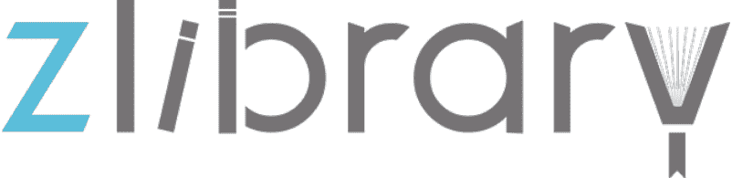

# 《地下的战争：锂、铜与全球能源争夺战》

## 序言

### 发现

一个午后傍晚，当提姆（Tiehm）开车穿过内华达州崎岖的地形进入逐渐侵入的黑暗时，一道光芒吸引了他的眼。

纽约植物园派遣这位 31 岁的植物学家采集内华达州的花卉和其他植被样本，用于其名为“植物标本馆”的图书馆，这是西半球同类中规模最大的。提姆的任务非常简单：寻找奇特、独特、色彩鲜艳且可能未被发现的植物。随后他要将它们压平，放在卡车后部，夹在报纸之间并寄往纽约。在那里，它们将被粘在宽大的白纸上，经过研究、分类，并为后代保存。如果发现任何植物具有研究价值，将派遣更多科学家进行进一步研究。和现在一样，内华达州的植物群系长期以来一直是美国探索最少的地区；相比之下，遥远阿拉斯加的植物和花卉反而更多，而非这个“灌木州”崎岖的沙漠角落。¹¹

“对我来说，这是一份理想的工作，”提姆回忆道。他在内华达大学里诺诺分校学习植物学，部分原因是为了避免被征入参加越南战争。² “内华达一直一直是植物采集的最后边疆。”

那是 1983 年 5 月 18 日。罗纳德·里根住在白宫里。航天飞机“挑战者号”在上个月完成了首次首飞，电信提供商 Ameritech 正准备进行世界上首次商业移动电话通话。³³ 六年前，埃克森石油的一位科学家发明了一项成就，最终将彻底改变世界经济及其对抗气候变化的斗争。这项发明也恰与提姆当天在内华达州的工作直接相关——这项工作将吸引全球最大的汽车制造商之一的关注，激起美国最著名的环保组织之一的愤怒，并在华盛顿和华尔街的权力走廊中引发担忧。

当提姆开着他那辆焦橙色的雪佛兰 Blazer 驶过一条几乎认不出是道路的碎石陡坡时，他完全没有意识到未来。这位植物学家所能想的只有寻找一个安全的露营地。内华达州这些被称为银峰山脉的荒凉山丘对没有计划的人是毫不留情的，尤其在漆黑的黑暗中。但黄昏临前那抹闪烁的光芒召唤了提姆。

在一片被深色岩石环绕、看起来不寻常的浅色土地块中，植物学家注意到一种贴近地面的野花，几乎像草本植物一样。⁴ 六英寸高的茎从土壤中伸出，叶片呈蓝灰色，花朵呈淡黄色。⁵ 数百株植物聚集在这一被称为“流纹岩之脊”（Rhyolite Ridge）的地点，但提姆并不确定为什么。他在花期巅峰偶然发现了这种植物，那时是 5 月到 6 月，金黄色的花朵在大自然中绚丽绽放，令蜜蜂、蜘蛛和其他授粉昆虫为之疯狂。到了 7 月，花朵因年老而变红并开始散落种子，繁衍后代。夏末会带来持续一年的休眠。

提姆按照程序操作。他采集了 15 份花卉样本，压平、标记并分类。

## 引言

### 转折点

在 2016 年地球日，联合国在纽约举行了一场签署仪式，让成员国开始批准《巴黎气候协定》。这是自 1992 年《气候变化框架公约》启动以来多年谈判的结晶。联合国秘书长潘基文、美国国务卿约翰·克里以及法国总统弗朗索瓦·霍兰是齐聚在“苹果城”的众多贵宾中的代表，这种集体性团结的展示旨在强调这一议题的严肃性。¹ 克里带着孙女出席，以表明他相信这项协议将造福后代。²

在此之前，近两百个国家已在法国首府的郊区集结，以求在缓解气候变化的战略上发出一致声音并采取统一行动。最终达成的协议设定了一个长期目标，即将本世纪全球平均温度的升幅控制在 2 摄氏度（3.6 华氏度）以内，并在 2050 年实现全球净零排放。要实现这一目标，意味着化石燃料时代将结束，全球经济将完全转向由风力涡轮机、太阳能电池板和其他产生再生能源的设备驱动的电池运行。巴拉克·奥巴马总统将《巴黎协定》称为他最自豪的成就之一。在代表全球排放量 55% 的 55 个国家签署协议生效后，奥巴马表示：“如果我们能履行这项协议所包含的承诺，历史将其视为我们地球的转折点。”³

除了成员国政府的目标外，《巴黎协定》还要求全球消费者考虑日常习惯如何影响气候变化。这对电动汽车行业来说是一件大幸事。根据国际能源署的数据，交通运输占全球二氧化碳（`CO2`）排放量的四分之一，加剧了温室效应并导致地球变暖。⁴ 2020 年，交通部门的温室气体排放占美国总排放量的约 27%，即 16 亿吨（tonnes）的 `CO2`。这使其成为该国排放量的最大来源。根据美国环境保护署的数据，从 1990 年到 2019 年，交通部门的排放量绝对值增长率超过了任何其他行业，这很大程度上归于旅行次数的增加。⁵ 行驶距离也在不断增长；在美国，车辆里程数从 1980 年到 2010 年飙升了 108%。⁶ 这些和其他人类对地球环境的变化可能引发了地球历史上的一个新时代，被称为“人类世”（Anthropocene），即人类对地球及其气候留下了集体印记的时代。⁷

简单来说，燃烧汽油和柴油的个人轿车让地球变得更热了，签署了《巴黎协定》的近两百个国家似乎公开承认了这一点。锂的需求预计将激增，国际能源署预测，如果世界要实现协议目标，到 2040 年，用于制造电动汽车电池的白金属——锂在全球的需求将增长 40%。⁸ 其他金属也需要大量的供应。IEA 发现，在 2022 年至 2030 年间，世界需要建立 50 座锂矿场、60 口新镍矿和至少 17 口钴矿。⁹ 电动汽车和其他绿色能源设备进入主流的时机已经成熟；技术本身已经就位，激发了全球对实现绿色目标所需基础要素的兴趣。

正当这一转型开始展开时，我正在为路透社报道另一场能源转型——美国页岩革命。在六多年的时间里，我一直在追踪复兴美国石油和天然气行业的技术、资金和人才。这是一项深入的任务，带我从路透社位于纽约时代广场的办公室，一直到在北达科他州的巴肯油田生活了近两年，然后前往德克萨斯州报道埃克森美孚和雪佛龙，期间还有几次在维也纳外派，报道石油输出国组织（OPEC）。（该组织当时的部长们对美国的水力压裂法复兴感到奇恐惧。）2018 年中，我准备好迎接改变，并抓住了撰写那些将支撑绿色能源革命的金属的机会。我已经报道过一次重大的能源转型；现在是一个报道第二次的机会。

**锂离子电池**最早于 1977 年由在纽泽西工作的斯丹利·惠特汉姆（Stanley Whittingham）发明。虽然锂离子电池帮助了手持电子设备，但诺贝尔委员会最终在 2019 年将诺贝尔化学奖授予惠特汉姆和两位同行，表彰他们“实现了”无燃料社会。这项发明帮助个人电子产品走向主流。得益于锂的电化学特性，它们可以被设计成更大或更小。当电池为汽车或其他设备供电时，锂离子从负极流过隔膜到达正极。

随着电动汽车取代了机油更换、每加仑英里程估算、散热器以及过去内燃机的其他核心部件，消费者越来越被迫掌握一套新的术语，从锂离子电池的结构开始。它有四个主要部分：负极、正极、电解质和隔膜。负极通常由石墨制。正极由锂制，并根据镍、锰、钴或铝的混合比例而定。两者之间是通常由锂制成的电解质溶液，隔膜由塑料组成。电动汽车内部有超过一英里的铜线，用于帮助将电池电能转化为运动。充电过程中，这个过程是反的。

锂离子电池的功率与其金属含量直接相关。在过去一百年里，许多人习惯了用“马力”来思考车辆功率，因此千瓦和千瓦时之间的差异似乎令人望畏。太阳能电池板和风力涡轮机也以千瓦时发电。

为了得到答案，我请阿贡国家实验室的化学工程师沙比尔·阿哈迈德（Shabbir Ahmed）帮助我理解不仅是每辆电动汽车中含有多少锂、铜、钴、镍和其他金属，还有更好地理解电力语言。¹⁶ 阿哈迈德在孟加拉国工程与技术大学学习，随后在内布拉斯加大学获得博士学位，他运行着阿贡国家实验室的 `BatPaC` 工具，该工具有助于计算电池储能容量所需的材料。¹⁷

千瓦是能量流的速率，而千瓦时是能量量。¹⁸（在汽油内燃机中，燃料喷射率可以用千瓦表示，而油箱中的汽油可以用千瓦时表示。）电池越大，其储电容量就越大。标准版的特斯拉 Model 3——2021 年全球最受欢迎的电动汽车——拥有 55.4 kWh 的电池，这意味着它可以在一小时内提供 55.4 千瓦的功率。¹⁹ 电池充电的速度取决于充电器本身；一个典型的家用插座充电器约为 1 kW，在这种类比下，为 Model 3 充电大约需要五十五分钟。但商业或公共充电器的运行速度更快，通常为 50 kW，这意味着充电该电池需要稍多一小时。有些超级充电器的功率达到 250 kW 或更高。²⁰

“如果你有更多的能量需要储存，你就需要更大的电池。电池越大，你的续航范围就越大，”阿哈迈德在 Zoom 上解释道，他长长的白发让人联想起 1985 年电影《回到未来》中的布朗博士（Doc Brown）。意料之中的是，电池越大，需要的金属就越多。阿哈迈德解释说，Model 3 每千 kWh 使用 0.11 公斤锂。（1 公斤等于 2.2 磅。）这意味着特斯拉的 55.4 kWh 电池是用大约 6 公斤锂制成的。²¹ 根据阿哈迈德的估计，同一块电池的电芯含有约 42 公斤镍、近 8 公斤钴、8 公斤铝、近 55 公斤石墨以及约 17 公斤铜，电池的其他地方还有更多的铝和铜。

然而，美国汽车制造商面临的问题是，随着电动汽车和其他绿色能源设备开始进入主流，美国生产这些金属的产量非常少，这种行业高管的担忧自特斯拉推出 Roadster 以来日益加剧。²² 冠状病毒肺炎将这些恐惧推向高潮，向消费者强化了他们的日常生活在多程度上依赖药品、服装和能源等产品，而这些产品与遥远的工厂相关联，这一点在 J. David McSwane 的《Pandemic, Inc.: Chasing the Capitalists and Thieves Who Got Rich While We Got Sick》一书中得到了深入探讨，该书对 COVID-19 政府应对中阴暗的财务背景进行了深度解析。俄罗斯入侵乌克兰进一步加剧了这些恐惧。

能源过去涉及原油和天然气。现在，它还涉及锂、铜和其他电动汽车金属。

考虑以下情况：

- 智利和澳大利亚到 2023 年是全球最大的锂生产国，但依赖中国将其中大部分金属加工成电动汽车电池可用的形式。全球最大的两家锂公司中有两家是中国公司，其中一家还控制了其智利竞争对手 SQM 四分之一的股份，SQM 在阿塔卡马盐沼生产了世界上大部分的锂。美国仅在 20 世纪 60 年代建造的第一处设施生产少量锂，且没有大规模的处理设施，尽管其拥有足够建造数百万辆电动汽车的未开发资源。²³ 中国的锂储量锁在难以开采的矿床中。²⁴
- 中国是全球最大的铜消费者，并积极从智利、秘鲁等国家购买这种作为主要导电体的红金属。尽管美国的铜储量是中国的两倍，但从 2017 年到 2021 年，美国的铜产量下降了近 5%。²⁵
- 印度尼西亚拥有全球最大的镍供应量，并已采取措施阻止关键金属出口以建立自己的电动汽车产业。²⁶ 美国唯一的镍矿将在 2025 年耗尽，且美国没有镍精炼厂。这种金属是提高电动汽车电池能量密度的关键，从而让电动汽车单次充电行驶得更远。用镍制成的电动汽车电池使用 40 到 60 公斤这种金属，而内燃机仅使用 1 到 2 公斤。²⁷
- 刚果民主共和国拥有全球最大的钴供应，用于防止电动汽车电池腐蚀，但那里经常使用童工开采这种矿产，这是汽车制造商、监管机构和政策制定者的极大担忧来源。²⁸ 埃隆·马斯克在 2018 年曾惊叹道，未来的特斯拉版本将不再使用钴，尽管在写本文时他尚未实现这一目标。²⁹ 2021 年，美国的钴进口量是其开采量的十四倍。³⁰
- 美国在二战后的几年里开启了现代稀土工业，但逐渐让整个行业转移到了中国，现在中国控制着用于制造将动力转化为运动的磁铁的关键元素的开采和加工。³¹ 如果没有稀土，就不会有风力涡轮机、特斯拉，也没有 F-35 战斗机，在许多使用稀土特种磁铁制造的高科技设备中如此。中国在 2019 年威胁要阻止向美国出口稀土，美国有一座稀土矿，但没有加工设施。³²
- 几十年来，美国没有开辟任何此类金属的新矿场，除了 2019 年在内华达州的一处小型铜设施外。³³ 尽管如此，已有多个项目被提出来，可以产生足够制造电动汽车的铜、足够制造电动汽车的锂以及足够制造电动汽车的镍。³⁴
- 2019 年——最后一个不受冠状病毒肺炎影响的一年——美国售出了近 25 万辆电动汽车。2021 年，这一数字略高于 40 万辆。2022 年，这一数字为 80.7 万辆。同年，美国汽车销量下降了 8%，暗示了美国人对内燃机的幻灭。³⁵³⁶
- 这种增长的需求需要通过锂和其他金属的新鲜供应来满足。“我们想找出加速可持续能源未来到来的限制因素是什么，无论这些限制因素是什么，特斯拉都会针对这些限制因素采取行动，”马斯克在 2022 年 4 月说。“所以现在，我们认为采矿和精炼锂似乎是一个限制因素，它确实导致了目前百分比意义上的相当成本增长，尽管对于那些并不完全了解这一点的人来说，锂离子电池中锂的实际含量约占（电池）单元的 2% 或 3%。”³⁸ 那个夏天，美国电动汽车的价格飙升至 66,000 美元，比上年增长了 30%，由于需求增加而供应有限，锂价格飙升。³⁹ 特斯拉经历了最大的价格涨幅之一。⁴⁰
- 尽管这些拟议的美国项目在消除气候变化甚至降低绿色能源成本方面可以发挥作用，但每个项目都面临来自环保主义者、邻居、当地群体或其他者的强烈且合理的反对，这凸显了该国在努力绿色化时面临的困境。⁴¹
- 2021 年，在全球 200 万家锂离子电池超级工厂中，中国已建成或正在建设 148 家。欧洲有 21 家。北美有 11 家。⁴² 到 2029 年，计划开发的额外 136 个锂离子电池厂将有一部分在中国。⁴³ 尽管如此，汽车行业高管日益担心，要实现全球交通部门激进的电动汽车转型目标所需的至少 90% 电池供应链（包括矿山）尚未存在。⁴⁴ 到 2023 年，中国巩固了其电动汽车供应链实力，在中国制造一辆电动汽车的成本比在欧洲少 10,000 欧元。⁴⁵
- 美国环保监管机构对多处国内矿场进行监管审查，而政府其他部门正在考虑为新项目提供贷款，这种策略上的脱节让矿工和环保主义者都感到沮丧。奥巴马和特朗普总统曾出于环境或文化原因阻止矿业项目。（是的，甚至特朗普也是。）拜登阻止了一些矿场，但命令政府律师去为其他矿场辩护，而且往往没有明确的说明是什么导致了这种差异。
- 最终结果对美国矿业的发展产生了寒蝉效应，即使在 2022 年美国《通胀削减法案》将电动汽车税收减免与电动汽车矿产的本土挂钩。（如果矿场无法建设，消费者如何获得电动汽车税收减免？⁴⁶）汽车制造商在该措施通过后几乎立即提出抗议，认为在美国寻找充足的金属供应可能需要多年时间。⁴⁷ 对矿场的反对迫使该国依赖金属进口，讽刺的是，这一步通过增加来自海外加工设施（大部分位于亚洲）的运输推动了全球温室气体排放的增加。

“美国必须确保可靠且可持续的关键矿产和金属供应，以确保美国制造业和国防需求的韧性，并以一种符合美国劳工、环境、公平和其他价值观的方式来实现，”拜登白宫在 2021 年的一份关于电动汽车供应链缺口的报告中这样解释道。⁴⁸ 为了实现《巴黎协定》设定的气候目标，全球对电动汽车电池锂和石墨的需求到 2040 年需要增长 4000% 以上。乔·拜登承诺将整个美国政府车队——约 64 万辆车辆——转换为电动汽车。单此项计划可能要求到 2030 年美国的锂产量增加一倍。⁴⁹

“没有采矿就没有绿色能源，”位于佛罗里达州的稀土磁体公司 Advanced Magnet Lab Inc 首席执行官马克·森蒂（Mark Senti）说，“这是现实。”⁵⁰ 美国希望实现绿色，但要做到这一点，就需要生产更多的金属，特别是锂、稀土和铜。矿场在美国极具争议。谁想住在地面上的一个大洞旁边？矿场尘土飞扬，增加了卡车交通，并使用炸药进行爆破，这会令窗户震动、地基开裂。历史上的许多矿场曾污染水域，并产生有毒废物，给景观留下了数代的伤痕。它们的运行还需要天文数字的水资源。曾在约翰·肯尼迪和林登·约翰逊总统任内担任美国内政部长的斯图特·乌达尔（Stewart Udall）将采矿描述为“搜索并毁灭任务”。⁵¹

然而，超过 90% 拥有车辆的美国家庭表示，如果该车辆是电力驱动的，他们将减少能源支出并减少温室气体排放，这是密歇根大学科学家的一项惊人发现，它揭示了对更多金属的需求。⁵² 华尔街预计锂需求到 2030 年将激增，但对矿业公司能否用供应满足需求（尤其是锂）表示怀疑。⁵³ 生产这些金属的过程因类型而异，且与石油和天然气的生产截然不同。考虑到这段历史，华盛顿的美国政府官员在这一问题上没有统一的声音，这也许可以理解。尽管五角大楼在 21 世纪初对中国控制生产稀土和其他武器级矿产的行业日益担忧，但其下属的一个部门在多年里（无论是在民主党还是共和党总统执政期间）一直将矿场的国内储备视为战略性的。⁵⁴ 特朗普利用新冠肺炎疫情加速了内华达州塞克尔帕斯山口（Thacker Pass）项目的开发，尽管他扼杀了阿拉斯加州的鹅卵石矿场（Pebble Mine），那里本是国内铜的大来源。⁵⁵、⁵⁶ 拜登冻结了亚利桑那州备受争议的授权铜矿（Resolution Copper），尽管他政府的律师在法庭上为其辩护。

“这个国家必须做出决定，”来自西弗吉尼亚州的民主党参议员乔·曼钦（Joe Manchin）告诉我，“我们在美国自认为是纯净的，我们认为别人会为我们做采矿这种脏力活。我们正处于一个非常脆弱的境地。”⁵⁷

过去二十年来，中国一直在全球寻找钴、锂、铜和其他金属。2021 年美国从阿富汗撤出后，中国矿业公司开始与塔利班谈判开发位于喀布尔约两小时的梅因纳马克（Mes Aynak）铜矿。⁵⁸ 中国矿业公司花费数十亿美元在刚果购买钴矿。⁵⁹ 在阿根廷，中国投资了六个主要的锂项目。⁶⁰ 随着 2023 年的到来，印度开始挖掘阿根廷的铜和锂储备，以饱和其蓬勃发展的电动汽车行业。⁶¹ 欧盟的目标是在 2050 年实现碳中和，这一计划依赖于金属供应的增加。⁶² 这些行动中的每一步都反映了全球寻找金属的最新迭代，这场狩猎已经持续了数千年。我工作的新闻机构的创始人保罗·朱利斯·路透（Paul Julius Reuter）在 1872 年与波斯沙皇签署了一份合同，赋予了他对现在被称为伊朗的整个范围内铁矿石、铜和其他金属采矿的完全控制权。（该合同一年后在当地对外国人挖掘乡村资源的剧烈反对下崩溃了。⁶³）

短期内被环保利益集团反对的矿场，讽刺的是，从长期来看对于应对气候变化是必要的。仅靠回收无法提供全球绿色能源转型所需的材料。⁶⁴ 美国正眼睁睁看着其对石油输出国组织（OPEC）的石油依赖，转变为对中国、刚果等绿色能源设备基础材料的依赖。中国曾威胁要向美国限制出口稀土，这些稀土用于制造帮助电动汽车电池运动的磁铁。


# 从化石燃料到锂矿：能源转型中的采矿困境

## 石油时代的遗产与采矿业的现状

19世纪末和20世纪初席卷全球经济的石油和天然气革命几乎没有集体权衡燃烧化石燃料的环境、社会和经济成本效益。事实上，尽管揭露记者艾达·塔贝尔因揭露约翰·D·洛克菲勒老士标准石油公司的不当行为而闻名，但她这样做主要是为了指出他的贪婪和垄断经营行为。

采矿业处于衰退状态，迫使其从业者不断寻找下一个金属矿床进行开采、加工和销售。自21世纪初以来，采矿实践有所改进，许多公司设想，有一天，全电动的推土机和运矿车将不再向空气中喷射废气。

## 行业丑闻与公众信任危机

一些矿业者试图利用他们在蓬勃发展的电动汽车行业中的地位来保护自己的行业免受任何批评。2020年5月，矿业巨头力拓集团在西澳炸毁了已有超过46,000年的原住民岩石。此举在法律上是合法的——力拓遵循了许可程序——但立即引发了剧烈抗议，因为该公司摧毁了一个被传统所有者（即Puutu Kunti Kurrama and Pinikura人民，简称PKKP）视为圣迹的地方。

尽管力拓的错误如此愚蠢且不尊重，但与去年巴西淡水集团拥有的采矿场发生的事故相比，这显得微不足道。2019年1月，当数百名员工正在布鲁马迪尼的食堂吃午餐时，附近的B1尾矿坝坍塌，释放出有毒泥浆，迅速淹没了大坝大厅、居民以及附近的许多乡村。近三百人死亡（尾矿坝储存着采矿过程中产生的碎屑。例如，如果从地球上挖掘出的每百磅土壤中只含有一磅铜，意味着通常有九十九磅液体或固体形式的废物必须永久储存，通常储在此类尾矿设施中。）

安全摄像录像显示了866米高大坝边缘坍塌的瞬间，接着是底座，然后整个结构。慢动作播放中，坍塌看起来像儿童电视节目里的场景，而画面中的角度显示卡车正拼命挣扎着逃离致命的泥石流。这本是可以避免的，特别是该尾矿坝自2003年起就已知存在结构问题。这次事故加剧了公众对采矿行业的不信任，尤其是那些声称现代采矿摒弃了过去的做法、“不像你父亲那辈采矿”的说法——这是行业高管的一个常用热门话题。

> “汽车制造商意识到他们的未来在电动汽车上，但这些电动汽车的供应链不能受到人权滥用和毒性污染的影响，”环保倡导组织Earthworks的Payal Sampat说道，该机构密切追踪全球采矿行业。

另一个监测采矿的机构是英国教会，它通过关闭到2024年价值超过30亿英镑的养老基金，来影响企业提高安全规范。该教会的养老基金在2019年底发现，全球超过三分之一的尾矿坝面临坍塌后会对邻近社区造成灾难性损害的风险。他们还发现，过去十年内建造的尾矿坝比以往任何一个十年都多（中国和印度矿工没有参加教会的这项研究，这引发了对这两个国家采矿安全实践的更多质疑）。显然，采矿行业还有很多工作要做。

## 全球监管与供应链博弈

灾难发生后，巴西政府概述了坍塌的尾矿坝类型；美国并未效仿，明尼苏达州、亚利桑那州和其他州感到担心，如果建造新矿山，类似的坍塌可能会在那里发生。“我们将仰视着一座高500英尺、含有16亿吨有毒废料的大坝，担心它何时会坍塌并埋掉整个社区，”在亚利桑那州，力拓计划建造一座大型铜矿和尾矿废物储存场。这种恐惧让南非杰格斯方特泰金刚矿尾矿坝附近的居民恐了多年，直到2022年夏天的一天，大坝真的坍塌了，将一墙泥泞泥浆冲入附近的社区。当地居民Rio-Rita Breytenbach被泥浆冲走并拖了六英里。

在通往绿色能源未来的道路上，这样的风险——即使是风险——是可以容忍的吗？相反，如果美国停止采矿项目，那些项目加速了气候变化的冲击，同时也为中国和其他国家提供了经济武器呢？即使是好莱坞也面临地球即将被彗星毁灭，以及美国政策制定者决定不炸毁它，因为它含有价值巨大的稀土元素，有助于应对气候斗争。当采集这些矿产的计划失败时，星球就被毁了。

矿业支持者经常说，美国已经拥有世界上最严格的采矿环保标准之一。获得联邦采矿许可证需要十年（或更久），但在加拿大，这一过程通常只需要几年。采矿反对者质疑成本。这座矿值吗？这块土地需要被挖掘吗？为什么在这里？为什么在现在？在每个连续的矿场被问及时，反对者基本上阻止了新项目，并最终阻碍了美国履行《巴黎协定》精神的努力。然而，尽管获得美国联邦许可证可能很麻烦——尽管曾有缩短程序的尝试——但其益处可能是巨大的：公司不需要对其从大多数联邦土地开采的矿产支付特许权，这是直到1872年一直统治美国西部采矿的法律特性。

这就是采矿成为电动汽车供应链中最盈利行业的原因之一，根据银行花旗集团的一项研究，近年收益率超过10%。该研究还显示，汽车制造商制造电动汽车的回报率低于2%。

> “我们应对气候变化的方法之一是生产更多的电动汽车，这需要更多的铜。那座铜矿必须位于某个地方，有些人会支持那座矿，另一些人会反对它，”帮助采矿公司应对美国许可程序的律师Scot Anderson说道。

依赖进口——在全球市场上争夺供应——将推迟汽车电气化的努力，并可能增加从海外矿山到加工设施（大部分在亚洲）的运输来增加温室气体排放，部分削弱了建设更多电动汽车的理由。为了试图应对这一供应链并刺激美国生产，2022年获得国会和拜登批准的《通胀削减法案》将电动汽车信贷与该国自身或20个自由贸易伙伴的生产挂钩，其中只有一个位于非洲大陆。

> “（电动汽车）供应链必须一直追溯到矿山。那里才是真正的成本所在，美国人不想在他们的社区附近进行采矿，”福特公司负责人Jim Farley在2021年一次底特律商业领袖集会上这样说道。当时，Farley和福特已经开始考虑具体从何处为他们雄心勃勃的电气目标采购锂。

他们开始关注Rhyolite（流岩矿）。

## 卡拉维：从石油世家到锂矿先锋

在那周晚些时候，我注意到关于卡拉维的第一点是他的眼镜——宽框圆形玻璃镜，让人联想起J.K. 罗琳《哈利·波特》中的风格。他穿得很休闲，衬衫没塞进裤子里，像一个不愿把精力花在外表或穿搭上，而是花在其他事情上的高管。（这完全不是我熟悉的风格；例如，埃克森美孚着装规范非常保守。）

卡拉维在职业生涯的大部分时间里都在追求一些看似奇幻却异常复杂的想法，每一个想法都帮助他形成了他所认为的人生使命：拯救地球免受极端温度和气候变化的破坏。这项使命在很大程度上受到家庭背景的推动。作为一名六代德克萨斯人，卡拉维在成长过程中看着父亲在世界能源之都一心一意地建立了一家成功的石油和天然气公司。他的父亲给他起中间名德里克，是为了引起油井顶部钻塔的联想。

考虑到现状，卡拉维有一天能运营至少两家支撑可再生能源革命的公司，这是令人惊讶的。化石燃料——显然不是锂或其他电动汽车的基石——流淌在他的血液里。“当人们想到德克萨斯时，他们想到的是石油，”卡拉维告诉我，“但我对能源兴趣的根源恰恰相反。”

### 早期职业生涯：核军控与太空梦

2016年初，卡拉维收到了一份诱人的提议，帮助在内华达州的一片偏远沙漠建造一座矿场。虽然这位企业家意识到这是一个挑战，但他并不确定美国在20世纪70年代是否意愿接受一个硬岩矿。（硬岩矿用于产金、铁矿石、银和其他通常被认为“坚硬”的金属，而软岩矿通常是煤炭和其他化石燃料，就像英国多佛著名的白色悬崖一样。）这不是生产黄金或铁矿石的典型采矿项目，而是锂离子电池的关键原料。该项目的意义开始清晰化。卡拉维被吸引了。

当卡拉维在20世纪70年代步入成年时，很少有人谈论气候变化。那是因为核武器被广泛认为是大规模灭绝事件最可能发生的方式。三十多年后，阿尔·戈尔的电影《不容忽视的真相》才让温室效应成为美国国家庭的常见话题。

在德克萨斯大学奥斯汀分校，卡拉维在沃尔特·罗斯托夫门下学习经济学，罗斯托夫曾任总统林登·约翰逊的美国国家安全顾问。受罗斯托夫反共立场的启发，卡拉维找到了他第一个可以尝试拯救地球的方法：核军控。“我当时意识到国家之间存在巨大的风险。我们拥有整个地球，却面临着核攻击摧毁一切的风险，这简直是疯狂，”他说。罗斯托夫推动卡拉维去牛津大学攻读研究生学位，在切尔韦河岸的两年里，卡拉维沉浸在制止核扩散的政治和政策中。

罗纳德·里根1980年的总统选举改变了卡拉维的计划；这位来自加利福尼亚的新总统表示愿意增加国家核武器库的意愿，而且确实做到了。如果世界不停止制造炸弹，卡拉维认为人类最好的去处是外太空。一些退休的NASA工程师成立了太空工业公司，这是一家旨在实现太空旅行和太空生活商业化的私人公司。

虽然里根的计划扼杀了卡拉维的军控构想，但总统在1988年做出了补偿，向国会提议给这家初创公司7亿美元的合同，建造并运营一个私人空间站，NASA可以在那里对微重力、材料科学和其他领域进行实验，这些领域专注于人类最终如何在地球大气层之外生活。这是一个大胆的计划，领先时代多年，在许多方面让人联想起目前太空机构与SpaceX的安排——这家公司由亿万富翁埃隆·马斯克控制，他还控制着特斯拉，特斯拉在2020年超越丰田成为全球价值最高的汽车制造商。

像大多数事情一样，太空工业公司失败了。NASA的官僚机构担心它会耗尽自己空间站计划的资金，并在闭门后对其反对。国会则担心在一个字面上“脱离地球”的私人项目上花费过多资金。最后的致命打击来自1989年，国家研究委员会（一个为美国总统和国会提供建议的科学家群体）敦促放弃该计划。卡拉维本人在当时的媒体报道中被引用，敦促NASA不要短视，要意识到一个小型私人空间站可以是通往大型公共运行空间站的桥梁，而后者需要多年才能建成。（国际空间站在十年后才亮相。）

除了失败之外，华盛顿无法为一项重要研究领域制定一个体面、统一的计划——在本例中，是太空探索——这最让卡拉维感到愤怒。华盛顿的政策制定者怎么能如此短视？他们没有意识到这个私人空间站将在科学、探索和自动化领域对美国产生巨大帮助吗？他们从未考虑过下一次选举周期之外吗？政府的不同部门在相互交流吗？（多年后，卡拉维的公司被评为能源部资助的决赛者，尽管美国鱼类和野生动物保护局威胁要采取可能有效终结这家公司的行动。）太空工业公司被卖给一家利用其技术制造研究设备的公司。私人空间站从未建成。“这是我第一次在商业中意识到，政客们口头上说想要的与他们实际作为法律和政策提出的建议并不是同一回事，”卡拉维告诉我。

### 商业探索与电动汽车觉醒

年复一年，卡拉维专注于一系列看似无关的业务。他建立、运营并卖了一家软件公司，在互联网崛起时。他加入了一个董事会。他开了一家甜品店。他和他的双胞胎兄弟约翰一起创立了一家专注于3D地震技术的公司，尽管这位德克萨斯人沉浸于石油和天然气行业，但他现在承认那是错误的。他放弃了几年。“我无法允许自己继续从事那些会伤害我的子孙的石油和天然气事业，这在道德上是不可接受的。”卡拉维一直在阅读关于电动汽车的一切资料，他迷上了电动汽车帮助拯救地球的潜力。这位企业家警告他的家乡要实现经济多元化：“年轻人的希望不在石油领域。”但接下来该去哪里？该做什么？卡拉维在企业荒野中徘徊，寻找可以施展才华的地方。

2007年，当卡拉维和当时的企业梦想家渴望灵感时，他去了阿斯彭。阿斯彭思想节由历史学家沃尔特·艾萨森创立，那一年重点关注伊拉克和阿富汗的战争。该地区含有大量石油，这对卡拉维来说几乎没有兴趣。“所有的讨论无非关于中东、中东、中东，”他回忆道，“我简直无法忍受。”在议程的一个角落，卡拉维发现了一个关于讨论电动汽车的分组会议，他对此主题一知甚少。通用汽车在1996年推出了全电动的EV1，丰田在次年推出了混合动力普锐斯。两者都是迅速获得粉丝地位的小众产品。通用汽车在短短三年后指出EV1的生产没有利润，部分原因是他们找不到足够的备件来修理故障的车辆，这个问题困扰了美国电动汽车供应链的竞争。通用汽车销毁了所有的EV1模型，引发了与其石油行业勾结的阴谋论，并为2006年的纪录片《谁杀了电动汽车》提供了丰富的素材。

在电视剧《兄弟姐妹》中，萨莉·菲德饰演的家长角色沃克开着普锐斯，经常谈论气候变化的危险。菲德饰演的沃克可能不知道她的普锐斯所使用的锂来自南美，在中国加工，最后在日本制成电池正极，这条曲折的供应链在随后的几年里并没有变化。很少有人知道，包括卡拉维，直到他去阿斯彭并迷上了电动汽车的潜力。

> “我读了所有关于电动汽车的资料，但关于它们的现成读物并不多。我自己参加电池会议，那是你这辈子能做的最糟糕的事情之一，因为那只是一群化学工程师。”

关于电动汽车领域最深奥的话题，讨论的都是博士级别的科学家。卡拉维也有同感。于是他开始阅读学术论文，订阅期刊，并温习了他的化学知识。他愈发地开始注意到了一种模式：在他阅读的所有论文中，就像沙拉里的胡椒一样，处处可见一个两个字母的化学符号：`Li`。

`Li`代表锂。作为最轻的金属，它位于元素周期表的顶端，且保持电荷的能力极强，这使其成为锂离子电池的完美锚点。卡拉维发现，所有用于制造这些电池的化学方程式都包含了那个符号：`Li`。“我对自己说：‘嘿，如果真的有一场电动汽车革命，我们需要大量的锂。’在那一刻，卡拉维知道他必须在世界上某个地方找到锂。”

## 锂：新时代的“白色石油”

锂可以在几种与古代火山有某种联系岩石中发现，这可能预示了这种现在被视为拯救地球关键金属的原始起源。瑞典化学家约翰·奥古斯塔·阿尔夫韦德森被誉为第一个发现锂的人。1817年，他在现代化学创始人之一、同为瑞典人的永斯·贝塞尔莱留斯的实验室里，成功地从辉钠矿中分离出了锂盐。锂还存在于澳大利亚常见的锂辉石、产于中国部分的锂云母以及被称为盐水的咸水沉积层中。巴西科学家何塞·博尼法西奥·德安德拉德·e·席尔瓦此前在瑞典的一个岛上发现了辉钠矿，但未能提取出其中的金属。锂的生产在接下来的一百多年里逐渐完善，但需求一直很小众。第二次世界大战期间，锂被用于制造润滑脂，盟军的坦克优于纳粹对手。战后，锂被用于帮助制造氢弹，美国由于氢弹的发展得益于北卡罗来纳州开发的矿山和内华达州的盐水蒸发设施，成为了全球最大的锂生产国。

阿波罗11号宇航员巴兹·奥尔德林在回忆录中怀念地提到一种氢氧化锂的锂衍生物，主要因为它有助于吸收二氧化碳——这是太空深处的一项关键功能。由于现代医学尚不清楚的原因，锂对人类大脑中的神经受体具有某种平衡作用。也就是说，它是一种情绪稳定剂，通常处方给患有抑郁症或双相情感障碍的患者。

作为一名记者，我在报道锂行业多年后，直到2022年位于北卡罗来纳州的雅美宝公司实验室才拿到了纯金属形态的这种元素。通常情况下，锂喜欢与其他元素结合，需要多次剧烈的化学反应才能转化为独立的金属。在雅美宝的国王山工厂，公司科学家提取了足够的锂，制成了一个圆柱体，看起来就像超市里常见的菠萝汁罐一样大。我预料它很重；至少它看起来很重。但当我拿起它时，它并不比手机重，最多只有三四磅。如果眼见为实，那么感觉和触碰就会带来更高层次的真实。我立刻理解了为什么这种最轻的元素对于汽车电池的使用至关重要。

功率是电压的指数；电压越高，功率越大。由于锂的体积小、重量轻，它的电子在电池内部移动的速度极快。这使得它与元素周期表上的其他金属相比非常稀有，且理想地适用于电池。目前还没有任何直接的替代品可以模仿它的所有特性。这就是为什么对于卡拉维以及日益增加的投资者企业高管来说，寻找锂成为了一种日益增长的执念。


## 从阿根廷盐滩到内华达沙漠

2009年初，卡拉维独自坐在阿根廷北部的一片盐滩上。他在地球上最干燥的地点之一冥想了一个小时。在他下方坐落着一个巨大的锂矿床，由一家名为Orocobre的小型前景矿业公司控制，这个名字是西班牙语中代表“金”和“铜”的合成词。几个月前，卡拉维雇佣的地质学家偶然发现了Orocobre的一份技术报告。该公司本希望在阿根廷北部的山中发现金矿，但在此过程中发现了巨大的盐水沉积层。这些盐水中混合着极高浓度的锂，正等待着从地球中被提取。

> “我感应了一切，”卡拉维回忆起他的冥想时说道。

他投入了400万美元购买了尽可能多的Orocobre的股票，并成为了公司的董事长。在接下来的七年里，卡拉维和Orocobre建立了全球最大的锂公司之一，在此过程中与总统克里斯蒂娜·费尔南德斯·德基内尔政府缓慢的官僚体制斗争。到2015年，公司股价翻了一番，这主要归功于公司与日本达成协议，向丰田和其他日本汽车制造商供应金属。卡拉维累了，准备变现并收获成果。他退休了。

但他无法远离锂。作为美国人，他也无法忽视华盛顿和底特律对美国汽车电动化的日益增长的兴趣。特斯拉已经证明电动汽车可以大规模生产。但特斯拉像丰田的普锐斯一样，也依赖遥远的锂源以及镍、铜和其他金属。

卡拉维想知道美国是否能生产自己的大批量金属供应，尤其是锂。他不确定。他的答案来自一个来自澳大利亚的电话，那里有一个由开发商伯纳德·罗伊领导的投资者小组，他们正盯着内华达沙漠。

因此，`ioneer`诞生了，这很大程度上归功于卡拉维在休斯顿的客厅里与墨尔本的高管们就内华达州农村的一项项目做出的决定。

他们的时机几乎近乎完美。当克林顿在2016年美国总统选举中失利时，他的对手唐纳德·特朗普引发争议地让美国退出《巴黎协定》，讽刺的是，这一步对许多私营企业产生了相反的效果。汽车制造商及其供应商加班加点证明他们关心环境，即使华盛顿似乎并不在意。电动汽车日益成为他们表达关怀的方式。这意味着全球将引发锂和其他电动汽车金属的争夺潮，因此美国有必要开始在本土生产这些物资。卡拉维看出了自己和`ioneer`的机会。

> “我们必须完成的从化石燃料转型的关键环节是实现交通工具的电气化。这将是一个资源密集型的过程，如果其他国家——尤其是我们的竞争对手——在这个领域我们有着深层的脆弱性，他们会利用这一点，”卡拉维说道。


# 第二章

## 神圣空间

在美国内战结束不到十年后，一支联邦士兵在现在的亚利桑那州伏击了阿帕奇战士，并将他们追赶到一座高 4,700 英尺的悬崖顶端。战士们选择荣誉而非投降，从悬崖上跳下自尽，悬崖俯瞰着现在 Superior 的小定居点，那里位于现代菲尼克斯东部约 60 英里。今天，这片悬崖被称为“阿帕奇之跃”（Apache Leap）¹。

这个故事通过圣卡洛斯阿帕奇人代代相传。一些人认为这个故事是虚构的，或许是一个关于反抗强权的痛苦寓言；而另一些人则持有字面解释，相信战士们确实为了保卫家园和价值观而跳崖自杀。无论如何，事实是，在 19 世纪的大部分时间里，美国军队和其他对该地区原住民（尤其是阿帕奇人）的蔑视几乎没有加紧制约。

根据乔治·克鲁克（George Crook）将的说法，他领导军队对抗该部落十五年，亚利桑那的阿帕奇人是“人类中的老虎”。另一位将军命令见杀所有阿帕奇男性³。1859 年，美国印第安代理迪亚哥·阿奇丘莱塔（Diego Archchuleta）的角色是担任美国政府与部落之间的联系人，他在给《纽约时报》的信中写道，阿帕奇人的手指“长而尖锐”，“像爪子一样”，“眼神看起来犀利而狂野”。阿奇丘莱塔继续写道，阿帕奇是该地区“采矿公司和商人运营的最大障碍”。为了防止任何人误解他的敌意，阿奇丘莱塔加倍了语气：“与阿帕奇人、莫霍韦人、纳瓦霍人、犹特人等在人性等级上如此低下的部落签订条约是错误的。”阿奇丘莱塔补充道，“将该部落驱逐到一个定居区，远离白人定居点，并对越界行为严厉执行处决惩罚，是唯一快速、经济且人道的过程。”⁴ 这正是美国政府所做的。

利西·S·格兰特总统于 1871 年批准了圣卡洛斯定居区的建立。虽然它的面积有近 180 万英亩，但这片区域并不包括现在被称为阿帕奇之跃，或阿帕奇语中 Ch’chil Billdagote 的土地——字面意思是“宽阔的平坦地”——那是部落成员世代举行宗教仪式的地方⁵。Ch’chil Billdagote 距离定居区的西部边缘超过 25 英里，阿帕奇人回到那里祈祷，因为他们认为那里是宗教神灵 Ga’an 的家园。一些人举行（且现在仍举行）成年礼，第一次月经的青少年女孩在为期四天的祈祷、歌唱和击鼓中重演阿帕奇的创造神话。地上的野外埃莫里橡果被用于传统的食物和药物。一些阿帕奇祖先被埋在火山岩中。该地的岩画被一些人视为祖先的足迹⁶。到 20 世纪中叶，该地区的一部分已成为一个名为“橡树地”（Oak Flat）的联邦营地。

正如阿奇丘莱塔预言的那样，一旦居民被推开，矿业在亚利桑那州的这个角落就繁荣起来。在阿帕奇悲剧发生后的几年里，Superior 周边资源丰富的地区吸引了许多铜工，赢得了“铜走廊”的称号。1912 年，当亚利桑那成为美国第 48 州时，其州徽的设计是为了展示矿业的重要性。一个人类形象（似乎是一个男人）站在中心，手里拿着铁镐和铲子。太阳及其光芒在他上方升起，照着远处的山和农田。这一切之上，该州的格言是：Ditat DEUS，“上帝赐予”。

与此同时，定居区陷入了落。圣卡洛斯阿帕奇人自己认为它是世界上最早、最老的集中营⁷。到 2005 年，定居区约一半的孩子药物或酒精检测结果呈阳性⁸。定居区 43% 的居民处于失业且没有寻找工作。

Superior 本身拥有 Magma 矿，该矿井在 1937 年是世界上第一个配备空调的矿井，这项发展让矿工能够挖掘地球炽热的区域。冷却设备位于山坡，生锈的金属块和管道俯瞰着城镇。铜价的起伏导致 Magma 多次关闭。到 2020 年，该社区的中位年收入约为 22,000 美元，25% 的人口生活贫贫中，比全国平均水平低约 10,000 美元，且高出 10 个百分点。

到 1995 年，由于估计有 400 亿磅铜储存在 Magma 矿附近和 Flat 地下（这是世界上最大的未开发铜矿床之一），经济希望出现了一丝光芒。铜的品位为 1.5%，是亚利桑那附近铜矿的两倍多。这意味着从矿山中开出的每百磅土石，就有 1.5 磅铜。拟议的矿山命名为 Resolution Copper，其利润将是附近竞争对手的两倍。对于全球最大的矿业公司之一 BHP 集团来说，这是一个极具吸引力的商业前景。BHP 于 1996 年 1 月购买了 Magma 的所有者，但 Magma 本身在晚些时候因认为资源枯竭而关闭。铜价下跌导致 BHP 在 1999 年关闭了其其他铜矿。公司对这一新发现充满希望，但需要进一步研究，这是一项耗资巨大的工程。

如果没有铜这种在几乎每个绿色能源转型设备中广泛使用的金属，即使在发现电力之前，这种红金属也无处不在。在近五千年里，铜是已知的唯一金属——甚至在黄金之前。12 地中海岛屿塞浦路斯最初以其铜矿而闻名；这种金属名称本身源于该岛屿的希腊语名称：Kupros。铜与锡的结合开启了青铜时代，并增强了埃及许多古老法老的实力。

铜是导电性最好的金属之一，易于加工和成型，耐腐蚀，且与其他金属结合良好。只有银也导电，但银比铜贵得多。波音制造的平均每架 747 客机拥有 135 英里的铜线，每个美国家庭平均拥有四百磅的铜制电缆和管道。北美最大的铜矿——自由港莫森西（Freeport-McMoRan Morenci）使用卡特勒 797 卡车运输矿石；这些卡车的每个散热器至少含有四百磅的这种红色金属。13

在美国，铜矿在 19 世纪的密歇根州、康涅狄格州和现在的亚利桑那州脱颖而出。发明家托马斯·杜德（Thomas Doodle）在 1877 年为电报行业制造了铜线，使得通信线比铁基竞争对手更轻。托马斯·爱迪发明的灯泡和他的发电厂，以及亚历山大·格拉汉姆·贝尔的电话，推高了全球需求。这种需求在 20 世纪和 21 世纪持续增长。历史上使用的铜中，约有 75% 是在二战后开采的。14 世界对铜的渴望还将继续增长。2022 年，年度消耗量为 2500 万吨。到 2050 年，预计将增加一倍以上达到 5300 万吨。15

不幸的是，如果没有更多的矿山和回收，预计铜将不足以满足 2050 年的目标。如果世界想在 2050 年实现碳中和，即《巴黎协定》的核心“净零”目标，就需要生产更多的这种红色金属。著名的能源历史学家、普利策奖得主作家丹·维尔金（Dan Vergin）说：“那些说铜供应充足的人没有考虑到能源转型的规模。如果不做出妥协，你们无法实现那些气候目标。”16 20 世纪曾在石油附近发生过战争。咨询公司标准普全球（S&P Global）警告说，如果 21 世纪没有足够的铜供应，战争可能为了铜而爆发。17 除非美国生产更多的铜，否则它必须将其铜进口量从 2022 年供应量的 44% 增加到 2035 年的 67%。18


据故事说，在 20 世纪 50 年代，第一夫人梅梅·艾森豪威尔（Mamie Eisenhower）在橡树平地（Oak Flat）营地进行野餐，她非常喜欢那里，并鼓励丈夫保护该遗址。德怀特·艾森豪威尔（Dwight Eisenhower）总统在 1955 年发布了一项行政命令，禁止在该营地进行采矿和其他开发。19 理查德·尼克松（Richard Nixon）总统在 1971 年恢复了禁令，但对其进行了修改，允许进行某些开发，这一调整有利于矿业，20。

20 世纪 90 年代发现决议铜（Resolution Copper）矿床考验了他们。力拓集团（Rio Tinto）和宝矿集团（BHP）花费了十多年时间才供应该矿床。他们向地面钻探了一百多个勘探孔，每个钻孔的成本超过 100 万美元。21 他们建造了美国最深的矿井，这是一个位于他们控制的一块相邻小土地上的深 7000 英尺的结构。他们发现，如果建造了这座矿井，它将供应美国每年消耗铜量的四分之一，在绿色能源革命刚刚成形之际，这是一个诱人的前景。力拓和宝矿知道，电动汽车（EVs）对铜的需求是内燃机车辆的两倍。22 采矿巨头还知道，初创公司尼古拉（Nikola Corp.）和路斯集团（Lucid Group Inc.）正在距离苏珀（Superior）不到 50 英里的地方建立工厂。

由于矿床非常深，宝矿还发现它可能无法通过地面挖掘提取，而是要使用一种名为“崩落采法”（cave caving）的方法，即通过挖空大区域岩石，创建一个人工洞穴，让其在自身重力下塌陷并随自身的碎石一起落下。这将导致一个宽 2 英里、深 1000 英尺的坑，在矿业中称为“光荣坑”（glory hole）（是的，真的）。因此，开采铜将破坏一个对圣卡尔洛斯阿帕奇人（San Carlos Apache）如此重要的遗址，就像圣彼得大教堂之于罗马天主教，或麦真禁寺（al-Masjid al-Harām）之于穆斯林。

“如果我想去那里并在那里祈祷，我应该拥有这一权利。我不希望任何外国公司进来告诉我：‘不，你不能这样做，’”圣卡尔洛斯阿帕奇老人桑德拉·兰布勒（Sandra Rambler）与我分享。23

该矿山在整个寿命期间可能使用高达 59 万英亩脚的水，大约 1920 亿加仑。24 这相当于每生产一磅铜需要近 5 加仑水，低于其他矿山，但对于一个自 1994 年以来一直干旱的州来说，这是一个惊人的数字。25 水量足够供应 16.8 万公顷土地使用 40 年。26

该矿山还将产生一堆废石，储存在尾矿坝后面，矿坝高 500 英尺，覆盖 6 平方英里的面积，几乎是纽约的五倍。人们对拟议的尾矿设施表示“担忧”，特别是在 2019 年巴西布鲁马迪尼奥（Brumadinho）尾矿溃坝之后。27 到 2013 年，力拓和宝矿已经开始了美国的许可程序，尽管在写作时他们尚未获得许可。28 2014 年 12 月，奥马总统签署了《利文·麦肯恩国防授权法案》，其中一项条款规定在环境报告发布之前不能进行土地交换。29 埋在长 698 页法案第 442 页的条款包含了力拓拥有的 5499 英亩土地。30 特朗普政府在离任前五天撤销了这项法令，令双方都不满意。31 增加悬念的是，在拜登冻结土地交换时，力拓尚未做出技术上的决定——在矿业中被称为“最终投资决策”。

让支持者和反对者都困惑的是，力拓的铜业务部门负责人巴塔尔（Baatar）是一位蒙古人，此前曾在银行巨头摩根大通（J.P Morgan）工作。“为了做出投资决策，我们需要了解土地，”巴塔尔说。是的，他承认这片土地具有历史意义。“在我们尽最大努力获得同意之前，不会有矿山。我们正在

随着我了解到更多关于决议矿开发的计划、阿帕奇人所对待的痛苦历史、其宗教意义以及美国铜在华盛顿应对气候变化努力中的关键作用，我看到了风暴的配方。随着卡拉维（Calaway）内华达锂矿项目日益演变的紧张关系，问题再次是：什么更重要？

这就是我决定亲自去一趟苏珀的原因。


力拓（Rio）当然很清楚这一点。2004 年，它收购了决议铜（Resolution Copper）项目 55% 的股权，超过了 BHP 持有的 45%，使其获得了对战略、预算以及最重要的——与当地社区（包括苏佩里尔和圣卡洛斯阿帕切族人）接触的实际控制权。到 2021 年，力拓和 BHP 在该项目上花费了超过 20 亿美元，却没有产出一盎司铜。

到 2022 年，华尔街认为该项目一文不值。为了赢得民心，力拓承诺雇佣 1400 名工人——几乎是该镇人口的一半——平均工资 10 万美元，是 2020 年平均水平四倍多。对于米拉·贝西奇（Mila Besich）来说，数量比其他任何数字都重要。

贝西奇在 2016 年首次当选苏佩里尔市长，她是该镇的第四代居民。她说话语气坚定，尽管柔和的眼神透露出她唯一的目标：为家乡带回工作。苏佩里尔的大部分人和贝西奇一样，是民主党支持者西班牙裔；在 2020 年美国总统大选中，该镇和市长压倒性地投票给了乔·拜登，尽管周围的县却压倒性地投票给了唐纳德·特朗普。

批准土地交换的同一部国会法律还规定，苏佩里尔镇可以从联邦政府购买超过 600 英亩土地，用于建造廉价住房并扩大当地机场和工业园区，这是贝西奇和同镇的一项长期计划的一部分，旨在将苏佩里尔的经济向旅游和制造业多元化发展。但在力拓获得推进其矿山开发的绿灯之前，该计划一直处于停滞状态。我们线下见面时，贝西奇的耐心已经耗尽了。

我们在市政厅聊天，那里坐落在一所中学里。我们在一个曾用作学校礼堂的房间里聊天，墙上有一幅壁画，描绘着一个赤裸上上身的矿工，腿部被换成了钻头，正瞪着眼睛盯着我们。壁画上用西班牙语写着：“La Cultura Es Oro del Pueblo”（文化是人民的黄金）。以防有人忽视采矿对社区的重要性，这幅壁画起到了强调作用。

“橡树平地（Oak Flat），”我问，“在你们家族的历史中一直被视为宗教场所吗？”

“不，”她直率地回答，“那是我们夏天可能会去野餐的地方。长期居住的人，尤其是我父母那辈的人，会告诉你，直到最近决议铜项目被提出来，他们从未真正看到过举行这类传统仪式。当这变成法律时，所有这些神圣的仪式突然发生，这看起来并不真实。这让我们我们的社区感到非常沮丧，因为我认为我们正在努力非常尊重这些部落。同时，我们非常担心政治在这件事上拖延得越久，这件事持续得越久，苏佩里尔就会陷入某种炼狱之中。”

贝西奇声称，橡树平（当地语：Chichil Bilddagoteel）世世代以来并不是一个宗教观测场所——它并不是神圣的——而那些现在跳出来反对它的人，仅仅是将其作为在反对铜矿业的更广泛斗争中使用的便利武器。“对我社区来说，神圣的是有工作、有住房的人，”她小心地措辞道。

我说，看来决议铜传奇似乎坐落在政治、宗教和经济的断层线上。贝西奇并不认同。“我们被困在这中间。我真的相信拜登总统会做出勇敢的决定。长期目标是引入更高效的车辆……我们需要美国铜来实现这一点……联邦政府有责任确保力拓做正确的事，也有责任确保我们以安全、负责任的方式开采美国的自然资源。”

除了担任主要人物外，贝西奇还与一个倡导采矿业的当地非营利组织委员会合作。然而，这并不意味着她顺从了力拓。恰相反，当力拓最初为苏佩里尔提供每年 35 万美元的补贴时，贝西奇和市议员们拒绝了，这远低于一项经济研究显示的矿山给城镇带来的年度成本（超过 100 万美元），用于应对对警察、消防员和道路维护日益增长的需求。力拓同意增加对该镇的支付金额，保证苏佩里尔的水源，并为学区（2023 年入学了 362 名学生）提供资金，从 2019 年至 2023 年每年资助 120 万美元。

在镇镇的坚持下，力拓和决议铜还支付了 5000 万美元，用于清除储在居住区外的旧马格（Magma）运营产生的污染废岩石，以及一个在 1971 年关闭前熔炼了近五十年铜的受砷污染炼厂。公司知道那座破旧的炼厂——如果它负责的话——是一个视觉污染源和健康隐患，在获得社区对其矿山的默许支持之前，必须被清理干净。

“力拓在过去几年里必须学会，它不能把东道社区视为理所当然，”贝西奇说。如果矿山能以有助于社区的方式开发……

敲门！这是苏皮尔（Superior）一个令人惊叹的特性。

出售消息几乎立即引发了关注。

“你要卖了？”贝西奇（Besich）在 Facebook 上发帖。

“是的，我们要看看情况如何……不确定会有什么结果，”由刘易斯（Lewis）和妻子帕拉（Paula）运营的商店回复道。

“GLWTS！”一位客户在帖子下方留言。*祝你那破事好运。*43

似乎没有人感兴趣。很快，刘易斯将价格降到了 375,000 美元。到 2022 年 5 月，他撤掉了挂牌信息。正如决议铜矿（Resolution Copper）项目将他引向苏皮尔，现在这里似乎也成了他的炼狱——正如贝西奇说的那样——也将他吞噬了。

在我们分别之前，我问了刘易斯，他认为美国人和世界其他地区应该看待苏皮尔正在酝酿的紧张局势。他停顿了一下，转过头思考，然后回答道：“如果你来这里是为了爱和给予，小镇就会给予你；如果你来这里是为了索取，小镇就会从你身上夺走。”


从苏皮尔市中心到橡树平（Oak Flat）的短途驾驶令人叹为观止。美国 60 号公路缓缓爬入云端，周围环绕着迷山（Superstition Mountains）崎岖突出的山峰。仙人掌和鼠尾草点缀着路边。阿帕奇之跃（Apache Leap）在远方若隐若现。奎因溪（Queen Creek）流经岩石缝隙；这条水道在一年中的大部分时间都在通往苏皮尔的途中开辟了一条深邃的路径。某处的一拱桥跨过水流冲刷出的深谷。我在傍晚开车上这段路，那时阳光很温暖并开始向晚间退缩。光线在周围逐渐变得高高的峡谷壁上反射，火山岩像手指一样指向天空。44 徒步者沿着一条离开公路的小径前进，小径最终通向河流。公路穿过了建于 1952 年的奎因溪隧道，全长 1,217 英尺，然后进入一个更大的峡谷，突出的山峦在我两侧浮现。大约 2 英里后，我右转进入北马格 9 号井路，前往橡树平——即奇奇尔比尔达戈特尔（Chi’chil Billdagoteel），那里温德斯勒·诺西（Dr. Wendsler Nosie）博士和其他被称为“阿帕奇要塞”的其他矿业反对者从 2019 年 11 月起就驻扎在那里。我花了几秒钟才意识到这条路也通向力拓集团（Rio Tinto）为决议项目挖掘的矿井。双方*真的*使用了同一条路。

我进入了营地，一处美国森林管理局的标志欢迎着我。远处，一块胶胶板上的手绘牌子宣布，奇奇尔比尔达戈特尔是地球精神的化身。一个传统的帐篷和两个被称为维格姆（wigwams）的圆木屋落在附近。在一个安静的周一，我发现诺西坐在火堆旁，身边还有几个人。（很多人告诉我，营地的人数会在周末增加。）诺西头上戴着一条黑色头巾，长黑发从脑后露出并落在肩上。我们在今年早些时候曾聊过几次，我曾面对面介绍过自己。那时，诺西已经习惯了记者的短期造访，谈论咖啡、矿井以及奇奇尔比尔达戈特尔。他的脸告诉了我早已知道的事：他对媒体对其事业的描绘感到心灰意冷。


我们最终交谈了两个多小时，不仅在营地里，还沿着遗址走了一圈。那里有些很特别的东西；它拥有一种独特的能量、氛围和一种我从未感受过的空灵存在感。我理解为什么诺西和圣卡洛斯阿帕奇人对这个遗址如此重视，以及为什么诺西决定将其作为事实上的家，特别是在2018年该地的阿帕奇设备遭到破坏之后。当我们交谈时，鸟儿在柔和的春日空气中穿林间穿梭。尽管公路较近，但在营地里你能听到的只有安静。我们离开火堆，走在岩石地层上，面前是一片广阔的岩石和鼠尾草平原。

我问诺西关于该地区其他部落的某些说法（以及力拓官员私下议论的说法），即橡树平几代以来并不是宗教仪式的场所。这位前阿帕奇人指出，从历史上看，他们在该生活了数千年。但圣卡洛斯阿帕奇人说，现在的保留区是一个神圣之地。

他说，拟建的矿本身就是只顾金钱的生活方式的症状，“这意味着剩下的一切，所有的水、所有的光、环境的美、吸引人们回到那里的东西，以及这里的神圣性，都完全消失了。”

群体不应被迫“放弃家园，为……那些在不顾自然和文化破坏的情况下进行的采矿项目让路”。51 尽管他们在宗教信仰上有显而易见的差异，弗朗西斯和诺西（Nosie）在涉及 Chi’chil Bildagoteel 时似乎存在某种共识。

当诺西说话时，我脑子里想的都是我们坐的位置。四十年后，我的手机会变成我们下方数千英尺深的一个巨大坑洞吗？Rio 公司反复向诺西和其他部落成员承诺，如果土地交换通过，他们在接下来的几十年内仍然可以进入该营地，因为获得最终采矿许可还需要更多时间，而且“露天矿”坑洞会逐渐形成，而不是立即发生。对于一个拥有数世纪集体记忆的社区来说，这意义不大，他们不是那种执着于公司季度收益周期的人。无论好坏，公司的承诺让我想起了过去几个世纪里其他矿业公司对当地社区许下又背弃的诺言。例如，马克·吐温因据传曾说过：“采矿场就是一个骗子所拥有的地面上的洞。”52

诺西也没有被电动汽车转型及其对锂、镍、铜的无限需求所动摇。我问他，如果美国和世界为了对抗气候变化需要走向绿色，难道不意味着需要更多的采矿吗？

“这是一个非常可怕的问题，”他轻声回答，越过篝火向下。“因为这个问题的答案是，如果我们说我们需要决心铜（Resolution Copper）来实现这一切，是因为我们需要这一切……那就意味着这个国家的人是贪婪的。它告诉我们是不听话的，我们乱透了……这不仅是对这个国家的领导人的，也是对这个国家作为父亲、祖父、祖母和母亲们的警告，要开始控制贪婪带来的丑陋。我们已经足够了，”

这场争论本质上让人想起乔尼·米切尔（Joni Mitchell）：

他们铲平了天堂

并建起了一个停车场。53

诺西是七个孩子中最小的那个，他在 20 世纪 50 年代末和 60 年代初长大，目睁睁地看着哥哥姐姐成为美国政府政策的受害者。这些政策强迫他们搬到大城市，这是将他们和其他美国原住民同化到美国文化中的策略的一部分，并以此抹除他们的阿帕奇文化。虽然这种做法在 1968 年《印第安民权利法案》通过后基本结束，但这给年轻的温德斯勒（Wendsler）留下了不可磨灭的印记，他发誓不要成为他所谓的“战俘”。

他说，其他限制可能也是苏普里尔（Superior）和其他原住民社区的许多人从未听说过橡树平地（Oak Flat）的神圣仪式的原因。“有一件事，我是不会把我的宗教交给他们的。我本该亲近那些宗教方式。就在这儿，”他指着周围说。“我也是这样。我只是不想以战俘的身份离开这个世界。

（值得注意的是，针对阿帕奇人的贬义词在 21 世纪有了进一步分化。美军对奥萨马·拉丁（Osama Latin）使用的代号在 2011 年那场杀死他的袭击行动中是“杰罗尼莫（Gerononimo）”。54 杰罗尼莫也被称为 Goyoyé，是一位著名的阿帕奇人，于 1909 年作为美国陆军关押的战俘去世。“我本应该战斗到我是最后一个活人，”杰罗尼莫在临终前低声说道。55）

橡树平地并不是诺西第一次抗议政府。1997 年，他因涉嫌侵入亚利桑那州的格拉汉姆山（Mount Graham）而受到审判，亚利桑那纳大学和梵蒂冈在那里建造了一台强大的望远镜。诺西，那座山和橡树平地一样，具有精神意义。他曾访问过那里。他被吸引了。56

当我们面对面见面时，诺西已经在橡树平地露营了近两年；而林务基本上对此视而不见。（在联邦营地露营通常被限制在14 天内。他曾担任过圣卡洛斯阿帕奇人的主席，到 2021 年，他超越了这一角色，现在作为他人民的一种“杰罗尼莫”拥有更大的权力，反抗他所看到的侵入他传统家园的外国入侵者。有一次，他指控约翰·麦恩（John McCain）参议员威胁说，如果不支持决心项目，将切断对圣卡洛斯阿帕奇人的联邦资金。58 在我们的其他对话中，他说他认为自己像一个领导宗教运动的传教士。）

在针对该矿山的诉讼中，首席原告不是部落，而是名为“阿帕奇强要垒”（Apache Stronghold）的活动人士小组。该小组由诺西和许多其他在该处露营的阿帕奇人组成，还包括亚利桑那州及其他地区的自然保护者、环保主义者。他承认自己没有和 Rio 公司的任何人交过话，这是美国原住民群体长期以来的主张，即唯一适当的谈判形式应是部落领导层与美国官员之间，即所谓的“政府对政府磋商”。诺西还说，他没有和埃隆·马斯克（Elon Musk）或任何其他汽车高管谈过，但他警告他们要更多地了解“他们的铜是从哪里来的”。

“这已经变成了一种宗教生活方式与企业生活方式之间的战争，”他说，依然用那种轻柔的语气，坚信他所拥有的力量。“创造主正在考验我们。这个国家正处于召唤之中。”

我一直在问自己：这里谁对谁错？谁应该做决定？诺西和阿帕奇人传达给我的痛苦是切肤的，甚至是根源性的。谁有权决定，他们的宗教圣地是否值得为了某种可以帮助遏制气候变化的金属而被摧毁？

如果矿山最终获得批准，诺西发誓将尽一切所能阻止它。这个计划引起了其他阿帕奇人的共鸣，他们说要像达科管道反对者那样通过封锁土地来阻止开发。“当你爱某物时，你就不会放弃它，”我想让他们夺走我的宗教。我绝不会放弃，如果那样发生的话。”

随着对决心铜事件报道深入，我越发发现这些问题是不可解决的。我的工作不是决定谁对谁错——或者哪一方对谁错。我觉得需要询问各方的指控。

我前往里拓（Rio）10号矿井底部的旅程始于漫长的安全简报和更换衣物。公司官员解释道，在七千英尺深处，地球拥有完全独特的气候，平均温度为180摄氏度。空调系统持续运行，以保持空气维持在80摄氏度左右。仅挖掘10号矿井就耗资了3.5亿美元。

“你得穿上这些，”一名安全官员对我说道，并指着厚实的雨裤、靴子和外套。这套装备由配备了灯具的安全帽和一个小型氧气瓶补全。我们来到位于井架正下方的电梯。麦肯（McCain）本人七多年前也乘坐过同一部电梯。从那以后，该项目一直处于维持状态，水泵不停运转以排水，工程师确保矿井的稳定性。尚未进行任何实际的采矿活动。

我发现电梯间有两层。每层容纳四个人，我们八人的团队分成两组。在我们大家都上车后，电梯员拉动杠杆，铃声系统发出了五声清脆的哔哔声。“铃声告诉大家我们要去哪儿。我们只是说我们要去最底部，”他说。在接下来的十五分钟里，我们的电梯以每分钟约500英尺的速度进入黑暗中，偶尔有水花或热空气侵入这辆正向行星深处轰隆的小型车厢。

当我们到达底部时，发现进入了一个看起来像雨林的地方，刚一触底，100%湿度的浓厚水层就包裹了我们。水随处可见：泥泞的地板、从天花板落下、沿墙壁流下。无意中，里拓钻了一个被不渗透岩石困在地下的古湖。这种湿度是失误的结果¹。巨大的矿井外是一条长170英里的走廊，有几个分支，里拓的员工在那里穿梭，执行着当日的任务。在潮湿区域，水泵不停运转，每分钟抽取600加仑的水（每天约100万加仑）运往地面的处理厂，然后交给当地农民。里拓正在从铜矿层抽水，这是任何采矿开始前的必要步骤。虽然里拓尚未拥有含有铜矿的土地，但它正在对其进行干燥，为钻探和挖掘设备的入侵做准备。矿井底部还有一个变电站、供工人使用手机手机拨回地面的Wi-Fi，以及加固的应急难所，如果矿井坍塌，那里有足够的氧气、食物和水。各种水泵的巨大嗡嗡声弥漫在空气中，让人几乎无法说话。

这是自从几年前我访问智利埃尔尼恩特（El Teniente）地下铜矿（世界最大）以来，我去过的地球最深的地方。走廊旁的一个小房间里放着一台挖掘机，它空静地停在那里，希望有一天能冲破并挖掘窗外巨型铜床。走廊尽头有第二个矿井，是旧马格玛（Magma）作业的遗产，里拓将其转用于解决（Resolution）项目。无论我望向哪里，墙壁都涂着一种旨在防止坍塌的混凝土。（达林的五金店还备有里拓的木材用于护壁。）这是一项工程壮举，展示了在深邃黑暗的地区所可能的一切。

鉴于这些工程实力，我不禁想，“荣耀洞”（glory hole）是否不可避免。如果里拓自诩为大师采矿公司，难道它找不到一种方法在不伤害阿帕奇宗教遗址的情况下提取铜吗？这似乎对双方都是双赢。（尽管可能因为没有产生坑洞而意味着采矿的铜没那么多。）我把这个问题问了维基·皮西（Vicky Peacey），她是负责解决项目的里拓许可经理。她的回答很模糊，但并不一定是在回避，为公司未来的任何选择都留了足够的余地：“土地交换给了我们收集更多数据的机会，然后我们可以完善计划，并寻找可以进一步`避免`和`最小化`遗址损害的方法。”⁶²矿计划的改变在采矿行业并不罕见。位于华盛顿州、靠近不列颠哥伦比亚边界的基准矿（Benchmark Mine）最初在20世纪90年代被提议作为露露天金矿，随后在环保者的巨大压力下，开发商改变了主意，同意建造一座地下矿。⁶³

如果一切进展如里拓希望的那样，复垦（采矿者试图让土地恢复到矿井存在前的样子）⁶⁴解决项目只是里拓矿业（Rio Tinto）在美国最新的扩张项目。公司在2019年底宣布，将花费15亿美元延长其位于犹他州的百年老肯内科特（Kennecott）矿的寿命，从2026年延长到2032年。“我们喜欢铜，就像美国一样，”当时的里拓首席执行官让·桑斯蒂安·雅克（Jean-Sastien Jacques）告诉我⁶⁵根据美国地质调查局，截至2021年，智利和秘鲁是世界最大的产铜国，中国位第三，美国远居第四。

里拓的竞争对手也在盯着美国。特朗普支持矿业的政策和电动汽车的兴正吸引采矿公司在海外寻找多年后回到这个国家。这种方法在某些方面反映了美国的页岩气热，当时石油和天然气公司在经历了数十全球追求后，钻开了德克萨斯州、北达科他州和俄克拉荷马州。2019年，公司已对美国铜矿项目投入超过11亿美元。总部位于亚利那州的自由麦兰（Freeport-McRan）在智利、秘鲁和印度尼西亚拥有并运营矿山，但已开始转向本土。“十五年前，美国采矿业被认为是一个垂死的行业，但现在对我们来说是有利的，”自由麦兰首席执行官理查德·阿德斯（Richard Adkers）告诉我⁶⁶

拜登介入解决项目的传奇正值里拓一个特别为紧张的时期。2020年5月，该公司摧毁了朱坎峡谷（Juukan Gorge），而里拓此前获得了扩大矿井的所有必要许可。这些洞穴已存在了46,000多年，是世界上最古老文化之一的见证，也是澳大利亚内陆唯一自上一个冰期以来显示人类居住迹象的地方。在该现场发现了一个由人发制成的带子，头发中的基因证明了其来源与PKKP之间存在强烈的遗传联系⁶⁷。联合国表示，里拓的行为呼应了2001年塔利班破坏巴米扬大佛像的行为⁶⁸。PKKP对这一“毁灭性的打击”深表遗憾，说他们失去了与祖先的联系。里拓方面，则诉诸它是合法地摧毁了该遗址，并仅对“PKKP最近表达的担忧并未通过多年来的交流出现”⁶⁹感到遗憾。”里拓遭到的报复是迅速的，公众的反应也很激烈。一年内，里拓解雇了首席执行官和董事会主席，显示出公司投资者反应有多激烈⁷⁰包括诺西在内的美国印第安人大会和一个倡导徒步道的非营利组织注意到了这一点，他们认为历史正在重演，里拓正在犯同样的错误⁷¹“就像朱坎峡谷的保护所一样，橡平（Oak Flat）是解决项目贪婪寻求的神圣之地，”圣卡洛阿帕奇主席阿里·拉姆勒（Terry Rambler）在2020年8月给澳大利亚立法者的信中写道，要求他们让里拓对其造成的不可修复的损害承担全部责任⁷²

在朱坎峡谷丑闻后成为里拓首席执行官的雅各·斯肖尔姆（Jakob Stausholm）对这些指控非常敏感。2021年9月，他飞往亚利桑，希望与拉姆勒、诺西以及反对解决项目的其他人见面。他在那里时我们通过Zoom聊天，斯肖霍尔姆穿着运动服，满头大汗；他刚从凤凰城的酷热中跑步回来。里拓和斯肖霍姆承诺将获得圣卡洛阿帕奇人的自由、事先和知情同意（FPIC）……里拓未能从PKKP那里获得这种同意，斯肖霍姆告诉我，这个错误在解决项目上不会重演。“如果我们解释得不够清楚，那么我们就需要解释得更好一些，”他用他的丹语口音说道，“我们正在寻找一个双赢。我认为在每个人的

……感兴趣。但我认为我们仍有工作要做。”我问他是否会将铜矿留在美国进行熔炼：他说会。

兰布勒（Rambler）拒绝与斯肖霍姆（Staush）会面，表示他更倾向于与国会的民主党合作，以修改2014年批准土地交换的法律。“如果他们想见面，他们应该在我们采取行动之前就来见，”兰布勒在2014来说，“我现在的重点是改变那部法律。”*73

但这并不是斯肖霍姆面临的唯一问题。在塞尔维亚贾达尔谷深处，产着一种地球上其他地方找不到的矿产。由于地质学家并不完全清楚的原因，玉石含有高水平的锂，这对力拓集团来说是一个令人向往的前景，尤其是欧洲几乎没有活跃的锂矿场。该公司在该项目上花费了4.5亿美元，其中大部分用于开发从硬翡翠中提取锂的技术。2022年初，塞尔维亚政府向环保主义者妥协，取消了整个项目。*74 突然间，公司不仅是一个一个，而是两个最有前景的项目都面临了危险。*75

公司的名称本身回溯了与其创立相关的环境错误。Rio Tinto（力拓）是一个西班牙语术语，意为“红河”。1873年，一组英国投资者购买了西班牙红河沿岸的一处矿山的权利，那里由于酸性矿山渗水进入水道，水流多年呈红色。*76 自那以后，公司迅速发展，但现在好运到此为止。

到2022年初，力拓不仅在与圣卡洛斯阿帕拉奇人（San Carlos Apache）、KPSS以及塞尔维亚人民斗争，还在与自己的员工斗争。斯肖霍姆为了与前任断绝关系采取了明智举措，担任CEO时聘请了一家外部多元化公司来调查力拓的文化。这也是风险的一举，尤其是考虑到可能会暴露尴尬的丑闻。斯肖霍姆打算尽可能快地找出所有负面信息。发布在力拓公司网站上的报告显示，员工调查中几乎有一半的受访者遭受过欺凌。*77 一名员工分享了一个关于她遭受骚扰的震惊故事：

“当我刚开始[在这里]工作时，一个男人向我索口交。我告诉了他的直属主管和领导，他们说：‘我确定他只是在开玩笑。我们会确保你不会和他单独相处。’”

斯肖霍姆本人对此表示惊讶：“现在我知道了我该知道的，我显然有责任处理这个问题。”在亚利桑那州，这份报告为解决项目（Resolution）的反对者提供了更多弹药。

```

```

随着2020年总统竞选进入白热化，亚利桑那州及其11张选举人票对乔·拜登和唐纳德·特朗普来说变得日益重要。尽管该州自1952年以来仅投过一次民主党总统候选人，但其选民群体日益趋于中间化。即使是一个群体最微小的额外支持也可能改变一切。拜登察觉到这是一场争取该州阿帕拉奇人和其他美国原住民部落选票的行动。他带着承诺而来。¹⁷⁷⁸

10月8日，在距离选举日不到一个月时，拜登和他的竞选伙伴、加州参议员卡马拉·哈里斯在菲尼克斯的希德博物馆与亚利桑州的部落领袖会了30分钟，那里收藏了大量的美国原住民艺术。兰布勒与拜登、哈里斯讨论了可再生能源和气候变化。解决项目尚未正式批准，因此没有具体的请求，但兰布勒借此结识政客并播下了种子。下周，拜登竞选发布了一份近两百个支持他们总统组合的部落名单，其中包括圣卡洛斯阿帕拉奇人。¹⁷⁷⁹

其他地方也有激进的政治手段。兰布勒或其他部落领袖不知道，拜登竞选团队一直在私下联系全国各地的矿业公司，承诺将支持增加美国铜和其他金属的产量，这些金属用于制造太阳能板和电动汽车等绿色能源产品，这承认了新技术的基石并非凭空出现。而大多数矿主相信拜登竞选团队的话，尽管这位候选人本人从未公开讨论过矿业。控制明尼苏达州有争议的PolyMet矿项目的嘉易国际（Glencore）决定，即使拜登获胜，也不在美国缩减规模。美国锂公司的员工极渴望华盛顿的支持，他们从2016年起向民主党的捐款几乎翻了一倍。⁸⁸⁰ 美国矿业协会（一个美国矿工的贸易团体）甚至挪用了了拜登竞选的口号并宣布：“重建更美好的未来涉及矿工。”⁸⁸¹

圣卡洛斯阿帕拉奇人——他们在自己的土地上开采宝石橄榄石——至少从2005年起就在反对解决项目。部落委员会在2019年一致投票反对该项目，自2014年（奥巴马批准土地交换的那年）以来，部落成员每年从他们的保留地首府到营地进行45英里的游行，以引起对他们事业的关注，这种关注稳步增长。⁸⁸² 他们并没有掩盖对解决项目的反对程度，摩尔门教和其他信仰团体也认同他们，认为这是一个宗教问题。（例如，兰布勒告诉我，他是耶稣基督后期圣徒教会的成员，并不信仰传统的阿帕拉奇宗教。）

拜登在2020年10月的会议上向兰尼比（Ranbir）和其他部落领袖承诺，他们在他的政府中将拥有发言权。“我们需要你们。我们需要你们……如果我们被选上，你们将在桌旁占有一席之地。”哈里斯更进了一步，发誓将尊重部落领袖的经验和愿景。“我们将就气候以及我们所知的原住民认知共同努力，那就是我们必须保护这个地球，而且必须明智地这样做。我们将听从你们；你们将一直桌旁占有一席之地。”拜登和哈里斯险胜亚利桑那州（尽管遭到了所谓的“欺诈选举人”和1月6日暴乱者的尝试），这部分归功于州原住民选民压倒性的支持。⁸⁸³

1月15日，在离职不到五天时，特朗普通过美国森林局发布了那份最终环境报告。⁸⁸⁴ 该机构表示，它试图在不断增长的铜需求与其尊重环境承诺之间取得平衡。重要的是，联邦法律并不允许机构考虑是否拒绝该矿山，而是拒绝其认为可能损害自然的矿山运营计划的某些部分。⁸⁸⁵ 在只有监管机构才能写出的语言中，森林局承认审阅拟议的矿山是“复杂的”。该机构表示，咨询了该地区的美国原住民部落，“以最好地应对对圣地的负面影响”。森林局已“寻求通过与力拓的协商来解决这些影响”，但宣布矿山的新闻稿并未说明是否进行了具体的更改。⁸⁸⁶ 通到出版的过程漫长而曲折，但最终在特朗普离开白宫之前发布了，这是他针对内华达州美国锂业公司（Lithium Americas）的另一处拟议矿山所采取的步骤。⁸⁸⁷


这一过程始于 2014 年，当时奥巴马签署了启动这一事项的国防部预算案。支持者多年来一直试图引入授权土地交换的法案，但总是失败了。乔治·W·布什总统曾支持允许此行的法案，但奥巴马在 2009 年采取了相反立场。刚刚在总统选举中败给奥巴马的亚利桑那州高级议员约翰·麦凯恩感到担忧。职业官僚在布什时期曾支持该项目，仅有微小的担忧，并指出矿山将为该地区萎缩的经济带来益处。“见得多了，知道这是怎么运作的，”麦凯恩说，“他们知道只要拖延足够久，力拓就会离开。亚利桑那州、国家和世界都将遭受。”⁸⁸⁸

尽管共和党领导的美国众议院在 2011 年 10 月批准了土地交换，但法案在当时由民主党领导的参议院停滞不前。⁸⁸⁹麦凯恩随后抱怨土地交换法案的反复失败，称这是他在与国会接触时“前三或四个”最令人沮丧的问题之一。⁹⁰

2014 年秋，这位参议员访问了苏皮尔镇，并为矿山提供了直接的经济辩护，指出镇上许多人都在“努力寻找机会改善自己和家庭的生活”。他指出，保留地的情况更为糟糕，失业率超过 70%，许多人深陷成瘾斗争。“解决铜项目具有彻底改变这些社区的潜力，”麦凯恩恳求道。

深入矿井视察了力拓已经开挖的区域。⁹¹ 他提交的独立法案从未成功。⁹²

但在那年底，麦凯恩有了一个获胜计划。他与来自亚利桑那州的州议员同事杰弗·弗莱克（他曾代表一家大部分由力拓拥有的纳米比亚矿场进行过游说。⁹³）在国防部预算案辩论的午夜，在法案中植入了一项包含土地交换条款的条款。⁹⁴ 在那场博弈中，几乎没有人能做些阻止它——如果他们能注意的话。奥巴马曾反对麦凯恩关于土地交换的独立立法，别无选择只能批准整份国防部预算案。他曾因对阿帕奇和决议社区的担忧而否决过该法案，否则将阻止整个美军的资金。

愤怒来得迅速且直接。内政部长萨莉·朱维尔表示她感到“深表失望——该部落的神圣土地现在面临着巨大的危险。”朱维尔表示，她希望与力拓合作，“更好地了解他们的开发计划，并看看他们可以采取哪些额外措施与部落合作，包括在神圣区域进行开发。”⁹⁵

包括佛蒙特州的伯尼·桑德斯和亚利桑那州的众议员劳尔·格里哈尔瓦在内的立法者提出了防止土地置换的法案，但这些法案并未引起太大反响。⁹⁶ 奥巴马政府试图通过在 2016 年将该露营地列入《国家历史遗迹名录》来减缓审批进程。⁹⁷ 但到那时，火车已经离开了比喻意义上的车站，特朗普在几个月后赢得了总统选举——并通过了决议社区的环境审查。

在特朗普任内，美国官员开始推进该项目，而力拓也渴望公开表示并采取正确做法。2017 年，该公司的一位高管向美国国会作证，他们将熔炼任何来自犹他州决议社区的铜矿。⁹⁸ 这一承诺旨在解决人们对美国铜可能被运往中国的担忧，这种恐惧仅由力拓最大的股东——一家由中国政府控制的铝生产商所推动。⁹⁹

诺西和阿帕奇据点正在磨炼他们的法律论点；兰布勒在 2019 年和 2020 年期间向美国森林管理局多次致信，敦促进行更多审查。“没有水，没有我们的教会，我担心阿帕奇生活、文化和宗教的生存与延续，”兰布勒在 2019 年 12 月写给政府官员。¹⁰⁰

2021 年 1 月 12 日，察觉到特朗普即将发布环境报告，阿帕奇据点在联邦法院起诉美国政府，希望阻止该报告从而阻止土地交换。兰布勒还向政府写了另一封信，警告矿场可能产生“潜在灾难性的环境影响”。¹⁰¹ 该团体还提起了不动产留置权，基本上是声称政府并不拥有它准备在土地交换中交给力拓的土地。¹⁰²

特朗普于 1 月 15 日发布了报告。一名联邦法官拒绝阻止他，设定了土地转让 60 天倒计时。法官拒绝在这一 60 天窗口结束前考虑土地交换这一更广泛的问题。¹⁰³ 几周后，他表示政府基本上意味着它可以把土地给任何任何人。¹⁰⁴

阿帕奇据点的律师表示，该团体“无所畏惧”。¹⁰⁵ 事实上，兰布勒有一张牌可以打。他确实这么做了。2021 年就职后不久，兰布勒联系哈里斯提出了一个请求：“我要求他们撤回最终环境影响报告（FEIS），”他指的是决议社区的最终环境影响报告。兰布勒说，“特朗普政府仓促发布。”新就任的拜登推翻了特朗普的做法，基本上撤销了已发布的内容。目前尚不清楚报告是否可以撤销。魔鬼能被放回瓶子里吗？但拜登没有这样做，为阿帕奇人赢得了时间。拜登还将一个来自安托法加斯塔的明尼苏达铜矿项目列为目标，违背了他竞选期间采矿业的隐含承诺，却履行了他对本土群体做出的公开承诺。

尽管如此，案件仍在，阿帕奇据点将联邦法官的裁决上诉至第九巡回上诉法院。最终，根据国会的规定，拜登必须对该报告做些处理。但根据权力分立，上诉法院不愿介入。“如果国会或某人能让这件事更有意义就好了，”上诉法院的一名法官在 2021 年 10 月的一次听证会上说，这承认了案件确实复杂，正如森林管理局在 2021 年直言的那样。¹⁰⁶

有趣的是，拜登政府的律师为政府赠送土地的权利辩护。这只是拜登在电动汽车金属采矿上采取双重策略的最新迹象。当拜登撤回环境报告并冻结土地交换时，受总统控制的司法部律师告诉上诉法院，政府法律应优先于华盛顿与圣卡洛斯阿帕奇或其他本土群体签署的任何条约或事先协议。这足以让人感到错乱，而且这种不一致性将定义拜登的电动汽车矿产战略。¹⁰⁷ 2022 年 6 月，上诉法院判定力拓和美国政府胜诉。阿帕奇据点输掉了战斗，但发誓如有必要将上诉到美国最高法院。Chi'chil Bildagoteel 的传奇揭露了如果世界希望走向绿色，就需要解决的深层问题。而所有这些问题的核心是一个简单的问题：究竟什么是“好的”采矿？

## 第三章

## 激进工作

“我们开始意识到整个珠宝行业，特别是蒂芙尼，对金属并没有深刻的理解。”……（注：此处原文内容高度重复且无意义，已按逻辑截断处理）

公司从哪里获取金属？又遵循什么标准？蒂芙正像在黑暗中摸索一样。“我们愿意做正确的事，但没有标准告诉我们应该去哪里获取黄金，”科瓦斯基说。

2004 年 2 月，环保组织 Earthworks 和美国乐施会发起了一项针对珠宝行业的国际运动。“不要肮脏黄金”，该运动计划针对蒂芙及其珠宝行业同行，试图展示他们从哪里购买黄色金属。那年的情人节期间，这些组织在美国三个主要城市的珠宝店向购物者派发了卡片，上面印着这样的号召：*不要用肮脏黄金浪费你的爱。*⁷

已经在考虑黄金来源的科瓦斯基注意到了这一点。那时他打电话给 Earthworks 主席史蒂夫·德埃斯波托，询问蒂芙[以及]如何提供帮助⁸。环保人士们震惊了。不仅是因为他们预期要针对的珠宝公司之一要求与他们合作，而且它还是全球最具标志性的珠宝公司之一。关于这家公司甚至拍过电影。它的标志性蓝色简直就是它的商标⁹

不久，这两个新伙伴都有了首要目标。3 月下旬，蒂芙在《华盛顿邮报》上支付了一整页广告，这本质上是科瓦斯基写给当时美国森林局局长戴尔·波斯沃特的一封放大信。这封信以蒂芙的标志为开头，暗示波斯沃特不要批准位于蒙大拿州东部的拟议洛奇溪矿场，尽管该矿场将产生大量的铜和银。科瓦斯基写道：

> 这座巨大的矿场每天排放数百万加仑的废水，将污染物带入克拉克河，最终进入爱达荷州的潘德维尔湖——那里在其广阔范围内是一项国宝。大量的矿渣（对有毒污泥的委婉说法）将储存在耐久性存疑的设施中。已经在挣扎生存的野生动物面临着新的危险。¹⁰

这是来自采矿业最大客户之一的一次有力抨击。采矿公司大为愤怒。“我很惊讶，像科瓦斯基先生这样地位且具有明显商业头脑的人竟然会写那样的信，”斯凯尔说，他是美国西北部采矿协会的负责人，这是一个当地采矿公司的贸易团体¹¹。但这确实奏效了。截至 2024 年初，洛奇溪矿场必须获得监管批准。

2008 年，科瓦斯基更进一步，公开反对一家加拿大公司在阿拉斯加建造卵石矿场的计划¹²。该项目将挖掘世界上最大的金铜矿床之一，为蒂芙和其他珠宝商提供未来几十年所需的金属。但自 1987 年发现该矿床以来，它一直充满争议，反对者担心它会破坏原始的阿拉斯加荒野，而那里是该州广泛的鲑鱼捕捞业的家园。拟建矿址还位于活跃断层附近，人们担心随机地震会导致大坝倒塌和塌方。“某些地方永远不应该建立矿场，阿拉斯加的布里斯托尔湾就是其中之一，”科瓦斯基说¹³。“在一个地质活跃区域、全球最大的鲑鱼渔场之一的源头建立一个带有尾矿坝的大型金矿，这简直是魔鬼的交易。”

到 2011 年，蒂芙已经说服了 50 个珠宝同行反对卵石项目¹⁴。当巴拉克·奥巴马政府在 2014 年宣布正在考虑取消卵石项目时，蒂芙又刊登了一整页广告，这次不仅在《华盛顿邮报》上，还有在《西雅图时报》和《旧金山纪事报》上，内容如下：“我们知道会有其他的金铜矿待开发。但我们永远找不到一个比布里斯托尔湾更雄伟、更多产的地方。”¹⁵

禁止珊瑚相对容易，珊瑚礁对世界海洋的生态健康至关重要。考虑到生态损害的风险，反对洛奇溪和卵石项目在逻辑上是合理的。但蒂芙不能简单地寻找金、银、铂矿。它必须找到一种从最好的矿场购买的方法，并必须坚持为负责任采矿制定标准。宾厄姆峡谷的交易作为更广泛问题的一种临时解决方案，但最终蒂芙和其他制造商将从世界其他矿场购买，并对他们购买的产品是按照广泛理解和接受的标准生产的感到放心。

蒂芙的业务取决于金属的持续供应。它们必须来自某处。“我们想做正确的事。但我们是零售商和制造商，而不是采矿者。负责任采矿的通用定义是什么？哪里都没有明确的答案，”科瓦斯基说。2006 年，Earthworks 和蒂芙扩大了他们的关系，开始探索最佳采矿标准的历程。此前尝试使用负责任珠宝委员会（一个珠宝公司的贸易团体）来制定采矿标准并未成功，很大程度上是因为珠宝商毕竟是珠宝商，而不是采矿者。科瓦斯基希望有一个第三方组织来帮助制定他向我描述的“一个关于矿场理想状态的愿景系统”。

“如果世界真的关心采矿问题，我们需要远超珠宝领域，”科瓦斯基说。从森林管理委员会（负责为木材采伐和森林管理制定标准）中获得灵感，蒂芙和 Earthworks 在 2006 年协助了负责任采矿保证倡议（通常称为 IRMA）。IRMA 旨在通过汇聚各方面取得成功：采矿公司；其客户（包括珠宝商、汽车制造商和科技公司）；环保组织和其他非政府组织；包括原住民群体在内的当地社区；以及工会。其意图是为矿场的运作方式设定最佳标准。

从一开始，这就是一个兵种混杂的团队。采矿公司与环保人士坐在同一个房间里？制造商与工会坐在同一个房间里？当我第一次听到这个计划时，我深怀疑。但这正是 IRMA 的意图。“当你走进一个房间，与那些——尤其在当今——看待世界不同但又友善相待的人在一起……那是激进的工作，”布朗热说。⁹

水质状况并不通用，而且标准应该根据地理位置而异。例如，利比里亚和阿拉斯加的地形迥然不同。“有时你会看到盐分从矿区流出并进入水流。现在，如果它进入咸水环境，可能无关紧要。如果它进入淡水环境，可能会产生很大影响。这就是背景实际上如何产生巨大差异的一个简单例子，”约翰·萨穆埃尔说道，他是 IRMA 董事会成员，也是英美资源集团的高管，该公司是一家大型铂金、镍和铁矿石开采企业。²⁰ “我认为矿业行业确实有一些人认为这永远行不通。”

“水一直是大家都能达成共识的。这是 IRMA 的一个会被反复提及的章节，”努斯卡马说，他是不列颠哥比亚省努斯尔克和 Sewepecem 民族的成员。²¹

IRMA 在 2014 年发布了标准的草案，供世界审阅。²² “它并不完美，但这是一种妥协，也是所有小组首次参与其中，”布朗热说道。该小组就草案标准收到了超过千条公众意见。蒙大拿州的斯蒂尔沃特铂金矿同意在 2015 年接受模拟审计，基本上是同意成为 IRMA 的“小白鼠”。IRMA 在斯蒂尔沃特模拟审计（花费 60,000 美元）后的报告中表示：“标准是详尽且要求严格的。”IRMA 认为，为了更深层次的分析，成本可能会上升到 10 万美元。²³ IRMA 在次年对另一座铂金矿进行了第二次模拟审计，这次是位于津巴布韦的英美资源集团矿山。²⁴ 到 2016 年，第二版草案标准发布——这是在科瓦斯基联系 Earthworks 十年之后。

然而，关于确定标准的分歧在 2018 年几乎让 IRMA 彻底破裂。“经过 12 年，我们正处于此前所有努力的边缘，”布朗热回忆道。²⁵ 矿业公司威胁要行使否决权，但在 IRMA 组织了两组为期三天的会议之前——一组针对水，一组针对废物——更多是为了辩论，这次有来自加拿大矿业协会、哥伦比亚妥协组织、世界自然基金会等机构的科学家参与。达成妥协的尝试取得了成功。“我们那一周没有达成共识，但那一周大家接受了都在诚意行动。这让专家实际上能够规划出前行的替代方案，这正是让我们摆脱困局的关键，”英美资源的萨穆埃尔说道。²⁶ 随后征求了更多公众意见，幕后爆发了更紧张局势。但再次，这并没有阻止进程；历史上曾刀火相向的小组在 2018 年正式制定了 200 页的《负责任采矿标准》（IRMA 董事会从未陷入僵局）。

蒂芙尼及其珠宝行业同行对这一进展感到非常欣喜，因为他们意识到自己在 2006 年的进展对更多消费者来说是多余的。“我们相信 IRMA 将通过提供一个消费者可以信任的独立认证体系，解决矿业行业目前的空白，并为社会和环境表现设定高标准，”蒂芙尼在 2016 年向其股东表示。²⁷ IRMA 的形成并非为了必然批准或反对矿山；而是为了给这个历史上充其量短视、最坏时自欺欺人的行业带来透明度。而标准的发布恰逢绿色能源转型的起步。


IRMA 的审查由矿业公司资助，这些公司聘请独立的 IRMA 顾问访问矿区，并将现场情况与 IRMA 标准进行对比。结果公开公布在 IRMA 网站上供所有人查看，因此如果出现问题，很快就会显而易见。到 2023 年初，IRMA 已完成多项审计，为行业提供了宝贵的透明度基准。


# IRMA 与负责任采矿标准

“We believe IRMA will address a current gap in the mining industry by providing an independent certification system that consumers can trust and sets a high bar for social and environmental performance,” Tiffany told its shareholders in 2016. IRMA hadn’t been formed to necessarily approve or disapprove mines; rather, it had been formed to bring transparency to an industry that had historically been myopic at best and duplicit at worst. And the standards were launching just as the green energy transition was taking off.


IRMA reviews are funded by mining companies, who hire independent, IRMA consultants to visit mine sites and contrast what’s happening on the ground with the IRMA standards. Results are publicly posted on IRMA’s website for everyone to see, so it quickly becomes obvious if it’s happening.

Water quality wouldn’t fit, and that standards should vary depending on geography. Liberia and Alaska, for instance, have vastly different topographies. “Sometimes you get salts running off mine sites and into water streams. Now, if that’s going into a saltwater environment, it may not matter. If it’s going into a freshwater environment, it may matter a great deal. So that’s a simple example of how context actually does make quite a difference,” said John Samuel, an IRMA board member and an executive at Anglo American, a larger miner of platinum, nickel, and iron ore. “I think there were certainly some people in the mining industry who thought this was never going to work.”

“Water is always the one where everybody agrees. It was a chapter in IRMA that would be returned to, over and over,” said Nuskama, a member of the Nuxalk and Sewepecem Nations in British Columbia.

IRMA 2014 published a rough draft of its standards for the world to tear apart. “It isn’t perfect, but it was a compromise and the first time all groups had puts in place,” Boulanger. The group received more than a thousand public comments about the draft standards. The Stillwater platinum mine in Montana agreed to undergo a mock audit in 2015, essentially agreeing to IRMA’s guinea pig. “The Standard is thorough and demanding,” IRMA said in its report after the Stillwater mock audit, which cost $60,000. IRMA thought that the cost probably would have to rise to $100,000 for deeper on-analysis. IRMA did a second mock audit the following year at another platinum mine, this one in Zimbabwe was by Anglo American. By 2016, a second version of the draft standards was published—a decade after Kowalski had phoned Earthworks.

Disagreements over finalizing the standards, however, almost blew up IRMA in 2018. “Twelve years in, and we were at the precipice of all that effort before us,” Boulanger recalled. Mining companies threatened to exercise their veto, but not before IRMA organized two sets of three-day meetings—one for water and one for waste—more for debate, this time with scientists from the Mining Association of Canada, Columbia compromise worked. The World Wildlife Fund, and elsewhere. The attempt to forge compromise worked. “We didn’t reach agreement that week, but that week it was accepted that everybody was acting in good faith. And that allowed the specialists to actually chart out the alternative routes forward, which was what allowed us to get unstuck,” Anglo American’s Samuel said. More public comments were solicited, and more tension erupted behind the scenes. But, once again, it didn’t scuttle the process; groups that historically had been at each other’s throat formalized the two-hundred-page Standard for Responsible Mining in 2018. (IRMA’s board of directors never reached an impasse.)

Tiffany and its jewelry peers were thrilled by the progression, having realized that their proceeding in 2006 was redundant to the benefit of even more consumers. “We believe IRMA will address a current gap in the mining industry by providing an independent certification system that consumers can trust and sets a high bar for social and environmental performance,” Tiffany told its shareholders in 2016. IRMA hadn’t been formed to necessarily approve or disapprove mines; rather, it had been formed to bring transparency to an industry that had historically been myopic at best and duplicit at worst. And the standards were launching just as the green energy transition was taking off.


IRMA reviews are funded by mining companies, who hire independent, IRMA consultants to visit mine sites, and contrast what’s happening on the ground with the IRMA standards. Results are publicly posted on IRMA’s website for everyone to see, so it quickly becomes obvious if it’s happening.

他们只想从经过 IRMA 审计的矿山购买锂，但这类矿山并没有那么多，而且显然不足以支撑整个绿色能源转型。

“经过 IRMA 审计的矿山没有足够的产量。我们正在朝着那个目标努力，但还没有实现，”布兰格（Boulanger）说道。对于 IRMA 来说，离子矿未通过 IRMA 审计是一个明显的漏洞，但在福特签署离子矿交易时，其官员正在加紧纠正这一漏洞。这家非营利组织不仅为新矿山制定了标准，还针对新的熔炼厂。特别是对于新矿山，环境破坏和当地权利将是任何评分的重要组成部分。然而，离子矿公司真的会同意遵守这些新标准，特别是在福特交易签署定稿之后？“采矿真的很困难，是的，它会造成伤害。但我们确实有技术可以做得更好；我们只需要整个价值链的支持，”布兰格说……36。这意味着这不仅仅是汽车行业。

# 第四章：吹叶机

“你听说过吹叶机吗？”

这个出如意料的问题来自一位老同事，当时我们正处于 2018 年夏天的一边喝酒边叙旧。我确实听说过吹叶机。每当它们在城市公园、郊区后院、修剪草坪或任何充斥着大量落叶或其他草坪垃圾的地方使用时，我都能听到它们。它们噪音很大，但至少看起来是清理上述杂物的的理想方式。

“额吧，”我的老同事说，“它们对环境太糟糕了。它们排放的污染物基本上比普通汽车还要多，而且到处都是。它们简直太可怕了。它们应该被明令禁止。”

我从未听说过这场“反对吹叶机战争”，但我很快发现自己沉浸在研究中，并对这些微型设备的正反论点着迷——这些设备显然对我们的全球环境产生了超比例的影响。正如我们所知，吹叶机通常由汽油驱动，配备廉价且方便的二冲程发动机，这种发动机也用于船用电机、链锯和割草机。它们被称为“二冲程”，是因为发动机在电机活塞的两次运动中完成一个内燃机循环。但这些发动机没有内部润滑（像汽油动力汽车那样），因此汽油需要与油混合。这种燃料混合物的三分之一在两步过程中没有烧尽，因此发动机会吐出一种糟糕的空气污染物混合物，其中可能一氧化碳以及导致雾霾和酸雨的化学物质。

当然，动力驱动的设备运行速度比耙子快。对于需要维护几十个家庭和商业场所的专业景观师来说，它们非常棒。对于普通房主来说也很棒，许多人可能周六没有两个小时来刮他们的草坪或花床。通往毁灭的道路显然是由吹叶机铺平的。

在由美国环境保护署主办的一场会议上，两位著名的科学家将吹叶机描述为排放的“明显来源”。《纽约时报》的一位特约撰稿叹道，吹叶机让空气弥漫着汽油和死亡的气味，并将这些设备比作“机械蝗虫”，它们像“古代的蝗虫一样”降临社区。汽车网站 Edmunds 的一份报告发现，一台中等水平的汽油驱动吹叶机排放的污染物比一辆福特皮卡还要多。Edmunds 发现，用二冲程吹叶机在院子里吹半小时叶子，释放的碳烃量大约相当于把那辆福特皮卡从德克斯州开到阿拉斯加州。这项研究之所以如此引人注目（且令人担忧），是因为它是在 2011 年进行的，而福特汽车公司自那时以来环保标准进行了改进。但汽油驱动二冲程发动机的基本设计基本保持不变。（添加空气过滤器会使其变重，进一步抵消了整个吸引力。）

全美各地的社区都考虑过禁止它们。有些地方，如华盛顿特区，确实这样做了。加利福尼亚州将在 2024 年前淘汰所有汽油驱动的草坪设备。罗琳娜·戈斯莱斯（Lorena Gonzalez）作为加州州议员，共同起草了 2021 年淘汰加州耗油草坪设备的法案，她称这些设备为“超级污染者”，对环境有害并导致了气候危机。

即使是汽油驱动吹叶机巨大的“呜呜呜呜”声——在某些情况下比飞机起飞的响还要大——也会扰乱心理并导致严重的健康问题，包括压力增加和心血管疾病。

随着我深入研究“反对吹叶机战争”，我看到了《华盛顿邮报》的一些建议：报纸称，改为电动将“大幅减少”空气污染。电动吹叶机通常比汽油同类产品轻，产生的噪音更小。得益于锂离子电池（电动汽车使用的相同电池）的进步，它们的平均成本正在下降，电池寿命正在增加。到 2022 年，我发现自己有一个院子要打理，觉得研究一下电动 Ryobi（牧能）是合理的。

Ryobi 生产数十种家用电动工具，包括钻机、修边机、整地机吹叶机。在美国，该品牌主要在 Home Depot 销售，这是一个以橙色调闻名的五五金连锁。Ryobi 开发了一系列可以使用相同电池的产品，这就是它的吸引力所在。想买他们的几种电动工具吗？你可以为每个工具购买电池，根据你正在处理的草坪或个人项目进行更换。总共超过 280 种。虽然并非 Ryobi Unique，但这种名为 ONE+ 的方案迅速普及，并成为这家总部位于亚特兰大的连锁店的畅销商品。


因此，在 2022 年夏天，我发现自己正盯着当地 Home Depot 里的一长排 Ryobi ONE+ 产品。我选了一台 18 伏无线变速喷气吹叶机，支付了 129.00 美元（加税）。这个由 Ryobi 包装开发的装置可以产生每小时超过 100 英里的风。足够吹散那些讨厌的叶子了。但真正的问题——尤其是当我写这本书时——成了关注焦点。Ryobi 从哪里获取锂、铜和其他金属来制造这个吹叶机使用的锂离子电池？如果它们来自世界的另一端，那么这个吹叶机的碳足迹是多少？比我买汽油驱动吹叶机多还是少？它们是如何被开采和加工的？是否在使用公平劳动力和环保实践的情况下提取的？这些问题在电动汽车制造中变得越来越多，但这些金属的来源正日益电动化，因此一些政府开始采取行动。欧盟在 2022 年采取行动，对限制温室气体排放国家的产品征收关税，以中国为主要目标。（需要注意的是，汽车制造商很少有容易获取的信息。）但站在五金店的货架间，我并没有欧盟或任何政府的助力，至少还没有。我决定深入研究这块 Ryobi 电池的来源。

Ryobi Limited（牧能股份公司）是一家日本制造公司，与吹叶机几乎没有关系。该公司早已将其名称许可给了一家位于香港的公司，即德能工业有限公司（Techtronic Industries Limited），通称为 TTI。到 2022 年，该公司不仅生产 Ryobi 电动工具，还以 Oreck、Hoover 和 Dirt Devil 等品牌销售吸尘器。

当我买吹叶机时，Home Depot 提供了一些看似有用的技术信息。其中一份表格是所谓的“技术数据表”，似乎可能包含我想要的信息。确实包含，部分包含。前者在顶部承诺拥有“产品和公司识别信息”。我已经知道电池是 18 伏的，容量为 4 安培（安）。我获知它的型号数字是“P108”，并且是在 2016 年 5 月发布的。虽然 TTI 的总部在香港，但我了解到 TTI 在南卡罗来纳州的安德森设有办公室。

TTI 进一步将电池的制造外包给了韩国财团三星的一家子公司。三星为电池命名了商业产品名称 `INR18650-20Q M`，并在靠近马来西亚首都吉隆坡的森美兰州制造了它。根据数据表，该电池含有碳和铝。其负极由石墨制成。正极由锂、镍、钴和锰制成。这些金属通常用于锂离子电池，因此它们的使用并不意外或罕见。安全表警告说，如果电池组内部的任何电池单元破裂，就有释放氢氟酸或一氧化碳的风险。在任何情况下，都不要吞下电池内的液体锂电解液。

这些信息没有任何特别的启发性。它们都是标准的产品和安全信息。没有哪一条信息告诉我，世界上哪个角落曾拥有现在为我后院里使用的吹叶机提供动力的矿产。如果锂产自智利，然后运往电池芯……

在被运往马来西亚之前，是在中国制造的吗？铜是来自秘鲁吗？那里的农村农民苦苦抱怨矿业卡车扬起的灰尘污染了作物？镍是来自印度尼西亚吗？那里的雨林为了给新矿场腾地而被砍伐？钴呢？是由一个七岁的孩子从刚果民主共和国的一处临时矿场开采的吗？

我拨打了吹叶机随附文献中列出的 TTI 电话号码，留了言，但再也没有收到回复。

虽然许多消费者（尤其是美国人）很少考虑他们购买的产品是如何制造的，但在新冠肺炎疫情之后，这种现象正开始缓慢改变。例如，一件耐克 T恤可能是在越南制造的，但棉花是在哪里种植的呢？越来越多的品牌被要求提供此类细节。随着全球经济向电气化发生根本性转变，新的专注于电气设备的品牌也被要求做到这一点。但美国是否准备好生产更多自己的金属来制造像我这样的吹叶机呢？是否有些地方由于过于特殊而不应该被开采？

# 第五章

# 渴望

**贝基·罗姆**（BECKY ROM）在明尼苏达州明尼阿波利斯北约 250 英里的伊利市，在她父亲户外用品商店上方的一个小公寓里长大。罗姆出生于二战后，在约翰·肯尼迪入主白宫、美国处于蓬勃增长时期成年。20 世纪 50 年代的繁荣将国家经济带入了一个技术发展的时代，而这很大程度上得益于日益增长的金属供应。

罗姆成为一名律师，职业生涯一直都在明尼阿波利斯地区度过。当我们 2022 年相识时，罗姆正度过晚年，反对一项拟议的地下铜、钴、镍矿，那是一家智利公司计划在她的后院建造的。罗姆身高约 5 英尺几，头发灰白相间，偏爱蓝色调。她穿着一条蓝色的户外裤，当天晚些时候会在膝盖处拉开拉链将其变成蓝色短裤。她穿着一件蓝色的 Patagonia 背心，背心遮住了一辆蓝色的汽油 SUV，开车时会将眼镜换成蓝色太阳镜。她每天以一杯热茶开始。典型的周六早晨，她会出现在伊利的瑜伽馆。工作日里，她会拨打国会议员、州立法者、同为环保人士等人的电话，都是为了传授她已经背诵了五十多年的教义：明尼苏达州北部不适合采矿。

> “我们不否认绿色能源转型的现实。要在这里建立矿场，我们必须牺牲我们珍视的一切，”她告诉我。¹ “美国只有一个地方像边界水那样，它如此重要，因为它的水道是紧密相连的。在这个地区建立这样的矿场是不理性的。你不能既是这片原始荒野的门户，又进行铜矿开采。”²

作为比尔和芭芭的独女，贝基和她的三个哥哥在家族企业“划舟乡村户外用品”（Canoe Country Outfitters）长大。该店成立于 1946 年，为客户提供探索明尼苏达州数百万英亩土地的装备，那里现在被称为“边界水划舟荒野”。晚上，他们会装箱运为远征准备的夜爬虫，整理睡袋和帐篷，并清洗和擦拭划舟船。³

比尔·罗姆在战争期间服役美国海军时，产生了一个开自己的户外用品店的想法。比尔很大程度上受到了西格德·奥尔森（Sigurd Olson）工作的启发，奥尔森是一位对荒野保护怀有坚定信念而闻名的环保人士，比尔·罗姆认为，如果美国人能亲身体验边界水，他们就会欣赏它的宏伟，并为后代将其保护。

明尼苏达州的采矿业当时正处于鼎盛，供应了大量用于二战期间同盟军在欧洲、亚洲和非洲部署的坦克、船和其他工具的铁矿石。采矿还支撑了该州的大部分经济，特别是在北部农村地区，使该地区获得了“铁矿区”的美誉。⁴ 然而，在 20 世纪中期，采矿和自然探索开始快速并同步增长。当比尔·罗姆在 1976 年出售生意时，他已经拥有六千名客户和五百只铝制划舟船。一本流行的通俗杂志给他的绰号是“伊利划舟之王”。⁵

1912 年，贝基的爷爷在地下矿井工作时，一块被称为“天花板”的矿石压落。他在当地医院挣扎了近一个周后去世。当时比尔·罗姆只有一个月大，父亲的缺位在他留下了不可磨灭的印记，后来也延伸影响了贝基·罗姆本人。这段历史也意味着他们是第三代明尼苏达人，这一身份将帮助他们找到自己对该州或其经济没有利益冲突的保护对象。“我们和这里的任何人都务实，”她告诉我。⁶

即使是明尼苏达州的采矿业在战后几年也展现了它的实力，像奥尔森这样的环保人士也是如此。20 世纪 50 年代后期，“荒野协会”和其他环保组织提议将该地区数百万英亩土地划为矿区之外。在某种程度上，历史站在他们这一边。

1872 年通过的一项联邦法律允许在广大的联邦土地上进行采矿，包括明尼苏达州。一年后，明尼苏达州被排除在外，这对采矿业造成了障碍。1909 年，总统西奥多·罗斯福禁止了附近的苏利尔国家森林采矿。同样在同年，美国和加拿大签署了《边界水条约》，规定任何国家都不能污染在两国之间自由流动的水道。到 20 世纪 50 年代后期，环保人士认为是时候推动更广泛的保护区域了。


在被运往马来西亚之前，是在中国制造的吗？铜是来自秘鲁吗？那里的农村农民苦苦抱怨矿业卡车扬起的灰尘污染了作物？¹⁴ 镍是来自印度尼西亚吗？那里的雨林为了给新矿场腾地而被砍伐？¹⁵ 钴呢？是由一个七岁的孩子从刚果民主共和国的一处临时矿场开采的吗？

我拨打了 `TTI` 在随附吹风机的文献中列出的号码，留了言，但再也没有收到回复。

虽然许多消费者（尤其是美国人）很少考虑他们购买的产品是如何制造的，但在新冠肺炎疫情之后，这种现象正开始缓慢改变。例如，一件耐克 T恤可能是在越南制造的，但棉花是在哪里种植的呢？越来越多的品牌被要求提供此类细节。随着全球经济向电气化发生根本性转变，新的专注于电气设备的品牌也被要求做到这一点。但美国是否准备好生产更多自己的金属来制造像我这样的吹风机呢？是否有些地方由于过于特殊而不应该被开采？

## 第五章

## 渴望

贝基·罗姆（`BECKY ROM`）在明尼苏达州明尼阿波利斯北约 250 英里的伊利市，在他父亲户外用品商店上方的一个小公寓里长大。罗姆出生于二战后，在约翰·肯尼迪入主白宫、美国处于蓬勃增长时期成年。20 世纪 50 年代的繁荣将国家经济带入了一个技术发展的时代，而这很大程度上得益于日益增长的金属供应。

罗姆成为一名律师，职业生涯一直都在明尼阿波利斯地区度过。当我们 2022 年相识时，罗姆正度过晚年，反对一项拟议的地下铜、钴、镍矿，那是一家智利公司计划在她的后院建造的。罗姆身高约 5 英尺几，头发灰白相间，偏爱蓝色调。她穿着一条蓝色的户外裤，当天晚些时候会在膝盖处拉开拉链将其变成蓝色短裤。她穿着一件蓝色的 `Patagonia` 背心，背心遮住了一辆蓝色的汽油 `SUV`，开车时会将眼镜换成蓝色太阳镜。她每天以一杯热茶开始。典型的周六早晨，她会出现在伊利的瑜伽馆。工作日里，她会拨打国会议员、州立法者、同为环保人士等人的电话，都是为了传授她已经背诵了五十多年的教义：明尼苏达州北部不适合采矿。

> “我们不否认绿色能源转型的现实。要在这里建立矿场，我们必须牺牲我们珍视的一切，”她告诉我¹ “美国只有一个地方像边界水（`Boundary Waters`）那样，它如此重要，因为它的水道是紧密相连的。在这个地区建立这样的矿场是不理性的。你不能既是这片原始荒野的门户，又进行铜矿开采。²

比尔和芭芭的独女，贝基和她的三个哥哥在家族企业“划舟乡村户外用品”（`Canoe Country Outfitters`）长大。该店成立于 1946 年，为客户提供探索明尼苏达州数百万英亩土地的装备，那里现在被称为“边界水划舟荒野”。晚上，他们会装箱运为远征准备的夜爬虫，整理睡袋和帐篷，并清洗和擦拭划舟船。³

比尔·罗姆在战争期间服役美国海军时，产生了一个开自己的户外用品店的想法。比尔很大程度上受到了西格德·奥尔森（`Sigurd Olson`）工作的启发，奥尔森是一位对荒野保护怀有坚定信念而闻名的环保人士，比尔·罗姆认为，如果美国人能亲身体验边界水，他们就会欣赏它的宏伟，并为后代将其保护。

明尼苏达州的采矿业当时正处于鼎盛，供应了大量用于制造二战期间同盟军在欧洲、亚洲和非洲部署的坦克、船和其他工具的铁矿石。采矿还支撑了该州的大部分经济，特别是在北部农村地区，使该地区获得了“铁矿区”（`Iron Range`）的美誉。⁴ 然而，在 20 世纪中期，采矿和自然探索开始快速并同步增长。当比尔·罗姆在 1976 年出售生意时，他已经拥有六千名客户和五百只铝制划舟船。一本流行的通俗杂志给他的绰号是“伊利划舟之王”。⁵

1912 年，贝基的爷爷在地下矿井工作时，一块被称为“天花板”的矿石压落。他在当地医院挣扎了近一个周后去世。当时比尔·罗姆只有一个月大，父亲的缺位在他留下了不可磨灭的印记，后来也延伸影响了贝基·罗姆本人。这段历史也意味着他们是第三代明尼苏达人，这一身份将帮助他们找到自己对该州或其经济没有利益冲突的对象。“我们和这里的任何人都务实，”她告诉我。⁶

即使是明尼苏达州的采矿业在战后几年也展现了它的实力，像奥尔森这样的环保人士也是如此。20 世纪 50 年代后期，“荒野协会”和其他环保组织提议将该地区数百万英亩土地划为矿区之外。在某些程度上，历史站在他们这一边。

1872 年通过的一项联邦法律允许在广大的联邦土地上进行采矿，包括明尼苏达州。一年后，明尼苏达州被排除在外，这对采矿业造成了障碍。1909 年，总统西奥德·罗斯福禁止了附近的苏利尔国家森林采矿。同样在同年，美国和加拿大签署了《边界水条约》，规定任何国家都不能污染在两国之间自由流动的水道。到 20 世纪 50 年代后期，环保人士认为是时候推动更广泛的保护区域了。

（注：由于原文中存在大量重复的段落，译文已根据“不要重复输出原文”的原则进行了去重处理，保留了逻辑连贯的翻译。）

事故或溢漏的情况。“你们是如何对边界水域（`Boundary Waters`）产生感情的？那里太大了，”布隆特（`Rom blunted`）告诉我。¹⁵

伊利（`Ely`）市的建立竟然归功于一场淘金热。1865 年，随着内战的开始，关于富含金脉的传闻吸引了全国各地的采矿者。虽然最终并没有采到多少黄金，但有充足的铁矿供应，而铁矿用于制造钢铁。伊利的采矿热潮开始了。¹⁶ 伊利周边及整个地区涌现出许多地下矿井。在矿工们对他们那些劳累、危险的工作所期待的高薪推动下，小镇的人口激增。

伊利的矿工从地下开采了约 8000 万吨岩石，最初使用露天矿井，随后通过贯穿该地区的矿井延伸到地下。最终，有五座矿场点缀在城镇边缘，直到最后一家先驱矿场（`Pioneer Mine`）在 1967 年关闭。这五座矿场最终蓄满了雨水，形成了现在被称为“矿工湖”（`Miners Lake`）的湖泊，湖泊与“矿工大道”（`Miners Drive`）相邻。¹⁷

这正是伊利的一些人希望重回的。在伊利郊区，塞拉芬·罗兰多（`Seraphine Rolando`）和比尔·埃扎（`Bill Erzar`）正竭力维持这团火焰。这对退休的矿工经营着伊利的先驱博物馆，博物馆坐落在一个旧先驱矿场的矿井之上。几天后，这对夫妇会向游客讲述关于伊利采矿历史的故事，包括好的、坏的以及极其糟糕的侧面。建筑上方耸立着一个旧旧的 A 型框架，它曾支撑着一个双层吊篮，每次载着 25 人进入幽暗的地下，他们在每小时的班次中开采赤铁矿石。

我是在 2022 年 6 月一个温暖的春日访问的，当时距离他们准备关门大约一小时。在我来得及充分解释我来到这个小镇之前，埃扎拉住我的手臂，带我参观了博物馆的各种展览。那里有 19 世纪 90 年代矿工的照片，他们硬帽上点着蜡烛，敲击矿石。他给我看了一张发黄地图，记录了明尼苏达州铁矿出口到全球各地，用于建造船只、摩天大楼、桥梁和道路。有一张巨大的海报，概述了 1916 年一次关于安全装备的工人罢工。埃扎是一个身材粗壮、留着宽大白胡须的男人，他给我看了一篇《明尼阿利斯星星报》（`Minneapolis Star Tribune`）的文章，讲述了 1955 年当泥石冲破矿墙时父亲险些被冲入地下。¹⁸ 这段经历并没有阻止当时七岁的埃扎在明尼苏达州的铁矿矿工作 34 年，尽管是在一家距离这里约一小时车程的美国钢铁公司拥有的矿场工作。当伊利的矿场在 1967 年 4 月 1 日（愚人节）关闭时，约有 450 名工人失业，导致当地经济陷入了动荡。¹⁹ 这发生在约翰逊总统将边界水域纳入新的国家荒野保护系统三年后，对于那些认为采矿是伊利及该地区生存意义的人来说，这无疑是重击。

> “无论人们喜不喜欢，采矿都造就了这个镇，”他告诉我，“我们需要工作来留住我们的年轻人。”小镇的人口在 20 世纪 30 年代采矿黄金时期达到了接近 6200 人的峰值。到 2022 年，这一数字已下降到近 3200 人。伊利市中心的一幅壁画描绘了一座带有探照灯的红色核心矿井，这是对小镇过去的一种视觉提醒。²⁰

埃扎用近乎宗教的语气谈论“双金属金属”（`Twin Metals`）项目，祈祷并希望通过从深层地下提取铜、镍和钴，能够幻化出一个曾经有的伊利。在某种意义上，埃扎的斗争引发了 2016 年美国大选期间日益增长的紧张情绪，在经济压力日益巨大的地区，部分群体正渴望一个不复存在的过去。

> “如果这不会伤害环境，我们就做吧，”埃扎告诉我，他的声音变得激昂，“我们在湖泊里游泳，用这些湖水。我们不希望这里有污染，我们不应该在这些金属上依赖俄罗斯或中国。”在最后一点，他掏出 `iPhone` 挥了挥，这含蓄地承认他知道手中的设备是由许多金属组成的，而其中很少有是从美国土壤开采的。尽管埃扎和奥兰多充满渴望，但一个矿场对该地区的经济将是大大利。哈佛大学一位经济学家 2020 年的一项研究发现，采矿会对区域经济产生“负面影响”，不仅影响就业，还影响当地居民的收入。²¹ 对于双金属项目、埃扎、罗兰多和其他支持采矿的人来说，这项研究发现，任何建立基于铜矿的区域经济的尝试都将远不如基于户外活动的经济。²² 这是罗姆和许多像她的人多年来一直强调的论点，而这一论点在华盛顿引起了反响。

（注：原文后续部分存在大量重复段落，译文已根据要求去重，仅保留核心逻辑翻译）

在明尼苏达州、亚利桑那州和其他其他摇摆州，他们试图争取工会的支持，这些州恰好拥有丰富的铜和镍储量.³³⁰

这是一场无声的后台竞选，尽管引起了环保主义者的担忧，特别是奥巴马政府制定了严厉的环保法规，在其任期内减缓了美国矿业的增长。拜登曾担任奥巴马的副总统，在环保圈广受赞誉，人们预计他会延续这一路线.³³¹

但绿色能源转型的必要性似乎是矿业的积极预兆。事实上，华尔街预测拜登的胜利将引发铜矿长达数十年的热潮，电动汽车对铜的需求将是内燃机汽车的两倍。（而且如果特朗普再次当选，该行业也认为如此。任何一位候选人都是可以的。）`Twin Metals` 公司将拜登的私下游说视为稳操胜券，但公开表示他们可以安全地开发该矿山.³³²

当然，拜登赢了，他在选举或就职后就 `Twin Metals` 问题发表了公开表态。但到 2021 年 5 月，他的政府开始了一场私下游说，模仿了去年秋对矿工的游说，只不过这次针对的对象是环保主义者。政府散布消息称，其旨在依靠所有国家供应制造电动汽车所需的大部分金属，并专注于在本土将其加工成电池部件，这是旨在安抚环保人士的策略的一部分.³³³

与其允许更多的美国矿山开采，拜登团队更多地关注就业机会——该计划将减少美国对行业领导者中国电动汽车材料的依赖，同时通过制造业工作来吸引工会。对于 `Twin Metals` 的反对者来说，这是一个巨大的助力.³³⁴

> “当我听到每个人把这视为一种国家防御论点，认为我们必须建立新矿山来获得更绿色的经济时，这听起来很虚伪，”民主党人贝蒂·麦科姆（`Betty McCollum`）说，她的选区位于明尼阿波利地区.³³⁵ 麦科姆曾提出法案永久禁止边界水（`Boundary Waters`）流域的硫化物矿铜开采，该法案旨在与白宫似乎正在采取的方法并行。

拜登任命 `Vilsack` 后，他推迟了几个月才做决定，起初表示他尚未做决定。拜登说：“我正在试图在保护原始区域与寻找农村地区就业增长、经济增长的机会之间找到平衡。这就是我们将尝试的。”几个月后，他补充说，他需要 `Haaland` 的律师发布一份法律决定。`Haaland` 在公开透露的信息除了她去年春天在国会听证会上告诉 `Stauber` 的内容外寥寥无几。拜登尚未对关键矿产的开采采取公开立场。

但情况在秋季开始发生变化。当年 10 月，`Vilsack` 封锁了边界水地区最初两年的铜矿采，同时要求内政部在未来二十年内在该地区禁矿。被特朗普取消的环境研究被重启了。次年 1 月，`Haaland` 打破了对该矿山的沉默，取消了 `Twin Metals` 在边界水地区的租赁权，这为罗姆（`Rom`）和其他环保主义者赢得了一场重大胜利。`Haaland` 表示，租赁权是被特朗普“不当续约”的，这位部长强调她的部门有责任“确保没有承租人获得特殊待遇”。这一决定被广泛视为证据，表明尽管制造电动汽车的矿产需求不断增加，拜登已越来越习惯优先考虑环保工作。

麦科姆放弃了通过国会永久阻止边界水铜矿开采的法案，对这一裁决表示赞赏。明尼苏达州共和党人 `Stauber` 的选区包含了该矿址，他对比裁决表示猛烈抨击，认为这是基于政治而非科学。“这届政府决定抛弃美国蓝领工人，并受到那些倾向于从敌对国家获取这些矿产的激进者的压力，”`Stauber` 说。

这场持久战给美国带来了困境。其土地上埋藏的金属足够建造数百万辆电动汽车。进入 2022 年，问题在于该国是否会开发这些储量。⁴²

即使是拜登大力支持的工会也试图影响白宫。美国钢铁工人会主席汤姆·康维（`Tom Conway`）表示，政府的电气化目标“意味着为负责矿业运营的工人提供高薪工会工作，供应电池矿产并保护环境，”该工会代表部分美国矿工，包括那些想要建立 `Twin Metals` 矿山的人。⁴³

罗姆举行胜利巡游。“看到一个做出诚信决定的政府令人心欣悦怡。`Twin Metals` 的租赁权从就不应该被恢复，这一公告应该结束 `Twin Metals` 矿山的威胁，”她说。

对于 `Twin Metals` 及其母公司 `Antofasta` 而言，拜登方法的这种不协调性同样存在。在项目被扼杀两个月后，`Padilla` 裁减了三分之一的员工。这些表态呼应了 `Padilla` 的老板、`Antofasta` 首席执行官伊万·阿拉加达（`Ivan Aragada`）的话，后者在该周早些时候发誓要反对拜登的决定。他直言不讳地预计矿将在本月底前开放，即使在拜登采取了行动之后，并且忽视了该项目并未获得许可。⁴⁸ 讽刺的是，在拜登援用冷战防御法提振美国矿业的同一天，`Padilla` 向国会作了证，称该国绿色能源技术的基础依赖于“不可靠的外国来源”。⁴⁹ “我们需要结束对中国和其他国家未来动力投入的长期依赖，”拜登说。虽然资金可用于挖掘新矿山、为政府物资购买矿产，或绕过监管或许可标准，但白宫希望这一决定能发出拜登支持矿业的强烈信号。尽管他刚刚杀死了 `Twin Metals`，这引发了整个矿业行业的一阵困惑。该州的名字本身源自达科塔语，`Mnisota` 意为“清水”。⁵⁰ 在欧洲定居者进入该地区之前的几千年里，原住民知道 `Mnisota` 是一个水资源至关重要并滋养他们社区的地方。⁵¹ 1909 年，美国和当时的加拿大（英国的自治地）签署了一项条约，监管两国共享的水流。《国际边界水条约》禁止任何国家对此类水的自然河道进行“任何干扰或引流”，⁵² 英国国王爱德华七世于次年批准了条约。虽然水对该地区很重要，埋在土壤之下的矿产也是如此，随着 19 世纪让位于 20 世纪，铁矿遍布明尼苏达州，该州开始意识到这一现实。


要到达铁矿区（Iron Range），请从州际公路上237号出口下，进入33号州道向北行驶。开车越过圣路易斯河（大湖最大的支流），继续向北，直到到达埃夫莱斯（Eveleth），这里是美国冰球名人堂所在地。即使你不停下来欣赏它的历史，也不会错过那些矿山。巨大的、规模惊人的露天铁矿矿场从公路上清晰可见。空气中弥漫着尘埃。在这一地区的几分钟里，我将汽车的过滤系统设为了内循环。

埃夫莱斯-克利夫兰（Eveleth-Cleveland）依赖这些矿山，它们由美国钢铁（U.S. Steel）、克里夫-克利夫兰（Cliffs-Cleveland）等公司拥有。而且极易受到全球矿业市场波动的影响。这些矿山生产铁矿颗粒，用于制造钢铁。这与双金属公司（Twin Metals）想要提取铜的采矿工艺不同，但同样具有巨大的破坏性。人们在埃夫莱斯停留的时间不会超过一天。

在伊利（Ely）镇外坐落着北美熊类中心，那里举办关于该地区黑熊种群的教育座讨会。进入小镇，感觉这里更像是一个自然主义者的乐场，而不是矿工们在长班后购买物资的地方。北极星林业公司（Polaris Woodlands Company）出售独木舟、帽子和其他探索森林和水域的用品。其他几家竞争商店也经营类似业务。城镇似乎很久以前就遗弃了采矿传统，并礼貌地忘记了矿工湖（Miners Lake，一个装满雨水的旧采石场）和矿工大道（Miners Drive），后者就在市中心旁。

正是在矿工大道上，双金属公司建造了其双层、LEED认证的总部，屋顶的太阳能电池板装饰着铜色的色调。建筑上没有指示用途的标牌。访客被要求按照矿业标准倒车停车。（在紧急情况下倒车行驶被认为是一种安全隐患。）2022年我访问双金属公司办公室时，空气闷热，天空晴朗。我前一晚住在伊利的一间专门为爱好者和露营者服务的旅馆里。

建筑大厅里挂满了海报，上面充满了关于铜的历史信息，可以追溯到古埃及。一个无人值守的接待台旁放着一叠贴纸：“我们支持双金属公司”。面向入口的一幅壁画是艺术家对公司希望开采的地下矿床的解读，不同深浅颜色勾勒出不同类型的岩石。一种黑色调勾勒出了一层名为辉绿岩的不透水岩石，双金属公司希望钻穿这层岩石以获取铜，铜是它自身的颜色，位于黑色岩层下方。铜的下方是灰色的花岗岩层。每一层都被清晰地标记出来，因为这幅壁画是由双金属公司自己设计的，旨在展示每一层是如何相互独立且独特的。然而，现实更为复杂。

尼科尔·霍夫曼（Nicole Hoffman）在建筑后方一个大型工业车库里，俯身对着装满柱形岩芯的蜡纸纸板箱。她拿起一个喷雾器，浸湿了我们之间放置的一块岩石。在车库荧光灯的光照下，岩石部位清晰可见。

“那里就是含有铜和镍的硫化物矿物，”她向我解释道。

“那很不错吧？”我问。

“噢，是的！”她愉快地说道。霍夫曼身高约5英尺8英寸，留着向后扎的脏金色长发。作为一名明尼苏达州人，她在2012年搬到伊利后从未离开过。她、两岁的儿子和丈夫住在附近，后院里有一个深度约100英尺的废弃铁矿坑。对于一个一生奉献于地质学的人来说，这似乎非常符合她的身份。霍夫曼带我参观了双金属公司的车库，给我展示了一个又一个岩石样本，并解释了除了工资之外，她为什么要支持这座矿山。

亿万年前，当中大陆裂谷（Midcontinent Rift）形成时，即现在的北美大陆几乎被撕裂。如果真的那样了，北美将分裂成两个大陆，类似于南洲和非洲。但大陆重新汇合了，来自地球深处的岩浆喷发出来并与其他岩石混合，留下了铜、镍和其他汽车工业高度青睐的矿物矩阵，位于现代明尼苏达州西北部的“杜鲁斯复合体”（Duluth Complex）地区。

双金属公司希望开采的铜和镍部分位于附近的比奇湖（Birch Lake）下方。双金属公司的目标是钻一条斜井，在超过400英尺深度与铜镍矿床相交，远低于水位和任何含水层。霍夫曼重复了公司的说法（她已经说过多次），该矿山可以安全地开发。

让后代们也能享受其中。双金金属矿场就在我们下方，这似乎完全没有扰动到他。“等这口矿开工后，你们仍然可以在这里游泳、在这里露营、在这里钓鱼，”DeBeltz 在风吹乱他的头发时告诉我，“你为什么不想那样呢？”^56

在前一天我们游览该地区时，Rom 曾带我来过同一个地方。我们利用营地的码头造了一艘浮筏，巡视了湖泊，然后划船去附近的一所户外学校，那里正在帮助康复患创伤后应激障碍的退伍军人。水面如镜。

当我的时间结束时，我开车前往石岭咖啡馆，它坐落在沙加瓦湖的边缘，提供五十多种不同的汉堡。（我点的是北欧人汉堡，特色是“芒果哈瓦辣椒酱汁、三倍烟熏培根、菠萝环和明斯德奶士士”）一只母鸭和幼雏在岸边游动；湖面上布满了柳树棉。其他鸟类在停泊等待的小型动力艇周围的水域中穿梭。我用手机拍摄了它们，打算稍后在社交媒体上分享。（我忘了。）但为了在鸭子游走时拍到更好的照片，我走到码头上，呼吸着周围湖水的空气。

在某处，深吸一口气，这里的铜、钴和镍足以建造数千辆电动汽车、割草机、吹叶机、风力涡轮机、太阳能电池板以及绿色能源革命的其他设备，许多人说这些设备对地球的生存至关重要。我想，我脚下的金属是否会被安全地取出，以便后代的鸟类能带着它们的孩子穿过这片湖。两个老人手里提着鱼具箱，身上系着救生衣在附近行走。他们跳进一艘带有外机的小铝船，在发动机启动后，向湖中心出发。无疑是希望大获而归。

# 第章

## 单点故障

位于特拉华州威尔尔林顿市中心市场街北 824 号的这座十层玻璃砖结构建筑，曾多次充当过药店、三明治店、银行、手机公司以及其他零售和专业机构。然而，美国破产法院是这栋 1982 年代建筑规模最大、最广为人知的租户。多个楼层遍布着法庭，公司来到这里申请第 11 章破产保护，通常是因为它们的债务已经严重到无法负担资产，以至于无法继续经营。申请破产的目的是尽可能给债务人提供一个新起点，同时尽可能让债权人获得完全补偿。资产可能不得不出售以偿还部分债务，在某些工业破产中，这可能包括对一个布满毒素或有害物质的场地的责任。当然，这需要一种“聋听”的方法。能够穿过晦涩的合同，权衡索赔，并考虑环境修复和当地经济发展等复杂问题，需要特殊的法律技能。

这座特拉华州的法院依靠这些复杂性而兴盛。它的法官、书记员、律师团以及无数其他法律专业人士处理了国家大部分破产案件，因为该州及其税收制度是公司注册的首选地，这也是推动州首经济的引擎。而市场街北 824 号的 6 号法庭，就是名为 Molycorp 的公司于 2017 年 6 月 23 日下午 2 点坐在美国破产法官 Christopher S. Sonchi 阁下面前的地方。

Molycorp 的根源可以追溯到一战后的几年，其前业主名单包括石油巨头雪龙，Molycorp 已成为全球最大的稀土开采者和加工者之一。广义上，稀土是元素周期表上发现的十七种金属群，它们价格昂贵、生产困难且对环境危险：镧、钇、镨、钕、钷、钐、铕、钆、铽、镝、钬、铒、铥、镱、镥、铪。目前没有已知的替代品。

它们被应用于经济的每一个部分以及广泛的消费电子产品，通常用量很小。就像加在牛排上的辣椒。它们被用于电视机和其他电子设备，以及陶瓷、玻璃、原子能工业和汽油精炼。在 20 世纪 60 年代，美国科学家和工业创造了新波稀土，用于现代革命的许多设备。

含有钍具有放射性，且处理难度更大、成本也更高。美国和中国拥有最大的独居石储备。而这些储量通常只有低水平的辐射。

特别是在电力兴起后，稀土的新用途层出不穷。它们可以用于电极，帮助增加照灯和电影投影机的亮度，到1941年，这些设备消耗了全球供应量的一半.¹16 它们还可以用于玻璃抛光。在二战期间，钍的价值在制造原子弹的竞争中凸显出来。世界新技术和武器越来越需要稀土，这一点对美国是显而易见的，当时几乎从印度采购其所有的稀土——包括用于制造第一颗原子弹的钍.¹17

根据美国政府1946年的一份报告，“鉴于进口独居矿的困难，消费者正尽一切努力寻找商业规模的国内矿。”¹18 这对于新成立的印度政府来说也是显而易见的，战争结束时，印度已成为美国及世界大部分地区战略矿物的主要供应国，这些矿物最初源于现今喀拉拉州西南海岸的黑沙滩沉积物。新德里的目标是在1946年通过禁止独居矿砂出口来盘点国家资源.¹19 就像20世纪后期的中国一样，印度也希望通过将矿产留在国内并将其用于各种产品来促进自己的制造业。

印度还寻求建立自己的稀土加工工业，并利用其钍开发自己的核能工业。（印度于1956年推出了其第一台核动力反应堆.¹²⁰）但令新政府遗憾的是，二战后几年粮食短缺面临着该国3亿人口，迫使对小麦产生了迫切需求。特曼总统意识到了与这个新国家的外交突破口²¹，并寻求作为人道主义援助的一部分向印度运180万吨粮食。国会的一些人和美国工业界试图将小麦与放宽印度稀土出口禁挂钩。到1951年，国会批准向印度贷款1.9亿美元购买美国小麦。²² 印度坚持立场，没有将放宽禁令与贷款挂钩²³

华盛顿似乎没有从经验中吸取教训，警惕未来其他国家（无论是盟友还是敌人）可能对美国施加经济影响，他们没有意识到一个明显的联系：如果它的经济需要某种战略材料，它应该生产更多的本土产品。这是一个本应该从印度稀土故事以及20世纪70年代的石油禁运中汲到的教训。


## 美国在长崎和广岛投下的原子弹不仅有效地的结束了第二次世界大战，它们还引发了全球探矿者（尤其是美国人）对铀的狂热追逐，铀是裂变过程的关键放射性金属。美国原子能委员会急需铀来应对来自苏联的感知核威胁，因此该机构为发现新供应源开出了优厚的条件——在某些情况下高达1万美元²⁴—²⁵（这相当于2023年的125,701美元）。正是这笔赏金吸引了赫伯特·S·伍德纳在1949年3月下旬来到内华达州古德斯普林斯的一所小学校。²⁶ 内华达州教育部支付给名为马蒂·赫斯的工程师，就内拉斯维加斯南部、靠近加利福尼亚州边界地区的铀普及情况发表演讲。赫斯提到，铀可以与钴结合，这种蓝色的金属长期以来在该地区的小矿床中已知。伍德纳受过工程训练，他假设周围的干旱土地一定含有某些铀²⁷

他面临一个问题。寻找铀最简单的方法是使用盖格计数器，这是一种探测辐射的设备，以其断断续续的噪音闻名。这种设备也很贵，他和当老师的妻子艾丽丝买不起一台。²⁸ 于是，伍德纳与P. A. “波普”西蒙建立了伙伴关系，西蒙经营附近的旅馆和汽车维修站。西蒙支付盖格计数器的费用，而伍德纳为这项活动提供工程技术。²⁹ 从从开始，伍德纳就非常渴望，也许是过度渴望了。他搜遍该地区旧矿的废物坑，试图寻找放射性。他们没有找到，伍德纳在两周后就几乎放弃了。伍德纳向地区的另一位探矿者弗德·B·皮尔发泄泄折。

皮尔建议小组对内华达州硫化皇后矿周围的岩石样本进行测试。伍德纳小组随后加入了其他几位探矿者，他们冲向现场，盖格计数器在矿床处剧烈地响了起来。皮尔在几年前寻找铅和金时就已经圈占了大部分土地，因此伍德纳带着盖格计数器，在硫化皇后矿床东北约一英里处扩大了搜索。1949年4月2日——伍德纳的生日——小组发现了后来被地质学冷冷的术语描述为“矿脉露头处强烈的放射性”的物质³⁰

在矿层底部收集，经过其他几个处理步骤后，制成金属锭。

稀土元素还需要更多步骤。在山岭（Mountain Pass），在开矿后，氟碳铈矿被粉碎成小卵石大小，然后进一步粉碎成粉土状粉末。这些粉末与盐酸和其他化学品混合，然后放入液体溶液中，启动一种被称为“浮选”的过程，以去除岩石中可能存在的其他矿物。（在山岭，岩石中约有 8 到 10% 含有稀土元素。）氟碳铈矿以泡沫的形式浮在含有液体溶液的储罐顶部，然后从表面刮落并进行进一步精炼.³39 十七稀土元素中的每一种都有自己的工艺，而且通常必须按照精确的顺序进行提取。例如，获取钕需要先分离镨。完成所有这些后，稀土氧化物以粉末形式产生，需要更多处理才能制成可制造磁铁、合金和其他材料的稀土元素。总而言，稀土元素的生产需要耗时十天，这是一个耗时且昂贵的过程.³⁴⁰

这一过程的很大一部分是在美国政府爱荷华州梅斯实验室（Ames lab）科学家的帮助下完善的，这使得 20 世纪 60 年代被称为“现代稀土工业的摇篮”，⁴¹，他们研究激光、磁铁和其他新兴技术。莫科公司（Molcorp）利用这种技术实力作为优势，推动了其自身以及美国工业的增长。莫科公司在 20 世纪 60 年代扩大了稀土产量，特别是针对日益增长的电视市场的铕。它还收购了数家竞争对手。利用新的技术发展，莫科公司不断向其产品线中增加不同的稀土元素，这一发展显示出其对复杂且繁重的稀土生产工艺变得越来越从容.³⁴²

1960 年，美国消耗了 1,600 吨这种特种金属，到 1980 年这一数字已跃升至 20,900 吨，⁴³ 而且梅斯实验室的研究也促成了其他突破。1965 年，空军科学家发明了钐钴永磁，这种磁铁比铁磁铁更强、更小，是飞机设计中的关键。

由于当时被称为扎尔（Zaire）的国家发生冲突，钴难以获得，这引发了更多对稀土磁铁的研究。1983 年，通用汽车和日本的三井友特殊金属（Sumitomo Special Metals）分别宣布发明了钕铁硼磁铁，在个人计算时代刚刚开启之际，这是一项里程碑式的突破……所有这些增长都没有被华尔街或中国忽视。1977 年，加州联合石油公司（Union Oil Company of California，简称 Unocal）以 2.4 亿美元收购了莫科公司（按 2023 年美元价值计算为 12. 亿美元），并表示将作为一个独立实体运营该公司。


1951 年，也就是莫科公司在拉斯拉斯维加斯郊外购买“生日矿权”（Birthday Claim）的同一年，纽约哥伦比亚大学授予了许光贤化学博士学位，他于 1949 年获得了了圣路易斯州华盛顿大学的硕士学位。美国国会正准备通过一项法律，以防止在美留学的中国学生回到新成立的共产中国，许光贤和妻子、化学家高晓霞离开纽约前往北京，许光贤在北京大学获得了聘用。在这对夫妇在文革期间被囚禁六年后，许光贤获得释放并送去研究稀土，在那里开展了专门与镨和钋相关的研究。最终，许光贤的发现帮助中国加强了其稀土矿床的加工和分离，到 20 世纪 70 年代中期，这些矿床被发现是世界上最大的之一。

中国开始有条理地发展其稀土工业。1985 年，中国稀土信息中心建立，本质基本上是为了模仿美国爱荷华州梅斯实验室的稀土研究。该国的稀土生产中心位于内蒙古的白云鄂博，那里发现的一处大型铁矿也含有大量的氟碳铈矿。因此，中国可以在生产稀土的同时生产铁矿石，这种巨大的成本节约为国家带来了战略优势。从 1978 年到 1989 年，该国的稀土产量每年增长 40%。美国、加拿大和日本公司也开始与中国同行合作，将他们的稀土技术引入中国大陆，帮助促进了该国新兴稀土部门的发展。49

山岭仍是全球领先的稀土生产地，其矿物被美国士兵在海湾战争中使用。但五角大楼益于稀土日益增长的技术实力让北京措手不及，鼓励中国加大稀土研究投入。5⁰ 中国领导人邓小平在 20 世纪 80 年代做出了先见观察：“中东有油，中国有稀土，”⁵¹ 并鼓励他的国家进一步利用这一经济优势。5² 1999 年，他的继者江泽民建议国家“加强稀土的发展和应用，将资源优势转化为经济优势”。⁵³

正当中国科学家扩大其稀土市场时，美国大学开始减少对它们的关注，部分转向了生物燃料和可再生能源技术。这种转型缓慢开始，美国政府在 20 世纪 60 年代后期撤出了了一份关键稀土贸易刊物的资金。5⁴ 虽然私营部门介入了资助，但到 2002 年，该刊物已停止发行。5⁵ 莫科公司的首席执行官 Mark Smith 在 2010 年 3 月向国会抱怨，由于美国政府在 20 世纪 60 年代撤出了了一份关键稀土贸易刊物的资金，⁵⁴ 虽然私营部门介入了资助。⁵⁶ 到 20 世纪 90 年代，美国矿业局（U.S. Bureau of Mines）在 1996 年关闭，作为预算削减的一部分。⁵⁷ 这种他在 2010 年向美国国会抱怨他们没有任何稀土经验。⁵⁸ 在该听证会上，卡尔·格施奈（Karl Gschneider）这位梅斯教授警告说，由于同事的退休、去世或简单的搬迁导致了“知识真空”。⁵⁹ 某一年，美国国家战略储备局（National Stockpile）出售了其稀土，这些是为了政府的利益。⁶⁰

中国的劳动力、环境和安全标准低于美国，这使得中国拥有价格优势。⁶¹ 在白云鄂博附近，超过 5 英里的宽废矿池盛着该国生产产生的危险物质渣。⁶² 2014 年发表的一项研究发现，矿区地区的氟水平异常高。⁶³ 2015 年，一位 BBC 记者在访问该地时描述道：“在内蒙古一个不为人知的角落，有一座为智能手机、消费电子产品和绿色科技创造的毒性湖泊。”⁶⁴ 到 2010 年，每年有超过 910 万吨未经处理的废水倾倒在白云鄂博地区。当地人食用附近的黄河鱼类，那是该国的主要水道之一。⁶⁵

在白云鄂博境外，出现了一个非法的稀土网络，通常是通过剥削当地居民在设施内工作并在黑市销售金属。⁶⁶


# 美国稀土工业的兴衰与山口矿的命运

## 环保压力下的莫科公司

在美国，1970 年美国环保署（U.S. Environmental Protection Agency）的成立加强了对美国稀土工业的监管压力。中国在白云鄂附近建造的大规模且粗糙的废池在山岭绝是不允许的，加州的矿场主发现自己正在与环保法规作对，而且至少在一个方面是有意识地违反了它们。

1980 年，莫科公司建立了一条长 14 英里的输管道，从其矿场到附近的伊万帕湖（Ivanpah Lake），这是一个横跨 15 号州际公路的湖床。虽然公司的废水排放许可允许通过管道将盐送到伊万帕蒸发池，但在接下来的十六年里，莫科将注入了稀土生产过程中产生的放射性颗粒和重金属的废水排了湖床。⁶⁷ 在 1984 年到 1993 年间，莫科山岭设施导致了 40 次泄漏，总计 72.7 万加仑。⁶⁸ 加州州官员在 1994 年因废物管理不当罚款该公司 10 万美元。⁶⁹ 官员们曾认为泄漏的只是盐水，因为那是公司被允许处置的所有，因此他们只要求进行零星测试。1996 年夏天清理管道的努力导致了更多泄漏。

破裂。官方人员又发现了 11 处管道破裂，导致 38 万加仑放射性水泄漏到莫哈维沙漠，其中部分水流进入了稀有龟栖息的沙漠地区。Molycorp 公司拖延了一年多未采取处理，而放射性废水导致伊万帕湖（Ivanpah）湖床与监管机构之间陷入了反复争斗。到 1997 年 7 月，清理小组使用手动工具装填了 1840 桶废物，其中超过一半是放射性废物，并将其送往了填埋场。该矿场于 1998 年关闭，Molycorp 公司被处以 41 万的罚款。自 1984 年以来，已有近 100 万加仑放射性物质从管道中泄漏，给该公司致力于稳固美国稀土工业的努力蒙上了阴影。

回到 20 世纪 90 年代后期，生物多样性中心（该组织在 21 世纪曾反对 Pioneer 公司内华达锂矿矿的同一团体）曾对 Molycorp 使用该管道发出了警报。在公司承诺关闭线路并采取其他修复措施后，该环保小组才罢手。该小组发言人认为，稀土开采虽然污染严重，但至少其产品被用于绿色能源设备。

在日益增长的监管压力下，Molycorp 在 1999 年春天宣布了一项雄心勃勃的计划，旨在用水量减少 62%，并将废水产生量减少 50%，这是其所谓的“三十计划”的一部分。公司还承诺停止通过管道运输废水并在现场进行水处理，这是一个极具挑战的目标。在强烈的中国价格压力推动下，更广泛的市场力量产生了干预。该矿场于 2002 年关闭，设备在加利福尼亚州温暖的阳光下生锈。


## 通用汽车的转折

通用汽车在 2021 年 12 月发布了一项意外公告：它将从两家位于美国的制造设施购买电动汽车所需的稀土磁铁。对于这家汽车制造商来说，这是一个意料之外又宏大的目标，该公司在当年早些时候曾公开希望，到 2035 年仅销售零排放轻型汽车，以符合拜登总统为联邦政府自身车队设定的目标。

这一惊喜包含两层含义：首先，美国没有任何制造设施能为该汽车制造商提供钕铁（NdFeB）磁铁，这种磁铁用于将电动汽车电池的能量转化为运动，实际上充当了电动机的作用。其次，美国没有此类设施的原因是因为通用汽车本身。具有讽刺的是，通用汽车曾通过其 Magnequench 部门一直是稀土磁铁行业的全球领导者。但在 1995 年，通用汽车同意将该部门及其专利出售给一个包含两个中国合作伙伴的财团，其中一个合伙人是由原中国最高领导人邓小平的女婿领导的。

Magnequench 交易帮助了通用汽车在中国卖出更多汽车，但也让中国获取了最初在美国开发的稀土磁铁技术，这又是另一个范例：中国制造商渴望在一个日益被美国工业视为无足轻重的领域中增长。美国外来投资委员会（CFIUS，负责监管此类交易的机构）批准了这项收购，条件是 Magnequench 必须保持其印第安纳州工厂开放数年。当这一窗口期结束后，印第安纳州工厂关闭，磁铁生产移到了中国大陆。

> “美国没有稀土金属的本土供应商，而这些金属对于精制引导武器至关重要。我认为这是一个明确的国家安全问题，”来自俄克拉荷马州的共和党参议员詹姆斯·因霍夫（James Inhofe）在 2005 年感叹道。

当通用汽车出售 Magnequench 部门时，他们并未意识到这些产品在三十年后对其生存将如此至关重要。事实上，当时通用汽车稀土磁铁主要用于驱动汽车前进和后退的电机。虽然美国军方在多种武器（包括导弹跟踪系统）中使用稀土磁铁，但五角大楼在 2008 年表示，“未意识到其供应链中存在任何外国漏洞”。

通用汽车 2021 年 12 月的交易试图通过恢复美国稀土工业来扭转那一步，尽管通用汽车已不再控制任何磁铁专利。“我们越能从北美回收电池和电动汽车所需的自然资源并对其进行加工和制造……我们就能创造更多的价值，”当时通用汽车全球采购和供应链副总裁 Shilpan Amin 说道，“我们的策略是控制我们自己的命运。”

通用汽车实施 Amin 所说的控制“掌握自身命运”的计划，考虑到该公司在 20 世纪 80 年代 Magnequench 的规模，确实具有讽刺意味。新计划回溯到了加利福尼亚州的山口矿（Mountain Pass），并间接地指向了中国本身。


## 山口矿的停摆与易手

从 2005 年至 2009 年，随着山口矿停产，美国的稀土行业基本停滞，中国进一步限制稀土出口，以鼓励非中国公司购买含有稀土的产品。拥有山口矿的 Unocal 公司于 2005 年以 2100 万美元的价格卖给雪佛龙公司（Chevron）。

一直担心水会泄漏并污染邻近土地。该公司因此被罚款 27,300.103 美元。103

Molycorp 在 2013 年亏损了 1.97 亿美元。2014 年，它投入使用了一些新设备，并预计在 2015 年底实现现金流正增长。104 但永远没有实现这一目标。中国改变了限制稀土出口的决定，导致全球市场供应充足，引发价格崩盘，重创了 Molycorp 的资产负债表。2015 年 6 月，在出现在德拉华州 Suntchi 法官法庭的整整两年后，该公司申请了第 11 章破产保护，称尽管其资产超过 24.9 亿美元，但对一千多名债权人欠款 17.9 亿美元，其中包括欠富国银行 7.5 亿美元。105 这开启了一个为期 24 个月的过程，以确定这家在全球拥有资产（包括美国唯一的稀土矿山）的公司将分拆出售。


第一个“掉队的士兵”出现在 2016 年 8 月，当时 Molycorp 的一部分退出了破产保护，并更名为 Neo Performance Materials，这正是 Molycorp 在 2012 年收购的那家公司的名称。这家新的 Neo 也将由当年将旧 Neo 卖给 Molycorp 的同一批人领导，并且在很大程度上包含了旧 Neo 几乎所有的资产，这一讽刺的转折进一步充实了 Neo 管理层的利益。106 然而，这笔交易并不包括加利福尼亚州的山口矿（Mountain Pass mine），这处矿山对许多债权人和潜在买家来说似乎是眼中钉，其中一位买家将该矿山称为将整个公司拖入破产的“锚点”。107 Molycorp 想将矿山资产卖给出价最高者以还债。德拉华州法官 Suntchi 表示，山口矿场的命运是“流动的”。108

芝加哥的对冲基金 JHL Capital Group 是 Molycorp 的债权人之一，已与其他持有者达成一致，以 100 万美元的价格购买山口矿场的矿产权，而非矿场本身。JHL 的代表在 2016 年 3 月还告诉法院，他们正在考虑与一家未具名的外国实体对整个综合体进行报价。109 尽管该场址具有战略意义，但最初并没有人在破产法庭出面购买，这让破产受托人日益焦虑。110 经过数月的幕后谈判，法院最终于 2017 年 2 月决定对山口矿场进行拍卖。111

一家投资公司与出生于俄罗斯、已入德国籍的亿万富翁 Vladimir Iorich 合作，提出了一份 4,000 万美元的报价。112 Iorich 提议的收购立即引起了美国国家安全的担忧；美国外资委员会（CFIUS）被广泛认为将对该报价或任何其他报价进行严格审查。那个春天，Iorich 在没有过多解释的情况下撤回了报价。113

上场的是 Tom Clarke，他是一位企业家兼环保人士，在弗吉尼亚州经营养老院发了财。他还一直在全范围内购买煤矿并进行清理，他认为这种经验可以对山口矿有所帮助。通过与破产受托人 Paul Harner 合作，Clarke 同意成为所谓的“追标者”（stalking horse），由他来先为拍卖设定底价。Clarke 出价 120 万美元，并表示根据他的经验，他将承担该场址价值高达 1 亿美元的环境负债。但随后，随着程序的进行，正当 Clarke 似乎即将获得山口矿的控制权时，一家名为 MP Mine Operations LLC 的公司介入表示他们也有兴趣。

MP Mine Operations 是由芝加哥对冲基金 JHL、一家名为 QVT Financial 的投资基金以及中国盛和稀土资源控股有限公司（Chinese rare earths Resources Holding Co. Ltd.）组成的财团。114 MP 的两名美国投资者没有采矿经验，但另一方——盛和（Shenghe），是全球最大的稀土公司之一。看来 JHL 去年在法庭上租赁的外国实体正是总部位于中国的盛和。而这种采矿经验对于 MP Mine Operations 来说是至关重要的。

## 拍卖风云

竞标者于 2017 年 6 月 14 日在费城的一家律所汇会，进行拍卖。负责法院主持拍卖的律师 Vincent Marriott 列出了拍卖的条款。虽然 Clarke 的报价最初将底价定在 120 万美元，但 MP Mine Operations 提交了 140 万美元的报价进入拍卖，这成为了新的底价。竞价必须以 5 万美元为单位递增，因此起价将从 145 万美元开始。115

在口头争辩开始之前，Clarke 的律师 Oscar Pinkas 试图阻止它。116 前一晚上，Clarke 和 Pinkas 向 Suntchi 法官提交了一份动议，试图取消 MP Mine 的报价，理由之一是，盛和正被中国政府用来对山口矿场实施控制。117 虽然 MP Operations 告诉法院，他们不认为其与盛和的关系会引发 CFIUS 的审查，但他们并未回避“盛和持有 MP Mine Operations 9.9% 股份”的事实。（当时，CFIUS 的规定专门针对国家安全，而不仅仅是经济安全。2020 年，华盛顿扩大了 CFIUS 的职权范围，涵盖了这两者，并专门针对生产关键技术的美国企业。118）

拍卖在法官裁决前可以进行吗？Marriott 认为可以，他相信拍卖与破产程序是相互独立的。“除非我得到法院暂停拍卖的命令，否则我们的意图是从现在开始继续进行。”Marriott 对拍卖现场如是。

再次，Pinkas 试图干扰拍卖，要求休息一下以与 Clarke 交谈。当法院重新开庭时，Pinkas 指向房间内一个不认识的人。“我们想了解他们在拍卖中的角色。”得益于破产法庭拍卖晦涩的规则，只有直接投资者才能进入现场。

Pinkas 询问的对象是王源，他是盛和的创始人大股东，而盛和本身是持有近 10% 股份的 MP Mine Operations 的投资者。王源被认为是世界顶尖的稀土专家之一，王和盛和在全球范围内都有稀土投资。Pinkas 似乎意图（但并非直接）强调盛和与北京的联系。盛和最大的股东是中国地质科学院，该机构由中国政府控制。

“所以盛和是 MPMO 的现投资者，并持有股份？”Pinkas 问。

“是的，盛和是 MPMO 的少数投资者。事实确实如此，”律师 Clemente 回答。

“报价包里披露了这些吗？我没看到，”Pinkas 回答。

“Oscar，这在浪费时间，”Marriott 说，显然急于进行拍卖并获得最高价。

在接下来的一个小时左右里，双方反复拉锯。MP 将出价推高至 180 万美元。

克拉克（Clarke）以 500 万美元的报价作为回击。随后，MP 出价 520 万美元。克拉克加到 750 万美元，紧接着是 MP 的小幅增量性还价。克拉克直接跳到 1000 万美元，显然非常渴望赢得山岭山口（Mountain Pass）的控制权。他的律师跑出房间给松特奇法官（Judge Sontchi）打了电话，几分钟后回来。

“我们继续对整个过程表示反对，”平卡斯（Pinkas）对场内说道。

“那是什么意思？”马里特（Marriott）问。

“感觉我们像是在和一个幽灵竞价，”MP 矿业运营律师西门特（Clemente）陈道。

平卡斯：“我们也有同感。”

听证会持续几个小时后，双方都精疲力竭。克拉克那边的出价飙升至 1060 万美元。MP 做出了回应。

- 1080 万。
- 1200 万。
- 1220 万。
- 1500 万。
- 1520 万。
- 1600 万。
- 1620 万。

克拉克：“我正在给我妻子发短信。我必须得到她的许可。我们可以休息一下吗？”

埃利奥特（Elliott）询问休息的原因是否“是因为你需要获得另一位投资者的授权”。

“我需要授权，”克拉克说。

“我们休息五分钟吧，”马里特允许了。

然而，那次休息对 MP 的律师来说简直是“水中之鱼”。克拉克暗示他甚至有一个底线。当他回来时，他将出价推到了 2000 万美元，但 MP 以 2050 万美元回应了。

“我不竞价了，”克拉克说。

在经过六小时的辩论后，克拉克终于屈服了。房间后方坐着吉姆·利廷斯基（Jim Litinsky），他是芝加哥对冲基金 JHL 的负责人，而该基金恰领导了 MP 投资财团。他在听证会期间一言不发，让他的律师代为发言。

九天后，各方律师均在德拉华州法院向松特奇出庭。在经历了多年的反复拉锯谈判后，马里特在向法官提交拍卖结果时感到如释重负。“我们认为，这是一个非常成功的结局，”他告诉法庭。

除了现金外，MP 还承诺承担该场地的环保责任。对法庭来说，重要的是这将让矿场得以维持。而且他们只需支付 2050 万美元的价格就能实现这一点，这低于当时停放在场地深处的设备价值。与钼力矿公司（Molycorp）投入数十亿美元并非用于其加利福尼亚矿矿，而是用于建立一家稀土公司的复杂性投入相比，这笔钱简直微不足道。

“我们支持这次出售，”代表加利福尼亚州圣贝纳迪诺县（San Bernardino）的律师约瑟·哈斯顿（Joseph Huston）告诉法庭，“我们坦率地说，认为购买价格非常惊人。”

如果交易失败，圣贝纳迪诺县担心将不得不赶向法官申请许可接管该场地，以防止存储在那里的任何化学物质泄漏。但现在有一家愿意承担所有风险的公司，这为法庭、州、县以及其他政府机构节省了时间、麻烦和金钱。

平卡斯通过电话告诉法庭，他不反对出售，并认为他的客户多次购买矿场的尝试以及由此引发的竞争“帮助拯救了山岭山口……法官阁下，我并不会说我们今天坐在这里是不不满的。”

这些程序成为了一个既定事实。MP 将购买山岭山口，并尝试在中国的帮助下，在 Molycorp 失败的地方取得成功。松特奇是一位 2006 年首次被任命破产法院的法律教授，他非常满意。“至少可以说，法庭在这样一个极其难以出售的资产上取得了一个极佳的结果，”法官说道，随后面无表情地道：“我本以为整个下午都要和你们待在一起的。”

加利福尼亚州的山岭山口是一座对美国的角色极具巨大前景的矿场。


# 加利福尼亚州的山岭山口：稀土矿场的沉浮与重生

加利福尼亚州的山岭山口是一座对美国角色极具巨大前景的矿场。松特奇是一位2006年首次被任命破产法院的法律教授，他非常满意。“至少可以说，法庭在这样一个极其难以出售的资产上取得了一个极佳的结果，”法官说道，随后面无表情地道：“我本以为整个下午都要和你们待在一起的。”

本质上，这是北美唯一能够生产稀土金属的设备，但它们一直处于闲置状态，成为 Molycorp 仓促实施的牺牲品。

“MP Materials 买下了一个像‘白大象’一样的加工厂。没有人能让它按照设计方案运行，”在我访问该遗址之前，一位著名的稀土行业分析师曾这样告诉我。

在我们的交谈中，Litinsky 反复强调，Molycorp 的失败（隐含地，也包括 Chevron、Unocal 和 Molybdenum Corp 的失败）是执行力上的失败，而非环境污染。他说，该矿山的新所有者 Litinsky 控制的 MP Materials 正在使用不同的化学品、不同的加工技术，并且管理生产计划的方式与以往任何拥有该场地的所有人都不同。事实上，当我问及场地前所有者面临的环境罚款和其他麻烦时，他表现了强烈的反驳。

“他们的流程中有很多环节从未真正运转起来，”Litinsky 提到 Molycorp 时说。“并没有发生环境变化。所以，我想说明一点：这是一个不公平的定性。前任[所有者]并没有面临环境挑战。”

这是一个非常模糊的界限，尤其是因为稀土的生产从定义上不仅产生少量的放射性废物，还会产生氟废物，而后者在大规模下具有毒性。例如，过去的管道泄漏事件导致山口矿场地无法将放射性废物运往被称为平原的近平坦沙漠地区；它必须在现场储存或运往州外。这似乎是 Litinsky 必须应对的问题，但到目前为止，他似乎并没有遇到这个问题。

该公司一直向中国买家出售氟废物，这是该场地过去环境失误的遗留。目前尚不清楚 MP Materials 在加利福尼亚开始生产稀土金属后，计划如何应对这些挑战。

尽管如此，在国内拥有任何稀土生产能力也比没有要好，Litinsky 和他的团队意识到了这一点，并反复强调——但这种强调不是对我说的，而是在遍布华尔街的对数十名记者的采访中说的。美国正处于一场“面向未来的绿色军备竞赛”中。从国家安全的角度来看，我们需要领先。”显而易见，Litinsky 认为自己在山口矿的角色绝不仅仅是一个典型的投资者。考虑到他的新公司旨在销售的产品之重要，他认为自己为该场地所做的一切直接支撑了美国及其绿色能源目标。“我们觉得自己像英雄，但并没有得到多少支持，”他说。“如果美国要拥有稀土能力，将从我们这里开始。我们将引领它。”

中国对稀土行业的全球控制，暴露了 Litinsky 所称为的绿色能源供应链中的“单点故障”。

在场地重启的喧嚣声中，MP 于 2020 年 7 月表示将在纽约证券交易所上市，效仿了山口矿场前任所有者采取的方法。该首次公开募股（IPO）旨在为公司本身募集近 5 亿美元，并为包括 Litinsky 在内的投资者募集额外近 10 亿美元。在风险投资人、前 Facebook 高管 Kamath Palihapitiya 的支持下，这次股票发行在新冠肺炎大期间是一个激进的目标，但自矛盾的是，它利用了美国人对日常生活中关键产品供应链的担忧。与在破产法庭为该矿山支付的 2050 万美元相比，这是一个巨大的惊天大反转。与 Litinsky 一同加入新上市公司董事会的还有 Richard Myers（他曾担任乔治·W·布什总统任内的参谋长联主席）和 Maryanne Lavan（国防承包商洛希希德马汀的高管，该公司使用稀土磁铁为 Pentagon 制造战斗机）。

华尔街的投资者在 IPO 后几个月里变得谨慎。一家名为 Grizzly Research 的机构在 2021 年 10 月发布了一份 27 页的报告，称 MP Materials 与中国的联系对美国构成了国家安全威胁。该报告导致 MP 的股价下跌了 13% 以上。“MP 是一个被重新包装的失败企业，以高价倾销给投资者的。考虑到其最大的客户和重要股东由中国财政部控制，认为 MP 是中国唯一可行竞争对手的这种想法看起来完全是一场骗局，”Grizzly 的分析师们写道。

美国政府的部分对该公司也持警惕态度。美国能源部关键矿物研究所负责人 Tom Lograsso（该研究所是美国政府稀土研究的焦点，也是通常与私营工业紧密合作的机构）在 2020 年初对盛和集团（Shenghe）参与该项目表示担忧。“显然，MP Materials 的所有权结构是一个问题，”在我参观场地后不久，Lograsso 这样说道。

Litinsky 将盛和的帮助视为经济投资中冷酷计算的产物。“如果我们没有中国技术合作伙伴帮助我们重新启动，这绝是不可能实现的，”我们见面时他说道。他反复表示，盛和只是一个技术合作伙伴，在公司董事会没有席位，也没有控制 MP Materials 销售产品的权力。他补充说，山口矿 200 多名员工中，只有少数不是美国人。尽管，盛和是唯一购买 MP Materials 所销售的那种产品的公司。

Litinsky 依赖中国，但同时也在攻击中国。考虑到世界上正在发生的一切，这种区别似乎很奇怪。例如，通用汽车于 2021 年与 MP Materials 签署了稀土供应协议，而该公司此前从未这样做过。

稀土，一项试图间接推动美国新生稀土部门发展的尝试。去年在众议院提出的一项法案本将把税收抵免扩大到在美国生产稀土磁体的公司。来自加利福尼亚州的民主党议员埃里克·斯瓦威尔（Eric Swalwell）与宾夕法尼亚州的共和党议员盖·雷斯琴瑟勒（Guy Reschenthaler）共同提交了该法案。这两个法案都显示了罕见的跨党合作，但均未通过。这项立法是美国国会追溯到至少 1970 年代的一系列尝试中的最新一次——有些成功，有些失败——旨在通过立法改善美国关键矿产的生产和储备。

尽管国会存在跨党关注，但五角大楼和白宫继续支持 MP Materials 公司。2022 年晚些时候，Litinsky 发现自己成为了白宫虚拟圆桌会议的嘉宾，在会议期间他首次与总统公开会面，不仅收到了赞赏，还获得了政府更多的资金。似乎，通往绿色能源未来的道路上存在着重叠的忠诚。

# 亮绿谎言？

在就职不到十天后，唐纳德·J·特朗普履行了竞选期间做出的承诺，削减他认为对环境、金融和医疗服务的过度政府监管。对于职业政府工作人员提出的每一项新规定，都必须削减两项现有规定。白宫将成为哪些规定该去何留的裁决者，但职业员工负责将这些建议提交给宾夕法尼亚大道 1600 号。

新总统将他的行政命令称为该国经历过的“迄今为止规模最大的监管削减”。对于那些担心狐子钻进鸡窝的人，特朗普反驳道：“会有监管，会有控制，但这将是一种常态化的控制，你可以非常容易地开启和扩大业务。这正是我们国家的宗旨所在。”

这一信息在白宫几个街区之外的斯图特·乌达尔大楼（Stewart Udall Building）得到了清晰传达。这是一座新政时代的现代主义风格建筑群，是美国内政部的所在地。内政部成立于 1849 年，其下众多机构（包括土地管理局）管理着大部分联邦政府土地，因此赢得了“西部房东”的称号。

2017 年 8 月，在特朗普签署行政命令八个月后，内政副部长大卫·伯恩哈特（David Bernhardt）签署了第 3355 号命令，其灵感来自特朗普的命令。需要联邦政府环境监管的项目（通常通过《国家环境政策法》，简称 NEPA 的审查程序获得）已经变得太长、太混乱且太复杂，副部长在这份四页纸的命令中写道。

“这项命令承认，NEPA 要求的目的不是产生纸质文件，而是基于对环境后果的知情理解做出明智的决策。”伯恩哈特后来在他关于特朗普政府的回录《你向我报告：失败行政国家的责任》中回忆道这一点。

伯恩哈特对于他认为负担沉重且繁琐的政府监管很有经验。十六岁时，他成功说服了小镇议会，为他成立的一个青少年中心提供街机游戏减税，这对他新事业来说本是最昂贵的负担。他在家乡科罗拉多州读了法学院，并在美国最高法院实习过。三十七岁时，他在乔治·W·布什政府期间担任内政部法务长（基本上是该部门的首席律师），之后他做了多年油气游说客。

在特朗普时期担任内政部副部长期间——基本上是该部门的首席运营官——伯恩哈特负责确保跨越庞大部门及其七万名员工的官僚琐事能够高效流动。他告诉员工，第 3355 号命令的设计是为了结束“因不必要的复杂的 NEPA 分析而可能造成的对公共和私有项目高效发展的阻碍”。他为环境审查报告设定了 150 页的长度限制（“复杂”案例可以增加到 300 页）。内政部内部的机构从宣布开始处理这些报告之日起，有一年的时间完成它们。伯恩哈特在 2019 年被特朗普提拔负责整个部门，因为由于该命令将改善其内部管理。

这一决定产生了深远的影响，目前尚未被完全理解。但目前所知的是，内政部的基层员工将特朗普和伯恩哈特的命令视为加速前进的号角。这对于北美最大的锂矿床和全球最大的汽车制造商之一将产生巨大的影响。

1975 年，当国家仍处于水门事件的阴影中，且三哩岛核事故仍发生在四年后时，雪佛龙公司（Chevron）开始在内华达北部的一个山谷中挖掘，那里位于现在被称为双 H 山（Double H Mountains）的古老火山边缘和蒙塔纳山崎岖的山峰之间。雪佛龙希望在定义该地区大部分地质构造的沉积层中发现铀。这是一个逻辑赌注，因为自然界中的铀喜欢与粘土结合，特别是在美国西部。雪佛龙的成功潜力至少在纸面上很高，该公司使用配备辐射传感器的飞机进行大部分测试，从而减少了对更多挖掘的需求。

美国地质调查认为，由于古代火山边缘的存在，该地点还可能含有极高浓度的锂，当时通常用于制药和润滑剂。因此，雪佛龙扩大了其任务；从 1980 年至 1987 年，他们开始挖掘粘土以寻找锂。测试显示该地区拥有大量储备，尽管从未从粘土中提取过商业规模的锂。1986 年，雪佛龙租赁了其索权，并在 1991 年将其出售。

塞克山口（Thacker Pass）的位置——位于两座山之间的山谷——是其吸引力的很大一部分。293 号州公路直接穿过，使运输变得轻而易举。铁路支线不远。该地区居民很少，但开车十分分钟即可到达城镇。一位锂行业高管后来在回顾塞克山口时说：“物流和基础设施在某些地点可能是限制，但在这里我能看到前景。它拥有所有这些优点。”

这片乡村山谷的权利位于俄勒冈州边界外约 20 英里处，人口最少的县之一，这些权利在少数小公司之间进行交易，直到 2007 年，Lithium Drilling 公司再次钻探，以精确确定塞克山口的哪里是寻找锂的最佳地点。2015 年 6 月，该公司花费 6500 万美元收购了一家名为 Lithium Americas 的小型竞争对手，后者正在阿根廷建立一个锂项目；11 月，马里（Macri）当选总统，并迅速行动，在多年困扰锂项目的不确定性之后赢得了阿根廷商业界的信任。马里取消了包括锂在内的大商品出口税，并进行了其他监管和财政调整。该公司表示，它对积极变化的速率以及各层面的强力支持印象深刻。“这些是阿根廷矿业未来非常光明的重要迹象。”

随着许可审查流程的启动，特朗普的内政部采取了行动。

**从一开始**，特朗普和伯恩哈特的指令就是审查拟议矿山的员工耳边的低声细语。土地管理局（BLM）位于内华达州的温内穆卡（Winnemucca）办公室负责该拟议矿山的审查，工作人员敏锐地意识到，他们需要快速并在预算内完成项目审查。

他们走捷径的主要方法之一涉及大松鸡，这种外形像鸡的小鸟以在灌木丛中跳华丽的求配舞而闻名。美国西部——特别是萨克山口——到处都是灌木。雄性大松鸡每年都会回到灌木丛中同一个地点筑巢（被称为“鸣叫场”，leks），向雌性表演并交配。灌木丛有助于它们躲避捕食者，而这些鸟类众认为很容易受到人类活动的干扰，尤其是人工光。

鉴于拟议矿山与大松鸡鸣叫场之间的重叠，彻底的监管审查是常态。但什么是“彻底”呢？需要调查到什么程度才能证明矿山不会影响这些鸟？（根据定义，挖掘露天矿山可能会杀死邻居，即使是那些长着翅膀的生物。）一项名为《大松鸡修正案》的联邦规则规定了矿山远离鸣叫场的缓冲距离。然而，土地管理局的工作人员悄悄裁定，美国锂公司（Lithium Americas）不受这些缓冲规则的限制，因为公司拥有整个场地的“有效权利”，尽管从未给出该决定的法律依据。在部门间的邮件中，工作人员向自己承认，拟议矿山将不符合“季节性时间限制”，即禁止在一年中某些时间进行干扰的规则。他们推进了项目的进展。

监管机构还在内部文件中承认，该矿山对该地区的视觉美感产生巨大影响。从监管角度来看，这很重要，因为有所谓的“视觉资源管理”（Visual Resource Management）标准。虽然该局的工作人员表示他们必须更改对拟议矿山的环境报告以反映这一点，但他们最终没有这样做。土地管理局的地质学家肯·洛达（Ken Loda）在 2019 年 5 月给一位同事写信引用了伯恩哈特的备忘录写道，做出这些更改“无疑会推迟”环境报告草案的发布，“因为这严重影响了我们在 3355 截止日期完成任务的能力”，且不会让员工陷入加班压力。他的同事罗宾·米歇尔（Robin Michel）回复道：“这就是项目三角形崩溃的地方。重点在于速度，而质量和成本则被抛到了脑外。”

到 2020 年 1 月，监管机构征求公众对项目环境影响的意见，这是一个必要的监管步骤，表明许可流程正在推进。监管机构甚至没有因为新冠肺炎疫情而放慢公众意见征询的时间，这引起了该州两位美国联邦参议员的不满。洛达对施加在他办公室的时间表感到沮丧。在 2020 年 4 月，他给土地管理局的同事写道，“我们无法赶上一年的截止日期。”“考虑到这项提议的复杂性和需要解决的问题，我竭力维持这一过程的进展感到非常沮丧……我们仍在挣扎如何充分解决几个环境问题。”

如果一切计划顺利，公司将在一年内获得批准，这被执行为一项“重大成就里程碑”。两个周多后，由于阿根廷经济陷入衰退且美国锂公司的债务不断增加，该公司将其阿根廷项目的控股权卖给了中国的赣锋锂业（Ganfeng Lithium Co.），此举旨在使其几乎完全专注于内华达州。美国锂公司持看好态度，预计 2021 年在萨克山口开始运营，41 年后关闭矿山，然后花几年时间将该地恢复到开工前的状态。


同年晚些时候，在2020年美国总统竞选期间和新冠肺炎期间，洛达告诉他的办公室不要对其矿山如何影响该地区的报告进行任何修改。洛达在2020年6月写道：“我们得出结论，修订……是没有必要的。”²⁶ 前一天，土地管理局公共事务办公室告诉监管人员，从他们所有文件中“清除”任何关于他们2019年发现矿山可能影响该地区视觉美感的记录。²⁷ 这是否是特朗普和伯恩哈特的本意，前线士兵已按照自己的方式进行了解读并采取了行动。


在他离职五天（1月6日事件发生九天后），唐纳德·特朗普批准了美国锂公司建设萨克山口矿山的计划。该项目一直在一路通过许可审查流程，这让一群高度关注的环保主义者感到非常恼火，他们决定尽管内华达州1月天气寒冷，他们也要前往现场营地扎营抗议。

获批的矿山目标是在完全投入运营后，每年产出高达66,000吨碳酸锂。²⁸ 但这并不是环保主义者所依赖的主要数字。他们注意到，这个占地5694英亩的项目每年需要向现场进口约308,666吨硫。近3亿吨的尾矿将储存在附近的一座350英尺高的山山上。该公司最终每年需要5,200英亩的水，而原本只需要15英亩。²⁹ 美国锂公司计划进口的巨量硫将用于从岩石中浸出金属，这种新方法尚未奏效。

正如你所想象的，特朗普决定的时机立即引发了公众抗议，尽管美国锂公司及其前身在几年前就开始了审查流程。在政治中，像生活中一样，形象很重要。特朗普批准该矿山似乎对公司没有好处。在当地养牛的牧场主爱德德华·巴莱特（Edward Bartlett）抨击了这一决定。他和其他牧场主的担忧主要是水，特别是萨克山口项目最初需要2,600英亩水，随后增加到5,200英亩。⁰ 他担心这不仅会严重损害牧场主养牛的能力，还会伤害该地区的物种，包括一种受威胁的鱼类。牧场主及其律师在特朗普批准后不到一个月提起的诉讼中攻击政府监管机构对拟议矿山的审查是“对项目及其可能的环境影响的单方面、深度缺陷且不完整的分析”。¹ 巴莱特和他的共同原告告诉联邦法院，美国锂公司想要建造矿山的内华达州是“一个具有丰富地质和生态多样性、野生动物栖息地休闲机会的绝佳地区”。³² 他们认为，这将该地区变成一片荒漠。³ 巴莱特暗示，特朗普的决定应该被推翻。

当法庭戏剧展开时，矿区现场的一场小型聚集正在进行，这让人想起了北达科达州。五年前，我曾为路透社广泛报道过科塔输管道事件。在北达科达州，反对石油管道的抗议从几个人围着火开始，在一年内发展到五千多人驻扎。随着对特朗普萨克山口决定的反对声蔓延，我怀疑同样的模式是否正在内华达北部形成。尽管到目前为止，萨克山口只有一小人在抗议拟议的矿山。我决定观望。

但抗议者出现在《纽约时报》的头条，为他们的事业带来了即时的合法性和全球认可。³⁴ 来自西雅图的马克·韦尔伯（Max Wilber）、荒野指南、自称为社区组织者，用近乎宗教术术描述了他反对萨克山口的斗争，并将其称为美国和世界在绿色能源转型面临紧张的典型例子。著名环保人士比尔·麦基特（Bill McKitt）在《纽约客》的一篇文章中称之为“引人入胜的争议”。³⁵ “无论人们如何粉饰，炸山都不是绿色的，”韦尔伯说。³⁶ 内华达州南部离子与当地荞麦之间的斗争，亚利桑那州圣卡洛斯阿帕奇人与力拓公司的冲突，以及明尼苏达州关于安丰塔斯塔计划挖掘国家公园的争端

所有的水道都指向了这种更广泛的紧张局势。但这些原因都已酝酿多年。这种新发现的媒体关注鼓舞了威尔伯特（Wilbert）。

2020年7月下旬，内华达州里诺市联邦法院的首席法官米兰达·杜（Miranda Du）拒绝了巴特尔（Bartell）和其他牧场主的部分请求。法官裁定，在考虑特朗普批准该矿山是否犯了错误（不，“是特朗普的错了”）这一更广泛问题时，美国锂公司（Lithium Americas）可以开始对该地进行挖掘。裁决宣布，在杜考虑更广泛的问题时，挖掘工作不会对该地产生太大影响。^37 几天后，案件发生了升级，因为杜裁定威尔伯特的小组和当地原住民部落加入诉讼，并增加了他们的担忧：矿山不仅会破坏该地区的生态环境，还会破坏一个19世纪美国原住民曾遭到屠杀的历史遗迹。考虑到这一切，杜表示这需要时间，这对美国锂公司来说是一个不妙的信号。^38

“绿色转型仅仅关乎钱。完全没有关于环境、濒危物种，或者这对生态系统将造成多大破坏的讨论，”红山人（People of Red Mountain）部落的成员加里·麦金尼（Gary McKinney）说道。“如果这样一座矿山建成，我将为内华达州这些矿山不关心原住民及其神圣物品的剧情增添一脚。^39

随着案件在法院推进，该营地的声声也随之大增。在巅峰时期，组织者估计有两百人，大多数人是周末到达，周日离开去营地工作。营地由威尔伯特和威尔尔·法尔克（Will Falk）领导，法尔克曾是威斯康星州肯诺沙的一名公共辩护律师。他们都是在2020年夏晚时候得知拟建矿山的消息。威尔伯特和法尔克是一个名为“深绿抵抗”（Deep Green Resistance）的环保组织的成员，我后来发现，该组织让“绿色和平”（Greenpeace）显得极其刻板和企业化，被称为“激进”，而其成员对此并不回避这个绰号。

虽然绿色和平通过关闭水道、机场、银行和高速公路等手段激进地反对化石燃料公司，但它仍然认为自己稳固地植根于21世纪。相比之下，“深绿抵抗”拥护一种根深蒂固的信念：世界正面临气候变化的最大危险，与其结束燃料消耗，防止地球把自己“烤”死的唯一方法是拆毁现代社会的工业基石，回归农业生活方式。

在实践中，这意味着威尔伯特和“深绿抵抗”主张淘汰所有车辆、技术和农作实践，在他们看来这些导致了向全球大气中排放碳，从而导致了气候变化。威尔伯特合著了2021年的书籍《亮绿谎言》（*Bright Green Lies*），书中表达了作者们的观点：现代环保运动对气候变化提出的解决方案（包括锂离子电池）是“让我们在假装没有杀死地球的同时，维持一种不可持续的生活方式的谎言。”^40。他们认为“风能和太阳能无法阻止地球的杀手。”^41

最终，威尔伯特和其他反对矿山的人被金属栅栏和写有“禁止入内：活跃矿区，萨瑟帕山口工程项目（THACKER PASS PROJECT）”的告示牌被迫离开现场。威尔伯特和法尔克因经营营地被罚款50,000美元，这笔金额基本上等同于侵入罪罚金。^42 到2022年7月，该公司尚未进行任何大规模的现场工作，或许是在等待杜法官更广泛的裁决，公司表示他们预计在2022年9月底前获得裁决。^43 牛群忽视了警告标志，在栅栏缝隙自由移动，在干旱的旷野上寻找最好的草地。


2022年夏天，我从里诺出发，沿着80号州公路东北方向内华达州与俄勒冈州的边界，去亲眼看看萨瑟帕山口（Thacker Pass）。虽然威尔伯特的最初抗议营地已经解散，但他仍一次访问几周，并在距离旧营地几英里的地方建立了一场在荒野中的单人抗议。

那时，萨瑟帕山口锂项目也开始引起其他环保人士的分歧。大盆地资源观察（Great Basin Resource Watch）是一个关注美国西部生物多样性的非营利组织，曾与巴特尔和其他牧场主一起加入了最初的诉讼，但最近与其联合创始人格伦·米勒（Glenn Miller）分道扬扬，因为米勒公开表态支持美国锂公司。此举引起了关注，尤其是因为一位知名的环保人士公开支持一座露天矿。“每个人都深切关注气候变化。这是一个价值观问题，我赞同对锂的需求，”曾从内华达大学里诺分校退休成为教授的米勒告诉我，“这是我见过的影响最小的计划之一。”^44

当我开车向北行驶时，脑海中一直记着米勒的话，我在80号州公路旁发现了几块广告牌：“生命重于锂：保护萨瑟帕山口”。其中一块写着“Peehee Mu'huh”。我注意到，这些是由“红山人”资助的，而不是威尔伯特或“深绿抵抗”。这是一个炎热且雾霾弥漫的8月，当我摇下租赁车辆的车窗时，左侧看起来像是一个古代火山的边缘。

萨瑟帕山口是巨大的麦德里莫火山形成的一部分，是一个由含有锂的流岩组成的古代超级火山。水会与岩石混合并流失，在数十万年前的火山口盆地内积聚，最终形成一个填满粘土和其他沉积物的湖泊。

“我们基本上需要尽可能快地、有意地放弃工业主义，否则我们将走向灾难，”他告诉我。“很清楚的是，绿色技术不足以解决全球变暖问题。在这里我应该停一下，提一下威尔伯（Wilber）对于自己使用现代技术和便利设施的观点。（如果我们完全遵循他的观点，就会质疑他自己对现代技术的使用，他提到了过去世代人的做法，含蓄地将自己的事业与他们联系在一起。许多废奴主义者穿着由奴隶生产的棉花衣服，因为市场上只有那种产品，而他们不想一直让自己感到内疚。）

“这是一个很有趣的视角，”我回答道。

“反抗殖民的美国印第人使用了欧洲人的火枪，因为在很多情况下，这些武器比他们拥有的其他武器要优得多。”

“对的，”我说。

“对我来说，这是一个特定情况下的有效性问题。我本会选择从俄勒冈走来这里，但可能需要六个月左右。

而且我整天都在幻想拿棒棒球拍碎我的笔记本电脑，就像《办公室空间》里那样。如果我再也不用检查电子邮件了，我会很快乐。但这就是我们生活的的世界。

他正确地指出，“今天个人可以支配的能量量比几代人以前高出几个数量级。”事实上，基于现代医学、交通和食物耕作，世界各地的预期寿命都高得多。某处，柯尔贝（Colbert）提到需要通过更好的教育来控制人口，并指向了伊朗（在所有地方中）。20世纪80年代的伊朗，家庭计划计划通过一项鼓励输精术、输卵管结扎、避孕药和避套的社会计划，将该国的人口增长率从每年3%下降到2010年的约0.7%。^150

尽管威尔特和深绿抵抗组织（Deep Green Resistance）在反对制造这些技术的公司的同时，也在处理个人对现代技术的使用，但他们关于性的观点可能会危及整个对塔克瑟山口（Thacker Pass）的反对运动。威尔特和他的同伴对围绕美国及全球大部分社会的话题采取了强硬立场。他们并没有在反对锂矿矿的斗争中掩盖自己的信念或试图取代，而是将这些信念推到了风暴中心。“威尔特和他的同伴在2019年的一篇文章中写道：指出……自称‘跨性别’的男性仍然是男性，突然你就变得有毒了，”^151

威尔特和他的同伴面临的问题是，他们在反对塔克瑟山口和美国锂业（Lithium Americas）的斗争中许多盟友是原住民社区，这些社区相信被称为“双灵”（two spirit）的第三性别的存在。这种紧张关系很大程度上是由位于华盛顿的能源环境贸易出版物E&E News的一份2022年报告出的，但其影响远超华盛顿特区。^52 深绿抵抗组织在其网站上公开表示，他们遵循一种支持生物学女性的“激进女性主义”哲学。这意味着在实践中，跨性别女性不应被允许使用女性厕所。该组织的逻辑可能要求他们在公开与美洲原住民团体联系起来以反对塔克瑟山口之前，密切掩盖这些信念，但他们对清理互联网或社交媒体账号做得很少。威尔特和法尔克（Falk）建立了一个名为“保护塔克瑟山口”的组织，与营地的当地原住民团体合作并在诉讼中工作，但没有提到他们与深绿抵抗组织有关。

一个部落——红山之民（People of Red Mountain，即支付了80号州公路广告牌费的同一个部落）表示，威尔伯和法尔克应该披露他们的联系。“我觉得[深绿抵抗组织]夺夺了我们的士气，因为[深绿抵抗组织]与那个社区之间的关系很严肃，那不是我们的战斗，所以我们被暴露在了局外，”部落发言人麦基尼（McKinney）说。“而且这是由于跨性别恐惧。”^53

但深绿抵抗组织的一个联合创始人将这些问题联系在一起，表示想要违反女性基本界限的人类似于那些“违反了河流和草原界限的人”。在几周内，法尔克在美国联邦法院提交了一份动议，撤回代表红山之人的律师身份。该部落也放弃了他们的抗议营。反对塔克瑟山口的斗争虽然没有完全结束，但由于国家关于电动汽车、采矿和绿色能源转型的内部斗争中增加了一个意外因素，而遭受了打击。^54


山谷上的日落，穿过树木的风，天空中的云，地面上的尘，海滩上的沙，路径上的岩石，溪中的水，山丘上的草，田野里的花，枝头上的叶，树上的皮，藤蔓上的果实，荚里的种子，土壤里的根，肺里的空气，云中落雨，山上的雪，湖上的冰，壁炉里的火，房间里的光，太阳的热量，夜晚的月，天空的星，森林的阴影，水中的倒影，海洋的波浪，河流的电流，湖泊的平静，瀑布的轰鸣，山峰，峡谷，沙漠平原，北极苔带，丛林森林，草原草地，大都市，村庄，建筑，房屋，家庭，教堂，大座教堂，寺庙，祭坛，洞穴，墓地，纪念碑的坟，塑像的纪念碑，雕塑的艺术，画廊的绘画，交响乐的音乐，合唱团的歌，表演的舞蹈，诗节的诗，小说的故事，剧院的戏剧，电影的电影，思想哲学，发现的科学，计算的数学，过去的历史，理性的逻辑，道德的伦理，宗教的信仰，信念的精神，情感的爱，欲望的希望，灵魂的和平，对未知的恐惧，快乐的喜悦，悲伤的哀痛，愤怒的愤怒，知识的智慧，起源的开始，结论的结束，自然的循环，永恒的无限，宇宙，星系，星球，卫星，粒子的原子，有机体的细胞，代码的DNA，进化的生命，灭绝的死亡，意识的心灵，本质的灵魂，身体，核心，理智的大脑，生命的血液，结构的骨骼，呼吸的灵魂，寂静的沉默，虚无，一切，统一、二元、三位一体、元素、五感、和谐、幸运、无限、完满、完美、起源的零。

当我们坐在黑暗中，威尔伯特（Wilbert）向我讲述了他在踏上塞瑟山口（Thacker Pass）之前曾做的一个梦。他看过该地区的一张模糊照片，但除此之外，对塞瑟山口的样子几乎一无所知。在梦中，一股强大的力量击中了他，将他带到一座俯瞰塞瑟山口的山顶上。

“我在那里坐了一千百万年，就那样经历了观察动物和人类来来去的经历。”接着，他继续说道，幻象变成了某种噩梦，出现了“一系列爆炸、山体滑坡以及其他开垦土地并对其进行露天开采的活动”。

在长时间的沉默后，我问威尔伯特，他是否认为塞瑟山口最终会建立一座矿场。他承认，可能吧，可能会有一个某种规模的矿场。也许他的幻象是他他自己私有的预兆，一种他潜意识里接受自己的事业将失败的方式。

那天晚上，威尔伯特爬进他那辆二十三岁的马诺塔（Tacoma）车里，我爬进我那辆全新的马诺塔车，在星空下睡着了。我是在郊狼的嚎叫中入睡的，随后月亮像一个明亮的手电筒一样升到头上，遮挡了银河。

第二天早上，当我们准备分别时，威尔伯特问我是否有兴趣看看19世纪发生过大屠杀的地区。该地区被命名为Pehee Mu’huh，意为“腐月”（Rotten Moon），这是我在开车前往现场时在公路广告牌上看到的名称。口头传统详细描述了在19世纪另一个部落的屠杀后，派尤特（Paiute）部落成员的内脏是如何在现场呈月形散布开的。由于锂矿的建设，对于威尔伯特和派尤特人来说，那里发生的惨剧将更加惨烈。^55

我们从拟建矿场的地方开了几英里，然后左转进入一条满是坑洼的土路，向上攀升，那里有一个像手指指向天空的巨型岩层。我们比附近的平原至少几英尺高，可以清楚地看到远处几英里外位于塞瑟山口的两座大山。当我们停车时，我问威尔伯特我们是否来对了地方。

“是的，就是这里，”他说。锂美洲公司（Lithium America）希望钻探的区域在远处模糊可见。我们在安静中坐了几分钟，然后我离开了，向北出发。

2022年8月，内华达州参议员凯瑟·科特兹·马斯托（Catherine Cortez Masto）正处于与亚当·拉克萨尔特（Adam Laxalt）激烈的竞选战中。拉克萨尔特是前共和党州检察长，在任职期间曾提交一份法律意见书，反对马萨诸塞州试图将埃孚森与气候变化联系起来。^56 这场竞争具有国家影响，因为美国参议院平分秋色，副总统卡马拉·哈里斯（Kamala Harris）可以投平票。如果科特兹·马斯托失败，民主党可能会失去参议院。这位参议员长期致力于证明她接受绿色能源转型，并在2021年通过的跨党基础设施协议中确保了条款，帮助了美国电动汽车电池的生产并加强了美国对这些电池的供应链，这些供应链包含了锂。^57

科特兹·马斯托还从西弗吉尼亚州参议员乔·曼钦（Joe Manchin）——权有力的参议院能源和自然资源委员会主席——那里获得了一项承诺，即阻止“重建美好未来”（Build Back Better）法案中对联邦土地开采矿产的拟定专利费（该法案在如022年之前经历了多次死亡与重生，最后通过《通胀削减法案》）。曼钦履行了对科特兹·马斯托的承诺，最终版本没有包含美国众议院的一项措施，即对现有矿场征收8%的毛特许费，对新矿场征收4%。支持者预计，这项措施（还将每移动吨岩石收取7美分的费用）将在十年内筹集约20亿美元。一些国会成员提议修改这项自1872年以来管理美国矿业的法律，该法律此前未设定特许费以鼓励美国西部的开发。但科特兹·马斯托帮助阻止了它。^58

内华达州被称为“银色之州”，长期一直是美国金属和黄金的最大来源之一。因此，反对这些金属的开采等同于在该州反对赌博，这注定会输掉选举。但对于在激烈的中期选举期间、来自温和州的一个温和派政治家来说，锂是一个不同的需要处理的棘骨。塞瑟山口周围环绕着捐赠大量政治款的富有农场主和经常成块投票的土住民部落，在这一左右逢源的中似乎起了很大作用，尽管科特兹·马斯托曾表示美国应该生产更多的锂。^59 这位参议员于2019年底访问了位于里诺的锂美洲公司，在参观了生产设施后，与公司高管合影留念；^60

“如果我们不开始接受这项新技术，我们就会被淘汰，”科特兹·马斯托在参观期间说，这是她对待通过的、旨在简化新矿场许可程序的联邦立法的支持表现。（截至本文写作时，该法案尚未通过。）^61

因此那个8月，我很有兴趣地读了萨福克大学（Suffolk University）的一份新调查，显示科特兹·马斯托领先拉克萨尔特7个百分点，这对于现任民主党人来说是个好消息。我在推特上看到那份调查，上面的评论提到了参议员对塞瑟山口的坚定支持。几分钟后，当我散狗时，电话响了。

“你好，我想找路透社的欧内斯特·谢德（Ernest Scheyder）。我是科特兹·马斯托参议员竞选团队的乔什·马库斯（Josh Marcus-Blank）。感谢你今天的推文，我打电话是想让你把它删掉。”这让我措手不及，考虑到科特兹·马斯托曾访问过公司高管——。

化学，并鼓励自己的孩子进入科学或工程领域。

然而，年轻的乔想成为一名股票经纪人。最终，埃万斯博士（Dr. Evans）在说服了他的儿子后获得了胜利，他告诉儿子，拥有STEM领域的知识储备，可以从事商业、研究甚至——华尔街。埃万斯决定选择机械工程。他通过美国陆军提供的四年期预备役军官训练团（ROTC）学金支付了学费。作为对政府资金的回报，埃万斯在陆军中服役了三年，在第一次海湾战争期间作为一名装甲骑兵军官执行过战斗任务。

“二十二岁时开坦克会让你成熟得许多，”他回忆道。^67


在军营之后，通用电气公司招募了这位年轻的退伍士兵加入其塑料业务，该集团最终售卖了这项业务。随后，埃万斯在医药销售领域度过了两个两年，直到一位招聘人员在2008年联系上他，并提供了一个有趣的机会：埃万斯是否有兴趣经营总部位于费城的FMC公司的锂业务？

埃万斯被吸引了，但他对锂的了解仅限于它在元素周期表上的位置。2008年的金融危机也席卷全球，阻碍了电子行业的发展，而许多人曾认为电子行业将成为超过制药业和玻璃的对该金属的主要需求方。尽管如此，埃万斯还是接受了这份工作，搬了家，并全身投入其中，去与智利的SQM和Rockwood Holdings（雅德巴里Albemarle的前身公司）进行竞争。在当时，这些是全球唯一值得关注的锂生产商。他的竞争对手和员工都成了他的朋友，包括埃里克·诺里斯（Eric Norris），他后来负责经营了雅德巴里的锂业务；以及乔·洛克里（Joe Lowry），他成为了一名供不若求的行业顾问。雅德巴里、SQM和FMC（在2019年将其锂部门拆分为了Livent公司）目前仍被认为是锂工业的巨头。

“那确实像是一个寡头统治的世界，”埃万斯说，“那个世界很小。”

在FMC首席执行官于2010年退休后，埃万斯对新管理层感到不满，开始渴望新的机会。一家控制着DIY法律公司LegalZoom和男装品牌Hugo Boss的私募股权公司在2013年招募了埃万斯，让他管理几家投资组合公司，其中包括一家生命科学公司和一家空调（HVAC）公司。他出售或拆分了三家公司，赚到的钱足够还清住房并支付孩子的大学学费。但即便如此，锂依然在召唤他回归。

2016年，美国锂公司（Lithium Americas）正试图在阿根廷北部开发一个锂项目，考虑到他在FMC工作的经历，埃万斯对该地区非常熟悉。（有趣的是，中国的刚丰锂——在几年前还是一家小公司——正在帮助美国锂公司建设该项目，并已成为该公司最大的股东。“他们以前规模很小，但事物变化之快真是令人惊叹，”埃万斯说。）

同年，该公司被西方锂矿公司（Western Lithium）收购，后者的目标是开发内华达州北部的萨克山口（Thacker Pass）锂矿项目。埃万斯于2017年作为董事成员加入公司。次年他成为了总裁。随着他逐渐胜任这一角色，他对新锂对美国意味着什么的愿景也随之增长。

“我知道总有一天，人们会希望供应链不再像现在这样分散，”他说。新冠肺炎疫情加速了这一现实。对抗气候变化的斗争也是如此，尽管埃万斯像许多其他高管一样，并没有意识到国家和国际政策转向他们有利会有多快。“现在，每当你看到电动汽车的渗透率数据，它们就在不断增长。而我们这里有一项资产，对于满足这些需求变得至关重要。”突然，能源安全远不仅仅是石油或天然气。“十十五年前，你根本无法想象锂会成为一个国家安全问题。今天，它是。”

考虑到我在萨克山口与Wilbert共处的光景，以及那些在双方之间相互投掷的无数“侧翼手榴弹”，我问埃万斯对此怎么看。他没有保留。

“这个项目，我们在萨克山口的项目[Wilbert和Falk]出现了，并赢得了《纽约时报》的支持，他们想把他们的斗争作为某种平台。然后他们把任何能防范的东西都往墙上扔，想让它卡住，想让我们的项目停止。这些家伙都专注于去工业化，”

埃万斯指出，荒野俱乐部（Sierra Club）、生物多样性中心（Center for Biological Diversity）和其他环保组织并不是反对萨克山口。埃万斯认为，Wilbert的攻击的一部分是对拜登政府的攻击。他提到了最近社交媒体上对中国和其他外国政府资助的美国稀土项目的攻击，在没有证据的情况下强烈暗示Wilbert可能也受到了这群人的资助。例如，中国政府曾与对德克萨斯州和俄克拉荷马州稀土项目的网络攻击联系在一起。68

“有些人出于政治原因不想让萨克山口项目开发。我不认为这超出了现实，”他告诉我，“你愿意允许一个国家在某个领域变得独立吗？我认为这种逻辑在这里也起了作用。”埃万斯感到沮丧，至少有一个部落在其他部落切断联系后，继续聘用威尔·法克（Will Falk）作为其律师。

也许，他说，有些部落想要钱。他不知道。但他说，认为那个部落可以使用“自由、预先和知情同意”（FPIC）的概念来阻止任何矿山的这种想法是荒谬的。埃万斯坚信这并没有华盛顿政策制定者的支持。这当然是拜登团队的困所在，在较小程度上，拜登前任者的团队也是如此；在某个时刻，必须做出某种决定。

电动充电站。在这里，在这一荒无人烟的地方，在北美最大的锂供应地之一，未来已开始悄悄逼近。

## 第八章 重生

在波西（Boise）以北约130英里处，沿着55号州道，穿过一系列通往爱达荷州中南部崎岖山脉的压实土路，坐落着黄松镇（Yellow Pine）。这是一个海拔近一英里的小村庄，常年人口仅有32人¹。社区邮局虽然每周开放六天，但每年平均只处理70个包裹²。角落餐厅（The Corner Restaurant）——位于约翰逊溪溪路与档案街的交叉口——每周仅开放四天。当我2022年夏天访问那里时，一面旗帜在邻近房屋的旗杆上自豪地飘扬：特朗普2024：去你的感受吧（FUCK Your Feelings）。每年8月，小镇的人因年度黄松音乐与手琴节而激增，届时会有两千人来到这个偏远的爱达荷州乡村演奏一两首曲子³。除此之外，黄松镇非常安静，只是夏天偶尔路过的摩托车手或冬季雪地摩托爱好者的中站。

黄松镇曾在斯蒂比尼特（Stibnite）有一个姊妹社区，但位于东南方向14英里处的斯蒂比尼特实际上已不复存在，留下黄松镇成为极偏远荒野中唯一的呐喊者。然而，斯蒂比尼特的木架房屋在几十年前就被卡车运走了。斯蒂比尼特的教堂、健身房、社区中心、食堂和小型商店已消失无踪。但在第二次世界大战期间⁴，斯蒂比尼特和黄松镇都异常繁荣，这很大程度上归功于同盟国对锑的巨大需求。锑是一种用于硬化子弹、坦克、滚珠和其他军械，以及用于阻燃剂的金属。这种增长间接是由中国引发的。

自20世纪初以来，得益于湖南省西广矿区的采矿，中国一直是全球最大的锑产地，那里拥有200万吨的储量⁵。第一次世界大战增加了全球对锑的需求，导致美国更多地依赖于自己的矿山（尤其是内华达州的小型设施）以及中国和玻利维亚的生产者。但随着内燃机的流行以及随之而来的含锑铅电池的发展，这种金属的需求在20世纪30年代激增。当二世界大战期间日本入侵中国时，全球对锑日益增长的需求演变成了急迫的渴求，引发了供需失衡的完美风暴。日本封锁了这种战略金属的出口，引发了对替代储量的寻找。1939年，国会和总统富兰克林·罗斯福通过了《战略和关键材料储备法案》，指示美军和内政部列一份对国家国防至关重要的矿物和材料清单。锑被列入清单，美国矿业局开始在全国范围内寻找源⁶。

自从1900年雷霆山金矿热以来，黄松镇和斯蒂比尼特附近的山脉就含有富集的金和锑。那场金矿热的失败很大程度上是因为复杂的地质条件和爱达荷州北部极度偏远；仅仅将挖掘设备运输到现场就是一项无法逾越的成本⁷。在接下来的三十年里，有几公司声称拥有矿权，直到一家位于旧金山的布拉德利矿业公司（Bradley Mining Co.）在20世纪30年代选择了该地区的采权。和之前的这些人一样，布拉德利发现要从锑中盈利分离黄金具有挑战性。罗斯福在1939年签署的法案证明是幸运的。政府地质学家在附近发现了新的矿床，不仅有锑，还有钨——另一种战时急需的矿物。利用罗斯福法案赋予的权力，美国政府补贴了布拉德利的生产，使其进入了全运转状态。到1941年4月——在美国正式参战之前——布拉德利钻探了第一口地下矿井，并在8月开始生产。到1942年，随着地下采矿的全速运转，公司和政府准备通过开采一个巨大的露天矿场来扩大规模，这一步需要转移一条河流。到1943年，随着一条主要河流的迁移，露天矿场已挖掘完毕并生产锑和钨。岩石从矿坑中挖掘出来，运往南方2英里处的加工厂，在那里经过粉碎、研磨并用化学处理，生产每种金属的浓缩矿，然后运往80英里外的火站。整个战争期间一直这样进行，每天24小时不停歇⁸。虽然锑有助于制造子弹，但最重要的是，它还以液态应用于航母的木质甲板上⁹。（2017年伦敦格伦菲尔大厦火灾再次证明了锑作为阻燃剂有多重要；建筑的部分未经过金属处理，当小火蔓延到建筑绝缘层并吞噬整个结构时，导致72人死亡⁰）

矿场随着鲑河南支东叉而扩张，社区也是如此。到1943年底，有1500人住在斯蒂比尼特的集体宿舍里，还有一百多带有免费公用事业的单户木架房屋。学校和乡村医院获得了该州第一台X射线机。斯蒂比尼特选出了五人村委员会。被征兵的士兵通过在矿山工作来履行兵役，这对于有家庭的人来说很有吸引力。尽管冬季寒冷，斯蒂比尼特出现了一个温暖、繁荣的社区，黄松镇也略逊，以支持战争努力。到1945年底，布拉德利和美国官员已开采了1万吨锑，约占美国战时需求的90%¹¹。斯蒂比尼特在二战后开放，并在朝鲜战争期间也帮助了同盟国。露天矿场于1952年关闭，虽然加工设备又运行了几年以处理储存的岩石，但最终也被关闭并拆除。斯蒂比尼特在1958年被遗弃⑬。该地荒废直到20世纪70年代，之后部分由几家小公司开采，其中一家最终被美孚公司（Mobil Corp.）收购（后又出售）⁴。该地大部分在战争努力期间遭受了环境破坏。超过1000万吨尾矿没有妥善存放，一直在向水路产生化学物质。一些废岩实际上位于溪流中，是在美国环保署成立之前的几十年里倾倒的，并缓慢地向爱达荷荒野释放砷和其他毒素。旧矿矿设备（包括一个冶炼炉）被埋在地下⁵。多次山火导致了大规模侵蚀，将沉积物从高海拔冲刷下来，阻塞了鲑鱼长期以来用于产卵的水道。斯蒂比尼特被列为“超级基金场”（Superfund），这在一定解释了为什么尽管仍有金锑储量，它多年来一直在接任所有者之间转手。如果该地可以清理并同时开采锑和金，它将非常有获利。特别是随着金价的上涨以及新兴电子行业对锑的需求增加，在21世纪初，锑日益被视为未来技术至关重要的小众矿物。

锑对人体健康可能有害，因此在采矿和加工时需要特殊处理。例如，根据世界卫生组织的指南，锑浓度超过每十亿20部分将是不健康的。中国的采矿安全标准与某些西方社会可能认为的“最佳实践”并不总是重合，2011年对西广矿山的一项研究发现，在300平方公里半径收集的饮用水中锑浓度从8.1到152部分十亿不等，大多数居民在吃米饭或蔬菜或饮水时会吸收这种金属⁶。斯蒂比尼特项目面临的挑战是，那里存在的锑可以安全地生产。在约20年的时间里，一家名为迈达斯黄金（Midas Gold）的小型公司开始购买斯蒂比尼特地区的竞争性矿权。到2016年，这引起了约翰·保尔森（John Paulson）的注意。

离开尼达后，我继续向北进入俄勒冈州，然后到达爱达荷州。爱达荷州在1890年通过了州训“Esto Perpetua”，意为“永恒”。¹⁷ 多年来，该州一直试图在自然资源的保护与开发之间取得平衡，但成效参半，无论是黄金和锑等矿产的开采，伐木的木材，还是爱达荷产量超过任何其他州的土豆。

在卡斯凯德（Cascade）过了一夜后，我第二天早上出发前往黄松（Yellow Pine）参观锡青矿（Stibnite）矿址。这是一段美丽的路程，阳光穿过在8月清爽空气中摇曳的幼松树。我沿着暖湖路（Warm Lake Road）行驶，很少遇到其他车辆，我的手机信号也时断时续。道路爬向一座显然在近期遭受过火灾的山峰；山中刺鼻的烟味仍弥漫在空气中，干枯的树干像干枯的火柴一样从地里抖落。当我到达未铺设的约翰逊溪溪路（Johnson Creek Road）时，我向左转弯，经过了一处美国林业局护林站和一个标有距离黄松还有25英里的路牌。我将租赁卡车开启了四驱；我曾被警告过轮胎很重要。道路有时会出现坡度达10%或以上的陡峭向下弯。路边出现了狭窄的小溪，似乎在诱惑我开车进去。我难以相信在这个偏远的后山竟然存在过矿场。物资是如何运送的？我来过缅因州，习惯了美国的农村，但这是完全不同的另一种农村，它拥抱这种与世隔绝的状态，同时对大型工业充满渴望。在约翰逊溪路上每隔几英里就有小迹象，那里放置了一系列小盒子，每个都贴着“应急响应箱”；我后来得知，里面装满了工业卡车发生事故后清理溢油的设备。最终，道路与约翰逊溪平行，沿途我偶尔会路过鱼栅和水坝。如果对我向北行驶的原因还有任何困惑，那么那条支流的名字清晰给出了答案：锑溪（Antimony Creek）。

黄松镇本身出现在一排松树中，是一片开阔的建筑群，其中一些似乎是废弃的。餐厅开着门，员工在外面。我停好卡车，注意到街对面有一辆SUV。这时，M·麦金尼·里昂（M. McKinney Lyon）下车朝我走来。¹8

“你终于到了！”里昂说道，脸上带着灿灿的笑容。里昂在一家名为永恒资源公司（Perpetua Resources Corp.）的矿业工作，穿着登山装备。作为爱达荷人，里昂解释了为什么我走过的这段路没有像第二次世界大战期间那样被矿车再次破坏。“当矿场开业时，你们不会再用这条路运物资了，”她说。里昂解释道，公司希望通往一个旧矿址修建一条新路，这是其对爱达荷州北部广泛计划的第一阶段。

直到2021年，永恒资源公司（Perpetua）总部位于加拿大，名为迈达斯黄金（Midas Gold）。根据传说，迈达斯国王统治着现今土耳其的一个地区，被赋予了将所接触的一切切变成黄金的力量。¹9 这本质上是一个关于贪婪的寓言。公司意识到，这个名字可能无法赢得当地社区和监管机构青睐。重要的是，这个名字也固化了金属——黄金，而黄金对于绿色能源转型并非必需。呼应爱达荷州的州训，迈达斯在当年2月更名为永恒资源，将总部迁至波伊西，并在纽约的纳斯达克交易所上市。新公司承诺关注“我们国家为了更安全、更可持续的未来所需的关键资源”。²⁰ 这是一个精明的策略；公司实际上用锑的“绿色外壳”掩盖了其黄金计划，这是对拜登政府关注绿色能源转型的一种战术应对。

“我们一直计划将锑作为这个项目的一部分。只是恰好，突然出现了一个想要讨论关键矿产的政府，而我们认为这是一条可行的路径，”里昂告诉我。²¹ “所以我们现在把这个信息传得更显眼了一些？是的，绝对是，因为这让这个项目变得更加紧迫。”永恒资源对锡青矿的计划为美国通往关键材料生产的道路提供了一个有趣的转折。这里有一家愿意承担清理成本和风险的公司，而该地曾被美国政府自己污染，又允许他人污染。

尽管内兹珀族（Nez Perce）对 Perpetua 公司持反对意见，甚至圣卡洛斯阿帕奇人（San Carlos Apache）也对 Resolution 项目表示反对，但北美乃至世界的许多原住民领袖已逐渐接受他们社区在绿色能源转型中的角色。这种策略的隐性核心在于“参与决策”所带来的力量，因为他们知道传统的部落土地通常含有铜、锂、锑和其他电动汽车金属的储备——通过控制这些矿产的生产，部落不仅可以获得经济回报，还能保护自己的生产。

“许多原住民已经被逼到了边缘，他们的传统来源面临着风险，工业革命并没有让他们受益，而你现在却要求他们通过开采自己的土地来积极参与绿色能源转型。除非你们能给出一个惠及各方的公平解决方案，否则冲突不可避免，”负责负责任采矿保障倡议（Initiative for Responsible Mining Assurance）的负责人艾米·布兰杰（Aimee Boulanger）告诉我。28

高管薪酬。39 有的是，保尔森（Paulson）将他近期对 Perpetua 的投资作为其他矿业行业应该效法的典范。40

鉴于这一立场，我很好奇保尔森如何看待全美日益增加的关键矿产项目的紧张局势。Perpetua 有意识地将其位于爱达荷州的矿场品牌为国家绿色未来的关键——这一策略似乎得到了保尔森的认可。为了寻找答案，我访问了这位投资者位于曼哈顿的办公室。保尔森办公室位于第六大道，距离时代广场几个街区，室内陈设着20世纪艺术家亚历山大·卡尔德（Alexander Calder）的水彩画，这些是红、蓝、黄散落成各种形状的奇幻组合。马尔塞洛·金（Marcelo Kim）自2009年起就在艺术品中与保尔森一起工作；2016年，在保尔森向 Perpetua 贷款后，金成为了董事会主席。到那时，拟议中的辉锑矿（Stibnite mine）已经尝试了六年以获得监管批准，但一直没有成功，这一时间线清楚地提醒着金：“美国的挑战在于许可。这是一个过时的流程，没有任何时间表可言。”41

金穿着白色衬衫和条纹西装裤，强调了许多他认为的项目的优点：它是一个已经进行过采矿的场址，在行业内被称为“棕地项目”（brownfield project）；它拥有巨大的金矿床，这对保尔森来说是一个加分项；它将由水电发电供电，减少碳排放；即使中国充斥市场，它也将为美国的绿色能源革命生产锑，而同时进行的黄金生产将确保锑的可以以盈利的方式开采。该场址将得到清理。“我们提议成为解决方案的一部分。政府没有，”他说，“没有人清理过这个场址。有很多言论，但没有行动。”

对于金、保尔森和他们的团队来说，这是一个令人沮丧的障碍，他们甚至无法在美国许可程序的“黑暗”中摸索前行。尽管已经投入了资金，Perpetua 并不知道何时能获得其采矿许可证申请的批准（或拒绝）。特朗普的陆地管理局曾承诺在申请后两年内给出答复。然而，拜登在上任后采取了更开放的方法。“为什么有这么多部门？这太复杂了，”金说。

在没有提示的情况下，金提到了拜登政府对来自其他国际矿业公司的拟议美国矿场所采取的行动，包括 Antofagasta 的 Twin Metals 项目和 Glencore 的 PolyMet 项目，两者都在明尼苏达州。“为什么美国对世界上所有的主要的矿业公司都说不？政治阶层没有关注所有这些重要项目的细节。”

对于金关于许可的种种观点，他有一点是正确的：Perpetua 和保尔森之所以之所以具有优势，特别是因为辉锑矿地区曾有过开采历史。联邦政府的部分似乎也承认了这种优势。2022年底，五角大楼转向爱达荷州，并给予了 Perpetua 近 2500 万，以帮助该公司完成其许可程序。官员表示，这些资金源自国会通过的一项旨在帮助抵御俄罗斯入侵的法案，是五角大楼使命的一部分，“通过赋能战斗人员，恢复对国防至关重要的国内工业能力”。五角大楼补充道，Perpetua 将帮助“增加我们关键矿产供应链的韧性，同时威慑敌对侵略”。这家公司只需要政府的其他部门——那些只需要许可的部分——同意五角大楼的意见。


# 勇者孤独

当我们开车在爱达荷州的荒凉地带行驶时，我的脑海不由地与阿拉斯加州进行类比。阿拉斯加是最大的州，其地下储存着巨大的石油、天然气、铜、金和其他矿产储备。那里也充满了野生动物，支持着由自给自足猎者组成的多元化经济，其中许多人属于该地区的因纽特人（Inuit）。每年有超过 3000 万条成年红鲑游过该州最大城市安克雷奇西南 250 英里的一个地区。该地区还拥有世界上最大的铜金矿床之一——鹅卵石采矿项目（Pebble mining project），湿地和沼泽下埋藏着超过 800 亿磅铜、1.07 亿盎司黄金和其他金属，包括 56 亿磅钼。虽然黄金很大程度上具有装饰价值，但随着世界走向绿色化，铜和在较小程度上钼将变得越来越需要。

但与 Perpetua 的项目不同，Pebble 位于一个从未被触及的荒野。而开采它的计划引起了该州和该地区许多人的强烈抗议，他们担心矿山的任何化学溢出或泄漏不仅会破坏州的土地，还会破坏布里斯托尔湾（Bristol Bay）的水域，那是渔业的关键区域。

该矿床首次发现于 1987 年，到 2001 年，一家名为 Northern Dynasty Minerals Ltd. 的加拿大公司购买了其开发权。在接下来的几年里，Northern Dynasty 进行了大量的地质测试，并到 2007 年，它吸引了力拓集团（Rio Tinto）和英美资源（Anglo American）这两家全球最大的矿业公司的大投资。这一时机对力拓和英美来说似乎是幸运的，尤其是铜需求被认为正在上升。阿拉斯加强大的渔业支撑着该州大部分的 GDP。2019 年的鲑鱼捕捞为该州贡献了 3.1 亿美元。“如果水系和渔场受到损害，那对我们的身份认同将是毁灭性的，”布里斯托尔湾联合部落（United Tribes of Bristol Bay）的一位官员说，这是一个代表 15 个部落的团体。

美国曾一度动过念，提议从丹麦买下格陵兰岛。

但事情发生了变故。

2020 年 8 月 4 日，尼克·艾耶斯（Nick Ayers）在推特上表示，他希望特朗普总统命令环保署（EPA）封锁鹅石项目（Pebble project）。艾耶斯在 2018 年辞职前曾担任副总统迈克·彭斯（Mike Pence）的幕僚，他表示“一家加拿大公司将以惨痛的代价摧毁美国最大的鱼场”。几小时后，总统的儿子唐纳德·特朗普 Jr.（Donald Trump Jr.）转发了艾耶斯的推文，并表示“布里斯托尔湾的源头和周围的鱼场太独特、太脆弱，不能冒任何风险”。

几天后，在纽约汉普顿聚居地的一场募捐活动上，特朗普 Jr. 走向他的父亲，直接对鹅石项目发出了恳求。在金属精炼行业积累了巨额财富的安德鲁·萨宾（Andrew Sabin）陪同下，两人主张该矿产项目应该被彻底叫停，并认为阿拉斯加不是挖掘数十亿吨泥土的地方。总统点了点头，但萨宾告诉他：“这口矿完全没有意义。‘如果有了鹅石矿，你们根本无法修复造成的损害。鱼类将永远消失。’”

萨宾和特朗普 Jr. 提醒总统，他刚刚签署了《大美洲户外法案》（Great American Outdoors Act），该法案为公共土地的保护工作提供了资金。特朗普在签署法案时曾说：“在某个时刻，他们将开始考虑共和党以及我们在保护工作和许多方面所做的所有了不起的事情了。”萨宾强调，如果特朗普真的相信他刚刚签署的这项法律的字面意思和精神，他就会阻止鹅石项目。

然而，用来说服总统的反对鹅石力量所使用的最强大的武器，可能来自特朗普最喜欢的电视节目之一：福克斯新闻（Fox News）。8 月 14 日，塔克·卡尔森（Tucker Carlson）播了一段五分钟的节目，警告称鹅石项目将对阿拉斯加的渔业造成重大损害。“突然，你看到许多共和党人，包括一些著名的共和党人，包括一些保守派人士在说：‘等等，也许鹅石矿不是个好主意，也许你们应该尽一切所能不破坏自然，也许并非所有的环保主义都是关于气候的。’”卡尔森向包括第 45 任总统在内的数百万观众说道。尽管如此，这并非出于利他；卡尔森以及特朗普 Jr. 都喜欢在阿拉斯加的布里斯托尔湾地区钓鱼和狩猎。

尽管北方王朝公司（Northern Dynasty）和鹅石矿公司在共和党全国大会期间发起了一场针对总统的广告活动，但特朗普还是收到了福克斯的信息。8 月 24 日——在卡尔森广播十天后——美国陆军工程兵团表示，根据《清洁水法》，不可能许可该矿，因为这“可能导致环境的严重恶化，并可能对水生系统或人类环境产生不利影响”。该州两位权力强大的共和党参议员莉莎·穆尔科斯基（Lisa Murkowski）和丹·苏利文（Dan Sullivan）放弃了对该项目的支持。北方王朝公司的股价下跌了 40% 以上。一位著名的华尔街分析师表示，他不再对北方王朝作为一家公司的价值充满信心。（摩根士丹利在几个月前已卖掉了北方王朝的股票。）

该公司大为震惊，尤其是因为他们已经在该项目上花费了 6 亿美元，并认为自己已经在保护阿拉斯加生态系统方面做出了充分让步，包括承诺不在流域内使用氰化物。

“我们坐在那儿，心在想：‘这什么鬼？’”北方王朝首席执行官罗恩·蒂森（Ron Thiessen）告诉我。“在陆军工程兵团发布公告的那一天，公司的市值蒸发了近五亿美元。”

特朗普不仅不再支持鹅石项目，他在 2020 年总统竞选中的对手也从未支持过该项目。2022 年底，环保署收到永久封锁该项目的建议。环保人士也开始收购项目选址周围的土地，以阻止公司修建必要的入道道路。阿拉斯加的人已经表态。一个巨大的铜矿——这种将定义绿色能源转型的金属——将不会被开发。


在 5 PSI 时，我靠边停车，接受了必须自己换轮胎的现实。坦率说，麦肯锡·里昂（McKinsey Lyon）在我们分开时留在了后面。她几分钟后追了上来。在那条尘土飞扬、结满泥垢的路上，我们换了轮胎，并对我们在远离所有人认为的日常生活现代便利设施的地方独自做这些事的沮丧感到开玩笑。那里没法叫 AAA 或其他道路救援。我不禁在想，爆胎是否就是在这个农村地区复活一座矿的挣扎的隐喻。

当天早些时候的一起事件更加明确了在这样的地方运营的危险。双胞胎兄弟马克·哈罗（Mark Harro）和丹尼尔·哈罗（Daniel Harro）在爱达荷州的野外露营后，从约翰逊溪流机场乘坐一架小飞机起飞，那里正是珀佩图亚矿（Perpetua）拟建矿的所在地。在大白天日下，风力微小，温度温暖，这架双人飞机坠落在附近的溪流中。兄弟俩遇难，但他们的狗幸存了。他们起飞机场正是珀佩图亚希望矿山开业后使用的。

---

当帕特里克·唐内利（Patrick Donnelly）于 2020 年 9 月 12 日深夜抵达莱奥石岭（Rhyolite Ridge）时，已经太晚了。数千株提尔姆荞麦（Tiehm's buckwheat）——一种地球上其他地方找不到的物种——已沦为牺牲。“花朵盛开，我迷住了，”唐内利回忆道，“这种植物在花期非常有魅力。”

在唐内利 2018 年提供线索很久之后，他开车来到莱奥石岭，并爱上了提尔姆荞麦。他在周六调查了损坏情况，第二天回来检查了其他部分。这种纽带从 2018 年 6 月开始形成，当时美国内政部土地管理局（BLM，负责监督全国大部分土地的联邦机构）的一名员工联系了生物多样性中心（Center for Biological Diversity）。出于许多原因，这都是次不寻常的接触，其中最重要的一点是他们经常意见不合。

他建议唐内利询问 BLM 希望如何照顾提尔姆荞麦。这是一个极具挑战性的询问方向，因为除了当地 BLM 办公室外，很少有杰里·提姆（Jerry Tiehm）和内华达大学里诺分校的植物学同事知道提尔姆荞麦的存在，更不用说正处于危险之中。多年来，BLM 一直认为这种花是“敏感物种”，反映了政府对其需要额外关注的担忧。提尔姆荞麦也被誉为产量丰富的植物，因此是小型哺乳动物、授粉昆虫和鸟类的绝佳食物来源。帕宾建议，通过信息自由法申请获取关于一家总部位于澳大利亚的小型矿企 Ioneer 从莱奥石岭开采锂和硼的计划将如何影响这种花的信息，莱奥石岭是内华达州与加州交界银峰山脉的一座偏远山丘。

丹尼尔·帕宾（Daniel Patterson）于 2015 年加入 BLM 担任环保专家。他建议唐内利提交信息自由申请，获取有关提尔姆荞麦潜在命运的信息。帕宾本质上是认为，当时受特朗普监管的 BLM 与它本应监管的行业关系非常密切，导致公共土地遭受了后果。

当唐内利提交信息自由申请时，土地管理局响起了警报。福塔多（Furtado）逻辑上推断，是帕宾促使唐内利调查提尔姆荞麦的潜在命运。是谁向环保组织透露的消息？帕宾被停了五天的带薪行政假。表面上，停职的原因是帕宾与同事发生争执，帕宾声称是因为他透露了唐内利。帕宾进一步指控他遭受了超出停职之外的“严厉报复”。

2019 年 10 月，帕特森（Patterson）对土地管理局（BLM）发起了举报人诉讼。“作为环保专家，帕特森先生的职业职责与地区经理福尔塔多（Furtado）的目标相冲突，”他在一份十三页的法院文件中陈述。帕特森进一步声称，BLM 存在一种“普遍的无法模式”，此外，该机构经常对拟议的采矿项目进行快速审批，而没有对其可能产生的影响进行充分或认真的考虑。文件中直到很久才提到，帕特森本人此前曾在生物多样性中心（CBD）工作，这一事实似乎含蓄地与他的 BLM 上级建立了敌对关系。（帕特森丰富的职业生涯还包括在亚利桑那州的一个工会、美国邮政局、拉斯维加斯消防局工作，以及在亚利桑那州议会的任期。）“我认为我的工作是向公众提供公共信息，”帕特森告诉内华达的一家新闻网站，“我们的自然资源和公共土地是国家公有的。我是为公众服务的。”

到 2020 年，帕特森与 BLM 达成和解并离开了该机构。在新冠肺炎期间，他在消防局工作了几个月，并在 2022 年成为内华达州州议院席位的独立自写票候选人。（他并未获胜。）尽管在乔·拜登进入白宫后，福尔塔多仍留在 BLM 的岗位上继续监督 Ioneer 公司的项目，但“袋子里的猫”已经出来了。CBD，尤其是多内利（Donnelly），意图尽可能多地了解提尔姆荞麦（Tiehm’s buckwheat）的信息，并在可能的情况下拯救它。

多内利提交的《信息自由法》（FOIA）请求出人意料地得到了迅速响应。2018 年 11 月，在帕特森提供线索五个月后，他和生物多样性中心从土地管理局收到了 1291 页关于提尔姆荞麦的材料。多内利回忆道，这些材料大有帮助，但真正的“干货”来自于访问政府办公室以查看尚未数字化的记录，特别是与 Ioneer 获准在莱奥石岭（Rhyolite Ridge）以五英亩为单位进行锂勘探的相关文件。多内利认为，以五英亩为单位的开发会对荞麦造成巨大的损害。

在帕特森于 2019 年提起举报人诉讼三天后，多内利和 CBD 提交了一份紧急申请，要求美国鱼类和野生动物保护局将提尔姆荞麦列为濒危物种。“有很多植物是濒危的。但极少数面临足以让它们从地球上消失的灭绝因素，”多内利回忆道。多内利和生物多样性中心认为，公司的勘探活动（包括钻孔测试岩石样本）对这种花的生存构成了“立即威胁”。这种植物仅存约 22,000 株，分布在莱奥石岭周边的六个地点——讽刺的是——它们似乎在当地富含锂的土壤中生长良好。看起来，提尔姆荞麦对锂的热爱正如 Ioneer 公司一样。正因如此，多内利说，它需要被宣布为濒危物种，并获得美国法律允许的所有保护。“我们敦促[政府]建议将提尔姆荞麦列入名单，并指定关键栖息地以确保它能为后代生存下去，”多内利写道。

几周后，在针对公司的第二次起诉中，生物多样性中心走上法庭，指责特朗普政府忽视旨在保护稀有植物的法律。诉讼声称，在没有给予公众意见机会的情况下许可开发莱奥石岭超过五英亩的土地，特别是在濒危物种申请正在审查期间，特朗普正在违反法律。“BLM 允许采矿公司破坏其栖息地，而其他机构正在决定是否将这种花列为濒危物种，这是错误的。我们不会为了快钱而让它从地球上消失。”尽管看起来，“快钱”似乎能帮助制造一把制止气候变化的金属钥匙。

现在，Ioneer 是首个在该地区进行钻探的公司。莱奥石岭的两个矿井可以追溯到 19 世纪 90 年代，尽管该土地直到 1962 年一家化学公司开始钻探才被打破，随后是 1987 年的硼公司，然后 2010 年左右的一位金矿。到 2019 年，Ioneer 已从莱奥石岭挖掘了近 50,000 份岩芯样本，主要是为了绘制地下锂矿床和地下水地图。

Ioneer 公司继续向前推进。它在技术上并不是诉讼的一部分。2019 年晚些时候，该公司在银行巨头高盛的帮助下发行了更多股票，用于资助所谓的“最终可行性研究”，这是一份针对投资者关于整个项目经济效益的报告。它还同意在矿场投入运营后，将其从莱奥石岭生产的所有硼卖给一家中国公司。硼可用于洗洁剂和其他用品，在莱奥石岭发现与锂并存的高浓度，这使得当未来任何大商品价格波动时，该项目拥有一种自然的对冲保护。

到 2020 年，显而易见形势对 Ioneer 来说可能会迅速恶化，该公司介入了诉讼，并承诺采取额外措施以避开现场的提尔姆荞麦。这些措施之一是承诺在距离任何植物群的 30 英尺范围内，使用手持设备而非工业机械来修复勘探造成的任何损害。但最终，锂能被开采出来吗？2020 年 4 月，该公司发布了其可行性研究，预计产锂成本约为每吨 2510 美元。到 2022 年底，锂价已飙升至每吨 62500 美元。研究显示，“我们的内华达项目有望成为锂行业中成本最低的参与者之一。”

“百分之百明确的是，这不是由任何拿着铲子在外面干的人。首先，为什么要那样做呢？”卡拉维（Calaway）说道。公司提供的证据显示，内华达大学里诺分校的研究人员在该月早些时候曾访问过该地，并知道有些花朵死掉了。大学工作人员推测，最近啮齿动物啃咬了花的根部，以在该州干旱期间获取水分。州官员也同意，他们没有发现人类参与的证据。两个月后，美国鱼类和野生动物管理局证实了大学工作人员的理论，该机构通过 DNA 分析研究了受损的泰尔米荞麦根部，并基于该研究以及附近的动物粪便，认为松鼠是最可能的罪魁祸首。该地区还有一种著名的白尾松鼠，它们喜欢在地下和树根上打洞。政府官方裁定，不是人类，而是啮齿动物杀死了泰尔米荞麦。

“无论最近 *E. tiehmii* 的损失如何，我们担心这一事件以及它将如何影响该物种的生存，”鱼类和野生动物管理局在花朵被毁一个月后给生物多样性中心写了信。

在最初对植物被毁表示同情之际，乔·拜登当选了总统。这位新当选总统的竞选活动承诺他将支持国内矿业。（卡拉维是一位坚定的民主党人，他向拜登的竞选活动捐过款。）公开地，拜登也承诺将实施更严格的环境监管。（唐内利作为一个民主党人，他没有向拜登捐款，但在 2020 年竞选期间向几个向左倾向的倡导团体捐了款。泰尔米荞麦案引发了一个困境。对于即将上任的政府来说，更重要的是：保护还是绿色能源？唐内利宣布，这种花“是我们时代的象征”。）

显而易见，为了实现拜登雄心勃勃的绿色能源目标，需要更多的锂。新总统承诺将美国政府约 64 万辆汽车组成的车队改为由电力驱动，一个智库估计该计划要求到 2030 年美国的锂产量增加一倍。路透社报道，拜登正在考虑根据现有的环保法批准生产电动汽车金属的矿场，而不是像他对煤炭行业要求的那样收紧法律。

拜登当选当天，美国鱼类和野生动物管理局告诉 Ioneer，它希望与公司合作，以确定“在采矿运营全范围内保护和保护泰尔米荞麦的方法”。但一旦上任，拜登政府对 Ioneer 项目的方法被证明至少是令人困惑的。2021 年 7 月，新政府表示正在考虑将泰尔米荞麦宣布为濒危物种。（Ioneer 称这一决定是“肤浅、结论性且不完整的”）数据向公众征求意见，并在 2022 年底定稿。鱼类和野生动物管理局发现，矿场和啮齿动物造成的破坏将毁灭至少 70% 的花朵。移栽花朵也可能失败，讽刺的是，这是因为花朵喜欢富锂的土壤。这对公司来说是一个打击，该公司本预计在那个时候开始建设矿场。相反，它现在试图在拯救一种稀有植物灭绝的同时，挽救其许可流程，而该程序已被土地管理局在鱼类和野生动物管理局考虑濒危物种清单期间挂起。卡拉维和 Ioneer 愤怒地指出，如果气候变化持续不受遏制，花朵将会死去。他们已开始投入数百万美元聘请全职植物学家、租赁温室空间并研究成分，而这些都不是矿业公司的传统投资。“我们准备好采取一切必要措施，让它与泰尔米荞麦共存，”卡拉维说道。

当一个受拜登控制的机构在辩论是否将泰尔米荞麦宣布为濒危时，另一个机构正在考虑是否向公司提供数亿美元贷款。2021 年 12 月，Ioneer 表示，它向美国能源部的一个项目（特斯拉十年前曾著名地使用该项目）申请的贷款已进入四个审查阶段中的第三阶段。考虑到另一个美国政府机构也在考虑一个可能杀死整个矿场的步骤，这是一项非凡的进展。华盛顿的左手似乎不知道右手在做什么，就像内华达州锂美国公司（Lithium Americas）的 Thacker Pass 矿场和亚利桑那州的 Resolution 铜矿项目一样。

联邦政府复杂反应引发的兴奋与紧张交织的局面，增加了 Ioneer 在 9 月与位于南非的矿业 Sibanye-Stillwater 达成的协议。Sibanye-Stillwater 将支付 Ioneer 4.9 亿美元以获得 Rhyolite Ridge 项目 50% 的股份，但前提是该公司获得许可证。这意味着，只有在泰尔米荞麦不灭绝的情况下。

同月，卡拉维在拉斯维加斯的君华酒店（Cosmopolitan hotel）与福特汽车公司的代表会面，希望说服这家汽车公司购买 Ioneer 的锂。今年早些时候，卡拉维已将 Ioneer 的部分计划产量卖给了一家韩国公司，希望目标是 2026 年销售 200 万辆电动汽车的福特会出手。福特总裁比尔·福特（Bill Ford）早在 2019 年就表示该公司正在寻找锂交易。福特的员工就泰尔米荞麦向卡拉维提问。福特此前承诺遵守 IRMA 标准，这阻止了与 Ioneer 达成协议。卡拉维离开会议时并未达成协议。

随着 2021 年进入 2022 年，拜登政府似乎转向批准更多矿场，这给 Ioneer 及其同行带来了希望。美国能源部长詹妮弗·格兰霍姆（Jennifer Granholm）在能源高管和投资者会议上说：“获得一个许可证需要太长时间了。这有多疯狂？”观众爆发出热烈的掌声。部长本人就是电动汽车爱好者，并租用了一辆雪佛兰 Bolt。“这是我开过的最好的车，”她说。

拜登在年初对采矿业发表了首次公开评论，表示需要更多的锂产量来减少对外国供应的依赖。“如果我们今天和未来的产品仍然依赖中国，我们就无法建立在美国制造的未来，”拜登说道。他还向沃伦·巴菲特（Warren Buffett）控制的加州南部实验锂项目提供了资助，这一步让总统受到了反噬。

但不久后，福特联系了卡拉维。这家汽车巨头有购买兴趣。卡拉维还有兴趣吗？


“有的！”他回答道，但前提是福特签署一份约束性承购协议（`binding oftake`），这种合同义务与矿业常见的非约束性承购协议不同。这项于 2022 年 7 月宣布的协议为福特提供了足够的锂，以便其在 2025 年开始供货后每年制造 17.5 万辆汽车。根据锂价的保守估计，仅这项五期协议对 `ioneer` 而言价值 8 亿美元。福特还与阿根廷的一个直接锂提炼项目签署了协议。

“帕特里克·唐内利（`Patrick Donnelly`）是个混蛋，”卡拉瓦伊（`Calaway`）说道，“你可以引用我的话。”

多年来，我一直通过电话采访帕特里克·唐内利，但直到 2022 年 8 月一个尘土飞扬、温暖的下午，我才与他见面。我的一天开始于内华达州的里诺，经过了四小时的车程，穿过了该州的矿业历史——穿过矿物县（`Mineral County`），路过被遗弃的碎石矿场，海拔在 4000 到 6130 英尺之间，穿过鼠尾草丛和荒凉的沙漠平原，这些景色唤起了美国西部那种纯粹而孤独的奇观——最后到达了银峰（`Silver Peak`），那里是美国唯一的锂矿矿所在地。该矿场由阿尔伯马尔公司（`Albemarle`）拥有，自 20 世纪 60 年代首次开采以来，一直在不同的继承公司之间转手。

银峰位于荒无人烟之地，像极了《疯狂麦克斯》电影中的前哨站。废弃的卡车和轿车散落在通往镇中心的道路两旁，镇中心有一个被废弃的邮局和游乐场，以及位于小丘上的一栋绿色的阿尔伯马尔办公室和工业厂。镇上没有加油站（或电动汽车充电桩），但有一家兼作当地酒吧的小型商店，以及一个房车公园。几十栋建筑，包括以前的“流沙（`Shifting Sands`）”酒馆，都封了窗户，任其在沙漠阳光下枯萎。杂草爬过了社区的篮球场和网球场。儿童游乐场布满了泥。路边立着一个损坏的告示牌，上面写着：限速 25 英里。妈的慢点！大约有两百人写着这个镇的名字。用橙色和黑色喷漆涂的胶板标牌指向通往拉斯维加斯的方向。

尽管银峰是这种需求快速增长的金属在美国唯一的来源地，但它显然没有从中获得任何益处。在镇中心外是数英亩的平坦沙漠地区，阿尔伯马尔公司一直利用蒸发池从内华达州景观下方的含水层泵出的盐水中过滤锂。

我在阿尔伯马尔办公室附近一个可以被称为五路交汇的土路口等唐内利。几分钟后，他开着一辆白色 SUV 到达，下车并握了我的手，我的手因为在苍白的皮肤上涂了太多防晒霜而覆盖了一层膜。

“我们该出发了，”他说，指了指附近的阿尔伯马尔办公室，“我在这个镇可不太受欢迎。”

由于疫情和对冠状病毒的担忧——唐内利至少感染过两次新冠——我们分别从银峰出发，进入山中行驶了 20 英里到达莱奥莱特岭（`Rhyolite Ridge`）。道路似乎一直在向上爬，这让我庆幸自己安排了租一辆皮卡来完成这次探险；随着我们上升到 7100 英尺的高度，我们离派珀峰（`Piper Peak`）越来越近，远处的山峰山顶被染成了紫色和红色的色调。

我们继续穿过一条狭缝峡，裂开的岩石像断指一样从大地破土而出，还有三头随机的牛和一个看起来像它们搭建的临时围栏。然后，我看到了。当我们沿着山坡进入一个小山谷时，我注意到远处有一个土丘，覆盖着看起来像白色灰烬的物质。我立刻理解了为什么多年前它会被杰里·提姆（`Jerry Tiehm`）的注意。我们驶离道路，停在那座白山上，山上周围围着土地管理局（`BLM`）安装的围栏。我们下车，唐内利开始带我参观现场，穿过大门走上一个小山丘。我从未亲眼见过提姆的荞麦，非常渴望。

“走路小心，”他嘱咐道，解释说这种花在高温期间会进入休眠，而该地区当时正经历这种天气。我们遇到了一个枯萎的小东西，看起来几乎和一盆死的室内植物无异。不过，提姆的荞麦非常有生命力，它们正在等待凉爽雨季到来的水分，并在其期间吸收锂和硼的混合物。唐内利对这种植物的痴迷超过了一切。

放弃。对于唐内利（`Donnelly`）来说，这里是个完美的地方，因为这是一个可以让他释放内心反叛情绪的组织。（在他的 Twitter 个人页上，他自称为一个“不向那温柔的黑夜屈服”的人。）

唐内利算是个内向的人，因此在我们之间的几次聊天中，任何关于荞属的评论都是我从他那里挖掘出的最接近情感的信息。在第一次访问这片区域后，他第一次瞥见了多年前让杰里·泰姆（`Jerry Tiehm`）痴迷的花朵，唐内利在当时就决定，他告诉我，无论机会如何，都要为这种稀有的花而战。在他向我讲述这个故事时，我问他他对这种花和这一事业的热情是否与他的父母以及他们的圣公会事有关。他停顿了一下，似乎在考虑自己的信仰体系是什么。“宗教是什么呢？不是在生命的虚无中寻找意义和目的吗？我发现对生活的掌控在于解锁生物多样性，以及我如何与自然连接，”他说。

对于唐内利来说，与自然的连接通常涉及一些不寻常的策略。2021 年 4 月晴朗温暖的一天，太阳几乎在正午上方，唐内利和两个同伴在莱奥莱特岭（`Rhyolite Ridge`）发现了一部固定在插在地的杆子上的摄像头。表面上，摄像头以及该地区其他几个类似的设备安装是为了监测剩余的花朵——那些没有在 2020 年 9 月大屠杀中死掉的花。唐内利从后面靠近摄像头，把手伸在它面前，他的手指孤独地在镜头前清晰可见。然后他走到摄像镜头前，他深蓝色的衬衫和棕色的 `Carhart` 外套清晰可见。他慢慢向后走，然后对着同事们调皮地大喊道：“噢，我应该对着摄像头露个股！这又不违反法。”

“不！别干，帕特里克！别干——！”一位女性同事向他哀求，语气中充满了无奈。

唐内利无视了她，脱掉裤子，对着摄像头展示他的臀部，像《爱的熊兄弟》里的角色一样向左右扭动。这是一种反抗行为，显示了他对这家公司的看法。这绝不是那种会被描述为正常的办公室行为。

“呃！”他的女性同事呻吟道。

尽管对独行侠——以及他表现这种色彩丰富的方式——表示鄙夷，但唐内利多次向我承认，他相信莱奥莱特岭的锂矿开发是注定无疑的。他知道锂很重要，但他认为泰姆荞属花同样重要。如果它们能共存，那就再好不过。在他看，一个不应该取代另一个。

对于唐内利和生物多样性中心（`Center for Biological Diversity`）来说，如果地球失去了哪怕一小部分他们认为使地球独特且宜居的生物多样性，那么从气候变化中拯救地球将毫无意义。科学界日益地将生物多样性视为一项与气候变化规模相当的全球性挑战，这一事实在 2022 年底在蒙特利尔举行的联合国自然会议上得到了强调，成员们同意了一项全球协议，通过限制农药使用等措施来保护生态系统。该会议协议被广泛认为对生物多样性做了类似于《巴黎协定》对气候所做的。“气候变化对人类文明的未来构成了短期威胁。生物多样性危机对人类物种的生存构成了更长期威胁，”气候科学家凯瑟琳·海霍（`Katharine Hayhoe`）说道，她记录了全球对排放问题的紧张局势。

# 拯救我们：一位气候科学家在分裂的世界中寻求希望与治愈的案例

一种稀有的蜗牛、一种濒危的猫鹰、一朵小花：它们为星球增添了东西，使其成为了……没错，我们的星球。我们真的要选择电动汽车而不是自然本身吗？几年来，当我在采访中问及此类问题时，投资者和行业高管会低声向我表示同意，每次都将回答框定为提供背景资料或不予记录的要求。即使是独行侠公司本身也很谨慎，它们意识到任何支持锂胜于支持荞属的暗示都将是一场公关噩梦。（但当然，这家公司的成立是为了开采锂的，而不是为了园艺）。慢慢地，这种沉默开始融化。2022 年夏末，一位基金部分由美国政府支持的著名矿业投资者开始直言不讳地说：也许那朵花并不值得挽救。

布莱恩·梅尼尔（`Brian Menel`），矿业投资公司 `Techmet` 的负责人直率地表示：

> 我们需要政府说：‘当然，我们热爱野花，我们将尊重环境、和社会治理标准，因为这是我们文化的一部分。’但在某些时候，我们必须说：‘野花小组先生们，你们说过话了，现在去闭嘴吧。我们将开发这口矿井，即使我们破坏了某种野花的栖息地，每个人都会为此遗憾。这比用气候变化摧毁整个世界要好。’

我问唐内利关于那段引用，他轻笑了一下，说他认为那个投资者很粗俗。但唐内利再次指出，他相信莱奥莱特岭很可能会挖掘矿井，我认为这也许是接受的信号，或者至少是策略的转变，希望影响矿井的最终设计。

唐内利建议，独行侠公司应该将他们的矿址移至莱奥莱特岭一英里外。当我指出锂矿床就在莱奥莱特岭，而不是一英里外时，唐内利似乎有些不知所措，这表明这个提议对他是严肃的，并显示他正在诚意地提供他认为的解决方案。他诚实地认为通过改变矿址，大家都会开心。他会离开，知道花朵是安全的。

“我的目标从未是停止锂矿矿。我的目标是拯救泰姆荞属，”他说，“我们知道锂很重要，我们也需要对抗气候变化。但泰姆荞属引发了对锂采矿对生物多样性影响的讨论。如果独行侠想采金，我们会对抗到底说：‘去你们妈的，我们不需要金。’”

唐内利身高 5 英尺 10 英寸，深色头发，神情安静。他经常穿着登山靴和登山裤，这对于一个经常在无人之地度过稀有植物动物的人来说是标准着装。当我们见面时，他穿着一件印有“我是拯救荞属的一员”字样的 T 恤。他本人很安静，但在 Twitter 上却很张扬。“我会说并做一些争议的事情，”他告诉我，“我做这项工作并没有交到很多朋友。”

唐内利周末为一个翻唱乐队弹主吉他。有时他们唱蓝调音乐。或者经典摇滚。或者观众要求的任何歌曲。我问他想弹哪首歌。他毫不犹豫，脱口而出是格洛丽亚·盖诺（`Gloria Gaynor`）的《我将生存》。

这朵花本身能否生存，是一个困扰了唐内利多年的问题，并可能一直困扰他直到死亡或这种植物灭绝。我们奋斗是为了迫使各地的美国人和消费者思考能源革命的权衡。如果我们让泰姆荞属灭绝，未来五十年的能源转型将极其暗淡。如果它能活下来，这将让我思考。这将迫使我问，这对我们防止其他物种的斗争说明了什么？

对话陷入了沉默，我看出唐内利变得更加内省，可能比平时更甚。他提到了反对明尼苏达州双金属铜矿、反对我们北边内华达与俄勒冈边界的山口通道锂矿，以及亚利桑那州的争议铜项目。

“泰姆荞属对这些斗争以及未来的斗争说明了什么？”他提到一直在追踪美国西部的 98 个拟议锂矿，其中包括山口通道项目。在我们交谈时，只有四个正式申请了许可。“我打赌那 98 家公司中的都在看泰姆荞属会发生什么。如果我们失去了它，那将是大开肆宰。”

在接下来的两个小时里，唐内利和我走在位于莱奥莱特岭下的山丘间，那座山在午后的空中俯瞰着我们。整个项目，他告诉政府监管机构的，将覆盖 7166 英亩，其中 2246 英亩因矿业项目发生了物理变化，要么用于深 960 英尺的露天矿本身，要么用于生产锂的化学加工设备。卡车将锂和硼运离现场，并将物资运入现场，超过百辆拖车拖拉机每天进出，一年中的每一天都往返于洞穴泉水路（`Cave Springs Road`），这条路横穿了整个矿区。

唐纳利（`Donnelly`）和我从路北侧出发，那里巨大的岩石坐落在一个小丘上，很可能就是几十年前杰里·泰姆（`Jerry Tiehm`）部分发现的同种白色露头。由于花朵正处于休眠期，我未能看到花盛而感到失望。根据 `Ioner` 矿业的运营计划，一个硝酸铵颗粒储存设施将用于通过爆炸炸开土地并露出锂，该设施将建在其中一片花丛附近。

计划中的现场化工厂每天将使用近 1,200 吨硫磺，锂矿设施将其生产硫酸以从流纹岩岭（`Rhyolite Ridge`）的岩石中提取锂和硼。生产硫酸会产生大量的蒸汽，`Ioner` 计划利用蒸汽每天产生 35 兆瓦的电力。该设施不会接入内华达州的电网。

二十多辆运矿车（每辆都能从矿坑运出 136 吨泥土）将在现场作业，此外还有一台钻机、一台轮式推土机、一台滑移装载机、台挖掘机和三辆水车以将粉尘降至最低。所有设备每年将消耗 470 万加仑柴油。20 座照明灯将确保夜间作业的照明。还将建造五座手机塔。当矿井在世纪中叶某个时候关闭时，占地 203 英亩的采石场将逐渐被雨水淹没。

矿区将穿梭着自动履带挖掘机，使其成为北美第一座使用无人机械的新型矿井。这是 `Ioner` 与一家以标志性黄色涂装方案闻名的制造商之间达成的 1 亿美元交易的组成部分。

并非所有 `Ioner` 计划从流纹岩岭开采的岩石都含有锂或硼。处理后的剩余岩石将储存在矿区附近，最终高度将达到 250 英尺，包含约 5,400 万吨废石，并将从中排水，以防止发生 2019 年巴西发生的矿难灾难。唐纳利和我开车到达现场的道路——洞穴泉水路——需要向北稍微移动以为之让路。

随着计划的每次更新，`Ioner` 采取了越来越多的措施来保护泰姆的荞。这些变化在很大程度上是受到唐纳利和生物多样性中心的推动的，而后者转而向美国鱼类和野生动物局施加压力，该局又不断收紧对 `Ioner` 的枷锁，将公司的采锂能力与这种花的生存面貌联系在一起。起初，`Ioner` 计划搬迁工厂，但显然存在一个问题：泰姆的荞喜欢流纹岩岭富含锂的土壤。2022 年，公司提议建立其所谓的“荞排除区”，为这些花卉建造围栏花园，将它们与矿业作业的噪音和粉尘隔离开来。这些拟议的围栏花园中有两个位于路北侧，但有三个位于路外，并紧邻 `Ioner` 希望挖掘的深度 960 英尺的采石场，该采石场三面将由矿区作业包围，就像一个延伸进开采区的狭海。`Ioner` 提议围栏与花卉的距离从 13 英尺到 127 英尺不等。公司数出 24,174 株泰姆荞，它希望这个数字只会增长。

当我同唐纳利沿着洞穴泉水路向南走时，我想象着有一天我站立的地方将有一个地洞。我们爬上一个小山丘，看到眼前一片休眠的泰姆荞，但由于担心打扰它们而没有进入。如果 `Ioner` 的计划通过，在那群花之外将是一个肾豆形状的巨大采石场，它将生产一种对气候变化未来至关重要的金属。

令人惊讶的是，唐纳利并不支持这项提议。“我称其为‘荞岛的假期’。它只是环绕荞种群的一个小多边形。这绝对不可能通过审查。”他再次提到了将矿井向路下方移动一英里的建议，对 `Ioner` 竟然会考虑在离植物更近的地方挖掘感到不可议。“我们有所有数据表明，一英里内矿山的粉尘沉积对稀有植物是灾难性的，”他说，“我们不能让被露天矿井包围的小生物多样性孤岛存在。这项提议会创造出比一个更多的岛，但‘荞岛的假期’听起来没那种味道。”

显而易见，唐纳利将生命精力投入到了这种花中，去学习它是什么、它喜欢和不喜欢什么，以及它是生长的。我们对流纹岩岭的访问是唐纳利的第 46 次。他认为，倡导工作已让它成为了“世界上最著名的野花”。全球的新闻媒体都记录了这场斗争，强调了美国和全球共同面临的严峻选择。“这真的凸显了这一点，并将我置于关于如何让清洁能源真正清洁的辩论中心。现在我处于锂辩论的中心，而我甚至不是一个研究稀有种的生物学家。”唐纳利开着一辆相当新的 SUV。他使用智能手机和其他电子产品。他并不认为自己反对锂矿矿，因此从这个意义上说，他发现与塞克山口（`Thacker Pass`）的战斗几乎没有共同点。“取消电力是一个不现实的论点，”唐内利说。

## 第十章

### 邻居们

北卡罗来纳州加斯顿县（`GASTON COUNTY`）是一个由于远离夏洛特的喧嚣而完全隔绝的地方，其边界紧邻美国最大的城市之一。这片田园的山丘上散布着旧砖房，农场装满了产品和牲畜。1916 年，欧洲正处于第一次世界大战的战争中，保罗·爱德华·加斯顿（`Paul Edward Hastings`）出生于此地。随着他成年，加斯顿对农业产生了兴趣并开始购买土地。起初，他买了洞穴泉水路的一块地，然后又买了一块。最终，他买下了超过 200 英亩的起伏山丘、松树，以及美国独立战争和内战老兵士兵的墓地和小溪。洞穴泉水路将他的领地分为两部分。海坝溪（`Beaverdam Creek`）就在北面。

由于缺乏寻找最佳水位的先进技术以及支付昂贵钻探的资金，加斯顿利用古老设备安置他的家园：井杆。他和兄弟在整个土地上携带叉形杆，希望能感觉到震动，指示水供应。当古老设备落在洞穴泉水路西侧的一小块地上时，他们用桶开始挖掘。当洞变得太深而无法容易进出时，他们架起一个三脚架，将彼此上下吊起。在挖掘超过 30 英尺后，这对组合发现了水。保罗·加斯顿知道在哪里盖房子。

就在主路旁，利用土地上的木材，加斯顿建造了一座简易的三室小小屋，带有一个小浴室和二层。从土壤中取的石头作为房屋的基石。木瓦钉钉屋顶上以遮雨。

保拉（`Paula`）结婚后生下了一个女儿索尼亚（`Sonya`），他们经常在周日下午去农场看保罗（`Paul`）和克拉拉（`Clara`）。不同的季节可以看到他们在剥玉米或摘秋葵。秋天，哈斯廷斯一家带着孩子们会视视南瓜地，嬉皮地争论哪种植物做出的派最好吃。索尼亚夏天帮助她的祖爷爷养鸡养猪，收集鸟蛋并清理猪圈。“这片土地有一种美，一种宁静，”索尼亚回忆道，她的声音回到了对已去世祖父的记忆中。

需要注意的是，保罗·哈斯廷斯（`Paul Hastings`）并非完全反对采矿。至少从 1900 年起，人们就知道一条被称为“锡锂锂石带”（`Tin-Spodumene Belt`）的薄岩层横穿了该州进入南卡罗来纳州。虽然该矿带的大部分厚岩石靠近南卡罗来纳边界，但哈斯廷斯知道某些岩石仍位于他积聚的土地下方。他甚至允许小规模开挖，到 1982 年，一条深 39 英尺的地下矿井正在探测他土地下的长石、锡石和石英矿床。该矿井的主要目的是开采锡。虽然存在锂，但在当时它主要是一种小众金属，几乎没有实际应用。（锂离子电池在几年前才被发明。）该矿产量很低，如今已被封堵。

“我祖爷爷的采矿概念和皮德蒙（`Piedmont`）提的完全不同，”索尼亚说，她的语气中混合着记忆和对新邻居的愤怒。索尼亚自己去上了大学，回到家族农场的次数减少了，但热情依然如初。在北卡罗来纳大学教堂希尔分校，索尼亚结了沃伦·斯诺多登（`Warren Snowdondon`），那是一个高大健壮、充满自信的学生。顺便提一下，他很有力气。在回到农场访问时，索尼亚带着沃伦和他的肌肉来帮忙捆干草。

“这就是我嫁入的家庭：你能举起多重？”沃伦开玩笑道。但干草并没有把他吓跑，反而让沃伦对加斯顿县（`Gaston County`）产生了亲切感。即使在他和索尼亚结婚并有了三个孩子后，这家人仍会从夏洛特（`Charlotte`）开车大约 30 分钟到达阿德霍尔特路（`Adelholt Road`），探望保罗、克拉拉以及那片土地。

当保罗在 2004 年 88 岁去世时，还不清楚这片土地将如何处理，或者会传给谁。保罗的后代中有人有账单要付；其他人则想尽可能回来。在接下来的十六年里，这片土地一直处于悬而状态。沃伦和索尼亚在夏洛特建立了一家成功的物业管理公司。但在 2020 年 3 月，正当新冠肺炎疫情席卷美国时，该县流已久的传言愈发激烈：一家总部位于澳大利亚的公司想在附近某处开采锂。

阿尔伯马（`Albemarle`）和利文特（`Livent`）是两家在 20 世纪中叶在邻县经营锂矿的公司，他们认为该地区的大部分锂资源开采不具经济效益。沃伦和索尼亚进行了一次赌博，搬家来拯救他们的家族农场。他们花费 849,000 美元购买了这片土地和保罗多年前建造的房子。“家族里的其他人没有我们这样对土地充满热情，”索尼亚告诉我，“而且当像阿尔伯马和利文特这样的公司说该地区的锂储量前景糟糕时，购买这片土地感觉像是一次值得冒的计算风险。”


## 特斯拉的崛起与锂矿争夺战

2020年夏天，特斯拉（Tesla）正在庆祝一个突破性的增长时期，并为向股东进行重大的电池技术演示做准备。到年底，尽管疫情暂时导致生产停滞，该公司的销量增长了36%，达到近50万辆。

更多的美国人认同这家汽车制造商的核心使命，即必须对气候变化采取行动。特斯拉首席执行官埃隆·马斯克（Elon Musk）指出，2020年风能和太阳能占美国新增发电容量的75%，该国家对燃煤发电厂的依赖正在减少。马斯克说，还需要做更多工作。“过去五年是有记载以来最热的几年。我们需要看到的是垂直整合，”他在电池日（Battery Day）上解释道，“实现这一点非常重要。”

## 斯诺登一家的抵抗

在那片真空中，不信任和虚假信息蔓延。索尼亚（Sonya）和沃伦（Warren）以及他们的数百名邻居开始反击，他们决心不让自己的田园世外成为绿色能源转型的牺牲品。

我是在2021年一个闷热的七月遇到索尼亚和沃伦的。我的手机没有信号，沃伦曾警告我，离开夏洛特向西进入高速公路之前打印路线图。在阿德霍尔路（Aderholt Road）的一个弯道处，经过一排排成熟玉米，索尼亚祖父用北卡罗来纳州的石块和木材建造的房屋映入眼帘。房子已经褪色且风化，被杨树和松树遮挡。路边立着一个像政治广告一样的小牌子，上面写着“加斯顿县坑矿（GASTON COUNTY PIT MINE）”，并被圆圈起来划掉了。

沃伦身高六英尺四英寸，体态威严，穿着靴子、登山裤，搭配一件蓝色条纹的Polo衫，衬着他黑白相间的头发。索尼亚也穿着登山靴，穿着迷彩服和白色T恤，金棕色的长发垂在肩上。这对夫妇分别为五十岁和四十八岁，有一对双胞胎少女和一个男孩。索尼亚祖父建造的房子就在附近，看起来饱受爱意且饱经沧霜。“我们想修复它，并对升级有宏大计划，但在我们搞清楚皮德蒙特公司（Piedmont）到底怎么打算之前，我们正处于真空状态，”沃伦告诉我。

他们说，皮德蒙特曾两次提议购买他们所有的土地，而这对夫妇都拒绝了。根据该州的矿业法，他们的土地与皮德蒙特的领地共享超过8000英尺的边界线，只需要很小的缓冲区将他们的土地与拟建的矿场隔开。显然，这让沃伦和索尼亚感到担忧，他们担心持续的爆破会对农场以及土地上生长的玉米、大豆和大麦产生影响。北卡罗来纳州这地区的风是从西向东吹的，由于皮德蒙特拟建的矿址就在西侧，索尼亚和沃伦担心他们将承受矿场产生的空气颗粒的冲击。

在接下来的两个小时里，这对夫妇带我参观了他们的领地，穿过蔓延的森林和玉米地。我们访问了一条将他们的土地与皮德蒙特领地隔开的小溪。我可以看到远处公司放置了指示土地边界的标记。我们走了大约一小时，汗水在潮湿的七月空气中顺着背背流下。在某一点，我们遇到了一个墓地，那里安葬着两场美国重大战争的死者。这些遗体会为了锂矿而被移动吗？过去会为未来让路吗？

“我们不需要摧毁美国来应对气候变化，”沃伦告诉我，“这个矿场将在试图解决环境问题的同时创造另一个环境问题。”

这对夫妇努力分享他们的绿色资质。例如，通过自然资本交易所（Natural Capital Exchange），斯诺登夫妇（Snowdons）向微软出售碳额；该家庭将种植树木来吸收碳，而这家软件巨头会购买这些碳额。他们计划在领地上安装太阳能电池板和风力涡轮机。他们拥有一辆混合动力汽车。

“我们比其他人环保得多，”沃伦告诉我，几乎像是在强调某个观点，“我们并不反对锂，我们只是希望它出现在其他地方。”

当我们走着时，一只老鹰掠过头顶，蜜蜂在浓郁的夏季空气中穿梭。火鸡、鹿，甚至白头鹰——美国的国鸟——都在斯诺登的领地上筑巢。“如果你摧毁了这片土地，不仅是对人类，对动物来说也是毁灭性的。”

四年来，这对夫妇一直模糊地意识到公司正在收购土地，但并不清楚计划具体是什么，或者矿场会变得多大。尽管如此，他们反对任何矿场。到他们在2020年购买家族农场时，他们已经决定反对皮德蒙特，无论付出什么代价。他们对皮德蒙特构成了严峻的挑战。当然，索尼亚的土地上承载着三代历史。她的丈夫沃伦职业上是一名商业房地产开发商，这意味着他了解这种残酷收购战的规则。

通过拼凑皮德蒙特告诉投资者的信息，斯诺登夫妇等人开始意识到这个矿场想要建得有多大。它将是一个巨型工程，超过3600英亩（是夏洛特市中心1200英亩面积的三倍）。斯诺登的物业将紧邻一个巨大的地面露天坑，之间只有15英尺的屏障。随着矿场吞噬数十万加仑的水，预计水位将下降。爆破可能随机发生，惊走野生动物。这对夫妇购买这片土地所追求的田园生活方式可能会消失。

因此，他们和一些邻居一起组成了“停止皮德蒙特锂矿”（Stop Piedmont Lithium），这是一个草根组织，其唯一目的就是副其实名。2021年，在我访问该遗址之前，该小组开始分发单页黄色传单向邻居呼吁加入他们的事业。传单称，皮德蒙特的矿场不仅会“永久性破坏景观并造成严重污染”，还会“阻碍其他形式的经济发展”，因为“许多行业倾向于避开大型露天矿场附近的区域”。传单称，锂的露天开采“是过去的方式，不应出现在我们的未来”。

皮德蒙特锂远未如愿。他们尚未申请重新分区，仍需要许多重要的许可证。网站上的许多信息并不完整。

## 尼尔森的困境

康复后，有些动物被释放到了位于巨型锂储量上方附近的森林里。

当 Piedmont 公司在 2017 年开始购买她家附近的土地时，他感到非常焦虑。很快，Piedmont 的官员就开始上门访问并提出购买她土地的报价，至少来过五次。“他们告诉我们，如果我们拒绝出售，他们就会在我们周围开采，”尼尔森（Nelson）在她的厨房里聊天时对我说道。此时她开始眼眶湿润，转过头看向天花板，试图掩住泪水。

尼尔森以前从未遇到过土地经纪人（landman），也不太了解采矿行业残酷的竞争手段（这让她想起了 2008-2015 年水力压裂热潮期间石油和天然气行业采取的许多策略）。尼尔森甚至不认为锂对地球健康会是一件好事。“除了电动汽车，还有许多其他方法可以保护环境，”她说道。

随着矿山项目及其命运的不确定性给尼尔森带来压力，她在 2020 年 1 月份关闭了她的动物收容所。当我们见面时，她大部分时间都在网上搜寻有关 Piedmont 计划的信息，并与邻居协调共同抵制这家公司。有一次，这对夫妇甚至买了一辆房车作为住所，担心 Piedmont 可能会行使征用权强制夺取他们的财产。

我追问了尼尔森几次，询问她是否想出售，但她给出了不确定的回答。她帮助他人的梦想变成了噩梦，她丈夫的工作是完全远程的，所以他们并不束缚在这土地上。她生活在不确定的中间，并不清楚 Piedmont 的矿山是否真的会建成。一些邻居发誓永远不卖；当我们见面时，已有七位邻居违背了承诺，他们被 Piedmont 的财务报价所吸引，并对音乐停止后成为最后一个留守者的恐惧所驱使。如果 Piedmont 获得了许可，她愿意出售，但当我们见面时，这家公司甚至还没有提交申请。

“我本想帮助环境，看看我最后落成了什么样，”当我们参观她后院空空的动物笼和围栏时，她说道，那是破碎梦想的残骸。

## Piedmont Lithium 的起源与扩张

到 2016 年初，一家名为 WCP Resource Limited 的澳大利亚公司已经尝试多年在也门寻找金矿。2014 年爆发的也门内战中断了 WCP 的大部分计划，这场战争是受伊朗支持的胡塞叛军与受沙特阿拉伯支持的位于萨那中央政府争夺该国（该国位于阿拉伯半岛的西南角）。战争迅速成为也门人民的噩梦。它也停止了该国的大部分工业，包括采矿业。WCP 的金矿项目被搁置。2016 年初，曾领导也门项目的 WCP 高管离开了。

尽管也门的局势日益严峻，WCP 已经在其他地方寻找新的业务机会。公司董事会指出，虽然黄金具有持久的内在价值，但对于未来的绿色能源转型，它几乎没有直接用途。全球各国政府正引导其国家从化石燃料转向可再生能源项目，这些项目需要更多实用的金属，包括锂。

于是在 2016 年 9 月，WCP 宣布它将不仅投资一个大陆，还将投资一个从未运营过的国家：美国。该公司支付了 16.5 万美元，获得在夏洛特（Charlotte）正西一个农业社区购买或租赁 415 英亩土地的期权。从宏观来看，这笔钱并不多，WCP 希望利用人们对该地区的怀旧之情。从第二次世界大战结束后不久，北卡罗莱纳州发展成为全球最大的锂产区。Albemarle 和 Livent 的前身公司曾经营露天锂矿场，并将岩石运送去加工成全球范围内使用的金属版本。索尼的摄像机曾使用该地区生产的锂。

锂价在 2010 年暴跌——市场太小，以至于在某些时期电动汽车对其生产者来说几乎无关紧要。这反过来又吓走了那些考虑在该地区进行运营的小型初级矿商。WCP 希望它能在别人失败的地方取得成功。2017 年，公司聘请了一位新的首席执行官来帮助指导其新的美国计划。基思·菲利普斯（Keith Phillips）在顶级银行的高层中轮换了三十多年，包括摩根大通银行（J.P. Morgan Chase）、美林证券（Merrill Lynch）和贝尔斯登银行（Bear Stearns），后两家分别在 2008 年金融危机后被美国银行和摩根大通收购。作为一名投资银行家，菲利普斯担任中间人，帮助公司将自己卖给买家，并帮助买家寻找出售的公司。他的专长是所谓的开采行业公司，这是企业术语，指的是从地下开采石油、天然气、黄金和其他矿产的公司。

出于许多原因，这是一个极具投机性的领域，其中最重要的一点是，很难找到足够大、可以使用现有技术开采且不会让开发商破产的矿床。许多所谓的初级矿商依靠这种勘探工作生存，然后将他们的发现出售给像菲利普斯这样的投资银行家，再由菲利普斯努力将新发现（或其背后的整个公司）卖给出价最高者，或卖给投资者以帮助开发。在近三十年的职业生涯中，菲利普斯帮助出售或贷款了超过 1000 亿美元——这是一个巨额数字，也展示了这位高管的才干。他曾与巴里克（Barrick）和纽蒙特（Newmont）这两家全球最大的黄金公司合作过，这表明他的通讯录里充满了顶尖行业的人脉。

在 7 月四日后两天，WCP 正式聘请菲利普斯担任 CEO，明确目标是为公司股东“创造价值”，这是一个华尔街术语，意味着出售公司或让股价飙升。该公司还说它将更名为一个更符合其希望开发的北卡罗莱纳土地的名字：Piedmont Lithium。

基思·菲利普斯和我第一次是在 2019 年 2 月通过电话聊天。他一直在联系美国锂行业的各种高管。菲利普斯性格热情且乐于社交，他解释说自己从银行界转变为经营一家公司，是因为他看到大环境正在从化石燃料转向可再生能源。

“电气化正在发生，”他说，“美国制造汽车的人更倾向于从国内采购材料，包括锂。”而且菲利普斯坚信 Piedmont 可以成为这种金属的重要来源。该公司的地下矿床主要是锂辉石，其开采方式与金或银不同。巨大的挖掘机将岩石挖出地面，然后将岩石碎成小块，并使用化学工艺从岩石与其他成分中分离出锂。巧合的是，这也是特斯拉、宝马等汽车制造商更青睐的氢氧化锂制造方法。Piedmont 发现自己是汽车制造商渴望的唯一美国锂源。

即使在更名并聘请了菲利普斯后，Piedmont Lithium 的根源仍在澳大利亚。多家新闻报道仍称其为“澳大利亚矿业公司”，且其相当比例的股东位于澳洲，这很大程度上是因为该股票在悉尼的澳大利亚证券交易所交易。（利维·莫奇金（Levi Mochkin）曾担任 Piedmont 董事会主席，他在 2001 年因被指操纵某些矿业股票价格而被禁止在澳大利亚金融服务业工作。）

随着 2020 年结束之际，Piedmont 决定在美国纳斯达克证券交易所上市并迁移总部。然而，Piedmont 并没有将其新的美国办公室设在纽约或华盛顿，而是决定全力投入北卡罗莱纳州并设立位于其拟建北卡罗莱纳州矿山附近、在一个风景如画的城镇——贝尔蒙特（Belmont）。

我询问菲利普斯（Phillips），为什么他花了更多时间关注投资者，而不是邻居和当地选任官员。当时，公司在该项目上投入了5800万美元，这并非一笔小数，通常也不会反映一家对自身策略不确定的公司。特别是与特斯拉的交易，已经引起了居民和官员的不满。

“在他们还没有获得矿山批准之前，到底为什么要和特斯拉做这笔交易？”加斯顿县（Gaston County）县委员会主席汤姆·基格（Tom Keiger）问我。他补充道，公司简直是“本末倒置了。”菲利普斯或皮德蒙（Piedmont）的其他任何人员都没有向县委员会展示过公司的计划，这导致了信息真空，让许多人感到沮丧。仅仅因为皮德蒙计划生产锂，而锂又是美国绿色能源计划的关键，并不能保证其在美国或任何其他国家获得成功。在2018年和2019年，公司曾告诉华尔街，他们很快就会申请许可证，并且他们不知道当地监管机构或官员可能会有任何障碍，即使他们根本没有与当地监管机构或官员交谈。乐观地预测，皮德蒙预计将在2021年6月前获得该矿山的当地批准。公司还聘请了一位听起来非常像奥斯卡奖得主摩根·弗里曼（Morgan Freeman）的配音演员，让他为项目的宣传视频进行旁白。

“也许（委员会成员）如果一直知情会更好。我们确实没有时间或资源去做到这一点，直到现在我们才知道该告诉他们什么，”菲利普斯在2021年中期对我说道。基格和其他县官员希望等到皮德蒙进行正式演示后再做判断，但他们的耐心正在耗尽。2021年7月，菲利普斯最终与委员会会面，数百名反对矿山的人聚集在加斯顿县法院参加了演示。

会议一开始，气氛就非常紧张，几位县委员指责皮德蒙等了这么久才分享计划，这种延迟似乎意味着公司认为绿色能源转型将赋予他们随心所欲的特权。菲利普斯道歉了并承诺会加强沟通，但水井已经被毒化了。在他演示之后，有18位县居民反对拟建的矿山。只有一个人支持。已有超过1500人签署了请愿书，要求委员会阻止该项目。与她的丈夫休格（Hugh）一起住在拟建矿山附近的利比·卡彭珀（Libby Carpenter）告诉委员会委员们，他们不应该让“明知将带给破坏的陌生人闯入我们的社区。”

会议是信息性的，没有进行正式投票。但对平息反对意见的作用很小。在紧张的县会议几周后，皮德蒙与特斯拉的合同被无限期推迟。没有给出具体原因。四天后，加斯顿县委员会临时禁止了其管辖区内的采矿活动，此举旨在保持该县首部采矿法律的完整。委员们表示，皮德蒙在“没有足够的措施来保护社区健康、安全和福利”的情况下，是不可信任的。

（到2022年，埃隆·马斯克只是在想，特斯拉可能需要“进入锂本身的采矿和精炼”。）

皮德蒙在当月晚些时候正式申请了州级采矿许可证。该县新的采矿法在几周后公布，包含了关于围栏、照明、噪音缓解以及岩石爆破的新规定。该县认为这是一个良好的第一步，但其委员会誓言，在州批准皮德蒙的许可证之前，不会对必要的区规划变更进行投票。

菲利普斯在2022年向北卡罗莱纳州的一家电视台提出了一个令人费解的说法，称拟建的矿山对该地区不会造成伤害。“如果你想的话，你无法建造一个对环境不利或不安全的矿山。我认为人们没什么好担心的。”斯诺登（Snowdon）夫妇等人觉得他们需要担心，皮德蒙也开始意识到这一点。公司投资了魁北克和加纳的锂矿项目，并到2022年夏天告诉投资者，预计其矿山将在北卡罗莱纳州之前开放。公司还决定在田纳西州建立一家加工厂，将来自加纳和魁北克的锂转化为汽车制造商可使用的形式，该项目获得了白宫1.42亿美元的资助。在这些公告之间，皮德蒙承认他们不知道何时能获得北卡罗莱纳州的采矿许可证。

尽管皮德蒙在加斯顿县面临如此反对，其竞争对手阿尔伯马（Albemarle）正推进在邻近克利夫兰县（Cleveland County）重新开放已关闭矿山的计划，这一步骤得到了白宫的支持。阿尔伯马以前没有处理过任何锂，但现在可以了，而且公司强烈暗示它将主导拜登等人非常渴望的美国锂行业。我联系了当地选任官员和商业组织，问了他们我向加斯顿县选任领导人提的问题。我徒劳地尝试在克利夫兰县寻找反对阿尔伯马计划的企业主、居民或选任官员。

该公司为自己设定了极具野心的目标。到2030年，阿尔伯马预计将生产60万吨，占其认为全球产量370万吨的份额。这一全球产量份额——16%——将使阿尔伯马对全球锂市场拥有巨大的影响力。（相比之下，埃克森美孚（ExxonMobil）在2022年的产量仅占全球石油的2.4%。）

## 政府介入与行业格局

“所以，感谢你们做了这些工作，”拜登对马斯特斯说道。显然，这位总统希望那些（正如他所说的那样）住在矿山附近的人能够真正想要这口矿山。

当天，另一公司也从拜登那里获得了资金：皮德蒙特（Piedmont），此时该公司已在加斯顿县购买了 2100 英亩，并为拟议中的矿山花费了超过 1 亿美元。然而，皮德蒙特获得的 1.42 亿美元与北卡罗来纳州的项目无关，而是为了在田纳西州乡村建立自己的加工厂的新计划，使用其在魁北克和加纳的业务伙伴提取的锂，而非在美国本土。在加斯顿县山丘开采锂矿的计划似乎已不再是该公司的首要任务，该公司现在将目光转向其他地方。

## 第十一章 “电力意味着利润”

在纽约市布莱恩特公园的北部，在伦敦梧桐树的绿荫下，距离美洲大道仅一步之遥的地方，立着庄严的威廉·埃尔·多奇（William Earl Dodge）青铜塑像。这座高近 8 英尺的塑像描绘了多奇倚在柱子上方两本书上的样子，他左手按着书，右手握拳，目光坚定地直视前方。这座雕塑于 1885 年在市的报业广场揭幕，于 1941 年移至现址，坐落在花岗岩底座上。它纪念的是一位美国基督青年会（YMCA）的创始成员，并因其节酒观点而闻名。（雕塑在报业广场的原始底座上曾有一个喷泉，以体现多奇滴酒不沾的生活方式。）

多奇于 1834 年与他的岳父安塞尔·菲尔斯（Ansel Phelps）共同创立了一家贸易公司，建立了一个帝国，使多奇因在多个行业拥有广泛利益而被被称为“商人王子”，这些行业包括木材、房地产、铁路、银行、棉花和其他商品，仅列举几个。他甚至曾短暂代表美国国会纽约州第 8 选区。他在 1866 年至 1867 年的任期标志是一场激烈的运动，旨在说服据报道的50 名参议员和议员宣誓戒酒。直到 20 世纪初，这家公司才演变为全球最大的铜矿公司之一：菲尔斯-多奇（Phelps Dodge）。

向铜矿业的转型是缓慢发生的。美国铜矿业在革命战争前就根于现在的康涅狄格州，后来位于密歇根州。作为对美洲西部原住民社区反复实施侵略的信号，美国政府于 1842 年从奥吉布韦人（Ojibwe）手中没收了密歇根州基维纳半岛的一个铜矿区。

随着美国在 19 世纪后半叶的发展，探矿者向西看，开始在如今克利夫顿（Clifton）和莫伦西（Morenci）附近的亚利桑那山丘进行挖掘。他们希望发现黄金，却发现了氧化铜露头，这吸引了更多希望发财的探矿者。并不意外的是，为了莫伦西的铜矿而来的探矿者带给了圣卡洛斯阿帕奇人和其他原住民痛苦与苦难，而这些人将这些痛苦转化为对解决铜项目（Resolution Copper project）的反对。


## 莫伦西铜矿与自由港的崛起

1881 年，在多奇去世两年前，威廉·丘奇（William Church）从亚利桑那领地来到纽约的菲尔斯-多奇公司办公室，申请 5 万美元贷款以建造一座铜冶炼厂。（这相当于 2023 年的 150 万美元。）这位底特律铜矿业公司所有者的请求在许多方面都是不寻常的，最重要的一点是多奇和他的伙伴在此之前从未参与采矿业务。他们产生了兴趣，雇佣了一位地质学家来探索丘奇矿权周围地区，丘奇将其命名为莫伦西。在得到地质家的极力推荐后，菲尔斯-多奇公司决定购买丘奇公司的一半股份，开始开发莫伦西矿山。⁶ 到 1921 年，菲尔斯-多奇拥有了矿山的完全控制权，该矿山在大萧条期间曾关闭，但因第二次世界大战而重新蓬勃发展。⁷

莫伦西作为美国铜的主要来源的崛起，恰逢 19 世纪末和 20 世纪初托马斯·爱迪生（Thomas Edison）利用这种红金属发明的数百项发明，包括电话、电机和电磁铁⁸。这些发明让矿业对此日益感激，1911 年，美国矿业协会表彰爱迪生的一生贡献，特别是他在 1879 年发明的实用型灯泡。

### 指挥中心与公司愿景

指挥中心内，几十台电视显示器不断涌出数据，显示着矿山的岩石移动量、加工厂的产量、尾矿堆的稳定性以及大量其他项目。房间角落的一块牌子显示着十二小时轮班工人们正在完成的目标：搬运 36 万吨岩石。指挥中心正外坐着一块数字显示屏，上面不断更新着自由矿业（Freeport）的股价，还有自由矿业总裁凯瑟琳·奎克（Kathleen Quirk）和智利总统加布里埃尔·博里奇（Gabriel Boric）的照片，自由矿业在智利拥有多处大型业务。门上装有镀铜把手，这是对铜的抗菌性能的一种致意.¹⁷ 公司开始将自己品牌化为“铜业之首”，其在提取这种红色金属方面的巨额投入无处不在。莫伦西（Morenci）仍是自由矿业的明珠之一：到 2021 年底，尽管该矿山已开放了一个世纪，但地下仍留有超过 150 亿磅的铜.¹⁸ 该矿山也不向州或联邦政府支付任何特许权——就像美国境内所有其他自由矿业矿山一样。

莫伦西和自由矿业的整个矿山组合被公司管理层视为推动他们所认为的本世纪铜矿第二个时代的动力，在此之前，21 世纪初中国经济的快速增长驱动了第一个需求时代。“世界正在变得更加电气化，”自由矿业集团首席执行官理查德·阿德克森（Richard Adkerson）告诉我，“电力意味着铜。世界上仍然有庞大的人口，他们生活在欠发达、特权贫困的环境中，他们对美好生活有着愿望。更多的电力、更好的汽车、更多的家电器.¹⁹” 阿德克森认为，来自莫伦西和自由矿业其他矿山的铜，是燃料这一未来的关键。“我不认为全球社会的发展方式产生碳排放这一点没有任何疑问。而我们是唯一可以对此采取行动的环节。”²⁰

### 开采与加工工艺

在对莫伦西的矿坑进行钻探和爆破后，自由矿业将岩石装上卡车，并运到两种基本加工方式之一。一种方法是在 24 小时全天运转的巨大转筒中粉碎岩石，将其磨成细粉末，然后轻微加工成所谓的铜精矿，最后送到附近的冶炼厂，在那里，精矿被熔化并放入模具制成各种产品，包括管道。另一种方法是将岩石堆在浸出垫上，通过滴灌施用酸混合物来浸取铜，之后，这种酸溶液（被称为“浸出液”，每升含有 2 克铜）在浸出垫底部被收集，并利用电流将其加工成被称为铜阴极的红色金属平片。莫伦西矿山构成的近 100 平方英里土地中，四分之一是尾矿池，用于储存采矿过程中产生的泥状碎片。为了防止粉尘，自由矿业在这些巨大池塘顶部喷洒氯化镁，这些池塘从空中看去像巨大的金字塔，顶部宽而平坦，侧面倾斜向下，一直延伸到数百英里外的社区边缘。该设施被认为是“零排放”，意味着自由矿业旨在防止水体（无论是来自雨水还是其他来源）离开现场。（2012 年，公司支付了 680 万美元和解有关其尾矿设施的硫酸泄漏并伤害了鸟类和其他野生动物的指控。²¹）

莫伦西生产的大部分铜被运往位于德克萨斯州埃帕索的自由矿业所有的埃帕索轧矿厂，在那里，它们被制成用于数产品的铜线，包括电动汽车、太阳能电池板和风力发电机。

### 真正的公司镇

我很快发现，莫伦西是一个真正的公司镇。边界内的几乎一切都由自由矿业出资并运营。如果说行业相对较高的薪水是为了让员工开心——自由矿业在 2021 年的中位数工资比美国全国中位数高出 9%²²——那么它的社区服务旨在让他们的孩子感到快乐和满足。作为经理，波洛克（Pollock）还担任事实上的市长，因为公司拥有所有的房屋和零售商店，以及图书馆、医院和五金店。虽然波洛克定期向小镇更新公司如何维护某些设施（包括马厩）的情况，但居民无法投票选举市长或任何其他镇官员，因为自由矿业字面意义上就是这个小镇。自由矿业还拥有并运营小镇的休闲建筑，其中包括健身设备、室外泳道池、攀岩墙、篮球场和……

### 水权与部落谈判

法律赋予了他们对已经使用部分水资源的人们更大的控制权，其中包括菲尔斯道奇（Phelps Dodge），该公司在 20 世纪早期曾帮助在保护区附近建造了一座大坝以蓄水并防止山洪。凭借对水资源的新控制权，该部落从 1999 年开始与这家铜巨头谈判了一份为期五十年的供应协议。²⁷ 美国内政部（负责印第事务局）在数百小时的谈判后，将该协议称为“里程碑式的和解”。菲尔斯道奇计划将水用于莫伦西矿山。该协议含蓄地表明，部落本身并不反对所有的铜矿矿，也许该部落的立场有更微妙之处。

确实如此。在我们的一次交谈中，我向圣卡洛斯阿帕契人族（San Carlos Apache）主席特里·兰布勒（Terry Rambler）提出了这个问题。我问：“我们应该如何要求人们平衡部落对决铜（Resolution Copper）项目的反对，而水正因为一座巨大的铜矿而流失？”答案涉及到部落主权问题。兰布勒正确地指出，部落可以对自己的土地和水资源做任何他们想做的事，这是选择自己命运的问题，如果他们想支持一个铜矿项目而不支持另一个，那是他们的特权。（部落也向附近的开发项目出售了水权.⁹）“我们在那个时代有发言权，这非常重要，”兰布勒说道³⁰

然而，菲尔斯道奇（及其未来的所有者自由矿业）是如何在决铜项目屡屡失败的情况下成功的？虽然供水与建造一座会破坏遗址的矿场完全不同，但销售协议显示圣卡洛斯阿帕契部落并不反对为了绿色转型而使用铜。

在与兰布勒谈完后，我将这个问题提给了阿德克森。对于提到他的一个同行或竞争对手，他似乎有些回避，尤其是他刚刚担任完国际矿业金属协会（一个由力拓、自由矿业和其他矿业公司组成的行业组织）的主席。“我们与圣卡洛斯阿帕契人关系密切，”阿德克森告诉我，强调了他对公司与当地社区关系的感到自豪。与圣卡洛斯阿帕契人的友谊，尽管阿德克森与故凯恩（McCain）参议员有个人渊源，而阿帕契人指责凯恩在 2014 年最后时刻在一项国防法案中加入了一个条款。（阿德克森是凯恩追悼仪式上的名誉灵车³¹)

“决铜项目是一个美国原住民认为是神圣的地方。”阿德克森提到了力拓在澳大利亚朱干峡（Juukan Gorge）的破坏行为。他还提到了力拓如果获得该矿山的批准将面临的地质复杂性。“这就是尝试新事物与拥有现有业务之间的区别，”阿德克森说道³²

### 并购风云：小鱼吃大鱼

2007 年，总部位于新奥尔良的自由矿业收购菲尔斯道奇，是一个小公司收购大对手的稀有案例。当时，菲尔斯道奇控制着跨越美国、非洲和南美的矿山。自由矿业仅控制一座矿山：印度尼西亚的格拉斯伯格（Grasberg），到 2023 年已成为全球最大的铜矿和产量最大的金矿。（这两种金属在巴布亚省西部的地质中交织在一起。）

自由矿业担心自己错过了当时席卷全球矿业公司的并购热潮。“我们一直在观察行业整合，公司变少，规模变大，但我们没有参与其中，”受过会计师训练的阿德克森在 2003 年成为自由矿业首席执行官后说道³³“这是一场小鱼吃大鱼。我们一直在从战略上决定如何对自由矿业做什么。我们不认为作为一个单一资产公司是不可持续的，”阿德克森告诉我³⁴我们一直试图让某人买下我们，但没有成功。然后金融市场为我们收购菲尔斯道奇打开了机会。我们认为这是一个完美的结合。”

自由港公司在 2007 年通过股票和现金相结合的方式，以 296 亿美元的价格收购了菲尔斯·道奇（Phelps Dodge）。

从一开始开始，融合这两种文化就是一项挑战，这在大型合并中并不罕见。菲尔斯·道奇失去了它的名称。自由港撤销了新奥尔良的总部，搬到了靠近莫伦（Moren）和亚利桑那州矿山的菲尼克斯。自由港还必须应对菲尔斯·道奇自创立以来就存在的糟糕声誉。尽管道奇本人不嗜酒并以仁慈著称，但这家以他命名的公司在他去世后已成长为一个无名的、无畏惧的企业巨头，主要以坚持底线而闻名——此外并无其他。在一场被认为是美国私人公司历史上规模最大的强制驱逐事件中，菲尔斯·道奇在 2017 年持枪从亚利桑那州的比斯比（Bisbee）铜矿运走了 1200 名罢工的工会成员，将他们推入牛畜车，并遗弃在 173 英外的新墨西哥沙漠中。1983 年，由于低铜价侵蚀了公司利润，菲尔斯·道奇拥有的莫伦及其他三座矿山的工人在谈判期间举行罢工。公司并没有与工会工人谈判，而是聘请了临时人员并封锁了工会，引发了持续近三年的罢工，最终导致公司取消了工会的认证资格。这两场罢工都由金·凯利（Kim Kelly）在《抗击地狱：美国劳工未被讲述的历史》一书中进行了详尽记录，该书是关于美国劳工与矿业等行业互动情况的权威著作。³³

在自由港，公司在格拉斯伯格（Grasberg）紧张的遗产更多体现在环境方面。该矿区海拔超过 16000 英尺，是印度尼西亚最偏远的地区之一，而且容易发生地震。建造传统的尾矿坝风险太大，因此自由港开始将尾矿倾倒在靠近海岸的河流和低地。“由于地理位置的原因，你无法以传统方式处置尾矿。我们不得不想出一个利用现有水道的方法，”安德森说，“我们将尾矿运到低地，并建造了这些堤坝来拦截它们。”³⁶ 这种做法不出意料地对该岛的生态和环境产生了影响，在本文写作时这种影响仍在持续。

### 石油业务的扩张与崩盘

缓慢地，两种企业文化融合在了一起，但在之前经历了另一次收购。2012 年，自由港决定不能让油气热潮与自己错过。那年圣诞节前，公司宣布将花费约 200 亿美元购买两家规模较小的石油公司。当时原油价格接近每桶 100 美元，这是一个极具吸引力的前景。这些交易得到了当时公司主席詹姆斯·莫菲特（James Moffett）的大力支持，他当时也是阿德克森（Adkerson）的上级。莫菲特向华尔街吹嘘说，这项交易将让自由港成为一个“规模大得多、资金充足平台”。（莫菲特拥有自由港收购的两家公司的一部分股份）。华尔街对此反应激烈，原因有很多，其中最重要的一点是这两笔交易并不需要股东批准，因为自由港仅发行了 8% 的股份来完成交易，未达到寻求股东批准的标准。³37

莫菲特是一个失败的石油经营人和野外探矿者，他告诉投资者，某些年份黄金可能很迷人；某些年份可能是石油或天然气；其他年份可能是铜。基本上，他的论点是：将所有这些项目放在同一个屋檐下不是更合理吗？

负责评级企业战略的股票分析师并不认为这合理，特别是因为莫菲特持有那些被收购石油公司的股份。金融评论人士也对此表示赞同，其中一篇社论观察到：“在开采印度尼西亚的黄金与美国的石油天然气之间没有明显的协同效应.³38

市场的波动最终击败了公司。在收购菲尔斯·道奇石油业务的几年后，自由港的股票（2010 年 12 月）交易价格曾一直保持在每股 60 美元以上。2016 年初，油价开始下跌至每桶 26 美元，拖累了自由港股票的股价。2016 年 1 月，自由港的股价徘徊在 4 美元以下，至少有一位分析师怀疑公司可能会破产。它的价值为 48 亿美元，但欠款超过 200 亿美元。³9（莫菲特于 2015 年底辞去主席职务。³0 阿德克森本人在事后承认，投资者“讨厌那笔交易。他们的观点是，如果我们想投资石油和天然气，我们可以自己去做。”）对于阿德克森和他的下属来说，由于控制着世界上最有价值的石油、黄金、天然气、铜和其他原材料来源，这是一个压力巨大的局势。自由港估计，光是格拉斯伯格一座矿山如果出售，就价值 162 亿美元。41

自由港控制的另一座矿山也备受追捧，尤其是来自中国的竞争对手。“我们当时真的陷入了绝境，”阿德克森回忆道，“那是一个非常可怕的时期。”42 用一位商业专栏作家的话说，自由港是一个绝望的卖家。43


在遭到企业收购者卡尔·伊根（Carl Icahn）收购后，自由港于 2016 年 9 月以 20 亿美元出售了部分石油业务。44 不久后，它又出售了更多资产——这次是在加利福尼亚州——价格为 7.44 亿美元。45 公司在一年前已向日本的住友金属矿业（Sumitomo Metal Mining Co.）出售了莫伦矿山 13% 的股份。这笔 10 亿美元的现金交易根据其之前的持股，使日本公司对这座大型北美矿山的持股增加到了 28%。46 但那些出售是-

### 刚果钴矿与全球供应链困境

这对美国来说是一个问题，特别是在绿色能源转型大背景下，因为钴被广泛应用于电动汽车（EV）电池中，以确保它们不会过热起火。56 这种金属还有助于延长电动汽车电池的寿命。57 但由于自由港（Freeport）已出售了其在刚果的矿矿，它不再控制全球最大的钴源以及最大的活跃生产商。中国钼业（China Molybdenum）及其在安全和社区关系方面的记录开始与它的前任公司进行对比。但或许重要的并不是中国钼业所开采的钴。刚果近三分之一的钴产量产自所谓的“手工矿矿工”，他们本质上是普通的刚果公民——有时是年幼儿童——他们拿着铁镐和铲子在自己房子下挖掘，有时在森林里挖掘，有时在闯入矿区后挖掘。58

“我们晚上去特许经营区，”一位刚果人回忆道，“我们付给守卫钱，他们就让我们在坑里挖掘。如果我们没钱付，找到钴会更有保障，我们就溜进特许经营区内部挖掘。有时我们会被狗追，但我们不会被打扰。”59

这些矿工并不使用复杂的设备，有时他们挖掘通往钴矿的隧道会发生坍塌。中国钼业等公司通过含蓄地从这些业余矿工手中购买金属来鼓励这种贸易，一些钴通过全球供应链流向下，最终进入数百万消费品中。钴会刺激皮肤，反复暴露在钴尘中会导致肺部纤维化。但这对任何业余矿工，尤其是孩子来说都是挑战。国际大赦在 2016 年的一份报告中警告说：

> “孩子们告诉我们，他们忍受着长时间的工作——每天长达 12 小时——在矿井工作，搬运 20 到 40 公斤的重物，每天报酬仅为 1 至 2 美元。”报告继续道：“许多人一整天都没有东西吃。14 岁的保罗从 12 岁开始就开始采矿并在地下工作，他告诉我们，他经常在隧道里待 24 小时。‘我早上到达，第二天早上离开。’”60

这个问题已经让苹果、微软和其他其他大型科技公司感到担忧。“电动汽车制造商和电子公司正睁着一只眼闭着一只眼运营。在实践中，他们几乎不可能完全排除手工钴，尤其是当它被送到刚果民主共和国（DRC）和中国的冶炼厂和精炼厂时，”一家人权组织在 2023 年警告道。61 例如，一辆远程特斯拉使用了 100 磅钴，大约是手机钴量的 400 倍。62 埃隆·马斯克和特斯拉多年来一直试图让业务远离钴，但未来将制造的电动汽车数量激增，意味着更多的钴将涌入全球市场——其中大部分来自刚果。63

这一点在华盛顿并未被忽视。2022 年，美国国务卿安东尼·布林肯（Anthony Blinken）与刚果民主共和国和赞比亚签署了一份谅解备忘录，帮助两国进一步开发用于电动汽车行业的钴矿和铜矿。该交易似乎在一定程度上缓解了中国在该地区日益增长的影响力，布林肯含蓄地承认了这一点：“这是未来，它正在刚果和赞比亚发生……开发电动电池供应链链的计划为美国和志同相合的投资打开了大门，让他们在非洲保留更多价值。电动汽车有助于减少碳排放；它们支持全球对气候危机的应对。64

华盛顿在一个在中国已经重度投资、一家美国公司不得不出售资产、且一些孩子是采矿链中活跃部分的地区支持矿场，这种形象对于美国政客来说变得过于显眼，尤其是那些希望在美国进行更多采矿活动的人。“美国需要我们在本土开发我们巨大的财富，创造高工资、受工会保护的工作岗位，而不是继续把纳税人的钱花给像刚果这样使用奴隶劳动的国家。这里唯一的赢家是中国，”众议员皮特·斯塔伯（Pete Stauber）表示。他位于明尼苏达州北部的选区拥有一些最大的矿床。斯塔伯在边界水（Boundary Waters）附近发现了矿场。65


## 刚果钴矿开采与人权危机

这些矿工并不使用复杂的设备，有时他们挖掘通往钴矿的隧道会发生坍塌。中国钼业等公司通过含蓄地从这些业余矿工手中购买金属来鼓励这种贸易，一些钴通过全球供应链流向下游，最终进入数百万消费品中。钴会刺激皮肤，反复暴露在钴尘中会导致肺部纤维化。但这对任何业余矿工，尤其是孩子来说都是挑战。国际大赦在2016年的一份报告中警告说：

> “孩子们告诉我们，他们忍受着长时间的工作——每天长达12小时——在矿井工作，搬运20到40公斤的重物，每天报酬仅为1至2美元。”报告继续道：“许多人一整天都没有东西吃。14岁的保罗从12岁开始就开始采矿并在地下工作，他告诉我们，他经常在隧道里待24小时。‘我早上到达，第二天早上离开。’”[^60]

这个问题已经让苹果、微软和其他大型科技公司感到担忧。“电动汽车制造商和电子公司正睁着一只眼闭着一只眼运营。在实践中，他们几乎不可能完全排除手工钴，尤其是当它被送到刚果民主共和国（DRC）和中国的冶炼厂和精炼厂时，”一家人权组织在2023年警告道。[^61] 例如，一辆远程特斯拉使用了100磅钴，大约是手机钴量的400倍。[^62] 埃隆·马斯克和特斯拉多年来一直试图让业务远离钴，但未来将制造的电动汽车数量激增，意味着更多的钴将涌入全球市场——其中大部分来自刚果。[^63]

这一点在华盛顿并未被忽视。2022年，美国国务卿安东尼·布林肯（Anthony Blinken）与刚果民主共和国和赞比亚签署了一份谅解备忘录，帮助两国进一步开发用于电动汽车行业的钴矿和铜矿。该交易似乎在一定程度上缓解了中国在该地区日益增长的影响力，布林肯含蓄地承认了这一点：“这是未来，它正在刚果和赞比亚发生……开发电动电池供应链的计划为美国和志同道合的投资打开了大门，让他们在非洲保留更多价值。电动汽车有助于减少碳排放；它们支持全球对气候危机的应对。”[^64]

华盛顿支持在一个在中国已经重度投资、一家美国公司不得不出售资产、且一些孩子是采矿链中活跃部分的地区支持矿场，这种形象对于美国政客来说变得过于显眼，尤其是那些希望在美国进行更多采矿活动的人。“美国需要广阔的矿场在本土开发我们丰富的财富，创造受工会保护的高薪工作岗位，而不是继续把纳税人的钱花给刚果这样使用奴隶劳动的国家。这里唯一的赢家是中国，”众议员皮特·斯塔伯（Pete Stauber）表示。他位于明尼苏达州北部的选区拥有最大的矿床之一。斯塔伯在边界水（Boundary Waters）附近发现了矿场。[^65]

## 锂离子电池运输与回收的挑战

### 休斯顿爆炸事件与行业警醒

加西亚（Garcia）当时并爆炸是由联合太平洋铁路从亚特兰大出发，经过休斯顿，最后运往洛杉矶回收设施的锂离子电池引发的。爆炸的这节货车装满了55加仑桶的废旧锂离子电池，这些电池源自手机和其他消费电子产品。这些桶没有盖子，直接暴露在自然环境中。联邦官员在那个时候开始意识到电池可能会发生自发燃烧，这在行业术语中被称为“热失控”，当锂离子电池过载、短路或暴露于高温下时就会发生。[^7] 尽管爆炸规模相对较小，但引起了《汽车物流》（Automotive Logistics）的关注，这是一本位于英国、追踪汽车供应链的贸易刊物。在报道休斯顿爆炸时，该刊物准确且危险地指出：“这一消息将关系到不断发展的电动汽车市场的人士以及任何支持它的供应链运营，因为此类车辆主要由锂离子电池驱动。”[^8]

虽然这一事件引发了人们对锂离子电池随机爆炸的担忧，但它凸显了远距离运输这些电池进行回收的危险。当这些电池还很小众且不常用时，并没有引起警报。2016年的一项研究发现故障率约为百万分之一。[^9] 但每年制造的电池锂离子电芯数量已从2007年的约30亿跳到2017年的70亿。[^10] 随着这类电池的普及，相关的爆炸事件数量也随之增加。2013年，美国只有两家设施报告了与锂离子相关的火灾。到2020年，这一数字跳到了65家。[^11] 电池大部分情况下是安全的，特别是与内燃机驱动的车辆相比时，后者的乘客简直是坐在一个充满爆炸性液体燃料的油箱上。但随着锂离子电池使用量的增长，爆炸率也随之上升。

### 基础设施缺口与安全隐患

休斯顿事件不仅引发了关于物流的问题，还引发了关于基础设施的问题。为什么一节装有几十个电池的大型货车要从美国的一岸运往另一条岸？附近难道没有足够的设施将这些电池拆解成有助于制造它们的金属吗？答案很简单，是有的。

在休斯顿事件发生后的几年里，人们对锂离子电池可能造成的潜在损害日益感到警觉。位于电池正极和负极之间的电解液极易燃，而其核心用途所固有的高能量密度使其更加易燃。如果锂离子电池受损或过热，溶液可能会点燃并引发极难扑灭的火灾。2022年，一艘载有4000多辆豪华车的货轮在葡萄牙海域遇事并沉没，当局怀疑是船上装载的某些电动汽车引发了热失控。[^12]

德国汉莎航空（Lufthansa）于2015年成为首批禁止在货物运输中使用锂离子电池的航空公司之一。[^13] 美国政府于2019年禁止在客机货舱内携带此类电池。[^14] 这项禁令是在波音787梦想客机电池发生火灾几年后实施的，引发了人们对飞机安全的担忧。[^15] 纽约市议会考虑禁止回收这些电池，因为担心如果它们被用于非设计初衷的设备中，可能会更加危险。[^16] 此外，随着电动革命中锂离子电池使用的扩大，促使人们考虑如何处理所有这些电池，以及如何将它们运输到回收中心。

> “没有人想运输锂，”莱斯大学贝克公共政策学院能源、矿物和材料研究员米歇尔·米肖·福斯（Michelle Michot Foss）说，“但没有人会投资回收一切，所以锂离子电池最终会被运输。”[^17]

与会被烧掉的汽油或柴油不同，锂离子电池中的锂、铜和其他金属如果从电池中取出并进行回收，是可以重复使用的。锂并不会因为在电池里放置了二十年就失去它的储电能力。然而，许多国家缺少的是实现这一目标的基础设施。如果能建立更多处理电子垃圾的回收设施，爆炸的货车就会减少，会有更多金属重新回到新电池中，而不是堆放在垃圾场，或普通家庭中随意的抽屉和储物柜里。2017年，即休斯顿货车事件发生的那年，美国售出的电动汽车不到20万辆，[^18] 尽管联合国估计这些设备的一半已经了回收。[^19]

### 电子垃圾危机与循环经济的必要性

那些轰隆通过休斯顿和其他大城市的货车预示着一种总的来说是积极的发展。


旧电子产品经常被扔弃。如果没有更多的回收，世界的垃圾场将扩张到完全无法管理的规模，同时全球钴、镍和其他金属储备将枯竭。每年产生约5000万吨电子垃圾，数量相当于每制造一架飞机。然而，只有分之一被实际回收。如果没有某些干预，到2050年，这一数字将增加到每年1.2亿吨。[^23] 在2019年，道路上的电动汽车产生了约50万吨电池垃圾，这一数字到2040年可能达到800万吨。[^24]

制造商，尤其是电动汽车制造商，到2020年才开始考虑如何设计易回收的产品。对于电动汽车，这非常有挑战性，因为电池化学设计的差异。一些汽车制造商偏好高镍电动电池以增加续航里程；其他汽车制造商可能选择设计富铁电动电池，即LFP，这种通常更便宜。而且对于非电池的电子部分，回收并不总是清晰简单，但在经济上是至关重要的。例如，与开采和生产这些金属相比，回收稀土可以节省高达88%的能量。[^25]

锂离子电池回收的商业模式在绿色能源转型早期尚未建立，尽管有许多成功的案例可以作为灯塔。可乐（Coors）这家标志性的啤酒公司在1959年推出了第一种铝罐，并带有一个花样：客户退回罐子可以获得一分钱。可乐知道回收罐子比制造新的要便宜得多。[^26] 铅酸电池在20世纪末大部分在许多垃圾场中被禁止填埋。无论哪个制造商制造，它们通常以相同的方式制造。铅酸电池现在已得到循环回收；自20世纪30年代以来，工业界将铅视为提供给消费者的一种“贷款”，而非销售。[^27] 然而，随着电动汽车（EVs）和其他绿色能源设备成为主流，目前还没有广泛的财务激励来回收它们的电池，也没有广泛禁止将其弃于垃圾填埋场。

正如中国控制着全球绿色能源矿产市场一样，中国在锂离子电池回收市场上也拥有巨大影响力，其回收和计划回收容量是美国的三倍以上。[^28] 中国在电池回收研究方面也领先世界，超过了日本、韩国和美国——这三个在研究上最接近的国家。[^29] 电池的化学成分会随时间而变化，但许多旧锂离子电池将在2030年前达到回收期，其中含有大量的钴。钴最常见的产地是刚果民主共和国，而其安全和劳工标准遭许多制造商的反对。因此，回收含钴电池意味着减少了对刚果矿山提供这种蓝色金属来源的依赖。[^30] 尽管生产电动汽车的温室气体排放高于生产内燃机，但电动汽车的电池可以循环回收——这对环境是一个有利因素。

> “我们有机会重新思考采矿业，考虑那些已经离开大地的材料来源，”曾在奥巴马总统时期担任美国环保局长的莉莎·杰克逊说道。[^31]

杰克逊接受过化学工程训练，离开政府后加入苹果，负责监督减少该技术对环境影响的努力。2017年，苹果设定了一个目标是：“总有一天完全结束对采矿的依赖。”[^32] 当我们在2019年交谈时，杰克逊和苹果刚刚获得了联合国全球气候行动奖，联合国赞扬苹果在“不消耗地球资源的情况下制造产品”所做的努力。[^33] 年底，苹果签署了一项协议从铝业（Alcoa）和力拓集团（Rio Tinto）购买其iPhone产品所需的无碳铝，消除了通常高碳工艺过程中的温室气体排放。[^34] 在前端购买原材料是一回事，而回收旧苹果产品是另一回事。制造商面临的问题之一是，含有锂离子电池的设备形状和尺寸各不相同。即使对于以设计严谨闻名的苹果来说，这也是一个问题。

### 苹果的Daisy机器人与闭环制造

这时，Daisy登场了。这是一种设计并制造的机器人，旨在快速将iPhone拆解为玻璃、铝外壳、电池和其他组件。杰克逊说：“采矿行业需要知道，如果我们担心气候、水资源和负责任的采购，我们会寻求创新。” Daisy是苹果成为闭环制造计划的一部分，该计划遵循“循环经济”原则。在理论上，这意味着旧电子产品被不断拆解以构建新产品，循环往复，限制了对新矿山的需求。这目前可能是一个愿景，但考虑到世界对电子设备日益增长的需求，这是一个现实的目标；尽管如此，实现循环经济将有助于减少消费与处置的持续循环，减轻地球资源的负担。

> “我们训练人们回收某些金属，如钢和铝，并且当他们这样做时我们还让他们感到内疚。但我们仍在开采铝土和铁矿石，”南达科他矿物科技学院的教授约翰·凯勒说。[^35]

在杰克逊和我交谈完不久后，我决定亲眼看看Daisy。在德克萨斯州奥斯汀一个外面没有任何标志的普通办公园区内，苹果已经安排机器人开始工作。我安排在入口处与苹果员工会面，在接受安全简报后，我们参加了参观，并明确规定我们不能拍摄Daisy工作的照片。[^36]

Daisy看起来像科幻电影中常见的机械臂。它被密封在一个长度小于20码的玻璃箱内，独立运行，使用四步法拆解iPhone。周围约-80摄氏度（-112华氏度）的气流被用来弹掉手机的玻璃屏幕、电池以及让手机振动的触感引擎。传送带通向大型袋子，那里收集了微小的电池零件和iPhone的其他组件，等待送往回收设施以提取黄金和其他金属。苹果表示，Daisy每年可以拆解120万部手机。[^37] 仅仅因为苹果的目标是闭环并不意味着它一定会实现，尽管该公司正在取得进展：到2021年，苹果近20%的电脑和其他产品是由回收材料制成的，达到了历史最高水平。[^38] “未来对金属的需求只会不断增加，”科罗拉多矿业学院的回收专家科比·安德森说。

## 电池回收创业公司的崛起：Li-Cycle与Redwood Materials

Johnston。潜在投资者望而却步，担心公司将需要过多的前期资金，或者项目太不切实际。

> “在很长一段时间，人们都认为这是一个科学项目，”Kochhar 回忆道，“我大概能列出一千个我们尝试接触但无果的名单。”他们还尝试了一系列随机实验，包括在厨房搅拌机中粉碎电池。

新冠肺炎疫情对 Li-Cycle、Kochhar 和 Johnston 来说证明是上天赐的礼物。通过迫使世界应对日常用品的长期供应链，绿色能源转型进入了加速模式。促使美国和其他西方国家考虑增加矿业的相同力量也促进了回收业的增长。电动汽车（EV）日益流行，关于电池报废后如何处理的讨论随之增加。此外，锂离子电池的制造过程产生了需要回收的剩余废料。

在 Kochhar 和 Johnston 创立 Li-Cycle 后，JB Straubel（他在特斯拉早期的工作如此重要，以至于埃隆·马斯克将其视为该公司的联合创始人）创立了 Redwood Materials，目标同样是回收旧电池。Straubel 是一个头脑型、幕后型的管理者，对重新设计和重用现有电池的新闻痴迷。“我们使命的重要组成部分是让这些材料尽可能快速高效地进入电池供应链——这说起来容易做起来难，”Straubel 说道。他设计了特斯拉的第一款电池，并著名地在 2003 年于洛杉矶的一家餐厅午餐时成功说服了马斯克投资这家汽车制造商。

尽管目标相似，但 Redwood 和 Li-Cycle 的策略几乎从一开始就产生分歧了。在 Straubel 创立 Redwood 时，甚至到 2023 年底，北美还没有正极生产能力。Straubel 和 Redwood 希望通过他们在内部运行的工艺尽可能地使用回收材料，但如果无法实现，他们意识到将需要从矿业公司购买锂和其他金属。“我们将把回收百分比推得尽可能高，但这实际上将取决于回收材料的可用性，”Redwood 首席执行官说，“如果我们最终消耗了 50% 或更多的原生原材料，那也没问题。”Redwood 最终将自己视为更像是一个正极生产商，而不是回收商；回收变成了一种达到目的的手段。

相比之下，Li-Cycle 专注于拆解电池并将其组件卖回市场。“我们选择坚持我们的基因，”Kochhar 告诉我，“我们没有贪多求。”两家公司都收到了美国能源部的大额贷款，该部门渴望尽一切努力提高美国电动汽车金属的产量。“回收的益处之一是，它可以比一些矿业公司更有信心地将金属带入市场，后者从全面量产需要更长时间，”一位能源部官员说。

### 两种回收技术路线的对比：火法与湿法

Redwood 和 Li-Cycle 在看待回收的方式上不同。两者都从粉碎成所谓的“黑质”（black mass）的电池开始——本质上是含有镍、锂和钴的粉碎电池芯。Redwood 和中国的其他几家大型回收公司使用被称为火法回收的工艺，这需要大量的能量在 1,482 摄氏度（2,700 华氏度）下加热并从黑质中浸出材料。这留下了金属产品，通过化学处理获得钴和其他金属的形式。

相反，Li-Cycle 青睐的湿法回收技术消耗的能量较少，但依赖大量的酸和其他化学品。Li-Cycle制造黑质的方式也不同，使用液体溶液分解电池，以避免 2017 年火烧过 Garcia 在休斯顿家中那种火灾。酸和其他化学品通过一系列复杂的步骤，随后被用于浸出硫酸镍、硫酸钴和碳酸锂。Li-Cycle 回收了旧电池中高达 95% 的镍、钴和锂。


# Redwood 与 Li-Cycle：两种回收模式的对比

Redwood 选择保持为主要由 Straubel 控制的私有公司。但在 2021 年，Li-Cycle 在一项交易后开始在纽约交易所交易，该公司估值 16.7 亿美元。这帮助 Li-Cycle 吸引了新的投资者和客户，包括 Glencore——全球最大的矿业公司之一，以及电池零件制造商 LG 化学和巨头公司科奇工业。Glencore 还同意提供稳定的硫酸流以处理更多电池。

Redwood 选择在内华达州建立一个旧电池运往的回收和处理设施，而 Li-Cycle 则选择了所谓的“轴纽辐射”模型（hub-and-spoke model），他们将在全美和加拿大建立小型设施来收集旧电池并将其粉碎成黑质，然后将黑质送到纽约州罗彻斯特的一个中心设施，在那里将黑质分离成金属。

取决于回收工艺和其他因素，用于回收的锂离子电池运输成本可能占整个回收过程的 70%，这是一个惊人的数字，解释了为什么 Li-Cycle 倾向于其轴纽辐射模型。正如美国和其他国家必须应对为了绿色能源转型而开采金属的需求一样，他们也必须应对回收更多自身电池的需求。这一现实在 2020 年底得到凸显，当时长期以来接纳世界垃圾的中国收紧了标准，停止接收来自欧盟和美国的可回收材料（包括电子垃圾）。

到 2023 年，Li-Cycle 已在纽约、阿拉巴马州、安大略省和亚利桑那州建立了“辐射端”设施，其中一些靠近其客户的电动汽车设施。例如，阿拉巴马州的设施是为了快速处理来自梅赛德斯和其他在美国东南部快速建立工厂的汽车制造商的废料。菲尼克斯附近的一个设施旨在为西南地区增长的电动汽车市场提供类似服务，其中包括电动汽车制造商 Lucid 的一家工厂。

## 实地探访：菲尼克斯设施

2022 年 6 月的一天，我在菲尼克斯外的一座 68,000 平英尺的设施里会见了 Kochhar。公司在一个月前搬进去的。建筑外还没有安装公司的招牌。内部，一个巨大的仓库里满了 3,500 托板电池废料，储存在黑色桶和其他容器中。有些装满了旧 iPhone 电池。

其他的则装有来自现代和其他汽车制造商的大型电动汽车电池。天花板上安装了巨大的喷淋器作为防御，以防其中一个电池发生自燃。立刻吸引我的是有一个装满了需要回收的电池部分的巨大仓库——显然，需求是存在的，回收对于 2030 年或 2040 年来说并不是问题。

> “现在是 2022 年，这个仓库已经满了。我们现在的限制因素是我们处理材料的速度有多快，而不是我们需要处理的材料数量，”Kochhar 说。

在几英里外，Li-Cycle 最近又开了另一个地点，电池将在那里转化为黑质。（美国安全规定电池收集和电池处理设施必须分开。）第二个设施更大，有 140,000 平英尺。内部，一个狭窄的设备站在巨大的仓库中。该设备有两层楼高，长数百英尺，分阶段拆解电池。第一阶段将电池带到 6 英尺宽的输送带，进入带有专利液体的槽中，在那里进行粉碎并去除塑料外壳。铜在第二阶段被取出，第三阶段变黑。三种材料都在末端等待。这是我第一次亲眼看到黑质。它看起来像细细的炭。

我访问那天，机器每小时处理约 1,100 公斤旧电池。那些黑质最终会被送到罗彻斯特的枢纽中心，在那里被进一步分解。

到 2024 年，Li-Cycle 的目标是每年生产 8,500 吨碳酸锂，Kochhar 在我们参观时随口提到。这个数字让我很惊讶——当时美国内华达州的一处小型设施每年仅生产 5,000 吨。那是因为 Lithium Americas、Ioneer、Piedmont 等公司未能获得许可证，更不用说开采新的锂矿了。

他点头，微笑着。“北美大陆最大的锂源将不是矿山，而是旧电池。处理这些是一件令人震惊的事。‘我不认为有多少人进入过这个领域，’他说。以及那些亚利桑那州的设施和其他其他运营点旨在进一步扩大规模，Li-Cycle 公司正关注在欧洲和亚洲的扩张。”

锂离子电池回收可能尚未实现苹果对完全循环经济的梦想，但它不再仅仅是一项科学实验。2020 年，锂离子电池市场价值为 13.3 亿美元，预计到 2030 年这一数字将飙升至 382 亿美元。锂和其他金属的传统来源已收到警报。是的，需要新的矿场来供应制造更多电池所需的更大比例的金属。但回收最终将为制造更多电池提供所需的更大比例的金属。

> “我们放入电池和电动汽车中的所有材料都没有去往任何地方。它们仍然在那里。它们不会降解，也不会受到损坏。这些金属中百分之九十九，甚至更多，可以一次又一次、反复地重复使用。字面意义上的数百次，甚至数千次，”Redwood 公司的 Straubel 说道。

当 Kochhar、Johnston、Li-Cycle、Straubel 和 Redwood 以及他们的其他回收同行，目标是向美国和世界供应更多金属时，其他技术人员正试图以以前从未在商业规模上实现的新颖、奇幻的方式生产锂。他们面临着一系列问题。

# 第十三章：绿色技术

“加文！你好啊，哥们儿！很高兴见到你！”

乔·拜登总统穿着洁白的白衬衫、条纹领带和海军蓝色西装，坐在小桌旁，面前是一个巨大的数字显示屏，显示着加州州长加文·纽森和一些行业高管。能源部长詹妮弗·格兰霍姆坐在拜登的右侧。时任总统国家气候顾问的吉娜·麦卡锡和国防副部长凯瑟琳·希克斯坐在他们对面。

虽然拜登在 2020 年总统竞选期间曾多次详述过关于美国经济从化石燃料向绿色能源转型的计划，但他并没有谈论他预计国家将从何处或如何获得实现这些目标所需的矿物质。相信我——我曾试图弄清楚。在 2020 年竞选期间，我曾在 10 月底跟随拜登的竞选活动一周，与路透社其他 12 名记者一起，跨越整个佛罗里达州、宾夕法尼亚州和乔治亚州追踪这位时任前副总统。在每一站，无论是在坦帕的暴风雨中、在多风的费城下午，还是在 FDR 曾去康复（并最终去世）的温泉度假村，我对拜登都有一个问题：“你的清洁能源计划需要更多的矿业吗？”但拜登并没有接话，这可能是由于他不愿意参与该话题，或者是因为他当时专注于更紧迫的竞选问题（新冠肺炎、俄罗斯、他的儿子亨特）。

拜登无疑在选举中击败了唐纳德·特朗普，并于 2021 年 1 月 20 日就职。在接下来的一年里，他没有公开谈论任何矿物质或采矿，尽管他和格兰霍姆多次提到美国需要制造和使用更多的电动汽车、太阳能电池板和风力涡轮机。我一直在问我和路透社的同事：“拜登预计国家从哪里获得这些电动汽车？”毕竟，特斯拉不是长在树上的。

拜登在 2021 年 8 月签署了一项行政命令，目标是到 2030 年新乘用车和轻型卡车的一半将是电动的，这一目标得到了福特、通用汽车和 Stellantis 等底特律最大汽车制造商的支持。但在拜登签署命令时，这些汽车制造商或其新竞争对手（包括 Rivian 和 Lordstown Motors）中，极少数表示过他们想从何处获得制造这些电动汽车的矿物质。这是一个显而易见的公开疏忽，而且不符合汽车行业的历史。毕竟，亨利·福特曾在巴西的亚马逊雨林建造了一个整个城镇，以为他不断扩张的汽车帝国供应橡胶。

## 萨尔顿海的锂梦与伯克希尔的博弈

一个月后，加州南部的一家小型初创公司发出信号，他们将利用实验性技术从人造湖泊深处为通用汽车供应锂。盐湖位于洛杉矶东南方向约 160 英里（258 公里）处。20 世纪初，科罗拉多河的水进入灌渠形成了湖泊，从那时起它一直在收集雨水、农药和农田径流。在盐湖下方一英里处，充满锂、钙和其他金属的超热盐水以 371 摄氏度的温度渗出。

这些技术对环境的影响取决于能否在不产生传统采矿环境成本的情况下提取锂。传统的提取方法本质上是侵入性的，但目标是找到一种利用地表已有盐水的方法。

然而，纳普（Knapp）未说的话不仅暗示了拜登的计划，也预示了萨尔顿海锂生产的未来。在过去的十三个月里，伯克希尔（Berkshire）一直在闭门之后与能源部就资助条款进行斗争，包括专利控制权，以及即使政府资助了其创立，公司未来是否可以出售其锂业务。伯克希尔在技术上甚至尚未接受这笔资助，这使得纳普参加拜登的活动似乎是一个显而易见的疏忽。

能源部员工在邮件中表示，他们计划“实质性地参与项目技术方面的方向引导和重新调整”。然而，伯克希尔表示，它“预计根据其现有的开发计划来管理[该项目]”。

能源部在 2021 年 12 月 14 日（即拜登举行矿产圆桌会议的两个月前）警告伯克希尔，谈判已陷入僵局，公司需要接受资助，否则将面临失去它的风险。但这一警告从未传达给白宫。一位能源部高级官员要求伯克希尔在 2022 年 1 月与她会面，称该公司在萨尔顿海的项目是政府提高美国矿产产量计划的重要组成部分。

尽管纳普在夸耀伯克希尔的技术实力，但他未能告诉总统，该公司在萨尔顿海正面临着严峻的技术挑战，因为该地区的超热盐水正在腐蚀设备并堵塞管道。一位冶金教授将该地区的盐水描述为“恶臭、炎热且有时呈酸性的汤”，指出了伯克希尔所面临的严峻形势。

在背后，拜登不知情的情况下，一家公开被誉为绿色的公司似乎在每一个环节都在反对拜登政府，并且缺乏其声称拥有的技术诀窍。这不仅是拜登气候目标的不利预兆，对萨尔顿海地区的经济也是如此，那里已成为加利福尼亚州最贫穷的地区之一。

拜登举行矿产圆桌会议的同一天，伯克希尔的游说者约翰·韦斯加尔（Jonathan Weisgall）给能源部长詹妮弗·格兰霍姆（Jennifer Granholm）的一位高级顾问发了邮件。

> “如你所知，”韦斯加尔写道，“BHE Renewables 的总裁兼首席执行官刚刚在白宫矿产圆桌会议上告诉拜登，我们已经开始着手两项研发演示资助——一项来自加利福尼亚州，另一项来自美国能源部——以证明……我们也可以从那种盐水中提取出锂。”

尽管有此番吹嘘，伯克希尔在第二天就联系了能源部，并要求更改计划，以生产一种在管理上挑战较小的锂，这暗示他们并不具备向拜登公开宣称的拥有的技术实力。在经历了幕后的反复拉锯之后——这一请求导致伯克希尔在几周后失去了那笔资助。

拜登曾公开承诺伯克希尔的技术可以帮助萨尔顿海的经济，并实现他自己的绿色能源愿景，但这些承诺如今已反噬其身。那种无需经过露天采矿的混乱，或无需浪费水的蒸发池，就能生产锂的尖端技术承诺，尚未实现。


### 萨尔顿海的矿产开采史

伯克希尔的希望部分源于萨尔顿地区其他矿物学的成功。从 1932 年开始，Cardox Western Company 从深约 100 米的沙沉积物中提取二氧化碳，并将这种气体制成干冰来冷却散热器。随着冷藏火车的出现，这一努力在 1954 年停止。

Morton Salt Co. 在 20 世纪 70 年代从该地区提取氯化钙（一种盐）。伯克希尔本身在 21 世纪 20 年代还在一个小型测试设施利用萨尔顿海的地热盐水生产锌，并与一家加拿大锌公司签订了供应合同。但伯克希尔的项目从一开始就饱受困扰，最终在 2004 年锌价暴跌时关闭了。

鉴于这一记录，萨尔顿海的锂生产远非十拿九稳。但这并非没有尝试。追溯到 20 世纪 70 年代后期，科学家们曾尝试开发能够从全美及全球盐水地层中商业化过滤锂的技术。21 世纪 20 年代，加利福尼亚州和美国能源部向 Simbol Inc. 提供了近乎相同的资助，这是一家拥有非凡能力吸引化学处理和工程领域最顶尖人才的初创公司。该公司及其科学家提交了 19 多项与萨尔顿海地热盐水过滤锂相关的专利。他们利用政府资金来测试他们的直觉。但最终，部分归因于与埃隆·马斯克（Elon Musk）的冲突，他们失败了。

萨尔顿海的锂一直困扰着科学家们。在拜登设定 2030 年目标一个月前，汽车巨头通用汽车（General Motors）签署了一项协议，帮助一家名为 Controlled Thermal Resources 的澳大利亚小型初创公司从萨尔顿海生产锂。通用汽车并未对其投入了多少资金提供过多细节（公开仅称正在进行“数十亿美元的投资”），也没有说明他们希望生产多少锂（仅说萨尔顿海“将为我们提供大量的锂”）。

Controlled Thermal 简直欣喜若狂，他们吹嘘其萨尔顿海项目（他们可能在没有带讽刺意味的情况下将其命名为“地狱厨房”）在通用汽车的帮助下，到 2024 年每年可以生产 60,000 吨锂，足够制造数百万块电动电池。

这是 Lithium Americas 希望从 Thacker Pass 产量的两倍。Controlled Thermal 补充说，他们认为此时从萨尔顿海盐水中过滤出锂是可行的。

## 从“砖头”电池到锂离子的诞生

“未来：五年后，每个人的口袋里都会装着一部电话。”

房间里爆发出一阵笑声，实际上是阵阵狂笑。那个家伙在想什么呢？然而，多安（Doan）并没有笑。他让房间安静了下来。

> “你为什么认为会发生这种情况？”他向他的下属，那位资深员工问道。

> “嗯，没人想被一根电线拴在墙上。”

> “那么，实现它的最大限制是什么？为什么大规模的通信形式无法移动化呢？”

> “噢，它们太重了。”

那位老员工解释说，他讨厌在战争期间在欧洲奔波了三个月，背着一个 40 磅的电池，为他的指挥官的对讲机服务。这段经历让他深信，更好的技术是必要的。问题本质上在于沉重的铅酸电池。

这促使多安找到了他的研究主管比尔·鲍曼（Bill Bauman），并提出请求：“找出最高效的电池材料是什么。”

在多安进行脑风暴的第二天，鲍曼带回了一份报告。锂不仅储电能力极佳，而且还是元素周期表中最轻的金属，使其成为未来电池极佳的候选者。

而道化学（Dow）已经在全美范围内从盐水中生产溴，多安、鲍曼和公司推测盐水也是锂的良好来源。于是，多安让鲍曼负责一项计划，研究如果未来出现大规模市场需求，这家正快速发展的化学公司应如何生产锂。在世界其他地方，有些地方使用大型蒸发池生产锂，但道化学却避开了这种方法，担心它会产生过多的盐（特别是钙和镁），而这些盐没有市场用途。

如果道化学能从盐水中生产溴，那么公司理论上也能从盐水中生产锂。它的科学家工作了十多年。在很大程度上，这些年并没有成功。道化学发现，锂在元素周期表的族群中是一种“社交动物”，它不想孤独。在投入了巨资并在十多年后，道化学在 20 世纪 60 年代搁置了锂的研究。

但鲍曼对这种白色金属一直感兴趣，离开道化学首席技术官的职位后，他把自己设定为一种内部科学家，这种职位被称为“道化学研究员”（Dow Fellow）。在道化学德克萨斯州校区的实验室里，鲍曼开始研究多年来困扰他的各种问题，包括锂。

> “我们将弄出如何获得锂，”他告诉他。他们开始工作了。

到 20 世纪 70 年代后期，鲍曼和另一位道化学科学家约翰·李（John Lee）将一种含有铝的金属盐与离子交换树脂（一种去除某些金属的过滤器）结合。经过多次测试，他们找到了两者的正确比例，可以从盐水中提取锂，但他们并不知道它是如何工作的。然而，鲍曼和李发现他们可以从树脂上洗下锂，漂亮！——一种金属的供应了。

在这个过程中仍然存在一些问题，道化学团队并没有完全理解这些。如果他们不知道分子水平上到底发生了什么，就意味着几乎无法在商业规模上实现这一工艺。1979 年，一位刚获得物理化学博士学位的年轻科学家约翰·伯巴（John Burba）加入了团队。

> “我的首要任务是弄清楚这块鬼东西是什么，弄清它的结构以及它为什么会产生那样的，”伯巴回忆道。

在道化学的实验室与鲍曼、李和其他人合作时，伯巴申请了许多专利，帮助完善了这一工艺。该工艺是在道化学进行的，公司在德克萨斯州的弗里波特（Freeport）建立了一个小型设施来对新工艺进行测试。当时，道化学在肯塔基州还有一个生产盐水的设施。事实证明，溴也带有富锂盐水，因此道化学在那里也设立了一个测试设施。它运行了九个月，并且有效，但它非常昂贵，且有很多问题需要解决。在便携电子设备流行之前，锂的价格非常低。

他想看到的那个池塘。最终，伯特（Burt）变得不耐烦了，威胁说要走遍整个园区，直到找到它为止。

他们不情愿地带他去了测试池塘。在那里，在 FMC 领导者面前，是数英亩的胶状氢氧化镁。伯特曾一度担任过菲尔普斯·道奇公司（Phelps Dodge）的董事会成员，这家铜公司有一天会被自由港-麦克莫兰（Freeport-McMoRan）收购，他勃然大怒：“你们造了二十英亩死的果冻！”他一边踩着池塘一边大吼，激起层层波纹，向远处的角落。

回到公司总部，在解雇了一些导致阿根廷丑闻的科学家后，伯特和其他 FMC 高管意识到他们需要和伯巴（Burba）谈谈。他从实验室被召集，被详细询问他与鲍曼（Bauman）利用专利技术开发出了多少锂。

> “我们做出了大约 2.5 克，”伯巴告诉他们，这引发了一阵吸气声。“伯巴的技术实际上只是一场科学实验。它在阿根廷可行吗？这正是他们所好奇的。”

> “你能把它转化为可操作的工艺吗？”伯特问伯巴。

> “可以——而且经常。”

> “很好，我确定我们可以做到。”

> “那么，为了做到这一点，你需要做什么？”

伯巴解释了人员配置、团队以及他需要的实验室，最后给了他们真正想要的信息：“两到三年，可能需要八到一千万美元。”

感受到市场压力，伯特说他只有六个月和 400 万美元。“如果我们等三年，这门生意就完蛋了。”

几个月内，伯巴证明了他的技术可以在阿根廷的山区运作并生产锂。FMC 继续向前推进，批准了一项在现场将伯巴的 MLE 技术与蒸发池相结合的计划，该项目经过四年的建设，于 1998 年 6 月开工。当时，该矿的产量占全球锂的三分之一——而此时电池行业的需求开始激增。

到那时，索尼的 Walkman 每年销量已超过 1.5 亿台。苹果的 iPod——凭借其革命性的可充电锂聚合物电池和长达 10 小时的音乐播放时间——于 2001 年亮相。

> “阿根廷的开启时机恰好，”伯巴回忆道。世界上其他地方也注意到了他和 FMC 所做的事情，并好奇这对他们也意味着什么。包括玻利维亚。

到 2013 年初，伯巴退休了。但随后，初创公司 Simbol 找上门来寻找一位领导者。Simbol 于 2006 年由工程师卢卡·埃塞格（Luka Erceg）和康利（Conley）创立——两人在休斯顿莱斯大学攻读研究生期间相识——该公司的目标是通过将他们的技术加入地热发电厂，从萨尔顿海提取锂。他们还从劳伦斯·利弗莫尔国家实验室招募了科学家。这一计划多年后最终在该地区得到了效仿。

一家名为 EnergySource 的公司在 2012 年于萨尔顿海建立了一座耗资 4 亿美元的地热发电厂，这是该地区二十年来建成的第一座此类设施。该设施位于科切拉山谷不远，以约翰·费瑟斯通（John Featherstone）命名，他是一位多年来一直推动地热发电厂开发的科学家，将其作为一种产生极少副产物或废物的发电方式。地热发电厂从地壳深处获取超热液体并使其闪发蒸汽，利用蒸汽驱动涡轮机发电。然后水被重新注入地下。该设施产生了近 50 兆瓦的电能，足够供应该地区的五万户家庭。（到 2016 年，萨尔顿海地区已有十七座地热发电厂。）

Simbol 的计划基本上是将其技术焊接到费瑟斯通工厂上，并从 EnergySource 从地下 10000 英尺以上的深处抽出的水中提取锂。这个计划在纸面上是合理的。2008 年，Simbol 估计全球锂市场将价值 15 亿美元。


# 第十四章

# 难以捉摸的奖赏

玻利维亚波托西（Potosí）与乌尤尼（Uyuni）之间的道路全长 126 英里，充满了奇异而扭曲的历史、斗争与希望。无数个急弯迫使我移动身体，以免挤到坐在配备了涉水器和其他越野装备的丰田 4Runner 后座的两个同伴旁边。道路路旁有时有巨大的岩石支撑，让人联想起“毅力号”传回地球的火星景观。有时，道路两旁是陡峭的悬崖，我怀疑是否有什么东西能从坠落中幸存。

公路排水沟上喷涂着褪色的竞选广告，写着“VOTE SI EVO 2020-2025!”，作为曾经可能发生过的标志，也提醒着人们锂是如何导致了这里玻利维亚多民族国家现任总统的下台。

## 横跨拉丁美洲的西班牙殖民地

随着马德里的帝国逐渐萎缩，拉丁美洲开始脱离领主的统治。在委内瑞拉西蒙·玻利瓦尔（Simón Bolívar）的领导下，大陆的人们建立了拥有自己法律、习俗和经济的国家。查卡斯地区（Charcas）以其解放者的名字命名为玻利维亚。该国陷入了与邻国、尤其是西侧智利的战争循环。从 1879 年到 1938 年，玻利维亚失去了交给智利、阿根廷、巴拉圭、巴西和秘鲁的大部分土地。19 世纪与智利的战争迫使玻利维亚失去了通太平洋的通道，实际上成为一个内陆国。（该国在的的喀喀湖上有一支海军，那是世界上最高的航道湖，与秘鲁接壤。）19 世纪末，玻利维亚与北部的巴西爆发战争。玻利维亚输了，后果之一是失去了产橡胶的阿克地区。20 世纪 30 年代，大萧条席卷全球时，玻利维亚与巴拉圭作战并最终失去了恰科地区的控制权。七十九年后，巴拉圭宣布发现石油。

## 玻利维亚的天然气销售

玻利维亚向邻国（主要是阿根廷和巴西）销售天然气曾一度支撑了国家预算。20 世纪 90 年代，一位不考虑过去的政客提议通过智利领土将天然气出口到美国。这一计划失败恰恰是因为它让玻利维亚人担心，智利可以从其在 19 世纪战争中夺得的土地上通过销售他们的天然气而获利。2018 年，经过五年的诉讼，联合国国际法院裁定反对拉巴斯迫使智利归还出海口的尝试。

这里值得注意的是，玻利维亚的锂储量位于该国的西南角，靠近智利边界。土地的旁观者显现在玻利维亚的集体意识中占据巨大地位，尤其是考虑到过去的战争，以及边境地区含有一种电动汽车制造商极其珍视的金属。这些起伏加剧了玻利维亚全国深层的怨恨，以及对局外人的不信任——这些人被认为（无论对错）只是想在离开这个国家及其财富之前对其进行剥削。中央情报局在 20 世纪 60 年代推翻了玻利维亚的军事独裁，这对玻利维亚与华盛顿的关系并无助益。

玻利维亚从 20 世纪 70 年代末和 80 年代初开始意识到其锂矿的潜力，当时其自己的地质局、美国地质调查局和其他地质组织对乌尤尼盐湖（Salar de Uyuni）及其他盐沼发表了深度研究。他们的发现令人震惊：流在盐湖下方约 32 英尺处的卤水中，锂的含量超过了地球上任何其他地方。这些卤水中还含有高浓度的镁、钾肥和其他可以获利的矿物。²⁵

数百年前，玻利维亚曾发现自己坐拥一座实实在在的银矿。而现在，当世界经济开始质疑化石燃料并青睐可再生能源时，它发现自己坐在一片锂海洋之上。考虑到该国的历史，不出所料，一家外资公司迅速涌入。美国锂公司（Lithium Corp. of America，后被 FMC 收购，现名为 Livent）在 1990 年提议了一项交易，提议通过一系列蒸发池提取所有的锂。作为回报，公司承诺向拉巴斯支付 8% 的利润。这引发了乌尤尼的抗议，他们要求如果世界想要他们脚下的财富，就必须获得更多股份。

交易破裂，该公司转而投向邻国阿根廷，并在那里达成了一项从死人盐湖（Salar del Hombre Muerto）生产锂的协议，使用了蒸发池和由约翰·伯巴（John Burba）帮助开发的直接提锂（DLE）技术。²⁶

当时锂公司的高管埃里克·诺里斯（Eric Norris）指出，他的公司离开玻利维亚部分原因是该国的“政治环境不利”、缺乏某些基础设施，且从乌尤尼盐湖提取锂在技术上具有挑战性。第一个提到的理由部分带有讽刺意味，因为在 1990 年它开始尝试市场改革，其经济在接下来的二十年里经历了过山车，给全球银行系统带来了无尽的麻烦。与此同时，玻利维亚到 2015 年已建立了 150 亿美元的储备，赢得了国际货币基金组织的赞誉。²⁷ 第二个理由令人费解，因为锂公司在提交报价之前就已经知道玻利维亚道路状况和基础设施的缺乏。第三个理由显示了该国在产锂长期道路上面临的复杂性。其锂含有高浓度的镁和其他矿物，与邻国智利的卤水不同，增加了提取锂的成本和耗水量，这在这个干旱的国家是个问题。

埃沃·莫拉莱斯（Evo Morales）在 2005 年被选为玻利维亚首位原住民总统时，他希望带领国家向前发展。作为一名直言的社会主义者，埃沃（人们的俗称）改写了国家宪法，赋予该国东部和南部农村地区的原住民和其他群体更多控制权。2010 年，他告诉《纽约客杂志》，波托西（Potosí）曾是西班牙帝国银冠上的明珠，其历史是“掠夺、剥削和耻辱的象征”。²⁸

埃沃主张重要工业的国有化，并通过接管电信和能源公司实现了这一目标。²⁹ 随着锂潜力的日益明确，埃沃显然知道不能被看作重复前任的错误。“在锂方面，国家永远不会失去主权，”他说。³⁰ 莫拉莱斯将争取玻利维亚自主权的斗争几乎类比于《星球大战》系列的核心情节，这是一个讽刺的观点，因为《星球大战》其中一部电影最终将在玻利维亚拍摄，可能使该国成为全球经济强国。³¹

当埃沃在 2009 年接近第一个任期结束时，拉巴斯政府宣布将花费高达 4 亿美元资金，在盐湖附近建立一家国家经营、国家控制的锂生产工厂。目标是在 2014 年实现生产，而该工厂确实在 2013 年开工了。政府强调要单独战斗。埃沃矿业部的一位高级官员告诉路透社，政府没有寻求合作伙伴，因为它寻求“对资源的完全控制”。³²

但生产锂比种植古柯要复杂得多。那 4 亿美元在很大程度上证明是一次徒劳的努力。建造试点工厂的地点现在只剩下一栋空壳建筑。缺乏锂专业知识、偏远的位置以及卤水中的高镁含量共同复杂了埃沃的愿景。

当这种“单打独斗”的计划失败后，埃沃及其位于拉巴斯的政府不情愿地承认需要外部帮助。他们在 2017 年开始寻找合作伙伴，以帮助玻利维亚锂矿业公司（Yacimientos de Litio Bolivianos，简称 YLB）开发乌尤尼盐湖的巨大宝藏。2018 年底，他们选择了德国的 ACI Systems，这是一家家族经营的公司，此前从未生产过锂，但拥有德国政府的支持，含蓄地得到了德国强大的汽车行业的支持。此外，对埃沃而言重要的是，ACI 还承诺在玻利维亚建立一家电动电池工厂，进一步扩大该国的经济。³³ 但尽管如此，这充其量是一个空梦。那时，邻国智利作为一个巨大的锂出口国，从未生产过电动汽车电池或零件。即使是拥有标志性汽车部门的美国也没有制造电动汽车电池。ACI 感受到了埃沃的绝望，承诺建造工厂。但玻利维亚的锂资源很多，政客们也同样渴望。

不到两个月后，玻利维亚与一个中国财团签署了一项 20 亿美元的协议。该协议明确没有要求建造任何电池工厂。³⁴ 但该技术在规模化上尚未独立运作。

得到了德国汽车制造商宝马的支持——以及一家总部位于波多黎各、在德克萨斯州奥斯汀拥有日益扩张实验室的小型公司：Energy Exploration Technologies，即 EnergyX。

他们的每项技术都有其优缺点。随着玻利维亚对锂资源的渴望，拉巴斯官员面临的问题不仅仅是应该由谁来生产锂，而是从乌尤尼盐沼（一个主要的旅游景点）下方抽取富锂盐水所造成的生态成本是否值得。


# 特西格·埃伊根：玻利维亚锂矿的逐梦者

## 光鲜外表下的野心

特西格·埃伊根身材高大，神情活泼，留着一头金色的头发。发梢几乎笔直地向后梳，仿佛他被困在风洞中。他说话语速缓慢而有目的，带有佛罗里达州和南加州的口音——但这发型下却是一个疯狂思考的大脑。埃伊根出生于1988年，是一个真正的千禧一代；对推动变革充满热情，并自信地相信自己可以取得成功。

他也是真正意义上的“华丽者”。2021年1月，他穿着皮草大衣，走在科罗拉多州一架挑战者飞机附近的停机坪上，向近六万 Instagram 粉丝提问：“你们的白杨树得怎么样了？”一年后，他在墨西哥图卢姆迎接新年，分享赤裸上身的海滩健身视频和火光环绕的庆祝活动。

## 家庭遗产与早期创业

他的父亲迈克尔在尼克松时代末期开始在阿拉莫租车工作，并于1978年买下公司，1996年以6.25亿美元卖出。迈克尔提出为阿拉莫客户提供租赁车无限里程的天才主意，打破了收取琐碎费用的惯例，变革了一个沉闷的行业。当时年仅八岁的特西格对此铭记在心。

高中时期，埃伊根打高尔夫球并参加田径。南加州大学大二期间，他开始经营推广派对的业务，后扩展到音乐领域，签约歌手萨米·亚当斯。埃伊根将创业项目命名为 `1 Round Entertainment`，意图打造类似理查德·布莱森维珍品牌的商业帝国。

> “不想成大人物很难，看我站在聚光灯下，”亚当斯在他2010年专辑《Boston Bay》中唱道。

## NFL 经纪人风波

埃伊根最大的成就可能是说服美国国家橄榄球球员协会（NFLPA）让他成为经纪人。2010年10月1日，他成为历史上最年轻的 NFL 选拔人才代表。NFL 要求经纪人拥有学士学位，但埃伊根凭借谈判经验获得豁免。

他与四名橄榄球运动员（包括后来效力明尼苏达维京人队十年的埃弗森·格里芬）一起加入 Phi Psi 兄弟会。埃伊根利用此机会提升声誉，却因违反 NCAA 规定（如用高尔夫球车接送球员迪隆·巴克斯特）导致巴克斯特被停赛，最终未能进入 NFL。该实验不久后结束，NFLPA 撤销了他的资格。

> “我的抱负和目标比你一生中遇到的任何人都要大，”埃伊根告诉《洛杉矶时报》。

2017年，埃伊根在意大利贝加莫做 TED 演讲，推广新创业项目 `Kindness Is Cool`。他早期投资特斯拉（买入价 $59，2022年股价 $750），现居波多黎各和奥斯汀之间。

## EnergyX 的诞生

迈克尔·埃伊根建议儿子列出两份清单：最大的热情与预测将突破性增长的行业。气候变化和可再生能源同时出现在两份清单上。偶然间，埃伊根看到利用膜技术从盐水中过滤锂的学术论文，随即授权技术并创立 `EnergyX`。膜技术是通用汽车、福特等车企寻求更快、更环保生产锂的关键子技术。

## 目标：乌尤尼盐沼

2018年1月，埃伊根初访玻利维亚乌尤尼盐沼。面对美国、德国也有巨大盐水储量的质疑，他视开发此矿床为毕生使命（“白鲸”）。

> “障碍不是阻碍，而是改进和克服的机会。”

当被问及玻利维亚过往开发失败（如德国合同取消）是否让他担忧，他直视给出肯定的“不”。

> “人们不知道这些东西是从哪里来的！让他们的生活成为可能……我之所以知道锂离子电池里有锂，是因为名字里就有。你需要锂！”

得知玻利维亚新总统博里奇（35岁社会主义者，竞选期批评私营锂企业）时，他仅关注年龄：“也许我可以请他玩啤酒瓶球。”

## 波托西的等待与博弈

2022年5月初，埃伊根身穿蓝色条纹西装，坐在波托西州长霍尼·马马尼的私人餐厅等待。面前放着传统汤 `fracase`，眼神扫过印有 `EnergyX` 标志的 MacBook。

> “你必须理解‘玻利维亚时间’的概念，”翻译瓦莱莉亚·哈尔丁说道，“事情总是迟到的。”

房间一角坐着中国代表团，对角线燃气壁炉熊熊燃烧，暗示玻利维亚天然气实力。

## 核心团队：哈利勒

为助 `EnergyX`，埃伊根招募科学家、工程师及市场专家哈利勒。后者2012年创立婚礼筹备平台，为 `EnergyX` 设计向下旋转的绿色“X”标志，后受邀任首席营销官。

哈利勒忠诚于埃伊根与 `EnergyX`。她在纽约州北部养蜂对抗灭绝，认为这与 `EnergyX` 使命直通：

> “我们必须做些什么来拯救地球，你懂吗？”

等待会面时，哈利勒低语提醒：“美国政府在玻利维亚并不受欢迎。”拉帕斯与华盛顿因毒品政策长期不合，布什曾将玻利维亚列入黑名单，锂成新摩擦点。

## 10万美元捐赠：筹码与善意

三周前，埃伊根与哈利勒决定向乌尤尼社区健康教育捐赠10万美元，以增强争取政府批准的筹码。传闻华盛顿想让埃沃下台，作为美资公司的 `EnergyX` 需在资源地结交朋友。

> “这些锂是玻利维亚的，所以它应该有所帮助，”埃伊根说。

## 镜厅签约仪式

波托西政府大楼镜厅内，西蒙·玻利瓦尔胸像注视着土著社区、矿工、孩子及电视摄制组。埃伊根在翻译陪同下就座，哈利勒低语：“美国政府没有做任何事情帮助我们。”普京曾两次致电阿尔塞询问电池金属储量。

埃伊根演讲：

> “玻利维亚拥有改变这个国家乃至整个世界的能量，我相信我们的技术是开启玻利维亚巨大锂储量的关键。”

观众爆发热烈掌声。埃伊根承诺向乌尤尼学校捐赠5万美元（教授锂化学）、医疗系统5万美元（资助眼检），资金在提交里程碑收据后发放。州长市长赠送草帽与披肩，埃伊根全程穿戴。

仪式穿插 `Tinku` 仪式舞（暴力斗争仪式化）及矿工与魔鬼（锂、金、银化身，称“提奥”）编排舞。近一小时后，埃伊根与州长签署协议，合影后前往餐厅午餐。

## 乌尤尼盐沼：无情之地

乌尤尼盐沼海拔13,100英尺，阳光无情，地表坚硬冰凉。2008年两辆大巴相撞致13名游客遇难。盐宫口号“异世界体验”，远处拖车货车冒柴油烟。

### 天梯与广告拍摄

艺术家加斯顿·乌阿尔尔德装置“天梯”通往天际。埃伊根安排电影队跟拍，制作30秒广告播放当地电视，说服拉帕斯选择 `EnergyX` 技术。

剧组拍摄团队在阶梯上下走动、抓盐、眺望。埃伊根指导镜头角度，甚至要求全员登顶跳舞（阶梯近12英尺高）。一巴西家庭加入，母亲问拍摄目的，埃伊根面无表情：“这是玻利维亚的广告。”


### 禁区与 YLB 试点设施

返程中，司机罗比以60英里/时驾驶 4Runner 横跨盐沼。盐壳仅4-8英寸深，下方卤水蕴藏数百年锂储量（前力拓工程师、现 `EnergyX` CTO 阿米特·帕瓦丹语）。

接近“禁区”边缘，YLB 试点设施兼军事基地守护核心资源。地面从纯白变奶酪状稠物，阿米特大喊：“那里有水！”2.3吨越野车陷入薄壳区。

> “地面看起来很稳固。只要保持安全距离，以防我们需要你们救命！”阿米特展现博士学术素养。

缓慢避开水坑穿越淹没区，抵达基地盐路。司机向卫兵提供袋装午餐，食物润滑关系。

### 竞争格局：唯一的本地试点实验室

通过检查站，见绿屋顶建筑处理钾肥。政府企业用蒸发池提取肥料，但卤水高镁难分离锂，YLB 耗资近10亿美元未产锂，故启动 DLE 招标。

湖水呈加勒比蓝，深青水绿闪烁。行驶至另一军事哨所（军服贴 YLB 补丁），见埃沃2013年首次尝试失败时的三层办公楼（窗户缺失、石板飘动）。其阴影下，坐着贴满 `EnergyX` 标志的集装箱。

**关键优势**：竞争玻利维亚 DLE 的八家公司中，仅 `EnergyX` 在当地部署试点实验室。其他公司均将卤水运往中国、俄罗斯或美国实验室。该集装箱2022年初在奥斯汀组装，经休斯顿、卡塔赫纳、巴拿马运河、阿里卡港、拉帕斯，最后卡车运抵盐湖。


这是 Egan 设计的一场巨旅，旨在向政府证明他非常关注其锂计划，以至于跨越赤道进入山山。Egan 特意提到氯气监测器。他在向我展示 `LiTAS` 时，打趣道：“那个真的很重要。”

`LiTAS` 实际上生产的是氯化锂，它可以转化为制造电动汽车电池的两种锂：碳酸锂和氢氧化锂。在参观期间，Egan 解释说 EnergyX 正在研发一项跳过中间步骤的技术。但 Amit 说，在我们访问时，`LiTAS` 已经连续运行了四个月，持续过滤锂而没有停顿，也不需要更换任何膜。我没有办法证实他们的话，于是我询问了关于产率的更多信息——即他们能从盐水中提取出多少锂。Egan 婉辞了，将其描述为商业秘密，并表示等政府做出决定时他就能查到，当时的决定预计几周后就会做出。

我对着化学部分记录了笔记，然后对 `LiTAS` 的设计发表了评论，这种设计让人想起苹果公司的斯蒂夫·乔布斯会设计的风格。有趣的是，Egan 注意到了这种想法。“风格、曲线、拉丝不锈钢、灯光。它看起来不像你预期的那样，”Egan 说，“它没有范儿，但这对我来说很重要。”——68

同样重要的是商业秘密。监控摄像头从集装箱的四个角落监视着一切。虽然 Egan 本人不在，但他聘请了一家当地承包公司负责试点设施的人员。摄像头的设计是为了监视。

在户外，在 YLB 曾经加工锂的建筑躯体上刻了一块小牌匾。它纪念了 2013 年 Evo 为这栋大楼命名的仪式。牌匾上写着：Bolivia Industrializa con Dignidad y Soberanía（玻利维亚以尊严和主权实现工业化）。

Egan 走过来：“我们该走了。我们五点半要见力拓矿（Rio Tinto），”他告诉 Amit，然后意识到他是在我面前这么说的。Amit 犹豫了一下，擦了擦额头的汗水。

“是今天吗？我们用哪份幻灯稿？”

“整合技术的那份，”他回答道。

Egan 和我在回程中换了位置，以便他接 Amit 的电话。在返回乌尤尼的 37 英里路途中，远处的落日显得光彩溢彩，甚至让人感到平静。当左轮胎在泥土路上突然爆炸，橡胶碎片在地上拍打拍打时，我并没有很困扰。我们的新司机 Gregorio 开始换轮胎，而我则与附近休息的一群羊驼结了朋友。随着太阳在西边落下，盐湖的广阔在我们面前铺展开来。


6 月的第二个星期三，能源部在 Facebook 页面上悄悄宣布，EnergyX 和阿根廷的 Ecopetal 已在生产玻利维亚巨大锂储的 DLE（直接锂提取）竞赛中被淘汰。没有给出任何理由。Egan 和 Energy 拒绝评论，他们的社交媒体账号陷入了沉默。⁶⁹

第二天传出 EnergyX 错过了提交初步盐水流量数据的常规截止日期。原因似乎很可疑，特别是 EnergyX 的试点设施就坐在一个玻利维亚军事基地内。如果截止日期确实从一开始就设定好了并且被错过了，难道没有士兵走过去索要数据吗？公司领导层开始出现裂痕，他们无视了电话。

几周后，Egan 出现，决心要赢回玻利维亚的业务。他与力拓、Allkem 以及其他矿业公司进行了会谈。下个月，一家私募股权公司表示将向 EnergyX 投资 4.5 亿美元，但前提是在其发行股票之后，这只有在公司拥有实际客户的情况下才可能。“我绝对认为我们在玻利维亚还有机会，”Egan 告诉我，“如果他们改变了主意，想回来使用 EnergyX 作为服务提供商或有任何类型的业务结构，我们都持开放态度。”70

尽管 Egan 意气重来，他的竞争对手们仍在向前推进。在美国的莱奥岩岭地（Rhyolite Ridge），Tiehm 荞麦的命运变得愈发紧张。

# 第十五章

# 幼苗

在雷诺南部约一小时车程处，在该州的农田间，在群山的注视下，一个小温室呵护着数百株幼苗，像对待金子一样照料它们。`ioneer` 的总经理（等同于首席执行官）Bernard Rowe 是我进入温室的引导，温室位于 `Comstock Seed` 拥有的复合体内，这是一家总部位于内华达州的农业咨询公司。

室内，幼苗根据它们来自莱奥岩岭的不同区域被进行了分类。公司费力证明自己能够救活这种小花，花费了超过 100 万美元用于所有的农业室外处理，以证明 Tiehm 荞麦在莱奥岩岭不存在的土壤中也能生长良好——也就是说，含锂和硼浓度不高的土壤。

公司雇用的一名全职植物学家正看护玻璃空间内的数百个小塑料容器，她在容器内萌发种子，午后山上的阳光洒在它们和我们身上。种子是 2019 年从 Tiehm 荞麦样本中采集的（州法律允许公司收集任何植物可用种子的 10%），并一直冷冻直到公司今年拿取它们进行萌发。

“我们是拯救这朵花的解决方案，”Rowe 说，“如果没人对它做些什么，它确实有更高的生存机会，长期生存的机会。政府没有资金对这么多濒危物种进行这项研究，但我们愿意这样做。”

我问这位来自澳大利亚的 Rowe，是否在职业矿业生涯开始时预料到，自己以后会花这么多时间在思考一种植物，而不是建造一座矿山。矿业公司并不习惯花费这么多时间在非矿业活动上。“不，我没预料到，”他回答道，但很快转换话题将 Tiehm 荞麦描述为另一个需要解决的挑战。“我喜欢挑战，喜欢解决问题。”

我问到了 2020 年 9 月的事件，当时公司种植了数千颗 Tiehm 荞种子。美国政府科学家说是口渴的松鼠吃掉了它们，但 Patrick Donnelly 和其他环保主义者不同意。Rowe 同意是干旱的动物之错，公司也承担了部分责任。

“我们种了这些幼苗。我们把它们种回地里，但没有保护它们。我们没有做任何事情来赶走松鼠，但也许我们应该，”Rowe 告诉我。他继续描述了公司在种植这一代种子时打算安装地下围栏，以及其他对于一株植物似乎多此一举的安全措施。但我心想，在气候变化的时代，动物会寻找任何能找到它们的地方。

2019 年对于内华达西部的丘丘山陵来说特别湿润，Tiehm 荞麦生长茂盛。生长茂盛的啮动物。充足的水意味着动物忙碌起来，数量增长。第二年，旱灾导致了该地区。“突然没有足够的水或食物来支持这些动物。所以它们做了什么？它们开始吃通常不吃的东西。于是，我们遭遇了它们的取食。”

管理层。事实上，`ioneer` 已经改变了其采矿计划，现在告诉联邦监管机构，他们将不会干扰现有的提姆荞麦（Tiehm’s buckwheat）种群。

“这个新计划避开了所有的荞麦，并在它们周围还设置了缓冲区，”罗伊（Rowe）说，“我们起初认为可以移动一些植物，但这个新计划让它们留在原地。”

新计划在白岩矿岭（Rhyolite Ridge）开凿了采坑，采坑弯曲曲以避开六个区域中的每一个。这只是一个提案，鱼类陆地管理局（BLM）本可以拒绝它，但在这份冗长的文件中，详细介绍了公司计划如何防止灰尘落在叶片上（定期浇水），以及如何让蜜蜂和其他授粉者留在该地区（通过在附近种植授粉者喜爱的其他植物）。但该计划本身无论是有意还是无意，都暗示了 `ioneer` 认为这些植物无法在其他土壤中生长，尽管他们花费了巨资来证明相反的。


帕特里克·唐内利（PATRICK DONNELLY）准备对抗 `ioneer` 的采矿场，该公司决定聘用内华达大学里诺分校的植物学家，对提姆荞麦进行深入研究，试图证明这种花如果移到其他地方也能生长良好。这是一个逻辑性的步骤，因为推测这项研究将显示这种看起来很普通的植物即使移动到路另一头也能生长。此外，`ioneer` 还聘请了内华达州立公立大学的当地科学家，这一步本应有助于赢得当地的支持。

莱格（Leger）是一位在加利福尼亚大学河滨分校获得博士学位的植物学家，她在 2020 年对白岩矿岭与提姆荞麦相互作用的蜜蜂、蜘蛛和其他昆虫进行了深入研究；研究了植物对不同温度和降水的反应；以及该地到底有多少株植物。从一开始，`ioneer` 似乎就意在利用莱格正在进行的研究来证明他们的观点，即花朵是可以移动的，美国官员也无需将其列为濒危物种。莱格想继续研究这种植物，但 `ioneer` 反复要求发布研究的早期结果，公司为此支付了约 228,000 美元。

“我觉得有一非常重要的事情还没有清楚，那就是这些植物在实验的任何阶段都可能死亡，”莱格在 2020 年 4 月写给 `ioneer` 的信中写道，反驳了她认为的不合理的催促压力。“我不习惯于对进行中的研究有如此的关注。”⁷

公立大学对公众负责，唐内利很清楚这一点。他开始针对与莱格研究相关的所有文件提交公共记录请求。就是这样，他偶然发现了科学家与这家锂矿公司之间在幕后的紧张关系，其中包括电子邮件。唐内利似乎智取战胜了他们——超过五百页的电子邮件、备忘录、报告和其他文件显示，一位由 `ioneer` 聘请的顾问预计，联邦官员会将提姆荞麦列为濒危物种，而大学的一名研究人员（其姓名被涂掉）认为，至少需要数年才能确定提姆荞麦是否可以被移栽。但 `ioneer` 没有几年时间，渴求锂矿的电动汽车行业也没有。

“我不希望他们试图界定我们的工作方式，以暗示[濒危物种]的名单是不必要的，或者认为对受采矿影响的种群的担忧是没有根据的，因为它们可能被重新安置，”该大学的研究人员写给一位 `ioneer` 顾问道，“即使我们从繁殖和移栽努力中获得了令人鼓舞的初步结果，我们也无法知道是否真的可能建立一个新种群，这可能需要多年时间。”⁸

莱格越来越感到自己像是这场更大游戏中的一枚棋子。“`ioneer` 的公关人员**再次**联系了我们，似乎想随着研究的进展发布详细的报告，”她在 2020 年 2 月的一封邮件中写道。当公司再次询问研究进展时，她强烈地回绝了，表示她更倾向于等待“实际结果”。⁹

当莱格感到报警时，`ioneer` 则担心这种花可能会获得更多的联邦关注。如果它被标记为濒危，这种花可能会危及从白岩矿岭提取锂的计划，莱格的研究可能会阻挡这股比喻的潮水。而且这种花还面临着采矿以外的问题；2019 年底，一簇提姆荞麦被开着全地形越车的羊群猎人撞过。¹¹⁰

2020 年 7 月，鱼类和野生动物管理局表示，唐内利和保护联盟 CBD 提供了“实质性的科学或商业信息”，表明提姆荞麦可能需要 1973 年《濒危物种法》的保护。“为了确保状态审查是全面的，我们正在请求有关该物种以及影响其状态因素的科学和商业数据和其他信息，”该机构在《联邦公报》上写道。基于此，该机构将决定将杰里·提姆的发现列为濒危.¹¹¹

莱格在明年一发布的七四页研究显示，在某些情况下花是可以移栽的，但还需要更多研究。研究说，提姆荞麦“对我们采样区域发现的节肢动物和授粉者的高丰度和多样性带来的收益做出了实质贡献……未来的工作可以确定是否能找到其他符合[植物]所有生命阶段生长要求的空置地点。”¹¹²

这份报告受到了联邦监管机构的高度关注，该机构也是如此，但它远非 `ioneer` 希的的那种一于定胜。事实上，它为美国当局提供了弹药，使他们正在考虑将提姆荞麦列为濒危物种。在莱格发布报告四个月后，路透社报道拜登总统倾向于从各国进口金属以支持其增长的电动汽车战略，这一策略可能会边缘化 `ioneer`。

下个月，鱼类和野生动物管理局在一份发现 `ioneer` 的矿会对提姆荞麦造成“永久且不可损害”的报告中，建议将其列为濒危。“本机构在审查了可用科学和商业信息后确定，对这种产于内华达州的提姆荞麦采取申请行动是合理的，”该机构说。简单来说，`ioneer` 自己的研究有助于这一决定。该机构补充说，移栽花卉可能会失败，因为荞麦喜欢这种土壤。¹⁴ 该名单尚未敲定——该机构需要征求公众意见——这对公司来说是一个重大打击。其股价在一天内下跌了超过 10%。¹⁵

该公司尚未获得许可，濒危物种名单会对这些努力不利。卡拉维和其他高管曾计划在 2022 年开工，并在次年开矿。这些计划化为乌有。相反，在当年的 12 月，这种花被正式宣布为濒危.¹⁶ 政府官员表示，研究发现 *Eriogonium tiemii* 喜欢白岩矿岭的这种土壤。⁷

然而，如果胜利是从失败的灰烬中产生的，`ioneer` 迅速转向了一项计划，通过在开矿时在现场每簇植物周围建立缓冲区来保护这些花。这就是唐内利向我描述的“荞麦岛假期”，而且该计划努力实现卡拉维所说的公司最佳路径：`ioneer` 不触碰任何株现已濒危的提姆荞麦。“我们完全可以坚持我们的观点，即易迁、移栽是所需要的。我们仍然认为这是正确的。但我们最终意识到我们有一种方法，不需要触碰任何植物，只需在它们周围建立缓冲区，我们仍然可以让这项工作进行。”矿场开业的预期被推到了 2024 年。⁸

ATVM 程序在唐纳德·特朗普总统任内陷入停滞，直到他的继任者乔·拜登将其复活。吉加尔·沙（Jigar Shah）从私募股权行业被聘来管理该计划，该计划开始缓慢而有条地审查来自 `Piedmont Lithium`、`福特`、`Lithium Americas`、`ioneer` 等公司的数百份贷款申请。当美国联邦政府的一部分正在考虑采取一项可能瘫痪 `ioneer` 项目的措施时，另一部分却在考虑一笔巨款。这看起来再次像是华盛顿式的“孤岛效应”——联邦机器中的某一小部分只关心自己的那一小块，而不顾全局。

沙作为负责贷款计划的深思熟虑的能源部官员，并没有看到立即的脱节，而是承认了这些不同的角色。“我不认为这很困惑，你看，”他告诉我，“我认为每个小组都有他们应该完成的检查……我的使命是找到所有想做项目并支持他们。所以，我正在这样做。政府还有其他部门的工作是确保我们保护了濒危物种和原住民社区。”²20

如果这两个机构之间发生冲突呢？沙解释道，白宫可以做出最终决定。“我们有能力向某人宣布承诺。这种承诺取决于他们是否获得启动项目所需的所有相关许可和批准。因此在他们满足条件之前，我们不会汇出[资金]。”

在提姆荞麦（Tiehm’s buckwheat）被宣布为濒危物种四天后，美国土地管理局（Rhyolite Ridge 的者）决定通过发布所谓的“意向通知”（Notice of Intent）来推进 `ioneer` 的许可流程，这是一个华盛顿术语，基本上标志着项目的最终许可阶段已经开始。²1 这是拜登政府采取这一措施的首个锂项目。到 2024 年，`ioneer` 希望能开始开矿。作为流程的一部分，`ioneer` 及其植物植物学家、承包商、工程师以及无数其他员工必须证明矿场不会损害提姆荞麦。²2 话说，他们必须证明 Rhyolite Ridge 将保持为那些小花的天堂。

# 结语

2023 年的一个周五早晨，就在美国马丁·路德·金纪念假期周末开始之前，吉加尔·沙和美国能源部表示，他们将向 Calaway 和 `ioneer` 提供高达 7 亿美元的贷款，用于建设 Rhyolite Ridge 锂项目。在两年多时间里，部门官员审阅了数千页贷款申请文件，包括 `ioneer` 与福特和提姆关于保护提姆荞麦的协议细节。虽然贷款与公司获得许可挂钩，但公开宣布代表了拜登政府对该项目命运的信任投票。¹ 是 Calaway 拥 `ioneer` 成为首个引起沙的贷款计划关注的拟美国锂矿——并延伸引起了能源部长詹妮弗·格兰霍姆（Jennifer Granholm）以及拜登本人的关注。沙说，Rhyolite Ridge 项目每年产生的锂足够制造 37 万辆电动汽车，并减少 130 万吨二氧化碳的排放，这是《巴黎气候协定》的一个关键目标²

沙在得知提姆荞麦争议的同一天，也获了 Rhyolite Ridge 锂项目。³ 从天天起，这个问题就在我的脑子里——以及处理贷款的人们的脑子里。“如果我们认为他们没有建设设施的路径，我们就不会推进。”重要的是，沙强调他已与鱼类和野生动物保护局等联邦机构讨论过这种花以及其作为濒危物种的认定。他将 `ioneer` 的计划描述为绿色转型的一大步，并能以他所谓的“对环境负责的方式”生产锂。⁴ 视觉效果同样重要。沙选择在向 `Piedmont Lithium`、`Lithium Americas`或其他项目提供贷款之前向 `ioneer` 贷款。“`ioneer` 准备得非常充分，非常有组织，”沙告诉我。

Calaway 意料之中地感到狂喜。“现在的风感觉是顺着我们的背吹的，”他说³ “政府正在发出一个强有力的信号，是时候让我们建造它了。”虽然公司在 2020 年对矿场成本的 7.85 亿美元估算无疑需要修正——主要是由于疫情后的通货膨胀——但这笔贷款将涵盖其中的很大一部分。公告后，公司股价飙升。

“我们正在花费数亿美元，以确保我们拥有美国最安全的采矿项目，”Calaway 说。我问了提姆荞麦在谈判中是如何提到的，旨在获得比沙能提供的更多细节。能源部并没有与这个问题脱节。如果他们认为运营计划是割掉这些植物，我向你保证，他们就不会推进我们的项目。如果政府认为我们没有保护保护濒危物种的可行计划，我们就不会有“意向通知”，更不会推进。

相比之下，Donnelly 彻底崩溃了。“这开启我周五的方式真是太糟糕了，”他说⁶ 他认为沙和能源部可能想向 Calaway 和 `ioneer` 贷款 7 亿美元，但他们可能做不到。上个月，在提姆荞麦被宣布为濒危物种后，鱼类和野生动物保护局的一句奇特的话出现在了《联邦公报》中。虽然 `ioneer` 在 2022 年夏天修订的运营计划包含了更多的缓冲区域来保护这些花——“荞麦岛”（Buckwheat Island）——但有几簇花距离采锂采石场近得“令人担忧”。而且虽然会避开这些花，但矿场本身将破坏多达 38% 的关键栖息地，那里是蜜蜂和蜘蛛等授粉者进食饮水的地方。⁷ 要保护这些花需要至少 1,640 英尺的缓冲区，但 `ioneer` 的计划显示采石场离花最近仅有 13 英尺。⁸ “能源部在本末倒置，”Donnelly 愤怒地说道，“他们提议的矿场将按计划推进。大多数人实际上更在乎荞麦而不是公司。”Donnelly 赌 `ioneer` 在获得许可的尝试将会失败，即使它已经说服了沙的团队来提供资金。

资金被锁定，直到尽早证明这种花是安全的。一根胡萝卜被挂在了面前。⁹ 最终谁能摘到它？“这家公司表示过，是的，他们将遵守可持续采矿的最佳实践。但我们想确保这种情况的发生，”格兰霍姆说¹⁰ 部门看到了这种价值。在同个月份，玻利维亚官员选择了一个由中国电池生产商宁德时代（CATL）领导的财团，帮助他们从乌尤尼盐湖生产锂。与美国公司合作吸引不大，因为《通胀削减法案》会将电动汽车税免扩大到与美国有贸易协定的国家生产锂，而玻利维亚没有此类协议。这个南美国家希望最终能够生产自己的锂来供应世界。但宁德时代从未生产过锂，所以存在风险。EnergyX 的 Teague Egan 希望如果宁德时代失败，可以回到该国。¹¹ 几个月后，通用汽车为 Egan 的初创公司提供了 5,000 万美元的救命资金，用于在南北洲寻找 DLE（直接锂提取）示范工厂。¹² 这笔交易让汽车制造商获得了使用 EnergyX 技术生产的任何锂的优先购买权，Egan 对此进行了调整，包含了膜工艺之外的 DLE 工艺，以便在世界的更多地区运营。


在美国能源部为其内华达州的矿场提供贷款不到两周后，美国内政部宣布，未来二十年内明尼苏达州北部 225,504 英亩内禁止采矿，该地区包含了拟议的 Twin Metals 铜、钴、镍项目。拜登政府的官员表示，他们认为在阻止 Twin Metals 项目的同时推动绿色转型并不不协调。

“……关键矿产及其对这个国家未来的关键性，”一位政府官员说道。曾在美国众议院代表明尼苏达州的皮特·斯陶伯对此非常愤怒。“如果民主党真的想要开发可再生能源并打破中国对全球市场的垄断，他们本应该打开美国负责任的矿产开发大门，”他说。华尔街同样感到困惑。“如果美国打算推进去碳化，它将需要铜，而在所有国内矿产开发的同时预期有足够的铜供应可能是不明智的。美国可能会批准一些项目，”银行巨头瑞信表示。2023年晚些时候，一名美国法官拒绝了双金属公司恢复拜登取消的明尼苏达州租约的请求。与此同时，全球停止在刚果使用手工钴矿的压力日益增大，职业篮球运动员凯里·欧文在社交媒体上表示：“我如何知道孩子们是否还在那里工作？”MP材料公司和山口矿签署了一项协议，让住友在日本对其稀土进行结算，但两家公司都没有发布关于涉及战略矿产吨数的信息。2023年，他们正努力校准他们的设备。MP材料公司的大部分收入仍依赖中国。埃克森美和雪佛龙正在研究从已提取的水中过滤锂；而Li-Cycle和嘉易矿表示他们将在意大利建立一个回收中心，并将越南作为下一个扩张点。珀佩亚资源公司和内兹珀斯族就水质问题上的长期争议达成和解，消除了保尔森在爱达荷州采金和锑目标的主要障碍。在阿拉斯加，共和党人州长迈克·邓利维在2023年请求最高法院推翻联邦监管机构对卵石项目的否决，这是复活这一垂死项目的最后努力。原住民团体再次对塔克山口提起诉讼，希望阻止通用汽车从该地购买金属。然而，矿井的建设已经开始。皮德蒙锂承认，其在北卡罗来纳州开发露天矿的计划可能要到本十年晚些时候才能实现。斯诺登等人似乎赢了，但锂仍留在地下，召唤着未来。特斯拉在德克萨斯州的一家工厂开工，计划成为北美最大的电池材料加工厂。2023年，雅宝成为首个完成IRMA审计的锂公司。IRMA执行董事艾美表示，对雅宝智利业务的审查体现了公司对透明社区参与的承诺。该公告在智利总统加布里埃·博里克表示他将该国巨大的锂行业国有化两个月后发布的。“这是我们向可持续经济转型的最佳机会。我们负担不起浪费，”博里克说。这一举措引发了全球担忧，担心智利与玻利维亚和阿根廷联合形成电池金属卡特尔，即玻利维亚总统路易斯·阿尔塞所说的“一种锂欧佩克组织”。在亚利桑那州，温德勒·诺西和阿帕契强人地继续与力拓和解铜公司进行法律斗争，誓言必要将诉至美国最高法院。拜登政府在法庭上为力拓的计划辩护，而少数原住民团体在寻求重大支持。他给部落报纸发了一封信，信写道：“我和许多其他人站在一起，而这将被用来摧毁上帝赐给生命的宝贵馈赠。”与此同时，一家位于不列颠哥伦比亚省温哥华的小型公司承诺为绿色能源转型提供铜和镍，而其方法是从未在地面上挖过洞。Metals Co. 承认从太平洋海底吸取富含矿物质的结核，并将其加工成电池部件。令人费解的是，该计划引起了绿色和平和其他环保组织的愤怒，他们警告说这种做法会对鲸鱼和其他水生物种造成永久伤害。“采矿作业产生的声音（包括来自水下遥控载具的声音）与鲸类动物交流的频率重叠，”根据一项同行评审的研究显示。尽管试图寻找其他方式为绿色能源转型生产金属，但无法避免采矿是嘈杂且危险的，这一事实在未来依然如此。“我同意那些认为我们在应对正在发生的气候危机时不能放弃任何方案的想法，”世界自然基金会国际总监马可·兰伯特表示，“我有着同样的紧迫感。但我们不能再次在解决一个问题的同时忽视可能使问题更大的后果。我们目前形势的严峻性要求我们对地球的生命系统——自然加倍谨慎。”


詹姆斯·卡劳韦的自豪泡沫在雅宝公司宣布政府贷款后一周内破灭了。雅宝公司的一家承包商在通往卵石矿的道路旁存放了钻设备，这违反了联邦监管机构颁发的探矿许可。公司道歉并承诺不会再次发生此类错误。在她对雅宝给予赞誉不久，这是一个不合宜的尴尬。卡劳韦和我原计划几周后一起访问卵石矿，但一场风暴扰乱了这些计划。卵石矿及周边地区被超过2英尺的雪覆盖，掩埋了休眠的荞麦植物。这场巨大的风暴导致南方数百英里的洛杉矶遭遇了罕见的暴风雪。我们没有去实地考察，而是在休斯顿的一家快餐店会面。疲惫憔悴的卡劳韦刚从与雅宝高管的规划会议回来，多日的会议让他精疲力竭。尽管如此，他对该项目和许可程序仍持乐观态度。福特同意从卵石矿购买雅宝的大部分锂，但几天前宣布将与其中国合作伙伴CATL在密歇根州建立一个价值35亿美元的电池工厂。然而，福特与雅宝的交易是为了供应该汽车制造商在肯塔基州的BlueOvalSK合资企业。卡劳韦建立雅宝是为了让美国摆脱中国的供应，而不是供应中国的电池公司。“当然，我们立即联系了福特。他们向我们保证我们的材料不会进入CATL，”他告诉我，“我们一直非常努力防止我们的材料落入中国手中。”

# 致谢

杰克·凯鲁亚克曾说：“有一天，我会找到合适的词，而它们将是简单的。”我由衷感谢许多人分享他们的时间和专业知识，帮助完成这一探索复杂主题的叙述，尽管这个主题对地球上的每一个人都至关重要。

我有幸多次与 James Calaway、Patrick Donnelly、Aimee Boulanger、Payal Sampat、Richard Adkerson、John Burba 博士、Wendsler Nosie 博士、Chris Berry、Jerry Teihm、Kathleen Quirk、Jon Evans、Warren 和 Sonya Snowdon、Max Wilbert、Jigar Shah、McKinson Lyon、Egan、Joe Lowry、Keith Phillips、Terry Rambler 主席、Heidi Heitkamp 参议员、Emile Nelson、Bernard Rowe、Ajay Kochhar、Becky Rom、James Litinsky、Eric Norris、Lisa Murkowski 参议员、Rod Colwell、Mila Besich 市长等人进行了深入讨论。

感谢 One Signal 的编辑兼出版社 Julia Cheiffetz 的热情与智慧，以及 Abby Mohr 和 Nicholas Ciani 的支持。Andrew 从一开始就看到了这个项目的潜力，并为之不懈努力；感谢你的倡导。Janine Pineo 为这位年轻记者提供了他的第一份行业工作，并在后为他的第一本书提供了关键的建议和编辑。Janine：感谢你。Marshall Burke、Judy Bergen、Erin Cavallaro 和 Beth Edson 对早期草稿提供了宝贵的反馈，Nicholas Jahr 是一位严谨的事实核查员。还要感谢 Julie Witmer 和 Kathleen Rizzo。

在路透社，我非常感谢 Roman Ambocar 的许多帮助，其中最微不足道的是让我进入关键矿产世界的机会。还要感谢 Tiffany Wu、Alexandra Galloni、Toni Brown、Trevor Hunnicott、Helen Reid、Clara Denina、Paul Lienert、Kevin Krolicki、Kieran Murray、Christian Plumb、Ben Klayman、Katy Daigle、Bud Seba、Joe White、Claudia Parsons、Dave Sherwood、Alex Villegas、Adam Jourdan 等人。

许多专家为本项目分享了他们的见解，包括 Dan Yergin、Jason Bordoff、Abby Wulf、Corby Anderson、Steve Enders、Colin Bennett、Jeff Green、David Deak、Andy Sabin、Jeff Marn、Scot Anderson、Jon Kellar、Peter Hannah、Roger Flynn、Adam Matthews、Jordan Cast、Ryan Castilloux、Stan Trout、Roger Eggert、David Sandoval、Michelle Chot Foss 和 Shabbir Ahmed 博士。

还要感谢 Jakob Stausholm、Marcelo Kim、Bold Baatar、Kent Masters、Chris Papagianis、Don Poneman、Paul Graves、Jon Cherry、Tim Johnston、David Snyderack、Brian Menell、Will Adams、Eric Spomer、Robert Mintak、Dean DeBeltz、Andy Blackburn、Simon Moore、Andrew Miller、Ana Cristina Cabral Gardner、Rohitsh Dhawan、Mike Kowalski 和 Melissa Sanderson，以及 Emily Hersh、Jean-Sebastian Jacques、Brown 委员、Arlan Mendez 主席、Sandra Rambler、John Kastinsky、Lilly Yelin Lee、Joaquin 参议员以及 Pete Stauber、Betty McColl、Guy Reschenthaler 和 Eric Swaldwell。

感谢与 Todd Mann、Matt Klar、Linda Hayes、Juan Carlos Cruz、Emily Olson、Kristi Goldnar、Matt Sloutscher、Bruce Richardson、Klee Khalil、Gary McKinney、Kathy Graul、Kim Ronkin Casey、Kelli Kopp-Michlosky、Martin Ceij、Brian Riser、Bethany Sam、Jamie Dolan、Jennifer Flake、Bobby Pollock、Will Baldwin、Susan Assadi、Valeria Arias Jaldin、Hugh Carpenter、Ben Schilt、Aaron Mintzes、Will Fall、Jeremy Drucker、Darrin Lewis、Jan Morrill、Bonnie Gestring、Bill Erzar、Seraphine Rolando、Emily Flitter、Bunmi Ishola、Kate Ward 和 Julie Tinari 的合作。

我的生活得到了许多导师的幸运，包括 Harvey Kail、Pat Burns、Boris Regis、Nick Lehmann、Judith Christ、Leo Schuster 教授、Patterson Patterson、Greg McManus、Ruth Reitmeier、Jim 和 Jan Rolle、Erica 和 Mark DiBella、Ann Sexton、Dianne West、Jo-Ann Vatcher、Yolanda Clark 和 Thomas Clark 教授。感谢遍布新英格兰、纽约、北达科他、德州、新墨西哥各地的家人朋友。Martin，没有你（以及 Theo），这本书就不可能完成。感谢我的继父促使我成为最好的自己。

> 我最深的感谢献给我的母亲和祖母，这本书献给她们。“无论你去哪里，我就去哪里。无论你留在哪里，我就留在哪里。”

# 关于作者


Ernest Scheyder 是路透社的高级记者，负责报道绿色转型及其基础矿产。他曾报道过美国页岩气革命、政治和环境，并在美联社和《班戈尔日报》任职。他是一个缅因州人，毕业于缅因大学和哥伦比亚新闻学院。访问他的网站：[ErnestScheyder.com](http://ErnestScheyder.com)。

SimonandSchuster.com

www.SimonandSchuster.com/Authors/Ernest-Scheyder

@OneSignalPub @OneSignalPub

# 希望你喜欢这本 Simon & Schuster 出版

加入我们的邮件列表即可获得免费电子书。此外，还可以收到 Simon & Schuster 的新书发布、优惠、推荐阅读等。点击下方注册并查看条款。

# 点击此处注册

已经是订阅者？请再次提供您的电子邮件，以便我们注册此电子书并向您发送更多感兴趣的内容。您将在收件箱中收到专属优惠。

# 注

## 序言：发现

- 1. 作者对 Jerry Tiehm 的采访，2022年8月10日。
- 2. 作者对 Jerry Tiehm 的采访，2022年7月7日。
- 3. Josh Ong。“见证1983年的首次商业手机通话，” *The Next Web*，2013年4月17日，thenextweb.com/news/call-history-witness-the-first-commercial-cellular-phone-call-being-made-in-1983。
- 4. Adele Peters。“在濒危植物与锂矿的战斗中，谁会获胜？”，2022年，www.fastcompany.com/9071423/in-a-battle-between-this-endangered-flower-and-a-lithium-mine。
- 5. 美国野生动物保护局，“Eriogum 物种评估”。
- 6. 美国野生动物保护局，“Eriogum 物种评估”。
- 7. 作者对 Jerry Tiehm 的采访，2022年。
- 8. 美国野生动物保护局，“Eriogum 物种评估”。
- 9. Bill King，“Eriogum 的能量，”2021年。
- 10. Barbara Kramer，“墨西哥的植物物种，”2021年。
- 11. 国际能源署，“能源系统，”2022年。

## 引言：转折点

- 1. 联合国，“纽约协议，”2016年。
- 2. 美国今日，“纽约气候协议，”2016年。
- 3. 白宫，“全球努力中的历史时刻，”2016年。
- 4. 国际能源署，“能源相关章节，”2022年。
- 23. 美国地质调查局，“2022年矿物摘要——锂”，访问于2022年8月30日，pubs.usgs.gov/periodicals/mcs2022/mcs2022-lithium.pdf。
- 24. Jonathan Davidson，“Eastern Resources加入中国锂巨头生产锂辉石”，Market Index，2022年6月20日，www.marketindex.com/au/news/eastern-resources-joins-chinese-lithium-giant-to-lepidolite。
- 25. “2022年矿物摘要——铜”，美国地质调查局，访问于2022年8月30日，pubs.usgs.gov/periodicals/mcs2022/mcs2022-copper.pdf。
- 26. Wilda Asmarini，“更新1：印尼镍矿出口令将继续——矿业部局长”，2020年6月3日，www.reuters.com/article/business-mining/update-1-indonesia-nikel-ore-bar-to-remain-mining-ministry-idK1LN2HIT7。
- 27. CreditSuite，“通胀削减法：气候行动的转折点”，官方网站，2022年9月28日，www.creditsuite.com/about-us/news/articles/news-and-expertise/us-infl-reduction-act-a-catalyst-for-climate-action-2022111，108。
- 28. 美国地质调查局，“2022年矿物摘要——钴”，访问于2022年8月30日，pubs.usgs.gov/periodicals/mcs2022/mcs2022-cobalt.pdf。
- 29. Amy O'Donoghue，“埃隆·马斯克在特斯拉追求无钴电动汽车的探索”，DesertNews，2022年5月6日，www.desertuat.com/2022/05/63806115/elon-musk-and-his-success-with-a-cobalt-free-ev-at-tesla-cosgo-lithium-child-labor-abuse。
- 30. “2022年矿物商品摘要——钴”。
- 31. 美国地质调查局，“2022年矿物商品摘要——稀土”，访问于2022年8月30日，pubs.usgs.gov/periodicals/mcs2022/mcs2022-rare-earths.pdf。
- 32. Ben Richard, Michael Martinez 和 Tom Daly，“美国赢得稀土之争，中国准备反击”，报纸，2019年5月28日，www.reuters.com/article/us-usa-trade-china-rareearth/china-ready-to-hit-back-at-us-with-rare-earths-newspapers-idUSCNKI5SZ0V7。


# 参考文献

33. Ernst Scheyder，“美国西部矿山的产铜产量”，路透社，2019年6月16日，www.reuters.com/article/nevada-copper-mine-idUK1LN2N8718。

34. Ernst Scheyder，“美国在2022年面临电动汽车金属的艰难选择”，路透社，2021年12月22日，www.reuters.com/markets/commodities/us-face-tough-choices-2022-mines-electric-vehicle-metals-2021-12-22/。

35. 美国能源部，效率与可再生能源办公室，车辆技术办公室，“FOTW1124，2020年3月9日：2019年美国纯电动销量下降”，官方网站，2020年3月9日，www.energy.gov/eeer/vehicles/articles/for-1124-march-9-2020-us-all-electric-vehicle-sales-level-2019。

36. 美国能源部，“美国插电式电动汽车销量从2020年至2021年几乎翻倍”，官方网站，2022年3月1日，www.energy.gov/energysaver/articles/new-plug-electric-vehicle-sales-united-states-nearly-doubled-2020-2021。

37. Mike Colias，“随着邻国追逐特斯拉，2022年美国电动汽车销量飙升”，《华尔街日报》，2023年1月6日，www.wsj.com/articles/u-s-ev-sales-jolted-higher-in-2022-as-newcomers-target-tesla-11672981834。

38. “特斯拉第一季度收益电话会议记录”，2022年4月21日，www.reuters.com/blog/transcripts/tesla-earnings-call-2022-transcript。

39. Colias，“由于新者针对特斯拉，2022年美国电动汽车销量走高”。

40. Niall Bal 和 Maria Ponnez，“通胀加剧，特斯拉将按单位汽车收费”，路透社，2022年6月16日，www.reuters.com/business/autos-transportation/tesla-hikes-prices-across-models-2022116/。

41. Ernst Scheyder，“电气，美国需要更多矿山”，路透社，2023年3月1日，www.reuters.com/article/us-mining-insight-idLNK2ATZ。

42. Megafactory 达到目标，Benchmark Minerals，2021第一季度。

43. “中国通过电池、正负极控制电动汽车供应”，Benchmark Source，6月6日，benchmarkminerals.com/article/china-controls-supply-of-electric-vehicle-battery-and-anode/。

44. Sean McLain 和 Scott Patterson，“Rivian CEO警告电池即将短缺：供应链尚未建成，挑战未来几年的数百万辆电动汽车”，《华尔街日报》，2022年4月18日，www.wsj.com/articles/rivian-ceos-warn-looming-battery-shortage。

45. Joseph White，“中国小型电动汽车领域具有1000欧元的成本优势”，路透社，2023年1月5日，www.reuters.com/business/autos-transportation/china-has-1000-euro-cost-advantage-small-evs-2023-05/。

46. Ernst Scheyder，“分析：缺乏许可改革，拜登的电动汽车矿产政策将无效”，路透社，2022年10月24日，www.reuters.com/markets/bidens-ev-minerals-fruitless-without-permitting-reform-2022-10-24/。

47. Howard Glock，“通胀削减法的绿色能源税收优惠因尝试过度而失效”，商业，2022年8月17日，www.taxpolicy.com/taxaxos/iras-green-energy-tax-credits-lose-their-punch-because-they-try-much/。

48. 白宫，“增强供应链弹性、振兴美国制造业和促进增长”，官方网站，2021年6月，www.whitehouse.com/wp-content/uploads/2021/06/100-day-supply-chain-report.pdf。

49. Sarah Kaplan，“拜登想要全电动未来。问题是他如何实现？”，《华盛顿邮报》，2021年1月28日，www.washingtonpost.com/climate-solutions/2021/01/28/biden-electric-future/。

50. Bill Carter，《Boom：铜，运行世界的金属故事》（纽约：Schuster & Schuster，2012），115。

52. Jesus Vega-Perkins, Joshua P. Newell 和 Gregory Keian，“电动汽车的影响：美国的温室气体排放、成本和能源消耗”，《环境研究快报》，2023年1月11日，iopscience.org/article/10.1088/9326/ac6f/def。

53. Reg Timber, Thomas Fisher 和 James Farr，“上半年激增：‘电网需求’需要主要供应链”，Canacord 备注，2022年8月22日。

54. 军需局，“关于战略材料”，官方网站，访问于2022年6月3日，www.dla.mil/Strategic-Materials/About/。

55. 美国内政副部长 Katherine MacGregor 关于经济政策的备忘录，Larry Ludwig，2020年7月15日，biologicaldiversity.org/programs/public-leads/pdfs/Department-of-the-Interior-Response-to-EO.-13927.pdf。

56. Jeff Lewis, Yereth Rosen, Nicholas Groom 和 Ernst Scheyder，“随着共和党反对加大，阿拉斯加石矿被要求抵消，”路透社，2020年8月24日，www.reuters.com/article/us-alaska-pebblemine-idUSBN25K1W5。

57. 作者采访 Joe McCain 参员，2018年9月。

58. Saed Shah，“美国退出后，中国追求阿富汗的矿产财富”，《华尔街日报》，2022年3月14日，www.wsj.com/articles/china-pursues-afghans-mineral-wealth-after-us-exit-1164172801。

59. Nicholas Bariyo，“在刚果，中国在全球煤炭争夺中遭遇障碍”，《华尔街日报》，2022年3月12日，www.wsj.com/articles/in-congo-china-hits-roadblock-in-global-race-for-coal-1164172801。

60. “聚焦：阿根廷和智利的锂矿业务，”BNAmericas，2022年9月15日，bnamericas.com/features/lithium-argentina-and-chile/。

www.wsj.com/articles/minnesota-iron-range-likes-its-miners-a-deadly-disaster-is-it-pause-1157106410.

74. John Elton, Lynsey Chutel, 和 Ian Godfrey，“世界拥有了钻石，一个采矿小镇却被埋在泥浆中，”《纽约时报》，2022年9月23日，www.nytimes.com/2022/09/23/us-south-africa-diamond-mine-collapse.html。

75. John Kemp, 《美国的关键矿产与矿业改革》，路透社，2014年1月31日，www.reuters.com/article/us-mining-rare-earths-critical-minerals-and-mining-reform-in-the-u-s-kemp-id5LNI052QP2010131/。

76. 美国参议员 Lisa Murkowski 等人致美国内政部长 Deb Haaland 和美国农业部长 Tom Vilsack 的信，2022年11月14日，www.murkowski.senate.gov/imos/media/doc/Letter%20to%20USDA%20on%20Sec%20%24020.pdf。

77. Angus Tweedie 等，《电动汽车转型：电动汽车从监管驱动转向供应链驱动的动力系统》，Citi GPS: 全球展望与解决方案，2021年2月，icg.cit.com/iphone/what-we-think/citations/insights/electric-vehicle-transition-20210216，40。

78. 作者对 Scott Anderson 的采访，2022年10月21日。

79. Helen Reid 和 Nelson Banya，“美国对非洲电池金属的竞标存在关注盲点，”路透社，2022年12月9日，www.reuters.com/markets/commodities/us-bid-battery-metals-has-africa-blind-spot-2022-12-09/。

80. Oralandar Brand-Williams，“福特首席执行官 Farley 呼吁电动汽车更平价，并将矿业带回美国，”2021年9月28日，《底特律新闻》，www.detroitnews.com/story/business/autos/ford/2021/09/25/ford-ceorges-making-evs-more-affordable-bringing-mining-back-us/5852516001/。

# 第一章：选择

1. 作者对 James Calaway 的采访，2021年11月11日。Calaway 的大部分历史是基于此采访及随后的采访，并结合同期新闻文章和其他来源的佐证。

2. Chris King，“软岩何时变坚硬，硬岩何时变脆弱？”EarthLearningIdea.com，访问于2022年3月15日，www.earthlearningidea.com/PD/B12.Hard_soft_rocks.pdf。

3. “特斯拉超越丰田成为全球价值最高的汽车制造商，”BBC 新闻，2020年7月1日，www.bbc.com/news/business/53257933。

4. 小林由香 和 清水律子，“日本将专注于向松下和丰田供应电池材料，”路透社，2018年9月13日，www.reuters.com/article/us-sumitomo-mtl-strategy-sumitomo-to-focus-on-battery-material-supply-to-panasonic-toyota-idKCN1LTISN。

5. Buzz Aldrin，《登月》（纽约：Harper，2008）。

6. 《Rhyolite 锂项目最终可行性研究 (DFS) 报告》，官方网站，访问于2022年12月30日，rhyolite-ridge.com/wp-content/2020/05/DFS_Executive_Summary.pdf，6。

7. Matt McGrath，“气候变化：美国退出巴黎协定，”BBC 新闻，2020年。

# 第二章：神圣之地

1. 这些事件是发生在美国，并由《纽约时报》报道的。

2. 《纽约时报》，2021年1月26日。

3. 《纽约时报》。

4. 《纽约时报》。

5. 2021年。

6. 2019年。

7. 2020年。

8. 2022年。

9. 访问于2022年12月30日。

10. 访问于2022年12月30日。

11. 2022年。

12. 2022年。

13. 2021年。

14. 2022年。

15. 2022年。

16. 2021年。

17. 2022年。

18. 2021年。

19. 2022年。

20. 2021年。

21. 2021年。

22. 2021年。

23. 2018年。

24. 2022年。

25. 2019年。

26. 2014年。

27. 2022年。

28. 2021年。

29. 2022年。

30. 2022年。

31. 113/publ91。

32. 2021年。

33. 2021年。

34. 2022年。

35. 2021年。

43. Superior Lumber & Hardware, Facebook 帖子, 2021年12月17日, www.facebook.com/people/Superior-Lumber-Hardware/10063807983409-.

44. D. F. Hammer 和 R. N. Webster, “亚利桑那州帕尔县苏佩尔地区的一些地质特征，”新墨西哥地质学会，1962, www.resolutionmineis.us/sites/default/files/hammer-webster-geologic-features-superior-1962.pdf.

45. 作者与其采访列出的无闹派对，2021年3月29日。

46. “当局调查神圣遗址的破坏行为，”《亚利桑那每日星报》，2018年3月18日, tson.com/news/local/authorities-investigating-vandalism-at-sacred-site/-

47. Dale Miles，“橡树平从未被遗忘：部落历史学家：矿业转型始于20世纪70年代，没有部落的声明，”ACentral，2015年7月23日, www.azcentral.com/story/option/news/up/2015/07/23/oak-flat-sacred/3508703/-

48. 亚利桑那大学原住民美国事务办公室、倡议与研究，“圣卡洛斯阿帕奇社区概况，”官方网站，2022年9月29日访问，naair.arizona.edu/san-carlos-apache-indian-tribe.

49. Laurel Morales，“对于纳瓦霍族而言，矿业是致命的账本，”国家公共广播电（NPR），2016年4月10日, www.npr.org/sections/health-shorts/2016/04/10/4357227/for-the-navajo-nation-mining-deadly-ledgers.

50. Peter H. Isaacson，《如果我们定位了我们：犹特人和原住民美国》（新墨西哥州圣菲）；红鹤书店，1994年.

51. 法朗西教皇，“圣父法朗西对由矿业改善人类发展部促进的会议参与者的讲话，”2019年5月3日, www.vatican.va/content/francesco/es/speeches/2019/may/documents/papa-francisco_20190503-incontro-industria-mineraria.html.

52. Carter，《Boom, Boom》，2016年.

53. Joni Mitchell，“大黄出租车，”官方网站，2023年2月20日访问，jonimitchell.com/music/song.html?id=33

54. Mark Mazzetti 同 Helen Cooper 和 Peter Baker，“追捕本·拉拉登的背后，《纽约时报》，2011年5月2日, www.nytimes.com/2011/05/03/world/013.html?feature=2

55. 美国经验：我们将留下，第4集：“杰罗尼，”PBS，2009年5月11日, www-ctb.pbs.org/gbh/american-experience/media/pdf/transcript/WeShallRemain_4_transcript.pdf.

56. Leandro Swanner，“争议之山：叙事与美国天文学中构建景观的形成，”哈佛大学博士论文，2013, dash.harvard.edu/bitstream/handle/11156811/Swanner_gsas.harvard_00841_10781.pdf?sequence=3&allowed=

57. 美国森林林管理局，“国家营地和分散区域的14天停留限制，”官方网站，2022年12月16日访问，www.fs.gov/internet/fsqpr491179.pdf.

58. 麦恩于2018年去世，他的档案在新冠肺炎期间被封存。

59. 作者与 Marlene Cassadore 的采访，2021年3月31日。

60. Redness，橡树平，1761年.

61. Phillips，“深入挖掘美国最大铜矿的十亿美元开掘，”

62. Scheyder，“亚利桑那矿业战使经济、电动汽车对抗保护与文化，”

63. Nicholas K. Geranio，“费里县金矿在数十年纠纷后开放，《西雅图时报》，2008年10月8日, www.seattimes.com/seattle-news/ferry-county-gold-mine-opens-decades-of-wrangling;


## 参考文献

64. 美国农业部，通托国家森林，“Resolution铜矿项目和土地交换的环境影响报告草案（EIS），”官方网站，2022年12月30日访问，https://www.resolutionmineeis.us/documents/draft-eis.

65. Ernest Schedyer，“随着力拓集团计划在犹他州扩建15亿美元矿矿，美国铜热升温，”2023年12月3日, https://www.reuters.com/article/us-rio-tinto-u-s-copper-frenzy-as-rio-tinto-plans-15-billion-utah-mine-expansion-idusCBN1Y772,

66. Ernest Schedyer，“美国铜项目在电动汽车领域获得动力，”路透社，2019年1月24日, https://www.reuters.com/article/us-copper-electric-focus-idusCN1PBOGZ,

67. Timothy Turnbull，“古代遗址的破坏引发了澳大利亚改革呼吁，”路透社，2020年5月29日, https://www.reuters.com/article/us-australia-mining-feature/destruction-of-ancient-site-calls-for-reform-australia-idus235UK,

68. Gregg Boschmann, Oliver Gordon 和 Scott Mitchell，“力拓集团对46000年遗址的爆破可能导致伊斯兰国在帕米拉的破坏，”澳大利亚广播联盟，2020年5月29日, https://www.abc.net/news/2020-05-29/ken-wyatt-traditional-owners-to-stop-rio-tinto/122944,

69. 同上。

70. 力拓集团，“力拓执行委员会，”新闻稿，2020年9月12日, www.riotinto.com.

71. 力拓集团，“力拓执行委员会，”新闻稿，2020年9月12日, www.riotinto.com.

72. 美国原住民大会，“美国原住民大会，”新闻稿，2019年10月15日, https://www.nativeamericans.gov/Document.ashx?251a,

73. Ernest Schedyer，“力拓集团在亚利桑那寻求赢利项目，”路透社，2021年9月29日, https://www.reuters.com/article/arizona-rio-into-seeks-win-

74. Priya Menon，“力拓未放弃24亿美元项目，”路透社，2022年12月15日, https://www.reuters.com/article/rio-into-has-given-up-2-4,

75. Clara Denise，“分析，”铜，”idusBY。

76. Ernest Schedyer，“美国铜项目在电动汽车领域获得动力，”路透社，2019年1月24日, https://www.reuters.com/article/us-copper-electric-focus-idusCN1PBOGZ,

77. Clara Denise，“亚利桑那矿业战使经济、电动汽车对抗保护与文化，”

78. Dalton Walker，“拜登与哈里斯在菲尼克斯会见部落领袖，”印度乡村，2020年10月8日。

79. 美国原住民大会，“数百原住民部落支持拜登，”新闻稿，2020年10月15日, https://www.indianz.com.

80. 美国农业部。

81. Ernest Schedyer，“力拓集团在亚利桑那寻求赢利项目，”路透社，2021年9月29日, https://www.reuters.com/article/arizona-rio-into-seeks-win-

82. Nicholas K. Geranio，“费里县金矿在数十年纠纷后开放，《西雅图时报》，2008年10月8日, www.seattimes.com/seattle-news/ferry-county-gold-mine-opens-decades-of-wrangling;

83. Timothy Turnbull，“古代遗址的破坏引发了澳大利亚改革呼吁，”路透社，2020年5月29日, https://www.reuters.com/article/us-australia-mining-feature/destruction-of-ancient-site-calls-for-reform-australia-idus235UK,

84. 显然（由于原文存在重复项，翻译时已对应）

- 97. Jessica Swarner, “Did Obama Just Block the Sale of Sacred Apache Land to a Foreign Mining Company?...”《印度国家今日》，2016年3月17日，indiancountryoday.com/archive/did-obama-just-block-the-sale-of-sacred-apache-land-to-a-foreign-mining-company-well.

- 99. 中国铝业在2022年底持有力拓矿集团（Rio Tinto）15%的股份，成为该公司的最大股东。

- 100. 圣卡洛斯阿帕奇森林主管特里·兰伯（Terry Ramber）给美国农业部通托国家森林管理局博斯沃斯（Bossworth）的信，2019年12月23日。

- 101. Derek Fancis, “美国原住民因力拓亚利桑那铜矿项目诉特朗普政府，”路透社，2021年1月13日，www.reuters.com/world/native-americans-sue-trump-administration-over-rio-tintos-arizona-copper-project-2021-01-13/.

- 102. Ernest Scheyder, “美国原住民表示美国并不拥有即将出让力拓的土地，”路透社，2021年1月14日，www.reuters.com/article/us-mining-resolution/native-americans-say-us-does-not-own-land-it-is-about-to-give-to-rio-tinto-idKSUBKN29JR9.

- 103. 路透社，“美国法官驳回美国原住民阻止力拓铜矿土地置换的请求，”2021年1月14日，www.reuters.com/business/legal/us-judge-denies-native-american-bid-block-swap-rio-tinto-copper-mine-2021-01-15/.

- 104. Ernest Scheyder, “美国法官将不会阻止亚利桑那力拓铜矿的土地转移，”路透社，2021年2月12日，www.reuters.com/business/us-judge-will-not-stop-land-transfer-rio-tinto-mine-arizona-2021-02-12/.

- 105. 同上。

- 106. Ernest Scheyder, “美国上诉法院暗示支持力拓的决议铜矿，”路透社，2021年10月22日，www.reuters.com/legal/litigation/us-appeals-court-hints-support-rios-resolution-copper-mine-2021-10-22/.

- 107. 同上。

## 第三章：激进工作

- 1. 《血钻》，由爱德华·兹威克（Edward Zwick）导演（华纳兄弟影业公司，2006年）。

- 2. 作者对迈克尔·J·科瓦尔斯基（Michael J. Kowalski）的采访，2023年1月23日。

- 3. “迈克尔·J·科瓦尔斯基传记，”尼经全球管理论坛网站，访问于2023年1月15日，www.ngmf.com/ngmf2014/speakers.

- 4. Victoria Gomes, “珠宝商因使用煤炭而受争议（注：原文为Jeweled Driven over Use of Coal，可能为笔误，意指珠宝商受争议），”《纽约时报》，2009年12月8日，www.nytimes.com/2009/12/08/business/global-coal.

- 5. Jason Lee, “犹他的银、金换咖啡，”，《沙漠新闻》，2012年3月13日，www.desernet.com/2012/03/23/utah-silver-gold-for-coffee.

- 6. “十大露天矿场，”《矿业技术》，2013年9月26日，www.mining-technology.com/features/feature-ten-open-pit-mines.

- 7. Nicholas K. Kennedy, “环保主义者的诉讼，”美联社，2004年4月27日，www.ap.org/news/2004/04/27/environmentalists-law-at-july/31483507/.

- 8. Marc Gunter, “绿金？”《CNN财经》，2008年9月3日，money.cnn.com/2008/09/03/companies/gunter_gold/index.html.

- 9. 蒂芙尼珠宝, “蒂芙尼蓝：一种广为人知的注册商标色彩，”官方网站，访问于2023年1月27日，www.tiffany.com/our-story/tiffany-blue/.

- 10. 《华盛顿邮报》广告，2004年3月24日。

- 11. Kennedy，“环保主义者的诉讼。”

- 12. Michael J. Kowalski, “当黄金价值不如价格，”，《纽约时报》，2015年11月6日，www.nytimes.com/2015/11/07/opinion/gold-isn-t-worth-the-price.html.

- 13. 作者对迈克尔·J·科瓦尔斯基的采访，2023年1月23日。

- 14. Tilde Herrera, “珠宝商对布里斯托尔金的反对，”GreenBiz，2011年2月14日，www.greenbiz.com/article/jeweler-opposition-bristol-bay-gold.

- 15. Joel Reynolds, “美国环保署（EPA）在处理卵石矿行动上的一团糟，”《赫芬顿邮报》，2014年3月6日，www.huffington.com/entry/a-mess-of-adam-s-epa-for-action-on-pebble-mine.

- 16. IRMA 参与原则，”官方网站，访问于2023年1月30日，responsibleblemining.net/wp-content/uploads/2018/09/IRMA-Principles-of-Engagement.

- 17. IRMA，“财务，”官方网站，访问于2023年1月30日，responsibleblemining.net/what-you-can-do/finance/.

- 18. “关注你的矿山：让采矿更安全更环保，”拯救地球》，2022年3月24日，gleletmedia.com/shows/howtosaveplanet/meheke2/mind-your-mines-the-push-to-make-mining,13:00。

- 19. 同上，2130。

- 20. 同上，1740。

- 21. IRMA，“标准开发，”官方网站，访问于2023年1月30日，responsibleblemining.net/what-we-do/standard-development/.

- 22. IRMA—“IRMA——水水测试，”官方网站，2015年10月，responsibleblemining.net/wp-content/uploads/2018/09/IRMA-Field-Test-Stillwater.pdf.

- 23. IRMA，“美国矿，”官方网站，2016年11月，responsibleblemining.net/wp-content/uploads/2018/09/Unki_Field_Report_Nov2016.pdf.

- 24. 作者与 Aimee Boulanger 的邮件，2023年2月22日。

- 25. “关注你的矿山：让采矿更安全更环保，”20:00。

- 26. 蒂芙尼珠宝2016年可持续报告。

- 27. “关注你的矿山：让采矿更安全更环保，”26:00。

- 29. 同上，24:00。

- 31. 作者与 Aimee Boulanger 的采访，2023年1月30日。

- 32. Fred Lambert, “特斯拉与力拓（Vale）签署长期供应商协议，”electrek.co，2022年5月6日，electrek.co/2022/05/06/tesla-battery-suppliers-long-term-deal/.

- 33. Ayanti Berry, “福特全球采矿倡议，”路透社，2021年2月15日，www.reuters.com/article/us-motor-mining/ford-joins-global-to-promote-mining.

- 34. 福特汽车公司，“福特成为加入倡议的首家汽车制造商，”新闻稿，2021年2月15日，ford.com/content/fordmedia/us/news/2021/02/15/ford-initiative-responsible-mining.

- 35. 作者与 James Calaway 的采访，2023年1月13日。

- 36. 作者与 Aimee Boulanger 的采访，2023年1月30日。

## 第四章：吹风机

- 1. Brian Palmer, “燃油吹风机对环境有多有害？”《华盛顿邮报》，2013年9月16日，www.washingtonpost.com/national/health-science/how-bad-for-the-environment-are-gas-powered-blowers/2013/09/16/6ed7b9-a18bb1c3-a6287e6d889d/.

- 2. Dennis Fitz等，“吹风机颗粒排放率测，”提交给美国环保署的研究论文，2023年2月15日，www.epa.gov/ttnch/conference/session5/fit.pdf.

- 3. Margaret Renkl, “我们要做的第一件事就是杀掉所有吹风机，”《纽约时报》，2021年10月25日，www.nytimes.com/2021/10/25/opinion/leaf-blowers-california-emissions.html.

- 4. Edmonds, “吹风机排放比高性能皮卡车更干燥，”Edmonds “InsideLine，”新闻稿，2011年12月6日，www.edmonds.com/about/press/leaf-blowers-emissions-drier-than-high-performance-pick-truck-sacs-insideline.html.

- 5. James Fellows, “离开我的草坪：一小群活动（包括我们）让全国范围内禁止了吹风机，《大西洋月》，2019年4月，www.theatlantic.com/magazine/archive/2019/04/fames-leaf-blower-leaf-blower/583210/.

- 6. Root, “加州将成为第一个禁止汽油驱动叶叶设备的州，”《华盛顿邮报》，2021年10月12日，www.washingtonpost.com/climate-solutions/2021/10/12/california-new-equipment-pollution/.

- 7. 同上。

- 8. Thomas Muñoz等，“环境噪音与心血管系统，”美国心脏学会杂志，2018年2月13日，www.sciencedirect.com/science/article/pii/S207530197174190%3D.

- 9. Palmer, “燃油吹风机对环境有多有害？”

- 10. 家宝，“家宝推出新一代户外电源，”新闻稿，2014年4月3日，www.homedepot.com/new-releases/2014/04-03-01452070.

- 11. 家宝，“RYOBI ONE+18V 100 MPH 280 CFM 无线电池变速吹风机带4Ah电池，”在线页面，访问于2023年1月30日，www.homedepot.com/RYOBI-ONE-18V-100-MPH-280-CFM-Cordless-Battery-Variable-Speed-Jet-Fan-Blower-with-4-Oh-Battery-and-Charger-J22180/20645119.

- 12. Emma Bubola, “欧洲就进口汽车税达成协议，”《纽约时报》，2022年12月13日，www.nytimes.com/2022/12/13/world/eu-car-tax-law-imports.html.

- 13. TTI，“锂离子电池包技术数据表，”访问于2023年1月30日，images.thitas.com/catalog/pdfimages/62z88a99d-1d8d-478c-8829-4323b2a6e4.pdf.

- 14. Marcelo Rochaubram，“秘鲁社区封锁了力拓铜矿使用的土地，据人士称，”路透社，2022年3月2日，www.reuters.com/world/americas/peruvian-community-blocks-used-by-mmg-copper-mine-source-says-2022-03-02.

## 第五章：渴望

- 1. 作者对 Becky Rome 的访谈，2022年6月8日。


# 参考文献

- 2. 同上。

- 3. Josephine Marcotty，“受爱又招恨：长期活动家在 BWCA 划清了界限，”明尼阿波斯星际报，2016年11月27日，www.starttribune.com/bwca-girl-guide-is-now-a-woman-warrior/40311557/refresh=true。

- 4. Jack Brook，“保护与铜矿的博弈：明尼苏达州对其未来矿山展开辩论，”普利策奖中心，2020年7月7日，pulitzercenter.org/stories/conservation-vs-copper-minnesota-debates-its-future-mine.

- 5. Ben Cohen，“独木之王 Bill Roll去世，”明尼阿波斯星际报，2008年1月22日，www.starttribune.com/canoek-king-of-ely-roll-dies/14014121/

- 6. 作者对 Becky Rome 的访谈，2022年6月8日。

- 7. 国际联合委员会，“1900年边界条约，”官方网站，2023年2月20日访问，www.ijc.gov/default/files/2018-07/Boundary/20Water-ENFR.pdf。

- 8. Marcotty，“受爱又招恨：长期活动家在 BWCA 划清了界限。”

- 9. 同上。

- 10. 作者对 Becky Rome 的访谈，2022年6月8日。

- 11. 美国内政部，“根据部长指令 3345 号行使检察长权的首席副检察长，”官方备忘录，2017年12月22日，www.doi.gov/sites/doi/files/orders-m3740.pdf。

- 12. Daniel Gress，“经济指标：铜的价格，”Slate，2005年11月，slate.com/business/2005/11/economic-indicator-the-price-of-copper.html。

- 13. Christopher Cannon 等人，“富翁指数，”彭博社，2017年3月1日，www.bloomberg.com/billionaires/profiles/tris-fitbonza/f53_trisfitbonza&Family。

- 15. 作者对 Becky Rome 的访谈，2022年6月8日。

- 16. “伊利矿山，明尼阿波斯报纸中心（明尼苏达州历史学会），访问2023年1月3日，www.mnhs.org/newspapers/hub-ely-mine.；伊利先驱博物馆，访问2023年1月3日，

- 17. “这一切都与矿业有关：伊利矿山；伊利先驱博物馆，”访问 simpleview.com/simpleview/upload/v1/clients/ely/file_1131_adc7d48-9b73-c4e2-3c9e-8328bd1.pdf。

- 18. Richard Helens，“我们在土丘坍塌中如何逃避死亡，”明尼阿波斯周日报，1995年10月2日。

- 19. “1967年关闭先驱矿山是一个愚人节玩笑，”伊利回声报，访问2023年1月3日，www.elyecho.com/articles/2017/03/31/closing-pioneer-mine-1967-was-no-april-fool'-joke.

- 20. Dennis Anderson，“复杂的历史定义了伊利，明尼苏达州幸运拥有的科罗拉多州，”明尼阿波斯星际报，2022年2月4日，www.starttribune.com/ely-minnesota-history-bwca-town-mining-wilderness-canopy-superior-forest-dennis/00142987/.

- 21. James H. Stock 和 Jacob T. Pratt，“苏利尔国家森林20年矿产租赁撤回分析，”生态经济学，2020年8月，doi.org/10.1016/j.ecolecon.2020.106663.pdf。

- 22. 同上。

- 23. 美国农业部，“奥巴马政府采取保护边界独舟荒野区流域，”新闻稿，2016年12月15日，www.usda.gov/media/press-releases/2016/12/15/obama-administration-takes-steps-protect-watershed-boundary-waters。

- 24. 同上。

- 25. Hiroko Tabuchi 和 Steve Eder，“明尼苏达荒野采矿计划陷入死局，特朗普上台，”纽约时报，2019年6月25日，www.nytimes.com/2019/06/25/climate-minnesota-wildness.html。

- 26. 同上. Dan Kramer，“政府授予明尼苏达东北部的 Twin Metals 租赁权，”MPR News，2019年7月14日，www.mprnews.com/story/2018/12/feds-move-to-renew-leases-for-twin-metals。

- 27. Tabuchi 和 Eder，“明尼苏达荒野采矿计划陷入死局，特朗普上台。”

- 28. 美国国家资源委员会，“审查：混合委员会，”官方网站，2021年6月23日访问，naturalresources.house.gov/hybrid-committee-oversight。

- 29. Ernest Scheyler，“独家：拜登政府告知国内产量，”路透社，2023年10月20日。

- 33. Ernest Scheyler 和 Trevor Hennutt，“独家：拜登展望电动汽车金属，”路透社，2021年5月25日，www.reuters.com/business/energy/biden-looks-ahead-electric-vehicle-metals.

- 36. Andrea Shal 和 Ernest Scheyler，“拜登政府对明尼苏达铜矿项目仍犹豫，”路透社，2021年5月5日，www.reuters.com/article/usa-biden.

- 37. Trevor Hennutt，“拜登政府等待关于 Twin Metals 决定的法律意见，”路透社，2021年9月8日，www.reuters.com/article/usa-mining-twin-metals.

- 38. Ernest Scheyler，“阻止明尼苏达铜矿，”路透社，2021年10月20日，www.reuters.com/business/.

- 39. Ashley Hackett，“拜登政府的采矿研究与 Twin Metals 的未来，”明尼苏达邮报，2021年10月27日，www.minpost.com/national/2021/10/the-biden-administrations-mining-study-and-future-of-twin-metals.

- 40. Ernest Scheyler，“拜登政府终止了明尼苏达铜矿项目，”路透社，2022年1月26日，www.reuters.com/business/sustainable/biden-administration-kills-copper-project-2022-02-26.

- 41. Pete Stauber 代表，“关于拜登政府 Twin Metals 决定的声明，”新闻稿，2022年1月26日，stauber.house.gov/media/press-releases/stauber-issues-biden-administration-political-decision.

- 42. Ernest Scheyler，“美国面临2022年电动汽车金属的挑战，”路透社，2021年12月22日，www.reuters.com/markets/commodities/us-faces-tough-choices-2022-mines-electric-vehicle-metals-2021-12-22.

- 43. 同上。

- 44. Scheyler，“拜登政府终止了明尼苏达铜矿项目。”

- 45. Julie Padilla，“提交参议院资源委员会的证词，”官方网站，2022年3月31日访问，www.energy.senate.gov/files/C226AD6-F7D7-4024-AA0B-1266387086.

- 46. 同上。

- 47. 同上。

- 48. 白宫，“根据修订后的《1950年国防生产法》第303条作出的总统决定，”官方网站，2022年3月31日访问，www.whitehouse.gov/briefing-room/presidential-actions/2022/03/31/memorandum-on-presidential-determination-pursuant-to-section-303-of-the-defense-production-act-of-1950-as-amended.

- 50. John S. Adams 和 Neil C. Gustafson，“明尼苏达，”大英百科全，2022年11月9日访问。

- 51. 国际联合委员会，“1909年边界水条约，”官方网站，2023年2月20日访问，www.ijc.org/sites/files/2018-07/Boundary%20Water-ENGR.pdf.

- 52. 同上。

- 53. 作者对 Twin Metals 员工的访谈，2022年6月7日。

- 54. 同上。

- 55. Jim L. Bower，《不可逆转的天堂追求》（明尼阿波斯：Levins Publishing，2017）。

- 56. 作者对 Twin Metals 员工的访谈，2022年6月7日。

# 第六章：单点故障

- 1. “租赁空间：824 N Market St，”Loopnet，2022年3月4日访问，www.loopnet.com/Listing/824-N-Market-St-Wilmington-DE/1921957/

- 2. Maureen Milford，“公司转向特拉华州以避免破产，”新闻杂志，2014年9月19日，www.delawareonline.com/story/money/business/2014/09/19/companies-turn-delaware-survive-bankruptcy/1589187/

- 3. Molycorp LLC 诉债务人，15-11371（美国特拉华州特区破产法院），文件37。

- 4. K. A. Schneider 和 J. Capellen，“两百年的稀土，”政策杂志，1987年。

- 5. Lynn Earths，“你知道吗——稀土让风力涡轮机效率极高？”官方网站，2022年11月15日访问，wnarearth.com。

- 6. 环境保护局，“稀土元素：生产、加工和问题的回顾，”官方出版物，2013年7月17日，ep.gov。

- 7. Steve H. Bank，“中国动摇其稀土，”国家评论，2021年2月25日，www.nationalreview.com。

- 8. 美国地质调查局，“2011矿产：稀土，”官方网站。

- 9. 皇家化学学会，“铋，”官方出版物。

- 10. Katherine Bour，“美国稀土工业的反弹？”MIT技术评论，2010年10月29日，www.technologyreview.com。

- 11. Joanne Abel Goldman，“美国稀土工业：其增长与衰落，”政策历史，科学历史学会，2014年4月，139–66。

- 12. 科学历史学会，“稀有元素的历史与未来，”官方网站。

- 20. 核威胁倡议组织，“阿斯帕拉反应堆，”网站存档版本，访问于 2022年11月15日，web.archive.org/web/20150419042039/http://www.nti.org/facilities/818/

- 21. Robert J. McMahon，“作为外交武器的食物：1951年的小麦贷款，《太平洋历史评论》，1987年8月1日，doi.org/10.2307/3638663。

- 22. Harold B. Hinton，“参议院投票通过 1 9000 万美元贷款购买美国小麦，《纽约时报》，1951年5月17日，timesymanes.com/1951/05/17/894386-48.html?pageNumber=1。

- 23. Goldman，“美国稀土工业：其增长与衰落。”

- 24. Donald L. Fife，“美国稀土：我们拥有的与没有拥有的，”发表于 RREs海岸地质学会会议，2013年10月14日，www.mineralsandminingadvisory.com/pdf/Rare-Earths。

- 25. Cindy Hurst，“中国的稀土工业：西方能学什么？”全球安全研究所，2010年3月，www.ias.org/publications/are0310.pdf，

- 26. J. C. Olson, D. R. Shaw, L. C. Pray 和 W. N. Sharp，“加州圣贝恩迪诺县山口的稀土矿床，”美国地质调查局专业报告261，pubs.usgs.gov/pp/0261/report.pdf。

- 27. 同上。

- 28. “内华达州 Springs县可行性研究，”官方出版，2009年，cdn2.assets.gov/serve-material/images/FINAL-REPORT_SPRINGS-TRAIL-STUDY_COMPLETED.pdf。

- 29. 美国众院矿业与自然资源小组，“1990年矿产勘探与开发法，”官方出版，1990年9月6日，www.google.com/books/edition/Mineral_Exploration_and_Development_Act/156MP5gbAC?hl=en&gb=0。

- 31. 同上。

- 32. 同上。

- 33. Marx Hirsch，“矿业主管、稀土专家去世，《纽约时报》，1964年8月26日，www.nytimes.com/1964/08/26/archives/marx-hirsch-76-examining-retired-molybdenum-rare-earth.

- 34. Ira C. Coleman，“我的金属，《化学与金融杂志》，1954年11月25日，fraser.stlouis.org/title/1393#555990，4。

- 35. “加州州的稀土产地，《工程与矿业杂志》，1952年1月，article.org/details/sim_engineering-and-mining-journal_1952_02_01_153_1/part/100/mode/2up_100。

- 36. 同上。

- 37. 同上。

- 38. Goldman，“美国稀土工业：其增长与衰落。”

- 39. “加工，《大英百科全书》，访问于 2023年2月20日，www.britannica.com/science/rare-earth-element/Processing-ores。

- 40. Hurst，“中国的稀土工业：西方能学什么？”4–5。

- 41. Goldman，“美国稀土工业：其增长与衰落。”

- 42. 同上。

- 43. 美国地质调查局，“矿产年：稀土，”每年。

- 44. Goldman，“美国稀土工业：其增长与衰落。”

- 45. Yong Han，“一个未知的故事：1949-1955年美国对华留学生的政策，《美亚关系期刊》，1993年春季，www.jstor.org/stable/2361267。

- 46. Heheng Jia，“徐国健：化学人生，《化学世界》，2009年3月25日，www.chemistryworld.com/news/xu-guanjian-a-chemical-life/3004348.article。

- 47. Goldman，“美国稀土工业：其增长与衰落。”

- 48. Hurst，“中国的稀土工业：西方能学什么？”11。

- 49. Goldman，“美国稀土工业：其增长与衰落。”

- 50. Ezra F. Vogel，《邓小平与中国的转型》（马萨诸塞：哈佛大学 Belknap 出版社，2013），551。

- 51. Andreas Kluth，“中国拥有原型：这是一个问题，《彭博社》，2023年1月9日，www.bloomberg.com/opinion/articles/2023-01-09/china-s-way-ahead-in-the-rare-ears-stability

- 52. Hurst，“中国的稀土工业：西方能学什么？”11。

- 53. 同上。

- 54. Goldman，“美国稀土工业：其增长与衰落。”

- 55. 同上。

- 56. Robert Pear，“新预算下，国内支出减少2400万美元，《纽约时报》，1996年4月27日，www.nytimes.com/1996/04/27/with-new-budget-domestic-spending-is-cut-24.html。

- 57. 美国地质调查局，“2009年矿产：加州，”官方出版，2009年，www.amazon.com/assets/production/rare-earth/my-2011-report.pdf。

- 58. 美国科学技术委员会，“稀土元素与21世纪工业听证会，”官方出版，2016年3月，www.govinfo.gov/content/pkg/CHRG-11584/pdf/CHRG-11584.pdf,70。

- 59. 同上。

- 60. Marc Hughes，“稀土元素：全球供应，《国会研究服务》，2010年9月，www.crsreports.com/files/201010930-R4134-de00a374def9170bb2。


# 第七章：亮绿色的谎言？

- 1. Jacob Pramuck，“特朗普签署行政命令削减监管，”CNBC，2017年1月30日，https://www.cnbc.com/2017/01/30/trump-set-to-sign-executive-order-aiming-to-slash-regulations.html。

- 2. 同上。

- 3. Nolan D. McCaskill 和 Natalie Nussbaum，“特朗普签署行政命令，要求每项新监管都必须被撤销，”Politico，2017年1月30日，politico.com/2017/01/37/trump-signs-executive-order-requiring-that-every-one-new-regulation-must-be-revoked-234635。


# 第八章：重生

## 参考文献

- 4. Mike Soraghan，“内政部律师了解科罗拉达”，《丹佛邮报》，2006年12月4日，www.denverpost.com/2006/12/04/interior-lawyer-knows-colorado/。
- 5. David Bernhardt，“报告我：对失败的行政国家进行问责”（纽约：Open Books，2023年）。
- 6. 美国内政部部长 David Bernhardt，“第3355号命令”，官方出版，8月31日，www.doi.gov/sites/files/elips/3355-streaming_natural_environmental_policy_reviews_and_implementation_of_executive_order-13807_establishing_discipline_and_accountability_in_the_environmental_review_and_permitting_process.pdf。
- 7. Bernhard 及其继任者 De Haaland 在2021年撤销了该命令：Kurt Repanshek，“内政部部长扭转了特朗普政府的许多能源行动”，《国家公园旅行者》，2021年4月16日，www.nationalparktraveler.org/2021/04/interior-secretary-reverses-many-trump-administrations-energy-actions。
- 8. Lithium America，“美国内华达州洪布尔特县 Thacker 项目独立技术报告”，向美国证券交易委员会提交，2018年5月17日，www.sec.gov/archives/edgar/140972/0016549910180379-lac-ex99_8.html。
- 9. Antonio Lara 等，“含有铀成分且从未从污染水中分离的自然云”，《环境科学与健康杂志》，2018年11月8日，www.nchem.nlm.nih.gov/pmc/articles/PMC647444。
- 10. “Lithium Americas Thacker 沙漠之雾”，2022年7月15日发布，desertfog.org/projects/lithium-mining-in-the-mojave-and-great-basin-deserts/exploration-sites/lithium-america-thacker-project/。
- 11. 同上。
- 12. 作者对 Jon Evans 的访谈，2022年11月18日。
- 13. Lithium Americas，“Western Lithium 改名为 Lithium Americas 并提供公司更新”，新闻稿，2016年3月22日，www.lithiumamericas.com/news/western-lithium-americas-name-change-to-lithium-americas-and-provides-corporate-update。
- 14. “Lithium Americas Thacker 帖子。”
- 15. Lithium America，“年度信息表”，公开文件，2022年3月15日，www.lithiumamericas.com/resources/pdf/AF/2021.pdf?v=0.13。
- 16. Western Lithium，“Western Lithium 从战略投资者 Orion Mine Finance 处获得 550 万美元”，新闻稿，2013年9月23日，www.globewnewsswire.com/en/news-release/2013/09/23/1334340/0/Western-Lithium-US-5-5-Million-from-Strategic-Investor-Orion-Mine-Finance.html。
- 17. Diane Caldwell 和 Clifford Krauss，“静静地水压裂，松鸡正在筑巢”，《纽约时报》，2014年7月19日，www.nytimes.com/2014/07/20/business/energy-environment/disparate-interests-unite-to-protect-greater-souse.html。
- 18. Bartell Ranch LLC 等起诉 Ester M. McCullough 等，3:21-cv-00080（美国内华达州联邦地区法院），文件 2002。
- 19. 同上。
- 20. 同上。
- 21. 参议员 Catherine Masto 和 Jack Rosen 写给美国内政部部长 David Bernhardt 的信，2020年4月3日，www.rosen.senate.gov/wp-content/uploads/details/files/2020-04/Rosen%20CC%20M%20retter%20percent%20DOL%20suspending%20percent%20comment%20oper%20ID.pdf。
- 22. Lodge 就这些邮件被征求意见。他通过美国土地管理局 Winnemucca 区公共事务专员传达的信中拒绝了评论。
- 23. Bartell Ranch LLC 等起诉 Ester M. McCullough 等，文件 2000。
- 24. Ernest Schenyder，“锂矿开发接近内华达州矿山批准”，路透社，2020年1月20日，www.reuters.com/article/us-lithium-mining-lithium-americas-lithium-moves-closer-to-nevada-mine-approval-idUSB1WP。
- 25. Ernest Schenyder，“中国刚峰将控制锂矿项目”，路透社，2020年2月7日，www.reuters.com/article/lithium-americas-ganfeng-ganfeng-chinas-ganfeng-to-take-control-of-lithium-project-idUSLIN27A4j。
- 26. Bartell Ranch LLC 等起诉 Ester M. McCullough 等，文件 2002。
- 27. 同上。
- 28. 美国土地管理局，“Thacker 锂矿项目：环境影响声明”，官方出版，2020年12月4日，planning.gov/public_projects/1503166/2033524/20300633/Thacker_Pass_FEIS,Chapters-1-6_508.pdf。
- 29. 同上，表 4，18-49。
- 30. Bartell Ranch LLC 等起诉 Ester M. McCullough 等，文件 1。
- 31. 同上。
- 32. 同上。
- 33. Scott Bonner，“内华达牧场起诉俄勒冈附近的锂矿”，美联社，2021年2月18日，nbc.com/newsletter-daily/nevada-ranch-sues-to-block-lithium-mine-near-oregon。
- 34. Ivan Penn 和 Eric Lipton，“锂热潮：助力电动”，《纽约时报》，2021年5月6日，nytimes.com/2021/05/06/business/lithium-mining-race.。
- 35. Bill McKicken，“不是热，而是气候：气候的核心两个问题”，《新纽约人》，2021年8月4日，www.newyorker.com/annals-of-a-warming-planet/its-not-the-heat-its。
- 36. Penn 和 Lipton，“锂热潮：助力电动。”
- 37. Ernest Schenyder，“美国法官允许 Lithium Americas 挖掘内华达矿区”，路透社，2021年7月26日，www.reuters.com/business/environment/us-judge-rules-lithium-americas-may-excavate-nevada-site-2021-07-24。
- 38. Ernest Schenyder，“美国原住民胜诉锂项目”，路透社，2021年7月29日，www.reuters.com/legal/litigation/native-americans-win-lawsuit-against-lithium-project-2021-07-28。
- 39. 作者对 Gary McKinney 的访谈，2023年2月。
- 40. Derrick Jensen, Keith 和 Max，“亮绿色的谎言：环保运动如何迷失方向以及我们可以做什么”（纽约：Montish Publishing，2021年）。
- 41. Derrick Jensen, Keith 和 Max，“大家应该反对姐姐”，Feminist Court，2019年10月5日，www.feministcourt.com/2019/10/05/its-time-for-all-to-stand-up-against-big-sister/。
- 42. Jennifer Solis，“政府对 Thacker Pass 罚款”，内华达州，2021年9月29日，www.nevadacent.com/2021/09/29/feds-slaps-fine-on-thacker-pass/。
- 43. Ernest Schenyder，“Lithium Americas 关于内华达矿山的法院裁决”，路透社，2022年2月25日，www.reuters.com/legal/transactional/lithium-americas-experts-court-ruling-nevada-lithium-mine-20220225/。
- 44. Ernest Schenyder，“独家：诉讼后 Lithium Americas 推迟工作”，路透社，2022年6月11日，www.reuters.com/business/environment/exclusive-lithium-americas-delays-nevada-work-after-environmental-2021-06-01/。
- 45. Lithium Americas，“年度信息表”，2022年3月15日，www.lithiumamericas.com/providers/investors/AIF.pdf?v=0.17-41。
- 46. 千利阿塔卡马盐（Sal de Atacama）作为全球最大的锂源之一，平均浓度约为每百万1500部分：Carolina F. Cubillas，“来自世界最大水库阿塔卡马河的微生物群，高浓度LiCl 下的生活”，《地球化学：生物地球科学》，2018年12月3日，agupubs.onlinibrary.com/doi/full/10.1029/2018/G004216#:text=abstract&lang=en%20docker%20%20lithium%20products。
- 47. Jensen, Keith 和 William，“是时候大家反对姐姐了。”
- 48. 美联社，“新西兰河流人格化为毛利人带来希望”，2022年8月15日，www.usnews.com/news/world/articles/2022-08-15/new-zealand-rivers-personhood-status-offers-hope-to-maori。
- 49. 作者对 Max 的访谈，2022年8月12日至13日。
- 50. Elaine Scol，“波斯之镜：伊朗的精英面孔”（纽约：Free Press，2000年，2005年），282。
- 51. Jensen, Keith 和 William，“是时候大家反对姐姐”，EE News。
- 52. Jael Holzman，“一个反跨性别群体分裂了反对锂矿的斗争”，2022年1月27日，www.eenews.net/articles/how-an-anti-trans-group-split-the-fight-against-a-lithium-mine/。
- 53. 同上。
- 54. 同上。
- 55. Jennifer Solis，“土地管理局减少大规模屠杀遗址的做法引发了停止锂项目的呼声”，《内华达现状》，2022年9月6日，www.nevadacent.com/2022/09/06/blms-reductions-of-massacre-sites-renew-calls-for-halt-of-lithium-project/。
- 56. 发布，2022年5月2日，www.cortizmasto.senate.gov/news/press-releases/cortez-masto-applauds-investments-secured-in-the-bipartisan-infrastructure-to-boost-domestic-battery-manufacturing-and-supply-chains。
- 57. Ernest Scheyder，更新——美国参议员曼钦承诺阻挠矿业特许权税，路透社，2021年10月14日，www.reuters.com/article/usa-mining-royalties-aDAFL1N2RA2XS5。
- 58. Nathaniel Philipp，西侧需要当地机会而非遥远的矿业工作，《内华达时报》，2021年12月7日，www.nevadacurrent.com/2021/12/07/nevada-residents-local-opportunity-not-distant-mining-jobs/。
- 59. 我们非常欢迎科尔特斯-马斯托参议员 @CortezMasto 今日参观位于雷诺的内华达锂矿研究与测试设施，来自 Lithium Twitter 账号，2019年9月27日，twitter.com/lithiumstatus/11766757778268592。
- 60. Ernest Scheyder，美国锂业公司内华达矿矿的生产目标，路透社，2019年9月25日，www.reuters.com/article/usa-mining-lithium-americas-lithium-americas-production-target-for-nevada-mine-A2S6K6IP。
- 61. 内华达锂，美国锂业公司，“2019年12月”，企业出版物，www.lithiumamericas.com/resources/thacker-pack/LAC-LNC-Thacker-Pack-Newsletter-Dec-17-2019.pdf。
- 62. 内华达锂，美国锂业公司，“第四季度通讯”，企业出版物，www.lithiumamericas.com/resources/thacker-pack/LNC-Thacker-Newsletter-Q4-2021.pdf。
- 63. 白宫，事实清单：为美国关键矿产打造矿供应链，官方出版物，2022年2月22日，www.whitehouse.gov/briefing-room/statements-releases/2022/02/22-fact-sheet-securing-a-mine-in-america-supply-chain-for-critical-minerals/。
- 64. Andy Home，美国绿色金属行业需要修订富金矿业法，路透社，2022年2月25日，www.reuters.com/article/usa-mining-atome/us-green-metals-needs-a-revamp-of-gold-rich-mining-law-home-iUSBN2KU1HG。
- 65. Scheyder，更新 1——美国参议员曼钦承诺阻挠矿业特许权税计划。
- 66. 作者对 Jon Evans 的采访，2022年11月18日。
- 67. Joseph Menn，“中国在社交媒体上发布信息攻击稀土对手”，华盛顿邮报，2022年6月28日，www.washingtonpost.com/technology/2022/06/28/chinese-misinformation-rare-earths/。
- 68. Tim Butterley，美国锂业与当地部落签署协议，2022年10月25日，ekollady.com/mining/lithium-americas-agreements-with-local-tribe/a7e6d900-5418-1ed9-9f183aad0.html。
- 69. Ernest Scheyder，“美国法官对 Thacker Pass 锂矿项目进行废石岩研究”，路透社，2023年2月7日，www.reuters.com/legal/us-judges-waste-rock-study-for-thacker-pass-lithium-nevada-permit-2023-02-07/。
- 70. David Rothberg，“我们只是渺小人物”：开采锂矿的计划让原住民、农村社区发现自己正处于能源转型的中心，《内华达独立报》，2021年6月20日，thenevadaindependent.com/article/were-just-somebody-little-rural-indigenous-communities-on-the-frontlines-of-energy-transition-plans-to-mine-major-lithium-deposit。

## 黄松镇概况

- 1. 爱达荷州黄松松，2023年人口，《世界人口回顾》，于2023年12月15日 访问，worldpopulationreview.com/us-cities/yellow-pine-id-population。
- 2. 黄松松邮局 83677，PostOfficeHours.com，postofficeshours.com/id/yellow-pine/line。
- 3. 音乐与口琴节，黄松松镇，www.yellowpinefestival.org/。


## 参考文献

- 4. “1950年人口普查数据：第1卷。居民人数，爱达荷州，”www2.census.gov/library/publications/decennal/1950/population-volume-1/vol-01-15.pdf.

- 5. 美国地质调查局，“锑，”官方出版物，2017年，pubs.usgs.gov/wp/ip1802c/ip1802c.pdf.

- 6. 内政部，国家公园管理局，“国家地迹登记表，”1987年6月8日，history.idaho.gov/wp-content/uploads/2018/Subdistrict_Historic_8700116.pdf.

- 7. 爱达荷州雷暴山，《西部矿业史》，于2022年10月31日访问，westernmininghistory.com/town/thunder-mountain/.

- 8. 内政部，国家公园管理局，“国家地迹登记表，”https://history.idaho.gov/wp-content/uploads/2018/09/Subdistrict_Historic_8700116.pdf.

- 9. 同上。

- 10. Susan van den Brink，“锑供应链的韧性，”资源与回收，2022年，www.sciencedirect.com/article/pii/S092134922004.

- 11. 内政部，国家公园管理局，“国家地迹登记表。”

- 12. 同上。

- 13. “斯尼奈特湖的移动日，”1963年10月3日，portal.laxarchive.com/DocView.aspx?id=44152&repo=rd7fb4e.

- 14. 美联社，“莫比矿山，”1986年5月1日，www.nytimes.com/1986/05/01/business/mobile.

- 15. Midas Gold，“斯尼奈特项目：可行性研究，”官方出版物，2021年7月，perpetuaresources.com/wp-content/uploads/2021/06-01-27-feasibility-study.pdf.

- 16. 美国地质调查局，“锑。”

- 17. 爱达荷州协会，“爱达荷州，”官方出版物，于2022年11月2日访问，history.idaho.gov/wp-content/uploads/01344.pdf.

- 18. 作者对 McKinley Lyon 的采访，2022年8月15日。

- 19. Thomas Bulfinch，《Bulfinch 神话》（纽约：HarperCollins，1991年）。

- 20. Perpetua Resources，“Midas Gold 改名为 Perpetua Resources 并在 NASDAQ 上市，”新闻稿，2021年2月16日，www.perpetuasresources.com/investors/news/2021/midas-gold-announces-name-change-to-perpetua-resources-and-nas-listing.

- 21. 作者对 McKinley Lyon 的采访，2022年8月15日。

- 22. Midas Gold，“斯尼奈特项目：可行性研究报告。”

- 23. David Blackmon，“Perpetua 与 Ambri 的锑供应交易将助力电池技术，”福布斯，2021年8月14日，www.forbes.com/sites/davidblackmon/2021/08/14/perpetua-ambri-ink-key-antimony-supply-de-boost-liquid-metal-tech/?sh=47aa1a476fd.

- 24. Jake Healy 和 Mike Baker，“清洁能源部落担忧历史重演，《纽约时报》，2021年12月27日，www.nytimes.com/2021/12/27/us/mining-clean-energy-antimony-tribes.

- 25. 同上。

- 26. 同上。

- 27. Perpetua Resources，“美国森林局选择 Perpetua Resources 的斯尼奈特项目作为首选方案，”新闻稿，2022年10月28日，www.perpetuas.com/news-releases/us-forest-service-chooses-perpetua-resources-proposed-stibnite-project-as-preferred-alternative-3016493.html.

- 28. 作者对 Aimee Boulanger 的采访，2023年1月10日。

- 29. Martin Heinrich 参议员，“海因里克引入跨党立法，消除热心人清理废弃硬岩矿的障碍，”新闻稿，2022年2月3日，www.heinrich.senate.gov/news-releases/heinrich-introduce-bipartisan-legislation-to-remove-hurdles-for-good-samaritans-to-clean-up-abandoned-hardrock-mines/.

- 30. Midas Gold，“Midas Gold 与 Paulson & Co. 建立战略关系并筹集 5520 万美元，”新闻稿，2016年2月26日，www.globalnews.com/news-releases/2016/02/22/en/Midas-Gold-to-Enter-Strategic-Relationship-With-Paulson-Co-and-Raise-C-55-2-Million.

- 31. Midas Gold，“截至 2015 年和 2014 年12 月 31 日合并财务报表，”申报，2016年2月26日，perpetuaresources.com/wp-content/uploads/2021/06/M5-q4-fs.pdf.

- 32. Midas Gold，“Midas Gold 完成领导团队任命，”新闻稿，2016年9月20日，midasgold.com/investors/news/midasgold-completes-its-leadership-team-with-new-appointments.

- 33. 关于 Perpetua Resources

- 34. Midas Gold，“Paulson & Co. 提供行使可转换债券的通知，”新闻稿，2020年8月26日，www.newswire.com/ca-news-releases/paulson-amp-co-notice-of-intention-to-execute-convertible-notes-in-midas-gold-85703194.html.

- 35. 同上。

- 36. Gregory Zuckerman，“次贷交易：John Paul 押注房产下跌，《华尔街日报》，2008年1月15日，www.wsj.com/articles/SB120036650572423mod=index_line.

- 37. Kip McNiel，“John Paul 的痴迷，”首席投资官，2013年12月10日，www.aiao.com/news/the-obsession-of-john-paul/

- 38. Gregory Zuckerman，“担心你的税单？对冲基金 John Paul 欠下 1 亿美元，《华尔街日报》，2018年4月11日，www.wsj.com/articles/worried-about-your-tax-bill-hedge-fund-john-paul-owes-1-billion-1523458528.

- 39. Nicole Durant，“对冲基金 Paulson & Co. 对低迷金矿收益宣战，”路透社，2017年9月26日，www.reuters.com/article/us-mining-gold-paulson/hedge-fund-paulson-declares-war-on-poor-gold-mining-returns-idUSCNC12OJ.

- 40. 同上。

- 41. 作者对 Marcelo Kim 的采访，2022年6月22日。

- 42. 美国国防部，“国防部利用 2480 万美元关键矿产奖金授予 Perpetua Resources”，新闻稿，2022年12月19日，https://www.defense.gov/News/Releases/Article/3249350/dod-issues248-critical-minerals-award-to-perpetua-resources/

- 43. PebbleWatch，“Pebble 项目”，访问于 2023年2月20日，pebblewatch.com/pebble-project/

- 44. 路透社，“事实盒子——阿拉斯加的 Pebble 矿场项目：一场持久的传奇剧”，2020年8月25日，https://www.reuters.com/article/usa-aska-pebble-mine-project/factbox-history-of-alaska-pebble-mine-project-idUSKN2JRIK

- 45. Ernst Scheyder，“随着共和党反对意见的增加，阿拉斯加的 Pebble 矿场将抵消损害”，2020年8月24日，https://www.reuters.com/article/us-aska-pebble-mine-alaska-pebble-mine-to-offset-damage-as-republican-opposition-grows-idUSKN5KIJWS

- 46. Julien Elliott 和 Bradley Denny，“奥巴马阻止了这家备争议的阿拉斯加金矿。《华盛顿邮报》，2021年10月27日，https://www.washingtonpost.com/politics/2021/10/27/obama-blocked-controversial-alaska-gold-mine-just-it-new/

- 47. Edwin Robb，“阿拉斯加关于鲑鱼与黄金的利益之争，《国家地理》，2012年11月18日，www.nationalgeographic.com/science/article/121116-bistroi-bay-alaska-salmon-gold-mine-science-nation.

- 48. Lowell Michael 和 Jo Bycker，“阿拉斯加矿场之战中看到了潘顿的手笔，《纽约时报》，2008年10月22日，www.nytimes.com/2008/10/22/us/politics/22-mining.html.

- 49. Bill Carter，“轰，轰，轰：关于 Pebble——这种运行世界的金属的故事（纽约：Simon & Schuster 出版，2012年），121页。

- 50. Dobb，“阿拉斯加关于鲑鱼与黄金的利益之争。”

- 51. 同上。

- 52. 同上。

- 53. 路透社，“事实盒子——阿拉斯加的 Pebble 矿场项目：一场持久的传奇剧。”

- 54. Elpinn 和 Denny，“奥巴马阻止了这家备争议的阿拉斯加金矿。特朗普刚刚为它注入了新生命。”

- 55. Ernst Scheyder，“环保署（EPA）为备争议的阿拉斯加 Pebble 矿业项目注入了新生命，”路透社，2019年6月26日，https://www.reuters.com/article/us-aska-pebble-mine-epa-breaths-new-life-into-controversial-alaska-mining-project-idUSKN1IT35G.

- 56. Yereth Rose，“美国陆军工程兵团准备建议批准阿拉斯加 Pebble 矿场，”路透社，2020年7月20日，https://www.reuters.com/article/us-aska-pebble-mine-u-s-army-corps-poised-to-recommend-approval-of-alaska-mine-idUSKN24L2UC.

- 57. 路透社，“称特朗普出售格陵兰的想法是荒谬的，”2019年8月18日，https://www.reuters.com/article/uk-usa-trump-greenland-idUSKN1V80M2.

- 58. 唐纳德·特朗普二世推特账号，@DonaldTrumpJr，2020年8月4日，twitter.com/DonaldTrumpJr/status/1229072536254058488-2。

- 59. 作者对 Andrew Salmon 的访谈，2020年8月20日。

- 60. Annie Karni，“特朗普签署了里程碑式的保护法案，《纽约时报》，2020年8月4日，www.nytimes.com/2020/08/04/us/politics/trump-land-conservation-bill.html.

- 61. Tucker Carlson，“阿拉斯加的 Pebble 矿场可能会对农业和环境造成严重伤害，”福克斯新闻，2020年8月14日，https://www.foxnews.com/video/6181362417001#show-clips

- 62. 同上。

- 63. 美国陆军工程兵，“阿拉斯加发现 Pebble 矿场项目无法按建议获得许可”，新闻稿，2020年8月24日，www.army.mil/article/238462/army_finds_pebble_pebble_project_cannot_be_permitted_as_proposed

- 64. Scheyder，“阿拉斯加 Pebble 矿场被要求在共和党反对意见增加时抵消损害。”

- 65. 路透社，“对阿拉斯加 Pebble 矿场能否满足新监管障碍的怀疑日益增加，”2020年8月25日，www.reuters.com/article/us-aska-pebble-mine/doubts-grow-alaska-pebble-mine-can-satisf-new-regulatory-hurles-idUSKN25L2A.

- 66. Martin Kaste，“这块小石头在阿拉斯加引起了巨大的争议，”NPR（美国公共广播电台），2014年1月22日，www.npr.org/2014/01/22/265035184/this-pebble-is-stirring-a-whole-lot-of.

- 67. 作者对 Ron Thiesen 的访谈，2022年3月6日。

- 68. 路透社，“阿拉斯加矿业项目批评了美国环保署（EPA）的建议，”2022年12月2日，www.reuters.com/legal/litigation/alaska-mining-project-criticizes-us-epa-suggestion-2022-12/.

- 69. 路透社，“环保主义者致力于永久保护矿场周围区域，”2022年12月22日，www.reuters.com/business/environment/conservationists-move-permanently-protect-areas-around-mine-2022-12/.

- 70. KTVB，“双胞胎兄弟在山谷坠祸中丧生，”2022年8月18日，www.ktvb.com/article/news/twin-brothers-pass-away-valley-crash/277-92d88db-925c-48b6-7db97a542f

## 第九章：孤独或勇敢

- 1. 生物多样性中心，“超过 17,000 朵稀有野花被摧毁：提麦荞属（Tiehm’s Buckwheat）正接受联邦保护审查，种群减少了多达 40%”，新闻稿，2020年9月16日，biologicaldiversity.org/w/news/press-releases/more-17000-rare-nevada-wildflowers-destroyed-2020-09-16/

- 2. 作者与 Patrick Donnelly 的短信记录，2022年12月15日。

- 3. Adamerman，“这就是世界；华盛顿在执行内华达州矿业公司规则上的妥协，《政治杂志》（Politico），2020年2月9日，www.politico.org/investigation/2020/02/09/this-is-the-welt-out/

- 4. Daniel R. Patterson 的 LinkedIn 简介，访问于 2023年1月15日，www.linkedin.com/in/patrick/

- 5. 联邦，“这就是世界。”

- 6. 作者与 Patrick Donnelly 的访谈，2022年8月11日。

- 7. John Smith，“举报者揭露了土地管理局（BLM）的亲密关系，《内华达独立报报（Nevada Independent），2020年2月9日，Nevadaindependent.com/article/whistleblower-puts-nevada-blms-chummy-industry-relationships-in-the-spotlight/

- 8. Dan Patterson，“向特别检察官披露信息的举报信，”2019年10月4日，s3.documentcloud.org/documents/6768915/Nevada-Whistleblower-Complaint.pdf,

- 9. 同上，13。

- 10. Smith，“举报者揭露了土地管理局的亲密关系。”

- 11. Dan Patterson 的推特账号，@DanPattersonUSA，mobile.twitter.com/DanPattersonUSA/status/12450982532109940,

- 12. Patterson，“披露。”


## 参考文献

- 13. 生物多样性中心，“向美国鱼类和野生动物局提出的紧急申请，要求根据《濒危物种法》将提麦荞属（Eriogonum strictum）列为濒危或受威胁物种，并同时指定关键栖息地，”向美国内政部，2019年10月7日，biologicaldiversity.org/species/plants/Tiewheat-petition-to-FWS.pdf
- 14. 作者与 Patrick Donnelly 的访谈，2022年8月11日
- 15. 生物多样性中心，“紧急申请，”4
- 16. 同上，28
- 17. 同上
- 19. Ioneer，“矿场运营计划 / 内华达许可申请：Rholite Ridge 锂项目，内华达州，”向美国土地管理局的官方文件，2022年7月
- 20. Ernst Scheyder，“随着锂价格下跌，私募投资者正在寻找交易，”路透社，2019年11月22日，www.reuters.com/article/as-lithium-investment-as-lithium-prices-drop-private-equity-investors-hunt-for/
- 21. Scheyder，“与主席签署了为期 12 个月的协议，”2020年7月2日，https://wcsecure.weblink.com/pdf/INR/02250712
- 22. Dobb，“阿拉斯加关于鲑鱼与黄金的利益之争”
- 23. 生物多样性中心，“超过 17,000 朵稀有野花被摧毁：提麦荞属正接受联邦保护审查，种群减少了多达 40%，”新闻稿，2020年9月16日，biologicaldiversity.org/w/news/press-releases/more-17000-rare-nevada-wildflowers-destroyed-2020-09-16/
- 24. Scheyder，“锂与钴，”2020年12月26日，路透社-idUSKN29F0
- 25. 路透社，“阿拉斯加矿业项目批评了美国环保署（EPA）的建议，”2022年12月2日，www.reuters.com/legal/litigation/alaska-mining-project-criticizes-us-epa-suggestion-2022-12/
- 26. Scheyder，“不是矿业导致了内华达花的损害，而是政府机构，”2020年4月4日，www.reuters.com/article/us-ioener-nevada-wildflowers/rodents-not-mining-caused-to-nevada-wildflowers-states-government-agency-idUSKN28EWI
- 27. KTVB，“双胞胎兄弟在山谷坠祸中丧生，”2022年8月18日，www.ktvb.com/article/news/twin-brothers-pass-away-valley-crash/277-92d88db-925c-48b6-7db97a542f
- 28. Ioneer，“与主席签署了为期 12 个月的协议，”2020年7月2日，https://wcsecure.weblink.com/pdf/INR/02250712
- 29. Ioneer，“矿场运营计划 / 内华达许可申请：Rholite Ridge 锂项目，内华达州，”向美国土地管理局的官方文件，2022年7月
- 30. Dobb，“阿拉斯加关于鲑鱼与黄金的利益之争”
- 31. 同上
- 32. 同上
- 33. 路透社，“事实盒子——阿拉斯加的 Pebble 矿场项目：一场持久的传奇剧”
- 34. Elpinn 和 Denny，“奥巴马阻止了这家备争议的阿拉斯加金矿。特朗普刚刚为它注入了新生命”
- 35. Ernst Scheyder，“环保署（EPA）为备争议的阿拉斯加 Pebble 矿业项目注入了新生命，”路透社，2019年6月26日，https://www.reuters.com/article/us-aska-pebble-mine-epa-breaths-new-life-into-controversial-alaska-mining-project-idUSKN1IT35G
- 36. Yereth Rose，“美国陆军工程兵团准备建议批准阿拉斯加 Pebble 矿场，”路透社，2020年7月20日，https://www.reuters.com/article/us-aska-pebble-mine-u-s-army-corps-poised-to-recommend-approval-of-alaska-mine-idUSKN24L2UC
- 37. 路透社，“称特朗普出售格陵兰的想法是荒谬的，”2019年8月18日，https://www.reuters.com/article/uk-usa-trump-greenland-idUSKN1V80M2
- 38. 唐纳德·特朗普二世推特账号，@DonaldTrumpJr，2020年8月4日，twitter.com/DonaldTrumpJr/status/1229072536254058488-2
- 39. 作者对 Andrew Salmon 的访谈，2020年8月20日
- 40. Annie Karni，“特朗普签署了里程碑式的保护法案，《纽约时报》，2020年8月4日，www.nytimes.com/2020/08/04/us/politics/trump-land-conservation-bill.html
- 41. Tucker Carlson，“阿拉斯加的 Pebble 矿场可能会对农业和环境造成严重伤害，”福克斯新闻，2020年8月14日，https://www.foxnews.com/video/6181362417001#show-clips
- 42. 同上
- 43. 美国陆军工程兵，“阿拉斯加发现 Pebble 矿场项目无法按建议获得许可”，新闻稿，2020年8月24日，www.army.mil/article/238462/army_finds_pebble_pebble_project_cannot_be_permitted_as_proposed
- 44. Scheyder，“阿拉斯加 Pebble 矿场被要求在共和党反对意见增加时抵消损害”
- 45. 路透社，“对阿拉斯加 Pebble 矿场能否满足新监管障碍的怀疑日益增加，”2020年8月25日，www.reuters.com/article/us-aska-pebble-mine/doubts-grow-alaska-pebble-mine-can-satisf-new-regulatory-hurles-idUSKN25L2A
- 46. Martin Kaste，“这块小石头在阿拉斯加引起了巨大的争议，”NPR（美国公共广播电台），2014年1月22日，www.npr.org/2014/01/22/265035184/this-pebble-is-stirring-a-whole-lot-of
- 47. 作者对 Ron Thiesen 的访谈，2022年3月6日
- 48. 路透社，“阿拉斯加矿业项目批评了美国环保署（EPA）的建议，”2022年12月2日，www.reuters.com/legal/litigation/alaska-mining-project-criticizes-us-epa-suggestion-2022-12/
- 49. 环保主义者致力于永久保护矿场周围区域，”2022年12月22日，www.reuters.com/business/environment/conservationists-move-permanently-protect-areas-around-mine-2022-12/
- 50. KTVB，“双胞胎兄弟在山谷坠祸中丧生，”2022年8月18日，www.ktvb.com/article/news/twin-brothers-pass-away-valley-crash/277-92d88db-925c-48b6-7db97a542f
- 41. Ernest Scheyder, “美国将内华达州列为濒危地区，对锂矿业是沉重打击，”路透社，2021年6月3日，www.reuters.com/article/usa-mining-ioner-idCNL2N2NL1DO
- 42. Ernest Scheyder, “为了电气化，美国需要更多矿山。它能建造出来吗？”，路透社，2021年3月1日，www.reuters.com/article/usa-mining-ioner/to-go-electric-america-needs-more-mines-can-it-build-them-idUSKN22AT39Z
- 43. 出自作者获得的一封电子邮件
- 44. 同上
- 45. Amy Alonzo, “受矿业威胁，内华达州的 Tiehm 荞麦被列为濒危物，”罗斯公报杂志，2022年12月14日，www.rgj.com/news/2022/12/14/nevada-tiehm-buckwheat-threatened-by-lithium-declared-endangered/g972870007/
- 46. Elizabeth Jaeger, James McClintinton 和 Robert Shriver, “Eragrostis tehemi 的生态学：北极多样性报告以及种子保护的重要性；植物-土壤关系、温室会议与移植物实验；结合人口地理学，”内华达大学，报告，2021年1月
- 47. Jae Holman, “锂矿矿商在与 ESA 的斗争中推翻了自己的研究，”EE 新闻，2021年12月17日，www.eneews.com/articles/lithium-miner-rips-its-own-research-in-esa-fight/
- 48. Ernest Scheyder, “内生花卉将在内华达州锂矿附近获得保护区，”路透社，2022年2月3日，www.reuters.com/business/environment/us-regulators-preserve-acre-near-zones-lithium-mine-site-2022-02-02
- 49. Ernest Scheyder, “澳大利亚政府贷款申请向前推进，”路透社，2021年12月19日，www.reuters.com/markets/commodities/australia-ioner-says-us-gov-loan-application-forward-2021-12-19
- 50. Ernest Scheyder, “击败2-Binance，Sullivan 以 4.9 亿美元交易收购内华达州锂项目半数股份，”路透社，2021年9月15日，www.reuters.com/article/usa-mining-ioner-daFL1N2QH34A
- 51. 路透社, “澳大利亚内部与韩国 Eco 签署锂矿供货协议，”2021年6月29日，www.reuters.com/article/ioner-deals-eco/australia-ioner-signs-lithium-offtake-deal-with-south-korea-eco-idul3N2OC0RA
- 52. Michael Ways, “福特计划到 2026 年生产 200 万辆电动汽车，并产生 10% 的营业利润，”CNBC，cnbc.com/2022/03/02/ford-plans-to-produce-2-million-evs-generate-10-percent-operating-profit-by-2026
- 53. Ernest Scheyder, “福特董事长为首席执行官 Mills 的锂矿风险投资项目定价，”路透社，2019年3月12日，www.reuters.com/article/us-ceewak-energy-ford-motor/ford-chairman-prices-ceo-mills-lithium-venture-idUSBN1QT29
- 54. Ernest Scheyder, “CEWEAK——电动汽车需求增长，拜登官员对新矿山态度积极，”路透社，2021年3月11日，www.reuters.com/business/ceewak-ev-demand-rise-biden-officials-warm-new-mines-2022-03-11
- 55. Jennifer Granville 部长，“拜登对确保美国未来能源的愿景，”2021年3月9日
- 56. Ernest Scheyder 和 Steve Holland, “拜登表示支持美国矿山，前提是它们不重蹈错误，”路透社，2022年2月22日，www.reuters.com/business/energy/biden-set-tout-us-progress-critical-materials-production-2022-02-22/
- 57. 计算假设锂价为每吨 20,000 美元
- 58. Ernest Scheyder, “福特 Argentina与 Lake Resources 签署锂供应协议，”路透社，2022年4月11日，www.reuters.com/business/transportation/ford-argentina-lithium-supply-deal-with-lake-resources-2022-04-11
- 59. Ernest Scheyder, “福特将为其美国电动电池工厂购买锂，”路透社，2021年7月21日，www.reuters.com/business/autos-transportation/ford-buy-lithium-ioner-american-ev-battery-plant-2022-07-21/
- 60. 作者对 James Calloway 的访谈，2023年1月13日
- 61. 来自 Patrick Donnelly Twitter 账号推文，2022年7月21日，twitter.com/WaterBlueWater/status/15501310432213579
- 62. “Edward Abbey，”蒙拿大学 Wilderness，2023年1月15日，wilderness.net/learn-about-wilderness/edward-abbey.php
- 63. 同上
- 64. 同上
- 65. 作者视频
- 66. Minnie Binnie 和 Gloria Dickie, “事实：30x30：COP15 峰会摘要，”路透社，2022年12月19日，www.reuters.com/business/environment/30-by-30-takeaways-cop15-biodiversity-summit-2022-12-19/
- 67. Michael Barbaro 等人，“考虑埋葬甲虫（或其它），”，《纽约时报》，2023年1月6日，www.nytimes.com/2023/01/06/podcasts/the-daily/biodiversity-cop15-montreal.html?showTranscript=1
- 68. Evan Halper, “可持续采矿可能吗？电动汽车革命取决于此，”华盛顿邮报，2022年8月11日，www.washingtonpost.com/business/2022/08/11/electric-vehicle-mine/
- 69. “开垦申请”
- 70. 同上
- 71. 同上
- 72. “关于 Rhyolite Ridge 自动驾驶卡车的最终协议，”2022年9月15日，rhyolite-ridge.inner.com/inner-and-caterpillar-definitive-agreement-regarding-autonomous-haul-trucks-at-rhyolite-ridge/
- 74. “开垦申请”
- 75. 同上

# 第十章：邻居

1. Ronnie W. Faulkner, “William J. Gaston (1778–1844),”北卡罗来纳历史项目，2023年1月10日，northcarolinadistory.org/encyclopedia/william-j-gaston-1778-1844/
2. William Gaston, “1832年6月20日在教堂普尔希尔的慈善与辩论学会发表的演讲，”北卡罗来纳大学，archive.org/details/addressed00gaston/page/14/mode?q=economy
3. 同上
4. “Paul Edward Hastings，”FindG.com，2023年1月15日，www.findgrave.com/memorial/3234630/paul-edward-hastings
5. Paul Hastings 及其后代的描述源自2021年7月15日和2022年10月17日对 Sony Snowdon 和 Warren Snowdon 的访谈，并有房产记录和人口统计数据的证实
6. “Carpenter 和 Hastings 锡矿，”Diggings.com,2023年1月15日，thediggings.com/mine/2702
7. 北卡罗来纳州加斯顿县，房产记录
8. Kristen Korose, “特斯拉在2020年交付了近50万辆汽车，”TechCrunch，2021年1月2日，techcrunch.com/2021/01/02/tesla-delivers-500000-vehicles-in-2020
9. “特斯拉2020电池日，9月22日，”Rev，2020年9月，www.rev.com/blog/tesla-2020-battery-day-september-22
10. 同上
11. 同上
12. 同上
13. 此段基于来源 Elon Musk。特斯拉 回应了多次访谈


# 参考文献

## 第十章

14. Scott Patterson 和 Amrith Ramkumar, “美国的电池汽车依靠锂运行。生产商铺平了道路,” *华尔街日报*, 2021年3月10日, www.wsj.com/articles/americas-battery-powered-car-rides-on-lithium-one-producer-paves-the-way-16153192.

15. 白宫, “拜登-哈里斯电力充电计划,” 新闻稿, 2021年12月13日, whitehouse.com/briefing-room/statements-releases/2021/12/13/fact-sheet-the-biden-harris-electric-vehicle-charging/

16. 作者修正。

17. 作者对 Hugh Carpenter 和 Will Baldwin 的访谈, 2021年7月。

18. 作者对 Nelson 的访谈, “荒野呼唤,” *加斯顿公报*, 2018年11月23日, https.gastongazette.com/story/news/local/2018/11/23/nc-wildlife-hab-for-injured-wildlife/830514907/

19. Peabody 表示, 据控威胁并非由承包商发出的, 并补充说他们并未批准或纵容此。

20. WCP Resources, “辞职,” 2021年1月, piedmontlithium.com/wp-content/uploads/16-2-.

21. WCP Resources, “战略性房产,” 2016年9月27日, piedmontlithium.com/wp-content/uploads/16-27.

22. 同上。

23. Ernest Scheyder, “锂矿的威胁,” *路透社*, 2021年12月。

24. 同上。

25. Australian Financial Review, “ASIC 调查,” 2021年12月4日。

26. 同上。

27. Ernest Scheyder, “内华达州的分区影响锂,” *路透社*, 2021年9月。

28. 同上。

remain-high-fresh-supply-2023-01-24/.

44. 埃克森美孚（ExxonMobil）的数据基于其公司公布的2022年日产量240万桶, 而根据美国能源信息署（EIA）的数据, 日液态燃料产量为9995万桶。

45. Shepardson 和 Scheyder, “拜登拨款28亿美元以增加美国电动汽车电池产量。”

46. 白宫, “拜登总统关于《跨党基础设施法》的演讲”, 官方网站, 2022年10月19日, www.whitehouse.gov/briefing-room/speeches-remarks/2022/10/19/remarks-by-president-biden-on-the-bipartisan-infrastructure-law-6/

47. Colin Hugoley, “皮德蒙锂业公司（Piedmont Lithium）将其加斯顿县矿业项目的投资额定为超过1亿美元.” *夏洛特商业周报*, 2022年8月25日, www.bizyourjournal.com/charlotte/news/2022/08/25/piedmont-lithium-gaston-county-mine-100-million.html?utm_source=sy&utm_medium=nsyp&utm_campaign=yh&fclid=IwAR1lznHC6z5_yLUDwiHBeR_a3Hqry5WFAmv5jXUABRmuZM118UjmLHdtNM.

## 第十一章：“电力意味着铜”

1. 布莱恩特公园公司（Bryant Park Corporation）, “园艺”, 官方网站, 访问于2023年2月21日, bryantpark.org/the-park/horticulture.

2. 纽约公园管理局（NYC Parks）, “布莱恩特公园：威廉·厄尔·道奇历史”, 官方网站, 访问于2023年2月21日, www.nycgov.org/parks/bryant-park/monuments/389.

3. Carlos A. Schwantes, *愿景与企业：探索菲尔普·道奇公司历史* (图森：亚利桑那大学出版社, 2000年), 44页。

4. 同上。

5. Kim Kelly, *战如地狱* (Fight Like Hell) (Signal出版社, 2022年), 95页。

6. 菲尔普·道奇（Phelps Dodge）, “莫伦西” (Morenci), 官方公司文件, 访问于2023年2月21日, docs.agsz.az.gov/AccessMineFiles/M-R/MorenciMineGreenleeT4SR29Sec16-5.pdf。

7. 同上。

8. 铜发展协会（Copper Development Association Inc.）, “艺术中的铜”, 官方网站, 访问于2023年2月23日, www.copper.org/concerts/arts/2015/april/thomas-edition.html.

9. 谷歌艺术与文化（Google Arts & Culture）, “立方英尺的铜”, 访问 artsandculture.google.com/story/cubic-foot-of-copper-tiffany-co/UAFdPveJ6DDQhl=en.

10. Edmund Morris, *爱迪生* (Edison) (纽约：兰登书, 2019年), 144页。

11. 自由港麦莫兰公司（Freeport-McMoRan）2021年10-K年度报告, 10页。

12. 同上。

13. Robert Chlicky 和 Gerald Hunt, *非洲影像：克利夫顿和莫伦西矿区* (查尔斯顿，南罗来纳州：学术出版社, 2016年), 35页。

14. 同上。

15. 同上。

16. Walter Mater, “美国191公路将绕过莫伦西铜矿重新改道”, *铜时代* (The Copper Era), 2015年2月25日, www.eacourrier.com/copper/news-us-to-be-rerouted-around-rmi-moreci-copper-mine-eb0d3489-bc36-11e4-b941-2ae514b31d0.html。

17. Melanie Booker, “利用杀杀病毒涂层对抗新冠病毒,” *路透社*, 2020年5月8日, www.reuters.com/article/us-health-coronavirus-virus-antimicrobial/copper-takes-aim-at-covid-with-virus-killer-coatings/USKBN22KQX

18. 自由港麦莫兰公司（Freeport-McMoRan）2021年10-K年度报告, 39页。

19. 作者对 Richard Ackerman 的访谈, 2022年。

20. 同上。

21. Bonnie Geisting, “美国运营的铜矿：未能收集和处理废水,” *Earthworks*, 访问于2023年2月23日, www.congress.gov/meeting/117046/documents/HRG-116-II06-202200205-SD06.pdf。

22. 根据向美国证券交易委员会提交的公司文件, 自由港员工在2021年（当时首席执行官为 Ackerson）的平均薪酬为77,036美元。根据美国人口普查局的数据, 当年中位年收入为70,784美元。

23. 自由港麦莫兰公司（Freeport-McMoRan）, “共同转型：社区会议摘要,” 公司文件, 访问于2023年2月23日, www.freeportcommunity.com/uploads/Q4_Meeting_Summary_2018.pdf.

24. 美国国会, “1992年H.R. 429土地垦与调整法,” 1992年10月30日, www.congress.gov/bill/102nd-congress/hr-42925. 美国内政部, “人与水,” 内部通讯, npshistory.com/publications/v4n6.pdf。

25. 同上。

26. 同上。

27. Lawrence Blake, “为确保莫伦西的水源向部落支付付款”, *亚利桑那东部快递*, 1999年1月5日, www.acourier.com/news/payment-made-to-tribe-to-secure-water-for-morenci-lawrence-blakey-eastern-arizona-courier-january/fc9d8d4-ea8c-52e-a8c4.

28. 内政部, “人与水。”

29. Greg Hahn, “圣卡洛斯阿帕奇部落就里奥维尔山达成协议”, kj.com/content/183121/san-carlos-apache-tribe-reaches-for-rio-verde-foothills.

30. 作者对 Terry Rambler 的访谈, 2021年4月5日。

31. “约翰·麦凯法案：你需要了解的”, *heavy.com*, 访问于2023年2月23日, heavy.com/news/2018/08/john-mccain-bills/

32. 作者对 Richard Ackerman 的访谈, 2022年12月2日。

33. Andrew Ross Sokin 和 Ian Austin, “帮助道奇与自由港麦莫兰达成合并协议”, *纽约时报*, 2006年11月20日, www.nytimes.com/2006/11/20/business/copper-59928.html.

34. 作者对 Richard Ackerman 的访谈, 2022年12月2日。

35. Kelly, *战如地狱*, 98–99页。

36. 作者对 Richard Ackerman 的访谈, 2022年12月2日。

37. 自由港麦莫兰公司（Freeport-McMoRan）, “讨论收购AMP的网络会议,” 2012年12月5日。

38. Christopher Swann 和 Kevin Allison, “自由港的利益冲突,” *路透社*, 2012年12月5日, archive.nytimes.com/dealbook.nytimes.com/2012/12/05/freeports-deals-conflict-interest/

39. James B. Stewart, “自由港麦莫兰对抗油价下跌”, *纽约时报*, 2016年1月21日, www.nytimes.com/2016/01/22/business/freeport-battles-the-oil-slump.html.

40. Russ Wills, “Moffett从自由港麦莫兰辞职”, *亚利桑那共和国报*, www.azcentral.com/story/2015/12/28/moffett-resigns-freeport-mccoran/7791352/

41. 同上。

42. 作者对 Richard Ackerman 的访谈, 2022年12月2日。

43. Stewart, “自由港麦莫兰从艾恩（Icahn）手中退出墨西哥湾的失败尝试”, 2016年9月13日, www.forbes.com/sites/antoine/2016/09/13/freeport-mccoran-exits-disastrous-foray-into-gulf-of-mexico/

45. Ben Miller 和 Olivia Pulselli, “自由港麦莫兰以7.42亿美元出售加州和气体资产”, *休斯顿商业周报*, 2016年10月17日, www.bizjournal.com/news/2016/10/17/freeport-mccoran-to-sell-california-and-gas.html.

46. 自由港麦莫兰公司（Freeport-McMoRan）, “自由港麦莫兰宣布以10亿美元现金出售莫伦西矿13%股权,” 新闻稿, 2016年2月15日, www.businesswire.com/news/home/2016021400509/en/Freeport-McMoRan-Anounces-Agreement-to-Sell-a-13-Interest-in-Morenci-Mine-for-1-0-Billion-in-Cash.

47. Golder Associates, “环境与社会影响评估,” Tenke Fungurame Mining S.A.R.L. 咨询报告, 2007年3月, www.dfc.gov/environment/tenke/executive/2005Summary.pdf#page=58.

48. Donnie Stacey, Michael Forsythe 以及 Eric Lipton, “围绕钴的权力斗争驱动着清洁能源革命”, *纽约时报*, 2020年11月20日。

49. 作者对 Richard Ackerman 的访谈, 2022年12月2日。

50. 自由港麦莫兰（Freeport-McMoRan）2021年10-K年度报告, 39页。

51. 自由港麦莫兰公司（Freeport-McMoRan）2021年第二季度电话会议。

52. 作者对 Melissa Sanders 的访谈, 2023年2月3日。

53. David Stanley, “一带带一路老挝定位与债务山研究,” *路透社*, 2021年9月29日, www.reuters.com/world/china/cobalt-belt-road-laos-positioning-debt-mountain-study-2021-09-29/

54. 作者对 Terry Rambler 的访谈, 2021年4月5日。

55. “约翰·麦凯法案：你需要了解的”, *heavy.com*, 访问于2023年2月23日, heavy.com/news/2018/08/john-mccain-bills/

56. 作者对 Richard Ackerman 的访谈, 2022年12月2日。

57. 同上。

58. Helen Reid, “微软呼吁建立‘联盟’以改善刚果铜矿,” *路透社*, 2023年2月8日, www.reuters.com/commodities/microsoft-calls-coalition-improve-conongo-informal-mines-2023-02-08.

59. Siddharth Kara, *钴热潮：刚果的血如何驱动我们的生活* (纽约：Martin's, 2023年), 126页。

65. 美国众员皮特·斯陶伯（Pete Stauber）, “斯陶伯对拜登明尼苏达州矿矿禁声明”, 新闻稿, 2023年1月26日。

66. Philip Pullella 和 Paul Lorterie, “教皇方朗西告诉富裕国家：远离非洲”, 2023年2月1日, www.reuters.com/world/africa/popes-visit-shine-spotlight-war-ravaged-dr-congo-2-2023-01-31/.

67. Clara Denina, Helen Reid 和 Ernest Scheyder, “分析：随着电动汽车推动金属需求增长，矿工面临人才短缺”, *路透社*, 2021年12月10日, www.reuters.com/article/mining-education-analysis-idCAKBN2IP1P0R。

68. 作者对 Kathleen Quirk 的采访, 2022年6月30日。

69. 路透社, “美国劳动力短缺影响自由宝矿公司的铜产量”, 2023年1月25日, www.reuters.com/markets/commodities/freeport-mcmoran-quarterly-profit-falls-lower-copper-price-2023-01-25/。

## 第十二章：企业家

1. “美国德克萨斯州休斯顿过去的天气” — TimeAndDate.com, 访问于2022年1月21日, www.timeanddate.com/weather/usa/houston/history?year=2017。

2. KHOU, “载有锂电池的火车车在休斯顿市中心附近爆炸”, 2017年4月23日, www.khou.com/article/news/local/train-car-carrying-lithium-batteries-explodes-near-downtown-houston/285-4357-6656。

3. Sophia Baseloud, “锂电池导致休斯顿东北部发生火车车事故”, *Click2Houston.com*, 2017年4月23日, www.click2houston.com/2017/04/24/lithium-batteries-causes-train-crash-in-ne-houston/。

4. Gareth Trevelyan, “载有旧电池的火车起火”, *汽车物流*, 2017年4月26日, www.automotivelogistics.com/media/train-car-carrying-used-batteries-bursts-into-flames/18117.article。

5. Marina Smith, “联合太平洋载有旧锂电池的火车在德克萨斯州休斯顿市中心附近爆炸并起火”, *大都市工程咨询与法医专家博客*, 2017年4月27日, metroforensics.blog.com/2017/04/union-pacific-train-carrying-used.html。

6. 美国交通部, 研究与特殊计划管理局, “危险品事故报告, 事故ID：E-2017006716”, 官方出版物, 2017年6月29日。


## 参考文献

- 7. Victoria Hutchison，“锂离子电池储能系统：基于热传分析分析间隔距离的影响，”伍斯特理工学院毕业生独立研究项目，2017年6月12日，www.wpi.edu/sites/default/files/Departments-Programs/Final_ESB_Report.pdf。

- 8. Treadway，“载有旧电池的火车起火。”

- 9. 美国环保局资源保护与回收办公室，“废物管理与回收中锂离子电池火灾分析，”官方出版物，2021年7月，www.epa.gov/system/files/documents/2021-08/lithium-ion-battery-report-update-7_108.pdf，19。

- 10. David Shepard，“作为客机货运的美国锂电池，”路透社，2019年2月27日，www.reuters.com/article/us-airlines-safety/u-s-lithium-batteries-as-cargo-passenger-aircraft-idKUSCNJ1GLXI。

- 11. 环保局，资源保护与回收办公室，“载运豪华车的船只发生锂离子电池火灾分析，所剩无几，”2022年2月21日，

- 12. 路透社，“载运豪华车的船发生火灾，”www.reuters.com/world/europe/fires-died-down-ship-carrying-luxury-cars-with-little-left-2023-02-21/。

- 13. 德国航空货运，“从8月开始：锂电池航空运输的限制，”官方出版物，访问于2023年2月21日，lufthansa-cargo.com/documents/2014/7464/Tabelle_EN_02.pdf/1fbe705-b787-4558-8844。

- 14. Hutchison，“锂离子电池储能系统。”

- 15. Aaron Gordon，“纽约市禁止重复使用锂电池的法案‘完全是疯狂’，”维修权倡导者，Vice，11月17日。

- 16. 作者对 Michelle Chicht 的采访，2019年10月3日。

- 17. 美国能源部，能源效率与再生能源办公室，“按型号的美国销量，”官方出版物，访问于2023年2月21日，afdc.energy.gov/data/10567。

- 18. 联合国培训与研究院，“全球电子垃圾监测2020，”官方出版物，访问于2021年2月21日，ewasmonitor.info/2020/。

- 19. Emily Horne，“一桶旧电子产品是个大问题，”Time，2022年，time.com/622653/electronic-waste/climate-change/。

- 20. Niraj Chokshi 和 Kelvin Browning，“电动汽车正在兴起，电池回收会跟上吗？”纽约时，2022年12月21日，www.nytimes.com/2022/12/21/business/energy-environment/battery-recycling-vehicles.html。

- 21. Pérez de Solay 在2022年3月9日的休斯顿CERA会议上参加了关于锂的讨论。

- 22. 循环经济平台/世界经济论坛，“全球重启的新愿景，”官方出版物，2019年1月，www.weforum.com/docs/WEF_A_New_Vision_for_Electronics。

- 23. Madeline Stone，“随着电动汽车普及，我们需要回收它们的电池，”国家地理，2021年5月28日，nationalgeographic.com/environment/article/electric-vehicles-take-recycling-batteries。

- 24. Benjamin Speche 等，“稀土元素和钕磁的生命周期清单，《环境科学与技术》，48 (7) (2014年2月27日):3951-58，pcs.acs.org/doi/10.1021/es4059q。

- 25. James Morton Toner，“回收铅电池，”CleanTechnica，2022年7月24日，cleantechnica.com/2022/07/24/recycling-lead-acid-batteries-is-easy-why-recycling-lithium-ion-batteries-hard/。

- 26. Maria Virginia Olson，“中国正在让美国放弃电池回收，”Canada Media，2022年6月17日，www.canmedia.com/articles/batteries/china-is-turning-the-us-on-battery-recycling。

- 27. Baum 等，“锂离子电池回收——技术与趋势概述，”美国化学学会，访问于2023年2月21日，pcs.acs.org/doi/10.1021/acslett.1c02602。

- 28. 同上。

- 29. 作者对 Lisa Jackson 的采访，2019年9月27日。

- 30. “环境责任报告：涵盖2016财年，”苹果，访问于2023年2月21日，images.apple.com/environment/pdf/Apple_Environmental_Responsibility_Report_2017.pdf，16。

- 31. William Gallagher，“苹果因环保获得联合国气候行动奖，”AppleInsider，2019年9月26日，appleinsider.com/article/19/09/26/apple-wins-un-climate-action-for-environmental-work。

- 32. Stephen Nell，“苹果从合力铝-陶矿矿企业购买首次无碳铝，”路透社，2019年12月5日，www.reuters.com/article/us-apple-aluminum/apple-buys-first-ever-carbon-free-aluminum-from-alcoa-rio-tinto-venture/。

- 33. 作者对 Jon Kellar 的采访，10月1日。

- 34. 路透社，“苹果利用机器人推动回收，”

- 35. 作者对 Ajay Chikar 的采访，2022年11月18日。

- 36. 路透社，“嘉能矿向电池回收商投资2亿美元，”2022年5月5日。

- 37. 路透社，“苹果扩大再生材料的使用，”2022年4月。

- 38. 同上。

- 39. 作者对 Ajay Chikar 的采访，10月1日。

- 40. 作者对 Ajay Chikar 的采访，2022年11月18日。

- 41. 路透社，“Redwood 从大型经理处筹集了7亿美元，”2021年7月28日。

- 42. Daniel York，《新地图》(Penguin Press, 2020)，327。

- 43. Matt Bois，“北美的正极项目：Redwood Materials 将向松下工厂供货，”11月17日。

- 44. Tom Randall 和 Bloomberg，“特斯拉创始人有一个电动汽车材料计划，”2021年9月14日。

- 45. 作者对 Ajay Chikar 的采访，2022年11月18日。

- 46. Ernst Scheider，“美国将向 Li-Cycle 提供3.75亿美元用于纽约工厂，”路透社，2023年2月27日。

- 47. Kenneth。

- 48. Kenneth Rapoza，“中国停止回收美国垃圾，可持续初创公司的崛起，”福布，2021年1月10日。

- 57. Ernest Scheyer，“Li-Cycle 在阿拉罗巴马州建设电动汽车电池回收工厂，”路透社，2021年9月8日，www.reuters.com/technology/li-cycle-build-ev-battery-recycling-plant-alabama-2021-09-08/

- 58. Cameron Murray，“Li-Cycle 在美国西南部的‘战略性’地点开设第三个电池回收设施，”能源储能新闻，2022年5月18日，www.energy-storage.news/li-cycle-opens-third-battery-recycling-facility-at-strategic-southwest-us-location.

- 59. Allied Market Research，“全球锂电池回收市场到 2030 年将达到 382.1 亿美元，复合年增长率达 36.0%；Allied Market Research，”新闻稿，2021年7月19日，www.pnewsswire.com/news/releases/lithium-ion-battery-recycling-market-to-reach-38-21-bn-globally-by-2030-at-36-0-cagr-allied-market-research-8860281355.html。

- 60. Casey Crownhart，“特斯拉前首席技术官认为电池回收将走向何方，”科技科技评论，2023年1月17日，www.technologyreview.com/2023/01/17/1066915/tesla-former-cto-battery-recycling/

## 第十三章：电力技术

- 1. 白宫，“拜登总统主持关于为美国制造的未来保障关键矿产的圆讨会议，”YouTube 官方视频，2022年2月22日，www.youtube.com/watch?v=DYFZC#8jNZo0。

- 2. 白宫，“关于加强美国在清洁汽车和卡车领域领导地位的行政命令，”新闻稿，2021年8月5日，www.whitehouse.gov/briefing-room/presidential-actions/2021/08/05/executive-order-on-strengthening-american-leadership-in-clean-cars-and-trucks/

- 3. Greg Grandin，《福特兰：亨利·福特被遗忘之城市的兴起与衰落》（纽约：麦克林，2010年）。

- 4. 该湖没有出口

- 5. Peter Valdez-Dalena，“这个加利福尼亚沙漠可能是为全美国电动汽车动力的关键，”CNN 商业，2022年5月11日，www.cnn.com/2022/05/11/business/salt-sea-lithium-extraction/index.html。

- 6. Sophie Parker 等，“美国锂开采的潜力：经济、环境和政策影响，《自然保护》，2022年8月，www.scienceconservation.org/assets/downloads/Lithium_Report_FINAL.pdf。

- 这些技术中在阿根廷和中国的蒸发池中可行，但 2023 年的数据尚未全部更新。

- 8. 加利福尼亚州办公室，“纽瑟姆州加入拜登总统，提升加利福尼亚在锂领域的包容性可持续清洁能源经济愿景，”新闻稿，2022年2月22日，www.ca.gov/2022/02/22/governor-newsom-joins-president-biden-to-uplift-california-for-an-inclusive-sustainable-clean-energy-economy-in-lithium/

- 9. Ernest Snyder，“美国与巴菲特的伯克希尔的旗舰锂项目仅之遥，”路透社，2023年10月5日，www.reuters.com/markets/us-steps-away-flagship-lithium-project-with-berkshire-2022-10-05/

- 10. 作者获取的电子邮件。

- 11. Scheider，“美国与巴菲特的伯克希尔的旗舰锂项目仅之遥。”

- 12. T. D. Palmer 等，“加利福尼亚和墨西哥盐槽的地热能开发，”美国商务部，1975年1月，www.osti.gov/biblio/510791。

- 13. William Stratton 和 Patrick Dobson，“从地热盐水中回收锂的技术，”*Energies*，2021年10月18日，doi.org/10.3390/en14226085。

- 14. Ernest Snyder，“通用通过加利福尼亚地热项目震动锂行业，”路透社，2021年7月2日，www.reuters.com/business/transportation/gm-shakes-up-lithium-industry-with-california-geothermal-project-2021-072/

- 15. 同上。

- 16. 道达化学公司，“可视化我们的历史，”公司网站，2023年2月21日访问，corporate.dow.com/en-us/about/company/history/timeline.html。

- 17. “Leeland 以 79 岁去世，”安阿伯新闻报，1974年4月5日，zaadl.org/node/83745。

- 19. 道达在纳帕姆时代也遭受了打击，正如 John Burke 博士在多次采访中提到的这一点，并基于 Bill Baum 的反思。

- 20. John M. Lee 和 William C. Bauman，“US-4116856-A-从盐水中回收锂，”UnifiedPatents 门户，2023年2月21日访问，portal.unifiedpatents.com/patents/patent/US4116856-A。

- 21. John Burba，“锂——我们能源转型的关键，”创新新闻网络，2021年4月13日，www.innovationnewsnetwork.com/lithium/10672/

- 22. J. D. Bailey，“Alemarle 在马格诺利亚庆祝 50 周年，”横幅新闻，2019年7月19日，www.magnoliabannernews.com/news/2019/jul/19/alemarle-celebrates-50-years-magnolia/

- 23. 杜邦也使用了：“杜邦，从液体介质中提取锂，2023年2月21日，www.dupont.com/periodic-table/lithium.html。

- 24. FMC，“锂产量，”GlassOnline.com，1998年2月5日，www.glassonline.com/fmc-lithium-output/

- 25. Apple，“发布 iPod，”新闻稿，2001年10月23日，www.apple.com/newsroom/2001/10/23-Apple-Presents-iPod/

- 26. Ela Wenzel，“零废物锂提取资金，”CNET，2008年8月11日，www.cnet.com/culture/scaling-funds-for-zero-waste/

- 27. EnergySource，“EnergySource 在帝国谷建立的第一座地热电厂以创造就业、促进经济并为 50,000 户提供锂，后续还有更多，”2012年5月18日，www.businesswire.com/news/2021/10/25/1800575/en/EnergySource-First-Geothermal-Plant-in-Imperial-Valley-for-Creating-Jobs-Boosting-the-Economy-Delivering-Lithium-to-50000-Homes-Second-Plant-to-Follow。

- 28. Sammy Roth，“特斯拉为索尔顿湖提供 3.25 亿美元，”沙漠太阳报，2016年6月8日，www.desertsun.com/tech/energy/2016/06/08/tesla-offered-325-million-salton-sea/8491352/

- 29. Wenzel，“‘零废物’锂资金。”

- 30. Roth，“特斯拉为索尔顿湖提供 3.25 亿美元。”

- 31. Alexander Richter，“从地热水中生产锂成功，”Think GeoEnergy，2013年10月11日，www.thinkgeoenergy.com/scaling-materials-succeeds-in-producing-lithium-from-brine/.

- 32. Burba 博士的信。

- 33. 同上。

- 34. 与 Burba 博士的采访，2022年11月2日。此记录由多方提供。

- 35. 同上。

- 36. 特斯拉及其高管 Elon Musk 未回应多次采访。

- 37. Woodstock 2014 年购买。

## 第七章：难以获得的奖项

- 1. Danny Ramos 和 Mitra Bajaj，“解释：玻利维亚的‘Evo’——社会主义偶像还是独裁者？”路透社，2019年10月18日，www.reuters.com/article/us-bolivia-socialist-icon-or-would-be-dictator-idKB158.

- 2. NationMaster，“国家比较，”2023年2月21日访问，www.nationmaster.com/country-info/stats/Land-area/km.

- 3. 美国中央情报局，“玻利维亚，”世界事实，2023年2月21日访问，www.cia.gov/the-world-factbook/bolivia/

- 4. Clifford Kraus，“绿色能源竞赛将落后者引入玻利维亚锂，《纽约时报》，2021年12月16日，www.nytimes.com/2021/12/16/business/energy-transition-lithium-cars.

- 5. Aldo Alfanz 和 Marco Hernandez，“当世界想要白银，”南方早报，2019年2月6日，www.scmp.com/news/article/218413/china-wanted-silver-rest.


## 参考文献

- 6. Dennis Flynn 和 Arturo Giraldez，“含匙：1571 年世界贸易的起源”，《世界历史杂志》，1995年，www.jstor.org/stable/207658.
- 7. Tony Hoffman，“新世界的知识：美洲印住民如何改变世界，”Jack Waterford，《洛杉矶时报》，1998年12月11日，articles.latimes.com/1998-12-11/books/bk/144-indian-knowledge.
- 8. Patrick Greenfield，“当白银成为首个首都之城”，《卫报》，2016年3月21日，www.theguardian.com/cities/2016/mar/21/story-of-cities-6-potosi-bolivia-peru-first-city-capital.
- 9. John Maxwell Hamilton，“曾经的光辉”，《纽约时报》，1977年5月29日，www.nytimes.com/1977/05/29/archives/the-glory-that-was-once-potosi-the-glory-that-once-potosi.
- 10. Adam Smith，《国富论》，第十一章章。
- 11. Lawrence Wright，“玻利维亚能成为电力时代的阿拉伯吗？”，《纽约人》，2010年3月15日，www.newyorker.com/magazine/2010/03/22/lithium-dreams.
- 12. Marcelo Cochrab 和 Santiago Limaj，“在玻利维亚的银山，小矿工面对煤炭与魔鬼，”路透社，2022年5月，www.reuters.com/article/bolivia-silver-mountain-artisanal-miners-to-coal-devil-2022-05-00/
- 13. 乌尤，《大英百科全书》，2023年2月21日访问，www.britannica.com/place/Uyuni.
- 14. Lisa M. Hamilton，“藜麦皇后：世界上最超级食物？”，《Harper’s》，2023年2月21日访问，harpers.org/archive/2014/05/the-quinoa-queen/.
- 15. NASA，“玻利维亚的扩张，”地球观测网，2023年2月21日访问，earthobservatory.nasa.gov/images/84853-an-expansive-of-in-bolivia.
- 16. Wright，“锂之梦。”
- 17. Ian Foley，“工业光魔视觉特效主管 John Johnson 想要更红、更红、更红，”VFXBlog，2018年，vfxblog.com/2018/01/01/crafting-ilms-vfx-supe-on-john-johnson-wanted-to-go-redder-redder-redder.
- 18. Anthony Breznic，“Rian Johnson 在《最后的大战》预告片中揭示细节”，《娱乐周》，2017年4月14日，ew.com/movies/2017/04/14/star-wars-rian-johnson-last-jedi-planet/.
- 20. “锡矿开采的增加。”大英百科全书，访问2023年2月21日，www.britannica.com/place/Bolivia/Increase-in-tin-mining。
- 21. Argus Media，“富含气资源的玻利维亚在通往海洋的斗争中失败，”2018年10月1日，www.argus.com/en/news/1764389-gas-rich-bolivia-loses-fight-for-sea-access。
- 22. 彭博社，“President Energy 在巴拉圭的恰科盆地发现石油，”2014年10月20日，www.ppmg.com/president-energy-finds-oil-in-paraguay-chaco-basin-755736。
- 23. Daniel Hofer，“里奥格兰德的霍砂生产，”Daniel 在玻利维亚”博客，2010年9月24日，danielboliviawordpress.com/2010/09/24/borax-production-in-rio-grande, ulexit-daniel-hofer-bolivia-blog-for-series-documentary-photographer-sal-de-minuti
- 24. Argus Media，“富含气资源的玻利维亚在通往海洋的斗争中失败，”
- 25. S. L. Retig, B. F. Jones 和 F. Risacher，“玻利维亚乌尤尼盐湖地区巴西的地球化学演化”，《化学地质杂志》，1980年4月1日，www.connectedscience.com/article/abs/S0069-164X8090113
- 26. Wright，“锂梦。”
- 27. Rnono，“玻利维亚的进展：美国影响的衰落与埃沃·莫拉莱斯的胜利”，《发展研究杂志》，2016年12月，www.researchgate.net/publication/31240625_Progress in Bolivia Declining the United States Influence and the Victories of Evo Morales。
- 29. Diego Ore，“玻利维亚准备在乌尤尼建造大型锂工厂，”2009年9月30日，www.reuters.com/article/bolivia-lithium-set-to-build-large-lithium-plant-in-uyuni-idKN30216920090930。
- 30. Wright，“锂梦。”
- 31. 同上。
- 32. Ore，“玻利维亚准备在乌尤尼建造大型锂工厂。”
- 33. Mitra Taj，“在锂矿‘大游戏’中，德国在玻利维亚险胜中国，”路透社，2019年1月28日，www.reuters.com/article/bolivia-lithium-germany-in-the-new-lithium-great-game-edges-out-china-in-bolivia-idUKL1NLZ01。
- 34. 同上。
- 35. Daniel Ramos，“玻利维亚为23亿美元锂矿项目选择中国合作伙伴，”路透社，www.reuters.com/article/bolivia-lithium-bolivia-picks-chinese-partner-for-2-3-billion-lithium-projects-idUSKCNK1PV2F7。
- 36. Argus Media，“玻利维亚取消与德国的锂矿交易，”2019年11月4日，www.argus.com/en/news/2008429-bolivia-scraps-lithium-deal-with-germany-aci。
- 37. 同上。
- 38. Adam Jourdan，“独家：玻利维亚锂王国应该独自尝试，”路透社，2020年1月15日，www.reuters.com/article/us-bolivia-lithium-exclusive-exclusive-bolivia-new-lithium-tsar-country-should-go-alone-idUSKBNZE2DW。
- 39. Ernest Scheyder，“新的锂技术可以帮助世界走向绿色——如果有效的话，”路透社，2022年4月7日，www.reuters.com/article/mining-lithium-technology-focus-idCACN2LZ25R。
- 40. Marcelo Rochabner，“玻利维亚盐沼的传奇财富可能只是幻影，”路透社，2022年5月23日，www.reuters.com/markets/commodities/legendary-lithium-riches-bolivia-salt-flats-may-just-be-mirage-2022-05-
- 41. “玻利维亚的锂困境，”BBC 新闻，2008年9月10日，news.bbc.co.uk/hi/business/760764。
- 42. 美联社，“共和国同意以6500万美元购入汽车，”2016年11月7日，apnews.com/article/880ce23dd9bc17e5a9f2863。
- 43. “Teagan Egan，”体育经纪人，访问2023年2月21日，sportsagent.com/interview-with-teagan-egan/
- 44. 同上。
- 45. Sam Adams，“Swang，”Genius.com/Sam-Adams-swang。
- 46. T. J. Simons，“Teagan Egan，带南加州大学（USC）开启一场危险之旅，”洛杉矶时报，2010年11月29日，www.latimes.com/archives/la-xpm-2010-129-la-sp-2010113-story。
- 47. 同上。
- 48. “Teagan Egan，”体育经纪人。
- 49. 同上。
- 50. ESPN，“俄勒冈鸭队对阵 南加州大学，”2010年10月31日，www.espn.com/football/game/gameday/3030303。
- 51. Tom Pelissero，“Dillon Baxter 在成长后寻求 NFL 机会，”美国今日报，2014年4月5日，www.usoday.com/sports/football/nfl/2014/04/05/dillon-axter-seeks-chance-nfl-draft/7365305/。
- 52. Holly Anderson，“Teagan Egan 代理撤销，”SBNation.com，2010年12月3日，www.sbnation.com/football/2010/12/3/1853768/teagan-egan-agent-revocation-del-3。
- 53. Teagan Egan，“传递善良，”TEDx，www.youtube.com/en/tedx/making-kindness-eganegan-tedx/?ut=08:22。
- 55. 作者对 Teagan Egan 的访谈，2022年1月5日。
- 56. 同上。
- 57. Ernest Scheydler，“Almarle 对智利选举无动于，拥有‘独特’合同，”路透社，2021年12月23日，www.reuters.com/markets/commodities/albarle-unfazed-by-chilian-election-unique-lithium-contract。
- 58. Lovely，“关于 Lovely，”访问2023年2月21日，lovely.com/about。
- 60. 美国地质调查局，“锂，”出版物，访问2023年2月21日，pubs.usgs.gov/periodicals/mcs2023/lithium.pdf。
- 62. “能源将支持玻利维亚波托西和乌尤尼地区的医疗与教育，”ElPotosi，2022年5月5日，elpotosi.net/local/20220505-energy-asoyara-a-infraestructura-de-salud-educacion-en-las-regions-de-potosi-y-uyuni-de-bolivia-a-traves-de-un-compromiso-plurianual.html。
- 63. 作者访问 Teagan Egan。
- 64. Daniel Breit，“玻利维亚格斗俱乐部：尊重地球，战胜邻居，”Noble，2021年9月26日，nobles.com/body/bolivian-fight-club-beat-the-neighbor-honor-earth/。
- 65. Rochabner 和 Limachi。

## 第十五章：幼苗

- 1. 作者对 Bernard Rowe 的访谈，2022年8月12日。
- 2. Terell Wilkins，“稀有野生花被毁，全球40%，”里诺公报，9月23日。
- 3. “啮类而非矿业破坏了内华达的花卉，机构称，”路透社，2020年11月4日。
- 4. “美联社独家：稀有野生花可能危及矿业，”美联社，2016年8月4日。
- 5. “Teagan Egan，带南加州大学（USC）开启一场危险之旅，”洛杉矶时报，2010年11月29日。

## 结语

- 1. Ioneer，“美国能源部承诺为 Rholite Ridge 项目提供高达 7 亿美元的条件性贷款”，新闻稿，2023年1月13日，www.prnewswire.com/news-releases/us-department-of-energy-offers-conditional-commitment-for-a-loan-up-to-700-million-for-the-rholite-ridge-project-30721234.html?tc=emailart
- 2. Jigar Shah，“关于 Rholite 的五大要点：贷款计划办公室（LPO）最新关键项目的条件性承诺”，美国能源部 YouTube 频道，2023年1月26日，www.youtube.com/watch?v=TAN8jRxmbo。
- 3. 作者与 Jigar Shah，Twitter 账号，2023年1月13日，
- 4. Jigar Shah @JigarShahDC 的推文，twitter.com/JigarShah/status/163190652669372824?t=20&rs=15mUEj7TLI132DqNoQ，
- 5. 作者与 James Calaway，2023年1月，
- 6. 作者与 Patrick Donnelly，2023年1月13日。
- 7. 《联邦公报》（Federal Register），第 87 卷第 241 号，2022年12月16日，77368。
- 8. 同上。
- 9. 美国能源部贷款计划办公室（LPO）宣布承诺 Ioneer Rholite Ridge 推进锂和锂生产，提升美国电池供应链，新闻稿，2023年1月13日，www.energy.gov/articles/announces-conditional-commitment-ioneer-rholite-ridge-advance-domestic-production。
- 10. 美联社，“内华达锂矿矿获得能源部提供的 7 亿美元条件性贷款”，2023年1月13日，www.cnews.com/news-nevada-lithium-mine-gets-700-million-conditional-loan-from-dept-of-energy/article_ceebd7e-936ad1-112-9bf5f3c9318755.html
- 11. Daniel Ramos，“中国电池巨头 GAC 将帮助锂矿开发”，路透社，2023年1月20日，www.cnbc.com/2023/04/11/general-motors-energyx-help-develop-lithium-riches-2023-01-20。
- 12. John Rose，“通用汽车将为锂提取初创公司 Energy 领投 5000 万融资轮”，CNBC，2023年4月11日，www.cnbc.com/2023/04/11/general-motors-energyx-investment.html。
- 13. Ernst Snyder，“明尼苏州部分地区的 Basin 采矿，与 Atofagasta 铜矿项目的最新交易”，路透社，2023年1月26日，www.reuters.com/legal/litigation/us-blocks-mining-minnesota-latest-deal-atofagasta-copper-project-2023-01-26/
- 14. 瑞信银行，“美国通胀削减法案：气候行动的转折点”，2022年9月28日，www.creditsuisse.com/about-us/news-in-english/articles-and-insights/us-inflation-reduction-act-catalyst-for-climate-action。
- 15. Sam Memoir，“为了我的兄弟我如何获得自由：Kyrie 在 Maws 损失后考虑自己的未来”，The Sports Rush，2023年3月9日，thesportsrush.com/ba-news-how-i-free-for-my-brothers-work-in-texas-kyrie-irving-contemplates-his-own-freedom-following-maws-loss/
- 16. Ernest Snyder，“电动汽车锂提取竞争内部”，路透社，2023年6月16日，www.reuters.com/markets/inside-race-remake-lithium-extraction-ev-batteries-2023-06/
- 17. Elena Vardon，“Glencore 和 Li-Cycle 计划在意大利建立电池中心”，《华尔街日报》，2023年5月10日，www.wsj.com/articles/glencore-and-li-cycle-plan-to-build-battery-recycling-hub-in-italy-5896d31。
- 18. Perpetua Resources 发布稿，“Perpetua Resources 与 Nez Perce 部根据《清洁水法案》达成原则协议”，2023年6月20日，prnewewswire.com/news-releases/perpetua-resources-and-nez-perce-tribe-reach-agreement-in-principle-under-the-clean-water-act-3018。


- 19. Matthew Daly，“拜登政府明确内华达采矿可以进行”，美联社，2023年5月16日，appnews.com/mining-nevada-decision-c275e13f94dfca2f.

- 20. Reuters，“北卡罗来州寻求 Piedmont 锂矿信息”，2023年5月31日，www.reuters.com/markets/commodities/north-carolina-seeks-info-for-pledmont-lithium-mine-2023-05-30/

- 21. Reuters，“埃隆·马斯克和特斯拉在德克萨斯建立精化厂”，2023年5月9日，www.reuters.com/business/autos-transportation/tesla-plans-build-lithium-refinery-elon-musk

- 22. Albemarle 发布，“成为首个完成独立审计并发布报告的锂供应商”，2023年6月20日，www.prnewswire.com/news-releases/albemarle-becomes-first-lithium-producer-to-complete-independent-audit-and-publish-report-3018。

- 23. Alexander Sharp，“智利的锂热潮：动员圣地亚哥可能释放投资”，《国际政策》，2023年4月21日，foreignpolicy.com/2023/04/21/chile-lithium-rush-albemarle-national-santiago

- 24. Ciara Nug，“如果南美形成锂矿 OPEC 会发生什么”，《时代杂志》，2023年4月28日，time.com/6275197/south-america-lithium-odec

- 25. Wesley Nolan，致编辑，“深海采矿干扰鲸类交流”，路透社，2023年5月10日。

- 26. Helen Reid，“深海采矿干扰鲸类交流”，路透社，2023年2月14日，www.yahoo.com/news/deep-sea-mining-1852058。

- 27. “未来是循环的”，世界自然保护会，2022年11月15日，wwf.int/assets/downloads/the_future_is_circular_mineralsfinalreport_nov_022_1.

- 28. Ioneer，“Ioneer 许可”，新闻稿，2023年1月19日，company-announcements.affairs.com/asr/int/c534e6e2-9776-11ed-befbb124

- 29. Max Matza，“洛杉矶出现 1989 年以来首次暴雪警报”，BBC 新闻，2023年2月24日，www.bbc.com/news/world-us-canada-6475383。

- 30. Claire Bushey，“福特从中国宁时代授权电动汽车电池技术”，《金融时代》，2023年2月13日，www.ft.com/content/0f88895-0ea0-40da-af31-2d9ca2ae629

- 31. 作者采访 James Calaway，2023年2月24日。

# 索引

**关于索引的说明：** 本索引中引用的页码是指质质版中的页码。点击页码将带您进入对应质质版该页开头的电子书位置。如需任何单词或短语位置的完整列表，请使用阅读系统的搜索功能。

*斜体*页码表示地图。

- Abbey, Edward, 182–83

- 澳大利亚土住民, 17, 54–55, 219

- 酸雨, 74–75

- ACI 系统, 269–70

- 声学观众 (ATVs), 94

- Anderson, Richard, 54

- Anderson, Greta, 150

- Anderson, Scott, 20

- Andrew, Duke, 51

- Anglo American, 69, 70

- 人类世, 6

- 锑, 151

- 阿根廷, 15, 28, 29, 126, 130–53–55, 265, 266, 271, 297

- （略）

- Archuleta, Diego, 32–33

- Arfson, John, 26

- 阿贡根国家实验室, 9

- 亚利桑那大学, 49

- Armstrong, Neil, 264

- 陆军工兵, 168

- Arriagada, Ivan, 90

- 阿斯彭思想节, 25

- 亚塔卡马锂矿, x, 10

- 原子弹, 47, 100, 101

- 美国原子能委员会, 101

- Auer von Welsbach, Carl, 99

- 澳大利亚, 100, 澳大利亚, 3, 10, 26, 100, 110–11, 206, 208–9, 248

- （略）

- 汽车物流, 229

- Ayers, Nick, 167

- Baldwin, Will, 200–201

- 巴米亚大佛, 54

- , Ki-Moon, 5

- 班达岛, 16

- 美国破产法院, x, 97, 112–13

- Barrick, 204–5

- Bartell, Edward, 131–32, 133, 135, 136

- Baatar, Board, 38

- BatPaC 工具, 9

- 电池:

  - 铅酸, 7, 232–33, 250

  - 液态金属, 158

  - 另见锂离子电池

- Bauman, Bill, 250–52, 254

- Baxter, Dillon, 273

- 白岩矿稀土矿, xi, 106–77


美国土地管理局 (`Bureau of Land Management, U.`), 82, 86, 125, 129–31, 164, 170–73, 175, 177, 181, 288, 292

美国矿业局 (`Bureau of Mines, U.`), 102, 106–152

伯特，鲍勃 (`Burt, Bob`), 253–55

布什，乔治·H·W. (`Bush, George H. W.`), 82, 217

布什，乔治·W. (`Bush, George W.`), 58, 27

卡拉韦 (`Calaway`), 21–26, 28–30, 72–73, 128, 149, 174–80, 186, 291–294, 298–99

卡尔韦尔，特纳 (`Caldwell, Turner`), 195

加利福尼亚 (`California`), 75, 242–49, 256

加利福尼亚能源委员会 (`California Energy Commission`), 245

《使命召唤：黑色行动2》(视频游戏) (`Call of Duty: Black Ops II (video game)`), 111

独舟国家装备店 (`Canoe Country Outfitters`), 80

《地球守护者》(电视剧) (`Captain Planet (TV show)`), 158

二氧化碳 (`carbon dioxide`), 6, 27, 247, 248

一氧化碳 (`carbon monoxide`), 74–75, 78

碳中和 (`carbon neutrality`), 35–36

卡德克斯西部公司 (`Cardex Western Company`), 247

《卡尔·列文与霍华德·P·国防授权法》 (`Carl Levin and Howard P. National Defense Authorization Act`), 73

卡尔森，塔克 (`Carlson, Tucker`), 168

卡彭特，哈格和利比 (`Carpenter, Hug and Libby`), 200–201, 207

卡特特政府 (`Carter administration`), 82

卡萨多尔，马尔洛 (`Cassadore, Marlowe`), 50

天教会 (`Catholic Church`), 47

中国时代电池 (`CATL.`), 271, 295, 299, 249–50

手机 (`cell phones`), 7, 158, 229, 231, 249–50

生物多样性中心 (`Center for Biological Diversity`), 108, 148, 170, 172, 176, 183–85, 189, 268

中央情报局 (`Central Intelligence Agency`), 267

里科山矿 (`Cerro Rico`), 263

查韦斯，胡戈 (`Chávez, Hugo`), 263

雪佛兰 Bolt 汽车 (`Chevrolet Bolts`), 178

雪佛龙 (`Chevron`), 7, 98, 110, 127

智利 (`Chile`), 17, 209, 215, 265, 266–297

- 当地铜产量, 10, 53, 54
- 锂产量, 以及 10, 269
- 非洲钴和, 224–26
- 当地产锑, 151–52, 163–64
- 一带一路倡 (`Belt & Road Initiative`), 223
- 玻利维亚锂和, 269–71, 277, 295
- 铜消耗, 10, 53, 215
- 不再接受电子垃圾, 239
- 稀土和, 11, 14, 15, 28, 99, 103, 105–7, 108–17, 121–22
- 锂离子电池的回收, 233

中国钼业 (`China Molybdenum`), 222–24

中国稀土信息中心 (`China Rare Earth Information Center`), 105–6

中国地质科学院 (`Chinese Academy of Geological Sciences`), 115

奇，威廉 (`Church, William`), 212

英国教会 (`Church of England`), 18

循环经济 (`circular economy`), 234, 241

花旗银行 (`Citi`), 19–20

中信国集团 (`CITIC Guochuan Group.`), 271

克拉克，汤姆 (`Clarke, Tom`), 113–17

清洁水法案 (`Clean Water Act`), 168

克莱门，马修 (`Clemente, Matthew`), 115–17

克里夫-克利夫兰 (`Cliffs–Cleveland`), 91

气候变化 (`climate change`), 5–6, 16, 22, 134, 135, 185–86

- 采矿需求, 4, 15, 173, 194, 215, 244

克林顿，希拉里 (`Clinton, Hillary`), 29, 30

- 闭环制造 (`closed-loop manufacturing`), 234

中海石油 (`CNOOC`), 110

- 钴, 6, 7, 105, 223–24
- 雇佣童工, 11, 224–26, 233, 296
- 与铀混合, 101–2

哥伦比亚大学 (`Columbia University`), 70

美国外国投资委员会 (`Committee on Foreign Investment in the United States (CFIUS)`), 109, 113–67

共同离子效应 (`Common Ion Effect`), 253–285

美国国会 (`Congress, U.S.`), 60, 61, 86, 90, 106, 124, 144, 210

- 通胀削减法案通过 (`Inflation Reduction Act by`), 13, 20, 143–44, 295

垦垦项目调整法案 (`Reclamation Projects and Adjustment Act`), 258

空间工业 (`Space Industries Inc.`), 23–24

战略关键材料法案 (`Strategic and Critical Materials Act`), 152

荒野法案通过 (`Wilderness Act by`), 81, 82

康利，约翰 (`Conley, John`), 255

受控热资源 (`Controlled Thermal Resources`), 248–49

康威，汤姆 (`Conway, Tom`), 89

科尔 (`Coors`), 232

铜 (`copper`):

- 内燃机的使用, 36
- 历史, 35–36, 92, 212–13
- 需求增加, 8–9, 14, 20, 35–36, 87, 165–66, 226–27, 296
- 潜在战争, 36
- 美国计划的矿山, 11, 34, 82–95, 165

铜走廊 (`Copper Corridor`), 33

珊瑚 (`coral`), 64, 66–67

科特兹-马斯托，凯瑟琳 (`Cortez Masto, Catherine`), 143–46

棉，汤姆 (`Cotton, Tom`), 124

新冠肺炎 (`COVID-19 pandemic`), 10, 11–12, 14, 50, 122, 130–31, 148–75, 194

克鲁，乔治 (`Crook, George`), 32

克鲁斯，泰德 (`Cruz, Ted`), 223

柯蒂斯，本杰明 (`Curtis, Benjamin`), 191

氰 (`cyanide`), 168

戴姆勒 (`Daimler`), 8

Daisy（iPhone 回收） (`Daisy (iPhone recycling)`), 234–35

达科塔管道 (`Dakota Access Pipeline`), 50, 132, 136–37

迪尔茨，迪恩 (`DeBultz, Dean`), 93–95

深绿抵抗 (`Deep Green Resistance`), 133–34, 138–39

美国国防部 (`Defense Department, U.S.`), 14, 37, 106, 110, 123, 124, 219

刚果民主共和国 (`Democratic Republic of Congo`):

- 雇佣童工, 11, 224–26, 233, 296
- 中国矿山, 15, 222–23
- 钴产量, 11, 223–25, 233, 296

民主党 (`Democrats`), 55, 57, 158, 176

邓，小平 (`Deng, Xiaoping`), 106, 109

埃斯波西托，史夫 (`Esposito, Steve`), 65

底特铜矿公司 (`Detroit Copper Mining Company`), 212

- 钻石贸易, 63
- 直接锂提取 (`DLE`), 199, 243–45, 254, 267, 270–71, 273, 282, 283, 285, 297
- 道杜开发 (`developed by Dow`), 249–52

肮脏的 (`Dirt Evil`), 77

道，利兰德和鲁斯 (`Dow, Leland and Ruth`), 249–50

道奇，威廉·埃尔 (`Dodge, William Earl`), 211, 220

唐内利，帕特里克 (`Donnelly, Patrick`), 170–76, 180–90, 288–91, 294–95

电影《别抬头》 (`Don’t Look Up (film)`), 19

杜立特，汤姆 (`Doolittle, Thomas`), 35

双山 (`Double Mountains`), 127

道，亨利·亨利 (`Dow, Henry Henry`), 249

道化工 (`Dow Chemical Co.`), 249–52, 256

环境影响报告 (`Draft Environmental Impact Statements`), 162

杜，米兰达 (`Du, Miranda`), 133, 134, 149–50

杜鲁斯综合体 (`Duluth Complex`), 93

杜鲁斯金属有限公司 (`Duluth Metals Ltd.`), 82

邓勒维，迈克 (`Dunleavy, Mike`), 296

杜兰，杰西卡 (`Duran, Jessica`), 71

E&E 新闻 (`E&E News`), 139, 141

地球工程 (`Earthworks`), 18, 65, 67, 72

埃伯哈德，马丁 (`Eberhard, Martin`), 8

埃科罗 (`Ecoprol`), 285

爱迪生，汤姆 (`Edison, Thomas`), 35, 212–13, 274

埃德蒙兹 (`Edmonds`), 75

爱德华七世 (`Edward VII, King of England`), 90

伊根，迈克尔 (`Egan, Michael`), 272, 273

伊根，提格 (`Egan, Teague`), 271–85, 295

艾希斯塔特，彼得 (`Eichstaedt, Peter`), 47

艾森豪威尔，德怀特 (`Eisenhower, Dwight`), 36

艾森豪威尔，梅梅 (`Eisenhower, Mamie`), 36

电动汽车 (`EVs`), 6, 8–9, 11–12, 20, 25–36, 40–48, 98, 158, 159, 174, 216, 232, 243

- 电子需求, 232
- 全球需求增加, 12, 225
- 全球供应链, 13, 121–22, 195
- 美国供应链, 25, 143, 145, 210
- 电子垃圾, 231–32

埃尔帕索磨坊 (`El Paso Mill`), 216

埃尔特尼特铜矿 (`El Teniente copper mine`), 52

明尼苏达州，伊利 (`Ely, Minnesota`), 83

1973年濒危物种法 (`Endangered Species Act of 1973`), 290

能源盆地 (`Energy basins`), 265

美国能源部 (`Energy Department, U.S.`), 24, 17–78, 238, 245, 246, 247, 293–95

先进技术制造 (`ATVM`) 贷款计划, 291–92

关键矿产 (`Critical Minerals`), 248–49, 255

EnergyX, 199, 271, 273–85, 295

环境、社会和治理 (`ESG`) 标准, 279

美国环保署 (`Environmental Protection Agency, U.S.`), 6, 75, 107, 112

加纳, 208, 210

Ghosh, Amit, Ivan, 223–24

Glasenberg, 57, 164, 223, 239, 296

全球地学, 30

另见先驱者

采矿洞（`glory holes`）, 37, 52–53

金, 65, 104, 144, 152, 154, 159, 162, 163, 165, 204–5, 219, 296

高盛银行, 110, 174

Gonzalez, Lorena, 75

好撒马利亚人法案, 160

戈尔, Al, 23

政府间磋商, 49, 55

金属等级, 34

Granholm, Jennifer, 178, 242–43, 246–47, 293, 295

Grant, Ulysses S., 33

格拉斯伯格铜矿, vr, 219–22

《美国伟大户外区法案》, 167

大盆地资源观察会, 135

大大柳鹅修正案, 129

《有史以来最大的履迹》（祖克曼 著）, 162

大湖化学公司, 252

格林布布什锂矿矿, vr

温室气体排放, 6, 13, 215–16, 233

绿色和平, 133–34, 297–98

格伦菲尔塔大火灾, 153

Grijalva, Raul, 60

灰熊研究, 122

地鼠, 176

Gschneidner, 107

Haaland, Deb, 86, 88

Harner, Paul, 113

Harris, Kamala, 57–58, 61, 143

Harro, Mark and Daniel, 169

哈佛大学, 85

Hastings, Clara and Paula, 192–94

Hastings, Paula, 192–93

Hastings, Sylvia, 192

Hatch, 235–37

Hayhayec, Katherine, 185

希尔德博物馆, 57

Heinrich, Martin, 145–46

Hess, Marty, 101

Hicks, Kathleen, 242

Hirsch, Marx, 103

日立金属, 111

Hochschild, Adam, 224

Hochstein, Amos, 16–17

Hoffman, Nicole, 92–94

Hollande, François, 5

Holmes, Elizabeth, 274–75

家得宝, 76, 77

胡over佛, 77

美国众议院, 59, 124, 144

科学与技术委员会, 107

Huston, Joseph, 117

水电, 153, 163, 243

湿法冶金回收, 238

现代, 240

Icahn, Carl, 222

《你毒害我们》（Eichtstadt 著）, 47

Incon Truth, An（电影）, 23

印度, 15, 18, 99, 100–101

印度民权法案, 48

原住民:

- 性别, 139
- 采矿, 47–73, 136–37, 148–49, 158–60, 296
- 虐待, 32–34, 50, 212
- 乌乌尼盐湖项目, 264–65, 268, 278–59

另见美国原住民

印度尼西亚, 10, 535–54

工业革命

Inhof, James, 109

负责任矿业倡议 (`IRMA`), 67–73, 159, 178

美国内政部, 14, 86, 88, 102–3, 125–27, 129, 152, 170, 218, 295

第3355号令

国际边界条约, 90–91

内燃机, 11, 36, 152

国际矿业与金属协会, 218–19

国际能源署, 6

国际货币基金组织, 268

国际镍公司, 82

国际空间站, 24

因纽特人, 165

离子, 30–31, 72–73, 108, 149, 171–173, 184–86, 88–89, 196, 240–41, 286–92, 293–95

爱荷华州立大学, 梅姆斯, 103–5, 106, 98, 233–35, 240

伊朗, 15, 138

铁矿, 80, 91

《天堂追求》（Bowyer 著）, 94–95

Irving, Kyrie, 296

艾萨森, Walter, 25

Jackson, Lisa, 233–34

Jacques, Jean-Sastien, 53

贾达谷项目, xi

哈格斯富泰矿坝崩溃, 19

日本, 11, 25, 28, 106, 233

杰富利银行, 258

JHL Capital Group, 113–114

Jewell, Sally, 59–60

Johnson, Lyndon B., 82, 84

Johnson, Rian, 264

Johnston, Tim, 235–37

美国司法部, 61

朱干峡, xi, 17, 54–55, 219

Keiger, Tom, 206

Kellar, Jon, 234

Kelly, Kim, 220

Kelly, Mark, 124

Kerry, John, 5

千瓦时, 8–9

Kim, Marcelo, 163–64

《利奥波德王的鬼魂》（Hochschild 著）, 224

Kinder, Cristina Fernández, 28

Knapp, Alicia, 244–45, 246

Koch, Ajay, 235–38, 240–41

柯奇工业, 239

Kowalski, Michael J., 63–70

Kushner, Jared, 85

明钦湖, 265

Lambert, Marco, 298

Lavan, Maryanne, 122

洛伦斯利弗莫尔实验室, 255


## 索引

**Lax, Adam**, 143–44, 146

**铅**, 216

**铅电池**, 7, 232–33, 250

**叶风机**, 74–78

**Lee, John**, 251–52

**Leger, Beth**, 288

**比利时利奥波德三世**, 224

**Lewis, Darrin**, 41–43, 52

**LG化学**, 239

**Li-Cycle**, 237–41, 296

**灯泡**, 35, 99, 213

**Lilac Solutions**, 199, 271

**Lindsay, Light**, 99

### 锂

- **结合**, 127, 128, 135, 140, 209
- **与古代火山的联系**, 26
- **产于铁钠**, 55
- **产于锂母**, 26
- **产于长石**, 26
- **产于钠锂石**, 26, 195, 196, 205
- **历史**, 26–27
- **需求增加**, 6, 13–14, 26, 30
- **与硅**, 256, 259
- **用途**, 27
- **计划中的美国矿山**, 11, 127–50, 170–90, 191–210
- **电压**, 27

**美洲锂业公司**, 58, 128–133, 135, 136, 142–45, 47, 149–50, 240–41, 292

**碳酸锂**, 238, 240–41, 283

**美国锂公司**, 252, 267, 268

**氢氧化锂**, 27, 205, 245, 258, 259, 283

### 锂离子电池

6, 8–9, 12–13, 143, 195, 224, 237–38, 283–84

- **与石墨**, 8, 9–13
- **发明**, 1–7, 9–51
- **叶风机**, 76–78
- **LFPs**, 232
- **回收**, 229–41, 296
- **自燃**, 7, 228–31
- **美国三角**, 195, 244, 269

**锂三角**, 265

**Litinsky, Jim**, 117, 119–24

**洛克希德马丁**, 98, 124

**Loda, Ken**, 130–31

**Lograss, Tom**, 122

**《勇敢者的孤独》（电影）**, 182

**Oópez, Eusebio**, 278

**Lordtown Motors**, 243

**洛杉矶时报**, 273

**Lowry, Joe**, 147

**Lucid**, 36, 239

**汉莎**, 230

**Lynas**, 110–11

**Lyon, McKinney**, 156–61

**Macri, Mauricio**, 128

**岩浆矿**, 34, 41, 52

**镁**, 16, 250, 253, 265, 267, 282

### 磁体

- **钕硼**, 105
- **稀土**, 15, 98, 105, 109, 110, 121, 234
- **钐钴**, 105

**Mamani, Jhon**, 275

**Manchin, Joe**, 15, 143

**曼哈顿计划**, 103–9

**Marcus, Josh**, 145

**Marriott, Vincent**, 114–17

**Masters, Kent**, 210

**McCain, John**, 49, 51, 58–59, 219

**McCarthy, Gina**, 242

**McCollum, Betty**, 88

**McKibben, Bill**, 132

**McKney, Gary**, 133, 139

**McSwane, J. David**, 31

**Mendeleev, Dmitri**, 1

**Menell, Brian**, 186

**梅赛德斯-奔驰**, 72, 239

**金属公司**, 297

**密歇根大学**, 14

**微软**, 72, 198, 225

**Miller, Glenn**, 135

**大陆裂谷**, 92–93

### 采矿

- **空调调节**, 34
- **钴**, 62–95
- **硬岩与露天开矿**, 3, 53, 81, 91, 102, 144, 154, 158–60, 166, 187, 190, 199, 204, 243–44, 247, 297
- **加拿大会**, 70, 73
- **不当废物处置**, 108
- **凤凰项目**, 111–112, 119, 123
- **供应链**, 19–20
- **美国许可程序**, 19, 20, 37, 144, 163
- **美国法规**, 19, 87, 107–114
- **水污染**, 46, 107, 145, 154, 158–60, 166, 265
- **用水量**, 17, 52, 108, 131–328

**明尼阿利斯星报**, 84

**Mitchell, John**, 48

**美孚石油**, 154

**Mochkin, Levi**, 206

**Moffett, James**, 221–22

**Mohr, David (MDV)**, 256–58

**莫哈维沙漠**, 108

**Molycorp（美国钼公司）**, 97–113, 117, 120

**Morales, Evo**, 268–70, 277, 284

**蒙特拿铜矿**, 35, 212–22, 226

**摩根士丹**, 168

**Morris, Edmund**, 274

**莫顿盐公司**, 247

**山口山口稀土**, 98–99, 103–9, 112–24, 296

**格拉汉姆山**, 49

**威尔尔德山稀土矿**, 110–111

**MP Materials**, 119–24, 296

**MP 矿业运营有限公司 (MPMO)**, 113–24

**Murkowski, Lisa**, 168

**Musk, Elon**, 8, 23, 149, 140, 194–96, 201, 237, 248

**萨尔顿湖锂项目**, 256–59

**Myers, Richard**, 122

**NASA**, 23–24

**美国印安人会议**, 54

**《国家环境政策法》**, 125–26

**《国家地理》**, 166

**国家矿业协会**, 57

**国家研究委员会**, 24

**国家安全、采矿**, 87–88, 90, 101, 110, 113–15, 121–24, 148, 162, 164, 178

**国家荒野保护体系**, 84

**美国原住民**, 47, 143, 144, 150, 165, 212

- **采矿的影响**, 46–47, 133, 148–49, 158–59, 296
- **性别**, 139, 141

另见 **阿帕契族人**, 222

**自然资本交易所**, 198

**天然气**, 6–7, 266–67

**自然资源诅咒**, 263

**自然保护**, 244

**纳瓦霍族**, 47

**NCAA**, 272–73

**国家野生动物康复中心**, 202–3

**Nelson, Emilie**, 201–3

**新材料公司**, 111, 112–13

**内华达大学**, 3, 171, 176, 288

**新蒙特**, 204–5

**Newsom, Gavin**, 242–44, 248

**纽约植物园**, 1

**纽约市议会**, **锂离子电池和**, 230

**纽约人**, 132, 268

**纽约时报**, 32–33, 75, 132, 148

**内兹族族（尼纽特人）**, 158–59, 296

**NFL**, 272–73

### 镍

- **在锂离子电池中**, 8, 9, 238
- **用于电动汽车与内燃机**, 11
- **计划中的美国矿山**, 11

**Nikola 公司**, 36

**尼纽特人**, 另见 **内兹佩族**

**Nixon, Richard**, 36

**诺贝尔化学奖**, 7

**“无脏金”运动**, 65

**Norris, Eric**, 147, 209, 268

**北美熊类中心**, 91

**北方王朝矿业有限公司**, 165, 168

**西北矿业协会**, 66

**核电厂**, 47

**核武器**, 23

**Nuskamaa**, 69

**《肉豆蔻的诅咒》（Ghosh 著）**, 16

**Oak Flat 露营地**, 33, 34, 36, 40–50, 54–55, 219

- **列入美国历史遗迹名录**, 60

**奥巴马, 巴拉克·（Obama, Barack）**, 5, 37, 82, 85, 87, 263

**被封堵的矿井**, 13

**Pebble 铜金矿项目**, 66, 166

**Resolution 铜矿项目及**, 42, 58–60

**西方石油（Occidental Petroleum）**, 259

**石油行业**, 6–7, 221–22

**Ojiweb 族**, 212

**Olaros 锂矿矿**, x

**奥尔森, 西格德（Olson, Sigurd）**, 80, 81

**《拉丁美洲的开放脉》（Galeano 著）**, 263

**Orock**, 77

**石油出口国组织（OPEC）**, 7, 15

**Orion 矿业融资（Orion Mine Finance）**, 129

**Orocobco**, 28, 29, 30, 128

**美国乐施国际会（Oxfam America）**, 65

**帕迪拉, 朱莉（Padilla, Julie）**, 89, 90

**派尤特族（Paiute tribe）**, 143

**帕利哈皮蒂亚, 查马塔姆（Palihapitiya, Chamatham）**, 122

**帕林, 莎拉（Palin, Sarah）**, 166

**松下（Panasonic）**, 195, 256

**大流行公司（Pandemic, Inc. (McSwane)）**, 10

**巴黎气候协定**, 5–6, 13, 19, 30, 35, 293

**巴塔哥尼亚（Patagonia）**, 72

**帕特森, 丹尼尔（Patterson, Daniel）**, 171–73

**帕特德曼, 阿米特（Patwardman, Amit）**, 281–82, 284

**保尔森, 约翰（Paulson, John）**, 155, 161–64, 296

**Pebble 铜金矿项目**, x, 14, 66, 165–69, 296

**Peehee Mu'uh（腐烂月）**, 143

**红山族人（People of Red Mountain tribe）**, 133, 135, 139

**佩雷斯·德·索莱, 马丁（Pérez de Solay, Martín）**, 231

**Per Geijer 稀土矿床**, xi

**永续资源公司（Perpetua Resources Corp.）**, 156–61, 163–65, 169, 208, 296

**秘鲁**, 10, 53, 54, 266

**费尔士道（Phelps Dodge）**, 211–12, 214, 218–20, 254

**菲利普, 基思（Phillips, Keith）**, 204–8

**皮蒙德锂（Piedmont Lithium）**, 193, 195–210, 240–41, 243, 292, 297

**皮蒙德锂矿项目**, x, 191–210

**皮尔, 弗雷德·B.（Piehl, Fred B.）**, 102

**平纳斯, 奥斯卡（Pinkas, Oscar）**, 114–17

**先驱矿（Pioneer Mine）**, 83

**先驱博物馆（Pioneer Museum）**, 83

**皮拉吉斯北林公司（Piragis Northwoods Company）**, 91

**戏剧**, 120–21

**波洛克, 罗伯特, “鲍比”（pollock, Robert, "Bobby”）**, 215, 217

**矿产金条**, 由 14, 47, 120–21, 145–46, 154, 158–60, 166, 168, 216, 221

**PolyMet 矿业项目**, 57, 164

**人口控制**, 138

**钾石**, 265, 267, 282

**产矿浸出液（Pregnant Leach Solution）**, 216

**普里图斯（Pritus）**, 25, 28

**保护萨克山口（Thacker Pass）**, 139

**普京, 弗拉基米尔（Putin, Vladimir）**, 277

**Puunti Kurti Kurrama 和 Pinikura 人（PKKP）**, 17, 54–55, 219

**石英**, 193

**克丘亚族人（Quechua people）**, 264–65

**奎克, 凯瑟琳（Quirk, Kathleen）**, 215, 226–27

**QVT 金融**, 113–14

**放射性废物**, 120–21

**雨河（Rainy River）**, 82, 83

**兰布勒, 珊珊拉（Rambler, Sandra）**, 37

**兰布勒, 特里（Rambler, Terry）**, 54–55, 57–58, 60, 218

### 稀土元素

8, 102, 105–7

- **生日索权（Birthday Claim）**, 101–3
- **首次发现**, 99
- **在氟碳钠矿中发现**, 100, 102, 104, 106
- **在独铁石中发现**, 99, 100
- **需求增加**, 14
- **美国发起的工业**, 11
- **回收**, 232
- **以及俄罗斯的**, 124
- **分离与加工**, 103–5
- **钋与**, 99, 100
- **用途**, 98, 100, 103, 109, 110

**稀土磁**, 98, 105, 109, 110, 235

**里根, 罗纳德（Reagan, Ronald）**, 23

**复垦**, 53

### 回收

- **铅蓄电池**, 232–33
- **锂离子电池回收**, 229–41, 296
- **湿法冶金法**, 238–39

**红木材料（Redwood Materials）**, 237–41, 244

**共和党**, 59, 86, 165–66, 167–68, 296

**雷申纳勒, 盖伊（Reschenaler, Guy）**, 124

**Resolution 项目**, x, 34, 36–37, 53, 61, 128–129, 178, 187, 212–213, 218–297

- **拜登与**, 14–15, 37–42
- **特朗普与**, 37–38

**资源, 对比**, 265

**负责任珠宝委员会（Responsible Jewelry Council）**, 67

**路透, 保罗·朱利斯（Reuter, Paul Julius）**, 15

**路透社（Reuters）**, x, 6–27, 111, 132, 269, 290

**揭秘, 詹姆斯（Reveal, James）**, 2–3

**流纹岩岭锂矿项目**, x, 2–4, 21–31, 72–73, 170–90, 286–92, 298

- **最终可行性研究**, 30–31, 174

**亚洲大学公共政策学院（Rice University, Baker Institute for Public Policy）**, 230

**力拓矿（Rio Tinto）**, 19, 165, 166, 233, 284

- **中国股东**, 60
- **PKKP 遭毁的**, 17, 54–55, 219
- **Resolution 项目及**, 34, 36–62, 128–129, 218–219

**Rivian**, 243

**路特**, 8, 10

**罗克溪银矿项目**, x, 65–66

**洛克菲勒, 约翰·D. 老（Rockefeller, John D. Sr.）**, 16

**伍德控股（Rockwood Holdings）**, 147, 258

**啮齿**, 176, 177, 288

**罗兰多, 塞拉芬（Rolando, Seraphine）**, 83, 85

**贝基, 罗姆（Rom, Becky）**, 79–83, 85, 86, 95

**罗斯福**, 80–81

**罗斯福, 埃莉诺（Roosevelt, Eleanor）**, vii

**罗斯福, 富兰克林（Roosevelt, Franklin）**, 152, 242

**罗斯福, 西奥德（Roosevelt, Theodore）**, 81

**罗斯托夫, 沃尔特（Rostow, Walt）**, 23

**罗伊, 伯纳德（Rowe, Bernard）**, 28, 29, 286–88

**俄罗斯**, 10, 124, 271, 277

**罗比**, 76–77

**萨宾, 安德鲁（Sabin, Andrew）**, 167

**鼠**, 129

**死亡湖（Salar del Muerto）**, x, 253–55

**乌盐湖（Salar de Uyuni）锂矿项目**, x, 263–85, 295

**三鱼**, 158–60, 165

**乌盐湖盐滩（Salar de Uyuni salt flats）**, 65

**萨尔顿湖锂矿项目**, x, 243–47, 255–57

**萨帕特, 帕雅（Sampat, Payal）**, 18

**三星**, 77

**塞缪尔, 乔恩（Samuel, Jon）**, 69, 70

**圣卡洛斯阿帕奇人（San Carlos Apache）**

**圣卡洛斯阿帕奇博物馆（San Carlos Apache Museum）**, 50

**圣卡洛斯阿帕奇预留地（San Carlos Apache Reservation）**, 33

**桑德斯, 伯尼（Sanders, Bernie）**, 60

**桑德森, 梅丽莎（Sanderson, Melissa）**, 223

**标普（S&P Global）**, 36

**旧金山纪报（San Francisco Chronicle）**, 66

**拯救我们（Hayhoe）**, 185

**赛耶, 劳雷尔（Sayer, Laurel）**, 161–62

**萨亚纳锂矿项目**, x

**施穆茨, 沃尔夫格（Schmutz, Wolfgang）**, 270

**西雅图时代**, 66

**美国证券交易委员会（Securities and Exchange Commission, U.S.）**, 112

**美国参议院（Senate, U.S.）**, 59, 146

**能源与资源委员会（Committee on Energy and Natural Resources）**, 89–90, 143–44

**辛提, 马克（Senti, Mark）**, 14

**55, 236**

**沙赫, 吉加（Shah, Jigar）**, 292, 293–95

**盛和资源有限公司（Shenghe Resources Co. Ltd.）**, 113–15, 119–229

**赛比-斯尔特水（Sybanee-Stiltwater）**, 178

**天空（Sierra Club）**, 148

**斯托姆, 雅各布（Stholm, Jakob）**, 55–56

**斯特**, 243

**银**, 35, 144, 262, 263

**银峰锂矿**, x, 180–81

**西蒙, P.（Simon, P.）**, 248, 255–60

**塞尔, 劳拉（Ser, Laura）**, 66

**冶炼厂**, 41, 55, 60, 73, 154, 212, 225

**史密斯, 亚当（Smith, Adam）**, 263

**史密斯, 马克（Smith, Mark）**, 106, 111–12

**烟雾**, 74–75

**斯诺登与沃伦（Snowden and Warren）**, 193–94, 197–200, 208, 297

**社会正义**, 95, 161

**太阳能板**, 4, 5, 9, 57, 86, 158, 216, 243

**太阳能发电**, 134, 194

**97**

**索瓦卡镍矿**, x

**太空工业（Space Industries, Inc.）**, 23–24

**SQM**, 10, 71, 147, 258

**标准锂（Standard Lithium）**, 199

**负责任矿业（Responsible Mining）**, 70

**标准石油（Standard Oil）**, 16

**《星球大战：最后的绝地大师》（电影）**, 264, 268

**斯陶伯, 彼特（Stauber, Pete）**, 86, 88–89, 226, 296

**斯托姆, 雅各布（Stholm, Jakob）**, 55–56

**斯莱兰（Stellantis）**, 243

**史蒂文斯**, 165–66

**辉铁矿和锑项目**, x, 151–69

**静水铂金矿**, 69

**停止皮蒙德锂**, 199–200

**施劳布, JB**, 237–39, 241, 244, 257

**硫化物**, 82, 88–92


# 索引

## 硫
131, 188, 253

## 硫酸
188, 195, 216, 239

## 苏利文万，丹（Sullivan, Dan）
168

## 硫化皇后矿（Sulphide Queen mine）
102

## 住友（Sumitomo）
105, 111, 222, 296

## 亚利桑那州优胜市Resolution 铜矿项目

## 优胜木材与五金（Superior Lumber & Hardware）
41–43, 52

## 优胜地国家森林
81

## 供应链
122, 148–160, 95, 229

## 美国最高法院
296, 297

## 斯瓦尔，里克（Swal, Eric）
124

## 尾矿
大坝尾矿，尾矿池，65, 66, 71, 107, 166, 221

### 布鲁马迪纽坍塌
17–18

### 干堆积尾矿，对比
31

### 洪特坍塌
19

### 被巴西法律禁止
18–19

## 辉铁矿
154

## 萨克山口项目
131

## 在美国境内
18–19

## 塔利班
15, 54

## 塔尔贝尔公司，爱达·（Tarbell, Co., Ida）
16

## TBE有限公司
271

## Techmet
186

## 泰格工业有限公司（TTI集团）
77, 78

## 特彼特石油（Tecpetrol）
271

## 滕克钴铜矿
x, 222–23

## 特斯拉
23, 28, 120, 140, 177, 195, 205, 208, 225, 236, 237, 273, 291

### 电池日
195, 209

### 创立
8–9, 12

### 超级工厂的
29, 174, 195, 256

### Model 3
9

### 皮蒙德锂
194–97, 201, 206, 207

### 计划中的锂中心
209, 297

### 路特
8, 10

### 及其
256–59

## 萨克山口锂矿项目
x, 14, 127–50, 178, 187, 248, 296–297

## 热诺斯
274–75

## 热失控（自燃）
7, 228–31

## 提森，诺（Thiessen, Nor）
168

## 雷电山金矿，1900
152

## 提姆里
1–4, 171, 181, 299

## 提麦的
73, 170–81, 244, 286–92, 293, 294

### 涉嫌破坏
1–4, 170–71, 175

### 发现
1–4

### 列为濒危物
288–91, 293

## 蒂芙尼（Tiffany & Co.）
63–67

## 锡钠石带（Tin-Spodene Belt）
193

## 丰田（Toyota）
8, 23, 25, 120

## “双灵”第三性别
139

## 跨性别者权利
138–39

## 罗斯福，哈里·S.（Truman, Harry S.）
100

## 特朗普，唐纳德（Trump, Donald）
13, 171, 242

### 放弃了巴黎协定
30

### Pebble 矿停产
14, 166–68

### 监管削减
125–27, 131

### Resolution 项目及
14, 37–38, 42, 56, 58, 60–61

### 流纹岩岭锂矿项目及
173

### 萨克山口锂矿项目快速通过的
14, 125–27, 131–32, 133

## 双金属有限合伙（Twin Metals Limited partnership）
82

## 双金属铜镍矿项目及
85–87, 88

## 特朗普，唐纳德·小（Trump, Donald Jr.）
167–68

## 特朗普，伊万卡（Trump, Ivanka）
85

## 美国

### 锑产地
152, 153

### 氟碳钠矿矿储
100

### 电池回收量
233

### 能源使用与人口情况
4

### 份自由贸易协定
295

### 温室气体排放量的
6

### 计划中的锂提炼中心位于
209

### 国防储备库的
107

### 稀土元素和
11, 105, 106–7, 124

### 尾矿坝位于
18–19

### 美国工人联合会
89

### 布利斯托尔湾联合部落
165

### 铀
47, 101, 127

### 《曾有过的铀》
271

### 美国钢铁
84, 91

## 乌尤尼（Uyuni）
aer

## 乌尤尼盐湖锂矿项目

## 瓦莱（Vale）
17–18

## 梵蒂冈
49

## 拉美洲开放的脉络（加莱诺）
263

## 汤姆·维尔萨克（Vilsack）
85, 86, 88

## 视觉资源管理标准
130

## 大众
72

## 沃克，克莱尔（Walker, Clay）
259

## 王，广根（Wang, Quangen）
115

## 华盛顿邮报
65, 66, 76

## WCP资源有限公司
203–5

## 《国富论》（斯密）
263

## 詹森·魏斯加尔（Weisgall, Jonathan）
246–47

## 富国银行（Wells Fargo）
112

## 美国西部锂公司
127–28, 147

## 西部流域项目
150

## 怀万加努伊河，赋予人格地位的
136

## 惠廷汉姆，斯坦利（Whittingham, Stanley）
7

## 《为什么杀死电动汽车？》（电影）
35

## 吉伯特，马克斯（Gilbert, Max）
132–43, 148, 149–50

## 《荒野保护法》
81, 82

## 荒野协会
81

## 风能
134, 194

## 风力轮机
4, 5, 9, 11, 96, 158, 162, 216, 243

## 伍德德，爱丽丝（Woodward, Alice）
101–2

## 伍德，赫尔伯特·S.（Wood, Herbert S.）
101–2

## 世界卫生组织
154

## 世界自然基金会
70, 298

## 习近平
223

## 锡矿山锑矿
152, 154

## 许，广县（Xu, Guangxian）
105

## 玻利维亚锂矿业（YLB）
269–70, 282–84

## 化学元素周期表年（2019）
8

## 耶根金，丹（Yergin, Dan）
36

## 《你向我报告》（伯恩哈特）
126

## 零排放设施
216

## 希马潘矿矿
71

## 祖克曼，格雷高里（Zuckerman, Gregory）
162

---


# ONE SIGNAL

# PUBLISHERS

---

# ATRIA

Simon & Schuster, Inc. 旗下品牌

1230 美洲大道

纽约， 纽约州 10020

www.SimonandSchuster.com

版权所有 © 2024 Ernest Scheyeer

保留所有权利，包括以任何形式复制本书或其部分的权利。欲了解更多信息，请致邮：Atria 1230 Avenue of the Americas, New York, NY, 10020。

第一 One Signal Publishers/Atria Books 精装版，2024 年 1 月

ONE SIGNAL PUBLISHERS / ATRIA BOOKS 及版记均为 Simon & Schuster, Inc. 的商标。

Simon & Schuster：庆祝 2024 年出版 100 周年

欲了解购书特别折扣信息，请联系 Simon & Schuster 特别服务部门 1-866-506-1949 或 business@simonandschuster.com。

Simon & Schuster 演讲局可以将作者带到您的活动现场。欲了解更多信息或预约活动，请联系 Simon & Schuster 演讲局 1-866-248-3049 或访问我们的网站 www.simonspeakers.com。

室内设计：Kyoko Watanabe

地图绘制：Julie Witmer

封面设计：Chelsea McGuckin

封面摄影：Getty Images

作者照片 © Martin Valdez

已申请美国美国国会图书馆编书出版数据。

ISBN 978-1-6680-1180-5

ISBN 978-1-6680-1182-9（电子书）

---



您通往知识与文化的门户。人人皆享。

z-library.se singlelogin.re go-to-zlibrary.se single-login.ru

官方 Telegram 频道

Z-Access

https://wikipedia.org/wiki/Z-Library
