# 隐士之路：我在荒野生活的 40 年

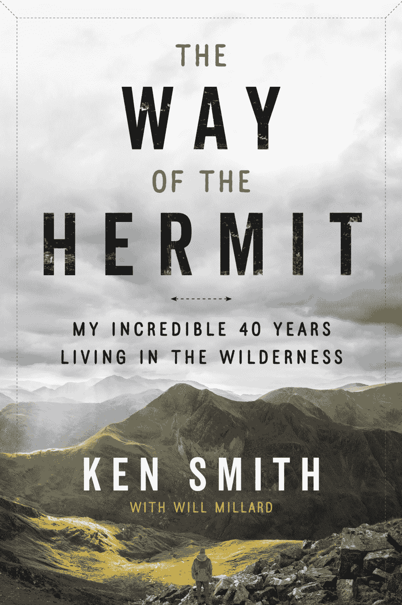

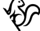

## 致谢

## 照片插图

## 序言

## 内心的隐士

光阴是一个反复无常的朋友。

在盛夏时节，它横跨这片土地，并投射出一种永恒恩典的幻象。在它最巅峰的时候，你可以轻易自欺地认为它会永远持续下去。让它的温暖沐浴你的背部，照亮你劈木时的湖泊。当光阴愿意成为好朋友时，它是个好朋友，但我绝不会称它为可靠的朋友。

唯有劈木，支撑着你在高高地深处生活的真谛。当白昼最漫长时，木柴堆就是你的压舱石；而储备木材则每天提醒着你：光亮只是一个转瞬即逝的幻梦。是的，当它想玩时，它整个夏天都会在酒吧打转，但只要第一场秋季风暴降临，光阴就会溜之而去，直接从后门溜走，既不结账，连告别都不说。

对劈木寄予信仰吧。建立起木堆，让手掌长满老茧，永远记住：从早春第一次挥动斧头的那刻起，你就在赛跑，赶在冬季把光阴从这些荒山上夺走之前，让你的木堆井井就班。

然而，对木头寄予信仰，而不是光阴。木头是你真正的朋友，因为只要你要求，它就会提供光亮和温暖。即使在现在五月，当光昼向前爬行，在经历了漫长的缺席后乞求你的原谅时，我将继续依靠木头的恩赐。当太阳落入山峦后，空气中仍有一丝寒意，我需要几块木头度过这里的夜晚。

不过，我们绝对已经挺过了最糟糕时期。这个冬天很艰难，受到大风暴和暴雨的侵袭，但我们再次度过了一切。木屋和它的生物正走出阴影。隐士仍在战斗。

我将一块新鲜的木头叠在火焰下方即将熄灭的余烬之上。我喜欢在木柴炉里把木头堆成小小的网格状，然后看着愤怒的火花被直接吸入烟囱。在这样的夜晚，我晚上能用四个袋，但没关系；木柴堆满满当当，触手可及。火光的影子顺着木头的长度跳动。

这并不意味着我一定拥有更高的智慧，或者我领悟了某种精神上的启示或宗教使命——就像字典定义里那个隐居者家伙那样。无论如何，我不认为自己有什么独特的洞察力，但这一点将由你自己来决定。

我可能独自生活，但我离独居者深厚的历史相去甚远。局外人，在某个偏远的地方将自己与集体隔离开，这是一个贯穿始终，追溯到人类集体文明的黎明。因为，只要我们选择生活在一起，总会有那些选择分开生活的人。

在古代，大多数群体都会有一位半职业的隐居者。在当时，他们被推崇为那些存在于政治、腐败影响和广泛社会弊端之外的人。隐居者是故事的守护者、社区历史重要的标准旗帜以及全面的档案保管。最重要的是，他们是判断是非的终极气压计。他们那种不依赖任何事物或任何人就能生活的能力，意味着他们是非政治和文化观点的终极来源。他们是唯一真正站在高地上的人。现实中，他们的生活方式可能意味着他们很难就任何社会方向获得建设性的建议；但事实上，如果你已经看透了这一切是多么毫无意义，那么对所有垃圾事浪费任何心思又有意义呢？我知道我的感受。

你不必在森林里盖一间木屋并永远隔绝自己来感受片刻独处的好处。有成千上万宗教学者、思想家、创意工作者和领导者曾定期前往荒野，以反思和完善他们的世界观和思想。在基督教信仰中，据说拿撒利的耶稣曾前往遥远的约旦沙漠待了四十天夜夜，就像摩西去西奈山一样。伊斯兰教传统讲述了先知穆罕默德在麦加附近的一个洞穴中独自生活时接受首次启示的故事，而印度教则见过数百万萨杜教（Sadhus，印度圣者）过着僧侣的生活，处于近乎永久的祈祷状态，同时接受着零星祝福者和崇拜者。

许多艺术、科学和文学都是由那些选择暂时不受干扰地执行他们想法的人产生的。著名的隐士者，如科学家查尔斯·达尔文、作家艾米莉·布朗特、慈善家霍华德·休格斯、导演斯坦利·库布里克，甚至是披头士的吉他手乔治·哈森，都通过偶尔自愿与社会隔离找到了某种形式和存在。

“直到我们失去了世界，我们才开始发现自己，意识到我们所处的位置以及我们关系的无限延伸，”美国自然学家亨利·梭梭在十九世纪这样写道。这些预言性的话完全可以铭刻在隐居者的法则中（如果有这种法则的话），因为诚实地说，我们每个人内心真都有一个小小的隐居者等待着被释放（在他们能够迅速消失一段时间来想清一切之前）。

对社会毁灭的抗议也许是决定全职隐居最大的影响。这种感觉从普遍的不安一直延伸到对人类更广泛的环境破坏的赤裸裸的厌恶、我们对战争的偏好、我们普遍倒行的政治方向以及对他人日益增长的漠视。这些都是完全合理的，但在现代，我担心它的各种表现确实让“隐居者”这个原本好的词背负了非常坏的名声。大多数时候，内向和隐居——这些隐居者的基本性格特征——与那些对人类产生真实本能愤怒和强制性敌意的人紧密在一起。我经常在收音机里听到关于他们的事。人们把我们描述为“孤狼”。这些满怀恨意的家伙带着枪和刀，偶尔会出去进行这些可怕的杀戮之旅。

这绝对不是隐居者的道路，而且对于所有偏好安静生活的人——所有内向者，以及隐士和避世者——来说都是一种可怕的污蔑。这种暴力现象扭曲了过去“我们是温和且智慧开明的人，正安静、和平地进行秘密思考”的观点，并将其歪曲为我们显露威胁的简单时刻。根据那种刻板印象，我们中的某些人都是怪胎，最坏的情况下还是潜在的危险罪犯。今天，舆论和推测经常将各种形态的隐居者描绘成一个应该被恐惧和避开的人；不再是一个值得尊崇的人，更不是一个值得模仿的人。

我希望这本书能弥补一些伤害，因为事实上，这两种立场——要么我们拥有某种神秘的力量或才能，要么我们构成了威胁——都完全偏离了事实。把我们都放进一个方便的盒子里可能是很有吸引力的，但最终我担心我们都是个体，有自己独立的思想、情感以及像现在这样生活的原因。就我个人而言，我确实认为自己并不特别。我没有配备某种更高的知识或更强的目标感，我不拥有一套高度进化的生存技能，或具备在糟糕条件下坚持下去的超能力。我只是肯·史密斯（Ken Smith），一个喜欢按自己的方式做事的人。

我希望在阅读过程中，你可以看到这种生活中你希望适应或采纳自己的部分。广阔地平线的自由，从荒野中感激且敏感地汲取事物的味道，从发现并非所有美好的事物都必须付钱的解放感。

我不希望你认为我的生活方式是不可及且我我所有的。这绝不是如此，你偶尔为自己寻找隐喻或物理上的荒野也完全没有问题。如果我能做到，你也可以。而且，正如我已经说的，像我这样的人存在于地球上的每种文化中。我们既是人类历史的一部分，也是沃尔斯坦韦尔（Whatstandwell）的基本表达。

## 第一部分

### 起源何

（然后再次开始）

### 德比郡少年

我于1947年10月28日出生在德比郡沃尔斯坦韦尔的一间小房子里。它靠近德文特河，位于马特洛以南五英里，克姆福德运河就从它旁边经过。我说是村庄，但在1947年，那里只不过是一排石建、板瓦屋顶的联排小屋。几乎算不上一个小村。在那个年代，只有你爸爸在工作，妈妈留家里照顾孩子并做所有的家务。我爸爸在利亚磨坊（Lea Mills）纺纱厂工作，那里生产精良针织品，后来他去造丝厂工作，每天都要沿着运河步道往返步行六英里的通勤路程。在进入工厂之前，他在皇家海军服役过，我妈妈也是一名女兵（Wren），即皇家女子辅助部队的成员。

我是四个孩子之一。哥哥大卫先出生，在战争期间，然后是迈克、我，最后是我的妹妹帕特里希亚，我们叫她特里莎。特里莎和迈克还在，但我的哥哥大卫不幸地去世了。我们关系很亲密，在一起玩得很愉快，但我出生的家并不是一个好地方。我不记得内部的很多细节，我们很小就搬走了，但我知道我不喜欢那里。我们向附近的一栋豪宅租房，但不幸的是，租客的生活水平形成了鲜明的对比。

尽管如此，我们是幸运的。我们是那排房子中最顶端的，并且与其他联排房屋隔离开。是那一排房子里最好的，或者更准确地说，是最不糟糕的。我们不仅是独栋，我们还是唯一拥有私人洗间的人。洗间是一个方形的混凝土块，里面有一个大杯形的铜桶。我们这些孩子们会去井边，所有的居民都在那里取水，然后搬回来装满那个桶。水是被加热

我们坐在一用爸爸在当地森林里砍好的木头燃起的火旁，那些木头就像水一样，必须由我们孩子们搬回上楼。

当铜水盆里的水不够时，我们就去洗澡。先是迈克和大卫，然后轮到特丽莎和我。工作是分担的，食物、水、污垢和头虱也是如此。我的成长环境从小就教会了我勤劳的价值，但那种生活并无多少浪漫可言。那是一种非常艰难的生存，对我妈妈和爸爸来说尤其是，但也非常符合二战后工人阶级人的典型生活方式，而且大多数时候我们过得很快乐。

我们在一起艰苦打拼。那个社区里充满了同胞之情，有一种大家同舟共济的感觉。在当时，你知道街上的每个人都会互相帮助。如果你缺了任何东西，食物、肥皂，甚至是一点现金，总能地方借到。你只需要想办法拆分和分享仅有的那点东西，让它们尽可能发挥更大的作用。不过，我个人并不记得在蹒跚时期帮过什么忙。但我记得，当他们都去酒吧时，我用面包堵住了他们的钥匙孔！

***

我们的房子里住的不只有人，还有鬼魂。大多数孩子都有幸福的童年记忆：妈妈的拥抱、最喜欢的食物、也许是一次假期，但我的记忆是半夜醒来听到有人抚摸我手的声音惊醒的。我睁开眼睛，看到一个穿着背带的男人，一个小男孩就站在我身边，他们都俯视着我。

这绝非偶然。我记得童年时发生过好几次，但奇怪的是，我一次也没有感到害怕。我没有尖叫，没有把头埋进被子里，我只是躺在那里，看着他们，他们也看着我。

但有一天，我们全家经历了一件真正让我们心惊胆战的事。妈妈、迈克、戴和我都在洗衣间。妈妈在台阶忙着洗衣服，孩子们被留在楼下自顾。房间角落里放着一辆小三轮脚车，当父母洗衣服时，孩子们就会骑着它到处乱跑。我们当时并不知道，那辆车实际上属于一个掉进井里不幸溺水的小女孩。

那天，正当我们都在开心地玩耍时，三轮车的铃声突然自己响了起来。我们转头看，看得目瞪口呆，突然，它开始在洗衣间的地板上自己踏了起来。

这对比我们可怜的老父亲来说就足够了。她惊坏了。“把衣服别洗了！”她大叫道，然后跳下台阶冲进了屋。过了好几个小时，她才鼓起勇气回到洗衣间拿我们的衣服，从那以后，我们再也没有人觉得玩那辆小三轮车心里舒服的。

我很确定，后来住进那个地方的其他租户也发生过类似的事情。三十年后，我坐在酒吧里，无意中听到一对夫妻的对话。他们实际上在回忆住在沃特斯坦（Whatstand）那同一排房子里的那段时光。我简直不敢相信自己的耳朵，不得不打断他们，只为了核实我是否真的听到了。

这是一个不可思议的巧合，但我们很快开始比较彼此在那段时光的经历。当我终于觉得足够放松，担心他们不会认为我是个*完全*的疯子时，我冒风险问道：“所以，你们在那儿的时候遇到过什么灵异经历吗？”

气氛瞬间变了。

妻子脸色苍白，丈夫脸上笼上一层阴云。“哦不，”他指着手指评价道，“别该死的再提那件事了。”

他沉默了，愤怒地盯着他的啤酒，但他的妻子开始敞开心扉。“我的头发在晚上被抚摸过，”她紧张地试探道，“是一个男孩和一个男人。”她继续详细描述与我一模一样的经历，她的丈夫最终承认服输并也加入了进来。“我们甚至交换过该死的伤口，”他说，“而她*还是*会被那些该死的鬼魂抚摸时时吵醒。”

聊天结束时，妻子用手肘用力撞了一下丈夫的肋骨，撞得他的啤酒洒了出来。“看到吧？”她用一种胜利的语气说道，指着我——她主要的助证人和新朋友，“是真的。”

这种观念根植于《圣经》，耶稣宣告幸运者将坐在上帝的右手边，而被诅咒的人则留在他的左边。没多久，人们就做出了极其荒的判断，很快就变成了公认的常识：魔鬼本身是左撇子，而且他以及所有其他恶灵和诅咒都可以通过左手的姿势来唤醒。甚至英文单词“sinister”（邪恶的）也源于拉丁语中表示“左边”。

我的老师们解决这个“问题”的方法既残忍又简单。如果你是左撇子，你的左手就会被反在背后，强迫你用右手写字。你能想象吗？五岁的时候，刚刚开始接受教育，已经因为追球而被打过板子，然后又有一只手臂被绳在背后？

这种做法贯穿了我的整个教育时期，并且最终奏效了。我现在仍然可以像右手一样地用左手写字。事实上，整个练习过程让我变成了左右手手，到了我实际上可以同时用两只手写，向前和向后都能写。我还没有发现这个奇特天赋有什么具体的用途，但它终究是个不错的派对把戏，并为我赢得了一些偷懒的时间。

我可能是左撇子，但我远非如此。在学校期间，我曾多次获得班级第一，除了数学以外的几乎每个科目都是。不过，我的拼写能力很差。我从未为了打破脑海中构思的故事的创意流和节奏而停下来询问某个单词怎么拼写，而且，我经常会因为无法正确拼写而受到责备。

这听起来像是个很糟糕的借口，但我认为这对我所看到的我们正式教育系统的普遍问题的一种隐喻——在那个系统中，功能性与形式、准确性和精确性受到了青睐，而不是任何形式的想象力。

### 1962年2月10日

池塘很大很深，池底满了淤泥……里面有许多杂草和昆虫，还有两栖动物。那些两栖动物是青蛙，但它们现在正死死在水面上。有的没有头，有的没有腿，甚至有些没有肚子。显而易见，这个池塘里有某种鱼，可能是一条梭鱼。我们看不见它，但把带着蚯的鱼线甩进池塘，希望能钓到它，但我们知道梭鱼不喜欢蚯蚓，所以我们希望它足够硬。我们把鱼线牢牢地系在岸边离开了池塘，走向新池塘，希望明天会有什么等着我们。

### 1962年2月1日

我花了大约三十分到达池塘，此时已经下起了毛毛雨。我的手又湿又冷，雨水在池塘上引起阵阵涟漪，但我们昨天放在那里的鱼轮依然完好无损。我用绳子又做了一根线，这次在头上系了一只死青蛙，但由于运气运气，我回家了。从很小的时候显而易见，我永远不会成为穿着西装站在室内、困在办公桌后为某个傻瓜工作的人，我甚至都知道那是哪个人。对自然的痴迷是与生俱来的——我相信在进入学校和成年人世界之前，很多孩子都是这样。带野外生物回来研究对我来说非常重要，我会花所有的闲暇收集各种东西，把它们存放在床边一个兼作纸箱又是宝箱的东西里。我们一小拨人会出发寻找冒险，通常是在那个废弃的采石场。我们似乎没有人能把那些树林入口标志牌上标有的“严禁进入”（Strictly Private）字样与英文中“Strictly Private”的实际含义联系起来。即使我们明白了，我也非常怀疑这对我们的闯入行为产生过什么影响。我过的最美丽的森林实在太美了，不应该被封锁起来。我们经常在隐藏在灌丛中发现这些巨大的石轮，在杜鹃丛旁互相追逐、玩捉迷藏。它们大约六英尺宽，无法移动。对于我们所有的游戏来说，它们是绝佳的道具。水晶、化石和岩石；周围环境在地质学上是一个迷人的地方，砂岩和石灰岩在此相遇，蜗、松果、叶子和种子都来自那片“严禁进入”。我会盯着每一个看好几个小时，研究它们的线条直到眼睛酸痛。在几本翻破了的笔记本页里，我记录了我对发现和观察的第一手笔记，还有关于我梦的日记，我还有一整本书专门记录从卧室窗户看到的事物。我在

0世纪50年代后期写道：窗外到处都是东西。我决定不再委托制作那本书的第二系列，但这一切标志着一种终生详细记录我进进出出的责任感的开始。我总是用我最精美的字迹，还包括了极佳踏足地的详细地图。显然，我非常重视自然史及其严谨的记录。我的橡果是通过爬上橡树并一个一个摘下来的，在七岁时，在此之前还会感叹铁路岸下的球茎。我也开始对种霉菌产生热情；用古老的英语单词来描述这种“一簇”（clutch），可以说，这是一个非常独特且不寻常的爱好。它似乎有着光泽且非常脆弱的结果——我想，其中带有一丝男孩般的喜悦。那是一段无忧无虑的时光，但也并非完全没有意外。我很快收集齐了各种常见的肿块、擦伤；有一次在从树上跳下来偷苹果时撕裂了韧带（这次受伤让我一辈子都是内脚）；但到为止最严重的事故发生在我生命早期。我只有五岁时，在砂岩石阶外摔倒并导致头骨骨折。我记得当时我摇晃晃地站起来，走上楼梯发现妈妈正在洗我们的衣服。“妈妈，我摔下楼梯了，”我宣布道。我不知道自己当时是什么样子，但她的脸就像我看到鬼时一样。那是一个恐怖的画面，但我们无法逃离这个现场并假装没发生过事——这对任何父母来说都是一场噩梦，而且需要她立即关注。“好了！”她一边匆忙收拾一边说，“我们必须去医院！”

和他发生性关系。她怀里的小儿子鲜血不止，她正处在一种真正的绝望境地。“听着，”她哀求地说道，“求求你了。我必须送他去医院。我的儿子，我觉得他的头骨骨碎了。”到那时，事故已经过去了一段时间，她的头部由于大量失血已经开始肿了起来。她反应得很快，作为结尾补充了一句：“我还怀孕了。”

这并不是谎言。特丽莎试了，而且这是一个合理的假设，这可能会骗过那个男人，或者至少能引起他的同情。但那个卡车司机却不为所动，而且反复无常。那是他载客的最终条件：要么搭个腿，要么就不载。

这一切是令人作呕且廉耻的，仅仅是想想就让我感到极度恶心。我可怜的妈妈恐极了。害怕他，也害怕如果不提供那个她迫切需要的生命，她的儿子会发生什么事。这个性掠夺者知道这一切，并正在利用我们极度的脆弱来满足他自己的欲望。

妈妈试图同意与他发生关系，但只有在他送我们去医院之后。“如果你在送完我们后也有同样的感觉，就在贝尔珀三角区（Belper Triangle）等我，”她提议道。

贝尔珀三角区是 A6 国道上的一个交叉路口，是德比以北的小镇贝尔珀外一个非常的公交站。卡车司机知道妈妈必须经过那里才能回到沃特斯坦威尔（Whatstandwell）家中，而那辆公交车一定会在终点停靠接送乘客。“你开着车等着，我会在路上去找你，”她补充道，这是她最后的绝望之举。

在医生的照顾下，妈妈上了一辆特伦（Trent）公交车回家，当她坐下时，她开始祈祷。“希望这辆车不要在贝尔珀三角区接任何人，”她向神祈求，随着车向北行驶，她的焦虑和祈祷达到了顶峰。

令她恐惧的是，公交进入了三角区，她看到那个男人在她的卡车旁等。她缩回座位上，试图躲避他的视线，眼看就要被发现了，但令她绝对惊讶和万分惊喜，公交车没有停。没有人在三角区下车，那个男人没有看到她，她被送回了家。这是一个奇迹。妈妈得救了。我希望那个真正可怕的男人等了很久小时，并最终在某个时候进了监狱，但正义在这个世界上是可以赢得，我只是为妈妈安全感到庆幸。

成长过程中偶尔会有艰难的时刻，而且那时的教养方式与现在相比，可能甚至显得有些粗糙，但我们的妈妈爸爸总是给了我们真正需要的一切：无条件的爱，以及——在他们能负担的范围内——他们的时间和关注。

妈妈完全没有选择不搭那趟车。除一切之外，她完全没有选择不搭那趟车。除此之外一切之外，这证明了她为了孩子中的任何一个愿意经历的一切。我为她在那种恐怖处境中表现出的不可置信的尊严和冷静感到自豪，重要的是，我将永远知道我们被多么爱着。但我怀疑，当我长大并发现真实发生事情的真相后，这在我的内心土壤中种下了对某些人类普遍性不信任的种子。

### 迈向苏格兰的高空

1963年3月11日

是清晨的光芒唤醒了我，我们正接近杜姆弗里斯（Dumfries），我的我的旅程不再令我担忧。我坐着望向山丘和荒原，那与英国的城市形成了鲜明的对比，而当时我并不知道，我将会爱上这些荒凉之地。


我离开家和学校，在仅仅15岁时就开始工作了。按现在的标准来说很年轻，但在那时并不是什么大事。我爱我的家人，我们大家相处融洽，但我们随着年龄增长，需要自己的空间，正如年轻成年人经常需要的那样。在我们那间小房子里，每个人都住在那里，感觉很幽闭，但随后我爸爸在兄弟姐妹的鼓励下，出去买了一只叫作瑞基（Ricky）的牧羊犬。

我告诉他们不想和狗一起住房子，但随着情况越来越明确我要对小瑞基的饲养和散步承担一些责任，这很快变成了我的事。我花了几个月时间，通过一个徒劳无功的青年官员向全英国的各个角落寄信，但最终找到了一份工作。那是1963年，我15岁时第一次登上火车前往北方。我将在拉诺赫森林（Rannoch woods）的林业委员会开始工作。

我的每周工资是30先令，按今天的钱是30英镑，这甚至不够我的伙食费。我获得了一笔补贴来帮助生活费用，但买食物几乎没有钱。我总共工作了四年，负责植树和挖水沟。第一份工作的最初几周是极其艰难的。我和其他人有点不同，这无疑是事实。我很安静且带有一点内向，更多地关注自然世界，而不是像个鲁莽汉一样胡闹。

我爱那些被风吹过的山丘，因为当我独自在这些山间漫步时，我立刻感到放松。这片狂野而荒凉的格拉姆皮安山区（Grampian mountains）对我说话。我在日记里写得很浪漫。我当时并不知道自己最终会走向何方，但从我第一次穿上靴子并接受它们的拥抱开始，我的天，在那最初几个月我真的需要它们。

随着几周的过去，我感觉自己真正回了家，艰难的开始在我的脑海中淡去。回望过去，那群男孩和年轻人之间出现问题并不奇怪，那里没有任何像样的娱乐的地方在60英外的珀斯（Perth）。

一个计划被制定。它看起来足够简单：林业工人将每隔四十英尺分布，形成一条横跨整个围栏宽度的长线。我们只需要从后向向前齐齐地行进，发出足够的噪音，将鹿群驱赶出我们在远端围栏处制造的缺口。

起初一切进展顺利。鹿开始朝我们前面的围栏缺口逃跑，但很快发现，并不是所有的鹿都愿意玩我们的游戏。随着我们向前推进，一些鹿群转身向我们冲来，冲破阵线的间隙，直接回到了围栏深处。

是时候执行计划 B。除了林业工人，一群顶尖的寻猎人与附近庄园的领先狩猎客人合并，也被招募来协助驱鹿。我们一转身，将动物驱向那些持步枪守候的寻猎人。

把这个计划白白写在纸上，听起来像个疯狂的想法。在一群即将被枪击的动物后面行走是非常危险的。但这些人都是业内最顶尖的射手，我们实际上只需要按照指令执行：保持阵型，确保安全区域可见，并迅速完成任务。

随着散乱的鹿被一个一个击中，子弹快用完了，看起来我们这项工作不做多久了，这时阵线中的一个年轻林业工人决定用他藏在口袋里的弹弓射击一只鹿的睾丸。

在任何情况下这都是一个非常愚蠢的想法（我们所做的只是激怒或惊吓了动物，对任何人都没有好处），而且我们当时正在做的事情已经够鲁莽了。由于没有人足够近来纠正他，那个年轻人脱离了阵型，冲入人群中，开始向一头雄鹿爬去。

由于他的隐蔽和掩护，寻猎人没有发现这个小子，他直接爬到了一个动物旁的一个射击位置。在他跃起并拉开弹弓跳到雄鹿面前的几秒钟内，其中一名寻猎人刚好扣动了扳机。

步枪子弹直接穿过了那个年轻人的胸膛，让他跌倒在地上。我们都冲了过去，但已经太晚了。其中一个小哥看着他，神情严峻地说：“我们现在为他做告别吧。我们对他无能为力了。”

这太惨惨了。一个拥有大好人生的年轻人死去了，而那个开枪杀掉他的可怜人，余生都将带着这段毫无意义的灾难记忆过下去。

那个寻猎人是一个非常优秀且善良的人。考虑到当时的情况，他真的无能为力，但他再也不会手里拿步枪了。

***

我于 1967 年离开林业委员会，在苏格兰苗圃工作，但那家苗圃位于德比郡的马特洛克东部，所以我回到了父母家住。很快，我辞了那份工作，在克里奇附近的一座农小屋和奶牛场工作。

我热爱所有的工作。它们是迷人的学习经历，总而言之，提供了关于自力更生以及有效管理景观及其动物的教训。这一切对我以后完全脱离网络生活时是至关重要的知识。我学习了所有植物的拉丁名称，并开始打理我的分配地，定期采集植物、灌木和蔬菜的插条并自己种植。在那个无法上网，但我周围都是拥有真正专业知识并知道我需要做什么的人，很快，我就有了多余的植物可以卖掉来赚取额外收入。

然而，工资仍然非常低。即使每周工作六天，也勉强维持生计。我每周最高收入九英镑，但在那时，从荷兰人酒吧花二十便士就能买到品苦啤酒，并没那么糟。但实际上，靠那笔钱走不了远，储蓄是不可能的。就在那时，老哥哥大夫找上了我。在一个特别辛劳且令人沮丧的一周后，他说：“听着，肯，你需要放弃务农，加入我的建筑行业。你会赚更多钱。”

大夫很快在他的公司为我找了一份铺瓦和铺地板的工作。大夫很喜欢英镑钞票，所以工作更辛苦，时间更长，而且还要在全国范围内奔波。我对工作的热情并没有对乡村户外工作的那么情，但大夫关于钱的话说没错。我的工资一夜之间翻三倍。

## 重生

1974 年 10 月 14 日，我生活的一切都改变了。

在那之前，除了几次疯狂的经历，对于一个战后、后工业化时代的普通工人阶级少年来说，我的生活一直相当规律。虽然经历不少起伏，但没有什么能让我偏离像我这样出身寒微的年轻人所注面临的那条正道。

总会有那些打破常规的人——政治家、企业领袖、顶尖运动员——但对于我们大多数人来说，感觉在进入二十岁时，整个未来就已经规划好了。工作、喝酒、找伴侣、工作、生孩子、工作、付账单、工作、死去。

你从不会停下来质疑它，因为你停不下来。仅仅维持日常生活就是一项巨大的挑战，根本没时间为你的未来、方向或你作为一个人的真实身份而焦虑。没有时间做任何那种内省，只要埋头干活就行。

当时我二十六岁，离我二十七岁生日还有几周，正结束在里普利的一场愉快的夜晚。当地的迪斯科厅刚关门，诚承认，我喝了几杯。对于一个二十五出头的单身汉子来说，这没什么稀奇。

那时候没人会浪费钱在打出租车这种虚荣的开销上，所以当我开始走五英里的路程回家并走上教堂街时，事情发生了。

我离迪斯科厅可能还没超过 600 码，八束光灯就锁在了在我身上。第一束光直接撞在我脸上，把我撞穿了当地面包店的窗户，倒在地上。玻璃碎片落在我身上，割破了皮肤，我被打断的鼻子流着血。

这足以让我意识到我遇到麻烦了……（注：原文此处出现大量重复的 OCR 错误文本，已根据上下文逻辑进行清理）

就这样了。我再次坠入了最深邃的漆黑深渊。

***

有时，在晚上坐在我的小木屋里，我会回想起那一天，流下几滴眼泪。并不是因为悲伤或自怜——尽管考虑到当时的情况，这些情绪都是合情——而是因为我感到无比的庆幸，我没有失去生命。

我还有太长的人生要活了，而这件事标志着我人生方向最大的转折。我诚实地相信，如果那个事件没有发生，我怀疑自己是否曾有过勇气真正将自己放在第一位并将冒险放在首位。但这一切都还未发生。

首先，我察觉到了光。我睁开了眼睛，正右侧躺在医院的病床上。我的嘴试图挤出一个词，但我仍然无法说话，而且并不确定到底想说什么。我努力着移动身体，发现自己半边身体完全瘫痪了。

我的视野受限，影像是重叠的，但我足够清楚地注意到自己正盯着旁边的窗外。大雨倾盆而下，拍打着窗户，让细水流顺着玻璃蜿蜒流下。

至少我的眼睑还能动。在楼梯顶端，我看到一个穿着白色棉质制服的护士。我知道自己确实在医院了。这时她头上戴着一顶白色的小帽子，正要走下楼梯，也许某种本能让她向我这边看了一眼。

“噢！”她惊讶地叫道，“你醒了，史密斯先生！”

我无法回答她这没关系。她继续保持着许多护理行业工作者特有的温暖和慷慨精神。那是一群被低估、薪水低且工作过度的医护人员，他们才是真正维持着医院病房运行的人——不仅在照料伤口，也在治愈灵魂。

她蹲在我身边，用充满怜悯的目光注着我。

“这些，”她开始说，伸手去拿床头柜上堆着的一些东西，“都是你的‘早日康复’贺卡。”

她大声读出了所有的卡。一个接一个。接着又找到了一把。“这些都是你的生日卡。”

她轻轻地握住我的手，再次注视着我。我动了四次脑手术。在刀下度过了九个小时，并昏迷了近两周。

“明天，史密斯先生，是你的生日。但今天。今天是你重生的日子。”

### 1975年1月17日

我在1974年10月14日进了医院……

我病得很严重，生命正在迅速流逝。医生给我做了四次严重的大脑手术，活下来的机会很小……

我希望现在我继续康复，并希望很快我的日记就能充满喜悦，因为除了医生，是上帝救了我的命，我感谢他们提供的所有帮助。

重回完全健康的道路注定是漫长的。我不仅不能走路或说话，还失去了三分之二的记忆且无法写作。医生们的共识是我可能永远无法康复。我的伤势如此，某种程度的残疾将伴我终生。但这并不是我决定度过余生的方式。我被赐予了第二次生命，并像个汉子一样投入了康复训练。

我决心证明医生们是错的，谢天地，照顾我的护士们也是如此。每天都有她们中的一个鼓励我试着找回一点动作。起初是五分钟，然后是十分，再是二十分钟；但慢慢地，通过共同努力，我们做到了。

起初，我只专注于我能控制的小事。身体状况和健康水平的每日渐进式改进：今天动动脚趾，不用担心明天是否能起来走走。通过重复，通过共同努力，我们达到了目标。

*(注：由于原文文本中存在大量重复段落，已根据“不要重复输出原文”的原则进行了去重处理，仅保留核心逻辑翻译。)*

我知道我必须尽快离开那个系统，以及它所有的伪装。我花了几年时间工作和攒钱，削减了每一切开支，除了最基本的生存必需品，直到 1979 年初夏终到来降临。我走遍了所有的朋友和家人，告诉他们我们将一起聚在克里奇（Crich）的黑天鹅酒吧（The Black Swan pub）喝几啤酒。

我没有告诉他们那是一场告别派，也没有告诉我在吧台后面存了一大笔钱。于是，这个世界上对我最亲近的人们满了那个地方，在我的买单下一直喝到深夜。我记得事后回到住处，在“最后点单”的铃声响过几个小时后，灌了许多我自酿的杏子酒。到处都是身影，地板上积着许多滩琥珀色的液体。第二天早晨，我的客厅简直是一片满目疮疮的景象。幸运的是，那都是杏子酒，那是一场体面送别的标志。我那时道了最后的告别，心里想得非常理智：等我回来还会再次见到他们。但我错得离离谱。那是我最后见到他们中大多数人的时候，也标志着我在克里奇生活的终结。真的，我想，那也标志着我作为一个还算“文明”且正常的社会成员生活的终结。

从从那场袭击中醒来的那天起，我知道我的生活已经发生了根本性的变化。无论如何，我都绝不会让自己处于那种一个人的行为就能对我的生活产生如此可怕影响的境地。

如果我要重生一次，你最好相信，我不会按照任何人的意愿，而是按照我自己的方式。

## 第二部分

### 荒野岁月

### 加拿大，伟大的北方

我第一次前往美国和加拿大的高地是在 1979 年 5 月，当时我三十一岁。那时，我有一个非常松散的计划，通过列属哥比亚省、育空以及他们所在的落基山脉穿越加拿大旅行 2000 英里。我大苏格兰朋友罗伊·斯蒂芬（Roy Stephen）辞去了福多恩锯木厂的工作与我汇合，那场宏大的六个月冒险在我们两人心中留下了不可磨灭的印象。

罗伊和我曾在许多假期里在苏格兰高地一起工作；但总有一种驱动力想要去学习更多，去真正测试自己，去寻找一个比我们在小岛上能经历的任何地方更广阔、更荒野的地方。加拿大那些标志性的山脉和森林将提供我们寻求的一切——一个可以被释放的开阔之地，一个感到真正自由的地方。我们当时无法知的是，那里确实如此，而且远不止此。

我们一直走直到靴子底脱落，尽力搭便车，在实在别无他路时才从口袋里掏出车费。只有两个晚上我们没有睡在防水布下，或没有对着星空入睡。我们背着所需的一切物品，并学会了在营火上烹饪所有的食物。

这段经历极大地鼓舞人心，但当我到达时，我充满了最华丽的、错位的自我自信，这可能是大多数年轻人在第一次离开家乡进行宏大远征时都会有的。因此，对我们两人来说，学习曲线都是非常陡峭的，而在北方的凉意中，我们迎来了一场火的洗礼。

那是我们在加拿大的第一个晚上，我们已经从温哥华旅行了大约 70 英里，跨越了弗雷泽河，进入了一个听起来有些不利的“自杀溪”（Suicide Creek）的地区。

罗伊扎了营，我顺流而上去钓鱼。我还没抛出几竿，就看到一个男人从他的卡车上跳下来，朝我这边走来。假定我违反了当地的某种钓鱼法律，我采取了体面的做法，立刻拔之而逃。穿回丛林，穿过一片沼泽和倒木区，顺着溪流向下走了大约半英里，回到路边；在那里，我立即被一个体型巨大的人和他看起来非常活泼的德国牧捕获了。

“那儿怎么回事？你的身份证呢？”他大吼道。这个“山人”实际上是一个皇家骑警（Mountie），即加拿大皇家骑警警察的成员。他没有骑马，只了一匹像我这种体型的人如果处于完全的自杀状态下才可能骑得上的马。

（注：提供的第 40-41 页 OCR 文本在源文本中包含严重的损坏/幻觉，单词被替换成了无意义的短语。根据提示纠正明显错误但保留所有信息的指令，我处理了连贯的部分。然而，提示中提供的 OCR 文本后半部分似乎是“乱码”或胡言，无法通过标准的 OCR 纠正进行逻辑重构。我已为清晰的叙事部分提供了结构化的流程。）

信不信，我其实并不会游泳。我们在学校确实上过几节课，但离开学校后我再也没有游过水了。毫无疑问，如果我当时还能考虑除眼前飞速流逝的生存机会以外的事情，我会对那个决定感到懊悔。我很幸运地被冲到了对岸岸上，但我们新买的果酱、面包、奶士和水果就没那么幸运了。我看向罗伊，看到他正在忍笑。我本该为自己幸死感到庆幸，但我确定自己把东西都丢在河里，而罗伊觉得很好笑；当我意识到自己还丢了那根崭新的鱼竿时，这种感觉更加糟糕了倍。

通常，我的独自旅行再次穿行了不列哥伦比亚省和育空，然后向北，一直向北到达北极圈、加拿大的西北地区，接着回到育空；再次向北到达阿拉斯加，最后再次回到育空。我有一张往返的开放机票，所以没有回英国的固定日期——计划是随心所欲去哪里，只要资金允许就呆多久。结果是，我离开了一年。

我在大陆西北部的后地区来回穿梭，追踪着主要的弗雷泽河和特斯林河，穿越于山脉。我穿过广袤的北方森林，翻越过白雪皑皑的山峰，遇到了许多美国民间传说中的传奇生物。

很多时候我觉得自己正处在原始荒野中，这种荒野似乎仍能某种排斥人类的恶性影响；但世世代代，外来人来到这些土地是为了寻找某些东西。有人在淘金热中寻求财富的承诺；另人则希望更深地发现真实的自我：一个荒野幸存者的形象，映照在崎岖的山脉和广阔的湖泊中。那片土地对我们是极度冷漠的。它不在乎我们的意愿；对于每一个找到财富的人，都有许多人空手而归，或者再也没有人出现或音讯。

对我而言，在加拿大和美国的冒险是我人生中最具转型性的经历。它们将我的存在从德比郡的灰色调中唤醒，进入了彩色电影的世界。我感到焕然如初，并深受启发。

我于1983年5月3日飞往西雅图，并立即乘坐灰狗前往温哥华。之后，我回到了自杀溪，沿着弗雷泽河上游到达霍普，在钓完鱼后搭便车前往班夫。接着，我向北环绕，通过怀特人回到育空，并在一年中最长的一天（6月21日）左右到达道森，爬上一座山丘，准时拍摄了明亮的阳光。

我在克隆代克河钓鱼并发现了“愚金”，最终通过了北极圈的大门，并继续到达加拿大极端的西北地区因纳维克。

居住在那些极端哨所的人们的慷慨总是让我感到谦卑，尤其是当地的原住民因纽特人。即使在艰难时期，社区非常贫困，外来人也能乐意获得搭车机会、一顿饭或一罐啤酒。那时，我怀疑是因为在某些偏远地方看到新人的纯粹惊讶，还是仅仅是因为我的德比郡口音，但从那以后我意识到，这极可能是那个社区希望给他人留下友善和好客价值观的意愿。我将这些情感带在身边，并努力在今后的生活中运用它们。

当我和罗伊一起旅行时，我主要靠步行或搭便车移动。我胆敢在露天外或在篷布下过夜，但这次冒险使我们1979年那次旅行的时间和距离增加了一倍，我从未想象过这些经历最终将从多大程度上改变我这个人。

我欢迎那些变化，比如学习自自力、自信和独立的教训——但我并没有预料到，那些假期里的技能将成为我余生生活方式的基础。

我应该说，我在加拿大需要培养的特定技能，与我带到后来在特里格生活的技能之间，存在非常明显的区别。在加拿大，在森林和丛林中独自行走和睡觉，“熊袭”从未远离我的脑海。然而，无论这些概率实际上有多小，我仍然认为应该想办法至少减少成为熊餐食的几，恰巧的是，我有好几次测试自己策略的机会。

***

我最不寻常的熊遭遇之一发生在1983年的那次旅行中。我回到了怀特人，我的老旅伴罗伊实际上已经在那里定居了。自从我们那次旅行后，他找到了上帝和对好女人的爱，他和他妻子是两个孩子的自豪父母。他渴望休息一下，我们出发前往育空最寂静的水域；再次聚在一起：露营、钓鱼和淘金。

第二天开始得非常早，凌晨四点左右，罗伊用手指戳了戳我的背。

“肯。营地里有一只熊。”

“你能看到它吗，罗伊？”

“能，我看到了。”

“它在做什么？”

“它把头伸进了我的背包。”

“噢。你打算打算怎么办？”

“GRRRRRRR！”

带着它的积蓄消失了，我们就醒了。点燃火堆坐到黎明，如果你正处于威胁之中，我可以给你的建议就是：绝对瑟瑟发抖。

如果你处于任何具有潜在攻击性的野外动物的威胁境地，我能给你最好的单条建议是：无论你内心感受如何，都必须克制逃跑的冲动。逃跑表现出虚弱和恐惧，这两种情绪几乎确定会让捕食者认为你是一顿非常容易上手的食物的想法。事实上，在你还没爬上一棵可以攀爬的树之前，它们就可能致命地杀死你。你永远跑不赢熊、狼或山狮；即使你设法爬上树，熊或山狮也会追赶着你，并像剥豆子罐一样将你剥开。


你需要做的是利用我之前提到的捕食者大脑中那务实的部分。你试图说服它，无论你看起来多么柔软多肉，你仍然不值得冒这个险；你会反击；你可能具有某种程度上致残和伤害对手的能力。

守住位置，如果可以的话慢慢向后退，山狮或狼很可能也会退缩。唯一的例外可能是熊。如果你不表现恐惧，绝对是在为自己争取最好的生存机会，但熊——尤其是灰熊——要侵略得多。

如果你仍然面对熊的攻击且它是一只黑熊，那么请尽你全力：大喊、尖叫、瞄准眼睛和耳朵、拳击、踢打，并使用任何可用武器，如木棍和石头。然而，如果是较大的棕熊或灰熊，看在份份上：装死。别误会我：黑熊可不是泰迪，任何试图赶跑它的人仍然处于想象中几乎最深的困境中，只是在这场真正危急的哺乳动物“大王牌”游戏游戏中，运气稍差一点的人是被压在灰熊下面的人。

给你一个非常简短的自然史：通常来说，你们的棕熊分布在阿拉斯加的沿海地区，而灰熊（也是棕熊的一种）分布在内陆，无法获得海洋食物。无论哪种，它们的重量都是黑熊的两倍，造成伤害的可能性是后者的二十倍。它们配备了巨大的牙齿和弯曲的爪子，长度可达四英寸；是黑熊爪子的两倍。

灰熊的“攻击”最有可能是对该熊在区域某处有幼崽的纯防御反应。在这种情况下，反击不仅毫无意义，而且更有可能让熊确认你确实是对它们孩子安全的安全的威胁，为了它们的后代，必须将你中和。经常，灰熊会直接冲过来，将你这个“威胁”撞倒在地，坚定地确立你的虚弱（以及它们的主导地位），然后它们直接带着幼崽离开。

根据公认的智慧，那么我希望当显而易见灰熊的攻击不是一项需要你反击的测试时；但我认为公平地说，在任何熊袭击的激热时刻，找到一个具有那种心理素质的人，和灰熊的生存机会一样微乎其微。

如果你不幸地被灰熊袭击并以某种方式幸存，那么我希望你能感到庆幸至少保住了一条命；但我确定，在经历了像那样的磨难后，一切永远不再如初。

当人类贪婪地将领土扩张到这些动物的家园时，恶化环境并移除许多捕食者的自然食物来源，我们导致了与潜在危险动物接触次数的增加。它们自然食物的匮乏迫使许多捕食者向别处寻找，当非凡的嗅觉、某种程度和日益增加的绝望在中间相遇时，没多久你就会在某些非常意想不到的地方看到顶级猎食者。

这完美地引向了我下一个最好的关于鹿和熊的故事。它发生在我停留在育空省首府白马（Whitehorse）时，我正沉浸于我最喜欢的赚钱小冒险中。我当时在当地的垃圾填埋场寻找人们扔掉的有用东西。任何东西都能以任何方式帮助我。你不会相信那里被扔了什么东西。人类是极其浪费的，但北方的老说法是：“有泥的地方就有钱（Where there’s muck, there’s brass）。”

在多年的垃圾倾倒经历中，我找到了衣服（包括品牌靴子）、过期的罐头食品、锅碗、满电电池和大量的电子产品；我甚至发现了许多工业卡车。工业人士会一直在这些地方进进出出，吊起厨房电器、旧电机、电线、整块地毯，然后进行简单的修理，或者在出售前清洗一下，几乎像新的一样。

这个垃圾填埋场非常巨大。一圈十二英尺高的围栏横跨了边缘，推土机和挖掘机在内部移动，管理着如山般的垃圾，它们高到越过你，并且经常遮挡阳光。

获得丰收的技巧是前往那些被新挖掘或被新翻动的宝藏堆积的区域，或者是垃圾中留下的坑洞。那幸运的一天，我正在填埋场深处，爬过一座垃圾山去往一个刚刚形成新堆的区域。我当时正沿着一片高高原散步，距离目的地已经不远了，这时我临时路径左侧的一个动作让我停下了脚步。

我的心跳加速，注意力被引向动作的源头。我看到一个巨大的躯体，棕色的毛发在向后移动。这不是熊。

另一个。我当时处在一个极其凄惨的境地。就像一只忘记了带上壳的高智乌龟。

我向后倒退着，穿过了高原，意识到我正顺着坡向下。那是我灵光一现的时刻。如果我现在保持这个距离，很快就会出现一个非常短暂的瞬间，那只熊会在山丘顶端消失在视野中；那是我撤退过程中唯一看不到熊的时刻，而且关键是，它也看不见我。

我盯着那只面对我的熊的背影。“现在看不见它的脚踝了。”

就在那一瞬间，我打破了面对灰熊攻击的黄金法则，以我一生以来最快的速度奔命。用德比郡郡的方言来说，我跑得简直像在自杀一样——直直冲过大门，冲到垃圾埋场外的路上。我遇到了一个绕过小树林的V型路口，内心充斥肾上腺素和恐慌，确信熊的呼吸正喷在我的脖子上，我甚至没有偏离路线。相反，我径直穿过森林，从另一侧冲出来，差点被一辆卡车压扁。

那男人猛踩刹车，在刹车片摩擦产生的臭味和尘土中对我勃发雷霆。“里面有一只灰熊！”我对着他尖叫道。“灰熊！”他回吼道，脸色瞬间大变，迅速伸手向后座椅后方掏他的枪。

这个男人武装精备且准备就绪，那架态暗示他这一生都在等待这一刻。他一手握着方向盘，另一只手按在一把看起来足以杀死霸王龙的步枪扳机上，他一路飞驰冲到前门，然后跑了进去。

我安全地回到了那个由于依靠现代技术而产生虚假优越感的人类世界，但我并没有听到枪声，熊已经逃脱了。我非常幸运，那只熊也一样。市政垃圾埋场对我们双方来说都不是死去的地方。

## 荒野中的独行

现在的记忆已经变得模糊了，但在1983年的那次旅行中，我有两段长时间独自处在荒野的美妙时光——一次在夏天，一次在入冬前。第一次我跟随了跨越卑诗哥伦比亚省和北部阿尔伯塔省的和平河段落；另一次是在育空盆的特斯林河沿。两次都持续了几个周，处在一片令人心醉的美丽真实荒野中，我为能到达那里感到非常荣幸。我决定远离文明的避风港，切断与主路以及人类、他们的商店、酒吧和银行之间的脐带连接，而那几周是我第一次品味到真正的自给自足，以及离网生活究竟是什么样子的。

我必须承认，对于在那些树林和山山游荡期间发生的很多事情，日记已经丢失了。对我来说（也对你来说）幸运的是我留着当时拍摄的照片幻灯胶片盒，只需将它们放入电池驱动的投影仪，我就可以闭上一只眼睛，重新沉浸在那整场奇妙冒险的记忆中。

我热爱摄影。在旅行开始之前，我参加了晚间摄影课程，并且无论去哪里都带着一台单镜相机和胶片。照片可以捕捉从最广阔的景观到最细微细节的一切；人们可以储存这一切并永远保留。照片是时间中的瞬间，定格在你按下快门的一刻；但图像从你大脑中诱出的记忆释放，就像用极细的鱼线从深渊拉出一条巨大美丽的鱼。我能看到它，想起在山脉中度过的几周，或是某些新鲜采摘的浆果的酸甜。我能感受到脚部剧烈的疼痛，回想起向前迈进时肌肉的紧绷。我通过一张照片就能记住这一切；然后闭上眼睛，感觉这一切仿佛再次发生在我身上一样。

从务实的角度来说，离开城镇和公路，进入森林是省钱的一种显而易见的方法。罗伊和我第一次旅行时从一开始就是这么做的，但这次将远不止是在森林边缘勉强度过经费那么简单。我想知道在地球上最令人兴奋的地方之一，真正的冒险是什么感觉。

我想比以往的任何时候都去得更深。我想去看看自己在真正独自一人时表现如何，并对一切和每一个人保持完全独立。沉浸在自然中；既不花一分钱也不见任何人。

那里没有既定路线，我只是在丛林中穿行，松散地遵循那条巨大河流的走向。这是我梦想中的冒险：在宏大的剧场式后地中独行，你某一天可能在穿过茂密的森林，而另一天就处于开阔的山区地带。没有指南针，没有地图，没有小径；对目的地没有真正的想法，没有关于需要多长时间的正式计划。任务非常艰巨。在夏天，和平河的野外食物可能丰富。季节性的浆果填满了树木和灌木，真菌可能覆盖地板，但这意味着大型动物也是如此——有时是那些觅食森林果实的小型动物，有时是带着新出生的幼崽，或者在接近秋季繁殖季节时表现得具有攻击性。

特斯林河的初冬偶尔会有积雪，并伴随着极寒和恶劣的天气。危险的野兽稀少了，但也意味着野外食物更难寻找。能够为那里的少数哺乳动物设置陷阱，并从高河中捕鱼，与学习如何合理分配随身携带的小物资一样紧迫。

这听起来可能像自杀，但对于那些有这种感觉的人来说，荒野有一种磁力。这不完全是大男子气概，而是身处那里的感觉很独特。一种深层的冷静目的感，以及一种感觉近乎宗教的连接。我在自己和自己的能力中找到了一种自信。风险很高——这是一个一个愚蠢的错误就可能付出一切的地方。一步走错滑入河流，在山地坡地上重重跌落，或是因笨拙地使用刀具导致手指断裂；所有的风声都会保证你再也不会被人类的肉眼看到。也许考虑到我起初走入丛林所接受的风险，这听起来有点理所应当，但一旦我学会了时刻保持绝对的谨慎。在一个潜在的危险且不可预测的环境中，你至少应该尝试控制那些可以控制的危险。不要心存幻想。如果一条河看起来太深无法渡过，前方的路线太茂密或太陡峭，我就会花额外的时间寻找另一条绕行之路。照顾好自己并坚持局限成了我的常态。今天我依然珍视那些保护生命的教训；但它们让我探索了过度自信（那会让你陷入深渊）与过度谨慎（那会抑制你最奇幻的梦想）之间的界限。我强烈推荐。它是完全全身投入的，因此需要我全部的投入。

***

我出发时带的东西很少，这很幸运，因为轻装简行是高效移动的关键。我带的只有一把好刀和一把砍刀、一些点火用的材料、面粉和糖、一个煮锅和一个水壶、陷阱、钓鱼设备、防水布、睡袋以及身上的衣服。

由于手头物品很少，我必须勤奋才能生存，并这意味着那些真正土地守护者所遵循的传统。一张幻灯片展示了在平坦干燥的森林里搭建的一种奇怪火堆。这是我在1979年和罗伊第一次旅行时被教的一种第一民族技巧，当时我们在卑诗哥伦比亚省中部与当地原住民一起钓鱼。他们称之为“印第亚星形火”，它非常简单。

你收集厚度和长度相似的木头，将它们排列成星形，向内的尖端在中间几乎触碰。然后你在中心点火，随着木材烧毁，将木头向内推。星形火的真正好处在于它对火焰的燃烧速率和强度有多大的控制力。

对于火力较弱的火，我被教导将中间的木头稍微拉开；如果想要更剧盛的燃烧，只需将它们推在一起。木头的排列方式可以让你轻松保持火持续燃烧，而不会完全烧毁燃料，同时在你随时准备好烹饪时，还能提供一段时间高温的选项。真正的技巧在于选择带有些“绿色”的木材，即那些新鲜切割或倒下的木头，而不是完全干燥的。这跟我学过的所有知识都背道而驰。生木水分非常充足，通常你需要将其堆在一起干燥一年后才能作为燃料；但在加拿大的荒野中，使用“星火法”（Star Fire technique），效果却极佳。如果木材完全干燥，你就失去了所有的控制权；即使木头被隔开，它们也会持续燃烧；但适量的水分能带给你最合适的燃烧状态，一旦你掌握了这一点，它近乎是完美的野外火源。

我学习了传统的技巧，可以制作一个简单的三脚架在火堆上方挂锅，或者为任何野味肉类制作木烤架。所有的烹饪实际上只需要一个锅和一把利刀就能完成，这种结构一旦做过几次，几分钟内就能组装好。我这里这张幻灯片显示的是一条在我手工制的烤架上烤的大鳟鱼。我做的只是在它头部圆周切一圈，就在鳃下方。用一把结实的刀将头部拉开，连同内脏一起拔出来。然后，我把它纵向插在一根粗且削尖的木子上。接着，我切了两根带有 Y 型头的木棍，将它们插在火堆两侧的地上，把拿着鱼的木棍横放在它们上面。我在烤鱼时会转动它，正下方放着我的小锅，收集从身体里溢出的脂肪，准备再次用作烹饪油。

采集极其重要，特别是在夏天于和平河（Peace River）远足期间。在该地区，可的浆果和水果非常丰富。我会装满锅，然后加入糖熬煮，制成绝对美味的果酱随身携带。还有蘑菇：巨大的马场，可以长到我手掌大且呈大环状；常见的野菌。

很多时候，我发现的野味比我这辈子吃不完的还要多。茂密的浆果丛，结满果实的树；或者一片密集的蘑菇林，密得让森林地面一片雪白，似乎绵延好几天。想象一下，肚子填满了美味的蘑菇，躺在充斥着更多蘑菇的白色海洋中入睡。有些时候，和平河真的感觉像一个生生的天堂，某种伊甸园。

在其他时候，特别是在冬初的特斯林河（Teslin River）由于缺乏面粉和糖时，荒野生活可能是一场斗争，我会更依赖这种饼（bannock）。这种饼成了我饮食中的关键部分。它本质上是一种扁饼，由非常基础的面团混合而成，你可以直接在锅里煎。我相信这种饼是北方的产物。它在苏格兰人中绝对有名，我就是在那里第一次学会制作它的，但也是加拿大早期定居者毛皮贸易者的主食；大多数原住民和因纽特人似乎也有他们自己的这种饼做法。

这种饼的美妙在于它的简单。你将面粉、糖（如果有的话再加一点脂肪性烹饪油）分次加入水混合，直到完全融合——但又不会粘到拿不起来。你可能想让它休息一个小时左右，然后只需将面团揉成球，压扁到约1厘米厚，放在放了一点点油的锅里，或用木棍烤，每面只需几分钟。你可以在上面厚厚地涂上果酱，也可以直接那样吃。

我正看着下一张幻灯片，上面是一只长毛毛虫，末端是黑色的，身体上长着长白色触须。它被一条鲜艳的黄色带横成两半。我经常看到它们，并被警告过它们是有毒的。然而它们并不是。这是斑点尺蛾蛾幼虫：实际上并没有毒，但那些毛发是众所周知的具有刺激性，当它们刷过你的皮肤时，会引起非常瘙痒的灼热皮疹。其他幻灯片显示了我在陷阱中捕到的动物：兔子和一只纯白的雪靴兔；但我用用弹石器捕获过鸭子和松鸡。

另一张幻灯片显示了一头母驼和它的幼崽。我记得记得听它们呼吸的声音。那是令人为观止的奇兽。地球上最大的鹿；肩高六英尺，体重可达1500磅；驼鹿不是一种你永远不想惊扰的生物。它们是不可思议的游泳健，但视力极差。只要你处于下风口（我当时就是），你会惊讶于自己能离它们多近。不过，如果它们带着幼崽，驼鹿会朝你冲过来；所以我不会在这里冒险。它们的鹿角巨大，宽达一米半，我曾曾在森林地上发现过一大堆鹿角。我本以为有人去射过它们，但后来我了解到雄性驼鹿每次都在同一个地点掉落角。它们会这样做，重新生长，然后再次掉落到处。

我几乎看过了你能想到的每一个标志性物种。熊、驼鹿，当然还有白头鹰、狼、郊狼、海狸、鲑、松鼠、松鼠、鹿、猫头鹰。

那片土地有着如此一种华的丰富感，常常感觉像是回到了过去。我终于找到了我想象中的荒野，并对眼前的景色感到叹为观止。

这种感觉简直就像我发现了一个完全的新星球；它深刻地改变了我对荒野的感受。那里不再像是一个需要被征服或恐惧的地方；相反，它是一个能让我理解在地球生命的宏大蓝图中，我自身微小意义的地方。在这一切令我谦卑的经历中，我学会了真正去观察、理解并欣赏眼前事物的真面目——只要这种景象还在。

即便如此，随着加拿大进入 20 世纪 80 年代中期，经济衰退严峻侵袭，那里仍有大片未被驯化的荒野，野生动物繁衍息。这个国家最具代表性的标志之一，特别是在育空地区，莫过于它的君王——钦纳族（Chinook）鲑鱼。我无法形容在繁殖季节的景象。那些河流里的鲑鱼数量往往多得惊人。你会觉得完全可以踩着它们的背从河的一岸走到另一岸；而白鹰和熊在那里大快朵颐，它们肥得几乎无法动弹。我听说过，数百万条产卵后死鱼提供的养分甚至能长出整片整片的森林；当地人的烟熏房里塞满了鲑鱼，鱼网也是如此；然而，捕获的并不多，也没人想过是否有哪种动物能对进入这些河流的鲑鱼总量造成任何削减。

我现在听说，那些鲑鱼的数量已经陷入了断崖式的终极衰退。一切因素——从大坝形式的人为障碍，到影响它们狩猎场的全球变暖，再到过度捕捞和疾病——共同导致了它们数量的绝对毁灭性打击。如今，在阿拉斯加育空河流域的某些地方，完全没有鲑鱼了。这听起来令人难以置信。从我所见到如今，在短短四十年时间里，这完全是疯狂且极其可怕的。

我喜欢的照片之一显示着我正拿着望远镜鱼竿，鱼鳃处夹着一条王级鲑鱼。那是一条壮观的鱼，披着鲜红色的产卵外衣，体型极其巨大。我对着镜头露出苦脸，费力想托住它，它从我耳垂尖一直延伸到左膝以下。那是我一生中钓到的最大的鱼；但在那时，它甚至算不上独一无二。只要季节合适，巨型王级鲑鱼随处可见。那条鱼甚至不是我钩过的最大的。

我不想把这张照片看作是过去的遗迹，像看那些维多利亚时期的猎虎远征图片，或者渔鱼业黄金时代，他们每天在阿拉斯加海域捕获的如汽车大小大比鱼的黑白照片那样。但我必须面对现实：我那时呼吼走过的许多地方，早已改变得让人无法认出来。

***

我不该去想他们现在会来抓我，所以我干脆承认吧。在旅行快要结束时，我非法越境回了加拿大。美国那边没问题，我可以在边境不问不问地办到新的旅游签证，但我实际上想在加拿大花上更多时间旅行，而在那里，我似乎无法获得连续超过三个月的签证。当我穿行于加拿大荒野的旅程结束时，我的三个月签证已经逾期了半年。我没想过这会是个什么大麻烦。我跨越回到阿拉斯加，美国海关毫无问题地盖了我的护照；但当我准备重新进入加拿大时，收到的待遇却完全不同。

显然，我违反了法律，而我现在想回到加拿大，就必须先回英国从头开始申请一个全新的签证。好吧，我对此毫无疑问，尽管他们声称我资金不足，但我现在知道自己在几乎没有一分钱的情况下能走多远。我看着通往加拿大的阿拉斯加公路地图。我所需要做的，只是进入道路旁的区域，穿过那个没有公路或边境哨所的缺口。

回回看只有十英里的路程，所以我没觉得这会有什么问题；但我并没有真正考虑过那些该死的山脉的高度。我必须爬到 10,000 英尺以上的高地，从阿拉斯加跳回加拿大。那是一座座座高耸入云、岩石嶙峋、狂风肆虐的山峰，顶着积雪，形成了一道可怕的天然边界，那里显然不需要守卫。大部分时候你看不见山顶，因为它们都高耸在该死的云层中。这可能已经够难了，但至少它消除了对我违规行为可能被发现的紧张感。我向上爬，越了过去，可能世界上只有少数人走过那样的；并不是说我以前会公开这种事，直到现在。

盒子里的最后一张幻灯片是我脚趾的照片。我的第一、二脚趾因为几个月的行走而扭曲得非常可怕。当你每天长距离使用双脚时，它会改变它们的形状。它们从我们在现代鞋履和久坐职业中所塑造的形状，变成了现在这样。

## 第三部分

### 徒步之旅

#### 恩阿尔德山的幽灵

我于1984年回到英国时，年仅三十六岁，无家可归且没有工作，面临着一个非常直接的选择。我可以回到工人阶级的工作中——接受在终身传统中被注定的位置，将我的身体、精神和大部分时间都献给支付房租和账单；或者，我可以跟随那个出生于德比郡、但在不列颠哥伦比亚、育空地区和阿拉斯加荒野中成长的男人，在他自己的岛屿上复制那种新发现的生活方式。

惊讶的是，我仍然还有一些积蓄，所以我我知道游牧生活还能维持一段时间，但那之后呢？我真的可以一直一无所有地无限生活下去吗？在某个时刻，我需要找到某种意义上的家，但在没有任何收入的情况下，我又如何负担得起呢？

从表面上看，你可能会认为“去荒野”更容易。与加拿大或阿拉斯加相比，英国的极端温差并不大，荒野也没有那么广阔且充满潜在的危险，但这种对我处境的解读太浅浅了。

任何零下温度都让野外食物变得极难获得，如果你没有合适的装备和避难所，即使是个位数的温度也可能让你因暴露在寒中而死。然而，英国普通的冬季可能是零下很多度，与育空或阿拉斯加极寒冬日的零下三十度相比，对于选择住在户外的人来说，这在生存所需的行动上并不显著。是的，英国环境本身在规模、气候和野生动物的凶猛程度上上无疑更加温和。我们还有国家医疗服务体系（NHS），为有需要的公民提供一些福利，而且如果发生严重状况，获救的可能性要高得多，但反面是，想要靠土地工作和生活要困难得多。


我清楚生存所需的技能，以及正确的心态。在荒野中的时光，以及在鲍勃和伊达的小屋里独处的时光，证明了我独自相处时是多么自在。然而，从实践角度来说，在后林荒野生活需要违反英国法律才能正确执行。我并没有幻想自己可以就这样消失在这一片乡村，在某块随机的土地上盖房子，并随心所欲地狩猎、种植。然而，事情无法回到过去了。我已经见过硬币的两面，足以我知道我想让它落在哪一面。无论付出什么代价让它运转起来，我宁愿寒冷、贫穷且自由，也不愿寒冷、饥饿、贫穷且被困住。

就是这样。我降落在希思罗机场，并尽快开始在土地上流浪，理由是我越早上路，我就越能为自己的长期问题找到解决方案。这听起来很矛盾，但阻碍你发生重大改变的最大障碍，就是你把它计划得精确到死板。太多的人拥有戏剧且真正天才的想法，却从未从脑海中的蓝图跨出那一步，因为在开始尝试之前，他们已经说服了自己这是可能的。有时候，你只需要出发，带着仅仅是“期待最好的结果”，然后看看会发生什么。不要被从明天就开始按自己的意愿生活击垮，然后在第二天又尝试做所有事情。你会到达你想去的地方。

起初，我向南走，一直英国海岸的最端兰斯角（`Land's End`），然后稳稳一路回到北方。我探索了不列颠群岛的许多偏远地区，并学会了像避瘟一样远离城市。那里是极其昂贵且令人窒息的地方，挤满了忙碌且不信任他人的人。那里不是搭帐篷或搭便车的好地方。

最终，通过步行和搭便车，我到达了高地（`The Highlands`）。对于一个热爱户外并乐于独处的资源丰富的无可归者来说，那里是一个极好客的地方。我没有忘记十五岁第一次在班诺克沼地（`Bannoch Moor`）工作时对这个地方产生的磁力。在那之后我回来很多次，事实上，只要我付得起休假，我对该地区的感情呈指数级增长。从纯实用的角度来看，最大的优点是思想开放的人、自然空间、露营仍然合法，而且最棒的是，有大量的小屋（`bothies`）。

小屋是该国偏远且非常美区域的简单建筑。它们通常是农民、小农或庄场工的旧住房，被重新改造为为需要过夜休息的步行者提供免费避难所。你在小屋里找不到什么丰富的东西：一个睡觉平台、一个烹饪区，也许还有一个壁炉或木柴炉；但与帐篷相比（或者睡在街头或公园长椅上），它们绝对是宫殿一般的。

严格来说，小屋不是为了长期使用的——在离开之前住一两晚通常是常态——但我觉得只要我尽力维护它们，我就不太可能遇到任何麻烦。目前，我只需要找到一个距离有商店和银行的地方步行一天返回路程内的小屋。1984年即将结束，冬季已然深入；仅仅是有一个屋顶遮头对我生存以及我的积蓄来说已变得至关重要——至少直到春天天气回暖。

11月流向12月，我做了一个我认为相当明智的选择。然而，由于一些当时无法预见的原因……

## 1984年11月29日，周四

在皮特洛克里（`Pitlochry`），我漫荡了一整天，在想我该去哪里呢？我所有的行李都浸透了，尤其是我的睡袋，所以背着装有潮湿物品的背包，开始了一段疲惫的三小时步行，并于上午11:30到达了本恩阿尔德山小屋（`Ben Alder Cottage`）。

小屋里的木柴不多，但足够点燃一小堆火，来奖励我一杯温暖的咖啡，这是最渴望的饮料，能平复我的动作和肩膀的酸痛。

我了，在经历了三天的无情旅行后，终于隐居在本恩阿尔德山小屋兼小屋中，度过这个冬天。那栋建筑自1871年起就屹立在那里。它最初作为本恩阿尔德庄园雇工的住所，后来由于它位于两条热门的徒步径线上，才变成了今天作为小屋的用途。

## 1984年11月30日，周五

经过早晨的准备，开始徒步，在正午前通过搭便车走了三十英里到达了那家名为 `Echt` 的唯一咖啡馆。一顿丰好的鱼薯条填满了我的肚子，然后开始了前往本恩阿尔德山小屋的十八英里路程。

沿着埃赫湖（`Loch Echt`），湖面在大风中翻涌着白色的浪花。狂风迫使人以水平姿势行进。

在阴雨大风的地区走了几个小时后，由于天色快要了，我不得不搭起帐篷。背包里的所有东西都是湿的，还有一袋用来烘烤饼（`bannock`）的湿面粉——这改变我背包内部的颜色，变成一片白色并泛起了埃赫湖的水。

## 1984年12月1日，周六

这是一个如此寒冷、阴雨且大风的夜晚，帐篷能经受如此强大的访客简直是个奇迹。

随着清晨灰的光穿过灰色的地平线和格兰比山，空气中传来了一种宁静。

从景色来看，没有比这更壮丽了。美丽的天然石墙和石板屋顶的背景是本恩阿尔德山壮丽的花岗岩山体，埃赫湖的波浪几乎拍打在小屋的门口——如果这是商业租赁，将花费你一笔巨款，但它就那样立在那里，为所有步行到达的人免费开放。

如果你的徒步之旅演变成了一场苦的跋涉，那么这间小屋就像是隐藏在沼泽、湖泊和岩石海洋中的微弱希望之光。在一年中的任何时候，它都是疲惫肢体备受欢迎的避风港，但随着冬日的雪雨将景观冲刷成一滩烂泥，它感觉就像是一个为困在风暴中的船员提供的、看似安全的临时避风港。

小屋的状况有些糟糕，所以我花了几几天让它变得像家一样：扫地、捡木柴、清理木燃炉，期间偶尔有徒步者背着咆哮的暴风穿过门，匆忙赶路。

我晾干衣服和睡袋，去湖水里钓了几条鱼，但我被欺骗了。我虽然还没完全变成“落水老鼠”，但已经很接近了。我很饿，而且由于制作烘饼饼（`bannocks`）的面粉在野外徒步途中全部坏了，情况更是雪上加霜。我的战斗夹外套是目前为止故事的缩影。它不仅仅是一件外套，拉链断了，没有扣子，没有带子，袖子还裂了。对于一个在苏格兰冬日苦苦支撑的可怜虫来说，这些都是意料之中的，我觉得自己忍了最糟糕的（如果需要还有更多），但在1984年12月5日晚上，我的麻烦才真正到了头。

雨下得毫无怜。雨中有些东西与普通的苏格兰暴雨截然不同。它感觉像是来自一个超自然的地方；直接来自地狱的深处，而非天空。连续几天，不屈不挠的、风驱动的愤怒水幕拍打着小屋，遮住了窗外所有的视线。它带来了它特有的冷寂感，以及一种近乎超凡的孤独感。在这里提供一下背景，我之所以来到这里，正因为直到12月5日，我才注意到小屋里还有另一个存在，除了我之外，那里空无一人。

我感觉到有人，或者什么东西，在地板上咯吱作响，用一种模糊的声音嘟囔着。那里还有一种氛围，而且绝对不友好。我感到非常紧张，并试图尽可能让自己忙碌起来。我是一个务实、理性的人，这段时间，我一直告诉自己，这完全是因为我过度活跃的想象力以及极端恶劣天气所营造的特殊环境。我甚至开玩笑说，单单这些因素足以让一个正常人疯掉，尤其是在那片荒凉的荒原上。

我想，一瓶好的姆酒很快并不能好一切，但这话完全没有底气。

我知道我在自欺欺人，但我还不知道自己到底偏离了谱有多远。

12月5日的白天平淡无奇地过去了。风实际上减小了，湖面如镜子般平静，除了几条觅食的鱼留下的圈形涟漪。一个非常积极的信号带来了一个非常棒的收获收获：五条鱼贪婪地进食，被我这个饥饿的人感激地吞之殆尽；但随着黑暗降临，我回到了一个充满阴暗意图的小屋。

我那天的日记记录是不完整的。“你曾感到过恐惧吗？”这是我面前草草写就的最后几个字之一；但在那个时刻，由于对刚刚发生的事情的匆忙解释，那种流淌在我体内的恐惧是如此强烈，以至于“写字”在我应该立即做的事情的清单上排在很后面。我真的以为自己当晚会死在小屋里。

事情是这样的。

夜幕降临了，我舒适地坐在小屋旁。两块巨大的岩石被推进小屋，供徒步者休息脚，我正靠着其中一块以便写字。火炉在我面前闪烁，雨已经变成大雪取代。一切都是暖和的，但寂静得可怕。这种寂静令人不安。就像你坐在一个即将被战争蹂躏的城镇时可能会经历的寂静。表面平静，但实际上完全非如此。空气中弥漫着沉重的期待。一种心照如宣的沉默。

第一个迹象在我写完钓鱼后不久就出现了。

“老天，冻死我了！”我大声惊叹道。我寻找开启的窗户或门，并检查了火炉，但没有明显的逻辑解释。感觉就像小屋内部的气气状况发生了突然变化。好像有人按了开关，房间里的温暖被抽走了，现在，尽管我坐在火炉旁，奥尔德小屋（`Alder Cottage`）内部的感觉实际上比外面零下的雪地还要冷。

我感到内心深处产生了一种非常真实、非常原始的预感。这是一种原始的恐惧，作为对野兽或生物潜在冲突的警告。那是准备就绪的信号。保持高度警惕。但并没有什么剑齿兽之类的生物出现。

极度的寒冷附着在空气中，我胆大地靠近火炉。“怎么变得这么该死的冷？”我说道，试图用自己的话打破沉重的沉默，但接着我听到了那种可怕的声音。那声音直接从烟囱传下来，一阵深沉的隆隆声、滚落声，然后——砰！火炉爆炸成一个明亮的橙色火焰球。

我向侧一跳，一串石块飞进火里，溅起一股巨大的灰烬、烟雾和火焰火花的熔云；但我没有时间找回神智。我身后传来一阵可怕的金属咯吱声，旋转着，结果看到两把金属甲板椅直接穿过整个房间。

它们以一种不可能的摇晃感在地板上咣当当着행着；好像有一只无形的手抓着它们的背部；直到它们撞在墙上。我动弹不得。我只是看着椅子移动，金属腿摩擦石质地板的声音在狭小的空间里回荡。它们停在房间中央，面对火炉，仿佛在等待某人。

我的心在肋骨上剧烈跳动。我不敢移动，也不敢说话。我只是那样坐在黑暗中，看着那些椅子和熄灭的火。感觉像过了几个小时，但可能只有几分钟。终于，火光变得微弱，椅子保持静止。我趁机溜出小屋，冲进夜色中。直到离开了几英里之外，我才没有回头。

第二天早上，我在我的车里醒来，怀疑这是否是一场梦。雪还在下着，空气很冷，我唯一能听到的只有自己的呼吸声。我不知道发生了什么，但我知道一点：我再也不会回到那间小屋了。

我曾感受过那种突然而剧烈的寒冷感，在许多描述中都非常常见，那种敌对且无形的存在感也是如此。物体被扔飞移动并不常见，但在我经历那场磨难后的那一年，一位加拿人也从山难小屋逃离了，因为晚上有石块从烟囱里掉下来。一位登山者报告说，一包饼干从壁炉飞到了房间的另一侧；其他人经历过砰砰关门声、敲门声、抓挠声和呻吟声。还有人报告在暴风中看到窗户上有一个鬼脸，其中一个最令人不安的描述中写道，凌晨两点被隔壁房间传来的响亮老式音乐声吵醒，伴随着舞蹈、拖沓的脚步声和跳跃声。然而，当他们起来调查时，发现房间空空。那位见证者发誓再也不会回到本阿尔德小屋。这些现象中的后来被归因于头孤独公鹿的行为，它显然喜欢在山难小屋的外墙上摩擦和撞击鹿角；但那头公鹿或它的行为从未被清晰记录过。

不过，本阿尔德小屋的风景和环境确实非常适合讲一个故事。荒凉的山顶，浓雾往往在毫无预警的情况下形成。呼啸的风伴着倾盆而大雨，奇怪的动物叫声，意想不到的匆匆走过的徒步者。一座坐落在荒凉湖边的简易石质建筑，再加上麦库克的传闻？你拥有的条件足以幻化出脑海中的幻影；尤其是在长途徒步之后和喝了几杯酒之后。在我经历那场宿命之夜之前，我几乎也亲口这么说过。

那些事件深深地刻在了我的灵魂里，我花了一些时间才恢复正常。现在回想起来仍然让我汗毛直立，而且已经过去了整整四十年了！尽管那时，我必须试图埋掉那个夜晚的记忆并继续生活，考虑到当时是苏格兰高地的12月，光是在另一个完全不同的山难小屋里寻找木柴和足够的生存食物就让我有足够的分心了。

太阳从未照耀斯陶伊纳格山难小屋。

它坐落在山谷底部，群峦环绕，雷河蜿蜒过这栋破旧建筑的一侧。外观一点也不像本阿尔德小屋那样温馨。墓碑灰色的混凝土碎石喷涂墙面，顶着波楞板屋顶。内部是铺在花岗岩岩基上的木地板，墙壁是木护墙板，两个房间各都有一个简单的壁炉。没有自来水，没有电，每个房间一个窗户——至少有两块玻璃，足以捕捉到外面极其有限的光线。我记得以前是根据房子窗户的数量来缴纳费用的。也许这解释了为什么斯陶伊纳格的窗户那么少？但尽管如此，只要是暖的、防水的——而且没有鬼，我乐意住在一个垃圾堆里。斯陶伊纳格可能并不漂亮，但它是宁静的；我们会是非常合拍的伙伴。

那是圣诞节，走去最近的商店比从本阿尔德小屋出发要短得多。金洛克莱文村在西南方向九英里处，而从本达尔威尼小屋到本阿尔德小屋则有十八英里。我很快觉得，尽管有种种戏剧，我在斯陶伊纳格度过冬可能比在本阿尔德小屋更好，并很快习惯了在这里住得更自在。

尽管最初有顾虑，但这个地方有一种温馨感，这种感觉在闹灵发生之前的本阿尔德小屋显然是缺失的。冬日的几周流逝，我进入了散步、采集、钓鱼和偶尔购物的轻松日常中；但住在山难小屋有一个明显的陷阱，尤其是如果你是一个比普通人稍微内向的人：我必须和许多其他人共享我的空间。

我非常感激在任何条件下都有一个免费的屋顶遮风，毫不毫不这间山难小屋从来不是我一个人独享的。对于任何进门的人来说，我对这个地方享有的权利和他们一样：无论我喜不喜欢，都是法律。问题在于，你永远不知道下一个会是谁推门进来。

在大多数时候，我遇到的人都是友好、善意的，而且通常非常善良。我们分享饮料和食物。通常有一种很强的社区精神，我度过了许多非常愉快的时光。然而，有很多时候客人的表现并不符合你认为的礼貌社交。有些人对这个地方以及任何其他试图睡觉的人表现出绝对的不尊重。由酒精、大麻因和魔法蘑菇驱动的通宵派对频繁发生。我不介意喝几口，有时一点狂欢是值得欣赏的，但不能以牺牲那些想要安静一会儿的人为代价。我想，那简直是完全的无礼。

还有其他药物，偶尔你可能会和患有严重成瘾问题的人共度一个夜晚。那时期苏格兰有严重的海洛因问题，从城市乘坐其中一列当地火车慢到斯陶伊纳格并不难。我总是尝试给成瘾者时间和时间和同情的耳朵，但当人们服用非常毒的药物时，这并不容易，你永远不知道某人在极度兴奋时会做什么。我曾用用一种在阿拉斯加学到的旧淘金技术在山难小屋周围的地面寻找贵物，在泥土里发现了肮脏的针头。这让我感到非常难过并对他们感到非常抱歉。真的。我想应该一直记住，人们逃往荒野有不同的理由，并非所有理由都是常规的。

硬核毒品使用者是极少数；而那些基本的白痴才是目前最大的麻烦。我每周都要清理那些人留下的垃圾，他们似乎认为这个地方是一间免费酒店，有一个全职员工准备为他们做所有的脏活。我不想睡在他们的污垢里，所以我总是这样做并去做了，但最冒犯、最公然自私的行为总是围绕着火炉发生。

在我发火之前，值得记住我不仅仅是一个脾气暴躁的老松鼠。高地的温暖是最基本的生存需求之一。山难小屋是一个共享空间，里面拥有的极少数资源也是如此。我觉得作为一名长期住户，我有责任在山难小屋多做一些工作，但有一条底线，当涉及到柴火时，这条底线似乎不断被跨越。

首先也是最频繁的是徒步者，他们会烧光所有的柴火，而从没想过收集任何。我理解收集柴火是一件麻烦，当你在山里走了一整天很疲惫时，点火火让自己干燥保暖是可以的，尤其是当你刚进门外面下着风雨时；但如果什么都不做是不可接受的，因为别人可能会紧随其后想要木柴。

我无法告诉你有多少次我回到斯陶伊纳格躲避天气，却发现之前的客人烧光了所有的。

下方燃着巨大的大火，只需一丝火苗或一点火星，就足以让所有易燃材料火熊熊燃烧。

我在某处有一张照片，记录了回到斯托内纳格（`Stoaineag`）时看到的景象。在漆黑色的天空下，简陋小屋（`bothy`）的阴影轮廓被一声震耳的惊叹声点破：火红色的火山火焰从烟囱顶端喷薄而出。那火势之大，已经从炉格的最底部一直升到了屋顶，并延伸到了远方。

那里危险得令人难以置信，甚至导致屋顶被点燃——我不小心自己用一堆捡来的煤点着了它——从那时起，你就要为了拯救这栋建筑而陷入一场真正的斗争。幸运的是，那场烟囱火在几句严厉的斥责和一点水后就平息了；但火灾在聋人手中造成毁灭性后果的潜力绝不应低估。

导致意外死亡和破坏的另一个原因是缺乏经验的徒步者和他们的气炉。每个人都知道（或至少应该知道）如果将气炉放在帐篷或雪洞等密闭不通风的区域，一氧化碳中毒导致窒息的风险；有时人们会遵循所有的基本安全预防措施，但实际上完全不知道炉子是如何运作的。最危险的结果是气罐与炉环之间的密封不严密导致气体泄漏，并在点火时点燃。我特别记得有一个晚上，一位女士不小心让她的整个气炉烧了起来，在恐慌中，她直接把炉子扔在小屋的木地板上。随着炉子的滚动，它在身后留下了一道火痕，而她就在那儿：除了歇斯底里地尖叫，我冲开门，把她那个像火球一样的炉子踢到外面，然后才处理地板上的火。我们没有因为那场烟囱火失去小屋，也没有因为那次炉子事故发生意外，与其说是某种努力，不如说是运气，但我至少庆幸自己来得及时，尽可能快地采取行动。

愚蠢的徒步者。他们真让我气大不已。但在斯托内纳格生活意味着我总是受制于他们；而且，老天，我知道等在小屋度过的冬天结束时，我准备好让这一切疯狂的事情终结了。

并不是所有的徒步者都完全自私，远非如此。正如我之前说的，许多人真的是很好的人，当我帮他们处理物品或为他们生火，或者只是给他们一个笑脸一杯茶时，他们会特意表达感谢。慢慢地，斯托内纳格小屋的记录本填满了其他客人记录的记忆，其中一条记录写道：

```
1985年2月23日-1985年2月25日

茶和我的干衣服非常令人感激。Ken必须完全作为这个地方历史的重要部分被铭记，

Mark H
```

很不错，对吧？但对我来说，坚持在那里还不够。就在我能够逃离的那一刻，我就出发了。

---

春天的第一抹新绿到来，我带上破旧的旧防水布出发去野外露营。我不想离开前往基洛赫莱文（`Killochleven`）的常用补给路线太远，但我需要远离人类一下，尤其是我们现在正面临徒步最忙碌的季节。

拉瑟河（`Rath River`）尽头的湖泊似乎为我的实际问题提供了答案。它距离斯托内纳格仅略多一英里；离得足够近，方便偶尔回去买食物。这是一个美丽而安静的地方，鱼情也不错；但我从未预料到它会成为我的家，一个我将熟悉岸边每一块岩石和每一条溪（苏格兰语中对小溪的意思）的地方。

对于特雷格（`Treig`）来说，开端并不容易。由于我急于离开斯托内纳格，我比应该离开的时间早了几个周，而1985年的春雨给了我一通重击。有一次，我的防水布断了绳子，我所有的东西都淋湿了。在那种情况下，湖泊似乎是由于某种不（此处衔接原文逻辑，防水布被点燃了），但我从未预料到它会成为我的家……（注：原文此处处“不，导致防水布被点燃了”是根据上下文逻辑的推断）。

有时人们会遵循所有的基本安全预防措施，但实际上完全不知道他们的炉子是如何运作的。最危险的结果是气罐与炉环之间的密封不严密导致气体泄漏，并在点火时点燃。我特别记得有一个晚上，一位女士不小心让她的整个气炉烧了起来，在恐慌中，她直接把炉子扔在小屋的木地板上。随着炉子的滚动，它在身后留下了一道火痕，而她就在那儿：除了歇斯底里地尖叫，我冲开门，把她那个像火球一样的炉子踢到外面，然后才处理地板上的火。我们没有因为那场烟囱火失去小屋，也没有因为那次炉子事故发生意外，与其说是某种努力，不如说是运气，但我至少庆幸自己来得及时，尽可能快地采取行动。

（注：由于提供的英文原文存在多处重复和逻辑断层，翻译已严格遵循“不要重复输出原文”的原则，并对重复段落进行了合并处理，确保逻辑通贯。）

西高地线是为了工作、旅行和贸易而存在的；但，如果你赶上正确的列车，那条轨道也会带你前往英国一些最大的城镇和城市。每天一班的加里多尼亚卧铺火车（`Caledonian Sleeper`）将人们从这里运往格拉斯哥、爱丁堡，最终一直通往繁华的伦敦。我想，如果时间安排得当，你很可能从特雷格（`Treig`）出发前往巴黎，并在第二天到达。


对于那些生活在这些城市并来到这里的人来说，那条轨道代表了生命本身。这些山脉代表了远离城市压力和窒息感的自由。远北方清新的空气和广阔的天空在几小时内就能改变一个人。你很快就能体会这种感觉。仅仅几个小时后，他们走路时似乎变得更稳健、更高、更有目标感。这就像有一股无形的重量从他们身上被卸下，但火车很快又将他们拉回那条轨道。回到工作，回到那种我永远无法想象的、磨损的生活。

那里有一个叫“科鲁”（`Corrou`）的小站，距离特雷格湖仅几小时步行路程。公众无法开车到达科鲁，它位于海拔1350英尺处，是英国海拔最高的干线车站，可能也是最偏远的车站之一。无疑，在温暖的季节，站房里开的酒吧一定服务过这座岛屿上最野性的小马之一；但无论如何，当火车离开，你独自凝视着荒凉的沼地和山丘时，那种孤立感仍能让你的脉搏加速。

是的，特雷格确实很有存在感；这不容置疑。然而，这片特别特定的水域究竟有什么之处，让它在我的所有选择中脱颖而出？这需要你费一点心思去寻找，但一旦你知道要找什么，它就在那儿，其实是显而易见的。

特雷格湖沿着长度收窄，直到在最北端该死的尽头形成一个尖锐的角。从上方俯看，它像一个女巫的手指，陡峭的坡面与沼泽交汇；但那里也镶嵌着一颗真正的宝石。

在远东岸，大约是你可以放置最精美戒指的地方，坐落着一片茂密的森林。地面是倾斜的，但树木为避开狂风的山谷提供了罕见的避风港和避难所。那里有充足的水源、寒冷肥沃的土壤供种植、用于建筑和燃烧的木材。至关重要的是，这是一个我可以享受真正宁静的地方，远离人群，却又完全漂浮其中。那个地区没有热门的步道，但想去一条并不太困难，而且如果我需要，铁路线和车站离得很近，方便补给。

简而言之，特雷格湖的这些森林代表了世界上最好的地方。一个自然资源丰富的地方，而当你从湖岸出发，经过一整天的跋涉去获取食物，并享受文明的对话和偶尔的一杯啤酒，这仍然是可能的。

那个夏末傍晚，我站在迎风处，看着特雷格湖在面前铺开来，风吹起的水花洒在我的胡须上，我觉得我一直等待的机会似乎也向我面前展开来。

## 1985年9月15日

好吧，如果我要在这片落松林里待一段时间，我最好造一个好的挡风屏，因为这里简直是个该死的风口。

工作到下午2点，一个用十英尺长木建造的良好双墙结构已经搭建起来，看起来已经像是一间木屋了。事实上，我开始渴望为即将到来的冬天盖一间小屋，远离斯奥尼格（`Staoineag`）的毒瘾们。

老天，如果我能获得许可盖这样的小屋该多好，但要向谁申请许可呢？

你曾有过那种感觉吗？当你意识到自己找到了命中该去的地方时的那种感觉。一种古老的和平与安全感，以及对未来的舒适。即使推开门看到的是一栋腐朽房屋的壳，或者在我的情况下，一个木屋的空壳，那种幸福感和潜力也是不可置疑的。

无疑，这种感觉被森林本身强化了。这些荒原和山丘有时可能是荒凉、阴冷且充满敌意的；但走进这片落松和松林，我觉得我回了家。

自古以来，人类一直在树林寻求庇护。身处树林中提供的避难感是即时性的。仅仅过了一个晚上，我就在日记中写道，这里是我迄目前旅行为止体验过的最好的营地。一周后，我建造了临时避难所，之后我决定，只要我能忍受寒冷，我就尽可能在这里多待久些。

## 1985年9月21日

在营地周围散步放松一下——请注意，我经常有这种机会——遇到一堆被锯过的树桩，让我开始数数：9-10-23-40-55，最后在树桩内数出了63个年轮，这意味着距离落松和云杉被种已有63年了，即1922年，我父母出生的那一年。

当天黑时，你真的感觉周围有一道墙，那是你熊熊篝火映照出的白色落松干，映在代表力量与永恒的黑色背景上。

我可能一直知道特雷格森林就是那个地方，但我在那里居住和建造仍需要许可。我不能住在斯奥尼格，我需要一个方法让它合法。当地地主是唯一的希望，他是个沉默寡言的人。我决定在村子里去找他，他经常在周六上午在那里。

会议很短暂，但他给了我所需的许可。现在，这间木屋是我的了，至少在这个冬天是。

他坐在箱子上，看起来比我之前来时没那么绝望了。“是啊，”他回了一道，带着我进了票务处。

我原本计划搭乘火车去附近的斯皮安桥（`Spean Bridge`）进行物资补给，但我早到了，为了取邮件，结果吉米告诉我，由于脱轨，去斯皮安桥的火车现在晚点了半小时。

我没有收到麦唐纳德先生的信，但这次脱轨是一次不幸，却意外给我那个秋天带来了最大的运气。当时，我和吉米正像两个老太妇一样闲扯着聊天，突然，我们身后的门开了。

我转过头，他就在那里。是麦唐纳德先生本人。他穿着传统的粗花呢织服，整洁不苟，神情从容稳重且外表友好。除了我们的偶然相遇，真正让我震撼的是他惊人的身高。我意识到麦唐纳德家族的人都很高，但在被介绍时，我清楚地记得自己拼命伸长脖子才对上他的目光。

不过，他的身材并没有让我觉得自己很渺小。在他面前，我立刻感到非常放松；甚至，我张开嘴，说了一句可能非常无鲁的话：“啊。正我想见的人。是麦唐纳德对吧？”

他从容地应对了。我想——或者说我希望——他觉得我挺有魅力，尽管有点古怪。事实证明，我们在车站是为了接他的妻子从伦敦回来的火车上，庆祝公鹿狩猎季节的结束；这种事一年只发生一次。不想浪费这番难得的运气，加上在这一刻到来之前已经发生的一系列非常幸运的事件，我提起了信件的话题。

结果证明他没有收到我的信。难道在伦敦的某些地区，门牌号真的非常重要吗？也许他的秘书压根就没打算把它交给他？无论如何，我收敛了计划，最终向他提出了那个大问题：“麦唐纳德先生，如果得到您的许可，我可以在特里格（`Treig`）盖一间小屋吗？”

恐怕说，他给出的回答并不完全直接。他停顿片刻，权衡着这一切。“我会通知你的，”他最终回答道，再次记下我的名字，并承诺在未来七天内答复。

“我会通知你的。”

我反复琢磨着这句话。这并不是“不”，但也绝对不是“是”。我接受了。我还有什么合理的选择呢？七天对我来说不算什么，但他的答复意味着一切，他需要时间思考这并不奇怪。我们才刚见面，而我请求的并不是什么小事。

我们握了手，我的生活继续继续着。

我在特里格的森林里露营，直到天气变得如此糟糕，我的防水布被冬风撕碎并吹走了。就这样了。回到斯托因纳格（`Stoaineag`）过冬。

这一周过去了，我并没有产生怨恨。我本能地觉得麦唐纳德先生是个守信用的人，等他准备好后，答案就会到来。从积极的角度想，“不”可能是两种结果中出现得更快的一种；也许，随着时间的推移，他说“是”的可能性越来越大？无论如何，我决定保持耐心，靠着日益枯竭的资金、救济金和对坚硬床的忍耐来维持生活。

生活中有时你必须表现出一些坚毅才能得到真正想要的东西，但接下来的那段时间考验了即使是地球上最坚强的人的意志。

***

在特里格的小木屋里，后来还要忍受更糟糕的雪和风暴，但那里是我的家，按我心意创造的。北美的冬天无疑比苏格兰的更有戏剧性：更深的积雪和更严酷的温度；在阿拉斯加和尤肯，你永远清楚面对的是什么——那个国家的公民和建筑是为了应对最坏的情况而设计的。

我在小屋里的日子现在变成了纯粹的炼狱。我不知道何时是否会收到麦唐纳德先生的答复，在收到之前，我无法做任何计划。此外，身体不再听使唤，我几乎彻底破产，且愈发饥饿。

那条溪流带我我去了一个远超祈祷意义的地方。如果不是因为风稍微小了一些，光是寒风效应就足以要了我的命。那是最卑微的怜悯；不，那是唯一的怜悯。

我很快发现，我选择去送物资的那天简直选了一个极其疲惫的日子。新落的雪已经没过了积雪，掩盖了我的足迹。现在，即使在最小的积雪中，水也过了我的腰部，而且是在苏格兰的第一次，有些地方甚至过了我的胸口。当我拼命用手臂和手抓扎时，我的双脚在下面无助地打着转。有些积雪实际上感觉像深无底；由于背上的背包将我压住，挤入那窒息的寒冷中，我开始向前滚，直到我找到某种支撑力，将自己拉到稍高一点地上并进入稍微浅一点的积雪中。简而言之，我正淹没在雪中。

这种贪婪地向前挪动的努力消耗了我的能量储备，每走一步都会将我的防水裤向上拉到膝盖。我知道，我的靴子里正满了雪，但我无能为力。即使我把裤腿拉下来，每一步又会在紧紧的积雪中把它们重新拉上去。

花了两个半小时才走了两英里，但至少月亮出现了，照亮了我的前行之路。然而，只有一件事比双腿的剧痛更糟糕，那就是当我右脚的疼痛完全消失时。冻伤像用爪牙一样咬住了它，但在还有那么长的路要走的情况下，无法解脱。现在停下将是死刑。

即使在极度痛苦中，你总能找到美丽的幻象来激励自己继续前进。在这片白色的地狱里，我看着一群鹿穿过拉瑟斯河（`Rath River`）。当它们穿过时，它们的鹿角骄傲地立着，绝对地对抗着身体周围漂浮的巨大冰块。它们并不在乎我的存在，又会在乎呢？它们知道我们都在为命搏斗；这里除了前进，没有任何东西精力精力别的事。我注视着这一幕，继续向前。现在不是我死的时候。

`Staoineau` 终于在英里外出现在视野中。在深邃、静止的积雪中，月光下它闪烁着，而我向下、向下，掉进了另一个无尽的雪坑。无数次，我向向或向后摔倒，像一条被扔在河岸上大口喘气的鱼一样，为了生存而拼命挣扎。讽刺的是，这包食物正试图杀死我，但如果没有它，饿死的可能性也极高。我承认，这是一个美丽的陷阱。

最后一道灼烧般的溪流横隔在我与那间石间小屋（`bothy`）之间，但我已经没有精力小心地通过了。当我冲进它的深处时，身体因精疲力竭而颤抖。已经感觉不到疼了，因为冰冷的水在我周围游动，彻底浸透了我，淹没了我的靴子，并没过了我的右脚——现在它肯定已经死了。

爬起来，穿过溪流的另一边，令我绝对震惊的是，我看到了一群人。他们正朝着小屋的方向在岸边行走，看起来状态很好，充满力量和目标。我进入他们的气流，像醉酒一样踉跄着走。他们走到哪里我就跟到哪里，在雪中穿行，我的救星终于出现了。我不敢相信自己的运气。我们冲破冰层，穿过河流，终于感受到了快乐和安全感，这种感觉在那段无法忍受的停顿中一直躲避着我。一切都结束了。

如果我没有意识到自己其实是在跟着一群流氓（`slags`）而不是人，那一切就完蛋了。我发出一声咒骂，并对自己进行了最最严厉的斥责。愚蠢的肯！我的大脑正处于低温症中。我幻觉得太厉害了，现在我又回到了那间该死的小屋的错误一侧！

这种故事你经常读到。关于徒步者在离安全处仅几步之遥的地方死于寒冷的悲剧。人们经常问为什么，当逃生就在眼前时。

我不知道事情为什么突然朝对我有利的方向发展，但库鲁（`Corour`）的站长吉姆要传达一个关于我在特里格湖（`Loch Treig`）岸边建造小屋的消息。现在我已经正式获得了许可，可以在我任何时候开始建造。哇！这真的了不起，但更幸运的是，那位富有的苏格兰领主——麦多纳德先生——希望我在今年夏天某个时候开始的鹿猎季节中担任他的猎人（`ghillie`）。

想象一下我，史密斯，这个胡须邋遢的老流浪，与奥西恩（`Ossian`）的富裕领主们生活在一起，住在木屋里，坐在富人的餐桌前吃饭，夏天领着工人的工资。然后到了八月份鹿猎结束时，有一场丰盛的食物、啤酒和葡萄酒盛宴，所有的猎人、富人、穷人以及整个季节里帮助过他的人，都会在他的木屋里聚在一起举行盛大的庆祝。而还有谁会在那里呢？我，一个在出发建造小屋之前，最后一天猎人工作的孤独流浪者！

这一切听起来像是一个不真实的梦，但它正呈现在我面前，我接受了一切……

但这一天并没有此结束。当我经特里格湖回到斯陶尼格（`Staoineag`）时，我在一个没有结冰的海湾尝试钓鲈鱼……

那时很平静，但当我的假饵落水时，雪花正落下。砰！就咬了一下，了一条鱼，足够我晚上吃一个四之三磅堡当零食了。

如果这个世界能带来像今天这样的美丽和快乐，那么生活真的值得过！

这是从失败的口中中夺回的胜利！

我穿过雪来到斯陶尼格，是如此高兴，以至于即使是来自冥王冰冷后穴发来的冰暴风，也无法丝毫冷却我的精神！

几天后，我和麦多纳德先生谈好了所有细节。我将在雪融化后立即开始庄园的工作，并且被允许在准备好的任何时候开始建造。老实说，如果我的旧旧篷布没有在暴风中被撕掉，我可能当时就会离开那间小屋，立即开始建造。结果这又花了六周时间，搭了大量的便车，最终一路去因弗内斯（`Inverness`）买了一块新篷布。

结果是最好的。如果我更早地离开小屋去特里格湖，我可能会在沉浸于幻想时冻死。然而，令我惊讶的是，发现篷布不再与帐篷单独出售，尽管我极力讨价还价，我还是不得不支付帐篷的全价，最后在因弗内斯的户外商店里留下了底垫、帐篷和支撑杆。户外商业世界就是这般坑人，但丢掉那些在我背上负重的所有额外物品要好得多。获取新篷布所花费的时间和精力已带我来到了4月中旬，以及这个最严寒冬季的精彩解冻。

考虑到我为了寻找篷布旅行到了苏格兰的高处，我认为我再往前走一点，到达约翰·奥格拉茨（`John O'Groats`）是恰当的。自从从北美返回并在兰斯角（`Land's End`）重新开始生活已经十七个月了——那里距离该岛西南方公路约900英里，是英国大陆的最南端。那么，还有什么更好的方式来结束我所有的游牧生活呢，那就是站在最北端，凯旋立地？

离开因弗内斯几天后，我发现蜷缩在英国最北酒吧后的一块篷布下。约翰·奥格拉茨本身其实有点平淡并不重要：那是一片平坦、多风的泥炭沼泽和荒野混合地；或者我必须在垃圾填场的遮蔽处搭起我的新篷布——我无家可归的流浪日子终于结束了。

我又回了一次斯陶尼格。是为了借用一把我知道某个徒步者留下的牙刷。他们早已离开了，所以我确信他们不会介意这笔“捐赠”给我的事业，尽管使用陌生人的牙刷并不愉快，但它比我连续使用了二十年的那一把好得多。

一把新牙刷，一份工作，一个家，和一段全新的人生。我关上身后小屋的门，默默祈祷，希望我不需要去照顾任何孩子。

始终按照你看起来应该这样做。至少在时间上如此。尽管这一切看起来无疑非常浪漫，但即使得到了土地主的许可，你也不能随随地盖房子。这仍然涉及到一些官僚的程序；至少如果你想合法地这样做的话。

除了责任和工作机会外，庄园还非常明确地表示要确保所有的建筑都由我独自承担。我觉得这很公平，并将其视为他们授予给我的许可条件中的另一个重要条款。

我针对苏格兰的规划许可咨询了法律建议，并得到了关于哪些可以做、哪些不能做的精确细节；特别是关于我所选位置木质结构的尺寸和高度。在那之后，我确保自己遵守这些规则，并且没有遇到任何问题。

自 20 世纪 80 年代中期以来，情况已经发生了变化，我听说在英国某些地区，脱离电网的人遭遇了真正的麻烦。我能说的只有：对待所有机构都要保持积极和友好的态度。不要忘记你的最终目标，不要纠结于为了平通完成任务之路而做出小妥协。比什么都重要的是，祝你好运——你永远不会后悔的。

和迪克（`Dick`）一样，我决定用传统的加拿大木屋风格建造我的木屋。我在斜坡山谷腰部找到了一块平坦的地方。这确保了良好的排水，而且也是一个建筑和种植的好地方。我之前提到过，森林里的土壤很好，附近有一条小溪可以获得净水，而且所有的树都提供了抵御大风和人类行者的自然屏障；但那里并不是茂密的森林。林线处有一个自然的断口，可以俯瞰湖泊的绝美景色。不要完全沉迷于选择建造脱离电网之家的实用处。我们所有人选择脱离电网的一个重要原因是为了直接接触自然的奇迹。毕竟，你不会看任何电视，所以最好你的窗外有东西可以看，而树木、水面和山坡不断变化的景象确保了永远不会有无聊的时候，也不会感到幽闭。

在开始正式建造之前，我用木棍制作了一个木屋的精确比例模型。这听起来可能很愚蠢，但在开始之前制作一个微缩模型确实帮助我理解了流程和设计。我认为，在鞋盒大小的木屋上解决小问题，远比在雨中外面搬运厚重的载物要好得多。即使是迪克本人也在他的一根木材上犯过错，而我想不惜一切代价避免这种情况。

在 1986 年 5 月一个美丽的初夏早晨，我在我的建筑工地搭起了帆布并开始工作。

汤姆给我的那把铲子很有用。我移除了草皮，并仅用铲子从湖中运来碎石铺了一个平整的地基……从高水位线带来的巨大巨大花岗岩被用作石板，或者用来放置我木屋底座上的地面金雀。

那只金雀回到营地，不停地叫着直到我给它一些面包。它每次回到营地，我都把一小块皮放得更近一点，直到现在它在四英尺外叫。最后，我希望它能从我手里吃东西。

第一项工作是挖地基。有了这把好用的铲子，我向地下挖了五英尺深，一直到达岩层，并准备用湖边收集的花岗岩板和碎石填回基础坑。这些天然材料有助于木屋下方区域的排水，并为上方的建筑提供了一个坚实、紧密的底座。我能搬就把石板搬上岸边，但最重的那些必须滚上山坡。我我把它们整齐地排成行，用岸边的碎石填满了所有的缝隙。当我满意这一层完全平整后，我就重复这个过程。一层又层的填充和搬运。直到我完成了从底部到部的整个地基。

光是地基的建造就让我的身体长出了新肌肉，骨子里也充满了深层而满足的酸痛。这是一项极其辛苦的工作，但其中也有一种精妙的美。你可以学习世界上所有的工艺技巧，但你永远无法真正超越大自然母亲亲手创造的东西。不仅是蝴蝶翅膀显而易见的华丽，或冬季挂在小溪上的冰冻水帘的崇高，它也存在于散落在湖岸的那些基础性石板中。即使在搬运和放置时，我也从未忘记每一块被波浪冲刷过的岩石都是它们独特的艺术品。它们点缀着柔和的赭色和奶油灰漩纹，完美地光滑、坚实且强固；所有的岩石都在狼蛛、多足虫和跳虫之间在湖边沐浴。

一天，我正沿着岸边运石头时，一个东西从我脚下窜了出来。它蛇形身体上的黑色锯纹认出了它，无疑是一只加欧蛇（`adder`）。蝰蛇是英国唯一的毒蛇，但我并不担心。虽然蝰蛇咬伤可能严重，但它们不是特别有攻击性的蛇，我相信在过去一个世纪左右，被蝰蛇咬死的案例仅寥寥几个。

尽管如此，谨慎总是好的，鉴于这条蛇正占据我的工作空间，我试图用木子把它移开。我那处理蛇的最好印象惨遭失败了，但我成功地把它引进了草丛。

地基完成后，接下来的任务是墙墙。我需要为建筑采购木材，我决定使用落松，因为它耐用且耐腐烂。我花了几天时间挑选合适的木头，寻找长度合适的直木头。一旦我有了足够的木材，就开始了立墙的过程。

工作很缓慢且耗体力，因为每根木头都必须抬起并小心放置。我使用了一个简单的凹槽系统来连接角部，确保结构稳定且正直。到第一周结束时，木屋开始成型，一个坚固的结构从景观中升起。

上方原木的重量慢慢压入下方的杯形凹槽中。这种方法没有使用螺丝或可见的接头，虽然极其简单，却异常有效。

首先，我用上方的木料作为引导，标记出缺口的精确位置和宽度。然后，我移开木料，开始在下方的对应木料上切出凹槽。起初，我看到原木被锯开了一半，正好位于两个宽度标记的中间。然后，我用斧头砍掉一些木块，挖出缺口大致的杯形形状，最后用锤子和凿子精确而平稳地完成工作。当我在另一端的角也重复这项任务后，我就可以将上方的木料放在两端的缺口上，重复这个过程，一层一层地堆叠原木，直到逐渐建立起整面墙的高度。

墙越高，刻刻缺口和悬挂木材就越困难，木头深深地抵着我的肩胛骨，但每一次向上的努力都自豪地将我的梦想推向天空。小木屋正在成型。


结构完成后，我用锯子锯出了窗户和正门，并锯掉了粗糙的端部，让整个木屋变得光滑整齐。我希望迪克会感到自豪；但屋顶部分，我偏离了纯正传统，选择了镀锌波纹金属板，而不是传统的木瓦。我想要一种在需要时能经受掉落树枝严重撞击、且不会轻易腐烂的东西；下方我用苔藓绝缘（尽管很久以后，我把它换成了现代玻璃纤维。它的保热效率更高，而且没有苔藓那样有火灾危险），然后用胶合板完成了天花板。

如果我能全力以赴，我想六周内就能完成基础木屋，但由于庄园的开始，我花了六个月时间才达到理想的结构，这用了我所有的空闲时间。剩下的部分（内部、花园、棚屋、小径、围栏和厕所）还需要两年才能让我真正觉得完工了。

现在我会尽量只写我认为你们最可能好奇且最关注的内容，不过我也会带上几件我可能最引自豪的事情。

## 厕所

先把它解决掉吧。厕所。室外有一个被称为“无底洞”的深坑式厕所。当然，它并不是无底的，但深坑设计加上大部分是一次性的（除了朋友的一一两次贡献除外），意味着它其实一点都不臭，而且废物可以作为极佳的肥料。它只是覆盖在一个深坑上的简单木结构。顶部架着一个带座圈的盒子，仅此而已。

清理“无底洞”可能是一项艰巨又肮脏的工作；这就像是回到铎时代的“掏粪人（gong farmers）”，那时人们被雇佣在很久之后进入厕所坑，挖出所有的内容。啊。好吧，干我的脏活并没那么糟。我有点夸张了。过去的那些掏粪夫面对的可能是成千上万个臭蛋，而不仅仅是他们的，而且他们的粪便没过腰部，甚至会因为气味和致命气体而窒息死亡。死在粪池里。没有比这更糟糕的了。

他们还被要求妥善处置粪便，通常将其带走作为装饰性花园和农地的肥料。我曾听说，如果处理不当，惩罚是被埋在粪便里，然后站在公共场所，举着一块写着你详细罪行的牌子。

是的。清理我的无底洞绝对没那么糟。

## 水

继续说开心的细节：水。在淡水供应方面，我在这里自然被眷顾了充足的清净淡水。显然，附近有一个水井，但木屋坐落在流溪边的好处处是，只需要一根管子（方便地安置在小瀑布底部）呈倾斜角度放置，一端接上水龙头，就能让我的后院拥有自来水，无需在岸边来回提桶来喝、做饭、洗衣服和洗澡。

## 花园与小径

花园、围栏和边缘花了相当长才完成。四十一块`Treig`的石板和近四千磅碎石铺成了小径。小径用旧废弃的围栏柱做边缘，然后在该区域填满了花园土壤；但稍后我会告诉你们关于花园和菜地的情况。

## 内部装修

内部装修，我在一个废弃的小屋里找到了一个旧铸铁炉和一个当烟囱的排水管，并自己制作了所有的家具木板——门、柜子和橱子。我会找一棵死松树的树墩，在现场切割我所需的木板。我会粗略测量所需的切割宽度，然后直接用电锯从上到下锯过那棵老树。我让重力发挥作用得到直线切割，但我的柜子和门并不完全均匀；尽管如此，它们都是我自己的，充满了现代家居里那些昂贵无菌家具所不具备的个性。

我喜欢这种刨平方式的原因是，它向我展示了树木隐藏心处的所有微小图像。污渍和痕迹、纹理中的结节和扭曲、变色；对我来说，它们都是树木几十年打造的独特作品。

然而，这不仅仅是钱的问题。关注这片土地，你会对自己发现的惊喜感到惊叹。我发现过成袋的煤、旧炉子、建筑材料、工具、鹿角、钓鱼具，从衣服到睡袋，再到食物甚至酒水，无一不包。最棒的时刻之一，在一个艰苦的两个周里，有一瓶高品质麦芽威士落入我的手中。它被波浪和风带过湖泊，最后轻轻拍打在我的岸边，就像上帝送来的礼物一样。

我并不是什么我发现的东西都据留。你必须运用自己的判断。如果我发现了某些可以还给主人的东西，或者我认为所有者可能还会回来，那么我就会把它交给警察或者让它留在那里。有一次，在阿拉斯加公路上旅行时，我发现了一整箱装满全新高端工具的箱子，我报了警，结果证实这些工具是两周前从约翰逊交叉口（`Johnson's Crossing`）一个人的家中被盗走的。小偷把这批物资藏在路边，打算回来取走，但我先发现了它们，并设法把所有东西都还给了主人。

我以前经常玩足球竞猜（`Football Pools`），这是一种基于足球结果的类似于彩票的游戏，最高可以赢得300万英镑。我领了多年奖金，但有一天，我必须诚实地问问自己：我做这些是为了什么？我的人生中不再需要任何钱了。我已经拥有了所需的一切，我完全不知道拿到300万英镑该干什么。他们还是管那叫“万（kind）”。那种某某某地的某某太太站在某地某地的房子外，拿着一张巨大的纸板支票的场景。你能想象一下，如果我站在森林里的木屋外，拿着一张巨大的支票，那张照片看起来有多愚蠢吗？采访会更糟糕。我不得不说我不会离开我的家，不会去哪里奢华度假，也不会像我这么会开车一样买一辆豪车。我甚至懒得去通电或安装供水系统。尽管如此，我还是可以用那张大支票做点什么。把它贴在我的路上，那些照片和新闻剪报之间，看起来会很不错！

---

以你自己的方式对世界友善，一个一无所有的人将拥有一切。

我在其中一本日记里发现了这句话，并一直努力遵循它。这是一个在我陷入财务困境时支撑我走下去的基本思想。保持信念，努力做一个好人，好事终究会轮流发生在你身上。

在处理日常事务时，获得报酬的想法永远不应该是选择善良的唯一理由；但当你真正努力并将这句座铭贴近心底时，所发生的事情是令人惊叹的。不过，我从不认为任何事理所当然。所有的善意、好感或纯粹的运气，我都会以绝对且真诚的感激来接受。

我在一本日记中发现了这句话，它很好地总结了一切。

## 1987年6月23日，周二

前往科鲁鲁（`Corrou`）的途中进展顺利，我比火车预定到达的时间早早抵达了。在取邮件时，两封信很有趣。一封来自罗杰（`Roger`），我是堡威廉（`Fort William`）附近科尔帕赫（`Corpach`）的朋友，他写道：“你点火用什么引火物？”……对我来说更重要的是一封来自切斯特菲尔德（`Chesterfield`）的信，密封严实并用胶带粘着。

信中写道：

> 我本打算死后留给你100英镑，但如果我这样做，我想你拿不到。我们永远不会再相见，但我永远不会忘记你。我将在7月1日入院。我希望我回家，但谁也无法预测。我不阴郁，我只是面对现实……

> 请给我回信确认收到了。这只是你和我之间的秘密，一份小小的援手。

> R夫人

那封信几乎催人泪下。我在堡威廉期间立刻回信了那封信。`R夫人`和她的丈夫在二十三年前于高尔桥（`Bridge of Gaur`）遇到了我，在那些日子里，我只是一个在高尔湖岸边行走的孤独陌生人。一个在那之后失去了丈夫的陌生人，而现在毫无征兆地选择我作为她终生积蓄的一部分的接收者。

如今100英镑不值多少钱，但对我来说，来自她的这些钱等同于这个世界上所有的钱。

---

## 在科鲁庄园的工作

我在科鲁庄园（`Corrou Estate`）工作了十七年。你可能会奇怪，既然我没有什么需要支付的大额账单，我为什么还需要工作，但即使像我这样生活，某些事情你仍然需要钱。建筑材料并不总是免费的，你用于种植、砍伐和修理的工具也是如此。种子、衣服、钓鱼具，以及那些你无法自己制作、种植或捕获的食物和饮料——这一切都需要钱。我的木屋里有些东西让我的生活变得稍微愉快了一点。例如，我更换的木柴炉；收音机及其电池；我相机所需的胶卷，以及将影像冲洗成幻灯片或放入相册的钱。我也非常喜欢阅读，尤其是关于科学、真实犯罪和自然史的杂志，当我有机会去商店时，通常会尝试买几本杂志。

无论出于所有这些赚钱的理由，在庄园土地上建造木屋的协议与工作的机会是完美契合的。我需要庄园的善意正如我需要收入，但在那里努力工作并交朋友，后来将以我最初完全无法想象的方式帮助到我。

我开始工作的时间和建造木屋的时间相同。这份工作并不是全职的。我会收到关于需要处理的工作的消息，然后过去。会有一段时间，有时是几周或几个月，我完全不用；但另一些时期我会忙得不可开交，特别是鹿猎季节。这正合我意。毕竟，木屋周围总有很多工作要做。

### 吉利的工作

我被赋予了吉利（`ghillie`）的工作。吉利的工作就像格子纹与苏格兰的传统紧密相连。“吉利”源于一个古老的盖尔语词，其粗略含义位于“男仆”或“侍从”之间，专门用于狩猎、骑马和钓鱼领域。在过去，吉利更多是作为上层阶户外活动的助手。在16世纪，这是一个低微的职位，工作艰苦且报酬极少。吉利被要求穿过沼泽、溪流和河流来装填猎枪或系好鱼竿；承担所有的脏活，好让他们的主人充当英雄并赢得荣誉。

从本质上说，最好的吉利能够从字面意义上“拨林见木”，揭开荒野景观的奥秘，并显著提高任何钓鱼者或射击者的成功几率。只要做到这一切，庄园付给你的报酬可能还会加上客人慷慨的小费。

在现代，吉利地土地维护中扮演着巨大的作用。在高地，狩猎和钓鱼并不是为了盲目追求奖杯性动物：一只放在玻璃盒里的大鱼，或一对放在壁炉上的鹿角；吉利的工作与自然保护必须并行不悖，在科鲁庄园，吉利在栖息地保护方面发挥着至关重要的作用。

为了整个庄园生物多样性的完善进行修复和管理。

### 鹿猎与生态平衡

以鹿猎为例。这里已经不再有传统的顶级掠食者在游荡了。熊、猞猁和狼在苏格兰都被猎杀灭绝，结果就是年老、虚弱、生病的鹿遭受着漫长的死亡，而不受控制的鹿群数量爆炸，对当地植物群造成了破坏性影响。

在鹿群数量密集的地区，森林无法自然再生；幼苗一发芽就会被吃光。我那片林地是个例外，而非规律，但这里仍然有很多鹿类的破坏。不过，与整个国家相比，这根本不算什么。苏格兰的山丘和瀑布本该覆盖着比现在多得树木——目前仅占曾经的本土加勒多尼亚森林的1%——这并非完全是鹿造成的——人类的经济野心也砍伐了大量的木材——但我们不能坐视旁观，不去修复我们造成的破坏。

庄园最近扩大了其植树计划和防鹿围栏的建设。这里种了成千上万棵本土树苗，并修建了数英里的围栏——但鹿仍然造成破坏，每年都必须控制它们的数量。

谈到鹿猎，捕杀的鹿的数量受到严格监控。庄园在季节开始前会对鹿群进行调查，计算出为了维持更健康的自然平衡需要移除的动物数量，然后猎人通过向导（`ghillie`）简单地接过了猞猁、狼和熊强行留下的接子。

我知道狩猎不是每个人的心菜，但这就是现实。鹿肉被感激地接收和食用，有些尸体则留在倒下的地方，让野生动物发挥其作用。射击活动改善了整体栖息地，在苏格兰这些偏远地区，狩猎带来的收入为当地人提供了至关重要的收入。它让庄园能够向他们的保护工作投入资金，而且确实是有效的：在过去的十年里，这个庄园的树苗数量几乎增加了三倍。我从未见过像现在这样这么多健康的树木破土而出。

### 从马厩到鹿猎人

我在`Corrou`庄园的第一份工作是关于马的。老实说，只要能和马一起工作我就非常开心了，用它们在山坡收集死鹿，并在马厩里照料它们，如果我的职业生涯一直从事这份工作我也会很满意。然而，三年后，我转为全职鹿猎人。业务中的鹿猎工作遇到了一些问题。首席鹿猎人的脚上有一个巨大的骨刺，所以长距离行走对他来说几乎是不可能的；而他的继任者在这一职位上做了不到一年就搬走了。在我在庄园工作的第三个季节，我获得了一份鹿猎人的工作，我当时正在考虑。但在我有机会回复他们之前，他们直接告诉我：“肯，你来做这份工作吧。”

尽管在苏格兰和北美的荒野花费了这么多时间，我心中毫无疑问，鹿猎将是任何向导工作中最具挑战性的部分，即使对于像我这样饱经战斗的人也是如此。在季节期间，这是一项极其艰巨、需要韧性的工作，大多数晚上都离开小屋，在恶劣条件下进行精疲力竭的追逐。要进行有效的追踪，你要求以绝对谨慎的态度步行跨越数英里的崎岖地面。需要通过望远镜和自然迹象定位目标鹿，非常安静、仔细地引导狩猎客户到达一个近到可以清晰且利落击击的位置。

### 与权贵打交道

`Corrou`庄园的鹿猎吸引了国内一些最富裕、最有权势的人。我不认为得知某人的背景对我毫无意义会让你感到意外。我很少知道某人是谁，或者他们为什么重要；我也不能说我非常在乎。我对政治完全不感兴趣，每当报道政治话题时我都会关掉收音机。反正没有任何政客特意来我的小屋拉票。对于一个选民来说，这条路很漫长，而且根据住房登记，我实际上无法投掉任何票，我是一个“没有固定住所”的人。

看人应该直视表象。这是我的观点。尊重特权是赢得，而不是因为权力、头衔或某些继承特权而理所当然的。

我从未在鹿猎期间私下与那些看似重要的客人交谈过。你不会相信当他们来到这里闻到自由的空气时，身上会发生的变化。这适用于各行各业的人，但过去这经常让我偶尔一起工作的议员们感到发笑。大多数时候，他们完全不像你预期的那样。没过多久，他们就会放下所有的架子、风度和高雅的口音，凑近对你说：“嘿，你听过关于某某人的这个笑话吗？”你可以上上积蓄打赌，他们嘴里接下来的话准是你听过的最肮脏的笑话。

那一直是一段非常美好的时光，没多久你就觉得人们和我们普通人没有区别。他们对你也可以非常好。我有许多议员、上层阶级的成员，在工作结束后特意送我一程，或者在长途鹿猎中和我一起干那些脏活。

### 一次边界上的猎鹿

鹿猎季节传统上从8月某时候开始，到10月结束。从那里开始，`Corrou`庄园的土地结束，邻居`Ben Alder`庄园的土地就开始了。

我需要快速到达那只动物，为了它自己，我必须确保它不要进入下一块土地，否则追逐将变得复杂得多。我仍然可以追逐并杀掉那只鹿，但那时我需要获得`Ben Alder`的许可才能移除它。这只是形式上的，但如果可能的话，我很想避免这样做。

我上山追逐。摆动着四肢，肺部灼热，呼吸急促，当鹿越过山脊时。我到达了“窗口”，看到鹿已经回到山下，正朝`Ben Alder`的边界去。就是现在。非此更晚了。我躺下，握住步枪，稳住准星和呼吸。到此时，鹿距离我的枪口至少四分之一英里，那是高处射击的绝对极限，这本是不可能的。

我扣动扳机，子弹飞行得平稳而准确，穿过土地射入动物身体，穿透了前腿后面。它的肺和心脏被刺穿，它瞬间死亡；就在标记我们庄园土地绝对外边界的溪流边。

### 狩猎的终结

多年来，我狩猎鹿从未出现过任何问题，但有一天，我开始像看待人类一样看待这些鹿。“想象一下，”我想道，“如果它们也站起来并开始狩猎我们呢？”鹿的生命也是生命。一种像我和你一样的生命。一旦这个念头根植于你的脑海里，无论你夺取生命的理由多么正义，都不再重要了。杀鹿再也无法一如从前。

为了环境的整体健康，必须进行鹿群清理，我的决心依然坚定；但在我狩猎生涯的结束时，无论我自己射杀了多少只鹿，或帮助别人射杀了多少只，这一切都已经足够了。最后，我自己的健康状况让我在五十岁后期退出了狩猎行业。在那之后，我偶尔会带庄园的客人去湖上钓鱼，但我那份有薪的工作已经结束了。

## 持续的劳作

如果你认为木屋盖好、花园布置好后，我的生活可能会变得非常轻松，那是可以被原谅的。维护木屋，偶尔打理一下作物，但仍有大量的闲时间来过我想象中那种僧侣般的、冥想式的、隐士般的生活。

我恐怕这并非如此。

诚然，建筑是工作最密集的时期，但你从未真正停止过工作。夏天在体力上总是极其艰辛的，因为你需要种植、收获、修剪，并为冬天储备木材；凉爽的月份可能会轻松一点，但这里总有事情可做，坦诚地说，我认为这种持续的参与感是选择这种生活方式的人的主要吸引力之一。正如谚语所说，“滚石不苔”。

无论一年中什么时候，东西都不断需要更换、修理或修改。以这栋建筑为例，墙壁和屋顶的木材随着季节变化而呼吸、膨胀和收缩。如果完全遵循`Dick Probeeke`传统的加拿大木屋建造法，树木在用于建筑之前应该先剥皮并晾干一段时间。在苏格兰，那是一个异方夜谭。在将木头堆进木屋墙壁之前，没有足够的木头可以让它们完全干燥。木头只有在墙内放置一段时间后才开始干燥，随着干燥进行，它们会收缩，导致每根木材之间留下高达一英寸的缝隙。

现在，当雨、风或雪开始从外面的缝隙中猛烈冲击时，这远非理想，但我发现了一个很好的自然解决方案。泥炭藓在像我这样潮湿的森林中形成了这些神奇的地毯。你会在潮湿的地方发现大量的它：泥炭沼、沼地、石楠地或荒地。我收集了所需的（它们很快就会重新生长），并涉水进入木材间的缝隙中。它柔软而坚韧的结构意味着我可以非常紧密地塞进去，而且通常还会开始小小生长，填满更多空间，并给我了一道活墙。

我以前也用泥炭藓填补屋顶的缝隙，但那在1987年结束了，因为一把干苔藓导致烟囱火势蔓延到了屋顶。我很快用传统的玻璃纤维材料和焦油取代了泥炭藓作为屋顶隔热层和缝隙填充物的作用，但火灾只是对未来更糟糕的事情的一个警告。

## 1991年6月6日

离网生活并在大自然中，工作是持续的，你通过保持任务领先来生存，并希望繁荣发展——密切关注预报并为未来做准备。生命中有些时刻是你完全无法准备的，1991年6月6日，当我四十四岁时，我整个木屋生活经历了最大的转折。那次转折几乎让我的离网生活永久地终结。

那是一个非常普通的午下午，我正愉快地在山坡上采摘。很奇怪的是，在严重创伤事件发生前的片刻，你能以绝对清晰的记忆记住最平庸的细节。我左手拿着一把剪刀，蹲下收集荨麻来酿酒，突然，我听到了一声极其响亮的“砰”！

你会对外的每种声音变得异常敏锐。你学会识别每一个裂开声、每一个叫声、每一声低语，并迅速与正确的生物、植物或气象事件联系起来。有些声音你无法判断来源，但如果它们发生得足够规律，就可以被归入“无害”的格子里——并被视为未来待解开的谜题。

这种爆炸性的噪音是陌生的，而且我恐怕，它也像暴力程度一样异常。


我惊惊了，抬头看，就在树线上方，出现了我生命中最糟糕的景象之一。黑色的烟雾正向天空喷涌，我立刻知道那是我的木屋。

我用双腿尽可能快地奔跑，穿过森林回到山坡下；但已经无能为力了。

我的生活、我的工作、我的家，完全被火焰吞噬，我留下的只有几把荨麻和手里的剪刀。

我走回山上，笔站在铁路中央，张开双臂。不言而喻，根据法律，在任何情况下都不应该闯入铁路；但我的行为完全出于彻底的绝望。

一列火车很快出现在前方的轨道上，带着工业的轰鸣声沿线行进。司机从远处就看到了我，他的汽笛开始急促鸣响。但我没有移动。

当火车带着可怕的意图向我冲来时，轨道在颤抖，但我完全不在乎了。汽笛声近得震动了我的耳朵，但我依然站在那里，陷入了一场致命的胆量游戏中。

最后，我听到司机猛踩刹车，刺锐声像木柴炸裂一样划破了空气。只有在最后的时刻，我才跳离了移动的机车。

这并不是自杀尝试。我急切地寻求帮助。我冲向司机，他身体前倾，双手因痛苦而颤抖，这种痛苦极可能已经转化为绝对的愤怒，我无法为自己这极其寻常的行为编造出合理的辩护理由。

“我的木屋着火了！你得帮帮我！”司机直接穿过我，他意识到了什么，还有一整车厢的乘客也正贴着窗户，指着火焰。

“上来！”他喊道；直接带着我沿着线路开到了`Courrough`站。然后我跑了四英里到达庄园的狩猎小屋，在那里我终于发出了警报，让每个人注意那场正在土地上蔓延的火灾。

不要浪费健康赋予你的机会；尤其是当那些糟糕的日子已经过去、现在如何也无法改变时。立即行动，向自己证明无论发生什么，你总能找到从真正的逆境中回归的方法。这样做，我作为一个老头现在坐在这里告诉你：这正是你日后回首时内心充满最大自豪之情的事。这就是这个隐士之道。

## 信仰木材

我居住的木材，其意义远超为房屋提供墙壁。它保护我远离风雨，为柴炉提供燃料，让我保持温暖、烘干衣服、烹饪食物并加热水。木材还能提供食物，有时还有水，并为几十年来带给我无限快乐的野生动物提供家园。这些木木我很健康。

我周围的森林有多种植物。当然有落叶松，我曾用它来筑墙，但也有很多欧洲松、一些花花楸（做斧柄很有用）、银白桦、冬青和山毛榉（全都可以用来酿酒！）。这片森林很大——也许大约只有五十英亩左右——但我试着种植树苗来取代我所使用的部分，并支持庄园更广泛的保护工作。

最终，现在离开这里的许多植物和树木，在我去世入土后很久之后仍将处于幼年期。这恰恰应该是如此。我对这片森林的树木欠下了巨大的债，知道当我离开时，它处于比我一生中任何其他时候都更好的状态，这让我感到深切满足。

在寒冷的冬夜，我会用掉三四袋柴火，大约需要五袋才能完全填满柴炉旁边的堆。我曾在一个冬天的期间数过数。从1986年12月18日至1987年1月31日，我砍并劈了5,379块木头，其中某一天就劈了300块。这种与双手密集的肢体接触、那种感觉和重生的过程，让我比通过简单的开关让热量进入家里要感激得得多。我把每一块柴火都看作是一棵活着的、呼吸着的树中独特的整体，并在为了自己的健康而燃烧它们时，给予它们应得的谢意。

我用花花楸和落叶松。它们的密度很好，内部色彩美丽——深铁锈色的根部、橘色或三鱼粉色——有时还有这种甜甜的树脂味。这种气味在初夏的一场雨后会变得愈发浓郁。

劈木是最耗费时间的活动，当我挥动斧头，让沉重的斧刃作用在圆形的木纹上时，我让思绪变得清空。当我砍下一斧时，“咔哒”的一声在森林中回荡，并在树木间反弹。我希望它们不知道那意味着什么。

劈木时最重要的的一点是确保形状正确。你在加油站外看到的许多商业柴火，有很多被切成了效率最低的形状：粗大厚实的、侧面均匀的长方形——也许利于堆叠；无疑易于工业锯子切割，但绝不是燃烧的最优选择。

当我切自己的木头时，我会将其切成一种管状三角形，理想情况下是像落日一样的半圆形；厚度仅一手指长，长度不超过一英尺。对于矩形木头，火焰会燃烧底座和部分侧面，你可能需要把它翻过来才能烧到顶端；而当你将半圆形放在火上（圆弧面朝上），它的燃烧效率更高。火焰会燃烧平整的底座，也能轻松舔到圆弧切口的侧面，产生更多热量。

这种形状听起来可能不是什么大事。也许我听起来像个迂腐学的老古板。我想，如果你只是为了每年一次的营火而烧木，不需要考虑得太深；但当我们谈论的是成千上万次火时，对于我这样的一生，微小的改变积累起来就会产生天壤之别。

另一个重要的考虑因素如何在火中堆木头。我堆火时是两块木头并排，中间留有空隙，底部上方堆上另一块或呈网格状。随着底部的木头烧尽，我会保持这种阵势，并不断将木头交叉放入炉中。我发现这是空气、火焰和热量在木材周围最终在我家里循环的最有效方法。

燃烧效率至关重要。它关乎我家里柴火的供应，也关乎户外土地生长的木材。我不浪费任何东西，而且一旦决定生火，我就会确保通过同时进行三四项任务来使它产生的热量最大化：房子变暖了，我的衣服在干，水壶在烧，也许烹饪锅也在火上。我会尝试通过一次只加入一块木头来保持火苗持续。

我只从那些因风暴倒下或已经死亡的树上取用。这样我就能帮助清理森林地面以便新生命的生长，而且树木在死后后更有可能已经干了一些，这会让燃烧更容易。一旦我找到了合适的树，我会使用电锯（当它运行正常且我有油时；否则就用手锯）。

为了运木材，我在这条唯一的小径上往返了十万多次。光是这样每天走过去再走回来，我每年就能走一千多英里。当这些数字这样罗列出来时，感觉挺疯狂的，不是吗？

那片森林就像一位老友。我了解它皮肤的每一寸。它的情绪，尤其是它的脾气；这些都体现在那些断裂的树木和坑洞中，那是过去所有大风暴中，树根从地面被生生撕裂的痕迹。我的脚掌已经适应了小径上的起伏。当我穿过小溪、跳过倒木、或经过路边那块四英尺宽的石头时，我的肌肉记忆依然记得那种动作。石头上的石英像大脑纹路一样横跨表面，石梁发出吟鸣。我用自己的脚踩出了这条路，闭上双眼也能走过去；然而，森林里总有新的生长，总有惊喜的可能。

季节交替间细微细节的变化是如此难以想象地复杂，需要许多辈子才能见证这一切。它像一位老友，但是一位永恒且无限变化的导师；最好的享受方式就是当下，不必过分担心会漏掉故事的哪些部分。背着一大袋木头很快就能让你忘掉所有这些。当你的肩膀酸痛尖叫、低着头盯着脚踝周围草丛时，你很快就会习惯观察那些瞬息万变的微观世界。

今天是7月中旬，森林里的散步虽然潮湿，却生机勃勃。我注意到森林地面有一层厚度；一种沉重和粗粝感，仿佛它在带毛巾出来之前，先在浴缸里深浸了一场水。昨晚一定下过大雨，但我不记得听见雨声。

到处是湿透的海绵苔和齐膝的草。草尖谦卑地低着头，或是像醉酒一样摇晃，末端被水滴压低了。其中一个苔堆的中间正落着一个闪着光的松鼠粪便。我注意到它是如何卷成一个小圆圈的。像一个粗糙的木质婚礼戒指，呈现在它柔软的绿色丝绒托垫上。

野花花毯随处可见。酸模草、黄花狐、木银花和草地毛茛，当我拎着空袋蹒跚走动时，它们纷纷向我绽放。我一边走一边踢开松果，注意到那些细小的高山树种正从上次掉落的种子处破土而出。它们向着夏日阳光伸展，似乎在赶在密集的、生长迅速的蕨类席来并窒息它们的努力之前，长到腰部的高度。

每当蕨类侵占我的小路，我就把它们折过去。蜱虫。一种纤细的黑色无脊椎动物，会爬到植物的最顶端，当你擦肩而过时它们会跳到你身上。这些可怕的小寄生虫吸你的血，给你留下不舒服的咬痕——如果你运气不好，还会染上可怕的莱姆病。它们是为了鹿而来的，但对我这个隐士来说，它们顿美味的点心完全没问题。

我穿过一个古老的边界标记，那是一个由水冲刷过的石头砌成的小墙。它们是比我几千年前的人手从岩石边缘采集的。那些手与我完全不同，连接着和我迥然不同的生活，但我们以同样的方式认可了这些自然材料的价值。我清理了用来做小屋的光滑石头，但留下了它们的墙体；为了后世，也出于尊重。它们现在已将火炬传给了我，但我想，等我离开后，谁来继续传递呢？

当我走过我堆了树枝引火的小棚时，路上的泥土变得越来越厚。它们是老死树长满地衣的干燥外肢。对我这双老骨头来说，这并没有变得容易。这是我的日常职责。但这是一年中比较容易的季节，尽管我的脚踝还有腱伤（那是上次进入福威廉镇那片危险得得多的步行地形时留下的）。

提醒一下，粘稠的泥土很麻烦，那些该死的咬人小虫也是。为了快点切完木头，这是一种痛苦的忍受。

切好木材后，我会把劈开的木顺着装在袋子里。这样装得更多，当你收起袋口封好并将整个袋背在肩上时，我发现这种重量压在背上更舒服；这对我负着物资折返回程时很有用。

我沿着小坡回到花园门口。我撬开了一块石头，这样我就可以直走过去不用停下。手臂现在开始有些发烫，但我仍会留意那株在小路上伸出绿色手指的薄荷，还有那只在碎石地上跳着细小脚的肥胖甲虫。

啾，啾，我的朋友红胸鸟叫着。它坐在我的花园叉子上，期待着有些虫子。这个懒骨蛋随手就能吃掉那该死的甲虫，但它知道只要我在，还有园艺活要做、土地要翻，它就不必为食物劳作。

当我看向火炉旁的一堆木头时，心中感到有些满足和宽慰。在处理那些花园杂务之前，我会先坐在椅子上放松。红胸鸟可以等它的虫。

我想，是时候喝另一杯茶了。

## 在阳光与阴影中

1984年1月25日

那无法言言的美在静止的桦树上闪烁，极度寒冷，长长的倒影在仍着白雪的岸边间延伸，而阳光穿过它愈发幽密的孔洞投射在其中。隐藏的形状创造出五彩斑斓的露珠。

时间在季节中深层细节的变化如此难以想象地复杂，需要许多辈子才能见证这一切。它像一位老友，但是一位永恒且无限变化的导师；最好的享受方式就是当下，不必过分担心会漏掉故事的哪些部分。背着一大袋木头很快就能让你忘掉所有这些。当你的肩膀酸痛尖叫、低着头盯着脚踝周围草丛时，你很快就会习惯观察那些瞬息万变的微观世界。

今天是7月中旬，森林里的散步虽然潮湿，却生机勃勃。我注意到森林地面有一层厚度；一种沉重和粗粝感，仿佛它在带毛巾出来之前，先在浴缸里深浸了一场水。昨晚一定下过大雨，但我不记得听见雨声。

到处是湿透的海绵苔和齐膝的草。草尖谦卑地低着头，或是像醉酒一样摇晃，末端被水滴压低了。其中一个苔堆的中间正落着一个闪着光的松鼠粪。我注意到它是如何卷成一个小圆圈的。像一个粗糙的木质婚礼戒指，呈现在它柔软的绿色丝绒托垫上。

野花毯随处可见。酸模草、黄花狐、木银花和草地毛茛，当我拎着空袋蹒跚走动时，它们纷纷向我绽放。我一边走一边踢开松果，注意到那些细小的高山树种正从上次掉落的种子处破土而出。它们向着夏日阳光伸展，似乎在赶在密集的、生长迅速的蕨类席来并窒息它们的努力之前，长到腰部的高度。

每当蕨类侵占我的小路，我就把它们折过去。蜱虫。一种纤细的黑色无脊椎动物，会爬到植物的最顶端，当你擦肩而过时它们会跳到你身上。这些可怕的小寄生虫吸你的血，给你不舒服的咬痕——如果你运气不好，还会染上可怕的莱姆病。它们是为了鹿而来的，但对我这个隐士来说，它们顿美味的点心完全没问题。

穿过一个古老的边界标记，那是一个由水冲刷过的石头砌成的小墙。它们是比我几千年前的人手从岩石边缘采集的。那些手与我完全不同，连接着和我迥然不同的生活，但我们以同样的方式认可了这些自然材料的价值。我清理了用来做小屋的光滑石头，但留下了它们的墙体；为了后世，也出于尊重。它们现在已将火炬传给了我，但我想，等我离开后，谁来继续传递呢？

当我走过我堆了树枝引火的小棚时，路上的泥土变得越来越厚。它们是老死树长满地衣的干燥外肢。对我这双老骨头来说，这并没有变得容易。这是我的日常职责。但这是一年中比较容易的季节，尽管我的脚踝还有腱伤（那是上次进入福威廉镇那片危险得多的步行地形时留下的）。提醒一下，粘稠的泥土很麻烦，那些该死的咬人小虫也是。为了快点切完木头，这是一种痛苦的忍受。

切好木材后，我会把劈开的木顺着装在袋子里。这样装得更多，当你收起袋口封好并将整个袋背在肩上时，我发现这种重量压在背上更舒服；这对我负着物资折返回程时很有用。我沿着小坡回到花园门口。我撬开了一块石头，这样我就可以直走过去不用停下。手臂现在开始有些发烫，但我仍会留意那株在小路上伸出绿色手指的薄荷，还有那只在碎石地上跳着细小脚的肥胖甲虫。啾，啾，我的朋友红胸鸟叫着。它坐在我的花园叉子上，期待着有些虫子。这个懒骨蛋随手就能吃掉那该死的甲虫，但它知道只要我还在，还有园艺活要做、土地要翻，它就不必为食物劳作。当我看向火炉旁的一堆木头时，心中感到有些满足和宽慰。在处理那些花园杂务之前，我会先坐在椅子上放松。红胸鸟可以等它的虫。我想，是时候喝另一杯茶了。

## 在阳光与阴影中

1984年1月25日

那无法言喻的美在静止的桦树上闪烁，极度寒冷，长长的倒影在仍着白雪的岸边间延伸，而阳光穿过它愈发幽密的孔洞投射在其中。隐藏的形状创造出五彩斑斓的露珠。

时间在季节中深层细节的变化是如此难以想象地复杂，需要许多辈子才能见证这一切。它像一位老友，但是一位永恒且无限变化的导师；最好的享受方式就是当下，不必过分担心会漏掉故事的哪些部分。背着一大袋木头很快就能让你忘掉所有这些。当你的肩膀酸痛尖叫、低着头盯着脚踝周围草丛时，你很快就会习惯观察那些瞬息万变的微观世界。今天是7月中旬，森林里的散步虽然潮湿，却生机勃勃。我注意到森林地面有一层厚度；一种沉重和粗粝感，仿佛它在带毛巾出来之前，先在浴缸里深浸了一场水。昨晚一定下过大雨，但我不记得听见雨声。到处是湿透的海绵苔和齐膝的草。草尖谦卑地低着头，或是像醉酒一样摇晃，末端被水滴压低了。其中一个苔堆的中间正落着一个闪着光的松鼠粪便。我注意到它是如何卷成一个小圆圈的。像一个粗糙的木质婚礼戒指，呈现在它柔软的绿色丝绒托垫上。野花毯随处可见。酸模草、黄花狐、木银花和草地毛茛，当我拎着空袋蹒跚走动时，它们纷纷向我绽放。我一边走一边踢开松果，注意到那些细小的高山树种正从上次掉落的种子处破土而出。它们向着夏日阳光伸展，似乎在赶在密集的、生长迅速的蕨类席来并窒息它们的努力之前，长到腰部的高度。每当蕨类侵占我的小路，我就把它们折过去。蜱虫。一种纤细的黑色无脊椎动物，会爬到植物的最顶端，当你擦肩而过时它们会跳到你身上。这些可怕的小寄生虫吸你的血，给你留下不舒服的咬痕——如果你运气不好，还会染上可怕的莱姆病。它们是为了鹿而来的，但对我这个隐士来说，它们顿美味的点心完全没问题。穿过一个古老的边界标记，那是一个由水冲刷过的石头砌成的小墙。它们是比我几千年前的人手从岩石边缘采集的。那些手与我完全不同，连接着和我迥然不同的生活，但我们以同样的方式认可了这些自然材料的价值。我清理了用来做小屋的光滑石头，但留下了它们的墙体；为了后世，也出于尊重。它们现在已将火炬传给了我，但我想，等我离开后，谁来继续传递呢？当我走过我堆了树枝引火的小棚时，路上的泥土变得越来越厚。它们是老死树长满地衣的干燥外肢。对我这双老骨头来说，这并没有变得容易。这是我的日常职责。但这是一年中比较容易的季节，尽管我的脚踝还有腱伤（那是上次进入福威廉镇那片危险得多的步行地形时留下的）。提醒一下，粘稠的泥土很麻烦，那些该死的咬人小虫也是。为了快点切完木头，这是一种痛苦的忍受。切好木材后，我会把劈开的木顺着装在袋子里。这样装得更多，当你收起袋口封好并将整个袋背在肩上时，我发现这种重量压在背上更舒服；这对我负着物资折返回程时很有用。我沿着小坡回到花园门口。我撬开了一块石头，这样我就可以直走过去不用停下。手臂现在开始有些发烫，但我仍会留意那株在小路上伸出绿色手指的薄荷，还有那只在碎石地上跳着细小脚的肥胖甲虫。啾，啾，我的朋友红胸鸟叫着。它坐在我的花园叉子上，期待着有些虫子。这个懒骨蛋随手就能吃掉那该死的甲虫，但它知道只要我还在，还有园艺活要做、土地要翻，它就不必为食物劳作。当我看向火炉旁的一堆木头时，心中感到有些满足和宽慰。在处理那些花园杂务之前，我会先坐在椅子上放松。红胸鸟可以等它的虫。我想，是时候喝另一杯茶了。

## 在阳光与阴影中

1984年1月25日

那无法言喻的美在静止的桦树上闪烁，极度寒冷，长长的倒影在仍着白雪的岸边间延伸，而阳光穿过它愈发幽密的孔洞投射在其中。隐藏的形状创造出五彩斑斓的露珠。

时间在季节中深层细节的变化是如此难以想象地复杂，需要许多辈子才能见证这一切。它像一位老友，但是一位永恒且无限变化的导师；最好的享受方式就是当下，不必过分担心会漏掉故事的哪些部分。背着一大袋木头很快就能让你忘掉所有这些。当你的肩膀酸痛尖叫、低着头盯着脚踝周围草丛时，你很快就会习惯观察那些瞬息万变的微观世界。

当钻石般坚硬的寒冷被宁静而晴朗的日子打破时，那是特雷格（`Treig`）最美的时刻。我会出去远足，沐浴在周围的美景中。我甚至可能爬上最大的瀑布的顶端。冰雪凝固，水浪石化，而晶莹剔透的冰棱像华丽吊灯的玻璃一样闪烁。如果冰面足够结，我甚至会把防水外套垫在屁股下顺着瀑布的坡面滑下；带着极致的喜悦欢叫着，直到以极速抵达湖岸。

尽管如此，不要忘记隐藏在冬日最黑暗时刻的美好。当满月照亮雪地，像投影机照射在旧电影银幕上一样映在白雪上时，有许多值得欣赏的奇观。深冬时节的夜空是最美的。我们在特雷格看到了极光，那是空中跳动的暗绿色；虽然令人惊叹，但由于错过了它们最壮丽的时刻，这留了略微的遗憾——它们在加拿大北部和阿拉斯加的空中跳舞盘旋。然而，在1993年的12月，凌晨几点多，我在特雷格这里看到了一个完全不同寻常的景象。一个巨大的蓝色球体穿过树木，在我面前撞入雪中。它看起来像一颗陨石，有人说它甚至可能是卫星的一部分，但由于周围没有专家来鉴定岩石，我只能在远处仰望它，看着它在冰面上发出嘶嘶声逐渐消失。

冬季可能会带来壮丽，但偶尔也会带来无情的酷暴和极端的敌意。连续的三个冬天，1991年、1992年和1993年，像是一把衡量我承受极限的标尺。1991年的冬天，我在狩猎小屋被大雪困了整整九周又两天。1992年的元旦不是随着烟花响起的，而是随着倾盆大雨和暴风，风力之大使我被迫离开小屋，担心会被倒塌的树木压扁。我在潮湿的睡袋里度过了两个夜晚，睡在落叶落杉织成的网下，那是我能找到的唯一安全避难所。1993年过去三周，这次风速超过了每小时100英里。我缩回了那个简陋的落杉遮护所下。

那个冬天是最糟糕的。一度是整整72小时的大雪覆盖，其深度和严重程度我在阿拉斯加的冬天都未见过；有暴风雪、极寒天气，特雷格湖上的浪大到足以冲破坝墙。派遣了除雪车去清理铁路。

那个春天，地面花了一个月才融化，雪又在3月下旬和4月再次卷来。这是二十年来苏格兰最长的冬天。我现在可以告诉你，当我听到布谷的叫声穿透5月4日时，它划破空气的声音就像重量级拳击赛的终场哨声。我们都流着鼻血、青着眼眶，倒在裁判的怀里。那是一场巨大的重击，但与1989年情人节前夕围困这片森林的气候浩劫相比，这算什么，*什么也算不上*。

我以前写过进入任何森林时的那种深层舒适感，它们可以提供避风雨的自然避难所，无需做任何努力；但也有某些条件——那种极端力量的罕见情况——会让这种感觉发生反转。当那发生时，身处树林无异于自愿将头放在持斧刽子手的挡路障上。

## 1989年2月13日，星期一

风速已达到每小时104英里，根据苏格兰电台的广播，将在未来四小时内达到顶点。


尽管是深夜，一片阴暗的灰色预示着浩劫的降临，而且极不寻常。我正观察着树木倒下，我花园里一棵20英尺高的80英尺高松树倒了，但落杉还很稳固。大约一小时前，一根12英尺长的巨枝掉落在我的小屋上，发出了巨大的巨响，撞击时碎裂成了三段。我惊恐地冲到室外，以为末日到了，并默默祈祷。

正在写祈祷文时，另一根树枝击中了我的屋顶，但要小得多。我看着3英尺长的树枝像抹黄油一样轻易地从树上被撕裂；它们水平飞行，我担心窗户会破碎。

然而，两小时前的风还是向北吹的，几分钟内，它就突然地转成了南风。这真是一个强烈的对比，我睁着惊恐的眼睛透过窗户，想象着一波巨浪突然冲入云空——也许15英尺高，也许更高，我并不确定。巨浪冲上岸时，我没能写完昨天的事件，直接逃跑了。森林边缘的一大片树木被连根拔起。碎片和树枝落在我四周，80英尺到100英尺的巨树像火柴一样折断，我周围的整个森林正在逐渐崩塌。

我知道我的炉子被泼了一桶水，实际上是两桶。整桶水被泼在我燃烧的木头上，激起一股烟雾笼罩了我的整个房间。

向小溪跑去，又一阵风吹弯了我面前的每一棵树。在黑夜中，看清它们倒下方向的唯一方法是直视天空观察它们的——

又一阵风吹弯了我面前的每一棵树。在黑夜中，看清它们倒下方向的唯一方法是直视天空观察它们的——

又一阵风吹弯了我面前的每一棵树。在黑夜中，看清它们倒下方向的唯一方法是直视天空观察它们的——

又一阵风吹弯了我面前的每一棵树。在黑夜中，看清它们倒下方向的唯一方法是直视天空观察它们的——

然而，两小时前的风还是向北吹的，几分钟内，它突然地转成了南风。这真是一个强烈的对比，我睁着惊恐的眼睛透过窗户，想象着一波巨浪突然冲入云空——也许15英尺高，也许更高，我并不确定。巨浪冲上岸时，我没能写完昨天的事件，直接逃跑了。森林边缘的一大片树木被连根拔起。碎片和树枝落在我四周，80英尺到100英尺的巨树像火柴一样折断，我周围的整个森林正在逐渐崩塌。

我知道我的炉子被泼了一桶水，实际上是两桶。整桶水被泼在我燃烧的木头上，激起一股烟雾笼罩了我的整个房间。

向小溪跑去，又一阵风吹弯了我面前的每一棵树。

我确信我的木屋会完好无损，事实也如此，当它从铁路线上进入视野时，它确实完好。

到达我的木屋很困难，但比昨晚离开那里要容易得多，至于我的祈祷，它得到了应验。

如果以我的木屋为半径计算50英尺，有30棵树倒下，掉落在我的屋顶上。一棵100英尺高的落松树直接向我的屋顶掉落，但被另一棵落松拦截了，后者卡在一个直立的30英尺树的V型槽中。如果不是这间木屋，现在已经不复存在了，我也会如此，因为当时我在里面。

我昨晚做了祈祷，它们得到了应验。

在经历了这一切毁灭性的灾难后，我说现在是我生命中最幸福的时刻。活着的感觉真好。

我提到过20世纪90年代初那种连续冬季风暴的情况。1992年，极端寒冬之后是苏格兰60年来最潮湿的春天，接着是从5月中旬到6月底的为期六周的干旱。1993年，风暴之后仅过了几周，就出现了全英国最高温度，结果雪花又再次降临。

那时很糟糕，但现在的情况变得更加难以预测。我能感觉到这片土地的季节节奏正变得越来越扭曲和失真。更暖、更潮湿的冬天，夏季长时间的炎热，偶尔发生的随机极寒，甚至更猛烈的暴风暴、干旱和洪水。

反复的气候窒息了幼生命：植物无法发芽，果实无法生长，昆虫和动物无法觅食繁殖。遗憾的是，这些天气的极端波动开始感觉似乎几乎每年都会发生。

我无法接受这作为我的新常态，但随着时间的流逝，我感到无力阻止它。

这让我深感困扰。

1985年6月29日

我的腿由于某种原因痒得厉害，事实上，已经痒了一段时间了。卷起裤腿，我看到了它。呃！一只可怕的蜱虫，呃！全身通红，由于吸血而肿胀，从最初的1/16英寸胀到现在的1/4英寸肿块状，头部还埋在我的血管里。

剪断！喷射！用刀剪断它的头部后，血液向外喷出，身体也离开了。但最困难的部分是取出它的口器，因为它们埋在里面。

我确实想过，但要用刀割开那层皮肤很难。

夏天天气好的时候很华丽，但大多数时候真该糟糕透了。我很抱歉，我知道普通人很喜欢夏天，但夏天真的不适合我。我已经说过几次了，夏天是工作最持续、连续的时间。漫长的白昼迫使我忙到深夜修理木屋、堆木头、打理蔬菜地以及我在庄园上可能进行的任何事务；而夜晚可能永远不会完全黑暗，时间短得根本无法让身心得到真正的休息。

当天气酷热干燥时，夏天处于最糟糕的时刻。我的肉、黄油和奶酪变得像水一样；汗水夺走了体内的水分和能量，化作大股的咸水洒在地板上。

但这些都不是困扰我闷热平静夏日的原因。夏天最糟糕的事情莫过于害虫的横生。蚋、苍蝇、牛虻或马蝇、鹿蜱和蛞蝓。它们读起来就像巫师熬制的毒药。老实说，它们可能真的如此。

每一种都带来了等量程度的心理或生理不适，很难说哪一种最糟糕。蚋无疑是最耐烦的，可能是在高地地区之外名气最大的一种物种。任何计划在夏天来这里的人不可避免会遇到那种睁大眼睛的问：“那那些蚋怎么办？”这完全可以理解。一个晴朗的日子会让它们成千上万地现身，伴随着它们那些恶毒的伴侣和鹿蜱，这两者的叮咬都像被针扎一样，而所有这些都是让人极其痛苦的麻烦。在它们活跃的日子里，这三者简直糟糕透了，但起码最糟糕的时候只是让你感到酸痛。而蛞蝓、家蝇或苍蝇则会严重损害你的生计。

我要一个一个地对付这些小混蛋，让我们

苍蝇，像沾满了墨点一样爬在我的窗户上，爬在我的衣服、衣柜和门上。它们很快就开始在我身上爬。嘶——噜噜！这让我感到不寒而栗。于是，我迅速打开背包，找到了我一直想要的东西：电蚊器，一种政府批准的设备，类似于杯子，能释放杀死苍蝇的蒸汽。

然而，在我的架子上摆了五个半半小时后，它并没有起作用。因此，我花了几个累人的小时，用毛巾拍掉了大约500只。如果你觉得我在开玩笑，那就来看看我那原本白色的碎石地板变成了什么颜色，而且它们竟然还在源源不断进来。

当我处于疯狂边缘时，我默默地祈祷。从我的小屋向外望去，天空因起大风而变得可怕地黑暗，我那永恒的黑木屑火正溅起火花。

热浪的热气开始消散。雨水从上方倾泻，所有的户外昆虫都忙着躲进能找到的避难所，再也没有进入我的小屋。

不过，我想可能还有一百只左右在我的墙上爬，但我估计在我出发前往梦乡之境时，那里将是零。

我错了。那场虫害一直在持续。它经历了雨水、祈祷、化学战争，以及我那条被血迹斑斑的毛巾的努力。它们依然不断。后来，我得知那个夏天苍蝇确实席卷了高地地区。

这是一场旧圣经规模的瘟疫，而凉爽天气的到来终于真正开始了。

我把夏天最讨厌的那个微型恶棍——可能是整个帮派的头号反派——留到了最后。女士们、先生们，我向大家介绍蜱。

在苏格兰，任何有茂密蕨类植物或灌丛和动物的地方，你都可以打赌这种可怕的小寄生节肢动物一定在某处徘徊；准备扑向任何滑过的温血动物。

最初的叮咬通常无痛感的，在进食的早期，蜱看起来就像你皮肤上的一块脏。不过放心，如果它开始吸食你的血，你不太可能错过它。它们会膨胀到一颗褐色豌豆的大小，如果没被发现，它们可以在你身上饱食几天后掉落。蜱咬并不是世界末日，只是不好看且有点令人毛骨悚然，但还有它们携带的莱姆病。

我一生中被数百只蜱虫咬过，据我所知，我从未感染过莱姆病。这相当罕见。但尽管如此，这种细菌感染的症状可能会改变人生，包括反复发作关节肿胀、疲劳、头痛甚至面部肌肉瘫痪。好消息是，莱姆病的感染可以早期发现。最明显的迹象之一是大红疹，看起来像飞镖上的靶心，从叮咬处向外扩散。看到它，及用抗生素治疗，就会显著减少产生那些可怕长期问题的概率。

避免蜱咬的明显方法是清理茂密的植被，但考虑到我居住的地方和方式，这是可能的。我穿长裤来减少被咬的几率，如果你也这样做的话，除了这些（如果有的话使用杀虫剂），你只需要保持警惕并尝试用蜱钳，但我通常直接把它们扯掉。它们已经咬住了。

我有蜱钳，但通常我直接把它们扯掉。那不是推荐的方法。他们说你应该用细齿镊子夹住蜱，尽可能靠近皮肤，然后稳地向外拉，不要挤压它，以免它把内脏排进你的身体里。使用打火机、点燃火柴或涂抹凡士林的传统方法现在也不受青睐了——也许对打火机来说是最好的，你不想在叮咬上再添上灼伤；我曾见过它们直接冲进人的缝隙里。

蚊虫、苍蝇、马蝇、鹿蝇和蛞蝓。不，给我冬天哪一天都可以。只要有充足的木堆和储藏室，那些恶魔般的小生物被困在地上，隐士无事可做，只能沉浸在高地的宁静中。

### 我的野外邻居与我

我非常喜欢在家里周围看到的生物。特别是鸟类，它们是不断的娱乐和惊奇的源泉。我在小屋窗外安装了一个鸟食器，1994年，我决定开始记录看到的每一个物种。到2016年，我已扩展到99个不同物种。名单包含了各种设计的鸟类——大而小、稀有而常见、胆小而温顺。林山、大山雀、谷雀、金雀、黑雀、红胸、鹞鸫。冬天，我每天记录栖息的木鸽、啄木鸟和猫头鹰孤独的叫声。我很快扩大了观察器的范围，开始包括在路上遇到的所有鸟类。

在特里格湖岸边，我记录了鹅、鸥、沙嘴鹬和鹤；在高地上，草甸沙鹻很容易发现。它们可能是这些森林之外最常见的歌鸟。它们以紧张的飞行姿态从灌丛中冲出，在之字形飞行时张开边缘白色的尾羽扇，是总是在忙碌寻找觅食的鸟。

一天清晨，我们一起离开木屋去捡木柴。那是一个潮湿的开头，下着那种雾气蒙蒙的小雨，紧贴在衣服上，几秒钟内就能湿透全身。几乎每一丛草上都落着团状的蝉吐沫，微风在湖面上推起了一阵阵白色浪花。那不是那种让你在执行任务时会延误时间的日子，但——一个直接印在我正门外泥地里的足迹——是我遇到过的最不寻常动物之一。

足迹很大，似乎有五个手指，有长长的爪子和狭窄的肉垫。体型最接近的动物是獾獾，但它的形状要窄得多，缺乏那种陷在足掌底部的厚实脚掌。表面上看，它类似于灰松鼠，但从爪尖到脚跟有五英寸长，这显然是一只大得多的动物。后来，我们发现了一块被压平的草，形状和我的园艺叉一样大。这是一个真正的谜团，泥地里没有更多的足迹，只有那一小块被压碎的草，这可能不是我们能够解决的问题。

野外的鸣叫和无法辨认的动物闪现。在这里生活，你很快就会习惯这个世界的神秘感，并且必须接受在很大程度上，你将无法无知一切。请记住，仅仅因为某件事待在标记为“未解决”的盒子里，并不意味着你就开始胡言乱语地说你与大脚怪的遭遇。尤其是当一个完全普通的解释仍然是最可能的选择时。你也不会立即且完全地否定非常的事物——如果海鹦可以来到水坝，高山鹿可以在当地的丘陵间漫步，还有什么可能呢？

在我这一小片森林里只有一个毛茸茸类大脚怪的人类生物——他的名叫肯·史密斯——但在更广泛的苏格兰高地发生过很多奇怪的事情，其中一些被证明比小说还要疯狂。最著名的案例发生在几年来持续有报道大猫在坎尼奇（Cannich）乡村游荡，那里距离这里向北约40英里。

这一切始于1976年，一位年老居民声称看到了一只大黑猫，随后在她小屋附近的森林周围又出现了几次目击。其他报告接踵而至，直到1980年10月29日——事实上，那是我的生日第二天——才发现了可靠的证据——当地农民唐纳德·“泰德”·诺布用羊内脏设置了陷阱，并非常震撼地捕捉到了一只巨大的美洲。

这只猫一夜之间成了名；但它并不是什么野兽。专家同意，这只很快被命名为“菲莉西”（Felicity）的雌美洲在野外生存的时间可能不到48小时。她吃得很好（到了相当肥胖的地步），被发现相当温顺。显然，她非常喜欢被抓挠耳朵。

显然，这只猫曾是一只宠物，非常习惯人类和被手喂。菲莉西在苏格兰高地野生动物公园找到了新家，但她的故事证实了人们长期以来的疑虑：1976年英国法律收紧了宠物饲养危险野生动物的规定，这导致几只大猫直接流到了苏格兰、威尔士和英格兰最偏远的乡村地区。

几十年来，大猫的目击报告层出不穷，猞猁、美洲、黑豹和山狮都曾在某个时候出现在视野中——但还没有再次像捕获菲莉西那样获得无可否认的证据。然而，随着高地再野化运动势头日益增强，关于重新引入顶级掠食者的课题并没有多久就被提出。

苏格兰曾是熊、狼和猞猁的家园，它们以前都曾在控制鹿和兔子等许多植草动物方面发挥过重要作用。从理论上讲，自然控制对环境有益，但任何关于在高地进行小型试点项目的建议都遭到了苏格兰农民的激烈反对。这感觉不像是什么会流行的事情。尽管如此，由于动物活动者的手，让几只猞猁出现在泰河畔，这似乎是不可能的。

菲莉西在1985年入笼。她的尸体被标本并展示在因弗格斯博物馆；但这种物种稀有到堪称神话。拥有极其敏捷的反应和锋利的爪子；肌肉发达，长着浓密的毛，苏格兰野猫是真正的地地。这种猫甚至会被认为是家猫。但纯种野猫头部更大扁平，耳朵向外伸出（而不是家猫那样向上）。它的腹部和脚部没有延伸到身体的黑褐色条纹（像家猫那样），体型是普通猫的两倍大。但最大的区别在于它绝对的凶猛。这种动物是英国任何野外唯一的本土猫科动物，会轻松地杀死并吃掉兔子、野兔、爬行动物和鸟类。它甚至吃路尸。它们的攻击性是传奇般的——一个目击者报告一只野猫完全咬了一只德国牧的脸；甚至最大的样本也被击倒过。

有一点肯定的；苏格兰野猫处于极临危状态。它的生存受到了严重威胁，以至于目前明确的种群仅在高地最安静的森林边缘生存。我一生中非常幸运地见过它们，但所有的目击都是在我15岁的时候。

***

我与野生动物的关系并不完全和谐。我告诉过你们那些最糟糕的咬人和爬行的小生物了，但还有许多其他生物会让我的血压升高。无论它们是多么鲁莽或残忍，当我看到它们破坏我的所有工作、吃掉我的作物、翻找我的家时，无论感到多么愤怒，我仍然会希望它们过得好。我无法自拔。

它们快乐地吃着剩下的食物，而没有冒险去抢夺我的储藏室，或者杀掉刚从喂食器里飞出来的鸟——就像它的许多祖先一直快乐地做着那样。

那年我们经历了一个极其可怕的寒冬。一天傍晚，我从庄园的林场小屋回来，发现它正躲在我的鸟食器下方的深雪中避寒。它看起来非常狼狈，比整个夏天过的任何时候都要紧张，但它再次振作了精神，并且很快就证明了自己是一只彻头彻尾的战士动物。

1994年的新年带来了一场风速达100英里的风暴。暴力的风力在湖中激起巨浪，使水位上升了三十英尺——但即使在那种环境下，那只貂依然留那里。它坚忍地坐在喂食器下，顽强地挺了。它度过了那关，但接着是一个整月的积雪和剧烈的暴风雪。它消失了，我确信它已经死了，三月的一场快速融化让它再次出现。它依然像往常一样顽皮，站在喂食器正下方的后腿上，仿佛什么都没发生过。我确实很佩服它；但我恐怕说，当它开始挖掘我的整个床时，我们的关系受到了严峻考验。

从那以后，这只松貂重新发现了貂的本性。它堕入了平庸的俗流，开始从小屋里偷东西，袭击我的肉类储备，并在夜晚在屋顶上来回奔跑，直到撞破了锌板。

三年后，我惊讶地发现“他”实际上是一只“她”——1997年春天，她挤进了我屋顶和天花板之间的缝隙，在隔缘层里筑了巢。她的那窝宝宝给我的生活带来了绝对的混乱。它们一能学会，就在我的屋顶上咬了一个洞，我发现它们在我的棚屋里乱跑，大肆作祸。我冲过去，试图在它们完全毁掉这个地方之前把它们全部赶出去，而它们的妈妈，我以前的朋友，就坐在几英尺外看着（却无动于事）。

它们一直留到七月，直到最终离开了巢。我希望我可以说它们是好房客，但貂毕竟是貂，我留下的是一个严重翘曲的胶合板天花板（由于它们所有的尿）、一个极其凌乱的棚屋，以及被咬碎的画眉鸟、金雀、各种被残肢的幼鸟，还有一只看起来非常可怜的青蛙。

多年来，它们一直以一家的形式继续造访小屋，在喂食器上制造混乱，屠杀鸟类，日日夜地在我的屋顶上奔跑，透过窗户向我窥视。

拥有如此无畏且温顺的野动物绝不是什么好事，但我不得不承认，尽管违背了我的直觉，看到它们再次回来时，我总是暗地感到非常高兴，只要它们不再回到我的小屋或棚屋里。谢天谢地，它们确实再也没有回来过。

在我几十年来照顾过的动物中，有一只脱颖而出，远名于其他。它是西蒙，一只冠头乌。

我需要带你们回到我之前描述的那场大风暴后的余波。那是1989年2月，当我从小屋里逃离时，感觉整个森林都在我周围崩塌。我毫无损地生存了下来，我的家也是（勉强如此），但在碎片中，我发现了一只运气不怎么好的动物。

### 1989年2月16日，星期四

成千上万的树从铁路线到特里格全部倒下，紧密地交织在一起，阻止了通过。即使是鹿在跳过那些湿滑的白色树干时移动也遇到困难。

寻找死羊，但一无所获，不过它们就在那儿，只是因为积雪而不显眼。

然而，我发现了一只冠头乌，它正扇着断掉的翅膀到处跳动，在偶然抓到它（并被我的左手啄了一下）后，我把它带了回去。

我无法留下西蒙（Simon）。尽管我很想留住他，尽管他的伤势确实需要照料，但我能从他小小的内心感受到，他渴望荒野的自由。我们太很容易将自己的意志投射到大自然上，将动物想象成我们自己的样子。通常，我们这样做是为了填补自己生活的空虚，而在这个过程中，我们无意中剥夺了自然以其最自然方式行为的权利。

对于一只不会飞行的鸟来说，生存的概率低得不可想象，即使是像灰乌鸦这样顽强且聪明的动物；但在一个夏日的清晨，当我把西蒙从笼子里释放出来时，我知道自己做得很对。他是按照自己的方式死去的，而不是在笼子里。我，作为，必须理解这一点。

我本以为永远不会再见到西蒙了，并假设很快就会有一只狐狸发现这顿轻而易举的餐点。公平竞争的话，灰乌鸦实际上可以活十六年，但我对西蒙并没有抱太大希望。然而，令我彻底震惊的是，三年后，我们重逢了。

我当时正在旅行，偶然看到一具尸体，正被一群灰乌鸦叼走并享用。当我靠近时，它们都飞走了，唯独一只——那是一翅膀折断、对我毫无畏惧的鸟。我直接走向那只乌鸦，我们对视着彼此。“你好，西蒙，”我说，并坐在它身边，看它吃东西一边聊了一会儿。

如果不是被后来与朋友那次偶然相遇所超越，那将是我在这里期间与野生动物共处的最美好的时刻之一。此时，我距离那场风暴已经过去了近十年，正走在山谷中完全不同的区域，在奥西恩湖（Loch Ossian）岸边的库鲁鲁（Courrou）狩场后面，距离我的小屋特里格（Treig）几英里，那里也是我几年前第一次见到西蒙的地方。

我当时正在工作，测试客人的反应，我们上开阔的荒地上猎鹿。我们正守在位置观察路线并等待，这时，附近的一个灌丛里跳出一只灰乌鸦。它立刻看到了我们，但并没有逃跑（由于翅膀折断，它逃不掉），而是直接沿着小路向我跳了过来。

是西蒙。在它还没机会近到让我确信之前，我知道它是它了。它一直走到我面前，仅一英寸之遥，我们像老朋友一样无疑彼此打了招呼。

它陪我待了一会儿，然后尾巴朝着一条陡峭溪流的岸走去。我们跟着它爬上去，但当我们到达顶部时，它已经消失了；而那，确实是我最后一次见到它。它在极低概率下的生存简直是一个奇迹。

尽管受了伤，它找到了适应地面生活的方法。它躲避了饥饿和捕食者的死亡，实际上它过得相当不错。我感到非常触动。也许，归结底，我在这只野生动物身上看到了一点自己的影子？也许你也会原我的进一步的感性，如果我说我觉得那天在山谷里，西蒙跳到我面前，仅仅是为了说：：谢谢。

### 棕色黄金与荒野酿造

如果没有坚实的基础，我的小屋将一无所有，我对待花园的方式也是如此。花园环绕着我的整个房子——最大的地块正对着我的前门。它很小；可能只有八分之一英亩多；但它非常肥产，这完全归功于土壤。关于在花园里能种什么，人们说得写的很多，但关于维持所有生命的要素，说得还不够。棕色黄金。泥土本身。


你的土壤需要的照顾和关注与你在上面生长的植物一样多，甚至更多。在为林业委员会、苗圃以及分配土地工作的多年里，我学到了足够的知识来了解什么是好土。事实证明土壤是问题所在。我小屋周围的原始土壤深度足以生长我需要的一切。不过好消息是，你不需要在这片森林里寻找就能找到一些优质的土地，那里充满了腐烂有机质产生的养分，至关重要的是，还有蚯蚓。我会找到一个区域，挖土装进袋子，然后移到我自己的花园里，我会寻找天然肥料。

在羊群离开山脉之前，我的主要来源是羊粪——一种极佳的缓慢释放肥，高钾高磷；但也一直使用自己的肥料，采集自“无底洞”（`Bottomless Pit`）的深处，或来自我专门的厨余垃圾堆肥。

几十年来，这一切都运作得非常好，今天我的花园里种满了各种植物。我从收集并播种的种子中长出的植物中，有些是我买的（或送的）嫩芽和幼苗，另一些是我借来并种的插条。那里有那么多，来来去去的也那么多，很难记住所有的。

我以前可以很容易记住它们，但有些名字确实会忘在脑后。我在所有植物入土时都勤快地为它们写了标签，但恶劣的天气和小型生物都起到了弄乱这些标签的作用。

尽管森林为我的植物提供了庇护，但这里自然要冷得多，万物的萌发往往会晚那么一点点。实际上，现在是初夏，白天开始变暖，但晚上仍然很冷；但在我小小的森林花园里，仍有很多绿意在勃发。

我在五月种了这一个季节的马铃豆。每颗马铃豆大约能产生三磅土豆，所以我需要相当数量才能获得像样的收获——但对于我所有的水果和蔬菜，它们只是我在商店购买食物的补充，并不打算提供我全年所需的全部营养。这里比国家的低洼地区要冷得多，所以食物可以保存得更久，但如果没有冰箱，也是有限的。我在这里是为了仔细规划我的花园，并根据时令吃现有的。一旦冬季过去，我将依靠蔬菜地来供应我的大部分。萝卜、洋葱、防根、大黄、甜菜、芜蓝——都是能忍受住偶尔温度波动的坚韧根茎蔬菜。

我种的很多东西都是实用的：吃的；可以喝的。其他植物则纯粹为了美观而生长，提供了各种色彩。

这不仅仅是塞进肚子、灌进喉子里的东西的营养。

除了那些美丽的玫瑰，我还有其他的花卉、漂亮的植物和灌木。种类繁多：墙美人、野油菊、气球藤、风铃草、红小地锦、大马蹄、灯山越子；还有杜鹃灌丛，它们每天都会绽放出华丽的紫色花朵。

你会和你的花说话吗？我相信和它们交谈，尤其是对玫瑰。我会轻轻抚摸它们，告诉它们我脑海里想着的一切。它们似乎会对此给予一些特殊的关注作为回应：变得更鲜艳一些，长得更挺拔一些，看起来也普遍更快乐。

我不知道。也许在找一朵花聊天时，你潜意识地给予了它更多实际的照顾：拔掉一棵可能影响它们在这里生长的杂草，或者为了支持它们在那里的生长而进行一次有用的修剪，这正是让它们长得更好的原因。但我个人相信，你对它们话语中的情感和感受也刺激了它们的生长。你不必对花园里生长的万物说几句贴心的话而感到害羞。你不必对任何事物说好话而感到害羞。

### 1993年3月12日，星期五

一个大口酒瓶溢满了桦树汁。另一个半满。用薄荷草封了桦树上的孔。有些是作为礼物。

酿出桦树汁酒，这是我最后一次采集，我打算用它和庄园的肉铺桑迪换一块表。两加仑酒换一块表是我们的约定。

### 2009年4月12日，星期日

如此晴朗干燥的一天，我在想桦树汁是否正从树里流出来。是的！确实，在附近的树上钻了两个洞，固定了管子和大口酒瓶。我希望它们在周中能装满，那时就可以酿酒了。

顺便，我洗净了一个桶，酿了啤酒花，加入了酵母提取物，酿了五加仑啤酒。照我这么搞下去，足够一个军队喝了。刚刚数了数——六十三加仑葡萄酒和三桶自酿啤酒。

我已经告诉过你们我如何为了酿酒专门在花园里培育几种浆果和水果，但为了同样的嗜酒目的，我也在野外采集了相当多的品种。山花树的花、荨草的根、篱边黄（也叫芥末）、玫瑰叶草草那漂亮的粉色小花、马尾草，甚至还有野生金雀花的黄花和紫色的石衣花——这一切都曾由我亲手采集，并在生命中的某个时刻被酿成酒。

在我拙见看来，酒中最棒的野外采集原料之一是桦树汁——为了得到它，就像像勘探石油的矿工一样，你必须动手钻孔。

现在，在采集银桦树汁时，是不允许闲逛的。这不像浆果、根或花，你可能有几周时间来完成工作。对于桦树汁，你可能只有两周或连续三周的时间来完成钻孔并开始在银白色的树干附近提取。通常是在早春左右，取决于天气暖热；但这并不是看到一朵花、一棵树或一个灌木结果开花就想：“噢，现在是采取行动了。”不，我恐怕，知道何时以及何地钻孔并没有那么简单。

桦树汁是储存在树干内的水和糖溶液。树通过口渴的根吸收水分。大部分水分会通过叶子蒸发，但对于桦树来说，一部分会被制成糖储存过冬。现在，一旦树感觉到春天要来了，所有的糖分就会流出来，为银桦在温暖季节长出新叶提供它所需的能量。那就是你开始采汁的时机。

背景是清晨的鸟鸣声，且感谢上帝我们又度过了一个冬天，我会带着玻璃大口酒瓶、管子和手钻穿梭在林间。我会寻找一棵树宽一英尺的银桦，最好更宽。接下来，我会清理腰部高度的钻区域，去掉桦树乳白色树皮上的苔藓，然后开始钻一个斜向上的孔，深入树干几英寸。

通常，你很快就能看到找对地方的迹象。当钻头穿过树皮时，汁液会在钻头周围开始冒泡，然后就会稳定地滴落。如果什么都没有流，封住孔，等一周后再看。

如果我碰到了汁液，我会把管子的一端推进孔，另一端放入大口酒瓶中收集液体。如果你运气好，从一棵桦树上就能得到几升汁液；如果你格外幸运，甚至可能装满整个大口酒瓶；但一旦我觉得桦树贡献了足够多（通常在滴了一天后），我会用像细布或绷带之类的透气材料封住大口酒瓶——某种能让这些甜液呼吸的东西。非常重要的是，你必须仔细封好树上钻的孔。你不想让那些液体流光。

### 捕捉。烹饪。

如果你想真正在荒野中生活，必须首先学会如何狩猎、钓鱼或采集。在北美，我依靠采集的植物和真菌维持生存，并使用陷阱和弹弓捕获偶尔出现的鸭子或兔子。在苏格兰，除了鹿之外，我需要更具机会主义精神。我会在发现时吃到路祸或被火车撞死的动物鲜肉，并继续季节性地采集，但我最稳定的野外食物来源一直是湖泊。

选择夺一个动物的生命具有某种至关重要的意义。地球上绝大多数肉类食者都丧失了这种感觉，他们唯一的真实接触发生在选择去肉类店或超市货架间时。你并不能真正责怪人们对自己吃进肚子里的东西脱节。消费者、生产者和消费品之间的鸿沟再没有更大的了。艰苦的工作被外包给了其他地方，当动物到达篮子底部时，已经完全无法辨认。几乎所有的都经过了内脏处理；没有血、内脏和血腥；躺在塑料垫子上，价格标签无其事地贴在某些闪亮包装的前面。这只动物的一切，或者说曾经的一切，都被剥离了，正就像农民、渔民或包装工为了达到那一点所付出的所有努力。

吃肉是一种特权，无论你何时、以何种方式选择，那只动物的生命都应该被记住。我鼓励你多了解一下你购买食用的肉类，不仅是它们来自哪里，以及是如何被照料或捕获的，还有关于它们生命的一些。作为那条鱼、那头猪或那只鸡意味着什么。你可能会发现对动物及其家园多了一份尊重；这对各方面只会更好。

湖泊的深处隐藏着美丽的褐鳟、巨大得惊人的深色梭鱼、粗壮像蛇一样的鳗鱼、漂亮的三棘刺刺鱼，以及三个不同的北极红鲑品种——那是冰川时代的遗留。其中一种北极红鲑曾被认为已经灭绝，直到一次捕网调查将它们直接从冰冷的湖底兜捞了起来。这就是特雷格湖（`Treig`）的奥秘；但我一直知道那些红鲑在那里，因为——当寒冷来袭时——它们会从深处游到浅沙滩繁殖。在它们被正式发现很久以前，一条位置得当的虫就让它们进入了我的网（以及我相机的镜头）。

钓鱼有许多方法，在我的钓鱼生涯中我尝试过很多种。然而，年来，我的钓鱼技术缩小为拟饵钓鱼或用饵钓鱼。用饵钓鱼几乎总是一种静态方法。你将带有饵的装备投入有利区域，然后让它留在那里，直到目标鱼种上钩。在加拿大的冬天，我会用死鱼切块来诱捕蛇形的鳟鱼离开它们冰冷的巢穴。它们看起来像很丑的虫子，但老天爷，它们味道极好，肉质大块块结实的、像鳕鱼一样的白肉，我曾把它们煎炸或煮成汤来吃。在苏格兰，我用蚯蚓钓鳟鱼和鲈鱼，或者用小鱼诱捕梭鱼——通常，如果我打算抓到鱼，我就不会去费力找蚯蚓，也不会浪费那些本可以尝试抓的鱼，因为那些鱼通常大到无法击中头部；相反，使用拟饵。

在一系列小塑料钓鱼具盒和旧罐子里，我存放着所有的拟饵。我一生中用过成千上万个，但里面有很多几十年的历史，而且比我更能钓鱼——就像我一样。

拟饵的设计是为了模仿小型猎物鱼的动作，这是大型捕食性鱼喜欢的食物。实现这一点的各种不同拟饵非常多且多样。这里最受欢迎的之一是金属拟饵，它们的形状设计成在你回收线时会旋转、漂动并闪光。通常，它们是“旋转器”或“亮片”，看起来像一条在开阔水域逃窜的银鱼。另一种类型是“路饵”（`plugs`）。

我当时就在那里，手里拿着鱼竿等他们。

### 1994年3月7日，周一

今天是极妙的一天。我带着鱼竿和自制的鱼饵在附近的海湾钓鱼。一条大鳟发起了攻击但错过了鱼饵。继续抛投，在第五次时钩住了，搏斗并将其拉上岸。回到木屋后称重为 6 3/4 磅，这是我目前特雷（`Treig`）钓到的最大鳟鱼。

雨仍在倾下，明天必须再试一次。

### 1994年3月8日，周二

再次在暴雨和倾泻的水流中在海湾钓鱼。用一个巨大的旋转钩钩住了一条鳟。把它遛出来，拉上岸，称重为 7 1/2 磅。我再次打破了我在特雷的钓鱼记录。

### 1994年3月9日，周三

冰雹、雪和雨夹，我们今天什么都遇了。早上8:20，我已经在那个该死的悬崖上走了17英里，只为了看看斯皮安（`Spean`）有没有寄给我的信。

我还带了那两条鱼去斯皮安酒店送给 Alistair。在酒吧停留期间，我获得了免费的酒。

### 1994年3月18日，周五

在冰雪融之前，任何形式的户外工作都毫无希望。温度从未升到冰点以上，大雪持续下着，深度达到了10英尺。

因为完全没有工作的希望，我拿起鱼竿走向船房。我一直钓到拉斯河（`Rath River`）又折返回来，途中没有鱼讯，直到回到船房。

六次抛投，一次极其疯狂的咬钩，一场极其艰难的搏斗，花了很长时间才把它上岸。回到木屋后，称重是一条 8 磅的鳟鱼，是我目前在特雷钓到的最大鱼。

到此时，在短短一个半的钓鱼时间里，我已经打破了三次个人鳟鱼纪录。为了让大家了解这段非凡好运背景：在苏格兰，一条平均尺寸的棕鳟重量可能不到一磅。真正的标本大约三、四磅，而如果能钓到两倍重的鱼，真的是一生难得的奇遇。到目前为止，我在连续的三次出游中钓到了三条“一生难得的”。这种收获本身已经令人难以置信，但接下来的发生的事情简直就是奇迹。

4月2日，周六，大雪下得如此可怕，所有工作再次无法进行，我拿起鱼竿回到船房。那里已经有几位来自荷兰的营客，正自豪地展示着他们刚用鱼饵钓到的两磅重的漂亮鳟鱼。我问他们是否介意我在那里钓鱼，他们非常乐意让出地方。从他们的脸上能看出，他们认为我不可能钓到任何东西，但我很快就让他们收回了鱼饵。本质上说，他们可能覆盖了整个岸，但他们只钓了浅几英尺的水层，而那里水深达几米。在那里，在黑暗的深处，我本能地感觉到有什么东西会被搅动。

几抛投后，我的鱼竿弯曲了，线轮急促地鸣叫起来。从一开始，我就完全毫无疑问，无论这是什么，它都可能非常大。它开始搏斗，许多大鱼都是这样：在深处进行顽强的抵抗，就像一个重量级拳击手每当对手试图施加任何压力时都会倾斜；但这条鱼守住了阵地不肯屈服。感觉就像被系在了湖底一样，但它又会移动，像货火车一样轰鸣着向下俯冲，似乎对我任何试图让它穿过水层的尝试都有所顾忌。

我必须坚持这种僵局，尽胆地弯曲鱼竿，特雷的风穿过鱼线，发出不不祥的呜哨声。我钩住这条鱼的地方充满了障碍——巨大的岩石和树木——如果这头巨鱼撞进其中任何一个，我的线就会像棉花一样断裂，但我施加的压力是有限的，否则钩会从口里完全脱落，或者线会完全因为战斗的压力而崩断。

鱼，这是你必须学会的力量平衡；这是一场反复进攻和经过计算的撤的精彩猫鼠游戏。

二十分钟过去了，我非常缓慢地开始收线，但我仍然不太清楚我钩住的到底是什么。鱼没有一次在水面上跃起或盘旋，它在来回冲撞，不断获得小幅进展，直到最后谢天谢地，我把它拉到了脚边的岸上。

我从未见过、永远不会见到那样的鱼。我惊得掉了下巴，荷兰营客也惊讶地吸了一口气。那是几辈子的鳟鱼。

在水质浑浊、被泥沙或沉积物搅起的水域，捕猎的鱼颜色通常非常暗淡。它们不需要在皮肤上采取伪装，因为水柱中的悬浮物实际上已经替它们完成了。然而，这片湖水清澈见底，通常意味着捕食性鱼会有自己的颜色。把一条浑水中的棕鳟和一条来自特雷的棕鳟放在一起，你可能会认为这两条鱼是不同的物种。浑水里的那条是浅棕色的，有奶油黄色的侧腹和经典的红黑斑点，但另一条可能是煤黑色且深色的——深到让它的斑点会无缝地融入深色的侧面，如果不是它们周围较浅的环纹暴露了它是鳟鱼的话；就像墨水海洋中环绕着一系列火山岛的沙滩一样。

这是一条凶猛鳟（`ferox trout`）。凶猛鳟是棕鳟的一种变体，被认为更具捕食性且能长非常大。它以比标准棕鳟更有侵略性而闻名，通常出现在深冷的湖泊中。凶猛鳟还以独特的色彩闻名，颜色比典型的棕鳟更深、更引人注目。凶猛鳟是一种真正壮丽且令人垂涎的鱼。为了让大家了解这段非凡好运背景：在苏格兰，一条平均尺寸的棕鳟重量可能不到一磅。真正的标本大约三、四磅，而如果能钓到两倍重的鱼，真的是一生难得的奇遇。到目前为止，我在连续的三次出游中钓到了三条“一生难得的”。这种收获本身已经令人难以置信，但接下来的发生事情简直就是奇迹。

尽管有那条巨型鳟，但湖中目前最大的鱼类仍然是狗鱼；在所有游于英国水域的本土淡水鱼中，狗鱼堪称王者。它是真正的掠食之王。

在拉丁语中，北狗鱼的名称 *Eso lucius* 字面意思是“水之狼”。对于这种鱼来说，这是一个非常贴切的标签，因为它们完全是为了无情的杀戮和进食而生。它们拥有优雅的伪装，苔绿色的侧腹夹杂着奶油黄斑点和条纹，后置的尾部设计非常适合爆发性的向前冲刺和伏击。最凶险的是它们布满利齿的颌部，位于长流线型身体前方的箭头形头部。那些牙齿像剃刀一样锋利，但在口内由骨质垫支撑，上面又排列着更多的牙齿。那如大洞般的嘴巴是倒霉鱼临死前看到的最后东西，紧接着它们会被瞬间咬住、被切开、翻转并整个吞下。

它们在吞噬死鱼和腐烂物的同时，也会乐意杀掉活物；因此，对于维持它们所在任何生态系统的健康，它们负有很大责任。我过去吃过特里格湖（`Treig`）的狗鱼，但大多数时候我都会回避这种鱼。这部分是因为杀死这样一个轮中的重要齿轮是一个错误，但也是因为一条中等体型的狗鱼肉量超过了一个人一顿饭吃不完的，而且没有什么比扔掉没吃完的肉更罪过的了。

令人惊讶的是，一条重量与我记录的鳟相当的狗鱼真的只能算中等标本。特里格湖捕到的狗鱼重量接近三十磅，而世界纪录则是其两倍。这些是真正的巨鱼，头部像奖奖赛公牛，身体厚实到可以放一个小马鞍并在上面骑行。如果我真的受到这种鱼的诱惑，纯粹是为了捕获、欣赏，然后让它们滑回水中，来日再战。钓狗鱼是我最接近“享乐钓鱼”的方式了。但毫无疑问——会有某些绝对令人心碎的时刻，尤其是在钓大鱼的时候。

我的一生被幸运赐予了许多大鱼，但正如著名的圣经名言所：“主所赐的，主所夺的”；每当捕到一条巨兽，总会有一个等量的关于丢失巨兽的故事。在钓鱼了几十年后，实际上，丢掉一条鱼并不值得担心；但有些鱼在记忆中的灼烧程度，与你第一次与其离别的那一刻一样——而我在高地地区（`Highland`）水域失去过的最大的鱼，将一直魂绕我直到坟墓。

那是回溯我住在拉诺赫（`Rannoch`）从事林业工作时，我正处于钓狗鱼痴迷顶峰的年轻时期。我正在高尔河（`River Gaur`）宽阔且流缓慢的海域的一个岛上钓鱼，我感到精疲力竭。我已经在那里钓了几个周，无论尝试什么方法，似乎都钓不到超过八磅的狗鱼。

在钓狗鱼时，你可能会钓到很多几磅或以上的幼鱼，被称为“小狗”（`jacks`）；但只有当它们超过十五磅时，你才会真正开始兴奋，而真正的标本通常被认为是超过二十磅的鱼。我不是一个贪婪的人，我并不想打破纪录，我想要一条无可疑问归类为“大”的鱼。

当我那灾难的一天来临时，条件看起来非常完美，我比任何时候都更加坚定。“肯，”我记得我对自己说，“今天要么钓到大鱼，要么就放弃。”

我的方法粗糙但有效。我用假饵绕着岛屿钓鱼，最后钓到了一条鳟鱼，它大到任何小狗鱼的嘴都咬不下。我在它的皮肤下插了锋利的三尖钩，并满怀希望地向岛屿甩了出去。

然而，我的计划中存在一个巨大的缺陷。鳟鱼饵对线来说太重了，以至于浮漂试图将其悬挂在下方，结果直接拖入水下。你的浮漂留在水面上充当咬钩指示器，只有当鱼咬住饵时，它才会滑入水下。我的浮漂随着我的超大鳟鱼一起消失了，我实际上是在盲目地钓这条河。

没有了浮漂，我决定改为手钓法。这是通过在鱼竿和饵之间的鱼线上保持一点张力，然后将手指放在紧挨着线的地方来实现的。这是一种非常敏感的钓鱼方式，你可以通过指尖感受到饵上的每一次颤动和撞击。

我沿着岛屿向下，每投一次饵移动十二英尺，仔细覆盖了所有水域和可能的狗鱼栖息区。我没地方可以钓了，正站在高尔河汇入巨大的拉诺赫湖（`Loch Rannoch`）的岸边。这是我的最后一次投掷，可能是我在这些水域捕获大狗鱼的最后尝试，但我专注于此，确保钓得到位。

鳟鱼出去了，浮漂下去了，我的手指上去了。我感觉到鳟鱼在深处移动，在水流的轻轻推动下离开高尔河的河口进入了湖泊。起初，鱼像一整天那样平滑地划过水面，但随后我感觉到线突然收紧。我松开手指，有些惊讶地看着鱼线故意且持续地从我的鱼轮上拉出。

水下有什么东西咬住了那条大鳟，正带着它向湖心移动。

“噢！”我大声叫道，“上钩了！”

当鱼线继续流出时，我感到心跳加速……

### 徒步与手记

1985年1月21日

夜色降临时，我实际上仰起头，对着那片空无一物的荒野大吼，那是一种比以往任何时候都更充满情感色彩的愤怒，但在那咆哮的暴雨中，没有任何灵魂能听见这声愤怒。

“够了——！”不是对着上帝，而是对着狂风……而风以强有力的回作为作为。

最后两英里，或者说非常接近那里，因为没有一寸荒地或泥炭沼是不离水的，无论是静止的还是流动的……但你知道的，当你换好衣服，脱掉旧袜子换上干的，面前有一团熊熊燃烧的红火时，一切都被遗忘了。

那是成就的记忆，男人除了想要熊熊火火的热量和一瓶汉森干红酒带来的内在温暖，还能想要什么呢？

在这里，完全靠自给自足是不可能的。我要么需要更多的土地来耕作、狩猎和生长，要么需要一种完全不同的土地——一种充满了足以供古代狩猎-采集者生存的资源的土地。现代英国的现实是，这种环境已经不存在几百年了。我们的岛屿日益拥挤，我们的荒野比以往任何时候都更加挣扎。对于从这片土地上获取和野外生长的东西，我非常幸运，但许多产品和食物我仍然依赖于特雷格湖（`Loch Treig`）岸以外的世界。


每隔几周，我就会去镇上购物和寄邮件。尽管我有这种生活方式，但我并不反意去商店见人。我听说大家都在用电脑在互联网上完成大部分购物。我这辈子从未上过互联网，也没用过电脑；这一切对我来说听起来非常奇怪。所以，那些住在商店附近的人，竟然选择在不离开家的情况下完成所有事情？难道我们现在真的该是这样生活的吗？不见到任何灵魂，不进行交谈，不体验外面的生活？我会去商店，搭便车，聊聊天，接受几个老哥们儿拍拍背，也许再品尝一口啤酒；然而，我反而成了那个被认为是反社交的老隐士。很奇怪，不是吗？

那次通往世界的旅行是一次伟大的冒险。在购物日，我会在黎明前起床，通常是凌晨三四点。我是一个幸运的人，因为我不需要闹钟。睡前，我只需对自己身体说：“好了，我们凌晨三点起床。”然后凌晨三点，我就醒了。

我几乎步行前八英里，向北穿山谷，然后爬上`A86`国公路。我本可以在步行几小时路程的科鲁（`Corrough`）乘坐火车，但那样就要花钱，并且受限于火车时刻和稀疏的班次。走出去更好，因为我完全掌控自己的时间。当世界在我周围醒来时，我还能看到许多奇景。也许有一群红鹿会在黎明合唱的交响乐调中昏昏睡睡地跑过。我可能会看到其他的湖鳟在湖泊上层觅食。经常，我见过最美的日出。柔和的色调或深红，为这一双非常幸运的人类眼目，用光光的表演拥抱着土地。

但有时，那些路会变得非常漫。有时甚至极其痛苦。通常的计划是走完那八英里，然后搭车去斯皮恩桥（`Spean Bridge`）邮局寄信件；那里是一个漂亮的村庄，有酒馆和小商店；然后前往繁忙的威廉堡（`Fort William`）小镇，在超市购买食物。如果这没成功，就要走九英里到达邮局，再额外走九英里到达“福特比尔”（`Fort Bill`）的超市。如果我等不到回科科鲁的火车，或者搭不到便车到我的路径与`A86`国路汇合的地方，那么我面临的就是一天内步行完成超过五十英里的往返。

曾有几次，我不得不在没有便车的情况下步行二十五英里，还有两次我步行完成了整整五十多英。我不会忘记那两个匆忙的日子。我可以告诉你，当你背着沉重的食物和信件步行回来时，有些自然风光会让你脸上露出微笑；而且很多天雨水也会增加你的背包重量：雨水倾盆而下，淋湿了你的包和你自己。

在那些时刻，你必须从意志深井的最底部榨出最后绝望的、艰难得来的水滴，因为——一旦我回到山谷中，精神清醒、疲惫且天气恶劣时——我知道无论如何，我都绝不能停止移动。

你走得慢并不重要——如果你在崩溃前必须到达某个地方，而且你身处荒野，尤其是当天气糟糕时：不要停止。

每当我们被推向痛苦边缘时，我们的大脑不可避免地开始唠叨：“休息一下吧。坐下。歇一会儿。”你越顺从那个声音，它就叫得越响，直到最后你服自己休息一下没关系；如果你不小心，它确实会让你造成巨大的伤害。

休息与彻底放弃之间的桥梁是残酷而短暂的，尤其是当天气糟糕且你疲惫不堪时。

搭车是一项正在没落的行为。在20世纪80年代和90年代，在路边看到别人搭车是非常普遍的现象，但现在已不再如此。我不认为这一定是因为世界变得更危险了，而是人们确实变得更加不信任，并且不愿意带陌生上车。

在搭车时，我遇到过一些难以置信的好人。他们在一天开始之前甚至不知道我的存在。他们为了帮助我，特意绕远开了几英里。他们给我食物，为我遮挡路边的雨水。这些陌生人变成了朋友，与我分享他们生命中的某个时刻，在我们再次分别之前，在那个汽车形状的告解室里向我倾诉他们的内心和烦恼。

我承认搭车确实存在风险，而且作为一个单身男性，我更容易保持安全。不过，这并不意味着当我坐在陌生人的车里时，从未发生过情况变得极度不安的时候。有一次我五岁时，和一个糟糕的卡车司机以及妈妈在一起；还有一次我和罗伊在加拿大旅行时（可能还吸了药），司机在方向盘上睡着了，车冲下了斜坡。在英国还有两次经历令我记忆犹新。

第一次发生在我刚从加拿大回来不久，我当时正在横穿整个国家，试图在福斯路桥（`Forth Road Bridge`）附近不远的地方搭车，那座桥跨过了爱丁堡西侧的福斯河口。我想，这个老头很急于离开苏格兰那个相对密集的地区，回到乡村。

起初，一切看起来良好。他似乎只是个友善的老头，乐于有人陪伴，而且老实说，是个非常普通的哥们儿。然而，我们没走多远，他就靠过来问我，语气就像随口问别人早餐吃了什么一样自然：“你经常会自慰吗？”

除了跳进一个杀人犯的车里，这快快是搭车者能遇到的最糟糕情况了。老天爷，我们车里坐的到底是个什么鬼啊，肯？我心里想着，已经在考虑如何逃离他那辆——现在正在移动的——车辆。幸运的是，我并不需要思考太多。

就在过桥前，，那个男人停了车，再次一脸气定风闲地说：“我进去这里解决一下，马上就回来。”

我没法告诉你他钻进哪里去寻求生理满足了，因为我并不太想知道，但但他一离开，我就抓起我的背包跑过了大桥。

另一次在路边的糟糕经历是在我住在这里的时候。我当时在位于威廉堡堡（`Fort William`）附近的一个路边停车处招手搭车，结果一辆车突然在我面前猛刹停停了。那些小伙子开始一个个下车，很明显他们并不打算载我一天。他们的肢体语言带有威胁性，像一个团伙一样朝我走来——这让我想起二十六岁时那场改变人生的街头斗殴。就在那一刻，另一辆车从我身后绕了进来，我想：“噢不，这下被困住了，”但当我转身面对那辆新车时，这个男人打开副驾驶门，促我说：“上来吧，哥们儿。”

我不需要他问第二次。我确定自己轻码会被抢劫，但正是那个完全陌生人的基本善意和机反应救了我。

从更积极的一面来说，事实是，在半世纪的搭车生涯中，我搭过数千次车，只遇到过少数棘手的时刻。老天知道，只需一次灾难就能彻底毁掉你的生活，但我已经明白，世界上好人远多于坏人，你不应该让对极少数人可能造成的伤害担忧，阻碍了你去体验每个人所提供的爱、善意和机会。

坏人会做可怕的事（如果他们真的伤害过你，我对此深表歉意），但永远不要让自己认为，他们作为人类的错误和缺陷由你来承担任何责任。绝不要让让他们可能产生的想法左右你的生活。你主宰自己的生活，而不是他们。

## 迷失的灵魂

1999年6月17日，周四

有痛苦，也有痛苦，但牙痛有它独特的痛苦。

在一个更温暖、更干燥的夜晚，我坐在户外炉旁，试图摆脱一颗作痛的牙齿，这时一只金雀坐在6英尺外向我要一颗花生，并说：“忽略痛苦吧，哥们。”

对那些虫子来说没关系，它们又没有牙。

2004年9月28日，周二

那个令人困扰的填充物今天傍晚吃培根三明治时掉了。个头真大，最糟糕的是我把它吞下了。我想它会在某个时候从身体另一端出来。

在这里，小事也会演变成问题：咳嗽、感冒、拉泻、刺伤、烫伤、以及偶尔的神经受压。如果变得非常糟糕，我会走长路去解决。当你真的生病时这并不容易，但也要记住，在没有电话的情况下，我经常走这段路只是为了预约，几天后再回来实际治疗。那段返回的路，每当我遭受痛苦时，都有几天的时间让病情在体内渗透。

感冒和流感并不常见，但除了去年的新冠之后，2009年1月带给我最严重的痛苦。我是从一个对着手喷嚏的店员那里感染的，大多数时候我咬牙坚持一下就没事了。有一次，肉类中毒让我病得非常厉害；另一次，我觉得可能吸入了火车沿线上除草剂喷雾器的喷雾。这两次都导致了持续24小时的严重腹泻，我瘦了很多。

许多人来到这些大山中，准备不足，并且对这里的真实情况有着过于浪漫的幻想。人们喜欢想象这片土地以某种仁慈或同情之心守护着我们所有人，但实际上它完全忽视了我们。正如我此时。

你应该知道，当这里的天气一旦变脸，它就彻底变了，而你很容易发现自己陷入了糟糕的境地。

我几乎数不清这里有多少次人们被营救上来，或者我目睹过多少次惊险的时刻。高地地区并不分年龄、性别或体能；甚至军人都也曾遇到过麻烦——1997年冬天，两名陆军士兵在直升机送离该地区时，患有严重的失温症。

大多数搜救行动都取得了圆满结局；这很大程度上归功于山救援队那群坚毅志愿者的奉献，以及任何其他足够丰富并提供帮助的人。

多年前，在小屋建成之前，在我甚至还没去过北美之前，我正在攀登格伦莱恩峡上方的一座山，山山位于泰湖和洛赫湖之间。

没多久，我看到一个男人躺在深雪中，闭着眼睛。我第一的反应是他一定已经死了，但当我跪在他身边检查脉搏时，他那死的眼睛猛地睁开了，差点吓得我心脏病。

我用力将他从地上抱起来，一路背回山下的安全地带。我的名字叫约翰，我们成了好朋友。后来，他解释说自己什么都没发生。他只是觉得累了，就坐下来休息了一下，结果在雪地睡着了。

我现在弄丢了他写给我的信；但我记得他很激动地说，如果那天没有发现他，他现在就不会在这里了。这确实意义重大。但悲剧的是，有太多不像约翰那样幸运的人了。

十年前，一个年轻男子在苏格兰荒野开启他希望中为期一年的生存挑战不久就去世了。他当时就在我小屋的小路旁，显然是在一间铁路小屋里冻死的，距离拉姆诺赫站只有半小时路程。我还记得另一个，一个身体非常健壮的男人正试图尽力攀登几座穆罗山（`Munros`）。他正在雪地里往山上跑，而我正和一些客人在庄园里。那是周末的开始，狩猎结束后我正回到小屋，但没回来多久，就被告诉警报已经响起，那个男人没能到达他在本尼维斯山的终点。我们出发出去搜救，发现他死在我们的土地上。

犯下一个错误导致丢掉生命，竟然如此容易，真是令人可怕。我以前写过，我也曾在从基洛赫克莱文那次糟糕的冻伤之行中遇到过困境；当时我以为自己在跟着某人，结果发现是鹿；还有顺从那个告诉你坐下休息的声音是多么容易。

所以再次强调一下：杀死你的并不总是雪崩，或或是某种灾难性事件；更多时候，是刺骨的寒冷让你躺下并放弃。它也可能发生在最看似平凡的情况下。我记得一个当地人的故事，他离开罗伊布里奇（`Roybridge`）的一家酒吧，就在斯皮恩河边。天气很糟糕，但他只需要穿过一片田就能安全回家。当他没能回家时，警报响了，搜救队出发了。

他被发现时时正坐在一块石头上。他可能只是睡着了，就被霜冻住了。令人心碎，但这种情况发生的频率比你想象的要得多。

### 1997年11月6日星期四

埃马纽埃尔，那个在班阿尔德山上用黑色火药手枪自杀的男人，身份终于确认了……

在极罕见的情况下，缺乏准备是故意的。这似乎近乎于自杀，因为那实际上就是自杀。我听过，当人们决定受够了这种生活时，他们往往会去山里终结一切。那里是他们感到快乐和平的地方，独自一人，几乎没有被干扰或发现的机会。

我真心希望他们的内心和生活中没有如此绝望的悲伤，但我完全理解他们为什么来到这里。我完全理解。

曾有几个不幸的人在这些山里自杀，但没有哪一个像法国年轻人埃马纽埃尔·卡莱莱（`Emmanuel Caillet`）的故事那样引起如此巨大的动静。

那天我看到了。他身上没有任何虚假之处。只是一个普通的男人从拉诺奇赫站出发前往班阿尔德山。我记得他的胡须刮得很凌乱（我想他戴着顶帽子），但仅此如此。

1996年6月，他的遗体在那座荒凉山山附近被发现的。当局认为他已经在那里躺了几个月；但没有人从头绪知道他是谁。他衣服上所有的标签都被撕掉了，我听说他的银行卡和身份卡也都被销毁了。根据报告，他穿着一双平底鞋，这在这样的山里待一天完全不合适，提着一个睡袋帐篷，还有三大瓶水，而那里是一个到处都是水的地方。这些都不合逻辑，但对于那些留下收拾残局的人来说，明显的自杀很少符合逻辑。

最意外的发现莫过于他的枪。调查人员说，他用一把古董黑色火药手枪射穿了胸部。你可以想象标题撰作者们对这一切怎么看。他们大赚了一笔。

花了十七个月，埃马纽埃尔才被正式确认身份。这并不容易，因为他关于自己的身份留下的线索很少，至少他在巴黎的一个郊区，只告诉过父母他是在……

### 皇家茶

1987年2月21日

我的休息日几乎完全花在劈木、品咖啡、处理被路撞的野兔子以及烹饪上。早餐吃的是香肠，每一根都煎得金黄酥脆，然后是配有胡萝卜、萝卜、洋葱和防欧根的炖肉。我生活得像个苏格兰领主（`lird`）一样！尽管住在湖边的生活偶尔会有艰辛，但你可能会惊讶地发现这里也有点享受的空间。我制作的某些食物和饮料比任何给高层提供的食物都要好得多。尝试一下刚出土的蔬菜，种一些沙拉或草药，如果你有一天来到我这个地区，就尝尝溪流里的鲜水。我保证你一定尝出不同。

我最喜欢的是天气预报，尤其是那些令人震惊的预报。我会坐下来，端着杯子，背出英国三十一个海洋区域的精确名单：汉伯、泰晤士河。然后，电台预报员会逐一读出，为海上的船长提供非常具体的细节：“东南风转西南风4级或5级，”

偶尔“6 小时后”之类。雷阵雨。中等或良好，偶尔偏差……以此类推。当然，我不会是唯一一个通过听取大海上气象变幻来获得慰藉的大陆人吧？那种节奏性的、均匀的语调带有一种催眠感。即使当它在描述某些席卷法罗罗群岛或费尔群岛的恐怖风暴时，它依然是一首摇歌；如果我熬夜足够晚赶上 00:48 的节目，它将是我在迎接睡眠怀抱前听到的最后一个声音，也是我炉熄前的最后一根木柴。

在这里，天气预报是你的朋友。它警告我即将到来的危险，并告诉我，作为这艘好船的船长，确切知道何时该关闭舱门，抵御偶尔糟糕的苏格兰天气巨浪。

我还有额外的奢侈——多了一个柴火炉。在花园外安装了第二台炉子。那是一台旧炉子，被我现在使用的这台取代了，它意味着在忙碌了一整天农作或捕鱼后，我可以一直坐到夏夜深夜。只是享受着极晚的光线，并用烟雾赶走那些讨厌死的小黑虫。如果我想在户外吃顿饭，我还可以在上面做饭。

我在户外浴缸里洗衣服，把它们晾在木舱侧面，就在一头大红鹿的鹿角旁边。我在浴缸底部造了一个柴火炉，这样我就可以加热水，给自己泡个舒服的热水澡。但我没意识到，普通的浴缸塞完全不阻燃；所以，当我从洞里抠出一个被融得软烂的熔化橡胶塞，并换成一个稍硬一点的东西后，我就拥有了自己的户外热水浴缸。然后我只需要用大拇指按住连接回炉炉的户外水龙头，增加压力和方向，就能让水形成优美的弧线越过浴缸边缘将其装满。

那口浴缸俯瞰特雷格湖（`Loch Treig`），视野极佳，在如今你听到的那些小屋和热水浴缸度假租赁中，可能会卖出很高的价格；但我很乐意这一切都是我自享的。我的品味很直接、务实。

我不认为有人能指责我庸俗。至于我的烹饪奢侈，大概是牛排、猪腿、培根和牛肉——在它们变质前吃掉——以及偶尔能买到的几罐啤酒和几包“`Lucoz` 原味”能量饮料。我不吃辣，而且有点偏爱甜食，但我唯一绝不妥协的是我泡茶的方式。

如何泡茶是你完全由自己掌控的。你不需要住在宫殿里，也不需要住在高地某处离离网的木屋里就能泡出一杯真正好茶。然而，绝大多数饮茶者从他们走进商店茶货区的那一刻起，就毁掉了他们的饮品。

我总是被告诉，留给茶包的茶叶是在从码头卸下货物时从袋子里掉落的废弃茶叶。俗话虽说“垃圾变金钱”，由于这些茶是从亚洲或非洲的种植园运到这里的，把不断把剩余的茶叶扫进海里似乎太浪费了，于是某个聪明绝人建议把它们全部收集起来装进茶包里。

无论真相如何，袋装茶永远没有散装茶新鲜，而且茶包限制了冲泡过程并改变了茶的真味风味。如果你在泡茶，请始终使用散装茶叶。

所以我的第一个建议是：使用沸水。我知道这听起来显而易见，但当我说沸水时，指的是沸水，而不是几分钟前烧好的水。当水剧烈沸腾的瞬间，直接倒在杯里的茶叶上。有些人可能会说你应该等一下，因为沸水会烫伤茶叶，但他们错了。我个人而言，我不折腾滤网。我直接把两茶匙茶叶放入杯中，把水倒在上面。

接下来是牛奶。用任何你喜欢的，但我用的是那种罐装奶油味保鲜奶。顺便说一下，如果你要在罐子上戳孔来倒出液体，请确保在盖子边缘戳一个用于倒出的孔，然后在盖子另一侧再戳一个较小的孔；否则，你很难倒出任何东西。加糖搅拌，但要确保之后擦干勺子。在我的情况下，一把留在旁边的带糖勺子是害虫的邀请，但更糟糕的是，你可能会泡另一杯茶时，不小心把一把潮湿带糖的勺子插进干茶叶里。这样做，可能会毁掉一整包茶。我想，如果几分钟内就能去商店买到更多茶，那其实没那么重要（或者很重要？）。总之，擦干勺子。


撇开茶不谈，另一个极大的饮用乐趣是我的自酿。但我应该说，就像木屋周围新种下的所有树木一样，我最近酿制的许多茶不会全供我享用。我留了一些给我葬礼上的客人。但我并不希望你为那个念头感到难过。

# 第五部分

## 现在出发

### 蹒跚前行

我六十三岁了，那是圣诞节。我的体重暴跌，感觉自己像一堆破布。痛苦是恒常的伴侣，是一种从未真正离开过的隐痛，有时会被令我屏息的尖锐刺痛所取代。我被告知扩散全身的癌症是末期了，我还有几个月，甚至几周的时间活命。那些日子我在痛苦和药物的迷迷中度过，在意识模糊的边缘徘徊。但也有清醒的时刻，我可以感受到阳光洒在脸上，或听到树间的鸟鸣。在那些时刻，我感到很平静。我知道我的时间很快就要到了，但我感激剩下的每一个时刻。

### 2011年8月26日 星期五

当我启动电锯时，远处传来了阵阵雷声，下风处的黑天空带了雨水，但我坚持工作了。

处理附近峡谷那棵60英尺高的死树大约需要3/4小时的活量，完工后，我关掉电锯，听见罗杰坐着船从我下方经过。雨还在下着，我拿起望远镜想监视一下，该死，我的造口袋破裂了，我花了接下来的30分钟处理这个麻烦。

脱掉衣服在浴缸里用清水冲洗，换上新造口袋，穿好衣服，显然明天是洗衣服日了。

### 2011年8月31日 星期三

凌晨4点起床，点燃炉子准备早起咖啡。穿过林地出发，我打着手电筒，但黎明的微光开始显现。三小时后，走了十英里的路程，我搭了车。慢悠悠走到镇上。我已经精疲力尽了。

在护士给我液体一小时前，我去了X光科，要求在一小时内喝下一升，而我被带去做了CT扫描。结果将在10天后准备好，并将根据癌症是否缩小来决定下一步行动。

我从未接受过这么多注射和抽血，离开医院时已是傍晚，护士们对我的体温比正常高出两度表示怀疑。没有火车，于是我订了出租车去斯潘（Spean），再搭车去图洛（Tulloch），然后步行……回到家时精疲力竭，我没点炉子，直接倒睡了。

### 2011年9月2日 星期五

我两次陷入深夜的黑暗中，大汗淋漓，衬衫粘在背上，我走向外面的厕所清空我的造口袋。

到黎明时，身体一定战胜了发热，因为我起床时感觉更有精神了，脱掉湿衬衫，擦掉汗水。到今天结束我应该恢复了，我从木堆里搬了四袋木头，并劈开了前几天切好的圆木材，而且，我完全感觉好多了。

### 2011年9月9日 星期五

我不认为造口袋会伴随我余生。

### 2011年9月16日 星期五

今天凌晨3:50当我从梦中醒来点炉子时，我打开收音机，一段极光的良好预报吸引我来到户外，但我看到的只有躲在薄云后的残月。清晨5:15出发，一个小时内，壮丽的日出便升过了半球线。晨曦红天，牧羊人的预警。

上午11点到达医院，在那里待了三个小时，接受了直肠检查和扫描，因为两周前的那些深层X光发现了另一种癌症——肝癌。一切完成后，医生把我带进他的房间，讨论了更多手术上的不适，并说癌症很小。“我们暂时搁置它，但每六个月进行一次扫描以观察。”他说这不会干扰肠癌（肠癌现在已经消失了），并安排让我在9月27日在贝尔福德医院（Belford Hospital）进行肠道吻合，第二天进行手术。

我欣喜若狂。

老友接我，然后精力十足地走回家——精力很快被耗尽了，因为小屋锁坏了，我花了一个小时才锉掉。接着雨就来了。

### 2011年9月19日 星期一

干燥的一天，没有阳光，云在山丘上翻滚，雾气下到了2000英尺，我花了一整天用电锯锯木并挥舞斧头。

我切的木头足够支撑我在八天后送去直肠手术前的自由时光。不过这很棒，不再有低血压或神经性感染，我将不再需要携带这些东西，我的身体将得到改造。

所有切好的圆木都滚到了岸边的小溪旁，我觉得木头已经足够支撑我住院前的自由时光了。

### 2011年9月27日 星期二

27日入院，第二天手术，康复了一天后身体状况开始恶化，体温缓慢升高，需要进行身体深层扫描或X光。

身体变成了紫色，感觉像蝾一样想尿。X光片显示我的内部像一个充满脓液的黑洞。医生推着轮椅将我带走，我持续呕吐，手臂插了输管并挂了点滴。从胃里抽出了黑色液体，并持续抽了好几天。此外，膀胱里插了一根导尿，床头贴着一张告示：“禁食水”。

外科医生留到了晚上10点，以防需要手术，但我的身体稳定了，他回家了。

十天后我出院了。

### 2011年10月18日 星期二

住在文明社会对我来说很难，电子世界、红蓝灯和正门上我无法理解的超级锁。

彻夜雷雨交加闪电，雪一直下到了海边，风暴达60节/小时。

### 2011年11月1日 星期二

在我离开家五周期间没有入侵者，但松针叶落满了大地。我喂了松针叶来覆盖大地，但松针叶还是落满了大地。

### 2011年11月10日 星期四

身体变成了紫色，感觉像蝾一样想尿。X光片显示我的内部像一个充满脓液的黑洞。医生推着轮椅将我带走，我持续呕吐，手臂插了输管并挂了点滴。从胃里抽出了黑色液体，并持续抽了好几天。此外，膀胱里插了一根导尿，床头贴着一张告示：“禁食水”。

几辆车驶过，然后一辆路虎从我想要去的反方向开了过来。我没多想，只是在等下一辆车，结果那辆路虎突然再次出现在我面前。它在路的往更远的地方转了弯，一路绕回了我原本站立的地方。

“我在电视上见过你，”司机说，“我送你去威廉堡（Fort William）。”我上车，司机承认他们本该去高地地区（Highlands）征服几座穆罗山峰（Munros），但为了帮助我，他们在行程中多花了一个小时。

莉兹·麦肯锡（Lizzie Mackenzie）是一位才华的电影制作人，她花了多年时间拼凑出一部关于我生活的电影。我确定这部电影让你们中的一些人花出了辛苦挣来的钱支持我的预算。最近，它在格拉斯哥电影节上获奖了，我听说甚至在BBC二频道上播过几次——我打赌那辆路虎大概就是这么看到我的。不过，这部电影对我的意义远比搭便车去威廉堡要得多。它记录了我第一次中风前后每一段艰难的个人时期，从那以后，我收到了数百封祝福信。

我确实认为，关于主角是否会在结束前死掉这个困扰的问题，可能让很多人紧紧盯着屏幕。从中风中恢复过来花费了一些时间，感谢那些花时间写信的人，尽管我可能付不起回信给你们的邮票钱！

无论情况曾变得多么糟糕，我脑子里一直很清楚，我不想住在镇上的某家养老院里。文明生活很舒适，我在住院期间喜欢看电视，但老天，那里也太无聊了。对我来说，那种无聊将是终结。没有任何药物能比回归大自然、回到这间小木小屋的动力让我康复得更快。

鉴于我独特的生活方式，在医生允许我回到荒野之前，总是比常人花费更长时间。职业治疗师需要看到我能正常行走、搬运货物，甚至能抛钓线；但我最终还是做到了。尽管如此，随着年龄和疾病的增长，情况发生了变化，我知道接受帮助是维持我生活方式的最佳途径。

庄园和他们的员工，无论是在大野外还是在库尔库站楼（Courour Station House），都是极佳的助力，不仅是去镇上买食物，还有为了我的医疗预约。他们会去医院看望我，并带东西给我。我准备了一大箱冬用罐头，他们还帮我砍树当木柴；另一个好人戴维（Davy）也是这样，他也住在该地区的野外，过去帮助过我很多。庄园不再由麦唐纳先生（Mr. MacDonald）所有。它在1995年易了主，但新家庭对我一直非常友好。他们甚至复制了我许多日记。我真的非常感谢他们。

有一位非常友好的超马拉松运动员兽医会从跨桥邮局（Span Bridge Post Office）帮我寄邮件，所以现在又少了一份工作；而真正的现代技术在几年前第一次进入我的生活。我有一个GPS追踪器和定位信标，上面有一个按钮，当我严重生病时可以按下它提醒医人员。在我中风时，它可能救了我的命。

我的家人继续探访，我哥哥和侄子们今年都过来了，庄园的人将帮我准备一个气罐和一个燃气炉，这样我就不用再烧我的木柴炉顶了。燃气烹饪将带来巨大的变化。今天我用木柴炉烧水壶花了一个小时，所以它能节省木燃料，还能节省我砍和搬运木材的时间和精力。

过去我很难接受对小屋的帮助。以前完全自力更、不欠任何人要容易得多；但随着时间的不可推移，这变得没那么重要了。在这里生活并不是为了以最不舒服的方式生活，而是通过在自己真正需要的和能负担得起的之间取得平衡，过上最好的生活。随着生活积蓄的恢复和国家养老金，我现在可以负担得更多。我是一个隐士，又不是一个受虐者。

不过，我知道自己正在老去。我知道我的记忆和行动能力问题变得更加严峻，我知道无论我做多少调整，我们中没有人能骗过死神。它在来了，我想为此做好——但当我的死亡来临时，就像我的生活一样，我想按照我自己的来迎接它。

### 活到102岁

“带你走的不是咳嗽，而是带你走的棺材。

我不知道最初是谁说的，但他们说的很有道理。

除了这是一个很棒的押韵，我想他们想表达的是，不在于是什么杀了你，而在于你如何选择离开地球。

你希望如何被庆祝，以及你希望如何、何地被安葬。

我现在七十五岁了，坦率地说，比去年这个时候要好得多。我现在希望能活到102岁。我想，至少我希望，对生活更多的渴望会让我继续走很多很多年。这真的会有很大影响，你知道的。想要活下去并坚持下去。找到继续下去的理由和灵感。

我完全理解为什么人们看到我的生活方式时可能会微微发抖。

关于通过我这种不平凡的生活发生在我身上的事情，有一些非常不起的故事，我确定在……

从表面上看，你可能会认为我的生活有时是孤独、不适且艰难的；而且相当危险。

事实上，确实有些日子过得很艰难，我也曾感到过担忧，但对我来说，与深陷债务循环、无法为家里供暖、无法养活孩子或支付账单的压力相比，这些都不值一提。我经历过的极端时刻是转瞬即逝的，却是终身的负担。

我没有过完美的生活，但也没有人拥有一切。我知道我永远无法结婚，但这并不意味着我从未考虑过这件事。我的生命中曾出现过一个我很喜欢的女孩。那是很多年前，在我离开加拿大之前。我哥哥最近找到了我和她的合影，并在今年夏天把照片带到了小木屋。我想他是在某些旧箱子里发现的，而她正深陷在对那个曾经的我的记忆中——那个我本可以轻而易变成的人。照片里有我们晚上出去的样子，在布莱克克的俱乐部和酒馆里，周围是一群群朋友和家人。还有我，对着镜头微笑，她坐在我的膝上。我们相互依偎。那感觉就像在看另一个男人，过着完全不同的生活。

我们曾相爱，她也谈论过结婚，但我的心完全在旅行上。我告诉她，如果等回来时她仍然对我有同样的感觉，我们可以考虑一下。但我从未真正回来过，至少我那时的那个人从未回来过。你无法像我这样生活、像我这样旅行，却又以某种方式安定下来并组建家庭。否则，最终会有某个人感到非常不快乐。这不公平。

当然，许多人在生活中最终做出了巨大的妥协，并依然找到了真正的幸福。这就是让你的快乐随着时间推移而演变。你年轻时可能被旅行和荒野所吸引，然后发现自己之后安定下来过上更常规的生活。这是——我们都会改变——而且有很多方法可以体验我所经历过的一小部分，像我走远。然而，如果你是像我这样的少数人之一，或者认为自己可能可能是，那么常规将意味着要对你本性的某些基本特质做出让步，而我们永远如此。这是我打算选择的路，我不后悔任何事情。

另一种爱早已在我心中萌生。对这个地方的热爱，对脚下土地的热爱，对荒野和野生动物的热爱（好吧，是指不吃光我蔬菜、不捣乱木屋、不咬人、不刺伤人的野生动物！）。还有最棒的部分。宁静。在这里工作有时很辛苦，可能会感到不适，但为了宁静，这个代价微不足道。这里几乎总是平静的。湖水轻拍岸边的声音，溪流沿山坡而下的声音。树林间的寂静被偶尔在轨道上轰鸣的火车声打破，猫头鹰的长声，鹅的鸣叫声；最后一片木头化为灰烬时的碎裂声。我们在自然秩序中确实有自己的位置，但并不是我们想象的那种。我们真正的位置是与万物、万事平等地并肩。我们只是地球上宏大自然流中的一个生物——当你意识到自己有多渺小时，你就会意识到自己有多伟大；仅仅是另一个获得行走在大地上之特权的动物。

我不会自诩比任何人都好，也永远不会梦想去告诉别人如何生活。我并不自大，并不认为自己脑子里的东西比其他人的都要好。我对自己的位置以及让我快乐的事感到非常确定，我觉得很多人可以过得幸福得多。

有些人终生都在梦想寻找自由、旅行或做出重大的的人生改变，但对于绝大多数来说，这从未发生过。遗憾的是，对许多人来说，这不是他们永远无法做到的。他们深陷循环之中，有时从出生起就是，有要养的人和责任，让像我这样的生活变得无法实现；但对于许多其他人来说，他们对不同生活的梦想自愿放弃了。梦想变成了他们想象中以后生活的某个时候，或退休后才会去做的事。祝他们好运，我真的希望他们一切顺利，但生活并不总是如此。我在壮年时期过完了流浪，而在退休时立刻患上了癌症。

生命是一份礼物，但它是转瞬即逝且脆弱的。如果你有一个梦想，一件你真正想做的事，并且你有能力去做，那么你需要在你还可以的时候出去去做。

不要让你的生活在等待那个充满未知的未来某个“最佳时机”中流逝。

现在就去做。

***

人们在我的广播节目里谈论“足迹”时，其意义不仅仅是脚留下的印记。我将留下的东西，我生命的足迹，只延伸到这间木屋的物理范围；当我离开后，我想象这个地方将被自然界收回，一切将化为尘土。

然而，我生活的记录呢？我希望你在这本书中获得了一点它并随身带走，但你能做的最好的事情是带着像我这样生活的精神，并使其成为你生活的一部分。

这本书无法让你品尝直接从……采摘的野果滋味……

但她的时间，尤其是她的信任，是无价的。感谢你所的一切，莉兹，我知道你将会大展异彩。

“他没日没夜地在他的阁楼里工作，读遍了我日记里的两百万字，不停不停地书写着，从不见他的妻子孩子，”肯在给朋友的信中大概是这样写的。这听起来并不算极端，但我确实非常感激我的妻子艾玛，感谢她持久的耐心和鼓励。我将我书中工作的全部献给她和我们两个美丽的孩子，麦森和格蕾丝。紧抱你们的梦想，我的亲爱的。

我在2022年晚春在他的木木小屋第一次见到了肯——当时我是根据一些画得相当草率的指示找到特里格河（Treig）岸和他的森林的。他的木屋和小花园坐在一小块高高地上，那位伟大的男人就在那里：正弯着腰，种着当季的第一批幼苗。我感到非常紧张。书籍合同已经达成，但由于肯的生活方式非常独特，我们之前还没有聊过话，更不用说面对面了。然而，肯让我感到无与伦比的欢迎。

肯是一个极度谦逊的人。我仿佛已经听到面对我的赞美时，他那句讽刺的标准回答：“我很棒，不是吗？”眼神里闪烁着顽皮的光芒——但亲爱的朋友，我恐怕真的要对你这么说了了。

肯在任何意义上都是一个传奇，但他也是一个真正善良、绝对正直的人。我非常感激他的慷慨，不仅向我敞开了非凡的人生，还如此温暖和友好地向我敞开。与肯合作是一次不可思议的荣幸。说了解他的生活改变了我自己的人生，一点也不夸张。

祝一切顺利，肯。希望你长寿到102岁。

### 照片插入

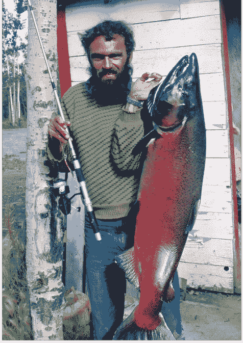

一只处于华丽繁殖期颜色的王鲑鱼“巨兽”。20世纪70年代末和80年代，我在加拿大和阿拉斯加荒野的长途旅行是我人生的定义性时期。它们赋予了我技能和自信，让我能够一直走下去，并过上现在的生活。

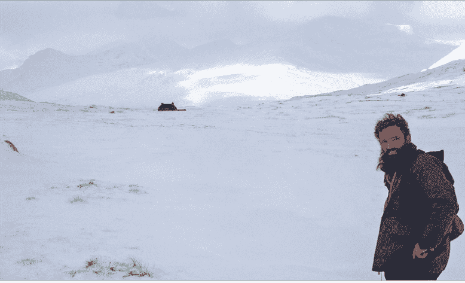

在整片白色世界中散步。远处是卢比尔特小屋（Luibeilt bothy）。他们认为它是苏格兰最闹鬼的地方，但我持不同意见。

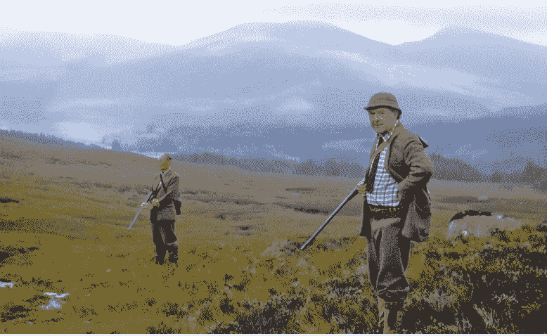

我作为击箭手（ghillie）的工作主要围绕着鹿猎季节，但我也协助过猎松松。这里有两名猎人正耐心等待一只鸟，斯托布科尔埃森山（Stob Coire Easain）在背后守护着他们。

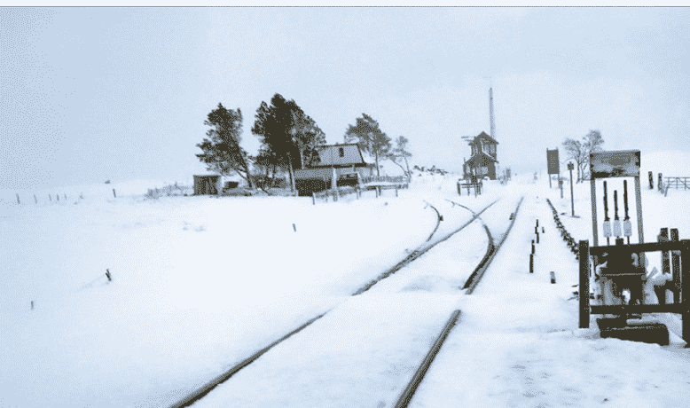

以前的库站（Courour Station）。注意那些用来换道的旧手动手柄，以及我以前接收邮寄的信号员小屋？库站依然保持着奇妙的孤立，是英国本土最高的火车站。

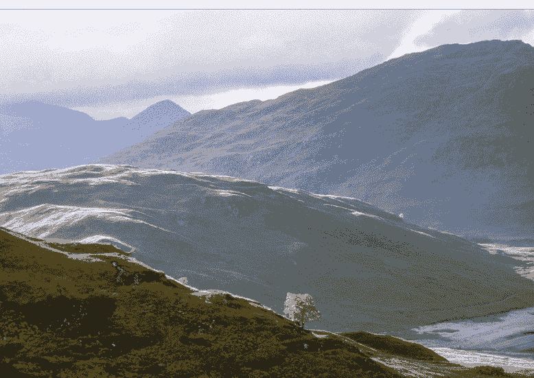

夏末的光线照亮了特里格湖（Loch Treig）上游广阔的山丘。

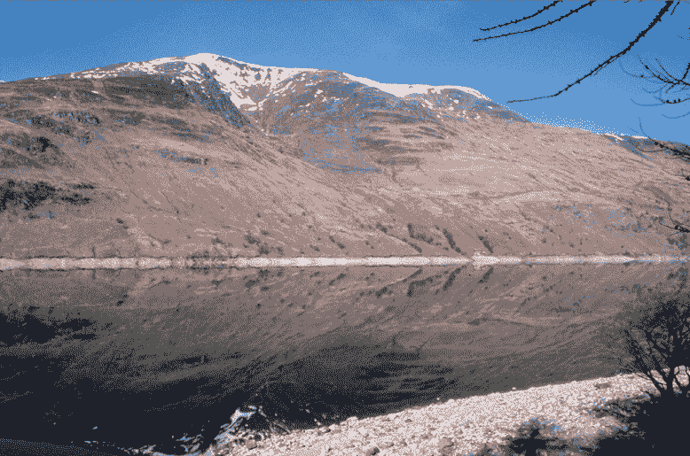

特里格湖一个迷人的静谧日。当水面提供山山的完美倒影时，很难辨别陆地在哪里结束，湖泊在哪里开始。

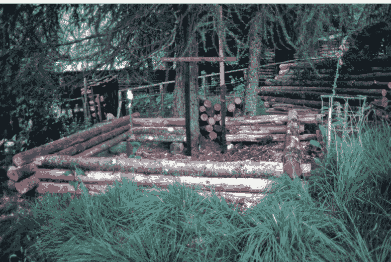

客房的墙壁在长草中开始成型。如果你观察结构的角落，就能看到我在所有建筑中都使用的“鞍槽”（saddle notch）技术。这只是一根接木地重复这个过程，直到整面墙完工。

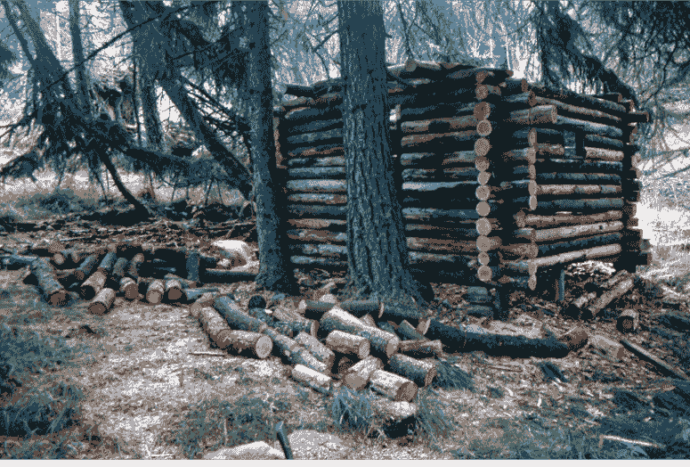

墙壁完成后，当我用锯子修整建筑边缘时，新切的木头端部堆在一起——让结构看起来非常整洁，棱角均匀。

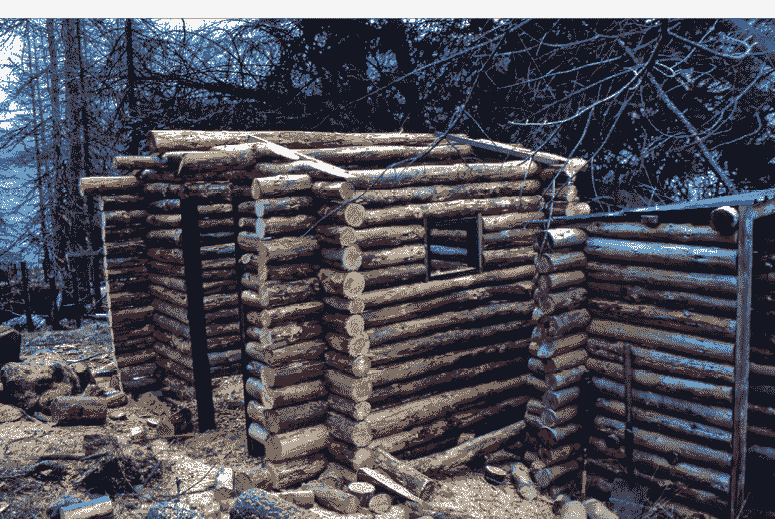

一旦建筑达到全高，我必须非常小心——没有人想在忙于搭建屋顶框架时从木屋屋顶上掉下来。窗户和门开好后，我只需要找一些波纹金属板来完成屋顶。

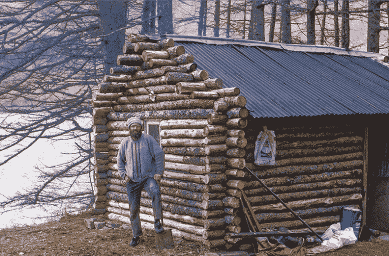

这间标志着在特里格河岸新生活开始的木屋。四十年后，我没有后悔任何一件事——但在1991年火灾中失去这间木屋是我生活中最艰难的时刻之一。

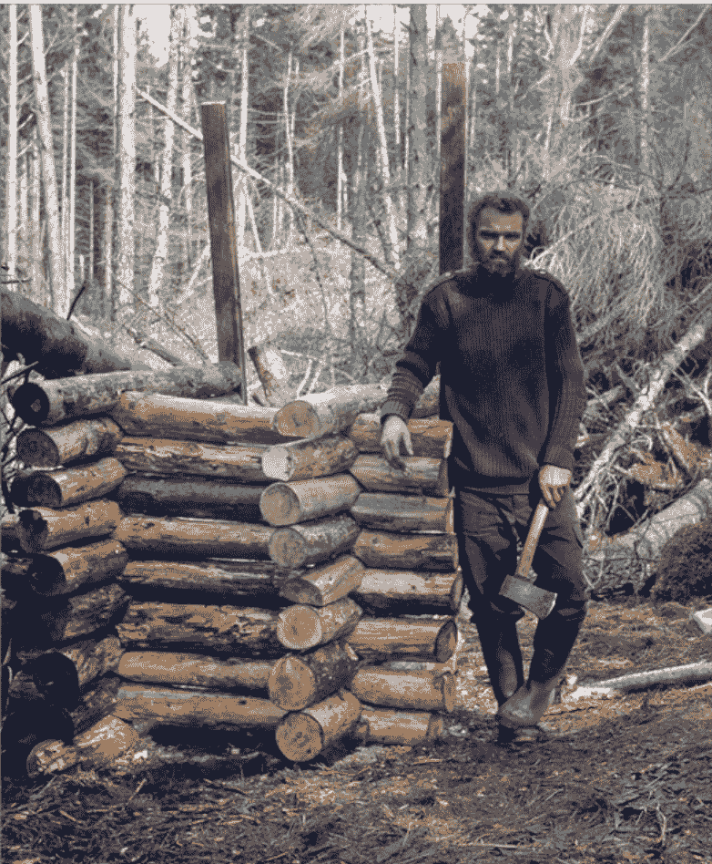

新木屋的厕所盖了一半，看起来压力很大。我必须在巨大的时间压力下建造木屋——在雪降临之前，我需要一个避风之所。

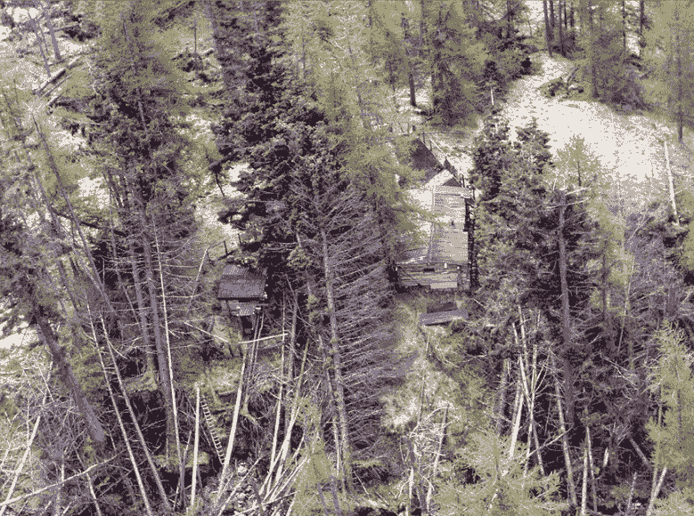

木屋的俯瞰图。如果你在找，很容易找到。

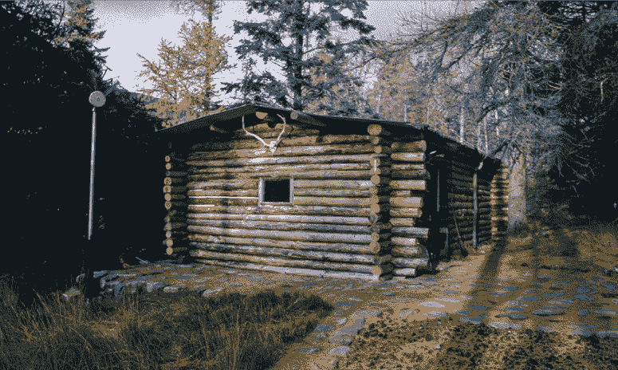

阳光照射下的木屋后方。维护良好的木堆对于我度过漫长冬季取暖以及全年烹饪食物至关重要。

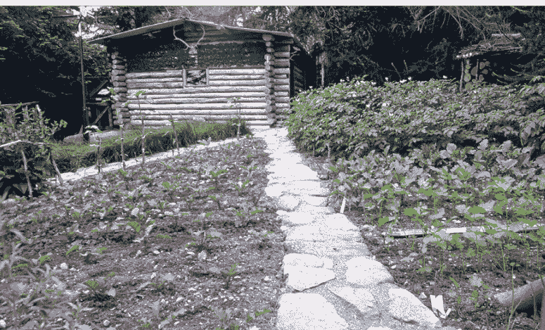

客房的墙壁在长草中开始成型。

用斧头或链锯劈砍木头做木材是我在这里生活中永不停止但也非常必要的一部分。

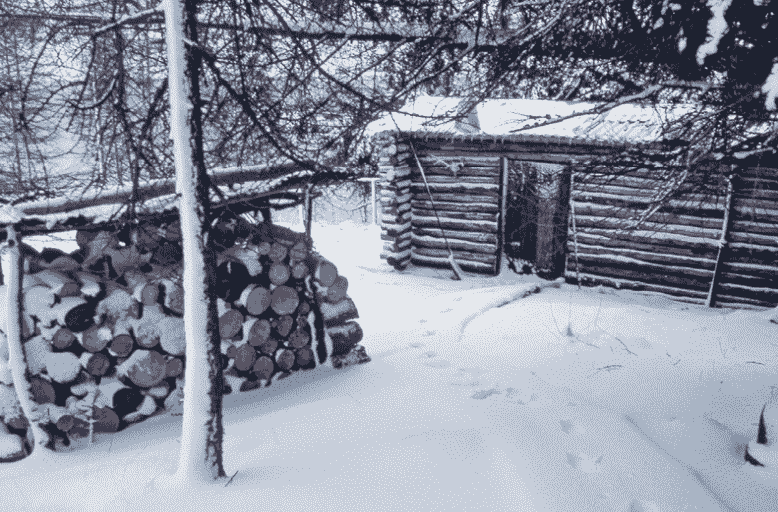

这间木屋经受过恶劣的天气。

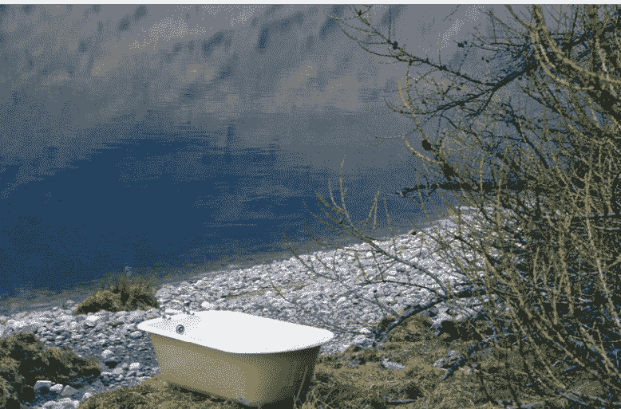

一桶新收获的自土豆。如果种植得当且照顾得好，一颗种子土豆就能产出多达三磅用来煮或炸的土豆。美味极了！


收获了一大多汁的覆盆子。生吃味道极佳，可以做成果酱，或者作为酿制自酿葡萄酒的基底——我只需要确保在鸟类动手之前出去把它们摘了就行！

花花树红色的浆果破而出，标志着秋季的到来。我家周围的森林树种混交，但主要以落叶松和苏松为主，此外还有银白桦和山毛榉。我自己也种了几种树——冬青、梅子、柳树，尤其是枫。

一抹可人的油脂（可能来自最近的一个培根明治）在我的煎锅里凝固。我尽量不浪费任何东西。油脂可以再次加热用作食用油——特别适合为班诺饼（`bannocks`，一种简单的手制扁饼）增加肉香味。

这是一只金貂貂正在享用鸟桌上的残渣。当然，我欢迎它来吃，但如果它越过界限去抢我肉冷库里的美味，或者更糟，住在木屋屋顶并用尿液浸湿我的天花板，那我们就有麻烦了！

很多时候，当地的鸟类在我面前变得如此自信，甚至会飞到我手里要食物。这是一只雄性金雀，是我在特里格（`Treig`）这里记录的近百种鸟类之一。

一只红鹿幼崽正在被手喂牛奶。虽然这些山丘上的鹿群数量必须为了种群健康和更广泛的环境进行管理，但这并不意味着我们不关心它们。

作为一个钓鱼者一生仔细研究的结晶——这条重好12磅的巨型褐鳟（`ferox trout`）保持着特里格湖（`Loch Treig`）的纪录。我再再也没有遇到过这种尺寸的褐鳟。

暴雪开始了。在这样的日子里，不会有鸟来鸟桌。所有的动物，包括隐士，都必须寻找避难所等待风暴过去。

有时雨下得非常大，看起来湖面实际上像在冒烟。苏格兰高地充沛的水源赋予了这片土地大部分的美——但有时感觉雨永远不会停！

### 威尔·米拉德（`Will Millard`）其他

《老人与沙丁鱼》

《我的钓鱼第一日》

`ISBN-13: 9780369749772`

### 隐士之路

2023年由 `Macmillan`（`Pan Macmillan`旗下出版社）首次出版。本版于2024年出版。

版权 © 2023 `Ken Smith` and `Will Millard`

照片版权 © `Ken Smith`

保留所有权利。未经书面许可，不得以任何方式使用或复制本书的任何部分。

在不限制作者和出版者专属权利的情况下，明确禁止任何未经授权将本出版物用于训练生成式人工智能（`AI`）技术。

本出版物包含作者的观点和想法。仅供信息和教育目的使用。读者应寻求专业人士的服务以获得专家协助或专业建议。引用任何机构、出版物或网站均不构成或暗示作者或出版者的认可。作者和出版者明确不对直接或间接因使用或应用本出版物包含的任何信息而引起的所有责任。

`TM` 和 `®` 是 `Harlequin Enterprises ULC` 的商标。

`Hanover Square Press`

`22 Adelaide St. West, 41st Floor`

`Toronto, Ontario, M5H 4E3, Canada`

你通往知识与文化的门户。每个人都能访问。

`z-library.se` `singlelogin.re` `go-to-zlibrary.se` `single-login.ru`

官方 `Telegram` 频道

`Z-Access`

`https://wikipedia.org/wiki/Z-Library`
