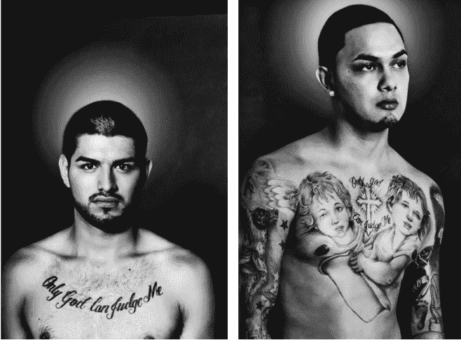

# 肉身理论：拉丁与拉丁美洲女性主义、转型与反抗

Linda Akolf，亨特学院与纽约州立大学研究生中心  
Elizabeth Barnes，弗吉尼亚大学  
Lorraine York，多伦多大学  
Penelope Deuster，西西北大学  
Ann Gerry，加利福尼亚州大学洛杉矶分校  
Sally Haslasher，马萨诸塞理工学院  
Alison Jagger，科罗拉多大学博尔德分校  
Serene Khader，布鲁克林学院与纽约州立大学研究生中心  
Helen Longino，斯坦福大学  
Catriona Mackenzie，麦考瑞大学  
Mari Mikkola，柏林洪堡大学  
Sally Scholz，维拉诺瓦大学  
Laura Stage，佛罗里达国际大学  
Lissa Tessman，宾格明顿大学  
Nancy Tuanny，宾夕法尼亚州立大学

## 前言

MARIANA ORTEGA

在作者的手中，词语正在转化并产生着转化。它们帮助理论家、哲学家、词语爱好者去思考去殖民化的可能性，即锻造契合物质、历史和文化差异的日常抵抗形式，并反思女性主义和性别方法论。它们还帮助构建女性主义自我，通过讲述自己的故事来治愈、分享羞耻、恐惧和脆弱，同时也揭示新的欲望和审美渴望——并构想新的哲学世界与未来。

## 贡献者简介

Linda Martín Alcoff 是亨特学院（Hunter College）及纽约州立大学（CUNY）研究生院哲学教授。她曾任美国哲学协会东分部主席。近期的著作包括《强奸与反抗》（Rape and Resistance, Polity, 2018）、《白性的未来》（The Future of Whiteness, Polity, 2015）以及《可见的身份：种族、性别与自我》（Visible Identities: Race, Gender and the Self, Oxford University Press, 2006），该书获得了 2009 年弗兰茨·法农奖。更多信息请访问 `www.allcoff.com`。

Mary K. Bloodsworth-Lugo 是华盛顿州立大学语言、文化与种族学院的比较族裔研究教授兼美国研究项目主任。她与 Carmen R. Lugo-Lugo 合著了多本书，包括《9/11 之后的女性主义：作为文化和政治威胁的女性身体》（Feminism after 9/11: Women’s Bodies as Cultural and Political Threat, Palgrave Macmillan, 2017）、《投影 9/11：近期好莱坞电影中的种族、性别与公民身份》（Projecting 9/11: Race, Gender, and Citizenship in Recent Hollywood Films, Rowman & Littlefield, 2014）以及《包含（非）美国身体：种族、性欲与 9/11 之后的公民身份构建》（Containing ((Un)American Bodies: Race, Sexuality, and Post-9/11 Constructions of Citizenship, Ropodi, 2010）。她与 Dan Flory 合编了《种族、哲学与电影》（Race, Philosophy, and Film, Routledge, 2013），并与 C. Richard King 和 Carmen R. Lugo-Lugo 合著了《动画差异：当代儿童电影中的种族、性别与性倾向》（Animating Difference: Race, Gender, and Sexuality in Contemporary Films for Children, Rowman & Littlefield, 2010）。Bloodsworth-Lugo 教授还是《中间地带：性别差异、种族与性倾向》（In-Between Bodies: Sexual Difference, Race, and Sexuality, SUNY Press, 2007）的作者。

Kevin Cedeño-Pacheco 是宾夕法尼亚州立大学哲学与非裔美国研究的双学位博士候选生。他的研究关注由非裔美国人和拉丁裔女性理论家和哲学家所推动的批判性种族与性别哲学中美学与政治之间的交集。在他目前的项目中他旨在探讨艺术和其他看似“次要”的表达方式如何在非裔、拉丁裔和墨西哥裔女性主义政治理论家及评论家的工作中获得优先地位和意义。

Natalie Cisneros 是西雅图大学哲学助理教授。她的近期作品出现在《希帕提女性主义哲学杂志》（Hypatia: A Journal of Feminist Philosophy）、《监狱笔记本》（Carceral Notebooks）、《激进哲学评论》（Radical Philosophy Review）、活跃的不宽容：米歇尔·福柯》（Active Intolerance: Michel Foucault）、《监狱信息小组与废除理论》（The Prison Information Group, and the Theory of Abolition, Perry Zurn 和 Andrew Dilts 编）以及《哲学监狱：大规模监禁时代的智慧之》（Philosophy Prisoned: The Love of Wisdom in the Age of Mass Incarceration, Sarah Tyson 和 Joshua M. Hall 编）。目前，她正在完成一份书稿，该稿件借鉴了米歇尔·福柯、格洛丽亚·安萨尔杜以及其他女性主义和批判种族理论者的著作，为围绕移民的政治和伦理问题提供新方法。

Theresa Delgadillo 是俄亥俄州立大学比较研究教授。她是 Latinix Talk（一个拉丁裔研究批判对话在线论坛）的编辑，也是《精神杂糅：当代墨西哥裔叙事中的宗教、性别、种族与国家》（Spiritual Mestizaje: Religion, Gender, Race, and Nation in Contemporary Chicana Narrative, Duke University Press, 2011）、《拉丁裔生活》（Latina Lives, University of Illinois Press, 2015）以及众多文章和书籍章节的作者。她的研究关注三个主题：拉丁裔文本和背景中的宗教与灵性、中西部的拉丁裔，以及文学和电影中的非裔拉丁裔（AfroLatinidad）。

Pedro J. DiPietro 是锡拉丘大学女性与性别研究系的助理教授，也是“知识民主化”（Democratizing Knowledge）项目的成员。他们工作在去殖民女性主义、跨性别研究和有色人女性思维的交汇点。他们是《面对面说话：玛丽亚·卢戈斯的远景哲学》（Speaking Face to Face: The Visionary Philosophy of María Lugones, SUNY, 2019）的合编者。在加入锡拉丘大学之前，DiPietro 曾是加州大学伯克分校族裔研究系的梅隆人文博士后。他们目前正在创作一部名为《侧向自我：跨美洲的去殖民政治》（Sideways Selves: The Decolonizing Politics of Trans* across the Americas）的手稿。该项目考察了我们如何翻译、思考和实践三个集体场所：安第斯地区的跨性别性工作者网络、旧金山湾地区的酷儿和跨性别表演者，以及墨西哥拉丁裔女性主义。

María Luisa Femenías 博士是拉普拉塔国立大学（Universidad Nacional de La Plata）教授；曾任哲学系主任；性别研究跨学科中心（2006–16年）创始人及教育、性别与性倾向专业方向（2013–17年）创始人兼主席。作为研究员，她协调初级和高级研究人员以及博士生小组。她曾担任图卢斯大学（让·儒尔斯）、佩鲁贾大学、加州大学伯克利分校以及卡洛斯·王大学等地的访问学者。她发表了许多关于拉丁美洲性别与暴力的文章和书籍（译为英语和法语）。近期，她编辑了关于性暴力和多元文化的书籍。2016年，她作为女性主义哲学和性别研究研究员获得了 Konex 奖（fundacionkonex）。

Francesca Gargallo 是一位墨西哥作家和诗人。她在罗马国立大学和墨西哥国立自治大学学习哲学。Gargallo 的研究著作包括《加勒富纳，加勒比》（Garífuna, Caribe, Siglo Veinto Editores, 2002）、《拉丁美洲女性主义思想》（Ideas Feministas Latinoamericanas, UACM, 2014）以及《太阳的微笑》（La sonrisa del sol, Ediciones Era, 2006）和《干旱的行》（Marcha seca, Ediciones Era, 1999）。

Erika Grimm 是宾夕法尼亚州立大学哲学与女性、性别与性倾向研究的双学位博士候选生。她在加州州立大学富尔顿分获得哲学学士学位，辅修语言学。她的博士研究位于拉丁裔现象学领域，通过批判性和解释性现象学调查边缘化学生和社区中压迫与抵抗的场所。

Claudia De Lima Costa 在巴西圣塔塔那联邦大学教授文学理论、女性主义理论和文化研究。她是《跨本土性：拉丁美洲女性主义翻译政治》（Translocalities/Translocalidades: Feminist Politics of Translation, Duke University Press, 2014）的合编者。

Carmen R. Lugo-Lugo 是华盛顿州立大学语言、文化与种族学院的比较族裔研究教授。她的著作《9/11 之后的女性主义：作为文化和政治威胁的女性身体》（Feminism after 9/11: Women’s Bodies as Cultural and Political Threat, Palgrave Macmillan, 2017）、投影 9/11：近期好莱坞电影中的种族、性别与公民身份》（Projecting 9/11: Race, Gender, and Citizenship in Recent Hollywood Films, Rowman & Littlefield, 2014）以及《包含（非）美国身体：种族、性欲与 9/11 之后的公民身份构建》（Containing ((Un)American Bodies: Race, Sexuality, and Post-9/11 Constructions of Citizenship, Ropodi, 2010）由 Mary K. Bloodsworth-Lugo 合著。她的《动画差异：当代儿童电影中的种族、性别与性倾向》（Animating Difference: Race, Gender, and Sexuality in Contemporary Films for Children, Rowman & Littlefield, 2010）与 C. Richard King 和 Mary K. Bloodsworth-Lugo 合著。Lugo-Lugo 教授还发表了许多关于 9/11 文化产物、种族、公民身份与性别构建以及流行文化中拉丁裔的文章。

María Lugones 是阿根廷女性主义哲学家、社会评论家，纽约汉明斯特大学比较文学与哲学、阐释与文化以及女性研究的副教授。她是《朝圣：联盟联盟》（Pilgrimages/Peregrinations: Theorizing Coalition, Rowman & Littlefield, 2003）的作者。

José Medina 是西北大学的 Walter Dill 斯科特哲学教授。他主要从事批判种族理论、女性主义和酷儿理论、政治哲学、传播理论和社会认识论的研究。他的著作包括《抵抗的认识论：性别与种族压迫、认识论不公正与抵抗想象力》（The Epistemology of Resistance: Gender and Racial Oppression, Epistemic Injustice, and Resistant Imaginations, Oxford University Press；获2013年北美社会哲学协会奖）以及《从他处说话》（Speaking from Elsewhere, SUNY Press, 2006）。他最近的合编卷是《认识论不公正》（The Handbook of Epistemic Injustice, Routledge, 2017）和《世界主义与地方》（Cosmopolitanism and Place, Indiana University Press, 2017）。他目前的项目关注社会感知和社会想象如何贡献于不同类型暴力和压迫的脆弱性形成。这些项目还探讨了在地方和全球背景下可以动员社会运动和行动形式（包括他所谓的“认识论行动”），以抵抗种族和性暴力及压迫。

Xeric Méndez 是加州州立大学富尔顿分校女性与性别研究助理教授兼非裔美国研究兼职教师。她是一位行动活动家、组织者和跨学科学者，其研究关注去殖民女性主义实践和方法论以及转型正义。她还是密歇根州立大学的顾问，在该校开发转型正义对性别暴力和校园性侵的应对。在密歇根州立大学（MSU）担任哲学及非洲裔和非洲研究助理教授期间，她共同组织了波多黎的合作恢复项目 #ProyectoPalabrasPR，并创立了“转型正义讲座系列”。她已出版的作品包括《去殖民化方法论笔记：重新审视种族/性别矩阵》，以及即将出版章节《不是你爸爸的Wynter：有色女性对去殖民化未来的贡献》。她目前正致力于一本名为《从阴暗面去殖民化女性主义方法论》的书稿。

Julie Avril Minich 是德克萨斯大学奥斯汀分校的英语、墨西哥裔美国人及拉丁/美裔研究副教授，她在校任教拉丁裔文学与文化研究、性别与性取研究以及残障研究。她在多本期刊和文集上发表过学术文章，包括 *GLQ*、*Modern Fiction Studies*。Minich 是《可访问公民：残障、国家与大墨西哥的文化政治》（坦普大学出版社，2014年）的作者，该书获得了 2013–2014 年 MLA 美国拉丁裔及奇卡诺文学与文化研究奖。Minich 目前正在完成一本关于强制性身体性、拉丁裔文学和种族健康差异的新书。

Paul M. L Moya 是斯坦福大学的 Danily C. 和 Laura Louise Bell 人文科学讲座教授以及 Burton J. 和 Deedee McMurtry 本科教育研究员。他被任命为英语系教授，并兼任伊比利亚和拉丁美洲文化系兼职教授。他目前担任英语系研究生事务主任以及种族与族裔比较研究研究所所长。Moya 的书籍出版物包括《社会迫切：种族、细细阅读与当代文学评论》（斯坦福大学出版社，2016年）和《从经验中学习：少数族认同、多元文化斗争》（加利州大学出版社，2002年）。他还合编了三部原创论文集，包括《做种族： 21 世纪的 21 篇论文》（诺顿出版社，2010年）、《重新审视身份政治》（帕尔格莱夫出版社，2006年）和《重申身份：现实理论与后现代主义的困境》（加利州大学出版社，2000年）。

Mariana Ortega 是宾夕法尼亚州立大学哲学、女性性别与性研究及拉丁/美裔研究副教授。她的主要研究领域和兴趣包括有色女性女性主义（特别是拉丁裔女性主义）、20世纪大陆哲学、现象学（海德格尔）、种族哲学和美学。她在多本学术期刊上发表过文章，包括 *Journal of Speculative Philosophy*、*International Philosophical Quarterly*、*Critical Philosophy of Race*、*Hypatia*、*Radical Philosophy Review* 和 *philosOPHIA*。她与 Linda Martin-Alcoeff 合编了文集《构建国家：种族与民族主义读者》（纽约州立大学出版社，2009年），并是《中间：拉丁裔女性主义现象学、多重性与自我》（SUNY, 2016年）的作者。她是拉丁裔/美裔女性主义（原名为 on Latina Feminism）的创始人兼总监，这是一个致力于讨论拉丁裔和拉丁美洲女性主义的论坛。她目前的研究探讨了美学、他者化实践、记忆、无知认识论和拉丁裔性交叉点上的问题。

Laura E. Pérez 是新的跨学科跨美洲研究中心——“拉丁裔研究中心”（原为拉丁裔政策研究中心）的主席。她是《爱洛洛斯意语义学：关于艺术、灵性与去殖民化的著作》（杜克大学出版社，2019年）和《奇卡纳艺术：精神与美学异质性的政治》（杜克大学出版社，2007年）的作者。她在 2001–02 年策划了加州大学伯克利分校首个也是唯一的美国拉丁裔/美裔表演艺术系列；与 Delilah Montoya 共同于 2009 年 1 月至 3 月在新墨西哥州阿尔伯克基的 516 ARTS 画廊策划了多媒体展览《奇卡纳坏女孩：Las Hociconas at a(r)jt or: 湾区拉丁裔艺术现今》，并于 2011 年 4 月至 6 月在加州福州的里士满德艺术中心策划了《Labor +》。她在多本关于女性主义、奇卡纳/美裔和半球去殖民文化的出版物上发表过文章。她还与多媒体艺术家 Consuelo Jimenez Underwood 以及 Ann Marie Leimer 博士合编了一本书。

Andrew J. Pitts 是北卡罗来纳大学夏洛特分校的哲学助理教授。他们的研究兴趣包括种族批判哲学、女性主义、拉丁美洲和美国拉丁哲学以及批判监狱研究。他们的作品发表于 *IJFAB: The International Journal of Feminist Approaches to Bioethics*、*Hypatia*、*Radical Philosophy Review* 以及 *Inter-American Journal of Philosophy*。Pitts 还是《超越柏格森：通过亨利·柏格森著作审视种族与殖民》（纽约州立大学出版社，2019年）的合编者。


# Stephanie Rivera Berruz

Stephanie Rivera Berruz 是马奎大学助理教授。她于2014年获得纽约州立大学布法罗分校的哲学博士学位。凭借对拉丁裔女性主义和拉丁美洲哲学的研究，获得了伍德·威尔逊职业增强奖金（2017–18年）。她的主要研究领域在于拉丁美洲哲学和拉丁裔女性主义，以及种族、性别和性取向哲学。她从这些主题的交叉点切入，致力于哲学实践中多样化方法的重要性。她最近合编了一部文集：《亚洲与拉丁美洲哲学比较研究》（布鲁姆斯学术出版社，2018年），她的作品发表在 *Hypatia*、*Inter-American Journal of Philosophy* 和 *Essays on Philosophy* 上。

# Elena Flores Ruíz

Elena Flores Ruíz 是密歇根州立大学哲学与全球研究助理教授。她来自墨西哥城。她的首要研究领域是政治哲学和全球南方的女性主义。她的工作探讨了暴力的哲学维度（文化的、认识论的……

# Ofelia Schutte

Ofelia Schutte 是佛罗里达州立大学哲学荣誉教授。她出生于古巴哈瓦那，幼时移民美国。1978年在耶鲁大学获得哲学博士学位后，她一直在佛罗里达州立大学（盖斯维尔和坦帕）教学。她是《超越虚无主义：没有面具尼采》（芝加哥大学出版社，1984年）和《拉丁美洲思想中的文化身份与解放》（纽约州立大学出版社，2993年）的作者，曾担任富布莱特研究员，《拉丁美洲哲学指南》（Wiley-Blackwell，2010年）。Schutte 目前关注包括古巴女性主义、去殖民理论和拉丁美洲思想。

# 引言

ANDREA J. PITTS AND JOSÉ MEDINA

本卷汇集了数代人对拉丁裔生活进行批判性参与的著作。我们纳入书中的作者是哲学家、文学理论家、文化评论家和活动家。他们的贡献源于生活经验。

从历史上看，正如 Laura E. Pérez 在本集中所述的，美国拉丁裔女性主义学术领域是在 20 世纪 70 年代和 80 年代随着黑人、原住民和亚裔女性主义的工作而发展的。本书中强调了多位早期理论者的工作，包括 Gloria E. Anzalúa、Cherokee Moraga 和 María Lugones。通常通过写作小组、族裔研究和女性研究计划以及出版社，像 Barbara Smith、Andre Lord、Moraga 和 Hanna Gottsett 等人物是第一批为拉丁裔女性主义和黑人女性主义的有色女性女性主义者创作印刷材料的人（De Veaux 2004）。这一形成时期的许多作家，在学术界产生了情感和制度资源，持续影响着今天拉丁裔女性主义项目的学术生产。在 20 世纪 80 年代、90 年代和 2000 年代，关注拉丁裔女性主义的新文章、书籍和活动持续流传。例如，学术团体如

在下文中，我们提供了几组分类，以展示当代拉丁裔和拉丁美洲女性主义理论作品的共同主题和研究领域。虽然没有对该领域提供全面的综述，但我们希望通过展示此处收集的论文中各种兴趣和政治诉求，来唤起我们提到的早期创新者的精神。通过追溯比较路径，这些作品提供了一个视角，让读者能够观察拉丁裔和拉丁美洲女性主义参与的多样性，包括追踪分异但往往重叠的历史和具身轨迹的项目。

本书由一系列探索去殖民化行动（decolonial movidas）的论文开启。虽然许多以“去殖民化”为终点的当代写作引用了该领域奠基性人物的作品，但我们的贡献者从拉丁裔和拉丁美洲女性主义的独特来源中，针对涉及作为分析范别的性别、联盟建设以及解放斗争工具的问题，阐述了新颖的方法，旨在推翻长期以来影响边缘化群体的殖民权力矩阵。注意的是，Mariana Ortega (2017) 在最近的一一文章中描述了性别和性如何处于去殖民化政治的核心，并要求一种对去殖民化项目内部父制和规范化立场保持批判关注的具身实践。通过指向她所认为的与 Dussel“知识团结的关键节点”，Pérez 为未来拉丁美洲去殖民化学者与美国从事去殖民化实践和理论的有色种族学者之间的*相遇*（encuentros）创造了可能。

第二章由 María Lugones 撰写，为《重新审视性别：走向去殖民女性主义》，探讨了拉丁美洲对本土历史和女性运动的关注。Lugones 仔细地引勒出了她对“性别殖民性”（coloniality of gender）概念的修正表述，该术语用于描述欧洲殖民者强加的二元角色欲望、情感和框架，这些因素继续影响着曾被殖民的人。

在《Enrique Dussel 的解放伦理、美国有色种族女性的去殖民化实践以及差异中的联盟政治》中，Laura E. Pérez 讨论了一个困难但至关的话题：批判性地评估去殖民化政治实践的必要性。通过探讨 Enrique Dussel 的《解放伦理》（Ética de la liberación），Pérez 揭示了拉丁美洲去殖民思想与美国有色种族女性思想之间的差距，因为后者对于拉丁美洲去殖民化思想者来说是未知或仅仅被忽视、忽略。她的分析显示，性别和性处于去殖民化政治的核心，并要求一种对去殖民化项目内部父制和规范化立场保持批判关注的具身实践。（注：此处文本似乎是从页面合并的）。

下一章由 Maria Luisa Eimenzuela 撰写，为《从女性运动到女性主义理论（反之亦然）》，也涉及了拉丁美洲女性的去殖民策略。特别是，在阿根廷文化理论家 Zulma Palermo 等人的作品等范围内（她的工作探索了拉丁美洲女性之间的多声性以及“经验”和“声音”的认识论维度），Eimenzuela 考察了女性主义去殖民化努力实际上是否导致了对性别概念的本质化或进一步固化。通过这一分析，她概述了身份在物质、历史和文化差异场域中在何种程度上被“协商”。

本节的最后一章由 Xhercis Mendes 撰写，题为《去殖民女性主义行动：‘特权’、性别工资与构建复杂的联盟》，探讨了去殖民策略中的方法和实践参与问题。Mendes 从 Lugones 的性别殖民性概念中汲启发，试图利用性别作为一个政治范畴。在批判当代种族化和性别化维度的努力中，作者强调了跨越差异的认知和存在方式。Mendes 的作品因此是通往开发集体和形成实践的去殖民方法的一。

本书的第二部分将我们的注意力转向叙事、自我风格化和作为美国拉丁裔女性主义实践模式的治疗。此处的论文强调了叙事和谱系练习在探索个人和集体存在方面的重要性。特别是，这些论文通过不同的叙事时刻，展示了过去与现在、世界与语言情感、神圣与世俗之间往往紧张的地带。通过这些分界，每位作者都证明了叙事重构具身、祖先和历史的可能性。

本节的第一章由 Francesca Gargallo 撰写，提供了拉丁美洲女性主义哲学的谱系。Gargallo 的分析跨越了拉丁美洲历史上广泛的主题人物，发展出一系列女性作人的哲学轨迹。她的章节涉及了多元文化主义、本土根源与抵抗、快乐与转型以及不同女性主义背景下的概念策略。她的工作为书中提供的分析提供了一个广泛的主题，她的章节有助于进一步定位源自拉丁美洲哲学的贡献和抵抗。

本书第三部分探讨了在不同语言、表达风格、性别配置和文化背景下，跨越这些（误）沟通、（误）理解以及主体性的（去）清晰表述问题。在本节中，拉丁美洲女性主义学者讨论了由于拉丁裔人民遭受压迫和边缘化而产生的关于知识、理解和沟通的规范性问题，同时也讨论了在拉丁裔反抗主体的非规范实践和感知中，可以发现的替代性对话、认知和批判性意识方式的解放潜力。

在本节的开篇论文中，克劳迪娅·迪·利马·科斯塔（Claudia di Lima Costa）了拉丁美洲去殖民化与翻译实践之间的关系。De Lima Costa质疑了白人女性主义的主权地位，以及拉丁美洲女性主义面临的解释挑战。她提出了一种激进的去殖民化翻译概念，该概念关注歧义和多样性，强调了权力和性别的殖民性，并在塑造去殖民化认识论方面发挥着关键作用。

在《具身谱系：安萨尔杜亚、尼采与多样化认知实践》中，娜塔莉·西斯内诺罗斯（Natalie Cisneros）探讨了奥菲莉亚·舒特（Ofelia Schutte）的学术研究，并将“具身谱系”发展为一种批判性的历史方法论，可用于拉丁美洲女性主义的理论与实践。Cisneros展示了将安萨尔杜亚（Anzalduá）的思想与尼采的谱系相结合，如何对关于知识、身份和社区的哲学对话做出批判性贡献，并为拉丁女性主义的知识政治实践提供一种基于具身（性别化和种族化）的批判性方法。

在下一章中，埃琳娜·弗洛里斯·鲁伊斯（Elena Flores Ruiz）探讨了施加于拉丁裔女性声音的“解释性暴力”。Ruiz阐明了拉丁美洲女性主义理论家（如安萨尔杜亚和诺尔玛·阿拉拉孔）如何开发出“生存字母”，这些字母可用于抵抗和幸于边缘化、扭曲和沉默的实践。Ruiz的论文批判性地审视了“新殖民主义压迫对有色人种女性的持续韧性与系统性”的认知层面，并讨论了抵抗如何成为拉丁裔女性以及更广泛的有色人种女性“我们存在的某种结构性特征”。

在最后一篇论文《幻觉式认知：（非）寻常常的意识、超人类感知以及拉丁裔与西卡纳（Xicana）女性主义理论中的其他去殖民化疗愈》中，彼罗·J·迪皮埃罗（Pedro J. DiPietro）考察了旧金山湾拉丁裔口语艺术家和诗人在作品对酷儿拉丁身份的表演性呈现与质疑。特别是借鉴了拉丁裔和西卡纳女性主义理论者的观点，DiPietro阐明了幻觉式感知储备在去规范化和去殖民化跨空间与性别的流动与过渡经验及记忆方面所起的作用。DiPietro对酷儿的质问引发了关于具身、性、欲望和集体记忆中矛盾与反抗可能性的问题，特别是考虑到酷儿拉丁裔的混血族现实。

本书第四部分关注表现、表演和感知具身拉丁裔（Latinx）主体性的实践，以及这些实践及其中表达风格中产生的脆弱性、身份等问题。在本节中，拉丁裔女性主义学者讨论了身份认同如何与自我表达、（误）表现和（误）感知的审美方面紧密相连。本节的作者们讨论了涉及表达性、再现、身份和脆弱性的复杂规范性及理论问题。

在开篇论文中，斯蒂芬妮·里维拉·贝鲁兹（Stephanie Rivera Berruz）对非白人身体如何受白人身体规范性预期影响的感知实践进行了批判性讨论。遵循玛利亚·卢格内斯（Maria Lugones）的观点，Rivera Berruz强调，在对女性盛盛感知中，女性被视为镜子，往往反映出与白人女性自我形象不一致的事物，为白人的感知实践带来了麻烦，并产生了抵抗的可能性。Rivera Berruz批评了拉丁裔成为一种复制中产阶级的商业同质化身份的方式。

对拉丁裔女性气质同质化呈现的批判性讨论集中在卡尔门·卢戈（Carmen-Lugo）和玛丽·布鲁德斯沃斯·卢戈（Mary Bloodsworth-Lugo）的论文中。通过关注媒体再现的审美和政治方面，Lugo-Lugo和Bloodsworth-Lugo分析了流行文化、大众媒体和营销力量在将拉丁裔描绘为多元化文化群体而非单一维度种族群体方面的转变。Lugo-Lugo和Bloodsworth-Lugo认为，从拉丁裔女性气质的种族呈现向文化呈现的转变，标志着21世纪民族审美的特征，这种审美通过偏离甚至否定种族来运作。

在玛丽亚·奥尔特加（Mariana Ortega）关于可见性、矛盾性和渴望的论文中，对拉丁裔审美呈现的交叉性讨论扩展到了欲望和性爱。借鉴了何塞·埃斯蒂班·穆诺斯（José Esteban Muñoz）的“去认同”（disidentification）概念，Ortega认为，通过去认同视角观察曼尼·塞拉托斯（Manny Serratos）和肯·贡萨莱斯·戴（Ken González-Day）等艺术家的摄影，让我们看到这些艺术家如何对欲望和性爱规范提出强有力的批判，并对忧郁渴望的表述重新构了拉丁裔主体性中记忆、归属感与欲望之间的关系。

为了结束对拉丁裔公共呈现与感知的交叉性讨论，在最后一篇论文中，朱莉·艾普里尔·米尼奇（Julie Avril Minich）考察了湾区艺术家胡纳·阿莉西亚（Juana Alicia）壁画中的性别、种族、阶级、残障和环境正义。Minich的分析显示，Juana Alicia对多种正义运动（包括有色人种女性、环境正义和奇卡诺运动）的复杂参与提供了一个范式，让我们想象一个底层社区不再被迫承受农药毒害、自然资源私有化和其他环境风险与灾难的未来。Juana Alicia的壁画为重新思考拉丁女性主义、身体脆弱性和环境正义之间的关系提供了机会。

# 拉丁裔对辩论的贡献

琳达·马丁·阿尔科夫

某些所谓的“帝国女性主义”的近期发展使得女性主义的去殖民化转向比以往任何时候都更加迫。女性主义内部一直存在分裂，但我们今天正观察到一个新时代的出现，强权国家利用女性主义来推进新自由经济政策。福利国家的解体被证明是为了帮助女性进入劳动力市场（无论其家庭状况如何），而联合国赞扬女性劳工向北方的强制迁移，理由是这让他们接触到了性别平等的理念（Eisenstein 2009）。

非国家行为者也实践了某些公开的女性主义活动形式，这本迫使我们进行彻底的去殖民化分析。非穆斯林的 Femen 组织发发起了一场“裸体圣战”。

随着全球媒体系统的扩散，参与跨国活动将变得越来越容易。但如果没有一种去殖民化的方法，跨国女性主义活动面临着与关于需要“西方化”的落后社会的殖民主义逻辑冲突的风险。帝国主义女性主义的问题（无论是由国家还是非国家行为体实施）同时具有政治性、理论性和认识论意义。假设对遥远背景进行单方面干预是有局限性的错误的，因为这往往会削弱当地女性的主动性和生计。预设可以预先了解他人也是错误的。

帝国主义女性主义假设“女性主义”这一概念具有固定且稳定的意义。它知道解放后的样子是什么，并存在于那里是为了教导，而不是学习或参与对话。它不将女性主义视为一个对话性的、不可还原的、多性且具有本土性的项目。一些女性主义者拒绝了“帝国主义女性主义”这一范畴，理由是如果这真的是解放性的，它就不可能真实。事实是，女性主义者对于什么是解放性的存在分歧，或者将女性主义理解为一组松散融合的多元话语和实践活动更为现实。没有一个中央委员会或统一的理论谱系可以裁决这些分歧（Roth 2004）。此外，如果我们把女性主义描绘为始终反殖民的，它可能会削弱自我批判的能力，特别是当这种做法是通过浅薄的定义规定来实现时。

帝国主义形式的女性主义在理论领域可能为微妙且难以克服，因为理论像哲学一样，通常认为自己具有普遍的关注和抽象的变革：以一种本土的方式处理“性别化”、“身份”、“性暴力”、“性别歧视”等。哲学往往试图将不同背景之间的差异归入某种元层面的准则中，而该准则认为自己是超越背景的。女性主义理论的去殖民可能比女性主义实践的去殖民化得多。

实现完全去殖民化的理论无疑是一场堂吉德式的追求。去殖民化的追求应当成为自我反思性知识实践的标准部分。我们至少必须尝试理解我们的物质和当地背景对我们知识形成的影响。

在本文中，我将提出一种源自拉丁裔女性主义理论和实践的去殖民化女性主义方法。虽然对探索性别、种族、阶级和性向共同刻写的交叉性方法的接受产生了更多多样化和情境化的分析，但我赞同 Chandra Talpade Mohanty 和 Jacqui Alexander 的观点：

> ² 这里的一个近期例子是 Femen 组织，他们发起了一场“裸体圣战日”。参见 Walsh 2013。

交叉性对国家差异或地缘政治位置的关注太少。拉丁裔女性主义通常是这一规则的例外，正如 Sonia Saldivar-Hull 所解释的：“我们作为奇卡-拉丁裔（Chicana-Latina）女性主义者的历史迫使我们审视地缘政治以及性别政治。……[因为]我们的主体位置存在于国家边界的间隙中（2000, 55）。美国及其他流散地地的拉丁裔女性通常具有一种或某种形式的跨国身份，还拥有跨国家庭纽带，以及对国际代理人之间权力差异的直接经验。作为一个地区，拉丁美洲自从从西班牙独立以来经历了五十多次美国的干预，从 1846 年兼并墨西哥领土到 1989 年入侵我的家乡巴拿马，再到 2002 年在委内瑞拉的政变尝试，以及 2009 年对洪地拉斯军事政变的支持。成为拉丁裔/女性是一项试金石，让你意识到殖民主义是当代世界的中心特征，而非过去的遗迹。

我将认为，拒绝帝国主义方法涉及除“本土化”之外的因素：它要求女性主义理论向日常或平凡化进行真正的重新定位，一种将被压迫者视为自身解放终极创造者的民主认识论。交叉方法将必然导致多元主义的女性主义结论；由于压迫形式和身份是多样的，它们的解决方案也必须如此。此外，多样化的解决方案不会被还原为统一的有效性标准，或一个在跨背景下施加的试金石。理论者的角色是翻译和连接，支持并增强理解与协作，并参与特定地点的战斗性研究传统。

我将首先简要概述殖民化问题在女性主义内部兴起，然后转向性别身份、性别解放与去殖民化转折之间关系的这一棘手问题。最后，我将转向异见天主教神学家 Ada María Isasi-Díaz 的工作，作为一个关注当地差异和民主认识实践需求的积极理论模型。

第二波女性主义产生了一个多重女性主义和交叉性的时代，我将去殖民女性主义定义为更晚之后的发展。

第二波女性主义的历史开始被承认是多条不同道路的交汇，正如 Benita Roth 所说（2004）。这一时期的许多女性主义对种族和阶级给予了严肃关注——鉴于它们起源于民权运动、反战运动和反帝国主义运动（例如，参见 Crow 2000）。但女性主义的主流面呈现出如此白人化、中产阶级的特征，以至于这种更复杂的现实未被观察。而且，在像妇女国家组织这样的自由政治组织中，种族、族裔、性别的宗教差异被系统性地忽视了。一些理论家，如 Mary Daly，制定了将性别压迫与其他形式的身份压迫分离并优先考虑的理由。

分离组织成为针对非白人、非基督教和非异性恋女性工作的需要。众为人知的黑人女性主义首先发展；然后拉丁裔女性主义、亚裔美国女性主义、犹太女性主义、原住民女性主义、穆斯林女性主义和阿拉伯女性主义相继出现，拥有各自的组织、会议、学术研究和活动，并且在性向和阶级沿线上有许多分歧，进一步划分了这一领域。当我还是一个年轻的活动家时，我支持加入主流女性主义团体；它们太狭隘了。它让我进入参与阶级斗争、反种族主义和反帝国主义的多元文化群体。

交叉性理论和身份政治源于这种内部政治动荡，不同的女性群体在此提出了优先事项。精神性、移民、公民身份、家庭形成、工作和宗教问题被强调并以不同的方式表述。这些差异对被认为是女性的共同命运、女性主义的共同议程以及运动的共同策略提出了质疑。


尽管这项工作在意图上是去殖民的，但并不总是从理论上那样阐述（Perez 1999）。更近期的工作开始跨越不同群体，但作为对基础概念的批判，特别是“女性”范畴和“性别”这一术语，基于殖民历史。这是我称之为去殖民化的阶段。例如，Maria Lugones (2003, 2012)、Oyérónké Oyyewám (1997) 和 Nkiriu Nzegwu (2006) 以各种方式论证了殖民主义产生了一套并非殖民前社会的性别制度。Oyyewám 认为，对于殖民之前的约鲁巴人来说，身份性别标记对于建立个人地位和社会角色至关重要，年龄要重要得多。Nzegwu 认为，在伊博族家庭中，对女儿和妻子的支配是从殖民接管后才发展的历史特定实践。

总来说，这些作者认为许多人急于将征服前的概念翻译成我们熟悉的性别概念，引入了一系列可能并不成立的假设和内涵。例如，Lugones 警告说，艾马拉尔语中的 `chacawarmi` 指一组互补的对立面，并不一定与男性/女性对应（2012, 78）。最有力的是，这些理论者支持对性别的重要性进行解构，但他们的很大重点在于殖民主义在为女性创造新的压迫条件，以及对整个社会再生产工作所起的作用。他们并不假设我们在世界各地看到的当前构筑的性别结构具有古老的文化根源，而非更晚期的谱系（Mani 1998）。

采取不同的切入点，原住民女性主义者认为他们社会中的性别互补性先于殖民主义。他们定义了许多性别差异，认为这些差异并不总是与支配相关联（Allen 1992; Mikaere 1994; Lawrence 2015）。美洲原住民的性别安排各不相同，但不可争议的是，在许多情况下女性掌握着重大的政治权力。早在 1540 年，欧洲定居者就开始描写他们遇到的许多原住民女性首领，例如弗吉尼亚州的詹姆斯敦殖民者就描述了他们在 17 世纪初与阿波马塔托克女王的遭遇。乔治·华盛顿在 1753 年提到，他被要求访问由塞内卡领袖 Allaquipp 监督的土地才能被允许穿越该地区（Venables 2004, 221–22）。

性别系统在不存在支配的情况下存在，其依据并非少数特殊的领袖，而是跨越地位的政治和经济组织。豪德诺索尼（Haudosaunee）部落的首领始终是男性，但由被称为“族母”（Clanmothers）的老年女性专属挑选。我们现在知道，纽约州北部易洛魁族女性的政治经济权力激发了 18 世纪和 19 世纪白色定居者女性主义的发展（Wagner 2003）。在如今的库纳印人等群体中，女性并非作为家庭内的孤立个体面对不受约束的男性权威，而在部落和社区的生产性经济和土地管理中发挥着关键作用。世界上许多亲属关系系统中存在的母系家庭形成也通过排他性的继承赋予了女性权力和地位。

某些群体具有非阶级化的经济劳动和政治角色性别划分的说法，挑战了西方女性主义对“分离领域”教条的长期批判。上述的两种殖民主义论点——性别在殖民前世界并非普遍地位，以及重要的性别划分可以与平等的政治经济权力并存——都表明，殖民差异在女性主义理论中需要比目前赋予的更基础的工作。关于父权制以及基于性别的分离领域的压迫影响的非历史主义和普遍主义假设需要被重新考虑。

以去殖民化的方式进行女性主义`理论`和女性主义`哲学`构成了特殊的挑战。社会科学的研究通常关注局部背景下的特定现象，例如在加勒比地区信息部门工作的女性，或在南亚从事食品生产的女性。³ 但理论和哲学通常认为自己具有更通用的性质和全球适用性。尽管大多数人现在承认女性化和男性化是受文化介导的，且性别形成是局部的，但仍然有一种普遍假设认为性别本身可以抽象地进行理论化。例如，一些人认为多样化的性别观念具有共同的主体形成过程，在此过程中，个体必须服从外部强加的“逻辑”或“剧本”，即使剧本的内容有所不同。通过这种方式，女性主义理论和女性主义哲学可以在不关注交配背景特殊性的情况下执行其通常的分析程序。

全球北方女性主义理论的主导地位是：性别身份本身需要通过强制性实践、僵化的边界和认同逻辑来克服，并陷入一种`必要的`从属地位中。像 Sally Haslander 和 Judith Butler 这样方法论多样化的理论者持有这一观点（Haslander 2012; Butler 2004）。确实有理由担心性别系统抑制了真实的生理和生物变异性，并倾向于使性别意义标准化。结果，女性主义政治实践对性别身份采取了日益对立的，呼吁消除性别和拆解身份的项目。一些理论者呼吁围绕一个需要消除的范畴拆解女性研究（Brown 1997）。尽管女性主义理论在事实上是一个极其复杂且充满争议的领域，但在全球北方的学术空间里，似乎唯一的理论上的正确立场是将女性主义定义为对性别的解构。

去殖民方法意味着需要谨慎。在某些情况下，性别系统可能没有压迫性，要么是因为性别不是先于其他所有地位的决定因素，要么是因为性别系统可以与关联女性/男性的双术语意义尺度运作，而不需要排斥两个社会认可的身份。后者的例子是那些以女性和男性 Sign涵和社会角色运作的社区，认可个体为“女性丈夫”、“双灵人”以及其他二元之外的身份范畴。例如，在伊博族（Igbo）社区中，“女性丈夫”这一范畴

> ³ 尽管这里的分析范畴——“女性”不能被视为所当然。

包含了妻子丧偶后扮演丈夫社会角色的女性（Nzegwu 2006）。有趣的是，这种婚姻并非性结合，而是法律和社会上承认的关系，在没有男性存在的情况下即可确保继承和赞助。在婚姻中可以扮演何种角色，解剖学上并不是原子化的。

这些认同形成有时被解读为跨性别的，从而支持了复杂化规范性二元系统的持续努力（Feinberg 1996; Stryker 2008）。正如 David Valentine 对性别社区的民族志所示，跨性别并非完全是运作在“表征本身之外”的，或者换句话说，其目标是解构和拆解所有身份术语（Valentine 2007, 136）。相反，范畴监管和谈判是跨性别互动的一个重要特征，尽管这些工作有时会扰乱主流选择。

有趣的是，Valentine 显示跨性别的自认有时会显得不一致，并变得“不可表征”。他提到，19 世纪的欧洲和美国人类学家将原住民群体描绘为“原始”正是是因为这个原因——因为他们的语言是不一致的——弗朗斯·波波（Franz Boas）暗示人类学框架框架使得他们无法理解所遭遇的文化。同样，理论者必须考虑那些为了维护西方二元对立的自然主义的语言系统带来的解释性不公。

这里的启示是，我们不应该将跨性别经验同化为普遍主义的解构框架，理由是这种“不一致性”“显而易见”地试图拆解所有性别。我们需要在各种关系（包括定居者/原住民以及跨性别/性别）的争议意义和角色上建立一个去殖民的框架，但我敦促使用局部而非通用的理论方法。跨性别身份和经验本身是受介导且局部的。

今天出现的性别与性别反抗的普遍主义理论需要去殖民化的工作。身份的交性本质，以及对还原性或抽象化方法进行去殖民化怀疑诠释的需求，挑战了各种被强加的普遍性议程。所有社会身份都可能以相同的方式运作，以限制多样性或实现合法的统治。如果性别不能独立存在，因为其形式总是多样化、中介过程的产物，那么我们应该重新考虑，在忽视性别杂糅性的情况下，我们是否可以对性别理论化普遍性的回应、对性别的反抗或对性别的解决方案。

在我看来，女性主义理论的去殖民化方法需要处理三个项目。(1) 第一是批判任务：我们的概念和范畴中哪些带有殖民谱源的隐含遗产？(2) 第二项任务涉及开发跨文化交流的工具。在殖民主义的背景下，我们如何进行对话式遭遇？在不平等和合法不信任的情况下，我们如何“交流”？(3) 第三项任务涉及在全球框架内进行局部分析的方法，以便我们能够将局部状况置于能够捕捉局部和全球因果关系的关系性、跨国框架中。我将在结论中回到这三个任务，展示性别概念在每项任务中是如何体现的。

去殖民化女性主义理论的项目大部分出乎意料地来自全球南方的理论家，而拉丁裔女性主义者发挥了至关重要的作用。正如 Saldivar-Hull 所指出的，美国的拉丁裔理论家通常对国内和国际具有双重关注。这必然源于许多从其他地方来到这里的拉丁裔人士的处境，他们仍然与所留下的事物保持着联系：家庭、情感、法律和物质纽带。身份问题、对忠诚的担忧以及政治参与水平，对于那些家乡在洋洋彼岸而非邻近的人来说，表现方式非常不同。因此，拉丁裔（Latino/a）理论在本质上意识到跨国分析的必要性，即使在试图理解非常局部的问题也是如此。

Maria Lugones、Ofelia Schutte 和 Ad-Maria Isasi-Diaz 是在女性主义内部发起去殖民项目的人之一。Schutte（2000）关于拉丁美洲女性主义、文化异化和跨文化交流要求的研究拓宽了我们的概念库，并发展了一种思考跨差异认识论问题的方法。对于 Schutte 来说，问题不仅是语境间翻译工作的不公平负担（在这些背景下，拉丁裔女性或其他赋权较低的个体被期望承担解码和破译的工作），更重要的是，它展示了人的某些方面在主流场所是不可解读的，因此在一种强制性自我异化的过程中被遗弃，从而创造出残缺的主体。这种自我异化是以在英语主导的空间里换取可理解性为代价。

Lugones 一直在孜地努力对其内在的差异进行理论化，而 Isasi-Diaz 则应对了被压迫声音和知识起义的需求，这将理论的领域扩展到“日常生活”（`lo cotidiano`）。这意味着要从贫困和受压迫者生活的艰难现实开始开始理论。Isasi-Diaz 认为，人们发现的不仅仅是“对我们所学或所习惯的一切事进行无批判的‘复制或重复’”，而是“一个从开始想象不同世界的强有力参考点”（2012, 48–49）。Lugones 想象性地挖掘了那些存在于社会底层的人（如街头女性）所拥有的认识论资源。这里的“闲逛”实践产生了“对领域及其社会复杂性的更广泛的感知，其中人们必须学会‘倾听、传递信息、参与创造性交流、评估可能性、对意图方向产生感觉、获得社会深度’”。而且，她说，“与那些被认为渗透性较低的社会回声不同，闲逛是高度渗透的”，这产生了对交流风格灵活的需求（2003, 209）。这种方法与于尔根·哈贝马斯（Jürgen Habermas）对交易交往形式对话语互动扭曲效应的批判对比令我震惊。哈贝马斯的描述将战略目标（如获取客户）视为必然会损害交流，使信任和诚实从于其他目标。Lugones 展示了一个话语语境，其中交易性关系是多层的，认识论主体发展出复杂的判断和交流技能。街头女性在寻找经济机会，同时也留意麻烦并在彼此之间传递知识。因此，对于 Lugones 来说，街道舞台是一个丰富的认识论资源环境。

在她的大部分工作中，Lugones 认为理论发生在大众阶级中，这需要一种更民主的认识论。马克思在说这句话时提出了类似的观点：“每个人最终，在其职业活动之外，都从事着某种形式的智力活动，即作为一个哲学家、艺术家、有品味的人、有意识的行为准则，并对世界观的形成做出贡献或对其进行修改，以产生新的思维模式”（1971, 9）。

如果我们接受了每个人都是这种反思性思考者的观点，我们也必须承认不同的社会位置和身份拥有不同的资源。智利经济学家马克斯·内尼夫（Max-Neef）创造了“赤脚经济学”一词，以强调需要一种从穷人经验出发的自下而上的方法（1992）。他的观点不仅仅是呼吁经济学家服务穷人，而是要向穷人学习。Max-Neef 认为，穷人是最具创造力的思考者，因为他们每天都要生存，建立了创新的合作和工作形式，具有技能的灵活性和对当地状况的高度了解。当然，穷人为了在他们发现的系统中生存，必然是战略性思考者，但他们提供了创造力的证据，产生了新的生产和分配模式，从非正式保险到社区贷款。新兴“共享经济”的可见性提高，证明了资源匮乏者的草根性智慧。

我自己的家庭关系——范围很广，从美国的佃农到全球南方的学校教师和家庭主妇——证实了这一点。最贫困的生活在尊严和社区中生存，照顾他人，用创新的方法处理无家可归和失业，并与邻居甚至陌生人分享他们拥有的。存在性别意识形态；女性在反对虐待男性的同时保持了团结，并找到了追求自己利益和梦想的方法，与孩子（甚至是丈夫情人的孩子）建立美感和友谊。老一代特别令我着迷，他们没有接受过太多教育，却独立、自给自足且富有创造力。

顺着这个思路，我想考虑在学习而非教导贫困者 `lo cotidiano` 的背景下，我们如何处理性别。这将反驳那些认为自上而下的权威主义或自下而下的非理性的身份形成的流行叙述。

帕特里克·莫尼汉和亚瑟·斯林林格，以及南西·弗雷泽和保罗·格洛伊等更多身份政治的左翼批评者。当代女性主义理论家对性别身份的怀疑延续了这种思想传统，即身份是邪恶精英和机会主义者的产物。而真正认同身份的普通人被视为这两者的傻瓜或奴才。理论家确实没有什么是可以从街头女性那里学到东西的。

已故的神学家阿多拉·玛丽亚·伊西-迪亚（Adorla-María Isasi-Díaz）是第二波女性主义时期在美国兴起的首批拉丁裔女性主义理论家之一，她描述了美国拉丁裔女性不同且独特的经历和方法。她后来发展了她被称为`女性主义（`mujerista`）神学`，将解放神学中“偏爱穷人”的某些方面适应于美国拉丁裔女性。伊西-迪亚反对在不进行解构的情况下应用这种理论，并承认贫穷女性经常参与寻求、诠释和呈现神性的神学工作。格洛利亚·安萨尔迪亚（Gloria Anzaldía）认为“神圣是我们日常生活中不可分割的一部分”（1993, 178–79）。换句话说，她将神圣定义为所有验证拉丁裔女性生活和存在方式的实践，以此反对`隐形`或商业化我们传统的努力，包括如烹饪、园艺、着装、表达信仰和建立社区等日常琐事。这些实践中存在着一种刻意性，她寻求一种意识的认识论认可。“社会上有影响力的人不是我们的榜样”（180）。他们的理由不是我们的，价值观也不属于我们。认可拉丁裔的生活需要面对挑战，在受压迫者的日常生存中寻找并保护价值。这就是伊西-迪亚所说的“神圣工作”。

伊西-迪亚认为，这一这一工作的障碍包括权威机构、传统的学术神学和女性主义理论。在《女性神学》（`Mujer Theology`）的开头，她引用了她一位波多黎各学生的话，这位学生表达了对女性主义理论长期以来的不适，因为这种理论从未考虑过她的理解，也没有给她空间按照自己的方式“不在盎格鲁人的阴影下”做出贡献（1996, 2–3）。因此，纠正方法不仅简单是将对拉丁裔生活的分析纳入女性主义理论，而是要赋予拉丁裔女性作为理论家自身的权力。在自己的写作和宗教实践中，伊西-迪亚挪用了理论家和权威的地位，修正了神学家的方法论，重新诠释了礼仪，甚至重写了诗篇137篇的现代版本。

伊西-迪亚的工作模拟了一种认识论的自我授权，作为增强和保护集体神学实践空间整体项目的一部分。当她开始阐述她所说的`女性主义`神学时，她解释说：

> 西班牙裔女性的道德能动性是我们方法论考因素的决定性因素……尽管我们理解`女性主义`神学本身是一种解放性的实践，但作为一种话语的`女性主义`神学不能被认为比西班牙裔女性作为自身生活和自身历史主体的发展更重要。（1993, 63）

伊西-迪亚的工作让我们能够观察到女性主义理论中实施的去殖民化转向，注意到她工作的重点具有启发意义：对社区和身份的集体庆典，以及神圣领域的转型与重新定位。女性主义的礼仪首先是庆祝神圣的编排。她解释说，神圣是通过仪式呈现出来的，这些仪式“庆祝了聚集人群的身份……并带来了个人和社区的转型体验”（1996, 194）。

伊西-迪亚叙述中一个一贯的主题是庆典与转型的合一，这些指令似乎是相互矛盾的。我们认为庆典是对现状的认可和承认，而转型则试图做出改变。那么，转型的范围是否被她对庆祝身份的号召所限制了？她对此提出了另外两点。

首先，她提倡的基础方法论是生活经验的民族志，其中生活经验反映的“不仅是对已经发生了什么——而是对她所反思的内容进行体验，以便准确理解其意义和价值”。这不是报道，而是在“asporia”（匮乏状态）条件下所需的批判性思考，或她所说的实践理性。由于不是状态或被理想化的，而是有意识地命名历史血缘和形成过程的结果——一种可能的结果，美国的拉丁裔女性生活在一个贬低我们生活、信仰、关系和选择的主导文化背景中。她说，我们变成了一种“隐形的隐形”，是城市、机构和家庭运作的、如此隐形的背景。

其次，伊西-迪亚说，混血（mestizage）的条件是自我定义的产物。她声称民族不是生物和文化特征的产物，也是贫困和边缘化的社会经济条件（1993, 186）。她认为，混血作为身份的一种元素不是自然状态或被理想化的东西，而是有意识命名历史血缘和形成的结果——一种可能的结果。总而言，拉丁裔女性的身份是在面临复杂挑战的背景下（从隐形、误读到对适应流动性的需要）自我定义的产物。它是社区和个人工作的终点。

在整个著作中，伊西-迪亚警告了浪漫化和理想化混血以及贫困状况的危险。她非常清楚，对日常（lo cotidiano）的价值化（包括包含生存状态中固有的理论资源）可能会导致浪漫化。她不断称自己为“中产阶级”女性，尽管她描述自己离付得账单只差两份薪。但尽管对这些危险有意识，伊西-迪亚仍然坚持一种民主的认识论，声称“不存在所谓的学术女性主义神学与草根女性主义神学之分”（1993, 177）。她所构想和实践的理论实践，是一种每个人根据自己的天赋做出贡献的实践，没有谁比谁更重要。

女性主义神学在边缘化群体中实现了神圣空间的重新定位。在生命的最后几年，伊西-迪亚所在的教区教堂因财务原因被教会当局关闭，作为回应，教会的妇女们在行道上举行定期活动。她们自己执行礼仪，一起念念经，重新圣化了她们社区（barrio）和生活的空间。这只是伊西-迪亚以前多次实践的重复。例如，1985年，在华盛顿特区的第三届西班牙裔牧灵会上，五百名女性反对天主教拒绝允许他们充分参与，在国家圣地的台阶上举行了游行示抗议，她解释说这是“成功地将神圣重新定位到”教堂之外（1996, 200）。我相信，它依然在那里。

伊西-迪亚的作品提醒了我们对于去殖民化项目至关重要的两个教训。第一是，身份作为生活经验的任何完整且有意义的形式，都是实践的产物。

关于日常生活的。它们并不总是被强加的，事实上可能是批判性的成就。第二个一致的观点是，神圣的意义不需要被理解为对现状的庆祝，而是对社区价值事物的诉求，即使那仅仅是一条人行道，或者一种隐形的生活。庆祝神圣的日常实践并不与批判性思维领域冲突，而是可以作为一个“开始想象一个不同世界的参考点”（2012, 49）。

在论文开头，我概述了女性主义理论去殖民化项目的三个任务：批判我们概念的任务、开发用于跨越我们地理和文化差异进行交流工具的任务，以及将局部置于全球背景下的任务。我将通过总结 Isasi-Diaz 对这些每个任务的贡献来结束。当然，一个需要去殖民化批判的主要概念是，我们理解性别身份本质的方式，以及在性别方面获得解放意味着什么。


# 交叉性、性别身份与去殖民化女性主义

如果我们接受交叉性论点，即性别身份总是与个人生活的其他方面共同建构的，那么我们必须承认，形成性别身份的过程、性别“脚本”的严苛性及其内容，以及从人类生殖和生理的性特异方面产生的身体实践，都是跨越各种语境的。它与其他存在方式相交叉，性别的变化不仅在于程度上，而且在于……。Isasi-Diaz 的工作清楚地表明，并不是性别被生活或强制执行的强度，而是它的政治意义和政治价值。

我建议，将 Isasi-Diaz 对 *mujerista* 实践的解释为一种策略性本质主义，是一种殖民权力的行为，通过我所描述的源自全球北方的解构性女性主义霸权——即性别解放的元级抽象——来界定这个社区。这样做，社区成员的观点被掩盖了，理由是理论者比他们更了解自己的真实本质。Isasi-Diaz 的参与性和对话式方法为这种权威主义认识论提供了纠正。

我建议，向性别消除主义的趋势，更多地与殖民时期发展出的西方哲学和政治传统的特定语境有关，而不是说是它为所有人提供了一个真正具有文学性的通用蓝图。要看到这一点，观察马克斯·韦伯对种族、民族和性别身份之间关系的描述是有帮助的。在他的描述中，民族和种族群体依赖于还原性过程，这些过程不仅通过传递给年轻人的特定文化实践的孵化来运作。我们知道这是分配给女性的典型任务，通常也是压迫女性的主要来源：作为文化的感知承载者，文化的保护和生存往往被认为取决于限制我们在爱情、家庭形成、宗教选择以及创造性文化解释和转型方面的选择。女性为了履行传统而承担的负担是不容置疑的。

对于韦伯来说（我们需要记住，他在自下而上研究），维护和复制社会群体身份的工作必然是保守的而非变革性的，而执行这项工作的人只有在他们*重新创造*而非创造或重新解释时才具有主体性。这正是为什么此类文化被定义为不完全现代的。请注意，他对女性文化和家庭劳动的刻画与 Isasi-Diaz 的描述是何等等不同，后者将庆祝功能描述为创造和参与的机会。

Isasi-Diaz 帮助我们看到，在被殖民社区的语境下，性别身份可能存在相反的情感，这是考虑到性别在社区生存中的作用，以及对被隐形化生活中价值的认可。这应该提醒我们，某些群体可能比其他群体更准备好解构性别，我们将此理解为涉及他们民族或种族身份的调解产物。如果我的文化/种族/民族是我想要逃避的东西，这可能导致我走向性别解构主义政治。另一方面，如果性别表达是我与我们服务的文化、历史、谱系联系的方式的一部分，那么我的态度可能完全不同。韦伯的帮助在于提醒我们，在这种观点下，我们对性别身份的依恋无法与我社会身份的其他方面分开。如果性别是产生作为民族的性别身份的手段，那么在这种观点下，消除性别就是消除民族的手段，这加剧了我们在敌对殖民语境下的脆弱处地。

因此，一个看似抽象的“性别”概念以及性别解放概念，可能承载着语境的特殊性。为了在性别意义和功能的各种语境中进行交流，我们需要能够使这些语境变化变得易懂。对话过程不能以预先的分析框架为前提；相反，一切都必须摆面上讨论，包括性别身份的政治影响。

不同身份的女性之间的关系往往是跨种族交流的亲密前线。我们在劳动力市场上往往是相邻的，尽管被地位等级所划分，而且我们共同住在性别隔离的空间中，例如在宗教、教育或监狱社区中，这些社区按性别划分，然而在出现的组织中，各种划分——阶级、代际、国籍和性向仍然存在。性别往往调解了这些相遇中存在的可能性和挑战，如果可以将隐含的单语概念框架放在一边，这将成为对话性理解的富有成果的领域。

去殖民化交流实践要求放弃先验的判断框架，这些框架往往阻碍了我们联系全球和局部现象的能力。我建议，这正是模糊了韦伯“看到”被殖民社区中涉及的创造性主体性的能力。他看透了古老且不变的信仰系统的延续——而当我们将局部现象与殖民的历史的历史起来时，我们可能像 Oyèwùmí 和 Nzegwu 所示，看到殖民主义对身份结构所造成的变异、抵抗和转型。我们可能还能看到 Isasi-Diaz 所描述的宗教女性的颠覆性主体性。

去殖民化女性主义理论如果没有方法论上的转变（即承认日常中发生的有意识自我定义实践）是无法成功的。我们必须同时向两个方向移动：(1) 将我们的分析局部化，以理解其形式和影响；(2) 避免将任何性别实践描绘为症状，而是将当地文化、宗教或民族实践与跨殖民的历史联系起来。这需要对日常主体性和殖民语境的迥异现实保持敏感。

# 致谢

感谢 Marilyn Friedman、Karen Ng 以及本书的编辑们对本文提出的敏锐意见。

维纳布尔斯，罗伯特·W。2004. 《美国印住民历史：五个世纪的冲突与共存》。第一卷，圣菲：Clear出版社。

沃尔什，迈克尔。2013. “阿米娜·泰勒的支持者因死刑威胁宣布裸体圣日”。纽约日报，3月28日。http://stream.alazeera.com/story/2013040500533-0022659。

# 玛丽亚·卢戈内斯

我将首先描述里塔·塞加托的工作，她是一位在拉丁美非常有影响的人类学家和坚定行动家。我将把她与去殖民化女性主义进行对比，因为我认为注意塞加托对世界（mundoea）的理解是非常重要的，她将这种性别体系描述为一种与现代二元性别体系截然不同的双重性。

如何可能在不提议对一个永久性殖民国家日益依赖的情况下，引入“村落世界”（mundo aldea）的国家权利？这种历史项目如何与自治项目以及社区织体的修复与重建项目相契合？一方面承认自治权，另一方面又声称国家产生的法律将保护那些在自身自治区内受害的人，这是自相矛盾的。（Segato 2011, 22）

因为，民族国家试图为它已经注入的毒药开发解毒剂。它从另一侧的行政当局那里继承了永久干预主义和殖民主义的性格，这种性格削弱了自治，侵入了制度性生活，破坏了社区织体，产生了依赖性，并提供了平等主义的语语。同时，它用工具主义的自由理性和种族主义进行统治；它效仿非白人并强化了他们。

在我的分析中，Segato 使用“性别”（gender）一词来指代她用西方术语描述的某些东西。她有一套社会科学家可以理解的分类方法，但为什么一个寻求交媾（coition）的人在使用“村落世界”（mundo aldea）时应该使用这套方法呢？对我而言，表达她所做的行为是“指代某物”非常重要。我理解她这样做可能是一种有用且正常的沟通方式，与来自许多不同“村落世界”的女性交流和聚集，共同思考殖民性以及如何应对它。我想停止使用殖民语言的词汇来指代那些已经在脑海中的东西。我想留存在那种对于我想要指代的事物没有名称的不确定性中，拒绝那种“我了解我无法命名的东西”的感觉，并避免通过指代来孤立某些事物，而是去寻求一个更大的意义网络。当我在随意的英语-欧洲对话中指代拥有像“性别”、“女性化”、“父权”这样名字的人时，我的脑海中并没有预设“性别”、“女性化”、“父权”这些词。不可置疑的是，在英国人和欧洲人中，“女性”（woman）一直是社会领域中一个理想地位的名字，这仅仅是因为这个名字是在一个由哲学/意识形态支撑的暴力和权力组合中被引入的。当我思考从“女性”到其他东西的转变时，我并不希望让这种意义存续。但这不容易，因为这需要对那种暴力组合产生严肃的破坏。因此，与权力的友谊关系中的暴力合为一体是不行的。为什么我们想把那些彼此之间关系截然不同、并由完全不同的哲学/宇宙观支撑的人，用“男性”和“女性”来思考呢？好像词语的意义可以被抽离，词语被抽空后，仍然可以作为我们用来指代在某种替代世界意义下我们知道是男性和女性的东西？至关重要的是要关注这样一个事实：这些人民正在思考并与那些被种族化、去人性化、被排斥的人建立联系。我们正在考虑根根于学术用法并已成为常态、常识的概念和词汇，如父权、性别、女性、女、男。考虑到殖民暴力，她所合作的土住民妇女使用了葡萄牙语中的“男性”（men）和“女性”（woman）两个词。“女性”（woman）一词与 Segato 理解为等同于“女性”的住民语言词汇一同使用。在住民语言中，这两个词的往复使用需要被视为关于“性别”的协商性自治，并被理解为人民（pueblos）历史项目的核心。我想动摇使用这些术语时的轻松和确定性，但同时也让我们这些有色种的女性去思考被殖民性所遭遇的生命和关系的转型，作为不断“言说”、在手势、实践、信仰中表演、并不断代传、重建、随个人而改变的人，拥有一种挑战性的长期记忆。为什么我们想把那些彼此之间关系截然不同、并由完全不同的哲学/宇宙观支撑的人，用“男性”和“女性”来思考呢？好像词语的意义可以被抽离，词语被抽空后，仍然可以作为我们用来指代……（此处）。至关重要的是要关注这样一个事实：这些人民正在思考并与那些被种族化、去人性化、被排斥的人建立联系。我们正在考虑根根于学术用法并已成为常态、常识的概念和词汇，如父权、性别、女性、女、男。考虑到殖民暴力，她所合作的土住民妇女使用了葡萄牙语中的“男性”和“女性”两个词。“女性”一词与 Segato 理解为等同于“女性”的住民语言词汇一同使用。在住民语言中，这两个词的往复使用需要被视为关于“性别”的协商性自治，并被理解为人民历史项目的核心。我想动摇使用这些术语时的轻松和确定性，但同时也让我们这些有色种的女性去思考被殖民性所遭遇的生命和关系的转型，作为不断“言说”、在手势、实践、信仰中表演、并不断代传、重建、随个人而改变的人，拥有一种挑战性的长期记忆。

（注：由于原文后半部分存在大量重复和断句，译文已根据“不要重复输出原文”的原则进行了整合与去重。）

在关系中，在主体间性，在不丧失关系中主体完整性的情况下。从去殖民化的角度理解人类关系的第一个时刻，是清醒地意识到：在种族化的、殖民的感知和想象中，被殖民者是谁以及是什么的认识论建构，这正是他们对自身的感知。面对殖民想象、感知和建构——将被殖民者构建为非人类，看到自己正被白人欧洲人感知、理解、想象——是将他们对自身的感知与其自我感隔离开来，认为这种感知是虚构的，即便思想体系和现实建构似乎与那种“作为非人类、天生低等”的自我感知是一致的。

“性别”不能成为将有色种女性带入那个最初殖民时刻的概念，正是因为被殖民女性没有被视为非人类来理解、对待、感知、想象、欲望和利用。性别作为一个概念并不能引导我们通向殖民性，因为它没有考虑到试图抹除构成被殖民和被种族化人民之关系的权力关系。因此，远离性别，我想思考人与其他事物之间的关系，这些包括了在与他人的日常工作中、抚养孩子、知识生产、分娩、生命生产与再生产中的爱爱的、性的、肉体的、具身的精神；与祖先神灵（作为almitas）的关系；在一个渗透性生物的世界生活——一个万物和每个人都相互连接的世界——一个处于这些权力关系之中并寻求殖民起义的人。

有一种倾向认为，有色人种、原住民、非裔、混血种和穆拉托人在反种族主义运动并拥有特定的思维方式，他们会独自进行运动。具有这种倾向的人将自己置于运动之外。由于我正处于运动内部并从内部思考，我想到了我们在这种运动中通过联盟重塑自我时，我们历史能动性的锚点、标记和线索。我想到了集体能动性，它使一个集体的“我”能够创造性地夺回我们的可能性。

当我投身于在非线性空间理解中跨越空间与时间的任务时，“性别”这一概念对我来说是有问题的。我在历史和空间中移动，并带着一种信念：我自身的构成需要被质疑，特别是我的认知透镜，以及我被教导不要化身。因此，在移动中，我对我认为是正确的、以及我的女性主义同辈所想和所写的观点保持谨慎和怀疑。

为了在具体上理解性别的殖民性/去殖民性，我需要的不仅仅是论证“女性”作为一个受跨历史的或父权制支配的普遍性主体的虚假性。我需要收集足够的素材，使我在不断变化的历史冲突形成与转型过程中，能够关注社会、经济、宗教、政治历史中真实的人。正是通过与那些作为历史的结构的关系，以及反对压迫、不公、虐待的集体回应，“女性”才不会有一个统一的意义，尽管这个词（在各种语言中）在日常生活和法律中随处可见，且通常以男女二元对立的形式出现。

事实上，不仅仅是“女性”不是普遍的。相反，在普遍性方面的问题在于这些试图控制虚假宇宙及其隐藏之物的权力关系。那些未被霸权主义/白人精英所“看””的事物，尽管这套代码对于那些处于性别殖民主义下的女性的生命、劳动、创造力、自我理解以及对世界的理解来说，是最具破坏性的。这些权力关系涉及到对西方意义上男女本质的改变认知，并且并不包括创造一种可以引导这些变化方向的对西方性别批判的尝试。对西方性别关系的批判，是由那些被权力去人性化的人在主体间和集体的尝试中，为了不被抹除而生存的关系中实现的。

我不相信 Abya Yala 的原住民和非裔人口在十七世纪与西班牙和葡萄牙征服者及殖民者发生灾难性遭遇时，对他们的宇宙、自身或其性-社会性持有二元对立的理解。理解赋予他们的性-社会性的当代意义，需要对那种紧张生产的“理性感”进行一种历史社会哲学的调查，这种理性感严肃对待原住民和欧洲对社会理解的哲学基础。他们之间的紧张关系以及在他们的历史性中对统治的抵抗持续存在。

在当代多元国家的形成中，工作对于社会性性的去殖民化可能性是必要的，因为去殖民化与去父权化的二元对立，以及将原住民社会性身份在意识形态上建构为一种不连续、不流动的二元对立，其中——（等一下，让我们重新殖民化去殖民化）……不连续、不流动的二元对立，其中——（修正：在其中）……不连续、不流动的二元对立，其中——（修正：在其中）……不连续、不流动的二元对立，其中——（修正：在其中）……不连续、不流动的二元对立，其中——（修正：在其中）……不连续、不流动的二元对立，其中——（修正：在其中）……不连续、不流动的二元对立，其中——（修正：在其中）……不连续、不流动的二元对立，其中——（修正：在其中）……（等一下，让我重新殖民化去殖民化去殖民化）……（等一下，文本很乱，我们遵循文本流）。

引入性别的殖民性，我的意思是揭示性别与种族之间的关系。对被殖民者完全人性的否定是核心。我特别对这种充满种族化女性的现代、殖民去殖民化去殖民化结构感兴趣。

当我思考那些抵抗性别制度的人时，我不会将他们理解为在推进另一种性别系统，因为那种系统需要一个像我们这样的、完全不同的国家结构。性别只属于一方；性别这个概念本身带有概念性的、社会的、形而上学的历史意义，这与 Abya Yala 居民的地面抵抗是敌的。我怀疑地对待“性别”一词，因为它可能仅仅是西方的描述或或分析产物。“性别”的描述性使用往往促进了典型的西方思维，即被理解为同质的、不渗透的、分离的、单元的。

当我们从内部反思联盟时，我正望向可能性的方向。我所建议的视角必须不同于欧洲中心主义现代性的对立性观点。可能性的方向在于寻找并致力于修复历史织锦，这些织锦编织了对宇宙以及宇宙关系的理解，那些抵制现代性逻辑的现实，并展示了使人们能够在与其自身的关系中建立社区自我意识的替代方案。这项工作包括重新思考、一种带有长期记忆的哲学思考、对这些价值观和实践的重新审视，以及批判性地理解被收回的现实感。这种批判性工作需要开启并保持具有长期记忆的深层联盟的可能性，这种长期记忆不仅仅是为了促进自身的利益。这种批判性工作还需要避免固定的刻板印象和文化基础字体主义。在生命和意义的圆圈中，被理解并重建为渗透性而非封闭性的集体自我的修复，是我思考的核心。在通过长期记忆思考和重建特别是特定栖息地的社会、生态、精神关系时，我们将它们视为具体的且具象的，并将身体视为在这些现实中被经历的。这种思考在当代与国家或资本主义重新协商关系的意义上并不是实践性的，而是对改变殖民入侵面貌的人的历史集体代理人的实践性观察，寻求在互联的宇宙中对具象主体的重新重构、再创造和赋能。这种寻找促使我们重新思考我们思考现实时最基础的术语。通过Segato，我认为人们的习俗“不断发生，因为一个民族的持久性既取决于其实践的重复，也不取决于其思想的固定”（Segato 2011, 24）。

# MARÍA LUISA FEMENÍAS

阐明过去几十年女性主义理论的总体趋势、女性运动的活力以及性别范畴在拉丁美洲的影响并非易事的任务。由于对非传统的直接行动以及具有社区性、会众性和多部门等性质的参与式结构具有强烈的倾向，女性往往处于解放运动的中心。她们促进了与和平进程、女性权利以及广义的人权相钩的国内和跨国社会网络，最近她们还在反对环境污染。我将“运动”视为一种诉诸团结以促进社会变革的集体行动形式，这种形式超越了其所运作的规范体系和社会关系的局限，因此具有了在社会中产生新规范和合法性的能力（de Miguel 2000, 1）。女性运动的实践更倾向于现实和主导性的文化代码。这种观点并不旨在将“运动”概念本身本体论（除非我们发展出一种关于动态因素而非物质的本体论）；它也不需要关于“拉丁美洲女性”身份的论述，尽管可以承认居住在我们大陆的女性具有某些共同特征（Femenias 2006, 2009, 2013, 2015）。

自20世纪80年代以来，女性运动的议程受到了性别范畴和身份主张显著的影响（Schutte and Femenias 2010, 397–411）。此外，也是从20世纪80年代开始，女性运动的核心轴开始从“平等”转向“身份”主张，使性问题凸显。女性运动的实践更倾向于现实和主导性的文化代码。这种观点并不旨在将“运动”概念本身本体论（除非我们发展出一种关于动态因素而非物质的本体论）；它也不需要关于“拉丁美洲女性”身份的论述，尽管可以承认居住在我们大陆的女性具有某些共同特征（由于这种观点并不旨在将“运动”概念本身本体论（除非我们发展出一种关于动态因素而非物质的本体论）；它也不需要关于“拉丁美洲女性”身份的论述，尽管可以承认居住在我们大陆的女性具有某些共同特征（Femenias 2006, 2009, 2013, 2015）。由于这种观点并不旨在将“运动”概念本身本体论（除非我们发展出一种关于动态因素而非物质的本体论）；它也不需要关于“拉丁美洲女性”身份的论述，尽管可以承认居住在我们大陆的女性具有某些共同特征（Femenias 2006, 2009, 2013, 2015）。

自20世纪80年代以来，女性运动的议程受到了性别范畴和身份主张显著的影响（Schutte and Femenias 2010, 397–411）。此外，也是从20世纪80年代开始，女性运动的核心轴开始从“平等”转向“身份”主张，使性问题凸显。女性运动的实践更倾向于现实和主导性的文化代码。这种观点并不旨在将“运动”概念本身本体论（除非我们发展出一种关于动态因素而非物质的本体论）；它也不需要关于“拉丁美洲女性”身份的论述，尽管可以承认居住在我们大陆的女性具有某些共同特征（Femenias 2006, 2009, 2013, 2015）。

由于这种观点并不旨在将“运动”概念本身本体论（除非我们发展出一种关于动态因素而非物质的本体论）；它也不需要关于“拉丁美洲女性”身份的论述，尽管可以承认居住在我们大陆的女性具有某些共同特征（Femenias 2006, 2009, 2013, 2015）。


自20世纪80年代以来，女性运动的议程受到了性别范畴和身份主张显著的影响（Schutte and Femenias 2010, 397–411）。此外，也是从20世纪80年代开始，女性运动的核心轴开始从“平等”转向“身份”主张，使性问题凸显。女性运动的实践更倾向于现实和主导性的文化代码。这种观点并不旨在将“运动”概念本身本体论（除非我们发展出一种关于动态因素而非物质的本体论）；它也不需要关于“拉丁美洲女性”身份的论述，尽管可以承认居住在我们大陆的女性具有某些共同特征（Femenias 2006, 2009, 2013, 2015）。

MARÍA LUISA FEMENÍAS

阐明过去几十年女性主义理论的总体趋势、女性运动的活力以及性别范畴在拉丁美洲的影响并非易事的任务。由于对非传统的直接行动以及具有社区性、会众性和多部门等性质的参与式结构具有强烈的倾向，女性往往处于解放运动的中心。她们促进了与和平进程、女性权利以及广义的人权相钩的国内和跨国社会网络，最近她们还在反对环境污染。我将“运动”视为一种诉诸团结以促进社会变革的集体行动形式，这种形式超越了其所运作的规范体系和社会关系的局限，因此具有了在社会中产生新规范和合法性的能力（de Miguel 2000, 1）。女性运动的实践更倾向于现实和主导性的文化代码。这种观点并不旨在将“运动”概念本身本体论（除非我们发展出一种关于动态因素而非物质的本体论）；它也不需要关于“拉丁美洲女性”身份的论述，尽管可以承认居住在我们大陆的女性具有某些共同特征（Femenias 2006, 2009, 2013, 2015）。

自20世纪80年代以来，女性运动的议程受到了性别范畴和身份主张显著的影响（Schutte and Femenias 2010, 397–411）。此外，也是从20世纪80年代开始，女性运动的核心轴开始从“平等”转向“身份”主张，使性问题凸显。

去殖民化转向引入了关于现代性的框架，诉诸后现代思想、解放理论，并对启蒙主义进行了批判（Bidaseca 2011; Schutte 2008; Femenias 2005, 2013, 2015）。作为一种批判性方法，去殖民化思想具有某些优势，其中我想突出的是的是（Palermo 2010, 2009a, 2009b, 2008, 2000）。

(Palermo 2010b America) “被晚期资本主义项目中最具欺骗性的方式所困；帕尔莫提议理解她的文化领域（2006, 215），深入探讨‘复杂话语织网’（216）网络中‘主体性的多形式与异质构成’”。对“混族文化”范畴的质疑，帕尔莫同样拒绝将排斥称为“跨文化化”、“吞噬作用”、“人人同类”和“杂交化”，她断言，所有术语都源于“全球学术”以及将整个拉丁美洲描述为贬值文化的西方认识论（216–17）。

对于帕尔莫而言，“复声性”是最富有成效的概念，因为它具有生产力和解释力（2006, 213–15）。借鉴秘鲁人安东奥·科尼利斯·波拉（Antonio Cornelius Polar），她认为复声包含了他人的话语，并允许“拉丁美差异”的独特声音，同时考虑到其再呈现（216）。作者还警告了隐喻的风险、解释性范畴在学科间和地缘定位之间位移时的变形、主体在文化中的建构、话语的社会运作，最后是在与受教文化发生冲突的‘共时性’中，前文字文化的口头文本（217–18）。与20世纪60年代的运动类似，帕尔莫在“女性”这一范畴中发现了解放态度下一个力量与反叛的时刻。这些解放性的女性主体将自己与熟悉的家庭化和社会结构区分开来，并转化了女性角色本身；通过获得具有强烈女性特征的外貌，获取了“易装”特质，这使得重新定义诸如乡村/城市和野蛮/文明等对立成为可能，并家庭领域之外的经验文本化开辟了公共政治空间（2000, 487）。因此，她考察了她所谓的“女性之声”（484），分析了边疆女性作家的文本。她将这些作者阐述为“不是在对立的差异中思考女性问题’，而是通过与具有性别化的他者的话语、‘父权结构的实践’以及那种对他者构建中的‘殖民文化价值观’进行‘关系性对比’（485–86）。


# 批判性反思与协商性身份：去殖民女性主义中的性别、种族与本质主义问题

## 引言：对帕尔莫提议的批判性质疑

作为帕尔莫提议的延伸，我有兴趣提出一些批判性问题。首先，我们该如何在“女性之声”的范围内理解复声性？“声音”以及“女性”是否构成了一个理论化且同质的建构？我们该如何在一个以同样方式构建的、同质化了声音、角色和男性声音形象的本质化集体之间进行可能的对话？我们该如何理解这些对话者在一个“更宽广的对话空间，拉丁美主义”中自我证成，因为男性和女性声音在本质上是同声的？这种本质化某些关键概念的问题渗透在帕尔莫的作品中。

那么，如何理解“差异中的差异”？正如德勒兹或海德格尔那样使用？还是正如伊里格瑞（`Irigaray`）或布拉伊多蒂（`Braidotti`）那样？诉诸“拉丁美认同”而从未对其下定义也出现了类似的问题。此外，通过强化类似于爱德华·赛德（`Edward Said`, 2002; `Polo Blanco` 2018）作品中“东方主义”的建构，本质主义是否得到了青睐？也就是说，在没有面对去殖民理论者（如 `Lugones`）的情况下，对帕尔莫来说有两个后果：一方面是一种本质主义的转向，将女性和其集体束缚在传统定义中；另一方面是重新版本的由原住民社区以及基督教捍卫的“互补性理论”（`Sciortino` 2016, 106–7; `Laurezi` 2012, 19–21）。

帕尔莫得出结论——反对斯皮瓦克（`Spivak`, 1999, 175）——基于“互补性”，倾听“女性文化”是受到“成功探索女性和拉丁美问题双重边缘化的文学市场操纵”青睐的（2000, 486）。帕尔莫发现女性社会关系中的“差异化”是一个编织和审查“女性”的“角色”和“经验”的过程，这种以单数形式表达的经验迅速转向本质主义和对异见声音的掩盖。帕尔莫是否接受奎哈诺（`Quijano`）和其他去殖民思想者中已经存在的本质主义？目前，我留这个问题开放，但稍后会回来讨论。

## 迈向新的起点：德·劳莱蒂的批判性立场

为了向前发展，我们需要一个新的起点。特蕾莎·德·劳莱蒂（`Teresa de Lauretis`）认为，只有在放弃与“压迫者”的意识形态复杂性后，批判性的提问才可能，这意味着意识深层变革（1993, 74–75）。帕尔莫（和其他去殖民女性思想者）也要让自己（她们）消除去殖民话语中的性别偏见，转化她（它们的）“科学规范”，并产生一种替代话语？在大多数情况下，正如帕尔莫的文本一样，话语陷入了对“我们的文化”的本质主义评论和刻板印象（2008, 139）。也就是说，采用具有传统含义的某些概念阻碍了他们挑战去殖民话语的偏见核心。正如梅利诺（`Mellino`）在他对后殖民思想分析中所述——适用于本例——采用此类概念等同于“同犯与批评者之间的话语”（2008, 122）。换句话说，

> ¹ 如内尔森·马尔尔多瓦德-托雷斯（`Nelson Maldonado-Torres`）的“存在的殖民性”（2011）等范畴，与海德格尔哲学有着不可否认的联系，似乎极具问题。它们将我们带回存在的问题。某些福柯式的范畴，如“纪律权力”或“生物权力”，似乎更有解释力。

由帕尔莫等去殖民思想者提供的性别批判，由于这些思想者无法消除性别偏见而受到阻碍。如果德·劳莱蒂的目标是建立一种意识到奇异性和变化的认知实践和“异常知识”，那么帕尔莫在很大程度上旨在建立一个奇特的场所来放弃“欧洲中心主义的”并谴责“差异”（2010a, 80）。但尽管她付出了努力，她并未渗透言说中的内在关联。然而，女性运动展示了反驳本体论式封闭立场的动态。

## 奎哈诺理论中的性别盲点

女性是奎哈诺对被殖民化种族分类的一部分，包括“印第安人”、“黑人”以及更复杂的“混血族”（`Quijano` 2011, 2000, 37–39）。然而，他将每个“被殖民种族”视为同质的，没有承认女性的从属地位，仿佛男性和女性具有相同的地位。此外，他没有考虑到女性的诉求或她们公共领域建立自身声音的方式。在这个意义上，尽管奎哈诺提议对“种族”社会分类和全球范围内的“历史劳动方式”进行重新设计（2011, 2002），但他无一建议这种重新分配包含了作为差异化集体的女性。

当帕尔莫谴责“殖民性的父权结构”（2000, 486）时，她与性别互补理论发生了冲突（`Palermo` 2000, 485; `Laureni` 2012, 18–27）。关于女性，奎哈诺甚至没有提交扭转其处境的策略，而是固化了由种族和领土属性定义的传统文化形式，忽视了作为支配结构的性别变量。然而，正如许多研究所示，同样的女性在某些传统仪式和习俗面前解释了自己的不适和反抗，并声称这属于她们的民族和文化身份。例如，考虑性“起源”、家庭暴力或“纪律性”暴力（`Tarducci` 2013, 8–10; `Sciortino and Guerra` 2009, `Soza Rossi` 2015, 128–36）。总之，奎哈诺对被殖民和未被殖民“种族”中女性的特殊状况保持敏感，他的同质化或本质化使他无法动态地感知两种权力结构（种族和性别）。尽管付出了努力，帕尔莫继承了这些尚未解决的困难。

## 种族、性别与霸权群体

我同意尤瓦尔·戴维斯（`Yuval Davis`）和阿莫罗斯（`Amorós`）的观点，种族并非受迫少数群体所有。霸权群体在性别和种族上是有标记的，尽管男性通过其意识形态和实践将本质价值观自然化，从而建立自己的“中立”。他们自身的利益在种族主义和性别歧视中发挥作用（`Yuval Davis` 2010, 66–67; `Amorós` 1998, 40–54），承担着“国家纯洁象征守护者”的角色，以及其自身的职责（`Amorós` 1998, 39–41; 2005, `Yuval Davis` 2010, 65）。殖民政策与性别偏见之间的狭窄联系得由于隐性的、跨阶级的、跨种族的和稳态的“父权协议”（`Amorós` 1990, 2）得以维持，这些协议在巩固双重或二元等级结构的权力游戏中自我强化（1998, 40）。

简而言之，我的立场是，主流去殖民立场忽视了女性的底层地位，而它仅建立在种族化的、同质的、同声的和对等的集体之上，忽略了性别-社会变量。在本文的剩余章节中，我将阐述观点：主流去殖民著作没有使用批判性的性别-社会-种族范畴。

在我看来，“殖民性”应被理解为具有（1）在去殖民思想等方面表述的种族意义；以及（2）由女性主义者阐述并谴责的性别-社会意义，他们将对女性的殖民称为“父权意识形态”、“男性中心主义偏见”和/或“男权主义偏见”（`Amorós` 1990, 2–3; `Femenias` 2015, 137–46）。如果说前者涉及种族主义话语，那么后者则涉及性别歧视话语，后者基于生物学、本体论、文化、宗教、语言和/或领土假设，使女性和性别差异群体的排斥、隶属、隐形化和/或剥削合法化。许多去殖民思想者诉诸身份认同的批判性方式，对女性构成了严重的问题。

## 身份认同的协商性构建

要解决我们如何构建一种主体理论或社会身份，以便我们能够详细审视性别与种族之间的关系，并削弱西方超验、统一和理性的主体概念，这将使本文偏离焦点。脱离本质主义并避免在相对主义中寻求其他地方的洞见（`Palermo` 2008, 1–2）并非易事（`Femenias and Soza Rossi` 2011, 9–24）。为了将身份认同理解为一种政治和战略性的构建，我从霍米·巴巴哈（`Homi Bhabha`）开始，他承认身份认同构建得益于不同的话语、实践和立场而产生（1994, 145; 2013, 23–44）。

多元身份运动之间的关系是紧张且困难的。某些叙述打破了累积的、持续的、重复的递归的时间性，允许新事物的出现，并远离响应二元文化的规范性起源：我们/他者；纳入/排除。当社会关系被表述为多元的识别结构时，它们根据优先顺序和需求产生了多重、矛盾且“协商出的”识别，其中某些特征比其他特征更具持久性。差异中的重复和连续的转变遵循一个始终开放的过程，这是一个身份的不确定的持续产出。由于在社会和个体上是不确定的，这种部分、可变且不完整的身份的持续协商过程（在部分是自觉且意识的，在集体中是无的）与心理社会变量相交，并使身份成为一个始终暂时的结果，作为一种上层属性发挥。承认不稳定性和对平衡的不断追求，有助于拆解僵化的、封闭的、实质性的和决定的传统观念（`Femenías` 2013, 241–42）。

对身份认同的强本体论观念的拒绝导致了将身份认同理解为战略性的社会政治构建。在这种背景下，我提议讨论“协商性身份”，并将其置于协商问题的领域。这一领域受到离散利益、普遍目标，以及人们隐性的心理结构和隐性社会权力的影响。它还受到与其母语相关的语言元素（包括多语言情况）的影响，这些元素塑造了思维方式以及获取“现实”及其问题的途径。

## 原住民女性的历史经验与身份建构

在开启协商空间时，必须承认原住民社区遭受（并持续遭受）征服和殖民化的影响。西尔维亚·里维拉·库西坎基（`Silvia Rivera Cusicanqui`）、艾琳·希尔布拉特（`Irene Silverblatt`）和马里索·德·拉卡德纳（`Marisol de la Cadena`）等人的研究，通过对征服编年史进行详尽的历史分析，解决了原住民女性性别与种族的交叉问题。这项研究揭示了女性在文化保护和传递中的作用，以及“同化-纳入”或“贫窟化-边缘化”的公共政策如何利用女性作为中介，与教会、工会和其他社会机构的形式共同运作。这类研究有助于揭示当代群体身份的建构路径，这些认同可能会理想化、模仿或低估这些身份的种族和文化色彩。

## 协商身份的策略：立场客观性与反思平衡

为了协商群体身份，有必要致力于冲突的合作解决，但这并非总是可能的。不同的策略似乎以有趣的方式为种族和性别的协商提供了基础：由阿马蒂亚·森（`Amartya Sen`, 1993）捍卫的围绕“立场客观性”概念的策略；以及由艾莉西亚·詹内拉（`Alicia Gianella`, 2001）捍卫的围绕“反思平衡”概念的策略。在前者中，对平等和普遍性理念有隐性的诉求，“等效性”的概念强调了不可还原的特殊性。后者的反思平衡使我们能够将规范问题与具体的经验和情况联系起来。

对于詹内拉来说，反思平衡是识别不平衡的工具。社会规模上未被充分代表的群体可以从两个方面改善处境：一方面在政治领域产生新规范；另一方面在实践中产生实质性变化。对不稳定的承认和对不断协商的需求有助于将反思平衡理解为愿景，它考虑了米兰达·弗里克（`Miranda Fricker`）所说的“认知不公正”（2007, 1–2）。

两种策略都有助于概念化和解决排除问题，并有助于发展一种预判性的想象力。这种想象力是可以实现的，一种尚未达到的普遍性，但不应被拒绝。针对不平等的建立共识和提高意识是拉丁美洲不同发展阶段面临的紧迫挑战和任务。如果不平等不等同于身份认同，那么文化承认必须具有性别敏感性（或性别意识），因为追求平等不意味着忽视差异。消除这些紧张关系将掩盖不平等和冲突的紧张所产生的挑战，并掩盖我们在勾勒无法避免的桥梁时产生的悖论性紧张。

## 协商性身份的理论与实践意义

利用协商性身份的概念进行工作可以是启发性且丰富的。消除僵化的身份认同和识别结构对于群体和主体-代理人来说都是一个困难的过程。促进这种辩论及其其中的进步选择已经涉及到一场协商性身份的游戏，以及对身份组成部分的批判性修正。这项任务无疑将使女性受益，因为它有利于对种族、性别、阶级、宗教、社会地位、取向等范畴的交叉关系进行分析，以确认他们在开放集合中的协商性纳入。在非自然化的自我肯定过程中，批判性空间是基础性的。在这种背景下，身份其功能就像一种能够产生替代性社会政策的上层属性。

开放的社会政治结构有利于这种动态。将“协商性认同”理解为一种不稳定的平衡，这一概念对女性特别有益，但也惠及任何其他希望与自身及环境建立批判性关系的人们。从一个由种族、性别（`sex-gender`）、阶级、宗教、文化、性取向、愿望和个人兴趣类别组成的网格中，人们选择属于一个并非先验决定的群体。在此过程中，女性运动融入了对认同的某种内含概念，动态地行使它，并将其提供，以为民主生活和承认深层公平的过程注入活力。

## 女性运动与新社会运动

在过去的几十年里，出现了一些特定的主张，将社会动荡与一种被称为“新社会运动”的“异常多重性”联系起来（`de Miguel` 2004, 12）。在这些运动中，“女性运动”脱颖而出：它们并非同质化的，而是围绕基于具体的、情境化的诉求而建立的认同凝聚在一起，这些诉求局限于某些且定义明确的权利。它们具有高度动态性，并涉及自由主义国家中隐含的社会政治组织与实践的重构。也就是说，公民社会在其依赖于权利诉求的社会动态中，在政党和常规结构之外表达自己。

通常情况下，女性运动主张其权利、抗议性别暴力和女性杀害、收回原住民女性的地位、要求承认性多样性等等，这些运动是矛盾的，甚至往往是自相矛盾的（`Femenías` 2013, 23–24）。然而，如果将女性运动理解为集体行动和公民权主张的实验，那么它们是在回应一种由需求的紧迫感和强度主导的社会动态。对于一些女性理论家来说，这些运动显示了人与人之间群体权威分配的不平等；对于另一些人来说，它们顺从了承认价值分配中的结构性匮乏。

无论如何，女性运动溢出了传统的代表性主张，并间接地谴责了现存代表性制度的深度侵蚀（`Ferrajoli` 2011, ix）。因此，作为一种解药，它们利用了公民监督的社会保障，这是一种基于民主运动对公共空间的有效利用（`Ferrajoli` 2011, viii）。它们共同主张旨在增强自身的反霸权声音，并拓宽缺乏紧张局面的民主政治视界。

从理论角度来看，它们避开了将整体本质化和同质化的风险，尽管它们使用一种身份主义的、加法的口号。此外，由于群体是在事后巩固和强化自身的，这使女性从霸权权力网络之外中获益。

## 结语：去殖民化实践与话语的再思考

作为结语性的思考，让我们把主体及其认同视为必须明确的社会话语和实践的结果。脱离去殖民化的实践，就不存在去殖民化的话语，也不存在去殖民化的理论。这意味着要对同样的日常实践和话语进行质疑。首先，“殖民化”这一概念本身就必须经过仔细分析，例如，它既意味着“种族和文化的殖民化”，也意味着众所周知的父权对女性思想的“殖民化”，这涵盖并更新了新形式的从属和依赖关系。

女性运动明确了公共领域中的这些实践。尽管霸权思想未能解释它们，但它们影响了现实并颠覆了主导性的父权文化代码。例如，当 `Quijano` 鼓励在种族化群体之间“重新分配权力”时，他排除了性别权力的分配。这是因为他同质化将女性和男性构建为“种族”成员，预设了他们的处境是平等的。大多数人将“女性”视为自然上隶属于传统秩序的。此外，权力的殖民不仅在社会中建立了等级制度，还集中了财富和社会特权，将“白人男性”置于顶端，将种族化和性别化的群体置于下方，典型的是处于从属地位的女性。构建一个种族化的、本质化的且同质化的“女性之声”群体，并不是包容差异化声音中欲望与需求的解决方案。

## 参考文献

`Maldonado Torres, Nelson`. 2011. “透视去殖民化转向：理论、哲学与批判中的后大陆干预。导论。” 在《跨国性：卢葡语-西班牙语世界的边缘文化生产》第1卷，第2期：1–15。

`Palma, Sergio`. 2000. “一种边界的写作：INTI 52–53中的萨尔塔。” 477–88。

`Palma, Sergio`. 2006. “异质性话语，超越政治吗？” *Acta Poetica* 第27卷，第1期：215–44。

`Palma, Sergio`. 2009a. “拉丁美洲的‘他者’知识与他者的知识。” *Revista Estudios Digital* 第1卷（春季）：1–6。

`Palma, Sergio`. 2009b. “去殖民化十字路口的拉丁美洲大学。” *Otros Logos* 第1卷，第43–68。

`Quijano, Anibal`. 2000. “权力的殖民性、欧洲中心主义与拉丁美洲。” *Nepantia: Views from the South* 第1卷，第3期：533–80。

`Quijano, Anibal`. 2011. 《权力的殖民性、全球化与民主》。委瑞加斯：`Pedro Gualal`国际研究中心。

`Said, Edward`. 2002. “后殖民女性主义：谱系与近期方向。” 收于《布莱威尔女性哲学指南》中，`Linda Martin Cohn` 和 `Eva Federico` 编，165–76。梅登登：`Blackwell`出版社。

`Scortino, Mariana Silva`. 2016. “性别暴力作为住民女性政治组织过程中原始议题的兴起（ENM, 1986–2011）。” 收于《针对妇女的暴力：话语的颠覆》中，`Emma Colman`, `María Luisa Fernández` 和 `Viviana Serrano` 编，87–114。罗萨里：`Prooria`出版社。

`Scortino, Mariana Silva`, and `Luciana María`. 2009. “从理论与行动主义的汇聚视角处理杀女问题。” 委内瑞拉女性研究杂志（加拉加斯）第14卷，第2期：99–124。

`Sen, Amartya`. 1993. “立场客观性。” *Philosophy & Public Affairs* 第22卷，第2期：126–45。

`Soza Rossi, Paula`. 2015. “现在几点了？关于母亲隐性宵禁的话题的一些反思。”收于《交叉暴力》中，`María Luisa Femenas` 编，127–38。罗萨里：`Prooria`出版社。

`Tarducci, Mónica`. 2013. ……*人类学* 第4卷，第5期：7–13。

`Viñas, David`. 2003. ……布宜斯艾利斯。

`Yuval Davis`, 2010. “种族性与性别。”收于*国家、多样性与性别*》中，`Patricia Bastida` 和 `Isabel Carrera` 编，64–86。巴塞罗那。

## 第4章 | Laura E. Pérez的解放伦理，美国有色人女性的去殖民化实践，处于差异之中

我认为，随着政治、经济、社会和文化的同步推进，一种去殖民化的政治存在于根植于生活化且可居住的世界观或哲学的具身实践中，因此它处于一种去殖民化的关系之中。

我开始认为，劳动属于我们所有人，无论我们自身的性别、性向、种族化或其他主体立场或认同。从这个角度来看，我想认为性别和性向批判是去殖民化政治的核心……

我还想提议，去殖民化政治必须从文化和或意识形态上不同的框架中，产生对何为知识、如何理解存在（无论是个人还是集体）的新理解。因此，去殖民化政治必须引入、参与并传播此前未曾可见且被污名化的关于“灵性”、“哲学”、“性别”、“性向”、“艺术”或任何其他知识和存在的概念。

不仅彼此，也包括自然世界。因此，在我们的思想、学术以及与彼此的互动中，这是显而易见的；而且它不仅对于欧洲中心主义资本主义和帝国主义文化的种族化、民族中心主义和阶级主义至关重要且具有变革性，而且对于父权制异性恋常态作为核心的、高度化的支配形式（这些形式在历史上先于并从根本上构建了殖民逻辑及其对现在的影响）亦是如此。


# 去殖民化实践中的团结与主体性重构

重要的是，我们要学会勇敢地接纳并内化在这个日益受到经济、社会、文化和法律规训（在福柯意义上的）的多元文化主义、女性主义和酷儿文化时代，那些被负面种族化的、负面性别化的教训；其中这些社区的富裕主体最好被美国文化吸收，而绝大多数人继续通过污名化、排斥、暴力和多重压迫的负担而遭受惩罚。有效的联盟是基于相互理解和尊重的原则性关联，而不仅仅是那些由于阶级、“种族”或民族、性别和性取向特权而显得良好的团结宣言，因为特权并未参与转化这种主体性的工作。具体而言，意味着我们需要承担我们时代各种被压迫者所提出的挑战。去殖民化的实践仅仅在于确认：我们不接受这种等级制度，或者拒绝拒绝现实的现状——即通过对种族化、女性主义、酷儿化和经济剥削进行足够的批判性思考，使我们能够解构主流文化观念中关于对其“他者”的虚假投射，也能解构主流文化社会想象中对那些被正面种族化、性别化、性化、“健全”体魄且繁荣的人的虚假理想和自然化的超价值化。这并不是要让自己置身事外，而是要同时承认负面和正面的建构。它是要让我们去种族化、去性别化、去性别化，并重新思考自我。它是开始发现另一种成为“男性”或“异性恋者”的方式。例如，它是感觉到必须存在另一种人类和自由的方式（`debe haber otro modo de ser`）。

我想主张一种基于认同政治的深层团结，将他者的异质性视为我们自身自我和存在中一个重叠的、相互依赖的部分，尽管这也是对他者不可还原的差异的承认。我所指的差异并非被包含在一个基于主流文化翻译的统一性之中，这种统一性实际上压抑了那些过于不同和/或挑战性的东西，

> 取自罗莎莉·卡斯泰拉诺斯（Rosario Castellanos，1925–1974）的诗《门槛上的冥想》（`Meditación en el umbral`）（Castellanos 1985）。

恩里克·杜塞尔的解放伦理学（`ENRIQUE DUSSEL’S ETICA DE LA LIBERACIÓN`） | 55

将差异归入“相同”或“整体”，正如列维纳斯（Levinas）和杜塞尔（Dussel）以及许多人所正确批评的那样。³它基于一种并非美洲、亚洲和非洲本土的观点，但可能存在于基督教之前的“异教”和非主导的欧洲主体性版本中。对我来说，这个概念通过佛教和玛雅概念“`In Laketech, tú eres mi otro yo`”（你就是我的另一个自我）传入，它在从1965年至今的奇卡诺（Chicano/a）运动中循环，作为一种美洲本土知识-精神-社会世界观的一部分。也就是说，尽管我们并不相同，但我们终究是一体。对我而言，这不仅意味着你的命运与我的命运相连，最关键的一点是，你的一些真实和表面的差异可能正是我主体性的一部分，而现有的权力关系使其在我内部变得异样或保持沉默。通过一种拒绝将其还原或翻译为我所熟悉的“相同”的方式来关注你，我了解我自身另一个部分的可能性就开启了；例如，如果我是男性，那么文化对“女性”和“女性化”作为一种（相对于“男性”、“阳刚气质”）差异的理解，将会在某种程度上开启我体内的所谓的“本质”（`beeness`），正如酷儿政治开启了异性恋内部的酷儿性，以及对女性或直女、盖、男同性恋身份的不同且早期的构建一样。因此对我来说，团结联盟不可避免地要避免意识主体性的去性别化和去异性恋常态化，并意识到种族化是“白人主义”的理想化、隐形化和正常化，以及将第三世界差异的负面标记为种族差异的施演场所。

处理特权政治（我们与“他者”利益的直接联系）以及拒绝看到我们彼此之间的沉浸，对于理解去殖民化对于去殖民化实践或思维意味着并因此包含什么至关重要，正如哲学家玛丽亚·卢戈内斯（María Lugones，2003）所言，因为性别和性取向与阶级和种族化的裔差异一样，是相互构成的地缘政治、经济、社会和文化压迫的核心，而非边缘或附带现象。

> ³ 参见例如埃曼纽尔·列维纳斯（Emmanuel Levinas）：“在这种与他者关系的优先性中，与一个统一性的伟大传统时代断开了。关系本身就是对统一性的剥夺。这是普鲁丁传统。我的思想涉及将社会身份构想为‘丢失的统一性’的独立性。”而且，“这是复数的卓越，它显然可以被认为是对统一性的退化”（Levinas 2006, 112, 113）。另请参见杜塞尔对列维纳斯《总体与无限：关于外性的论文》（`Totalité et infini: Essai sur l'extériorité`）（1968）关于“他者存在的不可理解解性”的讨论（2000, 363）。

对父制、种族化帝国主义和资本主义的女性主义批判是奇卡诺和非裔美国人女性主义思想中的基本观察。这些压迫相互叠加、相互构成且功能同时，它们在殖民遭遇中的根源，是在20世纪60年代末和70年代通过奇卡诺女性安娜·尼托·戈梅斯（Anna Nieto Gómez）和伊莉莎白·“贝蒂塔”·马丁内斯（Elizabeth “Betita” Martínez），以及非裔女性主义者河流集体体（1977）和安杰拉·戴维斯（Angela Davis）在里程碑式的作品集《名为我的名字》（`Bridge Called My Name: Writings by Women of Color`）（1981）中进行了分析。这些有色人女性主义者对民权斗争、去殖民化斗争以及去殖民化思想的强大贡献，已经得到了仔细的反思和理论化，通过其共同的特征“差异意识”，在多重文化压迫中生存并反过来利用它们，见切拉·桑多瓦（Chela Sandoval）的《被压迫者的方法论》（`Methodology of the Oppressed`）（2000）。最近，同样根根于美国有色人女性主义和酷儿思想的哲学家玛丽亚·卢戈内斯（María Lugones）对秘鲁社会学家阿尼尔·基哈诺（Anil Quijano）的“权力殖民性”理论进行了重要的批判和干预，该理论将殖民主义根植于看似普遍的性别和性取向范畴，并将殖民主义自然化为异性恋常态化，而这与前殖民的、非西方的性别形式是不同的（Lugones 2.0

由于被边缘化为女性的或酷儿的阅读，美国有色人女性主义和酷儿思想在很大程度上仍然是“未知的”、未被引用的或未与拉丁裔/拉丁美洲思想家以及主流欧美女性主义者接触，除了著名的酷儿和/或学者外，例如路易斯·莱昂（Luis León）、佩德罗·迪皮埃特罗（Pedro DiPietro）和兰迪·P·康纳（Randy P. Conner）。这本身就是父制、异性恋常态化视角仍然主导地理和国家边缘化的解放思想和实践的症状症，正如主流文化女性主义和父制异性恋常态化特权挑战了尼加拉瓜和古巴的失败……

> ⁵  20世纪60年代末和70年代的一些早期奇卡诺女性主义写作，包括所提到的那些，可以在阿尔玛·加西亚（Alma Garcia）的文集《女性主义思想：历史写作》（`Feminist Thought: The Historical Writings`）（1997）中找到。奥德·洛德（Audre Lorde）70年代的一些作品可以在《姐妹在外：论文与演讲》（`Sister Outs: Essays and Speeches`）（1984）中找到。河流集体体的1977年宣言和其他非裔女性主义写作可以在由乔伊斯·詹姆斯（Joyce James）和T·迪恩·惠廷（T. Deane-Whiting）编辑的《黑人女性主义读者》（`The Black Feminist Reader`）（2000）中找到。

> ⁶ 参见例如，威尔·索伊斯科（Will Soisco，2000）关于“双性恋”或第三性别观念的作品，这种观点在欧洲入侵前的美洲先民中是常见的，在许多情况下也是尊的。对于现今布基纳法索的后一种现象，请参见马迪拉·帕特里亚·斯通（Malidora Patricia Stone）和松邦富·伊莉莎白·史密（Sonbonfu Elizabeth Smith）关于达加部落中酷儿的“守门人”功能，例如，1997。另见 Sparks, Sparks, and Sparks 1998。

社会主义革命，正如美国左翼运动和民族主义或种族/“种族”民权运动一样，对“人类”的解放在事实上证明，大多数时候是为了异性恋男性的利益，而非全人类的普遍解放；因为大多数女性被排除在平等权力之外，并背负着双重劳动（家庭和工作），而皇后则被犯罪化为变态者或深柜恋者。

小组组织者邀请小组成员讨论我们是如何熟悉杜塞尔（Dussel）的作品的。这段叙述能够阐明我的立场和意识形态形成，作为一种背景，说明我处理杜塞尔在其《解放伦理学》（`Etica de la liberación`）中工作的方法与对话，并揭示我在局部和全球联盟的关注中，对他知识工作的深度投入和投量立场。

因此，我拒绝那种对“个人化”的批评——即正如许多美国有色种女性作家那样利用自传素材——这在无意中强化了主流文化知识分子对有色种人士知识工作（无论是艺术还是学术）的“女性化”处理；将其降级为哲学式“他”或“我们”之下的产物。历史特定的嵌入性，以及在宣称跨历史普遍性、理性和真理的假装背后的利益，是美国有色种族女性与后结构主义思想中共同拥有的见解。有色种族女性的自传体写作以及在学术文本中对自我的定位，往往对理论和哲学化本身提出了主张，但通过一种自觉区别于学术界或文学经典所强加的规程，并有意识地将这些定位为认知与生存的替代方案。此外，美国有色种族女性反复从爱、人性的立场出发发声，反对那些去人性化的事物。

我是在 20 世纪 90 年代初在密歇根大学安娜堡分校通过拉丁美洲学者首次听闻杜塞尔的，那里开始了我的教学生涯。作为罗曼语言与文学系和美国文化项目的联合任教，我开发并教授了20 世纪比较拉丁美洲和美国拉丁裔女性主义及酷儿文学。当时我刚写完的一篇论文，研究 20 世纪 20 年代末和 30 年代尼加拉瓜右翼文学先锋派中艺术与政治思想及实践之间的关系，我希望这一重点有助于拓宽拉丁美洲文学学术经典，该经典曾边缘化中美洲和加勒比地区，而倾向墨西哥和南锥部分地区。我也从哈佛大学多年的研究生学生运动中走了出来，其中包括反对美国对中美洲的军事干预，以及在学生主导的反种族隔离运动中担任领导。我的主要贡献是领导了成功的非暴力撤资要求，通过一份请愿书在我们在校园中间搭建的棚户区集了数千个签名。

我在拉丁美洲文学研究领域的本科教育和训练，既是我对艺术的热爱以及理解艺术与创造更好世界之间关系的渴望，也是对我在 20 世纪 60 年代和 70 年代在芝加哥成长期间经历的对西班牙语文化的公然边缘化的肯定。

然而，我对拉丁美洲文学、历史和经济学的研究，以及与拉丁美人日益增加的互动和对拉丁美洲的旅行，使我产生痛苦而厌恶的观察：那里也运作着种族主义和一种尖端的阶级主义。尽管左翼对美国及其种族主义持有“反帝国主义”的批判，我发现拉丁美洲关于混血（`mestizo`）或黑混血（`mulatto`）或混合“种族”国家身份的课程，正是我此后所谓的“欧洲混血化”（`Euromestizaje`）和“欧洲黑混化”（`Euromulataje`）理论。这些是关于“种族”或族裔与文化杂糅的理论，它们将欧洲和欧美的文化及物理标准视为进步与美的衡量尺度，因此仍然是欧洲中心主义的。

即使在伟大的古巴诗人和政治人物何塞·马尔蒂（José Martí）充满灵感的著作中，在他对本土和非洲后裔血统、行动缓慢后代的描述中，或对墨西哥革命的描述中（这很大程度上将住民农民描造成沉默的对象，凸显白人认同的中产阶级），抑或在所谓的拉丁美洲黑人作家作品中——他们的英雄嘲讽像科塔萨斯（Cortáz）在《跳蛋》（`Rayuela`）中所说的“黑头脑”（`cabecitas negras`）这样的大众阶层——遭遇往往不是解放性的神话，而是拉丁美洲经典的种族主义和性别歧视的悖论，并伴随着父权和异性恋常态。此外，在文学和艺术史研究领域，假设过去和现在仍然是：奇卡诺人（Chicanos）和波多黎各人，一旦我们获得了更多的“文化”，就会超越我们在美国那些无关紧要或不成熟的文化和知识产出。但无疑，我们落后于那些已经感到焦虑的拉丁美人自己。

对于拉丁美洲的主流文化（其许多左翼人士源于此），他们退后了两步。与拉丁美洲那些可以伪装成当地人并真正认为自己是白人、显然继续迷信欧洲中心主义的进步模型并经历阶级或种族特权的人不同，美国的民权运动告诉我们不要为是混血（`mestizo`，即部分住民或非洲后裔）、“黑混血”（`mulatto`）或简单的、卑微的社会经济出身感到羞耻，而要为在牺牲他人利益的情况下试图伪装成“白人”或非拉丁裔而感到羞耻。因此，在 20 世纪 60 年代和 70 年代，奇卡诺人、非裔和原住民知识分子在进步盟友的帮助下，正在开辟一条去殖民化的路径，并咨询第三世界资源以建立对受压迫、被边缘化社区的知识。

随着我在20 世纪 80 年代更多了解美国族裔研究这一交叉学科，我日益向其倾斜。我在斯坦福大学跟随奇卡诺教授托马斯·亚巴拉-弗拉斯托（Tomás Ybarra-Fraasto）上了一个学期，开始接触奇卡诺、美国拉丁裔以及拉丁裔与拉丁美洲文学，随后是视觉和表演艺术课程。杜塞尔的《全球化与排除时代的解放伦理》（`Ethics of liberation en la edad de la globalización y la exclusión`）在1998 年族裔研究系学生罢工的前一年出版，该罢工是加州大学伯克利分校首次反对通过新自由主义政策缩减公私立大学系统规模的抗议。在我们已经很小的部门，教职的损失将摧毁我们辛勤建立且非常成功的部门。

在我们部门成立13 周年之际，那场罢工得到了族裔研究系教职工的一致支持，我也积极参与其中。不久后，作为进一步的团结行动，我从西班牙语和葡萄牙语系（拉丁美洲文学研究所在地）的联合任职，转为族裔研究系的全职职位。

这种漫画化，以及对其在历史上至关重要且具有变革意义的学术和理论未经授权的吸收。在 20 世纪 50 年代 60 年代的民权时代，美国族裔、女性主义和酷儿研究计划面临的最困难且最重要的任务，或许是去殖民化我们所接收到的认识论，因为这些认识论已植根于性别歧视、恐同歧视和种族主义的文化达尔文主义之中。对欧洲中心主义的批判是我们 60 年代知识分子活动的基础基石，也是 20 世纪早期的思想基础，例如 20 年代德克萨斯州的阿梅里科·帕雷德斯（Américo Paredes）从 50 年代开始的实践；在此之前，甚至存在于 1848 年墨西哥被吞并不久，那些描写和论述与粗鲁、掠夺性的盎格鲁人发生文化遭遇的墨西哥女性之中。

我作为行动知识分子的实践（即作为一个有意识的、去殖民化的学者和教师）之一，是阅读、尊重并整合同类族裔、性别和性少数群体学者的工作，不仅是因为他们是这些领域的首席专家，更是因为他们在主流学术界被边缘化，而那里的工作往往被挪用或符号化。在他们自己的领域之外广泛引用他们，往往会导致在仍然父权化、异性恋规范化、欧洲中心主义的学术界主流中产生文化资本的流失——它不会承认它不想知道的东西。族裔、性别和性少数群体学者已经广泛地在（事实上是在任何我们可能找到的地方）寻找盟友，这在这些领域产生了特别丰富的、具有智力联盟的思想。例如对于族裔研究，特别是反后殖民研究，尤其是弗朗茨·法农（Frantz Fanon）、恩古吉·瓦瓦奥奥（Ngūgĩ Thiong'o）、斯图亚特·霍尔（Stuart Hall）、爱德华·赛德（Edward Said）和佳雅特里·斯皮瓦克（Gayatri Spivak）的作品，他们同样试图处理中心内部受压迫少数群体或去殖民者的处以及民主可能性，这非常有用。

但对于拉丁美洲，20 世纪 60 年代和 70 年代的墨西哥（Chicana/o）知识分子和艺术家认同那里的主观性，认同墨西哥的本土美国人和血裔大众阶级，而非其种族主义精英。许多人本想与拉丁美洲的同事艺术家、知识分子和行动者建立桥梁，却遭遇了种族主义色彩的课堂。我们为什么要费力去读更多欧洲中心主义的拉丁美洲异性恋和精英主义的男女？从帕斯（Paz）到坎克里尼（Canclini），那些看似内行的、对我们工作的贬低评价或排斥，那些令人震惊的无知（甚至持续到近期的拉丁女性主义和酷儿理论家），以及基于对寥寥的拉丁裔女性和美国有色种族女性的概括和悖论，依然令人触目。

因此，我对杜塞（Dussel）工作的兴趣，以及与之建立联盟的可能性，必须从他如何构想性别、性、种族主义和社会变化开始。我想知道杜塞对我们的态度是什么，我希望这不是又一次在深入了解我们做了什么的情况下，对美国拉丁裔应该做什么所给出的傲慢讲座。这会是又一次美国拉丁裔/拉丁美洲式的`去中心`（`desentro`）或忽视吗？这种做法在会议和小组讨会上，对于那些傲慢的、中产阶级的和“白人”的墨西哥人知识分子和艺术家来说是如此熟悉？

重演了父权制的异性恋规范。在前者未能解决阶级剥削的程度上，它们也产生了少数经济和社会成功，但对于绝大多数贫困和边缘群体来说，这种污名化的种族化反而加剧了而不是像前者案例那样得到缓解。对于跨“种族”和“阶级”协作组织的女性主义运动，由于它们重新铭了种族主义、欧洲中心主义特权，或对经济民主并不感兴趣，“白人”女性主义受到了美国有色人女性以及第三世界女性的批评，因为它们在对一种同样被净化和去政治化的父权压迫概念进行批判时，将自身的霸权利益普遍化了。

早在20 世纪 60 年末和整个 70 年代，美国有色人女性就批评主导的性别观念是本质主义的且虚假的，并提出了更准确的观点：父权制并非以相同的方式或出于同样的原因压迫女性，美国有色人女性以转换或同时的方式经历着“双重”、“三重”或“多重”压迫。他们认为，这些压迫在不同的负面种族化群体中体验各异，是美国帝国主义和国家建设的活遗产；在这一进程中，美国原住民、非洲人和墨西哥裔美国人被纳入国家想象时，却与具有种族特权的欧洲裔女性身份是有差异的。

同性恋和女同运动也组织了各种差异，并在它们以霸权方式运作的程度上，其种族和/或阶级特权受到了质疑。自 20 世纪 80 年代末印刷出版以来，关于欧洲历史普遍性的假设也受到了批评，过去二十年的研究表明，美国原住民、非洲以及所有其他文化在性别和性倾向的理解与实践上存在文化差异。

作为“第三世界”的联盟（包括他们并非美国本土的的原住民）描述了从 20 世纪 60 年代至今的行动主义。美国有色人女性在联盟中工作，是承认彼此之间在种族化、性别化、性别歧视和经济压迫的普遍现象具有相似性，并在彼此之间以及与第三世界女性之间共同面对欧洲和欧洲裔（新）殖民主义。大学和学院的大学生、教职员工和员工在美国全校参与“第三世界”活动主义联盟，旨在实现教育的去殖民化和去隔离。他们分别于 1968 年和 1969 年在旧金山州立大学和加州大学伯克利分校建立了裔研究系，以及更具体的项目，如非洲裔、原住民、亚洲裔美国人和奇卡诺人研究。


# 美国第三世界校园联盟与多元文化研究

美国第三世界校园联盟在整个 80 年代领导了扩大欧洲中心主义规范的运动，从而帮助在全国范围内创建了多元文化的美国研究项目和部门。他们参与了反对美国对第三世界和中东军事干预的运动、反对种族隔离运动以及有色人种历史性的选举活动。最后，联盟中的有色人种标志着美国第三左翼的兴起，其物质成就和理论发展的重要历史仍待书写。

因此，回到杜塞尔（Dussel），他在《伦理》（*Etica*）中从选择贫困者的语言转向更广泛的“受害者”范畴，以及他对列宁作为社会变革“先遣队”的左翼理论的批判，与过去四十年美国民权斗争的许多教训相吻合。历史在美国表明，遭受最深多重压迫的有色人女同已为自己理论化了：“从根结底说，”精神和心理上生存、协商并战胜多重压迫的现实，超过了一个人对另一个人的抽象特权，正如切拉·桑多瓦尔（Chela Sandoval）在《被压迫者的方法论》（*Methodology of the Oppressed*, 2000）中仔细论证的那样。“受害者”概念允许杜塞尔得出一个与美国有色人女性相符的同步压迫理论，而他通过里格伯塔·门奇丘（Rigoberta Menchú，危地拉马雅-基切尔人活动家和诺贝尔奖获得者）的多重主体定位来实例化这种女性，指出她遭受了性别、民族、“种族”、去领土化、法律排斥、社会动员、贫困、阶级、文盲以及作为危地拉人的身份的压迫（Dussel 2000, 13, 514）。然而，我将探讨概念意义上的差异。

## 经济学回归与权力批判

我想特别指出的杜塞尔《伦理》的第二个关键是他是将经济学回归对权力和压迫的批判。杜塞尔在超越教条主义左翼意识形态以及对权威主义共产和社会主义政权进行批判时，对马克思的重新解读在当前的意识形态气候下是勇敢的。他对马克思的细读以及将其思想持续整合进解放伦理学，可能会受益于对性别和性倾向在经济上产生何影响的反思，考虑到世界上大多数穷人是女性（包括第一世界的女性），而且女性是人类的一半，其利润在正式和非正式劳动中继续被剥削；她们在不成比例的家务和无偿负担也强化并导致了她们社会文化资本的流失；以及教育和就业的差异。

欧洲父权制在多大程度上是帝国、资本主义和新殖民主义叙述的基础和赋能因素？（Freedman 2002, ch. 6 and 7）。

尽管他在书中有时描绘的符号受害者形象是一个贫穷的美国原住民女性，但这应理解为社会可以预期持续的所有当前和未来受害者的更广义类别的代指：“El otro será la/: un ser humano, un sujeto ético, el rostro como epifanía de la corporalidad humana; será un tema de significación exclusivamente racional filosófico antropológico”（Dussel2000, 26；另一个将是：一个人类，一个伦理主体，脸作为活人身体的启示；或一个纯粹理性哲学的意义主题）。似乎他最能理论化的、作为其伦理哲学基石的，在实践中是贫困状况和劳动异化，“从……”或来自，对父权制和异性恋规范剥削的存在和状况的最大理解与他清晰分析的其他统治形式——欧洲中心主义、资本主义、（新）殖民主义——并非并列，而是内在的，并可能至少揭示了过去五百年的统治逻辑。因此，性别和性身份作为压迫和特权的持续产生地仍然是被遮蔽的。

## 回应女性主义与酷儿批评

2000 年，杜塞尔有一个机会在他为其作品论文集撰写的序言中，回应了早期对他作品的女性主义和酷儿批评（Alcoff and Mendieta 2000, 284–86）。他对女性主义神学家埃莉娜·沃拉（Elina Vuola）对其作品批评的回是有用的。在辩护中，他注意到思想的重大转变，并对早期根据性生殖定义的女性观点进行了纠正，即将同性恋和堕胎视为对生命的否定。他认为在当时持有其他观点是“不可能”的，在 1972 年对他有更多要求是不符合历史事实的，因为那时女性主义批评尚未在解放哲学中出现。他指出了对其伪装成普遍性的自身利益的纠正，这确实是正确的。但将解放神学视为普遍理论的父权制观念，不能归于女性主义思想为了批判它而发展的话语。杜塞尔还写道，“我认为解放哲学无论如何是 20 世纪 70 年代初第一个发声的哲学运动。

将“女性解放”作为对父权制本体论的批判（Alcoff Mendieta 2000, 285–86），这一假设在哲学领域或许可能是正确的，但它抹杀了女性主义者西西蒙·德·波伏娃（Simone de Beauvoir）和罗莎莉·卡斯泰诺斯（Rosario Castellanos）的工作。最后，杜塞尔认为，拉丁美洲女性主义发展的晚晚使得他关于压迫同时性的理论化在当时几乎是不可能的（286），考虑到拉丁美洲十九和二十世纪女性主义历史和贡献的重要著作，例如弗兰切斯卡·米勒（1991）的作品，这一观点同样缺乏说服力。

杜塞尔在《伦理》（Etica）中对性别和性欲的回应及处理，从女性主义和酷儿视角来看坦然令人失望，他将其哲学定位为代表“受害者”并与他们团结。由于他对规范父权制和异性恋常态化的利益与欲望差异的参与有限，他无意中将这种差异转化为了他在任何权力差异情况下都希望处于的“相同性”（The Same）。他对上述女性主义对其工作批评的反驳，不仅未能说服人，也未能充分回应关于其无意中却根深蒂固的父权和异性恋常态化特权的指控。他在对武拉（Vuola）的回应结束时，宣布重新思考男性气质是“一项已经承担的任务，将在未来进一步发展”。这并非无礼，但值得思考这样一个事实：“第二波”女性主义和酷儿运动已在全球范围内持续了十年，而“第一波”女性主义思想可以追溯到十九世纪。

## 持续批判意识与民主敏感性

继续另一个相关的且需要进一步反思的第三点重要点：在《伦理》中，杜塞尔辩护了一种持续批判意识的必要性，这种意识精确地关注所有系统中不可避免的缺陷、以及社会排斥和空白；他认为，真正的民主敏感性恰恰在于这种对他排斥“新他者”（new others）进行自我批判的能力。

杜塞尔指出了最基本的问题之一：在差异中并存与联盟的伦理是什么？在这种伦理中，女性的赋权不再通过对他人的社会、经济、文化、心理和身体暴力（最小化和忽视他们）来实现。我还要补充，那些完全被赋权的人——恰恰由于他们自身种族化、性别、性及经济特权的交叉同时性——如何能理解被不公正压迫者和被正义赋予权力者在交换中都是被去人性化的？美国的有色人种女性在很大程度上是从底层写作的，可以说，在历史上一直被剥夺了权力。无论教育和职业成就如何，我们继续经历着种族化的性别和文化压迫、经济剥削和社会剥夺权利，但整体而言，我们的知识分子和艺术家是作为受迫者的一部分进行理论化的。我们已经说过，我们不是他人的发言人，也不是代表他们。但我们该如何开始与那些被极度剥夺的人分享权力，让他们在没有我们中介或翻译的情况下为自己发声，即使我们拒绝将这些差异本质化为不可理解的东西？我们为自己、为我们的社区发声，并在联盟式的承认中，承认我们共同拥有的东西，以及我们在美国受压迫经历中仍然具有特殊性且然不同的东西。杜塞尔的《伦理》帮助我们应对不恰当性（正如他的历史所示），以及精英主义概念的矛盾——即先锋阶队领导、指导群众并代表他们说话，而不是努力为他们自己争取赋权。

## 暴力与非暴力行动的伦理

第四，杜塞尔的《伦理》假设暴力有时为了消除统治性不义者的暴力是必要的（例如, 2000, 533）。正是基于马哈特马·甘地（Mohandas K. Gandhi）、马丁·路德·金 Jr. 以及奇卡诺农农领袖塞萨尔·查韦斯在界限内的伦理连贯性，以及各项民权利的整体成就，邀请人们对非暴力行动的力量进行严肃反思，这被认为可能是个人和社会变革中最具社会影响且最持久的变革性或“激进”手段。激进思想必须进一步探索并重新定义的，是那些将暴力正当化为人性中本质上的主导或必要部分，并在许多情况下（而不只是局限情况）合法行为形式的文化假设，正如新的和平研究领域所示（参见例如，Nagler 2001）。更广泛地说，还有哪些形式的暴力（如话语暴力）维持着（新）殖民主义和资本主义的思想与实践？在对物质贫困者或政治被剥夺者的物质关怀实践中，“爱”是杜塞尔伦理的基础。但这位基督教哲学家是否考虑过爱那个去人性者并从而反抗我们自身去人性化的激进思想——这种思想在相信万物本质上合为一的多样文化灵性中是常见的？除了对那些我们视为敌人、认为应当毁灭的人感受之外，我们还能体验到更大的统一？这种思维与欧洲的他者化，以及对欧美非他者的他者化之间有什么联系？与异性恋常态父权制下的酷儿和女性（化）他者之间有什么联系？

## 对欧洲哲学的民族中心主义批判

第五，比其他任何事情（正如美国及各地有色人种反对不公的同时），杜塞尔对美国少数裔研究以及对世界做出的最大贡献在于他对欧洲哲学的矛盾和民族中心主义进行的体力般的、历史性的批判，以及对其话语建构的描述，例如在其通过帝国主义和殖民主义在全球兴起的黎明、通过近期但仍是欧洲中心的自我批判.¹

虽然对哲学欧洲中心主义的批判对于裔研究来说并不新鲜，但它很大程度上是碎片化的或间接的，直到最近很大程度上仍处于哲学学科之外。他在《伦理》中也开始了西方哲学与非西方“哲学”的对话，其中后者是不同的思想体系，它们调和了关于性和存在意义的最基本问题，并且与启蒙运动产生的欧洲中心主义神话相反，它们既不是“原始”的，也不是哲学之前的。他还贡献了将西方哲学作为许多反思中的一种，而非源于权力者、对正义和福祉的必然集体追求。

酷儿理论家切拉·桑多瓦（Chela Sandoval）的《受压迫者的方法论》在本质上与杜塞尔的解放伦理（Etica de liberación）相似。然而，通过完全专注于 1960 年代到 1980 年代女性主义和酷儿有色人种女性的文学和政治活动写作，桑多瓦审视了后结构主义思想，展示了它与酷儿权利以及 1960 年后第三世界和实践的共性，它在种族表述对后者的依赖，以及由于其无意中欧洲中心主义的循环论效应而导致的缺陷。例如，她展示了罗兰·巴特（Roland Barthes）对法农（Fanon）的依赖，并认为弗雷德里克·詹姆（Frederic Jameson）在全球资本摄收抵抗和批判的能力面前的政治倦怠并非晚期资本主义所特有的，而是他自己作为一个日益失去赋权的男性美国文化成员的新不稳定主体定位的状况，即使他是一个异议者。由于有色人种女性自欧洲殖民入侵美洲以来，长期面临着心理、社会和经济上的权力被剥夺和异化，并以多种方式做出回应以维持生理和文化生存，她认为，他们在解放斗争方面有很多可以教我们的，晚期资本最新的受害者为联盟式的反对提供了新的可能性。

⁰ 注：例如，杜塞尔对后现代哲者的批判包括他们对欧洲全球霸权的差异起源缺乏批判性反思，以及他们无法提供欧洲中心主义权力的替代方案。相反，在那里杜塞尔谈论了解放伦理的现代性，作为对推翻“资本主义……自由主义……欧洲中心主义……男权主义……种族主义……等”的承诺（2000, 62–64）。

## 桑多瓦尔的“爱的政治”与去殖民化

值得注意的是，桑多瓦尔（Sandoval）作为一名酷儿墨西哥奇卡女性，她的社会变革联盟理论植根于一种作为他人社会关怀的“爱的政治”，其档案主要是非裔美国、亚裔美国、墨西哥奇卡和原住民女性的创作性和智力著作。在这些“创造性”且表面上非理论的作品中，她们记录、分析并理论化了自己的生活，以及那些在种族、性别、经济和文化上受压迫社区的生活。正如奥德·洛德（Audre Lorde）在1979年所说，“主人的工具永远无法拆除主人的房子”（1984, 112）。在文化帝国主义以及新殖民化的父权制、异性恋常态和阶级主义欧洲中心主义的遗产下，别无他法。用于论证和思考、想象和行动的逻辑，必须在维持当下世界正义的思想之外寻找。正如安萨尔杜（Anzaldua）在《边疆》（*Borderlands*, 1987）中所述，女性、酷儿、艺术家和精神世界在“边疆”中的生活，使我们能够获得批判性的智力距离、对同样遭受不公者的共情，以及对创造民主的承诺，这正是因为我们无法否认不公的存在，且它可以并能被消除。在美国有色族女性的作品和其他艺术形式中存在着智慧，她们将自身视为反思的对象。通过这些具有创造性但在意识形态上批判性的实践，她们进入了转型机制的记录。在多重压迫下认识自我的过程，必然是一个去殖民化的过程，正如对于拥有多重特权的人来说也是如此。

在历史上被知识分子阶层边缘化，我们的创造性写作和广义的艺术过去及现在仍是抵抗的档案，也是有色族女性最清晰、最有力地向权力发声的地方。关于政治组织、社区重构和正义斗争，一些最激进的表述来自有色族女性，其中一些重要的是女性酷儿女性主义者。令人深深的是，许多人选择在学术学科之外，创作日记、诗歌、修正主义历史、神话和政治论文的“酷儿式”混合，其中包括先驱性的奥德·洛德；已故的格洛丽亚·安萨尔杜（Gloria Anzaldua）、朱妮·乔丹（June Jordan）、保拉·根·阿伦（Paula Gunn Allen）；切莉·莫拉加（Cherrie Moraga）和安娜·卡蒂洛（Ana Castillo）。

因此，美国族裔研究（包括女性主义和酷儿研究）不仅仅是为了争取进入一个经典体系，而该体系的原则源于并局限于精英主义、欧洲中心主义、性别歧视的殖民统治政治。作为去殖民项目的一部分，这些研究极大地贡献了我们对“何被视为知识”的理解，并对其人类价值的评价超越了文化达尔文主义欧洲中心主义偏见——这种偏见假设德国、法国、英国、文艺复兴时期的意大利和欧美的产物，特别是其性别特权统治阶级的产物最值得研究。

系统且长期的边缘化（如对女性、酷儿以及种族或文化背景异者的边缘化）创造了一种多重意识——一种针对不同版本的真理和现实（即权力者与弱势者）的文化多元性。性别与性差异，以及对“他人”的经济和种族化压迫，不仅让我们回到对他人的责任伦理，也让我们回到对异质（alterity）的接纳，这种接纳最终开启了我们内心被压抑的异质。因此，性别问题不仅仅是女性的问题，因为男性气质的概念随着女性主义和跨性别对性别的转型而改变。酷儿的智力和政治负担同样如此，因为在双性恋、同性恋、女同恋和跨性性的背景下存在异性恋认同。如果不将主性的性别和性构建视为跨意识形态政权剥削的基本条件（包括民主解放斗争政权），就会复制那些与之交织的新殖民经济、社会和文化统治，并贫化了我们以及他人的人性。

正如大量的女性主义和同性/双性恋/酷儿学术研究所示，我们接受的性别和性的主导观念是人类可能性图谱的自然属性。¹¹ 父权制使人类非人性化，异性恋常态坚持我们必须是“直的”的、且必须以特定的方式存在也是如此。对我个人来说，我想性别和性是否像贫困和种族化一样，并非那些承受负担的被标记身体所特有的问题。如果正如杜塞尔（Dassel）在《伦理学》（*Etica*）中贯始终有力地论证的那样，倾听他人而非将其视为与自身相同是哲学上的进步，那么或许另一个更深层次的文学进步是允许他人让我们变得相同，超越我们自身内化和社会的身份二元论，哪怕仅仅是为了一个历史性的瞬间。我相信我在本文对其作品的参与以及在结尾处的观察中表达了我的信念：迈持久社会正义和人类福祉的联盟与团结，不可避免地需要在接纳和深化知识的循环中进行深刻的转型，在这个循环中，我们向既是他者也向自我开放，我们在人类的、自然的、精神的互联性中是迥异而相同时。

¹ ¹¹ 关于我们通过对这些规范观念的表演来复制性别和性阶级制度，参见 Marjorie Garner (1997) 和 Judith Butler，特别是《身体事关要》（*Bodies That Matter*, 1993）。

# 致谢

本文的简短版本于2004年11月21日发表过。我在2007年6月修订了文章。在2009年10月和2010年2月再次修订。感谢 Randy P. Connor、Norma Alarcón、Jorge Aquino、Pedro J. DiPietro、Daphne Taylor-Garcia 和 Irene Lara 对手稿的细心阅读；感谢 Sarah Ramírez 的研究协助和笔记整理；感谢 Marcelle Maese-Cohen 邀请我提交一篇关于后殖民主义女性主义的文章。

## 参考文献

- Burgos-Deray, Elizabeth. 1985. Me llamo Rigober Menchu, y asiie mi conciencia. Mexico City: Veatino Editors.

- Deleuze, Gilles, and Felix Guattari. 1985. Anti-Oedipus: Capitalism and Schizophrenia. Minneapolis: University of Minnesota Press.

- Freeman, Estelle B. 2002. No Turning Back: The History of Feminism and the Future of Women. New York: Ballantine Books.

# 一位加勒比女性（重新）思考“特权”、性别工资，以及构建复杂的联盟

XERXIS MÉNDEZ

## 简述谱源与理论基础

本文的标题定为“一位加勒比女性（重新）思考‘特权’，等等……”，是因为我想探讨作为一个肤色较浅的拉丁裔女性意味着什么：我寻求反对消除对我的非裔血统的抹杀，同时并不声称拥有我未曾经历过的压迫历史。我也想标出我特定的身份位置——一个认同酷恋身份的顺性别波多黎各族人（Boricua），我的身份是在非裔拉丁裔/加勒比比生存认知方式中，以及与美国黑人（主要是非裔美国人和非裔加勒比海人）的关系中锻造并立足的。我的意图是反对一种泛拉丁裔主义（pan-Latinidad），这种主义回避了种族问题以及拉丁裔社区中普遍存在的反黑人主义（antisemiblack）倾向。我想要关注那些通过与黑人社区去身份同化来获取利益的同化工程。事实上，美国这种色彩化的安排使得“混白”的能力能够显著提高获得福利的机会，而这种程度往往高于拉丁裔社区对黑人社区的认同和/或关联。

> ¹ 在这个例子中，我的用法与何塞·埃斯蒂班·穆诺斯（Jose Esteban Muñoz）的去身份同化（disidentification）概念的区别在于我们所关注的去身份同化的方向性。我关注的是“白人”以及有色人社区在追求并并入白人异性恋中产阶级以上理想的过程中，远离种族化、贫困和边缘化社区的政治后果。穆诺斯关注的是“混血性（meriantary）”有色人社区的政治可能性，寻找从白人异性常态理想中消失的方法。穆诺斯认为（我认同），当这种远离理想的方向被动员时，这种形式的去身份同化会变成一种强大的抵抗策略。见 Muñoz 1990。

此类同化主义工程依赖于叙事的流通，这些叙事使得远离和反身份同化黑人社区变得别有吸引力，从而破坏了黑人和棕色种族的联盟。


# 去殖民女性主义运动（MOVADAS）

在我们自己的社区中，对“黑性”的去身份同化和反身份同化（counteridentification），与远离他们/我们的那些将黑人病理化为“懒惰”、“无知”和“天生犯罪”的叙事深度纠缠在一起；这些叙事在岛内和大陆的波多黎各社区中被（重新）部署。这些并不是为拉丁裔社区内部存在的反黑人主义提供借口，而是为了思考那些与反黑人殖民逻辑挂钩的叙事和实践的去身份同化与反身份同化，是如何为我们构建复杂联盟制造障碍的，这也是这个故事的首要动机之一。

除了种族和反黑人主义之外，我的政治联盟取向深受我作为母亲文化中介的经历影响，她不会说英语，但为了确保我们在大陆的生存，需要这些贡献。由于她是一个很早就意识到与公民身份相关的“公民”的波多黎各人，我们的家庭经常是社会服务和福利事务的调查对象，而儿童保护服务部门（CPS）像幽灵一样潜伏在角落，监视我们的社区，并非为了“保护和拯救”，而是为了将我们罪名化。这些经历让我关注到了与其他有色人社区的特定联系，并影响了我的这种特定的去殖民化女性主义流派。

> ² 反身份同化（counteridentifying）指的是一种以对立方式进行的过程。这种反身份同化不仅包括远离一个群体的冲动，还包括感知如何被解释为相互排斥，从而促使对该群体进行反身份同化的行动。

> ³ 公民身份作为一种“图书馆”过程被玛丽亚飓风后波多黎各缺乏联邦援助，以及它植根于定殖民者空间、土地的逻辑所破坏。获取与“公民身份”相关的“福利”的努力，与美国社区那种“持续被否认的土地状态”是不相称的。见 Tuck and Yang 2012 and 2016。

> ⁴ 这些是我与……的某些亲缘关系。

本文的雄心勃勃在于，它试图阐述一种去殖民化女性主义的方法论，将所有的复杂性纳入框架。它是雄心勃勃的，因为它试图将性别作为一种与种族不可分的政治分析范畴，并致力于识别、谴责和转化（新）殖民的身体与权力安排。本文并没有将性别简化为一个跨文化范畴，而是探索。

这一特定的去殖民化女性主义分支致力于关注更多有色人女性主义者所做的贡献，特别是那些强大的工作以及构建复杂联盟的努力。它还寻求参与本土和非裔拉丁裔/离散女性主义者在抵抗（新）殖民主义“发展”项目以及欧洲中心和父权制方面所做的贡献。最后，它策略性地建立在具有政治生产力的概念和取向之上。对于我们而言，殖民性（coloniality）可以被广泛地理解为指代身体与权力的殖民安排、逻辑与实践、存在与认知的方式，以及种族资本主义，它们诞生于正式殖民主义，并在正式殖民主义结束后持续存在。换言之，权力、性别、存在等的殖民性概述了正式殖民主义，并持续去殖民化后出现的民族国家的结构和制度中持续存在。

> ⁸ 我正在利用多种去殖民化女性主义思想、方法和政治进行创造性的构建。

⁷ 注意这一特定的谱源，并不意味着我对比相关术语的用法与此前使用过“去殖民化”一词的人相互排斥，或与他人如何努力构建“去殖民化的”未来。

实际上是哪些身体在运作这些结构和机构。在这种表述中，去殖民化是指对殖民性（coloniality）的积极破坏，包括种族化资本主义以及美国持续的定居者殖民主义正持续暴力地影响着我们生活和关系中最私密的部分。

除了殖民性概念外，去殖民学派其他具有成效的取向包括包括对实质性地参与“非西方”认知方式的承诺，以及对欧洲中心主义和普遍主义假设的关注——这些假设伴随着研究人员和学者用于理解权力、压迫，并延伸至当地和跨国语境下“解放与去殖民化”的主流类别。正基于此，我所提的基于去殖民女性主义断裂的（重新）定位是一个有意识的局部/本土化政治项目。我从美国语境出发，并与该语境下的有色人女性共同思考和合作，同时关注跨国视角。

我之所以反对主张一种普遍的/或可普遍化的方法，源于一种认知：将“性别”作为一种跨文化的分析范别的部署，往往扭曲并掩盖了跨国语境下性别的规范观念和当地赋权的模式（Allen 1986, Oyewumi 1997; Mohanty Wegger 1999, Mendez 2014a, 2014b）。这种历史和当代的倾向使我思考：种族化的人必须以什么方式展示他们对性别的理解，以便识别并激活一种共同的解放性政策，而这种政策并不模仿西方的（无）殖民和定居者权力安排？

为了回答这些问题，我首先借鉴了“性别的殖民性”和“现代/殖民性别体系”（2007）框架中有用、有启发性且有成效的部分。其次，我扩展并充实了我所谓的“性别的工资”（wages of gender）概念，我开发这一概念是为了阐明“性别”如何根植殖民权力关系，以及这种关系对作为性别“构成性外部”而产生的种族化社区的影响。最后，我以初步的论论要素作为结。

我在这里使用“要素”（ingredients）一词与众不同。与“成分”（component）不同，“要素”带有其他对本研究重要的意义层级。它与烹饪的理念相联系，这种活动通常与女性身体相关，并涉及将许多不同的东西结合在一起以创造出新的东西（一餐饭），这种东西有助于并维持生命。与女性身体的关联是历史产生的，通过将其引入，我们正在精炼女性对社会再生产所做的劳动和贡献。此外，任何配方的要素都是开放的，并经过创造性地调整以适应不同的需求、过敏、饮食限制等。我提议这些步骤作为要素，因为它们将根据当地和历史语境的特殊性进行调整。最后，与“成分”一词不同，“要素”还带有“进入或取向⁹”的概念，这些取向旨在识别和破坏性别的殖民性，并迈向复杂的联盟。我所提议的方法论如下：(1) 将性别历史化；(2) 绘制关系权力动态图；(3) 追踪种族化资本主义产生的条件，这些条件构并加强了性别殖民性的复杂性；(4) 产生新的社会和去殖民的愿景与想象；(5) 开发并仪式化新的生活和具身化实践。

Lugones 在她2007年题为《异性恋主义与现代/殖民性别体系》的文章中声称，我们所知的“性别”过去是、现在仍然是殖民的强加。比这一特定主张更有趣的是她描述的性别关系系统。我曾在其他地方论证过，Lugones 对性别的关系方法仍然具有启发性，因为它引起了我们对注意：性别和“女性”是如何与生理上截然不同的奴隶劳动身体产生关系而被（重新）定义的，至少在美洲和加勒比地区是如此（Méndez 2015）。结果，Lugones 从历史化意义上的“性别”开始的努力，起到强调性别变得种族化并成为标记的过程的作用。换句话说，Lugones 从历史化的“性别”出发的功能是强调了性别种族化的关系过程。如果不理解性别如何通过这种权力关系变得种族化，我们得到的将是在很大程度上掩盖了其声称要揭示的类别。

为了识别这种性别种族化的过程，Lugones 引入了她所谓的“现代/殖民性别体系”，该体系被组织为“光明”和“黑暗”两面。在这个框架内，只有光明面的身体才具有性别。结果是，“男性”和“女性”的性别类别不仅指的是特定的身体类型（男性对比女性），还指向一种等级化的、不兼容的、互斥的权力安排，这种安排将白人异性恋男性和女性理想化为“人性”的代表（Wynter 2003）。我们可以认为家庭崇拜是这种逻辑在十九世纪的体现（Welter 1966; Santiago Valles 2003）。在这种光明面的性别安排中，“女性”这一类别作为男性的否定存在。因此，如果他属于“大脑”，她就属于“身体”；如果他属于“公共”，她就被贬低至“私领域”；如果他代表权威，她则被禁止拥有权威，以此类推。

在“黑暗面”上的是奴隶的劳动身体，他们的身体是有性（sex）但没有性别（gender）的。他们的身体没有性别是因为他们在法律上被生产为财产，并在很大程度上服务于育种实践和资本积累的目的。这些是对身体的殖民设计，也是现代/殖民性别框架试图追踪的。这一框架强调了性别如何与那些被生产并被认为人类紧密相关，而反对那些被生产为人性退化、即具有不同程度非人性的的人。结果，将黑暗面的人定性为“过度性化的”和“变态的”“动物”，需要从内部进行改造，这应该被理解为一种种族化的世界观，服务于殖民主义、定居者殖民主义和（新）殖民主义的目的和实践。

换句话说，Lugones 的现代/殖民性别体系勾勒了一种殖民愿景，其核心在于殖民者如何看待奴隶和被殖民者。她对现代/殖民性别体系的描述并没有以奴隶和被殖民者的自我为中心，因为她试图追踪正在产生的殖民逻辑。正基于此，我认为她将这种性别体系组织为光明和黑暗两面的描述应被视为批判的一部分。在我看来，这是对一种西方（地方性的）愿景的控诉而非实体化，这种愿景围绕着非此即彼、互斥的逻辑，试图通过这些逻辑来暴力地组织那些宇宙观。

我对她框架的使用是为了追踪性别通过特定的殖民机构和实践被种族化所产生的一些代际后果。我的目标不是命名和描述单一的现代/殖民性别体系，而是提供一种方法，用于追踪特定语境下殖民条件下产生的种族化性别安排¹⁰ 正因为如此

> ¹⁰ 例如，西班牙的现代/殖民性别体系，在谁被算作“男性”方面，

作为对一种我们想要识别和/或并其中的性别系统的描述。我的目标不是成为或转变为一个被认可为光侧“女性”的人，而是去理解这种强加的暴力。

为了理解为什么这对于联盟的可能性（coalitional possibilities）至关重要，有必要强调光侧性别及其安排的某些殖民特征。例如，在占据目前被称为美国的地理空间的定居者殖民地中，白人女性的价值经历了一种关系性的削减，因为她们的价值取决于其通过其生殖能力参与帝国/殖民计划的程度。取决于殖民地的位置，对由于被种族化他者人数过超的焦虑，是加强的对性行为监管和对白人女性子宫监控的一部分。事实上，帝国/殖民计划要求白人女性的身体被转变为工具性的载体，用于繁殖“纯种”白人婴儿，这些婴儿随后将用于继承通过剥夺面貌特征异他人的土地和劳动而暴力积累的资本。

我意识到，她们对帝国/殖民计划的参与并不总是出于意愿。有时，她们对定居者殖民地的贡献是部分被榨取的，例如通过时刻面临的贫困威胁和/或被无限期监禁在精神病院。然而，她们的这种削减同时也被一组“特权/利益”¹¹（权利）所缓解，这些权利是被白人中产阶级异性恋男性认为是理想的、女性化的、被动的和脆弱的，并且相对于种族化女性。这些力量同时发挥作用，导致这些“女性”拥有矛盾的欲望，有时出于工具性动机，但显著地同时扮演着受迫者和压迫者的角色。

正如我将在下说明的那样，赐给这些白人、异性恋中产阶级“女性”的特权/利益主要被认为是相对于暗侧的特权/利益，而相比之下，暗侧遭受着指数级增长的暴力和虐待。例如，在田间被认为“过于脆弱”是一种特权，因为这成了光侧女性相对于种族化女性所享有的特殊权利和/或优势，这让她们保持了“安全”，且身体免受了田间苦力的而得到保护并保持完好。然而，这种倾斜的系统运作方式使得获取与光侧性别相关的利益变得令人向往，例如仅适用于那些被公认为“脆弱”的人的保护。这正是我在讨论不同种族化的“女性”时想要关注的交换汇率。事实上，我所指的这种交换汇率，或者说作为殖民对我们身体设计一部分的特权/利益，就是**性别工资**（Méndez 2015）。正如我将论证的，识别包含在这些“特权”中的身体与权力关系及安排殖民附属实践，对于开启我们想象面向女性和有色人社区的更具社区导的身体与权力安排是必要的。

> ¹¹ 因为我正在质疑我们如何思考特权，在本文的剩余部分，“特权”一词将被括起来。

性别工资追踪了性别是如何被殖民权力塑造的，以及它是如何继续作为一种（新）殖民力量发挥作用的。Lugones 对光侧性别和性别安排的理解在这里很有用，因为它引导我们关注白人中产阶级异性恋男性与女性之间的权力关系。换句话说，在她的公式中，性别并不声称关于所有男性和所有女性之间的权力关系。追踪性别工资的运作让我们看到，光侧性别和性别安排如何成为我们所有人被期望向往的关系模型，无论我们想要什么，无论我们是否拥有物质条件来“成功”地居住在这种性别和性别安排中。

性别工资可以理解为由于被系统性地承认为符合光侧性别和性别安排的个体，而获得的经济、社会、政治、法律、心理和情感上的特权/利益。需要重申的是，光侧性别并不包括所有人，而是强调了那些在结构上被承认为“男性”和/或“女性”的人，对于这类人来说，这种承认包含了对人性的认可以及一种系统性支持的自由。我们需要追踪的不仅仅是特权，还包括人们通过认同、向往和成功表现光侧性别和性别安排而获得利益的过程，无论你处于现代/殖民性别系统中的何种位置。例如，光侧性别和性别安排的当代版本鼓励种族化的人们向往父权制的权力安排，以便被认可为合格的“男性”和“女性”，这包括对异性恋常态的假设、核家庭结构，以及基于反通婚逻辑的对性行为的监管。然而，性别的实际物质工资取决于个人在现代/殖民性别系统中的位置而发生了巨大的变化。

事实上，与光侧性别和性别安排共谋存在不同的交换汇率。这对于识别处于不同位置女性所面临的不同风险至关重要。例如，光侧女性的性别工资包括但不限于这些特权，如来自田间的父权制“保护”工作，来自公共领域野外危险的父权制“保护”，以及对被奴役/被殖民的男女双方的部分赋权，这往往是暴力的权力行使（Glyph 2008）。光侧性别的工资还通过反通婚法产生。反通婚法是结构性条件的一部分，使得中产阶级异性恋“女性”成为系统内婚姻伙伴中“最”受青睐和理想的对象，因为她们是唯一子宫能够产生被认可的“人类”的女性。然而，为了获得这些特权，中产阶级异性恋“女性”必须变得被动、顺从，并参与/合谋帝国/殖民计划，以及将自己的身体束缚于白人中产阶级“男性”的审美和女性观念。注意的是，这些安排中的许多仍被认为是理想的。

相比之下，暗侧女性的性别工资包含了完全不同的交换汇率。例如，被奴役的黑人“女性”坚持被识别为“女性”（想想索杰金纳·真理的著名演讲）包含了对被认可为人类以及免受奴隶暴力的希望（1985）。与被识别为“女性”相联系的是保留和抚养自己孩子的可能，以及在法律上有权获得部分保护，特别是当涉及系统性性侵的。这些是与性别种族化殖民过程相关的、本质不同的状态和工资。

通过这种方式并列性别工资，明确了当黑人“女性”为了努力获得白人中产阶级异性恋女性有条件地获得的某些特权而命名并指出她们被排除在“女性”类别之外时，在物质上面临着什么。同样清晰的是，性别工资如何揭示了白人异性恋女性并不需要担心自己的孩子被贩卖或强迫送往寄宿学校，正如当地社区的情况那样。这不仅是种族化女性的风险在物质上不同，而且她们对“女性身份”的主张（即使是在光侧术语下）也与她们强制执行深层暴力及其代际影响密切在一起。然而，我想

这种观点认为，对种族化女性被排除在“女性”认同之外的批判，并不一定意味着她们渴望进入另一个暴力关系系统，即“光侧（light-side）”的性别安排。

我们现在能够识别出，在“后殖民”空间内将“性别”追溯性地应用于种族化身体时存在的一些概念性问题。最常部署的“男性”和“女性”等“性别”类别，倾向于中心化一种根植于西方双性别身体观念的描述性生物学（生理性别差异）（Laqueur 1990; Butler 1993, 2004; Fausto-Sterling 2000）。这一点非常重要，因为在一个西方的、科学的双性别人类模型中，可能会将生理（sex）和性别（gender）混淆为同义或可交换的范畴。然而，如前面的历史案例所示，生理和性别在结构上并不是同义的。性别是一个留给“光侧”人士的类别，而“男性”和“女性”等“性别”类别承载了对个人人性的承认以及一种系统性支持的自由，而这种自由在历史上是种族化社区无法拥有的，且在许多方面依然如此。这种将性别作为跨文化分析类别的方法所存在的问题在于，它很难解释这段历史的跨代影响（Spelman 1988; Wynter 1990; Scott 1986, 2010）。至少在“后殖民”语境下，性别必须与主动消解生理和种族化身体观念的殖民历史作斗争。

性别作为生理差异而产生问题的另一种方式是：它的工作掩盖了非西方身体观念，例如对社会的神圣（重）安排（Voeks 1997; Strongman 2002; Wekker 1999, 2006）。例如，基于双性别身体观念的世俗化性别观念，使得人们很难在不将“双灵（two-spirit）”人士的神圣部分的情况下，将其翻译并纳入世俗化的酷儿化和/或分类之中（Drillkill 2010）。这并不是要否定在不同时空识别同性性恋者的力量，和/或是塑造抵抗主流和规范性别安排的身份的政治意义。然而，这些做法承载了一段关于在政治上有意义的身体的历史和一系列假设。对于种族化的人来说，问题在于，主流的性别方法与潜在的更大或不同的文学可能性在逻辑上是共存的.¹³

我不想完全消除“性别”这一类别，相反，我想以不同的方式来使用它。与其将其作为一种解读生理差异的方式（思考男性/女性；酷儿/异性恋），这里的目标是将其作为一个范畴，去识别、谴责和转化那些通过殖民机构和实践被暴力普遍化的“光侧”性别和性别安排，即通过寄宿学校进行的“再教育”/文化攻击（Lomax 1993; McClintock 1995; Stoler 1995, 2002）。追溯性地纳入性别只会掩盖这些历史的暴力性及其跨代的承认。

去殖民的运动（movida）¹⁴“男性”和“女性”主要被指代那些在结构上被认为对定居者有价值的男性和女性，他们的身体和生活受到法律保护，且他们的军队在防御他们时被动员。我所建议的去殖民运动是使用性别（特别是在“后殖民”语境下）来追踪“光侧”性别和性别安排所产生的多种压迫关系，并关注那些为了他们继续被牺牲的身体群体（奴隶、或不自由者、全球贫困者）。

对于有色人社区来说，这意味着（重新）考虑如何——

> ² 参见 Alexander (2011) 的《新朱·克劳：色盲主义时代的大规模监禁》。她的书阐述了美国法律体系中的种族歧视如何被允许自由运行，只要使用种族中立的语言就可以规避问责。黑人命存运动（Garza 2014）和诸如《她的名字》等项目（Crenshaw et al. 2015）也是有组织的努力，旨在说明美国黑人社区如何继续在不受惩罚的情况下被针对并灭亡。其他例子还包括通过移民和帮派政策使拉丁裔社区规范化的模式，以及通过反恐战争使穆斯林社区规范化的模式。

去殖民女性主义运动 (MOVADAS) | 83

酷儿和/或分类（Drillkill 2010）。这并不是要否定在不同时空识别同性性恋者的力量，和/或是塑造抵抗主流和规范性别安排的身份的政治意义。然而，这些做法承载了一段关于在政治上有意义的身体的历史和一系列假设。对于种族化的人来说，问题在于，主流的性别方法与潜在的更大或不同的文学可能性在逻辑上是共存的.¹³

我不想完全消除“性别”这一类别，相反，我想以不同的方式来使用它。与其将其作为一种解读生理差异的方式（思考男性/女性；酷儿/异性恋），这里的目标是将其作为一个范畴，去识别、谴责和转化那些通过殖民机构和实践被暴力普遍化的“光侧”性别和性别安排，即通过寄宿学校进行的“再教育”/文化攻击（Lomax 1993; McClintock 1995; Stoler 1995, 2002）。追溯性地纳入性别只会掩盖这些历史的暴力性及其跨代的承认。


# 去殖民化的性别：一种女性主义方法¹⁴

“男性”和“女性”主要被指代那些在结构上被认为对定居者有价值的男性和女性，他们的身体和生活受到法律保护，且他们的军队在防御他们时被动员。我所建议的去殖民运动是使用性别（特别是在“后殖民”语境下）来追踪“光侧”性别和性别安排所产生的多种压迫关系，并关注那些为了他们继续被牺牲的身体群体（奴隶、或不自由者、全球贫困者）。

对于有色人社区来说，这意味着（重新）考虑如何——

> ¹³ 参见 Wekker 1999, 2006。

> ¹⁴ “movida”一词在西班牙语中具有多种含义，可以指代运动（movement）、抗议（protest）或派对（party）。

酷儿和/或分类（Drillkill 2010）。这并不是要否定在不同时空识别同性性恋者的力量，和/或是塑造抵抗主流和规范性别安排的身份的政治意义。然而，这些做法承载了一段关于在政治上有意义的身体的历史和一系列假设。对于种族化的人来说，问题在于，主流的性别方法与潜在的更大或不同的文学可能性在逻辑上是共存的。¹³

我不想完全消除“性别”这一类别，相反，我想以不同的方式来使用它。与其将其作为一种解读生理差异的方式（思考男性/女性；酷儿/异性恋），这里的目标是将其作为一个范畴，去识别、谴责和转化那些通过殖民机构和实践被暴力普遍化的“光侧”性别和性别安排，即通过寄宿学校进行的“再教育”/文化攻击（Lomax 1993; McClintock 1995; Stoler 1995, 2002）。追溯性地纳入性别只会掩盖这些历史的暴力性及其跨代的承认。

去殖民的运动（movida）¹⁴“男性”和“女性”主要被指代那些在结构上被认为对定居者有价值的男性和女性，他们的身体和生活受到法律保护，且他们的军队在防御他们时被动员。我所建议的去殖民运动是使用性别（特别是在“后殖民”语境下）来追踪“光侧”性别和性别安排所产生的多种压迫关系，并关注那些为了他们继续被牺牲的身体群体（奴隶、或不自由者、全球贫困者）。

对于有色人社区来说，这意味着（重新）考虑如何——

性别的殖民性在行动中的体现要求我们首先要从地方历史和身体内部对“性别”进行历史化。这种理论转向可以防止我们将性别还原为一种描述性的生物学（即性差异），而这种还原掩盖了殖民计划的暴力性，以及这些遗产持续束缚人们的方式。

将性别历史化还能让我们识别并承认那些在“后殖民”空间中同时发挥作用的共存且共同演化的身体与权力安排。例如，在她的书《女性的发明：对西方性别话语的制造与非洲理解》（*The Invention of Women: Making and African Sense of Western Gender Discourse*, 1997）中，奥耶尼科·奥维米（Oyërnkó Owými）认为，在尼日利亚的约鲁巴宇宙观内部，地位在（重新）安排身体和权力方面起着重要作用。地位是一种共存且同时发挥作用的社会安排，在一个强调世俗差异的性别概念下，它是难以想象的、更不用说承认的。将性别历史化可以帮助我们识别并动员，在那些被边缘化群体的宇宙观和世界中历史上存在并持续存在的更具平等的社会安排中，产生更大的影响。

其次，正如通过“性别工资”所证明的那样，我提出了一种绘制关系权力动态的实践。绘制关系权力动态可以动摇那些围绕对性差异还原性理解而组织的权力的肤浅描述。通过这种方式，我们能够承认并谴责白人资产阶级异性恋“男性”与白人资产阶级异性恋“女性”之间过去及现在持续存在的压迫关系，同时探索这种压迫性的关系模式是如何由被奴役和被殖民者的物质条件支撑的。这种方法论的转变改变了我们消除“父权制”的目标，它要求我们关注所有被牺牲的身体，正是为了让左侧那套压迫关系相比之下看起来相对更有吸引力，甚至具有“解放性”。

这种去殖民化女性主义运动的一个关键结果是，我们可以利用这些关系映射来超越“压迫奥林会”¹，这种奥林会持续破坏我们跨越差异建立复杂联盟的努力。通过绘制关系权力动态，我们能够看到，白人资产阶级异性恋女性对反对黑暗面的人的共谋与参与，正是部分维持了光明面的人之间压迫关系的原因。我所建议的是——

> 压迫奥林会是指通过在不同被边缘化的社区之间及内部建立劣势等级来决定谁是“最受压迫的”，这使得集体组织变得非常困难。我的方法探索了我们同时受压迫又压迫他人的复杂方式。参见 Martinez 1993。

那些为了换取性别工资而对黑暗面的人产生不认同、产生反向认同和/或与他们保持距离的“女性”，自相矛盾地在某种意义上是在协作维持她们自身的压迫。因此，对异性恋资产阶级“男性”所提供的性别工资的个人获取机会的短视关注，确实会损害更大的目标，例如制度支持的异性恋种族化父权制，以及去殖民化我们所有的关系，包括我们与神圣世界和土地的关系。

第三，特别是对于有色人种社区，有必要追踪种族化资本主义所产生的条件，这些条件支撑并加强了与性别殖民性的共谋。其中一个例子是1965年的《莫伊尼汉报告》（Moynihan Report），该报告鼓励黑人男性通过参与对黑人女性的剥削，来换取就业和融入主流经济的承诺。考虑到当时要求民权和种族平等的社会运动以及全球范围内发生的反殖民运动，政治学家、参议员丹尼尔·P·莫伊尼汉（Daniel P. Moynihan）认为，种族动乱的解决方案是为黑人男性提供物质条件，让他们回到作为养家者、家长和核心家庭首主的“正确位置”。莫伊尼汉对黑人家庭的“评估”认为，只有通过为黑人男性提供急需的就业（在这种情况下是让他们入伍），才能缓解种族动荡，以帮助纠正已经占据黑人社区并限制该社区成功融入美国社会的“功能失调的母制”（Spillers 1987）。莫伊尼汉声称，只要黑人女性的表现比其男性同胞“更好”，种族平等永远无法实现。

莫伊尼汉对黑人社区的病理化框架是建立在光明面的性别和性别安排之上的。他对黑人社区的解读通过认为种族平等的关键是最小化光明面的性别和家庭安排，凸显了一种对立的性别政治（“女性”的表现比“男性”“更好”）。莫伊尼汉在许多方面通过引发关于黑人女性“病理倾向”的辩论——即黑人女性通过拒绝屈从父权秩序以及在学校和就业方面优于黑人男性来破坏黑人男性——在很大程度上偏离了关于实质性种族平等的谈话。通过这样做，莫伊尼汉将黑人女性塑造为既是伤害的“加害者”，又是无助的目标。

与其走向对立的性别政治，去殖民化女性主义运动应该是寻求经济解决方案，优先考虑所有受种族化资本主义条件影响的人的福祉。这种对立的性别政治实际上是如何以牺牲黑人社区为代价来加强资本主义剥削的？它是通过让种族化男性关注对付有色人种女性（赚更多钱、获得更多工作，甚至积极致力于破坏她们的经济福利），而不是识别能够满足所有社区成员物质需求的经济解决方案和/或替代方案。确保社区拥有他们所需的物品，并通过与你们的种族化女性同胞进行工资斗争来双重恢复男性气概，是任何版本的集体种族正义的关键。一种对“性别”的去殖民化女性主义方法为我们提供了一个空间，考察经济诱惑和共谋如何服务于资本主义剥削并破坏集体解放。

## （重新）想象去殖民化未来

第四，除非我们寻求替代系统和实践来（重新）评估我们的工作，否则有色人种社区的去殖民化未来是不可能的。这种去殖民化女性主义向“未来”的转向包含了开发新的想象和愿景（Paredes 2008）。追求和模仿光明面的性别和色彩安排无法带我们到达那里。相反，去殖民化女性主义问：在被边缘化的黑暗面社区内部，我们拥有哪些解放性的、替代性的生存模式？也许这些将需要创造性的转型（Paredes 2008）。与其主要批判我们不想居住的世界，我所建议的这种（重新）导向包括投入更多时间和精力去想象和激活我们想要居住的世界。

在我对古古巴圣特里教（Santeria）的研究中，这意味着探索仪式行为如何明确化身体，这些身体包含了非性别化/非种族化的逻辑、特定文化的赋权模式，以及对于何种意义的替代价值体系（Méndez 2014b）。实践中的古古巴圣特里教通过替代类别（如精神资历）引入了其形成和权力品牌。精神资历要求那些在宗教中投入更多时间的人积累了——

> ¹这不是想象去殖民化可能性的唯一场所。科幻和非洲未来主义（Afrofuturism）是其他让去殖民化想象成为并持续可能的场所。《奥托维娅的品种：社会运动的科幻故事》（*Octavia’s Breed: Science Fiction Stories from Social Movements*, 2015）展示了活动人士如何利用奥托维娅·巴特勒的作品来思考社会运动并开发更好想象的例子。其他受女性主义非洲未来主义运动产生富有启发的人可以在这里找到：https://inslawseeds.org/manifesta/ 和 http://octaviabutlerregistry.com/

……精神知识的程度，并在被尊为神圣长者之前，已公认为是有学识的精神导师。这些长者无论其体型、性偏好和/或实际年龄如何都会受到尊重。值得注意的是，精神资历作为一种共存的组织逻辑，让非古巴女性和加勒比地区的“酷儿”身份认同者能够在精神和社区网络内部及之外，成为广受认可和受重视的领导者。

从方法论上来说，对非古巴圣特里教（Santería）的持续投入为我提供了有力的理由，解释了为什么我们需要在部署女性主义研究的分析类别时，关注我们随身携带的假设。它也为我提供了工具，去中心化反复映射到种族化社区的殖民主义呈现和叙事，并识别出一个替代性的基础，从这一基础，我们可以对过去产生可能的去殖民化解读，从而迈向未来的变革愿景。

此类实践在重新想象被系统性贬低的信仰、身体（超越性别的殖民性）方面，具有强大的启示意义。例如，如果我们通过像圣特里教这样的仪式实践来假索索乔纳·真理（Sojourner Truth），这种实践预设了所有从业者具有完整的人性——如果我们被赋能看到她被包含或纳入“女性”这一类别，这要求我们（误）翻译她的身体和经历，将其转化为光明侧（light side）的术语。这种纳入不仅扭曲了性别的历史暴力，还可能以（新）殖民的方式运作。一种非洲离散裔/拉丁裔的人类概念启示我们，真理的文学可能性更有可能存在于对人类和性别理解中，这种理解并不偏离她，也不需要以她的相对去人性为代价才能存在。

最后，转化性别的殖民性以及去殖民化性别和女性主义需要的不仅仅是批判。相反，它号召我们去创造并“仪式化”新的日常生活。对圣特里教的投入是我努力去参与那些支撑了被系统性针对作为死亡目标的人的实践。尽管我不认为圣特里教本身具有去殖民性或反抗性，但它确实能告诉我们关于替代性价值体系，这些体系并不能仅仅还原为在极端暴力面前的生存。除了生存之外，这些实践中的教训提醒我们，不要成功地转变为低等的人类。这些仪式实践通常包含一个“重生”的过程，并倾向于使身体神圣化并培养对自身价值的感觉，即使在面对系统性暴力和暴力历史时也是。因此，非古巴圣特里教可以让身体习惯拒绝一种去人性化的自我概念。

如果我们认同 *El camino se hace andar*，¹¹⁸（路是走出来的），那么去殖民化性别就号召我们去开发一些实践，使我们习惯并重新导向于在世界中“以不同的方式移动”，并在此过程中实现我们认为可能的事。对于我们这些发现自己被光明侧性别和性别安排窒息的人来说，产生更具批判性的分析是不够的。我们必须寻求开发让我们的身体积极参与去殖民过程的实践。号召开发并“仪式化”每一项能够排练、体现并使我们适应新的社交、存在和关系新形式的活态实践，这承认了我们在多大程度上被我们具身的自由体验所转化的（Abod 2016）。事实上，我们该如何夺回我们的身体，而我们具身的自由体验看起来会是什么样子的？

## 结论：一个以集体福祉为中心的理论/实践号召

这种性别方法是关于做一种与实践相结合的理论，关于朝着变革性目标重新思考性别。我一直主张，殖民主义和与资本积累相关的种族化过程，与我们当代理解性别、偏袒的身体和性欲的方式密不可分。鉴于我理解性别类别是与殖民权力关系和逻辑相钩的，这种特定类型和本土化的、正在形成中的去殖民化女性主义，并不投入于有色人女性，也不投入于被追溯性地纳入“女性”范畴，更不是通过光明侧的性别或性别安排来评估。如果我们这样理解性别，那么获取光明侧的性别报酬意味着同时被整合到一个身体与权力的安排中，这种安排同样具有压迫性，且对有色人女性几乎没有或完全解放潜力。事实上，我们对性别的理解不仅影响我们如何界定当代的关系，也影响我们认为通过文学方式重新想象我们各种社会形态的必要要素。

为了解决这些政治关切，我提出了这些要素（一种去殖民化的研究实践/方法），作为一种方式来——

> ¹¹⁸ 这句话在法语区语境中很常见，字面上的翻译是“路是走出来的”。这段副歌提醒着人们，通往不同事物的道路不会是“现成”的甚至是完美的。它表明道路之所以成为道路，是因为我们选择朝某个方向移动。而且，它提醒我们，在我们“行走”时，会出现突发的情况和担忧，这些状况和担忧在开始时是无法预知的。这对于思考去殖民化女性主义如何随着我们向新事物移动时，创造性地调整并应对不断出现的状况和担忧是很有用的。

执行不同的性别分析，并让绕过有色人女性的担忧变得更加困难，并将这些担忧产生为某种附加性的东西。在对特权的质疑中，关键在于争夺（光明侧的）性别报酬的战斗对我们的文学想象、愿景和联盟目标产生的影响。正是由于这些原因，将性别历史化并绘制关系权力动态图变得至关重要；识别支撑资本扩张、榨取、帝国主义和剥削并使多种压迫关系自然化的殖民价值体系；在创造新的去殖民化想象和愿景的同时，也创造并仪式化活态实践。我提供这些方法论要素作为一种方式，打破欧洲中心主义框架在塑造我们理解自身、身体和周围世界方面所占据的力量和空间。我的希望是开出一个空间，从这个空间出发，激进地（重新）想象并体现以集体福祉为中心的去殖民存在模式。

## 致谢

我想诚挚感谢以下人物，他们的批判性问题和参与对话使得这些思考成为可能：Ganessa James, Mia Mingus, Kristi Dotson, Nikolay Karkov, Mariana Ortega, José Medina 和 Andrea Pitts。

## 参考文献

- Abod, Jennifer. 2016. The Passionate Pursuits of Angela Bowen. Documentary film, Women Make Movies.

- Alexander, M. Jacqui. 2005. Pedagog of Crossing: Meditations on Feminism, Sexual Politics, Memory, and the Sacred. Durham, NC: Duke University Press.

- Alexander, Michelle. 2011. The New Jim Crow: Mass Incarceration in the Age of Colorblindness. New York: New Press.

- Allen, Paula Gunn. 1986. The Sacred Hoop: Recovering the Feminine in American Indian Traditions. Boston: Beacon Press.

- Anzaldua, Gloria. 2007. Borderlands/La Fronteriza. 3rd Edition. San Francisco: Aunt Books.

- Briggs, Laura. 2003. Reproducing Empire: Race, Science, and US Imperialism in Puerto Rico. Berkeley: University of California Press.

- Brown, Elsa Barkley. 1992. “What Has Happened Here’: The Politics of Difference in Women’s History and Feminist Politics.” Feminist Studies 18, no. 2: 295–312.

- Butler, Judith. 1993. Bodies That Matter: On the Discursive Limits of “Sex.” New York: Routledge.

- Butler, Judith. 2004. Undoing Gender. New York: Routledge.

- Collins, Patricia Hill. 2004. 《黑色性政治：非洲美国人、性别与新种族主义》。纽约：Routledge。

- Crenshaw, Kimberlé. 1991，“边缘地图：交叉性、身份政治与针对有色人种女性的暴力。”《斯坦福法学评论》第6期: 1241–99.

- Crenshaw, Kimberlé Williams. 2014，“奥巴马女孩格式：我兄弟的守护者忽视了黑人。”*《纽约时报》，7月29日。

- Crenshaw, Kimberlé, Andrea J. Ritchie, Rachel Annaspe, Rachel Gilmer, and Lume Harris. 2015。《说出她的名字：反抗针对黑人女性的警察暴行》。纽约：American Policy Forum.

- Driskow, Qi-Lo. 2010，“开发双灵收藏：建立青少年与酷儿故事之间的联盟。”*《GLQ：女同恋与性别研究期刊》第16,第1–2期: 69–92。

- Fausto-Steering, Anne. 2000. 《寻求身体：性别政治与性性的构建》。第一版。纽约：Basic Books.

- Finley, 2019。《强制得体：波多黎哥的性别与种族政治，1870–1920》。北卡罗来纳州杜伦：杜克大学出版社。

- Garcia, Alicia. 2014，“#黑人生命运动的历史。”《女性主义线》，10月7日。http://www.feministewire.com/2014/10/blacklivesmatter-2/.

- Gymph, Thavia. 2008。《走出影像：种植园家庭的转型》。纽约：剑桥大学出版社。

- Mirawah, Adrienne Marie Brown. 2015。《奥塔维娅的品种：来自社会运动的科幻小说》。奥克兰：AK Press.

- Laqueur, Thomas Walter. 1990。《塑造身体：古希腊人的性别》。马萨诸塞州剑桥：哈佛大学出版社。


Lomawiah, K. Tsiniana. 1993，“印度联邦学校的国内性：权威对心灵和身体的权力。”《美国民族学家》第20卷,第2期: 227–40. Lorde, Austin. 2007。《姐妹外人：随笔与演讲》。加利福尼亚州伯克利：Crossing Press. Lugones, 2017.Hyatt 22, no. 1: 186–209.

Martinez, Elizabeth. 1993。黑色：我们时代的种族主义。《社会正义》第20卷,第1期: 22–34. McClintock, Anne. 1995。《帝国皮革：殖民背景下的种族、性别与性欲》。纽约：Routledge。

Medina, José. 2003，“身份：去识别与差异问题。”《哲学与社会批判》第29卷,第6期: 65–80。

Méndez, 2014，“另一种人性：从非裔古巴比避难所重构性别、身体与社会。”博士论文，宾格汉大学。 Méndez, 2014b。“超越学科：非裔古巴比仪式实践与身体的再物质化。”《文化与宗教研究期刊》第13卷,第1期: 101–21。

Méndez, Xeric. 2015。“迈性别女性主义方法论的笔记：种族/性别矩阵索引。”*Trans-Scripts*第5: 41–59. Mohan, Chandra Tallade. 2003。《无边界的女性主义：去殖民化理论，实践团结》。北卡罗来纳州杜伦：杜克大学出版社。

Mhiyan, Daniel P. 1965。“黑人家庭：国家行动的理由。”美国劳工部，3月，http://www.dol.gov/oasam/programs/webid-mynhan. Muñoz, José Esteban. 1999。《异议身份：有色人种女性的表演》。明尼阿波利。Oyèwùmmi, Oyérón. 1997。《女性的发明：非洲式的性别》。明尼阿波利：明尼苏达大学出版社。

Paredes, Julieta. 2008。《Hilando Mujeres：从女性主义出发》。玻利维亚拉帕斯：Comunidad Creando. Quijano, Anibal. 2000。“权力殖民性、欧洲中心主义与拉丁美洲。”*Views from South*,no. 2: 533–80. Rowley, Michelle V. 2010，“是谁的时间？性别与当代女性倡导。”*Small Age*14: 1–15. Santiago-Velquez, Kelvin A. 2003。“种族、劳动、女性地位与国家的诞生：历史化权力的殖民性。”*New Centennial Review*第3卷,第2期: 47–69. Scott, John Wallach. 1986。“性别：一个有用的类别。”《美国历史评论》第91卷,第5期: 105–73. Scott, John. 2010。“性别：仍然是一个有用的类别吗？”*Diogenes*57:1–14. Spelman, Elizabeth V. 1988。《女性思想中的本质问题》。波士顿：Beacon Press. Spillers, Hortense J. 1987，“妈妈的婴儿，爸爸的也许：一种美国语法。”*Diacritics*17: 64–81. Stoller, Anna. 1994。《种族与福柯历史的半径》。杜伦：大学出版社，1995. Stoller, Anna. 2002。《知识与帝国权力：殖民统治中的亲密性》。伯克利：加利福尼亚大学出版社。 Strongman, Robert. 2002。“合合性别与异议身份。”在《全球化：殖民主义的后世》，Arnold Malvin编辑，176–195。纽约：纽约大学出版社。 Terry, Jennifer, and Jacqueline L. 编. 1995。《偏离身体：流行文化的批判视角》。布鲁明顿：印安纳大学出版社. Tuck, E. 2016。“教育倡导与本土思想。”密歇根州立大学。 Tuck, E, and Wayne Yang. 2012。“去殖民化不是比喻。”*Decolonization: Education & Society*第1卷,第1期: 1–40. Voss, Robert A. 1997。《巴西非洲魔法、医学与宗教的神圣遗产》。第一版。奥斯汀：德克萨斯大学出版社. Wekker, Gloria. 1999。“身份对此意味着什么？”在《女性欲望的光芒下重新思考身份：跨文化的同性关系与跨性别实践》，Evelyn Blackwell和Saskia E.编辑，119–38。纽约：哥伦比亚大学出版社。 Wekker, Gloria. 2006。《时尚的政治：非苏里南裔社区的性文化》。纽约：哥伦比亚大学出版社. Welber, 1986。“真实的女性：1820–1860。《美国季刊》第18卷,第2期: 151–74. White, Deborah, 1985。《我不是女性吗？种植园南方的奴隶》。纽约：Norton. Wynter, Sylvia. 1990。“序言：超越误读：解除卡利班‘女性’的‘魔性基础’。”在《走出班图图：加勒比女性与文学》，Carol Boyce Davies和Elaine Savy编辑，355–73。特伦顿，新泽西州：Africa World Press. Wynter, Sylvia. 2003。“动存在/权力/真理/自由的殖民性：走向人类，在男人之后，其过度表现——一个论证。”*New Centennial Review*第3卷,第3期: 257–33.

# 第 6 章 | 拉丁美洲的哲学女性主义

FRANCESCA GARGALLO

由 Erika Grimm 和 Kevin Cedeño-Pacheco 翻译

拉丁美洲女性大多数的文化经历自殖民时期以来，其思想就表达了在接受和被霸权知识传播以及思想艺术创作系统接纳方面的困难，这些经历处于哲学与文学、活动主义实践与理论之间的边界。

像墨西哥的 Juana Inés de la Cruz（1651–1695）这样的诗人，巴西的 Teresa Margarita da Silva 或 Orta（1711–1793）这样的故事讲述者，以及秘鲁的 Lila Tristán（1803–1844）这样的社会主义活动家们，在诗歌、信件、笔记、论文和宣言中宣布了他们作为研究与斗争女性的权利，而那个世界却拒绝了他们。然而，直到19世纪世纪，当阿根廷反奴隶作家 Juana Manso（1819–1875）主张公共教育和从天主教教条中脱出的哲学教学对于女性的道德和智力解放是关重要的——以及让受过教育的人重聚以重组国家并纠正其道德错误——女性主义的立场才被公开表达。这一努力在世纪末得到了教师和作家的承担。墨西哥 La Siemprima 运动的发起者 Rita Cetina Gutiérrez（1846–1908），洪都拉斯《国家防卫报》的创者 Visitación Padilla（1882–1960），以及该地区其他国家的女性要求女性的教育权、摆脱男性对生活的审视，以及后来的投票权。通过此，他们在拉丁美洲开启了一场女性主义运动——即一场由女性发起并涉及女性状况的运动。

表达女性思想的不同表达模式的交叉，在 Juana Inés del Carmen 的作品中尤为明显。

Martínez de Zaragoza Gaila de Asbaje y Ramírez de Santillana Odonoju，被称为苏安娜或胡安·因内斯·德·克鲁斯，玛利亚·德·卡尔门·罗维拉曾写道：“这位诗人是第一位作者，在征服后的墨西哥哲学传统中，创造了这样的诗歌形式来表达哲学主题”（Rovira 1995a, 109）。她的老师何何塞·高斯在1960年写道：“苏安娜·德·克鲁斯的诗作《初次之梦》（Primer Sueño）在墨西哥历史上占有地位”（Gaos 1960, 54）。

这位圣方罗会修女独特的女性主义，在过去的五十年里得到了女性文人和作家、以及男性评论家和专家的研究与发现。他们在“第十位缪斯”身上不仅看到了卡斯蒂亚语最优秀的诗人，还看到了由于女性和美洲人的双重身份而面临压迫、审查和威胁的女性（Lorenzano 2005）。

作为一名克里奥人和加那利利群岛人的私生女，她出生在圣米格尔·内潘特拉镇，那是一个以纳瓦特尔语使用者为主多数人口的地区；她从七岁就开始学习并用该语言写作，含蓄地支持了这样一个观点：西班牙人和原住民男女在关于宗教、权利、爱情和服从等问题上具有平等的论证能力。

尽管她在歌词、十四行诗或剧作中并未提及“马林切”（La Malinche）的传说——即虚构人物多尼亚·玛利亚·马林琴（Doña Maria Malintzin），她是塔巴斯斯科首领通过赫尔南·科尔特斯赠送的托南钦辛公主，作为他的翻译奴隶，并在墨西哥文化中演变为象征种族血源的女性；那个为了性爱而背弃族人、并成为混血儿第一任母亲的女性；而苏安娜代表了新西班牙女性的世俗形象，她反抗并揭穿了所有女性的软弱。事实上，如果说马林切的历史是为了将征服的性暴力色情化——这一主题在美洲许多国家的神话中反复出现——使白人的精子在赋予大陆殖民者优越地位的象征中占据首要位置，那么苏安娜宁愿修道生活而非婚姻、宁愿与文人和总督夫人的友谊而非性生活的形象，曾多次与女同性恋联系在一起。事实上，胡安·因内斯·德·克鲁斯的作品在诗人生前就享有巨大的声誉。她的作品在1689年至1725年间在西班牙曾两次出版并多次重印。但从18世纪下半叶开始，她的名声随着所有巴洛克诗歌一起衰落，因为新口味认为其陈腐且复杂。她的光芒在1951年左右被重新发现，当时阿尔方索·梅尔德斯·普兰卡特开始出版她的《全集》，并促使其他人参与对她遗失著作的寻找。1960年的《给努涅斯父亲的信》（Carta a padre Núñez）；被恩里克·马尔蒂内斯·洛佩斯在同一时期发现的《乐园之谜》（Enigmas a la Casa de Placer）；以及《塞拉菲娜·德·基督的信》（La carta de Serafina de Cristo）直到1995年才由埃利亚斯·特劳乌莱发现并出版。

胡安·因内斯·德·克鲁斯的女性主义立场源于她作为一名早慧且从事学习与写作的女性所遭受的压迫经历——这位女性在论述神学时，反抗了圣保罗对所有女性的沉默禁令，而宗教审判也曾以此惩罚这种胆敢的行为（Glintz 1997）。

诗人存在三部极具价值的哲学神学著作，展示了任何其他西班牙作家无法比拟的信念力量和诗意、哲学品质，分别是：《初次之梦》（Primer Sueño）、《致阿特纳戈的信或关于一场讲座的危机》（Carta Atenagorica o crisis sobre un sermón）以及《对著名的菲奥特亚·克鲁斯的回复》（Respuesta a la ilustre Filotea de la Cruz）。

《初次之梦》写于三十五至四十岁之间，被苏安娜本人认为具有非凡意义——在《对著名的菲奥特亚·克鲁斯的回复》中，她认为这首诗具有独特的重要性。根据玛利亚·德·卡尔门·罗维拉的观点，在这部作品中，她开启了一场认识论的游戏，对比了奥古斯丁派和方济会派的新柏拉图主义，以及托马斯主义的思想传统。在《初次之梦》中，她完全否定了权威，诗人的灵魂在混沌中找到了一种逻辑性的秩序（Rovira 1995a, 104）。

另外两部文本为散文，且具有诗歌特征，分别是1690年的《致阿特纳戈的信或关于一场讲座的危机》（Carta Atenagorica o crisis sobre un sermón）以及1691年的《对著名的菲奥特亚·克鲁斯的回复》（Respuesta a la ilustre Filotea de la Cruz），后者表达了对个人思想和智的辩护。在《致阿特纳戈的信》中，胡安·因内斯·德·克鲁斯批评了葡萄牙耶稣会士安东尼奥·德·维埃拉的讲道，这是一种极其大胆且危险的行为：“人们在她的行诗中发现了一种某种愉悦，并对她所提出的批判感到内在的满足，尤其是她是一个敢于挑战《命令讲道》（Sermón del Mandato）的女性”（Rovira 1995b, 65–66）。

进一步的原始女性主义立场与某些诗句有关，作为总督区的作家，她为她咨询过的女性创作了这些。在这些“委托”诗中，人们不仅看到了诗人认同其他女性（那些处于恋爱或婚姻中的女性）的能力，而且看到了一种伦理立场，这种立场与人类本质平等的理念相联系，并主张理性高于愉悦。

这种原始女性主义被她所有的男性评论家（其中包括像奥塔维奥·帕兹那样文学地位的男性）所忽略，直到20世纪中叶女性开始对日常生活、性、艺术和经济进行政治诠释时才被注意到，这是作为女性意识觉醒、新女性主义和女性解放运动所进行的，旨在与“选举权运动”区分开来——事实上，女性主义是第一种关注合法性政治的哲学——即社会如何赋予某一群体（男性、白人、贵族、富人）利用知识和价值的特权。

以及二十世纪的社会运动。一个严重的问题是，学术界优先考虑发达国家的女性主义文本，而没有将拉丁美洲女性思想家视为理论家。学术界中的女性主义参与了在整个大陆许多地区盛行的新殖民主义所产生的智力隶属。绝大多数关于拉丁美洲女性主义的文本，其 90% 的参考文献引自国外。我想起智利人马尔加利塔·皮萨诺（Margarita Pisano）的话，她曾宣布“引用是政治的”！

墨西哥人埃利·巴特拉（Eli Bartra，1947年出生）提出了对拉丁美洲女性主义历史的重新思考，将其分为三个、可能的四个大斗争时期。

首先，有必要分析20 世纪 70 年之前的女性主义。她刻意指出了“命名”的问题。在很长一段时间里，投票运动并不被称为女性主义，而简单地被称为“选举权运动”（suffragist）；直到今天仍有人这样称呼它，将其与女性主义区分开来。然而，这种第一波女性主义包含了对教育、对子女的法律父母权以及女性与男性同工同酬等权利的斗争，并为了获得投票权的动员。随后，女性主义将其精力转向修改立法，使女性能够参与公共领域，符合正式政策的标准。它要求在享受曾被剥夺的女性政治、社会和经济权利方面与女性平等。面对主导地位的不平等，它将平等视为消除歧视和隶属的手段。

其次，巴特拉对 20 世纪 70 年代兴起的“新女性主义”（neofeminism）提出了这种分析。这是一场真正的女性解放运动；以身体、性、私人领域为中心，它主张“个人即政治”。这是一场指向每个女性生理和心理内心世界的运动，并形成了围绕“意识提升”（consciousness-raising）实践的小组，这被理解为女性之间的深度对话。它的公共干预旨在确保空间（以及法律），以为女性保障自由的生活：免于男性的凝视，免于他的话，免于他的暴力。

新女性主义既是一种延续也是一种断裂，从而揭示了差异的价值。女性在财务、历史或意识形态上与男性并不相同：因此，许多激进女性主义者寻求将差异作为一种政治价值来尊重。

在21 世纪的黎明，埃利·巴特拉看到女性主义再次外扩散。她在公共领域、机构领域（政府或其他机构）以及正式政策中发现了斗争。然而，这涉及到她比一个半多世纪以前更为老练、或许也更丰富的斗争。同时，她从女性主义复兴的需求痕迹中，追踪到了一种新型、独立女性主义的黎明。

事实上，拉丁美洲女性主义忽视了女性作为一个与男性对立的社会群体的差异，而是强调了女性内部已存在的差异。同时，它要求“性别”之间的平等——这里的“性别”被理解为社会群体，是强大的文化技术的产物，这种技术根据强加在女性和生殖器女性身上的经济文化属性来塑造人类——这种平等存在于社会私人领域（Bartra 2007）。

巴特拉是一位无神论哲学家。年轻时，在20 世纪 70 年代初，她已经是一个激进的女性主义活动家，并提出了具化在女性身体中并相互关联的美学和政治。1979年，在第三届国立哲学会议（Tercer Coloquio Nacional de Filosofia）期间，她断言女性主义是一项理论和实践工作，适用于揭示在世界上（具体世界的墨西哥或拉丁美洲世界）成为女性的意义。她的策略分为两个层面：摧毁社会强加的虚假女性本性，以及基于女性的需求、利益和经验构建女性身份。在同一场活动中，她定义了自己的觉醒政治体系，这种体系是“性别歧视、种族歧视的，并以多种方式剥削和压迫权力领域之外的所有群体”（Hierro 1985, 129）。

然而，作为一个异性恋者和白人，巴特拉从未在女性主义分析中提出性或种族的特殊性；她是对“双重斗争”（double militancy）或参考（她认为这是一种合法的模式）政政治、社会运动、男性文化团体的激进批判者。今天，女性主义运动是一场政治运动，关乎反对既有秩序的颠覆运动，是女性与其他人的深度参与，是一个追溯到女性抵抗历史的自主空间，是一个提出不同未来和可能的空间。

此外，对于巴特拉来说，女性主义是一种政治哲学。她以活动家的狂热和哲学家的清晰表达它，其术语是任何欧洲大陆女性主义理论家无法收回的——对于平等主义者来说，对政治的定义过于自主；对于独立主义者来说，与父权制的存在过于密切；对于植根于性别分析的英美女性主义者来说也是。

20 世纪 70 年代初，她参加了“意识提升”（consciousness-raising），这是一种小组女性主义实践，由女性之间的相互倾听并命名个人的感受和经历，以揭示他人的经历；这一名称由意大利的 Carla Lonzi 命名的，但源于美国。1975年，她与 Lucero González、Dominique Guillemet、María Brumm、Berta Hiriart 和 Ángeles Necoechea 一起组成了“La Revuelta”集体，这是一个“小组成”，女性可以在其中反思母职、双重工作负担、性爱、友谊和女性之间的政治。

1971 年起的一系列摧毁南美的军事政变，导致成千上万的女性遭受酷刑、拘留和流亡，以及中美洲的民族解放战争，阻碍了作为女性政治表达的小组意识提升的持续。巴特拉的女性主义回应体现在她参加1983年的拉丁美洲和加勒比女性会议（Encuentro Feminista Latinoamericano y del Caribe）、1987年的塔斯科（Taxco）组织以及学术界。1982年，她是墨西哥奇米尔科大都会大学政治与文化系“女性、身份与思考”研究中心的创始人之一。

自20 世纪 80 年代以来，她的哲学与历史学家、人类学家、心理学家和作者的理论联系起来。她是少数在90 年代墨西哥挑战滥用“性别”类别以隐形化女性的女性主义者之一，也反对在分析现实时滥用现已泛化的“性别视角”来分析女性困境；同时，她拒绝沉浸在女性主义尚未出现的新殖民主义中。

为了在概念上强化女性主义者共同拥有的特征——即压迫，以及所进行的多重斗争——她挑战了看似前卫的思想，如多元主义，因为后者允许“容忍”不同于霸权的文化，但并不尊重它们。


在巴特拉看来，多元主义中不存在对差异的尊重，甚至不存在多元性，而是种族主义的“文化多样性”的构建，这些多样性最终变成了北方白人霸权中的贫窟，而这种霸权并未质疑其所谓的普遍性。

以及特定文化的不可或缺部分。在多元文化主义的危险中，巴特拉（Bartra）区分了表层的问题——例如，为了尊重马达加斯加的泛灵论文化而对八岁女孩进行阴蒂切除术——与更深层次的问题；后者体现于对霸权文化的谴责，这种文化以其通过视角产生他者的权利、对他文化的异质化为特征，并以差异之名要求获得其为自己保留的利益。

巴特拉所利用的女性主义方法论，以及男性和女性意识形态，以及女性的艺术创作，明确地表达了政治与哲学之间的关系。这种方法论是“一个具有女性从属地位政治意识的女性，在与这种地位的斗争中，使其更接近对现实任何方面的认知时所经历的理性路径”（Bartra 1994, 77）。

正因如此，她从女性大众艺术的角度，对艺术史作为一种以人类为中心和古典主义的研究结构提出了质疑，而这一主题在实际上几乎被女性主义忽视了。在分析大众艺术杂化的现象时，她揭示了传统本土及混血文化与现代西方文化之间出于内在和外在审美原因产生的交汇点：经济危机、“大众”（低端大众）的女性化，以及多元化的创作者们。在商业化的变体中，艺术创造力不断地将针线、粘土、插画和宗教情感的使用引入“新颖”的世界——一个一直否定女性创造性表达的世界（Bartra 2005, 8–12）。

美学无法离开女性主义研究而触及，因为“在大众艺术或精英艺术中都不存在普世价值。审美价值必须结合其产生的文化背景，以及创作作品的社会阶层和性别来来看待。这一切在美学评价中都起着作用”（Bartra 2005, 178）。

这种对埃利·巴特拉（Eli Bartra）美学的详细描述说明了，对于拉丁美的一群女性哲学家来说，要将文学和政治辩论中阐述的思想整合为一种学并非易事。散文、讲座、会议、诗歌和小说并没有构成一个语料，而是一条她们通过之构建出具有自身语言的集体意识的路径。

同样困难的是，在女性主义运动于1975年左右登场之前寻找一种理论或女性主义方法，这场运动推动了早已在政治层面爆发的教授职位、研究中心和理论化计划的产生。尽管如此，卓越的哲学家如维拉·雅马尼（Vera Yamuni, 1917–2003）和玛丽亚·卡尔门·罗维维拉（María Carmen Rovira，1923年出生）——她们作为何塞·高奥斯（José Gaos）的学生，承认在拉丁美洲从事哲学的价值，并将其纳入自身的人文主义和历史主义中——她们已经在采访和会议中探讨了作为其身份被认可的重要性，并以此理解她们在特定历史条件下从事哲学意义。其余的大人大多通过谈论自己的经历，将哲学工作建立在男性同事的工作的基础上。

值得记得罗萨里·卡斯拉诺斯（Rosario Castellanos, 1925–1974）的重要性，她是一位哲学老师也是成功的作家。在她1950年题为《关于女性》（Sobre femenina, Mexico, 2005）的论文发表中，她主张思想和生命的产生与那种教育是矛盾的，那种教育强迫她们顺从被她们接受为自身本性的母性工作。

在随后的二十四年里，卡斯拉诺斯与墨西哥最激烈的挑衅性叙事一起出版了五卷论文集和一部剧作《永恒的女性》（El eterno feminino），在剧中她表达了对由于女性和墨西哥人的双重身份导致，在身份认同构建过程中所遭遇的问题的清晰意识。

女性作为哲学主体的问题，直到20世纪70年代和80年代才开始将解放哲学从其偏向男性行动、反思和领导力的视角与结构中解放出来，并与其工作联系起来。拉丁美洲女性主义哲学的新视角聚焦于哲学史、性别与权力的关系及其在个人和政治上的表现，体现在其课程和研究中。尽管进展缓慢，但这意味着学术界对哲学的女性主义理解有了程度的开放。

在世纪下半叶关注女性运动的大多数拉丁美洲哲学家并不犹豫将性别定义为具有基础的社会建构。对于奥利维亚·舒特（Olivia Schutte, 1945年出生）、居住在美国的古巴人来说，女性主义理论是更大性别理论的一部分（Schutte 1993, 207）。她承认女性主义运动在世纪初的参政运动中的根源；此外，她断言女性主义思想“与现代性深度交织”（Schutte 1995）。

根据这位古巴哲学家的陈述，拉丁美洲的女性女性得益于1981年以来在拉丁美洲发生的多次会议以及让她们与作家、知识分子和政治活动家接触的多元出版物，这促进了女性主义在该地区的扩张。这一观点并不清晰：一方面，她们是从哪里获得的？另一方面，如果她们产生了会面的手段以及已出版的反思，为什么哲学家不分析并批判她们所产生的思想呢？

拉丁美洲女性主义可以作为政治行动来研究。舒特利用了70年代英语女性主义中产生的性别概念，并由朱迪斯·巴特勒（Judith Butler, 1986）进行了完善，这一概念源自西蒙·德·波伏娃（Simone de Beauvoir）《第二性》的核心思想：“人不是生生的，而是变成的。”她认为性别意识是经验和社会化的果实。为此，她交替分析了性别和主体性的概念，以避免陷入过时的男女女性二元对立，以及它们互补的对立群体，如自我与他者、精神与身体（Schutte 1995）。

相比之下，从20世纪70年代开始，格拉西埃拉·希罗·佩雷斯卡斯特罗（Graciela Hierro PerezCastro，1930–2003）致力于拉丁美洲大学“学术女性主义行动”的基础工作。如今在其他机构的许多哲学家都是她墨西哥国立大学（UNAM）的学生，当时该大学是20世纪80年代拉丁美洲文化的璀中心。此外，她挑战了国际公约的原则，以便让自己融入其中并与东道国家的哲学家建立联系。希罗在许多大学草坪上进行的对话、辩论和口头演讲，让学生和教师能够允许对街头政治行动或女性集体的表达自己的反思。

20世纪70年代末，她在西蒙·德·波伏娃（Simone de Beauvoir）的思想中发现了不仅是政治理论的开端，更是功利主义伦学的开端，这种伦理作为道德判断的标准，是男女平等的社会效用。根据她的观点，伦理与政治的关系存在两个层面：(1) 在服务于社会个人行为的道德法则中；(2) 在历史实践中（Hierro 1985）。

希罗将常规范规范理解为协议，如果其履行的结果不符合正义原则，这些协议是可以被撤销的，正义的核心是个人不应被区别对待。这导致在提出女性地位观念的改革时具有极强的适用性：“对实际女性状况的伦理决策，是基于对其倾向和后果的评估，只要这些后果对大多数人有益”（Hierro 1985, 93–94）。

对于格拉西埃拉·希罗来说，适用于女性状况的核心范畴是“为他者存在”（`being-for-others`），根据波伏娃的说法，这种状态处于与另一性别较低的水平，否定了她超越的可能性。“波伏娃所说的‘为他者存在’在女性身上通过其被内化、控制和使用的处境具体表现出来。这些是源于她受压迫地位的属性，作为一个未被赋予实现超越计划可能的人”（Hierro 1985, 13–14）。这种将男性视为人类规范的解释，使女性顺从于“他者”的结构性位置，对于这位墨西哥哲学家来说，这是一种伦理政治上的责任，与对性别不平等制度的批判相契合。同样，这也与性别系统的形成——即性别间的性与经济分工系统及其符号表征相契合。

对希罗来说，女性之间的政治是、也应该是一种诉求政治，因此关注的是社会对女性的处境（即她们被包含在一个由男性决策和符号组成的社会中），而不是针对她们自身。她在1990年已经开始利用“性别”这一范畴，写道“人类现象”可以从所有方面研究自身，以理解伦理行为。这些方面在了解人类生活方面具有同等价值，包括他们的社会经济特征、地理位置、个人和社会历史、性别/性别身份以及年龄（Hierro 1990, 35）。“作为女性”本身对格拉西埃拉·希罗来说，代表了人类状况的一种变体，而非基本真理。

然而，2001年，希罗将女性立场激进化，并为处于构建中的女性主体考虑了一种快乐伦理，这种主体现在被认同于她的性别认同，并更倾向于与自己的性差异联系在一起：一个需要符号秩序、自我定义和道德自主的主体，她以女性复数形式书写自己：`las mujeres`（女性们）（Hierro 2001, 14）。通过这种方式，人们无法避免在分析权力与知识的关系时承认性欲与快乐的中心性，并对一种非性化的快乐伦理之可能进行反思。希罗隐晦地批判了将“性别”作为女性道德自主的观念工具，因为“性别”只是人们对男女的思考，而并非揭示和表达女性主体生活方式的媒介。

快乐伦理转变为一种为了性差异实践的伦理，它源于各种学科，允许`las mujeres`能够独立于性条件的制约。“女性主义伦理被‘性化’了，因为女性作为一种性别，通过‘父权制是从我们的性存在中构建的’这种解释而创造了自己。无疑，我们的压迫是性的；而性别是权力的性化”（Hierro 2001, 9–10）。她补充说，哲学在警觉的女性主义注视下被重建，这种方法导致了意识的觉醒，继续对父权语言进行解构，并最终创造出一种女性主义语法，其终极基础是母性思想。

同样，性别用于识别从男性身体中构建的性意象，一旦识别，就允许女性将性、生殖、快乐和情欲分离开。同时，`las mujeres`的智慧和伦理超越了第一步，通过一个解放过程，这一过程涉及一个自由承认自身并为了良好生活而分析其行为的主体的双重性原则是通性的；快乐伦理是`las mujeres`的认知。

哲学中的女性主义激进主义并不是一个容易识别的特征。学术认可和边缘化并非所有女性哲学家都敢于出的代价，因为在学术界证明女性主义理论与实践与哲学之间的关系是非常困难的。通常，对政治运动认识论贡献的接受是缓慢的，普遍主义的力量仍然具有压倒性。尽管如此，通过承认自己为索胡亚（Sor Juana）和罗萨里·卡斯蒂诺斯（Rosario Castellanos）的符号女儿，格拉西埃拉·希罗不仅赞美所有的女性知识，还为许多需要桥接行动与研究的学生，以及各种敢于超越逻辑分析进行思考的女性哲学家们提供了自己作为“符号母亲”。

“我所知的一切都归于女性，那些敢于思考的女性（`brujas`）。我只读女性的书，我已经读了这么多男性的……我从她们那里学到了我需要的，并参考一些符合我目的的思想。对我来说，成为女性主义者意味着将一切都个性化”（Hierro 2004, 11）。

和希罗及其他人一样，迪亚娜·马菲亚（Diana Maffia，1953年出生）是一位在学术界立足的女性主义者，但像巴特拉（Bartra）一样，她也是一个通过与地下组织和女性解放运动的联系在教室之外构建知识的女性。有时，这位哲学家会在政府机构工作执行公正政策——即为女性争取法律斗争——例如在布宜诺斯艾利斯市议会的人办公室（Defensoría del Pueblo en la Legislatura de la Ciudad de Buenos Aires）。事实上，她一直致力于维护跨性别和跨性别的利益，质疑性别正常化（Maffia 2003）。

这场竞赛本身因为这个原因而具有争议——尽管当时有两个名额。区别在于，其中是一个女性：而且，她很年轻；而且，她几乎是外来者；而且，她还是女性主义者；而且，还是无政府主义者；而且还是女同恋活动人士。最重要的是，玛丽亚·克里斯蒂娜（Maria Cristina）将这些每一个标签都转化为对完全实用和政治问题进行伦理讨论的机会，而不是基于亚里士多德和康德提出一种学院派主义。在卢戈内斯（Lugones）显然输掉的竞赛边缘，十到十二位哲学教授聚在一起，告知他们女性哲学的存在，这使他们能够在语义上将生活的轨迹统一起来，就像欧几里得平行线一样。带着典型的活动家慷慨，卢戈内斯为他们提供了一份参考文献，组织了一场研讨会，并促进了哲学女性协会的形成。

其中一人的马菲亚（Maffia）感激地认可了那些铺路的人。今天，在谈论哲学时，她总是提到一种可以被称为“理论实践”（`theoretical praxis`）的东西。事实上，对她来说，哲学理论是女性主义实践的一种形式。她将女性主义定义为：它是三个陈述的结合：第一，是描述性的——在每个社会中，女性都比男性糟糕；第二，是规范性的——肯定这种状况不应如此；第三，是实践性的——涉及在自己能力范围内采取停止不平等的承诺。

这种女性哲学的概念与拆解压迫性的权力体系深度相关——即使在学术系统内部也是如此。从这种方法来看，它不是一种关于女性的女性哲学，而是一种始于对自身在所有从属地位处境的自觉，并致力于将性别关系视为重要考因素的思维。它还将理论与一种致力于解放任意强加的等级制度的实践联系起来考虑。

对于这位布宜诺斯艾利斯大学的认识论教授来说，她女性主义理论的实务方面，涉及在概念上拆解那些可能导致不同主体遭受压迫的霸权结构，特别是但不限于女性。她并不是通过哲学对现实中产生的问题所提供的答案来定义哲学，而是通过那些涉及日常生活之外、超越科学答案或常识建构的问题、质询和议题来定义；即，通过对几乎一切事物基础的关注。

从哲学化优先考虑问题的那一刻起，问题不再局限于单一学科，而且，必须突破学科的限制。女性主义问题质疑了学科的界限，因为这些问题帮助系统地隐藏了对女性主体性至关重要的问题、经验、提问和需求。构成一个真正的主体性而不被“异性恋设计”（`hetero-designed`）——即，不被外部存在的学科所设计——是由于在答案上优先考虑问题的一种结果。同时，科学、哲学和政治维持其作为父权机构的地位，总是旨在将女性引入“男性领域”作为其被接受的条件（Maffia 2000）。

用于批判学科界限的认识论工具与某些学术局限性决裂，因为它们可以引用经验、系统化和概念，而这些服务于就以问题为优先事项的知识进行组织。对于那些禁止机构知识构建和主体的人来说，其动机与被接受的认识论形式的局限性有关。排除用不同术语思考的人，就是绝对地维持被接受的思维形式——在不经讨论、边界封闭的情况下维持它们。如果这些（或仅仅不同的）主体被整合到讨论中，将会产生观点，促使对相关概念进行激进的重构。

女性被系统性地排除在知识的构建之外，因为她们对现实的断言基于某些在父权认识论中被贬低价值的辩护。当一个女性肯定她对某事绝对确定，是因为她对此有强烈的直觉——或者她在情感上倾向于或排斥某种回答时——这在科学中绝是不被接受的。事实上，这被被贬低了，尽管这些是非常重要的启发性工具。这促使我们准确讨论在获取知识时哪些工具是合法的，因为作为女性主义者，我们赋予工具以合法性，并赋予主体参与知识构建的权利。当我们赋予主体权利时，新的工具就补充了我们知识的可能性。

这种辩证法——主体参与了今天符合和不符合知识体系的构建与合法化——是一种女性主义者应该拆解和重新排列的辩证法。如果我们参与了知识的集体构建，它们将使自己的认知工具合法化，而不会将自己变成唯一有权认知的主体。历史充满了女性因使用传统的科学标准而进入科学领域的例子。尽管如此，这些女性的存在并不是什么大事，因为她们进入历史只是为了证明自己像大师一样（Maffia 2001）。

话虽如此，做女性主义哲学并不意味着一个人必须提供某种无政府主义的东西，而是提供某种未曾预见的东西：在处理议题的选择上的自由，与其他仍被视为哲学污染的学科进行交流，将复杂性置于特定焦点之上，并揭示那些被哲学认为为无关紧要但可以作为新意义被回收的动机。因此，戴安娜·马菲亚（Diana Maffia）关注了她同事们的努力。事实上，女性哲学家们正在研究各种问题：性别与公民身份构建的关系、伦理认识论、性别与性差异、生物伦理调查、女性主义与主体性的关系，以及多元文化对作为社会建构的身体的影响。

反对女性主义的最反动理想的核心是建立一种社会地位的自然化，这归因于其他一个也被自然化的性别。一种无法选择的东西，生殖器，以一种不可更改的方式决定了相应的性别，以及个人占据的社会地位，其文化财富、义务属于它们却又异于它们。

概念束结束于，它的第一步建立了一个对立概念——两个穷尽且排斥的概念。它是穷尽的，是因为假设例如男性-女性这一概念耗尽了整个话语宇宙；没有第三或第四种可能性。性别的可能性位于这对概念之中。亚里士多德排中律被应用。它是排斥的，因为如果一个个体可以归类为其中一个概念，就被自动从另一个排除。如果它符合定义男性的条件，我不仅知道它是男性的，而且它不是女性的。逻辑矛盾律在这里被应用。

142 | 做出女性主义观点

反转二元对逻辑。这种“束缚”是通过四个同时进行的步骤织就的：首先是二元对立的阐述；其次是层次化；第三是性别化；第四是排除这对图中女性方的认知价值。

为什么女性不能思考？因为它们是由身体而非大脑所定义的。这种基于意识形态的立场，其直接后果是将女性排除在所有知识空间之外，而恰恰这阻止了身体被视为一种认识论条件，也正使得这一问题的处理变得如此丰富且充满前景。女性主义者从思考之初就看到了这一点，根据马菲亚（Maffia）的话，她们开始讨论性与性别之间的这种联系——即将性别从肉体中分离的可能性。

身体是许多决定因素的聚集——不仅是性别，还有种族根源、肤、年龄或身体障碍——女性主义视角以非本质主义模式收回了这些。身体不应被理解为一种生物学或社会学范畴；它而是物理、符号与社会学的交汇点。

哲学中对具身化（`embodiment`）的强调，伴随着对本质主义的激进否定。在理论上，人们以女性身份说话，尽管主体并非一个一成不变、定义的单一本质。相反，它是多个且潜在矛盾经验的交汇地，由叠加的变量定义——例如阶级、种族、年龄、生活方式、性取好等。

断裂（`Rupturing`）是阿根廷政治团体和学术思想中常见的做法。阿根廷女性哲学家协会出现了一种分歧，呈现了数种不同的策略。第一种策略设想将性别的哲学研究增加到学位学位的传统课程中，将其插入哲学所认可的方法（即其主题划分）中，通过一种能够将其纳入且不剥夺历史所构建之物的对话来实现。虽然这是一种被女性主义运动激进派拒绝的同化策略，尽管在大学取得了成功，但它是以传统的学术意义表达的：在公认的哲学期刊上发表、在理想位置获得任命、获得奖学金和研究项目的资助以及获得“同仁”的认可。

第二种哲学策略是颠覆性的：它旨在使被制度的事物去自然化，质疑等级制度，不承认被神圣化的投入，忽视传统的学术认可形式，并优先考虑行动以及对女性运动的投入，以拆除位于学术界与生活世界之间的障碍。这种被马菲亚采纳的策略既没有受到欢迎，也没有得到回报，甚至在她出身的同一个女性哲学家群体中也没有获得空间。

尽管选择了这些模型之一，但马菲亚仍然反对将它们视为二元对立的，以此指向了20世纪90年代女性主义思想行动所堕入的最深层的裂缝。


# 第一种策略：玛丽亚·路易莎·费梅尼亚斯

第一种策略由玛丽亚·路易莎·费梅尼亚斯（María Luisa Femenias，1955年出生）探讨，她属于这样一代女性哲学家：西班牙的阿莫罗斯（Amorós）为她们开启了对作为哲学课程产物的女性进行批判性研究的大门。费梅尼亚斯将女性主义与政治联系起来，尽管如此并未将其视为一种挑战假设现实的女性运动；相反，她证明了其合理性，因为女性歧视的起源源于政治。此外，政治是亚里士多德阐述女性因其低等性而产生依赖关系的轴心。尽管这看起来可能矛盾，但女性主义的加强是建立在形而上学基础之上的，而这一基础又在生物学中找到了终极辩护。

哲学充当科学的合法化话语；本体论（其中“物质性”作为女性概念化的范畴出现）需要一个宏大的生物学叙事来证明女性本质上是无形且被动的，因此不适合公共生活。“亚里士多德体系是一个关于女性低等以及一种具有家长式和保护性特征的父权制的合法化叙事。在生物学著作的某些修辞片段中通过某些类比，以及他在形而上学中被不加批判采用的某些术语的存在或缺失，绝对有助于亚里士多德父权体系的最终辩护”（Femenias 1996, 22）。通过这种方式，亚里士多德建立了随着时间推演变为“父权范式”的东西，在这个范式中，女性的生物、性格、历史政治地位和活动被研究。

这种范式是父权制的思想体系。它构成并生成了男性中心主义（即从排他的男性视角观察世界的方式），这在某些情况下可能是具有侵略性的厌女。费梅尼亚斯告诉我们，当他把理性归于本质时，建立了一个双重标准：理性在男性身上被认为是积极的，而在女性身上被视为消极的，这损害了女性的父权活动。“因此，没有单一标准，而是两个；换句话说，是一个标准，但带有性别偏见”（Femenias 1996, 23）。

同时，父权范式继续作用于（引用费梅尼亚斯的话）几个世纪以来将女性囚禁的西方文化。在这个范式中，“作为人”的概念和“作为男人”的概念被视为同义词，产生了一个排除了人类半数“物”的重叠。“普遍的形式与物种的一半（男性）重叠——这显然根据情境排除了另一半（女性）”（Femenías 2001, 18）。

费梅尼亚斯并未将她的思考定位在历史决定的语境中。她看到了拉丁美洲的西方文化，并将其与从普遍性观点进行解读的必要性联系起来，尽管这种普遍性在需要被外部和高级权力承认为“平等”的需求方面已经瓦解。矛盾的是，费梅尼亚斯将自己定位在女性政治思想中。她没有为了思考自己而异化自己的性别化身体；她并不在男性秩序中渴望自我，而是她的文化现实（如果我们遵循这一点，即英美女性主义话语的基础）构建了性/性别的体系。

在《性别中的主体：从波伏瓦到巴特勒的女性主义阅读》中，费梅尼亚斯调查了欧美女性主义思想，以证明法意意大利立场在差异问题上的不协调性——根据一个由西莉亚·阿莫罗斯（Celia Amorós）的思想所标记的差异女性主义谱系，像任何其他后现代思想一样，拒绝了理性的相关性——并谴责了来自英美印度的后殖民研究和美墨边境的文化研究在处理现实的方法：“每个种族的女性与男性之间关系的不可通约性，并没有阻止那些阻碍共识、批判、说服和概念相互富化的不理想棱角”（Femenías 2000, 256）。因此，拉丁美洲是今天分析女性主义思想历史的唯一地方，那里曾是一个不确定的空间，女性差异权利本应负有构成民主的责任。

# 第二种策略：埃尔莎·蒙特内格罗

另一方面，巴拿马的埃尔莎·蒙特内格罗（Elsa Montenegro，1955年出生）研究了女性主义意识的路径，以分析拉丁美洲女性从从属身份中设计不同选择的欲望，以及创建反对某些统治形式的项目。巴西人的反种族主义和巴拿马人的政治研究构成了理论实践行动的建议。

# 第三种策略：乌拉尼娅·翁戈

翁戈（Ungo）追踪了拉丁美洲政治形势的历史路线，考察了构建女性主义运动（及其构想）的困难，并最终总结了拉丁美洲真实的辩论（Ungo 2000）。她的女性主义理论观点是，它涉及建立在政治现象基础之上的思维模式。这与二十年前由拉丁美洲反独裁和反父权运动最重要的女性主义政治抵抗理论家之一提出的观点一致，她就是智利的朱莉叶·柯克伍德（Juliet Kirkwood，1944–1985）。

20世纪80年代末，受拉丁美洲社会主义思想影响的活动家政治家乌拉尼娅·翁戈（Urania Ungo）撰写了《美国女性史，性别从属化与异化：中美洲地区女性组织的话语》。在起草期间，她接触了索朗日·奥莱特（魁北克）、埃尔莎·努尼奥（墨西哥）和伊丽莎白·阿尔瓦雷斯（危地马拉），并与她们建立了中美洲女性团结女性主义委员会（COFMESCA）。在第二阶段，她重新调整了政治分析，“将人际关系置于知识和政治讨论的核心——拒绝所有将这些关系误认为没有权力的自然关系”（Ungo 1997）。

即使在1990年至1999年期间担任国家妇女局局长和国家妇女、儿童与家庭委员会技术秘书期间，她也从未停止意识到女性主义不是一个国家的问题；相反，它是女性的政治。根据翁戈的，“女性主义是一场对西方秩序发出了最根本挑战的社会运动，揭示了父权统治、暴力和战争产生的形式——以及这些因素是如何交织并联结起各种形式的社会不平等和各种形式的压迫的”（Ungo 2000, 15）。因此，她将女性主义理论定义为女性的政治理论，并认为拉丁美洲女性主义者关于女性与政治之间关系的思考，以及女性政治实践在女性主义内部引发的辩论，是拉丁美洲思想和行动的核心元素。

对翁戈而言，拉丁美洲女性主义哲学思想的历史就是女性政治思想的历史，以及对其历史性的分析。她意识到，当今拉丁美洲女性主义的意义在于“意识到，女性在不同社会和政治运动核心的活跃且热情的存在，并不意味着她们在权力与选择位置上的缺席”（Ungo 2000, 17）。出于这一原因，她重新思考了阿苏松·拉维恩（Asunción Lavín）的历史学理论以及埃达·加比奥拉（Edda Gabiola）的“当下历史”实践。翁戈指出，这两位历史学家并没有接触相同形式的女性史，因为前者并没有维持一种女性主义理论，也没有关注女性主义的政治躯体。在《改变生活：拉丁美洲女性主义的政治与思想》（2000）中，她认为，女性主义目前的模糊性——带有其多元理论-政治图景的迷信混乱——如果对拉丁美洲女性主义运动的历史进行重新阅读和重新解读，就能找到出口，并记住不应被忘记：女性主义是一种结合思想与行动的政治乌托邦，同时也是一种生活实践。

# 第四种策略：苏莉·卡内伊罗与种族主义问题

开启激进女同性恋女性主义视野的苏莉·卡内伊罗（Sueli Carneiro）探讨了拉丁美洲女性主义意识形态构建中的种族主义问题。对于这位巴西哲学家和教育家来说，所有的征服和统治局面都为剥夺权利男性的性所有创造了条件，其目的是确认胜利者的优越性。这些条件延续了对普遍女性的暴力，特别是对原住民、黑人和贫穷女性的暴力。

根据苏莉·卡内伊罗的观点，那些被认为是殖民时期遗产或遗留的东西在社会想象中存活，并在所谓的民主社会秩序中获得了新的守卫和功能，这种秩序维持着在殖民和奴隶时期建立的性别关系——根据颜色、种族、语言和宗教。她在南非德班组织的种族主义、排外主义和性别国际研讨会上指出：

> 白人男性、黑人以及由此产生的混合种所实施的殖民暴力，是今天关于我们国家认同构建的源头，它构建了拉丁美洲种族民主的精致神话，这种神话在巴西达到了最终结果。这种殖民暴力也是我们社会中存在的性别和种族等级制度的胶水，根据安吉拉·奎利安（Angela Quillian）所说的“国家形成中精子的大理论”，根据这一理论：
>
> 1. 在国家文化形成中拒绝了黑人女性的角色；
> 2. 性别之间的不平等被性化了；以及
> 3. 针对黑人女性的性暴力已经转化为了（Carneiro 2005, 21–22）。

随着这种解构和政治变革的需求，第四阶段的女性女性主义似乎正在展开。许多代表人物反对霸权女性主义的制度化：他们来自圣多明各的黑人女性，如奥奇·库里尔（Ochy Curiel，1962年出生），她写过关于女性的政治斗争（Curiel 2002）；以及原住民活动家，如萨帕蒂塔人（Rojas 1994），他们夺回了女性身体获得尊重的权利——不仅是来自男性，也来自白人女性和异性恋者。

尽管巴西女性主义者自20世纪90年代初以来对学术界缺乏批判，且运动分裂为各种非政府组织（NGO），但巴西黑人哲学家苏莉·卡内伊罗和朱雷玛·维尔纳（Jurema Werner）对微妙的学术和知识种族主义的可见性做出了巨大贡献。霸权女性主义不会明确地基于女性的种族、颜色或性取向采取歧视性立场，但事实上，它并没有以其在拉丁美洲女性主义中构建新等级制度时的那种“普遍性”来考虑她们，而是倾向于选择白人、城市和异性恋女性所拥有的等级。

今天的女性主义知识是由权力诠释学和根深蒂固的信念构成的，从主观和集体经验出发提供了一种内在的政治视角，关注女性内部——不是为了让她们殖民公共空间，而是为了让她们从自己的运动中收回思想和行动的自主性。

# 原住民女性主义与交叉性视角

米卡埃拉·巴斯蒂（Micaela Bastida）同样因为组织其丈夫图帕克·阿马鲁（Tupac Amaru）的反叛而遭受酷刑并被杀（Ramirez Fierro 2006, 50–51）。

尽管她的政治方法中没有表现出原始女性主义的表达，但由于她被杀害的身体出现在安第斯地区的历史中，建立了一种女性斗争的传统，这种传统在同一地区实际上产生了挑战偶然的西方女性主义的政治方式。不仅西尔维亚·里维拉·库西坎基（Silvia Rivera Cusicanqui，生于1948年）研究了玻利维亚农民原住民运动中女性集体记忆的作用（Rivera Cusicanqui 2003），多米蒂拉·巴里奥斯·德·孔加拉（Domitila Barrios de Chungara，妇女国际法庭）——一名矿工妻子、七个孩子的母亲——也曾说女性的解放与她所属的特定民族（pueblo）的社会经济、政治和文化解放是联系的（Viezber 1982）。

话虽如此，美洲没有哪个地方像中美洲那样种族暴力、女性杀害、厌女和政治镇压之间的联系表现得如此明显，特别是在危地马拉——这个国家有无数数量的原住民妇女（接近两千名）被军队杀害，除了种族灭绝意图和对女性的仇恨外，自1996年签署和平协议以来，女性遇害案在没有明显原因的情况下倍增。

正是在危地马拉，白人上层阶级诗人阿莱德·福帕（Alaide Foppa，1914–）发起了对拉丁美洲女性解放条件以及军事暴力的最早批判性反思之一，这种暴力导致了她在1980年4月22日的失踪。今天，我们听到从玛雅身份和自身混血（mestiza）身份中夺回思想的声音，来自暴露于杀妻狂热中的危地马拉女性。这些声音应该被纳入大陆和加勒比女性主义哲学的研究中，因为它们展示了原住民女性在反种族主义女性主义表达中的地位。

无疑，黑人和原住民女性进行的关于种族主义的思考，其主要交叉点在于对经济、社会和文化层面的谴责——以及对霸权文化中歧视功能的接触。非洲女性从其来源文化中被绑架并被奴役，暴力地纳入了自16世纪以来美洲的历史中，“种族化”奴隶制——这意味着它在殖民经济中建立了族群归属与工作类型之间的认同。通过这种方式，她们主要的诉求是获得19世纪自由主义和社会主义理论所宣布的平等对待，并就历史条件和群体表达而言，反对20世纪末21世纪初左翼重新夺取的霸权。反种族主义的非拉丁美洲女性主义也是一种对生育异性恋具有反叛性的女同性恋声音女性主义。

另一方面，说两千美洲语言之一的女性，认同那些抵抗现代性的社区历史，开放了生活形式、经济和人际关系的成员身份，这些形式确实遭受了基督教和资本主义的冲击；她们也知道如何通过对人类、动物和无生命生命的整合视角来反对它。

原住民妇女之间属于非常不同的文化，她们主张在自己的社区内部拥有地位，并在西方化的美洲背景下尊重自己的社区。这种双重需求使她们在利用法律、文化和教育工具表达女性主义需求时陷入了明显的矛盾。这还没有考虑到许多人觉得使用殖民语言（西班牙语、葡萄牙语、法语和英语）会让她们“去印第安化”。教师、作家和活动家表达了她们作为女性的需求，即在一个她们感受到并渴望改变的社区领域内，作为相互自由相爱的女性。她们拒绝个人化女性主体的构建；她们支持西方女性主义，但要求她们的需求和利益不从属于集体。例如，托尔哈拉贝斯人（Tolajalabes）表达了“没有差异就没有多样性”，并要求不能在没有女性参加的男性会议上做出决定。

同样，混血女性（mestizas）和混血儿开始质疑她们在构建原住民身份中的作用。诗人玛雅·库（Maya Cu，生于1970年）创作的诗歌和文学评论中，原住民妇女的处境在实现个人-集体解放的过程中，在“在他人中成为自己”的愿望中挣扎，面临着

拉丁美洲的哲学女性主义 | 119

20世纪末和21世纪初左翼重新夺取的霸权。反种族主义的非拉丁美洲女性主义也是一种对生育异性恋具有反叛性的女同性恋声音女性主义。

另一方面，说两千美洲语言之一的女性，认同那些抵抗现代性的社区历史，开放了生活形式、经济和人际关系的成员身份，这些形式确实遭受了基督教和资本主义的冲击；她们也知道如何通过对人类、动物和无生命生命的整合视角来反对它。

原住民妇女之间属于非常不同的文化，她们主张在自己的社区内部拥有地位，并在西方化的美洲背景下尊重自己的社区。这种双重需求使她们在利用法律、文化和教育工具表达女性主义需求时陷入了明显的矛盾。这还没有考虑到许多人觉得使用殖民语言（西班牙语、葡萄牙语、法语和英语）会让她们“去印第安化”。教师、作家和活动家表达了她们女性的需求，即在一个她们感受到并渴望改变的社区领域内，作为相互自由相爱的女性。她们拒绝个人化女性主体的构建；她们支持西方女性主义，但要求她们的需求和利益不从属于集体。例如，托尔哈拉贝斯人表达了“没有差异就没有多样性”，并要求不能在没有女性参加的男性会议上做出决定。

同样，混血女性（mestizas）和混血儿开始质疑她们在构建原住民身份中的作用。诗人玛雅·库（Maya Cu，生于1970年）创作的诗歌和文学评论中，原住民妇女的处境在实现个人-集体解放的过程中，在“在他人中成为自己”的愿望中挣扎，面临着

*注：提供的文本包含重复章节，我将处理提供的页面内容（第126-128页）以确保流畅。*

# 参考文献

Hierro, Graciela. 1985a. 《伦理与女性主义》。墨西哥城：UNAM。

Hierro, Graciela. 1985b. 《女性的本质：第三届全国哲学研讨会》。墨西哥城：UNAM。

Hierro, Graciela. 2001. 《性别伦理》。墨西哥城：UNAM。

Hierro PerezCastro, Graciela. 2004. 《我成为女性》。墨西哥城：Demac。

Juán de la Cruz. 1992. 《全集》。Francisco Monteverde 编。墨西哥城：Ediciones Patria。

Lorenzano, Sandra, 2005. 《接近圣胡安娜》。墨西哥城：Fondo de Cultura Económica-圣胡安娜克劳斯特罗大学。

Maffia, Diana. 1993. “性别歧视的女性学、女性主义认识论以及理性的其他变迁。”收于《哲学现状》。萨尔塔，阿根廷：萨尔塔国立大学人文学院。

Maffia, Diana. 2000. “性别与公民身份。”在第三届性别、科学与技术国际多学科会议提交的论文：“从一个完全主权国家看科学与技术中的女性视角”。巴拿马城，7月27–29日。

Maffia, Diana. 2001. “公民身份与性别。”收于《社会契约与民主激进：J.J.卢梭的思想》。布宜诺斯艾利斯：UBA/CLACSO。

Maffia, Diana, 编。2003. 《迁移的性爱：性别与跨性别》。布宜诺斯艾利斯：Seminario Editora。

Manso, Juan. 1854. 《大妈的家庭》。布宜诺斯艾利斯：Benheiem印刷厂。

Ramírez Ferrer, María del Rojo. 2006. “21世纪的原住民运动。”收于《间隙：哲学/宗教》。跨洲大学哲学学院学校出版物第11，第24期。

Rivas Cusicanqui, Silvia. 2003. 《无所不在，但未被征：艾马拉尔和伊丘瓦农民的斗争，1900-1980》。拉巴斯：Editorial del Thoa。

Roojas, Rosa, 2004. 《恰帕斯：是哪些女性？》。墨西哥城：Ediciones de la Correa Feminina。

Rovia, María del Carmen. 1995a. “圣胡安娜的哲学与神学。”收于《圣胡安·伊内斯·德克鲁斯的笔记本》，Margarita Peña 编，97–118页。墨西哥城：UNAM。

Rovia, María del Carmen. 1995b. “圣胡安·伊内斯·德克鲁斯对现代哲学的接受与认知问题。《墨西哥州自治大学杂志》，特刊第5期，冬季，65–70页。

Schütte, Olivia. 1993. 《拉丁美洲思想中的文化认同与社会解放》。奥尼：纽约大学。

Schütte, Olivia. 2015. “对性别规范性的批判。”收于《关于哲学与性别的对话》，Graciela Hierro 编，61–74页。墨西哥城：UN–墨西哥哲学协会。

Segato, Rita Laura. 2003. 《生命的本质结构：从人类学、精神分析和人权角度看性别论文》。布宜诺斯艾利斯：奎尔马南国立大学-Prometeo 3010。

Ungo Monenegro, Uranía Ateneo. 1997. 《世纪末的女性主义：批判性平衡的笔记》。巴拿马城：Editorial Portobelo。

Ungo Monenegro, Uranía Ateneo. 2000. 《为了改变生活：美洲的女性主义的政治与思想》。巴拿马城：巴拿马大学女性学院。

Viezer, Moema. 1982. 《如果允许我们说话...利玻维亚矿区妇女多米蒂拉的证言》。墨西哥城：Siglo XXI。

# 第7章 | 交叉路口与中间空间

## 对安萨尔杜亚及之外的冥想

OFELIA SCHUTTE

**身份问题**，其在系列社会经济和性别指标上的社会建构，以及其作为主体性因素的激励作用，持续挑战着我们对有限条件、问题和价值观的理解。在本文中，我探讨这一讨论的一个小部分，特别是关于走向自我条件的存在主义问题，即在多重阻碍着激进主体性创造运作的环境中，自我认知和自我实现可能发生的条件。我意识到，我在这里使用的某些术语由于许多原因（方法论的、形而上学的、政治的等）是存在争议的。我的目标仅仅是提供一些反思，以引发进一步的思考和讨论，或者说，它们乐意为进一步的讨论提供一个开放的空间。


# 引言

在本文中，我关注了安萨尔杜亚《边界地/疆》（*Borderlands/La Frontera*）中的一些困难章节，特别是关于克服羞耻的叙述。我在存在主义思想的语境下考察了羞耻的问题（并提到了尼采）。我特别感兴趣的是在“成为你自己”意义上的身份问题。当以命令式形式发布“成为你自己”时，这种类型的格言似乎让我们在对起源或基础的寻找中晕头转向。然而，可能会出现一个迷失方向的主体找不到终极的基础或指南。由于身份的社会建构，这种类型倾向于模仿

> 主体社会化的权力结构和阶级。

正如萨特在他著名的著作《存在主义》中观察到的，面临重大困境的年轻人寻求方向和建议将不可避免获得不同的答案（1993, 42–45）。²在一个阶级、种族和异性恋特权仍然盛行的主流社会中，偏离社会预期协议的主体可能会遭受挫折，在极端情况下，由于缺乏支持的环境而遭受创伤。安萨尔杜亚叙述之所以如此令人鼓舞的原因之一，是因为她直接面对这一话题，即使是以暴露自己的创伤为代价。通过这一步，她也克服了进一步使主体去人性化的负担。她的描述展示了她通过她说话的角色的觉醒声音，克服痛苦和迷失的力量，同时也为我们提供了一个通往她世界的窗口：混血女性（mestiza）。

## 成为你自己

“成为你自己”不仅是一个激励我们假设身份的悖论；即使人们决定积极应对这一困局，它也是一个存在主义的挑战³将其理解为类似于“对自己诚实（或对你深感的信念和信仰），并采取正确的行动”。然而，这仍然是一个不可靠的简化，甚至可能是一张误导性的地图，因为我们最深层的信念可能是错误的，而可能占据自我的可能是一个形而上学的幻象。那么，人们如何将自我认知归于自身（或他人）？当我们面对生活中重要的十字路口时，如何决定采取什么？人的选择是由强大的本能和欲望驱动的吗？还是，人们向外看，审视我们在生命这一特定交汇点所面临的社会因素和力量，在尽力理解这种力量运作及其对生活的影响后，人们是否审慎并采取行动，

> ² 萨特的文章《L'Existentialisme est un humanisme》（巴黎，1946）在英文出版时曾名为：“Existentialism”、“Existentialism Is a Humanism”和“The Human of Existentialism”。

³ 除以后讨论的良知问题外，定义你是取决于对身份的认识论、形而上学、心理学和社会政治学假设，以及日常生活、工作和休闲、媒体和营销中对身份的持续操纵：我已在 Schutte 1993, 12–16; 2004 中讨论过这一问题的各个方面。

124 | 创造女性主义浪潮

是从实验性的尝试，还是投身于长期项目？

在压迫和歧视的条件下，一个人所能做的只是为了生存而斗争。而为了生存并为我们自己以及我们的知识/文学项目创造一种创造性的局面，则是一个艰难得多的步骤。后这种情况我在格洛丽亚·安萨尔迪亚（Gloria Anzaldía）的主要著作《边疆/边界》（*Borderlands/La Frontera* [1987] 2007）中找到了体现。让我们考虑这种情况，它在某些方面与她渴望追求的许多美国拉丁裔哲学家以及她作为作家的身份是相似的。这两个方面也意味着安萨尔迪亚对接受的程度取决于利益所在，即个人身份与她为了保留写作驱动力而寻求的对话群体之间的相关性，“以及我生活的任何部分，”她说，“这一切都是一体的” ([1987] 2007, 95)。

安萨尔迪亚告诉我们，她出生并成长于世俗文化（美国、墨西哥、印度）的交叉路口，其中某些文化（按上述顺序）曾压迫过其他文化。至少在墨西哥和美国的语境下，她被排斥在歧视和恐同恋态度的社会认可之外，这些态度使她去人性化。

在我的文化中……女性处于阶梯的底部，位于变态者之上。奇卡诺（Chicano）、墨西哥人以及一些印度文化对偏差没有容忍。……酷儿（the queer）是映照异性恋部落恐惧的镜子：不同，既是他者，因此是低等的，因此是非人类、非人性、非人类 ([1987] 2007, 40)

这意味着她的性取使她与所学的内容产生冲突：“对于有色的女性恋者来说，她对原生文化能做出的终极反叛就是通过她的性行为”（41）。然而，她因性取而经历的流离和压迫，加强了她与世界上所有面临相似境遇他人的社区感：

作为一名麦血女性（mestiza），我没有国家，我的家园将我驱逐；但所有国家都是我的，因为我是每个女性的姐妹或潜在的情人。（作为一个女性恋者，我没有种族，我自己的人轻视我；但我拥有所有种族，因为在每个人身上都有酷儿的我，尽管如此。）(102)

换句话说，她社区内部试图隔离和分享她的恐同尝试，她的越界行为赋予了她重新定义并

⁴ 但值得注意的是，其他一些本土文化接受同性或双性恋安排。例如，参见 Lugones 2007, 195, 198–200。

作为一名酷儿奇卡诺女性和“新麦血女性”（new mestiza）重建她的文化位置，并与在多种文化背景下面临相似经历的人建立深层的团结联盟。面对许多去人性化的面孔，她不断肯定自己的人性。

阿尔瓦雷萨（Alvarzá）对文化偏见的多元来源观察得很敏锐，她注意到自己不仅因被否认盎格人对奇卡诺人/拉丁裔的偏见而感到被践踏，还因为她自己族人内部持有的偏见。她谴责“墨西哥-印度文化中的”性别歧视和恐同元素，并坚持奇卡诺人要求与“我们种族的男性”平等的权利 ([1987] 2007, 16)。对于一些拉丁裔女性和奇卡诺女性，她注意到某些不适的领域。例如，她观察到在西班牙语正确读书写方式的社会预期语境下，拉丁裔之间文化和阶级等级的偏见性运作。“通常只有在另一个奇卡诺女性口中，我才能自由地交谈”（78），她评论道，在此之前提到她显然让旧金山的一些奇卡诺女性感到尴尬，因为她的词汇和用法被认为是低劣的。在版的序言中，她将自己使用的奇卡诺西班牙语称为“婴儿般的……私生语言……不被任何社会认可的语言”，对此不再需要道歉 ([1987] 2007, [18])。

这些歧视形式伤害了她，因为无法表现出可接受的语言能力和社会可接受的性别身份，会危及社会认可的人格这一核心矩阵。这些特征构成了许多对人类尊严的肤浅解释的基础，也形成了获得社会认可和尊重的权利基础。未能遵守语言和性别规范因此构成了双重困境，其心理和情感影响甚至令有才华的成年人瘫痪。当这些影响被印在童年心理中时，情况尤其如此，因为那是孩子们最脆弱的时候。通过我父母担忧的眼神，我意识到出问题了。当我长大后，我会看着镜子，害怕我试图掩盖的那个秘密——即我并不正常 ([1987] 2007, 64–65）。我敢于说，这条路有多艰难将取决于所遭受的压迫强度以及对抗这些压迫的可用资源。安萨尔亚描述她自己克服困难的道路既是恐怖的又是救赎的。她将无头女神科特利库（Coatlic）认同为“日常世界中的一个裂缝……将我们推入冥界”（68），但也将其视为通过此找到内在力量的精神状态。

“民族中心主义是西方美学的暴政，”她断言 ([1987] 2007, 90)。科亚特利库（Coatlicue）被斩的首级也可以被解读为对男根符号的彻底断裂——它的阉割与消灭——因为作为赋予女性合法性的男性象征，理性在隐比意义上被头部驱逐了。再次，与西方那种解构男性根中心主义的大脑做法形成对比（我们学术哲学家在分析她的跨西洋语义操作时，可能会诉诸此法），安萨尔杜亚（Anzaldúa）表明，虽然她可以在没有头部的情况下度过这种危机，但她无法与自身分离，哪怕是一瞬间——这段痛苦的旅程是她多维的*杂血化*（mestizaje）以及化身并维持它的具体身体：即她最终称为*新杂血女性*（la nueva mestiza）的自我感。

一种可能帮助她解决意识危机的哲学起源，她恪从于她人类处境的恰利裔根源，是存在主义。我们从她的采访中知道，她承认尼采、卡夫卡和萨特等人的（Ikas 2007, 238）。事实上，安萨尔杜亚的痛苦与自由的存在主义概念强烈共鸣，而正是在这些焦虑的时刻，在我们对世界大多数日常的安逸中，我们诞生了渴望成为的自我。她的方法更进一步，因为它纳入的不仅是她的个人叙事，而是一种关于多国和多元文化的恰利裔经验的史诗叙事。我完全无意将恰利裔经验或拉丁裔经验本质化。杰奎琳·马丁内斯（Jacqueline Martínez）观察到，安萨尔杜亚并没有提供她克服压迫的方法作为普遍的规则、处方或所有人遵循的指令（2000, 84–85）。此外，安萨尔杜亚叙事性的、隐喻的和诗意的写作方法使得她所展现的敏感性以及作为个人和作家的生存策略只是许多可能路径之一。她所抗争的安逸概念本身证明了，她为了保持理智而创造的神话宇宙允许多种身份认同方式，以及多种拉丁裔身份。因此，她的信息是消除并赋能恐惧和羞耻的情感剥削，并反抗所有形式的权威思维。

> 在她后期的作品中，安萨尔杜亚（2015）对治愈、哀伤和其他存在问题进行了进一步的反思。她写道中间地人（*nepanteras*），在经历“连接之网”的同时，发现了创造“替代性意识形式”的方法；参见“自我的地理学——重构身份：我们/他们（Nos/Otros），*中间地女性*（Nepantteras）与新部落主义”（83）。参见 Ortega 2016, 17–46，通过*杂血化*（mestizaje）和*苦难之地*（la nepentla）图像对安萨尔杜亚作品的近期强力解读。

## 安萨尔杜亚与尼采的契缘

在实现我们知识项目的创造性方法方面，我之前提到了安萨尔杜亚在建立她渴望声称的个人身份与她作为作家的身份之间存在的重要关联。人们可能认为这是一个风格问题（包括个人和文学风格），但更深入的考察表明了更强的复杂性。在这种背景下，安萨尔杜亚作为作家与尼采的一些契缘以及他们的差异可能具有研究价值。例如，正如前面提到的，安萨尔杜亚表示她永远无法从她生活的“任何一个部分”来写作 ([1987] 2007, 95)。这让人想起尼采所激发的强烈的身体和精神激情，当他用查拉图斯特拉的话说时：“在所有写下的东西中，我只爱人们用血写下的。用血和鲜血，你将体验到那即精神”（1966, 40）。尽管这些陈述的背景在性别立场和政治观点上有显著差异，但两者都是对作者写作与那个人生活经验之间深层联系的隐晦证词。这种思考方式在两位作者身上都允许多重视角相互相互作用，而不会被困在身体/心灵、激情/理性、诗歌；等僵化的二元对立，或善与恶的传统二分法中。当尼采抛弃了单一且据称中性的认识论，转而追求多元视角时，安萨尔杜亚重构了性别和文化的独白主义，以支持她所谓的*新意识*。（在西班牙语中，*conciencia* 一词既意为“良知”也意为“意识”））两位作者都拒绝单一且据称中性的认识论，追求多元视角；安萨尔杜亚重构了性别和文化的独白主义，以支持她所谓的*新意识*。

## 新杂血身份及其意义

对于安萨尔杜亚来说，“边界之地”（Borderlands）是一个多种类型经验被压缩的地方。文化的冲突如此激烈，以至于意义的碎片化和凝聚导致了一些动荡状态。正如我们所看到的，通往自我认知之路接纳了相互冲突的多种性别和种族期望，而理性要么无法解决这些冲突方，要么它无能为力。她并不满足于采取简单的回避之法去适应任何最方便的事。相反，她关注压迫的外部差异——例如，恰利裔的根源。同样，甚至更多，安萨尔杜亚关注内部的差异，这些差异如何受这些因素的影响，以及它们如何塑造她的身体。从这一过程中产生的“新杂血女性”范式源于对其具身主体性的肯定，它通过唤醒“沉睡的意识区域”而非遵循社会的舒适去“重新入群”来运作 ([1987] 2007, 19)。

这意味着，如果不关注她在治愈综合体中寻求的精神和存在主义解决，对她作品的理解将是不完整的。具体来说，渴望从由多种形式的压迫和沉积的情感虐待造成的碎片化状态中痊愈——其中许多包括认识论暴力，但不限于此。这种虐待深入渗透一个人的道德身份，扭曲并削弱了心理的核心，巧妙地纠缠着恐惧、罪恶和羞耻的元素。这些是在功能失调和压迫的环境与环境中习得的文化建构，不包括某些家庭和社区环境，并且只有通过对压迫模式所产生的特定限制进行反事实的努力才能扭转。要克服的首要模式之一是对羞耻的虐待性孵化。

尼采和安萨尔杜亚以他们各自的方式解决了从羞耻中解放。在《快乐的科学》第270 节中，尼采写道：“你的良心怎么说？——你将成为你原本的人”（1974, 219）。随后是五段格言，我引用了最后三段：

> 你称谁为坏？——那些总是想让人感到羞耻的人。（§ 273）

安萨尔达指出，她所说的“综合”并不是指分离部分的集合或对立面的的平衡。相反，她指的是一种“第三元素”，一种“比其断裂部分之和更大”的元素。这是一种杂血多元主义意识，其创造能量不断打破“统一”概念，以及主客体划分和其他束缚心理的二元对立 ([1987] 2007, 101–2)。

你认为什么是最人道的？——免去一些羞耻。

($ 274)

解放的印记是什么？——不再面对自己感到羞愧。（$ 275, 220)

尼采在自传中提到这段文本时，将 *la gaya ciencia*（快乐之科学）赞誉为他未来读者的“最高希望”，并指这些特定格言中所谓的“恩赐之风”是“一个第一次为自身提供公式、永恒不变的命运”（1967, 295）。

对于尼采而言，自我意识是一种解放的良知（即不再被羞耻感困扰或囚禁的良知）。请注意，这种良知在一个人现在的状态（此时此刻已不再感到羞愧）与一个人将要成为的人之间提供了一种独特的联系，解决了“成为你你自己”所蕴含的悖论。这种感觉是良知本已于那里，只是由于某种原因无法自由运作。从“不再”一词中可以推断出某种进步感（从过去到现在和未来），并且在他称为“一切价值的重估”的宏大计划中。他在《人性的，太性的》中提到^8 但如果我们站在尼采的另一面，即他不希望我们生命的轨迹被完全地或主要地从线性时间的维度上来解读，那么还有另一种解读方式。在这种情况下，“不再”在概念上可以被视为一种转型或释放（从一种使功能障碍的阻塞、逮捕或囚禁中释放）。这种从囚禁中释放的情感，是尼采在他的《精神自由》中所赞颂的。

这与安达鲁萨（Andaluzá）超越的过程有着深层的亲缘。对于安达鲁萨来说，一种个人的解放感发生了。在她的情况下，那个从羞耻中解放、并心无愧地自由成为她自己的人，正是那个新的混血女性（la new mestiza）。“这个混血女性已从一只替罪羊，变成了十字路口的主持祭司” [1987] 2007, 102。

与尼采在阿尔卑斯山中的查拉图斯特拉不同（后者与十字路口的重大会面发生在时间与永恒之间一个虚幻的点上），安达鲁萨的新混血女性居住在20世纪的北美，那里处于多种文化的十字路口，各种压迫与解放的传统在这里交织并融合（因此产生了我们拉丁裔的混血化经验 *mestizaje*）。如果允许我再次引用查拉图斯特拉，我们可以反思他演讲中的一个意象，即尼采所谓的“精神的三重变化”。在这一段叙述中，善良且尽职的精神起初是一只骆驼，背负着沉重的责任和任务，进入沙漠。在那里，它遇到了一头长着金色鳞片的龙，鳞上挂着许多“你应该”（Thou Shalts）。尼采间接地地让读者理解，恰恰是因为那些价值像黄金一样闪闪发光，它们并非真正的黄金；它们仅仅是闪烁的（*funkindel*）。¹⁰ 那么，那些让我们拉丁裔女性困惑的、黄金般的“你应该”有哪些呢？嗯，我们不是经常听到这些声音吗：安静，把你的意见留在心里。或者艾莉丝：这是你必须为家人做的；这是你必须为你的人民做的！无数的命令、正统教条和“你应该”在我们文化的内部（而不只是外部）以及我们的良知中对我们诉说。在背景中，如果一个人持异，就不再有恐惧和……。随着时间的推移，通过重新定义“家庭”、“友谊”、“社区”等词的含义，有可能保留一个人的理智。这些构成了我们不断协商身份的一些空间，在这些空间里，我们认为理所当然的概念合法性可能需要被重新审视、改变或转化。

当更睿智的尼采感到西方理性将他与艺术世界隔离开时，他引入了名为 *la gaya ciencia*（快乐之科学）的理念，对理性进行了重新构想。尼采的快乐之科学对应于自由精神对知识的渴望；它不应被沉重的引力精神所压垮；它可以包含幽默、实验和讽刺；最重要的是它是对生命的肯定。当作为一名酷奇奇卡（Chicana）作家的安萨尔迪（Anzaldía）受限于她所拥身份范式时，她创造了“新混血化”（new mestizaje）的概念。她的观点同样是对生命的全方位肯定，但这种肯定允许读者在那些选择克服种族、种姓和性偏见、并支持激进主体性繁荣的社区中重新定位自我，从而拥抱对文化差异和女性价值的创造性、包容性方法。新的混血化阐明了同化的意识形态，并为关于性、性别、种族、国籍和种族的建设性对话提供了开放的空间.¹¹

> ‘8 尼采快乐的智慧或科学……始于这样一个前提：人将保持对理论冒险、对现实的不同和多种解释方式的开放态度。生活的丰富性是思想无法穷尽的。这本该让低级的思想变得快乐而非沉闷。这是尼采的希望，通过价值的重估来实现这种态度的逆转”（Schutta 1984, 53）。

> ‘ 自由精神的主题贯穿于尼采的作品中，包括《人性的，太性的》（1878，题为“一本写给自由精神的书”）、《快乐之科学》（1882, 1887）以及《善恶彼端》（1886），以及他的自传《权力意志》（注：1908年死后出版）。对于像尼采这样复杂的作家，这个主题有许多变体，并在多个竞争性的焦点上，我们在此可以进行阐述。

> ¹⁰ 这段文字有不同的译法，因为尼采使用了 *goldfunkindel* 一词，而且因为它更符合大段落的语境，我选择了考夫曼（Kaufmann）的译文，“像黄金一样闪烁”（sparkling like gold）。

-   Ortega, Mariana. 2016. *In-Between: Latina Phenomenology, Multiplicity, and the Self*. Albany: SUNY Press.

-   Sartre, Jean-Paul. 1993. “The Humanism of Existentialism.” In Jean-Paul Sartre: Essays in Existentialism, edited by Wade Baskin, 31–62. New York: Citadel Press & Philosophical Library.

-   Schutte, Ofelia. 1984. *Beyond Nihilism: Nietzsche without Masks*. Chicago: University of Chicago Press.

-   Schutte, Ofelia. 1993. *Cultural Identity and Social Liberation in Latin American Thought*. Albany: SUNY Press.


# 参考文献

- Schutte, Ofelia. 1998. “Cultural Alterity: Cross-Cultural Communication and Feminist Thought in North-South Dialogue.” *Hypatia* 13, no. 2: 53–72.
- Schutte, Ofelia. 2004. “Negotiating Latina Identities.” In *Latin American Philosophy for the 21st Century*, edited by Jorge J. E. Gracia and Elizabeth Millán-Zaibert, 337–51. Amherst, NY: Prometheus.

## 第 8 章 | “重塑人类”

海伦娜·玛丽亚·维拉蒙特斯《狗来了》中爱的、万花的意识

PAULA M. L. MOYA

真正的去殖民化过程，首先意味着愿意参与重塑人类的过程。

—DARIECK SCOTT (2010, 45)

格洛丽亚·安萨鲁亚（Gloria Anzalúa）在她1987年的著作《边界/边界》（Borderlands/La Frontera）中警告人们，不要陷入“反抗立场”的危险。她呼吁发展一种“新意识”，一种麦斯蒂索（mestiza）意识，她提醒她的同志们，对统治暴力的初级反应可能涉及直接挑战那些奴役我们的人，但坚持这种抵抗逻辑会将之后的所有互动简化为一个“暴力的公分数”（100）。她继续写：

> 在通往新意识的道路某处，我们将离开对岸，两个凡人斗士之间的分裂以某种方式得到了愈合，使我们同时处于两岸，并同时通过感知和鹰眼般的观察进行。或者，我们决定从主流文化中脱离，完全将其视为一个注定的失败，并跨越边界进入一个全新的、独立的领土。或者我们选择另一条路线。一旦我们决定采取或不做，可能性是无限的。（100–101）

安萨鲁亚对这一行为非常明确，对离开“反抗立场”的必要性也定义清晰。然而，对于具体做什么她并不明确。安萨鲁亚拒绝使用单一路径，而是考虑了一系列选项，这些选项的特征是对美国美国墨西哥裔被建构为天生低等者的这一术语进行了激进的去中心化处理。

Paula M. L. Moya, “重塑人类” In: *Theories of the Flesh*, Edited by: Andrea J. Pitts, Mariana Ortega, and José Medina, Oxford University Press (2020). © Oxford University Press. DOI: 10.1093/oso/9780150029625.003.009

类似的困境出现在马提尼克作家弗朗茨·法农（Franz Fanon）早期的一部奠基性文本中。法农1952年的《黑皮白面》（Black Skin, White Masks）对法国殖民主义如何影响20世纪的非洲裔（尤其是许多）人士的心理病理学作了具有启发性的考察（Fanon [1952]）。该书的结构是与其他思想者的深度对话，这些思想者探讨了人类（所谓的普遍人）的心理和生物学本质，而法农则专门针对非洲裔人士进行讨论。法农努力将自己的人性建立在欧洲优越主义逻辑或对神话过去的内在化之外¹。尽管他对被殖民者受历史过去殖民的经历深表关注²，但法农拒绝接受这种观点，即他的未来由一种观念所决定，即他可能的未来被他与荒废过去之关系所产生的“黑性”所固定。参见安萨鲁亚，法农提出了一种有意的——甚至是本质的——移动，远离长期塑造了他经历的去人性化二元逻辑，他坚持认为：“黑人不是。白人亦然。他们必须远离各自祖先的非人性声音，这样真正的沟通才能诞生”（Fanon [1952] 206, 2008）。在描述对这一困境的反应性时，法农指向了一种知识收集过程的生成性，这种过程是彻底开放且始终具身的。他以一句“最后的祷告”结束了：“噢我的身体，总是让我成为一个提问的人！”他敦促我们读者，向他人的触摸、感受和意识开放，正如我们共同发现并“为人类世界创造理想条件”（206），法农在创造他可能的未来时，转向祈祷而非理性，而非大脑，转向问题而非答案。在此，法农预示了20世纪末和21世纪初女性主义理论者的工作。考虑奥德丽·洛德（Audrey Lorde）对情欲（the erotic）的构想，它是“我们每个人生活在一个深层女性和灵性层面的资源，深根于我们未被承认或未察觉的感觉的力量”（1984, 53）；切莉·莫拉加（Cherrie Moraga）转向有色人种女性的身体作为知识来源，在其“肉身理论”（theory in the flesh）的发展中（Moraga 1983; Moraga and Anzaldua 1983）³；玛丽·卢格内斯（Maria Lugones）的

> ¹ 关于伦理相关但概念不同的章节，参见Fanon [1952] 2008
>
> ² 历史的密度定义了我的行为。
>
> ³ 关于其框架的说明，参见Moraga (1986)。

去殖民项目具有悠久的历史，并不局限于任何特定的学者群体。

是什么让一个项目具有去殖民性？基于上述示例，我认同了去殖民思想的几个关键特征。⁷ 那些去殖民转型的学者采取了尼尔森·马尔多纳多·托雷斯（Nelson Maldonado Torres）所说的“反抗主体性”；他们一致认为有意识且创造性的行动具有必要性。⁸ 去殖民思考者既不是拒绝既定，也不是仅仅重新感知。由于他们的起点是欧洲殖民想象的参考性错误和种族灭绝，去殖民思考者观察并批判了这种想象的关键方面——包括其对自主个人主义的投入、抽象且二元的思维以及欧洲中心主义。⁹ 通过捍卫关系性、见证和严谨的自我评估的必要性，去殖民思考者远离人性化的二元逻辑，转向本体认识论的多样性以及复杂团结关系的建立。¹⁰ 被殖民的人并不被视为需要处理的问题（例如“黑人问题”、“墨西哥问题”、“印第安人问题”），而是被视为潜在的资源，其祖先的知识形式和当前的文化自我方式可以规划出一条远离主人道德以及对未重构的西方现代性基础倾向的道路（Asia-Diaz and Mendez 2012；Maldonado-Torres 2011；Pérez 2007）。他们从根本上拒绝对他人的支配或剥削视为关注自我的首要或无意后果，将精力和想象力投入到重塑他们和居住的世界（们）。去殖民性是创造一个新世界——一个不同的、“一个‘可以容纳多个世界’的世界”，正如萨帕塔斯解放运动（2001）的边界所言。这种“新”意味着对现状的彻底革新——对主体性、社区、制度安排以及人类生活逻辑的重新构筑。

> ⁷ 我对去殖民项目共同特征的描述，源于我对 Maria Lugones、Nelson Maldonado-Torres、Walter Mignolo、Anibal Quijano、Jose David Saldivar、Catherine Walsh 和 Sylvia Winter 等学者著作，以及其他虽未认同去殖民性但与其紧密契合的学者著作的仔细阅读和教学。
>
> ⁸ 关于“反抗主体性”的重要性，见 Maldonado-Torres 2011, 111；Maldonado-Torres 2018。亦见 Lugones 2003。
>
> ⁹ 除此前提到的 Quijano、Mignolo 和 Maldonado-Torres 作品外，见 Maldonado-Torres 2008, 2011, 2012；Mignolo 2001, 2007；Saldivar 2012；Walsh 2012；Winter 1987。
>
> ¹⁰ Babad (2008) 提出了“本体认识论”一词，以表示对认知与存在之间划分的拒绝 (829)。在性女转变的理论化中，Lugones (2003) 打破了策略/战术以及精神/身体的二元逻辑，以便将“拥抱战术”视为“抵抗/解放认识论的关键” (208)。亦见 Ortega 2015 和 Hames-García 的合著¹¹。

去殖民思考者并不仅仅挑战当前的权力关系和构建这些关系的逻辑，而是通过搁置继承的假设来设想新的社会、政治和本体可能性，从而颠覆一种殖民的存在方式。通过关注社会世界被排斥和被贬低的视角，他们向那些此前被忽视以及被想象的可能性开放——对这些可能性的探索需要海莱娜·维拉蒙特斯（Helena Viramontes）等去殖民作家小说中所体现的想象力和创造力。

在主张文学和文学批评对去殖民化大项目的重要性时，我展示了上述去殖民特征如何体现在文学作品中，并维拉蒙特斯（2007c）的小说《他们的狗跟着来了》（Their Dogs Came with Them）为例。维拉蒙特斯在她的小说中融入了特定的特征，使她与跨学科的多元去殖民艺术家和学者联系在一起。与我所比较的学者相似，她在探索支配动态的同时，也想象了世界中替代性的、更平等的生存方式。然而，与这些学者不同，她通过小说进行去殖民干预。尽管维拉蒙特斯的写作并非分析性的，但它们揭示了让拉丁裔及其他有色人种处于支配地位的社会经济和意识形态力量。作为在情感和想象层面发挥作用的审美产物，去殖民文学有可能以比大多数学术研究更深层的方式触及更广泛的读者。

《他们的狗跟着来了》是一部设定在 20 世纪 60 年代和 70 年代东洛杉矶的合集体小说。它描绘了在社会、政治和地理剧烈动荡时期，居住在长滩高速公路和波莫纳高速公路交汇处附近社区的各种多元化人物之间连续且偶尔交织的日常生活。作为一个整体，这部小说探讨了生活在社区中的相对无力的人遭遇了什么，因为他们的居民在主流种族和经济经济秩序中的处境，正受到一系列外部产生的、有害的结构性力量的影响。它展示了受洛杉矶高速公路系统建设影响最大的人——那些被高速公路驱逐或注定生活在它们阴影下的人——是如何首次遭遇到来的动荡的。它通过时间推移，展示了社区的肢解如何对已经有限的交通和就业选择产生负面影响。其结果是展示了高速公路如何实施文学家罗伯·尼克森（Rob Nixon 2011）所说的“慢”

> ¹¹ 关于一项概述了改革监狱制度重要性背后思想的去殖民干预，请见 Hames-García 2004。

暴力对东洛杉矶墨西哥裔社区的影响。根据尼克森的，“慢暴力”指的是这些“渐进且累积的”伤害，它们发生在“视觉之外”，且通常不被视为暴力。慢暴力的特征是“延迟的”且“跨越空间的”。这些“灾难性的影响”在不同的时间尺度上展开，难以被感知和应对。在《他们的狗跟着来了》中，高速公路破坏了房屋，消失了邻里，切断了重要的路线，导致了拥堵，带来了污染，并将居民推向了一个规划者眼中并非居住地、而是通过通过的空间¹²。通过关注高速公路建设后扰扰洛杉矶社区的“自我与社会的碎片化”，维拉蒙特斯有效地利用高速公路的比喻来代表限制她人物生活的结构性力量¹³。这种呈现使她能够探索为什么社区成员会“内化那种隔离并开始互相残杀”。¹⁴

维拉蒙特斯发展干预成功的关键在于她构建叙事和塑造人物的方式。尽管《他们的狗跟着来了》缺乏明确的主角，但其庞大且不寻的人物系统包含了大量的角色和配角¹⁵。通过这样构建叙事中心，维拉蒙特斯强调了美国小说中典型的人物空间分配平等；这种结构说明了那些处于社会、故事或页面边缘的人物。她随后证明了文学批评家亚历克斯·沃尔奇（Alex Woloch）提出的观点：最边缘的角色也有一个“案例”——一种能够组织整个虚拟宇宙的引导意识 (2003, 22)。在继续关于《他们的狗跟着来了》叙事结构意义的论证之前，我停下来介绍小说中的主要人物和配角。

占据人物空间最多且叙事定位最频繁的四位人物是埃尔米拉·祖马亚（Ermila Zumaya）、安东尼娅“乌龟”甘博亚（Antonia "Turtle" Gamboa）、特兰奎莉娜（Tranquilina）和本·布雷迪（Ben Brady）。¹⁶ 小说还将注意力和人物空间分配在丰富的配角身上。埃尔米拉是一个孤儿，在她的活动分子神秘失踪后与祖父母住在一起。小说以她从儿童保护局搬到祖父母家后的五岁小女孩身份开篇。¹⁷ 十年后，我们再次见到她，此时她已是一个年轻女性：正在上学；在社区青年公司工作；与祖父母保持着矛盾的关系；与一个名叫阿尔方索的帮派成员约会；躲避表哥纳乔（Nacho）不想要的性骚扰；并和她的三个蜜洛蒂、莫西和里尼待在一起。

“乌龟”是一个跨性别青少年，她随遇而安的成长深受争斗的父母（一个虐待她的父亲和一个不平凡的母亲）以及她哥哥路易斯·蜥德（Luis Lizard）强烈的爱与忠诚的影响；路易斯对成长环境中的贫困和功能失调感到困惑的愤怒改变了他。我们认识“乌龟”时，她是“那个秃头的甘博亚兄弟，另一个真的是个女孩，但不想因为这个而被被打”（Viramontes 2007c, 11）。当我们后来再次见到她时，她已被母亲抛弃（其母亲反对她那种非传统的性别呈现），被独自丢在东洛杉矶的街头挨饿。由于出生时被判定为女性，“乌龟”被阻止与路易斯·蜥德一起被征兵参加越南战争。在路易斯·蜥德的陪伴下，“乌龟”不再觉得自己是他们加入的麦布莱德男孩帮的一部分。在从帮派逃离后，她觉得最好的办法是避开自己和对手帮派，以及那些只对她作为法外分子感兴趣州。

特兰奎莉娜是两个前契约工人的年轻女儿，他们逃越美墨边境，是为了防止他们出生地的农场主将他们从父母那里继承的农奴身份转嫁给未出生的孩子（特兰奎莉娜）。在经历了了痛苦的沙漠跋涉后（在此期间特兰奎莉娜怀孕的母亲为了她、她的丈夫以及未出生孩子的生命向神祈祷以换取他们的生存），他们三人开始了流浪传教士的生活。

> ¹⁶ 聚焦（Focalization）是由法国评论家热拉尔德·热内特（Gérard Genette, 1980）引入的术语，旨在更清晰地区分叙事中“谁在看的问题与谁在说的问题”的区别（186）。它指的是文中叙述者呈现故事的介质（棱镜、视角或视觉角度）。
>
> ¹⁷ 仿佛为了强调埃尔米拉的关系性而非个性，叙事在整个章节中都称她为“祖马亚家的孩子”，除了一个简短的序言外，在那儿她被识别为“一个年轻女性”。直到第四章，我们才得知埃尔米拉的名字。

在他们的旅行途中，他们在德克萨斯州的库埃罗（Cuero）遭受了袭击创伤，在此期间特兰奎莉娜遭到强奸，她的父母重伤。他们在小说中的故事始于他们决定返回洛杉矶，为穷人开一家店面教堂和传教站之时。

最后，本以一个约二十一岁的青年形象进入小说，他认同特兰奎莉娜的使命，但他严重的精神疾病干扰了他应对日常生活常规的能力。他后来在小说中再次出现（十年后的一个场景），变成了一个十一岁的孩子，为他墨西哥母亲的失踪哀悼，没有得到他那冷酷且苦涩父亲的任何帮助。本的故事变得悲剧化：作为一个小男孩，他拉着一个更小男孩的手从一辆水泥车上冲出来，结果那个男孩在事故中丧生。本未完全康复，以及他在失去母亲和一位名叫雷纳塔·瓦伦苏埃拉（Renata Valenzuela）的同学后积累的秘密哀伤（雷纳塔与他母亲在同一时间失踪，其遗骸后在城市填埋场被发现），一直困扰着他的青少年时期。

有趣的是，没有任何信息是以直白的方式传达的。特兰奎莉娜的使命被他认同，但他严重的精神疾病干扰了他应对日常生活常规的能力。关于配角的信息分布在整个叙事中，他们的旅行途中，他们在德克萨斯州的库埃罗（Cuero）遭受了袭击创伤，在此期间特兰奎莉娜遭到强奸，她的父母重伤。他们在小说中的故事始于他们决定返回洛杉矶，为穷人开一家店面教堂和传教站之时。

最后，本以一个约二十一岁的青年形象进入小说，他认同特兰奎莉娜的使命，但他严重的精神疾病干扰了他应对日常生活常规的能力。他后来在小说中再次出现（十年后的一个场景），变成了一个十一岁的孩子，为他墨西哥母亲的失踪哀悼，没有得到他那冷酷且苦涩父亲的任何帮助。本的故事变得悲剧化：作为一个小男孩，他拉着一个更小男孩的手从一辆水泥车上冲出来，结果那个男孩在事故中丧生。本未完全康复，以及他在失去母亲和一位名叫雷纳塔·瓦伦苏埃拉（Renata Valenzuela）的同学后积累的秘密哀伤（雷纳塔与他母亲在同一时间失踪，其遗骸后在城市填埋场被发现），一直困扰着他的青少年时期。

有趣的是，没有任何信息是以直白的方式传达的。特兰奎莉娜的使命被他认同，但他严重的精神疾病干扰了他应对日常生活常规的能力。关于配角的信息分布在整个叙事中，他们的旅行途中，他们在德克萨斯州的库埃罗（Cuero）遭受了袭击创伤，在此期间特兰奎莉娜遭到强奸，她的父母重伤。他们在小说中的故事始于他们决定返回洛杉矶，为穷人开一家店面教堂和传教站之时。

（注：由于原文文本中存在多段完全重复，翻译时已根据“不要重复输出原文”的原则，对重复内容进行了去重整合，确保逻辑连贯且不遗漏核心信息点。）

异质性：一个名叫 Lucho 的墨西哥裔美国人帮派成员，他既表达又压抑他对恐同性恋恋人 Alfonso 的性欲；一个名叫 Obdulio 的孤独墨西哥屠肉师，他被 Ben 的事故留下了心理阴影；一位年长的流浪妇女，她很难记住自己的名字；一位名叫 Ana 的过度劳累办公室职员，作为 Ben 的姐姐，她打扫他的公寓，并在 Ben 迷失现实时穿梭于整个城市寻找他。祖马亚祖母和祖父也有他们自己的“案例”，叙事进入他们的内心，从他们自己的感官出发，审视他们各自生活之中的失望、欲望、偏见和羞愧。


# 《他们的狗》中的去殖民化叙事与日常性

《他们的狗》（*Their Dogs*）关注美国社会中边缘化人群的实体生活，这是其最灵灵的特征之一。¹这种关注记录了宗教学者 Ana Maria Isa-Diaz 所称的“日常性”（*lo cotidiano*），或“日常生活的即时时空与”（2012, 48）的意义。它也弥补了大多数美国小说中此类角色的缺失。

小说以祖马亚家的孩子赤脚走过新铺的街道，来到她年老邻居 Chavela 家开头。在这一章的前半部分，叙事仔细关注了 Chavela 家中不寻常的混乱。通过细节的积累，以及在 Chavela 旁白的帮助下，读者逐渐理解到 Chavela 正在收拾行李，以应对高速公路施工队拆除她的房子。除了搬家活动带来的动荡迹象外，叙事还将 Chavela 日常生活的证据并列：她那“由于多年刷洗金属锅或倒过自来水而磨损的油胶地板”，以及“落满烟渍的窗台，上面放着她的香烟（2007c, 7）”。

注意的是，当 Chavela 在散落在地板、椅子和桌上的纸箱和塞满填充物的枕头之间移动时，作者特意提到她墙上许多拼写错误的西班牙语混合英语（Spanglish）便条，不仅是为了创造一种巴特式的“现实效应”（Barthes 2006）。这种设计的目的更不是为了完成小说的情节——尽管这部小说确实有情节——《他们的狗》的问题在于，如果那样的话，对叙事来说将是过量，且在结构上存在根本性的缺陷。²相反，详细的描写旨在记录那些在美国文学正典中很大程度上未被代表的人群的日常生活、关注和忧虑。通过将 Chavela 环境当下的混乱与她在家中漫长生活的日常律动进行对比，小说有效地强调了高速公路的到来对她以及整个社区居民将造成的破坏。

Chavela 和她的物品在第一章中途消失在某个未知的地方，这一事实说明了关于丧失感——在小说中被比作“幻肢”——这正是当构成社区的社会、制度和空间纽带被切断时留下的感受（Viramontes 2007a, 33）。通过将高速公路的愿景与随自然和人为灾害相关的死亡和毁灭联系起来（例如，毁灭性的地震和欧洲对美洲的殖民），而这些灾害通过破坏机构切断了社区的社会纽带，小说为 Chavela 这样的人提出了生存主张，而她们对于那些旨在摧毁她精心维护的蓝色灰泥房屋的城市规划师来说是无法察觉且完全忽视的。

¹ Bradley (2013) 将 Viramontes 对 Ermila 思考乘公交上班的女性的详尽描述描述为“对劳工墨西哥裔美国人的赞美歌”（181）。另见 Wise 2013。

² 小说的几个副线通过 Ermila、Turtle、Tranquilla 和 Ben 在叙事中频繁出现来组织。然而，这四个人并不完全互相认识，也从未在同一时间出现在同一空间。他们唯一的联系是共同的墨西哥血缘，以及在小说结尾事件发生时他们都住在洛杉矶这一事实。

## 去殖民之爱与人物的人性化

Viramontes 小说的另一个普遍特征是她如何通过一种展示性的去殖民之爱，对她的社区保持忠实。²³ 我所说的去殖民之爱，是指对自我和他人的一种赋权的爱，这种爱产生于一个对自我反思但对种族和性别上被贬低的非欧洲自我是一种激进接纳的世界中。²⁴ Viramontes 展示去殖民之最重要的方式是对她所描写的人物进行人性化，而非情感化的处理。作为一名创造与我们社会世界具有参考关系角色的作家，Viramontes 投入了时间和空间，以其全部的完整性和复杂性呈现她那些真实的人物。²⁵

考虑祖马亚祖母的例子。Viramontes 通过祖母的视角聚焦了几个关键场景，让读者从祖母自己的视角感知到失去女儿的痛苦。作为读者，我们获知了祖母的各种情感和决定：我们决定违背丈夫的意愿抚养她的孙女；她因出生时一条手臂比另一条稍长而感到羞愧；她因丈夫公开羞辱而感到尴尬；对高速公路给她的社区带来变化的恐慌；以及由于无法阻止 Ermila 变成个体而产生的绝望和恐惧。通过让我们见证祖母内在的思想和情感，叙事激发了我们的同理心，并让我们更好地理解她不耐烦和唠的原因。

但这种技巧也让我们目睹了祖母的种族偏见。当她访问 Ermila 的幼儿园教室时，祖母感知到了浓厚的不信任和厌恶。根据祖母的想法，Miss Eastman 不能成为一名“真正的”老师，她对老师身体和行为特征的判断并不体面。她对 Miss Eastman “多肉的、深色的脸颊”、“非常明显的痣”、“梅桃唇”以及“快的英语”感到不满（2007c, 130）。后来，当祖母从学校接 Ermila 时，她将 Miss Eastman 视为那些威胁性的、黑暗的黑人群的化身，他们“威胁要从电视那绿色的内脏里爬出来，暴乱，翻转汽车并烧掉他们所在的整个社区”（150）。

这说明，作为一个由种族组织的社会世界的产物，祖母并不质疑她在每晚在电视上看到的关于黑人的负面描述的准确性。她没有考虑到黑人抗议的的历史和当代不公，也没有发展出将 Miss Eastman 作为一个特定的黑人与其他许多具有相同社会产生的种族身份的人区分开来的信念。通过聚焦祖母，《他们的狗》代表了墨西哥裔美国人社区内部存在的针对黑人的种族主义事实。Viramontes 的叙事选择说明，虽然祖母可能是一个将墨西哥裔定位为可牺牲劳动力、将黑人视为天生奴隶的种族制度受害者，她也是这一系统的积极维护者。² Viramontes 愿意审视祖马亚祖母的偏见提醒我们，人不是简单的；人绝非全好也非全坏。它还表现了一种去殖民意识，即忠实见证所要求的毫不留情的自我评估，是理解被殖民者如何无意中参与塑造维持他们处于从属地位的形态纽带的必要步骤（Diaz 2016, 392–94）。

²³ 有关支持忠实见证的论点，请见 Lugones 2003, 7。关于作为一种方法的忠实见证，请见 Martinez 2014。

⁴ 关于在对 Junot Diaz 的分析中出现的去殖民之爱的讨论，请见 Moya 2016a。Diaz (2016) 探讨了去殖民之爱与去殖民自我形成之间的关系。

²⁵ Viramontes 称称为一名现实主义者，她的希望并非来自魔法，而是来自对文字转化力量的信念。另见 Viramontes 2007a。关于她的第一部小说《耶稣脚下》（*Under the Feet of Jesus*）的分析，请见 Moya 2002。

²⁶ 有关关于种族作为社会区分的世界体系的信息，请见 Quijano 2000; Markus and Moya 2010。

## 图式与多光谱见证

维拉蒙特斯在《狗》（*Their Dogs*）中对伊斯特小姐（Miss Eastman）的描写之所以没有种族主义色彩，是因为小说通过埃米拉（Ermila）的视角以及第三人外部视角者的种族敏感图式对老师进行了聚焦.^27 正如我在其他地方解释过的样，图式（schemas）是感觉运动和认知-情感的学习型结构，通过在特定领域的过去行为和经验建立起来；它们是个人感知和认知的核心，作为行为的模式（Moya 2016, 1–37）。

通过埃米拉和第三人外部视角者提供的额外图式对伊斯特小姐进行重构，效果是维拉蒙特斯能够提供足够的老师的信息，从而对祖母的偏见提出质疑。祖母祖马亚亚责备伊斯特小姐是因为“鹦鹉尖锐的叫声、孩子们跳动的烦躁”（Viramonte 2007c, 130），以及伊斯特小姐竟然给学生们吃玉米片和牛奶这一事实的不协调性；而外部视角者让读者感知到，老师是如何充满爱地在空调设备不足的临时教室里指导她的“三十一个学生加一个”的（131）。读者理解，伊斯特小姐在早上给所有学生提供食物是因为他们饿了；她将他们分成“数学和艺术轮换小组”（133）来管理资源；她将他们视为具有不同需求的个体；她在每天休息后自掏腰包提供牛奶和新鲜烘焙的饼干；她创造了机会让每一个人都感到特别。维拉蒙特斯这种多光谱的去殖民化见证由此说明了图式在共享社会世界中创造多个意义世界的力量.^28

在正文中，伊斯特小姐在帮助埃米拉从早期生活的创伤中出来起着至关重要的作用，这种创伤表现为拒绝或无法说话。触发事件是埃米拉目睹了伊斯特小姐和她的男朋友（那个给孩子们烤饼的男人）之间的亲密时刻。埃米拉对这一刻的感知中突出的不仅是她将伊斯特小姐的男朋友与切维斯（Chavez，她爱过的人）以及她的同学斯特拉（Stella，被描述为“拥有一颗像敞开门一样大的心”）联系在一起，而且伊斯特小姐的甜蜜（由烘焙食品的甜象征）带她走向孩子们，她男朋友“糖浆色”的皮肤，以及“K-I-S-S-I-N-G”这个词“糖味”的声音促成了埃米拉从受创且沉默的“祖马亚孩子”转变为富有思想的年轻女性，她萌发的政治意识源于对社会正义的渴望（Viramonte 2007, 152–53）。

^27 关于种族素养的简述，见 Moya and Hamedani 2017, 11。

^28 关于文学如何表现图式在共享社会世界中创造多个意义世界的示例，请见 Moya 2016b, 133–62。

“重塑人类” | 147

## 扩展文学与客观性

尽管祖母祖马亚的偏见在小说结束时仍然没有改变，但埃米拉开始发展出我在《从经验中学习》（*Learning from Experience*）中理论化的“扩展文学”（expanded literary）——一种具身的、主观的且平等的阅读社会世界的方法，在维拉蒙特斯（1995）的小说《耶稣脚下》（*Under the Feet of Jesus*）中，斯特雷拉（Estrella）这个角色得到了完美的范例。埃米拉能够发展扩展文学的能力，以及读者能够通过伊斯特小姐竞争性的感知，在对祖母祖马亚的种族主义做出负面判断的同时对祖母祖马亚本人产生共情，其核心在于小说对真理或客观性普遍的实证主义方法。正如20世纪90年代末和本初发展这种理解的学者小组所理论化的，一种针对易错性或通缩性客观性概念的实证主义现实方法，解释了感知偏差在解释实践中发挥的作用（Moya 2016b）。它承认了本体-认识论-逻辑多重性（onto-epistem-logical multiplicity），同时也意识到一个人对现象的感知或表征与我们社会世界的联系，可能比它可以比较的其他感知或表征更弱或更具意识形态相关。事实上，去殖民化项目（至少隐含地）依赖某些客观性概念来为其关于种族主义不公正的伦理主张提供依据。

## 叙事结构与去殖民化目标

维拉蒙特斯在《狗》中创新的叙事结构实现了几个去殖民化目标，因为其多元化的话语叙事结构面临让寻求简单解决方案和叙事进展的读者感到沮丧的风险。首先，通过否定单一角色作为主角的地位，它强调了没有人能创造社会的全部。其次，通过对生活同一社区的多个个体角色给予持续关注，它记录了在这样一个社区中生活的产生的体验是多么痛苦地具有个体色彩。第三，通过深入挖掘大量主要和次要角色的思想和行动，它证明了可能用于解释同一事件的多种且广泛多样化的视角的存在。最后，它说明了图式创造……的力量

> 29 关于维拉蒙特斯在该小说中标志性使用聚焦手法的说明，见 Moya 2002, 175–214。

> 30 另见 Alcoff 2006; Alcoff et al. 2006; Hamas-Garcia 2004, 2011; Markus and Moya 2010; Martinez 2013; Mohanty 1997; Moya and Hamas-Garcia 2004; Moya 2002; Sánchez-Casal and Macnonnoy 2009; Siebers 2006, 10–10。

> 31 我坚持这是这样，尽管我承认那些认同去殖民化思想的学者对客观性的想法感到不安。

> 32 关于《狗》如何执行对线性时间的批判，见 Brady 2013, 186。

148 | 制造女性主义的睡眠

共享社会世界中的意义世界。值得强调的是，提供明确且单向的解决方案并非维拉蒙特斯的设计；他的叙事选择回溯了法农（Fanon）和安萨杜亚（Anzaldua）对于作为被殖民/去殖民化主体所面对的困难问题和复杂问题的拒绝回答。事实上，维拉蒙特斯标志性的聚焦手法对于一种能够在读者中创造出哲学家何塞·梅迪纳（José Medina）所说的“万花筒式成就”的叙事结构是核心。根据 Medina（2013），万花筒式意识不仅承认“社会结构”，还意识到伦理行动需要的不是无限多元化的意识，而是一种内置了灵活和动态结构的意识，以便它始终适应比所考虑的更多的体验世界的方式”（200）。意义世界的并置隐含地鼓励了读者在各自解释他们的共享社会世界时，去感知和解释各个角色使用的图式。

## 小说的结尾与未解决的线索

在《狗》的结尾，维拉蒙特斯结束了贯穿小说的许多但并非所有的支线。在早晨暴雨期间发生的一系列事件中，小说四个主要角色的故事线汇合了——尽管这些角色并没有退出。艾玛（Emma）正前往警察局警告纳乔亚，她被麦莱德男孩帮（McBride Boys）盯上了。龟（Turtle）在药物作用下，受帮派指使杀了纳乔亚，随后被隔离局（Quarantine Authority）杀死，这是一支以消除狂犬病为借口每晚将社区变成虚拟警察国家的城市警察。特拉（Tranqu）一直在和姐姐娜寻找本，她是两次谋杀的无意见证者。与此同时，本仍然失踪。小说结束于特特拉在愤怒和绝望的最后爆发中，拒绝隔离局让她手放在头上的命令，握紧拳头走入风暴中。特特拉向前走之后发生了什么尚不清楚。她是走进了弹林并死亡了吗？还是进入了信仰和无限可能的“无尽空间”，重演了她出生前父亲在沙漠中逃亡的历程？（Viramonte 2007c, 325）。

尽管特特拉的故事中有些元素可能诱导读者认为她在小说空间内实现了升华，但还有其他线索表明她必须在隔离局之手中被牺牲。特特拉本人曾怀着对于托马斯爸爸（Papa Tomás）神话般飞行的真实性，小说提到她的名字开头字母是父亲讨厌的字母，因为其十字架的形状“强化了他们必须承受的十字架”（44, 88）。小说最终拒绝回答特兰奎莉娜（Tranquilina）发生了什么，因为它为读者可能产生的许多其他情节和解释问题留了悬：埃米拉的父母发生了什么？楚埃拉离开后去了哪里？本的母亲逃了吗？路易斯·小蜥蜴（Luis Lil Lizard）在越南被杀了吗？埃米拉及时目睹纳乔的死亡了吗？同样地，本呢？

33 关于维拉蒙特斯如何基于真实历史事件来阐述其对社区警察监控的观点，见 Kevane 2008, 11–41。

“重塑人类” | 149

从一个层面来看，维拉蒙特斯的拒绝模仿了我们真实世界的运作方式——在这个世界里，我们往往不知道自己或他人发生了什么，或将发生什么。在另一个层面，她的拒绝更具针对性。通过不连接小说结尾松散的线索，维拉蒙特斯让读者回溯情节线索以寻找答案，同时也剥夺了他们奇迹或悲剧可能提供的宣泄。读者唯一知道的是，埃米拉是唯一能够吸收对她的社区所造成的巨大“缓慢暴力”的角色。由于直觉到了这种情况的不公，埃米拉开始以一种一致的方式为自己和他人争取，这与卢戈内斯（Lugones）所谓的“街头女性理论”相一致，该理论涉及“从底层位置，并在身体接触的正确性内对抵抗进行理论化”（Lugones 2003, 207–10）。

埃米拉街头女性理论首次出现在小说中，当她听着“地球评估级爆炸电机”并看着隔离局直升机的侵入性搜照灯时（这些搜照灯“划破夜空，射向不受宵禁束缚的人”），她在想：“我得尽快做点什么”（Viramontes 2007c, 12）。当她加入朋友，对里尼母亲男友的珍爱汽车进行精心策划的破坏时，再次出现，那个男人的调情让里尼在家里感到不安全（97–99）。尽管小说结尾缺乏对她和朋友处境的充分分析，尚未阐述出用于传达其见解的词汇，但埃米拉在叙事中的定位表明，她可能成长为一个能够领导她的社区走向社会变革的“街头解决者”。

## 互文性与去殖民斗争

维拉蒙特在小说结尾开启叙事可能的选择提供了一种去殖民化的选项，这种选项延伸到读者，使我们通过解释选择对可能发生的事情负责。³34 她复制了法农（Fanon, [1952] 2008）在《白皮，黑面具》（*White Skin, Black Masks*）结尾的开放姿态，同时强调了想象力对于理解某项项目的意义——即理解种族化疯狂（locura）——而这种疯狂自西班牙征服美洲以来，一直受到种族主义和资本主义世界体系的侵蚀。最后，小说的不确定性将其定位在一个更大规模、持续的去殖民斗争中。在小说内部寻找解决方案将将其视为一个独立的实体——一个自成一体的作品——而不是一场早已开始并将在我们去世后继续的史诗级斗争的干预。

在这种背景下，考虑小说中三个最重要的互文性联盟。维拉蒙特的标题和题铭取自《破碎的标矛：阿兹克人征服墨西哥记》（*The Broken Spears: The Aztec Account of the Conquest of Mexico*, León Portilla 1992）。该书最初由Miguel Leon Portillo于1959年用西班牙语出版，作为征服记录的引言和内容，后来扩展并翻译成几种欧洲语言以及原住民奥托米语（Otomi）。维拉蒙特的故事取自一份纳瓦特尔语（Nahuatl）记录的翻译，提到了西班牙征服期间用于恐吓和杀害原住民的攻击犬。通过这一引用，小说中的狗将高速公路造成的破坏与更长久的军事化暴力和征服历史联系起来。

同样，特兰奎莉娜通过她可能的漂浮以及她父亲想给她的名字，与加布里尔·加西亚西亚·马尔克斯（Gabriel García Márquez, [1970 2003]）的反殖民主义杰作《孤独一百百年》（*One Hundred Years of Solitude*）中的角色雷梅迪奥斯（Remedios）联系在一起。最后，维拉蒙特选择“狙击手”一词来描述隔离局的“射击精准的齐步走者”，正如奇利卡纳诗人洛纳·德·塞凡蒂斯（Lorna De Cervantes）哀伤的诗《写给那个问我为什么一个聪明、博学的人如何能相信种族间战争的年轻人》中所描述的，他们的种族主义子弹是“设计用来缓慢杀人的”（Cervantes 1981, 35–37）。塞凡蒂斯不仅写了种族主义造成的有害心理和社会损害，还写了穿过她加利福尼亚州圣何塞墨西哥裔美国人社区280号公路所造成的损害。

## 结论

通过一种方式表现被忽视的、边缘化的、即“被诅咒土地的人”（*damn de terre*）的生活，使他们人性化而非廉情化；通过易于感知的具象形式（高速公路、狂犬、性别化的动态、隔离局）具体化了隶属于一个社区的社会经济和意识形态力量，同时也记录了其居民抵抗的努力；创造了一种从根本上重新分配并提供关于同一事件的视角的叙事结构；通过开启叙事的可能，海伦娜·维拉蒙特（Helena Viramontes）的“突破之作”实现了一次转向（Viramontes 2007c）。在所有方面，维拉蒙特都在拒绝认识论多重性的逻辑上加入了法农和安达卢西亚（Andalucía），清楚地理解到改变世界将涉及沃尔特·米格诺洛（Walter Mignolo）所说的“不同思考”（*thinking otherwise*）。脚实、定向、有意且充满爱，《他们的狗也来了》（*Their Dogs Came with Them*）显示维拉蒙特是一位去殖民化的思想家。她能够让我们理解并关心她所描写的人们，是一个真正的远见家（Scott 2010, 45）。


# 参考文献

Alcoff, Linda Martín. 2006. *Visible Identities: Race, Gender, and the Self*. New York: Oxford University Press.

Alcoff, Linda Martín, Michael Hames-García, Satya P. Mohanty, and Paula M. Moya, et al. 2006. *Politics Reconsidered*. New York: Palgrave Macmillan.

Andalucía, Gloria. 1987. *Borderlands/La Frontera: The New Mestiza*. San Francisco: Aunt Lite Books.

Barad, Karen. 2008. “Posthumanist Performativity: Toward an Understanding of How Matters Comes to Matter.” In *Material Feminisms*, edited by Stacy Alaimo and Susan J. H, 120–54. Bloomington: Indiana University Press.

Barthes, Roland. 2006. “The Reality Effect.” In *The Novel: An Anthology of Criticism and Theory, 1990–2000*, edited by Dorothy J. Hale, 229–34. Madden, MA: Blackwell.

Brady, Mary Pat. 2013. “Metaphors by Love: Toward a Chicana Aesthetics in Their Dogs Came Them.” In *Rezos de Palabra: An Helena Maria Viramontes Critical Reader*, edited by Gabriela Gutiérrez y M, 167–91. Tucson: University of Arizona Press, 2013.

ervantes, Lora Dee. 1981. *Empemplada*. Pittsburgh: University of Pittsburgh Press.

Cuevas, T. Jackie. 2014. “Engendering a Queer Latin@ Time and Place in Helena Maria Viramontes’ *Their Dogs Came with*. Latino Studies, 12, 1 (Spring): 27–43.

³⁵ 对于这一点的深刻见解，请参见 Wald 2013, 73–74.

36 Hsu (2011, 167 n. 52) 注意到在小说的早期版本中，特兰奎莉娜是以加西亚·马尔克斯的一个角色命名为雷梅迪奥。“重塑人类” | 151

Diaz, Junot, 2016. “寻找去殖民化的爱：朱诺·迪亚斯与波拉·M·L·莫雅的对话。”Paula M. L. Moya 访。收于《朱诺·迪亚斯与去殖民化的想象》，Monica Hanna, Jennifer Harvard, José David Salvidar 编，391–401。北卡罗来纳州 Durham：杜克大学出版社。

Dulfano, Isabel, 2001. “海伦娜·玛丽亚·维拉蒙特斯的某些思绪。”《女性研究》30, no. 5: 64–72。

Fanon, Franz. [1952] 2008. 《黑皮肤，白面具》。Richard Philcox 译。纽约：Grove出版社。

Franco, Diego. 2015. “隐喻的发生：海伦娜·玛丽亚·维拉蒙特斯《他们的狗随之而来》中的镜像与隐喻。《小说：虚构论坛》48, no. 3: 344–66。

García Márquez, Gabriel. [1970] 《百年孤独》。Gregory Rabab 译。纽约：哈珀柯莱斯出版公司。

Genette, Gérard. 1980. 《叙事话语：一种方法论论文》。Jane E. Lewin 译，伊萨卡基加：康奈尔大学出版社。

Gynes, Catherine T. 2003. “法农与50年以后：回归还是拒绝种族概念。”《国际研究》9, no. 2: 55–67。

Hames-Garcia, Michael R. 2004. 《逃亡者之光：监狱运动、种族与正义的意义》。明尼阿波利斯：明尼苏根大学出版社。

Hames-Garcia, Michael R. 2011. 《身份的复杂性：为多元辩护》。明尼阿波利斯：明尼苏根大学出版社。

Hoagland, Sarah Lucia. 2007. “否定现实：认识论、种族与无知。”收于《种族与无知的认识论》，Shannon Sullivan 和 Nancy Tuan 编，95–118。奥尔巴尼：纽约州立大学出版社。

Hsu, Huan L. 2011. “致命的亲缘性：转喻法与环境正义。《新文学史》42, no. 1 (冬季): 147–68。

Isasi-Diaz, Maria. 2012. “Mujerista话语：一个被压迫知识的平台。”收于《去殖民化认识论：拉丁裔理论与哲学》，Maria Isasi-Diaz 和 Eduardo Mendieta 编，44–67。纽约：福特汉姆大学出版社。

Isasi-Diaz, Maria, and Eduardo Mendieta. 2008. “洛杉矶的暴力、信仰与北极奇迹：《他们的狗随之而来》与《阿米亚·戈梅斯的神奇日》。”收于《世俗与神圣：拉丁/美国作家揭示世俗与宗教的互动》，11–41。伦敦：Rowman & Littlefield 出社。

Kevane, Adrian., and Juan Heredia, 编. 2000. “为知识祈祷：对海伦娜·玛丽亚·维拉蒙特的访谈。”收于《拉丁裔自画像：当代女性访谈》，14–51。阿尔伯克基基基：新墨西哥大学出版社。

León Portilla, Miguel. 1992. 《破碎的矛：阿兹特克人征服墨西哥的历史》。第2版。波士顿：Beacon出版社。

Lorde, Audrey. 《姐妹拓展》(Sister Outreach). 1984. 加利福尼亚州 Freedom：Crossing 出社。

Lugones, Mara. 2003. 《朝圣/流亡：反对多重压迫的联盟理论化》。伦敦：Rowman & Littlefield 出社。

Maldonado-Torres, Nelson. 2008. 《反对战争：从现代性的底层》。北卡罗来纳州 Durham：杜克大学出版社。

Maldonado-Torres, Nelson. 2011. “透视去殖民化转向：理论、哲学与批判中的后洲际干预。《跨现代性：卢葡语-西班牙语世界边缘文化生产期刊》1, no. 2: 3–15。

Maldonado-Torres, Nelson. 2012. “广泛的去殖民化：迈向跨美洲与全球跨现代范式（‘思考去殖民化转向’特刊导言）。《跨现代性：卢葡语-西班牙语世界边缘文化生产期刊》1, no. 3–10。

Maldonado-Torres, Nelson. 2018. “去殖民化转向。”收于《拉丁美洲研究的新方法：文化与权力》，Juan Poblete 编，111–27。纽约：Routledge 出社。

Markus, Hazel Rose, and Paula M. L. Moya, 编. 2010. 《建构种族：21世纪的21篇论文》。纽约：York。

Martínez, Elena Javier. 2013. 《论意义：可性的酷儿叙事》。加利福尼亚州 Stanford：斯坦福大学。

Martínez, Elena Javier. 2014. “和谁、在何地、以及为什么顺从？”《阿兹兰：奇卡诺研究期刊》39, no. 1: 237–46。

Medina, Josch. 2013. 《抵抗的认识论：性别与种族压迫、认知正义与修复性想象》。纽约：牛津出版社。

Mignolo, Walter D. 1995. 《文艺复兴的暗面：读写能力、领土性与殖民化》。安娜堡：明尼苏根大学出版社。

Mignolo, Walter D. 2000. 《地方历史/去殖民性》。新泽西州 Princeton：普林斯顿大学出版社。

Mignolo, Walter D. 2001. “萨帕塔革命：其历史、伦理与政治后果。”收于《集体想象：限制与超越》，Enrique Larreta 编，55–72。里约热内卢：Institute for Cultural Pluralism。

Molo, Walter D. 2002. “知识的地缘政治与殖民性。《南大西洋季》10, no. 2: 57–96。

Mignolo, Walter D. 2007. “脱钩：现代性的修辞、殖民性的逻辑与去殖民性的语法。《文化研究》21, no. 2: 49–51。

Mignolo, Walter D. 2014. “走向人类。”收于《权利的意义：哲学与社会理论》，Costas Douzin 和 Conor Gerry 编，161–80。剑桥：剑桥出版社。

Mohanty, S. 1997. 《文学理论与历史的主张》。伊萨卡：康奈尔大学出版社。

Moraga, Cherie. 1983. 《在战争中爱》(Loving in the War)。East End。

Moraga, Cherie. 1986. Norma Alarcón 访。《第三种女性》3: 127–34。

Moraga and Gloria Anzaldúa, 编. 1983. 《这桥叫我：有色人的写作》。纽约：Kitchen Table。

Moya, Paula M. 2002. 《从经验中学习：少数身份》。伯克利：加利福尼亚大学出版社。

Moya, M. L. 2016a. “拆除主人的房子：在《如何画褐色》中寻找去殖民化的爱。”收于《社会迫性：种族、细读与当代文学批评》，109–32。加利福尼亚州 Stanford：斯坦福大学。

Moya, Paula M. L. 2016b. 《社会迫性：种族、细读与当代文学批评》。加利福尼亚州 Stanford：斯坦福大学。

Moya, Paula M. L., and Mary G. Hamed. 2017. “阅读种族：多元文化如何培养学生。《加州英语》22, no. 4: 154 | 使女性主义。

Moya, Paula M. L., and Michael R. Hames-García, 编. 2000. 《回归身份：现实主义理论与后现代的困境》。伯克利：加利福尼亚大学出版社。

Muñoz, Alicia. 2013. “阐述痛苦的地理：海伦娜·玛丽亚·维拉蒙特《他们的狗随之而来》中的隐喻、记忆与运动。《MELUS》38, no. 2 (夏季): 24–38。

Nixon, Rob. 2011. 《灵魂暴力与穷人的环保主义》。马萨诸塞州 Cambridge：哈佛大学出版社。

Ortega, Maria. 2015. 《世界之间：拉丁裔现象学、多元性与自我》。奥尔巴尼：纽约州立大学出版社。

Paitson, Dale. 2014. “创伤与70年代：海伦娜·玛丽亚·维拉蒙特《他们的狗随之而来》中的新大都市。《亚利桑那季报》70, no. 2: 115–42。

Pérez, Laura Elena. 2007. 《奇卡艺术：精神与审美自由的政治》。北卡罗来纳州 Durham：杜克大学。

Quijano, Antonio. 2000. “权力殖民性、欧洲中心主义与拉丁美洲。《Nepantla：南方》，no. 3: 533–80。

Salvarez, David Jose. 2012. 《跨大西洋：边缘现代性、全球殖民性与大墨西哥的文化》。北卡罗来纳州 Durham：杜克大学出版社。

Sánchez-Casal, Susan, and Annie A. Macdonald. 2009. 《教育中的身份》。纽约：麦克林。

Scott, Danielle. 2010. 《奢华：非裔美国文学想象中的黑性、权力与性欲》。纽约：New University Press。

Siebert, Tobin. 2006. “残障与身份政治的未来。”收于《身份重审》，Linda Martin Acosta, Michael R. Hames-García, Satya P. Mohan 和 Paula M. Ly 编，10–30。纽约：Blackwell Macmillan。

Siebert, Tobin. 2010. 《残障美学》。安娜堡：明尼苏根大学出版社。

Teon, Sean Kicummah. 2008. 《红土地，红权：：美洲印安小说中的知识治理》。北卡罗来纳州 Durham：杜克大学出版社。

Viamontes, Helena Maria. 1995. 《耶稣脚下》。纽约：企鹅出版社。

Viamontes, Helena Maria. 2007a. Daniel Elena La Blog 访，4月2日，iablo.blog.com/2007/04/interview-with-helena-maria-viamontes。

Viamontes, Helena Maria. 2007b. Michael Silverblatt 访。《食谱：KCWR评论与作者访谈》，8月16日，30:00：https://www.kcwr.com/news-shows/book/helena-maria-viamontes。

Viamontes, Helena Maria. 2007c. 《他们的狗随之而来》。纽约：Atria Books。

Walah, Sarah D. 2013. “拒绝停止：热带橙色中的流动性与空间正义追求。《海伦娜·玛丽亚·维拉蒙特《他们的狗随之而来》与Karen Kei Yamashita的《美国文学》48, no. 1–2: 70–89。

Walsh, Catherine. 2012. “其他知识。‘其他批评者’：对其他美洲哲学与去殖民化政治实践的反思。《跨国性：卢葡语-西班牙语世界边缘文化生产期刊》，no. 3: 11–27。

Wolfe, Alex. 2003. 《一即是多：小说中的边缘角色与主角空间》。新泽西州 Princeton：普林斯顿大学出版社。

Wynter, Sylvia. 1987. “论一种去魅化的话语：‘少数派’文学批评及其超越。《文化批判》7 (8月): 207–44。

Wynter, Sylvia. 2003. “动摇殖民性的存在/权力/真理；人的自由，在人之后表征——一个论证。《新世纪评论》3, no. 3: 257–337。”

Wyse, Raelene. 2013. “通过海伦娜·玛丽亚·维拉蒙特的《他们的狗随之而来》和苏珊娜·桑切斯·布拉沃的《被诅咒的空间》构建社区”。收于 Rebozos de Palabras: An Helena María Viramontes Critical Reader，Gabriella Gutiérrez & Muhs 编，48–63。Tucson: University of Arizona Press。Yamashita, Karen Tei. 2013. “橙色热带”。Western American Literature 48, nos. 1–2: 70–89.

# 第9章 | 非裔、拉丁裔、女性主义与去殖民主义

### 马尔塔·莫雷诺·维加对20世纪50年代El Barrio生活的回忆

THERESA DELGADIDIO

马尔塔·莫雷诺·维加（2004）关于她童年和青少年期的回忆录《灵魂跳起曼波》（When the Spirits Dance Mambo），为读者讲述了纽约哈里区（El Barrio）波多黎加的生活，这种生活对于当代读者来说对过去和现在都有意义。¹ 与自传、历史故事或证词（testimonio）不同，回忆录提供的并非全景，而是其中的一小部分，重点是对叙述者生命中特定时刻或时期的集中关注。从本质上说，回忆录传达了压缩时间段独特性或重要性，但由于它们是在事件发生后编写的，它们可能代表了对这种重要性的迟后意识，或者可能是一个与更广泛的当代观众分享在原始时间框架内只有少数人理解的事件意义的机会。莫雷诺·维加的回忆录传达了后者——她作为祖母膝下和祭坛前的儿童和年轻女性的经历具有持久意义。正如莫雷诺·维加所言，这种意义在于两人之间牢固的纽带，祖母（Abuela）向维加（叙事中童年名为“Cotito”）传授了关于神灵性论（Espiritismo）及其在日常生活中的价值。作为一名波多黎加黑人女性，莫雷诺·维加记得每一次精神训练都与她的家庭在美国对种族化的博弈交织在一起，在这里产生了对规范性性别和性角色的质疑，以及那个时期的拉丁裔/族流行文化。

> ¹ 命名即修订，而修订即是意义化（Signify）（Moreno Vega 2004），本文借鉴了非裔美国文学传统中口头/语言中心性的理论，以思考莫雷诺·维加作品中的言语和声音（Gates 1988）。Theresa Deladilla, African, Latin, and Decolonial, In: *Theories of the Flesh*, Edited by: Andrea J. Pitts, Mariana Ortiz, and José Medina, Oxford University Press (2020)。² Oxford University Press. DOI: 10.1093/oso/9780199006295.003.0010

因此，莫雷诺·维加为读者提供了一部由非裔拉丁裔（Afro-Latina）女性撰写的女性主义回忆录，它将对由于非洲离散挑战而诞生的新美洲宗教的拥抱，与抵制厌女性主义的价值观和实践结合在一起。她的叙事植根于交叉性，并承认了她的“多重自我”。² 尽管叙事集中在一个时期，那个时期充满了“交叉性”作为一种理论的出现（即有色种女性如何对她们面临的多重压迫制定政治和法律答复），但我认为，莫雷诺·维加的叙事与对有色种女性女性主义理论源于几十年前社会运动的观察产生了共鸣。³ 她的回忆录揭示了一种源于非裔拉丁裔经历的独特拉丁裔女性主义形式。


# 构建女性主义视角

当维加讨论创作这部回忆录的工作时，她在跋言中解释道，有必要研究自己的故事，通过采访她在20世纪50年代熟悉的家人朋友，并访问她祖母在波多黎各的故乡莉莎·阿尔德亚（`Liza Aldea`），那里拥有深厚的非洲离散遗产（`Moreno Vega 2004, 268`）。莫雷诺·维加在这里没有提到——也许是认为她的读者中这是理所当然的——她在非洲离散民族的文化、艺术和世界观方面数十年的研究、教学和社区艺术组织。作为非洲离散研究学者、哈特学院以及波多黎加非洲离散文化的非裔拉丁裔学院的创者，莫雷诺·维加在过去的四十年里通过她的项目、展览和出版，对扩展波多黎加非洲离散文化的知识和理解做出了重大贡献。她讲述了沉浸在非洲离散文化的独特形式中的童年和青少年故事，这种形式在20世纪50年代的美国并未被广泛接受。她在另一部作品中描述了这一点：“在1955年，纽约市大约有25人信奉神灵传统”（`Moreno Vega 2010, 245`）。很难想象这些世界观在20世纪50年代的美国缺乏接受或理解，尤其是在基于

> 2 关于交叉性，参见 `Crenshaw 1995; Cooper 2016`。关于“多重自我”

> 3 `Blackwell（2011）`关注20世纪60年代和1970年代，但莫雷诺·维加展示了20世纪50年代神圣与世俗音乐的结合作为民权运动非裔拉丁裔的另一个起点（`Blackwell 2011`）。

在二战后的时代，我们在102街（`102nd Street`）拥挤的客厅里，被蒂托·普恩特（`Tito Puente`）和马奇托（`Machito`）以及格拉西埃拉（`Graciela`）的感性歌曲所包围。塞莉亚·克鲁斯（`Celia Cruz`）深邃有力的声音将非洲带到了我们家里。在那里我的哥哥教我跳曼波。我的父亲用有力的双臂抱着我跳，我们随着希巴罗民谣（`jibaro ballad`）的律动摇摆。在我们共用的床上，母亲随着收音机唱出的伤歌入睡。而我的祖母在清理祭坛时为神女神唱歌。模仿大海的动作，她的身体被想象中的波浪带着，牵着我的手，鼓励我跟随她的脚步。在祖母的世界里，我们的心随着雷电神昌戈的鼓声跳动。（`2004, 2`）

虽然这段开篇暗示了一个家庭团聚的理想场景，但莫雷诺·维加的叙事实际上提供了一个更复杂的形象，在这个形象中，肤色较深的年轻叙述者`Cotito`逐渐意识到影响家庭的性别和种族不平等。上述段落强调了语言、动作、甚至是泪水，但也强调了舞蹈和祈祷的快乐，因为它将那个时代的流行音乐与神灵崇拜交织在一起，将其视为遗产、歌曲、想象和身体运动。

叙事传达了`Cotito`及其兄弟姐妹对参与根于离散的动态文化实践的模糊集体意识。在这种情况下，离散世界观在家里继续发挥作用，但在音乐文化史的关键时刻，它们被描述为与世俗运动融合，创造了源于、源自或关于离散的新文化现象——即那个时代的波多黎加和古巴音乐家，她创作并表演了注入了她熟悉的非洲离散神灵实践的语言、节奏和关注点的音乐。

> 6 体现了斯特特·霍尔（`Stuart Hall`）对离散研究中“路径”（`routes`）而非“根源”（`roots`）的强调（`Hall 5`）。

意识到这些传统神圣音乐和主题进入新的领域，对于莫雷诺·维加（`Moreno Vega`）来说是一个令人兴奋的时刻，她描述了听到马契奇托（`Machito`）音乐的感受。音乐充满了整个房间，充满了我的肢体。“`Zarabanda Changó ta veni, Zarabanda Changó ta veni……`”[sic]。当我练习哥哥教给我的步法时，身体随着音乐融化。脑海中浮现出奶奶跳舞的影像；我正在练习的复杂曼波舞步激发了我的动作。我一遍又一遍播放唱片，不停地舞，直到我觉得身体的动作与音乐合为一体。（`2004, 128`）

莫雷诺·维加识别出了歌曲中奥里神（`Orisha`）的引用和节奏，通过将其与奶奶在神圣舞蹈中的形象联系起来，强调了舞蹈和音乐的形式如何影响了新的“曼波”声音和动作。虽然许多文化和音乐评论家也写过这一时期重要的声音融合，为非裔美国人和拉丁/裔的音乐网络、形式创新、跨国音乐运动以及拉丁/裔音乐流的出现提供了宝贵的见解，但莫雷诺·维加的回忆提供了一种内部人的叙述，描述了首次在这种新的音乐中是什么感觉。她的叙述创新性地强调了神圣与世俗的融合，通过强调世界观、身体运动和声音——即奥里神崇拜、舞蹈和音乐之间的相互关系。

莫雷诺·维加的叙述天生性地描绘了她家庭中奥里神传统的失声（`Heredia 2009`），但文本在奥里神实践与天主教之间创造的对比，主要是不同性别和种族规范之间的对比，为读者提供了关于奥里神崇拜的女性主义视角。在流散过程中形成的替代性性别规范在文中变得显而易见，这是通过科蒂托对奶奶疗愈实践的观察、对奶奶作为音乐和灵性治愈者的权力参与，以及她对姐姐“危机”的评估实现的。

因此，文本表明，在奥里神实践中，存在一种对身体和性别角色的不同且更具女性主义的观点，这种观点通过科蒂托展开，对于流散的特定灵性方法和世界观在社会、声音和表演领域具有更广泛的影响。参见，例如 `Fernandez 2006；Glasser 1997`；以及PBS纪录片《美国音乐》。

这并不是一个文本，换句话说，它主张黑人波黎尼认同，并对通过西方/基督教规范化的性别角色进行了批判。因此，曼波舞歌扬了流散中黑人波黎尼认同的持续变化的女性主义意识，这种意识体现在对奥里神崇拜的描绘中。

罗兰·马托里（`J. Roland Matory, 2005`）在讨论性别问题如何影响关于流散宗教的研究时，揭示了跨国意识形态和国际对话不仅影响了学术生产，也影响了流散中奥里神崇拜的实践。尽管马托里提出了一个有力的论据，认为我们不能假设奥里神崇拜及其源头传统本质上是更具性别性的，但他的研究阐明了西非约鲁巴文化中祭司和女祭对性别流动性（尽管他将其称为隐喻或漏洞）特定形式的开放接纳。马托里的研究证明，在20世纪50年代，出现了一种关于奥里神祭司的特定叙述，这种叙述导致了对国家规范愿景的边缘化——即祭司（`adé`）或“被动性”的（`15`）。虽然早期的叙述让位于马托里所说的对无性别传统的怀旧，但这些学术辩论对实际奥里神社区的影响并非良性的。马托里认为，祭司被边缘化了，但另一个结果是“女性实际上现在成了这种宗教中祭司的大多数”（`21`）。由于马托里认为开启奥里神性别叙述的关键作品出现在20世纪50年代——即莫雷诺·维加叙述的时间背景——而且正如他所指出的，它在未来具有深远的影响，因此将莫雷诺·维加的叙述视为证据可能是准确的——关于奥里神传统中的性别叙述如何赋予某些原本被社会化的领导力，并创造了更具女性主义的社区。

马托里感谢约塞尔·多斯·桑托斯（`Jocél dos Santos, 1995`）提供了有关奥里神祭司和女祭司的人口统计信息。

# 创造女性主义女性

这可能也是成年后的莫雷诺·维加（圣徒教社区的参与者）回顾奶奶对塑造她一生工作影响的动力。

## 感官体验与神圣身体

作为媒介和灵性治愈者，奶奶向科蒂托传递了对感官和审美领域的欣赏，以及这些如何在人类表达中成形并显现圣。在叙述后期，科蒂托仅一次将奶奶的世界观和实践命名为灵性主义（`Moreno Vega 2004, 259`），尽管她经常命名具体的神灵——承认了波黎特定的灵性主义实践，同时强调了其在流散奥里神崇拜中的起源。许多波黎人练习灵性主义，也被称为白桌（`Mesa Blanca`），它融合了基督教和非洲的观点，并以多元文化的众灵体系为中心，包括男性神灵内格罗·何塞（`El Negro José`）（`Flores-Peña 2004`）。在叙述与名为内格罗·胡安（`Negro Juan`）的非洲男人的交流中，灵魂通过奶奶对科蒂托说：“早上出门前播放音乐。你会看到巨大的变化……在你的床头放一杯新鲜凉的水给这个灵魂”（`Moreno Vega 2004, 194`）。内格罗·胡安问她：“跳完舞后你不觉得好多了吗？”（`193`）。她告诉她“有一个穿着黄蓝衣服的吉普赛（`gitana`）在你周围跳舞”。这是奥里神崇拜的美学维度，代表了整个自我/身体与神性的交流，但它也暗示了健康与感官/生理愉悦是相互关联的。回忆录进一步强调了一种灵性健康的观点，在描述年幼科蒂托协助奶奶创造和维护祭坛时，这种观点以人类对美和快乐的表达为中心。

> 路易斯·巴里（`Luis Barrio`）所言，非洲宗教世界更整体的灵性是为什么许多保持这些实践的非裔拉丁裔也参与了五旬派（`2010, 252–53`）。他断言，“神圣附体或迷状态（`montarse`），即将情感和身体体验与表达相结合，是五旬派和基于非洲的宗教实践中最强大的支柱之一”（`258`）。此外，他认为附体对抗了种族主义：“这个身体充满了喜悦和哀伤，充满了

`Cotito`描述了祖母在自家的灵性实践以及她对其中的参与，这种实践既需要歌声也需要身体运动。这种描述与她在圣露西亚教堂参加`Chachita`和`Joe`婚礼时所描述的那种僵化、死板和空虚形成了鲜明对比。后者是一个悲伤而非快乐的场合——当`Chachita`与`Joe`的性关系被发现后，她的父母强迫她嫁给`Joe`——悲伤弥漫在整个场景，用死尸的语言表现出来；参与者们看起来像在参加葬礼，庄严、孤独、面无表情，并且处于一种休战状态——这一切都传达了情感。

因此，`Moreno Vega`将奥里神（`Orisha`）实践与20世纪中叶占统治地位的基督教并列，对它们对女性平等机会和女性灵性健康的各种影响进行了批判性评估。通过这种方式，`Moreno Vega`呼应了`Gloria Andalucía`对“区分遗产与强制（`legado, lo impuesto`）”过程的讨论，认为这是一个批判性和去殖民化的过程，为“与所有文化和宗教中一切压迫传统进行意识的断裂”提供了可能（`Andalucía 1988, 82`）。

在《灵魂之舞曼波》（`When the Spirits Dance Mambo`）中，对20世纪中叶宗教性的批判性评估，以及对非洲裔波多黎人形式和文化实践的重新，可以通过`Gloria Andalucía`的灵性杂糅（`spiritual mestizaje`）视角进行考察。正如我在其他地方建议的那样，它并不是指特定的实践或信仰，而是代表了宗教变化发生以及获得新意识的批判性流动性。在`Andaluzán`框架下，身体作为经验的载体也承载着知识，这种知识可以通过对身体阅读、研究和沉思的结合关注来解读。这样，灵性杂糅是一种身体性的去殖民过程，是对意识形态和宗教在生理自我上留下印记的考察。在`Andalucía`的工作中，它是身体的一个方面，而非独立于身体的现象，这表明身体 + 大脑 + 心理代表了处于身体状态的完整性，以及与他人的社交交流和关系（`Andalucía 1987; Delgadoido 2011`）。

身体 + 大脑 + 心理的分裂或失衡代表了`Moreno Vega`文本中的性别不平等，这部回忆录强烈暗示，源自非洲离散的世界观比20世纪中叶的基督教对这种分裂提供了更强的反衡作用，这是通过对比奥里神实践被实施的案例与未被实施的案例来实现的。在第一个案例中，`Cotito`和她的母亲祖母在草药店（`botánica`）对陷入麻烦的邻居`Alma`进行了灵性干预。`Alma`访问草药店是希望得到一些药来改变她出轨的丈夫`Gregorio`。

她的困境引发了店里其他顾客的嘲笑和嘲讽。店主`Caridad`意识到`Gregorio`是无法改变的，于是建议`Alma`改变自己，并处方了一种减轻`Alma`对`Gregorio`之爱的治疗，同时用一种似乎带点嘲讽的语气告诉她，`Alma`也应该通过出轨来给`Gregorio`一点教训。当她转身离开商店时，`Alma`撞上了我们的叙述者`Cotito`以及她的祖母和母亲。`Alma`被祖母的灵魂震住了，倒在地上，灵魂在草药店的所有在者中散开。祖母冷静地召唤了附在`Alma`身体里的灵魂。`Alma`的守护神`Ochún`通过`Alma`之口说：“她对任何事都不比爱孩子多，比爱她的灵魂多，也不比爱自己多……她不允许自己被不尊重。我不会再忍了……（`Moreno Vega 2004, 54`）。”当`Alma`从恍惚中醒来时，祖母告诉了她`Ochún`说的话，并带着些许焦虑带回到商店。不久后，`Cotito`听到消息`Alma`在发现`Gregorio`与另一个女人在一起后将他赶出了家门。在这一情节中，`Ochún`通过`Alma`说话，这种源自她身体的知识由祖母传达给`Alma`，祖母充当了`Alma`自身身体的翻译者，使其回到了让随后的行动成为可能的完整状态。这种解读通过`Elizabeth Grosz`与`Merleau-Ponty`的哲学著作产生共鸣，`Grosz`认为`Merleau-Ponty`对这种建构的、合成的本质的理解——即其同时具有主动和被动性的功能，这种功能体现在对社会政治价值的铭刻和颠覆中——为女性主义者关于女性经验的含蓄假设提供了至关重要的证实……他使经验对于哲学和知识生产具有直接的关联性……[并]将经验位于心灵和身体之间的中间。（`Grosz 1994, 94–95`）

我们在这段文字中看到`Grosz`如何描述经验的主动和被动功能，`Alma`如何与女性的主流预期作斗争，并通过与她的守护神沟通挖掘自己的经验来获得治愈。`Grosz`在此对经验的描述，以及对大脑+身体连续而非二元关系的建议，将支持将具身灵性视为一种允许女性经验和知识出现并获得合法许可的形式。这样读来，崇拜使得性别批判得以产生，因为它同时也治愈了性别差异。这种现象发生在草药店而非教堂，这意义重大；而且与祖母强大的灵魂的治愈遭遇产生了真正的改变，而不是`Caridad`提供的对问题的商品化解决方案的较小力量以及她有些不真诚的建议。

这种对具身灵性解读的另一个层面涉及转向`André Lepecki (2006)`以及他所说的“静止行动”（`still act`）。`Lepecki`引用人类学家`Serematakis (1994)`的观点认为，“减慢运动的不同方式……对于对于重新思考活动和流动性的其他模式特别为有效”（`Lepecki 2006, 15`）。静止行动描述了主体如何中断历史流动并进行一种悬停表演……一种基于身体对强制模式的中断。静止行动之所以有效，是因为它质疑了时间经济，因为它揭示了在资本、主体性和劳动政权内个人代理的可能性”（`15`）。正如`Serematakis`所指出的，“静止是当被埋的、被丢弃的和被遗忘的时刻逃到像生命氧气一样的意识表面。它是离开历史尘埃的时刻”（`1994, 12`）。我想建议我们将草药店中的场景视为正是这样一种行动，一种“基于身体对流动模式的中断”，这种行动让`Alma`的身体+精神+大脑+心理以及祖母的身体+精神+大脑+心理从经验中产生，并且这种生成的和种族化的经验也是对那些使其变得隐形且毫无意义的条件的“历史性质疑”。草药店中非洲守护神出现在20世纪中叶曼哈顿一家小店里的时刻，代表的不是对最后起源的召唤，而是身份“身份变得多元”的时刻（`Hall 2`），而本土者拒绝了整齐进步阶层的僵化，坚持以一种独特的美洲方式，维持那些被强制驱散到离散地中的人们。奥里神传统与西方宗教之间的冲突在另一个情节中再次出现，祖母的通灵产生了一场性别危机，但并未成功改变性别关系或性别规范。第二个情节涉及`Cotito`的姐姐`Chachita`，她出奇地在声称在夏营工作期间，和美国男朋友`Joe`在在一起度过了几。当`Mami`发现`Chachita`的行径时，她骂女儿是“真正的”（`Moreno Vega 2004, 153`）、“下流子”和“妓子”（`154`）——祖母冷静地要求她重新考虑这一切，并提醒`Mami` `Chachita`不是第一个跟着男孩逃走的女性，也不是最后一个。事实上，祖母重复这个短语描述了她的父母更担心“别人的言论”而不是女儿，并且过度

他们关注女儿的贞洁（`154`）。当`Chachita`回家时，她并不知道父母已经知了她的欺骗，结果遭到了严厉的惩罚。`Papi`愤怒地对质她，问道：“你怎么能这样做？我们养你不是为了让你成为一个随便的女人（`una cualquiera`）”（`158`）。在对他对她动手之后，他命令`Mami`“弄清楚他到底是谁。立即安排婚礼”（`159`）。`Cotito`描述了这一结果：“我妹妹的命运随着我父亲和一个男人的握手而注定，而那个男人她曾希望从他身上找到一点自由”（`162`）。

在冲突发生后的几天里，`Cotito`探望祖母（`Abuela`），并在帮她洗头时目睹了“黑人`Juango`”（`el negro Juango`）灵魂在祖母身上显现。`Juango`是一个获得解放的隶，他通过祖母对`Cotito`说：“关于`Chachita`的情况没有征求我的意见。你父母做的决定是错误的。但他们被虚假的自尊心蒙蔽了，不会改变主意的。他们将来会为自己的决定感到哀叹”（`Moreno Vega 2004, 191`）。`Juango`补充说，`Cotito`应该把他的信息传给父母，这样他们就会记住他的话并后悔自己的决定（`154`）。当`Cotito`告诉母亲关于`Juango`的事情时，`Mami`掉了正在洗的盘子，并对灵信息的保密性破口连天。

我们不知道`Mami`坚持要重复`Juango`的信息是因为她不想给社区里的其他人提供攻击她家的借口，还是她觉得灵的信息足够强大，足以干扰他们强迫`Chachita`结婚的计划。当`Chachita`意识到无法逃避计划中的婚礼时，她变得不安沮丧。婚礼的准备工作被描述为“杂务”，执行得很糟糕，而婚礼本身也是悲伤且失望的，尽管`Mami`和`Papi`试图让看起来大家都想成这段婚姻。

在第二个章节中，祖母和`Juango`试图干预以阻止一场违背意愿的婚姻一辈子的痛苦。祖母意识到`Chachita`的行为是一个年轻女性寻求寻找并定义自己的表现，这与`Mami`和`Papi`的观点形成了对比；后者拥抱了关于贞洁、慈善和家庭荣誉的话语体系，这些话语体现在对女性身体的监管中，并与西方基督教宗教性相关——即在天主教教堂的婚礼。祖母再次主张一种倾听的立场——`Chachita`的身体+心灵+精神+心理——尽管她并不接受`Chachita`的所为；也就是说，她认为`Chachita`需要引导。对奥神（`Orishas`）的关注让性别批判得以浮现，尽管在这种情况下，这种批判并不被允许形成一种性别规范的替代方案，或为不同的性别行为提供信息。相反，`Chachita`的身体变成了一个对象或文本，她父母的信念和盛行的话语将在上面得到物理上的具体化¹⁰。与祖母愿意与`Chachita`对话并尊重她的完整人格和经历相反，父母对婚姻的强制揭示了一种竞争观念，即将非裔波多黎人的身体视为待刻或受纪律的对象或文本。根据`Grosz`的观点，在父母的模式中，法律和约束取代了欲望和隐藏，“身体不仅仅是一个等待被阅读的符号、一个等待解码的症状，更是一个必须予以考虑的力量”（`Grosz 1994, 119–20`）。叙述者在结语中叙述了这种显而易见的力量，他承认了妹妹身体下行螺旋的力量。


在 Vega 文本的这两个章节中，灵性主义（`Espiritismo`）代表了源自非洲的奥神形式之一，这种形式在美洲出现，作为西方意识形态和宗教性的强有力反点。在这部回忆录中，祖母是一位强大的女性治愈者和精神领袖，她的宗教体现了进步的性别规范，这种规范强调非裔波多黎人身体+心灵+精神+心理的统一，高于那些社会规范——这些规范规定她们要留在虐待丈夫身边“直到死亡将我们”，或者禁止体面的女性在婚姻之外享受性生活。正如 Michelle A. Gonzalez 所言，有色种女性（尤其是黑人女性）创作的文学对于勾勒女性主义神学（`womanist theology`）至关重要：“自传叙事（包括奴隶叙事）以及相关的独立的文学形式，是获取非裔美国女性生活、文化和世界世界的丰富资源”（Gonzalez 2006, 124）。在《灵魂之舞》（`When the Spirits Dance`）中，Vega 从非裔拉丁女性的视角重新想象了身体与灵性的关系，将祖母描造成一个早期的原始女性主义人物，她的女性主义源于她作为一种在流散中形成的灵性主义实践和社区。

## 参考文献

Anzualúa, Gloria. 1987. *Borderlands/La Frontera: The New Mestiza*. San Francisco: Aunt Luxe.

¹⁰“主体被标记为一系列（潜在的）信息或铭文，来自或属于社会（他者）。它的肉体变成一个根据特定的社会和家庭纽带要求而组织并分层的躯体。身体变成了‘文本’，并被虚构化，置于构成文化社会叙事和自我表述的神话之中……这些后果是双重的：‘身体的孵化，这转化了社会虚构或知识的话语装置，“纠正”或更新了它们，使其变得更“真实”，并确保它们对物理和身体生活细节的微观关注：社会生活在身体运动、动作、行为和欲望中的化身——文本进入身体的过程（Grosz 1994, 119）。

Barrio, Juan. 2010. *Spiritual Mestizaje: Religion, Gender, and Identity*.

Blackwell, Mayley. 2011. *Intersectionality*.

Cooper, Britney. 2016. "Intersectionality."

Crenshaw, Kimberlé. 1995. "Mapping the Margins."

Delgadillo, Teresa. 2011. *O sonho da*.

Fernandez, Raul A. 2006. *Afro-Cuban Rhythms*.

Flores-Peña, Yasmur. 2004. "Candles, Flower and Perfume."

Gates, Henry Louis. 1988. *The Signing Monkey: A Theory of African-American Criticism*.

Glasser, Ruth. 1997. *My Music Is*

Gonzalez, Michelle A. 2006. *Afro-Cuban Theory: Religion, and Identity*.

Grosz, Elizabeth. 2001. *Volatile Bodies: Toward a Corporeal Feminism*.

Hall, Stuart. 1999. “Thinking the Diaspora: Home-Homes From Abroad.”

Heredia, Juan. 1999. *Transnational Narratives in the Twenty-First Century*.

Lecki, André. 2006. *Exhausting Dance: Performance and the Politics of Movement*.

Jatory, L. 2005. *Black African Religion: Tradition, Transnationalism, and Matriarchy in the Afro-Brazilian Dance Circle*.

Moreno Vega, Marta. 2014. “The Yoruba Tradition Comes to New York City.”

Moreno Vega, Marta. 2010. "A-Boricua: Nuyorican de Cepa."

Ortega, Mariana. 2016. *In-Between: Latin Feminist Phenomenology, Multiplicity, and the Self*.

Pietri, Pedro. [1973] 2002. “Puerto Rican Identity.”

Seremetakakis, C. Nadia. 1994. “感官的记忆，第一部分：瞬态的标记。”收于《感官依然：现代性中作为物质文化的感知与记忆》，C. Nadia Seremetakis 编，1–18页。芝加哥：芝加哥大学出版社。White, Randolph. 1950. “这就是波多黎克人挤入哈莱姆的原因！哈莱姆波多黎克人的内幕。”纽约阿新闻（1943–1961），6月3日。`http://proxy.lib/ohiostate.edu/login?url=http://search.proquest.com.proxy.lib.ohiostate.edu/docview/225881684?accountid=9783`。

# 第10章 | 拉丁美洲、去殖民化与翻译

## 构建连接认识论的女性主义者

CLAUDIA DE LIMA COSTA

### 奥林匹亚与文化翻译

《奥林匹亚》是提香的作品《乌尔比诺维纳斯》的翻译（而后者又是乔尔乔内《德累斯顿维纳斯》的翻译），是一幅爱德华·马内于1863年签名的画布油画肖像。这幅画于1867年于著名的巴黎沙龙展，引起了公众的震惊。根据许多艺术评论家的说法，丑闻的原因并非奥林匹亚的裸露，而是她的裸体所蕴含的目光。奥林匹亚那挑战性的眼神无情地对视着看她的人；回以一种固定且不安的注。她的手在遮盖自己的同时引起了人们对其性别的关注。这种揭示与隐藏的动作让观众产生了审视她性别的欲望，但并非带有指责，因为她正在躲避公众。正如这幅画的评论界所指出的，奥林匹亚超越了她的性别和阶级，拒绝被视为法国现代性中彬彬有礼的妓女，从而颠覆了裸体画这一流派。¹

我为什么要用奥林匹亚的形象来开始我对拉丁美洲女性主义去殖民化转型的思考？这幅被我所引用的画，是否作为关于权力殖民性辩论的隐喻？一方面，如果我们观察提香的《乌尔比诺维纳斯》，我们可以看到马内的对其翻译将几个构成现代性/殖民性的元素推向了前方。另一方面，从女性主义的角度来看，尽管

> 关于奥林匹亚及其视觉修辞有大量的讨论。我在这里并不是参与这种批评，而是将这幅画用于其他目的。

Claudia de Lima Costa, 拉丁美洲，去殖民化与翻译。收于《肉体理论》（`Theories of the Flesh`），

编：Andrea J. Pitts, Mariana Ortega, and José Medina，牛津大学出版社（2020）。牛津大学出版社。

DOI: 10.1093/oso/978190062965.003

奥林匹亚拒绝被定位为男性窥视目光的对象，她将自己构造成目光的主体，通过甚至不承认另一个女性的存在，将画中的另外一个女性（黑人女仆）次级化（正如马内做的那样）。奥林匹亚皮肤的白与穿着褪色粉色裙的女仆的白形成对比，而后者又与画中的猫共享空间，猫也感性地坐在奥林匹亚的脚边。以一种极具挑衅性的方式，被性别、阶级、种族和动物性标记的身体，在殖民叙事被仔细安排，在人类（白人女性）与非人类（黑猫）之间的西方二元论构成中交汇，被认为是殖民性的标志。

这幅画非常清晰地强调了关于性别统一性的欧洲话语，正如 Lugones (2010) 进一步阐述的那样：白人女性尽管逊于男性，通常被置于等式的人类（性别化且文明）的一侧；而黑人和原住民女性被殖民者认为更接近自然，是具有性化的人类，“适合育种、野蛮劳动、剥削和/或屠杀” (206)。正如正如许多殖民主义女性主义者所指出的，这种对他人的非人性化“在殖民后依然存在，并有助于理解当代问题，如女性杀害、人口贩卖和针对非欧洲女性日益增加的暴力”（Mendoza 2016, 117）。我对马内《奥林匹亚》的翻译变成了一个隐喻，用来探索拉丁美洲女性在分析殖民主义对女性的多方面影响，以及在质疑霸权女性主义时面临的挑战。我想提出的问题是：去殖民化女性主义如何翻译并削弱霸权女性主义？这些是我将以一种必要的简略方式探索并勾勒的一些困境。我将论证，翻译——不仅基于语言范式，更重要的是基于本体论范式——成为构建替代性的、去殖民化女性主义的关键要素。

这种实践植根于文化翻译，构建了其他形式的知识（`saberes propios`）以及世界上不同的存在方式，即本体论。

# 权力的殖民性 / 性别的殖民性

对于 Quijano (2000) 来说，对美洲的征服是一种至今占据主导地位的新权力模式的奠基时刻——权力的殖民性——它是基于种族/种族分类的思想。正如他所证的：

> 这一理念与其赖的基础（种族主义的）社会分类，起源于五百年前的美洲、欧洲和资本主义。它们是殖民统治最深层、最持久的侵蚀，是在欧洲殖民主义扩张过程中被强加给地球上所有人口的。从那时起，在当前的全球权力模式中，这两个元素渗透了社会存在的每一个领域，构成了社会、物质和主体间主宰的最深层、最有效的形式，因此构成了当前权力模式内政治统治的普遍基础。（204，我的翻译）

“权力殖民性”概念的生产力源于它将国家视为殖民主义及其新殖民表现形式的不可或缺元素（`sine non element`）。此外，性别统治——即对性、其资源和产品的控制——隶属于一个种族分类的优劣等级体系，作为一种社会统治的形式。Lugones (2007) 在阐述权力殖民性时，对 Quijano 对性别的狭隘理解表示批评，因为它：

> 仍然陷于生物决定论；. . . 在本不存在性维度的地方预设了性维度；在不认为任何一种性向是社会越行为的文化中将异性恋常态自然化；并且 . . . 在男女之间盛行更平等社会关系的社会中，假设了父权制的权力分配。（Mendoza 2016, 116）

Lugones 认为，在殖民主义和欧洲中心主义全球资本主义中，“对性差异的自然化是现代科学使用的另一个产，正如 Quijano 在‘种族’案例中所指出的那样”（2007, 195）。此外，二元性别系统的强加是权力殖民性不可或缺的一部分，因为后者构成了现代性别系统。因此，种族和性别都是相互依赖的虚构。当我们把性别范畴置于殖民项目的中心时，就可以追溯其形成的使用的谱系，并理解其如何作为殖民资本主义结构化当代世界权力不对称的关键机制。

植根于尼日利亚女性主义者 Oyérónké Oyeywùm 和原住民女性主义者 Paula G. Allen 的著作，作者认为性别与种族一样，都是使底层身份种族化和性别化（`genderizing`）的建构。在“接触”之前，在其他文化中，性别从未是部落社区的组织原则或等级范畴。不存在性别劳动分工，经济关系基于互惠和互补。然而，与 Lugones 相反，Rita Sigato (2003) 在她对约鲁巴人的民族志研究中，发现了该文化中存在大量性别命名的证据，据此认为非裔美国部落社会揭示了清晰父权制秩序的存在（性别作为一种压迫性的地位差异系统），但这种秩序与西方父权制是不同的。Seeger 将其称为“低强度父权制”，或者用艾伊马拉拉人（`Aymara`）同性恋、最极女性主义者 Julieta Paredes (2010) 的话说，是一种父权制的交织（`entramamiento de patriarcados`）。

我想通过在辩论中引入“歧义”（`equivocation`）这一范畴，来邀请关于在接触前社会中存在或不存在性别分类系统的讨论。为此，我将引入 Marisol de La Cadena (2010) 对原住民世界政治（`cosmopolitics`）的讨论，通过“作为歧义的翻译”这一概念来重新评估 Lugones 的性别殖民性。

# 作为受控歧义的翻译

在她关于原住民世界政治的具有影响力的论文中，她试图超越将世界政治视为跨文化联盟的新自由主义观点，de la Cadena (2010) 考察了安第斯原住民社区在反矿主义抗议中召唤有感知实体（如山脉、水、动物）是如何重新定义文化本身的意义的。也就是说，通过将自然及其物质性引入政治领域，原住民活动人士正在挑战文化与自然之间的笛卡尔式分离，使后者也成为政治问题。通过在反矿主义抗议中召唤非人类生物，他们否定了作为西方现代性标志的人类与非人类之间的本体区别。这些“大地实践”（`earth practices`），例如将非人类实体以及无机物的政治需求和欲望考虑在内，履行了维护此类社区中人类与其非人类他者关系网络所需的尊重和必要情感。将大地实践引入社会抗议，邀请我们正如 Stengers (2005) 所说，“放慢推理”²，因为这带来了非常重大的认识论断裂。正如 de la Cadena 所证的，政治领域在本体论上一直与自然领域截然不同的配置，而这种差异是导致“多元世界”（`pluralous worlds`）³消失的关键因素，这种多元世界被理解为部分异质的社会世界，在政治上协商它们本体论上的分歧。通过将大地生物重新引入政治、世界主义⁴⁴，我们可以开启开启思考空间，让我们能够忘记/消除由自然/文化二元对立所代表的本体论暴力（从而让我们“放慢推理”），以及其衍生结果（例如对线性时间观、殖民理性和普遍真理的强加）。

在论证的这一点——以及为了与多元主义的思想建立联系——我想引用“作为歧义的翻译”这一概念，该概念源于美洲印住民视角主义，并由巴西人类学家 Eduardo Viveiros de Castro (2004) 在理论上阐述。在原住民视角主义中，翻译是一个受控歧义的过程，被理解为“不同视角位置之间卓越的交流模式”⁵。宇宙假设人类和非人类拥有相同的灵魂和认知能力；它们共享相同的概念价值，也就是说它们看到相同的东西。然而，从一个物种到另一个物种改变的是概念指涉物。豹看到的是“迷幻剂”（`maniac brew`），对人类来说那是血液，即不同的指涉物（迷幻剂、血液）。Viveiros de Castro (2004) 认为，这种视角的差异并非源于灵魂，而是源于物种/实体之间的身体差异，构成了“真正的本体论分化和指涉断裂”⁴——一个灵魂（视角）和多种本性。此外，原住民视角主义面临的问题并不是将同一个指涉物（例如金星）对应两个不同的表征（例如，“晨星”和“启星”）。相反，其意义之一在于明确这种想象中隐含的歧义性，即当美洲说“狂人啤酒”时，他指的是和我们相同的东西（即一种美味、有营养且令人陶醉的饮料）。换句话说，视角主义假设了恒定的认识论和变化的本体论，相同的表征和其他对象，单一的意义和多个指涉。（2004, 4）

下文中，我将“作为歧义的翻译”这一概念应用于卢格内斯（`Lugones`）对性别殖民性的讨论，以探讨一些早先实践去殖民化政治的拉丁美女性主义者的见解。

在题为《迈向去殖民的女性主义》的文章中，卢格内斯指出，人与非人之间的等级二分法是殖民现代性的核心特征：

> “从殖民美洲和加勒比海开始，为了西方人的利益，人类与非人类之间的等级区别被强加于被殖民者身上。这伴随着其他二对的等级区别，其中包括男性与女性之间的区别。这种区别成为人类的标志和文明的标志。只有文明化的人才是男性或女性。美洲的原住民和被奴役的非洲人被分类为物种上的非人类——不可控的性感和野性。（2010, 734）”

基督教的任务侧于将未被殖民的人类转化为男性和女性。被殖民的女性不仅被种族化，还通过西方性别编码被重新发明为女性。因此，卢格内斯将性别视为现代性/殖民性的强加：“这种建议并不是要在原住民社会组织中寻找一种非殖民的性别建构。不存在这样的东西；‘性别’无法脱离殖民现代性”（2010, 746）。

然而，为什么不将性别以及其他差异范畴视为“歧义性”呢？即视为具有单一意义但从多元世界视角来看具有不同表征的分类方式？如果我们决定走这条路线，我们就必须参与艰难的文化翻译过程，避免语言殖民性和殖民主义翻译的陷阱。根据米格洛（`Mignolo`, 2003）的观点，正如卢格内斯观察到的，对性别殖民性的抵抗意味着语言上的抵抗。它涉及对欧洲中心主义表征范式的反对，以及对“多语/多语言化”的庆祝——这是一种映射、生产和分配局部、底层知识系统（Mignolo 2000, 247）以改变语言制图的行为⁵。我将这些抗争性实践

⁵ 文献中探索的多语性的一个经典案例是安纳尔杜亚（`Analdúa`, 1987）刻意练习说方言/多种语域，以反抗读者试图（在文本上）掌控底层主体的殖民企图。

解释为去殖民化性别、地球生物和女性主义认识论项目的先决条件。

在不随洗水一起丢弃歧义的性别范畴的情况下，通过挑战现代性/殖民性二元法的方式来表述它，我们或许能够找到更有成效的路径——这条路径已被许多女性主义者（拉丁美和西方科学女性主义者——践过，他们正在重新思考人与非人、物质与话语之间的边界，将其他地球生物引入对话。

为了允许异质世界和歧义范畴的存在，同时保留在它们之间建立部分联系的可能性，翻译工作变得必不可少。换句话说，歧义性（在误解、错误的意义上）要求翻译：通过这些具有政治动机的且不忠实的翻译，世界的多元性得以相互联系而又并不完全等同。拉卡德纳（2015）在她与一位克丘亚语单语安第斯父亲（纳萨里奥）的民族志访谈中有力地说明了儿子翻译如何成为她的世界观与她长期互动的安第斯本土世界观之间建立部分联系的方式（我详细引用如下）：

> 纳萨里奥拒绝“再次解释”，强调了翻译在我们关系中不可避免的、深层的且活跃的中介作用——而且这当然都起了作用。我无法翻译并将他的思想移动到我的分析语义中，我最终得到的任何东西在同构上都与他所说的或他所表达的完全相同……我们的世界并不一定是相通的，但这并不意味着我们无法交流。事实上，当我接受我将留下某些东西（正如任何翻译一样——或者更好地说，我们的相互理解也将充满差距，这些差距对我们每个人来说都是不同的，并且不断出现，干扰但并未阻止我们的交流。借用玛丽莲·斯特纳斯（`Marilyn Sternath`）的概念，我们“部分连接”的对话……虽然我们的互动形成了一个有效的回路，但我们的交流并不依赖于共享单一、高度一致的概念——无论是我的，还是一个新的。我们跨越不同的认识论形成共享对话；我朋友的解释扩展了我的理解，而我的解释结束了他们的；但有许多东西超出了我们的把握范围——彼此如此。因此，虽然对对话产生了影响，图尔波人（`Turpos`）的术语并没有变成我的，我的也没有他们的。我将它们翻译成我能理解的内容，而这种理解充满了我未领会部分的空白。（2015, xx–xxvi）


通过歧义性概念、对翻译的投入以及“减缓推理”的实践，消除由西方认识论灌输的自然与文化之间的扭曲二元论变得可能了，这也是多元世界消失的原因。通过引入作为西方认识论的伦理——并颠覆殖民性的自然/文化二元法——原住民宇宙政治产生了一种“思维的减缓”，这反过来在去殖民化感知中，为其他世界和其他知识开启了可能。根据马加拉·米兰（Mágara Millán），

> 去殖民化女性主义（s）的过程意味着参与底层女性主体的世界，承认它们的文化逻辑，并且至少愿意思考人与非人之间不同的关系。它涉及作为女性主义斗争的一部分去执行 *pachakuti*（世界转换）的倾向。这并不是试图在其纯洁性中恢复审美和真实的根源，而是为了实现不同的存在方式以及在世界上生存，以减轻资本主义施加于我们日常生活的基础性力量。（2011, 26）

例如，米格洛（2012）认为，在地理身体政治方面，将边界认识论的一些基本范畴表述为去殖民化的第一步。殖民创伤标记了此类认识论的位置——这在格洛丽亚·安祖尔（Gloria Anzul）和非裔巴西女性主义知识分子、人类学家莉亚·冈萨莱斯（Lía González）的女性主义中得到了反映。

作为一名治疗者-作家-诗人，安纳尔杜亚（[1990] 2009）致力于研究我们接近世界的隐喻，通过替换这些隐喻，她去殖民了我们的感官。她的项目寻求改变负面隐喻——这些隐喻在殖民语境下构建了底层主体的异质性并往往被这些主体内化——并赋予反图像力量。感知、情感以及语言本身的去殖民化，如果没有通过转化图像进行的治愈过程是不可能的。它还需要一个从原住民或混血女性的地理/身体位置，对霸权知识/情感/体验进行“作为背叛的翻译”的项目。从这位巫满诗人的视角来看，我们所做、所说、所写的一切影响着人类

> ⁶ Pachakuti 在安第斯艾马鲁印第人的传统中意味着推翻世界或使其直立：它是对资本主义现代性的强力激进批判。（Millán, 2011, 26, 我的译）。换句话说，它象征着通过一场可能是灾难或创新的事件来实现世界的重新平衡。

以及非人类世界。对于 Keating（2012）而言，Anzaldua 的去殖民化治疗预设了一种相当复杂的本体论，这种本体论在先（avant la lettre）反映了西方唯物主义女性主义者关于本体认识论、推测现实主义以及对后结构主义局限性批判的最新辩论。

通过与 Anzaldua 位于北美—墨西哥边境并向大陆南部延伸的去殖民化干预相类比，我想强调 Gonzalez 对女性主义做出的重大贡献。在 Cardoso（2012）的综合分析中，Gonzalez 在“非洲化本土化”（amafricanizing）女性主义中阐述了去殖民化认识论的关键要素。在 Cardoso 看来，Gonzalez 是一位离散知识分子，与所谓的“黑大西洋”的知识分子和朋友进行情感与文化交流的批判性参与，其中包括来自北美、加勒比海和大西洋非洲的活动家。通过与这多位作者的对话，她实施了一种翻译政治，以发展跨国知识，其目标不仅是解释种族主义统治在美洲是如何构成的，最重要的是干预并转化此类种族世界观（2012, 115,我的翻译）。

Gonzalez 的“美国性”（Americanity）概念是从她位于另一个殖民伤口（原住民被殖民/灭绝的经历，以及黑人的离散经历）的立场提出的，回收了这些底层主体反对权力殖民性的斗争。类似于 Anzaldua 的疗愈实践，Gonzalez 利用了内部的原住民和非洲文化，将来自现代欧洲认识论的全球主义提议作为思想去殖民化的一部分；Gonzalez 像 Anzaldua 一样玩弄语言，将其混合为其所说的 *pretugueês*——这是一个关于黑色（preto）语言与葡萄牙语的文字游戏，旨在魂扰后者往往被正统所掩盖的非洲根——一个关于黑色（preto）语言与葡萄牙语的文字游戏，旨在魂扰后者的非洲根。

Anzaldua 和 Gonzalez 的翻译中介都源于西方/霸权女性主义之外的地理政治位置，论述了阿比亚·雅拉（Abya Yala）去殖民化女性主义的部分根源。在最后部分，我将回到文化翻译问题，它是女性主义知识去殖民化的关键元素。

> ^7 关于唯物主义女性主义和本体认识论的讨论，见 Alaimo and Hekman 2008；Barad 2007；以及 Coole and Frost 2010。

## 女性主义与翻译：迈向知识去殖民化

Sonia Alvarez（2009）认为，一种跨地方的女性主义翻译政治对于去殖民化转向至关重要，它是建立部分联系的关键策略，以应对阻碍女性主义联盟的歧义或误译，即使是在共享相同语言和文化的女性之间，如居住在美国的拉丁裔和拉丁美洲女性。翻译——不仅基于语言范式，更重要的是基于本体论范式——成为形成亲社会正义、反种族主义隔离制度（anticrast）、反帝国主义和去殖民化政治联盟与女性主义认识论的关键元素。如果拉丁美洲及全球南方其他地区的女性运动共享着各种交织的斗争背景，那么“他们的冲突与系统、发展产业、全球市场和宗教基础主义所代表的‘碎片化霸权’之间的冲突创造了强大的——即便仅仅是重叠的——利益和身份。在这种背景下，他们之间的翻译项目变得既是可能的，也变得愈发紧迫”（Thayer 2014, 2004）。

此外，在拉丁裔与拉丁美洲女性主义的互动中，话语与实践跨越地缘政治边界、学科和其他领域的旅行遇到了严峻的障碍和检查站。对于 Norma Klein（2014）来说，要理解权力的殖民性，需要掌握女性主义文本、理论和实践的非均衡旅行与翻译，以及它们的接受情况。在对全球化的清晰分析中，Klein 表明，证证了在*拉丁美洲主义*（*latinoamericanismo*）时尚时期女性写作地位的证言、小说、散文和诗歌（以及自传体特征），这些与政治斗争和社会动员相关的由女性创作的著作，对于构建一种独特的性别（sui gender）女性主义实践起到了重要作用。Klein 认为，通过文化翻译，拉丁美洲和拉丁裔女性主义者重新调整了来自西方的解放话语，并根据自身的生存经验、特定历史和抗争实践中的自我生成的性别赋权实践与理论化，对其进行了重新意义化。

以证言为例，Klein 认为这种文学体裁是由底层主体（如 Roberta Mencha 和 Domit Chungara）动员的，它们的证言式干预旨在从性别、种族和社会阶级的交汇处，动摇一种以“本质化女性”概念为中心的西方女性主义。在解构主导女性主义话语时，拉丁美洲证言不仅构成了其他的发声场所，还打破了西班牙语超现实主义范式（魔幻现实主义），转而追求一种写实美学，这种美学回到符号和文学斗争的中心，记录了再性的暴力与压迫：生活并非虚构。这些文本“翻译/易位理论与实践”，想象了权力殖民性的去殖民形式。

在讨论 Alzalda 著作在玻利维亚多元性背景下的流传时，Ana Rebecca Prada（2014）解释说，任何跨国翻译如果没有充分的中介，都有可能变成双重背叛的风险：首先，任何翻译都已意味着对原著的背叛；其次，当译文被挪用作为北方一套复杂的理论装置的一部分时，背叛也被感知到了。中介工作是必要的（即将文本置于其历史和政治背景中），这样这些来自北方其他纬度的文本才能与当地文本和实践接触，从而将后殖民批判不仅置于北/南对话中，也置于南/南对话中。

Prada 讨论了一个具有挑衅性的 Creando——玻利维亚无政府主义女性团体 Creando 如何自我描述为 cholas、chotas 和 birlochas（对城市原住民女性的种族主义词汇），并采纳了其他代理性称呼（如 bitch、rechazada、desclazada、extranjera）——与 Alzalda 对话，将《边疆》（*Borders/La Frontera*）运送到学术界（最初阅读它的地方）之外的女性主义政治背景中，建立了这两个项目之间的亲缘。因此，来自北方的 Alzalda 的语言被南方挪用，并“纳入了自 Creando 起始就规定的跨国女性主义（这种主义没有男权制、种族主义和同性性恐惧所坚持的界限）”（Prada 2014, 73）。正如她所解释的，

因此，翻译变得复杂得多。它涉及语言翻译，是的，但还涉及将作品提供给其他受众并让其旅行（带有其可能产生的所有后果、“背叛”和“抹除”）。它涉及开启对话场景并提议新的对话地平。这意味着将你的选择、亲缘开放给他人——这在政治上（如在 Creando 中）可能会损害（或加强）你的原则。在这种意义下，翻译变得具有严格的“战略性和选择性”（73）。

大胆地在接触区（或过渡带）内贩运女性主义理论，拉丁美洲和拉丁裔女性主义者正在发展一种利用有色人种女性知识的翻译政治，这种美洲北部吞噬了南部，从而为南方的理论、实践、政治和文化提供了新的视角，反之亦然。在拉丁美洲的语境下，在次非洲/去殖民化主体的作品中可以找到其他的翻译区域，例如非裔巴西贫民窟妇女卡罗琳娜·玛丽·德·耶稣（Carolina Maria de Jesus，1960）的日记、非裔巴西女性主义理论家莱莉亚·贡萨莱斯（Lelia Gonzalez，1988）的著作、黑人作家康塞松·维埃拉（Conceição Vieira）的自传小说，以及 Mujeres Creando 的诗歌、涂鸦和街头表演，这只是例子之一。对不遗忘、对我们“记忆小巷”（Evas tro 2006）以及对其他故事的讲述，无疑是一种批判性的去殖民化文化实践。正如玻利维亚艾马拉拉族社区女性主义者朱莉塔·帕雷德斯（Julieta Paredes）的告诫辞：

“提及我们的记忆，提及我们的发生发育和系统发育记忆，将我们与我们作为[女孩]的第一次反抗联系在一起，当时我们抵抗并反对社会性别歧视且不公的规则；将我们与祖母辈的反抗联系在一起，她们抵抗了殖民和前殖民的父权制。（2010, 10)”

因此，模棱的翻译、奇异生物对政治领域的入侵、减缓思考，以及在其他知识的编织中重写记忆与历史，都是去殖民化女性主义者在我们广阔而密集的拉丁/美洲许多地区所实践的伦理和政治实践。

对性别殖民化的抵抗意味着，包括语言上的抵抗，以及将根植于二元对立逻辑的欧洲中心主义表征范式抹除。在不放弃（始终日常的）性别范畴的同时，而是以挑战现代性/殖民性普遍存在的二元对立的方式来阐述它，也许我们可以与女性主义者——无论是拉丁美洲的、Latino/a、黑人和原住民——并肩作战，重新构思人类与非人类之间的殖民边界，这些边界塑造了性别与权力的殖民性。简而言之，我们正朝着一个更稳健的文化——以及民主——概念迈进，这种概念对其他社区更有包容性。

⁵ 巴西现代主义作家奥斯瓦德·德·安德拉德（Oswald de Andrade）在其著名的食人主义宣言（Manifesto Antropofágico，1923）中提出的概念——成为拉丁美洲文学和文化研究的参考——指的是反殖民的文化接触策略，通过这种策略，异质性（殖民现代性）在文化去色的过程中被吞噬，并庆祝了一种新的国家认同。其他的重新解读已被哈罗尔多·德·坎波斯（Haroldo de Campos，1975）作为拉丁美洲翻译理论的范例，并被西尔瓦诺·桑蒂亚（Silvano Santiago,1989）作为一种反殖民的提议。

## 致谢

我感谢 Agustín Lao-Montes（2014）提出的术语“连接性认识论”（connectant epistemologies），以及我们在关于去殖民思想的个人交流。

## 参考文献

Alaimo, Stacy, and Susan Hekman, eds. 2008. Material Feminisms. Bloomington: Indiana University Press.

Alvarez, Sonia E. 2009. “Construindo uma politica feminista translocal da tradução.” Revista Estudios Feministas 17, no.3: 743–53.

Andre, Oswald de. 2018. “Manifesto antropófago.” Revista de Antropofagiano 1, no. 1 (May): 3, 7.

Anzaldía, Gloria. 1988. Borderlands/La Frontera: The New Mestiza. San Francisco: Aunt Luxe Books.

Anzaldía, Gloria. 2009. “Metaphors in the Tradition of the Shaman.” In The Gloria Anzaldía Reader, edited by AnLouise Keating, 121–23. Durham, NC: Duke University Press

Barad, Karen. 2007. Meeting the Halfway. Quantum Physics and the Entanglement of Matter and Meaning, Durham, NC: Duke University Press.

Campos, Haroldo de. 2015. Arte no horizonte do visível. São Paulo: Perspectiva.

Cardoso, Claudia Pons 2003. “Outras falas: Feminismo na perspectiva das lutas brasileiras.” PhD diss., Universidade Federal da Bahia.

Cardoso, Claudia Pons. 2014. “Americanando o feminismo: O pensamento de Gonzalez.” Revista Estudios Feministas 22, no. 3: 965–88.

Coole, Diana, and Samantha Frost. 2010. New Materialisms: Ontology, Agency, and de la Cadena. Marisol. 2015. “Indigenous Cosmopol in the Americas: Reflections beyond ‘Politics.’ Cultural Anthropology 25, no. 2: 334–70.

Earthings: Ecologies of Practices across Andean Worlds. Durham, NC: Duke University Press.

Evaito, Constance. 2006. Becos de memoria. Belo Horizonte: Mazza Edições.

Gonzalez, Lélia. 1988. “Por um feminismo latinoamericano.” Revista Isis Internacional 9: 93–143.

Hall, Stuart. 1996. “When the Postcolonial? Limiting the Limit.” In The Postcolonial Question: Connecting Skies, Divided Horizons, edited by Ian Chambers and Lisa Kuri, 241–60. New York: Routledge.

Jesus, Carolina Maria de 1960. Quarto de desejo: Diário de uma favela. Rio de Janeiro: Francisco Alves.

Keating, Louise. 2012. “Speculative Realism, Visionary Pragmatism, and Shamanic Aesthetics in Gloria Anzaldía—and Beyond.” WSQ: Women’s Quarterly 40, no. 3-4: 51–69.

Kahn, Norma. 2014. “Locating Women and” Translocalidades: Feminist Politics. In Sonia E. Alvarez, Claudia Lima Costa, Verónica Feliu, Rebecca Hester, Millie Thayer, 39–56. Durham, NC: Duke University Press.

Lao-Montes, Agustín (2014).

Millán, Margarita. 2011. “Feminismos, poscolonialidade, descolonização” Andamos 8, no. 17: 11–36.

Paredes, Julieta. 2010. Hilando fino desde el feminismo. La Paz, Bolivia: Deutsche Entwickdienst.

Pratt, Mary Louise. 1992. Imperial Eyes: Travel Writing and Transculturation. New York: Routledge.

Quijano, A. 2000. “Colonialidad del poder, eurocentrismo y América Latina.” In Perspectivas latinoamericanas, edited by Edgardo Lander, 201–46. Buenos Aires: LACSO.

Segato, Rita L. 2003. “Género, política y hibridismo na transnacionalização da cultura Yoruba.” Estudios Afro-áticos 25, no. 2: 333–63.

Stengers, Isabelle. 2005. “The Cosmopolitan Proposal.” In Making Things Public: Atmospheres of Democracy, edited by Bruno Latur and Peter Weibel, 994–1004. Cambridge: MIT Press.


# 参考文献

Thayer, Millie. 2014. “Translations and Refusals: Signifying Meanings as Feminist Political Practice.” In *Translocalidades/Translocalidades: Feminist Politics of Translation in the Latin/a Américas*, edited by Sonia E. Alvarez, Claudia de Lima Costa, Verónica Feliu, Rebecca Hester, Norma Klahn, and Millie Thayer, 401–422. Durham, NC: Duke University Press.

Venn, Craig. 2006. *The Colonial Challenge: Towards Alternative Worlds*. New York: Sage.

Viveiros de Castro, Eduardo. 2004. “Perspectual Anthropology and the Method of Controlled Equivocation.” *Tipiti*: Journal of the Society for Anthropology of the Low South America 2, no. 1: 1–20.

# 第11章 | 具身的谱系

## 安萨尔达亚、尼采与多样化的认知实践

NATALIE CISNEROS

在本章中，我回顾了格洛利亚·安萨尔达亚（Gloria Anzaldúa）和弗里德里希·尼采（Friedrich Nietzsche）的作品，以发展一个我称为“具身谱系”（embodied genealogies）的概念。我认为，尼采关于谱系的研究可以与安萨尔达亚的思想进行批判性和战略性的共同阅读，从而将“具身谱系”发展为一种批判性的、历史的和具有变革性的哲学实践模式。在我看来，安萨尔达亚的思想与尼采的谱系概念产生了共鸣，后者是一种哲学实践方法，通过质疑历史必然性和进步的假设，揭示了主导性的认知方式。我展示了通过这一视角审视安萨尔达亚的作品，如何阐明她在关于知识、身份和社区的哲学对话中的贡献。同时，安萨尔达亚的作品可以被视为对尼采式谱系认知方式的富有成效批判和必要补充。我认为，将安萨尔达亚的思想与尼采的谱系结合起来考虑，为思考一般的知识、具身和身份问题提供了丰富的哲学基础，特别是拉丁美裔女性主义哲学的知识与政治实践。

尼采的谱系学初似乎是开始关于解放性理论实践对话的一个奇特起点，更不用说拉丁美裔女性主义哲学了。事实上，在她第一本专著的序言中，奥菲莉亚·舒特（Ofelia Schutte）呼吁学者面对尼采的缺陷，包括他的阶级歧视、厌女症以及对奴隶制的认可，并理直地强调：“作为哲学家，我们有责任不为他掩护，正义与不公正的特殊问题正关乎”（1986, xi）。舒特同时也暗示，尼采的作品提供了某种批判模式，让尼采的读者能够对其的帝国主义和精英主义进行批判性参与：“如果他的批判是好的……那么可以推导出，尼采所信从的关于欧洲优越性的帝国主义禁忌将随之崩塌”（Schutte 1999, 70）。舒特的分析表明，这位经典哲学家的著作应当被理解为使哲学多元主义成为必要，特别是对于“印度、南太平洋、整个非洲、中东、加勒比地区、墨西哥、中美和美洲”（70）。埃琳娜·鲁兹（Elena Ruiz）也利用尼采的思想作为拉丁美裔女性主义理论的资源，对她所谓的对尼采作品进行“战略性阅读”，以“揭开[哲学史中]一些关于主体的主导假设”（2016, 423）。鲁兹的分析阐明了尽管尼采有其缺陷，他对语言和身份的处理与包括安萨尔达亚和玛丽亚·奥尔特加（Mariana Ortega）在内的拉丁美裔女性主义者一致，建立了反本质主义的主体描述。舒特和鲁兹都证明了尼采的作品对于一般的反帝国主义和去殖民化项目，特别是拉丁美裔女性主义理论是有益的。

我对尼采的《道德谱系学》进行的批判性和战略性阅读，受到了这些项目的启发并为其参考。遵循舒特的观点，我从批判的角度切入尼采的文本。也就是说，我坚持并拥抱哲学多元主义，甚至特别是针对尼采本身的思想。我遵循鲁兹的战略性阅读实践，抵制那种欧洲中心主义倾向，即通过将“有色人女性的思想置放在几乎由男性哲学特权设计并许可的预设框架内来使其合法化”；同时我也意识到，“在新殖民世界秩序中，扩大传统资源来反对该传统可能被证明是有用的”（2016, 423）。因此，尼采对边缘群体（包括女性）的许多观点与该传统是背道而驰的，且是有成效的——去考虑他的作品可能是为了此类项目而产生的。在本章中，我战略性地阅读尼采，以阐明那些相对于哲学传统而被边缘化的、社区的、具身的哲学实践，而这种传统是在“新殖民世界秩序”之中和通过它形成的（423）。

并不是对尼采的作品进行系统性研究，本章中的项目参与了对尼采在其谱系工作中方法论的批判性和战略性阅读，以及他对谱系作为一种具身实践的意义、本质和重要性的描述。当然，许多读者包括米歇尔·福柯（Michel Foucault, 1980, 156）和吉尔·德勒兹（Gilles Deleuze），已经强调并探索了身体在尼采作品中特别是《道德谱系学》中的核心作用。因此，尼采的项目已经在这一意义上被理解为一种具身的谱系。但我与安萨尔达亚一起阅读尼采则更进一步，对了边缘身体的中心地位，以及身体社区对这一实践的重要作用表示。事实上，尼采的“欧洲文化优越性”和厌女症强调了他对边缘身体和社区视角下知识的贬低（Schutte 1999）。尽管朱利安·杨（Julian Young, 2006）等人认为社区在他思想中的作用比许多人认为的要重要，但尼采通常被读为一个“极端个人主义者”，他要么“对社会漠不在，或……将社会视为[威胁]”（Young 2006）。

Natalie Cisneros, *Embodied Genealogies: In Theories of the Flesh*, Edited by: Andrea J. Pitts, Mariana Ortega, and José Medina, Oxford University Press (2020). Oxford University Press. DOI: 10.1093/oso9780190062965.003.012

（注：原文包含大量重复的OCR错误文本，已根据要求清理并合并逻辑内容）

## 尼采、安萨尔达亚与拉丁美裔女性主义

除了对尼采研究做出重要贡献外，舒特是第一个富有成效地将这些传统结合起来的人，我的本项目深受她工作的影响。

(2005, 281)。同时，Alcock 警告说，跨越边界“本身并非一种政治上的善”（281），并担心混血化（mestizaje）的概念如何被用来强化主地位的（以及压迫性的）权力结构。尽管如此，Alcock 在《可见的身份》（Visible Identities）及其整个著作中对 Anzaldúa 的批判性参与，指出了其哲学上的相关性，以及它对于理论理论化拉丁裔（Latina/o）身份的效用，并了她对混血化的概念以及她“利用个人声音进行理论化”所带来的挑战与承诺（2006, 256）。在《中间：拉丁裔女性主义现象学、多重性与自我》一书中，Maria Ortega 对 Anzaldúa 的作品也表达了类似的忧虑。她承认，Anzaldúa 并非在问题上赋予了新混血者认识论上的赞誉（2016, 34），同时也阐明了 Anzaldúa 作品对于发展一种拉丁裔女性主义身份哲学的重要性。事实上，她将“Anzaldúa 对边疆带自我的复杂愿景”（18）描述为 Ortega 自身多重自我观的灵感来源。

我对比 Anzaldúa 和尼采谱系学的讨论，并非试图批判或取代这些现有的考虑 Anzaldúa 思想对拉丁裔女性主义哲学意义的方法。事实上，这些项目中的批判性和生产性元素都对我目前正在进行的工作产生了深远影响。在他们关于 Anzaldúa 的著作中，Alcock 和 Ortega 也让我们关注到了 Anzaldúa 与尼采思想之间的共鸣。Ortega 归功于这种矛盾可以被生产性利用的洞察（2016, 34）。Alcock 则更进一步，认为“Anzaldúa 的认识论最接近尼采的理论”（2006, 258），并描述了这两位思想家如何将身体和个人视为理论实践中不可或缺的一部分。因此，我在本章对 Anzaldúa 和谱系的讨论，旨在通过探索这两位思想家之间生产性的共鸣，来扩展和补充理解 Anzaldúa 作品以及参与拉丁裔女性主义理论意义的现有方式。

## 尼采与具身的谱系

Schutte 在描述她作为一个拉丁裔女性主义哲学家的项目时写道：“仅凭尼采显然无法带我们去政治上想去的地方，”但她坚持认为“不想在没有尼采的情况下开启这段旅程”（2004, 183）。在 Schutte 的话中，对于具身的谱系实践，与尼采一起“开启旅程”意味着什么？在《道德谱系学》的许多处，尼采对他自己作为谱系学家项目性质的描述，都伴随着对同志工作的号召，这从他前提的倒数第二部分开始：“只要这一前景向我敞开，我有理由去寻找学识上严谨且勤奋的同志（我仍在寻找）。这项任务是带着相当新颖的问题，仿佛用新的眼睛，穿过道德这片巨大且隐藏得如此完好的土地”（1989b, 21）。因此，尼采在这部谱系学中的项目是明确且主动地不完全的。对道德谱系学前景的有效回答必须以多重性给出，由尼采以及值得的同志们共同完成。然而，在探索他人加入他的谱系学家项目时，尼采似乎不仅对谱系学家需要完成的大量工作做出了重要声明（尽管这是一个重要的考量），还对必须以极大差异、“仿佛用新的眼睛”（21）所进行的谱系工作的必要性做出了说明。他在第一篇论文的注释中呼应了这种对多重谱系声音的号召，他再次对关于道德的谱系工作提出了明确号召：“问题：这种或那种价值和‘道德’的价值，应该从不同的视角来看；因为‘为了什么而具有价值？’这个问题不能研究得太微妙”（55）。很显然，通过这种对产生谱系的反复号召，尼采也在对那些追问价值价值的项目号召视角多样化。

这种对多样性的号召对尼采意味着什么？这些“同志”是谁？他们的视角和通过“新眼睛”观察的方式如何以及为何必须不同？也许最紧迫的是，这些差异体现在谱系方法中，以及它为理解一般的边缘认知以及特定的拉丁裔女性主义的可能性？对这些问题的任何回答都必须足于对那些元素的探索，这些元素将他的谱系学与那些假设线性的、目的论的发展并假装具有普遍客观真理的历史项目区分开来。尼采在叙述历史项目与谱系项目之间的差异时，描述了传统哲学参与谱系项目的可能性：“在这件事上，也可以留给学术哲学家担任倡导者和调解者，他们已经成功地将哲学、生理学和医学之间最初如此保守和不信任的关系转化为最友好的且富有成果的交流”（Nietzsche 1989b, 55）。在这里，以及整部著作中，尼采非常强调谱系学对生理学和身体健康应给予的关注。福柯在他的论文《尼采、谱系学、历史》中仔细地阐述了物理生命对谱系项目的重要性，肯定说：“身体——以及触及它的 own切：饮食、气候和土壤——是[谱系学]的领域”（1980, 178）。根据福柯的，这是因为“身体标记了过去经验的印记，也产生了欲望、失败和错误……身体是事件的刻写表面”（148）。对于尼采和福柯来说，身体都是谱系项目的核心。

但，谱系学家对身体的回归，用尼采和福柯自己的术语来说，不能仅仅是就“研究对象”的回归。在遵循尼采将谱系学描述为一种“新的观察方式”时，关注身体也必须是谱系学家自身视角角的谱系项目的一个元素。尼采肯定知识是视角化的，并承认认识工作源于特定的时空。通过这种方式，尼采展示了对谱系知识作为具身知识的关注。如果身体是历史事件的“刻写表面”，那么尼采理解为谱系学定义的“新的观察方式”必须是一种从根本上且毫不回避的具身的观察方式。因此，谱系在谱系学家身体的激情和刻写方面是视角化的。

将身体视为一种影响谱系学者自身的事物：“曾经伴随着所有承诺、誓言和宣誓的恐惧，依然有效：过去，这最长、最深远且最严酷的过去，正向我们呼吸，并在我们体内升起”（1989b, 61）。谱系学者的物理生活也无法免于谱系物理印记的刻画。

因此，在建立他的谱系学项目时，尼采拒绝了福柯所描述的历史意识所承担的——“中性的、缺乏激情的并致力于真理”（1980, 162）。尼采揭示了历史学家那种“去肉体化视角”的方法是权力意志的一个方面。与历史学家声称的脱离生活的去肉体化虚假主张相反，谱系学的特征是具有“历史感”的。这种思考和观察问题的方式从根本上说是实践性的。它是以身体及其能量为导向的。因此，谱系学与传统意义上的历史不同，“它将视野缩短到与其最邻的事物——身体、神经系统、营养、消化和能量”（155）。谱系学的认识论工作因此是以最接近谱系学者的物理生活为导向的。换句话说，谱系学源于物理生活，不仅是在研究身体的次要意义上，而且在它们作为本能和情感表现的生产意义上。谱系学者的物理生活记忆着特定的历史，他们的本能和知识与他们所体现的道德谱系是不可分割的。谱系始终是具肉身的。

那么，物理视角和知识——即作为具肉身的谱系——其地位，对于尼采在生产谱系学项目时对“多样化视角”的呼唤意味着什么？谱系工作是那些以不同方式形成并处于不同历史中的身体以不同方式对物理生活的表现。对于尼采来说，哲学知识从根本上是个人的：“在哲学家身上……没有任何东西是非个性的；最重要的是，他的道德决断且决定性地证明了他是谁——也就是说，他本性中最深处的驱动力相互之间处于什么种等级”（1989a, 14）。知识既是具肉身的也是个性的，而物理生活的驱动对于不同的人以不同方式构成的，以不同的方式体现在知识的生产中。谱系学视角的强度在于它承认并拥抱了作为具肉身和视角的知识。对尼采谱系的批判性策略性阅读揭示了由多样化身体所进行的谱系的重要性——特别是那些其具肉身视角被主流历史和认知方式所遮蔽的身体。

# 安斯尔杜亚的具肉身谱系

在最直接的意义上，安斯尔杜亚的思想可以被理解为谱系学的，因为它在历史必然性的叙事中引入了不连续性（1987, 119 和 238）。她具肉身的谱系方法论在《边疆/边境》（Borderlands/La Frontera）中表现得最清晰（尽管我在本章中将证明，谱系工作在她后期的写作中得到了进一步的发展和深化）。在文中，安斯尔杜亚提供了她所描述的“边疆空间”的历史。从“美洲的原住民”开始，她通过科尔特斯的入侵、西班牙殖民统治和盎格鲁帝国主义追踪了该地区及其人民的历史（15）。在此过程中，安斯尔杜亚对美国和墨西哥之间的符号和字面边界进行了谱系化，描述了迁移、殖民和帝国主义如何不仅塑造了土地，还塑造了身份、主体性和语言。她的谱系强调，边界正如她所描述的那样是“非自然的边界”，它们起源于并维持帝国主义、盗窃和殖民暴力，而非自然或历史的必然性（3）。通过这种方式，对美国和墨西哥之间物理、法律、语言和心理边界的反向历史，打破了将它们建构为自然和/或正合理的叙事。从尼采具肉身谱系角度来理解，安斯尔杜亚的文本通过强调她的偶然性，挑战了我们目前的认知和理解方式。边疆可以被视为一种特定的认知、价值观和存在方式的出现与转化的谱系，这些方式抵制了主流知识、价值观和权力结构。

安斯尔杜亚在《边疆》中发展的谱系实践以及她的工作是具肉身且视角的，重点在于历史、文化以及压迫与反抗的关系如何构成了物理生活和认知方式。在《边疆》中，安斯尔杜亚明确了她对边界的谱系是具肉身的，不仅是因为它研究了物理生活，还因为她在边界上和通过边界形成的身体和经历赋予了她的项目活力。在第一版的序言中，她将自己描述为“边疆妇女”，并将《边疆》描述为一本“诉说[她]存在的书”。她将她在书中的工作描述为一种“几乎本能的交流冲动，描写边疆上的生活、阴影中的生活”的结果（序言）。因此，她对边疆的谱系源于她作为“边疆妇女”的自身具身和生活经历。

在《边疆》第6章中，安斯尔杜亚更生动地描述了写作对她来说如何是一种“感官行为”，并描述她的其他理论实践是内脏式且痛苦地具肉身的：“escribe con la tinta de mi sangre（用我的血书写）”。安斯尔杜亚用这种意象来描述她的具肉身实践——用她的血写作——与她后来在《光明与黑暗》（Luz y Oscuridad）中对写作的描述产生了强烈共鸣，她在那里描述了“与一个‘故事’（一个概念或理论）斗争……是一种具肉身的活动”（2015, 66）：

```
身体是思想的基础。身体是一个文本。写作不是关于在你的身体里，而是关于进入你的身体。身体对外部和内部刺激做出物理、情感和认知上的反应，写作记录、整理并对这些反应进行理论化。（5）
```

像尼采一样，安斯尔杜亚将身体置于哲学实践的中心，不仅是从哲学研究的内容（尽管安斯尔杜亚在这段文字中明确了，身体确实是一个“文本”），而且作为理论相遇的地方。事实上，写作如何与身体的物理、情感和认知反应共鸣，与福柯对谱系的描述共鸣：“它将视野缩短到与其最邻的事物——神经系统、营养、消化和能量”（1980, 155）。而且，正如我的解读，尼采将谱系视为具肉身的构想意味着对知识的感知的理解，安斯尔杜亚的项目应该被理解为既具肉身又是情感的。对于这两个思想家来说，谱系知识通过不同的处于历史和权力关系中的身体以不同的方式产生。


尽管尼采在整个谱系学项目的描述中偶尔呼吁其他谱系学家（除他之外）的参与，但他频繁使用自我而非社区的语言，使用个人而非社群或对话的语言（`Kaufman 1975, 418; Nietzsche 2006, xxvii-xxviii; Schutte 1986, 129–30`）。因此，即便在我策略性的阅读中，尼采的谱系学未能充分说明哲学工作——以及谱系学本身——是如何始终已经是对话式和/或社区成就的。尼采未能将其对具身、视角化知识的阐述扩展到边缘化谱系学者的具身视角。虽然尼采呼吁同志加入其哲学项目的号召未能完全解释多元化视角和社区对话在这一成就中的作用，但安萨尔杜亚（`Anzalúa`）的思想对于理解社区相对于具身谱系学工作的核心作用是一个丰富的资源。

在1993年的散文《边界艺术》（`Border Arte`）中，安萨尔杜亚描述了社区在使边境艺术家生存及其创作作品产生中的重要性。在写给她的“边境艺术家”同胞时，她描述了“政治气候不允许我们完全撤退。事实上，边境艺术家和来自我们‘读者’的回应激励我们继续与我们的艺术以及那些抵抗文化灭绝的审美干预作斗争（`2009, 182`）。对于安萨尔杜亚而言，生存与繁荣的项目——对于边境艺术家，也对于“边界”学者和思想者——是通过并通过一个对话中的‘读者’社区的存在实现的。而被边缘化、被剥夺话语或被迫接受主导认知和思维方式的含义之一，就是放弃自己的社区或多个社区。正如我所主张的，从具身谱系学的角度来理解安萨尔杜亚的工作是有成的，那么对话者社区的存在应该被理解为这类哲学和政治工作的核心。事实上，安萨尔杜亚对社区对于政治、理论和艺术工作中心性的阐述，是对尼采式谱系学概念的必要补充和纠正。

她身上的自我与背景。在探索这种生产性张力时，玛丽·卢格内斯（`María Lugones`）在《边界/La Frontera》中写道，安萨尔杜亚“并没有揭示抵抗的社会性”，但她认为“在文中看到了足够的证据来发展一个关于抵抗的社会性的阐述”（`1992, 36`）。奥尔特加（`Ortega`）也解释了这种复杂性：“尽管她意识到了身份的关联性……在质问转型问题时，安萨尔杜亚强调了内在的之旅”（`2016, 36`）。虽然个体的经历和转型无疑是安萨尔杜亚在《边界》及整个作品中的核心关注点，但在这里，我查看了安萨尔杜亚“中期写作”（`middle writings`）中的一篇文章，以为了我的批判性项目而凸显这种生产性张力的的一面。安萨尔杜亚对社区相对于转型工作的核心本质的意识。

138 | 另类认知（`Knowing Otherwise`）

安萨尔杜亚展示了，在学术界拉丁裔女性主义的语境下，社区是具身谱系实践的必要条件，特别是对于相对于主导话语和实践而被边缘化的身体和社区的至关重要的谱系实践。在哲学拉丁裔女性主义的中，具身女性主义的社区工作本身就是一种生存模式。正如`Linda Alcoff (2003)`、`Christie Dotson (2011)`、`Kathryn Gines (2011)`、`Mariana Ortega (2006)`等人令人说服地论证的，在哲学中成为有色种女性意味着存在——尽管面临着暴力边缘化的持续威胁（参见`Allen et al. 2008; Davidson, Gines, and Marcano 2010`）。此外，这种威胁不是偶然或有条件的，而是这种语境下思维和认知方式的特征。包含我们哲学实践的结构和规范边缘化了由遭受各种方式痛苦的身体所产生的谱系学。安萨尔杜亚的分析表明，当有色种女性被孤立时，这种边缘化是不可避免的。因此，有色种女性主义哲学以及有色种女性哲学家——在与其社区隔离时会被边缘化。仅仅生存、韧性和具身实践本身通过安萨尔杜亚所说的“边界社区”的存在成为可能，拉丁裔女性主义的项目也是通过对话者的存在得以实现的。从具身谱系学理解拉丁裔实践，阐明了社区在这类多元哲学项目中所扮演的至关作用。

安萨尔杜亚还提供了一种理解方式，即究竟是什么构成了对我具身谱系学概念具有生产性的社区类型，特别是将拉丁裔女性主义作为一种生存实践进行思考。这是一项重大且复杂的贡献，因为社区对话并非没有自身的危险。在这一章开头讨论的对`Alcoff`、`Ferguson`和`Bergotffen`的同一种回应中，`Schutte`提到了这样一种方式：“社区的概念可能是压迫性的，因为它规定了大多数人或集体的偏好行为，将其他类型的行为视为颠覆性的或偏离的”（`Schutte 2004, 198`）。事实上，`Schutte`发现尼采的作品在他批判正统教时特别有帮助，正统教可能构成同质且压迫的社区（`2004, 183`）。但正如我所主张的，尼采并没有对替代性的社区愿景发展出稳健的积极阐述（`Young 2006; Kaufman 1975`）。将安萨尔杜亚和尼采放在一起阅读，为将具身谱系学视为一种社区性的生存实践提供了空间，这种实践抵制了两位思想家都批判的同质化和对差异的平庸化。

但这种涉及“社区实践”的具身谱系学看起来是什么样的？首先，遵循安萨尔杜亚，我主张这种社区实践既不是同质的，也不是同质化的。相反，我展示了作为始终具身和表演的谱系知识如何强调了谱系学家本身多样性的重要性。安萨尔杜亚的作品明确肯定并提供了基于种族、族裔、文化、性别、残障的交叉性分析。但她的分析——正如我对具身谱系学作为社区实践的构想——并非根于性别或种族本质主义。也就是说，虽然这种社区实践由产生不同类型谱系的不同谱系学家组成，但这并不是因为性别化的身体、“黑色”身体和“白色”身体之间存在本质、历史差异，也因为所有有色种女性或拉丁裔女性产生相同的知识。我对具身谱系学的构想遵循了安萨尔杜亚的分析，关注身份本身如何以多种方式被构建、打破、塑造和生活。

尽管如此，通过安萨尔杜亚的作品设想和实施的社区类型，并不是通过忽视一般身体的多样性，也不是通过将种族、阶级、性别或残障视为类别或有意义的身份。安萨尔杜亚的洞见强调了，当谱系工作涉及被主导权力结构和认知方式以某种方式边缘化或压迫的身体时，如何重要且充满风险。在《边界》中，她发展了“`la facultad`”概念，以描述“使现象呈现深层现实意义的能力，看到表面之下的深层结构”（`Anzúa 1987, 38`）。`la facultad`，即谱系学家的“历史感”，拒绝绝对的确定性，并“能够解放离散的边缘元素”（`Foucault 1980, 152–53`）。但安萨尔杜亚的分析表明，`la facultad`和谱系学家的“历史感”在“那些最受压迫的人……女性、所有种族的同性恋者、肤色者、被弃者、受迫者、边缘者、外国人”身上得到了发展（`Anzúa 1987, 38`）。将安萨尔杜亚的作品概念化为一个谱系项目，阐明了那些遭受边缘化或痛苦的身体所产生的知识的特殊重要性，并解释了处于权力和压迫历史结构中明确位置的人群如何以这种重叠的方式具有差异化特征。这些人的具身视角也会重叠和分歧。通过这样，安萨尔杜亚的作品告诉并向我们展示了社区和

它们通过共同的压迫与反抗的历史及经历形成。因此，安萨卢亚（`Anzalúa`）认为对于边界艺术家以及边界思想者的工作而言所需的边界社区，是由独特的历史、权力关系和身份范畴构成的，同时它又具有多样性和流动性。

正是在这种生产性的张力之中——一方面是社区的历史和政治特殊性，另一方面是社区的多样性与流动性——我们应当理解“具身谱系”（`embodied genealogies`）作为一种共同实践的意义，以及从具身谱系角度理解拉丁裔女性主义的意义。事实上，我通过对安萨卢亚和尼采的阅读而产生的社区谱系实践概念，与拉丁裔女性主义自身的社区建设实践产生了共鸣。本卷生动地说明了这一点：捕捉具有充分多样性的拉丁裔女性主义哲学，要求我们不再承认某种单一的视角或统一的拉丁裔女性主义哲学，而是要承认拉丁裔女性主义哲学角的丰富多样性，以及多种理论传统之间的动态对话。这种意义上说，尽管“拉丁裔女性主义哲学”这一术语描述的是一组极其多样化且彼此相互交织的话语和实践，但这一术语也必须被理解为一组植根于社区讨论与对话的视角和认知方式。因此，拉丁裔女性主义哲学的工作必然是一个复杂的项目，它涉及多种同时植根于社区实践的视角和认知方式。

将具身谱系视为一种社区实践，不仅引发了我们对哲学作为一种抽象知识实践的反思，也引发了对哲学作为一门学科、职业和制度集合所带来的挑战的反思。此外，将拉丁裔女性主义理解为一种社区的、具身的且谱系学的生存实践，凸显了在跨学科和文化边界上发展他人社区与凝聚力的重要哲学工作。因此，从具身谱系角度将拉丁裔女性主义实践概念化，揭示了在哲学学科和广义学术界的语境下，为拉丁裔女性及其他人士创造社区对话的空间，本质上是一种政治和哲学的实践——这种实践要求并执行了对制度、权力和知识结构的转型。最终，为社区腾留空间而非放弃社区，意味着要打破学科之间的边界，以及理论与实践之间、政治与哲学之间的边界。

通过这种方式，我通过对尼采和安萨卢亚的策略性阅读而发展的具身谱系概念，增加并补充了现有的思考拉丁裔女性主义意义的方法。事实上，正如我们所看到的，具身谱系的构想可以从许多重要方面有助于关于认知方式和拉丁裔女性主义的对话。首先，从具身谱系角度将拉丁裔女性主义概念化，强调了特定的历史和权力结构如何可能并塑造了身体及其产生的知识和政治传统。对具身谱系的理解，让我们关注在权力与压迫的历史结构中产生的少数认知方式，以及这些历史如何以不同的方式影响不同的身体。其次，具身谱系的拉丁裔女性主义构想为我们提供了一种思考社区实践与通过不同身体产生多样化知识之间动态相互关系的新方法。这一概念框架可以告诉我们，拉丁裔女性主义之间的对话——甚至是紧张关系——不仅具有启发性和生产性，而且确实是这一政治和知识传统的组成部分。第三，从具身谱系角度思考知识的生产，揭示了使得拉丁裔女性主义工作可能——反之阻碍或排斥其可能的权力与压迫结构。这一项目捕捉了拉丁裔女性主义理论实施有意义的生存、批判和社区建设实践的许多方式之一，同时也阐明了使得这些工作充满挑战且有时是痛苦的压迫性和暴力权力结构。

# References

- `Alcoff, Linda Martín. 2003. “Introduction.” In in in Fire: Stories of Women in Philosophy, edited by Linda Martín Alcoff, 1–14. Latham, Rowman & Littlefield Publishers.`

- `Alcoff, Linda Martín. 2004. “Schutte’ Nietzschean Postcolonial Politics.” Hypatia 19, no. 3(August): 144–156. https://doi.org/10.1111/j.1527-2001.tb01305.x.`

- `Alcoff, Linda. 2005. Visible Identities: Race, Gender, and the Self. New York: Oxford University Press.`

- `Alcoff, Linda Martín. 2006. “The Unassimilated Theorist.” MLA 121, no. 1: 255–59.`

- `Allen, Anita, Anika Maaza Mann, Donna-Dale L. Marcano, Michele Moody-Adams, and Jacqueline Scott. 2007. “Situated Black Voices in/on the Profession of Philosophy.” Hypatia: A Journal of Feminist Black’s Voices 23, no. 2 (April): 160–89. https://doi.org/10.2979/HYP.2008.23.2.160.`

- `Anzaldúa, Gloria. 1987. Borderlands/La Frontera: The Mestiza. Aunt Lake Books.`

- `Anzaldúa, Gloria. 2009. The Anzaldúa Reader. Edited by AnaLouise Keating. Durham, NC: Duke Press.`

* Knowing Other

- `Anzalda, Gloria. 2015. Light in the Dark/Luz en el Oscuro: Rewriting Identity, Spirituality, Reality. Edited by AnaLouise Keating. Durham, NC: Duke University Press.`

- `2015. “The Good of Community.” In Nietzsche on Ethics and Politics, edited by Maumderie Clark, 184–202.`

- `Davidson, Maria, Kathryn T. Gines, and Donna-Dale L. Marcano. 2010. Convergences. Albany: State of New York.`

- `Foucault, Michel. 1980. Language, Counter-memory, Practice: Selected Essays. Ithaca, NY: Cornell University Press.`

- `Kaufmann, Walter. 1975. Nietzsche: Philosopher, Psychologist, Antichrist. 4th ed. Princeton, NJ: Princeton University Press.`

- `Lugarias, Maria. 1992. “On Borders/La Frontier: An Interpretive Essay.” Hypatia 7, no. 4: 31–37.`

- `Nietzsche, Friedrich. 1989a. Beyond Good & Evil: Prelude to a Philosophy of the Future. Translated by Walter Kaufmann. New York: Vintage.`

- `Nietzsche, Friedrich. 1989b. On the Genealogy of Morals and Ece Homo. Edited by Walter Kaufmann. Reissue ed. New York: Vintage.`

- `Nietzsche, Friedrich. 2006. Nietzsche: “On the Genealogy of Morality” and Other Writings: Revised Student Edition. Edited by Keith Ansell-Pearson. Translated by Carol Diet. 2nd ed. New York: Cambridge University Press.`

- `Ortega, Mariana. 2006. “Being Lovingly Ignorant: White Feminism and Women of Color.” Hypatia 21, no. 3 (June): 56–74.`

- `Ortega, Mariana. 2016. In-Between: Latina Feminist Phenomenology, Multiplicity, and the Self. Albany: State University of New York.`

- `Ruiz, Elena. Ofelia. 1986. “Linguistic Alterity and the Multiplicitous Self: Critical Phenologies in Latina Feminist Thought.” Hypatia 31, no. 2: 421–66.`

- `Young, Julian. 2006. Nietzsche’s Philosophy of Religion. New York: Cambridge University Press.`

## 第 12 章 | 处于阐释性暴力与生存字母之间

`ELENA FLORES RÍZ`

你远离那些名字 / 它们编织了事物的沉默

—`ALEJANDRA PIZARNIK`

我知道将发生什么。你讲述了故事，然后它就按照他们的意愿被重述，被写成你不懂的词汇，用着一种属于他们、而不属于你的语言。

—`EDWIDGE DANTICAT`

生活在那些因排斥某些事物而合法化的解释系统之中，要理解其生存影响是困难的；在用话语工具穿行生活时，由于这些工具的设计初衷是为了规避人们对自身贫乏以及对统治系统所同之的意识，这所带来的边缘系统恐惧是巨大的。当穿过那些排斥女性、深色身体和未受监管的性的同步出现的领土时——即殖民对日常生活的秩序——每一步都是一种背叛。每一步都在以哲学女性主义长期以来所解释的方式坍塌，而有色人女性和原住民女性主义长期以来一直在采取步措，以弥补最初不得不采取这些步措所带来的生活影响。为了反抗旨在认识论灭绝和西方抹除辩证法的殖民意志，产生了哪些工具、艰难得来的跨越和自我创作的技能？形成了哪些策略来命名被殖民化语言所占据的沉默——这种迷失在那些从世苦中崛起的人肉体中的异类神？如果阐释地平线的语言足够去殖民化以听见它，答案是：

许多庞大且多元的语法已经形成，以反抗那种明知精通十种语言却只有一种语言的词汇的丧失感。`Anzaldu`在说话。`Paredes`在说话。`Menchú`在说话。

`Elena Ruiz, Between Hermeneutic Violence and Alphabets of Survival* In: *Theories of the Flesh*, Edited by: Andrea J. Pitt, Mariana Ortega, and José Medina, Oxford University Press (2020).`

© `Oxford University Press`.

`DOI: 10.1093/9780190062965.003.01`


韧性是需要代价的，在新殖民主义暴力加剧的时代，这种代价是无法完全回避的，但通过揭露针对有色人女性的新殖民主义压迫的持续韧性和系统性中运作的一些机制，可以部分缓解。我们的历史是一部可见与隐性伤害的历史，是一段换了名字的暴力，需要一种比以往欧洲哲学哲学提出的不同的知识考古学。很多时候，他们所揭露的伤害和损害概念是基于一种存在的形而上学，这种形而上学排斥了被压迫者的身体（因此可见和不可见的伤害在我们的生活中共存，掩盖了民主反奴主义与制度性种族主义和性别歧视的正常共存）。很多时候，他们为自由预算的参数是对替代政治形式的殖民征服以及对维持现代殖民性别制度的权力形式的顺从，这些我们在社会世界的经验被边缘化、掩盖。我们的历史是发生在户外的隐性伤害，是被“历史”埋没的历史。这需要一种说明。

这篇文章是方向上的某一步。我感兴趣的是什么让暴力有色人女性的生活中成为一种生产性现象：是什么维持并支撑了使“反抗”成为我们存在结构性特征所必要的逻辑宇宙。我们无疑具有反抗性。我们收集杀戮，并将我们的痛苦管理为生存：一个超越但已知的彼岸。然而，这种斗争并非存在的偶然特征，而是现代自由主义和民主公民社会核心深层结构性不公和基础虚构的结果。

仅仅揭露这些不公和虚构并不会导致它们的消亡，正如这种逻辑推理背后的现实主义理想曾激励了欧洲殖民主义和帝国主义。将伤害追溯到其起源——即使追溯到未知的或理论化的本体论源头——也过于关注通过建立自我与世界之间更精确的对应关系而获得的哲学满足，或者对于那些处于人类理解之“原始”的、先验条件上的日益增长的知识。仅凭此并不是世界。它只是一个解释框架，用于理解一个永远不会是那些被排除在框架之外的人所关注的世界：边缘化存在的世界，他们往往被困在揭示与消失之间的裂缝中，困在被痛苦弯曲并落入医学指标（并因此被视为“真实的”）的骨骼，与被未被承认的白人化指标所排除的痛苦之间。我们承认。我们在这里是为了说明。但这种说明，作为我们工作的方法论支点，永远无法完全捕捉和弥补伤害本身。它永远无法成为在广场上缝合杀戮的东西、带回我们失踪的亲人、恢复通往我们心灵的水路或释放我们被关禁的朋友的东西。它永远无法以足够的力量摇动树枝，以挖出它的根并松动叶子上的血。本体论树上没有血。

然而，对我们生活中结构性压迫的哲学调查所能做的，是以一种非常有限（但非常重要）的方式，在理论上对由于日常生活中结构性压迫的默许连续性和未受质疑的操作化而产生的感性、现象学和政治后果做出回应。¹ 它可能催化我们拆解自己所创造的强大不对称性——这些不对称曾经在我们的解释生活中被经历为神秘的因素。揭示维持压迫结构系统性的生产性暴力，也可以帮助将我们的声音植根于不同类型的自我证实空间，从而扩展我们能表达的认识论不服从的可能模式。这仅仅是一步，但它可以帮助我们在历史、语言和哲学系统在为我们的生存而战中黯淡时守住自己的阵地。

观察什么让暴力有色人女性的生活中成为生产性现象，触及了一种解放愿景，我认为这种愿景对于应对殖民统治在新殖民主义、帝国主义和新自由主义中各种历史演变表现出的韧性至关重要。正如 Hierro 通过她的主张所说明的，恩是：“专注于赋权和整合进现有社会权力阶级的策略有助于权力的构建，但在促进更深层的本体论愿景——通过文化交织的多个层面取代性别从属的核心地位——方面作用甚微”（Hierro 1994, 173）。² 目前，思考这种举措的工具箱非常有限。本体论层面的伤害几乎是无法想象的，我们用来把握这种概念的分析工具甚至无法为其提供最小程度的预测稳定性。

¹ 关于解决有色人女性主义哲学中认识论暴力问题的影响性来源和当代著作：Spivak 1988, 1998；Anzaldua [1987] 2012；Schutte 1998；Ortega 2006 Dotson 2011；对于也参与认识论暴力并直接关注认识论公正文献的女性主义社会认识论，参见 Pohlhaus 2011；Medina 2012；以及 Dotson 2013。

² Hierro 并没有提出一个拉丁美女性主义解放的本体论框架。作为一名思想家，Hierro 拒绝了将伦理学脱离拉丁美（特别是墨西哥）女性具身处境的大规模理论。然而，她的工作确实为她寻求的更深层、更长期结构性解决方案提出了重要问题，即解决教育中受父权统治持续渗透女性主体性的意识形态统治（mala educacion），这部分是通过从历史中抹去强大的女性主义谱系实现的（1985, 113，我的译）。正是她工作的这一点对本项目产生了影响。

此外，社会科学和人文科学中盛行的分析范式很难在文化形成出现在社会结构以及对这些结构的社会可读性解释之前将其识别出来。我们对暴力的理解在诠释学上也受到了损害，这导致我们在谈论针对有色人种女性（特别是原住民）的交叉性伤害时，所使用的框架无法承认这些伤害的充分复杂性、深度和系统性。我们缺乏工具来顺畅且稳健地讨论这些缺失的内容。说明这一点的一种方法是通过我所谓的“诠释暴力”（hermeneutic violence）。

## 诠释暴力

诠释暴力被定义为一种由于意义结构和可理解性结构而导致的暴力，它在新殖民主义、帝国主义和新自由主义的各种历史演变中，对欧洲殖民主义的持续发挥了重要作用。诠释暴力的思想始于对人类如何理解和感知事物的一种特殊图景，这与社会和自然科学中的标准观点不同；在后者中，对事物的理解是基于对这种自然化框架依赖主体的解释。从这种框架产生的理解是基于一种反性的而非前提性的客观知识，并且通常可以还原为认知程序。这种说明并没有排斥知识的社会维度，但它确实束缚了毒性态度及其对关系代理产生的认识影响；归根底，在谈论共同意图或“集体”意向形式时，没有消失的是一个由神经生理过程驱动的内在心理的基础框架，以及通过心理表征可以获得的外部世界。在诠释学观点中，通过这种感知产生的知识包含一种知识，但这种知识局限于涉及因果解释和说明性理解的社会实践历史，它对于区分知识归属和占有之类的事物非常有用。它通常伴随着一种对语言实践的观点，将自然语言视为认知主体内部心理认知行为的工具或“媒介”，从而使人类理解在诸如“S知道P”之类的命题句中表现出来成为可能。在这种框架下，语言先行，思维其次。

相比之下，诠释学理解寻求描述人类理解是如何我们在移动时在反思前（prereflectively）一直在做的事情，如果我们对所处的世界产生基本理解，就无法脱离这一点.³其目标不是解释性理解，而是紧密的、现象学的描述，以触及理解事物的意义的轮廓，即处于特定历史背景下的人类所特有的某种可理解性。这种基础的、反思前的理解在文化熟悉的这一先验背景中引导我们的各种认识行为（如自我反思和意向性），这种背景允许这些舒适感作为有意义的表达可能性显现。解释性的熟悉反而是通过融入特定的社会文化背景实现的，这种背景由文化行为和实践中实施的共同参考点联系在一起——这是一种预示了普通语言表达的参考性意义背景。在这种框架下，语言（作为解释性背景）先行，思维其次。

关于何使可理解性可能的诠释学说明，以及它维护的对表征语言的批判，有助于诠释暴力成为一种现代时期与西方强权的帝国主义和殖民项目共同产生的独特反思前文化。在西班牙统一战争和对伊比利亚半岛的收收复失地运动中，在新的征服语言策略的推动下，欧洲殖民者对美洲追求了一种新的战术性占领，这与将殖民主义视为由早期欧洲民族国家建设和宗教项目驱动的文化入侵战争的标准历史描述不同。通常情况下，欧洲殖民者将他们的世界观“强加”给原住民，作为一种与西方跨文化战争政治范式一致的意图性统治行为（最常见的观点），或者作为遇到截然不同文化时的无意产物，导致殖民者回到他们默认的文化理解，而对自身认识上的近视缺乏批判性的自我意识。由于保持后者的利益所在，这种特定视角导致了社会权力的服务性积累或集中，这种产生文化强加的近视通常被认为是准意图的，因此受到关于不公正认识实践的伦理指控。

> ³这通常可以追溯到后康德哲学传统，这些传统批判了由先验意识和纯粹理性范式产生的关于意义和主体性的说明（特别是通过威廉·狄尔泰伊、马丁·海德格尔和汉斯·乔尔斯·伽达默尔等德国思想家的著作，但同时也存在于弗里德里希·尼采、米歇尔·福尔柯、梅尔洛-庞蒂、保罗·里科尔、乔治·瓦梅和查尔斯·泰勒的作品中）。虽然每一种都进一步强调诠释学理解（例如，对文本解释和翻译、对诠释主体的生存经验、在诠释学背景下产生认知主体的政治，或对意义解释的本体论基础），但海德格尔、伽达默尔和泰勒的说明遗憾位于当代诠释学讨论中心（Ruiz 2018）。虽然我强烈倾向于尼采早期作品、原住民社会理论以及格洛丽亚·安萨卢亚（[1987] 2012）《边界/边界》中的发现意义形成和解释说明，但我在这里批判性地、临时性和策略性地使用了这种传统范式。

诠释暴力可以被理解为针对意义结构和可理解性结构的暴力，使得日常文化行为的意义和文化传统的原始能够在纳瓦、奥尔梅克、奥杰布韦以及其他美洲世界观中显现。诠释暴力不会像行为和个人暴力那样直接。它也不会以结构暴力的形式出现，因为可理解性结构是反思前的，尚未采用文化中常用的（社会表达的）模式。它们尚未在相互关联的、可以以结构形式相互联系的实践设置中占据（物质、社会、文化）对象的地位。这是一种更原始的、默的暴力，它阻止了被压迫民像他们的历史压迫者一样，对世界实现反思前的命令性熟悉。这并没有将被压迫民推向沉默或缺乏主体性的地位；相反，其解释资源和意义参考背景遭受创伤的被压迫民，在对流离感的抵抗和创造性反应中往往表现得能言善辩。这里确实存在一种具有重要认识地位的“方法”和经验现实：社区郊区的长羽毛笔证明了这一点。问题在于现有的权力结构，这些结构允许那些抵抗的声音在官方文化叙事中出现。诠释暴力进一步表明，对解释系统实施暴力的一个后果是在文化中处于从的说话地位。

作为一种分析工具，诠释暴力有助于思考主导西方欧洲权力现代帝国项目的文化流行病的前兆（例如通过宗教、文化、政治、军事，特别是种族和性别暴力的策略）。它的存在表明暴力——深层暴力，那种维持和滋养权力野蛮采取文化形式的世界谎言的暴力——并非仅仅是一种破坏性力量。确实如此。社会被压迫地位的混乱是有序的

它们在历史语言中的出现——是什么机制使得它们在各种文化演变中保持维持、持续并维持自身的自我保护——这是理解整个历史中社会对立韧性的关键。我们可以通过追踪阐释暴力（hermeneutic violence）对拉丁美洲女性的影响来阐明这一点，特别是对美洲印第人实践所造成的伤害，以及为了长期维护这些实践而建立的文化结构。

在美索美洲，西方字母表和主谓语法的引入（以及支持这些的排他性逻辑、内部性和叙事线性等假设）导致了对原生美索美洲原住民社区话语实践产生的一种独特暴力。这种暴力往往未被承认，并并通过其在文化中从属的言说地位持续伤害原住民女性。对哥伦布之前表达资源的殖民化，采用了语言的主体-客体表征观，掩盖了美洲印第人世界观解释背景中蕴含的深层形而上学模糊性，而这种模糊性无法通过西方语言学的主流概念（即思维先行、语言后随）来揭示。通过唤醒美洲印第人与有效参与文化过程所需的解释资源之间的关系，阐释暴力的一个有力后果是：当代原住民女性在面对暴力时，以自己的语言被听到和被承认的程度。考虑这由此产生的双重困境：为了应对影响，当代的卡斯特兰女性运动（Movimiento de Mujeres de Cascatlán）为了反对权力而建立，将识字视为首要社区任务，并在整个农村和原住民社区动员识字教师（alfabetizadoras）（Purcell-Gates 2000, 221）。将此批评为错误或无效是很困难的，自殖民行政官僚机构建立以来，识字一直是基于性暴力的工具。在拉丁美洲运营的非政府组织（通常与结构调整计划或千年发展目标合作）同样关注通过字母识字实现女性赋权，有时甚至承认罗马化字母识字在殖民行政和对原住民社区统治中发挥起的作用。通过殖民行政者选择性传播权力文化工具而创造的结构性压迫，对现代拉丁美洲女性的生活产生了明显的伤害，特别是农村地区的有种族化女性；在这些地区，解决方案往往与殖民主义结合，以至于它们在无意中帮助维持了其组织概念在文化过程谈判中的中心地位。这涉及了希尔罗（Hierro）对组织支点的关注，该支点在文化最深层的谓述层面维持着隶属体系。但它也指向另一个未被承认的伤害的双重困境：女性被置于一种又一代的不可能境地，必须防御一种非偶然的认知和解释匮乏，以便使其对暴力的诉求被听到、承认，或主张权利——这些权利在权利话语出现之前是不需要主张的，现在却需要作为对其主体性（agency）的社会承认的一部分予以主张。自由主义的赋权框架能够无缝地与原生美洲印第人语言和社区的持续压制共存，而这种压制产生了识字的需求：当2013年巴西引入 (PL) 5.954-C 号法案，允许原住民社区在学校使用母语，并开发反映原住民文化认知实践的学习和评估过程时，总统迪尔玛·罗塞夫（Dilma Rousse）迅速否决了它，认为其“违反公共利益”（Humanitarian News 2016）。1513年到2013年之间的漫长弧线当我们当我们考虑社会压迫韧性背后的机制时，比看起来的要短。

阐释暴力指向了边缘化社区可见伤害的出现，在此之前通常是阐释性不稳定性（hermeneutic precarity）的状态以及对解释系统的创伤。对阐释暴力的批判性分析可以帮助我们在管理特定语境的正义工作与对我们各种解放实践的集体反思双重轨道时，思考这些深层次且复杂的困境。我转向拉丁裔女性主义理论，以强调往往对有色人种女性生活造成巨大生理和生存代价背后的创造力和认知韧性。特别是，我指出拉丁裔女性主义者为了应对有色人种女性生活中殖民性的持续存在而发展出的自述技能和自史化实践。借鉴内莉（Nelly）对后殖民时代智利文化记忆的研究，我将这些实践称为“生存的字母”（alphabets of survival），并特别转向格洛丽亚·安萨尔杜亚（Gloria Anzaldúa）的作品，将其作为美国边境背景下抵抗阐释暴力的实践的实例。

> ⁵ 阐释暴力的图景如果没有对其在统治体系中能力的自我意识的承认将是不完整的。事实上，这个概念在概念上债于德国浪漫主义之后，西方哲学传统中的许多解释困境，这种传统对所谓“科学”（naturwissenschaften）的客观自然主义视角的排斥，限制了其在反殖民思维中的应用。这就是为什么它是一个战略性概念，旨在有用处部署，随后撤回。

## 生存的字母

正如诺尔玛·阿拉拉孔（Norma Alarcón）描述的，非二元“第三批判空间”的持久遗产之一，是它为针对殖民统治对有色人种女性生活的复杂遗产，产生了多个底层反抗的点（2013, 205）。

思考这种空间的一种方式将其视为一种关系性的认知资源，这是被阐释边缘化的社区为了回应霸权解释空间而产生的资源；它阐明了替代性的理性制图，尽管有所有相反的现实证据，但它通过身体性地知晓另一种可能性来使这种感觉变得有效。有时，这是一种救命的肯定，是从文化创伤中自愈的重要实践。在其他时候，它是一种中间状态，通过扩大哲学想象力的界限来促进文化转型，以解释那些受殖民统治复杂影响的生活，而这些生活通常不具备定居者认知社区所享有的本体论安全感。为生活经验生成描述、名称、身份、艺术形式、叙事和语言（我称之为“生存的字母”），因此是第三空间的关键方面。例如，阿拉拉孔对“奇西卡”（Chicana）这一身份术语的描述：

当代的“奇西卡”是一个抵抗的名字，它为墨西哥裔背景女性的多次迁徙和流离提供了文化和政治的出发点和思考。这个名字不是女性（或男性）出生就拥有的名字（正如“墨西哥裔”通常那样），而是有意识且批判性地承担的，并作为重新出发的起点，用于消除历史危机、混乱、政治和意识形态冲突，以及“没有名字”、“不知道自己的名字”和作为他人梦境工作产物同时产生效应的矛盾。（1990, 24–50）

借鉴安萨尔杜亚，阿拉拉孔描述了在这种语境下，身份和叙事实践本质上是创造性的，因为它们建立在对既有话语领域阐释权的预先拒绝之上，而在这些领域不存在对这种自传时刻自我合法化的先验授权。

> ⁶ 增加了强调。她正在引用安萨尔杜亚。

> ⁷ 详见 Medina 2013 关于认知反抗的详尽论述。

在她所处的多种阐释传统中，对从属知识（subaltern knowledge）——这些具有社会性和关系性的知识——的身体直觉。沿着这一思路，安萨尔达（Anzalda）构建了她称为“回忆理论”的理论，即“颠覆文化灭绝的干预；通过在她的阐释声音的回响中，允许自我映射（self-mapping）的可能”（2015, 89）。她通常采用的一种策略是，映射英欧二元对立（黑/白、字面/非字面）中理想的一面的方面，并以一种颠覆二元对立稳定性的方式或以“三分”的方式重新部署。如果“字面”是书写历史的主导规范，她就采取理想（非字面的、虚构的）内容，并利用它来许可并收集那些预先从（社会可识别的）历史中剔除的历史。*自传史*（*Autohist*）就是一个典型的例子。她写道：“自传史，我使用的一个术语，用来描述带有*虚构元素*的个人和集体历史的写作，一种虚构化的自传或回忆录；而*自传史理论*（*auto-historia-theory*）是一篇*理论化*的个人散文”（Anzaldua 2013, 15 和 518，强调为我）。这是一种关系理论，可以为边缘群体产生对现实的替代性（*conocimiento*），重新定义文化和个人创伤对他们叙事生活留下的印记：“你颠倒了既定的叙事，审视、抵抗并颠覆它的旧假设。再次，仅仅谴责文化的旧叙述是不够的——你必须提供体现替代潜力的新叙事”。*自传史理论是指一种通过从对自己和经历的描述中开发理论资源的显性任务。从这个意义上说，为自己说话可以指向他人，这种方式可以是积极的并有助于进一步的行动和意义构建的形式*（Pitts 2016, 358）。

安萨尔达的作品教给我们的许多点之一是，当意义构建也必须塑造以支持记忆工作时，记忆工作是困难的。是的，当我们在日常生活中用来质疑过去表征所依赖的社会、文化和阐释资源仅属于我们自己时，这很困难；但当这些资源不属于我们时，就更加困难了。事实上，在不诉诸于文化中拥有特权主体位置所带来的阐释稳定性的情况下——例如，处理美国拉丁裔女性和全球南方有色种女性的处境——要质疑我们共同话语中的社会排斥要困难得多。拥有书写“官方历史”的文化工具——一个可以被公开听到的声音、一支可以被出版和阅读的墨水笔、一套预先就“安如得家”的正式词汇——确实使得从从内部对历史的质疑变得更加容易，但对任何人来说，这都不是一项易事。


# 我在这里停顿

解析并分配帮助我们记住携带历史和语言的普遍困难的方法（命名一个伤口、纠正一种怨恨或一个治愈咒），以便最大限度地减少人类苦难在生命天平上的重量。然而，确实有一些生命承载着无法用公共生活中最重要的指标来衡量的重量；在市政厅、在法庭、在那些悬挂在边缘生活之上的日常谈判中。

担心在于，有些人若不将自己看作他人，就无法对抗社会不公和认识论的不平等——这在认识论上等同于在双班工作日中进行阐释桥梁的建设和跨越，以便获得进入主流文化代码和既定叙事模式，以质疑公共生活中的社会角色……这些工具在历史上被那些最需要文化救济的人所剥夺了。根据这种观点，基切尔语人（K’iche）必须用他们自己的语言学习西班牙语，等等，以获得（例如）从土地所有权和合法化到性侵和家庭暴力的等事务的法律救济。人们必须使用他人的声音为自己说话。

这不是一个微小的观点。毕竟，当一个人在历史上被排除在文化阐释过程的公正合法的参与之外时，证明行为（`attestation`）可能带来的痛苦就在这里：当客体、证词或文本立场面临着自我破碎的体验风险，或在历史、政治、医学、法律……的共同范式中处于阐述立场或失语/沉默……这些正是我们对“女性主义”的身体经验最受到威胁的地方。

例如，考虑内莉·理查德（Nelly Richard）关于记忆工作对我们自我体验风险的尖锐主张：当记忆工作首先要求对文化和社会创伤在我们生活中留下的印记进行“肢解”（`una desmemoria`）时，产生了一种协商暴力和创伤影响的政治（通常以不对称/不平等的途径获取）文化工具和表达资源，而这些资源本身往往是贫乏的，并顺应拉丁美洲女性和有色种女性复杂的交叉经历现实。问题在于——用她的话——如何承认认识论的脆弱性，“源于一种挑战的裂缝，这种挑战来自于那些在意义灾难中幸存的语言中已无法言说的经验名称碎片”（2004, 4）。

理查德的回应部分是通过产生一种美学的“生存字母表”，它指向身体直觉，指向那些压制二元对立主导侧以维持文化中身体及其支持的主导地位的从属真理；它们是*语言的*元素，构成了一种基于*生存*并由*生存*所需的新语言，以便我们不再在物理和隐喻上都*丧失真理*，正如尼采的话所说（Richard 2004, 104）。

据此，女性主义反殖民工作和自传体写作的意义不仅是精疲力力的——使用奥托·诺耶特经典的德语学例子——在海上上造一艘船。这是因为这通常需要先一步撤销、解码、解编织和拆解*阐释*框架，这些框架允许人们集体地处理、操纵和利用海洋的材料。当你周围的东西呈现为可以用它们来重建的东西时，作为触手可及的、用于创造性部署新叙事的工具时，重建要变得容易得多。这里的诀窍在于，当一个人作为文化合法阐释者的地位被过早否定（在阐释层面）时——由于阐释暴力，其根本不被认为拥有海洋的权利——要欣赏这种面部不可思议的流动性。

在这种背景下，记忆工作和理解经历对于某些人来说已经足够困难了，这正是我们许多计划的动力所在——赋予这一观点权重：即阐释的发生、披露和消失仍然植根于

^8 她在这一部分特别提到了美学意图，特别是加勒比艺术。

^9 需要注意的是，理查德指向了艺术和抵抗的美学叙事。

在根植于深度暴力的殖民主义框架中，我们对暴力的观念与这些解释学的局限性联系在一起。暴力从未作为一种孤立的现象出现，而是由一个更广泛的解释解武装与武装系统支撑的，这些系统预示了暴力在文化中的产生。第一步（也是许多步骤之一）是刺破西方抹除辩证法的裂缝，这种辩证法如今冠着哲学和合法知识的旗号存在，控制着什么才被视为伤害和暴力。

我们生活在这样一个时代：证明针对有色人种女性的复杂交织性伤害存在的责任，被落在了我们身上——要求我们能够用权力者总能理解的语言来解释这些伤害。这不仅是一种有害的认识论困境，其结构还基于这样一个事实：完成这一任务所需的解释资源在解释学上也是受损的，并且以非偶然的方式重复着。反过来，我们的经验必须以某种方式穿越那些预设性地展示我们经验许多特征的解释系统，从而产生一种存在主义伤害的设计。我们感觉到，能够用能够捕捉这种背景暴力的语言来见证和控述生活过的经历，是主张对我们生活拥有知识权的核心：不是我，而是你。这种语言是被操纵的。然而，这并非新鲜事。

斗争是真实的，因为其中很大程度上没有被承认是如此，因为为了对抗在经历未被认可的经历时带来的痛苦，需要一种艰苦得来的、自我创作的词汇技能。我们开发生存的字母表不是为了展望未来，而是为了重新想象一个最初根本无法想象的过去。这是因为如果我们正确地追踪了这一点，解释学暴力就会通过解释学暴力所建立的意义生成机制来使暴力合理化。这种认知可能成为我们解放的麻痹剂，将其解放的认识论依赖挂钩在文化递归本身。事到最后，这是正统解释学派经典的论证策略，旨在将人困于解释生产的解释学循环中，这种表演性的矛盾凸显了人类解释学处境的解释力以及它所揭示的世界意义条件。这似乎是一个无法逃脱的纽带。

以更公正的方式理解我们的生活，需要一种解释框架，通过一种不同的知识考古学来重新审视自我与文化之间的关系。

有色人种女性和原女性面临着复杂的交织性伤害和损伤网络，鉴于西方关于伤害和损伤的政治理论的局限性，这些难以定位和补救。通常，女性的暴力经历被拆解，以适应一种学科化的暴力分类法；这种分类法虽然对于消除一种（可能是致命的）伤害至关重要，却有助于让世代性别暴力作为文化可接受的现象持续存在。从长远来看，死亡率是一样的。我们可以做得更好。我们必须做得更好。单凭理论无法带我们到达那里。虽然解释学暴力可以诊断我们解释系统中深度伤害和创伤的存在（并减轻例如在跨文化谈判和人权文书中结构性气体操纵的影响），但它无法帮助我们生活、呼吸非有毒的空气，或实现受压人民和社区的日常持续性。为此，我们需要一种可以被活出的、在肉体中表达而不担心滑脱、断裂或矛盾的本体论.¹¹⁰我们需要一个批判的空间，一个暴力与生存之间的中间地带，且我们在方法论上不能教条化来实现这一点。在揭示与消失之间，斗争要求一种开放的立场。正如危地拉诗人 Alenka Bermudez (2003) 所写：

```
我保留确切准确的
西班牙语词汇
命名死亡和命名生命的权利
只要血液还悬挂
在我们的树上。
```

## 参考文献

Alarón, Norma. 1990. “Chicana Feminism: In the Tracks of ‘the’ Native Woman.” *Cultural Studies* 4, no. 3: 248–57.

Alarón, Norma. 2013. “Anzalduan Textualities: A Hermeneutic of the Self and the Coloyqui Imperative.” In *El Mundo Zurdo* 3, 189–206. By Antonia Castañeda, Larissa Mercado-López, and Sonia Saldivar-Hall, San Francisco: Aunt Luxe Books.

Anúa, Gloria. [1987] 2012. *Borders/La Frontera: The New Mexica*. 4th ed. San Francisco: Aunt Luxe Books.

Anúa, Gloria. 2013. “Let Us Shift the Path of Conocimiento ... Inner Work, Public Acts. In *This Bridge We Call Home: Radical Visions for Transformation*,” edited by Ana Keating, 540–76.

Anúa, Gloria. 2015. “Light in the Dark/Luxuro: Rewriting Identity, Spirituality.” Edited by Ana Keating. Durham: University Press.

Bermudez, Alenka. 2003. “Guatemala, Your Blood.” In *Women on War: An International Anthology of Women’s Writings from Antiquity to the Present*, edited by Daniela Joseffi, 263. New York: Feminist Press.

Dant, Edwidge. 2014. *The Farming of Bones*. New York: Soho Press.

Done, Kristie. 2011. “Tracking Epistemic Violence, Tracking Practices of Silencing.” *Hypatia* 26, no. 2: 236–57.

Done, Kristie. 2012. “A Cautionary Tale: On Limiting Epistemic Oppression. *Frontiers: A Journal of Women Studies*, 33, no. 1: 44–47.

Done, Kristie. 2014. “Conceptualizing Epistemic Oppression.” *Social Epistemology* 28, no. 2: 115–38.

Fricker, Miranda. 2007. *Epistemic Injustice: Power and the Ethics of Knowing*. Oxford: University Press.

Hierro, Gabriela. 1985. *Erica y feminismo*. Mexico City: Nacional Autónoma de México.

Hierro, Gabriela. 1994. “Gender and Power.” *Hypatia* 9, no. 1: 173–83.

Humanitarian News. 2016. “Brazil’s Rousseau Education Project.” February 17. http://www.humanitariannews.com/20160217/brazil-s-rousseau-education-indigenous-project/

Lugones, Maria. “New Mestizas,” ‘World-Travelers,’ and ‘Dasein’ Phenomenology and the multi-voiced, multi-cultural Self.” *Hypatia* 16, no. 1–29.

Lugones, Maria. 2023. *Pilgrimages/Peregrinajes: Theorizing Coalition against Multiple Oppressions*. London: Rowan & Littlefield.

Medina, José. 2012. “Hermeneutic Injustice and Polyphonic Contextualization: Shared Hermeneutic Responsibilities.” *Social Epistemology* 26, no. 2: 201–220.

Medina, José. 2013. *The Epistemology of Resistance: Gender and Racial Oppression, Epistemic Injustice, and Imaginant Residents*. New York: Oxford University Press.

Ortega, Maria. 2001. “New Mestizas,” ‘World-Travelers,’ and ‘Dasein’ Phenomenology and the multi-voiced, multi-cultural Self.” *Hypatia* 16, no. 1–29.

Ortega, Maria. 2006. “Being Loving, Knowingly Ignorant: White Feminism and Woman of Color.” *Hypatia* 21, no. 3: 56–74.

Pitts, Andrea. 2016. “Gloria Anzuela’s Autohistoria-teoria as an Epistemology of Self-Knowledge/Ignorance.” *Hypatia* 31, no. 2: 352–69.

Pizarni, Alejandra and Orieta Lozano. 1990. *Alejandra Pizarnik, 1936–1972: Antología po*. Cali, Colombia: Fundación para la Investigación y la Cultura.

Phaus, Gabriela. 2011. “Willful Requests and Strategic Refusal to Understand:” In *Feminist Epistemology and Philosophy of Science: Power in Knowledge*, edited by Heidi Grassmann, 223–40. New York: Springer.

Phaus, Gabriela. 2012. “Relational Ignorance: Epistemic Injustice: Toward a Theory of Willful Hermeneutics.” *Hypatia* 27, no. 4: 715–35.

Purcell-Gates, Victoria. 2000. *Now We Read, We See, We Speak: Portrait of Literacy Development in an Adult Free-Based Class*. New York: Routledge.

Richard, Nelly. 2003. *The Inauguration of Signs: Political Change, Cultural Transformation, and Poetics of the City*. Durham, NC: Duke University Press.

Ruiz, Elena. 2018. “The Hermeneutics of Mexican-American Political Philosophy.” *Interam Journal of Philosophy* 9, no. 2: 450–568.

Ruiz, Elena. 2006. “How to Hear the Unspoken: Engaging Cross-Cultural Communication through the Latin American Testimonial Narrative.” M.L.S. thesis, University of South Florida.

Schutte, Ofelia. 1998. “Cultural Alterity: Cross-Cultural Communication and Feminist Theory in North-South Contexts.” *Hypatia* 13, no. 2: 53–72.

Schutte, Ofelia. 2002. “Indigenous Issues, and the Ethics of Dialogue in LatCrit Theory.” *gers Law Review* 54 (Summer): 1021–29.

218 | Knowing Otherwise

Spivak, Gayatri Chakravorty. 1988. “底层阶级能说话吗？”收于《马克思主义与文化解释》，Cary Nelson 和 Lawrence Grossberg 编，271–313页。伊利诺伊大学出版社。

Spivak, Gayatri Chakravorty. 1998. “翻译的政治，”收录于《文化研究读者：历史、理论、实践》，Gita Rajan 和 Jessica Munns 编，95–118页。伦敦：朗曼出版社。

# 第13 章 | 幻觉之知

（非）常意识、超人类的感知，以及拉丁裔与西坎（Xicanana）女性主义理论中的其他去殖民化救赎

PEDRO J. DIPETRO

17世纪，当朝圣者将瓦姆帕诺亚格族（Wampanoag）的领土误认为是等待掠夺的荒芜之地时，他们成为了世界的瞬时性公民。美国移民和海关执法局今天延续着这种定民殖民计划和掠夺性逻辑。与朝圣者不同，21世纪的无证移民同样是“非法的”，并居住在一个断裂之地。他们感到被国家、种族、阶级、性别、性取向和能力的边界所撕裂。在这个历史节点，主体性的粉碎构成了无证拉丁裔处境的基础。各种女性主义、酷儿和有色人种跨性别者（`trans*`）的棱镜档案凸显了作为侵入者、作为不符合合法性规则的人在生活中的感受与认知。通过这种方式，他们彰显了反抗贫困与非法遗产的“非常常意识”（`extraordinary consciousness`）。

本章探讨了拉丁裔主体性如何培养超人类和非寻常的意识。在广义的拉丁裔女性主义理论中，特别是西坎女性主义理论（XFT）中，幻觉使流动和跨性的记忆去常态化和去色化。2011年至2014年间，我加入了旧金山湾的一个由激进拉丁裔和西坎表演者、艺术家及诗人组成的网络，在那里我遇到了这股幻觉式的认知浪潮。¹¹

> 我遵循对拉丁裔和西坎主体性的非纯粹理解（Lugones 2003, 121–150）。这个网络由来自不同社会经济和地理背景的文化活动分子组成，包括顺性别和跨性别社区，涵盖奇卡纳人、墨西哥人、德哈州人、新墨西哥人、危地马拉人、瓦哈卡人、萨尔瓦多人、古巴人和波多黎各。作为一个记录我们对反种族主义跨性别女性主义觉醒的项目，我参与这个网络是因为它具有激活跨空间、跨性别迁移共享理解的潜力。他们跨拉丁世代的穿透性工作启发了本章对幻觉感知库的探讨。


Pedro J. Dipetro, *Hallucinating Knowing: Theories of the Flesh*, Edited by: Andrea J. Pitts, Mariana Ortega, and José Medina, Oxford University Press (2020). ¹ 牛津大学出版社。DOI: 10.1093/oso/9780190062965.003.016

我对拉丁裔和西坎理论（LXFTs）的研究追求在人类学心理理论与去殖民哲学的交汇点进行去殖民化的薄化。首先，我将多感官和幻觉式的认知方式置于 LXFT 及其感知库的中心。其次，我证明了当拉丁裔和西坎主体性面对由异性恋殖民角色所引发的心理动荡时，这种能力可能会蓬勃发展。第三，考虑到幻觉及其与非西方和土住民思维的联系，我关注了拉丁裔女性和西坎女性改变的意识状态，将其视为一种灵性的、*超人类的*以及治愈性的女性主义代理实践，例如巫术（*brujería*）和医术（*curanderismo*）。最后，我在 Yosimar Reyes 的口语中识别到了 LXFT 幻觉之知的扩张，他是一位无证艺术家和活动家，也是湾区有色人种酷儿网络的成员。

# 殖民性与（非）常意识

作为一种实验性和现象，感知根据我们所处的位置和具身的感官来感知世界。通常，感官似乎是我们感知的外部。我们经常忽视了这样一个事实：我们的社会和社会……它们扩展了奇卡纳和拉丁裔的观点（Arredondo et al. 2003, 2-3）。我使用 Chicana 中的“x”来强调纳瓦瓦特克语中对“ch”的拼写，以及散居地人民之间的联系（Castilla 2014; Moraga 2011）。我使用 Chicana 和 Chicano 是为了标明我指的是不同秩序或时期的作品。

² 转录（Stryker, Skry, and Moore 2008）和跨性别（trans*）指向在偶然结构中汇集的属性和存在，并且其中一些可能在“性别化的”领土内发挥作用。2008年在辛辛那提举行的国家妇女研究协会会议上，我接触了关于女性性别和性取向研究中性别殖民性形而上学的语言报告（Lugneys 2006）。许多带有来自（异性恋）性别的去殖民逻辑的性别和（小写，引号）“语言表述是不现实的谈判”表明，性别殖民性位于殖民/现代性别系统的阴暗面，回应具身差异的异性恋化。性别分配将男性或女性标记为起源，生活在*男人和女人*之间，最后，“性别”分配属于那些早已无法实现的具身差异的地位——他们仍然是男人但不是女人，生活在非完全的人类动物和非人类动物之间（另见我的论文，2012）。本章涉及跨拉丁裔女性主义理论的分配，作为*有色人种酷儿或有色人种女主义者*，这精确地体现了谁的物质性在非完全的人类动物和非人类动物之间交织。

人际历史始终在起作用。民族志和神经科学告诉我们，某些非西方文化的成员强调相互联系，而西方人则依赖于清晰的区分（Luhrmann 2011; Barrett 2004）。

感官过载会导致意识状态改变，涉及在缺乏来源的情况下的感知体验（Luhrmann 2011, 72; Chiu 1989, 292–93）。当视频连接缓慢时，图像会像素化，声音会循环和崩溃。在联觉增强下，我们在内部感知感官未提供的东西。无论我们是否信任它们，意识中的裂缝都促进了作为感知学习和感觉库供应的文化邀请。感觉库与我们被期待体验幻觉的方式，以及文化在强化某些感官而非其他感官方面的作用有关（MacLean 2001, contra N 1983）。我们是听到了还是编造了？我们在幻觉吗？答案在于历史，而非心理学。持续学习构成了极大塑造我们所体验一切的文化调节。显然，幻觉意识比心理学所标记的要广泛得多。

关于那些在殖民遗产统治下的人的意识，对自身处境的不了解是否意味着一种幻觉式的存在？作为殖民关系的产物，作为种族化的流亡者和移民，我们的意识难道不是更加模糊、更加破碎，而且正如本章所示，并不一定更不可靠吗？

殖民者压制当地实践，包括道德、灵性、知识和可持续农业，因为他们将这些视为退化或缺乏人性的症状（Fanon 2008; Maldonado Torres 2008; Mbembe 2003; Quijano 1991）。在殖民统治下的人将这种非常常的暴力视为寻态。殖民前社区满足的物质生活在殖民抑制的过程中仍然存在于他们的感知场中。

抄写员、画家，他们理解世俗与彼岸世界之间的连续性，他们倾听、观察、阅读并描绘了星星以及它们所传达的神圣智慧。自此以后，殖民统治使视觉成为了这个贫瘠的感官王国的王。正如本章通过 XFT（墨西哥女性幻觉主义）实践者和 Yimar Reyes 的口语诗所展示，一个祖先的、幻幻的领域支撑着他们的意识。

## 疯狂的胡语（Deranged Loquerías）

在《混乱》（El Desorden）中，劳拉·埃莉莎·佩雷斯（Laura Elisa Pérez）培养了一种脱离世俗化规范秩序的感知倾向（1999）。她并没有回避被她视为殖民性状态之*病态*的，而是深入研究了 XFT 混乱的认知方式。她审视了2世纪60年代以来奇卡纳（Chicana）艺术家文学、视觉和表演中的非机构化灵性，并关注她们对墨西哥裔美国社区及其宗教性的象征性图像的重新吸收。佩雷斯认为，通过打破异性恋、男性为中心和单一的殖民主义、民族主义以及天命论的遗产，奇卡纳艺术家接触意识不仅是殖民性的强加，更是作为对这种统治的反抗。她们拥抱那些非凡的、无意义的，如处女战士，或那些*美学上存疑*的，并称之为*本土土鲁风（domesticana rasquche）。*³她们重新占据阿兹特兰（Aztlán），回应了*文化邀请*并产生幻觉。⁴作为幻幻主体，她们尽管面临焦虑、恐惧和困惑——或者正因为这些情绪——依然发展出了认知技术。显然，她们在*混乱*（el desorden）或被他人视为认知障碍的状态中蓬勃发展。

殖民主义的谱系承认了 XFT 对*理智*与疯狂之间的认知能力。通过绘制二十世纪解放的方法论，切拉·桑德瓦尔（Chela Sandoval, 2000）指出，弗雷德里克·詹姆斯（Frederick Jameson）反对后现代性的宣言未能说明有色人种女恋者的真相，这些女性在20世纪60和70年代激活了某种“差异意识”，这种意识对后现代循环模式同样具有同质性的抵抗力。

> ³ 阿玛莉亚·梅莎-贝因（1999）和劳拉·佩雷斯（2007）对少数化的奇卡诺/文化生产理论化的审美策略，例如*本土土鲁风（domesticana rasquche）。*尽管 *rasquche* 被视为俗气的、“疯狂的”且被主流所侵蚀，但它肯定并去合法化了奇卡诺/文化。浸润了种族或“底层”感官的 *rasquche* 执行了一种态度（Ybarra-Frausito 1991）上的心理倾向，包括利用现有的资源创造美，例如极其迥异的色彩、垃圾或廉价物品。

> ⁴ 阿兹特兰（Aztlán）指的是美国南部和阿兹特克人的神话起源地，奇卡纳社区的祖先。

格洛丽亚·安萨杜亚（Gloria Anzaldúa）用 loquereria 一词（意为“疯子”）呼唤了这种反叛的倾向，同时也将这种心理劳动置于“选择”酷儿之路的女恋者之中（1987, 41）。她的“发生性”（aconteimiento）理论（Delgadillo 2011）启发（重）转了一条灵性光明的路径，她将其称为 los atravesados（越界者），包括“扭曲的，. . 以及那些跨越. . .正常界限的人”（Anzaldúa 1987, 25）。

导航越界、迷失的现实的能力是 XFT 的常态。边疆/边境（Borderlands/La Frontera）跃入黑暗，面对那种“让我们不断陷入疯狂”的文化冲突（Anzaldúa 1987, 80–81）。玛丽·卢格内斯（María Lugones）反思美国的有色人种女性，她们在一种感觉像“精神分裂”的状态中应对本体论的混乱，并因此作为多个世界的局外者和抵抗性居民，获得了认识论的灵活性（2003, 201, 2016）。在切莉·莫拉加（Cherrie Moraga）的几部剧剧中，疯狂的主题出现在与奇卡纳方式调和殖民过去与去中心化记忆的日常斗争中。XFT 反击了欧中心主义康德思想中普遍的不公正，即他们依赖肉体来寻求对认知更深层次的理解——一个谁都不应该信任的心灵（Kant 1964）。他们面临错乱或“人工疯狂”。XFT 实践者和其他人在适应认识论双重性状态时，面临感官的萎缩，在产生既符合经验又混乱/(不可靠）的幻觉。

这种双重性渗透了 XFT 实践者的幻幻认知，意味着它处于心理混乱的十字路口，处于兴奋与折磨之间。安萨杜亚提醒我们，笛卡尔二元论（我们可以加上康德式的恐惧症）是对本土和混血人口及其感知能力的禁令（1988, 59）。他们抑制了殖民主体的感官记忆“[以及]. . . 灵魂存在和精神存在的转瞬即逝的影像。

由于对西墨西哥女性非主流和移民欲望的关注，切莉·莫拉加的剧作描绘了墨西哥女恋者和非性别规范的主体性与体现。在本节的剩余部分，我将分析莫拉加的剧之一《饥饿的女人》（The Hungry Woman [1995 2001]），探讨（非）常的意识、幻幻认知与奇卡纳女性主义行动之间的联系。从论文《卖女的长队》（A Long Line of Vendidas，1983）到她最新的剧《爱的数学》（The Mathematics of Love, 2015），莫拉加通过解构拉马林切（La Malinche）想象了革命性的性别异见者。关于马林钦辛（Malintzin），这种神话解释了她作为母亲原始的角色。作为双语翻译者和情人，马林钦辛的身体成为了混血与入侵者之间争议的领土。

> ⁵ 奇卡诺语通过使用蔑词 chinga* 来描述引起不适感觉的活动。其力量源于这样一种观点：通过与科特斯发生关系（纳瓦特尔语中的 chinga），马林钦辛同意被“操”（Alarcón 1989, 61）。马林切（Malinche）或马林切主义（malinchista）是指任何违背群体利益的人。

雅贝诺（Yarbeano）指出，莫拉加正在重建奇卡纳身体，并非为了使其（2001, 5）。相反，通过承认它是如何被挪用的，并围绕它的部位——嘴唇、手、脸、腿、眼睛等——莫拉加代表了处于重建中的西墨西哥女性，即“女恋存在的潜在致命危险”。莫拉加在她的剧剧中充满了反乌托邦的、有时异世的，以及亲切真实的、符合性别规范的角色。她们体现了平凡与非凡、顺从的姐姐/母亲与背叛的卖徒、顺从父权与成为不可想象的行动者之间的矛盾（Brady 2002; Moraga 2011）。

与不信任自身感官的主体相似，莫拉加剧中的主角们痛苦地挖掘着自我幻觉。在《饥饿的女人》中，主角美迪亚（Medea）带走了奇卡纳历史，因为它将后殖民阿兹特克与女恋亲情混为一体。在一个今天的少数民族分裂了“美国”（白人之地）并各自声称领土的未来，作为助产士的美迪亚和她的爱人露娜（Luna）住在菲城的遗迹中。这对女恋爱人在其奶奶——治疗师妈妈萨（Mama Sal）的帮助下抚养美迪亚的儿子恰莫（Chac-Mool）。在一个被描述为“疯院和精神病院”的意识连续体中，菲城作为局外人和酷儿的倾倒场，污染和经济贫困让那里的人感到痛苦。

追踪现代与古代的时间线，剧作依赖于神灵和其他神话人物代表的阿兹特克智慧，例如科特丽库（Coatlicue）、科约尔瓦基（Coyolauhqui）和胡齐波洛波特利（Huitzilopochtli）。雅基族血脉流过美迪亚的家族（Moraga [1995] 2001, 85），反驳了奇卡纳的未来或现在需要消灭本土现实的观点。奇瓦特奥（Chihuateau）作为四位女性战士的合唱执行着阿兹特克仪式。当被要求选择跟随父亲进入奇卡诺的“阿兹特兰”时，那里由男性民族主义统治土地所有权，

或者留在非异性恋主义的菲尼克斯，与 Medea 和 Luna 待在一起，Chac-Mool 无法完全背叛父系血统。重申阿兹特克人中女性权力的产生，Chac-Mool 无法拒绝过去和现在异性恋主义理想中“男性优先”的要求，促使性别非规范的西卡纳纳女性（Xicanas）幻象出一个酷儿阿兹特兰⁶

尽管感到痛苦，Medea 还是毒死了自己的儿子，以防止民族主义父权制统治耗尽他的生命。这种既牺牲又推翻的行为将 Medea 推向了精神医院一种高度不安的状态⁷

如果 [Cac-Mool] 活着，那么我为什么在这里？我没有犯任何罪。如果你撒了谎，为什么我晚上被绑在床上？. . 为什么有锁，而我没有钥匙？为什么？（Moraga [1995] 2001, 08）

这段独白演绎了 LXFT 中的几种幻觉。在她那个据称被毒死的儿子出现之前，Medea 认为西卡纳纳社区内部真正的罪行是将顺性别男性气概置于生命中心的原则。祖先知识提醒我们，在自己母亲的监视下，Huitzilopochtli 残害了她的妹妹 Coyxolhauqui（Analúa 1987）。这统治着西卡纳纳女性之间的关系：谁先被爱、被欺骗、被照顾和被倾听。这种幻觉倾向恰恰产生于对色欲能性的运用，使西卡纳纳女性没有将彼此的爱置于社会关系的中心。

Malinxe/Medea 占据着种族叛徒的困境立场——如果她顺从，会被出卖；如果她发言，就会背叛。她的立场连接了两个时空领域，西卡纳纳女性在此产生了幻觉的文化邀请/诫令。Medea 没有开启性别殖民主义牢笼的钥匙。拒绝认同顺从或秩序意识并非选择的问题。相反，它是殖民差异的产物。在这种改变的状态中作为对殖民主义的反对，是编织诸如 Luna 和 Medea 那样伦理关系的一种。

## 医者与女巫激活了女性主义的第三领域

疯狂症（loqueria）的实践者将注意力转向拉丁裔和西卡纳纳女性（非）常常意识的感官剧库。非西方宇宙论

> ⁶ 关于阿兹特克人对女性的贬低，请见 Andalúa (1987, 53)。关于跨性别*人物在阿兹特兰谱系中如何体现，请见 Galorte 2014。

> ⁷ 菲尼克斯的地理传达了本章描述的这种超常意识的空间性。

原则——非洲离散的、纳瓦的、泰诺的、雅基的——支撑了幻觉主体的感知场（Anzalúa 1987; Moraga 1995; 2001; Lara 2006）。Malinxes、医者（curanderas）、tacluilo/tlamatinine 艺术、产婆、女巫（brujas）、英雄和 housnis 使用了多感官剧库⁸。这些剧库 (1) 挑战了以欧洲为中心的萨满感知民族志叙述，(2) 突出了“光”如何增强跨模态感知，并 (3) 强调了 LXFT 培养了残酷的立场性以及它们对精神实践的贡献。

殖民编年史和当代文献传达出来自本土和混血（mestiza）背景的女性通常占据治疗者的角色。同性色欲的实践者也揭示了前哥伦比亚和殖民记录中的仪式和治愈角色（Horshell 2005; Sigal 2003）。浸润在祖先知识中的医疗实践源于万物互联的生态系统（Jones 2001）。种族和种族化都植根于拉丁裔和西卡纳纳治愈实践对抗“灵魂从肉身心中被惊走”的韧性中（Marcos 2006, 2; Pérez 2007）。Gloria Anzalúa 将那些“在世界之间促进通过”的中间人者（nepantlers）（2009）与 Moraga、Ana Castillo 以及 Anzalúa 本人视为医者，她们“挖掘出女性和原住民那些具有颠覆性的‘被遗忘的’……反向价值” (Pérez 2002）。精神实践在 LXFT 内部的反复说明了女性医术（curanderismo/brujería）与幻觉认知之间的亲缘¹⁰

医术（Curanderismo）兼具萨满和治愈的维度（Morrow 1997, 68; Null 1983, 444）。LXFT 的实践者设计药方以生存殖民遗留（Hartley 2010）。Patricia Gonzales 是一位社区健康促进研究员，她从属于本土社区（Kickapoo, Comanche, 和 Maceual）的角度持有关于治愈的经验知识。反驳民族志叙述，她不区分萨满和长者，因为这种描述贬低了日常医者和长者的女性主义治愈实践（2012, 12 和 217）。

> ⁸ Housnis 和其他人是女性实践者在非洲拉丁离散的巫毒和桑特里亚（Santería）仪式中扮演的关键角色（Lara 2006; Sanchez Carretero 2005）。Tacluilo/tlamatinine 是画家和智者，他们在阿兹特克人中推动了哲学/精神探索（Pérez 2007, 13 和 22）。

> ⁹ 在 20 世纪 80 代，性别占了墨西哥治疗者的 65%（Marcos 2006）。在墨西哥莫雷洛州，治疗者自称为“萨满”。

> ¹⁰ 关于对好女巫（bruja-buena）/坏女巫（bruja maja）的批判，请见 Lara 2005。

幻觉认知 | 227

作为 Malinxe 的 Medea 遵循萨满路径，并且正如我们后将看到的，通过言语艺术进行神化。Medea 作为一名产婆，守护着社区的再生。Chiuateco 合唱点缀了新生命的诞生，引导观众进入一种高度状态，提供了对抗异性恋的治愈技术。当 Luna 在精神病房探望 Medea 时，她们共享了通过龙兰爆发物质化的色欲遭遇（Moraga [1995] 2001, 94）。在这个暮色领域，她们找回了关于女同恋色情的教义。Medea 补充道：“Luna，我就是这样死的吗？”不把顺性别主义优先是前提，是文化邀请，也是西卡纳纳幻觉视觉产生的条件。

并且没有审视 Xicana 生活经历中，克斯坎纳女性传统（LXFTs）对现象学基础以及超越欧洲中心主义的认知根源做出的关键贡献。

人类动物平均具有幻觉和体验跨模态感知的能力。神经心理学表明，感知无法将一种感官模式与其他模式分离（O’Callaghan 2008, 328; Arabzadeh et al. 2008）。¹³ 然而，西方文化削弱了我们在不同感官之间进行引用或转换引用的倾向。正如 Medea 与“女性祭司”（Cihuateto）那样，她们将鼓声与分娩的气味和视觉效果联系起来，“幻觉式的认知”鼓励了感知的可塑性。


在殖民遭遇中获得社会合法化的底层领域中，一种竞争性的感官档案正为了对抗感知可塑性的驯化而斗争。图像创造者、图像阅读者、画家/抄写员和织工共同承担着记录和传播权威的、异世界的知识的责任（Groski 1995; Mignol 1995; Pérez 2007）。在`XFT`内部，有形与无形之间这种特定的“酷儿混合”指向了墨西哥传统中字形的精神和社会功能（Moraga 1993, 4）。字形化身了预言性的现实，艺术家们描绘了“神秘的第三眼”（Pérez 2007, 34）。例如，当代的民族志记录了这些幻觉和预言功能。胡丘尔人（Huichol）为这种反思提供了场所。胡丘尔人是墨西哥北部的土，创作彩色的毛线画和珠绣（MacLean 2001, 2012）。根据一位萨满的说法，幻象的色彩履行了一种无法还原符号算术的神圣语言。对这些幻象的解释取决于“神灵（和女神，原文如此）如何通过色彩向（萨满）传达”的方式（2012, 167）。当艺术家、女医和萨满运用第三眼时，他们将色彩作为词语和精神，融入到形式化的特质之中。

Moraga 的最新作品《数学》（*The Mathematics*）进行了一次集体见证，具有治愈`Xicana`、墨西哥和纳瓦特族女性跨代关系的潜力。该剧涉及时空穿越和阿尔茨海默症，处理了康德所喜欢的自愿性错乱的那些肉体纠缠。它让`Xicana`女性们通过她们的女性主义视角，在精神团结的力量成为真正的亲密伴侣之前，体验到了那些有形的事物。

¹³ 支持这一前提的神经认知实验遵循了简单的模型，例如对一个或两个刺激的感知反应进行追踪，其中唯一的变量变量是刺激的数量和顺序。然而，人类学心理理论对我在“跨模态感知”方面的观点提供了一些支持。另请参考 Serino 2007 关于多感官人际空间的研究。

幻觉式的认知 | 229

比特莫尔酒店（Biltmore Hotel）汇聚了故事中的三个地理：当今多元文化的洛杉矶、20世纪30年代提华纳大乐队赌场的夜生活，以及一个18世纪的西班牙哨所。这个跨代人口群体中的主要人物是患有阿尔茨海默症的桃子（Peaches）、她现在的女儿马林（Malince，在过去显然是她的女儿），以及纳米（Nano），他不仅是一个18世纪的奴隶，还是现在的一个酒店员工。根据18世纪的记载，可能是她自己的母亲将马林送给了科尔特斯。

这部剧因萨满式的并置而令人震撼，扭曲了母女之间在对相互爱的持续寻找中闪烁的动摇与背叛。马林表现为一个反乌托邦的、时尚领先的、巨星式的旅行者，自私地沉浸于网络约会。假装被揭穿，她知道为什么背叛的名声走在她前面，以及为什么在异性恋社会秩序中，她对自权的诉求会在`Xicana`母女之间产生张力。

阿尔茨海默症并不是这种在萨满飞行中与戏剧相似的、矛盾时间线的唯一调节。通过作为酒店员工和18世纪奴隶的双重角色，纳米展示了女医的工人阶级情感，为将随“汗水和净化”而来的的启示（Moraga 2015）铺平了道路。我们还得知马林用带刺的植物惩罚她的一个仆人，这种剧烈的痛苦开启了通往幻觉的大门。

桃子的女儿正哀悼她的同性恋人的去世，她进入了`Xicano`男性主体性的幻幻式去中心化。当她的全家人都在等待上帝——“那个”儿子开始庆祝桃子和丈夫的结婚五十周年纪念时，女儿保持了冷静，因为她已经演完了她父亲的行为。上帝现在没有出现，以后永远不会出现，而且已经很久没有为家里出现过了。通过将上帝、儿子与科尔特斯（纳瓦特人误认为他为神）联系起来，《数学》让女儿、马林和桃子能够针对男性男权优先的殖民原则，达到集体的、幻觉的第三眼记忆。

桃子、马林、纳米和女儿揭示了性别的殖民化是一种状态，也是一种指令——它导致对被殖者的认知和情感能力产生怀疑。作为回应，他们创造了超越人类的萨满式幻觉。接下来，本章最后一节概述了`XFT`的幻觉韧性与 Yosimar Reyes 对其精神导师的去殖民致敬之间的联系。

## “宝贝，你并没有被遗弃”

Reyes 是一位享誉全国的巡回诗人，关于移民、种族和性取交汇的持久智慧.¹¹⁴ 随着“童年入境延期计划”（`DACA`）的终止，他目前的工作许可仍然处于不稳定状态。他是基于社区的表演团体`La Maicolectiva`的联合创始人。他自定义为一个来自“街区”的棕色人男孩，他也在充满活力的嘻哈文化中长大.¹⁵ 除非另有说明，否则在本节中使用引号表示对 Reyes 采访的片段或对《我的革命》（2009）的引用。虽然我将 Reyes 定位为`LXFT`的主要评论者，本章涵盖了 Reyes 的环境与这些理论之间的联系。

¹⁴ 在他的文学影响中，Reyes 提到 James Baldwin、John Updike、Henry Miller、Manuel Muñoz 和 Cheryl Morgan（私人通信，2013年4月13日）。

¹⁵ 关于视频表演，请参 Reyes 2011。

在扫帚上，或者在之前讨论过的治疗师（curandereras）魔法飞行中，雷耶斯（Reyes）通过`BART`（湾金山交通）来颠覆其意义.^17 `BART`和`Caltrait`为成千上万拉丁裔无证移民的日常通勤提供了资本，但雷耶斯的口语诗传递了一种预期中的、反资本主义的支出，是对有色人导师的深情致敬或*驰骋*。

在开头诗中，雷耶斯警告人们不要种族化地理环境，其混凝土“麻痹了感官[并]禁锢了灵魂”。他挖掘了与面对殖民遗留相关的情感（非凡意识）。他看重 Tre 教给他的知识，即城市建筑对棕色身体的影响。雷耶斯采取现象学立场，指出 Tre 的自由感觉就像“风 . . . . 坐在世界之上”，或是“你递给我的烟草吐出了祝福”。与其将 Tre 的“自由”比作所有边缘身体的感官能力，《我的革命者》更深入地挖掘了墨西哥西人（Xicans）的反殖民反抗。“你来自沙漠，但你并未被遗弃”挑战了资本主义与感知贫乏之间的殖民关系。由于 Tre 起自亚利桑那州的阿霍（Ajó），这首诗将许多穿越索诺拉沙漠的无证移民的足迹，与被“遗弃”的沙漠联系起来——一个被欧洲中心的沙漠项目所耗尽的沙漠。对于雷耶斯和`LXFT`来说，地理环境灵魂的恐怖恰在于对多重能力的消除。

雷耶斯意识到，通过在舞台上扮演治愈者，Tre 尊重身体和声音的日常神圣性，将其视为“我们在这个世界上仅有的财产”，以此向*los antepasados*（祖先）致敬。如果美德亚（Medea）通过肯定感官交叉的激进祖先遗产来自我诞生，那么赞敬 Tre 的诗则培养了跨越实体与无形领域的力量。“歌唱”将神性在治疗者赋予药物的实体形式中具化，除非他们使意识萎缩到那些人的情感和身体需求中，例如雷耶斯诗歌中那些处于“非法”状态的角色。在其中一段片段中，雷耶斯代入了大多数人所处的位置，提供了一个“无证酷儿（undocqueer）”作为偷渡者的视觉形象，他伪装成另一名乘客，坐在其他乘客对面或背对着他们。然而表演揭示了正如他所说，“歌唱”让歌唱这种超越人类的力量具象化，让变得*亢奋（stoke）*，让唤醒灵魂“直到这个系统崩溃，直到这条边境破碎，直到大地震动”。

> ^17 扫帚强调了移民女性劳动力（特别是美裔墨西哥人和中美洲人）在美国家政服务领域的可用性。女巫与扫帚之间的女主义联系将这一工具从性别从属的家庭领域中抽离出来。

雷耶斯的诗拥抱了神圣词汇（“sagradas”），他声称这些词汇来自“del más allá”（彼岸）。为了进入情感的情绪”，雷耶斯创造了让无证移民找到非正规认同场域的世界。由`Youth Speaks`（一家在湾区培养诗歌素养的非政府组织）组织的诗歌大会，为他尝试代码切换（code-switching）即他的嘻哈俚语提供了第一个平台。21 世纪中期，大多数伯克利和旧金山的青少年主导了这些大会，雷耶斯觉得他们拥有一种“比我[出生地]要发达得多的语言”。这种边缘视角使他能够引导观众进入充盈声音和魔法术（lojería）的幻觉状态，而这些内容并非所有人都能理解。正如困扰着 Peaches 的阿尔茨海默症一样，雷耶斯的多语言仪式剥夺了参与者的（异性恋）规范性、单语言状态。

感知的韧性是本章记录的治愈传统的一部分。治疗师（Curanderas）和巫师（bru）在自己的肉体中保存古老知识，将一组感官线索转化为另一组。雷耶斯的 Tre 也并非任何典型的关于同性恋的描述。雷耶斯与其导师的吸引力和欲望，萌发于他们作为双灵（two-spirit）生物的认同之中。在美洲原住民中美洲的宇宙观中，“双灵者是性混合的生物，他们享受按照自己的本土方式和灵性进行生活”（Estrada 2023, 12）。治疗师术（Curanderismo）作为灵魂治愈者、心灵专家的仪式，仍然是 Tre 和雷耶斯双灵关系的基石。他们肉欲与精神拥抱最肉欲的表达体现在“你拥有我，我们是四个灵魂，如同四个方向”这句诗节中。双灵者之间、后期出现的非二元灵魂之间的渗透性，并倍增为四个，形成了更多同性恋导师关系，因为它挑战了欲望依赖二元法的观念。它还强调了他们之间的界限从神圣祖先那里借鉴真实的物质。

我们是否可以把雷耶斯的幻觉仪式视为美德亚、Peaches 和 Tre 的同类灵魂？是`LXFT`几十年来培养的更广泛认识论和现象学历史的特征？进一步的研究可能为这些对殖民指令的具有韧性的回应提供更多见解。对于被殖民者来说，殖民性是被视为疯狂、表现得像疯子的经历——最有意图地——并利用这种能力与其他魔法术实践者建立联系的经历。正如本章所示，`LXFT`的贡献者在（非）异常的边缘面对面。他们通过跨代际的工作来治愈“el susto”（恐惧），让拉丁裔和墨西哥西人的母女成为一种不顺从性别二元（cism）的新异质族。

反对将普通意识与可靠的视觉/知识联系起来的康德式遗产，`LXFTS`产生了幻觉般的、丰富的感官反击。他们的实践者利用舌头、皮肤、耳朵、鼻子，以及“神秘的第三只眼”来雕刻并从精神上解读他们需要的，或是对治愈仪式的施行。在意识改变的飞行中，他们看到新的愿景，完全独特、不完全同名、半视、半尝、半感，一种感知方式既如痴如醉，又令人恐惧。拉丁裔和墨西哥西人理解了超越人类的潜力。

## References

- Alarcón, Norma. 1989. “Tradutora, Traditora: Chicana Feminism,” Cultural Critique 13: 57–87.

- Anzalá, Gloria. 1987. Borderlands/La Frontera: The Mestiza. San Francisco: Aunt Lute.

- Anzalá, Gloria. 2009. The Gloria Anzalá Reader. Edited by Louise Keating, Durham, NC: Duke University.

- Arabeh, Ethan, et al. 2008. “Vision Merges with Touch.” Social Science on 19, no. 7: 635–641.

- Arregondo, Gabriela, Aida Hurtado, Norma Kahn, Olga Jiménez-Mírez, and Patricia Nav, eds. 2003. Chicana Feminisms: A Critical Reader. Durham, NC: Duke University.

- Ayala, Felipe Guzmán Poma de. 1980. Nueva conciencia y gobierno. Vol. 2. Caracas, Venezuela: Fundación Bíblica Oaxaca.

- Barrett, Robert J. 2004. “Kurt Schneider in Borneo: Do First Symptoms Apply to the Cambridge Studies in Medical Anthropology 11: 87–109.

- Brady, May Pat. 2002. Distinct Lands, Temporal Geographies: Chicana Literature and the Urgency of Power. Durham, NC: Duke University.

- Castillo, Ana. 2014. Massacre of the Dreamers: Essays on Xicanisma. Albuquerque: University of New Mexico.

- Ch, Leo PW. 2019. “Differential Diagnosis and Management of Hallucinations.” Journal of the Hong Kong Medical Association 41, no. 3: 292–97.

- Delgadillo, Teresa. 2011. “Spiritual Mestizaje: Religion, Gender, and Nation in Contemporary Chicana Narrative. Durham, NC: Duke University.

- DiPetro, José Javier. 2008. “Colonial Mappings, Decolonial Erotics: On the Production of Homosexual Agency in Western Argentina.” Presented at the Annual Meeting of the Women’s Studies Association, Cincinnati, OH, June.

- DiPetro, José Javier. 2012. “Threading as a Way of Arranging the Real: The Production of Decolonial Queer Spaces in the Southern Andes.” PhD diss., Hampton University.

- Estrada, Gabriel S. 2003. “An Aztec Two-Spirit Cosmology: Re-sounding Nahuat Masculinities, Feminities, and Youth.” Frontiers: A Journal of Women Studies 24, no. 2: 10–14.

- Fanon, Franz. 2008. Black Skin, White Masks. New York: Grove Press.

- Galarte, Francisco. 2014. “跨利坎人的女性身份：爱、正义与尊严。”Azlán: A Journal of Chicano Studies 39, no. 1: 229–36.

- Gill, Sam D. 1981. 《圣言：纳瓦霍宗教与祈祷研究》。Westport, Greenwood Press.

- Gonzales, Patricia. 2012. 《红色药物：传统的原住民分娩与治愈仪式》。University of Arizona Press.

- Gruzinski, Sergei. 1995. “墨西哥的图像与文化杂糅。”Poetics 16: 53–77.

- Hartley, George. 2010. “不滴水矩阵：格洛娅·阿尔桑达回收子宫中的垃圾女神与治愈矩阵。”MELUS: Multi-Ethnic Literature of the US 35, no. 3: 41–61.

- Horswell, Michael J. 2005. 《去殖民化男同性：殖民时期安第斯文化中的性欲隐喻》。University of Texas Press.

- Jay, Martin. 1988. “现代性的视觉机制。”收于《愿景与视觉》，由 Hal Foster 编。New York:

- Kant, Immanuel. 1964. *精神疾病的分类*。

- Dowlestown, Jones, Michael Owen, Patrick A. Polk, Yamus Flores-Peña, and Roberta J. Evanchuk. 2001. “包容性医院：民族医疗中的植物学。”收于《治愈物流：现代健康信仰体系中的文化与医学》，由 Erika Brady 编，Bryan-37, Utah State University.

- Lara, Ana-Marie. 2006. *埃尔劳的草图，波士顿*：RedBone.

- Lora, Irene. 2005. “女巫立场：迈向坎/拉丁裔女性行动主义。”Chicana/Latina Studies 4, no. 2: 10–45.

- Lloyd, Genevieve. 1984. 《理性的男人》。Minneapolis: University of Minnesota Press.

- Maguñas, Maria. 2003. 《朝圣/朝圣者：反对多重压迫的联盟理论化》。Lanham, MD: Rowman & Little.

- Mmbembe, Achille. 2003. “死政治。”Public Culture 15, no. 1: 11–40.

- M-Bains, Amelia. 1999. “本土化：坎裔拉斯夸克的的敏感性。”Azlán: A Journal of Chicano Studies 24, no. 2: 155–67.

- Mignolo, Walter. 1995. 《文艺复兴的暗面：领土与自由》。Ann Arbor: University of Michigan Press.

- Moraga, Cherrie. 1983. 《生活在战争年代：从未离开过唇间的话》。Boston: South End Press.

- Moraga, Cherrie. 1993. 《最后一代：散文与诗歌》。Boston: South End Press.

- Moraga, Cherrie. 2011. 《意识变化的阿西坎纳法典：写作，2000–2010》。Durham, NC: Duke University Press.

- Moraga, Cherrie. 2015. 《爱的数学》。未出版手稿。

- Moraga, Cherrie. [1995] 2001. 《人类女性》。New York: West End.


# 参考文献

- Marrow, Colette. 1997. “酷儿化坎裔叙事：安娜·卡斯蒂洛《离神如此远》中作为治愈者、圣徒与战士的女性恋者。” *Journal of the Midwest Modern Language Association* 30, no. 1–2: 63–80.

- Noll, Richard. 1983. “萨满主义与分裂症：对‘萨满状态分裂症隐喻’的特定州方法。” *American Ethnologist* 10, no. 3: 43–59.

- O'Call, Casey. 2008. “见其所闻：跨模型幻觉与感知。” *Philosophical Issues* 18, no. 1: 316–38.

- Ortega, Mariana. 2001. “新的杂糅、‘世界’与‘存在’：多性与多声的文化自我。” *Hypatia* 16, no. 3: 1–29.

- Ortega, Mariana. 2016. 《之间：拉丁裔女性主义现象学、多性与自我》。Albany: SUNY Press.

- Pérez, Gail. 2002. “作为圣女的安娜·卡斯蒂洛：重建宗教实践。”收于《拉丁裔女性主义者读：宗教与正义》，由 María Pilar Aquino, Daisy L. Machado and Jeanette Rodriguez 编，53–79。University of Texas Press.

- Pérez, E Laura. 2007. “混乱、民族主义与坎裔美学。”收于《女性与国家：民族主义、跨国女性主义与国家》，由 Karen Kaplan, Norma Alarcón, and Minoo Moalle 编，19–46。Durham: Duke University Press.

- Pérez, E Laura. 2007. 《奇卡艺术：精神与审美高度的政治》。Durham, NC: Duke University Press.

- Quijano, Ignacio. 1991. “殖民性与理性/现代性。” *Perú Indigena* 11–29.

- Reyes, Yosimar. 2009. 《殖民视视》。

- Reyes, Yosimar. 2011. “我的革命。”YouTube 视频。https://www.youtube.com/watch?v=ilq3spGY

- Sánchez-Carretero, Cristina. 2005. “圣徒与秘密。” *Journal of American* 18, no. 2: 31–45.

- Sandoval, Chela. 2000. 《被压迫者》。Minneapolis: University of Minnesota.

- Sigal, Pete, et al. 2003. 《欲望》。University of Chicago Press.

- Stryker, Susan. 2007. 《跨性别》。收于，2007. “欲望，还是跨性别？” *Psychological Science* 18, no. 7: 64–48.

- Stryker, Susan. 2008. 《跨性别》。University of Chicago Press.

- Yarbego, Cherrie. 2015. 《爱的数学》。

- Yarbego, Yosimar. 2011. 《伤伤的心》。Austin: University of Texas.

- Ybarra-Frausto, Tomás. 1991. “拉斯夸克主义。”收于《坎裔艺术》，155–162。University of California Press.

# 回旋镖感知与水平关系

“回旋镖感知”（boomerang perception）的内化，或者说通过白人的眼睛来看待有色族人，影响了水平关系，即有色族人之间及内部的人关系。Lugones (2003, 156) 坚持要关注水平维度，因为关注压迫者对有色族人主体性的构建（层级关注）可能会导致瘫痪。文章的目标受众在她开头的致辞段落中得到了鲜明反映，她在其中写道，献给“有色族人；首先并主要针对女性，但也包括男性：绿眼睛的黑人、从未被教过我文化的亚裔美国人和美国拉丁裔、流亡者、移民和迁徙、混血和混合文化者、坚实的核心、社区培养的人、有色族人士” (151)。

Lugones 对回旋镖感知分析的核心不仅在于感知过程本身，还在于它与关联性和归属感构建之间的紧密关系，因为这些关系是通过种族化的主观遭遇而显现的。我如何看待自己属于一个社区，取决于我如何讲述我与他人相遇的种族化叙事。然而，种族化的遭遇是在我们的种族环境之中及通过环境构建的，我们没有人能幸免。因此，归属感的形成受到回旋镖感知的影响，这种影响以合法性测试的形式体现。为了这一点，她写道：“因此，我们用白人的眼睛进行合法性测试，而促使我们运用同样的诉诸原始/真实与影像/虚假区别的逻辑” (Lugones 2003, 162)。回旋镖感知渗透进我们的日常遭遇中，构建了我们对家、传承和血缘的认知，无论这种白人视角的影响对何种地方是有害的。

在关注了回旋镖感知对水平关系的影响后，Lugones 开始关注工作场所作为抵抗手段的发展。建立工作场所提供了避难所和生存空间，因为它保留了独立于压迫者目光的替代愿景和历史的可能性 (Lugones 2003, 159)。然而，归属感的形成或 Lugones 所指的视觉循环的产物，可能会重写回旋镖感知的扭曲，从而损害水平关系。这种影响通过恐惧表现得尤为显著，这种恐惧是让观察者视角中可能消失的主体性变得真实。在她的话中：“人们恐惧观察者眼中之物，而其他一切都没有被抹除。并且正如我所论证的那样，为了成为某种实质性的东西，需要一个历史——一个被热诚捍卫的视觉循环” (160)。主体性丧失的恐惧产生了两种决定性的逻辑：一方面，人们可以在回旋镖感知的痛苦中看到自己；另一方面，人们可以通过创造和捍卫视觉循环来抵抗回旋镖感知。但正如 Lugones 指出的，由于视觉循环仍然通过白人的目光被构建，在这些逻辑之间的震荡中存在问题 (160)。在此过程中，真实/虚假的二元性出现，并作为一种维护他人关系的方法。

Lugones 的分析具有两层含义：一方面，有色族人在白人的形象中被构建了，他们的历史感、关联性和归属感取决于白人的历史和身份，且缺乏互惠；另一方面，有色族人可能被构建为与白人身份相比极度不同的复制品 (Lugones 2003, 158)。无论自我的构建如何，回旋镖感知的内化意味着我们通过白人的感知模式来看彼此和自己，从而构建了被警觉地捍卫的家园或视觉循环。

Lugones 对回旋镖感知分析的一个关键特征是其在日常中的固化，因为它塑造了有色族人生活中最私密的实践。它参与了 Sharon Holland (2012) 所说的种族主义本质生活。回旋镖感知并非异常，它告知了主观的体验。它塑造了我们理解相对历史的方式。世界需要一个历史——一个解释我们血缘的过去叙事 (Holland 2012, 20)：必须拥有一个历史与他人联系，这一事实使历史种族化。“真实”或“正宗”，相对于可能只有“50%”，在一个拉丁裔的含义通过白人感知过程被割裂或客体化的世界里是被认可的。此外，这是一种现在将身份对象视为可市场化和获利的过程。

Lugo-Lugo (2014, 126) 认为，“拉丁裔”（Latina）这一泛族标签通过商业化被扁平化了，商业化通过将所有拉丁裔归为一类来使该术语同质化，并通过自豪感叙事使其成为理想的消费对象。对种族、种族或国家遗产的自豪使得与该类别的识别变得可能。不幸的是，拉丁裔的商业化同质化通过一个白人的想象透镜构建了身份，没有留下差异的空间。Lugo-Lugo (2015, 136) 认为，这种自豪感产生了

# 商业化背景下的拉丁裔：真实/虚假的二元法

拉丁裔的当代处境在社会政治上都是复杂的。世界充满了通过有色族人的感知（例如回旋镖感知）所渗透和构建的内容，这些感知导致了自我感的割裂（例如异种族恐惧）（例如伪装）或被粗暴地客体化（例如过度性化）。在这种语境下，拉丁裔身份通过身体很容易被讨价、挑战或强化 (Mendible 2007, 4)。它是通过具身化的一种带有性别色彩、混合的种族身份交易场所 (4)。作为种族身份的交易场所，拉丁裔身份也成为了商业化和消费的符号，在一个回旋镖感知极大主导了文化和种族真实性叙事的世界里。在全球经济中，拉丁裔的身体已成为一种可谈判的货币，参与了美国多元文化的神话叙事 (13)。种族美的陈调一直作为一种利用真实性和现实话语的商业化奇观，它掩盖了当今拉丁裔的生存现实——她们在高中辍学、青少年怀孕以及低薪工厂和家政劳动中的比例过高 (14)。

身份的“现实性”通过记录相同可能性的身份水平关系的文化信息获得了支持。例如，“真实的波多黎各”这种主张在当文化信息规定参与波多黎各共同历史的唯一方式是通过基于历史和地理构建的同质逻辑时是合理的。同样，当我们考虑成为一个“真实的”拉丁裔意味着什么时，文化信息表明真实性可以在同质化的商业化规模中找到。例如，欧莱雅集团的“True Match”系列（与广告中的其他任何模型不同）是100%波多黎各。Carmen R. Lugo-Lugo (2015, 99) 随后认为，声称 100% 的拉丁裔是一种可市场化的条件，而 100% 的白人化或 100% 的黑人化则不是。成为真实的”或“正宗”，相对于虚假或可能只有“50%”，在一个拉丁裔的含义通过白人感知过程被割裂或客体化的世界里是被赋予信誉的。此外，这是一个现在将身份对象视为可市场化和获利的过程。

Lugo-Lugo (2014, 126) 认为，“拉丁裔”这一泛族标签通过商业化被扁平化了，商业化通过将所有拉丁裔归为一类来使该术语同质化，并通过自豪感叙事使其成为理想的消费对象。对种族、种族或国家遗产的自豪使得与该类别的识别变得可行。不幸的是，拉丁裔的商业化同质化通过一个没有留下差异空间的白人想象透镜构建了身份。Lugo-Lugo (2015, 136) 认为，这种自豪感产生了

源于归属感、社区感和成就感。然而，获得这种归属感变得非常困难，因为该类别在商业化过程中由于了某种普遍化力量的影响，其制造方式使其变得空洞化。为此，Lugo-Lugo (2014) 写道：“事实上，我们可以将拉丁裔自豪（Latina pride）描述为一种社会的产物，这种社会以一种方式想象拉丁裔，而属于该类别的人（通过标签或身份）则创造了一个根本性的运作空间，并在这一空间内作为他们在该社会中日常生活的避难所 (139)。”关于真实性的叙事将“拉丁裔”这一类别标记为一个商业化的、同质化的类别，它只有真实的（正统的）或虚假的。如果正如 Lugo-Lugo 所暗示的，拉丁裔的认同是通过普遍化和同质化的商业化产生的，那么就不应该存在经常被用作构建归属感的“虚假/真实”二元对立。然而，正如 Lugo-Lugo 所指出的，当我们意识到这一类别在感知过程中已经变得空洞，因为它潜在地指向所有人也同时指向任何人时，困难便随之而来。21世纪的美国，拉丁裔的认同通过虚假/真实的二元对立被热切维护着，因为“真实”的含义在其构建中是如此脆弱。商业化有助于使“拉丁裔”类别成为一个空洞但渴望的认同对象。

当一个人对通过白人感知构建的叙事提出反对或成为其一部分时（这种叙事并没有提供关于历史和自我的独立叙事），虚假/真实的二元对立获得了认知上的吸引力。通过“真实性”和“本真”叙事来保护归属感，正如蓬勃发展的感知对我们日常归属感的构建具有同样的影响一样。在珍妮弗·洛佩斯（Jennifer Lopez）的案例中，没有任何拉丁裔认同的构建是不脱离一个商业化的、超女性化且性化的拉丁裔形象的，年轻的拉丁裔渴望参与这种形象，从而通过他们接近“真实”拉丁裔化身的能力来构建他们彼此之间的关系。此外，“真实性”是通过对国家和族裔起源的肯定和保护来维持的。毕竟，珍妮弗·洛佩斯声称自己是100%的波多黎各人，这随后意味着她是100%的拉丁裔。正如 Lugones 所指出的，回旋镖感知对有色人种的影响之一，是保护了围绕国家或族裔故乡聚集而成的视觉圈。在这种情况下，洛佩斯的100%身份意味着存在某些标准使她合格，而未能达到这些标准将导致被排除在“视觉圈”之外。产生包容和排斥状态的过程通过对不属于者的斥责来维持，但鉴于商业化的状态，归属感在许多方面似乎既可能又不可及。

# 抵抗逻辑

Lugones (2003) 认为，对回旋镖感知（boomerang perception）的抵抗不能来自对国家和文化的依赖，因为这种依赖会对其他有色人种的感知产生不 (161)。相反，抵抗在于意识到存在更大、更复杂的视觉圈，这些圈允许我们形成集体的抵抗主体性 (160)。然而，对于 Lugones 来说，是通过否定其他有色人种的二元愿景（真/假）来消除回旋镖感知的影响，并承认回旋镖感知的影响。然而，我们该如何构建这种积极的主体性？拉丁裔如何履行这种水平关系的集体劳作？尽管 Lugones 阐述了抵抗的条件，但这些问题的答案仍然没有定论。

令人惊讶。作为一种指向回旋镖感知抵抗逻辑的，我建议我们关注格洛娅·安萨尔杜亚（Gloria Anzaldúa）的作品，她对 Lugones 的工作影响深远。

拉丁裔（及其多样性）对回旋镖感知的抵抗首先需要自我认知的行为，以承认内化的殖民主义/种族主义感知产生的影响，正是这种影响使得真实/虚假的二元对立在最初变得可行。然而，自我认知并非易事。正如格洛娅·安萨尔杜亚在《边疆》（Borderlands/La Frontera, 1999）中所解释的，让我们变得更有意识和觉醒，但认知（知识内化的行为）是痛苦的，因为我们不再是以前的自己了 (48)。“现在让我们转向……认知（conocimiento）的路径……内在工作，公开行为” (2022, 540)，安萨尔杜亚扩展了自我认知或认知的转化性行动。她指出，认知需要面对你的文化所编程的、去回避或未知的物（*desconocer*）。认知的路径必须面对那些扭曲了我们观察世界的特征和习惯 (541)。在这种背景下，有色种的回旋镖感知效应排除了建立积极的联盟式水平关系的可能。在回旋镖感知痛苦中的自我形象是通过客体化构建的，是一条并非属于自己的自我感知线。通过殖民主义者的眼睛看世界，并通过这些内化的感知看同女性拉丁裔，是回旋镖感知造成的创伤结果。惊讶的是，回旋镖在其不返回的迭代中是旨在致残的武器。通过回旋镖感知施加的感知伤害、破坏、客体化或分离了其主体。在通过回旋镖感知致残的条件下实施自我认知，质疑了我们被训练通过之来了解自己的类别和手段（例如种族、性别、国籍），这些随后允许我们重新定义与自己以及彼此的关系。这让我意识到，对回旋镖感知的抵抗需要我们承认伤害来自本身，即回旋镖。正如 Anzáldía (2002, 541) 所说，认同（reconocimiento）的路径需要质疑传统的知识体系及其相应的类别，这些类别已经扭曲了我们看待自己的方式并结构化我们与他人的关系。因此，在守护我们的圈子时，我们质疑如何将女性拉丁裔视为可以被构建为真/假或“100%任何身份”的对象，因为这些已成为碎片化的类别。培养有色人种内部及之间的积极水平关系从自我开始；拉丁裔也不例外。理解他人的驱动首先被理解和爱他人的驱动所强调 (543)。

Anadilla (2002) 将这一过程描述为“所有感官的开启，进入身体及其所有的症状” (542)。认知是多维的，并挑战了我们观察世界的传统方式 (542)。

# 拉丁风格化抵抗：从 Pachuca 到 Chroma

认知的基础批判性审问过程依赖于一种不依赖于利用族裔合法性测试来构建积极自我认同的自我认知。获取这种知识的一种方法可以通过风格化抵抗找到，这种抵抗利用具体风格作为抵抗拉丁裔认同规范预期的方式。利用对被塑造和加工的身体的具体居住，来挑战性别化、性化、族裔的规范。此外，考虑到种族、性别和性欲叙事是产生国家认同的关键载体，风格化抵抗可以中断通常与适当拉丁裔相关的多元文化同化预期

具身。风格既是自我也是他者，渗透了一个人的自我感，也影响他人对我们身份的认知。因此，它具有政治价值。风格的使用可以挑战我们构建世界和他人的范畴，并提供一条通往认知（conocimiento）的路径。

利用身体及其风格来反抗主导权力体系。在《扎服装女性：性别、民族主义与记忆的文化政治》（*The Women of the Zoot Suit: Gender, Nationalism, and the Cultural Politics of Memory*, 2009）中，Catherine S. Ramirez 注意到20世纪30-40年代的墨西哥裔美国女性在奇（Chicano）运动历史中的缺席。穿着扎服装的墨西哥裔美国女性通常是 pachucas、chukas、cholitas 或 malinches (xiii)。许多人是工人阶级的第二代美国人，他们的家庭移民到美国，精通双语，居住在加利福尼亚和西南部的城市中心 (xiii)。Ramirez 展示了扎服装女性的风格如何作为一种抵抗形式发挥作用。通过专门关注 pachuca 风格的政治，Ramirez 将身体的使用、性别表演和风格视为中断构建女性特质、性性和社区规范的方法。扎服装女性成为“20世纪40年代初期异常女性特质、竞争性男性气质或同性恋的标志。作为一个非白人、工人阶级和酷恋的符号，它被认为是不美国人的” (Ramírez 2009, 56)。

正如 Ramírez 所指，风格实践涵盖了服装、发型的使用，以及可能参与的颠覆性行动 (2009, 57)。通常，扎服装是可支配收入的象征，并在社会上强调了阶级和种族的不稳定性 (60)。对某些人来说，扎服装被视为地位象征，一种阶级成就。然而，对另一些人，尤其是上层阶级，扎服装被解读为过度 (61)。扎服装的使用中断了赋予墨西哥裔美国人的阶级规范。它还伴随着一种大胆的态度，这种态度偏离了二战期间的女性特质规范 (69)。适当的女性特质是被种族化的（白人化），并以保护家庭生活为特征——女性负责自己的家、家庭和外表，以维护国家 (65)。此外，如果女性被招入劳动力，其女性特质在过程中始终处于前位置 (67)。

pachuca 的出现作为一个不稳定的形象，她将风格作为一种颠覆时代规范的方法，既出现在她自己的社区，也出现在二战期间更广泛的美国文化中 (Ramírez 2009, 81)。pachuca 打断了关于女性特质的主导叙事。浓妆容和有时的短裙违背了自我牺牲的母亲的形象 (68)。虽然 pachucas 具有女性化，但她们的风格往往被解读为过度的女性化。女性化的


# Chonga 风格化政治

Chonga 风格化政治利用身体的使用及其表演性风格，来打破用“真实性”语言编码的、调节拉丁裔身份的霸权规范。Changas 通常被描述为来自佛罗里达南部年轻、低阶级、放荡、强硬且极度显眼的拉丁裔女性（Hernandez 2009, 64）。她们在视觉文化中的存在反映了 chonga 身体产生和反映关于性、种族和阶级话语的方式（64）。最值得注意的是，chonga 的形象揭示了拉丁裔社区内部的偏见，因为 changas 必须发现并代表什么是不应该模仿的，反对她们的社交圈是戒备的。然而同时，chonga 通过顺从强加在拉丁裔社区的规范行为，产生了好/坏和真/假的二元对立，从而扰乱了真实性的政治（64）。

Changas 的特征是 Jillian Hernandez 所确定的性审美过度，这种过度通过使用通常被认为“过头”的风格发挥作用：太性感、太年轻、太有民族特色（66）。然而，我们并没有将这种性过度解读为参与对拉丁裔的刻板印象化，而是将其理解为潜在的破坏性。chonga 风格的部署作为一种抵抗措施，反对那些试图通过将拉丁裔与性过度剥离开来来为其赋能的叙事。通过参与性审美过度，chonga 身份重新协商了能动性与身份之间的关系，并借此质疑了什么是一个良好的、真实的且真正的拉丁裔女性。因此，chonga 的风格化抵抗指向了一种方法论上的抵抗，这种抵抗塑造了自我认知，也塑造了拉丁裔相互之间的关系——这种关系通常将性过度视为应该被纪律化的东西。

## 认知与第五阶段

Anzaldua (2002) 将认知（conocimiento）阐述为一种通过创作活动实现的精神探究，身体是创作的场所（542）。这是一个通过七阶段或动作表达的过程，通过这些阶段，自我关系被重新协商和引入。然而，我们从未只处于某一个阶段，而是处于许多表达心/身/灵的认知（reconocimiento）过程的交叉口。对于风格化抵抗在认知中的作用，第五阶段具有参考意义。第五阶段以重建为特征，我们在其中重建个人叙事，这些叙事打破了构建我们当前现实的范式。在此过程中，我们也参与了群体文化叙事的创造（Anzaldua 2002, 560）。第五阶段为替代潜能奠定了可能，有助于更广阔的认知（560）。

在此背景下，chonga 风格的性审美过度不仅被读为抵抗拉丁裔身份的同化质化模型，还重新构建了一种具有抵抗性的创造存在方式。Changas 与体面政治产生抵触，这种政治将拉丁裔纪律化到具有叙事感的实践中。这一观点来自 Prisca Dorcas Mojica Rodriguez，一位自认的 chonga mujer（女性）、原住民主义博主，她思考了 chonga 女性美学的抵抗维度。在她的《Chonga 宣言》中，Prisca（2016a）阐述了一种以性过度为中心的自我叙事。她写道：“我明白贫穷意味着人们因为我的审美而让我困扰，所以我学会了一种特定的女性特质，这种质随着我的阶级流动浮出表面。当我画上眼线、勾勒唇线、穿上短裙和露脐衣时，我是在用我的彩料和盔甲装饰自己。因为对你来说，我不是人类——但对我那些理解的人来说没：我是女神。”化妆的使用被许多人视为一种纪律性的女性实践，现在被创造性地重新阐述，抵抗了对身体的纪律。

## 碎片化与回旋镖感知

250 | 审美渴望

碎片化且客体化。这种感知过程对拉丁美裔女性的影响是暴力且具有创伤性的。它留下了一种“真实/虚假”的区别，这种区别在表面上保护着一个人们可以言说的立场。通过任何必要手段（性别、种族、国家）声称自己拥有100%的拉丁美裔身份，确保了与故乡的连接并立足身份认同。然而，这种观察/言说圈的构建是有问题的，因为它反映了“回旋镖感知”的内化，这阻碍了积极的横向关系性。将自我构建为100%真实的某种身份，意味着我可能需要通过暴力的方式将他人构建为虚假并将其放逐。解决方案在于水平地修补白人感知的伤口，质疑我们对身份的最深层感知——这可能需要伤害他人，当那些他人正是我的镜子时。我邀请“chonga”作为一种对回旋伤口进行抗性治愈的愿景。

## 参考文献

- Anzldúa, E. 1999. Borderlands/La Frontera: The New Mestiza. 2nd ed. San Francisco: Aunt L Books.
- Anzldúa, Gloria, 2002. “Now We Shift..., the Path of Conocimiento . . Inner Work, Public Acts.” In This Bridge We Call Home: Radical Visions for Transformation, edited by Cherrie Moraga and Gloria Anzldúa, 540–78. New York: Routledge.
- Hernandez, Jillian. 2009. “Miss, You Like a Blatt Doll?: On Chonga Girls and Sexual Aesthetic.” NWSA Journal 21, no. 3: 63–93.
- Hollar, Sharon Patricia. 2012. The Erotic Life of Racism. Durham, NC: Duke University Press.
- Lago-Lugo, Carmen R. 2014. “Latinas and the Fractures That Utilize Us: (Examining the Pan-Ethnic Market).” Journal of the Latino Research Center 8: 124–142.
- Lago-Lugo, Carmen R. 2015. “100% Puerto Rican: Jennifer Lopez, Latinidad, and the Marketing of Authority.” Centro Journal 28, 2: 96–119.
- Luías, María. 2013. Pilgrimages/Peregrinations: Theorizing Coalition against Multiple Oppressions. London: Routledge & Littlefield.
- Myndela, Myr. 2007. “Embodied Latinity: An Overview.” In Bananas to Buttocks: The Black Body in Popular Film and Culture, edited by Myndela, 1–28. Austin: University of Texas.
- Ramirez, Catherine S. 2009. Women in the Zoot Suit: Gender, Nationalism, and the Cultural Politics of Memory. Durham, NC: Duke University Press.
- Reichard, Raquel. 2014. “Why Some Latinas are Reclaiming the Term ‘Chonga’.”
- Rodriguez, Prisca. 2016a. “Growing Up as a Brown Girl: My Chonga Manifesto.” HuffPost Voices, January 7. http://www.huffingtonpost.com/prisca-dorcas-rodriguez/growing-up-as-a-brown-girl_b_887798.html.
- Rodriguez, Prisca. 2016b. “I Don’t Need Anyone to Reconstruct My Decolonized Body.” HuffPost Voices, April 15. http://www.huffingtonpost.com/prisca-dorcasmojica-rodriguez/becoming-pretty_b_967256.html.

# 第15章 | 女性特质去种族化呈现与拉丁美裔身份的营销

## 索菲·萨尔达纳与欧莱雅“真我”活动

CARMEN R. LUGO-LUGO AND MARY K. BLOODSWORTH-LUGO

[在多米尼加共和国的生活]让我们对自己的祖先有了如此美好的理解，以及对作为拉丁美裔女性的这种美好。归结底，这是我和姐姐们最大的精髓——无论我们的性格中拥有什么样的品质、火花、固执或爱，这一切都是因为根源。我们为此感到非常自豪。

> — 索菲·萨尔达纳 (Rogers 2013)

我所做的一切为了爱。我是谁，我作为黑人女性、拉丁美裔女性和美国女性的骄傲。这是我的真相。

> — 索菲·萨尔达纳 (Hollywood 2013)

拉丁美裔身份（Latinidad），即共享的文化元素，被不同的表述为一种具有争议的政治、经济和社会过程（Beltrán 2010），一组关于拉丁美裔的（正统的）观念（Dávila 2008），以及一个产生关于某人的知识的场所（Aparicio 2003）。因此，拉丁美裔身份被解释为一个过程、一套思想或一个符号空间，使其介于机制与地点之间。无论其具体的表述或构成如何，拉丁美裔身份的一个核心特征在于其作为社会建构的地位。将自我构建为100%真实的某种身份，意味着我可能需要通过暴力的方式将他人构建为虚假并将其放逐。解决方案在于水平地修补白人感知的伤口，质疑我们对身份的最深层感知——这可能需要伤害他人，当那些他人正是我的镜子时。我邀请“chonga”作为一种对回旋伤口进行抗性治愈的愿景。

## References

- Anzldúa, E. 1999. Borderlands/La Frontera: The New Mestiza. 2nd ed. San Francisco: Aunt L Books.
- Anzldúa, Gloria, 2002. “Now We Shift..., the Path of Conocimiento . . Inner Work, Public Acts.” In This Bridge We Call Home: Radical Visions for Transformation, edited by Cherrie Moraga and Gloria Anzldúa, 540–78. New York: Routledge.
- Hernandez, Jillian. 2009. “Miss, You Like a Blatt Doll?: On Chonga Girls and Sexual Aesthetic.” NWSA Journal 21, no. 3: 63–93.
- Hollar, Sharon Patricia. 2012. The Erotic Life of Racism. Durham, NC: Duke University Press.
- Lago-Lugo, Carmen R. 2014. “Latinas and the Fractures That Utilize Us: (Examining the Pan-Ethnic Market).” Journal of the Latino Research Center 8: 124–142.
- Lago-Lugo, Carmen R. 2015. “100% Puerto Rican: Jennifer Lopez, Latinidad, and the Marketing of Authority.” Centro Journal 28, 2: 96–119.
- Luías, María. 2013. Pilgrimages/Peregrinations: Theorizing Coalition against Multiple Oppressions. London: Routledge & Littlefield.
- Myndela, Myr. 2007. “Embodied Latinity: An Overview.” In Bananas to Buttocks: The Black Body in Popular Film and Culture, edited by Myndela, 1–28. Austin: University of Texas.
- Ramirez, Catherine S. 2009. Women in the Zoot Suit: Gender, Nationalism, and the Cultural Politics of Memory. Durham, NC: Duke University Press.
- Reichard, Raquel. 2014. “Why Some Latinas are Reclaiming the Term ‘Chonga’.”
- Rodriguez, Prisca. 2016a. “Growing Up as a Brown Girl: My Chonga Manifesto.” HuffPost Voices, January 7. http://www.huffingtonpost.com/prisca-dorcas-rodriguez/growing-up-as-a-brown-girl_b_887798.html.
- Rodriguez, Prisca. 2016b. “I Don’t Need Anyone to Reconstruct My Decolonized Body.” HuffPost Voices, April 15. http://www.huffingtonpost.com/prisca-dorcasmojica-rodriguez/becoming-pretty_b_967256.html.

这创造了一种新的族裔美学——即对有色人种女性尤其是拉丁裔女性——进行种族化处理，同时又矛盾地对她们受对待的方式进行种族化。这种模式变得占据主导地位，我们可以看到萨尔纳（Saldana）有时似乎在逃避“种族”（以美国黑人身份的形式），而有时又将其作为其身份认同的特征（以拉丁美洲黑人身份的形式）。就我们关于好莱坞选角决策的点而言，将萨尔纳塑造为黑人角色或外星角色，一方面既凸显并规避了族裔（黑人角色），另一方面则完全规避了种族和族裔（各种颜色的外星人）。通过审视美国对拉丁裔的构建，可以更好地理解这种做法。因此，在下一节中，我们将简要阐述拉丁裔在面对种族和族裔时所面临的艰难困境——即“拉丁性”（Latinidad）这一理念的矛盾伴侣与敌手。

## 拉丁裔：关于“不远离种族”

在《可见的身份》一书中，Linda Martin Alcoff 针对美国拉丁裔（Lugo-2015）在当代种族（作为表型）和族裔（作为文化）理解中涉及的复杂性，提供了最受认可且最有说服力的讨论之一。Alcoff 指出，“没有什么比什么更能跨越甚至在我们特定的特定的国家文化内部团结拉丁裔了，不是种族或表型，而是……那些与文化相关的特征” (2006, 34)。Alcoff 将该标签置于族裔的附近（但从未包含在内），用她的话说，“仅用族裔掩盖了大多数拉丁裔日常经验的现实，同时也掩盖了我们自己的意识，即族裔认同往往在理论上是正确且政治上是先进的，实际上却起到了种族的作用” (247)。Alcoff 还警告说，对于拉丁裔而言，“从种族转向族裔并不意味着远离了种族” (38)。或者正如 Silvio Torres-Saillant 断言不讳地陈述的那样，“拉丁裔无法逃避美国种族的主导地位” (2003, 130)。在与拉丁裔发展和部署的过程中，种族/族裔类别中所嵌入的悖论创造了一种幻觉，即拉丁裔既是一个族裔也是种族。

Alcoff 在此处对 David Theo Goldberg 的“族种”（ethnorace）概念的应用同样具有启发性。Alcoff 评论道：“族裔的优势可能在于能够引入族裔中涉及的人类能动性和主观性元素……同时也承认了与物理身体相关的、不受控的种族化方面” (2006, 246)。Torres-Saillant 在声称时表达了类似的情绪：“对于受压迫的有色少数群体来说，如果它们都转化为了共同的排斥和剥夺权力，我们不需要知道它们之间[种族与族裔之间]的区别……两者都源于试图从内部或外部想象一个集体的努力” (2003, 147)。种族和族裔（或族种）的虚构“本性”反过来导致了“拉丁性”的虚，当我们考虑到 Torres-Saillant 关于“共同排斥和剥夺权力”的观点，以及 Alcoff 对“拉丁裔日常经验的现实”的关注时，这一点是最相关的。也就是说，无论其虚构性质如何，种族和族裔都影响了拉丁裔在美国的生活方式。

因此，在研究“拉丁裔在种族意义上想象自己”的集体努力时，必须考虑“发明”类别与“真实”经历之间的复杂关系。当然，最近两次美国人口普查（2000年和2010年）的数据在涉及拉丁裔（美国最大的少数群体）声称特定的种族背景方面产生了有趣的结果。在2010年的人口普查中，只有 2% 的拉丁裔认同自己为黑人，与2000年的人口普查差别不大，后者为 1.8% 的拉丁裔认同自己为黑人。与此形成对比的是，大多数拉丁裔在2010年认同自己为白人（53%），而2000年为47%。正如Mina Guzmán 指出的，在拉丁裔的情况下，“从种族转向族裔并不意味着远离了种族”。正如她提到的，“仅用族裔掩盖了大多数拉丁裔日常经验的现实，同时也掩盖了我们自己的意识，即族裔认同往往在理论上是正确且政治上是先进的，实际上却起到了种族的作用” (247)。Alcoff 还警告说，对于拉丁裔而言，“从种族转向族裔并不意味着远离了种族” (38)。正如 Silvio Torres-Saillant 断言不讳地陈述的那样，“拉丁裔无法逃避美国种族的主导地位” (2003, 130)。种族/族裔类别在与拉丁裔发展和部署的过程中所嵌入的悖论创造了一种幻觉，即拉丁裔既是一个族裔也是种族。


Alcoff 在此处对 David Theo Goldberg 的“族种”概念的应用同样具有启发性。Alcoff 评论道：“族裔的优势可能在于能够引入族裔中涉及的人类能动性和主观性元素……同时也承认了与物理身体相关的、不受控的种族化方面”（2006, 246）。Torres-Saillant 在声称时表达了类似的情绪：“对于受压迫的有色少数群体来说，如果它们都转化为了共同的排斥和剥夺权力，我们不需要知道它们之间[种族与族裔之间]的区别……两者都源于试图从内部或外部想象一个集体的努力”（2003, 147）。种族和族裔（或族种）的虚构“本性”反过来导致了“拉丁性”的虚构，当我们考虑到 Torres-Saillant 关于“共同排斥和剥夺权力”的观点，以及 Alcoff 对“拉丁裔日常经验的现实”的关注时，这一点是最相关的。也就是说，无论其虚构性质如何，种族和族裔都影响了拉丁裔在美国的生活方式。

因此，在研究“拉丁裔在种族意义上想象自己”的集体努力时，必须考虑“发明”类别与“真实”经历之间的复杂关系。当然，最近两次美国人口普查（2000年和2010年）的数据在涉及拉丁裔（美国最大的少数群体）声称特定的种族背景方面产生了有趣的结果。在2010年的人口普查中，只有 2% 的拉丁裔认同自己为黑人，与2000年的人口普查差别不大，后者为 1.8% 的拉丁裔认同自己为黑人。与此形成对比的是，大多数拉丁裔在2010年认同自己为白人（53%），而2000年为47%。正如 Mina Guzmán 指出的，在拉丁裔的情况下，“从种族转向族裔并不意味着远离了种族”。正如她提到的，“仅用族裔掩盖了大多数拉丁裔日常经验的现实，同时也掩盖了我们自己的意识，即族裔认同往往在理论上是正确且政治上是先进的，实际上却起到了种族的作用”（247）。

这创造了一种新的族裔美学——即对有色人种女性尤其是拉丁裔女性——进行种族化处理，同时又矛盾地对她们受对待的方式进行种族化。这种模式变得占据主导地位，我们可以看到萨尔纳（Saldana）有时似乎在逃避“种族”（以美国黑人身份的形式），而有时又将其整合为其身份认同的特征（以拉丁美洲黑人身份的形式）。就我们关于好莱坞选角决策的点而言，将萨尔纳塑造为黑人角色或外星角色，一方面既凸显并规避了族裔（黑人角色），另一方面则完全规避了种族和族裔（各种颜色的外星人）。通过审视美国对拉丁裔的构建，可以更好地理解这种做法。因此，在下一节中，我们将简要阐述拉丁裔在面对种族和族裔时所面临的艰难困境——即“拉丁性”（Latinidad）这一理念的矛盾伴侣与敌手。

## 拉丁裔：关于“不远离种族”

在《可见的身份》一书中，Linda Martin Alcoff 针对美国拉丁裔（Lugo-2015）在当代种族（作为表型）和族裔（作为文化）理解中涉及的复杂性，提供了最受认可且最有说服力的讨论之一。Alcoff 指出，“没有什么比什么更能跨越甚至在我们特定的国家文化内部团结拉丁裔了，不是种族或表型，而是……那些与文化相关的特征”（2006, 34）。Alcoff 将该标签置于族裔的附近（但从未包含在内），用她的话说，“仅用族裔掩盖了大多数拉丁裔日常经验的现实，同时也掩盖了我们自己的意识，即族裔认同往往在理论上是正确且政治上是先进的，实际上却起到了种族的作用”（247）。Alcoff 还警告说，对于拉丁裔而言，“从种族转向族裔并不意味着远离了种族”（38）。或者正如 Silvio Torres-Saillant 断言不讳地陈述的那样，“拉丁裔无法逃避美国种族的主导地位”（2003, 130）。种族/族裔类别在与拉丁裔发展和部署的过程中所嵌入的悖论创造了一种幻觉，即拉丁裔既是一个族裔也是种族。

Alcoff 在此处对 David Theo Goldberg 的“族种”（ethnorace）概念的应用同样具有启发性。Alcoff 评论道：“族裔的优势可能在于能够引入族裔中涉及的人类能动性和主观性元素……同时也承认了与物理身体相关的、不受控的种族化方面”（2006, 246）。Torres-Saillant 在声称时表达了类似的情绪：“对于受压迫的有色少数群体来说，如果它们都转化为了共同的排斥和剥夺权力，我们不需要知道它们之间[种族与族裔之间]的区别……两者都源于试图从内部或外部想象一个集体的努力”（2003, 147）。种族和族裔（或族种）的虚构“本性”反过来导致了“拉丁性”的虚构，当我们考虑到 Torres-Saillant 关于“共同排斥和剥夺权力”的观点，以及 Alcoff 对“拉丁裔日常经验的现实”的关注时，这一点是最相关的。也就是说，无论其虚构性质如何，种族和族裔都影响了拉丁裔在美国的生活方式。

因此，在研究“拉丁裔在种族意义上想象自己”的集体努力时，必须考虑“发明”类别与“真实”经历之间的复杂关系。当然，最近两次美国人口普查（2000年和2010年）的数据在涉及拉丁裔（美国最大的少数群体）声称特定的种族背景方面产生了有趣的结果。在2010年的人口普查中，只有 2% 的拉丁裔认同自己为黑人，与2000年的人口普查差别不大，后者为 1.8% 的拉丁裔认同自己为黑人。与此形成对比的是，大多数拉丁裔在2010年认同自己为白人（53%），而2000年为47%。正如 Mina Guzmán 指出的，在拉丁裔的情况下，“从种族转向族裔并不意味着远离了种族”。

## 萨尔纳的 True Match：拉丁裔的营销

2012年，欧莱雅集团推出了一场独特的 True Match 粉底营销活动。参考了“皮肤马赛克”的概念，该活动包括平面广告和电视广告，最初推出了三位名人：碧姬·诺尔斯、艾米·林斯和詹妮弗·洛佩斯。随后，活动增加了萨尔纳。本质上，为了转向拉丁裔的族裔，超越了这类广告传统使用的不同色调的方法，欧莱雅向消费者展示了每位名人的族裔背景……通过在电视屏幕或平面广告的角落放置每位名人对应的族裔或多个族裔”（Lugo-Ligo 2015, 97）。

活动中的每则 True Match 广告都以名人的简短旁白开始：“这背后有一个故事……”随后广告开始讨论欧莱雅三十色 True Match 粉底，从“浅”色到“深”。观众被告知这些色调包含暖色、冷色或中性色调。每则广告结束时，名人对着镜头说出一句特殊的台词。对于萨尔尼亚（Saldana）来说，这句话是“我的皮肤，我的故事，我的真爱”。对佐伊·萨尔尼亚通过我们提到的四种族裔的标记，出现在这段19秒广告的约第2秒，通过一个对萨尔尼亚脸部的极近特写完成。她的右下脸颊（因此她本人）在几秒钟内被烙上了族裔。平面广告展示了萨尔尼亚的照片，底部配有如下标题：“我皮肤背后的故事：多米尼加、海地、波多黎各和黎巴嫩。佐伊·萨尔尼亚。100%真匹配N7经典古铜色。”

从职业生涯开始，萨尔尼亚就自称是一个黑人拉丁裔（black Latina），这本身是流行文化中一个新奇的身份，因为拉丁裔在历史上一直被描绘为“棕色人”。然而，萨尔尼亚的欧莱雅广告将“黑人拉丁裔”的概念转化为“拉丁裔”标签内两个国籍或族群的混合（多米尼加和波多黎各），以及其中的两个群体（海地和黎巴嫩）。萨尔尼亚曾表示表演是“[创造未知，想象无法想象的事]”，她也说过自己认为自己出现在“简·奥斯汀的书中”（Cutter 2014, 150）。当然，是她的种族背景而非她的族裔，可能阻止了她将自己视为简·奥斯汀的角色。萨尔尼亚这种“创造未知并想象无法想象”的方式，使她能够扮演好莱坞中某些在种族意义上有趣的拉丁裔角色。

在回答“遗传背景如何与她的角色契合？”这个问题时，萨尔尼亚回答道：“我扮演过纳维人，也扮演过非裔美国人和非洲拉丁裔，”并补充说：“艺术家，我们必须像变色龙一样。如果鞋合脚，无论如何都要穿上”（Gibbs 2011）。然而，最终，欧莱雅的广告正如她扮演过的角色一样，并不是她的创作。虽然我们相信（或至少）萨尔尼亚（以及其他名人）列出的族裔是她（以及每个人）所认同的身份，考虑到这些名人的自我呈现是统一的（例如，他们都是族裔背景而非种族背景），我们怀疑欧莱雅的市场团队干预了这些刻画。

洛佩兹、萨尔尼亚和诺勒斯的呈现尽管看似不相似，但让我们想起了罗纳德·桑德斯特姆（Ronald Sundstrom）对“美国棕色化”理念的参与，将其视为“一种逃避无处不在种族负担的渴望”（2008, 2）。桑德斯特姆讨论“棕色化”为“一种色盲的形式”，用于反对某些“种族意识型”社会计划和政策（2008, 54）。因此，逃避“无处不在种族负担”意味着逃避种族主义的责任。尽管美国人口普查数据如此，拉丁裔一直是典型的非社会性的、种族化的族裔。好莱坞和新闻/营销公司利用了这一事实，最终，拉丁裔可以——并被呈现为——许多东西，除了黑人。事实上，拉丁裔可能为美国提供了面对种族和种族主义负担的终极出口，同时允许与“他者”接触。正如伊莎贝尔·莫利纳·古兹曼（Isabel Molina Guzmán）所传达的：

> 主流新闻和媒体行业杂志（如《Variety》和《Ad Age》）通过庆祝“美国棕色化”，强调西班牙裔、拉丁美裔和美国拉丁裔演员可见性的增加；拉丁裔观众日益增长的人口统计信息；以及拉丁裔演员在美国、拉丁美洲和欧洲等地区吸引更多多样化、更大规模全球观众的能力。（2013, 211）

她补充道：“通过这样做，娱乐业媒体在种族上将西班牙裔、拉丁美裔和拉丁裔演员同化为棕色人，并将美国拉丁裔演员种族化为文化上的异国情调，这是一个文化过程”（2013, 211）。莫利纳·古兹曼（2010）将这一过程定义为符号殖民主义，并指出在这种呈现方案中，像萨尔尼亚这样的黑人拉丁裔只能通过对“拉丁性”（Latinidad）的非传统呈现，或者通过对符号殖民主义和将拉丁裔种族化为棕色的呈现，来为自己开辟空间，并认为一种新模式正在出现，即拉丁裔名人正被系统地去种族化和重新族裔化。对族裔而非种族的强调创造了一种新的美学，允许拉丁裔以不一致的方式承认种族，并将其视为独立于族裔或文化背景之外的现象，正如本章开头对萨尔尼亚的采访中描述的那样。

娱乐业仍然在种族上将拉丁裔同化为棕色人这一事实，并不与我们所论证的流行文化允许超越拉丁裔的单向种族呈现的事实矛盾，因为种族同化是一个历史事实，而“超越”是一个近期的趋势。这两者在我们今天的社会中并存，这种共存让萨尔尼亚能够在广告中声称拥有海地和黎巴嫩血统，同时扮演黑人和外星角色。

## 结论：她的皮肤，她的故事，她的真爱

当我们结束结论，并发现我们在本章中讨论了美学问题时，我们应该针对萨尔尼亚解决最后一点——即萨尔尼亚身份的问题。

萨尔达纳的拉丁裔身份（或许还包括其他种族元素或方面）使得她的肤色太浅，无法表现尼娜·西蒙（Nina Simone）故事中的紧迫性。

在欧莱雅（L’Oréal）真我营销活动中，表型差异是通过所谓的“种族”来呈现的，这在制作和推广赋予萨尔达纳（以及其他人）的故事时，显然抹去了黑人特征。与此同时，由于萨尔达纳的黑色身份在印刷和电视广告中都有体现，她的黑色身份仍然可见并处于展示状态。这对萨尔达纳产生了一个预测——在某些语境下，她被批评为不够“黑”，而在另一些设定中，极端的黑色身份又成了项目的障碍。我们认为，在欧莱雅的营销中，拉丁裔身份被种族化为一种西班牙裔美学，使得萨尔达纳的黑色身份也变得边缘化。

因此回到拉丁裔身份，正如贝尔特兰（Beltrán）所说，拉丁裔身份是一个“持续重新意义的场所——一个政治类别而非描述性类别”，是“多元甚至迥异的主体声称相互认同的时刻”（2010, 9和168页）；如果我们需要达维拉（Davila）的话，即拉丁裔身份可以“被视为全球经济中的一个空符号，显示出特殊性，特别是在有利可图”（2014, 550），那么问题变成了，我们该如何看待萨尔达纳的欧莱雅广告及其随附的信息？我们应该注意到，作为一种营销策略：

> 公司强调这些名人种族背景中的族裔特征，因为这显示了对两者区别的某种程度的理解，或许重要的是，它传递出欧莱雅集团觉得营销“族裔”比营销“种族”更舒适……例如，穆林斯（Mullins），如果没有皮肤作为马赛克的观点，穆林斯可以拥有100%白人的身份，就像洛佩斯（Lopez）拥有100%波多黎裔身份一样。我们也可以认为，考虑到这个国家种族和族裔构建的历史，诺尔斯（Knowles）也拥有100%非裔美国人或黑人（美国）的身份。相反，欧莱雅集团[允许]洛佩斯声称拥有100%波多黎裔身份，而穆林斯的白人身份隐藏在几种欧洲族裔之下，梅恩德斯（Mendez）的黑色身份则通过几种族裔进行中介（如 Kugulo-Lugo 2019）。

在某种意义上，通过考虑到萨尔达纳的拉丁/非拉丁裔族裔背景，这系列广告同时使拉丁裔身份实体化，并重构了它的故事。尽管我们没有质疑或试图衡量萨尔达纳的拉丁裔身份（相对于拉丁裔美学），但重要的是，她的身体正被用来扩展拉丁裔身份的概念。也就是说，考虑到欧莱雅的广告显示，拉丁裔身份既锚定于特殊性，又在全球范围内漂浮。这家化妆品公司投入将其活动中的女性描绘成族裔混合体（事实上，除了詹妮弗·洛佩斯和弗里达·平托，后者被描述为100%印度人外，每位名人都声称拥有多种族裔）。萨尔达纳被表现为一个“新的”拉丁裔女性——作为一个能够同时声称拉丁和非拉丁裔血统的终极混合体。欧莱雅展示的她体现了一种新的美学，其中拉丁裔身份、黑色身份和美国身份（对她而言是特殊的）在空间上是通用的。尽管这是“她的皮肤，她的故事，她的真我”，但标有“N7经典古铜色”的底液最终必须具有跨界吸引力。这也许就是我们从外部力量对拉丁性表述的影响中能学的最好的教训。

## References

- Alcoff, Linda. 2006. *Visible Identities: Race, Gender, and the Self*. Oxford University Press.
- Aparicio, Frances. 2003. “Jenifer as Selena: Rethinking Latinity in Media and Popular Culture.” *Latino Studies* 1, no. 1: 90–105.
- Beltrán, Cristina. 2010. *The Trouble with Unity: Latino Politics and the Creation of Identity*. Oxford University Press.
- Cutter, Kimberly. 2014. “All Eyes on Zoe.” *Marie Claire* 21, no. 8: 144–50.
- Dávila, Arlene. 2008. *Latina Spin: Public Image and the Whitashing of Race*. New York: NYU Press.
- Dávila, Arlene. 2014. “Locating Neoliberalism in Time, Space and ‘Culture.’” *American Quarterly* 66, no. 3: 549–53.
- Dionne, Etienne. 2013. “Zoe in Wonderland.” *Girl, Bye: Zoe Saldana Claims ‘People of Color’ Don’t Exist*. Cluch. May 17, 2011. http://www.clmagazine.com/2013/05/girl-bye-zoe-saldana-claims-people-of-color-dont-exist/#comment-13951
- Gibbs, Adrienne S. 2004. “Zoe Saldana: From Dancer to Prince to Office, This Actress Is Ready for More Roles?” *Hispanic*, June, 22.
- Hernandez, Tanya K. 2013. “Too Black to Be Latina/o: Blackness and Blacks as Foreigners in Latino Studies.” *Latino Studies* 1, no. 1: 152–59.
- Kugulo-Lugo 2019.
- Molina Guzmán, Isabel. 2018. *Dangerous Bodies*. New York Press.

“存在，”一段被置于镜头之前的现实（Barthes 1981, 77）。但我更清楚。巴特也是如此，他的“刺点”（punctum）是对照片情感维度的呼唤，尽管它具有索引性（Brown and Phu 2014, 5）。照片所揭示的不仅是一个被光线穿透并经岁月固化的现实，更是“存在过的”，一个通往情感以及“从未存在过的”构建的大门，²在金属和纸张上的化学反应代表了欲望、渴望和向往³。因此我想到了 David Deicher 看着一张两个年轻男子的老照片。Deicher 认为他们的姿态在告诉观众，“你们知道我们是什么。”他问道：

> “那两个从玻璃另一侧望出的男人是谁？我强烈地被他们吸引，正如被这张老照片以及其他共享其最显著特征的人吸引一样：过去男人间情感的记录（Deicher 1998, 23）”

Deicher 想要知道他们是谁，仿佛爱与欲望是可以固定且稳定的。⁴但他害怕发现他们的拥抱仅仅是如此，一种友好的拥抱，而非一种没有名字的爱。面对这种令他们存在却同时让他们消逝的光线，他感到沮丧。然而，Deicher 选择了那种“根基较浅的想象现实”；他将他看到的视为两个相爱的男人（1998, 31）。他正在寻找一种同性恋欲望的历史、同性恋之爱、一种无法被熄灭的存在，正如他说的同性恋欲望历史，或一种被歧视“幽灵化”的性历史（Pérez 2007, 176）。

Deicher 想要发现、构建一种同性恋欲望/性爱/爱的视觉历史，这让我感到某种不安，因为他寻找的是同性恋男性历史的摄影表现，而且他继续以白人为中心。正如 José Esteban Muñoz 指出的，在主流美国同性恋文化以及20世纪90年代的同性恋、女同和酷儿研究中，存在一种“白人的规范性”。然而，当看着这两个男人并阅读 Deicher 对照片的解释时，我也感受到一种深切的渴望——寻找爱并渴望拉丁裔女性的视觉表现。脑中立刻浮现 Alma López 的图像：“为什么是这张照片，而不是一张两个拉丁裔女性的照片，仿佛在告诉我们‘Sabes lo somos’（你知道我们是谁），或者一张描绘拉丁裔欲望与爱的知名照片？⁶ 如 Pérez 所评。”


《坐着的男人》，约1869年。国际摄影中心馆藏。

参见 `Brown and Phu 2014`，书中包含了讨论照片引发情感的不同方式的论文集。`Brown` 和 `Phu` 寻找“情感档案”，允许我们根据摄影对索引性的强调来重新构建摄影史。他们将巴特对“刺点”的注释视为酷儿摄影及其揭示情感元素的关键。他们指出：

> 阅读巴特关于摄影的感人反思（这些附附于其现象学的感官维度），有助于打破“刺点”带有性色彩的电荷，它是那种在摄影中产生欲望的“刺痛”……刺点是一个强大的概念，因为它实际上引入了一种摄影理论。这是一种情感摄影理论，根据一种酷儿理论的说法。

> 我感谢 `Jose Medina` 提供这一表达，并促使我不仅了解存在物的丧失，也了解从未存在过的丧失——“一个存在过的但从未过的”。

> 欲望是复杂的，随着时间和经历而变化——当我们对兴趣、唤起、吸引的信号变得敏锐时。

CÁMARA QUEER | 265

尽管发生了变化且有肤色者的声音更加存在，但白人酷儿通常占据中心舞台 (`Muñoz 1999, 9`)。关于有色人酷儿的作品可见：`Anzaldua and Moraga 1981`; `Chávez-Silverman 2000`; `Cuevas 2018`; `De-García 2015`; `Ferguson 2004`; `Gaspar 2003`; `Gopin 2009`; `Halberst 1987, 1999, 2003`。

承认“酷儿”这一术语的争议性是重要的，它已成为描述同恋欲望与性不限于异性恋常态的美国语。它还连接到一种自由人文主义观点，这种观点可能受到酷儿帝国主义实践的影响。


`Alma López`，《Lupe & Sirena》。

审美中的渴望

女同中的欲望

270.

CÁMARA QUEER | 267

271

## 酷儿化（Queering）与拉丁裔

19世纪两个男人可能相爱的表现，以及 `Lupe` 和 `Sirena` 的爱，正如 `Muñoz` 所说，是通往新世界的开启。然而，它们带我进入了一种矛盾状态，因为它们引发了不安与渴望。虽然《坐着的男人》和《爱中的两人》可以通过简单的二元对立来解读，但它们需要通过多层次的爱与欲望视角来解读。酷儿拉丁裔是扩张的——我需要超越女同与男同、同恋与异性恋的对立。我们必须转向具有酷儿特质的酷。

在这里，我使用“酷儿”这一术语是为了承认性是流动且开放的，它可能以多种方式呈现。因此，我在此考察拉丁裔身份。

- 首先，简要讨论“酷儿”和“拉丁裔”这两个术语，以及它们如何质疑了简单的二元对立。

- 其次，我引入 `Muñoz` 的“身份认同”概念来分析当代摄影师 `Manuel Serratos` 和 `Gonzalez-Day` 的作品。

- 最后，我将身份认同与忧郁与《坐着的男人》带来的矛盾、忧郁渴望联系起来。

我理解支持同性恋和女同恋身份的辩论之复杂性，我呼吁对拉丁裔（`Latinx`）性欲超越传统二元法的呈现，尽管我最初渴望成为“其他的一个”（`una de las otras`），去寻找喜爱女性的拉丁女性的视觉呈现，这种渴望可能被解读为仅是对女同恋身份的诉求。然而，我对一种视觉上的酷儿拉丁裔性（`queer Latinidad`）感兴趣，它承认了多种欲望和认同。但首先，让我们记住 `Anález` 对“queer”一词的警告：

> `Queer` 被用作一个虚假的统一伞，，所有种族、族裔和阶级的“queer”都共有它。有时，我们需要这把伞来巩固我们的范围以抵御外来。即使我们在它下寻求庇护，也绝不能忘记它同化了我们的差异。是的，我们可能属于同一个性别，但我们并不相同。我们的族群社区处理着我们。（`Análey 1998, 264`）

`Anález` 提醒我们，种族、民族、阶级、国家、宗教、能力和其他社会位置无法通过性倾向被整齐地分开。

除了理解“queer”一词如何超越性欲的伞状分类以及超越如同性恋/女同恋之类的简单二元法之外，理解“拉丁裔性”（`Latinidad`）如何意味着“通常所理解的所有拉丁事物”同样重要。`David Roman` 和 `Alberto Sandoval` 声称，“`Latinidad`”并不仅仅意味着对所有拉丁事物的有机理解和欣赏，或对看似“真实”的文化实践的价值化以挑战殖民主义和帝国主义美国思想（`Aparicio`），以及 `Chávez-Silverman`（`1997, 15`）。根据 `Aparicio` 和 `Chávez-Silverman` 的观点，`Trinidad` 描述了“来自主导部门叠加在拉美和美国拉丁主体身上的一系列图像和属性”（15）。这些图像和属性是他们所谓的“霸权热带化”（`hegemonic tropicalization`）的对象。

诉诸“queer”的优势之一在于，这个词可以指代同性恋和女同恋，也可以用来打破这种现状。“queer”一词作为一种异性恋/同性恋二元对之外的解构性立场，并实践上挑战异性恋规范。

“`Latinidad`”是一个最近变得流行的术语，用于指示拉丁社区中超越同性恋与直性、男性与女性的各种性向性别。它取代了“`Latinx`”，后者最初引入是为了解决西班牙语复数中阳性化结尾的问题。

“`Una de las otras`”是 `Anález` 描述自己的倾向方式。她采用“女同恋”一词是因为她认为自己白人和中产阶级，且“代表着仅限英语的主导文化”（`1998, 265`）。她说如果她必须选一个词来描述自己，她会用“queer”或“dyke”。

`Aparicio` 和 `Chávez-Silverman`（`1997`） 解释说热带化（`tropicalize`）意味着“某种陈辞，为特定的空间、地理、群体或国家赋予一套特征、图像和价值观”（8）。从第一世界的视角进行热带化是一种霸权模式。`Aparicio` 和 `Chávez-Silverman` 反对这种霸权热带化的趋势，`Ana María Rodriguez` 对 `Latinidad` 的概念进行了酷儿化（`queers`），并将该术语理解为“历史、地理和语言实践话语碰撞的点，而非与国家和文化身份碰撞（`Rodriguez 2003, 9`）”。在这种观点下，“`Latinidad`”允许去质疑最初定义 `Latinidad` 的“酷儿化”分类的可能性，正如“queer”允许对异性恋规范和性向分类系统进行质问。因此，`Latinidad` 仅包含特定群体的称呼，以及不同“拉丁人”的通用伞，但像“queer”一词一样，它质疑了试图定义 `Latinidad` 的实践和系统——用 `Aparicio` 和 `Chávez-Silverman` 的话说，即 `Latinx` 和拉丁美人定义基础的各种热带化。带着这些对“queer”和“`Latinidad`”的重要理解，让我们现在回到 `Lupe` 和 `Sirena` 相爱的图像上。

通过酷儿视角，“相爱的 `Lupe`”（`Lupe & Sirena in Love`）不仅关乎女同恋的欲望和爱。它关乎承认加州裔（`Chicanas`）和其他拉丁裔（无论是否认同女同恋身份）渴望或爱其他女性的不同可能性；质疑瓜达卢佩（`Guadalupe`）所代表的狭隘宗教构建；质疑压制移民拉丁女性的地理和边界；反击关于什么是“好拉丁人”的霸权化体现；承认我们视觉想象中存在的多种欲望的多样性；以及在面对抹除时寻找欲望。“相爱的 `Lupe`”揭示了对存在物的渴望，即便仅存在于想象中；这种渴望——作为过去喜爱女性的拉丁女性视觉呈现的历史——可能也可能不存在，我像 `Deicher` 一样将不得不构建，正如他将构建一部同性恋之爱的视觉历史一样。像 `Deicher` 一样，我也诉诸想象，我自己会被一个时代的酷儿灵魂所缠绕，那个时代将永远伴随我们，即使它们无法被服务。我也“向后看”（`Love 2009`），不是为了救赎过去，也不是为了建立一个关于喜爱女性的拉丁人摄影呈现的官方建设性档案，或是浪漫化过去，或是有针对地考虑对拉丁美洲的英美热带化（产生了一种 `Latinidad` 的神话观念）以及来自所谓“第三世界”的热带化，后者可能具有颠覆性，并挑战 `Latinidad` 的意识形态构建，并质问了英语、拉丁和拉丁文化中的单语主义、民族中心主义。他们没有像在“取向”那样使用单一的“热带化”一词，而是将其复数化，以显示其双向性。

指“缠绕”（`haunting`）的意义，即它并不存在但需要我们的关注。参见 `Gordon 1997` 关于作品语境下奇幻且影响力的分析。

`Heather Loves` 描述了“过去与现在之间的情感——需求、厌恶和渴望”。她指出，这种看向黑暗一面的决定源于，我认为当代趋势倾向于用理想化的术语描述与过去的遭遇。特别是，这些批评家用来描述酷儿关系——友谊、爱、欲望和社区的模式——这些世界、反馈和命运赋予了它们特定的吸引力和纽带。（`2009, 31`）

对于 `Love` 来说，酷儿过去总是与提升相关（51）。

# 去身份认同：酷儿化光

在这种酷儿渴望中，我被这些不被理解为同化或反对晚期 `Esteban Muñoz` 结构的呈现所感动。根据 `Muñoz` 的观点，去身份认同（`disidentification`）是“少数主体为了与不断抹除或惩罚不符合标准的主体的多数公共领域接涉而采取的生存策略的描述”（`Muñoz 1999, 4`）。对于少数群体来说，去身份认同是对已经注入强大能量的对象进行回收或重构的模式（39）。去身份认同发生在艺术创作或接收层面，也是一种“重塑”、一种“蜕变”，一种指向身份交叉的回收模式。他的去身份认同示例之一包括 `Marta Gómez` 的表演，她在表演将一名卡车司机女同恋描绘成酷且富有魅力，而不是仇恨的对象，这不仅仅是认同一个选定的物体或符号来转化或变形，从而创造新世界（`Muñoz 1999, xi`）。`Muñoz` 提供的另一个例子是 `Isaac Julien` 的 *Looking for Langston*，以及黑人男性在 `Mapplethorpe` 的男性男性照片中发现欲望和快乐的案例，这些照片被解读为对黑人男性的贬低。然而，对于 `Muñoz` 来说，后者说明了一种去身份认同的快乐，承认了 `Mapplethorpe` 作品中不安的部分，且这种快乐无法被轻易忽视。

`Muñoz` 作品的一个深层重要特征正是这种对欲望复杂性和多层性的承认。`Muñoz` 没有给我们简单的、二元法的欲望描述。他意识到黑人男性可能发现 `Mapplethorpe` 的黑人体照片既具有挑衅性又具有指令性。去身份认同的力量在于对纯洁和碎片二元法的拒绝，在于对欲望中始终存在的模糊性和矛盾性的承认和不断肯定。

超越，变形了，在眼中和脑海中——“被重新格式化的对象，使尊严与优雅不被种族主义剥削所掩盖”（72）。因此，去身份化（`Disidentification`）在主导意识形态内部运作以打破它们. 如我们将看到的，去身份化与忧郁有关，忧郁在弗洛伊德的语境下被理解为一种不结束的哀悼。我内心由《两个男人》引发的渴望是一种矛盾且忧郁的渴望，因为它既源于失去，也源于创造新世界的欲望。但让我们转向其他用光书写的酷儿拉丁身份（`queer Latinidad`），看看去身份化可能会发现什么。

## Manny Serratos 的《罪人到圣徒》



在《罪人到圣徒》系列中，`Manny Serratos` 将有纹身的拉丁裔男性身体呈现为强壮、令人向往、感性的，这在对此类身体充满恐惧和怀疑的主导男性文化中是不可能的。在第二张照片中，丰满的嘴唇，被锦花红触碰的唇部唤起了女性化，作为一个“刺点”（`punctum`），引导观众对这个身体的感性和性欲产生好奇。一个被用来“剥削和否定”身份的图像变得愉悦且自我肯定的（`Muñoz 1999, 74`）。不仅如此，这些身体并非通往地狱的路上（正如主导的宗教和文化范式所断证的那样），而是被保护的，因为他们头部周围的光环将他们置于人类之上，更接近天堂——正如其中一个身体上纹着的那样，“只有神能审判他们”。

这里发生着一种“变形”，`Daniel Enrique Pérez` 将其称为“酷儿硬哥”（`queer macho`），`Pérez` 发现这种形象几十年来在奇卡诺/拉丁文化创作中普遍存在，它动摇了异性恋/同性恋/硬哥/男娘娘的二元对立，并且他在拉丁裔艺术家 `Alex Adonis` 和 `Hector Silva` 的作品中发现了它（`Pérez 2009, 12`）。对于 `Pérez` 来说，“酷儿硬哥”形象将“酷儿”和“硬哥”从它们历史上的相邻状态中抽离，以便它们的刻板印象得以拆解。它也接受了矛盾元素并赋予它们新的光芒。将硬哥酷儿化让这个形象从通常相关的厌女主义和暴力中解放出来。正如他提到的，“酷儿硬哥允许奇卡诺/拉丁裔被描绘为勇敢和阳刚、女性和美丽。酷儿硬哥挑战了异性恋常规范和同性恋范式”（`Pérez 2009, 10`）。`Serratos` 的照片为酷儿式理解“街头”（`homeboy`）形象开启了新的可能性，并打破了对拉丁裔的霸权式话题化描述。去身份化在这些照片的各个层面发挥作用：“帮派分子”既感性的流浪者，又像圣徒。`Serratos` 在主导文化内部创作，既没有完全同化为拉丁裔文化中主导暴力的主体，也没有完全拒绝它们.

虽然 `Serratos` 在《罪人到圣徒》中的照片指向了动摇硬哥/男娘的二元对立，并可以被理解为酷儿拉丁身份视觉历史的一部分，但 `Ken Gonzalez-Day` 的《侧影我们》（`Profiled us`）系列照片展示了另一种去身份化的可能性，通过将不可能的形象并置，为一个跨越种族和种族主义的欲望与互动的新世界开辟了空间。

考虑该系列中的《无名二号》：


《无名二号》（`Antico [Pier Jacopo Alari-Bonacolsi]`，《年轻人胸像》与 `Francis Harwood`，《男性胸像》，洛杉矶保罗·盖蒂博物馆），2010年，铝板上的光影。

在《无名二号》中，我们发现了一对面对面的、不可能的组合：一个是代表西方白人理想的经典人物胸像，另一个是十八世纪的黑人胸像，代表了非西方的、通常被归类为人类学思想的对象。对这项作品的初步解读表明，`Gonzales-Day` 有意利用西方审美和执法中的“侧写法”（`profiling`）历史来反击西方美学的理想。这些物体在时间和空间上不再是如此遥远。事实上，它们在一起，面对面，准备好进行一场对话……它们真的吗？

值得注意的是，去身份化不仅仅是打破意识形态。它打破了照片本身。在《明室胶》中，巴特声称照片永远不是记忆；相反，它是一种反记忆，一种“暴力的”记忆，不是因为它描绘了暴力行为，而是因为它“强行杀死了视觉”。（`1981, 91`）。根据巴特的说法，由于这种暴力，照片中没有任何东西可以被拒绝或转化。`Muñoz` 对去身份化的描述正是我们在观看照片时发生的转化可能性的典型例子。从这个意义上说，`Muñoz` 将去身份化与摄影图像联系的讨论超越了巴特。

虽然《罪人到圣徒》系列指向了坏罪人与好圣徒的二元性以及可能的线性叙事，但这些男人并没有完美地契合这种二元对立，不能被简单地理解为有着从罪人到圣徒的道路，从而留在值得崇仰的特殊位置。主导规范和实践可能会随着时间改变。去身份化并不依赖于时间和变形的线性愿景；它可以被理解为与变化的危险和权力的波动有关。`Muñoz` 承认去身份化具有转化潜力和赋予有色人种酷儿权力的巨大可能性，他承认这对于所有少数主体来说并不总是充分的抵抗或生存策略，因为有时抵抗需要直接的（`Muñoz 1999, 5`）。

该系列的一个引人入胜的方面是，`Gonzalez-Day` 访问了各种博物馆，如保罗·盖蒂博物馆、芝加哥自然历史博物馆以及欧洲著名的博物馆，寻找他的胸像和雕塑——这些是注定要被遗忘的作品。

评论家 `Mark Feeny` 写道，这个系列关于跨文化交流，见证了“一种因沉默而更有说力的跨文化对话”。他还表示，“理想化的大理石美在当代审美看来比美更多，是一种美化的防尸”（`Feeny 2021`）。

重要的是，在感性和性爱的可能范围内，仍然存在着压迫和贬低的可能性。我此处的目的不是浪漫化所有可能的酷儿感性与性邂逅，而是指出它们本身的可能性。

## 审美渴望

与该系列强调跨文化交流元素的解读相反，对这张照片的酷儿解读指向了种族、阶级和性欲的交织。在我的解读中，`Gonzalez-Day` 为一个新世界提供了一种可能性，在这个世界里，这两个代表完全不同审美、阶级和权力世界的形象可以相互渴望。考虑该作品的一个变体：


《无名（古代）[`Pier Jacopo Alari-Bonacolsi`]，《年轻人胸像》与 `Francis Harwood`，《男性胸像》，洛杉矶保罗·盖蒂博物馆，收于[有多少广告牌](http://howmanybillboards.org/)，MAK 艺术建筑中心。

……在主导语境以及本系列的语境中“超越”这些形象。

尽管我承认这些形象具有问题的符号功能，但酷儿视觉（`queer seeing`）开启了不同的可能性。这种可能性的开启并非为了否定残酷的殖民主义历史、种族主义，以及与跨种族的性及和其他遭遇相关的贬低历史。我们无法忘记这段历史。针对巴特提出的问题，“谁来书写泪水之史？”我回答道，这段历史是用墨水、用光、用泪水，由那些流过泪并拥有这段历史的人们书写的。多年来，有色身体遭受了（并持续遭受着）针对他们（我们）的持续关注、文化和意识形态的暴力。当我写下这些文字时，带着焦虑——带着悲伤、带着爱——奥兰多的悲剧仍然是“脚花（`a fleur de pied`）”。不。一种开启了感官可能的酷儿离认阅读（`queer disidentatory reading`）无法允许我们忘记或忽视这种暴力。最终，我在这些当代拉丁裔摄影师的作品中发现了离认的愉悦，以满足我对酷儿拉丁裔性视觉呈现的渴望，以此赋予我自己的归属感，不是为了让我思考一个积极的酷儿未来，而是为了让我忍受它。

考虑到这些胸像在主导文化中的地位，我在主导语境中有离认的愉悦。在这一系列的语境中也有离认的愉悦，因为据我所知，`Gonzalez-Day` 并没有显式地从性角度描述作品，而且并非所有作品都适用于这种阅读。然而，对这些不区分种族的特定照片的阅读，正是酷儿性的领域。正如 `穆尼斯` 所说，


> ²¹ 酷儿所践行的恰恰是未来的可能性。与 `Bersani` 和 `Edelman` 等理论家不同，穆尼斯认为未来是酷儿的领域。酷儿是一种结构化的欲望模式，它允许我们在面对“头与现在”时去观察和感受，而现在是一座监狱。我们必须努力在面对“头与现在”对现实的总体呈现时，去思考、感受，然后……我们必须梦梦并实现新的、更好的愉悦，在世界上存在的其他方式，并最终是新的世界（2009, 1）。

> ²² http://www.cnn.com/usorlando-night-shooting/ 获取有关这一残酷事件的信息。“脚花（a fleur de pied）”是一个数字翻译。它在花之间建立了一种联系，以表示一种与我们身体连接的压倒性情感。我们的感受存在并且可以随时被揭露，这很重要。

> ²³ 我的观点在这里与 `Heather Love` 相似，意义在于我的目标并非肯定一种酷儿的现在和未来。我认同她的观点，即必须承认爱并关注酷儿历史中那伤人的部分（Love 2009, 30）。`Love` 指出：

> 与其试图“克服”认同，我更想建议一种史学模式，它承认“认同游戏”的不可避免性，但也认为这些承认与其说是慰藉的，不如说是破碎的。到目前为止，同性恋和女同恋史学中最问题的，我想说，并不是它对认同的执着，而是它的情感呈现。

# 140 | 审美渴望

## 结论：关于忧郁渴望的说明

我希望以对忧郁渴望的说明作为结尾，正如穆尼斯所说，这种渴望“充满了酷儿的可能性”（1999, 93），并弥漫着矛盾性，以及从 `Serratos` 和 `Gonzales-Day` 的照片中学到的酷儿离认愉悦，这些愉悦促成了 `Deicher` 对那张两个坐男的照片分析。对穆尼斯而言，离认（`disidentification`）就像忧郁一样，是一种矛盾的情感结构，它保留了问题的对象，并利用了对象丧失时产生的矛盾和氛围中的能量（71）。²⁴ 正如他所说：

我提出的忧郁，对于黑人、同辈或任何有色人同辈来说，并不是一种疾病，而是我们处理有色人、女同恋和男性恋男性生活中发生的所有灾难过程中不可或缺的一部分。正是这种忧郁是我们…………我提出了一种对忧郁的不同的理解，不将其视为一种疾病或自恋的情绪，而是作为一种帮助我们（重构认同并带着我们的逝者参加我们以他们的名——以及以我们的名——发起的各种战斗）的机制。（74）

我的渴望在穆尼斯的叙述中是忧郁的，因为它与丧失有关，与许多 `LGBTQ` 个体的丧失有关，与某事的丧失有关，像 `Deicher`，我不知道它是否存在过——对我存在以及像我的人存在的视觉见证。

对穆尼斯而言，忧郁是一种采取不同方向的哀悼——它是一种为自己、为自己的社区、“为自己的历史”而进行的哀悼（`Muñoz` 1999, 73）。这种哀悼并没有结束，仿佛它是以线性的方式引导的、最终对丧失对象的放手。穆尼斯说：“由于生命是非此即彼，而黑人和酷儿留在线上，对于‘哀悼’来说没有可见的‘正常’目的论终点”（74）；这种哀悼变成了一种肯定的或抵抗性的忧郁，因为它允许对（重新）构建那些本不被打算存在的认同。对我而言，忧郁的渴望是一种在丧失了如此多 `LGBTQ` 生命后，开启了新世界可见性的可能，这种丧失感驱使我们渴望一个过去*和*现在，并去创造新的世界，那些在那里仍会有丧失和羞耻的世界，在那里我们将带着逝者，但在那些世界里，我们也可以*成为*我们想成为的人——世界

> ²⁴ 穆尼斯不同于弗洛伊德关于忧郁的观点，后者等同于一种无法放弃丧失对象的病理化哀悼。关于忧郁和种族的重要分析参见 `Cheng` 2001。

> ²⁵ 酷儿地位是极具争议的，`Bersani` 的《Homos》将性别与攻击联系在一起（`Bersani` 1995）。主要的酷儿批评家对此做了回应。关于《Homos》十周年评论参见 `Caserio` 等 2006。

> ²⁶ 这种丧失无法通过有色人种在过去、现在或未来的各种成就来克服——或者通过渗透性的酷儿异性恋规范来克服。

在这个世界中，我们并不想象并希望那两个男人是恋人。我们被这种丧失感所困扰（`Gordon` 1997）。

尽管穆尼斯在讨论这一新构型时提到了无数女同恋，他的例子仍集中在男性的艺术创作上，在他们的生活和哀悼上。因此我们最初的渴望变成了更多的哀悼，丧失的对象是拉丁裔对女性的欲望和爱。拉丁裔对女性的欲望从不和谐的文化中被抹除了；在同性恋文化中也被最小化了，因为后者以酷儿白人男性以及有时的有色酷儿男性为中心。我们在哪里找到拉丁裔对女性的欲望和爱？用什么样的光书写的？我的问题并非为了让我们回到不完善且简单的二元对立——同性恋/女同恋异性恋/同性恋——而是指向一个更全面的酷儿拉丁裔愿景。……一个不会忘记 `Lupe` 和 `Sirena` 的。

# 致谢

感谢 `Andrea Pitos`、`José Medina`、`Kelly Oliver` 和 `Ellen Armour` 对本文早期草稿提供的帮助建议。

## 参考文献

`Anzalduá, Gloria`. 1987. *Borderlands/La Frontera: The New Mestiza*. San Francisco: Aunt Lute Books.

`zalduá, Gloria`. 1998. “To(o) the Queer Writer.” In *Living Chicana Theory*, edited by `Carla Trujillo`, 23–76. Berkeley, CA: Three Woman Press.

`zalduá, Gloria`, and `Cherrí Mora`, 1981. *This Called Me Back: Writings by Radical Women of Color*. Watertown, MA: Persephone Press.

`Aparicio, Francesca` and `Susan-Cháávez-Silverman`, 1997. *Tropicalizations: Transcultural Representations of Latinidad*. Hanover, NH: University Press of England for Dartmouth College.

`Barnard, Ian`. 2004. *Queer Race, Cultural Interventions in the Racial Politics of Queer Theory*. New York: Peter Lang.

`Barthes, Roland`. 1981. 《明室之光》(*Camera Lucida*)。`Richard Howard` 译本. 纽约：`Farrar, Straus and Giroux`。

`Brown, Elspeth H.`, 与 `Thy Phu`, 2014. 《感受摄影》(*Feeling Photography*)。美国北卡罗来纳州达勒姆：杜克大学出版社。

`Bersani, Leo`. 1995. 《同性恋者》(*Homos*)。美国马萨诸塞州剑剑桥：哈佛大学出版社。

`Casov, Robert L.`, `Tim Dean`, `Lee` 编，`Judith Halterstam`, `José Esteban Muñoz`, `Vitaly Cheretsky`, `Natasha Condee`, `Harsha Ram` 以及 `Gayatri Chakravorty Sivapak`. 2006. “会议辩论：酷儿理论中的对立命题。”《美国文学杂志》(*PMLA*) 第121卷，第3期: 8–29。

`Chávez-Silverman, Susana`, 与 `Librada Hernández`. 2000. 《阅读与写作环境 (*Reading and Writing the Ambiente*): 拉丁语、拉丁美洲及西班牙文化中的酷儿性爱》。麦迪逊：威斯康星大学出版社。

`Cheng, Anglin`. 2011. 《种族的忧郁》(*The Melancholy of Race*): 精神分析、同化与隐藏的哀伤。纽约：牛津大学。

`Cuevas, T`. 2018. 《边境之后》(*Post-Border*): 奇裔文学与性别变异批判。新不伦斯克：罗格斯大学出版社。

`Cvetkovic, Ann`. 2014. “作为酷儿档案的对象摄影。”收于《感受摄影》(*Feeling Photography*)，`Elspeth H. Brown` 与 `Thy Phu` 著，273–296页。美国北卡罗来纳州达勒姆：杜克大学出版社。

`Deitch, David`. 1998. “凝视照片，寻找历史。”收于《激情的摄影》(*The Passionate Camera: 摄影与欲望之躯*)，`Deborah Bright` 编，23–36页。伦敦：`Routledge`。

`Eng, David L`. 2010. 《亲缘的感觉》(*The Feeling of Kinship*): 酷儿自由主义与亲密关系的激进化，美国北卡罗来纳州达勒姆：杜克大学出版社。

`Eng, David L.`, `Judith Halterstam` 以及 `José Muñoz`. 2005. “现在的酷儿关注什么？”《社会文本》(*Social Text*), 第23卷: 4–17页。

`Feeny, Mark`. 2011. “‘肯·冈萨利亚斯·日获利’摄影中的跨文化对话。”https://www.bottlestoke.com/artists/theater-art/2011/Evk9027qoS5DHNRlCIpkChbym/html

`Ferguson, Roderick`. 2004. 《黑色的变异》(*Aberations in Black*): 通向有色种酷儿批判。明尼阿波利：明尼苏达大学出版社。

`Gaspar de Alba, Alicia`, 2003. 《维尔弗·巴里奥》(*Velver Barrios*): 流行文化与奇裔性爱。纽约：麦克米锡。

`Gómez-Bárriz, Marina`. 2017a. “毛绒的愿望：临时性性爱与劳拉·阿吉拉尔的边疆档案。”收于《亚洲世界：洛杉矶奇裔的酷儿网络》(*Asia Mundo*)，`C. Andrew Chavoya`, `David Evans` 与 `Macarena Gómez-Bárriz` 编。

`Gómez-Bárriz, Marina`. 2017b. “梅斯蒂哈文化记忆，劳拉·阿吉拉尔的自我生态。”收于《展示与讲述》(*Show and Tell*)，`Rebecca Epstein` 编。：UCLA 奇裔研究中心。

`Gopnikh, Gayatri`. 2005. 《不可能的欲望》(*Impossible Desires*), 酷儿与南亚公共文化。美国北卡罗来纳州达勒姆：杜克大学出版社。

`Gordon, Avery F`. 1997. 《幽灵事》(*Ghostly Matters*): 萦魂与社会学想象。明尼阿波利：明尼苏达大学出版社。

`Hames-Garcia, Michael`. 2011. “重新审视酷儿理论。”收于《男拉丁裔研究：批判读本》(*Gay Latino Studies: A Critical Reader*)，`Michael Hames-Garcia` 与 `Ernesto J. Martínez` 编，19–45页。美国北卡罗来纳州达勒姆：杜克大学出版社。

`Johnson, Patrick`. 2001. “酷儿研究，或（几乎）我关于酷儿研究的所有知识都是从奶奶那里学学的。《文本与表演季刊》(*Text and Performance Quarterly*) 第21卷，第1期:1–25页。

`Johnson, E. Patrick`, 与 `Mae G. Henderson`. 2005. 《黑人酷儿研究》(*Black Queer Studies*): 批判选集。美国北卡罗来纳州达勒姆：杜克大学出版社。

`Jones, Amelia`. 1998. “技术化自画像中的身体与主体：劳拉·阿吉拉尔的作品。《阿兹特兰》(*Aztlan: A Journal of Chicano Studies*) 第23卷: 23–19。

`The Fountain-Stakes. Lawrence`. 2009. 《酷儿拉美》(*Queer Ricans*), 离散社区的文化与性爱。明尼阿波利：明尼苏达大学出版社。

`Love, Heather`. 2009. 《向后感受》(*Feeling Back*), 酷儿历史政治中的丧失。剑桥：哈佛大学出版社。

`Manalasan, Martin F`. 2003. 《全球女神》(*Global Divas*): 离散社区的菲律宾人。美国北卡罗来纳州达勒姆：杜克大学出版社。

`Massad, Josef`. 2002. “重新导向欲望：男同与阿拉伯世界。”《公共文化》(*Public Culture*) 第14卷: 261–85页。

`Massad, Josef`. 2007. 《欲望阿拉伯人》(*Desiring Arabs*)。芝加哥：芝加哥大学出版社。

`Mello, Pablo`. 2010. “让性爱变得重要：拉丁裔性爱史，1998年至1965年。”收于《拉丁裔性爱》(*Latina/a Sexualities*): 探究权力、激情、实践与政策，`Marysol Asencio` 编，38–47页。新泽西州新布：罗格斯大学出版社。

`Muñoz, José Esteban`. 1999. 《差异化》(*Differentiation*): 颜色与政治表演。明尼阿波利：明尼苏达大学出版社。

`Muñoz, José Esteban`. 2009. 《酷游乌托邦》(*Cruising Utopia*): 此时与彼地。纽约：纽约出版社。

`Pérez, Enrique`. 2007. 《奇裔艺术》(*Chicana Art*): 审美的政治。

`Puar, Jasir`. 2007. 《恐怖主义化》(*Terrorist Embodies*): Homationalism。美国北卡罗来纳州达勒姆：杜克大学出版社。

`Ramos, Juanita`, 编. 2018. 《姐妹们》(*Compañeras*): 拉丁。纽约：大学出版社。

`Rivera, Ramón`. 2012. 《酷儿拉丁身份》(*Queer Latinity*): 身份实践。安娜堡：密歇根大学出版社。

`Rodriguez, Juanita`. 2003. 《酷儿拉丁身份》(*Queer Latinity*): 话语空间。纽约：大学出版社。

`Rodriguez, Juanita María`. 2014. 《性爱未来》(*Sexual Futures*), 酷儿姿态。纽约：大学出版社。

`Rueda Esquivel, Catrina`. 2006. 《玉米饼》(*Tortillas*): 我们警告过的女孩。奥斯汀：德克萨斯大学出版社。

`Vaid, Umesh`. 2012. 《易怒的革命》(*Irritable Revolution*): 面族。纽约：`Magnus Books`。

`Vitería, Amelia`. 2014. 《翻译美洲》(*Translating Americas*)。奥 Albany：纽约州立大学出版社。

`Wat, Eric C`. 2001. 《亚洲男同社区的形成》(*The Making of a Gay Asian Community*)。兰哈，马里兰州：`Rowman & Littlefield`。

`Yarbo-Bejerano, Yvonne`. 1998. “揭露：劳拉·阿吉拉尔摄影中的酷儿有色身体。”收于《生活奇裔理论》(*Living Chicana Theory*)，`Carla Trujillo` 编，277–305页。伯克利：`Third Woman Press`。

## 脆弱的身体

### 胡娜阿莉西亚的拉丁裔女性主义与跨身体环境主义

`JULIE AVRIL MINICH`

整个2014年夏季，美国新闻不断报道来自中美的儿童为了与父母团聚而进行的非法越境。在逃离了危地马拉、萨尔瓦瓦多和洪斯的暴力后，这些儿童面临着新的创伤：在拥挤的拘留设施中，在没有辩护的情况下出庭，并成为反移民组织的目标。7月，加利福尼亚州米里塔的抗议者阻止了运往当地拘留设施的巴士，拿着广泛传播的标语，包括“米里塔不是倾倒场”和“把他们送回管控”。将儿童描绘成毒废物和剩余人口，这些标语证实了莎拉·雅奎·雷（`Sarah Jaquette Ray`，2013）的观察：“环境思想内部一个令人不安的矛盾——在环保身体内部，它必须产生生态他者”（10）。生态他者是指“物理物质身体承受着环境剥削代价的人，因为他们的身体在话语中被视为对国家、种族或纯洁性的威胁”²这种用于保护脆弱身体的环境主义并非不可避免；

¹ 本文写于2015年，并在次年修订，远于特朗普政府对中美移民（特别是儿童）的残忍虐待报道在2018年和2019年出现。学术出版程序禁止我修订本文以应对针对中美移民的暴力升级，但我认为留下这种令人不安的现状没有其他作用：即揭示危机并非凭空产生，而是由于多年的

² 有关历史的记载，展示了墨西哥移民及其后裔如何被呈现为威胁美国政治体的污染污染生态他者——参见 `Molina` 和 `McKiernan González` 2012。

环境正义范式为迁移、贫困与环境之间的关系提供了一种截然不同的叙述。

本文探讨了居住在湾山区的奇卡纳裔女性主义壁画画家胡安娜·阿莉莉亚（`Juana Alicia`）如何在她最著名的两幅壁画中促进了关注弱势群体的环境正义活动。这两幅作品分别是：《生菜女孩》（*Las Lechugeras*，1983年，画于旧金山传教区的二十四街和约克街）以及《拉洛罗娜的圣水》（*La Llorona’s Sacred Waters*，2004年，在前者墙面受损后，艺术家用后者取代了《生菜女孩》）。³ 针对产生排斥他人的主流环境主义，文学评论家普里西拉拉·伊巴拉（`Priscilla Ybarra`, 2009）认为，“在墨西哥裔美国人的语境下，人类与自然环境是不可分割的，彼此相互负责并相互回应，”而像乔维塔·贡萨雷斯（`Jovita González`）和格拉西亚·阿纳尔杜亚（`Gracia Análdúa`）这样的作家则模拟了“一种与环境的积极参与，一种环境文学的形式……关乎与自然的共处及共生，以一种积极、相互转化但又相互维持的方式”（185页）。本文将伊巴拉的观点延伸到胡安娜·阿莉莉亚的视觉艺术，并探讨了她的奇卡纳美学如何与环境正义工作相结合。


# 胡安娜·阿莉莉亚的艺术与跨体性

胡安娜·阿莉莉亚没有姓氏，出生于墨西哥裔犹太人父母，在底特律长大；她通过迭迭戈·里维拉（`Diego Rivera`）在底特律的壁画发现了艺术与壁画。她作品的两个定义特征是其种族多样性（将黑色身体与经常出现在奇卡纳艺术中的原住民身体并列）以及对残障、处于危险、受伤或正在愈合身体的描绘。除了此处讨论的壁画外，这些元素在胡安娜·阿莉莉亚的壁画项目和合作中也可见：《艺术艺术：多样性的路径》（`SanArte: Diversity’s Pathway`，2005年完成于加州大学旧金山分校医疗楼，涉及艺术与健康主题）、《大师之舞》（`Maestraepace`，1994年完成于旧金山妇女大楼，与`Maestraepace`艺术集体合作，展现了职业背景多元的女性）以及《灵魂的沉默语言》（`El lenguaje muda del alma/The Silent Language of the Soul`，1990年完成，由塞萨尔·查维斯创作，与苏珊·凯尔·塞尔万提斯合作，纪念了学校里使用的包括美国手语在内的多种语言）。盖尔·拉霍尔（`Gayle Lahore`）描述胡安娜·阿莉莉亚将“女性置于寻求社会需求和环境正义的活动中心”（2008年，第207–208页）；艺术家本人在在其网站的声明中写道，“作为一名艺术家，成为社会正义、人权和环境健康的活动分子是我的责任”（`Juana Alicia`, n.d.）。

³ 两幅壁画均可在艺术家的网站上查看：`www.juanaalicia.com`。

⁴ `Maestraepace` 艺术集体包括胡安娜·阿莉莉亚、米兰达·伯格曼（`Miranda Bergman`）、埃迪丝·布恩（`Edythe Boone`）、苏珊·凯尔·塞尔万提斯、米拉·德赛伊（`Meera Desai`）、伊冯·利特尔顿（`Yvonne Littleton`）和艾琳·佩雷斯（`Irene Pérez`）。

282 | 审美渴望

尽管她的作品尚未引起残障研究者的关注，但贯穿其中的身体多样性对她的活动影响至关重要。在《生菜女孩》和《拉洛罗娜的圣水》中，胡安娜·阿莉莉亚描绘了人类身体与其环境互动、依赖并被环境所渗透的状态。

本文探讨了胡安娜·阿莉莉亚如何为环境伦理赋予视觉形式，从而促进包容性政策、公平资源分配和身体多样性。根据斯西·艾伊托（`Stacy Alaito`）称为“跨体性”（`transcorporeality`）的概念——这种“跨越身体的运动”“揭示了身体本质之间的交换与相互联系”（2010年，第2页），阿莉莉亚认为，“强调与超人类世界的物质联系……使我们能够对抗那些在应对20世纪末和21世纪初多种现实时，认为‘人类’与‘环境’绝不能分开的立场”（第2页）。”胡安娜·阿莉莉亚特别关注超人类世界与地球上最脆弱人类的身体之间的联系。她的壁画展示了反种族主义、女性主义、残障、环境和其他社会正义运动的共同点：对不同类型的身体和生物之间激进相互依赖的投入。它们描绘了由环境危害造成的残障（包括污染、农药中毒和私有化），促使人们思考不同身体与生物之间的相互依赖，而非将残障简化为悲剧。

## 生菜女孩

《生菜女孩》（`Las Lechugeras`）是胡安娜·阿莉莉亚最著名的壁画，被广泛用作奇卡纳研究的两本书的封面：何塞·大卫·萨尔迪维尔（`José David Saldivar`）的《边界问题》（`Border Matters`）、埃弗里林·科克罗夫特（`Everling Cockcroft`）和霍莉·巴内特·桑切斯（`Holly Barnet-Sanchez`）的《内心的符号》（`Signs from the Heart`）。《生菜女孩》画于旧金山的传教区，正如名字所暗示的，它描绘了一场收获。在画面中心是几位女性，左侧有一个人拿着砍刀，右侧有一个人拿着一束生菜。胡安娜·阿莉莉亚的壁画中，上方是喷洒机向他们洒下绿雨。

⁵ 胡安娜·阿莉莉亚作品中这种相互依赖的例子包括假肢的使用、与动物的共存以及对自然环境的关注。⁶ `Lechugeras` 意为“生菜女孩”。

最显著的工人是一个孕妇，她的一手拿着一把砍刀，另一只手拿着一棵生菜；这种画面暴露了胎儿。⁷ 在壁画中心附近，孕妇的腹部和生菜形成了对比：两者大小和形状相似，生菜是坚硬的，而腹部是暴露且脆弱的。这种视觉对比暗示了对那些保护却让工人处于无防御状态系统的谴责。这种强实的生菜与脆弱的身体之间的差异，也引发了对农业企业偏那些吸引人但缺乏营养植物的偏好。

胡安娜·阿莉莉亚的跨体性延伸到壁画本身与其所在的社区之间的关系：虽然壁画出现在墨西哥餐厅和杂货店很常见，但环境健康、食品生产和劳动的主题使得《生菜女孩》在一家餐厅的放置具有特殊意义。因为这幅壁画是在士绅化驱逐居民之前创作的，而且由于旧金山靠近加州中央谷（被称为美国的“粮仓”），20世纪80年代在该餐厅购买食物的人可能与农业劳动有关，作为过去的农民或农工家属（胡安娜·阿莉莉亚于1970年代搬到了加州山区）。在创作期间，这幅壁画进行了一种双重干预：提醒客户工人面临的处境，并提醒工人他们的权利。⁸这种对工人的关注是重要的，因为正如莎拉·沃尔德（`Sarah Wald`, 2011）所指出的，许多可持续农业倡导者由于主流女性主义对生育选择的强调，“胎儿”一词可能比“婴儿”更合适。我使用这个词是为了将我的工作与生育选择接轨，但参考多萝丝·罗伯茨（`Dorothy Roberts`）的“生育自由”术语：“生育自由必须涵盖全面的生育活动，包括生育的能力，并且必须承认个人怀孕的权利；它必须承认我们在社会背景下做出生育决策，包括财富和权力的不平等”（6页）。在其他作品中，我在这里使用这个词并不是为了给女性主义做出偏见的论证，而是为了解释为什么这个特定的胎儿在受到财富和权力不平等（以农药等物质形式呈现）威胁生育自由的情况下，依然被视为有价值。

壁画描绘了生活在那里的人深切熟悉的经历，赋予了当地工人阶级群体抗议农业产业的力量，而不是敦促富裕消费者购买有机产品。

除了当地的关注之外，这幅壁画还涉及了跨国政治。`Cary Cordova` 指出，从20世纪70年代开始，中美活动家进入米教区（`Mission`），促使当地壁画中出现了更多中美的形象；她引用 `Juana Alicia` 1988 年的作品《Alto el Fuego / Ceasefire》（停火）为例（位于 `Mission` 街西南几个街区，创作于《生菜女》（`Las Lechugeras`）完成五年后，正值 `Juana Alicia` 在尼加拉瓜为国家教师联盟绘制一幅壁画后回到美国，当时那里的革命政府正与美国资助的反革命军进行战争。⁹）。在《生菜女》中，对中美洲的引用更为微妙，因为这幅壁画创作于艺术家前往尼加拉瓜之前，但在米教区及其艺术社区针对反对美国干预中美的的行为进行了广泛的组织之后。¹⁰ 在《生菜女》中，农用喷洒机的威胁性存在让人联想到美国资助的在危地地拉、萨尔瓦多和（通过洪德拉斯的基地）尼加拉瓜上空的战机¹¹农用喷洒机与这些战机之间的联系得到了强调，因为这种飞机与移民管制车辆以及农药雨具有相同的颜色；连接这三个图像的绿色暗示了摧毁工人身体的农业实践、威胁他们安全的移民管制机制，以及由美国资助的、促使人们迁移的政治动荡工具之间存在联系。在解释这种联系时，这幅壁画也预测了导致 2014 年儿童移民危机的政治条件，在那场危机中，许多儿童在越干预后寻求对中美洲暴力的庇护。

对于 `Juana Alicia` 对环境、劳动和跨国政治的表述，关键在于她对工人身体的描绘。墨西哥和智利的壁画以赞美劳动身体而闻名，描绘了被低估工作的尊严。然而，身体的性别化将《生菜女》与这一传统区分开来。正如标题中的女性代词所强调的，她们是工人，而且

> ¹¹ `Cherrie Moraga` (1994) 剧作《英雄与圣徒》（`Heroes and Saints`），也涉及农业工人的农药中毒问题，同样利用农用喷洒机的声音联想到战机。20世纪80年代后期，该剧在 `Brava Theater Center` 首演，该地恰好位于同一路口壁画的对面。

脆弱的身体 | 285

她们身体的肌肉感证明了与农业劳动相关的耐力并非男性的独有财产¹² 壁画主角的女性特征通过她们明亮的化妆和耳环得到了进一步强调，反映了工人阶级女性通过自我塑造的实践，她们通过化妆和珠宝来声称自己的身体值得装饰和关爱¹³。

这种对身体无用性的断言也支撑了壁画的残障政治，显示“人类身体不是一个僵化的封闭、受保护的实体，而是受到其环境物质和流动的影响，这些环境可能包括工业环境及其社会/经济力量”（`Alaimo` 2010, 28）。正如小说家 `Victor Martínez` n.d.) 最初源于 `La Galería de la Raza` 的小册¹⁴ 现可在 `Juana Alicia` 的网站上获取，女性的衣服“薄如蝉翼”，对阳光或农药提供的“保护极小”。此外，怀孕的 `lechugera`（生菜女）的肚子——被画成透明以露出她的婴儿——提供了壁画的焦点，将其政治诉求定位在两个身体上：一个是女性，可能有残障。因此，壁画抗议对婴儿的投毒，而没有将她的生命视为一场悲剧。相反，正如婴儿的母亲被表现得坚韧而脆弱一样，婴儿位于壁画中心的布局将其构建为其社区及其未来中一个受期待且有价值的成员。

残障学者 `Alison Kafer` 批评了那些强化“残障是一场可怕且无尽的悲剧”这一观念的表现，并暗示“任何包含残障的未来只能是一个需要避免的未来”（2013, 2）的观点，她认为活动家也必须抗议对工人的危害。她坚持“拒绝医疗保健、设定危险的工作条件或忽视公共健康关注（导致疾病和损害）与承认疾病和残障是使我们成为人类的一部分之间存在区别”（4）。在同时抗议工人遭受农药中毒并维护婴儿生命的价值（无论那个婴儿最终是否残障）时，《Lechugeras》提供了一种与 `Kafer` 残障批判相一致的环境正义愿景。类似地，`Wald` 批评运动

> ¹² 值得注意的是，创作壁画需要力量和体力，这些特质女性通常被社会化为不应表现；这可能是为什么，正如 `Cordova` 所观察到的，存在一种“长期存在的刻板印象，认为壁画绘画，尤其是墨西哥裔壁画艺术，”¹⁵ 是由男性完成的实践”（2006, 364）。

> ¹³ 引用 `Jeremiah Fraik` 的工作，`Marci R. McMahon` 写道：“自我塑造这一术语强调了服饰与身体表演之间的交集，以及这些场所在此类性别和种族化意识形态谈判中的可能性”（2011, 25）。

> ¹⁴ `La Galería de la Raza` 是一个文化中心，位于 `Twenty-Fourth` 街和 `Bryant` 街角壁画东侧街街处。

286 | 审美渴望

将农场工人构建为“工业食品系统的副产品”，并“无意中暗示当食品系统转向更具可持续性的当地模式时，移民工人将会消失”（580）。`Kafer` 和 `Wald` 探讨了如何在抗议环境不公的同时，不受影响者的身体视为待消除的悲剧。对于 `Juana Alicia` 来说，答案在于承认身体——其中包含种族、性别、阶级和性特异性——与其环境之间的跨越关系。

《生菜女》的跨越性在三个层面上体现：身体层面，通过衣服和皮肤的渗透性；社区层面，通过壁画主体与观众之间边界的渗透性；最后是国家层面，通过边境巡逻/战机图像引发的边界渗透性。壁画通过将暴露的婴儿置于中心，将跨越性描绘为激进的实践，但也一种危险。`Alaimo` 提醒我们，化学品和毒素通过身体及其环境传输是“阴险的”（2010, 45）。然而，即使在揭示跨越性的危险时，这幅壁画也拒绝将身体或国家的纯洁视为答案；如前提到的，不渗透的生菜被呈现为批判的对象。《生菜女》拒绝了保护和保护的环境主义，转而追求包容性，这不依赖于排斥生态他者，而是维护脆弱的生命。在壁画创作期间，其干预变得更加紧迫，正如 2014 年儿童移民危机的言辞所示，`Juana Alicia` 的环境主义拒绝构建生态他者，而是转向了保护工人的运动和跨越边界的运动。

## 洛罗娜的圣水

2004年，当《生菜女》墙体受损需要拆除时，`Juana Alicia` 用《洛罗娜的圣水》（`Llorona’s Sacred Waters`）取代了它。她称这幅新壁画为“前者的女儿”（`Juana Alicia` 2007），因为两者都强调了性别化的劳动和环境正义的主题。《洛罗娜的圣水》描绘了墨西哥华华德华雷斯反对女性主义的抗议、玻利维亚科奇瓦班巴的水资源私有化，以及印度纳尔马达河谷淹没农田的大坝建设。正如 `Latore` 所观察到的，这幅壁画强调了“全球化对全球边缘社区的负面影响”，同时承认全球化“让许多墨西哥裔女性主义艺术家意识到，第三世界和全球有色种女性的斗争具有惊人的相似性”（2008, 210）。由于《生菜女》是在一个与农业劳动相关的社区创作的，而《洛罗娜的圣水》是在一个社区

被不均匀地纳入跨国资本，因为到2004年，使命区（`Mission District`）已成为一个高度绅士化的空间，资本的受益者和受害者在其中生活得不安。《哭罗娜的圣水》（`La Llorona's Sacred Waters`）提醒观众全球范围内发生的社会与环境正义斗争之间的相互联系；其跨身体性（`transcorpality`）通过表现地理上迥异并通过反资本主义和环境正义斗争连接的身体得以体现。胡安·艾莉西亚（`Juana Alicia`）在20世纪80年代中期前往尼加拉瓜表示：“我们生活在使命区的战争中，通过帮派、警察暴力、移民、艾滋病流行和经济不公，与墨西哥和中美洲的数百万南方同胞联系在一起”（`Juana Alicia` 2007）。在《哭罗娜的圣水》中，她将这种联系扩展到了墨西哥和中美洲外的整个地球。

胡安·艾莉西亚的回录描绘了受跨国暴力影响而团结的边缘社区，那么她的艺术则描绘了受跨国反抗团结在一起的社区。在《哭罗娜的圣水》中，这种反抗由壁画中占据空间最大的两个墨西哥土著代表：墨西哥/阿兹特克水神查尔奇特利奎（`Chalchihtlicue`）和哭罗娜（`La Llorona`）——那个杀了自己的孩子并为其哭泣的神话中的女子。查尔奇特利奎立于壁画上方，位于顶部中央，将壁画中描绘的每场斗争汇聚在一起。女神传统上表现为裙下流出一股水，包含了不同性别的婴儿；胡安·艾莉西亚将这些婴儿替换为哭罗娜，后者出现在右下角（她的手臂搂着一个男童）。哭罗娜上方是美墨边境，由铁丝网和直升机代表；她的左侧是来自纳尔马达河谷（`Narmada Valley`）和科恰坎巴（`Cochabamba`）的图像。这幅壁画是对哭罗娜神话的女性主义重述；这个哭罗娜没有杀死她的孩子，而是抱着一个她从洪水中救出来的孩子，并伸出手拯救另一个。与《生菜女们》（`Las Lechugeras`）一样，这幅壁画在其对更广泛社会想象中被视为可抛弃的儿童身体脆弱性的伦理主张之前就已经存在；同样与《生菜女们》一样，它坚持了这些孩子对其社区的价值。鉴于壁画对资本主义掠夺自然资源的批判（纳尔马达河域的农田、科恰坎巴的水、美墨边境的荒漠土地），值得追问的是艺术家为何将企业资本主义和环境破坏性的故事描绘成一个哭罗娜故事。正如多米尼克·佩雷斯（`Dominic Perez`）指出的，哭罗娜神话关于随着征服墨西哥而出现的文化交流——有时频繁，有时残酷——它的大多数版本都将她描绘为一个土著女性，她杀害并哀悼了她为西班牙人所生的孩子（在某些版本中她爱她的情人，在另一些版本中她拒绝了他）。因此，哭罗娜故事从诞生之初就是关于对土地和资源的竞争主张，这种斗争在华华雷斯城的出口加工厂（`maquiladoras`）、科恰坎巴和纳尔马达河谷中随处可见。

传统哭罗娜神话中征服墨西哥的西班牙人被壁画中美墨边境的直升机、铁丝网以及一个鞋子悬浮在科恰坎巴妇女上方的男人取代，代表贝秀德公司（`Bechtel Corporation`，该公司曾试图购买科恰坎巴的水权）。这两个实体位于查尔奇特利奎的两侧，尺寸比女神小，将他们呈现为竞争性的（最终力量较小的）力量。地理学家劳拉·普利多（`Laura Pulido`）定义了环境种族主义，通过这种主义，“公司有意识地选择通过对环境的忽视来危害和杀死数千人”，特别是那些被认为“可牺牲”的人 (814)；通过将代表贝秀德公司的图像与土著女神并置，胡安·艾莉西亚基于这一见解，将多元文化主义（以及她对环境种族主义的参与）与早期的征服美洲的力量相联系。同样，阻碍人们自由移动的直升机和铁丝网也被赋予了西班牙征服者的角色。通过将这些力量纳入壁画并使它们被描绘得比哭罗娜和女神小，壁画平衡了“识别罪责者和名字，以便全球社区理解负罪者是谁以及我们应该如何回应他们”（`Pulido` 2015, 815）的要求与以有色女性生活和经历为中心的承诺。

《哭罗娜的圣水》邀请观众不仅重新解读事件，还解读自创作以来发生的其他事件。正如《生菜女们》——在关于儿童跨越美墨边境的辩论潮流中获得新解释一样，《哭罗娜的圣水》现在看起来像是对卡特琳娜飓的回应，该飓在壁画创作后一年给新奥尔良市和整个路易斯安州墨西哥湾岸造成了灾难性的洪水。这幅壁画以一个从上涨的洪水中救出的黑黑儿童的惊人形象，直接反击了飓后毁灭性的、新奥尔良贫困和工人阶级居民（大部分为非洲裔美国人）等待从破坏他们家园和生计的洪水中营救的。事实上，壁画与卡特琳娜飓之间的联系比地理上的接近更为深层。斯芬妮·勒曼杰（`Stephanie LeManager`）指出，对墨西哥湾地区生态灾难的反应，“对墨西哥湾岸居民生活方式的反复诉诸……”表明墨西哥湾的人们脱出了现代性概念（或从未被包含在内），在现代性中，生活实践与地点没有明确联系（2011, 29）。正如墨西哥湾的人们，科恰坎巴、纳尔马达河谷和华华雷斯城的居民也被排斥在现代性之外，勒曼杰所描述的那些“定义生态的人类，意义上是指那些‘生活方式’受到区域生态系统的限制，而他们“完全可以被视为没有权利或地位保护的人类——人类首要动物社区是非人类的”（29）。《哭罗娜的圣水》所提出的是，被排除在现代性之外的人（正如普利多所言，最受环境种族主义影响的人）形成了他们自己的社区，一种面对生态灾难和资本主义剥夺资源时的潜伏性团结。

这种团结通过壁画将哭罗娜从一个杀孩子的妇女转变为救孩子的妇女得以体现。佩雷斯指出，“墨西哥裔裔女性通过修订哭罗娜经常质询某些版本中心的女性歧视、阶级主义或殖民主义”（2008, 5）；特别是在女性主义重述中，“哭罗娜反抗压迫来源或赋予了女性力量”（6）。胡安·艾莉西亚通过改变种族动态进一步修订了这一神话。传统版本涉及土著和欧洲儿童，而胡安·艾莉西亚将哭罗娜描绘为土著混血脸，并将孩子描绘为黑人。这使得壁画具有了多种解释：也许壁画中描绘的孩子是她的，哭罗娜与情人的关系代表了征服期间对黑人和土著的奴役；也许哭罗娜与她救的孩子之间没有生物联系，只有共同斗争的情感纽。无论如何，胡安·艾莉西亚讲述了传统的哭罗娜故事，统治是核心，强调了面对这种统治的黑棕团结。想起她在《生菜女们》中身体多样性的关注，壁画中哭罗娜与孩子之间的种族差异也强调了拉丁裔身份（`Latidad`）政治盟友的身体并不总是以可预测的方式塑造或符合预期。这幅壁画的拉丁裔女性主义不仅是跨国的，也是多种族的。


# 《哭罗娜的圣水》与环境批判

《哭罗娜的圣水》与创作完成后发生的事件（如卡特琳娜飓风）之间的关联，凸显了胡安·艾莉西亚女性主义环境批判的存在。壁画强调了人类之间的相互联系和相互依赖（或跨身体性），这种联系通过资本主义的经济流动和水的物理流动。正如一个牺牲大多数人利益来仅造福少数人的经济系统是不可持续的，那些限制少数人获取自然资源而牺牲大多数人利益的环境实践同样如此，壁画提醒我们，面对地球气候变化和资源减少时我们共同拥有的身体脆弱性，倡导一种与

这既关注其生态脆弱性，也关注对更公平的资源分配的需求。

最后，回到开启本文的那个故事：2014年美墨边境的人道主义危机中，那些无证件的中美洲儿童危机被定性为一场环境灾难。这个故事说明，基于保护主义的社会运动往往将弱势群体描述为威胁。像`Juana Alicia`等艺术家的工作让能够统一多个正义运动的理论变得可见，包括女权主义、反种族主义和残疾人行动主义，而且此类工作的干预需要在一个承认所有这些斗争场地的框架内进行理论化。在`Juana Alicia`的艺术中，残疾和身体脆弱性并非作为悲剧或危机的标志，而是作为人类共同性的共同特征，它促使人们面对关于困难的问题：我们如何构建社区、我们如何作为内部者和外部者进行想象、我们在提倡更公正社会的同时如何会在无意中排斥他人，以及我们认为哪些身体在政治上是可行的，而哪些不是。

## 参考文献

- Alaimo, Stacy. 2020. *Bodily Natures: Science, Environment, and the Material Self*. Bloomington: Indiana University Press.
- Chavez, Leo R. 2008. *The Latino Threat: Constructing Imigrants, Citizens, and the Nation*. Stanford, CA: Stanford University Press.
- Cockcroft, Eva Sperling, and Holly Barnett-Sanchez, eds. 1993. *Signs from the Heart: California Chicano Murals*. Albuquerque: University of New Mexico.
- Cordova, Cary. 2006. "Hombres y Mujeres Muralistas on a Mission: Painting Latino Identities in 1970s San Francisco." *Latino Studies* 4, no. (3): 356-80.
- Cordova, Cary. 2010. "The Mission in Nicaragua: San Francisco Poets Go to War." In *El Barrio Reality: Everyday Life in Latino/America*, edited by Adrian Bryan, Frank Gundy, and Gina M Pérez, 211–31. New York: York University Press.
- Juana Alicia, n.d. "About/Biography." Accessed March 20, 2015. www.juanalicia.com.
- Juana Alicia. 2007. "Remembering the Mission: A Reflection." September 20, www. juanalicia.com.
- Kafer. 2013. *Feminist, Queen Crisp*. Bloomington: Indiana University Press.
- LaTorre, Guille. *Walls of Empowerment: Chicano Indigenist Murals of California*. Austin: University of Texas Press.
- LeManager, Stephanie. 2011. "Pet-Melancholia: The BP Blowout and the Arts of Grief." *Qui Parle* in, no. 2 (Spring-Summer): 25–55.
- Martínez, Victor. n.d. "Harvesting Hope: A View of Juana Alicia’s La Lechugueras." Accessed March 20, 2015, www.juanalicia.com.
- McKieran-González, John. 2012. *Fevered Measures: Public Health and Race at the Texas Mexico Border, 1848–1942*. Durham, NC: Duke University Press.
- McMahon, Ricci R. 2001. “Self-Fashioning through Glamour and Punk in East Los Angeles: Patss Valdez in Asco’s Instant Mural and A Mode.” *Aztlán* 36, no. 2 (Fall): 21–49.
- Molina, Natalia. 2006. *Fit to Be Citizens? Public Health and Race in Los Angeles, 1879–1939*. Berkeley: University of California Press.
- Moraga, Cherrie. 1994. *Heroes and Saints and Other Plays*. Albuquerque: West End Press.
- Perez, Domino Renee. 2008. *There Was a Woman: La Llorona from Folklore to Popular Culture*. Austin: University of Texas.
- Pulido, Laura. 2015. “Geographies of Race and Ethnicity I: White Supremacy with White Privilege in Environmental Racism Research.” *Progress in Human Geography* 39, no. 6: 809–17.
- Ray, Sarah Jaquette. 2013. *The Ecological Other: Environmental Exclusion in American Culture*. Tucson: University of Arizona Press.
- Roberts, Dorothy. 1998. *Killing the Blood: Race, Reproduction, and the Meaning of Liberty*. New York: Vintage.
- Salvidar, José David. 1997. *Border Matters: Remapping American Cultural Studies*. Berkeley: University of California Press.
- Wald, Sarah. 2011. “Visible Farmers / Invisible Workers: Locating Immigrant Labor in Food Studies.” *Food, Culture & Society* 14, no. 4 (December): 56–83.
- Ybarra, Priscilla Solis. 2009. “Borderlands as Bioregion: Jovita González, Gloria Anzaldúa, and the Twentieth Ecological Revolution in the Rio Grande Valley.” *MELUS* 34, no. 2 (Summer): 175–89.

## 索引

为了方便数字用户，跨越两个页的索引术语（例如 52–53）有时只出现在这两个页码中的一个。

- Abya Yala, 29, 35–36, 182
- 学术哲学，政治，x 全球, 40–41
- 女权主义/女性学者的边缘化, 61–62, 100–1, 199, 201
- 主动主体性, 142–43. 参见 Lugones, Maria.
- 非裔/黑人权力运动, 63–64
- 非裔美国人, 5, 57. 参见 黑人女权主义
- 非裔拉丁裔社区, 89, 226
- 非裔拉丁裔身份, 1, 74–75, 157–158, 166
- 非裔拉丁女权主义, 76, 119–20
- 代理性, 12, 123. 参见 主体性
- 字母素养, 210–11
- 被殖民化的社区, 22, 25, 26, 29, 210–11 共同, 33
- 种族, 255–56
- 性身份, 248–49
- 农业, 222, 284
- Alaimo, Stacy, 182n7, 283
- Alarcón, Norma, x, 136n, 212–13
- Alcoff, Linda. 查看 Jacqui, 12–13
- Allen, Paula, 70, 177
- 生存的字母, 6, 212
- Alvarez, Sonia, 183
- 美洲印住民视角, 175–76, 178–79
- Amorós, Celia, 104, 114, 115
- 安第斯宇宙观, 177–78
- 盎格撒逊女权主义. 霸权女权主义
- 反黑人主义, 74–76
- 反移民法, 82
- Anzaldía, Gloria, ix, 1–2, 5, 39–40, 62n6, 127–28
- 美学, 127
- 历史理论, 212–13
- 历史理论, 212–13
- 边界, 40, 135, 175
- Anzaldúa, Gloria (Cont.). 艺术家, 197–98, 200–1
- 认识论, 181
- 边界 Frontera, 62n6, 70, 123, 129, 196–97, 197–98n2, 200–1, 208n3, 223–24
- Bridge Called My Back, 57
- 卡尔二元论, 224
- 社区, 197–202
- conocimiento, 212, 239, 245–48
- 殖民偏见, 125
- 治疗师, 226–27
- 去殖民历史, 181–82
- 去殖民化, 137–38
- 环境, 282
- 存在主义, 127–28
- 碎片化, 129–30
- Friedrich Nietzsche, 92–33
- 身份, 127, 148–49
- la facultad, 200–1
- 黑暗中的光/Oscuro, 196–97
- loquera, 223
- mestizaje, 226–27
- neponauta,
- 新混血儿/nueva mestiza, 123, 125, 127, 129–33
- 酷恋性, 70, 125, 268–69
- 圣圣, 21
- 精神混血, 164
- una de las otras, 268–669n10
- 写作, 124, 195–96
- Aparicio, Fringio, 269–70, 709n11
- Apel, Karl-Otto, 62–63
- 阿拉伯女权主义, 14
- 知识考古学, 204–5, 216
- 阿根廷女性哲学家协会, 113–14
- 亚洲裔美国女权主义, 1–2, 14
- 同化, 46, 74–75, 87, 113, 131–n32, 133n11. 参见 旋力感知
- atravesados, 223–24
- 真真性, 240, 242–59, 248–49, 269. 参见合法性, 57, 58–57, 167–68, 183, 212–13. 参见 Anzaldúa, Gloria, and authorship; Anzaldúa, Gloria, and historiateoria: testim
- 自主, 30–31, 102, 108, 118–39
- 艾马拉拉, 14–15, 147
- 阿兹特克神话, Chalchiuitl, 288–89
- Coautlique, 126–27, 225
- Coloyxauhau, 225, 226
- Huitizlopotchli, 225, 226
- Azlán, 223, 223n4, 225–226
- 巴亚蜡, 161–62, 161n7
- Barad, Karen, 16–38, 138n0
- Barnet-Sanchez, Holly, 28–34
- Barthes, Roland, 69, 44–45, 264–65, 265n2, 272n15, 276
- 意识性, 102–3
- 性别的类别, 103
- 艺术史, 104
- 拉美女权主义, 101–4
- 多元主义, 103–4
- 无女权主义, 101
- 后女权主义, 103
- La Revuesta, 62n6
- Belauseguiostudio, Marisa, 65–37, 199
- Belle, Kathryn Sophia, 参见 旋力感知
- Belong., 和霸权, 119–20
- 和原住民社区, 200, 227
- 和拉丁裔身份, 242–24, 245
- 和忧郁, 7–8, 268
- 酷恋, 6–7
- Beltrán, Cristina, 261, 216–17
- Bermudez, Alenka, 45–58, 159n5
- Bhabha, Homi K., 45, 58–59, 159n5
- 二元逻辑, 106, 13–37, 138–39, 138n10, 212–13, 245, 268n9, 273–75. 参见 性别二元; 种族二元

索引

生命权力 (biopower), 43n1, 55. 另见

福柯 (Foucault, Michel), 259–61. 另见 Taylor, Paul C.; 美学：存在主义 (beingism), 1–24,

黑人运动 (Black movements), 63–64

黑/白二元论 (black/white binary). 见种族二元论 (racial binary)

布德斯沃-卢戈 (Bloodsworth-Lugo, Mary), 7

波亚 (Boas), 法

身体体现 (bodily embodiment), 209a, 247–48

边界感知 (bordering perception), 72, 239–44. 另见同化 (assimilation); 归属 (belonging); Luganes, María Cristina

边界 (border, the), 40, 135, 175. 另见 安萨卢亚 (Anzalúa, Gloria): 关于边界艺术家；美墨边界, 115, 14–42, 196, 211, 228–91,

越界 (border crossing), 135, 191–92, 281–82–90

边疆地区 (borderlands, the), 70, 129, 196, 281

布拉伊多蒂 (Braidotti, Rosario), 42

美国的褐人化 (browning of America), 258–59

手工艺品 (Bujería). 见 传统疗法 (caranderismo)

印度教 (uddhism), 55–56

巴特勒 (Butler, Judith), 16, 71n1, 106

巴特勒 (Butler, Octavia), 90n18

卡德纳 (Cadena, Marisol de la), 46, 177–178, 180–81

卡佩蒂利奥 (Capetillo, Luisa), x

资本主义 (capitalism), 36, 41, 120, 231–32, 287–89–90

批判性的 (critical of), 57

以及欧洲父权制 (and European patriarchal), 65–66

以及种族化 (and racialization), 33, 76–88–77, 176–

以及暴力 (and violence), 68

卡斯泰拉诺斯 (Castellanos, Rosario), x., 667–105, 109

卡斯蒂约 (Castillo, Ana), 70, 226–27

塞万提斯 (Cervantes, Lone), 150–51

塞萨·查韦斯 (César Chávez), 68

塞蒂尼·古铁亚斯 (Cetini Gutiérrez, Rita), 97

查韦斯-西尔曼 (Chávez-Silverman, Susana), 269

亚帕内科运动 (Chiapaneco movements), 35–36

奇卡纳女性女性主义 (Chicana feminism), 2n2, 57n4

以及美学 (and aesthetics), 57, 222–232, 287–88, 290

奇卡诺运动 (Chicano/o movement), 8, 55–56, 63–64, 24–47

春加拉拉 (Chungara, Domitila), 183–84

西斯内罗斯斯 (Cisneros, Natalie), 6

公民身份 (citizenship), 14, 18, 47, 75, 75, 112–

247–48, 271–72

民权运动 (civil rights movements), 13–14, 53–54, 57–58, 60, 63, 65, 88, 158n3, 291


# 阶级主义 (classism), 53–55, 59–60, 62, 70, 104, 125–168, 189–290

# 阴蒂切术 (clitoridectomy), 12, 103–4

# 交媾 (coition), 2–3, 31, 33, 36, 58, 71–72

# 复合体 (complex), 63–74, 75–76n5, 77–78, 84n14, 86–87, 245

## 以及去色化 (and decolorization), 54–55, 85–86

## 其特质 (ethos of), 67–68

## 知识分子 (intellectual), 61–62

## 以及哲学中的拉丁裔女性 (and Latinas in philosophy), 201

## 多文化的 (multicultural), 59

## 反对 (opposition), 69

## ...的政治 (politics of), 84–85

## 作为第三世界 (as Third World), 64–65

# 科恰巴坎 (Cochabamba), 288–89

# 殖民差异 (colonial difference, the), 15, 43–44, 22

# 殖民遗产 (colonial heritage), 39, 40. 另见 范农 (Fanon, Frantz); 密格诺洛 (Mignolo, Walter D.)

# 殖民逻辑 (colonial logics), 31, 33, 54–55, 75n3, 76, 79, 80–81

# 殖民现代性别体系 (colonial modern gender system). 见 性殖民逻辑 (colonial logic of the gender)

# 殖民主义 (colonialism), 2–3, 26–34, 68–69–38, 205–6, 290

## 对比殖民的 (vs. colonial), 39, 76–77

## 以及性别 (and gender), 14–15, 90, 176–77

## ...的遗产 (legacies of), 12–13, 137–222–23, 276

## 新殖民主义 (neocolonialism), 64, 66, 68, 79, 103

## 以及种族 (and race), 176

## 设定者 (setter), 79

## 以及暴力 (and violence), 31, 76, 207, 208–9, 210–11

# 殖民性 (coloniality), 31, 35, 39, 44, 45, 76–77

## ...的逻辑 (logic of), 33

# 存在的性 (coloniality of being, the), 43n1. 另见 尔尔多纳多-托雷斯 (Maldonado-Torres, Nelson)

# 性别的殖民性 (coloniality of gender, the), 3, 4, 14, 37, 44, 204–5

## 暗面 (dark side of), 77–79, 80–81, 82, 85

## 亮面 (light side of), 78–80, 81, 83, 84–85, 87, 89

## ...的暴力 (violence of), 77–81, 82–83, 84–85, 89

# 知识的殖民性 (coloniality of knowledge, the), x, 40

## ...的语言 (language, the), 31, 34, 179–80. 另见 卢戈内斯 (Lugones, María Cristina); 密格诺 (Mignolo, Walter D.)

# 权力的殖民性 (coloniality of power, the), 6, 14, 39–40, 48–49. 另见 奎哈诺 (Quijano, Abel)

# 殖民化 (colonialization), 24–25, 40, 48–49, 79, 118

## 以及去人性化 (and dehumanization), 174

## 以及原住民 (and indigenous peoples), 29, 46, 136–182

## ...的语言 (and language), 209n4, 210–11

## 新殖民化 (neocolonialization), 100–1

## 符号的 (symbolic), 259

## 以及女性 (and women), 45, 174

# 色盲症 (color blindness), 258–59

# 康巴希河 (Combahee River), 57

# 交流 (communication), 6, 31, 136–37, 179–180–81

## 跨文化的 (cross-cultural), 18–19, 24, 275n1

## 跨种族的 (cross-racial), 25–26

# 意识提升 (consciousness-raising), 47, 100, 102–103

# ...的 (cotiano, lo). 另见 每日的 (cotidian)

# 反认同 (counteridentification), 75, 25n2, 85, 86–87. 另见 克伦肖 (Crenshaw, 157–58). 另见 57–58, 79, 99, 141

# 批判理论 (critical theory), 19–20

# 文化异化 (cultural alienation), 18–19

# 文化邀约 (cultural invitations), 221–23, 226, 227, 230

# 文化翻译 (cultural translation), 55–56, 175–77, 179–182, 183

# 传统疗法 (curanderismo), 220–21, 230–34

# 达加拉族 (Dagara tribe), 37n5

# 每日 (Daly), 13–14

# 戴维斯 (Davis, Arlene), 261

# 戴维斯 (Davis, Angel), 57

# 德拉克鲁斯 (de la Cruz, Sor Juan Inés), x, 97–98

# 阿特尼卡宪 (Carta Atenónica), 99–100

# 拉丁美洲女性主义的发展 (development of feminism in Latin America), 97–100

## ...的发展 (development of), 18–19, 22

## 以及性别 (and gender), 29, 76, 90

## 以及霸权 (and hegemony), 174, 175–76, 182

## 以及哲学 (and philosophy), 16

# 去殖民女性主义 (decolonial feminism), 11, 13, 40–43, 76–78

# 去殖民女性主义运动 (decolonial feminist movements), 84, 66–88

# 去殖民的可能性 (decolonial possibilities), 29–31, 35–36

# 去殖民理论 (decolonial theory), 2–3, 5–11, 12, 14, 16–17, 23–24, 54

## 以及加勒比思想家 (and Caribbean thinkers), 76

## 关于霸权的 (on heemonic), 48–49

## ...的关键特征 (key features of), 138–39

# 性别的去殖民性 (decoloniality of gender), 34–35

# 去殖民化 (decolonialization), 2–3, 12, 56, 137–38

## ...的教育 (of education), 64

## ...的认识论 (of epistemology), 60–61

## 女性主义的 (of feminism), 24, 26, 35–36

## 以及文学 (and literature), 139

## 作为实践 (as practice), 55–56

# 儿童事务延缓行动计划 (DACA), 230

# 迪奇尔 (Deitcher, David), 264–66, 277

## 关于《双坐的人》(on Two Seated Men), 264–66, 271–37

# 德勒兹 (Deleuze, Gilles), 42, 189–90

# 德尔加洛 (Delgadillo, Theresa), 5

# 去种族化 (deracialization), 55

# 遭遇 (desounters), 53–54, 62

# 记忆遗失 (desmemoria), 214–15

# 差异意识 (differential consciousness), 57, 223. 另见 桑多瓦洛 (Sandoval, Chela): 被压迫者的方法论

# 残疾 (disability), 8, 200–1, 282–83, 286–87–291

# 弟子 (disciple), 248, 49. 另见 话性的 (discursive), 7, 8–42, 74, 175

## 以及黑人社区 (and black communities), 74–76

## 以及忧郁症 (and melancholia), 268, 271–72, 275–76

# 双重困境 (double jeopardy), 126. 另见 多重压迫 (multiple oppressions)

# 杜波伊斯 (Du Bois, W. E. B.), 60–61

# 杜塞尔 (Dussel, Enrique), 29, 53–54, 58–59, 62

## 以及列维纳斯 (and Emmanuel Lévinas), 55–56, 56

## 以及二元主义 (and dualisms), 71–72

## 以及马克思 (and Marx), 65–66

## 关于后结构思想 (on poststructural thought), 69

## 关于重新思考 (on rethinking), 67

# 预设想象力 (anticipatory imagination), 47

# 体现 (embodiment), 3, 4, 54–55, 144–45

## 以及知识 (and knowledge), 126–27, 189–90, 193–95

## 以及感知 (and perception), 221–22

## 以及反抗 (and resistance), 48–50

# 正义 (justice), 281–82, 283, 286–87–90

# 种族主义 (racism), 289

# 认识论/认识论 (epistemology/epistemologies), 60–61, 111, 128

## 去殖民的 (decolonial), 6, 182

## 民主的 (democratic), 13, 19–20

## 女性主义的 (feminist), 6–12, 174, 79–80, 181–82, 183

## 抵抗的 (resistant), 138

## 霸权的 (hegemonic), 174, 181, 182

## 社会的 (social), 215

# 精神主义 (Spiritismo/Spiritism), 157–58, 162

# 种族主义 (racialism), 24, 42–45, 49, 64, 113, 200, 264

# 民族研究 (ethnic studies), 1–2, 60–62, 69, 70–71 (见 种族 (race), 45–47, 48–56

# 欧洲中心主义 (Eurocentrism), 54, 60–63, 138–39

## 认识论的 (epistemic), 39

## “种族”国家身份 (“race” national identity), 59

## 哲学的 (philosophical), 69–71

## 以及大学的 (and the university), 61

# 欧洲中心性 (eurocentricity), 59

# 埃瓦斯托 (Evaristo, Coince), 184–85

# 日常 (everyday, the), 13, 26, 33. 另见 每日的 (quotidian)

# 忠实的见证 (faithful witnessing), 145–47

# 范农 (Fanon, Franz), 39, 61–62

## 《黑皮肤白面具》(Black Skin, White Masks), 136–37, 150–51

## 以及性 (and complexity), 148–49

## 以及去殖民化 (and decolonization), 137–38

## 以及体现 (and embodiment), 136–37

# 费门 (Femen), 11–12

# 玛丽亚·路易莎 (Femenías, Maria Luisa), 3, 114–15

# 女性杀害 (feminicide), 48, 174–287

# 女性主义解放理论 (feminist liberation theory), 66–67

# 女性主义基金会 (feminist Majority Foundation, the), 11

# 曼努埃尔·圣塔克鲁斯 (Fernández de Santa Cruz, Manuel) (普埃布拉主教)

# 弗洛雷斯·鲁伊斯 (Flores Ruiz, Elena), 6, 188–89

# 福柯 (Foucault, Michel), 43n1, 189–90, 193–94, 197, 200–1

## 以及恩里科·杜塞尔 (and Enrique Dussel), 62–63

# 碎片化 (fragmentation), 129–30, 139–40

# 弗雷泽 (Fraser, Nancy), 20–21

# 自由 (freedom), 81–82, 83–84, 85, 97, 111-12, 127–28, 136n2–5, 231–232

# 弗洛伊德 (Freud, Sigmund), 20–21, 271–72, 277–77

# 弗里克尔 (Fricker, Maria), 46

# 甘地 (Gandhi, Mahatma (Mohandas K.)), 68

# 高斯 (Gaos, José), 97–98, 104–5

# 加尔西亚·阿尔玛·M. (Garcia, Alma M.), 57n

# 加布埃尔·加尔西亚·马尔克斯 (Garcia Márquez, Gabriel), 《百年孤独》(One Hundred Years of Solitude), 150–51, 151n36

# 加加洛 (Gargallo, Francesca), 4–5

# 同性恋 (gay sexuality), 65–66, 269–79

# 凝视 (gaze, the), 40, 45

## 白色 (white), 241

# 作为类别的性别 (gender as category), 2–3

# 性别二元 (gender binary), 6, 14, 37, 44, 204–5

## 暗面 (dark side of), 77–79, 80–81, 82, 85

## 亮面 (light side of), 78–80, 81, 83, 84–85, 87, 89

## ...的暴力 (violence of), 77–81, 82–83, 84–85, 89

# 知识的殖民性 (coloniality of knowledge, the), x, 40

## ...的语言 (language, the), 31, 34, 179–80. 另见 卢戈内斯 (Lugones, María Cristina); 密格诺 (Mignolo, Walter D.)

# 权力的殖民性 (coloniality of power, the), 6, 14, 39–40, 48–49. 另见 奎哈诺 (Quijano, Abel)

# 殖民化 (colonialization), 24–25, 40, 48–49, 79, 118

## 以及去人性化 (and dehumanization), 174

## 以及原住民 (and indigenous peoples), 29, 46, 136–182

## ...的语言 (and language), 209n4, 210–11

## 新殖民化 (neocolonialization), 100–1

## 符号的 (symbolic), 259

## 以及女性 (and women), 45, 174

# 色盲症 (color blindness), 258–59

# 康巴希河 (Combahee River), 57

# 交流 (communication), 6, 31, 136–37, 179–180–81

## 跨文化的 (cross-cultural), 18–19, 24, 275n1

## 跨种族的 (cross-racial), 25–26

# 意识提升 (consciousness-raising), 47, 100, 102–103

# ...的 (cotiano, lo). 另见 每日的 (cotidian)

# 反认同 (counteridentification), 75, 25n2, 85, 86–87. 另见 克伦肖 (Crenshaw, 157–58). 另见 57–58, 79, 99, 141

# 批判理论 (critical theory), 19–20

# 文化异化 (cultural alienation), 18–19

# 文化邀约 (cultural invitations), 221–23, 226, 227, 230

# 文化翻译 (cultural translation), 55–56, 175–77, 179–182, 183

# 传统疗法 (curanderismo), 220–21, 230–34

# 达加拉族 (Dagara tribe), 37n5

# 每日 (Daly), 13–14

# 戴维斯 (Davis, Arlene), 261

# 戴维斯 (Davis, Angel), 57

# 德拉克鲁斯 (de la Cruz, Sor Juan Inés), x, 97–98

# 阿特尼卡宪 (Carta Atenónica), 99–100

# 拉丁美洲女性主义的发展 (development of feminism in Latin America), 97–100

## ...的发展 (development of), 18–19, 22

## 以及性别 (and gender), 29, 76, 90

## 以及霸权 (and hegemony), 174, 175–76, 182

## 以及哲学 (and philosophy), 16

# 去殖民女性主义 (decolonial feminism), 11, 13, 40–43, 76–78


# 去殖民女性主义运动（Decolonial Feminist Movements），84, 66–88

## 去殖民的可能性（Decolonial Possibilities），29–31, 35–36

## 去殖民理论（Decolonial Theory），2–3, 5–11, 12, 14, 16–17, 23–24, 54

### 以及加勒比思想家（and Caribbean Thinkers），76

### 关于霸权的（on Hegemonic），48–49

### ...的关键特征（Key Features of），138–39

## 性别的去殖民性（Decoloniality of Gender），34–35

## 去殖民化（Decolonialization），2–3, 12, 56, 137–38

### ...的教育（of Education），64

### ...的认识论（of Epistemology），60–61

### 女性主义的（of Feminism），24, 26, 35–36

### 以及文学（and Literature），139

### 作为实践（as Practice），55–56

## 儿童事务延缓行动计划（DACA），230

## Hierro Pescastrozo, Graciela, x, 206–210–11

### 以及学术女性主义行动，107–9

### 以及为他性（Being-for-Others），107–8

### 以及享乐伦理学，108

## Hoagland, Sarah, 142

## Holland, Sharon Patricia, 242

## 家园地（Homeplace），241, 243–44

## 同性恋规范（Homonormativity），278n26

## 同性恋，161–62, 176, 200, 246–47, 268, 268–n98, 277. *另见同志（Gay）* 性；女同恋性欲

## 水平国家空间，158–59

## 水平关系，240

## 住房性（Housness），226, 227n8. *另见 圣特里亚教（Santeria）*

## 维奇奇艺术，229

## 卡特里娜飓风，289–91

## 原住民女性主义，1–2, 14, 76

### 以及性别，15

## 疯狂。*另见 疯狂症（Loqueria）*

## 知识资本，60–61

## 资格，18–19, 207–9

## 意图性，142–43, 206–7

## 交叉性，x, 12–13, 14, 48, 260, 266–68. *另见 柯伦肖（Crenshaw），金伯莉（Kimberlé）*

## 不可见性，23, 45

## 伊里格瑞（Irigaray, Luce），42

## 易洛魁族人，15

## Asisi-Diaz, Ada-Maria, 3, 13–19

## 日常（Lo Cotidiano），19, 21–26, 144–45

## 身份，4, 12, 248. *另见* 合法性；种族：美学

### 以及生成，123, 129

### 以及身体，242

### 商业的，239

### 民族与文化的，44

### 群体的，46

### 以及劳动，54

### 以及生活经验，23–24

### 国家的，246

### 否定之，43–44, 48–49

### 即使白色，239, 241–42

## 身份政治，14, 20–21

## 伊博格族（Igbo），14, 16–17

## 非法性，220, 232, 233

## 想象的，40, 55

### 去殖民的，在（Decolonial, in）

### 国家的，64, 158–59

### -种族主义的，138–39

### 性的，108

### 社会的，88, 117, 228–89

### 视觉的，270–71

### 白色的，243

## 想象，33, 47, 80–81, 90–91, 138–39, 150–51, 160, 212, 227–271

## 帝国主义女性主义，3, 11, 12. *另见* 霸权女性主义

## Jackson, Jesse, 59

## James, Joy, 57n4

## 弗吉尼亚詹姆斯敦殖民地，15

## 犹太女性主义，14

## Jordan, June, 70

## Juana Alicia, 8

### Alto el Fuente/停火，285

### 以及残疾，282–83

### 生菜女（Las Lechugeras），282, 288–89–91

### 哭泣女人的圣水（La Llorona's Sacred Waters），282, 287–91

## Julien, Isaac, 271–72

## Kafer, Alison, 286–87

## own Franz，127–28

## 康德（Immanuel），223–24, 229, 233

## 奇切族女性（K'iche Women），214

## 马丁·路德·金（King, Martin Luther, Jr.），68

## Kirkwood, Julieta, x

## lahn, Normal，183

## 知识生产，41, 54–55, 70–71, 97, 100–113. *另见* 认识论/认识论s

## Knowles, Beyoncé, 257, 258–59

## 库纳族人（Kuna Indians），15

## 劳动，11, 25–26, 54–66, 285–86

### 农业的，283–88

### 智力的，54

## 语言，4, 6, 112, 212, 282–83. 另见语言的殖民性；语言偏见；压迫；翻译

### 非对称性，175, 183

### 以及边界，196

### 殖民的，31, 120

### 被殖民的，204, 210–11

### 去殖民化，181–82

### 以及性别，117

### 和以及霸权，17, 204–5

### 以及诠释价值，207–11

### 混合化，182

### 原住民的，14–15, 31, 98, 120, 150–51, 210–11

### 以及拉丁性（Latinidad），165

### 以及神圣的，232

### 音乐，160

### 西班牙语，125–26, 150–51

### 拉丁的，18–102, 105, 174

### 以及科学，180

## 拉丁裔女性主义，1–2, 12–13, 14

### 在学术界，199–202

### 非裔拉丁裔女性主义（Afro-Latina Feminism），157–58

### 在美国，18, 21

### 公民权利，291

### 环形的（Roundable），1–2

### 拉丁主义（Latinoamerican），180

### 以及黑色性，256, 258–59, 260

### 以及营销，256–59, 260

### 以及复仇，290

## 女同恋性，65–69, 270–71, 278

## 莱维纳（Lévin, Emmanuel），55–56, 56n3, 62–63

## 语言偏见，145–46

## 压迫，17, 20–9

## 在爱中，265–270–71, 278

## 洛佩与西瑞娜（López, Lupe & Sirena）

## 詹妮弗（Lopez, Jennifer），22–44, 257, 258–59, 261

## 疯狂（Loquería），223, 226, 230, 232, 233

## 洛德（Lorde），1–2, 57, 70–17–36

## 运动，256–59, 260

## 卢戈-卢戈（Lugo-Lugo, Carmen, R.），7, 242–43

## 卢古纳斯（Lugunas, Cristina），39–40

## 14–15, 39–40

## 主动主体性，142–43

## 身体间的互动，136–37

## 感知，239, 242–44

## 性别殖民性，14, 37, 57, 78, 175–79

## 批判理论，18–20

## 去殖民理论，42

### 以及阿根廷的女性哲学，109–10

### 以及“我” ↔ “我们”，14

## 聚会/闲逛，19

## 朝圣者（Pilgrimes/Peregrinas），239

## 或理论-实践思考，56

## 精神分裂症，223–24

## 街头理论化，150

## 街头女性/走街，19

## “世界”旅行，175

## 使用方法，1n1, 269, 270

## 洛特（Latore, Guisela），282–83

## 劳雷蒂斯（Laureotis, Teresa de），42–44

## 合法性，100, 240–42

## 经理（Manager, Stephanie），289–90

## 路易斯（León, Luis），57–58

## 莱昂斯·奥尔蒂斯（León Ortiz, Miguel）断矛（The Broken Spears），150–51

## 莱佩斯基（Lepecki），184–66

### 关于亚里士多德逻辑，112–113

### 对性别规范的批判，119

### 关于具化，113

### 关于阿根廷学术界的女性哲学，109–10, 113–114

### 以及作为女性主义实践的哲学，110–12

## 魔幻现实主义，183–84

## 曼尔多纳多-托雷斯（Maldonado-Torres, Janet），43n, 138–39

## 马切（La Maliche），98, 224, 226, 227, 229–30

## 胡安·曼索（Olympia Manso, Juan），97

## 麦普尔伯索普（Mapplethorpe, Robert），271–72

## 马洛蒂卡（La Malotica），230

## 琳达·阿尔科夫（Alcoff, Linda），x

### 关于安达尔萨达（Andalzada），191–92

### 关于种族与民族，255–57

### 在哲学中，199

## 埃丽莎白·马丁（Martínez, Elizabeth）“Betza”,57

## 马奎丽娜（Martqueline），127–28

## 286

## 恩里克的（López, Enrique），98–99

## 马思（Marx, Karl），62–63, 65–66

## 乔丹（Motory, Jordan.），161–62

## 麦克斯-内夫（Max-Neef, Manfred），200

## 墨西哥德西（Medina, José），148–49

## 忧郁，271–72, 277

## 梅利诺（Mellino, Miguel），42–43

## 回忆录，5, 157–58

## 记忆，31–36

### 工作，212

## 门奇多（Menchó, Ricardo），85

### 见证（Testimonio），183–84

## 门德斯（Méndez, Xer），4

## 阿尔方索（Plancarte, Alfonso），98–99

## 混血（Mestizaje），41, 118–19, 137

### 的存在，204

## 墨西哥文化，222, 229

## 墨西哥城，188–89, 229, 287

### 华雷斯（Ciudad Juárez），287

### 帝国主义的，60–61

### 兼并，58–59

## 墨西哥革命，59–60

## 征服，150–51

## 边界认识论，181

## 边界认识论，62

### 多元的，179–80

### 不同的思考，171

## 米格洛（Mignolo, Walter D.），39

## 迁移，141

## Francesca, 66–67

## 米尼奇（Minich, Julie），8

## 多尔卡斯（Dorcas），249

## 莫利纳-古斯曼（Molina-Guzmán, Isabel），252–53

### 非洲的，257

### 拉丁性，254

## 单一主义，25–26, 232

## 莫拉加（Moraga, Cherrie），1–2, 70

### 巫医（Curandera），226–27

### 疯狂，223–24

### 在肉体中，136–37

### 非洲遗产，159–62

### 创作，157–58

### 基督教实践，164, 166, 167–68

### 灵性，164–66

### 曼波（Mambo），158–59

### 超人类的，220–21, 232

## 卡斯卡特兰女性运动（Movimiento de Mujeres de Cuscatlán, El），210–11

## 帕拉·M·莫雅（Moya, Paula M. L.），5, 147–48

## 丹尼尔·特里克（Moynih, Daniel Patrick），88

## Activas en Letras y Cambio（MALCS），1–2

## 女性主义神学，21–22, 24

### 阿达·伊西亚斯-迪亚（Isasi-Diaz, Ada Maria）

### 转化，59

## 艾米（Mullins, Aimee），257

## 多重压迫，55–56, 64, 65, 66–67, 70

## 多样性，2, 245

## 身体知识，189–90

### 系谱，189–90, 200

### 尼采，188

### 世界的，18–21. 里塔·塞加托（Segato, Rita）

## 何塞·埃蒂班·穆诺斯（Muñoz, José Esteban），7–8, 265–266, 268

### 异化，271–272, 277

## 穆龙吉·坎根多（Murungi, Kagendo），11–12

## 伊斯兰女性主义，14

## 纳瓦族（Nahua），209, 226

## 纳尔马达谷（Narmada Valley），287–289

## 国际妇女组织（National Organization for Women），13–14

## 美国原住民话语实践，209–111

## 内索，210, 05

## 恩古吉·瓦西奥（Ngūgĩ wa Thiong'o），61–62

## 尼加拉文学先锋派，右翼的，58–59

## 全国教师工会（National Teacher's Union），285, 214–15

## 社会主义革命，57–58

## 安娜·尼埃托（Nieto Góm, Anna），57

## 弗尔德里希·尼采（Nietzsche, Friedrich），5, 6–21

### 身体知识，194–90

### 认识论多样性，189–90, 192–94

### 《快乐的科学》（The Gay Science），130–32

### 快乐的科学（La Gaya Scienza），131–32

### 《道德谱系》（On the Genealogy of Morals*），192–95

### 葛洛丽亚·安斯苏亚（Gloria Anzldúa），127–28, 129–33

### 边缘群体，189

### 精神的三次形变，131

### 《查拉图斯特拉如是》（Thus Spoke Zarathustra），129–33

### 关于写作，129–33

## 妮娜（Nina (biop)），259–61

## 罗布·尼松（Nixon, Rob），30

## 无性别的，88–89

### 种族化行动者，88–89

## 俄及布韦族（Ojibwe），209

## 奥姆族（Olm），209

## 奥林匹雅

### 殖民性，173–74

### 凝视，173–74

### 性别化的他者性，173–74

### 提香安《乌尔比诺的维纳斯》的翻译，175

### 殖民理性，177–78

### 二元论，177–78

### 线性时间观，177–78

### 普遍真理，177–78

# 索引

## Paredes, Julieta

### quotidian，19–21, 23–24, 62–63, 144–45, 239, 242。另见 Isasi-Díaz

### 以及父权制统治（Entronamiento de Patriarcado），177

### 与记忆，184–85

## 父权制，15, 63–64, 86

### 以及学术界，110–12

### 以及异性恋常态，54–58, 59–60

### 意识形态，44–45

## Paz, Octavio，100

## 感知，7, 18–47, 221, 242。另见回旋镖感知（Boomerang Perception）

### 殖民的，33

## 种族

### 与民族，254–59

### 与美国人口普查，256–57

## 种族二元论，39–40, 240, 242

## 种族混合性，59

## 激进反思，41

## 跨模态，228–29, 228n1, 229n3

### 去殖民化，181–82

### 以及营销，254–55

### hamanamanic的，226, 228

### Xcanicans，231

## 彩虹联盟（Rainbow Coalition），59

## Ramírez, Catherine S.

### 与帕丘卡风格政治，246–48

### 《动物园里的女性》（The Women in the Zoo Suit），246–47

## Ray, Sarah Jaquette，281–82

## 真/假二分法。另见真实性（Authenticity）；合法性（Legitimacy）

## 反射平衡，46

## 关系对比，41–42。另见

## Pérez, Daniel Enrique，276

## Pérez, Emma，

## Pérez, Laura，1–2, 3–4, 222–223

### 关于男性欲望的历史，265

### 关于女同恋欲望，266–68

## 男权中心主义，127

## 现象学描述，207–08

## 象形知识，222

## Pietri, Pedro，158

## Palermo, Zulma；多复性

## 体面政治，85

## Richard, Nelly，211–215

## Rivera Berruz, Stephanie，7

## Rivera Cusicanqui, Silva，39–40, 46

## Rivera, Diego，282–83

## Rodriguez, Ana María，270

## Román, David，269

## Roscoe, Will，57n5

## Roth, Benita，13–14

## Pinto, Frida，261–62

## Pisanagar, Margarita，100–1

## 多元宇宙性（Pluriversality），177

## 虚假的，33–44, 48–49。另见 Palermo, Zulma

## 位置客观性，46

## Prada, Ana Rebec，184–85

## 心理酷儿（Psych Queer），220–21

## pueblo，人民的。另见 Segato, Rita

## 波多黎各身份，157–61, 162–63

## Pulido, Latino（拉丁裔的），289

## 圣的，22, 23–24。另见 Isasi-Díaz, Ada María；真正的神学（Verdadera Theology）

## Said, Edward，42, 61–62

## aldana, Zoe

### 关于非洲遗产，254

### 关于性（Onidad），253–54

### 以及欧莱雅“真我”系列营销活动，256–59, 260–62

### 关于名字，254

### 在 Nina 中，259–61

## Saldivar-Hull, Sonia，12–13, 18

## Saldivar, José David，283–84

## Sandoval, Alberto，269

## Sandoval, Chela，x, l1, 65, 69–70

### 差异意识，223

### 酷儿身份，220, 24–47, 268n7, 262

### 归属，6–7

### 以及批判，54

### 以及拉丁美洲，268–71

### 以及政治，55–56, 7

## Quijano, Aníbal，14, 39–40, 42, 48–49

### 以及殖民性，173–74, 175

## Sandoval, Chela（续）

### 被压迫者的方法论，57, 65, 69

## Santeria，88–89, 161–63

## Sartre, Jean Paul

### 存在主义即人文主义，123

### 影响 Andalzá，127–28

## Schlesinger, Arthur，20–21

## Schutte, Ofelia，3, 5, 6, 18–19

### 超越无主义，190–91

### 交叉政治，106

### 关于社区，199

### 以及作为社会建的性别，105–n

### 以及拉丁文化结构，183–88, 190–92

## Segato, Rita，3, 33–34, 36–177


# 索引

## P

### Paredes, Julieta
- 日常（quotidian），19–21, 23–24, 62–63, 144–45, 239, 242。另见 Isasi-Díaz，以及父权制统治（entronamiento de patriarcado），177
- 与记忆，184–85

### 父权制
- 15, 63–64, 86
- 以及学术界，110–12
- 以及异性恋常态，54–58, 59–60
- 意识形态，44–45

### Paz, Octavio
- 100

### 感知
- 7, 18–47, 221, 242。另见回旋镖感知（boomerang perception）
- 殖民的，33

### 种族
- 与民族，254–59
- 与美国人口普查，256–57

### 种族二元论
- 39–40, 240, 242

### 种族混合性
- 59

### 激进反思
- 41

### 跨模态
- 228–29, 228n1, 229n3

### 去殖民化
- 181–82

### 以及营销
- 254–55

### hamanamanic的
- 226, 228

### Xcanicans
- 231

### 彩虹联盟（Rainbow Coalition）
- 59

### Ramírez, Catherine S.
- 与帕丘卡风格政治，246–48
- 《动物园里的女性》（The Women in the Zoo Suit），246–47

### Ray, Sarah Jaquette
- 281–82

### 真/假二分法
- 另见真实性（authenticity）；合法性（legitimacy）

### 反射平衡
- 46

### 关系对比
- 41–42。另见

### Pérez, Daniel Enrique
- 276

### Pérez, Emma
- 

### Pérez, Laura
- 1–2, 3–4, 222–223
- 关于男性欲望的历史，265
- 关于女同恋欲望，266–68

### 男权中心主义
- 127

### 现象学描述
- 207–08

### 象形知识
- 222

### Pietri, Pedro
- 158

### Palermo, Zulma；多复性
- 

### 体面政治
- 85

### Richard, Nelly
- 211–215

### Rivera Berruz, Stephanie
- 7

### Rivera Cusicanqui, Silva
- 39–40, 46

### Rivera, Diego
- 282–83

### Rodriguez, Ana María
- 270

### Román, David
- 269

### Roscoe, Will
- 57n5

### Roth, Benita
- 13–14

### Pinto, Frida
- 261–62

### Pisanagar, Margarita
- 100–1

### 多元宇宙性（pluriversality）
- 177

### 虚假的
- 33–44, 48–49。另见 Palermo, Zulma

### 位置客观性
- 46

### Prada, Ana Rebec
- 184–85

### 心理酷儿（psych queer）
- 220–21

### pueblo，人民的
- 另见 Segato, Rita

### 波多黎各身份
- 157–61, 162–63

### Pulido, Latino（拉丁裔的）
- 289

## S

### 圣的
- 22, 23–24。另见 Isasi-Díaz, Ada María；真正的神学（verdadera theology）

### Said, Edward
- 42, 61–62

### aldana, Zoe
- 关于非洲遗产，254
- 关于性（onidad），253–54
- 以及欧莱雅“真我”系列营销活动，256–59, 260–62
- 关于名字，254
- 在 Nina 中，259–61

### Saldivar-Hull, Sonia
- 12–13, 18

### Saldivar, José David
- 283–84

### Sandoval, Alberto
- 269

### Sandoval, Chela
- x, l1, 65, 69–70
- 差异意识，223
- 酷儿身份，220, 24–47, 268n7, 262
- 归属，6–7
- 以及批判，54
- 以及拉丁美洲，268–71
- 以及政治，55–56, 7

### Quijano, Aníbal
- 14, 39–40, 42, 48–49
- 以及殖民性，173–74, 175

### Sandoval, Chela（续）
- 被压迫者的方法论，57, 65, 69

### Santeria
- 88–89, 161–63

### Sartre, Jean Paul
- 存在主义即人文主义，123
- 影响 Andalzá，127–28

### Schlesinger, Arthur
- 20–21

### Schutte, Ofelia
- 3, 5, 6, 18–19
- 超越无主义，190–91
- 交叉政治，106
- 关于社区，199
- 以及作为社会建的性别，105–n
- 以及拉丁文化结构，183–88, 190–92

### Segato, Rita
- 3, 33–34, 36–177

### 自我知识
- 223–124, 126–27。另见认识论（epistemology/epistemologies）

### Sen, Amarta
- 46

### Serematakis, Nadia
- 166

### Serratos, Manny
- 7–8, 268

### Santers
- 272–74

### 性过剩
- 248, 249

### 性差异
- 83

### 羞耻
- 123, 130–32

### Sharply-Whitting, T. Deane
- 57n4

### Silva, Hector
- 273

### Silverblatt, Irene
- 46

### Simone, Nina
- 259

### 同时性压迫
- 另见多种压迫

### 慢暴力
- 139–40

### 社会与文化资本
- 65–66

### Sojourner Truth
- 82, 89

### Solis Ybarra, Priscilla
- 282

### Somé, Malida
- 57n5

### Somé, Elizabeth
- 57n5

### Sperling Cockcroft, Eva
- 284–83

### 精神融合（spiritual mestizaje）
- 164

### 灵性
- 5

### Spivak, Gayatri Chakravorty
- 42, 61–62, 206n1

### Stengers, Isabelle
- 177–78

### 主体性/主观性
- 18–19, 33, 41, 55–56, 252–53

### 客
- 184, 275–76

### 形成
- 54–55

### Latinx 与 Xican
- 220–21

### 抵抗性的
- 6

### 破碎的
- 220

### Sundstrom, Ronald
- 258–59

### 监控
- 48, 75

## T

### Serematakis，风格政治
- chonga，248

### Taino
- 226

### Tapía Méndez, Aureliano
- 98–99

### Taylor, Paul C.
- 《黑即美》，259–60
- 以及市场指令，260–61

### 时间性
- 5, 144–65, 196
- 以及阿尔茨海默症，229–30, 232
- 以及语言，214, 215
- 作为线性的，131, 225
- 作为多元的，158–59

### 第三届国家哲学研讨会
- 102

### 证言/ testimony（testimonio）
- 157–58, 183–84

### 第三性别
- 57n5

### 此地
- 40–41, 45

### 符号化
- 61–62

### Torres-Saillant, Silvio
- 255

### 跨性别身份
- 38, 220–21n1, 264n1
- 以及 Aztlán，226n6
- 以及二元体系，17
- 以及性别，17, 71, 83–84, 109, 222n2
- 在文学中，141
- 实践，220

### 跨体性
- 284–85, 286–29–91

### 文化融合
- 41

### 转化
- 22, 31, 33, 34, 36

### 翻译
- 6, 47, 55–56。另见文化翻译（cultural translation）
- 语言作为背叛，181–82, 184
- 作为负担，18–19
- 作为受控的含糊，6, 175–177
- 殖民的，6， 183
- 作为差异，175
- 以及去殖民化的，55–56
- 作为本体论范式，174, 183
- 以及殖民性，173–74, 175

### 跨国政治
- 11–12, 185

## V

### 双灵
- 83, 84

### 无证移民
- 220, 232

### 美国对拉丁美洲的军事干预
- 58–59

### 2002年委内拉政变
- 

### 帝国主义对墨西哥领土的扩张
- 12–13, 60

### 14
- 

### Viramontes, Helena María
- 5

### 耶稣脚下
- 

### 圣母利亚
- 270–71。另见 López, *Lupe and Sirena in Love*

### 视觉
- 228–29

### 视觉档案
- 264, 277。另见：
- 艺术，60, 222–23, 282
- 文化，248
- 历史，265–66, 270–71, 273–74
- 呈现，265–66, 268–90, 71, 276, 278
- 身体性，173n1

### 可见性
- 7–8, 264–268, 277–78

### Vieiros de Castro, Eduardo
- 178–79

### Vuola, Elina
- 66–67

## W

### 性别工资
- 81–83
- 定义，81–82

### Wald, Sarah
- 284–85, 286–87

### Walker, Alice 《战士标记》
- 11–12

### Walsh, Catherine
- 39–40

### Washington, George
- 15

### Weber, Max
- 20–21, 25–26

### 《西区故事》
- 25–57

### 西方美学
- 127, 274

### 西方认识论
- 41

### 西方语言学
- 210–11

### 西方唯女性主义
- 181–82

### 白人女性主义
- 另见霸权的

### 白人性
- 205–6, 240, 265–66, 274

### Woloch, Alex
- 140

### 作为类别的女性
- 14, 34, 41–42

### 女性的声音
- 43–48–49

## Y

### Yamuni, Vera
- 104–5

### Yaqui
- 225, 226

### Yoruba
- 14, 86, 161–62, 177

### Young, Julian
- 189–90

## Z

### 萨帕塔斯解放军
- 138–39


# 心理酷儿（psych queer），220–21

# pueblo，人民的。另见 Segato, Rita

# 波多黎各身份，157–61, 162–63

# Pulido, Latino（拉丁裔的），289

# 圣的，22, 23–24。另见 Isasi-Díaz, Ada María；真正的神学（verdadera theology）

# Said, Edward，42, 61–62

# aldana, Zoe

## 关于非洲遗产，254

## 关于性（onidad），253–54

## 以及欧莱雅“真我”系列营销活动，256–59, 260–62

## 关于名字，254

## 在 Nina 中，259–61

# Saldivar-Hull, Sonia，12–13, 18

# Saldivar, José David，283–84

# Sandoval, Alberto，269

# Sandoval, Chela，x, l1, 65, 69–70

## 差异意识，223

## 酷儿身份，220, 24–47, 268n7, 262

## 归属，6–7

## 以及批判，54

## 以及拉丁美洲，268–71

## 以及政治，55–56, 7

# Quijano, Aníbal，14, 39–40, 42, 48–49

## 以及殖民性，173–74, 175

# Sandoval, Chela（续）

## 被压迫者的方法论，57, 65, 69

# Santeria，88–89, 161–63

# Sartre, Jean Paul

## 存在主义即人文主义，123

## 影响 Andalzá，127–28

# Schlesinger, Arthur，20–21

# Schutte, Ofelia，3, 5, 6, 18–19

## 超越无主义，190–91

## 交叉政治，106

## 关于社区，199

## 以及作为社会建的性别，105–n

## 以及拉丁文化结构，183–88, 190–92

# Segato, Rita，3, 33–34, 36–177

# 自我知识，223–124, 126–27。另见认识论（epistemology/epistemologies）

# Sen, Amarta，46

# Serematakis, Nadia，166

# Serratos, Manny，7–8, 268

# Santers，272–74

# 性过剩，248, 249

# 性差异，83

# 羞耻，123, 130–32

# Sharply-Whitting, T. Deane，57n4

# Silva, Hector，273

# Silverblatt, Irene，46

# Simone, Nina，259

# 同时性压迫。另见多种压迫

# 慢暴力，139–40

# 社会与文化资本，65–66

# Sojourner Truth，82, 89

# Solis Ybarra, Priscilla，282

# Somé, Malida，57n5

# Somé, Elizabeth，57n5

# Sperling Cockcroft, Eva，284–83

# 精神融合（spiritual mestizaje），164

# 灵性，5

# Spivak, Gayatri Chakravorty，42, 61–62, 206n1

# Stengers, Isabelle，177–78

# 主体性/主观性，18–19, 33, 41, 55–56, 252–53

## 客，184, 275–76

## 形成，54–55

## Latinx 与 Xican，220–21

## 抵抗性的，6

## 破碎的，220

# Sundstrom, Ronald，258–59

# 监控，48, 75

# Serematakis，风格政治

## chonga，248

## Taino，226

# Tapía Méndez, Aureliano，98–99

# Taylor, Paul C.

## 《黑即美》，259–60

## 以及市场指令，260–61

# 时间性，5, 144–65, 196

## 以及阿尔茨海默症，229–30, 232

## 以及语言，214, 215

## 作为线性的，131, 225

## 作为多元的，158–59

# 第三届国家哲学研讨会，102

# 证言/ testimony（testimonio），157–58, 183–84

# 第三性别，57n5

# 此地，40–41, 45

# 符号化，61–62

# Torres-Saillant, Silvio，255

# 跨性别身份，38, 220–21n1, 264n1

## 以及 Aztlán，226n6

## 以及二元体系，17

## 以及性别，17, 71, 83–84, 109, 222n2

## 在文学中，141

## 实践，220

# 跨体性，284–85, 286–29–91

# 文化融合，41

# 转化，22, 31, 33, 34, 36

# 翻译，6, 47, 55–56。另见文化翻译（cultural translation）；

## 语言作为背叛，181–82, 184

## 作为负担，18–19

## 作为受控的含糊，6, 175–177

## 殖民的，6， 183

## 作为差异，175

## 以及去殖民化的，55–56

## 作为本体论范式，174, 183

## 以及殖民性，173–74, 175

# 跨国政治，11–12, 185
