# Java 编程理论、实践与技术


```java
public void run() {
    display(interpreter.getHelloPrompt());
    // pass each line of input to interpreter and display
    interpreter.result();
    InputStreamReader inputStream = new InputStreamReader(System.in);
    BufferedReader bufferedReader = new BufferedReader(inputStream);
    boolean hasRequestedQuit = false;
    String line = null;
    while (!hasRequestedQuit) {
        line = bufferedReader.readLine();
        if (line == null) break;
        if (line.equals("exit")) { // passed as an "quit" parameter
            hasRequestedQuit = true;
        } else {
            String result = interpreter.input(line);
            display(result);
        }
    }
} catch (IOException e) {
    System.err.println(e.getMessage());
} finally {
    interpreter.shutdown();
}
```


# 编辑部

Aleksandar Mratinković 于 1988 年 5 月 5 日出生于塞尔维亚安兰德利耶瓦茨（Arandeljevac）。他毕业于经济高中（2007年）、贝尔格莱德旅游学院（2013年），并获得诺维萨德大学哲学学院的心理学硕士学位。他一直从事心理学的不同领域（发展心理学、临床心理学、教育心理学和工业心理学），并出版了多部科学著作。


Dan Piestun（博士）目前是以色列的一位创业企业家，致力于农业与生物医学科学的交叉领域，曾任乌拉圭国家农业研究协会（INIA）总裁兼首席执行官。Dan 是一位发表广泛的科学家，在职业生涯中荣获许多荣誉，两次获得耶路撒冷大学的阿米特·戈尔达·梅耶尔奖（Amit Golda Meir Prize），他的专业领域涵盖干细胞分子生物学、植物动物遗传学和生物信息学。Dan 对应用科学和技术的热情并没有阻止他与农民、家庭和自然建立深层联系。他的兴趣和实践包括担任守护员和海上捕鱼。


Hazem Shawky Fouda 拥有农业科学博士学位，2008年毕业于亚历山大大学农学院学院，他目前就职于棉花仲裁与检测总组织（CATGO）。


Felecia Killings 是 LiyahAmPublish 的创始人兼首席执行官，这是一家致力于为基督教作者提供技术和教育服务及产品的公司。她在公司担任高级编辑、写作教练、内容营销专家、公司季刊主编，并担任一个国际虚拟网络的执行官和主持人，以及公司作者在线商店的执行董事。她曾是高中英语教师和职业发展教授。她拥有教育学硕士学位以及英语和非洲研究的学士学位。


Sandra El Haj 博士毕业于佛罗里达州的新南东部大学，获得健康科学博士学位，是一位专注于预防医学和全球健康的健康专业人士。通过在贝贝鲁特最著名的大学之一以及佛罗里达州（美国）的另外所所领先大学接受了 12 年的教育，Sandra 博士确保在工作中融入了跨学科和多元文化的方法。多年的学习帮助她创建了自身的微型知识世界，触及医疗保健领域的医学研究、统计学、食品技术、环境与职业健康、预防健康，以及最值得关注的全球健康学位。直到今天，她是中东地区首位也是唯一专注于全球健康的医生。


Fozia Parveen 拥有牛津大学可持续水利工程博士（Dphil）。在此之前，她在巴基斯坦伊斯兰堡的国家科学与技术大学（NUST）获得环境科学硕士学位，并在拉瓦尔林德的法蒂玛·金纳纳妇女大学（FJWU）获得环境科学学士学位。


Igor Kronic 2003-2007 年就读于经济学院。2007 年毕业后，他继续在贝尔格莱德大学旅游学院学习，并在 2010 年获得学士学位。他曾作为学生会代表表现活跃。随后，他进入诺维萨德大学科学学院，于 2013 年成功获得硕士学位。他的论文课题是查恰克（Cacak）文化旅游的发展。后来，他加入一家跨国公司并晋升为物流副监。目前，他是旅游领域的学术顾问和作家。


Jovan Pechevski 博士于 2007 年在澳大利亚墨尔本的 RMIT 大学获得计算机科学博士学位。他的研究方向包括大数据、商业智能和预测分析、数据信息、信息检索、XML、Web 服务和面向服务的架构，以及关系型和 NoSQL 数据库系统。他发表了 30 多篇期刊和会议论文，并担任期刊和会议评审员。他目前在马其顿欧洲大学担任院长和副教授。


Tanjana Nur 博士于 2014 年获得悉尼科技大学（UTS）土木与环境工程博士学位。她目前在水与废水技术中心（CTWW）担任博士后研究员，发表了 8 篇国际期刊论文，被引用 80 次。她的研究兴趣是吸附法废水处理技术。


Stephen 于 2013 年毕业于北卡罗来纳大学夏特分校获得博士学位，他的研究生研究重点是癌症免疫学和肿瘤微环境。他在维克再生医学接受了再生转化医学（特别是胃肠道组织工程）的博士后培训。目前，Stephen 在福西斯技术学院担任解剖学、生理学和生物学讲师。

# 目录

前言...........................................................................................................ix

Applet 类 ................................................................................... 162

事件处理 ..................................................................................... 167

显示图像 ................................................................................ 169

面向对象编程的 ................................... 199

内部类与匿名类 ........................................ 226

数组类型...................................................................................................................... 285

# 前言

Java 是一种编程语言，被设计为并发、基于类和面向对象，同时也是 Sun Microsystems 于 1995 年首次发布的计算平台。Java 用于创建 Web 应用程序和平台是最流行的编程语言之一。它的设计初衷是灵活性，允许开发者编写可以在任何机器（无论架构或平台）上运行的代码。根据 Java 主页，有超过 10 亿台计算机和 30 亿部手机正在运行 Java。Java 的设计旨在为尽可能广泛的计算平台开发可移植、高性能的应用程序，增强可访问性和跨平台交互。如今，程序员必须针对许多设备和平台编写应用程序。因此，他们寻找一种能够让他们编写一次应用程序代码即可在多个平台上部署的编程语言。程序员只需将 Java 代码编译成字节码，即可在无需重复编译的情况下跨平台部署字节码。字节码使得程序员更容易将应用程序代码从一个平台部署到另一个平台，而无需重复编译代码。通过在异构环境中提供应用程序，企业可以提供更多服务并提高终端用户的生产力、沟通与协作——同时大幅降低企业和消费级应用程序的所有成本。同时，Java 也广泛用于开发移动应用和 Android 游戏——这是拥有最大安装量的移动平台。还有许多原因导致 Java 在未来长期内保持重要。

本书《Java 编程理论、实践与技术》深入探讨了以项目为导向的学习入门 Java 编程技能的方法。该指南对于学生和开发者来说是无价之宝，让他们能够：

- 在一个平台上编写软件并在几乎任何其他平台上运行。
- 创建可以在 Web 浏览器中运行并访问可用 Web 服务的程序。
- 开发在线论坛、商店、投票、HTML 表单处理等的服务器端应用程序。
- 使用 Java 语言结合应用程序或服务，以创建高度定制的应用程序或服务。
- 为手机、远程处理器、微控制器、无线模块、传感器、网关、消费品以及几乎任何其他电子设备编写强大且高效的应用程序。

# Java 编程简介

## 1.1 JAVA 概述

### 核心要点

### 定义

Java 是一种编程语言和环境，旨在解决现代编程实践中的许多问题。它最初是一个为消费电子开发先进软件的大型项目的一部分。这些系统是小型、可靠、可移植、分布式的实时嵌入式系统。

### Java 的诞生

Java 由 Sun Microsystems 公司于 1991 年开发，此后被 Oracle 公司收购。它由 James Gosling 和 Patrick Naughton 构思。Java 是一种简单的编程语言。在 Java 中编写、编译和调试程序都是很容易的。它有助于创建模块化程序和可重用代码。

### Java 的演变

James Gosling 于 1991 年 6 月发起了 Java 语言项目，用于他的他的许多机顶盒项目之一。该语言最初以 Gosling 办公室外的一棵橡树命名命名为“Oak”（橡树），后来也曾被称为“Green”（绿色），最终从一个随机单词列表中被重命名为 Java。

### 学习目标

- 理解 Java 的主要特性
- 讨论 Java 语言
- 描述 Java 的环境搭建
- 解释 Java 的应用

### 定义

Java 是世界上最重要、使用最广泛的计算机语言之一，多年一直如此。与其他一些影响力随时间推移而减的语言不同，Java 的影响力日益增长。它是一种简单的编程语言。在 Java 中编写、编译和调试程序都是很容易的。它有助于创建模块化程序和可重用代码。

### Java 的诞生

Java 由 James Gosling、Patrick Naughton 和 Mike Sheridan 于 1991 年在 Sun Microsystems 公司开发。花费18个月开发出了第一个可用版本。最初的名字是 Oak，但在 1995 年重命名为 Java，因为 OAK 是另一家科技公司的注册商标。


### Java 的演变

Java 最初作为 Java 1.0 发布，但在其发布后不久，Java 1.1 发布。Java 1.1 重新定义了事件处理，添加了新的库元素。

在 Java 1.2 中，增加了 Swing 和 Collection 框架，并从 `Thread` 类中弃用了 `suspend()`、`resume()` 和 `stop()` 方法。

Java 1.3 没有重大变化，但下一个版本 Java 1.4 包含了几个重要的变化。引入了 `assert` 关键字、链式异常和基于通道的 I/O 系统。

Java 1.5 被称为 J2SE 5，添加了以下主要新特性：

- 泛型 (Generics)
- 注解 (Annotations)
- 装箱和拆箱 (Autoboxing and autounboxing)
- 枚举 (Enumerations)
- For-each 循环
- 变长参数 (Varargs)
- 静态导入 (Static Import)
- 格式化 I/O
- 并发工具类

注解是一种语法元数据的形式，可以添加到 Java 源代码中。

下一次重大发布是 Java SE 7，包含了许多新变化，例如：

- 现在 `String` 可以用于 Switch 语句。
- 多异常捕 (Multi Catch Exception)
- try-with-resource 语句
- 二进制整数字面量 (Binary Integer Literals)
- 数字字面量中的下划线等。

最后一个添加的是 Java SE 8，它于 2014 年 3 月 18 日发布。JAVA 8 引入的一些主要新特性：

- Lambda 表达式 (Lambda Expressions)
- 新集合包 `java.util.stream` 以提供 Stream API。
- 增强安全性
- 包含 Nashorn JavaScript 引擎
- 并行数组排序
- 删除了 JDBC-ODBC 桥等。

创建 Java 的主要原因是为计算机语言引入可移植性和安全特性。除了这两个主要特性外，还有许多其他特性在塑造这种卓越语言的最终形式方面发挥了重要作用。这些特性是：

## Java 是一种平台无关语言

要理解“平台无关”的含义，我们必须先理解平台的含义。平台是程序运行的预存环境，遵守它的限制并利用它的设施。

回到这一点。在编译期间，编译器将 java 转换为字节码。这种字节码可以在 Windows、Mac 等任何平台上运行。这意味着 Java 被称为平台无关语言。

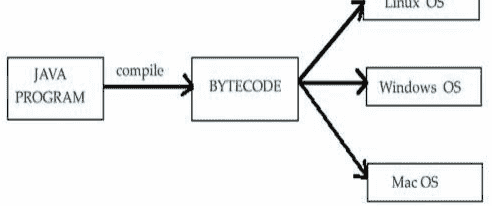

## Java 是面向对象的语言

面向对象编程是将程序组织为对象的方法，每个对象代表类的一个实例。OOP 的 4 个核心概念是：

1. 抽象
2. 封装
3. 继承
4. 多态

Java 被认为是一门简单的语言，因为它没有指针和显式内存分配等复杂特性。

导致程序失败的两个主要问题是内存管理和错误处理不当。Java 处理了这两者。内存管理通过垃圾回收解决。处理不当的错误通过异常处理（Exception Handling）解决。

Java 旨在用于网络化环境。为了这一点，安全性被放在了很多位置。身份验证技术基于公钥加密。这关闭了应用程序伪造数据访问门。

使用 Java 语言，我们可以创建分布式应用程序。RMI（远程方法调用）和 EJB（企业级 Java 豆）用于创建分布式应用程序。简单来说：Java 程序可以分布在通过互联网连接的多个系统上。一个 JVM（Java 虚拟机）上的对象可以在远程 JVM 上执行。

在我们周围的世界中有许多同时发生的事情。多线程是构建多个线程构建应用程序的方法。不幸的是，编写处理许多并发事件的程序比单线程 C 和 C++ 风格要困难得多。


这种集成风格很大程度上来自施乐的 Cedar/Mesa 系统。不同类型的提供。

如上述，在机器上编写的 Java 代码可以在另一台机器上运行。平台无关的字节码可以携带到任何平台执行，这使得 Java 代码具有可移植性。

像任何编程语言一样，Java 语言有自己的结构、语法规则和编程范式。Java 语言的编程范式基于 OOP 概念，该语言的特性支持这一点。

Java 语言是 C 语言的派生物，因此它的语法规则看起来与 C 非常相似。例如，代码块被模块化方法并用括号 `{` 和 `}` 分隔，变量在使用之前必须声明。

环境变量是计算机上的一个动态“对象”，存储一个值（如键值对），这可以在 Windows 中被一个或多个软件程序引用。对于 Java 来说，我们将设置一个名为 "java" 的环境变量，其值将是 Java 目录下 `/bin` 目录的路径。每当程序需要 Java 环境时，它将会查找 Java 环境变量，该变量将为其提供执行目录的路径。


Java 通常被编译为字节码，无论计算机架构如何，字节码都可以在任何 Java 虚拟机 (JVM) 上运行。最新版本是 Java 8。

以下是 Linux 和 Windows 的环境设置。JVM、JRE 和 JDK 这三者都依赖于平台，因为操作系统的配置是不同的。但是，Java 是平台无关的。

在设置环境之前，有几点必须明确：

- **JDK(Java 开发工具包)**：JDK 是为软件开发人员设计的，包含了 Java 编译器、Javadoc、Jar 和调试器等开发工具。
- **JRE(Java 运行环境)**：JRE 包含了运行 Java 程序所需的 Java 库部分，是为最终用户设计的。JRE 可以视为 JDK 的子集。
- **JVM**：JVM (Java 虚拟机) 是一种抽象机器。它是一个规范，提供了可以执行 Java 字节码的运行环境。JVM 适用于许多硬件和软件平台。


如果你仍然愿意为 Java 编程语言设置环境，本节将指导你如何在你的机器上下载并设置 Java。以下是设置环境的步骤。

Java SE 可以通过 [下载 Java]() 免费获取。你可以根据你的操作系统下载相应的版本。

按照指令下载 Java 并运行 `.exe` 在你的机器上安装 Java。一旦在机器上安装了 Java，你将需要设置环境变量以指向正确的安装目录。

假设你已将 Java 安装在 `C:\Program files\Java\JDK` 目录。

### 第 1 步：右键点击“我的电脑”并选择“属性”。

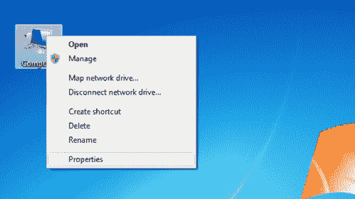

### 第 2 步：进入“高级系统设置”选项卡。

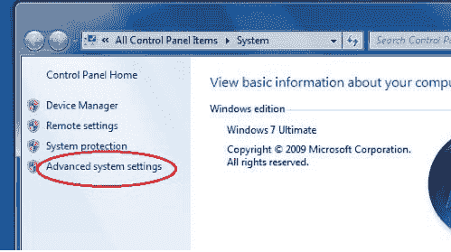

### 第 3 步：点击“环境变量”按钮。

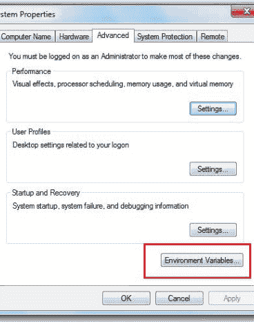

### 第 4 步：现在修改 `path` 变量，使其也包含 JDK 安装目录的路径。

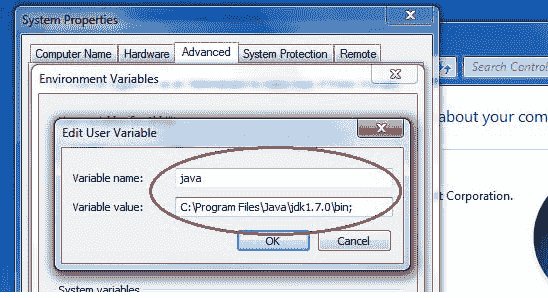

例如：将 `C:\windows\system 32` 更改为 `C:\windows\system 32; C:\program files\Java\JDK`。

假设你已将 Java 安装在 `C:\program files\java\JDK` 目录，执行以下操作：

### 第 1 步：编辑 `C:\autoexec.bat` 文件，并在末尾添加以下行：

```
SET PATH=%PATH% C:\PROGRAM FILE\JAVA\JDK\bin
```

### 为 Linux, Unix, Solaris, free BSD 设置路径

假设你已将 Java 安装在 `/usr/local/jdk` 目录，执行以下操作：

### 第 1 步：环境变量 `PATH` 应设置为指向 Java 二进制文件安装的位置。如果你在执行此操作时遇到困难，请参考你的 shell 文档。

例如：如果你使用 `bash` 作为你的 shell，你将在末尾添加以下行。

```
export PATH=$PATH:/usr/local/jdk/bin
```

## 流行的 Java 编辑器

为了编写 Java 程序，你需要一个文本编辑器。市场上还有更高级的 IDE。但现在你可以考虑以下之一：

- **记事本 (Notepad)** – 在 Windows 机器上，你可以使用任何如记事本、TextPad 等简单文本编辑器。
- **NetBeans**
- **Eclipse**

Java 广泛应用于世界角落和人类生活的各个方面。Java 不仅用于软件，还广泛应用于设计硬件控制软件组件。每年有超过 9.3 亿次 JRE 下载，有 30 亿手机运行 Java。

- 开发桌面应用程序
- 像 Linkedin.com、Snapdeal.com 等 Web 应用程序
- 像 Android 等移动操作系统
- 嵌入式系统
- 机器人和游戏等

## 关键点

### 定义

Java 语言是一种高级语言，但 Java 字节码是一种低级语言。字节码与机器指令相似，但它是架构中性的，并可以在任何具有 Java 虚拟机 (JVM) 的平台上运行。虚拟机不是物理机器，而是一个解释 Java 字节码的程序。这是 Java 的主要优势之一：字节码可以在各种硬件平台和操作系统上运行。Java 源代码被编译成 Java 字节码，字节码由 JVM 解释。你的 Java 代码可能会使用 Java 库中的代码。

执行 Java 程序就是运行程序的字节码。你可以在任何带有 JVM（解释器）的平台上执行字节码。它会逐个将字节码中的单独指令翻译成目标机器语言，而不是将整个程序作为一个单元进行翻译。每一步在翻译后都会立即执行。

## 编程风格与文档

良好的编程风格和适当的文档使程序易于阅读并帮助程序员防止错误。

### 学习目标

- 编写源代码
- 编译并运行你的 Java 程序
- 使用 `classpath`

### 定义

你必须在执行程序之前创建并编译它。这个过程是重复的，如图所示。

系统应该在命令行上输出 "Hello World"。

```
vogella@Angus:~/javastarter$ javac HelloWorld.java
vogella@Angus:~/javastarter$ ls
HelloWorld.java
vogella@Angus:~/javastarter$ java HelloWorld
Hello World
vogella@Angus:~/javastarter$
```

## 使用 Classpath

你可以使用 `classpath` 从目录中的另一个地方运行程序。

切换到**命令行**，例如在 Windows 的“开始 - 运行”中输入 `cmd`。切换到你想要的任何目录。输入：

```
java HelloWorld
```

如果你不在编译后的类文件所在的目录，系统将显示错误信息：`Exception in thread "main" java.lang.ClassNotFoundError: test/TestClass`。

要使用该类，请遵循以下命令。将 `mydirect` 替换为包含 `test` 目录的目录。你应该会再次看到 "Hello World" 的输出。

```
java -classpath "mydirect" HelloWorld
```

## 编程风格与文档

编程风格涉及程序的样式。如果将程序只写在一行，它可以正常编译和运行，但将所有内容写在一行是一种糟糕的编程风格，因为它难以阅读。文档是与程序相关的解释性备注和注释的集合。编程风格和文档与代码本身一样重要。良好的编程风格和适当的文档可以减少错误概率并使程序易于阅读。

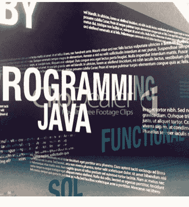

## 适当的注释与注释样式

在程序开头包含一个摘要，解释程序的功能、其关键特征以及它使用的任何独特技术。在长程序中，你还应该包含注释来介绍每个主要步骤并解释任何难以阅读的内容。保持注释简洁非常重要，这样它们就不会拥挤程序或使其变得难以阅读。

除了行注释（以 `//` 开头）和块注释外，Java 还支持一种特殊类型的注释，称为 Javadoc 注释。Javadoc 注释以 `/**` 开头，以 `*/` 结束。可以使用 JDK 的 `javadoc` 命令将其提取到 HTML 文件中。

使用 Javadoc 注释 (`/** ... */`) 对整个类或整个方法进行注释。这些注释必须位于类或方法头之前，以便提取到 Java HTML 文件中。对于方法内部步骤的注释，请使用行注释 (`//`)。

一致的缩进风格使程序清晰且易于阅读、调试和维护。缩进用于说明程序组件或语句之间的结构关系。即使所有语句都位于同一行，Java 也可以读取该程序，但人类发现对齐良好的代码更易于阅读和维护。将每个子组件或语句的缩进比其所嵌套的结构至少多出两个空格。在二进制运算符的两侧都应添加一个空格，如下语句所示：

## Java 编程中的理论、实践与技术

```
System.out.println(3*4); // 糟糕的样式

System.out.println(3 + 4); // 良好的样式
```

块是一个用花括号括起来的一组语句。有两种流行的样式：换行样式和行尾样式，如下所示。

**换行样式：**

```
public class Test {
    public static void main(String[] args) {
        System.out.println("Block Styles");
    }
}
```

**行尾样式：**

```
public class Test { public static void main(String[] args) { System.out.println("Block Styles"); } }
```

换行样式将花括号垂直对齐并使程序易于阅读，而行尾样式节省空间并可能避免某些细微的编程错误。两者都是接受的块样式。选择取决于个人或组织的偏好。你应该一致地使用块样式——不建议混合使用样式。

## 关键点

### 定义

在运行时，JVM 读取并解释 `.class` 文件，并在为该 JVM 编写的原生硬件平台上执行程序指令。JVM 解释字节码就像 CPU 解释汇编指令一样。区别在于 JVM 是一段专门为特定平台编写的软件。JVM 是 Java 语言“一次编写，随处运行”原则的核心。你可以在任何具有可用实现的芯片组上运行代码。Linux 和 Windows 等主流平台都有 JVM，并且 Java 语言的子集已在手机和爱好者芯片的 JVM 中实现。

Java 之所以被称为平台无关是因为 Java 虚拟机。由于具有不同操作系统的不同计算机都有自己的 JVM，当我们把 `.class` 提交给任何操作系统时，JVM 将字节码解释为机器级语言。

- JVM 是 Java 架构的主要组件，它是 JRE（Java 运行环境）的一部分。
- JVM 程序是用“C 语言”编写的，且 JVM 是依赖于操作系统的。
- JVM 负责分配程序所需的内存。
- JVM 负责分配内存空间。

### 即时编译器 (JIT)

JIT 是 Java 虚拟机 (JVM) 的一部分，用于加速执行时间。JIT 同时解释具有相似功能的字节码部分，从而减少了完全解释所需的时间。

### 学习目标

- 理解字节码

### 定义

Java 虚拟机被称为 JVM，是一种抽象的计算机器或虚拟机接口，它驱动 Java 代码。

当我们谈论 Java 应用时，它们运行在拥有 JVM 的机器上。

- JVM 代表 Java 虚拟机。
- JVM 是驱动 Java 代码的引擎。
- 在大多数编程语言中，编译器为特定系统生成代码，但 Java 编译器为虚拟机生成字节码。
- 字节码是 Java 源码与宿主机系统之间的中间语言。
- 它是将 Java 代码编译为字节码的介质，字节码在不同机器上被解释并使其与操作系统无关。

字节码是由程序（通常称为虚拟机）处理的计算机对象代码，而不是由真实的计算机处理器处理。

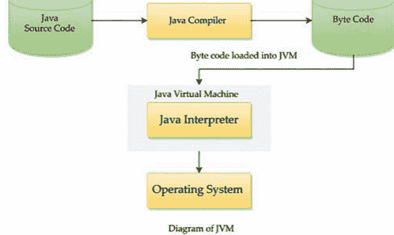

JVM 生成 `.class` (字节码) 文件，该文件可以在任何操作系统上运行，但 JVM 应该位于操作系统之上。

平台无关意味着相同的（编译后的）程序可以在任何计算机上执行。这在互联网应用程序中显然是必要的，因为任何类型的机器都可以用于查看网页。这就是为什么大多数现代浏览器都包含一个执行 Java 编译器生成的指令的 Java 虚拟机 (JVM)。Java 虚拟机也可以整合或嵌入操作系统的内核中。现在大多数操作系统都有 Java 虚拟机。

我们之所以称之为虚拟机是因为 Java 编译器生成的编译代码的目标机器是这个虚拟机，而不是物理处理器或计算机。Java 程序被认为编译为字节码，其目标架构是 Java 虚拟机，如图 1.2 所示。

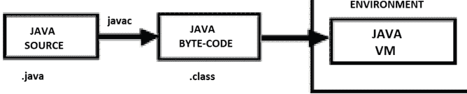

**图 1.2.** Java 程序编译为字节码并使用虚拟机执行。

图 1.2 还显示了典型 Java 程序员用于生成字节码的流程。第一个框表示 Java 源码位于 `.java` 文件中，并用名为 `javac` 的 Java 编译器处理。Java 编译器产生名为 `.class` 的文件，其中包含字节码。然后，`.class` 文件通过网络加载或在本地机器上加载，加载到该平台的执行环境中。在该环境中是 Java 虚拟机，它解释并执行字节码。


在过去，用任何语言编写的大多数程序都必须重新编译，有时甚至为每个计算机平台进行重写。Java 最大的优势之一是你只需要编写并编译一次程序。任何平台上的 Java 都会将编译后的字节码解释为特定处理器可以理解的指令。然而，虚拟机一次只处理一条字节码指令。在特定的系统平台上，使用即时编译器（实际上是第二个编译器）可以将字节码编译为特定的系统代码（就好像该程序最初是在该平台上编译的一样）。一旦代码被 JIT 编译器进行了（重新）编译，它在计算机中运行得通常会更快。

即时编译器随虚拟机一起提供，并作为可选功能使用。它将字节码编译为特定平台的可执行代码，并立即执行。Sun Microsystems 建议，通常选择 JIT 编译器选项会更快，特别是当可执行方法被重复重用时。

## 技术 1：Java 异常处理

在 Java 中，异常是表示应用程序运行期间发生错误的事件。因此，这会中断应用程序指令的正常流。通常情况下，异常会在调用层次结构中向上抛出，直到被捕获。

- 我们已经实践这项技术
- 这项技术不适合我们的操作
- 我们以前练习过这项技术，需要快速上手
- 我们应该实现这项技术

## 接口中的抽象、默认和静态方法

接口可以拥有抽象方法和默认方法。默认方法通过方法签名开头的 `default` 关键字定义。接口中定义的其他所有方法都是公共且抽象的；显式声明这些修饰符是可选的。接口具有常量，这些常量总是隐式的 `public`、`static` 和 `final`。

- 我们已经实践这项技术
- 这项技术不适合我们的操作
- 我们以前练习过这项技术，需要快速上手
- 我们应该实现这项技术

## Java 中的注解

注解提供了关于类的数据，这些数据本身不是编程逻辑的一部分。它们对所标记的代码没有直接影响。其他组件可以使用这些信息。

注解可以在运行时被保留（`RetentionPolicy.RUNTIME`），或仅在开发阶段可用（`RetentionPolicy.SOURCE`）。

- 我们已经实践这项技术
- 这项技术不适合我们的操作
- 我们以前练习过这项技术，需要快速上手
- 我们应该实现这项技术

## 总结

- Java 是一种编程语言和环境，旨在解决现代编程实践中的许多问题。
- 环境变量是计算机上的一个动态“对象”，存储一个值（如键值对），该值可以在 Windows 中被一个或多个软件程序引用。
- 无论计算机架构如何，Java 应用程序通常被编译为任何 Java 虚拟机 (JVM) 字节码。
- 编写 Java 程序需要一个文本编辑器。
- Java 广泛应用于世界的各个角落和人类生活。Java 不仅用于软件，还广泛用于设计控制硬件组件软件。
- 编程风格涉及程序的外观。即使写在一行，程序也可以正常编译和运行，但将所有内容写在一行是糟糕的编程风格，因为难以阅读。
- Java 虚拟机被称为 JVM，是一种驱动 Java 代码的抽象计算机器或虚拟机接口。
- 平台无关性意味着相同的（编译后的）程序可以在任何计算机上执行。显然，这在 Internet 应用程序中是必要的，因为任何类型的机器都可以用于提供 WWW 页面。
- 在 Java 编程语言和环境中，即时 (JIT) 编译器是一个将 Java 字节码（包含必须解释的指令的程序）转换为可以直接发送处理器的指令的程序。

## 知识检查

1. Java 首次开发于 =
   a. 1990
   b. 1991
   c. 1993
   d. 1996

2. Java 的旧名是 =
   a. J language
   b. oak
   c. oct
   d. 以上都不是

3. 下列哪个特性 Java 不支持？
   a. 多线程
   b. 反射
   c. 运算符重载
   d. 垃圾回收

4. 下列哪个不是 Java 中的关键字？
   a. null
   b. import
   c. volatile
   d. package

5. JDK 的全称是什么？
   a. Java Data Kit
   b. Java Defination Kit
   c. Java Development Kit
   d. Java Design Kit

6. 使用哪个命令编译 Java 程序？
   a. javac
   b. java
   c. javad
   d. javadoc

7. JVM 的全称是什么？
   a. Java Virtual Machine
   b. Java Variable Machine
   c. Java Virtual Mechanism
   d. Java Variable Mechanism

8. ADT 的全称是什么？
   a. Abstract Data Type
   b. Abstract Development Tool
   c. Abstract Design Tool
   d. Advance Development Tool

9. main 方法的签名是 `public static void main()`。如果我们犯了错并忘记放置 `static` 关键字会发生什么？
   a. JVM 报错错误，说明 main 方法应该声明为 static
   b. 编译器发出警告，说明 main 方法应该声明为 static 并自动添加它
   c. JVM 成功调用 main 方法
   d. JVM 在运行时失败

10. AWT 代表什么？
    a. Abstract Window Tool
    b. Abstract Development Tool
    c. Application Window
    d. Abstract Development Tool

## 复习题

1. 谁发明了 Java？
2. 谁拥有 Java？
3. 什么是 Java 的扩展名？
4. 什么是 Java 的输出？
5. 编写一个显示 Java 的程序。
6. 什么是 Java 输入？

## 检查答案

1. (c) 2. (b) 3. (c) 4. (a) 5. (c) 6. (a) 7. (a) 8. (a) 9. (a) 10. (a)

## 参考答案

1. James Gosling
2. Sun Microsystems
3. `.class`
4. `System.out.println()`
5. `System.out.println("Hello World");`
6. `System.in` 或 `Scanner(System.in)`

## 参考文献


1. [http://www.tutorialspoint.com/java-overview](http://www.tutorialspoint.com/java-overview)

2. [https://cs.dartmouth.com/~mckee/cs18/](https://cs.dartmouth.com/~mckee/cs18/)

3. [https://www.tutorialspoint.com/java-/article.html](https://www.tutorialspoint.com/java-/article.html)

4. [http://www.tutorialspoint.com/java-setting-environment/](http://www.tutorialspoint.com/java-setting-environment/)

5. [https://www.vogella.com/JavaIntroduction/](https://www.vogella.com/JavaIntroduction/)

6. [http://www.tutorialspoint.com/java-setting-classpath/](http://www.tutorialspoint.com/java-setting-classpath/)

7. [https://www.geeksforgeeks.org/java-bytecode/](https://www.geeksforgeeks.org/java-bytecode/)

8. [http://www.tutorialspoint.com/java-/](http://www.tutorialspoint.com/java-/)

9. [http://www.tutorialspoint.com/java-in-time-compiler/](http://www.tutorialspoint.com/java-in-time-compiler/)

10. [http://www.tutorialspoint.com/java-garbage-collection/](http://www.tutorialspoint.com/java-garbage-collection/)

11. [http://www.tutorialspoint.com/java-type-parameterization/](http://www.tutorialspoint.com/java-type-parameterization/)

12. [http://www.tutorialspoint.com/java-thin-locks/](http://www.tutorialspoint.com/java-thin-locks/)

13. [https://www.tutorialspoint.com/java-escape-analysis/](https://www.tutorialspoint.com/java-escape-analysis/)

14. [http://www.tutorialspoint.com/java-removing-unnecessary-synchronization/](http://www.tutorialspoint.com/java-removing-unnecessary-synchronization/)

# Java 编程导论 27

ECOOP'98，计算机科学讲义系列第1445卷。Springer出版社，1998年。

- 16. Viviana Bono, Amit Patel 和 Vitaly Shimatikov. 类与混入的演算语义（A Calculus of Classes and Mixins）。在欧洲面向对象编程会议，ECOOP'99，计算机科学讲义系列第1628卷，页43–66。Springer出版社，1999年。显然 John C. Mitchell 也是一位未列出的共同作者（?）。

- 17. Viviana Bono, Amit Patel, Vitaly Shimatikov 和 John C. Mitchell. 类与对象的演算语义（A Calculus of Classes and Objects）。在第15届编程语义数学基础会议上，理论计算机科学电子笔记第20卷，1999。ENCTS URL: http://www.elsevier.nl/locate/entcs/volume20.html。

- 18. Gilad Bracha, Martin Ordorsky, David Stamoute 和 Philip Wadler. GJ 规范。出版状态未知，1998年5月。

- 19. Kim B. Bruce, Martin Ordorsky 和 Philip Wadler. 虚拟类型的静态安全替代方案（A statically safe alternative to virtual types）。在欧洲面向对象编程会议，ECOOP'98，布鲁塞尔，1999年7月。

- 20. Robert Cartagena 和 Guy L. Steele Jr. Java编程语言的运行时类型泛型（Genericity with Run-time Types for the Java Programming Language）。在ACM面向对象编程、系统、语言和应用会议，OOPLA'98，页201–215，加拿大不列颠伦比亚省温哥华，1998年10月。ACM出版社。

- 21. Zhiquun Chen. 用于智能卡的 Java 卡技术。Java 系列。Addison Wesley，2000年。

- 22. Shigeru Chiba. Java 中的加载结构反射（Load-Structural Reflection in Java）。在 Elisa Bertino 编辑，欧洲面向对象编程会议，ECOOP'00，计算机科学讲义系列第1850卷，页313–336，法国索菲亚安波利斯和坎纳，2000年6月。Springer出版社。

- 23. Jong-Deok Choi, Manish Gupta, Mauricio Serrano, Vugram Creen, Sreedher 和 Sam Midkiff. Java 逃逸分析（Escape Analysis for Java）。在ACM面向对象编程、系统、语言和应用会议，OOPLA'99，页1–19，美国科罗多州丹佛，1999年11月。ACM出版社。

- 24. Michal Cerniak, Guei-Yuan Yue 和 James M. Stichnoff. 实践 JO：动态优化下的 Java（Practicing JO: Java Under Dynamic Optimizations）。在编程语言设计与实现会议，PLDI'00，页13–26，加拿大不列颠伦比亚省温哥华，2000年6月。ACM出版社。

- 25. Christopher Colby, Peter Lee, George C. Necula, Fred Blau, Mark Plesko 和 Kenneth Cline. 一种 Java 验证型编译器。在编程语言设计与实现会议，PLDI'00，页95–107，加拿大不列颠伦比亚省温哥华，2000年6月。ACM出版社。

- 26. Sophia Drossoulou 和 Soren Eisen. Java 是类型安全的（Java is Type Safe）——在欧洲面向对象编程会议，ECOOP'97，计算机科学讲义系列第1241卷。Springer出版社，1997年。

- 27. Dominic Duggan. Java代码中泛化类型的模块化类型反向工程（Modular Type-Based Reverse Engineering of Parameterized Types in Java Code）。在ACM面向对象编程、系统、语言和应用会议，OOPSLA'99，页97–113，美国科罗拉州丹佛，1999。ACM出版社。

- 28. Kathleen Fisher, Furio Hansell 和 John C. Mitchell. 对象与方法特殊的Lambda演算（A Lambda Calculus of Objects and Method Specialization）。北欧计算杂志，1994(1):3–37，1994。

- 29. Cormac Flanagan 和 Stephen N. Freund. Java 的类型基竞态检测（Type-Based Race Detection for Java）。在编程语言设计与实现会议，PLDI'00，页219–232，加拿大不列颠伦比亚省温哥华，2000年6月。

- 30. Stephen N. Freud 和 John C. Mitchell. Java字节码初始化的类型系统（A Type System for Initialization in the Java Bytecode）。在ACM面向对象编程、系统、语言和应用会议，OOPSLA'98，页310–328，加拿大不列颠伦比亚省温哥华，1998。ACM出版社。

- 31. Stephen N. Freud 和 John C. Mitchell. Java字节码语言与验证器框架（A Framework for the Java Bytecode Language and Verifier）。在ACM面向对象编程、系统、语言和应用会议，OOPSLA'99，页147–166，美国科罗拉州丹佛，1999年11月。

- 32. Stephen N. Freud 和 John C. Mitchell. Java字节码高效静态类型推断（Efficient Inference of Static Types for Java Bytecode）。在静态分析会议，SAS'00，美国圣巴巴巴拉，2000年6/7月。

- 33. Etienne Gagnier, Laurie Henri 和 Guillaume Marceau. 带有并发原语的程序的静态切片形式系统。在Agustino Cortesi 和 Gilberto Fe 编辑，静态分析会议，SAS'99，意大利威尼斯，1999年9月。

- 34. Atsushi Igarashi, Benjamin Pierre 和 Philip Wagner. 轻量级Java（Featherweight Java — A Minimal Calculus for GJ）。在ACM面向对象编程、系统、语言和应用会议，OOPSLA'99，美国科罗拉州丹佛，1999。

- 35. Bart Jacobs, John van Berg, Marieke Huisman, Martijn van Berkum, Ulrich Hensel 和 Hendrik Twe. 关于Java类的推理（Reasoning about Java Classes）。在ACM面向对象编程、系统、语言和应用会议上，OOPSLA'98，页329–340，加拿大不列颠伦比亚省温哥华，1998。ACM出版社。初步报告。

- 36. Todd B. Knobock 和 Jakob Rehof. Java字节码的类型子类型与选择（Type Subtyping and Type Selection for Java Bytecode）。在ACM编程原理年会上，POP'00，页228–242，美国马萨诸塞州波士顿，2000。ACM出版社。

- 37. Xavier Leroy 和 Franz Rouix. 类型苹果属性（Properties of typed apples）。在ACM编程原理年会上，POP'98，页391–403，美国加州州圣迭戈，1998。ACM出版社。

- 38. Sheng Liang 和 Gilad Bracha. Java虚拟机中的动态类加载（Dynamic Class Loading in the Java Virtual Machine）。在ACM面向对象编程、系统、语言和应用会议，OOPSLA'98，页36–44，加拿大不列颠伦比亚省温哥华，1998年10月。ACM出版社。

## 2 类与对象

## 2.1 类与对象的概念

### 关键笔记

### 定义

类是一个蓝图或原型，定义了所有类型对象共有的变量和方法（函数）。对象是类的实例。软件对象通常用于模拟日常生活中发现的真实世界对象。

### 对象的内存分配

Java从称为堆（`heap`）的内存池分配空间。每当调用方法时，Java都会分配一块栈（`stack`）内存来存放局部变量。方法返回时，栈帧会被擦除。

### Java继承

继承允许新对象获取现有对象的属性。作为基础的类被称为超类。继承的类被称为子类或派生类。

### 学习目标

- 描述如何创建类
- 定义对象的内存分配
- 行为：它通过对象的方法表示。它也反映了对象与其他对象之间的响应。
- 标识性：它为对象提供一个唯一的名称，并允许一个对象与其他对象进行交互。

类为对象提供了蓝图。所以基本上，对象是从某个类中创建的。在 Java 中，使用 `new` 关键字来创建新对象。

从类创建对象时有三个步骤——

- 声明：使用一个带有变量名和对象类型的变量进行变量声明。
- 实例化：使用 `new` 关键字后紧跟一个对构造函数的调用。该调用会初始化新对象。

以下是创建对象的示例：

```java
public class Puppy {
    public Puppy(String name) {
        // 此构造函数有一个参数，name。
        System.out.println("Passed Name is: " + name);
    }
    public static void main(String[] args) {
        // 下述语句将创建一个对象 myPuppy
        Puppy myPuppy = new Puppy("tommy");
    }
}
```

类是用于创建单个对象的蓝图。

以下是一个类的示例。

```java
public class Dog {
    String breed;
    int age;
    String color;

    void barking() {
    }
    void hungry() {
    }
    void sleeping() {
    }
}
```

类可以包含以下任何类型的变量。

**局部变量：** 定义在方法、构造函数或块内部的变量称为局部变量。该变量将在方法内部声明并初始化，并在方法完成后被销毁。

**实例变量：** 实例变量是类内部但在任何方法之外的变量。这些变量在类实例化时初始化。可以从该特定类的任何方法、构造函数或块内部访问实例变量。

**类变量：** 类变量是在类内部、任何方法之外声明的、带有 `static` 关键字的变量。

一个类可以拥有任意数量的方法来访问各种方法的值。在上面的示例中，`barking()`、`hungry()` 和 `sleeping()` 都是方法。

内存从堆（`Heap`）中分配以存储对象及其父类的所有实例变量和特定于实现的数据。特定实现的数据包括指向类和方法数据的指针。

在 Java 中，所有对象都动态分配在堆上。这与 C++ 不同，C++ 中的对象可以分配在栈（`Stack`）或堆上。在 C++ 中，我们使用 `new()` 分配对象，对象分配在堆上；否则如果不是全局或静态的则分配在栈上。

在 Java 中，当我们声明一个类类型的变量时，只会创建一个引用（不为对象分配内存）。要为对象分配内存，我们使用 `new()`。因此，对象始终在堆上分配内存。

例如，以下程序编译失败。编译器给出错误“Error because t is not initialized”：

```java
class Test {
// class contents
void show() {
    System.out.println("Test::show() called");
}
}
public class Main {
    public static void main(String[] args) {
        Test t;
        t.show(); // 此处报错，因为 t 未初始化
    }
}
```

使用 `new()` 分配内存使上述程序正常工作。

```java
class Test {
// class contents
void show() {
    System.out.println("Test::show() called");
}
}

public class Main {
    public static void main(String[] args) {
        Test t = new Test(); // 所有对象都动态分配
        t.show(); // 无错误
    }
}
```

## Java 中的继承

继承是指一个对象或类基于另一个对象或类，使用相同的实现来保持相同的行为。它是一种代码复用机制，并允许通过公共类和接口对原始软件进行独立扩展。通过继承产生的对象或类关系形成了一个层次结构。多级继承是指子类继承自另一个子类。类派生自另一个派生类并不罕见，如图“多级继承”所示。在多级继承中，类 A 作为派生类 B 的基类，而 B 反过来作为派生类 C 的基类。类 B 被称为中间基类，因为它为 A 和 C 之间的继承提供了链接。

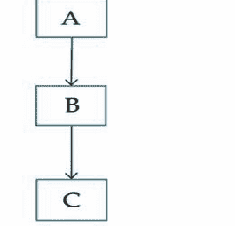

## 多级继承

语法

```java
class A{
  // 执行某些操作
}
class B extends A{
  // 执行某些操作
}
class C extends B{
  // 执行某些操作
}
```

多级继承示例程序

```java
class MultilevelInheritance{
  protected String str;
  MultilevelInheritance() {
    str = "This ";
  }
}
```


```java
class ChildClass1 extends MultilevelInheritance {
  ChildClass1() {
    str = str.concat("is ");
  }
}
class ChildClass2 extends ChildClass1 {
  ChildClass2() {
    str = str.concat("multilevel ");
  }
}
class ChildClass3 extends ChildClass2 {
  ChildClass3() {
    str = str.concat(".");
  }
  void display() {
    System.out.println(str);
  }
}
class MultilevelInheritanceMain {
  public static void main(String args[]) {
    ChildClass3 obj = new ChildClass3();
    obj.display();
  }
}
```

# Java 中的继承类型

以下是继承类型：

- 单继承
- 多继承
- 多级继承
- 层次继承
- 混合继承

## 单继承

单继承允许一个类继承另一个类，从而继承基类的属性。单继承很容易理解。如下所示，类 `B` 仅继承类 `A`，这意味着 `A` 是 `B` 的父类。


(a) 单继承

```java
class Animal {
    String name;
    Animal(String name) {
        this.name = name;
    }
    void eat() {
        System.out.println(name + " is eating");
    }
}

class Dog extends Animal {
    Dog(String name) {
        super(name);
    }
    void bark() {
        System.out.println(name + " is barking");
    }
}

public class Main {
    public static void main(String[] args) {
        Dog d = new Dog("Buddy");
        d.eat();
        d.bark();
    }
}
```

## 多继承

多继承指的是一个类继承（或扩展）多个基类的概念。我们之前学的继承是单个基类。“多继承”的问题在于派生类将不得不管理多个基类。

由于 Java 不支持类的多继承，但可以通过接口来实现它。

## 多级继承

多级继承是指面向对象技术中的一种机制，可以继承一个派生类，从而使该派生类成为新类的基类。正如你从下面的图中看到的，`C` 是 `B` 的子类或子类，而 `B` 是 `A` 的子类。更多细节和示例请参考——Java 中的多级继承。

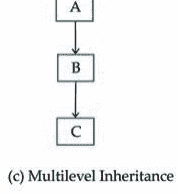

(b) 多级继承

### Java 中的多级继承示例程序 A

```java
class A {
    void method() {
        System.out.println("A method");
    }
}

class B extends A {
    void method() {
        System.out.println("B method");
    }
}

class C extends B {
    void method() {
        System.out.println("C method");
    }
}

public class Main {
    public static void main(String[] args) {
        C obj = new C();
        obj.method();
    }
}
```

## 层次继承

在层次继承中，一个类被许多子类继承。在下面的示例中，类 `B`、`C` 和 `D` 继承同一个类 `A`。`A` 是 `B`、`C` 和 `D` 的父类（或基类）。

```java
class A {
    void method() {
        System.out.println("A method");
    }
}

class B extends A {
    void method() {
        System.out.println("B method");
    }
}

class C extends A {
    void method() {
        System.out.println("C method");
    }
}

class D extends A {
    void method() {
        System.out.println("D method");
    }
}

public class Main {
    public static void main(String[] args) {
        B b = new B();
        b.method();
        C c = new C();
        c.method();
        D d = new D();
        d.method();
    }
}
```

## 混合继承

混合继承是单继承、多继承和层次继承的结合。由于 Java 不支持类的多继承，混合继承通常通过接口来实现。

简单来说，你可以认为混合继承是单继承和多重继承的结合。典型的流程图所示。在 Java 中可以像实现多重继承一样实现混合继承！！使用接口，是的，你没有听错。通过接口，你可以在 Java 中实现多重继承以及混合继承。

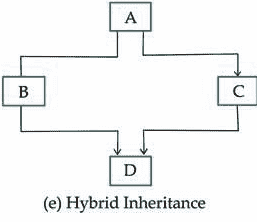

(e) 混合继承

# 2.2 Java 中的接口

> **关键点**
>
> **定义**
>
> 接口是一个纯抽象类。它们在语法上与类相似，但你不能创建接口的实例，并且它们的方法在声明时不包含任何方法体。接口用于在 Java 中实现完全抽象。
>
> **学习目标**
>
> * 定义 Java 中的声明和实现接口

### 定义

接口是 Java 中的一种引用类型。它与类相似。它是一个抽象方法的集合。类实现接口，从而继承接口的抽象方法。

除了抽象方法外，接口还可以包含常量、默认方法、静态方法和嵌套类型。方法体仅存在于默认方法和静态方法中。

编写接口与编写类相似。但类描述了对象的属性和行为。而接口包含了类要实现的行为。

除非实现接口的类是抽象类，否则接口的所有方法都需要在类中进行定义。

接口在以下方面与类相似：

* 接口可以包含任意数量的方法。
* 接口写在扩展名为 `.java` 的文件中，接口的名称与文件名匹配。
* 接口的字节码出现在 `.class` 文件中。
* 接口出现在包中，且其对应的字节码必须存在于与包名匹配的目录结构中。

然而，接口在几个方面与类不同，包括：

* 你不能实例化接口。
* 接口不包含任何构造方法。
* 接口中的所有方法都是抽象的。

### 类与对象

* 接口不能包含实例字段。接口中可以出现的字段必须同时被声明为 `static` 和 `final`。
* 接口不被类继承；而是由类实现。
* 接口可以扩展多个接口。

字节码（也称为可移植代码或 p-code）是一种为软件解释器高效执行而设计的指令形式。

### 声明接口

`interface` 关键字用于声明接口。这里有一个声明接口的简单示例：

示例

以下是一个接口的示例：

```java
/* 文件名：NameOfInterface.java */
import java.lang.*;
// 任意数量的导入语句

public interface NameOfInterface {
    // 任意数量的 final, static 字段
    // 任意数量的抽象方法声明
}
```

接口具有以下属性：

* 接口是隐式抽象的。在声明接口时不需要使用 `abstract` 关键字。
* 接口中的每个方法也是隐式抽象的，因此不需要 `abstract` 关键字。
* 接口中的方法是隐式的公共的（`public`）。

示例

```java
/* 文件名：Animal.java */

interface Animal {
  public void eat();
  public void travel();
}
```


### 实现接口

当一个类实现接口时，你可以将该类类为签署了一份合同，同意执行接口的特定行为。如果一个类没有执行接口的所有行为，则该类必须声明自己为抽象类。

类使用 `implements` 关键字来实现接口。`implements` 关键字出现在类声明中，`extends` 部分之后。

示例

```java
/* 文件名：MammalInt.java */
public class MammalInt implements Animal {

    public void eat() {
        System.out.println("Mammal eats");
    }

    public void travel() {
        System.out.println("Mammal travels");
    }

    public int noOfLegs() {
        return 0;
    }

    public static void main(String args[]) {
        MammalInt m = new MammalInt();
        m.eat();
        m.travel();
    }
}
```

在覆盖接口中定义的方法时，有几条规则需要遵循：

- 实现方法中不应声明除接口方法已声明或接口方法的子类声明之外的受检异常（Checked exceptions）。
- 在重写方法时，应保持接口方法的签名以及相同的返回类型或子类型。
- 实现类本身可以是抽象的，如果是这样的话，则不需要实现接口方法。

在实现接口时，有几条规则：

* 一个类可以同时实现多个接口。
* 一个类只能扩展一个类，但可以实现许多接口。
* 一个接口可以扩展另一个接口，类似于类可以扩展另一个类。

### 扩展接口

接口扩展另一个接口的方式与类扩展另一个类相同。`extends` 关键字用于扩展接口，子接口继承父接口的方法。

下面的 `Sports` 接口被 `Hockey` 和 `Football` 接口扩展。

示例

```java
// 文件名：Sports.java
public interface Sports {
    public void setHomeTeam(String name);
    public void setVisitingTeam(String name);
}
// 文件名：Football.java
public interface Football extends Sports {
    public void homeTeamScored(int points);
    public void visitingTeamScored(int points);
    public void endOfQuarter(int quarter);
}
// 文件名：Hockey.java
```


```java
public interface Hockey extends Sports {
  public void homeGoalored();
  public void visitingGoalored();
  public void endOfPeriod(int period);
  public void overtimePeriod(int ot);
}
```

`Hockey` 接口有四个方法，但它继承了两个方法；因此，实现 `Hockey` 的类需要实现六个方法。同样，实现 `Football` 的类需要定义 `Football` 的三个方法和 `Sports` 的两个方法。

### 多接口扩展

Java 类只能扩展一个父类。不允许多重继承。然而，接口不是类，接口可以扩展多个父接口。

`extends` 关键字使用一次，父接口以逗号分隔列表的形式声明。

例如，如果 `Hockey` 接口同时扩展 `Sports` 和 `Event`，它的声明如下：

示例

```java
public interface Hockey extends Sports, Event
```

### 标记接口

扩展接口的最常见用法发生在父接口不包含任何方法时。例如，`java.awt.event` 包中的 `MouseListener` 接口扩展了 `java.util.EventListener`，后者定义如下：

示例

```java
package java.util;
public interface EventListener {}
```

不包含方法的接口被称为标记接口。标记接口有两个基本设计目的：

* 创建公共父类：就像 `EventListener` 接口（它被 Java API 中的几十个其他接口扩展一样），你可以使用标记接口为一组接口创建一个公共父类。例如，当一个接口扩展 `EventListener` 时，JVM 知道这个特定的接口将用于事件委托场景。
* 为类添加数据类型：这种情况正是“标记”一词的来源。实现标记接口的类不需要定义任何方法（因为接口没有方法），但该类通过多态变成了接口类型。

# 2.3 对象初始化机制

### 关键点

### 定义

Java 语言有三种专门用于确保对象正确初始化的机制：实例化初始化器、实例变量初始化器和构造函数。这三种机制都会导致 Java 代码在对象创建时被自动执行。当你使用 `new` 算符或类的 `newInstance()` 方法为新对象分配内存时，Java 虚拟机将确保在使用这些新分配的内存之前运行初始化代码。

### 实例化初始化器

实例化初始化器（也称为实例化初始化块）是位于类体内的代码块（由大括号 `{` 和 `}` 标记），但位于该类中声明的任何方法体之外。

### 抽象类和方法

用 `abstract` 关键字声明的类在 Java 中被称为抽象类。它可以拥有抽象方法和非抽象方法（带有方法体的方法）。

### 学习目标

- 理解 Java 中的构造函数
- 定义实例化初始化器
- 描述抽象类和抽象方法

### 定义

Java 语言有三种专门用于确保对象正确初始化的机制：

- 构造函数
- 实例变量初始化器
- 实例化初始化器

实例变量初始化器和实例化初始化器可以简单称为“初始化器”。这三种机制都会导致 Java 代码在对象创建时被自动执行。当你使用 `new` 算符为新对象分配内存时，Java 虚拟机将确保在使用这些新分配的内存之前运行初始化代码。如果你设计类时，使得初始化器和构造函数始终为新创建的对象产生有效状态，那么没有人无法创建并使用未正确初始化的对象。

### 默认初始值

到为止，书中的示例没有对实例变量进行显式初始化。这在 Java 中是完全合法的，并且产生可预测的默认初始值，这些值仅取决于变量的类型。表 2.1 显示了每个变量类型的默认初始值。

**表 2.1:** 字段的默认值

| 类型 | 默认值 |
|---|---|
| boolean | false |
| byte | (byte) 0 |
| short | (short) 0 |
| int | 0 |
| long | 0L |
| char | \u0000 |
| float | 0.0f |
| double | 0.0d |
| object reference | null |

如果你不显式地初始化实例变量，那么该变量在返回引用时仍将具有其默认初始值。例如，在本章之前的所有版本的 `CoffeeCup` 类中，`innerCoffee` 字段都没有被显式初始化（该类不包含任何构造函数或初始化器）：

```java
// 此类没有构造函数或初始化器
public class CoffeeCup {

    private int innerCoffee;

    // 类的其余部分...
}
```

因此，当 `new` 第一次返回新 `CoffeeCup` 引用时，`innerCoffee` 字段将是它的默认初始值。由于 `innerCoffee` 是一个 `int`，它的默认初始值为零。

注意，这意味着如果你显式地初始化 `innerCoffee`（例如赋值为 100），那么当每个 `CoffeeCup` 对象被创建时，`innerCoffee` 实际上会被初始化两次。首先，`innerCoffee` 将被赋予默认初始值零。随后，该零将被正确的初始值 100 覆盖。这一切都发生在 Java 虚拟机创建新对象的地方——在它返回新对象的引用之前。当 `new` 算符返回新 `CoffeeCup` 引用时，`innerCoffee` 字段将被设置为 100。

### 构造函数

在 Java 中，构造函数类似于方法，但它们并不是方法。像方法一样，构造函数有一组参数和一段代码体。与方法不同，构造函数没有返回值。像方法一样，你可以给构造函数指定访问修饰符，但与方法不同，具有 `public`、`protected` 或包访问权限的构造函数不会被子类继承。（此外，构造函数的访问级别决定了实例化对象的能力，而不是决定调用方法的能力。）

### 构造函数基础

在源文件中，构造函数看起来像一个方法声明，其中该方法名与类名相同，但没有返回类型。例如，这里是 `CoffeeCup` 类的构造函数声明：


// 在 `init/ex2/CoffeeCup.java` 的源包中
```java
class CoffeeCup {
// 构造函数看起来像方法声明
// 但去掉了返回类型
public CoffeeCup() {
  // 构造函数体
}
// / ...
}
```

与方法一样，你可以通过改变参数的数量、类型和顺序来重载构造函数。这里有一个带有两个构造函数的 `CoffeeCup` 类：

// 在 `init/ex3/CoffeeCup.java` 的源包文件中
```java
class CoffeeCup {
private int innerCoffee;
public CoffeeCup() {
innerCoffee = 237;
}
public CoffeeCup(int amount) {
innerCoffee = amount;
}
// ...
}
```

当你用 `new` 实例化对象时，必须指定一个构造函数。例如，给定上述具有两个构造函数的 `CoffeeCup` 类，你可以通过以下两种方式之一来实例化它：

// 在 `init/ex3/Example3.java` 文件中的源包
```java
class Example3 {
    public static void main(String[] args) {
        // 创建一个空杯
        CoffeeCup cup1 = new CoffeeCup();
        // 创建一个装有 355 ml 咖啡的杯
        CoffeeCup cup2 = new CoffeeCup(355);
    }
}
```

### 无参构造函数

不带参数的构造函数被称为“无参构造函数”。在上述代码中，`CoffeeCup` 的实例化使用了无参构造函数。

### 实例化初始化器的调用

在构造函数内部，你可以使用 `this()` 语句显式地调用另一个构造函数。如果你有多个重载的构造函数，你可能需要这样做。这是一个例子：

// 在 `init/ex4/CoffeeCup.java` 的源包中
```java
class CoffeeCup {
    private int innerCoffee;

public CoffeeCup() { // 构造函数
    this(237);
}
public CoffeeCup(int amount) {
    innerCoffee = amount;
}
}
```
在这个例子中，无参构造函数将 237 传递给 `innerCoffee`。

### 构造函数不是方法

为了进一步说明方法与构造函数之间的区别，请考虑以下事实：给方法命名与类相同的名称是合法的。也就是说，类可以拥有名为 `CoffeeCup` 的方法：

// 在 `init/ex5/CoffeeCup.java` 的源包中
// 它是可行的，但它是方法命名糟糕的示例
```java
class CoffeeCup {

    private int innerCoffee;

    public CoffeeCup() { // 构造函数
        innerCoffee = 237;
    }

    public void CoffeeCup() { // 方法
        innerCoffee = 99;
    }

    // ...
}
```

### 类与对象

给定上述 `CoffeeCup` 的定义，你可以合法地执行以下操作：

// 在 `init/ex5/Example5.java` 的源包中
```java
class Example5 {
    public static void main(String[] args) {
        CoffeeCup cup = new CoffeeCup(); // 调用构造函数
        cup.CoffeeCup(); // 调用方法
    }
}
```

虽然在法律上允许给方法命名与类相同的名称，但在实践中你永远不要这样做，部分原因是其他程序员可能会将其与构造函数混淆，另一部分是因为它违反了许多良好方法命名的规则。类不是动词；它是一个名词（至少应该是名词）。方法名应该是动词。你应该根据方法所执行的操作来命名方法，而“CoffeeCup”并不是一个动作。此外，“CoffeeCup”不符合方法的命名规范（即首字母应小写）。

### 默认构造函数

如果你在声明类时没有声明构造函数，编译器将为你生成一个构造函数。自动生成的构造函数被称为默认构造函数，它们不带参数（即无参构造函数）且方法体为空。因为如果你没有显式声明任何构造函数，编译器会自动生成默认构造函数，所以所有类都保证至少有一个构造函数。

例如，如果你在声明 `CoffeeCup` 类时没有显式声明构造函数：

// 在 `init/ex6/CoffeeCup.java` 的源包中
```java
class CoffeeCup {
    private int innerCoffee;
    public void add(int amount) {
        innerCoffee += amount;
    }
    //...
}
```

编译器生成的类文件与你显式声明一个空体体的无参构造函数所生成的是一致的。

```java
// In source packet in file init/ex7/CoffeeCup.java
class CoffeeCup {
    private int innerCoffee;
    public CoffeeCup() {
    }
    public void add(int amount) {
        innerCoffee += amount;
    }
    //...
}
```

## 实例变量初始化器

在构造函数中，你可以自由编写所需的代码来计算初始值。相比之下，在实例变量初始化器中，你只有一个等号和一个表达式。等号的左侧是正在被初始化的实例变量。等号的右侧可以是任何评估结果与实例变量类型匹配的表达式。

例如，如果你想让每个咖啡杯在开始时始终装有 355 毫升的新鲜咖啡，你可以通过构造函数来初始化 `innerCoffee`：

```java
// In source packet in file init/ex9/CoffeeCup.java
class CoffeeCup {
    private int innerCoffee;
    public CoffeeCup() {
        innerCoffee = 355;
    }
    // ...
}
```

或者，你也可以使用实例变量初始化器来初始化 `innerCoffee`：

```java
// In source packet in file init/ex10/CoffeeCup.java
class CoffeeCup {
    private int innerCoffee = 355; // "=355" 是初始化器
    // 这里没有构造函数
// ...
}
```

## 实例初始化器

实例初始化器（也称为实例初始化块）是位于类体内部、但在类中声明的任何方法体之外的代码块（由大大括号标记）。

实例初始化块用于初始化实例数据成员。每当创建该类的对象时，它都会运行一次。

例如，下面是同一个 `CoffeeCup` 类，但使用实例初始化器初始化 `innerCoffee` 变量：

```java
// In source packet in file init/ex19/CoffeeCup.java
class CoffeeCup {
    private int innerCoffee;
    // 以下代码块是一个实例初始化器
    {
        innerCoffee = 355;
    }
    // 这里没有构造函数
    // ...
}
```

这种初始化 `innerCoffee` 的方式与之前的两个示例产生相同的结果：`innerCoffee` 被初始化为 355。

在以下任何情况下，实例初始化器都是实例变量初始化器的有用替代方案：(1) 初始化器代码必须捕获异常，或 (2) 执行无法用实例变量初始化器表示的复杂计算。当然，你通常会在构造函数中编写此类代码。在类有多个构造函数的类中，你必须在每个构造函数中重复这些代码。使用实例初始化器，你只需要编写一次代码，无论使用哪个构造函数创建对象，它都会被执行。实例初始化器在无法声明任何构造函数的匿名类中也有用。

## 抽象类与方法

如果一个类包含任何抽象方法，则该类被声明为抽象类。抽象类永远不会被实例化。它用于提供抽象。尽管它没有提供 100% 的抽象，因为它也可以拥有具体方法。

在抽象类中声明但没有任何方法体的方法称为抽象方法。方法体将由其子类定义。抽象方法永远不能是 `final` 或 `static` 的。任何继承抽象类的类都必须实现父类声明的所有抽象方法。

抽象类是一个声明为抽象的类——它可能包含也可能不包含抽象方法。抽象类不能被实例化，但可以被子类化。

抽象方法是一种声明时不实现的方法（没有大括号，后跟分号），如下：

```java
abstract void moveTo(double deltaX, double deltaY);
```

如果一个类包含抽象方法，那么该类本身必须被声明，如：

```java
public abstract class GraphicObject {
    // 声明字段
    // 声明非抽象方法
    abstract void draw();
}
```

当抽象类被子类化时，子类通常为其父类中的所有抽象方法提供实现。然而，如果它没有提供，则子类也必须声明为抽象类。

## 抽象类与接口对比

抽象类与接口相似。你不能实例化它们，它们可能包含带有实现或不带实现的方法混合。然而，对于抽象类，你可以声明非 `static` 非 `final` 的字段，以及默认的 `public`、`protected` 和 `private` 方法。对于接口，所有字段自动为 `public`、`static` 且 `final`，并且你声明或定义（作为默认方法）的所有方法都是 `public` 的。此外，你只能扩展一个类（无论其是否抽象），而你可以实现任意数量的接口。

你应该使用抽象类还是接口？

- 如果你的情况符合以下任何一个陈述，请考虑使用抽象类：
  - 你想在几个密切相关的类之间共享代码。
  - 你预计继承你抽象类的类将具有许多公共方法或字段，或者需要 `public` 以外的访问修饰符（如 `protected` 和 `private`）。
  - 你想声明非 `static` 或非 `final` 的字段。这允许你定义可以访问并修改所属对象状态的方法。

- 如果你的情况符合以下任何陈述，请考虑使用接口：
  - 你预计不相关的类会实现你的接口。例如，`Comparable` 和 `Cloneable` 接口被许多无关的类实现。
  - 你想指定特定数据类型的行为，但不规定谁来实现。
  - 你想利用类型的多重继承。

JDK 中抽象类的示例是 `AbstractMap`，它是集合框架的一部分。它的子类（包括 `HashMap`、`TreeMap` 和 `ConcurrentHashMap`）共享了 `AbstractMap` 定义的许多方法（包括 `get`、`put`、`isEmpty`、`containsKey` 和 `containsValue`）。

JDK 中实现多个接口的类示例是 `HashMap`，它实现了 `Serializable`、`Cloneable` 和 `Map<K, V>` 接口。通过读取此接口列表，你可以推断无论实现该类的开发者或公司是谁，`HashMap` 的实例都是可隆的、可序列化的（这意味着它可以转换为字节流；参见序列化对象章节），并且具有映射的功能。此外，`Map<K, V>` 接口增强了许多默认方法，如 `merge` 和 `forEach`，实现此接口的旧类不需要定义这些方法。

面向对象的图形允许用户从简单的几何形状面板中创建图像。一旦形状被放置在画布上，用户就可以重新选择并调整其大小、形状和位置。

## 抽象类示例

在面向对象的图形应用程序中，你可以绘制圆、矩形、直线、贝塞尔曲线以及许多图形对象。这些对象具有共同的状态（例如：位置、方向、线条颜色、填充颜色）和行为（例如：`moveTo`、`rotate`、`size`、`draw`）。某些状态和行为对于所有图形对象都是相同的（例如：位置、填充颜色和 `moveTo`）。其他的则需要不同的实现（例如 `resize` 或 `draw`）。所有的图形都能够绘制或调整自身的大小；它们区别在于实现方式。这是使用抽象父类的完美场景。你可以利用相似性，并声明所有图形对象继承自同一个抽象对象（例如 `GraphicObject`），如下所示。

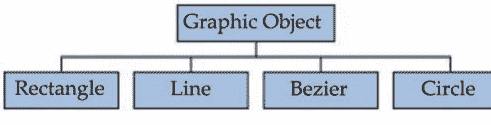

Rectangle、Line、Bezier 和 Circle 类继承自 GraphicObject

首先，你声明一个抽象类 `GraphicObject`，以提供所有子类完全共享的成员变量和方法，例如当前位置和 `moveTo` 方法。`GraphicObject` 还声明了抽象方法，如 `draw` 或 `resize`，这些方法需要所有子类实现，但必须以不同的方式实现。`GraphicObject` 类看起来像这样：

```java
abstract class GraphicObject {
    int x, y;
    ...
    void moveTo(int newX, int newY) {
        ...
    }
    abstract void draw();
    abstract void resize();
}
```

`GraphicObject` 的每个非抽象子类（如 `Circle` 和 `Rectangle`）必须为 `draw` 和 `resize` 方法提供实现：

```java
class Circle extends GraphicObject {
    void draw() {
        ...
    }
    void resize() {
        ...
    }
}
```

```java
class Rectangle extends GraphicObject {
    void draw() {
        ...
    }
    void resize() {
        ...
    }
}
```

# Java 编程中的理论、实践与技术

## 2.4 多态的实现

### 关键要点

### 定义

多态是对象呈现多种形式的能力。在 OOP 中，多态最常用的用法是使用父类引用来指向子类对象。任何能够通过多个一个 IS-A 测试的 Java 对象都被认为是多态的。

### 多态的类型

有不同类型的多态：

- 方法重载（Method Overloading）
- 方法重写（Method Overriding）

# 嵌套类

可以在另一个类内部定义类，这样的类被称为嵌套类。它们允许你在逻辑上将仅在一个处使用的类分组，从而增加了封装的使用，并创建了更具可读性和维护性的代码。

### 包装类

包装类用于将任何数据类型转换为对象。基本数据类型不是对象；它们不属于任何类；它们是在语言本身中定义的。

### 学习目标

- 解释多态的类型
- 描述创建嵌套类

多态是对象呈现多种形式的能力。在 OOP 中，多态最常用的用法是使用父类引用来指向子类对象。

### 定义

多态是方法根据其所作用的对象执行不同操作的能力。换句话说，多态允许你定义一个接口并拥有多个实现。

- 它是一项允许一个接口用于一组通用动作的特性。
- 一个操作在不同的实例中可能表现出不同的行为。
- 行为取决于操作中使用的数据类型。
- 它在允许具有不同内部的对象共享相同的外部接口方面起着重要作用。
- 多态在实现继承中被广泛。

### 多态的类型

以下概念演示了 Java 中不同类型的多态。

- 方法重载
- 方法重写

## 方法重载

在 Java 中，可以在类中定义两个或多个同名的方法，只要它们的参数列表或参数是不同的。这一概念被称为方法重载。

- 在 Java 中调用重载方法时，必须使用参数的类型和数量来确定实际调用重载方法的哪一个版本。
- 重载方法可能有不同的返回值；仅凭返回类型不足以区分方法的两个版本。
- 当 Java 遇到对重载方法的调用时，它简单地执行参数与调用中所使用的参数相匹配的方法版本。
- 它允许用户实现编译时多态。
- 重载方法可以抛出不同的异常。
- 它可以有不同的访问修饰符。

### 示例

```java
class Overload {
    void demo(int a) {
        System.out.println("a: " + a);
    }
    void demo(int a, int b) {
        System.out.println("a and b: " + a + "; " + b);
    }
    double demo(double a) {
        System.out.println("double a: " + a);
        return a * a;
    }
}

class MethodOverloading {
    public static void main(String[] args) {
        Overload Obj = new Overload();
        double result;
        Obj.demo(10);
        Obj.demo(10, 20);
        result = Obj.demo(5.5);
        System.out.println("O/P : " + result);
    }
}
```


# 方法重载

这里 `demo()` 方法被重载了 3 次：第一次有 1 个参数，第二个有 2 个参数，第三个是 `double` 参数。方法是通过使用的相同类型和数量的参数被调用或调用的。

输出：
```
a: 10
a and b: 10,20
double a: 5.5
O/P: 30.25
```

## 方法重载的规则

- 重载可以在同一个类中或其子类中发生。
- Java 中的构造函数可以被重载
- 重载方法必须具有不同的参数列表。
- 重载方法应该始终同一个类的一部分（也可以在子类中发生），具有相同名称但不同参数。
- 参数在类型或数量上或两者上可能不同。
- 它们可能有相同或不同的返回值。
- 它也被称为编译时多态。

# 方法重写

子类拥有与基类相同的方法。在这种情况下，子类在甚至不触碰基类源代码的情况下重写父类方法。这一特性被称为方法重写。

## 示例

```java
public class BaseClass {
    public void methodOverride() {
        System.out.println("Base class method");
    }
}
```

```java
public class DerivedClass extends BaseClass {
    public void methodOverride() {
        System.out.println("Derived class method");
    }
}
```

```java
public class TestOverride {
    public static void main(String[] args) {
        BaseClass obj = new DerivedClass(); // 基类引用指向子类对象
        obj.methodOverride(); // 调用子类的方法
    }
}
```

## 方法重写的规则

- 重写仅适用于继承的方法
- 对象类型决定使用哪种方法
- 引用类型可以具有更严格的访问修饰符
- 抽象方法必须被重写
- 静态和 final 方法不能被重写
- 构造函数不能
- 也被称为运行时多态

## 重写中的 super 关键字

在调用父类时使用 `super` 关键字。

### 示例

```java
class Vehicle {
    public void move() {
        System.out.println("Vehicles are used");
    }
}
```

```java
class Car extends Vehicle {
    public void move() {
        super.move();
        System.out.println("Car is a good medium");
    }
}
```

```java
public class TestCar {
    public static void main(String args[]) {
        Vehicle b = new Car(); // 基类引用但 Car 对象
        b.move(); // 调用 Car 类的方法
    }
}
```

# 嵌套类

在另一个类内部定义的类被称为嵌套类。嵌套类的作用范围由其封装类限制。

## 语法

```java
class Outer {
    // 外部类成员
    class Inner {
        // 内部类成员
    }
} // 外部类闭合
```

## 嵌套类的优点

- 它是逻辑上将仅在一个处使用的类分组的方式。
- 它增加了封装。
- 它可以导致更具可读性和维护性的代码
- 如果你想创建一个仅供封装类使用的类，则没有必要创建一个单独的文件。相反，你可以将其作为“内部类”

在方法外部创建非静态嵌套类被称为成员内部类。
在方法内部创建非静态嵌套类被称为局部内部类。如果你想调用局部内部类的方法，必须在方法内部实例化该类。我们不能对局部内部类使用 `private`、`public` 或 `protected` 访问修饰符。只允许 `abstract` 和 `final` 修饰符。

### 内部类示例（成员类）

```java
class Outer {
    class Inner {
        void display() {
            System.out.println("Inner class method");
        }
    }

    public void main(String[] args) {
        Outer outer = new Outer();
        Outer.Inner inner = outer.new Inner();
        inner.display();
    }
}
```

```java
public void display() {
    Inner in = new Inner();
    in.show();
}
```

```java
class Inner {
    public void show() {
        System.out.println("Inside inner");
    }
}
```

```java
class Test {
    public static void main(String[] args) {
        Outer ot = new Outer();
        ot.display();
    }
}
```

### 方法内部的内部类示例（局部内部类）

```java
class Outer {
    int count;

    public void display() {
        for (int i = 0; i < 5; i++) {
        }

        class Inner // 在循环内部定义的内部类
        {
            public void show() {
                System.out.println("Inside inner " + (count++));
            }
        }
        Inner in = new Inner();
        in.show();
    }
}
```

```java
class Test {
    public static void main(String[] args) {
        Outer ot = new Outer();
        ot.display();
    }
}
```

### 在 Outer 类外实例化的内部类示例

```java
class Outer {
    int count;

    public void display() {
        Inner in = new Inner();
        in.show();
    }
}
```

```java
class Test {
    public static void main(String[] args) {
        Outer ot = new Outer();
        Outer.Inner in = ot.new Inner();
        in.show();
    }
}
```

# Java 中的访问修饰符

Java 中有两种修饰符：访问修饰符和非访问修饰符。

Java 中的访问修饰符指定了数据成员、方法、构造函数或类的访问权限（范围）。

Java 有 4 种访问修饰符：

- `private`（私有）
- `default`（默认）
- `protected`（受保护）
- `public`（公共）

有许多非访问修饰符，如 `static`、`abstract`、`synchronized`、`native`、`volatile`、`transient` 等。在这里我们将学习访问修饰符。

# 1) private 访问修饰符

`private` 访问修饰符仅类类可见。

在这个示例中，我们创建了两个类 `A` 和 `Simple`。`A` 类包含一个私有数据成员和一个私有方法。我们在类外部访问这些私有成员，因此会导致编译时错误。

```java
class A {
    private int data = 40;
    private void msg() { System.out.println("Hello java"); }
}
```

```java
public class Simple {
    public static void main(String args[]) {
        A obj = new A();
        System.out.println(obj.data); // 编译时错误
        obj.msg(); // 编译时错误
    }
}
```

## 私有构造函数的作用

如果你将任何类的构造函数设置为私有，则无法在类外部创建该类的实例。例如：

```java
class A {
    private A() {} // 私有构造函数
    void msg() { System.out.println("Hello java"); }
}
```

```java
public class Simple {
    public static void main(String args[]) {
        A obj = new A(); // 编译时错误
    }
}
```

# 2) default 访问修饰符

如果不使用任何修饰符，它会被默认为默认。默认修饰符仅在包内可见。

在这个示例中，我们创建了两个包 `pack` 和 `mypack`。我们在包外部访问 `A` 类，由于 `A` 类不是公共的，因此无法从包外部访问。

```java
// 存为 A.java
package pack;

class A {
    void msg() { System.out.println("Hello"); }
}
```

```java
// 存为 B.java
package mypack;
import pack.*;

class B {
    public static void main(String args[]) {
        A obj = new A(); // 编译时错误
        obj.msg(); // 编译时错误
    }
}
```

# 3) protected 访问修饰符

`protected` 访问修饰符可以在包内可见，也可以在包外可见，但只能通过继承访问。

`protected` 访问修饰符可以应用于数据成员、方法和构造函数。它不能应用于类本身。

在这个示例中，我们创建了两个包 `pack` 和 `mypack`。`pack` 包中的 `A` 类是公共的，因此可以从包外部访问。但该包的 `msg` 方法被声明为 `protected`，因此只能通过继承从类外部访问。

```java
// 存为 A.java
package pack;

public class A {
    protected void msg() { System.out.println("Hello"); }
}
```

```java
// 存为 B.java
package mypack;
import pack.*;

class B extends A {
    public static void main(String[] args) {
        B obj = new B();
        obj.msg();
    }
}
```

# 4) public 访问修饰符

`public` 访问修饰符可以在任何地方访问。在所有其他修饰符中，它的范围是最宽的。

```java
// 存为 A.java
package pack;

public class A {
    public void msg() { System.out.println("Hello"); }
}
```

```java
// 存为 B.java
package mypack;
import pack.*;

class B {
    public static void main(String[] args) {
        A obj = new A();
        obj.msg();
    }
}
```

# Java 中的包装类

Java 中的包装类有两个作用：

- 将基本类型值封装成对象。
- 为基本类型提供实用函数。

这些类被称为包装类，是因为它们将基本数据封装成对象。它们是 `java.lang` 包的一部分，该包是默认导入的。在这种情况下，使用包装类你可以将元素添加到 `ArrayList`、`HashMap` 等中。

下表显示了基本类型及其对应的包装类：

| 基本类型 | 包装类 |
| :--- | :--- |
| boolean | `java.lang.Boolean` |
| byte | `java.lang.Byte` |
| char | `java.lang.Character` |
| int | `java.lang.Integer` |
| double | `java.lang.Double` |
| float | `java.lang.Float` |
| long | `java.lang.Long` |
| short | `java.lang.Short` |
| void | `java.lang.Void` |

以下语句说明了：

```java
int x = 25;
Integer y = new Integer(33);
```

## 包装类示例：基本类型到包装类

```java
public class WrapperExample {
    public static void main(String args[]) {
        int a = 20;
        Integer i = a; // 自动箱
        System.out.println(i);
    }
}
```

## 包装类示例：包装类到基本类型

```java
public class WrapperExample {
    public static void main(String args[]) {
        Integer a = 3;
        int i = a.intValue(); // 拆箱
        System.out.println(i);
    }
}
```


# 摘要

- **类（Class）**：决定对象行为及内容的实体，是构建特定类型对象的蓝图或指令集。
- **局部变量**：定义在方法、构造函数或块内部的变量。在方法内声明并初始化，方法完成时销毁。
- **内存分配**：从**堆（heap）**分配内存以存储对象及其父类的所有实例变量和特定实现数据（包括指向类数据和方法数据的指针）。
- **继承（Inheritance）**：对象或类基于其他对象/类，复用实现以保持行为一致。一种代码复用机制，通过公共类和接口允许原始软件独立扩展。
- **多级继承（Multilevel inheritance）**：派生类可被继承，从而成为新类的基类。
- **接口（Interface）**：Java 引用类型，抽象方法的集合。类实现接口以继承其抽象方法。
- **实例初始化器（Instance initializers）**：位于类体内、方法体外的代码块（用大括号标记），又称实例初始化块。
- **抽象类（abstract class）**：包含抽象方法的类。不可实例化，用于提供抽象（可拥有具体方法，故非 100% 抽象）。
- **非静态嵌套类（Non-static Nested Class / Inner Class）**：可访问外部类所有变量和方法（含私有成员），并直接引用。

# 知识检查

1. 关于基类的析构函数，以下哪个描述是正确的？
   - a. 基类的析构函数应该是静态的（`static`）。
   - b. 基类的析构函数应该是虚的（`virtual`）。
   - c. 基类的析构函数不应该是虚的。
   - d. 基类的析构函数应该是私有的（`private`）。

2. 下述两个实体（从左到右读）可以通过点运算符连接？
   - a. 类成员和类对象。
   - b. 类对象和类。
   - c. 类成员和该类的成员。
   - d. 类对象和该类的成员。

3. 我们如何让一个类变成抽象类？
   - a. 通过使所有成员函数成为常量（`constant`）。
   - b. 通过使至少一个成员函数成为纯虚函数（`pure virtual function`）。
   - c. 使用 `static` 关键字声明为抽象（`abstract`）。
   - d. 使用 `virtual` 关键字声明为抽象（`abstract`）。

4. 什么是多态（polymorphism）？
   - a. 多态是一种定义同类型不同对象的技术。
   - b. 多态是对象能够呈现多种形式的能力。
   - c. 多态是一种定义同类型不同方法的技术。
   - d. 以上都不是。

5. 使用 CRC 方法进行面向对象的系统建模可以给出：
   - a. 系统的 Java 程序
   - b. 系统的 C++ 程序
   - c. 系统的类、它们的职责以及协作类
   - d. 系统的 Objective C 程序

# 复习题

1. 描述类和对象的概念。
2. 定义 Java 中的多级继承。
3. Java 中共有多少种继承类型？请解释它。
4. Java 中的接口是什么？
5. 定义多态的实现。
6. 讨论 Java 中的访问修饰符（access modifiers）。

# 检查你的结果

1 (c) 2 (d) 3 (b) 4 (b) 5 (c)

# 参考

1. https://www.guru99.com/java-oops-objects.html
2. https://www.tutorialspoint.com/java/java_object_classes.html
3. http://www.javaword.com/article/2979739/learn-java/java-101-classes-and-objects.html
4. http://www.geeksforgeeks.org/g-fact-46/
5. http://www.quora.com/How-can-memory-allocation-be-done-for-objects-in-Java
6. http://www.artima.com/objectsandjava/webuscript/InitCleanup1.html
7. http://beginnersbook.com/2013/05/java-inheritance-types/
8. http://docs.oracle.com/oracle/tutorial/java/landl/abstract.html
9. http://www.studonight.com/java/abstract-class.php
10. http://www.javpatoint.com/abstract-class-in-java
11. http://www.javpatoint.com/access-modifiers

---

- 32. Michal Cierniak, Guei-Yuan Lueh, and James M. Stichnoth. Practicing JUDO: Java Under Dynamic Optimizations. In Conference on Programming Language Design and Implementation, PLDI'00, pages 13–26, Vancouver, British Columbia, Canada, June 2000. ACM Press.

# 3 集合

## 3.1 集合的定义

### 核心要点

#### 定义

**集合（Collection）**：可持有其他引用的对象。集合接口声明了可在各类集合上执行的操作。集合框架的类和接口位于 `java.util` 包中。

#### 集合框架（Collections Framework）

一系列接口和类，助于高效存储和处理数据。设计目标：

- **高性能**：基础集合（动态数组、链表、树、哈希表）实现必须高效。
- **互操作性**：不同类型集合以类似方式工作，高度互操作。
- **可扩展性**：易于扩展或适配集合。

#### 迭代器接口（Iterator Interface）

`java.util.*` 包中的预定义接口。仅支持**正向**提取/检索集合元素，不支持反向操作。

#### 学习目标

- 讨论集合框架
- 解释迭代器接口

### 定义（详述）

集合又称**容器（container）**，是将多个元素分组为单一单元的对象。用于存储、检索、操纵和通信聚合数据，通常代表自然分组的数据项（如扑克牌手、邮件文件夹、电话录）。

### 集合框架（详述）

数组虽可存储同类型元素，但**不支持动态分配**（固定长度），且结构简单。许多应用需更复杂的数据结构（链表、栈、哈希表、集合、树）。

Java 中，动态分配的数据结构（`ArrayList`、`LinkedList`、`Vector`、`Stack`、`HashSet`、`HashMap`、`Hashtable` 等）在**集合框架（Collection Framework）**统一架构下支持，规定了所有类的公共行为。

- **集合**：持有对象集合（元素）的对象。
- **框架**：一组接口，强制特定设计实践，提高生产力与易维护性。
- **统一接口**：无论底层实现如何，均可存储、检索、操纵元素，实现“面向接口编程”。

**Java 集合框架**（`java.util` 包）包含：
- 一组接口
- 实现类
- 算法（排序、搜索等）

类似框架：C++ **标准模板库（STL）**。

**集合框架三大核心组件**：
1. **接口**：抽象数据类型，表示集合；允许独立于表示细节操纵集合；通常形成层级。
2. **实现**：集合接口的具体实现，即可重用数据结构。
3. **算法**：在实现集合接口的对象上执行计算（搜索、排序）的方法；多态的（同一方法适用多种实现），即可重用功能。

Java 集合框架打破了传统集合框架“学习曲线陡峭”的声誉。

## Java 集合框架的优势

- **减少编程工作**：提供实用数据结构和算法，让开发者专注核心逻辑而非底层“管道”工作；促进无关 API 互操作，免编写适配器/转换代码。
- **提高程序速度和质量**：提供高性能、高质量实现；各接口实现可交换，易通过切换实现调优；腾出时间提升质量与性能。
- **允许无关 API 互操作**：集合接口是 API 传递集合的通用语言，独立编写的 API 可无缝协作。
- **减少学习/使用新 API 工作量**：标准集合接口统一了操作方式，避免了各 API 自造临时子 API 的不一致与易错性。
- **减少设计新 API 工作**：设计者可直接使用标准集合接口，无需重复造轮子。
- **促进软件重用**：符合标准接口的数据结构与算法天然可重用。

## 集合的层级结构

`java.util` 包包含集合的所有类和接口。


## Collection 接口的方法

| 序号 | 方法 | 说明 |
|---|---|---|
| 1 | `public boolean add(Object element)` | 向集合插入元素。 |
| 2 | `public boolean addAll(Collection c)` | 将指定集合插入调用集合。 |
| 3 | `public boolean remove(Object element)` | 从集合中删除元素。 |
| 4 | `public boolean removeAll(Collection c)` | 从调用集合中删除指定集合的元素。 |
| 5 | `public boolean retainAll(Collection c)` | 仅保留调用集合中指定集合包含的元素。 |
| 6 | `public int size()` | 返回集合元素总数。 |
| 7 | `public void clear()` | 移除集合中的所有元素。 |
| 8 | `public boolean contains(Object element)` | 搜索元素。 |
| 9 | `public boolean containsAll(Collection c)` | 在集合中搜索指定集合。 |
| 10 | `public Iterator iterator()` | 返回迭代器。 |
| 11 | `public Object[] toArray()` | 将集合转换为数组。 |
| 12 | `public boolean isEmpty()` | 检查集合是否为空。 |
| 13 | `public boolean equals(Object element)` | 比较两个集合。 |
| 14 | `public int hashCode()` | 返回集合的哈希码。 |

# Iterator 接口

**Iterator 接口**提供仅按**正向**遍历元素的功能。

# 迭代器示例

**迭代器（Iterator）**：允许遍历集合并在需要时选择性移除元素的对象。通过调用集合的 `iterator()` 方法获取。

```java
public interface Iterator<E> {
    boolean hasNext();
    E next();
    void remove(); // optional
}
```

- `hasNext()`：若仍有元素则返回 `true`。
- `next()`：返回迭代中的下一个元素。
- `remove()`：从底层集合移除上一次 `next()` 返回的元素。每次 `next()` 调用仅可调用一次 `remove()`，违规将抛出异常。

> **注意**：`Iterator.remove` 是迭代期间修改集合的**唯一安全方式**；若在迭代运行时以其他方式修改底层集合，行为未定义。

**迭代（Iteration）**：重复某过程，以生成无界结果序列，或为达到期望目标/结果。

**何时使用 Iterator 而非 `for-each`**：
- 需**移除当前元素**（`for-each` 隐藏迭代器，无法调用 `remove`，故不可用于过滤）。
- 需**并行遍历多个集合**。

**示例**：使用 Iterator 过滤任意集合（遍历并移除特定元素）。

```java
static void filter(Collection<?> c) {
    for (Iterator<?> it = c.iterator(); it.hasNext(); ) {
        if (!cond(it.next()))
            it.remove();
    }
}
```


这段简单的代码是多态的，这意味着它适用于任何实现方式的 `Collection`。此示例演示了使用 Java 集合框架编写多态算法是多么简单。

# Iterator 接口的方法

`Iterator` 接口中只有三个方法。它们是：

| 编号 | 方法 | 说明 |
| :--- | :--- | :--- |
| 1 | `public boolean hasNext()` | 如果迭代器还有更多元素则返回 true。 |
| 2 | `public Object next()` | 返回元素并将光标移动到下一个元素。 |
| 3 | `public void remove()` | 移除迭代器返回的最后一个元素。很少使用。 |

# 如何通过以下示例帮助你使用集合框架

## Navigable Map 示例

在 `NavigableMap` 中，我们使用方法返回键值对，如 `Map.put(1, "January")`；而在 `NavigableSet` 中，我们使用方法返回值。

## Navigable Set 示例

在下面的示例中，我们使用了 `NavigableSet` 方法按升序、降序对元素排序，并检索立即大于或等于 35 的元素等。

## HashSet 示例

提供一个 `HashSet` 集合框架的示例。`HashSet` 是一种不允许重复元素且不对元素进行排序或定位的集合。

## Linked List 示例

本节讨论了一个演示 `List` 接口各种方法的示例。我们在示例代码中使用了 `ArrayList` 和 `LinkedList` 两个类。

# Java 编程中的理论、实践与技巧

## Tree Map 示例

在以下示例中，我们使用了 `TreeMap` 方法，它将元素存储在树中并根据值对元素进行排序。在这里示例中我们使用元素的键来显示元素的值。

## Tree Set 示例

在以下示例中，我们使用了 `TreeSet` 集合，它与 `TreeMap` 类似，将元素存储在树中并根据值维护元素的顺序。

# 什么是集合框架？

Java 提供了集合框架（Collections Framework）。在集合框架中，集合代表了一组对象。而集合框架是用于表示和操作集合的统一架构。

# 遍历集合

在示例中，你将学习如何在 Java 中遍历集合。提供了一个可运行的 Java 程序示例，展示了你如何在 Java 中遍历集合。

# 将集合转换为数组

这里是从集合到数组的转换说明。你将学习如何这样做。

# 将数组转换为集合

这里是从数组到集合的转换说明。你将学习如何这样做。给出的示例简要地介绍了如何将数组转换为集合，而不丢失数组持有的任何数据或元素。

# 实现队列（Queue）

你将学习如何实现队列。队列持有数据或元素的集合，并遵循 FIFO（先进先出）规则。

# 实现栈（Stack）

你将学习如何在 Java 中实现栈。栈就像一个桶，你可以按照顺序一个一个将元素放入桶中，并根据最后进入元素的顺序从桶中取出元素。

# Map.Entry Java 接口

有时你需要处理 map 条目（map entry）。可以使用 Java 的 `Map.Entry` 接口完成。

## 接口（INTERFACES）

### 关键点

### 定义

Java 中的接口是类的蓝图。它具有静态常量和抽象方法。Java 接口是实现抽象的机制。Java 接口中可以只有抽象方法而没有方法体。它用于在 Java 中实现抽象和多继承。

## Set 接口

`Set` 是一种不能包含重复元素的集合。它模拟了数学集合抽象。`Set` 接口仅包含继承自 `Collection` 的方法，并添加了不允许重复元素的限制。

## Java 中的类（Class）

类是一组具有共同属性的对象。它是创建对象的模板或蓝图。它是一个逻辑实体。它不能是物理的。

## Vector

`Vector` 实现了一个可增长的对象数组。与数组类似，它包含了可以使用索引访问的组件。然而，`Vector` 的大小可以根据需要增长或缩小。

### 学习目标

- 描述 `Collection` 接口
- 解释 `Set` 和 `List` 接口
- 理解 Java 中的类

### 定义

Java 中的接口是类的蓝图。它具有静态常量和抽象方法。Java 接口是实现抽象的机制。Java 接口中可以只有抽象方法而没有方法体。它用于在 Java 中实现抽象和多继承。

核心接口封装了不同类型的集合，如下所示。核心接口是集合框架的基础。


`Set` 是一种特殊的 `Collection`，`SortedSet` 是特殊的 `Set`，以此类推。注意层次结构由两个独立的树组成，`Map` 不是真正的 `Collection`。

*注意所有的集合接口都是泛型的。例如，这是 `Collection` 接口的声明。*

```
public interface Collection<E> { ... }
```

`public interface Collection<E>` 语法告诉你该接口是泛型的。当你声明集合实例时，可以且**应该**指定集合包含的对象类型。指定类型允许编译器在编译时验证放入集合的对象类型是正确的，从而减少运行时错误。

当你理解了如何使用这些接口时，你就掌握了关于集合框架的大部分知识。本章讨论了有效使用接口的指南，包括何时使用哪个接口。你还将学习每个接口的编程范式，以帮助你充分利用它们。

为了保持集合接口数量在管理范围内，Java 平台没有为每种集合提供单独的接口（此类变体可能不可变、固定大小和仅追加）。相反，每个接口中的修改操作被标记为*可选*，给定实现可能不支持所有操作。如果调用不支持的操作，集合将抛出 `UnsupportedOperationException`。实现负责记录它们支持哪些可选操作。Java 平台的所有通用实现都支持所有的可选操作。

以下列出了核心集合接口：

- **Collection** —— 集合层次结构的根。集合代表一组被称为其*元素*的对象。`Collection` 接口是所有集合实现的最小公分母，在需要最大通用性时用于传递和操作集合。某些类型的集合允许重复元素，而另一些不允许。某些是有序的，其他的则是无序的。Java 平台没有提供此接口的直接实现，但提供了更具体的子接口的实现，如 `Set` 和 `List`。

- **Set** —— 一种不能包含重复元素的集合。该接口模拟了数学抽象，并用于表示集合，例如组成扑克牌手的牌、构成学生课表的课程，或者在机器上运行的进程。

- **List** —— 一种有序的集合（有时称为序列），可以包含重复元素。`List` 的用户对列表中每个元素的插入位置有精确的控制，并且可以通过元素的整数索引（位置）来访问元素。如果你使用过 `Vector`，就会对 `List` 的通用风格非常熟悉。

- **Queue** —— 一种用于在处理之前持有多个元素的集合。除了基本操作外，`Queue` 还提供了额外的插入、提取和检查操作。

  队列通常（但并非一定）以 FIFO（先入先出）的方式对元素进行排序。例外是优先级队列，它根据提供的比较器或元素的自然顺序对元素进行排序。无论使用何种排序方式，队列的头部都是调用 `poll()` 方法时将被移除的元素。在 FIFO 队列中，所有新元素都插入到队列尾部。其他类型的队列可能使用不同的放置规则。每个 `Queue` 实现都必须指定其排序属性。

- **Deque** —— 一种用于在处理之前持有多个元素的集合。除了基本操作外，`Deque` 还提供了额外的插入、提取和检查操作。

  `Deque` 既可以作为 FIFO（先入先出），也可以作为 LIFO（后进先出）。在 deque 中，所有新元素都可以在两端进行插入、检索和移除。

- **Map** —— 一个将键映射到值的对象。`Map` 不能包含重复的键；每个键最多映射到一个值。如果你使用过 `Hashtable`，就已经熟悉了 `Map` 的基础知识。

最后两个集合接口仅仅是 `Set` 和以下内容的排序版本：

- **SortedSet** —— 一种按升序顺序维护元素的 `Set`。提供了若干额外操作以利用这种排序特性。Sorted sets 用于自然排序的集合，例如单词列表和成员名册。

- **SortedMap** —— 一种按键升序顺序维护映射的 `Map`。这是 `SortedSet` 的 `Map` 对应物。Sorted maps 用于自然排序的键值对集合，例如字典和电话簿。

为了理解排序接口如何维护其元素的顺序，

## Collection 接口

`Collection` 代表了一组被称为其元素的对象。`Collection` 接口用于在需要最大通用性时传递对象集合。例如，按照惯例，所有通用的集合实现都拥有一个接受 `Collection` 参数的构造函数。这种构造函数被称为转换构造函数，它初始化新集合以包含指定集合中的所有元素，无论该集合的子接口或实现类型是什么。换句话说，它允许你转换集合的类型。

假设，你有一个 `Collection<String> c`，它可能是一个 `List`、`Set` 或其他类型的 `Collection`。这种写法创建了一个新的 `ArrayList`（`List` 接口的实现），初始包含 `c` 中的所有元素。

```java
List<String> list = new ArrayList<String>(c);
```

或者——如果你使用的是 JDK 7 或更高版本——你可以使用菱形操作符：

```java
List<String> list = new ArrayList<>(c);
```

`Collection` 接口包含了执行基本操作的方法，如 `size()`、`boolean isEmpty()`、`boolean contains(Object element)`、`boolean add(E element)`、`boolean remove(Object element)` 以及 `Iterator<E> iterator()`。

它还包含对整个集合进行的方法，如 `containsAll(Collection<?> c)`、`boolean addAll(Collection<? extends E> c)`、`boolean removeAll(Collection<?> c)`、`boolean retainAll(Collection<?> c)` 以及 `clear()`。

还存在数组操作的其他方法（如 `Object[] toArray()` 和 `<T> T[] toArray(T[] a)`）。

在 JDK 8 及更高版本中，`Collection` 接口还暴露了 `Stream<E> stream()` 和 `Stream<E> parallelStream()`，用于从底层集合获取顺序流或并行流。

`Collection` 接口的功能正如你所预期，因为 `Collection` 代表了一组对象。它告诉你集合中有多少个元素（`size`、`isEmpty()`），检查对象是否在集合中的方法（`contains`），以及添加和从集合中移除元素（`add`、`remove`）。


提供集合迭代器的方法（`iterator()`）。

`add()` 方法的定义足够通用，因此对于允许重复元素的集合和不允许重复元素的集合都是有效的。它保证在调用完成后集合将包含指定的元素，如果集合由于该调用而发生变化，则返回 `true`。同样，`remove()` 方法设计用于从集合中移除指定元素的单个实例（假设集合起初包含该元素），如果集合由于该结果被修改，则返回 `true`。

## Set 接口

Java 编程语言中的接口（Interface）是一种抽象类型，用于指定类要实现的行为。

`Set` 是一个不能包含重复元素的 `Collection`。它模拟了数学抽象。`Set` 接口仅包含继承自 `Collection` 的方法，并增加了禁止重复元素的限制。`Set` 还对 `equals()` 和 `hashCode()` 操作的行为增加了更强的契约，使得 `Set` 实例即使在实现不同的情况下也能进行有意义的比较。如果两个 `Set` 实例包含相同的元素，则它们是相等的。

Java 平台包含三个通用的实现：`HashSet`、`TreeSet` 和 `LinkedHashSet`。`HashSet` 将元素存储在表中，其性能最好；但它对迭代顺序不提供任何保证。`TreeSet` 在红黑树中存储元素，根据其值进行排序；它的速度比 `HashSet` 慢。`LinkedHashSet` 实现为贯穿哈希表的链表，根据元素的插入顺序进行排序（插入顺序）；其开销略高于 `HashSet`。

这是一个简单但实用的 `Set` 写法。假设你有一个集合 `c`，你想创建一个包含相同元素但去除了重复元素的集合。以下单行代码可以实现此功能：

```java
Collection<Type> noDups = new HashSet<Type>(c);
```

它的原理是创建一个不能包含重复元素的 `Set`，初始包含 `c` 中的所有元素。它使用了“Collection 接口”节中描述的标准构造函数。

或者，如果使用 JDK 8 或更高版本，可以使用聚合操作轻松收集到 `Set`：

```java
c.stream()
    .collect(Collectors.toSet()); // 去重
```

这是一个稍长的示例，将名称集合收集到 `TreeSet`：

```java
Set<String> set = people.stream()
    .map(Person::getName)
    .collect(Collectors.toCollection(TreeSet::new));
```

以下是第一种方法的稍微变体，在保留原始集合顺序的同时移除重复元素：

```java
Collection<Type> noDups = new LinkedHashSet<Type>(c);
```

以下是封装了上述方法的泛型方法，返回与传入类型相同的泛型 `Set`：

```java
public static <E> Set<E> removeDups(Collection<E> c) {
    return new LinkedHashSet<E>(c);
}
```

## List 接口

`List` 是一个有序的集合（有时称为序列）。`List` 可以包含重复元素。除了从 `Collection` 继承的操作外，`List` 接口还包含以下操作：

- **位置访问** —— 根据元素在列表中的位置操作元素。这包括 `get()`、`set()`、`add()`、`addAll()` 和 `remove()` 方法。
- **搜索** —— 在列表中搜索指定对象并返回其数值位置。搜索方法包括 `indexOf()` 和 `lastIndexOf()`。
- **迭代** —— 扩展 `Iterator` 语义以利用列表的顺序特性。`listIterator()` 方法提供了这种行为。
- **范围视图** —— `sublist()` 方法对列表执行任意范围操作。

Java 平台包含两个通用的 `List` 实现。`ArrayList` 通常是性能更好的实现，而 `LinkedList` 则在某些情况下提供更好的性能。

## Queue 接口（队列接口）

队列（`Queue`）是一个用于在处理之前持有元素的集合。除了基本的 `Collection` 操作外，队列还提供了额外的插入、移除和检查操作。`Queue` 接口如下：

```java
public interface Queue<E> extends Collection<E> {
    E element();
    boolean offer(E e);
    E peek();
    E poll();
    E remove();
}
```


每个 `Queue` 方法都以两种形式存在：(1) 其中一个在操作失败时会抛出异常，(2) 另一个在操作失败时会返回一个特殊值（取决于操作类型，返回 `null` 或 `false`）。接口的常规结构如下表所示。

| Queue 接口结构 | 操作类型 | 抛出异常 | 返回特殊值 |
| :--- | :--- | :--- | :--- |
| 插入 | `add(e)` | `offer(e)` |
| 移除 | `remove()` | `poll()` |
| 检查 | `element()` | `peek()` |

队列通常（但并非一定）以先进先出（FIFO）的方式对元素排序。异常包括优先级队列，它根据值对元素进行排序。无论使用何种排序方式，队列头部都是调用 `remove` 或 `poll` 时将被移除的元素。在 FIFO 队列中，所有新元素都插入到队尾。其他类型的队列可能使用不同的放置规则。每个队列实现必须指定其排序属性。

`Queue` 实现可以限制其持有元素的数量；此类队列被称为有界（bounded）。`java.util.concurrent` 中的某些 `Queue` 实现是有界的，但 `java.util` 中的实现不是。

`Queue` 继承自 `Collection` 的 `add` 方法会插入元素，除非该操作会违反队列的容量限制，在这种情况下它会抛出 `StateException`。`offer` 方法专门设计用于有界队列，它与 `add` 的区别仅在于通过返回 `false` 来表示插入元素失败。

`remove` 和 `poll` 方法都会移除并返回队列头部。具体移除哪一个元素取决于队列的排序策略。`remove` 和 `poll` 方法在队列为空时的行为不同。在这种情况下，`remove` 会抛出 `NoSuchElementException`，而 `poll` 返回 `null`。

`element` 和 `peek` 方法返回但不移除队列头部。它们之间的差异与 `remove` 和 `poll` 完全相同：如果队列为空，`element` 会抛出 `NoSuchElementException`，而 `peek` 返回 `null`。

`Queue` 实现不允许插入 `null` 元素。为了实现 `Queue` 接口而进行改造的 `LinkedList` 实现是一个例外。由于历史原因，它允许 `null` 元素，但您应该避免利用这一点，因为 `null` 被 `poll` 和 `peek` 方法用作特殊返回值。

`Queue` 实现通常不定义基于元素的 `equals` 和 `hashCode` 方法，而是继承自 `Object` 的基于标识符（identity-based）的版本。

`Queue` 接口并不阻塞队列方法，而这些方法在并发编程中很常见。这些等待元素出现或空间可用的方法定义在 `java.util.concurrent.BlockingQueue` 接口中，该接口扩展了 `Queue`。

在接下来的示例程序中，使用队列实现了一个倒计时计时器。队列预加载了从命令行指定的数字到零的所有整数值，并按降序排列。然后，从队列中移除这些值并每隔秒打印一次。该程序是人造的，因为不使用队列来完成同样的事情会更自然，但它说明了如何使用队列存储后续处理的元素。

```java
import java.util.*;

public class Countdown {

    public static void main(String[] args) throws InterruptedException {

        int time = Integer.parseInt(args[0]);

        Queue<Integer> queue = new LinkedList<Integer>();

        for (int i = time; i >= 0; i--) {

            queue.add(i);

        }

        while (!queue.isEmpty()) {

            System.out.println(queue.remove());

            Thread.sleep(1000);

        }

    }

}
```

在下面的示例中，使用优先级队列对元素集合进行排序。同样，这个程序也是人造的，因为没有理由使用它替代 `Collections` 提供的 `sort` 方法，但它说明了优先级队列的行为。

```java
static <E> List<E> heapSort(Collection<E> c) {

    Queue<E> queue = new PriorityQueue<E>(c);

    List<E> result = new ArrayList<E>();

    while (!queue.isEmpty()) {

        result.add(queue.remove());

    }

    return result;

}
```

## Deque 接口（双端队列接口）

`Deque` 读作 "deck"，是一个双端队列。双端队列是元素的线性集合，支持在两个端点插入和移除元素。`Deque` 接口比 `Stack` 和 `Queue` 都是更丰富的抽象类型，因为它同时实现了栈和队列。`Deque` 接口定义了访问 `Deque` 实例两端元素的方法。提供了用于插入、移除和检查元素的方法。`ArrayDeque` 和 `LinkedList` 等预定义类实现了 `Deque` 接口。

注意，`Deque` 接口既可以作为后进先出（LIFO）栈，也可以作为先进先出（FIFO）队列。`Deque` 接口给出的方法分为三部分：

### 插入

`addFirst` 和 `offerFirst` 方法在 `Deque` 实例的开头插入元素。`addLast` 和 `offerLast` 方法在 `Deque` 实例的末尾插入元素。当 `Deque` 实例存在限制时，`addFirst` 和 `offerFirst` 会失败。

### 移除

`removeFirst` 和 `pollFirst` 方法从 `Deque` 实例的开头移除元素。`removeLast` 和 `pollLast` 方法从 `Deque` 实例的末尾移除元素。

### 检查

`elementFirst` 和 `peekFirst` 方法返回但不移除 `Deque` 实例开头的元素。`elementLast` 和 `peekLast` 方法返回但不移除 `Deque` 实例末尾的元素。它们之间的差异与 `removeFirst` 和 `pollFirst` 的差异完全相同：如果队列为空，`elementFirst` 会抛出 `NoSuchElementException`，而 `peekFirst` 返回 `null`。

`Deque` 实现不允许插入 `null` 元素。为了实现 `Deque` 接口而进行改造的 `LinkedList` 实现是一个例外。由于历史原因，它允许 `null` 元素，但您应该避免利用这一点，因为 `null` 被 `pollFirst` 和 `peekFirst` 方法用作特殊返回值。

`Deque` 实现通常不定义基于元素的 `equals` 和 `hashCode` 方法，而是继承自 `Object` 的基于标识符的版本。

`Deque` 接口并不阻塞队列方法，而这些方法在并发编程中很常见。这些等待元素出现或空间可用的方法定义在 `java.util.concurrent.BlockingQueue` 接口中，该接口扩展了 `Queue`。

`Deque` 元素的插入、移除和检查方法总结如下表所示：

| 操作类型 | 头部元素（Deque 开头） | 尾元素（Deque 末尾） |
| :--- | :--- | :--- |
| 插入 | `addFirst(e)`, `offerFirst(e)` | `addLast(e)`, `offerLast(e)` |
| 移除 | `removeFirst()`, `pollFirst()` | `removeLast()`, `pollLast()` |
| 检查 | `elementFirst()`, `peekFirst()` | `elementLast()`, `peekLast()` |

# Map 接口（映射接口）

`Map` 是将键映射到值的对象。`Map` 不包含重复的键：每个键最多映射到一个值。模拟函数抽象。`Map` 接口包含了基本操作（如 `put`, `get`, `remove`, `containsKey`, `containsValue`, `size` 和 `empty`）、批量操作（如 `putAll` 和 `clear`）以及集合视图（如 `keySet`, `entrySet` 和 `values`）。

Java 平台包含三个通用的 `Map` 实现：`HashMap`、`TreeMap` 和 `LinkedHashMap`。它们的行为和性能对应 `Set` 接口部分对应的 `HashSet`、`TreeSet` 和 `LinkedHashSet`。

本文其余部分将详细讨论 `Map` 接口。在此之前，还有一些使用 JDK 8 聚合操作收集到 `Map` 的示例。建模现实对象是面向对象编程中的常见任务，因此可以认为某些程序可能会，例如，按部门分组员工：

```java
// 按部门分组员工
Map<Department, List<Employee>> byDept = employees.stream()
    .collect(Collectors.groupingBy(Employee::getDepartment));
```

或者计算每个部门的工资总和：

```java
// 按部门计算工资总和
Map<Department, Integer> totalByDept = employees.stream()
    .collect(Collectors.groupingBy(Employee::getDepartment,
        Collectors.summingInt(Employee::getSalary)));
```

或者可能按及格或不及格分组学生：

```java
// 将学生分为及格和不及格
Map<Boolean, List<Student>> passingFailing = students.stream()
    .collect(Collectors.partitioningBy(s -> s.getGrade() >= PASS_THRESHOLD));
```

你也可以按城市分组人物：

```java
// 按城市分类人物对象
Map<String, List<Person>> peopleByCity = personStream.collect(Collectors.groupingBy(Person::getCity));
```

或者级联两个收集器按州和城市对人进行分类：

```java
// 级联收集器
Map<String, Map<String, List<Person>>> peopleByStateAndCity = personStream.collect(Collectors.groupingBy(Person::getState),
    Collectors.groupingBy(Person::getCity));
```

## 对象排序

`List` 可以按照如下方式进行排序。

```java
Collections.sort(list);
```

如果 `List` 包含 `String` 元素，它将按字母顺序排序。如果它包含 `Date` 元素，它将按时间顺序排序。这是如何实现的？`String` 和 `Date` 都实现了 `Comparable` 接口。`Comparable` 实现为类提供了自然排序（natural ordering），允许该类的对象能够被自动排序。以下总结了实现 `Comparable` 的一些重要的 Java 平台类。

| 类 | 自然排序 |
|------|------------|
| `Byte` | 有符号数值 |
| `Character` | 无符号数值 |
| `Long` | 有符号数值 |
| `Integer` | 有符号数值 |
| `Short` | 有符号数值 |
| `Double` | 有符号数值 |
| `Float` | 有符号数值 |
| `BigInteger` | 有符号数值 |
| `BigDecimal` | 有符号数值 |
| `Boolean` | `Boolean.FALSE < Boolean.TRUE` |
| `File` | 依赖于系统的路径字典序 |
| `String` | 字典序 |
| `Date` | 时间顺序 |
| `CollationKey` | 特定于区域的字典序 |

如果你尝试对列表进行排序，而元素没有实现 `Comparable`，则 `Collections.sort(list)` 将抛出 `ClassCastException`。同样，如果你尝试对一个元素无法通过 `comparator` 相互比较的列表进行排序，`Collections.sort(list, comparator)` 将抛出 `ClassCastException`。可以相互比较的元素被称为互可比较的（mutually comparable）。虽然不同类型的元素可能是互可比较的，但这里列出的类没有类允许类间比较。

如果你只是想对可比较元素的列表进行排序，或者创建这些元素的排序集合，那么关于 `Comparable` 接口你只需要知道这些了。

## SortedSet 接口

`SortedSet` 是一种按升序维护其元素的 `Set`，其排序是根据元素的自然排序或根据创建 `SortedSet` 时提供的 `Comparator` 的。除了普通的 `Set` 操作外，`SortedSet` 接口还提供了以下操作：

- 范围视图（Range view）允许对排序集合进行任意范围操作
- 端点（Endpoints）返回排序集合中的第一个或最后一个元素
- Comparator 访问（Comparator access）返回用于排序集合的 `Comparator`（如果有的话）

以下是 `SortedSet` 接口的代码。

```java
public interface SortedSet<E> extends Set<E> {

  // 范围视图
  SortedSet<E> subSet(E fromElement, E toElement);
  SortedSet<E> headSet(E toElement);
  SortedSet<E> tailSet(E fromElement);

  // 端点
  E first();
  E last();

  // Comparator 访问
  Comparator<? super E> comparator();

}
```

## 排序操作

`SortedSet` 从 `Set` 继承的操作在排序集合和普通集合上的行为相同，但有两个例外：

- `iterator` 操作返回的 `Iterator` 按顺序遍历排序集合。
- `toArray` 返回的数组按顺序包含排序集合的元素。

尽管接口没有保证此点，但 Java 平台 `SortedSet` 实现的 `toString` 方法会返回一个包含排序集合所有元素的字符串，且顺序正确。

## 标准构造函数

按照惯例，所有通用的 `Collection` 实现类都提供一个接收 `Collection` 的标准转换构造函数；`SortedSet` 实现也不例外。在 `TreeSet` 中，此构造函数创建了一个按照其自然排序对其元素元素的实例。这可能是一个错误。更好的做法是动态检查指定的集合是否是 `SortedSet` 实例，如果是，则按照相同的标准（`comparator` 或自然排序）对新的 `TreeSet` 进行排序。由于 `TreeSet` 采用了这种方法，它还提供了一个构造函数，返回一个包含相同元素并按相同标准排序的新 `TreeSet`。请注意，是参数的编译时类型而不是其运行时类型决定了调用了哪一个构造函数（以及排序标准是否被保留）。

`SortedSet` 实现按照惯例还提供了一个接收 `Comparator` 的构造函数，返回一个按指定 `Comparator` 排序的空集合。如果向此构造函数传递 `null`，它将返回一个按其自然排序排序元素的集合。

# 类

类无非创建不同对象的蓝图或模板，它定义了对象的属性和行为。Java 类对象表现出由其类定义的属性和行为。类可以包含字段和方法来描述对象的行为。

## LinkedList

Java `LinkedList` 使用双链表来存储元素。它提供了一种链表数据结构。它继承 `AbstractList` 类并实现了 `List` 和 `Deque` 接口。

关于 Java `LinkedList` 的重要点是：

- `LinkedList` 类可以包含重复元素。
- `LinkedList` 类维护插入顺序。
- `LinkedList` 类不同步。
- 在 `LinkedList` 类中，操作非常快，因为不需要发生移动。
- `LinkedList` 类可以当作列表、栈或队列。

## LinkedList 类的层次结构

如上图所示，`LinkedList` 类继承 `AbstractSequentialList` 类并实现了 `List` 和 `Deque` 接口。

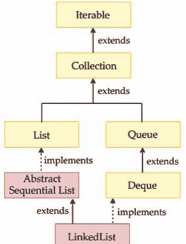

## 双链表

在双链表的情况下，我们可以从两边添加或删除元素。


## LinkedList 声明

让我们看看 `java.util.LinkedList` 的声明。

```java
public class LinkedList<E> extends AbstractSequentialList<E> implements List<E>, Deque<E>, Cloneable, Serializable
```


## Java LinkedList 的构造函数

| 构造函数 | 说明 |
|---|---|
| `LinkedList()` | 用于构建空列表。 |
| `LinkedList(Collection)` | 用于构建包含集合元素的列表，按集合迭代器返回的顺序。 |

### Java LinkedList 示例

```java
import java.util.*;
public class TestCollection{
    public static void main(String args[]){
        LinkedList<String> al=new LinkedList<String>();
        al.add("Ravi");
        al.add("Vijay");
        al.add("Ravi");
        al.add("Ajay");
        Iterator<String> itr=al.iterator();
        while(itr.hasNext()){
            System.out.println(itr.next());
        }
    }
}
```

**输出：**
Ravi
Vijay
Ravi
Ajay

## ArrayList

Java `ArrayList` 使用动态数组来存储元素。它继承 `AbstractList` 类并实现了 `List` 接口。

关于 `ArrayList` 类的重要点是：

- `ArrayList` 类可以包含重复元素。
- `ArrayList` 维护插入顺序。
- `ArrayList` 非同步。
- `ArrayList` 允许随机访问，因为数组基于索引工作。
- 在 Java `ArrayList` 类中，如果从数组列表中删除任何元素，操作会很慢，因为需要大量的移动。

## ArrayList 声明

让我们看看 `java.util.ArrayList` 的声明。

```java
public class ArrayList<E> extends AbstractList<E> implements List<E>, RandomAccess, Cloneable, Serializable
```

## Java ArrayList 的构造函数

| 构造函数 | 说明 |
|---|---|
| `ArrayList()` | 用于构建空数组列表。 |
| `ArrayList(Collection c)` | 用于构建由集合 c 初始化的数组列表。 |
| `ArrayList(int capacity)` | 用于构建具有指定初始容量的数组列表。 |

## Vector

`Vector` 和 `ArrayList` 基本上相同，但 `Vector` 方法是线程安全的（同步）。
你通常会想使用 `ArrayList` 而不是 `Vector`，因为同步方法会带来可能不需要的性能损耗。

```java
import java.util.Iterator;
import java.util.Vector;

public class JabongVector {
    public static void main(String[] args) {
        Vector olxVector = new Vector(); //默认数据数组大小为 10
        olxVector.add("TV");
        olxVector.add("BIKE");
        olxVector.add(2);
        System.out.println(olxVector.subList(2, 5));
        System.out.println();
    }
}
```

```java
System.out.println();
System.out.println("cloning a vector");
Vector ebayVector = (Vector) olxVector.clone();
System.out.println("ebay Clone Vector :" + ebayVector);
System.out.println();
System.out.println("Removing all element");
ebayVector.removeAllElements();
System.out.println("After removing size :" + ebayVector.size());
}
```

输出:
olxVector :[:TV, BIKE, CAR, SHOES, SONY LCD, SAMSUNG PHONE]
size of olxVector :6 Current Capacity 10

使用 Iterator 读取元素

- TV
- BIKE
- CAR
- SHOES
- SONY LCD
- SAMSUNG PHONE

检查 vector 是否包含特定字符串
LCD in olxVector :false

## 移除元素 (SHOES)
[TV, BIKE, CAR, SONY LCD, SAMSUNG PHONE]

从 olxVector 获取子列表
[CAR, SONY LCD, SAMSUNG PHONE]

克隆 vector
ebay Clone Vector :TV, BIKE, CAR, SONY LCD, SAMSUNG PHONE

移除所有元素
移除后大小 : 0

## HashSet

`HashSet` 是 `Set` 接口性能最好的实现。它将元素存储在 `HashTable` 中，不保证迭代时的任何类型顺序。

```java
package com.beingjavaguys.core;
import java.util.HashSet;

public class HashSetImplementation {
    public static void main(String args[]) {
        HashSet<String> hashSet = new HashSet<String>();
        hashSet.add("element1");
        hashSet.add("element2");
        System.out.println(hashSet);
        HashSet.remove("element1");
        System.out.println(hashSet);
    }
}
```

## TreeSet

`TreeSet` 比 `HashSet` 慢一点，它将元素存储在红黑结构中。`TreeSet` 根据元素的值对其元素进行排序。

```java
package com.beingjavaguys.core;
import java.util.TreeSet;

public class TreeSetImplementation {
    public static void main(String args[]) {
        TreeSet<String> treeSet = new TreeSet<String>();
        treeSet.add("element1");
        treeSet.add("element2");
        treeSet.add("element3");
        System.out.println(treeSet);
        treeSet.remove("element2");
        System.out.println(treeSet);
    }
}
```

## Hashtable

- 就像 `Vector` 是更简洁、现代的 `ArrayList` 的同步版本，`Hashtable` 是 `HashMap` 的同步版本。
- 请记住你并没有同步整个类，所以当我们说 `Vector` 和 `Hashtable` 是同步的时，我们指的是该类的关键方法是同步的。

## 3.3 操作 MAP

### 关键点

**概念**
Map 以键和值关联的形式存储数据。键和值都是对象。键必须是唯一的，但值可以重复。虽然 Maps 是集合框架的一部分，但由于它们拥有某些属性，它们实际上不能被称为集合。然而，我们可以获取 map 的集合视图。

**Map 接口**
Map 接口提供了三个集合视图，允许将 map 的内容视为键的集合、值的集合或键值映射。map 的顺序定义为 map 集合视图上的迭代器返回元素的顺序。某些 map 实现（如 `TreeMap` 类）对其顺序有特定的保证；而其他实现（如 `HashMap` 类）则没有。

**学习目标**
- 讨论 map 接口
- 定义 map 类

### 概念

map 是一个存储键与值之间关联（或键值对）的对象。给定一个键，你可以找到它的值。键和值都是对象。键必须是唯一的，但值可以重复。某些 map 可以接受 null 键和 null 值，而另一些不能。

关于 map 有一个重要的点需要在开头提到：它们没有实现 `Iterable` 接口。这意味着你不能使用 for-each 风格的循环来遍历 map。此外，你无法获取 map 的迭代器。但是，正如你很快会看到的，你可以获取 map 的集合视图，这允许使用 for 循环或迭代器。

```java
import java.util.HashMap;
import java.util.Map;
import java.util.Set;
import java.util.TreeMap;

public class JavaMaps {
    public static void main(String[] args) {
        Map<String, String> dictionaryHashMap = new HashMap<>();
        System.out.println("Creating a HashMap");
        retrieve(dictionaryHashMap);
    }

    private static void retrieve(Map<String, String> dictionary) {
        Set<String> keySet = dictionary.keySet();
        for(String key : keySet) {
            System.out.println(key + ": " + dictionary.get(key));
        }
        System.out.println("");
        System.out.println("The meaning of 'geek' is '" + dictionary.get("geek") + "'");
    }

    public static void main(String[] args) {
        Map<String, String> dictionaryTreeMap = new TreeMap<>();
        System.out.println("Creating a TreeMap");
        retrieve(dictionaryTreeMap);
    }

    private static void retrieve(Map<String, String> dictionary) {
        Set<String> keySet = dictionary.keySet();
        for(String key : keySet) {
            System.out.println(key + ": " + dictionary.get(key));
        }
        System.out.println("");
        System.out.println("The meaning of 'geek' is '" + dictionary.get("geek") + "'");
    }
}
```

```java
System.out.println(hashMap);
hashMap.remove(0);
System.out.println(hashMap);
```

## TreeMap

`TreeMap` 实现了一种基于红黑树的 `Map` 接口实现。

```java
import java.util.TreeMap;

public class TreeMapImplementation {
    public static void main(String[] args) {
        TreeMap<String, Integer> treeMap = new TreeMap<String, Integer>();
        treeMap.put("key1",123);
        treeMap.put("key2",435);
        treeMap.put("key3",654);
        System.out.println(treeMap);
        treeMap.remove("key1");
        System.out.println(treeMap);
    }
}
```

## LinkedHashMap

它是 `Map` 接口的 `HashTable` 和 `LinkedList` 的实现。`LinkedHashMap` 拥有一个穿过所有元素的双向链表。

```java
package com.beamingjavaguys.core;
import java.util.HashMap;

public class LinkedHashMapImplementation {
    public static void main(String args[]) {
        HashMap<Integer, String> linkedHashMap=new HashMap<Integer, String>();
        linkedHashMap.put(0,"value1");
        linkedHashMap.put(1,"value2");
        linkedHashMap.put(2,"value3");
        System.out.println(linkedHashMap);
        linkedHashMap.remove(0);
        System.out.println(linkedHashMap);
    }
}
```

## Map 类

Map 根据键存储值，即键值对。每个键值对被称为一个条项。Map 仅包含唯一的键。

## HashMap 类

- `HashMap` 类继承 `AbstractMap` 并实现 `Map` 接口。
- 它使用哈希表来存储 map。这使得 `get()` 和 `put()` 方法的执行时间保持不变。
- `HashMap` 有四个构造函数：
  - `HashMap()`
  - `HashMap(Map<? extends K, ? extends V>)`
  - `HashMap(int capacity)`
  - `HashMap(int capacity, float fillratio)`
- `HashMap` 不维护其元素的顺序。

### 示例

```java
import java.util.*;

class HashMapDemo {
    public static void main(String args[]) {
        HashMap<String,Integer> hm = new HashMap<String,Integer>();
        hm.put("a",new Integer(100));
        hm.put("b",new Integer(200));
        hm.put("c",new Integer(300));
        hm.put("d",new Integer(400));
        Set<Map.Entry<String,Integer>> st = hm.entrySet(); //返回 Set
        for(Map.Entry<String,Integer> me:st) {
            System.out.print(me.getKey()+":");
            System.out.println(me.getValue());
        }
    }
}
```

**输出：**
c 300
a 100
d 400
b 200

## TreeMap 类

- `TreeMap` 类继承 `AbstractMap` 并实现 `NavigableMap` 接口。
- 它创建 Map 并存储在树形结构中。
- `TreeMap` 提供了一种以高效顺序存储键值对的有效手段。
- 它提供了排序顺序的键值对并允许快速检索。

### 示例

```java
import java.util.*;

class TreeMapDemo {
    public static void main(String[] args) {
        TreeMap<String,Integer> tm = new TreeMap<String,Integer>();
        tm.put("a",new Integer(100));
    }
}
```


# 文件处理与异常处理

## 4.1 文件处理

### 核心要点

#### 定义
Java 中的文件处理意味着在 Java 中如何读取文件和写入文件。Java 提供了用于读写流的各种 I/O 包。`java.io` 包允许在 Java 中完成所有输入和输出任务。

Java 提供了 `java.io` 包用于 Java 文件处理。`java.io` 包包含了内置的 Java 类和预定义方法，通过这些方法你可以从文件中读取并写入数据。

#### 流
流是程序与外部世界通信的通道。它被用于连续传输数据项。

#### 文件操作
要对文件执行读取和写入操作，我们必须在执行操作之前打开文件，并在操作完成后关闭它。

### 学习目标
- 创建和删除文件
- 读取文件和写入文件
- 修改文件权限

### 定义

文件是在**硬盘**存储设备上永久存储数据的最重要机制。永久意味着当机器关闭时数据不会丢失。文件可以包含：

- 程序可以解释但人类难以阅读的格式中的数据（二进制文件）；
- 以标准方式编码的字母数字字符（例如使用 ASCII 或 Unicode），并且人类用户可以直接读取的字符（文本文件）。文本文件通常组织成行的序列，每行包含一个特殊字符（通常是换行符）。例如，考虑一个存储在硬盘文件中的 Java 程序。

硬盘是一种数据存储设备，使用磁性存储通过一个或多个涂有磁性材料的硬旋转磁盘（盘片）来存储和检索信息。

每个文件都以名称和所在的目录为特征（可以将在硬盘上找到文件的整个路径视为文件名）。文件最重要的操作是：创建、读取、写入、重命名、删除。所有这些操作都可以由操作系统（或其他程序）执行，或者通过 Java 程序中的适当操作完成。

（注：由于原文存在大量 OCR 错误和重复，上述译文已根据逻辑进行了清理和重构翻译。）

### 读取文件

在 Java 中有很多读取文件的方法。我们可以使用 `BufferedReader`、`FileReader` 或 `Files` 类。下面的代码片段按行读取文件。

```java
File file = new File("data.txt");
FileInputStream fis = new FileInputStream(file);
InputStreamReader isr = new InputStreamReader(fis, cs);
BufferedReader br = new BufferedReader(isr);
String line;
while ((line = br.readLine()) != null) {
  // 处理该行
  System.out.println(line);
}
br.close();
```

### 写入文件

在 Java 中，可以使用 `FileWriter`、`BufferedWriter`、`Files` 或 `FileOutputStream` 来写入文件。下面的代码片段使用 `Stream` 将数据写入文件。

```java
OutputStream os = null;
try {
  os = new FileOutputStream(new File("/Users/pankaj/os.txt"));
  os.write(data.getBytes(), 0, data.length());
} catch (IOException e) {
  e.printStackTrace();
} finally {
  try {
    os.close();
  } catch (IOException e) {
    e.printStackTrace();
  }
}
```

### 修改文件权限

`File` 类提供了获取文件权限详情以及更改权限的方法。下面的代码片段展示了如何读取和更改文件权限。

```java
File file = new File("/Users/pankaj/run.sh");
// 检查应用程序用户的文件权限
System.out.println("文件是否可读? " + file.canRead());
System.out.println("文件是否可写? " + file.canWrite());
System.out.println("文件是否可执行? " + file.canExecute());
// 仅更改应用程序用户的文件权限
file.setReadable(false);
file.setWritable(false);
file.setExecutable(false);
// 同时也更改其他用户的文件权限
file.setReadable(true, false);
file.setWritable(true, false);
file.setExecutable(true, true);
```


如果你使用的是 Java 7 或更高版本，应该使用提供更多选项的 `PosixFilePermission`。

```java
//使用 PosixFilePermission 设置文件权限 777
Set<PosixFilePermission> perms = new HashSet<PosixFilePermission>();

//添加所有者权限
perms.add(PosixFilePermission.OWNER_READ);
perms.add(PosixFilePermission.OWNER_WRITE);
perms.add(PosixFilePermission.OWNER_EXECUTE);

//添加组权限
perms.add(PosixFilePermission.GROUP_READ);
perms.add(PosixFilePermission.GROUP_WRITE);
perms.add(PosixFilePermission.GROUP_EXECUTE);

//添加其他权限
perms.add(PosixFilePermission.OTHERS_READ);
perms.add(PosixFilePermission.OTHERS_WRITE);
perms.add(PosixFilePermission.OTHERS_EXECUTE);

Files.setPosixFilePermissions(Paths.get("/Users/pankaj/run.sh"), perms);
```

以上就是关于 Java 文件处理的所有内容。它将帮助你开始在 Java 程序中文件操作。


## 4.2 JAVA - 异常


### 定义

程序应该能够处理运行时可能发生的错误情况。错误情况可以分为两大类：

- **编程错误**。例如，使用无效索引访问数组元素、尝试除以零、使用非法参数调用方法或使用带有 `null` 值的引用访问对象的成员。
- **运行时环境错误**。例如，打开不存在的文件、使用文件时发生读或写错误，或网络连接意外中断。

### 文件与异常处理

编程错误是由于程序中的逻辑错误导致的错误情况，而运行时环境错误是程序几乎无法控制的错误。程序必须能够处理这两种错误。理想情况下，不应该发生编程错误，程序应该优雅地处理运行时环境错误。

Java 中的异常表示在程序执行过程中发生了错误或意外情况。异常处理是处理此类情况的机制。它基于“抛出（throw）和捕获（catch）”原则。当程序执行过程中发生错误情况时，会抛出一个异常，并由异常处理程序捕获，随后采取适当的操作来处理该情况。这一原则嵌入在 `try–catch` 语句中。所有异常都是对象，Java 标准库提供了表示不同类型异常的类。

计算机软件工程中的执行是指计算机或虚拟机执行计算机程序指令的过程。

本章中的示例展示了如何抛出、传播、捕获和处理异常。这些示例被刻意简化，以突出异常处理中的重要概念。

### 异常的类型

异常可能发生在运行时（称为**运行时异常**），也可能发生在编译时（称为**编译异常**）。基于此，我们将异常分为两类。你需要理解它们，以便知道 Java 中的异常处理是如何工作的。

### 检查异常 (Checked Exceptions)

检查异常是在编译时发生的异常，这些也被称为编译异常。

### 非检查异常 (Unchecked Exceptions)

运行时异常也称为非检查异常。这些异常不需要被捕获或声明。例如，`ArrayIndexOutOfBoundsException`、`NullPointerException`。

### 错误 (Errors)

错误并不是异常，而是超出用户控制的问题。错误通常在代码中被忽略，因为你很少能做任何什么。例如，如果发生了栈溢出，将会产生一个错误。

### 异常层次结构

所有异常类都是 `java.lang.Exception` 类的子类。`Exception` 类是 `Throwable` 类的子类。除了 `Exception` 类之外，还有一个名为 `Error` 的子类，它也派生自 `Throwable`。

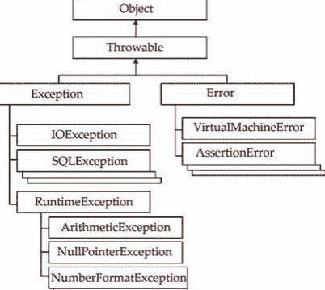

### try-catch 语句

```java
try {
  //受保护的代码
} catch(ExceptionName e1) {
  // 捕获块
}
```

在此处编写一个可能导致错误情况并抛出异常的代码块。

catch 语句涉及声明你正尝试捕获的异常类型。如果在受保护代码中发生异常，将检查紧随在该类型之后的 catch 块（或多个 catch 块）。如果发生的异常类型在某个 catch 块列表中，则异常将传递给该 catch 块，就像参数传递给方法参数一样。

### 多个 catch 块

一个 try 块后面可以跟多个 catch 块。多个 catch 块的语法如下：

```java
try {
  //受保护的代码
} catch(Exception1 e1) {
  // 捕获块
} catch(Exception2 e2) {
  // 捕获块
} catch(Exception3 e3) {
  // 捕获块
}
```

前面的语句演示了三个 catch 块，但你可以在单个 try 之后拥有任意数量的 catch 块。如果在受保护代码中发生异常，异常将抛给列表中的第一个 catch 块。如果抛出的异常数据类型与 ExceptionType 匹配，它就会被捕获。如果不匹配，异常将传递到第二个 catch 语句。此过程持续，直到异常被捕获或用完所有 catch 块，在这种情况下，当前方法停止执行，并将异常向下抛给调用堆栈上的上一个方法。

方法可以声明它抛出多个异常，这些异常是在一个用逗号分隔的列表中声明的。例如，以下方法声明了它会抛出 `RemoteException` 和 `InsufficientFundsException`：

```java
import java.io.*;

public class className {
    public void withdraw(double amount) throws RemoteException,
    InsufficientFundsException {
        // 方法实现
    }
    // 类定义的剩余部分
}
```

### finally 块

finally 块紧跟在 try 块或 catch 块之后。finally 块的代码始终会执行，无论是否发生异常。

使用 finally 块允许你运行任何你想执行的清理类型语句，无论受保护代码中发生了什么。

finally 块出现在 catch 块的末尾，其语法如下：

```java
try {
    //受保护的代码
} catch(ExceptionType1 e1) {
    // 捕获块
} catch(ExceptionType2 e2) {
    // 捕获块
} catch(ExceptionType3 e3) {
    // 捕获块
} finally {
    // finally 块始终执行。
}
```

#### 示例

```java
public class ExceptTest{
    public static void main(String[] args){
        int a[] = new int[2];
        try{
            System.out.println("Access element three: " + a[3]);
        } catch(ArrayIndexOutOfBoundsException e) {
            System.out.println("Exception thrown : " + e);
        } finally{
            a[0] = 6;
            System.out.println("First element value: " + a[0]);
            System.out.println("The finally statement is executed");
        }
    }
}
```

这将产生以下内容：

```
Exception thrown : java.lang.ArrayIndexOutOfBoundsException: 3
First element value: 6
```

注意以下几点：

- 没有 try 语句就不存在 catch 子句。
- 当存在 try/catch 子句时并不强制要求有 finally 子句。
- try 块在没有 catch 子句或 finally 子句的情况下不存在。
- try、catch、finally 块之间不能存在任何代码。

### try-with-resources（带资源的 try）

通常情况下，当我们使用流、连接等任何资源时，我们必须使用 finally 块显式地关闭它们。在下面的程序中，我们使用 `FileReader` 从文件中读取数据，并使用 finally 块关闭它。

#### 示例

```java
import java.io.File;
import java.io.FileReader;
import java.io.IOException;

public class ReadData_Demo {
    public static void main(String[] args){
        FileReader fr = null;
        try{
            File file = new File("file.txt");
            fr = new FileReader(file);
            char[] a = new char[50];
            fr.read(a); // 将内容读入数组
            for(char c : a)
                System.out.print(c); // 逐个打印字符
        } catch(IOException e) {
            e.printStackTrace();
        } finally {
            try {
                if(fr != null) fr.close();
            } catch(IOException ex) {
                ex.printStackTrace();
            }
        }
    }
}
```


```java
        } catch(IOException e){

            e.printStackTrace();

        } finally{

            try{

                fr.close();

            } catch(IOException ex){

                ex.printStackTrace();

            }

        }

    }

}
```

## try-with-resources

try-with-resources，也称为自动资源管理，是 Java 7 中引入的一种新异常处理机制，它会自动关闭 `try catch` 块内部使用的资源。

要使用此语句，只需在括号内声明所需的资源，创建的资源将在块结束时自动关闭。以下是 try-with-resources 语句的语法。

### 语法

### 示例

使用 `try-with-resources` 语句读取文件中数据的程序。

```java
import java.io.FileReader;
import java.io.IOException;

public class Try_withDemo {

    public static void main(String args[]){

        try(FileReader fr=new FileReader("file.txt")){

            char[] a = new char[50];

            fr.read(a); // 将内容读入数组

            for(char c : a) {

                System.out.print(c); // 逐个打印字符

            }

        } catch(IOException e){

            e.printStackTrace();

        }

    }

}
```


在使用 try-resources 时需要注意以下几点：

- 要用 try-resources 使用类，必须实现 `AutoCloseable` 接口，并且它的 `close()` 方法会被自动调用。
- 你可以在 try-resources 语句中声明多个类。
- 当你在 try-resources 块中声明多个类时，它们将按反序关闭。
- 除了括号内的资源声明外，其余部分与普通的 `try/catch` 块相同。
- 在 try 块开始前实例化的资源。
- 在 try 块中声明的资源被隐式声明为 `final`。

# 用户自定义异常

`Exception` 层次结构并没有提供任何有用信息，即 Java 有许多异常类，例如 `IOException` 及其进一步的子类 `FileNotFoundException`、`EOFException` 等。我们应该始终抛出并捕获特定的异常类，这样调用者就能轻松了解异常的根源并进行处理。这使得调试变得容易，并帮助客户端适当地处理异常。

# 技术 10 创建自定义异常类

Java 提供了相当异常类。尽可能使用它们，而不是创建你自己的异常类。然而，如果你遇到无法用预定义异常类充分描述的问题，可以创建一个派生自 `Exception` 或其 `Exception` 子类（如 `IOException`）的自定义异常类。

# 技术 12

# 错误检测技术（调试）

如果测试阶段表明存在逻辑错误，或者我们无法发现运行时错误的原因，则有必要对程序进行调试。我们可以通过以下两种方式获取对调试程序有帮助的信息：

1. 在代码中插入输出语句；
2. 借助调试器执行程序。

- 我们已经练习过这项技术
- 此技术不适用于我们的操作
- 我们过去实践过此技术，现在需要重新上手
- 我们应该实现这项技术

# 总结

- 文件是在质质存储设备上永久存储数据的最重要机制。永久意味着当机器关闭时，数据不会丢失。
- `File` 类的 `delete` 方法用于删除文件或空目录。
- 编程错误是由于程序中的逻辑错误而引起的错误情况，而运行时环境错误是程序对其控制较小的错误。
- 异常处理是处理此类情况的机制。异常可能发生在运行时（称为运行时异常），也可能发生在编译时（称为编译时异常）。
- 受检异常（checked exception）是在编译时发生的异常，这些异常也称为编译时异常。
- 运行时异常（Runtime Exceptions）也称为未检异常（Unchecked Exceptions），因为编译器不检查程序员是否处理了它们，处理这些异常并提供安全退出是程序员的职责。
- 错误（Errors）通常在你的代码中被忽略，因为你很少能对错误做任何事情。
- 方法使用 `try` 和 `catch` 关键字的组合来捕获异常。`try/catch` 块放在可能生成异常的代码周围。
- 如果方法没有处理受检异常，则该方法必须使用 `throws` 关键字进行声明。`throws` 关键字出现在方法签的末尾。
- `finally` 块紧随 `try` 块或 `catch` 块。无论是否发生异常，`finally` 块中的代码始终执行。

# 知识检查

1. 异常类位于 ............ 包中

   a. `java.file`
   b. `java.io`
   c. `java.lang`
   d. `java.util`

2. 以下哪个不是运行时异常？

   a. `ArithmeticException`
   b. `NullPointerException`
   c. `NumberFormatException`
   d. 以上均不是

3. 当一个方法可以抛出异常时，通过 ............. 关键字指定。

   a. `finally`
   b. `throw`
   c. `throws`
   d. `catch`

4. 无论异常是否被捕获，哪个块会被强制执行。

   a. `finally`
   b. `throw`
   c. `throws`
   d. `catch`

5. 为了创建我们自己的异常类，我们必须 ....................................

   a. 扩展异常类
   b. 创建自己的 `try` 和 `catch` 块
   c. 使用 `finally` 块
   d. 使用 `throws` 关键字

# 复习题

1. 什么是受检异常，什么是未检异常？
2. 你如何抛出异常？可以在一个 `throw` 语句中抛出多个异常吗？
3. 当发生异常时 JVM 会做什么？你如何捕获异常？
4. 解释如何读写文本文件。
5. 什么是流（streams）？写出它的不同类型。

# 检查结果

1. (c) 2. (a) 3. (d) 4. (c) 5. (b)
6. (b) 7. (a) 8. (c) 9. (a) 10. (a)

# 参考文献

1. http://www.uiib.no/-khalid/jac/pdf/JAC-Chapter10.pdf
2. http://www.journaldev.com/1696/exception-handling-in-java
3. https://www.tutorialspoint.com/java/java_exceptions.html
4. https://inf.unibz.it/calvanese/teaching/04-05ip/lecture-notes/uni09
5. http://www.journaldev.com/13134/file-handling-in-java
6. Bruno Carbal, Paulo Marques, Exception handling: a field study in Java and .NET, Proceedings of the 21st European Conference on Object-Oriented Programming, July 30-August 03, 2007, Berlin, Germany
7. Benjamin Katt, Zoya Durdik, Heiko Koziolek, Klaus Krogmann, Johannes Stamm, Roland Weiss, Identify Impacts of Third Party Components on Long-Living Software Systems, Proceedings of the 2012 16th European Conference on Software Maintenance and Engineering, p.461-464, March 27-30, 2012 [doi:10.1109/CSMR.2012.59]
8. Byeong-Mo Chang, Jung-Wo Lee, Soon Hee, Visualization of Exception Propagation for Using Static Analysis, Proceedings of the Second IEEE International Workshop on Source Code Analysis and Manipulation, p.173, October 01-01, 2002
9. C. Fan, M. Muller and I. Rezucha, “Development of Sampling Plans by Using Sequential (by Item) Selection Techniques and Digital Computers”, Journal of the American Statistical Association, p.387-402, 1962.
10. Chen Fu, Barbara G. Ryder, Exception-Chain Analysis: Revealing Exception Handling in Applications, Proceedings of the 29th international conference on Software Engineering, p.230-239, May 20-26, 2007 [doi:10.1109/ICE.2007]
11. D. A., Undocumented State of Class, Proceedings of the, p.21-27.
12. D. S., Understanding Exception Handling: An Empirical Study, Online: https://github.com/2016.
13. E. F., Recommending Exception Flows, Proceedings of the 2012 14th International Symposium on High-Assurance Systems, p.90-97, October 25-27, 2012 [doi:10.1109/HASE.2012]
14. G. , Characterization of bugs in Java, Journal of Software, v.10, p.82-101, August 2015
15. R. , Large-scale study on the use of, Journal of Software, v.10, p.59-81, August 2015 [doi:10.1109/MS.20044]
16. D. , Control-flow analysis of higher-order languages, Carnegie Mellon..,, 1111111......,,,,,,,,,,,.....
17. A. , Impact of Aspects, Proceedings of the 22nd European Conference on Object-Oriented Programming, July 07-11, 2008, Paphos, Cyprus [doi:10.1007/978-3-540-7052-2_10]
18. R. , Toward Exception-Handling Best Practices and Patterns, IEEE Software, v.23 no. 5, p.11-13, September 2006
19. J. , Effective Java, Second Edition: Language Specification, Boston, MA, 2000.
20. M. , On the Use of Context, IEEE 14th International Workshop on Source Code Analysis and Manipulation, p.285-294, September 28-29, 2014 [doi:10.1109/SCA.2014]
21. R. , Designing robust Java with exceptions, Proceedings of the 8th ACM SIGSOFT international symposium on Foundations of software engineering: twenty-first, p.2-10, November 06-10, 2000, San Diego, California [doi:10.1145/355045.355046]
22. R. Miller and A. Tripathi, Issues with Exception Handling in Object-Oriented Systems”, ECOOP'97 - Object-Oriented Programming, pp. 85–103, 1997.

# Java 编程中的理论、实践与技术

- 30. Sumit Gulwani, George C. Necula, Precise interprocedural analysis using random interpretation, Proceedings of the 32nd ACM SIGPLAN-SIGACT symposium on Principles of programming languages, p.324-337, January-12, 2005, Long Beach, California, USA [doi→10.1145/1404035.1404032]
- 31. Steven Raemaakers, Arie van Deursen, Joost Visser, The maven repository dataset of metrics, changes, and dependencies, Proceedings of the 10th Working Conference on Mining Software Repositories, May 18-19, 2013, San Francisco, CA, USA
- 32. S. Raemakers, A. van Deursen and J. Visser. “Exploring Risks in the Usage of Third-Party Libraries”. Software Implementation Group, Tech. Rep., 2011.
- 33. Saurabh Sinha, Alessandro Orso, Mary Jean Harrold, Automated Support for Development, Maintenance, and Testing in the Presence of Implicit Control Flow, Proceedings of the 26th International Conference on Software Engineering, p.336-345, May 23-28, 2004
- 34. Suresh Thumpalmalata, Tao Xie, Mining exception-handling rules as sequence association rules, Proceedings of the 31st International Conference on Software Engineering, p.496-506, May 16-24, 2009 [doi→10.1109/ICSE.2009.5070548]
- 35. T. McCune. “Exception Handling Antipatterns”. 04 06 2006. {Online}. Available: http://today.java.net/pub/a/2006/04/06/exception-handling-antipatterns.html.
- 36. T. Yamane. “Statistics: An Introduction Analysis”. New York, NY: Harper and Row, 1973.
- 37. Veronika Bauer, Lars Heinemann, Understanding API Usage to Support Informed Decision Making in Software Maintenance, Proceedings of the 2012 16th European Conference on Software Maintenance and Reengineering, p.435-440, March 27-30, 2012 [doi→10.1109/CSMR.2012.55]
- 38. WALA, T. J. “Watson Libraries for Analysis”. Janeiro 2016. {Online}. Available: http://wala.sourceforge.net/

# 第 5 章：APPLET、AWT 和 SWING 编程

## 5.1 APPLET 概述

### 关键点

### 定义
Applet 是一种用 Java 编写的小型基于程序（Java 是一种面向 Web 的编程语言），可以被任何计算机下载。Applet 可以在 HTML 中运行。它通常嵌入网站的 HTML 页面中，并可以在浏览器内部执行。

### Applet 骨架
大多数 applet 会重写这四个方法。这四个方法构成了 Applet 的生命周期。

- `init()`
- `start()`
- `stop()`
- `destroy()`

## Applet 类
Applet 类为 applet 的执行提供了所有支持，例如 applet 的初始化和销毁。它还提供了加载和显示图像的方法，以及加载和播放音频片段的方法。

### 学习目标
- 描述 Java 中的 applet 类型
- 定义 applet 的初始化和终止

### 定义
Applet 是一种嵌入网页中以生成动态内容的特殊类型程序。它运行在浏览器内部，并在客户端工作。

applet 是一个运行在 Web 浏览器中的 Java 程序。applet 可以是一个功能完全的 Java 应用程序，因为它可以使用整个 Java API。

applet 与独立的 Java 应用程序之间存在一些重要的区别，包括：

- applet 是一个继承自 `java.Applet` 类的 Java 类。
- applet 不调用 `main()` 方法，且 applet 类不会定义 `main()`。
- applet 设计用于嵌入到 HTML 页面中。
- 当用户查看包含 applet 的 HTML 页面时，applet 的代码会被下载到用户的机器上。
- 查看 applet 需要 JVM（Java 虚拟机）。JVM 可以是 Web 浏览器的插件，可以是独立的运行时环境。
- 用户机器上的 JVM 会创建 applet 类的实例，并在 applet 的生命周期内调用各种方法。
- applet 拥有由 浏览器执行的严格的安全规则。applet 的安全性通常被称为“沙箱安全”，将 applet 比作在沙箱中玩的小孩子，必须遵守各种规则。
- applet 需要的其他类可以在单个 Java 归档文件（JAR）中下载。

Java 归档（JAR）文件是一种包文件格式，通常用于将许多 Java 类文件和相关资源（文本、图像等）聚合到一个文件中，以便分发。

### Applet 的类型
有两种类型的 applet

1. 在开头说明这一点很重要：根据框架的不同，applet 有两种变体。第一种基于 AWT（抽象窗口工具包）。第二种基于 Swing。与 AWT 相比，Swing 提供了丰富的用户界面。

### Applet 骨架
所有基于 AWT 的 applet 都使用以下方法。当 applet 的输出需要重绘时，`paint()` 方法有一个参数 `Graphics`。该参数将包含描述 applet 运行环境的图形上下文。每当需要向 applet 输出时，都会使用该上下文。

```java
```


import java.awt.*;

import java.applet.*;

/* Applet 骨架 */

<applet code="Appletskel" width="300" height="100">

public class `Appletskel` extends `Applet` {

    public void `init()` {

        // 初始化

    }

    public void `start()` {

        // 开始

    }

    public void `stop()` {

        // 暂停

    }

    public void `destroy()` {

        // 销毁活动

    }

    public void `paint`(`Graphics` g) {

        // 重绘内容

    }

}

```

### Applet 初始化与终止
理解骨架中各种方法的调用顺序是非常重要的。当 applet 开始时，按以下顺序调用这些方法：

- `init()`
- `start()`
- `paint()`

当 applet 终止时，会发生以下调用序列：

- `stop()`
- `destroy()`

`init()` 方法是第一个调用的方法。你应该在这里初始化变量。该方法在 applet 运行期间只调用一次。

`start()`
`start()` 方法在 `init()` 之后被调用。在 applet 停止后重新启动时也会被调用。虽然 `init()` 只在第一次加载 applet 时调用一次，但 `start()` 在每次 applet 的 HTML 文档在屏幕上显示时都会调用。因此，如果用户离开网页并返回，applet 将从 `start` 继续执行。

`stop()`
`stop()` 方法在 Web 浏览器离开包含 applet 的 HTML 文档时调用（例如进入另一个页面）。调用 `stop()` 时，applet 可能正在运行。你应该使用 `stop()` 用于暂停在 applet 不可见时不需要运行的线程。当用户返回页面时，调用 `start()` 可以重新启动它们。

`destroy()`
当环境确定你的 applet 需要完全从内存中移除时，会调用 `destroy()` 方法。此时，你应该释放 applet 可能正在使用的任何资源。`stop()` 方法总会在 `destroy()` 之前被调用。

### 重写 update()
在某些情况下，基于 AWT 的 applet 可能需要重写 AWT 的另一个方法，`update()`。当你的 applet 请求重绘其窗口的一部分时，会调用此方法。`update()` 的默认版本简单地调用 `paint()`。

然而，你可以重写 `update()` 方法以便执行更多的重绘。通常情况下，重写 `update()` 是一种特殊的技巧，适用于所有的 applet，本章中的示例也没有重写 `update()`。

## “Hello, World” Applet
下面是一个名为 `HelloWorldApplet.java` 的简单 applet：

```java
import java.applet.*;
import java.awt.*;

public class `HelloWorldApplet` extends `Applet` {
    public void `paint`(`Graphics` g) {
        g.drawString("Hello World", 25, 50);
    }
}
```

这些导入语句将类引入我们的 applet 类的作用范围内——

- `java.applet.Applet`
- `java.awt.Graphics`

没有这些导入语句，Java 编译器将无法识别 applet 引用的 `Applet` 和 `Graphics` 类。

## Applet 类
`Applet` 为 applet 执行提供了所有必要的支持，例如启动和停止。它还提供了加载和显示图像的方法，以及加载和播放音频片段的方法。`Applet` 继承自 AWT 类 `Panel`。相应的，`Panel` 继承自 `Container`，继承自 `Component`。这些类为 Java 基于窗口的图形界面提供了支持。因此，`Applet` 为基于窗口的活动提供了所有必要的支持。

# 方法
- `void destroy()`: 由浏览器在 applet 终止之前调用。如果你的 applet 需要在销毁之前执行任何清理工作，则将重写此方法。
- `AccessibleContext getAccessibleContext()`: 返回调用 applet 的可访问上下文。
- `AppletContext getAppletContext()`: 返回与 applet 关联的上下文。
- `String getAppletInfo()`: 重写此方法返回一个描述 applet 的字符串。默认实现返回 null。
- `AudioClip getAudioClip(URL url)`: 返回一个 `AudioClip` 对象，封装了在 url 指定位置上找到的音频片段。
- `AudioClip getAudioClip(URL url, String clipName)`: 返回一个 `AudioClip` 对象，封装了在 url 指定位置上找到且名称为 clipName 指定的音频片段。
- `URL getBase()`: 返回与调用 applet 关联的 URL。
- `URL getDocumentBase()`: 返回调用该 applet 的 HTML 文档的 URL。
- `getImage(URL url)`: 返回一个 `Image` 对象，封装了在 url 指定位置上找到的图像。
- `getImage(URL url, String imageName)`: 返回一个 `Image` 对象，封装了在 url 指定位置上找到且名称为 imageName 指定的图像。
- `Locale getLocale()`: 返回一个被各种对区域化敏感的类和方法使用的 `Locale` 对象。
- `String getParameter(String paramName)`: 返回与 paramName 关联的参数，如果未找到指定的参数，则返回 null。
- `String[] getParameter()`: 重写此方法返回一个描述 applet 识别的参数的 String 表。表中的每个条目必须由三个字符串组成，包含参数名称、其类型和或范围的描述以及用途的解释。默认实现返回 null。
- `void init()`: 在 applet 开始执行时调用。它是任何 applet 被调用的第一个方法。
- `boolean isActive()`: 如果 applet 已启动，则返回 true。如果 applet 已停止，则返回 false。
- `boolean validateRoot()`: 返回 true，表示 applet 是一个有效的根。
- `static final AudioClip newAudioClip(URL url)`: 返回一个 `AudioClip` 对象，封装了在 url 指定位置上找到的音频片段。此方法与 `getAudioClip()` 类似，不同之处它是静态的，不需要 `Applet` 对象即可执行。
- `void play(URL url)`: 如果在 url 指定位置找到音频片段，则播放该片段。
- `void play(URL url, String clipName)`: 如果在 url 指定位置找到名称为 clipName 指定的音频片段，则播放该片段。
- `void resize(Dimension dim)`: 将 applet 调整为 dim 指定的尺寸。`Dimension` 是存储在 `java.awt` 内部的类，包含两个整数字段：width 和 height。
- `void resize(int width, int height)`: 根据 width 和 height 指定的尺寸调整 applet。
- `void setStub(AppletStub stubObj)`: 为 applet 创建存根（stub）。此方法由运行时使用，通常不由你的 applet 调用。存根是一小段代码，提供了你的 applet 与浏览器之间的连接。
- `void showStatus(String str)`: 在浏览器或 applet 视器的状态窗口中显示 str。如果浏览器不支持状态窗口，则不执行操作。
- `void start()`: 由浏览器在 applet 应该开始（或恢复）执行时调用。当 applet 第一次开始时，它会在 `init()` 之后自动调用。
- `void stop()`: 由浏览器调用以暂停 applet 的执行。一旦停止，当浏览器调用 `start()`，applet 将重启。

## 获取 Applet 参数
下面的示例演示了如何让 applet 响应文档中指定的设置参数。此 applet 显示黑色和第二种颜色的棋盘格图案。第二种颜色和每个格子的存根可以作为文档内 applet 的参数进行指定。

`CheckerApplet` 在 `init()` 方法中获取参数。它也可以在 `paint()` 方法中获取参数。然而，在 applet 开始时获取一次值并保存设置，而不是每次刷新都获取，这样方便又高效。

applet 查看器或浏览器会调用其运行的每个 applet 的 `init()` 方法。查看器在加载 applet 后立即调用一次 `init()`。（`Applet.init()` 的实现为什么都不做）。重写默认实现以插入自定义的初始化代码。

`Applet.getParameter()` 方法根据参数名称获取参数（参数的值始终是一个字符串）。如果值是数字，则必须对字符串进行解析。

以下是 `CheckerApplet.java` 的骨架：

```java
import java.applet.*;
import java.awt.*;

public class `CheckerApplet` extends `Applet` {
    int squareSize = 50; // 初始化为默认大小
    public void `init`();
    private void `parseSquareSize`(String param);
    private `Color` `parseColor`(String param);
    public void `paint`(`Graphics` g);
}
```

这里是 `CheckerApplet` 的 `init()` 和 `parseSquareSize()` 方法：

```java
public void `init`() {
    String squareSizeParam = `getParameter`("squareSize");
    `parseSquareSize`(squareSizeParam);
    String colorParam = `getParameter`("color");
    `Color` fg = `parseColor`(colorParam);
    setBackground(`Color`.black);
    setForeground(fg);
}
```

```java
private void `parseSquareSize`(String param) {
    if (param == null) return;
    try {
        squareSize = `Integer.parseInt`(param);
    } catch (Exception e) {
        // 保持默认值
    }
}
```

applet `parseSquareSize()` 解析 squareSize 参数。`parseSquareSize()` 调用库方法 `Integer.parseInt()`，该方法解析字符串并返回整数。`Integer.parseInt()` 在参数无效时会抛出异常。因此，`parseSquareSize()` 捕获了异常，而不是让 applet 在错误输入上失败。

applet `parseColor()` 将颜色解析为 `Color` 值。`parseColor()` 执行一系列字符串比较，将参数值与预定义颜色的名称匹配。你需要实现这些方法来让这个 applet 工作。

### 指定 Applet 参数
下面是一个嵌入了 `CheckerApplet` 的 HTML 文件示例。该 HTML 文件通过 `<param>` 标签为 applet 指定了两个参数。

```html
<html>
<title>CheckerApplet</title>
<hr>
<applet code="CheckerApplet.class" width="480" height="320">
<param name="color" value="blue">
<param name="squaresize" value="30">
</applet>
<hr>
</html>
```

## 应用程序转换为 Applet
将图形化 Java 应用程序（即使用 AWT 且可以通过 Java 程序启动器启动的应用程序）转换为嵌入网页的 applet 是很容易的。

# Applet、AWT 和 Swing 编程 167

以下是将应用程序转换为 applet 的具体步骤。

- 使用适当标签创建一个 HTML 页面来加载 applet 代码。
- 提供 `JApplet` 类的子类。将此类设为公共（public）。否则，applet 将无法加载。
- 移除应用程序中的 `main` 方法。不要为应用程序构造帧窗口（frame window）。你的应用程序将显示在浏览器内部。
- 将帧窗口中的初始化代码移动到 applet 的 `init` 方法中。你不需要显式地构造 applet 对象。浏览器会为你实例化它并调用 `init` 方法。
- 移除对 `setState` 的调用；对于 applet，尺寸是通过 HTML 文件中的 `width` 和 `height` 参数指定的。
- 移除对 `setDefaultCloseOperation` 的调用。applet 无法关闭；它会在浏览器退出时终止。
- 如果应用程序调用了 `setTitle`，请删除对该方法的调用。applet 没有标题栏。（当然，你可以使用 HTML `title` 标签为网页本身命名标题）。

## 事件处理
Applet 继承自 `Container` 类的一组事件处理方法。`Container` 类定义了多个方法，例如 `processKeyEvent` 和 `processMouseEvent`，用于处理特定类型的事件，然后是一个名为 `processEvent` 的通用型方法。

为了响应事件，applet 必须重写相应的特定事件方法。

```java
import java.awt.event.MouseListener;
import java.awt.event.MouseEvent;
import java.applet.Applet;
import java.awt.Graphics;

public class `ExampleEventHandling` extends `Applet` implements `MouseListener` {
    StringBuffer strBuffer;
    public void `init`() {
        addMouseListener(this);
        strBuffer = new StringBuffer();
        addItem("initializing the applet ");
    }
    public void `start`() {
        addItem("starting the applet ");
    }
    public void `stop`() {
        addItem("stopping the applet ");
    }
    public void `destroy`() {
        addItem("unloading the applet");
    }
    void `addItem`(String word) {
        System.out.println(word);
        strBuffer.append(word);
        repaint();
    }
    public void `paint`(`Graphics` g) {
        // 在 applet 的显示区域周围画一个矩形。
        g.drawRect(0, 0, getWidth() - 1, getHeight() - 1);
        // 在矩形内显示字符串。
        g.drawString(strBuffer.toString(), 10, 20);
    }
    public void `mouseEntered`(`MouseEvent` event) {}
    public void `mouseExited`(`MouseEvent` event) {}
    public void `mousePressed`(`MouseEvent` event) {}
    public void `mouseReleased`(`MouseEvent` event) {}
    public void `mouseClicked`(`MouseEvent` event) {
        addItem("mouse clicked!");
    }
}
```

现在，让我们如下调用此 applet：

```html
<html>
<title>Event Handling</title>
<hr>
<applet code="ExampleEventHandling.class" width="300" height="300">
</applet>
<hr>
</html>
```


最初，applet 将显示“initializing the applet. Starting the applet.”。一旦你在矩形内部点击，也会显示“mouse clicked”。

# 显示图像

Applet 可以显示 GIF、JPEG、BMP 等格式的图像。要在 applet 中显示图像，你使用位于 `java.awt.Graphics` 类中的 `drawImage()` 方法。

下面是一个展示图像所有步骤的示例：

```java
import java.applet.*;
import java.awt.*;
import java.net.*;

public class ImageDemo extends Applet {
    private Image image;
    private AppletContext context;

    public void init() {
        context = this.getAppletContext();
        String imageURL = this.getParameter("image");
        if (imageURL == null) {
            imageURL = "java.jpg";
        }
        try {
            URL url = new URL(this.getDocumentBase(), imageURL);
            image = context.getImage(url);
        } catch (MalformedURLException e) {
            e.printStackTrace();
            // 显示在浏览器状态栏
            context.showStatus("Could not load image!");
        }
    }

    public void paint(Graphics g) {
        context.showStatus("Displaying image");
        g.drawImage(image, 0, 0, 200, 84, null);
        g.drawString("www.javalicense.com", 35, 100);
    }
}
```

现在，让我们如下调用此 applet：

```html
<html>
<title>The ImageDemo applet</title>
<hr>
<applet code="ImageDemo.class" width="300" height="200">
<param name="image" value="java.jpg">
</applet>
<hr>
</html>
```

# 播放音频

Applet 可以播放由 `java.applet` 包中的 `AudioClip` 接口表示的音频文件。`AudioClip` 接口有三个方法，包括：

- `public void play()` - 从开始播放一次音频片段。
- `public void loop()` - 使音频片段连续播放。
- `public void stop()` - 停止播放音频片段。

要获取 `AudioClip` 对象，必须调用 `Applet` 类的 `getAudioClip()` 方法。无论 URL 是否解析为实际音频文件，`getAudioClip()` 方法都会立即返回。在尝试播放音频片段之前，不会下载音频文件。

音频文件用于在计算机系统中存储数字音频数据的文件。音频数据的位布局称为音频编码格式，可以是未压缩的，也可以被压缩以减小文件大小，通常使用低质量压缩。

下面是一个展示播放音频所有步骤的示例：

```java
import java.applet.*;
import java.awt.*;
import java.net.*;

public class AudioDemo extends Applet {
    private AudioClip clip;
    private AppletContext context;

    public void init() {
        context = this.getAppletContext();
        String imageURL = this.getParameter("image");
        if (imageURL == null) {
            imageURL = "java.jpg";
        }
        try {
            URL url = new URL(this.getDocumentBase(), imageURL);
            clip = context.getAudioClip(url);
        } catch (MalformedURLException e) {
            e.printStackTrace();
            // 显示在浏览器状态栏
            context.showStatus("Could not load image!");
        }
    }

    public void start() {
        if (clip != null) {
            clip.loop();
        }
    }

    public void stop() {
        if (clip != null) {
            clip.stop();
        }
    }
}
```

现在，让我们如下调用此 applet：

```html
<html>
<title>The ImageDemo applet</title>
<hr>
<applet code="ImageDemo.class" width="300" height="200">
  <param name="audio" value="test.wav">
</applet>
<hr>
</html>
```

## 5.2 AWT

# Key笔记

## 定义

抽象窗口工具包（AWT）是 Java 在 Swing 之前的原始平台相关的窗口、图形和用户界面组件工具包。AWT 是 Java 基金类（JFC）的一部分，JFC 是为 Java 程序提供图形界面（GUI）的标准 API。

### 组件与容器

容器是一种可以内部包含其他组件的组件。它也是 `java.awt.Container` 子类的实例。`java.awt.Container` 继承自 `java.awt.Component`，因此容器本身也是组件。通常组件包含容器内。

### 学习目标

- 描述 AWT 中的组件类型
- 讨论 AWT 中的容器类型

### 定义

图形用户界面允许用户通过图形图标和视觉指示（如辅助符号）与电子设备交互的用户界面类型，而不是使用界面、输入命令标签或文本导航。

图形用户界面由称为组件的图形元素构建。典型的组件包括按钮、滚动条和文本框。组件允许用户与程序交互，并向用户提供有关程序状态的视觉反馈。在 AWT 中，所有用户界面组件都是 `Component` 类或其子类的实例。

组件并不是独立存在的，而是位于容器内部的。容器包含并控制组件的布局。容器本身也是组件，因此可以放置在其他容器内部。在 AWT 中，所有容器都是 `Container` 类或其一个子类的实例。在空间上，组件必须完全适应于包含它们的容器内。这种将组件（包括容器）嵌套在容器中的结构创建了一个元素树，从树根的容器开始扩展到叶子节点，叶子节点是按钮之类的组件。

## 组件类型

AWT 提供的用户界面组件类之间的继承关系。`Component` 类定义了所有组件都实现的接口。

AWT 提供了九个非容器组件类，可以使用这些类来构建用户界面。这九个类分别是 `Button`、`Canvas`、`Checkbox`、`Choice`、`Label`、`List`、`Scrollbar`、`TextArea` 和 `TextField`。

## 容器类型

AWT 提供了四个容器类。它们是 `Window` 类及其两个子类 `Frame` 和 `Dialog` 类，以及 `Panel` 类。除了 AWT 提供的容器外，`Applet` 也是一个容器，它是 `Panel` 类的子类，因此可以包含组件。

| 类名 | 说明 |
| :--- | :--- |
| `Window` | 一个顶层显示区域（窗口）。`Window` 类的实例不附加到也不嵌入到另一个容器中。`Window` 类实例没有边框和标题。 |
| `Frame` | 一个带有边框和标题的顶层显示区域（窗口）。`Frame` 类实例可以有一个菜单栏。在其他方面它与 `Window` 类的实例非常相似。 |
| `Dialog` | 一个带有边框和标题的顶层显示区域（窗口）。`Dialog` 类实例在没有关联的 `Frame` 类实例的情况下不存在。 |
| `Panel` | 用于存放组件的通用容器。`Panel` 类实例提供了一个可以添加组件的容器。 |

## 创建容器

在添加组成用户界面的组件之前，程序员必须先创建一个容器。在构建应用程序时，程序员必须先创建一个 `Window` 类或 `Frame` 类的实例。在构建一个 applet 时，帧（浏览器窗口）已经存在。由于 `Applet` 类是 `Panel` 类的子类，程序员可以将组件添加到 `Applet` 类实例本身中。

列表 1 中的代码创建了一个空帧。帧的标题（“Example 1”）是在调用构造函数时设置的。帧初始时是不可见的，必须通过调用其 `show()` 方法使其可见。

**列表 1**

```java
import java.awt.*;
public class Example1 {
    public static void main(String [] args) {
        Frame f = new Frame("Example 1");
        f.show();
    }
}
```

## 空帧

列表 2 中的代码扩展了列表 1 的代码，使得新类继承自 `Panel` 类。在 `main()` 方法中，创建了该新类的实例，并通过调用 `add()` 方法将其添加到 `Frame` 对象中。然后显示结果。两个示例的结果看起来应该是完全相同的（也就是说，它们看起来应该非常无趣）。

**列表 2**

```java
import java.awt.*;
public class Example1a extends Panel {
    public static void main(String [] args) {
        Frame f = new Frame("Example 1a");
        Example1a ex = new Example1a();
        f.add("Center", ex);
        f.pack();
        f.show();
    }
}
```

使用 `Applet` 类代替 `Panel` 类创建新类的帧，此示例现在可以作为独立应用程序运行，也可以作为嵌入网页的 applet 运行。该示例的代码在列表 3 中。

**列表 3**

```java
import java.awt.*;
public class Example1b extends java.applet.Applet {
    public static void main(String [] args) {
        Frame f = new Frame("Example 1b");
        Example1b ex = new Example1b();
        f.add("Center", ex);
        f.pack();
        f.show();
    }
}
```

## 向容器添加组件

为了有用，用户界面不能仅仅包含一个容器——它必须包含组件。组件通过容器的 `add()` 方法添加到容器中。`add()` 方法有三种基本形式。使用哪个方法取决于容器的布局管理器。

列表 4 中的代码在列表 3 所示的代码基础上添加了创建两个按钮的操作。创建是在 `init()` 方法中执行的，因为它在 applet 初始化期间会被自动调用。因此，无论程序如何启动，按钮都会被创建，因为 `init()` 是浏览器或 `main()` 方法调用的。

**列表 4**

```java
import java.awt.*;
public class Example3 extends java.applet.Applet {
    public void init() {
        add(new Button("One"));
        add(new Button("Two"));
    }
    public Dimension preferredSize() {
        return new Dimension(200, 100);
    }
    public static void main(String [] args) {
        Frame f = new Frame("Example 3");
        Example3 ex = new Example3();
        ex.init();
        f.add("Center", ex);
        f.pack();
        f.show();
    }
}
```

## 组件布局

布局不是由容器控制的，而是由与容器关联的布局管理器控制的。布局管理器负责决策。在 AWT 中，所有布局管理器类都实现了 `LayoutManager` 接口。

AWT 提供了五种布局管理器。它们从非常简单到复杂。本文中使用的布局管理器类：`FlowLayout` 类和 `BorderLayout` 类。

`FlowLayout` 类从左到右放置组件。当一行的空间耗尽时，将开始另一行。容器 `add()` 方法的单参数版本用于添加组件。

`BorderLayout` 类具有五个区域。这些区域被命名为 "North"、"South"、"East"、"West" 和 "Center"。组件可以放置在这五个区域的任何一个中。当容器调整大小时，每个边界都有足够的空间来容纳组件。剩余的空间留给中心区域。容器 `add()` 方法的双参数版本用于添加组件。

每个容器都有默认布局管理器。`Frame` 类和 `Dialog` 类的默认布局管理器是 `BorderLayout`。`Panel` 类（以及 `Applet` 类）的默认布局管理器是 `FlowLayout`。

列表 5 使用两种布局管理器并包含了一些用户界面组件。

**列表 5**

```java
import java.awt.*;
public class Example4 extends java.applet.Applet {
    public void init() {
        Panel p;
        setLayout(new BorderLayout());
        p = new Panel();
        p.add(new TextArea());
        add("Center", p);
        p = new Panel();
        p.add(new Button("One"));
        p.add(new Button("Two"));
        Choice c = new Choice();
        c.addItem("one");
        c.addItem("two");
        c.addItem("three");
        p.add(c);
        add("South", p);
    }
    public static void main(String [] args) {
        Frame f = new Frame("Example 4");
        Example4 ex = new Example4();
        ex.init();
        f.add("Center", ex);
        f.pack();
        f.show();
    }
}
```

## 事件处理

上面的示例仅仅显示了一个静态的用户界面。当然，根据用户输入采取行动是非常重要的。然而，深入探讨事件处理的奥秘超出了本文的范围。这必须留到未来的文章。但是，为了完整性，列表 6 中的示例代码展示了如何处理程序可能接收的一种事件。新类重写了 `Component` 类提供的 `action()` 方法。`action()` 方法响应生成的动作事件，例如通过从弹出列表中选择项目生成的。`action()` 方法需要提供两个参数，一个 `Event` 实例和一个 `Object` 实例。`Event` 实例包含有关事件的信息，包括事件的目标（最初接收事件的组件）、事件的 x 和 y 坐标，以及事件发生的时间。`Object` 实例持有特定于事件的数据。对于 `Button` 对象，它包含了按钮标签中的文本。

事件处理是从某些事件产生者处接收事件并随后的处理。事件处理涉及的过程包括：确定事件应该转发到哪里。

**列表 6**


```java
import java.awt.*;
public class Example5 extends java.applet.Applet
{
  TextArea ta = null;
  public void init()
  {
    Panel p;
    setLayout(new BorderLayout());
    p = new Panel();
    ta = new TextArea();
    p.add(ta);
    add("Center", p);
    p = new Panel();
    p.add(new Button("One"));
    p.add(new Button("Two"));
    Choice c = new Choice();
    c.addItem("one");
    c.addItem("two");
    c.addItem("three");
    p.add(c);
    add("South", p);
  }
  public boolean action(Event e, Object o)
  {
    String str = (String)o;
    ta.appendText(str + "\n");
    return false;
  }
  public static void main(String [] args)
  {
    Frame f = new Frame("Example 5");
    Example5 ex = new Example5();
    ex.init();
    f.add("Center", ex);
    f.pack();
    f.show();
  }
}
```

# 5.3 Swing 编程

## 关键点

## 定义

**Swing** 是 Java 语言主要的 GUI 工具包。它是 **JFC**（Java Foundation Classes）的一部分，**JFC** 是为 Java 程序提供图形界面的 API。它完全用 Java 编写。

## Swing 组件

**Swing 组件**是应用程序的构建块。Swing 拥有大量的组件，包括 `JButton`、`JTextField`、`JCheckBox`、`JRadioButton` 和 `JComboBox`。

### 学习目标

- 描述如何创建一个 `JButton`
- 解释如何使用 `JTextField`

## 定义

**Swing** 是为 Java 程序员提供的一组程序组件，提供了创建图形用户界面（GUI）组件的能力（如按钮和滚动条），这些组件独立于特定操作系统的窗口系统。**Swing 组件**与 **Java Foundation Classes（JFC）** 配合使用。

## Swing 组件

**Swing 框架**包含大量的组件，它们提供了丰富的功能并允许高程度的自定义。所有这些组件都是轻量级组件。它们都派生自 `JComponent` 类。它支持可插拔的外观感知（pluggable look and feel）。

## JButton

`JButton` 类提供了按钮的功能。`JButton` 类有三个构造函数：

- `JButton(Icon ic)`
- `JButton(String str)`
- `JButton(String str, Icon ic)`

它允许使用图标、字符串或两者结合来创建按钮。`JButton` 支持 `ActionEvent`。当按钮被按下时，会产生一个 `ActionEvent`。

### 使用 JButton 的示例

```java
import javax.swing.*;
import java.awt.event.*;
import java.awt.*;
public class testswing extends JFrame {

    testswing() {
        JButton bt1 = new JButton("Yes");    //创建一个 Yes 按钮;
        JButton bt2 = new JButton("No");     //创建一个 No 按钮;
        setDefaultCloseOperation(JFrame.EXIT_ON_CLOSE);    //设置关闭操作;
        setLayout(new FlowLayout());        //使用 FlowLayout 设置布局
        setSize(400, 400);                 //设置 Jframe 的大小;
        add(bt1);                          //将 Yes 按钮添加到框架中;
        add(bt2);                          //将 No 按钮添加到框架中;
        setVisible(true);
    }

    public static void main(String[] args) {
        new testswing();
    }
}
```

## Applet、AWT 和 Swing 编程 185

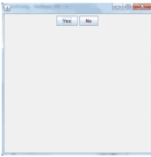

## JTextField

`JTextField` 用于获取单行文本输入。它是最广泛使用的文本组件。它有三个构造函数：

1. `JTextField(int cols)`
2. `JTextField(String str, int cols)`
3. `JTextField(String str)`

### 使用 JTextField 的示例

```java
import javax.swing.*;
import java.awt.*;
import java.awt.event.*;
public class MyTextField extends JFrame
{
    public MyTextField()
    {
      JTextField jtf = new JTextField(20); //创建 JTextField.
      add(jtf); //将 JTextField 添加到框架中.
      setLayout(new FlowLayout());
      setDefaultCloseOperation(JFrame.EXIT_ON_CLOSE);
      setSize(400, 400);
      setVisible(true);
    }

    public static void main(String[] args)
    {
        new MyTextField();
    }
}
```

## 186 Java 编程中的理论、实践与技巧


## JCheckBox

`JCheckBox` 类用于在框架中创建复选框。以下是 `JCheckBox` 的构造函数：

- `JCheckBox(String str)`

### 使用 JCheckBox 的示例

```java
import javax.swing.*;
import java.awt.event.*;
import java.awt.*;
public class Test extends JFrame
{
    public Test()
    {
        JCheckBox jcb = new JCheckBox("yes"); //创建 JCheckBox.
        add(jcb); //将 JCheckBox 添加到框架中.
        jcb = new JCheckBox("no"); //创建 JCheckBox.
        add(jcb);
        jcb = new JCheckBox("maybe"); //创建 JCheckBox.
        add(jcb);
        setLayout(new FlowLayout());
        setDefaultCloseOperation(JFrame.EXIT_ON_CLOSE);
        setSize(400, 400);
        setVisible(true);
    }
}
```

## Applet、AWT 和 Swing 编程 187

## JRadioButton

单选按钮是一组只有一个可以被选中的按钮。`JRadioButton` 类用于创建单选按钮。以下是 `JRadioButton` 的构造函数：

- `JRadioButton(String str)`

### 使用 JRadioButton 的示例

```java
import javax.swing.*;
import java.awt.event.*;
import java.awt.*;
public class Test extends JFrame
{
    public Test()
    {
        JRadioButton rb = new JRadioButton("A"); //创建 JRadioButton.
        add(rb);
        rb = new JRadioButton("B"); //创建 JRadioButton.
        add(rb);
        rb = new JRadioButton("C"); //创建 JRadioButton.
        add(rb);
        rb = new JRadioButton("none"); //创建 JRadioButton.
        add(rb);
        setLayout(new FlowLayout());
        setDefaultCloseOperation(JFrame.EXIT_ON_CLOSE);
        setSize(400, 400);
        setVisible(true);
    }
}
```

## 188 Java 编程中的理论、实践与技巧

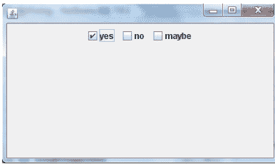

## JComboBox

组合框是文本字段和下拉列表的结合。`JComboBox` 组件用于在 Swing 中创建组合框。以下是 `JComboBox` 的构造函数：

- `JComboBox(String arr[])`

### 使用 JComboBox 的示例

```java
import javax.swing.*;
import java.awt.event.*;
import java.awt.*;
public class Test extends JFrame
{
    String name[] = {"Abhi","Adam","Alex","Ashkay"}; //名称数组
    public Test()
    {
        JComboBox jc = new JComboBox(name); //使用 name 初始化组合框.
        add(jc); //将 JComboBox 添加到框架中.
        setLayout(new FlowLayout());
        setDefaultCloseOperation(JFrame.EXIT_ON_CLOSE);
        setSize(400, 400);
        setVisible(true);
    }
}
```

## Applet、AWT 和 Swing 编程 189

```java
import javax.swing.*;
import java.awt.event.*;
import java.awt.*;
public class Test extends JFrame
{
    String name[] = {"Abhi","Adam","Alex","Ashkay"}; //名称数组
    public Test()
    {
        JComboBox jc = new JComboBox(name); //使用 name 初始化组合框.
        add(jc); //将 JComboBox 添加到框架中.
        setLayout(new FlowLayout());
        setDefaultCloseOperation(JFrame.EXIT_ON_CLOSE);
        setSize(400, 400);
        setVisible(true);
    }
}
```

## 190 Java 编程中的理论、实践与技巧

## Java 中的 AWT

**Abstract Window Toolkit** 支持 GUI Java 编程。它是一个用于独立应用程序和/或 applet 的移植 GUI 库。**Abstract Window Toolkit** 提供了你的应用程序与原生 GUI 之间的连接。**AWT** 为你的 Java 程序提供了高层次的抽象，因为它隐藏了你程序将运行的 GUI 的底层细节。

## Java 中制作 JTREE

树是一种呈现层次结构视图的组件。用户能够在此显示中展开或折叠子树。树在 Swing 中通过 `JTree` 类实现。尽管 `JTree` 存放在 `javax.swing.tree` 包中。这是因为支持 `JTree` 需要的类和接口非常多。

# 技术 15

# 在 Java 中创建 Swing GUI

为了在程序窗口上放置按钮、文本标签和其他组件，你需要了解 `JPanel`。它是一种组件容器，占据屏幕上的矩形区域，并以某种简单的方式显示排列好的组件。至于具体是如何排列的，取决于你为面板（panel）设置了哪种布局管理器（layout）。对于手动编程，你可能至少需要知道 `BorderLayout`（它将四个组件放置在四周，并将一个大组件放置在中间），然后是 `FlowLayout`（它将组件排列成任意的 *n × m* 表格）。还有更多布局，但其他的对初学者来说似乎太复杂了。核心思想是，“组件”不仅仅可以是按钮或复选框——它也可以是另一个 `JPanel`。通过将面板放入另一个面板中并为它们选择布局，你可以获得一个复杂的用户界面。

- 我们已经练习过这项技术
- 这项技术是否适用于我们的操作
- 我们过去练习过这个，现在需要快速上手
- 我们应该实现这项技术

# 总结

+ **Applet** 是一种特殊的程序，嵌入在网页中生成动态内容。它运行在浏览器内部，并在客户端工作。
+ 需要 **JVM** 来查看 applet。**JVM** 可以是 Web 浏览器的插件，也可以独立的运行时环境。
+ 基于 **AWT** 的 applet 通常会重写 `paint()` 方法，该方法由 **AWT Component** 类定义。当 applet 的输出必须重新部署时，会调用此方法。
+ `init()` 方法是第一个被调用的方法。你应该在这里初始化变量。该方法在 applet 运行期间只调用一次。
+ 每当基于 **AWT** 的 applet 输出需要重绘时，就会调用 `paint()` 方法。这种情况可能由于几个原因引起。例如，运行 applet 的窗口可能被另一个窗口覆盖然后重新显示。
+ `Applet.getParameter()` 方法根据参数名称获取参数（参数的值始终是一个字符串）。如果值是数字或其他非字符数据，必须对字符串进行解析。
+ **抽象窗口工具包 (AWT)** 是 Java 程序员使用的一组应用程序接口 (API)，用于创建图形用户界面 (GUI) 对象，例如按钮、滚动条和窗口。
+ 图形用户界面由称为“组件”的图形元素组成。典型的组件包括按钮、滚动条和文本字段等项目。
+ **AWT** 提供了基本的非容器组件类，可以据此构建用户界面。这九个类分别是 `Button`、`Canvas`、`Checkbox`、`Choice`、`Label`、`List`、`Scrollbar`、`TextArea` 和 `TextField`。
+ **Swing** 是为 Java 程序员提供的一组程序组件，提供了创建图形用户界面 (GUI) 组件的能力（如按钮和滚动条），这些组件独立于特定操作系统的窗口系统。

# 知识检查

+ 1. 哪个是不包含标题栏和菜单栏但包含按钮、文本字段等组件的容器？
  a. Window
  b. Frame
  c. Panel
  d. Container

+ 2. **AWT** 的缩写是什么？
  a. Applet Windowing Toolkit
  b. Abstract Windowing Toolkit
  c. Absolute Windowing Toolkit
  d. 以上都不是

+ 3. 在 graphics 类中用哪个方法将图形颜色设置为指定的颜色？
  a. public abstract void setColor(Font font)
  b. public abstract void setColor(Color c)
  c. public abstract void drawString(String str, int x, int y)
  d. 以上都不是

+ 4. **Java Foundation Classes (JFC)** 是一组简化桌面应用开发的 GUI 组件。
  a. 正确
  b. 错误

+ 5. 哪个方法只执行一次？
  a. `start()` 方法
  b. `init()` 方法
  c. `stop()` 方法
  d. `destroy()` 方法

# 复习题

+ 1. 描述 applet 的概述。
2. 讨论应用程序到 applet 的转换。
3. 定义 applet 中的事件处理方法。
4. 编写 applet 骨架。
5. 识别 **AWT**。
6. 什么是 swing 编程？

# 检查你的结果

1 (c) 2 (b) 3 (b) 4 (a) 5 (b)

# 参考文献

+ 1. http://www.webopedia.com/TERM/J/Java-applet.html
+ 2. https://docs.oracle.com/javavase/tutorial/deployment/


+ 3. http://www.readorfer.in/article/Two-Types-of-Applets_10623/
+ 4. http://www.readorfer.in/article/Applet-Basics-10624/
+ 5. http://www.readorfer.in/article/An-Applet-Skeleton-10626/
+ 6. http://www.studtonight.com/java/java-applet.php
+ 7. http://whatis.techarget.com/definition/Abstract-Window-Toolkit-AWT
+ 8. http://www.javaworld.com/article/2077188/core-java/introduction-to-the-awt.html
+ 9. http://whatis.techarget.com/definition/Swing
+ 10. http://www.studtonight.com/java/java-swing-components.php
+ 11. Kenai.com (2011) 最常见的问题，出现在所回顾的 applet 代码中。
+ 12. Josh Lowsensohn (2011) 最常见的问题，出现在所回顾的 applet 代码中。
+ 13. Torre, Mario (March 2012). “FINAL PROPOSAL: Portable GUI backends”。
+ 14. Elliott, Amy (May 2012). “Google wins Oracle’s patents”。
+ 15. Eisserer, Clemens (2012). “Mixing heavy and”。
+ 16. Kenanke, Roman (2011). “Cacio Architecture Overview”。
+ 17. S. Peter (2010). “Numeric Performance in C, C# and Java”。
+ 18. “Sid Stamm, Markus Jakobsson, Mona Gandhi (2006). A study in socially transmitted malware

[ 208]

# 6 面向对象编程

## 6.1 面向对象编程的概念

### 核心笔记

#### 概念

Java 中的 OOP 概念是 Java 面向对象编程的核心思想。它们是抽象、封装和多态。掌握它们是理解 Java 如何工作的关键。Java OOP 概念允许我们创建工作的方法和变量，然后在不损害安全的情况下重用它们的全部或部分内容。

#### 对象

对象是相关状态和行为的软件整体。软件对象通常用于模拟日常生活中遇到的真实对象。这些状态和行为表示在对象内部，引入了数据封装的概念，并解释了以这种方式设计软件的好处。

#### 类

类是创建对象的蓝图或原型。本节定义了一个模拟真实世界对象状态和行为的类。特意关注了基础知识，展示了即使是简单的类也可以清晰地建模状态和行为。

#### 学习目标

- 讨论抽象和封装
- 解释继承和多态

### 概念

Java 是一门面向对象的语言。那么，面向对象意味着什么呢？这意味着在 Java 中构建的任何类型的程序，都可以被以“对象”（`Objects`）的概念来构想。这一想法的一个很好的例子是查看程序的一些示例业务需求。假设我们被指派构建一个软件程序，用于跟踪一个真实的公共图书馆系统。该系统必须跟踪与图书馆相关的每个分支、分支中可能包含的所有材料，此外还有所有可能需要从图书馆分支借书的人员。

面向对象编程（`OOP`）是一种围绕“对象”而非“动作”进行组织，围绕“数据”而非“逻辑”进行构造的编程语言。从历史上看，程序被视为一个逻辑过程，它接收输入数据，对其进行处理并产生输出数据。

编程的挑战在于如何编写这些逻辑。

`OOP` 的第一步是识别程序员想要操作的所有对象以及它们之间的相互关系，这种练习通常被称为数据建模。一旦确定了对象，就会将其泛化为对象的类（`class`）（可以想象成柏拉图的“理想”椅子的概念，它代表了所有的椅子），该类定义了它包含的数据类型以及可以操作它的任何逻辑序列。每个不同的逻辑序列被称为方法（`method`）。对象通过称为消息的、良好定义的接口进行通信。

面向对象编程中使用的概念和规则提供了这些重要益处：

- 类概念允许定义数据对象的子类，这些子类共享主类的部分或全部特征。这种 `OOP` 的继承（`inheritance`）特性强制进行更彻底的数据分析，缩短开发时间，并确保代码更准确。
- 由于类只定义了它需要关注的数据，当运行该类的实例（对象）时，代码将无法意外访问其他程序数据。这种数据隐藏（`data hiding`）的特性提供了更高的安全性并避免了无意的数据损坏。
- 类的定义不仅可以被最初创建它的程序重用，也可以被面向对象的程序重用（因此，可以更容易地分发到网络中使用）。
- 数据类的概念允许程序员创建语言本身中尚未定义的任何新数据类型。

`Simula` 是第一种面向对象的编程语言。`Java`、`Python`、`C++`、`Basic .NET` 和 `Ruby` 是今天最流行的 `OOP` 语言。`Java` 编程语言专门设计用于企业网络和互联网上的分布式应用程序。`Ruby` 被用于许多 Web 应用程序。`Curl`、`Smalltalk`、`Delphi` 和 `Eiffel` 也是面向对象编程语言的示例。

## Java 中的 OOP 概念列表

Java 有四个主要的 `OOP` 概念。这些是：

- **抽象（`Abstraction`）**。抽象意味着使用简单的事物来表示复杂性。我们都知道如何打开电视，但我们不需要知道它是如何工作的就能享受它。在 Java 中，抽象意味着像对象、类和变量这样的简单事物代表更复杂的代码和数据。这很重要，因为避免了多次重复执行相同的工作。
- **封装（`Encapsulation`）**。这是将字段保持在类内部，并通过公共方法提供访问的实践。它是一道保护屏障，将数据和代码安全地保持在类内部。通过这种方式，我们可以重用对象作为代码组件或变量，而不会允许全范围内访问数据。
- **继承（`Inheritance`）**。这是 Java 面向对象编程的一个特殊特性。它允许程序员创建共享现有类某些属性的新类。这让我们能够在之前工作的基础上进行构建，而无需重新发明轮子。
- **多态（`Polymorphism`）**。这个 Java `OOP` 概念让同一个单词在不同的语境下具有不同的含义。Java 中多态的一种形式是方法重载（`method overloading`）。另一种形式是方法重写（`method overriding`）。另一种则是由提供的变量值所蕴含的不同含义。

## 面向对象编程的特性

面向对象编程使用对象，但并非所有声称支持 `OOP` 的语言都直接支持所有相关的技术和结构。


## Java 编程中的 200 理论、实践与技术

列出的特性在被认为是强类和面向对象的语言（或支持 `OOP` 的多范式语言）中是常见的，但提到了明显的例外。

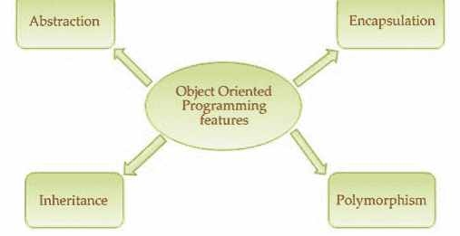

类是一个模板、蓝图或合同，定义对象的数据字段和方法。对象是类的实例。你可以为类创建许多实例。Java 类使用变量来定义数据字段，使用方法来定义动作。此外，类还提供了特殊类型的方法，称为构造函数（`constructors`），它们被调用以创建一个新对象。构造函数可以执行任何动作，但构造函数的设计是为了执行初始化动作，例如初始化对象的数据字段。

类中的构造函数是一种调用以创建对象的特殊类型子程序。它为新对象的使用做准备，通常接受构造函数用于设置所需成员变量的参数。

对象由属性和方法组成。属性是定义对象的特征；属性中包含的值将同类的对象区分开来。为了更好地理解这一点，让我们以 `Mobile`（手机）作为一个对象为例。`Mobile` 具有型号、制造商、成本、操作系统等特征。所以，如果我们创建了“三星”手机对象和“iPhone”手机对象，就可以根据特征区分它们。属性的值也被称为对象的状态。

`OOP` 有三个主要特征。

- 封装
- 继承
- 多态

## 封装

封装是一种将数据和代码绑定成单一单元的机制。它意味着为了安全而隐藏你的数据。这意味着什么？理解封装最好的方法是看胶囊的例子，在胶囊内部数据始终是安全的。同样，通过封装，类的方法和变量被良好地隐藏且安全。


我们可以通过以下方式在 Java 中实现封装：

- 将类的变量声明为私有。
- 提供公共 `setter` 和 `getter` 方法来修改和查看变量。

让我们通过下面的代码来理解封装：

```java
public class Employee {
    private String name;
    public String getName() {
        return name;
    }
    public void setName(String name) {
        this.name = name;
    }
    public static void main(String[] args) {
    }
}
```

让我们尝试理解上面的代码。我创建了一个带有私有变量的 `Employee` 类。我们创建了 `getter` 和 `setter` 方法，通过它们可以获取和设置姓名。通过这些方法，任何想要访问 `name` 变量的类都必须使用这些 `getter` 和 `setter` 方法。

## 202 理论、实践与技术

### 继承

面向程序的一个重要特性是继承——创建共享现有类属性和方法但具有更多特定特性的类。继承主要用于代码重用。因此你在使用被特定类扩展的对象类，并在此基础上扩展。这就是为什么我们讨论了代码重用的概念。通俗地用一句话定义，我们可以说从现有类派生出一个新类，它被称为继承。你可以查看以下示例以了解继承概念。在这里，`Mobile` 类被 `Android` 和 `Blackberry` 等其他特定类扩展了。

```java
package oopsconcept;
class Android extends Mobile {
    //构造函数用于设置对象的属性/特征
    Android(String man, String o, String m, int c){
        super(man, o, m, c);
    }
    //获取访问对象 Model 属性的方法
    public String getModel() {
        return "This is Android Mobile- " + model;
    }
}
```

```java
package oopsconcept;
class Blackberry extends Mobile {
    //构造函数用于设置对象的属性/特征
    Blackberry(String man, String o, String m, int c){
        super(man, o, m, c);
    }
    public String getModel() {
```

## 面向对象编程 203

```java
    }
}
```

在面向对象编程（`OOP`）中，计算机程序的设计方式使得一切事物都是相互相互作用的对象。继承是其中一种概念，一个类的属性可以被另一个类继承。它有助于代码的复用并在不同的类之间建立关系。

计算机程序是指令的集合，当被计算机执行时执行特定任务。

正如我们在图片中所看到的，儿子继承了父亲的属性。同样，在 Java 中，有两种类：

- 1. 父类（超类或基类）
- 2. 子类（子类或派生类）

继承属性的类被称为子类，而被继承属性的类被称为父类。


继承进一步分为 4 节点：

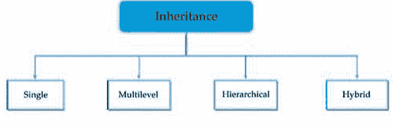

所以，让我们从第一种继承开始，即单继承：

# Java 编程中的理论、实践与技术

### 单继承

在单继承中，一个类继承另一个类的属性。它允许派生类从单个父类继承属性和行为。这反过来可以实现代码复用并为现有代码添加新功能。

这里，`Class A` 是你的父类，`Class B` 是你的子类，它继承了父类的属性和行为。

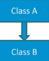

让我们看看单继承的语法：

```java
Class A
{
---
}
Class B extends A {
---
}
```

### 多级继承

当一个类派自于另一个同样派自于另一个类的类时，即：一个类拥有多个父类但处于不同层级，这种类型的继承被称为多级继承。

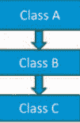

如果看流程图，类 `B` 继承了类 `A` 的属性和行为，类 `C` 继承了类 `B` 的属性。在这里，`A` 是 `B` 的父类，类 `B` 是 `C` 的父类。因此在这种情况下，类 `C` 隐式地继承了类 `A` 的属性和方法。这就是多级继承。

让我们看看 Java 中多级继承的语法：

```java
Class A{
---
}
Class B extends A{
---
}
Class C extends B{
---
}
```

### 层级继承

当一个类拥有多个子类（子类类），或者换句话说，多个子类具有同一个父类时，这种类型的继承被称为层级继承。

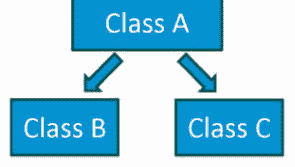

如果看流程图，`Class B` 和 `C` 是继承自父类（即 `Class A`）的子类。

让我们看看 Java 中层级继承的语法：

```java
Class A{
---
}
Class B extends A{
---
}
Class C extends A{}
```

## 206 Java 编程中的理论、实践与技术

### 混合继承

混合继承是多继承和多级继承的结合。由于 Java 不支持多继承（因为它会导致歧义），所以这种类型的继承只能通过使用接口（`interfaces`）来实现。

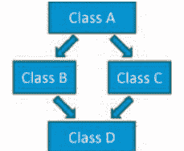

如果看流程图，类 `A` 是 `B` 和 `C` 的父类，而 `Class B` 和 `C` 是 `D` 的父类，`D` 是 `B` 和 `C` 的唯一子类。

现在我们已经学习了继承及其不同类型。让我们切换到另一个面向对象编程概念，即封装。

### 多态

在 Java 核心中，多态是最易于理解的概念之一。多态的定义是 `Poly` 意味着“多”，`morphos` 意味着“形式”。它描述了语言的一种特性，允许根据语境在不同情况下正确解释相同的单词或符号。Java 中有两种类型的多态。例如，在英语中，动词“run”如果你与“一段视频”、“一个生意”或“一台计算机”一起使用，它的含义是不同的。你根据与其一起使用的其他单词来理解“run”的含义。面向对象的程序编写使得具有相同名称的方法在不同语境下运行不同。Java 提供了两种实现多态的方法。

### 静态多态（编译时多态/方法重载）

通过改变与方法名一起使用的参数来执行不同的方法实现的能力被称为方法重载。在下面的程序中，我们有三个 `print` 方法，每个方法都有不同的参数。当你正确重载方法时，你可以提供不同的参数列表来调用它，并执行方法的相应版本。

## 面向对象编程 207

```java
package oopsconcept;
class Oversample {
  void print(String s) {
    System.out.println("First Method with " + s);
  }
  void print(int i) {
    System.out.println("Second Method with " + i);
  }
  void print(String s, int i) {
    System.out.println("Third Method with " + s + " " + i);
  }
}
public class Polymorphism {
  public static void main(String[] args) {
    Oversample oversample = new Oversample();
    oversample.print("Amit");
    oversample.print(10);
    oversample.print("Amit", 10);
  }
}
```

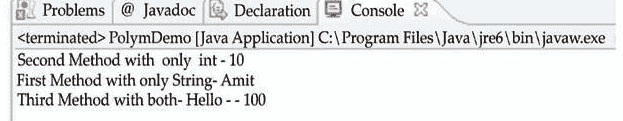

### 动态多态（运行时多态/方法重写）

当你创建一个父类的子类时，子类继承了父类的所有方法。然而，有时子类需要为父类中定义的方法提供它自己的实现。这被称为方法重写。子类中的方法必须与父类方法具有相同的名称、返回类型和参数列表。

## 208 Java 编程中的理论、实践与技术

当你创建一个父类的子类时，子类继承了父类的所有方法。然而，有时子类需要为父类中定义的方法提供它自己的实现。这被称为方法重写。子类中的方法必须与父类方法具有相同的名称、返回类型。让我们看看方法重写的示例。


```java
package oopsconcept;
class ParentClass {
  void stop() {
    System.out.println("Stopping Vehicle");
  }
}
class Mobile extends ParentClass {
  @Override
  void stop() {
    System.out.println("Stopping Mobile");
  }
}
class Android extends ParentClass {
  @Override
  void stop() {
    System.out.println("Stopping Android");
  }
}
public class Overriding {
  public static void main(String[] args) {
    ParentClass m = new Mobile();
    m.stop();
    ParentClass a = new Android();
    a.stop();
  }
}
```


# 抽象

所有的编程语言都提供抽象。可以认为，解决问题的复杂性与你使用的抽象直接相关。在面向对象编程中，管理复杂性的强大方法是层级分类。这允许你对系统进行分层。从外部看，汽车是一个单一对象。一旦你看到汽车由几个子系统组成：转向、刹车、音响系统、安全带、加热、手机等。在这里，每个子系统都由专用单元组成。例如，音响系统由收音机、CD 器和磁带器组成。关键在于通过抽象来管理汽车（或任何系统）。

抽象类是不完整的，你不能创建抽象类的实例。如果你想使用它，需要通过扩展它使其完整或具体。如果一个类不包含抽象方法并实现了从抽象类或接口继承的所有抽象方法，它可以是具体的。此外，Java 有抽象类、抽象方法的概念，但变量不能是抽象。

让我们以 Java 抽象类 `Vehicle` 为例。当我创建一个名为 `Vehicle` 的类时，我知道应该有 `start()` 和 `stop()` 方法，但不知道每个车辆的启动停止机制，因为它们可能有不同的启动机制，例如有些可以通过踢启动，有些可以通过按钮启动。抽象的优点是，如果引入了新型车辆，我们可能只需要添加一个继承 `Vehicle` 抽象类的并实现特定方法。`start` 和 `stop` 方法的接口应该是

```java
package oopsconcept;
abstract class VehicleAbstract {
  abstract void start();
  abstract void stop();
  void stop() {
    System.out.println("Stopping Vehicle in abstract class");
  }
}
class TwoWheeler extends VehicleAbstract {
  void start() {
    System.out.println("Starting Two Wheeler");
  }
}
```

## 210 Java 编程中的理论、实践与技巧

```java
12. w }
```

```java
13. }
```

```java
14. class FourWheeler extends VehicleAbstract{
```

```java
15. @Override
```

```java
16. public void start() {
```

```java
17. System.out.println("Starting Four Wheeler");
```

```java
18. }
```

```java
19. }
```

```java
1. package oopsconcept;
```

```java
2. public class VehicleTesting[] {
```

```java
3. public static void main(String[] args) {
```

```java
4. VehicleAbstract my2Wheeler = new TwoWheeler();
```

```java
5. VehicleAbstract my4Wheeler = new FourWheeler();
```

```java
6. my2Wheeler.start();
```

```java
7. my2Wheeler.stop();
```

```java
8. my4Wheeler.start();
```

```java
9. my4Wheeler.stop();
```

```java
10. }
```

```java
11. }
```

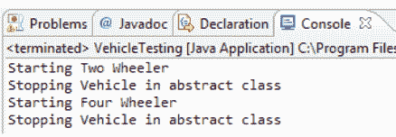

## 6.2 面向对象系统的类基本属性

### 核心笔记

### 定义

在面向对象编程中，类是用于创建对象的可扩展代码模板，为状态提供初始值并为行为提供实现。在许多语言中，类名被用作类的名称，用作该类默认构造函数的名称，并作为实例化该类时生成的对象的类型；这些不同的概念很容易被混淆。

### 继承

继承为组织和结构化软件提供了一种强大且自然的机制。本节解释了类如何从其超类继承状态和行为，并解释了如何使用 Java 编程语言提供的简单语法从一个类派生另一个类。

### 接口

接口是类与外部世界之间的合约。当一个类实现接口时，它承诺提供该接口发布的行为。本节定义了一个简单的接口，并解释了任何实现该接口的类所必须的更改。

### 包

包是用于以逻辑方式组织类和接口的命名空间。将代码放在包中使得大型软件项目更易管理。本节解释了为什么这样做是有用的，并向你介绍 Java 平台提供的应用程序编程接口 (API)。

### 学习目标

- 学习对象和对象引用
- 重点学习声明一个引用对象的变量
- 定义修饰符、嵌套方法
- 解释内部类和匿名类

### 定义

如果你以前从未用过面向对象的编程语言，那么在开始编写任何代码之前，你需要学习一些基本概念。这将向你介绍对象、类、继承、接口和包。

## 212 Java 编程中的理论、实践与技巧

每个讨论都重点关注这些概念如何与现实世界相关，同时对 Java 编程语言的语法进行介绍。

由于 Java 是面向对象的语言，整个 Java 语言都是构建在类和对象之上的。Java 也被称为强面向对象语言 (OOPS)。

算法是待执行的自包含动作序列。算法可以执行计算、数据处理和自动化推理任务。

OOPS 是一种编程方法，通过基于现实世界的算法来解决问题。它使用现实世界的方法来解决问题。面向对象的技术比 C、ALGOL 和 PASCAL 等过程化编程模型提供了更好、更简单的程序编写方式。

有了你现在掌握的 Java 编程语言基础知识，你就可以学习编写自己的类。你将找到关于定义自己的类的信息，包括声明成员变量、方法和构造函数。

### 类

在 Java 中，一切都封装在类中。类是 Java 语言的核心。类可以被定义为一种模板/蓝图，描述特定实体的行为/状态。类定义了新的数据类型。一旦定义，这种新类型就可以用于创建该类型的对象。对象是类的实例。你也可以将其称为逻辑模板类的物理存在。

类使用 `class` 关键字声明。类包含数据以及对这些数据进行操作的代码。在类内部定义的数据或变量被称为实例变量，而操作这些数据的代码被称为方法。因此，实例变量和方法被称为类成员。类也被称为用户定义的数据类型。

类和对象之间的关系可以如下：考虑将冰格盒（如立方体形状）作为一个类。那么，冰块就可以被视为对象，它们是该类的蓝图，即冰格盒。

## Java 类的规则

- 类只能有 `public` 或默认（无修饰符）访问修饰符。
- 它可以是抽象的 (`abstract`)、最后的 (`final`) 或具体的 (普通类)。
- 它必须有 `class` 关键字，并且 `class` 后面必须跟着合法的标识符。
- 它可以扩展一个父类。默认情况下，它将继承 `java.lang.Object`。
- 它可以实现任意数量的逗号分隔的接口。
- 类变量和方法声明在大括号 `{}` 中。
- 每个 Java 源文件只能包含一个 `public` 类。源文件可以包含任意数量的默认可见类。
- 最后，源文件名必须匹配。

```java
class Student {
    String name;
    int roll;
    int age;
}
```

假设你声明了 `originOne`，在实际创建并赋值给它之前，它的值是不确定的。仅仅声明引用变量不会创建对象。对于这一点，你需要像下一节描述的那样使用 `new` 运算符。

```java
Point originOne = new Point();
```

## 214 Java 编程中的理论、实践与技巧

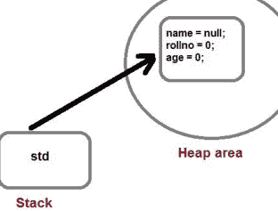

在上述语句之后，`std` 是类的实例。`new` 运算符为对象分配内存。

### 对象和对象引用

具有状态和行为的实体被称为对象，例如椅子、自行车、标记、桌子等。它可以是物理的或无形的。银行系统的示例。

对象具有三个特征：

- 状态：代表对象的数据（值）。
- 行为：代表对象的功能，如存款、取款。
- 身份：对象身份对外部用户可见。但 JVM 在内部用于唯一标识它。

例如：笔是一个对象。名字是 Reynolds，颜色是白色等，被称为它的状态。因此书写是它的行为。

对象是类的实例。类是创建对象的模板或蓝图。因此对象是类的实例。

对象的定义：

- 对象是现实世界的实体。
- 对象是运行时实体。
- 对象是具有状态和行为的实体。
- 对象是类的实例。

## 声明一个引用对象的变量

之前，你学习过要声明一个变量，写：

`type name;`

这通知编译器你将使用 `name` 来引用类型为 `type` 的数据。对于原始变量，此声明为变量预留适当的内存。

你也可以单独一行声明引用变量。例如：

`Point originOne;`

如果你这样声明 `originOne`，在实际创建并赋值给它之前，它的值是不确定的。处于这种状态且未引用任何对象的变量如下所示：

## 对象生存时间和垃圾回收

对象的生存时间（生命周期）是从对象创建到销毁之间的时间。对象生存的规则在不同语言之间差异巨大，在某些情况下，给定语言的不同实现之间也不同，特定对象的寿命在程序的每次运行中可能会不同。

# Java 编程中的理论、实践与技术

垃圾回收是自动内存管理的形式。垃圾回收器（或简称收集器）尝试回收垃圾，即程序不再使用的对象所占用的内存。

在许多情况下——在许多面向对象语言（OOLs）的默认情况下，特别是那些使用垃圾回收（GC）的语言——对象分配在堆上，对象的生命周期并不取决于给定变量的生命周期：持有对象的变量值实际上对应于对象的引用，而不是对象本身，变量的销只是销除了引用，而不是底层对象。

与某些面向对象的语言不同，Java 不支持显式的析构方法来从内存中删除对象。

- 相，未使用的对象通过称为垃圾回收的过程被删除。

JVM 会定期运行垃圾回收。垃圾回收：

- 识别不再使用的对象（无引用）
- 完成这些对象（析构它们）
- 释放销毁对象使用的内存
- 产生内存碎片

垃圾回收会引入开销，并对 Java 程序的性能产生重大影响。

- 目标是避免 GC 运行频率和时长。
- 在程序中，尽量避免不必要的对象创建和删除。
- 大多数 JVM 都有影响 GC 性能的调参数。

## 垃圾回收的优点：

- 将程序员从管理内存中解放出来。手动识别未使用的对象（如 C++ 等语言中）并不是一项简单的任务，特别是当程序变得复杂，导致对象销毁和内存释放的责任变得模糊时。
- 确保程序的完整性：
- 防止内存泄漏——每个对象在不再使用时就会被追踪并处理。
- 防止释放仍在使用或已准备好的对象。在 Java 中，无法显式地分配一个对象或一个已经释放的对象。在 C++ 等语言中，解引用空指针或双重释放对象通常会导致程序崩溃。

通过 Java 命令行切换器（`java -X`），你可以：

- 设置最小内存量（例如 `-XXmn`）
- 设置最大内存量（例如 `-Xmx`, `-Xss`）
- 调整 GC 和内存完整性（例如 `-XX:+UseParallelGC`）

## 创建和操作对象

正如之前提到的，类为对象提供了蓝图。因此，对象是从类创建的。在 Java 中，使用 `new` 关键字来创建新对象。

从类创建对象有三个步骤——

- 声明 – 一个带有变量名和对象类型的变量声明。
- 实例化 – 使用 `new` 关键字来创建对象。
- 初始化 – `new` 关键字后跟着对构造函数的调用。该调用初始化了新对象。

以下是创建对象的示例——

示例

```java
public class Puppy {
    public Puppy(String name) {
        // 这个构造函数有一个参数，name。
        System.out.println("Passed Name is :" + name);
    }

    public static void main(String []args) {
        // 下述语句将创建一个对象 myPuppy
        Puppy myPuppy = new Puppy("tommy");
    }
}
```

如果我们编译并运行上述程序，它将产生以下结果

输出

Passed Name is: tommy

## 构造函数和初始化代码块

在讨论类时，最重要的子主题之一就是构造函数。每个类都有一个构造函数。如果我们没有显式地为类编写构造函数，Java 编译器会为该类构建一个默认构造函数。

每当创建一个新对象时，至少会调用一次构造函数。构造函数的主要规则是它们的名称必须与类名相同。一个类可以有多个构造函数。

以下是一个构造函数的示例——

示例

```java
public class Puppy {
    public Puppy() {
    }

    public Puppy(String name) {
        // 这个构造函数有一个参数，name。
    }
}
```

Java 还支持单例类（Singleton Classes），你可以为类创建一个实例。

## 初始化字段

如你所见，你通常可以在声明中为字段提供初始值：

```java
public class BedAndBreakfast {
    // 初始化为 10
    public static int capacity = 10;

    // 初始化为 false
    private boolean full = false;
}
```

当初始化值可用且可以放在同一行时，这种形式运行良好。然而，这种初始化形式由于其简单性具有局限性。如果初始化需要某些逻辑（例如错误处理或用于填充复杂数组的循环），简单的赋值是不够的。实例变量可以在构造函数中初始化，其中可以使用错误处理或其他逻辑。为了给类变量提供相同的能力，Java 编程语言包含了静态初始化块。

## 静态初始化块

静态初始化块是包含在大括号 `{ }` 内的普通代码块，并以 `static` 关键字前置。这里有一个示例：

```java
static {
    // 初始化所需的任何代码都放在这里
}
```

一个类可以有任意数量的静态初始化块，它们可以出现在类的任何地方。运行时系统保证静态初始化块按照它们在源代码中声明的顺序被调用。静态块有一个替代方案——你可以写一个私有静态方法。

## 初始化成员

通常，你会在构造函数中放置初始化实例变量的代码。使用构造函数有两种替代方案：初始化块和终极方法（final methods）。

初始化块看起来和静态块一样，但没有 `static` 关键字：

```java
{
    // 初始化所需的任何代码都放在这里
}
```

Java 编译器会将初始化块拷贝到每个构造函数中。因此，如果子类可能想要重用，可以使用这种方法。这里有一个使用最终方法的示例：

```java
class Whatever {
    private final int myVar = initializeVariable();

    private int initializeVariable() {
        // 初始化代码放在这里
    }
}
```

该方法是 `final` 的，因为它不能被重写。

## 访问控制

Java 提供了许多访问修饰符来为类、变量和构造函数设置访问级别。四个访问级别是

- 对包可见，这是默认值。不需要修饰符。
- 仅对类可见（`private`）。
- 对全世界可见（`public`）。
- 对包和所有子类可见（`protected`）。

类可以用 `public` 修饰符声明，在这种情况下，类对所有地方的所有类都可见。如果一个类没有修饰符（默认值，也称为包私有/package-private），它只在自己的包内可见（包是相关类的组）。

在成员级别，你也可以像顶层类一样使用 `public` 修饰符或不使用修饰符（包私有），其含义相同。对于成员，访问层级修饰符决定了其他类是否可以使用特定的字段或调用特定的方法。访问控制有两个层级：

- 在顶层级别——`public` 或包私有（无修饰符）。
- 在成员级别——`public`、`protected` 或包私有（无修饰符）。

下表显示了修饰符允许的成员访问权限。

| 修饰符 | 类 | 包 | 子类 | 世界 |
| --- | --- | --- | --- | --- |
| public | Y | Y | Y | Y |
| protected | Y | Y | Y | N |
| no modifier | Y | Y | N | N |
| private | Y | N | N | N |

第一个数据列表示类本身是否有权访问访问级别定义的成员。如你所见，类总是可以访问它自己的成员。第二列表示包中的


包作为类（无论其父类是什么）都可以访问该成员。第三列表示在该包之外声明的类的子类是否可以访问该成员。第四列表示所有类是否都可以访问该成员。

访问级别对你产生两个方面：首先，当你使用来自其他来源的类（例如 Java 平台中的类）时，访问级别决定了你可以使用这些类的哪些成员。其次，当你编写类时，你需要决定类中的每个成员变量和每个方法应该具有什么访问级别。

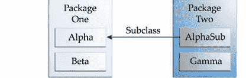

让我们来看一组类，看看访问级别如何影响可见性。下图显示了此示例中的四个类以及它们之间的关系。

下表显示了对于应用于 `Alpha` 类的每个访问修饰符，其成员在什么地方是可见的。

| 修饰符 | Alpha | Beta | Alphasub | Gamma |
|---|---|---|---|---|
| public | Y | Y | Y | Y |
| protected | Y | Y | Y | N |
| no modifier | Y | Y | N | N |
| private | Y | N | N | N |

如果其他程序员使用你的类，你希望确保不会发生误用导致的错误。访问级别可以帮助你做到这一点。

- 对特定成员使用合理的最限制性访问级别。除非你有充分理由不这样做，否则请使用 `private`。
- 常量外，避免使用 `public` 字段。（教程中的许多示例使用了 `public` 字段。这可能有助于简洁地说明某些点，但不建议在生产代码中使用。）`public` 字段往往会将你与特定的实现绑定，并限制你更改代码的灵活性。

# 修饰符、方法、嵌套

## 作为修饰符的一个示例

```java
time.second += secs;

if (time.second >= 60.0) {
    time.second -= 60.0;
    time.minute += 1;
}
if (time.minute >= 60) {
    time.minute -= 60;
    time.hour += 1;
}
```

第一行执行基本操作；其余部分处理我们之前看到的相同情况。

这个方法正确吗？如果参数 `secs` 远大于 60 会怎样？在这种情况下，只减去一次 60 是不够的；我们必须一直减，直到秒小于 60。我们可以通过简单将 `if` 语句替换为 `while` 语句来实现：

```java
public static void increment(Time time, double secs) {
    time.second += secs;

    while (time.second >= 60.0) {
        time.second -= 60.0;
        time.minute += 1;
    }
    while (time.minute >= 60) {
        time.minute -= 60;
        time.hour += 1;
    }
}
```


这个解决方案是正确的，但效率并不高。你想出一个不需要迭代的解决方案吗？

## 方法

偶尔，你会看到像 `addTime` 这样的方法使用不同的接口（不同的参数和返回值）编写。我们不需要在每次调用 `addTime` 时都创建一个新对象，而是要求调用者提供一个“空”对象，让 `addTime` 存储结果。将以下内容与你之前的版本进行比较：

```java
public static void addTimeFill(Time t1, Time t2, Time sum) {
    sum.hour = t1.hour + t2.hour;
    sum.minute = t1.minute + t2.minute;
    sum.second = t1.second + t2.second;

    if (sum.second >= 60.0) {
        sum.second -= 60.0;
        sum.minute += 1;
    }
    if (sum.minute >= 60) {
        sum.minute -= 60;
        sum.hour += 1;
    }
}
```

这种方法的优点是，调用者可以选择重复使用同一个对象来执行一系列加法。这可以稍微高效，尽管它可能足够复杂而导致细微的错误。对于大多数编程工作，花费一点运行时间来避免大量的调试时间是值得的。

## 嵌套类

在另一个类内部定义的类被称为嵌套类。嵌套类的作用域受限于其外部类的作用域。

语法：

```java
class Outer {
    // Outer 类成员

    class Inner {
        // Inner 类成员
    }
} // Outer 类的结束
```

### 嵌套类的优点

1. 它是逻辑上对仅在一个地方使用的类进行分组的方法。
2. 它增加了封装性。
3. 它可以产生更具读性和易于维护的代码。

如果你想创建一个仅供外部类使用的类，那么没有必要为它创建一个单独的文件。相反，你可以将其作为“内部类”添加进来。

嵌套类分为两种类型——

- 非静态嵌套类——这些是类的非静态成员。
- 静态嵌套类——这些是类的静态成员。

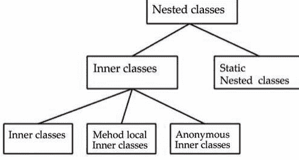

### 内部类（非静态嵌套类）

内部类是 Java 中的一种安全机制。我们知道类不能与 `private` 访问修饰符关联，但如果我们把类作为另一个类的成员，那么内部类就可以设为 `private`。这也被用于访问类的私有成员。

```java
public class My_class {
    public static void main(String args[]) {
        // 实例化外部类
        Outer_Demo outer = new Outer_Demo();

        // 访问 display_Inner() 方法。
        outer.display_Inner();
    }
}
```

如果你观察到 `Outer_Demo` 是外部类，`Inner_Demo` 是内部类，`display_Inner()` 是我们在其中实例化内部类的方法，并且该方法被该方法调用。如果你编译并执行上述程序，你将得到如下输出：

> 这是一个内部类

### 匿名内部类

没有名称声明的内部类被称为匿名内部类。在匿名内部类的情况下，我们被同时实例化它们。通常，每当你需要重写类或接口时使用它们。

语法：

```java
AnonymousInner inner = new AnonymousInner() {
    ...
};
```

下面的程序显示了如何重写类。

#### 示例

```java
abstract class AnonymousInner {
    public abstract void mymethod();
}

public class Outer_class {
    public static void main(String args[]) {
        AnonymousInner inner = new AnonymousInner() {
            public void mymethod() {
                System.out.println("这是一个匿名内部类的示例");
            }
        };
        inner.mymethod();
    }
}
```

## 抽象是如何工作的

抽象作为 Java 的 OOP 概念，让程序员创建有用的、可重用的工具。例如，程序员可以创建不同类型的对象。这些可以是变量、函数或数据结构。程序员还可以创建不同的类。这些是定义对象的方法。

例如，一个变量类可能是地址。该类可以指定每个地址对象具有名称、街道、城市和邮政编码。在这种情况下，对象可能是员工地址、客户地址或供应商地址。

## 封装是如何工作的

封装让我们能够重用功能而不危及安全。它是 Java 中一个强大的 OOP 概念，因为它帮助我们节省了大量时间。例如，我们可能会创建一段从数据库调用特定数据的代码。在其他数据库或过程中重用这段代码可能是很有用的。封装让我们在这样做的同时保持我们原始数据的私有性。它还让我们能够修改原始代码，而不会破坏那些已经采用它的人。

## 继承是如何工作的

继承是另一个节省工作的 Java OOP 概念。它让新类采用另一个类的属性。我们把继承的类称为子类或子类。原始类通常被称为父类。我们使用 `extends` 关键字来定义从旧类继承属性的新类。

## 总结

- 面向对象编程（OOP）是一种围绕“对象”而非“动作”、围绕“数据”而非“逻辑”组织的编程语言模型。
- 面向对象编程使用对象，但并非所有声明支持 OOP 的语言都直接支持所有相关的技术和结构。
- 封装是一种机制，你将数据和代码绑定成单个单元。它也意味着隐藏你的数据以使其免受任何修改的影响。
- 面向对象程序的一个重要特性是继承——能够创建共享现有类属性和方法的类，并具有更具体的特性的。继承主要用于代码重用。
- 混合继承是多重继承和多级继承的结合。由于 Java 不支持多重继承（因为它会导致歧义），因此这种继承只能通过使用接口来实现。
- Java 多态是易于理解的概念之一。多态的定义是 Poly 意为“多”，morphos 意为“形式”。它描述了语言的一种特性，允许同一个单词或符号根据上下文在不同情况下被正确地解释。
- 所有的编程语言都提供抽象。可以认为，你能够解决问题的复杂程度与抽象的类型和质量直接相关。面向编程的一个核心元素是抽象。
- OOP 是一种通过基于真实世界的算法提供解决方案的编程方法。它利用真实世界来解决问题。
- 每当创建一个新对象时，至少会调用一个构造函数。构造函数的主要规则是它们的名称必须与类相同。
- 创建内部类非常简单。你只需要在类内部编写一个类。与类不同，内部类可以是私有的，一旦你将内部类声明为私有，就无法从类外部的对象访问它。

## 知识检查

1. 下列哪项是“数据抽象”的功能？
   a. 降低复杂度
   b. 将代码和数据绑定
   c. 并行性
   d. 以上均不是

2. 面向对象语言提供以下哪种机制来实现对象模型？
   a. 封装
   b. 继承
   c. 多态
   d. 以上所有

3. 下列哪项是“封装”的功能？
   a. 将代码和数据绑定
   b. 为通用类别的动作使用单一接口
   c. 降低复杂度
   d. 以上所有

4. 什么是“封装的基础”？
   a. 对象
   b. 类
   c. 方法
   d. 以上所有

5. 类将如何保护其内部的代码？
   a. 使用访问修饰符
   b. 抽象
   c. 使用继承
   d. 以上所有

## 复习题

1. 讨论面向对象编程的特性。
2. 对象的生命周期和垃圾回收。
3. 如何创建和操作对象？
4. 什么是构造函数？请用示例说明。
5. 如何解释初始化代码块？
6. 讨论访问控制修饰符。
7. 用示例说明内部类和匿名类。

## 检查结果

1. (a) 2. (d) 3. (a) 4. (d) 5. (a)

## 参考文献

1. https://www.javatpoint.com/java-oops-concepts
2. https://docs.oracle.com/javase/tutorial/java/concepts/
3. http://www.w3resource.com/java-tutorial/java-object-oriented-programming.php
4. https://howtoprogramwithwithjava.com/object-oriented-programming-java-tutorial/
5. http://beginnersbook.com/2013/04/oops-concepts/
6. http://www.beginnersbook.com/2013/05/method-overloading/
7. https://www.tutorialspoint.com/java/java_overview.htm
8. http://microservices.techtarget.com/definition/object-oriented-programming
9. http://www.cs.usf.edu/~partt/java/
10. http://www.stackify.com/oops-concepts-in-java/
11. http://duytan.edu/upload/ebooks/
12. https://doc.lagout.org/programming/Java/Addison.Wesley.The.Essence.of.Oriented.Programming.with.Java.UML.pdf
13. http://uofk.edu/multisites/C._Thomas_Wu_An_Introduction_to_Objected_Book.
14. http://www.oopweb.com/Java/Documents/chap9/
15. https://www.tutorialspoint.com/java/java_innerclasses.htm

# 编程中的包

## 7.1 包的基础

### 核心要点

#### 定义

包（package）是一个用于组织一组相关类和接口的命名空间。从概念上说，你可以将包想象成计算机上不同的文件夹。你可能将页面放在一个文件夹中，将图片放在另一个文件夹中，再是另一个一个。

#### 创建包

要创建一个包，你需要为包选择一个名称，并在包含你想要包含在包中的类型（类、接口、枚举和注解）的源文件顶部写上该名称的包语句（package statement）。

#### 使用包

包是相关类的集合。它帮助你将类组织到文件夹结构中，并使其易于定位和使用它们。更重要的是，它有助于易用性。Java 中的每个包都有唯一的名称。

#### 学习目标

- 声明包
- 编译包
- 导入包

### 示例代码

```java
package com.javee.example;

public class HelloWorld {
    public static void main(String[] args) {
        System.out.println("Hello World");
    }
}
```

将此类保存为 `HelloWorld.java`。

你可以使用 `javac` 命令编译它：

```bash
javac HelloWorld.java
```

如果编译成功，你应该能看到 `HelloWorld.class`。编译完成后，你需要执行 `.class` 文件。你需要将类文件放在与包定义对应的文件夹结构中。如果包定义是 `package com.javee.example`，那么文件夹结构就是 `com\javee\example`。

首先，创建（或决定）一个运行 `java` 命令的根目录。在该目录下我们将创建 `com\javee\example` 文件夹并放置 `HelloWorld.java`。现在进入该目录的命令行并运行以下命令：

命令行（Command Prompt）是操作系统或程序的文本用户界面的输入字段。提示（prompt）在此语境下是指旨在触发动作的内容。命令行提示由简短文本加闪烁的光标组成，这是用户输入命令的地方。

```bash
java com.javee.example.HelloWorld
```

你应该看到输出为 "Hello World"。

### 包的作用

Java 使用包是为了防止命名冲突、控制访问、便于搜索/日志以及类、接口、枚举和注解的使用等。包可以被定义为相关类型类、接口、枚举和注解的组合，提供访问保护和命名空间管理。

Java 中的一些现有包：

```
java.lang - 封装了基础类
java.io - 封装在该包中的输入输出功能类
```

程序员可以定义自己的包来封装一组类/接口等。一种良好的做法是将你实现的相关类组合在一起，这样程序员就可以很容易判断哪些类、接口、枚举、注解是相关的。由于包创建了新的命名空间，因此不会与其他包中的名称发生命名冲突。使用包，更容易提供访问控制，也更容易定位相关类。

### 创建包

Java 中使用包是为了防止命名冲突、控制访问、便于搜索/日志以及类、接口、枚举和注解的使用等。包可以被定义为相关类型类、接口、枚举和注解的分组。


# Java 包详解

## 包的基本概念

你想要包含在包中的类型。包语句（`package statement`）应该是源文件的第一行。每个源文件中只能有一个包语句，并且它适用于文件中的所有类型。如果不使用包语句，则类、接口、枚举和注解类型将被放置在当前的默认包中。要编译带有包语句的 Java 程序，你必须使用如文所示的 `-d Destination_folder file_name.java` 命令。

```bash
javac -d Destination_folder file_name.java
```

然后，在指定的目标位置会创建一个与给定包名同名的文件夹，编译后的类文件将存放在该文件夹中。

### 示例：创建 `birds` 包

让我们来看创建一个名为 `birds` 的包的示例。使用小写字母作为包名是一个良好的习惯，可以避免与类、接口名称发生冲突。下面提供的包包含一个名为 `animals` 的接口：

```java
/* 文件名: Birds.java */

package birds;

interface Birds {
    public void eat();
    public void travel();
}
```

现在，让我们在同一个包 `birds` 中实现上述接口：

```java
/* 文件名: GreenbirdsInt.java */

package birds;

public class GreenbirdsInt implements Bird {

    public void eat() {
        System.out.println("Greenbird eats");
    }

    public void travel() {
        System.out.println("Greenbird travels");
    }

    public int noOfLegs() {
        return 0;
    }

    public static void main(String args[]) {
        GreenBirdsInt m = new GreenBirdsInt();
        m.eat();
        m.travel();
    }
}
```

现在按照如下所示编译 Java 文件：

```bash
$ javac -d . Bird.java
$ javac -d . MammalInt.java
```

现在，当前目录下会创建一个名为 `birds` 的包/文件夹，并且这些类文件将存放在其中。

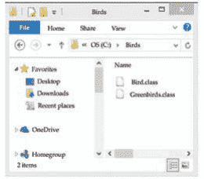

你可以执行带包的类文件并获得如下所示的结果：

```bash
$ java birds.GreenbirdsInt
```

```
Greenbird eats
Greenbird travels
```

创建一个 Java 包相对简单，但对于以前没有做过的人来说可能显得有些困惑。包的存在有两个基本要求：

- 包必须包含一个或多个类或接口。这意味着包不能是空的。
- 包中的类或接口其源文件在目录结构中的存放位置必须与包名一致。

## 命名包

由于包用于创建命名空间以防止名称冲突问题，命名空间必须是唯一的。这意味着包名必须是唯一的。因此，包命名是创建包时一个非常重要的方面。通常，参与软件开发的组织会使用其组织的域名，因为根据定义，域名是唯一的。域名被反转以便于阅读。你可以通过查看 Apache 软件基金会的源代码找到很好的例子，它的域名是 `www.apache.org`。每个代码都被放置在以 `org.apache` 开头的包中。由于 Apache 软件基金会有许多子项目，每个项目都有自己的网络地址，因此包名中也使用了该项目名称。Ant 项目可以在 http://ant.apache.org 找到，这并不意外，它们的代码确实位于包名以 `org.apache` 开头的包中。

在命名你的包时，你应该使用反转后的域名（如果有的话），并在其后加上包名。这将确保你的组织在处理两个具有完全相同名称的项目时不会冲突。例如：`com.mycompany.myproject`。有些公司为了简洁，决定从包名中舍弃顶层域名（com, org, net, ...），即 `mycompany.myproject`。这仍然完全可以接受。

## 声明包成员

创建包时的首要工作是决定哪些类和接口应该属于它。一旦你做了决定，你需要在作为包一部分的每个类和接口的源文件中添加包声明来指定这一点。声明非常简单，你使用 `package` 关键字后跟包名。此声明紧贴源文件的顶部，位于任何 `import` 语句之前。

```java
/* 文件注释... */

package com.mycompany.myproject;

import java.util.*;

class MyClass {
}
```

## 源文件与类文件的组织

包的要求之一是源文件应该包含在类似于包名的目录结构中。这简单来说就是创建一组与包中给名称同名的目录。取包名并根据点（`.`）出现的位置进行分割，例如，`com.mycompany.myproject` 可以很容易拆分为三个组件，命名为：`com`、`mycompany` 和 `myproject`。这些将是你创建的三个目录。第一个目录是 `com` 目录，在该目录内你创建一个名为 `mycompany` 的子目录，在该目录内再创建一个子目录，即 `myproject` 目录。最后，所有属于包的源文件都将进入 `myproject` 目录。

在许多 Java 项目中，通常的做法是源代码进入一个目录，而在编译时，生成的字节码进入一个 `classes` 目录。因此，包目录将进入 `src` 目录。例如，考虑一个位于 `com.mycompany.myproject` 包中名为 `MyClass` 的类，以及 `src` 目录中的所有源代码。

## 编译包

起初，尝试编译包似乎是一场噩梦，尤其是当生成的类文件出现在 `classes` 目录时，但可以使用单个命令实现。你不需要在 `classes` 目录下提前创建所有的包目录，因为它们会在编译过程中创建。要尝试这一点，请创建一个测试目录以及所有所需的子目录：

```bash
mkdir test
mkdir test/src
mkdir test/classes
mkdir test/src/com
mkdir test/src/com/mycompany/myproject
```

现在在 `test/src/com/mycompany/myproject` 目录下创建一个名为 `MyClass.java` 的源文件。

```java
/* MyClass.java
* Author: Trevor Miller
*/

package com.mycompany.myproject;

public class MyClass {}
```

进入 `test` 目录并编译包：

```bash
cd test
javac -d ./classes/ ./src/com/mycompany/myproject/*.java
```

如果你查看 `classes` 目录，你会发现与 `src` 目录完全相同的目录结构。你会在 `test/classes/com/mycompany/myproject` 目录下找到 `MyClass.class` 文件。

## 使用包

一旦创建了包，你可能想在程序中使用它，可以使用其他程序员的包或 Java API 中的包。使用包资源有三种方法：内联成员声明、导入所需的包成员以及导入整个包。

### 内联成员声明

在这种方法中，你只需使用完全限定包名来声明想要使用的包成员。例如，假设你想使用 `java.util` 包中的 `Vector` 类。你可以轻松地使用 `java.util.Vector` 声明 `java.util.Vector vector;`

当你通过调用构造函数初始化对象时，你将再次使用完全限定包名。

```java
class Test {
    java.util.Vector vector;

    Test() {
        vector = new java.util.Vector();
    }
}
```

### 导入单个包成员

如果你只在源代码中使用几次，内联声明是有效的，但如果你频繁使用它，输入完全限定包名会变得很麻烦。相反，你只想这样做一次，从以后在任何需要的地方直接使用成员名称即可。这可以通过 `import` 语句轻松实现，`import` 关键字后跟你想要使用的成员的完全限定名。考虑之前的示例，但使用这种方法进行修改：

```java
import java.util.Vector;

class Test {
    Vector vector;

    Test() {
        vector = new Vector();
    }
}
```

### 导入整个包

你可能使用了某个包中的多个成员，导致产生大量的 `import` 语句。例如，考虑以下内容：

```java
import java.util.Vector;
import java.util.LinkedList;
import java.util.Hashtable;
import java.util.Stack;
import java.util.Set;

class Test {
    // ...
}
```

这可能会很快变得混乱，而你可能希望避免这种情况。答案是简单地导入整个包，再次使用 `import` 语句而不是声明你所使用的成员，使用通配符符号来指示导入所有内容。通配符符号是星号 (`*`)，通过这种方法，你可以将上一个示例中的所有导入语句替换为简单的一条导入语句：`import java.util.*;`

```java
import java.util.*;

class Test {
    // ...
}
```

如你所见，这要清晰得多，但它也有它的局限性。如果包很大并且你导入了包中的所有内容，这将影响程序的性能。你应该仔细考虑，代码的清晰度和编写代码的便利性是否大于对应用程序性能带来的额外开销。

## 包的目录结构

当类被放在包中时，会产生两个主要结果：

- 包名成为类的一部分。
- 包名必须与相应字节码所在的目录结构相匹配。

字节码是程序处理的计算机对象代码，通常称为虚拟机，而不是“真实”计算机机器（即硬件处理器）。

以下是在 Java 中管理文件的简单方法：将类、接口、枚举或注解类型的源代码放在一个文本文件中，其文件名为该类型的简单名，扩展名为 `.java`。例如：

```java
// 文件名：Car.java
package vehicle;

public class Car {
    // 类实现。
}
```

现在，将源文件放在一个反映该类所属包命名的目录中：

```
.../vehicle/Car.java
```

现在，限定类名和路径名如下：

- 类名 -> `vehicle.Car`
- 路径名 -> Windows 下的 `vehicle\Car.java`

通常，公司使用其反转的互联网域名作为包名。例如：如果某公司的互联网域名是 `apple.com`，那么它所有的包名都以 `com.apple` 开头。包名的每个组件都对应一个子目录。例如：该公司有一个 `com.apple.computers` 包，其中包含一个 `Dell.java` 源文件，它将包含在如下的一系列子目录中：

```
.../com/apple/computers/Dell.java
```

在编译时，编译器为其中定义的每个类、接口和枚举创建一个不同的输出文件。输出文件的基名称是类型的名称，其扩展名为 `.class`。例如：

```java
// 文件名：Dell.java
package com.apple.computers;

public class Dell {
}

class Ups {
}
```

现在，使用 `-d` 选项编译此文件：

```bash
$ javac -d . Dell.java
```

这将把编译后的文件放置如下：

```
com/apple/computers/Dell.class
com/apple/computers/Ups.class
```

你可以按照如下方式导入 `com.apple.computers` 中定义的所有类或接口：

`import com.apple.computers.*;`

`.java` 源文件和编译后的 `.class` 文件应该位于一系列反映包名的目录中。然而，`.class` 文件的路径并不一定与 `.java` 源文件的路径相同。你可以单独安排源目录和类目录，例如：

```
<path-one>/sources/com/apple/computers/Dell.java
<path-two>/classes/com/apple/computers/Dell.class
```

通过这种方法，可以将类目录提供给其他程序员而不泄露你的源代码。你还需要以这种方式管理源文件和类文件，以便编译器和 Java 虚拟机 (JVM) 能找到程序使用的所有类型。类目录的完整路径 `.classes` 称为类路径（classpath），通过 `CLASSPATH` 变量设置。编译器和 JVM 都会通过在类路径中添加包名来构建 `.class` 文件的路径。假设 `/classes` 是类路径，包名是 `com.apple.computers`，那么编译器和 JVM 将在 `/classes/com/apple/computers` 中查找 `.class` 文件。类路径可以包含多个路径。多个路径之间应该用分号（Windows）或冒号（Unix）分隔。默认情况下，编译器和 JVM 会搜索当前目录和包含 Java 平台类的 JAR 文件，因此这些目录会自动在类路径中。

## 包的组织

### 关键点概述

Java 包可以存储在名为 JAR 文件的压缩文件中，允许类作为一个组更快地下载，而不是一个一个地下载。程序员通常还使用包来组织属于同一类别或提供相似功能的类。

### 包中的类和接口

接口是 Java 中的一种引用类型。它与类相似。它是一个抽象方法的集合。类实现接口，从而继承接口的抽象方法。除非实现接口的类是抽象的，否则接口的方法需要在类中定义。

### 为库包创建 JAR 文件

JAR (Java Archive) 是一种包文件格式，通常用于将许多类文件以及相关的元数据和资源（文本、图像等）合并到一个文件中进行分发。

### 学习目标

- 创建类和接口的包
- 导入包的类和接口
- 包的类路径设置
- 包的导入命名规范

## 内置包与用户定义包

包是包含方法的类。包的主要用途是：

1. 内置包
2. 用户定义的包

包主要分为两种类型：
1. 内置
2. 用户定义

内置包放在 `java` 中。为了使用这些包中存在的包/类，我们需要在当前程序中导入它们。导入包的语法为：

`import java.util.*;`

上述语句告诉编译器，你需要导入 `util` 包中存在的所有类，而这些类又存在于 `java` 包中。星号符号告诉编译器导入 `util` 包中存在的所有类。如果你想导入特定的类，我们需要提到类的名称而不是星号。例如：

```java
import java.util.Scanner;
```

### 内置包列表

- **java.lang**: 语言支持类。这些是 Java 编译器使用的类，因此会自动导入。它们包括基本类型、字符串、数学、线程和异常的类。
- **java.util**: 实用类，如 vector、哈表、随机数、日期等。
- **java.io**: 输入/输出支持类。它们提供了数据输入/输出的功能。
- **java.awt**: 用于实现图形用户界面的一系列类。它们包括窗口、按钮、列表的类。
- **java.net**: 用于网络的类。它们包括与本地计算机以及内部服务器通信的类。

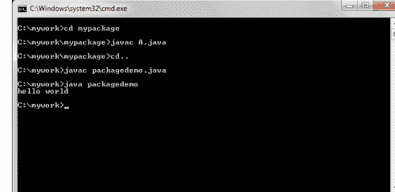

## 包中的类和接口（详细）

包（package）是类和接口的集合。每个包都有自己的名称，并将其顶层（即非嵌套）类和接口组织在一个独立的命名空间（namespace）或名称集合中。虽然同名的类和接口不能出现在同一个包中，但它们可以出现在不同的包中，因为每个包都分配了独立的命名空间。

`Namespace` 关键字用于声明一个包含一组相关对象的范围（scope）。你可以使用命名空间来组织代码元素并创建全局唯一的类型。

从逻辑推论的角度来看，将包等同于目录是有帮助的，将包的类和接口等同于目录的类文件——例如使用数据库的方式——来实现包也是如此，因此不要养成总是将包等同于目录的习惯。但由于许多 JVM 使用目录来实现包，且 Java 2 SDK 将其类和接口集合组织成“包中包”的树形层次结构，这等同于目录中的目录。这种层次结构允许 Sun Microsystems 轻松地分发这些类和接口（让你也能方便地使用它们）。

## 创建包含类和接口的包

每个源文件的类和接口都组织并在一个包中。在缺少包指令（package directive）的情况下，这些类和接口属于无名包（JVM 视为当前目录的目录——即 Java 程序通过 Windows `java.exe` 或等效操作系统程序开始执行的目录——且该目录不包含任何子包）。但如果源文件中出现了包指令，则该指令为这些类和接口指定了包名称。在源码中使用以下语法来指定包指令时：

包指令以 `package` 关键字开始。紧接着是一个为包命名的标识符 `packageName`。如果类和接口要出现在 `packageName` 内部的某个层级的子包中，则在 `packageName` 之后出现一个或多个用点分隔的 `subpackageName` 标识符。以下代码展示了一对包指令：

```java
package game;
```

```java
package game.devices;
```


第一个包指令标识了一个名为 `game` 的包。所有出现在 `game` 包中的类和接口都属于它。第二个包指令标识了一个名为 `devices` 的子包，它位于名为 `game` 的包中。出现在该指令源文件所有类和接口都组织在 `game.devices` 子包中。如果 JVM 实现将包名映射到目录名，则 `game.devices` 在 Linux 或 Solaris 下映射到 `game/devices` 目录层次结构。

列出包的源码：

### 列表 1. A.java

```java
// A.java

package testpkg;

public class A
{
    int x = 1;
    public int y = 2;
    protected int z = 3;
    int returnx ()
    {
        return x;
    }
    public int returny ()
    {
        return y;
    }
    protected int returnz ()
    {
        return z;
    }
    public interface StartStop
    {
        void start();
        void stop();
    }
}

class B
{
    public static void hello ()
    {
        System.out.println("hello");
    }
}
```

列表 1 介绍了你第一个具名包的源码。`package testpkg;` 指令将该包命名为 `testpkg`。`testpkg` 内部包含类 `A` 和 `B`。在 `A` 内部有三个字段声明、三个方法声明和一个内部接口声明。在 `B` 内部有一个方法声明。

整个源码存储在 `A.java` 中，因为 `A` 是一个公共类。我们的任务是：将此源码转换为一个由两个类和一个内部接口组成的包（或一个包含三个类文件的目录）。以下针对 Windows 的步骤可以完成该任务：

1. 打开命令窗口并确保你处于 `c:` 盘的根目录（主目录——用初始反斜杠 `\` 表示）。要执行此操作，输入 `c:` 命令后接 `cd` 命令。（如果你使用不同的目录，请将 `c` 替换为你选择的驱动器。此外，不要忘记在输入命令后按回车键）。
2. 输入 `md testpkg` 创建 `testpkg` 目录。
3. 输入 `cd testpkg` 使 `testpkg` 当前目录。
4. 使用编辑器验证列表 1 的源码，并将该代码保存到 `testpkg` 中的 `A.java` 文件中。
5. 输入 `javac A.java` 编译 `A.java`。你应该能在 `testpkg` 目录中看到类 `A$StartStop`、`A.class` 和 `B.class`。

带有三个类文件的 `testpkg` 目录等同于包含类 `A`、`B` 以及 `A` 的内部接口 `StartStop` 的 `testpkg` 包。

恭喜！你刚刚创建了你的第一个包。将这个包视为包含两个类（`A` 和 `B`）以及 `A` 的单个内部接口（`StartStop`）。你也可以将其认为是一个包含三个类文件的目录：`A$StartStop.class`、`A.class` 和 `B.class`。

### 导入包

一旦你有了包，你就会想要导入类和接口——实际上是类和接口——以便可以使用它们。实现这一目标的方法一种是提供完全限定名（类或接口），如列表 2 所示：

#### 列表 2. Usetpkg1.java

```java
// 列表 2. Usetpkg1.java

import java.util.Date;

class Usetpkg1 implements StartStop {
    public static void main(String[] args) {
        testpkg.A a = new testpkg.A();
        System.out.println(a.y);
        a.start();
    }
    public void start() {
        System.out.println("Start");
    }
    public void stop() {
        System.out.println("Stop");
    }
}
```

在 `A` 前加上 `testpkg` 似乎并不是什么大事。但谁想到处都写完全限定包名呢？幸运的是，Java 提供了导入指令来导入包的公共类型名称，因此你不需要输入完全的包名前缀。通过以下语法在代码中表示导入指令：

```
import packageName [ .subpackageName ... ] .referencetypeName | *;
```

导入指令由 `import` 关键字开始，紧接着是一个为包命名的标识符 `packageName`。后面跟着可选的 `subpackageName` 列表以标识相应的子包（如有必要）。该指令以标识特定类或接口的星号 `*` 字符结束。如果出现了 `referencetypeName`，则该指令为单类型导入指令。如果出现了星号 `*`，则该指令为按需导入指令。

单类型导入指令从包导入单个公共引用类型的名称，如下代码片段所示：

```java
import java.util.Date;
```

之前的单类型导入指令在源码的每个地方导入类名 `Date` 而不是 `java.util.Date`。因此，在源码中出现该类名的地方，指定 `Date` 而不是 `java.util.Date`。例如，在创建 Date 对象时，指定 `Date d = new Date();` 而不是 `java.util.Date`。

编译器将该代码片段视为尝试引入两个具有相同 `Date` 名称的引用类型：
- 通过单类型导入指令从 `java.util` 子包导入的 `Date` 引用名称
- `Date` 类声明

如果编译器允许上述代码段编译，那么 `Date` 引用类型将是编译器在遇到 `Date d = new Date();` 时所参考的。

与单类型导入指令不同，按需类型导入指令会根据需要从包中导入公共引用类型的名称，如下代码段所示：

```java
import java.net.*;
```

根据上述代码段，如果源文件中出现 `Socket` 或其他 java 引用类型名称，则该名称可以在没有 `java.net` 前缀的情况下出现。编译期间，当编译器检测到 `Socket` 时，它会搜索 `java.net` 以验证 `Socket` 是否为 java 子包的成员。一旦验证通过，编译器会将 `java.net` 与 `Socket` 一起存储在类文件中。

编译器是一种特殊的进程程序，它处理用特定编程语言编写的语句，并将其转换为计算机处理器使用的机器语言或“代码”。

与单类型导入指令一样，按需类型导入指令也存在问题。考虑以下片段：

```java
import a.*;
import b.*;
X x = new X ();
```

假设包 `a` 和 `b` 各包含一个 `X` 类。当编译器确定 `X` 同时存在于 `a` 和 `b` 中时，编译器会报告错误，因为每个包可能有不同的 `X` 实现，编译器无法知道应该导入哪一个 `X`。为了解决这个问题，开发者必须在每个 `X` 出现的地方加上完全限定的包名。对于上述代码段，这将导致 `a.X x = new a.X ();` 或 `b.X x = new b.X ();`。

你可以使用按需类型导入指令来避免在 `Uetestpkg2` 中任何出现 `A` 的地方指定 `testpkg.` 的麻烦，如列表 3 所示：

#### 列表 3. Uetestpkg2.java

```java
// Uetestpkg2.java

import testpkg.*;

class Usetestpkg2 implements A.StartStop
{
    public static void main (String [] args)
    {
        A a = new A ();
        // 以下代码无法编译，因为 x 在 testpkg.A 外部不是公共的
        // System.out.println(a.x);
        // 以下代码无法编译，因为 returnx() 在 testpkg.A 外部不是公共的
        // System.out.println(a.returnx());
        System.out.println(a.y);
        System.out.println(a.returny ());
        // 以下代码无法编译，因为 z 在 testpkg.A 中有保护访问权限
        System.out.println(a.z);
        // 以下代码无法编译，因为 returnz() 在 testpkg.A 中有保护访问权限
        // System.out.println(a.returnz ());
        SubA sa = new SubA ();
        System.out.println(sa.returnZ ());
        // 以下代码无法编译，因为 testpkg.B 在 testpkg 中不是公共的
        // 且 hello() 在公共类 B 中没有定义
        // B.hello ());
        Usetestpkg2 utp = new Usetestpkg2 ();
        utp.start ();
        utp.stop (();
    }
    public void start () 
    {
        System.out.println("Start");
    }
    public void stop () 
    {
        System.out.println("Stop");
    }
}

class SubA extends A
{
    int returnZ () 
    {
        // 无论包如何，子类方法调用父类的受保护方法是合法的
        return super.returnZ();
    }
}
```

`Usetestpkg2` 的按需类型导入指令从 `testpkg` 导入了引用类型名称 `A` 和 `A.StartStop`。那么类 `B` 呢？我们不能导入类名，因为 `B` 不是 `testpkg` 内的公共类。结果，只有 `testpkg` 内部的代码（以及随后添加到该包的任何其他类）才能访问 `B`。`Usetestpkg2` 证明你可以对包的公共类 `A` 创建子类并访问该类的保护成员（如 `returnZ()`）。为了证明这一点，编译 `utestpkg2`（将其放在与 `utestpkg1` 相同的目录下）并运行程序。如果成功，你将看到以下输出：

+ 2
+ 3
+ Start
+ Stop

3 是 `testpkg.A` 的保护字段的值，`testpkg.A` 的保护方法 `returnz()` 返回（通过 `SubA` 的 `returnZ()` 方法）。与 `returnz()` 不同，你不能调用 `returnx()`，因为由于缺少访问修饰符（private、public 或 protected），意味着包访问——而具有包访问权限的字段或方法只能从类所在包的代码中调用。

### 类路径设置

Java 中的 `Classpath` 是用于 `ClassLoader` 查找和加载 Java 程序的目录或目录列表。可以使用 `CLASSPATH` 环境变量、`-cp` 命令行选项或 `manifest.mf` 文件中的 `Class-Path` 属性来指定 `Classpath`。Java 类组织成包，并映射到文件系统中的目录。但是，与文件系统不同，每当你指定包名时，你指定的都是整个包名——而不是它的部分。例如，`java.awt` 的包名始终被指定为 `java.awt`。例如，假设你想让 Java 运行时在 `utility.myapp` 包中找到名为 `Cool` 的类。如果该目录是 `C:\java\Classes\utility\myapp`，你需要设置类路径使其包含 `C:\java\Classes`。要运行该程序，你可以使用：

```
java -cp C:\java\Classes utility.myapp Cool
```


# Java 编程中的包

## 删除类路径变量

Java 中的 `Classpath` 是 `ClassLoader` 用于查找和加载 Java 程序的目录或目录列表。可以使用 `CLASSPATH` 环境变量、`-cp` 命令行选项或 `manifest.mf` 文件中的 `Class-Path` 属性来指定 `Classpath`。Java 类组织成包，并映射到文件系统中的目录。但是，与文件系统不同，每当你指定包名时，你指定的都是整个包名——而不是它的部分。例如，`java.awt` 的包名始终被指定为 `java.awt`。例如，假设你想让 Java 运行时在 `utility.myapp` 包中找到名为 `Cool` 的类。如果该目录是 `C:\java\Classes\utility\myapp`，你需要设置类路径使其包含 `C:\java\Classes`。要运行该程序，你可以使用：

```
java -cp C:\java\Classes utility.myapp Cool
```

## 显示当前类路径

Java 中的 `Classpath` 是 `ClassLoader` 用于查找和加载 Java 程序的目录或目录列表。可以使用 `CLASSPATH` 环境变量、`-cp` 命令行选项或 `manifest.mf` 文件中的 `Class-Path` 属性来指定 `Classpath`。Java 类组织成包，并映射到文件系统中的目录。但是，与文件系统不同，每当你指定包名时，你指定的都是整个包名——而不是它的部分。例如，`java.awt` 的包名始终被指定为 `java.awt`。例如，假设你想让 Java 运行时在 `utility.myapp` 包中找到名为 `Cool` 的类。如果该目录是 `C:\java\Classes\utility\myapp`，你需要设置类路径使其包含 `C:\java\Classes`。要运行该程序，你可以使用：

```
java -cp C:\java\Classes utility.myapp Cool
```

## 设置类路径

Java 中的 `Classpath` 是 `ClassLoader` 用于查找和加载 Java 程序的目录或目录列表。可以使用 `CLASSPATH` 环境变量、`-cp` 命令行选项或 `manifest.mf` 文件中的 `Class-Path` 属性来指定 `Classpath`。Java 类组织成包，并映射到文件系统中的目录。但是，与文件系统不同，每当你指定包名时，你指定的都是整个包名——而不是它的部分。例如，`java.awt` 的包名始终被指定为 `java.awt`。例如，假设你想让 Java 运行时在 `utility.myapp` 包中找到名为 `Cool` 的类。如果该目录是 `C:\java\Classes\utility\myapp`，你需要设置类路径使其包含 `C:\java\Classes`。要运行该程序，你可以使用：

```
java -cp C:\java\Classes utility.myapp Cool
```

## 尝试编译 1.java

Java 中的 `Classpath` 是 `ClassLoader` 用于查找和加载 Java 程序的目录或目录列表。可以使用 `CLASSPATH` 环境变量、`-cp` 命令行选项或 `manifest.mf` 文件中的 `Class-Path` 属性来指定 `Classpath`。Java 类组织成包，并映射到文件系统中的目录。但是，与文件系统不同，每当你指定包名时，你指定的都是整个包名——而不是它的部分。例如，`java.awt` 的包名始终被指定为 `java.awt`。例如，假设你想让 Java 运行时在 `utility.myapp` 包中找到名为 `Cool` 的类。如果该目录是 `C:\java\Classes\utility\myapp`，你需要设置类路径使其包含 `C:\java\Classes`。要运行该程序，你可以使用：

```
java -cp C:\java\Classes utility.myapp Cool
```

## 这一操作成功

Java 中的 `Classpath` 是 `ClassLoader` 用于查找和加载 Java 程序的目录或目录列表。可以使用 `CLASSPATH` 环境变量、`-cp` 命令行选项或 `manifest.mf` 文件中的 `Class-Path` 属性来指定 `Classpath`。Java 类组织成包，并映射到文件系统中的目录。但是，与文件系统不同，每当你指定包名时，你指定的都是整个包名——而不是它的部分。例如，`java.awt` 的包名始终被指定为 `java.awt`。例如，假设你想让 Java 运行时在 `utility.myapp` 包中找到名为 `Cool` 的类。如果该目录是 `C:\java\Classes\utility\myapp`，你需要设置类路径使其包含 `C:\java\Classes`。要运行该程序，你可以使用：

```
java -cp C:\java\Classes utility.myapp Cool
```

## 同样尝试

Java 中的 `Classpath` 是 `ClassLoader` 用于查找和加载 Java 程序的目录或目录列表。可以使用 `CLASSPATH` 环境变量、`-cp` 命令行选项或 `manifest.mf` 文件中的 `Class-Path` 属性来指定 `Classpath`。Java 类组织成包，并映射到文件系统中的目录。但是，与文件系统不同，每当你指定包名时，你指定的都是整个包名——而不是它的部分。例如，`java.awt` 的包名始终被指定为 `java.awt`。例如，假设你想让 Java 运行时在 `utility.myapp` 包中找到名为 `Cool` 的类。如果该目录是 `C:\java\Classes\utility\myapp`，你需要设置类路径使其包含 `C:\java\Classes`。要运行该程序，你可以使用：

```
java -cp C:\java\Classes utility.myapp Cool
```

## 操作应该失败

Java 中的 `Classpath` 是 `ClassLoader` 用于查找和加载 Java 程序的目录或目录列表。可以使用 `CLASSPATH` 环境变量、`-cp` 命令行选项或 `manifest.mf` 文件中的 `Class-Path` 属性来指定 `Classpath`。Java 类组织成包，并映射到文件系统中的目录。但是，与文件系统不同，每当你指定包名时，你指定的都是整个包名——而不是它的部分。例如，`java.awt` 的包名始终被指定为 `java.awt`。例如，假设你想让 Java 运行时在 `utility.myapp` 包中找到名为 `Cool` 的类。如果该目录是 `C:\java\Classes\utility\myapp`，你需要设置类路径使其包含 `C:\java\Classes`。要运行该程序，你可以使用：

```
java -cp C:\java\Classes utility.myapp Cool
```

## 编译示例

```
javac -classpath "../" CPTest2.java
```

在看到如何让它不那么难看之前，先考虑这个示例（仍在同一目录下）：

```
javac -classpath "" CPTest1.java CPTest2.java
```

这也可以行，即使类是空的。这是因为 Java 编译器会查找命令行中显式列出的任何源代码的引用。如果有任何类，且它们都在同一个目录下，我们可以将其简化为：

```
javac -classpath "*.java"
```

`*.java` 会展开为当前目录下所有 `.java` 文件的列表。这解释了为什么当尝试编译单个文件失败时，一次性操作编译多个文件却能成功。

单独编译 `CPTest2` 的更方便方法如下：

```
cd [root]
javac -classpath "." com/web_tomorrow/CPTest2.java
```

在这个示例中，我们指定了 `CPTest2.java` 的完整路径，但在 `-classpath` 选项中包含了 `.`。同样，我们并没有告诉编译器去当前目录中查找文件。因为我们要找的类是 `com.web_tomorrow.CPTest1`，编译器将在 `./com/web_tomorrow`（即当前目录之下的 `web_tomorrow` 目录）中搜索。这正是 `CPTest1` 所在的位置。

事实上，尽管我在命令行上只指定了 `CPTest2`，但实践中确实导致了 `CPTest1` 的编译。编译器在正确的位置找到了 `.java` 文件，但它无法判断这个 Java 源代码是否真的实现了正确的类，因此它必须编译它。注意，如果我们这样做：

```
cd [root]
javac -classpath ".\" com/web_tomorrow/CPTest1.java
```


这不会导致 `CPTest2.java` 的编译，因为编译器编译 `CPTest1` 时不需要知道关于 `CPTest2` 的任何信息。


# Java 编程中的理论、实践与技术

## 为库包创建 JAR 文件

除了目录路径外，classpath 还可选地识别包含包的 Java 归档文件（jar 文件或 JAR）。jar 文件是一个带有 `.jar` 扩展名的 zip 文件，而不是 `.zip` 扩展名。

Jar 文件方便地分发包；开发者只需要分发单个 jar 文件，而不是包的多个文件。此外，开发者不需要解析如何重建包的目录层级结构，jar 文件内部已经包含了该层级结构。最后，与等量的基于 JAR（Java 归档）的包相比，压缩的 jar 文件减少了存储空间并加快了通过网络的传输速度。识别这些优势，并将其标准包集包含在单个 rt（运行时）jar 文件中进行分发。

JAR（Java 归档）是一种包文件格式，通常用于将许多 Java 类文件、元数据和资源（文本、图像等）聚合到一个文件中进行分发。

让我们将先前的 `testpkg` 包转换为 jar 文件。以下步骤假设根目录下有一个 `testpkg` 目录，并且 `testpkg` 中包含 `AStartStop.class`、`A.class` 和 `B.class` 文件：

- 打开 Windows 命令行窗口，并确保你在 c: 盘的根目录下。
- 执行 `classpath=.` 确保 classpath 环境变量不存在。
- 将以下文本复制到清单文件（manifest）中并将该文件存储在根目录下：
  - Specification-Title: testPkg specification title
  - Specification-Vendor: me
  - Specification-Version: 1.0
  - Implementation-Title: testPkg implementation
  - Implementation-Vendor: you Implementation-Version: 1.0.1
- 执行 `jar cfm testpkg.jar`。如果成功，你应该应该在根目录下看到 `testpkg.jar`。
- 一旦 `testpkg.jar` 出现，执行 `deletee testpkg` 来删除 `testpkg` 目录。

### Java 编程中的包 265

之前的步骤引入了以下概念：

- Sun 的 SDK 包含一个用于创建和管理 jar 文件的 `jar` 程序。命令行中 `jar` 后面有一系列选项。`cfm` 选项的解释如下：`c` 创建一个 jar 文件，`f` 指定 jar 文件名称为 `testpkg.jar`，`m` 指定包含清单信息的文件。`cfm` 之后是 jar 文件、清单文件和包目录的名称，顺序与指定的选项相同。
- 清单文件（manifest file）在 jar 文件中存储元数据（描述 jar 文件内容的数据。在我们的示例中，元数据由 `Specification-Title`、`Specification-Vendor`、`Specification-Version`、`Implementation-Title`、`Implementation-Vendor` 和 `Implementation-Version` 组成。

现在你有了 `testpkg.jar`，如何引用该文件以便使用 `Ustestpkg1` 和 `Usetestpkg2`？通过执行 `classpath=testpkg.jar;`（或平台等效命令）将 `testpkg.jar` 和当前目录包含在你的环境变量环境中。然后执行 `java Usetestpkg1` 和 `Usetestpkg2`。你应该看到与本文之前看到的相同的输出。

## 包的命名规范

包名全小写，以避免与类或接口的名称冲突。公司使用其反转的互联网域名作为包名的开头——例如，对于 example.com 的程序员创建的名为 `mypack` 的包，使用 `com.example.mypack`。公司内部发生的命名冲突需要通过公司内部的约定来处理，可能是在 `.` 之后包含区域或项目名称。

## 命名规则

包名的前缀始终使用全小写字母，并且应该是顶级域名之一，目前为 `com`、`edu`、`gov`、`mil`、`net`、`org`，或者 ISO 3166-1981 指定的国家英语双字母代码之一。

Java 中的每个包都有其唯一的名称，并将其类组织在独立的命名空间（或名称组）中。包名的后续部分根据组织自身的命名规范而异。此类约定可能指定部门、科、项目、机器或登录名称。

### Java 编程中的包 267

## 技术 19

### Java 应用包的环境变量

环境变量是操作系统（OS）下运行的所有进程均可访问的全局系统变量。环境变量用于存储系统级的值，例如搜索可执行文件的目录（`PATH`）和操作系统版本。简而言之：

- `PATH`：维护一个目录列表。操作系统在 `PATH` 中搜索可执行程序，例如 Java 编译器 (`javac`) 和 Java 运行时 (`java`)。
- `CLPATH`：此处维护一个目录列表（包含许多类文件）和 JAR 文件（Java 类的单文件存档）。Java 编译器和 Java 运行时在 `CLPATH` 中搜索程序引用的 Java 类。
- `JAVA_HOME` 和 `JRE_HOME`：分别维护 JDK 和 JRE 的安装目录位置。

- 我们已经实践此技术
- 此技术不适用于我们的操作
- 我们之前练习过，现在需要入门
- 我们应该实现此技术

## 技术 20

### 在 Java 中创建和使用包

包是相关类的集合。它帮助将你的类组织到目录结构中，并便于查找和使用。更重要的是，它有助于提高重用性。

Java 中的每个包都有其唯一的名称，并将其类组织在独立的命名空间（或名称组）中。

- 我们已经实践此技术
- 此技术不适用于我们的操作
- 我们之前练习过，现在需要入门
- 我们应该实现此技术

## 技术 21

### 如何创建 JAR 文件

JAR 文件格式是一种压缩格式，主要用于分发 Java 应用程序和库。它构建在 ZIP 文件格式之上，功能类似；许多文件被压缩并打包在一个文件中，便于在网络上分发。如果你需要打包 Java 应用程序或库，可以使用 Java 开发包（JDK）和计算机的命令行提示符创建 JAR 文件。

- 我们已经实践此技术
- 此技术不适用于我们的操作
- 我们之前练习过，现在需要入门
- 我们应该实现此技术

## 总结

- 包（Packages）在 Java 中用于组织你的类文件。它可以被视为在系统内组织类文件的不同文件夹。你可以将相关的类文件一起放在一个包中。Java 将预定义的类分组在不同的包，如 `java.lang`、`java.util`、`java.io` 等。
- Java 中使用包是为了防止命名冲突、控制访问权限、使类、接口、枚举和注解的搜索/定位以及使用变得更加容易等。
- 在创建包时，你应该为包选择一个名称，并在包含这些类、接口、枚举和注解类型的每个源文件顶部包含一个带有该名称的包语句（package statement）。
- 包的命名：由于包用于创建命名空间以防止命名冲突问题，因此命名空间必须是唯一的。这意味着包也必须是唯一的。因此，为包命名是创建包的一个非常重要的方面。通常情况下，参与软件开发的组织会使用其组织的域名名，因为根据定义，域名名是唯一的。
- 包的要求之一是，源文件应该包含在一个与包名相似的目录结构中。
- 包是指包含方法但不包含 `main` 方法的类。包主要用于重用其他程序中已经创建/使用的类。
- 包是类和接口的集合。每个包都有自己的名称，并将其顶层（即非嵌套的）类和接口组织到独立的命名空间或集合名称中。虽然同名的类和接口不能出现在同一个包中，但它们出现在不同的包中，因为每个包都分配了独立的命名空间。
- 每个源文件的类和接口都会组织成一个包。在缺少包指令的情况下，这些类和接口属于未命名包（JVM 视为当前目录的目录——即 Java 程序通过 Windows `java.exe` 或操作系统等效程序开始执行的目录，且该目录不包含子包）。

Java 中的 Classpath（类路径）是目录路径或目录列表，用于类加载器查找并加载 Java 程序中的类。Classpath 可以通过使用 `CLASPATH` 环境变量（不区分大小写）、`-cp` 或 `-classpath` 命令行选项，或者 Java JAR 文件内部 `manifest.mf` 文件中的 `Class-Path` 属性来指定。

## 知识检查

1. 以下关键字中哪一个用于在 Java 中定义包？
   a. pkg
   b. Pkg
   c. package
   d. Package

2. 以下哪项是用于类及其内容的命名和可见性控制的机制？
   a. Object
   b. Packages
   c. Interfaces
   d. 以上均未提到。

3. 以下哪种访问限定可以用于类，以便其成员可以被同一个包中的另一个类访问？
   a. Public
   b. Protected
   c. No Modifier（无修饰符）
   d. 以上所有

4. 以下哪些访问修饰符可以用于类，以便其成员可以被不同包中的类访问？
   a. Public
   b. Protected
   c. Private
   d. No Modifier（无修饰符）

5. 以下哪个导入整个包‘pkg’的正确方法？
   a. import pkg.
   b. Import pkg.
   c. import pkg.*
   d. Import pkg.*

## 复习题

1. 解释在 Java 编程中如何创建和编译包。
2. 讨论包的目录结构。
3. 解释类和接口在包中的作用。
4. 确定如何为库包制作 jar 文件。
5. 包的类路径设置条件是什么？也解释它的基本原理。
6. 完成以下操作：
   a. 创建一个名为 `org.shapes` 的包。
   b. 在包中创建一些表示常见几何形状的类，如 `Square`、`Triangle`、`Circle` 等。

## 检查你的结果

1. (c) 2. (b) 3. (d) 4. (a) 5. (c)

1. http://www.idc-online.com/technical_references/pdfs/information_technology/Packages_in_Java.pdf
2. https://letusprogram.com/2013/10/10/packages-in-java-with-examples/
3. https://www.tutorialspoint.com/java/pdf/java_packages.pdf
4. http://www.javaworld.com/article/2074542/core-java/core-java-packages-organize-and-interfaces.html?page=2
5. https://www3.ntu.edu.sg/ehchua/programming/java/J9c_PackageClasspath.html
6. http://docs.oracle.com/java/7/docs/technotes/tools/windows/classpath.html
7. http://javarevisited.blogspot.com/2011/01/how-classpath-work-in-java.html
8. http://kevinboone.net/classpath.html
9. http://javawork.sourceforge.org/chapter3.pdf
10. http://wpollock.com/Java/Package-Liang.java
11. Ken Arnold Gosling, The Java Programming Language, second ed., Addison-Wesley, 1998.
12. Patrick Chan, The Java Developers Almanac, Addison-Wesley, 1998.
13. Peter Coard and Mark Mayfield, Java Design: Building Better Apps and Applets, Yourdon Press, 1996.
14. Gary Cornell and S. Horstmann, Core Java, second ed., SunSoft, 1997.
15. Robert Eckstein, Mark Loy and Dave Wood, Java Swing, O'Reilly, 1998.
16. Robert Engslader, Developing Java Beans, O'Reilly, 1997.
17. David Flanagan, Java in a Nutshell, second ed., O'Reilly, 1996.
18. David Flanagan, Java Foundation Classes in a Nutshell, O'Reilly, 1999.
19. David M. Geary, Graphic Java 2: Mastering the JFC, vol. 1.
20. David M. Geary, Graphic Java 2: Mastering the JFC, vol. 2.
21. David M. Geary, Graphic Java 2: Mastering the JFC, vol. 3.
22. David M. Geary, Graphic Java 2: Mastering the JFC, vol. 4.
23. James Gosling, Bill Joy, and Guy Steele, The Java Language, Addison-Wesley.
24. John Meyer and Troy Downing, Java by Example, O'Reilly.
25. Graham Hamilton and Rick Cattell, Java A Tutorial, SunSoft.
26. Vincent Zukowski, Java Reference, O'Reilly.
27. Elliot Hardy, Java Networking, SunSoft.
28. Elliot Hardy, Java I/O, O'Reilly.
29. Jason Hunter, Java Programming, O'Reilly.

# 数组与字符串 277

## C++ 程序员

### 示例

以下代码段是此语法的示例——

```java
double[] myList; // 推荐方式。
```

或

```java
double myList(); // 有效但不是推荐方式。
```

## 初始化和访问数组

数组是一个容器对象，它持有固定数量的单一类型的值。数组的长度在数组创建时确立。创建后，其长度是固定的。你已经在“Hello World!”应用程序的 main 方法中见过数组的示例。

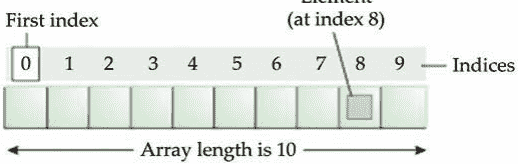

一个包含 10 个元素的数组。数组中的每个项被称为一个元素，每个元素通过其数字索引访问。如前面的插图所示，编号从 0 开始。例如，第 9 个元素将通过索引 8 访问。

```java
// 以下程序 ArrayDemo 创建了一个整数数组，在数组中存了一些值，并将每个值打印到标准输出中。

class ArrayDemo {

    public static void main(String[] args) {

        // 声明一个整数数组
        int[] anArray;

        // 为 10 个整数分配内存
        anArray = new int[10];

        // 初始化第一个元素
        anArray[0] = 100;

        // 初始化第二个元素
        anArray[1] = 200;

        // 依此类推
        anArray[2] = 300;
        anArray[3] = 400;
        anArray[4] = 500;
        anArray[5] = 600;
        anArray[6] = 700;
        anArray[7] = 800;
        anArray[8] = 900;
        anArray[9] = 1000;

        System.out.println("Element at index 0: " + anArray[0]);
        System.out.println("Element at index 1: " + anArray[1]);
        System.out.println("Element at index 2: " + anArray[2]);
        System.out.println("Element at index 3: " + anArray[3]);
        System.out.println("Element at index 4: " + anArray[4]);
        System.out.println("Element at index 5: " + anArray[5]);
        System.out.println("Element at index 6: " + anArray[6]);
        System.out.println("Element at index 7: " + anArray[7]);
        System.out.println("Element at index 8: " + anArray[8]);
        System.out.println("Element at index 9: " + anArray[9]);
    }
}
```


该程序的输出是：

- 索引 0 处的元素: 100
- 索引 1 处的元素: 200
- 索引 2 处的元素: 300
- 索引 3 处的元素: 400
- 索引 4 处的元素: 500
- 索引 5 处的元素: 600
- 索引 6 处的元素: 700
- 索引 7 处的元素: 800
- 索引 8 处的元素: 900
- 索引 9 处的元素: 1000

在现实世界的编程中，你可能会使用一种支持的结构来遍历数组的每个元素，而不是像前面的示例那样逐行编写每一行。然而，该示例清楚地说明了数组的语法。你将在“控制流”部分学习各种循环结构（`for`、`while` 和 `do-while`）。

## 声明一个变量来引用数组

前面的程序通过以下这行代码声明了一个数组（命名为 `anArray`）：

```java
// 声明一个整数数组
int[] anArray;
```

与其他类型的变量声明一样，数组声明包含两个部分：数组的类型和数组的名称。数组的类型写为 `type[]`，其中 `type` 是包含的元素的数据类型；括号是特殊符号，表示该变量持有一个数组。数组的大小不是其类型的一部分（这就是为什么括号是空的）。数组的名称可以是你想要的任何名称，只要它遵循之前在命名章节中讨论过的规则和惯例。与其他类型的变量一样，声明并没有真正创建数组；它只是告诉编译器该变量将持有一个指定类型的数组。

同样，你可以声明其他类型的数组：

```java
byte[] arrayOfBytes;
short[] arrayOfShorts;
long[] arrayOfLongs;
float[] arrayOfFloats;
double[] arrayOfDoubles;
boolean[] arrayOfBooleans;
char[] arrayOfChars;
String[] arrayOfStrings;
```

你可以将括号放在数组名称之后：

```java
// 不建议使用这种形式
float anArrayOfFloats;
```

然而，惯例并不鼓励这种形式；括号标识数组并应该与类型说明一起出现。

## 创建、初始化和访问数组

创建数组的一种方法是使用 `new` 运算符。`ArrayDemo` 中的下一语句为数组分配了足够容纳 10 个整数元素的内存，并将数组赋值给 `anArray` 变量。

```java
// 创建一个整数数组
anArray = new int[10];
```

如果缺少此语句，编译器将打印类似下面的错误并导致编译失败：

`ArrayDemo.java:4: Variable anArray may not have been initialized.`

接下来的几行为数组的每个元素赋值：

```java
anArray[0] = 100; // 初始化第一个元素
anArray[1] = 200; // 初始化第二个元素
anArray[2] = 300; // 依此类推
```

每个数组元素通过其数字索引访问：

```java
System.out.println("Element 1 at index 0: " + anArray[0]);
System.out.println("Element 2 at index 1: " + anArray[1]);
System.out.println("Element 3 at index 2: " + anArray[2]);
```

或者，你可以使用快捷语法来创建并初始化数组：

```java
int[] anArray = {
    100, 200, 300, 400, 500, 600, 700, 800, 900, 1000
};
```

数组的长度是由花括号内提供的值决定的。

你也可以使用双重括号来声明数组的数组（也称为多维数组），例如 `String[][]`：

```java
int[] anArray = {
    100, 200, 300, 400, 500, 600, 700, 800, 900, 1000
};
```
纠正：原文此处为：
```java
int[] anArray = {
    100, 200, 300, 400, 500, 600, 700, 800, 900, 1000
};
```
（注：此处原文逻辑似乎有跳跃，描述多维数组但给出了一维数组代码，已按原意翻译）

在 Java 语言中，多维数组是组件本身也是数组的数组。如下所示的 `MultiArrayDemo`：

```java
class MultiArrayDemo {
    public static void main(String[] args) {
        String[][] names = {
            {"Mr.", "Smith"},
            {"Ms.", "Jones"}
        };

        // Mr. Smith
        System.out.println(names[0][0] + " " + names[0][1]);

        // Ms. Jones
        System.out.println(names[1][0] + " " + names[1][1]);
    }
}
```

最后，你可以使用内置的 `length` 属性来确定任何数组的大小。以下代码将数组的大小打印到标准输出：

```java
System.out.println(anArray.length);
```

## 复制数组

`System` 类有一个 `arraycopy` 方法，你可以使用它将数据从一个数组复制到另一个数组：

```java
public static void arraycopy(Object src, int srcPos, Object dest, int destPos, int length)
```

两个 `Object` 参数指定源数组和目标数组。三个 `int` 参数指定源数组中的起始位置、目标数组中的起始位置以及要复制的元素数量。

以下程序 `ArrayCopyDemo` 声明了一个 `char` 元素数组，拼出 "decaffeinated"。它使用 `System.arraycopy` 方法将数组的子序列复制到第二个数组：

```java
class ArrayCopyDemo {
    public static void main(String[] args) {
        char[] copyFrom = {'d', 'e', 'c', 'a', 'f', 'e', 'i', 'n', 'a', 'b', 'e', 'd'};
        char[] copyTo = new char[7];
        System.arraycopy(copyFrom, 2, copyTo, 0, 7);
        System.out.println(new String(copyTo));
    }
}
```

该程序的输出是：

caffeine

## 数组操作

数组是编程中一种强大且实用的概念。Java SE 提供了执行与数组的一些常用操作的方法。例如，`ArrayCopyDemo` 示例使用了 `System` 类的 `arraycopy` 方法，而不是手动遍历源数组的元素并将每个元素放入目标数组。这在后台完成，允许开发者只需使用一行代码即可调用该方法。

为了方便，Java SE 在 `java.util.Arrays` 类中提供了多种方法来执行数组操作（常见任务、排序和搜索数组）。例如，之前的示例可以修改为使用 `java.util.Arrays` 类的 `copyOfRange` 方法，正如 `ArrayCopyOfDemo` 示例中所示。区别在于使用 `copyOfRange` 方法不需要创建目标数组，因为该方法会返回一个新数组。

`java.util.Arrays` 类提供的其他有用操作包括：

- 在数组中搜索特定值以获取其所在的索引（使用 `binarySearch` 方法）。
- 比较两个数组以确定它们是否相等（使用 `equals` 方法）。
- 填充数组以在每个索引处放置特定值（使用 `fill` 方法）。
- 按升序对数组进行排序。这可以通过使用 `sort` 方法按顺序完成，也可以使用 Java SE 8 引入的 `parallelSort` 方法并发完成。在多处理器系统上，对大数组进行并行排序比顺序数组排序速度更快。

## 数组类型

数组类型是 Java 中的第二种引用类型。数组是值的有序集合，或者是有带编号的列表。这些值可以是基本类型值、对象甚至是其他数组，但数组中的所有值必须是相同类型。数组的类型是它所包含的值的类型，后面紧跟方括号 `[]`。例如：

```java
byte b; // byte 是一个基本类型
byte[] arrayBytes; // byte[] 是一个数组
// type: 字节数组
```

```java
byte[][] arrayOfArrayBytes; // byte[][] 是一个
// other type: byte[] 数组
```

```java
Point[] points; // Point[] 是一个数组
// Point objects
```


为了与 C 和 C++ 兼容，Java 还支持另一种声明数组类型变量的语法。在这种语法中，一个或多个方括号跟在变量名后面，而不是类型后面：

```java
byte arrayOfBytes[]; // 与 byte[] arrayOfBytes 相同
```

```java
byte[][] arrayOfArrayBytes[][]; // 与 byte[][] arrayOfArrayBytes 相同
```

```java
byte[] arrayOfArrayBytes[]; // 哎！与 byte[][] arrayOfArrayBytes 相同
```

这是一个令人困惑的语法，但不建议使用。

对于类和对象，我们对它们的类型和值有单独的术语。对于数组，单个单词 `array[]` 兼具了类型名称和值名称的功能。因此，我们可以说数组类型 `int[]`（一种类型）和 int 数组（一个特定的数组值）。在实践中，通常根据上下文可以清楚地讨论的是类型还是值。

## 创建数组

在 Java 中创建数组值时，你使用 `new` 关键字，就像创建对象一样。然而，数组不需要像对象那样初始化，因此你不需要在括号之间传递参数列表。但是，你必须指定你希望数组有多大。例如，如果你正在创建一个 `byte[]`，你必须指定你希望它包含多少个字节。在 Java 中，数组的大小是固定的。一旦创建了数组，它就永远不会增长或缩小。在方括号中指定一个非负整数作为你数组所需的大小：

```java
byte[] buffer = new byte[1024];
String[] lines = new String[50];
```

当你使用这种语法创建数组时，数组中持有的每个值都将自动初始化为其默认值。对于布尔值为 `false`，`char` 值为 `\u0000`，整数值为 `0`，浮点数值为 `0.0`，而对象或数组值为 `null`。

## 使用数组

一旦你使用 `new` 操作符和方括号语法创建了数组，你也使用方括号来访问数组中包含的单个值。记住，数组是值的有序集合。数组的元素按顺序编号，从 0 开始。数组元素的数字指的是该元素。这个数字通常被称为*索引*（index），而在数组中查找编号值的过程有时被称为对数组进行*索引*（indexing）。

要引用数组的特定元素，只需将所需元素的索引放在数组名称的方括号中。例如：

```java
String[] responses = new String[2]; // 创建一个包含两个字符串的数组
responses[0] = "=Yes;"; // 设置数组的第一个元素
responses[1] = "=No;"; // 设置数组的第二个元素
```

```java
// 现在读取数组元素
System.out.println(question + " \u00ab (\u00ab " + responses[0] + " \u00ab/\u00ab " + responses[1] ")");
```

在某些编程语言（如 C 和 C++）中，尝试读取或写入超出数组末尾元素的代码是一个常见错误。Java 不允许你访问无效的数组元素。每当你访问数组元素时，Java 解释器都会自动检查你指定的索引是否有效。如果你指定了一个负索引或大于数组最后一个索引的索引，解释器将抛出 `ArrayIndexOutOfBoundsException` 异常。这防止了你读取或写入不存在的数组元素。

数组索引值是整数；你不能用浮点值、布尔值、对象或另一个数组来索引数组。`char` 值可以转换为 `int` 值，因此可以使用字符作为数组索引。虽然 `long` 是一种整数数据类型，但 `long` 值不能作为数组索引。这看起来像是一个限制。

## 数组字面量

用于表示对象不存在的 `null` 字面量也可以用于表示数组不存在。例如：

```java
char[] password = null;
```

除了 `null` 字面量外，Java 还定义了允许你在程序中字面量地指定数组值的语法。数组字面量有两种不同的语法。第一种（也是常用的）语法只能在声明数组类型变量时使用。它将数组对象的创建与数组元素的初始化结合在一起：

```java
int[] powersOfTwo = {1, 2, 4, 8, 16, 32, 64};
```

这创建了一个包含大括号内列出的元素的数组。注意，我们在这个数组字面量中没有 `new` 关键字或指定数组的类型。类型在作为初始化器部分的变量声明中是隐式的。此外，这种语法没有显式指定数组长度；它是通过计算大括号内元素数量来隐式确定的。

第二种语法称为匿名数组语法，它允许你在代码的任何位置创建一个新数组：

```java
// 使用匿名数组（匿名对象的数组）调用另一个方法
double d = computeAreaOfTriangle(new Point[] { new Point(1,2),
    new Point(3,4),
    new Point(3,2) });
```

使用这种语法，你使用了 `new` 关键字并指定了数组的类型，但没有显式指定数组的长度。

重要的是，要理解 Java 虚拟机架构不支持任何形式的高效数组初始化。换句话说，数组字面量是在程序运行时创建并初始化的，而不是在程序编译时。考虑以下数组字面量：

```java
int[] perfectNumbers = {6, 28};
```

它被编译成等同于以下 Java 字节码：

```java
int[] perfectNumbers = new int[2];
perfectNumbers[0] = 6;
perfectNumbers[1] = 28;
```

因此，如果你想在 Java 程序中包含大量数据，将这些数据字面地包含在数组中可能不是好主意，因为 Java 编译器必须创建大量的 Java 字节码来初始化数组，然后 Java 解释器必须费力地执行所有初始化代码。在这种情况下，最好将数据存储在外部文件中并在运行时读取到程序中。

然而，Java 在运行时显式进行数组初始化这一事实有一个重要的推论。这意味着数组字面量的元素可以是运行时计算的任意表达式，而不是由编译器解析的常数表达式。例如：

```java
Point[] points = { circle1.getCenterPoint(), circle2.getCenterPoint() };
```

## 一维数组

一维数组是通过通用名称访问的相同类型变量列表。数组中的单个变量被称为数组元素。数组形成处理一组相关数据的方法。


一维数组本质上是同类型变量的列表。要创建一个数组，你必须先创建一个所需类型的数组。一维数组声明的通用形式为：

```java
type var-name[];
```

在这里，`type` 声明了数组的基础类型。基础类型决定了组成数组的每个元素的数据类型。因此，数组的基础类型决定了数组将持有什么类型的数据。例如，下面声明了一个名为 `month_days` 的类型为“int 数组”的数组：

```java
int month_days[];
```

虽然此声明建立了 `month_days` 是一个数组的事实，但实际上并不存在数组。事实上，`month_days` 的值被设置为 `null`，表示一个没有值的数组。要将 `month_days` 与实际的物理整数数组关联，你必须分配一个新的数组并将其赋值给 `month_days`。`new` 是一个分配内存的特殊运算符。

`new` 应用一维数组的通用形式如下：

```java
array-var = new type[size];
```

在这里，`type` 指定要分配的数据类型，`size` 指定数组中的元素数量，`array-var` 是关联到数组的变量。也就是说，要使用 `new` 分配数组，必须指定类型和元素数量。由 `new` 分配的数组元素会自动初始化为零。这个示例分配了一个包含 12 个元素的整数数组并将它们与 `month_days` 关联。

```java
month_days = new int[12];
```

执行此语句后，`month_days` 将指向包含 12 个整数的数组。让我们回顾：获取数组是一个两步过程。首先，你必须声明所需类型的变量。其次，你必须使用 `new` 分配持有数组的内存并将其赋值给数组变量。因此，在 Java 中所有数组都是动态分配的。一旦你分配了数组，就可以通过指定方括号内的索引访问数组中的特定元素。索引从零开始。例如，此语句将 28 赋值给 `month_days` 的第二个元素。

```java
month_days[1] = 28;
```

下一行显示存储在索引 3 处的值。

```java
System.out.println(month_days[3]);
```


# Java 编程中的理论、实践与技巧

## 一维数组

一维数组本质上是同类型变量的列表。要创建一个数组，你必须先创建一个所需类型的数组。一维数组声明的通用形式为：

```java
type var-name[];
```

在这里，`type` 声明了数组的基础类型。基础类型决定了组成数组的每个元素的数据类型。因此，数组的基础类型决定了数组将持有什么类型的数据。例如，下面声明了一个名为 `month_days` 的类型为“int 数组”的数组：

```java
int month_days[];
```

虽然此声明建立了 `month_days` 是一个数组的事实，但实际上并不存在数组。事实上，`month_days` 的值被设置为 `null`，表示一个没有值的数组。要将 `month_days` 与实际的物理整数数组关联，你必须分配一个新的数组并将其赋值给 `month_days`。`new` 是一个分配内存的特殊运算符。

`new` 应用一维数组的通用形式如下：

```java
array-var = new type[size];
```

在这里，`type` 指定要分配的数据类型，`size` 指定数组中的元素数量，`array-var` 是关联到数组的变量。也就是说，要使用 `new` 分配数组，必须指定类型和元素数量。由 `new` 分配的数组元素会自动初始化为零。这个示例分配了一个包含 12 个元素的整数数组并将它们与 `month_days` 关联：

```java
month_days = new int[12];
```

执行此语句后，`month_days` 将指向包含 12 个整数的数组。让我们回顾：获取数组是一个两步过程。首先，你必须声明所需类型的变量。其次，你必须使用 `new` 分配持有数组的内存并将其赋值给数组变量。因此，在 Java 中所有数组都是动态分配的。一旦你分配了数组，就可以通过指定方括号内的索引访问数组中的特定元素。索引从零开始。例如，此语句将 28 赋值给 `month_days` 的第二个元素：

```java
month_days[1] = 28;
```

下一行显示存储在索引 3 处的值：

```java
System.out.println(month_days[3]);
```

将所有部分组合，这是一个每月天数的程序：

```java
// 一维数组。

class Array {

    public static void main(String args[]) {

        int month_days[];

        month_days = new int[12];

        month_days[0] = 31;

        month_days[1] = 28;

        month_days[2] = 31;

        month_days[3] = 30;

        month_days[4] = 31;

        month_days[5] = 30;

        month_days[6] = 31;

        month_days[7] = 31;

        month_days[8] = 30;

        month_days[9] = 31;

        month_days[10] = 30;

        month_days[11] = 31;

        System.out.println("April has " + month_days[3] + " days.");

    }

}
```

当你运行它时，输出：
```
April has 30 days.
```

## 与字符串

```java
// 使用匿名数组（匿名对象的数组）调用另一个方法
double d = computeAreaOfTriangle(new Point[] { new Point(1,2),
                                               new Point(3,4),
                                               new Point(3,2) });
```

使用这种语法，你使用了 `new` 关键字并指定了数组的类型，但没有显式指定数组的长度。

重要的是，要理解 Java 虚拟机架构不支持任何形式的高效数组初始化。换句话说，数组字面量是在程序运行时创建并初始化的，而不是在程序编译时。考虑以下数组字面量：

```java
int[] perfectNumbers = {6, 28};
```

它被编译成等同于以下 Java 字节码：

```java
int[] perfectNumbers = new int[2];
perfectNumbers[0] = 6;
perfectNumbers[1] = 28;
```

因此，如果你想在 Java 程序中包含大量数据，将这些数据字面地包含在数组中可能不是好主意，因为 Java 编译器必须创建大量的 Java 字节码来初始化数组，然后 Java 解释器必须费力地执行所有初始化代码。在这种情况下，最好将数据存储在外部文件中并在运行时读取到程序中。

然而，Java 在运行时显式进行数组初始化这一事实有一个重要的推论。这意味着数组字面量的元素可以是运行时计算的任意表达式，而不是由编译器解析的常数表达式。例如：

```java
Point[] points = { circle1.getCenterPoint(), circle2.getCenterPoint() };
```

## 多维数组

正如我们所见，数组类型简单来说元素类型后跟一对方括号。`char` 数组是 `char[]`，`char` 数组的数组是 `char[][]`。当数组的元素本身也是数组时，我们说该数组是多维的。为了处理多维数组，有一些额外的细节需要理解。

想象你想用一个多维数组来表示乘法表：

```java
int[][] products; // 乘法表
```

每一对方括号代表一个维度，所以这是一个二维数组。要访问单个元素，必须指定两个索引值，每个维度一个。假设这个数组实际上被初始化为乘法表，那么任何给定元素的 `int` 值将是两个索引的积。例如，`products[2][4]` 将是 8，而 `products[3][7]` 将是 21。

要创建一个新的多维数组，使用 `new` 关键字并指定数组两个维度的大小。例如：

```java
int[][] products = new int[10][10];
```

在某些语言中，这样的数组会被创建一个包含 100 个 `int` 值的单一块。Java 并不是这样工作的。这行代码做了三件事：

- 声明了一个持有 `int` 数组数组的变量 `products`。
- 创建了一个包含 10 个 `int` 数组的 10 元素数组。
- 创建额外的 10 个数组，每个都是一个包含 10 个元素的 `int` 数组。将这 10 个新数组每一个赋值给初始数组的元素。这 10 个新数组中每个元素的默认值均为 0。

换句话说，之前的单行代码等同于以下代码：

```java
int[][] products = new int[10][]; // 用于存储 int[] 值的数组。
for(int i = 0; i < 10; i++) // 循环多次...
    products[i] = new int[10]; // ...并创建数组。
```

`new` 关键字会自动执行这种额外的初始化。它也适用于超过两个维度的数组：

```java
float[][][] globalData = new float[360][180][100];
```

在使用多维数组时，你不需要为数组的所有维度指定大小，只需指定最左侧的一个或多个维度。例如，以下两行都是合法的：

```java
float[][] globalData = new float[360][180];
float[][] globalData = new float[360][180];
```
（注：此处示例中两行代码相同，可能为原文笔误）

第一行创建一个一维数组，其中数组的每个元素可以存储一个 `float[]`。第二行创建一个二维数组，其中数组的每个元素都是一个 `float[]`。然而，如果你为数组的某些维度指定了大小，那么这些维度必须是最左侧的。以下行代码是非法的：

```java
float[][][] globalData = new float[360][180][100]; // 错误！
float[][] globalData = new float[360][180]; // 错误！
```

像一维数组一样，多维数组可以使用数组字面量进行初始化。只需使用嵌套的大括号集将数组嵌套在数组内部即可。例如，我们可以这样声明、创建并初始化一个 5×5 的乘法表：

```java
int[][] products = { 
    {0, 0, 0, 0, 0},
    {0, 1, 2, 3, 4},
    {0, 2, 4, 6, 8},
    {0, 3, 6, 9, 12}
};
```

```java
int[][] products = new int[12][]; // 一个包含 12 个 int 数组的数组。
for(int row = 0; row < 12; row++) { // 对于该数组的每个元素，
    products[row] = new int[row+1]; // 分配一个 int 数组。
    for(int col = 0; col < row+1; col++) { // 对于 int 中的每个元素，
        products[row][col] = row * col; // 将初始化为乘积。
    }
}
```

## 8.2 字符串 (STRINGS)

### 注意事项

#### 定义

字符串是连续的（参见连续性）符号或值的序列，例如字符字符串（字符序列）或二进制位字符串（作为二进制值的序列）。

#### 字符串操作

字符串广泛用于 Java 编程，它们是字符序列。在 Java 编程语言中，字符串是对象。Java 平台提供了 `String` 类来创建和操作字符串。

#### 学习目标

- 作为基本数据类型的字符串
- 字符串对象是不可变的
- 字符串拼接
- 创建格式化字符串
- 字符串方法

#### 定义

字符串广泛用于 Java 编程，它们是字符序列。在 Java 编程语言中，字符串被视为对象。字符串是对象还是基本数据类型？这个问题有一个明确的答案——字符串是对象！然而，字符串在 Java 程序中通常出现的方式可能会导致混淆。Java 为字符串提供了其他对象不具备的快捷方式。这些快捷方式被频繁使用，并让字符串看起来像是基本数据类型。但是，字符串是对象，它们拥有 Java 中对象的所有属性和行为。我们将正式介绍字符串。我们将学习如何声明和初始化 `String` 对象，并学习如何通过操作符和方法操作及访问字符串。由于字符串是对象，从某种意义上说，我们正在正式引入 Java 中的对象概念，并将从“作为对象的字符串”开始。（字符串快捷方式稍后讨论。）你可以将“String”一词替换为 Java 中任何其他类的名称，这个故事依然通顺。因此，当我们谈论“实例化一个 String 对象”时，我们可以同样在谈论“实例化一个 BufferedReader 对象”或“实例化一个 PopupMenu 对象”。记住这一点，你将充分准备好将字符串知识扩展到更广泛、更通用的对象概念。注意前段落中“string”和“String”这两个术语的使用。在广义上，我们将一组组合在一起的字符称为“string”。当作为 Java 语言中的正式实体指代同一组字符集合时，我们称之为“String 对象”或“String 类的对象”。

### 作为对象的字符串

字符串是组合在一起的字符集合。例如，“hello”是一个由字符‘h’‘e’‘l’、‘l’和‘o’组成的字符串。注意，字符常量用单引号括起来，而字符串常量用双引号括起来。在 Java 中，字符串是一个对象。和基本数据类型一样，对象在创建之前是不存在的。

为了留出内存存储字符串，我们必须构造对象。这项工作由一种称为构造的方法完成。构造对象的过程称为实例化。执行方式如下：

```java
greeting = new String();
```

声明和实例化 `String` 对象可以合并在一条语句中：

```java
String greeting = new String();
```

注意构造方法的名字与类名相同。事实上，这是 Java 语言的一个规则。保留字 `new` 向编译器发出分配新内存信号。由于构造函数是一个方法，它的后面跟着一组包含传递给它的参数的括号。在上面的示例中，构造函数没有参数。当未使用参数调用构造函数时，它被称为默认构造函数。在默认 `String` 构造函数的情况下，为字符串的内容预留了内存，但字符串中没有任何字符。这是一个空字符串，如图 7.1 所示。箭头强调了 `greeting` 持有的是引用，而不是值。它指向 `greeting` 所引的对象。

构造 `String` 对象更常用的方法是将字面量——字符串常量——作为参数传递给构造函数：

```java
String greeting = new String("hello");
```

上述语句完成了完整的任务：实例化一个名为 `greeting` 的 String 对象，并将其初始化为指向包含“hello”的 String 对象的引用。这在图 7.1c 中所示。

既然我们现在有了字符串变量和字符串对象，我们可以对它们做什么呢？当然，可以打印字符串。语句

```java
System.out.println(greeting);
```

在标准输出上打印“hello”。

在所有 Java 运算符中，赋值可能是最基本的。一个字符串可以赋值给另一个字符串，就像一个整数可以赋值另一个整数一样。考虑以下 Java 语句：

```java
// 整数的赋值
int x;
int y;
x = 5;
y = x;

// 字符串的赋值
String s1;
String s2;
s1 = new String("Java is fun!");
s2 = s1;
```


如果你仔细遵循了前面的讨论，就会显而易见这两组语句略有不同。虽然声明了两个 `String` 对象变量，但只实例化了一个 `String` 对象。上面最后一行的赋值创建了 `String` 对象引用的副本。它并没有复制对象！这在图 7.2 中所示。

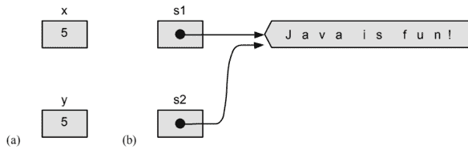

这个例子强调了对象与原始数据类型之间的关键区别。原始数据类型是通过值存储的，而对象是通过引用存储的。换句话说，原始数据变量持有的是一个值，而对象变量持有的是对一个对象的引用。

如果你真的想创建一个 `String` 对象的副本，可以如下操作：

```java
String s1 = new String("Java is fun!");
String s2 = new String(s1);
```

Java 构造函数是一种特殊类型的方法，用于初始化对象。Java 构造函数在对象创建时被调用。

显然，实例化了两个 `String` 对象，因为 `String()` 构造函数出现了两次。在第二行中，传递给构造函数的参数是 `s1`。其效果是实例化一个新的 `String` 对象，并用 `s1` 中数据的副本对其进行初始化。这在图 7.3 中所示。

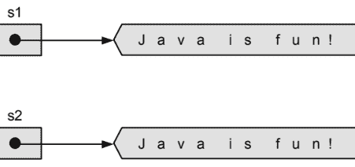

**图 7.3.** 复制 String 对象

## 作为原始数据类型的字符串

除了数字之外，字符串是计算机程序中处理的最常见数据类型。正因为如此，`String` 对象在 Java 语言中受到了某种特殊对待。`String` 对象存在一组快捷方法或特殊操作，这些操作在大多数其他对象中并不存在。这些快捷方法非常方便，但可能会让学习 Java 的学生感到困惑。请记住，对于大多数情况，这些讨论并不适用于其他类型的对象。它们是 `String` 对象独有的。

以下快捷方法提供了一种实例化 `String` 对象的另一种简化方式：

```java
String greeting = "hello";
```

这看起来非常像声明和初始化一个原始数据类型（如 `int`），但不要被它骗了。上面的语句只是以下内容的快捷方式：

```java
String greeting = new String("hello");
```

## 数组与字符串

这足够简单。让我们来看下一个快捷方法。一旦原始数据类型（如 `int`）被赋值，就可以给它赋新值，且这个新值将替换旧值。同样，一旦一个 `String` 对象被实例化并赋值，就可以给它赋新值，新值将替换旧值。嗯，某种程度上如此。让我们用一个演示程序来探索这个想法。`DemoStringRedundancy.java` 程序如图 7.4 所示。

```java
public class DemoStringRedundancy {
    public static void main(String[] args) {
        // 改变 int 变量的值
        int x = 5;
        x = 6;
        System.out.println(x);

        // 改变 String 对象的值
        String greeting = "hello";
        greeting = "bonjour";
        System.out.println(greeting);
    }
}
```

**图 7.4.** DemoStringRedundancy.java

该程序的输出预期为：

```
6
bonjour
```

`DemoStringRedundancy` 中的语句看起来足够无害，但某些重要的正在发生。将 `int` 变量的值替换为新值不需要新的内存。新值覆盖旧值，此就结束了。这在图 7.5 中所示。

| x | x |
|---|---|
| 5 | 6 |

**图 7.5.** DemoStringRedundancy 中的内存分配 (a) 第 6 行执行后 (b) 第 7 行执行后

字符串的情况并非如此。当一个 `String` 对象被赋予新值时，新值与旧值不同。字符串“hello”包含五个字符，而字符串“bonjour”包含七个字符。所以，需要额外的两个字符的空间。这个空间从哪里来？让我们通过首先给出以下 Java 中 `String` 对象的规则来回答这个问题：

## String 对象是不可变的

根据我们所说的“不可变”，是指 `String` 对象一旦实例化就不能更改。我们可以对 `String` 对象进行各种类型的“读取”操作，如确定其大小或统计元音数量，但我们不能更改 `String` 对象的内容。`DemoStringRedundancy` 中的语句是完全合法的，它们确实给出了 `String` 对象的内容从“hello” 到“bonjour”的印象。但发生的情况比表面看到的要多。此讨论的相关操作在第 12 行。第 12 行的效果是：

`String` 类是不可变的，因此一旦创建就无法更改。如果有必要对 `String` 进行大量修改，你应该使用 `StringBuffer` 和 `String` 类。

## 创建字符串

创建字符串最直接的方法是编写——

```java
String greeting = "Hello!";
```

每当编译器遇到字符串字面量时，它都会创建一个值为 "Hello!" 的 `String` 对象。

与其他其他对象一样，你可以通过 `new` 关键字和构造函数来创建 `String` 对象。`String` 类拥有构造函数允许你提供初始值，例如字符数组。

```java
public class StringDemo {
    public static void main(String[] args) {
        char[] helloArray = {'h', 'e', 'l', 'l', 'o', '!'};
        String helloString = new String(helloArray);
        System.out.println(helloString);
    }
}
```

这将产生以下结果：

```
Output
hello!
```

## 字符串长度

用于获取对象信息的方法被称为访问方法。你可以与字符串一起使用的访问方法之一是 `length()` 方法，它返回字符串对象包含的字符数。

以下程序是 `String` 类 `length()` 方法的示例。

```java
public class StringDemo {
    public static void main(String[] args) {
        String palindrome = "Dot saw I was Tod";
        int len = palindrome.length();
        System.out.println("String Length is : " + len);
    }
}
```

这将产生以下结果：

```
Output
String Length is : 17
```

## 字符串拼接

`String` 类包含一个拼接两个字符串的方法——

```java
string1.concat(string2);
```

它返回一个新的字符串，在 `string1` 的末尾添加了 `string2`。你也可以对字符串字面量使用 `concat()` 方法，例如——

> "My name is ".concat("Zara");

字符串更常用 `+` 运算符进行拼接，例如——

> "Hello," + "world" + "!",

结果为——

> "Hello, world!",

让我们看看下面的示例——

```java
public class StringDemo {
    public static void main(String[] args) {
        String string1 = "saw I was ";
        System.out.println("Dot " + string1 + "Tod");
    }
}
```

这将会产生以下结果 –

```
输出
Dot saw I was Tod
```

## 创建格式化字符串

你可以使用 `printf()` 和 `format()` 方法来打印带有格式化数字的输出。`String` 类有一个等价的类方法 `format()`，它返回一个 `String` 对象而不是 `PrintStream` 对象。

使用 `String` 的静态方法 `format()` 允许你创建一个可以重复使用的格式化字符串，而不是一次性的打印语句。例如，与其使用 –

```java
System.out.printf("The value of the float variable is " + "%f, while the value of the integer " + "variable is %d, and the string " + "is is %s", floatVar, intVar, stringVar);
```

你可以写为 –

```java
String fs;
fs = String.format("The value of the float variable is " + "%f, while the value of the integer " + "variable is %d, and the string " + "is is %s", floatVar, intVar, stringVar);
System.out.println(fs);
```

# Java 编程理论、实践与技巧

## 字符串方法

除了赋值和拼接外，字符串操作通常使用 `String` 类的方法。包括所有变体，`String` 类中有超过 50 个方法；然而，我们将只检查最常用的。这些方法列在表 7.1 中。

### 表 7.1. String 中的常用方法

| 方法 | 描述 |
|---|---|
| `String(s)` | 构建一个 `String` 对象并用字符串对其初始化；返回该对象的引用 |
| `s.length()` | 返回一个等于字符串长度的 `int` |
| `s.substring(i, j)` | 返回一个等于 `s` 的从索引 `i` 开始到索引 `j-1` 结束的子字符串的 `String` |
| `s.toUpperCase()` | 返回一个等于 `s` 的字母转换为大写后的 `String` |
| `s.toLowerCase()` | 返回一个等于 `s` 的字母转换为小写后的 `String` |
| `s.charAt(i)` | 返回字符串中索引 `i` 处的字符 |
| `s1.indexOf(s2)` | 返回一个等于 `s2` 在 `s1` 中首次出现位置索引的 `int`；如果 `s2` 不在 `s1` 中，则返回 -1 |
| `s1.compareTo(s2)` | 返回一个等于字符串 `s1` 和 `s2` 之间字典序差异的 `int`；如果 `s1` 在字典序上于 `s2`，则返回负值 |
| `s1.equals(s2)` | 返回一个布尔值；如果 `s1` 与 `s2` 相同则返回 true，否则返回 false |

## 方法签名

方法通过其签名进行总结，签名显示了方法定义的第一行。例如，`String` 类文档中给出的 `compareTo()` 方法签名是 `public int compareTo(String anotherString)`。保留字 "public" 是一个修饰符。它标识了方法在 Java 程序更大范围内的可见性。一个 `public` 方法可以从定义它的类外部访问或“调用”；它在类可见的任何地方都是可见的。（如果方法被声明为 `private`，如果它可以帮助公共方法实现其目标，但在类外部是不可见的。）保留字 "int" 标识了方法返回的值的数据类型。`compareTo()` 方法返回一个整数。方法也可以返回一个对象；类名可能会代替数据类型出现。

**修饰符**（Modifier）是一个用于更改定义含义的关键字。在 Java 中，修饰符分为两类：访问控制修饰符和非访问修饰符。

## 数组与字符串

接下来是方法。正如前面提到的，Java 的约定是方法名始终以小写字母开头。如果方法名由多个单词组成，这些单词连在一起，随后的单词以大写字母开头。因此，`compareTo()` 以小写字母开头；但在 "To" 中使用了大写的 "T"。构造方法是一个例外，因为它们始终使用与类相同的名称，因此始终以大写字母开头。方法名后面是一组括号，其中包含用逗号分隔的传递给方法的参数。每个参数由两个单词标识。第一个是类型；第二个是它的名称。名称是任意的，不需要与使用该方法的程序中的参数名匹配。

演示程序 `DemoStringMethods` 练习了表 7.1 中的所有方法。代码列表如图 7.7 所示。

```java
public class DemoStringMethods {
    public static void main(String[] args) {
        String s1 = new String("Hello, world");
        String s2 = "15";
        String s3 = "cat";
        String s4 = "dog";
        System.out.println(s1.length());
        System.out.println(s1.substring(0, 12));
        System.out.println(s1.toUpperCase());
        System.out.println(s1.charAt(0));
        System.out.println(s2.indexOf(".*"));
        System.out.println(s2.indexOf(".*") + 1, s2.length());
        System.out.println(s3.compareTo(s4));
        System.out.println(s3.equals(s4));
    }
}
```

### 图 7.7. DemoStringMethods.java

此程序生成以下输出：

```
12
HELLO, WORLD
hello, world
w
3
35
-1
false
```

### 308 Java 编程理论、实践与技巧

#### String()

在第 5 行中，使用 `String()` 构造函数来实例化 `String` 对象。对象的引用被赋值给该变量。引用被赋值给对象 `s1`。实际上，这种方式实例化字符串并不常见，见第 6-8 行。

#### length()

在第 10 行，`length()` 方法决定了 `s1` 的长度。第 10 行所示的语法将实例变量 `s1` 连接到实例方法 `length()`。`s1` 的 `println()` 方法是 12，见输出的第一行。

#### substring()

在第 11 行中，从 `s1` 提取子字符串。该子字符串从索引 7 开始到索引 11 结束。计算字符串中的字符：

| H | e | l | l | o | , |    | w | o | r | l | d |
|---|---|---|---|---|---|---|---|---|---|---|---|
| 0 | 1 | 2 | 3 | 4 | 5 | 6 | 7 | 8 | 9 | 10 | 11 |

**图 7.8. 字符串中的字符**

注意非字母字符保持不变；字母字符转换为

#### toUpperCase() 和 toLowerCase()

第 12 行演示了将字符串转换为大写的简单转换。非字母字符保持不变；字母字符转换为大写。

#### indexOf()

在第 15 行中，演示了 `indexOf()` 方法。该方法作用在实例变量 `s2` 上，`s2` 引用一个包含“75.35”的 `String` 对象（见第 6 行）。小数点 (.) 在索引 3 处，见输出的第 6 行。

#### compareTo()

第 17 行演示了 `compareTo()` 方法。如表 7.1 所示，该方法执行两个字符串之间的字典序比较，并返回一个等于字符串之间字典序差异的整数。这听起来很，但实际上非常简单。“字典序”在大多数情况下就是“字典顺序”；所以“able”优于“baker”，而后者反过来优于“charlie”，以此类推。两个字符串之间的字典序简单就是两个字符串中第一个不同字符的 Unicode 之间的数值差异。例如，表达式 `"able".compareTo("baker")` 等于 -1。

第一个字符不同，“b’，返回值为负 (-1)。表达式 (1)。由于‘a’优于“b”。`compareTo("able")` 也等于 -1，但这是后两个字符之间的字典序差异（因为前两个字符相同）。

## 310 Java 编程理论、实践与技巧

示例程序中，是“cat”和“dog”之间的比较（参见第 17 行）。词法差异 -1 出现在输出的第 8 行。上述讨论中没有考虑到几种情况：仅在大小上不同的两个字符（例如‘a’和‘A’）之间的数值差异为 32，大写字母在词法上于小写字母。因此，例如表达式 `"zebra".compareTo("ZEPHYR")` 等于 32。涉及数字或标点符号的比较评估起来有点复杂。如果两个字符串没有不同的索引位置，但其中一个比另一个字符串短，则返回的值是两个字符串长度之差。例如，表达式

`"lightbulb".compareTo("light")`

等于 4

`"light".compareTo("light")`

等于 -4。

#### equals()

图 7.7 中演示的最后一个字符串方法是 `equals()` 方法。`equals()` 与 `compareTo()` 类似，但只测试相等或不相等。返回类型为布尔值：如果两个字符串相同则返回 true，否则返回 false。由于“cat”不等于“dog”，如输出第 9 行所示，结果为 false。

注意，相等性的关系测试 ( `==` ) 是一个有效的字符串运算符；但它的行为与 `equals()` 方法明显不同。例如，表达式

```java
s1 == s2
```

如果 `s1` 和 `s2` 指向同一个对象，则返回 true；而表达式

```java
s1.equals(s2)
```


如果 s1 中的字符序列与 s2 相同，则返回 true。

## 技巧 22

### 长度、数组中的循环

在 Java 中，数组是一种基本类型，经常用于其他类型内部。我们可以在 `java.util.Arrays` 类中找到非常有用的方法。每个数组都有一个长度，即使它的元素个数为零（但在需要时要注意检查引用是否为 null）。我们经常在 `for` 循环中使用 `length` 作为上限边界。

- 这项技术是否适用于我们的操作
- 我们过去练习过这个，现在需要重新启动
- 我们应该实现这项技术

## 技巧 23

### 声明和初始化二维数组

在 Java 编程语言中，可以使用两个循环来创建二维数组，第一个循环是外层循环，第二个是内层循环。外层循环负责行，内层循环负责列。行和列结合在一起形成二维（2D）数组。

- 这项技术是否适用于我们的操作
- 我们过去练习过这个，现在需要重新启动
- 我们应该实现这项技术

## 技巧 24

### 为什么 Java String 是特殊的

Java String 包含一个不可变的 Unicode 字符序列。与 C/C++ 不同（后者中字符串仅仅是 char 数组），Java String 是 `java.lang` 类的一个对象。然而，Java String 是特殊的。与普通类不同：

- a. String 与双引号文本形式的字符串字面量（如“Hello, world!”）相关。你可以将字符串字面量赋值给 String 变量，而无需调用构造函数创建 String 实例。

- b. `+` 运算符被重载用于连接两个 String 操作数。`+` 不适用于 Point 和 Circle 等任何其他对象。

- c. String 是不可变的。也就是说，一旦创建，它的内容就无法修改。例如，`toUpperCase()` 方法构造并返回一个新的 String，而不是修改其现有的内容。

- 这项技术是否适用于我们的操作
- 我们过去练习过这个，现在需要重新启动
- 我们应该实现这项技术

# 总结

- Java 提供了一种数据结构——数组，它存储了固定大小的同类型元素顺序集合。数组用于存储数据集合，但通常将数组被视为同类型变量的集合会更有用。

- 数组是一种用于存储所有相同类型值的值序列的灵活结构。存储在数组中的值称为元素。

- 数组是一个容器对象，持有固定数量的单一类型的值。数组的长度在数组创建时确定。

- 数组是编程中一种强大且实用的概念。Java SE 提供了执行与数组相关的某些常用操作的方法。

- 数组类型是 Java 中的第二种引用类型。数组是值的有序集合或编号列表。这些值可以是原始值、对象，甚至是其他数组，但数组中的所有值必须是相同类型。

- 一维数组是通过通用名称访问的同类型变量的列表。数组中的单个变量被称为数组元素。数组形成了一种处理相关数据组的方法。

- 字符串分组在一起的字符集合。例如，“hello”是一个由字符‘h’、‘e’、‘l’和‘o’组成的字符串。注意字符常量被包含在单引号中，而字符串被包含在双引号中。在 Java 中，字符串是一个对象。对于原始数据类型，对象在声明之前是不存在的。

- 我们所说的“不可变”是指 String 一旦实例化就无法更改。我们可以对 String 对象执行各种“读取”操作，如确定其大小或计算元音数量，但我们不能更改 String 对象的内容。

- 用于获取对象的方法被称为访问器方法（accessor methods）。你可以用于字符串的一个访问器方法是 `length()` 方法，它返回字符串对象中包含的字符数。

# 知识检查

- 1. 以下哪一个类是 String 和 StringBuffer 类的父类？
- a. `java.util`
- b. `java.lang`
- c. `ArrayList`
- d. 以上提到的都没有

- 2. String 类的哪一个方法用于获取 String 对象的长度？
- a. `get()`
- b. `Sizeof()`
- c. `lengthof()`
- d. `length()`

- 3. 以下哪一个构造函数用于创建一个空的 String 对象？
- a. `String()`
- b. `String(void)`
- c. `String(0)`
- d. 以上提到的都没有

- 4. 在 Java 中，数组是：
- a. 对象
- b. 对象引用
- c. 原始数据类型
- d. 以上都不是

- 5. 下列哪一个是有效语句？
- a. Objects
- b. Object references
- c. Primitive data type
- d. 以上都不是

## 复习习题

- 1. 如何声明、初始化和访问变量
- 2. 讨论各种类型的数组。

# 参考文献

- 1. `java.util`
- 2. `java.lang`
- 3. `java`
- 4. `java`
- 5. `java`
- 6. `java`
- 7. `java`
- 8. `java`
- 9. `java`
- 10. `java`
- 11. `java`
- 12. `java`
- 13. `java`
- 14. `java`
- 15. `java`
- 16. `java`

## 问题

- 1. 如何声明、初始化和访问变量
- 2. 讨论各种类型的数组。

讨论了字段、表格、边界、图标、操作、标签、按钮、菜单和菜单栏、文件选择器、列表等许多功能。光盘中包含大量代码。

- 17. 《企业级高级 Java 开发》，Cliford J. Berg, 1998. Prentice Hall 出版。ISBN 0-13-080461-4, 584 页。包含了适用于 Java 的软件开发生命周期讲座；Java 运行环境 (JRE)、安全、数据库连接、线程、JavaBeans、电子商务。

- 18. 《Java 类库》，第二版，第1卷，Chan, Rosanne lee, Douglas Kramer, 1998. Addison-Wesley 出版。ISBN 0-201-31002-3, 2050 页，$55.95。这是一本参考书，描述了这些包中的类：`java.io`, `java.lang`, `java.lang.ref`, `java.lang.reflect`, `java.math`, `java.net`, `java.text`, `java.util`, `jar`, `java.util.zip`。它包含大量示例代码、与其他类和方法的交叉引用以及对所有方法的描述。

- 19. 《Java 类库》，第二版，第1卷，Java 2 平台标准版补充版，v1.2，Chan, Rosanne lee, Douglas Kramer, 1999. Addison-Wesley 出版。ISBN 0-201-48552-4, 1157 页，$34.95。这是 Java 开发工具包（JDK）1.2 版本的更新。

# 索引

# A

抽象窗口工具包 (AWT) 159, 174, 192

目录 7, 8, 9, 10, 12, 13, 14

目录结构 235, 240, 241, 242, 244, 269, 271

Apache 软件基金 240

Applet 157, 158, 159, 160, 162, 164, 165, 166, 167, 170, 171, 175, 177, 178, 179, 181, 192, 193, 195

文档 11, 14

# E

应用程序代码 236

应用程序接口 (APIs) 174, 192

Eclipse 10

封装 197, 201, 225

枚举 244, 245

事件处理 167, 169, 180

异常 138, 139, 141, 142, 143, 144, 148, 149, 151, 152, 153, 154, 155, 156

应用程序接口 (API) 211

扩展接口 45

# B

缓冲式流 132

字节码 7, 11, 13, 17, 18, 19, 20, 23, 25

字节流 132

# F

文件处理 131

文件 131, 132, 133, 136, 151

# C

字符流 132

检查异常 139

classpath 11, 14, 26

集合接口 87, 93, 95, 125

命令行提示符 237, 268

构造函数 32, 50, 51, 52, 53, 64, 95, 178, 105, 120

垃圾回收 (GC) 216

google 12, 13

图形化 Java 应用程序 166

图形用户界面 (GUI) 183, 192

# I

实现接口 44

继承 31, 35, 36, 37, 38, 39, 41, 77

# D

数据流 133

调试 1, 2

# 320 Java 编程中的理论、实践与技巧

# P

- 继承关系 175
- 内联包成员 244
- 实例变量初始化器 54
- 接口 32, 42, 43, 44, 45, 46, 57, 58, 60, 61, 76, 77

- 包语句 235, 236, 237, 238, 269
- 包结构 236
- 多态性 47, 60, 61, 63, 64, 78, 79, 199, 200, 206, 207, 231
- 编程错误 138, 139, 151
- 编程风格 23
- public 修饰符 221

# J

- Java 1, 2, 3, 4, 5, 6, 7, 8, 9, 10, 11, 12, 13, 14, 17, 18, 19, 20, 21, 22, 23, 25
- Java 集合 85, 89, 92, 125
- Java 基础类 (JFC) 174
- Java 虚拟机 (JVM) 11

# S

- 单继承 38, 204
- 标准模板库 (STL) 85
- 流 131, 132, 133
- Sun Microsystems 174, 195
- Swing 157, 159, 174, 183, 188, 190, 191, 192, 195, 196

# N

- 命名空间 235, 237, 250, 268, 269
- Netbeans 10
- 记事本 12

# T

- 标记接口 46

# O

- 对象初始化 48
- 面向对象图形 58
- 面向对象语言 (OOLs) 216
- 面向对象程序 199, 202, 206, 231
- 面向对象编程 (OOP) 198, 231
- 对象流 133

# U

- 非检查异常 140, 151
- 自定义异常 148

# W

- Windows 4, 7, 8, 10, 12, 13, 14, 23
