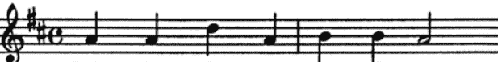
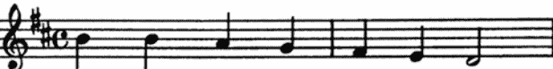
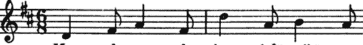
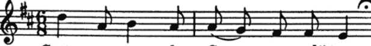
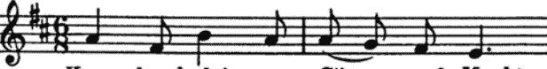
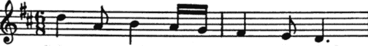

# 他们自以为是的：德国人，1933–45

理查德·J·埃文斯后记

26 25 24 23 22 21 20 19 18 17 1 2 3 4 5

理查德·J·埃文斯新后记

本书献给

我的十位纳粹党朋友：

- 卡尔·海因茨·施文克克（Karl-Heinz Schwenke），裁缝
- 古斯塔夫·施文克克（Gustav Schwenke），失业裁缝学徒
- 卡尔·克林格霍弗（Carl Klingelhöfer），家具制造师
- 海因里希·达姆（Heinrich Damm），失业销售员
- 霍斯特马·鲁普雷希特（Horstmar Rupprecht），高中生
- 海因里希·韦德金德（Heinrich Wedekind），面包师
- 汉斯·西蒙（Hans Simon），收账员
- 约翰·凯斯勒（Johann Kessler），失业银行职员
- 海因里希·希尔德兰特（Heinrich Hildebrandt），教师
- 威尔·霍夫梅斯特（Willy Hofmeister），警察

> 那法利赛人站着，心里这样祷告：
> “上帝，我感谢你，因为我不像别人……”

## 前言

作为一名美国人，我对德国纳粹民族主义的兴起感到反感。作为一名德国裔美国人，我感到羞愧。作为一名犹太人，我感到深受打击。作为一名记者，我被它迷住了。

是记者的痴迷——或者至少这种痴迷占据了主导——让我对纳粹主义的所有分析都感到不满意。我想见见这个怪物般的男人，这个纳粹分子。我想和他交谈，听听他的话。我想试着去理解他。我们都是人，我也是如此。在否定纳粹的种族优越学说时，我不得不承认，他所变成的样子我也可能变成；引导他走的路我也可能正在走……

# 第三部分：他们的诉求与救赎

审判

## 致谢

理查德·J·埃文斯 (RICHARD J. EVANS) 后记

# 第一部分

### 十个人

## 克罗嫩贝格

## 1638年11月9日：“听着，镇民们，诚实的人们”

现在是晚上十点——正差十分钟左右。凯瑟琳教堂的大钟开始敲响整点。在教区钟的第七声和第八声之间，教区的钟也开始敲响。你可能会以为教区教堂的守钟人被凯瑟琳钟唤醒了，爬下床，及时来到钟绳旁，避免了彻底的耻辱（就像一个人光着上身、光着脚跑向婚礼现场，只为赶在仪式结束前赶到）。但你可能是错的，因为从那以后每个晚上，克罗嫩贝格都有两口钟，教区钟的第一声总是在凯瑟琳钟的第七声之后才响起的；也许是出于尊重，因为凯瑟琳教堂曾是（直到一个世纪前的宗教改革之前）一座大座堂。

如今的克罗嫩贝格，除了两座钟楼和两座教堂，还有六千个灵魂；一所大学，拥有神学系和近百名学生；还有一座坐落在山顶的城堡，这座山坐落在建筑密集的半圆形城镇之上（这山在某些地方，房子只能从顶楼进入）；山脚下有一条河流，韦尔内河（Werne）。韦尔内河在莱茵河上游的这段无法航行，但它绕过开花山丘的路径与山顶的城堡、延伸到城堡公园边缘的木结构老房屋错落有致的山墙，以及像缠绕圆环一样环绕山山的石卵路和巷弄共同作用，使克罗嫩贝格成为一幅画中的城镇，位于画中的乡村。

城镇有自己的烦恼，可哪座城镇没有呢？在过去的几个世纪里，它易手了十二次。它曾被攻占、被占领、被解放、再次被攻占并夺取。但它从未被焚毁；它的美景（因为它小到足以美观）可能在1638年被毁过，那时克罗嫩贝格总是这样。

欧洲的战争持续了二十年，克罗嫩贝格的基督徒有此责任，直到维也的战争结束，但克罗嫩贝格一直很痛苦。直到1348年，克罗嫩贝格的犹太人被驱逐。而克罗嫩贝格的基督徒一直痛苦，直到战争结束，那是欧洲的战争。直到黑死病，克罗嫩贝格的犹太人被驱逐。在那个时代，克罗嫩贝格的犹太人被驱逐。直到1525年，克罗嫩贝格的犹太人被驱逐。那个时代，克罗嫩贝格的犹太人被驱逐。

听，镇民，诚实的人。

1. 现在是晚上十点——正差十分钟左右。
2. 凯瑟琳教堂的大钟开始敲响整点。
3. 在教区钟的第七声和第八声之间，教区的钟开始敲响。
4. 你可能会以为教区教堂的守钟人被凯瑟琳钟唤醒了，爬下床，及时来到钟绳旁，避免了彻底的耻辱。
5. （就像一个人光着上身、光着脚跑向婚礼现场，只为赶在仪式结束前赶到）。
6. 但你可能是错的，因为从那以后每个晚上，克罗嫩贝格都有两口钟，教区钟的第一声总是在凯瑟琳钟的第七声之后才响起的。
7. 也许出于尊重，因为凯瑟琳教堂曾是（直到一个世纪前的宗教改革之前）一座大座堂。
8. 如今的克罗嫩贝格，除了两座钟楼和两座教堂，还有六千个灵魂。
9. 一所大学，拥有神学系和近百名学生。
10. 以及一座坐落在山顶的城堡，这座山坐落在建筑密集的半圆形城镇之上（这山在某些地方，房子只能从顶楼进入）。
11. 以及山脚下有一条河流，韦尔内河。
12. 韦尔内河在莱茵河上游的这段无法航行，但它绕过开花山丘的路径与山顶的城堡、延伸到城堡公园边缘的木结构老房屋错落有致的山墙，以及像缠绕圆环一样环绕山山的石卵路和巷弄共同作用，使克罗嫩贝格成为一幅画中的城镇，位于画中的乡村。
13. 城镇有自己的烦恼，可哪座城镇没有呢？
14. 在过去的几个世纪里，它易手了十二次。
15. 它曾被攻占、被占领、被解放、再次被攻占并夺取。
16. 但它从未被焚毁；它的美景（因为它小到足以美观）可能在1638年被毁过，那时克罗嫩贝格总是这样。
17. 欧洲的战争持续了二十年，克罗嫩贝格的基督徒有此责任，直到维也的战争结束，但克罗嫩贝格一直很痛苦。
18. 直到1348年，克罗嫩贝格的犹太人被驱逐。
19. 在黑死病，克罗嫩贝格的犹太人被驱逐。
20. 直到1525年，克罗嫩贝格的犹太人被驱逐。
21. 那个时代，克罗嫩贝格的犹太人被驱逐。

*(注：由于原文文本存在大量重复和编码错误，译文已根据逻辑进行了清理和整合，确保了核心内容的翻译)*

Zehn Ge - bo - te - setztzt' Gott ein,

(上帝赐下了十诫,)

Gib, dass wir ge - hor - sam sein.

(顺从者将获得宽恕,)

Men- schen-wa - chen kann nichts nüt - zen;

(守卫者的守望也无法不了你；)

Gott muss wa - chen, Gott muss schüt - zen.

(上帝必须守望你，上帝必须保护你。)

Herr, durch dei - ne Güt und Macht,

(主啊，凭你永恒的大,)

Gib uns ei - ne gu - te Nacht.

(赐我们一个宁静的夜晚。)

夜更夫举着灯笼穿过小镇，正如他的同行穿过德国的每一个城镇一样，从十点开始唱着这首相同的摇篮曲。在十一点之前的几分钟（或者在之后，谁知道呢？）他回到了市场广场，十一点的喧闹结束了，他吹响号角再次开始巡逻。这一次，他不再唱“Zehn Gebote setzt’ ‘Elf der Jünger blieben treu, Hil dass wir im Tod oh’ Reu”（“基督的十一个门徒忠诚于他，愿我们在死后无无悔”）；十二点时他唱“Zwölf, das ist Ziel der Zeit; Mensch, bedenk die Ewigkeit”（“十二点让人们从此以后自由；人啊，当想永恒”）；凌晨一点他唱“Eins ist allein der ew'ge Gott, Der uns trägt aus aller Not”（唯有上帝永恒，祂将我们从一切苦难中举起”）。

从一点开始直到黎明，夜更夫一直唱直到唱不动。他的歌没有更多的乐节了，显然也没有更多的听众了。每小时，在钟声和野兽声平息后，他吹响号角巡逻，克罗嫩贝格的人醒来看到窗外有一道光，他们知道那是他，于是再次入睡。小镇在白天会苏醒；白天在黑暗中结束。每个人都在工作，没有人阅读，而且而且，除了大学、医院和城堡，否则木材只燃烧一两个小时，以供应房屋燃料和修补马具织带。

在城墙外，沿着韦尔内河的收费路在法兰克福门进入城镇的地方，有六座新房子围绕着一个被称为“法兰克福广场”的新兴广场而立。城镇正在变大，溢出了两个世纪前筑起的新墙，就像它曾溢出后来圈圈保护它的围墙一样。小镇依附城堡寻求保护的日子已经结束了；这是基督教时代十七世纪的中叶，人们住在墙外并没有太大危险。

在法兰克福广场的转角，有一条宽阔无阻的道路在墙外向西延伸并沿着它运行，一条被称为“墙路”的无名路旁有一家新旅馆——猎人庄（Jägerhof）。它是一座精致的双层建筑，楼是宽敞的宿舍，楼是一个公共厅和一个私人休息室（或俱乐部室），后面是旅馆主的住处。今晚，猎人庄的公共厅里灯火通明。老兵们，家卫队成员，正喝着啤酒庆祝家乡从维也纳枷锁中解放十五周年。家卫队成员是忠实的黑森人，但首先和最后都是克罗嫩贝格人，十五年前的今晚，克罗嫩贝格被围困了。对于老兵来说，这是一个大事，也是一个周年。

过了午夜，他们喝着两杯啤酒，他们离开了猎人庄，一些更忠诚的男孩在继续庆祝。旅馆主不想和老兵或当局惹麻烦，所以他从后面出来，熄了灯，上睡觉了。

1938年11月9日：“听着，镇民，诚实的人”

猎人庄的公共厅位于法兰克福广场和墙路的交角，灯火通明，挤满了老兵。家卫队成员庆祝家乡从维也纳枷锁中解放十五周年。那是慕尼黑“血星期”的纪念日，领袖在那儿被捕并囚禁。纳粹冲卫队（SA）是他们的固定活动地点。他们的定期集会是周五，而今天是周三。但11月9日，无论周几，都是最盛大的国家庆。1月30日（领袖上台的日子）和4月20日（领袖生日）也是国家庆。正式的庆祝活动在晚上7:30在市政剧院举行。如常一样，有许多演讲了，党的诗人西格弗里德·鲁佩尔朗诵了太多的诗。然后，SA部队整齐地从定期集会地出发，跟随指挥官施韦克来到公共厅喝杯啤酒。是十点了。

“听着，我们的钟刚响十点” 正是十点，如果你想对表表，可以听到国家广播的报时声或拨号6的半分钟信号。机械钟在凯瑟琳钟敲响七声后开始报时。当教堂钟声消失，市政厅顶部的机械角钟做出了回应，镇上有几只狗在叫，远处田里的牛在哞，小镇很安静。传统认为，这两个钟和市政厅角钟几个世纪以来都是同步的。十点。警察打开电话汇报：“施密特通话。一切正常，”值班军士说：“好。”除了电影院、旅馆、大学医院、学生宿舍和教授书房、电车、、火车站和路口外，灯都熄灭了。克罗嫩贝格是一个拥有两万人的安静小大学——实际上是两个城镇，大学和城镇，尽管大学像所有大陆大学一样，散落在整个城镇，而不是有一个校园。

克罗嫩贝格一直一直是安静的。在通向国家社会主义之前的几年里，偶尔会有街头斗殴，一两次纳粹或社会民主党的集会会被取散。（共产主义者太弱了，无法组织集会。）1930年，党服被禁止时，党人穿着白衬衫游行；当领袖在1932年在克罗嫩贝格演讲时，四万人安静地挤进小镇草坪上一个超级马戏帐篷里听他演讲。（纳粹露天集会是被禁止的。）那是城堡上挂起万字旗的日子；在英国或法国，这可能被认为是学生的恶作剧，但在克罗嫩贝格，那个引傲地承认罪行的人被处了巨额罚款。

克罗嫩贝格安静地纳粹化了，事实也如此。在1933年3月的选举中，纳粹工人党`NSDAP`获得了三分之二的多数，社会民主党下台了。只有大学——而不是整个大学——以及核心社会民主分子坚持到了最后，在非工业化的克罗嫩贝格，没有工会来维持社会民主党的基础。1938年，克罗嫩贝格的纳粹化程度和德国的任何城镇一样彻底。

当然，克罗嫩贝格并不是德国。首先，它在黑森州，而黑森是保守的，如果你愿意，是“落后的”；当其他地方想说某人愚笨时，他们称他为“笨黑森人”。克罗嫩贝格如此古老且一成不变，位于主线和高速公路之外，即使对于黑森来说也是保守的。但它的这种保守比城市的激进主义更能保证党的稳定性，在城市里，昨天咆哮的共产主义者是今天咆哮的纳粹，没人知道明天他们将如何咆哮。安静的小镇最好。

## “上帝赐下了十诫”

猎人庄公共厅里的谈话（正如对老兵所预期的那样）一如往常地关于往事，但你不得不承认，他话得比别人都多得多，因为你懂得如何讲故事；当故事中的角色咆哮时，施韦克并不是说他咆哮——而是他自己在咆哮。他讲述了十五年前`SA`接到命令在11月9日集结并等待政变的消息。他们有185人，等待卡车把他们运到法兰克福。他们等了一整天。消息没来，卡车没来。

“我并没有太失望，”施韦克说，“时间太早了。我总是这么说。高层那些人的问题在于他们挡在领袖和我这种了解民众和情况的人之间。`Nja` [黑森方言中的“是”和“如此”]，当领袖出狱并重组政党，只接受他知道忠诚的人时，那是正确的原则。有了那个原则，挑选出优秀的人，没有什么能挡住我们。”一个从另一个部队流过来的年轻`SA`成员说道。

两天前，德国驻巴黎大使馆领事沃姆·拉特（`vom Rath`）被一名波兰犹太人射杀。德国国家广播电台立即展开了一场针对犹太人的激烈斗争活动。难道德国人要在全世界范围内成为犹太人杀犯者的待宰羔羊吗？难道当元首代表被那些犹太人猪类射杀时，德国人民只能眼睁睁地看着吗？那些杂狗难道能逍遥法外吗？德国人民对这些以色列人人渣的愤怒还要继续忍制多久？“如果沃姆·拉特死了，德国犹太人将向德国人民交代，不是明天，而是今天。德国人受这些寄生虫杀手的苦已经够久了。”

这是戈培尔博士的杰作。

整个下午和晚上，电台里一直在煽动，现在《每日克罗嫩贝格报》（`Daily Kronenberger`）也加入了其中。凡是有传言的地方，“就会发生事情。”发生什么？

在今天晚上早些时候市政剧院的庆祝活动上，没有提到拉特或犹太人；这很奇怪。压抑的氛围是传染的；在“猎人休息馆”（`Huntsmen's Rest`），冲锋队成员（特别是冲锋队成员）讲述犹太人的堕落以及冲锋队在犹太人斗争（`Jenkampf`）中的领导地位，但今晚没有提到犹太人，甚至没有提到巴黎的那场谋杀。没人知道为什么。“会发生事情。”没人知道会是什么。

## 服从者将被铲除

猎人休息馆的门开了，克罗嫩贝格冲锋队指挥官库林（`Standartenführer Küling`）穿着制服走了进来。

“注意！”施温克（`Sturmführer Schwenke`）说。

冲锋队队员站了起来。

“希特勒万岁！”施温克敬礼喊道。

“万岁。请坐，”团级长没有回礼。

冲锋队队员坐下。

“突击队长，过来一下，来一下，”团级长说。施温克起身走向他。

团级长说：“`Heute geht die Synagoge hoch`（今晚犹太教堂将被焚烧）。”

几乎已经是午夜了。

## 第一章

### 十个人

- 1. 卡尔·海因茨·施温克（`Karl-Heinz Schwenke`），突击队长兼门卫（曾是裁缝），54岁

那是1938年11月9日午夜时分，克罗嫩贝格冲锋队的库林团级长进入位于法兰克福广场与围墙路街角的猎人休息馆，说道：

> “今晚犹太教堂将被焚烧”

根据十五年后当事人和证人对现场的还原，当时酒馆的公共区域里有二十到二十五名穿着制服的冲锋队预备队成员（总人数五十多），以及五到十名路过的其他冲锋队成员。没有其他顾客，酒馆老板在1948年的证词中证实，他那天晚上在公共区域“进进出出”，没有听到任何对话，也不记得谁在场了。

库林说完后，突击队长施温克转向公共区域的男士们说：

> “你们听到团级长说的话了。想帮忙的，跟我进私人包间。”

团级长说：“我回来，”离开了酒馆。根据证词，在场的一半人跟着施温克进入私人包间并关了门。施温克从里面重新打开门，说：“不许再喝了，”再次关上门。留在公共区域的人沉默地坐了一会儿，然后开始低声交谈。他们事后证词说，他们隔着房间听到说话声，但听不清内容。

十分钟后，团级长重新回到猎人休息馆。公共区域剩下的十几个人正在吃黄油面包、喝咖啡、玩纸牌、读报纸，或只是坐在那里。他们站起来说：“希特万——”

“他们还在里面吗？”团级长问。

“是的，团级长。”

团级长打开私人包间的门，房间内的谈话声停止了。那十几个人走进去站起来说：“希特万——”

“`Jetzt mal, los! los! Los!`（现在，快！快！动起来！）”团级长站在门口说道，“你，突击队长。”

“是的，团级长，”施温克说，“我想派两个人去侦察。”

“你当其中一个，突击队长。”

“是的，团级长。来，克拉默（`Kramer`），跟我来。你们其他人留在原地不动，直到接到命令。”

“我回来，”团级长再次离开。

施温克和克拉默走下去，在舒哈尔特咖啡馆（`Café Schuchardt`）前停下，站在昏暗咖啡馆的入口。克拉默环顾着街道。“没有警察，”他说。“什么迹象都没有，”施温克说。

他们穿过街来到犹太教堂，推开铁栅门，绕过建筑尝试了侧门和后门。炉房的门没锁，他们进去了。几分钟后他们再次离开。当他们回到猎人休息馆的私人包间时，男人们站起来说：“万——”

“佩希曼（`Pechmann`），”施温克说，“我要你、海尼克（`Heinecke`）还有——让我看看——多维（`Dowe`）。上楼。你们其他人——留下。这是职责。我听到了吗？”

包括克拉默在内的五个人上楼去了冲锋队会议室。几分钟后他们下来了。

“我不在乎，”施温克正说着，“我们可以用它。我们必须弄点东西来。”

“那是燃油，”佩希曼说，“是属于剧院的。”

“我不在乎，”施温克说，“那是油。这是职责。你听到团级长的话了，佩希曼。”

“是的，突击队长，”佩希曼说。

佩希曼、海尼克和多维前往剧院（位于猎人休息馆西一个街区），而施温克和克拉默回到了犹太教堂的炉房。几分钟后，另外三个冲锋队成员进入房间，手里提着四个加仑桶。犹太教堂上方传来了脚步声。

“我现在可以走了吗？”佩希曼对施温克低语道，“我早上六点要值班。”

“走吧，你这——，”施温克说。“谢谢，突击队长，”佩希曼说。海尼克和多维离开了其他人。

难怪。更奇怪的是，他竟然还有一点精神头。

古斯塔夫·施文克（`Gustav Schwenke`）直到二十二岁还在尿床。他的母亲最喜欢聊的话题是疾病（她自己也病痛不断，但她的丈夫除了战争伤外，“这辈子没离开过一天”），她向克罗嫩贝格（`Kronenberg`）的每个人诉说关于古斯塔夫的麻烦——那个问题孩子。克罗嫩贝格的每个人都知道古斯塔夫·施文克是个尿床户，古斯塔夫知道他们知道，他也知道他们是怎么知道的。

在他十二岁之前，他母亲就已经知道了。父亲只要吹一声哨，他就过来；母亲吹一千声哨，他就躲起来。当他十二岁时，他的母亲怀孕了。她问：“如果是个小弟弟怎么办？”他说：“如果他半夜里哭，我就割了他的脖子。”小罗伯特在出生后，确实在半夜里哭，而当他一哭，古斯塔夫就尿床。小罗伯特当然也尿了。“这就是他哭的原因，”他母亲告诉古斯塔夫，“因为他为自己尿床感到羞耻。”古斯塔夫从未哭过。

古斯塔夫放学后得在木制推车上拉着他的小弟弟，其他孩子除了叫他“尿尿大王”（`Bettnässer`），还叫他“小保姆”（`Kindermädchen`）。一天，为了玩耍，古斯塔夫把装着小罗伯特的推车停在了从广场（`Market Place`）通往的一长石阶顶端，不知怎么推车顺着台阶滑了下去。一个人在半路停了下来，罗伯特掉了出来大哭起来。罗伯特并没有受伤，但古斯塔夫挨了人生中最惨的一顿毒打。

当古斯塔夫十五岁成为他父亲的学徒时，施文克的裁缝店倒闭了，全家人开始领救济金。正那时，古斯塔夫发现他父亲对政治远比对工作感兴趣，甚至不惜掏空家里的钱，好给自己做一套制服，去参加慕尼黑、威玛或纽伦堡的纳粹党集会。他的父亲是个挥霍者，而家里却在挨饿。古斯塔夫一直很吝啬，攒着食物、布料碎片和钉子；现在他变成了一个真正的吝啬鬼，不幸的是，这个吝啬鬼即便正值壮年，也没有什么可攒的，除了食物、布料碎片和钉子。

玛丽湖（`Mariisee`）金色天使酒店（`Golden Engel`）的房间很不错但很贵。不过，人并不是每天都结婚。当古斯塔夫离开克罗嫩贝格时，他花点钱并不觉得难受。他什么都不觉得难受。离开了克罗嫩贝格，你的新娘不再哭，母亲不再唠叨，父亲不再为自己买东西，你不再尿床，推车不再滑下台阶，你永远不会回到克罗嫩贝格，你完全不在乎他们今晚在其他地方在做什么。凌晨一点，古斯塔夫·施文克士兵在金色天使旅馆里他的新娘身边睡着了，那里距离克罗嫩贝格那座燃烧的犹太教堂三百英里。

### 3. 卡尔·克林格尔霍费（`Carl Klingelhöfer`），木工（兼克罗嫩贝格志愿者消防队副队长），36岁

在克林格尔霍费夫妇位于克罗嫩贝格老街（`Altstrasse`）家中床边的电话响了——是床边的电话，而不是墙上的火警报警器。是木工的妹妹，舒哈尔特夫人（`Frau Schuchardt`）打来的，她的丈夫弗里茨在墙之路（`Mauerweg`）经营着舒哈尔特咖啡馆。她的声音带着恐惧的低语：“卡尔，犹太教堂着火了。严重，情况糟糕。”是凌晨1:25。

克林格尔霍费穿上衣服、靴子，披上消防服，骑上自行车。他本可以在凯瑟琳大教堂（`Catherine Church`）前拉响报警；但在通往墙之路上，他没有这样做。他必须在铺着石板的老街上骑行；但在铺好的赫尔曼·戈林大街（`Hermann-Göring-Strasse`）和通往法兰克福广场（`Frankfurterplatz`）的维尔纳路上，他开始了冲刺。他是一个除了吹笛和画画之外一直从事体力劳动的人，老登山协会成员，三十六岁却拥有少年的活力。

现场没有警察；墙之路被冲锋队（`SA`）封锁了。但在火灾现场，德国消防员自动拥有制服警察的身份，克林格尔霍费穿过了冲锋队的封锁，进了犹太教堂草坪的大门。烟雾开始从窗户涌出，是浓重的黑烟。“油，”消防员在闻到味道之前就判断出来了。在背向烟雾的一侧，他用手电筒照射建筑内部。他的职业眼捕捉到了一个事实：火在几个地方燃烧——纵火。

冲锋队长施文克（`Sturmführer Schwenke`）没有理会他，穿过街道跑到他妹夫的咖啡馆并敲门；当弗里茨·舒哈尔特半睡半醒地（或至少看起来如此）打开门时，克林格尔霍费冲进去给报警员打了电话。“已经接到了，”报警员说，“你家的门铃在1:38响了。”克林格尔霍费听到街上的火警声，停下了脚步。

当第一支消防队到达时，由于巨大的“呼”声；犹太教堂圆顶的玫瑰窗被上升的气流冲破，火花飞向天空。木制圆顶的顶部几乎和阿道夫·希特勒大街（`Adolf-Hitler-Strasse`，原`Hochstrasse`）上木结构房屋的木瓦屋顶一样高，那条街道建立在犹太教堂后面旧城墙遗迹之上。如果那些房子着火，整个小镇就完了。副队长，小镇就完了。

他正在脱衣服，电话响了。是克莱斯莱特（`Kreisleiter`），他在家里。

“你能把车带来吗，海因里希？我们要去乡下一趟。”克莱斯莱特的父亲曾是一位教授，每当要去乡下时，总是带上海因里希·达姆（`Heinrich Damm`）。

在前往斯佩莱（`Spelle`，下一个大镇）的路上，他们保持着沉默。当进入斯佩莱时，克莱斯莱特说：“你怎么看，海因里希？”

“就像过去他们试图通过烧死克莱斯莱特来阻止我们一样，”克莱斯莱特说。

“天哪，老板，你说得对，”达姆说，“我以前没从这个角度想过。这简直是胡闹（`Blödsinn`）。”

“我们必须得管整个县，”克莱斯莱特说，他们停在了斯佩莱的克莱斯莱特家前。“地区长（`Gauleiter`）的助理打了电话。来自帝国元帅戈林（`Reichsmarschall Göring`）的命令。到处都是，全德国都是。必须立即停止。谁要是对国民财产（`Volksgut`）动手就必须受到惩罚。”达姆在克莱斯莱特提到“国民财产”——即“德国人的财产”时看了他一眼，什么也没说。

他们回到克罗嫩贝格（`Kronenberg`）时，几乎天亮了。

“去哪儿，老板？”达姆问。

“回家，”克莱斯莱特说。

当他回到床上时，达姆的妻子对他说：“你怎么看，海因里希？”

“胡闹，”达姆说，他是1933年涌入党内的“三月紫罗兰”之一。“这就像过去他们试图通过烧死克莱斯莱特来阻止我们一样。”

- 5. 霍斯特·鲁尼亚克·鲁普雷希特（`Horstniak Rupprecht`），高中生，14岁

犹太教堂圆顶崩塌的声音惊醒了海因里希·达姆，也惊醒了住在克林街（`Klinggasse`）的鲁普雷希特一家，那里离火场三个街区。他们看到自家二楼窗户溅出的火星，通过舱口上了屋顶。他们能看到发光的半圆顶。霍斯特的母亲握着他的手；他很讨厌被握着手。

“爸爸，”他的母亲对父亲说，“是犹太教堂。”

父亲什么也没说。

“当然是犹太教堂了，”霍斯特兴奋地说道，“犹太人死吧（`Juda verrecke`）！愿犹太人全死掉！”

“下来，”父亲说。

“天哪，还没到时候，爸。”

父亲打开了舱口。

“我可以去火场看吗，爸？他们都在那儿的。我可以吗？”

一家人——霍斯特是独生子，也是他父母家族中唯一一个上过高中而不是技校的人——顺着舱口进了阁楼。那里一片漆黑，霍斯特的母亲依然握着他的手，他听到父亲停下了脚步，没有打开通往楼梯的门。

“他们都在那儿的，爸。我可以吗？”

“他们不会全都在，霍斯特马（`Horstmar`）。你也不会。”

这对埃米尔·鲁普雷希特（`Emil Rupprecht`）来说，这是一段很长的话。霍斯特的手在母亲手中停止了扭动。

“你是在哪儿学会‘犹太人死吧’的？”父亲问。

“在哈-霍特（`Ha-Jot`，希特勒青年团），”父亲说。

“噢，”父亲说，“在哈-霍特。”

“他们没教这个，爸，你只是在那儿听到的。别的孩子都说。他们都这么说。”

“就像‘他们都会在那儿的’一样，”父亲说。

“你只是听到的，爸，你不明白吗？”

“不明白。”

父亲、母亲和儿子站在那里。十四岁的霍斯特无法忍受，等他长大后，无法忍受父亲的“寡言”（`Schweigsamkeit`），这不亚于他后来无法忍受他称之为母亲的“死尸般的服从”（`Kadavergehorsam`，即她对丈夫毫无抵抗的顺从）。霍斯特是那些无法忍受事的十四岁少年之一。而且他加入了哈-霍特。

“霍斯特马，”父亲说（他从不叫他“霍斯”，霍斯特也受不了这一点），“你知道犹太教堂是什么吗？”

“当然知道，”霍斯特说。

父亲沉默了。

“告诉爸爸那是什么，儿子，”鲁普雷希特夫人说，她既害怕自己的丈夫也害怕儿子。

“那是犹太人的——犹太人的教堂，”霍斯特说。

“一个教堂？”父亲问，“教堂是什么，霍斯特马？”

“上帝的房子，爸，天哪。”

“上帝的房子，不用加‘爸，天哪’，”父亲说。

“是的，爸，上帝的房子。”

“上帝的房子？”父亲问。

“是的，爸。”

“那么你，霍斯特马，你想去看他们烧掉上帝的房子，爸？”

父亲、母亲和儿子站在那里。

“不，当然不儿子，不，”鲁普雷希特夫人（`Frau Rupprecht`）说，她害怕丈夫，害怕儿子，也害怕上帝，一家人下楼回到了床上。但霍斯特很不安——很兴奋。在某种程度上，他觉得同情父亲，这种感觉是他以前没有过的：一辈子都是火车工程师，月薪144马克，一个有着小工作、小妻子和一小房子的男人，一个什么都不说的人，因为事实上，他无话可说，一个对政治一无所知却自称纳粹的男人。霍斯特八岁时……

收税员决定骑车赶现场；这可能是一件极其重要的事。

建筑消失了。只下了外墙和部分木制圆顶，仍在冒着烟。现场有一名警察，站在草坪周围铁栅大门前。一个瘦削的老妇正对着任何愿意听她说话的人咯咯笑着：“教堂，教堂，教堂，”她一遍又一遍重复着。冲锋队（`SA`）的成员回答了她；其他人再也没有说话。

“一座犹太教堂，”一名冲锋队成员说。

“那甚至不是一座教堂，”另一人说。

“阿姨，你为什么不加入？”

“当个犹太女孩吧。”

“教堂，教堂，教堂，”老太太不停地说着。

收税员西蒙，党号5813，佩戴金色党勋章，在雨中骑着车去取早晨的委托，一边思考着世界局势。现在是早晨7:30。

### 8. 约翰·克斯勒，劳工前线督察（前失业银行职员），46岁

7:30，克斯勒督察从库默费尔德乘坐火车下车，走向位于赫尔曼·戈林大街的劳工前线办公室。他在7点40就到了（他本该8点才到），皮希特走了进来：“你听说了吗？他们昨晚烧了犹太教堂，就在这，到处都是。”

他和皮希特在出去的路上接了欧勒，两人在细雨中顺着韦恩路走到了法兰克福广场和围墙路。它就在那里，仍在冒着烟。

在回办公室途中到达韦恩路之前，他们谁都没有说话。这时，克斯勒——一个在纳粹信奉运动中“传教”的叛变天主教徒——说道：

“这是一个变化。一个巨大的变化。”

“焚烧财产，”皮希特摇着头，“焚烧财产，”管它是教堂还是别的。

“这不会让国外的他们更爱我们，”欧勒说。

“他们现在爱我们吗？”皮希特问。欧勒没有回答。

“一个巨大的变化，”克斯勒再次说道，“`eine Evolution`（一种进化）。”克斯勒喜欢用华丽的辞藻。

在他们面前，凯瑟琳教堂的特雷斯科牧师正缓慢地离开火灾现场，他是一个一直远离政治的老老人。“`Der Pfarrer guckt auch`，牧师也看了一眼，”欧勒说。这时，他们前方传来一声喊道：

“`Nächstmal die Katherinkirche`！下一个就是凯瑟琳教堂！”皮希特和欧勒对视了一眼，但叛变天主教徒克斯勒猛地停下并回头看。人们正匆忙向街道两侧走去，有些人打着伞。除了克斯勒，没有人停下脚步或抬头。特雷斯科牧师继续缓慢地走着。

### 9. 海因里希·希尔德布兰特，高中教师，34岁

“主任，教主任！”希尔德布兰特主任一直等到费费曼赶上来。费费曼是一名大学学生，但他曾是希尔德布兰特在古典高中的学生。费费曼喜欢并佩服希尔德布兰特。尽管希尔德布兰特是一个纳粹分子，而且还是个张扬的分子，但他是一个受过良好教育的人，精通文学和音乐，真正的欧洲知识分子。甚至有人传言——没人知道——在来到克罗嫩贝格之前，他曾是一个反纳粹分子，他的生存归于他父亲——一位老上校的个人影响。焦虑的希尔德布兰特要和费费曼谈，而费费曼是一个混血（他的父亲是婚姻中的犹太人，这让情况更糟），那是另一回事了，尽管这位老师非常喜欢这个学生。

“你听说了吗，主任？他们——犹太教堂被烧了。”

“犹太教堂？”

“是的。”

“你去过那里吗？”

“没去。你有时间去吗？”

希尔德布兰特主任今天上午有空；他的文学课正在考试，而他总是刻意在考试当天迟到，以此向学生展示对他们的信任。他犹豫了一下，脸红了，然后说：“是的，我有时间。”

他们到达那里时大约是8:45。火几乎已经熄灭了，但烟雾仍然从建筑塌了一部分的圆顶中冒出来。围墙路上的消防车，以及希特勒街上方的一辆，已经不再抽水了。

“犹太教堂，”费费曼摇着摇头。希尔德布兰特脸红了，没说话。美国人亨德森是一个充满活力的年轻人，在克罗嫩伯格大学学习（并不算努力），他通过费费曼向他们打了招呼，但没有握手（美式做法），并用德语问：“发生什么事了，主任？”希尔德布兰特摇了摇头，没有回答。他感到自己脸红了，感觉到自己在脸红，于是红得更厉害了。

当他进入教室时，学生们停下写字，直到他道好并坐在办公桌旁。他打开公文包拿出一本法文版的《犯罪与惩罚》，书脊上包着一层简单的包装纸，以便在学生继续考试时阅读。

总是有火，总是有火。国会大火灾。柯尼斯贝格游行广场的焚书事件。在1933年，他是一个反纳粹分子，一个每天读《基础后报》和《时代报》，甚至偶尔（非常费劲，因为他的英语很差）读读《伦敦时报》的人。现在他是一个纳粹，读着法文版的《犯罪与惩罚》，书脊上包着简单的包装纸。现在他是一个纳粹，而纳粹正在焚烧犹太教堂。中午钟响了。学生们把书带回桌边，每个人说：“午好，”但主任读着书没有抬头。

### 10. 威利·希尔德布兰特，警察，57岁

威利·希尔德布兰特在28岁时放弃了绘画职业。1908年，他在克罗嫩伯格当了警察，先是交通警察，后来进入刑侦部门。生活并不糟糕。三十年里，克罗嫩伯格发生了三起杀人案（另外两起是性变狂案）。三年后他就能领取全额退休金。不好；但威利·希尔德布兰特曾想画画。

当他的妻子（总是让他周四在床上休息）告诉他法兰克福路附近有烟雾时，希尔德布兰特立刻就怎么了。他的油画，就题材、情感和技巧而言，会被评论家称为“日历艺术”，但从类型来看，是精湛且细腻的。

当他的妻子（总是让他周四在床上休息）告诉他法兰克福路附近有烟雾时，希尔德布兰特立刻就怎么了。前一天早晨，前银行行长奥斯卡·罗斯亨来到他的办公室，双手放在两侧，按照纳粹的，“我是那个犹太人，奥斯卡——”

“请，请，请，主任，”希尔德布兰特对前主任说，“坐吧？”当克罗嫩伯格犹太教堂委员会主席罗斯亨告诉他，昨晚窗户被砸了，管理员报告有汽油味，希尔德布兰特对老人说：

“我们会立刻调查的，主任，特别是汽油味——你知道的，昨天巴黎的枪击案有些困难。”

“明白，刑事督察，”罗斯亨说。

“那么，”希尔德布兰特督察站起来，“请原我等一下，我去找速记，你口述一份关于汽油味和窗子的报告，然后我们记录投诉。”

“不，不，刑事督察，”罗斯亨说，“我宁愿只做个报告，而且根本没有投诉。”

“但是，”希尔德布兰特说，“必须做报告。”

老警察扭了扭他那浓密的白色胡须，说：“局长先生，在我们调查之后，我将亲自写报告。我们会采取一切可能的。”他向那位前银行局长伸出手说：“请吧，局长先生。”

老犹太人握了他的手，说：“请，刑事督察先生，”然后离开了。

霍夫梅斯特（Hofmeister）派了一名警察去犹太堂调查，在当天结束并在自己离开回家之前，他写了报告并将其放在克罗龙贝格的警察案卷中。七年后，当美军进入克罗龙贝格时，这些案卷被发现，它们未完全掩埋在警察局后方的巷子。这份日期为1938年11月9日的报告上写道：

“马尔韦路（Mauerweg）犹太堂，窗户破碎等报告。”

“现场调查证实，11月8日晚，马尔韦路犹太堂的七扇窗玻璃被身份不明的人用石头砸碎。一些石头落在祈祷厅的草坪上。在建筑的南侧山墙处，就在通往炉房的窗户外面（该窗户也被发现被打破了），发现了两个酒瓶的碎片。这些瓶显然装满了液体，玻璃碎片和周围区域仍留有液体的气味，瓶口用纸和布条塞住并点燃。迹象表明发生了小规模爆炸，即影响有限。除草坪上有发黑痕迹外，建筑未受损坏。”

“无具犯罪学价值的线索。”

“截至今日下午5:20，搜捕作疑者无果。”

“利益受损方未提出调查要求。”

那是之前的下午，而现在，当霍夫梅斯特骑车经过韦尔内桥（Wernes Bridge）时，他感到很。报告在下午6点前已经提交给了交通和刑事警察的负责人，霍夫梅斯特确定晚上一定会有制服警察在守卫建筑。冲卫队（SA）——当然是冲卫队——不喜欢警察，警察也鄙视冲卫队。会有麻烦的。霍夫梅斯特决定去犹太堂。

到处都是冲卫队的人，只有犹太堂门前有一名交通组的制服警察，鲍曼（Baumann）。霍夫梅斯特和他交谈，鲍曼回答，霍夫梅斯特问他问题，鲍曼在回答时耸了耸肩。然后霍夫梅斯特走开了。

“希特勒万，刑事督察先生！”

是施文克（Schwenke），一名冲锋（Sturmführer）。“早，”霍夫梅斯特说着，跨上自行车。施文克，那个冲锋。1931年，霍夫梅斯特曾去搜查施文克的公寓寻找冲卫队非法持有武器的证据，当时施文克说：“你在我的信箱里什么也找不到，刑事督察先生；你觉得你会在我的公寓里找到什么吗？”施文克，那个纳粹分子。现在轮到了霍夫梅斯特，纳粹分子，施文克和霍夫梅斯特。老警察还有三年退休，然后就能领养老金，医生说过如果他不工作，可以去画画。

在办公室，霍夫梅斯特被要求向警察局长，高级督察（Oberinspektor）汇报。

“刑事督察先生，”警察局长是个年轻人，他说，“我这里有一份要执行的命令。我会读给您听，然后请您读一遍并签字。”

“还要签字吗，高级督察先生？”霍夫梅斯特问。

“还要签字，刑事督察先生。”

命令规定，克罗龙贝格所有18至65岁的男性犹太人必须立即被收押保护性拘留。命令要求在当天1938年11月10日午夜前由刑事警察执行（在德国，他们始终可以在没有授权的情况下逮捕）。刑事督察霍夫梅斯特负责将以下姓字母从F到M的人员送到市政厅储藏室，由于缺少拘留场所，那里将用作关押。

“清楚了吗，刑事督察先生？”

“清楚，高级督察先生。”

“你将一直值班直到名单上的人被拘留，然后你就可以下班了。”

“好的，高级督察先生。”

警察霍夫梅斯特拿着名单，没骑自行车，开始巡逻。这是一个漫长的下午。本该更长，但名单上的每个人都在家里。尽管如此，这依然是一个漫长的下午，当霍夫梅斯特到达公寓时，门关着。他敲了门，但没人回答。他又敲了门，声音大了一些。这时门开了，是马罗维维茨（Marowitz）。

“清楚了吗，刑事督察先生？”

“清楚，高级督察先生。”

“你将一直值班直到名单上的人被拘留，然后你就可以下班了。”

霍夫梅斯特开始念名单。第一个名字是弗德伯格（Friedberg）。他去了弗德伯格的公寓，但公寓是空的。下一个是格勒（Geller）。他去了格勒的公寓，但公寓是空的。再下一个是希尔斯（Hirsch）。他去了希尔斯的公寓，但公寓是空的。他转身准备回街上。

“清楚了吗，刑事督察先生？”

“清楚，高级督察先生。”

“你将一直值班直到名单上的人被拘留，然后你就可以下班了。”

霍夫梅斯特继续念名单。下一个名字是赫布勒（Hebler）。他去了赫布勒的公寓，但公寓是空的。下一个是雅各布斯（Jacobs）。他去了雅各布斯的公寓，但公寓是空的。下一个是卡茨（Katz）。他去了卡茨的公寓，但公寓是空的。下一个是洛夫纳（Loewner）。他去了洛夫纳的公寓，但公寓是空的。下一个是莱维（Levi）。他去了莱维的公寓，但公寓是空的。下一个是迈耶（Meyer）。他去了迈耶的公寓，但公寓是空的。下一个是马尔库斯（Marcus）。他去了马尔库斯的公寓，但公寓是空的。下一个是米勒（Miller）。他去了米勒的公寓，但公寓是空的。下一个是内坦（Nathan）。他去了内坦的公寓，但公寓是空的。下一个是马罗维维茨。他去了马罗维维茨的公寓，门开了。

“清楚了吗，刑事督察先生？”

“清楚，高级督察先生。”

“你将一直值班直到名单上的人被拘留，然后你就可以下班了。”

霍夫梅斯特继续念名单。下一个是纽伊曼（Neumann）。他去了纽伊曼的公寓，但公寓是空的。下一个是佩尔（Perl）。他去了佩尔的公寓，但公寓是空的。下一个是罗森（Rosen）。他去了罗森的公寓，但公寓是空的。下一个是塞利格（Selig）。他去了塞利格的公寓，但公寓是空的。下一个是辛格（Singer）。他去了辛格的公寓，但公寓是空的。下一个是西尔弗（Silver）。他去了西尔弗的公寓，但公寓是空的。下一个是斯特恩（Stern）。他去了斯特恩的公寓，但公寓是空的。下一个是魏斯（Weiss）。他去了魏斯的公寓，但公寓是空的。下一个是沃尔夫（Wolf）。他去了沃尔夫的公寓，但公寓是空的。

名单念完了。他一个个儿也没抓到。他回了市政厅。

***

## 第二章

## 普通人的生活

这十个人并不是杰出之士。他们不是影响力人物。他们不是意见的制定者。从来没有人给他们提供任何免费样品来增加销量。他们的重要性在于，正如林肯评价平民的那样，上帝创造了如此多这样的人。在一个人口七千万的国家里，他们就是六千九百万。

我通过其他渠道获取关于他们的信息，而不仅仅是与他们的私下交流。

我想，现在可以称他们所有人（除面包师之外）为我的朋友了。我认为这十个人中有四个人——裁缝师施文克、他的儿子古斯特、银行职员克斯勒和希尔德布兰特老师（可能的警察霍夫斯迈斯特）向我讲述了他们的故事，其详尽正如故事本身的内容一样。除了老师、学生和银行职员外，他们从性格上完全都不那样，但这十个人中没有一个有意识地向我撒过谎（在我看来），可能除了面包师韦德金德和裁缝师施文克，而后者仅在纵烧犹太教堂的扮演中撒了谎。在几个月的讨论中，我没有在这些个人陈述中发现无法忍受的差异或矛盾；记忆的偏差、正常的克制，最重要的是那种灾难性经历中固有的混乱与压抑，解释了我观察到的那些细微差异和矛盾。我从没有试图陷害过他们任何一个人。

在我那些纳粹朋友中，只有一个人像我们——你和我——那样从某些方面看待纳粹主义，那个人老师希尔德布兰特。而且他当时相信、且现在仍然相信他计划和实践中的一部分，即“民主部分”。其余九个人都是正直、勤奋、通常聪明且诚实的人，他们在1933年到1945年之间并不知道那是邪恶的。他们现在也不知道。他们中没有人曾经了解过、或现在了解过我们过去和现在所了解的那种纳粹主义；他们生活在其统治下，为其服务，事实上还创造了它。

正如我们所了解的，纳粹主义是一种赤裸裸的全极暴政，它贬低了追随者，奴役了反对者和追随者；它是私人和公共生活中的恐怖主义和错误；是每个协会层面的粗暴个人和暴民不公；是对上帝的侧翼攻击，是对人的价值以及这种价值所隐含的权利的正面攻击。这九个普通德国人对此的认知完全并非如此，他们现在仍然并非如此。如果说我们对国家社会主义的观点有些简单，那么他们的观点也是如此。独裁政？是的，当然，是一个独裁政，就像我们父母辈所知的传奇“黄金时代”那样。但按照你们美国人使用的那个词——“暴政”？胡说八道。

当我问及面包师韦德金德先生为什么会相信国家社会主义时，他说：“因为它承诺解决失业问题。它确实做到了。但我从未想象过它会导致什么。谁都没有想象过。”

我以为我发现了了索，于是我问：“韦德金德先生，你说的‘会导致什么’是什么意思？”他说：“‘战争’。“没有人曾想象过它会导致战争。”

国家社会主义的邪恶始于1939年9月1日；那是我友谊的毁灭。记住——这九个德国人中，只有一个人曾去过国外（战争除外）；没有人了解过或与外国人交流过，也没有读过外国媒体；在合法的情况下，没有人想过听外国收音，而在不法的情况下（奇怪的是，那个警察除外），也没有人听。他们对外部世界并不感兴趣，正如他们在法国或美国的同代人一样。他们从没有听说过纳粹政权，除了他们认为是来自德国敌人的消息，而德国的敌人也是他们的敌人。“俄罗斯人和美国人对我们说的一切，”木工克林格尔霍勒说，“他们现在对彼此这么说。”

人们首先想到的是他们看到的生活和看到的事物；而不是事物中那些在日常行程中遇到的非凡景象。我的那九位朋友——甚至当时的那位老师——的生活，被他们所熟悉的纳粹主义所点亮和照亮。他们现在回首过去——其中九个人——那是他们一生最好的时光；因为人的生活算什么呢？有工作和工作保障，有孩子的夏营，有让他们远离街头的希特勒青年。一个母亲想知道什么？她想知道孩子在哪里，和谁在一起，在做什么。在那些日子里，她知道或者她知道她在做什么；这有什么区别呢？所以家里变得变好了，当家里和工作都变好时，一个丈夫和父亲还想知道什么呢？

他们一生最好的时光。在“力量源于快乐”计划中，有极佳的十美元家庭旅行，夏天去挪威，冬天去西班牙，这对于那些从未梦想过国内或国外真正旅行的人来说是。在克罗恩贝格，“没有谁”（没有我朋友认识的“谁”）没有人受冻，没有人挨饿，没有人被冷落。人们为了谁认识？他们认识自己邻里的人、自己阶层和职业的人、自己政治（或非政治）观点的人、自己的宗教和种族。新秩序到处宣传的所有福，都触及了“每个人”。

也有恐怖，但这些在地方地方被广告，触及了“没有谁”。偶尔（仅仅是偶尔），美国的一份十字架式或博眼球的报纸会揭露当地县监狱的不人道状况；但在德国有此类报纸时，我的朋友中没有一个读过（德国的比这里少得多），而现在也没有了。任何侵犯我十位朋友日常生活的恐怖从未引起过他们的注意。在我的几位朋友路过的几次，克罗恩贝格的街道上发生过“某种麻烦”，但警察驱散了人群，当地报纸上也没有记载。

人们生活在社区中的真实与希特勒和罗斯福毫无关系。人并不经常遇到国家。1938年11月10日，在纵烧犹太教堂的第二天，一家美国新闻机构报道了柏林郊区的一起悲剧事件。一群暴民从一家犹太商店的破碎窗户中搬出一袋糖果，一群成年人（包括一些穿着褐色制服的党卫）站在旁边观察。一位老人走过来对他们说：“你们以为在伤害犹太人。你们不知道自己在做什么。你们在教孩子偷东西。”那位老人离开了，父母们从人群中冲出来，夺走了孩子手中的糖果，哭着把他们带走。以父母的人遇到了以党卫的形式的国家。但怀疑他是否知道；毕竟，党卫只是站在那里，没有干预。

在1938年11月11日版的《克罗恩贝格人》在第4页下方的小标题下刊了以下报道：德语像任何其他语言一样，有一些辉煌的称词，是翻译出来的，`wildgeborene Spießbürger` 就是其中之一。它的粗略意思是“小人发疯了”。而他们自己可能会使用借用并德语化的词汇 `Fanatik`（狂热分子）。`Fanatik` 不与 `Spitzuben`（流氓）或 `Bluthunde`（打手或暴徒）混淆。当我询问（对于反纳粹者和纳粹分子）第三帝国有多少个真正的 `Fanatik`，即有多少个发疯的小人时，这个数字从未超过百万。必须记住，特别是考虑到苏联的共产主义，甚至意大利的法西斯主义，国家社会主义运动年轻时就结束了；它没有机会培养出一整整代自己的人。

共产主义者会议阅读《曼彻斯特卫报》，但谁想去参加共产主义会议或阅读《曼彻斯特卫报》呢？

在20世纪50年代的美国，人们一方面听到这个国家被不信任、怀疑、恐惧所困扰，另一方面又说没有人害怕，没有人被诽毁，没有人因诽毁而幻灭。真相在哪里？在纳粹德国，真相在哪里？我的十个纳粹朋友中，除了秘密政治家希尔德布兰特（Hildebrandt）之外，没有人在自己的生活和工作的人的人中经历过任何不信任、怀疑或恐惧；没有人被诽毁或毁灭。他们的世界是国家社会主义的世界；在世界内部，在纳粹社区内部，他们只知道友谊和普通生活的琐事。他们恐惧布尔什维克，但不恐惧彼此，而这种恐惧是德国这个本上快乐的纳粹社区所公认的恐惧。在那个社区之外，他们从未去过、见过或听过；他们也没有机会这样做。

德国的纳粹主义意味着不信任、怀疑、恐惧、诽毁和毁灭，这是我们从那些带给我们消息的人那里学到的——从那些世界在纳粹社区之外的受害者和反对者，以及从那些本身并非纳粹或反纳粹身份的记者和知识分子那里学到的，他们的情感自然地倾向于受害者和反对者。这些人以非纳粹的术语审视德国的生活。存在两种真相，而且它们并不矛盾：一个是纳粹分子是快乐的真相，另一个是反纳粹分子是不快乐的真相。在20世纪50年代的美国——我并不是说这两种情况是平行的，或者具有某种微弱的可比性——那些不反对或不与异议者结交的人看到的只有不信任或怀疑，即大集体对异议者的不信任和怀疑；而那些反对或相信有异议权利的人，看到的只有感受到了其毁灭性影响的不信任和怀疑。正如有两个美国，同样（而且划分得要锐得多）也有两个德国。因此，正如每个国家里都多出了一个巡逻警察，而另人在向他挥手说“你好”，每个国家内部都有两个国家。

在二战后被俄罗斯共产化的东德，一家国家工厂的工人被迫每周参加一次为期两小时的会议，其目的是我们所谓的“灌输”或“洗脑”，以及共产主义者所谓的“教育”。除了这些和交税之外，他被迫不再做别的事情了；他认为兵役、秘密警察和配给制是理所当然的（谁不是如此呢？）。当然，他会被海报、报纸、广播和公共扬声器不断轰炸（谁又不是出于某种目的没被轰过呢？），但他被放任了。

大多数德国人——在经历了十二年的纳粹统治后，几乎所有人都是——并不认为这种程度的强迫有什么不寻常。即使在纳粹时期（战前），党党员也仅要求将周五晚上和周日早上留给党务或公共工作。除此，为暴政服务对于那些野心勃勃和政治上可疑的人来说自然是高度建议的，但对于那些想要拥有工作、家庭以及在合唱协会（Singverein）或体操协会（Turnverein）中拥有荣誉地位的人来说，并不是强制要求的。我在克罗嫩贝格（Kronenberg）遇到过几位从未加入党且未受到干扰的公务员；他们属于那种从不加入的人，没人指望他们加入——也是那种永远不会被晋拔的人；我遇到过一位牧师，他没有迫害，尽管他拒绝让他的孩子们加入希特勒青年团和德国女童团，直到成员身份变成自动获得。

即使在极权主义下，也是当地的条件决定了公权力对个体的适用。这些条件在其他地方差异巨大，但在国家社会主义政下，其变化程度比我设象的可能要大得多，并且几乎总是倾向于放宽中央控制（就像各地的法院往往倾向于放宽法律原则一样），除非当地头目是一个狂热分子（Fanatik）。而后这些情况是例外；地方头目为了有效运作，必须在当地受欢迎。

在下萨克森州的佩策恩（Petzen）村，威廉·门申廷（Wilhelm Mensching）牧师在纳粹在执政德国的十二年里，向他的小羊群传讲反纳粹主义。每个周日早上，他站在讲坛上，回应市长（Bürgermeister，一位“老党员”）每周六晚上在集市广场发表的演讲。门申廷从未动摇；当盖斯塔警察从汉诺威来逮捕他时，市长去了地区长（Gauleiter）那里，逮捕没有执行。威廉·门申廷“一直是”佩策恩的牧师，扰乱他会对村庄的格局造成一种不可忍受的扰动。他和市长都清楚这一点。

德国没有足够的门申廷，仅仅因为这样的人并非每天出生，而且德国的教会（正如其他地方一样）并不促进他们的增殖。但有几十个这样的人足以说明问题。诚然，国家社会主义只有几年时间来实现其伟大的“一体化”（`Gleichschaltung`），即把人整合进国家；尽管如此，其中有战争期间，那时节奏可以且确实大大加快。但现代独裁者凌驾于政治之上，并以此证明了他们都是大师级的政治家。他们不需要阅读佛罗伦萨理论家就知道，政治家是承担不起被恨的。一个尼莫勒（`Niemoller`）必须被沉默，无论对暴政带来多大风险；作为全德国最著名的牧师，他说：“上帝是我的领袖（`Führer`）”。他是一个国家和国际挑战，必须用硬手段处理。但也有简单的方法（最简单的方法就是忽视）将几十个门申廷的影响限制在他们各自的村子里，而无需采取那些会让任何一个正直的村民措足无措并让他说“不，绝不这样”的步骤。

普通人——以及普通的德国人——不能被指望容忍违背普通常良知的活动，除非受害者预先被污名为人民、国家、种族或宗教的敌人。或者，如果他们不是敌人（那是之后的事），他们必须是社区内部某种与共同纽带分离的实体，是统一性中的发酵剂（即便仅仅是通过他们分头发或系领带的方式）。德国人在希特勒之前对反犹太主义的无害接受和实践，削弱了他们的普通良知对到来的污名和迫害的抵抗力。

在新英格兰的度假胜镇，美国人看到过“精选客户”或“限制进入”的标牌。他们习惯了看到这种标牌，以至于除非他们是非白人美国，或者不是“亚利安”美国人，否则他们不会注意到它们，即使注意到也接受了它们。在深南方那些不那么舒适的棉油小镇，美国人习惯了看到从“白色”、“有色”到“黑鬼，别让太阳落在你身上”的任何标牌，而且除非他们是非白人，或者不是“亚利安”美国人，否则他们就不会注意到它们，即使注意到也接受了它们。

焚烧犹太教堂是另一回事；它密切且危险地接近了社区可能觉醒的界点。毕竟，这并非亵渎，而是对贵重物品的破坏，是对德国财产（比我们的深得多）的侵犯，同样是对当局维护法律责任（比我们的严厉得多）的侵犯。

德国大众——除了那一百多万负责纳粹主义整个机器运转的人外，其余七千万德国人——除了*不*干涉之外，别无可为。人们对他们完全没有其他期望，只要他们像往常那样生活，交税收、读当地报纸、听广播即可。每个人都参加国家性节日的当地庆祝活动——难道学校和商店不是一向因皇帝生日而关闭吗？——所以你也参加了。每个人都为光荣的事业贡献金钱和时间，你也是如此。在美国，你的妻子收集或分发衣物，她是否为红十字会、孤儿院或医院花过下午时间？在德国，她在纳粹妇女联盟（`Frauenbund`）也做同样的事情，而且出于同样的原因。妇女联盟像红十字会一样，是爱国主义和人道主义的；你的妻子是否问过红十字会，“黑人”血浆是否与“白人”血浆分开？

无论是否有独裁政权，德国人都一心只管好自己的事。让美国人进入各种下班后门径（无论是建设性的、趣味的还是毁灭性的）的随机闲暇时间，在德国人身上是不存在的。他们不会在休息日特意跑出去“找麻烦”——比这里要少得多。德国人热于与不守规的人或组织打交道，并不比我们多。他们反对政府的程度远比我们少得多。极少数美国人会对政府说“不”——德国人更少。我的十个朋友中没有一个对纳粹政府说“不”，只有其中一个，希尔德布兰特老师想过“不”。

那些会对政府说“不”的男人，大多数——尽管并非统一——是事先具有政治意识冲动模式的人。但在希特勒的德国，这些人要么是纳粹分子，要么是反纳粹分子。如果是纳粹分子，他们会坚决说“是”。如果是反纳粹分子，他们过去的记录就像那位老师一样，悬在头顶。他们不仅没有抗议，这少数可能进行大规模抗议的德国人，反而最有动力去顺从。他们就像在麦锡主义盛行的美国，年轻时是共产主义者的人，他们希望自己的过去被安全地埋葬，他们关心的只有自己的*名字*是否出现在当天的反美国活动听证会上。在所有美国人中，他们最不可能*现在*参与抗议或反对。“我从未停止对自己的幸存而感到惊奇，”希尔德布兰特先生说，“当某些事情发生在别人身上时，我不禁感到庆幸没有发生在我身上。这就像后来当炸弹炸中另一个城市或你家的其他房子时；你会感到庆幸。”。“比起为他人感到遗憾，更为自己感到庆幸吗？”“是的。事实确实如此。教授先生，你的情况可能不同，我不确定你会在面对它之前是否知道。”

你为犹太人感到同情，他们必须在每个正式场合表明自己的身份，每个男性都要在名字中加入“以色列”，每个女性都要加上“莎拉”；后来，为他们失去家园并必须向警察报到感到更加遗憾；更遗憾的是，他们必须离开祖国，必须被送到集中营，被奴役并被杀害。但是——你难道不庆幸自己不是犹太人吗？你为犹太人感到同情，但是——你难道不庆幸自己不是犹太人吗？发生时，你为犹太人感到同情。但是——你难道不庆幸自己不是犹太人吗？你为犹太人感到同情，但是——你难道不庆幸自己不是犹太人吗？你为犹太人感到同情，但是——你难道不庆幸自己不是犹太人吗？你为犹太人感到同情，但是——你难道不庆幸自己不是犹太人吗？你为犹太人感到同情，但是——你难道不庆幸自己不是犹太人吗？你为犹太人感到同情，但是——你难道不庆幸自己不是犹太人吗？”

那些不知道自己是奴隶的人并不知道自己已经获得了自由。

## 第三章

## 希特勒和我

在这九个普通德国人中（甚至第十个人希尔德布兰特先生，在这一点上也不完全坚定），没有人在当时或现在认为，人的权利在他们自己身上遭到了侵犯，或者至少受到了非轻微的限制，其原因是他们当时接受（且现在仍接受）的，即在希特勒出任总理四周后宣布的“国家紧急状态”。这十个人中只有两个——当然是希尔德布兰特和收收员的西蒙——认为这个制度在某种意义上具有压迫性。西蒙先生认为，正是由于他所谓的“民主”倾向，他才辩称尽管自己是德国最老的党成员之一，但他却只升到了党内的最低级别——小组小组。但他从未因为那些他仍视为“小希特勒们”对党原则的局部扭曲，而背离了对党的信仰或党的领导层。

“小希特勒们”在我与朋友的交谈中反复出现。这并不是在贬低希特勒——恰恰相反。“小希特勒们”是地方或省级的官员，是你熟悉或听过别人熟悉谈论过的人。你清楚（或有理由相信）他们并不比你伟大或比你优秀；你尤其厌恶他们对领袖（`Führer`）的模仿，尤其是那种源于确定性的笃定和绝对性。但是，由于通过党内实行的老旧军事指挥原则，你对此无能为力，只能在晚上梦见施密特这个“小希特勒”在众广睽之下摔了个狗啃，而你受大家拥戴并取代了他。

我的十个朋友中，直到今天，也没有人将希特勒归咎为道德上的恶，尽管他们大多数人（在事后）认为他犯了致命的战略错误，而这些错误甚至他们当时也可能犯下。他最大的错误是挑选了顾问——这是对领袖信实与忠诚美德的一种反面赞誉，也是对他邪恶完全无知，这种无知对于那些听过罗斯福（`F. D. R.`）或艾森支持者解释事情是如何搞砸的人来说是再熟悉不过了。

当我们对一个父亲形象——或对一个父亲、母亲或妻子——确立信仰后，我们必须保持这种信仰，直到不可原谅的过错（父亲、母亲、妻子的什么过才是不可原谅的？）立即且完全地击碎它。这个形象代表了我们最好的自我；它是我们想要成为的样子，并且通过认同而成为了那样。除非出于对不可原谅的过错产生毁灭性的嫉妒，否则放弃它是对个人最优秀的、尚未实现的自我的极大伤害。因此，希特勒被他的下属背叛了，小纳粹们也随之覆灭。他们可能拥有鲍尔曼和戈培尔——鲍尔曼是因为他在最后才掌权，而他们对那个结局感到羞耻；戈培尔是因为他是一个拥有“犹太人大脑”的矮个子，也就是说，那种与他们不同的肤浅和狡诈。他们可能拥有希姆勒，那个胆小鬼，最重要的是，是因为他是被冷血杀害的，而他们不会那样做。他们可能既没有希特勒，也没有了自己。

“你瞧，”我那十个人中最小的裁缝师施万克说，“政权内部一直存在着反对希特勒的秘密。他们可能用不公正的手段对抗他。我害怕希姆勒。戈培尔也是。如果有人告诉我真相，事情就完全不同了。因为‘希特勒’读起来就像是‘我’。”

“杀害犹太人？”那位“民主的”收收员，老斗士说，“是的，那是错的，除非他们在战期间犯了叛国罪。当然，他们确实叛国了。如果我是一个犹太人，我会自杀。尽管如此，那是错的，但有人说发生了，有人说没发生。你可以给我看头骨或鞋子的照片，但这不能证明什么。但我告诉你——那是希姆勒的事。希特勒和这没关系，”

“你不知道。我们现在永远不会知道了。”

希特勒的死是为了拯救我朋友最好的自我。

仅仅是历史中的一个人物，在离开时，没有任何人预料他还会回来。

真正的父亲形象是一个真正的形象，是理想本质的化身。威廉二世无论是作为统治者还是作为个人，其好与坏都与他的地位无关。生物学父亲的缺陷不免会影响一个人的态度，但真正的父亲形象的缺陷，就像童话中的《皇帝的新装》一样，超出了臣民们观察的预设范围。在德国，确实有一些大胆的知识分子在第一次世界大战之前攻击凯撒的政策，但我的朋友们并不是那些大胆的知识分子。

人们不会自诩去审判真正的父亲形象。人们会——但又忍不住——审判自己的生物学父亲。但人们会根据自己成功与失败的标准来审判一个像自己的人。希特勒在1943年或1944年之前一直是成功的。直到斯大林格勒战役，他展现了一种世界上只有极少数人曾拥过的才华——一种在公共事务中面对重重困难却依然能持续取得成功的才华。我的朋友中没有一个犹豫过——每位士兵都是军事专家，每个德国人都是士兵——去说他侵略波兰是错误的（或者在*何时*入侵或*如何*入侵是错误的），或者进攻了被他如此辉煌地困住的俄罗斯，或者与意大利结盟，或者过早对抗全世界。这些错误是战略性的失误。我可能——我的朋友们正在谈论——曾亲手造成这些。拿破仑成就了我。

我的朋友们对希特勒的哀悼并不像我们对那些才华终于毁灭的本国领袖那样的；这样的天才必须在政党冷酷的协助下为自己建造棺材，而这些政党在下一次战役中会发现自己手里只剩下了具具枯骨。我的纳粹党朋友们并没有神化希特勒，也没有（如果可以这样区分的话）美化他。他们从未质疑过他统治的绝对权利或绝对权力。但他们并没有将他视为“元首”（`Führer`），即领袖，而且似乎从未这样做过，这不仅是因为占领当局压制了该词的使用。他们认为他只是希特勒，而且无论他们梦想复兴什么，他们都不梦想复兴希特勒主义。

他们是浪漫的，但他们并不是这种浪漫主义。他们并不压抑他的名字；在需要提及时他们会提到。但很少有机会这样做。如今德国的老兵们除了在炉子旁吐唾沫和讲故事，没别的事可做了；炉子是冷的。没有什么让我的朋友感到如此惊讶，是听到美国人仍在推测希特勒是否活着，是在阿根廷或西班牙肉身生存，还是在德国精神永。他活过、成功过、失败过、死去，并且已经死了。

在我的朋友看来，阿道夫·希特勒对德国是有好处的直到1943年、1941年或1939年，取决于个人对其策略的评估。之后——你只需要看看德国，“教授，看看我们”，就知道他对德国是有坏处的。希特勒属于时代；他留下的属于我的朋友们，他们正在废墟中挣扎。遥远的未来可能会让他复活，但我认为并不会；遥远的未来不太可能让德国保持过去或现在的样子。

## 第四章

## “你会怎么做？”

我的朋友中没有一个曾接触过与遣逐系统或集中营运作有关的人。他们中没有一个人从个人层面认识过任何与盖世太（`Gestapo`）、安全局（`Sicherheitsdienst`）和卫队（随德国军队向东进并在犹太人大屠杀的占领部队）有关的人。他们中没有一个人知道谁认识这些残暴机构有关的人。即使是警察霍夫迈斯特（`Hofmeister`），他为了“保护性拘留”或“安置”而逮捕犹太人并认为“给犹太人土地让他们学习用体力劳动而不是用钱”没有错，他也从未认识过任何如果面对面，其耻辱或无耻可能会指责他的人。

在年底前六十天，希尔德布兰特（`Hildebrandt`）老师作为指挥一个解体陆陆军哨的中尉，被军医告知，驻守此的一名党卫军因想起在“东方”射杀犹太人的记忆而正在发疯；这是我的朋友们最接近了解纳粹系统性屠杀的时刻了。

我说这十个人中没有一个知道这些；而且，如果他们中没有，在七千万德国人中也极少。。这种比例在克罗嫩伯格是十个中零，但在克罗嫩伯格大学或流动更频繁、听闻更多的大城市里，更聪明或更敏感或老的人中，无疑会更高。但我必须说明我所说的“知道”是什么意思。

我所说的“知道”是指知识，具有约束力的知识。那些想要抗议或采取更强硬形式行动的人，在独裁国家比在民主国家更想要确定。当他们确定了之后，他们可能仍不会采取任何形式的行动（在我的朋友的情况下，我想他们不会）；但那是另一个问题了。你听到的个别案例、二、三案例，你推测的普遍性情况，将六个案例放在在一起，当某人告诉你他认为事实是如此时——这一切加在一起可能都是说服力的。你可能在“道德上是正确的”，在自己内心感到满足。但道德上的确定和心理上的满足远不如拥有约束力的知识。在这些事情上，你和你的邻居并不预期你知道，你的邻居并不预期你采取行动，你也是。

参与残暴系统运作的人——他们会或不会告诉他们的妻子？在德国这种概率是平等的，那里的丈夫不像我们这里这样经常告诉妻子。他们的妻子不会告诉别人，他们也不会；他们的工作，委婉地说，是机密性质的。在这样的工作中，男人如果说了话，就会失去工作。在纳粹主义下，他们失去的不止是工作。我并不是说那些相关的人，那个拥有第一手知识的人，在任何程度上反对这个系统，甚至不反感必须在其中扮演角色；我是说，用家具匠克林格霍费（`Klingelhofer`）的话，我们就是这样；而他们自愿或违心从事的工作越是令人不齿，他们就越是。

我在克罗嫩伯格向裁缝马罗维茨（`Marowitz`）推进了这一点，他是那里唯一从布亨瓦尔德回来的犹太人。1939年释放后，他被禁止谈论布亨瓦尔德，万一他不小心说了，他就被迫每天向警察报告（仅仅是报告）。他向谁提过这段经历？他的妻子和一个警察的朋友。克罗嫩伯格的十个朋友中没有一个——也没有其他人是内阁部长的属。反纳粹派和纳粹派一样让谣言流传——如果不拒绝它们，也绝不接受；要么是敌人的宣传，要么听起来像敌人的宣传，而在自己的国家正为生存而战，自己的儿子和兄弟在战争中牺牲时，谁会想要、更不用说重复即使听起来像敌人的宣传的内容？

谁去调查这些报告？谁在“找麻烦”？谁会第一个着手（以及如何着手）去追踪政府独裁下对政府违规行为的怀疑，在动荡时期期间，留心于完全不在他生活之外、不在他圈子之外、最重要的是，不在他权力范围内的恶行（无论是真实的还是传闻的）？毕竟，如果发现发现了，又怎样？

假设你从道道、甚至从第一手听过一个在假设的美国社区中，一个人被警察虐待或折磨的案例。你告诉一个你试图说服的朋友，警察是腐烂的。他不相信你。他想要第一手的，或者如果你得到二手的，至少是二手的证词。你去找你的原始来源，他仅仅因为对你的绝对信任才说了这个故事。现在你想要他告诉一个他不信任的人，一个警察的朋友。他拒绝了。并且他警告你，如果你用他的名字作为故事的权威依据，他会否认的。那么你将被怀疑，被怀疑散布关于警察的谣言。而事实确实，

在这个假设的美国社区里，警察是腐败的，他们会以某种方式“对付你”。

所以，根结底，如果人在纳粹德国（那并不是什么假设的美国社区）发现了真相会怎样？如果一个人知道了呢？那该怎么办？

那是`nichts dagegen zu machen`，“无可为力”。我与每一位朋友的讨论一次又一次地达到这一点，无论何种方式，都是这个表达；这个问题一次又一次地向我提出，带着那种无辜的大眼睛眼神——这种眼神是有罪者在向缺乏经验的人问及这个问题时的典型特征：“你会怎么做？”

革命英雄、圣徒和殉道者的比例是多少？或者，如果你在斯德哥尔摩、安卡拉或埃尔帕索呢？我们美国人没有德国那样的经历，在那种地方，即使是私下抗议也是危险的，即使秘密知识可能被勒索；但当明阿波利斯或夏洛特的优秀公民在战争期间，被公开且正式地告知，有11.2万美国同胞（美国西海岸的日本裔美国）在没有搜查令且没有正当法律程序的情况下被带往安置中心时，你指望他们做什么？那是`nichts dagegen zu machen`——即使是美国最高法院也无法，法院裁定该行为在军队权力范围内——而且无论，明阿波利斯或夏洛特的优秀公民有自己的烦恼。

我想，正是这一点——他们有自己的烦恼——最终解释了我的朋友们未能“做点什么”甚至未能“知道点什么”。一个人能承担的责任是有限的。如果试图承担更多，就会崩溃；为了自救，他会拒绝超出他能力的责任。在任何情况下，都有他必须承担的责任，而这些在正常情况下已经足够沉重的责任，在剧变时期（无论好坏）会变得紧张甚至倍增。我的朋友们很好地承担了常常责任；他们每一个人都是良好的家庭主，除了裁缝师施文克（`Schwenke`）之外，都是良好的职业者。但他们不习惯承担公共责任。

纳粹主义强加给他们的公共责任——他们在选择成为纳粹时并未选择承担这些——超出了他们的能力。在开始时，他们不知道也不想过自己将不得不背负负罪的知识或负罪的良心。任何形式的反纳粹主义，无论是在思想还是情感上（更不用说行动），都会要求他们作为孤立的个体在比比负担更重的情况下，承受超出极限的负担。我想，这对于自愿性质的公共责任来说总是如此——无论在德国、美国还是任何地方——这些责任最好的结果是延迟的回报，最坏的结果是迫在眉睫的惩罚。

美国人比德国人更习惯于自愿性质的责任，但拒绝原则在美国同样适用，尽管负担更大。我的私人责任和强制性公共责任的总和越大，我承担自愿公共责任的冲动就越弱；如果我正在盖一栋房子，又必须参加民防，那么在纳粹独裁下，反纳粹主义的“男孩俱乐部”将会遭受损失。

负责任的人从不逃避责任，因此，当他们必须拒绝责任时，他们否认它。他们画成漫画（自我回避）。他们完全从他们本应该面对却无法对抗的邪恶中抽离出来。他们的否认迫使了这种抽离。一个好人——即使是一个优秀的美国人——为了赶上执行重要任务的火车，必须路过街上正在殴打狗的场景，并将精力放在赶车上；一旦上了车，他必须考虑他必须做某事的任务，而不是那个他无能为力的殴狗行为。如果他跑得足够快，且他的任务至关重要，他在路过时甚至不会注意到那场殴狗行为。

联邦调查局（`FBI`）对日益增多的美国人（无论守法的还是违法的）建立了令人惊叹的中央记录，这在美国是件新事物。但在德国，这已经非常老了，而且它与民族社会主义无关，除了让纳粹政府更容易定位和追踪每一个德国人的生平。德国的这套体系——在包括法国在内的其他欧洲国家也有对应物——由于是德国式的，效率极高。美国游客对他们在酒店按格式填写的警察身份证非常熟悉。

霍夫迈斯特（`Hofmeister`）警察自1908年以来一直在克罗龙嫩贝格（`Kronenberg`）履行职责，他在1938年继续履行职责时，他

他们接到命令根据犹太人身份逮捕他们。在被捕者中，裁缝师马罗维蒂茨（`Marowitzitz`）称他是一个“正直的人”——他用的词是 *anständig*。

这一切并没有在程度上减少纳粹邪恶的数量和恶劣程度；也没有减少纳粹作恶者的数量和恶劣程度。在一个以公务员高效和忠诚闻名的国家，只需要少数人就办了这一切。1933年初，警察霍夫斯迈斯特在克罗龙贝格市政厅举行的规模巨大的效忠仪式上宣誓对元首效忠。整个公务员体系都参与了，并听了戈林元帅本人传达的信息：“元首知道每一个公务员对誓言都是忠诚的。”他们也是如此，对神圣的誓言，德国人（比起良心更自由或更轻的人来说）被这种誓言束缚得如此致命，以至于1944年7月20日爆发的反对希特勒的最后反抗，提前就已经惨遭失败，那些反纳粹的军官除了违背自己的誓言外，什么都愿意做。反抗组织决定暗杀希特勒而非逮捕并审判他，正是出于这个原因；成千上万的人宣誓向元首效忠，直到他死亡。

当公务员体系和军队都被视为“忠诚”的后，在行政层面只需要少数人，在七千万人口中最多也只有一百人，就执行了整个纳粹迫害计划；这一百万前任囚犯、未来的囚犯、更水室里的地痞、心灰意灭的年轻求职者，每个大国都有这一百万这类人。而在德国，特别是在南方和其他地方，有一整类在东欧和亚洲更为人知的招募对象，即残忍培养的农民仆（`Bauernknechte`），这些半奴隶农工，直到第一次世界大战结束，土地主对他们几乎拥有封建管辖权。

这位“民主的”、亦是好辩的、收债员西蒙先生（`Herr Simon`），对1942年从我们西海岸大规模驱逐日裔美国人非常感兴趣。他以前没听说过这件事，当我告诉他西海岸军司令官说过“日本人就是日本人”这句话时，他拳头捶桌子说：“你说得对。日本人就是日本人，犹太人就是犹太人。“德国人就是德国人，”我说。“当然了，”那个德国人自豪地说，“这是血统问题。”

他问我是否认识任何与西海岸驱逐行动有关的人。当我说“没有”时，他问我对此做了些什么。

当我说“什么都没做”时，他得意地说道：“这就对了。你们通过自己的政府和报纸公开了解了这些事情。我们不是通过自己的渠道了解的。就像你们的情况一样，我们什么都不需要做——在我们这里，甚至连知道都不需要。你们知道那些认为是错的事情——你们确实认为那是错的——不是吗，教授先生？”“是的。“所以，你们什么都没做。我们听说了，或者猜到了，然后我们什么都没做。所以这在处处可见。日裔美国人没有像犹太人那样被对待，”他说，“而且如果他们被那样对待了——又怎样？难道你没看出来，做点什么或无所事事的想法在两种情况下是一样的吗？”“很早，”他继续道，“早在1933年春天，我们就抗议解雇市长，他是一个社会民主派，一个正直的真正非政治化的人。党卫队领袖被捕并带走了。请注意，这是在党卫队在政权内仍拥有巨大的情况下。他再也没有回来。他的家人还在那里。我们听说他被定罪了，但我们从未问过为什么。对国家敌人没有公开审判。这没有必要；他们放弃了这项权利。“你怎么想？”“那是法律问题。如果法院说如此，那就是如此，不是吗？”*Nicht wahr?*（不是吗？）“*Ganz pas?*（完全正确？）而黑森的镇民很喜欢用这个词。少数高层在每个层级进行指点和指挥；几千人在每个层级监督和控制（但没有政策发言权）；几千名专业人士（教师、律师、科学家、艺术家、运动员、渴望服务或至少不愿错过工作的社会工作者）；还有一百万个“暴民”（`Pöbel`，这个词听起来像“人民”，但意思是“暴徒”），来干脏活，范围从谋杀、酷刑、纵火（在雇佣德国人的程度上上可能比历史上任何时候都要不人道），到1933年抵制运动中犹太商店和办公室门口的“哨兵”岗位。而其他数百万人必须照常生活，不惹麻烦。还有比这更容易的吗？“只有共产人有麻烦，”西蒙先生说。“在俄罗斯，”我说，“只有反共产主义者。“事实就是这样，”西蒙先生说。

“但是，”我说，“除了共产人，还有社会民者、犹太人以及对政权的宗教反对者。他们也‘陷入了麻烦’，不是吗？”“噢，是的，”西蒙先生巧妙地说道，“但那是之后的事。我的意思是最初只有共产人有麻烦。那其他几百万德国人呢？党卫队和希特勒青年团在国家庆典上上山走下，一次又一次，而这种庆典在这样的国家，特别是在德国，是非常频繁的。工人被劳动前线（`Arbeitsfront`，国家雇员机构）解雇去观看党卫队的行进，就像华盛顿的政府工作人员被给半天假，去挤入（或者说，组成）排在首都街道上迎接总统或皇帝的人群；在纳粹德国，挤入人群是强制性的。那些穿着制服的人在周日昂首挺胸，从周五晚上的部队会议回家，告诉妻子他们路过了一位犹太人。“很早，”他继续道，“早在1933年春天，我们就抗议解雇那位市长，他是一个社会民主派，一个正直的真正非政治化的人。党卫队领袖被捕并带走了。请注意，这是在党卫队在政权内仍拥有巨大权力的情况下。他再也没有回来。他的家人还在那里。我们听说他被定罪了，但我们从未问过为什么。对国家敌人没有公开审判。这没有必要；他们放弃了这项权利。“你怎么想？”“那是法律问题。如果法院说如此，那就是如此，不是吗？”*Nicht wahr?*“*Ganz pas?*”而黑森的镇民很喜欢用这个词。少数高层在每个层级进行指点和指挥；几千人在每个层级监督和控制（但没有政策发言权）；几千名专业人士（教师、律师、科学家、艺术家、运动员、渴望服务或至少不愿错过工作的社会工作者）；还有一百万个“暴民”（`Pöbel`），来干脏活，范围从谋杀、酷刑、纵火（在雇佣德国人的程度上可能比历史上任何时候都要不人道），到1933年抵制运动中犹太商店和办公室门口的“哨兵”岗位。而其他数百万人必须照常生活，不惹麻烦。还有比这更容易的吗？“只有共产人有麻烦，”西蒙先生说。“在俄罗斯，”我说，“只有反共产主义者。“事实就是这样，”西蒙先生说。

“但是，”我说，“除了共产人，还有社会民者、犹太人以及对政权的宗教反对者。他们也‘陷入了麻烦’，不是吗？”“噢，是的，”西蒙先生巧妙地说道，“但那是之后的事。我的意思是最初只有共产人有麻烦。那其他几百万德国人呢？党卫队和希特勒青年团在国家庆典上上山走下，一次又一次，而这种庆典在这样的国家，特别是在德国，是非常频繁的。工人被劳动前线解雇去观看党卫队的行进，就像华盛顿的政府工作人员被给半天假，去挤入（或者说，组成）排在首都街道上迎接总统或皇帝的人群；在纳粹德国，挤入人群是强制性的。那些穿着制服的人在周日昂首挺胸，从周五晚上的部队会议回家，告诉妻子他们路过了一位犹太人。“

## 第5章：加入者

加入纳粹党完全没有意义。像许多组织一样，加入纳粹党是为了限制那些现在被排除在外的成员。当希特勒在1924年12月出狱时，他宣布只接受他先前的追随者，这就足以让其中百分之三十的人再次回来。

1933年，当纳粹党的党员开放时，这些被老纳粹和反纳粹分子蔑称为“紫罗花”的人是跟风者。希特勒从未信任过他们，他们中很少有人升到高位。

阿登纳威尔政权对纳粹主义的真实渗透情况，这并未告诉我们，这些人在纳粹主义之前、期间或之后，究竟是部门的高级官员、速记员还是信差；或者他们有多少人（如果有的话）加入了纳粹党（`NSDAP`），目的是掩盖自己的反纳粹主义、减轻非人道政策的执行，甚至是为了参与一场期待（或仅仅是梦想中的）起义。

拿恩斯特·冯·魏策泽克（`Ernst von Weizäcker`）为例，他在1934年被纳粹外交部长宾特罗普从驻瑞士公使提升为外交国务秘书。他不仅成了一个纳粹分子；他还接受了纳粹党卫军少将军衔。而宾特罗普签署了将犹太人送往奴役和死亡之地的文件。在纽伦堡，美国检察官称他为“魔鬼的国务秘书”和“杀人有限公司的执行官”。一个美国法庭判处他犯有危害人类罪。

那里，确实有一个纳粹分子。但在他的审判中，所有盟国国家（包括美国）的外交官都证明了他对纳粹主义的仇恨；所有幸存者都证明了他的支持和鼓励；卓越的盟国神职人员、学者、科学家和国际红十字会高层证明了他在努力减轻或规避纳粹指令方面付出的不懈努力；一群德国犹太人和来自纳粹占领国家的犹太人作证说，他对他们的非法援助救了他们的生命。挪威抵抗运动领袖、世界教会理事会主席普里特·贝尔格拉夫主教（`Bishop Private Berggrav`）说：“魏策泽克不是纳粹分子；他是一个反纳粹分子。我从灵魂的本质上了解这个人。我见证过他的痛苦与服务。如果他被定罪，那么所有人都被定罪了。”

诸如“纳粹教师”、“纳粹演员”、“纳粹记者”、“纳粹律师”，甚至“纳粹牧师”这样的词汇，和“魔鬼的国务秘书”一样毫无意义。在任何地方的政权，大多数老师都在教读、写、算。大多数演员都在任何地方寻找工作。大多数记者都在报道火灾或事故（而大多数律师头脑清醒），并编写管理层想看的内容，无论管理层是谁。而德国的大多数牧师一直在传讲被钉在十字架上的基督，却没有看到——谁看到了呢？——基督每天都是被钉在他们周围的。

美国有许多律师强烈反对美国律师协会（`ABA`）的政策和计划；但是，如果他们想执业，最好属于 `ABA` 的成员分会。美国有更多的医生，他们更强烈地反对美国医学会（`AMA`）的政策，但是，如果他们想行医，最好属于 `AMA` 的成员分会。他们只需要交会费，尽管是心不情愿；但记录显示他们确实属于那里。他们在官方上对这个代表他们说话的组织所采取的政策“有罪”的。在纳粹德国，职业协会全部被“一揽子”并入了民族社会主义组织。

“情况就是这样，”我在德国所有的纳粹朋友（以及大多数，不是全部，我的那些纳粹式朋友）和熟人都这样说，而且总是带着叹息，仿佛说：“你不信，对吧？”

一个铁路工人的反纳粹之子告诉我他父亲的故事。1931年，德国国家铁路因为大萧条要解雇他父亲。谢费先生（`Herr Schäfer`）对政治毫无兴趣，在得知他的当地老板加入了民族社会主义党后，自己也加入了党，希望能保住工作。战后很久，他得知当地老板其实是一个反纳粹分子，加入党是为了保住他的老板——而他的老板，即区长，是一个狂热的纳粹分子。当地老板假设谢费先生是因为信念才加入党的，于是试图暗中让他被开除——并成功了，因为区长正在保护纳粹分子。“情况就是这样，”在克隆恩贝格（`Kronenberg`）曾就有这样一个例子——这可能意味着对德国民族社会主义的任何形式的反对——如果这种反对不仅仅是冷淡的话。

这些情况所说明的意义不止于一处，而且不仅是在克隆恩贝格。从未有人试图去发现它的真实规模。也许没有尝试是可行的。但我们知道，在1939年之前的德国境外对民族社会主义的反对是多么微其道，而在那里，反对并不比内部那么危险。正如橱柜匠克林格霍费（`Klingelinghöfer`）所说，那些生活在系统之外且并非其受益者的人能看到它的邪恶。在这些人中，有多少人看到了，并在看到之后，甚至出声要求自己的政府为该系统的受害者提供庇护？至少有几百万德国人倾听外国的声音来鼓励他们的反对：从美国听到了几个；从英国和法国（德国人听得更仔细的地方），更少。德国国外的道德愤慨是自由的，但它很稀缺。

不入党和入党没有区别。正如有些人因为好的理由、坏的理由或没有理由而加入，有些人因为好的理由、坏的理由或完全没有理由而不加入。“战后，”教师希尔德布兰德先生（`Herr Hildedebrand`）说，“没有一个从未入党的人是所谓的‘反纳粹英雄’。这些英雄中，有些人不是为了每个月60分钱的纳粹，而且没有其他原因。”。“反对？”善于辩论的收账员西蒙先生（`Herr Simon`）说，“‘反对’是什么意思？雇主反对该党是因为它提高了工资，资本家反对是因为它削减了利润，闲手反对是因为它提供了工作；但他们现在都说什么？他们都说：‘可怜的犹太人。’所有因为‘在名单上’而没加入的罪犯——现在都是‘受迫害的反纳粹分子。’”

“我曾是一个烟草推销员，”姆先生（`Herr Damm`）说，“但我被克隆恩贝格党部总部的经理解雇了，因为1930年国家烟草税上涨了100%。我立即向劳工局报告，并投递了所有的工作申请，但没找到工作。起初我领失业金，但后来由于我还没离开，被告诉我可以回我父亲的农场住，我父亲去世后农场由我大哥继承。那是1932年春天，当民族社会主义者在村里的啤酒馆举行招募会时的情况就是这样。每个家庭只允许一人登记，我的全家人都同意我是那一个。我也同意了。为什么不呢？顺便说一句，教授，那是我记忆中唯一一个在我们村子里举办过招募会的政党。”

橱柜匠克林格霍费（`Klinghöfer`）在谈论那些“总有一天会加入党”但在顺境时却想知道自己是“纯粹纳粹”的人时，是蔑视的。“教授，这种事怎么样？”我说。他再次笑了起来。

“太糟糕了，”我说，并和他一起笑。

事实如此（*die Sache*）。情况就是这样。至少不是冲锋队（`SA`）。我被升为新负责人的副手。1938年底，克隆恩贝格等城镇的警察归党卫军管，所以我们这些消防队（*freiwillige Feuerwehr*）成了纳粹党卫军的一部分！教授，对此你怎么看？

“你是怎么看的？”

“在口袋里握拳（*Man macht eine Faust im Sack*）。”他现在没有笑，我也没有。他接着变得精神抖擞，微笑说道：“但是，消防队高于一切（*Aber, die freiwillige Feuerwehr über alles!*）。”。“反对？”克林格霍费（`Klinghöfer`）在另一个场合这样说，“谁能知道？谁又能知道一个人反对或不反对什么？一个人反对或不反对取决于情况、对谁说、以及他到底怎么说的。然后你必须猜他为什么那样说。如此，”

即使是行动。那几个在44年试图刺杀希特勒并夺取政权的少数人，他们确实是“反对”，但为什么呢？有人恨恶纳粹的独裁，有人恨恶它的民主，有人个人野心勃勃且嫉嫉妒，有人希望军队控制国家，也许有人只有通过政府更迭才能逃脱罪行的惩罚。我相信，其中有些人是纯洁而高尚的。但他们采取了行动。

“那么克罗滕贝格呢？”

“在克罗滕贝格？这里，我们有两万人。在这两万人中，有多少人反对？你怎么知道？我又怎么知道？如果你问我有多少人秘密地反对某些事，那些事对他们来说意味着巨大的危险，我会说，嗯，二十个。那么有多少人公开且完全出于善意地做那样的事？也许，也许两个。这就是我们这样的人。”

“你总是说：‘我们就是这样的人，克林格霍费尔先生，，”我说。

“你确定我们男人就是这样的人吗？”

“在这里我们就是这样的人，”他说。在美国他们不一样吗？

借口，借口，借口；给德国人的借口；也有给人的借口，这种人在过去，当被问及是宁愿行不公还是遭受不公时，回答说：“我愿两者都不。”每个德国人都必须做出的致命抉择——无论他是否知道自己正在做这一切——这是我们美国人从未面对过的选择。但个人和职业生活每天向我们提出了同样的选择，虽然确实没那么致命，但每天都是如此。尽管这是一句陈调，但并不妨碍它成为事实：总的来说，我们发现崇拜苏格拉底比嫉妒他更容易；崇拜十字架（尤其是在多云的周日）比去背负它更容易。柏林的一位年轻人，一位战后被禁止工作的演员，告诉我：“我有两个选择，要么为希特勒演戏，要么在俄罗斯为他死。我宁愿不要在俄罗斯死掉，不是因为我是反纳粹分子（我不是），而是因为我不想为希特勒或我的国家而死——这一点，你明白，在战争中是同一回事——我本不会等到被征兵。我会像个爱国主义者一样参伍。告诉我，教授先生”——他太礼貌了，没有问我我在那种情况下会做什么——如果在那种情况下，你会怎么做？

## 第6章

## 如何阻止共产主义

“它始于慕尼黑，”我的朋友凯斯勒先生说，他曾来自德国南部巴伐利亚州邻的符腾堡，是一位天主教徒，“德国最有艺术气息、最有教养且最天主教的城市，是艺术、情歌与舒适（`Gemütlichkeit`）之城，德国唯一所有外国游客都坚持要访问的城市。它始于那里，是一个纯粹的局部事务，没有任何*世界观*（`Weltanschauung`）或哲学。没有人关注它。只有在它传播并生根后，巴伐利亚人才开始问：希特勒是谁？这个名字花哨的政党是什么？它背后是什么？”

“希特勒是一个普通的士兵，像其他数百万万的人一样，但他对群众有一种*感觉*，而且他能激情地演讲。人们并不关心政党纲领本身。他们去会议是为了听新东西，任何新东西。他们对经济局势感到绝望，“一个新德国”对他们来说听起来不错；但从深层或广义的角度来看，他们什么都没有看到。希特勒总是反对政府、反对失败的战争、反对和平条约、反对失业。这些都是人们喜欢的。当知识分子问起“这是什么？”时，它已经在普通百姓中有了坚实的基础。我们这些*工人、社会民主党，这个控制社会秩序的工人政党*；它不是为知识分子准备的。”

“德国的情况变得越来越糟。人们日常生活之下，才是真正的根源。看看自杀案；看看那些不道德行为。人们想要某种激进的东西，真正的改变。这表现为越来越多的共产主义，特别是在德国中部、工业区以及北方的城市。*那*并不是希特勒发明的；那是真实的。在像美国国家没有共产主义，因为没有对激进改变的需求。”

“希特勒主义用同样激进的东西回应共产主义。共产主义总是使用武力；希特勒主义用武力回应它。共产主义真正的绝对敌人，在民众脑海中始终清晰且强大，是同类的纳粹社会主义。如果你想把德国从共产主义中拯救出来——并确保能做到——你就去找纳粹社会主义。1932年纳粹党的口号是：“如果你想让你的国家布尔什维化，请投共产票；如果你想保持德国人的身份，请投纳粹票。”

“两块磨石之间的中间政党，在这两种激进主义之间完全没有作用。他们的追随者基本上是市民（`Bürger`）、中产阶级，那些通过议会程序决定事的“好人”；以及政治冷漠的人；还有那些想要维持现状或最坏只修改现状的人。”

“我想问问美国市民……”

“我宁愿两者都不，”我说。

他们知道共产主义，“布尔什维主义”是什么吗？他们不知道；我的朋友不是。除了凯斯勒先生、希尔德布兰特老师和年轻的霍尔斯特·鲁普雷希特（在他1941年进入大学后），他们认为布尔什维主义是一个幽灵，当它在他们的想象中具象化时，不仅拥抱了共产主义者，还有社会民主派、工会，当然还有犹太人、吉普赛人、那只狗咬过他们的邻居以及他的狗；那是他们过去、现在和可能的苦难的捆绑根源。在1930年或1931年之前，我的朋友中，除了施文克和比尔收集员，没有人恨共产主义者（他们很少）或将其与幽灵等同；*这些是血有有肉的邻居*，他们会闯入你的房子并将其烧掉。在1933年或1934年之后，这些邻居被看到“他们是什么样的”——无意伪装的幽灵笼罩了所有无产者，这些阶级的，这些无助的臣民，这些前皇帝，这些这些教徒，这些非凡常的人。那是“灵魂的死亡”。

人类海洋的膨胀，某种超越党派和超越政治的事物，这种潮涌在当时不会引发分析，在事后也无法让分析产生服从。这些人确实是“布尔什维主义”狂热的受害者。他们同样也是经济困境的受害者，更糟糕的是，经济绝望的受害者——这种绝望让他们通过认同自己的国家而更容易承受。但他们也是寻求者和肯定者——是行动者，而不仅仅是病人。

当然，他们的国家被撕成了碎片，但从内部的撕裂得更为残酷。自1918年以来，德国人一直剑拔弩张，分歧愈发尖锐和苦涩。在解体过程中，那种在俾斯麦时代新赢得、又因担心流失而倍加珍视的“德国人”原则确实正在丧失。全人民的统一唯有在“德国人”这一单一原则的基础上才是可能的。而我的十个朋友，包括老来疯狂的施文克，作为旧政党和旧政客破坏性斗争的旁观者，以破坏支撑这一原则的神秘织锦为代价，问道：“德国在哪里？”纳粹主义——确说是希特勒——知道这一点，并且知道对我的朋友来说，没有什么比这更重要的：对德国的认同，对那个共同体，人们可以在其中知道自己的归属，并通过这种归同来认自我。这是一场非德国人无法看出其本质的运动；这场运动恢复了我的朋友，正如重见迷失的孩子恢复了家园；又如同看到罗蕾莱女妖，她高高地坐在莱茵河上方，在令人惊讶的傍晚阳光下用金梳梳着头发，迷住了那个忽略了河流下方岩石的水手。

国家社会主义是我朋友们对议会政治、议会辩论、议会政府的反感——反感所有政党和分裂政党的讨价还价、钻营取巧、结盟、混乱和勾结。它是普通人对“那些坏蛋们”摒弃的最终果实。它的动机是“把他们全部赶出去”。20世纪20年代，我的朋友们就像摔跤赛的观众，怀疑在所有的欢呼和呻吟、挣扎和汗水之下，比赛是“被操控”的，表演者只是在假装战斗。当一个政党或派系“揭露”另一个政党时，震动国家的丑闻让我的朋友感到沮丧，后的厌恶。（人们能从中感受到对如954年美国著名的“陆军麦卡锡听证会”的某种反应——不是针对某一方，而是针对“整件事”，认为它是“令人作呕”或“令人耻辱的”。）

当德国国家这艘船在颤抖时，唯独拥有救生圈的官员在甲板上为自己的特权争吵。我的朋友观察到，没有任何非共产、非纳粹的领导人对内阁部长每月3.5万帝国马克的工资提出反对；只有共产主义者和纳粹分子反对了。而纳粹主义唯一令他们失望的（无论是对迟钝的收债员西蒙，还是对敏感的警官霍夫梅斯特）的事是：希特勒承诺没有官员的月薪会超过1000帝国马克，但他没有履行承诺。

我的朋友希望德国得到净化。他们希望政治家们被净化，希望用有代表性的领袖取代那些没有代表性的代表们。而希特勒，这个纯洁的人，这个反政治者，是一个未被“政治”侵染的人，而“政治”只是腐败的掩装。50年代初美国的“貂鼠皮草”丑闻在30年代初的柏林也有对应物，当时纳粹分子将运动重点集中在社会民主派市长妻子从一个与城市有生意往来的商人那里收到皮大衣上。

反对“整帮人”、“整个圈”、“整套业务”，反对所有的议会政治家和议会政党，我的朋友驱逐了希特勒，而希特勒推翻了他们所有人。纳粹党内部的权力斗争以1934年6月30日的罗姆清洗达到顶峰，这在本质上是议会和政治性的，但我的朋友从未察觉。他们将其接受为对道德堕落者的清理；如果他们瞥见了官方宣传下的现实，他们新生的忧虑也会随之消散，因为元首挥下了一把即刻且恐怖的利剑，与罗姆的“辩论”结束了；元首统领了国家和同胞。

这就是`die Bewegung`（这场运动），这场运动恢复了我的朋友并令他们入魔。那些在开始就看到一切的德国人（并不多；我想任何地方都不如此）称希特勒为`Rattenfanger`（即“捕鼠人”）。每个美国孩子都读过《哈姆林的镇吹笛手》。每个德国孩子也读过。它的德语书名是`Der Rattenfänger von Hameln`。

# 第七章

## 我们用血思考

海因里希·希尔德布特于1937年加入党。他可能不是那十个朋友中唯一害怕不加入的人，但他却是他们中唯一一个过去和现在都知道、并直说的人：恐惧是他的理由——恐惧与利益。（“但是，”他说，“人如何将两者分开呢？”）他曾是一个反纳粹分子，但在1933年加入了党，是因为他害怕后果。他是一个反思型教师，他目睹了不顺从的人遭遇了什么。他曾是一名老师，他目睹学校是如何改变的，目睹孩子是如何被教导的，目睹书籍是如何被焚的。他目睹文化是如何被毁灭的，目睹人民是如何被引导的。他目睹国家是如何失去的，目睹未来是如何被窃取的。他目睹世界是如何被改变的，目睹人性是如何丧失的。

“赌博，”那位物理学家向我汇报这一事件时说道，“但成功了。那两个老检查员显然的职责被一位教授博士男爵（`Professor Doktor Baron`）的话取代了，而W——随我走了进来。他太惊讶了。”

“他为什么很惊讶？”当我告诉他这个故事时，老师问道。

“因为，”我说，“美国每个走江湖的江湖药小贩都自称‘教授’，而一个自称‘男爵’或‘伯爵’的人显然是个骗子。一个美国护照检查员不得不转向他的某一个同事说：‘这儿有一杯热咖啡。这位“教授”想进来，他的护照从没在这儿办过。你卖的是什么，“教授”，海因吗？’”

“你稍微夸张了一点？”老师说。

“有一点点，”我说，“但只有一点点。”

“我理解，”他说，“这是你们美国人绝对平等的感受。我们这里从未有过的这种感受。但纳粹主义中有一种民主，而且它是真实的。我的——我怎么说呢？——我的下属接纳了我。”

我的下属接纳了我。

德国教师在任何新兴的极权主义中——正如我所说的，在纳粹德国——发现自己处于一种强迫状态，而其他类型的劳动者对此未知（或不那么痛苦地所知）的情况。民族社会主义的发展导致了教师职业在德国社会中地位的不可避免的流失。欧洲各地的教师都比他们的美国同行更受尊敬，薪水也更高。此外，在欧洲，他们受过的教育远超几乎所有同胞的经济能力，以至于他们当教师这一事实就被视为其家庭曾富裕的证明；而在欧洲，正如在美国一样，富人受到极高的尊重和高厚的报酬。

在小小的社区、村庄甚至城镇里，教师和牧师在德国是独立的，他们是两个“受尊敬的人”（`Respektpersonen`），远高于市长或商人。由于政教合一，他们共同作为社区道德、文化以及宗教和智力生活的仲裁。在只有每周日来访一次牧师的村庄里，替代性的讲道由教师进行“自然”布道。直到1918年，宗教教育在官方上一直是小学教育的一个元素。教师往往就像村里教堂的风琴手一样。

牧师审判老年人，教师审判年轻人以及年轻人与老年人的关系。在村庄里，父母在字面上仍然害怕教师。当孩子当天在学校表现不佳时，教师傍晚敲门，就意味着父母必须承诺，并在那里采取具体的纪律措施。这种造访不是社交性的，母亲和父亲会在他进屋时都会站起来。如果在一个更开心的场合，他愿意接受社交拜访的邀请，家里就会打扫干净，温暖房间，烤好蛋糕，并拿出好酒。

在裁缝师施文克（`Tailor Schwenke`）的童年，即19世纪末，教师已经在那里呆了“一辈子”。他可能是直接从师范学院来到村庄，也可能在定居之前换过一两个地方。牧师负责二三个村庄，更容易搬家或在职业阶梯上晋升。年轻的卡尔-海因茨·施文克（`Karl-Heinz Schwenke`）的教师教过卡尔-海因茨的父亲，也教过村里一些孩子的祖祖父母；这些老人在教师敲门时还能见到他。而父母可能无法与牧师保持密切联系，却无法回避教师，因为教师除了从那些反复无常的后代那里了解家庭秘密外，还被请来协助处理此类事务，尤其是那些超出了父亲能力或自尊心范围的官方事务。

在夏天，在卡尔-海因茨的村庄，教师在晚上9点走过街道，冬天则在天黑后；如果他发现一个孩子在街上，那天晚上就会敲门。他根据自己的决定，用藤条（`Rohrstock`）进行惩戒。如果藤条是柳条，在教师不在房间时可以将其折断，这样在用的时候它就会飞散。皮采奇先生（`Herr Pietsch`）通透地使用竹竿，竹竿不仅更难折断，而且比柳条更有韧性，是伤上加辱。

当未来的冲锋队长（`Sturmführer`）施文克11岁那年一天，他下午翘了课去进行了一项革命性的行为——偷樱桃。那天晚上，皮采奇先生来了施文克家。卡尔-海因茨很幸运；他的父亲像所有小农户一样，经常在外为其他农主工作，那天晚上不在家，施文克夫人打了那个逃课的。孩子的幸运在于，母亲打他意味着她不会告诉父亲，否则父亲会打得更狠。但好运并不持久，因为皮采奇先生知道施文克父亲不在，而且母亲的手有时轻得过分。第二天早上，开学时，卡尔-海因茨受了竹板抽打。打非常激烈，以至于孩子咬了老师的腿；然后老师打得更重了。“重得多吗？”我说。老裁缝说：“重得多，”以至于全班同学都疼得叫起来。那个叫皮采奇的克龙内堡犹太教堂的纵火犯，“他是个彻头彻尾的大魔。”

大魔施下恩惠……因此，纳粹主义在从实践走向理论的过程中，必须否定专家思维，然后（这个第二个过程从未完成），为了填补空白，必须建立它自己的专家思维——即寻找那些观点不诚实甚至更不负责任的人，但要符合党的路线。不参与政治的牧师通过不参与政治满足了纳粹的要求。而不参与政治的教师仅仅由于其不参与政治的特质，从一开始就是危险的人物。他自己不会反抗，如果可能的话也不会反抗。

教授那些所谓的真理。为了成为一种理论而不仅仅是一种实践，纳粹主义要求破坏学术独立性。

在崛起的那些年里，这场运动一点点将社区对教师的态度从尊重和羡慕转变为怨恨，从信任和恐惧变为怀疑。这种发展似乎是内在的；它不需要计划，也从未有过计划。随着纳粹对非智力美德（爱国主义、忠诚、责任、纯洁、劳动、简朴、“血统”、“民族性”）的强调渗透整个德国，提升了“小人物”的自尊心，学术界却被从社会的正中心推向了最边缘。德国正准备着好砍掉自己的头颅。到1933年，我的十个朋友中至少有五个（我想是七个）认为“知识分子”是不可靠的，而在这些不可靠的人中，他们认为学术界人士的处境最阴险。

裁缝师施文克在第一次世界大战之前，曾为克罗嫩贝格大学一些富有的教授缝过西装。如果他如所料的那样怨恨自己的优越地位，但他对他作为一个显赫职业的裁缝感到自豪和自夸。1925年，当他加入新的政治运动时，尽管他们已经无法定制西装，但仍有常客，而他再也无法与他们认同了；他们正和他一样正在沉没，但他们要沉没得深得多。1927年，他离开了党，希望重新获得他们的订单；他自己也没说这是为了什么。他所说的“抵制”持续了（当然，部分是因为成衣西装取代了裁缝的位置）。

1931年，当裁缝师施文克拒绝该党时，他的纳粹洗脑唤醒了对泛义教授的敌意，他告诉我，克罗嫩贝格的许多教授都是共产主义者。（其实一个都没有）。1933年，当党上台时，他获得了一份学校管理员的工作——当然，头衔是“房屋管理员”（`Hausmeister`）——以及当地冲卫队预备队的指挥权。从那时起，他毫不困难地将学者们（无疑，当他们是赞助人时是傲慢的）完全排除在他现在所代表的伟大社区——“新德国”之外。

当然，他不确定“新德国”，也不确定自己；在成为卡尔·海因茨·施文克五年后，他依然是卡尔·海因茨·施文克，而那位教授依然还是那位教授。“新德国”当然属于施文克，但那位教授拥有的某些东西，某种德国的东西，是新德国人没有的。裁缝师施文克在1933年以后，像以前一样不再不再向那位教授致意；当他发现一半的学者是叛徒，另一半是傻瓜和白痴，且可以由裁缝师施文克（先生，为您服务）代表的新德国在严密监控下容忍时，他感到更加欢快。

# 第八章

## 反犹主义骗局

裁缝的儿子古斯塔夫·施文克在成为纳粹分子时二十岁。这是在1932年。他父亲的生意崩溃了；他自己在十七岁学徒期结束后从未工作过。对于一个十九、十八、十六岁的、强壮、聪明、受过良好训练的年轻人来说，根本没有工作要做。四年来，他像成千上万其他年轻人一样，从一个村庄走到另一个村庄寻找工作。除了偶尔的零工外，在此期间，他参加过两个月的国家道路服役，以换取食宿和每周两美元。然后，他的“老病”——尿床症又发作了，他不得不回家重新开始。但他从未变成流浪汉或斗殴；他睡在青年旅舍或田野。然后，在1932年，古斯塔夫·施文克成为了一名冲卫警察，为了零花钱、制服——以及一个阳光之地。

古斯塔夫·施文克想要的，也是唯一想要的，是安全感。他想要的工作，也是他唯一想要的工作，是一份政府工作，任何政府工作，拥有任期、保险和养老金。我想，古斯塔夫并不是唯一一个1912出生于德国、想要安全感且在1933年之前认为自己永远拥有它的男孩。当他获得它时，当党警察在1935年并入宪兵队时，他的梦想成真。他终算是个男人了。

当孩子时，古斯塔夫紧贴父亲，远离母亲。他下午总在房子前面父亲的作坊里做作业。在那里，他吸取父亲的男子气概（表现为政治权力），并饿死他母亲的女性特质（表现为家庭权力）。当他七岁时，他听到父亲称《魏玛宪法》为“`Dreck`”（垃圾）。所以古斯塔夫恨恶这部宪法。（他不知道那是什么）。十一岁时，一个客户来取一套八天前预订的8000帝国马克；现在八天后，8000帝国马克可以买一磅黄油；当公式斯塔夫问父亲通货膨胀的原因时，他父亲说：“犹太人。”所以古斯塔夫恨恶犹太人。（他不认识犹太人，也不知道那是什么。）

老施文克是时代的产物，而那个时代是一个仇恨日益增长的时代。但这种仇恨不仅针对犹太人；它还针对弱者、针对旧事物、针对一切不符合雅利人新理想的东西。古斯塔夫·施文克在许多方面都是这种人的完美候选人。他强壮、有纪律，并且对党忠诚。他愿意相信党告诉他的任何事情，只要这意味着他能成为伟大事业的一部分。

我先问他们他们是否认识过一个体面的犹太人，名字叫斯普林格（`Springer`）。他们曾和他做过生意，和他一起唱歌，和他一起参加游行（在退伍军人组织中），但他从未进过他们任何人的家，他们中也没有人进过他的家。他们不知道他有几个孩子，也不知道他的祖先来自哪里。

“他后来怎么样了？”我问裁缝师。

“噢，他离开了。”

“去哪了？”

“我不知道。也许是南美。那时候还早”——意思是1938年犹太堂开业之前——而且很多人去了南美或其他地方了。”

这七个人中没有人知道斯普林格后来如何了。

我问了霍斯特·鲁普雷希特（`Horst Rupprecht`），一个学生，也是希特勒青年，他住在犹太堂和希伯来学校转角处，我问他小时候是否有过犹太人朋友。“当然有，”他立刻回答道，“我从没有和犹太男孩打过过架。”

“我不是那个意思，”我说，“我的意思是，你有没有和他们一起玩过耍？”

“噢，没有，”他说。

“为什么不呢？”

“为什么不呢？”我不知道。他们在一起玩，我们也在一起玩。”

在黑暗时代，犹太人必须隔离开来以维持他们的交融，正如在君坦丁之前的之前的罗马，基督徒（以及犹太人）所做的那样；在中世纪，他们的隔绝被非犹太人承认并逐渐强制执行。但是，随着拿破仑时期德国消除了正式的犹太人区，隔绝的因果条件已经减少。18世纪末，摩西斯·门德尔尔松（`Moses Mendelsohn`）将《五五书》翻译成路德高德语，极大地减少了（并正在消除）语言上的隔阂。在19世纪和20世纪初，正式的经济、教育和职业限制都被逐步取消（最后是军队和高级文官中的限制，是在一战之后）。

随着针对他们的限制消失，犹太人也消失了。他们的人数从未超过德国人口的1%，而且除了意大利以外，他们的叛教率比其他任何地方都高。一战后，社会科学家预测，两代人之后德国将不再有犹太人。从正统到不可知论（通过“自由主义”）的演变是最大的因素，导致了成千上万的人名义上皈新教（这在经济上更重要的是社会上有优势），甚至改宗天主教。改宗在一定范围内倾向于消除大学和职业领域中“冷”的歧视。贵族、军官和教授与富有犹太家庭的女儿结婚，其动机并不总是为了钱；有地位的犹太人在背离信仰后，离开的速度和来得一样快，而显赫的“新犹太人”由于变得虔诚，吸引了那些不仅富有而且有教养、美丽的年轻女性。当然，这并没有影响到德国的“小人物”，除了当他听到这些时，会让他更一点地恨那群“犹太财阀”。而且当他听到知识分子、艺术家、“波西米亚人”在不考虑宗教区别的情况下通婚时，他也没有因此感到平静。

犹太人通过叛教或改宗的“自杀”，减少了犹太人的数量，但并没有减少反犹太主义；相反。希特勒在奥地利出生四年前，该国伟大的反犹太者冯·舍纳（`Von Schönerer`）曾说：“无论是犹太人还是基督徒都一样，肮脏在于种族。无论他是犹太人还是基督徒都不重要，他被种族所排斥了。”改宗和通婚仅仅是将仇恨的重点从经济和公民转向了种族偏见，在此过程中，以一种新颖而恶毒的形式刺激了“小人物”的反犹太主义，因为无论他是什么或不是什么，他拥有德国的“血统”。在一战很久以前，中产阶级以下的度假胜地，如博库姆岛（`Borkum`），就开始吹嘘拥有“自由”（`beingfreiheit`）。

在被排除在所有光光领域几个世纪之后，犹太人正如他们在18和19世纪获得解放一样，转向了“自由职业”，那些未被行会限制的职业：医学、法律、新闻业、教学以及研究。当然，对于大多数来说，较穷的犹太人在被驱逐出城镇后，转向了唯一可能的职业：零售贸易。因此，犹太人在整体上在一战后的通胀时期过得好一些，因为一小部分非犹太人依靠固定的工资、薪水或养老金；而在纳粹主义之前，克龙内堡的旧犹太人几乎都过得舒适。克龙内堡没有富人。

在一个小镇上存在两个社区，这种状况将德国的小镇局势与比如美国等地的反犹太主义区分了开来。

在这种隔绝中，恶魔在沉睡，在希特勒出生前，它在沉睡中积蓄了力量。“当我还是个孩子的时候，”那个被老师开除的老裁缝说，“村子里也许有六个犹太人男孩。他们有自己的学校，学习着意第绪语——”

# 第9章

“每个人都知道。” “没有人知道。”

当那些你不认识、你你不在乎、你从不讨论过他们事务的人离开你的社区时，你并不会注意到他们的离开，即使你注意到了，也不会在意。此外，当舆论（甚至政府本身）贬低了他们，你更有可能不会注意到他们的离开，或者即使注意到了，也会忘记这件事。在白人聚居区里，我们有多少白人会对一个我们只通过面孔认识且已经搬走的黑人的去向感兴趣呢？也许是被迫搬走的；这种最基本的可能性浮现在我们脑海中，如果我们特别敏感，觉得可能发生了某种我们无法纠正的错误，那么听到那个黑人也是共产主义者，或者无论他去哪里都会和自己的人在一起过得更好，甚至还拿到了一笔丰厚的奖金，会让我们感到宽慰。

我的四个纳粹朋友——裁缝和他的儿子、烘包师和收账员——说，只有犹太人被送到了卡赫德（`Kah-Zed`）集中营，其余的人允许带着财产离开，而且当他们不得不卖生意时，“法院”或“税务局”支付了市场价格。“我听听说离开的犹太人只能带走五十或一百马克，”，”我对那个正在谈论“法院”的裁缝说。“我不知道这件事，”他说，“我怎么会知道呢？”他在此刻之前还“知道”法院的事，但我没有提醒他。“我听说，”我对那个正在谈论“税务局”的收账员西蒙先生（`Herr Simon`）说，“他们只能带走一部分财产。”“噢，那为什么不能呢？”西蒙先生说，“如果他们想离开，国家有权分得一份。毕竟，他们在这里赚了钱。”

事实上，我认为我的朋友们真的并不知道。他们不知道自己其实不想知道；但他们确实不知道。如果他们当时非常想知道的话，本是可以查出来的。谁想知道呢？我们这些白人——当黑人搬走时——我们会想知道他为什么走、去哪里或带了什么走吗？老师、学生、家具匠和银行职员，至少这四个人怀疑过“市场价格”神话的真相；还有警察，你或我会毫不犹豫地把密码和财产托付给他，而他对那些“白犹太人”（`weisse Juden`）却充满鄙夷，他们是那些扑向犹太人急忙变卖的财产的鹰派分子。我有四个朋友在当时怀疑过真相；他们本该怎么办？

# 教授，您会怎么做？

记住：老师接受了这一切，我的十个朋友中有九个根本不认识犹太人，也不在乎他们发生了什么——这一切在纳粹主义出现之前。而现在，是他们的政府在法律下执行这项计划。仅仅询问就意味着攻击政府的正义。这意味着意味着风险，无论大小，无论政治还是社会，并且意味着为了那些你根本并不喜欢的人承担风险。

他在1936年决定了他的去向，并给了我通常合理的理由，他补充道：“我清楚记得做出决定的那个时刻。我当时在法兰克福火车站的公共电话亭里，听到隔壁间的一个人说：‘别付钱给他。千万别付钱。别跟他他争论。别辱骂他。别费口舌。要有礼貌。但别给他付钱。记住我的话——再过六个月或一年，你根本不用付钱了。再等等。’大概就是这样。没提到‘犹太人’；我不知道那个人是谁，甚至不知道他在谈论什么。但那决定了我。我花了三个月在美国找到一个赞助人并准备好了一切。我拿了钱，有的是全额，有的是部分。我收回了超过一半的欠款；毕竟这些人曾是我的病人，他们是体面的人。而且1936年还早。后来，当然情况不同了。”

1934年，我访问了汉诺威郊外一个村庄的亲戚。这些犹太人是小店主；他们在那里已经住了七个世纪，人数太少，无法组成一个正式的犹太社区。艾希多夫没有反犹太主义。（那里也没有通婚。）在纳粹统治的最初几年里，非犹太朋友继续公开地与他们交易；后来，变成了秘密。小孩子——是从小孩子开始的——那些在街上辱骂他们的孩子被带回家并免受责罚。村民们，除了几个官员和几个年轻的流氓，根本不让纳粹主义得逞，在艾希多夫不行。

九年后，在1943年，艾希多夫的犹太人被“送走了”。在这样一个小小的社区里，他们的“离开”不可能不被察觉。战后，他们的一位邻居提到过这件事：“大家都知道，但没有人走到街上。有些人从窗帘后面向外看，不多。

“你们看了吗？”

“没有。”

“为什么不看？”

“为什么？看又有什么用？”

克罗嫩贝格当然规模大得多。我的朋友中从未有人见过成群的犹太人。他们并不被要求看到。在那十个警察中，只有一个叫霍夫迈斯泰（`Hofmeister`）的知道犹太人离开的细节，而且他只知道他们的离开，不知道他们的去向。只有老师希尔德布兰特先生（`Herr Hildebrandt`）后来曾与任何犹太人有过信来，或者知道他们变成了什么样。大家都知道从1933年起，犹太人正在离开。我的所有朋友都听过这些犹太人要离开或已经离开了。一个犹太妇女来到韦德金德先生（`Herr Wedekind`）的面包店结账，想确保没有还欠他的钱。“你要走了吗？”他说。“是的，”她回答。就此而已。战争期间，我的三个朋友听到，某天黎明，一满车的犹太人坐公交从广场出发了。就此而已。

战争开始后不久，有人看到一群犹太人在街上工作，在电车轨道上铺设石块（犹太人现在被禁止从事体力劳动，但这种很常见）。霍夫迈斯泰向他认识的一些人打了招呼，但没有和他们交谈。木工克林尔霍费（`Klingelhöfer`）和他认识的几个人了聊天，其中一个曾是他的客户的律师。“你问过他为什么会出现在那儿吗？”

“没有。我知道。”

“怎么知道？”

“大家都知道。”

“怎么知道？”

“噢——我们就是知道。”

“你对他说了什么？”他说：“‘很好。’他看起来还可以。”

“你跟他握手了吗？”

“没有……人不会和一个正忙于两手的人握手，难道不是吗？（`nicht wahr`）”

“不，在美国不这样，但我们德国人总是那么频繁握手，我想也许——。顺便问一下，克林尔霍费先生，你觉得你在街上和他交谈很勇敢吗？”

“勇敢？不，不勇敢。也许吧，有一点点。不，不是真的。我的忠诚是众所皆知的。”

凯斯先生（`Herr Kessler`）曾是一个失业的银行职员，后来升为当地劳动战线的发言人和部门主管，他在克罗嫩贝格的平台上看到斯坦（`Stein`）正像他自己一样，在等候北上的的火车。他以前很熟悉斯坦，是那种生意上的关系；斯坦曾在他失业时帮助过他，总是雇佣他审计自己杂货店的账目。那个犹太人是个老人了。那是——是什么时候来着？1939年初。“他假装没看到我。也许他认为那样会让我很尴尬，或者只是认为我不想跟他说话。那是错的；我并不是一个狂热分子（`Fanatike`）。”

最后我走向他，跟他握了手，问他好吗。他说：“很好。’我没能问他生意怎么样，因为我知道他已经卖光了。然后，当火车来时，我说：“你要走了吗，斯坦先生？”他当然是要走了，否则他不会在等火车了，但人可能离开一天也可能离开一辈子；我没问那个。我说：“你要走了吗，斯坦先生？”他说：“是的，”接着我说：“那好，再见，”并伸出手，但他已经转过身去了。

“你们都上车了吗？”

“上了。”

“一起上的吗？”

“没有。他进了车厢的禁烟一侧，我进了吸烟一侧。”

“你抽烟了吗？”

“没有。”

我并没有提起这个话题，但我记得我父亲说过，犹太人在经济生活中引入了某种“犹太精神”？我听过其他纳粹分子这么说。

“嗯，那当然是宣传手段，是整个‘种族’问题的一部分，但我不会那样说。所谓的‘犹太精神’，有也许有，也许没有，但某些犹太人的侵略性和竞争性确实导致了滥用——例如，为了卖报纸杂志而在媒体上登色情。”

“是某些犹太人，”我说。

“噢，是的，是某些；不是全部。”

“……还有一些非犹太人。”

“当然。这就是为什么我不喜欢谈论什么‘犹太精神’。但在这些事情中，犹太人的比例远比非犹太人得多。我的我的是。

自从民族社会主义倒台以来，我没有一个朋友改变过对犹太人的态度。那五个（如果算上年轻的鲁普雷希特，就是六个）极端反犹太主义者，我认为他们的程度比现在或有少。。令我感到惊讶的是，在战争失败、生活破灭后，他们的这种倾向并没有因此加剧。显然，纳粹主义被武力击败并让纳粹分子更爱犹太人；相反可能更少。他们国家的毁灭也不会如此。征服者那十亿分之一资金也没有迫使他们向以色列的犹太人支付赔偿损失。而那五个极端分子从未进过当地的美国之家或其他任何‘教育’机构的内部，以后永远不会去。

他们，以及在某种程度上，甚至包括银行柜台员、木工和警察，都极力说服我，犹太人像纳粹所说的那样糟糕。我被动地坐着，时不时问一个暴露出我浅浅的问题，而我的朋友则坚持着他们的论点。如果我转移话题，他们又会回到那个话题。似乎唯一剩下的激情就是反犹太主义，那是唯一温暖着他们的火。当他们继续说下去时，我想起了那种典型的分析：我们必须为自己伤害了他人而辩护，或者我们必须说服他人接受我们有罪的观点，以便让他们陷入我们的罪疚。我思考了一小会儿，但没说什么。我能说什么什么呢？

## 第10章

## “我们基督徒有此责任”

西蒙先生，一个收账员，来拜访我。他给我妻子带了郁金香，就像我去他家时，我会带糖果一样。我们正喝着咖啡，我像在他家里一样，我们（确切地说，是我；他是个滴酒者，‘像希勒一样’）总是喝葡萄酒。他很有兴趣了解美国，至少是听听关于我们联邦制中州权保留——

“教授先生，您在那边认识犹太人吗？”他说。

“噢，是的，”我说，“有很多，我很清楚。他们在那里和我们生活在一起，你知道的，就像其他人一样。”

“不像黑人，”那个“老斗士”说。“但是，”他继续道，“我想问问你关于犹太人的事。在这里可以问。随时可以。你在那边看到犹太人时能认出来吗？我们可以，可以告诉你。”

“你们怎么能看出来！”我说，“有时候他们看起来像你和我。”

“当然，”他说，“有时像。但不是通过外表。一个德国人能看出来。总是能。”

“好吧，”我像是在自言自语，“每天都能学到新东西。”

“是的，”他说。

接着我说：“西蒙先生，如果你看到耶稣，你能认出他是个犹太人吗？”

“我想能，”他说，“如果他是犹太人的话。但他真的是犹太人吗？如果是，为什么犹太人要杀他？你能告诉我这个吗？”——他继续道，“我没听过牧师说耶稣是犹太人。很多科学家说他不是。我听说希勒本人说过他是罗马军队一个希腊士兵的儿子。”

“我没听过这种说法，”我说。我在撒谎；莱因霍德·哈尼施在他的回忆录中说，希勒告诉他1910年当他们住在维也纳的一间廉价屋时。

“是的，”西蒙说，“教授先生，你不知道吗，犹太人有一本秘密圣经，叫《塔木德》。也许你也没听过，但那是真的。他们当然不否认。你只要问一个犹太人关于这事，看着当他说它不存在的样子就行了。但每个德国人都知道这件事；我亲眼见过。里面有他们的祭祀杀人，以及其他一切。它告诉他们——记着，那是不知道几个世纪前写的——他们必须与德国女性结婚，并削弱德国人种。你对此怎么看？”

我对此怎么看？我想我应该给克罗嫩伯格大学神学学院的院长打个电话，尽管那是一个周日而且风很大，让他带一本德语语的《塔木德》来我家。我对自己说，这比告诉他我是犹太人要好得多。如果，我想着，如果我现在告诉他我是犹太人，他会因为我之前的欺骗而大怒，以至于没有机会指出他其实在看到犹太人时根本认不出来。我先等了一分钟来仔细考虑。

我对此怎么看？我想我不会给院长打电话，而是说了：“我们还会有很多长话的，西蒙先生，”我想我们会有很多代西蒙先生，以某种方式，在没有被引导或驱赶的情况下，从这一代西蒙人在没有他们‘真实’《塔木德》的情况下生存的荒野中走出来。

我去拜访裁缝匠施文克，我那精力充沛的老狂热朋友。我穿着他的毛衣和裤子，我们正吃着汤和没抹黄油的面包，考虑到德国乡村面包的特性，这顿饭听起来并不清淡。他的妻子烤了一个蛋糕，我带了茶。“如此，”我正说着，“我们还会有很多长话的，西蒙先生，”我想我们会有很多代西蒙先生，以某种方式，在没有被引导或驱赶的情况下，从这一代西蒙人在没有他们‘真实’《塔木德》的情况下生存的荒野中走出来。

（注：原文后续存在大量重复和混乱的文本，已按要求翻译核心内容）

他告诉我，他是我们整个地区（`Gau`）中唯一拒绝离开教会的县长（`Kreisamtsleiter`）。“我告诉他们我出生在教会，”他说，“我会死在教会里，不是在‘德国教会’，而在基督教教会。”

“现在，”我们在晚饭后点烟时说道，“美国许多基督徒无法理解的是，德国基督徒如何能接受对犹太人的迫害，无论犹太人有多糟糕。作为基督徒，你们是如何接受这一切的？”

这是我第一次主动提起这个话题。“犹太人？”他说，“但犹太人是基督教宗教的敌人。其他人可能有其他理由消灭他们，但我们这些基督徒有基督教的义务去这样做。当然，教授先生，您一定知道犹太人是如何背叛我们的主的吧？”

我的朋友中，没有人对纳粹种族理论本身感兴趣，无论是裁缝师还是收账员。当他们谈到这个话题时，有五个人笑了，其中包括那个木工。“那是胡说八道，”克林霍费尔先生（`Herr Kelinghöfer`）说，“对党卫队和大学也是如此。看看我的头型：宽得像谷墙一样。看看我深褐色的脸。你认为我们不是德国人吗？不，那是他们可以教给党卫队和大学学生的。党卫队‘精英军’（讽刺地称为‘奶油’）会相信任何让他们伟大的东西，教授们也是如此。你们见过那个‘种族纯度’图吗？”“是的，”我说。“那么，你们很清楚。一整套系统。我们德国人喜欢系统，你们知道的。一切严丝合缝，只要你只看那些黑色、白色和阴影圆圈，而不看真实的人，它就是科学，是系统化的科学。这种愚蠢他们教不了我们这些小人物。他们甚至没试过。”

我的朋友所相信——并且深信的——是一种传说的累积，这带给他们的负疚感比樱树故事带给我们的还要强烈。只是在他们身上，由于他们自诩为“小人物”、“小平民”，除了作为德国人之外一无是处，且因此甚至无如是，这种心态是尤为珍贵的。

没有人向我的朋友证明过纳粹在犹太人身上是错的。没有人能做到。纳粹所言以及我那些极端朋友所信的，其真伪并不紧要，奇迹地不紧要。根本没有办法触及真理，至少没有一种采用逻辑和证据程序的方法。收账员告诉我犹太人是肮脏的，他小时候所在镇上一个犹太妇女的家里就像猪圈；而面包师告诉我，犹太人对整洁的狂热是对“德国人”的持续侮辱，因为德国人已经足够干净了。如果存在真理，它又能起什么作用呢？

我时而犹豫、带着迟疑地提议过，或许中世纪将犹太人排除在公民身份和土地所有之外，随后在1648年以后将他们排除在行会学徒之外，并将他们限制在长达千年的高利贷行业中；随之的是早期欧洲大多数犹太人为了生存而表现出的狡诈，这是生存本身的结果；在这种环境下智力的磨练，会在人群中产生不成比例的通常高贵且非凡横溢的天赋，他们被驱赶进入边缘职业后的这种特质，随着伟大的社区消除了产生这种特性的劣势而消失了。我提醒银行职员克斯勒（`Kessler`），现在禁止犹太人进入银行的基督徒祖先们曾被迫这样做过。他是一个施瓦比亚人，来自符腾堡，而施瓦比亚人很幽默——正如塔西佗所说，是“德国式的”。他领会了这个笑话。

当我说这些话时，我的朋友没有跟我争论。除了银行职员和当然还有老师之外，没人听。我所说的一切，他们可能早就学会了。但有些事情是每个人都知道但却没有人去学的。难道在美国，没有人知道在1941年12月8日，日本人（或所谓的‘鬼子”）是一个狡诈的民族吗？

1935年，在柏林的美国大使馆，德国外交新闻处的一位官员告诉我一个北海小镇的故事，那里从未有过犹太人。当戈贝尔宣布1933年4月对犹太人进行抵制时，该镇市长给他发了一封电报：“给我们送一个犹太人来参加抵制。”

## 第11章

## 失败者的罪行

在第二次世界大战结束很久，盟国就决定，如果他们获胜，将不再再次在和平条约中写入“战争罪责”条款（德国人会再次拒绝）。这一次，他们将通过一次重大的法律程序，根据国际法判定德国人的罪责，并让他们信服这一点。而且这一次的罪责除了违反和平外，还包括战争罪和反人类罪。国际军事法庭在纽伦堡开庭当天，美国检察官、美国最高法院大法官杰逊（`Justice Jackson`）将这一时刻称为“历史上的罕见时刻”，而在纳粹领袖被吊后的第二天，《纽约时报》称：“人类进入了国际道德的新世界。”

纳粹领袖被绞刑了，但他们并未动摇。在针对他们的法律程序中，他们辩称自己都是根据命令行动的（纳粹德国不是一个独裁国家吗？）；如果有人有罪，他们的法官就和他们一样有罪（尤其是俄罗斯人）；他们质问，为什么法庭不审判他们提出的指控，即在卡丁廷森林屠杀波兰军官的是德国人而非俄罗斯人？他们声称国际法仅是类比的，它并没有成文，即使成文了，也不能取代国内法（显然，他们已经违反了国内法），而且即使成文了，也不允许任何一方审判另一方，或只允许一方而非双方进行审判。

有些美国人怀疑纽伦堡是否为人类进入国际道德的新世界提供了足够宽的入口，但在1946年，这样的人不多。大多数美国人对这一运作感到满意，即使他们并不分享杰逊的狂喜。但随后在纽伦堡进行的12场“国际”法庭，必须在没有盟国合作的情况下由美国进行。纽伦堡在经历了国际军事法庭审判这场“大戏”后，不仅对其他欧洲盟国政府失去了兴趣，对大多数美国公民也失去了兴趣。最坏的情况下，这不过是马东河的水。

但对于德国人来说，不仅仅是纳粹来说，那是苦胆。对于我的朋友来说，纽伦堡那种让他们承认自己罪责的方法失败了。并不是因为它执行失误，而是它对他们根本没有产生任何影响。它被视为失败战争的附加惩罚，是又拧了一紧螺丝。

我的朋友都说，与他们无关；他们为什么要去忏悔那些（在一个他们没有发言权的独裁国家里）的国家行为，如果那些幸存的国家最高部长们都没有忏悔呢？忏悔并不是法律程序的本质，甚至不是其氛围。只有当起诉书中明确强调我们都是罪人时，忏悔才会被有效地敦促，而纽伦堡的起诉书中并没有这样的规定。

1950年10月，美国将格拉斯·麦阿瑟（`Douglas MacArthur`）批准了一项模仿纽伦堡的法律程序，用于在朝鲜战争胜利后审判朝鲜和中国战犯。法律团队搜遍了朝鲜半岛，直到鸭图江，

随行的还有摄影记者。一年后，联合国韩国军司令官马修·里德将军表示，在联合国关押中有400起“待审案件”和126名“嫌疑人”战争罪犯。一年后，朝鲜和中国的罪犯在未受审判、未被绞死的情况下回了家；国际律师杜尔斯部长宣布了这他所谓的“好消息”，即朝中指挥部同意释放被指控犯战争罪的敌方人员，条件是联合国司令部也释放同类敌方人员。这段“历史上罕见的时刻”已经过去；朝鲜战争尚未胜利；国际法就像国际征服一样，需要有失败者的存在才能发挥作用。

失败者很难说服自己的罪行。在他们看来，他们在失去选民时遭受的痛苦，就是对他们自身罪行（无论真实还是指控的）的补偿和更多惩罚。在巷里打斗的男孩就是这样。被打得遍青脸肿的失败者很少慷慨地承认即将临到身上的痛苦——他顶多能说的只有“饶命”——而且更少承认自己本该得到更多。人不该是那样的，但他们有时确实如此。我的朋友就是这样。

动物训练中有一项原则：为了使惩罚有效，犯罪者必须将惩罚与犯罪联系起来。你必须在他行事时在现场抓住他，否则他会忘记自己做了什么，而惩罚对他来说就像是虐待。人也有一种方式根据他们遭受的伤害或施加的伤害来界定自己的罪责与清白。无论我与我的国家社会主义朋友们追溯历史到多远，他们都想从他们自己或国家的痛苦开始书写这段历史。当我谈到1939年，他们谈到1945年；当我谈到1914年，他们谈到1918年；他们还谈到了1809年。作为一个受过大学教育的美国人，我知道一战后有一项支付德国赔偿款的《道斯计划》，以及一项放宽了支付要求的《青年计划》。在我十个朋友中，有七个人（其中五个没读过六年的书）知道《青年计划》的付款将持续到1988年，“那时，”警察霍夫迈斯特说，“我儿子就八十岁了。”

我在德国的美国同胞对德国人的自怜深同。“我来告诉你们他们的情况，”一位占领官员说，“简而言之，他们就像狗。如果你不踢他们，他们就咬你；而当你踢他们时，他们就会哀叫。”一位美国占领法官试图申请调职。“情况就是这样了，”他说，“只要德国人一哀叫，我就知道我要判他们了。而且他们都在哀叫。每个人都有一个身世悲惨的故事。好吧，他们确实经历过苦运。但他们给别人带来了很多苦运。当然，他们忘了这一点。”

这位法官在进行等价交换。德国人遭受的苦运是他们的，而他们施加的苦运是另某人的，谁也不知道；而且他们甚至不相信那是他们施加的。哈姆先生在失去职业生涯、家园和财产后，现在作为一名“黑工”（即未经许可的工人）每月赚47美元；他没有看出自己过去对犹太人的抵制与他现在孩子营养不良之间的等效性。他没有看到那些因他法律行为的最终后果而被杀害的犹太人；而且，除了希特勒之外的每个人都有德国人民的授权，而哈姆先生拥有政府首脑希特勒的授权去抵制犹太人。

我确定裁缝施文克在焚烧克龙贝格犹太教堂中出过一份力，而且下手很准。他可能看待这场犯罪的方式（尽管他否认）：他是一个被极端不幸所激怒的人，其中“命运”起了核心作用；他只是许多人之一；他是一个追随者而非领导者；他曾是纳粹德国的爱国者（他承认了）——而代价是终身监禁，失去了工作、健康、家园、财产，以及一个免于挨饿而维持生计的机会。正义没有追上那种导致纳粹仇恨的精神——这怎么可能呢？但在在他看来，正义以可怕的报复报上了施文克先生。

当我的朋友们全都向我倾诉他们的苦恼、哀叫时，我对比美国人的抱怨表示了同情。克龙贝格的一位鞋匠，一个以哲学家闻名的人，说：“在你们进来之前，我正在苏黎世听一场德瑞足球比赛。瑞士人正处于劣势，比赛快结束了。比赛过程中，德国队似乎被判了几次犯规，现在又来了一个。瑞士解说员没有提高嗓门说：‘客队犯规’，然后继续比赛。你们知道如果情况反过来，比赛在德国举行，德国解说员会做什么吗？——他会大喊：‘瑞士人又犯规了！’并且会把‘瑞士人’（`Schweitzer`）这个词读得像‘猪’（`Schwein`）。他会点出犯规的瑞士球员的名字，并重复那个名字说：‘这个巴尔茨，就是那个……的巴尔茨，’等等。你们明白吗？那就是我们问题所在。”

战争似乎是德国人的运动——如果不是他们专有的——而德国人似乎是很输不起比赛的人。鲍尔·韦基因德在没有读过古罗马人著作的情况下，对这一主题得出了相同的观点：德国人似乎是很输不起比赛的人。我们赢得了战斗，你知道的；我们并不高明。在纽伦堡的法律努力试图在惩罚罪犯的同时不伤害失败者——当罪犯与失败者是同一个人时——这不太可能成功。而要说服我的十个朋友他们是罪犯，更是难无可能。回想起来，有一种极微小的可能性，这种努力在德国可能比其他任何地方都更成功：可能利用德国人对“德国精神”的依恋，并说服他们这种精神并不是好的，而是邪恶的。如何做到这一点我不清楚。绝不是通过严厉对待他们；纳粹把这种技术用在犹太人身上，并没有让他们相信任何事情。

## 第12章

## “我们就是这样”

在试图普遍说服德国人承认他们对第三国的罪行负有责任时，存在着一种特殊的劣势。德国人作为个体，从没有承担过对其政府主权的责任。享有自治权的美国人将政府视为自己的代理人，视为他手中一个活生生的工具。如果它不符合他的目的，他就会抛弃它并尝试一个新的。他，即选民，构成国家；他的部长们为他服务。我在德国的纳粹朋友——以及我大多数非纳粹朋友——根本不理解这种关于政府的观点。在这种观点中，社会的持久事实，即民意，是由一个今天还存在、明天就消逝的工具来代表的。政府必须是具体的。认为政府是体现在法律中，在他们看来完全是胡言乱语；法律是由人颁定的。（纳粹分子甚至没有废除《魏玛宪法》）

英国的宪政君主制——这是一种他们从未拥有过的君主制——我的朋友或许费费劲才能理解；但我们的宪政民主，他们完全无法理解。这似乎意味着我的朋友想要专制统治。如果这种专制指的是统治者的压迫，而非统治者独立的统治权，那么他们确实是如此。

这并不意味着极权主义；也不意味着没有反对。这意味着反对仅限于一般政策水平之下的事务；俾斯麦在没有得到皇帝建议的情况下进行统治，而当皇帝最终选择统治时，却是在没有俾斯麦的情况下统治的。关于奥匈帝国最后一位皇帝，那位拥有著名面容、留着大白络须的弗朗茨·约瑟夫，据说他有一次接见了反对派代表团并听取了他们的要求后，转对首相说：“这不是反对——这是派系性的反对！”我的朋友警察威利·霍夫梅斯特（现在想起来，他长得像弗朗茨·约瑟夫）曾告诉我，德国警察在极端人身危险的情况下绝不使用手枪。“好吧，”我说，“当你命令汽车停车而它却不听时，难道你不开火吗？”“我们不会，”他说，“但当你命令汽车停车时，它会停的。”这就是反对。

德国社会民主党的历史很具启发性。1890年，皇帝与俾斯麦一起让《反社会党法》失效。在一个世代的法律地位变迁中，社会民主党从一个地下革命组织转变为执政党，诚然是改革派，甚至是激进的改革派，但不像在英国甚至在奥利利那样，成为一个拥有独立计划、不受任何超越政治的主权传统束缚、旨在改变政府基础的反对派。

1914年，社会学家支持皇帝对战争信贷的要求，宣布德国正在进行防御战——“在危险时刻，我们绝不会抛弃国家不顾。”一代人后，在他们的国家抛了他们不顾之后，该党甚至比阿登纳尔政府的反社会党联盟更具民族主义色彩。“不再了，”社会民主党领袖舒马赫说，“社会民主绝不会被抓到比对手更缺乏民族主义色彩。”——尽管如此，你们中那些宣称“人类共同体和世界议会”的人。

1918年后德国“黑军”的形成，在塞维宁领导的社会民主党领导下，得到了帝国战争部的认可和支持；在魏玛末期，只有普鲁士社会民主领导层坚定地进行了抵抗。像德国所有其他纳粹之前的政党（无论左、右、中派）一样，社会民主党本身并没有为纳粹和共产主义者提供独立的替代方案，而这些政党准备好根据自己的计划进行统治，且不受任何对超越政治的主权传统的专制性服从。“布尔什维者有一点值得称赞的，”纳粹狂热分子施文克说，“‘不’并不代表四分之三的‘是’。”

情况并非一直如此。在第一次世界大战爆发前不久，国会院四分之一的议员是社会民主党人，那时议会政府还是富人的游戏，议员们没有薪水；那个时代，在德国成为民主主义者几乎与三十年后在美国成为共产主义者一样糟糕。由于在那些日子里，他们仍像在俾斯麦时期那样被视为叛徒，这支未来的忠诚反对派政党斗争着改变国家的性质和政府的基础。他们的工人教育运动，尽管（与我们的成人计划不同）它是为了特定社会目的的教育，却是欧洲最先进、最广泛的。他们的工会和工会成员具有政治意识和进取心；与生来拥有民权的美国工人不同，德国及所有其他欧洲工人必须通过战斗来赢得。在第一次大战之初，德国社会民主党曾是三分之一德国人的根本性变革力量。社会民主党最终通过在1914年支持战争政府获得了体面，而那个强迫性的政府却将其的遗留留给了纳粹和共产主义者。

在我们时代，有两次，分别在魏玛和波恩，德国的胜利者敌人试图颠覆德国，并建立一个（正如我的朋友所看到的）没有统治的政府。希特勒让德国（正如他们看到的）恢复了正常。他是一个独立的主权者，受到民意的支持，部分原因恰恰是因为他是一个独立的主权者。

支柱将要抽走，波恩共和国迟早会倒台，正如魏玛一样，不是因为德国人觉得它压迫，而是因为他们发现它是一个无名之地；首相是一个受政党政治家摆布的政党政治家，在很大程度上他们对人民负责，权力源于他们自己。

在参加政治会议、政治讨论和地方大选方面，德国人的比例高于美国人。与美国人相比，德国人的“非政治化”体现在更深层次的上。他们习惯性地缺乏美国人所拥有的政治权力（英国人、法国人、斯堪的纳维亚人和瑞士人也是如此）。他们看到国家是如此庄严华丽，而自己是如此渺小，以至于无法与国家的实际运作产生联系。

然而，我一位非纳粹朋友在为他的同胞（至少是针对美国人，而非针对其他欧洲人）辩护时这样的观点：“我们的情况与你们不同——城市生活不同于农村。我们的故事极其复杂、困难，可以说是老练的；而你们的（至少直到很以前）几乎是田园式的，在清晰和简单中带有原始性。我们的故事对你们来说远难理解得多，而我们的‘普通公民’觉得自己比你们更没有能力应对它。”但这种非政治的（或更准确说是是不自信的）德国人，他们只管自己的闲事，将业务局限于自己的`Fach`（指分科专业），他们在商业、工业、金融、教育、教会和媒体领域的普及程度，与他们在裁缝、烘焙或橱柜制造领域相当。

德国大学里挤满了研究刚果奥威利地区阿卡矮人的专家，但除了脱离的理论层面外，它们对政治思考是关闭的；在整个黑森州，没有开设一门政治学课程。德国大学的发展始于神学，而德国神学始于关于圣餐的激烈争论——路德-梅兰希顿-温格利的争端。这场争论打破了路德对`Hoc est corpus meum`（此乃我的身体）字面意思的坚持（他曾在马尔堡的桌子刻刻下了这些大字母）。德国教会是超世俗的；社会福音没有进入德国的布道，且布道与神学严格分离（预言也与之分离）。

媒体与教会和大学不同，它不是国家机构，但在一个镇压权从未被推翻的国家里，它表现出典型的谨慎和乏味。《法兰克福汇报报》在20世纪20年代被法本集团（`I.G. Farben`）收购之前，是一份具有极高文化趣味的保守报纸；而地方媒体甚至缺乏文化趣味。工会主要是社会民主派，这一事实并不能说明德国工人阶级的广度；其领导层相对于成员的独立性，正如美国一些臭名昭著的工会一样；德国的罢工是号召的，而不是投票决定的；而社会民主派工人，这些“好公民”，在几乎没有抵抗的情况下被纳粹劳工阵线吸收。在通过宫廷圈子影响公共政策的大型商业、工业和金融集团之外，德意志时代的老板们在政治上并不比我活跃。一位希特勒之前的普鲁士内阁成员在被问及是什么导致了纳粹主义时，说道：“导致纳粹主义的是柏林的一位俱乐部成员，当他在1930年被问及纳粹威胁时，他从午后的斯卡特牌游戏（`Skat`）中抬起头回答道：`Dafür ist die`（那是政府的事）。这就是政府存在的意义。”

与一个美国人争论时，你可能会问那个拥有房产的人：“好吧——如果你是总统，你会怎么做？”你不会问我的一位纳粹朋友如果他成为元首（`Führer`）或皇帝，他会做什么。公民可能成为国家元首这一概念对我的朋友来说没有现实意义。为什么呢？——希特勒不是成为过国家元首吗？“完全不是，”收账员西蒙先生（`Herr Simon`）说道，并继续大论合法性。希特勒是*由*国家元首*任命*的。真正的德国统治者是君主。德国的第一位总统完全不是由人民选出的，第二位（也是最后一位）兴登堡并不是真的被选出的，而是被德国人民*挑选*为君主制的守护者。我的朋友，这些所有对现状感到无法忍受、对未来毫无希望的人，总是向过去看。回首，他们看到自己被一个独立的主权者统治，而且统治得很好。他们即使对自治的外在也有经历，目前还没有让他们倾向于它。

在他们看来，公民本身就是国家元首这一概念无异于自相矛盾。我向三个朋友朗读了一场讲座，在文中我打算说我是美国最高官员，担任着“公民”这一职位。我使用了`Staatsbürger`（公民）这个词。“但那个，”他们三人用完全相同的话说道，“那根本不是一个职位。”我们陷入了僵局。“但这确实是美国最高的职位，”我说，“公民就是主权者。如果我说‘`souveräner Staatsbürger`’主权公民），会更清楚吗？”

“当然更清楚，”银行职员凯斯勒先生（`Herr Kessler`）说，“但如果我允许的话，教授先生，那是错误的。这两个词不能放在一起的。这个想法不是德国人的思想。它说公民是统治者，但有数百万公民，那样将是无政府状态。不存在统治。国家必须有一个元首，而不是一百万、五千万或一亿个元首。如果你们的‘主权公民’之一不喜欢某项法律，你们允许他违反吗？如果不，你们的‘主权公民’只是一个神话，你们和我们一样被真实的统治者统治。但你们的理论并不承认这一点。”

“我们有很多关于美国的信息，”警察霍夫迈斯特（`Policeman Hofmeister`）说，“不仅如此——我们有很多关于美国的信息……”（此处由于原文出现大量重复和错误，已进行清理）。

并不是所有德国人都是“权威主义人格”。我想大多数人并非如此。但是，尽管在某些时期，德国人实际上被允许关注国家事务，但几个世纪以来，德国生活的模式使得那些自由的灵魂要么放弃，要么离开。从表示自己“宁愿忍受不公也不愿接受混乱”的歌德，到崇尚非政治生活的托马斯·曼，德国知识分子一直一直生活在“这一切之上”，正如德斯泰尔夫人（`Mme de Stael`）对1810年德国的描述，那是“诗人与思想家的家园”。那些继续生活在其中的人却彻底失败了。

其他国家随后送走了他们最糟糕的人。而德国——与其说是驱逐了——最好的人。在梅特尼希亲于1819年建立的美因茨委员会（当时的“反德意志活动委员会”）到1888年俾斯麦反社会党法的最后一次更新期间，仅有450万德国人来到美国，其中77万是在1848年革命被镇压后来的。一波又一波，无论他们去往何处，移民中的精英之花汇聚在一起，构成了一场反独裁的失败运动。他们的家书又带回了更多、更大规模的朋友和亲属，这些人在很大程度上受到经济机会的驱动，而非政治希望或迫切需要——尽管他们属于那些由于政治自由主义会导致移民的家庭或圈子。被留下的主要是那些顺从的人，无论是自愿的还是因为他们看到无路可走。留给下一代的还有那种梦想，它因受挫而变得更加疯狂，引发了新的爆发、新的镇压和新的移民。国家社会主义将梦想和顺从转化为了某种魔鬼般的。

每一代领导者都出现在宾夕法尼亚州、阿根廷、威斯康星或中国。数百万热爱自由的德国人离开了德国，而所有人无论以何种形式，都热爱自由。因此，在没有德国的地方（正如在任何有知识阶层遭受压迫的地方），人们遇到并仍然遇到更多多样性、更多个性；例如，在未受压迫的美国人中，在娱乐和艺术、政治派别以及媒体政治面貌方面都有更多多样性；这一切——更多的个性、独立、无论是固执的还是升华的——在那个盛行齐步走的国家里，人们却在自由的土地上找到了。自由的美国人读同样的报纸，穿同样的衣服，并为两个可以互换的政党投票；德国人穿得自由，自由地阅读不同的报纸，以十种不同的方式投票，但在他们的顺从中，他们是一样的。

这些从未体会过主权公民责任的人，错在什么呢？错在没有在1933年1月30日那天立刻承担起责任吗？他们的过在于他们的国家历史。是所有在国家社会主义之前的一百万人的罪孽。这十个人（也是如此）早在很久以前就乐意承认这一点（而且其中一部分），我的朋友也乐意承认“在德国当德国人”这一罪行。

“德国人就是这样，”西蒙先生（`Herr Simon`）这位老斗斗士（`alter Kämpfer`）说道。

“但是，”我说，“这就是所谓的‘主人种’（`Herrenrasse`），优等种族吗？”

“从道德和精神上来说，是的，”他说，“我们也很勤奋、守秩序。但我们在一个方面很不幸：我们无法统治自己；`wir brauchen eine starke Hand`，我们需要铁腕手段。”

“我不知道。德国人就是这样。”

这部分是自怜，另一部分当然是自我辩解，那条容易得过的出路。我的朋友们可能表现出并不令人赞叹的姿态。但未能表现出令人赞叹的姿态并不是人类之罪。也许这本应该是。

## 第13章

## 但那时已经太晚了

“似乎没有人注意到的，”我的一位语言学家同事说道，“是1933年后政府与人民之间不断扩大的鸿沟。想想看，在德国，这种鸿沟最初就有多大。而且它变得越来越大。你知道的，告诉人们这是人民的政府、真正的民主，或者让他们参加民防，甚至让他们投票，这些并不能让他们与政府拉近距离。所有这些小事，其实毫无门道，与意识到自己正在治理政无关。

“在这里发生的是，人们一点点地习惯了被突发性地统治；习惯了接受秘密审议的决定；相信局势如此复杂，政府必须根据人民无法理解的信息采取行动，或者如此危险，以至于即使人们理解也因为国家安全而不能发布。而他们对希特勒的认同感以及对他的信任，使得拓宽这种鸿沟变得更容易，并安慰了那些本会为此担心的人。”

“这种政府与人民的疏离，这种鸿沟的扩大，发生得如此缓慢且悄无声息，每一步都被（也许并非刻意地）伪装成暂时的紧急措施，或与真正的爱国忠诚或真实的社会目的联系在一起。而所有的危机和改革（也包括改革）让人们忙于应对，以至于没有看到下方那种缓慢移动的、整个政府运作模式变得越来越遥远的过程。”

当我说我的中高地德语是我的生命时，你会理解我的。那是我唯一关心的。我是一个学者，一个专家。突然，我陷入了所有的新活动中，因为大学也被卷入了这种局面；会议、研讨会、访谈、仪式，最重要的是填不完的表格、报告、参考文献、列表、问卷。除此之外，还有社区的要求，那些人们“被要求”参与的、但以前不存在或不再出现的事情。

（注：原文后续内容为大量重复段落，译文已根据语意逻辑进行处理。）

“你是一个危大其词者。你说这必然会导致那种结果，但你无法证明这一点。这些只是开始，是的；但当你不知道终点时，你如何能确定？你又如何知道、甚至推测终点呢？一方面，你的敌人——法律、政权、党——在恐吓你。另一方面，你的同事们嘲笑你悲观或神经神经质。你只剩下几个亲密的朋友，而他们自然是那些一直和你想得一样的人。

“你的朋友现在更少了。有些人已经离开了工作。你不再像以前在会议或聚会上那样看到这么多面。非正式小组变得越来越小；小型组织的出席人数下降，组织本身也枯萎了。现在，在与老友的小聚聚会中，你觉得自己在自言自语，觉得你与现实脱节了。这进一步削弱了你的信心，并进一步威慑了——什么？事实变得越来越清晰：如果你打算做点什么，就必须找个理由去做，那样你显然成了一个麻烦制造者。于是你等待，然后……”

“但那个震撼心的时刻，那个成千上万人都加入你的时刻，从未到来。这就是困难之处。如果整个政权最后、最糟糕的行为紧接着第一个、最小的行为就发生，那么成千上万的人已经足够的震惊了——比方，如果1943年对犹太人的毒气杀害在1933年非犹太人商店窗户贴上‘德国企业’标签之后立即发生。但当然，事情不是这样发生的。其间穿插着百几千个小步骤，有些是察觉不到的，每一步都在让你对下一次不再感到震惊。C步骤并不比B步骤糟糕多少，如果你在B步骤时没有采取立场，为什么要在C步骤时采取呢？以此类推，一直到了D步骤。

“总有一天，也太晚了，你的原则——如果你曾经察觉过它们的话——全部向你袭来。自我欺骗的负担已变得太沉重，某个微小的事件（在我这里，是我那小瓶子里的一个还没婴儿大大的孩子说了一句‘犹太人猪’）瞬间崩塌了，你发现一切，一切，都在你的眼皮底下发生了改变，彻底变了。你所居住的世界——国家、你的人民——根本不是你出生时的那个世界。形式全在那里，完好无损，一切令人安心：房子、商店、工作、用餐时间、拜访、音乐会、电影院、假期。但精神变了，你以前从未察觉，因为你犯了一个终身性的错误，将精神与形式等同。现在你生活在一个充满仇恨和恐惧的世界里，那些仇恨的人甚至自己都不知道；当每个人都被转化了，现在人们生活在一个甚至对上帝都不负责的体制中。系统本身最初可能无意如此，但为了维持自身，它被迫走到底。

你自己也几乎走完了整个路程。生命是一个持续的过程，根本不是一系列行为和事件的连续。它流向了一个新的层次，带着你向前，无需你付出任何努力。在这个新的层次上你生活，你每天都过得越来越舒服，拥有新的道德、新的原则。你接受了五年前、一年前无法接受的事，接受了你一直在德国的父亲无法想象的事。

突然间，一切都崩塌了，瞬间发生。你看到自己是什么样，你做了什么，或者更准确地说，你没做什么（因为他们对我们的要求就是：什么都不做）。你记得大学部门早期的那些会议，那时如果有人站起来，其他人或许也会站起来，但没有人站起来。一件小事，关于雇佣某人或某人的问题，你雇佣了这个而不是那个。现在你回忆了一切，你的心碎了。你已经陷入了无法修复的妥协。

那么怎么办？你必须自杀。少数人做了，或者‘调整’了你的原则。许多人尝试过，我想，有些人成功了；但我没有。或者，学会带着羞耻过完余生。在那种情况下，最后一种是最接近英雄主义的：羞耻。许多德国人成了这种英雄，我想，比世界上现在所知或在乎的要得多。

我没有说话。觉得无话可说。

“我告诉你，”我的同事继续说道，“莱比锡有一个男人，法官。他不是纳粹分子，除了名义上，但他确实不是反纳粹分子。他只是——一个法官。在‘42或‘43年，我想是‘43年初，一个犹太人在他面前接受审判，案件涉及（但只是附带）与一个‘雅利人’女性的关系。这是‘种族伤害’，是党特别想要惩罚的。然而在目前的案件中，法官有权判定该人犯有‘非种族’罪并将其送入普通监狱长期监禁，从而使他免受党的‘处理’——那可能意味着集中营，或者更有可能是驱逐和死亡。但在法官看来，这个人在‘非种族’指控上是无辜的，因此，作为一个正直的法官，他释放了他。当然，党在犹太人离开法庭时抓捕了他。

“那么那个法官呢？”

“是的，那个法官。他无法从良心中放下那个案件——记住，那是他释放了一个无辜之人的案件。他认为本应该判处他并救他免受党的侵害，但他怎么能判处一个无辜的人呢？这件事越来越地折磨他，他不得不谈论它，先是对他的家人，然后是熟人。（我就是这么听说的。）在‘44年政变后，他们逮捕了他。在那之后，我不知道了。”

我没有说话。

“战争一旦开始，”我的同事继续说，“反抗、批评，都意味着受到最严惩罚的可能性。仅仅是缺乏热情，或没有表现出热情，就是‘失败主义’。你假设有一张名单，记录了那些在胜利后会被‘处理’的人。戈培斯在这里也很聪明。他不断承诺一场‘胜利的狂宴’来‘照顾’那些认为自己的叛徒态度已逃过法眼的人。他的话不仅仅是宣传。战争一旦开始，政府可以为了赢而采取一切手段。而德国那些在战争开始后仍想着抱怨、反抗的人，是在赌注德国会失败。这是一场长期的赌注。没多少人中奖。”

## 第14章

### 集体羞耻

“不，不是羞耻，”我说。

“但人们并不容易体会这一点，”同事说，“这种深层的羞耻。对于许多人来说，这表现为他们的说法：既然纳粹统治已经到了这里，而且还将持续很长时间，他们会加入并从内部进行改革。为了发挥作用，他们必须先被接受……”

“噢，发挥作用，”我说。“这是从我那位老师那里听说的。为了发挥作用，他做了所要求的一切，而他也确实发挥了作用。他现在知道了。但那时他希望能够反对那些极端……”

“是的，我们想要反对的总是那些极端行为，而不是产生A、B、C、D最初步骤的整个计划、整个精神，极端行为注定会从中产生。反对那些我们自然无能为力的极端行为，远比反对那种我们每天都可以做点什么的精神要容易得多。”

“我所有的‘小人物’都反对过极端行为，至少是糟糕的极端行为，”我说，还有其中最好的两个，老师和银行职员，将他们归咎于那些在运动初期就成长的激进分子，当时的运动是不负责任的，并吸引了最鲁莽的元素——

“是的，”我的同事摇着摇头，“那些‘过分者’和‘激进分子’。我们都反对他们，但非常低调。所以你们那些‘小人物’认为自己可以加入进去，作为好人、好德国人，甚至是作为好基督徒，等有足够多的人加入后，就能改变政党。他们会‘从内部渗透’。‘大人物们’自己也这么想，带着那种通常的诚意——这种诚意只需要他们放弃一个又一个的小原则，一点一点地抛弃所有美好的东西。我就是其中一人。

“你知道的，”他继续说道，“当那些理解正在发生的事情的人——即历史的运动，或是单一事件或进展的报告——当这样的人都不反对或不抗议时，那些不理解的人就不能指望他们反对了。你认为美国有多少人理解——这种意义上的理解？而且随着历史运动的加速，那些不理解的人被恐惧所疯狂，就像我们的人民那样，变成了一个巨大的‘爱国主义’暴民，那么他们那时还会理解吗？即便他们之前并不理解？

“我们在这里学会了——我坦率地说——在1938年底之后，放弃了试图让他们理解的尝试，在犹太教堂被焚的夜晚以及随后的事件之后。甚至在战争开始前，那些老师，那些对教学的信仰就是全部信仰的人就放弃了，因为他们看到已经没有理解，没有理解的能力了，而这一切必须遵循它的进程，先带走受害者，然后是建筑师，最后是我们所有人走向毁灭。这并不意味着投降；它意味着能量的保存，尽力所能（尽管现在做什么都为太晚了！），并在过程中消耗能量，以缓解受害者的痛苦（哪怕是在街上厚颜无耻地对他说‘你好’！），并防止或至少推迟下一个受害者的命运（哪怕通过给国外写一封‘非政治性’的信请求某人接纳一个移民）。

“是的，”我说。

“你说这不算什么，”我试图反驳道，“但我说，在这种情况下，这比德国、美国或任何地方的普通生活所让普通人准备的要多得多。”

他的妻子也在场。“我希望，”她说，“盎格鲁撒克逊人——她显然指的是盎格鲁人而非萨克逊人——拥有某些特征，让他们对德国人无法抵抗的事情不那么敏感。”

“什么样的特征呢？”我问。

“噢，我想，首先是远见。也许更短的历史让人们更容易展望未来而不是总是回顾过去。而且你们承受的压力，比我们要大。你们是自由的——我当然不是指法律上的——可以从长远角度来看。”这是我在德国对话中，第一次把重点放在‘Druck（压力）’这个词上。

我的另一位同事带我更接近问题的核心——也更接近家乡。他职业是一名化学工程师，在我认识他之前，有人告诉我：“他是德国人中极少数稀有的鸟类之一——一个欧洲人。”一天，当我们变得非常亲密时，我对他说：“现在告诉我——世界是如何失去的？”

“那个，”他说，“很容易说，远比你想象的容易得多。世界是在1935年的德国某一天失去的。那是我失去它的一天，我会告诉你。

“我当时雇于一家国防工厂（当然是战争工厂，但他们总是被称为国防工厂）。那是《国防法》的一年，也就是‘全面征兵’的法律。根据法律，我被要求宣忠效誓。我说我不打算；我出于良知反对。我被给了二十四小时来‘考虑清楚’。在那二十四小时里，我失去了世界。

“是吗？”我说。

“你明白，拒绝意味着失去我的工作，当然，不是坐监狱或类似的事情。（以后惩罚变得更糟，但那只是1935年。）但失去工作意味着我无法获得另一份工作。无论我去到哪里，都会被问及为什么离开原来的工作，当我说明原因时，我会被拒绝就业。没有人会雇佣一个‘布尔什维克’。当然，我不是布尔什维克，但你明白我的意思。”

“是的，”我说。

“我试着不去我想或我的家人。无论如何，我们可以出国，我可以在其他地方工业或教育领域找份工作。

“我努力考虑的是那些如果情况变得更糟（我相信它们会变糟）以后我可能提供帮助的人。我在科学和学术界有广泛的朋友，包括许多犹太人，也有‘雅利人’，他们可能也会陷入麻烦。如果我宣誓并保住工作，随着事态发展，我可能在某些方面帮助。如果我拒绝宣誓，即使我留在国内，对我的朋友来说也毫无用处。在他们的处境中，我将是他们。

“第二天，在‘考虑清楚’之后，我说我会宣誓，但心中留有保留，即根据宣誓开始的词句——*Ich schwöre bei Gott，我向上帝发誓*，我明白没有任何个人和任何政府有权利推翻我的良知。我内心的保留对主持宣誓的官员并不感兴趣。”

“或者其他人也会效法你的榜样吗？”

“没有。”

“我不明白。”

“你是个美国人，”他再次笑着说道，“我来解释。在1935年，存在一个完美的典范，这类人在出生、教育和地位上拥有所有的优势，可以在任何国家统治（或本可以轻易地统治）。如果我在1935年拒绝签署宣誓，那将意味着全德国有成千上万像我这样的人都拒绝签署宣誓。他们的拒绝将鼓舞数百万人。如此，那个政权将会被推翻，或者说，它根本就不会上台。事实上我在1935年没有准备好反抗，意味着德国所有成千、十万万像我这样的人也没有准备好，而这十万万中的每一个人都和我一样，是极具影响力或具有巨大潜力的人。因此，世界就此毁灭了。”

“你是认真的吗？”我说。

“完全认真，”他说，“我救下的这几百条生命——或者按你说的是一千条——它们代表了什么？这是那巨大邪恶中的微不足道，而如果我在1935年的信念足够坚强，我本可以阻止整个邪恶的。”

“你的信念？”

我的信念并不相信我可以“移山填海”。就在我说出“不，我有信念”的那一天，在随下来的“思考熟虑”的二十四年里，我的信念背叛了我。所以，在接下来的十年里，我只能移除蚁丘，而不是大山。

“你第一天的那种信念是如何维持的呢？”

“我不知道，我不知道，”他说，“你知道吗？”

“我是一个美国人，”我说。

我的朋友笑了。“因此你相信教育。”

“是的，”我说。

“我的教育并没有帮到我，”他说，“而且我所受的教育比大多数人受过的或将要受过的都要更广博、更好。它最终所做的，只是让我比在无知的情况下更容易对我那种信念的背叛进行合乎逻辑的解释。我想，在那个时期的德国，普遍受过教育的人们也是如此。他们的反抗并不比其他人大。”

当我从与那位语言学家和工程师的谈话中思考我那十个纳粹朋友时，我突然想到，“集体罪”这一概念本质上是一种语义上的失败。真正涉及的是“集体耻辱”。集体耻辱可能是可能的，但它无法被强迫。耻辱是一种状态，而罪责是一个法律事实。路人不能因为未能阻止一场私刑而有罪。他只能为自己没有这样做而感到羞愧。

即使是一个拥有主权的、自治的公民，如美国人，也不能因为未能阻止某种国家行为而有罪。如果纳粹主义将美国人从街上带走并改变他们（例如与广岛原子弹有关），这违反了《海牙公约》，而他们的政府作为主权公民的约约签署国，这本身就是纳粹主义。一个主权公民更不可能成为犯下国家行为的独裁政体主体。而且当国家要求他个人单独去执行他认为是犯罪的行为，而拒绝执行的惩罚又非常重时，普通法会根据防卫理由判他无罪。“我很走运，”木工克林格霍费先生说，“我没有被迫做任何错事。”

集体耻辱是回事，但它要求的不是主权公民的事实，而是对这种身份最细腻的感知。我在这十个朋友中并没有发现多少集体耻辱。西德意志联邦共和国总统曾号召他们感受到这种耻辱，并在每个表达中使用了“集体耻辱”。但人如何才能有效地号召人们感到羞愧呢？

在霍尔斯特·鲁普雷希特的眼中，这位大学和希特勒青年团的领袖将纳粹主义的罪恶、德国的罪恶、整个德国人民的罪恶归于自己，他的道歉显得有些说服力；他在1933年才八岁。这种证正是许多德国人想从每个德国人口中听到的：“不，不不是希特勒、戈林和其他人，我们是德国人，我们每一个人，比其他人更应该做了这件事”但我想当他们听到这话时会失望的，正如我一样。

在纽伦堡审判中，年轻的鲁普雷希特的最高上级、纳粹青年团领袖巴杜·冯·希拉赫说道：“这是我的罪，我必须在上帝和德国民族面前承担，因为我为一个本认为无可指责的人培养了德国青少年，但那个人却是一个杀了数百万人的凶手。”这还是那个曾称希特勒为“德国最伟大的儿子”、“这位在星辰间漫步的天才”的人吗？那个在不是教堂教堂，而是在军司令厅台阶上（那是1923年希特勒政变结束的地方）说过这样的话吗？正是。一个人在何时、何地、以及如何发现一个无可指责的人是一个杀了数百万人的凶手？难道需要刽子手的眼睛才能睁开真相吗？

我在这十个朋友中发现的是某种遗憾，遗憾于那些他们没有做的事却被做了或必须被做了。他们中的所有人，甚至是那个裁缝，似乎现在都对折磨和屠杀无辜的人感到糟糕——然而，他们对于驱逐、“安置”或没收财产却并不如此。我的朋友失去了财产，而我不喜欢、我真正讨厌的，是这些人的虚伪。我希望他们说那是不基督教的、是不文明的、是违法的，而我在对邪恶的爱中，假装它不是。我希望他们说：“我知道那是错的。”

“是我，是我，是我所为的，”我恐怕我的话听起来就像他当年对我听起来那样自命。那种我想要听到的、或者说我本该做出的坦白，听起来并不真实。

我真正想要的——既然（尽管我想大度地放过我的朋友们）——我不想在以后某个时候责备自己，让他们逃脱了他们非英雄主义行为的后果——是希望他们每一个人在当时都足够在意，足以让自己投身国家那辆轮缘满铁钉的铁战车之下。我的朋友中没有人这样做，这一点我无法原谅他们。他们不够在意。

## 复仇女神：海因里希·希尔德布兰特

我该如何知道，或者如何发现，我的朋友们受了多少苦（如果他们真的受过苦），或者他们是否受得足够？如果正如教条所说，人是通过苦难完善的，那么我的朋友中没有人受得足够，因为我看来，即便在我对他们那并不完美的认知中，也没有人是完美的。

他们有七个人避开了我的问题。这个问题我在谈话的最后几周里仔细构思，并以多种方式问过他们：“根据你对对错的理解，你做了什么错的事，你又没有做什么对的事？”那种在我们所有人自爱心中周围筑起防御工事的本能立即发挥了作用；我的朋友作为回应，谈论的是合法还是非法，或是流行还是不受欢迎，或是别人做了或没做什么，亦是受挑衅还是未受挑衅的。但在这一点上，我对这些事情都不感兴趣。“谁知道内心的秘密？”我对凡尔赛、波兰走廊以及通货膨胀、失业、共产主义者、犹太人以及塔尔德的事了如指掌。

我的第八个朋友鲁普雷希特是希特勒青年团的领袖，他承担了（或假装承担了）整个希特勒政权每一件最初和最后的不公正行为的主权责任，他并不能启发我。倒而是施文克先生，那个老狂热分子，当我终于通过最后一个执着的询问问题将他的注意力从凡尔赛、波兰走廊等话题转移开时，他说：“我从没有对任何人做过任何错事。“从未过？”我问道，只是为了听自己说出这句话。“从未，”他说，只是为了听他自己说出这句话。但我的两个朋友，教师希尔德布兰特先生和银行职员凯斯勒先生，在他们自己的时间和用他们自己的方式启发了我，而无需我问过他们那个问题。

恐惧和利益，希尔德布兰特曾这样说，这是他在1937年成为国家社会主义者的理由，确实是一朵晚开的“三月紫罗兰”。在另一个场合，我问：“你加入还有其他原因吗？”他什么也没说，然后脸红了。“——，”他满脸红地开始说道，然后说：“不，还有别的原因。”过了好久，我才获知希尔德布兰特成为纳粹党的所有原因。

“我不加入可能也能得到，”他说过多次。“我不知道。我也许可以碰碰运气。别人确实做了，我是指中学里的其他老师。

“有多少个？”

“让我看看。我们有三十五位老师。只有四位，好吧，五位，是完全坚定的纳粹分子。但在这些人中，有一个人的观点在教师会议室里是可以反对的；而只有一个是真正的狂热分子，可能会向当局告发同事。”

“他告了吗？”

“从来没有证据表明他告过，但我们在他面前必须小心。”

“那三十五人中有多少人从未入党？”

“五个人，但原因并非完全相同。这五个人中有三个非常虔诚。当然，老师们都是新教徒，但最多只有六个人是真正虔诚的；这六个人都是反纳粹的，但其中只有三个人坚持了下来。三个人中的一个是历史老师（现在是校长），他非常有民族主义倾向，非常普鲁士化，但是个硬汉。他虽然亲近反纳粹的信义教会，但他无法加入，否则他会失去工作。然后是神学老师，他也兼教现代语言；他是学校里最好的老师；除了宗教上的反对外，他对文化的了解使他变得反纳粹。第三个是数学老师，完全世俗但深为虔诚，是摩拉维亚派的成员。

“那两个既不信教也不加入的人呢？”

“一个是一个历史学家。你要明白，他不是无神论者，只是一个历史学家。他什么组织都不加入。他不参与政治。他对纳粹主义持有强烈的批判态度，但始终处于一种抽离的理论的基础上。

没人打扰他；没有人关注他。反之亦然。另一个不信教者其实是他们中最忠诚的信徒。他是一个生物学家，一个对宗教背景的反叛者。他将达尔文的“优胜劣汰”扭变为纳粹种族主义毫无困难——他是全校唯一相信这一点的老师。

“他为什么不入党？”

“他讨厌当地的地区主管（Kreisleiter），他的父亲曾是神学家，他自己从未离开过教会。这种仇恨是相互的。这就是为什么那个生物学家从未入党。现在他是一个‘反纳粹分子’。”

“你呢？”

“是的，”他说，脸红了一下。他也讨厌当地的地区主管，他的父亲曾是神学家，他自己从未离开过教会。这种仇恨是相互的。这就是为什么那个生物学家从未入党。现在他是一个‘反纳粹分子’。”（此处OCR文本此处有重复，我将根据流程进行清理）。

“在私下里，有些学生会读犹太作家的作品——这是不言而喻的不能准外读的——比如瓦瑟曼、韦尔费尔、茨威格等，他们并就此写论文，交给我，我也会给他们记入学分，尽管这些书是被禁止的。”

“我理解，”我说。

“在那个时期，很多学生——优秀的那些学生——都明白这一切。我们当时和他们玩着一种装傻的游戏。我认为，最糟糕的影响是这让他们变得愤世嫉俗。我给他们读法国和英国文学，比以前更多，尽管这并没有被明确禁止。这种做法本身，就是对‘德意志精神’的一种模糊的背叛。当然，为了保护我自己，我总是说（但我希望学生们能看穿这一点），我们只读德国文学的反映。所以，你明白，希尔德布特教授，一个人可以表现出某种——某种独立，可以说，在私下里。”

“确实如此，”我说。

“是的。其他人，绝大多数人现在已经幻灭了，但那是另一回事。你看，在那个时期，年轻人和老年人都被推向了极端。德国德国的人似乎相信了所被告知的一切，所有那些被当作真理的荒谬之。这是一个非常错误的、非常危险的想法。事实是，我认为，绝大多数德国人都相信了一切，完全的相信；但剩下的，那些看穿这一切的人，什么都不信，完全不信。最后这些人，现在都是愤世嫉俗的，无论是年轻人还是老人。”

“那么那些信徒呢？”

“嗯，我想老一辈现在是绝望的。年轻的，那些青少年——他们失去了幻觉，找不到新的东西可以依从。这对他们以及对未来十二十年的世界都是危险的。他们需要，某种程度上，重生。”

我问希尔德布特教授，他是否记得他自己那种‘装傻游戏’的具体例子。下次见面时，我们谈到了这些。“在莎士比亚的作品中，例如，我布置了《麦克白》，当然还有《威尼斯商人》，后者是被推荐的。但再次，没有任何东西是被明确禁止的，尽管《哈姆莱特》被指责体现了纳粹所谴责的‘软弱灵魂’。在像陀思妥斯基和托尔斯泰这样的作家身上，纳粹甚至谴责了和平主义。在莎士比亚的作品中，我可以布置《仲夏夜梦》，在正常时期我本不会去碰它的，只要我对学生说：‘这首曲是门德尔森写的。你们的父母都知道。门德尔森是个犹太人。我们不再演奏他的音乐了。’也许这没什么好说的，但总比办法，不是吗？”

“是的，”我说，“告诉我，希尔德布特，《朱利乌·凯撒》呢？”

他苦笑了一下。“朱利乌·凯撒？不……没有。”

“我不记得了。但事实并非如此。一切从未被专门规定过。完全不是那样。选择权留给了教师的裁量，在‘德意志精神’的范围内。这就足够了；老师只需要谨慎。如果他自己怀疑某本书是否会引起反对，明智的做法就是不要用。你看，看到任何固定的可接受或不可接受的作品清单，这是一种非常强大的威慑形式。从政权的角度来看，这种做法极其聪明且有效。教师必须做出选择并承担后果；这使他更加谨慎。”

“在另一个场合，”我说，“你提到过给学生读犹太作家的书。你是如何知道哪些学生可以信任不会背叛你的？”

“噢，我是因人而异判断的。我可以概括地说，给混血儿（Mischling，半犹太人）以及那些出身自由派家庭的人这类书是安全的。那些处于高度怀疑之下的人绝不会背叛你，因为他们不会被相信——也就是说，那些明显在讨好当局的人。这就像是向犹太人抱怨政权；它是安全的。”

“我可以想象，”我说，“有些犹太人会愤恨成为那些心中有话却不敢公开说出来的的‘秘密诉苦墙’。”我知道他会脸红，他确实红了。“是的。我认为大多数犹太人都深表愤恨此。这就是为什么有些人没有那样做。”

“是的，”我说。

“在那个时期，”他继续道，“一个学生本可以揭发我，但很难对我成立罪名，因为我，嗯，在做这些事时是挺聪明的。但是，即使我被揭发，只要我的过去不被揭露，我几乎肯定可以脱身，因为我是党员。你可以说这是一种合理化——我自己也知道——但一个党员可以逃过某些事，虽然不多，但总归可以。非纳粹分子胆敢违反规则。至少在……——教室里有间谍吗？”我说。

“不。众，中学的纳粹化是困难的。在专业组织上，它们比小学更强大、组织更好。老师们更加不安全，也更容易受影响，他们必须教一切，却在任何领域上都没有接受过彻底的训练。这种半教育的状态使他们成为优秀的纳粹分子；他们可以很快被‘教’任何东西。那时候我们有一句笑话：‘什么是速度？’——‘速度就是短到让小学老师没有时间改变他的政治立场。’这涵盖了农村所有的孩子，而在中学，只有他们的四分之一。小学必须先进入第一线，中学在后。在文化事务上。最初是最薄弱的，因为最老、最受信任的纳粹都是没养的人，即使对于像罗森堡那样的怪胎也是如此。只要哪里有一个‘值得的’党员却找不到其他地方安置，他就会丢进教育领域。”

“而且，党的教育部门头子们也不知道党的路线何时会改变，他们担心在路线改变时被抓在错误的一。任何作者都可能突然被证明是‘颓废的’，不过顺便说一下，当人们把歌德视为反纳粹的象征时，人们想起歌德所有的（几乎所有的）作品都是被推荐的。他的普世主义并不强大或直接到足以让社会主义感到尴尬。这并不是意味着要轻视这位伟大的天才，但如果他多活一个世纪，他可能会希望重写每一个字，以便自己不被纳粹所利用。”

“那可能会毁了他的诗歌，研究顾问先生。”

他对我这种称呼笑了笑，并强调了自己的称呼：“是的，教授先生，但我们现在听起来像教室里。我说的是，噢，是的，关于党的路线的突然变化。变化并不多，除了你所知的那些重大变化，比如1939年的苏德条约，这些变化并没有立即影响我们。困难之处在于，变化是无法预测的。活着的作家，除非是党的写稿手，否则根本无法被推荐，因为他们可能变成反纳粹派，或者被发现具有

“并不是一个人写了什么，而是他的政治主张（或被指控的立场）在纳粹眼中算什么。例如，汉斯·格林姆是一个深受党宠爱的作家，因为他的故事《没有生存空间的民族》（*Volk ohne Raum*）；然后他对民族产生了批评态度，他就不得不被‘麻醉’，他的书也被禁了——无论书中包含什么。甚至连《威廉·特尔》在战争期间突然被禁止了，那时人们认为瑞士可能会受到攻击。”

“在历史、生物学和经济学方面，教学计划比文学要复杂得多，也严格得多。这些学科很容易被改写。它们必须被改写。但文学不能轻易地按要求改写。被改写的学科是最糟糕的胡闹，而且，老师和优等学生的愤世嫉俗在这些地方最糟糕。每个学生都必须通过生物考试才能毕业，而生物课程是对孟德尔遗传定律的完全歪曲，以证明遗传决定一切；当然，这些技术材料最有效，因为学生以前从未接触过它们。”

“但数学是最有趣的案例。你会认为对于这样一个‘纯粹’的学科什么也做不了，但恰恰这个学科处理得非常巧妙，我经常在想党内是否也聪明。我记得很清楚，因为我的妻子伊娃教过数学。要布置的问题都是给定的，但它们几乎都取自弹道学或军事部署，或者来自建筑学（以纳粹的纪念碑或纪念建筑为例），或者来自利率——‘一个犹太人借了500马克，利率为12%……’——或者来自人口比例。学生们会被给出预测欧洲‘德耳曼人’‘罗马人’和‘斯拉夫人’人口曲线的问题，并问问：‘他们在1960年的相对规模有多大？你认为这给德耳曼人带来了什么危险？’”

“实际上，一切都取决于校长，也就是说，教科书之外的一切都取决于校长。我们的校长当然是一个纳粹督察员，但不是真正的那种，不是一个狂热分子。他会告诉来检查的区督察员一切正常，而督察员太忙了，在学术上又不自信，所以就不会仔细看。如果所谓的‘正常’意味着没有运气或没有反对政府的教学，那么一切都是好的。我觉得美国也是这样——到处都如此。”

希尔布兰特先生最艰难的经历，我觉得是在他的学校工作之外。他相当自由地告诉我，在咖啡馆里和党的同僚坐在一起，听他们用那种无知的激情谈论犹太人有多么难。“我就坐在那里，”他说，“什么也不说。这并不英雄，但这终究是什么，一点点什么。像你朋友施文克那种狂野的狂热分子，看到我从不发表任何赞同的话，可能会动念举报我，而我的过去可能是致命的。”

有一次，1938年在巴登巴登的一家咖啡馆里，他看到一个来自克龙嫩贝格的犹太家庭。“我当时戴着党章，和一些党人坐在一起。你要明白，我对这个党章感到自豪。我展示出这种‘归属’，在感到被排斥、孤立后，这种‘归属感’的快乐是巨大的。也许在你们没有这些感受；如果是那样，你也很幸运，在这种情况下，你可能很难理解我在这里的感觉。”

“尽管如此——我不希望我们镇上的犹太人看到我戴着党章。他说，我从不在家里戴，除了没有犹太人的特殊活动。制服和章本身就是一种反犹太主义，而我并不是一个——一个反犹太主义者。当我在咖啡馆看到这些犹太人时，我很痛苦；我努力坐得让他们看不见我。现在想起这些，我仍然脸红。”

“你看到你了吗？”

“我不认为，”他脸红说道。

受到这个脸红的启发，我想我可能撞中了希尔布兰特先生的秘密，如果他有的话。但事实是落空的。

“你到底什么时候对国家社会主义真正感到幻灭的？”我在后后的谈话中问。

脸又红了，这次更深了。“只有战后——真的。”

“这让我很沮丧，”我说。

他曾拥有“秘密顾问”（`Geheimrat`）或杰出教授的额外头衔，但他仍然和一名仆人住在家族家中。

我费力就学到的（事实上，他说话时带着显而易见的自豪，尽管脸依然通红）是，希尔德布特先生（`Herr Hildebrandt`）在第三帝国时期，通过安排将房屋所有权转交给另一位“雅利人”亲戚，从而保住了沃尔夫家的房子。在加入纳粹党之前，希尔德布特经常造访沃尔夫家；入党后，他的造访减少了，最后，当房屋所有权转让后，尽管全家人仍住在那里，但他的造访却完全停止了。为什么呢？

“我感到不自在，”老师说，“你也许能理解。我想谈谈现状，并试着解释我的立场，但沃尔夫教授年纪太大了，他绝不让我谈论这些事情。他无法容忍任何关于纳粹德国的谈论，无论是支持还是反对。”

“我以前一直觉得在那里很如家一样。大家都会来。那里就像是书本、音乐、诗歌、艺术的旧时代；另一个时代。它从未改变过。但在我加入政党后，我感到自己格格不入。当其他人在场时——那是一栋大房子，有很多朋友——我知道我永远是那儿唯一的纳粹。纳粹分子。当然，其他的人并不是公开的反纳粹分子，但他们的言行本身已经说明了一切。而且谈话总是避开政治。到处都是如此，最坏的情况下，仅仅是如果你在有人发表反对政权的言论时你不在场，以后就不必担心会被他们逼出什么话。没有人谈论政治，在非纳粹分子之间也是如此。”

“在我入党后，当我独自呆在那里时，情况更糟了。我会和教授下棋，或者我们听音乐，除了礼貌的回应外，他从不开口。我知道我无法表达（至少无法试着表达）我的感受。造访变得客气而，然后就停止了。”

“但你保住了他的房子。”

“是的。”

“这没有让你感觉好受吗？”

“没有。”

“为什么不？”

“因为当和他在一起时，我想说出我的感受，但他不让我。”

在我们最后几次造访其中一次（当时希尔德布特先生在我家里）——他说：“迈尔先生（`Herr Mayer`）”（在我的帮助下，他已经改口不再叫我“迈尔教授”了），还有件事我想告诉你。”

“请说吧，”我说。脸红再次泛起。

那是1940年底，我休假回来。我的妻子快有八个月了，我们住在两间带家具的房间里。住房非常紧缺。我们听说有一套公寓空出来，但在回来的路上我们才知道那是律师斯特恩博士（`Dr. Stern`）的公寓。你听说过他吗？

“是的，”我说，“地区主管达姆先生（`Herr Damm`）告诉我，他曾从斯特恩一家手中救回了他们的部分财产，当时一个冲锋队（`SA`）领袖试图夺走。警察霍夫费迈斯特（`Policeman Hofmeister`）也提到过他们。”

我的脸剧地红了。“霍夫费迈斯特告诉你关于——斯特恩一人的驱逐的事吗？”

“没有，除了说他们被驱逐了，以及他对此的感受。”我想脸红消退了一些。

“嗯，”希尔德布特说，“那是一间漂亮的公寓。我们和斯特恩一家（他的妻子和女儿在那里）相处非常友好，他们住在我们这里。我们说我们不是以纳粹分子的身份来的，并解释了我们的处境。他们显然相信了我们，斯特恩博士也确实想搬到朋友亲戚附近。（克罗嫩贝格的大多数太人已经搬到了旧的贝特霍德街（`Bertholdstrasse`）；我不记得纳粹给它起什么新名字了，但那不是一个正式的强制性犹太区。）

“我们认为现在斯特恩博士只能租给太人住，而太人变得越来越贫穷，他负担不起那间公寓了。我感到很难受，非常难受，娃觉得更糟；她已经如此强烈反对纳粹了，而在这里她觉得是自己的状况导致了这些人流离失所，导致他们住不起公寓。这非常尴尬。“但是，”我对自己说，“如果我们不不要，别人也会要。”就在那时，斯特恩博士说：“如果你们不要，研究顾问先生（`Herr Studienrat`），别人就会要。”于是我们——我们接下了。”

脸红没有消失。

又快傍晚了，房间变得昏暗。我在记忆和想象力中摸索着。有些和太人、和沃尔夫家有关，可能和斯特恩家有关的事情，希尔德布特先生想（（或不想）告诉我。

“沃尔夫家，”我摸索着问，“是怎么说你和他们有亲关系的？”

“埃里希·沃尔夫（`Erich Wolff`），埃伯哈德（`Eberhard`）的儿子，”老师说，“他是个律师。但他想当音乐家。他弹钢琴，拉小提琴，在我在克罗嫩贝格的前两年，入党之前，我们有时合奏。他和我——我的表妹结婚了。”

“当然了，”我说，“西比尔（`Sybylle`），多好名字。”我不需要光；我能感觉到那种热量。

“埃里希后来怎么样了？”我问。

“他在39年去了意大利，死在那儿了。心脏病。或者是自杀。我们不知道是哪一种。”

“那他的妻子，西比尔呢？”

“他在39年去了意大利，死在那儿了。心脏病。或者是自杀。我们不知道是哪一种。”（注：原文此处开始出现大量重复，译文已按逻辑去重）

## 第16章

## 复仇女神：约翰·凯斯勒

“我还是认为，”凯斯勒先生说，“国家社会主义对德国是有好处的。”

“对你也有好处吗？”我试探着问道。

现场沉默了一会儿。接着是：“没有。”

“为什么呢？”我说，“如果它对德国有好处的话？”

“也许有一天，我们会谈到这个，教授先生。”

几个月后的一天，我们确实谈了。他爆发了：“通过国家社会主义，我迷失了灵魂。我犯了亵渎罪。在那些年头里的每一个夜晚，我都在亵渎；我和他们一起念孩子的祈祷词；我妄用了主的名。我希望他们能成为基督徒，我自己却否认了耶稣基督。”

约翰·凯斯勒出生于德国南部符腾堡州的一个天主教村庄，并在那里作为天主教徒出生长大。他是大家庭中的二儿子；他的哥哥将继承凯斯勒农场。他本人想学习。九岁时，他去找村里的司神，请求学习拉丁语。十岁时，他想成为一名修士，由于他如此执着，他的母亲（此时父亲已去世）将他送到了附近的一所本笃会修道院。修士们对他很好，但那里没有其他孩子，而且必须在午夜和黎明起床参加弥撒；一周后，他就想回家了。修士们告诉他，如果他愿意，十八岁时可以回来。

十八岁时，他是一名士兵。十七岁时，他曾是一名银行职员，在镇上过着光荣的生活。第一次世界大战爆发当天，他参伍并作为陆军正规军服了战争。停战后，他参加了镇压慕尼黑的叛乱。

随后他复伍了，失业一年后又找到了一份银行职员的工作，来到法兰克福，在1931年的大萧条期间再次失业，搬到了克龙贝格郊外的一个村庄，在那里担任了一年的庄园经理，然后再次失业了。

他幸福地娶了一个体格高大美丽的女性，一个优秀的“自由思想”新教徒。她从未皈入天主教，但他继续信仰天主教，当然，没有小时候那么虔诚了。凯斯勒两个孩子——一个男孩一个女孩——在天主教信仰下长大。像一个好贤妻一样，凯斯勒夫人尊重丈夫和他的意愿；像一个好丈夫一样，他对孩子们倾注热忱，比我的任何德国朋友都要得多。

凯斯勒先生性格极具魅力，在这一群平庸之辈中算是个半学者，而且他是一位广受欢迎的公共演讲者，在充满感性的七月四日式氛围中非常活跃，是婚礼、生日宴、退伍军人会议以及民族主义组织基费豪泽尔联盟（`Kyffhäuserbund`）集会的宠儿。在政治上，他是基督教社会主义-工会派中保守、自由与教职派一员的天主教中间派人士。1933年，为了找工作，他对加入国家社会主义党毫无愧疚。他被安排在克龙贝格劳工战线的人事部门——那里正是他的归属——并被任命为该县几位“政党演说家”之一，是那种在小镇会议上发表演讲的高嗓门小人物。

他被允许谈论党史以及德国历史和文化，但从未获得（也从未要求）代表党谈论“犹太问题”所需的特殊许可。每个周日上午到十点，党在当地剧院会有为期两小时的活动。这并不完全是宗教仪式，尽管演讲者，特别是演说家凯斯勒，采用了宗教或更确切地说是精神性的主题。

那些参加周日上午活动的人以及在上面演讲的人都知道，他们本该在教堂里的；至少时间上是冲突的。1936年教党分裂开始发展后，党的活动变得更加仪式化，更像是教会的替代品。一两年后，当教党关系变得敌对时，党活动结束后，冲锋队（`SA`）和希特勒青年团喧闹地（甚至唱歌）走过教堂，而此时教堂的弥撒正从十一点开始进行。凯斯勒成为了当地周日上午活动中最受受欢迎的演讲者。

1938年的某天，凯斯勒被邀请为一场“德国信仰运动”主持葬礼，死者是一个遵循纳粹官方哲学家阿尔弗雷德·罗森伯格所倡导的新种族主义-自然主义北欧主义的分子。克龙贝格没有牧师愿意主持这样的仪式，即使是身为纳粹的韦伯也不行；罗森伯格的信仰运动是最纯粹的异教主义，其象征核心是太阳圆盘。这即便对于纳粹主义来说也显得太非常激进了。

那个曾经是想当修士的小男孩，那个临终的母亲曾将经书放在他手中并说“无论发生什么，永远不要停止祈祷”的男人，在决定时非常艰难。党的县领袖本身并不是新教徒，他并没有命令或要求他主持仪式。给他施加压力的是党内的激进分子，在天分和情感上，凯斯勒是高人于他们的。但那得是一个某种神职人员，而且此外，“没有其他想当修士的人愿意成为一名神职人员并主持仪式了。我这种冲动中的一部分是基督教的。但仪式本身——仪式本身不是。”

那天晚上，当凯斯勒回家时，他告诉妻子他离开了天教会，并请求她和孩子们一起念孩子的祈祷词。她看着他，什么也没说。她洗完碗，然后开始打理孩子的房间。

我在县法院前宣布了离开教会的意图。这已经完成了。从那时起我再也没有度过一个安静的时刻——

“直到战争结束后吗？”

“战争和这有什么关系？”

“我的意思是，直到现在，当一切再次发生时，”

“你是说，因为纳粹消失了，外部改变了，所以内部也随之改变了？有些东西并不是那么容易改变的，教授先生。当我说‘从那时起我再也没有度过一个安静的时刻’，我的意思是之后的每一个小时，包括这一刻。”

在接下来的六年里，凯斯勒先生被频繁地要求为德国信仰运动的葬礼、洗礼，甚至婚礼主持仪式。当然，葬礼没有教会仪式，只有墓地仪式；没有布道，而是一段演讲，“没有圣经，从未提到过上帝或灵魂，整个个人死后世界被最清晰的暗示所否定了。洗礼庆祝自然是生命的源泉，将孩子的父亲视为‘生命的赋予者’，而婚礼则将这对夫妇作为‘德国人’结合在一起。

“但是，”凯斯勒先生说，“人终究是人，在死亡面前需要安慰，在生活面前需要保持清醒。那些离开教会的人——无论是新教还是天主教——都无处可去。而且没有——牧师。”

“但市政婚姻处也办理婚礼，不是吗？”

是的，但德国人是有宗教信仰的，包括那些自认为不信教的人。尤其是对待死亡。战争期间，医院里的情况很糟糕。如果一名受伤的士兵在教会里去世，或者即使他在无意识中去世且宗教信仰不明，教会也会埋葬他。当他们去世时说自己已经离开了教会，且身份不明或找不到亲属时，医院会通知党卫办公室，他们便请我主持。

“即使他们并不为人知是信仰运动的成员”

即便如此。即便他们并不为人知是党员。我们所知的，信仰运动的成员寥寥无几。但，如果离开教会的人去世了，又能怎么做呢？我们很乐意这样做。我自己也很乐意，尽管这是亵渎；到目前为止，我已经堕落到了这种乐于提供‘服务’的的地步。

“在1933年之前，有数百万人离开了教会——新教徒比天主教徒多得多。不仅是社会民主派和当然还有共产主义者，还有普通人。这种现象从1918年就开始了，而且越来越多。尤其是新教徒，不再相信教会了，因为新教教会是官方教会，是国家教会，它的首脑是普鲁士国王，而他恰好是凯撒，即德国皇帝。随着凯撒去世，教会不知道自己的所处；就好像上帝逃到了荷兰。只有当纳粹旗帜再次飘在上方时，他们才知道（或认为知道）自己的所处。

天主教教会则不同；天主教教会的首脑和中心在德国境外。德国天主教（如果算奥地利，德国有一半是天主教徒）拥有一种忠诚，虽然这种忠诚并非指向世俗首脑，而是罗马。这种‘分裂的忠诚’是纳粹所恨之的，我也和他们一样恨之。但正是这种‘外在的忠诚’为天主教反纳粹提供了更大的可能性。

“这种可能性，”他说，“并没有实现。”

“事实如此，”凯斯勒先生说，“不是在大众或神父身上，而是出于另一个原因。但是，对于一个反抗的新教教长，你能找到两三或四位天主教教长。

“在天主教之外，只有女性，尤其是老妇女仍然非常虔诚，农村除外；在某种程度上，在那时也是如此。新教大教堂几乎空空如也，有时游客比信徒还多。女性们试图为了孩子让丈夫们和她们一起参加聚拜，但并不总是成功。布道一直很枯燥，而现在它们失去了任何重大的意义、任何安慰，任何与人们生活的关联。

“问题在于，教会——无论是天主教还是新教——都是由税收支持的。因此，它们不需要为了生存而考虑人们的需求，或去满足他们的需求。当时代和需求改变时，教会，尤其是新教教会，并不知道。只有在村庄里（那些能供养驻地牧师的村庄），人们和教会才有真正的接触。否则，只有少数年轻且热情的牧师会拜访他们的信徒，”

“大体如此。但并非全部。还有韦伯，那个后来变成纳粹分子的人。他是个和蔼的人，非常深受爱，甚至包括那些与他意见不合的人。问任何人都知道。还有那位天主教神父帕奇神父，那是一个你可以交道的人。你会拜访他，他会带你进入客厅，你们坐在桌旁，桌子上放着一盒开着的雪茄。管家会带来酒和杯子，神父把雪茄递给你，你就坐在一起和他聊天，谈论局势，甚至谈论你的问题，尽管你信仰他的信仰。他也会讲述他的苦恼。当政府禁止教会学校继续进行宗教活动时，帕奇神父接受了（他能做什么呢？），并告诉我：‘我生命中最悲伤的一天。’这是一个你可以同情的人，一个像你一样的人。”

因此，我了解新教和天主教神职人员的情况，至少了解了一个新教和一个天主教的：英雄的法伯牧师（`Pastor Faber`）和不英雄的帕奇神父（`Father Pausch`），正如我的新教朋友霍夫迈斯特（`Hofmeister`）看来他们是那样的。凯勒先生（`Herr Kessler`）这位天主教徒——或者前天主教徒——告诉我的完全完全不可信。

“在国家社会主义之初，”凯勒先生说，“并没有努力想要让人们疏远教会。恰恰相反。魏玛共和国实行政教分离，就像美国一样，你知道的，而且大多数牧师都支持纳粹，希望能够合并并重建教会。无疑，党提出的‘积极基督教主义’口号是显而易见的，以至于在政权建立的最初几天，许多离开教会重新加入党的自由派和激进分子是为了‘掩盖’自己，证明他们不是左翼分子。

“但党自身的精神开始自动填补了人们生活中的精神空虚。那是教会失败的时候。人们开始离开教会——他们在精神上已经离开了教会——转而投党。教会将此归咎于党，但最初这完全不是党的错。是教会造成了这个真空，而党最终利用了它。

“表面上还有其他事情，但那是底下的原因。表面上，政教斗争始于‘犹太人问题’，但重要的是要记住，这场斗争过了两年才开始。党并没有预料教会会针对反犹太主义采取立场，而且除了少数个人例外外，他们并没有这样做。接着，党声称受洗礼的犹太人、基督教徒仍然是犹太人，必须从神职人员中撤换并可能被逐出教会。当然，这是一个错误，但党为了保持一致性必须犯这个错。而教会如果要维持其基督教的假象，就必须反抗；基督教是福音性的；它的使命是将所有灵魂引向基督。

一旦第一件事开始，教会领袖就指责党诱骗人们离开。最终事实确实如此，但那是麻烦开始之后的事。而且，当一个离开教会的人去世时，教会的人说是因为党的错，才没有人埋葬他。这对党来说很难看，你可以看出来的，而我是一个党员。

“是先做党员，还是先做基督徒？”

“先做党员。”

那现在呢？

“现在？——什么都没有，但是，”凯勒先生停顿后继续道，“这不仅仅关乎党的形象问题。还有其他原因。你问为什么当一个离开教会的士兵去世时，医院会给党的办公室打电话。那是因为在国家重建过程中遇到的任何困难，人们都会给党打电话，而党总是会帮助。这种模式从一开始就建立好了，远在战争爆发之前。这就是党变得如此强大的原因——它总是会帮助。在宗教事务上，在国内问题上，在一切方面。它真的在关注人们的生活，不是监视，而是关心。

“你知道的，教授先生，我们被告诉没有雀儿坠落没有上帝的照顾；我说这话并不轻率——并不是没有一个人‘跌落’、跌倒或陷入困境、失去工作或房屋，如果没有党的关怀。德国以前没有任何组织做过这种，也许在其他地方也没有。相信我，这样的组织对人类来说是不可抵拒的。在德国，没有人在困难中是孤单的——”

（注：原文后部分存在大量重复的相同段落，已按要求未进行重复输出。）

在达姆斯塔特这个复合市里，她去见了他。她告诉他她所做的一切。他哭了。“为什么？”我问。

“因为上帝怜悯了我这个罪人。我被定罪了。无论我做什么，无论他们对我做了如何，我都是注定要毁灭的。而上帝怜悯了我。”

“凯塞尔先生，人难道不能永远获得救赎吗？”

“我不再相信那个了。我甚至不相信那个。信仰运动否定了救世主。”

现在，每个星期日，凯塞尔先生长大的女儿和几乎成年的儿子都在教区教堂与信众一起礼拜。玛丽亚（像欧洲很多女孩一样，与这里大多数女孩不同）拉小提琴。男孩汉斯在合唱团唱歌，声音像他的父亲——那位党演说家一样浑厚。那位党演说家现在在村里饲料店的运货室工作，他独自去教堂，坐在会众的最后。他没有请求重新加入信仰，神父（他自己也是纳粹分子）会与他握手，但从未交谈。

“上帝可以等。他曾等过我，”神父对玛丽亚说，玛丽亚转告诉我。在约翰·凯塞尔于1945年7月3日为美国军事当局写的传记中，他将自己的宗教描述为`Gottgläubig`——与教会关联的上帝信徒。

## 第17章

## 复仇女神：德意志的狂热

塔西佗修辞性地问，谁会为了亚洲或非洲而交易德国——“一个荒凉粗野、气候严酷、看起来阴森或难以耕作的地区？”德国人的答案是显而易见的：德国人。当然，这是一个错误的答案；其他人生活在统治更稳定的地区，也没有陷入麻烦。但出于民族主义浪漫主义的目的，德国人的答案就足够了。

浪漫主义是构建人类梦想的素材。纳粹主义正是这种素材的一部分，它并非源于内在的邪恶或“先天性犯罪”，而是源于渴望从无法忍受的条件下解放的梦想。由于这些条件在德国比任何地方都难以忍受，但又该由德国人自我牺牲，将人类从人类处境中解放出来呢？

在他们的梦想中，朋友们遗憾地将重心从对同胞的基督徒义务（通过上帝，人与同胞认同，即现实世界中虚弱、反复无常的人类）转向了完全超越的义务（这比十字架施加的要重得多），即创造想象中的人、像神的人、曾经存在的人——德国人。我们必须记住，种族完美只是手段——确实是手段——通往道德完美的手段。道德完美是可能的。而在德国，道德完美将缓解随处的人类处境，即使对于那些由于本性低下无法完美、必须被强加缓解的人也是。

我的十个纳粹朋友中，有七个人听过这个笑话——它源于纳粹时期的德国——并且乐在其中：“什么是雅利人？”“雅利人是像希特勒一样高、像戈培尔斯一样金发、像戈林一样灵活的人。”他们也对大规模的雅利人化（首先是意大利人，然后是日本人）报以微笑。他们都认识与犹太人无法区分的“雅利人”，以及与纳粹分子无法区分的犹太人。我的十个朋友中，六个身高远低于平均水平，七个是棕发，至少七个是短头颅，属于那种头颅宽度离“北欧长头型”最远的类别。这些都不重要；这一切不过是现实，是一场议会式的无谓。

德国哲学家说，德国人有昨天，也有明天，但没有今天。在我十个纳粹朋友中，那种在整个德国民族完整的苦难与牺牲历史中体现出的“德国精神”，最迟在明天也会孕育出昨天的德国人——那个在神圣的朱利叶眼中“金发、蓝眼、魁梧”的德国人，恰好是黝黑矮矮的。负重前行的人无法——而且必须——做着这样的梦。

瓦格纳式的人喜爱神，浮士式的人喜爱天使，这些人充斥着梦幻的生活——将裁缝从冒蒸汽的工作台上拉起来，让农夫从灼烫的犁柄手中释放出来，给店员穿上羽翼凉鞋，将他们运往幽暗的森林（德国比其他任何地方都更暗），在那里，他们披上剑、盾和头盔，向山顶进发。在那里，在沃尔尔普吉斯与瓦特堡堡的结合中，他们向闪电投掷德意志之火，将其及其恶魔驱逐。

施文克裁缝师（`Schwenke`）可能不知道基督教是什么；他可能不是基督徒；他可能不想成为基督徒；但他无法忍对着镜子说：“我不是一个基督徒。”只要他还做不到这一点，他的内心还有最后一条路，无论多么艰难或绝望，如果没有基督教会来主他，这条路本会被关闭。他向我保证，他“非常宗教，一直”，正如他谈论自己的美德时常说的那样，“我们全家一直如此。”作为他虔诚的证明，他教了我六十年前坚礼班唱过的赞美诗：坚礼开始时的 *Ich will dich lieben, meine St*（“我愿爱你，我的全能者”）以及结束时的 *So nimm denn meine Hände*（“请接纳我的手”）。对于一个在某场战争中受过致命伤、并在之后入了三年狱的七旬老人来说，他的中低音美得令人惊人。

“情况是这样的，”他说。“新的民族社会主义信仰相信上帝，但不相信基督的神性。这是最简单的说法了。”我感谢他解释得简洁，他继续说道：“我们这些人不知道该相信什么。‘这对吗，不是吗？’我们这样问自己（在经历了千年的‘非常宗教’的基督教之后）。‘一个人信这个，另一个人信那个。从未定论。也许，如果战争赢了，一切就会最终定论了。”

“由谁决定？”

“由高层的人决定。但他们自己似乎还没有决定。人们不知道该怎么想。”

这个“非常宗教”的老粗鲁人，是我九个新教徒朋友中唯一离开教会的一位。但他并没有转向异教信仰运动，也完全不是出于宗教原因叛教。似乎在1934年，一位优秀的冲卫队（`SA`）成员想结婚（“他必须结婚，”裁缝的妻子插话道），并告诉牧师他想穿上他精美的冲卫队服结婚。牧师拒绝了。于是施文克裁缝（现在已是冲卫队领尉 `Sturmführer Schwenke`）给牧师写信，说那个人没有足够的钱买西装。“他有吗？”我问。“没有，”施文克说。

“也许没有，”施文克夫人说。牧师最终同意了他的制服。

在指定的周日，常规仪式结束后，施文克带着他全体身穿制服的冲卫队来到教堂的楼座。当进入圣物室的牧师出来看到冲卫队时，他站在祭坛和等候的新人面前，对会众说：“这是什么事儿？”随后，他以一种简短且不友的方式完成了仪式。当仪式结束，施文克试图与他交谈时，他转过身离开了。

地区党部在听闻此事后，建议裁缝向牧师道歉，但他拒绝了。接着，他找了地区教会委员会，首席牧师召见了裁缝并建议他道歉。“他没说我必须这样做，所以我没做。但我对整件事感到很恶心，并退出了教会。我就是这样的人；我们家也是如此。我发起了一项愿书想让那个牧师滚出他的——他的女儿一年后嫁给了一个半犹太人，后来他领了养老金。反正他们想要的都是。他们为了工资和养老金工作，和大家一样。如果不给他们钱，他们就不会工作。”

这段对话后的几天后，我认识的一位当地牧师知道我曾和裁缝谈过，他拜访了我，问我是否认为施文克先生是一个基督徒，“一个真正的基督徒。我知道这是一个很奇怪的问题，但他重新进入教会的申请已经提交给委员会审议了。”

“我猜，”我说，“他现在的基督徒身份比以往任何时候都真实，但这只是个猜测。”

“那还不够真实，”牧师说。

“如果他不是基督徒，他为什么要重新进入教会呢？”我问。

“很可能，”那位阳光的年轻牧师说，“为了让教会替他带着他的 *Überfrac*，他多余的负担。”

“教会不正是为此存在的吗？”我同样有力地回答道。

“啊，是的，”那位刚从美国回来的年轻牧可以说，“但德国有太多 *Überfrac* 了。我们德国人似乎生来就有这些，”并递给我一支美国雪茄。

# 第二部分

## 德国人

## 热浪

中间发生的事件让人们除了最坚韧的记忆外，忘记了1907年6月14日的这场灾难——那是整个温带地区正面遭遇人类史上最剧烈热浪的一天。尽管电车乘客的痛苦通常在灾难纪事中有所记载，但我所知，那一天最奇特的事件（或一系列事件）之一，从未被报道过。可以理解的是，媒体忽略了这样一个事实：在那个日子，在6月14日这一天，世界各地的电车都挂着告示：“6月15日前请勿开启窗户。”

- 在米兰市中心，电车绕过大教堂，一名意大利人穿过电车窗扔了一块石头并逃了。

- 在巴塞罗那，一名西班牙人睡着了一直坐到了终点站。

- 在利兹，一位英国骑者在一封严信中引起了《约克郡邮报》对这种情况的关注，在信被《晤士报》采用后，引发了一场议会辩论，自由党政府在窗户规定问题上表面上对此表态。

- 在格拉茨，电车窗户状况糟糕，尽管关着，微风还是吹了进来，没有奥地利人窒息而。

- 在里昂，一名电车乘客举着“自由！”字样，拳头撞破了窗户。看到他出血的手，活力广场的里昂人发生了暴乱。

- 瑞士内阁在紧急会议上命令立即在所有市政铁路安装风扇。

- 斯堪的纳维亚各首都是气候很凉爽，甚至闷热。

- 在奥马哈，一名美国人打开了电车窗户。

- 在汉诺威，一个德国人在看了告示并查阅了他的机械日历后，舒服地坐在椅子上，留着外套读报纸；但那天晚上，他打了他的小儿子，那个儿子二十年后加入了纳粹党（`NSDAP`）。

## 第18章 没这回事

这是现代信仰的一条信条——一条因其争议性而被推崇的信条——不存在所谓的民族性格。对于一个整个民族无法发表任何评论，例如美国的黑人、犹太人或天主教徒。这一信条像其他旧信仰的信条一样，当然在战争期间（且在各地都是）暂停了。乔治·华盛顿说新英格兰人是“一群极其肮脏和卑劣的人”；俄罗斯的亚历山大一说法国人是“人类的共同敌人”；约瑟夫·戈培尔博士说英国人是“只有在先打掉他们的牙后才能交谈的种族”。这种话不仅出现在文明人的野蛮时代，也出现在野蛮人的文明时代，这体现在1942年美国陆军西海岸区指挥官内森·德威特将军的观察中：“日本人就是日本人。无论他是否是美国公民都没有区别。你给他一张纸改变不了他。日本种族是一个敌对种族。”

1933年至1945年间，关于德国人曾有过许多奇怪的话——正如党派言论中常见的那样，有些是错误的。虽然某些言论的政治后果令人遗憾，但我认为对德国人进行概括是正确的。存在民族性格，尽管纳粹说它不存在。这只是为了说明一种足够明显的观点和内在视角是

在斯洛维亚人中，已占了足够大的比例，以至于在斯洛维亚人的普遍行为以及斯洛维亚作为一个国家的行为中得到了明确体现；尽管斯洛维亚各部落之间存在着根本的差异。我们只能说，至少在（比如）德国人身上寻找某些共同点，甚至是特有的共同点，是合理的。

从民族性格来看，我们所发现的绝没有赋予任何整个民族对其他整个民族采取任何事的权利，因为在整个集体生存过程中，没有任何一个民族比其他民族表现出任何道德上的优越性。那个用无辜犹太人的皮肤做成灯罩的人是德国人，但那个用无辜印第安人头皮做成毯子的人是美国人。并不是每个美国人都那样区分德国人，也不是每个德国人也如此。而且，即使只有一个无辜的德国人或一个无辜的美国人，最大的错误在于将民族性格的这一事实与对所有国家做某些事的权利（或者更糟糕的是，是义务）联系在一起。伯克并非在代表美国殖民者时说他无法强迫自己给一个整个民族定性；他说他无法强迫自己起诉他们。

那位不久前还指责德国人有先天犯罪倾向的卓越英国人，忽视了正直的英国历史学家的观点，即英国性格的主流完全不是凯尔特式的，而是德意志的；更不用1870年11月11日的《伦敦时报》刊登了以下这封给编辑的信：

“这位高贵、耐心、深邃、虔诚且务实的德国人最终汇成一个国家，并成为欧洲之王，而不是变成那个虚浮、虚荣、夸夸姿势、好斗、动不安且过度敏感的法国，对我来说，这是我时代发生的最令人希望的公共事实。——此致，先生，您忠实的，T. 卡尔莱。”

对德国人的成因和治疗方法进行推测并不一定有害，而且这种推测也不涉及亲德主义或反德主义。随着欧洲局势尘埃落定，德国和德国人再次成为首要的未完成的、可能永远无法完成的任务。在目前的世界格局中，如果德国统一了（无论是为了专制还是为了宪政政府），那么预测欧洲乃至整个世界的近未来将有一个坚实的基础。但德国是分裂的，德国人是分裂的，德国性也是分裂的。六千万德国人是战前和平的无血战场。斗争者没有时间去探究他们追求的奖品的性格，尽管这种研究可能有助于他们的追求。对他们来说，在各自的匆忙中，德国是如此卑微，拥有如此多的生产或生产潜力，以及如此多的人口。但德国，像俄罗斯、美国或斯洛维亚一样，是特殊的。德国就是德国人。

1933年至1945年间德国的民族行为——似乎也是大多数德国人的行为——表现出一种所能想象到的最令人厌恶的性格。在数百万名逃离或试图逃离民族社会主义的人中，有许多人从原则上反对它。也许有一百人在内部与之斗争或试图从内部与之争争。有几百万人不喜欢它。但有这么多德国人喜欢它（而且不仅仅是部分，而是全部），以至于理所当然地说它代表了那个时代的主导民族性格。而由德国性格演出的民族社会主义，是现代人制造的最糟糕的东西。

它无疑比共产主义更糟；因为证明或谴责政治制度的不是其执行方式，而是其原则。共产主义在原则上认为自己代表了通过共产主义救赎的世与自然的苦民；而纳粹则形成鲜明对比，将自己视为地球上的精英，并让整类人按照其本性灭亡。这两种极权主义之间的区别对于目前西方基督徒的心态可能不会引起太大兴趣；但它们仍然是区别。

民族社会主义本可以在现代世界的其他地方发生，但尚未发生。到目前为止，它是德国特有的。直到现在，它是德国独有的。……[注：此处原文似乎存在逻辑重复或缺失]……德国从文明的衡量来看是非常先进的。德国音乐和艺术、德国文学和哲学、德国科学和技术、德国神学和教育（尤其是高水平的）……德国的诚实、工业、家庭美德和民政是西方成就的一部分。……德国就是德国人。

1933年至1945年间德国的民族行为——似乎也是大多数德国人的行为——表现出一种所能想象到的最令人厌恶的性格。在数百万名逃离或试图逃离民族社会主义的人中，有许多人从原则上反对它。也许有一百人在内部与之斗争或试图从内部与之争争。有几百万人不喜欢它。但有这么多德国人喜欢它（而且不仅仅是部分，而是全部），以至于理所当然地说它代表了那个时代的主导民族性格。而由德国性格演出的民族社会主义，是现代人制造的最糟糕的东西。

（注：由于提供的原文在后半部分存在大量逻辑重复和句子断裂，译文已根据原文内容对应翻译，保持了格式一致性。）

## 第 19 章

## 压力锅

我在美国有一个朋友，我曾与他讨论过关于重罪犯不确定期徒刑的问题。他本人是各种监禁刑的反对者，某种程度上，他是惩罚学领域的一线权威；在他那个年代，他曾在他所说的“未经许可”的情况下，离开过六个监狱和惩教院。当我见到他时，他正要前往伊利诺伊州梅纳德的犯罪精神病治疗机构。没有人能从梅纳德逃出来。我的朋友在几个月后逃脱了，而我最后一次听到他的消息是在阿尔卡特拉斯监狱。

“我告诉你，”巴塞尔·班格哈特（`Basil Banghart`）说道，那是他的名字，“不确定期徒刑的问题在于。如果你让你捡起一块大石头并搬走，我说‘带到哪儿？’，你说‘到那边那堆地方’，而那堆石头在一英里、两英里或五英里之外，我说‘我可以把它放下吗？’，你说‘可以，你可以捡起来搬走’。但如果我说‘带到哪儿？’，你说‘直到你能把它放下为止’，那么，我根本动不了。那时我的状态就像是乔治亚州亚特兰大马里埃塔大道美国联邦监狱里的当地人；我实在太穷了，搬不动。”

我的那十个国家社会主义朋友，以及绝大多数德国人，无论他们的政治背景、财富状况、地位或修养如何，在我看来似乎都超载了“`Überfracht`”（过重行李），用巴塞尔·班格哈特名字里的说法来说，他们太穷了搬不动。德国人身上似乎有某种沉重的东西——当然，不是所有人都是，而且那些沉重的人也不是以同样的程度或形式表现。他们中有多少人是沉重的？他们有多重？我不知道。我无法想象。我知道（正如每个下过巴士的游客所观察到的那样），德国人身上似乎确实很沉重。

他们的饺子、他们的礼拜、他们的闪电战都是沉重的。他们的幽默也是如此；他们甚至有一个词来形容对他人不幸的幸灾乐。他们的卑躬屈膝是沉重的，还有他们的歌剧（尤其是轻歌剧）。他们的诗歌也是如此，歌德几乎是例外（但他并不总是如此；读读他的《魔鬼王》）。幻想主义者甚至说，德国女人的腿——玛琳·迪德丽是个例外，就像歌德在诗歌中是例外一样——是沉重的。

我们陷入了混乱；我们的德国朋友拍桌子（我们记录下了他们拍桌子的事实），问我们是否应该理解为莫扎特是沉重的？不，我们不是；我们要理解的是他来自维也纳。我们应该理解为斯特凡·乔治（`Stefan Georg`）是沉重的吗？不，我们不是；或者理解为他被流放到瑞士。我们谈论“德国人”是指什么意思？如果有人说“美国人”是钱疯了，我们会觉得如何？（混乱中传出了“他们也是”的叫声。）我们会觉得如何？——完全不好，但我们又如何评判自己的疯狂呢？

为什么德国人的政治如此绝望地沉重；他们的学问如此奇妙地沉重；他们的哲学——以意志、责任和命运为核心术语——在马克·吐威恩的《可怕的德语语言》之后还有什么好说的？——是如此绝望地沉重，以至于不推推就无法理解。*Strc prst krz krk*，捷克语中是“把手指穿过喉咙”，确实有点沉重；*Die, die, die ihre Äpfel gestohlen haben, anzeigen*，用德语表达“谁举报了偷苹果的人”同样是一种无法可能的表达方式。

你不能对德国人（像你对瑞典人那样）说觉得他们无味，因为德国人能够进行大规模的远足；或（像你对瑞士人那样）说觉得他们自傲，因为德国人最感不安；或（像你对英国人那样）说德国人傲慢地克制，因为德国式的傲慢总是具有攻击性的（几个世纪以来，高耸的胸部被巴黎女缝师称为`la prussienne`）；或（像你对俄罗斯人那样）说他们迟钝（或者当他们站在我们这边时，是坚忍的），因为德国人一直在抱怨。匈牙利人的情绪似乎有某种迷人的地方；而在德国人身上，这种情绪是躁郁症，且令人忧郁的。德国人身上，无论他们行进还是跳舞，咆哮还是歌唱，都有某种沉重的东西。

德国人的手很沉重，对他妻子孩子，对他的狗，对他自己，对他的敌人。他的脚跟很重，正如我们所知，他的步履，即使在森林里弯腰采蘑菇时也是沉重的。他的森林和他的冬天，他的整个世界都是沉重的。德国人——当然有几百万例外，包括整个省份——似乎是一个沉重、沉重的人。一个人如何一边面对丹麦人，一边面对法国人，一边面对波兰人，一边面对奥地利人，却发展出一种与邻国如此巨大的生存状态？只有北瑞士人和莱茵荷兰人（他们都非常喜欢被视为德国人）与他们很像。

这份关于德国特征的清单当然是适度的夸大。它忽略了各地所有的变化。德国的摩泽尔酒像法国的摩泽尔河一样轻盈；歌德和迪德丽是德国人，如果他们住在那里，将会很轻盈。

为了防止两线作战，他与沙皇签署了秘密条约，同意支持后者占领黑海入口。“我常会在尖叫中醒来，”他后来这样写道，当时威廉指责他亲俄，“当我梦见我们的俄俄同盟破灭时。”他完全有理由这么想；他的被解职以及威廉对其政策的放弃，导致了法俄协约的形成以及德意志帝国的毁灭。

世界其他地方所熟知的德国侵略，德国人称之为他们的解放斗争。这与个人自由的关系，就像与波兰、阿比西尼尼亚或韩国的关系一样——完全毫无关系。“我不想要属于任何别人的东西，”故事中的农民说，“我只想要属于我自己的。”每一次侵略都是一种防御——最坏的情况下，是一种过早的防御——包括1939年9月1日的那进攻。如果不是法国和英国人在7月和8月向莫斯科疯狂提议，想要收紧欧洲的包围圈？难道他们会让他们与共产主义者的意识形态分歧感到尴尬吗？谁（除了那些读写报纸的无辜者外）能想到意识形态与此有任何关系？十二年后，社会民主党领袖舒马赫在德国联邦议院站起来说：“如果世界民主国家从东方进攻性地防御德国，德国的军事贡献就有意义。”

“进攻性德国。”威廉对“阳光下之地”的诉求，与希特勒对“生存空间”的追求完全一致。1914年，德国经济处于大陆之外；1939年，德国的人口密度低于英国。这个问题确实与人口密度和经济有关，但仅此而已，更与殖民地无关。德国需要的是每一个阳光之地，所有的生存空间。一个梦见自己在电话亭里无法呼吸的人，在马戏团里也无法呼吸。俾斯克的噩梦是德国永恒的噩梦。

将侵略理论视为一种意识的、有目的的德国历史模式的支持者——尤其是那些声称其为德国本性的人——在解释俾斯克对殖民扩张和泛德意志主义的冷漠时一直很困难。他将德国武装到顶端，除了弗里德希·威廉一世和阿道夫·希特勒之外，他比历史上任何人都更快地创造了一个强权国家，而他的目的是什么？

目的从未动摇；以权力、甚至是战争为手段，他认为自己已经完成了德意志帝国的延续。

外部压力——无论是真实的还是虚假的，这并不重要——产生了德国僵化和德国爆发的反向压力，即压力锅中那种有条理的、爆炸性的倾向。这种僵化会有多僵化，爆发会有多大？答案是：压力有多大？问问锅里的胡萝卜它想去多远，或者让德国独裁者对他的要求设定限制。从林肯式的德国情感“联邦高于各州”，到其后期对世界统治的暗示，这种转变是不可避免的；没有理由认为我们最近所知的德国会止步于世界统治，或止步于此。噩梦中的那个人喊道“我无法呼吸”时，需要多少空气？

我们在压力锅里、在胡萝卜中间发现了什么？我们发现了完美的组织模式，无论是在街道清洁部门、教会，还是集中营中；无论是在黑格尔式的道德绝对国家秩序中，还是在康德式的道德绝对宇宙秩序中。谁曾像德国人那样伸手触摸星辰，破碎了束缚人类心灵的现实枷锁，并制约了哈姆特和理性人所说的那个摇摇欲坠的生物？现实的环境让我们所有人变成了哈姆特——哈姆特说他是胆小夫，而烧毁了哈姆特的希特勒切断了所有让他的人民僵化的结；他粉碎了它们。他是伟大的浪漫主义者。我问我的朋友西蒙，那个“民主”收债员，最喜欢希特勒的哪一点。“啊，”他立刻回答道，“他的‘如此或那样’，他的‘无论我必须做什么，我都要按我的来’。”

## 第20章

## “波利亚高于一切”

将德国比作被洪水或四面八方的来火与外界隔绝的城市。首领宣布戒严，暂停议会辩论。他动员了民众，为每个区域分配任务。一半公民立即直接参与公共事务。每一个私人的行为——接听电话、使用电灯、看医生的服务——都变成公共行为。每一项私人权利——散步、参加会议、经营印刷机——都变成公共权利。每一个私立机构——医院、教会、俱乐部——都变成公共机构。在这里，尽管我们从不认为这是任何名称（除了迫性压力），但我们拥有极权主义的公式。

个人毫无怨言地、实际上完全没有思考过就放弃了他的个性——不仅是个人的个人爱好和品味，还有他的个人家庭负担、个人需求。原始的委员会、部落重新出现，保护自身成为所有成员的首要功能。在此之前的每一个正常人格都变成了“权威型人格”。少数反抗者必须因为疏忽或背叛职责而受到纪律处置（在这种情况下非常严厉）。少数群体必须被监控，或者在需要时采取——反社会分子、自由号叫者、穷人中的煽动者以及已知的犯罪集团。对于其余公民——约占人口的95%来说，义务现在是生活的中心事实。他们服从，虽然笨拙，但惊讶地很快就自发了。

社区突然变成了一个有机体，一个单一的身体和灵魂，为了自己的目的而消耗成员。在紧急状态期间，城市不是为公民存在，而是公民为城市存在。城市受到的压力越大，公民为城市工作就越努力，他们也因此变得越高效。公民自豪成为最高自豪，因为一个人努力的最终目的是保护城市。尽责现在是最高美德，公共利益是最高利益。（骚扰世界的德国人民，建立了世界上最有秩序的城市，正如在美国建立了密尔沃基，这有什么奇怪的吗？）

如果紧急状态持续的不是几周、几个月甚至几年，而是几代人——不懈的牺牲需要波唯一的补偿——让波利亚成为我们被围困的城市——它逐渐被发现不同于昆西、斯普菲尔德或迪凯特。对于一个波利亚人来说，那是很特别的，如果我们这么说的话，那是英雄的。关于波利亚建立的传说，最近被揭示，我们的城市不是一个用来开始的普通城市。传说被证明是真实的。没有波利亚人坚持到底，看到底；看到了波利亚人的本质，始终如此。波利亚人是优秀的人，拥有优秀的血液和骨骼；他们的生存证明了这一点。

我们的祖先——他们记得，在最困难的情况下建立了城市；他们的后代将在更困难的情况下完成交付。将有一个新波利亚、一个伟大的波利亚、一个千年的波利亚。世界将因它永恒的名声而轰响，在它的塔楼下跪下。波利亚将成为人类的典范；波利亚的勇气、波利亚的耐、波利亚的爱国主义——这些将成为一切的典范，因为波利亚从未像现在这样受到考验，它变得软弱、颓废、富豪主义，它陷入了腐烂以及随之而来的寄生虫。

一个国家所尊崇的事物将在那里得到培养。我们应该教那些追随我们的年轻皮里亚人什么？我们应该向他们提供什么样的生活作为最高的生活？不，就是他们必须为城市付出的生命——在一个受压迫和包围的皮里亚。那些软弱陈旧的必须离开，随着那些浅尝辄止、追新时尚、浪费我们人民时间和精力的自由思考，它们使他们偏离对城市的迫切需求，并堕落他们的品味和道德。皮里亚主义正如丹尼尔·韦伯斯特所说的那样，是坚实、骨硬、经受铜火考验的；热血的；不怀疑、不分裂的；坚定、严厉、粗犷、简单、勇敢、纯洁且真实的。对我们人民的每一个影响（尤其是对我们的年轻人）都将是

我们皮里亚人不能像别人那样生活。即使可以，我们也不愿这样做。看看他们——昆西、斯普林菲尔、德卡特——对于像我们这样的斗争，他们完全毫无准备，带着他们那吝啬的议会政治（租借法案辩论；陆军-麦卡锡听证会），他们的民主腐败主义（茶壶湾事件；五中心），他们腐蚀性的个人主义（汤米·曼维尔；H.D. 德罗）。看看当皮里亚赢得荣誉时他们如何发胖。看看他们如何利用皮里亚的屈服。昆西、斯普林菲尔、德卡特一直仇恨皮里亚。为什么？答案显而易见：我们比他们优秀。

为什么被英国人排挤的波兰人，或受俄罗斯人唆动的塞尔维亚人，要发起这些针对德国的世界大战？我的十个纳粹朋友那种种族主义的自大（除了老师，以及程度较轻的木匠和银行职员），我起初认为是我以前从未遇到过的程度。接着我想起来：家乡社区里，小时候卡拉梅特大道上的那个“新来的”，被邻里的小帮派围着，试图硬脸皮地活下去。“我打赌我爸能打赢你爸。”我打赌我的祖国可以。

“全世界一直都在嫉妒德国，”我那个收账员的朋友说，“而且为什么不呢？——我们德国人在各方面都是领头羊。”

“我们德国人，”我的裁缝朋友说，他是十个人中唯一一个值得被称为愚蠢的，而且还是个懒惰的愚蠢，“是世界上最聪明、最勤奋的人。他们恨我们这很奇怪吗？你见过哪个犹太人或英国人在不需要工作的时候工作吗？”

“我们曾两次不得不孤单地对抗整个世界，”面包师说。

“意大利人或日本人有什么用？”

但我总能指望那个裁缝把事情做得彻底：“我们赢了那两场战争，而且两次都被背叛了。”

## 第21 章

## 邻居里的新来的

德国是西方世界邻居里的“新来的”。第一次世界大战的一个持久后果是德国的统一，在此之前，德国的一些州直到那时还拥有自己的国王和法庭、自己的军队、大使和邮政系统。即使战争也没有完成统一；互相仇视的巴伐利亚和普鲁士都曾无顾忌地违抗了魏玛共和国，一个来自右翼，另一个来自左翼。

国家通常是在1871年由普鲁士强加给几十个“主权德国国家”的，而在半个世纪前，符腾堡的国王曾说：“普鲁士之于德国，正如阿尔萨斯之于一样。”1870年那个不存在的德国完全由外地组成，在种族和历史上如此杂乱，以一个东普鲁士人或巴伐利亚人被误认为是波兰人或奥地利人的可能性与认为是德国人一样。只有通过语言才能区分德国，而且并不总是如此；低德语和高德语在德语和荷兰语之间是互不通的。

语言本身——莱布尼茨称之为“杂烩”——反映了德国人的误解，即精英阶层传递给民众的“耻辱”。“我从未读过任何德国书，”18世纪末最伟大的德国英雄这样自豪道；而他的伏尔泰从普鲁士宫廷写信回家，“我们都说法语。德语留给了士兵和马。”前纳粹民族主义试图从语言中驱逐“外来词”——甚至是像`Telefon`（电话）这样的欧洲通用词汇——而纳粹民族主义加强了这场运动。但徒劳无功；德语仍然是一个杂烩。

德国民族主义过去、现在仍然是创造德国民族的努力。旧德国国家的独立有其优点，尽管它延续了荒谬的分裂，以及几十个僵化的贵族和他们模仿早已逝去的凡尔赛的笨拙法庭。文化确实繁荣了（当然，取决于那些反复无常的君主的心），但正是在这样的君主之下，在他们自私的赞助下，德国文化才是伟大的。歌德对埃克尔曼说，如果跨越三十六个国家而不需要被检查三十六次箱子那将非常好，但如果有人想象德国统一后有一个全国的单一大首都，并认为这个伟大的首都会促进天才的发展或为人民的福利做出贡献，他就错了。

德国的国家化，尽管它来得太晚，无法在各处实现，但已无法阻止。当自由主义哲学家费尔尔巴赫写给弗里德里希·卡普：“除非统一建立在自由的基础上，否则我宁愿要一排钉子也不要，”，“48年”离开祖国寻找自由的卡普从美国回信：“诚然，令人不快的是俾斯麦而非民主派实现了这一宏伟的巩固，是旧普鲁士的容民军和官僚在统治。但结果不是已经实现了吗，谁负责这样一个伟大的成就重要吗？”

俄罗斯和美国直到最近都免受这种奇特的德国民族主义经历，部分是因为他们的历史更悠久，部分是因为他们的孤立。就像另外两个“泛……”泛斯拉夫主义和泛美主义一样，扩张性的泛德国主义是对解体的恐惧的悖论结果。只要这个在意识上脆弱的德国国家受到威胁，无论是在内部还是外部，它都将威胁世界，而那些将德国人分为我们和和他们的外交政治家应该注意到，那些今天不是……、明天也不是……的德国人，他们考虑的是德国，而不是民主或共产主义。

他也不会说，我必须承认希特勒在赶走犹太人方面做了一件好事。

我认为，让警察霍夫迈斯特（`Hofmeister`）和面包师韦德金德（`Wedekind`）担忧的是他们自己的共同常识。犹太人在“德国人”擅长的每一个领域所取得的成就，导致朋友们产生了一种本质上的分裂状态。这种低等种族——犹太人，也像德国人自己一样是优越的。如果魔鬼在定义上既是超人又是低等的，那么吉普赛人本可以为德国种族主义提供更完美的魔鬼。吉普赛人足够低等，但在德国人的术语中，他们并不是超人。从字面上说，他们是如此糟糕的魔鬼。犹太人必须为此努力——如果他能与德国人区分开来的话。

## 社区里的两个新来的

在其他国家，政府愿意煽动并利用——但总是表示遗憾——反犹太主义。在德国，唯独德国，它被变成了公共政策的基石。为什么？内战特有的残暴，即兄弟相残的战争，作为一种假设浮现在脑海中。这个假设并非原创；罗申（`Rauschen`）说，希特勒曾告诉他，德国人和犹太人无法生活在一起，因为他们太像了。

德国人和犹太人惊人地相似。当然，他们之间存在着巨大而明显的差异，因为犹太人稀少、分散、古老、文明且源于南方，而德国人人多、集中、原始且源于北方。犹太人有品味且享受生活，比德国人更如此，这仅仅是其地理起源和文化年龄的结果。他很敏锐，远超德国人，这部分源于他的地理起源，部分源于他的防御心理。对个人独立的渴望被推崇（而德国人则不然），这仅仅是由于世界边缘化的结果；而他对正义的兴趣（这在德国人中并不显著），则仅仅是边缘化之不正义的结果。

目前没有（或者直到最近，还没有）一个犹太民族国家来承受压力，并对其成员和外部世界施加随之来的压力。犹太人个人既是这些压力的客体也是主体，而在德国的情况下，这些压力是由国家维持并施加的。德国内部的离散、第一次三十年战争，为德国浪漫主义和德国的侵略性铺了道路。这个好斗的、无法治愈的不安的德国民族的历史是从德国陷入深渊开始的。犹太人的历史是平行的。但德国国家可以通过重量寻求它的复兴、它的“地位”——犹太人个人则必须通过速度寻求。

分散散落的犹太人——他们曾比德国人激烈得多——由于处境被迫成为世界主义者。这种孤立犹太人被迫的世界主义有两个极端的对立：被每个国家压迫的犹太人必须是该国家的改革者，正如孤立和被世界压迫的德国必须是世界的改革者。同时，犹太人必须是最容易适应的人。除了他的宗教——在现代西方，这种宗教很软弱——他没有一个持续的模具来容纳和塑造他。他没有任何可以依靠、回退或在战争、革命、饥荒、暴政和迫害席卷而来时躲避的东西。除了上帝，他无处可去。

德国人拥有德国。德国个人在自己的土地上、在自己的人民、在自己的土壤上过着世世代不变的生活，不需要适应性，也从未发展出这种能力。对犹太人来说是生活的中心问题，对德国人来说并不——我必须说过去存在，因为时代在变。

从克罗嫩贝格（`Kronberg`）的城堡上可以看到20世纪后半叶的德国国家——层层叠叠的服装（系法不同的新教和天主教围裙），牛（通常还有妇女和孩子）在田间拉着带轮子的穿孔奶酪进行灌溉。第一次世界大战震动了小山谷；在一个人口千人的村庄，乡村教堂的墙上数着数百个第一次世界大战的纪念花。农民青年开始向城市迁移。第二次世界大战将当时的城里的人赶出房屋，挤满了火车车和道路。

1918年后，固执的德国人无法适应强加在他身上的新条件，他们浪漫而富有意义地转向恢复旧日的希望，发现自己深感困惑且愈发无助；而犹太人正处于一种由于他自己的过错（或美德）就能生长得最好的环境中：不断变化的条件，需要快速且彻底的调整。与其说犹太人是帝国罗马的“腐朽元素”（纳粹最喜欢的引用），莫姆森（`Mommsen`）应该说，犹太人能够——因为他必须如此——适应一个腐朽的，正如适应任何其他类型的罗马。

在1918年至1933年间，这个边缘人犹太人，这个“空中人”（`Luftmensch`），这个处于空中的人，在一个看重速度而惩罚重量的境中，在腐朽的德国崛起为如此巨大的权力，以至于他的成就看起来危险地像是一个超人。但德国难道不是超人吗？——犹太人篡夺这一角色的顺序必须反转，超人的标准必须重新定义以适应德国人。超人，德国人，不会适应它；他会改变它。所以——或者如此（`oder so`）。

被几个世纪的不抵抗所击打成型的顺从的德国人，无法与敏锐的犹太人竞争。德国，这个边缘国家，一直在为了生存而斗争——但德国人没有。德国人只需言之行事，而对犹太人来说这样做将是的。犹太人必须冒险，德国民族也是如此。但德国个人只需听从命令，而对犹太人来说随心所欲将是致命的。犹太人必须冒险。

这位德国犹太人是如此热爱他的德国，以至于他愿意放弃自己的犹太教！他在国外看起来是如此德国化，以至于在第一次世界大战期间盟国的任何地方，这个犹太人都被怀疑是亲德国的！1933年之后发生在他身上的事让他无法置信；他坚持了下来，直到1936年，直到1938年，直到1942年，直到——“不会持续的，”他对自己说。什么让他觉得不会持续？因为，这是德国，他的德国。现在，在英国、美国，在法国、巴西和墨西哥，出现了一种新的犹太人，这种犹太人已经学会了在谈起几年前他心爱祖国的同胞时，称他们为“德国人”，正如希特勒那样将他们与犹太人区分开来。

“罗蕾莱”，这首莱茵河之歌令人陶醉并摇晃着船上房屋，但它始终是德国人民最流行的歌曲，不是今天也不是昨天，如此流行以至于纳粹分子都不敢从歌集中删除它。相反，他们将其与那句优美的诗句“`Dichtei unbekannt`”放在一起。每个德国人都知道，最德国化的民谣诗人是因里希·海涅。是这位德国犹太人海涅，在流亡中写下了：

> Ich hatte ein schönes Vaterland.

> Der Eichenbaum wuchs dort so hoch, die Veilchen nickten sanft.

> Es war ein Traum

> Das küste mich auf deutsch und sprach auf deutsch

> (Man glaubt es kaum,

> Wie gut es klang) das Wort,“Ich liebe dich!“

> Es war ein Traum.

这是无法翻译的美感：

我曾有一片祖国。

橡树在那里生长得如此高大，紫罗花如此娇小甜美。

那是一个梦

它用德语吻我，用德语对我说话

（要是你不知道它用德语听起来有多好听！）

那几个词，“我爱你。”

那是一个梦。

是这位犹太德国人因里希·海涅写道：“死也比活着好，最好是永远从未活过。”当世界——以及他们自己——都反对他们时，德国和犹太人似乎都是不可摧毁的。纳粹对“犹太问题”的“最终解决方案”是消灭犹太人，而由摩根豪特主义者推动的世界对“德国问题”的“最终解决方案”则是毁灭德国。我们可以假设，摩根豪特主义将德国还原为原始农民国家的计划，并不比纳粹将德国犹太人还原为“在土地上工作”的原始农民的计划更具“最终性”。世界过于文明而无法（或无法尝试去做）的事，纳粹却会做。但纳粹并没有成功降低犹太人的地位，正如世界也没有成功降低德国的地位一样。1945年战战后几年，德国的复苏是世界奇迹。留在德国的两万犹太人正走向比以往任何更大的成就，无论是在最高还是最低的努力中都是前所未有的。

德国的生存从历史和人类学角度来说更容易解释，这两个民族在离开祖国两千年后，分散在几十个敌对环境中依然生存了下来。他生存了。也许他之所以生存下来，是为了让德国以及我们最近所的德国的生存，能够向世界证明，世界上的东西比肉眼看到的更多。生存的解释可能不仅限于历史和人类学的分析，或社会心理学的曲线绘制；或许答案也与“因之主”的主题有关。

当犹太人——以及德国的命运在第二次世界大战的最后几个月接近高潮时，《犹太人日报》（`Jüdischesrichtenblatt`）——由德国犹太人受纳粹政府命令每周出版，旨在向那些幸存的纳粹主义受害者传达“指令”——其规模和内容不断缩小，最后出版频率也减少了。它分配到的纸张质量也缩水了，正因如此，我希望以其原始形式，在比1943年3月5日版的《消息报》（`Nachrichtenblatt`）更耐用的纸张上发表一个故事。那个故事出现在单页手稿纸大小的出版物背面右下角，它构成了该出版物：

## 一切都是好的 (Alles zum Guten)

人总是习惯于想：“上帝所赐的都是好的；无论对我来说是好是坏。”

一个外智者来到一座大门关闭的城市。没有人愿意为他开门；他饥肠内渴，被迫在露天下过了一夜。他说：“上帝所赐的都是好的，”然后躺了下。

在他身边站着一头驴，由于不确定性，他旁边放着一盏灯，在同一区域。但暴风骤起，熄灭了他的光，一只狮子来了，咬碎了他的驴。他醒了来，发现自己孤身一人，说道：“上帝所赐的都是好的。”他静静地等待黎明。

当他到达大门时，发现大门被破坏、拆毁和掠夺了；一群盗匪曾落在那里，并在那个夜晚俘获并带走或杀杀了当地居民。他幸免一劫。我不是说过了吗，”他说，“上帝所赐的一切都是好的？只是我们通常在早上才知道，他为什么在晚上剥夺了我们某些东西。”

> （出自《塔木德》）。

### 英文版：

# 一切都是最好的 (EVERYTHING HAPPENS FOR THE BEST)

我们知道，无论上帝送给我们什么，无论在我们看来是好是坏，

一个外智者来到一座大门关闭的城市。没有人愿意为他开门；他饥肠内渴，被迫在露天下过了一夜。他说：“无论上帝所赐的，都是好的，”然后躺了下。

在他身边站着一头驴，由于不确定性，他旁边放着一盏灯，在同一区域。但暴风骤起，熄灭了他的光，一只狮子来了，咬碎了他的驴。他醒了来，发现自己孤身一人，说道：“上帝所赐的都是好的。”他静静地等待着黎明。

当他到达大门时，发现大门被蹂躏、拆毁和掠夺了；一群盗匪曾落在那里，并在那个夜晚俘获并带走或杀杀了当地居民。他幸免一劫。我不是说过了吗，”他说，“上帝所赐的一切，都是好的吗？只是我们通常在早上才知道，他为什么在晚上剥夺了我们某些东西。”

> （出自《塔木德》）。

## 第23章

我们知道，无论上帝送给我们什么，无论在我们看来是好是坏，

一个外智者来到一座大门关闭的城市。没有人愿意为他开门；他饥肠内渴，被迫在露天下过了一夜。他说：“无论上帝所赐的，都是好的，”然后躺了下。

在他身边站着一头驴，由于不确定性，他旁边放着一盏灯，在同一区域。但暴风骤起，熄灭了他的光，一只狮子来了，咬碎了他的驴。他醒了来，发现自己孤身一人，说道：“上帝所赐的都是好的。”他静静地等待着黎明。

当他到达大门时，发现大门被蹂躏、拆毁和掠夺了；一群盗匪曾落在那里，并在那个夜晚俘获并带走或杀杀了当地居民。他幸免一劫。我不是说过了吗，”他说，“上帝所赐的一切都是好的？只是我们通常在早上才知道，他为什么在晚上剥夺了我们某些东西。

是这位犹太德国人因里希·海涅写道：“死也比活着好，最好是永远从未活过。”当世界——以及他们自己——都反对他们时，德国和犹太人似乎都是不可摧毁的。纳粹对“犹太问题”的“最终解决方案”是消灭犹太人，而由摩根豪特主义者推动的世界对“德国问题”的“最终解决方案”则是毁灭德国。我们可以假设，摩根豪特主义将德国还原为原始农民国家的计划，并不比纳粹将德国犹太人还原为“在土地上工作”的原始农民的计划更具“最终性”。世界过于文明而无法（或无法尝试去做）的事，纳粹却会做。但纳粹并没有成功降低犹太人的地位，正如世界也没有成功降低德国的地位一样。1945年战后后几年，德国的复苏是世界奇迹。留在德国的两万犹太人正走向比以往任何更大的成就，无论是在最高还是最低的努力中都是前所未有的。

德国的生存从历史和人类学角度来说更容易解释，这两个民族在离开祖国两千年后，分散在几十个敌对环境中生存了下来。他生存了。也许他之所以生存下来，是为了让德国以及我们最近所的德国的生存，能够向世界证明，世界上的东西比肉眼看到的更多。生存的解释可能不仅限于历史和人类学的分析，或社会心理学的曲线绘制；或许答案也与“因之主”的主题有关。

……从这种普遍状态中脱离（“皮奥利亚”，`Peoria`）。他们受到的压力越大，推理就越费力；他们就越必须进行推理。但他们倾向于变成不理智的人；因为理性是世上的理性，而“皮奥利亚”是超脱世俗的。

被围困的智力在疯狂运转；普遍的智力却在萎缩。他们演化出的理论是最宏大、最复杂的，只需要接受它们产生的“非世界”——即产生这些理论的理念。两种极端的教义占据了我们的时代——马克思的（否定人身上有任何东西）和弗洛伊德的（否定之外有任何东西）——都是“德国制造”。如果你愿意接受马克思的“人性没有现实性”或弗洛伊德的“良心不过是对社群的恐惧”，你会发现它们都具有不可抗拒的科学性。

在精妙建造的塔楼中，一个人（甚至一个社会）可以生活，但他不能向边缘看，否则他会发现那里没有基础。这种建筑是宏伟的；德国人在小事上无与伦比，却只计算宏大问题，计算那些他在全心投入时所忽略的根本性的、命运般的事务。一个瓦格纳应该是一个粗俗的反犹太分子（或者倒立着，或者在鼻子上戴戒指，或者无论如何）是一回事；他“仅仅是一个天才”。但德国两位伟大的历史学家之一的特赖希舍克（`Treitschke`）应该是一个狂热的民族主义者，另一个莫姆森（`Mommsen`）应该在朱利斯·凯撒身上找到“完整完美的人”——这些是另一回事。马克斯·韦伯可以是“社会学之父”，但他看不出学生社交制度在社会学上哪里是不健康的。

这位爱因斯坦是谁？他在构思原子弹时“仅仅是一个科学家”，而现在他老了，目睹了所发生的一切并让我们流泪？他是一个德国专家，一直“操心自己的”——高上的“事务”，他比那个一直操心自己低级事务的裁缝更无法抵抗浪漫主义。他是压力的产物，是一个未受教育的专家，就像克罗嫩伯格（`Kronenberg`）的邮递员，他在手背上润湿邮票的方法是万无一失的。德国思想被包围着，并在包围的压力下分层化，它在生产关于人类和社会的死板理论、永恒的舔邮票方法以及杀人的机器中自我吞噬。至于其他部分——即活生的部分——德国人必须依靠他的理想。

## 第 24 章

## 但人必须相信某些东西

危险的是德国人的理想；当他们的理想无法约束他们时，他们的行为并不比他人的好一点，也不比坏一点。他们从哪里获得理想呢？圣塔亚纳（`Santayana`）说，“激情”是德国人所说的“理想”的老而恰当的名称。这个隶于旧有或他人激情的旧理想主义奴隶，曾两次与罗马分离，分别在公元9年和1555年。9年，德国人驱逐了世俗欧洲的奠基者；1555年，他们脱离了世界观——这种世界观在意大利融合，是希腊-希伯来与叙利亚和埃及的分离的结果。这种光明的世界观建立在个人责任的教义之上。这一教义是我们文明的第一项活动。它的排斥性让德国显得格格不入。

思想像情感一样，扎根于不负责任，以主观主义、相对主义和“理性的怀疑主义”为其花朵。德国人不仅在物理或政府领域擅长制造“弗兰肯斯坦式的怪物”，在认识论本身上也是如此。思考者无法赋予自己的思考相对于他人思考的价值，因为没有一种现实可以同时衡量两者，只有内部的一致性，即“系统”。同时，从定义上来说，没有其他人的系统比他的更好。相同思考的优越性在于——某处——思考者身上。

“平庸、令人作呕地厌恶、无知且缺乏精神的骗子，凭借着史无前例的无礼在胡言乱语中胡涂乱画，他那些廉价的追随者大肆宣扬……这是让蠢蛋们满足的最空洞的词藻堆砌……令人厌恶……让人想起疯子的狂言。”这是德国最伟大的哲学家之一叔本华（`Schopenhauer`）对另一位德国最伟大的哲学家黑格尔（`Hegel`）的哲学批判。歌德抱怨德国人的那种“学者的傲慢”，并非普通的西方教义的自负，而是一个反教义主义者的自信——他像所有人一样需要教义来生活，但他自己没有教义可以依靠。每个人都是自己的“学派”；你去德国不是为了受教育，而是为了结识一个人，或者确切地说。典型的德国哲学家不认识学生，或者不认识他们（而且那里没有学生院长或顾问）。他是一个思考者，也是一个思考的老师。

由于脱离了西方教义，德国思想无束缚地直冲云霄。气球随处升起。幸运者证明坐落在的是哪一个篮子里，是一个幻想和偏爱的问题；一旦他们离开了地面，他们对下方现实的穿刺都具有同样的免疫力。“他站在那儿，”我们的警察威廉·霍夫梅斯泰（`Willy Hofmeister`）说，“我站在这里。我不笨，但他花了一辈子在研究。他知道，我不知道。”他是在将我们这些普通人（`*wir Einfachen*`）与受过教育的人（`*die Gebildeten*`）进行对比。

在下方，我们这些普通人（`*Einfachen*`），那些有一天将成为纳粹的数百万人正如巴扎克（`Balzac`）所说，似乎被送到这个世界上充当人群的“小人物”。当我第一次在德国时，我请一位德国神学家帮助我寻找这样的“小人物”，一个被民族社会主义选中的人——神学家回答：“他们没有。”至于其他部分——即活生的部分——德国人必须依靠他的理想。

德国式情感的土壤。纳粹主义让这片土壤结了果，并突然在火与鲜血中绽放出血红。

## 第25章

## 按钮式恐慌

克罗龙贝格（`Kronenberg`）的一个周六下午，三位中午下班的油漆工在我们家里喝了一些白兰地酒。当我们从访客回来时，发现家里一片狼藉，油漆工们醉得大声大叫。凯特阿姨（`Tante Käthe`），我们身高五英高的管家和我们在一起。她递给他们拖把和扫帚说：“收拾干净离开。”一瞬间，他们恢复了沉默的清醒，收拾完毕并离开了。他们周一早上回来上班，没有说一句道歉，没有一丝羞愧的脸红，更没有男人间的眼神示意。

德国人的速度是压力下最初的释放速度，很快就会耗尽。接着，压力重新显现，德国人又恢复了本色：清醒的、沉重的人。他的性格在压力下，既极度顺从，又极度武断。它的本质是“过度”。1938年11月9日，消息传遍全国，犹太教庙要“出生”了。百万男人像盒子里的兔子一样跳了起来，投入行动。推力被按回盒子里，正如第二天早晨戈林林的命令那样，一百万人放下了火炬；另外九千九百万人（他们一天晚上没想太多）则在沉默中责备那一百万人；而纵火、抢劫、奴役、酷刑和杀戮的工作以法律的形式、在“纪律与秩序”（`Zucht und Ordnung`）中进行。

`Zucht und Ordnung`，纪律与秩序。我的两个朋友霍夫迈斯特（`Hofmeister`）和施文克（`Schwenke`），一个是警察，一个是裁缝，他们互相仇恨，代表着两种不相容的道德观，他们一致认为：“你称它民主、独裁还是什么，并不重要，只要你有纪律和秩序。”敏感的木工克林格霍费（`Klingelhöfer`）和迟钝的收账员西蒙（`Simon`）也说了同样的话。在永久围困的状态下，决定性的不是道德或宗教，而是合法。合法性的证明就是秩序；法律和秩序不是两件事，而是一体的。

贝尔森（`Belsen`）的气气炉是独特的德国式；乌克兰的临时屠宰坑是纳粹式的。这种区别是巨大的。纳粹主义像路德教改革以及所有其他德国动荡一样，包含了即兴的革命元素。但纳粹主义始终与军队作战。军队是德国的。1944年7月20日针对希特勒政变的这一非凡事实是，竟然有少数军官实施了它；它计划得如此鲁莽；它竟然发生了，无论它是失败了还是可能成功。它被视为叛国。而它的本质是不德国的。

真正德国的，是那些演变成冰冷大屠杀。德国人的突破——称其为解放，称其侵略，随你怎么叫——都是某种周期性的偏执狂恐慌。在间隙，由于外部压力的袭来并从德国传给德国人，下一次恐慌在`*Zucht und Ordnung*`中静静地、无症状地酝酿。责怪德国——更不用说德国人——无异于责怪刺植物的果实。如果认为在毁灭、失败、分裂、外国统治和冷战的压力叠加在已有的压力之上，“它”将不再发生，那简直是幻想。它不仅会发生，而且必须发生，除非七千万德国人的生活从极深处发生改变，他们找到了一种像`*wie Gott in Frankreich，“像上帝在法国一样"*`的生活方式。

## 第三部分

## 他们的病与药

## 审判

## 1948年11月9日：

“市民们，诚实的人，听着”

克罗龙贝格的上午十点，在城堡下方的法院里，黑森州地区法院（`District Court of Hesse`）的三名成员已就席宣布判决。除了被告及其律师以及少数几个被告的近亲外，法庭上几乎空如一人，因为事实上，克罗龙贝格对这桩待审案件并没有产生太大兴趣。

克罗龙贝格是一个安静的小镇。它是德国许多（或曾有）的安静“画报小镇”之一。其中大多数现在已部分被毁，有些则全毁。但老克罗龙贝格（正如在战争中那样）仅受轻微伤害。和现在所有受过轻伤的小镇一样，克罗龙贝格的人口几乎增加了一倍，火车站周围和韦恩河（`Werne`）平原沿岸满了画书中见不到的棚子和房屋。

克罗龙贝格没有保持它画报般的形象是可以被原谅的。你看，现在没有游客了。（谁会来德国呢？）而且克罗龙贝格的人——即使是那些有积蓄的人也刚因货币稳定化而空空——正忙于生存。小镇很破旧，非常破旧，犹太教庙所在地杂草高过人头，围着那片空地的铁栅栏生锈了。

但克罗龙贝格的战争废墟并不多。两三类飞机在深夜穿过小镇，烧毁了十几栋房子并向街道射击；在安静的老旧非工业化克罗龙贝格，这就是全部，除了某天轰炸机显然针对火车站，点燃了一英外的大学眼科医院，烧死了53名被蒙住眼睛的病人。

“犯罪行为发生时，国家领导层并不会惩罚针对不受欢迎的人或群体或其财产的攻击，从这个意义上说，他们甚至纵容并鼓励了这种攻击。此外，国家的许多高层官员为了自己的政治声望，在竞争中，对这些人或这些群体进行最激进的告发，从而煽动了那些向公职人员寻求建议和指导的普通公民的情绪。

“然而，某些事实表明，所有由这一犯罪行为引发的案件都应当从宽，因为他们彼此互相告发（并指控对方告发自己是为了开脱自己或获利）。这绝不是德国人可以引以为傲的奇观。这对比本法院以及，显然对其他法院也产生了影响，消解了所有告发和反告发的分量。

“此外，几乎所有的被告都陷入了各种自相矛盾，他们表示不记得自己在之前的诉讼程序中说了什么，或者所涉事件发生得太久，以至于已经没有任何意义，又在此后他们生活中发生了太多更重要的事情。证人卡尔·海因茨·施文克（`Karl-Heinz Schwenke`）曾是冲卫队（`SA`）突击队长，从监狱被带到这里（他在那里因参与纵火案被判处三年监），在这方面表现出了一个格外的难看丑态。他声称自己是个老人，无法清楚记忆，如果这是真的，就否定了那种反复主张：由于他是一个基督徒，并申请回到他在纳粹主义时期离开的福音派教会，他应该被视为荣誉人士。如果他六十八岁，且显然身体健康，已经老到无法对过去的行为负责，那么他可能同样老到不知道什么是基督徒……

“诚然，在1938年11月9日之后的政治和战争运势中，本案及其他由本刑事案件引发的所有被告都遭受了财产、自由、健康或三者的损失。但那些没有犯罪的同胞也遭受了这些，包括那些犹裔或信仰犹教的人。如果本法院能够倒转历史，它会这样做，被告们无疑也会；但它做不到。

> “尽管如此，对这些被告的惩罚并不能恢复失去的产权、失去的人权、随后失去的生命，以及包括被告在内的我们许多人对尊严和人性的抛弃，这种抛弃导致了这些其他价值的丧失并羞辱了我们的德国民族和德国文明……

“由于主犯（在我们有证据的情况下）前突击队长施文克已因犯此罪被判处三年监禁，目前的被告其角色处于从属地位，应当获得较轻的刑罚。因此，法院……”

## 第26 章

## 破碎的石块

在一个明媚的春日午后，我们七岁的迪肯（`Dicken`）在克罗龙嫩贝格（`Kronenberg`）房子外的小巷里玩耍，这时四架我们在任何地方都没见过的美国喷气式飞机飞小镇，绕着它盘旋。那是我们在任何地方见过或听过的任何类型的飞机。每个人都跑向窗户。

在下面，我们看到迪肯的伙伴们——六、七、八岁的孩子——正像他一样呆在原地，双手抱在脑后。“你们看到看到那些喷气机了吗？”迪肯或者十一岁的男孩在巷里玩耍时问道，那些年纪大的男孩女孩惊恐地嚎叫着跑了，双手护着头。迪肯进来时，我们说“是的”，迪肯说：

“为什么大哥哥大姐姐们跑掉了？”

战争在1939年至1945年间最终来到了这个“战争巨人”的国家——德国人。从1943年起，在赫尔曼·戈林（`Hermann Göring`，他在1941年曾说过“如果有一枚炸弹落在德国头上，我的名字就属于战争巨人”）之后，他们住进了他们的家里，睡在他们的床上，接管了他们孩子的教育、病人的照顾以及死者的安葬。1945年5月9日，德国是一个破碎石块的世界。

1945年5月9日，不再有纳粹分子、非纳粹分子、反纳粹分子。只有人，他们每个人无疑都犯了某些罪，也无疑对某些事无辜，从真正的“千年帝国”石块下走出来——那个花了千年时间，一一块块石头建造起来的帝国。

那些石块是房子——不是弹药工厂或调车场，而是房子。在沃尔姆斯市（`Worms`），火车转盘楼奇迹般地完好无损；半英里外立着一整排曾是公寓楼的墙体；法兰克福也是如此，那里世界染料信托总部的 `I.G.` 高层建筑完好无损；在柏林，专利局也完好如初。德国各地都是如此，因为这场战争是针对房子发起的。一次空袭摧毁了弗赖堡的三之一；德累斯顿在二十四小时内被毁。还有汉堡！慕尼黑！罗特丹！华沙！考文河！斯大林格！美国人怎么能理解？他们无法理解。

美国人，五分之一的人每五十年搬一次家；美国人，每五十年就建造一个全新的美国；参观安提塔姆战战场、格蒂斯堡战战场、牛津战战场——他们如何能理解一个曾经是房子的破碎石块的世界？房子意味着人。针对房子的战争是针对人的战争。“战略轰炸”对于战争的小笑话来说结束了；其策略是击中客厅。

# 解放者

# 1945年后的德国：美国占领的失败与遗产

1945年德国和德国人的失败，并不是为了缓解那些使他们变成今天如今的压力。事实也确实如此。相反，在所有产生极权主义和侵略行为的老压力之上，它不可避免地增加了新的压力——寻找罪感的过程和惩罚性过程；首先是对国家本身的拆解，然后是对其商业和工业的拆解；赔偿费用、补偿费用、占领费用——以及占领本身。

如果任何占领有过成功的机会，那应该是美国对西德（有时被称为盟军）的占领。在所有的占领活动中，它可能是历史上最仁慈的一次，部分是因为美国历史的运势滋养了美国人的仁慈，部分是因为被占领者被与占领者拥有同样的才华、品味，甚至是亲戚。我认为，占领确实失败了——如果它的目标是比凡尔赛条约做得更好——这一点现在对于任何不将和平或秩序定义为投票的人来说都是显而易见的。它的失败是因为它是一种占领，而没有任何占领有可能成功。

美军进入克罗隆贝格（`Kronberg`）的那天，一名中士开吉普车穿过小镇，为负责维持治安的指定了在战略上适合占领的房屋。其中一栋房子属于一个带着两个孩子的妇女；几小时后，家具就被搬到了街道上，她和她的孩子也是如此。她向负责驱逐的下士解释，用英语向他说明，她不是纳粹分子，而是反纳粹分子。下士的回答并不友好。他说：“太遗憾了，女士。”

太遗憾了，女士，但事实就是如此。这是一次占领；更糟糕的是，一次文明的占领，正因如此违反了马基雅维不可侵犯的禁诫：要么解放要么消灭被征服的民族，绝不能通过半而而之手段激怒他们。美国占领的半而而之手段确实是半而而之手段，但它们也是半不公正的。既然是文明人，他们怎么能不这样做呢？

美国对纳粹主义采取行动的决心，意味着必须对2500万德国人中的某些人采取行动。这需要雇佣数千名同胞，而这些人必然是由美国人匆忙选出的，而美国人本身也是匆忙选出的；这意味着到处都是错的人。在去纳粹化进程因自身原因而耻辱地停滞很久，它就已经变成了一个深不见底的沼泽。由于缺乏记录——反纳粹文件和纳粹文件已被第一批纳粹摧毁，随后反纳粹分子横扫德国——被告们无一不指控他们的指控者。誓言在旧账上堆积。这些誓言直达它们面对的苍穹。在克罗隆贝格大学，战后八年后仍有教职员工互相提起的160起诽谤诉讼悬而未决。

当然，美国军事占领是严酷的；人不可能在周三学习仇恨和杀戮，在周四学会爱和珍惜。到1948年，那些想要参与惩罚德国人的美国人已经喝够了血，全都回家了。随着占领德国从军事控制改为民事控制，情况好转了。不幸的是（讽刺的是），民事控制的到来与战争的爆发——美苏之间的冷战——重合了。

德国占领高级委员会在这一新局势的影响下开始工作。美国专员麦克洛（`McCloy`）清点了纳粹分子剩余的28份死刑中的21份，并有力地推行了在1945年之后、1948年之前的世界中被幻般详细描绘的“重新定位与再教育”计划。但这项宏伟的新计划从起初就注定失败了。从1950年朝鲜战争爆发到1952年这一梦想从美国政府中消失，该计划一直蹒跚前行，变得越来越无力。

1952年，计划在没有任何通知的情况下结束了。高级委员会的当地“驻办事处”恢复了此前作为美国陆军哨所的状态；那些以德国人为代价、来往往往的再教育者和重新定位者离开了。德美青少年活动中心和德美妇女俱乐部几乎全部关闭；带有德国“对等”资金和美国式演辞的新医院和学校的落成停止了。“驻德美国占领军”成员被美国告知，他们现在是“驻德美国军”的成员。只有国务院的宣传机构——美国信息中心（或称“美国之家”）留了下来，标记着德国性格本应发生转变的地方。

从1950年中到1954年中，美国高级委员会及相关机构的预算减少了75%，人员从2264名美国人和12131名德国人减少到780名美国人。更为壮观的是，用于再教育者迫切需求的（通常由德国司机驾驶）的汽车数量从1952年中旬的1545辆减少到1954年中旬的251辆。民事活动的衰落并没有与美国军事机构可能的快速重建相匹配。1954年秋，尽管德国的再军事化尚未合法，但罗伯特·S·艾伦（`Robert S. Allen`）在他的华盛顿专栏中报告说，除了驻德部队和设施外，美国正在为六个德国陆军师建立价值2.5亿美元的武器储备和1亿美元的粮食储备。

美国占领的失败与德国几乎毫无关系。

看到在眼前的另一种运作方式，并被这种实践所吸引。他们起初肯定会笨手笨脚——或者第二次——但谁又没犯过错呢？他们可能会产生误解，甚至误用。但如果不这样做，他们又如何发现那是什么呢？当我的儿子剪掉猫的尾巴时，我问：“你什么时候才学会做个好孩子？”他回答道：“我早就知道了——你告诉了我千上万次了。”

自由是一项风险性事业；当我第一次让儿子独自过马路时，我是在让他冒生命，除非他长大后学会独自过马路。对于美国占领军来说，为纳粹后的德国人选择自由是危险的；即使是我那些反纳粹的朋友，尽管他们德国化得如此彻底，他们也反对给予“新纳粹分子”言论自由、新闻自由和集会自由。但正是对自由及其所有危险的恐惧，让德国人陷入了最初的境地。当美国决定他们“负担不起”德国人的自由时，他们实际上是在决定希特勒也负担不起。

在自由的平台上进行自由的探索，是区分自由社会与奴隶社会的唯一实践；而且，如果纳粹后的德国人确实需要力量，他们需要力量是为了一个以前在德国从未使用过的目的，即保持平台的自由。他们需要的是镇民会议，是饼干桶（社区中心）——去观察、去倾听，并最终加入反对他们内心极权权主义的战争。他们需要的不是布格豪斯广场（`Bughouse Square`）周日论坛上的大峡谷或尼加拉瀑布，也不是美国权威雷鸣般的宣告：“让他说，让他说。”

我的朋友老警察威利·霍夫梅斯特（`Willy Hofmeister`）感到非常惊讶，并一直向让他惊讶的人宣传，《我的战》在战争期间在美国并没有禁止。德国人迫切需要的，以至于没有它，任何努力、开销或军队都无法帮助他们，那就是学会如何说话以及如何反驳。在美馆（`Amerika-Häuser`）以及所有其他美国控制的平台上，他们听过关于埃德加·A·盖斯特评价歌德《就死》的讲座，并学会了那门老古老的德国教训：听从长辈让他们告诉他们什么是好的，什么是伟大的，以及什么对他们是伟大的。

他们需要的，并在整个美国占领期间一直需要的，是那种独特的美国式天赋——即在法律框架内进行充满争议性且持续交谈的天赋。他们需要的其他一切，他们都有足够的、甚至更多的天赋为自己创造。

为什么美国要在1945年承担出口自由的任务，尤其是出口给一个习惯性挥霍自身自由并蚕食他人的人们呢？这个问题可能有意义，也可能没有，但在1945年问这个问题已经时太晚了。美国占领为占领历史增添了某种新东西：理想主义。它承担了某项比惩罚、征收和控制更多的任务：它致力于文明化德国人。

欧洲两个摇摇欲坠的老旧文明——法国和英国，对于他们可能认为是不可能的雄心表现得胃口很小，并且在每一个转折点都拖延。但在德国舞台上出现了两个新文明：美国和苏联。它们带着对文明迥然不同的观点，对各自的控制区域充满热情，而且如果任何一方不想顺从，另一方的热情也会迫使它顺从。

正是在德国的东西边界，这两种新文明——它们都致力于世界革命，且由于长期处于孤立状态而如此坚守自己的承诺。《独立宣言》并没有说所有英国人（或其海外殖民地居民）都是平等的。它说人生而平等，并拥有某些不可剥夺的权利。《共产党宣言》也宣布了所有人的平等权利，否定了创造，剥夺了他们权利的不可剥夺性。德国中部的争端，如果那两场革命没有在当时世界权力的两个存储地中扎根，或许是可以避免的，但它在1945年爆发了。

现在，让文明化变得如此困难的原因是，即使原始人承认自己的状态是原始的（我不知道他们是否真的承认），他们也不总是承认文明人的状态是优越的。例如，德国人曾认为他们自己是优越的，而不是别人。而且，文明化意图的完美无缺总是被疑云所笼罩，而这种疑云被近期记忆中的事件所强化。挨挨并不是被文明化、重新教育或重新定向的最直接前期准备。纳粹后的德国人注定一段时间内很难相信，那些把他们打得血流流、焚毁他们国家的人，是为了他们好，或者现在对他们的好感兴趣。事实的本质对我们不利，即使在真正的和平时期也是如此，而这种时期在1948年后显然不再存在了。

尽管如此，随着美国占领军发现十世纪成就无法在十天内消除，随着时间的推移可能会取得微小的进展。随着惩罚、征收和控制的痛苦减轻，德国对美国世界革命努力的接纳度可能会增长，而这种努力本身如果没有被美国一种新的孤立主义情绪所放弃，可能会变得更具想象力。到1948年，出现了希望的迹象。没有一个西德人在官方声明之外说他的政府是自由的，更不用说民主了；但“自由”和“民主”等词汇随处可见，尤其是在崛起的年轻一代中。

公立学校充满了免费书籍、免费电影和自由企业，最重要的是和平。学生们背诵民主祝福的勤奋程度，就像他们的哥哥们背诵国家社会主义的祝福一样勤奋。更具意义的是，作为公共改革一直源头的小学，在这一片土地上重新焕发了机。至于大学，“很难预测，但一个开始已经开始了，”詹姆斯·M·里德（`James M. Read`）在1951年辞去高级专员时谨慎地表示。

在1948年，没有一个美国人在官方报告之外认为德国人的性格已经经历了一场转变，哪怕只是渗透，除非有一点，那就是军事主义。“德国的战争能力应该被消除。”盟军司令部（`SHEAF`）的艾森豪将军在1944年告诉摩根道（`Morgenthau`）和哈里·德克斯·怀特（`Harry Dexter White`），所有人都表示赞同。1945年，美国人审问了1300万德国个人——并起诉了其中的350万——依据是“德国去纳粹化和去军事化”的法令。在1946年的斯图加特演讲中，美国国务部长拜恩重申了德国永久去军事化的波茨坦原则，并补充道：“德国成为东西方权力斗争的棋子或伙伴，对世界和平是不利的”；1949年，新的波恩政府承诺“致力于维护联邦领土的去军事化，并竭尽一切手段防止任何形式的武装力量的重建”。

无论德国人转向哪里，都被告诉美国理想主义已经让他们永远地从军事主义的诅咒中解放出来，从生命的代价、从将其性格降格为营房奴从中解放出来。而且，带着一种或许令人不安的准备就，他们似乎相信了所听到的话。

很难夸大这种美国理想给德国人留下的印象——这种印象得到了他们对1914-1945年第二次“三十年战争”经历的支持。“德国人民对服兵役没有表现出热忱，”高级专员麦克洛伊（`McCloy`）能够报告道，“对兵役本身的厌恶是德国生活中的新事物。”然而，突然地在1948年，随着冷战在柏林升温，美国理想发生了逆转。

## 第29章

## 一不情愿的凤凰

1948年底，听到的第一个初步建议是武装西德警察部队，理由是俄罗斯人已经武装了东德警察部队。但这种小小的以牙还牙很快让位于了建立十二个西德师团的呼声。“德国人是伟大的战士，”俄克拉荷马州的托马斯参议员在1949年底说，“如果美国卷入战争，我们需要战士。”美国联合军参谋长的的柯林斯将军在1950年说，“这应该足够了，我们的儿子绝不能在欧洲流血。”不久后，《纽约时报》用直白的美国式的话写道：“美国有权要求每花一美元就换取等值一美元的战斗。”

但凤凰并没有表现出从灰烬中重生的迹象。“战争人们”已经疲惫了，死于战争，而北约的艾森豪威尔将军在1950年被要求去安慰他们：“如果盟军重新武装德国人，我们就是在违背一系列协议。华盛顿、伦敦和巴黎已正式宣布，不考虑任何行动。”事实也确实如此。但德国人太疲惫了，口头上也极度疲惫，以至于这位将军直到1951年才被感动告知华盛顿、伦敦和巴黎，他不希望在他指挥的军队中出现“任何不情愿的师团”。

然而，他还是将得到他们的。西德安全专员——当然那里没有战争部——宣布德国将征兵300,000至400,000人。（这是伍德·威尔逊称为“普鲁士主义的根源”的和平征兵。当德国人（更不用法国人）能够接受美国的“契约协议”时，除了和平征兵，还将九个新的装甲师，而且“德国特遣部队将直接处置其由75,000名士兵、1,500架战斗机和战斗轰炸机组成的空军”。这支“德国特遣部队”（安全专员无需补充）与希特勒在1939年进攻西方时的力量相当，而且（安全专员未补充，但普莱文计划补充了）欧洲防御社区的国家部队在“最初”将由国家而非国际控制。）

在朝鲜战争爆发几个月后，美国、英国和法国部长们注意到（但未发表自己的观点）“德国及其他地区表达支持德国加入统一部队的情绪”。这些情绪不仅局限于德国或其他地方的政府或军事主义圈层；在美国，在极其保守的国际主义报《纽约判民报》上撰文的华尔特·利普曼坚信，“德国作为一个国家能够被自愿带入西方联盟，除非我们能向他们证明我们拥有军事力量，而且我们的战略目标是将战争迅速扩展到维斯瓦拉河之外。”（这不是战争第一次迅速扩展到维斯瓦拉河；上一次是希特勒做的。）而在德国，极其保守的民族主义杂志《斯图加特报》认为，“英国作为美国盟友的价值可能很快贬值。这对我们德国人来说将极其重要……如果英美紧张导致英国的地位下降，我们可以预计美国可能会对德国在大陆的角色赋予越来越多的重视。”

1953年德国选举后，阿德纳威尔政府在议会拥有足够的权力，推翻德国最高法院拒绝判定德国重军事化是根据1945年胜利盟国强加给德国的宪法的决定。（同样的事情也发生在日本，那里那部永远禁止军事化的新宪法实际上不得不进行修正。）美国高级专员副代表海斯将军表示，德国工业将能够在“接到命令后六到九个月内”开始生产军备；1953年，曾制造纳粹战争机器的埃森克鲁伯公司展示了其新系列车辆，并配有炮塔底座。1954年秋季，外交援助局长斯塔森向美国众议院拨款委员会表示：“一旦获得许可，你们将看到现代史上建军最快的任务之一。所有必要的设备将由美国提供，而且这些设备已经在路上了。”

与此同时，西德“可口可乐区”的一切都发生了变化。原先用于重新教育和重新定位的美国引擎被倒转过来，为建立新的德国国防军的运动而服务。“军国主义诅咒”那幅尚未干透的画像被贴在每一面墙上，而那尚未落尘的杰作《保卫祖国》被重新挂了起来。有很多话可以说，而且是反对共产主义。但对于德国人的再教育已经也做不了什么了。他们的再教育过度依赖于这样一个主题：军国主义是德国极权主义、德国战争和德国灭亡的基石。

这里那里发生了一些插曲。1952年法兰克福的一次冲突中，德国警察抓捕了一个德国青年团（`Bund Jugend`）飞行队，其特长是拆散共产主义、社会民主和中立派的会议。几周后，黑森州州长齐恩宣布，`BDJ`是“由美国创建并资助的”，并且根据美国指令，它建立了一个“技术部门”，以便在发生共产主义入侵时采取行动。这支“技术部门”由一千到两千名军衔上佐的德国军官组成，他们年龄均超过三十五岁。他们中许多是党卫队（党卫队成员在纽伦堡被定为罪犯）。这支“技术部门”正在使用各种轻型武器在奥丁瓦尔德的一个营接受训练。（根据盟国管制法，武装德国人的惩罚仍是死刑。）州长齐恩——一位社会民主主义者——执行的是“技术部门”一份需要清除的德国“不可靠分子”名单，包括整个党的领导层。齐恩说，“这项技术部门”每月为美国花费11,000美元。美国占领高级委员会（`HICOG`）对此一无所知。北约的艾森豪威尔将军、美国特鲁曼总统，当然，德国总理阿德纳威尔也不知道。

但其他人都知道。这支“技术部门”由美国中央情报局（`CIA`）维持，该局由美国国家安全委员会创建，据传预算为5亿美元。亲西的《法兰克福评论》表示：“人们希望假设秘密赞助者对暗杀计划一无所知。然而，他们对法西斯地下运动的支持会导致对美国官员的不信任。我们拒绝通过法西斯主义来对抗斯林主义。”

这当然只是插曲，而德国人被教导要忘记过去。然而——两年后，在奥托·约翰博士消失引发的骚乱中，人们发现回到东德国的约翰并不喜欢纳粹，并且在名为“德国工业开发组织”（`Deutsche Industriwertung`）的机构中遇到了麻烦。所谓的开发组织，其发展是位于美国区巴伐利亚梦想乡村普尔拉赫的一个铁丝网围起来的30英亩领地。该开发组织正在苏联建立一个拥有4000名特工的间谍网。1954年8月27日，温和且偏右的《巴黎报》报道，该计划年度费用为600万美元，而开发组织的负责人是二战期间纳粹在苏联的情报头目莱因哈德·格伦伦将军。《巴黎报》称，他的新工作是“为美国继续他曾为希特勒开始的工作”。

这当然只是一个插曲，但这种插曲在溶解理想主义中是常有的。德国人被教导要忘记过去，但仍有一些记忆将他们一直带回到一战后的一位德国军尉，他说服盟友让他的“自由运动”拥有几把生锈的枪，以击退巴伐利亚的共产主义者。那位军尉的名字叫罗姆，恩斯特·罗姆。它可能

难道还是那个创立了纳粹党的埃恩斯特·罗姆吗？

## 第30章

## 并非生而如此

并非所有的德国人傻瓜。但其中一些人确实如此；而青春是理想的时代。当西德联邦安全专员宣布再军事化的细节时——包括和平时征兵——伦敦的记者根据民意调查报告称：“对德国国防贡献的支持率下降到15%以下，而公开反对的比例在普通人口中约占40%到50%，在直接涉及的年龄群体中则接近75%”——也就是说，是针对年轻人。在德国三所大学进行的、未经官方批准或监督的学生民调显示，反对意见几乎是一致的，以至于该调查的科学基础未受到任何质疑。青春是理想的时代，对于那代只经历过战争恐怖而未见过其光荣的德国人来说，1948年之前的美国占领植入了一个在德国是完全全新的理想。

美国针对德国学生、教授、记者和政府官员的“交流计划”从一开始就经过了筛选，只让亲美的德国人去美国。现在——在1948年之后——候选人被问及他们对国家再军事化有什么看法。“我反对，”一位被录入该计划的高三学生告诉我，“但我说我是支持的。你知道的，在我们所实文中学（`Realgymnasium`）的毕业班中，90%的人在我参加计划考试的一个月前签署了一份反对再军事化的请愿书。我的名字在请愿书上，但我认为我们镇上的美国官员没有把请愿书提交给法兰克福的美国考官，事实也确实如此。

“为什么，”我问，你凭什么猜请愿书从未被寄往法兰克福？

“因为每个人都对上级说上级想听的话，而法兰克福的上级不想听到反对再军事化的声音。看吧，教授，我们在德国习惯了。”

年轻人对再军事化的抵抗是由德国教人士领导的，包括新教徒和天主教徒，尤其是反纳粹的宣告教会（`Confessional Church`），即“教会中的教会”，它是德国新教最具活力、人数最多的分支。1950年中叶，教义委员会秘书莫赫尔斯基牧师建立了达姆施塔特反对再军事化行动小组，该运动从达姆施塔特理工学院蔓到法兰克福、美因茨、海德堡、图宾根和弗莱堡大学。被法兰克福美国领事馆“警告”远离这个“共产党主导的组织”并要求查看证据的美国人被告知：“这不可能。证据是机密的。”

反对军事化的尼莫勒-海因曼-韦塞尔小组（`Niemoller-Heinemann-Wessel group`）新教和天主教徒会议通知被作恶者撕掉了。但在1952年年底，克罗嫩贝格的报亭上出现了巨大的海报，上面画着一个满有锤子镰刀纹身的红头，正抓着一个女人纤细的白色手臂，配文是“*你的妻子，‘我不打仗’先生！*（你的妻子，‘下场仗我不打’的先生！）”。由于海报来源不明，通常会被警察没收。但它们没有被没收。“我们也习惯了这些，”我的交换生朋友说，“也许这张海报是格尔伯斯博士储室里留下的。”

# 愤俗

德国最深层的愤俗，存在于那些人之中，他们与其相信虚无，倒不如投向最荒诞的信仰；年轻人中的愤俗，而青春是理想的时代。并不是说他们的长辈不那么愤俗，而是毕竟，年龄是幻灭的年纪。“我想，”我的木工朋友克林尔霍费说，“既然我们要重新军事化了，那关于《德国去纳粹化和去军事化》的占领法就被废除了。我们要重新纳粹化吗？”

事实如此吗？德国人之间发生了一种转变，从认为“美国方式或许比他们的方式更好”转变为认为“美国方式确实很好，但并不比他们的方式更好”。受占领当局控制的德国报纸通过给予新闻的版面空间来表达观点，它们投入了大量的空间来报道美国“麦卡锡主义”的发展，特别是焚书活动侵入`Amerika-Häuser`图书馆的情况。更有胆量的报纸则通过社论表达观点，反共的《慕尼黑水星报》（`Münchner Merkur`）提名麦锡参议员为共产党荣誉会员，而反共的《威瑟信报》（`Weser-Kurier`）则称，戈尔会欣赏这位威斯康星州参议员。“我们在德国，”反共的《曼海姆晨报》（`Mannheimer Morgen`）说，“已经受够了上次的经历，当时一整群麦卡锡人试图控制我们的思想。”

有些德国人生而愚蠢；但并非所有人如此。

# 第31章 和平的拉锯

德国式的新笑话是：“德国人对现状感觉如何？”——“嗯，骨头在两只狗之间感觉如何？”压力，再次，新的压力叠加在所有未因战争、毁灭和失败而得到缓解的老压力之上。纳粹的战斗口号曾是“德国，醒来！”现在美国人和俄罗斯人在发出同样的口号。久而久之，德国人会屈这些新的压力。将德国人重新教育为军事主义，显然比让他们脱离军事主义要容易得多。“我希望，”一位德国牧师说，“我们不要如此轻易地相信。”

东部的德国人似乎并不相信俄罗斯所谓的“统一与和平”（`Einheit und Friede`）。美国人也没有对西德人谈论“统一与和平”。他们谈论的是“防御”（`Verteidigung`），并免费提供。好吧，德国人也想要防御，而且高于一切。

反对“布尔什维主义”。但防御是他们政府在1914年和1939年向他们提出的提议，而在1914年和1939年，防御意味着战争。德国人并不想要战争。他们不想要任何代价的和平，也不想要以死亡为代价的战争，而当他们被思考这个问题时，这正是他们认为必须付出的代价。

德国的困境或许在德国境内最为尖锐，但这并不是真正的德国人的困境；它是整个欧洲的困境。如果防御意味着死亡，人们必须严肃地考虑防御。但德国人能最敏锐地看到这种困境，因为他们看到美国人和人都认为，如果他们必须相互战斗，都更倾向于在德国进行。德国人可以看到，无论第三次大战结束在哪里，它都会从他们这里开始，而他们破碎的岩石将化为尘土。

在1953年阿德纳哈保守联盟的竞选选中，核心问题是经济。波恩预算的近一半用于社会服务；五分之一的人口直接由国家养老金或救济维持。然而，在欧洲胜利日的第二天，还有五分之五的人没有任何任何支持，到1953年，德国人已经没有去射击圣诞老人的心情了。在1954年的所有选举中，情绪发生了变化——或者说，重心发生了变化。在每一个地方，在天主教巴伐利亚，阿德纳哈失去了支持，而且是剧性的失去。发生了什么？发生了什么导致了拥有国际军队外壳的“欧洲防御共同体”崩溃，而阿德纳哈政府在来自美国巨大的压力下，试图根据新的《伦敦协议》交付一支拥有完整德国总参谋部的德国陆军。

凤凰正收回它的利爪。芝加哥大学的摩根索教授在1954年夏天从家乡访问回来后报告说，他与“各种各样的人”讨论过德国军备的问题。“我只发现了一个支持它的人，他与阿德纳哈政府紧密相连。”他补充说，“德国四位在世的前任总理代表了政治光谱中最多元的色彩，从帕彭的极端右翼到维尔特的多元左翼，他们都宣布对波恩政权的向西方导向表示反对。”在1954-55年的冬天，西德“安全专员”在说服年轻人自愿注册那支可能存在且具体的“防御部队”时面临着最大的困难。在科隆的一次群众会议上，《美国新闻与世界报道》称，安全专员“发现比任何其他情况都多的良心兵避者。对西德关键地区的调查表明，年轻人的态度是该国的典型特征。几乎没有人报名。反军国主义突然变成了最受欢迎的政治问题之一。”

反对志愿兵的“良心兵避者”当然不是反对征兵制度的良心兵避者。“事实上，《美国新闻与世界报道》结论道，“西德已经没有人严肃怀疑这个国家未来绝不会拥有一支军队。但显而易见，未来的德国士兵将与1870年、1914年和1939年参加战争的德国士兵大不相同。”“战斗？”我在柏林采访的一位匿名官员说道。当然，德国人会战斗的。但他们将打一场疲惫的战争，就像法国人在1940年战斗那样。

德国人完全不想活着。他们想过得好一点，但无论如何，他们都想活着，无论好坏。他们的态度可能是不英雄的；他们或许应该宁愿站着死也不愿跪着生。他们并没有；而且与我们从未经历过的人不同，他们两者都有过。我们这些从未成为奴隶的人所说的奴隶，对于那些一直是我们所说的奴隶的人来说，比死亡不那么厌恶。他们仇恨共产主义——以这个名字的话——但他们并不热爱我们所说的自由以至于为之死去。如果他们这样做，他们早就在反对希特勒时为之死去了。

那些在东西德难民流动和东德骚乱中看到自由之爱的美国人需要提醒自己，这些东德人曾经历了12年的极权奴隶生活（1933-1945年），并热爱它。他们甚至不称之为奴隶。他们中恨它的人（当然有很多人）本可以比现在从东部到达的人更有体面地移民，但在那十二年里，除了那些被极权独裁政权赶走的人外，移民几乎为零。

# 第32章 “我们和俄罗斯是一样的吗？”

19世纪的欧洲只留下了三个专制大堡垒——俄罗斯、普鲁士和奥地利。在当时的措语中，这是三个东方大国，在这些国家中，后封建绝对主义的模式——为农业和军事贵族服务，并附带一个附属教会——在西方仍然存在。德国皇室对法国和英国的偏爱——以及与后者统治家族的通婚——留下了向西方导向的早期印象，并随着俾斯麦领导下新帝国壮丽的工业化得到了加固。德国学术界对俄罗斯的长期关注（反之亦然）可能是比宫廷社会的二极管更好地指示欧洲未来的线索。（注：此处OCR文本似乎出现乱码或重复。）

*纠正：提供的最后几页（259-260）的OCR文本似乎是两个不同文本的混合或损坏合并。我将根据提供的原始字符串处理文本，仅修正明显的类型错误。*

19世纪的欧洲只留下了三个专制大堡垒——俄罗斯、普鲁士和奥地利。在当时的措语中，这是三个东方大国，在这些国家中，后封建绝对主义的模式——为农业和军事贵族服务，并附带一个附属教会——在西方仍然存在。德国皇室对法国和英国的偏爱——以及与后者统治家族的通婚——留下了向西方导向的早期印象，并随着俾斯麦领导下新帝国壮丽的工业化得到了加固。德国学术界对俄罗斯的长期关注（反之亦然）可能是比宫廷社会的二极管更好地指示欧洲未来的线索。俄罗斯（对暖水港的寻找）和德国是两个主观上具有长期相似、合作行为的国家，始于中世纪的殖民（包括六次瓜分波兰）——俾斯麦对俄罗斯的支持；总参谋部对十月革命的支持；`莫洛托夫-宾格洛夫条约`——这一切被正确地视为处于地围局面中的德国政策。但德俄关系一直与其他大国的关系要幸运。在过去，是五个世纪德国贸易人和农民对斯拉夫世界的和平渗透，以及随之而来的东普鲁士性格的影响。我们迟于发现共产主义和纳粹主义的本质相似性，可能是因为德国的“先进”状况，可能是因为苏联共产主义与民主社会主义的混淆；可能是两者都有。反犹太主义的循环路径——从14世纪的德国到俄罗斯（通过18世纪末瓜分波兰），从19世纪的俄罗斯到奥地利，再从20世纪的奥地利回到德国——本身应该是泛德主义和泛俄民族主义之间奇异同质性的证明。但直到20世纪30年代民族社会主义战胜德国，我们才惊讶地发现，原始的部落族群感在德国人身上和俄罗斯人一样根深蒂固。在汉堡，我与一群学生见面，讨论转向了俄罗斯。“你们不懂俄罗斯，”其中一个学生说，显然不仅针对我，而是针对整个小组，“我说你们不了解俄罗斯。我了解。他们对自由毫无概念。即使他们拥有，也不知道如何使用。他们是一群原始的、像动物一样的人。他们对人性和人权没有任何概念。我有一个朋友在俄罗斯集中营里待过。他们在那里做的事简直不可理忍，你简直不敢相信。”另一个学生插道：“我有一个朋友在德国集中营里待过。他们在那里做的事简直不可理忍，你简直不敢相信。”第一个学生大怒了。“你是说，我们和俄罗斯是一样的吗？”

# 第33章 马克思与米歇尔的对话

俗话中说：“当两个俄罗斯人打架时，他们会互相撕掉衣服，然后握手。当两个德国人打架时，他们会杀死对方，但连一个纽扣都不会少。”德国人的资产阶级化发展得很晚——俄罗斯人则更晚——而且他们的私有观念像孩子一样过度发育。但1914–1945年的三十年战争使这些私有所有者无产阶级化，尤其是资产阶级。在1945–1948年的通货膨胀中，以及1919–1923年（尽管当时有库存的零售商幸存了下来），农民不仅保住了自己，还用食物换取他们想要的东西，甚至出现了“猪圈里的波斯地毯”。随后，在两次货币改革中，农民以及他们的下行轨迹开始追随资产阶级的脚步。

高阶层资产阶级是最先、最痛苦也最持久地被无产阶级化的阶层。他们可能还没意识到；`施密特博士`、`施密特律师`、`施密特教授`、`施密特建筑师`或`施密特工程师`仍然拥有他的职业头衔，他的头衔就是财产，这在西方世界的其他地方都是不可能的。但他没有真正的财产，在社会秩序中没有留下实体的利益。他除了劳动外一无所有物。马克思正在与他对话。

克罗嫩贝格的一系主任在他四间室的公寓里没有水也没有暖气，家里有四个成年人和两个孩子。战后八年后他的家人仍然乐意接受旧衣服的捐赠，那是慈善的残渣。我看到现在的他正筛选着烟斗里的碎屑，寻找未燃烧的碎片；我看到他的妻子泡茶第二次、第三次、第四次。在克罗嫩贝格的一年里，我只遇到过一个私家主，一台冰箱也没有。鸡蛋是单个卖的；谁有钱一次买一打，或者有地方保持它们新鲜呢？

在我们大所在的班级（六年级），在一所位于肥沃山谷的资产阶级非工业化县城的学校里，战后八年后10%的孩子在没吃早餐的情况下上学；接下来的10%带着没卖掉的面包；接下来的10%带着面包和无脂肪抹酱；只有30%的人肚子里有某种牛奶或牛奶替代品。我们较小的那个儿子（一年级）带着他的新比内特回家，并给了它一根香蕉。比内特吃掉了香蕉——连皮也吃了。

而这一切是在“恢复中”的德国，西德，那里的生活水平一直比东部高，现在当然高得多。在这样一个被森林环绕的小镇上，在这个“恢复中”的德国，冬天只花几分钱买火柴来暖厨房。我的纳粹朋友小施克特向我推荐了一台带布料而非塑料滚轮的卷烟机；我问他为什么要用带塑料滚轮的机器；因为那比……便宜了两半分钱。

当然，杜塞尔多夫有貂鼠皮大衣，巴登巴登的“黑与红”（德国人如此称呼）日夜不停地装满货物，柏林有整条街的奔驰豪华轿车。但是，当轿车驶过后，人们可能会看到年轻人、中年人和老年人翻翻垃圾桶（如果德国的垃圾桶里真能找到什么可以吃的东西的话！）。没有任何地方断言，西德的贫富差距比纳粹时期要大得多。

“生产产量是战前的150%。”但重要的是生产了什么以及它们流向了哪里。在“恢复中”的德国生产的不是国内消费品；机床是困难的。飞速增长的德国经济是一个产物，是一项政治的、冷战的、泵吸操作（如果没那么高的话）东德经济。为了积累黄金和美元余额，出口商获得了税收优惠（这最终由`米歇尔`支付，他是德国喜剧中的典型人物）。`法因化工集团`在战后拆分后的某些单位中，其规模比以往任何时候都要大；一家打字机制造商正出口到139个国家。

“生产产量是战前的150%。”但在大众汽车两万员工（包括高层）中，只有2%的人能买得起他们正在制造的汽车。在“150%”的1953年，西德的工业工资低于美国的四分之一，生活水平比军备工业国家低15%，人均肉类消费（未配给的）低于实行配给的英国。这“150%”并没有流向那百万精明的西德德国人。

自从战结束以来，德国作为欧洲唯一一个没有享有将国家预算的三分之一到一半用于军事机构的主权特权的国家，其建造的新住房单元数量是“胜利者”法国的六倍；但仍然短缺百万套，住房仍配额为最多每人一间。失业数据众所周知地不可信，范围从可能的200万到可能的100万不等。没有精确的数字来区分兼职和全职就业，对于那一千万“被驱逐者”也没有精确的数字。

在穿过波茨坦广场时，人们可以做一些简单的区分——有助于做出区分……

马克思不在乎他在这次或那次突破，或者在这个地方或那个地方，自称自己为纳粹分子、法西斯主义者、共产者或共济兄弟。马克思谈论的是他生存的赤裸状态，而不是领口上的勋章。“战前百分之百五十”是死去的金融家的胡言。没有什么比战争更费钱，无论胜负之手。没有什么比战争更能大规模生产无产阶级，无论胜负之手。无论胜负之手，马克思谈论的是那些房屋和储蓄化为乌、无物可卖命的人。那些满口“战前150%”的死金融家；马克思知道英国和法国的生产能力不仅没有被破坏，几乎没有受到影响，从未从第一次世界大战中恢复过来。在破碎的石块、扭曲的钢铁、焚毁的商店和被淹的矿井之间，立着新的无产阶级：德国人。

记住——德国人曾按欧洲标准非常富有，现在他们很穷；所以从客观上说，他们现在的境地比那些一直贫穷的人糟糕得多。他们正在接近一个点——没人知道那个点在哪里——在那里他们将意识到他们就是他们现有的身份：无产阶级。从1945年到1955年，`米歇尔`只需花费1亿5500万美元就能维持占领他国家的军事力量；而一旦他拥有了自己的军事力量，即他对“欧洲防御”的“防御贡献”，光起步每月就要花费2亿1500万美元。

`米歇尔`憎恶共产主义——在这种名字下，希特勒的影响下被共产化了，但他从未如此。如果这一过程持续下去，`米歇尔`将接受某些尚未构想的“反共产主义”。但它将是共产主义的，正如纳粹主义一样，在物质方面更为先进，随着人类价值的下降，正越来越多地只能以集体形式出现。而且没有理由认为1941-1945年的仇恨会消失，为什么这种共产主义（也许被称为“反共产主义”）不应该是俄式的，或者德式的，像无产阶级一样，梦想着拥有一切。当然，有一种机会（丘吉尔曾赌过的）让纳粹各方可能会消灭另一个；但这种机会永远是富人的梦想。

资产阶级的自豪、头衔、勋章和边界站在德国和俄罗斯之间，但这些自豪、头衔、勋章和边界正在倒塌。德国人在战后所做的——以及俄人在之后在德国所做的——也处于他们之间。被纳粹政府和后来被美国占领强加给德国人的反共产主义口号，也将存在一段时间。但大腓特大帝和俾斯麦望向东方，将比纳粹和美国占领更长久。1954年，现实主义者沃尔特·利普曼说，“大家都知道，在德国与苏联之间达成这种交易——将非常强大，并随着德国获得自己的军事力量变得更加强大。”俄人继续说道，“对德国拥有着巨大的资产：统一、撤出占领、安置难民以及对欧洲的巨大政治影响力。”现实主义者可能更加现实，并补充说马克思今天谈论的德国比1914年或1939年多。

# 第34章 未定义的风险

缓解压力的方法就是消除压力。如果无论付出什么代价，必须实现德国、因此以及文明的拯救，那么每项措施的测试必须是已故的印度总理所敦促的：“这是否增加了紧张？”对放弃权利和力量感到遗憾的西方人必须眯起眼睛看向东方，并紧紧盯着局势。如果德国人因为自身的痛苦而让世界其他地方遭受痛苦，如果他们自己因为压力之下而痛苦，那么首要任务就是消除他们的压力。权利和力量之类的琐事必须等待。

消除他们的压力，他们可能会变得不可理喻。但在压力下，他们已经变得不可理喻了。消除他们的压力，他们可能会声称赢得了上一场战争。但这比他们声称将赢得下一场战争要好。消除他们的压力，他们可能会重新武装备。但他们一直如此。消除他们的压力，他们可能会变成共产主义者。但他们确实变成了纳粹主义。

问题在于，缓解德国需要某种对世界的先行重建。要启动——甚至构想一项救援计划，必须是这样一种世界：不是通过修辞性的提问来质疑是否要为他们的罪行宽待德国，并为他们发起的战争买单。这个世界必须能够看到自己的鼻子尖之外，并将那只鼻子——以及脸的其余部分——从过去转向未来。它必须是一个拥有世界观（`Weltanschauung`）的世界。

说这不是我们所居住的世界，或很快可能居住的世界，将是过分的。一个倾向于减轻德国压力的世界，必须是一个本身不受压力的世界，一个自由呼吸的世界。我们离那种世界还很远，现在划分世界的两个大国都沦为了导致德国陷入今日境地的偏执性恐慌，他们牺牲了所有其他目标去包围他们的包围者。至少在这一点上，戈培尔斯的那个扭曲预测得到了证实：“即使我们失败了，我们将获胜，因为我们的思想。”

在这样的世界中——我们所居住的世界——像“欧洲合众”这样的梦想在世界联邦主义方面还没有进一步进展。欧洲联盟运动在德国和其他其他地方一样，在非政府知识分子中（且仅限于他们）广泛存在，尤其是年轻人。在慕尼黑大学，随机抽样显示，88%的学生倾向于“欧洲统一”而非“德国主权”。但“欧洲统一”对不同的人意味着不同的事情——对某些人意味着和平，对另一些人意味着战争。它是一个比民主更模糊、更局限的理想。在世界斗争的背景下，欧洲联盟意味着：首先，非共产主义的军事联盟；其次，经济联盟（目前理想主义者和卡特尔主义者都支持）；最后，如果有的话，是政治联盟。

存在可能，缓解德国会引起俄人的兴趣，正如德国现在这样，俄人很恐惧，而且理由充分。“这正如1954年《伦敦时报》所说，“并不清楚俄罗斯或西方是否能就符合自身利益的条款同意德国统一。”防御的支柱——西德合作——是苏联安全的不可或缺的条件。在当今世界形势下，任何恐惧都不应被视为纯粹的宣传。在这种状态，美国可能通过夺取主动权并以不可谈判的条款提出德国统一，而牺牲其眼前利益。这是历史上第一次为了他人的利益而牺牲自己的眼前利益，这创造了拯救文明的可能性。

麻烦在于，缓解德国需要某种对世界的先行重建。要启动——甚至构想一项救援计划，必须是这样一种世界：如果德国被认为（显然是错误的）是某人的卫星，那么没有人会除了准备战争（包括内战）之外做任何事情。而战争对德国没有好处。只有当利益大国决定最终利益比眼前利益更有趣时，他们才会对缓解德国产生兴趣。但让利益大国自己承担救援是完全不可行的；从（未失败的）仁慈快速转变为真正的仁慈，只会满足德国人。

在经过多年的思考和极近的观察后，退休的美国占领德国高级专员麦考伊先生得出结论，如果1946年的纽伦堡审判能有中立国家坐在法庭，将会有益。1946年曾有人建议在纽伦堡进行中立审判，但这些建议没有被采纳，现在听取他们已经太晚了。但对于现在建议让中立国家坐在柏林边界的人来说还没太晚。

对于西方——或对美国来说，找到统一德国的方法将是不利。统一的德国尽管是反共产的，但它是社会主义的，因为东德四分之五是社会民主党人；而且有些美国人不喜欢社会主义。此外，“放弃”德国意味着美国丢脸，这一前景对西方人来说最令人反感。最糟糕的是，这意味着放弃了整个遏制政策——至少在欧洲是如此——以及放弃了目前通过颠覆和起义实现解放的野心。这意味着无论在何处、无论如何扩张共产主义——假设这些事情是可以军事手段阻止的——它都无法被阻止。

通过在维斯瓦河、奥得河、易北河或莱茵河进行战争。这意味着欧洲将无法被“守住”。

但另一种依赖德国人来“守住”欧洲的展望同样也不吸引人。德国人没有——在接下来的六个月或六年内绝不会——从一流的极权主义者转变为一流的自由人。当我们回想起他们大多数人最近和习惯性地是什么样子时，或者说，如果德国人必须拯救我们，让我们免受共产主义的侵害，这似乎也不值得费这种精力。

在这种忧郁的境遇下，在这种任何真正的缓解计划可能是不现实且不值得考虑的状况下，尽管如此，美国至少可以避免一些事情，而不被指责为乌托主义。在1953年德国选举前夕，《纽约时报》的一条标题写道：“美国正为德国人审查粮食援助。权衡库存以帮助阿登纳并让俄罗斯人难堪。”两周后，柏林新教大教堂的教长海因里希·格鲁伯对他的信徒说：“当一个慈善项目在缺乏真爱精神的情况下开展时，祝福就会变成诅咒。我们乐意与那些致力于减轻苦难的人合作，只要他们没有心理保留，也没有阴险的。但我们拒绝与那些利用慈善工作来掩盖其政治和宣传战争的人或力量合作。”

任何一个通过利用另一个国家对饥饿的渴望来统治另一个国家，永远无法获得缓解并赢得选举。而且一个在公共政策上试图做它不该做的事的国家。无论是《纽约时报》的标题还是格鲁伯教长的体系都没有被“美国之声”广播过；要找到方法施压德国人，远比想要这样做要困难得多。

有这样一个传闻——我们希望这只是传闻——约翰·杜威的一位朋友很久以前在一个雨天在街上遇到了他，他当时带着他的小儿子。男孩没穿鞋，站在一个水坑里，而杜威在岸边看着。“你最好把那个孩子从水坑里弄出来，”那位朋友说，“否则他会得肺炎的。”“我知道，”那位哲学家说，“我正在尽力而为。我正试着想办法让他自己*想要*出来。”美国政府似乎不会冒让德国人得肺炎的风险。它必须考虑他们的健康——包括它自己的健康。如果我们的政府由于国家原因不能向德国人展示民主，并希望德国人某日能接受它，那么私人机构仍然可以尝试。没有德国法律或美国法律禁止在德国每个处“美国之家”（`Amerika-Haus`）的对面建造诸如“联合美利之家”（`Vereigte-Staaten-Haus`）。那里有很多空地。“美国之家”会广告“免费讲座”，而“联合美利之家”则会广告“免费辩论”。

孩子在压力下会表现不佳。压力越大，行为越端越糟糕。受影响的孩子可能是安静的类型，但某一天他会把房子烧了。如果我们是父母，我们可以通过忽视他微小的破坏行为来缓解他；通过为他树立榜样；并且如果可能，在他承认父母权威的范围内——但仅限于他承认的范围内——可以对他进行温和的控制。然而，德国人并不承认我们的父母权威，无论他们表现得多么乖，根据错误的类比采取行动的危险是巨大的。此外，他们的破坏很少是微小的，而且并不总是容易爱他们。但治疗方法可能是相同的。至少，德国人所遭受的后果与打孩子是一样的。

美国在德国有很大的声誉；它曾被德国人亲切地称为“小德国”，我的那十个纳粹朋友中的每位都有一个或多个亲戚（最远不过远表兄弟或叔舅）移民到了美国。假设德国人现在也向我们寻求光，这并不傲慢。如果他们是，如果我们能表现出一些缓解强迫冲动的怜悯，那就太好了。似乎那些必须做的大事无法完成，因为做不到这些事意味着国家的灭亡。那么，做小事可能更为紧迫；而方济圣的话，“我从小事中来到你们这里”可能仍然是治疗德国人的线索。

但对于德国人来说，什么也做不了，在这种情况下，无论其他人做什么，我们都应该放他们他们。“任何人可以对任何其他人做任何事”的命题是绝对无法证明的。身体医生随处可见，但没有灵魂或心理医生。一位伟大的心理分析学家曾自豪地指着一位病人说：“他曾是这个镇上最不幸的倒霉蛋。现在他是最幸福的。”一个整个民族除了通过自己的榜样之外，可能完全无法帮助另一个整个民族改变他们的性格；这可能就是为什么在1945年以前，从未尝试过这一点。但百分之十分之一的机会比完全没有机会要好十分分之一。让人们随其去是有风险的。但强迫我的那十个纳粹朋友——以及他们的七千万同胞——重新拥抱军国主义反共作为一种生活方式，风险则更大。

## 致谢

我欠于许多人，他们中没有人需要对我在书中说的任何事情负责：

- 那些认为我可能在德国能学到一些东西的朋友，特别是罗伯特·M·哈钦斯（`Robert M. Hutchins`），当时在芝加哥大学；吉尔伯特·怀特（`Gilbert White`）和哈佛学院的道格拉斯·斯尔（`Douglas Steere`）；和解会的A. J. 斯特；以及《进步报》（`The Progressive`）的编辑莫里斯·H·鲁宾（`Morris H. Rubin`）。

- 我在法兰克福社会研究所的同事们，特别是弗雷德里克·波洛克教授（`Frederick Pollock`），我是他的“宝宝”，他一直催促、引导我，为我哭泣，从头到尾为我道歉。

- 我在克罗嫩贝格的两个积极助手（“奴隶”）：娃·赫尔曼（`Eva Hermann`）和玛塔·科赫（`Martha Koch`）。

- 我在克罗嫩贝格的三位热诚朋友：吉赛拉·普姆博士（`Gisela Prym`）、莱昂诺拉·巴拉·卡亚德博士（`Leonora Balla Cayard`）和霍斯特马·萨伯（`Horstmar Sauber`）。

- 来自马萨诸塞州剑桥和克罗嫩贝格的约翰·K·迪金森（`John K. Dickinson`），他在审阅我的笔记时，似乎完成了书中所有的研究工作；以及已故的纽约弗雷德里克·刘易斯·艾伦（`Frederick Lewis Allen`），他在审阅手稿时，似乎完成了所有的写作。

与此同时，梅耶（`Mayer`）开始作为自由撰稿人为报纸和杂志投稿，其中最广为人知的是一篇反对参加第二次世界大战的批判文章，于1939年10月7日发表在《周六晚间报》上，标题为《我想我应该袖旁观》。他住在赫尔豪斯（`Hull House`）社会工作定居点，在年底，他加入了贵格会，分享了他们对人性的本质性的乐观态度，以及他对暴力和战争的厌恶。梅耶成为自由派和平主义月刊《进步》（`The Progressive`）的经常性专栏作家，也是美国朋友服务委员会的活跃成员。在一次会议上，他自发为他们即将出版的小册子提议了“向权力说真话”（`Speak Truth to Power`）这一标题，这句话立即进入语言体系并流传至今。

梅耶相信，个人总可以反对突如其来的国家来维护自己的权利。他想知道，这种情况在20世纪30年代和40年代的德国难道没有发生过吗？他曾在1935年访问过那个国家，但没有找到一个满意的解释。卡尔·弗里德里希·魏策泽克（`Carl Friedrich Weizäcker`）带来了一定的启发，他是一位著名的德国核物理学家，曾在访问芝加哥住在梅耶家中。战后，魏策泽克越来越关注道德问题，最终成为一名基督教和平主义者。与魏策泽克的对话以及与詹姆斯·M·里德（`James M. Read`）的通信（里德是一位贵格会士，美国驻德国占公委员会教育与文化关系负责人），让梅耶产生了念头：在一个“典型的”德国小镇住一段时间，结识一个曾是纳粹党基层成员的人。

其目标是“描绘任何参与极权主义邪恶发展的‘小人物’的所处的个人条件，以及他们避免或逃避参与其中行为责任的方式。”通过里德的协助（里德从高级公署处组织了该项目的资金），并在霍金金斯（`Hutchins`）和魏策泽克的推荐下，梅耶与社会研究所（`Institute for Social Research`）取得了联系。这是一个左翼社会学和社会理论中心，在1933年纳粹夺取权力后被迫迁往美国，此时正在法兰克福重新开办。在1950年的几个月里，梅耶通过与马克斯·霍克海默（`Max Horkheimer`）的通信确定了项目的主要特征，霍克海默是该研究所的领军人物，并任命其在第一个完整学年（1951-52年）担任客座教授。1951年8月初到达后，梅耶在研究所与霍克海默、弗里德希·波洛克（`Friedrich Pollock`，研究所主任）以及可能是最著名的人物西奥多尔·阿多诺（`Theodor Adorno`）进行了进一步讨论。

研究所的成员们对梅耶的提议感兴趣，是因为他们在战争期间及战后发表了多项试图解释纳粹主义兴起和胜利的研究。其中最著名的是《权威人格》（`The Authoritarian Personality`，1950年），由阿多诺领导的团队编写，利用弗洛伊德概念来识别成为纳粹分子的人格类型，并将其与更广泛的社会分析联系起来。该书被迅速翻译成英文，对战后美国社会学产生了深远影响（这项工作的影响在梅耶的书中显而易见，特别是其对某些受访者与其父亲关系的描述）。霍克海默和阿多诺认为，梅耶提议的项目是一个潜在的重要案例研究，可以通过它对他们的理论进行实证检验。

正如梅耶在1952年9月向研究所提交的最终报告中所写，且如下：

> 该项目涉及与我的家人在一个小型且几乎典型的德国社区生活一年，并作为其中的一员。目标是寻找一个地位不高的（再次，尽可能地）典型的德国人，研究他作为民族社会主义者的演变，并特别关注他的历史背景如何成为其民族社会主义职业中道德（内在的）冲突的源头。我的最终报告将是关于这个人的历史，并在我回到美国后准备成书出版。

从1951年8月到12月，梅耶通过无数次对话、在西德旅行以及通信试图“通过可能认识或听说过这样人的人来找到这样的人”。但他没有成功。1952年1月，他与妻子孩子定居在法兰克福不远的一个小小镇，并在一位当地牧师的“周折帮助”下找到了目标。这位牧师是一名前纳粹分子，曾因在1938年11月9日至10日的“水晶之夜”（全国范围的暴乱）中焚烧当地犹太教堂而被定罪，且他正申请重新加入他在民族社会主义职业期间离开的福音教会。通过结识这个男人的儿子（其本身曾是党卫军成员），梅耶与这位父亲建立了联系。

最初，梅耶觉得这个裁缝工（他最初称其为“格尔哈德·舒尔茨”`Gerhard Schultz`，书中称为“古斯塔夫·施文克”`Gustav Schwenke`）是他项目的理想对象，并写了一份摘要传，于1952年1月提交给研究所。他的父亲弗里德希（“卡尔-海因茨·施文克”`Karl-Heinz Schwenke`）出生于1881年，也是一名裁缝，因为成为纳粹而在20世纪20年代遭受了业务抵制；而“格尔哈德”在30年代初的大条条被迫生存，随后加入了纳粹冲锋队。他成为一名警察，并在1938年德国并入希特勒后被派往奥地利。（注：此处原文存在OCR重复错误，已根据逻辑整合）。

梅耶告诉那些男人，他“想让美国人了解纳粹时期普通德国人的生活是怎样的”，并明确表示自己并非以任何官方身份行此行动。然而，他并没有告诉他们，自己可以查阅去纳粹化文件，这些文件包含了这些人参与纳粹党的完整记录以及其他细节。他利用这些文件来核实男人的叙述真实性（他没有发现任何明显的矛盾），并在镇上的非纳粹熟人圈中寻求证实。他还仔细寻找故事本身中的自相矛盾和规避行为。他并不懂德语，但他注意到，这并非劣势，而是一项资产：“这种情形几乎缩小了教授与普通德国人之间的传统差距。在这些语言上的优越者面前，我是一个谦卑而诚恳的学习者，而他们中的每一个人都处于幸福的境地，能够耐心地对待我的愚蠢。”在七个案例中，他聘请了翻译——那是他专门雇佣的两位德国女性中的一位；在另外三个案例中，他要么用法语交流（斯特劳布和哈雷），要么因为对方所谈的德语非常清晰且懂一些英语（布赖蒂格姆）而能够听懂。

梅耶还通过简朴的生活以及步行去男人们家里而非开车，从而减轻了他的劣势。他总是提到自己是德国人的后裔，这些德国人在1848年革命失败后出于政治原因移民了美国，这很有帮助。那些男人并不认同他在二战期间的和平主义，或者说他拒绝与德国作战。他曾想过在对话合适时揭露自己是犹太人的身份，但阿多诺和胡克建议他不要这样做，于是他没有这样做。另一方面，他的访谈者知道他是一个奎格教徒，他们通常对贵友会持积极态度。这些男人对于“面对自己满载罪孽的灵魂”并不热衷，但在“最后这一点上，我发现不仅有获益，而且把自己的罪孽带到他们面前也毫无负担；我们可以一起为自己哭泣。”最后，他们告诉了他他们所知的一切，由于他们已经结成了朋友，“我这几天来所做的告别是令人痛苦的。”

他最初认为自己会避免讨论反犹太主义，但社会研究所的教授们，“尤其是阿多诺教授，坚持认为我不可能这样做；反犹太主义正是纳粹主义的核心。事实确实如此。”事实上，这些男人都是自发提起此点的。他们将罪恶感投射其中。除了海耶、斯特劳布和布赖蒂格姆的情况外，这种感觉似乎自1945以来并未减轻。反犹太主义对纳粹主义的核心性主要体现于1938年11月9日和10日的大屠杀，梅耶发现，除了当时在奥地利随军的年轻施泰外，他所有的受访者都参与了其中。梅耶计划以焚烧当地犹太教堂作为记录的结尾。

梅耶认为，德国人之所以受到纳粹主义的吸引，是因为他们那种“非政治的、缺乏社会责任感的德国生活模式”，这一观点源于作家托马斯·曼的名作《非政治者的反思》（1918年），但被一战前德国人极高的选民参与率以及魏玛共和国充满活力的政治生活所反驳。然而，从根本上说，梅耶开始认为，“发生的事情本可能发生（并且正在发生）在任何地方类似的人身上。”这与研究所的总方法非常契合，该研究所较少关注德国文化的特殊性，而更多关注普遍的人类特征——例如威权主义家庭——以及这些特征在德国是如何显出来的。梅耶认为，大型宗教机构对像纳粹主义这样的意识形态提供了任何严肃的抵抗。阻止类似犯罪发生的唯一途径是正如他所说的对“人类生活的精神状况”进行重塑。但在他开始写作时，他已经对这些许多观点进行了修正。

***

在离开德国之前的很久，梅耶的钱就开始耗尽，因为他为自己和家人花费了30,000德国马克（7,140美元）及更多的资助金用于旅行和生活费用；他还支付了一名研究员（约翰·迪金森，一位与研究所有关的美国人）来寻找并翻译法院记录，并整理有关当地犹太社区历史的信息。1952年5月，梅耶从美国大学广播站协会获得了一份合同，并获得了福特基金会的资助，以对西欧各地的人就战后生活进行26场英语采访。研究所为他提供了秘书协助，但拒绝了他对办公设施的要求。梅耶告诉研究所，他在1953年春季之前无法开始写书，到那时他应该已经从美国、英国和德国的出版社那里获得了预付版税，以此维持生计。在1952年9月完成研究后，他回到芝加哥，并在《哈珀杂志》上发表了一系列基于他部分采访的文章，这为他与出版社接触提供了基础。

梅耶得到了芝加哥大学出版社的积极响应，该校的莫顿·格罗金斯（该校的政治学教授，也是该出版社的兼职编辑）为他提供了500美元的预付版税，这在当时是一笔不小的数字。梅耶告诉格罗金斯，他写的不是一份“真正的学术性项目报告”（仅仅详细阐述十个受访者的每一个情况），而是一部更通俗的叙述，利用他们使故事更具可读性。他就如何构思这本书向格罗金斯寻求了建议。1954年2月3日，梅耶提交了手稿。他对自己写的内容很满意：

> 我被它带走了，或者说它带走了我。……我希望它是好的，它为我的后续论述增加了深度和生命力，最重要的是，它是可读的。

奇怪的是，它并不是虚构，其中没有一个人物或事件是虚构的（除了水晶大屠杀之外）。当然，虚构的是角色的想法——即便在这里，我也只是根据他们和其他人的讲述进行的重构。

这并没有说服所有的读者。他将第一章的手稿发给了“一个非常聪明的女孩（以前的多德梅女孩）”，她告诉他，“我捕捉它的方式——追踪那个夜晚的时刻并从中发现了我的十个纳粹分子；包括角色的一些内心活动——本质上是虚构的。而我写的是非虚构书籍。”然而，梅耶认为“这是一个绝佳的开头。它以一种震撼的方式开场。书就应该这样开场。”

莫顿·格罗金斯也同意“这个开头是一个奇人的震撼，它非常完美地陈述了问题。但从某种意义上说，它太圆滑了。”他赞同那个“多德梅女孩”的观点，即“消除这本书的虚构感”。梅耶拥有希特勒时代小镇小人物的事实。其他人没有这些事实。没有人像梅耶那样了解这些人。还没有人人能以如此丰富的一手数据、趣味或解读技巧来描述这样的人。这就是这本书应该出版的原因。这也是为什么它在出现时会引起轰动的原因。它不仅会让普通读者感兴趣；我认为，它会让那些只会粉碎事实的专业社会科学家们望尘莫及。

因此，他认为，如果这本书以任何方式看起来像是一部虚构作品将是遗憾的。他与梅耶同意删除“对人物想法的直接描写”，并在开头明确书中核心的十个人是真实存在的人。然而，他仍然同意“这听起来仍然像虚构的”。事实确实如此。

芝加哥大学出版社对梅耶在书中做出的陈述，尤其是他得出的判断感到十分担忧，因此请了一家律师事务所就面临诽谤诉讼的风险提供建议。梅耶坚持认为，“他改变了小镇的名字，并更改了相关人员的名字，但任何了解那个小镇的人都能认出出来，如果他们对小镇足够熟悉，很可能能识别出至少某些人。”法律建议认为风险很小。德国人不太可能在美国法院起诉，而且如果作品没有被翻译成德语，他们无法在那里起诉。而如果他们在美国起诉，

> “你不应该在诉讼上遇到太大麻烦，因为任何原告都应该是纳粹党党员（正如我读你的来信所示）。你不需要成为伟大的律师就能让人注意到，芝加哥的陪团不会给纳粹党党员留太多时间（除非我不了解芝加哥）。”

最终的作品得到了格罗德金斯的热烈支持。他向马丁·尼莫勒解释（尼莫勒是新教反希特勒运动的领军人物，格罗德金斯曾请求他为书写一个简短的前言，但无果而终），梅耶花了几个月时间找到他要找的人；这些人数以百万计，在全德国随处可见，但作为个体，如何找到他们呢？梅耶先生的一些同事认为，根据案件的性质，他的追求注定会失败；他完全没有想象这会有多困难。他是一个美国“征服者”，他试图与那些与陌生人接触（尤其是与“征服陌生人”接触）最不习惯的人建立紧密联系。

但这不是一个普通的美国人；这是一个不恨、从未恨过他的国家敌人的美国人，拒绝接受“敌人”一词的普遍内涵。作为一名终身一生的反纳粹和反共产主义者，米尔顿·梅耶能够像我们中极少数人那样，区分出罪恶与罪人，并看到自己卷入了同胞的罪恶之中。在战后的德国，他是一个生活简单、为人慷慨的人，并不希望让他他慷慨对待的对象接受政治审查；他和妻子在小镇市场购物，送孩子上小镇的学校，学习他居住地的人民的语言（甚至是方言）。他是一个骑自行车的美国人！

难怪这个美国犹太人成功了，他的餐桌旁坐着三个被归类为“无法就业”的前纳粹活动分子的孩子。对于这个美国家庭来说，长辈们很容易接受梅耶为“像我们这样的人”。多亏于格罗德金斯的推广，这本书收到了好评。德国思想的著名历史学家汉斯·科恩在《纽约时报》中写道：“以前从未有过的纳粹政权下普通德国人的心态像梅耶先生的报告中那样，让外来人士如此清晰易懂。”它在1966年出版了第二版，平装本已重印了11次。它成为了一部经典，并广泛用于大学的纳粹主义课程，这无疑部分是因为它在同领域书籍中具有无可比拟的可读性。

***

# “克罗嫩堡”与马尔堡：一个德国小镇的纳粹化

“克罗嫩堡”（Kronenberg）这个名字略微掩盖了小镇的真实名称，那是马尔堡（Marburg），位于拉恩河畔的一座大学城，正如格罗德金斯告诉尼莫勒神父的那样。梅耶对20世纪30年代、40年代和50年代小镇状况的描述除了更改了名字外都足够准确。然而，马尔堡绝不能作为德国其他地区小镇的代表，它拥有一种特殊的特征，使其特别容易受到纳粹主义的吸引，而梅耶声称他采访的十个人是典型的德国人（“在一个七千万人口的国家里，有六千九百万多个”）是有误导性的。

这座城市由大学、教职员工和学生主导，工业极少，从事服务业的人口比例异常高。1933年，马尔堡只有23%的人口在工业领域或依赖工业就业，而全德国的比例为39%。政府工作人员（包括大学教职员工）及其家属占劳动力的20%，而全德国仅为8%。政府工作人员的比例是全德国的两倍以上，白领几乎是两倍，而体力劳动者占32%，其在劳动力中的比例远低于全德国（全德国的比例超过46%）。

奇怪的是，这里缺乏大规模的工人运动，无论是追随共产党还是更温和的社会民主党。1932年11月，在魏玛共和国最后一次自由选举期间，这两个政党在全德国范围内获得了三分之一的选票，超过了纳粹党本身。马尔堡的情况则完全不同，共产者仅获得8%的选票，而全国范围内为17%；社会民主党获得14%，而全德国范围内为21%。相比之下，纳粹党获得了49%，而全国范围内为33%。中庸的自由主义和保守政党在马尔堡像在其他任何地方一样崩塌了，他们的选票流向了纳粹党。

在1933年3月的仅部分自由选举中，情况也类似。到那时，阿道夫·希特勒已成为德国总理，尽管他尚未实现专权。只有纳粹党能够进行竞选，大多数共产者已被捕或躲起来，这削弱了另一个大阶级政党——社会民主党在马尔堡获得了14%的选票，而全国范围内为18%；共产者仅获得5%，而全国范围内为12%。纳粹党在全德国获得了44%的选票，在马尔堡则获得了绝对多数，比例为57%。

因此，马尔堡的纳粹化比其他城市要严重得多。这体现在其宗教构成上——主要是新教徒，而天主教徒少数派在魏玛时期一直占6%的选票（他们是最不可能倒向纳粹的）。然而，最重要的是，纳粹在马尔堡的相对强势反映了该镇特殊的社会结构：一个小规模且缺乏组织的工人阶级，以及大量的中产阶级阶层——这部分人口更有可能支持纳粹。

梅耶在调查样本中没有包含女性，尽管在第三帝国时期女性可以加入政党并仍保留投票权。梅耶可能认为纳粹主义是一场纯粹的男性运动，或者女性可能会追随其丈夫或父亲的政治观点。然而，梅耶并不认为排除女性有任何必要。很难避免产生这样的感觉：一个将对他草稿的明智批评者称为“德德·米德女孩”、将他在《进步杂志》专栏撰稿的二妻子称为“宝贝”（Baby），直到女性主义者的敦促下，他才讽刺地将她改为“宝贝小姐”（Ms. Baby），这仅仅假设了女性在政治投入方面没有账号。20世纪50年代初是一个“家庭价值观”时期，是在战争和大萧条的动荡后重新建立家庭结构的时期。20世纪30年代的大规模失业，随后是多年战争期间数百万男性死亡或被俘，这强烈驱动了人们重新建立某种稳定性，重申传统的性别角色分工。在美国，直到1963年，贝蒂·弗里德曼才出版了《女性奥秘》，对女性的从属地位及其在战后政治中的边缘化进行了强有力的批判。在西德，直到20世纪70年代中期，新女性主义浪潮才出现。《她们以为自己自由了》在许多方面都是时代的产物。

***

梅耶显然非常了解他的大多数受访者，与他们友好地相处，并在几个月里频繁访谈。

但他们说的是实话吗？在某些情况下，他怀疑并非如此。在他住在马尔堡期间，针对纳粹时期犯下的罪行的起诉正在进行中，其中包括焚烧犹太堂以及在1938年11月9日和10日“水晶之夜”期间发生的砸碎犹太人商店窗户的行为。然而，在马尔堡，该镇犹太堂的首次袭击发生在11月8日，早于约瑟夫·戈培尔下令该计划的时间。犹太堂的窗户被砸碎，人们试图纵火，但失败了。第二天早上，两名党卫局（SS）官员抵达马尔堡，下令烧掉犹太堂。冲锋队校斯托尔伯格去冲锋队当地的旅馆找人干这项工作。十五到二十个人换上平民服，以伪装成纳粹冲锋队，带着梯子从破损的窗户爬进建筑。几小时内，整座犹太堂陷入了火海。第二天早上，遗骸被炸毁。在希特勒的个人命令下，30名犹太男子被捕；整个德国帝国有多达3万人被捕并送往布亨瓦尔德集中营，在承诺移民后才被释放。

迈耶对这些事件的叙述基于对十个受访者的采访。他们没有人承认对暴动有任何参与，这并不意外，因为迈耶知道他们没有说实话。“我很确定，”他写道（148）“裁缝施文克参与了克罗嫩贝格犹太堂，而且下手很大。”他的儿子声称父亲在审判中为了供供受刑，这显然是虚假的。其他人可能也直接参与了。那位志愿消防队的热心成员在描述他如何从大火中救出文件和物品时说的是实话，其中一件物品后来出现在美国犹太大屠杀纪念博物馆的馆藏中。但他可能也知晓一项命令：消防员只能扑灭“雅利安人”拥有的建筑。其他受访者是党官员或冲锋队成员，他们也曾密切参与过暴动。他们如何处理自己对纳粹罪行的参与，很大程度上受到对司法报复的恐惧影响：事实上，在书的最后部分，迈耶引用了1948年11月当地法院对暴动实施者所作出的判决，其中包括“施文克”，他已经在为十年前在事件中的行为服刑。完全可能在这样一个犹太人口良好融入社会的小镇上，警察和其他人在逮捕这31名犹太男子时表现得相对温和，正如迈耶在采访中描述的那样，但如果是这样，这并不是整个德国的典型情况——在整个德国，纳粹冲锋队有时在警察的协助下闯入犹太人家中，殴打住那里的人，捣毁财物，在纳粹党自身记录的91起案件中，他们杀害了部分居民。这些罪行没有人因此受到惩罚。因此，如果相信迈耶那十个人的话，马尔堡的经历就不是典型的。

然而，从某种意义上说，马尔堡也是典型的，这体现在对犹太企业进行所谓的“雅利安人化”的快速进展，这些企业被收购或强制转让给非犹太所有者，或被强制清算。1933年马尔堡有64家企业：在纳粹政权建立后的头几个月内，有11家关闭或被收购；1934年、1935年、1936年、1937年，以及1938年的头九个月内有5家。到了暴动发生时，解释了为什么采访中没有提到“水晶之夜”的破坏行为。这些男人当然否认了“雅利安人化”的本质，尽管作为小镇经济生活的活跃参与者，他们一定知情，并且可能作为纳粹党成员对此表示了赞同。他们声称法院确保了犹太商人以市场价格支付了财产（126–27），但事实并非如此：“雅利安人化”中的犹太财产几乎总是以廉价出售，迈耶的结论是，他的小镇德国人并不知道这种残忍手段。

“每个人，”迈耶报告道，“都知道从1933年起犹太人正在离开，”（130），而且极少数人在战争爆发前就移民了。（115–16），本质上是这种战前环境的产物，这在德国大部分地区并不典型。

纳粹对欧洲犹太人的迫害和灭绝，直到20世纪晚期才成为历史研究和公众纪念的核心关注。然而，如上所述，迈尔（Mayer）的德国朋友知道他们必须向他提及这个话题，而且通常是不经请求的，“通常在第二次对话开始和第四次对话结束之间的某个时候”，之后他们就会反复提到它 (123)。他们以各种方式处理自己可能被视为有罪方的感觉。“卡尔·海因茨·施文克”（Karl-Heinz Schwenke）通过否认纳粹杀死了六百万犹太人来寻求回避 (116)。这很不寻常。其他人并没有否认纳粹反犹太主义的现实。但是，“施文克”和其他另外三人也肯定了这样信念，即被捕并送往集中营的犹太人，只有那些在某种程度上背叛德国事业的叛徒 (125)。讽刺的是，正如迈尔所指出的 (141)，虽然大多数受访者从宗教角度为他们的反犹太主义辩护，但犹太人本人在马尔堡和德国其他地区已逐渐放弃信仰并同化进基督教社会 (121)。他采访的旧纳粹分子可能对该党伪学术的种族理论嗤之以鼻 (141–42)，但深心里，他们对犹太人的负面特征描述是种族主义的。

这些男人的怨恨正如这一时期许多（并非大多数）德国人一样，已经超越了失败和毁灭的问题；他们不满纽伦堡军事审判的“胜利者正义”，以及其他对犯下危害人和财产罪罪的德国人的起诉。战后被关押三年的“卡尔·海因茨·施文克”将自己的不幸归咎于犹太人——泛指犹太人，而不指代任何特定个人——但正如迈尔所说，他的所有朋友都充满了类似的、虽不那么极端的怨恨，“抱怨，抱怨，还是喋喋牢叨” (149)。他们认为自己受了委屈，并将其归咎犹太人。

当然，这些观点并不一定被数百万从第三帝国幸存、并在结束后重建政党组织并复兴意识形态和计划的前共产主义者和社会民主者所认同。红军强制执行的德国两党合并，实际上将社会民主党沦落为新兴斯大林主义政权的工具，加上冷战的影响，使得西德国共产党在1957年被正式禁止之前，就萎缩成了一个没有群众支持的残余势力。然而，社会民主党保留了他们的马克思主义计划，即要求沿着社会主义路线对德国经济和社会进行全面转型，直到1959年它被更温和、更现实的《哥德斯贝格纲领》（Godesberg Program）所取代。在迈尔住在马尔堡期间，他们由库尔特·舒马赫（Kurt Schumacher）领导，舒马赫坚持德国统一，并指责盟国没有采取任何行动让东德工人阶级从共产主义的枷锁中解放出来。另一方面，舒马赫对盟国在他看来恢复西德国资本主义经济的作用也持高度批评态度。

迈尔对舒马赫立场中的民族主义元素过于印象深刻，误读了他所处时代以及过去的社会民主党。到1912年，该党在国会中拥有最大席位，远非如迈尔所称的那样缺乏“一套改变政府根基的独立计划” (153)，相反，他们在第一次世界大战结束时竭力推行此类计划以夺取权力。1919年由社会民主党及其左自由主义政治伙伴建立的现代民主国家——魏玛共和国，其存在很大程度上归功于党员对其原则的忠诚。迈尔不得不承认，普鲁士民主党人“坚定地反抗”了这种对这些原则的背叛 (154)，但重要的是，当时的普鲁士涵盖了德国的大部分地区并包含了其大部分人口。

迈尔必须淡化社会民主党及其对纳粹主义虽勇敢但徒劳的反对的意义，因为他想维持一种“德国民族性格”的观念，这种观念是战期间盟国宣传所推广的。数百万有组织的工人长期以来反对德国社会和政治的阶级结构，而迈尔声称这些结构是所有人所接受的 (162)。对于他认为德国的“自由灵魂”必须“放弃或离开” (162–63) 的断言，有许多理由可以质疑：魏玛共和国充满活力的讽刺和反对文化，以及数十位批判旧精英阶层保守主义的德国作者的作品，都揭穿了这一说法。19世纪离开德国前往美洲的移民中，只有极小一部分仅仅是为了在海外寻求更好的生活，就像1815年至1914年间的数百万欧洲移民一样。

迈尔对德国人的概括在他最后几个章节中变得更加泛泛而谈。他不接受许多关于德国性格的战时理论。但他发现德国人沉重且缺乏幽默感，并赞同当时流行的地缘政治理论，即德国人的态度是由国家缺乏清晰的自然边界所塑造的，却忽略了波兰或乌克兰等许多国家也是如此的事实。迈尔散漫的结尾章节很乏力，比前面的章节缺乏趣味，且过时。事实上，他的十个受访对象是概括德国人的傲慢、偏见和对秩序的渴望的良好基础，正如他所做的那样。

迈尔的观点与法兰克福社会调查研究所（Institute for Social Research）产生了裂痕，该研究所指导了他的研究，但不认同他的发现。1952年4月他在奥芬巴赫的一场演讲引起了某种动荡，他给出了初步报告；但在回到美国一个月后，10月22日在洛杉矶面对听众演讲时引发了更大的骚动。根据《法兰克福汇报》（*Frankfurter Presse*）报道，这种将所有德国人归为一类的概括是如此偏见的，以至于智力最有限的人也能看穿。阿多诺（Adorno）和霍克海默（Horkheimer）试图与迈尔撇清关系，他们声称迈尔与研究所仅在形式上有关联，因为盟军司令部要求通过该研究所进行资金支持。他从未在研究所驻扎。他们说他是个好人，但“在许多方面似乎是一个奇怪而天真的人”。报评论道，他的“小纳粹分子”没有表现出远离权威的迹象。

从迈尔的角度来看，他作品的出版首先是对和平事业做出的贡献。随着20世纪50年代初东欧斯大林化以及朝鲜战争的爆发，西方国家（以美国为主）认为在面对似乎日益增长的苏联威胁时，武装西德国以加强北大西洋约组织（NATO）是必要的。鉴于德国军事主义的长久历史以及对欧洲其他地区的侵略，西德国的“重备”被证明极具争议。迈尔书中的最后一句警告德国人可能会“重新拥抱军事主义的反共主义作为一种民族生活方式”，表达了他对重备的强烈反对。但重备还是在1955年通过建立新的德国武装力量——联邦国防军（Bundeswehr）得以实现。这支新军队受到限制和条件的制约，并紧密束于北约，由于大量美、英、法军继续驻扎西德，其独立行动的能力被进一步限制。迈尔和其他重备反对者的恐惧被证明是毫无根据的。

迈尔最终无法相信，德国性格能够发生足够深度或速度的改变，以至于让这个国家保持是安全的。然而，一旦60年代的“经济奇迹”说服了绝大多数德国人，变化确实发生了。

民主与和平、繁荣是兼容的。新纳粹主义以及对第三帝国的怀旧，在当今德国是一种边缘力量，过去几十年也是如此。当代德国人的身份认同在很大程度上建立在对纳粹可怕罪行的广泛承认之上，尤其是对纳粹对犹太人的迫害和灭绝。今天的马尔堡与20世纪50年代初已大不相同，迈耶（Mayer）当时就住在那里。在1989年和1990年德国统一后，德国人终于开始审视他们的过去。这些专业历史学家已经做了大量工作，但只有在柏林墙倒塌后，那些试图通过效忠资本主义或社会主义民主之外来定义民族认同的德国人，才在没有争议和辩论的情况下，内心接受了国家对纳粹时代罪行的责任。现在绝大多数人都承认，普通德国人以这种或那种方式参与了其中。迈耶那些前纳粹朋友那一代人的逐渐离去，以及在战后民主化的欧洲接受过教育的新一代德国人的出现，使得这种重新评估变得更容易。

马尔堡犹太人的命运现在已得到充分且公开的承认。镇上的犹太堂在1946年2月就已重新开放，尽管除了一个纪念碑外，该建筑已不复存在，纪念碑中心有一个原建筑的小模型。今天，有许多纪念那些被纳粹驱逐和杀害的马尔堡犹太人的设施。在镇街道上，二十四块“绊脚石”（Stolpersteine）铜牌被镶嵌在犹太曾居住过的房屋外的人行道上。“绊脚石”通过名字纪念了55名犹太人及其家人。镇的主火站——8站台的金属轨道上刻有1942年9月6日被驱逐到特雷齐辛（Theresadt）集中营的79名犹太人的名字。

这一切可能让米尔顿·S·迈耶的书似乎属于一个遥远的过去。他关于民族性格的概括性观点似乎已经过时了。今天的德国是自由价值观和民主稳定的堡垒，然而迈耶采访过的那些人的声音跨越几十年向我们诉说，依然能引发反思和震惊。迈耶的书记录了希特勒第三帝国和第二次世界大战后一小部分德国人的快照，它仍然是一个及时的提醒，告诉我们那些原本平庸且在许多方面合情的人是如何被煽动家和民粹主义者诱惑的，他们又是顺从一个不断实施犯罪行为的政权直到让自己陷入战争和种族灭绝。

## 注释

1. Milton S. Mayer, “Keeping Posted，《周六晚间邮报》（*Saturday Evening Post*），1942年3月28日。

2. H. Larry Ingle, “Milton Mayer, Quaker Hedgehog，”《Quaker Theology 8 (Spring/Summer 2003)》，参考了 Milton S. Mayer, Robert Maynard Hutchins: A Memoir (Berkeley, CA: University of California Press, 1993)。在W. Eric Gustafafson（编）的*What Can a Man Do? by Milton Mayer. A Selection of Most Challenging Writings*（Chicago: University of Chicago Press, 1964）中，有迈耶著作的精选。

3. Morton Grodzins 代笔 Martin Niemöller, 1954年4月26日，芝加哥大学图书馆特藏研究中心，芝加哥大学出版社（UCP），Box 321 Folder 9。

4. “Final Fieldwork Report, by Professor Milton Mayer, 1952年9月15日”（《最终田野报告》），1. 法兰克福社会研究所研究所档案馆，Sig. F8。“小人物”这一概念或许源于汉斯·法尔达（Hans Fallada）极受欢迎的著作《小人物，现在怎么办？》（*Little Man, What Now?*），该书首版于1933年（即纳粹夺权之年），描绘了一个受陷于极权政治世界中的普通男人的困境。

5. Horkheimer 致 Adorno, 1954年6月4日，见 *Theodor W. Adorno, Max Horkheimer: Briefwechsel 1927–1969*，第4卷，Christoph Gödde 和 Henri Lonitz 编（法兰克福: Suhrkamp, 2000），263–64。

6. “Final Fieldwork Report，”1–2.

7. Mayer 致 Grodzins, 1953年12月29日，见 UCP, Box 321 Folder 9；Martin Jay, *The Dialectical Imagination: A History of the Frankfurt School and the Institute of Social Research, 1923–1950*，第2版（Berkeley, CA: University of California Press, 1996）。

8. “Final Fieldwork Report，”1–2.

9. 同上，2–3。美国福音教会的对应机构是路德教教会。

10. “Personal, Confidential, Not to be circulated，”1952年1月，1–8，以及针对同一份文件的“附录”，见法兰克福社会研究所研究所档案馆，Sig. F8。

11. “Final Fieldwork Report，”2–3.

12. 同上，4：“项目的修订。”

13. 同上，5–6.

14. 同上，7–9.

15. 同上，9–11.

16. 同上，10–13，另见：

17. 同上，13.

18. 同上，14–17.

19. “Memorandum über eine Dinner-Konferenz mit Mayer am 5月1日 19:30，在‘Viktoria’餐厅，”12. 法兰克福社会研究所研究所档案馆，Sig. F8。

20. “Final Fieldwork Report，”16–17.

21. Hans Kohn, “Best of their Lives，《纽约时报》（*New York Times*），1955年8月。

- 22. Mayer 致 Grodzins，1953年12月29日，见 UCP, Box 321 Folder 9。

- 23. 同上。

- 24. Mayer 致 Grodzins，1954年1月3日，见 UCP, Box 321 Folder 9。

- 25. 同上。

- 26. Alexander Morin, 31, 33, 1954年。

- 27. 同上。

- 28. 同上。

- 29. Grodzins 致 Alexander Morin, 13, 1954年。

- 30. Alexander Morin, 31, 1954年。

- 31. 同上。

- 32. 同上。

- 33. Hans Kohn, “Best Lives”，《纽约时报》（*New York Times*），8, 1955年。

- 34. 芝加哥大学。

- 35. Grodzins 致 Niemöller, 1954年4月26日，见 UCP, Box 321 Folder 9。

- 36. Koshar, *Social Life, Local Politics, and Nazism. Marburg, 1880–1935*（Chapel Hill, NC: University of Carolina Press, 1986），34–35.

- 37. Koshar, 80.

- 38. Dok. 5，“Aus dem Urteil des Landgerichts Marburg vom 16. September 1952”，见 Wolf-Arno Kropat, *Kristallnacht in Hessen. Der Judenpog vom November 1938*（Wiesbaden: Kommission für die Geschichte der Juden, 1988），39–41.

- 39. “Damaged Torah scroll from a synagogue in Marburg desecrated during Kristallnacht”，犹太纪念馆，2016年11月15日更新，https://collections.ushmm.org/search/catalog/irn4375。

- 40. Richard J. Evans, *The Third Reich in Power*（New York: Penguin, 2006），508–93.

- 41. Barbara Händler-Lachmann 与 Thomas Werner, *Vergessene Geschäfte, Verlorene Geschichte: Jüdisches Wirtschaftsleben in Marburg im Nationalsoismus*（Marburg: Hitzeroth, 1992）。

- 42. Benno Hafeneger 与 Wolfram Schäfer 编，*Marburg in den Nachkriegsjahren*, Marburger Stadtschriften zur Geschichte und Kultur, 第65和68卷（Marburg: Rathaus, 1998）；更广泛的内容请见网站 http://www.tracesofevil.com/search/label/Marburg。

- 43. Eric A. Johnson 与 Karl-Heinz Reuband, *What We Knew: Terror, Murder, and Everyday Life in Nazi Germany. An Oral History*（New York: Basic Books, 2005）。

- 44. Carl J. Friedrich 与 Zbigniew Brzezinski, *Totalitarian Dictatorship and Autocracy*（Cambridge, MA: Praeger, 1965），以及对于这一观点的后期修正，见 Ian Kershaw, *Popular Opinion and Political Dissent in the Third Reich: Bavaria, 1933–1945*（Oxford: Oxford University Press, 1983）。

- 45. Peter Pulzer, *The Rise of Political Antisemitism in Germany and Austria*, 修订版（Cambridge, MA: Harvard University Press, 1988）。

- 46. 关于社会民主主义历史及其分裂为温派社会主义和共产党过程的一份良好的学术描述，参阅 Carl E. Schorske, 《德国社会民主主义 1905–1917：大分裂的发展》(Cambridge, MA: Harvard University Press, 1955)。

- 47. 参见 Richard J. Evans, 《权力的追求：欧洲 1815–1914》(New York: Viking, 2016), 第346–354页。

- 48. “关于1952年5月1日19:00至21:30在‘维多利亚’餐厅与**尔尔顿·梅耶教授进行晚宴会议的备忘录：阿多诺教授”，第12，第3段，收于法兰克福社会研究所档案馆，档案号 Sig. F8。

- 49. Adorno 致 Horkheimer，1952年11月12日，收于 Theodor W. Adorno, 《Max Horkheimer: 书信集 1927–1969》，第4卷，Christoph Gödde 和 Henri Lonititz 编辑（Frankfurt am Main: Suhkamp, 2000），第68–70页。

- 50. 同上，第263–264页：Horkheimer 致 Adorno，1963年6月4日。

- 51. “[分类：马尔堡的大太屠杀纪念设施](https://commons.wikimedia.org/wiki/Category:Holocaust_memorials_in_Marburg)”，Wikipedia。

您通往知识与文化的门户。人人皆享。

z-library.se singlelogin.re go-to-zlibrary.se single-login.ru

官方 Telegram 频道

Z-Access

https://wikipedia.org/wiki/Z-Library
