# 前往爪哇海：亨利·E·埃克尔日记、报告与信件选编

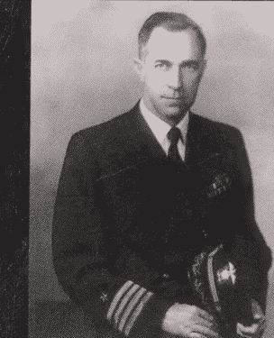

“约翰·D·埃德华兹”号驱逐舰（DD 216），由亨利·E·埃克斯指挥，于1942年2月19/20日夜晚在巴多登海峡（或巴杜浪海峡）海战。这场战斗是美、英、荷、澳盟军（包括当时的美国亚洲舰队）在珍珠港事件后几个月里，为保护荷兰东印度群免受日本入侵而另一次徒劳尝试。埃克斯如何带领他那艘21岁的舰船（盟军十艘驱逐舰和巡洋舰之一）不懈地进攻一支日本登陆部队（如第6章所述），却被仅四艘日本驱逐舰击回——这些日本驱逐舰更现代、装备更精、组织更有效，并经过夜间水面战斗的训练。埃克斯指挥官后来对海军和海军战争学院做出了重大贡献，他曾环游半个地球，却发现自己陷入了一场盟军接连溃败，尽管他和他的船员们勇敢且坚定，但他们幸运地生存了下来。

由安·G·拜尔（Ann G. Bayer）创作的原创画，基于书中收集的日记条目、信件和报告。这位艺术家的作品——大多描绘了引人注目的战斗、盟军场景和建筑——已在罗德岛州纽波特地区展出。（她优雅地感谢了丹尼斯·亚当斯（Dennis Adams）描写巽他海峡海战的感人画作《澳洲皇家珀斯号》（HMAS Perth）的灵感，该画悬挂于澳大利亚战争纪念馆。）插图与标题页：1944–45年担任舰长的亨利·E·埃克斯。

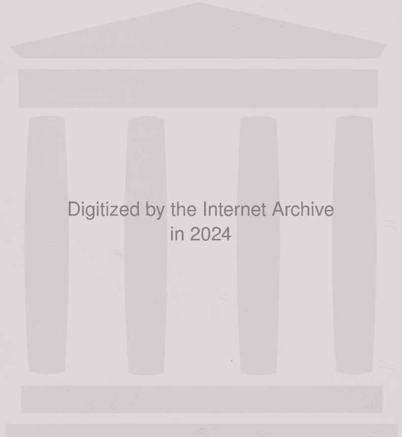

https://archive.org/details/tojavaseaselecti0000eccl


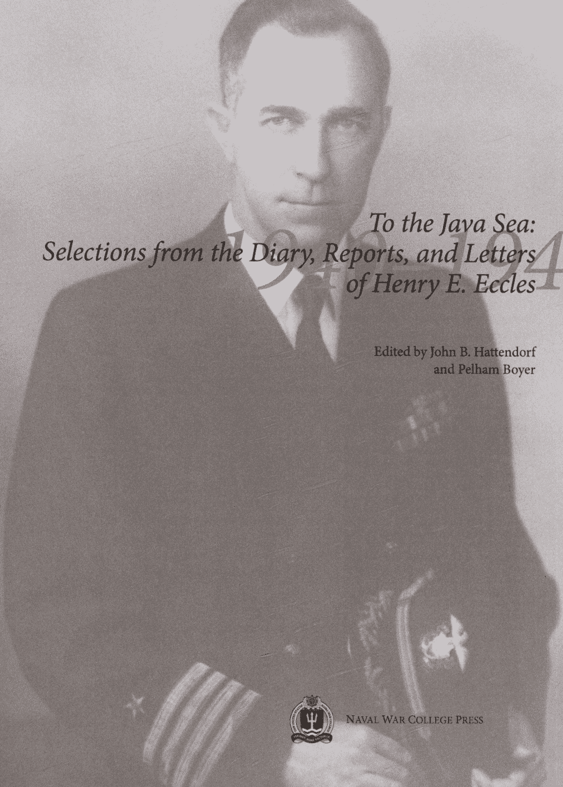


[/content]

[content]

[在日记和信件中提到的重大外部事件以斜体列出。]

## 1940年

- *5月15日：荷兰向德国投降，女王已逃往英国*
- *5月22日：法国在贡比涅向德国投降*
- *6月30日：HEE 乘坐 SS Henry S. Grove 号离开纽约市*
- *7月：德国开始对英吉利海峡港口进行轰炸*
- *7月3日：英国皇家海军在梅尔埃尔凯比尔轰炸法国海军力量*
- *7月26日：HEE 到达开普敦，登陆*
- *7月30日：HEE 访问位于西蒙斯敦的英国海军基地*
- *8月：德国开始对机场和雷达站进行轰炸*
- *8月1日：HEE 与司机离开开普敦，进行长时间观光停留*
- *8月4日：HEE 与司机经由摩塞尔湾、伊丽莎白港和东伦敦的夜宿后，抵达德班*
- *8月8日：HEE 与 Henry Dreyer 在格莱莱尔过夜后，离开克鲁格国家公园*
- *8月10日：HEE 与 Henry Dreyer 在过夜于位于到达的萨比（下萨比）和斯库库萨营地并到达科普（普特利亚）后，离开克鲁格*
- *8月12日：HEE 与 Henry Dreyer 到达德班*
- *8月16日：HEE 乘坐 SS Swartenhont 号航行*
- *8月17日：Swartenhont 号停靠洛伦索·马奎斯取煤，留夜*
- *8月20日：Swartenhont 号停靠贝拉（8月21日离开）*
- *8月26日：Swartenhont 在桑给巴尔过夜，在此之前短暂停靠了林迪*
- *8月27日：Swartenhont 到达蒙巴萨，留夜*
- *9月1日：Swartenhont 停靠马特赫*
- *9月2日：美英“驱逐换基地”协议*
- *9月10日：Swartenhont 停靠萨榜取煤，留夜*
- *9月12日：Swartenhond 停靠德拉万·德里，留夜*
- *9月14日：HEE 到达新加坡*
- *9月22日：HEE 飞离新加坡*
- *9月23日：HEE 经由曼谷（过夜）和阿基亚（实特威）抵达加尔各答，留夜*
- *9月24日：HEE 经由瓜廖尔和拉德·萨曼德（Bal Samand）抵达卡拉奇，留夜*
- *9月25日：HEE 在迪拜短暂停留后，抵达巴林，住在阿瓦尔*
- *9月29日：HEE 飞离巴林*
- *10月1日：HEE 到达曼谷，留夜*
- *10月2日：HEE 经由加尔各答抵达新加坡*
- *10月6日：HEE 从新加坡飞往巨港*
- *10月7日：HEE 开车前往并参观民多坡油田，留夜*
- *10月9日：HEE 飞往巴达维亚（雅加达）*
- *10月10日：HEE 到达马尼拉，在随后几天接管了“约翰·D·爱德华兹”号（USS John D. Edwards）的指挥权*
- *10月18日：亚洲舰队司令 Thomas C. Hart 致写关于 HEE 行程报告的慰问信*
- *10月27日：HEE 向 Hart 汇报*

## 1941年

- *2月3日：Edwards 开始招标维修*
- *2月21日：HEE 到达碧瑶度假，停留至2月25日*
- *2月27日：招标维修完成，Edwards 开始局部行动，并短暂访问了马里韦莱斯*
- *5月19日：德国军队进攻了克里特岛*
- *5月25日：德国入侵意大利* (注：原文可能有误，历史上为意大利入侵法国或德意关系变化，此处保留原文语义)
- *6月6日：德国入侵* (注：原文缺失对象，推测为入侵苏联或诺曼底登陆前奏，保留原文)
- *6月10日：美国与德国断交关系*
- *6月7日：美国对日宣战* (注：历史上为1941年12月8日，此处保留原文日期)
- *6月22日：德国入侵了苏联*
- *6月25日：日本入侵了菲律宾* (注：历史上为1941年12月，此处保留原文日期)
- *7月10日：日本袭击了马尼拉湾* (注：历史日期存疑，保留原文)
- *7月14日：日本袭击了马尼拉*
- *7月14日：日本轰炸了海军目标*
- *1月5日：参加了爪哇海海战* (注：日期与1942年事件混淆，保留原文)
- *1月20日：参加了巴多登海峡海战*
- *2月4日：参加了马加萨海峡海战*
- *2月14日：参加了爪哇海海战*
- *2月20日：参加了爪哇海海战*
- *3月18日：爪哇海海战*
- *4月6日：HEE 离开墨尔本，飞往旧金山*
- *5月19日：HEE 转移到三宝颜*
- *5月20日：HEE 抵达阿瓦尔*
- *5月25日：HEE 抵达伊洛伊洛*
- *6月16日：HEE 抵达婆罗洲*
- *6月17日：HEE 抵达巴达维亚（雅加达）*
- *6月29日：HEE 抵达碧瑶*
- *7月14日：HEE 抵达泗水*
- *7月20日：HEE 抵达库邦*
- *7月30日：罗斯福任命美国海军司令* (注：原文不全，保留原文)

（前文）带他来到这里担任后勤部主管，直到20世纪80年代中期。在期间的这些年里，他是该学院多任院长的顾问。他关于后勤、战略和军陆哲学的著作和文章广为流传。本书摘自他的论文和信件，构成了学院最详尽、最实用的藏品之一。

首先，这本书缅怀了一位伟大的老师和学者。更重要的是，它让我们通过一位观察敏锐且深思熟虑的参与者的视角，看到了一个极具戏剧性且重要的事件：远东太平洋战争的爆发。当时更年轻的亨利·埃克莱斯正身处风暴中心。他所看到的、遇到的人、去过的地方（尤其是如何到达那里的）、他曾服役的海军和舰船、他对战斗的反应，以及这些事件（对美国来说是毁灭性的）留给他的严酷决绝——这一切都通过他的许多信件和日记变得引人注目并供我们参考。我们相信，这本书将让那些对书中涵盖的时间、地点和事件任何方面感兴趣的读者更好地理解并更充分地欣赏海军专业主义理想——荣誉、勇气和承诺——在和平与战争实践中的真谛。

玛格丽特·D·克莱因（MARGARET D. KLEIN）

美国海军少将（退役）

领导力与伦理学院院长

## 引言：亨利·埃克莱斯与海军战争学院

从20世纪40年代后期到80年代中期，美国海军亨利·E·埃克莱斯少将（Adm. Henry E. Eccles, USN）是与罗德岛州纽波特的海军战争学院最广为人知且最受尊敬的人物之一。最重要的是，他作为军事知识分子、专家，以及关于海军后勤、战略、军事理论以及广义的民军事问题书籍作者而闻名全球。对于那些在海军战争学院以顾问身份认识他，作为多任海军战争学院院长的信赖者、专业顾问以及后勤原则、国际关系及军事理论选修课教师的人来说，他是一个充满活力的启发性思想源泉。造福所有人的是，他总是不断提醒人们要深思熟虑、明智写作，并要求对抽象术语和思想给出清晰的定义。

正如他在纽波特受到的仰望和赞誉一样，他是少数肖像被画入学院永久艺术收藏的教职人员之一。此外，海军战争学院在1977年出版了一期特刊，纪念他从现役退役25周年；1985年6月，海军战争学院图书馆以他的名字命名，感谢他对海军思维做出的巨大贡献。正如伯克上将（Adm. Burke）对他的评价道：“很少有人能像他这样坚定、富有影响力，并从同伴那里赢得如此崇拜和喜爱。”

通常，亨利·埃克莱斯对战争学院社区的最后的话都包含一种挑战。他指出，用他的名字命名图书馆是考虑到未来海军领袖伟大愿景的核心和焦点，他说：

> 仅仅将这种伟大的愿景和这些思想包含在书籍、书架和目录索引中是不够的。
>
> 海军战争学院的工作人员忽视了两种必须被赋予生命的力量：一个是连贯军事理论的纪律，另一个是活跃的机构记忆。这两者共同提供了开发、比较思想，并用生动的语言重新表述思想，以适应政治和科学增长及事实所带来的不断变化的局面的力量！


## 奔爪哇海

在书中所述事件结束后，回到美国后，埃克莱斯在1942年夏天被分配到华盛顿特区海军作战行动官副长办公室的基地开发处。在这里，他负责所有美国前线基地的详细协调；他制定了最初的想法，这些想法发展成了后来所谓的“功能性‘前线基地规划组件系统’”。同时，他构想并启动了“淘金计划”，旨在开发利用登陆运输舰（LST）进行通用后勤支持工作。

亨利·埃克莱斯于1943年7月至12月作为学生首次短暂出现在海军战争学院，当时他作为一名指挥官参加了简化的战时指挥课程。毕业后不久，他升为上尉，被派往夏威夷，担任美国太平洋舰队兵力部队前线基地处处长。在这一职位上，他领导了在美军跳跃中太平洋岛屿时建立前线基地的工作，处理了所有的规划、建设、支持和培训问题。由于他在前线基地方面的成就，雷蒙德·斯普鲁恩斯上将（Adm. Raymond Spruance）授予了他功绩勋章。当年年底，埃克莱斯于1946年被分配到陆军参谋学院的联合作战审查委员会（后于1946年成为海军战争学院的基础），负责评估二战期间的联合行动并修订联合条令。回想起来，埃克莱斯在希尔中将（Vice Adm. Harry Hill）领导下完成了这项为期九个月的任务。1946年，埃克莱斯被派往“华盛顿”号（USS Washington, BB-56）所在的纽约，负责退役。在完成任务后，1947年4月，埃克莱斯受斯普鲁恩斯的邀请加入海军战争学院教职，担任主任直到1951年回到纽波特关于后勤和军事理论。在此期间，他还在国家战争学院、武装部队参谋学院、总参谋学院和空军大学授课。

亨利·埃克莱斯与战争学院的联系在1951-52年曾中断，当时他被任命为大西洋及地中海海军司令部的后勤参谋长，在罗伯特·B·卡尼上将（Adm. Robert Carney）领导下工作。1951年9月，他被派往意大利那不勒斯新成立的北约总部。在这些年里，埃克莱斯和妻子保留了位于华盛顿街101号、俯瞰电池公园的住所，直到1985年离开纽波特。

1952年6月30日，退役并晋升预备役少将后，埃克莱斯回到纽波特的家中，开始与海军战争学院保持非正式联系。从1952年到1970年，他是华盛顿大学研究项目的顾问，并频繁在海军战争学院和武装部队参谋学院授课。1958年，他为俄亥俄州立大学赞助了一系列讲座。在纽波特的家中，他通过对海军战争学院宗旨和目标的共同关注，与许多学生、员工和教职人员建立了紧密的个人联系。1954年，亨利写道：“如果我在30年的服役生涯中取得了有价值的成就，那就是我在海军战争学院及其他地方的后勤和教育工作。多年来，我为将战争的基本事实带回海军而进行了一场艰难的战斗。”

在随后的三十年退休岁月里，亨利·埃克莱斯通过他额外的著作、文章和教学取得了重要意义的成就。他不断对军事理论和时事进行写作和反思，每天产生短篇反思论文，并亲自交付给希望获得建设性批评的人。莱曼·M·克利帕特二世曾是中央情报局高级官员，后任布朗大学政治科学教授，他后来回忆道，在1971-72学年他访问海军战争学院担任国家事务与国际关系的切斯特·W·尼米茨讲座教授时，“真正的乐趣之一就是亨利·埃克莱斯的访问。我记得卢斯厅的休息室门被推开；亨利快速看一眼是否有访客；然后走进来把一张论文丢在桌子上，问出一个几乎是标准的问题：‘你觉得这个如何？’”

对于那些经常收到这些信件的行家来说，这些信件被幽默地（出于这位上将的精力旺盛）称为“ecclesiana”，但它们需要严肃的思考和有力的回答。对于经常接收者来说，这些信件有时会附带写在黄色法律纸上的长篇笔记；其中许多笔记本身就有价值，并被作为对军事理论和当代问题的深刻反思而保存以备未来参考。今天，它们构成了海军战争历史收藏中按主题分类的文件的大部分。

## 早年生活与教育

亨利·埃克斯作为富有影响力的军事和海军知识分子的声誉，很大程度上与其早年的生活、教育和成长有关。¹³这些经历塑造了他后期思维的思维习惯，并在此处提供的日记和信件中有所体现。埃克斯于1898年12月31日出生于纽约州贝赛德，父亲是乔治·华灵顿·埃克斯牧师，一位圣公会牧师兼贝赛德全圣人教堂的牧师，母亲是莉迪亚·劳伦斯·埃克斯。父母将新生的儿子命名为亨利，以纪念他的外祖父亨利·埃菲金姆·劳伦斯，他来自贝赛德和摩根市（位于路易斯安那州的布拉斯希尔，一个家族姓）。小亨利在1910年之前一直接受家庭教育。他最早的教育部分是通过与他那聋哑的叔叔汤森德·劳伦斯度过的大量时间获得的，叔叔是一位读书广博的人，亨利通过手语与其交流。在幼年时期，亨利的父母经常乘坐客轮前往欧洲。在1904年至1911年间，亨利随父母往返欧洲五次，访问了英国、法国、比利时、荷兰、德国和瑞士，这留下了他对战前欧洲文化生活的清晰记忆，以及对艺术和音乐的终身兴趣。在一生中，亨利还保留了那十次跨大西洋航行的生动记忆，这归功于他对成为海员的浓厚兴趣。¹⁴

1910年，大约11岁的他进入了纽约市的三一公学。该校最初与华尔街的三一教会有关，作为一所圣公会慈善学校而建立。它在美国革命中幸存下来，最终成为一种以英国顶尖学校（如伊顿、哈罗、威斯敏斯特和温彻斯特学校）为模版的非教派学校模式。该校位于富裕的西区的西91街，与许多富有的纽约人的宅邸并肩而立。

亨利于1916年从三一公学毕业后，有影响力的朋友和家人努力为他争取到了位于马里兰州安纳波利斯的美国海军学院的名额，但这花费了大量时间来安排。家族的朋友们写信给各种政治人脉，包括海军部助理部长富兰克林·D·罗斯福，试图获得总统任命。然而，当时的总统任命仅限于担任现役军官的儿子，罗斯福建议他寻求其所属国会议员的任命。亨利自己的国会议员、来自纽约州第15选区的托马斯·F·史密斯任命他为第一候补。与此同时，来自纽约州西部的第21选区的国会议员G·穆里·胡尔伯特正离开国会席位担任纽约市码头专员，他任命亨利为他的首席候选人。由于法律要求被任命者必须是国会议员选区的居民，埃克斯很幸运，史密斯议员最初的首选候选人没有通过规定的考试；亨利被替补选中。由于花费了所有时间，直到1918年8月，他才能到达海军学院并加入1922级。

在此期间，1916年夏天，亨利在长岛湾入口东方角外的普拉姆岛特里堡参加了初级军事训练营，随后在1917–18学年进入哥伦比亚学院学习机械工程。1918年5月和7月，在完成哥伦比亚一年的学业和前往安纳波利斯报道之间，亨利签约成为联合果品公司船只“西克索拉号”（SS Sixola）的船员，航往加勒比海。


# 亨利·埃克尔斯传记资料编辑说明

## 早年海军生涯

1922年从海军军学院毕业后，亨利·埃克斯的第一个任务是担任新服役的科罗拉多级战列舰“马里兰号”（USS Maryland, BB 46）的信号官，该舰是美国西洋舰队司令官希拉里·P·琼斯（Hilary P. Jones）海军将的旗舰。旗舰曾出现在安纳波利斯参加1922级的毕业典礼。

1922年8月18日至9月25日，“马里兰号”搭载国务卿查尔斯·埃文斯·休斯（Charles Evans Hughes）前往里约热内卢。1923年2月和3月，“马里兰号”参加了舰队一演习，测试泛拿马运河的防御。在1923年6月，“马里兰号”以航空母舰的角色通过了运河。

1924年，亨利作为海军中尉担任海军的助理官{16}，该舰随舰队横跨大西洋，访问了塔巴哥、布雷斯特、直布罗陀和亚尔尔岛的蓬塔德尔戈。在完成这次航行后，他被派往康涅狄州的“切温克号”（USS Chewink, AM 39）担任少尉，该舰是潜艇学校的，他在1925年1月开始潜艇训练{18}。在1925年完成潜艇训练后，他被派往位于圣地亚哥的第28号（S-28）担任航海和通信官。

在圣地亚哥的第28号工作了近两年后，他被调往第25号（S-25）{19，另一艘位于圣地亚哥的潜艇}担任工程师官。

1928年在第25号完成任务后，这位拥有六年海上服役经历的士兵在安纳波利斯的海军研究生学院参加了为期六月的内机课程，然后回到纽约市的哥伦比亚大学，并在1930年那里获得了机械工程硕士学位。他被升为中尉，凭借这些资质，他担任了第1号（O-1）潜艇的舰长{20，1号于1931年6月退役，他被派往潜艇学校的第13号（R-13）担任执行官，并在1932–33年指挥该艇{21}。

1933年，他被分配到岸工作，担任康涅狄州潜艇基地的工程师和修理官。在当地工作到1935年，他负责基地车间的现代化，并支持周界天线开发的早期实验。他回到海上，担任巡洋舰“盐城号”（Salt City, CA 25）的助理工程师。在那艘位于加州圣佩德罗的船上，埃克斯和他的船员参加了从西雅图到圣地亚哥的西岸演习。1936年初，该舰在克利门特岛附近参加射击演习，随后前往泛拿马运河巴尔博亚参加联合演习。1936年6月中返回圣佩德罗后，该舰在1937年4月和5月航夏威夷，随后返回母港。

## 华盛顿岸上任职

1938年升为海军上尉，埃克斯被分配到位于华盛顿的海军部工程局的设计建设分部。在这项工作中，他负责协调海军所有的内机驱动船舶，当时包括潜艇、潜艇母舰和拖船。他与马尔谢·M·“Heavy”（Heavy）中尉合作，开发了他们认为是武装部队中第一个技术备件控制系统（该系统将使用与采购联系起来，最终变成了“供应-需求-控制”概念）。此外，埃克斯重写了海军购买内机的规格，将一种过时、自相矛盾且混乱的方法转变为实用的采购工具。此外，在任内埃克斯参与了海军对微型胶的先驱使用。

## 指挥“约翰·D·爱华兹号”

1940年，航海局（1942年改为海军人事局）选择埃克斯承担一项让他记录的任务：担任克姆森级驱逐舰“约翰·D·爱华兹号”（John D. Edwards, DD 216）的舰长，该舰于1919年下水，当时驻守菲律宾马尼拉的美国亚洲舰队。他在海军军学院的一位同学米尔顿·E·迈尔斯（Milton E. Miles）后来指挥过该舰，并在1944–45年作为美国中国海军小组司令而闻名。

潜艇、海军训练。他现在正被派往指挥一艘有一年寿命的驱逐舰，该舰母港位于海外的亚洲海域，当时国际局势日益紧张。战争在欧洲和亚洲已经愈演愈烈；他清晰地意识到自己正生活在一个历史性的时代，并且当美国卷入战争时，他极有可能处于“矛锋尖上”。

## 本书内容概述

本书的内容记录了亨利·R·埃克尔斯（Henry R. Eccles）中佐乘坐客船从纽约前往马尼拉的行程，在此期间为海军情报局执行了一些情报工作，以及随后在托马斯·C·哈特（Thomas C. Hart）海军将下指挥亚洲舰队的约翰·D·埃德华兹（John D. Edwards）号。全书结束于埃克尔斯以指挥官身份参加了东南亚短暂的盟军力量——美英荷澳联合司令部（简称ABDA司令部），以及他随后在1942年2月巴巴登海峡和爪哇海战战中的经历，在这些战斗中，亨利·埃克尔斯获得了勋章。

## 史料价值

亨利·埃克尔斯与许多此类出版合集的作者不同，他从未预料到他的信件和日记会被更广泛的读者阅读。这些是私人通信，是一个深爱的丈夫和父亲在内心冲突中挣扎，并与妻子分享他的经历。与此同时，作为一名中级海军官，他也在撰写上级和职业所要求的正式报告。对于本书的读者来说，这种结合是幸运的。将个人文件和官方文件并放在一起，提供了一个窗口，让我们窥见一位敏感敏锐的海军官的心灵、情感和灵魂，他在港口和海上执行日常的舰上指挥任务，并在战斗中接受极的考验。这些事项在这些文件中得到了表达，其背景是一个与我们现在迥然不同的世界、早期的海军技术以及不同的价值观。同时，从这些文件中也露出了个人责任、荣誉和承诺的持久价值观，这些价值观对于任何时期的服役军官都具有意义。

在某些方面，这些文件表达了毫无防备的态度和坦诚的观点，如果由今天一位美国海军官写下，可能会被认为是不可接受的，对于像埃克尔斯指挥官这样出身、受过教育且敏感的人来说，尤为令人惊讶。他对他遇到的国家和民族的坦率感受在这里完全完整地保留了下来，没有任何歉意，因为它们准确地反映了1940年至1942年间，通过亨利·埃克尔斯那个环境的人眼中看到的世界。

这些文件关于他那个时代的世界告诉我们很多信息，其毫无防备性无疑是其真实性的保证。那些观察以及它们对研究对象和作为美国海军代表的观察者所暗示的一切内容，构成了这些文献性的很大部分。它们为我们提供了关于特定个人经历的洞察，这些经历构成了亨利·埃克尔斯对战略、后勤、军事最后抽象思考的重要基础。

## 致谢

本书首先是为了对海军少将埃克尔斯及其夫人提供的私人友谊和慷慨款待表达深表感谢。同时，它承认了埃克尔斯将将在主编寻求理解高层次海军思维和理论体系时提供的宝贵指导。在埃克尔斯将于1986年去世后，埃克尔夫人及其孙女莉娅·埃克尔提供了额外的文件和帮助。

从20世纪80年代末，在整理和编辑这些文件出版的早期阶段开始，佩姆·鲍耶就参与其中并提供了他宝贵的技能。在随后的几十年里，我们两人在不同的道路上都被其他的职业需求所占据，这项项目从最初的断断续续变成了长期的休眠，偶尔苏醒。它一直是一个等待完成的项目。当我们2016年和2015年从长期担任的行政职位上退休时，机会让我们以团队的形式重启这一编辑项目，佩姆作为志愿者提供了宝贵的支持。我们非常感谢海军学院对项目的鼓励和支持。我们同样感谢佩姆结婚四年的安·G·鲍耶提供的卓越帮助——除了核心那幅引人注目（经过仔细研究）的画外，她还通过复杂的调查（尤其是在线调查）确定了我们遗漏的人、地点和事件。

特别，我们对海军学院基金会和Alletor Morris McBean慈善信托基金深表谢意，他们慷慨提供了五万美元资助以支持本书的出版。

我们感谢弗吉尼亚州纽波普斯的海员博物馆与公园的图书馆档案员杰·E·摩尔博士提供的重要帮助；以及由华盛顿特海军历史与遗产司令部的盖尔·蒙罗（Gale Munro）和莉莎·克鲁克（Lisa Crunk）撰写。

在海军战争学院，海军历史收藏的连续档案员伊芙琳·切帕克博士（Dr. Evelyn Cherpak）和达拉·贝克（Dara Baker），联合助理档案员伊利莎白·德尔马奇（Elizabeth Delmage）在整个项目中提供了宝贵的支持。此外，我们感谢亨特·西里斯（Hunter Sieries），他在2016年夏天研究埃克尔斯档案（Eccles Papers）时，花时间为我们提供了非常有用的文件扫描件，以及一份关于其他材料的检索辅助大纲供参考。最后，感谢海军战争学院博物馆代理执行经理兼策展人罗伯特·杜恩（Robert Doane）和收藏经理沃尔特·尼科斯（Walter Nichols）在从博物馆丰富的收藏中挑选照片方面的慷慨协助；感谢视觉传播总监伊利莎白“吉吉”·戴斯（Elizabeth "Gigi" Davis）在封面制作方面的协助；以及正如纽波特几代研究人员一样，感谢海军战争学院亨利·E·埃克尔斯（Henry E. Eccles）图书馆传奇且高明的参考、借阅和档案工作人员。

若干在海军战争学院海洋史部从事夏季项目或担任实习生的当地学院和大学生，通过协助转录并将转录与原始稿进行对比，以及校对部分文本，对本项目共同做出了宝贵贡献。他们包括玛格丽特·泽彻（Margaret Zecher）、艾莎·克莱曼斯（Aisha Clements）、詹姆斯·毛勒（James Maurer）和劳拉·兰辛（Laura Lansing）。

## 编辑原则

总而言，本书的编辑理念源于编辑者早期的作品之一：《His Majesty's Service: Observations of the British Home Fleet from the Diary, Reports, and Letters of Joseph H. Wellings, Assistant US Naval Attaché, London, 1940–41, Naval War College Historical Monograph 5》（Newport, RI: Naval War College Press, 1983; 重印. 1993）。本书的初步研究和转录工作在该书出版后不久便开始，即1985–86年。至少在主编看来，它的初衷和现在都是补充早期的工作，后者收集了同一时期的写作，但记录的是不同的战争战场：威尔斯中尉（Lieutenant Commander Wells）在1940–41年与英国本土舰队的经历，并以德国俾斯麦号战列舰沉没告终。两卷书将个人日记条目、给军官夫人的私人信函与给上级的正式官方报告交织在一起——试图呈现美国海军军官在不同情况下的经历及其反应的完整记录。威尔斯年纪较小，出生于1903年，是海军学院1925级见军生；而埃克尔斯出生于1898年，毕业于学院1922级。他们两人留下的文件选辑构成了更好地理解当时美国海军军官职业、文化和社会视野的补充基础，而那正是美国进入第二次世界大战的时刻。

总的来说，编辑者保留了信件随性或匆忙的，保留了其严谨的标点符号。然而，为了清晰起见，拼写已规范化；在原文混淆处对标点符号进行了无痕调整；特别是克制了埃克尔斯对大写字母的偏好。在为了理解需要时，对省略表达和缩写进行了展开——如果仅涉及助词或功能词，或明显漏掉了单词，则进行无痕处理；但在为了意义清晰而需要实质性插入内容时，则放在括号内。地名和人名的翻译保持了一致；埃克尔斯的拼写（在有变动处已标准化）保留在正文、地图和注释中（在提供正确或现代形式的情况下）。尽可能通过脚注在文中首次提到时识别人物和地点；还提供了注释以阐明海事专业术语，这些术语对于完全理解内容是必要的，但埃克尔斯可以理解地认为这些知识是理所当然的。

## 资料来源

本书的文本和许多插图（另有说明外）均来自海军战争学院海军历史收藏中的52号手稿：亨利·E·埃克尔斯将将（Manuscript Collection 52: The Papers of Admiral Henry E. Eccles）。这一由107个档案箱组成的收藏为埃克尔斯将的生涯和著作提供了丰富的资源。为了节省全书空间，摘录未单独脚注。书中摘录的文件来自该收藏中的多个位置：

- 日记，纽约到马尼拉，1940年：V系列，第91箱，第3文件夹
- 给埃克尔斯夫人的信，1940–42年：II系列，第3箱
- 美国海军命令，职务变动，1940–42年：II系列，第13文件夹
- 发出和收到的私人信件，1940–42年：II系列，第1箱，第18–21文件夹
- 关于非洲和远东旅行的材料，V系列，第88箱，第16文件夹
- 杂杂想法、记录和笔记：V系列，第91箱，第1文件夹
- 官方信函，1940–41年发送：II系列，第4箱，第2文件夹
- 亚洲舰队舰队文件：IV系列，第68箱，第1–12文件夹
- 旅行报告，纽约到马尼拉，1940年10月18日：文件夹9, 12
- 与家人、朋友的信，1941–45年：文件夹1, 9
- 1号作战命令，1942年2月19日：文件夹1
- 巴丹岛报告，1942年2月19日：文件夹
- 岛屿报告，1942年3月4日：文件夹
- 爪哇海报告，1942年3月20日：文件夹
- 菲律宾报告，1942年3月4日：文件夹
- 菲律宾报告，1942年3月10日：文件夹
- 菲律宾报告，1942年3月11日：文件夹
- 菲律宾报告，1942年3月12日：文件夹
- 菲律宾报告，1942年3月13日：文件夹
- 菲律宾报告，1942年3月19日：文件夹
- 菲律宾报告，1942年3月20日：文件夹
- 菲律宾报告，1942年3月21日：文件夹
- 菲律宾报告，1942年3月23日：文件夹
- 菲律宾报告，1942年3月24日：文件夹
- 菲律宾报告，1942年3月25日：文件夹
- 菲律宾报告，1942年3月26日：文件夹
- 菲律宾报告，1942年3月27日：文件夹
- 菲律宾报告，1942年3月28日：文件夹
- 菲律宾报告，1942年3月29日：文件夹
- 菲律宾报告，1942年3月30日：文件夹
- 菲律宾报告，1942年3月31日：文件夹
- 菲律宾报告，1942年4月1日：文件夹
- 菲律宾报告，1942年4月2日：文件夹
- 菲律宾报告，1942年4月3日：文件夹
- 菲律宾报告，1942年4月4日：文件夹
- 菲律宾报告，1942年4月5日：文件夹
- 菲律宾报告，1942年4月6日：文件夹
- 菲律宾报告，1942年4月7日：文件夹
- 菲律宾报告，1942年4月8日：文件夹
- 菲律宾报告，1942年4月9日：文件夹
- 菲律宾报告，1942年4月10日：文件夹
- 菲律宾报告，1942年4月11日：文件夹
- 菲律宾报告，1942年4月12日：文件夹
- 菲律宾报告，1942年4月13日：文件夹
- 菲律宾报告，1942年4月14日：文件夹
- 菲律宾报告，1942年4月15日：文件夹
- 菲律宾报告，1942年4月16日：文件夹
- 菲律宾报告，1942年4月17日：文件夹
- 菲律宾报告，1942年4月18日：文件夹
- 菲律宾报告，1942年4月19日：文件夹
- 菲律宾报告，1942年4月20日：文件夹
- 菲律宾报告，1942年4月21日：文件夹
- 菲律宾报告，1942年4月22日：文件夹
- 菲律宾报告，1942年4月23日：文件夹
- 菲律宾报告，1942年4月24日：文件夹
- 菲律宾报告，1942年4月25日：文件夹
- 菲律宾报告，1942年4月26日：文件夹
- 菲律宾报告，1942年4月27日：文件夹
- 菲律宾报告，1942年4月28日：文件夹
- 菲律宾报告，1942年4月29日：文件夹
- 菲律宾报告，1942年4月30日：文件夹
- 菲律宾报告，1942年4月31日：文件夹
- 官方信函，1940–41年发送：II系列，第4箱，第2文件夹


- 官方信函，1940–41年发送：II系列，第4箱，第2文件夹

- 官方信函，1940–41年发送：II系列，第4箱，第2文件夹

- 官方信函，1940–41年发送：II系列，第4箱，第2文件夹

- 官方信函，1940–41年发送：II系列，第4箱，第2文件夹

- 官方信函，1940–41年发送：II系列，第4箱，第2文件夹

- 官方信函，1940–41年发送：II系列，第4箱，第2文件夹

-- 威尔斯年纪较小，出生于1903年，是海军学院1925级见军生；而埃克尔斯出生于1898年，毕业于学院1922级。他们两人留下的文件选辑构成了更好地理解当时美国海军军官职业、文化和社会视野的补充基础，而那正是美国进入第二次世界大战的时刻。

## 驶向爪哇海

与爸爸和苏西德道别，我们其他人出发前往格林尼治。保持联系。威尔·威莱特去了泰勒夫妇（威莱特的朋友）和 HEE（亨利·埃菲格姆·埃克里斯）那里；还有康登一家。周日早上我们回到了纽约。在短时间观察后，我不得不带 Isy 和 Skip 先回去了——长久告别太难受了。在此之前，当家庭分散时，计划会在相对短的时间重聚，但这次，Isy 至少要在五个月后才能在马尼见到我，而我还要两年或更久才能见到 Skip。我们亲密的家终于散落了，所有人都开始了全新的生活。这个正在形成的新世界形状如此模糊：我们只知道它将截然不同。我们知道我们将受到战争的影响——至于以何种方式无法判断。

我的生活一直都在为战争准备——战争正近在咫尺——个人的生存当然是不确定的，考虑到所涉及的问题，对我亲近的人来说相对并不重要。我们在一起生活的一切，都在背景中——终有一天它会到临，我无法直视 Isy 的眼睛。我想我是个胆小鬼，但我感觉不到，也无言语表达我的感受——所以告别是突兀而残酷的。那是我最后看到我的儿子还是个男孩——现实还没有完全进入脑海。

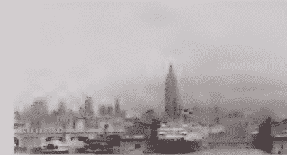

终于在下午四点，船出发了，此前因为麻烦和对挂号信的捣乱而延误。下下湾的航程非常美丽。我忙于拍照，年轻的托米·克利夫兰（见下条目）玩着我的望远镜。要执行任何职责似乎并不自然，但至少这让我享受了这次航海之旅。托米的热情帮我暂时忘记了自己的感受。

学习，第一次世界大战期间的海军预备队。他在海外服役了三个月，指挥 110 英尺的护卫艇 SC-4 号，1919 年以中尉（少尉）身份退役。1943–51 年，他担任了罗德岛州纽波特圣乔治学校的校长。1952 年，他成为华盛顿中央情报局初级军官训练计划主任，一直直到 20 世纪 60 年代中期退休。

一个源自明尼苏达的庞大富裕家庭由切斯特·阿吉尔·康登（1853–1906）创立，他起初是一名律师，后来（在银行和贸易领域）成为该州最富有的人之一，并最终成为共和党的全国领袖。HEE 最接近的同代人是他的儿子罗伯特·康登（1888–1967），他曾就读耶尔大学，现在从事金融和矿业工作。他的住所附近在纽约，康涅狄格州。

当时，派往菲律宾的任务还不是现在所说的“非随同派遣任务”。埃克里斯夫人推测是一位军属，在 HEE 被分配新任务时与他结婚（他们的儿子将留在寄宿学校）。在那里她可以期待成为大型美国平民社区的一员。事实证明，军属家属直到明年才能撤离（见下文）；其他五千名无法逃脱的平民将被日本人所关押。

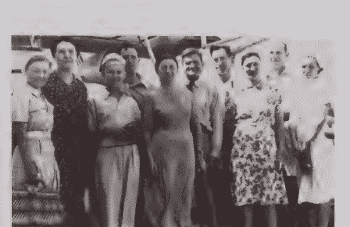

## 给埃克里斯夫人的信，1940 年 7 月周一

. . . 船很舒服，食物非常好。乘客构成如下——克利兰德一家——母亲、父亲和儿子——来自德克萨斯州的长老会传教士，在休假后回到比属刚果。还有霍利假日小姐，一位干练的终结工作者，她在传教站教学。所有的霍洛伊小姐来自弗吉尼亚州，人非常活泼有趣——她在为白人女学校教所有科目，那些女学生嫁给了密歇根大学的南非学生，现在正回到非洲与它们的牙医丈夫会合。然后索格先生，一位刚在哈佛大学完成两年地质学学习的年轻人，正回家。他是一个布尔尔人——非常聪明，是个很很好的伴侣。马克斯·卡岑先生是一位一直在到处流浪的南非商人。还有另一位传教士。霍洛伊、牙医太太和我坐一桌桌，其他人坐在另一边。我们更有钱，密度也更小。这看起来是一次有趣的旅程，尽管我们会很想上岸 . . .

“纽约到开普敦，

1940 年 7 月”

[背面] “卡岑夫人，

克利夫兰，[HEE!]；G 先生。

[发自] “霍洛伊小姐。

克利夫兰夫人，托米

克利夫兰，莱里亚克小姐，

特尔玛·范·克雷恩堡夫人，珀尔·韦格勒夫人。”

(HE)

菲和莱昂诺·拉姆自 1913 年起就是比属刚果的传教士，一直工作到 1956 年退休。Rose 出现在德克萨斯州布朗伍德的 1883 年，1911 年毕业于奥斯汀学院，1913 年毕业，并就读于长老会神学院，被西德克萨斯长老会按立。他的妻子（名莱昂·阿米莉亚·拉姆）于 1890 年出生于圣东尼奥。两人于 1913 年结婚，不久后前往刚果，在那里从事商业和财务工作，并在教育和妇女部门从事教学和学习工作。Rose（名莱昂·阿米莉亚·拉姆）于 1890 年出生于圣东尼奥。两人于 1913 年结婚，不久后前往刚果，在那里从事商业和财务工作，并在教育和妇女部门从事教学和学习工作。Rose（名莱昂·阿米莉亚·拉姆）于 1890 年出生于圣东尼奥。两人于 1913 年结婚，不久后前往刚果，在那里从事商业和财务工作，并在教育和妇女部门从事教学和学习工作。Rose（名莱昂·阿米莉亚·拉姆）于 1890 年出生于圣东尼奥。两人于 1913 年结婚，不久后前往刚果，在那里从事商业和财务工作，并在教育和妇女部门从事教学和学习工作。Rose（名莱昂·阿米莉亚·拉姆）于 1890 年出生于圣东尼奥。两人于 1913 年结婚，不久后前往刚果，在那里从事商业和财务工作，并在教育和妇女部门从事教学和学习工作。 17 世纪殖民化开普敦的荷兰定居者的后裔。马克斯·卡岑（1907–），在约翰内斯堡


## 个人日记

### 1940年7月2日星期二

周一我重新整理了行李并在房间里安顿下来，今天早上睡了。下午我读了一会儿，玩了一会儿，在阳光下惬意地休息。没有什么好担心的真是太好了——紧张的神经已经冷静下来。

晚上我在船长舱坐了一会儿，和苏利文船以及克雷恩堡夫人聊天。和索格先生讨论了地质学等，然后听了加伦托对美国军告别示意。苏利文船进行了一次真实的射击。

### 1940年7月3日星期三

今天是完美的一天——天空晴朗，微风正好让我放松。早晨我们发现了一支由两艘巡洋舰护航的英国船队。苏利文船转向右舷（即右侧）避开他们，最终在七英里处经过。我读了一些技术读物，做了一些严肃的事情——克利夫兰非常有意思的方式介绍了非洲教会生活，并向我展示了他1924年在比属刚果建立的任务站的照片。我一直对传教士持有一种抽象的尊重，但与克利兰德夫妇和霍洛伊小姐的接触让我第一次了解他们，这非常愉快。做那种工作需要意志、身体和精神的力量……

### 给埃克里斯先生的信，1940年7月2日星期二

乔治·T·苏利文（美国人，1892年出生）自1924年起在海运界工作，曾被德国潜艇击沉了两艘商船：纽约市号（1942年3月29日沉没）和丹尼·杰里号（1942年7月）。特尔玛·C·范·克雷恩堡（1904年出生于俄亥俄州格林鲍林），同年1月从开普敦回到美国——推测是回到密歇根州阿瑟伯的家中。她的丈夫杰里·J·范·克雷恩堡（1892年出生）是南非裔。

13

一场由德怀特·多梅尼科·安东尼奥·“双吨托尼”·加伦托（1910–79，1943年退役）参与的英勇行动，对手是美国海军潜艇员首席水兵大卫·鲍尔（1918年出生），被认为是世界上最优秀的中量级选手。鲍尔在阿谢尔号（SS 269）上进行了四次巡逻，服役二十五年后退役，在曼哈顿的麦迪森广场经营一家特许经营点。格伦·A·诺布洛克，美国海军黑人潜艇，1940–1975

刚果，克利夫兰先生于1924年12月在那里建立了一个新的传教站。因此，我的旅行已经通过放松和转变视角的形式获得了巨大的报报。

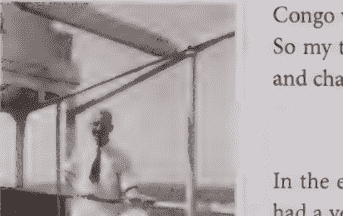

晚上，苏利文船长邀请我去参观“驾驶台”，我们在那里度过了一段非常快的时光。我确定我会非常喜欢与他相处。他是一位充满魅力、博学、经验丰富且能力出众的人。

## 个人日记

### [1940年7月3日，周三，续]

晚上的风最清爽，7月4日日在新建的泳池里游泳的前景是肯定的。

### 1940年7月4日，周四

这是美妙的一天，尽管我们大家都吃得太多了，而且运动量不足以消耗掉。泳池已经注满并维护好了。晚上看了一部平庸的电影。大家谈论的热题是关于奥兰，英国人在那里击沉了法国军舰。法国的彻底崩溃是世界上见过的最可怜的事情之一。伟大的人竟然会堕落到这种地步，真是难以置信。德国的宣传对民族灵魂的渗透比任何人预想的都要深。我认为，法国政府剩余的任何部分将只能由德国军队维持。我们知道美国也发生同样的事情，这应该比任何事情都能让我们团结起来，帮助净化国家。对我们的民主来说，这将是一场艰难的胜利，只有愿意牺牲我们体系的核心，我们才能保住我们的本质。希特勒对我们的攻击将是一场微妙得多的——他会尽一切办法分裂我们，煽动猜忌、怀疑和不确定性，利用每一个弱点，剥削每一个弱人和所谓的自由主义者。我们迫切需要坚毅、老练、思维清晰且能够专注于主要目标的人。奥兰事件的讽刺性简直令人窒息。

### 1940年7月5日，周五

天气晴朗，微风徐徐，因此阳光更持久、更温暖——医药球、游泳、日光浴、阅读和愉快的交谈构成了极好的一天。我产生了看到陆地的想法！我也无法进行任何严肃的阅读了，因为我的放松太彻底了。

## 给埃克莱斯夫人的信，1940年7月5日，周五

... 过去的两天非常愉快。泳池完工并注满了水，这一切让我们都胃大大开。食物非常棒，昨天还绰绰有余。今天更好——水面平稳了一些，所以我们可以游泳，我们增加了更多的日光浴和医药球运动。亲爱的，你会喜欢这次旅行的，这里太美了——人们友好、机敏、幽默且坐不住。小霍莱小姐很迷人——充满乐趣且非常安静。她来自弗吉尼亚州的斯波茨斯瓦尼亚，那里充满了祖先和轶事——“眼睛明亮，金发，身高只有几英尺，对她在传教学校教过的孩子们非常友善。”她一定也很坚强——比利时刚果不是小姐们可以待的地方！克利夫兰夫人很安静且富有母性——大眼里充满了目标和性格，神态比霍莱小姐更严肃，但充满神采。勒尔巴克小姐是一位大约四十五岁的丹麦传教士，让我想起了厄尼·姆恩[身份不明]。

我们的处境与以前完全不同。似乎除了把分开看作常之外之外做其他事情都是徒劳的。多年来，我们在一起生活的方式比语言更能清楚地表达我们的情感。然而，如果我们试图说些什么，我们知道那些话将完全是不够的。

在过去的十五年里，我们已经用我们的思维方式、生活方式和相爱的方式灌输了斯基普，任何临终前的告别或匆忙的建议都不可能提供帮助。他已经受过极好的训练。他的观点是正确的，我们必须坚持已经所做的事，并对最终结果保持信心。从现在起发生的任何事情都不会改变他的基本性格。确实，他的教育和精神发展必须继续——必须提供某些工具——[菲利普斯学院][马萨诸塞州]的安德弗学校可以比那里做得更好。但没有哪所学校能带给你让他融入他生命的那种善良、体贴、乐观和公平的背景。顺便提一下，他对精美的萨莎酱也有根深蒂固的喜好！

### [1940年7月7日，周日，续]

早间新闻显示，对英国的攻击即将开始。关于战争那个阶段的决定，也许战争本身的决定，可能在封信到达你手中之前就已经做出了。在世界被这场战争撕裂时，这样平静地航行似乎是不对的。我觉得如此格格不入。

乔·T·苏利文船长。

(HEE)

- 14 基本上，是指由船长（海军）或船长（商用），或委托的甲板员（海军）或值班员（商用）控制的船舶区域。

这次的驾驶台通常由一个带有视野窗户的封闭式驾驶舵室组成，两侧有避风的护板延伸，配有哨兵；在狭窄区域操纵时，有一个被称为“驾驶台”的中央空间。

舵室、开放式船驾驶台以及船长（或应急）舱，用于观察并允许比船长舱更快的反应，因为船长舱可能离得远。

这个名字源于船桥，它连接了耳室和上甲板舱室，从那里由方向舵固定。

- 15 1940年7月3日，海军在靠近奥兰的法阿尔及利亚海岸的埃尔凯比尔湾内轰炸了法国军舰。这次攻击发生在6月22日法国军之后（见后注）：英国担心地中海大量的法国海军力量可能被德国利用。它摧毁了一艘战列舰、若干舰只，并杀死1200多名法国人。参见亚瑟·马歇尔，《世界大战与海军的研究：1935-1940》，重印本：安纳波利斯，密歇根州国立出版社，2013年。

- 16 德国入侵法国——一场装甲、机械化闪电战（闪电战争）的压倒性展示——于5月10日开始，并在6月18日无障碍进入巴黎而结束。22日在签署的停战协在北部和西部设立了德国占领区，东南部为意大利区，其余部分作为维希政府管理的“自由区”。

- 17 斯波茨斯瓦尼亚县位于华盛顿特区和弗吉尼亚州里士满之间，历史可追溯到1721年。该地区在内战期间经历了激烈的战斗，在1864年5月8日至21日的斯波茨斯瓦尼亚法院战役中（当时及现在的法院所在地）尤为残酷且持久。

- 18 对英国列岛的空袭（英国空战战役）于7月10日开始。海袭攻击正在准备中，但在月中旬被推迟并实际上被取消。

- 19 显然是指在美国流行的“瑞典运动疗法”所开具的轻度运动和体操（无器材）。

甲板上举行了简短的小聚。周日晚上，Sohnge、Holliday小姐、Van Kraenburg夫人和我一起到深夜，吃着我的水果（来自 George Codington 和 Gilly Lockwood）[25，并讨论了世界政治。

Sohnge 在哈佛大学获得了硕士学位，预计在完成论文后获得博士学位。他26岁了，身材高大，体格结壮，性格很好，幽默，而且对一切事都深感兴趣。他的父母是德国传教士。讨论集中在纳粹体制的成因、优缺点。

我们热情地探讨了几乎所有的话题。周一我喝了点苏格兰忌，很受欢迎。今天早晨醒来感到神清气爽，左舷现在很湿，船的晃动更大了。

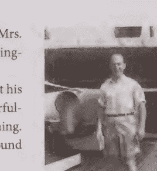

“Gerry Sohnge，6英尺，195磅。”

清风依然在吹着——今天致力于日光浴、短距离散步和各种闲散度日。我们今天上午经过了回程的“挑战者号”[21]，这是我们自上周船队离开后看到的第一艘船。

今天，我们遇到了自英国船队离开后的第一艘船——同样同一条航线的“挑战者号”，它正从开普敦回程。我本可以通过小船把这封信寄给你，但到达你那里需要很长时间。今天我用你的缝纫用品做了些小修理。下午，我第一次尝试洗床单，结果全都弄成了棕色，还有红点，但我的椰子[nut]油除了手臂的几个地方外，手臂没有被晒伤。我也变胖了，因为我无法强迫自己完成所有的运动。不过，我预计在前往马尼拉的途中会将多余的脂肪全部汗掉。

我想此时你应该正忙于你的红十字会工作。你在《生命的最后一个六月》里写下了回信吗？我希望他们展示了制作手术敷料的正确方法！我为你处理事务的方式感到自豪。你拥有完成任务的稀有天赋，而你所做的一切都让人们喜欢你。而且除此之外，我认识的唯一女性正一年比一年更加美丽。

## 给 ECCLES 夫人的信，1940年7月10日，周三

> 20 Coding 是通用电气公司的员工，曾在华盛顿特区见过 HEE。Lockwood 也许是“殖民”Gilly Lockwood，美国汽车铸造公司（现为 ACF 工业有限公司）在华盛顿（读作游说者）的代表。作为铁路车辆的制造商，ACF 将是二战期间的主要承包商，特别是坦克。

> 21 一艘7,667吨的通用货运轮船，由阿耳戈号航运公司（见注释3）运营。1918年建成一艘蒸汽轮船（SS）“挑战者号”，在1924年改为轮船（即柴油推进），现在航行于新纽约-开普敦-孟买（现印度孟买）航线。1942年5月17日，它被 U-155 潜艇击沉，导致8人丧生。

## 纽约到开普敦 11

今天我们越过了赤道，但每个人都曾来过，所以不会举行特别庆祝。无赖的日子过去，现在我们已经到达开普敦的一半多一点。我一直很有趣地读着莎士比亚：《科里奥卢斯》特别适用于美国的政治状况。

风停了，所以前甲板没有了水花。这成了一个非常散步的好地方，我很喜欢。

今天是巴士底节——法国人民的自由正如他们获得时一样，在烟雾和火焰中化为乌有。

[晚上，继续]

晚晚，我很想念你，太阳以如此不同的方式落下，星辰升起，我希望我们能靠在栏杆上享受这一切。那是我感到最孤独的时刻。

[1940年7月19日，周五，继续]

这一周过得非常快。天气很好，现在凉快许多。生活常规是：7:50 起床–8:15 早餐并聊天；9:00–9:30；10:30 散步–10:30–12:00 阅读、船上工作或家务–12:00 午餐–12:45到3:00 沐浴、阅读、午睡等–3:00到3:30或3:45 游泳——这包括在水池里和 Tommy Cleveland 一场激烈的打斗，发起战斗和接力赛。4:30，除传教士外，我们通常和船长和总工程师一起喝威士忌苏打，5:00 晚餐一直持续到6:00。之后在船上——晚上左右，听短无线新闻等。过去两个晚上，我们玩了“上詹金斯”¹，大家都很开心。

苏利文船长是一位摄影专家，他有三台相机和一个完整的图书馆。他冲洗了所有的照片，我随信附上。

这是一个好地方，安静的家庭生活，有洗衣助手在穿梭，天气美丽，对话充满智慧。我读了所有的书，除了 Skip 跳过的几本。我并不真正喜欢《雨降》，但很喜欢布姆菲尔德的《孟买之夜》。一定要读读《风》¹²。你可能已经读过了：它非常迷人。

> ² HEE 的观点显然是，美国民众愿意接受他们不配拥有的领导，正如这首晚期莎士比亚思想中的同名人物所认为的罗马共和国公民那样。

> ³ 法国国庆日，纪念1789年7月14日巴士底狱（巴黎的一座皇家监狱）的风暴和破坏，这是法国大革命加剧的转折点。

> ⁴ 一种派对游戏，有很多国际版本和名称，涉及一方在在另一方成员是否已获得某枚硬币或类似物品的情况下对其进行猜测。

> ⁵ 《雨降：现代印度小说》（Harper & Brothers, 1937），由路易·布姆菲尔德著，是影评成功且畅销的作品；续集《孟买之夜》（1940）反响热度较小。艾格内斯·琼斯的《风之牛顿》（1959年，杂志连载后），讲述了她和她的家人……

Anna Lerbek (1898–1973) 出生丹麦，现是归化的美国公民，在康涅狄格州哈特福德担任传教士。Wegerle (出生于1894) 是一位牙医。圣海伦娜岛、阿森岛和特里斯坦达库纳群是英国领土。


从纽约出来的效果很好，我上周拍的一些照片也是如此。（顺便说一下，我到达后就电报给你了！）

旅程很轻松，真的很有趣，人们友好友善，食物很好，天气晴朗。是长时间的阅读、适度的运动和愉快的对话，没有刺激。我觉得我胖了五磅。

开普敦很美，桌山耸立在城市上方，令人印象深刻。顺便提一下，我的相机非常好用，我拍了一些好照片。苏利文船长是摄影专家，他为我们冲洗并放大了照片。

在非洲期间我有一辆车可以使用，因此我正在制定初步的旅行计划，花费2500……

[1940年7月26日，周五，晚上9点，继续]

今天傍晚，我在旅途中不时寄了几封零散的信，但由于审查制度，情况变得不确定。这是部分复件。

我们今天早上抵达了开普敦，我刚刚结束了忙碌的一天。我遇到了非常愉快的人，我的计划开始变得完善。我住在一家俯瞰海湾的漂亮老式酒店里——那里全是保守派。我还不清楚什么时候还要出发[即，在下一段航程进入印度洋]几天。这周我预计会有一些观光活动，下周我将沿海岸自驾旅行进入特兰斯省。

我想念你和 Skip，真希望能让你们在我身边。晚安，亲爱的。我爱你。

“HEE 看了日落。（HEE）”

> 29 1910年至1994年，南非联邦（后为共和国）的东北部省。

> 30 坐落着开普敦及其避风港。它以相邻的平顶桌山命名。

# 往爪门腊海

3000英里。这是一年中游克鲁保护区的最佳时机。”我的离开时间尚未确定，但根据交通状况，我可能会在这个国家待两到三周。然而，我的时间将会非常充实。

噢亲爱的，我现在好想你啊！这间古板的老酒店[蒙特酒店！]挤满了你会喜欢的类型的人。为了在晚间穿外套，人们坐在没有暖气、透风的餐厅里，那里的气候像旧金山一样，有穿着白色衣服的印度教仆人和许多老先生（从这个地方判断，英国男人比美国人高！）。还有一些见多识广的美丽女性，以及我们见过的一些沉默寡言的[人]。荷兰人，那些大浴缸——还有进出时会说“T'kyou!”的瘦小活泼的电梯小哥。酒店位于山腰，我的房间俯瞰着一个美丽的花园，然后是城市的屋顶，接着是海湾——整个地方空空极了，因为这里不是我们能紧握彼此发现那种奇妙爱与理解的光芒的地方。你的眼睛和声音会让这一切变得完美。然而，亲爱的，如果我们住在这里，我们可能会疯掉！

今天下午，德克萨石油公司的诺兰先生告诉我，他预计让儿子（15岁）乘坐下一艘前往美国的船进入肯特郡。他的妻子心不在焉，尼尔逊也不太乐观。我为他感到难过……

>“‘Grove’号停泊在桌湾湾时的景色”

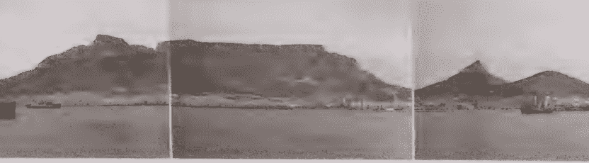

31 正确称为克鲁格国家公园，是一个世界闻名的7523英里野生动物保护区，其起源位于非洲共和国，在1940年并不在特兰斯省（见注释29）。它位于开普敦东北部1125英里处，如今是发展中的大林波波跨界公园的一部分。

32 蒙特尼尔逊酒店（现为贝尔蒙蒙特尼尔逊酒店，其网站称其“南非酒店的大姐”）成立于1899年，如今在合并后，继续为富裕客户提供服务，这里曾接待过温斯顿·丘吉尔、亚瑟·康南·道尔爵士和约翰·列侬（化名）。它位于奥舒花园，正对着南非最古老的公共花园。

33 莱斯特·H·诺兰（1898–1967）搬到了开普敦的德克萨石油（原名为燃料公司）分公司，此前曾在香港代表该公司，他的儿子詹姆斯·G·诺兰（1925–2014）在那里出生。在就读了康涅狄格州肯特的学校私立寄宿预备学校后，他将在太平洋战争中担任海军少军官，并作为哈利伯顿公司高级副总裁退休。

（HEE）

## 个人日记

### 1940年7月30日，周二

7月26日周五，我抵达了开普敦。真空油公司的约翰·艾伦先生和巴加丹夫先生在码头接我并协助我通过了海关。34 我与真空油公司和德尔莫尼餐厅的乔治·艾伦先生共进午餐。35 我下午花在

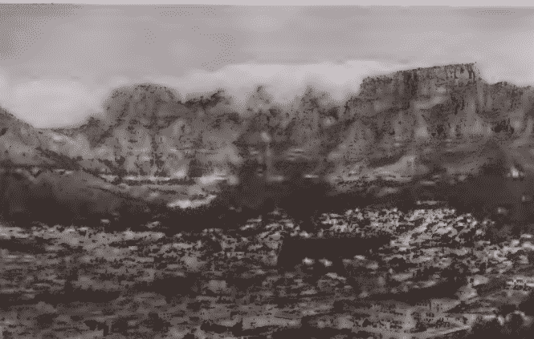

处理业务并兑支支，随后到达蒙特尼尔逊酒店。这真的是一个令人愉快的地方——到处是保守的英国人——退休人员等等，很少布尔人或非洲人，还有一些犹太人。

一切都非常古板安静。位置优美，俯瞰花园之城市——酒店花园很漂亮，我的房间就俯瞰那里。

当然，这里没有暖，气候潮湿阴冷。结果就是美丽的女士们晚上穿着衣服和皮草坐在餐厅里。洗澡是一种享受，长而又深，正是我一直在寻找的

34 HEE在离开前，安排了真空油公司（见下文）协助前往马尼拉的石油相关设施。他与乔治·瓦尔登的真空油办公室达成了这些安排，他通过“推测罗伯特先生——见注释35确认项目”进入该办公室，该项目在他出发前的特殊指示中显得不同寻常（第5章，注释35）；他已经在一家新的石油公司（现为Petrotech，由一位美国海军同学共同创立）招募人员，向读者提供了其战略方面的建议——这对于当时一个办公室专家来说是完全合理的兴趣，特别是对于物流领域的专业人士。真空油公司会对铺路方面的工作感兴趣，执行人员将与航海员华盛顿建立联系。我们不仅在南非活跃，在其他地方也可以活跃。她的Eees Pages, Coll. 32, series 2, vol. 1. 罗德岛州纽波历史战争学院（下文）。

35 真空油公司，正式名为Socony-真空油公司，于1951年与纽约标准石油公司合并。当时它是全球最大的公司之一。EE将这些文件称为“Vacuum, 'Vac Oil, and 'Sac Vac.” 巴加丹夫显然是真空油开普敦办公室的长期基层员工（曾在1925年至1930年间参加过第一场板球比赛）。德尔莫尼餐厅（Delmonico, Del Monaco）是当时开普敦最受欢迎的餐厅，拥有卓越的厨师，并有一个以其命名的开普敦海员酒吧或夜店。

周六[27日]，我拜访了领事馆，见到了副领事理查斯先生和领事丹比先生。下午，我在皇家开普高尔夫球场与当地律师丹·沃登先生一起打了高尔夫球。沃登先生是诺兰先生的朋友，非常友好，是一个很好的伴侣。不幸下雨了，伴随着强风的细雨。周六晚上，我和理查斯一家以及一群乘坐“加菲尔德总统号”抵达的美国难民共进晚餐，其中包括两名外国外交人员及其妻子，以及其他人——来自埃及的石油遗孀等。

周日[28日]，我写了要寄在“加菲尔德总统号”上的信，然后去沃登家吃了午饭。午饭后，我们开车去乡下——在一场小骚结束后刚到达了斯特滕斯博。周六，我在阿德街观看斗殴，当时[阿非兰人]民族主义者干扰了“不休息”活动；周一晚上，我能听到从招兵会议传出来的人群叫喊声。他们砸了报纸办公室的窗户。

## 给埃克莱斯夫人的信，7月28日，上午9:30

开普敦蒙特尼尔逊酒店

这封信有点匆忙，因为我希望能登上“加菲尔德总统号”前往纽约。我有几封信在寄途中，预计正在审查处等待。

>从开普敦蒙特尼尔逊酒店房间看到的景色。花园非常漂亮。

(HEE)

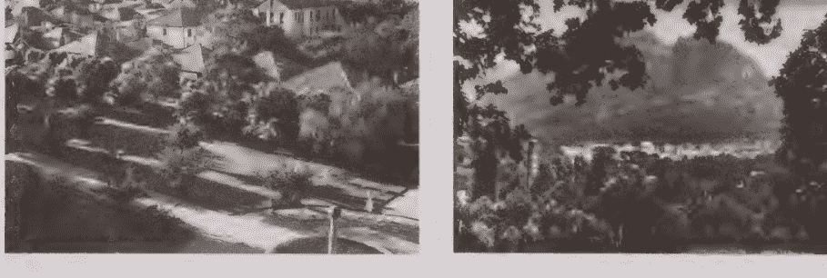

36似乎在1940年并未担任开普敦的副领事；然而，约翰·理查森二世（1938年担任领事，1943年担任约翰内斯堡美国领事）可能在场。詹姆斯·奥·丹尼（1896–1983）从1943年起担任开普敦美国领事。

37 “加菲尔德总统号”于1921年作为“蓝州号”建造，是一艘10501吨、502座位的客货轮，后被更名为“麦迪逊总统号”（它被另一艘正在建造的船占据，后被征用为海军运输舰，美国杰斐逊·弗格森号）。1942年，提到的“加菲尔德总统号”被海军用作运输船（美国肯莫尔号），并在1944年改装为医院船（USS舒适号[AH-6]），该船于1948年被拆除。

38 HEE见证了南非历史的遗产：最初的欧洲定居者“阿非兰人”或“布尔人”，说南非荷兰语；十九世纪英国的合并；阿非兰人的移民并在北方边界建立“布尔共和国”英国与布尔人的激烈战争；以及1910年合并为南非联盟；不休息”活动（为了纪念英国一战老兵和阵亡者的每日两分钟静默，也是纪念日的起源）对许多人来说很敏感，因为他们曾反对非洲人参加一战，现在也反对参加二战。

对旅程的简短回顾：我们的航行非常顺利，没有恶劣天气，只有几天不愉快的日子。乘客们都很友善，虽然没有什么兴奋的，但时间过得很快且很有趣。我读了很多书，做了适量的运动，还享受了相当悠闲的日光浴。我们于周五到达开普敦，沃尔登的[见注释34]朋友们来接我，从那时起他们一直非常友好。我在这里有汽车和司机随从，并遇到了一些有趣且有魅力的人。周五下午和周六上午我一直在规划剩余的行程，明天我希望能做出最终决定。总计划是我开车前往德班[约一千英里，见地图]，然后折回去约翰哈内斯堡[约350英里]和普里托利亚[45英里]，前往克鲁格尔国家公园（野生动物保护区），然后根据开往孟买（上海）轮船的安排返回海岸，回到德班或洛伦索·马奎克斯。在孟买，我将做进一步的计划。

看来前往孟买的班次不规律且不频繁，我必须等到8月15日甚至更晚；另一方面，当我到达德班时，可能会发现一艘准备就绪的轮船，在这种情况下我可能会跳过非洲之行的一部分。那将是遗憾，因为我可能再也不会有这样的机会了。

昨天我在雨中打了高尔夫，然后去副领事家中参加了非正式的晚晚餐。我今天将与当地律师沃德先生共午餐——明天我将与西蒙斯塔敦海军基地的理查兹准将共午餐。我将在开普敦呆到周三。

开普敦是一个迷人的城市。云雾环绕着山脉，植被相似，房屋的颜色也相同。这里非常整洁干净。这家酒店像是一个完美的“保护区”，到处是令人心悦的标本——有些在微笑，所有的你都会喜欢；我会在其他信中提供更多细节。我简直想死你了——如果你能和我在一起，会有这么多共同的时光——然而，我们在东方会玩得很开心的。我会想念你更多——照顾好自己，亲爱的——给斯基比一个拥抱，并附上邮票。（我赶着把这封信出去！）斯泰伦布罗克是一个位于开普敦东部三十一英里的主要说非利语语的大学镇，很可能是这种动荡的原因。然后，作为一个繁忙的海港，洛伦索·马奎克斯在1940年是葡萄牙桑比克殖民地。现在被称为马普托，是桑比克共和国的首都，距离克鲁格尔国家公园南部边缘五十英里。詹姆斯·爱德华·理查兹中校“指挥”（海军，1897–1961）于1939年从退休中被召回，在“阿菲卡号”军舰/西蒙斯塔敦海军基地（西蒙斯塔敦）担任国王副长。1942年，作为代理指挥官，皇家造船厂副长自1974年成立以来频繁扩建，是南非海军的主基地，仍位于镇南方五十英里处。

## 个人日志

### 1940年7月30日周二

周一我开车绕了好望角——地球之角之一。这是一段在许多方面都很美丽的车程，与前往马卡普点的航程相似——植被[仅有]海角和海滩的形状非常欢快。在路上，我在小镇西蒙斯塔敦停下，并与理查兹中校共进午餐。在场的还有指挥官和哈里先生（正在收拾行李返回英国）、法官吉尔先生，以及一位优雅的老妇格兰特夫人。地理位置优美，食物极佳，同伴也最诚恳。

后来我见了负责基地的布杰根将。我们交换了对斯考特-佩恩（Scott-Paine）艇的看法。他在这些艇的测试和谈判期间一直留在海军部，对此并不热情，因为它们的飞机发动机问题，以及在恶劣海况中需要如此谨慎的操作，且缺乏低速安静的巡航速度。道格拉斯·亚当斯·布杰根（1889–1947）将留在西蒙斯塔敦担任负责船长，直到1941年1月15日晋升为少将，成为西蒙斯塔敦驻守官和南非联邦首席海上运输官——仅任了一天，于16日返回。由休伯特·斯考特·佩恩在20世纪30年代设计的开发型鱼雷艇和反潜艇。然而，他说占领德国的海峡港口可能很容易让那种类型的船变得非常有用。理查兹指挥官确认了我对铁板海战的印象。

### 1940年8月2日周五

穆塞尔湾（Mussel Bay）

我在7:15醒来，感到寒冷，回着女仆急促的敲门，她在海洋酒店送茶——昨晚我明智地在床上放了热水袋，否则我根本无法对付潮湿冰冷的床单！昨天，我的司机查理·布朗我和上午11点离开开普敦，前往距离开普敦约两百五十里的海岸穆塞尔湾，那是一段非常有趣的行程。那里的风景很美。在这里，Soc Vac的经理德克博士见了我，晚饭后我去了他家里过晚。他胖乎乎的——从他妻子身上看。他们确实非常诚恳，我看到了他们的家。回到……[7月30日]我在公务职员俱乐部与德士石油公司的M. H. L. 诺兰以及Tex公司的Sam·华莱士共午餐——经由里约内卢前往开普敦。丹·沃德先生和南非壳牌公司经理亨利·韦伯斯特先生也在那里。这非常愉快，之后华莱我和开车前往罗德斯纪念碑*46，然后到达格鲁特·康斯坦，那是一座古旧的荷兰庄园。


| 左 | 右 |
| :--- | :--- |
| 开普敦与桌山 | 明信片：开普角及其灯塔 |

请让Will和爸爸知道我的到达——记得——在出发前至少一个月给海军部的航海局写信——说明你希望的路线、门票寄寄地址，并说明斯基比是否随你一起。所有表格都已填写并放在运输部门——此外，每张票允许携带350磅行李——再见，亲爱的。

我在床上找到了它，这让情况有所好转。现在这里是冬天，没有暖气，房子里很冷。夏天这里非常热，所以他们自然地认为这里不会冷。

今天我们开车到了这里，根据真空油公司（Vacuum Oil Company）的[E. K.（如前所述）]Green先生的要求，我非常舒适地安置在波特伊丽莎白斯俱乐部（Port Elizabeth Club），这是一个非常迷人的地方。我洗了澡吃完晚饭，很快就会出发。我预计到达德班之前还有两天的路程。这里的很多地方都很美——处处都很有趣——但我一直希望你能在我身边，尽管时间如此！那里有许多你会和我一起享受的风景，比如用土砖制成的有趣的小土房，还有当你们路过时背着巨大包物的妇女。一辆马车上坐了十六个人，长驴队拉着推车，路边石石楠、灌木丛、山脉和海洋尽收眼底，仿佛同时向你诉说着这一切！

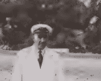

离开前的那个晚上，我请了领事理查斯夫妇以及沃德夫妇来吃晚餐——很有趣——我非常厌倦了独自在这种孤独的状态下吃饭。周三，我与公司非洲部的负责人Henry Webster一起吃过饭。他是一个大约43岁的单身汉，住在一栋华丽的大房子里，如果我在我在那里一定会显得局促得要命，他看起来生活得非常不错。

这次旅行中可能给我印象最深的一点，是我已经变成了一个多么有生活习惯的人！某些事我不习惯的事情完全无法理解！当然，最糟糕的一点是我一直远离了我认识的人，熟悉的面孔比任何东西都重要。

一旦我确定了到达马尼拉的确切时间，我就会给你打电话。在过去的五周里，我没有办法判断世界上那个地区的情况。


> “查理·布朗——我的司机。他以前并不总是这副苦脸。”

> (HEE)

> “塞西尔·罗德的精神影响了整个大陆。读读他的传记！”

> (HEE)

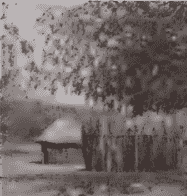

如果你准备在10月1日至15日之间离开，似乎一封电报就足够让你开始旅行，这样我在马尼拉等你的时间就会缩短；而现在，即使运气再好，你最早也要11月15日才能到达马尼拉，似乎太困难。我甚至考虑等到圣诞节再见你！

> “商店上方旁边的当地土房。” (HEE)

这次旅行我有充足的时间思考；结论并不得容易，尤其是当涉及到未来的事务时。你和你的性格在各方面都显得更加重要、更加美好；当不确定性进入脑海时，我可以依靠这一点。

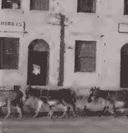

我想给Skip写一封长信。我会写的，但我不想匆忙应付。告诉他，他一直在我的思考和计划中。他需要花些时间来适应（我想是适应寄宿学校的生活），但我了他的能力充满信心。我只想见到他并聊天，而不是写信。

> “摩塞尔湾。通常这些推车由一头到十八头牛拉动。在往波特伊丽莎白的途中。” (HEE)

原谅我对你做过的所有坏事。我爱你……顺便说一下，我很饿了。

## 个人日记

### 1940年8月3日

东伦敦

> “河流从山间流下，向大海切割出深深的峡谷。从山顶望去，景色所示。” (HEE)

昨晚在经过非常有趣的驾驶后，我到达波特伊丽莎白。我们穿过了许多峡谷，还去了一个名为“荒野”（Wilderness）的小迷人度假地，它落在海洋和高悬崖之间的狭长地带。

很多情况下驾驶都很困难，但都是跨国的——在一个天的驾驶行程中看到棕榈树、蕨类、灌木、松树和仙人掌，真是太奇怪了。E. K. Green在波特伊丽莎白接我，并将我安置在俱乐部，我在那里受到了热烈接待。管道系统很糟糕，但俱乐部和成员非常优秀。

今天早上我起得很早，和Green先生去打高尔夫球——那是主场。

位于开普敦以东约480英里的大城市主要海港。


波特伊丽莎斯俱乐部非常漂亮且坚实。我打得不太好，但进了几个洞，是一场完全享受比赛。Green先生是一位优秀的高尔夫球手，非常有风度。我大约在十二点离开波特伊丽莎白，五点半到达这个迷人的城市东伦敦。我住在海滩酒店，拥有私人浴室的所有豪华设施。我必须承认我很娇贵，尤其是当物资匮乏时。今天的驾驶完全不同，大部分路程崎岖且肮脏。我们看到了大量的土房，圆形的，抹了泥，有锥形的屋顶。当地人是铜褐色的，一切都顶在头上，看到那些看起来笨拙的货物欢快地移动真是奇妙。


> “在峡谷中我们穿过了像这样的密森林” (HEE)

晚餐后Green来了，我们在十点后聊了天。明天计划去德班，在那里我可以放松一下。开车是唯一让我们不习惯的事情。糟糕的是，整天开车让人很疲惫。

### 1940年8月5日 周五 德班， 纳塔尔尔

> “她的脸涂着白土。衣服的颜色是朱红色。” (HEE)

昨天我和Brown在8:30离开东伦敦，9:30到达德班的海酒店——距离有48英里，至少有一半是崎岖的山路。景色非常有趣，当地人的特征很惊人；有些是铜褐色的，有些是黑色的。德班位于祖鲁尔地区，这里的氛围非常愉快。我拍了一些照片，但并不像我预期的那样多。

| | |
|---|---|
| 48 | Humewood高尔夫球场，1931年开始开赛，在南非洲名列第十五，是大陆唯一的真正的“链接球场”（按照苏格兰圣安德鲁斯的模式设计），位于名声显赫的波特伊丽莎郊区和Humewood市场。 |
| 49 | 南非唯一的河口港，位于印度洋岸边。 |
| 50 | 非洲高原的地质边缘。其多山且崎岖的地形靠近东伦敦的海岸。HEE目前的所在地。 |


# 印度洋上的主要海港

纳塔尔港在19世纪初由布尔人沃特克人（`Voortkkers`）建立，现在已与相邻的祖鲁家园合并，位于夸祖鲁-纳塔尔省。它是印度洋上的主要海港——在南非洲最繁忙，在大陆最繁忙的。

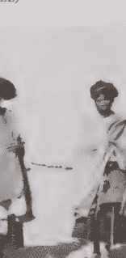

当我们终于到达这里时我很累，但威士忌加水、晚餐和热水让我睡得很好。我发现躺在浴缸里喝威士忌加水是生活中真正的奢侈之一！

Henry Dreyer今天早晨来过电话，我们开车转了一圈，下午我们去赛马场看了金杯赛。那是美好的一天，除了我们自然地输光了所有的注——所以现在可以等十年后再去赛马场。我在这里见到的穿制服的人给我留下了深刻的印象。

## 1940年8月7日 周三 晚上8:30 克鲁格

Henry Dreyer和我Charlie Brown今晚6:30到达这里。在短距离步行后，Henry和我喝了点，吃了晚餐，准备睡觉，明天早起出发。我们预计从莫桑比克边界进入克鲁格国家公园，然后前往Skukusa营地。我们计划在保护区留三天，然后通过普托利亚和约翰内堡离开。

今天穿越了危险的纳塔尔祖鲁地区；经过了许多沃特克人战斗过的地方，以及Shaka、Dinga和Mozelkase这些祖鲁酋长杀害并被杀害的地方。土房的特征发生了变化——现在它们似乎全是用稻草或织草建在轻质框架上的。Henry Dreyer说那是水草。随着我们进入内陆，当地人穿的衣服越来越少。我爱妇女们的铜褐色皮肤！它们的负重方式很神奇——如果我们的妇女能站直而不是弯着腰！这种平衡感太奇了，允许她们顶着各种物品，从西瓜、5加仑的水桶、陶罐轻木头。牛很有趣，长着长角，但它们似乎是各种品种的混合物。Henry说我们将在高原（`veld`，开阔的农村土地）看到一些布尔阿非利卡人牛。

> **注释**
> 52. 被分配给HEE报告的真空油公司（Henry）员工中，没有一个像Henry那样被广泛地用于服务；Henry Dreyer将永远留在我的记忆中。我认为Henry Dreyer表现得很好，而我只是通过密切的关系获得了一些线索；HEE给George Walden，1940年10月17日，1940 E. Eccles Peters, Mo, 52, folder 18, NHC。自19世纪初以来，南非的祖鲁“族群”一直非常广泛，但除了HEE在的报告外，对此无所知。
> 53. Greyville俱乐部，自19世纪以来每年举办一次纯血马马赛。
> 54. Skukusa是保护区的最后休息营地，也是行政总部的所在地。
> 55. 对于沃特克人（`Voortkkers`），参见51。Shaka（`Shaka kaSengakakhona`，1828年被暗杀）和Dinga（`Dinga kaSengakakhona`，祖鲁国王之子，祖鲁）。Mozelkase是一个虚构的祖鲁人，是Hugh Muller《祖鲁土地的废墟城市》（1869）和《祖鲁之地：荒野与野蛮生活》（1879）中的人物，这两部作品都是H. Rider1885年《所罗门矿》的灵感来源和素材。

## 1940年8月9日，周五 克鲁格国家公园，斯库库萨（Skukusa）

我们昨晚到达了野生动物保护区，在下萨比（Lower Sabi）的休息营地过了一夜。在穿过公园前往营地的途中，我们首先看到了角马，接着是黑斑羚、狒狒、大南羚、水羚和斑马。随着太阳下山，我们面前出现了一条美丽的交叉路，一只野兽在路边的草地上躺下。光线不适合拍照。那是一头美丽而神情凶恶的野兽。

我们在营地吃了一顿丰盛的晚餐，我晚上8:30回了房间。我的圆形休息小屋（`ronderavel`）位于营地边缘，透过门，我看到不到十五英尺外就有铁丝网。为了视野良好，网间穿插着草。天空中完全没有云，残月正落下山。微风穿过花丛，带来了野外奇特的气味，我门外一个当地人正坐在火堆旁。我真想念露西（Lucy），我知道她会多喜欢这整个场景和体验。月亮落下，星辰在头顶旋转，我不得不睡在硬如石的床垫上。天气很冷，我必须小心地把毯子塞好。

午夜后有时，我醒来听到远处传来粗哑的咳嗽般的吼声。它越来越近了，我试图想象那是什么。我希望是一只狮子，我想起了那道铁丝网，希望它是狮子。突然，栅栏附近传来一阵摩擦声，以及一系列低吼和咆哮声，当邻壁圆形小屋有人用手电筒开始调查时，声音停止了。第二天早晨，亨利·德莱尔（Henry Dreyer）说他认为那是只狮子——但我怀疑它要小得多，亨利是想给我一点惊吓。

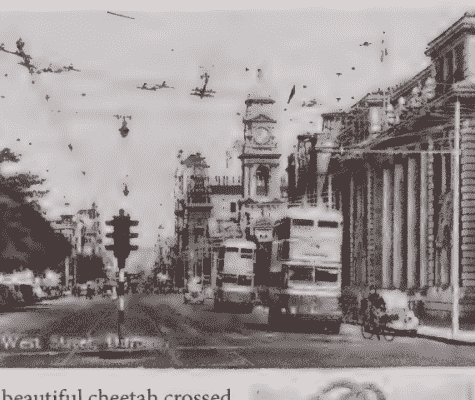

> 一张去德尔班赛马场的“巨人门票”，票价1先令0便士。(HEE)
>
> 城市赛马俱乐部
> 男士票
> 马蓬古（Mapung）
> 1940年8月5日。

> **注释**
> 56. 下萨比休息营地，位于斯库库萨以南约27英里。
> 57. 根据音译：HEE 指圆形小屋（`ronderavel`，南荷兰语 `ronderavel`），是一种在尺寸、形状和外观上类似于非洲村庄小屋的西化小屋。感谢荷兰公民兼母语者莉塞特·瓦肯伯格（Lisette Valkenberg）提供这一标识。

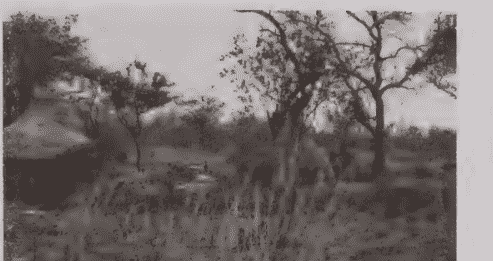
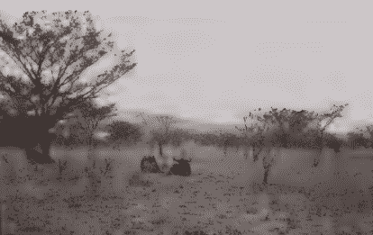

> 左：“保护区内的当地村庄。”(HEE)
> 右：“普雷托里乌斯山（Pretorius Kop）附近的角马。”(HEE)

我们洗了澡休息，三点我们沿着河路前往下萨比，再次错过了狮子，尽管我们在回来时听到，有一群11只狮子在同一条路上挡住了汽车十五分钟。今天早上我收到一封电报，说我未来的交通安排相当复杂，我必须在周二早上之前到达德尔班。

亨利·德莱尔今年57岁，是一个迷人的人。他身高约6英尺5英寸，体重约260磅。他拥有丹麦和荷兰血统，他的家族在南非已经住了好几代。他过着户外生活，像很多这类类型的人一样，本质上是个单纯、不圆滑的人，但更棒的是他有一种刚毅正直的人格，吸引了各行各业的人。他长相英俊，很有气质。他的狩猎故事非常有趣，他对野外的知识和热爱让他作为旅行伴侣倍增吸引力。我希望有一天他能有机会看看美国广阔的土地。他唯一一次去美国是在1904年。

> *(注：由于OCR文本包含大量重复和错误，上述翻译已根据提供的唯一内容进行了清理和重构。)*

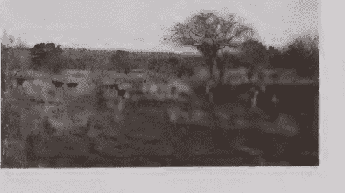
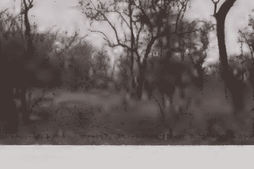

> 左：“黑斑羚。”(HEE)
> 右：“斑马。”(HEE)

## 米德尔堡（Middelburg），德兰斯省（Trans-vaal）

我们6:50离开营地，但没看到什么野生动物——我们去了下萨比，据说那里的狮子最多。我们在下萨比吃完早餐，然后出发前往普雷托里乌斯山。

我们的运气变了，看到了各种野生动物——长颈鹿、斑马、黑斑羚、大南羚、水羚、野猪，最后还有一组四只猎豹——这很不寻常。当我们接近普雷托里乌斯山时，我们看到了许多角马。

当我们享受午餐时，电报送到了，说我必须在周二早上之前到达德尔班。

> 你的消息——我希望新加坡有给我的信——我已经把它寄到了加尔各答[现的加尔各答）转寄，也许我会有好运。向 Skip 问好。我希望信件到达时，他在学校里一切都好。
>
> 我太累了，写不下去，而且还有行李要收拾。晚安，我亲爱的 Isy。我爱你。

### [1940年8月13日，周二，续]

我的账单已经付过，行李收拾得整齐，大约小时后我将前往码头。我们中午起航，在几个东非港口停靠，然后前往新加坡，在我们这封信到达你手中之前就能抵达。到达新加坡后，如果情况允许，我将折回印度回到远东；然而，无法预测我将要做什么或者路线将会如何。我觉得我最晚会在11月1日抵达马尼，希望你能安排在11月15日前到达那里。无论如何，请尝试一下。

昨晚写信给你时我已精疲力竭，但现在我渴望开启旅程。我想告诉你我生活中所有有趣的细节——你的缝补包被用来缝扣子和补补衣服了，那些带着你亲切痕迹的衣服也被深情地使用过。我多希望我们能在一起，这样你就能欣赏那些壮丽的风景、奇特的植物和美丽的鸟类，还有乡村里那些奇怪的小酒店，以及它们奇怪的厕所[浴室设施]和习俗。这是一次伟大的经历，但如果你在场的话，将会丰富得多。

告诉 Skip，如果我在某个地方停留得足够久，我会给他寄一些我的照片副本。我表现得不错，预计会表现得。希望他这个秋天踢足球玩得很开心。他应该能找到合适的尺寸加入球队。我多愿能在学校赛场看他比赛，但我他会表现很好，过得很愉快。尽管如此，我还是会想他的。

我遇到了五个令人愉快的人。真空油（Vacuum Oil）的代表们是完美的、高素质的绅士，与他们相处是一种乐幸。我非常感激他们。

请你买一根好的钓鳟鱼竿和各种鳟鱼鱼饵，寄到：

Bloemfontein
Union of South Africa.

我建议25美元足够了。他是一个独特的人，对我非常好，顺便送了我了一份送给你的精美礼物。我们见面时我会报销这笔钱！他是一个出色的猎人和钓鱼高手，所以我想要些好东西。现在，亲爱的，暂且告吧。

照顾好自己，不要忘记你在马尼拉留给我的。

## 德班，海事酒店（Marine Hotel）

船只延误到了傍晚，所以我在港口多待了一天。……我终于没忍不住了，买了我心心求的东西：那个“万能包”或“手提包”，这是我旅行时攒钱买的，现在所有的杂物都可以卷在里面了！这可能意味着 Henry Dreyer 送了我了一件精美的皮草（kaross）作为你的礼物，由于我没有其他办法携带它，所以我不得不买这个手提包。那件皮草是个极品，黑色、褐色和金色的交织，非常轻便温暖。

什么是 Kaross？它是一种轻便的皮草披袍，我们的那件是由八只豺皮制成的。它正装在樟丸里，和我的薄外套以及寒冷用品一起装在手提包里。

再见，亲爱的。我们秋天见面时会度过非常美好的时光。向全家人问好。

# 个人日记

## Swartenhondt 号，1940年8月19日，周一

上周日[8月11日]，我在普勒托利亚与 Henry Dreyer、Jerry Nolan 夫妇、E. R. Smith 夫人、Henry Kirkpatrick 和 Maier 先生共用了午餐。Nolan 曾是真空油公司的的员工，现在负责协调和指导政府所有的石油供应。Smith 先生是联邦的商务部长。俱乐部非常棒，景色完全可以比作北加利福尼亚州的风光。

下午2:20，我们从午餐桌出发离开普勒托利亚，在错过了一两次后，往约翰内斯堡[向南约30英里]，于3:35到达车站，那里由一个半半被绑架的侄子守着——我的火车在3:40出发[前往德班，今天是一段15小时的旅程]，过了一会儿，我在非洲边境军黄金海岸团的 A. T. Fard 上尉坐了一个隔间。他现在是这艘船上的乘客——从休假回来加入他在肯尼亚的部队。

> **注释**
> 63. 南非联邦（Union of Africa）从1910年作为大英帝国的自治地一直延续到1961年。1900年，英国殖民部最初在每个英国西非殖民地组建了军队用于当地驻守和战争战斗。该部队完全由军官领导，在1928年更名为“皇家”（Royal），并在1939年移交给战争部，正如第一次世界大战期间那样。黄金海岸团在同名殖民地（即后来的加纳共和国）于1960年解散；由于殖民地实现或正处于独立边缘，其军队合并为国家军队。A. E. Hayward 和 F. A. S. Clark，《西非边境军史》（The History of the West African Frontier Force, Alders, U.: Gale and Holden, 1964）。
> 65. 西非边境军曾参加东非战役，将意大利人从肯尼亚、苏丹、索马里、厄立里亚和埃塞俄比亚驱逐，直到1941年9月。

我回到德班的海事酒店准备起航——8月13日周二，正当我准备离开酒店时，被告知 Swartenhond 号延误了一天。Nevin 先生[石油和石油产品销售经理]在德班乡村俱乐部与我安排了一场高尔夫球。非洲各地的沙丘都非常快。球道相当不错，但等下雨后会更好。

晚上，我写了信并散了会儿步。周三[8月14日]，船再次延误，因此我有了闲散的一天。Nevin 先生和 Moir 来吃午餐——而我在晚餐前去美国领事馆喝酒。Corrigan 先生身材高挑、消瘦、满头白发——有点紧张。他的妻子是英国人，听力很差，因此是一个很难相处的女主。

周四，我做了一些最后的购物，然后和 Nevin 夫妇以及 Moir 先生在 Kloof 吃了午餐并打了高尔夫——在德班向后约十五英里的山丘上。我们玩得很愉快，球场很宽——中等丘伏，可以欣赏大海和周围乡村的美丽景色。尽管我的得分不好，但我击球动作非常漂亮，感到完全放松。

Nevin 夫妇是迷人的人，和他们在一起真是太棒了。Percy Nevin 给人一种卓越商人和执行者的印象。他有极好的幽默感，是一个出色的演谈者，各方面都是一个极佳的伙伴。正直和诚信显而易见。Moir 是一个优秀的干练苏格兰人。

我回到[德班的]酒店吃了晚饭，取了衣服，上船。周五早早[8月16日]我们起航了。

> **注释**
> 66. John Corrigan Jr.（卒于1959），1938–43年任德班美国领事。

我带着些遗憾离开了南非。我彻底享受了那里的时光，永远不会忘记。我特别幸运能拥有我那样的人脉，并看到尽可能多的国家景观。这片土地似乎充满了希望，优秀的人才和能力者。忠诚派和民族主义者之间公众意见的分歧是遗憾的。我不理解南非在一个由希特勒主导的世界中如何能希望作为一个独立的共和国而存在。

> **注释**
> 67.

# 马尼拉，菲律宾

1940年10月18日

发件人：亨利·E·埃克斯海军上，美国海军
收件人：美国亚洲舰队司令
主题：关于经南非、波斯湾、东印度从华盛顿前往马尼拉的报告

1. 根据1940年6月20日的BuNav9807号命令（经1940年6月25日第10184号修订），我于7月26日抵达开普敦，并前往……马尼拉。南非的总体政治状况已由其在该国的代表向内务部做了详细报告；然而，值得注意的是，布尔人元素与英国人元素在战争执行上存在相当大的意见分歧。到目前为止，这似乎影响了南非对当地紧急情况的应对。发生了一些小规模破坏破坏。

2. 开普敦附近几乎没有海军舰只。有一艘国家级巡洋舰停泊在西蒙斯敦，其他几艘似乎也从西蒙斯敦出发。配备6英寸火炮的伯慕达女王号（Monarch of Bermuda）在德班与其他舰只合作，进行离岸巡逻。南非重要港口的沿岸防御似乎不足，空军规模非常小。大多数南非飞机已派往肯尼亚参加针对意大利人的行动……

# 二 德班到马尼拉

1940年8月–11月

## 个人日记

（未注明，推测为1940年8月20日至22日）

这艘船（斯瓦滕霍特号，SS Swartenhondt）看起来完全是由一个从未出过海的人设计的。它于1924年在阿姆斯特丹建造——但没有甲板空间——切割糟糕。船舱没有真正的储物柜——没有床灯，空间非常小。浴室不完善——没有男女厕所分开。厕所是奇怪的装置，没有座位——60名乘客只有四个，而且没有小便池！这艘船是燃煤船——足够干净但该死极不舒服。现代潜艇的设施和舒适度都更好！

布朗先生——英国人——任职殖民法律部门，正从西非黄金海岸前往肯尼亚担任检察总。单身，约40岁——很有吸引力，受过良好教育——很有想法。豪夫妇——爱尔兰人，很有风趣。他也任职于殖民法律部门——在英国休假期间伦敦轰炸缩短了行程，正返回新加坡重新任职[见第1章，注释16]。法华德上尉，资深——朴实而幽默——对非洲有非常详尽的了解。迪恩·史密斯博士——年轻而干练——正返回他在香港的医院。康纳威尔尔夫人——返回肯尼亚——约35岁，漂亮，性格极具挑战性，乐于付笑，谈话有些生硬，右手很直——但很好，不太确定。看起来像阿德尔·蒙罗——25–26岁，寻找非洲战争——为了靠近她的丈夫，她的丈夫离开了西非的殖民服务加入部队成为一名班长。有时显得孤僻和心不在焉。

他们身上都有自给自足的英国特质——不容易捕捉——但人都非常友好热忱。还有其他乘客在做各种事情——荷兰人和英国人。一个瘦弱娇小的女孩去肯尼亚嫁给一名军人。其中一个

> 1. 托马斯·阿尔杰农·布朗（1900–60；1956年后获爵士头衔），在牛津（奥里尔学院）毕业并在印度骑兵服役后，于1926年进入律师行业。1933年在英国执业后，他成为黄金海岸的翘角，现在即将担任肯尼亚检察总。战后，他将担任新加坡最高法院法官，并从1953年直到去世担任北尼日利亚首席法官。
> 2. 北非西沙漠英、意意大利部队之间的战斗已于6月开始。

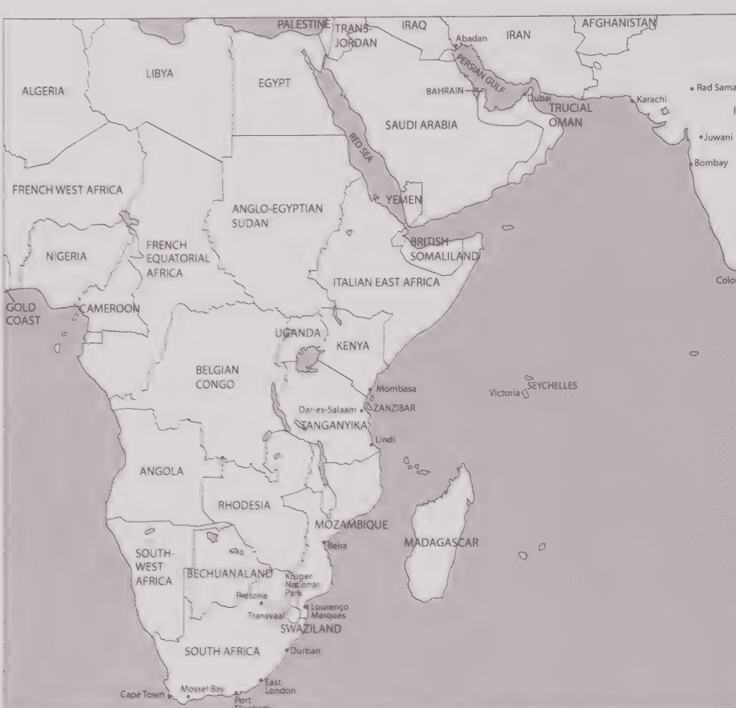

一位老者，在布尔战争期间从澳大利亚作为士兵来到非洲，一直留在坦桑尼克[注释6]，他不理解为什么我会不知道板球！几个孩子——范·德德姆夫妇，荷兰地质学家，带着真空公司（Vacuum）——在环游世界和美国工作后返回巴廖加。

对我来说这是一个奇特的社区。

## 1940年8月23日，星期五

8月17日，星期六晚上，在罗伦索·马奎克斯，船长、医生、布朗、我、豪夫妇、斯基德莫夫人和康纳威尔夫人一起上岸用餐和跳舞，我们玩得很愉快。我们在凌晨4点左右返回。布朗和我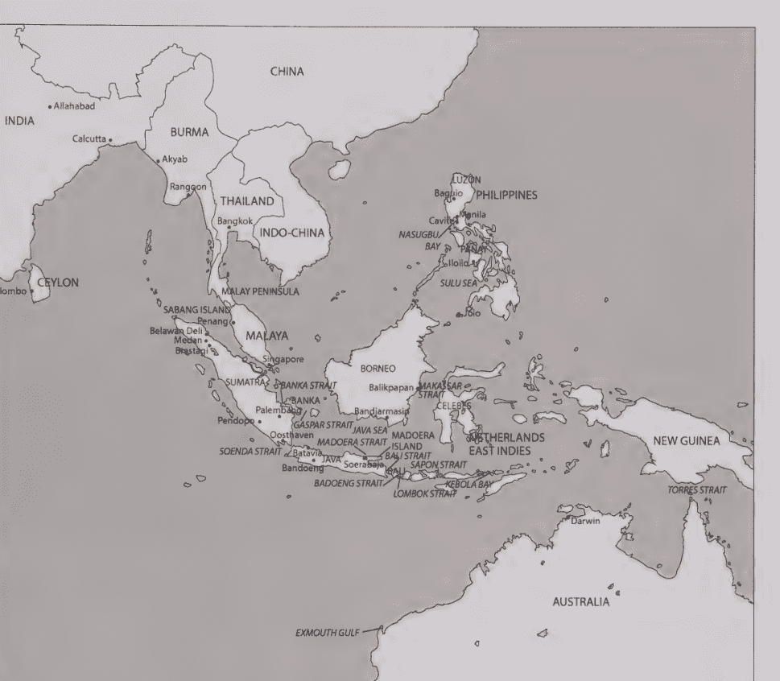起得很早，去一个非常奇怪的沙地场打高尔夫，那里所有的球道都像长满草的陷阱。天气炎热且令人愉快。整个下午都在装煤，晚上我们启航了。

### 给埃克斯夫人的信，1940年8月20日，星期二

斯瓦滕霍特号，今天下午早些时候在海上

## 往爪哇海


# 斯瓦滕霍特号

今天下午早些时候在海上。这是一艘非常奇特的船，1924年在荷兰为近岸地区建造。船舱非常小且狭挤，浴室很荒唐，厕所很奇怪没有座位，浴缸是个大水桶。船很干净（除了装煤时），乘客很有趣且好相处，几乎全是英国人和荷兰人。我的室友是`A·T·法华德`上尉，西非边境军团[注：此处有误，见第1章，注释64, 65]，正从休假返回加入他的团。豪夫妇——布朗正前往肯尼亚担任该殖民地的检察总。豪夫妇是爱尔兰人，很有风趣。布朗是一个约40岁的单身汉，以及一位35岁的漂亮女性，蓝蓝眼睛——返回肯尼亚与她的丈夫。她的父母是美国人——她在非洲的农场长大，那里有豹子，它们很容易……迪恩·史密斯博士——年轻的英国医生，正返回他在香港的医院。非常随和友好。斯基德莫先生，豪夫妇的朋友之一——他正从西非前往肯尼亚成为她的丈夫，军队一名班长。她非常漂亮，肤色较深，约28岁——25岁的女儿。哈伯德显示他是个非常英俊、长相好的男孩。一位特隆彼特夫人——英国寡妇——丈夫是荷兰人。她现在试图进入战区开救护车或类似的大事。非常喜欢运动——组织游戏——该死的精力充沛且热情，很可能是个麻烦。理查德，17岁，从英国的学校回到肯尼亚的农场与家人。范·德德姆夫妇，一对非常好的荷兰夫妇——一个在真空公司工作的地质学家，在环游世界和美国后返回荷兰东群岛。

## 画家简介

4 扬·斯汀是一位荷兰画家（1626-79），以其描绘平民日常生活的风俗画而闻名，场景通常极不真实且活跃，永不溶解。大卫·滕尼尔（1610-90），佛兰斯画家，可能指的是他，尽管他的儿子大卫·滕尼尔三世也是画家。大卫·滕尼尔画家以户外场景而闻名，场景中通常有跳舞唱歌的村民。

# 从德班到马尼拉

## 个人日记

### 1940年8月23日，星期五 [续]

我们于周二下午抵达了贝拉。史密斯我和豪威尔、布朗进行了一场高尔夫比赛，玩的是一种“果岭赛”[也许是三球赛？]，即每位球员负责开球，之后是两球轮换。我负责击球，我们在第17洞赢得了胜利。我们相处非常愉快——豪威尔充满风趣，他的妻子则掌控节奏。“亨利·S·格夫号”（Henry S. Grove）停在港口，我和苏利文船长和其他军官进行了一次愉快的会面。

我们带了肯尼亚英国防御部队的航空设备，苏利文船长将直接前往斯库库萨（Skukusa）处理掉它们。特尔玛和克拉雅恩堡丈夫分手了，她现在无家可归。要得知这样的消息，路可真遥远啊，从密歇根到约翰内斯堡！我猜她会把“格夫号”带回去——也许没什么用，只是由`G.J.S.`[苏利文船长]安排并资助，这只是我的直觉。我相信是珍珠·韦格勒（Pearl Wegerle），这并不意外。

荷兰船“格夫号”和一艘新的日本船与我们几乎同一时间出发。贝拉是罗得斯尼亚[注 3]的港口；铜、铬、烟草和芦胶似乎是主要的出口物资。

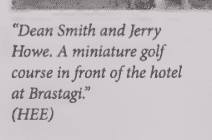

> “迪恩·史密斯和杰里·豪威尔。布罗西亚酒店前的一个微型高尔夫球场。”（HEE）

6英字的潮差使得航行充满不确定性，

周四[8月22日]花在了在甲板网球和跳舞上，长谈持续到深夜——喝很多啤酒和威士忌似乎是常态。豪威尔夫妇是一对特别的夫妇——她是一位在世界各地积累了经验的医学博士——金发——蓝眼睛——留着加宝式的脸型和发型。他非常高大，也是蓝眼睛——他们都是爱尔兰人——他们之间有着极大的同情与理解。

我们将停靠林迪港——[无法辨认]但那是通往桑齐巴尔坦桑尼亚的港口。

### 1940年8月30日，星期五

在前往马赫、塞舌尔的途中

林迪证明是一个位于大河口的小镇子——我们花了几个小时从内陆装货，然后于周一早晨抵达了桑齐巴尔。那一天非常愉快——迪恩·史密斯、约翰·迈克尔，

5 最近的一份在线参考显示贝拉的最大潮差为2.1英尺。

6 林迪是坦桑尼亚南部海岸的一个小港，直到1964年被称为坦桑尼亚，1961年之前是英国殖民地。

7 乌古贾岛（传统上称为桑齐巴尔）西岸的一个港口城市，距离现代坦桑尼亚海岸20英里。乌古贾群岛在1856年至1890年间是桑齐巴尔苏丹国的一部分，1890年至1963年是英国保护国（由其苏丹统治）；今天它是坦桑尼亚的一个同名地区。

## 往爪哇海

政府办公大楼曾是桑齐巴尔苏丹的宫殿。他现在附近有一处漂亮的地方。中央庭院很大，高处的屋顶由高大的柱子和宽敞的走廊支撑。所有的门都雕刻精美，外层的门钉着黄铜。从屋顶望出去景色很美：白墙、瓦片屋顶和棕榈树，远方是有着珊瑚礁和浪花的海。有些地方丁料的气味很浓——其他地方则是热带城市的主导气味。

阳光从白墙上射来，刺眼。街道狭窄而曲折，各种商店里满了奇异的物品，人们的叫卖声——自行车铃声。位于旧奴隶市场遗址上的大教堂很有趣，我们在博物馆里看到了许多旧生活的遗迹。一个多种语言的人口——非洲人、阿拉伯人和印度人的衣服色彩鲜艳——妇女穿着黑色普尔达（purdah）服，遮得严严，在炎热的阳光照射下——这种贫穷是可以预料之中的——孩子的嬉闹声——唐吉尔学生通过朗读学习的学校。

我们回到船上吃午饭，又热又累，后来上岸去游泳。[丘库瓦尼（Chukwani）村]位于城市南方七英里处，在一座美丽的古宫里我们发现了一个游泳俱乐部。海滩很舒服，水光滑且温暖。我们在那里闲逛、游泳了两个小时。这非常愉快，完全放松。穿好衣服后，加入我们的杰里·豪威尔向我们展示了苏丹宫的旧浴室。大约八年前，当新苏丹建造新宫殿时，墙壁和地板上的大理石都被剥离了，但它依然很美。

草图给出了大致的布局。圆顶上开了通风孔，显然是波斯设计。有许多不同层级的通道此此彼折通向各个房间。

想象一下中央房间，喷泉中流出清凉的小溪，里面满了宦官和妇女——雾气腾腾，以及各小组躺在喷泉周围的壁龛里。同样的场景被画过很多次！


> “桑齐巴尔门的绝佳案例。”（HEE）

- 某些穆斯林和印度教社区的习俗通过物理限制或全包裹的衣服来保护女性免受男性的视线。

## 从德班到马尼拉 39

# 给埃克勒斯夫的信，1940年8月27日，周二

肯尼亚，蒙巴萨

我们刚刚抵达，从这里出发详细计划，我将在11月到达。航程很困难且不确定。

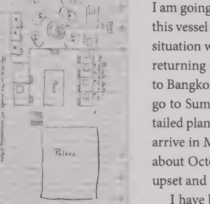

> 桑齐巴尔丘库瓦尼的古宫。

“丘库瓦尼的古宫。”（HEE）

我一直很好也很舒服。非常孤独，我渴望收到你的信。实际上，这是我没有任何信的最长一段时间了。通常情况下我会去孟买，但没有船票。我有一种奇怪的感觉，好像这次旅行不是我做的而是别人。陌生的人，奇怪的食物和语言——没有人认识我，我也不认识。

昨天在桑齐巴尔度过，你会喜欢那些奇怪曲折的街道，以及卖奇怪食物和香料的商店。我和迪恩·史密斯博士、一个英国男孩和一个英国女孩在一起。两个小时里，我们走在街道上，感受着景观和气味，在炎热的阳光下。景色很美。下午我们在丘库瓦尼一位前苏丹宫的一处美丽海滩游了次长泳。水太热了，但我们游泳、闲逛得得很愉快。后来我们看了宫里的旧浴室。每个妻子都有自己的私人浴室，然后是一个中央休息室，喷泉从带阶梯的水池中流出——侧面有带有通风道的休息室。它看起来就像画里的浴室一样。地板和墙壁的大理石都被拿走了，但其他地方保存得很好。城市到处都是丁料的味道，因为桑齐巴尔是一个正在增长的地方。

昨晚由于散步和阳光，我感到非常累。我们明天就要航行，所以我没机会看这个地方——但我很高兴能早出发。噢亲爱的，我太想你了，我渴望收到你的消息。我希望在到达马尼拉后很快就能来！

10 桑齐巴尔群岛以及更南的另一个岛屿，长期以来闻闻名（正如现代印度尼西亚的马哈库群岛），是“香料岛”，特别是丁料。

由于我收到的消息都是来自英国广播和殖民强权的，我不知道如何判断各处的情况。但我希望没有事情能阻碍你在我之后不久就抵达马尼拉。

我前一天给 Skip 写了信。我正寄送给他两本关于南非的好书，我希望他会喜欢，即《丛林之王与游击队》（*Jack of the Bushveld and Commando*）$^{11}$。第一本特别精彩，讲述了我旅行过的那个国家。

现在我得穿上衣服去处理把这东西离开（即：处理）的事。

## 个人日记

[显然是1940 年8 月 29 日或 30 日，周四或周五]

周二清早 [8 月 27 日]，我们在下午五点左右被叫去蒙纳巴。港口非常漂亮。蒙纳巴位于岛屿上；我们通过名为基林迪尼（Kilindini）$^{12}$的新南通道进入，然后绕过岛屿到达西南端的码头，途中经过了在旧葡萄牙人营地遗址周围建造的新堡垒。高尔夫球场与旧场址平行，我们在其中发现了一架飞机、机枪阵地和值守人员。蒙纳巴位于意大利基斯马伊基地（位于[索马里兰，现索马里]）以南120 英里，一切都为任何意外情况做好了准备。晚上，我们介绍了灯管制。这不是件愉快的事。这是从专业人士身上剥夺并加在平民身上的耻辱。在你经历这种灯管制之前，它看起来并不真实。

我们上岸参加了告别晚餐：Jerry 和 Madge Howe、Dean Smith 和、Algy Brown、Molly Trompeter 以及 Dorothy Skidmore。Thelma Cornwall 在家里（即：对她来说是在尼亚），她是这群一路来到海边很快的人中唯一的缺席。食物很好，饮料充足，庄园酒店的服务很棒，这一切都汇成了一个彻底愉快的夜晚。

周三上午 [8 月 28 日]，Vacuum 公司的 Dancum 先生上船见我，我最后尝试安排从蒙纳巴到印度的行程，但无果。我前往 Henry Grove 号进行了告别拜访，道别，并给 Isi 留了一封信以便在美国寄出。然后我去了 Port Reitz [紧邻西侧] 拜访 Cornwall 夫妇，很高兴见到 Eric。他们有一处俯瞰海湾的美丽房子，有五个男孩（即：不同年龄的肯尼亚男性男仆）照顾房屋，另外五个负责照顾花园和空地。我们开车回城，Eric 离开了我们，而 Thelma 和我和其他人在蒙纳巴俱乐部聚会喝了告别酒。俱乐部建在旧耶稣堡的围墙下，俯瞰着通往大海的老通道，凉风吹过走廊，让棕榈树低语。我们向大家道了别，分道扬镳。

Algy Brown、Dorothy Skid、Molly Trompetter 和 Michael 去内罗毕；Thelma Cornwall 回家，Dean Smith 和我乘坐乘船前往新加坡。我们在一起玩得很开心，打甲板网球、打会儿乒乓球、一起闲聊和一起喝酒——有很多谈话，还有 Jerry [Howe] 和 Thelma [Cornwall] 之间的争吵。对这些不同性格的人的观察，不需要对第一印象进行重大修正。

随着了解，他们都变得更好了。Molly Trompetter 失去了她的浅薄面，因为我理解了她的处境：一个拥有荷兰国籍的英国女孩，结婚后现在是一个孩子气的寡妇，既焦虑又有能力在任何战争活动中胜任工作，渴望到达最近的战斗现场。她选择了肯尼亚，我祝她好运。

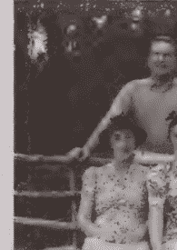

> "Jerry Howe / Dean Smith / La Nauze, Mrs. La Nauze / Tosh / Faith Howe / Mudge Howe." (HEE)

Dorothy Skid 的冷淡消失了——她一点也不孤僻——一个在看望丈夫的月份里旅行的不错的旅行者——但才华横溢。

Algy Brown 人很棒。很有趣，一个典型的、证实的单身汉类型，带着典型的症状和怪癖，非常敏锐且能干，是一个极佳的伴侣。

Dean Smith 正在成长为一个优秀的男人，基于敏感的天性、良好的教育和丰富的经验，对生活有极大的赞赏。如果美国人仅凭他的谈话方式和外表来判断，将是非常具有欺骗性的。

Thelma Cornwall 证明是一个奇特的个性。她的眼睛是明亮的蓝色，虹膜里有红斑，很少平静。她与 Jerry Howe 不断地争吵，虽然一度觉得很有趣，但后来变得无聊了。Thelma 曾在塞舌尔，但那里看起来不像个居住的地方。塞舌尔很有意思可以一看，但不适合和平居住。

## 从德班到马尼拉 41

11 EE 可能在想 Deneys Riet 写的《游击队：布尔战争回忆》（*A Memoir of the Boer War (1929)*）。James Patrick 爵士写的《丛林之王》（*Jack of the Bushveld (1907)*）是作者19 世纪80 年代在南非共和国期间生活的回忆，已翻译成多种语言，且从未绝版。

12. 自 1896 年以来一直很新。当斯里兰卡的科里隆坡受到威胁时，英国东方舰队临时驻扎在肯尼亚基林迪尼（当时的英国殖民地）。今天的基林迪尼港是东非最好的港口。

13 位于蒙纳巴岛的16世纪历史复杂多变。蒙纳巴曾由葡萄牙人（他们建造了下文提到的耶稣堡）、阿曼苏丹、英国东非协会和帝国东非公司交替统治，最后在19世纪末成为英国保护国的首府。由于政府已迁往内罗毕。

## 往爪哇

我刚读完《绿色山谷》（*Green My Valley*），以及关于它。事实上，她很有敏锐的智力。Thelma 在塞舌尔，但那里不适合居住。

有很多我想知道关于，你和 Skip 情况如何；Skip 的红十字工作进展如何；你遇到了哪些人，你什么消息，你在想什么，做了哪些计划，等等。

14 这本书表面上是关于威尔士乡村生活的回忆，于1939 年出版，在1940 年获得美国国家图书奖，并改编为舞台、电影和电视。Llewelyn 写了两个片段。

15 威廉敏娜·保琳（Wilhelmina Pauline, 1880–1962）是荷兰王国女王，从1890年到1948年，直到她将权力交给女儿朱莉叶娜。

16 德国于5月10日入侵荷兰。女王乘坐一艘驱逐舰撤离，于13日抵达英国，担任流亡政府首脑。大部分荷兰军队在15日投降。

17 这是一个由115个岛屿组成的群岛，其中马黑岛最大，位于印度洋，距离东非海岸900英里。在1940年它是英国殖民地；拥有深厚的法国传统；今天该群岛是独立的塞舌尔共和国，首都是维多利亚。

# 给 Eccles 先生的信，1940年9月3日，周二

我预计这封信会在蒙纳巴到达你那里，所以我简单回顾一下。我们从德班出发的旅行非常愉快，天气十分宜人。

桑齐巴最有意思了，你会喜欢那里的。蒙纳巴也很有魅力，但不容易待下去。我和 Jerry、Madge Howe 送走了一部分的人，Dean Smith 医生留下了，我们有例常的甲板网球赛，我们都正前往新加坡，十天后就能到达。

我们上周离开了蒙纳巴；自从德班以后，我没看到过任何中转站。

### 1940年8月31日，周六

今天是威廉敏娜的生日。塞舌尔在11点位于马黑岛。这艘船很忧伤。她是一个老妇，船上有女王的肖像。

## 德班到马尼拉 43

## 个人日记

### 1940年9月4日，周三

周日我们抵达了塞舌尔斯马赫岛上的维多利亚镇。豪斯夫妇、迪恩·史密和我一起散了步并吃了午餐。植物园非常漂亮，我们看到了各种奇异的树木，包括海椰，它结出双果、三果甚至四果椰子，但只能在塞舌尔斯生长。

小镇本身很小，人口结构混杂；主要是法裔，但显然带有相当的色彩。。在大陆上，所有的塞舌尔斯人[即塞舌尔斯人]都因肤色而受到怀疑。起初，一群深色皮肤男孩跟着我们，他们用柔和、流利但破碎的英语向我们介绍了镇上的所有地方。

码头附近有一个俱乐部，有网球场和保龄球场，岛上一半的英国人人都坐在露台上。在酒店里，我们发现了镇上的醉鬼，上午11点就完全烂醉了。

我为斯基普买了一些邮票，并给马格特伯格博士寄了一封信，然后我们步行进入镇上。

五点后我们启航，留下了几位乘客，包括兰尼尔博士和他的妻子，以及一个从荷属东印度返回的19岁女孩。我们看到新娘打得非常隆重，对她未来的家表现得非常感性。

从那以后，生活变得起伏不定；希特勒军队对英国发动新进攻的消息非常可怕，每个人都心心忡忡。除了承认其严峻性¹，没有办法判断这种形势。

周二是伊莎贝尔的生日，我感到非常孤独和想家。我无法想其他任何事情；所有的岁月都在我面前流回——尤其是1924年9月初旬，那是我第一次访问汤普森角时与她一起度过的时光¹（Thompson's Point）。我记得在马科维克上校家里举办的第一个场生日派对，以及在那里的所有人。最令我记忆深刻的是在岛上[未具名]岩石上的野餐，以及第一次在一起、唯有彼此相处的美好。

### 1940年9月8日，周日

离开塞舌尔斯后，生活恢复了平静的常规：晚起，在炎热的夜晚后感到疲惫，安静的上午阅读、乒乓球、散步、午餐前喝一杯——虽然我们早上打甲板网球，但现在太阳很热——有时我们会阅读——然后喝茶，打甲板网球直到天黑。洗澡、鸡尾酒、晚餐，聊天或玩牌直到睡觉。睡觉时间不固定，现在太热了，似乎没产生太大区别。

我控制了饮食——我喝的啤酒比什么都多，而甲板网球随之而来的挥拍让我没有长胖。我的左臂几乎没法用——每当我试图快速举起它，肩膀那里就会卡住。我我想可能是在亨利·格夫上玩药球时弄伤的，或者是某种慢性病。真死人烦人。

在孟买，劳斯先生夫妇和蒂斯·劳斯上了船，他们是从苏苏丹港工作后前往澳大利亚的——三人都非常安静，劳斯夫人和蒂斯脾气火爆且有生虫；蒂斯和我们一起打甲板网球，是个新孩子——在热带长大后她喜爱炎热——60度是她见过的最低温度了。

他们先经由尼罗河，然后陆路乌干达到达肯尼亚和孟买。汉堡人是一对有趣的家庭。我们在荷兰拥有11家电影院。当荷兰崩溃时，他们在马尔赛——当意大利入侵时，他们乘坐一艘法国船经由吉布罗塔前往开普敦——离开普敦还有两天时，船长担心英国人俘获这艘船，于是返回，最终抵达了法刚果的一个小港口²。他们那里停留了三个月的食物和水。船上还有13个荷兰人，都很落魄，最后汉堡先生资助了通过河轮船、巴士和火车穿过法刚果和比刚果[第1章，注释7]、经过罗德斯尼亚，最终到达约翰内斯堡和德班，而不是回到荷属东印度群岛。他们看起来像简·斯汀画中的人物。父亲、母亲、女儿，还有一只狐梗犬宠物！

我们就这样继续前行，带着零星的消息——关于战争进展的模糊概括，以及对远东局势和英国的极大好奇。现在很热，日日夜夜，睡眠很难入睡。每天早上醒来时我感到疲惫，然后慢慢好起来。

我们放弃了早晨的甲板网球，但在傍晚太阳落山时玩得久一些。我们偶尔会玩一些温和的扑克——输得最惨的人欠大约四先令[现在大约是20美元]。

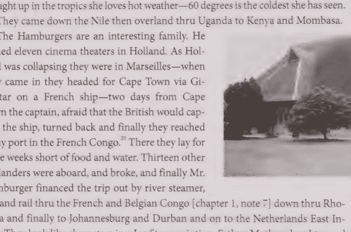

> “格拉斯塔吉的学校。凤凰花美极了。”（HEE）


# 德班到马尼拉

与位于纽约东汉普顿钩点的岛上别墅和庄园不同，那是富有捐助人查尔斯·G·汤普森。它于1941年被纽约历史学会购买并作为博物馆运营。“殖民马科维克”可能是丹尼尔·W·马科维马克（1881–1937），一位纽约居民，在在美国移民和自然化局期间意外去世。他本人也是移民，九岁从苏格兰移民，曾在菲律宾起义和第一次世界大战期间服于美国陆军（运输部队），以中校军衔离开。1930年，在经历了多元且国际化的职业后，他成为了新成立的纽约市市。

> ¹ 德国在7月袭击船只，英国皇家空军损失巨大。德国空军不得不进攻英国本土，在8月中旬首先集中攻击机场和雷达站。
>
> ² 法属赤道非洲（首府布拉拉萨维尔）、中非共和国、乍得和加隆后来成立。

## 德班到马尼拉 45

我读了另一本好书——R·亨利克的《无武器，无盔甲¹》，这是一本关于英国军队生活的故事。我厌了旅行，非常渴望回到工作中。我们收到的消息太少，无法判断形势。它本会有夏威夷所有的魅力。

**1940年9月10日**

今晚我们抵达望葛，那是苏门答腊北岸的一个岛屿；我们在那里呆了两天，我希望前往离岸五英里的山区的塔吉（或巴塔吉，见地图）。

我们船上剩下的煤风力很大，结焦很快，因此我们不得不减速。

很快我将会有新的经历，我们也将需要。

南非是一个迷人的地方。那里的人与美国有许多共同点。观点非常相似，他们热情好客，总的来说，都是我们容易理解的人。

在开普省，有色人带来了一个问题，就像我们自己的黑人问题一样——如何解决他们一无所知。此外，由于种族混合较少，因此肤色界限更容易划分。我了解到肯尼亚的当地人也和我们一样渴望保持种族隔离，由于没有社交接触，这种相互尊重更容易维持。

黑人[显然指南非的]自力更生且自傲——我指的是高阶层——其他人则会顺从。阿非利兰人问题在南非是一个真实的问题，目前似乎没有解决方案。这很大程度上取决于战争的结果。在我看来，如果领导层基于诚信并保持耐心，随着时间的推移，将会……

> ¹ 《无武器，无盔甲》（1940）是英国小说家、传记作家兼前炮兵军罗伯特·约亚基姆·亨利克（1895–1967）的大部分自传的作品。亨利克在新的战争中被召回皇家炮兵队并成为上校。
>
> ² 在被称为“驱逐舰换基地”的协议中，美国于1940年9月2日向英国转移了“四桅管”驱逐舰（见第6章，63），以换取纽芬兰岛和英属西印度群岛的权利，以及百慕岛。这些船只之前仍在备役舰队中，有些状态不佳，需要几个月才能重新启用。
>
> ²³ 即由于残渣过多，损害了锅炉效率，从而影响了驱动船引擎的蒸汽产生。

# 驶爪罗西海

双方不可分割的共同体或利益认同的实现。纳粹正利用一切可能的手段煽动[激进的非洲布利尔民族主义者的煽动]，这使问题变得复杂，并使领导层的廉洁比我们目前所认为的更为重要（即比在美国）。像史密茨²——丹尼斯·雷里茨[注11]、亨利·德雷尔等等才华之士已经意识到了这些问题，并能够从长远的角度审视未来。南非的未来是肯定的——它将成为一个大国。但这一目标的实现可能会因为短视的政策和持续的摩擦而被大大推迟。我深信英国裔和非洲裔的负责人士都意识到这一点。对于我们而言，我觉得我们应该努力在各方面增加我们的人数。

长远观点必须占据主导——这个国家将在稳步增长中表现良好，但不应被强迫。黄金和钻石产业的未来如何我无法预测，但我认为这个国家可以开发出比这些更大的资源。

**1940年9月11日，星期三**

昨晚八点，我们进入了山邦港，那是苏门答腊西北角附近的一个岛屿。我们停下来取煤，在工作进行时，豪斯、拉努埃拉、迪恩·史密斯和我一起上山来到一个很小的俱乐部，我们在台上吹着凉风，欣赏着月光下优美港口的景致，大口饮用安斯特尔三角啤酒——这可能是最后一种了，因为来自阿姆斯特丹。上山的路程炎热，加上近一个月的海上生活，起初让我非常晕。我不知道是因为嗡嗡声和耳朵阻塞还是其他原因，但我很高兴坐在凉风中。这种热带的热量在山上让我有些不适——但我希望能够适应。

山上的感觉很奇妙——小镇很小，街道非常干净宽敞，房子漂亮，汽车也很好。船上的夜晚很嘈杂、闷热，休息不多。今天一早我们出发了，正前往勿拉湾。

离开游戏保护区以来，我没有拍任何照片。所有的海水相机无论想拍什么照片都拍不上。如果我进入内陆，我希望能拍到。那里有这么多题材，错过它们似乎太遗憾了。

**1940年9月13日，星期五**

昨天我们到达勿拉湾德利，不久后，我们中人开车经过棉兰到达布拉斯塔吉，那是位于苏门答腊山区海拔4500英尺的一个美丽度假地。能够逃离炎热并在不流汗的情况下活动，真是一种极大的解脱。

> 1月24日 克里斯蒂亚安·史密茨（1870–1950），曾于1919年后担任南非联邦总理，种族隔离的倡导者。1940年他再次担任总理（并一直任到1948年，还是英国陆军元帅）。在此期间，他对“土著”的观点会发生变化，至少在将其视为劳动力方面如此；他在1948年败位给国民党，后者很快建立了被称为“种族隔离”（apartheid，“分离主义”）的严格种族隔离制度。

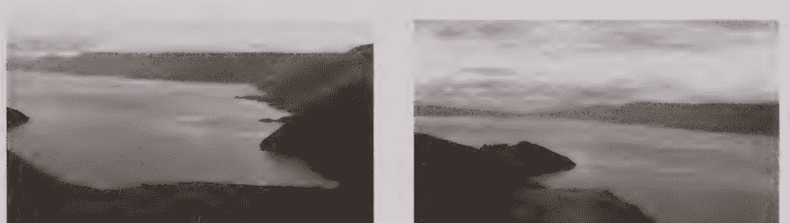

> “从苏门答腊北部布吉酒店看到的景色，海拔约4300英尺。”

我们在酒店里吃了一顿丰盛的晚餐，那里非常有吸引力，然后开车前往巴塔湖。

山区的景色非常优美；水稻、橡胶和茶叶似乎随处可见。

下午，我们在棉兰再次停下来喝茶并买点东西。那是一个非常迷人、干净且现代的城市。房屋宽敞，拥有豪华的花园和草坪。成千上万辆自行车载着荷兰人、马来人、印度人和日本人。服装色彩斑斓——配合白色的建筑、绿色的草坪和花朵——呈现出了一幅奇观。然而，那里一定热得惊人，而且只有12英外的勿拉湾德利蚊子似乎很多。

我们在午夜起航，明天上午十点我们将到达新加坡。我还没有做任何计划。在获得更多关于国际局势和战争进展的信息之前，我无法决定能花出多少时间去观光。

除了潮湿天气的影响，我的身体状况良好。航行比我预想的要愉快得多。船非常华丽。

> “从苏门答腊北部布吉酒店看到的景色，海拔约4300英尺。”


# 驶爪罗西海

双方不可分割的共同体或利益认同的实现。纳粹正利用一切可能的手段煽动[激进的非洲布利尔民族主义者的煽动]，这使问题变得复杂，并使领导层的廉洁比我们目前所认为的更为重要（即比在美国）。像史密茨²——丹尼斯·雷里茨[注11]、亨利·德雷尔等等才华之士已经意识到了这些问题，并能够从长远的角度审视未来。南非的未来是肯定的——它将成为一个大国。但这一目标的实现可能会因为短视的政策和持续的摩擦而被大大推迟。我深信英国裔和非洲裔的负责人士都意识到这一点。对于我们而言，我觉得我们应该努力在各方面增加我们的人数。

长远观点必须占据主导——这个国家将在稳步增长中表现良好，但不应被强迫。黄金和钻石产业的未来如何我无法预测，但我认为这个国家可以开发出比这些更大的资源。

**1940年9月11日，星期三**

昨晚八点，我们进入了山邦港，那是苏门答腊西北角附近的一个岛屿。我们停下来取煤，在工作进行时，豪斯、拉努埃拉、迪恩·史密斯和我一起上山来到一个很小的俱乐部，我们在台上吹着凉风，欣赏着月光下优美港口的景致，大口饮用安斯特尔三角啤酒——这可能是最后一种了，因为来自阿姆斯特丹。上山的路程炎热，加上近一个月的海上生活，起初让我非常晕。我不知道是因为嗡嗡声和耳朵阻塞还是其他原因，但我很高兴坐在凉风中。这种热带的热量在山上让我有些不适——但我希望能够适应。

山上的感觉很奇妙——小镇很小，街道非常干净宽敞，房子漂亮，汽车也很好。船上的夜晚很嘈杂、闷热，休息不多。今天一早我们出发了，正前往勿拉湾。

离开游戏保护区以来，我没有拍任何照片。所有的海水相机无论想拍什么照片都拍不上。如果我进入内陆，我希望能拍到。那里有这么多题材，错过它们似乎太遗憾了。

**1940年9月13日，星期五**

昨天我们到达勿拉湾德利，不久后，我们中人开车经过棉兰到达布拉斯塔吉，那是位于苏门答腊山区海拔4500英尺的一个美丽度假地。能够逃离炎热并在不流汗的情况下活动，真是一种极大的解脱。

> 1月24日 克里斯蒂亚安·史密茨（1870–1950），曾于1919年后担任南非联邦总理，种族隔离的倡导者。1940年他再次担任总理（并一直任到1948年，还是英国陆军元帅）。在此期间，他对“土著”的观点会发生变化，至少在将其视为劳动力方面如此；他在1948年败位给国民党，后者很快建立了被称为“种族隔离”（apartheid，“分离主义”）的严格种族隔离制度。


> “从苏门答腊北部布吉酒店看到的景色，海拔约4300英尺。”

我们在酒店里吃了一顿丰盛的晚餐，那里非常有吸引力，然后开车前往巴塔湖。

山区的景色非常优美；水稻、橡胶和茶叶似乎随处可见。

下午，我们在棉兰再次停下来喝茶并买点东西。那是一个非常迷人、干净且现代的城市。房屋宽敞，拥有豪华的花园和草坪。成千上万辆自行车载着荷兰人、马来人、印度人和日本人。服装色彩斑斓——配合白色的建筑、绿色的草坪和花朵——呈现出了一幅奇观。然而，那里一定热得惊人，而且只有12英外的勿拉湾德利蚊子似乎很多。

我们在午夜起航，明天上午十点我们将到达新加坡。我还没有做任何计划。在获得更多关于国际局势和战争进展的信息之前，我无法决定能花出多少时间去观光。

除了潮湿天气的影响，我的身体状况良好。航行比我预想的要愉快得多。船非常华丽。

> “从苏门答腊北部布吉酒店看到的景色，海拔约4300英尺。”


# 驶爪罗西海

双方不可分割的共同体或利益认同的实现。纳粹正利用一切可能的手段煽动[激进的非洲布利尔民族主义者的煽动]，这使问题变得复杂，并使领导层的廉洁比我们目前所认为的更为重要……

后来在丹林俱乐部²我看到一个漂亮的设计：一个长相大方的金发女性，低胸，丰满——她脖子上挂着一根简单的金链，胸口深处有一个十字架——但毫无疑问，她知道目光会被吸引到哪里。如此，但我不得不看到那个十字架被用作那种用途！


> “从苏门答腊北部布吉酒店看到的景色，海拔约4300英尺。”

> 1月24日 克里斯蒂亚安·史密茨（1870–1950），曾于1919年后担任南非联邦总理，种族隔离的倡导者。1940年他再次担任总理（并一直任到1948年，还是英国陆军元帅）。在此期间，他对“土著”的观点会发生变化，至少在将其视为劳动力方面如此；他在1948年败位给国民党，后者很快建立了被称为“种族隔离”（apartheid，“分离主义”）的严格种族隔离制度。

## 前往爪哇西

消息如此详尽！和《时报》待上一小时提供的信息比一个月的殖民报纸还要多。周日下午，我带史密斯院长去看了棒球赛，结果是一场胶着的投手战对决，裁判频繁地给投手机会。这相当无味。

**9月16日（周一）**，我去拜访了帕顿领事，还逛了各大航空公司和船运公司。我还在高街的“文龙”服装商店买了两套亚麻装和几条短裤。下午，我睡了一个很舒服的觉，然后去了帕顿先生家里，那里有一些美国人，主要是洛希希德航空公司的维修人员（可能是代表；见此处下方的 HEE 报告），正在打网球、羽毛球和掷马蹄。能再次和美国人聚在一起真开心！

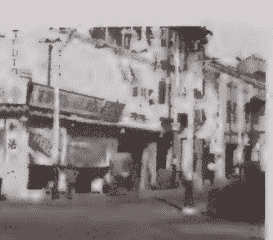

> “交通警察背上绑着一块长而轻的标记板。” (HEE)

晚上，我随豪斯夫妇一起去看詹姆斯·斯图特和玛格丽特·苏利文万主演的《转角商店》²。非常精彩——这是我这几个月来看过的最好的电影。

今天我试了衣服，咨询了更多旅行行程，并安排了接下来的六周计划。我将先回到印度，然后回到苏门答腊、爪哇和马尼拉停留几天。下午，我坐着辆人力车在唐人区闲逛，拍摄了街景照片。

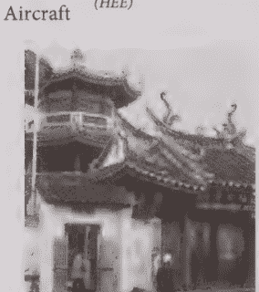

我希望这些地区的摄影限制不要这么多。新加坡非常有趣，这里的噪音、景象和气味简直无法用语言形容，我只希望艾薇能在我身边，这样我们就能一起享受它们。孤独简直是地狱！

> 新加坡：商业区。(HEE)

各阶阶的华人——从富商到普通华人——留着胡须的锡克教钱贷者躺在床上或成群结结聊天，他们的头巾和浓密的胡须最引人注目。马来人、亚洲人共同构成了一幅奇特而迷人的画面。

> 新加坡：印度教庙。(HEE)

周日，我看到了我的第一个苦力夫——四艘装满疏浚淤泥的小木船，苦力夫正通过扛在肩上的篮子将泥土运进海堤内填造陆地。一位老华人坐在伞下，和他们闲着趣。他们很瘦、很结实，但精神状态很好！

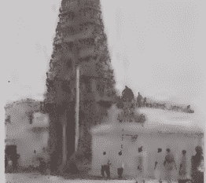

- 27 由米高高华丽影片公司于1940年发行，由玛格丽特·苏利文、詹姆斯·斯图特和弗兰克·摩根主演，恩斯特·卢比奇执导。
- 28 新加坡的锡克教社区如今规模很大，可追溯到1849年，其成员并非来自英国的移民后裔，而是被英国殖民警察和军队流放到海外的囚犯。

## 从德班到马尼拉 51

像哈顿先生这样的大户里，佣人的数量多得惊人——到处都是男孩[又是，当地佣人]！

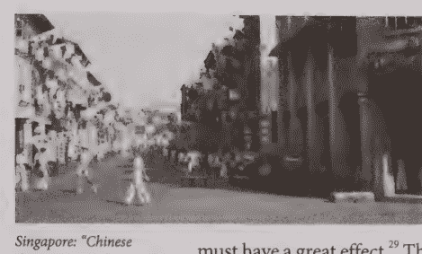

今天早上报纸声称英国击落了185架纳粹飞机。这非常令人鼓舞，但我们不知道造成了多大的损失。英国空军（R.A.F.）对海峡登陆口的轰炸非常激烈，新加坡：“唐人区——注意街道干净。”(HEE) ²⁷ 希特勒的进攻充满了各种可能性，无法判断他将如何行动。如果让我猜，他他入侵时将使用三支主力，并在多处进行佯攻以吸引注意力。我猜他的主要行动将从波罗的海准备并登船，但由于关于去向的真实信息太少，甚至去猜都是愚蠢的。我以前常从拉夫勒酒店走到市中心跨过的“卡文迪什”桥²⁸ 我真想从那儿拍照，因为看着下面奇奇怪的船只和驳船划过非常有意思；它们大多是划桨或撑桨的。

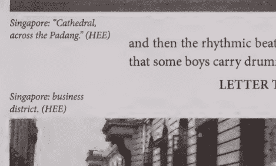

> 新加坡：“操场对面的大教堂。”(HEE)

我非常喜欢这座城市的声音——许多疲惫的人敲击木块发出的“哒哒”声，还有一些男孩边走边用棍子击中空双色竹筒发出的节奏感敲击声。

> 新加坡：商业区，(HEE)

## 给埃克尔先生的信，1940年9月17日，周二

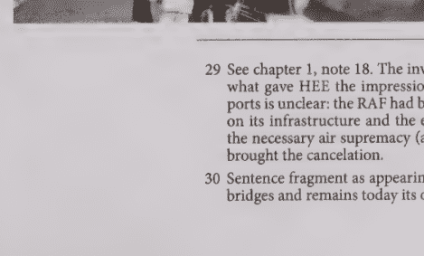

> 新加坡，拉夫勒酒店

这是一座非常有趣的城市，我想它和中国的城市很像，因为这里有大约25万华人。

- 29 见第一章注释18。入侵计划在9月17日这一天每天都被正式取消了。但让 HEE 认为英国空军正在“轰炸”德国国防军登船口的是：英国空军在8月初因遭受对其基础设施和预警系统的集中攻击而陷入防御。正是由于那次战役未能建立必要的制空权（加之德国海军无法获得海上控制权），导致了计划的取消。
- 30 日记中的片段。卡文迪什桥建于1870，是新加坡最老的桥之一，如今仍是唯一的悬索桥。

## 前往爪哇西

气味不是太糟糕——只有在少数地方才会闻到令人头晕的鱼腥味。景色很美——曲折的街道、满载小木船的运河、印度人、锡克教徒、华人和各样的服装。这里很热，但通常有微风，不像我们在家里有时那种压抑的感觉。晚上很热但尚可，天板上的风扇让空气流通。我住在一个高挑顶的大房间，有走廊和浴室。食物非常棒，整个地方都很舒适。我建立了一些有趣的联系。明天我将在总事馆掷马蹄，预计在那那里会遇到更多人。帕顿先生和夫人非常友善，我很乐意

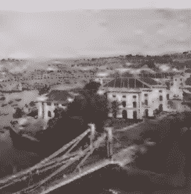

> 新加坡：“唐人区。”(HEE)

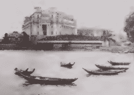

## 报告[1940年10月18日，续]

7. 如果从马来亚发动进攻，新加坡的非官方观点是英国将不会尝试防御马来亚北部。然而，那里的道路很少，在新加坡向北很远的范围内都是茂密的森林和沼泽。据信新加坡和马来半岛的机械设备数量相对较少。

26. 如果从马来亚发动进攻，新加坡的非官方观点是英国将不会尝试防御马来亚北部。然而，那里的道路很少，在新加坡向北很远的范围内都是茂密的森林和沼泽。

## 个人日记

昨天（9月22日）早上离开了新加坡，在槟城稍作停留后，然后前往曼谷，并在那里过夜。今天早上我们在仰光港（位于缅甸，现缅甸）停靠，在玉石比（现锡水；见地图）吃完午饭后，现在在上空9000英尺处飞越孟加湾

## 54 往爪哇海

前往加尔各答。这是一艘精良舒适的船，旅程非常愉快且极其有趣。

沿途中唯一连续的景观是水稻——从马来西亚、泰国和缅甸延伸出来的数千英里的稻田。起初我们在马来西亚看到橡胶，然后是椰子，接着是锡矿。

高空十分凉爽，时而感到寒意；而在地面上则酷热蒸人。

曼谷坐落在一个巨大的沼泽上，被广阔的稻田环绕。城市本身距离湄披拉雅河口约15英里，河水浑浊且流急。城市被许多满载船只的河穿过——当地房屋建在高桩上，俯瞰着河道——有味道但并不难闻。名贵的野狗在街道上游荡。

我租了一名导游和一辆车，开了几个小时。大皇寺（Wat Po）古老、宏大且漂亮。那里似乎布满了佛像。所有的伟大的卧佛都是用砖砌抹灰制成的。佛像大约五十码长，展现出他侧卧、头枕在手臂和肘部的姿态。据说这代表了他在80岁时的卧姿。大皇寺几乎所有的佛像都是从约150公里[93英里]外的古都曼谷运来的。接着我看到的是大理石寺（Marble Temple），它只有大约40年历史，非常美丽且华丽。在里面的某种小密室里，收藏了各种类型的小雕像佛——其中一尊最有趣——斋戒佛，展现出一种奇特的、眼窝如骷般的佛像。另一尊则显示他长着长钩鼻子，带着一种典型的犹太人式的微笑。大多数塑像表现出的女性化特征令我大为惊讶——那些站立的佛像呈现出女性化的体态，且几乎完全显得非常丰满。

暹的白象是一个可怕的骗局——实际上它们比古代的200头象要轻一些，而且尾巴上长着白毛——那两头皇象看起来很凄惨，因为被紧紧地拴在巨大的柱子子上。

晚上，我与查普曼先生共进了晚餐，然后与格兰特先生进行了长谈。非常有趣。

> 34 大皇寺始建于17世纪，是曼谷最古老的建筑之一，拥有泰国最大的佛像收藏。卧佛长46米。
>
> 35 推测为大城府，尽管距离曼谷只有约50英里。更古老的首都素攀府遗迹在460英里之外。


# 约翰·霍尔布鲁克·查普曼（1891–1973）

自1938年起担任美国驻泰代公。休·格拉德尼（1882–1972）于1940–41年担任美国驻泰特派公命全兼公使。格兰特的继任者威利斯·R·佩克将与使馆包括查普曼在内的其他人被日本人关押，直到1942年6月释放。

## 官方报告 [1940年10月18日，续]

... 12. 与泰国部长休·格兰特先生分别进行了两次、每次长达数小时的会谈。格兰特先生认为，泰国的民族运动与过去几年非常广泛的日本宣传之间没有必然联系。他认为泰国对中法提出的领土要求具有合理、公平的基础。对泰国北部边境的整顿目的是为了消除任意边界，并代之以以河流为界为自然边界。在某种程度上，对东部边界的要求具有相同的基础。涉及的领土极其荒凉，本身并没有特殊价值。与巴黎政府签署的不侵略条约的批准一直被推迟，正取决于河中某些岛屿的主权问题。格兰特先生的观点是，泰国的要求时机恰恰不对，因为它们干扰了“现状”，似乎在顺应日本的计划。泰国政府是一个严厉的军事独裁政，建立在极端民族主义且相当进步的基础上。最近有一次，格兰特先生在与副总理兼国防部长交谈时，直接询问泰国是否会诉诸武力来实现目的。副总理拒绝做出承诺，并表示虽然泰国不想使用武力，但这种压力让他无法给出这一保证。反过来，格兰特先生被要求获得美国政府的保证，如果将这些要求推迟到某个适当的时间，美国将支持泰国整顿边界的要求。国务院没有、且显然也不会提供任何保证，因此格兰特先生必须尝试使用说服而非官方承诺。格兰特先生表示，他处理泰国政府的整个政策一直是配合国务院维持远东现状的政策。

13. 格兰特先生认为，伦敦政府给予了约西亚·克罗西爵士在处理泰国事务时很大的自由度，因为他们正忙于国内事务。英国驻泰公使约西亚·克罗西爵士在该地区拥有40年经验的老手，对该国非常了解。在关于该主题讨论的早期，他显然完全同意维持现状的政策。然而，最近的进展向格兰特先生表明，英国公使的态度有所软化，并倾向于支持日本。

## 往爪哇海

14. 布朗菲尔指挥官的观点是，泰国海军是一支规模小且效率低的部队；空军装备相当良好，陆军非常优秀。他认为日本宣传非常激烈且露骨，达到了其目的，而泰国对中法的要求很可能是为了加强防御日本侵略的结果。格兰特先生认同这一观点。格兰特先生、约西亚·克罗西和布朗菲尔一致认为泰国人在这一问题上是独立行动的，他们承认泰国与日本有某种默契。

## 个人日记

### 1940年9月23日，周一

曼谷以蚊虫闻名，但我算轻地躲过了。富人的房屋很华丽，但这座城市作为居住地并不吸引我。

今天早上飞过稻田带给我一种奇怪的感觉。它们看起来像、实际上也是沼泽，在那种国家生活和建造村庄的想法是很新奇的。“东方”这个词用得多么贴切。我开始理解理解东方有多困难，它是怎样的难题。我也能更好地理解并尊重“上帝之地”这个词！

在“信使”号上，我们现在有前往仰谷的泰国代表团：他们非常随和，似乎很喜欢这次旅程。

他们登船时受到了热烈的送别，成千上万的泰国人在[飞机起飞的地方]挥舞旗帜欢呼。

### 1940年9月25日，周三

乘坐“信使”号，经开拉奇、巴林林

周一下午4点[9月23日]到达加尔各答，降落在浑浊的胡格河上，是一场干雨后的余波。海关和移民办事处效率缓慢，前往大东方酒店的路被街道上的洪水阻碍。我们在6:30到达酒店。

我对加尔各答留下了非常不好的印象。天气炎热潮湿，城市肮脏破旧，我经过的当地人区居住条件极其糟糕。牛在城市里漫无游荡、对万物拥有优先权、在街道和门廊里睡觉的想法并不吸引我。那里没有像样的排水系统，导致每逢大雨——加尔各答经常下大雨——街道就会被淹没，积满了到处都是泥泞。潮湿似乎正在迅速破坏建筑，它们看起来已经腐烂不堪。

我在酒店遇到了来自德尔班的贝里（Berry），他现在位于加尔各答领事馆。期间，我和几个朋友一起洗了澡，喝了汽水，这非常令人欢迎。我不喜欢这个国家大量的仆人——他们虽然有服务态度，但在很多情况下，他们的表情中带着一种不悦的神情。如果我住在这里并适应这里，我的观点可能会改变。

周二[9月24日]，我们起得非常早，出发横跨印度中部。那些稻田让我心烦意乱，我很高兴能离开那里。傍晚晚分，我们在阿拉哈巴德（Allahabad）停下，但没能看到太多风景。我们的第三站是拉德德·萨曼德（Rad Samand⁴），那里非常有趣。这是一个由两座水坝形成的人工湖。小水坝位于两座山丘之间，其中一座[即另一座水坝]是一座耆真教庙，另一座是拉杰王的宫殿，其遗迹非常漂亮。主水坝长两英里，城镇就建在上面。这些水坝建于17世纪，设计和建造精美；身处城镇下方，看着通往水面的墙壁和阶梯，感觉非常奇妙。那里炎热干燥；当地人的服装色彩斑斓，闪烁的阳光洒在城镇的白色建筑上，产生了美妙的效果。

前往卡拉奇（Karachi⁵）的行程越过了山脉，我们偶尔能看到山顶的小村庄，以及山峰或山谷中一两座美丽的寺庙和宫殿。

卡拉奇非常愉快、整洁且富有吸引力，有许多现代建筑。码头非常现代化。我对那些带有精美索具的帆船（dhows）⁶很感兴趣。酒店很舒适，但最棒的是干燥的空气和宜人的微风。我坐在周围，与飞行员和副驾驶员聊天；因为港口有几架帝国航空的飞机。

今天早上，我们在七点乘坐满载的飞机起飞，其中包括三个阿拉伯人。第一站是朱瓦尼（Juwani [Jawani?]），那是印度北境附近一个鬼迹不入的地方。随后，我们在特鲁西亚特阿曼（Trucial Oman，沙特阿拉伯的一部分）的迪拜停下。这两个地方的热力都非常剧烈，但相当干燥舒适。

我们穿过一片边缘山脉进入阿拉伯地区，深邃的水域令人着迷。从海中突然升起，深水直抵海滩——那是通常延伸一英里或只能看到很短距离的绿沙带。山脉呈红褐色，被许多几近干涸的小溪流深度侵蚀。它们给人一种从沙子中刻出来的印象。我们在9,000英尺高空飞行，最高峰似乎在我们下方2,000英尺处。沙漠延伸向沙漠，看起来像一个巨大的金色湖泊。这里有小小的定居点，点缀着绿地，阳光偶尔在沿山而下的溪流上闪光。

当我们下降着陆时，我看到三只骆驼沿着通往城市的一条小路走。从迪拜[*]的高空俯瞰，景色极美，环绕着绿色的港口建立；许多帆点缀在海面上和港口。在阳光的耀耀下，水面值得一睹。

机场办公室的哨兵是一个凶恶的阿拉伯人，带着一把大弯刀和一把旧式连射枪。显而易见，他带上的大弹药根本装不进枪，但他似乎觉得这种表情就是他最好的武器！我倾向于相信他。

这次旅途中我不被允许携带相机非常失望，因为那里有很多壮丽的景色。

## 给埃克莱斯夫人的信，1940年9月27日，周五

波斯湾，巴林岛，瓦利

... 这里的主岛宽约九到十英里，长约三十英里[*]。古老的阿拉伯城市马纳马（Manama）位于北部，主岛上散布着许多村庄。

炎热季节即将结束，现在白天气温很高，阳光很亮，湿度较低，晚上非常舒服。巴林石油公司所有的房屋和办公室都装了空调。这让生活变得很舒适。瓦利的整个城镇或营地按照美国的习俗和习惯运作，所以我几个月来第一次感到像在家一样。

岛上的居民是老族群，主要是阿拉伯人，混杂了波斯人、非洲隶人和一些印度人。他们严格伊斯兰教，大多数妇女都戴着厚重的面纱。岛上的某个区域散布着数千个坟丘，无人知道它们的年代*。有些人认为它们有三十年的历史，但在里面发现了许多遗骸。

4 詹姆斯·贝里（James Berry,1908-80），1940年6月1日至1941年任加尔各答副领事，在此之前的5月一直在德尔班担任同一职务；HEEK在8月14日访问领事家时遇到了他，他在第一章中提到。贝里于1958年成为斯里兰卡大使。

42 显然是焦特浦附近的巴尔萨曼德（Bal Samand, or Balsamand）。

43 巴基斯坦最大的城市和主要的区域港口，当时卡拉奇属于英印度的孟买省。

44 达豪帆船，传统上用柚木和雪松木建造，自古以来就在印度洋和红海运送货物和渔民，至今依然如此。它们是

45 对迪拜的引用。

46 对岛的引用。

47 迪尔矛（Dilmun）坟丘。

48 可能是米尔顿·希克瑟·利普（Milton Hickerth Lipp,1895–1970）及其妻子玛丽。

49 未识别。

50 一种当时（非正式地）被称为逐舰的护卫队，

51 对特联酋国的引用。

52 对福尔茅号的引用。

## 飞往爪哇海

## 德尔班到马尼拉

这是一个有趣的地方，受英国保护，由一位谢赫统治。这是一个非常古老的社区，多年一直是贸易、走私和采珠中心。人口非常混合，有阿拉伯人、波斯人和黑人。

## 报告[1940年10月18日，续]

巴林石油公司建立了一个美国式的城镇，配备物资商店、电影院、网球场、板球场（沙地做的）和游泳池。布局非常漂亮。

我一直很好，除了由于食物和水引起的偶尔肠胃不适，以及缺乏运动导致的身体疲软。我厌倦了旅行，以及对出发时间的持续不确定以及明天会发生什么。我厌倦了陌生人，尽管他们都很友好且一贯热情。我快想死你了。自从听到你的声音之后。我希望我能在新加坡或在仰光的路上寄信……

## 个人日记

### 1940年9月28日，周六

波斯湾，巴林岛，瓦利

从周三下午开始，我就住在利普（Lipp）夫妇家中。

- 4 据悉一艘意大利潜艇在苏门腊离岸击没了一艘船⁵，并在10月1日之前被英国部队击沉。波斯湾部队指挥官暗示，截至9月25日最多只有两艘意大利潜艇在逃亡。一艘意大利潜艇由福尔茅号（HMS Falmouth⁶）出现在波斯湾，口，由于涉及行动的那艘潜艇被发现在另一艘在红海沉没或被捕潜艇的航行日志。据了解，在第一艘沉没的意大利潜艇中发现的作战指令导致了在短时间内有六艘意大利潜艇沉没。波斯湾部队指挥官表示，声呐（[声纳]）设备非常有效，在涉及含有温度梯度的水域作业中，其效果超出了他们的预期。值得注意的是，高达92°华氏的高温海水导致了动能的大量损失，并增加了在波斯湾内及附近运行船舶的机械磨损。^51

- 5. 巴林林石油公司的油田受到了很好的保护，免受了空袭或破坏。然而，其炼油厂极易受到空袭。如果埃及或邻近地区的意大利战役证明是成功的，沙特阿拉伯、巴林林和阿巴丹（现代印度尼西亚的一个岛屿）的炼油厂将受到飞机攻击，因为那里完全没有任何保护。沙特阿拉伯和巴林林石油公司目前的总产能为每天40,000桶，而阿巴丹的炼油厂是世界上最大的，产量超过每天100,000桶。对巴林的访问得出了以下几点：巴林林石油公司工厂和加州阿拉伯标准石油公司工厂内有四百到五百名美国公民，后者位于沙特阿拉伯的主干路上，距离巴林约二十五英里。巴林林石油公司的管理人员素质极高。米尔顿·利普（Mr. Milton Lipp）先生是经理。利普先生在巴林工作了六年，他的爱国主义和能力不容疑。他的助手是负责生产的麦康尔先生（Mr. McConnell）和负责炼油厂的安德森先生（Mr. Anderson）。全体美国员工在个人品质、胜能力表现和可靠性方面都素质很高。公司拥有一个完全现代化的营地，所有的办公室和住宅都配备了空调。商店供应着来自美国的锡罐头食品和主食，以及来自澳大利亚的冷冻肉。这里保持着两个月的所有食物储备。炼油厂以最高有效效率运行，每天约35,000桶。不生产航空汽油。锅炉油和柴油的硫含量较高，达到3.5%，要改造工厂以降低这一百分比需要大量的资金和时间。^52 从清洁和其他质量角度来看，产品是非常高等级的。

51 因为海水是船舶辅助机械以及主冷凝器（“蒸汽循环”的关键元素，驱动主机的蒸汽在很大程度上由此回收并重复利用）的冷却剂，环境水温会降低整体推进效率，这将增加机械机械过热的风险。

52 为了减少燃烧产生的腐蚀性氧化物。

德班到马尼拉 61

## 个人日记

### [可能是1940年9月29日或30日，周日或周一]

巴林林石油公司在这里有一个漂亮的营地，所有的办公室、房屋和社区建筑都安装了空调。

看到身穿色彩鲜艳服饰的阿拉伯人在沙漠背景下非常有趣——这也是真正的沙漠！妇女们戴着厚厚的面纱，像陌生人一样遮住头部，有趣的棕榈叶遮着由石头和石膏制成的棕色房子，骆驼和驴，枣椰树，弯曲的街道以及乞讨者的喧闹声，还有晚上围坐在咖啡馆里的男人。这构成了一幅我不会忘记的画面，尽管我不想待太久或太频繁地来。当地的造船者非常有技巧，单帆船（dhow）制作良好，线条优美，柚木[见注释44]来自印度，钉子是当地锻造的。这种大木船随季风一直开到桑齐巴尔和达尔埃斯萨拉姆。珍珠业务由于战争和人工珍珠的竞争而不算繁荣，但它是天然珍珠的供应源。我经常听过沙漠中距离的错觉，但我从未意识到那是如此真实。一栋建筑看起来只有它实际距离的一半远。

我的计划是晚些时候出发，但我预计明天一早就会出发前往新加坡和马尼拉——我厌倦了旅行、闲逛和陌生人，我想回到自己的岗位上和我的员工一起工作。

一群近亚人类的人群。

我在曼谷与格兰特先生（Mr. Grant）进行了一次非常有趣的会面，但当他回家见我时已经很晚了。

### 1940年10月9日，周三

松盖格戎（Soengei Gerong）[荷兰东印度]

周一下下午[10月7日]，我我和麦科比先生（Mr. McCobb，见下文第4段）开车前往Pendopo访问油田。营地布局良好，宿舍舒适，员工由高素质的人员组成。在进入营地之前，我们在一个非常有吸引力的小俱乐部和高尔夫球场停下来喝了饮料。我们和主管菲尔先生（Mr. Field）以及其他人吃了晚饭。在安静的夜晚后，我们早早休息。周二早上，在毯子下睡了一个凉爽觉后，我们早早出发参观了油田。

## 报告 [1940年10月18日，续]

... 6. 位于苏门腊松盖格戎和Pendopo的NKPM [Nederlandsche Koliale Petroleum Maatschappij]（[a]标准真空子公司）炼油厂和油田由埃利特先生（Mr. Elliott）监督。利伯先生（Mr. Lieber）是助理经理，詹宁斯先生（Mr. N. Jennings）是炼油厂经理，库布先生（Mr. Cobb）是生产经理。所有这些人的素质都很高，可靠性不容置疑。技术和执行助理中以荷兰人为主。在距离巴加加以西100公里的Pendopo周边油田，NKPM已经采取措施对一些产量最低的井井进行封固。正在准备封固其他井井，但由于井井数量超过500口，且泵水泥设备相当笨重，需要几周的密集工作才能完成这些井。当然，封固意味着如果油田重新投入生产则需要重新钻井。然而还可以采取其他措施并可能被荷兰政府强制，这不仅会导致油田停产，还可能对其造成非常严重的永久性。

## 个人日记

### 1940年10月6日，周日

苏门腊松盖格戎（Soengei Gerong）

我今天早上7点乘坐K.L.M.飞机离开新加坡，现在位于标准真空公司子公司炼油厂的一栋客馆。

从巴林的行程很疲惫，回到新加坡后很高兴能睡个好觉。飞机上有一位来自巴勒斯坦的有趣的犹太人——本纳哈姆（Ben Nahum），他正前往纽约处理城市业务并帮助妻子生孩子。他来自海法，对巴勒斯坦事务非常有见解。完全拥有一个油田或一组油田的优势是显而易见的，因为它允许进行非常有效的压力维持和流量的完全控制。套筒汽油在油田提取，并从泵回井中维持压力的气体中分离出来，汽油与管道泵上的排出的油重新混合，以降低粘度和石蜡沉积。

加尔答看起来比以前更加阴暗和令人压抑。人们脸上没有任何活力、希望或兴趣。

它看起来是一个衰败且绝望的群体，拥挤且毫无价值。丛林非常茂密，有美洲豹、猴子野猪——附近还有几头大象。我在路上除了看到蛇外什么都没看到。

在巴林一样，英国人勘探了这片领土[显然是Pendopo油田]，认为没有产量并放弃了特许经营权。现在他们至少是有些出脸，因为我们能够将其开发得如此成功。

## 给埃克莱斯夫人的信，1940年9月27日

### [10月6日，周日，续]

苏门答腊，巨叻，Soengei Gerong，Pasang Grahan 3-B

在巴哈林经历了极其疲惫的旅程后，我于周三抵达新加坡，像蝙蝠一样睡了大约九小时。接下来的三天，我过得很安静，打打高尔夫球，试图恢复体力。昨天我在武吉蒂山球场出来时，爬山时已经不再气喘吁吁了。周五晚上，我有几个美国人对我非常友好，请我吃晚餐并跳了舞。周四我和总领事帕顿夫人共进晚餐，他们是迷人的人。她来自查洛斯维尔，毕业于[弗吉尼亚大学]，非常敏锐且干练；她是一位大约60岁、气质出众的年轻艺术家。她画的马来人头像非常迷人。新加坡的美国殖民社区（即人数）超过100人，人们很活跃。

今天早上我5:30起床，乘了7:00的飞机，现在10:30，已经在标准真空公司炼油厂这家非常有吸引力的客栈里洗完澡了。巨叻附近。

周三我将前往巴达雅[现代雅加达]，然后周四飞往马尼拉，在那里待两三周。我想，如果不是坐飞机，这次旅行将花费六个月。现在我非常渴望报到岗位并在船上安顿下来，因为我已经厌倦了旅行、酒店、各种案件，以及睡在蚊帐下所有这一切。

早报上关于海军家属妻子已取消前往中国舰队的航行的消息，这最令人沮丧。我一想到你不能很快与我汇合就很痛苦。见不到你，感受不到你的存在和理解，这种感觉太糟糕了。我脑海中清晰地看着你，但我真的很想触摸你，听到你的声音。我甚至无法预测将会发生什么。但有一点我很确定：我的妻子比任何女性都有魅力、更有性格，对我来说是最最珍贵的东西。当我们的别离结束，我将重新完整。

### [1940年10月7日，周一，下午1点，续]

不久后，我将开车约75英里前往产区，包括周晚上和周二下午。

昨天，我和代理经理李巴克尔先生一起吃午饭，在那里遇到了十几个是该机构核心领军人物的美国人。我们吃了Rijstaffel——马来语中米饭和咖喱的对应物，非常有名。味道很好，在痛快大吃之后并聊了很久后，我回到营地休息休息，然后与炼油厂主管詹宁斯先生以及一对名为霍尔曼的友好的南方年轻夫妇一起吃了一顿安静的周日晚餐。通过旧金山的电台听到第一场足球比分，这是一种宁静的兴奋。

夏日的炎热很舒服，安静而迷人，我有极佳的河景，各种奇特的船只在穿梭。我喜欢马来当地人，他们整洁、聪明、自尊且幽默。新加坡很有吸引力，因为人口主体是马来人和中国人。加尔答太可怕了，肮脏、潮湿；人们看起来死气沉沉、瘦削、丑陋，要么卑媚要么粗鲁；他们共同拥有一个特征就是绝望。看着他们让我感到毛骨悚然——睡在街上，和那些死的牛群在一起，牛到处都是！北印度城市完全不同，但孟加拉人很可怕。

- + 54 1940年10月8日，美国国务院通过其领事官员建议妇女、儿童在没有紧急事务的情况下离开远东。哈特海军将随之敦促所有海军家属尽快离开。陆军也随其后。（联合报社，1940年10月8日）。

- + 55 并非真正的本土荷兰殖民菜（该名称在荷兰语中意为“米饭桌”），是一种具有印度尼西亚群岛特征的宴会式食物，用小盘盛出。如今它在荷兰很流行。


这样的旅行对一个人的爱国主义来说是极佳的补药。现在理解并认同“上帝的土地”这个词——土地、人民和气候远优于我见过的任何地方，任何比较都是荒谬的。石油公司的人很棒——大多数女性现在都在家里，昨天收到纽约的电报要求撤离该路线。

我周四在马尼拉会想念你——我一直忙得没法定期写信，而且我旅行得比邮件还快甚至更快，所以如果审查延迟，写了也没用。我在巴达雅数收了一些邮件；由于巨叻没有领事馆，我的信被寄到了爪哇，我在周三从那里拿到了。顺便提一下，等我把照片放大并贴好后，我会把日记寄给你。

> [1940年10月9日，周三，续]

周一下下午，我开车前往Pendopo的油田，在那里过了一晚，下午回到Soengei Gerong。这非常有趣。它们位于丛林中心——井之间间隔四分之一英里，以实现高效的受控生产，因此没有那种让加州风景变得破败的、可怕的井架迷宫。营地非常有吸引力且舒适，人们也同样迷人且热情。我对美国石油公司人的尊重非常高；他们让我感到如家般温暖。

昨晚我盖着毯子睡觉，今天早上我无所事事，这是长时间以来第一次完全的放松。几分钟后我就要去巴达雅了，我过了一个忙碌的晚上，你的信明天就到。快运船明天早上出发前往旧金山——我希望我能乘坐1935年开始的M-130水上服务的泛美航空航班。

## 个人日记

[可能是1940年10月8日，周二]

我无法过分评价与菲尔斯先生共进午饭时遇到的美国人——他们才华横溢、体格良好且非常友善。这里的氛围和组织激发了我的自豪感和爱国情怀。巴哈林也是如此。

优秀的技术人员是中国人。有很多爪哇人担任中级员工和家庭佣人。当地的马来人还可以，但倾向于懒散——他们都很整洁。

鲜艳的纱笼非常迷人，头巾——小头巾也是如此。然而许多人喜欢穿亮丽的睡衣，那可以出现在任何卧室场景中。所有的房子都是高脚楼式的。

> “年轻的苏门答腊。”

下午我们开车回来，我在渡口处接了船，开始沿着望西河下行了45分钟，经过巨叻。这些船只非常————长而优美的普劳船（praus）——船尾很高，船头有一根长木板作为跳板。

> “苏门答腊：巴塔克房屋。”

城镇的大部分建立在停泊的木筏上，随潮汐起落。市船售卖各种物品——包括河边和运河上的软饮料。许多船都有顶盖或甲板盖，家庭住在船上。大多数船都涂漆得色彩斑斓。

我住的Pasang Graham位于一片绿荫如画的草坪上，一直延伸到河边。昨晚我并需要一条薄毯，这是我第一次使用它感到休息得非常充分，今天早上我舒服地闲荡了几个小时。这种彻底放松并感到旅行即将结束的感觉真好。今天下午我将飞往巴达雅，明天飞往马尼拉。

## 往爪哇岛

10月9日周三，我飞往了巴达雅（Batavia），标准石油公司的科赫先生在机场接了我，我此前在新加坡见过他。我们开车前往了美丽的印度支那酒店（Hotel Des Indies），随后前往美国领事馆，在那里与总领事福特先生度过了两个小时。

福特先生在过去的14年里对荷属印度群岛非常熟悉。七年前，在巴达雅担任总领事一段时间后，他被调到了澳大利亚。在过去的几个月里，他回到了巴达雅，与[荷兰]总督、总司令和其他官员进行了私人会面，他认为他们已经就形势提供了完整的信息。他通过电报和无线电向美国国务院提交了自愿报告，并向东京的格鲁大使提交了补充报告。

## 官方报告 [1940年10月18日，续]

15. 在与巴达雅美国大使福特先生进行的一个半小时的访谈中，明确了以下几点。福特先生在过去的14年里对荷属印度群岛非常熟悉。七年前，在巴达雅担任总领事一段时间后，他被调到了澳大利亚。在过去的几个月里，他回到了巴达雅，与[荷兰]总督、总司令和其他官员进行了私人会面，他认为他们已经就形势提供了完整的信息。他通过电报和无线电向美国国务院提交了自愿报告，并向东京的格鲁大使提交了补充报告。

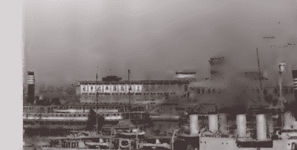

16. 关于荷属东印度群岛防御的情况如下：军队中荷兰人的比例约为七比三。这代表荷兰人占的百分比有所上升。印度群岛方面表示他们将反抗并战斗，因为印度群岛是荷兰人可以称之为自己领地的最后阵地。荷兰官员认为，美国近期对日进行的交易已迫使日本向荷属东印度群岛（N.E.I.）寻求物资。这些官员无法理解的是，美国在以这种方式强迫日本的同时，最近取消了荷属东印度群岛国防中急需的长期弹药合同。据认为，军队在海滩和后方丛林的白刃战中可以表现良好。

> John D. Edwards (DD 216) 在20世纪30年代的上海优于 Barker 号 (DD 213)。这些船船头下沉，赞扬它们的螺旋桨和舵，从而减少了吃水深度。蒸汽部分似乎是倒闭蒸汽轮公司的资产，可能正在处置（国家档案和记录管理局照片 80-G-1031609）

58 沃尔特·A·福特，直到1946年一直留在巴达雅担任总领事。

59 Alidius Wilhelmul Tjijard van Stercken Stauchower（1888–1978）是印度群岛的殖民督：向日本人投降后，他最终于1945年8月获得解放。战后，他曾任驻法国，随后任驻北大条约组织。海因·波尔滕将军（1887–1968）在战争爆发时指挥荷兰荷属印度军队；他在1942年3月8日投降爪哇岛时，将领导美英荷澳盟司令部的部队（第5章，注63），并被关押全程。1945年退休。Theo Wiehof 将于1956年辞职。

然而，荷兰官员认为他们无法抵御高爆炸物，当地人会“像兔子一样逃跑”。防空[防御部队]指挥官表示装备不足。中等数量的移动炮、坦克和装甲车。在日本人高度集中的地区，守军指挥着若干坦克和装甲车。⁶ 官员表示，一旦行动迹象，这些将用于清除这些地区的日本人。步枪和小武器弹药是急需。英国已为印度群岛提供了大量的雷。空军由约200架轰炸机和约50架战斗机组成。福特先生表示，印度群岛只有一艘荷兰潜艇。这与从新加坡海军情报部门获得的信息不符，那里称印度群岛有两艘荷兰潜艇。⁶

洗澡的代价不菲：

2016年为130美元。

(HEE)

## N.V. MUI.

印度支那酒店

巴达雅-C.C.

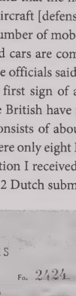

17. 印度群岛政府已下令，一旦发生敌对，将彻底破坏油井和炼油厂——而非使其停用。这代表了价值3,000万美元的美国财产和1,000万美元的资本投资可能被毁。当美国国务院询问这些数字时，福特先生核实了它们。

18. 关于目前在印度群岛的印度使团，明确了以下内容：由三井兄弟公司的井先生率领的日本商务使团于8月[抵达]，是一项为了讨论石油资产的纯商业任务。在抵达后，他们什么都没做，显然是在等小林（Kobayashi）代表团的到来。⁶² 印度群岛方面要求日本政府接收小林代表团。印度群岛表示，只有在以下条件下才会欢迎他们：

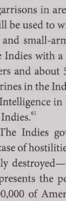

60 地理位置不明确；可能是登陆区域。

61 印度群岛方面订购了十五艘潜艇。

62 1940年9月，小林抵达，以重新谈判日本与荷属东印度群岛的政治经济关系。

(b) 预先提交议程；

(c) 没有政治性质的讨论。

9月初，小林代表团抵达——没有授权信，没有议程；并从此显示出纯属政治性质。尽管有这一令人惊讶的举动，荷兰政府接收了小林代表团。该代表团由40至50名成员组成，主要由陆军军官以及所谓的“专家组成。根据福特先生对国务院的话，“接收这个代表团，印度群岛输掉了第一回合。”认为所有代表团成员都是黑龙会的成员。

19. 该代表团一直采取极其傲慢的态度。5月，日本政府正式提交了一份他们希望从印度群岛获得的商品清单。该清单包含13项物品，几乎涉及印度群岛的整个经济。请求的项目包括石油产品、废铁、铝锰、椰子、锡、橡胶和奎宁。对石油的首次请求为100万吨。橡胶和椰子的需求超过了日本消耗量，且是供德国使用的。

20. 在目前为止的讨论中，仅考虑了一种产品，即石油。小林代表团抵达后，日本人将要求增加到每年315万吨，为期五年，并由荷属东印度群岛保证交付。此外，他们还提出了以下政治要求：

- (a) 派遣日本陆海军军驻驻印度群岛，负责检查原材料并监督运输和港口以确保交付。
- (b) 大幅增加在印度群岛商业机构工作的日本人人数。
- (c) 允许日本人自由进入荷属印度群岛。
- (d) 允许日本人购买荷属印度群岛商业工业的股份。
- (e) 授予日本对荷属东印度群岛自然资源的完全开采权。

21. 这些代表了对印度群岛的完全经济政治和军事统治。印度群岛官员对所有日本要求均拒绝。至于石油，官员表示，如果日本想购买石油，印度群岛政府没有异议；

63 一个成立于1901年的日本极端民族主义准军事组织。它在1946年被美国占领当局解散。

然而，日本人必须直接与商业利益交涉，主要是壳牌（Shell）和标准石油（Standard Oil）。政府表示，任何情况下都不会保证向日本交付石油或任何其他物品。

22. 讨论过程中发生了相当大的摩擦。有一次日本方面发表声明说“既然什么也办不成，他们不如回家”，这引起了对方字面上的挑眉（视。随后，日本人声称翻译员出了错，他们想说的是石油的主题应该进行更详细的讨论。当时，小林（Kobayashi）代表团坚持要求荷兰与石油公司交涉，而经济部长范莫特（Van Mockt）表示他不是什么中间人。

23. 在所有关于石油的初步讨论中，并没有规定石油种类。换句话说，日本人只是说他们想要石油。他们没有说明所需的各种石油种类和数量，也没有在任何时候提到过如何支付石油费用。10月10日星期三，日本代表团首次接触了壳牌代表冯埃克特男爵（Baron von Eckt）和标准石油公司经理凯伊先生（Mr. Kaye），后者于9月15日从纽约抵达巴达维亚。在讨论之后，日本人终于拿出了图表并声明他们想要航空燃料和原油。讨论期间，印度属群殖民政府曾要求美国和英国石油利益集团说明，在不影响其对美国和英国帝国现有合同义务的情况下，他们能卖给日本多少石油。石油公司表示，他们每年最多提供1,800,000吨。

小林代表团对这个低数字感到非常愤慨。截至10月10日，谈判陷入僵局。代表团已致电东京寻求进一步指示。标准石油公司的凯伊先生和埃利特先生（Mr. Elliott）正前往勿打坡。

24. 福特先生（Mr. Foote）坚信印尼殖民政府将坚持立场并拖延时间。对于其他需要像石油讨论那样长时间的商品，将会无期持续下去。10月11日的COMSTE电报中包含的信息是福特先生从印尼殖民政府的一位官员处获得的，该官员表示他在东京的消息来源是完全正确的，并且他对他的线人以及信息的准确性充满信心。

25. 如果发生入侵，印尼殖民政府官员认为入侵将通过托管岛⁵或经由马来半岛进行。初始目标可能是须望岛、马鲁库群岛、荷兰新几内亚和婆罗洲。这些地点没有值得提及的防御，印尼殖民政府官员认为，几百士兵几乎可以在不受反对的情况下占领这些地区的任何一个地点。荷兰人将保卫爪哇岛和苏门腊岛。机场现在布满了障碍物，只有在已知飞机到达时才会移除，并由士兵和机枪守卫。在任何机场附近未发现重型设备。

## 通往爪哇海

## 个人日记

[可能续自1940年11月6日星期三]

回到酒店，我换了衣服，然后去了大楼另一部分的某间空调房间，在那里我见到了来自纽约的经理凯伊先生、Soengei集团及相关物业的巨大经理“矮个子”（Shorty）以及其他人。喝了几杯酒后，在床上躺了三个小时，并在巴达维亚著名的俱乐部喝了一杯咖啡。

这家俱乐部于1815年首次开放，自开放以来从未关闭过，因为钥匙被扔进了运河。在过去的125年里，无论白天黑夜，人们都能获得食物和饮料！它非常漂亮，事实上整个城市都是如此。

在马尼拉呆了几周后，巴达维亚、新加坡和棉丹等城市之间的对比，让我对导致菲律宾现状的这种笨拙作为感到非常失望。错失的机会和管理不善毁掉了一个本该是美好的国家。这恰恰证明了人不能违反基本原则而不受惩罚。

我大约12点回到酒店，进行了短暂的罪恶之行。下午3点我被叫醒，4:20我们乘坐一架道格拉斯DC3飞往马尼拉。我们于10月10日下午4:30到达马尼拉，经历了一段10,000到12,000英尺的艰难行程。我带着严重的头痛探出窗外。

洗完澡喝了点酒后，我在陆海军俱乐部下楼走动，在那里见到了塔利·谢尔指挥官（Commander Tully Shelby），这是我三个月半以来遇到的第一个我以前见见过的人。这种如释负的感觉太棒了——我再次和自己人在一起了，而且我没有船或飞机。

⁵ 太平洋上的65个岛群，特别是马绍尔群岛和马里亚纳群岛，曾属德国，并在一战后被国际联盟“托管”。日本为了太平洋战争对这些岛屿进行了高度军事化。

66 联邦军事学会于1836年正式开放（起源可溯至1806年），面向欧洲人。1965年，该建筑将由新主权政府的财政部接管。

67 马尼拉陆海军俱乐部成立于1898年，供美国军人和平民使用——菲律宾人直到殖民时期结束后才被允许进入。俱乐部在战后没有重新开放，但建筑被用于多种用途，作为纪念碑保留了下来。

68 塔利·谢利指挥官（Cdr. Tully Shelley）（1892–1966，美国海军军学院）。

## 往爪哇海

重获生活。见到了许多老朋友，并终于拆了箱。能在那同一张床上睡上几天，而且不用考虑打包之事，真是一种奇妙的解脱。

在奥斯塔号（⁷）抵达期间，我在10月27日（周日）登船并向哈特将将（Admiral Hart）提交了报告。他非常热情，让我感到宾至如家。这是自1930年以来我第四次于他麾下服，我有信心会喜欢这份工作。他是一位伟大的人和军官；他承担着巨大的责任，他的决策至关重要。

从那时起我们一直很忙，处理潜艇行动、临时[干]坞维修等以及本·亚当斯（Ben Adams）。我们找到了老朋友和高尔夫伙伴，如吉姆·布伦纳（Jim Brenner⁸）。我们都面临着巨大的适应问题，但通过我的工作、高尔夫和留声机，我找回了本该没有其他依靠的灵魂。我会感到孤独和艰辛，但我相信我可以坚持。伊莎贝尔（Isabel）的信非常棒，斯基比（Skippy）处于最好的照料中，虽然我会很孤独，但我的家人是安全的。

前几天，我收到了第一封表扬信。我觉得哈特将的欣慰足以弥补了我偶尔想起的那些犹豫不决的时刻，可以将这次旅程看作是一次伟大的冒险，我希望将报告的副本也加入这本日记中。


美国亚洲舰队司令官给亨利·E·埃克莱斯（Henry E. Eccles）中校的信，1940年10月28日

主题：关于1940年10月18日的报告

1. 亚洲舰队司令官对你主题报告的卓越表现表示表扬。报告显示了在执行重要任务时付出的辛勤努力和所运用的卓越判断……

托马斯·C·哈特

⁷ 奥斯塔号（CA 31）是一艘诺福普顿级巡洋舰，1931年作为轻巡洋舰服役，1934年重新更名为“重”巡洋舰。1940年末，奥斯塔号（自1933年以来）一直是亚洲舰队司令官的旗舰，当时的司令是托马斯·C·哈特将将。下个月，在休斯顿号巡洋舰接替后，奥斯塔号返回美国，经过大修和现代化改造后，成为位于罗德岛州纽波波西洋舰队司令官（当时为恩斯特·J·金将将）的旗舰。

⁸ 詹姆斯·爱德华·布伦纳（James Edward Brenner，1889–––），补给兵团官，此时被分配至驱逐舰及中队旗舰黑鹰号（AD 9），并兼任第29驱逐队队参谋官。他于1921年加入海军，于1943年退休。本杰明·恩内斯特·亚当斯（Benjamin Ernest Adams，1914–65，美国海军军学院1935级）于1975年以上佐身份退休。

# III 加入亚洲舰队

### 1941年2月至7月

给埃克莱斯夫人的信，1941年2月1日周六，晚上9点

我醒来时感觉像遭了鬼一样，主要是因为医生昨晚给我的的一些药——但显然到上午10点就起作用了。我的感觉一直很稳定，当医生进来时他说我可以随时起床——尽管如此我在床上躺了一整天，今天下午像死猪一样睡了三个小时，现在真的感觉像个人了。明天我可能会起来活动一下腿。今天早上收到了关于克利夫兰总统¹的邮件——注意海维（Heavy）的信是10月30日写的！还有赫伯送的鲁迪·瓦里（Rudy Vallee）唱片，确实非常有趣，并谢谢他；还有一个月份杂志和十几个马克币——以及威莱特（Willet）关于社会目标的评论集！所以，亲爱的，感觉这么好我完全不在乎了。

亲爱的，我上岸几个小时，一切很轻松——我感觉很好但有点不稳。先回聊。我爱你。

[1941年2月2日，周日，下午1点，继续]

现在说点关于我的小消息。我们这周过得相当不安，昨天下午晚才回来。我的感冒正在稳定但缓慢地好——我现在鼻涕多了，但还是不舒服。我们正靠在我们的辅助舰黑鹰号进行为期“两周”的维修。

¹ 克利夫兰号（SS Cleveland）是数千艘紧急舰队船只之一，最初设计为运输船，后改装为客货轮船。它于1921年在弗吉尼亚州纽波特纽斯建造。最初名为克利夫兰州号，不久后更名为克利夫兰号，在太平洋邮轮公司、美元轮公司和美国总统线公司的旗下航行。1941年7月，它被美国海军租用，改装为兵运输船，并转交给塔克·H·布利斯号（AP-22），后者于1942年11月在摩洛哥罗德港锚泊时从U-130出发。

② 他，马尔谢“海维”（Mr. Marshall "Heavy"，1889–93），1923级，与玛丽在一起；见引言。

在波斯顿海军造船厂担任尉期间，他在船舶局开发了“双泡”，这是发射鱼雷的一项重大改进。他的关于潜艇柴油机的论文被广泛流。

³ 鲁迪·瓦里（Rudy Vallee，1901–86）是一位受欢迎的歌手、乐队领袖和艺人。此引用指的是他的《有一间酒馆》（There is a Tavern，1934）。

⁴ 黑鹰号（AD 9），一艘辅助舰，海军于1917年购买，于1918年服役，指定用于扫雷艇。

## 往爪哇海

上周有一位年轻的少尉报到——三年大学，六个月的预备役军训练团（ROTC），以及在在战舰上担任预备役军官三个月！


我非常喜欢我们的分队指挥比尔·拉洛（Bill Lalor）——他既愿意又聪明，而且行事果决。昨天我收到了两封来自肯尼亚的信，与我的日记很有关联。特尔玛·克罗姆韦（Thelma Cromwell）告诉我《我的山谷如此绿》（How Green Was My Valley，第二章，注释14），那是从新加坡收到的，我为圣诞节写了短评。


# 脚注

⁵ 这是罗曼·J·布泽蒂（Romaine J. Buzzetti，1918–2003），出生于爱荷华州提康。（关于略带虚构色彩的海军预备役军官训练活动，可参考赫尔曼·伍（Herman Weouk）1951级小说《预备役兵变》。）布泽蒂曾在怀明俄号战战（BB 32）上接受过海上通用训练，该舰在战争期间在切萨皮湾作为训练船运行。他在太平洋战争期间服役，曾位于俄克荷马级驱逐舰尼尔逊号（DD 623），最终担任弗莱彻号（DD-792）的军官，这艘弗莱彻级驱逐舰在28日（亦为1945年7月29日）被自杀攻击击毁，是冲突中最后一艘被自杀攻击击毁的船。见第六章，注释24。

⁶ 廉·G·拉洛（William G. Lalor，1897–1983），美国海军军学院1921级。亚洲舰队有三个队：57、58和59，组成了第29驱逐队。约翰·D·爱德华兹在第57驱逐队，战争爆发后频繁调往58队，驱逐队指挥官是单位内资历最高的指挥官；拉洛曾指挥佩里号（DD 226），该舰后来出现在第59驱逐队。拉洛的船在一年后由日本飞机公司建造，他于1950年以少将衔退休。

# 加入亚洲舰队 75

向我见过的每一个人送出了贺信片。奇怪的是——我只认识两个叫特尔玛（Thelma）的女孩都是美国人在非洲遭遇了悲剧，这带着一丝冷酷的讽刺感……！

今晚我要去看《费城故事的故事》——天哪，凯瑞夫人！

几天前晚上晚餐时，当吉尔斯中尉拒绝吃芒果，因为芒果让他起起了疹子时，我开了一个糟糕的冷笑话——我说那让我想起了《乡村墓地里的吉尔斯过敏》……

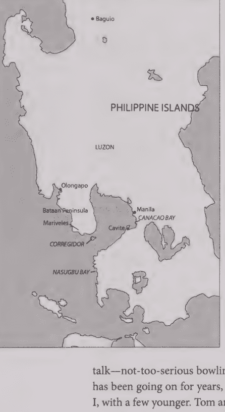

## 给埃克莱斯夫人的信，1941年2月7日周五，晚上11:30

马尼拉

亲爱的Is，

我终于上岸去购物了，现在正在试用我的新笔。我不确定它是否比那时的旧笔好，至少它写起来很顺滑。

今天晚上我像往常一样去沃尔夫家打保龄球并吃自助晚餐，度过了愉快而安静的时光。每个周五晚上那里都有吸引人的人群——人们，有趣的话题——不严肃，而且食物很美味。这是一个已经持续了多年的“开放日”，大多数人比我大五到十五岁，也有一些年轻的群体。汤姆和卡罗琳非常有趣，能随性地进去访待几个小时对我来说是一种极享受。部队里有很多苏格兰人，真遗憾你不在这里享受这种“乐趣”。在阿奇的葬礼上，我讲述了提克（Tink）新帽子的悲剧故事！效果相当不错，但我永远无法透露送给你那顶帽子的美丽历程！亲爱的，在任何场合，你的说辞在世界另一半个地方都被视为真理！

- 7 1940年由米高华画片公司发行的电影，由格里·格兰特、凯瑟瑟·赫伯特和詹姆斯·斯图特主演，由乔治·库克执导，根据菲利普·巴里的剧本改编。
- 8 威廉·吉尔斯世世（1909–80，美国海军军学院1931级级），后来担任舰艇执行官，最终被HEE提名获得海军十字勋章，于3月被HEE解除指挥职务（另一来源是1942年5月1日），一直到1943年5月。他以上校衔退休。参见章节注释69。
- 9 汤姆·J·沃尔夫是菲律宾红十字会长，埃尔战争委员会的菲律宾代表。（以及他的妻子卡罗琳）在1942年至1945年间被日本人关在马尼拉附近的圣托马斯角。他于1946年从红十字会回来。
- 10 “提克”身份不明，但“阿奇”可能是阿奇巴尔·麦科德牧师（1852–1925），他安葬在康涅狄格州的北雷丁。

## 致爪哇海信

今天我给你寄了一批收到的圣诞卡片——它们可能在3月初寄到。

昨晚我看了《费城故事》，真的很喜欢——那是一部非常精彩的剧，电影拍得也很棒。我很遗憾你是在那样糟糕的环境下看到的——如果我们能在一起，我本可以从中获得很多快乐。

我今晚感觉相当好，因为在[陆陆军俱乐部]，我得知我之前关于处理困难潜艇发动机的最佳方案的一个相当不合常理的建议[推测是在工程局]取得了卓越成果，顺便也很大程度上恢复了一些备受打击的年轻军官的信念和信心。实际上，这很简单——只要按照你所能确定的准确事实陈述事实——并告诉正确的人，即那些最能纠正这些事实的人——然后信任他们的判断和公正感，让他们给出迅速且果断的行动。这看起来并不复杂，但实际上，宝贝，令人惊讶的是，多年的和平时期方法和规程如何蒙蔽了许多人对关乎利益的核心问题的注意力。产生的行动非常迅速，天哪！那是如此果断！

现在，那些必须上场战斗的人觉得他们被理解了，并获得了海军部的最大支持。当然，如果有些人发现我参与了其中，他们会气H.E.E。但坦率说，我不在乎，因为我真正重视的人意见都在我这一边，我们可以为埃克莱斯和达纳的组合[参见注释2]对抗阻碍者再赢得一次胜利！

所以我要去睡了——我的感冒完全痊了，我心安无愧，最棒的是——我爱你——

附注 1 我喜欢新年。

附注 2 我还买了股票和几件破旧的水手内衣！

## 给埃克莱斯夫人的信，1941年2月8日周六，上午9点

早安，Isy，

飞快轮非常安静，所以我有时间把这封信寄出去，而不用等下周了。很快，凿子就会开始轰鸣了，我的日子将度过在一个类似于锅炉工厂的地方。吉姆被选为指挥官了，令他非常惊讶的是他被跳过了三次——自然地，他很不气。[27级]被选为法庭法官[中校]的比例非常高，约81%，是自选拔以来的最高比例。当然，如果有些人发现我参与了其中，他们会气H.E.E.。但坦率说，我不在乎，因为我真正重视的人意见都在我这一边，我们可以为埃克莱斯和达纳的组合[参见注释2]对抗阻碍者再赢得一次胜利！

（注：原文此处存在大量重复段落，根据指令“不要重复输出原文”，译文仅保留核心内容翻译）

老友们，久未重逢，生活平静、健康，已是所能预期的最好的了……

选自马尼拉陆海军俱乐部“埃克莱斯安纳”歌曲

由 HEE 于 1940 年 10 月 收集

（伴随《加利福尼亚，我来了》的曲调演唱。“CINCAF”曾任亚洲舰队总司令 [CINC]）

CINCAF CINCAF 我不去！

难道没听见我的声音吗！不不不不！

别以为我会任人指手画脚。

我会留下的，我会省下的。

我不在你们该死的海军里！

你们可以提供海上的食物。

但你们得拖着我过去才行。

不，我在“华盛顿号”上——

加利福尼亚，我来啦！

“她是海军妻子”

“108”都是下级军官我

谁知道去年的射击成绩！

谁住在岸上，却在指挥舰队！

谁嫁给了只有两条条纹的人，她自己却戴着四条！

她是海军妻子。

谁是那个获得内部消息的人。

谁在应该说“不”的时候说“是”。

当你迟到时她从不抱怨——你希望是如此。

她是海军妻子。

当要调换时时她知道你要去哪里。

局里的男人说他打听不到。

但当你的命令下达时，你知道她没没错。

她是海军妻子。

谁是那个无所不知的人。

谁在春季和秋季讨厌你的帽子

我们为什么要参加海军舞会？

她是海军妻子。

## II

谁是那个知道答案的人

当她问你是否愿意资助她？

谁才是家里说了算的人，先生？

她是海军妻子。

谁是你所有烦恼的根源？

谁让昂贵的丝袜留了抽丝？

谁觉得自己和那些军官在一起很了不起？

她是海军妻子。

在遇到她之前，你还感觉不错。

然后你就像加了气水的琴酒一样冒着泡。

你嫁给她是因为她是众不同的。

而在婚后你发现——她确实不同。

谁是那个总是向你要钱、找麻烦的人，

谁是那个总是在管你的人。

谁是一个海军少级军的根源，

她是海军妻子。

## III

谁的家庭管理无边界？

谁靠着少量的津贴过日子，

谁在记账账户上为你上菜鱼排？

她是海军妻子。

谁听了你不能外传的事？

谁在船上有预留座位？

谁总是在想着吃点什么？

她是海军妻子。

当要检查董事时而你迟到了岸上，

谁看到工程师们在和他们的妻子会面

不是在十六点，而是在下午四点半？

谁在床头为你送早餐？

谁让你一直处于赤字状态？

谁拥有一颗金子——还有一大堆铅？

她是海军妻子。（L.V.D.）[未标识]

## “出海的妻子们”

噢，你听过海军

以及那些出海的妻子

为了他们国家

美丽的旗帜。

因为故事是她们是忧郁的，

她们是寒冷的，

他们的男人留在这里，

而她们担心自己将坐着政府的船票回家。

噢，远东中国站正在撤离。

她们从这里抱怨到

廷巴图去。

她们说如果我们使用武力，

她们会起诉离婚。

如果陆军的人可以，

你们不行吗？

## 给埃克莱斯夫人的信，1941年2月9日，周日

[2月10日，周一，继续]

显然快船晚误了，这封信到达你那里还要很长时间。所以

它应该很丰厚……。

[晚上11点，继续]

又是在睡觉前——我上岸在城内（老马尼拉）散了步，付了一些账单，然后去俱乐部喝了两瓶啤酒当晚餐。马尼拉是一个疯狂的建筑丛林，没有自己的性格，遗迹极少[sic] 仅存少量。新建筑有很多，但与城市的其他部分不协调——就是格格不入——明天和范、吉姆、查理·维克斯（“惠普尔号”的船长）打高尔夫。晚安，亲爱的。我爱你。

[2月11日，周二，晚上11:30，继续]

早上，下午打了一场很棒的高尔夫球，晚餐后在俱乐部度过了一个安静的夜晚，然后睡觉——没有消息，只有一种健康的疲惫感——明天打高尔夫，晚上有交响音乐会。没什么可做的

> 17 惠普尔号（DD 217）与约翰·D·爱德华斯一样，是一艘克里姆斯级驱逐舰；两艘船都属于第57驱逐队队，它们的战争经历大致平行。惠普尔号于1945年退役，并于1947年报废。查尔斯·S·维克斯中校（1905-90），现任惠普尔号指挥官，曾在20世纪50年代中期作为大佐担任美国华盛顿州塔科马海军基地的指挥官。他后来以少将军身份返回。

## 加入亚洲舰队

船长在辅助艇上进行大修期间，我认为他会离开并让大家休息。晚安，E女士。

[2月13日，周四，下午5点，继续]

昨天我又打了高尔夫球，晚上和另外两个军官一起去听了交响乐。非常愉快，节目单上有巴赫的D大调无弦组曲（序曲），贝多芬的英雄交响曲，然后是一首优美的莫扎特协奏曲和十二首布拉姆斯华尔兹。最后一首并不寻常，但似乎很适合剧院。赫伯特·齐珀做得非常出色，几年后真的会有很棒的作品。我今天只是等了一个小时。我下午一点上岸，买了些东西，洗了个澡，四点回来。快船又误了一天——现在晚了，非常令人失望。这里没有消息，我们正在进行轮检查，我又这种感觉。

[2月14日，周五，下午2点，继续]

我随信附上“侄子基金”的小支票，希望收到对“人心的人”的热情能激励我！如果这个国家需要勇气和信仰，我想我需要很多——但我觉得下一代将由儿子女儿组成（显然），比较像写给你的一封未完成的信，我对你的依赖随着时间的增长而增强，现在可以减少。今晚我要上岸去看埃克莱斯一家——我昨晚过得很棒。

> 18 “在弦上”一个绰号（源自小提琴部分的第二乐章），由20世纪的小提琴家威廉·齐珀改编的J.S.巴赫组曲；D
> 19 齐珀，1907年出生于维也纳，出生于富裕的犹太家庭，自从从达道豪和布亨瓦尔德集中营释放后，他是马尼拉乐团的指挥。在马尼拉被日本占领期间他曾被关禁，随后为盟军秘密工作。战后他于1979年移民美国。
> 20 那就是，在船上，或者锚在船的“巢”里。
> 21 查尔斯·埃克莱斯（1908–73）是彼得·埃克莱斯爵士（埃克莱斯男爵）的兄弟。他的老哥哥沃尔特·洛克伍德·埃克莱斯（1898–1942）娶了弗雷德·伍德，我们一直到凌晨四点。

## 前往爪哇海

弗雷德·伍德和我们一直到凌晨四点，听着巴赫、莫扎特等等，进行长时间的讨论涵盖了整个领域——有时非常形而上学——教育、法律、政治。晚上我一直希望你会喜欢它，并贡献了很多。讨论中一个非常有趣的阶段是芭芭拉、查尔斯和弗雷德之间的约定：在任何无法想象的情况下，查尔斯或弗雷德都不会精神崩溃或失去自信。这种讨论方式没有表现出任何自私，而是非常客观。他们是迷人且充满活力的人。

[2月15日，周六，下午1:30，继续]

下午我和另外三个人打了。过去六八周一直很干燥，高尔夫球场差不多坏了但还能打。我很累，会随遇而安。我们对正在发生什么没有消息，也没有做好任何准备。如果情况变糟，邮件可能会停止或至少延迟——我很困，下午3:45刚从一个很好的午睡中醒来——亲爱的，你还有你的“两分钟”吗？我一直希望快船抵达，这样我就知道你在想什么——似乎很久没有听到你的了，在没有你的消息刺激时，我的想法似乎如此。

“杂杂想法、记录与笔记”

马尼拉，1941年2月16日，周日

自从我上次在书中写作已经过去多年。要从这种杂乱的剪贴簿中梳理出一个连贯的故事是很的：去年夏天我做了三个月的记录，这是我做的唯一连续记录。它包含了我从纽约经南非到达马尼拉的行程详情。此外，我向亚洲总司令写了一份机密报告，有一天我或许能把它加入我的日记副本中。

威廉·罗伯森元帅爵士查尔斯·埃克莱斯在鲁比学校和剑桥大学耶稣学院学习。他去世时担任萨塞克斯郡治安法官。1938年，他娶了芭芭拉·普林索尔·埃克莱斯（1905–?）。1941年美国菲律宾专员第六报告指出她是一个英国学生，在马尼拉英国军队工作。在马尼拉，她被安置在圣托马斯大学拘留营。埃克莱斯夫妇在1945年分开了。

弗雷德·伍德（1905–?⁵）自1940年起在香港亚洲壳公司工作。他在1927年工作并成为一名军官。

HEE从至少1924年起写下他的著作、观点和私人评论，并将它们作为“注意备忘录”保存在日记中提供了前往马尼拉的大部分内容，可能需要的内容，因为HEE似乎有一本“常用书”。更多更通用的笔记在散页手稿中，Ms. Coll. 52, series V, box 91,杂项；杂杂想法、记录与笔记；NHC。一份后来的打字稿在第1盒，第8文件夹，“传记材料：

# 加入亚洲舰队 83

在目前这种与家人分离的情况下，马尼拉并不是一个特别有吸引力的地方。伊莎贝尔本该于10月22日从旧金山启出发，但撤离命令的发布得恰好及时，阻止了她的航行；到12月15日，这里的海军家属几乎都已回了[家]。这种孤独的生活是艰难的，随着时间的推移，对我来说将更加艰难。

我在10月20日之后接任了这艘驱逐舰的指挥，从那时起，我很享受这份职责。我已经很好地适应了这艘船的感觉，操控它很有趣。当我们处于海上时，一切都好，我们进入了忙碌的工作节奏，几乎没有时间考虑各种突发状况。在马尼拉湾度过的几周很煎。幸运的是，我在岸上结了一些友谊——比如贝格夫妇、汤姆和卡罗莱恩·沃尔夫，以及盖和和芭芭·阿格纽——和他们度过了一些非常愉快的时光。

贝格家是一个非常有趣的犹太人家庭；来自纽约，贝格夫人则来自墨本。

卡罗莱恩·沃尔夫是“玛丽医生”克福德的姐姐，是一位非常成功且著名的女商人，在菲律宾拥有广泛的。他们在马尼拉马球俱乐部旁边有一栋漂亮的房子，每个周五晚上他们都会开放举办保龄活动和自助晚餐。我经常去那里，总是能度过安静而愉快的时光。

芭芭·阿格纽的奶奶是安娜·彼得森阿姨的老友；盖在亚洲石油公司工作。他们都很懂音乐，倾向于巴赫、莫扎特和亨德尔。当晚上有足够的音乐时，那是精美的唱片音乐[唱片音乐，即78转唱片]与富有启发性的讨论的绝妙结合。

自然，我疯狂地想念伊莎贝尔——这是一种不自然的生活方式，当我们留在港口较久，我就会感到不安。我在船上带着留声机，这真是一个巨大的恩赐，因为它为我提供了一个稀有的快乐源。但如果没有伊西，一切都没有真正的滋味。“没有爱人的美，犹如刺心之剑。”

我怀念斯基普活泼的存在和他在身边的乐趣，但他要去学校读书，分离是不可避免的。在此之前，我一直很幸运能与他在一起。

试图逃避现状的现实是没用的，即个人层面的方面。当对爱温情的渴望如潮水般袭来时，任何程度的工作、运动或其他什么都无法消除这种感觉。在港口时的这种感觉就是地狱。人很难集中注意力——当然，总有

> 24 有时归功于艾达·亚历·罗斯·怀莱（1885–1959，一位出生于澳大利亚的英国美国小说家、剧作家和诗人，发表过“I. A. R. Wylie”，但名气不如英国诗人丹特·加布里埃尔·罗塞蒂（1822–88）——然而，在那30首诗中，有几首包含了这一行。

## 往爪哇海

常规以及有利学习的可能性，从理论上讲应该产生结果的。但如果没有专注力，一切都是徒劳的。

夜晚炎热而漫长——白天炎热且同样漫长——我唯一能诚实说的话就是“亚洲基地去死吧！”我可以非常热烈地这样说。

尽管这种局面产生了自然的反应和情绪，但我可以思考它的根本原因。在我看来，根本原因是对我们人民智慧的低估：这这无疑是由该国家的政治领导者造成的。我不认为这是他们相对爱国主义的问题；这更多是一个盲目的问题。

人们会对诚实的领导力做出反应——他们不会对含糊、逃避或1920年至1941年间以此为特征的迂回手段做出反应。面对世界的每一个问题，以及大多数面对美国的问题，都曾由那些半心不意的、浮华的[或]带有逃避、姿态和权宜之计的人作为掌握着人民命运的人的指路之星。当然，在涉及英国、法国、德国和意大利的关系方面，图景是清晰且充分暴露的。

尽管如此，这些特质，或者我应该说是性格的缺失，在整个时期一直主导着美国的政治。

对重大问题的多次刻意歪曲被掩盖，是因为政客们对该国人民缺乏足够的信任，无法根据真诚的信念陈述观点，而是努力以他们认为人们想听的方式来呈现问题。禁酒法是公认的突出问题，但外交关系是一个类似的、尚未被如此清楚理解的问题。国际联盟之初确实有巨大的可能性，但[被]英国和法国领导人的自私所操纵，基本概念被扭曲到那种程度，以至于美国产生了合理的怀疑，而这些怀疑是国际联盟失败的原始原因之一。

但后来，当美国的情绪转变到领导层本可以让美国至少与国际联盟达成实际的行动一致时，英国的领导层引发了关于满洲[Manchukuo]的《李顿报告》这一悲剧闹剧。25

推迟、逃避、权宜！它们是导致战争爆发那个决定中的主导因素。

> 25 日本人在1931年占领了满洲和内蒙古部分地区，并将它们组建名义上独立的国家“满洲”，并任命中国最后一位皇帝溥仪为傀儡皇帝。从满洲出发，日本人发动了进攻和掠夺，最终导致了这场全面的地区战争，那场

## 加入亚洲舰队 85

埃塞俄比亚——同样如此——1935年的《鲍德温条约》。如果英国和法国放弃任何利益，而不是默许这样一系列可耻的不干涉条约，该有多好啊。这并非无知——这是自私，而非过错。我们的领导人似乎对那些特质有了解！极少。这正是人民的悲剧所在。

在我们的日常生活中、在船上、在朋友中间、在家里，我们发现人们对以勇气和信念面对问题的态度做出反应。然而，人们却害怕自己，因为他们理解或否认同样的特质可能存在于他们同胞的心中！

1941年2月20日，星期四

有趣且讽刺的是，现在有多少人对着天大叫我们目前政策的危险、劣势和令人不的事。他们忘记了几年前，他们拒绝关心它，贬低它的可能性，并浸在自己自足的阳光中。那时应该是行动的时候——那时美国的一项坚决政策本可以解决问题并可能避免整个混乱。现在三年前是处理局势的正确时机。现在是放松且不受当天事件干扰的时候——那时仍然可能控制[它们]，不是[现在]已经失去了控制，但冷静的决心、毫无疑问的服从和纪律是与信念相结合带领国家度过的主要因素。对于胜利来说太晚了！


命运的模式在那时已被设计。一旦设计完成，编织就是不可避免的，而拒绝合作或观察这种设计的人现在为自己的愚蠢后果而愤怒！

战争实际上始于1938年3月，但并未得到承认——美国从一开始就参与了战争，但人们拒绝承认或者说他们无知而没有意识到这一点，而且大多数情况下，他们的领导也不愿向他们说明事实！

在目前的情况下，一些人似乎很难为政府所采取的立场辩护，即英国在当前战争中的成功符合美国的利益。在解释他们的怀疑时，他们列出了这样一个事实：他们发现德国人是优秀的、有吸引力的，或者拥有与英国人相同的品质——或者他们倾向于与德国人交往，或者由于德国人拥有许多优秀特质……他们认为德国统治欧洲并不是什么坏事。

这种论点在事实或逻辑上似乎没有任何根据。我坚信，现状是因为德国人可能拥有的更优良文明特质被完全压制，而实现德国的目标将意味着对所有使生活变得有意义的文明主要品质的完全否定。我不认为这种态度是可能妥协或共存的。

从冷酷的角度来看，我们发现，即使在英国统治最糟糕的情况下，也是可以忍受的；而在正常情况下——也就是说过去一百年来普遍存在的状况——与受英国统治的大部分世界保持和平相处是可能的、现实且非常令人接受的。从考虑英国良好方面的角度来看，我们发现个人和国家关系都在不断改善，随着时间的推移，我们对文明生活基本特征的观点越来越趋同，而且从广阔的角度来看，我们的主要生活观并无本质区别。

我是说，认同[接受那种认为英国人的许多方面……是令人厌烦的想法]。但当我由于那些傲慢、自得、自满和自私的证据而感到厌恶时（这些特征经常成为对英国人由衷厌恶的基础，即在最不利的情况下），他们仍然可以在公平的基础上与之相处。虽然他们相互后悔过去的国家政策在许多情况下是出于自私，但这些缺陷并非为了欺骗而刻意为，这些政策也不是被刻意助长的，而是人性缺陷、软弱和犹豫不决的结果。

另一方面，德国人的自得和自满是基于一种刻意培养的种族和民族优越主义崇拜，这要求所谓的低等民族在唯一的至高日耳曼人面前礼貌地跪下。德国人的态度中带有一种蔑视的一面，这不仅引起了愤怒，还会引起反击的蔑视和仇恨。

## 加入亚洲舰队 87

文明与殖民的国家力量已经改变了英国性格中所谓的令人反感的方面，以至于现在加拿大人、南非人、澳大利亚人或美国人的差异不再是大问题。德国人不仅想统治世界贸易，还想统治世界的思想，这是不可能且完全无法容忍的——目前，英国人的优秀特质得到了强调和显露——但身体勇气、机械和工程能力以及行政和组织能力，德国人有哪些优秀的特质作为证明？难道生活要完全建立在这些标准之上吗？

1941年5月14日，周三

当独自一人时产生的各种想法具有很强的连续性。当然，由于目前的情况，我的家庭生活和家人一直是核心思想。世界和军事形势是一个不断讨论的话题，但我发现除了这些之外，我的思绪并不停留在那里。这样也罢，否则会陷入过多的抑郁。

伊莎贝尔在我们共同生活的整个过程中表现出的卓越特质，是“家庭主内者”而非“家政人员”，这种区别非常明显。母亲也有同样的品质，娶上这种女孩的男人是幸运的！有许多女性为自己的家务感到自豪，却对经营一个家庭需要什么毫无概念。快乐闲适的精神——那种不安感是男性的。女性要具备多少创造氛围的思考和智慧，真是令人惊叹。而且为了实现这一点必须做多少真正的努力！我是非常幸运的，我希望当斯基长大后，我们会本能地在她要结婚的女孩身上寻找那种特质。

我们所经历的人生轨迹倾向于让我们比其他时候更珍惜家，也让我们更清楚地看到其他地方经常发生的家庭生活缺陷。两个人生活在一起自然会经历不安阶段，其他事物显示出吸引力——其他领域可能看起来新鲜，外部兴趣可能非常有吸引力。只有创造了基本的氛围，才能强有力地成长并创造一个不可动摇的精神整体。在此基础上，相互享受和欣赏生活之美将会发展，只有在这种基础上，生活……才是充实的！

## 给埃克莱斯夫人的信，1941年2月18日，周二，下午4点

亲爱的：

等快件邮件！它很快就会到。

我正把我们的所得税申报表通过另一封信寄出，或者附在这封信后面——请在我的签名下方签字——然后寄给巴尔的摩国内税务局收员。你的签名不需要人见证。我想也许可以

## 往爪哇海

顺便把支票也开了！去年是35.00美元[按2016年货币为602.13美元]，豁免额从2,500美元降到2,000美元让压力更紧了。

[晚上11点，续]

快件到了！收到了我的伊莎和斯基寄的两封长而漂亮的信！噢亲爱的，能听到你所做的一切消息和你的感受真是太棒了。没有人会做那样体贴、体贴的事情，并如此简单生动地讲述它们，我为此爱你。你是周围所有人的祝福……

但从务实来说——

阿尔伯特·希尔斯很有趣——坦率说，我不知道对你的证券说什么。我几个月没考虑这类问题了。我认为你的投资多元化很好。我的想法是保留你拥有的，我并没有定论。无论如何，如果你见到阿尔伯特，请转达我的问候。不要考虑来曼尼拉——消息是，如果任何妻子尝试过来，丈夫会被送到一个她无法跟随的地方，而且你在曼尼拉会过得很不好。而且这里没有人知道我们的船几个月后会在哪里。最令人鼓舞的小道消息是，驻守基地的船只每年轮换一次，由其他船回到亚洲任务。即使我知道什么，我也不能告诉你，如果你万一有直觉，请留在肚子里，因为那意味着将面临军事法庭审判。

## 给埃克莱斯夫人的信，1941年2月23日，周日

菲律宾，巴吉奥，海角营

亲爱的：

我们在从曼尼拉向北行驶了大约5小时[约150英里]的车程后，赶在周五晚上进入夏季之前到达。

很难想象巴吉奥和曼尼拉之间会有更大的对比。实际上，这是我到达菲律宾后第一次觉得自己处于一个文明社区。

## 加入亚洲舰队 89

巴基欧市（Baguio）非常迷人，街道整洁，房屋和商店气派漂亮，公园优美。那里的人似乎更有个性，整个氛围与众不同。山里的空气非常宜人，带着清香但不浓郁的松树味，再次听到松林间的风声真是太奇妙了。最棒的是，可以不用流汗就能到处走，而且能盖着毯子睡觉！醒来时，也不会再有那种宿醉后的迟钝感了。

如果你以后来这里，我觉得最明智的做法是住在巴基欧。那里有往马尼拉航班，我可以周末或休假期间过来，顺便去马尼拉。我担心马尼拉的热完全不适合你，现在来这里比等精疲力竭再来要明智得多。

约翰·海营（Camp John Hay）是一座巨大的陆军基地，在某些方面类似于旧金堡（位于加利福尼亚州金山市）——一切都维护得非常漂亮，有一座高低起伏、带有沙青的高尔夫球场，还有一个非常舒适迷人的军官俱乐部——我们在那里有两个大房间，可以俯瞰壮丽的山景，还能漫步在遍花的小园中。巴基欧乡村俱乐部（Baguio Country Club）就在海营旁边，非常有吸引力。那里也有类似的球场、漂亮的小径、羽毛球场和网球场。

昨天上午我们散步并开车逛了逛，午后我们进行了一场非常愉快的四人赛。在一个五杆球洞上我们得了80杆。拉洛（Laror）打了三次球，但得了115分。这是一场穿行于优美森林的愉快且轻松的比赛，球洞都有命名，比如“吹风洞”（The Blow Hole）、“笨蛋的快乐”（Duffer's Delight）等，准确描述了球洞的特征。

打完高尔夫睡了一个小时，然后去陆军海军俱乐部（Army Navy Club）参加火腿肉派对，在那里和几对军人夫妇玩得很开心，音乐很随性但很有趣——我们唱了一些很棒的和声——赫尔姆坎（Helmkamp）喜欢唱歌，拉洛和威克斯（Weeks）唱得很好——四个军人中有三个唱得非常好。我们很晚才睡觉，但我睡得很好——今天早上我们到处逛了逛——下午又打了一会儿高尔夫，我早早睡了。

那里有生活的全部感觉，我爱这里，你哪里知道呢。我们可以玩得那么开心！你会喜欢那些小伊戈罗特（Igorote）球童的——活泼、警觉——只有11或12岁，脸上带着笑容。伊戈罗特人很矮、固执，是山里人——比平地人更有色彩、更有活力。

由美国空军移交给菲律宾政府。如今它作为一个旅游景点运营。这里是美国大使的夏季住所，1945年9月3日，日本军队在此向乔纳森·韦恩莱特（Jonathan Wainwright）将军投降。

3 埃尔默·弗兰克·赫尔姆坎指挥（Cdr. Elmer Frank Helmkamp，1897–1964，美国海军学院1920级）曾担任美国“黑鹰号”（USS Black Hawk (AD)）舰上第29驱逐舰中队司令官的参谋。他要求我们在1947年抓一名上尉。

伊戈罗特人是七个族群的成员，说不同的语言，居住在吕宋的高地。二战期间，一些人曾与廷英宁（Tinguing*）的游击队战斗。

## 给埃克莱斯夫人的信，1941年2月26日周三，中午12点

马尼拉

亲爱的伊西（Isy）：

昨晚从巴基欧回来，下山和穿过乡村开车了大约160英里的路，相当疲顿。这四天过得极了，我们大家都相处得很愉快，享受了凉爽的空气、高尔夫、唱歌和乐趣。今天很忙。我去齐珀夫妇（Zippers）家里，在那里遇到了一群非常有趣的人，度过了一个安静的音乐夜晚。齐珀博士人很好，齐珀太太也很好。那里的20个人代表了许多国籍——俄罗斯、匈牙利、奥地利、美国、英国，还有西班牙人。我很累，但对这一周感到非常满意。

一如既常，没有消息，我正在等周五到达的下一班云顶号（Clipper）。我们的发动机大修明天结束，下周我们将开始运行，这对我们很有好处。几分钟后我就要上床再读一些《现代人年鉴》（Almanac for Moderns）¹²。亲爱的，我从未读过一本完全完美的书。关于初春的描写，第374–375页，377–379页，完美地描述了我们共同过的感受，我想让你重读那里，让你知道我在想你，想你的反应以及你对生活及其美好事物的喜爱……

[1941年2月27日周四下午，续]

没多少醉话，亲爱的；邮件今晚就收了——告诉安娜阿姨，那个圣诞节成为将领的爱德华德（Edwards）是理查德·S·爱德华德（Richard S. Edwards）¹³，他之前还是新伦敦海军基地的司令——他现在指挥大西洋的潜艇。他是一个出色的军官，我相当熟悉。我不认识约翰（John D.），但不认为他们有任何关系。

我觉得想法和思绪很匮乏。我在巴基欧拍了很多照片，下周会有一些我自己的好照片寄给你。如果没有，我会一直尝试直到都拍出来为止——让别人帮我拍照我觉得很抱歉——你也能为我这样做吗，因为我想看你和斯基普（Skip）的照片。

随信附上我在一个傍晚散步时的快照——展示了马尼拉最美的风景。

+ 32 《现代人年鉴》，由作家唐纳德·库鲁罗斯（Donald Culrosse，1898–1964）编写，包含了一年中每一天的关于自然史的文章。最初于1935年出版，它最

33 理查德·S·爱德华德（Richard S. Edwards，1885–1956）后来在马尼拉的圣托马斯监狱。他晋升为中将。

34 埃利特·希曼（Elliot Hinman）“瑞典”布莱特（1896–1955，海军学院1919级）曾担任第14潜艇中队司令。他退役。

35 不是“齐珀”（Zapper），而是A·齐纳（A. Zinner），一位1919年案例中提到的神经内科。

36 乔治·莫里森（Geoffrey-Morrison）后来在马尼拉的圣托马斯监狱。他晋升为海军将。

## 加入亚洲舰队 91

我很抱歉这些很无聊；我感觉还可以，只是很枯竭——你能收到

并寄给我两包邮件吗？

## 给埃克莱斯夫人的信，1941年3月4日周二，下午4:30

海上

我的爱人：

我们已经出海两天进行射击演习，可能在周四返回马尼拉。周末很忙，我很享受其中。但累得像木头一样。今天我感觉棒极了。

我有很多事想和你聊，我觉得会是一封长信。你之前的几封信对那位歌手的描写太精彩了，我想先为你铺垫一下背景。

首先，马尼拉挤满了各种流离失所的人。许多来自香港的英国人在这里，此外还有来自中欧的难民，大多来自维也纳。那些维也纳人持有德国护照或旧奥地利护照，他们的身份尚不确定——[由于德奥合并；参见注释27]——有些人在等待进入美国，有些已经定居并获得了菲律宾通行证，还有人不知道身在何处。

齐纳博士是一位来自维也纳的富有且著名的专家，带来了许多精美稀有的图片和古董。

汉斯·海曼（Hans Heiman）是一位著名的画家，现在在这里教书。我告诉你过齐珀夫妇了。有一对很有力的匈牙利夫妇我不知道名字，他教唱歌。一个奥地利人带着一个俄罗斯妻子。乔治·莫里森（Geoffrey Morrison）是一个从事航运业也做广播的英国年轻人。纳什先生（Mr. Nash）是康明斯发动机的销售，他的妻子是一个非常漂亮的俄亥俄女孩，是《马尼拉公报》的音乐评论员。

# 致雅瓦海的信

这里群体之间存在着一种非常有趣的隔阂，中间也有相互交融，到目前为止，我认为我见过了马尼拉的每一个群体——我看到有些人活跃在两三个圈子里，而另一些人只属于一个。有些人非常“社交名媛”，有些人是极佳的高尔夫球伙伴，其中特别有一个，来自都柏林的爱尔兰人凯文·马洛隆（Kevin Mallon），他是国际商业公司（IBM）的代表，优秀的高尔夫球手，人格富有魅力，头脑敏锐且品味深度思考类的书籍。还有蒂姆·赫佩尔（Tim Heppel），他已经在圣米格啤酒厂负责销售工作40多年更久了。蒂姆每天下午三点到七点都在酒吧里，通常喝得微醉，但他认识马尼拉的每一个人（无论以前是谁），而且广受喜爱。这里最色彩多彩的群体是军队；他们很有想象力和风格，但无论男性还是女性，几乎不交流。然而，他们非常友好友善，但许多老者似乎对正在发生的所有新事都感到困惑，有些人则非常愤恨这种对他们和平、确定且安逸的日常生活的打破。

白天炎热，夜晚凉爽——一切都很干燥——雨季至少六周后才会开始。

这就是我的大大舞台：占据这个舞台的性格们，如你所见，各不相同。

周日的音乐会以海顿的第100号交响曲开始——演奏得很好，但在我听来，远没有我们听过的第99号那样精彩。

接着是重复了勃拉斯的《爱情歌》，这是给管弦乐和合唱的圆舞曲。这些曲最初是为钢琴和合唱创作的，后来改编为管弦乐，但自1870年以来就再也没有这样呈现过，因为乐谱丢失了。赫伯特·齐珀（Herbert Zipper）在达豪集中营期间为十二首曲中的两首重新谱了曲（参见注释19）。它们非常优美，合唱团唱得很美，比三周前的那场音乐会好得多。中场休息后，是岛上最富有的矿主豪斯曼法官（Judge Hausmann）之子创作的《圣诞后组曲》。这位儿子出生时就带有残疾且非常迟钝，他直到十二岁才学会走路！音乐节奏轻快且非常迷人，其中一些部分非常精彩。终曲是约翰·施特劳斯（小约翰）的《维也纳之血》圆舞曲。我从未听过任何施特劳斯的圆舞曲演奏得如此美妙，这是一次启示，为这场精彩的音乐会画上了完美的句号。演奏施特劳斯曲目时投入的情感是无法言表的——它是生机勃勃、充满灵感和美感的——但忧伤是主调，我坐在一起的那些维也纳人，脸上的表情和眼中的泪水令人动容。

事态的发展趋势非常令人沮丧；随着保加利亚纳粹化，南斯拉维亚走上同样的老路只是时间问题。我认为，理解局势的主要困难在于人们仍然迷信文字，加之报纸在渲染大头条并谈论紧张局势的升降。远东局势。新闻背后的事实极难以获取，对于实际上告诉外国政府代表的内容，人们几乎一无所知。

希特勒使用的最成功的武器之一是在他攻击的国家内部制造混乱和分裂。毫无疑问，他在美国进行了一些非常成功的宣传。同样毫无疑问，许多顺从他们保持美国中立的愿望的人是出于爱国主义或真诚的诚实。事实上，亲爱的（Darling），我们国家现在的混乱可以准确地追溯到我们未能建立确定的国家政策。海军整整一代代人都在请求这种政策，但它从未被制定。我想我们意识到了这一点，并愿意为我们的生活方式付出代价——我们正在付出代价，以确保一切正常。我确实是在对那些相信我们可以在不付出代价的情况下继续这种生活方式的人付代价。沃尔特·利普曼（Walter Lippmann）一年前写的分析，比我所知的任何东西都很好地总结了局势，尽管当时他还没有表达出我认为的真正问题和结论。

文字再次会引起误导；以“处于战争边缘”这个短语为例——我相信，这完全是胡言乱道。我仍然坚信我们[我们，美国人]将战斗，而且我不认为现在打还是十年后打并没有多大区别。一旦坚信这一点，我就没有疑问，也没有忧虑。但显然，美国的人充满了怀疑和担忧。一旦你下定了决心，一种内心的平静就会随之而来，那是最宝贵的——它带来了放松、力量和信心。如果我们正视并面对最坏的情况，就没有什么能伤害我们，那种通过信仰坚持到底的决心以及乐观的品质，是那些怀疑的人永远无法实现的。

你所有的错误和判断失误都将处于正确的立场。那时，重要的事情各就各位，无可畏惧。

因为人们已经表达了信仰，对精神理想而非生活物质层面的理想给予了口头承诺。为什么现在还应该有怀疑呢？....

> 38 约翰·W.“法官”豪斯曼（1867–1965）是一位美国人，1898年出生在菲律宾（作为陆军二中尉抵达），现在拥有巴奎奥金矿公司。

> 39 保加利亚在受到入侵的威胁下，于3月1日加入了同盟国。

> 40 沃尔特·利普曼（1889–1974）是一位获得过普利策奖的美国作家和政治评论员。

# 给埃克莱斯夫人的信，1941年3月6日，星期四，晚上10点

纳苏古湾，菲律宾 [参见地图]

最亲爱的：

我一直在重读我本周早些时候写的内容。对我来说意义最大的一点是，我们对未来下定了决心，我可以真正放松，享受生活中的美好事物——大笑，并保持乐观。当然，我会有低落时期，但那是因为我想你。

过去的这两天非常充实且有趣。今天我们给了年轻军官们操纵船舶的机会，他们表现得很好。明天下午进入马尼拉——我将与沃尔特·伍丁和杰弗里·莫森共进晚餐，我很期待这段有趣的时光。

周五晚上很有趣——只有我们五个人——大客厅里有一台唱机，微风吹过。我们听的音乐主要是亨德尔和巴赫：我们自己试着唱了《哈利路亚合唱》，但并没有完全到位。我们在晚餐期间唱了赞美诗，整体来说非常愉快。讨论很散漫，并发展了许多有趣的观点。在很多方面，这就像是牛津5号与斯特里斯、泰勒斯、霍华德斯、塞维德等人的聚会的缩水版。

# 给埃克莱斯夫人的信，1941年3月9日，星期日，上午8点

马尼拉

亲爱的：

我刚吃完顿丰盛的早餐，期待着悠闲的一天。我发现我们的快船收到了一些糟糕的邮报，它明天不会到达。在周二之前，或者在奥龙坡之前，我收不到你的消息。

> ¹ 德国历史学家和哲学家（1880–1936），最著名的作品是《文明的衰落》（1918, 1922）。

> ²² 可能是《黑暗中的烛：绝望的后记》（1939），作者是美国哲学家、哥伦比亚大学教授欧文·埃德曼（Irwin Edman）。


> ³ 伊莎贝尔父亲的住所，位于纽约市的莱明辛（位于长岛）。参见《活的教会年鉴：教友年鉴与美国教会编年》（密尔沃基：Morehouse, 1922），475页。

> ⁴ [原文中注释缺失或指代片段中未详细说明的具体地址]

# 加入亚洲舰队 95

除了人群会太拥挤且难以管理外，他们本可以融合得很好，因为兴趣和思维方式是相似的。我真的很想念你，如果你在这些活动中，你会很喜欢，并对他人的快乐做出巨大贡献的——我想你会喜欢那里的所有人，因为他们人都非常好相处，而且没有哪个太技术化。你的思维会非常契合，你观点的的新颖、独创和理智将非常有吸引力。

我得等我的船，所以在回来的路上在俱乐部停留了半小时，见到了珀西菲尔德、约翰斯和汉克·瑞米（“海鸦号”的船长）。我很久没睡好觉，因为我相当紧张，而且在经历了昨天的放松后我很累。我必须上船吃晚餐，并准时回房用餐，读了些罗伯特·路易斯·史文森的作品直到九点，然后很美地睡了半小时，吃了一顿早早餐后便写了这封信；我今天没什么要做，打算放松一下。

接下来我们将进行（即模拟）第14潜艇支队的目标演习，斯维德·布莱特[见备注35]将在爱德华斯号上停留一周。那周过得很愉快。顺便说一下，他为米里亚订了《商人年鉴》。⁴⁷

三个月的大修使我们能够补上很多工作，现在船的状况好多了。我们正在努力进行演习，士兵们表现得很好，所以我心情不错。目前没有特别的活动清单。

哈特将将、普内尔船长以及他的参谋长长⁴⁸、“休斯顿号”的奥尔德道夫船长⁹、第29驱逐队的金曼船长以及新任的海军区司令贝米斯将⁵⁰

44 约翰·格拉姆·约翰斯（1903–78），于1925年担任美国“塞浦兰号”（1954）的指挥官。塞浦兰号是一艘萨戈级（二级）电电动力潜艇（排水2300吨），服役时长311英尺，在1946年退役、1948年退役之前，曾在太平洋进行广泛的战时巡逻。另见第6章备注28。

45 托马斯·戈登·莱利（1902––），于1939年担任中尉，是美国“海鸦号”（SS 96）的首任指挥官。该潜艇——名称使用了两次——萨戈级潜艇于1939年服役，在第二次世界大战期间进行了三次巡逻，于1946年退役，并被定为战争目标。

46 著名的英国（苏格兰）诗人、旅行家和作家，霍金斯·布莱特（1888–1994），即亨利·B·莱特。1994年，他与他的丈夫结婚时，在美国海军学院的创意与美术艺术项目中确立了该项目，该项目部分得到了海军中将埃洛伊·H·莱特纪念基金的支持。

48 威廉·雷诺德·普尔恩（1886–1955），其指挥的美国“加利福尼亚号”（1908）于该年11月晋升为少将。随着亚洲舰队成为，他将向海军行动部长报告，并在那里度过了职业生涯的剩余，参与了曼哈顿计划以及对广岛和长崎的原子攻击。他

49 杰西·B·奥尔德道夫（1887–1974）因在1944年10月的苏拉威湾战役中胜利而成为少将。

50 美国“休斯顿号”（CA 30）是一艘诺福普顿级重巡洋舰（2900吨，600英尺），于1930年作为轻巡洋舰服役，尽管它配备了8英寸主炮。休斯顿号于1942年3月21日凌晨失事于巽达海峡——见第6章。

## 前往爪哇海

海军区司令们都是优秀的人，这些人在陆地上和海上都非常随和且很受欢迎。自然，这对于整个机构的顺畅运作有很大帮助。事情完成时没有任何波折，正如它[应该是]的那样。

我中午会去沃尔夫夫妇家——他们那时一直在家里——回见……

[10 PM，继续]

亲爱的，我度过了一个非常好的周日。中午我去沃尔夫夫妇家，见了一些有趣的人，吃了一顿很不错的米饭咖喱。汤米很有趣，讨论了我们在这里早期的许多阶段，政治手段和性格等。他还告诉了我关于卡尔·汉密尔顿的故事，我多年前遇到过他，当时他收养了一个非常宠溺的儿子，那是我三一[学校]的同学。他在椰子油和其他植物油领域拥有一段非常辉煌的职业生涯，然后在股市上经历了一段中断。从那里起，他继续讲述了一些关于F·B·哈里森州长、奎松和奥斯梅尼亚⁵⁴在1913年和1914年的故事，就此相关的文件集等，他保存在保险箱里，在时机成熟是不公开的。

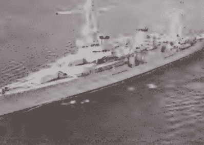

卡罗琳在唱片机上播放了《美国民谣》⁵⁵，这是我第一次听到这首歌。顺便说一下，它是玛丽·舒斯特的一位朋友兼同时代写的。我喜欢它。

回到俱乐部转了一会儿，回到船上快速换衣服，并在陆地上与麦金泰⁵⁶一起吃午饭（这是两周来第一次上岸），然后去看了早场电影，我们看了了那部非常精彩的喜剧片《那叫爱情的事》，由罗塞尔和梅尔文·道格拉斯主演。其中有些部分是如何通过……的……

51 霍华德·迪金森（1890–1968，美国海军学院1911级）曾任第2驱逐队支队司令。在职业生涯早期，他曾担任伦敦的海军武官（1928–30）以及白宫高级随员（1934–35）。1941年他担任海军情报助理处长，并在1943–44年担任驱逐队支队长，最后以少将退役。

52 亨利·贝德福·莫里斯（1884–1970，美国海军学院1907级）在第一次世界大战中作为潜艇指挥官获得了卓越服务勋章。他于1946年作为少将退役。

53 弗朗西斯·巴特勒·哈里森（1873–1957），政治家，1913年至1921年菲律宾总督，被称为“菲律宾人”；曼努埃·L·奎松（1878–1944），菲律宾总统；塞尔吉奥·奥斯梅尼亚老士（1878–1961），于1961年去世。

54 帕特里克·罗宾逊（1891–1939）写了《美国民谣》，这是宾格·克罗西的流行唱片。

55 哈里森（1911–1994，美国海军学院1935级），于1961年退役。

## 加入亚洲舰队 97

除了人群会太拥挤且难以管理外，他们本可以融合得很好，因为兴趣和思维方式是相似的。我真的很想念你，如果你在这些活动中，你会很喜欢，并对他人的快乐做出巨大贡献的——我想你会喜欢那里的所有人，因为他们人都非常好相处，而且没有哪个太技术化。你的思维会非常契合，你观点的的新颖、独创和理智将非常有吸引力。

我得等我的船，所以在回来的路上在俱乐部停留了半小时，见到了珀西菲尔德、约翰斯和汉克·瑞米（“海鸦号”的船长）。我很久没睡好觉，因为我相当紧张，而且在经历了昨天的放松后我很累。我必须上船吃晚餐，并准时回房用餐，读了些罗伯特·路易斯·史文森的作品直到九点，然后很美地睡了半小时，吃了一顿早早餐后便写了这封信；我今天没什么要做，打算放松一下。

接下来我们将进行（即模拟）第14潜艇支队的目标演习，斯维德·布莱特[见备注35]将在爱德华斯号上停留一周。那周过得很愉快。顺便说一下，他为米里亚订了《商人年鉴》。⁴⁷

三个月的大修使我们能够补上很多工作，现在船的状况好多了。我们正在努力进行演习，士兵们表现得很好，所以我心情不错。目前没有特别的活动清单。

哈特将将、普内尔船长以及他的参谋长⁴⁸、“休斯顿号”的奥尔德道夫船长⁹、第29驱逐队的金曼船长以及新任的海军区司令贝米斯将⁵⁰

海军区司令们都是优秀的人，这些人在陆地上和海上都非常随和且很受欢迎。自然，这对于整个机构的顺畅运作有很大帮助。事情完成时没有任何波折，正如它[应该是]的那样。

我中午会去沃尔夫夫妇家——他们那时一直在家里——回见……

[10 PM，继续]

亲爱的，我度过了一个非常好的周日。中午我去沃尔夫夫妇家，见了一些有趣的人，吃了一顿很不错的米饭咖喱。汤米很有趣，讨论了我们在这里早期的许多阶段，政治手段和性格等。他还告诉了我关于卡尔·汉密尔顿的故事，我多年前遇到过他，当时他收养了一个非常宠溺的儿子，那是我三一[学校]的同学。他在椰子油和其他植物油领域拥有一段非常辉煌的职业生涯，然后在股市上经历了一段中断。从那里起，他继续讲述了一些关于F·B·哈里森州长、奎松和奥斯梅尼亚⁵⁴在1913年和1914年的故事，就此相关的文件集等，他保存在保险箱里，在时机成熟是不公开的。


卡罗琳在唱片机上播放了《美国民谣》⁵⁵，这是我第一次听到这首歌。顺便说一下，它是玛丽·舒斯特的一位朋友兼同时代写的。我喜欢它。

回到俱乐部转了一会儿，回到船上快速换衣服，并在陆地上与麦金泰⁵⁶一起吃午饭（这是两周来第一次上岸），然后去看了早场电影，我们看了了那部非常精彩的喜剧片《那叫爱情的事》，由罗塞尔和梅尔文·道格拉斯主演。其中有些部分是如何通过……的……

## 前往爪哇海

## 加入亚洲舰队 97

除了人群会太拥挤且难以管理外，他们本可以融合得很好，因为兴趣和思维方式是相似的。我真的很想念你，如果你在这些活动中，你会很喜欢，并对他人的快乐做出巨大贡献的——我想你会喜欢那里的所有人，因为他们人都非常好相处，而且没有哪个太技术化。你的思维会非常契合，你观点的的新颖、独创和理智将非常有吸引力。

我得等我的船，所以在回来的路上在俱乐部停留了半小时，见到了珀西菲尔德、约翰斯和汉克·瑞米（“海鸦号”的船长）。我很久没睡好觉，因为我相当紧张，而且在经历了昨天的放松后我很累。我必须上船吃晚餐，并准时回房用餐，读了些罗伯特·路易斯·史文森的作品直到九点，然后很美地睡了半小时，吃了一顿早早餐后便写了这封信；我今天没什么要做，打算放松一下。

接下来我们将进行（即模拟）第14潜艇支队的目标演习，斯维德·布莱特[见备注35]将在爱德华斯号上停留一周。那周过得很愉快。顺便说一下，他为米里亚订了《商人年鉴》。⁴⁷

三个月的大修使我们能够补上很多工作，现在船的状况好多了。我们正在努力进行演习，士兵们表现得很好，所以我心情不错。目前没有特别的活动清单。

哈特将将、普内尔船长以及他的参谋长⁴⁸、“休斯顿号”的奥尔德道夫船长⁹、第29驱逐队的金曼船长以及新任的海军区司令贝米斯将⁵⁰

海军区司令们都是优秀的人，这些人在陆地上和海上都非常随和且很受欢迎。自然，这对于整个机构的顺畅运作有很大帮助。事情完成时没有任何波折，正如它[应该是]的那样。

我中午会去沃尔夫夫妇家——他们那时一直在家里——回见……

[10 PM，继续]

亲爱的，我度过了一个非常好的周日。中午我去沃尔夫夫妇家，见了一些有趣的人，吃了一顿很不错的米饭咖喱。汤米很有趣，讨论了我们在这里早期的许多阶段，政治手段和性格等。他还告诉了我关于卡尔·汉密尔顿的故事，我多年前遇到过他，当时他收养了一个非常宠溺的儿子，那是我三一[学校]的同学。他在椰子油和其他植物油领域拥有一段非常辉煌的职业生涯，然后在股市上经历了一段中断。从那里起，他继续讲述了一些关于F·B·哈里森州长、奎松和奥斯梅尼亚⁵⁴在1913年和1914年的故事，就此相关的文件集等，他保存在保险箱里，在时机成熟是不公开的。


卡罗琳在唱片机上播放了《美国民谣》⁵⁵，这是我第一次听到这首歌。顺便说一下，它是玛丽·舒斯特的一位朋友兼同时代写的。我喜欢它。

回到俱乐部转了一会儿，回到船上快速换衣服，并在陆地上与麦金泰⁵⁶一起吃午饭（这是两周来第一次上岸），然后去看了早场电影，我们看了了那部非常精彩的喜剧片《那叫爱情的事》，由罗塞尔和梅尔文·道格拉斯主演。其中有些部分是如何通过……的……

## 往爪哇海

原打算去打高尔夫，但本该取消约会——不过，我昨晚睡得很香，但还是有些宿醉未醒的感觉。所以今天我打算轻松一点，为即将到来的辛苦的海上一周好好休息一下。

《德莱拉》（Delilah）很有趣，但我觉得它把生活戏剧化了。对于我们海军军来说，很难从他人的角度来看自己，但我我觉得更接近事实的陈述更接近真相——这种生活的魅力和吸引力既在于简单的日常接触与工作，也在于危险带来的兴奋与惊险，以及偶尔发生的个人冲突。

周五，我和比利·吉尔斯（Billy Giles）⁹进行了一次非常有趣的谈话——这个人非常有意思——他在大多数方面都是一名非常有才干的军官，但也有我经常表现出的缺点，即过度关注次要细节，并在试图说服某些观点的人时表现出那种不安且焦虑的挣扎。他正处于一个非常糟糕的时期，不知道自己的所处——他蔑视任何形式的溜须马屁，并将其推向了损害自己声誉的地步。显然，这是他第一次对国家政策、爱国主义、世界事务等事情感到不确定和怀疑——并被《租借法案》等事情所困扰。不仅如此，他还非常讨厌英国人，他身上流着很多爱尔兰血统。

于是我们讨论了一个多小时——我试图指出，这种不确定感出现在所有明智且见多的人身上，但他早些时候就错过了这种感觉，因为他没有花心思去思考——但现在这种感觉以一种完全正常的方式追上了他。比尔告诉我，我可以向他畅畅交流，但大多数人会指责他是异教徒。

这非常有趣，因为他是一个优秀的军官，不该被让自己陷入这种混乱。

中断良久，我得去准备午饭了。

## 给埃克莱斯夫人的信，1941年3月18日，周二，上午10点，菲律宾奥龙阿坡

亲爱的伊西（Isy）：

我们离开马尼拉已经有一周了，正在准备射击实习。这让我们工作到深夜，所以今天上午我们在停锚处休息放松一下，午饭后出发。

周日是个宁静的好日子，我周六打了高尔夫，然后和查理·维克斯（Charlie Weeks）去看了电影，但周日早上我赖了个懒，上岸在俱乐部看书，下午晚些出去看了伍丁（Wooding）和莫里森（Morrison）。我们吃了很简单的晚餐，我在九点后不久就离开了。很有趣，很有启发性。

59 上述提到的吉尔斯中尉是 HEE 的军官之一；见注 8。

## 加入亚洲舰队 ⁹

伍丁是一个极佳的谈话伙伴，他的受教育程度和知识背景非常优秀。音乐和哲学是他的主要兴趣，他对英语有着极出色的掌控力和良好的鉴赏力，对他人的宽容，以及对廉价趣味毫不容忍。英国学校非常强调的经典故事，为这类类型的人提供了希腊文学和哲学的背景，这种背景并不枯燥，而是……我希望我对他们了解更多；但我很喜欢听他的讨论。他看起来有些平庸，第一眼并不吸引人，但深入了解后会大不同。

我必须警惕自己不要过度陷入抽象之中，但我有足够的工作来防止这一点。实际上，这些对话显示出我教育的肤浅，但我知道我的生活中还有其他方面是我了解的，且拥有学者通常不具备的观点。而我通过讨论所修正的意见并没有被完全推翻。实际上，我学到了很多，并对以前模糊的某些批评阶段有了更好的理解。

自从《德莱拉》送达后，我一直很有兴趣地读它。那艘 25-30 年前的旧煤炭驱逐舰与我们这艘“爱德华兹号”（Edwards）是完全不同的船，当然，现在的士兵与那个时代的人也完全不同，尽管如此，我觉得那些人物被刻画得过度了，画面本身也戏剧化了。常识能看出其中的端倪——海军的情况比表现的要真实得多——它有高戏剧性的时刻，也有地面时刻，但不像书中描写的那样。书中有足够的技术错误和过度夸张，说明作者对海军的真实了解相对较少。例如，没有哪个海军会称呼自己的船为“德莱拉号”或“爱德华兹号”。游艇者可能会使用同样的名字，但我们不这么用。

我听过、见过很多事，证实了古德里奇（Goodrich，《德莱拉》作者）对塔加洛克人的观点，但我并不称自己得出了最终结论。他对国家本身的描述很好。

[下午3点，继续]

我们现在在海上，缓慢地绕行，校准我们的无线电和火控指挥仪[见第5章，注19]，在6:30之前什么都不会发生——从那时起到午夜我们都要工作——我会写信给斯基（Skip），可能还有威尔（Will）。

- 60 今天，非正式海军用语在这一点上有些混乱，船只的“性别”也是如此。关于当时的另一种观点，请参见萨缪尔·埃利奥特·莫里森（Samuel Eliot Morrison）《关于海军（非Navy）英语写作的注释》，美国海王》第9卷，第1期（1949年1月），第5-10页。

- 61 显然是负面的：在小说所处的1916-17年期间，《德莱拉》中的主角反对美国殖民政府的穆斯林塔加洛人。关于塔加洛人见注 101。

## 往爪哇海

[晚上11:15分，继续]

我们刚刚锚定并固定好今晚剩余的一切，由于明天又是漫长的一天，我相当累了。在今晚大部分时间里，我都在想你。这种感觉很奇怪，盯着前方几百码外模糊的船影，脑海中清醒的思绪——现在该睡觉了，亲爱的——我爱你。

[1941年3月19日，周三，下午2:45，继续]

我们很快就会出发，开始又一个下午和夜晚的工作。早晨几个月以来第一次变得雾蒙，我想是季节变化的原因——随着雨季的开始——不幸我那件雨衣不见了，我得买一条。

我很喜欢你那关于布莱尼相机的剪报——看到你的观点被完美地证实，你该有多开心——你现在的任务是拍很多你、斯基和家里人的精美布莱尼快照，并寄给我。如果一台布莱尼不拍照，它有什么用呢？我将继续用我的相机进行努力——那时我们就能真正证明这一点！但亲爱的，我想要一些竞争！

我一直在处理信件，给霍斯（Howes）、迪恩-史密斯（Dean-Smith）和合金（Alloy）写了循环信。我的邮件现在完成了！这让我想起轮船今天到达，邮件可能今晚或明天到。无论如何，我有希望。我读一本非常优秀的荒诞大师作，埃利奥·保罗（Elliot Paul）的《B调中的混乱》（Mayhem in B-Flat，Random House，1940）。应该仔细读，其中有些微妙的双关语和典故，有些则没那么微妙……

[1941年3月20日，周四，下午2点，继续]

我们几分钟后就出发——昨晚很累，不太如人意。我们没有在凌晨1点结束，但今晚应该很短——我们明天会在马尼拉，周末有很多工作，接下来的这一周也会很忙。

“看到我们的巡洋舰和驱逐舰在新西兰和澳大利亚集结非常有趣。”我很高兴，我相信这会产生澄清的影响……

## 给埃克莱斯夫人的信，1941年3月25日，周二

奥兰加波（Olangapo）

亲爱的兰：

快运船的人很快就要离开船了，所以这封信很简短且匆忙。

这几天我一直没写信，想等周一的快船带来更多消息，但我们错过了几个小时的邮件。

周六打了高尔夫，周日在俱乐部和艾格尼斯一起吃了晚餐，然后去看了一部有趣的电影。之后我们又去玩了击球（jai alai），回到船上已经很晚了。这是我自12月以来第一次去看击球，我们遇到了很多熟人。那场活动相当“投入”，我很享受其中。周日早上我睡了觉，周日下午又睡了会儿，到了晚上感到彻底神清气奕，比这段时间任何时候都更完全放松。顺便说一下，我的“鸽子牌”氧化镁片很好——几乎没有味道，但非常有效！

周一我们凌晨三点出发，一直忙碌到今天早上七点半才在这里锚定，虽然这一天很疲惫，但非常顺利。清晨，我们进行了一次有趣且壮观的演习，测试了马尼拉湾入口科雷朵岛（Corregidor）要塞的警觉性和效率。“爱德华号”充当诱饵，表现令长长满意，所以我感到很欣慰。

今天早上锚定后，我不由地发现自己躺在铺上睡了几个小时，下午又睡了一个小时，接着在这里的小高尔夫球场打了一场随意的球，在俱乐部喝了一口可口的畅快的啤酒，然后回船吃晚餐。看完了电影，邮件很快就要收了了。

## 给埃克莱斯夫人的信，1941年3月31日，周一

马尼拉

亲爱的：


我们要在这里待完本周的剩余时间了——演习和训练进展得算顺利，但没什么特别的。下周应该很轻松，下下周有舰队演习，之后我们将离开马尼拉进行为期三四周的巡航。5月中旬左右我们应该进入卡维特（Cavite）进行年度大修，将持续到7月。这就是我们预期的简要情况，如你所知，这一切都可能在没有太多通知的情况下发生。这周剩下的时间，我希望给男兵们安排一些软式足球，我自己也打打高尔夫……

[1941年4月1日，周二，续]

这里的纪律问题很不同。岸上给士兵们提供的体面地方太少了——大多数地方都很糟糕，而且当地人口中有一类人专门欺负外来者。当地警察力量非常薄弱，绝大多数黑道分子都有政治影响力让他们进不了监狱。岸上巡逻队（Shore Patrol）日子不好，但我们在船上必须支持他们。

## 寄印度爪哇海

今天早上，我实际上命令将某人踢出海军——因为他在试用期期间违反了禁令。岸上巡逻队因为一个相对较小的问题抓了他，但他逃跑了，后来被我留在了桅杆处（受罚）。下午我必须上岸处理一些其他事务。一个新的士兵人员俱乐部已经建成，并于周日开放了。我希望这能帮我明白，答案并不易得。接几天我们应该会有空闲，正在组织软式足球球队让男兵们去运动。

[1941年4月4日，周四，上午11点，续]

我们正在为第5驱逐舰兵团准备鱼雷，一小时后我们将前往马维尔（Marvel）并在那里过夜。明天5:30出发，为一中队巡逻机群准备鱼雷。周六我们加油，周一将在几天后开始为期一周的海上航行，作为年度检查的一部分。


除了推荐《B大调五月》（May in B Flat）之外，我还建议推荐詹姆斯·诺曼·霍尔（James Norman Hall）的作品。这两本书都很精彩，尤其是对你来说。我想斯基普会喜欢后者——但第一本有很多丰富的元素。

[晚上9:30，续]

我们进行了“击退”演习，非常成功——不久后我将上床睡觉，准备清晨五点出发。今天下午锚定后，我在马维尔的田野上散了一个小时步，然后沿着山谷走了一会儿。感觉很不错，很放松。顺便说一下，我必须控制饮食了，过去几周我的体重增加到了大约154磅，有点重了……

[1941年4月4日，周五，凌晨5点，续]

黎明已至，太阳很快就会升起——我已经起床了，但还是很困。我们正向海域出发，一小时后一组临时分配协助的士兵或陆战队将开始射，以防止访问港口时发生损害（特别是受伤）或执法部门的干预——美国海军规定（指挥官有权发布非司法惩罚，如降职或限制活动——针对其部队的某些违规行为，在正式会议（如舰长审判）上进行）。即：训练中掉落的武器将被回收备用。

## 加入亚洲舰队

下午四点我们应该回到马尼拉。如果这里一直像现在这样平常，这里的生活不会坏，但会很热。今晚我要去沃尔夫俱乐部（Wolfs）打保龄球并吃自助餐。你会喜欢这些夜晚的；那里有很多苏格兰忌——戈登和其他几个人通常在那里，口着好听的口音。

## 给埃克莱斯夫人的信，1941年4月5日，周六，下午3点

亲爱的——船上有邮件，还有你那张舒曼五重奏的专辑。我读了一些关于它的极佳评论，我知道我会喜欢的。可惜的是第一张唱片碎了——所以如果你打算再买，请确保它们充分垫好并保护，因为邮寄过程非常剧烈。

又是一个周。当我等待你的消息，而这里又发生不了什么事情时，写起来真不容易。

[1941年4月5日，周六（？），上午10点，继续]

我们停靠在“佩科斯号”油轮船¹旁，已经完成了加油，但在等候惠普尔（Whipple）完成检查之前，我们将一直靠在[码头]。

昨晚，范赞丹特和维登（“金枪号”船长²）和我一起去了沃尔夫家，我们一直留到午夜，在他们打打保龄球。汤姆和卡罗尔非常喜欢桑德堡的唱片³（我是一周前借给他们的），他们已经订购了一张专辑。现在听了卡尔·桑德堡唱的那些歌曲。我们刚收到要立即离开的消息，所以我晚点再写——

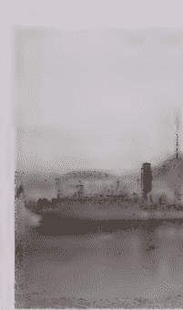

[上午11点，继续]

我们停靠在惠普尔号旁，在周一早上之前没有别的事可以做了。

在港口操纵船只、登陆是很累累的。我很少自己动手，因为我想让那些没经验的军官获得训练；而且当大家挤在狭窄的空间里时，很难放松，而当一个新手脸蛋在场时，简直是让人神经紧张。这次会议让侧面撞了一个凹坑，但没有造成严重损坏——如果由我指导他们，他们学不到好东西，至少我是这么认为的。不过，在离开船只之前，我会培养出一些优秀的舵手，尽管这会多添几根白头发！

我的心情依然很好，过去几个月来我只发了一次火，而且是非常短促而急躁的。但在工程局有时席卷我身上的那股怒火，在船上并没有出现。那是因为我实际上大部分时间都在忙，因此不需要请示许多上级，只需勉强让分队指挥和中队指挥满意。在[华盛顿]，最让我疲惫的是四处奔波试图解决冲突的观点并努力获得决定。比尔·洛（Bill Lor）工作很出色，因为他很积极、果决，而且在说“不”或“做得糟糕”时毫不犹豫。一切都是坦诚、公开且完全客观的，没有为了名声的争斗或可能的阴暗动机。我们清楚自己的处境。

> 1 “佩科斯号”油轮（USS Pecos AO 6），于1921年服役，于1942年3月1日被日本航空母舰飞机击沉。
>
> 2 “金枪号”潜水艇（USS Tarpon SS 175），1973年建造，在世界大战中获得七枚战斗星，于1945年退役，并于1957年在拖往废料回收场的途中沉没。
>
> 3 可能是指诗人、作家兼编辑卡尔·桑德堡1927年的作品选集《美国歌袋》——“唱片”用复数，是因为当时需要78转唱片。

## 往爪哇海

今天下午我要和鲍勃·丹尼森、约翰尼·普拉特74以及弗兰克·巴杰特[身份不明]打高尔夫球，预计会回到船上。明天我要和“艾格尼斯号”吃午餐，周一我们要出发。

在接下来的一个月里，我们的行动可能会导致我错过从“快帆号”寄出的信——如果真的发生了，不要担心，那仅仅意味着我们正在海上，在当地哨所附近徘荡。

天气又热了，我的痱疹开始要发作了。我会服用盐片并使用特制肥皂，希望能有所缓解。然而，它似乎总是出现在我们最不方便的地方！赤身的人遭受严重痱疹之苦，真是一个奇特且难堪的画面！

就这个话题，我先停一下……

[1941年4月6日，周日（？），上午9:45，继续]

我们3:15开始打高尔夫球，时间晚到足以避开最热的时刻；那场比赛很精彩，尽管我们在天黑时分匆匆结束了。我们在陆军海军俱乐部吃了很晚饭，看了跳舞等等，我在午夜左右回到船上。因为在俱乐部聚在一起的人要聚一起进入餐厅实在太不容易了，导致我们比我计划的晚得多——不过我睡得很好，今天很清闲……

## 给埃克莱斯夫人的信，1941年4月8日，周二（？）下午5点海上

亲爱的：

自从昨天早上我们在马尼见面后，我就没怎么睡觉。昨天非常无聊又闷热。整天我们顺风航行75，睡觉时也做了一些非常无趣的事。昨晚很热且浪很大，让人很难入。今天早上很热，什么都没发生，但今天下午我们做了一些真正的工作，海面平静了，我们可以打开舱门透透气了。陆军的皮特·伍德76上尉和我们同船度假，看起来很享受。他和妻子多蒂都对船上的军官们非常友好——特别是迪克·赫尔姆斯77和比利·吉尔尔斯皮（Billy Gillespie）。他们很有魅力而且人品很好，所以为皮特做点事是件乐事……

> 74. 约翰·洛克伍德“老Doc”普拉特（1899–1923），毕业于美国海军军学院（USNA），担任“西德号”水上飞机支援舰（USS Cid AID 1）指挥官，支持美国亚洲舰队的第10巡逻队。在驱逐舰上服役后，普拉特成为了一名海军航空员。他曾指挥俾斯麦海号（USS Bismarck Sea CVE 95），参加了林良湾和湾战役。在硫岛战役期间，他的船在神风攻击中被沉。战后，他指挥“菲律宾海号”（USS Philippine Sea CV 4）和第14师，退休时被晋升为少将。
>
> 75. 由于船上相对速度很小或没有，不仅无法缓解热（船上只有通风，更别空调），而且排出的烟笼罩了船只。
>
> 76. 陆军皮特·伍德上尉（海军军学院1933级），少校，于1942年4月7日在巴丹半岛战斗中阵亡。
>
> 77. 约翰·D·爱德华兹执行官，查尔斯·赫尔墨斯海军海军中尉。见注释。

## 加入亚洲舰队

[1941年4月9日，周三（？），下午5:30，继续]

我刚睡了一个美妙的午觉醒来，感觉很懒。除了写给你的时间，我从昨天早上6点一直站到午夜，而且在恶劣天气下非常累。今天早上事情开始得很早，我们以27节的速度冲刺，水花飞溅，直到11:30。今天下午我们在3点前就受惊了，早晨之后没别的事了。当我终于放松下来时，真的累了。我在应急舱的铺位上躺了几分钟……而现在是时候准备晚餐了——2。我们吃了丰盛的火肉晚餐，看了一部不错的电影，我在桥楼上待了一会儿，享受着宁静美丽的夜晚。很快我就六点半要休息了。晚安亲爱的——还有两天就能等到信了！

## 给埃克莱斯夫人的信，1941年4月15日，周二上午7点

早安。

早餐结束了，几分钟后我就要上甲板。我在查看每日日志时发现了随附的消息——里面有些“甜言蜜语”你不认识其中的这些人，但我必须删掉名字，因为无线电日志是保密的（工作中断）：消息，帕利托，加州，电司令——两个月没收到信了，非常痛苦且愤怒，需要更多钱，打算去墨西哥，祝一切好，爱丽丝

[晚上10点，继续]

几个字就讲述了一个故事！我让你根据自己的喜好填补空白。你从未见过，可能也没听过这些人。

今天早上我醒来时，满脑都是写给你的趣事，白天没有机会，现在我累了……

> 8. 船只正在练习“布烟幕”战术——产生靠近水面的浓黑烟，通过其锅炉或尾部的特制烟雾发生产生，用于遮蔽敌方火力控制指挥器，那些设备当时是视觉追踪的（见第5章注释19）。
>
> 9 见第1章注释14。该型号“德莱干号”（USS Dryden DD 280）的平面图显示桥楼后方有一个“应急舱”。
>
> 10. 紧急人员可以（且可能仍可以）作为商业电报发送给海上军人员，在无线电流量允许的情况下随官方消息一同送达。

这六周。昨天和今晚，我们正在协助第59驱逐队进行夜战演习。高尔夫休息时间。

我们刚刚进入马尼拉湾，一小时后将在开维特附近锚定；早上我们将接上观察员，然后前往奥龙坡，在周三和周四晚上进行射击训练。

周一在我们出发前，有很多邮轮邮件登上了快快船。下午没能送进来，我错过了——我希望明天能补上。非常感谢你提供的唱片机针。

我收到了《美国音乐爱好者》杂志编辑彼特·里德（Peter Reed）的一封非常有趣且健谈的信，还有来自 Heavy 的一封也很不错的信。他提到他现在办公室里使用录音机（Dictaphone），这让我觉得非常有趣，因为当我第一次去[工程局]时，曾尝试买一个，因为我知道那可以节省多少时间和工作量。结果我被嘲笑了——人们不相信这是一个严肃的建议。在我看来，这些都是显而易见的——而且还有许多其他类似的情况！

我给杜瓦德和 Heavy 都写了信。瑞德告诉我，米尔巴[Miriam]对我建议她订购的《现代年鉴》（Almanac for Modern）非常满意……

## 给埃克莱斯夫人的信，1941年4月16日，周三

海上，从开维特前往奥龙坡的途中

亲爱的宝贝：

我们正在高速行驶，震动震得我的字歪歪扭扭的。今天早上我差点犯了一个大错。我在卡纳奥[海湾]上岸——就在开维特旁边，顺便去海军医院看了约翰，他的腿断得非常厉害，正被送回“美国本土”的医院。当我开始给你写信时，意识到信封上会有医院的邮戳，由于我没有提到过我的访问，你可能会因为那个邮戳而担心坏了！我把信留留了，后来在造船厂邮局寄了出去，我很庆幸自己没有做那种轻率的事！

我一直在查看快快船，发现下一班是在周日。我希望它不要延误，否则意味着要很长的等待。你的信太有趣了，我想读读它们。

彼特·休·里德（Peter Hugh Reed,1892–1969），音乐评论家、广播评论员兼出版家，1935年创立并此后担任月刊《美国音乐爱好者》编辑，该杂志是近期经典音乐录音的合集。它仍在出版，名为《美国唱片》（American Record）。

一种供打字员进行语音转录的记录设备。发明于20世纪初，这些机器自1923年起由Dictaphone电话公司制造，并在1941年使用蜡筒。

威廉·杜瓦德·莱格特小少尉（Capt. William Durward Leggett, Jr.）（1901–77，美国海军学院1920级），在他此之前的职位上，HEE 曾在工程局与他合作，并可能为他工作过柴油引擎。他于1951年至1955年担任舰船局局，并在那里作为准将退休。

## 加入亚洲舰队

顺便提一下——上周五下岸时，卡罗琳·沃尔夫（Caroline Wolff）告诉我，“梅西医生”（或Mochie）写信给她，说你们所有人集合在一起，展现了马克家族所有的魅力与稳定！当然，我并没有得到什么消息，但在这么多优秀的人面前听到这种评价，我比什么都要高兴！

**下午5点，续**

我们刚刚进入奥龙坡，转接了观察员和第59[驱逐]队，现在正去目标。我收到一封电[报]，邀请我周五晚上与哈特将共进晚餐——应该会很愉快。下周在马尼拉的周末将是我至少一个月里的最后一个——接着就是开维特的长期留守——其实并不长，但我知道将会是那样。顺便说一下，我对目前乘坐“啤酒运输船”航行充满热情！我发现我睡得更好了，也没有长胖，玩得很开心。而且我目前的习惯是下午打很多高尔夫，早回船，然后度过一个懒的周日上午，非常放松。

《奥利弗·维塞尔》（Oliver Wissell）是一本卓越且值得读的书。最重要的是对英国军事和政治领导人的刻薄批判。我认为，这本书的写作以及读者对书中该部分的反应，都深受过去十年英国处理事务事务行为的影响。

我深信，如果所谓的英国阶层除了通过功勋获得的地位外还拥有任何权力或职位，那么任何和平协议都没有价值。最迷人的事情之一是罗斯福先生与英国劳工领袖欧斯特·贝文（Ernest Bevin）保持亲密关系。温南特（Winant）凭借他的背景应该是一位出色的大使。我不知道哈利法克斯勋爵如何。丘尔尔是个例外，他是伟岸的。英国殖民地的人是另一种类型，我对他们有更多的信心。

如你所知，英国人总是令人困惑又着迷——我个人上非常喜欢他们，但他们仍然没有消除我对他们方法的真实吸引力的怀疑。他们中的许多人坚信，帮助他们是美国的“责任”——而这些人最终会觉得我们

## 往爪门海

在未来的任何世界对齐或结算中，都应该受英国政策的主导。

我觉得我们的利益使得英国殖民地[无法辨认]与我们保持非常友好——甚至是结盟，但我认为英国将无法以过去的地位生存下去。

84 肯尼迪·罗伯茨（Kenneth Roberts）著的《奥利弗·维塞尔》，写于1980年，背景为革命战争时期，从忠王派的视角出发。


# 人物传记

## 85 欧斯特·贝文
欧斯特·贝文（Ernest Bevin, 1881–1951，不要与波兰政治家亚历大·贝文混淆），曾是运输总工人工会创始人兼议会议员，在战争期间担任劳工和兵役部长。1945年，他在克莱门·阿特利下担任外交大臣，并在去世一个月前担任国际劳工组织和平秘书（大萧条期间担任就业安全委员会成员），随后1941年被总统富兰克林·D·罗斯福任命为驻英大使。他在该职位上一直工作直到1946年。

## 86 约翰·吉尔伯特·温特沃
约翰·吉尔伯特·温特沃（John Gilbert Wentworth, 1889–1947）曾三次担任新罕布什州州长（大萧条期间两任），并担任社会安全顾问委员会成员。

## 87 爱德华·弗雷德·伍德
爱德华·弗雷德·伍德（Edward Frederick Wood, 1881–1959），哈利法克斯勋爵，是一位保守派政治家。他曾担任印度总督和外交大臣，随后被任命为驻美大使，在那里工作直到1946年。

## 88 伯顿·“B”克拉克格
伯顿·“B”克拉克格（Burton "B" Klakring, 1904-75，美国海军学院1927级），是一位潜艇专家，在指挥“卫士者号”（`SS 217`）执行1942年巡航（战争期间最成功的巡航之一）后获得了海军十字勋章。他的潜艇在下一次巡航中获得了总统单位勋章。1944年，克拉克格带领一支七狼队进入日本群岛。他在退休时被晋升为海军将领。

## 89 三位一体号
三位一体号（`USS Trinity, AO 13`），1920年服役，一艘帕托卡级油轮（16800吨，477英尺，速度11节，以德克萨斯州和加州的三叉河命名），在两次世界大战之间处于闲置状态。三位一体号是加入亚洲舰队的油轮。该船在马尼拉被首次封锁前一天，在护航下离开马尼拉并贯穿整个太平洋。

- **90** 根小型金属柱，支撑着船体两侧和其他甲板边缘的救生护栏。“HEE”意味着船体相互擦碰了。损坏很小（一对立柱挂在了惠普尔号的侧面并折断了），但很尴尬——对于任何恰好拥有“指挥权”的指挥官来说，这不可避免是职业生涯上的污点。
- **91** 麦金利堡，建于1901年，紧邻马尼拉东南部，曾是一处美国军事预留地，如今是波色尼奥堡垒和菲律宾军的总部。

# 往爪哇海

## 给埃克莱太太的信，1941年4月19日，周六，晚上9点，续
将领的随行人员真的很无趣，但昨晚天气很热，我睡得不太好。今天我参加了检查（即他视察了他的船，可能带有些形式化），然后上岸去打高尔夫，是从那时开始的。我感觉不太舒服，但我打出了多年来最好的高尔夫，在麦金利堡的球场得了74分，还抓到了两个小鸟。然而，我感觉感冒要了，所以我晚饭吃得很清淡，吃了一些阿司匹林，今晚打算睡一觉过去。明天我们有值守任务，“快快舰”就要抵达，我会在晚上完成这封信。

## 给埃克莱太太的信，1941年4月20日，周日，晚上10点，续
昨晚我汗流浃背——我换了两次睡裤，最后只好穿了内衣。我度过了平静的一天，我的感冒并不严重，但我想它还会持续一段时间。

我很高兴能多给你寄一点钱。我并没有克扣自己，会继续攒一点钱。当然，当我们去造船厂时，由于在岸上我的开销会增加，但我仍然能提供帮助。实际上，我所有可以花钱的地方都只有高尔夫，这很便宜，出租车也很便宜，偶尔看场电影——啤酒（我说待在啤酒车上很省钱）以及偶尔在俱乐部吃顿饭。我对那些昂贵的东西如夜总会和游戏毫无感兴趣——这两者都让我抓狂。

## 给埃克莱太太的信，1941年4月23日，周三，晚上9:30
天气热得睡不着，尽管我很疲惫。我的感冒并不严重，但足以让我偶尔感到不适并保持沉默。明天我希望去岸上打场高尔夫——我想这这将是我们三周内看到的最后一个城镇了，因为我们预计将在苏禄海的风浪中。

到目前为止我们的航行很沉闷，不幸的是我心情相当低落。我必须习惯在汗水中睡觉，但这种感觉并不清爽。坦白说，我对这些岛屿已经厌透了，我诚恳地希望离开后永远再也不见到它们！原谅我如此乖乖，但最重要的是我想念你。过一两天后我就会好起来，但我会同样想念你……

## 给埃克莱太太的信，1941年4月26日，周六
我们中午左右到达这里，发现了一个美丽的海湾，但没有任何明显的娱乐场所。我们不能和鲨鱼游泳，渔业不太好，我们可能无法上岸，因为摩罗人正处于动荡状态，他们杀了很多他们不喜欢的人，我想菲律宾民兵也不少。我想我们可能会在这里行动大约两周，也许更久。我的感冒好了一些但仍然很困扰，不过我的士气好多了，尽管在 `Acey Ducey` 游戏中我一直输给对手那非凡的运气……

显然，这里没什么可写的。周四下午我在伊洛洛度得非常愉快——我们在一个非常棒的球场上打了高尔夫，然后去了瑞士俱乐部，在那里我们结识了极有趣且非常好客的瑞士人和美国人。晚上过得非常愉快，我喝了适量的金酒对我很有好处。伊洛洛非常炎热潮湿——100华氏度或更高——但更远的地方看起来（事实上也是）更凉快——事实上只比90度高一点，而且有阵微风。我们虽然发抖，但满身大汗的感觉并不好……

- **92** 摩罗人，许多菲律宾人的逊尼派穆斯林，自17世纪西班牙征服这些岛屿以来一直抵抗西班牙，并在美国接管后抵抗美国人。
- **93** 麦金利堡，建于1901年，紧邻马尼拉东南部，曾是一处美国军事预留地，如今是波色尼奥堡垒和菲律宾军的总部。
- **94** 摩罗人，许多菲律宾人的逊尼派穆斯林，自17世纪西班牙征服这些岛屿以来一直抵抗西班牙，并在美国接管后抵抗美国人。
- **95** 国会图书馆的弗兰克·诺克斯论文，1941年4月25或26日的演讲。
- **96** 赫伯特·V·威利（1899–1974）在飞艇“麦康号”（`ZR 5`）坠毁时担任指挥官，坠毁发生于1935年2月12日，造成20人死亡。他曾三次中的之一拯救了“阿克戎号”（`ZRS 4`）的坠毁。升为指挥官后，他担任了三年的驱逐队司令，随后指挥了西弗吉尼亚号战列舰（`BB 48`）（1944–45年）。他于1947年作为少将退休。

## 亚洲舰队
亲爱的，我昨晚睡得很好，早晨仍然很冷。我感到很振作，有很多和和和。

### 1941年4月27日，周日，上午11点，续
我已经为5月计划了几个月，由于炎热天气，一切都会变得很美。当然，当我们去造船厂时，由于在岸上我的开销会增加，但我仍然能提供帮助。实际上，我所有可以花钱的地方都只有高尔夫，这很便宜，出租车也很便宜，偶尔看场电影——啤酒（我说待在啤酒车上很省钱）以及偶尔在俱乐部吃顿饭。我对那些昂贵的东西如夜总会和游戏毫无感兴趣——这两者都让我抓狂。

### 1941年4月28日，周一，晚上10点，续
顺口提一下，曾担任“麦康号”船长的威利上将担任我们的中队司令。你还记得我们在彭西法尼亚州长滩滩时的他们吗？将领们下个月就要回家了。今晚没有更多消息了，亲爱的。

# 往爪哇海去

英国是否还能提供援助已成为一个问题。遗憾的是，儿童的疏散计划⁹由于几艘船的沉没而中断。尽管会有许多人员损失，也应该重新开始。所有政府未能意识到并根据形势现实采取行动，而今天的主要现实之一是，从英国离开的每一个非战斗员或非生产者都意味着减少了一个需要食物和照顾的人，同时也代表着未来重建世界多了一个可用的人。在这个过程中失去的每一个生命，至少有一个、可能更多的人将从饥饿或死亡中幸存。这是一个严峻的前景，但它确实存在，忽视它无济于事。

这里物资匮乏，我们对当地的进展一无所知。我们只能猜测并继续工作。这不是一个非常愉快的结局，但我们并不担心或紧张——我们必须面对一个糟糕的处境，而我们总体上表现得相当乐观。

现在该睡觉了……

## 给埃克莱斯夫人的信，1941年5月2日，周五
在图图湾，的生活过得非常愉快。我们开始在傍晚访问其他船只，并进行了一些非常棒的军房⁰扑克派对。昨晚我过得很美妙。我邀请了丹尼来吃晚餐，他早到了，所以正好能听听瓦格纳——就在查利·威克斯和比尔·拉洛尔到达之前，我不记得自己是否邀请了他们！无论如何，我试着装得自然点——侍应忙忙碌碌地，幸运的是从来不是汉堡，而且有足够的食物。我们见到了可爱的安娜贝拉——那是我在电影《晨曦之翼》¹中的老情人——后来我们还玩了一场非常棒的扑克游戏。我的感冒昨天终于好了，所以生活好转了一些。

天气相当凉爽——雨已经开始了，山区的景色非常迷人。从我们锚定的地方看，那里非常像夏威夷——甚至有一个“潘酒碗”让我们想起了檀威鲁。我记得以前觉得檀威鲁离家很远——现在任何提到它的地方都让它离家很近，总是想着它！

> ⁹ 1939年和1944年，有150万平民（尤其是儿童）被政府从受威胁的地区疏散，最初是由于德国入侵的威胁，随后是由于轰炸。直到1940年9月，通过政府资助的机构送走了2500名儿童，其中77人失在鱼雷艇上。本来有一万人可以被疏散，相当于美国的一半。
>
> ⁰ 军房（`Wardroom`）指船上供军官专享的用餐和休息空间：由军官¹¹“伙房”（即用餐安排）运营并（由军官）资助的全体军官集体。
>
> ¹¹ 1937年英国制作（十世纪福克斯英国），背景设定在19世纪80年代，由哈罗德·D·舒斯特执导，亨利·方达和安娜贝拉主演（她饰演法国演员苏珊·夏尔彭蒂埃，1907–96，广为人知）。他们也可能看了《苏伊士》（1938），那是安娜贝拉拍过的另一部英语电影。

### 加入亚洲舰队 115
说起回忆——我很庆幸我曾为了小事缠着你、为你大吵大闹，并在毫无征兆的情况下亲吻你——

我一直在整理我的一些旧文件——正在重新打字等等，我想我最终会有一些逻辑连贯的内容，可能以后某个时候会让斯基普感兴趣。我的旧剪贴簿填了很多，当再没有空间时，我会把它寄回家并开始写一本新的。现在处理一些办公室工作——今天下午我们将前往三宝望加（109）航行周末，然后下周回到图图湾。

船边停着一十二只邦卡船（独脚木舟），里面挤满了年轻的摩洛人，他们正在潜水并以极快的速度不停地挥手着。摩罗人与塔加洛人¹¹完全不同，而且他们蔑视后者。那些孩子很有趣——许多人的牙里填了东西。很难说这个族群会发生什么；菲律宾北部人或塔加洛人拥有部分控制权，摩罗人被禁止持有武器。尽管如此，他们可能使用旧烟斗制成的土制枪[blunderusses，大口径短程武器]，自己制造火药并装填。

天气相当凉爽——雨已经开始了，山区的景色非常迷人。从我们锚定的地方看，那里非常像夏威夷——甚至有一个“潘酒碗”让我们想起了檀威鲁。我记得以前觉得檀威鲁离家很远——现在任何提到它的地方都让它离家很近，总是想着它！

（注：原文后续为大量重复内容，已按要求忽略，仅保留上述核心内容翻译。）

非常仔细，度过了一段非常愉快的时光。下午我睡了个午觉，游了泳，然后听了一个小时的音乐。电影我们看了贝蒂·戴维斯主演的《老老妇》¹⁰⁰。我们在长滩看了这部剧。

明天我们要去朱洛（Jolo）度过周末。

## 给埃克尔夫人的信，1941年5月19日，星期一
我们现在处于一个完全混乱且闷热的疯狂场所。我在耳朵里塞了棉花，很惊讶自己竟然还能集中注意力。造船厂昨天开始对我们大开工，现在船正在转动，声音听起来就像大鼓内部一样。海军已经挤满了，员工人数在过去的几个月里翻了三倍。无论是军官还是船员都没有地方住，但我们希望等“亨德森号”¹⁰⁷离开后，就能为一半船员在营房里找到位置。目前有点忙乱，因为“亨德森号”的征召兵因痢疾被隔离，700名人中有约700例。

我搬到了马尼拉的陆海军俱乐部——早上坐9:30的轮渡，下午坐4:15的。在船上我没什么用事可做的。所以我预计接下来的五周将住在岸上。我想几天后，查理·威克斯（Charlie Weeks）和我将去巴纳基欧（Baguio）呆一周。我正试着尽可能让更多官士兵去山上，但这有点困难。（停电了。我的风扇停了，我正满头大汗！）

> ¹⁰⁵ 华纳兄弟电影，1939年，由埃德蒙·古尔德导演，戴维和米里亚姆·霍普金斯主演；基于1935年的一部戏剧，后来改编成伊迪丝·华顿的小说。
>
> ¹⁰⁶ 亨利·史汀森（1867–1950）于1940年至1945年担任战争部长。这段引用可能指的是5月6日的无线电演讲：“因此，[大西洋太平洋]都在我们或盟友的控制之下；它们宽阔的海岸线对任何通过侵略性机动可能集结的军队来说都是不可逾越的障碍。此外，我们才刚刚开始建立军事和防御。至少还需要一年时间，我们才能拥有有效的空、陆军，如果海权落入轴心国，这些力量将投入战斗……与此同时，英国和[美国海军]的努力可以确保环绕我们大陆的所有南北、东西方向的洋洋的安全。通过这种方式，它可以帮助遏制纳粹主义的不断扩张，直到所有民主国家的其他防御力量建成。
>
> ¹⁰⁷ 亨德森号运输舰（`USS Henderson AP 1`）是一艘12,400吨（满载）运输船，1916年服役，过去几年一直驻在远东。它后被改为医院船，更名为“救援号”（`USS Relief AH 9`）。该舰于1946年退役并于1948年拆除。

## 爪哇海
实际上，我的主要工作是尽可能保持良好状态——专业性学习，并对造船厂的工作进行总体监督。但我没有具体的任务要处理。我把留声机送到了俱乐部，那里有一个舒服的房间。军队离开后，俱乐部现在非常冷清。我经常见到萨姆·伯格（Sam Berger）……

感谢你寄给我利普曼（Lippmann）的评论。这是我看过的关于现状最清晰、最好的陈述。尽管我对国家最终会发生什么偶尔感到担忧和怀疑，但这些时刻并不持久——我的信仰要强大得多——我觉得现在这么多人都感到怀疑和不确定，是因为几年前他们没有意识到实际上在发生什么。此外，我对自己的判断比对他们的更有信心，因为在同一时刻我意识到了发生了什么，并确定一般事务将按照其实际轨迹发展。当然，你记得我曾多少次评论说人们并没有真正“害怕”——而当伤痕出现时，恐惧就会开始四飞——好了，那个时候到了——有些人害怕阴影，有些人害怕希特勒，有些人害怕罗斯福，有些人害怕劳工。但我认为大多数人将埋头苦干并取得辉煌成果。如果我们认为自己值得维护，并且只要战斗就能胜利，那么我们可能必须战斗来维持，从长远来看，我们将拥有一个更好的国家，极可能有一个更好的世界。极富阶实际上会被消除，尽管他们尖叫，也无法造成伤害。劳工运动会走过头并遭到反击——而且那场面一定会精彩。

我认为性行为将继续是男女放松的手段——我绝不反对这一点！！！（尽管我已经久未实践了。）而且，我认为年轻一代没问题，诚实、有能力且愿意工作的男女将相处融洽，而那些内心怀有信仰、智慧、爱并感知生活之美的人将能够取得真实的生活并获得报报，他们知道自己在这个完全罪恶邪恶的世界中并非孤立的个体，会找到许多志同道合的人。

亲爱的——如果我不相信我所写的这些话，我就无法在身边砰砰撞击钢隔板的凿子声和铆钉枪声坚持下去。

> ¹⁰⁸ 已确认，但信件中的其他参考显示他有一位妻子瑞贝卡（Rebecca）和一个成年的女儿或侄女，她们都和他一起住在马尼拉。一个隐含的评论暗示他可能在CAST站（无线电情报设施）工作。

## 加入亚洲舰队

## 给埃克尔夫人的信，1941年5月24日，星期六
我们晚上9点到达，但我因为睡了一整晚觉非常疲惫，所以倒头就睡了，早上8点就神清奕奕了。忙碌时我的情绪和神经状态不好，但在海上的这一周我感到非常低落并厌恶自己。搬到俱乐部后感觉舒服得多——我之所以只留一周，唯一的原因是给其他官兵机会上来，就像他们需要我一样。不过，如果情况稳定，我会尝试在7月1日之前再呆一周。

这个月会很花钱，但我认为这是最好的投资——我应该会有几笔保险红利可以寄给你，但我认为在7月之前我没有自己的钱可以花。

今天早上我打了高尔夫，非常享受——午饭后我潜了一会儿，晚上我去参加俱乐部的牛排宴。

芭芭·安格内斯（Barbara Agnes）过去上个月在巴纳基访问英国总领，但坐了早班回了马尼拉，所以我错过了她。

几乎每天都会下雨，现在乌云密布，海风以一种非常有威胁的方式吹来。清晨美极了！查理·威克斯坐了早班过来，所以明天我们开始打高尔夫。

那些小伊戈罗特球童非常可爱——乐观且带着微笑。这整套独立的胡言简直是悲剧性的——我在这里每天都会确信这一点。这是缺乏真正的国家能力和远见所导致的另一个例子。所有导致欧洲崩溃的基本因素都存在。自私，即通过提倡不靠谱的方案来推进个人利益——为了私利大谈爱国——贪腐、效率。这些都是普松的特征¹⁰⁹

# 爪哇之海
崛起并展现实力。问题一直是在权宜之基础上被规避或解决的——其中有许多推诿、犹豫不决的例子。

结果将是，塔加洛人（作为菲律宾部落中最不值得崇拜的）将获得政治控制权——他们将保持富有，而这个国家将因为美国切断经济关系和优惠政策而导致经济破产。这当然是由于国内制糖业和烟草利益集团的迫使。塔加洛人将竭尽全力摧毁那两个少数且强悍的恶徒——伊戈洛特人（Igorotes）和摩罗人（Moros），否则流血将席卷整个岛屿。伊戈洛特人和摩罗人都喜欢、尊重并信任美国人，却怀疑并讨厌塔加洛人。在低地人到来之前，山地是不存在不诚实和偷窃的。

我看到自治体¹16注定会失败，即使我们为了保卫岛屿而保持和平，也不知道该如何避免这一点。我在那里只待了六七个月，可能没有这么快就得出这样的结论，但我深信不疑。马尼拉周围那些狭隘的理论令人作呕，贞洁成了一种奇闻——女学校应该严加围栏并禁止。

摩罗人很诚实，贞洁是一种美德，而诱惑受到严厉指责——在马尼拉是一种可以接受的习俗——摩罗人和伊戈洛特人很强悍——野蛮但为人正直——而塔加洛人更糟。伊戈洛特人可能是这一群中最好的——噢，他有时会进行一些随意的猎头，但通常有充分的。

好了，说了够了——现在去穿派对的衣服了……

> [1941年5月25日，星期日，下午5:30，续]
>
> 亲爱的：
>
> 牛排派对挺有趣的——食物很棒，但大约是六男对一女——我跳了一次，但看起来太混乱了，不想再试了！我们这里的人受到的关注显然比以前任何时候都要多。大约一个小时，荷兰·切弗弗（Dutch Cheever）和我就战争进行了长时间的争论，我们最终达成一致并不是因为对大多数事实达成了共同，而是因为对这些事实的解释和结论产生了分歧。
>
> 在俱乐部的派对结束后，我们漫步到松酒店（Pines Hotel）去看舞蹈，发现那里的人群很杂，我们没留多久。林登迈耶中尉（Lindenmeyer）¹11是补给团的一位年长，他和威克斯（Weeks）在房间里，他也参加了我们的派对。当他回来时，我

## 加入亚洲舰队 121


# 爪哇之海

在峡谷边坐了一会儿才回屋睡觉，他一直在谈论琐碎的闲事。我没睡好——也许是因为多喝了额外的咖啡、威士忌以及思虑。

今天早上我们吃完早餐后就开始打高尔夫了，不知道为什么我打得很好。这块球场的标准杆只有65分，但有很多很好的球洞。74分和74分没有漏掉任何洞！霍兰上校（Colonel Horan）和凯奇姆少校（Major Ketchum）来喝晚餐酒，我们进行了一次非常愉快的讨论，然后吃了一顿火鸡晚餐，我很中意（这对我在这个国家来说相当罕见！）。之后我开始读道格拉斯·弗里曼（Douglass Freeman）写的罗伯特·E·李传记（我在马尼拉时开始读桑堡的《林肯》，但收得太糟糕了，导致我睡了一大觉，现在感觉放松多了）。现在下着一点凉意的小雨，让我想起了普吉吉特海。再几周后，雨季就开始了。

人们的大脑，运作起来多么奇异！我试图保持自己的观点，并在思考中保持逻辑。我做到不受偏见并维持逻辑。但我读了我的哲学老师的一本好书——威廉特的老友亚当·琼斯（Adam Jones）写的《归纳与演绎逻辑，或如何思考》。因为我有这本书的两个副本，倒有些遗憾。书中对三段论和谬误有非常精彩且清晰的讨论。实际上，这些经典的谬误在日常讨论中非常频繁，因此逻辑被击溃了。如你所知，我一直强调纯逻辑思维的重要性。逻辑的学习在达到一定的成熟程度之前是无法理解的，但我认为他在这一方面接受一些正式训练是极其重要的。琼斯博士的书很短且基础，虽然其中某些阶段相当复杂，但有几章很容易吸收，并且在分析思维方面非常有价值。

柏拉图所著的苏格拉底对话无疑是伟大的经典，在《苏格拉底式对话》中是一件艺术品。我相信许多人现在已经脱离痛苦和对不确定性的恐惧，因为他们还没有想透这种状况。当然，还有许多其他原因。

似乎，处于高层政治职位或其他权威地位的人特别容易听到与他们观点相左的信息——实际上他们应该根据事实形成观点，但仍然自由地采纳有利于他们观点的方面。因此报纸标题之所以如此具有误导性，因为它们往往未能呈现其所依据的电报的真实含义。

此外，愿望思维最危险的方面在于，某些权威人士不相信与他们观点相左的事实。最大的例子就是英国领导人不相信他们从欧洲的情报部门收到的大量准确报告。林德伯格的报告被忽视了，这是有理由的。虽然我不同意他的结论和他显而易见的哲学，但我遗憾他的事实知识遭到了完全否定。

工程训练是反对这种思维的最佳方法，当真正实现了工程观点时，一个人在学习思考方面就有了进步。拉克博士在哥伦比亚大学曾强调要加强使用，而获得这种观点实际上是我们研究生课程的主要目标。

但要回到愿望思维及其危险性——似乎，处于高层政治职位或其他权威地位的人特别容易听到与他们观点相左的信息——实际上他们应该根据事实形成观点，但仍然自由地采纳有利于他们观点的方面，并相信那些与其观点相左的事实。然后他们随后通过攻击那些提出或开发这些事实的人来反。在法律术语中，这被称为“人身攻击”（Argument ad Hominem）。

所以，亲爱的，我们还是——让你的情感保持温暖，让你的思考保持冷酷而清晰。这是一个极其困难的问题，我承认，但它仅仅强调了对经过训练的思维的需要。未来的世界以及所有的世界，将永远需要既能思考又能行动的思考者。

我们再次面对严峻的现实——我并不害怕，因为我有信仰——尽管我对于冷酷血腥的思考做了这么多讨论，但信仰是且必须基于比逻辑之外的东西……

[1941年5月26日，周一，下午2:30，续]

依然安静而愉快——我非常放松，完全沉浸在假期中。这封信一直很严肃，很难在如此想念你的同时又写下些轻快的琐事。然而，我在这里感觉要正常得多；不过马尼拉令人压抑，自然而然会滋生忧郁的情绪。

今天上午我们度过了非常欢快的时光，其中有足够的高尔夫球让过程变得有趣。我们曾想过打27洞或36洞，但由于这是一个像山羊一样的山球场，我不确定我们是否会这样做。最棒的一点是我们可以想去一试！

亨利·卢克（Henry Luke）和他的妻子克莱尔·布斯（Claire Booth）现在正在碧格奥访问高级专员赛尔（Sayre）——我希望我能见到他们！

> **注释 120** 弗朗西斯·B·赛尔（Francis B. Sayre, 1885–1972）是伍德罗·威尔逊的女婿；在1935年联邦自治制度建立后，高级专员（即美国总统的个人代表）一职取代了总督任辖职位（参见注释110）。赛尔的任期实际上在他1942年撤离时结束，他是最后一位高级专员。亨利·卢克（1898–1967）是《生活》杂志的创始人兼编辑，在此之前创办过《时代》和《财富》杂志。克莱尔·布斯（Claire Booth, 1903–87）是卢克的妻子，她是一位作家和剧作家，并在2世纪50年代被任命为驻意大利大使。
>
> **注释 121** 华纳兄弟出品片，由贝蒂·戴维斯（Davis）、乔治·布伦特（George Brent）和玛丽·阿斯托（Mary Astor）主演。

威廉·蒂尔（Wilhelm Thiel）

## 致爪哇海

没有外界声音的干扰，没有铃声、交谈声和远远而旋转的机器声。

而且我睡得很好——碧格奥对我神经的恢复作用比我想象的还要大，感觉像人类一样放松，而不是像离开之前那样卑微和沮丧，这种感觉太好了。这种良好的效果会持续多久我不知道，但至少我得到了重建。

船上的工作进展顺利，尽管绵绵细雨是一个障碍。我让我的军官们基本上根据自己的主动性完成工作，他们的反应非常好。我不知道我们的战斗何时或会开始，但如果开始了，至少会有一个人是放松的，不会被焦虑和紧张所折磨。根据所有报道，其他哨地的船只已经精疲力竭了，这太愚蠢了……

[1941年6月7日，周六，上午10点，续]

亲爱的，

早餐结束了，一小时后我将去市中心办些杂事，然后下午去打高尔夫球。

风暴似乎结束了，我们不应该会有更多的零星雨。快船（The Clipper）在明天上午出发前往夏威之前延迟了三四天。

随着风暴季节的临近，快船的延迟将更加频繁。瑞德（Swede）很急于让你联系米莉亚（Miriam），她的地址是科拉拉多的玛丽塔大道735号。她希望你下秋来西海岸。我认为这是一个非常棒的主意，非常值得去。

萨姆·贝格（Sam Berger）发了严重的急性病——冠状动脉血栓——目前住院了。我今天还没听说他情况如何，因为他不能见会客——听起来是非常糟糕的消息。他是个好汉，他的家人也非常尽职尽。

现在亲爱的，我得赶了——

## 给埃克莱斯夫人的信，1941年6月14日，周六，上午10点，马尼拉

亲爱的伊：

这可能是我最后一个可以在上午偷懒的周六了，我正轻松应对。我下午要去打高尔夫球，今天晚上我要参加一个晚宴，我在那里可能会显得有点格格不入。

马尼拉这周真的很美。天气并不真热，最近的雨水带来了许多色彩。吕尼塔（Luneta）是一个大型开放公园，草坪非常茂盛，环绕它的火桐花正盛，完全名副其实了其名。如果能一直保持这样就太好了，但遗憾的是它不会。

> **注释 122** 很可能是黎萨公园（Rizal Park），当地称为吕尼塔公园（Luneta Park Park）。今天它拥有133英亩的花园。

## 亚洲舰队

通常我一直很安静，但昨晚我拿出了几个牛奶罐，向他们展示如何在三个罐子上行走——这很快就活跃起来了，杰奇、蒙特和那些年轻人都在那儿跌倒。现在老姑娘说我给了他们极好的锻炼！

于是我们击掌、大笑、打乒乓球、唱了会儿歌并聊天——吃吃喝喝度过了一个完美的夜晚。这个群体对我很有好处，它清空了我脑中的内省想法和渴望，这些想法有时很难忍受。我离开时感到疲惫但头脑清晰。卡罗琳（Caroline）很棒——优雅和魅力迷人——总是平和甜蜜。汤姆（Tom）很吵闹——粗犷坚韧——非常有自信，谈起他的经历时非常有趣。人们经常聚在一起，那是你会非常享受并会非常喜欢的！

> **注释 123** 詹姆斯·雷德恩（James Redfern, 1920–2002）是一位西班牙母亲和意大利父亲的英国公民（被他曾提供住所的法国租客称为“比日本统治下的最低菲律宾人更受鄙视：保罗·埃马纽尔菲律宾战争，1941–1945”[Kibworth Beauchamp, U.K.: Matador, 2015]），整个战争期间被关押在伊洛洛附近的一个营地。
>
> **注释 124** 塞尔夫夫妇（The Seolphs）是在日本出生的，1944年被遣返回国。
>
> **注释 125** 如原文。由乔治·格鲁特少将（Major George Grunert, 1881–1971）指挥菲律宾司令，该部门包括美国和菲律宾部队。10月，他被道格拉斯·麦克阿瑟（Gen. Douglas MacArthur）替换，后者被征召回现役：格鲁特回了美国，一直担任各种指挥职位直到1945年7月退休。

# 赴爪门答海

就这样过了一阵子——

我读了一会儿桑堡的《亚伯拉罕·林肯：战争岁月》，然后沉浸了一次非常放松的午睡——听了米莉亚·布莱特送给我们的美丽的贝多芬第二号四重奏。我感觉很好，会享受这个下午的。

完全完全的放松和小睡竟然如此有效，真是太好了。

[1941年6月15日，周日，晚上10:30，续]

亲爱的，

这真是充实的一天——晚宴很不错——人很有趣，聊天也很愉快，但我们适应了俱乐部，在音乐结束后一直留到很深夜，某个年轻人突然掏出一手风琴，我们一直唱到半夜——最后我留下了几个不愿离去的人，凌晨4:30回床睡觉，我们在早上9:30会合。瑞典·布莱特说服我再打18个球洞，在经历了非常忙碌的晨间球赛后，我打出的成绩非常好。我们回到俱乐部，洗了舒服的热澡，用温水擦了身体，休息了半小时——去喝了几杯鸡尾酒，刚离开晚餐桌。这是美好的一天，虽然晒了太阳又很疲惫，但这在经历了一个漫长夜晚后的36小时后，这种感觉并不糟——当然，秘密在于我晚餐后没有喝酒，这让身体得到了真正的放松，思维也很清晰。

现在我又困了——我不打算多写了，因为否则我会开始深层的反省，并对别人以及我的反应做出过于严肃的评论——这种思考和反省太多百不好，我不想沉溺其中……

## 给埃克尔夫人的信，1941年6月27日，周五，晚上7:15

正在发生的趣事我没法写，也没有别什么特别的事情。我们一直在稳定工作，白天学习，晚上做计划。我预计明天晚上要从日落忙到黎明——今晚我要读惠普尔来消遣。我感觉良好，并不担心，只是比较谨慎。我没有没有带留声机，留在了马尼拉——我希望以后还能看到它——不过，是可以更换的，而且唱片比以前便宜得多。

[1941年6月28日，周六，下午2点，续]

关于美国冻结日本信贷的消息刚通过收音机传来，在消息传到你那里之前，你应该已经知道了。

> **注释 126** Wee 现在在哪里，如果不在马尼拉港，或者在马尼拉为什么我们没能取回那台唱片机，尚不清楚。正如下方暗示的，爱德华可能进行了某种秘密行动，将机器留在陆海军俱乐部以策安全。
>
> **注释 127** 6月17日，罗斯福总统也冻结了德国的资产（该月早些时候被没收的），而日本信贷直到7月25日才被冻结。详见 Edward S. Miller，《破产敌人：珍珠港事件前的美国对日金融战略》(Annapolis, MD: Naval Institute Press, *, 2007)。

或者是它是开火的信号，又只是漫长等待与准备过程中的一步。当然，我们在这里没有任何立场冒任何风险。这里有巨大的不确定性，其中之一就是我的薪水问题。我会随身携带美国现金，即使情况变糟，随着我积累了盈余，我会把它换成百元钞寄给你保管。因此，我随信附了一张一百四十美元的支票，这是我存的钱的一部分。

即使在理想情况下，我的信也会来得不规律，即使你猜到了我在哪里，也别向任何人提起你的情况。我无法建议更改地址，所以你可以尽管继续使用原地址。顺便，让我知道你秋季的打算，这样我的信才不会出现不必要的延迟。

这是一封非常写实的信。但亲爱的，我已经向你倾诉过太多次心声了，我们彼此非常了解，没什么好说的。

我有信心，我爱你。

我把支票存了银行，以防邮寄干扰可能导致的复杂情况。

## 给威莱特的信，1941年6月29日，周日

最亲爱的威尔 [HEE的兄弟；详见第一章，注释4]，

一年前我离开了纽约，我想我再也没有度过像那样的一天了。不用多说，今年带来了巨大的变化，而未来等待着我们的将是无法预料的。事实上，当我离开纽约时，我以为到达马尼拉的机会大约是五五开的，我猜这个猜测相当准确。根据海军部的一份新闻稿，下一位负责我走过的大部分区域的军官在伊拉克失踪了三周，我想他已经彻底完蛋了。

大约一周前，我正开始给你写一封很长的信，是从俱乐部回到船上的途中，大部分是在船上完成的。这几天非常忙碌且不舒服，因为我们必须离开港口抛锚，而此时台风正在我们东侧掠过。我们没有遇到真正的大风——只是阴冷、潮湿，且有时阵风能达到50节左右。昨晚，我们在一场剧烈暴风雨中回到了正常的泊位，我在压舱平衡船体以补偿油舱[燃料箱]燃油不足时判断了失误，导致船体倾斜非常严重[即要么头低要么尾低]，操控起来像魔一样困难。我们正以20节的速度航行，迎着中度的海浪，这让我们时而获得很不错的升力——我们船上燃料充足，所以船行驶得很稳——比我们之前身体很轻的时候要好得多。正当我们开始接近油罐船佩科斯号加油时，一场强暴风雨袭来，带着倾盆如雨——在最艰难的部分到来之前，恰好找到了一个落脚点，但我没有时间可以浪费。不过，我的心情比上周好得多，因为上周我一直处于一种不安和不定的感觉中。现在我们已经出海，即使只有几个小时，我也感觉好多了。谢天谢地，我没在岸陆上！

“浅间丸号”（Asoma Maru）是一艘日本轮船——她正驶往东印度群岛（N.E.I.）。几小时后我们将分开，前往各自的海岸。舰队的船只现在已经涂掉了所有的船体编号和名称，因此很难分辨哪一艘驱逐舰或潜艇。

[下午6点，续]

现在是晚饭时间，但大多数人都没来，而且如果餐具一直留在桌子上，我也没关系。从出口出来时，我们正遭遇着汹涌的海况，事实上，海水有好几次拍打过船头板——我们的速度达到了15节，并沿着海岸航行，所以我们现在放出了一根带有浮标和绳索的软管（以及水泵的滚轮）供捡取，现在有人在板上操作，分交给接收船，每段一百英尺。这种缓慢而低效的技术在1930年被美国海军抛弃了，后来英国和日本航运公司也放弃了，他们继续进行尾部加油。尾部加油在二战后很长一段时间内仍在海军中使用，但现在已罕见。详见 William S. B Stillman 所著《美国海军史》（Naval History of the United States，安纳波利斯：海军大学出版社，1993年），横摇正稳稳地持续着。几分钟前，我在甲板上走了一圈，寻找泄漏的气体——一些……[文本不完整]

[晚上11点，续]

我们正锚泊在奥龙阿波（Olongapo），6:30我们出发进入干坞，“惠普尔号”（Whipple）正向我们靠拢系泊，我正带着两艘船一起过去。

今晚的晚餐寥寥无几，因为我们摇晃非常剧烈——一次甚至达到了32度，我们发现一些设备没有妥善固定，导致现场一片混乱，但所好没有损坏。我们吃了丰盛的晚餐：炸鸡肉、米饭和肉汁，最后是冰淇淋收尾。布泽蒂（Buzzetti）以前从未在这样的船上过，心情非常糟糕——但现在已经恢复了，我们看了一场很棒的电影——詹姆斯·斯图特和克劳莱特·科伯特主演的《生活如此》。现在该睡觉了——晚安，伊西（Isis）——我爱你。

## 给埃克尔夫人的信，1941年6月30日周一，上午11点

亲爱的：

我们早上六点出发，遇到了很多困难。“惠普尔号”正要向我们靠拢时，我们发现有一只小船靠在旁边加油，我们让“惠普尔号”等一下并下锚，结果延误了一整小时——纯粹的愚蠢——我很生气，并且我第一次当面严厉且自豪地训斥了三名军官——这是我第一次这么做[即：在他人在场的情况下责备]，但确实很有分量。然后我们在[干]坞口发现一股异常强的水流，这破坏了我的前两次尝试，顺便也让我表现不佳。雨开始像下倾盆一样，很快我们就被淋透了。我终于完成了我想做的事。稍后我们停就绪了——我们大约十点靠上龙骨，现在我正喝着咖啡——雨还在下，伴随着几阵风，可能还会持续。

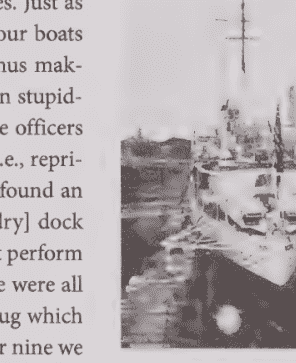

## 加入亚洲舰队

过去这一年的经历，我想我再也不想看了……

## 给埃克尔夫人的信，1941年7月1日，下午1点

伊西（Isy）：

我和查理（Charlie）在休息了一晚后，早上8:30见面了。如果你能想象一下《雨与风》这部戏，将有助于你脑海出奥龙阿波的样子。造船厂非常平坦，周围环绕着森林茂密的山丘和山脉，潮湿而繁盛。

## 致爪海的海信

这里弥漫着一种氛围，整个基地上没有一个女人，任何房子里也没有女人——即使是洗衣妇也必须在晚上 7 点前离开院子，之后直到早晨才能再次进入。我们的小屋就在大门旁边，门外就是那个有趣的小镇，通常的词汇都是从那里传来的。


夜里间歇性地起阵风，风抽打着棕榈树，大雨倾盆而下。我醒来听了一会儿，然后又睡着了。今天早上天气清冷凉爽，但到处都非常潮湿——现在又炎热又下雨，我想这种天气会一直持续到晚上。

你见过蜥蜴捕苍蝇和蚊子吗？它们站立好几分钟的样子简直太妙了——然后是轻快地窜动一下，接着又是一段静止的等待——突然，一条无形的舌头以一种不可思议的距离射出，砰！另一只昆虫落入了陷阱。昨晚在俱乐部，有人盯着一只黄蜂或胡马看了好久，但显然它太大了，而且蜥蜴的肚子撑得鼓鼓的……

我正在写关于船的事——雨下得不停，男工们在铺在船侧的巨大帆布下工作，锤子声和刮刀声此起彼伏。

据报道，这里和关岛之间有一场台风，所以我认为进出的帆快船都会延误。上周路过的台风严重袭击了香港。

## 给埃克尔夫人的信，1941年7月3日，周四，下午 7:15

台风期间的每一天都在下雨刮风，让一切都变得潮湿且不舒服。我吃得太多了，因为厨师做了一道美味的汤——直到下午 3:30 我仍然觉得非常饱，于是决定不顾下雨去散散步。查理·维克斯加入了我，我们在三四分之一小时里在泥泞、雨水和大风中穿行，最后回到小屋时感到非常放松，状态也好多了。洗完澡后，我们躺在长椅上看书。当雨水拍打着、有时强风袭来导致小屋摇晃时，我对着库加特夫妇的冒险故事大笑、咯笑。当然，问题是要保持衣服和鞋子干燥——每个衣柜都有一个大电灯，这很有帮助，但到处依然有那种潮湿阴冷的感觉。

> [1941年7月4日，周五，下午 5 点，续]

昨晚风刮得真大！在大风呼啸声中，我觉得有些大树会倒在小屋上。雨下得断断续续，但到处都是水洼。电话没用，因为它们接地了。这已经是连续第九天下雨了！我想接下来的两三天会有大雨。我希望不要再有台风经过了。然而，现在是台风季节，我们应该做好三四个月的准备。

今天早上我们很早起床，然后又去睡觉了，最后吃了一顿简单的早餐。从那时起，我一直在阅读和闲逛。

我的执行官——迪克·赫尔斯⁴⁵——正被调到“保罗·琼斯号”，我假设比利·吉尔斯[见注 8]会接替他的工作。这应该会进展顺利，但也会带来一些问题。

帆快船又延误了——如果明天能到，我们就走运了。我们已经快两周没收到邮件了，这太久了。

我读完了《库加特夫妇》，希望你像我一样喜欢它。现在我又回到了读《亚伯拉罕·林肯》。两个三个月后，如果运气好，我会读完这本书。

> [1941年7月5日，周六，上午 10:30，续]

风暴似乎结束了，但我想在它彻底消失之前还会有几阵阵风。昨晚我们刚回到小屋安顿好看书时，一阵强风凭空出现并摇晃了小屋——接着又是下雨。现在虽然没有阳光，但天气很平静，也稍微干爽了一些。今晚我们将在龙阿波的一家小乐部参加一个船员派对——烤猪、烤鸡和配菜牛肉——我要出去，但天气似乎并不算热[指天气！]。然而，我们必须做点什么来打破他们工作和雨水的单调。当然，在正常情况下，这个季节船只都在中国，那里曾是有趣的时光⁴⁷和好天气。这是多年来舰队第一次待在[菲律宾]岛屿，等冬天到来时，我们都会厌烦这里的。在邮件寄到之前我会尝试再写点什么——也许今天下午！

## 给埃克尔夫人的信，1941年7月6日，周日，下午 2 点

亲爱的：

邮件今天早上到了，另一艘帆快船预计明天准时到达……

顺便说一下，一些轻松读物对你也有好处，我还有另一个推荐：杰克·亚姆斯的《伯爵夫人去赶鞋¹¹⁴⁶非常有趣，会让你大笑很多场。

这封信很长而且杂乱，它是在奇怪的时间和不同的心情下写的。

昨晚的船员派对非常获成功，我玩得很开心。派对在龙阿波外的一间路边小屋举行，往常一样，间歇性下雨。大约三十个舞者[通过跳舞付费，我们提供了很多啤酒和丰盛的晚餐]。我打算早点回家，但太好了不想离开。直到午夜，我带着啤酒和满头大汗回到小屋。发生了三次打斗，都不严重，但到处溅了不少血迹和泥水。没有人受重伤。在所有时刻中，这是一群非常放松、纪律良好的士兵，他们在啤酒旁倾诉了自己的心声。一个眼睛上贴着大块胶布（被打中过）、戴着墨镜的女孩被推荐为舞池上最好的舞者——她轻如羽毛，赢得了一些声誉，并得到了“上海姑娘”的绰号，在和我跳舞时。“上海姑娘”并没有什么麻烦，然而，一个女孩告诉我，我给他的五天面包和水有多好用。另一个人说他必须在船上才能出来。

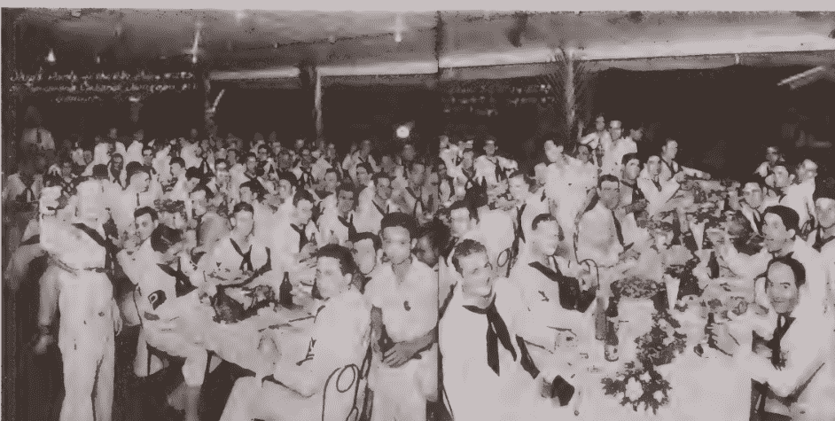

大多数情况都是本着幽默风趣精神的。有个年轻人仅仅为了帮乐队团长指挥音乐，就把自己累得像个湿透的烂架子一样！

丹姆基尔（Damkier），我那高大的年轻水手军士，把一个斗醉汉带回了船——在回来的路上不得不再次制服他，最后回到船上时他光光脚、满身血迹且满是黑泥（打架开始时他把鞋掉在了桌子底下），他把醉汉送了进去，自己收拾了一下，在不到一小时内就回到了派对！

好了——男士们已经需要这种活动了，过去十天里的两场台风让生活变得非常不舒服，我很高兴一切进展顺利。

海军生活真是对比鲜明啊！……

# IV 平凡与战争之间

1941年7月14日–12月6日

## 给埃克莱斯夫人的信，1941年7月14日，周一

伊西：

周六、周日和今天都属于“那些日子”的范畴！最后的糟糕状况是，惠普尔号（Whipple）在靠在我们岸边加油时，一个油箱溢出了，将整个左舷[左侧，朝向前方]喷洒了燃油。油依然顺着风流，并被吹成细细的水雾，我洁白的白色短裤和衬衫布满了斑点，而且相当气味。我觉得查理·维克斯（Charlie Weeks）回到船上和食堂时，应该会相当恼火。周六的开始得非常惨烈：周五晚上我一直没睡着，由于我们本应在早上7点靠岸，5:30就开始进水，等我好不容易在6:30起来时，已经崩溃了——我心情不好，着了凉，还伴有严重的咳嗽。一条漏水的河船耽误了进水和靠岸直到几乎中午。然后，惠普尔号上一个故障（甚至是全新的）蒸汽垫圈爆裂了，导致它无法使用发动机，一艘笨重的拖船接帮了我们，这让试图做一件简单的事情变得异常艰辛。最后，我们将惠普尔号拖出码头，到了一个良好的锚地，并出发前往马尼拉。锚定时陀螺仪表现异常，我们不得不更换位置，两艘船都出了问题。我和中队指挥官愉快地聊了，发现甚至他都能告诉我这周之后船会发生什么。医生给了我一些非常有效的咳嗽药，我早早休息了。

周日睡了一个很稳的觉后下午1点左右下岸，和艾格尼斯聚一会儿，然后和沃尔夫夫妇吃午饭（和塞尔夫妇愉快地聊天——我是几周前午餐约会的主人），然后在码头雨中不停地等船。我及时回到船休息了一个小时，然后再次下岸和瑞贝卡·伯格（Rebecca Berger）吃晚餐，结果发现电话留言说萨病重了，她来不了。我和荷兰·切奇弗（Dutch Cheever）吃了晚餐，然后又等了很久的船，昨晚11点左右回来。我的小艇引擎至少还要三四天才能运行，另一条小船也在闹气。今天早上我们来到卡纳科湾（Canaco Bay）加油，发现码头被一艘小渡轮堵住了，耽误了我们两个小时，期间我得知另一船由于操作不当撞击了浴缸。实际上我感到非常厌恶和愤怒，失去了胃口，几乎吃不下东西。持续的涌浪让靠岸作业变得非常不稳定，所以我当时状态很糟糕。不过，在下午1点左右我顺利靠岸，3:30我们完成了加油，我们将留宿一晚，明天可能还要清理很多杂物（意外在椅子上磕坏了我那支好钢笔的笔，现在我们得重新喷漆！）我真心希望我们的麻烦快结束了。船厂正在海湾修理我们的船，我们正在修理另一条；其他事情似乎进展良好，油也清理干净了。我没有发火，除了一次在甲板上被一堆乱的甲板垫绊倒了，本想在午饭前提提精神——飞行者号应该很快就到——我就等吧。我的咳嗽和鼻涕很轻，总的来说感觉良好。这是一段相当令人恼的日子。

顺便提一下，我的[晋升上尉]评审委员会将于9月8日开会——提前了三个月。我想结果会在10月15日左右公布。如果运气好，我会被入选；如果不好，我会大度接受，但我不会担心。

[晚上7:15，续]

我们仍在等飞行者号到来——显然它遇到了逆风，但它应该很快就会降落，就在我们附近，因为我们距离泛美航空的陆点只有一英里。我希望它没有被迫返回。它的降落对我们所有人是多么重要啊！

[晚上9:30，续]

飞行者号进了；不久前你的信送到了…………

利普曼（Lippmann）的文章很有趣，我想它是真的！！这让我想起了很多内战时期针对林肯的某些批评！尤其是《纽约论坛报》的霍拉斯·格里策利（Horace Greeley）的文章！桑德堡（Sandburg）的书非常迷人，描绘了那个时期冲突与告白是如此精彩的画面。这本书很难读，但它呈现了一个世界上见过的最伟大的人之一的如此精彩且充满理解的形象。而且它是以详细、客观的方式呈现的——仅仅是陈述了所有的事实。让我松口气的是，我真的不在乎。所以命运是如此奇妙的——利普曼的批评是如此刺耳，我并不担心。

天气依然很闷热，如果发生这种情况，水会污染燃燃料——我们并不担心。如果天气，，，，会。。。。由于漏水，我们无法我们无法检查。，直到8月1日……

[上午10:30，续]

更多麻烦！——水箱内部的管道泄漏，导致需要泵出9000加仑燃油，而我们没地方放——我们没有船——1 那是，通过重叠钢板。

2 陀螺仪，显示真方向而非磁针。

3 那是，从港口内的一个泊位移动到另一个，通常是因为另一艘船航行或需要靠岸（“倒浮”）来装载货物或进行维修。即使是“冷炉”（关闭所有锅），对船只的影响也是巨大的。

4 舰官专属的小动力艇。它停放在吊架中（通过吊架将其放入水中或吊起），由一名水手操作，通常由一名工程师和一名甲板水手协助。

5 显然是在加油时油溢洒在甲板上，而不是惠普尔号事故中喷洒的。任何一种在今天都会被视为严重的环境事件，需要大量的报告和处理。

## 致爪哇海

锚泊在海湾里，老天知道我们什么时候才能安顿下来！这种时候，我我很庆幸你不在身边，因为当我们把所有这些琐碎事清理干净之前，是没法抱怨的，它们就会堆积成这样——不是什么大事，但就是一团乱七八糟的麻烦！天气预报也不好。我想该由我保持冷静并耐心了！好吧——我能做得到。每一件意外都是可以避免的，真是该死讨厌。

我早上 6:30 要集合，明天早晨我们将换泊，开始处理所有的收尾工作，这样我们就能重新变成一艘船，而不是一堆似乎永无尽的细节。当一切进展顺利时很有趣，但当它们脱节时又非常令人沮丧。今天下午 3 点左右，我们开始安顿下来，完成了许多良好的工作。晚餐期间，我们可以听到男人们一边咒骂一边收我们的遮阳篷（大修期间一直留在岸上）。那是一个很欢快的声音，因为他们一边流汗一边咒骂时，语调很令人振奋。中午，我给他们做了一个关于检查细节的演讲，确保在[海峡 [起点？] 时一切都是正确的，而不是等出了问题再处理。我有一支很棒的队伍，当任务艰巨时，我喜欢到处走走，给他们一个微笑和私下的鼓励。没有什么比得到满脸污垢汗水的男人的微笑和回应更好的了。这让你感到非常温暖，让所有的不适和孤独变得值得。

周三，晚上 11:30，未续

这是忙碌的一天，很多事情进展得很顺利——仍有大量工作要做，但从目前的进展来看，我并不担心。我的感冒好多了，但还在，我很小心。我本想去马尼拉，但似乎没戏。不过，明天应该没问题。明天就离港了——下个快船见。我是说，除了邮件不确定且非常不规律的时间间隔带来的不便外，我并不在意。如果我还能收到任何寄出的邮件的话！我爱你。

## 给埃克尔夫人的信，1941 年 7 月 17 日周四，下午 2:30

亲爱的 Isy：

很多事情正在发生，包括你无疑在报纸上读到的，马尼拉湾口的布雷。明天我们要出海了，我

10 也就是说，是防御性布雷——保护马尼拉湾和苏比湾的雷区于 1941 年 7 月 17 日黎明开始开始。入境船只由领航员或领航艇引导通过未标记的清晰（“已清理”）通道航行；离港船只则获得必要的导航信息（《菲律宾海湾的美国水雷》，《纽约时报》，1941 年 7 月 17 日）。

我想可能还需要一个月或更久才能回到马尼拉。除了邮件无法离开或接收间隔不确定且非常规律的不便外，我并不特别在意。

能见大家面并让我们的系统恢复一下状态会很好。整条战线都发生着有趣的事。如果俄罗斯人能守住甚至让德国人陷入困境，情况可能会迅速向好发展。由于我没有什么可靠的水晶球来告诉我未来，我不会做任何预测性的猜测……

## 给埃克尔夫人的信，1941 年 7 月 19 日周六

在海上

亲爱的：

我们终于在昨天下午四点左右出发了，我们这周麻烦的顶峰是由于没能准时回到海军造厂而持续了大约二十分钟。现在，我们已经基本安顿好了，再经过几次磨合我们就能进入良好状态了。

周四下午有点糟糕。我有一段时间一直紧贴船只活动，感冒很困扰，等等，而且我和阿格诺一家人约了晚饭，所以我告诉甲板长在四点准备好小艇（gig），以便我有充足的时间赶渡轮。下午 3:45 左右，我告诉他我将在4:05 离开。4:05，我来到甲板，发现小艇还在水底，而且没有工程师。常驻工程师去岸上取一些物资物资[衣服、制服用品]，而接班工程师已经去机室值班了。经过一些延迟后，一名工程师到达了，但他不知道如何正确处理引擎，无法停下[它——即让小艇靠在登梯旁]，所以它[小艇]又尝试了一次，这次我跳了下去，结果它飞得飞快。我们到渡轮码头只有很短的路程，但那时已经是 4:15 了，是渡轮的时间，而船速只有一半左右。我们终于接近了码头，我跳了大约四五英尺的水面，我的提包掉在后面，而引擎正拼命地但

> 11 巴巴罗萨作战行动，即对苏联的大规模入侵于 6 月 22 日开始。由于出其不意——斯大林忽视了无数警告并对军队指挥进行大规模盲目追求——苏联军队在全线被反复击退且伤亡惨重。到那时，防御正在巩固，德国人正威胁列宁格勒、莫斯科和基辅。

> 12 港内的船只，特别是在锚泊时，会将小艇放入水中并停在那里，通过系缆将其悬挂在从船侧延伸出的临时“横梁”上。当被甲板长“呼唤”时[它，在港内，下午在后主甲板]，船员会爬进小艇[已通过吊架降入水中的小艇]，并按照指令行动。

未成功的尝试倒退[倒车]引擎。在我们离开时，我仅剩 30 秒就赶上了渡轮。

[171]

小艇在登梯旁等他。甲板长早已接到通知，本该处理好一切，但显然没有这样做。

我在阿格诺那里度过了一个安静的晚上，睡了一个好觉，现在我感觉良好，除了鼻子上似乎长了一个小包包！在它好之前我不再看任何照片了！我，如你所见，这周很有趣的一面——噢是的——昨晚我开始往咖啡里加糖（Isy 的拼写方式，我偶尔喜欢，为了改变规律的正确性——请不要改它！）有一只肥大的蟑螂在糖罐里爬。我设法忍住了，只是要求了新糖，当我听到茶房里的伙子们在笑这件事时，我发火了，把他们叫过来告诉他们，下次如果我在糖里发现蟑螂，就会把他们全部关进禁室。我真比湿水的母鸡还生气，今天他们都很勤快且顺从。我认为我多留几天是明智的，为了整体效果，但写信给你你让我很难保持愤怒——这周很有趣，而且没有什么严重的……

下午 3:45，未续

今天下午看起来我们要近距离观察一个巨大的水龙卷。它在我们前方大约五英里的处暴雨中开始形成，起始于海面上几千英尺高的一朵云。旋转的漏斗从云层向下延伸，左右摇摆——而我们看着它汇入海面，或者看着一柱水从水面升起与它汇合——突然它消失了，几分钟后暴雨席了我们并离去。如果能近距离看到一个会很有趣。去年 11 月，我们在月光在暴雨背景的一个夜晚，两英里外看到一个，但距离还不够让我们听到它。

下午 5:50，未续

今晚我们有一些特别训练，明天早上，如果我对比目的地的猜测正确，我们可能在十点锚定。我们为我们的划艇买了一个外挂机，它可能将很有用，用于在

> 13 也就是说，正如他们的指挥官剥夺作为士官的“军衔”（在这种情况下是厨师），并将他们降级为士兵薪级；该事件发生在船上，而不是提到的军官俱乐部，所以那是 HEE 的问题。他们的笑声会发生在隔舱室相邻的小厨房里，通过开放的餐窗可以清晰地听到。厨师兵在 1975 年取消了。

> 14 一种在甲板上倒置存放的小型船只，通过小型吊车投放和回收，用于性用途。

## 和平与战争之间 143

平静的海面。下周白天我们可能会非常忙，但晚上不会。正如俗语所说，“开饭了（Chow is down）”那是很久以前的说法。

[下午7:45，续]

我们一直在对熄灯状态的船只进行警戒观察，这在海上将继续持续一个小时或更久。再次回到海上感觉太棒了——甲板上平静宜人，当我凝视着黑暗试图寻找接近的船只时，我的眼睛完全集中注意力，但我的大脑是放松的，我可以思考你，以及你是多么有趣，完全不受干扰。我没有那种在海滩上时产生的无力感，我也不想我接下来该做什么或任何之类的事情……

[1941年7月20日，周日，上午11点，续]

我们不久前才才锚定。空气很好——炎热，但不像我们习惯的那么潮湿，而且是长久以来第一次，士兵们的铺盖总算通风了。午饭后，我将去见中队指挥官，听听下周的工作安排。有许多细节需要解决，还有一些新事项需要安排并确保运行顺畅。

[1941年7月21日，上午9:30，续]

昨天是如此美好的一天——微风徐徐，阳光明媚，云朵穿梭，远处有阵雨，但并未离我们足够近。在“保罗·琼斯号”上举行了一场很长的会议，中队指挥官给了我们一些情报。晚上，吉尔斯（Giles）和我去了“惠普尔号”看电影，然后我们看了《尼诺特卡（Ninotcka）》并大声欢笑，我记得你向我提过它——它太好看了！后来我们玩了一场扑克，尽管我只赢了五手牌，但每个人都赢了五个比索（菲律宾货币）。[等待：后来我们玩了一场扑克，尽管我只赢了五手牌，但每个人都赢了五个比索（菲律宾货币）。]当船只在一起时，我们玩很快，而且赌码还没到足以伤害任何人。我睡得很安稳，现在日常工作正在进行——明天我们将处理新设备和潜艇。远离码头和泥水感觉真是一种解脱——没有人想去上岸，因为那里无处可去。当然，不久后我们需要运动，但骑车活动可以解决这个问题。

关于感冒的观察——无论该死的，症状都一样——[持续] 十天到几周。我最近一次感冒已经好了，但仍然为得过它感到懊恼。不过，为了不忘记我的身体，一点痱疹似乎正在蔓延得很好，多谢！但我鼻子上的[无法辨认：指肿块]已经用掉了。请原谅这些临床记录。

5 “保罗·琼斯号”（DD 230）是一艘克里姆森级驱逐舰，于1921年服役。它于1945年退役除编。

6 《尼诺特卡（Ninotcka）》（原文误，美联华片公司，1939年，恩斯特·鲁布希特执导，格蕾塔·葛宝和梅尔文·道格拉斯主演）是葛宝的第一部喜剧片。

## 往爪哇海

[晚上10点，续]

事实证明是相当无味的一天；我们在电影院看了《巴斯克维尔犬》，非常精彩且毛骨悚然，然后玩了几局数字牌（Acy Ducey），现在该睡觉了。

[1941年7月22日，周二，晚上10点，续]


# 珀西菲尔德上船目标射击

珀西菲尔德（Perciefield）今天上船，我们为他的潜艇进行了目标射击——海况很大，我们颠簸得很厉害。没有什么比生病的菲律宾食堂更让人沮丧了！明天我们的行动独立性会降低。事情似乎非常复杂。我越试图研究我应该知道的知识，就越对自己不知道的内容感到惊讶，每天都有大量的新信息或限制进来！我们处于和平与紧急状态的时间越长，情况就会越糟。如果我们开战，一切都会变得简单得多！我们可能在任何事件中都得这样做，仅仅为了停止文书工作的流。这是一种产生于混乱状态的阴郁评论。我在想见见杰里（Jerry）和玛奇（Madge）会很有趣。

[1941年7月23日，周三，下午5:30，续]

我们现在正在加油，很快我们就会出发返回锚地。到明天为止，我们还没有收到任何关于邮件将进来或发出的消息，这封信在离开之前可能会很厚。就在我采取了“两分钟”休息，或者用我妈妈常说的，“打个小盹”之前。

## 给埃克勒夫人的信，1941年7月30日，周三，晚上10点

在锚地

我的亲爱的：

昨天我们从今天早晨6:30一直忙到晚上11点，下午5点休息了一小时，然后就在不久前结束了。明天又是整整昼夜的工作。我不时会感到非常疲倦，但通常我会睡着。然而，我没有完成我应该完成的所有细节，但那是可能的。

对于将要发生什么我一点也不清楚：几天前我还坚信战斗将在二十四小时内开始——现在我认为在下一次警报之前还会有另一段相对的时期。但我知道它随时可能爆发，我不认为现在就会。整个局势如此复杂，有这么多力量在向不同的方向拉扯，我不知道该期待什么。我将静候其变，不抱任何幻想并做好一切准备。但亲爱的，这太精力竭了，我不喜欢。

17 1939年二十世纪福公司出品，由西德·兰菲尔德和巴塞尔·拉斯伯恩命名为夏洛克·福尔摩。

18 关于珀西菲尔德，见第三章注释15。爱德华兹被分配负责按照之前无线电指定或请求的航线和速度进行蒸汽航行，以便潜艇练习定位并随后进行鱼雷攻击。

顺便说一下，我的宝贝，我正认真考虑用我的严厉表情和行动对付我的首席物资官，因为他没有检查他的食物订单和交付，导致我们许多物品非常短缺——离开马尼拉几天后我们的新鲜水果蔬菜就光了，邦先生（Mr. Bang）可能很快就会行动。我不知道我们什么时候有机会再次补充。带着这个乐观的想法，我现在开始看一些关于日本海军的情报，然后睡觉——但不要睡太快，因为我要仔细看看我那叠你的照片，那会极大地改善我的心情。晚安，伊斯（Is）。

备注——我太少穿睡衣上衣了，以至于下装磨得更快了！

[1941年7月31日，周四，上午8点，续]

我一直睡得很香直到6:45，我们吃了早餐并抖了抖身体——船正出航行演习，在事情开始前我有大约二十分钟。今天早上很冷——即使有82度，风中透凉。我的梦发生了什么了！

[下午3点，续]

一天的工作活动间歇了，但并没有持续一个小时——4:30我们将再次开始直到晚上11点，然后第二天早上7:30再次。除了周末的检查和计划下周工作的会议以及赶报等，至少我们至少不闲着！你见过那幅漂亮的《国家地理》地图吗？我们在衣柜里挂了两个地图，一张是太平洋，另一张是印度洋。后者非常出色，几乎涵盖了我在旅行中覆盖过的所有地方。它是在1941年3月出版的——如果你能找到一张，用来和我日记和信件核对会很好。

19 “大火爆的邦先生”是全国连载漫画《图恩维尔镇》（Toonerville Folks）中的一个角色，该漫画从1908年持续到1955年。嘿，伊莎贝尔多年后回忆道，“他生气时会扔东西。”

# 往爪哇西海去

我的脑海被各种奇怪的事情挤满了，以至于我发现自己开始忘记很多小小的地方、人和事件了。写日记是个好主意。

[下午 5:50，续]

我们已经完成了加油，现在已经锚定；几分钟后，我将去洗澡吃饭，我希望晚饭后尽快入睡，因为今天很劳累。当我们靠着油轮船时，克利珀快报到了，送来了你那封7月15日开始寄出的长信……

[晚上 9:15，续]

我们今晚又看了一部很惊险刺激的《夏洛克·福尔摩》电影，甲板下很凉快舒服。很快我就会上上铺睡觉了。我太爱你了，亲爱的。晚安，我最爱的。

[1941年8月2日，周六，上午 7:10，续]

如果我必须在暴雨袭击时紧贴窗户躲避，能睡一个饱觉觉真是太棒了。但无论如何，几个小时的好睡眠都是很奇妙的。斯基普读过《堂吉诃德》吗？那番话完全是不切题，但也可以解释得通。当我在铺上打盹并在早上6:30左右醒来时，我在想我的一名军官受教育程度有多糟糕，除了生活中的煮牛肉和土豆泥，他对任何事情都一无所知。然后另一位军官经常如此，特别是在操控方面，总是选择困难的方法而非简单的方法。脑海中浮现出“棱角骑士”¹的形象，我意识到塞万提斯的故事里有多少真理。

早餐结束了，在9:15检查之前，我无事可做。当然，你已经注意到我的字迹很抖了。这有两个原因：船的震动，以及我写字时，手和手臂经常满是汗水并粘在纸上。

斯基普对新闻数字²的评论总来说是合理的——为了让你放心，你可以告诉他我昨晚赤裸称重是146磅，而且我会尝试尽量不让肚子变得太大，至少我550岁了。

## 给埃克莱斯夫人的信，1941年8月3日，周日，上午 10:30

亲爱的：

下午三点邮件到了，我希望能寄出不少东西。

昨天下午我毫无无故开始头疼，因为我们发出了扑牌派对的邀请，我熬了夜。我吃了一些阿司匹林和伊诺盐²，感觉还不错，但今天虽然头不好了，我感觉有点没精打采的……

> 米格尔·塞万提斯·萨维德拉的《拉曼恰的机智士堂吉诃德》，于1605年和1615年分两卷出版于西班牙。作为最早的西方小说之一，“它被认为是文学史上最优秀的作品之一。”

> ¹ 对人物堂吉诃德的引用，他是一个著名的风车战文学讲述者。“棱角”指的是艺术作品中广泛描绘的夸张消瘦。

> ² 乙酸盐，一种发泡水果盐，19世纪50年代由詹姆斯··克罗斯比在英国发明。

## 给埃克莱斯夫人的信，1941年8月11日，周一

亲爱的伊西：

我好几天没写信了，仅仅因为没什么可说的，也没有消息。船正处于维护期，这意味着我没多少可以做的，就是学习和补做一些被忽视已久的文书工作。对于这种年代的船，保持它们完好所需的工作是没完没了的——我们刚觉得一切都尽在掌握，几处需要注意的斑点就会出现，然后我们又经历同样的老过程，试图弄清楚做什么以及怎么做。

有时我确实遇到海军的物质问题，以及敌人哈利·科普³，他们多年来一直如此成功地规避了这些问题。

在很多方面，我很高兴有这么多工作要做，这倾向于把男们拴在一起，以至于他们没有欲望去那种不存在的自由和娱乐，那会引起麻烦。我们现在守着这个哨所，也许三周后我们将去某个港口度周末！如果和平还能持续的话。所以工作是件好事。

我们看到了这支部队里的许多朋友，因为大家有干预的好主意，为了扑牌（我们唯一的娱乐），以及为了看电影。谢天谢地，我们在华盛顿没有看电影的习惯，现在我们看的是1930–40年代的电影，其中我以前很少看过。

昨天我乘着“黑鹰号”和海伦·坎普[Helenkamp，见第3章]去了教堂。那里有通常那种快速而浮华的祈祷，总是让我感到无聊和困惑，还有一段逻辑连贯性像个高一男生的布道，但我没有离开，我也不知道为什么。我没有留下来圣餐。似乎很少有人能察觉到现有的美感和灵感的宝藏，而能让别人分享这种见解的人更少！可能我们太倾向于对人类文明的缓慢发展感到不耐烦。现在该吃午饭了。

[下午 5:45，续]

感觉非常无聊——要做些事，但没什么是有有趣的，时间开始变得缓慢——谢天谢地天气相对凉快。克利珀快报明天就到了，所以这是值得期待的。

> ³ 显然指的是哈利·弗朗西斯·科普（美国海军学院1920级）。

> 2 这里的 米格尔·塞万提斯·萨维德拉的《拉曼恰的机智士堂吉诃德》，于1605年和1615年分两卷出版于西班牙。作为最早的西方小说之一，“它被认为是文学史上最优秀的作品之一。”

> ² 乙酸盐，一种发泡水果盐，19世纪50年代由詹姆斯··克罗斯比在英国发明。

> 4 这里的 爱德华·梅森（1900级）。

> 5 这里的 陆尉 刘易斯·康利（1899级）。

# 往爪哇西海去

[11:15，续]

如果我必须在暴雨袭击时紧贴窗户躲避，能睡一个饱觉真是太棒了。但无论如何，几个小时的好睡眠都是很奇妙的。斯基普读过《堂吉诃德》吗？那番话完全是不切题，但也可以解释得通。当我在铺上打盹并在早上6:30左右醒来时，我在想我的一名军官受教育程度有多糟糕，除了生活中的煮牛肉和土豆泥，他对任何事情都一无所知。然后另一位军官经常如此，特别是在操控方面，总是选择困难的方法而非简单的方法。脑海中浮现出“棱角骑士”¹的形象，我意识到塞万提斯的故事里有多少真理。

早餐结束了，在9:15检查之前，我无事可做。当然，你已经注意到我的字迹很抖了。这有两个原因：船的震动，以及我写字时，手和手臂经常满是汗水并粘在纸上。

斯基普对新闻数字²的评论总来说是合理的——为了让你放心，你可以告诉他我昨晚赤裸称重是146磅，而且我会尝试尽量不让肚子变得太大，至少我50岁了。

## 给埃克莱斯夫人的信，1941年8月3日，周日，上午 10:30

亲爱的：

下午三点邮件到了，我希望能寄出不少东西。

昨天下午我毫无无故开始头疼，因为我们发出了扑牌派对的邀请，我熬了夜。我吃了一些阿司匹林和伊诺盐²，感觉还不错，但今天虽然头不好了，我感觉有点没精打采的……

## 给埃克莱斯夫人的信，1941年8月11日，周一

亲爱的伊西：

我好几天没写信了，仅仅因为没什么可说的，也没有消息。船正处于维护期，这意味着我没多少可以做的，就是学习和补做一些被忽视已久的文书工作。对于这种年代的船，保持它们完好所需的工作是没完没了的——我们刚觉得一切都尽在掌握，几处需要注意的斑点就会出现，然后我们又同样的老过程，试图弄清楚做什么以及怎么做。

有时我确实遇到海军的物质问题，以及敌人哈利·科普³，他们多年来一直如此成功地规避了这些问题。

在很多方面，我很高兴有这么多工作要做，这倾向于把男们拴在一起，以至于他们没有欲望去那种不存在的自由和娱乐，那会引起麻烦。我们现在守着这个哨所，也许三周后我们将去某个港口度周末！如果和平还能持续的话。所以工作是件好事。

我们看到了这支部队里的许多朋友，因为大家有干预的好主意，为了扑牌（我们唯一的娱乐），以及为了看电影。谢天谢地，我们在华盛顿没有看电影的习惯，现在我们看的是1930–40年代的电影，其中我以前很少看过。

昨天我乘着“黑鹰号”和海伦·坎普[Helenkamp，见第3章]去了教堂。那里有通常那种快速而浮华的祈祷，总是让我感到无聊和困惑，还有一段逻辑连贯性像个高一男生的布道，但我没有离开，我也不知道为什么。我没有留下来圣餐。似乎很少有人能察觉到现有的美感和灵感的宝藏，而能让别人分享这种见解的人更少！可能我们太倾向于对人类文明的缓慢发展感到不耐烦。现在该吃午饭了。

[下午 5:45，续]

感觉非常无聊——要做些事，但没什么是有有趣的，时间开始变得缓慢——谢天谢地天气相对凉快。克利珀快报明天就到了，所以这是值得期待的。

# 往爪哇西海去

[11:15，续]

如果我必须在暴雨袭击时紧贴窗户躲避，能睡一个饱觉真是太棒了。但无论如何，几个小时的好睡眠都是很奇妙的。斯基普读过《堂吉诃德》吗？那番话完全是不切题，但也可以解释得通。当我在铺上打盹并在早上6:30左右醒来时，我在想我的一名军官受教育程度有多糟糕，除了生活中的煮牛肉和土豆泥，他对任何事情都一无所知。然后另一位军官经常如此，特别是在操控方面，总是选择困难的方法而非简单的方法。脑海中浮现出“棱角骑士”¹的形象，我意识到塞万提斯的故事里有多少真理。

我尝试在下午散散步——但甲板活动有限。我们几乎每晚都玩扑克，我基本不赔——至于电影，我们现在挺穷的，但有时也能看场很有有趣的。

一年前，我在德尔班参加 Swartenhondht 活动，在想我什么时候能到达计划计划的所有地方。后天之前的任何信件都会送到我们这里。吕宋群附近有台风，我相信快船已经延迟了。

枯燥乏味的事实——以及对我心理状态相当真实的写照。我不喜欢这种内耗。

[晚上 9 点，续]

我计划很快就休息——甚至不等几小时后开始的罗斯福演讲。我不知道他与丘吉尔会面的结果会如何，但我想会有重大公告发布。如果我们是在某个体面的地方行动，我并不介意或无限期地等下去，但不确定性和孤独会变得非常无聊且沮丧。这就像是在等待命令（前往新的驻守地），你知道自己要移动但不知道去去哪里。目前我感觉精神充沛——一个好觉比什么都管用——所以希望如此吧。

[1941 年8 月 17 日，星期日，上午 11 点，续]

我在 10:20 醒来，喝了一杯番茄汤和一杯咖啡，读了报新闻，然后洗澡剃须。（临床笔记——这里的火柴表现很糟糕；风扇一直在转动，火柴在使用前必须用手护住，否则它们会被吹灭。由于潮湿，火柴头经常变软，导致点燃的白磷碎片掉落在小指根部下方一英寸处的掌心。在那里会持续燃烧直到熄灭。我必须学会一种技巧，在不造成严重冒犯的情况下熄灭小型燃烧弹。）

指挥了克利姆森级驱逐舰阿阿登号（USS Arden, DD 211，1919 年服役），他将在未来几个月内为此获得海军十字勋章；他将于 1954 年作为少将回来，领导了一次成功的行动，营救了财务困境的俄克拉荷马市对称号（Oklahoma City Symmetry）。乌普顿·路易斯·麦格尔恩（1898–1979，美国军学院 1921 级）于 1944 年担任巴克号号（USS Barker, DD 213）指挥官；他后将指挥两栖登陆运输舰阿灵林顿号（USS Arlington, AP 14）；并于 1948 年作为上校回归。文森·詹姆斯·摩尔（1906–1986）在 1943 年 9 月前一直领导舰队，指挥过卡号驱逐舰（USS Cass, DD 372，珍珠港事件后经过完全重建），1944 年 2 月至 4 月以及盖廷号驱逐舰（USS Gating, DD 671，1944–1945 年）。他将于 1960 年作为上校回归。

25 8 月 14 日（纽芬兰岛时间），罗斯福和丘吉尔在纽芬兰的普拉森西亚湾乘坐奥古斯塔号（USS Augusta）会面，发布了后来被称为《大西洋宪章》的内容，宣布了“共同原则”以及战后战争广泛目标。虽然会议没有产生他们想要的具体且即时的承诺——至少在丘吉尔看来，并没有包括美国参战（这当时被轴心国政府认为很大程度上肯定了美英的团结）。

## 迈向爪哇海

现在的主要问题是我的手掌失去了打高尔夫球的老茧（肉变得很嫩）。但回到正题——我感觉很放松——今天很热，我想下午会更糟——布鲁斯·加拉特被捕鱼船咬得很厉害，在 5:30 再次让他自顾性命了。几天前他捕了两条大约 15 英寸长的梭鱼，现在满脑子想的别的。我从没见过梭鱼——上个月天鹅座号给了我们一些捕到的额外鱼，超过 25 磅。我从未见过如此尖锐的尖角和刀刃般的边缘！到目前为止，这里最大的五十多磅。它们的肉质地非常好，味道也很好，尤其是小的时候。

为了打破单调，我们在傍晚前举办了诗歌比赛——目前有五份作品，两名军官和三名士兵，我们预计从中获得一些笑声。

[下午 1:30，续]

我们午餐时，一架飞机飞过并落在海湾远处，问题是它是否来自马尼拉，如果是的话，它是否带来了上周的信件？

我们收到了一些关于配售购买国防债券的初步数据。我计划通过这种方法每月买一张，但我不知道什么时候开始——等我办理后会告诉你细节。我建议如果你有任何闲资金，就买入那些债券——它们将在对 Skip 有利的时候达到其全部价值。

[1941 年8 月 17 日（星期日）/19 日（星期一），深夜，续]

我感觉心情好多了——我们的业余时间活动进行得很顺利，得到了船员们的热烈反响，有些真心的笑声。我担任主持人，以确保一切第一次就顺畅。最后，我的幽默信件和故事集终于有了真正的价值——我用了其中三个，还留了许多供大约两周后的下次活动使用。这是一个沉闷的月，看到听到士兵们大笑真是太棒了。后来我们又玩了一场很不错的扑克，我输了五个比索，但很有趣，而且指挥官连续两个晚上表现都很稳定，这让我们大家都很开心。

26 弗洛德·加拉特二世，1918 年出生，11938 年毕业于海军学院，现任约翰·D·爱德华号的少年军官，将指挥法拉加特级驱逐舰蒙纳汉号（USS Monaghan, DD 354），从 1944 年 11 月直到 12 月 18 日去世，该舰在萨马岛海的海风中丢失。四天后有六名幸存者获救。

27 霍尔特号（5,097 吨）于 1919 年作为客船下水，被海军征用为辅助舰，并于 1922 年改为潜艇母舰（AS 9）。当珍珠港遭到袭击时，它于 12 月底移动到马里维莱斯，修理（并修复）炸弹损坏，并为巴丹岛的防御贡献成员，直到 4 月被凿沉。剩下的船员将加入科雷吉多尔岛的地雷防御部队，并与其一同沦为俘。

## 和平与战争之间 151

# 给埃克莱斯夫人的信，1941 年8 月 24 日，星期日

亲爱的 Isy：

这周过得很糟糕，大部分时间我都感到身体不适。我们预料的邮件没有到。昨天早上我们锚定在一个可以休息的地方——这是几周以来第一次离开陆地。我上岸打高尔夫，但打了九个洞后就停了——除了喉咙疼，我精疲力竭。晚餐后回到船上，处理了一下喉咙就睡了。我睡了一个好觉，今天早上感觉好多了，但不热了，我会留在这里。我通过了身体检查，显然我没问题。我受够了感冒——我想只要我还在外面，它们就会持续。

[下午 1:30，续]

我早上睡了一会儿，感觉好多了，但喉咙仍然肿胀不适。不过我没有那种困扰我很很久的疲感。这种状态很令人失望，但没必要装傻。下午我要去上岸查查为什么我五月给你的珠宝没收到。可能出了某种混乱，但我有所有的收据，相信一切都会解决的。

我不知道今年圣诞节要做什么——如果我运气好，我会过得很好，因为我有非常完美的礼物主意——不过我必须有马尼拉时间，我不确定材料是否有货。至少我有主意——虽然这里是夏天。至少其他地方是夏天！

这这是一封短信——我很抱歉如此低落

[1941 年8 月 25 日，星期一，下午 5:15，续]

我今天感觉好多了——在过去的几天里我一直在努力给你写一封像样的信，我所做的只是写出了之前的稿加上几张被撕掉的纸。

我们昨晚在处理了一堆酒水的忙碌傍晚后出海了——我不能怪自己喝醉了，但确实有点过头——过了很久这些事才安静下来。我今天睡得不是很长，我们度过了忙碌的一天，我自己被晒得很黑，也做了很多工作。我感觉好多了——脖子和喉咙还是很僵，但那种昏昏的感觉大部分已经消失了，我的情绪好多了。

## 远航爪哇海


中午时分，我处理了各种情况，还有几件事要汇报。我表扬了三名因行动迅速而受到奖励的士兵，他们救了一名在强流中随漂浮账单落后跳入水中的“SAP”28。那名“SAP”当时担任马力艇工程师，我将他从二级轮机员[助理]降级为火兵29——我警告了其他几个人，并给另一个人分配了额外任务。其中一个受表扬的小男孩在前一天刚被[岸上]巡逻队送回舰船，但他并没有受到任何指控。然而，当他出现并以为自己要受惩罚时，他的表情真值得一看！我们正在建立一套制度，让一次假期30的闹酒醉鬼必须照顾后续假期的闹酒醉鬼，直到他们学会照顾好自己。

我的脸烫得通红————我的手臂和双腿也是如此，但感觉挺不错，因为我看起来脸色很苍白！

[1941年8月26日，周二，上午8点，续]

我昨晚睡得很好，今天早上起来感觉脖子有些僵硬——我的晒伤并不严重——只有舒服的灼热感。今天上午我们本该进行中队战术演习，然后为全功率运行31做准备。傍晚时应该会有邮件。某处应该有很多我们的信件，但最近一个月里还没寄送到舰上。我已经很久没收到威尔或老爸的消息了。最近我没心情写信，所以没什么人欠我回信。我得为这事想办法了。

这个偏僻地区的一个优点是天气非常好。当然，很热，但不潮湿、也不泥泞，而且通常有宜人的微风。当然，另一件事是没地方花钱。不过，我们明年要缴纳的巨额所得税可能会让我们无法玩得太远。

有迹象我们可能在未来几周内进入一个不错的休假港——我希望如此，我们这么评估的。我不知道日本人将如何看待美英目前的现状。如果他们还有理智，他们将会

> 28 可能不是缩写，而是指意义上的“笨蛋”，可以追溯到19世纪初，HEE在第三章使用了这个词“sapsuckle”，指白痴——一个心材木质的人，在心材和头部之间很软弱的人。
>
> 29 允许降低两个等级薪资的降职，让船停靠了一天以便上岸。
>
> 30 即“假期假队”，被允许舰船按提议停靠一天上岸休假的士兵，其留职时间一直持续到第二天工作开始前宣布的时间。假期假队包括其所在职责部门的人员，但不限于该部门。有多少人在岸上由指挥官裁量，或者如果其他船只在同一港口，则由高级指挥官或将领裁量。
>
> 31 一种正式的工程试验，其中船只在规定的时间内（通常是整晚）保持其能承受的最高速度行驶，记录燃料和锅炉反馈消耗量，以确定船是否能达到其额定最高速度、其实际的最大速度和耐力是多少（在那种载荷和条件下），并在实践中让隐藏的问题暴露出来。

## 和平与战争之间 153

忍住泪水并闭上嘴，但他们天生并非如此，或许可以防止国家自杀。他们一年前失去了机会，现在赢已经太晚了。如果他们战斗将意味着一场艰苦的战争，但即使他们占领荷兰东印度群，也得不到石油，因为荷兰人会摧毁油田。石油将决定结局，他们每推迟一周，我们就变得更强大——印度支基地无法帮助他们获得石油。很多日本人明白这一点，但他们对结果有多大影响尚未知...

## 给埃克莱斯夫人的信，1941年8月29日，周五，凌晨6:45

亲爱的Isy：

这是一个美丽、清新的早晨。我几乎忘记了它们是什么感觉了。我的风扇坏了，我右舷舱内的小铜刮板满了雨水，天空呈现出雨后那种洗刷过的洁净外观，但我不知道什么时候下过雨。昨晚累坏了，九点钟时头疼得厉害——我睡得很好，现在感到神清气爽、心情愉快。

昨天我们顺畅地完成了全功率运行，并在一点半时回到锚地。当我们为油轮加油时，我们去拜访了埃利奥·布莱特，他的船也在加油。他寄给了我们一些科罗纳多格洛里塔大道[Glorieteta Boulevard]附近风景非常迷人的照片。

昨天有一位新军官报到——1932级的威廉姆斯中尉——他非常受欢。

本周出现了各种复杂情况，没有哪一个是严重的，但都需要思考，并引起了烦恼和失眠。

我们的邮件被严重搞混了——例如昨天下午我收到了来自缅因的信件和账单，那些信件是7月19日在马尼拉寄出的！私人信件不是唯一的延迟项——很多公文也迟了，造成了苦恼。

周二我们进行了外围巡逻，我们锚定在港口的一个入口处以防止任何奇怪船只进入——我们本一直

> 32 荷兰人会尝试这样做，但日本人对他们的计划早有预料。在这种情况下，新征服地区的生产通常会比预期的更快恢复，并在规模上将持续到1944年。佐藤史，《民族主义与农民：爪哇在下》。
>
> 33 即对于波士顿，如下文所示，至少是为了“研究”。该研究的性质和计划尚未知；他们的口述历史或双方的回信都没有提供线索。
>
> 34 即分配给舰长舱的风员。罗塞特可能是第三章提到的拉尔夫之后者，职责是轮制的。
>
> 35 即岸上洗衣——这个班级没有洗、烘干或熨衣服的设施。对于士兵和其他人，选择是在靠港时上岸、安排有洗衣设施的大船的服务，或者在甲板上使用桶。

## 远航爪哇海

今天度过了不错的一天，完成了一些工作，我想有些人对人员、纪律和组织非常了解，可以在不产生性格冲突的情况下完成任务，我做不到。我所做的是防止冲突升级，并保持平稳运行。为此，我必须经常和比利[副舰官]谈谈，防止他偏离主线，并培养他的素质。这需要我方面的耐心。

[1941年8月30日，上午11:45，续]

我完成了一次长时间的检查，并写了多封公文，希望处理了一些麻烦人的问题，我期待一个安静的下午。

我们刚刚收到了从马尼拉寄来的意外空运，是由潜艇递送的，它带来了你8月11日的信。谢天谢地，我知道你什么时候离开了。希望我的信到达你那里没有过度延误。

希望给盖·钟[伊莎贝尔去打网球]的运动日活动最终顺利，希望你为他买了一份不错的礼物。当然，亲爱的，这很符合你周全考虑的思维，对他人的体贴是让你迷人的许多特质之一。

你那双漂亮的黄色袜子到了，非常合脚——有足够的额外空间来保持舒适并允许正常缩水。我立刻叫来罗塞特，我的孩子，告诉他，如果有人再把那些袜子送去洗衣，我会让他接受概要军事法判——甲板军事法判，加罚一百小时。

# 在和平与战争之间 155

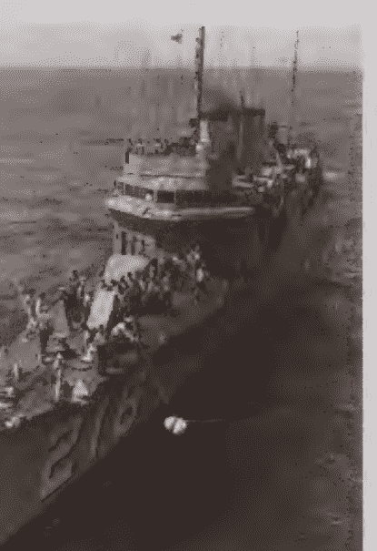

职责——五天面包和水，三个月限制在船上！

……

我很渴望读到《时代周刊》上关于马尼拉交响乐团的消息——我已经几个月没见过那帮伙计了。我在造船厂期间他们大部分时间不在——在过去的五个月里，我待在马尼拉的时间只有六周，所以这很令人惊讶。

前几天我得知，我不会被调到 CODESMON 的人员部门。哈特将将不希望更换任何驱逐舰舰长，我也得知从威尔克斯上尉（金·斯泰尔的表哥）请求我去担任他潜艇中队的副官兼助理副官。” 那个请求也被拒绝了，平基·索索普接替了那份工作。知道有人需要我感觉很好，但请不要向我提这件事了。

我们收到了很多邮件，包括杂志和新书，这些非常受欢迎。在荒野中无处可去地坐着挺不容易的。上周日我看到了三个白人女性——那是自 7 月 17 日以来第一个！并不特别漂亮，但在看了当地人以及那些长得极其糟糕的人之后，看到她们还是感到有些宽慰，毕竟：

1939年的爱德华兹将洗衣物送去清洗，或从他那里收到干净的衣物——萨拉托加号航空母（CV 3）。通过“轻绳”传递的包裹在右侧可见。原始的舰桥、四个（及更多）烟囱，以及巨大的和平时期船体编号。（美国海军）

> [1941年8月31日，下午5:30，续]

亲爱的——我暂时在三位军官之间达成了一个小协议，虽然这听起来不太好。如既往一样，所需要的只是一些逻辑和对相对价值的认可。逻辑在于确定主要问题，并对我们面前的问题给出清晰的定义——然后你会发现，当问题定义得足够清晰时，分歧自然消失了！

38 驱逐舰中队司令（或 CODESMON 29）参谋，他借鉴了自己在潜艇部队服役的经验。当时现场唯一的潜艇中队是第5潜艇中队，由七艘海豚级级潜艇组成。这艘船是第一舰队第1号舰他的旗兵副官（不一定是中尉军衔），“助理”——总副副官、个人及执行助理以及海上事务指挥官。约翰·威尔克斯上尉（1895–1957，美国海军1961级毕业生）在马尼拉指挥潜艇；在12月，他将成为亚洲舰队潜艇司令。1942–1943年间，他作为少将参加了地中海两栖作战，并于1951年出任中将。他的表哥查尔斯·威尔克斯·“金”·斯泰尔二世（1919–2012，美国1941级毕业生）将成为一名勋功卓著的潜艇兵，因海上巡逻获得过枚银星勋章和两枚功绩勋章。他于1972年作为少将退休。

40 韦曼·布兰查德·索普（1901–71，美国海军1921级毕业生），于1953年作为上校退休。

## 往爪哇海

我比我的军官们老得多，毕竟他们大多数都三十岁了，或者接近这个年龄，已经很有常识——但事情总会冒出来，他们就此离开了！

我们今晚还有另一场诗歌比赛，到目前为止有一些非常棒的作品，还有一篇很俗的被我扔掉了。这应该很有趣！

[1941年9月1日，周一，下午1:30，续]

今天是节日[劳动节]，但在这里庆祝它毫无意义，因为这里没有娱乐活动要做，所以我们一直在拼命解决我们一些毛刺问题。今晚我们有巡逻，明天下午我们将去一个休假港换取急需的零钱。昨晚我们的“欢乐时光”短暂而成功，男士们大笑了一场。我们大约三周后还有一次活动，那里有几位参赛者。这都基于这样一个理论：你不应该把自己看得太严肃。我有一支优秀的船员，我想尽一切办法保持他们的士气——我并不固守太多僵板的规则，而是努力保持灵活灵活。

周三是你的生日，亲爱的，我希望能够陪在你身边，但我真心希望你能度过更快乐的。你永远是我的爱人。

[下午6:25，续]

这几个月我真的很欣赏女性服装的简单，因为这几个月我只穿过热带工作服——袜子、鞋子、内衣、衬衫和短裤[百大山长度，卡其色]——这相当于你平时可以轻松拉拉脱的衣服——没有领带，没有外套或背心——没有吊袜——穿得如此简单！

[1941年9月3日，周三，续]

非常赶。到达港口，邮局很快就要关闭了。感觉良好。没有其他消息。

## 给埃克尔夫人的信，1941年9月8日，周一

在海上

亲爱的：

这是一个非常忙碌的周末，我很享受，但尽管我知道前方将是几周的隔绝，但我对再次出海感到一点也不难过。我的上一封信写得太草率，所以我最好给你提供更多细节。我们周三下午进入港口，我上岸了几个小时重新熟悉环境。我顺便去看了贝格尔夫人，聊了一会儿，然后早点回了船。第二天早晨六点我们开始航行，一整天的工作进展得很顺利，但让我很疲惫，所以我晚上在船上度过。早晨我们在加油时，我带着另外两个[缺漏]上岸了，另外两个

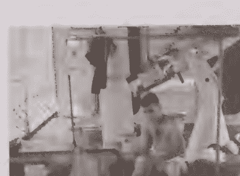

# 在和平与战争之间 157

军官们，从补给部门得到了大量的海军斜纹床单和毛巾。然后我们在周末期间移至主港后，我去了一家刺绣店（那里被高度推崇），制作了刺绣的床单和枕套，送给了我们、爱丽丝和多萝丝[分别是姐姐和表妹]。然后我正在制作标记名字的大毛巾，并为南希、拉里、威莱特和基普准备了运动毛巾。这里都在穿这种毛巾，游泳、网球、高尔夫时穿都很棒——边缘有深蓝色滚边，口袋处有字母。我听说百货商店卖15到18美元[245.77–294.92]；当然它们会在冬天到达，但应该适合打羽毛球。现在告诉你关于圣诞节的消息可能还不，但我想让你知道我做了什么以便帮助你自己的购物——而且对于在九月过圣诞节我感到有些自鸣。

周六打了高尔夫，晚上过得很安静；周日早上我出去了——中午左右见了盖伊和芭芭·阿格纽，然后在塞菲普斯家吃了一顿非常棒的午餐，我们在那里留到了五点以后。我在俱乐部吃了一些简单的荷兰奶酪和趣事，晚上十点回了船。周五下午我打了高尔夫，然后去了汤姆和卡罗琳那里打保龄球吃晚餐——然而，我没有打保龄球，因为在长时间没有真正的运动之后，我不想过度运动。

快船今天到了，另一班将在周四到达，我应该有一些邮件可以弥补过去两周的空缺。

> [1941年9月9日，周二，下午3:00，续]

在一段良好的旅程后，我们回来了，两小时后我们将进行左转演习。本周剩余的日程似乎足够让我们忙碌，所以时间会过得很快。我仍然在等你的信，我寄出了这封，但尽管飞机到了，我们的邮件似乎漂浮在某个我们无法的地方。另一封重要的信还有三天路程八英里，所以我想应该保持耐心。我试过发脾气，但这似乎并不

41 听起来像是 IEE 不妥当（至少在今天看来是不妥当的）挪用了政府材料用于个人目的，但提到了付钱；可能涉及了使用非拨款资金的海军商店之类的活动。否则，在信信中提到这会显得不协调，它也是个好消息。

为了工作，所以我坐在我的杂物箱旁，看看接下来的三分钟内有没有什么消息，然后可能还会再增加些内容。

没邮件！

## 给埃克尔夫人的信，1941年9月22日，周一

亲爱的伊西（Isy）：

我现在的心绪相当复杂。我又嗓子疼了，这让我感到烦躁、愤怒，并且非常不舒服、痛苦，而且有点神经质。从[亚洲舰队]总司令官那里传回了一些无关紧要的消息，现在看来海军司令官建议将服役期缩短至21个月。华盛顿的小道说这将会发生，如果属实，我将在4月1日，或者比我预期的提前九个月就告诉你这件事。在看到官方通知之前，我是不会相信的。我可能会去哪里任命尚不确定，但无论如何，在下一次出发前，我应该在美国休个假。我的亲爱的，我们应该有足够的钱来频繁往返，以便尽可能多待在一起。昨晚我因为想着这事没睡着觉。我不会做任何猜测，我会尽量客观事实，但亲爱的，我很难集中精力想任何事情。

明天将是艰难24小时，本周剩下的时间都会很辛苦，直到今晚我会早点休息，希望明天能感觉好些。

> [1941年9月24日，周三，继续]

周二是糟糕的一天，大部分时间都在铺位度过，晚上大部分时间都在舰桥上过。我的嗓子还是疼，但比昨天早上好了，我希望明天能痊愈。这些呼吸系统的问题找上我真令人沮丧。它们让我愤怒。我希望斯普（Skip）的[哮喘]已经永久好了。你提到过他的哮鸣，他现在感觉好多了。等这些好转，我就能写得好多了了——我们锚泊了几个小时，我准备上睡了。

> [晚上8点，继续]

我度过了平静的一天——海边凉爽有风，但我的房间很热。我的嗓子感觉好些，但没什么精力或兴致。明天和周五会很忙，而且没意思。现在我很沉闷、发呆——请原谅我，亲爱的。我爱你。

> [1941年9月25日，周四，下午5点，继续]

能无痛地吞咽，双腿不再像橡胶一样走路，感觉是么轻松啊！我昨晚睡得很好，实际上整天都感觉那些病痛离开了我的身体！自然地，我的精神有所好。

## 在和平与战争之间 159

我们今天进行了了射击练习，虽然我们还没看到结果，但看起来不错，弥补了惠普尔（Whipple）上周做得得多的工作。他们今天表现得很糟糕。明天我们要为潜艇[作为训练目标]进行模拟演习，然后是加油。每个人看起来都很放松——没有消息，也没有关于日本人在想什么的小道消息。

> [1941年9月26日，周五，晚上10:30，继续]

我恢复了健康，因此心情愉快多。。昨晚，我对我认为是愚蠢的命令和政策感到非常不悦，晚上9:30叫来了小艇，向中队长表达了我的观点（令我恼火的命令和政策并不是这些），发现他老人很好，而且非常赞同我表达的意见。

今天非常满意，我们清理了很多杂物，加了油，来到了巡逻锚地地。我们在休息室看了一部好电影，随后是些精彩的故事和笑声，现在得上睡了。

显然，快运班减少了，所以邮件不像往常那样频繁；我不知道这是不是暂时的。

我收到了来自桑博安加（Zamboanga）的黑珊瑚珠宝，我下周会寄给你。晚安，亲爱的。我爱你。

> [1941年9月27日，周六，上午11:30，继续]

到这时，你应该已经在波士顿安定下来了，并对你冬季的工作内容有所了解。我希望你的作业不多。这似乎是个奇怪的安排——多年来，斯普和我一直被安排各种事情，但现在你没有安排那种类型的工作，却一直很轻松，如果不是很忙的话。现在在一个所谓的“老当益壮”开始常规事务了！我真的觉得很遗憾。我的亲爱的，我太爱你了！照顾好你的眼睛，照顾好你的整个身体。

## 给埃克尔夫人的信，1941年9月28日，周日，晚上10:30

亲爱的：

这是一个凉爽、安静且总体愉快的周末。明天我们要出海一周，最后将在马尼拉结束，进行维修船大修。我的思绪一直中断。我在读一本新且极其有趣的书，休·[R.]·沃尔波（Hugh [R.] Walpole）写的《语义学：词语的本质及其意义》。它讨论的是一个日益受到关注的话题，即词语的含义。它不长，但需要非常专注地阅读。如果你有时间，你……

42 不是大修，而是涉及入坞、在一段规定的时间内漂浮在维修船旁（可能是以防范“黑鹰号”），以及一份详尽的维护和修理需求清单，这些都在维修船的能力范围内，并可以在规定的时间内（这种情况下大约两周）完成。通常允许执行突然出发命令的通知时间大大延长了，因此可以暂时禁用动力装置和其他机器。

## 前往爪哇海

在图书馆看看——你可能想读读。[1941]由纽约 W. W. Norton 公司出版……多萝丝……

> [1941年9月29日，周一，上午10点，继续]

我们早上6:30出发，在进行一些有用但有趣的演习时，发现海况有些波折。我一直坐在舰桥的一侧，幻想着飞机和潜艇进行[模拟]攻击，以及世界上所有令人愉快的事情都浮现在脑海中。最近我写信一直很客观，部分是因为我没什么可说的，部分是因为不想无故发火。今天早上我在想，如果能在18世纪的背景下听听好的莫扎该有多好。我们有很多可以做、将要做的事情——不仅是我们想到的，还有我们没想到的，将会很有趣。

> [1941年9月30日，周二，上午10:30，继续]

昨晚很疲惫，没特别意思，直到黎明才睡着。然后我设法了两个小时的好觉，我感觉没那么累。我被由于必须上舰桥纠正值守[舰桥上负责轮只的值班官]的一个不可原谅的错误而被打断。当一个军官比别人更懂一个简单的演习，却因为完全的固执而不听从另一位更有经验军官的良好建议时，真是令人气狂。我预期没有经验的军官在困难的问题上犯错，但不预期经验丰富的人在整个舰队面前搞砸简单的事情并丢脸。我弄乱了原本很好的心情，可能会花一整天时间回想和后悔我没有把他从舰桥上赶下去，让他关在房间里五天[这是对军官的一种非正式惩罚，有时被称为“关禁反思”]。

> [1941年10月1日，周三，晚上10点，继续]

大约一小时后，我被叫到舰桥接[无线]电话，当我接电话时，在“保罗·琼斯号”上的中队长祝贺我被选[提升为中校]！我感到非常惊讶，实际上感到有点头晕。我原本预料到名单将在本周末公布。亲爱的，我真希望你能陪我一起庆祝！当然，这对我来说意义重大——以至于我一直试着不去想它。

## 和平与战争之间 161

埃迪·杜金（Eddie Durgin）试图向我们证明，由于中校的年龄，我们大家都应该退休了，这似乎并不是久以前的事！我不知道具体的晋升何时会到来。正常情况下应该是1942年6月1日，如果实行临时晋升，可能会早得得多。华盛顿将召开委员会会议，决定将进行多少次临时晋升以及何时进行，在选拔委员会完成工作之前，他们不会完成报告，那还需要大约两个月。我非常急于看到名单；范丹特（Vanandt）、索普（Thorpe）和麦格洛恩（McGlone）去年落选了，我希望他们中有人被选中。


# 往爪哇海

亲爱的，现在我很想念你，因为我们本应该分享这个好消息的。昨天有一条非常美丽的飞鱼，翅膀是亮黄色的！我从未听说过它们的存在。今天傍晚，在日落前，我们船头下有两朵巨大的罂花，了大约15分钟。我从未见过任何动物有像它们那样美妙的时光——我们正以15节的速度航行，它们轻而易举地划着尾巴，距离船头只有六英寸左右——有时它们的尾巴会触到船头，然后它们转向船尾，在尾巴摆动时露出愉悦的微笑；它们像两个调调完美、节奏十足的美人，以不同的图案一起转动，或者侧身翻滚，轻盈地跃出水面，动作平稳得几乎没有留下一丝涟漪，而我正就在它们上方，距离它们闪闪发光的身体只有十英尺。看着它们简直太着迷了。我想它们每只至少有两百磅，长大约五六英尺。我不认识任何一种生物能像赛跑一样从生活中获得快乐！它们比动物园里的海豹精彩得多，也令人兴奋。

现在，我亲爱的小羊——晚安！

> [1941年10月2日，周四，续]

我的伊西（Isy），今天早上我醒来时在想，你是一个多么伟大的妻子，在我所做的每一件事中，你对我一直是多么大的帮助。你的态度，你在那些非常陌生的地方为我们建立家的方式，你的无私以及对艰辛和责任的快乐接受，你的智慧和出色的管理，都与你的爱结合在一起帮助着我，亲爱的，我爱你的所的一切。

43 很可能是爱德华·罗比尼森·杜金（Edward Robison Durgin，1900–70，美国海军军学院1922级），到1941年，他指挥尼巴克号驱逐舰（USS Niback, DD 424）。他在西洋和地中海的战斗服将获得许多勋章；退休时晋升为将，后加入了罗德岛州普罗维登斯布朗大学的管理层。

## 往爪哇海

> [晚上9点，续]

今天下午我们下了一些大雨，但现在月亮出来了，非常美丽而清澈。下午早些时候，我在大约3:30左右美妙地醒来，感到完全休息和放松（但我非常希望你能在我身边唤醒我——和亲爱的分享我们的醒来时刻太有趣了！）。

范丹特被选为最合适——他是这里之前落选的人中唯一被选中的一个。我还没有看到完整的名单——丹尼森（Dennison）和麦·基思（Max Keith）被选中了。他们的排名一直掉到了23级级的底端……

我看到“奥尔加·特罗贝茨基娅公主”（Princess Olga Trobetskoi）[出自《费城社会名录》]在[被审判]被指控在曼哈顿经营一家高档妓院时辩称流浪罪！（1941年9月17日报，第55页[完成新闻项目中的另一处直接引用）。

我不感到惊讶。那个房子能讲述什么样的故事啊！能告诉谁呢？我指的不是一个伟大故事的主题，但必须用一种友好且理解的笔触来写，只有极少数的人才能完全欣赏。那些方面是严肃、快乐和悲剧性的[]“它仍然包含了那些应该被烧掉的东西。”我以前翻保险箱时读过一次（我本该那样做的，但我看到了签名，没能忍住！）。我不记得告诉过你，我有好几次梦见把那付之一炬的生动画面。那将是非常贴切的。我希望有一天你能完成那条床罩。我也永远无法忘记，是在1921年12月31日，在有北方散热器的旧客厅里，我第一次认识了你！仅仅列举那些房间里发生的事情：教堂集市、慈善音乐会、1916年的红十字工作等、画作出售等、蛋饼点心、盗窃、律师、拍卖会、术语的组成、长时间的工作、各种描述的许多、突然死亡，

44 哈里·H·基思（Harry H. Keith，1899–1963），美国海军军学院1923级，指挥梨号驱逐舰（USS Pear, DD 226；该级第6名，第38号），他在12月8日的卡维特岛轰炸中负伤离开船。在科雷菲律岛的道格拉斯·麦阿瑟将军他是最后撤离该岛的人之一。他在战争剩下的时间在澳大利亚和华盛顿服役，1951年退任少将。

45 也就是说，晋升委员会甚至考虑了美国海军军学院1923级中最资的成员。相对优先顺序，因此给定班级的某些成员（他们的军衔相同）取决于排名顺序。

46 奥尔加·波尔加诺娃·德米多娃（Olga Polganova Demidova，即不是“公主”奥尔加）在革命期间逃离俄罗斯时，仍自称为“奥尔加·特罗贝茨基娅公主”，她在离婚第一任丈夫之前拥有那个姓氏和头衔。谢尔盖·特罗贝茨基（Sergey Trobetsky）在她离婚前也拥有那个姓氏和头衔。

47 也就是说，晋升委员会甚至考虑了美国海军军学院1923级中最资的成员。相对优先顺序，因此给定班级的某些成员（他们的军衔相同）取决于排名顺序。

[1941年10月2日，周四，续]

我的伊西，今天早上我醒来时在想，你是一个多么伟大的妻子，在我所做的每一件事中，你对我一直是多么大的帮助。你的态度，你在那些非常陌生的地方为我们建立家的方式，你的无私以及对艰辛和责任的快乐接受，你的智慧和出色的管理，都与你的爱结合在一起帮助着我，亲爱的，我爱你的的一切。

## 致爪哇西海

更准确的思考。成为一名专业人士有明显的优势，因为在许多情况下，你的决定将如何是不容置疑的，而非专业人士则会困惑和怀疑。然而，无论我们在做什么——打高尔夫、吃饭或睡觉——各种可能性都会浮现在脑海中，我们会非常冷静地考虑它们。而在每一个念头的背后，都是一种感觉：我所做的一切必须对起你对我的爱。相比之下，其他事情都显得微不足道。我为你感到自豪，也为你爱我感到自豪。上帝保佑你们。

[1941年10月10日，周五，上午11:30，续]

辅助船的大修正忙碌进行。今天上午，我爬过锅炉、燃烧器、冷凝器等，同时对“Barker号”进行了工程检查；然后在牙医椅上坐了一个小时洗了牙，并对牙龈做了预防性治疗；然后我经历了一个忙碌的上午——去了Whipple 号给 Charlie Weeks 和 Bill Valor 送了阿斯匹林（他们昨晚没跟我一起回船，显然需要药片），然后回到了 Barker 号，打了一针抗黄热疫苗，以对我系统内已有的伤寒、霍乱、天花和其他病毒病菌进行补强。午饭后，我收拾好了圣诞礼物并寄给了你们。床单刺绣得非常漂亮，我希望它们能及时送到你们手中。下午有很多文书工作，晚上在 Wolff 地方打高尔夫球。

发生了几次让我非常开心的事。从其他军官和平民那里收到的入选贺中，有些充满了[无法辨认]的诚意，这让我深受触动。

出于某种原因，我的名字在马尼拉报纸发表的名单漏掉了，威廉姆斯上将关于我和 Van Zandt 的真实情况传到了 Wolff 号和 Selphs 号。整个周呈现了非常丰富的模式——有很多工作要做，我也在进行大量的轻松运动，以弥补长时间在船上的禁闭。我希望你能够理解我所感受的这种舒适感。现在吃午饭。

[下午4:30，续]

包裹已经装好了——因为我发现另一个字母缩写写错了，所以我多放了一些毛巾材料，以便以后缝上口袋。我附上了一份给海关的陈述副本，贴在包裹外面。我希望寄送到达时一切完好无损。

[1941年10月11日，周六，上午9点，续]

当然，你必须对财务状况进行全面的重新考虑。在我看来，面对未来我们应该有一个属于自己的第一个家，不需要抵押贷款，且状况良好，可以舒适地居住而不需要支付巨额现金支出。那栋房子应该位于这样的位置，让我们能以合理的永久预期定居在那里。然后，应该有一笔资金投资在最高级别的美国政府债券中，作为永久的后盾和基础。根据情况，我们应该保持1,000到2,000美元（在16,000–32,000美元之间）的储蓄账户，并保持至少500元的支票余额，可能还有几千美元用于应急。不要太担心通货膨胀——好房子是抵御……的最佳对冲工具。记住，海军基地的巨大优势之一就是财务保障。从纯投资的角度来看，最好的对冲工具是一组代表具有进步政策和良好研究设施的强有力公司的普通股。通用汽车、杜邦、通用电气、空气、国家碳及其附属公司具有代表性。因此，总资金的一部分应属于此类类别。也应该持有优先股。

作为一个粗略的估计，我认为我们资金的最佳分配方案如下——正如我在下表所示[参见表格]——这些百分比是粗略的近似值。以此作为实现预期状况的总指南，你不会犯大错。无论如何，你不会做到完美——房子是首位的。政府储蓄债券现在可以非常优惠地购买，美国政府并没有破产。除非有明确且具体的理由，否则不要处置你持有的任何东西——我们在调动方面很幸运，但也充满了担忧。好的顾问是稀有的，大多数大多数人都有自己的目的，而且极具说服力。

现在亲爱的，我写得差不多了——不要担心财务问题——如果产生怀疑，请遵循你的直觉而不是别人的建议……

## 给埃克尔夫人的信，1941年10月21日，周二

我亲爱的：

我们锚定在岸边的一个小海湾，正处于忙碌的一周之中。昨晚一个台风威胁了我们，它规模很小且没有靠近，所以我们并没有遇到糟糕的天气。

## 致爪哇西海

| 美国政府债券 | 25% | 至少25% |
| :--- | :--- | :--- |
| 高级债券 | 20–25% | |
| 普通股 | 20–25% | 不超过25% |
| 优先股或B级债券 | 20–25% | 不超过25% |
| 现金 | 10% | |

离港的班快船相当混乱——起初计划在周一出发，周六改改到周日，然后又改回周一，等等；最后，我相信它今天出发了，但在那期间，人们在拼命地赶写信件。

周六我打了一场不错的高尔夫球，晚上在俱乐部安静地睡了觉。周日上午参加了与高尔夫俱乐部的锦赛。我打了几个月来最好的高尔夫球，是少数为海军获胜的人之一。我得了87分，其中两次出界，用了三杆才出沙坑。下午我又打了一次，周一早上我惊喜地发现自己感觉很好——不疲累。两周的大修给了我恢复状态的机会。现在我要睡觉了。晚安，亲爱的。

> [1941年10月24日，周五，上午11:30，续]

时间过得真快！昨天从早上6:45开始，一直持续到午夜，期间除两个小时外我都在指挥舱上。今天早晨5:30我们再次[进港]锚定。今天上午在穿过雷区时，我不得不进行大量的断航练习，因为有很多船只和拖筏驶出，所以没有无聊的时候。然而，亲爱的，我真的很累。午饭后我将尝试睡一午，然后在下午处理文书工作，因为大脑不太灵敏，有些工作很复杂。很多时候我想写字，但等我有时间写时，我可能非常疲倦，或者缺乏良好表达所需的抽离感。

周四下午，斯韦德、吉尔斯、布泽蒂和我乘小船上了我们锚定海湾的一个小岛，我顺沿着海滩漫步，观察漂亮的贝壳和珊瑚，那个念头猛地击中了我：我们曾如何经常分享奇异贝壳、沙子、色彩和水的乐趣，以及我能够爱你并发现那些等待着与他人和生活保持调一致的人的小小惊喜，是多么么妙。国家给了我们如此多的愿望——我知道“星光闪烁”等等将永远属于我们，因为我们对彼此永远在一起之爱的愿望是真实的。我们永远是我的伊西。现在吃午饭吧——清醒点，女士！

# 给埃克勒斯夫人的信，1941年10月30日星期四

亲爱的伊西：

这周我尝试写了几次信给你，但不是太累，要么是船在摇晃，要么就是有些干扰。我知道明天傍晚到达港口时会有两周的信件在等着，而且我有这么多想知道的消息，这让我很难写些什么。

这是忙碌的一周，我没睡多久，但很有意思。组织架构发生了一些变动，有些事情需要理顺。

我很好，真的已经让自己的生活进入了一个可以接受的节奏。自从斯基普把报纸带进卧室告诉我们荷兰和比利时被入侵，感觉已经过了多年了。尽管如此，我们仍然无法看到命运的整体轮廓；我们预料的很大程度上是真实的——我们比大多数人看得更清楚。比任何事情都重要的是，信仰一直是我们的力量。信仰没有动摇，反而变得更加坚强，因为我们能够更积极地感受到它。你或任何其他人能区分或定义信仰吗？我做不到。但我们能否做到、是否正在做，并知道什么会一直带给我们。晚安，我的伊西。

> [1941年10月31日星期五，下午5:15，续]

今天过得很充实——鱼雷攻击演习、高速冲锋、快速前往雷区区域、从油轮船加油，现在正完全停泊，读信件并准备上岸——各种杂事，如船只、发薪日、洗衣服、理发，都在同时进行。我们度过了一个美好的上午，展示了海员技巧和协作能力，这让分区指挥（division commander）非常满意——后来我们快速靠在油轮船旁，我必须接管（即从那个开始靠近的初级“舵副官”手中接管），并快速思考以防止各种金属设备、螺旋桨等碰撞。所以，我的亲爱的，因为有点困意，我觉得非常紧绷和紧张——我试着睡了一会儿但无法放松，所以我打算大约一小时后上岸去买点东西，希望我有足够的理智坐上十点的船回到回来。不过，因为一切进展得非常精准且果断。

我终于收到你的信，我非常高兴，尽管它已经有三周时间了——另一封快信将在周日下午到达，它没有进一步延迟了……

> [1941年11月1日星期六，上午9点，续]

## 往爪哇海

爱华兹的情况非常好，我希望他获救了。⁵⁴ 无论如何称呼，都是战争——而且已经持续很久了。它很快是否会涉及到这个地区，我不知道。我不担心任何事情。我的身心状态都很好，士气很高，无论发生什么我都能应对，并且喜欢这样做。照顾好自己，亲爱的——我知道你无法放松，而且很容易变胖，但不要让事情把你击垮……

> [1941年11月2日星期日，下午1点，续]

由于某种原因——可能是因为我们昨晚吃得太晚了——我昨晚没睡得好，醒来时非常累。正当我准备好开始工作和写作时，火房发生了火灾。⁵⁵ 这本很容易变得非常严重，但幸好没有人受伤，损坏似乎是表面的。但我向你保证，我们把[燃油]机油弄出来并处理现场遇到了困难的问题。一如既常，似乎只是疏忽，我感到很沮丧，因为昨天我对一切进展感到非常高兴。可以说是非常幸运，我希望我们已经吸取了教训。

火熄后我去见了中队指挥官，他人很好，并表示一份包含我在舰上调查结果的常规行政报告就足以涵盖此案。除非出现某些尚未披露的重大损坏，否则没有什么好担心的。尽管如此，这是一次失体的表现，我感到疲惫且有些忧郁。当然，我应该从中振作，睡个好觉后就会好起来……

# 给埃克勒斯夫人的信，1941年11月6日星期四

## 海上

这是忙碌而疲惫的一周，每天从早上6:00或6:30开始，一直持续到晚上10点或11点。但我睡得很好，我很喜欢这样。我完全没有跟上工作，还需要一段时间才能跟上。

我不知道我们什么时候能及时收到信，但这种期待周末能收到信却发现快信延迟了的感觉，这在很大程度上限制了我作为一个写信人的风格。而且亲爱的，有时我会陷入某种情绪中，除了说我有多爱你、我有多想念与你在一起的日常生活和快乐之外，很难说别的。。过度沉溺于这些对我也没有好处。

> 54 鲁比詹姆斯号（DD 245）是一艘克莱姆森级驱逐舰，曾于1939年9月执行中立巡逻任务，自1941年3月起一直护送前往冰岛的美国运输队。10月31日，鲁比詹姆斯号被U-552潜艇的鱼雷击中沉没，显然是其中一艘商船。只有44名船员获生；其中包括指挥官海伍德（“肯”）爱德华兹中尉（出生于1905年，1926年毕业于美国海军军学院）。

> 55 那是锅炉，该级舰有两台，其中一台靠近船尾。克莱姆森级舰的每个火房（通常如此称呼）包含两台锅炉（原始的四个烟囱，每个锅炉一个烟囱），通常共同为两台主发动机之一供油（每台发动机都有自己的“机房”），驱动船的螺旋桨轴。机器部件被如此广泛（且不方便）地划分，以帮助船舶抵抗火灾和进水。这可能是由于故障阀门或垫圈泄漏以及喷溅到热机器上造成的。

# 平和与战争之间 169

对于发生的喧闹，我过得非常充实。也许这可能是甚至是必要的，但我不理解为什么局势正在按其自然规律发展，争论双方却要抛出这么多胡言。我已经陈过，我们的坚定立场是要击败轴心国。然而，这使我们成为轴心国的明确敌人。如果德国人不在他们可以攻击我们的任何地方不经警告地击沉我们所有的船，他们就是头头脑脑的无能之。德国人被理所当然地称为许多东西，但那是没人敢说的称呼。另一方面，塔夫特参议员说我们在援助英国但在此过程中没有保护好自己。这正是应用在满洲、埃塞俄比亚等地的那种思维模式，加上英国所谓贵族那种冷酷的自私，导致了现在的乱局。我仍然相信，当给予美国人民坦诚实实的领导力时，他们足够聪明去识别局势。亲爱的，请原谅我的信口开河——你比我更清楚这些事情，但我偶尔想把它们发泄出来，如此。

# 给埃克勒斯夫人的信，1941年11月7日星期五

亲爱的：

我们下午三点锚定，但快信到达时没有我的，我希望没有出什么问题。下一封快信要在我们出海才会到，所以还要等一个周。

昨天很疲惫，我们表现得不太好，不过今天我感觉好些了。有很多工作要做，时间似乎很难找。最新的《陆军海军报》显示，1月1日会有很多晋升，所以我那时就能排上号。查理拿到了命令，菲尔普将在几天后接替他。我有一份不错的通知，关于

> 56 罗伯特·塔夫特（1854–1930）是一位领先的保守非干涉主义者，新政的反对者。

> 57 《陆军海军报》是一份军事兴趣期刊，创于1879年。到1962年（当时已更名为《陆军海军航空报》），它与《陆军海军空军杂志》合并。现在仅显示为《武装力量杂志》。

> 58 那是，如果被正式晋升为新军衔并授权获得其标志和薪水。军种可以选拔他们预计需要的人员，但由于法律限制了每个等级可以拥有的人数，选拔人员通常会等到“穿上”新军衔。

> 59 可能是尤金·西蒙·卡普（1904–50，1926年毕业于美国海军军学院），他以上校衔退休。

# 致 Java 海洋


Winnie Nagle 替我的选拔向你问好，还有来自西门子公司 Swan Weber 的一封非常棒的信。“小”Lair 被选为海军中尉，Spencer Butts 也是如此。快快将在十分分钟后关闭——先好一段时间吧，亲爱的——我爱你。

### [1941年11月10日，周一，续]

我的亲爱：

我昨晚睡得非常香，导致我的整个观点都发生了变化，在忙碌了一天之后我感到非常放松。没什么新消息，但我很想和你聊天，至少是让你知道我很好，很愉快，而且我非常爱你。我昨晚本想告诉你的，但已经很久没收到你的消息了，所以我几乎没什么话可以说了。在我们结婚纪念日那天，我会在海上，否则我做不到。

自从我到达这里，基地的规模变得非常大——一些离开这里不到一年的军官又回来了。当然，由于这里有这么多陆军军官，俱乐部非常拥挤。太平洋航空站公司带来了一支庞大的团队，包括几名秘书和打字员——再加上陆海军的新兵和当地人才，那些年轻的小子们似乎找到了很多舞伴。自从船要开往奥龙加波（Olongapo）之后，我完全没有跳舞的兴趣，我很享受其中。Berger 曾在当地电台 KZRH 当播音，但现在在海军情报局工作。马尼拉生活的有趣方面之一是有很多女性在丈夫的办公室兼职。

周五晚上，如果我在的话，我预计将和 Berger 家、Zi 家以及可能的其他人一起吃晚餐。现在晚餐准备好了——在我拿到本周的收件邮件之前，邮件可能再次寄出去，但我希望不要如此……

### [1941年11月11日，周二，上午11:30，续]

我们昨晚玩了一场很棒的扑克牌，很有趣而且没有严重损失。这在程度上是 Charlie Weeks 的告别赛，也是新任分区司令 Ed Crouch 的入场仪式。我一直表现得很好，直到我在玩“碎骨者”（[高牌同色?]）时凑了一个顺子，结果发现自己撞上了四张 A——那一下拿走了我所有的盈利——所以我最后只赢了两个美分。

Pratt 告诉我 Al Moorehouse 曾在克里特岛战役中担任观察，失踪了很久，最后在利斯本出现。Savoy

> 60 可能是 Rodney B. L 中尉，重巡洋舰旧金山号（CA 38）的工程军官，将在1942年10月31日的瓜达加纳尔海战中立下功勋。
>
> 61 可能是 Whitmore Spencer Potts（1907–59，美国海军学院1929级毕业生）。他将以少将衔退役。
>
> 62 推测是为建立的几家负责根据合同从美国将军飞机运往太平洋的公司之一。
>
> 63 Albert Kellogg Morehouse（1900–55，美国海军学院1922级毕业生），他将以少将衔退役，并是海军十字勋章获得者。

# 和平与战争之间 171

Huffman，66 Frank Watkins 和 Johnny Vest 都在伦敦。Joe Grenfell 66 在檀尼鲁。John Crane 66 申请了临时退役（E.D.O.），67 他的健康一直不好——我相信是疝气伴并发症，可能符合海上服役条件。是我最不怀疑他会出那种事的人。太遗憾了。

我很抱歉最近几封信写得那么无聊又简短。但亲爱的，我最近没觉得自己做得特别好，很多小事都变得很困难且令人失望。结果就是光芒消失了，即使想燃起一点火花都很困难。我现在的视角好了一些，休息得更多，工作也变得顺畅了，因为我完成了一些无聊且困难的工作。那只是那种情况之一，我非常想念你，因为没有人能带给我那种“支持”。

天气很好。尽管温度一样，但我没有看到任何像去年那样的景象。我现在或以后必须在格陵兰等地，否则我会被冻死的。顺便说一下，如果你偶然遇到雪板的话，我有的那双开始出现磨损迹象，我在马尼拉找不到。你从华盛顿为我买的那双紧款的，我将不胜感激。它们还是很合脚，但那种“马裤”式的在家里还好，但在这里会让闷热的地方很难受！

午饭后休息了一个小时，然后直到30分钟前一直在忙碌。我刚洗完澡，感觉状态很好可以运动——运动看起来并不很兴奋，但当然，在几周之后之前你永远不知道。我们会看到 Froggy Pound 68，Max Keith 表现得非常出色（也就是说，

> 64 Leon Joseph “Savvy”（1898–1980，美国海军学院1922级毕业生），于1957年以少将衔退役。Frank Thomas Low（1908–1990）于1961年以中将衔返回。John Pinkney V. West（1901–1983）一直服役到1962年，上校。
>
> 65 Alma Wilson Waters（1903–1980，美国海军学院1926级毕业生），刚刚回到夏威夷（在飞往华盛顿特区的途中发生飞机坠毁），因当时被认为的行为被授予海军十字勋章和舰队星勋，曾指挥坦克鱼级潜艇吉迪森号（SS-211）。
>
> 66 John Crane（1904–43，美国海军学院1926级毕业生）升任为校级。
>
> 67 临时退役（E.D.O.），海军军官团中负责舰船设计、维修和建造。
>
> 68 Gray “Froggy” Pound 中尉——这是一个涉及押韵的独特绰号传统，这里“frog pound”，克伦亨级驱逐舰皮尔堡号（DD-227）的指挥官，他只剩下四个月寿命。当时是一艘日本军舰（74）。在1942年3月的战斗中，当皮尔堡号在撤往巴达恩海峡时被日本巡洋舰拦截，其驱逐舰皮尔堡号和珀西号发生碰撞，幸运的是没有受伤。

不幸的消息是我们的假期缩短了，这意味着我要留在这里直到下个月12月——十七个月已经过去了，现在看起来是这样。我很抱歉曾提到其他可能性，但每个人看起来都是那么确定！

# 致 Eccles 夫妇的信，1941年11月16日，周日

亲爱的：

你关于 Mary C 对英国海军的评论很有趣，它证实了我自己的观察。皇家海军一定遭受了沉重打击，他们最好的军官可能损失了很多。他们的接替者水平并不高。感谢上帝，我们有了多年对预备役部队的发展和训练。我为我们的军官和士兵感到自豪——尽管我见过许多自认为平庸的军官；与我见过的任何组织相比，他们是精英。而且真正的精神渗透了整个组织，并被新成员所吸收。

对本土动态影像的关注。当他不断打断我对道格拉斯·麦阿瑟的某些恶毒言论的评论时，我简直失去了理智。我真的发火了，因为他用一种狡猾的方式扭曲我说的每一句话。我真的投出了我最最真诚的白眼，在我质问他是否了解该案件的实情并在他平静后，我正准备戳他一下。事实是，我的东主和女主都是麦阿瑟的大批崇拜者，在场的其他几人也同意我的立场，特别是在争议的问题上，即他在1932年在华盛顿处理“奖金兵事件”的方式。²不久后，那个混蛋离开了，我们过得很愉快。今天很安静，是这个月以来第一个这样的周一。这一周本该轻松，但还有很多不确定因素可能会让我们感到困扰。……

这里的整个局面非常有趣，我希望自己能有机会写日记，因为有太多有趣的事情不该写下来，所以我没有尝试记录。过去一年远东局势的变化真是令人惊叹，我们才开始看到我们国家计划的影响[很容易想象]接下来的几个月将会显示出更大的意义。我仍然没有怀疑我早前的结论，即近期可能会有一些非常困难的方面，我们将不得不承受许多痛苦，但没有理由对长期结果缺乏信心。

我怎么强调都不嫌，桑德堡写的《亚伯拉罕·林肯》对理解美国非常有帮助。尽管读完整本书是一项艰巨的任务，但偶尔在图书馆里花几个小时对任何人大有裨益。顺便提一下，我昨晚的东主也是林肯的忠实粉丝。（大卫·博格斯拉夫先生夫妇——他出生于俄罗斯的密歇根州）……

## 给埃克勒夫人的信，1941年11月19日，周三

亲爱的：

这几天相当无趣。周末我睡得不好，可能是因为出于一般原则吃了几片维生素片。

> 72 道格拉斯·麦阿瑟将军（1880–1964），他将在太平洋战争及之后发挥重要角色，最近刚从退休中被召回（担任美国远东联部队军事顾问）。1932年，当麦阿瑟担任陆军参谋长时，1万名第一次世界大战老兵及其家人游行到华盛顿要求奖金。这些问题在1932年提出。麦阿瑟受总统赫伯特·胡佛之命，清理他们建立的营地，步兵住宿——在坦克固定和支撑下的遮蔽——完成了这件事，很大程度上使用了泪气弹。一名老兵牺牲。这一事件引起了相当激烈的争议。
>
> 73 大卫·西奥多·博格斯拉夫（1895–1962，妻子玛格丽特·“佩奇”）于1940年至1949年担任《马尼拉时代报》编辑。

## 往爪哇海

然而，昨晚我躺下睡得很好，现在感觉不错。明天是感恩节，但像许多这类节日一样，在这种气候下很难进入状态。我想去碧瑶市，但又觉得如果我在那里，离船只那么远会非常不安。所以我将继续忍受这里的气候，并尽力而为。但我想起了那些美好的时光，在年的这个时候，我们感受到新英格兰乡村的闪烁，那是多么令人享受，因为我们可以说出来。对这些东西的感觉永远不会消失，一旦你拥有了它，什么也无法取代。

今天下午我们将去加油并停留几天——有一艘快快船今天到达，所以我希望有邮件。轮船邮件（即运送的邮件）在周一到了，我收到了弗格·洛夫、比尔·苏利文、埃利奥特·皮特、奥斯汀·凯恩和舒梅克船长（他曾任于“诺坎普顿号”和“纽约号”）的漂亮祝贺信。还有你转寄的玛丽和乔治·科丁顿的信。

我心里有一种想换新工作的躁动。旧工作的人员（即高级军官）散得得很糟糕，我在那里玩得非常开心，所以我并不期待与新人共度又一年。然而，坐着无可无可，我甚至不清楚自己到底想做什么。

[下午5:45，续]

邮件几分钟后就到，晚饭后我将上岸一会儿。我们将停留几天，我会尝试安排打高尔夫。我有一种奇怪的感觉，觉得被我的文书工作赶上了，不知道在船上的闲暇该做什么。当然，总有事情要做，但我一起来就有。噢，亲爱的，如果能和你聊天该多好——那些你你会喜欢听的、琐碎或难以书写的话题——那些你会喜欢听的的人格故事。

> 74 1939年，罗斯福总统通过公告将感恩节提前了一个星期（在1941年，即11月20日），作为一项大萧条措施，以延长圣诞购物季。由此导致的混乱、骚乱和不确定性，加之十五个州拒绝遵守，解释了李在11月27日的日期混淆。传统的11月第四个周四将在联邦法中确立。
>
> 75 Fitch “Fish” Scott（1894–1964，美国海军学院1915届毕业生），因击败了学院游泳队而获得此绰号。一名潜艇教练，他击败了学院的游泳队……（此处OCR文本重复，已按要求精简）。

（等等，文本在“纽约号”处结束）。

> 76 我们向[海区]司令官发送了一份派遣，要求在明天送达，由于是假期，造船厂那些愚蠢无能的人在发送之前会过去几天——在此期间，我心情糟糕，无法忘记那些我想说的难听的话…………

# 在和平与战争之间 175

顺便提一下，我有一些需要调和的冲突人格；吉尔斯和威廉斯都有能力且具有进取性，他们在许多点上意见不一致。我的工作是尽可能少干涉，但经常我发现很难处理他们以及对我日常生活的反应。如果 Kurusu 访问代表团不是不严肃的话，那会很好笑。如何能指望美国现在退让，简直无法想象。多年来，“面子”的重要性被强调，我认为每个人和我一样都厌倦了。我没有理由去尝试让日本政府变得任何更容易。他们是自造成这种局面的，如果“面子”很重要的话，他们没有理由不放弃自杀。当然，这意味着一场艰苦而漫长的战争。但我们做得太多，撤退得太远。所以，让我们拍拍手，让他们去担心或战斗吧。

至于英国人——从军事角度来看，我不想和他们扯上。当和平到来，英国统治阶级就彻底结束了。只有少数人能够学习任何——还不够值得花精力。殖民地有可能，但英国高层漠意的态度是无可救药的。时间不多了，邮件很快就会到。但我真的很爱你。

[晚上10:30，续]

“狂风中的邦先生”生气了。快快船由于某种尚未解释的原因按计划到达，卡维特没有把所有的都发给船，所以上帝才知道它什么时候到。我们向[海区]司令官发送了一份派遣，要求在明天送达，由于是假期，造船厂那些愚蠢无能的人在发送之前会过去几天——在此期间，我心情糟糕，无法忘记那些我想说的难听的话……

> 77 Saburo Kurusu，此前为驻德国大使，于11月15日抵达华盛顿，作为日本政府的特使。驻美国大使 Nomura 由国务卿 Hull 护送会见罗斯福总统，Nomura 他将在20日（华盛顿时间）向总统提交东京将停止对中国的援助，日本与中国正处于战争状态。罗斯福在稍晚一周后回复一个拒绝并切断关系的还要求，即 Kurusu 和 Nomura 在日本飞机正在袭击珍珠港时——众所周知且不情愿地离开 Hull。

## 赴爪哇海

### [1941年11月20日，周四，续]

我一直留在邮轮上，大约半小时前邮件到了，现在我感到很放松，好多了。知道你的一封信就在七英里之外，我却拿不到，这种感觉太糟糕了！

### [1941年11月21日，周五，续]

我昨天打了一场很好的高尔夫球，然后和 Denny Cheever、第16海军区参谋长 Ray 上尉，以及目前指挥这里一艘潜艇的 Ham Stone 一起吃了晚饭。这些活动都很有意思且有趣。过一会儿我就要上岸给我的新照片装框，剩下的时间就不确定了。今晚有灯火管制，所以尝试做什么也没什么意义。

我收到了 Jim Gray 来的一封非常好的信，他向你和 Skip 表达了诚挚的问候。他们的女儿两岁了！Al Fleming 在[彭萨科拉海军航空兵站]担任教官！Jim 在“企业号”舰上，很快就要执行岸上任务了。

[晚上9:30，续]

整个马尼拉除了几个陆军正在卸货的码头外，都进入了灯火管制，上岸似乎没什么意义。今天早上我上岸给新照片装框，并为男们的船唱片机买了一些新唱片。我和 King 将军、Williams 上校一起吃了午饭，很愉快。我有一个关于三个澳大利亚人的趣闻故事，他们可能会喜欢这个段子，我打算给 Will 讲听——我不会写给他或任何其他人。

似乎有三个澳大利亚人去孟加拉猎虎。抵达当天下午，当其中两个人在老虎出没区域的车里整理装备时，第三个人拿起步枪走向丛林边缘寻找老虎，结果真的发现了一只！他瞄准、开火，但没中，随后枪卡壳了，老虎抓住了他。理所当然地，他向舱门跑去，但刚到门口就脸朝地摔倒了。与此同时，那只老虎

> 78 Herbert Jr. (1889–1970，美国海军学院1914级) 本应随麦阿瑟一起撤离到澳大利亚，曾在其参谋部任职后担任海军行动部长。1943–44年间，他指挥密苏里号战列舰（BB 46），获得了数枚战斗勋章。战争结束时担任名义指挥官，1949年退休时升为少将。
>
> 79 Harold Laurie Stone 海军少尉 (1902–1953，美国海军学院1925级) 原定于1947年以上尉身份退休。他从未指挥过1937年服役的 Stagger 号巡洋舰（SS 185），在那之后敌对行动迫使其从 Corregidor 号提取的日美密码分析工作中撤离。该舰艇在战争期间甚至进行了战斗巡逻，并于1945年和1948年除役。
>
> 80 Edward Powell Jr. (1884–1968) 在菲律宾美墨战争炮战期间担任中将。担任中校期间，他曾是罗德岛州纽波特海军学院的教官（1934–36）。1942年3月，他被任命为巴丹半岛防御部队指挥官，该部队最终于4月投降，并在战争剩余时间内一直处于战俘状态。当将军决定投降部队时，Cliff Williams 上校（上文）和另一名军官自愿进入日军阵地安排撤退。Williams于1951年从军队回来成为俄克拉荷马州劳伦斯国家安全信托银行的副总裁。King于1946年以少将衔退休。

老虎向他扑来，直接从他身上掠过，穿过门，落在另外两个猎人正在整理东西的舱室中央。那个猎人反应非常敏捷，跳起来砰地关上门，头伸进窗户说：“行了，你们这帮混蛋——我再去回来抓一只！”

我希望你们听这个故事时像我一样开心！亲爱的，在公开场合尝试之前先练习一下！！

——节自“H. E. ECCLES 指挥官关于‘爪哇海之战’的口述，1942年8月30日口述于弗吉尼亚州阿灵顿附件分馆海军记录与图书馆”

1941年11月25日，大部分艘驱逐舰和巡洋舰进入了马尼拉湾。由 Whipple 号、Edwards 号、Alden 号和 Edsall 号组成的第57师，连同[辅助舰]黑鹰号，一直到12月7日周日留在波罗洲的巴利卡潘。

### [给 ECCLES 夫人的信，1941年11月25日，周二，下午4点，海上]

亲爱的：

我们正处在某个地方，我们还不知道要去哪里，大家的推测得此起彼伏。这完全出乎意料，很多东西如衣服和未付账单都留在港口了。不幸的是我的新照片已经在岸上装框，我没机会拿到。不过，Bob Dennison 会在周末去取并寄过来，所以它们最终会到达。我很确定，除非解决太平洋问题，否则我们将很长时间不会回来，甚至可能永远不回来。这封信何时寄到你手中或我们何时收到，纯属推测。

我昨晚做了一个相当仓促的决定；我让 Bob 把我的唱片寄给 Will。我把它们寄过去是因为马上到周末了，我不想丢失它们。我很确定，除非解决太平洋问题，我们将很长时间不会回来，甚至可能永远不回来。

（此处省略原文中大量重复的段落，保持逻辑一致）

## 和平与战争

### [1941年11月26日，周三，续]

（此处省略原文中大量重复的段落，保持逻辑一致）

## 驶向爪哇海

他会永远记得那个场景和那个夜晚——一个活泼热情的爱荷华农场，在地球遥远的角落度过快乐的时光。他开始意识到自己也在发生变化。当他回家时，对他父母来说将是一个惊喜。你也会喜欢他的，亲爱的，因为他礼貌很好，幽默感十足，人非常纯朴，身材矮小、结实，留着黑色卷发。

我们对邮递任务还一无所知，乐观估计它大约每周到达和离开一次，但这仍然是推测。

昨天进港时天气相当凉——以至于我注意到两个人在等候[船只]靠近海峡时，肩上盖了一条毯子——我看了看温度计——显示有80度！红细胞竟然会变得如此稀薄啊！

几分钟后我们要上岸散步，我感到有些无力。我记得去年在“Swartenhondt号”上，我们在塞舌尔的马黑岛停靠时，我热得头晕目眩，由于相对温和的散步就感到疲惫，真担心自己的身体出了问题！但是亲爱的，我不认为你在热带地区心里会一直感到快乐，因为酷热会让你萎靡，并让一切变得毫不费力而消灭你的光芒。前几天我想起几年前的一件奇怪的事情……

### [1941年12月2日，周二，续]

快结束了——昨天我进行了一次愉快的散步，最后在俱乐部喝了啤酒，然后回船吃晚餐、看电影并长谈。我睡得很好，但仍觉得可以再享受几个小时。

俄罗斯人重新夺回雷斯托夫（Restov）具有重大意义，因为这意味着几个月内不会有尝试入侵高加索。最重要的是证明了德国军队是可以被击败的。如果俄罗斯人能有效跟进，他们可能会改变整个战线。利比亚战场仍然不确定，但如果英国人真的能在那里击溃他们，其重要性几乎相当。他们应该能做到的。轴心国的两次大败将增强俄英的士气——即使是并不喜欢战争的意大利和罗马尼亚，也令人担忧。


# 这场愚蠢战争

1941年12月7日–1942年2月18日

## 1942年口述[续]

周六（12月6日），我们收到通知要离开巴利甘潘，根据命令，周日下午我们加满了油并于9:30离开。考虑到巴利甘潘和珍珠港的时间差，我们实际上在珍珠港被攻击前5或6小时就离开了巴利甘潘。当时我们所有人都认为战争只是几小时或几天的事。所以凌晨3点收到信号：“日本已开战，请各自自为。”

第57师离开“黑鹰号”，高速前往新加坡，在那里我们 supposed 为“威尔士公主号”和“雷皮尔斯号”提供反潜护卫。我们前往新加坡的旅程相当波折，期间多次停下来警告商船或进行调查。这次旅程的一个有趣方面是，地平线上出现的每一根桅杆看起来像一支敌军。我们不知道日本舰队的部署情况，士兵们的神经处于期待状态。

## 给埃克莱斯夫人的信，1941年12月3日

周日，上午8:15，续

我们早上一早出发参加早上7点的会议，每个人都在准备做些什么，但不知道会发生什么。无论如何，我们今天将很忙。

我们面临着非常异常的问题要处理。我们在桅杆上挂着一个直径两英尺的黑球，表示船只正在锚泊。一群驱逐舰；埃塞尔号遇到的就是这些驱逐舰，

> 1 国际“航海规则”要求的“日间形状”。这种形状可能有三英尺大，是在可折叠金属框架上的黑色布。Weim that*

## 向爪哇海

一群蜜蜂——大群的——占据了那里，我们在出发之前必须把球降下来。我不想在桥楼周围有几千只蜜蜂的情况下操控船只，现在的问题是如何摆脱这些蜜蜂。这对我来说是个新问题，我们的养蜂专家布泽蒂已经上岸了。我会试着把蜜蜂和球一起装进一个大袋子并封上口——希望有效。

[1941年12月10日，周三，下午6点，续]

我们在白天途中高速前往行动地点。

我已经对我亲爱的以及对斯普说了所有能说的话。我为你们感到骄傲并爱你们。我为我的国家、我的军官、我的士兵和我的船感到骄傲。人还能想要什么呢？

## 1942年口述（续）

我们于周三（12月10日）上午抵达新加坡，并在海军船厂附近的10:30或11:00左右靠泊了一艘燃油船。我们立即上岸参加关于“惠普尔”号（Whipple）的会议，当时它正与“奥登”号（DD 211，另一艘克莱姆森级驱逐舰）并排停泊。不久后我们得知，加完燃料后立即出发，沿马来西亚海岸行驶，协助“威尔士王子号”和“反击者号”返回，这两艘船已遭到轰炸，据报告受损严重。

我们的海军观察员克文船长表示，英国人正竭尽一切努力帮助船只返回，我们被命令在黎明时准备好潜艇攻击和空中攻击。我们承诺提供侦察和战斗机护护。

我们在下午3点左右出发。由于新加坡泵压力低，无法以合理的速度为我们加燃料，我们推误了出发，出发时船上只有约60,000加仑燃油（而载量约为123,000加仑）。

美国海军军舰有“兼职职责”，“养蜂官”并不在列。这是一个船上报告的例子——对于上一艘发生过类似虫害的船，这个词已经传开了——而且因为他是下级，也许他有农村背景，而且名字很有暗示性——这个词已经传成了“布泽蒂先生”，正如通常会被称呼的那样。在其他人眼里，只要他还在船上，可能一直如此。

4 MEE可能对这些登陆行动有所想法——在菲律宾登陆（12月8日在吕宋岛以外的小岛以及吕宋岛本身）以及在马来半岛登陆（见注释12）。如第四章所示，盟军舰队的力量正向南撤；吕宋岛将受到潜艇和飞机的无效抵抗。在接下来的几个月里，将联合英国、荷兰和澳大利亚部队，通过一系列行动（包括MEE将执行的三项，详见下文）来延迟日本人的南进。这种尝试将是——到春天，除非盟军最初的四艘水面舰存活（大部分进入澳大利亚海域），否则日本人将实现其目标。

5 准校（尽管1941年列为上尉）约翰·M·克文，美国海军，曾任驻台北的海军武官，以及任驻“北京”的海军武官。

# “这场愚蠢的战争”185

在通过雷区时，我们有20分钟时间撤离船只，士兵们非常卖力地清理多余设备。当电影机投影仪被扔下舷时，我设救下了扬声器，因为我觉得使用唱片机在战争后期对士兵们度过时光很有帮助。我们在如此匆忙撤离船只时犯了许多错误，尽管我们事先为此做了很多准备。我们倒掉了所有的汽油。我们去掉了大部分漆。

黄昏后不久在途中，我们看到几艘英国驱逐舰高速返回。后来证明，它们身上都满载了“威尔士王子号”和“反击者号”的所有幸存者。在一种情况下，我认为“木星1号”救了900人。从某些方面来说，我们并不知道船上有幸存者是很遗憾的。我们只是交换了信号并继续沿岸行驶。

最后一次看到驱逐舰时，我们调转航向通过闪光灯与其保持通信，当我们与其信号时天黑了。当再次调转航向，队中的最后一艘船“埃德索尔号”（Edsall）错过了弯道或掉队，在我们转弯后，我们看到了埃德索尔号。这是一个相当紧张的时刻，因为我们以为埃德索尔号就在我们正后方：它在我们右舷约1,000码处反向航行[第3章，注释133]，瞬间看起来像一艘敌舰。然而，通过无线电解决了误会，我们继续前进。

在此期间，我们得知“反击者号”和“威尔士王子号”已沉没，我们需要继续寻找幸存者。午夜时，我们知道已到达现场，因为我们需要燃油。不久，我们在海面上发现了大量的燃油并开始看到许多碎片。

在离开新加坡之前，我们与一名英国联络官（一名中校）以及一组信号兵和无线电员聚在一起，携带着旗帜和[信号]书，北上途中的大部分时间都花在与他们交流以及完善通信系统上。看来通信不会太大困难，因为所有负责联络的英国军官士兵似乎都非常有能力。

这是一个充满月光色的夜晚，海面平静，且碎片、救生衣、救生筏等物品带给了我们战争的初步体验。

> 6 那些在和平时期是不必要的物品，在战斗中可能会干扰弹道或运动，特别是易燃物品。

> 7 那些在“油漆舱”里的易燃汽油桶，在战争中可能会燃烧。

> 8 一艘J级驱逐舰（2370吨，357英尺），1939年服役，“木星号”（F85）将在海中损失，下文所述。

## 向爪哇海

到达现场约一小时后，我们得知护航已取消，我们需要在黎明前离开该区域。这对于缺乏协调是一个相当有趣的评论：首先，英国人没有告诉我们所有幸存者已获救，我们的航行将是徒劳的；其次，本应在11点获得战斗机护航的。

# 给埃克勒斯夫人的信，1941年12月3日

[1941年12月11日，周四，下午2点，续]

我连续四个晚上没睡——如此时间内发生这种事简直难以置信。看起来今晚我可能能睡个好觉，我们都非常需要。消息很混乱，我们得到的都是碎片化的，且很大程度上未经证实。我只能写下发生过的一小部分事实，关于事实，只能给你一些侧面说明。战争中官僚主义和程序的消失完全证实了我和平时期对它的蔑视。对斯普来说强调，有必要沿着实际行动路线进行思考，而不是让大脑被琐事占据。

我的军官和士兵非常出色，那种团结、热情和勇气非常鼓舞人心。担任他们的船长是一项巨大的荣誉和责任，我希望能像一名真正的船长一样履行职责。

我不知道什么时候会再次收到你的消息，也不知道你什么时候会收到这封信。在很多情况下，我会尽可能给你寄明信片[以确保至少有一封送到]。我没有精力写太多，但等我睡了觉，就有机会补充这些……

我们编队[可能是12月11日]并高速航行。天亮后不久，从右侧向我们发射了一枚鱼雷。鱼雷被发现了，当时我正在桥楼的左侧睡觉。我立即走向右侧，看到后方的航迹，片刻看到另一枚鱼雷正朝着看似碰撞的方向驶来。我们向左转[与其航向平行]，那枚鱼雷要么从我们正前方擦过，要么从船头下方掠过，其运行深度可能是为巡洋舰目标设置的。

# “这场愚蠢的战争”187

这次事件凸显了局势的某些方面。我们中有些人非常疲惫，因为从周日晚上就开始连续战斗，我们当时学到的教训在随后发挥了良好作用，因为那以后执行[军官]和我确保尽可能地休息，我们在白天黑夜在舰板上轮流值守，预留了某些我们需要在舰板上通宵的时刻。但这表明，指望人们在没有睡眠的情况下保持适当的心理警觉和快速反应是徒劳的。

我们旅途中一个非常有趣的方面是，在发现潜艇袭击前大约两小时，我们看到一排由小拖船拖曳的独木船；这些独木船正开往新加坡，挂着日本国旗。当我们靠近它们时，我没有用机枪向它们开火，因为我不明白发生了什么。船上挂着日本人，飘着日本国旗，最后指挥官最后命令“埃德赛尔号”（Edsall）靠拢并调查。后来证明，英国人一直在从偏远地区收集日本人。他们没有足够的运输工具，因此在当时，他们只是命令日本人收拾行李，自行前往新加坡。但看到在载满男女老小的独木船船群上飘着日本国旗，是一个巨大的震惊。“埃德赛尔号”将他们带回，并将他们交给了一艘巡逻艇。可以说，这是美国海军首次在海上俘获敌军。

# 写给埃克勒斯夫人的信，1941年12月3日 [周五，12月12日，下午4:30，续]

我亲爱的（（妻子）：

这似乎是一个喘息的机会，我们正在利用这段时间来澄清情况、彻底休息并通通地重新审视局势。

新闻报道令人震惊，我知道你一定非常担心和关切。我会尽一切努力在这封信到达你手中之前，传回我无碍的消息。

我们现在的制服真是一大大奇观——不再有平民服了。我们现在穿短裤，并且每次登陆时都会携带手枪、钢头盔和防毒面具，以防范空袭或伞兵降落。

## 1942年口述记录 [续]

当我们到达新加坡时，发现那里处于一种极度沮丧的状态。英国人对所遭受的巨大损失感到震惊，关于他们所遭受的攻击类型，流传着一些最荒诞、疯狂的故事。

一个流传的传言是人类想象力荒野的典型实例：日本飞机以1000架飞机波的形式发动攻击，首先对其中一艘船投弹，然后是另一艘，在每种情况下船只都直接解体了。当我们向幸存者核实时，发现进攻鱼雷机的最佳估计数量在五十到六十架之间。低估计，我听一个人说他数了47架，另一个人估计高达65架。在此之前，发生过一次轰炸攻击，击中了其中一艘船，但没有造成严重损坏。

“威尔士亲王号”和“反击者号”的沉没是少数几次日本人未尝试干扰救援幸存者的例子之一。他们没有轰炸执行救援工作的驱逐舰，也没有对水中的幸存者进行机枪扫射。

靠近“威尔士亲王号”的英国驱逐舰“快递号号”（HMS Express）通过跳板接走了67名伤员，又接走了许多人，最后载人达到900人。

当“威尔士亲王号”在沉没前转向时，他的龙骨舵与驱逐舰的龙骨舵锁在一起，一刻认为驱逐舰会被翻转。然而，驱逐舰的龙骨舵断开了，“威尔士亲王号”在没有对驱逐舰造成进一步损坏的情况下沉没了。

我们去新加坡时注意到的最令人沮丧的事情之一，是水上飞机基地海军飞机的年龄和陈过时的特征。空中有大量的“水牛”战斗机。我们在新加坡没有看到任何“喷火蛇”或“狂风”，也没有看到任何英国轰炸机。

消息令人沮丧。日本人显然能够在没有太大麻烦的情况下巩固了他们的登陆行动。

> 写给埃克勒斯先生的信，1941年12月3日

[周六，12月13日，续]

我不得不修改这封信的部分内容、回地址等，以符合审查规定。

9 标准报告显示，共有88架日本飞机在不同时间以不同方式参与战斗：44架轰炸机、51架平直轰炸机和3架侦察机。其中4架因机载火灾损毁，28架受损。英国空中支援未能及时赶到现场（未成功地）拦截了一架留下来以确认两个目标已沉没的侦察机。

10 龙骨舵实际上很窄，沿船身长度延伸，每侧一个，位于“龙骨转弯处”；即船体弯曲进入弧形的位置。龙骨舵在摇晃时起到稳定和减震的作用。在这里，“威尔士亲王号”的龙骨舵——自然比“快递号”更宽、更坚固且显然更深——从下方钩住了后者，并在战舰沉没时威胁要将驱逐舰也向向反方向带入。

11 F2A“水牛”战斗机是一种美国设计的战斗机。尽管它在1939年才服役，但在遇到日本的三菱A6M“零式”时它已经是过时的飞机了。相比之下，皇家空军的“狂风”（1937年）和“马“喷火蛇”（1938年）是卓越的飞机，两者在英国空战以及整个战争期间（“狂风”有多个型号）都表现优异，对于“喷火蛇”来说也是如此。

12 12月8日，日本人已在马来半岛东岸登陆，越过泰国边界进入西岸。他们会有“很多麻烦”，特别是在两栖登陆期间，但他们将在月底到达新加坡，并在2月14日占领新加坡。

# “这场愚蠢的战争”189

人们对这种局势的反应非常出色。他们是世界上最棒的人，拥有他们令人振奋。我习惯每天与他们进行关于的正式交流。那是为了确保事实和传言不混淆，事实不被误解。此外，当我们出海时，我会尽可能告诉他们我们要做什么以及预期的什么。他们非常感激。我知道我将获得他们各方面的合作。他们很伟大，完全证明了我一直以来的信任。

## 1942年口述记录 [续]

我们花了几几天时间完善了与英国人的联系，将援军送到新加坡。然而，在周日早上，接到命令立即前往苏拉加西，现在她正高速航向苏拉加西。

在到达巴厘板之前，我在麦加腊海峡发生过一次事故并损坏了一个螺旋桨。因此，在到达苏拉加西后，我立即靠了“黑鹰号”，并在接下来的48小时内更换了螺旋桨。

当船倾斜时一个有趣的方面是[即为了将受影响的轴吊出水面]，日志舱[工程部办公室]被一个漏水的人孔板淹没，大部分[机器运行]记录都毁了。这为我们节省了大量的文字工作。苏拉加西处于一种不确定状态，没有建立协调的体系。如果供应舰留在那里，就能建立了。在接下来的周或几天里，许多船从各处汇来。东北部[巡逻中队，侦察飞机]到达并建立了总部，但没有建立顺畅的工作组织。

当时没有对苏拉加西的攻击，情况炎热而平静。

# 写给埃克勒斯夫人的信，1941年12月16日周二，下午1:30

我亲爱的：

我们正处于几天不确定的放松日子，我们对此非常感激。日夜倒班工作的压力很大，但昨晚到今天早上，我得以睡了七小时，而最近平均只有两小时。你对我和我的观点了解足够多，不需要

苏拉巴亚及其港口的全景。

关于发生了什么，我很有必要给出些说明。诺克斯秘书长的报告^15 今天收到了，虽然我不知道失去了哪些人，但其中许多人一定是老朋友和熟人。这无疑是悲剧性的，但我们只能有一种反应。你对马尼拉的情况比我了解得多，因为我们的新闻报道是碎片化的。

第一波冲击正在过去，我们必须像我一直预料的那样，陷入长期而艰苦的战斗。我的注意力完全集中在赢得战争上，别无他想。感谢上帝让你和 Skip 在那里，我的配给也都处理妥当了，我无需为此操心。我可以信任你会做出明智判断。我可能收不到你关于二月或三月的信。香烟将变得短缺，所以请不时寄来几箱切斯特菲尔德（Chesterfield）。另外请买一个 7-1/8 码的帽子——一对对肩章和两套领章（别针式）^16，并将[它们]寄给我。我怀疑在它们送达之前，我已经晋升了，而这里根本没有地方买到这些。我本应该感到一阵振奋，但现在除了感到严峻外没有任何区别。

我不会尝试写信给任何人——让 Skip 和爸爸理解吧。如果不是出于审查的需要，我现在可以写一本书了——但这一切都必须写在我舰上的“日记”里。

顺便提一下，船上取消了一个老传统——长随舰出征。这绝对被取消了，因为我们需要每一个训练员。

海军部长弗兰克·诺克斯（Frank Knox）和总司令官埃尔内斯特·J·金（Ernest J. King，美国海军）

快运员已经停止了[显然不是由于由于或其他信件员；见下文]——所以我无法猜测这封信的路线。请保留一份关于这一时期的《生活与时代》（Life and Time）。这在以后将是无价之宝！

不可思议的故事——另一艘船报告说有一架飞机飞过上方——所有的炮都对准了它，它翅膀发出的光芒太亮，无法命中。在经历一段时间的焦虑、之形移动和尝试交换识别信号后，某个机灵的人意识到那是金星，而不是翅膀上的太阳！金星如此明亮，在白天也可见。


信今晚或明天就会寄出，亲爱的。下次再见——替我大家问好。我爱你。告诉 Skip 他有新照片了。我这里只有一张画板——其他的都装框了！

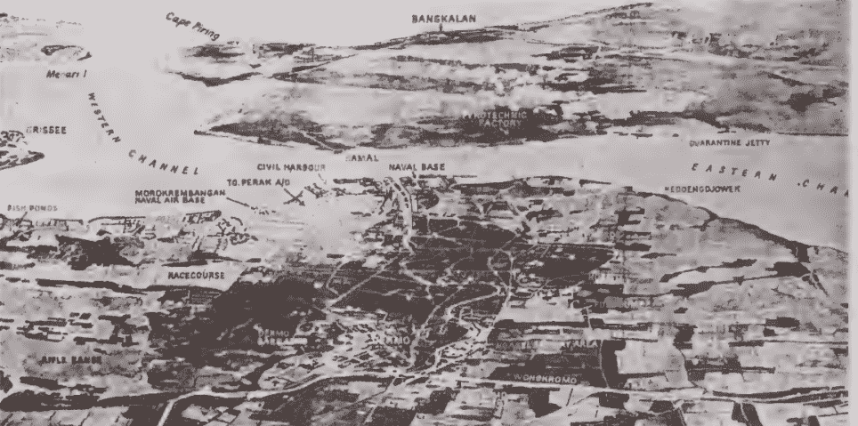

## “这场愚蠢战争”

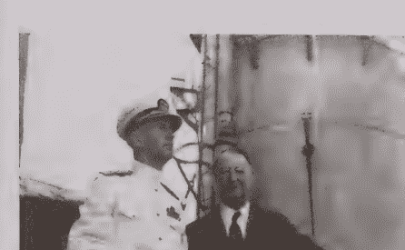

[1942年12月17日，星期三（16号周二），继续] 亲：

我感觉比昨天好多了。（我发现今天是17号周三，昨天是周二）。我休息得很好，在这种情况下，能以预言者的身份获得认可是一种小小的慰藉。正如我担心的那样——由于我对那些不祥预兆的信心，我对最终的结果也有信心，只是在过去那种某种[无辜？]的许可下，我曾认为某种可以阻止发生的事情竟然冥天巧地发生了。对于未来，没有任何可以阻止我们最终的胜利和命运。我们人民的素质和力量太伟大了。

> 15 珍珠港事件后不久，总统派遣了海军部长弗兰克·诺克斯对发生的情况及原因进行调查，这是许多官方调查中的第一次。诺克斯的报告的公开版本于12月16日发布，强调了个人防御者的英雄主义。罗斯福的一份报告估算了损失，并宣布美国军完全出乎其意料，攻击是经过“周密计划”的，并以“勇气、能力和机智”执行的。“Scrambled”一词不清楚 HEE 收到的是什么。

> 16 指挥官（军衔）的军服帽每侧都有显眼的金色叶形肩章，并配有一顶黑色黄铜帽；HEE 目前中上校帽的帽檐是纯黑色的。他的肩章（最近称为“肩板”）上有一颗标识其为战线军官的星形，以及两条金条，中间是第三条宽度为指挥官一半的条；他将穿三条全宽的条纹。这同样适用于常服蓝（黑色）制服“上衣”（外套）的袖子。他现在在领口每侧戴着金色橡树叶针——指挥官的标志是银色的。

> 17 HEE 补充：我的地址是 `U.S. John D. Edwards, to Care Postmaster San Francisco`。请勿使用其他地址。许多海军和陆战队队对整个战争期间职责（尤其是作战职责）的叙述。

> 19 “为什么要射击”不清楚——也许对于火控指挥仪的操作员来说（这些船的3英寸/23径防空炮几乎由Mark 33火控系统控制，没有雷达辅助），很难通过放大目镜镜来保持视线并追踪。

> 20 到此时，日本进军部队已登陆在吕宋岛北部和南部，并向马尼拉靠拢。22日和23日，规模更大的部队将登陆，再次位于马尼拉南北两侧，但这次距离很近，有120–30英里。

> 21 威廉姆

某些事情的发生会让道路变得更长更血腥；这些事情源于信仰——对好坏传言的迷，对缺乏即时成功的失望，个人的自私。勇气，高昂的头脑和更高的信仰，沉浸在我们人民的命运中——这些东西我们将拥有，并将获胜。我们可以传给后随我们的人，成为一些让他们可以仰望的东西。从自满、无能、缺乏远见以及个人和集体的自私政策、回避问题和权宜之计中，让我们吸取教训，并让它过去，不要让再次被遗忘。

我知道我们之爱的品质，这一事实使我在履行职责时能够完全忘记你。但由于了解你以及你的感受和反应，这给了我灵感、信仰和决心；如果没有你，如果没有我在迫切的需要允许时可以退回并依靠我的对你的念想，这些将是缺失的。而且，亲爱的，我不时能够将注意力集中在你身上，并尝试将我的精神投射给你。爱正是由此而成的。

信？要等几个月才能到达——但到时将是多么令人欢迎！我知道你的勇气和信仰足够了。

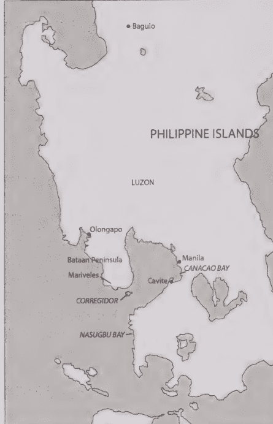

## “这场愚蠢战争”

这是极其疯狂但严峻的十天，充满了令人紧张的工作，且几乎没有可以判断形势的信息。正如所料的，士兵们表现得非常好——我为指挥他们感到自豪。今天很安静，我们能够赶上大量工作，同时也放松一下。我状态良好，能够承受压力并保持乐观。我的基本观点从未改变。我的预言成真了，我的担忧也是如此。

## 194 迈向爪哇海

将进行战斗并赢得胜利。远东和大西洋地区——除非来自可靠的官方来源，否则请不要相信或担心任何事情。谣言和敌人的宣传并肩行——两者都非常危险！

我仍然推荐桑德堡的《战争岁月》！

[1941年12月19日，周五，续]

亲爱的：

我昨晚睡了一个好觉，醒来时感到神清气爽。关于我们近期未来自然令人困扰的不确定性已经明朗，我现在对形势有了更清晰的理解，并坚信我们可以有效地执行任务。在最初的冲击之后，这个地区似乎预料到了会发生什么，我对果断的指挥充满信心。

俄罗斯人的成功是不可避免的，即使是德国强大的力量也需要一些时间来补偿所遭受的损失。²²

我被赋予了额外的责任²³，这需要大量的思考，如果我能有效执行，可能非常重要：我感谢上天，在过去我一直主动承担责任，因为我不不想那些过去甘于让别人工作的人现在的心态。在最好的情况下，战斗区的指挥已经足够艰难了，我需要一切都符合预期。无论过去曾有多少想象力，在和平到战争的转变真正发生之前，是不可能理解其中包含内容的。决策必须立即做出——往往是在信息不充分的情况下。

日本对夏威夷的攻击在统一国内舆论方面，可能比任何其他手段所做的都有效，我想我可以判断这种反应。

然而，亲爱的，我希望这不会改变爱丽和巴德²⁴关于生新宝宝的计划。我们在这里，不是为了一个衰落的国家而战斗，而是为了一个充满活力、不断成长且更强大的国家而战斗！这场战争将贯穿始终，而且不是那种纯粹为了自保的绝望战斗，而是源于对未来的信念的战斗。

2 关于苏联，他们在刚刚守住莫斯科后，发起了反攻，在俄罗斯北部和中部进行了数次行动。现在所知的“冬季战役”是指德军在全线的挣扎，这引起了指挥层的警觉，但实际上并没有反映出极其巨大的损失。反攻在1月初旬达到顶峰，在天气使德国空军困留在地面后不久，苏联随之（过早地）发起了新的攻势，但失败了。事实上，莫斯科此后未受到威胁，德军向南的推进很快停止了。

23 那项责任是什么尚未知，除非HEE指的是他在1942年口述中提到的保护运油船“提林托号”即将到来的独立任务。

24 即他的兄弟弗兰克·麦科伊和他的妻子

## “这场愚蠢的战争” 195

我知道你会很忙——海军救援组织²¹将需要很多帮助。一旦能想出一种可以让我们在不暴露船只位置的情况下寄钱回家的方法，我们就会寄回款项。个人资金也一样。在这些船上，钱对我们来说意义不大。

[晚上9点，续]

几分钟后我就该上睡了。在过去的五个小时里，我们一直坐在马尼拉、凯维特、奥龙加波的军室里，芭蕾舞者[?]等等，布泽蒂非常[有趣?]，他的种种逸事提供了很多乐趣。传来了关于……[文本截断]

[1941年12月20日，周六，续]

我想到一件事——各种物资将非常难以获得，我们将面临各种杂项的短缺——香烟、剃刀片等。我有130名士兵和7名其他军官，我知道上一次战争期间在这方面做了哪些工作。我知道把东西送过来需要很长时间，但我们会预判任何我们能触及并使用的东西：

- 香烟——骆驼牌、幸运牌、切斯特斯特菲尔德牌
- 斗烟草——沃尔特·罗莱、埃奇沃思斯、王子·阿尔伯特
- 剃刀片——吉列双刃层
- 肥皂——客斯特象牙皂、寿生皂、华逸
- 剃须膏——各种品种
- 书籍——企鹅出版社和其他纸装书

请定期寄送小包裹，而不是大包——为了方便处理，并让邮件中断不会产生太大影响。再给我寄几包镀铬唱片机针。我们的电影[投影仪]和扬声器上有一个唱片机。

而且亲爱的，我知道他们会非常感激的。

我们得到的自由是受限的。大多数时候我们会在海上——忙得除了值班和睡觉什么也做不了，但偶尔会在港口停留几天。我们可能会在可以打高尔夫球的地方——半打廉价高尔夫球和一些木球杆对我也有帮助！邮票也会有用。我希望邮件能通过迂回的和工具继续。

25 海军陆战队救援协会是一个美国非营利组织，成立于1904年，旨在为“美国海军和陆战队成员、符合条件的成员、遗孀幸存者提供财务援助和教育以及其他计划和服务”（www.nmcrs.org）。它一直延续至今并规模非常大。

## 迈向爪哇海

这对我们所有人来说将是一个奇怪的圣诞。我很高兴我的礼物及时送到了——如果运气好，那时你已经收到我的消息了。我希望如此，亲爱的，因为我知道你感受到的焦虑。

我记得年前海军中有多人在抱怨，因为哈特将下令让所有海军家属回家，陆军对此表示不满，因为他觉得自己在强迫他们做同样的事。他的决定是明智的！正如事实证明的那样，你意识到离开的时间已经到了——我不关于太平洋的电话，大约一个月前我收到了一个包裹，可能是一本书——我还没有打开——我会留到圣诞节，我亲爱的——我甚至不会去猜剩下的圣诞邮件在哪里！

[晚上8点15分，续]

我想邮件明天或周一寄出去。

这种情况的重大教训是，你不能做半吊子工程，无法在两三年内弥补二十年的忽视。胡佛们⁶、鲍海斯以及其他一贯削弱陆海军的人，那些在关姆岛还有些用处时不让我们加固的人⁷，那些没有意识到战争不可避免的陆海军军官们————大家都负有一笔无法偿还的债务。讽刺的是，我们必须偿还——而且许多人付出了生命。我们付出的人力代价将远超过上一次战争的损失。情况会在好转之前变得更糟。夏威夷会对马尼拉被包围这样感到惊讶——由于我们在夏威夷愚蠢地容忍日本样品等行为，我们正在付出什么代价⁹现在我们必须守

不要管华盛顿那些愚蠢的乐观宣传和傻气的公开活动——那些在营地拍摄的显眼模特、电影明星等的五张精美照片——我们要投入到一场血腥、冷酷、无情的、没有任何修饰和辞令的战争——不——我不怀疑我们能做到——我从不怀疑我们会获胜——但我知道这是一场长久而艰苦的战斗，在我们抛弃所有华丽的外表、淘汰那些刻板分子之前，我们无法获胜。对我而言，我希望在艰难的时刻，我的头脑和内心足够聪明、足够强大，让我能够尽到我的职责，但这并不容易。

## 给埃克勒夫人的信，1941年12月21日，周日，晚上9点

亲爱的：

又是平静的一天——唯一真正的消息是埃尼·金（Ernie King）被任命为美国太平洋舰队司令。我认为这是一个极佳的变动，我知道我们将会拥有一场深思熟虑且具有进攻性的战斗。

在思念你和家，并思考如何经营战争以及在可能出现的各种情况下我该如何应对时，我对比目前停放在马尼拉的留声机和唱片感到几许遗憾——那会是我当时能想到的最好的吗？我们的下一次收藏会经过更周的考虑，并且好得多，我会让美国音乐爱好者协会的彼得·里德（Peter Reed）[第3章，注81]就购买哪些录音向他提供建议。我知道他会乐意帮忙的。

我会买下“五部交响曲”、最好的钢琴和小提琴协奏曲，以及贝多芬、莫扎特和海顿的室内乐曲，并配上深厚的巴赫背景音乐——特别是《勃兰登堡协奏曲》，之后我们就可以尽情享受寻找新事物的乐趣，真正建立一座伟大的城市。

有一点非常重要，那就是这场战争不能干扰斯基普（Skip）读书。当然，我希望他进入海军学院，但告诉他，在安德弗弗（Andover）和安纳波利斯（Annapolis）接受彻底教育比任何一年都对他的国家更有价值。我不后悔在上场战争中的行动。在未来的几年里，国家和海军将需要这种经过充分训练的人才，在任何方面缩减他的训练都是没有意义的。拉里（Larry，HEE的侄子）也是如此。这些孩子通过坚持原计划绝不会逃避或做类似的事。无论战争结果如何，他们都是需要的。在他们接受充分训练之前，我会为家族承担现役！我觉得他们都有足够的智慧理解这一点，但还是要向他们强调。

回避对战争危险的承认是没有意义的——记住，亲爱的，如果我没有回到你身边，我永远不想让你过孤独的生活。我们分享过太多的美好，彼此理解得如此透彻，你不可能不知道我的感受。然后，记得我知道你曾以为无法回到我身边时是什么感受。任何可能发生的事情都无法增加我们的爱，但你必须继续活下去。这对斯基普来说也更好。当然，写下或读这些很困难，但它们太重要了，不能不说。我想说出来，这样可以帮助斯基普理解。

现在，做我珍爱的宝贝吧——原谅我对你做的那些坏事吗？我爱你。

顺便说一下，伊——Is——我们刚刚见到的一些人（即美国船的船员）看到我们感到很惊讶，因为传闻说我们已经沉没过两次了。当我们处于非常困难的境地时，确实差之毫厘，但我们依然依然坚强且乐观，尽管我们的信内容相当冷酷。亲爱的，不要相信传言！

在等了好几天后——飞艇（Clipper）再次延迟了，要等到周五或周六才能收到我们的邮件。我失望得不想多写了，但我爱你。

> 1941年12月22日，续]

我希望我那时能写写我们过去两周去过的地方，那样我就可以讨论更多有趣的事情了，但当地色彩必须省略。

> 下午2点，续]

今天上午有一场漫长而有趣的会议，我误误了午餐。作为活跃历史的一部分，事务以各种方式影响着人们。一个水兵给女朋友的信中写道：“爱的，在生活的扶手处，把我当成一块碎片！”

> 1941年12月23日，周二，续]

亲爱的，依然平静、无聊且不确定，这一切让情况变得极其困难。我们对此无能为力。

## “愚蠢的战争”199

我随信附上一张留了很久的小支票，我一直希望剩下的运输费能到账，这样我就可以还给海军。然而，我已经放弃这个希望了。立刻把支票收好，否则就过期了。

几分钟后我要上岸进行急需的运动和放松。邮件在几小时后关闭——希望这封信能尽快送达。我爱你，Isy。

## 1942年听写[续]

圣诞节，爱德华兹号（Edwards）离开去护护油轮三号舰（Trinity），它锚定在瓦拉达（Wawada）湾[瓦拉达湾，长十里，宽两里，有铁路保护；见地图]。我们进行了一次快速航行，接过了随三号舰的琼斯号（Paul Jones）和巴克号（Barker），在接下来的一个月里，我们担任三号舰的保姆，保持蒸汽全开，随时五分钟内离锚。我们偶尔看到澳大利亚的巡逻，但没有发现敌人的迹象。在瓦拉达待了约10天后，我们与三号舰一起前往库邦（Koepang，库普），），接了黑鹰号（Black Hawk）以及其他护卫舰。

关于我们的补给服务，有人评论说，我们在编队中的最高速度仅为九节。当然，海军一直渴望快速的补给舰，而我们在战斗中面临的巨大障碍之一，就是我们几乎所有的船都非常慢。

我们在库邦的停留充满了事件。我们遇到过一两艘潜艇，但没有其他情况。我们把大部分时间都花在了反潜工作上。库邦新建的机场后面有约1400名澳大利亚士兵和陆军，防御非常薄弱。我们短缺

## 驶向爪哇西

食物和物资，看起来他们似乎无法对该地进行任何坚定的防御。²38

# 给埃克尔斯夫人的，1941年12月3日

[12月26日，周五，续]

这封信在世界上没有任何办法能知道这封信究竟何时会开始寄往你那里。日夜充满了不确定性，有时非常无聊，其他时候则充满了紧张和忙碌。我们所做的大部分工作与我们预期的完全不同，并将不断地适应新的意料之外的情况。最令人懊恼的是，我们大多数人心里对应该做什么都有着相当固定的想法，但像我这种职位上的人并没有足够的信息来了解已经做了什么、正在发生什么，或者计划了什么，因此我们对此并没有自己的想法。我们执行分配的任务，希望自己对局势有足够的常识，以便在意外情况发生时能明智地行动。由于我预料会有意外，你可以确信我做了很多思虑。不过，只要机会允许，我还是睡得很香。


这些船在热带地区任何时候都很闷热不舒服，当为了战争而封闭时³⁹，尤为如此。同时，我们正在尽一切努力物资——因为我们知道新鲜物资到达这里需要多久。

圣诞平安夜，我们收到命令，要在圣诞节早晨出发执行特殊任务，因此那些简单的——实际上是有些凄惨的圣诞准备被付之脑后。然而，在早些时候晚餐后，我宣布甲板上举行一个简短的圣诞平安夜仪式，五十个人站在黑暗中的那里。在那段简短的演讲中，我表示无论心情和处境如何，让基督错过某种形式的纪念是不恰当的，无论过去的生活如何，我们无法回避承认基督的生活是信仰与勇气的崇高典范。我讲了两三分钟，随后在仔细遮挡的手电筒光下，从我那本旧旧破损的祈祷书中读了《路加福音》第二章的圣诞福音。接着手风琴演奏了《万民主降临》，我们以《主祷文》结束。场面庄严而充满感情，我相信大家都按预期的精神予以领会了。

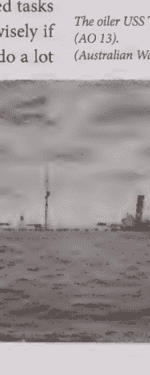

38 日本人很快将占领库邦和帝汶的其他地区，直到战争结束。

39 战斗中或预期战斗的军舰会设定最严苛的“物资状态”，以便他们最有机会应对并生存爆炸、火灾和淹水的影响。基本上所有的内部水密门、圆窗和其他装置都已关闭并固定，通风也被关闭。

# “这场愚蠢的战争”201

昨天我打开了包裹，发现通过你收到了玛丽·吉布森[纽约法星的一个邻居]寄来的《我熟悉的家》（The House I Knew®）——替我向她表示感谢。据说我们大部分圣诞信件恰好在卡维特地区的轰炸中被焚毁——但当然这不会包括全部，很大一部分在未抵达马尼拉的船只上。所以晚些时候这些信可能会追上我们。

我希望 Skip 圣诞节玩得很开心。对于他这个年纪，战争的事实不应夺走圣诞假期的宏大乐趣。我想知道他是否对所谓的“弱势性别”表现出了兴趣？假期有时会把这显露出来！

现在，亲爱的，有些事要做——晚些再聊，但目前愿上帝保佑你。

[1941年12月27日，周六，早晨，续]

到为止很平静——一个有趣的观察是，[自敌行动开始以来]我们所做的许多事情，在我们过去二十年里刻苦钻研[通过？]的任何书籍、训练和练习中都找不到。谢天谢谢地！在这部分，我没有在那些东西上花费太多时间！当然，战争很快可能会进入一个其中许多内容会变成现实的阶段——但很难说。

我们必须自己洗所有的衣服——各种制服——热带头盔、钢盔帽、白帽、卡其色或白色的短裤、工装裤，以及与各种雨衣、雨披、滑雨衣等的各种组合——热带雨下着，因为它们能让船只降温，而且我们还可以收集大量淡水用于擦洗和清洁！我的衣服散落在整个东方地区——似乎几件衣服离开船后就到了其他地方，到目前为止我还没追上任何一件我本该干净的衣服！一想我曾经还是一个造船设计师！

我希望你今年能听到很多好听的音乐——亲爱的，替我听。我会向你伸手的——因为我爱你。

[1941年12月28日，周日，早晨，续]

炎热而平静——有一年或多的时间来适应这种炎热是一个巨大的帮助——否则我会变得软绵绵。我记得这是 Bud [伊莎贝尔的哥哥弗兰克·麦科德]的生日——三天后就到了。如果能以一种轻松随意的心态对待这场战争就好了，但真的做不到。在香港英国军官的许多妻子在马尼拉，少数在巴基奥。

# “这场愚蠢的战争” 203

回到总体情况——再次强调的是，违背基本原则必须付出沉重的代价。我们开始得太晚了，没有认真对待菲律宾的防御工作。我本以为我们已经追上了一些进度，但事实证明并非如此。但错误在于，我们无法下决心是否要尝试防御它们。日本没有给我们时间，以至于我们最终付出的许多努力化为东流。


还记得约赛亚·克罗斯比爵（Sir Josiah Crosby）的名字吗？同一天休格·格兰特（Hugh Grant）[第2章注释37] 我将谈到他，我们可能会了解到日本对单一目标和目标基本原则的违背，这给了日本一个本可以等待巩固其南方地位的机会，而这对她现在来说价值巨大。楔子如果处理得当可以产生多大的破坏力，这很有趣。那么让我们再次学习。这是谁的错？国内没有某一个个人——只是那种头脑简单的思考习惯，说着“我们可以不参与战争——这不是我们的战争”等等。谢天谢，罗斯福至少让我们开始了——无论提前了多久——但如果他对他必然趋势的信念能做出更诚实的陈述，可能会唤醒人们，尽管这会给他的对手提供另一个武器。无论谁坐在白宫，大大意义上的事件序列都是相同的——唯一能改变的是我们扮演好自己角色的能力。我在胡言乱语了，先说了这么多。我爱你。

[1941年12月30日，周二，晚上8:30，续]

我洗了我的袜子和内衣，玩了几局扑克牌游戏（acey deck），几分钟后我就会像往常一样去睡觉了，此时我正挂在甲板上——我真知道温带气候下的真正的床是什么感觉！我有每天早上4:30起床的固定习惯，因为那时光就亮了——昨晚我因为影子等原因打了几次电话，OOD [值班官] 一直担心，所以我可以睡一会儿了。今天，我们一周以来第一次获得了一些报纸新闻。但经过消化后，其实并没有说什么——很难耐心地等待。尽管我们如此焦虑，我们也无法加速时间的流逝，完全无法。我每天和一群船员小组讨论那少少的新闻，指出人们误视为事实的各种猜测，以及已确认事实的意义。他们都渴望能有一个好的机会。

46 约赛亚·克罗斯比爵士（KCMG CIE）曾是英国驻泰特派且兼权公使，1934-41年。参见第2章（“官方报告”第2段）关于秘密谈判的内容，泰国政府向美国寻求支持，称泰国遭受了日本袭击，正如他预期的那样。他也未能逃脱，日本于12月8日顺利攻击了泰国，作为进攻马来西亚和缅甸的前奏。泰国政府在几小时内签署了停火，并在12月21日签署了联盟。

47 紧急内阁参见第3章注释79。但 HEE 在此指的是驾驶室里的折叠床或吊床。

48 军舰最初配备了空中和舰载攻击设备（通常在每天的开始和结束时进入战斗准备），那时可以看到日出或日落，这使得很难观察到俯冲机或低空飞机。

## 往爪哇海

日本人。我想要的是冷静、理智、冷酷的决心，以及对前方艰巨任务的认识。当我们行进时，必须带有不可阻挡的力量。我希望西岸已经从紧张中恢复过来，并静下心来工作！晚安，亲爱的——我很爱你。

> [1941年12月31日，周三，上午10点，续]

今天我四十三岁了！

[下午4点，续]

我的生日蛋糕，我吃了一个甜甜圈和一杯咖啡，我想到了亲爱的，我有多么爱着她！

[晚上9点，续]

就在二十年前，1921年12月31日，大约晚上10点，当我们坐在布拉德广场5号号[参见第3章注释43]的窗边，畅聊了那么久，我才真正开始意识到什么是一个迷人的女孩。我很庆幸命运与我们在一起，我的爱人。我爱你。

> [1942年1月，周四，续]

新年快乐，是——我希望下一个新年比这个好得多！今天非常热——我睡了一个好觉，感觉很放松。

[下午2点，续]

我们下了一场大雨——我们的淡水储备不多，所以我们架起了帆布遮篷和桶来增加供应。所以雨不仅帮了我们，也让船降了温。

[晚上10:30，续]

在结束又一个安静的一天准备睡觉前，晚安，亲爱的。

> [1942年1月3日，周六，续]

明天可能离开——最后两天很无聊且疲惫——没什么特别的。下次信见。我爱你（I.L.Y.）。

[1942年1月5日，周一，续]

我正在向政府申请保险。所以 ANLAV [全海军] 派遣的细节已经出来了。我会尽快转发申请——你也许可以向[布鲁克林？]海军造厂咨询一下你提交申请的可能性。

49 正如在1942年2月行政命令下将美裔日本人“疏散”到安置营的情况下中广为人知的那样。也参见第6章。50 军舰最初配备了空中和舰载攻击设备（通常在每天的开始和结束时进入战斗准备），那时可以看到日出或日落，这使得很难观察到俯冲机或低空飞机。51 临时架设的帆布（在海上有天气良好时）保护钢板免受阳光辐射——收集雨水。52 国民服务保险计划始于1940年，今天仍由退伍军人事务部管理。

维姆（Weim）

# 给埃克莱斯夫人（MRS. ECCLES）的信，1942年1月6日，周二

亲爱的 Isy，

似乎明天就会出发并在未来的某个时间到达。如果运气好，你可能收到了大约两周前寄出的信——无论如何。

我今天晋升了指挥官——除了一顶旧黄帽[注释16]外没有军衔标志。正如我所说的，海伦（Helen）[参见第3章注释30]在三个月前回到国家时给我留下的。就这样，在有这么多事情要做的情况下，军衔似乎意义不大。马尼拉的陷落并不意外。奇怪的是，许多军界和平民从未想象过这种可能性。我对我认识的人感到非常难过。我非常确定这是我们历史上第一座被攻占的美国城市。这对于国内可能存在的任何自满、自足的人来说无疑是一个冲击。而且在总体战中，攻占大城市的意义可能是非常悲剧性的。

今天是晋升日——船上的另外两个军官也晋升了，海军中还有数百人晋升。我那件带有闪亮中校条[注释16]的蓝色制服整齐地放在储物柜里。我穿了两次中校正式礼服——一次是在总统招待会上，一次是为了拍照！谢天谢地没有在制服上浪费钱！

亲爱的，写出理智的话很难——我只是巨大战争和问题的一小部分。我们有一个月没有收到信——没有报纸，没有可靠的消息——所以很大程度上依靠我们对局局的判断。当然，我不知道家里的情况，不知道你做了什么。

我希望你、Skip 和其他人都好——这是我唯一能做的。我知道你有信心和勇气去做好你的部分——我希望我能好好我的。谢天谢地我一直很好——当然有时我会很疲惫，有时会担心，但这在战争中是正常的。

晚安，亲爱的。原谅我对你做过的所有坏事？我爱你。

我们有很多趣事发生——但遗憾的是，我无法给你足够的背景来让你欣赏它们。

# 给埃克尔斯夫人的信，1942年1月8日，周四，上午11:45

亲爱的：

依然很安静——所以我们只能观察并消磨[时间？]，并想知道什么时候才能真正与清晨交织。船上的无线电传来了更多晋升的消息，现在我们有一名指挥官、四名上尉——两名中尉（[少级]）和一名少尉——对于这种类型的船只来说，这些军衔已经很多了。消息匮乏且无趣，火柴、、火柴、香烟和烟草快用完了，我们一直以来享种类丰富的食物也减少了，以至于我们吃什么就得什么。顺便提一下，如果能给我一个紧凑的防风打火机、几罐打火机油、备用信号弹和芯，我会不胜感激！

有很多有趣的推测——我没有看到大规模的部队，对训练良好且装备的特种部队有巨大的需求。海军需要优秀的人，商船需要优秀的官兵。我们需要的部队在每一个方面都必须是顶尖的。任何不彻底了解自己工作的人都不应该参与这场战争。当然，情况一向如此，但我觉得现在尤其是如此。运输将是一个问题，而一个优秀的人比一个只能完成四分之一工作的未训练士兵不需要吃得更多，也不需要更多的重量和空间。

一件事务事——我们的财务官不在我们这里，因此无法完成国家服务保险[参见备注502]项下额外保险所需的所有表格。然而，我们收到的公函表明，尽管没有严格遵守所有表格，官方申请仍会被考虑。因此，我列了一份船上所有申请人的名单，并将副本发送给其他船只转交，以防我们发生意外。我申请了额外的5,000.00美元保险，总额为10,000.00美元的国家保险（去年办理了5,000.00美元）。名单由我认证并并通过多个渠道寄出。因此，如果船只发生意外，名单最终将到达退伍军人管理局并保护船员的利益。该信的档案号如下：

DD216/L13 (008) 1942年1月6日

致退伍军人管理局

国家服务保险处。

我不知道未来几年的税收情况会如何。在海外哨站值守，我的薪水是否免税尚存疑问。无论如何，我不太可能及时获得信息来编制正式的报表——然而，我们可以预见到大额税款的支付，你应该从我寄给你的支票中留出一些钱来应对。在7月1日之前，我每个月应该给你五十到一百美元[按2016年美元计算为740–1500美元]，之后根据届时生效的薪水（[达到指挥官薪水]）每月为六十到七十美元。不要提前透支，因为邮件会受到延迟和危险的影响，任何邮件中丢失的支票都需要数几年时间来调整和回复。我在这里的费用每月不应超过70美元。所以，亲爱的，大概这个数字就涵盖了财务状况。

我很幸我没有嫁给某个脑筋软且智力低下的人（你当然知道有些人犯过这种错误！）。你无法想象，拥有一个妻子可以应对任何出现的情况的这种安全感是多么美好。背后的距离一定很长，但你明白我的意思——家里有你——在这里我将尽我的一份——我爱你。

[1942年1月9日，周五，续]

我必须一直盯着日历来告诉自己今天是星期几——这在我们现在的生活中似乎没有任何意义。今天是几周以来第一次相当愉快。什么都没有发生，我在上午8:30就上睡了：凌晨4:40被叫醒，我通常会在日出后尝试小睡。当然，晚上也有叫声——所以亲爱的，由于需要报告，我说晚安了！

[1942年1月11日，周日，续]

没有多少新消息——前几天我们看到了一些人[即，一艘运送报纸的美国海军军舰——参见1942年1月19日的信]，自从我们在马尼拉之后就没见过他们，又获得了一些内幕。读读关于击沉的日本宣传报告很有趣，目前为止如此。⁵⁵ 太多了，以至于我怀疑其中是否有一个是真的。我本以为德国人很擅长这个，但日本人做得更好。我想，他们这么做是希望通过否认等手段，迫使我们暴露自己部队的位置和活动。

有传言说未来几周内我们将收到一些邮件（可能是很旧的）。我希望收到，因为我从家里那收到的最新消息是11月17日的。

今天我在想，哈维在不再生产客车后会怎么办！最后部分的建议让他重新入伍陆军，看来其实并不糟！

我今天晒太阳太久了，头疼，所以我今晚要早点睡。原谅我做的那些调皮事！晚安，亲爱的。

53 也就是说，专门针对破坏、敌前线侦察和其他非正规战争训练的特殊部队——特别是在未来几年，海军陆战游击队和陆军游击队。

54 1942年初入伍人员将免除战时个人所得税的增加；后来人员和军官的薪水在1,500美元以内均获得免税（HEEE本应支付约3,900美元，每月约325美元）。战斗区的申报截止日期已放宽。

55 宣传信息是从日本英语广播中更定期地收到的，由被称为“东京玫瑰”的女性播音员朗读而闻名。

56 未指明身份，伊莎贝尔的姐夫，凯迪拉克经销商的所有者。

# “这真愚蠢的战争”

# 往雅瓦海

[1942年1月13日，周二，上午9:30，续]

期间：

这感觉又是一个潮湿的日子。昨天下午的雨让气温降低了许多，但我们原始的遮阳篷已所剩无几，阳光非常毒辣。这让全体人员很难保持乐观。

媒体报道好坏参半——有太多宣传了，大部分是胡言。身处战争真正发生的地方，却读着关于会议、保证和未来天文数字级生产计划的报告，真的很令人沮丧。我更希望媒体报道中除了提供适宜发布的事实官方报告外，什么都不包含。然而，我很兴注意到达夫·库珀-57 被解职了。你会记得戴娜女士是1940年春天发生巴黎事件的那个女人。

关于希特勒与其将军们之间矛盾的报告⁵8 如果是真的，是非常令人鼓舞的。但不要太看九月。回到库珀身上——他在战前的观点是正确的，但对我来说，那种讨人喜欢、愉快、得体却无效的人格触中了我的灵魂。我想我本应该更有耐心和乐观——如果不是因为废话和会议的话。

至于考虑战争以外的事，我希望可以，但似乎并不可能。

[1942年1月14日，周三，上午11:30，续]

依然很安静——整个上午都很酷热，但现在有微风吹凉了空气——甲板和船体像炉子一样。我不相信战争后我会有任何强烈渴望再次看到热带。我的血液现在会变得那么薄，我甚至都不敢想。每当温度下降到85华氏度以下我就感到冷！而且亲爱的，痛苦的在于我一直想成为一个坚韧的新英格兰人，你喜欢的那个！

# 1942年口述 [续]

关于1942年口述 [续]：

在1月中旬，我们前往了科博拉湾[距离古邦西北约130航海里]。我们与休斯敦号和波士号会合。⁵9 军将

57 达夫·库珀（1890-1954）。保守派政客、作家，后来成为第一代诺里奇男爵，1943年之前没有进一步职务，1944年担任驻新加坡大使，但他的妻子戴娜女士曾是著名的美女且性格古怪。

59 休斯敦号（CL-7），一艘布鲁克林级巡洋舰（12403吨，600英尺），于1938年服役。正如下方HEEE提到的，它很快撞上了一个未标记的礁石并脱离船厂维修，避开了很快在该地区盟军的遭遇。该舰在战争中生存了下来，曾在太平洋和大西洋服役，直到1946年退役，1951年转交给阿根廷海军，并于1978年拆解。

# “这场愚蠢的战争” 209

格拉斯福德在博伊斯河指挥着部队，我们计划在科卢克海峡发动进攻，日军正从那里过来。正当我们准备船只出发时，收到一个信号，称日本人已经撤退，进攻计划陷入了混乱。休斯顿号、惠普尔号和爱德华号被派往托雷斯海峡寻找目标并接护队，剩下的船只在爪哇海会合等待部署。

我们对要去的地方没有任何海图，到达托雷斯后，我们从休斯敦号那里获得了一份托雷斯海图，这是我们在该地区唯一的导航手段。

# 给埃克莱斯夫人的信，1942年1月19日周一，晚上10:30

亲爱的：

这几天就过去了，我根本没试着记录它们。我每晚能睡几个小时，白天睡一小时左右。幸运的是我们天气很好——白天热晚上凉——甚至连官兵舱都变得凉快了。过去三周我一直在指挥楼上睡觉。我们仍然不知道什么时候会有邮件送达——自从圣诞节以来，我们就与文明隔绝了。偶尔我们会从其他船只那里得到一些新闻——我们这里没有复制资料的设备。忙碌点比较好。我们收到的报告并不太乐观——尤其是据称诺克斯先生发表的演说，认为远东在希特勒被收拾掉之前必须自生自灭。这让我们看起来像是我们要度过一个漫长而炎热的冬天！说这简直是传统的“英雄细线”吧！我必须承认，处于这种处境真是相当糟糕！

怀着非常不可信的乐观情绪，我签此收笔，回到指挥楼了。今天非常黑暗，我讨厌任何事情。祝你好运——我爱你。

> 60 威廉·A·格拉斯福德海军将（1886–1958，美国海军学院1906级），此时正指挥美、英、荷边境地区的美国海军部队（见第63页）。在这些事件后返回美国，并获得威尔赫米纳女王授勋，他首先在地中海的登陆部队服役，最终以中将身份退休。

> 61 显然（考虑到即将入侵帝汶的情况），穿过印尼群岛的通道并非位于库邦岸外：塞拉斯、阿拉斯、拉佩或奥尔迈。

> 62 在澳大利亚最北端和北边新几内亚之间宽23英里的通道中航行，由于通道深度以及小岛屿和珊瑚礁的存在，导航尤为困难。

> 63 海军部长曾主持最近完成的第一次华盛顿（或阿克拉）会议，1942年12月13日至14日，涉及丘吉尔首相、罗斯福及工作人员人员。在其他事项上，制定了一项“初步战略”，要求在德国击败之前对日本进行战略防御。事实上，1944年分配给太平洋的资源将匹配或超过欧洲。会议还建立了美、英、荷、澳联合（ABDA）司令部。在阿奇巴尔德·威尔逊爵的领导下，我们在那场冲突中尝试了联合作战。爱德华[注：原文为Edward]属于他的海军部队，受格拉斯福德少将指挥。

> 64 此图像源自查尔·吉卜林1890年的诗《汤米》

> 当日子开始流转时……那条“红衣军细线”……

> 起于一位记者对1854年巴拉克拉瓦战役及克里米亚战争的描述。

## 往爪哇海

[1942年1月20日，周二，下午5:30，续]

我们今天见到了一些新面孔，并第一次得到了关于珍珠港事件的二手报告。这种事情竟然被允许发生，简直令人不可思议。我能想到的唯一解释是，每个人在海上都被不必要的工作和预防措施得得精力竭，以至于在错误的事情上放松了，忽视了重要的预防。这一定非常可怕。我仍然对它的了解不够，无法得出最终结论，但一切迹象都指向缺乏智能解读报告的能力，以及只见木不见森林。骄慢导致灭亡，而且是来得如此惨烈！这简直让人作呕。好吧，这会比我想象的要长，是一场漫长的上坡路。

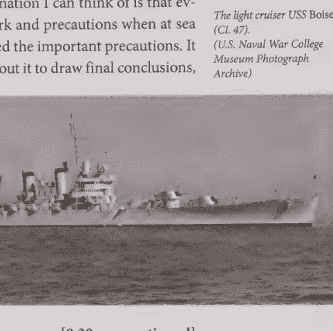

波士西号轻巡洋舰（CL-47）。（美国海军学院博物馆照片档案）

[晚上8:30，续]

我吃了一顿丰盛的晚餐，进行了愉快的聊天，感觉好多了——现在睡觉——我希望睡个好觉——然后明天还有要做。晚安，亲爱的。我爱你。

[1942年1月22日，周四，晚上9点，续]

又是漫长的一天，无所事事——由于如此忙碌，我想事情很快就会发生。我们如既往，没有足够的信息来了解发生了什么。# 1942年 往爪哇海电讯 [续]

在返回爪哇海的途中，我们在达尔文附近停靠，并接回了Planter号和Pocos号[128]。我们在托雷斯海峡遇到了Polk号⁶

> 65 一艘9119吨货轮，1941年交付给Mascot船队；现在正。在托雷斯海峡。第29驱逐队在我们在航行期间，对马喀萨海峡发动了著名的进攻。

> 66 一艘1760吨运输船，1941年为美国船队建造；现在被租用。在1943年被征用为修理船Brialous号（AR-12）；战后归还给原船主，直到1948年被拆除。

> 67 1月23日傍晚，在马喀萨海峡。四艘美国驱逐舰——约翰·D·福德号（DD-228，1920年服役，1945年受损）、波普号（DD-225，1920年服役，如下文所述丢失）、琼斯号和帕罗特号——

# “这场愚蠢的战争” 211

我们与参与战斗的军官们讨论了情况；我相信那是自西班牙战争以来，任何规模大于护逐艇的美国船群的首次水面交战。

# 给埃克莱斯夫人的信，1942年1月19日

[1月23日，周五，续]

今天是美好的一天——早晨有阵雨，下午只有适宜的凉意和微风。我们一如既往，没有足够的信息来了解真实发生了什么，在重要事情发生之前，这种推测和猜测非常折磨神经。我曾一度以为今天我们发现了什么，结果发现是一群鱼而不是潜艇。不过，作为一次演习，它非常出色。

日子很长，但晚上如果有机会我就能睡得很好。上个月我最后上岸，我判断还要过一段时间才能再次如此。我们现在开始收到一些邮件——最终我们应该会有一些。顺便说一下，你寄来的任何香烟或烟草，请放在真空罐里以免发霉。

今天下午我在想，在那种情况下这些事情是如何困扰人们的——什么样的真正的问题会出现并伴随我们！相比之下，能够欣赏正常生活的伟大事物是多么么好。这些事情绝不能被忽视或忘记。它们应该一直被培养和珍惜，并尽可能传递给他人——不是通过语言，因为那是可能的，而是通过像你带给我的那样的常伴生活。晚安，亲爱的。我爱你。

[1月24日，周六，晚上10点，续]

今晚我感觉好多了！收到消息说，我们的部队昨晚抓获了日本人——我真希望在现场，但我希望所有军官和士兵都能获得勋章。这向那个相当怀疑的世界证明了亚洲舰队是懂得战斗的——而且在战斗中我们只有四名士兵受伤了！我想不出别的好话了，晚安。

## 致爪罗华海

[1942年1月25日，周日，下午2点，续]


# 关于我们成功的报告不断传来

关于我们成功的报告不断传来，我们现在终于松了一口气——这与过去七周几乎连续的坏消息相比形成了鲜明对比。当我写这封信时，我判断第一批报告已经到达家乡，那里是周日凌晨1点左右。我知道Skip收到消息后会有什么感受！也许家里的人也认为我们在这里需要一点帮助，而且我们也应该得到这一切！我也为汤米·哈特（考虑到托马斯·C·哈特海军上将，亚洲舰队司令官）的面子感到非常高兴——现在我要去睡一会儿觉了，因为明天我们将进入危险海域，一段时间内我不会有多少机会睡觉了——我爱你。

## [1942年1月26日，周一，续]

亲爱的，除了海况有些颠簸外，一切仍然很平静。我没有机会在明天写信，周三邮件应该离开船只。

我们对钱没有实际用途，但有一点钱总是好的，而且自12月15日以来我们就没有领过工资——仅仅是因为我们附近的任何有发薪官的港口，其汇率都要比我寄给你的津贴金额大——我会尝试在可能时寄支票。我们真正想要的是一些邮件！

## [1942年1月27日，周二，晚上8:30，续]

在望加锡海峡（即巴厘望板）的进攻是一场精彩的展示，表明了当我们获得半点机会时能做什么。我希望下次我们能彻底消灭我们攻击的敌军。我们还没有细节，但我们知道我们重创了他们。这对我们的士气来说太棒极了！晚安，亲爱的，下个月见。我爱你。

## 给埃克莱斯夫人的信，1942年1月29日，周四，晚上10点

亲爱的，

这是一封匆忙的信，好让你今晚能睡个好觉[注：OCR原文“hasty for you to get all the sleep tonight”可能是“hasty letter”]。我的士气很好，有很多艰苦工作要做。

如果这场亚洲战役的真实故事被写下来，它将是一段难以置信的冒险。昨晚我与飞行员、潜艇员等人进行了一些长谈——马克斯·凯斯在被捕前坐一艘游艇从马尼拉出发——和其他几名军官和首长航行了28天才安全抵达。有六个人，其中一人重伤，在从PBY（双引擎飞机）中坠落后，在橡胶救生艇中划水和漂流了200英里——最终坐着独木舟和小船从一个岛到另一个岛安全地回来。其他人在坠落后，漂浮和游泳了20到30小时才上岸，并乘坐当地的小船到达安全地带。看到官兵们所展现出的机智、头脑、力量和勇气——尽管情况如此严峻，他们仍保持着幽默感——我为我们这过时的舰队感到非常自豪！

我收拾了一箱便服和我仍然拥有的几盒唱片专辑，希望几个月后通过货运送到你那里。Skip也许可以替我穿我那套不错的轻便新加坡西装——那是件极品。

现在该睡觉了，我的亲爱的——原谅我所有的坏想法？我爱你。

## [1942年2月2日，周二，上午，续]

亲爱的Isy，每当出现那种间歇期，我们不知道要做什么或什么时候做时——所以我试图让自己忙起来，而不是在公告板前发呆。新闻强调，英国人现在意识到新加坡和仰光对战争努力的重要性。

从许多角度来看，这是非常令人不满的。我们与敌人最近的接触是在战争第一周，两枚鱼雷从船只下方或附近经过。从那以后我们曾多次接近，但更多时候是在巡航或坐着观察和等待。事态的发展表明，我们很快就会进入某种真正的战斗。为某事做好充分准备却没发生是很困难的，我们（即舰官兵们）必须警惕这对我们自己和士兵们的影响。

但亲爱的，我想写信真的变得非常困难，由于两个月没有收到邮件，我不断地想你和家。前晚晚上我梦见战争结束后我刚回到家，正要问候你时，邮件终于送到了。

### [晚上8点，续]

中断包括一次会议、一次空袭、两次更换锚地以及大量的杂乱。每当看到飞机时，怀疑它们是敌机还是友机总是很有趣。

然而，Isy，我决定我不是一个很好的作家——这种对于陌生港口、外国异乡和普遍不确定性的事务绝对不好玩。当我们进入港口时无法放松，而且在大多数情况下我们根本不知道在哪里。所以你必须原谅我那些单调的信件。

英国人总是进行非常有文学色彩的战争，非常强调防御的英勇等。有很多赞赏和鼓励的评论。

嗯，我关于我们国家的旧比喻，就像一群坐在船上的人从湖泊漂入湍急的瀑布。

最初的侦察显示我们的人数大约是对方的两比一，但当我们距离巴厘巴板（Balikpapan）约100英里处的晚上7点时，傍晚的侦察报告显示，日军显然预料到了我们的到来，并拥有一支更大的力量，由四五艘巡洋舰、十艘驱逐舰和两艘扫雷舰组成。从这种部署来看，显然如果我们不穿过整个集中区域，就无法抵达运输船。收到该报告大约半小时后，罗宾森上尉（Captain Robinson）非常明智地掉头转向，返回到了凯安岛（Kangean Islands）以南的一个点（参见地图）。在吉拉贾岛（Gil Raja [Giliraja Island，参见地图]）与荷兰和美国船只会合，在马杜拉海峡（Madoera Strait [Madura，见注释13]）加燃料，并在荷兰海军多尔曼少将（Rear Admiral Doorman）的指挥下组成了联合打击部队。

次日早晨，当我们参加关于“鲁伊特号”（De Ruyter）的会议时，日本轰炸机在从对泗水（Soerabaja）的首次攻击返回的途中发现了我们的集结。我们于当晚出发，第二天（即2月4日），我们在凯安岛以南的一个大正方形区域航行，等待来自巴厘巴板的日军投入对班查马辛（Banjarmasin [Banjarasin-参见地图]）地区或望加锡（Makassar）的进攻，计划是等他们投入战斗后再进行打击。我们的部队由“鲁伊特号”、“特龙普号”（Tromp）、荷兰驱逐舰，以及美国的“休斯顿号”（Houston）、“大理石头号”（Marblehead）、“斯图尔特号”（Stewart）、“爱德华兹号”（Edwards）、“布尔默号”（Bulmer）和“巴克号”（Barker）组成。

上午10:30，日本轰炸机袭击了我们。他们以九架为一组波次袭来，每次攻击都能看到三个波次。他们一直纠缠我们到下午1:30或2点左右。第一波攻击来得非常低，我们本以为“休斯顿号”的防空炮会击落第一批。

> **注释76** 亚瑟·格兰德维尔·罗宾森（1892–1967，美国海军学院1913级）指挥“大理石头号”，作为高级官执行此次行动。他因在这场战斗中营救船只并安全返回家而被授予海军十字勋章（见注释74）。他在战争剩余时间内在加勒比地区服役，并在1946年至1949年担任太平洋地区战争罪委员会主席，任中将。
>
> **注释77** 卡尔·弗雷德里克·马里埃·多尔曼（1884–1942，1910年入伍荷兰皇家海军）在荷兰东印度海军（NEL）拥有经验，最近是自1937年起担任造船和航空司令。他从舰长晋升为这支部队的指挥。他在“鲁伊特号”舰桥上悬挂旗标，因那句“我正在攻击[在某些记载中为攻击所有船只]”而闻名。
>
> **注释78** 荷兰海军“鲁伊特号”（HNLMS De Ruyter）建造了一艘轻巡洋舰（排水量6,450吨，人员666人），于1936年服役。由于大萧条和国内政治，该船的设计采用了节约标准。这种局限性体现在主炮系统尺寸、防空武器和装甲的不足上，这些在船只命运被报道之前无法承受即时压力。
>
> **注释79** 荷兰海军“特龙普号”（HNLMS Tromp）是该级轻巡洋舰（排水量3,450吨，人员438人），于1938年服役并立即投入荷兰东印度海军。在经历了后文详细的损伤维修后：该船将在澳大利亚和塞莱伯斯（Celebes）附近行动，隶属于第七舰队或英国东方舰队，主要负责护航，但也参与了巴厘巴板的收复，并在战斗结束后围剿日军守军。1946年返回荷兰后，“特龙普号”经过长久的大修，担任训练舰，于1955年退役，并于1969年拆除。

# 26 深入爪哇海

“休斯顿号”的防空火力非常紊乱，没有击落任何飞机，但“大理石头号”率先中弹。

很难记住发生过的确切细节，但我认为第一枚炸弹是落在她的舵室的，那炸弹卡住了她的舵并造成了巨大的损坏。下一枚炸弹落在[击中]了舰桥楼稍后方并爆炸，摧毁了作战室、医务室和大部分官兵房。“大理石头号”遭受的第三次命中是前方的一处近失，这炸开了燃油箱并导致船体严重进水。

在对“大理石头号”的攻击结束时，该船通常吃水深度约为16英尺，现在前方吃水28英尺并正高速绕圈。“休斯顿号”被中了一次，3号炮塔被摧毁，船只仅在一名人员的努力下才保存，但在沉没前淹没了弹药库。“休斯顿号”离开编队，伴随着剧烈火灾高速消失。在“休斯顿号”和“大理石头号”中弹后，“特龙普号”和“鲁伊特号”也成为攻击目标。

“大理石头号”击落了一架飞机，那架飞机失控俯冲入海，试图降落[即，撞击]“大理石头号”。我判断它撞在“大理石头号”前方约500码的水面上。

最后一次攻击后，我们试图保持某种阵型并向泗水撤退，前往马杜拉海峡口。显而易见，受损的船只[由于吃水太深]无法从泗水的东口进入，因为那里很浅，我们沿着这条路线航行了几个小时，最终到达我们需要护送爪哇岛以南的“大理石头号”。我们掉头朝龙目海峡（Lombok Strait [参见地图]）前进。“大理石头号”倾斜严重，但以约20节的速度航行。

这种分离的苦痛，远并不像那些住在同一屋檐、同一房间，却始终无法真正交流和理解的人那样糟糕。我们虽然身体相隔万里，但心却彼此紧贴，渴望着那种带来快乐、慰藉和乐趣的肉体存在；没有任何东西能真正分离我们真实的自我，我们在对爱的这种亲密且持久特性的信仰与认知中获得了幸福。

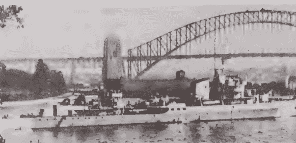

另一方面，他们可以、可能也已经在让身体聚在一起，却没有爱，没有信仰，并且时刻意识到这是一场悲剧性的耻辱。或者以一种自动、近乎机械的方式，从不停下来思考或在意那是虚假还是真实。我们珍惜着一个珍贵的、美丽的生命——而他们拥有的只是一把死寂的灰烬。

荷兰巡洋舰“特龙普号”（HNLMS Tromp）（第59驱逐击队巡航日志）

# 给埃克尔夫人的信，1942年2月9日，周一晚上9点

我亲爱的，不确定的日子和宁静的夜晚已成为我们的常态。天气很好——将这里显而易见的自然之美，与战争带来的神经紧张和其他方面相对比，显得是如此讽刺。也许我在寻找和享受这些美好的事物上犯了错——当想到它们与战争中最糟糕时刻的对比时，它们让我感到阵阵剧烈的痛苦。感谢上帝，你的美丽拥有我最熟悉、最爱的特质。

马尔贝黑德的损伤，展望未来。（第59驱逐击队巡航日志）

我有时感到自己与当下非常脱节，寻找答案——但答案并不来得容易。坚定的信仰和对职责的忠诚是唯一清晰的答案，也是唯一对我或我们这里或家里的任何一个人有帮助的东西。其他答案都是模糊的。你当然知道，我无法向你隐瞒我的任何感受——言语从未也永远无法取代我们拥有的理解，言语或言语的缺失也无法遮蔽我们对彼此感受的认知。


为了履行职责，我需要曾希望过的所有力量、勇气和智慧。在履行职责的过程中，我正为国家、为斯基普（Skip）尽我所能。我希望有一天，这种状况的真相能为人知，我有机会对这一认知做出贡献。

几天前我们第一次遭遇了炸弹。战斗开始时很有趣，所有的感觉都集中在敌人将要做什么——最好的应对方法是什么。恐惧出现在行动之前之后，但不会出现在行动之中。这正是经验和训练的价值。当然，总会有有趣的推测，即那些你看到被射出的弹药会落在哪里！你会对他非常非常生气！受惊的“砰先生”或许有他的优势。当然，冷静冷静也至关重要！局势确实“趣味十足”！

现在，好了，我的亲爱的。我爱你。

## [1942年2月12日，周四，上午11点，续]

没太多消息，亲爱的——我讨厌在了解如此少的情况下去猜测。我需要每一分可能的精神力量和勇气。我为此祈祷，并感受到了真实的回应。我知道你也是这样做。邮件可能今天就会寄出，我没有时间写更多了。我爱你，亲爱的。

### [晚上7:30，续]

亲爱的，我不忙碌时感到很忧郁——现在我感觉好多了，因为我有事情要占据注意力了——棘手的操船等等。

## 1942年听写[续]

特吉拉特恰普（Tjilatjap）是一个老鼠夹。它有一个长而弯曲的入口，非常窄，港口内没有值得提到的转身空间。许多船停泊在水道中，我们所有人都在泥带里跑了七圈，试图转动船只以便进入港口附近那个极小的码头进行补给。“佩科斯号”（Pecos）进来了，我们从那里补充了燃料。港口的水流很强。天气有阵风，在之前的压力之后，又是非常疲惫的一天。然而，我们收到消息，预计明天早上会遭到日本空袭。

天一亮，我们就把最后的“无线电”牛肉[推测是在码头上宰杀的]带上船，还是热热的，在离开通道和雷区后向南出发。

我们的命令非常模糊，特吉拉特恰普的联络很糟糕，岸上只有一名海军军官且完全超负荷；通信状况很差。我们不知道会发生什么，但通过电话给了三个会合点。我们知道休斯顿号没事，因为它们也在特吉拉特恰普。

## 驶向爪哇海

接下来的几天里，我们向爪哇岛南方航行。我们曾高速驶向普里格湾（Prigge Bay），并在深夜从一艘小型荷兰油船补充燃料，最后与多尔曼将军（Admiral Doorman）的力量再次会合。

我们面临的巨大困难之一是与荷兰人没有真正良好的通信手段。

他们在深夜高速航行，在没有信号的情况下改变航向，当我们从18节加速到20节时，我们的燃料很快耗尽了。这对我们来说很奇怪，因为我们的设备在15节以上无效，而且我们没有直接目标，但“鲁伊特号”（De Ruyter）和“爪哇号”（Java）的动力装置使得切换到巡航组合非常困难。

我们最终再次散开。多尔曼将军穿过西部，经过巴厘海峡进入苏拉巴雅（Soerabaja），补充燃料后立即离开，在巴塔维亚附近与他会合。

# 给埃克尔先生的信，1941年12月3日

## [2月16日，周一，晚上10点，续]

我的爱人，这是极其疯狂的一周，睡眠只有长长的间隔和短暂的时期。夜晚黑暗而多雨，我们花了大量时间在狭窄的海峡中躲避岩石，或者进入光线昏暗的港口，或在海上。白天充满了对接下来会发生什么的猜测，或是专注于尽可能快完成某些任务。其中一天完全不同——花在躲避炸弹上，这是我们所有人的技巧。对最后一项的兴趣并没有减退——这并不奇怪！日本人的飞机似乎非常优秀，操控非常好。这绝对不是一场业余者的战争！

我有一个建议——当战争结束后，他可能会发现……的原则。


另一方面，他们可以、可能也已经在让身体聚在一起，却没有爱，没有信仰，并且时刻意识到这是一场悲剧性的耻辱。或者以一种自动、近乎机械的方式，从不停下来思考或在意那是虚假还是真实。我们珍惜着一个珍贵的、美丽的生命——而他们拥有的只是一把死寂的灰烬。

荷兰巡洋舰“特姆普号”（`HNLMS Tromp`）（第59驱逐击队巡航日志）

# 给埃克尔夫人的信，1942年2月9日，周一晚上9点

我亲爱的，不确定的日子和宁静的夜晚已成为我们的常态。天气很好——将这里而易易自然之美，与战争带来的神经紧张和其他方面相对比，显得是如此讽刺。也许我在寻找和享受这些美好的事物上犯了错——当想到它们与战争中最糟糕时刻的对比时，它们让我感到阵阵剧烈的痛苦。感谢上帝，你的美丽拥有我最熟悉、最爱的特质。

马尔贝黑德的损伤，展望未来。（第59驱逐击队巡航日志）

我有时感到自己与当下非常脱节，寻找答案——但答案并不来得容易。坚定的信仰和对职责的忠诚是唯一清晰的答案，也是唯一对我或我们这里或家里的任何一个人有帮助的东西。其他答案都是模糊的。你当然知道，我无法向你隐瞒我的任何感受——言语从未也永远无法取代我们拥有的理解，言语或言的缺失也无法遮蔽我们对彼此感受的认知。


为了履行职责，我需要曾希望过的所有力量、勇气和智慧。在履行职责的过程中，我正为国家、为斯基普（`Skip`）尽我所能。我希望有一天，这种状况的真相能为人知，我有机会对这一认知做出贡献。

几天我们第一次遭遇了炸弹。战斗开始时很有趣，所有的感觉都集中在敌人将要做什么——最好的应对方法是什么。恐惧出现在行动之前之后，但不会出现在行动之中。这正是经验和训练的价值。当然，总会有有趣的推测，即那些你看到被射出的弹药会落在哪里！你会对他非常非常生气！受惊的“砰先生”或许有他的优势。当然，冷静冷静也至关重要！局势确实“趣味十足！”

现在，好了，我的亲爱的。我爱你。

[1942年2月12日，周四，上午11点，续]

没太多消息，亲爱的——我讨厌在了解如此少的情况下去猜测。我需要每一分可能的精神力量和勇气。我为此祈祷，并感受到了真实的回应。我知道你也是这样做。邮件可能今天就会寄出，我没有时间写更多了。我爱你，亲爱的。

[晚上7:30，续]

亲爱的，我不忙碌时感到很忧郁——现在我感觉好多了，因为我有事情要占据注意力了——棘手的操船等等。

## 1942年听写[续]

特吉拉特恰普（`Tjilatjap`）是一个老鼠夹。它有一个长而弯曲的入口，非常窄，港口内没有值得提到的转身空间。许多船停泊在水道中，我们所有人都在泥带里跑了七圈，试图转动船只以便进入港口附近那个极小的码头进行补给。“佩科斯号”（`Pecos`）进来了，我们从那里补充了燃料。港口的水流很强。天气有阵风，在之前的压力之后，又是非常疲惫的一天。然而，我们收到消息，预计明天早上会遭到日本空袭。

天一亮，我们就把最后的“无线电”牛肉[推测是在码头上宰杀的]带上船，还是热热的，在离开通道和雷区后向南出发。

我们的命令非常模糊，特吉拉特恰普的联络很糟糕，岸上只有一名海军军官且完全超负荷；通信状况很。我们不知道会发生什么，但通过电话给了三个会合点。我们知道休斯顿号没事，因为它们也在特吉拉特恰普。

## 驶向爪哇海

接下来的几天里，我们向爪哇岛南方航行。我们曾高速驶向普里格湾（`Prigge Bay`），并在深夜从一艘小型荷兰油船补充燃料，最后与多尔曼将（`Admiral Doorman`）的力量再次会合。

我们面临的巨大困难之一是与荷兰人没有真正良好的通信手段。

他们在深夜高速航行，在没有信号的情况下改变航向，当我们从18节加速到20节时，我们的燃料很快耗尽了。这对我们来说很奇怪，因为我们的设备在15节以上无效，而且我们没有直接目标，但“鲁伊特号”（`De Ruyter`）和“爪哇号”（`Java`）的动力装置使得切换到巡航组合非常困难。

我们最终再次散开。多尔曼将穿过西部，经过巴厘海峡进入苏拉巴雅（`Soerabaja`），补充燃料后立即离开，在巴塔维亚附近与他会合。

# 给埃克尔先生的信，1941年12月3日

[2月16日，周一，晚上10点，续]

我的爱人，这是极其疯狂的一周，睡眠只有长长的间隔和短暂的时期。夜晚黑暗而多雨，我们花了大量时间在狭窄的海峡中躲避岩石，或者进入光线昏暗的港口，或在海上。白天充满了对接下来会发生什么的猜测，或是专注于尽可能快完成某些任务。其中一天完全不同——花在躲避炸弹，这是我们所有人的技巧。对最后一项的兴趣并没有减减——这并不奇怪！日本人的飞机似乎非常优秀，操控非常好。这绝对不是一场业余者的战争！

（此处已根据提供的逻辑清理并合并了重复内容）

## 爪哇海

宾福德号（`Binford`）[注73]在斯图特号（`Stewart`）上的位置与右舷的巴克号（`Barker`）和巴尔默号（`Bulmer`）相似。

黎明前不久，荷兰驱逐舰甘特号再次在加斯帕海峡狭窄处的一个岛屿。第58师被迫撤退，以避免随其一同撞上礁石。另一艘荷兰驱逐舰是甘特号，它被击沉，其余船只向北行驶，随后前往东北部的班达岛。

埃德华号（`Edwards`）没有获得任何侦察报告，无法为我们关于敌人力量或位置的任何信息。

正午前不久，几架快机从高空投下炸弹，但并未造成破坏。埃克斯特号（`Exeter`）或霍巴特号（`Hobart`）上的雷达及时通知了日本轰炸机的接近。第一波大约在12点到来。从12点开始，我们一直遭受着近乎持续的攻击。然而，霍巴特号和埃克斯特号的防空火力精准迅速，迫使日本人在偏离位置投弹或以极高高度进入。

局势的棘手方面之一是巴尔默号的冷凝器[见第4章，注48]被击中，由于冷凝器反复泄漏，全天大部分时间她仅靠一台发动机运行。

巴克号的减速齿轮箱油底[2]排油泵出现故障，大部分时间也只靠一台发动机运行。有一次，一队轰炸机在巴克号上投掷了炸弹，弹罩了她，但除了那27 处漏水的冷凝器外，没有造成任何损坏。


90 1926年作为“德里特号”（`De Ryter`）帝国级驱逐舰服役（1666吨，322英尺），1934年更名，甘特号进入东北地区。

91 如果冷凝管发生损坏（通常在末端，且由冲击引起），盐水会污染专门软化的（“煮过的”）锅炉水。溶解的矿物质会在锅炉炉箱的水管上结垢，导致锅炉效率迅速下降，随后发生灾难性故障。

92 主机与其螺旋桨之间的齿轮装置，将涡轮旋转的高转速降低到螺旋桨向水提供推力的较低速度。减速齿轮下方的“油底”箱用于净化和重复使用；如果润滑油循环不畅，齿轮将“卡死”并永久固定转轴。

荷兰轻巡洋“爪哇号”（`HNLMS java`）第59驱逐舰队巡航日志

# “这场愚蠢的战争” 223

下午大约2点左右，将领退了，我们再次返回加斯帕海峡。显而易见，当我们进入那个瓶颈地带会被攻击，我们的预期也应验了。


美国鹦鹉号驱逐舰（`USS Parrot, DD 218`）正在布烟幕。（美国海军学院博物馆摄影存档）

海峡入口简直是一场激烈的竞争。我们面临的问题是：如果我们带着巡洋舰通过海峡，就会成为轰炸攻击的集中目标；而在海峡内，由于狭窄，我们有空间躲避。大多数驱逐舰在外面徘徊，等待驱逐舰（或巡洋舰？）通过。

当时日本人的轰炸并不特别精确，尽管他们确实困住了霍巴特号。随着水面的浪花和烟雾散去，她的探照灯开始闪烁，我们拦截了以下这封电报（回复埃克斯特号的询问）：“非常感谢。没有损坏。只是被震动了一下。” 后来，我有机会在酒后向霍巴特号的船长表示了祝贺。

我们都安全地通过了海峡，在通过时经过了正在着火并爆炸的甘特号。

那天晚上，我们在没有信号的情况下变换了三次航向，避免了数次近碰。我们完全不知道该怎么办，但最终在巴雅加达的丹绒普里奥（`Tanj Priok`，巴雅加达港西部）附近停锚，此时已已精疲力竭。雾很大，我们并不清楚确切的位置。

不久后我们出发返回奥斯特哈芬（`Oosthaven`），经过了许多从奥斯特哈芬开往巴雅加达的船。奥斯特哈芬已被疏散并正在被毁。镇和仓库一片火海，只剩下几艘船。

下午我们前往拉泰湾（`Ratai Bay`），从剩下的油轮上加油。我们加满了所有的油，这是一项非常缓慢的工作。“爪哇号必须先加油，然后是美国驱逐舰。巴克号和巴尔默号被命令前往齐拉恰普（`Tjilatjap`）维修，留下了四艘美国驱逐舰——斯图特号、埃德华号和威利号跟随荷兰人。荷兰巡洋舰除特隆普号（`Tromp`）外，都去了齐拉恰普。我相信特隆普号一直都在泗水（`Soerabaya`）。英国的巡洋舰驶向了未知区域，荷兰驱逐舰也是如此。我们前往泗水，通过相当困难的机动，越过了为了防止水上飞机降落在盆地内设置的障碍物，我们在并并占了东南海岸的机场后，执行了攻击日本登陆部队的任务。


# 写给埃克勒斯夫人的信，1941年12月 [1942年2月18日，周三，续]

昨晚我决定我对这场愚蠢的战争担心太多了，于是“停了手”，正如老海军学院的人做的那样。

28 驶向爪哇海

# 1942年记录（续）

“爱德华兹号”（`The Edwards`）是最后离开盆地的船只，我们与其他船只追赶了不少距离。从东门出口是一项艰难的任务，因为那里水水非常浅，很多地方深度只有12到14英尺，操控极其困难。

（1942年2月20日）我们必须在01:30在塔费尔角（`Tafel Hoek`）以南英里处汇合，被迫保持28节的速度以追上领队的“特姆普号”（`Tromp`）以及我们的其他驱逐舰。

计划是进行三波攻击。第一波攻击由“海特号”（`Deuyter`）、“爪哇号”（`Java`）、“海因号”（`Piet Hein`）以及美国驱逐舰“福特号”（`Ford`）和“波普号”（`Pope`）组成，由多门上将（`Admiral Doorman`）指挥，从地拉塔普（`Tjilatjap`）出发，进攻位于南方的日本军登陆点，该地点位于巴厘岛海岸附近的努萨佩尼达岛（`Nusa Penida`）对面。

我们的部队是此次攻击的第二波。我们将通过马杜拉海峡（`Madoera Strait`），下到巴厘海峡，在1:30通过塔费尔角初始点，然后穿过巴登海峡（`Badeng Strait`），绕过巴厘岛返回泗水（`Soerabaja`）。

在最后，本应有荷兰鱼雷艇进行第三波攻击。我们在通过海峡时与他们擦而过。

在巴厘海峡狭窄处约七英里后，我们看到了巴厘岛南部低洼地区的炮火光。那是地拉塔普部队正在进攻。这是我们第一次目睹水面战斗。

我们一切无事。我向军官们解释了情况，并强调他们应该根据一般原则行动，不要指望指挥官的任何特定命令。第59师在巴厘卡板（`Balikapan`）的经验表明，如果一名军官试图在夜间混战中掌控全局，可能会错失许多伤害敌人的机会。我告诉军官们发生了一件非常异常的事情：在发射鱼雷之前严禁开火。

我们不确定日本军的构成。我们预见到会看到大量的运输船，我想有一组三四艘巡洋舰和七[?]驱逐舰。

当我们进入海峡时，对岸的炮火强度增加了，几艘船显然起火了。我们后来得知，其中第一艘是“海因号”（`Piet Hein`）驱逐舰，她在发射鱼雷之前就全火力投入了战斗，并很快就被炸出了水面。战斗持续了相当长一段时间，随后停止，不久后我们通过语音无线电听到了：

`CDD`

3 “海因号”是一艘1929年服役的皇帝级驱逐舰，完全在荷属东群岛（`NEI`）作战。

4 现场有四艘日本驱逐舰和两艘运输船。

# 地狱般的战斗

[驱逐舰战斗队指挥官]59 向其指挥下的每艘船报告航向和速度。这表明“波普号”和“福特号”正以150航向向南撤。荷兰巡洋舰已经通过。

有时在另一场战斗爆发后（我们可以看到，并由此产生了几处火灾），稍后在澳大利亚检查情况时，我们得出的唯一结论是日本巡洋舰和驱逐舰相互缠斗了。第二场战斗持续了十分钟。

在下海峡途中，我们经过几只绕圈等待我们通过的荷兰鱼雷艇。我们与“特姆普号”交换了位置，接替了他们四五英里的哨位。我们通过了塔费尔角初始点，驶向巴登海峡。我们时时看到日本军的灯光和探照灯，探照灯扫过努萨贝林岛（`Noesa Bering`）与巴厘岛之间的区域。


我们到达日本人登陆点，尽管我们看到海滩附近有几处火光（可能是燃烧的船只），但强度很小，没有向我们展示其他船只。

最后，我们在左舷前方看到两艘船，“斯图尔特号”（`Stewart`）和“鹦鹉号”（`Parrot`）发射了鱼雷。“爱德华兹号”是纵队中的第三艘，我没有开火，因为我无法看清目标以可能进行精确射击。在两艘领先船发射鱼雷后不久，炮战爆发了，从探照灯束的闪光中，我们识别出几艘日本船，显然是轻巡洋舰或重驱逐舰。我们发射了鱼雷，顺便我们的炮位也出现了几处火光，我认为那是由于老旧的火药底造成的。

炮火非常猛。日本船在“斯图尔特号”和“鹦鹉号”上开启了探照灯，我看到每艘船上都出现了几次弹落。然而，大多数日本人的齐射似乎都落在我们的前方或后100到200码。“爱德华兹号”受损很小，但没有损坏。

> 5 所以，他们有两艘朝潮级驱逐舰“朝潮号”（`Asashio`）和“潮潮号”（`Oshio`）。没有损坏。这两艘船在1943年都于俾麦锡海战中遭到敌人的空袭，后者被潜艇“白鳍鱼号”（`Albacore`）击沉。

> 6 也就是说，由于弹头爆炸——这是此时大多数海军（日本方面显然如此）的顽性问题。鱼雷极易过早爆炸或完全失效；所有火炮（将每组双联炮座的每根炮管计为一门“炮”）齐射发射，以便正确修正准心；希望在弹次中至少有一枚能命中敌舰，或距离足够近，以造成船体损坏。目标被“弹落”（`straddled`）或“弹围”（`bracketed`）。

## 爪哇海

在此阶段的战斗中，“特姆普号”正中弹，导致火焰蔓延了整个船身，随后她熄灭了灯光。“特姆普号”受损严重。她的火控系统被毁了，但动力系统完好无损。她没有参加随后的战斗。

在整个战斗过程中，人们注意到日本人频繁使用一种高强度的全向信号光，我们通过看到这道光首次发现了前方的船只。当我们向它们驶去时，发现有四艘船，不久后“斯图尔特号”和“爱德华兹号”展开了战斗。

8 克里森级（`Clemson class`）的大型中线舵是由位于船尾最窄部分舵上方的舵机室内的蒸汽往复机械驱动的。该船由舵室的舵轮控制，紧急情况下由休息室的另一个舵轮控制——两个舵轮都未连接钢丝绳。舵角也可以从舵机室控制。

9 这本应该是“斯图尔特号”与“旭号”（`Asahi`）和“潮号”（`Ohio`）之间的交火。三者都遭受了损坏。

10 也就是说，火控（无损坏）控制：由人员的操作指挥仪跟踪目标，并通过模拟计算机为每个炮位生成“射击方案”并远程控制其瞄准。火炮在短距离之外无法对炮手组可见可见的目标进行有效瞄准。

11 每组齐射的各炮门连续发射而非同时发射，可能是是为了抵消瞄准误差。


# “地狱将我们吞噬” 231

据一些军官说，对方显然向我们发射了九发齐射^12，但他们注意到十二处水花。

战斗开始几分钟后，我能看到炮弹接接一个地飞出去，整个飞行轨迹都很良好。我落在日本军舰的中部，并在其甲板上发起了猛烈的火力。对方的火力强度减弱了。几分钟后，一枚鱼雷击中了他。发生了了剧烈的爆炸，巨大的粉红色火焰和水花腾起后平息，当平息时，一切陷入了黑暗。无法判断那艘船发生了什么事，但它不再射击了.^17

在整个战斗过程中以及此前的战斗中，我们充分利用了.50径机枪。年轻的布泽蒂[第3章，注释5]是一位受过极短培训的海军预备役官，但去年3月在[舰船]服役过经验，他控制着机枪火力，并在整个行动中表现出色。

巡洋舰的火力并不特别准确，不久后我们战斗的第二阶段就结束了。

我们继续向东北方向航行，第二次战斗大约五到十分钟后，一艘日本驱逐舰从我们右舷后方约3,500码的位置用光亮了我.^14 与此同时，巡洋舰开了火，一艘在右舷侧6,000到8,000码处，另一艘在左舷距离较近。我的1号炮对准了后方，试图让探照灯锁定那艘被照明的船，我们用机枪和4号炮对其火力。在1号炮发射第二发齐射后，我不得不去桥楼的背风侧[侧，相对于上风侧]，被爆炸震飞并撞倒，晕了过去。执行官也被这阵炮火闪瞎了眼，在几分钟的时间里，两名士等水兵^15伍德基负责指挥[下舵和引擎指令]，并高效地让船呈字形移动。

我们加速到最高速度，当执行官意识到我们正处于交叉火力中时，他必须开始通过字形躲避齐射。发齐射落在右舷侧面[即，与2号烟囱对齐]附近，猛向右转。下一发齐射在30秒后落在左锚锚附近。

我之前提到过，“皮尔斯伯里号”在第一次战斗中脱离了队列。此时，“皮尔斯伯里号”从忽略的侧后方驶来。

> 12 实施了两个三管炮座，日本重巡洋舰拥有这种设备，但在该地区并没有；即，现场没有巡洋舰出现。希并没有夸大，只是报告了他在几个月前所见的情况；参见注释44，这是关于海军战斗对每一位专业人士以及显然头脑清晰的参与者影响的另一个例子。

> 13 潮风级驱逐舰三潮风号被埃德华兹号、皮尔斯伯里号和特龙普号击中，被拖曳。

> 14 即，方位位于正后方和右舷后方之间的中点位置。

> 15 一名负责航海的士官。

驱逐舰的探照灯锁定了了我，缩短距离到..在500到800码之间，并在近距离用她的4号炮（位于尾部甲板房顶部的最后方的炮）和机枪开火，将日本军击得足够狼，使他不再骚扰我们。他的探照灯熄了，两艘巡洋舰虽然对我们保持了非常猛烈的火力，除了几次明显落在我们身后的齐射外，还有几次越过了我们，但最终停止了。船没有受损。然而，我们第二天进入索尔拉巴时，发现船体上布满了碎片留下的严重弹孔。

我们只有一个一名伤员。帕尔默，伙房员[但在总准备状态时在2号或3号炮组中，显然是弹药传递员]，被一枚掉落在厨房房屋顶的炮弹击中，腿骨断了。

在我们的第一次战斗中，1号炮组的两个人在混乱中丧失了方向，完全起不起作用。1号炮的1号装填员罗杰斯和2号装填员库尔接管了整个炮的全部弹药供应，库尔回到进入下层甲板门口“去拿弹药并带回炮位”。在此过程中，他的耳朵被炮火爆炸严重伤害，但他和罗杰斯工作非常高效，使得炮能够跟上甚至超过其正常射击频率。

我们的桥楼被[1号]炮的爆炸震毁得很严重，遭受了大量的小型损坏。回到4号炮处，担任瞄准的佩纳曾练习过调准准星[使用炮座上称为瞄准调节器的设备对准星进行细微调整]。炮火的爆炸闪瞎了炮长[他通常可以观察每发弹药的落点并据此校正方向]，他看不见了。佩纳随后继续缓慢射击。每发射一次，他都会从炮盾后方[保护船员]探出头观察他的弹道，然后伸手进行瞄准校正并继续射击。我们认为他这样射击至少击中了一发[命中]？

不用得说，我推荐了这四个人——伍德基、佩纳、库尔和罗杰斯晋升并授予海军十字勋章.^17


> 2号炮（首板）4英寸/50口径炮座，显示了瞄准调节器。（驱逐舰59

> 16 桥楼与厨房房之间的开放空间。

> 17 这些名字都没有出现在最近的海军十字勋章、银星勋、荣誉勋或铜星勋获得者名单中。

# “地狱将我们吞噬” 233

## 致驱逐舰58指挥官的信

1942年2月20日

从2130到2230（晚上9:30），在巴多登海峡观察到炮火，显然是58号队的史瓦特号（Des-58）、皮尔斯伯里号对荷兰巡洋舰埃德华兹号、特龙普号的攻击。0110航向025T，在左前方1点钟看到一艘船的光。

> 2号炮（船中部左侧）4英寸/50口径炮座，无炮盾。

> 18 希心里指的是哪种型号不清楚；无论如何，并没有日本巡洋舰。

2. 编队在0215正以035T航向集结时，该小队和一艘巡洋舰在9码平行航行。

3. 0216在左前方约5000码处发现一艘未识别驱逐舰，几乎立即两艘船开启了右舷前方的探照灯。距离约4000-5000码，平行航行。用4号炮和.50口径机枪对右侧舰开火。这些船看起来是驱逐舰，而在它们之间6,000到8,000码处注意到一艘或多艘巡洋舰。在战斗的这一阶段，发炮弹来自


# 深入爪哇海

观察到约翰·D·爱德华兹（John D. Edwards）炸毁敌方上层建筑，引发了剧烈的火光。大约在0217，发射了鱼雷，其中一枚似乎命中，并伴有红色的爆炸。随后，该船的火光熄灭，再未发现其任何踪迹。0221，一艘船从距离约2,500码外、方位约135度[右舷舷侧后方45度，朝船尾方向]照亮了本舰，并发动了猛攻，我方用4英寸火炮和.50径机枪进行了回击。敌方的火力非常准确；三发和四发齐射弹落在距离船头100码落后及略过船头的位置。速度增加到28节，船体全打舵之字形航行，未被击中。0225，敌方照明停止，射击停止。战斗中断，并按照计划执行了撤退。消耗了620发4英寸炮弹和600发.50径机弹。

- 4. 军官的表现堪称完美；除两个恐慌案例外，士兵们战斗热情昂扬且熟练。
- 5. 受到的唯一损害是表面性的，主要是由1号炮在射击时的爆炸波造成的。
- 6. 有三（3）枚鱼雷因火门故障未命中。
- 7. 在第二次战斗中使用3英寸星光弹将是有利的。
- 8. [在第二次战斗中，由于当时必须采取字形航行，指挥控制系统无法满足工作需求。]¹
- 9. 巡洋舰距离太远，在两次战斗中对驱逐舰都没有任何帮助。如果由巡洋舰引导，驱逐舰可以更好地识别鱼雷目标，并更接近[达成]目标²
- 10. 未发现任何运输舰。
- 11. 缺乏对我方其他小组组成和计划的侦察与情报：同一小组内的荷兰部队与美国部队之间几乎完全缺乏通信；此类性质的作战属于“临时乱战”范畴，只有凭借极大的运气才能成功。假设这场战争中的敌人不会像在巴利坎潘（Balikipan）那样再次被措手，简直不可思议。
- 19 搜索——这是夜战（无雷达条件下）战术元素之一，日本帝国海军在战间时期非常强调这一点，而美国海军强调极少。但请看下注。
- 20 一个被战斗弹命中的任务，在弧线顶点转弯时，会产生阵阵烟花或一个来自小型降伞的稳定预防性光源——无论何种情况，都是为了德国照明区域。克里姆森级（Clemson class）的三英寸武器是安装底座上的开放防空炮。
- 21 推测，那种快速且剧烈的航向变化防止了（原始的）模拟火控系统（从指挥仪接收持续目标输入）产生能够命中的“解”（射击指令）。
- 22 在作战指令中，HEE所指的所谓“目标”并不明确，该指令设想是对任何能发现的目标进行进行“掠过式”攻击（特别是第一波攻击的登陆部队，当时爱德华兹正处于第二波），随后匆忙返回起点。
- 12. 注意到，这场战斗是由二十一岁的驱逐舰进行的，它们已经几乎持续高速航行了两个周，在某些情况下超过了一个一个月而没有任何维护机会；且两个多月来没有经过母舰进行大修。
- 13. 这次战斗再次强调了思想员工作以及在战斗即临战斗时，将尽可能完整的信息告知[每艘船内]关键位置的军官的重要性，以便他们在那样的夜战混斗中有效执行任务。指挥官[即，HUN]下达命令很少，且在关键期间两次被1号炮的爆炸波震得眩晕并致盲。
- 14. 此时值得注意的是，自战争爆发以来，美国海军预备役军的R·J·布泽泽蒂（R. J. Buzzzetti）少尉（D-V(G））表现出的职业精神、热情和能力，以及他在两次轰炸攻击和一次针对强敌的近距离激烈夜战中操纵的熟练武器，足以支持他被任命为美国海军现役军官，这一点正向海军作战事务司（BuNav）推荐。

# 给埃克莱斯夫人的信，1942年2月22日，星期日

亲爱的妻子：

简短写这封信问候你和Skip。前几天我们进行了第一次战斗——我们状况良好。第29驱逐舰大队已经创造了没有一支部队能比拟的记录，我为指挥这艘舰感到自豪。

胜算很大，但无论结果如何，我们都为海军的其他部分树立了榜样。

我们拥有太多的爱，永远不会感到被背叛，精神永远无法否定最终的胜利。我爱你们。

# 给埃克莱斯夫人的信，1942年2月23日，星期一

... 这是一个非常奇怪的情况，我的心情相当混乱。……我今天还没有特别的理由感到快乐，但一直很安静，只有今天晨0720发生了一次空袭。

- 23 D-V(G): 志愿者预备役军官，通用甲板勤务服。
- 24 布泽泽蒂先生在第三章登船（见注5），并在HEE的每一章中都提到他。在这里的微观世界中，我们看到了态度的缓慢进展（至少作为一个群体）。

实际上，我们交战了三次，我们在一艘荷兰船舰和一艘日本巡洋舰之间变换战斗，第四场壮观的决斗发生在落后几英里处，以一阵火浪席卷日本军舰而告终。

在我们战斗前大约一小时，我们在远处看到火光，那是另外两支力量正在进行交战。早晨时，我们离得很远，我不知道巴厘岛沿岸和海峡底部还剩下了什么。

那场面是壮观、冷酷、艰苦且充满战斗性的，只有奇迹才让我们免受了重创并可能沉没，因为在那种情况下，我们这一侧的一艘受损船只根本没有逃生的机会。一切看起来是遥远、模糊且不真实的。我记得自己曾痴迷地看着炮弹向我飞来，有一次我不自主地跳了起来，因为我看不清那些炮弹是怎么飞来的。我有两次被自己火炮的光震得眼晕，有一次爱德华兹舰发射火力的冲击如此巨大，令我确定船只被击中了。

我多么想让和我站在桥上的那些非生产人员和文职人员也见识一下这一切。如果那些阻止了我们加固关岛和妥善保护菲律宾的人们能体验到战斗的快感，那该有多好！

我们摇摇欲坠的亚洲舰队把日本佬打得够领死的，当我想到我们的一些驱逐舰本可以做些什么时，几乎要流泪。赢得战争只有一个办法，那就是击中敌人。成为牺牲的羔羊的感觉很奇怪——尽管我们的这些这些羔羊在有机会时确实证明了自己的战斗能力。

我们几乎没有进行大修——要获取物资和补给。燃油很难获得。官兵没有休假，除了每天的几个小时，而且要在某些地方治疗性病。我们船上有一位药剂师，幸运的是他很厉害。我们上一次看到自己的家人是在12月24日。有时我们会领到工资。这其实并没有太大区别。每当我们把衣服送往[岸上]时，我们必须洗一遍，因为船在我们拿回来之前就已经航行了。我们从上级那里得到的鼓励很少。他们中的大多数都在远方，或者安全地待在山里[即位于万隆的临时ABCD总部]，远离轰炸和战斗。我们得到的唯一消息分为四类：日本宣传，那是由肮脏的谎言组成的；来自英国生产数据报告的关于荒凉损失和“局势严重”的新闻；来自美国的会议报告；以及荷兰人提供的极其糟糕的敌方损失报告。

## 1942 词典（续）

在我们最后一次战斗后，行动停止了，我们基本上散架了，我们设法利用无线电重新集结，并发现自己正包围着巴厘岛，朝泗水泗出发。鹦鹉号（The Parrot）在左舵卡住时绕行时险些逃生，但已经恢复了操纵控制并继续航行。特姆普号（The Tromp）在我们正后方，高速航进。

## 往爪哇海

在清晨黎明的早期阶段，我们看到远处似乎是巴厘岛北岸附近的日本军舰的光亮。

关于德·鲁伊特号（De Ruyter）在整个战斗中没有发一枪的情况下经历了什么，我们没有更多信息。它显然被指定为向右舷射击，而“亚瓦号”（Java）则被指定为向左舷遇到的船只射击。德·鲁伊特号在右舷看到任何船只后完全没有开火，那场战斗的主力由亚瓦号、皮特·因号（Piet Hein）、福特号（Ford）和教皇号（Pope）承担，这是一个相当奇怪的安排。

在到达泗水之前，就在天亮后不久，我们看到了93号灯船，那是一个像塔一样的结构。它最初被报告为日本战列舰²⁷，收到报告时非常令人尴尬。

当我们开始进入泗水的东侧水道时，日本人发动了轰炸袭击。在此之前，我们曾路过正驶入的荷兰驱逐舰班克特号（Bankert²⁷）。它本该参加战斗的，但由于机械故障无法加入战斗。班克特号开始进入水道，但当我们看到亚瓦号的飞机飞过来时，它转过身并避开了。美国船只缩小了队形并继续前进。没有炸弹落在我们身上。进入海湾的过程很缓慢。

## 前往爪哇海

在泗水（Soabaya）的 Simpang 俱乐部³共进晚餐。就在那时，斯特特号（Stewart）的船长佩·史密斯（Page Smith）¹上船告知，他的船被转入干船坞了。它被歪斜地放置在龙骨架上，当船坞抽水时，它倾斜了54度。因此，有必要将其拆毁，因为除非在完全运作的船厂进行大修，否则它无法修理。

我们随后进入了一个非常困难的时期。我（即埃德华兹）是我们驱逐舰中唯一还留有一枚以上鱼雷的——我有五枚。


# 爪哇海战役回忆录

## 战况概述

爪哇岛受损严重，部队必须立即离开重新控制并撤往澳大利亚。`Edwards`号状态良好，`Sturtevant`号已损毁，`Pillsbury`号和`Parrot`号各仅剩有一枚鱼雷。我们显然对敌方力量造成了严重破坏，`Piet Hein`号也是如此。随后的潜艇和飞机的攻击进一步破坏了敌方，但登陆已经完成，据我所知，日本随后此后完全控制了巴厘岛。

## 插曲：幸存者的故事

期间发生了一些不寻常的事。`Parrot`号厨房甲板房的一位首席士官曾因船舵卡住或其他时刻被船身倾斜甩了出去，当船入港时他失踪了。报告说他不见，但在四五天后，`Parrot`号离港后，他出现了，虽然很疲惫，但完好无损。我们在战斗期间一直在漂浮，最终设法登上了巴厘岛，当时该岛正被日本人占领，他在丛林中躲了几天，最后与几名荷兰士兵取得了联系。他们一路来到巴厘岛西部，一天晚上找了一名当地人带着他们过海峡到达爪哇岛的`Banjoewangi`，然后前往了`Surabaya`。

关于`Piet Hein`号有一个著名的故事。它沉没得很快，日本军舰用机枪对幸存者进行了扫射。然而，许多人活了下来。当`Parrot`号在战斗第一阶段几小时后驶出海峡时，一枚炮弹炸断了她挂在外的救生艇的后系缆。船员立即切断了前系缆并放下了小艇。它直直落在水中并漂浮。黎明时，有三个人在漂浮，发现了这艘船并爬了上去。其他驱逐舰中的一艘在出发前炸毁了他们的汽油桶，幸运的是，其中一个桶漂了过来。船上没有汽油，但他们捡起了油桶，给船加了燃料，又从`Piet Hein`号救了大约20名幸存者，并前往爪哇。事实往往比最狂野的小说还要精彩。

## Simpang Club 夜话

我永远不会忘记在 `Simpang Club` 上岸后的第一个夜晚。`Frogy Pound` 和我几位老朋友一起上去：`Seagull` 号的 `Bud Ward`，`Moon Chapell`，他刚从 `S-boat` 调转，在经历了精彩且成功的指挥官生涯后，正接手一艘大船。我们坐在一起，庆祝自己的幸存，因为我们都觉得，在那种近距离下与巡洋舰和驱逐舰进行那样的战斗，我们不可能完好生还。美国驱逐舰曾两次愉快地撤离，一次在 `Balikpapan`，一次在 `Badung Strait`。

`Admiral Doorman` 在 `Simpang Club`，`Pound` 夫妇和我过去那里和他聊了一会儿，讨论了战斗的各个方面并交换了意见。我们在那里遇到了 `Doorman` 先生。

我们去吃晚餐，大约10点钟……我们回船的常规路线很绕，得等大约一个小时到一个小时才能打车回去。

第二天我们召开了一个会议，检查细节并开始。我们通常回船的路线要等大约一个小时到一个小时才能打车回去。

> **注**：
> 30 `Simpang Club` 位于被占领的，供荷兰殖民和其他西方人使用。
> 31 `Harold Smith`（1904–93，美国海军军学院1924级）日后在太平洋战争中指挥第4驱逐舰中队。对于他，他于1942年获得了荷兰王国（流亡政府）`Wilhelmina` 女王授予的勋章。战后，他曾两次指挥 `USS Missouri (BB 63)`——分别在1949年和1950年，在他最后的两周之前，他逃到了珍珠港。1960年至1963年间，作为一名四星上将，他担任美国海军欧洲部队司令长兼美国海军东大西洋及地中海部队司令兼总司令，并在1963年至1966年担任盟军大西洋司令部总司令兼大西洋司令部总司令兼美国海军舰队总司令。他于1965年返回。关于 `Sturtevant` 号，见第5页，注释71。
> 32 巴厘岛没有实质性的荷兰力量，当地民兵也没有提供任何抵抗。日本的占领实际上是无效的。整个印度属群岛（NEI）的抵抗于3月9日结束。

## 空袭与补给困境

在荷兰驱逐舰 `Bankert` 号所在的池地内。第二天在一次轰炸袭击中，一组炸弹落在 `Bankert` 号旁，折断了她的背。与此同时，在几分钟内，另一组类似的炸弹落在我附近，但它们都是哑弹，随着“通”的一声掉进水中，没有造成损坏。

我们的高空炮射程达不到10,000英尺。日本人在12,000到15,000英尺的高度进行轰炸，我们对他们射击是徒劳的。岸上炮台也没有起作用。我不知道还有什么比成为轰炸目标却无法还手更令人紧张的情况了。我们会一直等到听见口哨声，然后平躺在甲板上；我分散了我的军官们，以防如果我们被击中，所有军官不会被同一枚炸弹炸死。

我们最终离开了 `Holland Pier`，进入水流。`Surabaya` 码头的损毁非常严重，我们的加油状况正变得越来越糟。

最后，`Houston` 号、`Paul Jones` 号和 `Alden` 号从爪哇岛南部来与我们汇合。`Java` 号航性良好，我们出发扫射到 `Madura` 岛尽头并返回港口。26日，`Exeter` 号、`Perth` 号以及英国驱逐舰 `Jupiter` 号、`Electra` 号和 `Encounter` 号加入了我们。

由于没有时间举行正式会议，荷兰高级军官和巡洋舰指挥官在出发前聚在一起了几分钟，制定了一个大致的行动计划，即向 `Madura` 岛方向扫射，如果我们发现了 `Java` 号，我们就包围他们并进攻，然后返回 `Surabaya` 或继续前往 `Batavia`。当我们离开 `Surabaya` 参加爪哇海海战时，当时的计划是返回 `Batavia`。

此时，`Pecos` 号在 `Darwin` 被俯冲轰击沉，而 `Langley` 号在爪哇岛南部被同一群飞机击沉，该小组显然向西移动了。`Langley` 号是通过将战斗机引入爪哇岛南部的 `Tjilatjap` 被击沉的。

> **注**：
> 36 “一组”炸弹的流体动力力（即几枚非常接近的炸弹，在水面下方几乎同时爆炸一个无甲、无保护的船体）可能会导致灾难性的破坏——在这种情况下，会折断目标的船骨，将船断为两段。
> 37 `HMS Express (H127)` 和 `Encounter (H110)` 均为 E 级驱逐舰（1,970吨，329英尺），均于1934年完成，并在下文所述在爪哇海失事。
> 38 `USS Pecos (AO-22)` 是1920年建造的油船，曾在澳大利亚北领地的 `Darwin` 港进行过反潜巡逻。2月19日，`Darwin` 遭受了历史上对澳大利亚规模最大的攻击（242架飞机），随后部分命中并卡住爆炸，因为第一批炸弹变成了规模最大的。
> 39 1913年服役的 `USS Jupiter (AC-3)` 于1938年被接收，1920年更名并服役为海军首艘航空母舰（CV-1）。到1939年，当为支持 `ABDA` 的战斗开始时，它位于菲律宾。2月27日，它与其护卫驱逐舰 `Whipple` 号和 `Edsall` 号在 `Tjilatjap` 南部被发现。其左舷受损严重，被驱逐舰救援。后续见第4章，注。

## 往爪哇海

我们出发向东扫射，在黎明时分返回并继续向西北进发，遭受了轻度轰炸袭击，没有看到敌舰，于27日下午返回 `Surabaya`。水上飞机母舰（原为航空母舰，原为煤水船）`USS Langley (AV-3)` 似乎已经失事。

## 给 `Ecalle` 的信，1942年2月23日（续）

次日——我忘记了那次特定袭击发生了什么——我们有一个早上没有明显的损坏，昨晚我们自己出去了，但除了我没睡觉外，什么都没有发现。生存就是这种状态——有时我觉得精疲力竭，认为没有什么能提振我的精神——但睡一下会有帮助…… (`US Naval Academy Museum Archives`)

## 口述记录（续）

事实是，当时我们的最高速度已因磨损而减少到约28节，而舰队在22到26节之间机动，这使得在舰队机动时，我们极难重新获得任何种类的优势。我试图在非交战侧保持阵位，以便准备对付鱼雷攻击，同时不要离太近而被越过他们目标的炮弹击中。我让敌人的水花保持在我们右舷500码之外……我们最终发起了进攻。我们穿过烟幕进攻了七艘敌方巡洋舰。我们用他们的侧舷火力进攻。由于我们只有四艘船，而且我们处于对方船头非常尖锐的位置，几乎在正前方，我们进行了远距离射击。这不是一次好的进攻，但在那种情况下，我本可以预期做得更多，而有些船还留在两支战斗力之间，仅仅试图追赶并在非交战侧占据位置。我们不确定鱼雷攻击的结果——我没有看到命中，但从其他船只的话说，在我们开火七到十分钟后，他们看到一艘日本船被命中。在我们开火后，我确实看到一艘日本巡洋舰似乎被 `Houston` 号的火力重重命中。我们试图追上 `Admiral Doorman` 和他的部队，他们正向东北方向移动。我在9:30的导航位置与推算值误差在两英里内。

# 爪哇海海战

## 2月26日：编队与准备

于2月26日凌晨返回港口，在遭受袭击和寻找燃料供应的常规困难（`Holland Pier` 燃油管被炸弹炸毁）下，最终从一艘荷兰油轮处加燃料并锚定。几艘驱逐舰无法装满燃油，油轮不得不为巡洋舰和其他驱逐舰加油。

同天，舰队增加了英国 `HMS Exeter`、澳洲 `HMAS Perth`、英国 `HMS Jupiter`、`Electra` 和 `Encounter`。2月26日傍晚，整个部队再次重新编队，但由于 `De Ruyter` 号与一艘沉没的拖船和水驳发生碰撞，它停留在航道中。`De Ruyter` 号在约1845左右被命令前往造船厂修理船体漏水（见第4章，注48）。在清理完雷区后，打击部队再次扫过 `Madura` 岛，并于27日早晨继续通过 `Surabaya` 并向西扫射。上午期间，几架单高空飞机向 `Jupiter` 号投掷了几枚炸弹，但没有命中，未发生大规模空袭。

在此期间与联合打击部队指挥官的通信通过闪光（使用简单英语）、高频语音无线电（荷兰式）与 `Houston` 号通信，并由 `TBS`（舰间通话）中继转发给英国驱逐舰。所有舰只之间使用英法代码，通过4235 kcs系列的船岸频率和5634 kcs的紧急战术接触频率通信。当时没有通用的旗语信号或信号手册，也没有任何原始形式的战术计划。

此时值得注意的是，美国海军第29驱逐舰队指挥官的通信官 `Otto Kolb` 中尉就在 `De Ruyter` 号上，正是由于于他不疲倦且聪明的努力，我们才建立了通信。在此之前与联合打击部队指挥官的通信简直是荒谬的。

总指令命令撤退至 `Tanjung Priok`。`Admiral Doorman` 此前给出口头命令，当美国驱逐舰耗尽鱼雷后，它们需要在屏障（岛屿屏障，马来群岛）以南的 `Tjilatjap` 重新装填。此时，`John D. Edwards` 号舰上有六枚鱼雷。`John D. Edwards` 号提交的航图可以认为是准确的，但其他盟敌双方的位置和动作仅为估计。敌军的组成和部署也只是估计，因为在战斗早期，能见度太大无法看清。后来，由于由于快速机动、炮火、烟幕以及暮色和黑暗变得极其复杂，准确变得不可能。因此，提交的草图仅代表从 `John D. Edwards` 号顶楼、火控装置和指挥室看到的各种情况的共识。

## 2月27日：爪哇海海战舰日志

```
16至20[16:00–20:00，下午4点至8点值班] 保持315°T基准向航行，pgc[陀螺仪指针]，316 pgc[舵向(即磁指南针)]，以任务群列队形式拦截敌军，报告航线为从 `Bawan Islands`[地图]附近区域出发。从队首到队尾顺序为：英国 `Electra`、 `Encounter`、荷兰 `De Ruyter`、英国 `Exeter`、 `Houston`、美国 `John D. Edwards`、 `Alden`、 `John D. Ford`、 `John Paul Jones`，在左侧翼试图回到队首位置的是1602号荷兰的 `Witte de With`。舰队速度调至24节，所有发动机全速前进。1611 在右舷首部发现一艘船，航向320°W。进入战斗准备状态。1614 速度调至26节，试图在脱离侧队首取得位置。敌方主体位于右舷首部2点。我方巡洋舰开始射击，`Exeter` 先于 `Houston` 近射。敌方主体由两（2）艘战舰和七（7）艘重巡洋舰组成。看到大量运输船被许多驱逐舰和轻巡洋舰侧护。看到我方巡洋舰的火力落在运输船队形中心。敌方开始布置浓烟幕。一段时间后，日本人开始开火，射速相对较慢。在急左转的 `Electra` 和 `Encounter` 侧翼出现巨大的水花。所有四艘巡洋舰（两艘重、两艘轻，但无战舰），以及十四艘驱逐舰和十艘运输船。1622 舰队航向改为290°T。1625 收到 `De Ruyter` 信号，不要越过荷兰驱逐舰前方。1626 全速全速——荷兰驱逐舰从通过。英国 `Jupiter` 离开交战侧，在本舰左侧约800码处就位。预计距离敌方战线28,000码，方位325°T。当敌方齐射接近目标距离一（1,000）码以内时，射速明显增加。六发和八发齐射的分布范围约在1200码。根据水花显示，攻击 `Houston` 号的船显然是六门炮的。1650 `Jupiter` 剧烈转向，越过我方舰首并发出信号“鱼雷”。1652 敌方射了两（2）枚炮弹。1658 若干鱼雷经过本舰与 `John D. Edwards` 号之间。1700 左侧700码处出现类似鱼雷爆炸的巨大水柱，并在两块大金属碎片。1711 急左舵避让鱼雷。1713 附近出现若干鱼雷。荷兰 `HNLMS Kortenaer` 位于右舷1000码处被鱼雷命中。爆炸将碎片抛起100英尺。她倾斜并向右转了90°。她停顿片刻，然后像折刀一样翻转，首尾靠在一起。尾部立即卡住，船头位于爆炸点50码处。士兵被炸入空中，几人在她侧倾时跳入水中或爬上船侧。水面上未见幸存者。1721 发现敌潜，距离1500码，急左舵。1723 在左舷500码处发现另一艘潜艇，直接向我们射击了两（2）枚鱼雷。1725 鱼雷从左侧通过。1729 `Exeter` 重组列队转向早期航，收到 `De Ruyter` 信号：“跟随我，但保持距离。”1731 在烟雾中看到 `Exeter`。`Perth` 与 `Electra`、`Encounter` 高速前进，为 `Exeter` 布置烟幕。据右右舷首2000码处的另一处剧烈爆炸被认为第二艘潜艇被鱼雷命中。碎片抛起100英尺。`Exeter` 转向
```


## 巴望岛海战：战斗报告（续）

16:14 发现敌军，并于16:14开火。从那时起，战斗变得迅速且混乱；接触报告显示敌方由巡洋舰、驱逐舰和一艘航空母舰组成部队。

战斗开始时，航向调整为290°T——敌方位于315°T方位。（`Mandalika Point` 位于真北273°方向，距离约90英里）。联合打击部队指挥官时而撤离，迫使驱逐舰进入爪哇岛北岸的一系列可能的“口袋”。我们必须协调两条相互矛盾的命令：一个是要求在巡洋舰脱离方位就位的总指令；另一个是留在荷兰驱逐舰的附近，但由于发动机故障，其速度限制在24节。已知 `Doorman` 将领的意图是撤退到 `Tanjung Priok`。很难估计战斗的进展，或猜测将领的下一步行动。当时，我们前往的 `Houston` 号失去了无线电报系统——这是我们与部队指挥官最好的通信手段（`Houston` 号此前一直在铺设）。从那时起，所有通信都是受炮烟、烟幕遮挡的闪光信号，并受到快速机动的阻碍。

为了避免被困入“口袋”，我们尽力靠近大部队，保持我们向 `Houston` 号和 `Java` 号发射的炮弹水花位于我们右舷前方约700至1000码处，其余编队呈航向纵列队形——通过转向动作调整位置。期间有鱼雷近距离驶过，但本船未被击中。我们的左舷前方出现了几处巨大的水花，显然是某艘航空母舰单炮齐射造成的。一枚鱼雷似乎在左舷前方45°方向1500码处击中了一艘潜艇，这意味着它被包围，并被困在岸线的某个凹入处。

## 爪哇海（续）

`Kortenaer` 号位于右舷相对方位80°约700码处，被鱼雷击中后爆炸、翻滚并立即沉没，只留下残断露出水面几英尺的船头尾。随后，在侧舷500码到船首1500码范围内，相继发现了潜艇潜镜、两枚鱼雷以及看起来像冲击（空化相关）气泡或油箱排气泡。我们以27节的速度继续前进，试图跟随大部队。`Houston` 号被击中并临时减速——`Exeter` 号被击中并永久减速。大部队正向我们转来。

水晶是我们预测联合打击部队意图的唯一方法。随后是命令：“反击”、“取消攻击”、“造烟”、“掩护我撤退”。看来打击部队遭受了严重损失，敌军正全力进攻以将我们驱赶。我们开始制造烟幕，随后看到敌军在约15,000码的距离推进——发射远距离鱼雷迫其转向并撤离，随后遵循联合打击部队指挥官的“跟我来”信号。黑暗降临，我们跟随大部队航行以重新就位，由于对其计划一无所知，且对敌人的行动仅有模糊印象，我们报告了鱼雷的使用情况。飞机显示敌军紧随其后。右转并撤退。

```
17:35 在六艘巡洋舰火力下，我方巡洋舰开始防空火力。左侧投下一架弹药，距离1000码，开始造烟。语音无线电故障。17:50 停止（故意产生黑）烟雾[作为屏障]。左舷后方2点处，航向080°T投下两架弹药。敌方炮弹水花正逼近。17:53 六（6）发齐射落中目标附近。17:55 左后方来鱼雷。18:06 收到 `De Ruyter` 信号：“反击”。18:09 开始造烟，收到 `De Ruyter` 信号：“取消反击”。18:22 向右侧战斗线上的两（2）船释放三（3）枚鱼雷。鱼雷落水后，立即观察到右侧有剧烈的火力攻击。敌方六发齐射落在正前方约800码处。18:27 向左085°T发射三（3）枚鱼雷，停止造烟。估计开火时距离敌方1400码。18:31 收到 `De Ruyter` 信号：“跟我来”。18:34 巡洋舰停止射击。18:54 舰队航向改为290°T。尝试以28节速度接近。19:12 观察到左舷方位有火光。约（8）架绿色飞机在爪哇岛上空闪光，巡洋舰开始射击，于19:32停止。19:41 全机前进，位于右侧侧翼。各种驱逐舰试图拦截正顺时针方向半径不断缩小绕圈的巡洋舰。19:57 稳定在巡洋舰150°T方位，全机前进。
```

## `John D. Edwards` 号（续）

以全速航行于159°航向。

```
20:02 20:09 21:11 21:14 21:15 20:20 20:22 20:24 20:25 21:07 21:10 21:13 21:15 21:25 21:35 21:40 22:42 22:30 22:33 22:40 23:00 23:02 23:06 23:13 23:15 23:30 23:33 23:40 23:43 24:00 25:00 25:00 25:10
```

> **注**：
> 42 现代 `Tanjung Priok` 是 `Jakarta` 北部的港口区。


## 巴望岛海战：战斗报告（续）

当我们穿过水雷区[进入泗水]时，我们注意到有鱼雷艇驶出，很可能是去进行攻击。我们靠在荷兰码头（Holland Pier）以便在晨间轰炸前加油，并在09:30第二声警报响起时离开码头。在此期间，只有约翰·D·爱德华号成功燃料。教皇号（The Pope）仍在港内，由于信息不足，未能在前一晚准备好时与我们会合。

10. 苏水（Soeraja）的可用信息极少，但我们在01:00得知德·莱特号和爪哇号在巴望岛附近遭遇严重爆炸并受重伤，木星号（Jupiter）已沉没，214名幸存者在托比亚安（Toabean）滩上；遭遇号（Encounter）救了科尔特纳纳尔号的113名幸存者——电子号（Elect）在巴望岛外的夜战中丧生——埃克斯号一个锅炉受损，导致14人死亡，速度减至15节。船内有大量热水[来自破裂的锅管]

由于损坏，无法估计修理时间。维特德威斯号（Witte de With）未计算在内。休斯顿号（Houston）和珀斯号（Perth）已撤向巴达维亚（Batavia）。美国休斯顿号（U.S.S. Houston）、英国埃克斯塞特号（H.M.S. Exeter）和澳大利亚珀斯号（H.M.A.S. Perth）的操作与战斗方式，违背了美英两国海军的优秀传统。他们在远距离内对敌人保持了高速且准确的射击频率，这使得这次交战成为了一场真正的战斗，休斯顿号在关键时刻击中了一艘敌方巡洋。埃克斯塞特号在遭受严重破坏后，以最快速度横穿敌方鱼雷的路径，以布设烟幕掩护其他巡洋，其表现非常英勇。珀斯号的表现也同样英勇且显著，它尽快掉头航向，在交战侧约800码处通过通过烟雾掩护伤势严重的埃克斯塞特号，将自己暴露在敌方的集中火力下，从而为埃克斯塞特号的撤离提供了可能。英国驱逐的操作果断、判断卓越且充满勇气。显而易见，它们是由冷静、干练且富有进攻性的军官指挥的。

- 11. 休斯顿号在2月4日空袭导致三号塔完全报废的情况下进入战斗，其战斗方式、始终采取进攻姿态并引导战斗、以及稳健准确的火力，将成为所有目睹过此人的灵感。

- 12. 荷兰人表现出了不懈的勇气和顽强的决心。多尔曼将将（Admiral Doorman）率领德鲁特号（De Ruter）在2月26日从字面上执行了ABDA舰队的信号——“你们必须坚守直到敌人被消灭”后，返回了战斗。然而，他们对如何战斗几乎没有经验。爪哇岛虽然受到严重侵扰且由于旧锅炉导致速度减慢，但仍努力在全程维持位置，只要火炮轰鸣就稳定地射击。战斗本身是一场悲剧性的注脚，说明了试图通过权宜的改进来对抗强大、装备精良且组织严密的敌人是徒劳的。显而易见，荷兰人缺乏战术经验，对通信的了解十分原始，他们假设一支来自三个国家的仓忙不协调的船队可以在经过一小时会议后集结并投入主要战斗。任何没有亲临打击部队现场的人都无法理解荷兰人在作为整体单位进行战术组织和部署方面的匮乏。他们是单舰兵，在冷酷的预知中走向死亡。同盟力量无异是一支由奇怪任务小组组成的纵队，带着模糊的总指令进入战斗，没有具体的任务。

- 13. 2月28日15:10，两波不受阻拦的轰机向港口机场投掷了重弹。收到西南太平洋指挥官（即格拉斯福德少将）的命令，撤退至湾口（Mouth Gulf），并教皇号向英国埃克斯塞特号报到上班。16:30我们出发，通过水道并以22节的速度驶向巴厘海峡。侦察和接触报告显示巴厘海峡有一艘巡洋舰和三至五艘驱逐舰。我们在旗舰处集结时，收到报告称一艘商船被巡洋舰和驱逐舰的火力击沉。01:15左右我们通过狭海（爪哇岛和巴厘岛之间），并加速至25节绕过爪哇岛东岸。月色很圆，但云层有时遮挡了它。02:10我们发现一艘敌船位于相对方位340°的20度，显然在巡逻巴厘海峡南入口。当我们加速到27节时，它与我们距离，并以平行航向尽可能靠近丹绒·斯洛克（Tanjung Slok，见地图）8000码处。02:30，它与两艘驱逐舰加入了战斗。02:33，敌人开火，我们予以回击。

我们速度达到28节，沿着海岸行驶，绕过卡兰吉托角（point Karangito），“贴近礁石——转向240°再回到210°通过迎面而来的礁石”。巡洋舰并未出现，双方火力均无效，02:37我们超出射程，敌人停止了射击。我们将速度降至27节并继续航行210°方向。此时，我们的一艘船开始冒烟。在当时这样做是不明智的，因为这导致了从巴厘岛东部追击的大型舰只发生发生转向。从那时以后直到弗雷曼特尔（Fremantle）一路风顺。

- 14. 美国海军W. J. 吉尔斯少尉在遭遇的情况下，带领分队通过巴厘海峡展现了卓越的航海技巧——显而易见，2月28日至3月1日的情况是我们通过障碍的最后机会。我们没有鱼雷，官兵们被过去三天的战斗、轰炸和持续工作精疲力竭。可能的基地在遥远的南方。受损的船就同于丢失的船。我们无法近距离让敌军从东侧逼近。此前三次通过巴厘海峡让吉尔斯有信心贴近礁石并安全带回分队，但这种近距离航行需要胆力和技巧，鉴于他在2月20日巴多登海峡战斗中表现出的冷静、专业的船舶操控，我推荐美国海军W. J. 吉尔斯少尉晋升中佐并授予海军十字勋章。⁴⁵

46 此点的身份不确定——显然在地图上临时标记为，即现代的望丹角（Cape Banten）。给出的名称可能是 47 此点的身份不确定——显然在地图上临时标记为，现代的望丹角。给出的名称可能是 48 此点的身份不确定——显然在地图上临时标记为，现代的望丹角。给出的名称可能是 49 此点的身份不确定——显然在地图上临时标记为，现代的望丹角。给出的名称可能是 50 他的个人，任何人员，和文件，使驱逐舰分队的旗舰成为带有58号的旗帜（注：此处原文可能有误，应为旗号）……，通过这种红白相间的燕尾旗帜的58号，取代了其所属的旗帜。

**1942年口述（续）**

- 47 此点的身份不确定——显然在地图上临时标记为，现代的望丹角。给出的名称可能是

- 48 此点的身份不确定——显然在地图上临时标记为，现代的望丹角。给出的名称可能是

- 49 此点的身份不确定——显然在地图上临时标记为，现代的望丹角。给出的名称可能是

- 50 他的个人，任何人员，和文件，使驱逐舰分队的旗舰成为带有58号的旗帜……通过这种红白相间的燕尾旗帜的58号，取代了其所属的旗帜。

我们预料会看到一艘日本巡洋舰。宾福德指挥官和我决定先向地直直（Tjilatjap）佯装，然后转向南方。

由于我们有高速行驶能力，且能见度足够看清海滩，我们以22节通过狭海，一旦清除障碍就加速到25节，贴着爪哇岛航行并驶向海峡南部。

[在发现并与日本舰交战后]我向右转，天不知道我们离海滩有多近；在舵室绘图桌绘制船舶位置和航迹的吉尔斯大声要求全左舵。宾福德指挥官听到了并下达指令，我们猛左转，冲向敌人，图表显示我们已经在礁石上，或者有多近是法判定的。

我们向南方[转向] southard [古语，读作 "suthard," >southward]，并以27节持续了几个小时，然后降至25节、22节，最后下降

# “我们被打得落狗血流” 255

在白天光出现后不久，我们继续航行。不久后，我们收到前往弗里曼特（Fremantle）的指令，并开始研究各种接触报告，以确定我们附近有多少敌方部队。有一支打击群³¹，由一艘航空母舰、两艘巡洋舰和四艘驱逐舰组成，在齐拉塔普（Tjilatap）和圣诞岛附近活动，我认为“珀科斯号”（Pecos）沉没了……

我们并不太清楚其他船发生了什么。据我所知，埃塞尔尔号（Edsall）是被巡洋舰炮火击沉的[第4章，笔记87]。阿什维尔号（Ashe）沉没了[第4章，笔记33]。在巴多海峡（Badostrait）救过我们的皮尔斯伯里号（Pillsbury）沉没了[第4章，笔记68]。鹦鹉号（Parrot）逃脱了[第5章，笔记89]。几艘扫雷艇逃脱了。伊莎贝尔号⁵²（Isabel）逃脱了，巴尔默号（Bulmer）[第5章，笔记72]和巴克柯号（Barker）[第5章，笔记36]随黑鹰号（Black Hawk）离开并脱离了危险。许多商船被打击力量击沉，我们一个接一个地穿过弗里曼特，在那里我们开始评估形势。

我们简直被打得落狗血流。

# 给美国海军西南太平洋巡逻队司令官的信，1942年3月4日

主题：基于迄为止作战行动的性结论与建议

- 1. 在战区对一艘21年的旧驱逐舰进行了三个月的密集行动后；此前与英国一起从新加坡出发，在泗水域（Soerabaya）与荷兰人以及英荷合作行动；其中联络工作不完善；与打击群司令官（我们是其活跃组成部分）的通信不足；作战在侦察极其极差的情况下进行，报告往往是过时且具有误导性的（在最终收到时）；大修维护不足，没有维修补给船可用，且无法更换鱼雷；战斗行动指令仅在最后时刻收到，且包含明显的矛盾和致命的遗漏；我们唯一的基地在过去的两周内几乎每天都遭到敌机无阻的轰炸；在海上对打击群的两次主要进攻中指挥舰船——马里德海峡和加斯帕海峡之战——以及两次主要的水面交战——巴多海峡和巴韦岛之战。

- 51. 第一舰队第一、第二航母战斗队的所有四艘母舰——赤丸、加贺、翔龙、龙丸——均在场并支持日军推进。联合力量于3月5日轰炸了齐拉塔普，7日轰炸了圣诞岛。第七航空队在1日击沉了珀科斯号。

- 52. 巡逻游艇伊马埃尔号（Imael, PY 10）——建于1917年，一战期间卖给海军，曾隶于丹别尔巡逻队——在日军进攻卡维特（Cavite）期间一直护航、救援幸存者，并与飞机和潜艇作战。它是离开爪哇的最后舰队单位之一，战争剩余时间在澳大利亚执行训练和护航任务。它回到旧金山时已损毁严重，在一个月内就被报废了。

## 爪哇海

[爪哇海]——陆地最终让这艘船离开了泗水的“老鼠夹”，并穿过巴厘海峡的敌方巡逻队到达印度洋，我有权得出结论并提出建设性建议。

- 2. 这些结论是：

- (A) 在联合行动开始前，必须稳固建立通信、联络和战术。

- (B) 在遭受无阻轰炸的基地上，不可能成功成功船舶。

- (C) 这些船的物资状况使得，如果允许它们[进行]大修，可以在适当的范围内提供良好服务——否则它们将仅仅成为目标。

- (D) 战斗期间，必须将所有可能的信息传输给驱逐舰指挥官，以便其能够智地推进行动计划。这在巴韦岛（Bawean [爪哇海]）没有做到，导致了巨大的混乱。

- (E) 这些驱逐舰官兵的士气极高，因为他们知道自己可以面对敌方的炮火并击胜他们。他们拥有昼夜作战的宝贵经验，并擅长躲避炸弹。他们曾面对过优胜部队，给敌人造成了严重损失，并仅通过快速射击和好运逃脱。他们知道，指望这些船无限地承受六到九门大炮的弹落（正如在巴多海峡的交叉火力中那样）是不合理的。他们还知道，高级司令部已经意识到，凭借现有的装备，配备5英寸炮的驱逐舰继续与巡洋舰战斗是不可能的，并意识到了这一点，这无疑将他们分配到了最理想的、也是他们被留任服役初衷的任务类型中，即在密集空活动之外执行反潜工作。船只本身急需彻底大修。官兵们意识到这是一场长久而艰苦的战争——他们厌倦了美国其他海军的不作为，也厌倦了来自美国关于为我们海军建造的船只数量和特征的不断宣传和生产报告。他们赢得了在现代舰船上面对敌人的权利；他们拥有自内战以来美国海军历史上任何小组都丰富的经验；他们对自己的战绩感到自豪，并渴望战斗。


巡逻游艇美国伊莎贝尔号（USS Isabel, PY 10）。（第59驱逐舰大队）

“我们被打得落狗血流”

- 3. 建议：

- (A) 该战斗队的船只应用于澳大利亚海域的潜艇巡逻，由目前的初级和替换官指挥，并由自战争开始以来源源澳大利亚的替换人员配组。

- (B) 最后建议从本战斗队中选拔精锐骨干，立即返回美国，用于装备新的驱逐舰和驱逐逐指挥舰。这是极其紧迫的任务。如果时间允许，最好将这些船送回美国，以激励尚未战斗的人员。他们付出巨大代价获得的战区详实经验是无价之宝，应当被利用。但时间不允许。因此，应采取立即行动。

## 1942年口述（续）

大约十天后（3月13日），我们意识到从爪哇下方没有更多水面舰返回。休斯顿号（Houston）和珀斯号（Perth）在声道海峡圣尼古拉斯角附近被沉。埃克斯特号（Exeter）、皮尔斯伯里号（Pope）和遭遇号（Encounter）在爪哇北方失踪。关于这些信息很少，除了皮尔斯伯里号要求班多提供一些战斗机来驱逐轰炸机。战争期间，我们损失了三十艘驱逐舰中的五艘。

我们重组为两个大队。高级队司令和四名高级舰长被送回。舰长由执行军官接替，回到美国。吉尔斯（Giles）接替我指挥了爱德华兹号（Edwards），驱逐舰们开始进行小修，并执行更适合它们的护航任务，而非一线战斗任务。

从弗里曼特飞来后我在墨尔本等了两周的交通工具，记得是4月6日离开墨尔本，4月24日到达旧金山。

53 一种在两次战间及战争期间的欧洲和日本海军中得到充分实现的概念类型，在美国海军中介于驱逐舰和巡洋舰之间：包括驱逐舰的警戒功能、接近巡洋舰的火力和续航力，可能还有单位指挥官及其参谋的设施，快乐地假设美国战时建造计划将很快生产此类船只（事实上，战后并未正式生产过，尽管后来短暂出现过）。

维特福格尔（Wittfogel）

## 向爪哇海

给埃克莱斯夫人的信，1942年2月23日 [结语] …… 我现在还不想接受军事法庭。我想要的是一个拥有充足武器战斗的机会。请把这封信留存在你心里。

现在我要道别了，因为我不知道睡觉的机会还能持续多久。晚安，亲爱的。我爱你。

给埃克莱斯夫人的信，1942年3月5日，星期四 …… 气候很凉爽，我们穿着[冬季深蓝色军服]……

过去的十天简直太棒了。从官方意义上说，我是一个英雄——被授予了海军十字勋章[参见附录B]-实际上我是一个疲惫的人，对自己的勇气或英雄特质没有任何幻觉。然而，我很荣幸获得这枚勋章，因为我有一些非常坚定的观点，而且如果能通过展示我的战斗战绩来支持这些观点，我更有机会传达我的想法。自2月19日以来，我参加了三场水面战斗——其中一次是自尔特兰海战以来最大的海战，另一次是我们在处于鱼腹阵位时从一群试图包围我们的日本船群中逃脱的一场小战斗。此外，我还停在港口，看着一波波日本轰炸机悠闲且毫无阻拦地飞过，向不幸地靠近我们附近的目标投下炸弹。好几次早晨，船身简直被爆炸的力量掀离了——在其中一次中，一艘荷兰驱逐舰在停放在同一座码头时，因擦肩而几乎被击毁。

士气高昂——我们知道，只要有空军保护，现代军舰就可以在任何我们发现他们的地方以等数量面对并击败那些日本佬。在没有空军保护的情况下对抗空中力量在字面上是自杀行为。我们需要新船，需要一个战斗的机会。

有趣的事实是，这艘船的官兵以及其他几艘驱逐舰在海战方面的经验已经超过了自内战以来美国海军的任何一个人。因此，我们有资格专业地谈论战争与战斗。在连续六十个小时里，我只睡了大约三小时——经历了一场大战斗和一场小战斗——但我认为我的健康状况良好，会很快恢复。


> 弗尔泽级号（DD 445），1942年服役，是175型级驱逐舰的命名舰，负责摧毁爪哇海面临的威胁。（美国海军博物馆照片档案馆）

推测是指爪哇海战役。那种荣誉更有可能属于1941年3月27日至29日地中海的马塔潘角角海战。

# “我们被折虐得够呛了” 259

这场战争有很多让我愤恨的事。其中之一是，向我们发射的大多数炮弹、落在身上的炸弹以及发射这些弹药的船，都是由美国提供的材料制造的。润滑油维持着他们的船和飞机来自美国。大部分燃料是我们的。许多飞机引擎是我们卖给他们的复制品，另一些则是直接从我们这里购买的。

但最震撼人心的事实是，日本人使用的战略和海军战术思想，直到最近还是我们的。而且它们确实很棒；[2] 但我们把它们抛诸脑后，又从无人所知的地方借用了其他的——而它们并不如是。

一位高级官员对我说，如果我做了某些事，可能会惹上麻烦！我的呐，约霍萨帕——我们对过去一个月经历之事的称呼！“胖脑袋”的霸权看起来简直像幽灵一样！一个人怎么能让自己的头脑在我们渴望被理解的时候变得如此！但事实如此。

好吧，是我们自作自受的——我们奖励了头脑——我们建立了一个阵线——广告和宣传——而我们的新闻报道充斥着自满、自我陶醉和胡言！夹杂着纯粹歇斯底里的狂躁和愤怒，当我读到来自巴达维和伦敦关于爪哇局势的报告时，我感到作呕。我知道，因为我在那里战斗过。一直都是这样——伟大的、亲爱的老百姓们，不要惊慌。他们真该死地惊慌——赶掉那些油滑鬼和循规蹈矩的兵蛋，筑阵战斗。

当我们的士兵看到关于生产报告、会议以及洛杉矶上空出现奇怪飞机的报道时，战斗得如此激烈！这种讽刺感有时通过重读《日本武士》⁶能得到最好的体会；那种让所有“波波巴”及其随从显得笔触是多么微妙。“你将认识真理，真理将使你自由！”多么伟大的话。

谁该负责？我不知道——这可能没有任何区别。也许是一个国家性的好莱坞综合症。

55 许多历史学家所指出的，一个主要的例外是日本人的夜战术，这是所罗门群战役的一个主要因素。

56 歌剧《日本武士》，或《蒂普的色彩》，由亚瑟·苏利文作曲，W. S. 吉尔伯特作词，于1885年3月14日在伦敦首演，至今仍在演出，特别是在业余制作中。它利用异域的日本背景作为媒介来讽刺当时的英国社会。“波波巴”这个角色是一个傲慢而荒唐的贵族。

57 8:32. Thiel vielf

## 向爪哇海

我向英国海军致敬——他们的官兵战斗的方式美得令人叹观止。我曾与他们战斗过，所以我很清楚。我们的士兵也以同样的方式战斗。

仓促的临时发挥永远无法阻止日本人。

…… 我正生活在借来的时间里——我不知道还要多久——但至少离开了“老鼠阱”。我们是靠自己做到的，强迫自己离开。我们靠自己的力量做到了，对于那些在离开时被留下的时刻，我感到非常遗憾。上帝赐佑了我们喘了口气。我的亲爱的，我们是安全的。

给埃克莱斯夫人的信，1942年3月7日，星期六

58 正如许多历史学家所指出的，那是——米丽尔·埃米莉·戴维斯（1902–92）在弗莱辛长大，埃克莱斯夫妇在那里知道她的原姓。作为纺织品和壁纸设计师，1930年嫁给了马尔科姆·麦肯奇（1894–1967），当时是一名拥有海军预备役军衔的房地产销售。墨尔本。到1948年，马尔科姆·麦肯奇将成为上尉。

59 正如当时被广泛报道的，形式多样，且很可能是虚构。

# 往爪哇之路


# “我们被地狱啃了一噬”

那是平民的逃亡。还有其他关于在撤离途中经历两次沉没的人的故事——燃烧的船只、空袭、无线电中简短的呼救，然后是沉默。每个人都见过你某某吗？你发生了什么——你什么时候脱离危险的？互相对比情况，然后随着每一天的过去，心态从焦虑变成了确定，因为有些人根本没有出现。

报纸的评论和各官员的声明依然一如既往地充斥着废话。那些显然至关重要的安抚，恰恰在崩溃前夕发表。当真相是苦涩时，会被涂上令人作呕的糖衣，但长远来看反应是一样的。一个显而易见的错误是……

## 写给埃克塞尔斯夫人，1942年3月25日，周三

两周没写信太久了，但情况非常不确定。我被调离了，正在等待运输，这可能需要一段时间——如果我能得到更多消息。

局势我不确定；为了我们的利益，正在进行许多调整。我希望能获得一个新的指挥权。那无疑涉及非常有趣的可能——我可能会重温旧识！所以——亲爱的，在我给你新地址之前，不要对任何事感到惊讶。

我的脑子里塞满了经历和故事，我还没有尝试把它们写下来。我希望能有机会把它们整理成形；如果我这样做，以后读起来会很有趣。报纸发表了他们关于爪哇海战的细节，但似乎并不准确。当我们考虑到发现日德兰海战的情况花费了近二十年时，希望爪哇海战的答案如此明确是不合理的。

正如这种强度的战争中预料的那样，我失去了一些朋友。“皮尔斯伯里号”和“埃德赛尔号”被海军部门宣布失踪——有多少人幸获救援无法得知，但我认为并没有人能逃脱。然而，如此奇异的逃生已经发生，使得不太可能有人逃掉。正如我以前所说，我们在1917-18年看到的战斗比整个海军还多——我不想离开它太久，因为我记忆中有很多新鲜的事，对未来的战斗将非常有价值。

昨晚我看了四个月以来的第一场电影，今晚我要带穆丽尔和马克去看另一场。我又胖了八磅——过去两年，在其他方面我改变了多少我不知道。我比以前更躁动，也会如此，战争结束了——至少目前我精疲力竭。顺便说一下，亲爱的，我今年不需要缴纳任何所得税，因为1941年我有一半的时间在菲律宾——我的报税表不需要在三个月内提交，所以等我有更多消息再说。在我给你新地址之前，不要寄任何东西。

我爱你。

今天下午我打算去打高尔夫——这对我有好处。我遇到了一些极其有趣的人，我希望我的头脑足够清晰，能对他们评价——但我会尽量记住。别忘了随身带现金，不要卷入太重要的工作中。你去过贝蒂那里吗，或者海维和玛丽那里？我确定，春天晚些时候他们会很欢迎你的拜访，这有助于让你的大脑从家里和`Tink` [丁克尔木会；参见第4章] 等问题中解脱出来。

现在我必须收笔了——向全家人表达问好。告诉`Skip`，我很喜欢他12月份的报告。

原谅我曾对你做的所有坏事吗？我爱你。

[1942年3月27日，周五，下午6点，续]

一场精彩的高尔夫比赛。大家都很放松——士气高涨。幸运！

## 附录：关于爪哇海战役的备录（1960年6月）

即使在十八年后，对爪哇海战役某些特征的记忆依然深刻。对我来说，意义的第一点是，`哈特`海军上将[第2章，注69]在1941年12月7日日本进攻之前就已做好了所有预防。他的驱逐舰和潜艇已被派往战斗位置。我们处于散布状态，所有的指挥官都感觉到敌袭在即。就爪哇海战役的实际战斗而言，一个关键特征是美军驱逐舰的鱼雷攻击，这种攻击完全无效。`哈特`上将显然认为他防御菲律宾的主要武器是他的潜艇。亚洲舰队潜艇部队由于现代潜艇的到来得到了极大加强。当时储备充足的鱼雷，潜艇指挥官和副官一直在广泛的鱼雷攻击训练。作为一名老潜艇兵，我认识大部分这些指挥官，分队指挥官都是老朋友。在过去的一年里，驱逐舰的战术训练被牺牲了，是为了让我们成为潜艇的目标。回想起来，这似乎非常明智，因为驱逐舰的鱼雷老旧、速度慢且爆炸装药小。然而，事实证明，`哈特`上将在这方面的智慧并没有得到回报，因为潜艇鱼雷有很大缺陷。当干练的潜艇长将舰只置于发射位置并准确射击时；并没有发生爆炸，努力都白费了。当然，这一点在`洛克伍德`上将等人关于军械局和罗德岛州新纽波特鱼雷站的著作中有详细阐述。

鱼雷状况的下一个特征是驱逐舰分队指挥官之间显然存在的鱼雷攻击概念差异。在过去的一年里（大部分时间由`威廉·拉洛尔`[第3章，注6]领导），第57驱逐舰分队中，我和所有的军官都坚信，如果希望驱逐舰鱼雷攻击在近距离有效，那么使用“前方弧形射”而非“侧齐射”几乎是强制性的。第57分队在白天的航行中始终使用“前方弧形射”，并经常在夜间攻击中使用它。注意：如果鱼雷设置为前方弧形射，就可以侧齐射——但如果设置为侧齐射，就不能向前射击。我们偶尔练习过“侧齐射”，但发现很繁琐。另一方面，有些分队倾向于经常使用“侧齐射”。

`克劳奇`指挥官[第4章，注24]在战争爆发前不久接替了`拉洛尔`，显然他也认同这些观点。老潜艇兵在鱼雷方面经验丰富，但对驱逐舰战术经验相对较少，因此我欢迎每一次驱逐舰战术练习的机会。我确定，如果我们有更多时间进行驱逐舰练习，我会有这种经验。在所有的驱逐舰攻击中，我都是2号，不负责发布攻击命令或鱼雷设置指令。我理所当然地认为鱼雷通常用于“前方弧形射”。

在爪哇海战役中，我们面临了新的局面……

在战役开始时，我让自己对战争局势保持充分的关注，无论是对于我们的`ABDA`[第5章，注63]部队还是整个世界局势。

随着灾难降临我们自己的部队，要让我准确判断发生了什么变得越来越困难。士气受到日本在马来西亚的成功以及日本飞机在我们上空肆无忌惮行动的严重影响。当海军部长宣布德国是主要敌人而日本是次要敌人[第5章，注63]时，遭受了沉重打击。一天早上，我注意到公告板周围的一群看起来非常不愉快，我俯身去看公告板，上面贴着有部长声明的晨报。当时，我们面临着日本巨大的压力。对于一名指挥官来说，这是一个棘手的问题。

这种情况进一步复杂，是因为我们的军官士兵在舰队战术和机动方面经过了良好训练，他们了解我们舰只的能力。荷兰指挥官在海上对我们船只的操作表明，他没有我们所习惯的战术准备和能力。例如，作为反潜屏障，我们被迫以18–22节的速度航行，在这个速度下，由于噪声干扰，我们的声呐设备完全无效，但又快到可以不受潜艇威胁。由于我们的军官士兵在舰队战术和机动方面经过了良好训练并了解我们舰只的能力，这种不自信被进一步放大了。

## 附录：勋章与荣誉

正如`HEE`向妻子提到的那样，美国海军向他和他的前属授予了勋章：

- **银星勋**：`威廉·杰斐逊·吉尔斯二`指挥官（`NSN: R-0-70120`），美国海军，表彰其作为“约翰·爱德华号”（`DD-216`）执行军官和航海员的职业卓越表现，参加了1942年2月20日巴当海峡海战、2月27日爪哇海战以及3月1日巴厘岛战斗。在巴当海峡战斗中，他在激烈的交叉火力中表现出卓越的技巧。在1942年3月1日巴厘海峡的夜战中，他在带领驱逐舰分队通过巴厘海峡危险的水域时展现了技巧与勇气，在与敌激战中绕过礁石，使船只逃生。

- **银星勋**：`亨利·埃弗林·埃克斯`指挥官，美国海军，表彰其作为“约翰·D·爱德华号”（`DD-216`）指挥官在1942年2月27日爪哇海战中以及对日本巡洋舰火力线进行进攻攻击时的卓越英勇与无畏。在面对严厉敌火时，`埃克斯`指挥官在整个危险战斗中表现得勇敢且进取，作为驱逐舰分队的一员在没有支援的情况下对日本巡洋舰进行了成功的攻击，使其放弃进攻并使盟军舰只重新建立了战斗阵型。

- **海军十字勋**：`亨利·埃弗林·埃克斯`指挥官，美国海军，表彰其作为“约翰·D·爱德华号”（`DD-216`）指挥官在职业范围内的非英雄表现和卓越服务。

“约翰·D·爱德华兹”（`DD-216`）于1942年2月19日至20日夜，在荷属东印度巴厘里岛外的巴多登海峡对日本海军部队采取行动。`埃克斯`指挥官面对数量远超自己的敌舰，经受了一次目标明确且勇敢的炮火和鱼雷攻击。他指挥的舰只被敌方发现并遭到猛烈射击，命中数次，击毁了敌舰并使其沉默。`埃克斯`鼓舞人心的领导力和对职责的英勇奉献为这次任务的巨大成功做出了很大贡献，并为美国海军赢得了荣誉。

特别值得注意的是，`爱德华兹`（`HEE`）是十名美国海军军官之一，其中三人是追授的，两人是在缺席或其他场合获得了荷兰（流亡政府）`威廉敏纳`女王颁发的——命令和勋章。女王于1942年8月7日在华盛顿特区荷兰大使`A. 伦敦`的官邸亲自授予了这些勋章，表达了对他们在保卫荷属东印度方面卓越贡献的感谢（根据当地媒体报道，还品尝了橙汁）。

前亚洲舰队司令（现已退休）`托马斯·C·哈特`海军上将和曾指挥`ABDA`海军部队的`威廉·A·格拉斯哥夫`副将被授予了带剑橙色-纳骚奥勋章（`Order of Orange-Nassau with Swords`），这是一种于1892年设立的军事勋章，旨在表彰外国人和荷兰公民对荷兰的贡献服务。

曾指挥58号驱逐舰的`托马斯·宾福德`指挥官，以及在`巴利卡潘`指挥“帕罗特号”舰（`USS Parrott`）并在巴多登海峡区域指挥59号驱逐舰的`爱德华·N·帕克马克`海军中尉，被授予了最高且最古老的英勇荣誉（无论军事还是民事）——威廉军事勋章（`Militaire Willems-Orde`）四等。（`帕克马克`在`巴利卡潘`时未获得海军十字勋章，在巴多登海峡战斗中获得一枚金星以代替；他将在1942年11月的`萨福岛`战役中作为驱逐舰指挥官获得第三枚勋章）。

荣誉嘉奖青铜十字勋（`Bronzen Kruis met Ervolle`）授予了曾指挥“星号”舰（`USS Star`）的`哈罗德·保罗·史密斯`海军中尉以及`爱德华兹`。该勋章还缺席授予了`约翰·N·休斯`中尉（1909–89，美国海军军学院1931级，退役时为少将），他是“帕罗特号”舰的指挥官（在巴多登海峡战斗中接替了退休的`帕克马克`中尉）。该勋章还追授授予了“皮尔斯伯里号”、“约翰·D·福德号”和“教皇号”驱逐舰的指挥官。

女王宣读的`埃克斯`表彰词如下：

我很高兴地告诉你们，我签署了一份授予美国海军勋章的法令。授予这些勋章是为了表彰在印印度群岛战役中的宝贵事迹和卓越服务。`埃克斯`指挥官，你所在的“爱德华兹”号驱逐舰在1942年2月19日至20日的夜间战斗中，在`龙满`海峡与数量远超自己的日本海军部队交战时，表现出特别英勇的行为。尽管在敌方的猛烈射击下，你仍坚持进攻，导致敌方遭受严重损失，而你的舰未受任何损坏。为了表彰你战斗的高效，特授予你：“青铜狮子勋”（日期为8月5日的授权法令中授予的是“青铜十字”）。


1945年1月15日，已升任上的埃克斯收到了荷兰海军武官的信（信中称他为“指挥官”），信中附有青铜狮子勋章（Bronzen Leeuw），该勋章于去年设立，用以取代荣誉嘉奖青铜十字。信中要求爱德华兹归还原件，埃克斯夫人如期办到。详见亨利·E·埃克华兹论文，Ms. Coll. 52，信件，系列5，箱88，文件夹3，国家历史中心。

# 作者简介

约翰·B·哈滕多夫博士（DPhil, DLitt, LHD, FSNR, FRHists）是罗德兰岛新纽波特美国海军学院的荣誉埃内斯特·J·金海洋史教授。他在2016年8月至9月期间担任E. J. King教授。此外，他还于2003年1月至2016年9月期间担任海军历史系主任和海军学院博物馆馆长。目前担任哈滕多夫海军历史研究中心的高级顾问，该中心由海军学院于2017年建立，命名以纪念他对该学院、美国海军以及海军史学科五十多年的服务贡献。哈滕多夫博士拥有肯恩学院（1964年）、布朗林大学（1971年）和牛津大学的历史学位，他于1979年在牛津大学彭伯罗克学院完成博士学位（DPhil）。牛津大学授予他高级博士学位——文学博士（DLitt）。在担任文职教授39年后退休时，海军行动总动员授予了他“海军卓越文职服务奖”。

帕尔哈姆·G·博耶尔目前是海军学院哈滕多夫历史中心的志愿者研究助理，曾于1991年至2015年担任海军学院出版社执行编辑，退休时收到海军部长的感谢信。他于1972年在纽约州伊萨卡康尔大学海军预备役官训练团任职，在那里获得了美国历史学士学位；他成为一名水面作战官，曾在驱逐级护卫舰（后改为护卫舰）、驱逐舰、驱逐舰大队司令部以及油油舰服役，并曾在新斯科斯科舍省哈利法克斯的船厂修理单位担任两艘驱逐舰大修的项目官。他拥有加利福尼亚州蒙特利海军海军研究生学院的国家安全硕士学位（1983年）。

# 索引

注：斜体数字表示插图。使用现代地名作为词条，括号内为变体。

-   Abadan，波斯，炼油厂防御，60

-   ABDA司令，参见[美英荷澳司令](112n94, 144, 203)

-   Adams，Ben，72

-   Afrikans，16, 30, 45

-   非洲，63, 34；战争，33, 40。参见[特定国家和地区](

-   Agnew,Edwin，Barbara Plimsoll，81, 82n21, 83, 91, 94, 101, 119, 141, 257

-   Agnew,Hon. Charles Gay，司令，81n21, 83, 91, 94, 101, 137, 257

-   Brewster Buffalo，180, 258

-   Douglas，DC3，70

-   迪拜，巴林，参见[HE的印度之旅](33–61)

-   飓风战斗，188

-   日本轰炸机，215, 216, 222, 223, 239, 243, 246, 249, 251, 252, 257

-   日本战斗机，243

-   日本观测机，248

-   KLM，62

-   照明，52, 53n31

-   泛太平洋云式，64, 77, 78, 81, 87, 88, 97, 100, 101, 104, 108, 111, 124, 133, 138, 140, 146, 147, 154, 157, 159, 165, 166, 167, 168, 175, 198

-   巡逻机，102

-   PBY海景，212

-   喷火战斗机，188

-   美国海军司令（ZR5），113

-   金星（飞机），191

-   阿拉哈伯，印度，15n3

-   Allen，John，15

-   Allin，George，15

-   美英荷澳（ABDA或ABDAC），66n34, 209n63, 242n35

-   联合打击群，xiii, 214, 215, 221, 231, 234, 245, 246, 247, 249, 252, 254, 255, 256；通信及缺乏通信，247, 249, 250, 252, 256, 234, 242, 244, 246, 27–71；HEE的评估，252, 254, 255–57；缺乏协调，219, 220, 256；缺乏战术计划，246；勋章和命令，234, 275；临时总部，237, 242；任务群，257

-   《美国音乐爱好者》（杂志），108, 172, 197

-   Amer,Mr.，炼油厂负责人，84n37

-   阿卡迪亚会议，209n63

-   陆海军橄榄球赛，179

-   陆海军游骑，169n57

-   亚洲石油殖地，83, xii, 249n5

-   大西洋，179, 194

-   澳大利亚，66, 100, 229, 240；皇家空军澳大利亚飞行员，52；来自食物，60；个人，83, 176–77；驻扎部队，52, 188n19。参见[达文]；茅口湾；152

-   奥地利：菲律宾奥地利难民，91, 92；德国兼并，85n27；Wilhelm Watz，92

-   Awali，巴林，58, 59

-   Bach，Johan，77, 81, 83, 128, 197

-   巴多登（万隆：Doadjeng），爪哇岛，221, 225, 233–257

-   巴多登（万隆：Doadjeng）海峡，225, 227, 228, 229, 231, 253, 254；在该处战斗，228–32, 233–36, 249, 251, 253, 255, 260, 271, 272

-   Bagdanoff，15n35

-   菲律宾，奎基市, 89, 90, 113, 117, 123, 124; 173, 192; 陆海军俱乐部 (Army-Navy Club), 89, 119; 奎基乡 (Baguio Country), 89, 119; 英国领事在; 119; 机智的英国军官; 201; 约翰霍伊营 (Camp John Hoy), 89-90-29, 119; 松树酒店 (Pines Hotel), 120, 119 年的冬季; 巴林 (Bahrain), 56, 59, 62; 美国人在; 66, 68, 71;

-   巴厘岛 (Bali), 内里 (Nei), 222, 224, 225, 227, 228, 237, 240; 210-1167; 226, 228, 235, 241, 272; 279 位于 179, 180; 181, 193-212, 214, 225; 巴厘街 (Bali Street), 内里 (Nei), 海洋 (班丁); 奎基

-   巴厘 (Bali), 酋长斯蒂夫斯·梅特 (Chief Steves Mate), 美国海军; 无重量游击队; 63

-   巴尔·萨马兰德 (Bal Samand), 印度英国杰瑟尔普尔 (Jaisalpur), 75; 105, 212

-   泰国曼谷 (Bangkok), 53, 56; 53; 佛像在; 54; 昭披耶河 (Chao Phraya River), 54; 大理石寺 (Marble Temple), 54; 水庙 (Water Temple), 54; 白象在; 54; 班查马马辛 (Banjarmasin), 215, 225; 班卡街 (Banka Street), 内里 (Nei), 221; 银行街 (Bank Street), 215, 225

-   滨瓦吉 (Banyuwangi; Banjuwangi; Banoweangi), 贾 (Jai), 内里 (NEI), 225, 240; 水, 246; 250; 基地51

-   巴丹 (Bataan), ava, 内里 (NEI), 63, 64, 65, 66, 67, 70; 72; 印度酒店 (Hotel of Indies), 66, 67, 70; 巴塔丹铁厂 (Bataan Iron Works), 巴斯 (Bath), 内里 (NEI), 24; 222, 223, 225, 226, 264; 康考迪军事战略 (Concordia Military Strategy); 70

-   巴维安 (Bawian), 22, 25; 某战役（爪哇海战役）,213, 244-59, 257, 271, 274; 徒劳性; 252; 烟雾矿, 244, 247, 249, 270; 244, 245, 247, 248, 257

-   蜜 (昆虫), 103-84; 贝多芬，路德维希·范 (Beethoven, Ludwig van), 81, 82, 126, 197; 缅甸比扎 (Beiza), 30, 37; 门答腊德拉望苏丹国 (Delawang Sultanat), 内里 (NEI), 45, 46, 47, 48; 比利殖民地, 5, 6, 8, 12, 44; 赫米罗·马绍尔 (Hemiro Marshall), 红军, 美国海军, 在; 9652

-   贝斯利，L. J. (Besley, L. J.), 美国陆军将, 38; 贝尔格 (Berger), 170; 贝尔格夫人，丽贝卡 (Mrs. Rebecca), 从澳大利亚居住在马尼拉, 81, 118n108, 138, 156, 172, 220; 贝尔格，萨缪尔 (Samuel), 来自纽约家庭居住在马尼拉, 83, 118n108, 124, 138, 172, 220; 贝里，詹姆斯·帕尔默 (Berry, James Palmer), 美国驻加尔答副领, 57; 本文，埃内斯特 (Benvin, Ernest), 劳工与运输部长, 109; 船底龙骨, 188n1

-   黑龙会 (Black Dragon Society), 民族主义团体, 69

-   布尔人 (Boer), Wa, 34; 弗尔迪斯拉夫·西奥多尔 (Bogaslav, Theodore), 曼谷时报, 173; 印度, 17, 39

-   布尔战争游戏 (Boer Cruser game), 170; 书籍：《雨降之时》 (The Rain Came), 1937; 邦菲尔德，路易斯 (Bonfield, Louis), 在孟加答的 (1940), 11; 塞尔万提斯 (Cervantes, Don Quixote), 161, 166; 阿夫曼，伊万 (Afterman, Ivan), 在大马士革的后记, (1939), 94; 费斯特里克，詹姆斯 (Fyspatrick, James), 佛教的, 1907, 40; 福曼，道格拉斯 (Foeman, Douglas), 南萨，R. E. (Southath, R. E.): 李: (1934), 11


霍顿，尼古拉斯 (Horton, Nicholas), 达格玛 (Dogby), 99, 102; 凯什 (Cash), 伯爵 (the Count), 104; 无武器 (No Arms), 90; 亨里克斯斯，罗伯特 (Henriques, Robert), 意大利, 104, 134; 逻辑与归纳 (Logic and Inductive), (1909), 121; 林肯，查尔斯·霍华 (Lincoln, Howard), 西部: (1929), 74; 尼尔森，《青少年回忆》(Memories of Youth), (1941), 95; 保罗，埃利奥特 (Paul, Elliott), 在平坦的, (1940), 100, 102; 彭诺特 (Pennault), 哥伦布的, (1935), 90, 95; 德尔维德，查尔德 (Richards, G.), 布尔战争: (1920), 40, 68; 罗伯茨，肯尼斯·威尔斯韦 (Roberts, Kenneth Wiswell), (1940), 109; 罗里克，艾萨克·斯科特 (Roric, Isaac Scott), 幸福婚姻: (1941), 132; 桑堡，亚伯拉罕 (Sandburg, Abraham), 121, 126, 133-137, 177, 178, 194; 莎士比亚，威廉 (Shakespeare, William), 持续,11; 史蒂文森，罗伯·路易斯 (Stevenson, Robert Louis), 语义: 词的本质 (Nature of Words), 198; 鲁罗斯，威廉·S. (Burroughs, William, S.), 196; 波士顿，MA, 104, 15; 布泽蒂，罗马诺·J. (Buzzetti, Romano J.), 美国海军预备役, 74, 130, 166, 179, 184, 191, 235; 布罗迪，缅甸 (Brodie, Burma), 39, 53, 263; 布茨，怀特莫尔·斯林格 (Butts, Whitmore Springer), 美国海军, 170; 布泽蒂，J. (Buzzetti, Romano J.), 美国海军预备役, 74, 130, 166, 179, 184, 191, 235; 凯罗，埃及 (Cairo, Egypt), 美国难民, 16; 加尔各答，印度 (Calcutta, India), 22, 28, 48, 54, 56, 62; 大东酒店 (Great East Hotel), 56; 鲁格比河 (Rugby River), 56; 救援, 61-62; 人们,64; 加利福尼亚标准石油公司 (California Standard Oil Company), 30; 卡纳亚奥湾 (Canacao Bay), 菲律宾, 108; 曼德利卡角 (Cape Mandalika), 内里 (NEI), 225, 249; 马塔潘战役 (Battle of Matapan), (1941), 158; 望好角 (Cape of Hope), 18; 帕特纳角 (Cape Patjana, Jen.), 内里 (NEI), 227; 南非省 (Cape Province, South Africa), 45; 开普敦 (Cape Town, South Africa), xi, 10, 13, 15, 17, 19, 31, 44, 56; 海军部街 (Admiralty Street), 16; 公职俱乐部 (Civil Service Club), 19; 德尔蒙康尼科 (Delmonconico), 153; 蒙特酒店 (Mount Hotel), 14, 15, 16, 17, 52; 皇家，开普敦俱乐部 (Royal, Cape Town Club), 16; 天主教联盟 (Catholic League of Deceys): 97; 菲律宾的 (Carve, Philippines), 71, 101, 108, 109, 117, 125, 201; 坎纳奥 (Canao), 89-138; 巴西里比岛 (Celebes), 7, 205; 审查, 179, 191, 198, 204, 205; 锡里兰 (Ceylon), 48; 查普曼，约翰·爱尔兰 (Chapman, John Irish), 美国驻泰国, 54; 查菲尔，G. 月亮 (Chaffle, G. "Moon"), 美国海军, 241; 奇维尔 (Cheever), 276; 契默，C. 荷兰人 (Cheummer, C. "Dutch"), 美国海军, 71, 120, 138, 157; 圣诞，122, 255; 桑库巴齐巴 (Chukanzibar), 38; 苏丹皇宫, 38, 39; 钟，盖· (Chung, Guy), 154; 丘吉尔，温斯顿 (Churchill, Winston), 英国首相, 109, 149; 奇塞拉特 (cicerates), 190, 192, 206; 西拉克 (Cilac), 爪哇, 内里 (NEI), 217, 219, 223, 225, 228, 233, 247, 254, 256; 内战 (Civil War), 美国人 (1861–1865), 256, 258, 260; 克利夫兰德，莱纳德 (Cleveland, Leonard), 陆军, 56-57, 12; 克利夫兰德，P. S. 教师 (Cleveland, Rev. P. S.), 6, 7, 12; 克利夫兰德，4, 5, 6, 9, 11; 柯丁顿/马里/柯丁顿 (Codington), 10, 17, 202; 柯丁顿，玛丽 (Codington, Mary), 174; 考利，路易斯·埃利奥特 (Coley, Lewis Eliot), 美国海军, 148-149, 28; 哥伦坡 (Colombo), 48; 考尔顿，约翰 (Colton, John), 剧作《雨》合作者, 131; 哥伦比亚大学，纽约 (Columbia University, New Yk.), 4–14, 121n16, 222; 康普顿，菲利普·道 (Compton, Philip Dow), 美国海军, 77n15, 264; 康格东，切斯特斯·阿盖特 (Congdong, Chester Agate), 45; 康格东，罗伯特（朋友） (Congdong of), 4, 15n34; 库珀，达夫和戴安娜夫人 (Cooper, Duff, and Lady Diana), 208; 库珀，哈里·弗朗西斯 (Cooper, Harry Francis), 美国海军, 17; 康华尔，埃里克 (Cornwall, Eric), 40–41; 康华尔夫人，特尔尔玛 (Cornwall, Mrs., Thelma), 来自肯尼亚, 33, 36, 40–41, 74–75; 科罗纳多，加利福尼亚州 (Coronado, CA), 161; 科雷希戈尔岛 (Corregidor, I.), 菲律宾, 101, 196n28; 康瑞根，约翰·世 (Corrigan, John Jr.), 美国驻在, 38, 71; 克莱恩，约翰·M. (Crane, John M.), 美国海军, 184, 186; 克里特岛 (Crete), vii.,170; 赛鲁斯，西布 (Cyrus, Sib), 泰国, 55, 203; 克鲁奇，埃德温·中校 (Crouch, Edwin, Lt.), 美国海军, 148n24, 256; 戴曼，艾迪丝·韦伯 (Dalmaine, Edith Weber), 262n60; 戴莉，米丽亚姆·马绍尔夫人 (Daly, Miriam of Marshall), 77, 125, 126, 130; 达尔文，坦桑尼亚 (Darwin, Tanganyika), 61; 德克，M. (Decker, M.), 锡内瓦公司经理, 34, 36; 德高乐，查尔斯 (de Gaulle, Charles), 法国流亡政府在, 30; 丹尼森，罗伯特·李“鲍” (Dennison, Robert Lee "Bob"), 美国海军, 77n105, 114, 162, 177; 德曼，弗兰克·克劳 (Detman, Frank "Kraut"), 美国海军, 262n66; 杜斯顿，威廉·弗雷德里克 (Dooram, William Frederick), 荷兰, 215n77, 220, 223; 德雷耶 (Dreyer, Henrik, 21, 23, 25, 26, 27, 28, 29; 杜拜，锡内瓦公司, 40; 杜拜热带街 (dubai, Tropical Street), 57; 杜斯林 (Durbin, Edward), 南非, 17, 20; 埃克斯勒斯，亨利·菲廷格顿 (Eccles, Henry Effington), 105, 130, 140–149, 157, 158, 159, 173, 175; 埃克斯勒斯，传记描写 (Eccles, biographical sketches), xxii–; 埃克斯勒斯，生日, 2004; 埃克斯勒斯的观点, 83, 140, 186, 190, 220–221, 234; 埃克斯勒斯，日常常规, 12, 17, 20, 23, 44, 174, 184, 189, 207; 埃克斯勒斯，教育 (Eccles, education), xx; 埃克斯勒斯，死亡和家 (Eccles, death and home), 07, 24, 28, 39, 192, 205, 260, 261, 44th, 58, 59, 64, 81, 83, 87, 94, 100, 109-218; 埃克斯勒斯，小记本 (eccleste, scrapbook), 77–80, 115; 埃克斯勒斯，继续 (Eccles, Ree Effingham (continued)) 99th; 埃克斯勒斯，财务和薪水 (ffinances and pay, of), 88, 113, 119, 120, 125, 156, 196, 207, 218; 111th; 食和饮 (food and drink, of), 23, 40, 41, 42, 43, 46, 52, 55, 57, 70, 77, 79, 96, 102, 103, 107, 109, 114, 115, 121, 122, 123, 124, 125, 126, 127, 128, 129, 130, 131, 132, 133, 134, 135, 136, 137, 138, 139, 140, 141, 142, 143, 144, 145, 146, 147, 148, 149, 150, 151, 152, 153, 154, 155, 156, 157, 158, 159, 160, 161, 162, 163, 164, 165, 166, 167, 168, 169, 170, 171, 172, 173, 174, 175, 176, 177, 178, 179, 180, 181, 182, 183, 184, 185, 186, 187, 188, 189, 190, 191, 192, 193, 194, 195, 196, 197, 198, 199, 200, 201, 202, 203, 204, 205, 206, 207, 208, 209, 210, 211, 212, 213, 214, 215, 216, 217, 218, 219, 220, 221, 222, 223, 224, 225, 226, 227, 228, 229, 230, 231, 232, 233, 234, 235, 236, 237, 238, 239, 240, 241, 242, 243, 244, 245, 246, 247, 248, 249, 250, 251, 252, 253, 254, 255, 256, 257, 258, 259, 260, 261, 262, 263, 264, 265, 266, 267, 268, 269, 270, 271, 272, 273, 274, 275, 276, 277, 278, 279, 280, 281, 282, 283, 284, 285, 286, 287, 288, 289, 290, 291, 292, 293, 294, 295, 296, 297, 298, 299, 300, 301, 302, 303, 304, 305, 306, 307, 308, 309, 310, 311, 312, 313, 314, 315, 316, 317, 318, 319, 320, 321, 322, 323, 324, 325, 326, 327, 328, 329, 330, 331, 332, 333, 334, 335, 336, 337, 338, 339, 340, 341, 342, 343, 344, 345, 346, 347, 348, 349, 350, 351, 352, 353, 354, 355, 356, 357, 358, 359, 360, 361, 362, 363, 364, 365, 366, 367, 368, 369, 370, 371, 372, 373, 374, 375, 376, 377, 378, 379, 380, 381, 382, 383, 384, 385, 386, 387, 388, 389, 390, 391, 392, 393, 394, 395, 396, 397, 398, 399, 400, 401, 402, 403, 404, 405, 406, 407, 408, 409, 410, 411, 412, 413, 414, 415, 416, 417, 418, 419, 420, 421, 422, 423, 424, 425, 426, 427, 428, 429, 430, 431, 432, 433, 434, 435, 436, 437, 438, 439, 440, 441, 442, 443, 444, 445, 446, 447, 448, 449, 450, 451, 452, 453, 454, 455, 456, 457, 458, 459, 460, 461, 462, 463, 464, 465, 466, 467, 468, 469, 470, 471, 472, 473, 474, 475, 476, 477, 478, 479, 480, 481, 482, 483, 484, 485, 486, 487, 488, 489, 490, 491, 492, 493, 494, 495, 496, 497, 498, 499, 500, 501, 502, 503, 504, 505, 506, 507, 508, 509, 510, 511, 512, 513, 514, 515, 516, 517, 518, 519, 520, 521, 522, 523, 524, 525, 526, 527, 528, 529, 530, 531, 532, 533, 534, 535, 536, 537, 538, 539, 540, 541, 542, 543, 544, 545, 546, 547, 548, 549, 550, 551, 552, 553, 554, 555, 556, 557, 558, 559, 560, 561, 562, 563, 564, 565, 566, 567, 568, 569, 570, 571, 572, 573, 574, 575, 576, 577, 578, 579, 580, 581, 582, 583, 584, 585, 586, 587, 588, 589, 590, 591, 592, 593, 594, 595, 596, 597, 598, 599, 600, 601, 602, 603, 604, 605, 606, 607, 608, 609, 610, 611, 612, 613, 614, 615, 616, 617, 618, 619, 620, 621, 622, 623, 624, 625, 626, 627, 628, 629, 630, 631, 632, 633, 634, 635, 636, 637, 638, 639, 640, 641, 642, 643, 644, 645, 646, 647, 648, 649, 650, 651, 652, 653, 654, 655, 656, 657, 658, 659, 660, 661, 662, 663, 664, 665, 666, 667, 668, 669, 670, 671, 672, 673, 674, 675, 676, 677, 678, 679, 680, 681, 682, 683, 684, 685, 686, 687, 688, 689, 690, 691, 692, 693, 694, 695, 696, 697, 698, 699, 700, 701, 702, 703, 704, 705, 706, 707, 708, 709, 710, 711, 712, 713, 714, 715, 716, 717, 718, 719, 720, 721, 722, 723, 724, 725, 726, 727, 728, 729, 730, 731, 732, 733, 734, 735, 736, 737, 738, 739, 740, 741, 742, 743, 744, 745, 746, 747, 748, 749, 750, 751, 752, 753, 754, 755, 756, 757, 758, 759, 760, 761, 762, 763, 764, 765, 766, 767, 768, 769, 770, 771, 772, 773, 774, 775, 776, 777, 778, 779, 780, 781, 782, 783, 784, 785, 786, 787, 788, 789, 790, 791, 792, 793, 794, 795, 796, 797, 798, 799, 800, 801, 802, 803, 804, 805, 806, 807, 808, 809, 810, 811, 812, 813, 814, 815, 816, 817, 818, 819, 820, 821, 822, 823, 824, 825, 826, 827, 828, 829, 830, 831, 832, 833, 834, 835, 836, 837, 838, 839, 840, 841, 842, 843, 844, 845, 846, 847, 848, 849, 850, 851, 852, 853, 854, 855, 856, 857, 858, 859, 860, 861, 862, 863, 864, 865, 866, 867, 868, 869, 870, 871, 872, 873, 874, 875, 876, 877, 878, 879, 880, 881, 882, 883, 884, 885, 886, 887, 888, 889, 890, 891, 892, 893, 894, 895, 896, 897, 898, 899, 900, 901, 902, 903, 904, 905, 906, 907, 908, 909, 910, 911, 912, 913, 914, 915, 916, 917, 918, 919, 920, 921, 922, 923, 924, 925, 926, 927, 928, 929, 930, 931, 932, 933, 934, 935, 936, 937, 938, 939, 940, 941, 942, 943, 944, 945, 946, 947, 948, 949, 950, 951, 952, 953, 954, 955, 956, 957, 958, 959, 960, 961, 962, 963, 964, 965, 966, 967, 968, 969, 970, 971, 972, 973, 974, 975, 976, 977, 978, 979, 980, 981, 982, 983, 984, 985, 986, 987, 988, 989, 990, 991, 992, 993, 994, 995, 996, 997, 998, 999. 个人职责,  1, 2, 3, 4, 5, 6, 7, 8, 9, 10, 11, 12, 13, 14, 15, 16, 17, 18, 19, 20, 21, 22, 23, 24, 25, 26, 27, 28, 29, 30, 31, 32, 33, 34, 35, 36, 37, 38, 39, 40, 41, 42, 43, 44, 45, 46, 47, 48, 49, 50, 51, 52, 53, 54, 55, 56, 57, 58, 59, 60, 61, 62, 63, 64, 65, 66, 67, 68, 69, 70, 71, 72, 73, 74, 75, 76, 77, 78, 79, 80, 81, 82, 83, 84, 85, 86, 87, 88, 89, 90, 91, 92, 93, 94, 95, 96, 97, 98, 99, 100, 101, 102, 103, 104, 105, 106, 107, 108, 109, 110, 111, 112, 113, 114, 115, 116, 117, 118, 119, 120, 121, 122, 123, 124, 125, 126, 127, 128, 129, 130, 131, 132, 133, 134, 135, 136, 137, 138, 139, 140, 141, 142, 143, 144, 145, 146, 147, 148, 149, 150, 151, 152, 153, 154, 155, 156, 157, 158, 159, 160, 161, 162, 163, 164, 165, 166, 167, 168, 169, 170, 171, 172, 173, 174, 175, 176, 177, 178, 179, 180, 181, 182, 183, 184, 185, 186, 187, 188, 189, 190, 191, 192, 193, 194, 195, 196, 197, 198, 199, 200, 201, 202, 203, 204, 205, 206, 207, 208, 209, 210, 211, 212, 213, 214, 215, 216, 217, 218, 219, 220, 221, 222, 223, 224, 225, 226, 227, 228, 229, 230, 231, 232, 233, 234, 235, 236, 237, 238, 239, 240, 241, 242, 243, 244, 245, 246, 247, 248, 249, 250, 251, 252, 253, 254, 255, 256, 257, 258, 259, 260, 261, 262, 263, 264, 265, 266, 267, 268, 269, 270, 271, 272, 273, 274, 275, 276, 277, 278, 279, 280, 281, 282, 283, 284, 285, 286, 287, 288, 289, 290, 291, 292, 293, 294, 295, 296, 297, 298, 299, 300, 301, 302, 303, 304, 305, 306, 307, 308, 309, 310, 311, 312, 313, 314, 315, 316, 317, 318, 319, 320, 321, 322, 323, 324, 325, 326, 327, 328, 329, 330, 331, 332, 333, 334, 335, 336, 337, 338, 339, 340, 341, 342, 343, 344, 345, 346, 347, 348, 349, 350, 351, 352, 353, 354, 355, 356, 357, 358, 359, 360, 361, 362, 363, 364, 365, 366, 367, 368, 369, 370, 371, 372, 373, 374, 375, 376, 377, 378, 379, 380, 381, 382, 383, 384, 385, 386, 387, 388, 389, 390, 391, 392, 393, 394, 395, 396, 397, 398, 399, 400, 401, 402, 403, 404, 405, 406, 407, 408, 409, 410, 411, 412, 413, 414, 415, 416, 417, 418, 419, 420, 421, 422, 423, 424, 425, 426, 427, 428, 429, 430, 431, 432, 433, 434, 435, 436, 437, 438, 439, 440, 441, 442, 443, 444, 445, 446, 447, 448, 449, 450, 451, 452, 453, 454, 455, 456, 457, 458, 459, 460, 461, 462, 463, 464, 465, 466, 467, 468, 469, 470, 471, 472, 473, 474, 475, 476, 477, 478, 479, 480, 481, 482, 483, 484, 485, 486, 487, 488, 489, 490, 491, 492, 493, 494, 495, 496, 497, 498, 499, 500, 501, 502, 503, 504, 505, 506, 507, 508, 509, 510, 511, 512, 513, 514, 515, 516, 517, 518, 519, 520, 521, 522, 523, 524, 525, 526, 527, 528, 529, 530, 531, 532, 533, 534, 535, 536, 537, 538, 539, 540, 541, 542, 543, 544, 545, 546, 547, 548, 549, 550, 551, 552, 553, 554, 555, 556, 557, 558, 559, 560, 561, 562, 563, 564, 565, 566, 567, 568, 569, 570, 571, 572, 573, 574, 575, 576, 577, 578, 579, 580, 581, 582, 583, 584, 585, 586, 587, 588, 589, 590, 591, 592, 593, 594, 595, 596, 597, 598, 599, 600, 601, 602, 603, 604, 605, 606, 607, 608, 609, 610, 611, 612, 613, 614, 615, 616, 617, 618, 619, 620, 621, 622, 623, 624, 625, 626, 627, 628, 629, 630, 631, 632, 633, 634, 635, 636, 637, 638, 639, 640, 641, 642, 643, 644, 645, 646, 647, 648, 649, 650, 651, 652, 653, 654, 655, 656, 657, 658, 659, 660, 661, 662, 663, 664, 665, 666, 667, 668, 669, 670, 671, 672, 673, 674, 675, 676, 677, 678, 679, 680, 681, 682, 683, 684, 685, 686, 687, 688, 689, 690, 691, 692, 693, 694, 695, 696, 697, 698, 699, 700, 701, 702, 703, 704, 705, 706, 707, 708, 709, 710, 711, 712, 713, 714, 715, 716, 717, 718, 719, 720, 721, 722, 723, 724, 725, 726, 727, 728, 729, 730, 731, 732, 733, 734, 735, 736, 737, 738, 739, 740, 741, 742, 743, 744, 745, 746, 747, 748, 749, 750, 751, 752, 753, 754, 755, 756, 757, 758, 759, 760, 761, 762, 763, 764, 765, 766, 767, 768, 769, 770, 771, 772, 773, 774, 775, 776, 777, 778, 779, 780, 781, 782, 783, 784, 785, 786, 787, 788, 789, 790, 791, 792, 793, 794, 795, 796, 797, 798, 799, 800, 801, 802, 803, 804, 805, 806, 807, 808, 809, 810, 811, 812, 813, 814, 815, 816, 817, 818, 819, 820, 821, 822, 823, 824, 825, 826, 827, 828, 829, 830, 831, 832, 833, 834, 835, 836, 837, 838, 839, 840, 841, 842, 843, 844, 845, 846, 847, 848, 849, 850, 851, 852, 853, 854, 855, 856, 857, 858, 859, 860, 861, 862, 863, 864, 865, 866, 867, 868, 869, 870, 871, 872, 873, 874, 875, 876, 877, 878, 879, 880, 881, 882, 883, 884, 885, 886, 887, 888, 889, 890, 891, 892, 893, 894, 895, 896, 897, 898, 899, 900, 901, 902, 903, 904, 905, 906, 907, 908, 909, 910, 911, 912, 913, 914, 915, 916, 917, 918, 919, 920, 921, 922, 923, 924, 925, 926, 927, 928, 929, 930, 931, 932, 933, 934, 935, 936, 937, 938, 939, 940, 941, 942, 943, 944, 945, 946, 947, 948, 949, 950, 951, 952, 953, 954, 955, 956, 957, 958, 959, 960, 961, 962, 963, 964, 965, 966, 967, 968, 969, 970, 971, 972, 973, 974, 975, 976, 977, 978, 979, 980, 981, 982, 983, 984, 985, 986, 987, 988, 989, 990, 991, 992, 993, 994, 995, 996, 997, 998, 999.


# 索引 281

- 128; Zymparuss, 53; 纳粹物品; 巴巴罗萨行动, 141; 宣传, 7, 270; 与苏联的关系, 128, 194 艘船; 48; 在占领区使用英国货币, 48;

- 直布罗陀; 44

- Gibson, Mary, 来自弗拉辛辛, 172, 201, 265;

- Giles, William "Buffy" Jr., 美国海军执行官兼领航员, John D. , 75; 7558, 98, 106, 133, 140, 154, 166, 175, 217, 231, 236, 252, 254; 银星勋章授予;

- Tahausen,

- Gussmann, Fritz, 215, 225

- Gill, 先生, 位于斯德哥尔摩, 1918

- Glassford, William A., 美国海军少将, 美国东南太平洋部队司令官, 209, 239, 240, 252

- 黄金海岸, 331; 黄金海岸团, 西非边境军团, 29

- Gordon, M. G., C. D., 123

- Grant, Hugh, 尤利西斯·S·格兰特 往泰国, 54, 55, 61,

- Grant, 先生, 位于斯德哥尔摩, 1918

- Graves, L. 和 Betty Hom, 110, 265

- 大英帝国: 军队 45, 53, 84, 180, 242; 殖民地的英国平民, 203, 109; 英国外交政策, 109; 来自香港的英国军官, 201; 事实上的交易, 45; 英语条款和宪章, 86–109, 175, 213; 2144; 教堂撤离, 1-引导: 98; 士气, 180; 占领区英国货币的收回, 48; 利用英国领导进行解放, 122; 海军航空队, 52, 122; 南方海军, 53, 183–84, 260; 美国驱逐舰在马尼拉的返回, 美国, 104; 美国海军和 58, 93

- 大东卡普里, 非洲, 215

- Green, E. K. 位于圣瓦库恩, 19, 21

- 格林威治, 康涅狄格州 4

- Greenfell, Allen Watters "Jumping" 美国军官, 171;

- Greedy, Joseph, 美国驻日本大使, 66; 格雷维尔尔黄金湾, 253

- 大常数, 19

- Grunnett, George Maj., 美国陆军将, 美国菲律宾司令部司令, 71, 12525

- 关岛, 132, 196, 237; 军火与困境, 91, 99, 110, 159, 218, 228, 229, 233, 234, 247, 248, 249

- 瓜里奥尔, 257

- 海法, 巴勒斯坦, 252; 哈利法, 第一（爱德华·弗雷德里克·林肯·伍德）驻美大使, 109; 汉堡 先生和夫人, 27; Hamilton, Carl, 马尼拉商人, 96

- Handel, 乔治·亨德尔, 83; Harrison, Francis Bulkian, 菲律宾总督, 96; Hammer 及其夫人, 18

- Hart, 77, 262; Hart, Thomas, 美国海军, 亚洲舰队总司令, 31, 6354, 71, 72, 95, 109, 115, 158, 196, 219, 236, 267, 268, 272; 致 HE 报告的考量信, 72; 哈佛大学, 5

- Harvey, Isabel (Harvey 的儿媳, 209); Hausmann, John J. Wade, 9285; Hawaisen, Joel, 91–92

- Hays, Will H., 强制执行《电影台词守则》 975

- Heiman, Hans, 艺术家, 91; Heirich, Conrad Leonard, 荷兰皇家海军海军将, 2425; Helkman, Frank., 美国海军上尉 赫伦坎战役中拼写错误, 8970, 143, 168, 205

- Heip, Tim, 马尼拉米格尔啤酒厂销售总监, 92

- Herman, Richard, 美国海军中校, 106, 133n14

- Hidalgo, Blicho, 125; Hirsch, Albert, 58; 希特勒, A, 8, 30, 42, 45, 51, 93, 118, 208; Hulliday, Virginia, 5, 42; Hutman, 146. 另见

- Holm, 先生和夫人, 64; 香港, 33, 152, 202; 檀香山, 夏威夷州, 18, 171, 192; Hoover, 美国前总统, 196; Hoover, Leo Francis, 美国海军, 121

- 定居点, 33, 34, 35, 38, 40, 41, 42, 43, 46, 47, 48, 50, 51, 144

- Huffman, Hans, 17n60; Huffman, Joseph, 美国海军官, 171

- Hull, Cordell, 国务卿, 113; 菲律宾的匈牙利, 90, 91; Hunt, Dave, 见 Hart; Hearst, William, 美国海军, 77

- Ilano, Paolo, 菲律宾, 111, 112, 115; 俱乐部, 112;

- 印度, 37, 48, 60; 英国军队, 52; 反应, 57, 64

- 印度洋, 23, 24, 23n51, 25, 27, 48; 孟加拉湾, 53; 的 57–84, 61; 地图; 国际贸易, 92

- 爱尔兰人: 马尼拉的爱尔兰人, 92; 爱尔兰美国, 98

- 意大利, 44, 84, 180; 意大利战役, 60; 意大利海军, 59

- 日本: 黑龙会, 联盟集团, 69; 俘获日本战俘, 183, 209, 215, 227, 228, 230, 231, 232, 236, 238, 245, 247, 248, 250, 251, 255; 日本托管岛, 马绍尔群岛, 卡罗林群岛, 马里亚群岛, 9; 往荷属印度群岛(NEI) 的任务, 67, 69; 马尼拉, 或购买的 177, 25; 菲律宾, 位于荷属印度群岛(NEI), 67, 68, 69, 193, 201, 203, 204, 207, 237; 英国政策, 52-53; 日本关系, 56; 美国皇帝, 65; 64, 146 美国战争的根源, 193; 在日本岛上自由的, 126, 27; 行动, 183; 战争即将到来的, 144, 145, 152, 153, 64, 173, 179, 180, 183; 美国入侵的西侧, 1923, 193.

- 爪哇, 荷属印度群岛(NEI), 50, 51, 64, 70, 72, 220, 249, 251, 252, 254. 如此: 万隆(Bandung); Banyuwangi); Banyungs(Banjowei; Banjowei); Batawa; 海角数据: Patim Kalikanan; Tanjip(Tanjip); Pekanganjiro; Surabaja(Surabaya); 泗水丹戎(Tanjung)(Tanjung); Tanjung; Proik; 丹戎(Tanjung) Solok; Toboh(Tanjung)

- 爪哇海, 225. 另见 爪哇海的战斗.

- 爪哇, 西, 57

- Jennings, 先生, 生产经理: Suragai, Gerong 荷兰石油公司 Machapij, 62

- Jeremy (来自 G. G. Gordon 或 Alexander McLeod; 需要 McGavin), 125

- Jerome, 110

- 约翰内斯堡, 南, 17, 23, 29, 44

- Johns, Graham, 美国海军中尉, 94, 144, 23n8

- Johnston, John P. Merrell., 美国海军, 97, 102 战斗, (1956), 258

- Kahns, Austin, 174

- Kahins, Quentin, 200

- Kangan, 岛, 215, 225

- 卡拉奇, 南, 英属, ii, 56, 57

- Kaye, Eugene Simon, 美国海军官, 169

- Katzman, Max, 5

- Kaye, 先生, 标准油公司董事, 69, 70

- Kebola Bay, 荷属印度群岛(NEI), xl., 208

- Keith, Harry H., “Max,” 美国海军官, 164, 171–212

- Kelly, Monroe, 美国海军, 239

- Kent 学校, 143

- Ketchum, Herbert Whitney, 美国陆军少将, 121

- Keuk, Swartenondi 的主人, 42

- King, Edward Powell, Jr., 美国陆军将, 29, 71, 96, 115, 137

- King, Howard, F., 美国海军, 司令官, 191, 197

- Kipding, Rudy, 209n6

- Kirkpatrick, Lyman, 六, 29

- Kirkpatrick, 先生, 岛, 42

- Klabing, 美国海军中尉, 110

- Klof, 非洲, 30

- Kneeles, Dan, 119

- Knox, Frank, S., 海军部长, 77, 113, 191, 209, 268

- Kobayashi, 工业和任务首脑, 175

- Kok, O., 95; 位于 Rycker 号上的美国海军官, 246

- Koch, 先生, 标准油公司, 位于巴达达, 66

- 科拉海峡, 209

- Kriger, C., 荷兰陆军中尉, 228

- Kriger 国家公园, 14, 17, 23, 25, 26

- Knukzuma, 24, 55

- Koepan(Koopang), 帝汶, 荷属印度群岛(NEI), 199, 208

- Kurissi 任务

- Lair, Rodney, 美国海军官, 170

- La Toba, 门答腊, 荷属印度群岛(NEI), 47, 48, 49

- Lawrence, William, G., 美国海军分师, 257

- stander, 274n, 105, 114, 148, 150, 164, 267, 268

- La Nauze, 先生和夫人, 41, 44, 46, 47

- La Nauze, Tish., 41, 44

- Lanier, 医生和夫人, 43

- 国际联盟, 84

- 敌对力量, 122-123

- Lefebvre, Gordon, 202n45

- Leggetti, William Durant, Jr., 美国海军, 106-83

- Lerbak, Arma, 5, 11n26

- Liwa, 在战争中, 180

- Liebcher, 先生, 助理经理, Suragai, Gerong 荷兰石油 Machapij, 61

- Life 杂志, 10, 19, 192

- Lincoln, Abraham, 138, 179-38. 另见: Sandburg

- Lindberg, Charles A., 11

- Lindenmeyer, Louise Ludwig, 美国海军, 120-21

- Linde, 坦桑尼亚, 37

- Lipp, Mitchell, 总经理, 荷属石油公司, 59, 60

- Lippmann, Walker, 作者和政治评论员, 95, 113, 118, 121, 138–39

- Lisbon, 葡萄牙, 170

- Lockheed 飞机, 50, 52

- Woodcock, Charles., 美国海军副将, 267, 269n1

- London, Lilly, 110

- logic, 121,

- 龙目汶海峡, 216, 217, 225, 239

- Lorenzo Marquez, 莫比克; 17, 34, 36

- Louden, A., 荷兰驻美国大使, 272

- Low, Francis Stuart "Frog,” 美国海军官, 174

- Luther, Charles E., 计算机大学教授, 122

- MacArthur, Douglas, 美国陆军, 173, 243

- MacCormack, Daniel W., 43-44

- Mackenzie, Muriel Davies, 261n58, 264

- Macy (or Macy), 医生, 109

- Madora (Madora.), 225, 245, 243

- Madora (Madora III), 189, 215, 227, 228, 255

- Magberger, Doc, 43

- Mahal, 塞舌尔, 37, 42, 48, 80

- Maier, M., 29, 108, 117, 140, 148, 151, 153, 154, 156, 157, 170, 178, 179, 181, 191, 192, 195, 201, 204, 205, 217, 219, 224, 239, 260

- 望加沙锡海峡, 战斗, 103-110n26, 217-214n75, 225

- 马西亚, 53, 263, 288

- 在马来西亚登陆, 118, 122

- Mallon, Kevin, 国际贸易代表, 92

- Manama, 58

- Manhattan: 忠诚委员会, 84

- 马尼拉, 菲律宾; xi, iv, 4, 10, 20, 21, 27, 28, 30, 39, 51, 63, 64, 65, 70, 71, 75, 77, 78, 83, 88, 90, 91, 94, 97, 98, 100, 101, 103, 104, 113, 145, 163, 190, 201

- 人, 72, 176, 215: 起于; 140, 177,n26; 马尼拉湾, 战斗, (1898): 217-216n; 马尼拉, 91: 联合国乡村俱乐部, 116, 马尼拉酒店, 91; 马尼拉俱乐部, 83: 马尼拉交响乐团, 82, 91, 95; 马尼拉时间, 173n7: 土民人口, 101; 警察, 101: ZDKR 电电台, 170; 难民, 91-92; 理萨 (Luneta), 公园, 124; San Miguel 局, 92: 英国人; 部分, 402; 税收, 101; 冬季 92, 103, 119, 123, 124, 127, 128, 122: 工作在, 170

- 马里维莱, 菲律宾, xii, 102

- 马赛, 法国, 44

- McCleond, Alex, 125

- McComb, M., 生产经理

- McConnell, 先生, 负责生产, 曼荷林石油公司, 60

- Cord, Frank, "Bud" 和 Alice, 194n24, 201

- Cord, 档案, 75n10, 9403

- Cord 家族, 109

- McGlone, Louis, 美国海军官, 174, 149n24, 161

- McIntrie, Harrison Perry, 美国海军中尉, 96

- McKay, Gordon, 125

- Meijer Renan, Han Everard, E Road, 陆军荷兰海军, 238

- Meinders Reft (Meinders-rock), 226, 澳大利亚, 牛津, 157, 225

- Mezka, Vincent James, 军尉, 148, 149n26

- Mers el-Kiber, 法属非洲, 71n3

- 密歇根大学, 5

- 米德尔堡, 南非, 24, 36

- Milaads, 喜剧剧 259n56

- 矿山, 采矿, 和 雇用, 5, 6

- Moir, M., 30

- Musa, 70

- Monica, 39, 40, 42, 44: Jesus

- Kidilini Club, 40: 马尼拉酒店, 91; 马尼拉俱乐部, 83: 马尼拉交响乐团, 82, 91, 95; 马尼拉时间, 173n7: 土民人口, 101; 警察, 101: ZDKR 电电台, 170; 难民, 91-92; 理萨 (Luneta), 公园, 124; San Miguel 局, 92: 英国人; 部分, 402; 税收, 101; 冬季 92, 103, 119, 123, 124, 127, 128, 122: 工作在, 170

沃尔夫冈·阿马德乌斯（Wolfgang Amadeus），81, 83, 160, 197

武井（Mukai, M.），三井物产，日本商人，67

印度孟买，孟买湾

墨菲（Murphy），美国海军军官，苏拉水联络官，254

穆西河，苏门答腊，东属群岛，65

内格·温妮（Nagle, Winnie），170

纳赫曼（Nahman, Ben），巴勒斯坦海法商人，222

肯尼亚内罗毕，41

破仑（Napoleon），12

纳什先生（Nash, mr.），马尼康明斯发动机销售员，91

纳什夫人（Nash, mrs.），《马尼日报》评论员，91

非洲北省，23

国家地理学会，15

国家生命服务队非洲区，204, 252

美国海军，美国海军，253, 256, 270, 271

海军救援（海军-陆战队救援），195

荷兰殖民石油公司（Nederlandse Kolonie Petroleum Maatschappij）365

（KPMI）, 62；公司当地员工，65

荷兰员工，62；当地员工，65

生产贸易，62

尼尔斯鲁特（Neelsruit），南非，66

荷兰，王国，44；带荣誉称号的青十字勋章，272；华盛顿大使馆，272；军事勋章，272；奥兰勋章，272；狮子勋章，273；荷兰王国，265


# 索引

## 荷兰东属群岛（NEI）
43, 44, 45, 46, 47, 48, 63, 64, 65, 66, 189；雅利哥，70；空军，67；美国在当地的防空投资，67；荷兰人，66-67；荷兰人前往战斗，66；德国在当地的条款，69；日本在当地的投资，69；油井，67；名称，67；停服服务，66

### 地点
- 巴达维
- 勿拉湾三角洲
- 爪哇
- 海
- 巴瓦卡亚
- 苏拉威锡
- 古巴岸（古巴邦）
- 托巴湖
- 麦丹
- 穆西河
- 三义港
- 南门答腊
- 苏拉水
- 苏拉水（南门答腊）
- 西爪哇（Jawa Barat），70
- 托雷斯海峡

### 荷兰新几内亚
70

## 其他地点
- 康州州新伦敦，在那里生活的记忆，109
- 罗德岛州新纽港，36n1
- 纽约市，4, 19, 44, 104；来自xi的HEE经验，127
- 新西兰，100, 1886
- 尼罗河，44
- 法国阿尔及利亚奥兰，7, 8
- 太平洋，45
- 加州圣地亚哥，xiii, 13
- 加州旧金山，xii, 13
- 沙阿拉伯，57；炼油厂和油，60
- 东属群岛，角，225
- 南非伊丽特伯堡，19, 21；休伍德高尔夫球场，22；伊丽特伯堡俱乐部，19, 20
- 里茨港（Port Reitz），40
- 苏丹港，44
- 葡属非洲。参见莫桑比克
- 泰国，57
- 安当定居点（Penat Trang, Settlements），53
- 珍珠港，183, 184, 190, 201
- 波斯湾，38, 59, 60；波斯湾司令，5；在海，水温，60
- 里约热内卢，181
- 拉普拉塔河海战（1939），19
- 圣海伦娜 (St. Helena)，12
- 圣尼古拉斯角 (St. Nicholas Point)，苏门答腊的，225
- 特尔湾 (Table Bay)，13, 14
- 丹吉 (Tangier)，34, 37
- 丹绒角 (Tanjung Priok)，爪哇腊的，NEI, 223, 226, 227, 235
- 巽达海峡 (Sunda Sea)，25
- 巽达海峡 (Sunda Strait)，苏门答腊的，NEI, 61, 222, 224, 255
- 松盖·格根 (Sungai Gergeng)，苏门答腊的，62, 63, 64, 65
- 泗拉巴亚 (Surabaya)，爪哇腊的，xx, 189
- 海盆 (Basin Sea)，239, 242, 243, 245, 251
- 鹿特丹 (rotterdam)，231, 239, 242

## 人物
- 詹姆斯·牛顿（Newton, James），西部土地，11, 13
- 尼·约书亚（Nie, Joshua），美国海军军官，181n8
- 诺兰·杰里（Nolan, Jerry），29
- 诺曼饼干标准，米德尔泰顿，3n1
- N, G, 14n33
- 莱斯特·H·努兰德（Nuland, Lester, H.），14n33, 16
- 努萨佩尼岛（Nusa Penida (Noesa Besari)），东属群岛，225, 228
- 丹南（O'Dhanse, Dannan），10n1
- 李·B·奥尔登堡（Oldenburg, Lee, B.）；上；东属群岛，95, 99n04
- 肯尼迪·斯图亚特·帕顿（Patton, Kenneth Stuart），美国驻新加坡领事，48, 50, 51, 52, 63
- 马茨·S.（Matts, S.），62
- 普利·W·R.（Poilly, W. R.），美国海军军官，在，71
- E·彼得斯（Peters, E.）及其夫人，172
- 佩吉·彼（Peters, Peggy），125
- 彼得罗斯比（Petrosby），159
- 哈罗德·洛伊德·庞德（Pound, Harold Lloyd），美国海军军官，指挥，176, 239, 241
- 普拉特，约翰·洛克伍德（Pratt, John Lockwood），美国海军，106, 130
- 威廉·雷诺兹（Urell, William Reynolds），上，美国海军，95
- 曼努埃尔·L·奎松（Quezon, Manuel L.），菲律宾总统，96
- 拉尔斯顿，状态，131, 154
- 克莱门特·雷利（Radleigh, Clement），131
- **朗戈，39, 53, 263
- 赫伯特·J·雷（Ray, Herbert J.），上，美国海军，176
- 托马斯·戈登·“汉克”（Reamy, Thomas Gordon "Hank"），95
- 理查德·雷德福（Redford, Richard），125
- 彼得·里德，美国，108n81, 197
- 纪念日，“庞”，16n38
- 约翰·里奇（Rich, John），海军中校，英国海军，17n, 18, 19
- 约翰·约翰逊 Junior（Johnson, J., Jr.），美国驻开敦副领事，166n, 17, 20
- 亚瑟·格雷伊维尔（Robinson, Arthur Grayville），美国海军军官，215n6, 217
- 约翰·D·爱德斯的火炮长（Rodgers, gun leader of John D. Edwards），23
- 律特（Ruyter），轻巡洋，215n8, 216, 220, 221, 228, 230, 240, 245, 246, 247, 248, 249, 251
- 爱德华·N·帕克（Parker, Edward N.），美国海军军官，指挥哨所，272
- 珀塞尔斯·米勒中队（Percells, Miller Ctrd.），美国海军，77, 95, 14154
- 珀金斯·阿尔（Perkins, Al）
- 富兰克林·德拉诺·罗斯福（Roosevelt, Franklin Delano），美国总统，xx, 109, 118, 139, 140
- 罗塞特，状态，124
- 罗德，253, 37, 44
- 斯格勒 (Spengler)，德国历史学家和哲学家，94
- 皮尔 (Speer)，密
- 斯汀，詹 (Steen, Jan)，第7.36n4, 44
- 斯蒂曼，亨利·L. (Stiman, Henry L.)，战争部长，17
- 史通，哈密顿·劳里 (Stone, Hamilton Laurie)，海军的
- 施劳斯，约翰 (Strauss, Johann)，92
- 斯特拉文斯基，伊戈尔 (Stravinsky, Igor)，俄罗斯作曲家，134
- 苏文万，亨利·S. (Sullivan, Henry S.)，格罗夫6, 7, 11, 12, 13, 37
- 苏文万，T. (Sullivan, T.)，225, 39, 45, 50, 51, 61, 62, 63, 70
- 阿法特，罗伯特·A. (Taft, Robert A.)，美国参议员，106

## 船只与舰艇
- 阿尔登（Alden, 美国海军（DD 211）），177, 184, 243, 247
- 极光（Aurora, 美国海军（PC 31）），153, 255
- 黑鹰（Blackhawk, 美国海军辅助舰（AD 9）），73n
- 布拉斯斯（Brazos, 美国海军舰队油轮（AO 4）），45
- 布尔默（Bulmer, 美国海军（DD 222）），214n7, 251, 222, 255
- 卡努斯（Canopus, 美国海军驱逐舰（AS 9）），150
- 挑战者（Challenge），通用货轮：101
- 孩子们，美国海军油轮（DD 199），131
- 杜威（Dewey），美国海军干坞，在菲律宾通加比，65, 130
- 驱逐舰（DD 199），178, 185
- 美国海军驱逐舰（DD 277），243, 246, 247
- 驱逐舰（DD 210），243, 246, 247, 251
- 埃克斯特（Exeter），英国巡洋舰，221, 222, 223, 224, 246, 247, 248, 249, 251
- 表达（Expression），英国（DD 168）
- 费尔茅（Fairmouth），英国海军（L34），59
- 福德·S.，美国海军运输船（AP 11），217, 102
- 哈尔西西，美国海军巡洋舰（CA 30），131, 195, 208, 209, 215, 216, 219, 224, 246, 247, 249, 250, 255, 256
- 亨利·S·华格纳，HEE在纽约到开普敦的基地，3, 13, 14
- 法国号（Ile de France），驳船，253
- 约翰·D·爱德斯，美国海军（DD 216），65, 66, 71, 165, 189, 191, 222, 223, 234, 240, 250
- 约翰·D·爱德斯，美国海军（DD 216），215, 238, 239, 241, 245, 247, 248
- 考特纳尔，荷兰驱逐舰，245, 246, 248, 249, 251
- 兰利（Langley），美国航空巡洋舰（CV 1），243, 244
- 93号灯塔，235, 254
- 大理石头（Marblehead），美国海军轻巡洋舰（CL 12），xii, 214, 215, 216, 217, 218, 251
- 陆战，美国海军潜艇（SS 205），224
- 扫雷艇，美国海军，255
- 北百慕大岛，351
- 纽约号，美国海军战舰（BB 34），174
- 诺坎普顿号 (Northampton)，美国海军巡洋舰 (CA 26)，174n6
- 俄亥俄号 (Ohio)，日本驱逐舰，229n6
- 鹦鹉号 (Parrot)，美国海军驱逐舰 (DD 218)，210m6, 221n8, 223, 229, 230, 240, 242
- 首席军士落水，240
- 鲸鱼救生艇，保罗·琼斯号 (Paul Jones)，美国海军驱逐舰 (DD 230)，130, 143, 160, 199, 216, 247, 245
- 皮蒂号 (Peaty)，美国海军驱逐舰 (DD 226)，172, 243n38
- 秘鲁号 (Peru)，澳大利亚驱逐舰 (DD 229)，243, 246, 252
- 佩科斯号 (Pecos)，美国海军油油船 (AO 6)，105, 128, 129, 210, 255
- 皮特·亨号 (Piet Hen)，驱逐舰，228, 238, 240-1幸存者
- 皮尔伯号 (Pilbury)，美国海军驱逐舰 (DD 227)，171n68, 172, 221, 230, 241, 242, 254, 256, 274
- 教皇号 (Pope)，美国海军驱逐舰 (DD 255)，230, 228, 228, 245, 246, 251, 252, 257, 272
- 鲁本号 (Reuben)，美国海军驱逐舰 (DD 245)，213, 167n5a
- S-38，美国海军潜艇 (SS 143)，241n3
- 萨拉古号 (Saraguchi)，美国航空母舰 (CV 3)，15
- 西伯恩号 (Seaborn)，美国海军潜艇 (SA 194)，94n5 238m-242
- 斯图特号 (Stewart)，美国海军驱逐舰 (DD 224)，217n6, 218, 221, 222, 223, 229, 230, 240, 242
- 剥离和破坏 241, 242, 267
- 斯沃斯豪森号 (Swarthoutsen)，美国海军驱逐舰 (DD 261)，32-n51 30, 33, 39, 148, 190, 203, 215
- 长鱼号 (Tarpon)，美国海军潜艇 (SS 175)，105
- 三位一号 (Trinity)，美国海军油油船 (AO 13)，71; 110-n1 19, 200
- 德罗号 (Droit)，轻巡洋舰，215n79, 218, 225 227, 228, 229, 237, 240
- 范·亨纳号 (Van Ghena)，荷兰驱逐舰，222, 223
- 西码头 (West Pier)，美国海军运输舰 (AP 23)，140n67, 257
- 惠普尔号 (Whipple)，美国海军驱逐舰 (DD 217)，105, 110, 116, 126, 130, 147, 148, 159, 164, 177, 184, 209
- 白德·维特 (Wite De With)，荷兰的，247, 252

## 组织与单位
- 战略事务局（OSS），3n1
- 殖民地，62；员工，64；参见特定公司和地点名称
- 菲律宾爪哇（Javao），98, 100, 101, 107, 108, 130, 137, 170；描述，131；当地的干坞，65, 130；军官；军官俱乐部，78, 109, 110, 131, 132；军官（营房），123；冬季，130, 132；当地的女性，132
- 奥斯哈芬（Osthaven, M.）；东萨朗（Timur Sarang (Osthaven））
- 太平洋航空公司，170
- 泛美航空，64n56
- 巴塔巴 Barat，227
- 潘菲尔德油田，东属群岛，59, 61, 62, 63, 65
- 菲律宾：
  - 加油站，70
  - 当地人，63, 96；亚洲舰队，133；共产主义者区，69, 95-96, 175, 176；菲律宾联邦，119n120, 205；防御，203, 227；伊戈洛特人，89, 119；独立运动，119；日本攻击，119；马尼拉-巴塔地区，75, 121；摩罗人，112, 125；塔加洛人，99；冬季，92, 100；巴古延；科维多；马尼拉；马里维莱斯；通加波；桑坦戈
- 爪哇海
- 菲利普斯学院，安德弗斯，3n4, 197
- 普拉托，214
- 沙阿拉伯石油公司，60
- 萨沃海军（Savo, Ter.），将军，萨沃海战役，27
- 南非普勒利亚，17, 23, 29
- 宣传，53, 94, 197, 259, 263
- 预备军官训练：74；海军，74
- 罗马尼亚（罗马尼亚人），180
- 时间（HEE），157
- 苏联罗斯斯托夫，德国空袭，180
- 西非边境区，29n65
- 俄罗斯：参见苏联社会主义者（苏联）
- 沙巴，阿切，东属群岛，45, 46
- 加州桑德堡，105
- 索莱达 (Soledad)，253
- 特种部队，206
- 标准石油公司 (Standard Oil Company)，58, 60, 69
- 标准真空油公司 (Standard Vacuum Oil)，61, 62, 63
- 西比拉 (Sybilla)，防御的140
- 巽达海峡 (Sunda Strait)，苏门答腊的，NEI, 61, 222, 224, 255
- 海峡殖地 (Straits Settlements)，17, 27, 28, 33, 57, 42, 47, 48, 52, 59, 62, 66, 70, 183, 185, 188, 213, 214, 242；美国人；63
  - 桥，52；在索纳伊，50, 51, 52- 劳工，50；针对马来亚的计划，53；干船坞设施，53；本土防御，39, 48, 50, 52；装备于；53；在海美国海军舰艇，52；哨所，53；拉弗勒，49, 51；邮局，57；262；皇家空军，加油于184；52；传闻，187, 188, 192；50, 塔林，俱乐部，49, 75；志愿者预备队
- 史密斯，亚伯拉罕 (Smith, Abraham)，来自香港的医生，29
- 史密斯，E. R. (Smith, E. R.)，部长，联盟15, 19, 20, 26, 28, 29 海
- 史密斯，哈罗德·佩奇 (Smith, Harold Page)，美国海军军官，指挥239, 240, 244, 247, 248, 250
- 史密斯，詹 (Smith, Jan)，南非总理，46
- 史密斯，詹·阿道尔夫·保罗 (Smith, Jan, Adolf Paul)，5, 9, 10, 12
- 史密斯，詹 (Smith, Jan)，荷兰的，220, 221, 225, 227, 228, 229, 230, 232, 235, 237, 238, 239, 240, 241, 246, 247, 248, 249, 250
- 史杰拉德·威廉 (Smith, Jan, Gerard William)，荷兰的，6, 7, 11, 12, 13, 37
- 斯马莫尔，哈里 (Smallmore, Harry)，美国海军，烟幕，44
- 斯马莫尔，鲁比 (Smallmore, Ruby)，76n16
- 斯马莫尔 (Smallmore)，多萝西，英国人，33, 34, 36, 41
- 布朗宁 (Browning)，美国海军，指挥官，第十七国家27
- 斯马尔 (Small)，约翰，海军上，美国海军，76
- 舒梅克 (Shoemaker)，舰长，194
- 银星勋章，224
- 西蒙斯 (Simmons)，亨利·格罗夫首席工程师，9, 11
- 西蒙斯斯敦 (Simonstown)，南非，驱逐舰，1780, 18
- 兵力运输舰，日本，211n67, 215-228 235, 245
- 拖船，137, 246
- 罗珀 (Pepper)，荷兰的，224 242, 243, 246, 251
- 萨曼人 (sammans)，日本的，197
- 潜艇；美国，224, 240, 267；英国 53，荷兰 52；在意大利，法国，56；60 o，日本，248, 249；潜艇发动机，76
- 从德尔班到上海的航行，xi-33-49；舰队人员；奎勒尔号，34, 42
- 油轮船；246；美国海军舰艇，48
- 舰队人员；210m67
- 克利夫兰号 (Cleveland)，美国客货船 71
- 加尔菲尔德号 (Garfield)，美国客货船，210m6
- 沃尔号 (Volk)，美国客货船，226n1
- 伯登号 (Burden)，美国客货船，226n1
- 威尔士号 (Wales)，英国战舰，沉没，183-186
- 玛丽皇后号 (Queen Mary)，昆纳德航线邮轮，53
- 突袭者，德国 58
- 共和国号 (Republic)，英国巡洋舰，沉没 183-186
- 巡洋舰；非洲，237, 245, 240, 254, 256, 52, 237, 229, 238, 244, 255；德国海军，228, 229, 230, 231, 236, 237, 241, 244, 245, 247, 252, 253, 254, 255；参见船名
- 驱逐舰；美国海军，178, 185, 243, 246, 247, 251
- 扫雷艇，美国海军，255
- 船只，148, 222
- 海军，5, 18, 90
- 地图，36-43


# 索引

## 地名

- **丹绒索科拉** (Tanjung Sokolah)，爪哇腊的，NEI, 225, 253
- **丹绒卡朗** (Tanjung Karang)，苏门答腊的，NEI, 221, 223, 255
- **达瓦湾** (Teluk Wawuda)，苏门答腊的，NEI, xii, 199, 225
- **泰勒斯** (Taylors)，朋友的14, 19
- **德克萨斯** (Texas)，5, 39, 51, 54
- **汤姆森角** (Thompson's point)，155
- **托雷斯海峡** (Torres Strait)，202, 219
- **普勒斯省** (Transvaal Province)，南非，13
- **三位一号学校** (Trinity School)，北RI，31
- **团** (Tuan)，爪哇腊的，NEI, 250
- **西岗点** (West Post)

## 人名

- **汤姆森，查尔斯·G.** (Thompson, Charles G.)，43
- **林德** (Tinder Lodge)，182, 265
- **瓦勒，鲁迪** (Valle, Rudy)，1, 12, 10, 37
- **荷兰壳牌皇家总经理** (van Paltenhoek)
- **克拉宁堡，杰里·J.** (van Kraenenburg, Jerry J.)，南非牙医，61n2, 37
- **克拉宁堡，特尔玛·S.** (van Kraenenburg, Thelma, S.)，612 12, 75
- **范桑特，詹姆斯·E.** (Van Zandt, James, E.)，美国海军预备役，77, 80, 105, 125, 161, 162, 164
- **沃恩，莉迪亚** (Vaughn, Lydia)，125

## 事件与概念

- **感恩节**，174
- **鱼雷** (Torpedo)，144, 148-186, 213, 228, 230, 233, 234, 236, 240, 245, 246, 248
- **台风** (typhoon)，145
- **乌干达**，44
- **审查** (censorship)，178, 199, 191, 234, 205
- **中国州** (China state)，88, 133
- **菲律宾六区** (Commandant, Six National Districts)，61, 79, 95-96
- **洋基巡逻** (Yankee Patrol)，88
- **真空油公司** (Vacuum Company: Standard Vacuum Oil)，53
- **罗尔** (Yrol)，88
- **西南太平洋** (Southwest Pacific)，241, 252

## 机构与组织

- **苏联** (Union of Soviet Republics)，xx, 128, 18, 80, 92
- **美国陆军** (United States Army)，82, 90, 12, 207
- **美国战争部** (United States Department of)，34, 67, 68
- **美国海运** (United States Merchant)，206
- **美国海军** (United States Navy)
  - 亚洲舰队，31, 77-80, 83, 158, 213, 237, 267
  - 亚洲舰队，军官，95
  - 亚洲舰队，任务于152, 172
  - 亚洲舰队潜艇部队，bureaucracy，259
  - 工程局 (Bureau of Engineering)，66, 71, 80
  - 海军局 (Bureau of Navy)，18, 30, 78n44
  - 军械局 (Bureau of Ordinance)，267, 269
  - 纽普顿海军基地 (Naval Station, Newport)，21, 267
  - 海军学院 (Naval College)，xviii-x
  - 海军情报 (Naval Intelligence (ONU))，67, 70, 199
  - 巡逻 (Patrol)，45
- **驱逐舰队** (Destroyer Division)，57, 177, 183, 268, 58, 222, 258; 59, 102, 108, 113, 174, 210, 228-29, 272
- **驱逐战斗队** (Destroyer Squadron)，24, 71, 89, 90, 13, 155, 259, 246
- **驱逐战斗队军官** (Destroyer Division Officer)，148
- **工程役兵团** (Engineering Duty corps)，171
- **手册** (manuals)，148
- **勋章和装饰**，253, 257, 260, 271-72
- **美国** (United States of America)
  - 人民，118
  - 煤矿工，116
  - 对日本的禁运，66, 225
  - 对美国政策和战争的影响，84-87, 83-94, 135, 142, 194, 197, 202, 210, 262
  - 所得税，87-88
  - 与苏联的关系，128
  - 美国成本，193
- **美国政府** (United States Administration)，206
- **美国退伍军人** (United States Veterans)
  - 班级，192
  - 成员在193
- **美国海军** (United States Navy)
  - 班级，xxii, 131n1, 161n63, 171n65, 172
  - 确实班级，166, 175n62

# 海军学院历史专著系列

1. 《史蒂芬·B·鲁斯著作》，约翰·D·海斯和约翰·B·哈特滕多夫编辑（1975年）。
2. 《查尔斯顿封锁：美国海军约翰·B·马尚德日记，1861–1862年》，克雷格·L·辛姆斯编辑（1976年）。
3. 《战争教授：海军学院与海军职业的发展》，罗纳德·斯佩克托著（1977年）。
4. 《蓝剑：海军学院与美国使命团，1919–1941年》，迈克尔·夫拉霍斯著（1980年）。
5. 《为其效力：根据时任美国驻伦敦随官约瑟夫·H·威尔林斯的日记、报告和信件，对英国本土舰队的观察，1940–41年》，约翰·B·哈特滕多夫编辑（1983年）。
6. 《桅杆上的天使：舰队雷达防御的开端与神风威胁》，约翰·蒙萨拉特著（1985年）。
7. 《阿尔弗雷德·赛耶·马汉作品目录》，约翰·B·哈特滕多夫和林·C·哈特滕多夫编写（1986年）。
8. 《蓝色制服的兄弟会：理查德·G·科尔伯特海军将、美国海军与盟军合作》，乔尔·J·索科尔斯基著（1991年）。
9. 《历史对马汉的影响：阿尔弗雷德·赛耶·马汉海洋对历史影响百周年会议纪要，1660–1783年》，约翰·B·哈特滕多夫编辑（1991年）。
10. 《马汉还不够：关于詹姆斯·科尔贝特爵士和赫伯特·里奇德海军将作品的会议纪要》，詹姆斯·戈尔德里克和约翰·B·哈特滕多夫编辑（1993年）。
11. 《我们在何处：海军与海洋历史的现状》，约翰·B·哈特滕多夫编辑（1994年）。
12. 《1917年奎斯斯顿巡逻：美国海军约瑟夫·克尼夫勒·陶西格指挥官日记》，威廉·N·斯蒂尔二编辑（1996年）。
13. 《做海军史：改进性论文》，约翰·B·哈特滕多夫编辑（1995年）。
14. 《海军将的故事》，马克·R·舒尔曼编辑（1999年）。
15. 《H·肯特·希威伊特海军将回忆录》，伊芙琳·切帕克编辑（2004年）。
16. 《三场辉煌的小战争：约瑟夫·K·陶西格日记，1898–1901年》，伊芙琳·切帕克编辑（2009年）。
17. 《消化历史：美国海军学院、第二次世界大战的教训与未来的海军战争，1945–1947年》，哈·M·弗里德曼著（2010年）。
18. 《为战争训练舰队：美国海军演习，1923–1940年》，阿尔伯特·A·诺菲 著（2010年）。
19. 《论述海军史：论文集》，约翰·B·哈特滕多夫著（2011年）。
20. 《海军史的新解读：2009年9月10–11日在美国海军军学院举办的第十六届海军历史研讨会选论文》，克雷格·C·费尔克和马库斯·O·琼斯编辑（2012年）。
21. 《蓝色对抗橙色：美国海军学院、日本与太平洋上的老敌人，1945–1946年》，哈·M·弗里德曼著（2013年）。
22. 《太平洋战争期间的主要对舰队作战，1941–1945年》，米兰·维加著（2014年）。
23. 《海军史的新解读：2011年9月15–16日在美国海军军学院举办的第十七届麦克穆伦海军历史研讨会选论文》，马库斯·O·琼斯编辑（2016年）。
24. 《蓝色对抗紫色：美国海军学院、苏联与太平洋上的新敌人，1946年》，哈·M·弗里德曼著（2017年）。
25. 《海军史的新解读：2013年9月19–20日在美国海军军学院举办的第十八届麦克穆伦海军历史研讨会选论文》，洛莉·林·博格和詹姆斯·C·伦特弗劳编辑（2018年）。
26. 《哈特滕多夫奖座，第一卷：2011–2019年》，埃万·威尔逊编辑（2020年）。
27. 《1939–1945年欧洲海域的主要海军行动》，米兰·维加著（2021年）。
