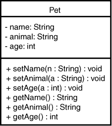
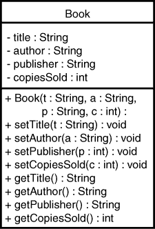

# Tony Gaddis Godfrey Muganda Java 入门：从控制结构到数据结构复习题答案 Addison Wesley 2012

# 复习题解答

## 第 1 章

### 选择题

1. `b`

2. `d`

3. `a`

4. `c`

5. `b`

6. `b`

7. `c`

8. `d`

9. `a`

10. `b`

11. `a`

12. `c`

13. `b`

14. `d`

### 找错

1. 算法在错误的时间执行了数学运算。它在获取这些变量的值之前将宽度乘以长度。

### 算法工作台

1. `Display "What is the customer's maximum amount of credit?"`

`Input maxCredit.`

`Display "What is the amount of credit used by the customer?"`

`Input creditUsed.`

`availableCredit = maxCredit – creditUsed.`

`Display availableCredit.`

2. `Display "What is the retail price of the item?"`

`Input retailPrice.`

`Display "What is the sales tax rate?"`

`Input taxRate.`

`salesTax = retailPrice * taxRate.`

`total = retailPrice + salesTax.`

`Display salesTax.`

`Display total.`

3. `Display "What is the account's starting balance?"`

`Input startingBalance.`

`Display "What is the total amount of the deposits made?"`

`Input deposits.`

`Display "What is the total amount of the withdrawals made?"`

`Input withdrawals.`

`Display "What is the monthly interest rate?"`

`Input interestRate.`

`balance = startingBalance + deposits – withdrawals.`

`interest = balance * interestRate.`

`balance = balance + interest.`

`Display balance.`

### 预测结果

1. 7

2. 28

### 简答

1. 主内存（或 `RAM`）存储了运行中的程序中的指令序列以及这些程序正在使用的数据。主内存（或 `RAM`）通常是易失性的。次级存储是一种可以长时间存储数据的内存——即使计算机没有电源。

2. `RAM` 通常是易失性的。

3. 操作系统是一组管理计算机硬件设备并控制其过程的程序。`Windows` 和 `UNIX` 是操作系统的示例。应用程序是指使计算机对用户有用的程序。这些程序解决特定问题或执行满足用户需求的通用操作。文字处理、电子表格和数据库软件包都是应用程序的示例。

4. 因为计算机仅能够直接处理机器语言指令。

5. 因为机器语言程序是二进制数流，而高级语言程序是由单词组成的。

6. 一个包含源代码的文件，源代码是程序员编写的代码。

7. `语法错误`（Syntax errors）是程序员犯的违反编程语言规则的错误。`逻辑错误`（Logical errors）是导致程序产生错误的错误。

8. 算法是执行任务或解决问题的一组定义的步骤。

9. 将源代码翻译成可执行代码的程序。

10. `application`（应用程序）是运行在计算机上的独立程序。`applet`（小程序）设计用于从 Web 服务器通过互联网传输，然后在 Web 浏览器中执行。

11. 因为浏览器在受限的环境中执行它们。

12. Java 虚拟机（`JVM`）程序。

13. 机器语言代码由 `CPU` 直接执行。`Byte code`（字节码）由 `JVM` 执行。

14. 因为 Java 字节码对所有计算机都是相同的。

15. 面对象编程

16. 当对象的内部数据对外部代码隐藏，并且对该数据的访问限制在对象的方法时，数据就受到了意外损坏的保护。此外，对象外部的代码不需要知道对象数据的格式或内部结构。代码只需要与对象的方法交互。当程序员更改对象内部数据的结构时，他或她也会修改对象的方法，以便它们能够正确地处理数据。然而，外部代码与方法交互的方式不会改变。

17. 对象的方法。

18. 文本编辑器。

19. 否

20. 字节码

21. `javac LabAssignment.java`

22. a) `LabAssignment.class`

b) 编译器生成的字节码。

c) `java LabAssignment`

# 复习题解答

## 第 2 章

### 选择题与判断题

1. `c`

2. `b`

3. `a`

4. `b` 和 `c`

5. `a`, `c` 和 `d`

6. `a`

7. `c`

8. `b`

9. `a`

10. `d`

11. `b`

12. `a`

13. `a`

14. `c`

15. `a`

16. `对`

17. `对`

18. `错`

19. `对`

20. `错`

21. `错`

### 预测结果

1. 0

2. 100

3. 8

4. 2

5. 23

### 找错

- 注释符号反反了。应该是 `/*` 和 `*/`。

- 头部结尾缺少分号。

- 第五行缺少左括号。

- 第一行的注释应该以正斜杠开头。

- 方法最后一行使用了字符串字面量，但应该是双引号的，例如：`"The value of"`。

- 方法内部传递的是 `C`，但应该是 `c`。

- `class` 缺少右括号。

### 算法工作台

1. `double temp, weight, age;`

2. `int months = 2, days, years = 3;`

3. a) `b = a + 2;`

b) `a = b * 4;`

c) `b = 3.14;`

d) `a = b – 8;`

e) `c = 'K';`

f) `c = 66;`

4. a) `12`

b) `4`

c) `4`

d) `6`

e) `1`

5. a) `3.287E6`

b) `-9.786E12`

c) `7.641E-3`

6.

```
System.out.print("Hearing in the distance");
System.out.print("Two mandins like creatures in the");
System.out.print("dark");
System.out.print("Creating the agony of ecstasy.");
System.out.println(" - George Barker");
```

7. `int speed, time, distance;`

`speed = 20;`

`time = 10;`

`distance = speed * time;` // 注意：此处保留原文错误

`System.println(distance)` //缺少分号

`double force, area, pressure;`

`force = 172.5;`

`area = 27.5;`

`pressure = area / force;`

`System.out.println(pressure);`

9. `double income;`

`// Create a Scanner object for keyboard input.`

`Scanner keyboard = new Scanner(System.in);`

`// Ask the user to enter his or her desired income System.out.print("Enter your desired income: "); income = keyboard.nextDouble();`

10.

`String str;`

`double income;`

`str = JOptionPane.showInputDialog("Enter your desired " +

"annual income.");`

`income = Double.parseDouble(str);`

11. `total = (float)number;`

### 简答

1. 多行样式

2. 单行

3. 自文档程序的编写方式使得通过阅读代码就能理解程序在做什么。

4. Java 是一种大小写敏感语言，这意味着它认为大写字母和小写字母是完全不同的字符。这很重要，因为 Java 程序中的某些单词必须完全小写。

5. `print` 和 `println` 方法是 `out` 对象的成员。`out` 对象是 `System` 类的成员。`System` 类是 Java API 的一部分。

变量声明告诉编译器变量的以及它将存储的数据类型。

### 7.

你应该始终为变量选择能够指示其用途的名称。相当平淡的名称 `x` 并没有提供关于变量用途的任何线索。

### 8.

选择一个与程序处理的数据类型相匹配的数据类型非常重要。需要考虑的因素包括变量中可能存储的最大值和最小值，以及这些值是整数还是小数。

### 9.

在这两种情况下，你都是在向变量中存储一个值。赋值语句可以出现在程序的任何地方。然而，初始化是变量声明的一部分。

### 10.

以 `//` 开头的注释是单行注释。`//` 字符之后到行尾的所有内容都被视为注释。

以 `/*` 开头的注释是多行注释。这些字符与下一组 `*/` 字符之间的所有内容都被视为注释。注释可以跨越多行。

### 11.

编程风格指的是程序员使用空格、缩进、空行和标点字符在视觉上安排程序源代码的方式。不一致的编程风格会给阅读代码的人带来困惑。

### 12.

原因之一是对于人类读者来说，`PI` 比数字 `3.14.` 更有意义。另一个原因是，每当常量表示的值需要更改时，我们只需要更改常量的初始化值。我们不需要在程序中搜索使用该值的每个语句。

### 13.

`javadoc SalesAverage.java`

### 14.

结果将是一个 `int`。

## 复习题答案

## 第 3 章

### 单选题与判断题

1. `b`

2. `d`

3. `a`

4. `b`

5. `c`

6. `d`

7. `a`

8. `b`

9. `a`

10. `a`

11. `a`

12. `c`

13. `c`

14. `b`

15. `c`

16. `False`

17. `True`

18. `True`

19. `True`

20. `False`

21. `True`

### 找错

1. 每个 `if` 子句都被分号提前终止了。

2. `=` 运算符应该是 `==`。

3. 条件执行的代码块应该被包含在大括号中。

4. `case` 表达式不能有关系运算符。它们必须是整数表达式。

5. `!` 运算符仅作用于变量 `x`，而不是表达式。代码应为：

```
if (!(x > 20))
```

6. 语句应该使用 `&&` 运算符而不是 `||` 运算符。

7. 语句应该使用 `||` 运算符而不是 `&&` 运算符。

8. `:` 和 `?` 的位置反反了。语句应该是：`z = (a < 10) ? 0 : 7;`

9. 应该使用 `equalsIgnoreCase` 方法而不是 `equals` 方法。

10. 语句缺少 `new` 关键字。它应该是：`DecimalFormat fmt = new DecimalFormat("00.00");`

### 算法工作台

1\.

```
if (y == 0)
x = 100;
```

2\.

```
if (y == 10)
x = 0;
else
x = 1;
```

3\.

```
if (sales < 10000)
commission = .10;
else if (sales <= 15000)
commission = .15;
else commission = .20;
```

4\.

```
if (minimum)
hours = 10;
```

5\.

```
if (amount1 > 10)
{
    if (amount2 < 100)
    {
        if (amount1 > amount2)
        {
            System.out.println(amount1);
        }
        else
        {
            System.out.println(amount2);
        }
    }
}
```

6. `if (grade >= 0 && grade <= 100) System.out.println("The number is valid.");`

7. `if (temperature >= -50 && temperature <= 150) System.out.printn("The number is valid.");`

8. `if (hours < 0 || hours > 80) System.out.println("The number is not valid.");`

9. `if (title1.compareTo(title2) < 0) System.out.println(title1 + " " + title2); else System.out.println(title2 + " " + title1);`

10\.

```
switch (choice)
{
    case 1:
        System.out.println("You selected 1."); break;
    case 2:
    case 3:
        System.out.println("You selected 2 or 3."); break;
    case 4:
        System.out.println("You selected 4."); break;
    default:
        System.out.println("Select again please.");
}
```

11. `C`, `A`

12. `"000.00"`

13. `"00"`

14. `"000"`

### 简答

1. 通过对语句进行缩进，你可以看出程序的哪部分

2. 标志位是一个布尔变量，当某些情况发生时发送信号。

3. 这是通过对条件执行的语句进行缩进，使它们在视觉上更加突出。

4. 缩进的代码只在某种条件下执行。

5. 没有缩进来告诉你程序的某部分

6. 标志位变量被设置为 `true`。

7. 它接收两个布尔操作数并创建一个为真的布尔表达式。

8. 它们判断两个之间是否存在特定的关系。

9. 它们是大于、小于、等于、不等于、大于等于小于。

10. 构造函数在对象创建时自动执行。它的目的是用数据初始化对象的属性并执行任何启动操作。

### 算法工作台

1\.

```
Scanner keyboard = new Scanner(System.in); int product = 0, num;
while (product < 100)
{
    num = keyboard.nextInt();
    product = num * 10;
}
```

2\.

```
char again;
String input;
Scanner keyboard = new Scanner(System.in);
do
{
    double num1, num2;
    System.out.print("Enter a number: "); num1 = keyboard.nextDouble();
    System.out.print("Enter another number: "); num2 = keyboard.nextDouble();
    System.out.println("Their sum is " +
(num1 + num2));
    System.out.print("Do you wish to do this " +
"again? (Y/N) ");
}
```

```
input = keyboard.readLine();

again = input.charAt(0);

} while (again == 'Y' || again == 'y');
```

### 3.

以下代码简单地打印数字并用空格分隔。

```java
for (int x = 0; x <= 1000; x += 10)
    System.out.print(x + " ");
```

以下代码打印用逗号分隔的数字。

```java
for (int x = 0; x <= 1000; x += 10)
{
    if (x < 1000)
        System.out.print(x + ", ");
    else
        System.out.print(x);
}
```

### 4.


```java
Scanner keyboard = new Scanner(System.in);
double total = 0.0, num;

for (int count = 0; count < 10; count++)
{
    System.out.print("Enter a number: ");
    num = keyboard.nextDouble();
    total += num;
}
System.out.println("The total is " + total);
```

### 5.

```java
double total = 0;

for (int num = 1, denom = 30; num <= 30; num++, denom--) 
    total += num / denom;
```

### 6.

```java
for (int row = 0; row < 10; row++)
{
    for (int col = 0; col < 15; col++)
        System.out.print('#');
    System.out.println();
}
```

### 7.

```java
Scanner keyboard = new Scanner(System.in);
int x;
do
{
    System.out.print("Enter a number: ");
    x = keyboard.nextInt();
} while (x > 0);
```

### 8.

```java
Scanner keyboard = new Scanner(System.in);
String input;
char sure = 'x';
while (sure != 'Y' && sure != 'N')
{
    System.out.print("Are you sure you want quit? ");
    input = keyboard.nextLine();
    sure = input.charAt(0);
}
```

### 9.

```java
for (int count = 0; count > 50; count++) 
    System.out.println("count is " + count);
```

### 10.

```java
int x = 50;

while (x > 0)
{
    System.out.println(x + " seconds to go.");
    x--;
}
```

### 11.

```java
int number;
Scanner keyboard = new Scanner(System.in);
System.out.print("Enter a number in the range " + "of 1 through 4: ");
number = keyboard.nextInt();
while (number < 1 || number > 4)
{
    System.out.print("Invalid number. Enter a " + "of 1 through 4: ");
    number = keyboard.nextInt();
}
```

### 12.

```java
Scanner keyboard = new Scanner(System.in);
String input;
System.out.print("Enter yes or no: ");
input = keyboard.nextLine();
while (!input.equals("yes") && !input.equals("no"))
{
    System.out.print("Invalid input. " + "Enter yes or no: ");
    input = keyboard.nextLine();
}
```

### 13.

```java
PrintWriter outFile = new PrintWriter("NumberList.txt");
for (int i = 1; i <= 100; i++)
    outFile.println(i);
outFile.close();
```

### 14.

```java
File file = new File("NumberList.txt");
Scanner inFile = new Scanner(file);

while (inFile.hasNext())
{
    int number = inFile.nextInt();
    System.out.println(number);
}
inFile.close();
```

### 15.

```java
File file = new File("NumberList.txt");
Scanner inFile = new Scanner(file);
int total = 0;

while (inFile.hasNext())
{
    int number = inFile.nextInt();
    total += number;
}
inFile.close();
System.out.println("The total is " + total);
```

### 16.

```java
FileWriter fwriter = new FileWriter("NumberList.txt", true);
PrintWriter outFile = new PrintWriter(fwriter);
```

### 简答

1. 在后置模式下，操作符放在操作数之后。在前置模式下，操作符放在变量操作数之前。后置模式会导致自增或自减操作在变量值在表达式中使用之后发生。前置模式会导致自增或自减先发生。

2. 前测试循环在每次迭代之前测试其条件。后测试循环在每次迭代之后测试其条件。后测试循环将至少执行一次。

3. 前测试循环在每次迭代之前测试其测试表达式。后测试循环在每次迭代之后测试其测试表达式。

4. 因为循环只有在其测试表达式为真的的情况下才会执行。

5. `while` 循环在前测试循环，而 `do-while` 循环后测试循环。

6. `while` 循环。

7. `do-while` 循环。

8. `for` 循环。

9. 使用累加器（accumulator）来跟踪。

10. `int x = 50;`

```java
while (x > 0)
{
    System.out.println(x + " seconds to go.");
    x--;
}
```

11. `int number;`

```java
Scanner keyboard = new Scanner(System.in);
System.out.print("Enter a number in the range " + "of 1 through 4: ");
number = keyboard.nextInt();
while (number < 1 || number > 4)
{
    System.out.print("Invalid number. Enter a " + "of 1 through 4: ");
    number = keyboard.nextInt();
}
```

```java
System.out.print("Enter yes or no: ");
input = keyboard.nextLine();
while (!input.equals("yes") && !input.equals("no"))
{
    System.out.print("Invalid input. " + "Enter yes or no: ");
    input = keyboard.nextLine();
}
```

13. `PrintWriter outFile = new PrintWriter("NumberList.txt");`

```java
for (int i = 1; i <= 100; i++)
    outFile.println(i);
outFile.close();
```

14. `File file = new File("NumberList.txt"); Scanner inFile = new Scanner(file);`

```java
while (inFile.hasNext())
{
    int number = inFile.nextInt();
    System.out.println(number);
}
inFile.close();
```

15. `File file = new File("NumberList.txt"); Scanner inFile = new Scanner(file); int total = 0;`

```java
while (inFile.hasNext())
{
    int number = inFile.nextInt();
    total += number;
}
inFile.close();
System.out.println("The total is " + total);
```

### 简答

1. 将一个大型且复杂的问题分解为多个较小且易于管理的部分。然后解决该问题的每个较小部分。

3. 参数（argument）是在调用方法时传递到方法中的值。形参变量（parameter variable）是在方法头定义中声明的变量，它在方法被调用时接收参数的值。

4. 在方法头部的圆括号之间。

5. 当将参数传递给方法时，只传递了参数的拷贝。方法无法访问实际的参数。

6. 因为它们在方法执行结束时会在内存中被销毁。

# 复习题答案

## 第 6 章

### 多选题与判断

1. a

2. b

3. d

4. c

5. b

6. a

7. d

8. b

9. b

10. a

11. c

12. c

13. b

14. d

15. 对

16. 对

17. 错

18. 错

19. 错

### 找错

1. 构造方法不能有返回类型，即使是 `void` 也不行。

2. 该方法的返回类型应该是 `int`。

3. 缺少圆括号。语句应该是：`Rectangle box = new Rectangle();`

4. 构造方法必须具有不同的参数列表。这两个都是空的。

5. `square` 方法必须具有不同的参数列表。它们都接受一个 `int`。



### 算法工作台

1. a) UML 图：

b) 类代码：

```java
public class Pet
{
    private String name; // 宠物的名字
    private String animal; // 动物类型 
    private int age; // 宠物的年龄

    /**
    setName 方法
    @param n 宠物的名字。
    */
    public void setName(String n)
    {
        name = n;
    }

    /**
    setAnimal 方法
    @param a 动物类型。
    */
    public void setAnimal(String a)
    {
        animal = a;
    }

    /**
    setAge 方法
    @param a 宠物的年龄。
    */
    public void setAge(int a)
    {
        age = a;
    }

    /**
    getName 方法
    @return 宠物的名字。
    */
    public String getName()
    {
        return name;
    }

    /**
    getAnimal 方法
    @return 动物类型。
    */
    public String getAnimal()
    {
        return animal;
    }

    /**
    getAge 方法
    @return 宠物的年龄。
    */
    public int getAge()
    {
        return age;
    }
}
```

2. a) 构造方法：

```java
public Book(String t, String a, String p, int c)
{
    title = t;
    author = a;
    publisher = p;
    copiesSold = c;
}
```

b) 访问器和修改器方法：

```java
public void setTitle(String t)
{
    title = t;
}

public void setAuthor(String a)
{
    author = a;
}

public void setPublisher(String p)
{
    publisher = p;
}

public void setCopiesSold(int c)
{
    copiesSold = c;
}

{
    return title;
}

public String getAuthor()
{
    return author;
}

public String getPublisher()
{
    return publisher;
}

public int getCopiesSolde()
{
    return copiesSold;
}
```



c) UML 图：

3. a)

```java
public Square()
{
    sideLength = 0.0;
}
```

b) `public Square(double s)`

{

    sideLength = s;

}

```

4. a) 在消除重复、对象和原始值后，潜在的类有：`bank`、`account` 和 `customer`
b) 对于这个问题来说，唯一需要的类是 `account`。
c) `account` 类知道自己的余额和利率。`account` 可以计算产生的利息。

### 简答

1. 类是程序语句的集合，规定了特定类型对象可能拥有的属性和方法。你应该将类类为描述对象的“蓝图”。类的实例是存在内存中的实际对象。

2. 类类似于蓝图。


3. 访问器（accessor method）是从类的字段获取值但不改变它的方法。修改器（mutator method）是将值存储在字段中或其他方式更改字段值的方法。

4. 当对象的字段对外部代码隐藏时，这些字段就受到了意外损坏的保护。将类的所有字段都设为 `private` 并通过方法提供访问的访问是一个好主意。

5. 属于同一个类的方法。

6. 它在内存中创建一个对象（类的实例）。

7. 它在当前文件夹或目录中查找 `Customer.class` 文件。如果该文件不存在，编译器会搜索 `Customer.java` 文件并对其进行编译。这会创建 `Customer.class` 文件，使得 `Customer` 类变得可用。编译器在搜索 `Account` 类时也遵循相同的步骤。

8. 因为它们在对象创建时被执行。

9. 如果你没有为类编写构造方法，Java 会自动提供一个。

10. 无参数构造方法。

11. 通过它们的签名，签名包括方法名和方法参数的数据类型，并按照它们出现的顺序排列。

12. 可以创建同一个方法的多个版本，以不同的方式执行操作。


# 复习题答案

## 第 7 章

### 多选题与判断

1. c
2. a
3. c
4. a
5. d
6. a
7. b
8. c
9. b
10. a
11. c
12. 对
13. 错
14. 错
15. 对
16. 对
17. 错
18. 错
19. 错
20. 对

### 找错

1. 包名中缺少了 `x`。语句应该是：`import javax.swing.*;`
2. `actionPerformed` 方法必须有一个 `ActionEvent` 参数。
3. `GridLayout` 构造函数的参数反反了。这创建了 10 行 5 列。
4. `add` 方法的第二个参数应该是 `BorderLayout.NORTH`。
5. 你不需要创建 `BorderFactory` 的实例。你应该调用它的静态方法来创建一个 `Border` 对象。语句应该是：`panel.setBorder(BorderFactory.createTitledBorder("Choices"));`


### 算法工作台

1. `myWindow.setSize(500, 250);`
2. `myWindow.setDefaultCloseOperation(JFrame.EXIT_ON_CLOSE);` 3. `myWindow.setVisible(true);`
4. `myButton.setBackground(Color.white);`
`myButton.setForeground(Color.red);`
5. `setLayout(new FlowLayout(FlowLayout.LEFT));` 6. `setLayout(new GridLayout(5, 10));`
7. `panel.add(button, BorderLayout.WEST);`
8. 

```java
// 创建三个单选按钮

JRadioButton radio1 = new JRadioButton("Option 1", true); 
```


`JRadioButton radio2 = new JRadioButton("Option 2");`

`JRadioButton radio3 = new JRadioButton("Option 3");`

```java
// 创建一个 ButtonGroup 对象。
ButtonGroup group = new ButtonGroup();

// 将单选按钮添加到 Button 对象中。
group.add(radio1);
group.add(radio2);
group.add(radio3);
```

9. `panel.setBorder(BorderFactory.createLineBorder(Color.blue, 2));`

### 简答

1. 窗口从视图中隐藏，但应用程序不会结束。

2. 这防止了组件被调整大小。`BorderLayout` 管理器会调整大小以填充区域中的任何额外空间。当你将组件放在面板中，然后将面板放在 `BorderLayout` 区域时，被调整大小的是面板而不是它包含的组件。

单选按钮通常用于在多个可能的项目中选择一个。由于单选按钮之间通常存在互斥关系，因此只能选择其中一个项目。复选框可以单独出现也可以一组出现，允许用户进行“是/否”或“开启/关闭”的选择。由于复选框之间通常不存在互斥关系，当它们一组出现时，用户可以选择其中任意数量。

### 4.

通过创建一个派自 `JPanel` 的类。

## 复习题答案

## 第 8 章

### 单选题与判断题

1. b
2. a
3. b
4. d
5. c
6. c
7. b
8. a
9. c
10. a
11. a
12. True
13. False
14. True
15. True
16. True
17. True
18. True
19. False
20. True
21. True

### 找错

1. 大小声明符不能为负。
2. 初始化列表必须包含在大括号中。
3. 循环使用了 1 到 10 作为下标。它应该使用 0 到 9。
4. 对于数组，`length` 是一个字段。对于 `String`，`length` 是一个方法。这段代码使用 `length` 的方式就像它在数组中是方法而在 `String` 中是字段。
5. 单词应该使用下标，例如 `words[0].toUpperCase()`。

### 算法工作台

1.

```java
for (int i = 0; i < 20; i++)
    System.out.println(names[i]);
```

2.

```java
for (int i = 0; i < 100; i++)
    numberArray2[i] = numberArray1[i];
```

3.

a)

```java
String[] scientists = {"Einstein", "Newton", "Copernicus", "Kepler"};
```

b)

```java
for (int i = 0; i < scientists.length; i++) 
    System.out.println(scientists[i]);
```

c)

```java
int total = 0;
for (int i = 0; i < scientists.length; i++) 
    total += scientists[i].length();
System.out.println("The total length is " + total);
```

4. a)

```java
// 定义数组。
final int NUM_COUNTRIES = 12;
String[] countries = new String[NUM_COUNTRIES]; 
long[] populations = new long[NUM_COUNTRIES];
```

b)

```java
// 显示它们内容。
for (int i = 0; i < NUM_COUNTRIES; i++) {
    System.out.println("The population of " + countries[1] + " is " + populations[i]);
}
```

5. a)

```java
// 定义数组。
int[] id = new int[10];
double[] weeklyPay = new double[10];
```

b)

```java
// 显示每个员工的周总薪。
for (int i = 0; i < 10; i++) {
    System.out.println("The pay for employee " + id[i] + " is $" + weeklyPay[i]);
}
```

6.

```java
final int NUM_ROWS = 30;
final int NUM_COLS = 10;
int[][] grades = new int[NUM_ROWS][NUM_COLS];
```

7.

```java
final int NUM_ROWS = 30;
final int NUM_COLS = 10;
int total = 0;
double average;
for (int row = 0; row < grades.length; row++) {
    for (int col = 0; col < grades[row].length; col++) {
        total += grades[row][col];
    }
}
average = (double) total / (NUM_ROWS * NUM_COLS);
```

8. a)

```java
numberArray[0][0] = 145;
```

b)

```java
numberArray[8][10] = 18;
```

9.

```java
double total = 0.0; // 累加器
// 求数组值的和。
for (int row = 0; row < 10; row++) {
    for (int col = 0; col < 20; col++)
        total += values[row][col];
}
```

10. a) 求数组中每行的和：

```java
int total; // 累加器
// 显示每行的和。
for (int row = 0; row < 29; row++) {
    // 设置累加器。
    total = 0;
    // 求某行的和。
    for (int col = 0; col < 5; col++)
        total += days[row][col];
    // 显示该行的总和。
    System.out.println("The total for row " + row + " is " + total);
}
```

11. a)

```java
// 创建数组。
ArrayList<String> cars = new ArrayList<>();
```

b)

```java
// 显示内容。
for (String car : cars)
    System.out.println(car);
```

c)

```java
// 向 ArrayList 中添加元素。
cars.add("Porsche");
cars.add("BMW");
cars.add("Jaguar");
```

d)

```java
// 删除元素。
cars.remove(0);
```

### 简答

1. 访问非静态成员。

2. 它们可以根据需要从类直接调用。它们用于创建不需要收集数据的工具类。

3. 当变量作为参数传递时，传递的是变量的内容。接收方法无法访问变量本身。当对象作为参数传递时，传递的是对象的引用（即对象的地址）。这允许接收方法访问该对象。

4. 默认的 `equals` 方法在所比较的两个对象的内存地址相同时返回 `true`。

5. 这意味着存在聚合关系。当类 B 的对象是类 A 的成员时，可以说类 A “拥有”一个类 B。

6. 程序将崩溃。

7. 这是不建议的，因为它允许访问私有字段。这种情况的例外是字段是 `String` 对象。这是因为 `String` 对象是不可变的，意味着它们不能被更改。

8. 关键字 `this` 是引用变量的名称，对象可以使用它引用自己。它在所有非静态方法中都可用。

9. a) `Color`

b) `Color.RED`, `Color.ORANGE`, `Color.GREEN`, `Color.BLUE`

c) `Color myColor = Color.BLUE;`

11. 当没有引用它时。

## 复习题答案

## 第 10 章

### 单选题与判断

1. c
2. b
3. a
4. a
5. a
6. c
7. b
8. a
9. d
10. b
11. a
12. c
13. d
14. a
15. 错
16. 对
17. 错
18. 对
19. 对
20. 错
21. 对
22. 错
23. 错

### 找错

1. `valueOf` 方法是 `static` 的。应该这样调用：`str = String.valueOf(number);`

2. 你不能使用 `=` 操作初始化 `StringBuilder` 对象。必须将字符串作为参数传递给构造函数，例如：`StringBuilder name = new StringBuilder("Joe Schmoe");`

3. 第一个字符位于位置 0，所以该语句应该是：`str.setCharAt(0, 'Z');`

4. 如果要使用空白以外的字符作为分隔符，则必须将分隔符作为参数传递给 `StringTokenizer` 构造函数，例如：`StringTokenizer strTokenizer = new StringTokenizer("One;Two;Three", ";");`

### 算法工作

1.

```java
if (Character.toUpperCase(choice) == 'Y') Or
if (Character.toLowerCase(choice) == 'y')
```

2.

```java
int total = 0;
for (int i = 0; i < str.length(); i++)
{
    if (str.charAt(i) == ' ')
    total++;
}
```

3.

```java
int total = 0;
for (int i = 0; i < str.length(); i++)
{
    if (Character.isDigit(str.charAt(i)))
    total++;
}
```

4.

```java
int total = 0;
for (int i = 0; i < str.length(); i++)
{
    if (Character.isLowerCase(str.charAt(i)))
    total++;
}
```

5.

```java
public static boolean dotCom(String str)
{
    boolean status;
    if (str.endsWith(".com"))
    status = true;
    else
    status = false;
    return status;
}
```

6.

```java
public static boolean dotCom(String str)
{
    boolean status;
    String str2 = str.toLowerCase();
    if (str2.endsWith(".com"))
    status = true;
    else
    status = false;
    return status;
}
```

7.

```java
public static void upperT(StringBuilder str)
{
    for (int i = 0; i < str.length(); i++)
    {
        if (str.charAt(i) == 't')
        str.setCharAt(i, 'T');
    }
}
```

8. a)

```java
String str = "cookies>milk>fudge:cake:ice cream"; 
StringTokenizer strTok = new StringTokenizer(str, ">:"); 
while (strTok.hasMoreTokens())
{
    System.out.println(strTok.nextToken());
}
```

b)

```java
String str = "cookies>milk>fudge:cake:ice cream"; 
String[] strTok = str.split("[>:]"); 
for (int i = 0; i < strTok.length; i++)
{
    System.out.println(strTok[i]);
}
```

9.

```java
if (d <= Integer.MAX_VALUE)
i = (int) d;
```

10.

```java
System.out.println(Integer.toBinaryString(i)); 
System.out.println(Integer.toHexString(i));
System.out.println(Integer.toOctalString(i));
```

### 简答

1. 这通过减少必须创建并随后由垃圾回收器移除的 `String` 对象数量来提高程序的效率。

2. 当你对用户输入的字符串进行分词，并且使用空白以外的字符作为分隔符时，你可能需要在分词之前对其进行裁剪。否则，如果用户输入了前空白字符，它们将成为第一个标记的一部分。同样，如果用户输入了尾空白字符，它们将成为最后一个标记的一部分。

3. 将数字转换为字符串。

4. 每个数值包装类都有一个名为 `MAX_VALUE` 和 `MIN_VALUE` 的 final static 字段。这些字段持有该数据类型的最大值和最小值。

## 复习题答案

## 第 11 章

### 单选题与判断

1. b
2. c
3. d
4. b
5. a
6. a
7. c
8. b
9. a
10. c
11. a
12. d
13. c
14. b
15. c
16. a
17. c
18. 对
19. 对
20. 错
21. 对
22. 错
23. 错
24. 错
25. 对
26. 错
27. 对
28. 错
29. 对

### 找错

1. 子类头应该使用 `extends`。

2. `StringBuilder` 对象不能用 `=` 初始化。

3. `Vehicle` 类。

4. `getMilesGallon` 应该返回 `double`。

### 算法工作

1.

```java
if (Character.toUpperCase(choice) == 'Y') Or
if (Character.toLowerCase(choice) == 'y')
```

2.

```java
int total = 0;
for (int i = 0; i < str.length(); i++)
{
    if (str.charAt(i) == ' ')
    total++;
}
```

3.

```java
int total = 0;
for (int i = 0; i < str.length(); i++)
{
    if (Character.isDigit(str.charAt(i)))
    total++;
}
```


## 第 13 章复习题答案

### 算法工作台（Algorithm Workbench）

4. 以下代码统计字符串中大写字母的数量：

```java
int total = 0;
for (int i = 0; i < str.length(); i++)
{
    if (Character.isLowerCase(str.charAt(i)))
    total++;
}
```

5. 以下方法检查字符串是否以 `.com` 结尾：

```java
public static boolean dotCom(String str)
{
    boolean status;
    if (str.endsWith(".com"))
    status = true;
    else
    status = false;
    return status;
}
```

6. 以下方法检查字符串是否以 `.com` 结尾（不区分大小写）：

```java
public static boolean dotCom(String str)
{
    boolean status;
    String str2 = str.toLowerCase();
    if (str2.endsWith(".com"))
    status = true;
    else
    status = false;
    return status;
}
```

7. 以下方法将字符串中所有小写字母 `t` 替换为大写字母 `T`：

```java
public static void upperT(StringBuilder str)
{
    for (int i = 0; i < str.length(); i++)
    {
        if (str.charAt(i) == 't')
        str.setCharAt(i, 'T');
    }
}
```

8. a) 使用 `StringTokenizer` 对字符串进行分词：

```java
String str = "cookies>milk>fudge:cake:ice cream";
StringTokenizer strTok = new StringTokenizer(str, ">:");
while (strTok.hasMoreTokens())
{
    System.out.println(strTok.nextToken());
}
```

b) 使用 `split` 方法对字符串进行分词：

```java
String str = "cookies>milk>fudge:cake:ice cream";
String[] strTok = str.split("[>:]");
for (int i = 0; i < strTok.length; i++)
{
    System.out.println(strTok[i]);
}
```

9. 将 `double` 类型变量 `d` 转换为 `int` 类型变量 `i`（前提是 `d` 的值不超过 `int` 类型的最大值）：

```java
if (d <= Integer.MAX_VALUE)
i = (int) d;
```

10. 输出整数 `i` 的二进制、十六进制和八进制表示：

```java
System.out.println(Integer.toBinaryString(i));
System.out.println(Integer.toHexString(i));
System.out.println(Integer.toOctalString(i));
```

### 简答

1. 这通过减少必须创建并随后由垃圾回收器移除的 `String` 对象数量来提高程序的效率。

2. 当你对用户输入的字符串进行分词，并且使用空白以外的字符作为分隔符时，你可能需要在分词之前对其进行裁剪。否则，如果用户输入了前空白字符，它们将成为第一个标记的一部分。同样，如果用户输入了尾空白字符，它们将成为最后一个标记的一部分。

3. 当对象之间存在“是一个”关系时，意味着特殊对象拥有普通对象的所有特征。

4. `Animal` 是父类，`Dog` 是子类。

5. 类的保护成员可以被同类的方法直接访问。此外，保护成员可以被位于同一保护包中的任何类访问。

6. 不。

7. 父类。

8. 重载是指方法与另一个方法名称相同，但参数列表不同。虽然重载方法名称相同，但签名不同。当一个方法重写另一个方法时，它们具有相同的签名。

9. 父类引用可以引用自父类的对象。

10. 在运行时。

11. 抽象方法出现在父类中，但期望在子类中重写。抽象方法只有头部没有方法体。

12. 抽象类本身不实例化，而是作为其他类的父类。抽象类表示所有自它的类的通用或抽象形式。

13. 类只能继承一个父类，但 `Java` 允许类实现多个接口。

`finally` 块必须出现在 `catch` 块之后。

3. `catch (Exception e)` 语句及其块应该出现在其他 `catch` 块之后，因为这是一个更通用的异常。

## 算法工作台（Algorithm Workbench）

1. B D

2. B D E

3. 以下方法在数组中搜索指定值，并返回其索引；如果未找到，则抛出异常：

```java
public static int arraySearch(int[] array, int value) throws Exception
{
    int i; // 循环控制变量
    int element; // 找到元素的索引
    boolean found; // 表示搜索结果的标志

    // 元素 0 是搜索的起始点。
    i = 0;

    // 存储默认值 element 和 found。
    element = -1;
    found = false;

    // 搜索数组。
    while (!found && i < array.length)
    {
        if (array[i] == value)
        {
            found = true;
            element = i;
        }
        i++;
    }

    if (element == -1)
        throw new Exception("Element not found.");
    else
    return element;
}
```

4. `throw new IllegalArgumentException("Argument cannot " + "be negative.");`

5. 以下类表示负数异常：

```java
public class NegativeNumber extends Exception
{
    /**
    无参数构造函数
    */
    public NegativeNumber()
    {
        super("Error: number");
    }

    /**
    以下构造函数接收引起异常的数字。
    @param n 数字。
    */
    public NegativeNumber(int n)
    {
        super("Error: number: " + n);
    }
}
```

6. `throw new NegativeNumber();`

或者

`throw new NegativeNumber(number);`

7. `public int getValueFromFile() throws IOException, FileNotFoundException`

8. 以下代码调用 `getValueFromFile` 方法并处理可能抛出的异常：

```java
try
{
    value = getValueFromFile();
}
catch (FileNotFoundException e)
{
    System.out.println(e.getMessage());
}
catch (IOException e)
{
    System.out.println(e.getMessage());
}
```

9. `FileOutputStream fstream = new FileOutputStream("Configuration.dat");`

10. `RandomAccessFile randomFile = new RandomAccessFile("Customers.dat", "rw");`

11. 以下代码将对象 `r` 序列化并写入文件：

```java
FileOutputStream outStream = new FileOutputStream("Object.dat");
ObjectOutputStream objectOutputFile = new ObjectOutputStream(outStream);
objectOutputFile.writeObject(r);
```

## 短答（Short Answer）

1. 异常对象是为了响应发生的错误而创建的。

2. 程序拦截并响应异常。

3. 控制权传递给调用栈中的上方法（即调用异常的方法）。如果该方法无法处理异常，控制权再次向上调用栈传递给上一个方法。直到到达 `main` 方法。如果 `main` 方法没有处理异常，程序将停止并由默认异常处理器处理。

4. `finally` 语句的块在 `try` 块执行后执行，如果抛出了异常，则在任何 `catch` 块执行后执行。`finally` 块中的语句无论是否发生异常都会执行。

5. `try/catch` 构造之后的语句。

6. 是。当同一个 `try` 语句中处理多个异常且某些异常之间通过继承相关联时，你应该在通用异常类之前处理具体的异常类。否则，旨在捕捉通用异常的 `catch` 语句可能会通过多态捕捉更具体的异常。

7. 任何继承自 `Throwable` 类的对象。

8. 当方法代码可能抛出检查异常且方法未处理时，该方法必须有一个 `throws` 子句。

9. 未检查异常是继承自 `Error` 类或 `RuntimeException` 类的异常。你不应该处理这些异常，因为导致它们的情况很难在程序内部处理。所有异常（即未继承自 `Error` 或 `RuntimeException` 的异常）都是*检查*异常。这些是你应该在程序中处理的异常。

10. `throw` 语句导致异常的抛出。`throws` 子句告知编译器方法抛出了异常。

11. 文本文件中存储的所有数据都以文本格式化。即使是数值数据在存储到文本文件中也会被转换为文本。你可以通过文本编辑器（如记事本）查看存储在文本中的数据。在二进制文件中，数据不是以文本格式化的。因此，你无法用文本编辑器查看二进制文件的内容。

12. 使用顺序访问时，当打开文件输入时，其读取位置位于文件开头。这意味着第一次从文件中读取数据时，数据将从开始读取。随着读取的继续，文件的读取位置顺序通过文件内容。在随机文件访问中，程序可以立即跳转到文件的任何位置，而无需先读取之前的字节。顺序访问和随机文件访问的区别就像磁带和光盘的区别。在听 CD 时，不需要听或快进过不需要的歌曲。你只需跳转到你想听的曲目即可。

13. 当对象被序列化时，它被转换为一系列字节并写入文件。当对象被反序列化时，这些字节被转换回对象。

## 复习题答案（Answers to Review Questions）

## 第 13 章

**单选题和判断题**

1. d

2. c

3. b

4. d

5. a

6. c

7. c

8. a

9. b

10. d

11. c

12. a

13. a

14. c

15. b

16. d

17. a

18. c

19. b

20. c

21. a

22. True

23. False

24. True

25. False

26. False

27. True

28. True

29. True

30. False

31. True

32. True

33. False

34. False

35. True

### 找错（Find the Error）

1. `false` 应该传递给 `setEditable` 方法。

2. 代码应该是：`list.setBorder(BorderFactory.createLineBorder(Color.black, 1));`

3. 你应该将 `list` 作为 `JScrollPane` 构造函数的参数：`scrollPane = new JScrollPane(list);`

4. 语句应该是：`selectedName = (String) nameBox.getSelectedItem();`

5. 语句应该是：`label.setIcon(image);`

6. 你将一个 `JMenu` 对象作为参数传递给 `JMenuBar` 对象的 `add` 方法：

```java
JMenuBar menuBar = new JMenuBar();
menuBar.add(menu);
```

### 10

```java
JTextArea textInput = JTextArea(10, 15);
JScrollPane scrollPane = new JScrollPane(textInput);
textInput.setLineWrap(true);
textInput.setWrapStyleWord(true);
```

### 11

```java
// Create an Open menu item.
JMenuItem openItem = new JMenuItem("Open");
openItem.setMnemonic(KeyEvent.VK_O);
openItem.addActionListener(new OpenListener());

// Create a Print menu item.
JMenuItem printItem = new JMenuItem("Print");
printItem.setMnemonic(KeyEvent.VK_P);
printItem.addActionListener(new PrintListener());

// Create an Exit menu item.
JMenuItem exitItem = new JMenuItem("Exit");
exitItem.setMnemonic(KeyEvent.VK_X);
exitItem.addActionListener(new ExitListener());

// Create a JMenu object for the File menu.
JMenu fileMenu = new JMenu("File");
fileMenu.setMnemonic(KeyEvent.VK_F);

// Add the menu items to the File menu.
fileMenu.add(openItem);
fileMenu.add(printItem);
fileMenu.add(exitItem);

// Create the menu bar.
JMenuBar menuBar = new JMenuBar();

// Add the file menu to the menu bar.
menuBar.add(fileMenu);

// Set the window's menu bar.
setJMenuBar(menuBar);
```

### 12

```java
JSlider slider = new JSlider(JSlider.HORIZONTAL, 0, 1000, 500);
slider.setMajorTickSpacing(100);
slider.setMinorTickSpacing(25);
slider.setPaintTickMarks(true);
slider.setPaintLabels(true);
```

## 短答

1. 单选模式

2. `JComboBox`

3. 不可编辑的组合框将按钮与列表结合，允许用户仅从列表中选择项目。可编辑的组合框将文本字段和列表结合。除了从列表中选择项目外，用户还可以向文本字段输入内容。组合框的默认类型是不可编辑的。

4. 你可以将文本作为参数传递给构造函数，然后将 `ImageIcon` 对象传递给 `setIcon` 方法。另一种方法是将文本、`ImageIcon` 对象以及指定水平对齐的 `int` 传递给 `JLabel` 构造函数。

5. 快捷键（mnemonic）是键盘上的一个键，你结合 `Alt` 键按下它来快速访问按钮等组件。当你为按钮分配快捷键时，用户可以通过按住 `Alt` 键并按下快捷键来点击按钮。

6. 该字母的第一次出现处带有下划线。

7. 工具提示（tool tip）是当用户将鼠标指针悬停在组件上时显示在一个小框中的文本。该框通常提供该组件功能的简短描述。

8. 将它们添加到 `ButtonGroup` 对象中。

9. 项目被取消选中，导致勾号消失。被选中的菜单项组件还会产生动作事件。

10. `Dialog`, `DialogInput`, `SansSerif`, `Serif` 和 `Monospaced`

11. 因为当用户移动 `JSlider` 组件的滑块时，它只会取其设定范围内的值。

12. `Metal`, `Motif` 和 `Windows`

## 复习题答案

## 第 14 章

### 多选题与判断题

1. c

2. a

3. b

4. c

5. b

6. a

7. d

8. c

9. c

10. b

11. a

12. b

13. d

14. b

15. c

16. a

17. c

18. b

19. c

20. a

21. b

22. d

23. 对


24. 错

25. 对

26. 错

27. 错

28. 错

29. 对

30. 错

31. 对

32. 错

33. 错

34. 对

35. 错

### 找错

1. 标签应该指定文件 `MyApplet.class` 而不是 `MyApplet.java`。

2. 方法应该先调用父类的 `paint` 方法。

3. 调用 `repaint` 而不是 `paint`。

4. `JPanel` 对象应该重写 `paintComponent` 而不是 `paint`。

5. 类必须提供由 `MouseListener` 接口指定的所有方法。

6. 类不是实现适配器类，而是扩展它。应该使用 `extends` 而不是 `implements`。

### 算法工作台

1. `<center><h1>我的首页</h1></center>`

2. `<applet code="MyApplet.class" width=300 height=200></applet>`

3. 第 1 行：将 `JFrame` 改为 `JApplet`

   第 3 行：改为 `public void init()`

   第 5 行：删除

   第 6 行：删除

   第 8 行：删除

   第 9 行：删除

   第 15 行：删除

   第 16 行：删除

   第 17 行：删除

4. a) `g.drawRect(50, 75, 100, 200)`

   b) `g.fillRect(10, 90, 300)`

   c) `g.setColor(Color.blue)`

   d) `g.setColor(Color.red)`

   e) `g.drawLine(0, 150)`

   f) `int[] xCoords = {10, 50, 50}; int[] yCoords = {25, 25, 50};`

   g) `g.fillPolygon(xCoords, yCoords, 4)`

5. `private class MyListener extends MouseAdapter`

   ```java
   public void mouseMoved(MouseEvent e) { ... }
   ```

6. `Timer tmr = new Timer(500, new MyListener());`

## 短答

1. 它由系统执行。

2. 限制如下：

   - Applet 不能在系统中删除、读取内容或创建文件。

   - Applet 不能在系统中运行任何程序。

   - Applet 不能在系统中执行操作系统过程。

   - Applet 无法获取用户信息。

   - Applet 不能建立除传输它的服务器以外的网络连接。

   - 如果 Applet 显示窗口，它会自动显示如“警告：Applet”之类的消息。

3. Applet 非常重要，因为它们可以用于扩展网页的功能。网页通常用超文本标记语言（HTML）编写。然而 HTML 是有限的，因为它仅仅描述网页的内容和布局，并创建到其他文件和网页的链接。HTML 不具备计算和交互等高级能力。程序员可以编写 Java Applet 来执行这些操作并与网页关联。

4. 因为浏览器会自动使 applet 可见。

5. 某些浏览器如 Internet Explorer 和旧版本的 Netscape Navigator 直接不支持 Swing 类。这些浏览器需要插件才能运行使用 Swing 组件的 applet。如果你为他人的计算机上编写 applet，无法保证他们拥有所需的插件。如果是这种情况，你应该在 applet 中使用 AWT 类而不是 Swing 类。

6. 左上角的坐标是 (0, 0)。右上角的坐标是 (599, 0)。左下角的坐标是 (0, 399)。右下角的坐标是 (599, 399)。中心点的坐标是 (299, 199)。

7. 当组件首次显示时调用，并在每当组件需要重绘时再次被调用。

如果你想加载音频文件并将其保留在内存中以便多次播放，或者如果你想重复播放该音频文件。

*Gaddis: Starting Out with Java: From Control Structures through Data Structures, 2/e © 2012 Pearson Education* 1

# 复习题答案

## 第 15 章

### 单选题与判断

1. b

2. a

3. d

4. c

5. d

6. a

7. 对

8. 错

9. 错

10. 错

### 找错

1. 递归方法 `myMethod` 缺少基础情况。因此，它没有停止的方法。

### 算法工作台

1.

```java
public static void main(String [] args)
{
    String str = "test string";
    display(str, 0);
}

public static void display(String str, int pos)
{
    if (pos < str.length())
    {
        System.out.print(str.charAt(pos));
        display(str, pos + 1);
    }
}
```

2.

```java
public static void main(String [] args)
{
    String str = "test string";
    display(str, str.length()-1);
}

public static void display(String str, int pos)
{
    if (pos >= 0)
    {
        System.out.print(str.charAt(pos));
        display(str, pos - 1);
    }
}
```

3. 10

4. 0

1

2

3

4

5

6

7

8

9

10

5. 55

6.

```java
public static void sign(int n)
{
    if (n > 0)
    {
        System.out.println("No Parking");
        sign(n - 1);
    }
}
```

7.

```java
public static int factorial(int num)
{
    int fac = 1;
    for (int i = 1; i <=num; i++)
    {
        fac = fac * i;
    }
    return fac;
}
```

*Gaddis: Starting Out with Java: From Control Structures through Data Structures, 2/e © 2012 Pearson Education* 3

### 简答

1. 迭代算法使用循环来解决问题，而递归算法使用调用自身的方法。

2. 递归算法的基础情况是什么？递归情况又是什么？

基础情况是指不需要递归即可解决问题的情况。递归情况使用递归来解决问题，并始终将问题简化为原问题的更小版本。

3. 对于问题 3，当 `arg` 等于 10 时达到基础情况。对于问题 4，当 `arg` 等于 10 时也达到基础情况。对于问题 5，当 `num` 小于或等于 0 时达到基础情况。

4. 间接递归，因为它涉及多个方法的调用。

5. 递归算法通常没有迭代算法高效。这是因为方法调用需要 JVM 执行若干操作，例如为参数和局部变量分配内存，以及存储方法终止后返回的程序位置地址。

6. 通过每次递归调用缩小问题，最终将达到基础情况并停止递归。

7. 参数的值的值通常会减小。

***Starting Out with Java: From Control Structures through Data Structures***

# 复习题答案

## 第 16 章

### 单选题与判断

1. a

2. b

3. a

4. b

5. c

6. d

7. a

8. d

9. b

10. c

11. 对

12. 错

13. 对

14. 错

### 找错

1. 数组中的数字没有排序。

### 算法工作台

1. 数组大小 50 元素 | 500 元素 | 10,000 元素 | 100,000 元素 | 10,000,000 元素 |

|---|---|---|---|---|---|

顺序查找（平均比较次数） | 25 | 250 | 5,000 | 50,000 | 5,000,000 |

顺序查找（最大比较次数） | 50 | 500 | 10,000 | 100,000 | 10,000,000 |

二分查找（最大比较次数） | 6 | 9 | 14 | 17 | 24 |

### 简答

1. 它必须读取数组的所有 10,000 个元素。

2. N/2 次

3. 一次。

4. 十次

5. 因为它一次只移动数组中的一个元素。

6. 选择排序通常的交换次数较少，因为它直接将项目移动到数组中的最终位置。

© 2012 Pearson Education

7. • 将 1 移动到元素 0。数组现在看起来是这样：1, 4, 3, 2

• 将 2 移动到元素 1。数组现在看起来是这样：1, 2, 3, 4

• 数值现在已经好序了。

8. • 将 1 移动到元素 0。数组现在看起来是这样：1, 4, 3, 2

• 将 2 移动到元素 1。数组现在看起来是这样：1, 2, 3, 4

• 数值现在已经好序了。

9. • 将 1 移动到元素 0。数组现在看起来是这样：1, 4, 3, 2

• 将 2 移动到元素 1。数组现在看起来是这样：1, 2, 3, 4

• 数值现在已经好序了。

© 2012 Pearson Education

1. JCF 中的抽象类为它们所实现的接口中指定的大多数方法提供了实际的方法定义。提供这些抽象类为创建自己的列表（list）或集合（set）类的开发者提供了便利。开发者可以编写一个扩展这些抽象类的类，从而继承它定义的方法。这比直接实现一个 JCF 接口并为该接口中指定的所有方法编写定义要容易得多。

2. `get` 和 `size`

3. 代码更于维护。你可以更改具体类，而无需更改任何引用它的变量的类型。

4. `iterator`（迭代器）是一个可以用于一个接一个地检索集合中元素的对象。

5. 你不需要自己实例化列表迭代器。相反，你调用 `List` 对象的 `listIterator` 方法之一，该方法会为你创建列表迭代器。

© 2012 Pearson Education

6. 被替换的元素是使用 `next` 或 `previous` 方法从迭代器返回的最后一个元素。

7. 它将其转换为使用 `iterator` 的传统循环。

8. `LinkedList`

9. `LinkedList`

10. `Vector`

11. 是

12. 当哈希算法为两个不相等的对象产生相同的哈希码时，就会发生冲突。

13. map 中的每个元素由两部分组成：`key`（键）和 `value`（值）。map 在 `key` 和 `value` 之间建立关联，并允许你通过搜索 `key` 来检索 `value`。

14. 如果在应用程序执行期间多次调用对象的 `hashCode` 方法，该方法应该一致地返回相同的值。唯一的异常是对象中的某些内容发生了变化，这些变化会影响 `equals` 方法进行比较的方式。

    - 如果 `equals` 方法报告两个对象相等，那么两个对象的 `hashCode` 方法应该返回相同的值。

    - 如果 `equals` 方法报告两个对象不相等，两个对象具有相同的哈希码是被允许的。然而，你应该意识到，许多具有相同哈希码的不相等对象会降低使用哈希码进行搜索的算法的性能。

© 2012 Pearson Education

***Starting Out with Java: From Control Structures through Data Structures***

# 复习题答案

## 第 19 章

### 单选题与判断题

1. c

2. b

3. a

4. b

5. c

6. d

7. a

8. b

9. 对

10. 

11. 

12. 对

### 找错

1. `if` 语句应该为：

```
if (elements == list.length)
```

2. 该类应该实现 `java.util.Iterator`，而不是 `java.lang.Iterable`。

### 算法工作台

1. `E[] array = (E[])(new Object[20]);`

2.

```
Add (element)
  If 列表已满
    调整列表大小
  End If
  将元素添加到列表末尾。
  将元素计数加 1。
End Add
```

3.

```
Add (index, element)
  If 索引无效
    抛出异常
  End If
  If 列表已满
    调整列表大小
  End If
  将从索引到列表末尾的所有元素向右移动一个位置。
  将元素添加到索引处的位置。
  将元素计数加 1。
End Add
```

### 简答题

1. 列表中的元素通常按照它们被添加到列表的顺序存储。

2. 每个元素有一个 `index`，该 `index` 与元素在列表中的位置对应。第一个元素的 `index` 为 0，第二个元素的 `index` 为 1，依此类推。

3. 基于数组的列表使用内部数组来存储列表元素的列表数据结构。

4. 一种基于数组的列表，当它满且向列表中添加另一个元素时会自动扩展其内部数组。

5. 列表的 `capacity`（容量）是它不需要扩展就可以可以存储的元素数量。然而，它的 `size`（大小）是列表中实际存储的元素数量。列表的内部数组可能部分填充，因此列表的 `size` 总是小于或等于其 `capacity`。它的 `capacity` 至少与 `size` 大。

6. `contains` 方法返回真或假，表示列表中是否存在该元素。`indexOf` 方法返回元素首次出现的索引。

7. 它将内部数组的长度翻倍。

8. `hasNext`、`next` 和 `remove`。

9. 你必须在你的列表类中实现 `Iterable` 接口。

© 2012 Pearson Education

***Starting Out with Java: From Control Structures through Data Structures***

# 复习题答案

## 第 20 章

### 单选题与判断题

1. b

2. c

3. c

4. a

5. a

6. d

7. d

8. b

9. c

10. d

11. 对

12. 

13. 

14. 对

15. 对

16. 

17. 

18. 

19. 

20. 对

### 找错

1. 将 `ref++` 替换为 `ref = ref.next`。

2. 将 `ref.next` 替换为 `!= null`。

3. 将 `ref.next != null` 替换为 `!= null`。

4. 将 `myList.next != null` 替换为 `!= null`。

5. 将 `last == null` 替换为 `first = null`。

### 算法工作台

1.

```
static void print(Node ref)
{
  if (ref != null)
  {
    System.out.print(ref.value + " ");
    print(ref.next);
  }
}
```

2.

```
void reverse()
{
  Node rev = null;
  while (first != null)
  {
    Node ref = first;
    first = first.next;
    ref.next = rev;
    rev = ref;
  }
  first = rev;
}
```

3.

```
Node reverse(Node list)
{
  if (list == null || list.next == null)
    return null;
  Node revTail = reverse(list.next);
  list.next = null;
  Node last = revTail;
  while (last.next != null)
    last = last.next;
  last.next = list;
  return revTail;
}
```

4.


```java
String removeMin()
{
  if (first == null)
    return null;
  Node min = first;
  Node minPred = first;
  Node ref = first.next;
  Node refPred = first;
  while (ref != null)
  {
    if (ref.value.compareTo(min.value) < 0)
    {
      min = ref;
      minPred = refPred;
    }
    refPred = ref;
    ref = ref.next;
  }
  String element = min.value;
  if (min == first)
  {
    first = first.next;
    if (first == null)
      last = null;
  }
  else
  {
    minPred.next = min.next;
    if (minPred.next == null)
      last = minPred;
  }
  return element;
}
```

### 简答题

1. 需要传递一个`Node`引用作为参数。`Node`是不应公开的实现细节。

2. 添加一个由构造函数初始化为 0 的整数字段。每个向列表添加元素的方法都会增加此计数，每个移除元素的方法都会减少此计数。

3. 它是元素在列表中的零基位置。

4. 列表的连续元素存储在连续的内存位置。

5. 列表的连续元素并不一定存储在连续的内存位置。相反，列表每个元素存储了一个指向其后继元素的引用。

6. `StringBuffer`类是同步的，因此它在程序中可以正常工作在多线程*.**。`StringBuilder`类不是同步的，因此它避免了同步开销，当已知程序永远不会使用线程时，应该使用它。

# Java 入门教程：从控制结构到数据结构

# 复习题答案

## 第 21 章

### 单选题与判断题

1. b

2. a

3. b

4. a

5. c

6. b

7. 错误

8. 错误

9. 错误

10. 错误

### 找错

1. 执行流从未到达`top --;`语句。

2. 使用`rear.next = new Node(x);`向非空队列添加元素。

3. `pop`忘记了从栈中移除该值。

4. 运算符`++`不能应用于引用。使用`front = front.next;`。

5. `dequeue`应该从头部删除，而不是尾部。此外，当索引到达末尾时，应该循环回到数组开头。

### 算法工作台

1.

```java
static boolean palindrome(String s)
{
    Stack<Character> stack = new Stack<Character>();
    // 将字符串的拷贝推入栈中
    for(int k = 0; k < s.length(); k++)
        stack.push(s.charAt(k));
    // 使用栈比较这两个拷贝
    for (int k = 0; k < s.length(); k++)
    {
        if (s.charAt(k) != stack.pop())
            return false;
    }
    // 发现任何差异，所以 s 是回文，返回 true;
}
```

2.

```java
class MyStack
{
    private int [] s;
    private int top = -1;

    public MyStack(int capacity)
    {
        s = new int[capacity];
    }

    public int pop()
    {
        if (empty())
            throw new RuntimeException("Stack Empty"); top --;
        return s[top+1];
    }

    public void push(int x)
    {
        if (top == s.length-1)
            throw new RuntimeException("Stack Overflow"); top ++;
        s[top] = x;
    }

    public boolean empty()
    {
        return top == -1;
    }
}
```

3. 要向队列添加`x`，将`x`推入第一个栈。要从队列中移除一个元素，从第一个栈中弹出所有元素并将其存储在第二个栈中，然后从第二个栈的顶部弹出元素并保存以便返回。将第二个栈中的所有元素重新推回第一个栈。返回保存的元素。

### 简答

1. 一个栈

2. 一个队列

3. 一个栈

4. 它会抛出一个异常。

5. 为了便于垃圾收集。

6. 在移除最后一个元素时，指向队列最后一个元素的引用没有帮助。你需要从列表头部开始一直遍历到列表末尾，以获取最后一个元素的前驱节点，这样才能删除它。

# Java 入门教程：从控制结构到数据结构

# 复习题答案

## 第 22 章

### 单选题与判断题

1. d

2. a

3. c

4. a

5. c

6. b

7. a

8. d

9. b

10. a

11. 错误

12. 正

13. 正

14. 错误

15. 正

16. 错误

17. 正

18. 正

19. 错误

20. 正

21. 错误

### 找错

1. 函数没有使用递归调用的返回值。应该是：`if (tree!= null) return NodeCount(tree.left)+ NodeCount(tree.right)+1; else return 0;`

2. 递归调的结果需要接回树中：`if (value < tree.value) { tree.left = add(tree.left, value); return tree; } else { tree.right = add(tree.right, value); return tree; }`

3. 如果`tree`为空，代码将失败。

### 简答

1. 它保持了树的高度较浅，使得从根到叶子遍历树路径的算法更高效。

2. `root`（根）。

3. 从根到叶子的最长路径的长度。

4. 优先级队列的顺序决定了元素移除的顺序。

5. 一种存储来自有序集合元素的集合，并根据该顺序移除元素，其中顺序最小的元素最先移除。

6. 因为树是平衡的，每当你向下移动一层，剩余的节点就少于一半。这意味着节点数不会超过`log n + 1`个。

7. AVL 树必须满足平衡条件：任何节点的两个子树的高度差最多为 1。

### 算法工作台

1.

```java
Node preorder(Node bTree)
{
    if (tree != null)
    {
        System.out.print(bTree.value + " ");
        preorder(bTree.left);
        preorder(bTree.right);
    }
}
```

2.

```java
Node postorder(Node bTree)
{
    if (tree != null)
    {
        postorder(bTree.left);
        postorder(bTree.right);
        System.out.print(bTree.value + " ");
    }
}
```

3.

```java
int treeSize(Node bTree) 
{
    if (bTree == null)
    return 0;
    else
    return treeSize(bTree.left) + treeSize(bTree.right) + 1;
}
```

4.

```java
int leafCount(Node btree) 
{
    if (btree == null)
    return 0;
    if (btree.left == null && btree.right == null) return 1;
    else
    return leafCount(btree.left) + leafCount(btree.right);
}
```

5.

```java
boolean contains(Node btree, int x) 
{ 
    if (btree == null)
    return false;
    if (btree.value == x)
    return true;
    if (contains(btree.left, x))
        return true;
    if (contains(btree.right, x))
        return true;
    else
    return false;
}
```

6.

```java
static class DecOrder implements Comparator<Integer>
{
    public int compare(Integer x, Integer y)
    {
        return y.compareTo(x);
    }
}
int capacity = 10;
DecOrder c = new DecOrder();
PriorityQueue<Integer> pQueue = new PriorityQueue<Integer>(capacity, c);
```

7.

```java
static class DecOrder implements Comparator<String>
{
    public int compare(String x, String y)
    {
        if (x.length() == y.length())
        return x.compareTo(y);
        else
        return x.length() - y.length();
    }
}
```

# 文档目录

- 第 1 章复习答案

- 第 2 章复习答案

- 第 3 章复习答案

- `x = 0;`

- `x = 1;`

- 第 4 章复习答案

- `x--;`

- 第 5 章复习答案

- 第 6 章复习答案

- 第 7 章复习答案

- 第 8 章复习答案

- 第 9 章复习答案

- 第 10 章复习答案

- 第 11 章复习答案

- 第 12 章复习答案

- 第 13 章复习答案

- 第 14 章复习答案

- 第 15 章复习答案

- 第 16 章复习答案

    - 单选题与判断题

    - 找错

    - 算法工作台

    - 简答

- 第 18 章复习答案

    - 单选题与判断题

    - 找错

    - 算法工作台

    - 简答

- 第 19 章复习答案

    - 单选题与判断题

    - 找错

    - 算法工作台

    - 简答

- 第 20 章复习答案

- 第 21 章复习答案

- 第 22 章复习答案
