# Top Java 挑战：破解编码面试：基于真实面试

作者：Moises Gamio

献给 Lorena

序言 ... vii

引言 ... 1

# 数组与字符串 ... 3

# 链表 ... 21

# 数学与逻辑谜题 ... 26

- 3.9 两个连续整数乘积个数 ... 38

- 3.10 以最短时间组装零件 ... 39

# 递归 ... 41

# 排序与搜索 ... 44

# 栈与队列 ... 53

# 哈希表 ... 59

# 树 ... 66

# 图 ... 74

# 编程挑战 ... 86

# 大 O 表示法 ... 114

时间与空间复杂度 114

常用算法的增长阶 114

如何找到算法的时间复杂度 117

为什么大 O 表示法忽略常数？ 118

## 序言

我是一名软件工程师，曾作为初创公司和大型企业的应聘人参加过真实的面试。多年来，我收集了经过尝试、测试并逐步注释的真实题目，现在它们已成为本书的一部分！我希望你在求职过程中发现这些内容是实用且有价值的。

是的，你的简历很重要。职场市场竞争激烈，大公司和科技初创公司每天都会收到大量申请者，因此筛选出最合适的人是一项艰巨的任务。电话面试和在家完成的代码挑战将引导你进入招聘流程的最后也是最具决定性的阶段，在该阶段，面试官会评估你的解决问题能力以及对高效数据结构和算法的理解。

通常，面试官会提出一个需要在受限时间内解决的复杂问题。你需要从资源和效率的角度，对你提出的解决方案中的设计选择给出合理的理由。

因此，了解解决招聘过程中常用的复杂问题的最合适的数据结构和算法，可能是决定性的。无论你对高效数据结构和算法的知识是稀缺的，还是自第一次学习它们起就遗忘在记忆中，这本书都能帮助你。它包含了你在真实面试中常见的常见问题以及相应的解决方案。记住，你准备得越充分，在与其他候选人相比时，客观获得的得分就越高。

本书包含了基于真实面试的必须掌握并练习的典型问题。所有问题均经过详细的解答和解释。

典型问题包括字符串处理、数组、变量交换、链表、重构、递归、搜索、栈、队列、树、图、优化和游戏。在这些问题中，你可以看到如何为实现最优性能选择合适的数据结构。

书中还包含了基于测试驱动开发方法来设计算法的问题，这对于当今的各种来说至关重要。

你准备得越充分、越自信，谈判薪资的机会就越大。

Moises Gamio

软件工程师

## 引言

我是一名软件工程师，曾作为初创公司和大型企业的应聘人参加过真实的面试。多年来，我收集了经过尝试、测试并逐步注释的真实题目，现在它们已成为本书的一部分！我希望你在求职过程中发现这些内容是实用且有价值的。

是的，你的简历很重要。职场市场竞争激烈，大公司和科技初创公司每天都会收到大量申请者，因此筛选出最合适的人是一项艰巨的任务。电话面试和在家完成的代码挑战将引导你进入招聘流程的最后也是最具决定性的阶段，在该阶段，面试官会评估你的解决问题能力以及对高效数据结构和算法的理解。

通常，面试官会提出一个需要在受限时间内解决的复杂问题。你需要从资源和效率的角度，对你提出的解决方案中的设计选择给出合理的理由。

因此，了解解决招聘过程中常用的复杂问题的最合适的数据结构和算法，可能是决定性的。无论你对高效数据结构和算法的知识是稀缺的，还是自第一次学习它们起就遗忘在记忆中，这本书都能帮助你。它包含了你在真实面试中常见的常见问题以及相应的解决方案。记住，你准备得越充分，在与其他候选人相比时，客观获得的得分就越高。

本书包含了基于真实面试的必须掌握并练习的典型问题。所有问题均经过详细的解答和解释。

典型问题包括字符串处理、数组、变量交换、链表、重构、递归、搜索、栈、队列、树、图、优化和游戏。在这些问题中，你可以看到如何为实现最优性能选择合适的数据结构。

书中还包含了基于测试驱动开发方法来设计算法的问题，这对于当今的各种来说至关重要。

你准备得越充分、越自信，谈判薪资的机会就越大。

Moises Gamio

软件工程师

引言

### 算法与数据结构

数据结构指的是数据如何组织和存储，并影响程序的运行速度。算法是完成任务的指令集。

### 抽象数据类型

抽象数据类型 (ADT) 是一个可以执行的操作集合。它之所以被称为抽象，是因为只定义了行为而没有定义实现。

### 如何开发可用的算法

- 模型化，识别元素。
- 设计一系列步骤可能的数据结构。
- 算法是否足够快？迭代直到你满意。

### 整洁代码

整洁的代码可以被作者以外的开发者阅读和增强。如果你想成为一名更好的程序员，必须遵循这些建议。

**意图性命名**

命名揭示意图。阅读你代码的人必须理解你的变量、函数的目的。

| 真实情况： | 它必须重构为： |
| :--- | :--- |
| `int sID; //supplier Id` | `int supplierId;` |
| `int artDelPrice;` | `articleDeliveredPrice;` |

即使有外部依赖：

```java
private Z_E2F_RS_Result e2fResult; //ingredients
```

它必须重构为：

```java
private Z_E2F_RS_Result ingredients;
```

假设我们没有 `//ingredients` 注释。那么在代码的后续部分，当我们尝试处理这个变量时，会有这样一句：

```java
e2f = e2fResult[];
```

我们不知道 `e2f` 是什么！好吧，有人建议询问负责这段代码的人。但那个人不在办公室。好吧，给他发邮件吧，但他正在休假！

但如果从从一开始就采用揭示意图的命名，我们就可以避免这些场景。

```java
ingredient = ingredients[];
```

在本书中，你将看到这些实践对于编写高效可读算法是有多重要。

### 测试驱动的 Java 开发

测试驱动开发 (TDD) 是一种基于“红-绿-重构”过程的过程。该过程由几个重复的步骤组成：编写测试、运行所有测试、编写实现代码、运行所有测试、重构代码、运行所有测试。

在编写测试时，我们处于绿色状态。当测试实现就绪后，所有测试都应该通过，然后我们处于绿色状态。

# 数组与字符串

## 1.0 基础

### 数组

数组是一种用于存储固定数量相同数据类型元素的对象。它使用连续的内存位置来存储元素。通过数值索引访问每个元素。

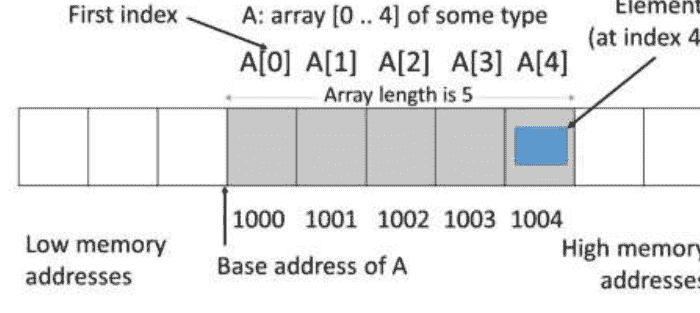

图 1.0.1 数组

如果你问数组：“请给我索引为 4 的元素”，计算机可以在单步内定位到该元素的单元格。

发生这种情况的原因是计算机找到了数组开始的内存地址（在上面的图中为 1000）——并加了 4，因此该元素将位于内存地址 1004 处。

数组是一种线性数据结构，因为元素是顺序排列的，并且可以随机访问。

数组的局限性之一是添加或删除数据需要大量时间。

在一维数组中，当你访问每个索引时，获取的是一个单一值。

```java
//声明一个整数数组
int[] arrayOfInts;
//为 10 个整数分配内存
arrayOfInts = new int[10];
```

```java
//初始化第一个元素
arrayOfInts[0] = 100;
//初始化第四个元素
arrayOfInts[3] = 200;
```

```java
//获取第四个元素的内容
int temp = arrayOfInts[3];
```

在多维数组实现中，当你访问每个索引时，获取的是一个数组。二维数组被称为矩阵。

数组允许我们用一个变量存储多个值。

例如，我们定义了一个 2-D 产品数组，每行的元素代表：产品 ID、价格和重量。

```java
double[][] arrayOfProducts = new double[4];
arrayOfProducts[2][0] = 2;
arrayOfProducts[2][1] = 1.29;
arrayOfProducts[2][2] = 240;
```

接下图展示了这种数组数组的表示形式：

| | [0] | [1] | [2] |
|---|---|---|---|
| `arrayOfProducts[0]` | | | |
| `arrayOfProducts[1]` | | | |
| `arrayOfProducts[2]` | | 1.29 | 240 |
| `arrayOfProducts[3]` | | | |

图 1.0.2 多维数组

数组一旦创建，其大小就无法改变。对于动态数组，我们可以使用 `List`。

`ArrayList` 是 `List` 的可伸缩实现。

```java
List<String> listCities = new ArrayList<>();
listCities.add("New York");
listCities.add("Berlin");
listCities.add("Paris");
listCities.add("Berlin");
```

```java
//通过 for-each 循环遍历列表
for (String city : listCities)
    System.out.println(city);
```

## 字符串

字符数据序列被称为字符串，由 `String` 类实现。

创建 `String` 对象有两种方法：

1. 通过字符串字面量

```java
String myString = "literal of";
```

Java 编译器会在字符串常量池池中创建并放置一个新的字符串实例。这避免了创建两个相同值的实例。

2. 通过 `new` 关键字

```java
String s = new String("hello world");
```

Java 编译器会在堆内存中创建一个新的字符串对象。变量 `s` 指向该对象。

```java
myString + "chars.",
```

之前的拼接在内存中创建了第三个 `String` 对象。这是因为 `String` 是不可变的，一旦创建就无法更改。如果你想动态操作字符串的内容，可以使用可变的 `StringBuilder` 类。

```java
StringBuilder stringOnFly = new StringBuilder();
stringOnFly.append(myString).append("chars");
```

`String`、`StringBuffer` 和 `StringBuilder` 实现了 `CharSequence` 接口。

## 1.1 反转字符串

给定一个字符串，反转它的字符。

### 解决方案

我们选择数组数据结构，因为它可以随机访问元素。首先，将字符串转换为数组。其次，通过循环交换数组中的元素。为了避免额外的内存消耗，我们使用临时变量来交换元素。最后，将数组转换回字符串。

代码 1.1 展示了反转字符串的算法：

```java
public class StringUtils {
    public static String reverse(String text) {
        char[] chars = text.toCharArray();
        int len = chars.length;
        for (int i = 0; i < len / 2; i++) {
            char temp = chars[i];
            chars[i] = chars[len - 1 - i];
            chars[len - 1 - i] = temp;
        }
        return new String(chars);
    }
}
```

### 示例

输入字符串 `"hello"`，输出将是 `"olleh"`。

```java
public class StringUtils {
    public static boolean areUniqueChars(String str) {
        if (str.length() > 128)
            return false;

        boolean[] booleans = new boolean[128];
        for (int idx = 0; idx < str.length(); idx++) {
            int value = str.charAt(idx);
            if (booleans[value]) // 是否找到？
                return false;
            booleans[value] = true;
        }
        return true;
    }
}
```

### Tests

```java
public class AreUniqueCharsTest {
    @Test
    public void is_not_UniqueChars() {
        assertFalse(StringUtils.areUniqueChars("29s2"));
        assertFalse(StringUtils.areUniqueChars("1903aio9p"));
    }
    @Test
    public void is_UniqueChars() {
        assertTrue(StringUtils.areUniqueChars("29s13"));
        assertTrue(StringUtils.areUniqueChars("2813450769"));
    }
}
```

## 1.3 验证字符串是否为回文

回文是一个正读和反读都相同的字符串，例如：`level`、`wow` 和 `madam`。

### 解决方案

我们可以遍历每个字符，并将其与对侧的字符进行比较。如果其中任何一个检查失败，则该文本不是回文。列表 1.3 显示了算法。

列表 1.3 - 验证字符串是否为回文

```java
public class StringUtils {
    public static boolean isPalindrome(String text) {
        final int length = text.length();
        for (int idx = 0; idx < length / 2; idx++) {
            if (text.charAt(idx) != text.charAt(length - 1 - idx)) {
                return false;
            }
        }
        return true;
    }
}
```

### Tests

```java
public class IsPalindromeTest {
    @Test
    public void is_not_palindrome() {
        assertFalse(StringUtils.isPalindrome("2f1"));
        assertFalse(StringUtils.isPalindrome("-101"));
    }
    @Test
    public void is_palindrome() {
        assertTrue(StringUtils.isPalindrome("2f2f"));
        assertTrue(StringUtils.isPalindrome("-101-f"));
        assertTrue(StringUtils.isPalindrome("9"));
        assertTrue(StringUtils.isPalindrome("99"));
        assertTrue(StringUtils.isPalindrome("madam"));
    }
}
```

## 1.4 比较应用版本号

语义化（Semantic versioning）是一种使用三部分版本号来指定兼容性的正式约定：主版本、次版本和补丁版本。微小的更改和错误修复会增加补丁号，这不会改变软件的编程接口（API）。给定 `version1` 和 `version2`，返回：

- `+` 如果 `version1 < version2`
- `-` 如果 `version1 > version2`
- `0` 如果 `version1 == version2`

### 解决方案

首先，我们必须将版本号拆分为各个组成部分。由于输入是字符串形式，因此需要根据分隔它们的点（`dot`）进行划分，并转换为 `int` 数组。

其次，我们必须对数组进行迭代，直到长度未达到两个数组中至少一个的长度为止。从左到右比较每个组成部分。如果一个版本包含的组件比另一个多一个，则检查该额外组件中的值 `0` 是否具有代表性。

最后，如果在迭代过程中版本没有差异，则我们返回 `0`。

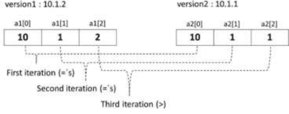

图 1.4 比较应用版本号

### 列表 1.4 - 比较应用版本号


# 版本号比较与矩阵旋转

## 版本号比较

`VersionNumber` 类提供了比较两个版本号字符串的方法：

```java
public class VersionNumber {
    public static int compare(String v1, String v2) {
        int[] a1 = Arrays.stream(v1.split("\\."))
            .map(String::trim)
            .mapToInt(Integer::parseInt).toArray();
        int[] a2 = Arrays.stream(v2.split("\\."))
            .map(String::trim)
            .mapToInt(Integer::parseInt).toArray();
        int idx = 0;
        while (idx < a1.length || idx < a2.length) {
            if (idx < a1.length && idx < a2.length) {
                if (a1[idx] < a2[idx]) {
                    return -1;
                } else if (a1[idx] > a2[idx]) {
                    return 1;
                }
            } else if (idx < a1.length) {
                if (a1[idx] != 0) {
                    return 1;
                }
            } else if (idx < a2.length) {
                if (a2[idx] != 0) {
                    return -1;
                }
            }
            idx++;
        }
        return 0;
    }
}
```

## 1.5 去除列表重复项

编写一个程序检查列表是否存在重复项，如果有，则将其移除。

### 解决方案

你的第一个想法可能是遍历列表并将每个项目与其他项目进行比较。如果检测到重复，则将其移除。那些解决方案是暴力算法，因为它们使用了 JDK 中的简单方法，但有时面试官期望更高效率的方法。

我们使用来自 `Collections` 的 `Set` 接口。定义，`Set` 不允许重复。然后我们使用 `sort` 方法对其进行排序。实现 `Comparable` 接口的列表可以自动排序。`LinkedHashSet` 用于初始化集合并移除重复项。列表 1.5 显示了这种实现。

```java
public class ListUtils {
    public static <E extends Comparable<E>> List<E> removeDuplicatesAndOrder(List<E> list) {
        Set<E> set = new LinkedHashSet<>(list);
        ArrayList<E> arrayList = new ArrayList<>(set);
        Collections.sort(arrayList);
        return arrayList;
    }
}
```

### 测试

```java
@Test
public void isNumbers() {
    assertFalse(StringUtils.areUniqueChars("29s2"));
    assertFalse(StringUtils.areUniqueChars("1903aio9p"));
}
@Test
public void isUnique() {
    assertTrue(StringUtils.areUniqueChars("29s13"));
    assertTrue(StringUtils.areUniqueChars("2813450769"));
}
```

```java
@Test
public void givenStrings() {
    List<String> input = new ArrayList<>();
    input.add("c");
    input.add("b");
    input.add("d");
    input.add("a");
    List<String> result = ListUtils.removeDuplicatesAndOrder(input);
    assertEquals("[a, b, c, d]", result.toString());
}
```

```java
@Test
public void integersThen() {
    List<Integer> input = new ArrayList<>();
    input.add(3);
    input.add(3);
    input.add(4);
    input.add(1);
    input.add(7);
    input.add(1);
    input.add(2);
    List<Integer> result = ListUtils.removeDuplicatesAndOrder(input);
    assertEquals("[1, 2, 3, 4, 7]", result.toString());
}
```

## 1.6 旋转矩阵 90 度

给定一个方矩阵，将其顺时针旋转 90 度。

### 解决方案

我们构建了 `for` 循环，外层每次处理矩阵的一层，内层处理层的元素。我们在 `n/2` 个周期内旋转元素。我们使用临时变量交换每个矩阵中对应单元格的元素。列表 1.6 显示了算法。

```java
public class MatrixUtils {
    public static void rotate(int[][] matrix) {
        int n = matrix.length;
        if (n < 1)
            return;

        /* 层 */
        for (int i = 0; i < n / 2; i++) {
            /* 元素 */
            for (int j = i; j < n - i - 1; j++) {
                // 顺时针交换元素
                // temp = 左上角
                int temp = matrix[i][j];
                // 左上角 <- 左下角
                matrix[i][j] = matrix[n - 1 - j][i];
                // 左下角 <- 右下角
                matrix[n - 1 - j][i] = matrix[n - 1 - i][n - 1 - j];
                // 右下角 <- 右上角
                matrix[n - 1 - i][n - 1 - j] = matrix[j][n - 1 - i];
                // 右上角 <- 左上角
                matrix[j][n - 1 - i] = temp;
            }
        }
    }
}
```

### 测试

```java
@Test
public void givenStrings() {
    int[][] matrix = {
        {1, 2, 3},
        {4, 5, 6},
        {7, 8, 9}
    };
    MatrixUtils.rotate(matrix);
    int[][] expected = {
        {7, 4, 1},
        {8, 5, 2},
        {9, 6, 3}
    };
    assertArrayEquals(expected, matrix);
}

@Test
public void givenIntegers() {
    int[][] matrix = {
        {1, 2},
        {3, 4}
    };
    MatrixUtils.rotate(matrix);
    int[][] expected = {
        {3, 1},
        {4, 2}
    };
    assertArrayEquals(expected, matrix);
}
```

```java
@Test
public void rotate4x4() {
    int[][] matrix = new int[][]{
        {9, 10, 11, 12},
        {16, 17, 18, 19},
        {23, 24, 25, 26},
        {30, 31, 32, 33});
    MatrixUtils.rotate(matrix);
    assertArrayEquals(new int[]{30, 23, 16, 9}, matrix[0]);
    assertArrayEquals(new int[]{33, 26, 19, 12}, matrix[3]);
}

@Test
public void rotate5x5() {
    int[][] matrix = new int[][]{
        {1, 2, 3, 4, 5},
        {6, 7, 8, 9, 10},
        {11, 12, 13, 14, 15},
        {16, 17, 18, 19, 20},
        {21, 22, 23, 24, 25});
    MatrixUtils.rotate(matrix);
    assertArrayEquals(new int[]{21, 16, 11, 6, 1}, matrix[0]);
    assertArrayEquals(new int[]{22, 17, 12, 7, 2}, matrix[1]);
}
```

## 1.7 容器中的物品 (Items in Containers)

Amazon 想要知道其封闭隔间中存在多少物品。给定一个由代表物品的 `*` 和代表开启和关闭的 `|` 封闭隔间组成的字符串 `s`，以及一个起始索引数组 `startIndices` 和一个结束索引数组 `endIndices`，确定这两个索引之间（包含边界）子字符串中封闭隔间内的物品数量。

- 物品用星号表示（`'*'` = ASCII 十进制 42）。
- 隔间由一对竖线表示，它们之间可能有物品，也可能没有（`'||'` = ASCII 十进制 124）。

### 示例

`s = '*|*|*'`

`startIndices = [1,1]`

`endIndices = [5,6]`

该字符串总共有 2 个封闭隔间，一个包含 2 个物品，另一个包含 1 个物品。

对于第一组索引 `(1,5)`，子字符串为 `*|*|*`。隔间内有 2 个物品。

对于第二组索引 `(1,6)`，子字符串为 `*|*|*`，隔间内共有 2 + 1 = 3 个物品。

两个答案都以数组形式返回：`[2, 3]`。

### 函数描述

编写一个函数，返回一个包含每对 `startIndices[i]` 和 `endIndices[i]` 结果的数组。

该函数必须有三个参数：

- `s`: 待评估的字符串
- `startIndices`: 整数数组，表示起始索引。
- `endIndices`: 整数数组，表示结束索引。

### 约束

- 1 ≤ m, n ≤ 10
- 1 ≤ startIndices[i] ≤ endIndices[i] ≤ n
- `s` 的每个字符均为 `"*"` 或 `"|"`

### 解决方案

为了确定封闭隔间中的物品数量，我们需要根据两组索引 `startIndices` 和 `endIndices` 构建子字符串。所有字符串都从 `|` 字符开始。我们定义了一个 `numOfAsterisk` 变量来计算隔间内部物品的数量。

我们定义了一个 `wasFirstPipeFound` 变量，在第一次发现 `|` 字符时初始化 `numOfAsterisk` 变量，并累积后续 `|` 字符之间的所有物品。

列表 1.7 - 容器中的物品。

```java
import java.util.ArrayList;
import java.util.List;
public class Container {
    public static List<Integer> numOfItems(String s,
    List<Integer> startIndices, List<Integer> endIndices) {

        if (startIndices.size() < 1 || startIndices.size() > 100000)
            throw new RuntimeException("wrong size in startIndices");

        if (endIndices.size() < 1 || endIndices.size() > 100000)
            throw new RuntimeException("wrong size in endIndices");

        List<Integer> numOfItemsInClosedCompartments = new ArrayList<>();
        for (int idx=0; idx<startIndices.size(); idx++) {
            int start = startIndices.get(idx);
            int end = endIndices.get(idx);

            if (start < 1 || start > 100000)
                throw new RuntimeException("wrong value at start");

            if (end < 1 || end > 100000)
                throw new RuntimeException("wrong value at end");

            int numOfAsterisk = 0;
            boolean wasFirstPipeFound = false;
            int numOfAsteriskAccumulated = 0;
            for (char c : s.substring(start-1, end).toCharArray()) {
                if (c == '|') {
                    if (wasFirstPipeFound) {
                        numOfAsteriskAccumulated += numOfAsterisk;
                        numOfAsterisk = 0;
                    } else {
                        wasFirstPipeFound = true;
                        numOfAsterisk = 0;
                    }
                } else if (c == '*') {
                    numOfAsterisk += 1;
                } else {
                    throw new RuntimeException("wrong character");
                }
            }
            numOfItemsInClosedCompartments.add(numOfAsteriskAccumulated);
        }
        return numOfItemsInClosedCompartments;
    }
}
```

### 测试

```java
@Test
public void testItems() {
    // 测试用例
}
```

```java
}
}
return numberOfOptions;
```

```java
private static void validate(int[] array, String arrayName) {
    if (array.length < 1 || array.length > 1000)
        throw new RuntimeException("wrong size in array " + arrayName);
```

```java
for (int price : array) {
    if (price < 1 || price > 1000000000)
        throw new RuntimeException("wrong value in array " + arrayName);
}
}
```

### 测试


# 链表

## 2.0 基础知识

链表是一种线性数据结构，表示节点序列。与数组不同，链表将项存储在计算机内存中不连续的位置。它使用指针连接各个项。

分散在内存各处的连接数据被称为节点。在链表中，节点嵌入了数据项。由于列表中有很多相似的节点，因此使用一个名为`Node`的独立类是有意义的，它与链表本身是分离的。

每个`Node`对象包含指向下一个`Node`的引用（通常称为`next`或`link`）。该引用是指向下一个`Node`内存地址的指针。`Head`（头）是一个特殊的节点，用于标记链表的起始。链表的表示形式如图所示。

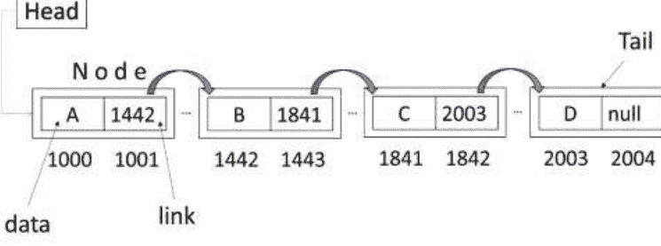

每个`Node`由两个内存单元组成。第一个单元存储实际数据，而第二个单元作为链接，指示下一个`Node`在内存中的起始位置。链表的最后一个`Node`包含`null`，因为链表在何处结束了。

在图中，我们说“B”紧随“A”，而不是说“B”位于第二个位置。

链表的数据可以分布在整个计算机内存中，这是相对于数组的一个潜在优势。相比之下，数组需要找到整个连续单元块来存储数据，随着数组大小的增加，这变得越来越困难。因此，链表更有效地利用了内存。

当每个`Node`只指向下一个`Node`时，我们得到单向链表。当每个`Node`同时指向下一个`Node`和上一个`Node`时，就是双向链表。

如果尾部指向头部，我们就得到了环形单向链表。

以下代码表示双向链表的`Node`：

```java
private final class Node {
    private int data;
    private Node next;
    private Node prev;
}
```

与数组不同，链表无法以常数时间访问第`n`个元素。我们需要迭代`n-1`个元素来获取第`n`个元素。但我们可以在链表的头部常数时间内插入、删除和更新节点。

## 2.1 实现链表

实现包含`create`、`add`和`traverse`方法的链表。

### 解决方案

创建链表类

我们可以将`LinkedList`表示为一个独立的`Node`类。`LinkedList`类将拥有指向`Node`类型的引用。

```java
//泛型链表
public class LinkedList<T> {
    Node head;

    private class Node {
        final T data;
        Node next;
        //默认初始化为 null
        Node(T data) {
            this.data = data;
            this.next = null;
        }
    }
}
```

添加节点

我们可以通过三种方式添加新节点：

- 在链表的头部。
- 在某个节点之前。
- 在链表的末尾。

为了我们的目的，我们在链表的末尾添加新节点。步骤如下：

- 创建一个带有数据的新`Node`。
- 如果头部为空（空列表），将新节点设置为头部。
- 如果头部不为空，找到最后一个节点。将新节点设置为最后一个节点。

```java
public void add(T data) {
    Node node = new Node(data);
    if (head == null) {
        head = node;
    } else {
        Node last = head;
        while (last.next != null) {
            last = last.next;
        }
        last.next = node;
    }
}
```

遍历链表

遍历意味着从头部开始遍历列表中的所有数据。

### 测试

```java
@Test
public void addNodes() {
    LinkedList<String> linkedList = new LinkedList<>();
    linkedList.add("s1");
    linkedList.add("s2");
    linkedList.add("s3");
    linkedList.add("s4");
    assertEquals("[s1 -> s2 -> s3 -> s4]", linkedList.toString());
}
```

## 2.2 反转链表

给定链表的头部指针，编写一个程序反转链表。

### 解决方案

为了反转链表，我们实现了迭代方法。

1. 初始化三个指针：`prev`为`null`，`current`为头部，`next`为`null`。
2. 遍历链表。在循环内部执行：
   - 在改变`current.next`之前存储`next`节点。
   - 现在改变`current.next`，这就是反转发生的地方。
   - 将`prev`和`current`向移动一步。

2.2 - 反转链表

```java
public void reverse() {
  if (head == null) {
    return;
  }

  Node prev = null;
  Node current = head;
  Node next = null;
  while (current != null) {
    next = current.next;
    current.next = prev;
    prev = current;
    current = next;
  }
  head = prev;
}
```

让我们看看`LinkedList`的第一次迭代中`reverse`方法中发生了什么：

[s1 -> s2 -> s3]

| 操作 | 结果 |
| :--- | :--- |
| `next = current.next` | `next`变为`s2`，即`s1`的下一个 |
| `current.next = prev` | 现在`s1`的下一个指向`null` |
| `prev = current` | `prev`变为`s1` |
| `current = next` | 下一次迭代将处理新的`current = s2` |

### 测试

```java
@Test
public void reverseLinkedList() {
    LinkedList<String> linkedList = new LinkedList<>();
    linkedList.add("s1");
    linkedList.add("s2");
    linkedList.add("s3");
    linkedList.add("s4");
    linkedList.reverse();
    assertEquals("[s4 -> s3 -> s2 -> s1]", linkedList.toString());
}
```

```java
@Test
public void reverseIntegersLinkedList() {
    LinkedList<Integer> linkedList = new LinkedList<>();
    linkedList.add(new Integer(1));
    linkedList.add(new Integer(2));
    linkedList.add(new Integer(3));
    linkedList.add(new Integer(5));
    linkedList.reverse();
    assertEquals("[5 -> 3 -> 2 -> 1]", linkedList.toString());
}
```

# 数学和逻辑谜

## 3.0 基础知识

出谜题通常是为了看你如何解决棘手问题。你应该掌握基础数学概念以便在面试中脱颖而出。

`Math`类中包含的有用方法：

- **abs(x):** 返回`x`的绝对值。例如：`abs(-1) = 1`；
- **round(x):** 返回`x`四舍五入到最近的整数。例如：`round(4.4) = 4`；
- **ceil(x):** 返回`x`向上取整到最近的整数。例如：`ceil(4.4) = 5.0`。
- **floor(x):** 返回`x`向下取整到最近的整数。例如：`floor(4.4) = 4.0`。
- **max(x):** 返回数值最大的数。例如：`max(6,7) = 7`。
- **pow(x,y):** 返回`x`的`y`次幂。例如：`pow(2,5) = 32.0`。
- **random():** 返回`0`到`1`之间的随机数。例如：`random() => 0.4554434499209374`。

## 3.1 计算 1 到给定整数之间的所有偶数之和

给定一个整数`N`，计算从`1`到`N`之间所有偶数的之和。

解决方案

这看起来是一个简单的程序，但相信我，大多数经验丰富的程序员在面试时会忘记使用返回余数的运算符`"%"`。如果余数为`0`，则该数为偶数；否则，它为奇数。列表 3.1 显示了算法。

列表 3.1 - 从 1 到 N 的所有偶数之和

```java
public class NumberUtils {
  public static int sumOfEvenNumbers(int N) {
    int sum = 0;
    for (int number = 1; number <= N; number++)
      if ((number % 2) == 0)
        sum = sum + number;
  
    return sum;
  }
}
```

我们的代码运行正常，但作为软件工程师，我们需要关注代码效率。以下算法比之前的算法运行更快，因为它只循环了`N/2`次。

```java
public class NumberUtils {
  public static int sumOfEvenNumbers(int N) {
    int sum = 0;
    int number = 2;
    while (number <= N) {
      sum += number;
      //将数字增加 2，在定义上
      //即是下一个偶数
      number+=2;
    }
    return sum;
  }
}
```

测试

```java
@Test
public void sumOfEvenNumbers_test() {
  assertEquals(42, NumberUtils.sumOfEvenNumbers(12));
  assertEquals(110, NumberUtils.sumOfEvenNumbers(21));
}
```

## 3.2 验证闰年

闰年是包含额外一日的历年。这一额外一天发生在二月。以下规则定义了闰年：

- 如果一个年份能被`4`整除但不能被`100`整除，则为闰年
- 如果一个年份能被`400`整除，则为闰年

解决方案

我们使用`%`运算符来验证一个年份是否能被`4`、`100`或`400`整除。列表 3.2 显示了算法。

列表 3.2 - 验证闰年

```java
public class DateUtils {
    public static boolean isLeapYear(int year) {
        return (year % 400 == 0) ||
            (year % 4 == 0 && year % 100 != 0);
    }
}
```

该算法在 Y2K 问题中有一个实际应用，当时银行的 COBOL 程序只存储四位年份的最后两位，因此你无法区分 2000 年和 1900 年。除了计算闰年外：

- 对于 50 到 99 表示的年份，在开头加上 19，得到 1950 年到 1999 年。
- 对于 00 到 49 表示的年份，在开头加上 20，得到 2000 年到 2049 年。

银行假设在 2049 年之前所有系统都将迁移到现代编程语言（数字化转型），但那是另一个故事了。

测试

```java
@Test
public void isLeapYear() {
    assertTrue(DateUtils.isLeapYear(400));
    assertTrue(DateUtils.isLeapYear(2000));
    assertTrue(DateUtils.isLeapYear(2020));
}
@Test
public void is_notLeapYear() {
    assertFalse(DateUtils.isLeapYear(401));
    assertFalse(DateUtils.isLeapYear(2018));
}
```

## 3.3 给定一个整数 N，返回位数相同的最小数字

编写一个方法，给定一个具有`d`位的原始数字`N`，返回具有相同位数的最小数字。例如，给定`N=4751`，该方法应返回`1000`。给定`N=1`，该方法应返回`0`。

解决方案

我们脑海中想出的第一个想法可能是从给定数字开始迭代并逐个减 1，并在每次迭代中检查新数字位数是否比上一个数字少一位。如果答案为 True，则上一个数字就是与原数字位数相同的最小数字。列表 3.3 显示了正数的第一个算法。

列表 3.3 - 给定一个整数 N，返回位数相同的最小数字

```java
public class NumberUtils {
    public static int smallest(int N) {
        int smallestNumber = 0;
        if (N <= 1)
            return smallestNumber;

        int numberOfDigitsOriginalN = String.valueOf(N).length();
        while (N > 0) {
            if (String.valueOf(N).length() == (numberOfDigitsOriginalN - 1)) {
                return ++N;
            }
        }
        return smallestNumber;
    }
}
```

但如果我们意识到，解决方案遵循一个特定的模式：

- `N = 4751` -> 最小数字 = `1000`
- `N = 189` -> 最小数字 = `100`
- `N = 37` -> 最小数字 = `10`

最小数字是`10`的幂，其中指数是：位数 - 1

第二种解决方案：

```java
public static int smallest(int N) {
    // 此处未提供完整代码，仅为逻辑描述
}
```

如果我们要考虑负数，我们需要考虑符号：

```java
public class NumberUtils {
    public static int smallest(int N) {
        // 逻辑实现
    }
}
```

*(注：由于原文中第二个解决方案代码块不完整，此处根据要求保留格式并翻译逻辑描述，但由于代码块本身不翻译，故保持结构)*

*更正：根据原文文本，3.3 的第二个解决方案部分代码缺失，我将仅对提供的文本内容进行翻译。*

由于提供的文本不完整，若有其他待翻译文本请提供。


# 递归

## 4.0 基础

调用自身的方法或函数被称为递归。递归函数是根据其自身定义的。我们总是包含一个基础情况（`base case`）来结束递归调用。

每次函数调用自身时，其参数在新的参数生效之前存储在栈（`Stack`）中。每次调用都会创建新的局部变量。因此，每次调用都有其参数和局部变量的副本。

这就是为什么我们有时在生产环境中不使用递归的原因之一；例如，当我们传递一个大整数时，它们可能会导致栈溢出并导致任何应用程序。但在其他情况下，我们可以高效地解决问题。

## 4.1 计算给定整数 N 的阶乘

阶乘是小于等于该非负整数的所有正整数的乘积。在生活中，阶乘是排列 `n` 个对象的方法数。

### 解决方案

- 我们定义基础情况：当 `N <= 1` 时返回 `1` 以停止递归。
- 我们使用递归公式：`N * factorial(N - 1)`

列表 4.1 - 计算给定整数 N 的阶乘

```java
public class FactorRecursive {
  public static int factorial(int N) {
    //基础情况
    if (N <= 1)
      return 1;
    else
      //递归调用
      return (N * factorial(N - 1));
  }
}
```

下图显示了在前半部分，一系列递归调用如何执行，直到 `factorial(1)` ——基础情况——返回 `1`，从而停止递归。后半部分显示了从每个递归调用计算并返回给其调用者的值。

```
factorial(6)
= 6 * factorial(5)
= 6 * 5 * factorial(4)
= 6 * 5 * 4 * factorial(3)
= 6 * 5 * 4 * 3 * factorial(2)
= 6 * 5 * 4 * 3 * 2 * factorial(1)
= 6 * 5 * 4 * 3 * 2 * 1
= 6 * 5 * 4 * 3 * 2
= 720
```

图 4.1 阶乘

列表显示了迭代版本（更高效）。

```java
public class FactorIterative {
    public static int factorial(int N) {
        int result = 1;
        for (int i = 2; i <= N; i++)
            result *= i;
        return result;
    }
}
```

### 测试

```java
@Test
public void test_right_values() {
    assertTrue(FactorialRecursive.factorial(1) == 1);
    assertTrue(FactorialRecursive.factorial(0) == 1);
    assertTrue(FactorialRecursive.factorial(3) == 6);
    assertTrue(FactorialRecursive.factorial(6) == 720);
}
```

```java
@Test
public void test_wrong_results() {
    assertFalse(FactorialRecursive.factorial(3) == 5);
    assertFalse(FactorialRecursive.factorial(4) == 10);
}
```

## 4.2 计算斐波那契数

斐波那契数列是一个数列，其中每个后续斐波那契数都是前两个数的和。`0, 1, 2, 3, 5, 8, 13, ...`

斐波那契数列的前两个数是 `0` 和 `1`。

示例：

斐波那契第 7 位：`13`

斐波那契第 10 位：`55`

使用递归定义计算斐波那契数列的方法。

### 解决方案

我们定义两个基础情况：

- `fibonacci(0) = 0` 和 `fibonacci(1) = 1`

递归地计算第 `i` 个斐波那契数：

`fibonacci(N) = fibonacci(N-1) + fibonacci(N-2);`

列表 4.2 - 计算斐波那契数列

```java
import java.util.function.BiFunction;
public class IsNumberValidPowerOfBase implements
BiFunction<Integer, Integer, Boolean> {

    @Override
    public Boolean apply(Integer number, Integer base) {
        return isNumberValidPowerOfBase(number, base);
    }

    static boolean isNumberValidPowerOfBase(int number, int base) {
        if (number == 0) {
            return true;
        }

        while (number != 1) {
            if ((number % base) != 0) {
                return false;
            }
            number = number / base;
        }
        return true;
    }
}
```

### Tests

```java
@Test
public void testOfWrongReturnValues() {
    assertFalse(isNumberValidPowerOfBase.apply(6, 2));
    assertFalse(isNumberValidPowerOfBase.apply(16, 5));
    assertFalse(isNumberValidPowerOfBase.apply(14, 7));
}
```

```java
@Test
public void testValidReturnValues() {
    assertTrue(isNumberValidPowerOfBase.apply(243, 3));
    assertTrue(isNumberValidPowerOfBase.apply(16, 4));
    assertTrue(isNumberValidPowerOfBase.apply(125, 5));
}
```

## 3.6 验证一个数字是否为质数

质数是一个大于 `1` 的整数，它的因子只有 `1` 和它本身。因子是能够整除另一个数字的整数。例如：`2, 3, 5, 7, 11` 都是质数。

### 解决方案

一个简单的解决方案是从给定的 `n` 的一半开始递减地遍历所有数字，并对于每个数字，检查它是否能被 `m` 整除。如果我们找到任何可以整除 `m` 的数字，则返回 `false`。否则，返回 `true`。代码列表 3.6 展示 own 了该算法。

列表 3.6 - 验证一个数字是否为质数

```java
public class MathUtils {
    public static boolean isPrimeNumber(int number) {
        if (number < 2) {
            return false;
        }

        if (number == 2) {
            return true;
        }

        for (int div = (number / 2) + 1; div > 1; div--) {
            if (number % div == 0) {
                return false;
            }
        }
        return true;
    }
}
```

### Tests

```java
@Test
public void primeNumbers() {
    assertFalse(MathUtils.isPrimeNumber(-1));
    assertFalse(MathUtils.isPrimeNumber(625));
    assertFalse(MathUtils.isPrimeNumber(4));
    assertFalse(MathUtils.isPrimeNumber(100));
}
```

```java
@Test
public void primeNumbers() {
    assertTrue(MathUtils.isPrimeNumber(2));
    assertTrue(MathUtils.isPrimeNumber(3));
    assertTrue(MathUtils.isPrimeNumber(5));
    assertTrue(MathUtils.isPrimeNumber(7));
    assertTrue(MathUtils.isPrimeNumber(73));
}
```

## 3.7 两点之间的距离

给定两个点，计算它们之间的距离。

### 解决方案

每个点都有坐标 `(x,y)`，所以我们可以通过勾股定理计算距离。

`d(A, B) = \sqrt{(x2 - x1)^2 + (y2 - y1)^2}`

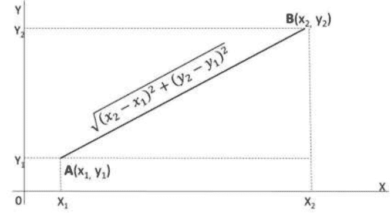

图 3.7 两点之间的距离

```java
public class Point {
    final double x;
    final double y;
```

```java
public Point(double x, double y) {
    this.x = x;
    this.y = y;
}
```

```java
public double distance(Point point) {
    if (this == null || point == null)
        throw new RuntimeException("Points are not initialized");

    double dx = this.x - point.x;
    double dy = this.y - point.y;

    return Math.sqrt(dx * dx + dy * dy);
}
```

### Tests

```java
@Test
public void given_twoPoints_return_distance() {
    Point point1 = new Point(2, 3);
    Point point2 = new Point(5, 7);
    assertEquals(5, point1.distance(point2), 0);
}
```

## 3.8 编写一个不可变类来转换货币

设计一个 `Money` 类，它可以将欧元转换为美元，反之亦然。作为示例，创建两个具有以下值的实例：`67.89 EUR` 和 `98.76 USD`

### 解决方案

不可变类是一个其实例不能被修改的类。它的信息在对象的生命周期内是固定的，不会改变。

要使一个类变为不可变，我们遵循以下规则：

- 不要包含可能修改对象状态的修改方法（`mutators method`）。
- 不允许扩展该类。
- 将所有类成员标记为 `final` 和 `private`
- 确保对任何可变组件的独占访问。不要持有这些对象的引用。进行防御性拷贝。

不可变对象是线程安全的；它们不需要同步。我们对该类使用 `BigDecimal` 类型，因为它提供了算术运算、舍入操作，并可以处理大精度数字。列表 3.8 展示了不可变类。

```java
import java.math.BigDecimal;

public final class Money {
    private static final String DOLLAR = "USD";
    private static final String EUR = "EUR";
    private static final BigDecimal ROUNDING_MODE = BigDecimal.HALF_EVEN;
    private static int DECIMALS = 2;
    private BigDecimal amount;
    private String currency;

    public Money() {}

    public static Money valueOf(BigDecimal amount, String currency) {
        return new Money(amount, currency);
    }

    private Money(BigDecimal amount, String currency) {
        this.amount = amount;
        this.currency = currency;
    }

    public Money multiply(BigDecimal factor) {
        return amount.multiply(factor).setScale(DECIMALS, ROUNDING_MODE);
    }

    public BigDecimal getAmount() {
        return amount;
    }

    public String getCurrency() {
        return currency;
    }
}
```

### Tests

```java
@Test
public void convert_EUR_to_USD() {
    Money money1 = Money.valueOf(new BigDecimal("67.89"), "EUR");
    Money money2 = money1.multiply(new BigDecimal("1.10"));
    assertEquals(new BigDecimal("74.68"), money2.getAmount());
}

@Test
public void convert_USD_to_EUR() {
    Money money1 = Money.valueOf(new BigDecimal("98.76"), "USD");
    Money money2 = money1.multiply(new BigDecimal("0.85"));
    assertEquals(new BigDecimal("83.95"), money2.getAmount());
}
```

解释：

步骤 1：组合大小为 `4` 和 `6` 的部件（所需时间为 `10`）。然后，剩余合并部分的尺寸为：`[8,10,12]`。

步骤 2：组合大小为 `8` 和 `10` 的部件（所需时间为 `18`）。然后，合并后剩余部分的尺寸为：`[18,12]`。

步骤 3：组合大小为 `18` 和 `12` 的部件（所需时间为 `30`）。

组装部件的总时间为 `10+18+30=58`。

### 解决方案

我们对部件进行排序，然后计算相邻小尺寸部件之间的时间，直到到达最后一个部件。列表 3.10 显示了算法。

列表 3.10 – 以最小时间组装部件

```java
public class AssembleParts {
    public static int minimumTime(int numOfParts, List<Integer> list) {
        int[] arrayOfSizes = list.stream().mapToInt(i -> i).toArray();
        Arrays.sort(arrayOfSizes);

        int accumulatedTime = 0;
        for (int idx = 0; idx < arrayOfSizes.length - 1; idx++) {
            accumulatedTime += arrayOfSizes[idx] + arrayOfSizes[idx + 1];
            // 一组组完成后，我们将当前时间传递给下一个元素
            // 所以在下次迭代中，下两个部件中的第一个
            // 已经包含了组装前两个部件
            // 所需的总时间
            arrayOfSizes[idx + 1] = arrayOfSizes[idx] + arrayOfSizes[idx + 1];
        }
        return accumulatedTime;
    }
}
```

### 测试

```java
@Test
public void test_right_values() {
    assertTrue(AssembleParts.minimumTime(4,
        new ArrayList<Integer>(Arrays.asList(8, 4, 6, 12)) == 58);
    assertTrue(AssembleParts.minimumTime(5,
        new ArrayList<Integer>(Arrays.asList(3, 7, 2, 10, 5))) == 59);
}
```


# 排序与搜索

## 5.0 基础

**排序**是按特定顺序排列元素的过程。

**搜索**是在集合中查找特定元素的过程。

排序的应用：

- 冒泡排序：反复比较相邻元素并在顺序错误时进行交换的简单排序算法。
- 合并排序：基于分治策略的高效排序算法。
- 快速排序：使用枢值划分数组的快速排序算法。

搜索的应用：

- 线性查找：检查列表中的每个元素直到找到目标。
- 二分查找：针对排序列表的高效搜索算法，通过平分搜索范围来工作。

## 5.1 冒泡排序

冒泡排序是一种简单的排序算法，它反复遍历列表，比较相邻元素，如果顺序错误则交换。重复遍历列表直到列表排序。

### 解决方案

该算法通过反复遍历列表、比较相邻元素并在顺序错误时交换来工作。持续进行直到一次遍历中不需要交换。

```java
public class Sorting {
    public int[] bubbleSort(int[] numbers) {
        if (numbers == null)
            throw new RuntimeException("array not initialized");

        boolean numbersSwapped;
        do {
            numbersSwapped = false;
            for (int i = 0; i < numbers.length - 1; i++) {
                if (numbers[i] > numbers[i + 1]) {
                    int aux = numbers[i + 1];
                    numbers[i + 1] = numbers[i];
                    numbers[i] = aux;
                    numbersSwapped = true;
                }
            }
        } while (numbersSwapped);

        return numbers;
    }
}
```

### 示例

第一次遍历：

`{6, 4, 9, 5}` -> `{4, 6, 9, 5}` 因为 `6 > 4`

`{4, 6, 9, 5}` -> `{4, 6, 9, 5}`

`{4, 6, 9, 5}` -> `{4, 6, 5, 9}` 因为 `9 > 5`

`NumbersSwapped=true`

第二次遍历：

`{4, 6, 5, 9}` -> `{4, 6, 5, 9}`

`{4, 6, 5, 9}` -> `{4, 5, 6, 9}` 因为 `6 > 5`

`{4, 5, 6, 9}` -> `{4, 5, 6, 9}`

`NumbersSwapped=true`

第三次遍历：

`{4, 5, 6, 9}` -> `{4, 5, 6, 9}`

`{4, 5, 6, 9}` -> `{4, 5, 6, 9}`

`{4, 5, 6, 9}` -> `{4, 5, 6, 9}`

`NumbersSwapped=false`

### 冒泡排序的效率

在最坏的情况下（数组是倒序排列的），每次比较都需要进行交换。在我们的算法中，比较都发生在比较相邻元素对以确定哪一个更大时。最坏情况下的时间复杂度为 `O(n²)`。

给定一个数组：`{9, 6, 5, 4}`

在第一次遍历中，我们必须进行三次比较 -> `{6, 5, 4, 9}`

在第二遍遍历中，我们只需要进行两次比较，因为我们不需要比较最后两个数字 -> `{5, 4, 6, 9}`

在第三次遍历中，我们只进行了一次比较 -> `{4, 5, 6, 9}`

总结：

`3 + 2 + 1 = 6` 次比较，或者 `(N-1) + (N-2) + (N-3) ... + 1` 次比较

此外，在这种情况下，每次比较都需要进行交换。因此，我们有 6 次比较和 6 次交换 = 12，这大约是 `4^2`。随着元素数量 `N` 的增加，步骤数呈指数级增长，如下表所示。

| N | 步骤数 | N^2 |
|---|---|---|
| 4 | 12 | 16 |
| 5 | 20 | 25 |
| 10 | 90 | 100 |

因此，在大 `O` 算法中，我们可以说冒泡排序算法的效率为 `O(N^2)`。

### 测试

```java
@Test
public void sortingArrays() {
    final int[] numbers = {6, 4, 9, 5};
    final int[] expected = {4, 5, 6, 9};
    int[] numbersSorted = sorting.bubbleSort(numbers);
    assertEquals(expected, numbersSorted);
}
```

```java
@Test
public void sortManyArray() {
    final int[] array = {7, 9, 1, 4, 9, 12, 4, 13, 9};
    final int[] expected = {1, 4, 4, 7, 9, 9, 9, 12, 13};
    sorting.bubbleSort(array);
    assertEquals(expected, array);
}
```

## 5.2 插入排序

插入排序是一种通过逐个元素构建最终排序数组的排序算法。它与我们牌牌时对扑牌的方式类似。

### 解决方案

- 遍历所有元素并从索引 `i=1` 开始。
- 将当前元素（`key`）与其之前的所有元素进行比较。
- 如果 `key` 元素小于它的前驱，则交换它们。将比 `key` 大的元素向其当前位置向前移动一位。

该算法的运行时间为二次 `O(n²)`。列表 5.2 显示了该算法。

**列表 5.2 - 插入排序**

```java
public class Sorting {
    public int[] insertSort(int[] numbers) {
        if (numbers == null)
            throw new RuntimeException("numbers not initialized");

        for (int i = 1; i < numbers.length; i++) {
            int key = numbers[i];
            int j = i - 1;
            while (j >= 0 && numbers[j] > key) {
                numbers[j + 1] = numbers[j];
                j = j - 1;
            }
            numbers[j + 1] = key;
        }
        return numbers;
    }
}
```

### 示例

`numbers = {13, 12, 14, 6, 7}`

当 `i = 1` 时。由于 13 大于 12，移动 13 将 12 插入 13 之前

`12, 13, 14, 6, 7`

当 `i = 2` 时，14 将留在原位置，因为之前所有的元素都小于 14

`12, 13, 14, 6, 7`

当 `i = 3` 时，6 将移动到开头，所有从 12 到 14 的元素都将向其当前位置向前移动一位

`6, 12, 13, 14, 7`

当 `i = 4` 时，7 将移动到 6 之后的位置，从 12 到 14 的元素将向其当前位置向前移动一位

`6, 7, 12, 13, 14`

### 测试

```java
@Test
public void testInsertionSort() {
    final int[] numbers = {13, 12, 14, 6, 7};
    final int[] expected = {6, 7, 12, 13, 14};
    sorting.insertSort(numbers);
    assertArray(expected, numbers);
}

@Test
public void sortingArray() {
    final int[] numbers = {7, 9, 1, 4, 9, 12, 13, -2, 9};
    final int[] expected = {-2, 1, 4, 7, 9, 9, 12, 13};
    sorting.insertSort(numbers);
    assertArray(expected, numbers);
}
```

## 5.3 快速排序

快速排序是一种分治算法。给定一个数组，它选择一个元素作为基准（`pivot`），并围绕它对给定数组进行分区。

### 解决方案

给定一个数组，我们执行以下步骤：

1. 我们从数组中选择最后一个元素作为基准。
2. 执行分区，将所有小的元素放在基准之前，将所有较大的元素放在基准之后。在对元素进行重排序后，基准位于了它的最终位置。
3. 对每个子数组递归地应用上述步骤。

**列表 5.3 - 快速排序**

```java
public class Sorting {
    public int[] quickSort(int[] numbers, int lo, int hi) {
        if (lo < hi) {
            int partition_border = partition(numbers, lo, hi);
            // 递归排序元素
            quickSort(numbers, lo, partition_border - 1);
            quickSort(numbers, partition_border + 1, hi);
        }
        return numbers;
    }

    private int partition(int[] numbers, int lo, int hi) {
        // 准备放在右侧的元素
        int pivot = numbers[hi];
        int i = lo - 1; // 较元素的索引
        for (int j = lo; j < hi; j++) {
            // 交换小于基值的元素
            if (numbers[j] < pivot) {
                i++;
                int aux = numbers[i];
                numbers[i] = numbers[j];
                numbers[j] = aux;
            }
        }
        return i + 1;
    }
}
```

### 测试

```java
@Test
public void testQuickSort() {
    final int[] numbers = {13, 12, 14, 6, 7};
    final int[] expected = {6, 7, 12, 13, 14};
    sorting.quickSort(numbers, 0, numbers.length - 1);
    assertEquals(expected, numbers);
}

@Test
public void sortingArray() {
    final int[] numbers = {7, 9, 1, 4, 9, 12, 13, -2, 9};
    final int[] expected = {-2, 1, 4, 7, 9, 9, 12, 13};
    sorting.quickSort(numbers, 0, numbers.length - 1);
    assertEquals(expected, numbers);
}
```

## 5.4 二分查找

给定一个有序数组，通过反复二分范围在数组中查找元素 `X`。

| | 0 | 1 | 2 | 3 | 4 | 5 | 6 | 7 | 8 |
|---|---|---|---|---|---|---|---|---|---|
| 数组 | -2 | 1 | 4 | 7 | 9 | 9 | 12 | 13 | 18 |
| 查找 21 | | | | | | | | | |
| 第一次比较 | | | | | | 9 | | | |
| 第二次比较 | | | | | | | 12 | | |
| 第三次比较 | | | | | | | | 13 | |
| 第四次比较 | | | | | | | | | 18 |

### 解决方案

查找通过反复二分范围来搜索数组。如果 `X` 小于中间的元素，则将范围缩小到左半；否则，缩小到右半，直到找到元素或范围为空。对于一个包含 4 个元素的数组，需要 3 次比较。

**列表 5.4 二分查找**

```java
public class BinarySearch {
    public static <T extends Comparable<T>> boolean search(T target, T[] array) {
        if (array == null || array.length <= 0) {
            return false;
        }
        int min = 0;
        int max = array.length - 1;
        while (min <= max) {
            int mid = (min + max) / 2;
            if (target.compareTo(array[mid]) < 0) {
                max = mid - 1;
            } else if (target.compareTo(array[mid]) > 0) {
                min = mid + 1;
            } else {
                return true;
            }
        }
        return false;
    }
}
```

### 测试

```java
@Test
public void binarySearch_notFound() {
    assertFalse(BinarySearch.search("fin", new String[]{"ada", "fda"}));
    assertFalse(BinarySearch.search("eda", new String[]{"ada", "bda", "cda", "dda"}));
}

@Test
public void binarySearch_Found() {
    assertTrue(BinarySearch.search("cal", new String[]{"ada", "fda"}));
    assertTrue(BinarySearch.search(21, new Integer[]{1, 2, 3, 4, 5}));
    assertTrue(BinarySearch.search(21, new Integer[]{3, 7, 9, 13, 18, 21, 41, 52, 81, 97}));
}
```

## 5.5 合并两个列表

给定两个有序列表，将它们合并为一个有序列表。

| List1 | 1 | 1 | 2 | 5 | 8 |
|---|---|---|---|---|---|
| List2 | 3 | 4 | 6 |
| mergedList | 1 | 1 | 2 | 3 | 4 | 5 | 6 | 8 |

### 解决方案

我们可以将两个列表合并成新列表并应用排序算法。我们将实现一种保持相同 `LogN` 性能的新算法。

- 定义一个新的列表，以排序的方式添加其他两个列表的所有元素。
- 定义两个索引，指向每个列表中的每个元素。
- 当两个列表都有元素时，遍历这两个列表。
- 在每次迭代中比较两个列表的元素，并将较小的添加到新列表中。在进入下一次迭代之前，增加包含较小元素的列表索引。
- 如果某个列表仍然包含元素，则将它们直接添加到新列表中。

**列表 5.5 合并两个有序列表**


```java
public class SortedList {
    public static List<Integer> merge_sorted(
        List<Integer> slist1, List<Integer> slist2) {
        List<Integer> mergedSortedList = new ArrayList<>();
        int idx1 = 0;
        int idx2 = 0;

        while (idx1 < slist1.size() && idx2 < slist2.size()) {
            if (slist1.get(idx1) <= slist2.get(idx2)) {
                mergedSortedList.add(slist1.get(idx1));
                idx1++;
            } else {
                mergedSortedList.add(slist2.get(idx2));
                idx2++;
            }
        }

        if (idx1 < slist1.size()) {
            for (int idx = idx1; idx < slist1.size(); idx++) {
                mergedSortedList.add(slist1.get(idx));
            }
        }

        if (idx2 < slist2.size()) {
            for (int idx = idx2; idx < slist2.size(); idx++) {
                mergedSortedList.add(slist2.get(idx));
            }
        }
        return mergedSortedList;
    }
}
```

### 测试

```java
@Test
public void mergeSortedLists() {
    List<Integer> slist1 = Arrays.asList(1, 2, 5, 8);
    List<Integer> slist2 = Arrays.asList(3, 4, 6);
    assertEquals(Arrays.asList(1, 2, 3, 4, 5, 6, 8), SortedList.merge_sorted(slist1, slist2));
}

@Test
public void mergeSortedLists2() {
    List<Integer> slist1 = Arrays.asList(2, 4, 5);
    List<Integer> slist2 = Arrays.asList(1, 3, 6);
    assertEquals(Arrays.asList(1, 2, 3, 4, 5, 6), SortedList.merge_sorted(slist1, slist2));
}
```

# 栈与队列

## 6.0 基础

### 栈

栈是一种抽象数据类型，包含遵循后进先出（LIFO）原则的对象集合，即最后插入的元素第一个取出。栈的一个真实世界例子是食堂的托盘。

栈具有以下限制：

- `push` 操作允许在栈的末尾插入数据。
- `pop` 操作允许从栈的末尾删除数据。
- 它可以读取栈顶元素而不将其移除，这称为 `peek` 操作。

你可以使用数组或单链表实现栈。


栈有助于处理临时数据，例如：

- 编辑器的撤销机制基于栈，即取消编辑操作。编辑器将文本更改存储在栈中。
- 浏览器存储访问过的网站 URL。当用户访问新网站时，其 URL 被“推入”栈。当用户点击“后退”按钮时，上一个 URL 从栈中“弹出”。

### 队列

队列是一种抽象数据类型，包含遵循先入先出（FIFO）原则的对象集合，即第一个插入的元素第一个取出。

队列具有以下限制：

- `enqueue` 操作允许在队列的末尾插入数据。
- `dequeue` 操作允许从队列的头部删除数据。
- 它可以读取队列头部的元素，这称为头部。


队列有助于处理等待时间，例如：

- 中心、剧院和其他类似的服务使用 FIFO 原则处理客户请求。

## 6.1 边界匹配

检查表达式中的括号、大括号和小括号是否平衡。在此，我们必须确保：

- 左边界符的每个开启符号都与右边界符的结束符号匹配。
- 后出现的左边界符应该在先出现的之前关闭。

### 解决方案

我们使用*栈*数据结构来确保两个限制符号正确匹配（成对）。为什么选择栈？元素的插入和删除发生在栈的一个端，即栈顶。JDK 包含了 `Java.Stack` 数据结构。`push` 方法将项添加到此栈的顶部。`pop` 方法移除栈顶的元素。

- 遍历给定表达式中的每个字符。如果是开启符号，则将其推入栈。如果是结束符号，则从栈中弹出一个元素（最后添加的开启符号）并检查它们是否成对。
- 如果我们到达末尾且栈为空，则表达式是平衡的；否则不是。

### 列表 6.1 - 边界匹配

```java
import java.util.Stack;
public static boolean isBalanced(String expression) {
    if (expression == null || expression.length() < 2) {
        return false;
    }

    Stack<Character> stack = new Stack<>();
    for (char c : expression.toCharArray()) {
        if (c == '(' || c == '[' || c == '{') {
            stack.push(c);
        } else if (c == ')') {
            if (stack.isEmpty() || stack.pop() != '(') {
                return false;
            }
        } else if (c == ']') {
            if (stack.isEmpty() || stack.pop() != '[') {
                return false;
            }
        } else if (c == '}') {
            if (stack.isEmpty() || stack.pop() != '{') {
                return false;
            }
        }
    }
    return stack.isEmpty();
}
```

## 6.2 通过栈实现队列

使用两个栈构建队列。这意味着，在队列的情况下，`add` 方法将元素推入 `inbox`。`peek` 方法执行以下操作：从 `inbox` 弹出。

```java
import java.util.Stack;
public class QueueStacks<T> {
    Stack<T> inbox;
    Stack<T> outbox;

    public QueueStacks() {
        inbox = new Stack<T>();
        outbox = new Stack<T>();
    }

    public void add(T value) {
        // 栈总是最新的元素
        inbox.push(value);
    }

    public T peek() {
        if (outbox.isEmpty()) {
            while (!inbox.isEmpty()) {
                // 逆序填充
                outbox.push(inbox.pop());
            }
        }
        return outbox.pop();
    }
}
```

### 测试

```java
public class QueueStacksTest {
    QueueStacks<Integer> queueStacks;

    @Before
    public void Before() {
        queueStacks = new QueueStacks<>();
    }

    @Test
    public void pop_firstElement() {
        queueStacks.add(4);
        queueStacks.add(2);
        queueStacks.add(9);
        assertEquals(new Integer(4), queueStacks.peek());
    }
}
```

## 6.3 使用栈反转字符串

给定一个字符串，使用栈反转字符顺序。

### 解决方案

- 将文本转换为字符数组。
- 创建一个空栈。
- 将所有字符逐个推栈。
- 从栈中取出所有字符并放入字符数组中。
- 最后，将数组作为字符串返回。

### 列表 6.3 - 使用栈反转字符串

```java
import java.util.Stack;
public class StringUtils {
    public static String reverse(String text) {
        char[] charsArray = text.toCharArray();
        Stack<Character> stack = new Stack<Character>();

        for (int i=0; i<charsArray.length; i++) {
            stack.push(charsArray[i]);
        }

        for (int i=0; i<charsArray.length; i++) {
            charsArray[i] = stack.pop();
        }

        return String.valueOf(charsArray);
    }
}
```

### 测试

```java
@Test
public void reverseText_success() {
    assertEquals("efac", StringUtils.reverse("cafe"));
    assertEquals("2312cba", StringUtils.reverse("abc2132"));
}
```

# 哈希表

## 7.0 基础

哈希表是一种插入和范围搜索速度非常快的数据结构。在大O 表示法中，它需要常数时间：O(1)。

哈希表使用一个键值对数组构建构建。每个对由一个键（`key`）和一个值（`value`）组成，它们配对表示某些重要的关联，例如：

```java
students = { "1573297" => "Jan",
  "8174321" => "Brian",
  "8119214" => "James" }
```

在这个示例中，`1573297` 是键，`Jan` 是值。它们表示护照号 `1573297` 代表 `Jan`。

对于七位数字范围，我们需要一个大小为 `10,000,000` 的数组。如果我们决定只存储几千个护照号，那么*数组*将几乎是空的。

我们需要将输入键压缩到数组索引范围内。为了找到一种快速的方法，我们使用哈希函数（*hashing*）将 `1573297`（*key*）转换为我们数组大小内的索引数字。它的值存储在键经过哈希处理后对应的索引处。

例如，下面的图显示了使用哈希函数后的哈希表。

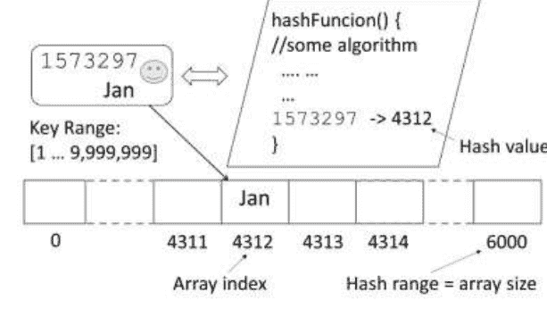

现在，我们的哈希表看起来如下：

```java
students = { 4312 => "Jan",
5102 => "Brian",
5303 => "James" }
```

算法对键进行哈希，转换为数组索引，并直接跳转到该数字索引以获取关联的值。

但有时存在不同的键映射到相同哈希数组索引的风险。这被称为冲突（collision）；我们得到一个键的哈希映射到一个已经填充的位置。

处理冲突有两种解决方案：链地址法（Chaining），其中哈希数组中的每个条目指向它的链表。另一种是开放寻址法（open addressing），仅用一个数组存储所有项；当我们想要插入一个新的哈希键时，如果槽位已填充，算法将寻找另一个空槽来插入新项。这种搜索被称为探测序列（probe sequence）。

大多数编程语言已经已经实现了处理冲突和选择哈希函数的策略。

## 7.1 设计哈希表

设计一个哈希表，实现 `add`（添加）和 `get`（获取）操作，键值对应该是泛型的，并使用链式技术解决索引冲突。

### 解决方案

假设我们想要由 3 个字符组成的仓库作为键。

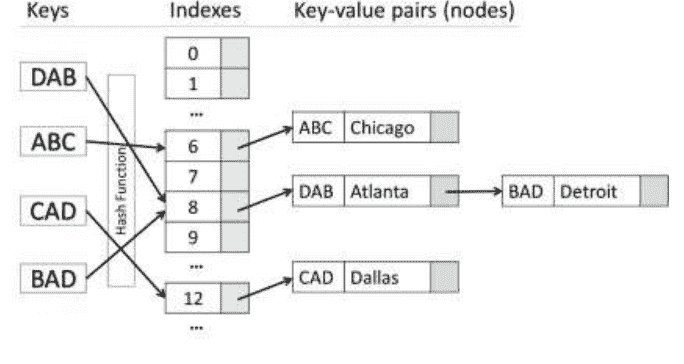

```java
warehouses = {"DAB", "Atlanta",
"ABC", "Chicago",
"CAD", "Dallas",
"BAD", "Detroit"}
```

我们意识到键 `"DAB"` 和 `"BAD"` 存在冲突。

为了实现链地址法，我们需要创建一个行为类似于链表的哈希表条目。并且我们定义一个持有所有条目的数组。

### 列表 7.1 – 设计哈希表

```java
public class HashTable<K,V> {

    private static final int SIZE = 121;
    private Entry[] entries = new Entry[SIZE];

    private static class Entry<K,V> {
        K key;
        V value;
        Entry<K,V> next;

        Entry(K key, V value) {
            this.key = key;
            this.value = value;
            this.next = null;
        }
    }
}
```

我们需要定义我们的哈希函数。为了方便测试，我们将字母映射到数字（`A = 1, B = 2, C = 3, D = 4, E = 5`）。然后取乘积。

示例：

键: `"DAB"`,

映射: `D = 4, A = 1, B = 2`

乘积: `4 * 1 * 2 = 8`

首先，我们定义假设：

```java
@Test
public void hashTest() {
    assertEquals(8, hashTable.hashKey("DAB"));
    assertEquals(15, hashTable.hashKey("ACE"));
}
```

在这里，哈希函数的实现：

```java
public int hashKey(K key) {
    int product = 1;
    for (char c : ((String)key).toCharArray()) {
        if (c == 'A') {
            product *=1;
        } else if (c == 'B') {
            product *=2;
        } else if (c == 'C') {
            product *=3;
        } else if (c == 'D') {
            product *=4;
        } else if (c == 'E') {
            product *=5;
        }
    }
    return product;
}
```

`put` 方法通过调用 `hashKey` 方法创建一个哈希索引，并在哈希索引处创建一个新的条目。如果条目已填充，则在链表的尾创建条目。

在实现 `put` 和 `get` 方法之前，我们定义假设：

```java
@Test
public void getTest() {
    hashTable.put("DAB", "Atlanta");
    hashTable.put("ABC", "Chicago");
    hashTable.put("CAD", "Dallas");
    hashTable.put("BAD", "Detroit");
}
```

在这里，实现：


# 树

# 8.0 基础

树

树是一种由边连接的节点组成的数据结构。

树结构是非线性数据结构。它们允许我们比使用线性数据结构更快地实现算法。

## 二叉树

二叉树最多有两个子节点：一个左节点和一个右节点。每个节点包含两个元素：一个用于标识节点存储数据的键（`key`），以及一个在节点中收集的值（`value`）。下图显示了二叉树的术语

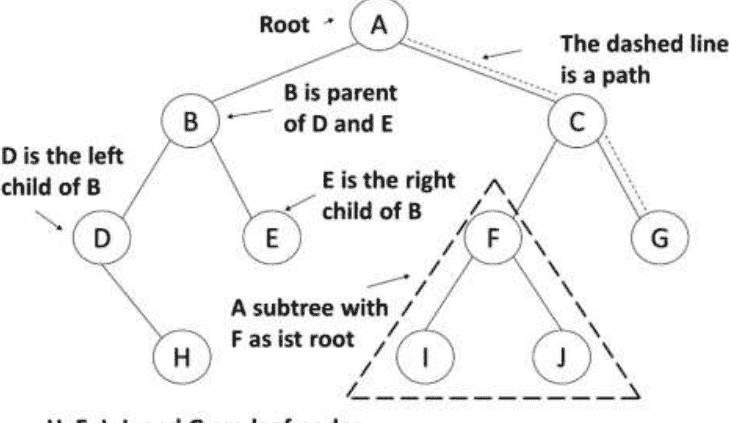

图 8.0 二叉搜索树 - 术语

## 二叉搜索树

二叉树最常见的类型是二叉搜索树，它具有两个主要特征：

- 左节点的值必须小于其父节点的值。

- 右节点的值必须大于等于其父节点的值。

此外，你可以像使用有序数组一样在树数据结构中快速进行搜索，也可以像使用链表一样快速地插入和删除项。

找到一个值最多需要 `$log2(N)$` 次尝试。随着节点集合变大，二叉搜索树会比线性搜索更快，而线性搜索需要多达 `$(N)$` 次比较。

## 8.1 二叉搜索树

一家公司使用全球贸易项目代码（GTIN）来唯一地标识其所有的贸易物品。GTIN 标识了不同制造商生产的产品类型。

一家网商店想要通过二叉搜索算法高效地检索有关 GTIN 的信息。

### 解决方案

我们定义了一个 `Product` 类，它将作为节点中包含的数据。

列表 8.1.1 显示了如何创建一个 `Product` 类。

代码列表 8.1.1 - Product 类

```
public class Product {
    Integer productId;
    String name;
    Double price;
    String manufacturerName;
    //省略了 setters 和 getters
}
```

代码列表 8.1.2 显示了我们如何创建一个 `NodeP` 类来存储 `Product` 列表。此外，该类允许我们有两个 `Node` 属性来持有左节点和右节点。

代码列表 8.1.2 - NodeP 类

```java
public class NodeP {
    private String gtin;
    private List<Product> data;
    private NodeP left;
    private NodeP right;
    public NodeP(String gtin, List<Product> data) {
        this.gtin = gtin;
        this.data = data;
    }
}
```

代码列表 8.1.3 显示了一个 `TreeP` 类用于实现一种名为二叉搜索树的抽象数据类型，它包含一个用于第一个插入元素的 `NodeP root` 变量。我们需要实现一个 `insert` 方法，每当插入一个新的 GTIN 时，它都会将当前 GTIN 与新 GTIN 进行比较。根据结果，我们将新的 GTIN 存储在左节点或右节点。通过这种方式，`insert` 方法维护了一个有序的二叉搜索树。

代码列表 8.1.3 TreeP 和 insert 方法

```java
public class TreeP {
    private NodeP root;
    public void insert(String gtin, List<Product> data) {
        NodeP newNode = new NodeP(gtin, data);
        if (root == null) {
            root = newNode;
        } else {
            NodeP current = root;
            NodeP parent;
            while (true) {
                parent = current;
                if (gtin.compareTo(current.getGtin()) < 0) {
                    current = current.getLeft();
                    if (current == null) {
                        parent.setLeft(newNode);
                        return;
                    }
                } else if (gtin.compareTo(current.getGtin()) > 0) {
                    current = current.getRight();
                    if (current == null) {
                        parent.setRight(newNode);
                        return;
                    }
                } else {
                    return; //已存在
                }
            }
        }
        return;
    }
}
```

代码列表 8.1.4 显示了一个 `find` 方法，它遍历所有节点直到找到 GTIN 为止。由于二叉搜索树始终是有序的，该算法将搜索空间缩小到了 `$N/2$`。

代码列表 8.1.4 - find 方法

```java
public NodeP find(String gtin) {
    NodeP current = root;
    if (current == null)
        return null;

    while (current != null) {
        if (gtin.compareTo(current.getGtin()) < 0) {
            current = current.getLeft();
        } else if (gtin.compareTo(current.getGtin()) > 0) {
            current = current.getRight();
        } else {
            return current;
        }
    }
    return null;
}
```

### 测试

```
@Test
public void test_find() {
  tree.insert("gt1", Arrays.asList(product1));
  tree.insert("gt2", Arrays.asList(product2));
  tree.insert("gt3", Arrays.asList(product3, product4));
  tree.insert("gt4", Arrays.asList(product5));
  tree.insert("gt5", Arrays.asList(product6, product7, product8));
  assertEquals(null, tree.find("gt0"));
  tree.insert("gt6", Arrays.asList(product9));
  assertTrue(tree.find("gt6") != null);
}
```


# 树

## 8.0 基础

树是一种由边连接的节点组成的数据结构。

树结构是非线性数据结构。它们允许我们比使用线性数据结构更快地实现算法。

## 二叉树

二叉树最多有两个子节点：一个左节点和一个右节点。每个节点包含两个元素：一个用于标识节点存储数据的键（`key`），以及一个在节点中收集的值（`value`）。下图显示了二叉树的术语。


图 8.0 二叉搜索树 - 术语

## 二叉搜索树

二叉树最常见的类型是二叉搜索树，它具有两个主要特征：

- 左节点的值必须小于其父节点的值。
- 右节点的值必须大于等于其父节点的值。

此外，你可以像使用有序数组一样在树数据结构中快速进行搜索，也可以像使用链表一样快速地插入和删除项。

找到一个值最多需要 `log2(N)` 次尝试。随着节点集合变大，二叉搜索树会比线性搜索更快，而线性搜索需要多达 `N` 次比较。

## 8.1 二叉搜索树

一家公司使用全球贸易项目代码（GTIN）来唯一地标识其所有的贸易物品。GTIN 标识了不同制造商生产的产品类型。

一家网商店想要通过二叉搜索算法高效地检索有关 GTIN 的信息。

### 解决方案

我们定义了一个 `Product` 类，它将作为节点中包含的数据。

代码列表 8.1.1 显示了如何创建一个 `Product` 类。

代码列表 8.1.1 - Product 类

```
public class Product {
    Integer productId;
    String name;
    Double price;
    String manufacturerName;
    //省略了 setters 和 getters
}
```

代码列表 8.1.2 显示了我们如何创建一个 `NodeP` 类来存储 `Product` 列表。此外，该类允许我们有两个 Node 属性来持有左节点和右节点。

代码列表 8.1.2 - NodeP 类

```java
public class NodeP {
    private String gtin;
    private List<Product> data;
    private NodeP left;
    private NodeP right;
    public NodeP(String gtin, List<Product> data) {
        this.gtin = gtin;
        this.data = data;
    }
}
```

代码列表 8.1.3 显示了一个 `TreeP` 类用于实现一种名为二叉搜索树的抽象数据类型，它包含一个用于第一个插入元素的 `NodeP root` 变量。我们需要实现一个 `insert` 方法，每当插入一个新的 GTIN 时，它都会将当前 GTIN 与新 GTIN 进行比较。根据结果，我们将新的 GTIN 存储在左节点或右节点。通过这种方式，`insert` 方法维护了一个有序的二叉搜索树。

代码列表 8.1.3 TreeP 和 insert 方法

```java
public class TreeP {
    private NodeP root;
    public void insert(String gtin, List<Product> data) {
        NodeP newNode = new NodeP(gtin, data);
        if (root == null) {
            root = newNode;
        } else {
            NodeP current = root;
            NodeP parent;
            while (true) {
                parent = current;
                if (gtin.compareTo(current.getGtin()) < 0) {
                    current = current.getLeft();
                    if (current == null) {
                        parent.setLeft(newNode);
                        return;
                    }
                } else if (gtin.compareTo(current.getGtin()) > 0) {
                    current = current.getRight();
                    if (current == null) {
                        parent.setRight(newNode);
                        return;
                    }
                } else {
                    return; //已存在
                }
            }
        }
        return;
    }
}
```

代码列表 8.1.4 显示了一个 `find` 方法，它遍历所有节点直到找到 GTIN 为止。由于二叉搜索树始终是有序的，该算法将搜索空间缩小到了 `N/2`。

代码列表 8.1.4 - find 方法

```java
public NodeP find(String gtin) {
    NodeP current = root;
    if (current == null)
        return null;

    while (current != null) {
        if (gtin.compareTo(current.getGtin()) < 0) {
            current = current.getLeft();
        } else if (gtin.compareTo(current.getGtin()) > 0) {
            current = current.getRight();
        } else {
            return current;
        }
    }
    return null;
}
```

### 测试

```java
@Test
public void test_find() {
  tree.insert("gt1", Arrays.asList(product1));
  tree.insert("gt2", Arrays.asList(product2));
  tree.insert("gt3", Arrays.asList(product3, product4));
  tree.insert("gt4", Arrays.asList(product5));
  tree.insert("gt5", Arrays.asList(product6, product7, product8));
  assertEquals(null, tree.find("gt0"));
  tree.insert("gt6", Arrays.asList(product9));
  assertTrue(tree.find("gt6") != null);
}
```


# 8.1 Binary Search Tree

A company uses the Global Trade Item Number (GTIN) to uniquely identify all of its trade items. The GTIN identifies the types of products that different manufacturers produce.

A Webshop wants to retrieve information about GTINs efficiently by using a binary search algorithm.

## Solution

We define a `Product` Class which will be the data contained in a Node.

Listing 8.1.1 shows how we create a `Product` Class.

### Listing 8.1.1 - Product Class

```java
public class Product {
    Integer productId;
    String name;
    Double price;
    String manufacturerName;
    //setters and getters are omitted
}
```

Listing 8.1.2 shows how we create a `NodeP` Class to store a list of `Products`. Moreover, the Class allows us to have two Node attributes to hold the left and right nodes.

### Listing 8.1.2 - NodeP Class

```java
public class NodeP {
    private String gtin;
    private List<Product> data;
    private NodeP left;
    private NodeP right;
    public NodeP(String gtin, List<Product> data) {
        this.gtin = gtin;
        this.data = data;
    }
}
```

Listing 8.1.3 shows a `TreeP` Class to implement an abstract data type called binary search tree, which includes a `NodeP root` variable for the first element to be inserted. We need to implement an `insert` method, every time a new GTIN is inserted, it compares the current GTIN versus the new GTIN. Depending on the result, we store the new GTIN on the left or the right Node. In this way, the insert method maintains an ordered binary search tree.

### Listing 8.1.3 - TreeP and insert method

```java
public class TreeP {
    private NodeP root;
    public void insert(String gtin, List<Product> data) {
        NodeP newNode = new NodeP(gtin, data);
        if (root == null) {
            root = newNode;
        } else {
            NodeP current = root;
            NodeP parent;
            while (true) {
                parent = current;
                if (gtin.compareTo(current.getGtin()) < 0) {
                    current = current.getLeft();
                    if (current == null) {
                        parent.setLeft(newNode);
                        return;
                    }
                } else if (gtin.compareTo(current.getGtin()) > 0) {
                    current = current.getRight();
                    if (current == null) {
                        parent.setRight(newNode);
                        return;
                    }
                } else {
                    return; //already exists
                }
            }
        }
        return;
    }
}
```

Listing 8.1.4 shows a `find` method, which iterates through all nodes until a GTIN is found. This algorithm reduces the search space to N/2 because the binary search tree is always ordered.

### Listing 8.1.4 - find method

```java
@Test
public void test_find() {
  tree.insert("gt1", Arrays.asList(product1));
  tree.insert("gt2", Arrays.asList(product2));
  tree.insert("gt3", Arrays.asList(product3, product4));
  tree.insert("gt4", Arrays.asList(product5));
  tree.insert("gt5", Arrays.asList(product6, product7, product8));
  assertEquals(null, tree.find("gt0"));
  tree.insert("gt6", Arrays.asList(product9));
  assertTrue(tree.find("gt6") != null);
}
```


```java
public NodeP find(String gtin) {
    NodeP current = root;
    if (current == null)
        return null;

    while (current != null) {
        if (gtin.compareTo(current.getGtin()) < 0) {
            current = current.getLeft();
        } else if (gtin.compareTo(current.getGtin()) > 0) {
            current = current.getRight();
        } else {
            return current;
        }
    }
    return null;
}
```

### Tests

```java
@Test
public void test_find() {
  tree.insert("gt1", Arrays.asList(product1));
  tree.insert("gt2", Arrays.asList(product2));
  tree.insert("gt3", Arrays.asList(product3, product4));
  tree.insert("gt4", Arrays.asList(product5));
  tree.insert("gt5", Arrays.asList(product6, product7, product8));
  assertEquals(null, tree.find("gt0"));
  tree.insert("gt6", Arrays.asList(product9));
  assertTrue(tree.find("gt6") != null)
}
```

```java
private NodeP root;

public void insert(String gtin, int productId, String name) {
    Product product = new Product(productId, name);
    NodeP newNode = new NodeP(gtin, product);

    if (root == null) {
        root = newNode;
    } else {
        NodeP current = root;
        NodeP parent;
        while (true) {
            parent = current;
            if (gtin.compareTo(current.getGtin()) < 0) {
                current = current.getLeft();
                if (current == null) {
                    parent.setLeft(newNode);
                    return;
                }
            } else if (gtin.compareTo(current.getGtin()) > 0) {
                current = current.getRight();
                if (current == null) {
                    parent.setRight(newNode);
                    return;
                }
            } else {
                current.setData(product); //already exists
                return;
            }
        }
    }
    return;
}

public String inOrderTraversal(NodeP localRoot, StringJoiner stringJoiner) {
    if (localRoot != null) {
        inOrderTraversal(localRoot.getLeft(), stringJoiner);
        stringJoiner.add(localRoot.getData().getName());
        inOrderTraversal(localRoot.getRight(), stringJoiner);
    }
    return stringJoiner.toString();
}
```

### 测试

```java
import java.util.StringJoiner;
public class TreeADTTest {
    private TreeADT tree;

@Before
public void setup() {
    tree = new TreeADT();
}

@Test
public void test_traverseTree() {
    tree.insert("051414", 12, "apple");
    tree.insert("0301712", 14, "cherry");
    tree.insert("0814101", 13, "mango");
    tree.insert("0401312", 19, "orange");
    tree.insert("0911741", 11, "banana");
    tree.insert("0617411", 16, "grape");
    tree.insert("0210417", 18, "kiwi");
    StringJoiner stringJoiner = new StringJoiner(" -> ", "[", "]");
    assertEquals("kiwi -> cherry -> orange -> apple -> grape -> mango -> banana",
        tree.inOrderTraversal(tree.getRoot(), stringJoiner));
}
}
```

# 图

## 9.0 基础

图（Graph）是一种由节点（顶点）和边（边）组成的非线性数据结构。它的形状取决于我们试图解决的物理或抽象问题。例如，如果节点代表城市，那么连接城市的路线可能由无向边定义。但如果节点代表完成项目的任务，那么它们的边就必须是有向的，以指示哪个任务必须在另一个任务之前完成。

## 术语

图可以模拟将在德国安装的超高速环（Hyperloop）交通。

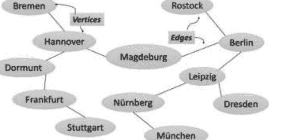

图 9.0 图 - 术语

图仅显示顶点和边之间的关系，这里最重要的是哪些边连接到哪个顶点。我们也可以说，图模拟了对象之间的连接。

## 邻接

当单条边连接两个顶点时，它们就是相邻的或邻居。在图中，由柏林（Berlin）和莱比锡（Leipzig）代表的顶点是相邻的，但柏林和德累斯顿（Dresden）这两个城市并不相邻。

## 路径

路径是边的序列。图中显示了从柏林到慕尼黑（München）经过莱比锡和纽尼堡（Nürnberg）的路径。那么路径就是柏林、莱比锡、纽尼堡、慕尼黑。

## 连通图

如果每个顶点到每个顶点至少有一个路径，则图是连通的。图中所有城市都是连接的。

## 有向图和加权图

当边具有方向时，图是有向的。在图中，它是无向的，因为超高速环可以从任何方向行驶。从柏林到莱比锡是一样的。

当边赋予权重时，图被称为加权图，例如城市之间的距离可以被加权。图回答了一个问题：从给定城市可以到达哪些城市？我们需要实现算法。搜索图有两种方法：深度优先搜索（DFS）和广度优先搜索（BFS）。

## 9.1 深度优先搜索 (DFS)

实现深度优先搜索以遍历图数据结构  {
        this.name = name;
        this.visited = false;
    }
    // 省略 setters 和 getter
```

### 邻接矩阵

我们有两种方法来建模顶点如何连接（边）：邻接矩阵和邻接表。对于这种算法，我们在 N 个顶点的图中创建一个 NxN 的二维数组。两个顶点（城市）之间的边由 1 表示。没有连接由 0 表示。

| 柏林 | 莱比锡 | 德累斯顿 | 纽尼堡 |

|---|---|---|---|

| 柏林 | 0 | 1 | 0 | 1 |

| 莱比锡 | 1 | 0 | 1 | 0 |

| 德累斯顿 | 0 | 1 | 0 | 0 |

...

表 9.1.1 邻接矩阵

例如，表格显示莱比锡与柏林、德累斯顿和纽尼堡相邻。

### 创建并初始化抽象类型

我们创建一个名为 `Graph` 的抽象类型来定义我们数据结构的行为。我们需要一个栈结构来记住已访问的顶点。栈遵循后进先出（LIFO）原则，即最后插入的城市是第一个从栈中出来的城市。我们定义 `arrayOfVertex[]` 数组来存储添加到 `Graph` 的新顶点（城市）。我们定义 `numOfVertices` 变量表示已添加到 `Graph` 的顶点数量。由于我们将向 DFS 算法传递字符串参数（城市名称），`mapOfVertex` 被用于注册键值对：城市索引。

### 9.1.2 - Graph 类

```java
public class Graph {
    private final int MAX_VERTEX = 15;
    private Vertex arrayOfVertex[]; //城市
    private Map<String, Integer> mapOfVertex;
    // 邻接矩阵：
    private int matrixAdjVertex[][];
    // 在 arrayOfVertex 中的位置：
    private int numOfVertices;
    private Stack<Integer> stack;

    public Graph() {
        arrayOfVertex = new Vertex[MAX_VERTEX];
        mapOfVertex = new ConcurrentHashMap<>();
        numOfVertices = 0;
        matrixAdjVertex = new int[MAX_VERTEX][MAX_VERTEX];
        stack = new Stack<>();
        // 初始化矩阵
        for (int i = 0; i < MAX_VERTEX; i++) {
            for (int j = 0; j < MAX_VERTEX; j++) {
                matrixAdjVertex[i][j] = 0;
            }
        }
    }
}
```

我们在 `Graph` 类内部定义了以下方法。

### 添加顶点

```java
public void addVertex(Vertex city) {
    mapOfVertex.put(city.getName(), numOfVertices);
    arrayOfVertex[numOfVertices++] = city;
}
```

`numOfVertices` 变量决定了新城市在 `arrayOfVertex` 中的位置（索引）。

### 添加边

我们在 `matrixAdjVertex` 中添加两个条目，因为两个城市是双向连接的。

```java
public void addEdge(String city1, String city2) {
    int start = mapOfVertex.get(city1);
    int end = mapOfVertex.get(city2);
    matrixAdjVertex[start][end] = 1;
    matrixAdjVertex[end][start] = 1;
}
```

这里的点在于，我们需要定义图的拓扑结构，添加顶点（城市）以及连接它们的边。

### 算法

我们的 `dfs(s)` 方法接收城市名称作为参数。然后，我们在 `HashMap` 中定位该城市的索引，将其标记为已访问并将其推入栈中。

我们遍历栈项直到它为空。这就是我们在每次迭代中中所做的：

1. 从栈顶获取顶点（`peek`）。

2. 尝试获取至少一个未访问的邻居。

3. 如果找到一个顶点，将其标记为已访问并推入栈中。

4. 如果没有找到，则弹出栈元素。

```java
// 尚未访问的相邻顶点
private int getAdjVertex(int vertex) {
    for (int adj = 0; adj < numOfVertices; adj++) {
        if (matrixOfAdjVertex[vertex][adj] == 1 &&
            arrayOfAdjVertex[adj].isVisited() == false)
            return adj; // 返回第一个相邻顶点
    }
    return -1; // 未找到顶点
}

public Map<String, Integer> getMapOfVertex() {
    return mapOfVertex;
}

public int[][] getMatrixOfAdjVertex() {
    return matrixOfAdjVertex;
}
```

### 测试 (Tests)

```java
public class GraphTest {

    Graph graph;

    @Before
    public void setup() {
        graph = new Graph();
    }

    @Test
    public void test_addvertex() {
        Vertex city = new Vertex("Berlin");
        graph.addVertex(city);
        assertTrue(graph.getMapOfVertex().size() == 1);
    }

    @Test
    public void test_addedge() {
        String city1 = "Berlin";
        String city2 = "Leipzig";
        Vertex v1 = new Vertex(city1);
        Vertex v2 = new Vertex(city2);
        graph.addVertex(v1); // 位置 0
        graph.addEdge(city1, city2); // 位置 1
        assertTrue(graph.getMatrixOfAdjVertex()[0][1] == 1);
        assertTrue(graph.getMatrixOfAdjVertex()[1][0] == 1);
    }
}
```


## 9.2 广度优先搜索 (BFS)

实现广度优先搜索算法以遍历图数据结构。

### 解决方案 (Solution)

在广度优先搜索中，算法尽可能地靠近起点。它会访问所有与起始顶点相邻的顶点。该算法使用队列实现。

9.2.1 展示了如果选择柏林（Berlin）作为根节点时的步骤序列。数字表示访问顶点的顺序。

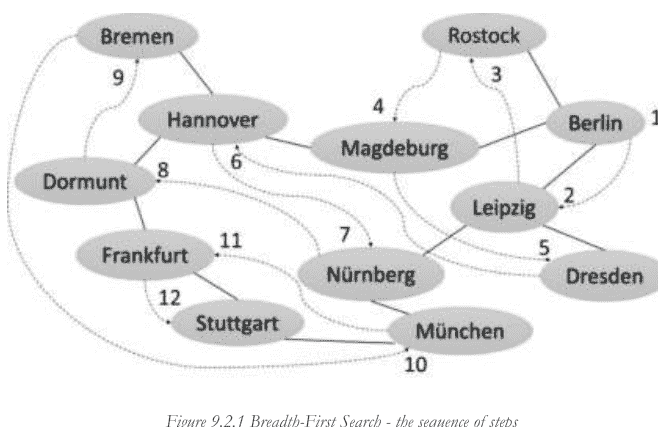

广度优先搜索算法找到所有与起始顶点隔一条边的顶点，然后是隔两个边、三条边的顶点，以此此类推。这对于回答诸如“从柏林到另一个城市的最短路径是什么？”等问题非常有用。

- 我们遍历距离柏林一个边的城市（第一层）：罗斯托克（Rostock）、莱锡（Leipzig）。
- 我们遍历距离柏林两个边的城市（第二层）：纽伦堡（Nürnberg）、德累斯顿（Dresden）。
- 我们遍历距离柏林三条边的城市（第三层）：汉诺威（Hannover）、多特蒙德（Dortmund）。
- 我们遍历距离柏林四个边的城市（第四层）：马格德堡（Magdeburg）、法兰克福（Frankfurt）。
- 我们遍历距离柏林五个边的城市（第五层）：斯图加特（Stuttgart）。
- 我们遍历距离柏林六条边的城市（第六层）：慕尼黑（München）。

### 添加边 (Adding an edge)

我们使用`LinkedList`结构来构建邻接表。当两个城市被单条边连接在一起时，它们即为邻居。

### 列表 9.2.1 - LinkedList, addEdge 方法

```java
private LinkedList<Integer> adjList[];

public void addEdge(String city1, String city2) {
    int start = mapOfVertex.get(city1);
    int end = mapOfVertex.get(city2);
    adjList[start].add(end);
}
```

```java
@Test
public void test_bfs() {
    String city1 = "Berlin";
    String city2 = "Leipzig";
    String city3 = "Dresden";
    String city4 = "Nürnberg";
    String city5 = "Hannover";
    String city6 = "Rostock";
    String city7 = "Dortmund";
    String city8 = "Frankfurt";
    String city9 = "Stuttgart";
    String city10 = "München";
    String city11 = "Magdeburg";
    String city12 = "Bremen";
    graph.addVertex(new Vertex(city1));
    graph.addVertex(new Vertex(city2));
    graph.addVertex(new Vertex(city3));
    graph.addVertex(new Vertex(city4));
    graph.addVertex(new Vertex(city5));
    graph.addVertex(new Vertex(city6));
    graph.addVertex(new Vertex(city7));
    graph.addVertex(new Vertex(city8));
    graph.addVertex(new Vertex(city9));
    graph.addVertex(new Vertex(city10));
    graph.addVertex(new Vertex(city11));
    graph.addVertex(new Vertex(city12));
    graph.addEdge(city1, city2);
    graph.addEdge(city2, city3);
    graph.addEdge(city3, city4);
    graph.addEdge(city4, city10);
    graph.addEdge(city11, city5);
    graph.addEdge(city5, city7);
    graph.addEdge(city7, city8);
    graph.addEdge(city8, city9);
    graph.addEdge(city1, city6);
    graph.addEdge(city1, city11);
    graph.addEdge(city5, city12);
    graph.addEdge(city9, city10);
    graph.bfs(city1);
}
```

输出：

Berlin Leipzig Rostock Magdeburg Dresden Hannover Nürnberg Dortmund Bremen München Frankfurt Stuttgart

# 编码挑战

## 10.0 基础知识

有两种方式可以从招聘人员处接收编码挑战。首先，你会通过邮件收到一份编码挑战的描述，你需要在家中的时间来解决它。其次，你需要在招聘人员的办公室，面对其他开发者完成这项编码挑战。

对于这两种方式，请记住以下几点以便在招聘过程中留下良好印象：

- 将你的最终代码托管在 Github 等网站上，并带有清晰的 README 文件和清晰的提交信息（commit messages）
- 为你的代码编写测试用例。这表明你关注可维护性。
- 构建清晰的结构。你的代码必须是可读的。
- 应用 SOLID 原则，它会告诉你如何将函数组织成类，以及这些类之间应该如何相互关联
- 考虑可能的改进——这些未包含在挑战中的——当你在他们面前修改代码时，这些将成为开放性问题。

## 10.1 优化在线购物

给定一个预算 B 和一个包含`[product-id][price][value]`的二维数组，编写一个算法来优化购物篮子，使其包含成本小于或等于 B 的价值最高的产品。

### 解决方案

假设我们有 4 美元的预算，并且想要从桌子上购买价值最高的零食。谁来决定一个产品是否比另一个更有价值？嗯，这取决于每个业务。它可能是基于定量或定性分析的估计。在本解决方案中，我们选择了定量方法，基于哪种产品每美元能提供的价值更高。

| Id | 名称 | 价格 ($) | 数量 ($) |
|---|---|---|---|
| 1 | 趣味铅笔 | 0.48 | 36 |
| 2 | 鸡蛋白 | 0.89 | 10 |
| 3 | 华夫普雷结 | 0.98 | 226 |
| 4 | 塔霍饼结 | 0.98 | 226 |
| 5 | Tako 零食 | 0.29 | 60 |
| 6 | 虾仁零食 | 0.29 | 71 |
| 7 | 烤玉米 | 0.35 | 50 |
| 8 | 球零食 | 0.65 | 12 |
| 9 | 奶酪零食 | 0.69 | 20 |
| 10 | Bissli 法拉费 | 0.86 | 70 |

### 10.1.1 零食列表

我们使用红绿重构（Red-Green-Refactor）技术来实现我们的算法，这是测试驱动开发（TDD）的基础。在每个假设下，我们编写一个测试并观察它是否失败。然后编写仅实现该测试的代码，如果成功，我们可以重构代码。然后继续下一个假设，直到算法实现了所有测试。

为了泛化“价值最高的产品”的概念，我们的算法接收两个参数：一个包含`[product-id][price][value]`的数组和一个预算。

### 假设 #1 - 给定按价值排序的产品数组，返回价值的产品

我们开始定义一个新的`BasketOptimized`类。

### 10.1.1 - BasketOptimized 测试

```java
public class BasketOptimizedTest {
    BasketOptimized basketOptimized;

    @Before
    public void setup() {
        basketOptimized = new BasketOptimized();
    }
}
```

```java
@Test
public void productsOrderByValue() {
    double[][] myProducts = new double[][]{
        {1, 0.98, 230},
        {2, 0.98, 230},
        {3, 0.48, 75},
        {4, 0.29, 55},
        {5, 0.29, 47},
        {6, 0.86, 14},
        {7, 0.69, 12}
    };

    double[] mostValuableProducts = basketOptimized.fill(myProducts, 4);
    assertEquals(590d,
        Arrays.stream(mostValuableProducts)
        mapToDouble(arr -> arr[2]).sum(), 0);
}
```

第一次运行时它应该是失败的，因为`fill`方法不存在。我们需要创建一个简单的实现来通过测试：价值总和必须等于 590，因为这代表了所有价格小于或等于 4 的产品。

现在我们开始实现`fill`方法。

### 10.1.2 - BasketOptimized fill 实现

```java
public class BasketOptimized {
    public double[][] fill(double[][] myProducts, double budget) {
        int len = myProducts.length;
        double[][] mostValuableProducts = new double[len][3];
        double sum = 0;
        for (int idx = 0; idx < len; idx++) {
            sum = sum + myProducts[idx][1]; // 价格
            if (sum <= budget) {
                mostValuableProducts[idx][0] = myProducts[idx][0]; // id
                mostValuableProducts[idx][1] = myProducts[idx][1]; // 价格
                mostValuableProducts[idx][2] = myProducts[idx][2]; // 价值
            }
        }
        return mostValuableProducts;
    }
}
```

### 假设 #2 - 给定未按价值排序的产品数组，返回价值的产品

在这种情况下，我们传递了一个未排序的数组，因此可以看到我们的新测试将失败。

```java
@Test
public void productsNotOrderedByValue() {
    double[][] myProducts = new double[][]{
        {1, 1.29, 47},
        {2, 0.51, 30},
        {3, 0.69, 12},
        {4, 1.29, 55},
        {5, 0.98, 230},
        {6, 4.86, 14},
        {7, 0.48, 75}
    };

    double[] mostValuableProducts = basketOptimized.fill(myProducts, 4);
    assertEquals(590d,
        Arrays.stream(mostValuableProducts)
        mapToDouble(arr -> arr[2]).sum(), 0);
}
```

我们需要按价值对数组进行排序，这就是我们需要做的。

### 假设 #3 - 给定一个产品数组，返回价值的产品（所有组合）

假设以下场景：

```java
double[][] myProducts = new double[][]{
    {1, 0.98, 230},
    {2, 0.51, 30},
    {3, 0.69, 12},
    {4, 1.29, 55},
    {5, 0.98, 230},
    {6, 4.86, 14},
    {7, 0.48, 75}
};
```

我们需要计算所有组合（子集），并找到 4 美元预算下价值最高的产品。

```java
public double[][] fill(double[][] myProducts, double budget) {
    int n = myProducts.length;
    int totalCombinations = (int) Math.pow(2, n);
    List<double[]> bestBasket = new ArrayList<>();

    // 这是一个背包问题的简化版本
    // 在实际场景中，我们会使用动态规划
    return new double[0][0]; 
}

private void findBest(double[][] myProducts, int index, double currentPrice, double currentValue, List<Integer> currentBasket, double budget) {
    if (index == myProducts.length) {
        if (currentPrice <= budget) {
            // 更新最佳篮子逻辑
        }
        return;
    }
    // ... 递归逻辑
}
```

下表显示了我们内部循环中的迭代：


| `binary-idx` | `idx2` | `Math.pow(2, idx2)` | `binary-pow(idx2)` | `binary-idx AND binary-pow(idx2)` |
|---|---|---|---|---|
| `00100001` | 0 | 1 | `0001` | |
| `00100001` | 1 | 2 | `0010` | 0 |
| `00100001` | 2 | 4 | `0100` | 0 |
| `00100001` | 3 | 8 | | 0 |
| `00100001` | 4 | 16 | `00010000` | 0 |
| `00100001` | 5 | 32 | `00100000` | 1 |
| `00100001` | 6 | 64 | `01000000` | 0 |

这意味着一个新的子集将包含我们产品数组中索引为 1, 2, 3, 4 和 6 的产品。我们需要考虑在有限的预算下是否能够负担得起这些产品。

```java
if (subset.length > 0 && sumPrice <= budget) {
```

接下来的图显示了我们当前迭代的结果：

```
idx = 33
▼ subset = (double[7][@1561)
  Not showing null elements
  ▼ 0 = (double[3]@1131)
    idx 0 = 2.0
    idx 1 = 0.51
    idx 2 = 30.0
  ▼ 1 = (double[3]@1612)
    idx 0 = 3.0
    idx 1 = 0.49
    idx 2 = 28.0
  ▼ 2 = (double[3]@1067)
    idx 0 = 4.0
    idx 1 = 1.29
    idx 2 = 55.0
  ▼ 3 = (double[3]@1292)
    idx 0 = 5.0
    idx 1 = 0.98
    idx 2 = 230.0
  ▼ 4 = (double[3]@1641)
    idx 0 = 7.0
    idx 1 = 0.48
    idx 2 = 75.0
```

我们构建了一个 `HashMap` 来存储所有组合以及它们值的和。最后，我们可以获取按值排序的 `HashMap` 中的第一个元素。

### 列表 10.1.3 - `BasketOptimized` 实现

```java
public class BasketOptimized {
    public double[][] fill(double[] myProducts, double budget) {
        int len = myProducts.length;
        int numCombinations = (int)Math.pow(2, myProducts.length);
        Map<double[], Double> combinations = new HashMap<>();

        for (int idx = 0; idx < numCombinations; idx++) {
            double[] subset = new double[len];
            double sumPrice = 0;
            double sumValue = 0;
            int i = 0;
            for (int idx2 = 0; idx2 < len; idx2++) {
                if ((idx & Math.pow(2, idx2)) == 0) {
                    subset[i++] = myProducts[idx2];
                    sumPrice += myProducts[idx2][1];
                    sumValue += myProducts[idx2][2];
                }
            }
            if (subset.length > 0 && sumPrice <= budget) {
                // remove nulls
                subset = Arrays.stream(subset)
                    .filter(s -> s != null && s.length > 0)
                    .toArray(double[]::new);
                combinations.put(subset, Double.valueOf(sumValue));
            }
        }

        HashMap<double[], Double> reverseSortedMap = 
            new LinkedHashMap<>();
        combinations.entrySet()
            .stream()
            .sorted(Map.Entry.comparingBy(Comparator.reverseOrder()))
            .forEach(x -> reverseSortedMap
                .put(x.getKey(), x.getValue()));

        double[][] mostValueProducts = reverseSortedMap
            keySet().iterator().next();
        return mostValueProducts;
    }
}
```

### 测试

```java
public class BasketOptimizedTest {

    BasketOptimized basketOptimized;

    @Before
    public void setup() {
        basketOptimized = new BasketOptimized();
    }
}
```

```java
@Test
public void given_productsOrderedByValue_return_mostValuable() {

    double[][] myProducts = new double[][]{
        {1, 0.98, 230},
        {2, 0.98, 230},
        {3, 0.48, 75},
        {4, 1.29, 55},
        {5, 1.29, 47},
        {6, 4.86, 14},
        {7, 1.69, 32}
    };

    double[][] mostValuableProducts =
        basketOptimized.fill(myProducts, 4);
    assertEquals(590d,
        Arrays.stream(mostValuableProducts)
            mapToDouble(arr -> arr[2]).sum(), 0);
}
```

```java
@Test
public void given_productsNotOrderedByValue_return_mostValuable() {

    double[][] myProducts = new double[][]{
        {1, 0.98, 230},
        {2, 1.29, 47},
        {3, 1.69, 12},
        {4, 1.29, 55},
        {5, 0.98, 230},
        {6, 4.86, 14},
        {7, 0.48, 75}
    };

    double[][] mostValuableProducts =
        basketOptimized.fill(myProducts, 4);
    assertEquals(590d,
        Arrays.stream(mostValuableProducts)
            mapToDouble(arr -> arr[2]).sum(), 0);
}
```

一旦设置了尺寸，游戏就会接收不同的移动。`Board` 类会在每次移动后检查游戏是否存在胜者。列表 10.2.5 定义了一个测试用例，用于检查整个水平行是否被填满。

### Listing 10.2.5 - `Board` 类, `getWinner` 测试用例

```java
@Test
public void horizontalLineFilledThenWinnerX() {
    board.setSize(3);
    board.putSymbol(1, 1, "X");
    board.putSymbol(1, 2, "O");
    board.putSymbol(2, 1, "X");
    board.putSymbol(2, 3, "O");
    board.putSymbol(3, 1, "X");
    board.print();
    assertEquals("X", board.getWinner());
}
```

然后我们遍历每一个水平行，并检查它是否由相同的符号填充。列表 10.2.6 显示了 `getWinner` 方法的实现。

### Listing 10.2.6 - `Board` 类, `getWinner` 方法

```java
private String getWinner() {
    String winner = null;
    for (int y = 0; y < board.length; y++) {
        String symbol = board[0][y];
        if (symbol != EMPTY_) {
            int counter = 1;
            for (int x = 1; x < board.length; x++) {
                if (symbol.equals(board[x][y])) {
                    counter++;
                }
            }
            if (counter == board.length) {
                winner = symbol;
                return winner;
            }
        }
    }
    return winner;
}
```

对于所有的获胜方式都需要相同的逻辑：垂直、对角线，因此我们需要将每种情况抽象到子方法中。列表 10.2.7 显示了重构后的 `getWinner` 方法。

### Listing 10.2.7 - `Board` 类, 重构后的 `getWinner` 方法

```java
public String getWinner() {
    if (board == null) {
        throw new RuntimeException("Board is not initialized");
    }
    String winner = winnerInLine();
    if (winner != null) {
        return winner;
    } else {
        winner = winnerInVerticalLine();
        if (winner != null) {
            return winner;
        } else {
            winner = winnerInDiagonalBottomLeft();
            if (winner != null) {
                return winner;
            } else {
                winner = winnerInDiagonalTopLeft();
                if (winner != null) {
                    return winner;
                } else {
                    // 我们避免每次都遍历棋盘
                    // 来寻找平局
                    if (this.numOfPlays == this.numOfPlaysAllowed) {
                        return DRAW;
                    } else {
                        return null;
                    }
                }
            }
        }
    }
}
```

之前的代码展示了我们如何引入三个新变量：

一个常量变量：

```java
private final static String DRAW_ = "DRAW!";
```

`numOfPlays` 和 `numOfPlaysAllowed` 被声明为类的成员。

`numOfPlaysAllowed` 在 `init` 方法中初始化：

```java
this.numOfPlaysAllowed = size * size;
```

`numOfPlays` 在 `put` 方法中递增：

```java
this.numOfPlays++;
```

这里是其他的获胜方式。

```java
private String winnerInVerticalLine() {
    String winner = null;
    for (int x = 0; x < board.length; x++) {
        String symbol = board[0][x];
        if (symbol != EMPTY_) {
            int counter = 1;
            for (int y = 1; y < board.length; y++) {
                if (symbol.equals(board[y][x])) {
                    counter++;
                }
            }
            if (counter == board.length) {
                winner = symbol;
                return winner;
            }
        }
    }
    return winner;
}
```

```java
private String winnerInDiagonalBottomLeft() {
    String winner = null;
    String symbol = board[0][0];
    if (symbol != EMPTY_) {
        int counter = 1;
        for (int idx = 1; idx < board.length; idx++) {
            if (symbol.equals(board[idx][idx])) {
                counter++;
            }
        }
        if (counter == board.length) {
            winner = symbol;
            return winner;
        }
    }
    return winner;
}
```

```java
private String winnerInDiagonalTopLeft() {
    String winner = null;
    String symbol = board[0][board.length - 1];
    if (symbol != EMPTY_) {
        int counter = 1;
        for (int idx = 1; idx < board.length; idx++) {
            if (symbol.equals(board[idx][board.length - 1 - idx])) {
                counter++;
            }
        }
        if (counter == board.length) {
            winner = symbol;
            return winner;
        }
    }
    return winner;
}
```

现在让我们来看看 `Utils` 类，它加载了符号和棋盘的尺寸。

### 测试用例 #5: 加载文件

我们需要一个方法，给定文件名，获取该文件的内容。列表 10.2.8 显示了该测试用例。

### Listing 10.2.8 - `Utils` 测试


# 测试用例与实现

## 测试用例 #5：加载文件

假设文件位于项目目录下。列表 10.2.9 显示了 `loadFile` 的实现。

```java
import java.io.IOException;
import java.nio.file.Files;
import java.nio.file.Paths;

public class Utils {

    public String loadFile(String fileName) throws Exception {
        String content;
        try {
            content = new String(Files.readAllBytes(Paths.get(fileName)));
        } catch (IOException io) {
            throw new RuntimeException("File " + fileName + " not found");
        }
        return content;
    }
}
```

## 测试用例 #6：获取尺寸

一旦加载了 `Board`，我们需要验证其有效性。列表 10.2.10 显示了关于尺寸的假设。

### 列表 10.2.10 - `Utils` 类，`getBoardSize` 测试用例

```java
@Test
public void getBoardSizeIs4() throws Exception {
    String content = utils.loadFile("board.txt");
    assertEquals(4, utils.getBoardSize(content));
}
```

列表 10.2.11 显示了 `getBoardSize` 的实现。

```java
public int getBoardSize(String content) throws Exception {

    if (content == null) {
        throw new RuntimeException("Invalid setting for the board");
    }

    if (Integer.valueOf(content) < 3 || Integer.valueOf(content) > 9) {
        throw new RuntimeException("Invalid setting for the board");
    }

    return Integer.valueOf(content).intValue();
}
```

`board.txt` 文件内容：

```
4
```

始终尝试为每个事情构建一个小方法。如果你能将问题拆分成小部分，意味着你可以创建出大的软件。

## 测试用例 #7：获取符号

一旦加载了符号，验证它只获取了三个符号。列表 10.2.12 显示了我们在测试用例中的假设。

### 列表 10.2.12 - `Utils` 类，`getSymbols` 测试用例

```java
@Test
public void whenSymbolsIsThreeReturnValues() throws Exception {
    String content = utils.loadFile("symbols.txt");
    String[] symbols = utils.getSymbols(content);
    assertEquals(new String[]{"X","O","A"}, symbols);
}
```

`symbols.txt` 文件内容：

```
X,O,A
```

### 列表 10.2.13 - `Utils` 类，`getSymbols` 方法

```java
public String[] getSymbols(String content) {
    String[] symbols = content.split(",");
    if (symbols.length != 3) {
        throw new RuntimeException("Invalid settings for symbols");
    }
    return symbols;
}
```

## 测试用例 #8：从控制台接收输入

创建一个辅助 `Input` 类来存储玩家输入的坐标。列表 10.2.14 显示了我们在测试用例类中的假设。

```java
public class Input {
    private int x;
    private int y;

    public int getX() { return x; }
    public int getY() { return y; }
}
```

### 列表 10.2.14 - `Utils` 类，`getInput` 测试用例

```java
@Test
public void inputFromConsoleReturnInput() throws Exception {
    Input input = utils.getInputFromConsole("2,3");
    assertEquals(2, input.getX());
    assertEquals(3, input.getY());
}
```

列表 10.2.15 显示了 `getInputFromConsole` 方法的实现，其中我们需要接收有效的数字。

### 列表 10.2.15 - `Utils` 类，`getInputFromConsole` 方法

```java
public Input getInputFromConsole(String inputConsole) {
    if (inputConsole == null || inputConsole.trim().length() <= 0)
        throw new RuntimeException("Invalid input from console");

    Pattern p = Pattern.compile("[0-9]*\\.,?[0-9]+");
    Matcher matcher = p.matcher(inputConsole);
    if (!matcher.find())
        throw new RuntimeException("Invalid input from console");

    String[] inputSplitted = inputConsole.split(",");

    Input input = new Input();
    input.setX(Integer.valueOf(inputSplitted[0]).intValue());
    input.setY(Integer.valueOf(inputSplitted[1]).intValue());
    return input;
}
```

列表 10.2.16 显示了 `Player` 类及其子类的设计。

### 列表 10.2.16 - `Player` 类及子类

```java
public class Player {
    private String symbol;
    //getters and setters are omitted
}
```

```java
public class Human extends Player {
```

```java
public class IA extends Player {
```

## 测试用例 #9：如何实现 IA 游戏

为了制作一个简单的井字棋程序，我们将允许 IA 玩家填充棋盘上的第一个可用坐标。当然，你也可以基于图编写更复杂的实现，例如用于决定 IA 玩家的最佳移动。列表 10.2.17 显示了关于 IA 玩家的假设。

### 列表 10.2.17 - `Player` 类，测试用例

```java
public class PlayerTest {

    private Player humanPlayer;
    private IA iaPlayer;
    private Board board;

    @Before
    public void setUp() {
        humanPlayer = new Human();
        iaPlayer = new IA();
        board = new Board();
        board.setSize(3);
    }
}
```

```java
@Test
public void whenSetSymbolThenReturnSameSymbol() throws Exception {
    humanPlayer.setSymbol("A");
    assertEquals("A", humanPlayer.getSymbol());
}
```

```java
@Test
public void whenIAPaysThenReturnInput() throws Exception {
    iaPlayer.setSymbol("A");
    board.putSymbol(1, 1, "X");
    board.putSymbol(2, 2, "O");
    board.print();
    Input input = iaPlayer.play(board.getBoard());
    assertEquals(1, input.getX());
    assertEquals(2, input.getY());
}
```

列表 10.2.18 显示了 `play` 方法的实现。

```java
public class IA extends Player {
    private final static String EMPTY_ = " ";
}
```

```java
public Input play(String[][] board) {
    Input input = new Input();
    //假设：找到第一个可用坐标
    for (int x = 0; x < board.length; x++) {
        for (int y = 0; y < board.length; y++) {
            String symbol = board[x][y];
            if (symbol.equals("EMPTY")) {
                input.setX(x + 1);
                input.setY(y + 1);
                return input;
            }
        }
    }
    return input;
}
```

现在我们已经准备好了所有组件，是时候构建主类了。列表 10.2.19 显示了 `App` 类如何组装所有组件。

```java
public class App {
    private final static String DRAW_ = "DRAW!";

    public static void main(String[] args) throws Exception {
        System.out.println("welcome to TIC TOE 2.0!");

        Scanner scanner = new Scanner(System.in);

        Utils utils = new Utils();
        int boardSize = utils.getBoardSize(loadFile("board.txt"));

        Board board = new Board();
        board.setSize(boardSize);

        System.out.println("You are playing in a board " + boardSize + "x" + boardSize);
        String[] symbols = utils.getSymbols(loadFile("symbols.txt"));

        Player player1 = new Human();
        player1.setSymbol(symbols[0]);
        Player player2 = new Human();
        player2.setSymbol(symbols[1]);
        Player player3 = new IA();
        player3.setSymbol(symbols[2]);

        List<Player> playersIterator = new ArrayList<>();
        playersIterator.add(player1);
        playersIterator.add(player2);
        playersIterator.add(player3);
        Collections.shuffle(playersIterator);

        int idx = 0;
        boolean stillPlaying = true;
        while (stillPlaying) {
            Player player = playersIterator.get(idx++);
            if (player instanceof IA) {
                System.out.println("Player " + player.getSymbol() + " enter coordinates in Format x,y: ");
                Input input = ((IA) player).play(board.getBoard());
                board.putSymbol(input.getX(), input.getY());
            } else {
                boolean coordinateOk = false;
                while (!coordinateOk) {
                    System.out.println("Player " + player.getSymbol() + " enter coordinates in Format x,y: ");
                    try {
                        Input input = utils.getInputFromConsole(scanner.nextLine());
                        board.putSymbol(input.getX(), input.getY());
                        coordinateOk = true;
                    } catch (RuntimeException ex) {
                        System.out.println(ex.getMessage());
                    }
                }
            }
            board.print();
            String winner = board.getWinner();
            if (winner != null) {
                stillPlaying = false;
                if (winner.equals(DRAW_)) {
                    System.out.println(DRAW_);
                } else {
                    System.out.println("Player " + winner + " is the Winner!");
                }
            }
            if (idx == 3) // 控制玩家回合
                idx = 0;
        }
    }
}
```

### 演示

欢迎来到 TIC TOE 2.0!

你正在 4x4 的棋盘上游戏

Player A enter coordinates in Format x,y:

1,1

| | | |

Player O enter coordinates in Format x,y:

1,1

| | | |

Player O enter coordinates in Format x,y:

2,1

| | | |

Player X enter coordinates in Format x,y:

3,4

| X | | |


# 井字棋游戏记录

玩家 A 以 `x,y` 格式输入坐标：

| X |   |   |

玩家 O 以 `x,y` 格式输入坐标：

. . . .

O | X |   |

A | X | O

玩家 X 以 `x,y` 格式输入坐标：

`3,3`

O | X |   |

A | X | O

玩家 X 获胜！

下一部分包含了所有的测试用例：

## 测试

```java
public class BoardTest {

    private Board board;

    @Before
    public void setUp() {
        board = new Board();
    }

    @Rule
    public ExpectedException thrownException = ExpectedException.none();

    @Test
    public void whenSizeThenBoard() throws Exception {
        board.setSize(10);
        assertEquals(10, board.getBoard().length);
    }

    @Test
    public void whenPutCharacterCoordinateThenError() throws Exception {
        board.setSize(4);
        thrownException.expect(RuntimeException.class);
        board.putSymbol(1, 5, "X");
    }

    @Test
    public void whenCoordinateIsValidPutCharacterIsOK() throws Exception {
        board.setSize(3);
        board.putSymbol(1, 2, "X");
        assertEquals("X", board.getBoard()[0]);
    }

    @Test
    public void whenCoordinatesBusyThenPutCharacterError() throws Exception {
        board.setSize(3);
        board.putSymbol(1, 2, "X");
        thrownException.expect(RuntimeException.class);
        board.putSymbol(1, 2, "O");
    }

    @Test
    public void whenCoordinatesNotBusyPutSymbol() throws Exception {
        board.setSize(3);
        board.putSymbol(1, 2, "X");
        board.putSymbol(2, 3, "O");
        assertEquals("O", board.getBoard()[1][2]);
    }

    @Test
    public void whenBoardIsNullPrintThrowsError() {
        thrownException.expect(RuntimeException.class);
        board.print();
    }

    @Test
    public void whenBoardIsNullPrintIsPossible() {
        board.setSize(10);
        board.print();
    }

    @Test
    public void horizontalLineIsNotSameSymbolThenReturnNull() {
        board.setSize(3);
        board.putSymbol(2, 2, "X");
        board.putSymbol(1, 2, "O");
        board.putSymbol(1, 3, "X");
        board.putSymbol(2, 1, "O");
        board.putSymbol(3, 2, "X");
        board.print();
        assertEquals(null, board.getWinner());
    }

    @Test
    public void horizontalLineFilledThenWinnerX() {
        board.setSize(3);
        board.putSymbol(1, 1, "X");
        board.putSymbol(1, 2, "O");
        board.putSymbol(2, 1, "X");
        board.putSymbol(2, 3, "O");
        board.putSymbol(3, 1, "X");
        board.print();
        assertEquals("X", board.getWinner());
    }

    @Test
    public void horizontalLineFilledThenWinnerO() {
        board.setSize(4);
        board.putSymbol(1, 1, "X");
        board.putSymbol(1, 4, "O");
        board.putSymbol(2, 1, "X");
        board.putSymbol(2, 4, "O");
        board.putSymbol(3, 1, "X");
        board.putSymbol(3, 4, "O");
        board.putSymbol(3, 3, "X");
        board.putSymbol(4, 4, "O");
        board.print();
        assertEquals("O", board.getWinner());
    }
}
```

```java
@Test
public void verticalLineIsSymbolThenReturnWinnerX() {
    board.setSize(3);
    board.putSymbol(2, 1, "X");
    board.putSymbol(1, 3, "O");
    board.putSymbol(2, 2, "X");
    board.putSymbol(3, 3, "O");
    board.putSymbol(2, 3, "X");
    board.print();
    assertEquals("X", board.getWinner());
}
```

```java
@Test
public void diagonalLineIsSymbolThenReturnWinnerX() {
    board.setSize(3);
    board.putSymbol(1, 1, "X");
    board.putSymbol(1, 2, "O");
    board.putSymbol(2, 2, "X");
    board.putSymbol(2, 1, "O");
    board.putSymbol(3, 3, "X");
    board.print();
    assertEquals("X", board.getWinner());
}
```

```java
@Test
public void diagonalLineIsSymbolThenReturnWinnerO() {
    board.setSize(3);
    board.putSymbol(1, 1, "X");
    board.putSymbol(1, 3, "O");
    board.putSymbol(3, 2, "X");
    board.putSymbol(2, 2, "O");
    board.putSymbol(3, 3, "X");
    board.putSymbol(3, 1, "O");
    board.print();
    assertEquals("O", board.getWinner());
}
```

```java
@Test
public void diagonalLineIsSymbolThenReturnWinnerX_2() {
    board.setSize(5);
    board.putSymbol(1, 1, "O");
    board.putSymbol(1, 5, "X");
    board.putSymbol(3, 2, "O");
    board.putSymbol(2, 4, "X");
    board.putSymbol(3, 4, "O");
    board.putSymbol(3, 3, "X");
    board.putSymbol(1, 2, "O");
    board.putSymbol(4, 2, "X");
    board.putSymbol(5, 3, "O");
    board.putSymbol(5, 1, "X");
    board.print();
    assertEquals("X", board.getWinner());
}
```

```java
@Test
public void whenISDrawThenReturnTrue() {
    board.setSize(3);
    board.putSymbol(1, 1, "X");
    board.putSymbol(1, 2, "O");
    board.putSymbol(3, 2, "X");
    board.putSymbol(2, 2, "X");
    board.putSymbol(3, 3, "O");
    board.putSymbol(2, 1, "O");
    board.putSymbol(1, 3, "X");
    board.putSymbol(3, 1, "O");
    board.putSymbol(2, 3, "X");
    board.print();
    assertEquals("DRAW!", board.getWinner());
}
```

```java
import org.junit.rules.ExpectedException;
import static org.junit.Assert.*;
```

```java
public class UtilsTest {

    private Utils utils;

    @Before
    public void setUp() {
        utils = new Utils();
    }

    @Rule
    public ExpectedException thrownException = ExpectedException.none();

    @Test
    public void whenFileNotFoundThenThrowError() throws Exception {
        thrownException.expect(RuntimeException.class);
        utils.loadFile("board2.txt");
    }

    @Test
    public void whenIfExistsThenReturnContent() throws Exception {
        String content = utils.loadFile("symbols.txt");
        assertNotNull(content);
    }

    @Test
    public void whenGetBoardSizeIs11ThenThrowError() throws Exception {
        thrownException.expect(RuntimeException.class);
        utils.getBoardSize("11");
    }
}

@Test
public void whenGetBoardIs4ThenReturnSize() throws Exception {
    String content = utils.loadFile("board.txt");
    assertEquals(4, utils.getBoardSize(content));
}

@Test
public void whenGetSymbolsIsNotThreeThrowError() throws Exception {
    thrownException.expect(RuntimeException.class);
    utils.getSymbols("A,B,C");
}

@Test
public void whenGetSymbolsIsThreeReturnValues() throws Exception {
    String content = utils.loadFile("symbols.txt");
    String[] symbols = utils.getSymbols(content);
    assertArrayEquals(new String[]{"X","O","A"}, symbols);
}

@Test
public void whenInputFromConsoleIsWrongThrowException() throws Exception {
    thrownException.expect(RuntimeException.class);
    utils.getInputConsole("");
}

@Test
public void inputFromConsoleIsFormatThrowException() throws Exception {
    thrownException.expect(RuntimeException.class);
    utils.getInputConsole("10");
}

@Test
public void inputFromConsoleThenReturnInput() throws Exception {
    Input input = utils.getInputConsole("2,3");
    assertEquals(2, input.getX());
    assertEquals(3, input.getY());
}

# O 表示法

大 O 表示法是一种数学符号，用于帮助我们分析算法在时间和空间上的复杂度。当我们为数百万用户构建不同的算法来解决问题时，这一点非常重要。

## 时间和空间复杂度

时间复杂度与算法执行的步数有关。空间复杂度与算法使用的内存和磁盘空间有关。

两者都取决于输入的大小。我们可以根据三种情况分析复杂度：

- 最佳情况或大 Omega Ω(n)：通常，算法执行与输入大小无关。
- 平均情况或大 Theta Θ(n)：输入大小是随机的。
- 最坏情况或大 O O(n)：给出了任何输入运行运行的上限。

## 常见算法的增长阶


### O(1) - 常数级

无论输入包含 1000 个还是一百万个，代码总是执行单步。

```java

public class Bigotation {

    public void constant(String item) {

        list.add(item);

    }

}

```

```java

@Test

public void constantTime() {

    List<String> list = Arrays.asList("one", "two");

    Bigotation.constant("three");

}

```

### O(N) - 线性级

当步数增加时，我们称之为线性的。

```java

public int sum(int[] numbers) {

  int sum = 0;

  for (int i = 0; i < numbers.length; i++) {

    sum += numbers[i];

  }

  return sum;

}

```

```java

@Test

public void linearTime() {

    final int[] numbers = {30, 20, 10, 5};

    assertTrue(sum(numbers) == 40);

}

```

### O(N²) - 二级

当我们有两个嵌套循环时，它是二次的。

```java

public void initializeBoard(int size) {

    String[][] board = new String[size][size];

    for (int x = 0; x < size; x++) {

        for (int y = 0; y < size; y++) {

            board[x][y] = "";

        }

    }

}
```


```java
@Test
public void quadraticTime() {
    initializeBoard(3);
}
```

### O(N³) - 三级

我们称它包含了三个嵌套循环。

```java
public int countThreeSum(int[] numbers) {
    int N = numbers.length;
    int count = 0;
    for (int i = 0; i < N; i++) {
        for (int j = i + 1; j < N; j++) {
            for (int k = j + 1; k < N; k++) {
                if (numbers[i] + numbers[j] + numbers[k] == 0) {
                    count++;
                }
            }
        }
    }
    return count;
}
```

```java
@Test
public void countThreeSum() {
    final int[] numbers = {30, 20, 10, 5};
    assertTrue(countThreeSum(numbers) == 4);
}
```

### O(LogN) - 对数级

这类算法产生的增长曲线在开始达到顶峰，并随着尺寸增加而逐渐平缓。

`Log8=3`

`Log16=4`

`Log32=5`

二分搜索在大小为 `N` 的排序数组中最多使用 `LogN` 次比较。对于 8 个元素需要三次比较，16 个元素需要四次，32 个需要五次，以此此类推。

## 如何寻找算法的时间复杂度

寻找大 O 复杂度遵循以下规则：

- 忽略低阶项
- 忽略领先常数

示例：如果算法的时间复杂度为 `2n³ + 4n + 3`。它的大 O 复杂度简化为 `O(n³)`。

示例：给定以下算法：

```java
public Integer sumEvenNumbers(Integer N) {
  int sum = 0;
  for (int number = 1; number <= N; number++) {
    if ((number % 2) == 0)
      sum = sum + number;
  }
  return sum;
}
```

首先，将代码拆分为单独的操作，然后计算它们执行的次数，如下表所示。

| 操作 | 执行次数 |
| :--- | :--- |
| `int sum = 0;` | 1 |
| `int number = 1;` | 1 |
| `number <= N;` | N |
| `number++` | N |
| `if ((number % 2) == 0)` | N |
| `sum = sum + number;` | N |
| `return sum;` | 1 |

现在，我们需要相加每个操作执行的次数。

时间复杂度 = `1 + 1 + N + N + N + N + 1` => `4N + 3`

大 O 复杂度 = `O(N)`

## 为什么大 O 表示法忽略常数？

大 O 表示法描述了相对于数据元素数量所需的步骤数。它被作为分类算法长期增长率的一种。

例如，如图 A.2 所示，对于所有数据量，`O(N)` 都会比 `O(N²)` 快。

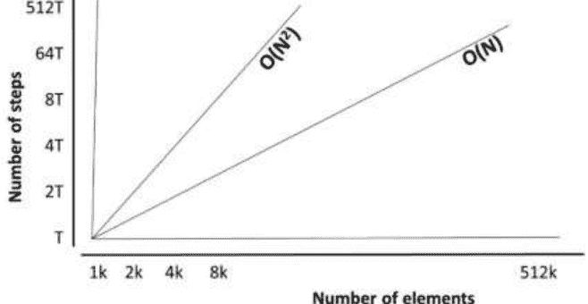

A.2 对于所有数据量，`O(N)` 都比 `O(N²)` 快

现在，如果我们将 `O(100N)` 与 `O(N³)` 进行比较，可以发现对于某些数据量，`O(N³)` 实际上比 `O(100N)` 快，如图 A.3 所示。

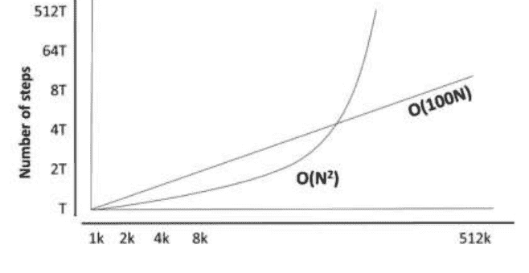

A.3 对于某些数据量，`O(N³)` 比 `O(100N)` 快

但越过了某一点之后，`O(100N)` 会变得更快，并且从此后的所有增加的数据量中都保持这种优势。这就是大 O 表示法忽略常数的原因。正如此，`O(100N)` 被写成 `O(N)`。
