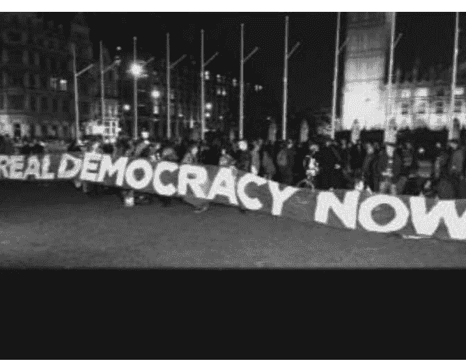
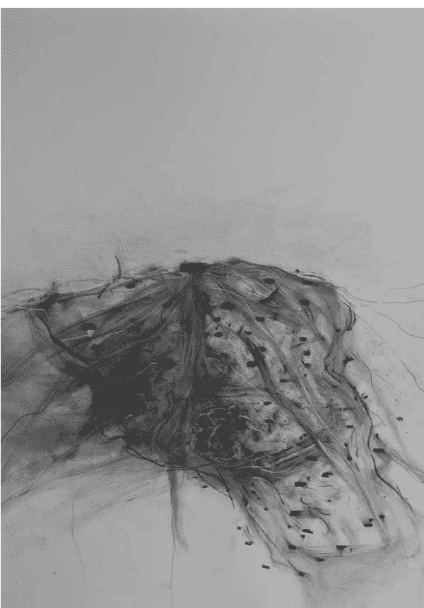
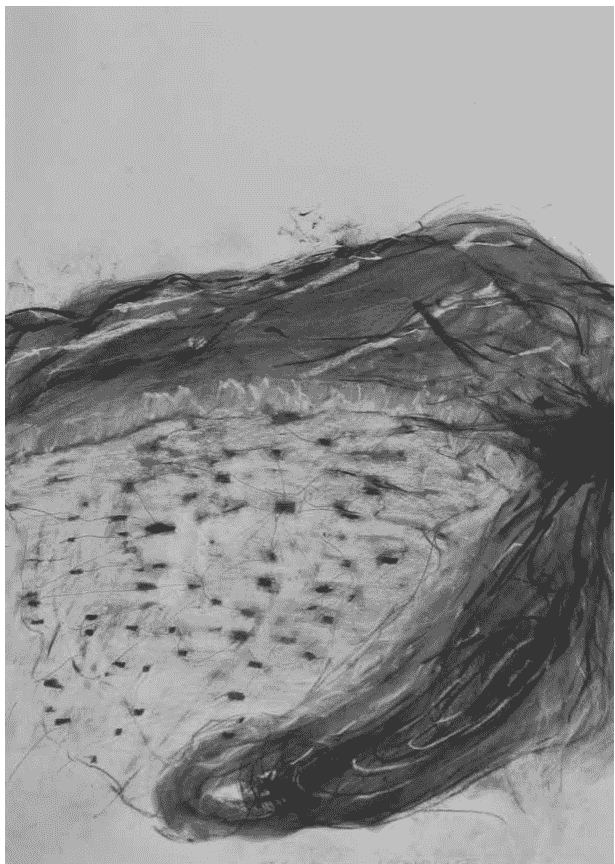
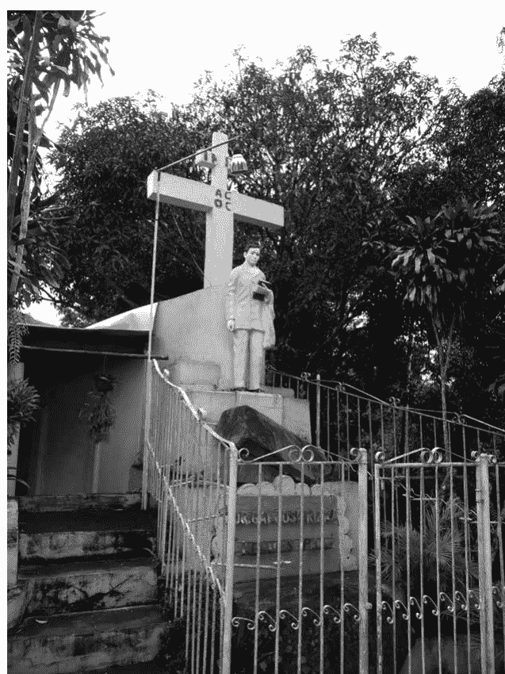
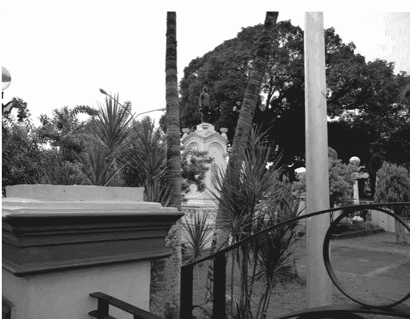
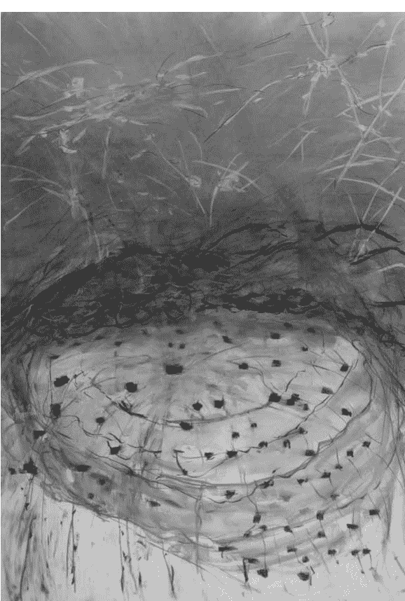
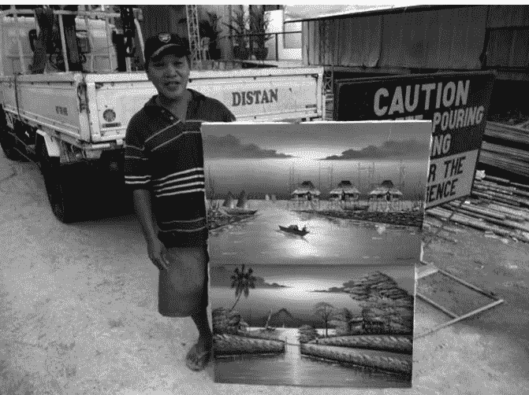
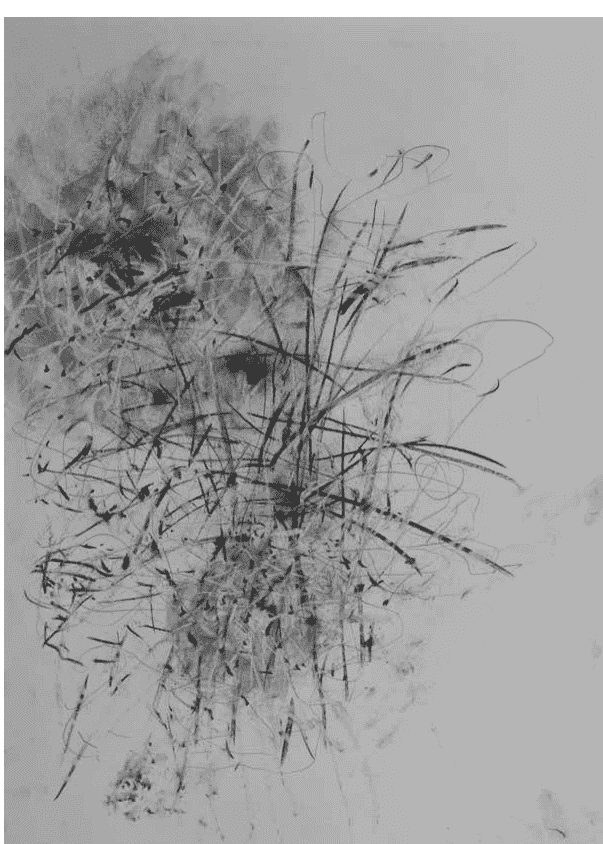
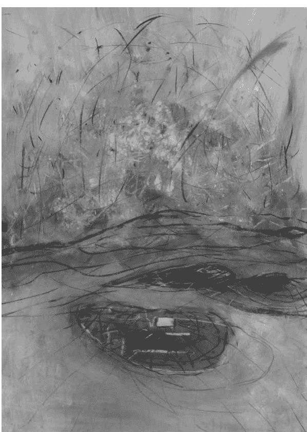

# 走向宗教与社会变革的新理论：主权与断裂（布卢伯里宗教、空间与场所研究）

系列主编：保罗·弗朗西斯·特梅特、约翰·伊德（`John Eade`）和凯蒂·索尔（`Katy Soar`）

宗教、灵性与神秘主义深度参与了地点营造的过程。这些包括政治和地缘政治空间、地方与国家空间、城市空间、空间与虚拟空间、争议空间、表演空间、记忆空间以及禁闭空间。在宗教研究的理论、方法论和跨学科创新前沿，“布鲁姆斯伯里宗教、空间与地点研究”汇聚并塑造了对此类过程的研究。

这些地点的定义不仅取决于物质或物理层面，还取决于感官和心理层面，取决于空间被性别化、分类、分层、穿行、注视、触摸、听取、解释和占据的方式。地点是通过具身实践构成的，这些实践将批判性和分析性的注意力引导至内部、外部、身体、景观、城市、主权、公众和内在性的空间生产。

由 `Integra Software Services Pvt. Ltd` 排版

欲了解更多关于我们作者和书籍的信息，请访问 `www.bloomsbury.com` 并订阅我们的时报

# 序言与致谢

本书汲取了两个不同的研究项目。最近，我参与了 `REDO`（重组民主：作为文化资源）项目，这是一个由萨洛森领导并由挪威研究委员会资助的国际研究计划。在我的工作中，我在香港与占领运动的活动人士一起进行了实地调查，而在伦敦则涉及记录活动。在此之前，由艺术与人文研究委员会（现 `AHRC`）资助的博士研究让我对被称为马拉特的布鲁姆斯伯里山进行了实地调查。我与治疗者以及小型灵性群体研究了神圣力量与能量（`kapangyhan`），以及对1896年西班牙殖民政权处决的黎萨。

这两个项目有许多共同点：首先是对变革感兴趣，特别是根本性的变革。其次，两个项目对空间感兴趣。占领运动关乎对城市空间的撕裂，期望以替代的方式聚集人们并参与项目。同样，布鲁姆斯伯里山的治疗者和教堂在寻找他们认为的拉特不公正且不道德空间的替代方案，部分是通过朝圣布鲁姆斯伯里的圣地并浸入洞穴、瀑布和泉水，部分是沿着隐藏通道前往秘密室。当我进入布鲁姆斯伯里时，那里已变成了一个由宗教领袖、神秘主义者、朝圣者、新时代者和专注的学生组成的真正家庭产业，他们都参与并增加了布鲁姆斯伯里的想象。

本书及其对变革和空间的兴趣，很大程度上源于我在菲律宾布鲁姆斯伯里山的工作，以及随后在伦敦和香港开展的 `REDO` 工作。它也是宗教研究边界——即人文科学、社会科学与物理科学之间——正式与非正式跨学科对话的产物，如果没有许多同事和朋友的支持，这一切是不可能的。我要感谢布鲁姆斯伯里的 `Lalle Prurslove`、`Lucy Carroll` 和 `Camilla Edwards` 对本项目的热情、支持和鼓励。感谢开放大学的部门、学院和教职同事（过去的及现任）——特别是 `Hugh Beattie`、`Gwilym Beckerledge`、`Marion Bowman`、`Graham Harvey`、`John Maiden`、`Susan Newcombe`、`Stephanie Sinclair`、`Helen Waterhouse` 和 `John Wolfe`——以及 `Simon Carter`、`Peter Elmer`、`Rudy Harrison`、`Donna Loftus`、`Liz McFall`、`Jess Perriam` 和 `Peter Redman` —— 我对你们深表感激：开放大学课程材料的集体创作模式，我从一开始就发现是实现基本社会学洞察的绝佳方式，即学习既是社会性的，也是个人的。

感谢参与 `REDO` 项目并对本书写作做出巨大贡献的朋们和同事，非常感谢 `Tony Balcomb`、`Grzegorz Brzozowski`、`Gitte Buch-Hansen`、`Agnes Czajka`、`Gregory Delplace`、`Cora Alexa Doving`、`Samuel Etikpah`、`Marion Grau`、`Ron Grimes`、

# 前言与致谢

`Kjetil Hafstad`、`Ida Marie Høg`、`Nina Hoel`、`Michael Houseman`、`Morny Joy`、`Jens Kreinath`、`Bruno Latour`、`Zaki Nahaboo`、`Birte Nordahl`、`Sarah Pike`、`Jone Salomonsen` 以及 `Donna Seamone`；能与你们共同思考是一次难以置信的荣幸。

在旅程途中，还有许多人的贡献起到了决定性的作用：`Syed Mustafa Ali`、`David Chapman`、`Jay Cornelio`、`John Eade`、`José Francisco`、`David Garbin`、`Marie Gillespie`、`Suman Gupta`、`Titus Hjelm`、`Richard Irvine`、`Theodoros Kyriakides`、`Rebecca Lee`、`Chris Lewis-Jones`、`Magnus Ramage`、`Maria Nita`、`Francis Stewart`、`Steve Sutcliffe`、`Liam T. Sutherland`、`Sophie Watson`，特别是我的学生们（过去和现在）`Hilde Capparella`、`Owen Coggins`、`Lucy May Constantini`、`Alison Robertson`、`Aled Thomas` 和 `Claire Wanless`。最后，还要特别感谢 `Atsuhide Ito`（伊藤敦秀），他满热情地投入到为第三章以及后记《装配制图》（`Assemblage Drawings`）制作精美的图表中。书中转载的照片均为我本人拍摄。对于我的家人以及圈外的朋友们——你们是我永恒的伴侣。这本书是给 `Katy` 的。

### 引言

长期以来，宗教研究一直受到现代性理性与经验双重透镜的主导。每种透镜都包含相当特定的方法论承诺，而这些承诺反过来又对应特定的定义维度。对于理性视角而言，宗教是信仰、概念、观点和想法，最好的研究方式是基于一种现实主义认识论，这种认识论递归地束缚在自然与超自然的对立关系中。因此，宗教被描绘为对现实世界的扭曲表征，随着世俗-科学实验和辩论过程所达并不断修正的操作性或工具性效力变得无处不在，这些表征注定会枯萎。相比之下，对于经验视角而言，宗教是实践、是具化的情感和影响，其重点在于对时刻、事件和奇异性的诠释与神学，这些概念递归地关联到“神圣”的概念，将其视为一种开启或断裂——由疯狂、附身或打破常规的狂热所引发——它从根本上解构了平凡世界，以揭示出某种“他者”（`Other`）。

每种透镜都构成了对宗教本质的不同愿景，并包含了一套研究宗教的方法论程序和规则。此外，这两者都应用于宗教社会学两个最受推崇的范式：世俗化假说和生活宗教（`lived religion`）假说。每个假说都试图模拟宗教和社会的变化过程。前者从现代化社会中制度性宗教衰落的原始单线性模型衍生了大量的批判和变体，包括多线性、振荡和后世俗模型；它被大量数据所击败，并受到民族志研究的影响，其中最好的研究认真对待了“现代性是多重性的，且并非处处相同”这一观点，因此，它对宗教的影响绝非是一律的（`Eisenstadt 2000`）。尽管如此，其核心是宗教与世俗的根本性对立，即假设宗教可以通过记录人口中对教义正确信仰的（数量化）表达来衡量，并最终认为这些表达将在现代化社会中枯萎。生活宗教假说也产生了变体：宗教是内含的、通俗的、流动的，其制度化维度被淡化，转而强调自发性和即兴。其焦点是对于宗教生活的民族志描述，这些生活被揭示为并非正统的载体或理论上正确信仰的携带者，而是混乱的、难以捉摸的，并以混合和即兴的过程为特征，利用随手可得的任何宗教和文化碎片。

这两个假说构成了一互补对：一个强调宗教的衰落；另一个强调宗教的生产或创造。它们是该领域对宗教和社会变化的定义性描述，尽管假设和结论不同，但它们的核心都共享了理性选择的、赋予意义的个体人类主体，并将其作为分析的共同场所。将统一主体视为信仰和意义的场域以及行动的中心的想象，支撑了关于宗教的社会科学叙述：毕竟，世俗化的衡量取决于这一主体对有关问题的采访和问卷的回应。

### 引言

以 1789 年法国大革命等历史事件为例，人们可能想要描绘这样一个转折点：在该点，一个稳固的制度化宗教（法国天主教）丧失了结构完整性，以至于到 19 世纪 30 年代和 40 年代，一系列此前不可想象的宗教实验已经过或正在进行中——从理性崇拜到最高存在崇拜，从牛顿教到圣阿芒·巴扎尔与巴尔特莱米·普斯珀·恩芬特创立的神圣学院，再到伊卡里亚主义以及人类宗教。可以认为，革命的热热激发了 18 世纪法国文化与社会的活跃微粒，以至于旧的互动开始产生新事物，而这些新事物反过来又由于它们被引入并加入到混合物中，引发了新的互动……你明白我的意思了。上述列出的实验中没有一个能维持多久这并不重要，这些实验的累积效应足以重构法国天主教以及更广泛的法国社会的构成部分。

根据卡洛·罗罗韦利（`Carlo Rovelli`）的观点，在量子物理和化学中，当两个粒子相互作用时，这种相互作用会产生新的东西：

> 我们已经远离了牛顿和拉普拉斯的力学世界，在那里，微小的冷石以几何上不可改变的状态沿着长而精确的轨迹运行。量子力学和对粒子的实验告诉我们，世界是连续的、动不安的万物涌动；是瞬息的实体不断出现与消失……一个事件的世界，而非事物的世界……不再有“包含”世界的空间，不再有“发生”事件的时间。只有各种基础过程，其中空间和物质的量子不断地相互作用在一起。（`Rovelli 2014: 31, 42`）

当氢和氧相互作用时，就形成了水。意义在于，水是液体，而氢和氧都是气体（`DeLanda 2011`）。那么

## 迈向宗教与变革的新理论

生成性互动的量子世界，是否为思考宗教与社会变革提供了一个出发点？

玛丽·尼塔（`Maria Nita`）的《环保基督徒的祈祷与活动》（`Praying and Campaigning with Environmental Christians`）提供了她所谓的对英国气候运动的“快照”（`2016: 227`），涵盖了从 2009 年哥本哈根气候峰会的失望（甚至是背叛）到六年后巴黎峰会的（审慎的）乐观。在那期间，尼塔对一系列群体进行了民族志研究，从以以赛亚 58 为首的基督教无政府主义者到如“诺亚行动”（`Operation Noah`）这样的绿色基督徒，她参与并观察了气候游行、气候营地，以及工作坊和相关的集会与活动。尼塔概述了一个“吸引子模型”（`2016: 66`）来描述该运动的自组织网络，以及参与其中的各种基督教和非基督教活动分子之间的纠缠关系。她通过“星系的螺旋结构”（`2016: 70`）这一视觉隐喻，并参考“物理学场”（`2016: 229`）来呈现这一模型，利用这些隐喻和思想，构想了世俗团体和基督教团体如何汇聚参与气候行动，并在过程中组装出宗教、抗议、文化和体验的新形式。简而言之，尼塔提醒人们关注气候科学、政治抗议与基督教性之间的碰撞、摩擦和互动，以及这些碰撞、摩擦和互动在多大程度上产生了宗教、文化和世俗的新型混合形态。

这种“互动是生成性的”的普遍假设构成了本书的概念中心。可以认为，互动是一个恰当的比喻，用以描述“生活化宗教”（`lived religion`）论题试图通过对生活宗教生活的严密定性分析来解释意义的方式。也许吧。诚然像`拼贴`（`bricolage`）这样的观点旨在捕捉一种通用的感，即个人在创造性地配置和重新配置其宗教生活的不同线索（或粒子）时的游戏与实验精神。正是通过这些行为以及惊奇与创造的时刻——正如生活化宗教支持者所假设的那样——神圣才被显现出来。但生活化宗教理论

### 引言

至少有一个不可逾越的问题：即使接受该论题指的是上述的量子相互作用，在大多数情况下，结果并没有产生或几乎没有产生持续或持久性的新事物，尽管它们的累积效应可能仍产生更可见的改变。但唯一似乎从宗教个体创造者手中存存的是是“制造”行为本身，而这种知识无论如何都分布在政治活动家（特别是无政府主义者）、音乐家和艺术家中，因此它对宗教和神圣的显著性充其多是模糊的（`Graeber 2007; Shukait, Graeber and Biddle 2007; Wanless 2019`）。当然，生活化宗教理论还假定在一个被称为“主体”的稳定、中心且组织节点周围存在互动性，这种做法保留了互动，但控制或消除了所有有趣且不可预测的量子部分。

同样可以认为，互动比喻对于世俗化论题试图进行实证描述和分析的现实也是恰当的。同样，也许吧。世俗化论题的问题不在于它没有对多个粒子（宗教、个人主义、国家、市场、启蒙、世俗主义等）的复杂互动进行建模，而是这些相互作用似乎对参与的元素没有影响，而这些元素被假设是真实的、不可还原的整体。因此，宗教粒子或其他粒子都没有因为它们的相互作用而改变；结果只是它们的数量变多了或变少了。同样，令人兴奋的部分——具有不可预测性和生成性的量子部分——被驯服得无无完存。这种局面并没有被伯格最初极具前景的多元性范式所改变——即存在于同一社会中的宗教选择的多元性，“以及世俗话语与各种宗教话语也存在于同一社会”（`Berger 2014: 53`）——这似乎将社会设定为了一个互动空间。然而，最终，伯格寻求的是一种管理互动的特殊公式，而非探索其可能性的公式（`see Berking, Steets and Schwenk 2018`）。

如果方法论上的泛灵论和偶像崇拜、组合以及生成性互动构成了变革研究的出发点，那么宗教如何？大卫·奇德斯特（`David Chidester`）问：“我们如何能让一个带有殖民主义和帝国主义遗产的失效术语，变成一个能够思考的有效涡？”（`Chidester 2018: 1`）。一种前进的方法可能是从“形式与流动”的角度来思考宗教。事实上，如果强调宗教形式的临时性，那么分析的焦点就可以一方面集中在硬化凝固的时刻，另一方面集中在消融、崩溃以及开始流动并呈现新形状的时刻，以捕捉那些转瞬即逝的——宗教的生成与非生成（另见参阅 `Gilhus and Sutcliffe 2013: 260` 并对比 `Bruce 2002: 199–203`）。

人们可能会认为“形式与流动”并不新鲜。毕竟，宗教研究的历史很大程度上恰恰关注的是宗教和社会形式的时间性演进。19世纪末和20世纪初对进化和发展进步叙事的痴迷，预设了宗教形式和制度（如婚姻和国家）随时间的演变。泛灵论、偶像崇拜、魔法和图腾主义都是原始宗教形式的竞争者，每者都被想象为简单信仰和实践的星座，并会被随后的更先进、日益复杂的安排所取代。

随着这种形式的时间性演进让位于各种形式的补丁式并置，并伴随着文化主义的胜利，变化的问题要么根本没有被提出，要么简单地归回到一种默认的轻量化进化叙事，即去魅化、世俗化等等。无论何种情况，这些在进化论或文化想象中构成的形式——在任何时间、任何地方都应该是固定的、稳定且连贯的。这些章节所强调的是宗教的流动以及使新的宗教和社会形式产生并成形态的相互作用。

“形式”与“流动”的概念需要进一步的空间框架，这因此导致了分析的政治化。宗教从一个空间流动到另一个空间，这些流动或运动在何种程度上具有政治性，因为它们预设了边界、法律和国家——如果你愿意称之为主权——以及游荡、走私和破坏。事实上，它们暗示了沉积、凝固和分解的过程，在这些过程中，固态形式崩溃，液体硬化或骨化（对比 `Tweed 2006`），并在政治光谱上可以类比为权威主义和无政府主义的社会形式。如果说我目前为止所写的内容让人联想起德勒兹（`Deleuze`）和吉塔里（`Guattari`）的作品，那么如果我不承认对他们的作品存在许多批评将是我的失职，而我认为其中最严重的指控之一是，认为对“流动”和“生成”的优先考虑构成了对政治的逃避：

> 组结思维不断的流动……具有将所有历史斗争还原为抽象生成的效应。这种走向抽象的运动抽空了它们的历史性，掏空了它们的意义和政治力量。因为这这也是一种普遍化的运动，它削弱了任何联盟的可能性，因为它抹杀了其在特殊性上的差异，并阻碍了任何协商的能力。此外，在抹平差异时，它实际上等同了所有少数族主体位置，因此未能提供任何用于相互解读斗争的批判性资源，也未能提供超越权力分散之外的任何政治伦理。（`Conway, Osterweil and Thorburn 2018: 7`；原文中为斜体）

## 10 迈向宗教与社会变化的新理论

如果政治和政治斗争对于宗教和社会变化领域似乎很遥远，但事实是，后续章节中所发展的历史和民族志案例深受反对种族、生态、性别、政治和经济形式不公正的斗争的影响。重要的是，宗教或宗教研究都没有占据政治之上的、之外或之外的空间，我希望在接下来的章节中，我能够令人信服地论证，以流动且不以主体为中心的思考，能够更深入地把握政治，而非对其进行否定。

从方法论泛灵论、组结、生成性相互作用、流动和空间来研究宗教和社会变化，并不能辨别变化的方向——它不是一种具有预测维度的理论。它是对以主体为中心的宗教和社会变化说明的拒绝，这种说明灵感来自德勒兹和吉塔里对“游牧式”或“少数”科学与“王权”或“主流”科学的描述（`2014: 420–36`）。“游牧”的空间寄存自然是有重要意义的：王权科学的主权领土以某种方式被穿越，以产生某种特定的视角（见 `Scott 1998`）。毕竟，王权科学寻求授权法律、公理和定理——在全能的主权知情主体凝视下，对对象的静止进行立法。相比之下，游牧科学并非一种“将流体视为特例的固态理论”（`Deleuze and Guattari 2014: 421`），它一方面关注组装和形成过程中至关重要的破坏性流动，另一方面则关注去沉积和瓦解。

当少数科学关注流动时，主流科学将流体视为固态理论的特例；当少数科学处理生成时，主流科学关注的是稳定、永恒、相同和恒常的事物；而主流科学偏好统一的或

- 组结和生成性交互作用思维解构了诸如“宗教”（大写字母 `R`）等主权概念，邀请人们重新考虑它们的内部和外部，并尝试用替代性方法来描绘和取消描绘它们的边界；

- 组结和生成性交互作用思维是实证的、现实主义的和唯物主义的：也就是说，它规定了元素的动态组结，并在空间和历史上对其进行定位，其中空间不被构想为被动的容器，而是作为一种基本元素。

当然，变化的难题在于它既没有开始也没有结束。然而无论如何接近它，它都不可避免地向每个方向渗透，削弱任何视角。正如对变化的研究没有起点一样，它也没有终点。变化无处不在，将其孤立进行分析只能是一种高度人工化且具有推测性的尝试。它无法根据笛卡尔的原则将问题分解为最小的组成部分，以寻找直接、清晰和特定的因果关系，因为这最终只会分解并断开元素，而这些元素正因为研究对象是变化，必须被整体看待。如果元素需要被整体地看待，沿着无数代理和纤维的组织和丝线连接在一起，那么就会出现关于所调查现象的空间尺度的问题（例如，它是否跨越了局部、国家和全球的相互作用？）以及其持续时间的问题（变化无疑是时间性的，但似乎在所有方向无限流动，向侧面、后方和前方波动，因此需要人工孤立单位或捕捉浓缩时间的快照）。“组结”的概念至少具有优点，它能够对具有实证可特定空间和时间尺度的可控元素进行分析。诚然，每个组结在单独存在时关于变化的揭示很少。但通过将组结作为一种地图，并通过比较和叠加组结，我展示了宗教和社会变化是如何并非作为人类代理行为的结果，也不是基于任何推测性的目的论，而是基于人类和非人类元素在其能量流动和生成性相互作用中的组结代理性。

## 引言

## 章节

第一章“能量”沿着两条等重的轨道进行。章节的第一部分处理了关注能量和社会的被忽视的社会理论流派。这是一个在增长和扩张预期与衰落和枯竭之间波动的流派或论述。鲍德里亚（Jean Baudrillard）、埃利亚德（Mircea Eliade）、列维-斯特劳斯（Claude Lévi-Strauss）、韦伯（Max Weber）和莱斯利·怀特（Leslie A. White）的著作，通过杜尔凯（Emile Durkheim）对仪式激发的描述与简·本内特（Jane Bennett）的活力论或方法论泛灵论的晚期并置，形成了一个生成环境。因此，章节的第二部分基于 2011 年伦敦和 2013 年香港建立的“占领广场”营地的研究。我针对 2014 年伦敦“占领民主”（Occupy Democracy）小组的一场政治抗议时刻发展了方法论泛灵论分析，重点关注一方面是抗议对象的组结，另一方面是受遗产管理员和警察保护的抗议现场纪念碑和建筑的组结。我对抗议对象和物品政治代理性的关注，并不是用对象形而上学取代主体形而上学的廉价花招：相反，它提供了一种手段，为政治科学和社会运动论述引入一种从宗教人类学中得出的语言（即生命力、仪式、偶像破坏和图腾主义），模糊了宗教与世俗的边界，并指出政治代理性也源于非人类来源。

第二章“生物学”探索了两种配置：一方面是 19 世纪末和 20 世纪初的宗教人类学，另一方面是 20 世纪末和 21 世纪初的宗教人类学和心理学。对于两者，生物学都作为一种锚点，旨在将“宗教”（Religion）这一概念（很大程度上是指大写的 R）固化，赋予其坚实的边界和固定特征。然而，通过借鉴吉尔·德勒兹（Gilles Deleuze）和菲利克斯·古塔利（Félix Guattari, 2014）的作品，我在其中加入了一种生成性的生物想象，这种想象由他们的“无器官身体”和“块茎”概念所驱动。这种想象发挥了相反的作用，将固化转变为流动，将坚实转变为多孔性，从而使宗教成为一种处于运动中、并在不同时代和地点呈现新颖形式的存在。本章以弗洛雷斯（Flores）组合结束，这是一个由习俗（adat）天主教、殖民主义与传教、发展、巨石阵、民族主义、所谓的传统宗教和旅游组成的混合体。此举目的不是为了将一个非西方的他者异域化，而是为了尽可能精确地勾勒宗教（基督教）与实践及表演之间的纠缠——这些实践在传统上可能被认为属于宗教研究范畴之外；其次，强调同时存在的宗教与世俗身份的多重性，这种多重性有力地扰乱了将宗教视为离散传统的观念，即宗教是由对超自然信仰所定义的单一身份。仅取该组合的某一个元素来看：弗洛雷斯的天主教徒是不连续基督教宗教传统链条的成员，还是说，他们是弗洛雷斯基督教的参与者，这种基督教与该组合的其他组成部分密不可分？

第一章和第二章对空间有着特别的关注。在弗洛雷斯——正如伦敦一样——空间并不是行动流展开的被动容器。相反，它是一个活跃的主体，身体与事物的特定配置、星座和组合通过它获得引力并被引导流向此处。在第三章“生成性互动”中——该章节灵感来自 1999 年至 2010 年间在菲律宾城市和农村实地地点的田野调查（特别是马尼拉、圣帕布洛市和巴纳瓦伊山），以及利用一手和次级历史文献的图书馆研究——空间的概念得到了进一步发展，特别关注城镇和城市作为宗教运动和流动的关键聚集点。事实上，作为调节流动的机器，城市长期以来与基督教福音化相关，但也与世俗与神圣的概念、拆除与扩张、社区与异化、现代性与地方主义、非正式定居点与郊区、自动化系统、集会空间、交通循环网络、商品、纪念碑和权力，以及供应这些城市的道路尽头、铁路线和电缆末端的缓慢非城市空间联系在一起。因此，城市是探索宗教和社会变革的完美实验室，这取决于其本质以及它们被认为所承载的特质（Frichot, Gabrielsson and Metzger 2016）：

> 具有生命形式、技术、能动性、物质性和生态关联和生态位的城市，其级联构成了一种特有的多样化“超人类政治”。如河流、铁路、城市森林、野火、水、雀类巢穴、流浪猫、空气质量指数、蝙蝠种群和污水处理场等实体，通过紧急情况、危机、灾难、新技术（或旧技术的崩溃）以及实验性情境，通过个人、地方、国家和国际发言人和组织，以多种方式进入城市政治生活。它们成为关注点，复杂化、中介并渗透了日常的人文主义关怀——发展、建筑、规划、健康、消费、休闲和旅游。此类对象的出现创造了新的主体性、生态敏感性和政治，人们意识到现代主义的蓝图并非在一个假设的“中性基底”上进行，这一基底本身是活跃的、生动的、脆弱的、强大的，并以比我们以前想象更为重要的方式连接（Franklin 2017: 203–4）。

西班牙人对城市的活力和力量有充分的认识。他们在菲律宾的殖民福音化努力很大程度上是根据城市和城镇建设计划的逻辑进行的——正如《印第斯法典》（Laws of the Indies）所规定的——这一过程作为帝国领土化过程的一部分而启动。城市是理解菲律宾宗教和社会变革问题的关键，特别是在低地地区，那里西班牙殖民存在最为剧烈，并继续作为随后美国殖民项目的关键引擎。在菲律宾，城镇和城市边缘后期出现的城市化案例以及浪漫的、古老的反城市表演，进一步证明了城市作为一种贯穿国家的想象的中心性。通过关注“空间模型”、“形态学”、“流动”、“中心与边缘”以及实践的连接或断裂”（Garbin and Strhan 2017: 11），由城市促成的，我追踪了宗教通过一组生成的互动从固体变为流动的时刻。

第三章关注的是菲律宾宗教和社会变革的特定问题。本章开始通过探索两种变革的理论（其中人类能动性被明确置于一侧——即马克思主义和结构主义）来通向一种新的宗教和社会变革的通用理论。

### 引言

第一个组合源于《印第斯法典》。

那么，这四个组合被具体化，使得变革可以被理解为组合本身的某种动态属性。

第一个组合围绕《印第斯法典》出现，该法典授权了菲律宾群岛城镇和城市的建设，是基督教化的关键驱动力：我称之为 1593 教堂广场组合，1593 年是马尼拉城被围墙封闭形成内城（Intramuros）的一年（Andaya 1999）。菲律宾人从分散的定居点被重新安置到城镇和城市，作为殖民边界划分过程的一部分：在被福音化的全景式凝视之外，城镇和城市的内部是山丘、森林和待基督教化的外部空间。这些新的城镇和城市不仅建立了新的内外边界；还通过其种族化和性别化的规范调节了物体和人体的流动与运动，确立了后续三个组合所汲取的模式。

### 引言

第二个组合脉动于一座死火火山：我称之为 1841 巴纳瓦伊组合。

它是一个片段式的组合，在时间上从 1841 年持续至今，位于单一但具有范式的地点。它始于圣约瑟兄弟会（Cofradia de San José），这是一场在 1841 年巴纳瓦伊山进行最后斗争的起义；随后在 20 世纪 50 年代，新的里萨（Rizalist）教会用混凝土建造了里萨纪念碑，并建立了神之圣城（Ciudad Mistica de Dios）——这是一个由一名女性领导的道德社区，她的父亲曾受阿波纳里奥·德拉·克鲁斯（Apolenario de la Cruz）的精神声音指引前往巴纳瓦伊，而克鲁斯在一百多年前就曾领导过兄弟会反抗军进入那座山脉。因此，巴纳瓦伊组合包含了一个灵体、对美国城市主义和民族主义纪念碑性的本土化吸收，以及在其组成部分中宗教城市化的实验。如果将该组合的地图叠加在教堂广场组合之上，它显示了在巴纳瓦伊的周边城镇和城市边缘存在新的权力中心，这些新中心吸引了替代性的人体和物体。这些流动反转了教堂广场组合的逻辑，并围绕排除在教堂广场组合种族化等级制度之外的菲律宾人，以及围绕女性宗教权力文化话语的菲律宾女性聚集在一起，这种话语部分通过新的宗教城市和纪念碑形式物质化。

第三个组合在遥远的农村后方以及被边缘化和被剥夺者居住的遗弃之地跳动。它的诞生部分源于 20 世纪 60 年代和 70 年代菲律宾左翼活动分子与神学家之间长期的联盟，这些地方产生了一种真正的菲律宾人的想象，并成为一种话语的载体。

## 18 迈向宗教与社会变革的新理论

真实的灵性。我将其称为“1967 年菲律宾阿卡迪亚组合”，因为 1967 年是在拉拜恩主教的指导下，社会行动国家秘书处（NASSA）成立的一年，这导致了教会内部元素对国家采取了日益批判的政治态度。日期也标志着菲律宾教会内部一个过程的开始，神学生、修女、神父和神学家开始探索一系列新的政治、经济和生态视角。这一组合延续并扩展了巴纳哈瓦（Banahaw）组合所建立的轨迹，不同的是，这一次与“内部”和“外部”相关的价值观——由教会-广场组合确立的——被完全反转了：帝国和现代性的城镇城市变成了原始的荒野，而偏远的乡下则成为了真实灵性的中心，作为对世俗、城市现代主义进行完整阐述的神性批判的一部分。这种批判源于梵蒂冈第二次之后的神学，但也交织在当代菲律宾关于简单生活的论述（这种生活建立在农村与城市生活的简单二元对立之上，前者对后者具有积极价值）以及当代菲律宾本土性与精神生态神学之中。

第四个也是最后一个组合与一种新宗教的出现——天主教魅力派埃沙达伊（El Shaddai）运动有关，并由于大众媒体的传播和一种分裂的城市主义而不断扩张：新的围墙式社区和安全空间（如商场）已取代了教会-广场组合的围墙和围栏，成为菲律宾城市生活和体验的主要场所；而通过广播、电视、社交媒体和手机短信调员的人和物的离散虚拟流动，在菲律宾公众之间建立了新的局部、国家和全球传输与连接回路。我将其称为“2009 年菲律宾媒体-教会组合”，因为那一年埃沙达伊在马尼拉外的帕拉纳克完成了第一座巨型教堂——国际祈祷之家的建设。埃沙达伊的大集会、广播节目、电视节目和大型教堂表演让他们能够跨越物理和虚拟空间运作，为我们之前的三个组合增加了新的连接尺度和复杂性，这完全打破了教会-广场组合受严格监管的流动：这一组合在与其他组合叠加时，重新路由了所有旧的流动，并指数级地增长了新的流动。

每一个组合都形成了一种模式，教会-广场组合构成了根，当它们相互叠加时，会产生万花筒效应，揭示出不断变化的元素序列以及新元素的产生，特别是如里萨主义（Rizalism）和埃沙达伊这样的新宗教。重要的是，这些变化似乎是组合本身的属性，也是互动主体的属性，包括城市规划文件、死者的声音、山脉、广播和电视。必须记住，这些组合并非形成一种时间顺序（即一个组合取代上一个）：相反，它们同时存在，并将持续存在，直到它们在空间上阐述的内部、外部、流动和固体的城市及转型逻辑耗尽。

第四章“涌现”重新审视了生成交互性的观点，并探讨了新组合——货物崇拜（Cargo Cult）的涌现。这种崇拜是殖民征服者在美拉尼西亚范围内多种元素复合相互作用的结果，其中宇宙地理学构成了组合的核心。我在本章开头探讨了两种宗教创造力理论，它们属于“生活宗教”的范畴。第一种理论借鉴了马克斯·韦伯关于魅力的概念，即那种打破日常经验、预示着绝对新事物到来的能量和力量的爆发。第二种理论则是生活宗教学者们部分从克劳德·莱维-斯特劳斯的“拼贴”（bricolage）概念以及俄罗斯文学理论家米哈伊尔·巴赫金的“对话主义”概念中汲取的，用以探索借用、混合和即兴的日常实践，例如罗伯特·奥西在《115 街的圣母》中描述的那样，他认为生活宗教是一种“文化工作”（2002: xix），它让身体和想象参与到一种“宗教创造力”（2002: xxii）之中。

在魅力、对话主义和**拼贴**（bricolage）的核心——正如生活宗教理论者所采用的那样——是主体，即本书试图超越的实体。作为一种替代，“涌现”概念允许从优先考虑生成交互的角度来重新构想诸如货物崇拜等新宗教。如果说崇拜的出现当时被解释为疯狂，那么从涌现的角度对它们进行重新构想，则能够绘制出一个具有历史偶然性的组合地图。最后一章“迈向宗教与社会变革的通论”勾勒了一门能量边缘科学的轮廓，即其基本假设和方法。

### 引言

## 19

### 能量

### 引言

在《野性思维》（1962; 1966）中，克劳德·莱维-斯特劳斯区分了“热”和“冷”社会。乍一看，这种区分似乎与原始和现代社会形式的二元分类完美契合。例如，亨利·苏曼·梅因区分了身份与契约，埃米尔·杜尔凯区分了机械团结与有机团结的形式，费尔迪南德·通尼则区分了“共同体（Gemeinschaft）”与“社会（Gesellschaft）”。然而，尽管梅因和通尼在很大程度上是在 19 世纪的概念内思考，但莱维-斯特劳斯是在用热力学、熵进行思考。对于莱维-斯特劳斯来说，前现代社会是自给自足的整体，而现代社会则是同时不安、进步且具有破坏性的。

莱维-斯特劳斯通过能量对社会进行的探索是少数人类学和社会学著作的一部分，其中包括莱斯利·A·怀特和克里福德·格尔茨等（见 Rosa, Maclis and Keating 1988）。其中的大部分工作带有演化论理论的深刻印记，将社会和技术差异的观察与能量消耗联系起来，为现代性的受益者想象了一条无止境的进步和增长轨迹。

## 22 迈向宗教与社会变革的新理论

如果说让·弗朗索瓦·利奥塔、让·鲍德里亚和后现代主义者后来勾勒了一个完全不同的进步描述，欧洲特别是德国的学界——特别是第一次世界大战和第二次世界大战之间——已经描绘了一种充满活力论、反科学和反还原主义的现代性描述，对于他们来说，宗教和精神真理的消失是一个不可接受的前景（见 Eliade 1959; 1969a）。这项作品被整体主义和浪漫主义的触角交叉，并与渗透纳粹文化的种族主义和反犹太主义思想交织在一起（Harrington 1996; Jones 2010）。如果马丁·海德格尔、通尼和马克斯·韦伯在战后表达了对德国文化危机的共同认同，那么（现在）较为人知的人物如休斯顿·钱伯兰、克里斯蒂安·冯·埃伦费尔斯、奥斯瓦德·斯宾格勒和利奥波德·齐格勒，则在种族和文化纯洁的概念中寻求德国式的重生，以防止神化的条顿文化的崩溃（考虑到他对宗教研究的影响——米尔恰亚·埃利亚德也赞同这些观点，他的作品被卷入了法西斯和纳粹关于文化退化和精神损失的想象中[Cave 1993: 106–7; 1993: 112; Dubisson 2006: 173–88; Frank 2006）。

正因为预测宗教衰落，世俗化社会学处于一种枢纽：一方面是对现代性的活力论和浪漫主义批判，另一方面是法西斯和纳粹对崩溃的预判。韦伯将“去魅”定义为一个预示着这样一个时代的到来过程：“不再有神秘的不可计算的力量在起作用”，“且原则上人们可以通过计算掌握一切”（1991: 139），这加强了将世界还原为一系列工具性倾向的

剔除了共情、神圣和情感元素后的决策形式。韦伯的“去魅的现代性”似乎承诺了一个未来，其中机械的因果关系已成为人类行动与能动性的蓝图，其结果不仅是人类事务的完全理性化，还有其世俗化。布莱恩·威尔逊对世俗化的定义完美地捕捉了这种去魅的精神：

> 人类投入到超经验关注领域的时间、精力和资源所比例在下降；宗教机构的衰落；在行为问题上，符合严格技术标准的需求取代了宗教准则；以及一种特定的宗教意识逐渐被一种经验的、理性的、工具性的取向所取代…… 放弃了对自然和社会的神秘主义、诗意和艺术化的解释，转而采用实事求是的描述，并随之将评价性和情感倾向的倾向从认知和实证主义取向中严谨地分离出来。（Wilson 1982: 149）

因此，韦伯的去魅社会学不仅是对世俗化的预测：它是对一种更广泛枯竭的预感。在《新教伦理与资本主义精神》的结尾，似乎现代性“受限于机器生产的技术和经济条件，这些条件决定了今天出生于这种机制中的所有人的生活，并推测这种情况将持续直到最后一吨化石煤被燃尽”（2002: 123）。对韦伯而言重要的是，任何量的魅力力量或能量都不足以阻止系统不可避免的衰落（Parsons 1949: 752）。根据埃利亚德的观点，这种悲剧性的进程可以通过重新与神圣建立联系并拥抱“生命力”来避免（Eliade in Frank 2006: 31）。正如此，他将宗教研究描述为一系列“预备与精神技术”（Eliade 1969b），并将其方法论描述为一种恢复性诠释学，通过这种方法论，“完人的人”（Eliade 1969c: 8）可以回到他所疏离的精神真理与现实中。

在本章的第一部分，我探讨了列维·斯特劳斯关于能量的著作，将它们置于二十世纪欧洲知识分子背景之中，在那里进化论、法西斯主义、活力论和后现代主义的潮流交织并融合。希望通过将列维·斯特劳斯与怀特、鲍德里亚和埃利亚德并置，足以开启那个时代危险的暗流——并不好像我们今天仍然无法感受到这些暗流——以及它一方面对增长与扩张，另一方面对衰落与枯竭的关注。章的第二部分勾勒了两种关于能量和社会迥然不同的叙述，这些叙述趋向于万灵论的表达。为此，我大量地参考了埃米尔·杜尔干（1915; 1960a）和简·班内特（2010）的作品。杜尔干和班内特都对能量和事物以及它们在社会构成中的作用感兴趣。杜尔干对图腾的描述说明了通过人类身体和神圣对象的仪式性聚集来实现爆炸性能量的释放，其强猛的力量产生了图腾社会。然而，这也是关于一种特殊政治主体的故事，这种主体通过思想、观念和情感外化为物质形式的符号、象征和表征（Durkheim 1960b）。相比之下，班内特对由“能量”、“力量”、“脉冲”和“带电部分”（2010: 23–44）组成的“活着的、跳动的联合体”中人类与非人类元素的组合描述，对能量和事物的构想则不同。她的方法论万灵论——如果我可以这么叫的话——意味着对于班内特来说，人类与非人类之间没有区别，没有主体与客体或内部与外部之分：相反，空间中只有人类和非人类元素的星座。能量

25

 能量、进化与熵

进步的论说曾被一种生物学想象所塑造，正如我在下一章中详细描述的——但也被一种能量视角所塑造。技术和物质进步取决于能量的产生。

# 时间流的一种功能

没有任何孤立系统能够从其内部资源中获取所需的能量……对这种不可避免的熵增最大化的唯一补救……似乎是打破系统的边界，使其与先前的、外部的且不相关的环境开放并交换。（Bauman 1999: 47）

考古学家约瑟夫·泰因特（Joseph Tainter, 1988）在这方面具有相关性：他对古代世界社会崩溃的研究，一方面证明了社会复杂性增加带来的报酬递减，另一方面阐明了在试图延缓熵耗竭时所面临的困难：

> 更复杂的社会比简单的社会维持成本更高，人人均摊的资源要求上需要更高水平的支持。随着社会复杂性的增加，个人之间创建了更多的网络，创建了更多的层级控制来调节这些网络，处理了更多信息，信息流的中心化程度增加，对不直接参与资源生产的专家的需求日益增加，此类如此。所有这些复杂性都依赖于能量流，其规模远大于自给自足的采集者或农民群体的能量特征。结果是，随着社会向更复杂的方向演变，施加在每个个体身上的支持成本也会随之上升，整个人口必须将其能量预算中越来越多的份额分配给维护组织机构。这是社会演变中不可改变的事实，并不会能源类型的不同而减轻。（Tainter 1988: 91–2）

根据克里斯托夫·约翰逊（Christopher Johnson）的说法，列维·斯特劳斯对能量与社会理论的研究深受“热力学或信息的熵概念”的影响（Johnson 2003: 116）。在《热带哀情》中，列维·斯特劳斯提出了一个新科学的名称——“熵学（entropology）”——用以研究“瓦解”过程（2011: 414），并修辞地问道：“哪种精英除了漫不地拆解数十亿个结构并把它们还原到不再能够整合的状态之外，还做过什么？”（同上）。¹

在其他地方，他对比了两种社会模型，重用了经典社会学中关于原始形式与现代社会形式的区分，以暗示：

> 对“没有历史的人们”与其他之间笨拙的区分，可以被一种我为了方便而称为“冷”社会与“热”社会的区分所有利取代：[les sociétés froides et les sociétés chaudes]：前者通过其建立的制度，以一种准自动的方式消除历史因素对其平衡和连续性可能产生的影响；后者则坚决地内化了历史过程，并使其成为自身发展的动力。（Lévi-Strauss 1966: 233–4; 1962: 309–10）

热社会与冷社会的区分首次出现在论文《人类学的范围》（1994a: 29）中，在文中，列维·斯特劳斯在热与冷对立之外，还包含了一个额外的二元对立，即平等主义与层级化的社会结构（在与乔尔斯·波什尼耶的访谈中，他还将时钟与蒸汽机作为不同类型复杂系统的示例进行对立）。根据列维·斯特劳斯的观点，冷、平等的社会只需要少量的初始输入能量即可运转。它们的特征是负反馈回路，“系统输出的信息被回馈到输入，以确保随后的输出维持在有限的参数范围内”，而层级社会则通过剥削产生能量——“为了从中获取变化和能量，不断强调种姓与阶级之间的差异”（Lvi-Strauss 1994a: 29）——且其特征是正反馈回路，“系统处于一种无限制的指数级增长中”（Johnson 2003: 123）。简而言之，热社会剥削其环境——殖民主义和资本主义就是通过任何必要手段确保持续获得新能源的例子——而冷社会则与其环境产生了一种稳态，从而保证了“适度的生活以及资源的保护”（Lévi-Strauss 1994a: 28）。根据列维·斯特劳斯的观点，这种稳态建立在[原始社会]那种促使历史进入其其中的特殊智慧之上（Lévi-Strauss 1994a: 28；见 Clastres 1994）以及对自然力量的深度尊重之上（Lévi-Strauss 1994b: 31）。

在两篇论文《种族与历史》（1994c）和《种族与文化》（1985）中，列维·斯特劳斯概述了他对历史作为无尽结合的观点，同时表达了对进步和单一文化的批判。他论证历史是跳跃式前进的，正如生物学家所说的，是通过“变异”进行的（1994c: 337），他通过赌徒形象向历史引入了偶然性。这种将历史重新定义为激进偶然性，使列维·斯特劳斯能够暗示进步并非某些文化相对于其他文化的特权，而是运气、最重要的是与其他文化的结合与联盟的结果（1994c: 356）。在《种族与文化》中，列维·斯特劳斯继续了这一论点，但用遗传学术对其进行了重新表述：

> 多十年前……我使用联盟的概念来解释孤立的文化无法帮助产生联盟条件。对于这种条件，我认为化的文化必须自愿或无意地结合各自的状态，从而在历史的伟大游戏中为自己赢得允许历史进步的长连胜序列。遗传学家现在对生物演化表达了类似的观点……在种群历史中，遗传重组起的作用，与文化重组在生活方式、知识体系和信仰中所起的作用相当。（Lévi-Strauss 1985: 17–18）

对于列维·斯特劳斯来说，熵不是一个可以避免的过程。因此问题在于，如何发展出一种可持续的、不会简单通过征服、剥削和消费耗尽其所及一切资源的文化：

> 在一个受到单调和统一威胁的世界里，保护文化多样性的性性没有被国际机构忽视。它们还必须理解，要实现这一目标，仅仅支持地方传统并允许过去的时间喘息是不够的。必须拯救的是多样性的事实，而不是每个时代赋予它的历史内容（任何时代都无法延续）。我们必须倾听生长的小麦，鼓励隐藏的潜力，唤醒历史保留的所有共处可能。人们还准备好不惊讶、排斥或反抗地考虑这些新社会表达形式可能出现的任何方面。宽容不是一种冥想的立场，对过去和现在宽容。它是一种动态的态度，由对即将发生事物的预见、理解和促进组成。文化的多样性在我们身后，也在我们前方。我们对其提出的唯一要求……是它以这种形式实现，使得每种形式都能对其他形式做出更慷慨的贡献。（Lévi-Strauss 1994c: 362）

列维·斯特劳斯暗示，尽管文化多样性优于单一文化，但全盘保护文化并非解决方案。事实上，作为文化之间合作残留的多样性甚至可能构成威胁整体的“腐败遗迹”。

“国际躯体”的健康可能需要“被修剪，必要时甚至被切除，以促进其他适应形式的诞生”（1994c: 361）。列维·斯特劳斯没有在一个地方指示过此类决策将如何做出或基于什么标准，除非这些将是“国际机构”的特权（同上）。

西方作为熵增催化剂的观点与接触前文化作为抗熵者的观点相结合，成了某些法西斯主义和后现代主义对现代性疏离感的构成性主题。对于鲍德里亚来说，技术成就并不意味着一条无止境的进步弧线。他深受杜尔凯姆关于图腾社会及其通过仪式抵抗熵性内爆叙述的影响。鲍德里亚假设，在所谓的原始社会中，通过仪式和符号交换特有的爆发性能量的循环释放，规避了熵增（见 Lotringer, Kraus and El Holti 2007: 9；另另见 Bogard 1987 和 Chen 1987）。相比之下，现代社会受到内爆性能量的影响，他认为现代社会正处于一个完全耗竭的点，其标志是堕入模拟和超真实。在《沉默多数人的阴影》（2007）中，鲍德里亚声称这种堕落是不可避免的，因为社会的基本时间形式……不再是一个进步的、扩张的或历史性的社会……进化现在只是慢了下来，它进入了一个收缩阶段，一系列新法则适用：一个处于向内爆发阶段的社会”（Gane 1991: 130）。如果说杜尔凯姆在《原始形式》中对图腾仪式的描述是一个大量身体聚集产生一种奇特的狂欢力量或电力，那么鲍德里亚《沉默多数人的阴影》的开头几行似乎是刻意为了唤起那种仪式及其能量，只不过鲍德里亚将其所有元素都倒置了：

> 整个社会的混沌星座围绕着海绵状指称旋转；那种不透明但同样透明的现实，那种虚无：大众。作为一个统计学上的水晶球，大众在物质和自然元素的意象中“随着电流和流动而旋动”。至少它们是这样向我们呈现的。它们可以被“磁化”，社会层包裹着它们，就像静电一样；但在大多数时候，恰恰如此；它们形成了一个大众，即吸收了所有社会和政治的电力并永远中和了。它们既不是政治的良导体，也不是社会的良导体，更不是广义意义的良导体。一切都流经它们，一切都使它们磁化，但弥散在它们内部而不留下一任何痕迹……它们不辐射；相反，它们吸收了来自国家、历史、文化和意义等外围星座的所有辐射。（Baudrillard 2007: 35–6）

对于鲍德里亚来说，通向内爆的螺旋是不可阻挡的，并且已经获得了了看似“致命的速度”（Baudrillard 2007: 74）。此外，媒体——现代社会宗教的功能性设备，以及据认为确保中心能够真正稳固的粘合剂——产生了一种反向效应：“它们并没有强化或创造‘社会关系’，相反它们是熵增过程，是社会终结的模态”（2007: 51）。这种“反向能量”（2007: 69；原文为斜体）基于这样一个悖论：信息在扩张增长，而意义在萎缩坍塌：

> “信息将社会溶解成一种模糊状态，这种状态通向的不是创新的存在，相反而是完全的熵”（2007: 102）。

因此，对于鲍德里亚来说，现代性正在接近耗竭，历史已经失去了动力。在宗教社会学中，最欠缺现代性进化乐观主义目的论时间观的理论是世俗化理论。该理论预测了西方基督教和宗教的终极耗竭。从鲍德里亚的角度来看，世俗化理论的错误不在于其普世主义主张或单线性，而在于它未能意识到宗教归属和认同的坍塌实际上是更广泛耗竭过程的一部分。衰落的不仅是宗教，其他一切也是如此：人们不仅停止了参与教会，也停止（见 Putnam 2000; Stiegler 2013）。

进化论的进步思想与世俗化的熵暗示，结合了法西斯式的民族文化纯洁观念、怀旧以及关于能量和创造力的生命主义思想。列德里亚的著作构成了这些元素的复合，他对比宗教研究的影响留下了一种将真实性和经验联系在一起的词汇。根据大卫·凯维的观点，

> 列德里亚真实性观点的一个来源是他的导师内奥斯库（1890–1940）。内奥斯库是一位大学讲师、逻辑学家、形而上学家，并在几年里担任《话语》杂志的编辑。内奥斯库的哲学术语 trăire 成了“一代”知识分子的代号，因此这一运动被称为“体验主义”。trăire 是一个存在主义概念，意味着自发地生活，通过具体的经验抵达哲学，而不是通过咨询理性主义和西方欧洲的思想潮流。（Cave 1993: 106）。

列德里亚对真实性和经验的重视带有这种影响印记。在对直觉和创造力的频繁引用中——这被杜比松贬为仅仅是对所有非理性和直觉经验的辩护（Dubisson 2006: 184）——列德里亚的作品结合了一种既是个人的又是文化的精神危机，以及通过恢复与本体论真理的联系实现的可能。然而，为了让这种恢复发生，必须抵抗来自心理学家、社会学家或各种还原论意识形态信徒对宗教现实的“解释”（Eliade 1969a: 70）。这是列德里亚为自己和宗教史预见的英雄角色，即为“全人”恢复神圣性：

> 我很难相信，在我们这样的历史时刻，宗教史学家不会考虑到他们学科的创造可能性。我们如何从文化上吸收非洲、洋洋、东南亚向我们开放的精神宇宙？所有精神宇宙都有宗教起源和结构。如果不从宗教史的角度来看它们，它们将作为精神宇宙消失；它们将被还原为关于社会组织、经济制度、殖民前和殖民历史的事实。换句话说，它们将不再作为精神创作被理解；它们不会丰富西方和世界文化——它们将增加档案中已经令人恐慌的分类文件数量，等待电子计算机处理。（1969a: 70–1；原文为斜体）

如果说列德里亚的反还原论“遗留了一种畸形和扭曲的理性观”，即单逻辑的、工具性的作为一种统治形式，那么他的诠释学贡献了将宗教视为某种非理性和压倒性经验的想法，这种经验可以成为世界重新魔化的起点”（Tremlett 2011b: 288–9）。然而，宗教研究不是自诩伟大人物表演其弥世主幻想的舞台，而是一门跨学科和跨领域的的社会科学。

在我所提供的一文中，我对一场政治抗议中的偶像崇毁行为进行了万灵论式的分析，这场抗议标志着对上述描绘的关于能源与社会的熵话语的断裂。

# 占领民主（Occupy Democracy）

2014年10月17日（周五）下午，活动人士聚集在伦敦的白厅领街（Whitehall），计划在议会广场（Parliament Square）进行为期一周的占领。当时大选在即（已于次年5月7日举行），而10月15日正是2011年圣保罗大教堂附近“占领伦敦”营成立的周年，事实上也是更广泛的“占领运动”在同一天于80个国家占领超过900个城市地点的纪念。

“占领民主”可以置于所谓的“全球正义运动”近期历史中，该运动试图挑战新自由主义——全球正义运动将这种资本主义的形式描述为风险社会化和利润私有化（Mertes 2010: 78）。例如在英国，国家政治精英认为，解决2007–08年全球金融危机的官方方案是使用公共资金救助陷入困的银行。这一解决方案实际上意味着，全球银行和其他金融机构对私人利润的追求此后将由英国公众买单。这种行为的合法性源于一种“紧缩”话语，这种话语将全球危机重构为一个国家财产问题（即过多的资金在公共图书馆和对失业及残障人士的福利上被浪费了），而这只能通过集体的“缩腰过日”来解决。当然，这种缩腰完全不是集体性的：富人以其他所有人的代价为利，而图书馆关闭，贫困和不平等却呈爆炸式增长。

# 36 迈向宗教与社会变革的新理论

自20世纪90年代后期以来，反资本主义抗议的显著特点是利用社交媒体“建立网络以分享信息、战术、反对策略以及替代性的经济实践”（Mertes 2010: 79）。在其中，曼努埃尔·卡斯泰尔斯（Manuel Castells）将占领运动刻画为一种“由新创建的城市社区的数字社交网络组成的混合公共空间”的出现（Castells 2012: 45）。该运动激发的营地是空间新领土化的例子，它们通过同时占领多个物理和虚拟空间，跨越了民族国家的边界和主权（参见 Chandler 2007）。根据这一分析框架的参数，如“占领民主”这样的团体，是国家级主权和领土性出现裂、当技术使新的物理和虚拟领土衔接成为可能时，局部与全球断裂的征兆。重要的是，“占领运动”不仅仅是抗议的载体：它产生的城市营地是旨在试点政治决策、交换和场所营造的替代性形式的实验场。

“占领民主”抗议由“占领伦敦”营地的老兵组织，他们不仅是为了纪念他们曾参与的全球占领抗议潮的第三周年，还为了通过与政家、名人、活动人士、学者等人的举办辩论，就紧缩、水力压裂法以及民主未来等问题发起一系列民主实验。这些辩论的特点是了对经济、环境和民主观点的讨论，而这些观点在当时的英国主流媒体和政治话语中很少出现。尽管如此，它们是以一种民主、自由政治传统熟悉的方式展开的：演讲者提出基于证据的论点，公众有机会进行讨论、质询、拒绝或修改演讲者提出的观点。如果说这种具有显著自由色彩的政治理性与占领政治实践的亲近性值得注意，那么物体与它们也并不远，这既从“能源”抗议本身的物质性来看，也从抗议发生和进行的空间来看——即具有地标性建筑和纪念碑的议会广场。

活动人士曾希望被允许在议会广场中心的草坪上举行他们的抗议和计划的各种活动，尽管他们知道这会引发他们与警察和遗产管理员的对峙。然而，他们希望他们明确声明的和平且限时的抗议能够允许在不受干扰的情况下进行。活动人士在周五晚上确实在广场广场的草坪上度过了几个小时，但到周六早上，他们就被局限在广场南侧的一条窄人行道和广场东侧的一条狭窄抬高草地上，并在那里的大部分时间里停留了六天。

图1 占领民主抗议者占领议会广场中心，2014年10月17日。来源：作者。

活动人士周六的大部分时间都在等待，当时传闻有一支大量的黑块无政府主义者库尔德活动人士将加入，他们于当天下午参加了穿越伦敦市中心的大工会（TUC）游行。当“占领民主”的抗议者等待时，遗产管理员在警察的陪同下巡视抗议边缘，没收无人看守的告示和横幅并将其摧毁。这些行动持续了整个上午和下午，导致后来活动人士带到广场的两座大塔被摧毁，这些塔是从广场搬过来的，随后加入了“占领民主”进入广场中心的草坪。管理员的没收和破坏行为在法律上的理由是：

图2 占领民主抗议者短暂重新夺回议会广场，2014年10月18日。来源：作者。

抗议者没有权利处置随附的物质文化形式，如横幅、帐篷、防水布、营地椅，或者特别是任何可能对寻求避雨的人士有用的物品。此外，值得注意的是，抗议物品和结构并非总是这样处理的：2008年，英国遗产委员会在峰峰地区国家公园聘佣了一支考古学家团队，记录利兹十字（Leeds Cross）和恩德克里夫（Endcliffe）抗议营地，因为该营地涉及到抗议者试图保护的景观历史（参见 Badock and Johnston 2009）。此外，在伦敦维多利亚和阿尔尔伯特博物馆举办的、从2014年7月26日持续次年2月1日的“不服从物体”（Disobedient Objects）展览，在一个传统上与高艺术相关的场所展示了一系列抗议物品（参见 Flood and Grindon 2014; Soar and Tremlett 2017）。在对伦敦和香港占领营地的早期研究中（Tremlett 2012; 2016），我的工作涉及对主流和独立媒体来源的话语分析，并结合活动人士的访谈和研讨式讨论。同样，当我在2014年10月17日下午抵达议会广场时，我主要关注的是人们说的话；例如，在我的实地笔记中，我引用了塞尔·布兰德（Russell Brand）的话，他在18日下午与娜塔莉·本特（Natalie Bennett，当时的绿党领袖）、约翰·麦唐尼利（John McDonnell）和迈克尔·梅彻（Michael Meacher）一起发言（这两人当时都是后排左翼工党议员：约翰·麦唐尼利在写作时担任影子财政部长，而迈克尔·梅彻于次年2015年10月21日不幸去世）。布兰德说他曾在2011年占领抗议期间在纽约的朱库蒂公园，并声称“政治、经济和灵性”自60年代以来首次在朱库蒂营地汇合。确实，这是我一直感兴趣的宗教与政治结合领域之一。但直到以后我才意识到，无论是人们所说的话，还是那些独特的且已有记录的用

水平进程，作为抗议者、激进思想者以及“占领民主”（Occupation Democracy）抗议者为了界定决策实践而发展的更广泛的预政治（pre-figurative politics）概念的一部分，其意义在于它们主要发生在抗议边缘对抗议客体的夺取和偶像破坏式的破坏。⁴下文试图对抗议物及其偶像破坏式的破坏进行理论化，这种方式与熵和进步的叙事相断裂，并将具有能量和政治主体性的万灵潜力置于舞台中心。

# 引言：能量、仪式与物质文化

在《宗教生活的原始形式》（1915）中——这是一部对澳大利亚所谓原住民宗教的研究，通常与爱德华·泰勒（E. B. Tylor）的《原始文化》结合阅读（Tremlett, Sutherland and Harvey 2017: 2）——杜尔凯姆关注仪式，并在此发展出了一种极具原创性和影响力的宗教理论。根据杜尔凯姆的观点，宗教的“首要对象”并不是“给人类提供一个世界的表征”，正如泰勒所声称的那样。相反，杜尔凯姆将宗教界定为“一套思想体系，个人用它来表征他们所属的社会，以及他们与社会之间那种模糊但亲密的关系”（1915: 225）。这些“模糊但亲密的关系”是通过符号组织的：那些图腾精英个体感到自己正受到某种外部力量的作用。然而，这种外部力量并非任何宗教神灵或力量，而是通过图腾隐喻表示的社会本身，即他们社会的“旗帜”或“徽章”（1915: 206）。

根据杜尔凯姆，原住民的社会生活以两个不同阶段为特征：在第一阶段，小群体很大程度上相互独立地从事生存活动；在第二阶段，这些此前分散的群体为了举行宗教仪式而聚集。杜尔凯姆将狩猎采集的第一阶段描述为“平庸的强度”，其特征是充满了不太可能“唤醒活跃激情”的活动。因此，第一阶段的生活是“单一、萎靡且枯燥的”（Durkheim 1915: 215）。然而，一旦群体聚集在一起，变革就发生了：

> 聚集这一行为本身充当了一种极其强大的刺激物。当他们一旦聚在一起，他们的聚集就形成了一种类似电流的东西[une sort d'électricité]，迅速将他们带到一种非凡的兴奋状态……最初的冲动由此开始，并在过程中不断增长，就像雪崩在推进中增长一样。因此，这种完全不受控制的活跃激情不断爆发……这种泛腾往往达到这样的程度，导致了难以想象的行动……它们对生理和精神生活产生了如此剧烈的超兴奋，以至于无法维持很久：行动者最终发现精疲力竭[épuisé]地倒在地上。（Durkheim 1915: 215–16; 1960a: 308–108）

对于杜尔凯姆来说，这种爆炸性的“泛腾”是能量以及社会性的来源。杜尔凯姆认为，“没有任何一个社会是不需要定期维护和重申那些使其统一和个性的集体情感和集体思想的”（1915: 427），杜尔凯姆进一步暗示，这些定期组织的爆发性仪式能量释放也能维持现代世俗社会：“因此产生了仪式，”他说，“这些仪式在对象、产生的结果或实现这些结果所采用的过程上，与宗教仪式没有区别”（1915: 427）。

杜尔凯姆充分意识到能量的氛围，以及它产生与其所希望的增强凝聚力完全不同的效果的能力：在《分工》（2014）和《自杀》（1952）中，失范（anomie）作为内爆功能表现为无组织、解体和断裂，以及一种短路或误火。此外，在社会学院（Collège de Sociologie）（Richman 2003）的作品中，或许特别是乔治·巴泰（Georges Bataille）的作品中，杜尔凯姆关于爆炸性泛腾的概念被重新想象为一种越界和革命性的能量：

> 学院……将神圣视为任何社会群体中心的离心力，并发展了一种新的[政治]活动主义概念，这种活动涉及到这种力量的释放。活动主义不仅仅是通过实际手段强迫政治变革，而是充当代理或催化剂，引发一种不可阻挡的感染或链反应。学院旨在通过社会体传播一种神圣的“病毒”，使神圣的完全爆发越来越近。（Grindon 2007: 97）

巴泰和*学院*的作品指向了杜尔凯姆作品复杂的接受史（Jenks 2003）。如果说布罗尼斯拉夫·马林诺夫斯基、阿尔弗雷德·R·拉德克利夫-布朗和玛丽·道格拉斯的英国人类学在杜尔凯姆的作品中看到了制度科学和文化系统的承诺，那么其他人，特别是在《宗教生活的原始形式》中，看到了能量和泛腾的越界、暴力和革命的潜力：

> 结构性杜尔凯姆主义强调了隐藏的形态力量、法律限制和抽象的集体意识（collective consciousness/conscience），它们叙述了《劳动分工》，赋予《自杀》生命的机械互动与关联；而去常规化点指向稳定性、合法性和社会规范，不仅是经验现实，更是理想。激进的杜尔凯姆主义指向了创造力、泛腾[以及]超越性的仪式。（Smith and Alexander 2005: 5）

然而，杜尔凯姆对图腾仪式和爆炸性泛腾的叙述的核心是客体的作用，这在很大程度上被那些“叛逆派”杜尔凯姆主义者所忽略。例如，在《原始形式》中，他多次提到“丘鲁林加”（churinga）：

> [丘鲁林加]是木块或磨光的石块，形状多种多样，但通常是椭圆形或长方形。每个图腾群体都有若干或多或少不重要的这类物品。在每件物品上都刻有一个代表该群体相同图腾的图案。某些丘鲁林加的一端有一个洞，穿过一根人发或负鼠毛。那些用木制并像这样穿孔的，其用途与英国民族学家命名为“鸣鼓”的那些崇拜器具完全相同。（1915: 119；原文中为斜体）

根据杜尔凯姆，丘鲁林加是神圣物体（1915: 120），拥有多种力量，包括治愈病人的力量（1915: 121）。还有逐渐消失的`nurtunja`，由各种材料组装成的结构，用于“标记仪式的中心点；舞蹈在那里举行，仪式在那里进行”（1915: 124）。所有这些物体都是神圣的，它们的神圣性源于“它们刻有图腾徽章”（1915: 126），根据杜尔凯姆的观点，正是通过这些物体，个体才开始认为自己是离散的图腾社会群体的成员。

与其将其视为有生命的主体：不同的图腾对象区分了不同的社会群体，促进了社会体的高层次整合，而这种整合又被社会学分析所捕获。迪尔干在认识论和本体论上的承诺复制了20世纪初的实证主义感性：社会被呈现为“物一般化”（Bauman 2005: 362），也就是说，它是一个可以像任何地质学家研究晶体一样研究的对象。它由活跃的人类元素（是他们的“过度兴奋”产生了这种热腾沸感）和惰性的物质元素组成，而前者的行为和思想——印刻在图腾对象上——构成了社会科学者的关注焦点。

迪尔干将图腾主义描述为身体与客体的能量串联，这不仅叙述了图腾社会的形成；它也是一个特定类型主体的故事，这种主体通过创造外部表征、符号和图号而出现：

> 集体表征只有当它们嵌入到各种物质对象、事物或生物中——如形象、运动、声音、词汇等——并由这些事物以某种外在形式对其进行象征和勾勒时，才会产生。因为只有通过表达他们的情感、将情感转化为符号、通过在外部将其符号化，那些在本性上相互封闭的个体意识才能感觉到他们正在交流并处于统一状态。（Durkheim 1960b: 335–6）

图腾式主体——如果我可以这样称它的话——通过它所创造的物质表征来识别自己。精神或心灵对惰性物质的优先性，为社会和政治确保了一种特定的本体论，在这种本体论中，对象和事物只不过是传递人类意义的被动载体。这种本体论在当代社会运动的研究中得到了复制。例如，在《巨型木偶的现象学：破碎窗户、想象中的尿瓶、警察在美国文化中的宇宙学作用》（2007）中，大卫·格雷伯（David Graeber）将反资本主义抗议视为一种图腾仪式或节庆，它聚集了人类和非人类元素，并与通过对抗议物质文化的反偶像式破坏，以及对资本主义和消费主义符号的反偶像式粉碎所引导的强大能量释放密切结合在一起。格雷伯以“叛逆者”的拼贴风格写作，关注警察对巨型抗议木偶的粉碎，根据在包括西雅图（1999）、费城（2000）和迈阿密（2003）在内的美国抗议活动中进行的多年研究，他探索了他所谓的“木偶的象征意义”（2007: 376），并指出这些木偶经常成为警察捕获或破坏的目标，有时甚至在它们出现在街道之前。例如，在2003年迈阿密举行的美洲自由贸易区（FTAA）抗议活动中，格雷伯讲述了一份目击者报告，该报告称：

> 在来自海滨广场的警察抗议者迫使他们放弃木偶后，警官在接下来的半小时左右系统地攻击并摧毁了它们[这些木偶]：射击、踢踹和撕碎碎片；甚至有人把一个巨型木偶放在他的警车里，头部伸在外面，开车撞击每一个现有的标志牌和路灯柱。（2007: 390）

根据格雷伯的观点，由纸浆等脆弱材料制成的巨型木偶，是有意对“永恒性”理念的“嘲弄”（2007: 382）。格雷伯认为，图腾木偶的荒诞和巨大的笨拙唤起了对节日的想象，并预示着“神圣且非异化经验的回收”（2007: 396；另见 Krøjer 2015），调解了强大的、暴力的、迪尔干式的能量的仪式化释放。但如果仪式通过在清醒过剩体验中释放能量构成了图腾社会，那么抗议除了宣泄式释放的可能性或对日常生活的暂时悬置之外，还提供了什么呢？

安娜·费根鲍姆（Anna Feigenbaum）的文章《抵抗性事物：帐篷、催泪瓦与占领运动的“其他媒体”》（2014）开篇的问题是：“抗议营能说话吗？”（2014: 15）。费根鲍姆将本内特（Bennett）的装配理论视为出发点，认为物体并非人类参与者交换的象征人类思想和情感的简单符号、指称或图标。相反，费根鲍姆认为，抗议物和物体构成了“通信系统中的有意和无意元素”，这些元素“调解并阐述了政治”（2014: 16）。对于费根鲍姆而言，对物质文化的关注并非将抗议物还原为人类思想的表现，而是将它们重新认知为“更广泛系统或装配”的元素（同上）。她认为，“面向对象的方法”（2014: 22）可以帮助人们关注实体物体和结构在政治中的重要性，帮助在对政治和政治传播的分析中去人类主体中心化（见 Winner 1980）。

作为我对“占领民主”抗议活动描述的脚注，值得补充的是，抗议者中有一组女性，她们一路南下伦敦，参加了在议会广场为期一周的“占领民主”运动。她们来自曼彻斯特附近的巴顿·莫斯（Barton Moss）抗议营，在那里他们参与了反对水力压裂的长期行动（伦敦抗议的艰苦条件与他们在巴顿·莫斯营面临的苦难相比微不足道，后者包含了警方持续恐吓和性别暴力的严重指控 [Gilmore, Jackson and Monk 2016]）。这些女性的存在，为人类抗议者和抗议物组成的抗议装配引入了一系列地质实体，包括水、页岩和气体，提醒人们存在非人类公众——他们的能动性往往被忽视和忽略——从而形成了一个本体上异质的政治共同体。

# 生物想象与宗教研究

本章以被忽视的能量与社会话语为出发点，将增长与扩张的概念与熵与耗尽的概念进行对比，并绘制了这些概念在现代主义、演化论、活力论、浪漫主义和法西斯主义想象中的影响，而世俗化假说正如此奇异地卷入其中。随后，它将涂尔干式的剧烈、图腾式的活跃与本内特更温和的人与物的振动进行对比，以分析政治抗议中的偶像破坏，并引入了一种关于能量和政治的泛灵论视角，在这种视角中，公众和政治能动性超越人类，延伸到物体和其他非人类互动者。

在19世纪，科学首次开始出现时，人们认为需要不同的方法来研究：一方面是自然世界的物质，如两栖动物、鸟类、化石和树木；另一方面是人类生活和文化的（所谓的）最高元素，如艺术、文学和宗教。威廉·迪尔泰（Wilhelm Dilthey）反对*Naturwissenschaften*（自然科学）与*Geisteswissenschaften*（人文科学）——即自然科学与艺术人文的区别、解释（*Erklärung*）与理解（*Verstehen*）的区别——他声称自然科学专注于解释现象之间的因果律，而艺术人文则关注人类的特殊意义和内在（精神）体验，这些体验存在于所有伟大艺术、文学和启示的背后（见 Grondin 1994; Palmer 1969; Harrington 1996: 27）。迪尔泰与活力论者和现象学家一样，想要“在机械主义的威胁下恢复想象力和创造力”（Jones 2010: 7），以保护未经中介的生存经验免受*Erklärung*（解释）以及那种不可逆转的还原论科学方法所带来的窒息影响。

这些浪漫且极具人文主义色彩的假设在宗教研究中占据主导地位——可能仍然如此——尽管人们对这些假设的意识形态、政治和神学维度进行了严密的批判性质疑，且这种古典的人文主义科学划分在产生特定形式的宗教权力知识方面产生了影响（例如，Asad 1993; McCutcheon 1997; Fitzgerald 2000, 2003; Nongbri 2013）。考虑到这些辩论，本章阐述了迪尔泰人文主义的替代方案，以及一种通过我所说的“生物想象”来使这些方法论关怀变得可见的方法。在宗教研究中，这种想象的特征是多次对生物学的征用，用于定义宗教以及构想社会和宗教变革。本章设定了这种想象的两种配置作为主权科学的范例，并为一种尚未实现的、具有颠覆性的游牧式宗教研究科学勾勒出初步的生物想象，在这种科学中，宗教将是流动的而非静止的。

## 生物想象的第一种配置

生物想象的第一种配置跨越了19世纪末到20世纪初，涵盖了一小群有影响力的英国和法国人类学家及社会学家，他们兴趣于通过生物学视角思考宗教、文化和社会议题。埃米尔·涂尔干（Emile Durkheim）、詹姆斯·G·弗雷泽（James G. Frazer）、赫伯特·斯宾塞（Herbert Spencer）和爱德华·伯内特·泰勒（Edward Burnett Tylor）产出了一系列关于宗教的作品，在这些作品中，通过演化概念诉诸生物学已成为界定其领域轮廓的标准手段。具有意义的是，他们对生物学的诉求以及将其视为固定法则领域的假设，以及他们预期生物有机体的演化发展不仅与宗教、社会和文化的发展具有类比或同构性。对于这些学者来说，宗教是一个独特的对象，他们将其刻画为演化过程中的必要元素，尽管注定会日益过时并最终灭绝。

## 生物想象的第二种配置

生物想象的第二种配置涵盖了20世纪末到21世纪初，源于认知和演化宗教理论在解释其意想不到的持续性方面的日益流行。斯科特·阿特兰（Scott Atran）、贾斯汀·巴雷特（Justin Barrett）、杰西·贝林（Jesse Bering）、帕斯卡·博耶（Pascal Boyer）、斯图尔特·古斯里（Stuart Guthrie）、乔纳森·宗（Jonathan Jong）、伊尔卡·皮塞宁（Ilkka Pyysiäinen）、丹·斯珀伯（Dan Sperber）和哈维·怀特海（Harvey Whitehead）等人，在处理宗教问题时，假设其涉及人类大脑中演化认知架构的功能。对于这些学者——以及新无神论者理查德·道金斯（Richard Dawkins）、丹尼尔·丹尼特（Daniel Dennett）、萨姆·哈里斯（Sam Harris）和克里斯托夫·希琴斯（Christopher Hitchens），他们对宗教的民粹攻击很大程度上利用了认知理论和演化心理学——演化理论使得新概念和迷人的比喻得以发展，以解释宗教如何在仍被假设为敌意的现代生态中生存。例如，道金斯部署了新词“模因”（memes）作为思考宗教信仰及其在人口中传播和分布的手段；而丹·斯珀伯对“表征流行病学”（*epidemiology of representations*，Sperber 1996: 1；原文斜体）的概念显著将文化和学习的人类学理论转向了疾病模型。认知和新无神论者对该主题的界定同样重要：一方面，他们的人文主义情感必须维护启蒙运动的理性理想及其在追求关于世界的理性知识中的知识英雄形象，他们认为宗教信仰混淆了这一理想。然而，与此同时，认知理论的“标准模型”“将宗教设定为其他演化适应的副产物”（Jong 2017: 54），并将“宗教思想”视为“一种剧烈的偏离，而是普通认知功能的预见性副产物”（Boyer 2003: 119）。但是，如果宗教思想是其他心理功能的“产物”，这是否意味着思维主体并不知道无法控制自己的头脑呢？

同样重要的是，认知理论中培养出的一种科学层次思想，其范围从最科学到最不科学。在这种体系中，文化、社会、心理和历史学科只有在通过达尔文进化论的视角进行重构后，才能获得科学的地位；或者或许更委婉地说，当“研究人员……利用生物与文化变化之间的相似性，沿着进化生物学的路线建立一种文化科学”时（Mesoudi, White and Inland 2007: 18；另见 Tooby and Cosmides 1992; Ingold 2007a）。当然了，无论是认知心理学家还是无神论者都没有反思过自己的科学：没有像托马斯·库恩（1970）、保罗·费耶本德（2010）、伊姆尔·拉卡托斯（1978），或上帝保佑的唐娜·哈拉维（1991a; 1991b）、热内维夫·洛伊德（1993）、桑德拉·哈丁（2004）或琳达·图希瓦特·史密斯（1999）那样的反思。因此，这里提出的实验是混合一种源自德勒兹和加塔维（2014）关于“块茎”和“无器官身体”构想的替代性生物想象。

# 德勒兹、加塔维与替代性生物想象

德勒兹和加塔维的工作通过后结构主义的法国思想反映了所谓生命主义的元素。早期的生命主义赞美经验，并反对被认为由工业、城市现代性引发的对想象力和创造力的机械论式还原。生命主义将目的论、自主性、自我组织、形式完成以及“生命火花”（有时由神性点燃）的概念结合在一起，用以对抗19世纪的科学主义和资本主义（参见 Eliad 1969a: 70–1）。它与后结构主义对非线性的兴趣相契合，德勒兹和加塔维的思想也影响了简·本内特、曼努埃尔·德兰达、唐娜·哈拉维、提姆·英格尔德和布鲁诺·拉图尔等人的思考¹。无器官身体和块茎支持了一种反生物学，一种没有主体的生物学，一种处理的不是坚硬本质，而是流动、装配和偶然衔接的去领土生物学。因此，我在书中包含了我称之为“弗勒斯装配”的章节，它是习俗（adat）、天主教、发展、巨石、民族主义、所谓的传统宗教和旅游的混合体。

这个例子的目的是首先展示宗教实践与表演的纠缠，这些传统上可能被认为在宗教研究范围之外；其次，探索同时存在的宗教与世俗认同的多元性，这种多元性成性地干扰了将宗教视为定义单一身份的离散传统的观点。单取装配中的一个元素来说：弗勒斯的天主教徒是不同宗教传统连续链的成员，还是说，他们是弗勒斯基督教的参与者，这种基督教与装配的其他部分密不可分？

R. R. 马雷特那句难忘的名言“达尔文主义使其可能”（Marett 1912: 8）是对“什么是人类学？”这一问题的回答。对于马雷特来说，人类学和“达尔文主义”共享一个假设，即“世界上所有的生命形式都是相互关联的，而且这些关系‘足够均匀，可以用通用的进化公式或定律来描述’”（1912: 9）。根据埃里克·沙普的观点，这一假设的结果之一是，当宗教被理解为“启示真理”时，它随后变成了一个“发展的有机体”（Sharpe 1986: 48；另见 Cox 2006: 70–1），可以被想象为一种根据同样的进化发展规律进行生存、生长、改变和死亡的实体，并且可以通过遵循达尔文在《物种起源》（1859）中关于植物和动物的工作中所追求的同类自然科学方法论来认知。对于弗莱泽来说，进化论是“心理人类学”的基础，这种人类学几乎在达尔文和华斯士于1859年发表进化论后立即出现。我认为我是对的，国内外人类学会的基石随处都在那个日期之后，并且通常在非常短的间隔内随之出现。无论如何，人类从长一系列低等动物生命形式中逐渐进化的理论现在已被广泛接受，尽管在进化的具体模式上仍然存在意见分歧。正是这种进化观念为现代人类学科学提供了基础。（Frazer 1931: 235–6）

无疑，达尔文的发现开启了理解世界的全新方式，但迪尔干、弗莱泽、斯宾塞和泰勒关于宗教、变化和发展的观点几乎完全不是达尔文式的，其中包括线性的、发展性的进步观念，这种观念可以沿着单条线进行绘制。欧洲思想家在18世纪中叶已经假设了一种线性和顺序性的历史观，这挑战了关于从原始完美状态退化的圣经观点。相比之下，达尔文进化论描述的是对不可预测的环境变化的适应过程和随机突变过程，这意味着即使物种具有共同起源，如果它们在不同的环境背景下被孤立，它们将沿着无尽的分叉线不断发展（Kuper 1988: 3）。然而，迪尔干、弗莱泽、斯宾塞和泰勒认为自己是进化的继承者，肩负着将这些见解引入社会和宗教研究的任务，因此，他们并不认为对生物学的诉诸仅仅是文学性的或隐喻性的。同样，这些诉诸是具有想象力的，其特征是跨越社会、宗教和自然领域的巨大飞跃，而这些领域此前被认为是分离且互不联系的。

对于斯宾塞来说，对生物学的诉诸是基于这样一个观点：社会和自然形式可以通过单一科学进行探索。在《超验生理学》（1890a）一文中，他概述了一种综合视角，旨在对形式结构进行比较分析：

> 显而易见，组织有机体显示的发展和结构的一般原则也体现在社会中。社会和生物的共同基本特征是，它们由相互依赖的部分组成；这似乎涉及到一个包含各种其他特征的群体。熟悉生理学和社会学广泛事实的人，正开始意识到这种对应关系并非一种合理的幻想，而是一项科学真理。（Spencer 1890a: 60）

对于斯宾塞来说，生理学和社会学处理的是实体发展的相同过程，在他的论文《社会有机体》（1890b）中，他提出了一系列类比，通过这些类比，有机体的生长可以被视为为社会政治实体的发展奠定了模板。例如，他将原生动物的自发分裂和聚合与原始部落进行比较，将生物体的血液和循环网络与现代社会的商品流通进行比较，并将神经系统与电报和铁路系统进行比较。这些比较显然既不是中立的，也不是简单的比较：它们还是一种排名，通过带有政治色彩的进步视角对生物和社会发展的发展进行概念化。此外，这使得斯宾塞能够自信地声称，在社会和生物领域，组织原则是相同的（Spencer 1890b: 164）。对于斯宾塞来说，社会不是人类活动的产物，而是产生于一种“通用的发展过程”（1890b: 159），这种过程与生物学具有共同的倾向，即假设在“增长过程中结构复杂性不断增加”（1890b: 161）。

> 近期生物学中的哲学推测最终让我们意识到，分工（`la division du travail`）是一个普遍性事实，而最早谈及这一概念的经济学家们曾未能察觉到这一点。事实上……我们知道，分工规律不仅适用于社会，也适用于有机体……这一发现的结果不仅扩大了分工的作用范围，还将其起源追溯到了无限遥远的过去……它不再仅仅是一个根植于人类智慧和意志的社会制度，而是一种通的生物现象（`phénomène de biologie générale`），其条件似乎必须在组织物质（`la matière organisée`）的本质属性中寻找。（Durkheim 2014: 34; Durkheim 2013: 4）

生物学不仅提供了一种将社会想象为一种身体或有机结构的手段，还将其视为一个受变化和转变动态过程支配的对象。与斯宾塞一样，杜尔干构想了一系列社会发展阶段，从“族群”和“氏族”经过随后的阶段，到“工业社会”，其特征是分工复杂性的不断增加，以及个体之间及个体与社会结构关系方式随之发生的转变（2014: 138–50）。根据杜尔干，这一过程是由“支配生物发展的同一规律”决定的（2014: 149; 167），而且它也适用于宗教的演变——从族群中沉浸于仪式的情感波动，到现代社会的情感个人主义（Fish 2002）。从原始群的“原生质”（Durkheim 2014: 138）到对“环状虫节”（2014: 139）、“器官”和“胚胎发育”（2014: 149）的引用，生物学为杜尔干提供了构想“社会演化”（2014: 148）的手段，并通过将其似乎建立在显然不可置疑的生物学和演化事实之上，为推测性社会学思想的飞跃提供了合法性。

斯宾塞和杜尔干在接触并参与19世纪生物演化论述后得出的关键结论是：自然界中简单的同质结构倾向于被复杂的异质结构所取代。尽管这是演化的一种解释，但它并非一种将“演化视为分化过程”的观点，而是一种拉马尔式的、“对线性进步的强力强调”（Bowler 2009: 87）。让·巴普蒂斯特·马克思认为演化——或他所谓的“变异论”——最清晰的证据是，各种生物都在沿着自然阶梯向上攀爬，每一代都继承了前代积累的成就，并通过自身的努力将其增强并传递下去（Ingold 2007b: 113；另见 Ingold 1986: 130–1）。马克思对19世纪宗教研究影响的最可能清晰的证据，可以在泰勒的“遗存”（`survivals`）理论中找到。

泰勒将原始文化中的“遗存”定义为：“那些由于习惯的力量，从其原始家园被带入新社会状态的进程、习俗、观点……它们作为较旧文化状态的证明和范例留了下来，而一种较新的文化正是从中演化而来的”（Tylor 1903: 1.16），而在《人类学：对人类和文明研究导论》中，他将其描述为“原始人未改变的遗迹”（1881: 18）。在《论野蛮宗教的局限》（1892）中，泰勒考虑了“宗教的融合”（1892: 298），以及他所认为的将与“文明外来人”（1892: 299）接触而产生的“真正的本土理论”从“积聚与转化”（1892: 298）中剥离出来的重要性。“融合”威胁到了泰勒的理论操作：他的比较人类学使得起源的脉动以及信仰与实践线性序列的重构成为可能，但其基础是明确的数据集。遗存是这套理论装置的组成部分，他使用它的方式正如地质学家解释地层的方式一样——事实上，泰勒声称地质学建立了一个“处于人类学科学最基础的原则”（1881: 33）——或者像古生物学家解读化石一样，即通过重构“谱系线内的形式序列”（Ingold 1986: 32；另见 Marett 1936: 26; Burrow 1968: 240–1; Stocking 1995: 6）。这种拉马尔式的而非达尔文式的演化观暗示了一个持续发展的过程，其中新的特质和特征取代了那些在单一且连续的进步路线中被证明为多余的旧特征（另见 Opler 1964: 142–3）。泰勒简单地将马克思的演化假设从生物学转移到了文化研究中：

> 在把文化发展问题作为民族学研究的一个分支时，首要步骤是获得一种测量手段。寻找某种类似于用来衡量文明进步与倒退的确定界线，我们显然可以在过去和现在的真实部落和国家的分类中找到最好的方法。文明实际上在人类中以不同的等级存在，我们能够通过正面案例对其进行估计和比较。欧洲和美国的受教育世界通过将国家置于一端、野蛮部落置于另一端，实际上确定了一个标准，并根据与文明生活的对应程度将人类安排在中间。（Tylor 1903: L26；另见 1881: 24–5）

泰勒在赞同这些观点方面绝非孤单：它是当时的范式（尽管毫无争议），并影响了马克思和弗洛伊德的学术研究，以及约翰·卢布克、亨利·萨默和路易斯·亨·摩根等思想者（见 Kippenberg 1998: 298–300）。例如，卢布克在《文明起源》（1870）中建议：

- 首先，现有野蛮人的状况和习惯在许多方面（尽管并非所有）与我们祖先在很久以前的情况相似
- 其次，它们说明了我们内部正在发生的许多现象，即许多与现状毫无关系的习俗，甚至是一些像埋在土壤中的化石一样的思想观点
- 第三，通过它们，我们甚至可以穿透隔离现在与未来的某层迷雾。（1870: 1）

那么，泰勒将单一进步路线的思想应用于宗教。这条从万灵论到科学的规划的路线，通过对信仰的研究可以被辨别出来。泰勒认为“灵体仅仅是拟人化的原因”（1903: II.108），这一主张将对灵体的万灵论信仰设定为关于世界的假设或解释，尽管这是一个错误的假设。假设宗教的起源在于解释世界的努力，这是一种蹒跚的科学，或者用斯托金（Stocking）那句令人难忘的话：“原始人在试图创造科学时，却意外地创造了宗教，而人类在剩下的演化时间里一直在试图纠正这一错误”（1988: 192）。宗教只是理性故事中的一个章节，人类很快就会超越它；事实上，在《金枝记》第二版的序言（1900）中，弗雷泽认为可以写道：

> 对人类信仰和制度的比较研究，不仅适用于满足受启蒙的好奇心和为学者的研究提供材料。如果处理得当，它可以成为加速进步的有力工具……如果它证明了许多我们通常认为稳固的东西实际上是建立在迷信的沙之上而非自然的岩石之上。上千种脆弱而神圣的关联。目前，我们只是在将大炮部署到位：它们几乎还没有开始鸣响（Frazer 1900: xi-xxii）。

在这段非凡的文字中，费泽开始反对那些建立在迷信沙堆上的知识，以及建立在“自然”之石上的知识。前者被“覆盖在常春藤、苔藓和千种脆弱而神圣关联的花卉之上”，具有梦幻或空想的特质；而后者被暗示是坚实、实质且真实的。然而，这种真理在同一时刻又通过对战争的隐喻（“炮台”和“大炮”）变得不稳定且动摇了。在这里，真理最终只能通过诉诸暴力来使其合法化。泰勒也同样直率。在《原始文化》（1903）的结尾，他将人类学描述为“一门改革者的科学”（1903: II.453）。任务是什么？“揭露已变为有害迷信的原始旧文化遗迹，并将其标记以待毁灭”（1903: II.453）。

这种对进步的暴力性理解仍然假设了人类共同认知倾向的存在：例如，无论个体在时空上如何被分离，根据费泽和泰勒的观点，他们处理问题的方式根据共享的心理架构和问题解决方案库是可以预测的。正是这些关于认知和人性的主张，使他们能够富有想象力地重构那些看似古老的推理链条。

> 英国人类学者的理性主义论点将观念关联的某些概念以及必然的因果链视为理所当然，并假设从这些前提出发，他们可以追溯原始人如何“自然地”走向某些信念和实践的心理路径。（Needham 1972: 181）

根据费泽的观点，“对人类心灵的比较研究”类比“对其身体的比较研究——由解剖学和生理学所承担”（1931: 240）：费泽假设人类的心灵像人类身体一样是有结构的，且其结构、起源和进化可以通过科学分析来解释。

正是这种对心灵的兴趣以及对宗教思想特定特征的寻找，将19世纪末和20世纪初的拉马克的进化想象、当代进化心理学、新神论和认知主义联系在一起（Guthrie 2013; Jong 2017）。它也暗示了一种当代进化心理学家、认知人类学家、新神论者以及泰勒共同遵循的方法论原则，即文化不应被整体地理解，而应作为离散单元的信念，这些信念随后可以进行跨文化的比较（见 Lévi-Strauss 1993a: 4）：

> 弓箭是一个物种，压扁儿童头骨的习惯是一个物种，按十计数的做法是一个物种。这些事地理分布以及从一个地区到另一个地区的传播必须像自然学家研究其植物和动物物种的地理分布一样进行研究。（Tylor 1903: I.8）

功能主义范式建立在扩展框架之上，并由布朗尼斯拉夫·马林诺夫斯基在英国人类学中开启（1922；但见 Thornton 1985）。它坚持将文化和人类视为整体进行研究，这些整体构成了它们自身的解释视域。因此，它构成了对泰勒的方法以及伴随而来的生物进化论等级制度的否定。然而，像泰勒一样，新的宗教认知方法假设宗教是一种副产物，但这次不是投机理性盲目尝试和错误的产物，而是心灵架构的产物。这些方法假设人类心灵并非行为主义者和社会构造主义者假设的白板或黑箱，而是预先配备了一系列偏见和倾向，这些倾向独立于其沉浸于社会文化之中，并且先于此（Barrett 2011: 231; Boyer 2003: 123; Jong 2017: 51–2）。重要的是，这些偏见和倾向既使宗教信念和概念得以形成，也对它们施加了确定的限制。例如，心灵产生了关于“因果与运动、物理和生物客体、代理与心理”的固有的本体论（且极其康德式的）预期（Jong 2017: 51）。也就是说，它对因果关系以及世界上不同类别事物（如动物、蔬菜和矿物）的行为持有预期。它还拥有心理理论，即“对他人心理状态做出推断”的倾向（Jong 2017: 57）。斯伯伯、博耶等人进一步认为，认知系统是以模块化方式组织的，每个模块负责特定的功能，这反驳了心灵是全能的通用信息处理器的观点（Boyer 1992: 43; Edwards 2003: 286）。斯伯伯将模块定义为“心灵/大脑中一种基因指定的计算设备”，它处理“与其某些特定认知领域相关的、由神经系统其他部分（例如感官感受器或其他模块）提供的自身输入”（Sperber 1996: 120）。宗教概念和信念之所以值得注意，是因为它们违反了这些模块所交付的一系列基本预期，但这意味着可能出现的宗教信念和概念的类型是有限制的，是

> 超自然生物在自然界中不仅是不可能的。它们公然违反了由领域特定认知机制交付的这类预期。与朴素物理学直接冲突，某些生物能够同时出现在多个地方，或者穿过实体。与朴素生物学直接冲突，某些生物同时属于多个物种，或者可以从一个物种变为另一个。与朴素心理学直接冲突，某些生物可以字面上看到过去和未来的事件……正如博耶所论证的，正是这种少数惊人的违反与总体上符合预期的结合，使得超自然生物引人注目且记忆深刻，并富有推理潜力。（Sperber or Hirschfeld 2004: 44）

因此，宗教信念和概念违反了人类对现实的预期，但它们仅以有限的方式违反这些预期：例如，幽灵在穿过墙的那一刻像人；格里芬像一种动物，事实上是狮子，直到它展开翅膀的那一刻；神像人一样，只是看到的、听到的和知道的比任何普通人都多得多（Atran and Henrich 2010: 20）。其次，宗教信念和概念的可记忆性取决于它们通过此类违反来激发心灵的能力，而宗教概念和信念的成功传播被认为取决于这些因素。根据博耶的观点，

> 第一，并非所有人类想象的产物都适合广泛传播……在大多数人类群体，超自然观念倾向于围绕一小类重复特征展开。这是因为人类心灵配备了直觉本体论，即对世界上发现的事物的一种预期。在个人可以想象和组合的无限概念中，某些概念以特定的方式与这种本体论联系起来。结果是它们在相对保存的过程中具有更好的传播机会。第二，并非所有文化的超自然概念的社会重要性都是同等的。其中一些与群体身份认同、仪式、道德和社会互动的表征有关，对应于我们通常说的“宗教”，而其他的不是。这种差异源于另一组认知能力。人类极度依赖合作以及关于潜在合作者的信息，这创造了特定的认知问题。人类拥有一套处理这些问题的战略能力。现在，一些超自然概念的呈现方式，恰使其能够激活这些战略能力。结果是，它们比其他概念更有可能产生高忠诚度以及其他“宗教”特有的心理和社会效应。（Boyer 2000: 196；斜体见原文）

这种思维方式的结果之一，是宗教信仰和宗教概念在多大程度上积累了它们完全自身的繁殖代理性，而这是以它们的类载体为代价的。正如贝林（Bering）指出的，“Boyer 的模型认为，宗教概念通过其吸引注意的特性进入……世俗的认知机制，”并进一步指出宗教概念能够通过“劫持人类认知的某些方面”来“寄生”于世俗认知机制（Bering 2003: 117）。这种立场也是新无神论民主义的悖论性特征，它一方面歌颂启蒙运动的理性以及被赋予理性的理性选择型人类主体；另一方面，却使用一种源自遗传学（模基因学）的模型来解释宗教信仰和概念的传播，这种方式消解了人类主体在获取信仰时本应扮演的角色，例如通过学习。

模基因学（`Memetics`）——就像遗传学一样——是一种信息传递理论。然而，与遗传学处理存储在 DNA 中的信息传递不同，模基因学处理的是作为信息的文化和宗教的传递。一种进化的、模基因学的宗教观假设宗教可以被还原为语义数据包，例如信仰，这些信仰在人类群体中的传播、灭绝、扩散和持续性可以用遗传学术语进行建模。根据 Mesoudi、Whiten 和 Laland 的观点，“文化（在此情况下是宗教的）知识作为离散的语义信息包存储在大脑中，就像生物信息存储在基因中的方式一样”（Mesoudi, Whiten and Laland 2006: 342）。下一步是以遗传学家研究基因在种群中分布的方式，来研究这些模基因（即宗教和文化的单位）的扩散或分布：

> 我们的每个大脑中都居住着大量的思想，这些思想决定了我们的行为……一个产生于个体大脑中的思想，在其他人的大脑中可能拥有与其相似的后代。思想是可以传递的，并且通过从一个人传递到另一个人，它们甚至可以传播……文化首先是由这种具有传染性的思想构成的……因此，解释文化就是解释为什么以及为什么某些思想恰好具有传染性。这要求发展出一种真正的表征流行病学。（Sperber 1996: 1；斜体见原文）

由于如果一个模基因——在本例中，是对上帝的信仰——像基因一样，人们逻辑上必须假设人类是这种信仰的宿主或载体，就像他们是自我繁殖基因的媒介一样（Dawkins 2007: 192）。丹尼尔·丹尼特（Daniel Dennett）在他的《打破魔咒》（2006）开头正是从这个点出发的：

> 观察草地上的一只蚂蚁，它正费力地爬一根草，越爬越高，直到它掉落，然后一次又一次地爬，就像西西弗斯推石头一样，总是努力到达顶峰。蚂蚁为什么要这样做？在这种艰辛且不太可能的活动中，它在寻求什么利益？事实证明这是一个错误的问题。蚂蚁并没有获得任何生物利益。例如，它并不是试图获得对领地的更好视野，或在寻找食物或向潜在的配偶炫耀。它的大脑被一个微小的寄生虫——一种片形吸虫控制了……它需要进入羊或牛的胃部来完成它的繁殖周期。这只小脑虫正驱使蚂蚁处于一个有利于其后代的位置，而不是蚂蚁本身。这不是一个孤立现象。类似的，寄生虫会感染鱼类和其他物种。它们驱使宿主以一种不利宿主自身的方式行为。（Dennett 2006: 3）

由于一个模基因——在此处，是对上帝的信仰——像基因一样，人们逻辑上必须假设人类是这种信仰的宿主或载体，正如他们是自我繁殖基因的媒介一样（Dawkins 2007: 192）。丹尼特讨论的核心是基因与模基因在种群中的分布。

# “拥有特权”

“拥有特权”（Meloni 2014b: 604），这是人类学家蒂·因格尔德（Tim Ingold 1995; 2001）一直坚持的立场。根据因格尔德的观点，认知“不是预存形式的揭示，而是形式最初产生的过程”，因此，分析的起点应该是“处于环境中的主体，或者说现象学所说的‘在世存在’，而不是一个面对‘外部’世界的、自给自足的个体”（Ingold 1995: 58；另见 2001: 260–1）。因格尔德认为，关于心灵和认知的辩论是基于了错误的前提：不存在一种不变的、预先工程化的模块化认知架构，不存在孤立自给自足的自然自我，也不存在从心理到社会的直接因果关系。在因格尔德看来，心灵是在不同条件下被激活的一系列潜能，而不是在人类宗教、文化和历史的多样产物背后可以被辨认的固定形式。如果认知主义者、进化心理学家和新无神论者对替代认知模型有所探讨（参见 Tremlett 2011a），他们对这些模型的政治影响也同样保持沉默。那种“预设的认知架构先于个体浸入交互式环境”的观点，使他们能够提出以下问题：“考虑到人类心灵的偏见，是什么让宗教可能？”这个问题具有重大的政治后果（参见 Edwards 2003: 292），不仅是因为它的反向问题“鉴于宗教，是什么让心灵可能？”是如此引人注目（参见 Durkheim 1915），而且因为将其重构为“给定心理学；是什么让心灵可能？”这一提法本身似乎就令人不安。正如福柯所指出的，向生物学的转向——始于 19 世纪关于演化和种族的话语——始终具有深远的政治性：

> 广义意义上的进化论——换句话说，与其说是达尔文理论本身，不如说是一套概念的集合或束（例如从共同进化树生长出的物种等级制度、物种间的生存斗争、淘汰不不适应者的选择）——在 19 世纪的几年内，自然不仅是一种将政治话语转译为生物术语的方式，也不仅仅是一种为政治话语披上科学外衣的方式，而是一种思考殖民化、战争必要性、犯罪、疯狂和精神疾病现象、以及具有不同案例的社会历史等关系的真实方式。（Foucault 2004: 256–7）

这种关于生物学、心灵和宗教的自称中立的科学话语的政治性，在哈尔维·怀特豪斯（Harvey Whitehouse）的作品中变得尤为尖锐。怀特豪斯在《论辩与符号》（*Arguments and Icons*, 2000）中对宗教的研究，基于一系列杜尔凯式的问题，涉及特定宗教实践、宗教教学或传播类型与巴布亚新内亚社会团结形式之间的联系。怀特豪斯强调了新教“教义性”传统与地方“意象性”传统之间的差异，特别是新教传教区与新基督教社区的形成以及包括男性成年礼在内的本土传统之间的差异，以及他们“发散的传播和扩散模式”（2000:80），怀特豪斯认为，这些模式与不同形式的社会团结相连，一方面是“匿名社区”，另一方面是“高度凝聚且特定的社会纽带”（2000: 1）。

怀特豪斯试图从硬件化的、生物学给定的认知记忆系统来解释这些对比鲜明的宗教性、教学、传播和团结形式，即：一种“涉及关于世界的抽象知识”并“被编码在泛化图式中”的语义记忆，以及“涉及个人经验中实际发生的事件，编码的时间和地点构成了记忆表征的一部分”的情境记忆（2000: 113）。根据怀特豪斯的观点，基于图式的语义记忆构成了新教教义知识的生物基础，这种知识通常通过重复的崇拜和学习形式进行传递，而这与本尼迪克·安德森（Benedict Anderson 2016）描述的想象社区的出现有关。情境记忆可以通过成年礼和恐惧仪式来体现（Whitehouse 2000: 21–3），“有助于将地方宗教社区的记忆结合在一起，他们共同的启示经验引发了一种强烈且持久的、无法用言语表达的团结感”（2000: 112）。

怀特豪斯对记忆系统、宗教和社会团结形式的兴趣是政治性的，因为他本人在进化的认知架构与宗教-社会形态之间建立了一条清晰的因果关系：

> 记忆对社会理论的相关性首先由哈瓦赫（Halwachs）进行了实质性的探索，他的工作近期在关于“集体”和“社会”记忆的新学术浪潮中再次受到关注。大而言，这些文献关注记忆的意识形态内容，以及压制、遗忘、选择性回忆、衰变/扭曲以及关于记忆的替代话语的政治动态。许多研究的核心问题是在是谁控制了过去的表征，为了什么目的。我的论的核心方向相反。我不是在问政治组织和意识形态如何帮助塑造人们的记忆，而是在问不同方式激活的人类记忆普遍特征是否可能塑造政治组织和意识形态。（Whitehouse 2000: 5；cf. Connerton 1989）

这些主张在《宗教模式》（*Modes of Religiosity*, 2004）中得到了进一步发展，怀特豪斯在书中指出他的工作涉及“一组认知和社会政治特征之间的因果相互联系”（2004: 64），重申了“认知特征与特定的社会形态学相关”（2004: 66）的建议。这样一个项目的政治负担是巨大的，可能特别是因为认知方法在数据和方法的可靠性方面被做出了如此巨大的主张。

生物学想象被一个致力于定义和解释宗教，并试图以某种方式解释那些尽管显然是错误的信仰为何如此流行的计划项目所塑造了。对于杜尔凯、弗莱泽、斯宾塞和泰勒等人来说，生物进化充当了线性、发展性、历史性进步理念的保证。宗教类似于一种适应不良的、注定在恶劣环境中灭绝的生物，是一个无意义的附属物或器官，它会萎缩、枯萎并死亡，而对宿主造成任何伤害。宗教的死亡终将确保人类心灵的内容与外部真实世界相对应。根据乔治·斯托金（George Stocking）的观点：

> 工业革命可以被视为 18 世纪人类理性信仰的实践实施，而 19 世纪的社会文化进化论是用后期英国实用主义传统的术语，对 18 世纪人类心灵进步描述的重新表述。在每一个层面，人类都试图理解并控制周围的世界，并使行为适应它。积极知识的进步——因此有效理性的进步——在于外部世界与其内部心理表征之间更紧密的协调，这主要通过消除错误建立或不再适应的推理。（Stocking 1987: 200）

一个多世纪后，宗教的顽强持续仍然要求一个解释：这一次，进化心理学是人类理性以及心灵表征与真实世界相对应之潜力的保证。悖论在于：进化论者和认知主义者越试图通过将推理主体与所有显而易见的非理性或反理性对立起来，来推理寻找一个基础……

关于宗教，推理的主体本身已变得越来越虚无，要么作为一种难以捉摸的发展地平面上的幻影而消失，要么作为一种漂浮在系列硬编码认知系统中的虚无之物。

德勒兹和加塔利提供的生物学使得我们并非为了逃避这些问题，而是从根本上改变所提出的问题。有趣的是，正是德勒兹和加塔利对达尔文（2014: 55）的反思了出发点。达尔文关注的是作为特征聚合体的种，而不是作为固定类型的物种：

> 达尔文用种取代了类型。这意味着达尔文并不将物种视为一种固定类型，他将物种视为特征的临时性和统计性聚合。其次，达尔文用物种之间的（差异的）程度取代了差异关系。这个问题涉及到从一个物种向另一个物种的发展。如果一个物种是一个种，那么它的特征将围绕一个或或不稳定的点聚集。然而，在边缘，种群的成员将偏离平均值，并在特征之间拥有不同的关系。这里的经典例子是地斑蛾。在英国工业革命之前，种群中的主导颜色是带有深色斑点的白色……这种颜色对当时的浅色树干提供了极好的伪装。在蛾种群的边缘，有几只颜色较深。随着工业革命污染的增加，树干变暗了。结果，深色的蛾伪装效果更好。这种颜色的转变在种群中占据主导地位。最近，英国污染的减少反转了这一过程，现在浅色蛾占据主导地位。德勒兹和加塔利认为，这一过程最好不是通过“程度”来解释的（即我们假设了一系列日益变深的蛾），而是被解释为种群内部的差异关系，在这种关系中，特征的统计聚合重新组织成一个新的统计聚合。（Adkins 2015: 53）

与其假设宗教是一个具有具有特定特征并集中在固定点周围的类型或物种，不如想象特征的去聚合和重新聚合，以产生与社会生态变迁相协调的新兴形成和组装。德勒兹和加塔利（2014）对“无器官身体”和“根茎”的概念开启了一种反生物学的想象，恰恰是为了将宗教重新思考为流动、凝固和解体。

德勒兹和加塔利从法国戏剧作家安东尼南·阿尔托那里借用了“无器官身体”的思想（Adkins 2015: 40）。对于阿尔托来说，无器官身体是一种超越身体作为一种能够改变的固体或组织实体的思考手段。因此，无器官身体的理念恰恰是为了打破身份或组织的观念：它暗示了一个“去关节的、拆解的、去领土化的[身体]……尽管如此能够以新的方式重新整合”（Best and Kellner 1991: 91）。同样，德勒兹和加塔利对根茎的概念——在整个《千千高原》（2014）中一直反对将树作为等级制度和停滞的隐喻——提供了一种极具服力的手段，优先考虑的不是形式和固体，而是流动和液体：

> 根茎不是通过清晰界定的层级进行传播，而是通过地下茎传播，在这些茎中，任何部分都可以向上、向下或侧面发出额外的侧芽。没有等级制度。没有清晰的谱缘线。根茎没有开始也没有结束。它始终处于中间……根茎的关键……在于根茎不断创造新事物。它是不可预测的。它不遵循增长和繁殖的线性模式。它的连接是侧面的，而非层级的。（Adkins 2015: 23）

根茎反抗德勒兹和加塔利所谓的“树状系统”（2014: 16；另见 Best and Kellner 1991: 98–9 以及 Marks 1998: 45）；根茎是不是按垂直、层级或谱缘方式组织的流，也不是根据任何中央协调的实体来组织的流，而是“无中心化的”（2014: 22），向各个方向扩散。

根据 Adkins 的观点，无器官身体和根茎的作用是允许特定的提问。例如，“构成这一实体的连接是什么？”以及“这组特定的连接使得哪些进一步的连接变得可能或不可能？”（Adkins 2015: 9）。如果一个像基督教这样的“世界宗教”以无器官身体和根茎的角度被重新投入，它会像什么样？基督教将是一个固定的事物，还是一个由经验、实践和信仰的临时稳定所点缀的流动？

Andrew Walls (2010) 和 Diarmaid McCulloch (2010） 都强调了基督教传统的多元性，其多重地理位置、历史、连接和翻译。根据 Walls 的观点：

> 基督教已经存在了千年。在这一期间，它的地理和文化重心移动了几次。它适应了不同的社会，并塑造了它们，也被它们所塑造。在某些方面，它是大信仰中融合性最强的……结果是在不同语言和文化中，以及通常是其内部亚文化中的连续翻译。这反过来涉及了一个反复的跨文化传播以及之后的文化解释过程。（Walls 2010: 61）

Maculloch 重复了这两个手势，第一个是针对基督教的“不稳定性”（2010: 2）及其“变异能力”（2010: 9），第二个——有趣的是以几乎是生命论的术语构建的——主张“传统的本质不是人类制造的建筑结构，具有恒定的轮廓和形式，而是一种跳动着生命、不断改变形状但保持相同身份的植物”（Maculloch 2010: 7–8）。但是，Walls 和 McCulloch 都想坚持“基督教”这一概念。它的历史可能是漫长且复杂的，它的边缘可能是模糊的，但它必须有一个核心——一个本质。

根据 Francisco (2018) 的观点，相反，基督教在特定历史中介中与其他和社会宗教传统的混合……表明其边界在事实上是多孔的，如果不是可移动的话”（2018: 263），而且，如果“焦点”是作为持久传统的基督教，那么它的边界看起来会更加清晰。通过多元主义的视角，它的边界可以轻易被跨越。当基督教被视为“生活宗教”或从后传统的视角来看时，它的边界被认为是多孔的（2018: 264）。通过，菲律宾神学家 Jose Mario C. Francisco 利用杂糅性概念作为构想福音化的方式，这种方式将其从“一种单向的、演绎的过程（从信仰到文化）”转化为“动态且多向的相遇”（Francisco 2018: 260），其结果无法预先。

Francisco 的神学与基督教人类学以及将基督教主义视为流动的研究在很大程度上是共通的，这些表现为总是暂时的、总是与文化、国家和经济配置纠缠在一起。同样，Fenella Cannell 的问题“在任何情况下基督教是什么，人们如何能……将其轮廓与其生活的社会背景区分开来？”（Cannell 2006: 13）要求基督教不能被视为一个给定的、离散的对象，而是一个始终处于（去）建构之中的过程。类似的，Malory Nye 认为与其将基督教作为结晶的传统或简单的地面事实进行研究，人们应该考察“在不同时期被贴标签为‘基督教’的各种文化、宗教和政治表现”，以及“这些不同的宗教化形式彼此之间确实不同，但如何通过

# 生物学

某些政治话语和实践已经获得了正当性的价值地位，被视为同一种“事物”（即基督教）(Nye 2000: 467–8)，或者简而言之，即基督教作为一个可以从其嵌入的社会背景中脱离出来的的对象而被产生（并产生自身）的进程、场所和时机。

这类问题并非空洞的理论推测。世界上不同地区出现不同形式的基督教，以及它们所引发的局部、国家和全球连接的多重、重叠尺度，凸显了假设存在任何名为“基督教”的离散、连贯且连续的单一对象的智力陷阱。因此，Francisco (2018)、Cannell (2006) 和 Nye (2000) 开启了一种方法，这种方法并非始于固定形式，而是始于历史、民族志和根茎式的流动与凝结。在下文中，我将这些方法论思想应用于一种东南亚的基督教。

# 弗洛雷斯组合

弗洛雷斯是印度尼西亚群岛东端的一的一个小岛，拥有复杂的历史。1859年，荷兰人与葡萄牙人进行了谈判——这些谈判已开始约八年前——并购买了东弗洛雷斯及邻近岛屿，承诺承认在该岛沿海村庄中已建立的天主教人口 (Steinbrook 2003)。尽管这些岛屿现在处于荷兰的管辖下，天主教传教活动仍在岛屿上继续。但是，随着殖民政策目标的转变，20世纪初荷兰人寻求让这些岛屿更具效益：他们种植了新的出口作物，征收了新税，并修建了新道路，使这些岛屿进一步向殖民国家的目光开放。这一时期，该地区的天主教传教活动相应增加，教士人数从1911年的52人增加到1939年的222人

(Steenbrick 2007: 81)。随着新学校的建立，殖民政府天主教传教士对弗洛雷斯内陆和纳达（Ngada）山区的渗透从1910年起加速，该地区的村庄在20世纪20年代改信基督教。

## 回到20世纪80年代

纳达村庄由“带有高草草屋顶的木屋组成……排列成两条平行线或围绕一个矩形的两侧” (Cole 2007: 948)。中心是雕刻的男性和女性氏族祖先木像以及立石，或称巨石。

重要的是，村民、印度尼西亚旅游局以及来访的游客对巨石的理解方式存在显著的不协调。对于村民来说，巨石是活着的生物，象征着祖先以及生者与死者之间的关系，对于生者与死者之间进行的仪式关系至关重要，这种关系需要根据*adat*（惯法）规定进行仪式动物祭祀。然而，对于印度尼西亚旅游局和游客来说——尽管原因不同——它们象征着一个古代而异教的过去。对于游客来说，村民可能既是天主教徒又是祖先崇拜者的想法，或许特别令他们困扰：

> 游客面临着文化困惑：村庄里的巨石与带有水泥墓碑和木十字架的天主教墓地出现在一起。在偶然观察者看来，巨石是村民过去的一种遗迹文化的一部分；如果村民现在是天主教徒，那么巨石就属于过去的信仰……遵循指南书，许多游客访问了一个古老的村庄遗址，在那里凝视着巨石……游客有时利用当地孩子寻找遗址，这些孩子经常爬上并在石头上玩耍。游客经常将此等同于孩子对巨石的忽视，并得出结论，认为这些遗迹对村民来说没有当代意义。(Cole 2003: 147–8)

Cole对弗洛雷斯组合引发的一些困惑的描述，展示了纳达基督教与旅游业、民族主义之间的纠缠，以及多种同时存在的宗教和文化认同的复样性，特别是天主教、*adat*和传统宗教。拉出组合中的某一个元素并不能使它们分离，而是显示了它们复杂的纠缠与共同整合。正如天主教神学家和历史学家 Karel Steenbrink 在评价印度尼西亚基督教时提到的：

> 当地人对新信仰的（往往是部分的）接受并不总是意味着对旧传统的（部分或全部的）拒绝。在大多数部落宗教中，排他的宗教教义和实践的想法并不常见，将宗教视为对一套独立的仪式、教义和伦理准则的排他性遵循也同样如此。大多数传统社会都有独立的仪式系统，附属于社会和政治体系，并供个人治疗者和巫师使用。在这个已经复杂的系统之上，增加了一个新实体——一种普世宗教，其中心在时间和空间上都在传统区域之外。在婚姻和与死者的接触方面，新宗教的影响仍然非常微弱。然而，它在现代性相关的生活方面非常成功，[例如]学校的儿童教育和医疗保健。(Steenbrink 2003: 234)

这个来自印度尼西亚小岛的例子是代表了更具普遍性的东西，还是一个异域的离群值？如果是前者，它可能是以下思路：宗教是流动，始终处于运动中，在不同的时代和地点采取新的不同的形式。弗洛雷斯基督教与其说属于一个连续的全球传统，或者说说是学术界用“宗教”一词所界定的一个特定现象，不如说它只是一个暂时的凝结。正如 Benson Saler 所言，“通常通过‘宗教’一词的应用所能理解的现象过于复杂且多变，并且往往被包含在一个更大宇宙中的其他现象之中，无法在分析上被限制在清晰不透明的边界之内”(Saler 2000: 196)。或许，宗教被生产性地构想为根茎或无器官体，即作为元素的无中心组合，最好不是作为固定特征的静态对象，而是流动的脚本。

宗教和社会是如何变化的？18世纪和19世纪的变革理论关注的是根据自然和社会形式的演发现规律和规律。在宗教人类学中，E. B. Tylor 提出了宗教从简单的泛灵论信仰通过固定的线性阶段发展到一神论，最终走向科学的进化。在政治经济学中，亚当·斯密将简单的物物交换和交易系统想象为使用货币进行并由国家法律框架支撑的交易的逻辑前身，这是一个方便的故事，解释并合法化了资本主义和私有财产的出现 (Graeber 2014b: 24–8)。同样在社会学中，赫伯特·斯宾塞认为社会变革的方向可以从生物进化的规律中推断出来，他认为这表明了向复杂性增加的一系列转型 (Spencer 1972)。在每种情况下，变革被构想为从简单、灵活、即兴或流体形式向更正式、坚实、制度化和组织形式的目的论转型。20世纪的变革理论关注现代性，即西方的现代性，但其起点与其说是坚实可靠形式的形成，不如说是其解体的危险。现代性被概念化为进步

以及理性从传统和宗教中解放。宗教不可避免的冗余化被视为理所当然，而世俗化论题正是这些假设的产物。然而，对于现代性还有第二种解读，一种深受浪漫主义和生命主义影响的版本，这一版本对理性、理性主义和客观主义进行了批判，并哀悼了被认为存在宗教和“生活世界”中共享的、主体间性的意义和价值的丧失。

# 现代性批判与宗教变迁的理论谱系

## 一、生活宗教论题与现代性批判

这种关于现代性的替代性话语的形成是批判理论的任务：在现代性的动荡中，对资本主义及伴随的理性化过程提供批判，这种批判试图确保生活世界的生命能量不受资本和理性的工具逻辑的破坏。这种批判涉及了“生活宗教”（lived religion）论题。克里斯托弗·帕特奇（Christopher Partridge）的两卷著作《西方重新魔幻》（*The Re-Enchantment of the West*, 2004）和保罗·希拉斯（Paul Heelas）的《生活的灵性》（*Spiritualities of Life*, 2008）是研究宗教立场的一种方法，可以说，它们位于世俗主义者的侧面——或者在左侧？——世俗主义者声称，西方新的、机构外和后机构的宗教形式是对现代性还原论的回应，新宗教被描绘为哈贝马斯生活世界中意想不到的幸存者。根据帕特奇的观点，“理性化、官僚化和技术统治的世俗化力量”（Partridge 2004: 43）未能完成对社会的统治，为向“某种魔法文化”回归留下了空间，他将其称为“奥秘文化”（*occulture*, 2004: 40）。在帕特奇看来，“奥秘文化”是一个实践、符号和思想的储水池，它们推崇古老、真实和原始的观念。类似的运动是，希拉斯预言了她所说的“内在生活”和“经验性灵性”（Heelas 2008: 5, 219），认为它们处于一条“浪漫轨迹”上，这一轨迹背离了那种“日益受到法律、准法律或经济正当程序、规则[和]体系的监管”的现代性（2008: 2）。对于帕特奇和希拉斯来说，恰是新宗教和灵性的即兴空间，承诺从一种窒息且极权的现代性中解放。

## 二、资本主义形态的当代转型

然而，这些冷战时期的考量似乎日益脱离了21世纪的世界。马克斯·韦伯（Max Weber）关于资本主义兴起的深思论点——即泰勒制和福特制的资本主义，但也包括由对“前所未有的孤独感”引发的救赎焦虑所调节的虔诚和宗教追求（Weber 2002: 60）——已经死亡；而国家——至少在福柯（Foucault, 1991）等人想象的纪律形式下——似乎同样经历着一个激进重构的过程。取而代之的是，某种更黑暗、更危险的东西出现了。资本主义不再是建立在严酷的机器身体纪律建筑之上的“铁笼”（Weber 2002: 123），而是根据乔治·冈萨莱斯（George González）的说法，一种新的资本主义出现了，它在无尽的消费中介入身体感官，一种新的“控制论的”（*cybernetic*, 2015: 111）和“快速的”（*fast*, 2015: 167）资本主义，他用“破坏性能量”（González 2015: 74）来描述它。冈萨莱斯的资本主义呼应了齐格蒙特·鲍曼（Zygmunt Bauman, 2000）和大卫·哈维的（David Harvey, 1990）的观点，只是他在其中加入了“魔鬼式”的隐喻（2015: 11–16）。如果说液体宗教似乎承诺从现代社会的纪律方面获得解放，那么液体资本主义则威胁要以以前所未有的风暴吞噬一切。

## 三、功能主义与结构变迁的动态模型

在这些对液体、固体、进步和魔性变化的担忧中，功能主义屹立着。社会结构和形态的功能主义方法将社会视为“同质、有组织且自我生产的”整体（Bloch 1977: 279）。E. E. 埃文斯-普查德（E. E. Evans-Pritchard）对努尔族（Nuer）社会的讨论捕捉到了这种社会结构感，即它是一种持久的、似乎不受上述力量影响的东西，其表述如下：

> 我们所说的社会结构，是指群体之间具有高度一致性和稳定性的关系。无论在任何特定时刻个人的具体内容如何，群体都保持不变，因此一代又一代地穿过它们。人们出生在其中，或者在生命后期进入其中，然后离开。（Evans-Pritchard 1940: 262）

在这些页面中，变化是根据生成性互动来构想的。它尽可能地简洁明要地拒绝了现代性的目的论。然而，变化不是静态的。重点在于关注临时凝结形成和瓦解的时刻。埃德蒙·李奇（Edmund Leach）在他开创性的著作《缅甸高地地区的政治体系》（*Political Systems of Highland Burma*, 2004）中，描述了一种社会结构的震荡，这种震荡在*gumsa*（水平、无政府主义）和*gumiao*（垂直、专制主义）形态之间闪烁。

> 对克钦族组织的研究不能以经典的方式进行。民族学中的这种经典方式可以总结为：假设在某个任意区域存在一个社会系统；参与该系统的人口属于一种文化；社会系统是统一的。因此，人类学家可以自己选择一个“方便大小”的地点，并详细检查该地发生的情况；从这种检查中，他希望对在该特定地点运作的组织原则得出结论……很清楚，在克钦人的案例中，此类的概括是无效的。社会系统并不是统一的……我假设在一个某种任意定义的区域——即克钦山区——存在一个社会系统。山之间的山谷包含在这个区域内，因此，山族和克钦人在这一层面上是许多不同的、相互依赖的子系统……简单地从组织模式来看，这些子系统可以被认为是同一主题的各种变体……任何这种平衡实际上似乎都是转瞬即逝且不稳定的。（2004: 60–1）

李奇对克钦/山族的现实提出了一种动态的、经验性的描述，在这种描述中，形式和流动被构想为正经历不断的凝结和溶解过程，也就是说，形式可以被理解为处于结构向心力与瓦解离心力之间不断的震荡过程中。

## 四、生活宗教论题与世俗化假说的对峙

鉴于关注生活宗教的学者对流动和液体的重视，或许像南希·阿默曼（Nancy Ammerman, 2007）、爱德华·贝利（Edward Bailey, 1998）、基斯·德·鲁特（Kees de Groot, 2006; 2008）、格拉姆·哈维（Graham Harvey, 2013）、梅雷迪特·麦奎尔（Meredith McGuire, 2008）和伦纳德·普米亚诺（Leonard Primiano, 1995）等学者，提倡研究普通生活的即兴微实践（通过这些实践，宗教不是通过个人传述教义来生活的，而是通过普通人利用随手可得的碎片来构建宗教生活），生活宗教论题确实受益于早期对“大众”宗教和“小”传统的观念，尽管这些术语在某种未指指的流行意义上，总是指的是不真实的、掺杂的宗教形式，那些精通人士如果可以的话会净化它们（见 Orsi 2002: xiii–xix）。这些宗教模型关注到了一个事实：真实的宗教生活几乎很少按照教义或官方准则执行（Schielke and Debevec 2012: 1–8）。重要的是，转向各种被统称为“流动宗教”、“生活宗教”、“内隐宗教”和“通俗宗教”的概念，构成了对宗教的某种庆祝，将宗教视为不断变化的元素之流，这些元素由创造性个体在生命历程中汇聚在一起。这标志着对史夫·布鲁斯（Steve Bruce）和大卫·沃斯（David Voas）的生命史定量社会学的重大偏离，后者包含一个隐含假设，即在涉及宗教时，只有固态的才有意义。对于布鲁斯和沃斯来说，世俗化事实——即宗教人口（尤其是西北欧国家教会）在代际更替中持续稀释这一事实——明确地指向一个结论：宗教机构将很快经历极低的人口密度，以至于制度性的传承和再生将很快变得不可能。一方面，存在“生活宗教”假设，它提出了一种永久的宗教流动性或“生成”状态，这种状态在个人传记中达到了极其精微的程度，以至于凝固或钙化的过程永远不会发生。然而，这并不是现实的立场。另一方面，存在“世俗化假说”，它完全忽略了流动性的意义，仅限于对制度性固态及其瓦解的分析。这同样是一个不现实的立场，斯塔克（Stark）和班布里奇（Bainbridge）的世俗化波动模型（Stark and Bainbridge 1987）也没有对其很好的缓解。

## 五、装配理论：一种替代性的变化解释

本章的目的是为宗教和社会的变化提供一种完全不同的解释，因此我追溯了三个步骤：第一，我探讨了卡尔·马克思（Karl Marx）的作品，特别是他模拟社会变化过程的尝试。第二，我转向克洛·列维·斯特鲁斯（Claude Levi-Strauss）的作品以及神话的结构模型及其转型。这两个模型都预示了根据元素的某些相互作用发生的变化，这些相互作用并不取决于任何主体的能动性。在本章最实质的部分，我详细阐述了四组“基督教-菲律宾”装配（Christo-Filipino assemblages）。每个装配在空间上构成，且每个似乎都是其他装配的转化。它们并没有陷入任何关于进步的寓言或关于熵增绝望的悲剧故事。它们避开了流动宗教、生活宗教和通俗宗教支持者所犯的范论错误，这些错误一贯表现为将具有意义的理性选择的个体视为分析单位和变化的能动者。在这里，变化是装配的属性，是其人类和非人类元素及其相互作用能量属性。对装配的优先考虑也边缘化了世俗化假说支持者所犯的方法论错误，支持者认为宗教和社会的变化是根据一种令人怀疑的宗教去整合目的论发生的，而这种目的论依赖于将个人视为统一实体的观点，即信仰与行动是完美的。事实上，装配允许精确地描绘固态与流动形式之间的过渡点或临界点——当一个装配发生转化并产生自身的新版本时。

## 六、马克思主义的遗产与拉克劳的重构

马克思主义与其说是单一的传统或理论体系，不如说是列宁主义、特洛茨基主义、格兰西主义、批判性、新马克思主义和后马克思主义解释与遗产的交织。我感兴趣的是斯图亚特·哈尔（Stuart Hall 1983）所提出的那种“无保证的马克思主义”，以及尚塔尔·穆菲（Chantal Mouffe）和埃内斯托·拉克劳（Ernesto Laclau）对马克思工作关键方面（特别是关于历史和意识形态的思想）的复杂的后结构主义反思（Laclau and Mouffe 1985; Laclau 1990）。例如，在《对我们时代革命的新反思》中，拉克劳将马克思在《共产党宣言》中对社会历史变化的描述与在《政治经济学批判》序中的描述进行了对比。拉克劳认为，在《宣言》中，马克思将社会视为斗争的场所，暗示社会从未闭合，而是始终对变化的可能性开放的。重要的是，“这并非因为其特定连贯性在经验上无法实现，而是作为某种从一开始就在结构内部‘起作用’的东西”（Laclau 1990: 29）。像处于解构中的德里达式文本一样，拉克劳马克思主义的历史偶然性社会形成已经受到变化力量的涟漪和扰动的影响，并存在“微小的运动从无中产生革命”的可能性（Derrida 1997: 257）。

相比之下，在序言中，马克思用一对封闭的、预先决定的分析层次（即基础和上层建筑）以及一组有限的首级和次级线性因果关系来界定社会变化：

> 在他们的生活生产中，人们进入了特定的关系，这些关系是不可或缺的且独立于他们的意志的，这些生产关系对应于他们物质生产力发展的某个特定阶段。这些生产关系的总和构成了社会的经济结构，即现实的基础，在此基础上，产生了法律和政治上层建筑，并对应着特定的社会意识形式。物质生活条件的生产方式规定了总的社会、政治和智力生活过程。决定他们本质的不是他们的意识，相反，他们的社会存在决定了他们的意识。在他们发展的某个阶段，社会的物质生产力与现有的生产关系或——换句话说，与他们迄今为止在其中发挥作用的财产关系发生冲突。从生产力发展的形式来看，这些关系变成了它们的枷锁。社会革命的时代开始了。随着经济基础的改变，整个上层建筑或或少快速地发生转型。在考虑这种转型时，应当区分生产经济条件的物质转化（可以以自然科学的精确性来确定）与法律、政治、宗教、艺术或哲学——简之，即人们意识到这种冲突并与之争争的意识形态形式。（Marx in McLellan 1995: 163）

在序言中，马克思对意识形态概念的使用预设了社会和历史之外的存在，从那里可以对特定说明和叙述的真伪做出判断。这正是拉克劳所质疑的启蒙运动认知主体的马克思主义化身。相比之下，坚持将社会视为斗争的领域以及这些斗争中的知识，意味着意识形态的概念可以获得不同的权重：它不再是衡量真理的手段，而是指示社会对于调查的不透明性问题——也许是偶然的社会和宗教元素互动并产生意外形式的能力。然而，这种做法不可避免的结果是消除了马克思主义曾声称提供的社会特权视角。

## 七、结构主义与后结构主义的语言转向

由于分布在社会学、哲学、人类学、精神分析、语言学、民俗学、历史和政治科学的交叉点（但也可能更重要的是控制论、数学、生物学、艺术和音乐），结构主义和后结构主义传统上与社会理论向语言的转向（Callinicos 1999: 266）以及对人文主义的否定（包括作者之死（Barthes 1977: 148）和对‘人’的抹除（Lvi-Strauss 1966: 247; Foucault 1970: 387））联系在一起。事实上，根据怀疑的英语国家评论者的说法，结构主义和后结构主义是在巴黎左岸某处的实验室里被摧毁的，源于一位瑞士语言学家的著作，他的核心著作似乎暗示词汇的意义在于语言而非任何假定说话者的意图（讽刺的是，这本书是在他去世后根据学生在讲座期间记录的笔记构成的），以及一位维也纳医生，他坚信中产阶级的梦境和口误是……

患者所表达的意思并非他们表面上表现出的含义。有一位德国语言学者的著作——这项工作在他在疯人院去世后很长一段时间才被完全忽视。结构主义和后结构主义被认为揭示了在作者、人类和上帝这些信托符号下意义保证的幻象，这具有了那位德国人对形而上学进行猛烈抨击的所有特征。

然而，结构主义和后结构主义不仅仅是对语言的精妙推演。在斐迪南·德·绪尔、西格蒙德·弗洛伊德和弗里德里希·尼采的作品之外，20世纪60年代和70年代震动了人类学和宗教研究的结构主义方法，很大程度上是对由詹姆斯·G·弗雷泽（1910）等进化论者和布朗尼斯拉夫·马林诺斯基（1984）等功能主义者关于神话发起的辩论的干预。在弗雷泽的进化论框架内，图腾演变为宗教，演变为科学。社会被注定要进步——隐含地是在西方的指导下，或者根据西方现代性经验所确立的参数——分阶段地远离宗教，向科学、工业和拥有财产的民主迈进，这是一场通文明之旅。这种历史转型的线性理论受到了结构主义以及随后的后结构主义的挑战，后者提出了一系列非线性模型，认为变化的发生并非任何进步理论的结果，而是根据元素之间偶然且复杂的相互作用。根据马林诺斯基的功能主义框架，神话以稳态方式运作，维持原始社会的社会秩序，“主要是为了建立一种社会学章程”（Malinowski 1984: 144）。然而，根据结构主义和后结构主义的逻辑重新构建后，神话和社会被转化为复杂的形态，这些形态不受封闭系统平衡的功能法则支配，而是受开放系统动力学和非线性转化过程的影响。

## 八、解释性人类学与厚描述

值得注意的是，语言转向也启发了一种在很大程度上反对结构主义的解释性和人文主义人类学。克利福德·格尔茨对“基于形式验证、可复制性和预测”的人类学分析持异意见（Silverman 1990: 131；另见 Geertz 1973: 29），声称文化研究“不是一种寻找规律的实验科学，而是一种寻找意义的解释科学”（Geertz 1973: 5）。格尔茨接受了受其对马克斯·韦伯和保罗·里科尔阅读启发的现象学解释主义，并借用吉尔伯特·莱尔的“厚描述”概念，认为人类学的任务是研究作为人类意图产物的意义。

格尔茨的解释性文化人类学从西方哲学的释学传统中汲取智养分。如果说解释文本时，释学从词到句子、从文本到建立文本意义，那么作为民族志者的格尔茨则在“借喻的领域”（Clifford 1983: 131）中从行动转向文化整体：

> 民族志学家实际上面对的是……许多复杂的概念结构，其中许多结构相互叠加或缠结在一起，它们既是奇异的、不规则的又是隐含的，他必须设法先予以把握并呈现……
>
> 进行民族志工作就像是试图阅读（从“构建一种阅读”的角度）一份手稿——它是陌生的、褪色的、充满省略号、不连贯性、可疑的修订和带有倾向性的注释，但它不是用常规的声音图表写成的，而是用塑造行为的瞬态实例写的。（Geertz 1973: 10）

根据格尔茨的观点，将文化视为可读的东西改变了“对……解释是什么的感知”，将其转向了“对于翻译者、注释者或圣像学家来说，比对于出题者更熟悉的思维模式”（Geertz 1983: 31）。但格尔茨并未看重巴赫金不稳定的对话性或德里达的解构。相反，通过借鉴里科尔（同上），格尔茨的文本并未产生多重、通常是模糊或冲突的解读（Silverman 1990: 128）。格尔茨特权了不稳定的对话性，将文化视为某种可读的东西改变了“对……解释是什么的感知”[注：原文此处似乎存在逻辑错乱，导致翻译部分出现重复或不完整]。

## 九、列维-斯特劳斯的结构主义与神话分析

整体性。只有当我们把神话视为一份交响乐谱，一节一节地谱写时，我们才能将其作为一个整体来理解，从而从神话中提取出意义（Lévi-Strauss 2001: 40）。

列维-斯特劳斯的横向和纵向阅读法既借鉴了索绪尔的语言模型（包含其结合结维度和范类维度），也借鉴了弗拉基米尔·普罗普的形式主义以及他早年对童话的研究（见 Hawkes 1983: 67）。然而，它指向了列维-斯特劳斯对音乐的痴迷（Tremlett 2008a: 58–61）以及一种更广泛但重要的折衷主义：正如稍后看到的，结构主义不能被还原为它的语言学遗产或索绪尔式的继承。

一旦提取出来，“事件束”或“神话素”（mythmes）就会被重新组合为二元对立，然后与同一神话的其他版本或同一文化地区的其他神话进行比较，因为

> 研究神话就是研究神话的不同版本之间、以及神话与其他神话之间的“转化”关系……通过这种方法，单一版本或多个版本的综合都不如合适的研究对象。相反，神话应该被视为其所有版本的集合。（Sperber 1996: 27）

在《生鱼与熟食》（1992）中，列维-斯特劳斯指出，他将对待“每个神话的序列，以及神话自身的相互相互关系，就像对待音乐作品的乐器部分一样”，将它们作为“一部交响曲”来研究（1992: 26）。书中以一段“序曲”开始，通过一系列变奏、交响曲、独奏、赋格曲和合唱继续。列维-斯特劳斯认为，古典音乐随着西方社会神话的衰落而出现，并以一种近乎尼采式的华丽——如果我们还记得对于早期的尼采来说，瓦格纳的作品在现代性的解体性、离心力力量中脱颖而出——他补充道，神话和音乐“都是消除时间的工具”（1992: 16）。

# 引言：神话、结构与转化

在《生鱼与熟食》中，列维-斯特劳斯认为，若干源自广阔地理和文化区域、关于火的起源、野猪起源和烟草起源的看似不同的美洲印神话实际上是相互关联的，而且确实是彼此的变体或万花筒式的转化。这些引证和声明的结果是一种研究神话的方法，它完全打破了以往关于早期社会神话功能及其意义的假设。如果卡尔·荣格和约瑟夫·坎贝尔声称神话研究揭示了普遍的心理原型，这些原型指向了关于人类存在和福祉可能性的深远本体论意义，那么列维-斯特劳斯则用数学公式重新塑造了神话研究（`Lévi-Strauss 1993b: 228`），在公式中，神话的意义不在于任何孤立形象或元素，而在于它们的组合与转化。在接受哲学家迪迪尔·埃里庞采访时，列维-斯特劳斯说：“我关于神话写过的一切，都是想说明人们永远无法抵达最终的意义”（`Lévi-Strauss and Eribon 1991: 142`）。根据列维-斯特劳斯的观点，神话是无作者的且无中产生，归根结底反映的不是社会结构或任何精神真理，而是产生它们的（康德式）心灵。正因如此，列维-斯特劳斯建议，他的目标不是显示“人们如何在神话中思考，而是神话如何在人们意识不到的情况下在脑脑中运作，他的出发点不是任何人类思维的主体”，而是像这一过程是在神话中发生的一样进行（`1992: 12`）。

重要的是，列维-斯特劳斯处理神话的方法不仅借鉴了语言学和音乐，还借鉴了控制论和信息论。神话是一个信息，而不同的版本构成了信息的不同传输。然而，在每次传输中，信息的不同元素会被放大、扭曲或改变。根据列维-斯特劳斯，神话的排列组合提供了对心灵运作及其试图解决一系列哲学和社会学问题的窥视。神话是社会发送的信息以解决其面临的问题——正如列维-斯特劳斯所言，目的是提供一个逻辑模型——但正因为这些问题无法解决，神话的新版本不断产生，“直到产生它的冲动耗尽”（`Lévi-Strauss 1993b: 229`）。这意味着没有作者，没有原始作品和副本，只有没有起源的信息，产生变体和转化，直到它们耗尽。

# 变化与转化：马克思主义与结构主义

我长期以来一直被关于变化的马克思主义和结构主义解释所吸引。在马克思主义解释中对意识形态在变化过程中中心性的强调似乎不可否认的。但各种马克思主义无法逃脱其线性、进化论和目的论思维的影响。包裹在马克思式的阶段性历史观中（即，一种分阶段的历史，也是一种剧场，其中每个角色扮演着特定的角色），一个被选定的主体——无产阶级或工人阶级——扮演着救赎和末世论的角色，带来自由（尽管阿尔都塞试图重建一个没有主体的马克思主义；见 `Althusser 2005`）。

列维-斯特劳斯对转化的描述是列维-斯特劳斯思想的核心，即关于神话及其衰败的不可避免性。在《热带哀歌》中，他宣布我们今天能够研究的社会只有衰弱的社区和残缺的社会形式，“这些被欧洲文明的发展所粉碎，对于广大且无辜的人类来说，这种现象相当于可怕且无法理解的灾难”（`2011: 326`）。但变化不可避免是一个关于收缩和耗尽的悲剧吗？是否可以找到另一个核心不是消散或扩张，而是创造与转化的故事？

# 菲律宾宗教与社会变化：方法论问题

在描述我的四种菲律宾式的组合之前，需要对菲律宾宗教和社会变化问题的方法说几句。到目前为止的方法在感官上是明显的现代主义的，尽管在空间上是如此（见 `Kataoka 2012: 361`）。例如，城市-农村的区分一直是涵盖西班牙和美国时期的历史和民族志著作的基础，作为区分殖民、基督教以及20世纪菲律宾现代性体验的手段。因此，对群岛基督教的描述通常根据福音化的接触程度来区分低地和山区人口，并根据“小传统”和“大传统”来区分。这些区别使得能够对各种边缘和边界带（位于殖民城镇边缘或之外）的宗教性进行对比，有时采取假定主教正统的视角（`Schumacher 2009`），有时采取自由现代性的视角（`Sturtevant 1976`）。后方和山区的异类基督教往往被描绘为宗教政治的非法杂交，或对雏形政治需求的非理性表达。

103

理论上，东南亚的古典国家是高度集权的，并体现了源自印度影响的思想，即神权王权以及宇宙与陆秩序之间的平行关系。统治者的首都是该国家的魔力中心，而在其中心则是一座寺庙或皇宫，其露台和朝向是根据复杂的象征主义设计的，代表着神灵居住的须弥山。王国是宇宙的微观世界，因此作为神之后裔或神化身的国王在首都维持着王国的和谐，使其匹配宇宙的和谐。（`Legge 1999: 32`）

本尼迪克·安德森（`Benedict Anderson`）的文章《爪哇文化中的权力思想》（1972）重塑了海因-盖尔登（`Heine-Geldern`）的一些观点，并将其应用于20世纪的印度尼政治，但这些观点也被应用于其他地方。菲律宾历史学家R. C. 伊莱托（`R. C. Ileto`）对19世纪菲律宾苦难（`pasyon`）文本进行了严谨的文本分析，并讨论了这些文本在1896年革命以及19世纪和20世纪初反西班牙和美国殖民统治起义中的作用，这很大程度上借鉴了泛东南亚精神权力观念。伊莱托明确借鉴了安德森，他的研究对苦难文本中的精神权力（`kapangyarihan`）和内在性（`loob`）问题采用了细致的方法，将`loob`视为在积累`kapangyarihan`过程中需要培养的空间（`Ileto 2011: 24–5`）。赫尔米尼亚·梅涅斯（`Herminia Meñez, 1999`）在关于后马科斯时期菲律宾政治的文章中也引用了安德森，强调了护身符（`anting-anting`）的作用，这些“能量的集中力量”是政治领袖具有权威性且备受追捧的符号和权力宝库（参见 `Sidel 1999`）。对于伊莱托和梅涅斯来说，关于权力和威的宗教思想——这些思想长期以来与该地区早期古典国家的表述脱节——构成了解释菲律宾及更广泛东南亚政治某些特征的文化常数。¹

对菲律宾采用更明确的空间和地理方法虽然可能探讨了变化的问题，但往往对宗教不感兴趣。莫利（`Morley, 2018`）对群岛美国城市化的研究补充了少数几篇文章和书籍（例如 `Connell 1999; Shatkin 2005; Ortega 2016`），旨在记录该国的城市历史。一个例外是何塞·马里奥·C·弗朗西斯科（`Jose Mario C. Francisco`）的文章《菲律宾传统与魅力派基督教中宗教与民事空间的制图》（2010）。弗朗西斯科感兴趣的是他所谓的“特定宗教机构对神圣空间的构建”，以及这些构建如何构成每个群体“自我理解”的表达（`2010: 215`），塑造了他们与其他宗教群体以及更广泛的民事社会的互动（`2010: 187`）。在下文中，我质问了我选择分析的弗朗西斯科的四个空间中的三个，但我将它们视为装配（`assemblages`），并切断了弗朗西斯科建立的它们与自我理解或主体性之间的联系。

# 殖民城市主义与教堂-广场组合

在欧洲人到达该地区很久以前，城市化在东南亚大陆就已经盛行（`Keyes 1995`）。然而，马尼拉很大程度上是西班牙殖民主义的产物，其核心是《印度西群法》（`Laws of the Indies`）所规定的“聚居”（`reduction`）过程。这些法律由腓力二世于1573年颁布，将西班牙在所有殖民领地的发现、定居和和平殖民实践法典化，确保了“在整个西班牙帝国地理范围内建立统一的城市形态”（`Morley 2018: 33`）。这些16世纪的法令是西班牙在美洲城市化经验、古典城市化理论以及当时欧洲城市形式理论的结合，例如文艺复兴建筑师和哲学家莱昂·巴蒂蒂塔·阿尔伯蒂（`Leon Battista Alberti, 1404–72`）开发的理论（参见 `Reed 2002: 166; Morley 2018: 34`，也见 `Choay 1997`）。法令要求将菲律宾群岛分散零散的原住民人口重新安置到城镇中心，作为集中和巩固西班牙权力以及促进改教的手段（`Francisco 2010: 188`）。这些中心围绕着教堂和广场建立，它们位于网格的核心。根据列斐布尔（`Lefebvre`），这些指令按照发现、定居和和平三个主题进行安排。结果是空间的一种层次化组织，从城镇中心向外逐渐延伸，从城市开始。规划是一个无限延伸的网格：每个方形或矩形地块都被分配了特定的功能：教堂、行政建筑、城门、街道、仓库等。因此，高度的隔离被叠加在一个均匀的空间之上……[它]也是一种生产工具：一种社会结构（`Lefebvre 1991: 151`）。

在西班牙到达之前，菲律宾人主要居住在海岸和河流沿分散定居点，与东南亚其他地区已经城市化的口形成鲜明对比，这些前殖民人口植根于名为`barangay`（村）的单位。重新安置提供了一种监控菲律宾身体并将其限制在西班牙术语内的手段：本土躯体的迁移——或至少是将他们的区域划定为更大行政网格的一部分——允许他们用西班牙语和宗教术语进行识别……对当地居民的改教和殖民化需要通过武力或劝说使其进行物理迁移（`Rafael 1988: 90`）。

为了有效地对这些人进行管理和改教，有必要移除这些定居点并根据行政单位将其重新领土化，使教堂成为殖民政权的中心、源头和象征。从1580年代中期开始，马尼拉的发展随着围墙城市——内城（`Intramuros`）的建设而进行，它成为西班牙在群岛权力的宗教、政治和军事中心。到17世纪初，这里居住着近3万人（`Morley 2018: 36`），是西班牙文明的象征，并与居住非欧洲人和原住民居住的城外（`Extramuros`）形成鲜明对比。整个17世纪，殖民政权组织了对吕宋、米沙鄢和米兰老岛边疆地区的定期远征，随后就是重新安置。像内城一样，殖民城镇是围绕教堂和中央广场或广场按网格模式建造的。每个新城镇都扩张了领土内的道路网络。城镇本身的功能像引力中心一样，周围聚集着较小的卫星`barrios`（区）和更小的`sitios`（小社区）。

图 3 组装 1：教堂-广场组合。© Atsuhide Ito。

层级：在每个城镇中，教堂位于中心位置，当地精英的房屋环绕着广场，而所谓的`indios`（印第人）的家园则位于边缘。西班牙殖民政策依赖于这些建筑和规划实践，这些实践在本土西班牙人、`梅斯蒂索`（`mestizos`，或混血后）以及印第人之间施加了一套特定的权力关系和种族等级制度，其中一项指令是，菲律宾男性和菲律宾女性均不能成为祭司。从教会发出的不仅是教会权力，而是一种特定的种族化和性别化的社会关系形态；这种形态不仅简单地将菲律宾人从前殖民时代的 `barangay`（村落）重新路由到新城镇，还通过对行动的特定限制重新扎根，“以使当地土民在没有需要时不要四处游荡”（`Morga 1970: 163`）。教堂周围是`principalia`（当地精英）的房屋，他们的孩子由祭司教育（`Ileto 1998a: 81`）。根据 Ileto 的说法，“是祭司[决定]了、或至少迎合了城镇的社会秩序”（`Ileto 1998a: 82`），并主持了其关键仪式，包括洗礼、婚礼、葬礼和宴会（`Ileto 1998a: 80`）。这些场合不仅是个人传记中的仪式时刻，亦是城镇或城市的节日庆典日历上的日子：它们同时也是一种监视。

在西班牙殖民时期，菲律宾城镇和城市的城市结构与基督教之间的联系是显而易见的。《印第斯法典》（`Laws of the Indies`）规定了建造教堂-广场综合体，作为执行城镇或城市最重要的宗教和世俗职能的场所。第118号法令规定：“在城镇的各处，应布局比例良好的较小广场，在其中建立与主教堂、教区教堂和修道院相关的寺庙，使得所有事物按良好比例分布，以便宗教教学”（`Mundo and Crouch 1977: 255`）。因此，祭司和教会不仅是宗教权力的象征，更是等级和关系的组织语法，其模型是一种类似于前哈沁姆式的全景监狱：一个在空间上编排的墙墙和道路网络，而随后的页码中详细描述的每个组装都是对它的翻译或变体。那么，菲律宾的基督教化与其说是一个皈依的问题——即离散信仰的传递以及将一种宗教传统从世界的一个部分传输到另一个部分的实例化，使其在另一处具有连续性——不如说是宗教实践（洗礼、告解等）与城镇和城市规划的衔接。

但这种基督教化模式产生的并不是皈依所暗示的自身的复制，而是另一套完全全新的物体和事物的组装。这种组装将菲律宾人的身体组合并构成了新的亲近与距离，在身体与身体、彼此之间，以及身体与殖民政权以及群岛的河流、森林和山脉之间建立了新的关系。这些组合和构成了对这些岛屿全面的去领土化和再领土化，生成了新的内部和外部以及新的极化，特别是城镇中心与荒野边缘之间，新的接触与分离的频率，以及用于绘制身体和信息的新类型坐标（`Deleuze and Guattari 2014: 503`）。正如 Arnisson Andre Ortega Ortega 所述（2016），重新安置计划由教会当局发起，旨在驱逐原住民并强迫他们定居在……城镇中心。这种强迫迁徙使原住民处于西班牙天主教的“钟声之下”，并将他们归类为文明的低地基督教印第人。在政治上，这意味着将 `barangay` 社会结构纳入了殖民行政等级体系之中。那些拒绝服从的人逃到了山里，被归类为“未文明的”和“异教的”`remontados`（回归者）。（`Ortega 2016: 130`）

# 组装 2：Banahaw 组合

Banahaw 组装在城镇之外建立了一个替代性的宗教权力中心，由新的流动、新的内外和点进行标记，并标志着从城镇和城市的固态宗教向边缘即兴、流体宗教形式的转变。

殖民时期菲律宾获得授权的宗教空间是教堂-广场组装的封闭网格。然而，出于各种原因——也许是为了逃避税收、宪兵或修士——在群岛新城镇和城市的边缘出现了各种类型的“第三空间”（`Lahiri 2005: 36`）：

西班牙殖民统治在一个行政结构内划定了城市、城镇（`pueblos`）和省级边界，这种结构在纸面上看起来很好。但实际上，存在一种类似于曼陀罗的情况，其中教区祭司和当地城镇精英（`principalia`）的威望和权力决定了城镇中心对边缘的控制。直到该世纪相当晚的时期，非城镇元素——被称为隐士、土匪、流浪者、治愈者、异教徒等——有充足的空间几乎在[任何]运作，在自然灾害或年度朝圣期间吸引人们加入他们，或者在 `pueblos` 之外形成永久性社区。（`Ileto 1999: 207`；原文中此处为斜体）

Banahaw 山就是这样一个空间，它产生于一场宗教起义后的血腥余波。Cofradia de San José 由 Apolinario de Cruz 创立，他在马尼拉担任一名护士。由于种族原因被阻止加入祭司阶层，他建立了自己的兄弟会。仅针对菲律宾人，兄弟会于 1832 年向马尼拉大主教申请教会承认。在被拒绝后，他们向皇家法院（`Royal Audiencia`）提交了请愿书，但也被拒绝了。1840 年，兄弟会带领其追随者前往 Sanobal 山，那是两座火山之一。1841 年，随着政府军占领营地，起义被镇压。Apolinario逃到了 Banahaw 山的茂密森林，但很快被捕并与 200 名追随者一同处决（见 `Sweet 1970`）。

**111**

图 4 组装 2：Banahaw 组合。© Atsuhide Ito。

“塔加洛人之王”（`Ileto 2011: 58`），但他的统治很短暂。1870 年，西班牙政府报告指出，Apolinario 与圣母玛利亚一同出现，敦促他们重建兄弟会。当我11999 年至2000 年在山里进行实地调查时，当地人告诉我 Apolinario 作为 `Santong Boces`（圣声）之一回归了，这些声音引导了像 Amador Suarez 这样的人在50年代初在 Banahaw 建立了 Ciudad Mistica de Dios。

兄弟会以及19世纪菲律宾各种千年主义的一个的关键特征，是精神力量观念和末日思想如何结合，将家庭……从城镇通常紧密的血缘关系系统中重新路由，将男性和女性……与他们的配偶、孩子或父母分开，将他们汇到一个新的社会中（`Ileto 2011: 60`）。根据 Ileto 的说法，这些起义和社区为反对西班牙殖民国家提供了“不仅是反文化，更是反结构”（`Ileto 1999: 194`）的可能性。这些反结构围绕着一个魅力领袖出现，这位领袖声称授权了这些其他的、千年时间观和泛灵论权力观念的介入。

在《革命时期的乡村生活》（1998a）中，Ileto 将拉古贡省和奎松省的一些西班牙城镇（`Tiong`、`Dolores`、`Sariaya` 和 `San Pablo` 市）与 Banahaw 山和 San Cristobal 山并列，将后者描述为“第三个领域”（`Ileto 1998a: 85`）。根据 Ileto 的说法，拥有教堂和中心祭司的城镇——正如位于他们中间、拥有 `mangagamag`（治愈者）、`supremas`（宗教领袖）、`mangukulam`（巫师）并作为被称为 `anting-anting`（护身符）的强大物体库而闻名的山屿一样——构成了竞争性的引力中心，依赖于不同形式的能量来吸引并维持人们和事物在其轨道上。重要的是，Ileto 并没有简单地反对这些不同的吸引力——低地城镇对抗高地反结构——而是强调了菲律宾人穿梭于这些不同空间流动的程度。

当我们的目光从马尼拉转移到受革命影响的农村地区时，我们遇到的是我们国家线性历史难以容纳的经历和叙事。与其说是从殖民黑暗到独立之光的简单过渡，不如发现菲律宾人民在不断变化的局势下转变着身份，在国家、家庭和教会之间权衡他们的忠诚，并将“宗教的”与“世俗的”这些现代类别混合在一起。（`Ileto 1998a: 97–8`）

今天，那座山因其下坡上的“里萨拉主义”（`Rizalist`）教会而广为人知，这些教会因尊崇将民族英雄里萨视为菲律宾的基督而得名。里萨达是一位游历丰富、受过良好教育的菲律宾小说家兼医生，于1896年在马尼拉处决，但随后被美国人提升到民族英雄地位，并在群岛各地建造了纪念他的纪念碑。在一次对里萨拉主义团体、运动和教会的调查中，Foronda (1961) 认为，他们的信仰和实践证明了“生活在山区和偏远村庄的贫穷文盲者”（`1961: 37`）中仍然存在着本土的、前殖民时期的祖先崇拜。这一观点否定了里萨拉主义作为一种新宗教形态的新颖性，因为它拥有自己的物质文化，并反转了教会-广场组合的性别化和种族化形态。

# 一座里萨教会——“上帝圣城”（Ciudad Mistica de Dios）于20世纪50年代搬到了巴纳霍山，据报道其领导人阿马多·苏亚雷斯（Amador Suarez）受到了“圣波”（Santong Bayes）的引导。此后，该社区建造了一个大型建筑群，包括两座教堂、一个诊所、一个工作坊、一个带有客房的领导人住所、大约四十名修女的宿舍以及一个大型厨房和食堂。这些建筑位于院落中心，而在边缘建造了信徒的住所。《印第亚法》（Law of Indias）的核心要素完备：权力位于院落中心，像光芒一样向外辐射。此外，主建筑的屋顶呈一只展开翅膀的鸽子形状，象征着圣灵的临在。圣城在巴纳霍山建造一座“城市”，恰恰是试图建立一种反城市主义——如果你愿意，可以称之为新耶路撒冷——在一座他们声称具有圣经基础的末世论意义的山上。然而，圣城的意义远不止于：它不仅挑战了宗教权威的种族阶层制度，并构成了一种新型的宗教城市化形式，还因其女性最高领袖以及精神合法性位于 Ileto 和一个修女团队中的这一点而受到注目（Quibuyen 1991）。

根据 (1998b) 的观点，像上帝圣城和菲律宾精神天主教教会等团体对里萨的崇拜和纪念，颠覆了国家对这位英雄的官方纪念。但对于 Lahiri (2002) 来说，宗教团体和运动对里萨的崇拜和纪念标志着巴纳霍山等旧边疆地区的殖民化，以及它们转化为官方民族主义的意识形态道具（见 Tremlett 2008b）。然而，我认为，建立在巴纳霍山坡上的里萨纪念碑指向了一个更复杂的局面，其中包括对丹尼尔·伯纳姆（Daniel Burnham）及其助理皮尔斯·安德森（Peirce Anderson）引入菲律宾的世俗城市设计审美挪用，当时他们开始向菲律宾引入一种新的城市主义。

西班牙统治的核心是内城（Intramuros），其形态特征是围墙以及内外之间的剧烈划分——这是一种固化在坚石中的分类法和管理模式。伯纳姆引入菲律宾的“城市美化”审美改变了首都的外观和感受。首先，马尼拉的中心转移到了外城（Extramuros）。其次，修建了新的道路、大道、绿地、公共建筑和纪念碑，旨在让“人们能够自由地看到公共办公场所、观察公民仪式并进行交流”（Morley 2018: 79），这在西班牙统治时期是不可能实现的。第三，建造一座作为民族自豪核心的里萨纪念碑，并发明了一种标记里萨生历

图 5 巴纳霍山菲律宾精神天主教教会外的里萨纪念碑：注意头部的角度。来源：作者。

历法成为更广泛的城市设计战略的关键元素，旨在促进“道德、智力和和政府的进步”（Morley 2018: 49）。关于后者，里萨纪念碑也在全国各地的镇市上被建造，它们本身也成为了公民仪式场所。

重要的是，建立在巴纳霍山坡上的里萨纪念碑，其描绘里萨的方式与官方纪念碑几乎相同，即：穿着同样的西方装束，摆出英雄式的、僵硬的姿态，并置于混凝土底座上。因此，这些表述在山上复制了20世纪初美国纪念碑式建筑中典型的现代性元素。此外，里萨头部的角度暗示了“点头”（请原谅这个双关语）——对另一位菲律宾英雄的巴洛克式描绘，以及将从多个来源汲取的多种元素缝合在一起。

图 6 圣保罗市教堂广场内的里萨纪念碑：注意头部的角度。来源：作者。

无疑对于美国人来说，将里萨的身体作为纪律和克制的对象的纪念碑式表现，是复制和传递该时期新教男子气的一种手段，这种男子气强调勇气、纪律、独立、力量和意志等美德。根据 Nagel (1998) 的说法，这种混凝土中的男子气与民族主义、资本主义和现代化进程以复杂的方式联系在一起。在巴纳霍组合中，这些元素被重新配置并重新置于一系列新的即兴特征之中，将这座山指向了宗教即兴和实验的场所。

与教会-广场组合的封闭城市形式，以及（某种程度上预示了）媒体-教会组合的分布式且开放的根茎状连接相对，另一种是田园组合（adian combination）。这种组合也代表了巴纳霍组合的发展：当巴纳霍组合反转了教会-广场组合的种族化和性别化形态时，田园组合的形态产生于对城市现代性的纯粹抵抗，这种抵抗部分基于梵蒂冈二会的浪漫重新迷幻神学，但也源于关于简单与真实的本土以及新的生态神学（Bullock 2017; Garigueux 2008）。

菲律宾出现了一种政治神学，最初是对20世纪50年代农村经济和政治危机的反应，在70年代发展为左翼神学，最近则变成了一种完全面向天主教复兴的神学，通过庆祝菲律宾本土的生活形式和知识来实现。Giordano (1988) 详述了菲律宾教会梵蒂冈二后的时期，确定了教会内部某些元素致力于解决广泛的贫困问题、经济和政治不平等，以及军队和警察所犯的人权侵害行为。根据 Giordano 的说法，1967年在洛佩斯主教（Bishop Lopez）的指导下，拉班社会行动委员会（NASSA）的建立，导致了教会内部元素对政府采取日益批判的立场。

这一时期见证了“解放菲律宾基督徒”团体的成立，该团体认同菲律宾共产党（CPP）的分析

图 7 组合 3：田园诗组合。© Atsuhide Ito。

关于社会对其结构性问题以及解决这些问题的某些解决方案。事实上，在费尔迪南·埃·马科斯（Ferdinand E. Marcos）于1972年戒严后，越来越多的神父、神学生和宗教人士积极与民族民主阵线（NDF）合作，而另一些人甚至在新人民（NPA）内部拿起了武器。

20世纪30年代，菲律宾共产主义者将神父和神学生称为“教士法西斯主义”（Bolasco 1994a: 235），认为教会是封建残余，一旦革命发生就会枯萎凋零。事实上，天主教会在西班牙内战（1936–39）期间对弗朗哥的支持，使教会在此期间坚定且积极地站在反对共产主义的一边，将其视为一种危险的世俗主义邪教。同样，在20世纪50年代，教会内部的主导立场是反对一切菲律宾社会世俗化的倾向。人们认为，世俗化将致命地削弱国家的道德结构，并引发共产主义的接管。然而，马科斯1972年的戒严令导致菲律宾教会内部的一些元素——这些早已已被梵蒂冈二会议激进化的元素——开始与其他宗教团体以及民族民主阵线对话：

神父、修女、神学生、牧师以及年轻的基督徒男女已经开始远离被接受的教会社会行动模式。在寻找替代方案的过程中，这个普世小组最终与他们被训练恐惧数十年的马克思主义者面对面。他们不再那么具有防御性，而是面对着毛泽主义对菲律宾基督徒提出的具体挑战。在整个1971年，他们一直在探测。1971年9月，在巴奎奥（Baguio）举行的一次研讨会上，“国家解放基督徒”（CNL）这一组织运动团体正式成立……1972年2月，在举行为期两天的研讨会后，CNL正式宣布与民族民主阵线（NDF）结盟。1972年8月，他们举行了第一次全国大会。1974年，CNL被宣布为一个群众组织，负责开展“特别是在礼仪、神学和宗教生活领域的‘国家民主和文化革命’”。这是一场为了“福音的社会化应用”的斗争。（Bolasco 1994a: 247）

教会后来在导致马科斯及其家族遭受耻辱流亡的起义中发挥了关键作用（另见 Bolasco 1994b；Guan 2018: 190）。然而，一旦“人民力量”得到证实，教会阶层就正式与NDF和CNL划清了界。尽管如此，教会与穷人的接触产生了一系列神学实验，其中与农村和当地的接触占据了中心舞台。例如，Heather Lynn Claussen（2001）详细描述了本尼笃会传教修女会（Missionary Benedictine Sisters），这些被梵蒂冈二会议激进化的修女，以及马科斯时期的氛围。Claussen强调了她们经常前往巴纳奥山（Mount Banaw）访问最高院长（Suprema）和上帝之城（Ciudad Mistica de Dios）。Claussen的这些“不合常俗”的姐妹们，正在追求一种植根于殖民前菲律宾叙事的菲律宾女性主义，这种叙事源于那些神话化的女性宗教专家和领袖，也通过当代女性宗教领袖的榜样，例如上帝之城的其中一位院长。

耶稣会神学家也经常前往巴纳奥山，以此重新思考他们处理如巴纳奥山等空间存在的即兴和非制度化宗教性和灵性的方法。

[对菲律宾当地宗教信仰的研究]源于1979年第一学期在马尼拉圣登大学洛悠拉神学学院（Loyola School of Theology）的一场研讨会工作坊。参与者们试图将Longaner的“神学方法”应用于菲律宾本土化的具体问题。这些问题被初步地情境化为两种文化之间的极对立——更具西方化与较不西方化的菲律宾文化之间、城市化的少数群体与农村的大多数基督徒人口之间、官方宗教与民间宗教信仰之间。这种文化对立被视为该国四百年殖民历史的一个重要方面。参与者们认为，梵蒂冈二会议之前的民间虔诚虽然记录详详，但缺乏对梵蒂冈二会议的文化多元性的见解；这些未经批判的人假设中世纪西欧文化或工业化国家的现代技术统治文化是所有文化的“准则”，而文化进步在于让这些其他文化符合“准则”。在历史上，由于这种假设，人们寻求上帝和信仰的某些表达形式被蔑视，并被贬义地标记为“民间宗教”或“民间基督教”。教皇保禄六世在《传播福音》中曾勉励天主教徒重新发现虔诚中的积极元素，并净化其中的负面元素。（Marasigan 1985: 1）

Vicente Marasigan指出了一种他认为是二会议之前所谓的“民间虔诚”文件的典型特征。这些文件区分了城市和农村人口，区分了过去菲律宾的城市少数群体作为“官方宗教”的承载者，以及以某种方式保持着“本土化”的农村多数派。换言之，这些文件中提出了一种观点，认为菲律宾农村仍然是一个传教空间，由于一系列复杂的原因，这个空间一直处于教会牧养计划之外。在这种分析中，“民间基督教”被视为官方宗教的一种拙劣复制或模仿。Marasigan对这些论点的批判强调了需要“参与观察”和“沉浸式体验”（1985: 2），正如他本人在巴纳奥山生活并开展研究的经历那样；他声称居住在那里的人非常接近自然，并以亲密的方式与自然交流（1985: 3）。

菲律宾学生和学者现在经常作为各种学习计划的一部分，定期前往那座山。Vitaliano Gorospe的咖啡桌风格书籍《巴纳奥：与权力之山朝圣者的对话》（1992）包含了山下山坡周围朝圣路线的地图和照片，而他对居住在巴纳奥山的人的宗教生活的讨论，被明确地设定在农村生活对比对比的对立框架内。人们认为，生活在自然亲旁的人可以直接接触神性和真实的灵性体验，而这种体验是城市居民完全无法获得的：

自然提醒我们，我们需要拥有宁静和与整个自我和谐的时刻，这样我们才能更接近自然及其创造者，从而发现我们真实的自我。去往巴纳奥山并不是逃离城市中的现实。相反，是城市是人为的，而巴纳奥是自然的。我们不该像被关在水泥笼里的几千只鸡一样被烟雾窒息，被城市噪音震聋。当我们第一次遇到巴纳奥山时，我们会发现它所要求的宁静非常陌生；我们还没有准备好向自然及其创造者投服。（Gorospe 1992: 73）

重要的是，Gorospe并不像他之前的Marasigan那样在应对梵蒂冈二会议的神学遗产。今天，巴纳奥不是神学错误的场所，而是深层真理的所在地，在这里，“岩石前祈祷、在溪中沐浴时祈祷、在洞穴祈祷、在树木和星空之间祈祷”提供了“更高、更深旅程——通往我们灵性的旅程”（Gorospe 1992: 70）。

如果对神学乃至精英知识话语与菲律宾民间文化之间的结合仍有怀疑，那么这些想法实际上与当代关于农村简单性和真实性的观点非常契合，以及Hannah Bulloch所说的“简单生活”理念（Bulloch 2017: 15），这是她在锡基霍岛实地调查中记录的。根据Bulloch的说法，“简单生活”是一种地方话语，它倾向于“节俭优于消费文化，关注社交关系而非关注赚钱”（2017: 49），并且它具有巨大的吸引力

跨越了不同的社会经济阶层。这种话语通过关于发展、进步、工作和流动性的田野调查对话而产生，构成了一种可以称之为“道德经济”，根据布洛赫（Bulloch）的说法，菲律宾人通过这种经济来相对于远近的他人进行自我评估。

布洛赫将简单生活的话语描述为一种“田园式的理想”（同上），可以看到其中渗透着对一种简单乡村生活方式的怀旧。事实上，菲律宾的景观通过殖民和后殖民项目（如城市化、集约化农业、旅游业和矿业）经历了深刻的转型。当代生态神学家将这些过程视为一种“去地图化”，在此过程中，由人、动物、地点和秘密之地之间有意义的关系而充满生命和活力的景观，被重新配置为空虚之地（Tsing 2005: 28–9）。教会团体和非政府组织应对从资源开采到住房的发展，正日益成为一种梵蒂冈二会议后的政治参与神学。这种新方法的核心在于一种焦虑：自然——既在量化意义上（对树木、河流、山脉、海洋、鸟类、鱼类、猴子等实体的关注），也在质性意义上（涵盖了不仅是人之间，而且人与树、动物、河流、山脉和海洋之间的关系）——正在被钢玻璃制成的协调居住地取代。这些人工表面所实现的纹理和关系连接是相当不自然且去人性化的。正如菲律宾神学家埃德温·加里格斯（Edwin Gariguez）所观察到的，“（菲律宾的）生态问题是人类当下异化的一部分”，这种异化源于一种（西方的）“机械唯物主义观点”，这种观点将所有决策简化为“市场功利计算”（Gariguez 2008: 4）。当“全球大经济的繁荣和安全取代了当地需求，个人对成就的焦虑超过了社区的完整性”时，环境恶化将日如既归（Walpe 2010: iv）。因此，产生了一种强烈的感：如果经济发展不从根本上进行重新定位，某些自然连接和关系将丢失或灭绝。但这些其他连接是什么？它们在何处寻找？为什么人们应该关心它们消失的可能性，甚至是必然性？

对上述问题的简短回答非常直接。首先，所说的其他连接指的是一种宗教感，赋予环境及其物种（树木、河流、山脉和海洋）神圣的意义。其次，这种感被认为构建了居住在所谓“祖地”的本土群体的生活方式。第三，这些生活方式的灭绝将是灾难性的，因为它代表了文化和自然多样性的进一步延续；但重要的是，它也意味着一种生活方式的消失，对于像加里格斯这样的菲律宾神学家来说，这种方式具有更新和恢复人类关系的潜力，不仅与自然环境的关系，还与上帝的关系。

那么，这种田园式组合的一个独特特征是“异化”与“真实性”隐喻的纠缠，这种纠缠不仅与城市有关，也与群岛的土住民有关。对于加里格斯等生态神学家来说，土住民已成为重新魔幻化和生态可持续性的 Sign符号。根据加里格斯的说法：

“生态灵性并非一条新发现的路径或视角。相反，这种灵性对与地球亲密关系的尊重自古以来一直是土住民传统的一部分，一直是他们文化、信仰以及作为一个族群身份的构成性主题。”（2008: 29）

事实上，土住民与自然（与其他物种、其他人类以及土地）的连接是以两种用语配置的：首先，buhay ay

图 8 马尼拉马拉特的街头小贩在售卖描绘菲律宾乡村田园理想的绘画。来源：作者。

lupa at lupa ay buhay inang kalikasan。前者意思是“生命即大地，大地即生命”，而第二句简单意思是“大自然”。

Buhay ay lupa sa lupa ay buhay 假设了人类生命、福祉与自然环境之间存在本质的连接，在这种关系中，人类和环境的福祉是相互且关联地构成的。它将自然构成所有人真实生养的来源。地球是城市居民已经脱离的一种生养形式，但对土住民来说仍然是真实的。生活方式中的地球福祉取决于被框架为土住民所行的“管家精神”伦理。这种管家伦理源于一种观点：景观及其树木、河流、山脉和海洋本质上是神圣的。事实上，根据加里格斯的，“祖地包含了人类社区、自然生态系统和土地灵性之间相互作用的景观，其中包括他们祖先的灵性”（Gariguez 2008: 212）。

景观中祖先的存在表明，这种伦理具有一个时间维度，这种维度在时间上向后延伸，使现存者有责任维护祖先的居住地，这些地方包含了森林、河流、山脉和海洋等各种形式资源开采的目标。这种管家传统向未来延伸，将未出生者包含在祖先居住地的未来居住者和守护者。

Inang kalikasan 表明自然与人类之间的关系类似于母亲与孩子之间的关系。对于菲律宾人来说，关系应当由晚辈对长辈的尊重以及他们之间的照顾责任定义，这种责任在母亲和后代之间创造了互惠循环。这种“民俗”伦理管家理论被教会活动分子进行了加工，使其似乎与天主教观念中认为的人类与上帝以及上帝造物之间的适当模式相交汇。因此，“我们文明和基督教宗教传统的救赎可能取决于我们从部落宗教经验中汲取见解的能力，这将帮助我们恢复上帝在造物中的临在，并轻盈地生活在……”（Gariguez 2008: 8）。

也许这种田园式组合更多像是一个由话语和文化的碎片构成的想象空间，而非任何真实的地点。但即使承认这一点，它仍然指向了正在运作的经验性分解过程，特别是在教会-广场组合上，并构成了巴纳豪（Banahaw）组合的明确加速。

费迪南德·马尔科斯（Ferdinand Marcos，1917–89）的政权在菲律宾境外最著名的可能是关于腐败、谋杀和鞋子的故事，以及我们作为所谓的“权力革命”——该政权最终向之屈服（见 Hamilton-Patern 1999）。少为人知的是马尔科斯对“新社会”的宣告以及他现代化国家的雄心计划。马尼拉启动了许多旗舰城市项目，包括清理非正式定居点和建设文化中心综合体（CCC），该中心如今是菲律宾文化中心的所在地，建立在马尼拉湾的填海陆上（Connell 1999: 420）。马尔科斯对马尼拉的发展强化了一个从丹尼尔·伯纳姆（Daniel Burnham）就开始的过程，即教会-广场组合的去钙化。

根据 Tiar（1995），在马尔科斯时代，马尼拉是一个低层城市，与巴黎、伦敦或纽约不同，它拒绝了居民的“视角”（Tadiar 1995:285）。但在马尔科斯独裁倒台和经过充分考验的民主恢复之后……一种正在改变大市面貌及其空间体验的新大都市形态出现了：“高天桥”（1995: 286）。根据 Tiar 的观点，天桥的意义超过了市政当局缓解（消化）马尼拉交通拥堵的尝试。正因为天桥提供了观察城市的新视角，新的体验和心理状态才成为可能（1995: 287）。

Tiar 认为道路和天桥可能涉及城市和心理转型的这一暗示性主张很重要，因为在马尔科斯倒台后，特别是20 世纪 90 年代以后，马尼拉经历了城市发展的爆发，包括购物中心、封闭式社区、高层公寓和豪华酒店。这些新空间形式产生的城市坐标、频率和极化构成了教会-广场组合的巨大转型，而在这种新的分布式城市形态中，嵌入了 El Shaddai（见 Ortega 2016: 167–88）。

# 图 9 组装4：媒体-教会组装

© Atsuhide Ito。

`El Shaddai`具有创业精神、热情、直觉性（Meyer 2010），并坚定强调圣灵的即时性与临场感。它不仅通过道路，还通过无线电、电视和社交媒体旅行，以新的方式接触新的人。它的传播模式绕过了作为宗教再生产传统空间的“教会-广场组装”的模式。

`El Shaddai`的盛行预示了“教会-广场组装”的演变——从对等级森严的封闭空间的强调，转变为对媒体、流动性和扁平空间的新侧重（许多菲律宾人在国外生活和工作，构成了`El Shaddai`巨大的离散观众）。Francisco (2010) 指出，`El Shaddai`“成长于马里亚诺·‘米克’·韦拉德（Mariano “Mike” Velarde）主持的一档广播节目”，现在在菲律宾及海外拥有多达一千万名粉丝……这种广泛的覆盖之所以可能，是因为它通过大众媒体与社区之间独特的相互作用构建了虚拟的宗教空间”（Francisco 2010: 201）。Wiegele 表达了类似的观点：

> 从成立之初，这个社区在很大程度上就是一个由大众媒体介导的社区。尽管 `El Shaddai`的户外集会和其他活动现在是现场体验的，但大众媒体实际上产生了了这种‘现场性’。正是无线电和电视的主导地位，使 `El Shaddai`的体验与主流天主教体验区分开来，并有助于创造其的一些独特特征——一种新形式的宗教空间、对宗教社区的新理解，以及与上帝更个性化的关系。（Wiegele 2005: 41）

`El Shaddai`实践的关键特征包括：在当地村庄分部举行的祈祷活动（`gawain`）、每周在马尼拉湾附近的菲律宾国际会议中心（`PICC`）空地举行的露天集会、这些集会的电视直播，以及在马尼拉及全国范围内几乎 24/7 的无线电存在（Wiegele 2006: 497）。根据 Wiegele (2005: 58)，`El Shaddai`的大众集会及其在无线电和电视上的传播，将‘神圣和仪式空间从局部地区延伸到了……家中’。`El Shaddai`并不要求信徒放弃对教区的“传统依恋”，尽管如此，这些‘大众介导的宗教实践’指向了迈向宗教与社会变革的新理论中的空间转型。

在菲律宾群岛各地的城镇和城市中，`El Shaddai`是一种新型的菲律宾基督教，它积极开发了不‘受困于某一特权地区’的‘全球网络’（Meyer 2010: 742）。因此，它属于另一种教会-广场组装，它不是由殖民的、全景式的内外的城市形态形成的，而是由全球城市横向、根茎状的连接形成的（Sassen 2005）。2009年，`El Shaddai`在靠近马尼拉的 `Parañaque` 开设了一座巨型教堂。这座“国际祈祷之家”可容纳多达 16,000 人，并声称是亚洲最大的崇拜中心（Wiegele 2011: 175）。它通过 `Foursquare` 和 `Facebook` 等应用和平台联网，在建筑和审美上更像商场而非菲律宾大多数天主教教堂典型的巴洛克风格；它充当组装的节点，连接的不是地理受限的社区，而是分散的、全球菲律宾人口，其中许多人居住在香港、日本、沙特阿拉伯、英国和美国海外。这种组装形式与教会-广场组装完全对立，但又与它共存，产生了线条与空间的复杂纠缠。它通过将教会-广场组装的封闭、围墙空间与新的虚拟、跨国和后广场城市空间重叠，预示着教会-广场组装解构的加速。

研究宗教就是研究流动，这同时也意味着从空间角度研究宗教。流动从一个空间流向另一个空间，进行占据、退缩和兴起。它们跨越边界并召唤国家。作为流动的宗教因此具有深层的政治性。这些流动并非由人类引导或编写。相反，它们是相互作用的复杂结果，这些作用在持续的互动转型过程中配置了人类和非人类元素。本章发展的宗教与社会变革论述，是本着 Deleuze 和 Guattari 的游牧科学概念（2014: 420–36）的精神提出的，即作为一种关于流动、湍流涡、活跃空间、事件和问题域的科学。

我勾勒了四个基督-菲律宾组装：第一个产生于《西印度群法》（`Laws of the Indies`），这是一份西班牙殖民政策文件，强制在新世界和菲律宾群岛各地建立城镇和城市，我称之为“1593年菲律宾教会-广场组装”。菲律宾人从他们分散的定居点被搬迁并集中在新的城镇和城市，作为基督教化和边界划分过程的一部分：城镇和城市内部传教目光的范围之外是山丘、河流和森林，即外部尚未基督教化的空间。新的城镇和城市不仅建立了这种内外的边界；还监管了跨越和穿过这一边界的性别化和种族化流动与运动，这些运动沿着道路和海路线的纤维网络进行，而这些网络也将群岛接入了一个从殖民边缘到主权中心的新兴提取经济。教会-广场组装是一个奠基时刻，其表述方式仿佛菲律宾是一个空地。随后的三个组装都是它的变体，产生于固态变为液态和移动态的特定转折点或相变。

第二个组装在山间洞穴和临时纪念碑中脉动：我称之为“1841年菲律宾巴纳望（`Banahaw`）组装”。该组装在时间和空间上分布在历史事件之间，始于圣约瑟兄弟会（`Cofradia de San José`）——这场起义在 1841 年在巴纳望山附近进行了最后的抗争，以及 20 世纪 1950 年代对里萨纪念碑的系列化建造。后者是美国“城市美化”主义和纪念碑主义本土化挪用的证据，并标志着一个名为“里萨主义”（`Rizalism`）的全新宗教的出现。这些新的“里萨派”教会之一——神圣之城（`Ciudad Mistica de Dios`），还开始构造自己的城市想象，一种宗教性的城市化：在农村地区建立了一个城市，作为菲律宾人建立真正的基督教社区的场所，并由一支女性宗教官员领导。这些事件和时刻共同建立了一个对西班牙建立的内外流动机制的替代方案，这种方案不会被美国人发生实质性改变：建立了新的宗教知识和体验的循环与中心，赋予了菲律宾男女更高的宗教权力和权威。如果将这种组装的地图叠加在教会-广场组装之上，它将使巴纳望山通过城镇的传教目光变得可见——不再是一个待基督教化的空间，而是一个持续的宗教与社会即兴空间。

第三个组装是其前者的逻辑加速，产生于偏远的农村地带，那里由被边缘化和被剥夺的原住民居住，并成为真正的菲律宾人的想象和真实基督教化的场所：我称之为“1967年菲律宾世外桃（`arcadian`）组装”。它反转了教会-广场组装授权的内外流动机制，并不是像巴纳望组装那样借用其人工并重新文化，而是通过让外部变为内部、内部变为外部。农村地带取代了城镇成为真实宗教和真实社区的空间，反之亦然。

© Atsuhide Ito。

第四个也是最后一个组装与另一种新宗教的兴起（名为 `El Shaddai` 的天主教福音运动）以及马尼拉的新城市主义有关。它沿着无线电波、电视节目、大众集会、巨型教堂表演、社交媒体平台以及离散社区传播：我称为“2009年菲律宾媒体-教会组装”。它跨越物理和虚拟空间运作，为最初由教会-广场组装建立的内外流动机制增加了一层全球网络复杂性。

重要的是，这些变化似乎属于装配体的属性。需要记住，装配体并非形成一个时间序列，即一个装配体置于前一个之上；相反，它们同时存在。以这种方式看待宗教和社会变化，并不能辨别变化的方向——它不是一种具有预测性或目的论维度的理论——然而，它确实了一种关于变化的新叙述，其前提是精确确定每个状态之间的转换，而这种转换不需要主体，或者说任何类型的本质或实体来维持其统一。

# 涌现

在上一章中，我关注的是生成性交互作为一种空间上的、实际上是城市的、转型过程。在本章中，我对生成性交互的关注持续。在这里，我描述了一个货运崇拜装配体，其核心是一个涵盖生者之地和死者世界的宇宙地理。为了理解货运崇拜装配体是如何形成的，我使用了“涌现”的概念，它指的是“交互中断，导致系统分化并最终融合成某种新奇事物的时刻”（Holman 2010: 18）。涌现不仅仅是一个表示新事物或现象出现的术语。事实上，如果一个事物或现象可以根据其元素的交互预先预测，那么它的出现就不是涌现。相反，只有当某些东西产生时，事物的出现才是涌现（Corning 2012）。

我从探讨两个关于宗教体验和创造力的理论开始本章，这些理论被用于思考宗教变革与创新。它们属于“活态宗教”假说的范畴，但在这里，它们的解释力将结合“瓦伊拉拉疯狂”（Williams 1977）以及20世纪前几十年美拉尼西亚西亚所谓“货运崇拜”的出现进行评估。第一种理论涉及马克斯·韦伯的“魅力”概念，这是一种能量和力量的爆发式爆发，它对日常经验具有巨大的破坏性，以至于粉碎传统和理性的权威与合法性形式，从而引入某种非凡且明确的事物。第二种理论则从不同来源汲取，例如列维-斯劳斯的“拼接”（`bricolage`）概念，以及俄罗斯文学理论家米哈伊尔·巴赫金及其“对话主义”概念。两者都被用于探索日常的借用、混合和即兴行为，例如罗伯特·奥西在*115街的圣母*（`The Madonna of 115th Street`）中所描述的，他认为活态宗教是一种“文化工作”（2002: xix），让身体和想象参与到一种“宗教创造”（2002: xxiii）中。重要的是，两者的核心正是本书试图超越的：赋予意义或做出理性选择的主体。作为一种替代，“涌现”概念将预见到货运崇拜装配体的出现——这种出现在当时只能通过疯狂和传染的隐喻来解释——其方法是通过绘制一系列历史偶然元素的纠缠图，这些元素包括殖民主义、种植园和资本榨取、本土宗教与文化、新教传教和种族主义，但还有圣经、椰干、收机和死者。

在《经济与社会》（`Economy and Society`，1978）第一卷中，马克斯·韦伯为那些经历现代性社会构建了四种特殊的社会行动理想类型。特别是韦伯认为，是理性行动或工具理性日益渗透到西方政治-官僚和经济领域的文化和社会中，而且也溢出了这些领域进入了日常生活。在*新教伦理与资本主义精神》（`The Protestant Ethic and the Spirit of Capitalism`，2002）中，韦伯试图理解这种理性-工具形式社会行动的起源，并假设了禁欲主义新教与资本主义精神、特质或心态之间的联系。根据韦伯，禁欲主义新教产生了一种对待身体和劳动的的新态度，这对这种新资本主义形式的出现至关重要。重要的是，理性化过程是从基督教内部产生的：非人格的规则和程序取代了魔法和神秘观念，身体变成了一个日益重要的纪律行动场所。在一种后来被法兰克福学派采纳的愿景中，韦伯暗示历史无非是受纪律约束的个体对理性-法律权威规范日益的服从，通过这些规范，社会关系日益被工具化，并受到个人利益理性最大化理念的影响。这些理性化和工具化的过程是“祛魅”思想的核心，事实上，在《新教伦理》的结尾，韦伯阐述了一个对未来深表悲观的愿景：

> 清教徒想在天召中工作；我们被迫这样做。因为禁欲主义是从修道院走向日常生活的，并开始支配世俗道德，它在构建现代经济秩序巨大的宇宙中发挥了作用。这种秩序现在受到机器生产的技术和经济条件的限制，这些条件今天以不可抵抗的力量决定了出生在这个机制中的所有人的生活，而不只是那些直接关注经济获取的人。也许它们将这样决定直到最后一吨化石煤燃尽。巴克斯观点观点，对外部物品的关注应该落在“像光斗篷一样的圣人肩上，斗篷随时可以被扔掉”。但命运决定这件斗篷变成了一个铁笼。（Weber 2002: 123）

这种对祛魅世界的荒凉愿景，仅通过韦伯的一个主张得到了缓解：魅力的侵入——特别是宗教魅力的效能——可以打破铁笼的栅栏：

> 魅力的最强形式完全破坏了理性规则以及传统，并推翻了所有神圣的观念。它不是对古老而神圣的习俗表示敬畏，而是强制执行对前所未有且绝对独特因此是神圣的事物的内在认可。从这种纯粹的经验和无价值的角度来说，魅力确实是历史中特殊的革命性力量。（Weber 1978: 1117）

韦伯勾勒的现代性叙事预见到了社会生活对工具理性计算的日益服从，并将魅力的不受限体验视为创造力和解放的唯一潜在来源，能够打破工具理性之笼的限制。这种对理性一方面对激进经验的狭隘观点，折射了尼采对希腊悲剧的兴趣，并影响了米歇尔·福柯关于疯狂、精神病和精神病院的工作。对于尼采和福柯来说，只有当主体迷失自我，当它从空间和时间的实用经验中脱离，当它被突然的冲击所震动——当日常生活的规范崩溃，习惯性常态的幻象坍塌时——不可预见和绝对惊奇的世界才会开启。（Habermas 1990: 93）

对于尼采来说，是艺术和表演——正如在《悲剧的诞生》（`The Birth of Tragedy`，1993）中所探讨的那样——提供了一种离开新教、禁欲主义现代性约束的途径。同样对于福柯来说，在《疯癫史》（`History of Madness`，2006）序言中，仿佛有什么东西试图逃离全制机构的限制，因为“在精神病产生的现象背后……精神疾病，而且实际上在疯狂的各种面具背后……存在着某种真实的东西，它那紧封的嘴只需被开启”（Habermas 1990: 240），福柯可以声称他写过“一部不是关于精神病学，而是关于疯狂本身的历史，它充满了活力，被知识所捕捉”，其中疯狂被描述为一种“狂野的状态”和一种“原始的纯洁”（Foucault 2006: xxxii-xxxiii）。

魅力与疯狂的动荡涡流——与艺术与表演具有共同性——长期以来被解释为具有将主体从自身中解救出来的潜力，使其更新、恢复或完全转型，这正如威廉·詹姆斯（William James）和鲁道夫·奥托（Rudolf Otto）想象的范式宗教体验的轮廓一样，具有令人恐惧和令人敬畏的能力。无疑，宗教体验——这种超越规范的体验——为思考宗教和社会变化提供了某些途径，但人确实仍然受困于主体，并且无法理解变化的复杂性、其非人类维度，以及剧库之间、常规与即兴表演之间的转折点和过渡。

关于宗教和社会变化的第二组资源分别源于列维·斯特劳斯（Claude Levi-Strauss）和米哈伊尔·巴赫金（Mikhail Bakhtin）的作品，特别是他们的“拼贴”（`bricolage`）和“对话性”（`dialogism`）概念。“拼贴”对于生活化宗教理论者来说是一个方便的概念，因为它暗示了符合生活化宗教论题的即兴制造水平。丹尼尔·柯比（Danielle Kirby）认为“宗教和精神的拼贴是当代宗教性的共同特征”（2012: 39；*原文为斜体*），这在生活化宗教环境中等同于某种正教（见 McGuire 2008）。然而，它通常被理解为个体的选择，即想象个人从多个来源获取其身份、宗教叙事和宗教-文化实践，这完全不是列维·斯特劳斯的观点（见 Aupers and Houtman 2013: 174; Kirby 2012: 50–1）。对于列维·斯特劳斯来说，拼贴是一种认知模式，其特征是对比有限的元素进行持续循环利用，以产生（例如）新的神话。列维·斯特劳斯在拼贴者与工程师之间建立的对立具有启发性：工程师从概念出发以实现特定项目的目标；相比之下，拼贴者利用随手可得的一切，从事物的感官属性中产生秩序（Hénaff 1998: 141–58）。重要的是，拼贴从未被意为从个人的意图或作者身份的概念来理解，而是指代某些文化和社会特有的某种认知操作类型。

对话性以及相关的杂糅性（`hybridity`）、互文本性（`intertextuality`）和异质性（`heteroglossia`）概念也被证明对关注宗教变化的学者非常有用，特别是对于在受宗教影响的文化创造和生产形式中融合、混合和创造性借用的实例，包括音乐（见 Appert 2016; Hill 2017）。詹姆斯·柯克斯（James Cox, 2017: 25）借鉴巴赫金作为理论化宗教变化的手段，并在《彩虹灵神学》（`Rainbow Spirit Theology`）中创造了澳大利亚本土与基督教概念及思想的某种融合。柯克斯之所以使用巴赫金，正是是因为它允许他从“意愿和意图”来理论化彩虹灵神学，并将“创造这一新……[神学]的本土参与者定位为活跃的、甚至是颠覆性的代理，而非顺从外部支配力量影响的被动受害者”。政治抵抗在柯克斯叙述中的中心地位意义重大，它将变化根植于有意的人类行动——无论是在拼贴还是对话的框架下——意味着忽略了一系列额外的代理来源和因果线。正是这些其他线和来源，在以下对货运崇拜（`Cargo Cult`）组合的描述中受到了重视。

十八世纪末，当英国新教传教活动向新领土扩张时，在1779年库克船长在夏威夷杀死后，伦敦传教协会会将洋洲地区（包括美拉尼西亚）作为传教的重点。然而，根据 McCulloch 的理论（2010），去这些地方的传教士往往缺乏“对基督教学的详细掌握”，尽管他暗示他们为该地区带来了“魅力、对基督教包装中可能吸引当地领袖的事物的敏锐直觉，以及摧毁传统崇拜力量的决心”（2010: 876）。无疑，这些传教士通过他们的干预以及后期殖民政府带来的新权力来源（例如，识字、火器和药物）扰乱了当地文化。对于当地人来说，基督教可能被视为获取这些新形式权力的手段。然而，美拉尼西亚人口与基督教的互动并不是简单的皈宗或抵抗故事。相反，这些互动的特征是当地解释的出现，而货运崇拜可以理解为部分源于此。

# 货物崇拜：美拉尼西亚的宗教与社会变革

## 历史背景与兴起

带到美拉尼西亚的不只有基督教。殖民干预将岛屿及其人民拉入了新兴的全球经济和国际政治。巴布亚亚从1884年起受德国控制，但随着第一次世界大战的动荡，转交给了澳大利亚管辖。德国人拥有巨大的种植园用于出口椰干，椰干用于制造椰子油。随着澳大利亚人的到来，这种情况没有改变，但全球资本主义的反复幻测导致榨取型殖民经济发生了快速转变：到20世纪30年代，橡胶和黄金取代椰干成为主要出口产品。所有这些企业的劳动力都是契约制的：当地男子被签约在一段时间内工作（例如三年），在此期间他们住在营房里，远离村庄。

传教、殖民主义和与世界资本主义经济的接触构成了货运崇拜产生的复杂、重叠背景。货运崇拜很大程度上是与欧洲传教士和殖民者接触的产物。它们由当地产生的魅力领袖领导，这些领袖声称通过海运或空运岛屿的大量货物（`cargo`）将抵达并交付当地人，开启一个祖先将回归的富足新时代：有时“货物”一词意味着钱或各种制成品，如车辆、包装食品、冰箱、枪支和工具。有时，在比喻上，货物代表了对新社会道德秩序的寻找，这种秩序将确保当地主权和殖民统治者的撤离。无论何种情况，人们都在工作，并期待生活发生突然而奇迹般的转变。

货运崇拜的核心是“末日”或“世界末日”的概念。这一概念源于基督教，其非常独特的时间末世论从伊甸开始，接着是人类的堕落，最后以人类通过善恶之间的最终对抗（被理解为“末日”）获得救赎而结束。然而，对货运崇拜的研究不仅强调了它们的宗教维度，还强调了它们的政治维度：“货运崇拜”是一个名称，适用于任何以基于现有宗教信仰的“货物”渴望为特征的组织化仪式活动。在此语境下，“货物”不仅意味着工业生产材料，而且泛指更高的生活水平，最重要的是与白人殖民者平等的地位……被称为“货运崇拜”的运动也被称为“千年王国运动”……或“宗教教”……“社会运动”……“危机教”……“美拉尼西亚民族主义的前驱”……以及“千年王国抗议运动”。

## 术语的起源与定义

“货物崇拜”（`Cargo Cult`）一词也有其历史，它最早出现在1945年11月的《太平洋岛屿月刊》杂志（Lindstrom 2004: 19），而第一个学术定义则是由人类学家露西·梅尔（`Lucy Mair`）于1948年提出的：

> 新几内亚人对白人统治的反应的一个显著特征，是在澳大利亚领土几乎每个地方的不同时期出现了一种曾被称为“瓦伊拉拉疯狂”（`Vailala Madness`）的现象，但现在更常地被称为“货物崇拜”……其共同特征是坚持认为祖先会送来欧洲货物，并且白人及其统治将会消失。货物神话背后的思想是，所有的贸易货物都是祖先在灵界为他们的后代制造的礼物，但被白人占有了。其中一个运动的先知名叫巴塔里（`Batari`），他有一次说得很有道理，当时一个标有“电池”字样的板箱从船上卸下——但没有交付给他。在任何情况下，领袖都会命令停止当地的经济活动。不需要耕种，因为祖先会提供所需的所有食物——但只提供给那些通过不为自己耕种来表现信仰的人。出于同样的原因，猪被杀掉吃掉了。人们花时间准备迎接祖先；有时这还涉及到特殊的歌曲和舞蹈。（Mair in Hermann 1992: 66–7）

## 瓦伊拉拉疯狂：首个文献记载案例

“瓦伊拉拉疯狂”最早于1919年报道于诺穆（`Nomu`）和阿里哈瓦（`Arihava`）村，位于今天的巴布亚新内亚南部海岸。这种“疯狂”是后来被称为“货物崇拜”的首个文献记载案例。有三个特征尤为突出：

- (i) 轮船的到来，“载着已故祖先的灵魂来到船上，他们将带来‘货物’”（Williams 1977: 341–2；另见 Worsley 1970: 91）；
- (ii) 建造各种结构，包括建筑以及旗杆，据说是为了与亡者交流，观察者认为这些结构在风格和建造上模仿了无线电发射机（Williams 1977: 349；另见 Worley 1970: 95）；
- (iii) 崇拜者执行的身体动作和行为（Williams 1977: 333–6；另见 Worley 1970: 85–6）。

弗朗西斯·埃德加·廉姆斯的文章《瓦伊拉拉疯狂与湾地区本土仪式的破坏》（1977: 331–50）最初发表于1923年，由多种来源组成，包括官方报告、目击者的证言，以及廉姆斯本人观察和采访。它的意义不仅在于它是对瓦伊拉拉事件的一手或多一手记录，更在于廉姆斯通过术语和比喻，试图向他的白人殖民观众解释这些事件。

根据廉姆斯的说法，这种疯狂的核心是心理体验和身体表演，他将其定性为心理扰动。通过这种方式对这些体验和表演进行框架化，读者减轻或免除了试图理解它们的义务，因为它们被廉姆斯置于一个安全的解释空间里，超越了任何理解的需要。作为疯狂的证据，人类学家没有什么是可以去理解的：这些体验和表演被渲染为在宗教和社会上毫无意义的。

除了疯狂和扰动的语言外，廉姆斯还运用了流行病学语言。也就是说，廉姆斯鼓励读者将这种疯狂想象不仅是少数受扰个体的不幸疾病，而是一场席卷社区的流行病，造成了巨大的痛苦和混乱。因此，这种疯狂是病毒性和具有传染性的。廉姆斯对心理扰动和流行病学传染术语的使用，赋予了他某种客观的光环，而且根据安德鲁·拉塔斯（`Andrew Lattas` 1992a）的说法，这非常符合当时殖民政府的利益：

> 定义人为疯狂是一个剥夺他们任何真理、任何知识、对其统治地位任何洞察的过程。将人们定义为疯狂，使管理当局能够拒绝对白人统治的批评；这些批评现在可以被视为他们疾病的另一个表现，是他们情绪不稳定的一部分。（Lattas 1992a: 3）

方便的是，疯狂和传染的语言将关于瓦伊拉拉事件的人类学或科学知识的产生，与殖民统治的背景隔离开来（参见 Rosaldo 1980）。此外，疯狂和传染的语言进一步深陷种族刻板印象中，例如“当地人”倾向于“失去自我控制并走向极端”的观点（Williams 1977: 339）。然而，尽管廉姆斯的叙述试图通过对精神病学、流行病学和种族的看似具有科学客观依据的引用来引导读者理解瓦伊拉拉发生的类似群体歇斯底里的爆发，但有趣的是，该叙述也为基于对当地文化中死亡和祖先观念的民族学理解提供了另一种解释基础。

## 基督教与当地文化的融合

首先，具有意义的是基督教元素的核心地位，特别是与末日相关的元素（Williams 1977: 344–5）。鉴于基督教在末日的核心地位，为什么“当地人对基督教的接收反复强调这种戏剧性转变的图像，并牺牲其他主题为代价”（Kempf 1992: 73），或者，换个角度问，美拉尼西亚文化是如何理解时间和变化的，以及为什么他们在遇到基督教时，会特别抓住“时代”这一概念？根据 Kempf 的说法，美拉尼西亚社会“倾向于给出一个片段式或新片段式的时间观，而不是渐进式的观点”（1992: 79）。片段式与渐进式时间理论之间的对立指向了对变化的不同理解，一种认为变化是渐进的，另一种认为它是突然且戏剧性的。

Kempf 认为，美拉尼西亚的神话和仪式表达了一种激进且戏剧的时间体验，而非增量或渐进。根据 Kempf，这解释了为什么美拉尼西亚基督教具有如此强烈的千年主义强调。

其次，廉姆斯报道说崇拜者相信“祖先，或通常是去世的亲属很快就会乘坐轮船访问他们”（1977: 341），并且预计返回的祖先和亲属是白色”（1977: 342）。事实上，白人殖民者有时被认为是从死里回来的当地人（当代白人人类学家也有类似的经历；参见 Leavitt 2000），而第三点，货物崇拜的核心是对亡者的关注，传统上通过宴会等方式与之交流，后来也通过专门为此目的建造的房屋和旗杆进行交流。后者尤为引人注目：

> 某些个人可以通过其（旗杆的）代理接收亡者的信息……沿海的一位商人认为，旗杆在运动早期是“用于向轮船发送信息的无线电”；甚至看到一个南瓜被举在其中一个旗杆的顶部，显然是为了发送到这个目的地。这种解释完全符合在瓦伊拉拉被描述的“接收”方法；而且被告知，在奥帕（`Opau`）可以看到一个非常巧妙的天线模型，用法律藤制成导线，两端都有供操作员的小办公室或舱室。（Williams 1977: 348–9）

廉姆斯将这些无线电的建造视为该崇拜“荒谬信仰”（1977: 331）的例子。然而，他的叙述也开启了一个错综复杂的思想网，融合了基督教和当地文化关于死亡、与祖先交流的关注、末日，以及种族与殖民政治。根据 Lattas (2000) 的观点，与其将在所谓的“瓦拉拉狂热”（`Vailala madness`）期间建造的无线电视为某种原始心态的例子，不如将其富有成效地理解为解决与死者当地关注问题的尝试。Lattas 认为，“在‘货运崇拜’中，白人揭示和利用隐藏科学力量的机制，被同化为美拉尼西亚的揭示和利用属于封闭死后世界隐藏力量的魔法实践”（2000: 326）。货运崇拜者试图利用无线电的能力让遥远的空间彼此靠近，但这些空间指向的是一种宇宙地理学或空间性，即活者的空间与祖先的空间。根据 Lattas 的说法：

> 梦幻、幻觉、附身和仪式是启示的惯做法……用于以不同的方式重新开启并照亮世界，即从死者的角度出发。借用和重塑这些惯做法……崇拜随者试图通过……现代技术与其祖先交流，来结束死者的孤立状态。（Lattas 2000: 326）

简而言之，崇拜者使用了借用西方技术的方法，并将其应用于与死者交流的问题。但制造无线电并不是货运崇拜者试图利用白人经验的唯一方式：

> 货运崇拜领经常模仿欧洲人的礼仪：例如，欧洲人夸张迈步、双手背后的行走方式；或者欧洲人说话、笑或吹哨的方式；或者欧洲人写作和处理书籍的方式。这不仅仅是对风格的挪用；它利用风格来挪用他者的身体形象，并捕捉他者的身体方案和人格。这里的黑人试图使自己成为白人的双胞胎。他试图通过占据白人的身体机制来变成白人，即通过进入白人身体所占据的运动和身份空间……殖民主义试图让黑人成为白人的双胞胎，但在过程中，国家和教会往往失去了对这种拟态功能和倍增过程的控制。在货运崇拜中，借用白人身份——主人的衣服、手势、举止和风度——的过程变成了颠覆性文化的一部分。它变成了一种魔法仪式，旨在发现赋予白人力量的身体形式，并发现那些白人向黑人隐藏的秘密仪式。（Lattas 1992b: 36）

那么，货运崇拜并不是对基督教关于末日观念的困惑的误译。相反，它们是美拉尼西亚关于死者和与祖先交流的观念与基督教关于末日观念的复杂混合，并纠缠在殖民主义和资本主义的种族和极具政治性的等级制度中，以及它们的提取技术和实践之中：

> 经典的西方货运崇拜刻板印象强调了一方面原住民的魔法、宗教、文化象征手段与另一方面欧洲的理性经济或政治目的之间的差异。货运崇拜的特征包括歇斯底里式的发抖和疯狂活动，涉及对欧洲行为的模仿，而这些行为在实现被归于它们的目标时显然是徒劳的。因此，“货运崇拜”代表了一种跨文化的误解。（Dalton 2004: 189–90）

正如彼得·沃斯利（`Peter Worsley`）所论述的，如果货运崇拜对像埃加尔·威廉姆斯（`Edgar Williams`）这样的西方观察者来说是非理性的，那么白人在美拉尼西亚人看来，带着他们的钱、蒸汽轮船、无线电和他们的神，又是什么样的呢？

> 显然，将这些崇拜贴类为“不理性”是乞题论的。事实上，一个美拉尼西亚人可能会有充分的理由将经常被用于这些崇拜的“狂热”标签反弹到我们身上，并询问考虑到他的人民所拥有的知识，他们是否没有对我们不可预测的社会做出逻辑上的批评。（Worsley 1970: 46）

也许理性与其说是判断文化的通用标准，不如说是历史和文化视角的问题。可以说，货运崇拜的组合揭示了美拉尼西亚文化与西方文化之间的重要相似性：西方将美拉尼西亚人代表为通过理性手段追求理性目的的困惑的人（Otto 2004: 210），但他们无疑也犯了同样的错误？

货运崇拜的组合展示了宗教和社会变革并非根据任何宗教目的目的论展开，而是根据不可预见的互动结果，通过传教士、祖先、无线电、椰干和举式的组合产生完全前所未有的新事物。

## 迈向宗教与社会变革的通用理论

本书开始认为，世俗化论题和生活宗教论题——该领域关于宗教和社会变革的主流理论——共享相同的基础，即理性的、终的个体主体。我提出的问题是，如果采用非人类、反人类或后人文的出发点，宗教和社会变革的描述将会是什么样子？这一提议是打破个体主体的主权，将其置于人类和非人类互动者组成的细腻且流动的世界上。

游牧科学将现实视为一种流的状态，而不是一系列离散的、被理解为“流的特殊实例”和“凝固”（Adkins 2015: 197）。对于游牧科学来说，现实不是根据皮埃尔·西蒙·拉普拉斯（`Pierre-Simon Laplace`）想象的任何可定的的世界来理解，而是根据脱离了任何物质、本质或存在的持续运动来理解。因此，一种游牧宗教科学拒绝了现代性和世俗化的目的论以及主体的英雄主义，优先考虑运动和生机。它是一种方法论上的泛灵论或崇拜，变化是不可预测且开放的。

大卫·奇德斯特（`David Chidester`）描述了1973年在芬兰图尔库沃尔特·卡普（`Walter Caps`）与C. J. 布莱克（`C. J. Bleeker`）之间的辩论。辩论促使他的宗教学者坚持坚持语言学和历史这些领域经过检验的方法。相比之下，卡普强调学者的立场（Chidester 2018: 156），并认为新理论和方法的实验具有必要性，因为“只有移动的理论……才能接触宗教的动态”（2018: 159）。卡普对变化感兴趣，并主张优先考虑流动的、不稳定的、自发的、不规则的[以及]不连续的宗教方法（Caps in Chidester 2018: 9），因为

> 变化是粗犷且强大的。它转化所触及的一切。重新排列边界。打破既有秩序。修改关系。勾勒。重新分配和重新配置资源。创造新的形状并在定义中插入限定条件。它不满足于简单的组合，而是分解，然后重组。它调制、易位、变相和多样化。（Caps in Chidester 2018: 160–1）

卡普对宗教和社会变化的兴趣是他对基督教史工作中不可分割的一部分。在那里，他识别了两个极——一个是静态的并面向保护，另一个是动态的并面向未来——认为它们的辩证法相互作用是理解传统连续性和变化的关键（2018: 162）。卡普通过单一二元对立的历史震荡来构想变化，其功能实际上是稳定并限制任何给定历史节点的元素循环，使其形成两个波动的簇，围绕两个固定的引力极旋转。此外，这最终是一种思想的震荡，封闭了任何非人类代理和事物作用的概念处于变化过程中的客体。然而，正是坎普（`Capps`）对变化的兴趣，是游牧宗教科学试图推动的。那么，一种通用的、游牧式的宗教和社会变化理论究竟是什么样的？我认为它应该包含以下三个基本的方法论程序：

- 方法论的泛灵论与物图拜：非人类、人类、植物、物体和物品在一个平坦的本体论交互面上与人类共同参与，在这个面上人类和非人类都不享有特权；
- 装配（`assemblages`）：交互通过塑造、分层和空间化形成装配。宗教是由异质元素构成的装配；
- 通过实证地建立和比较不同位置宗教装配的流动和模式，可以界定变化。

德勒兹（`Deleuze`）和拉图尔（`Latour`）本体论民主的活力原则，为超越世俗化假设及其竞争对手“活态宗教”的宗教和社会变化问题，以及关于还原论、现象学和解释的那些可能陈旧的方法论争论（见 Stoddard 2018），提供了一个重要的进展方向。然而，互动者水平面的想法可能在考虑权力和不平等问题时是一个糟糕的起点。因此，在其中加入一些马克思或哈拉维（`Haraway`）至关重要，以引出交互在多大程度上是对称纠缠的；正如列维-斯特拉斯（`Lévi-Strauss`）的一小滴水让人感觉到，转型并不一定意外且灾难性地从外部发生，而是作为一种可能性存在于任何系统中，他对神话的研究——以及他对音乐的兴趣——证明了这一点。希望其他人有足够的兴趣来接受这些想法并付诸实践。

## 后记：装配图

伊藤敦秀（`Atsuhide Ito`）

一天，我收到保罗（`Paul`）的要求，希望画一组画来解释他的书。这些画将通过吉尔·德勒兹的“装配”概念，将菲律宾变化的权力配置视觉化。绘画的任务让我思考了线条及其与绘画的关系。画一条线的动作听起来很简单，却会导致一系列的后果。在纸上画一条线将空间划分为多个空间，而在地图上，同样的行为产生了领土。画线的行为结构化了一种划分，结果就是领土化。画线的简单行为引发了划分、领土化和所有权的政治后果。

与划分的线条功能相反，线条也可以连接。线条将一个点连接到另一个点，建立起联盟和关系，以及可以进一步倍增的联盟和关系。线条还与其他线条连接，同时打破它们的延伸，停止并转弯，改变方向以到达另一条线条，从而去领土化已建立的划分与联盟结构。这样做，线条不仅连接了点并产生了联盟，而且可能偶然相并交叉，反击针对意图方向的力量。线条引导观察者的思维从一个点移动到另一个点。例如，向目标投掷的投影物产生一条代表物体运动的曲线。当投影物投向目标时，潜在的碰撞点是被预设的。也就是说，绘画是一种进攻。它是在特定时刻将思想和行动导向某点的行为。

在追踪投影物运动时，线条是运动的倒带，也是可能性的快进。就像将现在与过去联系起来的谱学家，或专门识别现状原因的历史学家一样，线条是一种时空装置，在追溯线条时，将现在与记忆中丢失和被遗忘的点连接起来。它们引导我们进入过去，并为未来提供了潜在的通道。

线条还具有测量长度和持续的功能。通过测量过程，让观察者对包含竞争实体的线条进行比较和评估。例如，在游泳池中，游泳者通过在等距线划分的矩形区域游泳来竞争。游泳池中矩形的建筑概念和建造建立在空间是同向性的感知之上：空间的质量随处都是一样的。这允许公寓楼和多层停车场等空间的产生。正如亨利·列斐（`Henri Lefebvre`, 1991）所说，城市规划师和建筑师为了利润最大化资本积累而抽象、划分并生产空间。根据列斐的观点，在规划多层公寓楼时，居住者与地方之间的有机关系被切断了；相反，城市规划师和建筑师抽象空间，将抽象空间划分为多个空间，以达到资本积累的目的。

在绘画中，线条要拒绝并否定之前画过的线条，即使被擦除，痕迹依然可见：绘画工具的痕迹，以及艺术家身体在纸上施加的压力。需要强调，艺术家不仅用手将绘画工具按在纸上，而且还将身体的全部重量投入到标记中。从这个意义上说，艺术家的身体变得与工具同一：简而言之，身体变成了一台绘画机器。

上述所有复杂性都体现在第三章的装配图中。在第一个装配中，权力集中在教堂广场上。它们看起来僵硬且静态，尽管是在很短时间内建立的殖民设施，但作为一种权威将力量汇聚到集中的广场。这些广场通过不可见的线条连接，形成了一个管道化的权力网络。通过这种权力集中中心和网络内从属终端点的做法，系统产生了中心与边缘之间的地理分层制度。当被画出来时，这种系统沉变为一个相对形象的景观。尽管如此，它看起来像一个熟悉的拓扑景观，但同时也作为骨架权力尺度出现，类似于阿琼·阿帕杜莱（`Arjun Appadurai`, 1996）概述媒体产品和话语全球网络中权力流动的方式。

# 第二个装配

观察到权力从城镇广场转移；边缘获得了强度。纸张矩形的边缘和边界处理得更加密集，木炭被反复涂抹，与之的是，图像中心是稀疏的，留下了痕迹，而不是一个活跃存在的场所。“强度”在德勒兹的写作中意义重大，对于德勒兹来说，身体不是一个有组织的系统，而是一个准备好产生效应的强化物质性。在绘画中，强度是不可表表的，但它仅通过艺术家变成机器的过程呈现出来——一个呼吸进出的纯绘画机器，在纸上施加重量，拉伸和收缩身体。

那么，艺术家如何表达和交流运动流？箭头是一个显而易见但过于符号化的。相反，我使用了末端加粗的线条（看起来像线头）来传达方向。这正处于德勒兹（70）的“无意义特征”侧。德勒兹将图表定义为“操作性特征和色块、线条和区域的集合”（2005: 71），并用更详细的语言进行了定义，说：“它确实是一个混沌，一场灾难，但也是秩序的萌芽。相对于形象的给定物，它是暴力的混沌，但它是节奏的萌芽”（同上）。

我用力按在像棉花一样的纸上，留下思考的明确痕迹。有时我对我之前制作的标记做出回应，更准确地说是对它们做出反应。更准确的描述应该是，在我面前展开的图像物质性上进行的暴力的、痴迷的、类似灵式的参与。在这种绘画的入神般的时空（`chrono-topos`）中，我踏在“视觉坐标崩溃”（同上）的边缘，有时将自己作为标记的组织者，有时迷失在看似混沌的感中。结果是绘画始终处于即将崩溃的边缘，但我将它们保持在图表化和形象的结构中。绘画经常遇到突破点，但它们会被拉回以保持图表化和形象。

# 第三个装配

在第三个装配中，力量从边缘向新中心爆发。权力被分散并向多价方向飞出，影响着氛围。在视觉上，曾经出现权力的旧中心广场看起来塌陷了。如果论及身体，它像一个正在吸入或吐出的巨大肛门或大口。从图表上看，爆发性的吸入和吐使得传统的权力广场变得微不足道。

# 第四个装配

在第四个装配中，标记不再落地，而是漂浮在不可定义的空间里。线条的分叉频率与其交叉、链接或冲突频率相等。某些区域看起来比其他点、斑点和污渍更强烈。它们正在形成自发的联盟来构建一个系统，但它们是

## 结语：装配图 159

它们在成为一个系统之前同时进行自我解构。层级结构依然存在，但它不再是垂直的，而仅表现为权力的集中与去中心化，此时每个元素都在回避系统性结构，并逃离引力和拓扑结构的构建。图画的观察者被赋予了一项视觉练习，即解读结构化与去结构化中的模式，以及那些不足以产生系统的去结构化碎片。对于艺术家而言，绘画这项任务是让不可检测的权力结构出现在可见性领域。希托·斯泰尔（Hito Steyer, 2017）讨论了“幻视”（`aphenia`）——一种在背景噪声中感知模式的能力——是一种帮助我们超越通过脉冲和数据电子网络所组织的现实表面的技能。在网络社会中，标记不再位于根据地理坐标组织的绘图方案，也不存在于天与地的划分之间。

德勒兹的“装配”（`assemblage`）概念在提到图画时，是指特定时刻权力配置的快照。与杰拉尔德·劳恩（Gerald Raun, 2010）将机器装配读为社会抵抗的串联和创新性联盟的形成不同，我坚持对图画的特定引用，即变化的权力配置被框定为特定时刻的快照。德勒兹在他关于弗朗西斯·巴肯的书中对“图表”（`diagram`）的解释提供了一些指导。遵循他的“图表装配”概念，是同步图表中的力量配置。它是一部捕捉不可见权力斗争的电影。当然，德勒兹并不是指图表是注释辅助意义上的插图。图表不服务于思想，它本身在它的图像和物质性中就是一个思想。阿帕杜拉伊（Appadurai）的“流”（`flow`）概念很有用，因为权力和影响是被分散和获取、采纳和部署的。然而，与流的概念不同，通过特姆莱特（Tremlett）体现的装配包含了斗争和逃逸，而非通过相对建立的网络组织的流。为了将权力配置视觉化，艺术家试图绘制出权力斗争中力量的运动。

事实上，结果是一个骨化的权力景观，它捕捉了新兴的流，也捕捉了权力的碰撞。只需提到雅克·拉康（Jacques Lacan, 1977）对阳茎的讨论即可，其中权力并非由作者代理人持有，而是通过被演绎、协商、施加和抵抗的关系性力量表现出来的。换句话说，它不断改变着形状、强度、速度、方向和影响。在这些装配图中，我无意去捕捉它们，而是通过特姆（Trem）的写作来想象它们，并让它们以绘画的形式物质化地呈现。当绘画被理解为一种狩猎的形式时（正如托马斯·齐默（Thomas Zimmer, 2012）所建议），在绘画的行为中，艺术家试图捕捉一个场景或一个形象。例如，一个运动中形象的图画变成了捕捉运动形象的练习。从这个意义上说，绘画是猎人用套索套住动物的行为。因此，图画试图捕捉并留住观察者。作为狩猎的绘画行为和作为猎物的绘画作品似乎是合适的，但同时，这种隐喻掩盖了艺术家-猎人在与猎物近距离接触时的存在，因为观察者关注的是被捕捉的事物。当绘画事件是一种捕捉行为时，艺术家-猎人实际上站在猎物附近。同样，德勒兹和特姆莱特通过他们对权力的分析参与了领土化、去领土化和再领土化的历史过程。对我而言，在承担绘画任务时，我试图依靠线条作为我的首选武器来产生权力图像——尽管，即使在绘画被视为对感官的视觉攻击时，“武器”一词可能也是夸张。通过采用齐默绘画作为狩猎猎物的比喻，我会错误地暗示知识是“他者”——即变化的权力景观，准备好被捕捉。相反，为了更诚实地反思我创作装配图的经历，从绘画请求提出的起，我就像猎物一样受困在未知之中。在这个过程中，当我绘画时无法看到我想看到的东西时，我经历了技术上的挫败，也有意外标记带来意人结果的愉快时刻。从这个特殊意义上说，绘画正如装配一样，是从“无知”中产生知识的过程，是尝试看到比常规可能看到的更多的东西，并把握不可感知的权力配置。

# 注释

## 引言

- 1 需要注意的是，在西班牙人到达之前，菲律宾就纠缠在许多网络和流之中。追溯到公元七世纪，这些网络和流就包括与阿拉伯和印度世界的贸易；从十二世纪起，波尔尼奥马来人迁徙到马尼拉，阿拉伯商人和传教士到达苏禄；而十六世纪时，维斯亚的海的宿比港贸易着来自民兰老岛、日本和中国的的物品（见 Francisco 2018: 254）。

- 1 与其说是“人类学”（`anthropologie`），不如说应该用“存在学”（`entologie`）来命名这一致力于研究这种瓦解过程最高表现形式的学科名称（Lévi-Strauss 1955: 496）。

- 2 安娜·费根鲍姆（Anna Feigenbaum, 2014）详细介绍了美国占领福特迈斯堡（Occup Fort Myers）的一次审判，法院裁定“假睡”是一种可以接受的交流抗议方式……真实的睡眠不是（Feigenbaum 2014: 19）。福特迈斯营建立在城市的公园里。在帐篷内抗议是合法的，但实际上将帐篷用于睡眠则不是！

- 3 活动家将“预设性”（`prefigurative`）描述为行动的形式（见 Graeber 2013）。

- 4 许多演讲在……被记录了。

## 第二章

- 1 安娜·费根鲍姆（Anna Feigenbaum, 2014）详细介绍了美国占领福特迈斯堡（Occup Fort Myers）的一次审判，法院裁定“假睡”是一种可以接受的交流抗议方式……真实的睡眠不是（Feigenbaum 2014: 19）。福特迈斯营建立在城市的公园里。在帐篷内抗议是合法的，但实际上将帐篷用于睡眠则不是！

## 第一章

- 1 需要注意的是，在西班牙人到达之前，菲律宾就纠缠在许多网络和流之中。追溯到公元七世纪，这些网络和流就包括与阿拉伯和印度世界的贸易；从十二世纪起，波尔尼奥马来人迁徙到马尼拉，阿拉伯商人和传教士到达苏禄；而十六世纪时，维斯亚的海的宿比港贸易着来自民兰老岛、日本和中国的物品（见 Francisco 2018: 254）。

## 第三章

- 1 安娜·费根鲍姆（Anna Feigenbaum, 2014）详细介绍了美国占领福特迈斯堡（Occup Fort Myers）的一次审判，法院裁定“假睡”是一种可以接受的交流抗议方式……真实的睡眠不是（Feigenbaum 2014: 19）。福特迈斯营建立在城市的公园里。在帐篷内抗议是合法的，但实际上将帐篷用于睡眠则不是！

# 参考文献

| 作者 | 标题 |
| :--- | :--- |
| Adkins, B. | Critical Mass: How One Leads to Another |
| Ball, P. | Critical Mass: How One Leads to Another |
| Bailey, E. | Implicit Religion: An Introduction |
| Badia, L. | Theorizing the Social: Emile Durkheim’s Theory of Force and Energy |
| Badcock, A. and R. Johnston | Plemaking through Protest: An Archaeology of the Leeds Coast and Endcliffe Camp, Derbyshire |
| Anderson, B. | Imagined Communities: Reflections on the Origin and Spread of Nationalism |
| Anderson, B. | Imagined Communities: Reflections on the Origin and Spread of Nationalism |
| Appadurai, A. | Introduction: Commodities and Politics of Value |
| Appadurai, A. | Modernity at Large: Cultural Dimensions of Globalization |
| Appert, C. M. | On Hybridity in African Popular Music: The Case of Senegalese Hop |
| Asad, T. | Genealogies of Religion: Discipline and Principles in Christianity and Islam |
| Atran, S. J and N. Henrich | The Evolution of Religion: How Cognitive-By Products, Adaptive Learning Histories, Ritual Displays and Group Competition Generate Deep Commitments to Religious |
| Aipers, S. and D. Houtman | Beyond the Spiritual Supermarket: The Social and Public Significance of New Age |
| Althusser, L. | For Marx |
| Ammerman, N. | Everyday Religion: Observing Religious |
| Ammerman, N. | Everyday Religion: Observing Religious |
| Andaya, L. Y. | Interactions with the Outside World, 1500 to c. 180 |
| Andaya, L. Y. | Interactions with the Outside World, 1500 to c. 180 | Cambridge History of Southeast Asia Volume II: c. 1500 to c. 180 |

# 参考文献

Barrett, J. (2011), 《宗教的认知科学：回顾与展望》，载于《宗教科学研究杂志》，50 (2): 229–39。

Barthes, R. (1977), 〈作者之死》，收于《图像、音乐、文本》，由 S. Heath 译，142–48。伦敦：Fontana Press。

Baudrillard, J. (2007), 收于《沉默多数人的阴影下》，由 P. Foss, J. Johnston, P. Patton, A. Berardini, S. Lotriger, C. Kraus 和 H. El Kloti 译。洛杉矶：Semiotext(e)。

Bauman, Z. (1999), 《作为实践的文化》，伦敦：Sage 出社。

Bauman, Z. (2000), 《流动流动性》，剑桥：Polity 出社。

Bauman, Z. (2005), 《重新审视杜尔姆社会》，收于 J. C. Alexander 和 P. Smith（编），《杜尔姆指南》，360–82，剑桥：剑桥大学出版社。

Bennett, J. (2010), 《活力物质：物的政治生态学》，北卡罗来纳州杜勒姆：杜克大学出版社。

Berger, P. L. (2014), 《现代性的多种变体：多元化时代的宗教范式》，柏林：De Gruyter 出社。

Bering, J. (2003), 〈走向本质意义的认知理论》，载于《心理学新观点》，21:101–20。

Berking, H. Steets 和 J. Schwenk (2018), 《宗教多元主义与城市：后现代城市的探》，伦敦：Bloomsbury 出社。

Best 和 S. D. Kellner (1991), 《后现代理论：批判性审视》，伦敦：Macmillan 出社。

Bloch, M. (1977), 〈当下的力量与当下》，载于《人》，12 (2): 278–92。

Bogard, W. (1987), 〈缺失社会的社会学：鲍德里亚对当代思想的意义》，载于《哲学与社会批判》，13 (3): 227–42。

Bolasco, M. V. (1994a), 〈马克思主义者与教士】，收于 E. de la Torre（编），《出发点：关于基督教、权力和社会变化的论文》，235–55，马尼拉：St. Scholastica’s College。

Bolasco, M. V. (1994b), 〈和谐与矛盾：自民族解放基督徒以来的马克思主义-基督教对话》，收于 E. de la Torre（编），《出发点：关于基督教、权力和社会变化的论文》，256–69，马尼拉：St. Scholastica’s College。

Bowler, P. J. (2009), 《进化：一个思想的历史》，第 25 版，伯克利和伦敦：加州大学出版社。

Poyer, P. (1992), 〈解释宗教思想：一种认知方法》，载于《NUMEN》，39 (1): 25–57。

Poyer, P. (2000), 《解释宗教：宗教思想的演化起源》，纽约：Basic Books 出社。

Poyer, P. (2003), 〈作为脑功能副产物的宗教思想与行为》，载于《认知科学趋势》，7 (3): 119–24。

Bruce, S. (2002), 《上帝是聋的：西方的世俗化》，伦敦：Blackwell 出社。

Bulloch, H. C. M. (2017), 《追求进步：菲律宾一个岛屿的发展叙事》，檀香鲁：夏威夷大学出版社。

Burrow, J. W. (1968), 《进化与社会：维多利亚时代社会理论研究》，剑桥：剑桥大学出版社。

# 参考文献

Callinicos, A. (1999), 《社会理论：历史性介绍》，剑桥：Polity 出社。

Cannell, F. (2006), 〈引言：基督教的人类学】，收于 F. Cannell（编），《基督教的人类学》，1–50，北卡罗来纳州杜勒姆：杜克大学出版社。

Castells, M. (2000), 〈迈向网络社会的社会学》，载于《当代社会》，29 (5): 69–93。

Castells, M. (2012), 《愤怒与希望的网络：互联网时代的社会运动》，剑桥：Polity 出社。

Cave, D. (1993), 《米尔恰·埃利亚德对新人类的愿景》，Oxford：牛津大学出版社。

Chandler, D. (2007), 〈后领土政治社区的可能性》，载于《区域》，39 (1): 116–19。

Chen, K.-H. (1987), 〈大众与媒体：鲍德里亚的冲动后现代主义》，载于《理论、文化与社会》，4 (1):71。

Chidester, D. (2018), 《宗教：物质动力学》，马萨诸塞州奥克兰：加州大学出版社。

Choay, F. (1997), 〈规则与模型：论建筑与城市主义》，马萨诸塞州剑桥：MIT 出社。

Clastres, P. (1994), 《暴力的考古》，由 J. Herman 译，纽约：Semiotex。

Claussen, H. L. (2001), 《非正规姐妹会》，密歇根州安娜：密歇根大学出版社。

Clifford, J. (1983), 〈民族志权威】，载于《表征》，2:118–46。

Coggins, O (2018), 《神秘主义与仪式》，伦敦：Bloomsbury 出社。

Cole, S. (2003), 〈征用的意义：巨石与印尼旅游》，载于《印尼世界》，31 (89): 140。

Cole, S. (2007), 〈超越真性与商品化》，载于《旅游杂志》，34 (4): 93。

Collier, S. J. 和 A. Ong (2005), 〈全球装配】，收于 Aihwa Ong 和 Stephen J. Collier，《全球装配：技术、政治与伦理》，3–21，伦敦。

Comte, A. (1998), 〈对科学的哲学考量】，收于 S. Jones（编），《早期著作》，145–86，剑桥：剑桥大学出版社。

Connell, J. (1999), 〈墙与私人空间】，载于《环境》，31 (3): 417。

Connerton, P. (2019), 《社会如何记忆》，剑桥：剑桥大学出版社。

Conway, J. M. 和 E. Thorburn (2018), 〈装配：权力、差异与社会变化】，载于《社会正义中的装配与可能》。

Corning, P. A. (2012), 〈装配的重新出现与协同的因果作用》，载于《综合》，185: 295。

Cox, J. (2006), 《宗教现象学指南》，伦敦：Continuum 出社。

# 参考文献

Cox, J. (2017), 〈泰勒与安德鲁·朗关于原始一神论的争论】，收于 P. Harvey, G. Howlett（编），《当代宗教的启示》，211–28，伦敦：Bloomsbury 出社。

# 参考文献

## 参考文献

Dalton, D. (2004), 〈货物与文化：对现代性的模仿批判】，收于 J. Jenkins（编），187–208，檀香鲁：夏威夷大学出版社。

Darwin, C. (1859), 《物种起源》。

Didman, L. (2007), 〈观察现代生活：意志主义的危机》，Oxford：牛津大学出版社。

Dawkins, R. (2005), 《上帝假说》，伦敦：Blackwell 出社。

DeLanda, M. (2011), 《理性的出现》，伦敦：Black Swan 出社。

DeLanda, M. (2016), 《装配理论与哲学》，爱丁堡：爱丁堡大学出版社。

Deleuze, G. (2005), 《意义逻辑》，由 J. Smith 译，伦敦：Routledge 出社。

Deleuze, G. 和 Guattari (2014), 《千高原》，由 B. Massumi 译，伦敦：Polity 出社。

Dennett, C. (2006), 《打破魔咒》，伦敦：Penguin 出社。

Derrida, J. (1997), 《形文字》，由 G. Spivak 译，巴尔的摩：Johns 大学。

Dubisson, D. (2006), 《二十世纪的神话学》，伦敦。

Durkheim, E. (1952), 《宗教生活的基本形式》，由 J. Cunningham 译，Oxford：牛津出版社。

Durkheim, E. (1960a), 《宗教的要素形式》（宗教的基本形式），巴黎：PUF 出社。

Durkheim, E. (1960b), 《自杀：一种社会方法》，伦敦。

Durkheim, E. (1917), 〈宗教社会学】，收于 K. Wolff（编），325–51，纽约：Free Press 出社。

## 参考文献

Eliade, M. (1969a), 〈序言】，收于同上，《神圣与凡俗》，芝加哥：大学。

Eliade, M. (1969b), 〈新人文主义】，收于同上，《宗教思想史》，芝加哥：芝加哥大学。

Eliade, M. (2011), 〈起源的追寻】，收于同上，《永恒轮回的神话》，纽约。

Evans-Pritchard, E. (1940), 《崇拜描述》，Oxford：牛津出版社。

Feigenbaum, A. (2014), 《不服从的对象》，伦敦。

Franklin, A. (2017), 〈超越人的城市】，载于《社会学评论》，6 (2): 202–17。

Fraser, J. G. (1900), 〈第二版序言】，收于同上，《金枝传说：魔法与宗教研究》，第 2 版，伦敦：Macmillan 出社。

Fraser, J. G. (1910), 《图腾主义与过剩：迷信与社会的早期形式论》，第一卷，伦敦：Macmillan 出社。

Fraser, J. G. (1931), 〈心理人类学的范围与方法】，收于同上，《收获的麦穗：论文、演讲与书评》，234–51，纽约：Freeport 出社。

Frichot, H. C. Gabrielsson 和 J. Metzger 编 (2016), 《德勒兹与城市》，爱丁堡：爱丁堡大学出版社。

Gane, M. (1991), 《鲍德里亚：批判与致命理论》，伦敦：Routledge 出社。

Francisco, J. M. C. (2010), 〈绘制菲律宾传统与灵性基督教的空间地图】，载于《菲律宾研究》，58 (1-2): 185–221。

Francisco, J. M. C. (2018), 〈亚洲基督教话语中的混合性：来自亚洲经验的批判性问题】，载于《国际亚洲基督教杂志》，1 (2): 250–68。

Frank, J. (2006), 〈思考者与谎言】，载于《新共和国》，11月30日：31–37。

## 参考文献

Garbin, D. 与 A. Strhan 编 (2017), 《宗教与全球城市》，伦敦：Bloomsbury。

Garigue, E. A. (2008), 〈曼格扬-阿兰甘人的本土生态灵性作为可持续发展与福祉的范式进行阐述》，未发表的博士论文，亚洲社会学院。

Geertz, C. (1973), 〈描述：迈向文化的解释性理论》，收于同书，《文化的阐释：选论文》，第3–32页，纽约：Basic Books。

Geertz, C. (1983), 〈模糊的基因：社会思想的重构》，收于同书，《知识：整合人类学进阶论文集》，第19–35页，纽约：Basic Books。

Gilhus, I. S. 与 S. J. Sutcliffe (2013), 〈结论：宗教研究中“有思考价值的内容】，S. J. Sutcliffe 和 I. S. Gilhus 编，《新时代灵性：重新思考宗教》，第256–62页，达勒：Acumen。

Gilmore, J. W. Jackson 与 H. Monk (2016), 《持续移动：2013年11月至2014年巴顿社区营地执法报告》，利物浦：利物浦约翰·城市、刑事化与社会排斥研究中心 (CURB)，约克大学。

Giordano, P. T. (1988), 《觉醒使命：菲律宾天教会1965–1981》，马尼拉：New Day Publishers。

Graober V. R. (1992), 〈巴纳豪：与通往力量之山的朝圣者的对话、想象中的尿罐，以及傀偶在美国文化中的认知作用】，收于同书，《可能性：关于等级、反叛与欲望的论文》，第375–417页，加利福尼亚州奥克兰：AK Press。

Graeber, D. (2013), 《民主项目：一场危机。一场运动》，伦敦：Allen Lane。

Graeber, D. (2014a), 〈占领民主未被认为具有新闻价值：它本该如此〉《卫报》，10月27日。

Graeber, D. (2014b), 〈债务：“可能性的呼吸”】，收于 S. Shukaitis, D. Graeber 与 E. Biddle 编，《成员迁移：激进调查，集体理论化》，第94–107页，不，没有集体理论化，94–107页，加利福尼亚州奥克兰：AK Press。

Grondin, J. (1994), 《哲学诠释导论》，康涅狄格州纽亥市：耶尔大学出版社。

Groot, K. de (2006), 〈流动现代性中的教会：对流动教会的社会学与神学探究，《国际基督教研究杂志》，6 (1): 91–103页。

Groot, K. de (2008), 〈三种类型的流动宗教，《内隐性宗教》，11 (3): 277–96页。

Guan, A. C. (2018), 《东南亚的冷战：一段令人深刻的历史》，檀诺鲁：夏威夷大学出版社。

Guthrie, S. (2013), 〈宗教的早期认知理论：罗宾·霍尔顿及其先驱】，收于 D. Gykalas 和 W. W. McCorkle 编，《精神文化：古典社会理论与宗教认知科学》，第35–51页，达勒：Acumen。

Habermas, J. (1990), 《现代性的哲学话》，Frederik Lawrence 译，剑桥：Polity Press。

Hall, S. (1983), 〈意识形态的问题：没有保证的马克思主义】，收于 B. Mathews 编，《马克思：1957–86年的十年间》，伦敦：Lawrence and Wishart。

Hamilton-Paterson, J. (1999), 《美国男孩：菲律宾的殖民主义》，伦敦：Granta。

Haraway, D. (1991a), 〈情境知识：女性主义中的科学问题与局部视角特权】，收于同书，《赛博格与女性：自然的重构》，第183–201页，伦敦：Free Association。

Haraway, D. (1991b), 〈赛博格宣言：二十世纪的科学、技术与女性主义】，收于同书，《赛博格与女性：自然的重构》，第149–81页，伦敦：Free Association。

Haraway, D. (2018), 〈基因：生命的图谱】，收于同书，《赛博格与女性：自然的重构》，第131–72页，第2版，伦敦：Routledge。

Harding, S. G. (2004), 〈立场理论的社会相关性，《Hypatia》，9 (1): 25–47页。

Harman, G. (2018), 《对象本体论：万物的理论》，伦敦：Pelican。

Harrington, A. (1996), 《重新魔法化的科学：整体论》，新泽泽西州普林斯顿：大学大学出版社。

Harrison, R. (2013), 《遗产：文化的批判方法》，伦敦：Routledge。

Harvey, D. (1990), 《后现代性：对变化的起源的探究》，牛津：Blackwell。

Harvey, G. (2013), 《食物、性与陌生人：理解日常生活》，达勒：Acumen。

Hawkes, T. (1983), 《结构主义与符号学》，伦敦：Methuen。

Heelas, P. (2008), 〈国家与灵性：新时代浪漫主义》，牛津：Blackwell。

Heine-Geldern, R. (2006), 〈东南亚的国家与国王】，收于 D. Desai 编，《亚洲历史：核心读物》，46–63页，马萨诸塞州剑桥：Westview Press。

Höff, M. (1998), 《克洛德·列维·斯特劳斯与人类学的创立》，M. Baker 译，明 Minneapolis：明尼苏达大学出版社。

Hermann, E. (1992), 〈回顾亚里运动：重写历史，《大洋洲》，63 (1): 55–57页。

Hill, J. (2017), 〈神秘世界主义：苏菲派节奏与伊斯兰的美学，《文化与宗教》，18 (4): 388–408页。

Holman, P. (2010), 《将动变为机遇》，加利福尼亚州奥克兰：Berrett-Koe Publishers。

Ileto, R. C. (1998a), 〈革命时期的乡村生活】，收于同书，《菲律宾人及其革命：事件、话语与史学》，第79–98页，马尼拉：马尼拉大学出版社。

Ileto, R. C. (1998b), 〈里萨与菲律宾历史的底层】，收于同书，《菲律宾人及其革命：事件、话语与史学》，第29–78页，马尼拉：马尼拉大学出版社。

Ileto, R. C. (1999), 〈宗教与反殖民运动】，收于 N. Tarling 编，《剑桥东南亚史第三卷：1800年至20世纪30年代》，第193–244页，剑桥：剑桥大学出版社。

Ileto, R. C. (2011), 《农民与革命：1840–1910年的菲律宾大众运动》，第8版，马尼拉：马尼拉大学出版社。

Ingold, T. (1986), 《进化与社会生活》，剑桥：剑桥大学出版社。

Ingold, T. (1995), 〈建筑、栖居：动物与人类如何在家庭和世界中安家】，收于 M. Strather 编，《转变语境：人类学的变迁》，第57–80页，伦敦：Routledge。

Ingold, T. (2001), 〈从互补性到消除社会与生物人类学、考古学与心理学的边界】，收于 S. Oyama, E. Griffiths 与 R. D. Gray 编，《偶然循环：发育系统与进化》，第25–80页，马萨诸塞州州：MIT出版社。

Ingold, T. (2007a), 〈“进化生物学”的问题，《今日人类学》，23 (2): 13–17页。

Ingold, T. (2007b), 《线条：简史》，伦敦：Routledge。

James, F. (1972), 《语言的囚室：结构主义与俄罗斯形式主义的批判性说明》，新泽西州普林斯顿：普林斯顿大学出版社。

Jenks, C. (2003), 《越界》，伦敦：Routledge。

Johnson, C. (2003), 《克洛德·列维·斯特劳斯：形成时期》，剑桥：剑桥大学出版社。

Jones, D. V. (2010), 《生命哲学的激进话语：黑精神、活力与现代性》，纽约：哥伦比亚大学出版社。

Jong, J. (2017), 〈对灵性的信仰：E. B. 泰勒（原始）宗教理论】，收于 P-F. Tremlett, T. Sutherland 与 G. Harvey 编，《伯内特·泰勒、宗教与文化》，第47–61页，伦敦：Bloomsbury。

Katoaka, T. (2012), 〈东南亚宗教的去机构化，《东南亚研究》，1 (3): 361–63页。

Kempf, W. (1992), 〈主的复临：早期基督教、认知时间与西哥连续性的文化构建，《大洋洲》，63 (1): 72–86页。

Keys, C. F. (1995), 《黄金半岛：大陆东南亚的文化与适应》，檀诺鲁：夏威夷大学出版社。

King, V. T. 与 W. D. Wilder (2003), 《东南亚现代人类学：导论》，伦敦：Routledge。

Kippenberg, H. G. (1998), 〈发展时代宗教史的生存】，收于 A. Molendijk 与 P. Pels 编，《宗教生成：宗教科学的兴起》，第297–312页，莱登：Brill。

Kirby, D. (2012), 〈奥文化的拼贴与流行文化：冲突神教、亚种人教会与心理青年殿堂中的混混与艺术】，收于 A. Possamais 编，《超现实宗教手册》，第39–57页，莱登：Brill。

## 参考文献

Krojer, S. (2015), 《未来的构想：欧洲左翼激进活动分子抗议活动的形式与时间性》，收于 L. Meininert 和 B. Kapferer (编)，《事件：走向通用时刻的人类学》，第139–52页，纽约：Bergh Books。

Kuhn, T. S. (1970), 《科学革命的结构》，第2版，芝加哥：芝加哥大学出版社书。

Kuper, A. (1988), 《政治社会的发明：幻象的演变》，伦敦：Routledge。

Lacan, J. (1977), 《阳茎的意义化》，收于《选集》，由 A. Sheridan 译，第281–91页，伦敦：Routledge。

Laclau, E. (1990), 《对我们时代革命的新反思》，伦敦：Verso。

Laclau, E. 和 C. Mouffe (1985), 《领导权与社会战略：迈向激进民主政治》，伦敦和纽约：Verso。

Lahiri, S. (2002), 《精神的物质化：菲律宾景观中的基督教、社区与历史》，未出版的博士论文，康奈尔大学。

Lahiri, S. (2005), 《女祭司与政治家》，收于 A. C. Wilcox 和 K. M. George (编)，《精神政治：当代东南亚的宗教与公共生活》，第23–43页，纽约州伊塔卡：康奈尔大学：康奈尔东南亚出版社。

Latakos, I. (1978), 《科学研究计划的方法论》，剑桥：剑桥大学出版社。

Latour, B. (1996), 《客体间性》，《心智、文化与活动》，3 (4): 228–45。

Latour, B. (2005), 《重组社会：行动者网络理论导论》，牛津：牛津大学出版社。

Latour, B. (2010), 《在假神的现代崇拜中》，北卡罗来纳州达勒姆：杜克大学出版社。

Lattas, A. (1992a), 《歇斯底、人类学开启与无意识的概念：货物崇拜与种族及殖民权的圣化，《大洋洲》，63 (1): 1–14。

Lattas, A. (1992b), 《皮肤、人格与救赎：西不列颠货物崇拜中的双重自我，《大洋洲》，63 (1): 27–54。

Lattas, A. (2000), 《西不列颠货物崇拜中的电话与技术，《大洋洲》，70 (4): 325–44。

Leach, C. (2004), 《缅甸的政治体系：克钦社会结构研究》，牛津：Berg。

Leavitt, S. C. (2000), 《白人的神化？对欧洲人作为祖先灵信仰的重新审视，《大洋洲》，70 (4): 304–23。

Lebvre, H. (1991), 《空间的生产》，由 D. Nicholson-Smith 译，牛津：Blackwel。

Lege, J. D. (1999), 《东南亚历史的写作》，收于 N. Tarling (编)，《剑桥东南亚史第一卷：早期时代至1500年》，第1–550页，剑桥：剑桥大学出版社。

Lévi-Strauss, C. (1955), 《忧郁的热带》；巴黎：Plon。

Lévi-Strauss, C. (1962), 《野性思维》，巴黎：Plon。

Lévi-Strauss, C. (1966), 《原始性思维》，伦敦：Weidenfeld and Nicolson。

Lévi-Strauss, C. (1985), 《种族与文化》，收于《远方的视角》，由 J. Neuroschel 和 P. Hoss 译，第3–24页，伦敦：Penguin。

Lévi-Strauss, C. (1992), 《生与熟：神话学导论1》，由 J. and D. Weightman 译，伦敦：Penguin。

Lévi-Strauss, C. (1993a), 《历史与人类学》，收于《结构人类学第一卷》，由 C. Jacobson 和 B. G. Schoeff 译，第1–27页，伦敦：Penguin。

Lévi-Strauss, C. (1993b), 《神话的结构化研究》，收于《结构人类学第一卷》，由 C. Jacobson 和 B. G. Schoeff 译，第206–31页，伦敦：Penguin。

Lévi-Strauss, C. (1994a), 《人类学的范围》，收于《结构人类学第二卷》，由 M. Layton 译，第3–32页，伦敦：Penguin。

Lévi-Strauss, C. (1994b), 《文化消费与社会发展》，收于《结构人类学第二卷》，由 M. Layton 译，第312–22页，伦敦：Penguin。

Lévi-Strauss, C. (1994c), 《种族与历史》，收于《结构人类学第二卷》，由 M. Layton 译，第323–62页，伦敦：Penguin。

Lévi-Strauss, C. (2001), 《神话与意义》。伦敦：Routledge。

Lévi-Strauss, C. (2011), 《忧郁的热带》。

Lévi-Strauss, C. and D. Edition (1991), 《与克洛德·列维·斯特劳斯的对话》，D. Edition 编，芝加哥：芝加哥大学出版社。

# 参考文献

Lindstrom, C. (2004), 《千年货物崇拜》，收于 H. Jebens (编)，《货物、崇拜与文化》，第15–35页，檀香山：夏威夷大学出版社。

Lloyd, G. (1993), 《理性的男人：女性主义哲学中的“男性”与“女性”》，伦敦：Routledge。

Lotringer, S., C. Kraus and H. Eloti (2007), 《大众的哀歌》，收于 J. Baudrillard，《在沉默多数者的阴影中》，第7–31页。

Lubbock, J. (1870), 《文明的起源》，伦敦：Macmillan。

Maculloch, D. (2010), 《基督教史》，牛津：Oxford。

Malinowski, B. (1922), 《西太平洋的航海者：美拉尼西亚群岛的原始探险》，伦敦：Routledge。

Malinowski, B. (1984), 《魔法与科学》，收于同书，第93–148页。

Maragas, V. (1985), 《魔法理论》，马尼拉：Ateneo de Manila。

Marett, R. (1912), 《人类学》，伦敦：Longmans。

Marett, R. (1936), 《信仰》，伦敦：Chapman and Hall。

Marx, J. (1995), 《政治经济批判序》，收于 M. McLellan (编)，第162页。

McGuire, M. (2008), 《生活化的宗教》，牛津：Oxford Press。

Moore, D. J. (2004), 《文化的愿景：人类学理论与理论者导论》，第2版，加州核溪：Alta Press。

Nye, M. (2000), 《宗教、后宗教主义与宗教化：宗教研究与当代文化辩论，《宗教研究的方法与理论》，12 (4): 44–77。

Opler, M. E. (1964), 《E. B. 泰勒演化论中的原因、过程与动力，《西南人类学杂志》，20 (2): 123–44。

Orsi, R. A. (2002), 《115街的圣母：意大利哈莱姆的信仰与社区，1880–1950》，第2版，康涅狄格州纽黑港：耶鲁大学出版社。

Ortega, A. A. (2016), 《菲律宾的空间新自由主义：郊区化、过渡性移民与剥夺》，Lanham, MD: Lexington Books.

Otto, T. (2004), 〈工作、财富与知识：货物贸易者认同之谜》，收于 H. Jebens (编)，《货物、崇拜与文化批判》，209–26，Honolulu: University of Hawaii Press.

Palmer, R. E. (1969), 《诠释学：施莱尔马赫、狄尔泰、海德格尔与葛达默中的解释》，Evanston, Northwestern University Press.

Parsons, T. (1949), 《行动结构：一种社会理论》，New York: The Free Press.

Partridge, C. (2004), 《西方的重新迷幻》第一卷和二卷，London: Continuum.

Perraudin, F. (2014), 〈占领广场抗议者被迫带着披萨盒和防水布撤离》，《卫报》。

Picard, M. (1997), 〈文化旅游、国家建设与区域文化：巴厘尼认同的形成】，收于 M. Picard 和 R. E. Woods (编)，《亚洲与太平洋社会的旅游、伦理与国家》，181–214，Honolulu: University of Hawaii Press.

Primiano, L. N. (1995), 〈通俗字典与对宗教民俗的寻找》，西方民俗》，54 (1): 37–56.

Putnam, R. D. (2000), 《孤独打球：美国社区的崩溃与复兴》，New York: Simon and Schuster.

Quieben, C. F. (1991), 〈而妇女将战胜男人〉：Manobawah中的象征性性别交织与反霸权话语：以米斯蒂卡德奥斯城为例》，Manoa: University of Hawaii Centre for Philippine Studies, 偶发论文第10号.

Rafel, V. L. (1988), 《构建殖民地：早期西班牙统治下他菲律加语社会的翻译与基督教改宗》，Ithaca, NY: Cornell University Press.

Ram, A. (2014), 〈寻求可持续的生计：条件】，C.-H. Liu 和 H.-M. Tsai，《金融时报》，10月26日.

Raunig, G. (2010), 《千台机器》，Los Angeles: Semiotext(ex).

Reed, R. R. (2002), 〈寻求可持续的生计：菲律宾及其他地区的迁移】，收于 H.-M. Hsiao, C.-H. Liu 和 H.-M. Tsai (编)，《岛屿社会的可持续发展：台湾与世界》，137–78。Taipe: Academia.

Richman, M. (2003), 〈神话、权力与神圣：1937–99年高等学院的反功利主义，《经济与社会》，32 (1): 29–47.

Rikki (2014), 〈占领民主——防水布之战〉，https://www.indymedia.org.uk/en/2014/10/518468.html.

Robertson, A. (2017), 〈突破边界：对BDSM的探索》，未发表的博士论文，Open University.

Rosa, E. A., G. E. Maklis 和 K. M. Keating (1988), 〈能量与社会，《社会学年评》，14:149–72.

Rosaldo, R. (1986), 〈从他的帐篷门前：野外调查与审判者】，收于 J. Clifford 和 G. E. Marcus (编)，《编写文化：民族学的诗学与政治》，77–97，Berkeley: University of California Press.

Rovelli, C. (2014), 《物理学的七课》，S. Carnell 和 E. Segre 译，London.

Saler, B. (2000), 《概念化宗教：内在的、超越与未定义的类别》，第2版，New York: Berghahn Books.

Sassen, S. (2005), 〈全球城市：引入一个概念，《世界事务》，11 (2): 27–43.

Schielke, S. 和 L. Debevec (2012), 〈引言】，收于 S. Schielke 和 L. Debevec (编)，《普通生活与宏大计划：日常人类学》，1–16，London.

Schumacher, J. N. (2009), 〈菲律宾天主教的混合主义：历史原因】，收于 J. N. Schumacher，《教会史》，107–23，Manila: Ateneo of Manila Press.

Scott, J. C. (1998), 《像国家一样：改善人类状况的计划是如何失败的》，New Haven, CT: Yale University Press.

Sharpe, E. J. (1986), 《比较宗教：历史》，London: Duckworth.

Shatkin, G. (2005), 〈殖民资本、现代主义资本、全球资本：菲律宾城市的符号学，《太平洋事务》，78 (4): 577–600.

Shukaitis, D. Graeber 和 E. Biddle (2007), 《成员调查：激进调查》，Oakland, CA: AK Press.

Sidel, J. T. (1999), 〈强制与犯罪：集体结构主义》，Stanford, CA: Stanford University Press.

Silverman, E. K. (1990), 〈格尔茨式的更“深层”理解？】，收于 C. Tilly (编)，《阅读文化：诠释学与后结构主义》，12–59，Oxford: Blackwell.

Smith, L. T. (1999), 《去殖民化方法论：研究与本土》，London: Zed Books.

Smith, P. 和 J. C. Alexander (2005), 〈引言：新的杜尔凯】，收于 J. C. Alexander，《杜尔凯剑谭》，1–37.

Soar, K. 和 P. Tremlett (2017), 〈抗议物：拼贴、表演，《世界考古学》，49 (3): 423–34.

Spencer, H. (1890a), 〈先验哲学】，收于 Spencer，《科学、政治与推测》第一卷，39–64，London: G. Norman and Son.

Spencer, H. (1890b), 〈社会秩序】，收于 Spencer，《科学、政治与推测》第一卷，157–80，London: G. Norman and Son.

Spencer, H. (1972), 〈进步：其规律与原因】，收于 J. D. Peel (编)，《赫伯··斯宾：社会演化》，38–52，Chicago: University of Chicago Press.

Sperber, D. (1996), 《解释文化：自然主义方法》，Oxford: Blackwell.

Sperber, D. 和 L. A. Herschild (2004), 〈文化稳定与多样性的认知基础，《科学趋势》，8 (1): 40–46.

Stark 和 W. S. Bainbridge (1987), 《宗教理论》，New York: Peter Lang.

Steenbrick, K. (2003), 《印尼天主教：文献史：适度的恢复第一卷》，1808–1903，Leiden: KITLV Press.

Steenbrink, K. (2007), 《印尼天主教：文献史：自信少数派的壮丽增长第二卷》，1903–1942，Leiden: KITLV Press.

Stewart, F. (2017), 《朋克摇滚是我的宗教：硬核朋克与“宗教”身份》，London: Routledge.

Steyler, H. (2017), 〈数据海：错视与识别】，收于 H. Steyler (编)，《行星内战时代的免税艺术》，47–61，London: Verso.

Stiegler, B. (2013), 《不满个体的不可控社会》，D. Ross 译，Cambridge: Polity.

Stocking, G. W. (1987), 《维多利亚时代的人类学》，New York: The Free Press.

Stocking, G. W. (1995), 《泰勒之后：英国社会人类学1888–1951》，Madison: The University of Wisconsin Press.

Stoddard, B. (编)(2018), 《今日：宗教研究方法的重新设计》，Sheffield: Equinox.

Sturrock, J. (1993), 《结构主义》，London: Fontana Press.

Surtevant, D. (1976), 《1840–1940年菲律宾的民意起义》，Ithaca, NY: Cornell University Press.

Sweet, D. (1970), 《西班牙菲律宾的原始政治农民运动：圣何何塞兄弟会与泰巴斯起义，《亚洲研究》，8 (1): 94–99.

Tiarad, N. X. (1995), 〈马尼拉的新形态】，收于 R. L. Rafel (编)，《描述性：跨地方文化》，285–313，Manila: Anvil Press.

Tainer, J. A. (1988), 《复杂性》，Cambridge: Cambridge University Press.

Thomas, A. (2019), 〈当代科学教中的审计：自我、真实性》，未发表的博士论文.

Thornton, J. R. (2015), 〈想象你坐下……：马赫、弗雷泽、马林诺与想象的作用，《今日人类学》，1 (5): 7–14.

Tilly, C. 和 S. Tarrow (2015), 《冲突政治》，第2版，Oxford: Oxford University Press.

Tooby, J. 和 L. Cosmides (1992), 〈文化的心理基础】，收于 J. H. Barker, Cosmides 和 Tooby (编)，《适应的心：进化心理学与文化的产生》，19–136，Oxford: Oxford University Press.

Tremlett, P.-F. (2008a), 《莱维·斯特劳斯论宗教：结构的思维》，London: Equinox.

Tremlett, P.-F. (2008b), 〈虚假意识与真实性的类型：基督教化的低菲律宾宗教与民族主义】，收于 R. I. J. Hackett (编)，重新审视传教：权利、自由市场与文化战争》，83–100，London: Equinox.

Tremlett, P.-F. (2011a), 〈宗教人类学中重新想象思维，《NUMEN》，5 (4): 545–65.

Tremlett, P.-F. (2011b), 〈韦伯-福柯-尼采：对宗教社会学的不确定遗产】，收于 S. Stern (编)，《犹太教历史中的教派与宗派》，287–303，Leiden: Brill.

Tremlett, P.-F. (2012), 〈神圣间隙的被占领土：资本与社区，《宗教与社会：研究进展》，3:130–41.

Tremlett, P.-F. (2016), 'Affective Dissent in the Heart of the Capitalist Utopia: Occupy Hong Kong and the Sacred', *Sociology*, 50 (6): 1156–69.

Tremlett, P.-F. (2020), 'Effervescence and Implosion in the Sociologies of Emile Durkheim and Jean Baillard: Towards a Sociology of Religion at the End of the Social/', *International Journal of Baudillard Studies*, 16 (1), https://baudillardstudies.ubishops.ca/effervescence-and-implosion-in-the-sociologies-of-emile-durkheim-and-jean-baudillard-towards-a-sociology-of-religion-at-the-end-of-the-social//

Tremlett, P., L. T Sutherland and Harvey, eds (2017), Edward Burnett Tyler, Religion Culture, London: Bloomsbury.

Tsing, A. L. (2005), *Friction: An Ethnography of Global Connection*, Princeton, NJ: University Press.

Tweed, T (2006), *Crossing and Dwelling: A Theory of Religion*, Cambridge, MA: Harvard University Press.

Tyler, E. B. (1881), *Anthropology: An Introduction to the Study of Man and Civilization*, London: Macmillan and Co.

Tyler, E. B. (1892), 'On the Limits of Savage Religion', *Journal of the Royal Anthropological Institute*, 21: 283–301.

Tyler, E. B. (1903), *Primitive Culture: Research into the Development of Mythology, Philosophy, Language, Art and Custom Vols. I and iv, London: John Murray.

Urry, J. (2002), *The Tourist Guide*, London: Sage.

Walls, A. (2010), 'Christianity', in J. R. Hinnells (ed.), *The Penguin Handbook of the World’s Living Religions*, 57–163, London: Penguin.

Walpole, P. (2010), *Learning Sustainable Life: Buksidong Pulangiyan Community Experience of Integrating Mother Tongue Education for Sustainable Development*, Malalaybay City: Apa Pamamaluwan Cultural Education Center.

Wannless, C. (2019), 'The Religious and Social Significance of Individualized Religion: Practice Communities and Networks of Transmission in Hebden Bridge', unpublished PhD diss, Open University.

Weber, M. (1978), *Economy and Society: An Outline of Interpretive Sociology* Vols. I and II, edited by G. Roth and C. Witt. Berkeley: University of California Press.

Weber, M. (1991), 'Science as Action', in H. H. Gert and C. Wright Mills (eds), *From Max Weber: Essays in Sociology*, 129–56, London: Routledge.

Weber, M. (2002), *The Protestant Ethics and the Spirit of Capitalism*, translated by T. Parsons. Routledge.

White, L. A. (1943), 'Energy and the Evolution of Culture', American Anthropologist, 45 (3): 335–56.

Whitehouse, H. (2000), *Arguments and Consensus: Divergent Modes of Religion*, Oxford: Oxford University Press.

Whitehouse, H. (2004), *Modes of Religion: A Cognitive Theory of Religious Transmission*, Oxford: Altamira Press.

Wiegele, K. L. (2005), *Investing in Miracles: El Shaddai and the Transformation of Popular Catholicism in the Philippines*, Honolulu: University of Hawaii Press.

Wiegele, K. L. (2006), 'Catholics Rich in Spirit: El Shaddai's Modern Engagements', Philippine Studies, 54 (4): 495–520.

Wiegele, K. L. (2011), 'Everyday Catholicism: The Sacred Sphere in the Philippines', in K. M. Adams and K. A. Gill (eds), *Everyday Life in Southeast Asia*, 165–75, Bloomington, IN: Indiana University Press.

Williams, F. E. (1977), 'The Vailala Madness and the Destruction of Native Ceremonies', with an Introduction by Erik Schwimmer, 331–84, Honolulu: University of Hawaii Press.

Wilson, B. R. (1982), *Religion in Sociological Perspective*, Oxford: Oxford University Press.

Winner, P. (1970), 'Do Artifacts Have Politics?', Daedalus, 109 (1): 121–36.

Worsley, P., *The Trumpet Shall Sound: A Study of Cargo Cults in Melanesia*, 2nd edn, London: Paladin.

Zimmer, T. (2012), '... (medusante) . .', in E. Carey, T. Macarlane, *Graph: Drawing from Automatism*, 63–83, London: Routledge.

# 索引

土住民图腾 41

活跃主义 43

见 政治抗议

Adkins, B. 77, 78, 79

代理 48, 49, 51

Alperti, Battista 104

Albinus, 71

Althusser, Louis 101

Ammerman, Nancy 89

护身符 103

Anderson, Benedict 75, 103

Anderson, Peirce 114

万灵论 3, 8, 10, 13, 24, 35, 41, 51, 63, 153, 163

无组织状态 42

人类学 48

宗教学 13

Appurai, Arjun 3, 157

Artaud, Anton 78

集合 3, 8, 9, 10, 11–12, 20, 24, 48–51, 90–1, 153

改变和 130–4

1967

货物崇拜 19, 20, 135, 146–139

绘画 155–161

Flores 14, 56, 7–81

菲律宾 16–18, 134

阿拉伯集合 17–18, 117–26, 133

2009

集合体 18–19, 117, 126–30

教会-广场集合 16, 17, 18, 19, 10–4, 110, 117, 128–9, 130, 132

tran, Scott 54

澳大利亚土住民图腾 41

Bacon, Francis 159

Bailey, Edward 89

Bainbridge, W. S. 90

Bakhtin, Mikhail 19, 136, 139, 140

Ball, Philip 4

Banahaw集合 17, 109, 110–17

Barrett, Justin 54

Bataille, Georges 43

Baudillard, 13, 22, 24, 31–32

Bauman, Zygmunt 87

Bennett, Jane, 13, 24, 25, 48–51, 56

Bennett, Natalie 40

Berger, P. L. 7

Bergson, Henri 49

Bering, Base 54–68,

生物学 13–14, 25, 53–7

进化生态学 56, 57–8, 61–3, 72, 73–4,

生理学与社会学 59–60

块茎的 56, 78–81

Bleeker, C. J. 152

Boyer, Pascal 55, 66, 68

Brand, Russell 40

拼贴 6, 11, 19, 20, 136, 140

Bruce, Steve 90

Bulloch, Hannah 122–3

缅甸/缅甸 38–9

Burnham, Daniel 114, 127

Campbell, Joseph 100

Cannelled, Fenella 80, 81

资本主义 29, 46, 56, 86, 87, 148

Capps, Walter 152–3

Castells, Manuel 4, 36

天主教会 5, 14

批评者 18

土住民宗教 82, 83–4

宣教活动 81–82

政治立场 117–20

梵蒂冈二世神学 18, 116, 117, 119, 121, 123

Cave, David 33

Chamberlain, Houston Stewart 22

改变 12, 88, 91, 129–3

集合和 130–4

渐进的或戏剧性的 145–6

马克思主义理论 91

魅力 20, 19, 136, 138, 141

Chidester, David 8, 152

基督教徒 79–81

教会-场所集合 16, 17, 18, 19, 10–4, 110, 117, 128–9, 130, 132

城市化 44

气候主义 6

圣何何塞 17, 110, 112, 132

认知系统 66

认知理论 55, 56

认知主义 65, 71, 72

Coleman, Simon 163

殖民主义 14, 15–16, 19, 28, 102–7, 141

复杂性 27

Cook, Captain 140

Cox, James 5

创造力 135, 138

批判性理论 86

文化多样性 29, 30

文化 26

la Cruz, Apolario 110–12

Deleuze, Gilles 9, 10, 11, 24, 49, 57, 78, 131, 155, 160

Dennett, Daniel 55, 69–71

图表 157, 158, 159

对话 19, 20, 136, 140

Dyl, 53, 54

去魅 22–3, 138

解体 27–8

Douglas, Mary 43

Dubisson, D. 34

Durkheim, Emile 13, 21, 24, 25, 31, 41–6, 48, 54, 55, 59–61

活跃 1, 13, 19, 31, 42–51, 50, 136

平等社会结构 28

El Shaddai运动 18–19, 127–30, 133

Eliade, Mircea 13, 22, 23, 24–33

涌现 135

Endres, Kirsten 163

能量 13, 21, 24, 25–35, 49–51

代理 48, 49, 51

熵 26–7, 30, 31, 32, 35, 41

爆炸性理论 31, 42, 43, 48, 136

内缩性 31, 42

爆炸性能量 31, 42, 43, 44, 48, 136

指数级增长 28

法西斯主义 22, 24, 31, 33, 56

Feigenbaum, Anna 50, 162

崇拜 3, 8, 153

图腾主义

图腾主义 41–8

启蒙运动 55, 68, 94

片段式记忆 74–5

Eribon, Didier 100

Erklärung 53

末世论 142

民族学 96

福音化 15

Evans-Pritchard, E. E. 87

进化（达尔文主义）理论 56, 57–8, 61–3, 72, 73–47

达尔文主义进化理论 56, 57–8, 61–3, 72, 73–47

dawkins, Richard 55

de Groot, Kees 89

进化心理学 55, 65, 71, 72, 73, 76

进化论社会理论 21–2, 24, 26, 32–3, 51, 95

经验 1

爆炸性能量 31, 42, 43, 44, 48, 136

# 索引

183

Labayan, 朱利奥·哈维尔（Julio Xavier）主教 18, 117

Lacan, 雅克 (Jacques) 160

Laclau, 埃内斯托 (Ernesto) 91–2, 94

Lahiri, S, 114

Lakatos, 伊姆尔 (Imre) 56

Laland, K. N. 68–9

Lamarck, 让-巴普蒂斯特 (Jean-Baptiste) 61, 62, 65

Laplace, 皮埃尔·西西蒙 (Pierre-Simon) 151

Latour, 布鲁诺 (Bruno) 3, 56, 153

Lattas, 安德鲁 (Andrew) 144, 147

Lauser, 安德丽亚 (Andrea) 163

《印度属地群法》(Laws of the Indies) 16, 104, 108, 113, 131

Leach, 埃德蒙德 (Edmund) 88–9

Leebvre, 亨利 (Henri) 105, 156

Lévi-Strauss, 克劳德 (Claude) 13, 19, 24, 27–31, 90–101, 136, 139, 153

语言学转向 (linguistic turn) 95

流动性 (liquidity) 87, 89, 90, 91

活态宗教论题 (lived religious thesis) 12, 2, 6–17–20, 89–105, 135, 151

Lloyd, 珍内维夫 (Genevieve) 56

伦敦教会会 (London Missionary Society) 140–01

Lubbock, 约翰 (John) 62–3

模因学 (memetics) 68–71

记忆系统 (memory systems) 74–5

Meñez, 赫尔莫尼亚 (Hermonia) 103

精神疾病 (mental illness) 138–9

Mesoudi, A. 68–9

隐喻 (metaphor) 33

方法论 (methodologies) 4, 8, 103

千禧教的 (millenarian) 142, 145, 146

Millington, 加雷斯 (Gareth) 63

传教士 (missionaries) 81, 82, 120, 121, 133, 140–1

现代性 (modernity) 1, 2, 18, 21, 22, 23, 32, 51, 85–6, 117, 138, 151

纪念性建筑 (monumental architecture) 114–16, 132

单文化世纪 (monocultural century) 30

Morgan, 露易斯·亨利 (Lewis Henry) 62

Morley, I. 104

Mouffe, 尚塔尔 (Chantal) 91

缅甸/缅甸 (Myanmar/Burma) 88–9

神话 (myths) 95, 98–101, 139, 146, 153

Nagel, J. 116

自然科学 (natural sciences) 53

Nazim 23, 32

负反馈循环 (negative feedback loop) 28

网络空间 (network sphere) 158

新无神论 (new atheism) 65, 71, 72, 73

新宗教 (new religions) 86

艾尔沙达伊运动 (El Shaddai movement) 18–19, 127–30, 133

牛顿物理学 (Newtonian physics) 4, 5

尼采, 弗里德里希 (Friedrich) 95, 99, 138

Mita, 玛利亚 (Maria) 6

“游牧式”科学 ('nomad' science) 10–11, 20, 54, 131, 153

非人类代理性 (non-human agency) 3, 11, 12, 23, 24, 49, 50, 51, 91, 130, 152–3

努尔族社会 (Nuer society) 87

Nye, 玛洛丽 (Malorie) 80–1

McDonnell, 约翰 (John) 40

McGuire, 瑞西迪 (Meredith) 89

Meacher, 迈克尔 (Michael) 40

意义 (meaning) 96

美拉尼西亚地区 (Melanesia) 19, 136, 141, 145–9

Meloni, 莫尔尼齐奥 (Maurizio) 72–3

“模因” ('memes') 55

MacCulloch, 迪亚穆德 (Diarmuid) 79, 80, 141

疯狂 (madness) 38–9

“瓦伊拉拉疯狂” ('Vailala Madness') 135, 143, 144–57

魔法 (magic) 8

Maine, 亨利·萨默 (Henry Summer) 21, 62

Maury, 露西 (Lucy) 143

Malinowski, 布鲁诺尼斯拉瓦夫 (Bronislaw) 43, 65, 95

Marasigan, 维森特 (Vicente) 121

Marcos, 费尔迪南德·E. (Ferdinand E.) 118, 119, 126–7

Mapper, R. S. 57

马克思主义 (Marxism) 16, 62, 90, 91–4, 101, 153

物质文化 (material culture) 13, 25, 39–40, 41, 46, 47–8, 50

物质性 (materiality) 48

物体代理性 (object-agency) 163

客观主义 (objectivism) 86

“流行文化” ('occulture') 86

占领运动 (Occupy movement) 13, 25, 35–41, 47, 50

本体论 (ontology) 45, 153

Orsi, 罗伯特 (Robert) 20, 136

184

Ortega, 阿尔尼姆·安德烈 (Arnim Andre) 109

Orto, 鲁道夫 (Rudolf) 139

巴布亚新几内亚 (Papua New Guinea) 74, 142, 143

Partridge, 克里斯托弗 (Christopher) 86

现象学解释 (phenomenological interpretation) 96

现象学 (phenomenology) 53, 73, 153

菲律宾 (Philippines) 14–18, 162

装配 (assemblages) 16–19, 137

殖民装配 (colonial assemblage) 17–18, 117–26

媒体装配 (media assemblage) 18–19, 117, 126–30

巴瓦装配 (Bawah assemblage) 17, 109, 110–137, 132–3

广场装配 (plaza assemblage) 16, 17, 18, 19, 104–90, 117, 128–130, 132

基督教化 (Christianization) 15–102, 108–132

殖民政权 (colonial regime) 14, 15, 16, 19, 104–7

艾尔沙达伊运动 (El Shaddai movement) 18–19, 120–33

本土宗教 (indigenous religion) 112, 113, 124–6, 127

政治 (politics) 103–4 and politics 117–20

宗教与社会变迁 (religion and social change) 102–4–urban–rural populations 15–18, 102, 104, 105, 114, 122–6, 127, 132

物理学 (physics) 4, 5

# 索引

## P

- Picard, 米歇尔 (Michel) 82
- 多元主义 (pluralism) 7

## 政

- 政治代理性 (political agency) 48, 49, 51
- 政治想象 (political imaginary) 38
- 抗议 (protest) 6, 7, 47–8, 50
- 占领运动 (Occupancy movement) 13, 25, 35–41, 47, 50
- 正反馈循环 (positive feedback loop) 28
- 实证主义 (positivism) 33, 45
- 后现代主义 (post-modernism) 24, 31
- 后结构主义 (post-structural) 56, 94–5
- 权力 (power) 15, 17, 19, 102, 103, 105, 160–113, 138, 141, 153, 155–8
- 权力-知识 (power-knowledge) 54
- Primiano, 莱纳德 (Leonard) 89
- 进步叙事 (progress narratives) 8, 21, 22, 25, 29, 41
- Propp, 弗拉基米尔 (Vladimir) 99

## 量

- 量子交互 (quantum interactions) 7
- 量子物理学 (quantum physics) 4, 5

...

## R

- Raung, 杰尔德 (Gerald) 159
- 实在主义认识论 (realist epistemology) 1, 8, 34, 55, 66, 88
- 还原论 (reductionism) 33, 34
- 重新入魅 (re-enchantment) 34, 117
- 活态宗教 (lived religion) 1, 2, 6–19, 20–89–90, 135, 151
  - 隐喻与 (metaphor and) 33
  - 起源 (origins of) 3
  - 持续 (persistence of) 76
  - 神圣/神性 (sacred/sacredness) 34, 43, 44, 47
  - 科学与 (science and) 55
  - 社会变迁与 (social change and) 2, 4, 10, 139
  - 人类代理性 (human agency) 16
  - 非人类代理性 (non-human agency) 3, 11, 12, 13, 24, 46, 49, 50, 51, 91, 130, 151-152–3
  - 宗教社会学 (sociology of) 1, 32
  - 宗教信仰与概念 (religious beliefs and concepts) 66–8
  - 模因学 (memetics) 68–71
  - 宗教经验与创造力 (religious experience and creativity) 135, 136, 139
  - 宗教形式 (religious forms) 8, 9
  - 根茎 (rhizomes) 56, 78–81
- 185
- Ricoeur, 保罗 (Paul) 96
- 仪式 (ritual) 13, 24, 46, 146
- Rizal, 何塞 (José) 113, 115–116
- 黎萨尔者编史 (Rizalists chronicles) 113–14, 132
- 浪漫主义 (romanticism) 21, 22, 31, 53, 53, 86
- Novelli, 卡洛斯 (Carlos) 5
- “皇家”科学 ('royal' science) 10
- Ryle, 吉尔伯 (Gilbert) 96

## S

- 神圣/神性 (Sacred/sacredness) 34, 43, 44, 47
- Saler, 宾森 (Benson) 154
- Saussure, 费尔迪南·德 (Ferdinand de) 95, 97–8, 99
- 科学 (science) 4, 5
  - 科学等级制度 (hierarchy of science) 56
  - “游牧式”科学 ('nomad' science) 4, 5, 54, 131, 151, 153
  - 另见生物学；化学；物理学
- 科学方法 (scientific method)
- 世俗化 (secularization) 1, 2, 6–9, 11, 22, 23, 35, 50, 91, 151
- 语义记忆 (semantic memory) 74–5
- Sharpe, 约翰 (John)
- Smith, 亚当 (Adam) 85
  - 人类代理性 (human agency) 16
  - 非人类代理性 (non-human agency) 3, 11, 12, 13, 24, 46, 49, 50, 51, 91, 130, 151-152–3
  - 宗教与 (religion and) 2, 4, 10, 139
- 社会场 (social field) 4
- 社会形式 (social forms) 21
- 社会运动 (social movements) 25
- 社会崩溃 (societal collapse) 29
- 宗教社会学 (sociology of religion) 1, 32
- 精神生态学 (spiritual ecology) 18, 117
- Spencer, 亨伯特 (Herbert) 22
- 斯宾诺莎, 巴鲁赫 (Baruch) 34
- 稳态 (steady state) 49
- Steenbrink, 卡尔尔 (Karel) 58
- Stocking, 乔治 (George) 63
- 结构主义 (structuralism) 16, 94–5
- Suarez, 阿马多 (Amador) 127

## T

- Tadiar, 尼费 (Nefer)
- Tainter, 约瑟 (Joseph) 14
- 领土化 (territorialization) 155
- 热力学定律 (thermodynamic laws of) 26
- “深描描写” ('thick description') 96
- 图腾主义 (totemism) 8, 9, 13, 24, 31, 41, 47–8, 51, 56, 66, 78, 81, 88, 90, 99
- Tylor, 埃德华·伯内特 (Edward Burnett) 41, 54, 58, 63, 64, 65, 76, 85

## 城

- 城市化 (urbanization) 15–17, 104, 108, 114, 123, 125, 132, 133, 163
- 城市规划师与建筑师 (city planners and architects) 156

## 瓦

- “瓦伊拉拉疯狂” ('Vailala Madness') 135, 143, 144–55, 147
- 梵冈第二次会议 (Vatican II) 18, 116, 117, 119, 121, 123
- Velarde, 玛丽娜·“迈克” (Mariana 'Mike') 129
- 生命论 (vitalism) 3, 13, 22, 24, 33, 48, 49, 50, 51, 53, 56, 162
- Voas, 戴维 (David) 90

## W

- Walls, 安德鲁 (Andrew) 79, 80
- 韦伯, 马克斯 (Max) 13, 19, 22, 23, 87, 136–8
- White, 莱斯 (Leslie) 13, 21, 24, 26
- Whiten, A. 6–9
- Whitehouse, 哈尔维 (Harvey) 55, 74–5
- Wiegele, L. K. 129
- Williams, 弗朗西斯·埃德加 (Francis Edgar) 144–5, 146, 148
- Wilson, 莱恩 (Bryan) 23
- Worsley, 彼得 (Peter) 144–5, 146

## Z

- Ziegler, 利奥波尔德 (Leopold) 22
- Zummer, 160
