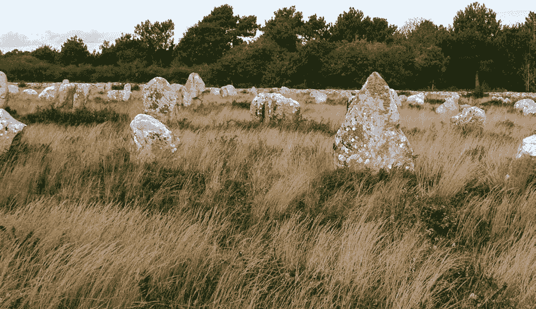

# 过去的痕迹：历史与考古之间的经典

## 过去的痕迹

## 历史与考古学之间的经典



过去的痕迹

---

历史与考古学之间的经典

献给彼得和尼克

# 致谢

在编写这本书期间，我受益于同事、家人和朋友持续的支持。我特别感谢加州大学的同事莱斯莉·库尔克 (Leslie Kurke)、马里奥·泰洛 (Mario Telò) 和亚历克斯·普维斯 (Alex Purves)，他们在需要时给予了支持性的批评和鼓励。玛格丽特·布罗斯 (Margaret Brose)、凯瑟琳·苏斯洛夫 (Catherine Soussloff) 和迪娜·谢梅克 (Deanna Shemek) 为我提供了个人和学术上的支持。莎拉·莫里斯 (Sarah Morris) 和约翰·帕帕多普洛斯 (John Papadopoulos) 在回答我关于考古问题时非常耐心且宽容。彼得·尤本 (Peter Euben) 和海登·怀特 (Hayden White) 提供了鼓励和指导。我非常感激能与露西娅·阿塔纳西斯 (Lucia Athanasis)、乔西娜·布洛克 (Josine Bloke)、埃文·鲍伊 (Ewen Bowie)、保罗·卡特里奇 (Paul Cartledge)、卡罗尔·多赫蒂 (Carol Doherty)、理查德·马丁 (Richard Martin)、维多利亚·佩德里克 (Victoria Pedrick)、纳塔莎·佩波尼 (Natasha Peponi)、詹姆斯·I. 波特 (James I. Porter)、塞斯·谢恩 (Seth Schein)、伊内克·斯卢特 (Ineke Sluter) 以及安娜·乌尔里希 (Anna Uhlig) 讨论共同感兴趣的问题。维多利亚·沃尔 (Victoria Wohl) 在全书写作过程中是一个宝贵的对话者。

我也感谢加州大学圣克鲁斯分校以下同事的支持和兴趣：玛丽-凯·加梅尔 (Mary-Kay Gamel)、丹尼尔·塞尔登 (Daniel Selden)、查尔斯·赫特里克 (Charles Hetrick)、珍妮·林 (Jenny Lynn)、吉尔达斯·哈梅尔 (Gildas Hamel)、木下森林 (Sharon Kinoshita) 和泰勒·米勒 (Tyler Miller)。在比萨罗高等范学院、伦敦大学学院、加州大学洛洛矶矶分校、斯坦福大学、莱顿大学和加州大学圣克鲁斯分校介绍本书的部分内容，引发了热烈的讨论。感谢同事们邀请我进行这些演讲。我还要感谢加州大学圣克鲁斯分校麦亨利图书馆的贝丝·雷马克 (Beth Remak) 和弗兰克·格拉维尔 (Frank Gravier) 的帮助，以及姆斯特丹大学古典与考古学图书馆的拉瓦勒·亨斯克 (Lavalle Hunsucker) 和工作人员在重新整理图书馆馆藏期间提供的帮助。埃里克·巴赫曼 (Eric Bachman) 和肯德·多里蒂 (Kendra Dority) 在项目早期提供了详尽的编辑协助。艾伦·鲍尔勒 (Ellen Bauerle) 和密歇根大学出版社的匿名读者为完善本书提供了许多建议。

所有剩余错误和遗漏由我负责。我衷感谢加州大学圣克鲁斯分校研究委员会为本项目提供的资金。

如果没有家人的爱和支持，一切无法完成——我的丈夫彼得·哈里斯 (Peter Harris)，我的儿子尼克拉斯·哈里斯 (Nicholas Harris)，以及我的公婆多洛勒斯·帕蒂 (Dolores Pratt) 和马克·帕蒂 (Mark Pratt)。

本书的部分内容已在各期刊发表，如下：

- “番红花：希罗多德《历史事事》中消逝的过去。”《过去的价值》(Valuing the Past)。西蒙·霍恩 (Simon Horn) 编。莱顿: 2014:72–95。
- “史诗遗存：《奥德赛》中‘恰如其’的过去。”《语境下的时代》(Temporities in Context)。泰瑞斯·米勒 (Tyrus Miller) 编。布达佩斯: 2008:25–46。
- “荷马的阿卡亚人城墙与《伊利亚亚》中的假设性过去。《古代思想中的概率、假设与反事实》(Probabilities, Hypotheticals, and Counterfactuals in Ancient Thought)。维多利亚·沃尔 (Victoria Wohl) 编。剑桥: 2014:121–41。
- “过去之事：赫西俄《创神诗》中的过去景观。《阿瑞苏莎》(Arethusa) (2005):1–32。
- “在阿里斯托芬的《青蛙》中阅读过去。《悲剧之》(The Soul of Tragedy)。史蒂芬·奥伯曼 (Steven Oberman) 和维多利亚·佩特里克 (Victoria Petrick) 编。芝加哥：芝加哥大学出版社，2005:251–70。
- “宙斯之石：德尔斐景观中的物体与时间。《阿波罗政治与诗学》(Apollo Politics and Poetics)。露西娅·阿塔纳西斯 (Lucia Athanasis)、理查德·马丁 (Richard Martin) 和约翰·F·米勒 (John F. Miller) 编。雅典：德尔斐欧洲中心，2009:109–26。

这些材料大部分已针对本书进行了修订。感谢编辑和出版者允许使用这些材料。

书中引用古代作者时使用的缩写通常见西蒙·霍恩布勒 (Simon Hornblower)、安东尼·斯沃斯 (Antony Spaworth) 和艾丝·埃迪诺 (Esther Eidinow) 编的《牛津古典词典》(The Oxford Classical Dictionary) 第版，或见 H. G. 利德尔 (H. G. Liddell) 和 R·斯科特 (R. Scott) 编的《希腊语字典》(A Greek Lexicon) 第9版，由亨·斯图特·琼斯 (H. Stuart Jones) 修订。

# 引言

# 望向过去

当我们进入考古博物馆或考古遗址时，我们在做什么？我们在观察或寻找什么？我们在这些独特空间中遇到的物体和特征意味着什么？具体来说，它们如何向我们传达关于过去人类信仰和活动的信息？问题的答案似乎显而易见，但也取决于我所指的“我们”。例如，考古学家或艺术史学家对他们的研究对象有非常特定的观察方式。这些学科方法的基础是这样一个假设：古代文物和建筑特征是一系列数据的一部分，随着时间的推移构成了古代过去。这一过程是通过强制与即兴发挥相结合实现的，即通过特定的学科视觉方式，以及另一种更开放或关联的视觉方式。在两种情况下，当下视觉现象如何定义并赋予过去意义，取决于语言——即它们产生的说明、描述、解释和故事。从史诗和教诲诗开始

## 2 · 过去的痕迹

从史诗延伸到五世纪的戏剧和历史写作，这些经历包含了对岩石、墙壁和坟墓等实体客体的实证观察。它们还包括那些作为人物或叙述者视觉体验与感知结果呈现的事件。在引言中，我引入了*原考古学*（protoarchaeological）一词，用来指那些由过去构成、或对过去可见（或不可见）事物做出回应的叙事。考古学叙事做了两件事：首先，它们激活了看到过去的可能性（承诺）与阅读（关于）过去的这种行为之间的竞争。其次，它们激活了希望以可见或物质形式保护过去的欲望，与过去易受破坏和腐朽的本质之间的竞争。我将在接下来的章节中对这两个观点进行更深入的论述。在本书中，*原考古学*一词指的是各种古代叙事中对物体和事件的视觉表征，但意在保留其学科内涵。

为了从学科角度说明这些竞争的现状，我首先对博物馆研究领域的近期学术成果进行了简要概述。初看之下，博物馆研究与一本关于古希腊叙事的书籍之间的关联似乎是微弱的。但博物馆研究学者之间的辩论为构建本书框架的理论著作提供了简洁的介绍。更具体地说，关于博物馆中物体展示与保护的辩论，有助于我们概念化视觉感知与时间映射之间的关系，这种关系定义了后续章节讨论的原考古学叙事。此外，通过引入博物馆作为文本的概念，这些辩论还指向了将阅读作为中介这种关系的隐喻的用处。我将在结中指出，这种中介功能在考古学理论的“阅读过去”概念中是显性的。

《牛津英语词典》（OED）对现代博物馆的定义如下：“一个保存并展示具有历史、科学、艺术或文化价值之客体的建筑或机构。也指此类机构所拥有的物体集合（2a）。”显而易见的是，该定义描述的任务——即保存和展示物体——构成了一对自然的组合，而保存需要观众。¹ 看似自然的事物也引发了一个这两个任务共同面临的问题：过去是如何在现在物质或可见现象的遗迹中被产生的？²

作为本书的焦点，这个问题并不是关乎实际物体或建筑结构的年代或物理状况，而是关于描述它们的语言所包含的时间内容。它考察了古希腊人物和叙述者的视觉体验如何开启一个获取、阐释和赋予过去意义的过程.³

在《可解释物体的朋友》（Friends of Interpretable Objects）中，米格尔·塔曼（Miguel Tamen）对引导这一过程的概念分类提供了实用的介绍。他从一个问题开始：对物理或可见现象的感知如何导致基于“描述感官的方式与理解世界的方式之间的联系”的解释实践⁴ 在分析这种联系的过程中，塔曼考虑了博物馆中物体的特定情境特质。

博物馆确实是这样的地方，展示物体的使用与一种基本假设不可分，即其中的物体被制造是为了意味着某些眼睛所见之外的事物；博物馆是物质碎片还原为……意义并随后被定义为“艺术”的地方。⁵

在这里，塔曼引用了切萨雷·里帕（Cesare Ripa）的话来支持他关于处于破坏力量（或偶像破坏运动）与保护力量之间的物体的政治倾向的结论。塔曼通过博物馆内部与外部的区别，或者通过他所说的物体的“围禁”（immuration）来阐明这种冲突。他认为，作为这种沉浸的结果，博物馆既对物体原始或本质文化语境的破坏负责，又因保护其普遍性而受到赞⁶

## 4 · 过去的痕迹

就我们的目的而言，塔曼的叙述关注了可见物体的情境性，这是观众对其进行解释的可能先决条件。在这方面，“围禁”概念可以富有成效地扩展，涵盖文本中对可见现象的处置与接收。这种类比基于上述的命题，即叙述者和人物的视觉体验测试了衡量和评估时间流逝的界限。作为这一过程的结果，文本的读者变成了物体和事件的虚拟观众；更广泛地说，阅读变成了一种中介形式的视觉。通过反转，这一命题在“博物馆是待读的文本”这一主张得到了明确检验。汉农·梅森（Rhannon Mason）解释了这一主张的理由：

在文本和叙事中理解博物馆的优势在于，它不再特权化或孤立博物馆的某个方面；例如，它的建筑、收藏、个人员工或组织状态。所有这些组件仍然至关重要，但文本方法认为，必须结合来看才能理解博物馆可能的意义。文本性的另一个有用方面是，它引发了关于展示内部无意意义、遗漏或矛盾的问题。

这种文本方法反对特定博物馆物体的孤立和独特（或仅仅是代表性的）地位，并代表了支持一种情境驱动的方法，认为其等同于阅读文本的活动。这种方法为塔曼提到的“意味着某些眼睛所见之外的事物”的物体赋予了实质，特别是当它可能产生“无意意义、遗漏或矛盾”时。

然而，同时，这种将博物馆物体视为尚未述说的故事主体的理解，质疑了在构建和授权这样一个故事时的政治和文化影响，当这种构建涉及到对“无意意义”的隐含揭示时。博物馆一直是某种文本，其物体

## 引言 · 5

它们一直是口头和书面作品创作的主题。事实上，近期关于博物馆历史及其功能的大量工作支持这一建议，这从主张使用国家或公共资金建立博物馆的论点开始，一直延伸到艺术史、考古学、人类学及相关学科的发展。换句话说，“博物馆是文本”这一观点可能与由于它们是大量学术（及其他形式）写作的主体有关。从这个意义上说，通过一种移情，博物馆及其物体与关于它们的文字等同起来。然而，我在这里的目的是指出，“阅读”已成为博物馆研究中的一个主导比喻。这一比喻的效果在于揭示了以可见形式保护文化的目标如何遭遇某种阻力；博物馆可以被读作文本的观点，揭示了可见现象的时间维度——作为“保护”的结果——在多大程度上是通过语言中介的。

Donald Preziiosi 和 Claire Farago 在其《凝视世界：博物馆概念》（*Gazing the World: The Idea of the Museum*）的绪言中，在总结博物馆的任务时指出：

> 博物馆物体被陈列出来以便以多种方式被“阅读”，或者以优先考虑其审美意义（作为“艺术”作品）或其文献地位（作为某一时代、地点、人物、精神或心态的遗迹或“科学”证据）的方式，或者通常是两者的结合。⁹

博物馆物体以优先的方式“被陈列以便阅读”这一观点似乎并没有争议。同时，文中使用的强调性引号（scare quotes）为“阅读”这一活动赋予了讽刺或轻蔑的性质，类似于作者赋予“艺术”和“科学”这两个术语的特质。如果我们应该将后两个术语视为对被低估真相的委婉说法，那么从什么意义上说，阅读物体的行为也是一种委婉说法呢？更，是什么激发了这种委婉¹⁰

根据 Preziiosi 和 Farago 的观点，博物馆作为文本的概念是一个话语的一部分，在这种，阅读博物馆物体具有负面影响，并且

> 9. Preziiosi and Farago (2004) 4.

> 10. 参见 Bühler (1990) 401，关于比喻与一种源自胡语的“隐藏冲动”相关的假设。Bühler 正确地考虑了这一假设的进化方面，但“隐藏是比喻的结果”或“无法被委婉说法的东西”这一观点是具有启发性的。

在博物馆陈列中供人观看的物体陈列，是陈列强制潜力的表现。他们指出，保护和展示物体的历史嵌入在现在被理解为启蒙思想的进步主义主张中；在这种场景下，物体的读者成为了这段历史的受害者。相比之下，Mason 关于博物馆是文本的观点则提供了激发陈列实践的无意或隐藏的含义；在这种场景下，物体的读者则是一个英雄¹¹

在两种情况下，阅读的比喻（无论被视为限制性的还是文学性的活动）都是回应一种悖论的方式：博物馆中的物体比所看到的要多。正如 Preziiosi 在最近的一篇文章中所说，“博物馆物体在字面上既‘在’又‘不在’，存在又缺席.¹² 我们可以合理地质疑‘物体不在’这一说法在多大程度上是‘字面上的’，特别是考虑到很少使用引号。通过这些及类似陈述的含义——在文中讨论的——挑战了关于物体存在于自身的传统和常识观念。如果需要阅读物质或可见物体，那么什么优先于什么；物体物质存在的粗线条的事实在“阅读”它的过程中逐渐淡化。为了过度夸大这一悖论，阅读的比喻具有让它们消失的效果¹³ 在实际操作中，这描述了阅读博物馆目录和说明的体验，在其中，阅读文本花费的时间推迟了或替代了观察物体花费的时间¹⁴ 这种字面阅读的效果似乎存在于学术文献中伴随该比喻的犹豫之后¹⁵

> + 11. 显而易见，这归功于文学研究中阅读的心理分析方法，即“系统性”阅读，及其对显性内容和潜在内容的区分。近期对所谓“浅层阅读”（surface reading）的关注使用了一种与考古实践更明确共鸣的比喻。关于浅层阅读，参见 Best and Marcus (2009)，作者在那里利用了视觉比喻。感谢一位匿名读者指出了这种分析对本文讨论的重要性。

> 12. Preziiosi (2006) 54.

> 13. 参见 duBois (1996) 10.

> 14. 参见 Tilley (1991) 7，关于“经验主义考古文本中死板的言语和视觉目录”。另见 Olsen (1990) 195–56。与此讨论相关的还有博物馆中使用相机的情况，通过相机观察与观察物体之间存在竞争。

> 15. Mason (2006) 22 在承认“阅读”物体可能使它们失去意义时表达了这段历史：“对后结构主义一种更积极的理解是接受现实世界的存在，但承认它将始终被我们所居住的符号化系统所中介。同样，对于受后结构主义启发的博物馆学家来说，认为物体的意义与其陈列和解释的背景不可分割，并不等同于说它们是没有意义的。”

## 引言 · 7

简短的，阅读（关于）可见现象与看到它们之间存在竞争。本书的一个目标是识别并理解这种竞争的出现及其影响。

我从这段对博物馆研究近期工作的简要讨论开始，以便将注意力放在“阅读”在解释和赋予过去意义方面的中介作用，更具体地说，放在可见现象被汇集成为过去发生事件证据的过程。通过与阅读文本的比较，阅读物体的比喻在接下来的章节中被具体化为对可见现象的阅读。从总体而言，世界上阅读物体的比喻——包括考古话语中“阅读过去”的比喻（我将在终言中回到这个话题）——与文本中阅读（关于）物体的实践是类似的。它体现了在可读性与可见性——阅读与构成、解释与验证过去——之间的对话互动中起作用的本体论和认识论偶然性。

作为在本书范围内讨论这种关系的一种，“原始考古的”（protoaeological）一词描述了叙事，其中物体和事件的视觉描述将看到过去的可能性与阅读它的实践置于竞争之中。这个术语旨在具有涵盖性，正如时代错误（anachronism）是故意的一样。原始考古叙事是指那些阅读文本的行为与过去概念化为一个退的视觉场联系起来的叙事¹⁶ 这类叙事通过解释经验观察与语言表之间的差距来解释过去¹⁷ 更生动地说，它们回应了希罗西德在《史记》开头为自己设定的任务，即确保“人类过去的事迹不随时间消逝”（《史记》1.1）。以“随时间消逝”这一独特的视觉比喻为出发点，接下来的章节将探讨各种体裁叙事如何既引用希罗西德的任务，又揭示其成就的局限性⁸

如上所述，我也希望在古典学者（文献语言学家和历史学家）与研究以下内容的人之间开启对话

> 16. C. Willey (2013) 关于铁器时代背景下的物体“传宝”。正如 Whitney 所说，物体具有将不同时期所有者联系起来的“传记”。感谢一位匿名读者提醒我注意 Whitney 的文章。关于迈锡尼“传宝”，另见 Palaima (1999) 440。

> 17. 关于这一“差距”，参见 H. White (2002) xiii.

> 18. 我将在第四章中更详细地讨论希罗西德的比喻。

## 8 · 过去的痕迹


# 物质或视觉来源

物质或视觉来源（考古学家）。¹⁹ 我意识到，这种表述在某种意义上是片面的，因为古代史学者往往能有效地利用文本和物质来源；我将在下文中对此进行更多论述。作为启发性工具，这些来源被赋予了不同的——往往是层级化的——解释价值。这里的目标是探索视觉感知如何成为将过去概念化共同研究对象的关键。

从学科角度来说，本书汇集了三个研究领域，它们之间的关系初看可能并不显而易见：文学理论中叙事结构特征的时间、历史哲学中“过去本身”的概念，以及考古学理论中物质对象的本体论地位。此目的是为了更好地理解这些学科所基于的认识论前提——即发现过去真相的各种手段。本书还涉及了三个在人文科学研究中引发持续争论和讨论的话题：视觉在提出真理主张中的主导地位、语言在区分虚构与事实中的作用，以及建立过去现实的标准。这些议题共同构成了后文的论点，并引起人们对提出这些议题所涉及的核心利益的关注。

## 跨学科方法与文本选择

本书的跨学科方法必然具有选择性，并需要对后续章节中讨论的文本选择进行说明。我从这样一个前提开始：本书的核心问题跨越了经常界定古代文学文本书籍的作者、体裁和时期的传统类别。同时，关注视觉感知与过去意义之间的关系，揭示了这些类别之间某些未被意识到的联系，例如奥德修斯在《奥德赛亚》中的角色如何预示了历史写作中目击者的角色，以及《青蛙》中对悲剧的喜剧式批判如何依赖于“看戏”与“读剧”之间的区别。

选择从荷马和赫西俄德开始承认了他们对后世作者的深远影响。但也引入了另一个判断影响意义的标准，即古代文献中视觉感知与时间意义之间的基础性关系。从赫西俄德《神谱谱》中宙斯的石头，到《伊利亚亚》中阿卡亚人的墙，再到希罗罗多德《史记》中克吕苏斯的祭品，再到《青蛙》中的日常用品，这种关系不仅超越了文学研究核心的体裁类别；它还需要跨越学科边界，正如我上面指出的，这些边界受到两种主导的过去意义模式的监管，即对（关于）它的阅读以及观察它。

关于我为什么讨论希罗多德和修昔底德，或者我为什么处理的是喜剧而非悲剧的问题，只能从否定角度给出回答。我不能声称对当前主题的全面覆盖，也不坚持我在后续章节中讨论的文本具有典范性。关于我文本选择的问题——这是一个由匿名读者提出的合理问题——既说明了作为文学研究的涵盖局限性，也说明了扩展到单一作者、体裁或时期之外的话题的包容性。

从积极的一方面来看，此处讨论文本的经典地位部分归于它们自身在时间流逝中的坚守；在这方面，它们阐明了“保护”作为一种分析范畴的重要性。此外，我包含了文学（诗歌）和历史（散文）文本，以论证当历史在虚构与经验之间中介作用时，它对整个项目产生了一种向心力。更具体地说，历史写作最尖锐地将我们的注意力集中在过去发生的事情（亚里士多德所谓的 τὸ γε诺όμενα）与现在可见事物之间的关系上。

## 古典学中的文本与物质证据

在古典学领域，这些问题长期一直是劳伦斯（Laurence）所说的古代历史学家与古典考古学家之间“不安的对话”的焦点，以及缺乏“语言中物质世界的表现理论”。他认为，这种不安的原因之一是对“物质对象在文本中的作用”的理解不足，无论是在古典学作为一门学科的基础叙事中，还是在（广义上）构成古代历史的公式中。最近，理查德·马丁（Richard Martin）总结了关于古代过去的物质与文本（文学）证据之间充满争议的关系。在评阅了几本顶尖期刊的文章时，马丁注意到“（当代古典学者中）人们认识到，物质文化既不从属于文本，也不仅仅是文本的说明”。

> ¹⁹ 我非常感谢一位匿名读者建议本书的副标题，即*历史与考古学之间的古典学*，这标志了这种学科兴趣。

> 20. 在 Bassi (2016) 中，我讨论了修昔底德《历史》中视觉感知与时间意义的关系。

> 21. 参见亚里士多德《诗学》145a37–39。我将在第二章中更详细地讨论此。

> 22. Laurence (2004), 103, 109。Laurence 指出这是一个“迄为止未被研究的主题”（109）。参见 Laurence (1998) 2.

> 23. Martin (2008) 321。Porter (2003) 61–66 关于古代文学研究（处于顶部）与古典考古学（处于底部）之间传统层级关系的言论——前者被认为是通往“古典思想”的直接通道，后者则“没有思想栖息之地”。

> 正如 Porter 所言，这种文本与文物的层级结构正在逐渐被瓦解。参见 Osborne (2011) 17–18。

但正如马丁观察到的，“物质文化专家向文本的触达超过了文献学侧的任何反向贡献”。他得出结论认为，除少数例外外，解释对象或说明文本的旧范式仍然存在或较少变动。在关于该主题的重要文章中，马丁承认了一种普遍的假设，即文本和对象在指称意义上是分离的，这种假设在“花瓶与诗歌”这一短语中有所体现。他提出，解决古典学文本-对象边界的方法之一，是让哲学家进入人类学（格尔茨式的）领域，即使是以专业业余的模式，或者让学者基于对词汇和事物的深度熟悉进行一种鉴赏。

马丁还论证说，这些以及他提出的弥合古典学文本-对象边界的方法，是为了反对那些青睐底线的大学管理者所青睐的“大盒子文化系”。这一结论如果简言之，对于马丁的论点至关重要，因为涉及到学科与机构之间持续的冲突。然而，基于“没有任何学者能既是受过训练的文献学家又是物质文化专家”的假设，相关的假设是学科是任何领域的自然仲裁者。两者都假设了自己的研究对象、方法论、语言、参考文献和实践，这些区别是历史性的而非自然的。

回到当前主题，如果对象与文本之间的划分是一个学科体裁，那么监管这种划分就变成了一个权威自我保护的问题，几乎没有创新空间。这就是马丁所描述的古典学领域的现状。

> 24. 参见 Never (2005) 关于古希腊房屋考古与文本证据使用的言述。在注意到该主题的“描述性”与“解释性”方法的区别——以及两者的必要性之后，Never 仍然认为考古优于文本。

> 25. Martin (2008) 321, 322, 335, 331, 334。参见 Osborne (2011) 第一章关于“艺术”与“文本”作为历史证据的相对价值。Osborne 认为，语言所要求的结构比图像所要求的结构更具形式性，词汇与事物之间根本的任意关系意味着词汇需要并产生了分类，图像并非完全任意的符号，总是容易受到破坏（2）。如果人们理解意义——这图像与事物之间的滑动——Osborne 假设事物与其指称物之间的关系小于词汇与其指称之间的关系。在本书的结语中，我在考古学理论的背景下讨论了对象与文本的古老程度。

## 导论 · 11

马丁对文化部门的怀疑——这些部门是在他在其他处所谓的“文化研究的模糊性”支持下建立的——具有说服力。27 但存在许多处理文本与对象界限的方法，一方面并不要求全盘放弃学科间的区别，另一方面也不放弃从业者或其他者的相对专业知识。28。

第一步是将这些区别置于历史视角下。这也是马丁文章的目标之一。然而，在此过程中，挑战在于抵制将对象与文本等同起来，即主张词语本身就是对象，或者正如马丁所说，“对象作为言语行为发挥作用”[原文强调]。229。正如马丁所示，这类结论源于自20世纪80年代开始的后结构主义考古学中语言理论的重要性。我将在本书的结语中回到这一发展。我想在这里指出，抵抗这种等同并不意味着屈从于“学科会将类别自然化”的假设。事实上，作为解释的基础，这种等同可以被理解为顺从马丁分配给文化部门的那种学科式的模糊或不精确性。因此，问题在于对象与文本在本质上是不同还是相似，而是哪些因素使得它们之间的界限成为文献学、历史学和考古学的必要先决条件。

在处理这一界限时，我从四个相关的前提开始：(1) 作为一个概念范畴，过去拥有历史；(2) 这种历史部分是在物质或可见世界的体验中构成的；(3) 这种体验是叙述的效果；(4) 这种效果形成了上述学术学科。30。这四个前提中的第三个涉及了本书的核心关注点，即可见世界作为言语描述和运用的对象，如何在希腊文学和历史写作中既创造又中介了过去。这个世界不仅包括单一的物质对象，例如赫西俄德《神谱》中作为宙斯替代品的石像（已在本文第1章讨论），还包括被人物见证的事物，例如荷马《奥德德赛》中奥德修斯本人过去的事迹（在第3章中讨论）。“事件以类似于对象的方式构成了可见现象”这一命题似乎是背直觉的，并且无疑存在争议。虽然对物质对象和建筑特征的叙述性描述可以认为是视觉感知与时间意义之间关系的缩影（正如《牛津词典》对博物馆的定义所示），但目击者对事件的叙述与事件本身的叙述共享许多时间、本体论和认识论元素。例如，我将认为，奥德修斯在《奥德德赛》中与其过去关系，预示并预设了历史写作中第一人称“ἀφτόπος”（目击者）的角色。331。

根据芭芭拉·基斯滕布拉特-吉梅尔特（Barbara Kirstenblatt-Gimmelt）的格言，如果说对象是“慢事件”，事件就是随着时间流逝而进入视野的对象。332。这显然有些牵强。但它的意思是，对象与事件之间的区别——这一文本-对象界限的核心区别——当两者都成为叙事中依赖时间的视觉场的主体时，就崩溃了。这种崩溃在某些方面得到了说明，例如物质对象的命运与过去事件的伦理维度联系起来的方式。因此，《伊利亚特》中阿卡亚人的故事将时间的流逝与英雄声望（或 ἀλε）的成就联系起来（在本研究的第2章讨论），而克罗伊斯的贡品在希罗多德《吕底亚史》中的处置则与美好生活（εὐδαμονία）的成就联系起来（在第4章讨论）。这些例子表明，可见对象的命运是理解一系列过去事件背后的伦理和认识论意义的关键。对象与事件作为相互关联的视觉和时间现象之间的这种关系，在雅典戏剧中发生了特殊的转折，在阿里斯多芬的剧《青蛙》的诗歌竞赛中，这种关系运作于阅读悲剧文本与看到假想戏剧表演的界面之间（在第5章讨论）。广而言之，《青蛙》关于喜剧如何质疑悲剧作为视觉媒介的效力。

在多种希腊叙事形式中将过去视为现象或视觉场的一个预期效果，是质疑记忆在古典学术中的主导地位。333。记忆（μνήμη）一直是并一直是关于荷马诗作为口头文化产物的支柱。它是几乎所有古代体裁（无论诗歌还是散文）研究的主要变量。希腊叙事中对过去时间的表述始终通过人物和叙述者所经历或认可的记忆因果来解释。例如，乔纳斯·格雷莱因（Jonas Grethlein）2010年的著作《希腊人及其过去》（*The Greeks and Their Past*）以记忆为起点和核心概念，描述了五世纪无产阶级或文学环境中希腊史学的兴起。格雷莱因通过对挑选文本的仔细解读，将过去作为他所谓的“文学记忆”的效果，建立在记忆与历史之间的张力之上。

毫无疑问，记忆是古希腊语中一个强大的概念，对缪斯的召唤是荷马诗的框架装置。这是一个具有意义的研究领域，明钦（Minchin）对表演提出了一些有用的观察。这一论点依赖于日常生活和日常话语，因此依赖于对记忆的跨历史理解。

---

27. Martin (2008) 324.

28. 参见 Readings (1996) 对现代大学跨学科性的相关批判。

29. Martin (2008) 341。最近，Porter (2010) 在第9章讨论了波特所说的传统中“会说话的对象”的美学效应。

30. 参见 Finley (1998) 95：“从14世纪开始，意大利人将过去视为一种具身存在。以古代文献制品、雕塑碎片以及希腊、罗马、埃及和伊特鲁里遗迹形式存在的物质知识塑造了文化观念，影响了对现代对象的态度。”

31. 参见 Shafin and Schaffer (1984) 69 关于他们认为的17世纪英国科学实验“虚拟”证人的“技术”。还有 Shafin (1984) 508–9；David (1993); Holmes (1991); Bann (1990) 13–32（关于18世纪古代收藏实践与文学创作的关系）。

332. Barbara Kirstenblatt-Gimmelt, 加州圣克拉州大学视觉与表演研究小组, 2000。Hodder (2012) 4–5 同样主张物质对象的“惰性”。参见 Serres (1995) 76：对象，因为它让我们的历史变慢。

333. 关于希腊文化生产中记忆作用的文献非常多。我发现

34. Grethlein (2010) 12.

35. 在讨论创伤历史时，Ankersmit (2005) 4 注意到，“我们使用‘记忆’一词取代了以前倾向于使用的‘历史’或‘过去’。这种新术语暗示了当代历史意识性质的转变。”

# 第 IV · 过去的痕迹

针对这一效应，原考古叙事（protoaeological narratives）预示了物质人工被赋予时间的方式，并以反转的形式，成为考古话语中“阅读过去”这一隐喻的对象。总之，本书描绘了一条从原考古叙事中“看到过去”的隐性隐喻到考古话语中“阅读过去”的显性隐喻的轨迹。如上所述，叙事性阅读中所描述的视觉感知的时间维度与作为其接收媒介的阅读之间的关系，将是一个反复出现的话题。

如果原考古叙事跨越了古代文本中物体与事件之间的界限，它们也跨越了所谓“前文字”与“有文字”体裁之间的界限。在仍在运作的口头-文字二元对立中中，古典文学中对这种界限的争议基于这样一个前提：衍生诗歌在形式上并非源于借助写作产生的文本（如戏剧和历史），而是源于埃伯特·巴克（Egbert Bakker）提到的另一种“心态”。⁶ 这种二元对立在古典文学及更广泛的人文科学中的历史和意义广为人知。此处定义的原考古叙事指的是一个中介术的存在，即福斯特（Foster）所说的“可见性”（visibility）。⁷ 在《视觉与视觉性》（*Vision and Visuality*）中，福斯特区分了视觉数据（datum of vision）与其话语决定性。⁸ 科学史上关于视觉机制的理论，并以此延伸的基于经验的研究数据属于“视觉”领域。而艺术史、文学理论、性别研究和电影研究领域“视觉的”与“凝视”的社会、意识形态和修辞效应属于“视觉性”（visually-ity）的领域。作为本书背景下的一个中介术，可见性指的是在听到或阅读关于过去的过程中看到过去的可能性。借此，原考古叙事通过判断特定作品是否是借助写作产生的来完成论证，它们转而强调了希腊叙事传统中视觉体验的时间维度。

目前尚不清楚在安克塞尔特的记忆中，记忆与“智力经验”是如何相关的。但这种转变不仅可以从历史意识的本质来理解，也可以理解为在解释过去时对记忆的“偏好”，这种偏好在对口头衍生诗歌的研究中得到了体现。

36. Bakker (2002) 11 21.

37. 参见 Bahrain (1983) 94 “我们想象的两个完全相反的领域实际上是相互依赖的。我们应当记住，二元对立的观点通过抑制一个术语来支持另一个。”我在这里建议，关于口头-文字的二元对立抑制了一个未命名的第三术语——可见性。

38. Foster (1988) 被 Nelson (2000) 2 引用。另见 Davis (2004)。关于在考古话语中使用“可见性”来指代“视觉和视觉场随观察者位置而变化的描述与成像”，参见 Olsen (2010) 30–32。

# 引言 · 15

然而，与二元性一样，视觉（vision）和视觉事物（visuals）是相互强化而非相互排斥的；可见数据既可以是视觉性的因也是果。作为福斯特所说的“话语决定性”的例子，原考古叙事也代表了考古和历史作为学科——在这些学科中，物体和事件在描述它们的语言出现之前（至少在原则上）就被设定了。正如我们将看到的，这种优先性问题在历史哲学和考古理论中都是一个持久的难题。在暗示原考古叙事违背了这一原则时，我并不是说在关于它们的言说或记录之前不存在可见的物体或可获取的事件。相反，原考古叙事通过同时指向看到过去的可能性以及过去恰恰是可以在任何字面意义上能被看到的事实，复杂了直接获取那种先验的概念。它们体现了卡尔·伯尔勒（Karl Böhler）所说的“心眼”所见与“肉眼”所见之间的位移。在原考古叙事中，这种位移在一方面角色与叙述者的视觉体验，与另一方面读者和观众的视觉体验（无论是隐含的还是真实的，如戏剧所示）之间的关系中被激活了。在所有情况下，这些体验都将与作为一个后退场的过去的对峙命名，以及与带有其中介性存在的阅读命名。用希罗多德的话来说，它们命名了与“随时间流逝而消失”的过去的对峙（*Histories 1.1*）。

在这方面，原考古叙事也回应了“主体”（历史学家本人）、“客”（历史本身，无论这意味着什么）以及“语言/文本/符号化”（在主体和客体之间中介）。如果历史理论之间所有的差异并非根根于对这三个概念相互关系的不同观点……[哲学家需要一种不预设存在一个独立于语言且我们能通过语言获取的过去，但仍然声称在独立于语言表征的情况下讨论*过去本身*是有意义的。²

39. 关于以主体为中心和以世界为中心的视觉感知方法的区别，参见 Orlando (2014) 第一章。

40. Böhler (1990) 156。

41. 在叙事学术语中，Jong (2012) xii 将“焦点”（focalizer）定义为“那个人（叙述者或角色），叙事中的事件和人物是通过他的‘眼睛’被‘看到’的。”这个定义中围绕*eyes*和*seen*单词的单引号所代表的视觉隐喻，既说明了我正试图描述的关系术语，也说明了叙事学术语中的某种不精确性。

# 第 16 · 过去的痕迹

有两个点与目前的讨论有关。首先，虽然“过去本身”可能是历史写作中的理想化概念，但弗莱曼描述的难题并非历史学科所独有。相反，它在先于并与五世纪历史学家并行的叙事形式（诗歌和散文）中已被预见。通过弗莱曼三个泛义概念的相对支配地位，“过去本身”的思想可以从要求独立于要求的严格经验主义中解耦。其次，一个初步观点是，这种对独立的追求可以追溯到早期体裁中对过去的概念——其基础是经验观察。这一点不仅适用于作为学科的历史学，也适用于语言学和考古学学科，在这些学科中，“物体”的定义部分取决于它们对视觉体验（无论如何中介）作为获取和赋予过去意义的共同信任。用福斯特的术来说，考古学家拥有视觉（vision），哲学家或文学学者拥有视觉性（visuality），而历史学家两者兼有.³ 在说历史学家时，我的意思是他们对过去的说明基于可见和文本证据的结合，其中石刻铭文代表了一个优先类别。⁴ 这些区别显然过于简单了。虽然侧重点不同，但这些学科中的每一个面对的都是一个不再或仅部分可见的过去。本书的目标是开始追踪这种对峙及其在希腊叙事传统中的后果。

+   42. Freyman (2012) 394。另见 Pieters (2000) 28 关于“过去本身”作为历史哲学中反复出现的参考点。

43. 参见 Martin (2008) 316.

44. 参见 Oliver (2000) 2–24; Crawford (1983), 特别是 80–136 (Miller 关于铭碑学的文章)。

# 引言 · 17


如上所述，以下每一章都由对希腊经典著作的细读组成。从时间顺序来看，本书跨越了希腊从古风时期到古典时期。从荷马到赫罗多德再到爱里士多芬的轨迹，使我能够绘制出视觉感知的时间维度：从神话时间到历史时间（就内容而言），以及从口头演变到文学体裁（就形式而言）。在此过程中，我希望展示“看见过去”的承诺是如何超越这些传统范畴的。这并不是在主张视觉优于其他感官的卓越力量，而是阐述其作为叙事功能在赋予过去意义方面的作用。⁴⁵ 在将这一轨迹置于现代性时，扬尼斯·哈米拉基斯（Yannis Hamilakis）将希腊古代的物质遗存描述为“其产生并具化希腊民族国家时间和空间的能力”。⁴⁶ 古代遗迹在建立和保护现代国家认同叙事中的讽刺性——这正是本讨论开始时博物馆的宗旨之一——其起源可以追溯到后续章节中讨论的原始考古叙事的影响。它们在希腊文学原则中的意义，邀请我们去思考这种讽刺的逻辑，思考作为西方意象中不断后退的视觉场的过去，以及我们在过去面前作为观者或见证者的角色。

第一章分析了可见物体在赫西俄德《神谱》（*Theogony*）时间景观中的作用。从这位位于赫利孔山上缪斯之地的诗人开始，这种关系贯穿了几个段落：诗人兼叙述者收到月桂权杖的报告；作为衡量时间手段的铁砧（或称 *άξμμου*）的描述；最后，是克罗诺斯为了阻止宙斯《神谱》的诞生而吞下那块石头的故事。第一章聚焦于这些物体作为过去时间物质符号的原始考古效应，并以波伊桑尼亚斯（Pausanias）在《希腊游记记》（*Perieges*）中对克罗诺斯吞下的石头的初步观察作为告终。该论点阐明了构成本书的两个相关属性：(1) 希腊叙事中的时间是通过可见和物质现象的排列来衡量的；(2) 过去是以“不再可见”或“仅部分可见”的内容被概念化的。在说明这种关系时，《神谱》还展示了叙事中可见物体的排列如何成为事实与虚构区别的象征，正如 M 对叙述真实所持矛盾态度所体现的那样。

⁴⁵ 关于西方认识论中视觉比喻的持续性，请参见 Jay (1993) 第一章，以及布罗德斯基（Brodsky）在他1996年对 Jay 作品评述的相关评论。

⁴⁶ Hamilakis (2007) 9.

# 18 · 过去的痕迹

第二章讨论了《伊利亚特》（*liad*）中的阿卡亚城墙，将其作为定义原始考古叙事的时间、认识论和本体论范畴的独特范例。它提出了两个相关的论点：首先，墙的命运（以其是否真实存在为框架界定）与诗歌的伦理维度相关，这种维度通过史诗英雄获得“不朽之名”（即 *κλέος ἀθάντον*）的成就来衡量；其次，城墙为调查亚里士多德引入的用于定义历史写作（*ιστορία*）与诗歌或文学（*诗学*）之对立的标准的前史提供了一个独特机会。这两个论点之间的联系是关于城墙在假设过去中被毁的描述，即一个从过去的角度来看尚未出现的过去。这种时间上的异常通过类比证明了：声誉（*κλέος*）的获得取决于过去以其遗迹被感知的可能性。本章探讨了阿卡亚城墙为何在诗中及其在接受史中履行其功能。

第三章识别了荷马《奥德赛亚》（*Odyssey*）中的两种认识论和时间政体。一种被等同于缪斯的“恶毒”礼物——盲目，另一种等同于人类用肉眼观察的能力。在后者的能力中，奥德修斯是一个从神启式的过去叙事向基于视觉感知的叙事过渡的形象。论点围绕两个假设展开：德墨库斯（Democus）讲述故事“仿佛”他就在他所叙述的事件现场，而奥德修斯讲述他的故事“仿佛”他是一个歌手（或称 *οἰδ*）。这些“仿佛”的陈述挑战了常见的假设，即奥德修斯是一个目击者叙述者（奥德修斯）的化身，其对过去的叙述由一位神启歌手的授权。从体裁意义上说，这些“仿佛”的陈述意味着神启（尽管是盲目的）歌手的时间正在流逝，他已经走向成为历史作家眼中被排斥的他者。它们还复杂了常见的学术观点，即口头诗人在其表演的当下将听众转变为史诗事件的观者。这种观点可以被理解为对遭遇史诗作为文学艺术品的一种回应，并作为结果，即面对作为一种视觉缺失的过去。这种对峙是奥德修斯原始考古效应的基础。

第四章探讨了赫罗多德《历史史》（*Histories*）中可见证据的角色，从历史学家陈述的目的开始，即确保“人的事迹（*τα γεννόμενα*）不随时间流逝”（*史记* 1.1）。这种视觉比喻的效果在咨询神谕和进行献祭的关系中得到了探讨，主要是吕底亚篇叙事中克罗伊斯在德尔斐的献祭。这些献祭在叙事中分为四类：已被记载的、未曾被记载（或尚未被记载）的、历史学家所说的“直到我的时代”（*ἐπ ἔμέο, μέχχει ἐméῦ* 等）的，以及那些完全被毁的。

# 引言 · 19

（接上文）咨询神谕和进行献祭的关系，主要是吕底亚篇叙事中克罗伊斯在德尔斐的献祭。这些献祭在叙事中分为四类：已被记载的、未曾被记载（或尚未被记载）的、历史学家所说的“直到我的时代”（*ἐπ ἔμέο, μέχχει ἐμέῦ* 等）的，以及那些完全被毁的。本章重点关注这第三类献祭如何体现了过去发生的事（*τα γόμενα*）与当下可见的事（*ἐπ ἔο*）之间的关系。⁴⁷ 克罗伊斯献祭的命运——以其随时间推移的方式为特征——也说明了这样一个命题：阅读（关于）过去等同于视觉的极限。与荷马对阿卡亚城墙的描述类似，《历史史》中这种原始考古冲动与其伦理内容指向了人类幸福的成就，即 *ἐὐδαμονή*。献祭的瞬时性（通过其视觉存在的后退来衡量）为这种成就的限制因素提供了见解（包括时间自身的侵蚀作用）。

第五章探讨了阅读戏剧文本与观看表演之间的冲突，这是爱里士多芬《青蛙》（*Frogs*）的核心关注点。从阅读《安德洛玛》后奥德修斯（*πότοχο*）想要复活欧狄修斯开始，这种冲突通过将悲剧解剖为文本片段和各种物体排列来实现。在这个过程中，喜剧证明了悲剧仅仅是喜剧的“素材”（或者用通俗的话说是题材）。通过既提到悲剧在原始过去中的表演，又提到愿望实现的不可能，这种“素材”是《青蛙》原始考古效应的来源。作为这种效应的一部分，神通过复活军事化的埃斯或任何悲剧诗人来“拯救城市”的愿望——另一个信号，表明从喜剧的角度来看，悲剧作为一种公共且视觉可见的媒介已经“死亡”了。因此，奥德修斯的欲望并非仅仅是阅读欧狄修斯剧的自然结果。相反，它标志着阅读文本在多大程度上等同于无法看到原始表演中的戏剧。本章以亚里士多德在《诗学》中对悲剧视觉方面的矛盾态度（或 *ο*）的讨论结束。作为从戏剧剧本（作为假设戏剧的来源）向戏剧文本（供阅读）转变的证据，这种矛盾情绪也是一种反复出现的

> ⁴⁷ C. Vey (1988) 8: “早期历史学家和今天的人们经常引用过去仍然可见的遗迹……与其说是作为他们主张的证据，不如说是作为带有了历史的光辉和明亮的插图，它们并没有真正阐明什么。”

## 20 • 过去的痕迹

在当前构建和评估过去的过程中，经验观察与语言表征之间的冲突。

本书的结语探讨了当前考古学理论中的这种冲突，它在一个命题中被明确：对象的物质性——也被称为其触感性和可见性——被用于描述它们的语言所牺牲了。从从 Brill 出版的《新帕奥迪在线》中的前提开始，即考古遗物构成了“过去的实物证据”（haptiches Zeugnis der Vergangen），本章追溯了该学科持续的实证主义与其基于语言的隐喻使用之间关系中的冲突，主要是后过程主义考古学中“阅读过去”的这一隐喻。⁴⁸ 在这一学科语境下，“阅读过去”的隐喻命名了触感性的证据局限，同时也邀请了人们探索考古学家书写文物的任务。这里提出的问题是，考古学家在使可见和可触之物变得易读（可读）时，获得了或失去了什么？我的回答是基于两个前提。首先，“阅读过去”的隐喻维护了该学科持续的实证主义，这种实证主义建立在位于原始时空中的视觉和触感对象的优先性之上。其次，考古学理论中经验观察、语言表达与过去意义之间的关系，并非在学科的孤立状态中形成的。相反，定义这种关系的本体论和认识论偶然性存在于前几章节讨论的原始考古叙事中，并因此证明了事后回溯时的时代错误合理性。更简洁地说，结语探讨了考古学“阅读过去”的隐喻如何构成对过去随时间流逝的应答。

⁴⁸ Hauser (2007) r.

## 第一章

### 赫西俄《神谱谱》中的过去景观

让蛇等待在

它的杂草下

让文字

由词组成，缓慢而快速，锐利

地击中，静地等待，

永不睡眠。

——通过隐喻来调和

人们与石头。

创作吧。（没有想法

只有在事物中发明！

石虎草是我的花，劈开了

岩石。

—威廉·卡洛斯·威廉姆斯，《一种歌》（1944年）¹¹

正如其开篇句简洁表达的那样，“让我们开始歌唱”（ἀρχώμευθ ἀεἰδειν, 1），赫西俄的《神谱谱》关于时间的开始，作为诗歌创作开始的动力。² 我们面前的问题是，可见或物质世界是如何成为诗歌时间环境部分的。通常情况下，古代诗歌对物质或可见对象的关注采取了两路线。

¹ W. C. Williams (2001) 55. 关于威廉姆斯的诗，参见 Brown (2003)。威廉姆斯可能对希腊语的 λάθος（石头）和 λαίος（人们）使用了双关语。参见 Pindar, Euboe (frss. 9.44–56; 2–6 and 234 M-W); 罗德斯的阿波洛留斯 (3.1088–89); 奥维德，《变形记》（关于德卡卢农、大洪水以及从石头中创造人类的神话）。另见 Scodel (1982) 43； Schwenger (2004) 138，引用了 Shidovsky (1965) 12：“艺术的存在是为了人们能重新找回生活的感；它的存在是为了让某物存在，让石头讲述故事。”

² 关于近东和希腊起源论的开篇句，参见 López-Ruiz (2012)。

## 22 • 过去的痕迹

诗歌。一方面，它们是陈述性描写审美效果的来源，如《伊利亚马》中阿基琉斯盾的描写段落。另一方面，它们被组织成考古学上的证据，用来解释一种过去的现实。例如，在 Simpson 和 Lazenby 编写关于《伊利亚马》“船队目录”著作的序言中，他们结论道：

> 因为我们对青铜时代晚期希腊世界的知识几乎完全来自考古证据，它与英雄世界之间最引人注目的相似之处在于其物质实体。

考虑到潜在的时代错误，将遗物与叙事性描述相匹配的项目是棘手的。在被认为匹配良好的案例中（例如著名的《伊利亚马》第 10 卷 21-65 节中著名的野猪头盔），提出了两个相互相关的问题：所涉及的对象是对诗歌的真值性有贡献，还是诗歌证明了文物的重要性？在任何情况下，诗歌对象的意义都是通过它在多大程度上符合经验数据来衡量的。

本章勾勒了通往《神谱谱》现象世界的另一种方法。我主张，可见对象是评估诗歌时间内容的关键，但并不是为了评估对象与历史或考古现实的符合程度。相反，它们是某种先验现实的“内含符合性”的来源。这是原始考古效应的基础。通过“内含符合性”，我的意思是物质对象的主要用途之一是用来指代和证实某次过去的事件。在古典古典学术研究史上，对经验符合性的寻找，可能是对古代文本本身中这种真实性证实工作的反映。但更直接的论点与《神谱谱》中对可见或物质对象的描述如何标记“人类时间”而非“神性时间”有关。在承担时间的负担时，这些对象

³ 关于陈述性描写（ecphrasis），参见 Webb (2009)，以及 Simon Goldhill 发表于 Bryn Maw Classical Review 2009.10 的文章。Elsner (2007) 讨论了……（此处原文重复，省略）。另见 Scodel (1982) 43；Schwenger (2004) 138，引用了 Shidovsky (1965) 12：“艺术的存在是为了人们能重新找回生活的感；它的存在是为了让某物存在，让石头讲述故事。”

## 32 • 过去的痕迹

### 赫西俄《神谱谱》中的过去景观

作为过去的考古记录的过去。

⁷ Brown (2004) 7。

⁸ Appadurai (1986) 36。另见 Jay (1996)。关于对事物研究的学科债务，参见 Daston (2004) 16–17。另见 Olsen (2010) 93 关于 Appadurai (2010) 36 和物崇拜。Henning (2006) 31–12 提供了对作为展示对象的恋物的简短评论。

⁹ Brown (2004) 5。参见 Bielek-Rostock (2000) 78：“人类存在是有条件的存在，没有事物是不可能的，如果事物不是人类存在的调节器，它们将是一堆无关的物品，一个非世界。”参见 Riegl (1901) 17–18，他指出“对对象的客观感知[Aufflung]……始终是主观的。”关于“事物”对学科和分类的阻力，参见 Daston (2004) 10；Tamen (2001) 5，Plotz (2005) 提供了该领域的良好概述。

然而，与当前的讨论相关的是，布朗（Brown）对时间的定义中的“其他某些”，或者他所说的“对象的之前与之后”。¹⁰ 换句话说，事物的意义在于它们的“时性”，而这里的时性指的不是它们在线性年代中的日期，而是它们在一个广泛感知和关系性的时间场中的位置。在总结新物质主义的基础假设时，洛林·达斯顿（Lorraine Daston）指出，“事物既是物质的，也是有意义的。”¹¹ 但这种同时性被一个事实所修正，即它们的物质性和心智性相对于时间来说都是偶然的。这种关系建立了赫西俄德诗歌中物质对象的原始考古学效应。本章的调查将包括对特定物质对象的讨论——权杖、石头——它们作为时间标记穿插在文本中。这些物体暗示了一方面可见与不可见的事物之间的联系，另一方面是产生意义（或关于过去发生的真相）的事物与抵抗记忆的事物之间的联系。我将这种联系置于《神谱谱》（*Theogony*）整体的时间景观中，这一背景由诗人对神圣缪斯的“愿景”所界定。

在这首著名的诗中，“赫西俄德”在赫利孔山上放牧羊羔时，遇到了了难以捉摸的缪斯（22–23）。在那里，他说，缪斯给了他一个权杖（σκπτήρον），并向他注入了神圣的声音（ἐνέπυσαν δε μο αὐδν θέσπιν），以便他能“庆祝将要发生和过去发生过的事物”（*神谱谱*22–35）。

> αἰ νύθ Ἴσοδο καλαλὴν ἔδιδαζαν αἰίδην,
>
> ἄρνας δε με πρίσταῖς θεθαὶ μύθον ἕῖπον,
>
> νόνδε δὲ με πρίσταῖς ὅλικῶς ἕπο πρὸς θαθέίου.
>
> Μοῖσ Ὅλυμπιάδες, κοῦραὶ Διος αἰγόχο,
>
> ποιοίμεν ἀγαυροι, ἀκάκ ἐλέγε γασες, πόλὰ λέγει ἐτύμωσion ὅμοτα,
>
> ἴδμεν ἕδ’ ἐὐθ ἐθέλομεν ἀληθεθὲα γενήσασθα.
>
> νῦ ῶκ ἔφαστα κοῦραὶ μεγάλου Διος ἀρτίπείλια,
>
> καὶ μο σηκῖτρον ἐίδφην ἐνέπυεσαν δε μο αὐδν
>
> θέσπιν, καί κλείμι τ’ ἐσσόσν πρό τ’ ἐόντα,
>
> καὶ μ’ ἐκέλον ὑμνεν μακάρων γένος αἰὲν δόντων,

¹⁰ C. Brown (2003) 16：“我的是……物体如何成为思想和语言的形象，以及这种叙事形式如何重新发明了具有时间维度的主体/客体辩证法。”但这里的“时间维度”似乎指的是文学历史（见第17页）。

¹¹ Daston (2004) 17.

## 赫西俄德《神谱》中的过去景观 • 25

σφάς δ᾽ αὐτᾶ πρώτόν τε καὶὕταν αἰὲν αἰδεῖν. ἄλὰ τί μο τα ταῦ περιρὶ γρῦν ἢ περιρὶ πέτρην;

[当缪斯]教赫西俄德一首优美的歌谣时，

他正在神圣的赫利孔山下牧着羊羔。

这就是女神们对我说的第一段话，

“乡村的牧羊人，邪恶的耻辱，仅仅的肚子，

奥林匹斯的缪斯们，手持宙盾的宙斯女儿们：

我们知道如何说出许多像真话一样的假话，

但当我们想说时，我们也知道如何说出真话。”

伟大的宙斯那声音响亮的女儿们这样说道，

她们采摘并给了我一把权杖，一枝开花茂盛的

月桂枝，

一件供人观的物品；她们向我注入了神圣的声音，

这样我就能创造出将要发生和过去发生过的事物，

她们命令我歌颂那些永远

幸福的人们，

并从头到尾歌颂她们自己。

但对我来说[关心的]是这些与或

石头有关吗？

这一段中时间副词的显著性——特别是在第33和34行，αἰν αδεῖν 回响了 αἰν ἐόνντων——很清楚，时间既是一个永恒的展望，也是一组相对术语的主题，在这些术语中，“第一”和“最后”分别对应“已发生的事物”和“将发生的事物”。此外，这两个短语位于相同的韵律位置，建立了永恒歌与凡人歌唱之间的等式，明确暗示了形式是由后者所保证的。虽然神的不朽在这些行中隐含地转移到了歌手身上，但它们的整体效果是强调了他们不可否认且具有限制性的死亡性。受神启示的歌手可以活多久就唱多久，但他不会永远活着。在缪斯的命令中，他给出的轻蔑性性描述是，“一个肚子”。¹²《神谱》的序言

¹² M. L. West (1966) 关于第26行对比奥德修斯18.3，这是一种可能的类比；奥德修斯伪装成乞丐，受其胃口需求的支配。Karz and Volk (2000) 将此引用与“肚子”联系起来，并结论认为这指的是缪斯对[赫西俄德]即将扮演的角色——一个接收者，一个灵感的容器。这种结论的力量被解释为：“人类通过他们的行为成为神性的媒介，被拥有的ἐασται”。

## 26 · 过去的痕迹


建立了一个开始和一个结束，一个过去和一个未来，通过歌声来衡量，作为弥合人类与神性之间不可测量性的手段。在对这一段的讨论中，克洛德·卡梅（Claude Calame）指出诗人的命名赋予了他所描述的事件以信誉。这是一种自传式数据标记（“赫西俄德”）。马丁·威斯特（Martin West）在1966年对这一段的支持了这一创新的影响：“在现代学者中，主流观点是[赫西俄德与缪斯的相遇]是一个真实的愿景，这可能是由孤独引起的。”这种关于诗人与缪斯相会的观点可能不再主流，但它说明了叙事中的视觉感知推断过去的主要手段。根据这一推断，威斯特指出“我们不知道[赫西俄德]是看到了[缪斯]还是仅仅听到了她们的声音。”在诗本身中，与缪斯的相遇主要是声学的和教学的。“教导”（`ἐἰδοξαν`，22）赫西俄德在赫利孔山上唱了一首歌，对他“说话”（`ἐπειπον`，24），她们向他“注入了神圣的声音”（`ἐνέπυσα δὲ μο αὐδν θεσιν`，31–32），但叙事中没有明确迹象显示出现在他面前

^13. Calame (1995) 169。参见 (1992); Clay (1988); Stoddard (2004) 81–85.

14. 这种创新可能与荷马著名的不可见性有关，列举所有来到特洛伊的希腊人，如果他有“十个月”（`伊利亚亚2,48–51`）。当然，荷马叙述者没有命名，但他引用了卡梅所说的“真实的交流情况”。参见 Purves (2010) 关于《伊利亚亚》中这一段的36–38。

15. M. L. West (1966) 159。Calame (1995) 58–59（在“赫西俄德与缪斯的相遇：古代愿景”章节中）列举了威斯特归于古代的几个特征，但卡梅漏掉了这一点：“神给了人一个‘召唤’的视觉标记。”看来这个“视觉标记”对于回答诗人提出的问题至关重要。关于这一段，还有 Lopez-Ruiz (2010) 53–54。C. Winter (2000) 关于吉尔伽美什梦境（一个定于古巴比伦时期的残片）的23–24。

## 赫西俄德《神谱》中的过去景观 • 27

学者们倾向于将赫西俄德的愿景视为事实，因此是等同于视觉体验的症状，即使他们认为愿景发生在赫西俄德的大脑中。

尽管没有明确推断认为缪斯以视觉形式出现在赫西俄德面前，但相遇是通过包含一个单一物质物体媒介的，即“权杖，一枝开花茂盛的月桂枝”（`καὶ μοι σκετήρν δάφνης ἐρυθλέος δράφεα`，30–31）。正如卡罗琳娜·洛佩斯·鲁伊斯（Carolina Lopez-Ruiz）指出的，权杖的授予让一些学者相信赫西俄德曾在德尔斐担任祭司⁶ 与此假设有关的是权杖或类似物体是荷马之后诗人或吟唱者的传统符号；其使用被解释为视觉上区分表演者与其观众的例子⁷ 然而，无论使用此类物体是否符合当代或之后的现实，它是一个视觉信号，一个 `γναδγ`，或“被观看”，诗人通过它认同自己为被缪斯中的人。

作为诗中“赫西俄德”与缪斯之间唯一明确可见的联系，它也作为过去真实或经历事件的借代，这种联系可以延伸到《神谱》本身的表演语境中。⁸ 如果我们可以想象这部诗的原始形式使用了这种物体（或类似的，即 `γάκλα`），我们就可以进一步理解它如何象征着对直接起源的经历体验。点不在于赫西俄德的诱引者与吟唱者的杖是可以交换的；权杖既不能通过参考实际表演实践得到完全解释，也无法验证诗人对卡梅所说的过去“交流情况”的声明。用更生动的话说，通过将过去的定位在一个可以握在手中的物体中，权杖激活了诗歌的原始考古学效应⁹

^16. Lopez-Ruiz (2010) 77, 84–85. 以及 Delgado (1986) 66; Segal (1994) 140.

17. M. L. West (1996) 关于第30行对比 *Pindar, Ith.* 3/4/56. Call. 26.5, 以及 Eust. (6.18.25) “荷马后时代的吟唱者经常携带月桂杖，通常被称为 `γάκλα`。”

18. “威斯特继续指出‘如果吟唱者没有里琴，他必须拥有所有手中的物品，以与其他人区分开来并吸引注意。’另参见 Nagy (1990b) 258; Segal (1994) 139–41.

19. 关于《神谱》中的 `αἰν`，见 Stoddard (2004) 82 和 Nagy (1992)。另见 Lopez-Ruiz (2010) 74，暗示 `αἰν` 可能指教诲和神谕形式中传达的“绝对真实的”真理。

# 28 · 昔的痕迹

关于自身叙述真实性的那些著名的含糊陈述：“我们知道如何说许多看起来像[`ὅμοτα`]真事样的假话，但当我们想说时，我们也知道说真话。”（27–28）。在他们将权杖交给赫西俄之前，这段第一人称叙述构成了一个过渡时刻，在这个时刻，通过戏剧化的方式，凡人“赫西俄”变成了神圣启示的歌手“赫西俄”。如果说权杖象征着这种转变，那么缪斯则体现了一段基于赫西俄对过去的两个信息源之间隐含冲突的警告：一方面是赫西俄自己有限的人类知识，另一方面是缪斯那神性的全知知识。⁰⁰ 作为这一转变发生事件的真实性符号，权杖既承认了这种冲突，又否定了缪斯告白中存在的这种“说真假的谎言”的可能性：“赫西俄，”我们应当叙述的是无保留的真理。²¹ 这种隐含的主张显然因为缪斯通过诗人说话而受到损害，因此，他们的告白同时也是诗人的。作为一种调和神话过去与自传式当下、真与假之间界限的对象，权杖体现了军事器械在叙事中体现重要时间和和认识论变量的潜力。

这一场景之后，赫西俄用一个神秘的问题标志了向正式叙述的过渡，这个问题的谚言地位可能强调了他自称的躁动：“但这些事与树或石有什么[关我的事]呢？”（`αλλὰ μήτη μο τατα περὶ δρυν ἢ πέτρην`）；35。

20. 为了解释为什么诗人没有包含“是存在的”这一短语来描述他从缪斯处获得的庆祝之歌，克拉克（Clark, 1988）330（注31）认为，短语 `τ ὅσολον πρ`（将发生且过去已存在的）指的是不或永恒的事物，而短语 `τ ἐόνντα`（存在的事物）指的是凡人的事物，因此，在第23行中省略后者是因为缪斯无需赋予赫西俄看到他已经知道的事物的能力。他还暗示“将要发生和过去发生的事”并非两个不同的类别（这需要重复冠词）——而是涵盖了神对过去和未来的全部知识。简而言之，虽然缪斯的创造既包含转瞬即逝也有永恒的事物（第38行），但诗人只需要他们的神性来歌颂后者。斯托达（Stoddard, 2004）80–81扩展了克克的观点，解释了《神谱》27–28行中 `αμήνεια` 和 `αλήθεια` 的区别。

21.海登（Heiden, 2007）总结了关于这一段的广泛学术研究。通过对史诗中使用 `τοῦ` 的概述，他认为这个词并不意味着“相似”之类的，结果就是缪斯说他们只说真话，因为他们的谎言在某种程度上是永恒且真实的”（17）。根据这种解释，诗人将这些话放在缪斯的口中，是为了防止他的听众认为他的歌谣是“仅仅是谎言”，尽管它们看起来可能不可置信 ¹¹。这很有情理。但我认为赫西俄没有充分考虑到引入第28行的不利连词 `δ`，即短语“当我们想时”（`τίδμεν δ εὐ ἐθεlon αλήθεια γησωσσθῖτα`, 28）。换句话说，缪斯总是说真话（正如赫西俄所暗示的）这一观点由于时间限定而受到了损害。

# 赫西俄《神谱》中的过去景观 • 29

这一表达与其史诗及近东的平行之处，一直是学者们长期争论的话题，大多数人仅仅承认它在《神谱》中的过渡功能。²² 然而，通过将赫西俄和荷马的用法与“文化和时间的遥远”联系起来延伸到人类从岩石或树木中诞生，格雷戈·纳奇（Gregory Nagy）复杂化这一结论。在他的解读中，该短语指的是从“原始”类型向更“文明”类型的过渡。²³ “树”和“石”在这里是时间和文化先验性的物理体现。

利用古古史诗和黎凡地区的比较方法，洛佩斯-鲁伊斯斯（Lopez-Ruiz）认为该谚语特指赫西俄刚刚报告的内容，即他与缪斯的相遇。

如果我们把《神谱》第35行视为从第22行开始的自成一体段落的结尾，并且字面理解赫西俄的话，“但我对关于树或石的事物有什么关心的呢？”，就很清楚了赫西俄指的是他刚刚讲述的内容（`ταῦ타`），即缪斯个人赋予他们的歌唱调律礼物中的名称，涵盖过去、现在和未来 . . . 因此，第35行不仅具有改变话题和连接前后章节的修辞功能，它还概括了前一个段落。它通过双重方式实现了这一点：通过后指代词 `ταῦτα`（指代刚刚所说的中性形式），以及将那几行定性为关于“树和石”的事。“树和石”这一表达是赫西俄所告白的关键（而非描述）。因此，无论这个谚语的“原始”意义是什么（如果我们能分离出这种东西），在这首诗的语境下，它指的是受限且真实的“神圣宇宙”知识的启示和传递

²². 在将赫西俄和荷马的用法与“文化和时间的遥远”联系起来延伸到人类从岩石或树木中诞生时，格雷戈·纳奇复杂化了这一结论。在他的解读中，该短语指的是从“原始”类型向更“文明”类型的过渡。²³ “树”和“石”在这里是时间和文化先验性的物理体现。

（此处省略重复的脚注翻译，以遵循不重复输出原文的要求）

# 30 · 昔的痕迹

以及其预言活动不可分割的模式。24

尽管赫西俄的问题仍然成谜，但洛佩斯-鲁伊斯承认，“树或石”作为获取神性知识的形象这一观点是有说服力的。尽管它对我们来说仍然神秘，但似乎赫西俄的观众被期望知道

# 赫西俄《神起源》中的过去景观 · 31

对于不可证实的预言言语的迹象——通过月桂权杖的可见赐予得到了回答（30).^26 如果前者在某种程度上暗示了维持对过去的神启性知识主张的困难，那么后者则标志着超越这种困难的承诺。其原型考古学效应抵消了过去那些矛盾的真实主张.^27

类似的效应也蕴含在赫西俄对冥界的详细描述中。关于两个相关主题的研究——以《神起源》为中心，关于塔尔塔洛斯段落的真实性及其不一致之处——或者更简洁地说，关于叙事不一致是篡改迹象的这一命题。根据韦斯特（West）的观点，“赫西俄描述中出现的冥界并不是一个人们可以描绘或构建的模型。”它抵制量化.^28 大卫·约翰逊（David Johnson）启发性地将其归因于冥界的情感影响：“冥界的极度模糊以及它所激发的强烈情感，为赫西俄提供了一个灵活且强大的工具，原因在于这些特征使得那些寻找地理连贯性的人感到困惑.^29”

在这个纯真的场景中，落入了一个不寻常的量化对象，即 `ἀμον`（铁砧），它的坠落测量了从天堂到达地面或从地面到达塔尔塔洛斯所需的天数（《神起源》720–28).^30

`τίσσον ἐνέέρθ ὑπὸὶ γης, ὅσον οὐρανὸς ἐστ᾿ ἀπὸ γαις;`

`τίσσον γάρ τ’ ἀπὸ γῆς ἐς τάρον ἕρεντα.`

`ἐνέα γὰ νυκτες τέ καὶ ἵμα χάλκεος ἀμον`

+ 26. 第35行提到了对树木和石头作为“物理对象”的类比，正如 Lopez-Ruiz (2010) 81页所示，她在附录中给出了考古证据。

27. 该手稿的一位匿名读者成功地注意到，“橡树和岩石很重要，因为它们是可能具有意义但并未标记的物体——它们保持未标记，是考古学家忽略的泥土或碎石。这个谚语的意义在于触向之外，或者对于赫西俄和他的观众来说它是不可触及的。这一分析捕捉了谚语对优先顺序的神秘引用的物质事实。

28. 关于这一地理“问题”以及与其相关的“真实性”问题，即对世界的知识通过“量化和图表表示”得到保证。法比扬（Fabian）将视觉主义视为一种文化和意识形态上的偏见，将图空间概念化视为交流知识最“精确”的方式。

29. Johnson (1999) 27。另见 Purves (2004) 163–64。

30. 关于冥界描述的真实性，参见 M. L. West (1966) 关于720–819行的注释；Johnson (1999) 10。参考希罗多德《史记》1165节，爱奥尼亚人将铁块投入大海，并发誓除非“铁出现在表面”，否则他们不靠近福凯（`πείν ἰ εἰν μύδν τοῦτονν ἀναμφφαῖν`）。这一事件也出现在[亚里士多德]《政治学》23.5中。

# 32 · 过去的痕迹

`οὐρανόθεν κατίων, δεκάτή κ᾿ ἐς γαίαν ἵκοτο· ἐνέα δα᾿ αὐ νύκτας κ᾿ καὶ ἵματα χάλκεος ἄχμον ἐναι γαίῆς, δεκάτή κ᾿ ἐς τάρταρον ὅὅὅκο. τὸν πέρι χάλλων ἔχιος ἐλείλαματα· ἀμφρι δὲ μν νύξ τρισχοί χέκυει δὲειρήν· αὐτάρ ὑ ὑπερθε γῆς ῥῖζαι πέύσια καὶ ἀτρυυγέτειο θαλάσσης.`

正如天堂在地面之上，

从地面到阴暗的塔尔塔洛斯也是如此遥远。青铜铁砧从天空落下，经过九个夜晚

在第十天到达地面。同样，青铜铁砧从地面落下，经过九个夜晚

在第十天到达塔尔塔洛斯。它周围围着一道青铜栅，黑夜如颈圈般分三层环绕四周，而它长出大地和海洋的根。

正如天堂在地面之上，从地面到阴暗的塔尔塔洛斯也是如此遥远。青铜铁砧从天空落下，经过九个夜晚在第十天到达地面。同样，青铜铁砧从地面落下，经过九个夜晚在第十天到达塔尔塔洛斯。它周围围着一道青铜栅，黑夜如颈圈般分三层环绕四周，而它长出大地和海洋的根。

重物比轻物坠落得更快这一事实（31）。通过坠落物体来测量时间可能仅仅是一门基础课程，前提是假设重物坠落得比轻物快（32）。但由于这些坠落物体是以人类的天数来计时的，它们引入了真实时间感。从地面到达塔尔塔洛斯所需的时间是相同的（十天），即使这些重物难以被测绘地图。

这种同步性在赫西俄关于宙斯统治的描述中最为明确，在那期间克洛诺斯（Cronos）吞下了了他的新生婴儿（《神起源》453–506）。宙斯出生后，克洛诺斯通过给他一个包裹在衣服里的石头（`λί Agios`），证明了他吞下了（37）。“随着岁月流逝”（`ἐπιπλήμον δέ`）

# 赫西俄《神起源》中的过去景观 · 33

长期以来一直怀疑在坠落的铁砧背后隐藏着某种东西（《神起源》722），这些词在印欧语系的同源词中意为“石头”、“天空”、“流星”（34）。这些怀疑指向了一个自然现象的来源（35）。更广泛地说，铁砧展示了物质如何作为时间的衡量工具发挥作用（36）。

# 34 • 过去的痕迹

在公元前493年，盖亚（Gaia）欺骗了克罗诺斯吐出那块石头，随后宙斯在皮提或德尔斐设立了它，作为后世人的一个 `σηῖμα`（迹象）和一个 `θαῦμα`（奇迹）（*《神谱篇》* 498–500）。³³⁸ 

`τὸν Μέὺς στρίξεις χάθόν εὐδροδεΐης Πυθῷ ἐν ἡγαθεῖ ὑπὸ Παρνησσοῦ σῆμ' ἔν ἐξώσω, θαθια θνη토ῖσι βροτοῖς.`

宙斯将[那块石头]固定在宽阔的古城皮提[德尔斐]，地处帕尔纳索斯山的幽谷之下，为了作为此后的迹象[`ἔτροπιο`]，对凡人而言，是一个奇迹。

有许多方法可以解释赫西俄关于替代品石头的那个奇特希腊故事。例如，某些学术研究表明，它与梅特罗斯山（meteros）的感知神性有关，或与奥菲斯石刻（Orphic Lithica）中的预言之石有关³⁹ 但这些解释仅说明了我们如何在赫西俄的语境下理解这句谚语。德尔斐之 `λθος`（石头）的意义可能像任何谚语或神谕一样神秘，其关键区别在于它的意义——正如诗中所描述的那样——取决于它在现场的呈现。文中注意到，文本中的 `λθος` 和 `πέφ운`（岩石）之间是否保持了质的语义差异。

38. 这是《神谱篇》中唯一一次直接引用“将发生的事物”。它基于一个视觉呈现，该事件随后被引入并“固定”在石头中（`ἔτροπιο`）。`οτίου` 在《神谱篇》中还有两次出现。182，克罗诺斯 Uranus“产生”了存在（正如世界将随着“年年更替”而变化（`περιελεύζόμεν μέτοποια`）），克罗诺斯和乌拉诺斯。参见《伊利亚特史》6:57–58，其中海伦告诉，帕里里斯和她将成为“后世人的迹象”（`ὅσι κατὶ οτίου ἀνθρώπου ἀτέλειου ὁἰδομοσωσμένου`）。就我们的空间定向而言，这就像古希腊人背向行走时的状态，正如亚里士多德在《会宴篇》中描述的被划分的土地，其中石头的隐喻位于人类身体之中。参见 Lee 关于 `ό(2)`，以及学者对《伊利亚特史》18:23 的研究和 Duncan (1982–8) 的分析。

39. M. L. West (1960) 《神谱篇》 311–37。替代品石头太小，不具备运动属性。关于石头的的作用⁴⁰ 参见 West (1964) 157–79；Surrey-Novikov (1991) 235–36。Davison (1995) 363–69 对该章节的学术研究提供了概述。Jeffery (1990) 255 描述了一块来自梅特罗斯的铭文石（无日期），他认为它必须是一块“像法尔赛在阿卡德的皮提所见那样的圣石，他高度认为这是早期无偶像石块崇拜传统的遗迹（ii.22.4）。在《吉尔伽什史》中，吉尔伽什梦见了一块“从天而降的岩”。这个梦预示了与恩基杜的联系，是吉尔伽什关于此事的两个梦中的第一个。这个由妓女莎姆讲述的故事显然与《神谱篇》中石头的故事不同。然而，两者之间存在显著的对应关系：岩石比作婴儿、母亲在转化过程中的作用，以及石头变得与其儿子“同等”的事实。参见 George (2003) 石板 I.243–100 的翻译；参见板板 Ford (1992) 155，叙述中的物体似乎需要对语之外的现实进行引用。即使我们发现气象和预言之石仅部分相关，宙斯石头的意义——正如 `άξμων` 的意义——与人类时间的流逝相系。⁴40

在赫西俄叙述的语境下，用石头替代孩子是从时间角度被明确解释的：它让宙斯能够“增加他的力量和荣耀的肢体”（`μένος καὶ φααιδαν ἵἕσετο`, 492–93）。⁴¹ 这种合理的逻辑在《神谱篇》后期遭到了矛盾，当雅典娜完全从宙斯的头部中出来时（《神谱篇》886–929），这强调了故事的独特性⁴² 更具体地说，这块石头将为后世人类指代一个重大事件——即宙斯对老神们的胜利。事实上，石头的安置根据这一事件定义了那些后世的人类。这解释了为什么石头是《神谱篇》中第一个在特定且实际地点（德尔斐）被引用的物体，以及为什么它是诗中唯一被称为 `σήμα`（迹象）的物体。⁴³ 从这个角度看，它不仅仅是一个替代物，更是一个神话的谜团。


在神性替代的叙述中——也就是说，当旧约中的盖亚故事提到“石头和石碑……得像固定的迹象和证人”⁴⁴。C. Greethlin (2006a) 2006a [此处省略大量重复的参考文献引用] ... 石头的隐喻位于人类身体之中。Greethlin 从旧约中提取了两个故事：（1）岩石比作婴儿，母亲在转化过程中的作用，以及石头变得与其儿子“同等”的事实。参见 George (2003) 石板 I.243–100 的翻译；参见板板 Ford (1992) 155，叙述中的物体似乎需要对语之外的现实进行引用。即使我们发现气象和预言之石仅部分相关，宙斯石头的意义——正如 άξμων 的意义——与人类时间的流逝相系。

在赫西俄叙述的语境下，用石头替代孩子是从时间角度被明确解释的：它让宙斯能够“增加他的力量和荣耀的肢体”（μένος καὶ φααιδαν ἵἕσετο, 492–93）。⁴¹ 这种合理的逻辑在《神谱篇》后期遭到了矛盾，当雅典娜完全从宙斯的头部中出来时（《神谱篇》886–929），这强调了故事的独特性⁴² 更具体地说，这块石头将为后世人类指代一个重大事件——即宙斯对老神们的胜利。事实上，石头的安置根据这一事件定义了那些后世的人类。这解释了为什么石头是《神谱篇》中第一个在特定且实际地点（德尔斐）被引用的物体，以及为什么它是诗中唯一被称为 σήμα（迹象）的物体。⁴³ 从这个角度看，它不仅仅是一个替代物，更是一个神话的谜团。

在神性替代的叙述中——也就是说，当旧约中的盖亚故事提到“石头和石碑……得像固定的迹象和证人”⁴⁴。C. Greethlin (2006a) 2006a [此处省略大量重复的参考文献引用] ... 石头的隐喻位于人类身体之中。Greethlin 从旧约中提取了两个故事：（1）岩石比作婴儿，母亲在转化过程中的作用，以及石头变得与其儿子“同等”的事实。参见 George (2003) 石板 I.243–100 的翻译；参见板板 Ford (1992) 155，叙述中的物体似乎需要对语之外的现实进行引用。

## 海西俄《神谱篇》中的过去景观 • 37

（ἄντρω ἐν ἤλίβάataᾳ, 482–83）。但它指向了石头从可见景观中的缺失，同时将其界定为某种像宙斯一样、可能被遗留下的东西。因此，宙斯和这块石头都通过不可见之物、柯罗诺（Cronos）的无知（οὐδ ἐνόησε, κτλ., 488）以及缪斯们的全知之（τάχ᾽ ἔμελε, κτλ., 490–91），成为了了一个未来（ὅπίσιος）。

在神话体系中，石头的意义将揭示给许多尚不存在的人，在一个意义尚未建立的地方。由于它被固定在德尔斐阿波罗的领地，它似乎与神谕预言的承诺相竞争，即未来是可知的。这种承诺被两个相关现象的相互作用所损害：一种对真实物——即石头的非外延性或物质现实性——的隐含渴望，以及它在未来可能不再存在的可能性。⁷ 保塞尼斯在《地理游记》（*Periegesis*）对这种可能性做出了回应，他报告在德尔斐看到了一块大石头（λίθος οὗ μέγας），他说这可能那块被柯罗诺斯访问过的石头（ἔστι δὲ καὶ δόξα ἐς αὐτον δοθήθεί Κρόνῳ λέθιν αἰνν τὸ παῖδ, ὅὅὅς αἴθες ἡμῖν αὐτον ὅ Κρόνος, 10.24.6）。⁸ 从保塞尼斯的回顾视角来看，海西俄的故事预言了德尔斐的地位：一个超自然的景观，在那里，可见物体作为先验重大事件的借代发挥作用，而这些事件在未来具有潜在的（必然是推迟的）意义。同时，保塞尼斯对石头历史的不确定性（ἔστι δὲ καὶ δῶξ）说明了世界上可见物体与它们所产生的故事之间的诠释学鸿沟。⁹ 更明确地说，它证明了这样一个事实：只有带有故事的石头才能成为奇迹（θαύματα）。

在这方面，宙斯之石的故事预示了保罗·德·曼（Paul de Man）在哲学史中所谓的“谚语之石”。¹⁰ 基于石头存在于时间之外且先于文化的前提，它们在历史中经常被援用以开启硬数据经验主义。

45. 参见第2章关于《伊利亚特》中“覆盖”（καλύπτω）与死亡之间委婉隐喻的讨论，χορῖτος 在此占据了相似的语义范围。

46. Davidson (1995) 365–66，“[对石头后续历史的引用假定反映了对其在海西俄时代作为一种崇拜物品的兴趣]。”

47. 参见保塞尼斯的《地理游记》8.3.1，关于建筑环境的瞬即逝性。

48. Benjamin (1999) 83 注意到，“保塞尼斯在公元200年左右创作了他的希腊地理志，当时许多崇拜遗址和其他许多纪念碑已开始荒废。”本明的陈述暗示了物质世界的瞬即逝性与作为保护行为的叙事生产之间的关系，或者更简洁地说，对物体的记录是由它们的荒废而引发的。

49. De Man (1986) 49.

## 38 · 过去的痕迹

文化物体与自然产生的物体之间不存在整洁的区分。由小规模崩方形成的石堆携带了被以其他方式识别的可能性；例如，它可以被误认为是石堆（cairn）或被视为美丽的。在每种情况下，可能性条件都是相同的。石头，卵石，存在于那种可能性的领域。⁵¹

回应新物质主义的教义，罗（Frow）建议，石头既指向纯粹性，也指向“被以其他方式识别”的可能性⁵²——或者更准确地说，一堆石头是将其以石堆的形式或其美感识别为为文化内容的源头。在选择以对死者的纪念碑或审美判断来阐释文化时，罗援用了堪称考古学关于过去发生的事情最珍贵的来源：坟墓以及它们包含的物品。然而，更直接的一点是，海西俄预见了符号的持续性，这些符号标志着对意义的抵抗（如纯粹物质性）以及产生意义的潜力（如文化制品）。用此处使用的术语来说，它在一种原考古叙事中定位了罗所指的“可能性条件”。在海西俄关于宙斯夺权的年代史中，石头在德尔斐景观中的安置、它对人类视觉的神力、它对过去与未来的调解，以及它从神话到历史的转变（即从《神谱》到《地理志》），使得可见物体在叙事中的作用成为象征。

> 50. 最为人知的例子是波斯威尔（Boswell, 1992）296页中关于约翰博士的轶事，他在回应伯克莱关于“物质不存在”的论点时，踢了一块石头并说：“如果存在的话。”然而，这个轶事对于现象世界的物质性说明得较少，不如说说明了语言与那种世界的关系。关于该轶事，参见 Quincy (1960) 17–18；Silver (1993) 47。参见 Latour (1994) 15。

> 51. Frow (2004) 34.

> 52. 参见 Heidegger (1971) 69; Schwinger (2004) 18.

## 海西俄《神谱篇》中的过去景观 • 39

以权杖、铁砧和石头为代表，《神谱篇》中的物质物体初看似乎仅仅是互无关的数据。然而，正如我试图展示的那样，它们在指向过去和人类时间流逝方面的共同作用，是这首诗与其认识论困境之间互动的一部分，即关于对遥远过去事件陈述真相的问题。它们都提出了关于那段过去可以知道什么的问题，并揭示了抗拒认知的偶然性。更广义地说，它们范例了原考古工作，即将可见遗迹作为已消失之过去的证据。

## 第2章 假设的过去与《伊利亚特》中的阿基来亚墙

像瓦勒里（Valéry）一样，普鲁斯特（Proust）反复回到文物的死亡性。他在另一处提到，那些看似永恒的东西，内部包含了自我毁灭的冲动。

—西奥多·阿多诺（Theodor Adorno），《瓦勒里·普鲁斯特博物馆》

根据约翰·坎普（John Camp）的观点，墙是“当今景观中幸存的最持久的古代证据”。作为建筑环境的特征，墙的遗迹在时间和空间上界定了古代人的生活；它们赋予了过去以实体。或许墙作为考古特征的显著性与它们作为叙事情节装置的显著性相似并不意外。甚至可以说，墙在叙事中作为文化生产和结构的符号占据了独特的地位。

> 1. Adorno (1983) 178（关于普鲁斯特对艺术博物馆的描写）。

> 2. Camp (2000) 41。更近期的，参见 Morris and Papadopoulos (2005) 155。Papadopoulos (2008) 在对雅典所谓古城墙的以往研究批判中，展示了坎普结论的陷阱。

## 《伊利亚特》中的假设过去与阿卡亚人的墙 · 41

泛指墙，更具体地说，是指阿卡亚人的墙在《伊利亚特》中履行这种潜力的作用。

正如安德鲁·福特（Andrew Ford）所观察到的，“特洛伊地上最奇异的物体是希腊人在《伊利亚特》第7卷中建造的墙，正如我们在第12卷中所听到的，它在希腊人回家时最终消失得无影无迹。”这种奇异性主要源于此：正如斯特拉波引用亚里士多德的一段话描述的（《地理志》13.1.36 = Rose fr. 162），荷马塑造了这堵墙，随后它就消失了。我将在下文回到斯特拉波的。我想论证的是，墙的奇异性由于它的消失发生在一个“假设的过去”而被增强——即在诗歌发生的时刻，一个尚未出现的过去。这种时间上的异常使得荷马对阿卡亚人墙的描述对于研究过去如何构成希腊叙事传统中一个后退的视觉场具有极高价值。与赫西俄《神谱谱》中宙斯的石头一样，墙的意义表达在过去发生过的事物与过去所可见（或不可见）的事物之间的关系中。

在墙是否真实存在的问题的框架下，这堵墙的时间异常不仅测试了史诗的认识论和本体论局限；它——虽然不那么显而——也测试了它的伦理局限，即对不朽名誉和 κλέος（kleos，荣耀）的追求。更具体地说，墙的 κλέος 通过类比证明了诗中的伦理行为取决于过去是可认知的可能性。这种分析从广义上讲，基于一方面超越死亡的能力，另一方面在坎普（Camp）的术语中，感知诸如“古老的持久性证据”等事物的能力。这里提出的问题是，阿卡亚人的墙是如何以及为何在《伊利亚特》中及其在该作品的接受史中履行了这些复杂且相关的功能。本章探讨了关于墙被彻底摧毁的描述是如何与获取过去真相的过程联系起来的，包括过去的伦理内容。墙的“原考古”效应体现在其物理或物质存在与了解过去发生过什么之可能性之间的联系中。

在《伊利亚特》第7卷阿阿阿斯与赫克托的单兵决斗之后，内斯托敦促希腊人停火。这将允许他们收集尸体并在公用火堆上焚烧，以便“当我们回到祖国时，每个人都能把骨头带给他们的孩子”（ὡς κ’ ὅέα παίσἰν ἕκαστος ἶka ἄγη οτ’ ἄν αὐτε πατρίδα γαῖν, 7.334–35）。在对不确定归家的请求之后（体现在送葬亡者骨中），内斯托敦敦希腊人在船只周围建造一堵墙和护沟（7.336–43）。

```
τύμβον δ’ ἀμφί πυρὲν ἔχα χούμεμεν ἐξαγόντες ἀκρίτον ποτι δ’ αὐτὸν δείιμον ῶκα πύργος ὑψηλοῦ ειλον νὴν τε καὶ αὐτών. ἐν δ’ αὐτοῖς πύλας ποιποίησεν εὐ ἄἄραπίας, ὅφρα δι’ αὐτάπν ὕλας ὁδὸςς ἐχτοσον δὲ βθαθεῖν ὔζόμενοι ἐγγύθθι τάφρον, ἢ χ’ ἄίπον καὶ λαὸν ἐὐάκοι ἀμφὶς ἔοῦσα, μοί ποτ ἐβρίσις πέμος Τρώων ἀγερέερων.
```

[让我们在火堆旁筑起一座墓，从平原上筑起来；在前面，让我们快速筑起高墙，为船只和我们自己提供防御。让我们在墙内做出精巧的大门，以便为行军力量留出通道。在[墙外]之外，让我们在附近挖一条护沟，环绕墙壁，可以同时阻挡马匹和士兵，以便使高贵的特洛伊人的战争不要压迫我们。]

当然，船只是希腊人回家的唯一手段，内斯托敦在船周围筑墙的计划似乎是对归家不确定性的自然回应。墙在诗歌时间景观中的位置在这里通过否定性目的（μι ποτ’ ἐβρίσις）明确表达出来，即作为防御一个假设的——未来事件的功能。但墙、墓、船之间的接近性——这种接近性既指它们在叙事中的安置，也指它们在特洛伊平原上的位置——构成了一个复杂的时间关系。如果筑墙在隐含中等同于堆冢，那么船只就充当了中介第三项；它们可以等同于墓也可以或墙。换句话说，希腊人注定要在特洛伊死去，因为墙的毁灭预示了船只的毁灭。墙将特洛伊平原与开放大海隔开，在诗的此时，代表了胜利与失败、回家与遗弃、生死之间脆弱的界限。墙的命运与阿卡亚人的命运之间的等同在内斯托敦的预期中明确：墙将成为船只和士兵自身的防御（εἴλα νην τε καὶ αὐτών, 738）。

墙在叙事中的意义在第7卷末尾被赋予了更多权重，在该处，在特洛伊人通过提议归还帕里斯随海伦斯带回的宝物来结束战争尝试失败（7.389–91）之后，波塞冬用他与阿波罗建造的特洛伊巨墙梳理了阿卡亚人的墙（7.443–53）。

```
οἰ δὲ παρ Ζήν καθήμενοι ἀστεροπητή θένν τὸ μέγα ἔραἈχαῶν χαλχοκοῖν τοῖς δὲ μύθον ἕγει Ποσειδῶν ἐνόσισί Ζεῦ πάτέρ, γά τίς ἐστι ἔθθερ γαῖαν νς τις ἐθανάτοῖν νοὴν καὶ μῆτιν ἐνίει; οὐχ ὁράσς ἵ δἄτε καήρη κομότες Αchaχοί τεχος ἔπεχισσεν νῦδ ὕπερ, ἀὶ δὲ οὐδὲ δσον κλετάς ἐκατόμβαι τοῦ δ᾿ κλεός ἔστι ὕσον ἐπικάτομον
```

[众神坐在光照者宙斯身边，注视着身着青铜甲胄的阿卡亚人的工程。震地者波塞冬开始对他们说：“父神宙斯，广阔的大地上是否有凡人能向神灵们宣告他的思想和策略？你们难道没有看到那些长发的阿卡亚人再次在船只前筑了一堵墙，并在周围挖了护沟，而他们没有向神灵献上祭品吗？这堵墙的 κλέος 将延伸到黎明；]

# 44 过去的痕迹

关于这两堵墙意义的辩论建立在一个物体是否会被记住或遗忘的基础上——换句话说，它是否拥有一个过去。这个问题通过一种对于墙的荣耀（或 κλέος）来说是不寻常的甚至不是唯一的形式得到了进一步表达。

## 《伊利亚德》中的假设过去与阿卡亚墙 · 45

一方面，物理对象和建筑特征是由其腐朽和被遗忘的倾向所定义的；另一方面，作为一种补偿姿态，它们对毁灭具有抵抗力（σθῖνο）¹⁴。如上文所述，墙的建造是在葬火上愈合无名战士躯体这一行为（ἐπίνίννεον, 7.428, 431）的背景下并作为回应执行了这种补偿功能。阿卡亚墙的 κλεός 隐含地补偿了逃避了这些未知战士的 κλεός¹¹⁵ 通过这种方式，关于谁将被记住、谁将拥有过去的问题——将诗中建筑环境的特质与其伦理维度联系起来，即作为评估和保护英雄过去的一种手段，对 κλεός 的可能实现。

墙的 κλεός 的特定属性是空间和时间的延伸，这包含在与弥散的黎明的比较之中。因此，κλεός 的字面意思是“听见的行为”，与黎明的比较在这里不仅将其描绘为一种视觉现象，更重要的是，它构成了史诗中衡量时间的主要手段。黎明的公式化出现从定性上（作为一种持久的循环）和定量上（作为特定的天数）构建了史诗的叙事结构¹⁶。由于黎明是荷马作品中唯一作为比较元素的元素，这一比喻连接了史诗中这两个时间维度之间的关系。它主要指的是英雄超越性的声誉或“名望”的承诺，这种承诺可能在英雄死亡的那一天（或黎明）实现。我们可以想起阿基琉斯对利卡翁预测自己命运的预言的话，见《伊利亚德》21.111–13：“将有一个黎明，或午后，或正午，某人在战争中死去”（ἔσεται ἰ ἡ ῶς δεῖλα ἢ μέσον）是 ἄρθος（ίτους ἄρθος, 5.724）。在《伊利亚德》中阿基琉斯的两个例子指的是宙斯的“旨意”（ἄρθια μύδε, 24.8）以及阿基琉斯独特的“名望”（κλεός θος, 9.413）。关于这一短语，包括对 κλεός 在物质世界的“典型”应用的讨论，请参见 Volk (2002) 66–67 以及引用的来源。C. Fenberg (1986) 4 见注 16。

14. Garcia (2013) 8–12，关于相关的结论：阿基琉斯指示了一个“尚未完成的过程”。

15. C. Sinos (1980) 47，关于战士坟墓作为其在《伊利亚德》中 κλεός 的物理和可见的表现。Sinos 被 Nagy (1990a) 215 引用。

16. 在公式化表达中，黎明“接近”（βαίνει）、“弥散”（ἰδναμαι）、“升起”（ὄνυ）、“到来”（ἔρχομαι）等等，但最频繁的是“出现”（φαραίνω）。黎明也是衡量特定天数的的主要手段，例如在“第十二个黎明时”（《伊利亚德》1.493）。

C. Radin (1988)。

## 46 · 过去的痕迹

ἦμαρ.¹17 波塞冬声称“这堵墙的声望 [κλέος] 将像黎明一样远播”，κλεός 在这个相同的时间-语义范围内运作，在这个范围内，墙的 κλεός 就像英雄的声望一样，取决于它的物理毁灭。

Gregory Nagy 曾认为，英雄通过史诗歌的媒介“超越了对物质财富和安全的关注”。在这里，英雄通过死亡来“赢得”¹¹⁸ 然而，在这个过程中最直接且毫无痕迹的是英雄凡俗的肉体¹¹⁹ 另一种方式是，阿基琉斯的 κλεός 蔑视毁灭；它是 ἄφθτον（不朽的），因为他的肉体受死亡和腐朽的影响²⁰ 宙斯对波塞冬恐惧的回应——恐惧阿卡亚人将夺走特洛伊墙的 κλεός——可以在这种超越性或永恒声望，与内在性或死亡性之间的相互作用的背景下被理解（7.454-63）。

```
τὸν δε μέ ἀὐθάς προσφή νεφελεηγετέρα Ζεὺς

ὅ πόπου, Ἐνσοίγα εὐρίσθένες, ὅἶν εἴπες.

ἄλλος κείὶ τίς τοῦ θεῷθ δείσει νόημα,

ὅ σὲο πολὰων ἀφραρατέρας χείρὸς τὸ μένος τε

σὸν δ’ ἢ τοῦ κλεός ἔστ ὅν τ’ ἐπειικίδτα ുകളില്‍ῶ.

ἄγλει μαι, ὅστ ἄν χάρη κομόντος Ἀχαχοί

οἰχχτν ἐν ἐν ἐν γυσπη φίλις ἐς παρτίτα γαῖν,

τεῖχος ἀναρράξις τὸ ἐν εἰς ἅπᾶ καταταυῖ,

αῦῖς δ᾿ ἥ�ίονα μεγέλης καλαλύψει,

ὼς κεν τὸ μέγα ἀμαλδντα Ἀἰῶν.
```

> [随后人群骚动起来，聚集聚在一起，

> “哦！震海者，你这样说了！

> 明天如你所言，

> 也许另一个神会向神灵展示旨意，

> 在双手和力量上都逊于你；

> 但你的声望 [κλέος]

> 将像黎明一样远播。]


# 注释 17–20

17. 参见 Jauregi (2013) 39–50，关于荷马中“这一天”的拟神化表达。Jauregi 依据 `ἡμαρ` 和 `ἡμέξ` 的隐含履行主张两者之间的区别。进一步指出，“荷马和他的观众在使用表达 `ἔμι τῇ` 时，意识到了它可能用于描述英雄的不朽。《伊利亚德》22.110–13。”

18. Nagy (1990a) 123。经典位置是阿基琉斯拒绝阿伽门农贡品的对话（9.378–61）。见 Ready (2007) 19–21。

19. 参见 Nagy (1990a) 85–121 关于死亡讨论。

20. 参见复合词 `θνησιροτος`（凡俗的），在《伊利亚德》13.339 用于战斗（`μάχη`），在《奥德赛》22.297 用于雅典娜的盾。该头衔由 Russo, Fernandez, Heubeck (1992) 271 讨论。

# 《伊利亚德》中的假设过去与阿卡亚墙 · 47

现在长发的阿卡亚人乘船回到他们亲爱的土地，带上那堵墙，将其破碎并投入大海，用沙再次覆盖 [`καλύψει`] 那片巨大的海滩。

宙斯在此使用相同的比喻指代波塞冬在 7.451 的 `κλεος`，以指向阿卡亚墙的 `κλεος`。通过重复这一比喻并将其转移到建造特洛伊墙的神的 身上，宙斯的话暗示注定毁灭的阿卡亚墙没有 `κλεός`。

如上文所述，这一结论显然被诗反驳了，墙的毁灭和缺失是其 `κλεός` 的组成特征。正如 James I. Porter 所假设：

> 阿卡亚墙的纪念碑式的抹除，而非消除它的记忆和声望，反而确保了这堵墙将成为历史上最难忘的——或者说——墙之一。

类似的悖论也适用于英雄的 `κλεος`。他的“不朽声望”只能在他死后，或者用诗的语言来说，在死亡“覆盖” [`καλύψει`] 他之后实现。墙的毁灭与英雄死亡的隐含等式得到了支持：死亡统治了史诗中 `καλύτο` 的语义范围和公式化实例。它被用于死亡瞬间覆盖战士的眼睛（`σκότος ὅσσε καλύψις`）以及短语“死亡覆盖了他 [`τέλος`]”。在这些表达中，`καλύτο` 是婉语。

21. 沙是无穷数的谚喻，因为希罗多德报道皮提亚对克罗伊斯说：“我知道沙的数量和海的范围”（`ὅδα ὅτι γρίμου φάμου τ’ ἀρίθίων καὶ μέτρα θάλασσης`，《史》14.7.3）。沙在这里是死亡的积累，隐含保证了随后神谕的真实。参见 Olson, *Pindar*, 2.58。

22. Porter (2012) 19。

23. 关于表达“黑暗覆盖了他的眼睛”（`σκότος ὅσσε καλύψει`，《伊利亚德》4.461, 6.11, 13.57, 14.19, 15.58, 16.13, 16.25, 21.3, 21.18，其中 `καλύψει` 与 7.462 以及 12.31 的格律位置相同）。对于“死亡之终覆盖了他”（`τέλος θανάτου καλύψει`），见《伊利亚德》5.553, 16.52, 22.361。对于类似的例子，参见《伊利亚德》12.116，其中阿基琉斯的死亡被描述为：“一个不祥的命运完全覆盖了他”（`μῖτος δωσνύmos ἀμέκαλύψει`）。然后参见《伊利亚德》3.442, 24.194 关于爱（`ἔρως`）。

死亡的修辞延迟是一种视觉上的缺失，而非存在的终止。墙的“死亡”体现在被覆盖的行为中，构成了对在其周围战斗过的希腊和特洛伊战士死亡的婉语和补偿性引用。在这个复杂的配置中，作为口头报告的 `κλεός` 的基础也与墙从可见到不可见的时间转换联系在一起。简而言之，墙的建造与消失的故事与诗中的主要冲突有关，即对史诗英雄可能的（`κλεός`）和对所有人都是确定的（`θάνατος`）。

24. 两堵墙之间的基本区别——即一个由神建造而另一个由人建造的——强化了特洛伊墙的神圣地位，并加强了我在这里建立的阿卡亚墙的毁灭与人类死亡性之间的联系。我将在下文中论证，阿卡亚墙的命运也——如果具有讽刺意味——预示了特洛伊的命运。即使是神圣的建筑也难免毁灭。

# 《伊利亚德》中的假设性过去与阿卡亚之墙 · 49

但当那些最出色的特洛伊人死去后，众多希腊人中有人已倒下，有人幸存，普里阿摩斯的城在第十年沦落，希腊人已经回到了他们亲爱的故土，此时，波塞冬和阿波罗计划通过汇聚河流的力量来摧毁那堵墙。

在时间与本体的范畴之间震荡，从未来到过去，从纪念碑式的结构到废墟，这堵墙将消失得无踪，因为阿波罗和波塞冬用水覆盖它并将其埋在沙土中，连同“那半神之辈所拥有的许多牛皮盾和头盔……”（12.22–23；参见 12.109）。²⁵ 在情节层面，墙的命运是在战斗发生时及持续期间被描述的，直到特洛伊人通过赫克托之手最终攻破了它（12.435–41）。但墙的毁坏是从一个预期的未来角度叙的，即作为一种假设性的过去事件，在回到叙事点之前（《伊利亚德》 12.27–37）。

```
αὐτς δ' Ἐνωσίσι ἔχων χείρεσσι τρίαιαν
ἤγεῖ,· ἐκ δ' ἄρα πάν πέθμελια κύμασι πέμπε
φτρῶν καὶ λάων,· θάσεσμεν μογέντες Ἀχαίοι,
λεῖτα δ' ἐποίηπον παγ' ἀγαρον· Ἐλλήποιν,
αὐτις δ' ἄρα μέγαλῃ νάάθοσι καάλυιε,
τεῖχος ἀμλίνδας· ποταμούς δ' ἔτψε νεεσθαι
κὰρ φον,· περ προσθθεν ἰν καλλίρροον ὕδω
ὡς ἀρ' ἔμέλων ὄπισθε Ποσειδᾶν καὶὶ Ἀπόλλων
θησείνα·· τέτε δ' ἄμρί μάχη ἐνοπί τε δεδείη
τεῖχος ἕὐδμητον, καναξίζε δὲ δούρατα πύργων
βαλλόμεν .
```

[海震动者本人手中握着三叉戟，带路在前，向希腊人筑起的所有地基中投入了木桩和石块。他让流经湍急的海勒斯普特海峡的一切变得平滑，并再次用沙土覆盖了[`καάλυψε`]广阔的岸，]

²⁵ 参见 Ford (1992) 149，关于将 `ὁ μῖθεός` 视为一种在远处谈论英雄时使用的“词语/传说”，即回顾性地审视英雄时代为一件在时间上完全遥远的事。另见 Porter (2011) 31–32；Taplin (1992) 139–140。

# 50 · 过去的痕迹

在他冲刷掉那堵墙之后；他转动河流使其流向那条河道，那里是他们此前向该处引过优美清澈的水流。

这是波塞冬和阿波罗将在未来的时间里[`ὄπίσεθε`]所做的。

但随后[tote δ] [`teichos eudemyton`]，坚固之墙的横梁在两侧肆虐，塔楼在遭受撞击时作响。

正如暗示的，墙的绝对缺失（被描述为覆盖或隐藏）也隐含地指代了《伊利亚德》所永化的战士们的死亡，其中阿基琉斯首其。这种特定的交叉引用在阿基琉斯与斯坎德斯河战斗的描述中得到了明确说明。帕特洛洛斯死后，阿基琉斯进入战争，在杀戮狂中，用特洛伊人的尸体缠绕河流的水流。他向自己的兄弟西摩伊斯河求救，斯坎德河衡量了他们合力遏制阿基琉斯猛烈进攻的效果（《伊利亚德》21.30–23）。

```
φίλε καυσίγητε, σκόήθητε, ἀνέρος ἄμφοτεροι περ
σὴν, ἐπαὶ τά ἀστυ μέγα Πρίάμου ἀνακτος
ἐκπέπεσαι, Τρώδες διἕ κατὰ μόθον οὐ μὲνεῦσισν.
ἀλλ᾿ ἐπάμανε τάχιστα, καὶ ἐμπίπληθθὶ ἰδὲθρα Ἵδᾶς
ὕδάτος ἐξ πυγέων, μέγα κύμα, πολὸν δ᾽ ὀρυμαγδὸν ὅρίνει
ἰστή δὲ μέγα, πάντας, δ᾽ ὀρθόθυνον ἕναυλος,
φίτρων καὶ λάων, ἵνα πάυσσομεν ἄγριον ἄνδρα,
ὅ δὲ νῆν κρατένεις, μένων, δ  ὁ γέ θεοῖσι.
φημί γάρ οὐτέ ὅτιν χρημασάμεν οὐτέ τι εἶδος,
οὐτέ τὰ τεκαλὰ, τά μάλα νειοθὶ λίμνη
κείσστος ὑπ ἱλίου ἐκκαλυμνα· κἀδ δὲ μν αὐτὸν
εἰλῶ ὑφάμάς... [此处 OCR 文本损坏]
```

26. 关于这场战斗，参见 Finn (2005) 498–503。

# 《伊利亚德》中的假设性过去与阿卡亚之墙 · 51

[亲爱的兄弟，让我们共同抵挡这个男人的力量，因为他很快就会摧毁普里阿摩斯的巨城，特洛伊人在战斗中将无法制约他。尽快来救援，让你的河流汇满来自源头的水流，唤醒你所有的激流，掀起巨浪，搅起阵木桩和石块的巨大轰鸣，这样我们才能挡住这个不可战胜并自认为与神灵匹敌的野蛮人。我说，他的力量不会获胜，他的容貌不会，他那美丽的盔甲也不会，那它将躺在沼泽底部，被淤泥覆盖[`καλύμενα`]；我将他埋在一堆沙土中揭开，而特洛伊人将不知道如何安葬他的骨骸；我将要覆盖在下面[`καλύψω`]的正是那样的淤泥。他的墓[`σῖμα`]将被建成，但不再需要堆砌一座墓。]

这段文字与第12书中对阿卡亚之墙的描述之间的相似性显而易见。特洛伊的河在两种情况下都是毁灭的直接源头。正如墙被描述是由“木桩和石块”构成的（`φίτρων καὶ λάων`），这种被覆盖或隐藏的缺失，也隐含地指代了《伊利亚德》所永化的战士们的死亡，阿基琉斯首其其。这种特定的交叉引用在阿基琉斯与斯坎德斯河战斗的描述中得到了明确说明。帕特洛洛斯死后，阿基琉斯进入战争，在杀戮狂中，用特洛伊人的尸体缠绕河流的水流。他向自己的兄弟西摩伊斯河求救，斯坎德斯衡量了他们合力遏制阿基琉斯猛烈进攻的效果（《伊利亚德》21.30–23）。（注：此处原文处对希腊语“`φίτρων καὶ λάων`”和“`καλύμενα` / `καλύψω`”的逻辑似乎有重复或引用，翻译保留了原文的逻辑断层）

> 27. 参见 Ford (1992) 153–54，关于作为假设性过去的墙。

> 28. 参见 Garent (2006) 150。

> 29. 引用自 Kirk (1993)。

> 另见 Nagy (1990a) 215。

# 52 · 过去的痕迹

过去以非肉眼可见的事物为特征，或者对于那堵墙，那些已消失的事物³⁰ 在英雄荣誉标志着对人类死亡事实的承认这一意义上，这种关系也是上述提到的补偿逻辑的一部分。如果说墓是这种战斗最明显的物理表现（参见《伊利亚德》7.84–91），那么阿卡亚之墙与特洛伊之墙在《伊利亚德》中构成了类似的范畴³¹ 从时间角度看，墙之于集体过去正如墓之于个人过去。² 这种用集体死亡表达的集体过去，在阿基琉斯与斯坎德斯河战斗中被提及，当时波塞冬提醒阿波罗他们为背信的普里阿摩所完成的任务。波塞冬将用沙土覆盖这个这个英雄。他的墓将被建成，但不再需要堆砌一座墓。

# 《伊利亚特》中的假设性过去与阿基亚人的墙 · 53

但随后就会枯萎并失去生命，让我们尽早停止战斗，让他们自己去战斗吧。

阿波罗的回应似乎是显而易见的：为什么要为了凡人与另一位神灵战斗呢？无论神灵给予他们什么帮助，他们终究会死去。33 但考虑到史诗中人类与神灵的相互定义，这种回应也缺乏力度。人类会死，但在他们活着的时候，他们激发了神灵的意图和行动，而人类可能与神灵共享血缘。此外，人类“枯萎并失去生命[字面意思是：没有心脏]”（`ἀκτήρ`, 466）是字面的，这与特洛伊是“不可破的”（`ἄρκτος`, 447）这一概念形成了对比关联。34 我当然并不是暗示这两个词在词源上联系联系。它们在诗中的接近也不是为了强调语音上的、因此是语义上的等同。35 但只要神灵建造的墙保证了城市将持久存在，它在隐含中就与为它建造的人类的转瞬即逝形成了对比。在将形容词“不可破的”从墙转移到城市时，诗人有效地将两者的潜在脆弱性等同起来。36

我们知道特洛伊注定毁灭或“破碎”，当阿波罗看到战斗之外的城市时，提到了希腊人将一次性摧毁墙（51:15-17）。

```
αὐτάρ Ἀπόλλων Φοίβος ἔδυστο Ίλον ἰρην· μέβλετο γάρ οὐ τοιχεί εἰδμήτοιο πόλης, μέ Δανοί πέρσίαν ὑπὸ μρρλον κείίνν.
```

33. Leaf (1960) 在此处（ad loc.）认为这些诗是对《伊利亚特》6:16–49 中著名的落叶比喻的某种“蓄意的戏仿”。关于《伊利亚特》中的落叶作为*命运偶然性*（*Schicksalskontingenz*）的表达，参见 Grehlin (2006a) 84–97。

34. 在《伊利亚特》31–41节的其他出现处，`ἄρκτος` 被用来描述物理或物质现象：它是 13:37 (`πειταχο`), 13:60 (`πειταχο`), 14:56 和 14:68 (`εἴλαξ`), 11:20 (`δέσmos`), 12:25 (`νοφελή`)。《奥德赛》中的两次出现也是如此，在10:4 (`πειταχο`) 和 12:85 (`ἄρκτος`)。这一事实使得叙述者在船队目录诗和十个月的诗中对“不可破的声音”的诉求，以及青铜之心（2:89–90），这种比喻用法将凡人诗人的作品物理属性化，并与缪斯赋予的记忆形成对比。通常而言，这种对比引起了注意并隐含地暗示了凡人存在的转瞬即逝。更具体地说，诗人“不可破的声音”的形象——一个他所缺乏的声音——预示了史诗可能会像墙和城市一样消失。我将在第三章更详细地讨论这一段。

35. 关于诗歌中连续性的语义效果，参见 Jakobson (1960)。

36. Garcia (2013) 11–30 得出了类似的结论。另见 Porter (2010) 479 关于史诗歌谣的转瞬即逝。

# 54 • 过去的痕迹

[但福玻斯·阿波罗进入了神圣的伊利昂，

因为他担心达纳亚人

摧毁那座坚固城市的墙，其超过了

命定的范围。]

在这里，在史诗作品中唯一一次将“坚固的（`εὐδμητος`）”这一形容词用来描述城市，可以说它是从城市（墙，`τεῖχο`）中转移过来的。换句话说，我们应该将文本编辑为“城市坚固的墙”，而不是“坚固城市的墙”。这个例子可能比我上面讨论的那个更有说服力，在那个例子中，我暗示形容词“不可破的”构成了这种转移。但在这一个例子之外，`εὐδμητος` 在《伊利亚特》和《奥德赛》中仅适用于特定的建筑特征，即墙（`τεῖχος`）、塔（`πύργος`）或祭坛（`βόμοις`）。在《伊利亚特》中描述墙（`τεῖχος`）的两次中，指的是阿基亚人的墙（`τεῖχος`）`εὐδμημον`（12.36, 137），即那堵注定被彻底摧毁的墙。在阿波罗关于希腊人将毁特洛伊墙的关联中，墙是城市及其目的的借代。

因此，虽然基于如此小样本的任何结论都是推测性的，但这些例子结合在一起表明，特洛伊的坚固正如阿基亚人的墙的建造一样。对墙的形容词是一种委婉说法，讽的是，它预示了他们共同的毁灭。38 这种预期在普鲁斯特对阿基琉斯杀戮疯狂的回应中被生动地唤起。国王特洛伊人进入城墙寻求保护，并命令在他们进入后关闭大门，担心阿基琉斯会“跳进”墙 `τεῖχος αἴνται`（21）。事件的演进是对必然性的一种练习，并在过程中聚焦于可能发生在城市身上的事情。通常而言，这种对比引起了注意并隐含地暗示了凡人存在的转瞬即逝。更具体地说，诗人“不可破的声音”的形象——一个他所缺乏的声音——预示了史诗可能会像墙和城市一样消失。我将在第三章更详细地讨论这一段。

38. Proust (2011) 30–35 对阿基亚人的墙进行了评论，认为它是坚固的且

39. Proust 被引用自 Adorno (1983) 178。

# 《伊利亚特》中的假设性过去与阿基亚人的墙 · 55

这种冲动不仅限于诗歌的叙事内容。并不意外的是，它延伸到了《伊利亚特》的学术研究史上，其中诗的历史性与墙等同。以一种近乎循环的方式，诗歌的可信性和一致性取决于墙是否存在。正如 Porter 简洁的总结所言，“[但福玻斯·阿波罗进入了神圣的伊利昂，因为他担心达纳亚人摧毁那座坚固城市的墙，其超过了命定的范围]，”，诗的历史性与墙等同。Porter 简洁的总结是：“墙……以及围绕它的所有讨论的基础，是其作为虚构对象的基本地位，并延伸到它在史诗中泛指虚构对象的作用。”

40. Porter (2011) 5。Porter 对墙的古代和现代研究提供了详细叙述。

41. Porter (2011) 17，参考 Jacobson 371。

# 56 · 昔的痕迹

```
Ἀριστοτέλης φησίν ἄφυξίας δέ, εἰ γενομένου τοῦ τείχου ετετοιχομάχουν καὶ εἰέσσον εἰς αὐὸ ἀστάθμον καὶ προσσεχάντο τοις νουσὶν, ἀτέίχτον δὲ ἔχάτος οὐκ ἔθάρουν προσρόντες πολιορκεῖν μικροῦ τοῦ διαστήματος ὄτος.
```

[事实上，那个现在仍被称为海军驻留地的地方与现今城市如此接近，以至于人们可能会[`εἰξότος`]对[希腊人]的缺乏常识和[特洛伊人]的缺乏勇气感到惊讶。如果[希腊人]在如此长的时间内保持没有围墙的海军驻留地，而当时他们靠近城市，且城内和盟友中都有如此庞大的人群，那就是缺乏常识。因为[荷马]说那堵墙是最近建造的，或者等：正如亚里士多德所说的，诗人在塑造它之后就让它消失了。如果[特洛伊人]在墙建成后包围并攻破了海军驻留地本身并攻击了船只，却在墙没有围护且两者之间时间间隔极短时，不敢进攻围城，那就是缺乏勇气。]

斯特拉博在这里将亚里士多德作为权威，讨论了**古代特洛伊古城（`τὸ παλαι Ίάων`, 13.35）相对于现今村庄（`ή τῶν Ἰλείκων`, 13.35）的位置。更具体地说，亚里士多德的陈述引入并赞同了斯特拉博对于这种在战争第十年建造的围墙之战术效用的怀疑。为什么希腊人面对成群的敌军却要让船只长时间处于无保护状态呢？42 为什么特洛伊人在墙建成之后才攻击船而不是在此之前？亚里士多德的主张似乎是在回应斯特拉博所遇到的不一致之处，通过推断在诗歌虚构宇宙之外并不存在那堵墙，而不一致正是产生的地方。简而言之，荷马虚构了那堵墙（`ὅ δέ τάλασ ποιητή`）并让它消失（`ἠφήνανσεν`），因为它实际上并不存在。43

作为引入这一观点的方式，斯特拉博从一个可能性的（`εἰξότος`）标准开始，即一个不确定的“某人”会对战斗双方的行动失败感到惊讶。


# 42. Garcia (2013) 10–44 结论认为，阿基琉斯在战场上的缺席解释了为什么墙出现在战争的第十年。他的解读明确将墙的出现与阿基琉斯的侧面联系起来，并与“整个英雄时代即将终结”（109）。

# 43. 关于斯特拉博对荷马作为来源的评价之债，见 Dueck (2000) 31–40。斯特拉博将荷马称为“地理学的[创始人[ὁ ὐτοπογητής]”（1.1.2）。但他也有一句著名的评论：“荷马留给我们去推测大多数事情。有必要在他的陈述和其他人的陈述之间进行裁决”（13.1.1；另见 7.3.6）。阿希腊人墙的大部分都是斯特拉博在荷马的这两种观点之间进行权衡。

这种可能的，即一个不确定的“某人”会对战斗双方的行动失败感到惊讶。这些失败是根据空间和时间的偶然性来判断的：一方面是船只离现今城市的距离，另一方面是墙建成前后的时间。这被嵌入在一个“自然”的结果从句中，该从句可能从一个事实陈述（海军驻留地靠近现今城市）开始，以一系列假设或反事实的主张结束。考虑到墙在诗中存在，惊讶是可能或预期的反应，希腊人确实表现出缺乏常识，特洛伊人确实表现出缺乏勇气。但这是斯特拉博认可的结论吗？在两个反事实陈述之间，亚里士多德的引文为希腊人和特洛伊人平反，理由是：尽管荷马制造了墙，但它并不存在。对于诗歌虚构宇宙内墙的的假设，很可能是由于它在现实中不存在。这些结论本质上是战术性的，但它们也具有伦理后果；`ἀνονια`（缺乏常识）和 `ἀφυξια`（缺乏勇气）表示战斗者在正确时刻未能采取正确的行动。

尽管归于亚里士多德的引文可以被解释为一个简单的事实（荷马制造了墙然后让其消失）

```
οὐδὲν δ ἵχνὸς σώζέται τῆς ἀρχαίας πόλεως, εἰκὼτως ἄτε γὰρ ἐκποπερτωμένων τῶν κύκλω πόλεων, οὐ τελές δὲ κατεσασμένον, ταύτης δ' ἕ ἐξξ βάθῶν ἀνατετραμμένης, οἱ λίθοι πάνάντες εἰς τὴν ἐκείνν ἀνάληψιν μετενηχθησασιν.
```

[古代遗迹没有保存。这是预料之中的。因为虽然周围的城市被劫了，但它们并没有被

# 44. 见 Porter (2011) 32。

# 45. 见 Scodel (1982) 33，注 2。

拆除。但因为那座城市被拆到了地基，所有的石头都被带走去重建其他城市。]

对于特洛伊人相反的建议，斯特拉博坚持自己作为证据，证明古城确实被抹除了（《地理志》13.1）。

```
Ὅρος δέ ῥῆτῶς τὸν ἀφανισμν τῆς πόλεως εἴρηκ, ἔσσεται ἵμαρ οταν ποί ὅλῳ εἰρή.
```

[荷马明确谈到了城市的消灭，“将有一天，神圣的伊利亚将被毁灭。”]

引用自《伊利亚史》6.448 海克对安德洛玛绪的话，这是诗歌内部的，而且是由角色而非“荷马”说的，斯特拉博以此展示该遗址的现状：古城没有任何痕迹（`ἴχνος`）留存，它可能被彻底摧毁了。在同一段落中，作为这一假设的进一步支持，斯特拉博引用了《伊利亚史》12.15（《地理志》13.1）：“普里阿之城在第十年被毁”（`περθέτο δὲ Πρίάμῳ πόλις δκάτῳ ἐννιατῷ`），但这与斯特拉博在描述希腊墙彻底摧毁的序言中的背景是冲突的。

简而言之，斯特拉博的文本中存在一种矛盾的逻辑游戏。在希腊墙的情况下，荷马对其彻底摧毁的描述证明了它不存在。在特洛伊城的情况下，荷马关于城市被抹灭（`τὸν ἀφανισμόν`）的证言是基于它存在的假设。惊讶的是，斯特拉博在前者的语境中发现了后者的证据。

说这里存在本体论上的模糊性似乎是一种理解。斯特拉博将特洛伊的地形与荷马的文本结合起来，对事实存在的结构和虚构存在的结构做出命题。重申一下，这种模糊性源于斯特拉博文中各种被标记为墙、石头和城市基础的建筑特征所具有的指指。当他描述特洛伊古城毁到地基（`ἐκ βάθρων`）时，而且，斯特拉博显然将荷马的计划投影到了后期，甚至斯特拉博本人也怀疑其存在。正如波特对其在《伊利亚史》中的功能所说，希腊墙“就像是伊利亚的一个虚拟副本。”^46 在斯特拉博的文本中，这种功能由于分配给它们的本体论范畴不同而变得复杂：一个是存在的，另一个则不存在。

# 46. Porter (2011) 3.

# 47. Porter (2011) 32.

## 60 · 过去的痕迹

也涉及其中。如上文所述，这一传统包含了亚里士多德赋予《诗学》（*Poetics*）的将 `ἱστορία`（历史）与 `ποιησις`（诗歌）视为不同体裁的时间性与本体论标准，即事实中发生的事（`ταὰ γένονα`）与虚构中可能发生的事（`κατὰ τὸ εἰκός`；145a36–38）。⁴⁸ 在此，斯特拉波在《地理志》（*Geographica*）中关于过去的不一致的说法（他引用了荷马和亚里士多德作为来源）是一个广义论述的一部分，这种论述在《诗学》中得到了理论上的表达。

因此，花几分钟时间研究亚里士多德对“已发生的事”与“可能发生的事”的区分是值得，因为这涉及到斯特拉波对阿卡亚墙存在的模糊描述，并可能预示了这一点，同时也促进了其叙事历史的原始考古效果。考虑到斯蒂芬·哈利维尔（Stephen Halliwell）所说的《诗学》的“未发表状态”，这些标准往往显得自矛盾或不一致，这并不意外。⁴⁹ 主要段落是 145a37–39。

```
φαενερ δὲ ἐκ τῶν ἡμηνωνῶν ὅτι οὐ τὸ τὸ γένονα λέγει, τοῦτο ποιητοῦ ἐστιστιν, ἀλλὰ οἶα ἂ γείνοῖαι τὰ δυνατὰ τὸ εἰκός ὅ τὸ ἀνακαῖν.
```

[从已所述可知，一个项目的目的是讲述已发生的事，但那些根据可能性或必然性可能发生且可能的事物。]

几行之后，亚里士多德重复了相关短语：“历史与诗歌的区别在于，前者讲述已发生的事，而后者讲述的是可能发生的事物”（`ἀλλὰ τοῦτῷ τῶν δὲ τὸ γένομα λέγει, τῶν δέ οἶα ἂ γείνοῖ;` 145b4–5）。⁵⁰ 用 `*γίγμα*`（发生）来转述，这些标准既是时间性的也是本体论的。然而，在将 `ἱστορία` 和 `ποιησις` 定义为不同体裁时，它们在《诗学》中趋于合并。当亚里士多德坚持认为悲剧诗歌“遵循现有的名称”（`ἐπὶ δὲ τῆς τραγωγίας τῶν γενεμένων ονομάτων ἀντέχοται,` 145b15–16）时，这一点可能得到了很好的说明。⁵¹

> ⁴⁸ 斯特拉波声称拥有一部历史，他在《地理志》1.1.23 中称为《历史备忘》（`Ἱστομήνήτα ἱστορίας`），这可能是相关的。 / ⁴⁹ Halliwell (1998) 28。关于《诗学》的接受史，另见 Halliwell (1992)。 / ⁵⁰ 关于段落中 `οἶα ἂ γείνοῖ` 的翻译，请参 Lucas (1968) ad loc。Moles (1993) 107–9 讨论了亚里士多德对 `ποιησις` 和 `ἱστορία` 的区分，这种区分在希罗多德和修昔底德的作品中已被预见。 / ⁵¹ 在《诗学》中，阿尔西比阿德（`ἱστορίας` 的典范人物）和悲剧英雄面临的问题都涉及 `τῶν γενονομμένων`：它是指的是真实人物的名字，还是虚构或神话角色的传统名称？在对该段落的讨论中，Lucas 得出结论：

最简单的解决方案是假设亚里士多德像修昔底德一样相信希腊神话，或者认为它基本上是历史，或者至少认为赫拉克勒和阿基琉斯这样的名字属于 `γενόμεοι`（发生者，真实的人）这一类，但他们区分了特洛伊或底比斯之类的传说与波斯战争等近期事件的历史。⁵²

这种反复出现且“最简单”的解决方案基于这样一个前提：历史参与者并不一定构成历史事件⁵³——或者相反，“真实的人”可以成为虚构叙事的主体。在悲剧情节或 `μῦθων`（神话/故事）的层面，这些前提并不一定矛盾。Lucas 在“至少（at least）”一词中表现出的犹豫，也证明了由时间类别（而非通用类别）定义的实际事件与假设事件之间那种令人不安的区分。

当亚里士多德回到这些标准，来解释悲剧诗人使用 145b16–19 的背后的原因或“动力”（`αἰτίου`）时，这一点变得更加明显：

```
τὸ ἐννταν οὐ τὸ τὸ γένονα λέγει, τοῦτο ποιητοῦ ἐστιστιν, ἀλλὰ οἶα ἂ γείinoῖαι τὰ δυνατὰ τὸ εἰκός ὅ τὸ ἀνακαῖν.
```

[从已所述可知，一个项目的目的是讲述已发生的事，但那些根据可能性或必然性可能发生且可能的事物。]

```
τὸ ἐννταν οὐ τὸ τὸ γένονα λέγει, τοῦτο ποιητοῦ ἐστιστιν, ἀλλὰ οἶα ἂ γείνοῖαι τὰ δυνατὰ τὸ εἰκός ὅ τὸ ἀνακαῖν. (145b16–19)
```

当亚里士多德回到这些标准，来解释悲剧诗人使用 145b16–19 的背后的原因或“动力”（`αἰτίου`）时，这一点变得更加明显：

```
τὸ ἐννταν οὐ τὸ τὸ γένονα λέγει, τοῦτο ποιητοῦ ἐστιστιν, ἀλλὰ οἶα ἂ γείνοῖαι τὰ δυνατὰ τὸ εἰκός ὅ τὸ ἀνακαῖν.
```

[从已所述可知，一个项目的目的是讲述已发生的事，但那些根据可能性或必然性可能发生且可能的事物。]

```
τὸ ἐννταν οὐ τὸ τὸ γένονα λέγει, τοῦτο ποιητοῦ ἐστιστιν, ἀλλὰ οἶα ἂ γείνοῖαι τὰ δυνατὰ τὸ εἰκός ὅ τὸ ἀνακαῖν.
```

# 第三章

## 被时间蒙蔽者

## 《奥德赛》中的过去“*仿佛*”过去

在认识论上，希腊人总是将“视觉”（优于“听觉”）视为获取知识的。看见、亲眼所见与认知是三位一的。在本体论上，他们在世界中的存在对他们来说并不是一个问题：它是自而易见的。对于希腊人来说，在场、在此以及全知是联系在一起的。

—François Hartog，“历史的发明：从荷马到赫罗多德一个概念的前史”¹

前几章节关注了希腊过去诗意景观中，可见物体和纪念碑式特征的时间意义。在这一过程的几个点上，讨论也包含了与人类目击者的相遇：希俄俄在赫利孔山上对缪斯斯的幻象、帕桑尼亚斯在德尔斐对石块的发现，以及斯特拉博对特洛伊阿卡人存在的评估。在本章中，我将讨论奥德修斯作为其自身过去的目证者，以及作为希腊叙事中了解过去并述说其真相的两个主要主张者之间的中介人物（一方面是受神启发的歌手，另一方面是人类目击者）——的塑造作用。²这里的重点在于，“可见性”作为《奥德赛》原型考古效果的来源，是如何作为这两个立场之间的中介术的。

¹ Hartog (2000) 586，引用 Wagner (1988) 28 和 Clay (1983) 12–15。

² C. Nagy (1990b) 242，他注意到与《伊利亚亚》相比，《奥德赛》强调了人类的责任。“凡人对他们所遭受的不幸负责，因为这是对他们邪恶的报应，这一观点在《奥德赛》中是一个显著的特征，使其区别于《伊利亚亚》，而《伊利亚亚》强调宙斯的意志是控制史诗情节的力量。”

这首诗的这一方面在那些段落中得到了最好的体现：在这些段落中，奥德修斯被比歌手，这种比较基于双方对过去事件视觉验证的竞争性主张。除了作为事件目击者的角色外，奥德修斯还因言语的质量而与歌手区分开。这种特质捕捉在 `μορφὴ ἔπέων`（“言语的形式”，11.367）这一短语中。奥德修斯的话在形象上被赋予了一种可见的性质——一种 `μορφοφή`（形态），这种性质在他在说话时证实了他在过去事件中的物理存在。他言语的可见性质与他目击者的角色之间隐含的对应关系，导致了过去作为诗中人类（而非神性）感知的产物的出现。它所研究的原型考古效果是指奥德修斯如何将史诗本身呈现为一个视觉领域，而这个领域通过人类语言被验证，并在人类语言中构筑。

《奥德赛》被称为一首“非视觉中心”的诗，其中受神启发的歌手（或 `ἀἰδς`）是其自我观念的中心。这一结论是基于两位著名诗人——费埃米乌斯和德莫多库斯的存在，以及他们作为诗人艺术典范和自我意识诗人化身的角色。如果这些歌手的出现是有意识的，它也标志着诗中心存在一个认识论的困境。这种断言在奥德修斯对《奥德赛》第8章中德莫多库斯关于事件的准确性和有效性的著名评论中得到了体现。带有讽刺的是，他的评论诉诸于表演的两个来源：一方面是缪斯和阿波罗的神圣教导，另一方面是歌手作为他们凡人代理人的亲身经历（《奥德赛》 8.487–91；参见 3.94, 4.324）。³

```
Δημοδόκω, ἔοχα δὶ βρώτον αἴζν’ ἀπάντων· ἢ σέ Μοῦ ἔίδαζε, διὸς παῖς, ἢ σέ γ’ Ἄπόπόλλων. λήν γὰ τά κόσμον ἀχαίων οοῖν ἀἰδεῖς,
```

德莫多库斯，我赞美你，所有凡人；必是缪斯，孩子，或是阿波罗教了你。因为你歌唱着阿卡人的命运。

³ Svenbro (1976) 25，注 68，将这一新词归功于 François-Frontasius-Duciot 的一个预言（“重发现时间的荷马”）。至今，我未能找到这一处。参见 Segal (1994) 124–25。(1992) 得出了类似的结论，但侧重点不同。

4. 关于荷马作品中社会背景下的歌手形象，请参见 Svenbro (1976) 第 I.1 节。

5. 参见 Puppi (1987) 228–31 关于《奥德赛》中关于缪斯具体责任的“不确定性”。Stoddard (2004) 96–97 主论了希俄俄式叙述者与缪斯的“独立与分离”，并得出结论认为，《神谱》与荷马诗篇的区别在于，缪斯启示了希俄俄去“歌唱他自己的话语”。奥德修斯的故事代表了与缪斯的另一个层面的独立：在情节层面，他用自己的话语讲述了自己的故事。

```
ὅσσ ἕρξαν τ᾽ ἔπαθον τε καὶ ὅσσ ἐμόγισθησαν Ἄchaχαί, νῶς πέ του τοῦ αὐτοῦ παρεὶν ἀουσας.
```

德莫多库斯，我赞美你，所有凡人；必是缪斯，孩子，或是阿波罗教了你。因为你歌唱着阿卡人的命运，正如你亲耳听到了他们所经历的一切一样（阿卡人所做的什么、遭受了什么，以及他们所想的什么）。

## 68 · 昔的痕迹

正如巴克（Bakker）所主张的，语言既过于字，又与视觉图像对其语言表述的优先性所束缚.¹13 虽然描述性语言和情景描写（ecphrases）是史诗诗中视觉生动内容的来源，但目前尚不清楚表演者是如何将听众变为史诗事件的旁观者的。

更具说服力的结论是：史诗叙事作为一种语言范畴，创造了过去“可见证据”的范畴，这一结论的优点在于它不依赖于我们归因表演者“意识”的特质。我像巴克一样在这里使用“证据”一词，指代与视觉来源相关的真理主张，但需要说明，这种用法（及其隐含的对经验或可观测数据的诉求）是不确定的。这种过度决定本身就说明了一个事实：关于史诗叙事永恒“当下”的论证——体现在口头流传诗歌的原始表演者身上——是对感知到的类型和更广泛意义上的希腊古代永恒性的表达，而这些命题处于古典学术史的核心.¹14 史诗表演者“将所见之语言化”并在此将过去带入表演当下的想法，是将诗歌作为文学艺术品来面对时的一种共情。在这方面，口头表演者的理想化形象是对现代学者渴望成为（用巴克的话说，见上文）“过去史诗事件旁观者”的回应。

当我们阅读口头流传诗歌作品时在做什么，约翰·米尔斯·福利（John Miles Foley）在他的文章《在口头传统中阅读荷马》中¹15 精辟地提出了这个问题。福利在总结荷马研究中“口头理论”的历史时，从一个假设开始：口头流传诗歌在根本上不同于文字文化中创作的文本。基于此，他提出了一种阅读荷马的方法——这里的“阅读”一词被加了引号——基于一种能够“觉察到《伊利亚特》和《奥德赛》在其原始媒介——口头传统中的根源”的能力.¹16 福利论证中基于对公式、典型场景和故事模式分析的特定细节是众所周知的。他对“词”一词进行了扩展定义，以涵盖所有这些形式方面，并体现口头形式与文字形式之间的根本区别。

然而，这些细节对于本文的论证并不重要，重要的是一个隐含的命题：阅读史诗——无论我们对它们的口头根源有多么觉察——都不是体验其原始表演体验的充分替代品。根据福利论证的术语，这种对读者中介位置的评估是有意义的。但正如巴克在较近期的一篇文章中建议的那样，“口头传统的这一概念本身可能已经是一种建构”，这种效果就变得更加复杂。17 在这种情况下——无论古代的识字率如何——阅读的效果是存在诗歌本身的，而不是事后和次要的。因此，这不仅仅是一个回到它们口头根源的问题，而是要解释这种回到那样的渴望。

福利将“阅读”作为比喻，其论证体现了从将史诗解读为书面文本而产生的推理类型。它说明了回到原始表演的渴望，在那种表演中——毫无讽刺的是——生动、当下感和即时性是重复和公式风格的效果。在评价帕里（Parry）理论的这一方面时，亨·索西（Haun Saussy）指出：

> 帕里现在定义了“写作”或“演讲”，这项任务对他来说无疑显得是徒劳的。但在为他阐述口头与文字创作模式之间差异的案例时，鲁梭在口头性中看到了空间即时性的保证，一种需要说话者和听者面对面交流的通信系统；帕里将这种特性转移到了时间维度上。帕里说，荷马只有在“写作材料留给他时间停顿”时，才能以一种精心计算的个人风格进行创作（M. Parry 1971,322），而史诗风格中词汇选择如此规律且可预测，这一事实恰恰相反了（1971.317, 324）。


正如索西欣然总结的那样，“帕里所说的‘公式’……任务对他来说无疑显得是徒劳的。但在为他阐述口头与文字创作模式之间差异的案例时，鲁梭在口头性中看到了空间即时性的保证，一种需要说话者和听者面对面交流的通信系统；帕里将这种特性转移到了时间维度上。帕里说，荷马只有在‘写作材料留给他时间停顿’时，才能以一种精心计算的个人风格进行创作（M. Parry 1971,322），而史诗风格中词汇选择如此规律且可预测，这一事实恰恰相反了（1971.317, 324）。

此外，荷马史诗本身也反驳了将“理想化的临场”视为史诗表演目标或结果的观点。在下文中——为了建立关于《奥德赛》中起作用的各种认识论话语这一核心论点——我将考虑最受讨论的《战船队表》以及《伊利亚特》中的“城墙展望”（*teichoscopia*）如何为这一结论提供基础。这两个场景都指向了一种可能性：将过去视为阅读其文字后的隐含结果；在这种情况下，阅读叙事承认了与可见符号（或场景）的遭遇，而这些符号需要解读，且史诗叙事承认其自身的接收是一个中介过程。通过这种方式，这些独特的段落为《奥德赛》的“原考古学效应”提供了洞察，正如上文（但）提到的，这种效应表达在受神启示的（但盲目的）诗人与人类视觉之间的竞争之中。在此，我们可以看到视觉感知在多大程度上构成了史诗中关于过去知识的来源。

在《战船队表》广为人知的散文开头，航海员明确拒绝了自身理想化临场的概念，因为他将缪斯女神全知的知识和“临场”与人类理解的局限性进行了对比（《伊利亚特》 2.48–93）。²¹

> ἔσπετε νῦν μοι, Μοῦσαί Ὅλυμπια δώματ ἔἔουσα
>
> νὐμεῖς γὰρ θεὰ ἐἴστε, πέραστέτε, ἰστὲ τὰ πάντα,
>
> νῆμήμίς δὲ κλεός ἴλον ἀχοοομν ὐδ ἴμεν ἴδμεν
>
> οὶ τίνες ἡήμεόνοι Δανααν καὶ κοίίραν ἦσασν
>
> πληθὸν δ᾽ οὐκ ἐπὶ ἐννῷ μιθμίσioι οὐδ ὀνόνόμῳ,
>
> οὐδ εἰ μοι δέκα μὲν γλῶσσαι, δέκα δὲ στόματ᾽ ἕῖν,
>
> φωνὴ δ᾽ ἄἄρχοις, χάλλεν δὲ μοι ὅτος ἐννεῖ,
>
> εἰ μὴ Ὀὐλυμπίας Μοῦσαι, Διὸς ἀἰγίχοιο
>
> θυγαγατέρες, μνησσειστε ὅσοι ὑπὸ Ἴλον λθον
>
> ἄρχὸς ἀαῦ ἐννν ἕνὼρ ἔνῆάς τε προπάσας.
>
> [现在请对你们在奥林匹斯拥有居所的缪斯们说话吧。
>
> 你们是女神，你们就在那里，你们知道[看见]一切。
>
> 但我们只听过报告[κλέ]，什么都不知道。
>
> 谁是达达麦人的领袖和领主，
>
> 因为我无法描述也无法命名那大众，
>
> 即使我有十条舌和十张嘴]

²¹ 关于此段文字，参见 Pucci (1987) 219，见注 13；Martin (1989) 223–24；Minchin (2001) 79–80；Minchin (2008) 25–26。

以及一个不可摧毁的声音，一颗铁心的意志，

除非奥林匹斯的缪斯，宙斯之盾的女儿们，

记得所有在狮子之统治下的人；

否则我将逐一讲述所有的领袖和船只。

紧接前面的比喻，在比喻中，特洛伊希腊人的数量被比作迁徙鸟类（ἔθνεαλλαλὰ）和成群的昆虫（2.460–73），这段对缪斯的祈祷既是承认，也是对叙述者缺乏那种通过目击者可以证实的经验知识的解释。²⁷ 这种缺乏通过原始数据的海量被揭示并得到了解释。作为一种形式或通用元素，目录表具有这种夸张的潜力，即使这种潜力在每个实例中并非真实。⁸ 作为一种程序性的陈述，诗歌的效果是强调人类感知的局限性，相比于缪斯凭借其全知临场所掌握的（ὑμεῖς γὰρ θεῖ ἔστε, πέρεστέτε, ἰτε πάντα，2.485）。

在此段中，获取过去知识的质量差异主要基于视觉证实的，正如 David Elmer 所证的那样。

人们可能倾向于将缪斯之间的交流理解为一个无知者对知识的需求。然而，缪斯与诗人之间的不平等并非关于知识或无知，而是知识层次的不同。我们必须记住`οἶδα`源于根词`οἶ`–“看见”，意思不是“我知道”，而是“我已看见：因此我知道”。诗人只知道声名（kleos）“声音的回响”，且什么都没有看到（οὐδ τὶἰδεμεν）——这并不意味着他什么都知道。相反，缪斯是整个历史的目击者……由缪斯代表的史诗传统被构想为一种视觉的知识。⁹（原文强调）

+22. M. Edwards (1980) 讨论了目录表的重复结构。参见 Pucci (1996); Simpson and Lainney (1970)。参见 Edwards (1980) 11.225–329，其中每个条目都由“我看到”（ἰδων）这一短语引入；Minchin (2008) 注意到这一点：目录表促进并展示了诗人的记忆技巧。

+23. 参见 11.218, 14.508, 16.112，缪斯用相同的短语呼唤（ἔπεστε νῦμ, Μῦσσα, διαμάτων ἐχοούσα）。正如 Kirk (1985)67 指出的，这些段落“通常涉及某种列表”。

+24. Elmer (2005) 27。

我们与 Elmer 同意，《战船队表》的序言呈现了不同的“知识层次”，同时也存在一种主导秩序，即视觉。缪斯看到一切（ἱστέ τε πάντα）；而叙述者什么都没看到（οὐδ τε ἶμεν）。因此，呼唤缪斯是关注叙述者缺席的一种媒介，在视觉术上，人类“只听过报告”（κλέος οἴον ἀκούμένου）导致了这种感知层级，其中视觉证明（作为一种人类能力）被贬值，以提升神启之说的（诗人的特权）。正如上文所暗示的，德莫库斯在《奥德赛》中的盲目（我将回到这一点）——是这种提升的另一种表达。

但当我们把这种贬值归因于诗人的宗教解构时，它也是为了解释该段落的夸张术语，即看到一切与什么都没看到。正如荷西俄在缪斯口中激励的那样，夸张的陈述——在这里也包括对十舌十嘴的诉求——警告我们不要重视这种层级。相反，该段落呈现了一种混沌的结构：诗人命名事件；缪斯看到但不命名。如果看到指的是对事件确定的且全知的知识，此外命名则表达了凡人过去的知识只能是部分的。

Elmer 继续提出了一个启发性的论点，《战船队表》可以与视觉制品联系起来，在该制品上附带了铭诗形式（Elmer 也称为说明或传奇）的铭文。例如，在注释 2.760 构成目录终点的指示代词 οὗτο（这些是达达麦人的领袖）时，Elmer 得结论认为它类似于“一个隐含图像的注释”，通过它“指向了传统中嵌入的画面”。他引用了 Bakker 对代词的分析：“过去不是被‘包含’在叙事之中，而是变成了真实的时间，一个所有人眼前的现实，点可以指向那里。”

这是一个非常有服力的论点，Elmer 提供了详细的说明，

+25. Elmer (2005) 28，引用了 Bakker (1999) 8。参见 Stewart (1991) 48–49。与 Bakker 相反，Stewart 认为画面“有效地说明了当下语境与叙述语境之间的距离；这只有通过表现才是可能的，因为它提供了一个脱离其周围持续现实的文本的完整闭合。”

这得到了注释证词的支持，即后世体裁（铭诗）的特征在史诗中被预见到。然而，遵循 Jacques Derrida 的思路，Elmer 谨慎地坚持这种预见并不意味着史诗是在文字的帮助下产生的。⁶ 他将“铭文式的”定义为“一种或多直接指向某些外部对象的语言引用模式”——而不一定涉及文字的使用。从这种意义上说，铭文的定义特征是它的部分存在归于一个参考对象。与 Bakker 对过去指示性真实的诉求相矛盾，Elmer 声称铭诗或注释实际上“打破了”他所说的“绝对的纪念碑式临场”。

这种铭诗中蕴含着某种对话性，它们不再仅仅为了纪念碑而存在，而是向观众/读者延伸，分享绝对的纪念碑式临场。因此，它们似乎在对读者说话，并回答他好奇的目光。然而，这种对话性与其说是真实的或想象的对话，倒不如说是铭诗独特结构的结果——它在物体和观众之间的某处不再有确定的位置，作为两者之间的中介。这些铭诗参与对话，与其说是因为它们回答了任何真实的知识需求，不如说由于了纪念碑的绝对临场，它们必须相对于他人（第二个人）进行定位。²⁷

26. Derrida (1997).

27. Elmer (2005) 17，见 Svenbro (1993) 37，被 Elmer 引用。

其次，关于格言打破了图像或客体的绝对临场性这一观点是恰当的，尽管它也引发了关于埃尔默（Elmer）所说的“绝对当下”究竟是指什么的问题。这种当下表面上与观众/读者的（有限的？）当下是对立的，或被其“粉碎”了，因为后者“每当铭文被激活时便显而易见地在场.”—29 因此，它呈现了一个巴克纳（Bakner）的版本，即在采纳“目击者的立场”时，口头诗人将他的听众定位为“过去史诗事件的旁观者”。但在这里，埃尔默的这种“绝对纪念碑式的当下”概念也是终极事件的结果，而非所指物体或图像的内在条件，他是这样暗示的。阅读的行为既创造了也“粉碎”了这一概念，因为它揭示了过去的不可见性（或部分可见性）。从本作品的关注点来看，“清单”（the catalogue）凸显了原始考古叙事中“阅读（关于）”与“看到”过去之间的概念相互作用。

一种类似的情况（尽管更为复杂）描述了“城墙展望”（teichosopia），其中普里阿姆请求海伦以清单的形式识别出特洛伊平原上的某些主要希腊人（《伊利亚特》3.146–244）。31 在这些多年之后，普里阿姆仍需要被告知阿伽美农德、奥德修斯和其他人是谁，这对于评论家来说是一个长期悬而未决的问题，他们认为时代错误损害了诗歌的流畅性或现实主义。作为回应，一些人假设该场景是将战争更早阶段的素材转译到了“纪念碑式的《伊利亚特》”中。32 柯克（Kirk）将这种时代错误解释为口头创作的特征：“如果荷马正在写他的诗，他本会做这样的调整；然而，‘城墙展望’的口头传统一定说服了真实的荷马和他的观众，……这种表面的异常可以以传统的名义被忽视或容忍。”33 《战船清单》（The Catalogue of Ships）描述了可以被称为“旧信息”的内容，即其意义在发生的时间点是过时的或不同步的。参考 Stewart (1993) 32 页：“当语言试图描述具体事物时，它就陷入了无限的自我消解匮乏姿态中，这种姿态揭示了我们认知模式之间的障碍——那些感官与语言之间的鸿沟。”

这种困境也出现在某些段落中，正如埃尔默（2005）所主张的，史诗叙事与人工制品之间存在“等效性”。他的例子包括奥德修斯对“赫拉克勒斯事迹”一词的指代（《奥德赛伊》11.610），以及海伦的织锦（《伊利亚特》3.125–28）。参考 Ford (2002) 第4章关于西门尼德斯中人工制品与歌歌关系的论述。

- 31. 关于围绕“城墙展望”争议的性讨论，包括“普里阿姆询问中显而易见的时代错误”，见 Kirk (1985) 286–88。

- 32. 见 Kirk (1985) 286。

- 33. Kirk (1985) 287。参考 Nagy (1996) 第1章关于真实性与“行为”的相关概念的论述。

# 76 • 过去的痕迹

“城墙展望”的引言功能也类似于对《战船清单》的序诗，以特洛伊长老们对海伦出现在他们中间的评论开始（《伊利亚特》3.156–60）。

```
οὐ νέμέις Τρώας καὶ ἐὐκνμίδας Αχαίου τοῖ ἀμμι πολλον χρόρον ἄλγεα πάσχειν αἰνὸς ἀθάνατῃ θεῖς ἴς ἕς ἔοικεν, ἀλλὰ καὶ τοῖ περὸς ἐοῦ, ἐν ἡυσοὶ, μὴ μμν τεκέσαί’ ὅπίσσω ἔπῖμα λίποιτο.
```


# 特洛伊人与海伦

特洛伊人和穿戴精良盔甲的阿卡亚人为为了这样一个女人受苦太久是不妥当的。她的容颜极极像那些不朽的神灵。但尽管她是一个女性，还是让她上船吧，免得让她成为我们以及后世孩子的灾难。

在某种程度上，长老们认为海伦的容颜像“不朽的神灵”仅仅是描述她那不可言喻的美的一种。与《战船清单》诗中诗人关于缪斯是女神的陈述（“因为你们是女神”，ὑμεμες γὰ θεαί ἔστε，《伊利亚特》2,485）相比，我们开始看到一种对比类比的模式。当然，在史诗中还有其他地方提到凡人女性的相貌像神灵。^36 只要海伦的命名和……

> 34. Latkin (2007) 26–27 注意到，“海伦的突然出现如何让诗歌的内部时钟以及自然的时间秩序暂时停滞了。”

> 35. Lynn-George (1981) 31 页对“城墙展望”中当下与过去的的复杂关系提供了一个令人信服的描述。我感谢一位匿名读者提醒我注意 Lynn-George 的书。

> 36. 在《伊利亚特》中，个体女性还有另外三次被比作女神（复数），但使用的是短语 ἰείᾳ θεῖ (8.305 [喀珊德拉], 11.658 [赫库芭], 19.286 [布里塞斯])；在《奥德赛伊》中，对特洛伊平原英雄的描述是诗人/吟游诗人命名并描述“来特洛伊的人数”（ὅσοι ἶδ ἐθον, Iliad 2.492）的简略版本，将她比作不朽的神灵可以理解为在将这一传统修正为缪斯的的背景下。我们还将《战船清单》开头处诗人对缪斯的命令（“对我说话吧，缪斯，你们这些住在奥林匹斯上的，”ἔπετε νῦ μοί, Μοῦσα δόμα’ ἔχουσαι, Iliad 2.484）与普里阿姆在“城墙展望”开始时对海伦的指示进行对比（《伊利亚特》3.162–77 δεῦρο παρρίθ ἔλθοσα, φίλον τέκος, ἵκεζ ἐμέίο, ὅφρα τῇ ἶη προτέρον σὲ ποίιν φίλους τε· οὗ εἰ αἰτὶ εἰίν, ἐφορώσμίων πολυύάκρον Ἀχαϊῶν καὶ τὸνδρὰ πελώών ἐ—）

在一个层面上，长老们认为海伦的脸像“不朽的神灵”仅仅是描述她那不可言喻的美的一种方式。与《战船清单》诗中诗人说缪斯是女神的说法相比，我们开始看到一种对比类比的模式。当然，史诗中还有其他地方提到凡人女性的相貌像神灵。^36 只要海伦的命名和

> 34. Latkin (2007) 26–27 注意到，“海伦的突然出现如何让诗歌的内部时钟以及自然的时间秩序暂时停滞了。”

> 35. Lynn-George (1981) 31 页对“城墙展望*（*teichoscopia*）中当下与过去的的复杂关系提供了一个令人信服的描述。我感谢一位匿名读者提醒我注意 Lynn-George 的书。

> 36. 在《伊利亚特》中，个体女性还有另外三次被比作女神（复数），但使用的是短语 ἰείᾳ θεῖ (8.305 [喀珊德拉], 11.658 [赫库芭], 19.286 [布里塞斯])；在《奥德赛伊》中，对特洛伊平原英雄的描述是诗人/吟游诗人命名并描述“来特洛伊的人数”（ὅσοι ἶδ ἐθον, Iliad 2.492）的简略版本，将她比作不朽的神灵可以理解为在将这一传统修正为缪斯的背景下。我们还将《战船清单》开头处诗人对缪斯的命令（“对我说话吧，缪斯，你们这些住在奥林匹斯上的，”ἔπετε νῦ μοί, Μοῦσα δόμα’ ἔχουσαι, Iliad 2.484）与普里阿姆在“城墙展望”开始时对海伦的指示进行对比（《伊利亚特》3.162–77 δεῦρο παρρίθ ἔλθοσα, φίλον τέκος, ἵκεζ ἐμέίο, ὅφρα τῇ ἶη προτέρον σὲ ποίιν φίλους τε· οὗ εἰ αἰτὶ εἰίν, ἐφορώσμίων πολυύάκρον Ἀχαϊῶν καὶ τὸνδρὰ πελώών ἐ—）

外观被转移到了神性的干预上。在这里起作用的是什么样的成因学原则？为什么在指责海伦的美丽与拯救这种美之间存在这种交替？这种交替与理解过去和预测未来有什么关系，正如长者们的言论中所暗示的那样？我已经提到过，“望城时刻”（teichoscopia）通常被认为是《伊利亚德》整体中的一个时间性异常。然而，观察这一章节的一种更具建设性的方式是承认望城时刻是时间与叙事生产性过程的插图。在这种背景下，视觉感知——以海伦看起来像不朽的女神这一评论，以及她在墙上俯视希腊战士的行为为典型——是一个持久的、不稳定的、变化的变量。作为观察场所，特洛伊城墙——正如上一章讨论的墙一样——是试图稳定这种不稳定性或将其纪念碑化的努力的形象.³这种努力是望城时刻产生原始考古学效果的源头。

从长者们对海伦之美的犹豫态度开始，上述的不稳定性表现为几种形式。最明显的是，普里阿姆请求海伦坐在他身边，这样她就能看到自己的前丈夫、亲属和朋友（ὅφερα ἴδη προτέρον πύσιν πυίορς φίλους, 3.163）。她没有看到她的前丈夫，这说明望城时刻建立在“可见”与“不可见”的区别之上，且这一章节可以与《船队列表》（Catalogue of Ships）中隐含的全面性形成对比。这种区别显然与那种情况下观察者的个人历史有关，即梅涅拉乌斯不是海伦现任丈夫这一事实。我并不是在说海伦看不到梅涅拉乌斯是因为她不想看。相反，普里阿姆未实现的请求说明了一方面受神启发的诗人（尽管仅仅是初步地）所拥有的认识论和时间上的全知，与另一方面人类见证性（在此由海伦代表）的局限且受时间限制的位置之间的差异。⁴⁰

如所述，埃尔默（Elmer）从望城时刻与《船队列表》共有的特征来处理这一问题。其中最具有意义的是针对海伦的两段铭文（3.178–80, 200–202）。这一分析为柯克（Kirk）的异常提供了一个令人惊讶的解决方案。普里阿姆与海伦之间的——

## 80 · 过去的痕迹

普里阿姆与海伦之间的交流，并不是口头诗人如果他“写下他的诗歌”本会避免的疏忽。相反，它的特征是在于埃尔默所说的“写作的戏剧化”（dramatization of writing）。

[它是] 这种显性的指示性元素——对希腊军队的实际指向——赋予了望城时刻独特的指涉结构，一侧是话语，另一侧是对墙的指涉。正是这种结构（与结构主义对立中能指符号/所指意义的一致性显而易见）使得这一场景作为写作的戏剧化或剧场恰恰合适。¹⁴¹

然而，与列表中的格言（指的是希腊领袖和船只的构图）不同，望城时刻中的格言指的是一个特定的物体，即海伦编织的挂毯（在《伊利亚德》3.125–28中描述），正如埃尔默所解释的那样。

当[海伦]登上特洛伊城墙时，并不是为了向外看以识别人物；她只需简单地“阅读”或读出她可能应用在形象表现上的说明文字。换句话说，尽管这些格言似乎指的是普里阿姆和他们观察到的景观，但她的格言也可以同样容易指的是她自己对那个场景的景观构建，那本身就是一个精制作的物体。⁴²

在这里，阅读的行为被具体规定为将读者眼前的景物（“景观”）转移到一个被遗留在海伦宫殿（μέγααρον）中的物体（挂毯）上，命名了空间和时间意义上的缺口。换句话说，阅读的时间和地点制约或推迟了见证性的绝对存在。重复我上面所建议的，阅读再次命名了基于经验观察的未满足的知识渴望。更简洁地说，对（关于）过去的阅读命名了看到它的不可能性。评论者们注意到，海伦织锦的内容在伊瑞丝（Iris）的话中是如何重述的，她敦促海伦随她去特洛伊城墙（《伊利亚德》3.15）。

39. 参见 Elmer (2001) 13: "望城时刻的构建方式强调了墙上所说的话与平原上的希腊人之间的差距（墙本身是特洛伊和希腊领域之间激进划分最具体的符号）。"

40. 参见 Elmer (2005) 2 关于海伦通常被感知的角色作为“对诗歌本身性质的有意识反思的形象”。

41. Elmer (2005) 13 注 39；埃尔默在本文中并未提及柯克。

42. Elmer (2005) 25。

43. Elmer (2005) 24–25。

δεῦρ’ ἔθ, νύμφα φίλη,ἵνα θέσκελα ἔργα Τρίων θῷ ἰποδάῳ καὶ Ἀχαῶν χαλκοχοῦ ἐν πεδείῳ, ὅλοοις μιλόμενο πολέμιο, ὅ δὴ τοῦν πολέμεος δὲ πέπαταται, ἄσπίσι κεκλμένοι, παρὰ δὲ ἔχεα μακρὰ πέπέπνη. 我来，亲爱的，这样你就能看到特洛伊人的奇功和穿青铜甲的阿卡亚人，他们此前在平原上带着泪水的战神相互争斗，但现在这些人正静静地坐着，战斗已经停止，他们靠着盾牌，长矛就插在盾牌旁。关于使用“奇功”这一短语来描述赫拉克勒斯剑带上的浮雕图像（《奥德赛记》11.610），埃尔默建议“在伊瑞丝的话中，短语 θέσκελα ἔδος 表示了史诗叙事与海伦的作品之间的对应关系，他将这种对应关系比作一个随时可以挖掘的矿。”

对于我们的目的来说，这段话的意义在于战士过去正在的事与他们现在正在的事之间的区别。像特洛伊城墙一样，挂毯是从一个预测未来的视角指的是假设的过去。与墙不同，这种假设的过去并不是从可见到不可见的连续体来定义的。相反，它源于一种“双重视觉”：海伦在诗的当下所看到的特洛伊城墙（下方的场景）实际上实际上被纪念化成了一个场景。

44. Elmer (2005) 25。参见 《奥德赛记》11.374，阿尔基诺斯将奥德修斯的事迹描述为 θέσκελα ἔα。关于死亡的不确定性（神圣启发的）；参见 Heacock 和 Hoekestra (1989) ad loc。

45. 关于 ο πιν 指代“过去的人们”，参见《伊利亚德》13.132；《奥德赛记》6.4。更常见的结构是使用 τοῦ καὶ 来指定“现今的人们”：《伊利亚德》1.272, 5.304, 12.181, 12.449。20.287。另《奥德赛记》24.82–84，神灵阿伽麦农提到阿喀琉斯的坟墓将被“之后的人看到”（τοῖς οἵ νν γεγααι οἱ μέποθεν ἐξται）。Greatlin (2008) 指出，通过标记一个当下相关的地点，坟墓记录了死者的记忆。

## 82 · 过去的痕迹

当然，两个从句中都是同一种人，因此“现今的人”与“过去的人”的区别在于后者不再移动和说话；他们静静地坐着，战斗结束了，他们的盾牌和长矛纹不动。如果史诗中的英雄被定义为“行为的执行者和言语的讲述者”，正如菲尼克斯所说（《伊利亚德》9.443），那么这些“过去的人”（οἰ δῆ）本质上是死的。

每日常现实。”这一陈述直截了当。它也引发了记忆作为史诗中“日常现实”特征的问题。关于这一点，请参见第13页，见附注23。

scopia 展示了时间作为这一表述中一个变量的基本重要性。47。在这种情况下，从一个图像切换到另一幅图像的过程变成了从现在切换到过去的问题。换句话说，这种切换不仅是强调或视角的问题，而且构成了观察者在时间上的激进重新定位。关于为什么海伦（而非其他某些角色）在《伊利亚马》中占据这一位置的问题，可能与她表面上引发战争的角色有关。但无论我们如何回答这个问题，当她站在墙上时阅读她的织锦（以注脚的形式）这一行为命名了这种感知的转变——在这种转变中，阅读创造并中介了过去，使其成为一种可见的建构。因此，修正 Elmer 的术语是有用的：海伦与其说她是格言/铭句的创作者（一个*epigramatopoeios*），不如说是可见之 past的读者。

“望墙视”（*teichoscopia*）体现了看到过去与阅读过去之间的震荡，或者目击者所看到的过去现实（特洛战争场景）与虚拟观众所看到和读到的其模仿（织锦上的场景）之间的震荡。更广泛地说，《船队表》和“望墙视”都反驳了这种观点，即史诗叙述是为了让过去活过来，或者过去正如 Anna Bonifazi 所说，“在史诗表演的‘此时此地’（*hic nunc*）中被重新演绎”。48。Elmer 的论点在几个方面与史诗诗的原考古学效应是相关的。首先，如果《船队表》和“望墙视”中存在铭文或铭句性质，那么“阅读画面”的行为就是将史诗过去作为一种视觉上的缺失的方式。在确认文字对应图像或物体的体验中，铭文既是图像或物体（在此例中为船队表和织锦）的补充，也明确承认所叙述的内容是不可见的。换句话说，Elmer 意义上的“阅读”是指指代史诗过去在当下不可见性的手段。这种“阅读”也指向了学术界对理想化口头传统的信仰的理论陷阱，这种传统是中介于将读者变为史诗观众的力量之中的。相比之下，Elmer 的叙述将史诗语言的视觉生动性及其来源问题化了。

但《伊利亚马》在几个离散的章节中引入了这种不确定性（阿卡人墙的描述、关于《船队表》的诗、望墙视），而《奥德赛》则延伸并维持了其影响。回到本章开头奥德修斯对德莫多库库斯的赞美，史诗表演者让听众成为他所歌唱事件的观众这一观点，既被奥德修斯“仿佛”陈述的性质所唤起，又被歌手仿佛某种程度上曾身处其所歌唱事件现场的这一解性悖论所复杂化——奥德修斯并没有说他歌唱时仿佛他亲眼见过了阿卡人的苦难。参考诗人的盲目，这将是一个不可容忍的不一致性¹¹⁵⁰。在提到德莫多库库斯身处他所歌唱的事件现场，或从某位在场的人那里听过这些事件时，清楚地暗示了视觉感知（ὡς τὲ ποι αὐτος παμφείν ἄλλου ἀκούχοτος, 8.491）。⁵¹。对这一节的解释得到了《奥德赛》393–95 和 4.323–25 的证实，在这些地方，提勒马科斯询问涅斯托和墨涅拉俄关于奥德修斯的死亡；他们是用“自己的”眼睛看到的，还是从别人那里听到的故事（εὶ ώπος οφθαλμαίτίσν ἄλλου μθόν ἀκούχοτος）。亲眼所见是这里关于过去经验证明的主要价值，而听闻被视为二级秩序。在奥德修斯对德莫多库斯的赞美中，从他人那里听过发生了什么意味着这位对话者曾亲眼见过该事件。

## 84 过去的痕迹

> 47. Gomlich (1996) 5.

> 48. Bonifazi (2008) 61, “那些用心灵之眼看到神话事的行为、面孔和细节，并在不同距离和不同焦点之间切换的人，在不转开目光的情况下，是那些在‘此时此地’中被重新演绎的过去的观众。表演者和听者都属于这一群体。”Bonifazi 通过陈述进一步深化了这一比喻，指出“荷马史诗可以看作诗人脑海中运行的电影”（48）。

> + 49. 参见 Iser (1993) 12–21 关于作为虚构叙事特征的“仿佛”结构。Iser 指出，由于过去的存在，“文本中呈现的现实并不是为了代表现实；它是对某些事物的指引，尽管它的功能是使某些事物变得可想象”（13）。Iser 的论点侧重于虚构性在现实与想象之间徘徊时产生的效果（20）。在《奥德赛》中，字面的“仿佛”结构指向了复杂的认识论模式和过去。关于 Iser，参见 Gremlin (2006a) 199–204，其结论认为对于《伊利亚马》而言，“仿佛”的条件解决了叙事中预期与体验之间的张力，在史诗中也是如此。

> + 50. 参考 Ford (1992) 122: “在《奥德赛》4.37–48 中，存在一种开放的解读，将其视为来自真实目击者的诗人的‘真理’，但我们已经看到，任何此类判断的依据对荷马来说都是不可及的。对于 Ford 而言，对‘真理’的诉求在现实与想象之间是合理的。关于 Iser，参见 Slink (2007) 24:25，在《伊利亚马》的讨论中，视觉的行为消除了或删除了角色的生活（23）。Bowie (2014) 62–63 简要地提到了关于历史写作的出现。

> + 51. “看到光”（οδκ γαν ἑλιοτός）这一表达可能是相关的，在《奥德赛》10.498 中，奥德修斯告诉西西他不再想“活着并看到光”（οὐὲ νὶ μῷ ἦθ’ ζῖν11.）。这种比喻是基于一种信念：存在（现场）是视觉感知的函数。

但荷马史诗中用“眼睛”看到事件的冗余性随处伴随着某种矛盾性。在史诗中用于指代眼睛的几个词中（ὄμμα, ὁφαλμός, ὅσ 和 βλέφαρον）， όθαλμός似乎在描述角色用“眼睛”说出某些事的章节中是首选词汇。όθαλμός 的见证力量在海伦的药物范围内得到了体现，那种药物让一个人即使用“亲眼”（ὀθαλμοί）看到亲属被杀也会哭（《奥德赛》4.226）。使用相同的结构，墨涅拉俄说他从未用“亲眼”见过像奥德修斯这样的人，奥德修斯记得他从未用“亲眼”见过像娜西卡亚的人（《奥德赛》4.269, 6.160）；在《伊利亚马》中，阿喀琉斯在埃涅斯离开战场前站在他的“亲眼”范围内（20.31–48）。在这些例子中，用“眼睛”看到的冗余指向了某些事物的存在，尽管它的功能是使某些事物变得可想象。与 όθαλμός 相比，ὄσμα似乎是指实体；它们的作用是揭示单一个体的可见性。《伊利亚马》中的首次出现是阿伽门农有一只（ὅνομα, 225）。在故事的另一端，雅典娜化身为孟德斯遇到奥德修斯时，他长着美丽的眼睛（《奥德赛》1.208）。在这些例子中，眼睛所主张的不是验证的工具，而是基于身份的认同。

鉴于史诗歌手传统上是被授权的记录者，神圣启示与人类知识之间的冲突隐含地通过形式与内容的区别表现出来。然而，在感兴趣的观察者眼中显现的真理之镜中……。简而言之，人们用“眼睛”所指的是一种假设性的缺失，而非物理现场。

> + 2². 最后，参见 Bakker (1993) 16–17.

> + ⁴. 关于短语 κατὰ κόσμου，学者们将其解释为形式或内容（或同时两者），参见 von Norden (1995) 36; Ford

《伊利亚特》中〈船队清单〉的序言。这种模棱两可部分解释于：奥德修斯亲历了德莫多库斯叙述的开头和结尾的事件，或者说奥德修斯本人的在场将证明——无论多么模糊——他即将在第九书中将开始航行的那些冒险故事的“真实性”。在这两种情况下，由于一种位移作用，奥德修斯在事件中的身体临场为讲述世界范围内重大过去事件确立了证据标准。这种人类能动与神圣能动之间的区别（表现为视觉与盲目的区别，并因真伪之变的偶然性而变得复杂），正是《奥德赛记》的原考古学效应。

如上所述，在《奥德赛记》的几处文中，奥德修斯本人被比作一位歌手，也就是说，一个人类歌手是通过与受神启示的 αοίδος 的比较来被判断的。其中最著名的一次发生在奥德修斯讲述他前往冥界之旅中间，阿尔齐诺斯评论道，奥德修斯讲述他的故事（μθος）就像“一位歌手”那样（《奥德赛记》11.362–76）。

τὸ δ’ ἄὐ Ἄγκίνκος ἀμάπέθε φωνσνέτ’

Ὕ Ὀδysseus, τοῦ μέν οὐ τὰ εἰἴκοπλον, εἰσορόώντες

ἑπερρίᾳ τ’ ἔμεν καὶ εἰἴκοπλον, οἵὰ τὸ πολὺς

ποσκεει γαία μέλα πολυσπερᾶς ἀνθρώπου


εὐδεά τ’ ἀτύόντας, οὐδν κε τις οὐδ ἶδιοτο

σοί δ’ ἕπ μέν ὁρὶ ἔτεπεν, εἰδὲ δὲ φρένα ἐσθλῖί

μύθος τ’ ὡς ὅτ Ἄργείναι σο τ’ αὐτοῦ λυγραρ.

πάντωνν τ’ Ἄργείναι σο τ’ αὐτοῦ κἤδα κατάλέξεν,

ἀλλ’ ἀγε μοῦ τοῦδε εἰπ καὶ ἀτρέρέκος κατάλέξεν,

εἰ τίνά ἄτιθω ἔταφὸν ἄὐφρον ἶδες, οτί τοι ἀμ’ αὐτῷ

ἄλλον εἰ ἀμ ἔποντον καὶ αὐτοῦ πότμον ἔπεπεσσων.

νῦξ δ’ ὅ ἄλα μάλα ἀθίθω μακρή, ἀθεφαστος· οὐδὲ δὲ ὥρῷ

εἶδεν ἐν μέγάρῳ, σὺ δὲ λέγε θσέλεκα ἔργα.

και κν εἰς ὅ διὰ ἀνάσχοιμήν, ὅὅτε μοι σὺ

τλαινς ἐν μεγάρῳ τὰ κἤδα μθθυσσαί.

> [阿尔齐诺斯回答道：
>
> “噢，奥德修斯，当我们看着你时，并不希望把你看作一个欺诈或狡猾的男人。黑大地滋养着无数的人类，他们散落在各地，编造谎言，没有人能从中学到[看到]任何东西。
>
> 言语的形式在你身上，而你内心的思想是高尚的，你像歌手一样技巧性地讲述了你的故事[μθ]，
>
> 你自己的痛苦忧虑以及所有阿尔戈斯人的痛苦。
>
> 但来告诉我这些并说出来吧，
>
> 你是否见过你那些神一般的同伴，他们追随你前往特洛伊并遭遇了他们的命运。
>
> 因为夜晚是漫长而无尽的；现在还没在大厅（μέγαίων）睡觉的时间，但请告诉我你的奇迹。
>
> 如果你能忍受在大厅（μέγαίων）里告诉我你的痛苦，我可以熬到明亮的黎明。”]

艾琳·德·容格（Irene de Jong）在她对诗的叙事学评论中得出结论：在将奥德修斯比作歌手时，《奥德赛记》的叙述者是在“赞美自己”。⁵⁶ 但这种赞美被被撒谎言的人与（推测）吟唱真理的歌手之间的负面比较所损害了，其中隐含地暗示奥德修斯可能是前者之一；叙述者评论说奥德修斯“在他说话时能让许多虚假的事情听起来像真”（《奥德赛记》19.203）。⁵⁷ 尽管

> ⁵⁵. 斯坦福 (1959) 在该处 (ad loc.)，对 11.366 处的 ὅθων 标记表示赞同，“M.R. 与‘西西西德’的 φξ ἐξ ἀἀλέγείνων 比较时指出，这引用了[ἐξ τοῦ τοῦτου αὐτού] 没人能看到的内容[即，为他做的测试]。”对比 Ford (1992 124 注释 53；以及 Montiolgo (2000) Dougherty (2021) 43–53，这段段文中“欺诈且欺骗的男人”的形象是将海盗等同于坏诗人的问题。
>
> ⁵⁶. De Jong (2001) 286: 参见 1。另见 Ford (1992) 122–25; Graziosi (2002) 138–42; Ford (2003) 37–72. Gregory (1999) 29–55; Baker (2013) 3–13。我感谢一位匿名读者提醒注意第八卷。
>
> ⁵⁷ 关于这个短语，参见 Stafford (2004) 85；另见 Ready (2008) 41–86，认为这种简单的描述唤起了“两种不同的真理概念（即，记忆与实际事件）”(48)；Heide (2017) 166–68。关于所谓的奥德修斯所讲述的谎言与他在第 9-12 章中向费阿埃斯人讲述的“真实”冒险之间的区别，Dougherty (2021) 73–97。在其中，ὁδος 是诗中的一个匿名形象，以奥德修斯离开去守望克提墨涅斯特拉（ἐγώποῦ） 为例。De Jong (2021) 82–83 认为，这位歌手描绘了“留在克提墨涅斯特拉那里的 ὁδος 没有 ὅδετα，即她不是一个”。叙事中没有直接证据表明奥德修斯前往冥界的之旅比他讲述的其他故事同样可靠，阿尔齐诺斯的评论暗示了对这一特定 μθος 隐含的不可信性。简而言之，这个类比提出的关于奥德修斯诚实性的问题比它回答的更多，因此复杂化了 Jong 的结论。

当然，这个类比隐含地指代了史诗本身的歌手，或 αἰδός（ἄνδρα μοι ἔνετε, Μοΐσα, Odysseus I.1）。在这方面，奥德修斯像一位 αἰδός，因为诗歌本身（《奥德赛记》）是他 μ most 的载体。当我们观察奥德修斯在第九章开始他的故事时，这个结论变得更加复杂，在那里他将自己的行为与 αἰδός 的活动进行了对比。他告诉阿尔齐诺斯，听一位 αἰδός 很好，“其声音如神”（θεοῖς ἐναλίτος αὐδν, 9.4），并参加他吟唱（《奥德赛记》I.9–11）的宴会。“但”（δε），他继续道，“你的故事最好是询问我的苦难，结果是我更加体会我的磨难（σοί δ ἄ χδα χυμῆς ἐπετράπενονέakata εἰρεσθ, οὐδο曼ξ。）。”然而，要开启“透明度”的问题，Hardy 的证据证明了歌手是否对任何事情都有如此确定的。关于奥德修斯的故事，提勒马克斯声求婚者太关注（似乎）αἰδῶν 和奥德修斯（I.345–60），甚至让歌手如此安静以至于可以听菲米修斯的（《奥德赛记》I.668–71）。提勒马克斯最初的观察削弱了诗歌本身充满自我怀疑的结论。简而言之——作者们对词源的绝望坚持——《奥德赛记》中的歌手是自我冲突的对比——对比 Davis（神学人物）Nagy (1996) 112–13 关于 αἰδός 的定义。关于《奥德赛记》中歌手菲米修斯和德莫多库斯的区别，参见 Russ (1997b) 21–24。

（见9.12–13）。⁶¹ 奥德修斯的话标记了歌唱者的活动与他的家园之间明显的区别。前者为“全体人民”带来喜悦（δήήμον ἄντα，奥德修斯 9.6）；后者则给自己带来更大的痛苦。此外，与向缪斯祈求灵感的 *ἰδός*（歌者/诗人）不同，奥德修斯在叙述中引入了时间顺序的变量，他问道：“我最先告诉你们什么呢，πρῶτίν τοῦ τὸ ἔπειτα, δύσταταλώς？9.14。”尽管神灵赐予了他许多才华（χῆρες）作为礼物（ἔπεποι ποιὰ δάθεσαι θεο οὐρανίων，9.15），但他们并没有赋予他歌唱的天赋（见8.63）。最后，他并不是讲述他人的故事，而是讲述了自己的故事（εἰμ）Ὀδυσσεύα Λαεττιάδ，9.19）。换句话说，他的故事不是关于“人的声誉”（κλεὸς ἀνδρῶν），而是关于“他自己的声誉”（κλεὸς ἀνδρὸς）。从形式和内容的这些差异来看，阿尔基诺斯（ὡς ἄἰδος）可以很容易被解释为叙述者对自己的赞美。相反，它引起了人们注意：根据史诗中的每一个标准，奥德修斯都不像一个歌者。⁶³

61. Huebeck 和 Hoekstra (1983) 在该处对这些构思的顺序解释如下：“奥德修斯的意思是：虽然歌唱艰难的作品（3–4）是很美妙的，但如果你现在心动了（ἐπετέπε），阿尔基诺斯，请求我歌唱他自己的不幸（752ii），这可能会带给你喜悦，但它也会增加你的忧伤。但奥德修斯并没有将他要说的话称为‘歌唱’。歌唱者的活动与奥德修斯的活动被明确区分来。剩下的问题是，评论家为何将两者合二为一。”

62. 在问题“我先说些什么”中表达出的时间顺序或自我意识，是奥德修斯和《奥德赛》所特有的。最相似的平行案例出现在《伊利亚特》中，那里叙述者问：“谁是先出现的，又是最后的。”（伊利亚特 5.7.11）。奥德修斯的问题是独特的，因为它是针对他自己的，而且它关注故事或行动的年代顺序（即因果关系的顺序）。在《奥德赛》的开头，歌者祈求缪斯来讲述他的故事。从某一点开始，即点 (v) τοῦ ἔρρν ὅὐδ γε，奥德修斯 2.10）。在阶段，见 Hecht 和 Hanswald (1998) 在该处。从阿基琉斯射箭的起点开始（ἐξ ο δ ὅτιὰ ποιτα διητήσει ἰεστίνα，《伊利亚特》1.6），见 Kirk (1988) 在该处，叙述的时间顺序是史诗的一个特征，缪斯决定何时加入诗中。但诗人也像奥德修斯歌者一样，以与奥德修斯形成然不同的漫不经心态度对他故事中的事件进行了排序。在这方面，奥德修斯的歌者与他的主人公之间划了界限。

63. 参见 Tafannis (2003) 5:1：“这里是记忆，奥德修斯变成了一个 *ἄἰδος*。”在这里，这种对记忆的诉求模糊了而非直接叙述。参见 Baxter (2015) 第1章。Ready (2008) 对荷马史诗中的修辞类型进行了全面的概述。Ready 将比喻（simile）描述为一种比较，其中“喻体（tenor）和喻词（vehicle）之间存在不可逾越的鸿沟，例如当一个人被比作动物时。”根据 Ready 的说法，引导词 ὡς οτε（如奥德修斯与 *ἄτοχο* 的比较）仅引入了微笑（461–62），尽管 Ready 在文章中没有讨论这个问题。但奥德修斯与歌者之间本体论上的鸿沟支持了我的结论，尽管这更像是 Ready 所指的，喻体与时间的接近性。

90 · 过去的痕迹

这一结论在 Ready 所指的，与奥德修斯所掌握技能相符的 μύθος（μύθον ἕ ῶτ ἀἰδὸς ἐπισταμένος κατέλεξας，《奥德赛》11.368）中得到了扩展。在史诗中，ἐπισται 的语义范围几乎完全限于实用的（f.）技能或成就。这些包括战斗、舞蹈、准备祭祀或餐食、木工和医疗治疗。它用于描述技能的频率较低，如在《奥德赛》11.368（参见《伊利亚特》4.04，15.282，19）；而在史诗中只有一处被间接用于描述 μύθος。与此同时，καλέγω 通常用于测试或强调人类说话者言语的真实或准确，这具有特定的修辞意义（461）。但 Ready 坚持 ὅς ἕτ 从不引入这种相似性 [47]。

64. 参见 Dougherty (2001) 32–35 关于奥德修斯制作头发的作品（《奥德赛》5.24–57）。并不是说“Dougherty 关于头发是可知的”（ἐπισταῖν，245）。Dougherty 继续声称，女神卡耳吕珀代表了神性的特征；她提供了制造木筏的所有原材料，但奥德修斯自己设想了如何建造和驾驶木筏，以利用他的技能、知识和对工具的熟悉（53）。尽管我在这里论证奥德修斯的叙述视角（一种基于他自身经验的第一人称叙述而非缪斯的第三人称叙述）限制了其听众，见 Montiglio (2005) 96，但 Montiglio 并没有提供这种 a 的认识论基础。

65. 参见《伊利亚特》14.90–122，我们告诉提勒马科斯和帕内涅洛普去告诉他们谁‘知道’（ὅς τὶς ἐπισταῖ）去讲述它。

66. 因此，在《伊利亚特》第一部分的例子中，阿伽门农告诉内涅托耳，他关于船的事没有撒谎（ὅς φλὸς ἕ ἔμᾶ ἀκτας καταλέαι，《伊利亚特》11.5；16）。在《奥德赛》中，奥德修斯经常是动词的第一人称说话者。在《奥德赛》7.27，他告诉阿基琉斯：“我所做的就是告诉你真相（τοῦῦτα ἀντιόμεν ἀπερ ἀλήθει）。”在《奥德赛》11.16 (25)，奥德修斯对阿基琉斯说，劳作是（特洛伊远征的）我可能提供的（ποίτα ἕ ἔμιν πέντα καταλέαι（1988）7）。该动词也被奥德修斯在对德墨修斯说话时使用，见8.48–98。“如果你按照承诺告诉我，我会告诉你我所看到和赐予的一切（ὅς τοῦ προόρου ἕ ἔσσω ἐσθειν，102）。”

相会的早晨，我们告诉提勒马科斯和帕内涅洛普告诉她“真相”，以及他告诉内涅洛斯“真相”（ἀλή ἀλήθειν καταλέαι）。在23–26，帕内涅洛普声称奥德修斯有“描述我们床的清晰标记”（ἐπεπὶἵνῃ στίματα ἀφροριστές εὐικῆς εἰμήτη）。在《奥德赛》3.7和4.12中，提勒马科斯分别要求奥德修斯和内涅洛斯“告诉我是如何见到他的”（ἄλλὰ οὐ καταλέαι ὅθιν，*ad loc.* 为 ἀουσίας 作为 ἀποτίας 的变体）。当然：阿基琉斯告诉内涅托耳讲述关于阿伽门农死亡的“真实故事”（ἀλή ἐνισπες）的真相，见《奥德赛》5.247，3.24。参见 Fournier (1946) 117；Bakker (1997) 60；Dougherty (2001) 65。奥德修斯在9.14中，他问道：“我最先告诉你们什么，稍后告诉你们什么？”（τί πρῶτων ἔπεια, τί ύστατιν καταλέαι）。”更直接的是，阿尔基诺斯要求奥德修斯告诉他“真相”，他是否在冥界见过任何同伴（ἄλὰ ἄγε μοδὲ είπέ καὶ ἀτρέξεως κατάλέαι, etinas ἀτίνθων ἐτάρων ἶδες，《奥德修赛》11.370–71）。⁶⁷ καταλέγω 和 ἐπισταμαι 的这种配对在荷马史诗集中仅出现在此处，为了迎合这种 *simile*（类比比喻），这两个动词的语义范围都被扩大了。⁸ 重点在于，对人类经验和言语的准确性和技能（而非神圣灵感）的强调，再次暗示了奥德修斯在多程度上不像歌者那样讲述他的 μύθος。

为了测试这一假设，我们转向荷马史诗中另一处 ἐπισταιται 用于比喻的地方。有趣的是，在这个例子中，它被应用于奥德修斯，当他在赢得求婚者的比赛中拉弦时，被比作一个“擅长歌唱的人”，即一个 *αἰός*（《奥德赛》11.204–71）。⁶⁹

```
ἄταρ πολυμήτης Οδυσέὺς, αὐτίκ’ ἐπει μέγα τόξ ἐβάσε καὶ πάνπάνη, ὅς ἄτιν ἄφοούος ἐπιστάνος καὶ αἰδης ῥηδίων ἔτάνυσε νπε κόλλῳ χορδὶν. [但那位多才的奥德修斯，在他拿起大弓并检查后，像一个擅长弹琴⁷⁰ 和歌唱的人，轻松地将弦绕在新的琴钉上。]
```

De Jong 认为，“这个比喻的主要功能是强调奥德修斯拉弦的轻松，”并将其与《伊利亚特》15.31–66中的比喻相比，波塞推翻希腊堤的情况被描述为孩子推倒沙堡¹。显而易见，这些比喻是基于共同表演的——

## 92 · 昔的痕迹

执行一项体力任务。当我们基于共同的语言特征而非主题联系（执行任务的情况），将此这一比喻与阿尔基诺斯（Alcinos）在11.368–69行中的比喻进行比较时，考虑到此前对后者的论述，ἐπίσταταῖ的使用告诉了我们关于诗中“像一个歌手一样”这种活动的什么？回到主论点，这些比喻告诉我们，盲目歌手与作为过去真相见证者的视力讲述者之间，在叙述和意识形态上的区别说明了什么？

在阿尔基诺斯的比喻中，ἐπίσταταῖ（其副词形式）指的是奥德修斯μύθος（神话）的内容，即他巧妙构思自己的忧虑以及阿基亚人忧虑的能力。在这方面，像一个歌手似乎基于（神性的）和（人类的）言说（χείδε/λυρός）的共同对象。这种感知到的相似性仅仅掩盖了差异的显现。对于阿尔基诺斯比喻中对实践或人类技能的诉求，ἐπιμεμένος κατέλεις（11.368）暗示他变得更加明确，即奥德修斯对于他亲身经历过的事件是有所觉知的（与歌手不同）。⁷³ 此外，在弓的比喻中，ἐπίσταταῖ出现在它最常见的语义范围内，即执行一项实践或体力任务，并附带了暗示：这项任务需要视觉敏锐度：伪装的奥德修斯在求婚者眼中是“一个知道或如何看弓，或从哪里偷弓的人”（ὶ δηητήρ καὶ ἔπυκλος πέλετο τόξων, 21.397），叙述者（在上述引用的段落中）提到奥德修斯“看着[弓]或所有”（ἰδε/πάντη, 405）。⁷⁴ 技能最初是通过视觉感知衡量的，

> ⁷². 参见《奥德修亚》9.15，奥德修斯说神灵给了他“许多忧虑”（ἦ οὐ μείννπολλὰ δάολον θονοῖν）(19⁷⁵）。在荷马史中，这个短语仅出现在《奥德赛》中（24.11-17），那里回答者安菲佩顿（Amphipedon）说他记得关于阿伽门农的事件。莫兰（Moran）评论说，安菲佩顿“通过对事件的个人经历知道这个故事，他知道如何像诗人一样行动”（207）。但这提出了一个问题，诗人是否因为他的“个人经历”而“知道”或“记得”事件。答案是，诗人和歌手必然歌唱他们并非从“个人经历”中知道的事件（即他们无法亲历的事件），这是叙述的一种固有特征。换句话说，安菲佩顿并不像莫兰所说那样“实际上是一个诗人（207）”，相反，他是一个目击者。参见 Svenbro (1976: 22)，他指出德莫多库斯（Demodocus）和荷马是歌手，他们知道歌唱关于他们“没有个人知识”的事物：C’est seulement grâce au ‘de de la parole’ le Faire fait change les choses il n’y a aucune reconnaissance personnelle。”哈迪（Hardie, 1992）在荷马之后讨论了歌唱与认知之间的关系。
>
> ⁷⁴- Russo, Fernandez-Ganzalo, and Heueba (1992) 在当地注释指出，δηητήσει 在此处仅出现一次，且被不安地等同于“弹奏里琴和唱歌”，最后更具合理地被界定为拉弓的实践能力。

因此，虽然可以说奥德修斯在拉弓像弹奏里琴的程度上可以被视为一个歌手，但这个比喻的整体效果是强调歌唱和射箭是两种不同的活动。⁷⁷ 显然，奥德修斯在讲述他的故事时并没有携带乐器，虽然战斗需要敏锐的洞察力（以拉弓并推出的射箭为例），但信使者必须帮助盲目的德莫多库斯找到他的里琴（《奥德赛》8.66ff.）。这两种相似因此表达了显著的差异，并由于每情况下出现的 ἐπίταιμαι 而得到加强，提出了一个命题：即《奥德赛》呈现了竞争性的认识论和证据叙述⁷⁶ 诗指向了受神灵启示的盲目歌手的权威性，对抗诗中主角的直接临场、身体技能和视觉敏锐度。⁷⁷

相反，奥德修斯对德莫多库斯“仿佛”的陈述（《奥德赛》8.47–91）通过他缺乏经验知识，通过他与其叙述事件在物理和时间上的距离，定义了史诗歌手。这种定义将成为柏拉图《伊贡篇》中苏格拉底对吟诵者的批判起点.¹⁸ 用更精确的话说，奥德修斯的评论德莫多库斯说（ἀἰδω），称奥德修斯讲述阿基亚人的缺陷就像他亲历在场一样（ὡς πέτ ὁ ποι αὐτος παρερεον）（καταλέγω）讲述他的故事就像他是一个歌手一样（ὡς ὅ ὅτ’ αἰδ）。在赞美的语境下，讽刺在于讲述与歌唱及其附属的证据标准之间的不协调：德莫多库斯暗示他自己在场，而奥德修斯讲述则仿佛他是一个歌手。结合在一起看，这些相似性产生了一个与事实相反的错位⁷⁹ 即德莫多库斯在事件发生时在场。


> ⁷⁵. 参见《伊利亚特》13.729–34。

> ⁷⁶. Granger (2000) 268 建议他想到了关于弓和里琴的著名格言（B51）。

> ⁷⁷ 参见 Segal (1994) 第6章。

> ⁷⁸ 在《伊贡》中，`ἐπίστη` 和 `τέχνη` 被苏格拉底用来描述吟诵者（作为吟诵者）所缺乏的。在这一对话中，参见 Ledbetter (2003) 的精彩分析。

## 94 · 昔的痕迹

这种错位对于目击者（奥德修斯）出现在一种形式中的隐含矛盾情绪，而这种形式在理想和传统上是由受神灵启示的（且具有视力的）歌手授权的。⁸⁰

阿尔基诺斯在赞美奥德修斯的叙述时首先评价看着奥德修斯的效果（`ἴσκομεν εἰσορόόντες`, 11.36）。很容易忽略这段开场白（正如现代注释通常做的那样），或者将其解释为奥德修斯的外表与其内在倾向之间的直接对应。对于奥德修斯所看到的证据——或者说，对于他声称未看到的事物的证据——使得这种对应充其量是有问题的。我的不是说阿尔基诺斯在装傻，甚至在怀疑奥德修斯的真实性。⁸¹ 我的观点不是关于这个角色的意图，而是关于诗中视觉感知（过去事件的证据）与言语表达之间的关系。这种关系通过说话者的样子来表达，由一个负面比较引入，然后由一个积极评价进行平衡（11.367）。这种间接或迂回的方法暗示了：所见即所得，而直接视觉感知作为真实言说（奥德修斯和阿尔基诺斯）的指南首先在负面但字面的与“欺骗的小偷者”的比较中得到证实，随后在积极但比喻的与歌手 `ἀδ` 的比较中遭到损害。

> ⁷⁹. C. H. Foley (1978)。

> ⁸⁰ 参见 Dougherty (2001) 66–78，关于像德莫多库斯这样的诗人的固定类型与德德修斯“流浪”歌曲之间的对比：目击者奥德修斯 . . . 是一个移动中的诗人，在不同的地方为新的观众唱新歌，他的歌曲同样高贵。绝不是，他的歌曲代表了一种灵活且仁慈的诗歌真理，这种真理并非由缪斯授权，而是由诗人真实的旅行授权（70–71）。另见 Murnaghan (1987) 171–72，被 Dougherty (2001) 71 注24 引用。

> ⁸¹. C. de Jong (2001) 286: “尽管严格来说他没有判断的地位，但费基亚国王对奥德修斯故事的信任并非空穴来风：叙述者奥德修斯在任何处都没有讲述谎言，并且在几处讲述了事件的……”

这种复杂性在于，视觉线索通过“换换喻”（`metalepsis`）从奥德修的外表转移到了他的言语上；言语具有一种“形状”（`μορφή`），这种形状与他的内在状态（`φρένες`）形成对比，被内在化，并通过隐喻的延伸得以视觉化。82 换句话说，阿尔基诺斯（Alcinos）陈述的效果取决于人的外部（可见）外貌与其言语之间的对应关系，凭借这种关系，可以推断人的内在（`ἐσωτερής`）特质。83 我们将这种外部化与上述讨论的《伊利亚德》中海伦那神般美貌的效果进行比较。在两种情况下，角色的外貌都是诗歌形式和认识论话语的表现。

除了阿尔基诺斯在《奥德赛亚》第11卷第367行的演说外，“言语的形状”（`μορφή ἐπέων`）在荷马史诗中仅出现过一次，那是奥德修在费埃提斯进行竞技测试前对尤里亚罗斯（Euryalos）嘲讽的回应。在这里，它再次被嵌入与人的外部外貌的比较中，见 `εἶ`（《奥德赛亚》11卷:69–77）。84

```
ἄλος μὲν γὰρ εἶ ἀκινίδτον πέlei ἀνήῆ,

ἄλθὰ θεὸς μόρφήν ἔπεει στείρει, οἱ δ' τ᾽ ἐξ αὐτόν,

τερπόμένον λευσουσίν: ὅ δὲ ἄσφαλεώς ἀγορεύεῖ

αἰδοῦ μειλιχχη, μετὰ δὰ πρέπειει ἀγρομέννοις,

ἔρχόμεν δὰ ἄστην θὲὸς ἕσωρόσιν.

ἄλος μ' αὐτὶ εἶ ἀλίκιος ἀθάνασιν,

ἄλ' οὐ εἰ χάρις ἀμφιρεπετέρα πέτεσης,

οὐδὲ δὲ εἶν ἄλλν

οὐδὲ δὲ θλεὺς, νόν δ ἀποφολίας εἶ.
```

82. Heubck and Hoekstra (1989) 在该处将 `morphφή` 解释为奥德修的“魅力”。这种解读是合理的，但未能考虑到 `morphφή` 作为“可见形状”的更字面的含义。Dougherty (2001) 57 认为 `morphφή ἐπέων` 是“符合德莫库斯模型的诗人的语言，即诗人作为加密的贵族社会背景的一部分进行歌唱”。Bakker (2011) 认为阿尔基诺斯是在呼唤 `morphφή ἐπέων`，即外部世界中言语/诗行的形状：它们并非在史诗中呈现，而是作为六行诗的形式存在……英雄成为一部分，史诗作为 `aia` 存在（原文强调处）。Ford (2002) 35。关于欧里庇得中的 `morphēis` 一词——参见 Haesi (2000)。

83. 这对应于《奥德赛亚》11卷:367（`ὅ ἐπ μὲν μορρφή ἐπέων, ἐν δὲ φρένες`），其中 `εἶν καὶ ἐἶν` 暗示了奥德修的外部形态（`morphφή`）与他的内在思想或理解（`φρένες`）之间的等式关系。《伊利亚德》3.216–24（城墙展望），提到奥德修那不入感的外貌通过其言语的效力得到了补偿。在听到奥德修的话后，安提诺尔（Antanor）评论道：“比起看到他的外貌，我们并没有那么惊讶”（`ὅ τοῦ τέ γ' δ Ὅδύσεας ἀγασσμάθη εἶδος ἰδότες`, 3.224）。

84. 《奥德赛亚》19卷:124–28，潘内洛珀说她的卓越品质（`ἀ ἀρετή`）存在于她的 `εἶδος` 和 `δάμα` 中，即她的外貌中。这段文字由 Moran (1975) 68 讨论过。

## 96 · 过去的痕迹

一个人在外貌上是卑劣的，但神灵在他言语的形状方面[他？]了他，并在看着他时感到愉悦。他用甜美的敬畏坚定地言说，在民众中保持清醒，当他穿过城市时，人们视他如神。另一个人在外貌上像神一样，但优雅并未赋予言语。尽管你的外貌是非凡的，即使是神也无法将其塑造成其他样子，但你的思想却是实体。）85

隐含地依赖于人的言语与其外貌之间的自然对应关系，目前的情况要求奥德修反转他的等式；尤里亚罗斯拙劣的言语与他非凡的 `εἶδος` 不匹配。86 我们在阿尔基诺斯对奥德修的评价中看到过类似的潜在反转。主导思想再次是：可见的证据（以人的 `εἶδος` 为例）是判断其他类型证据的标准；这种反转仅仅标示了此类证据是偶然且即时的，而非绝对且永恒的。正如此处所呈现的，这种反转还假设了一个层级顺序，在该顺序中，人的言语的形状（`μορφ`）可以胜过其身体的视觉效果（`εἶδος`）。因此，即使是一个外貌平庸、不悦人的人，只要他的言语具有形状即可。人的言语的形状可以改变他的 `εἶδος`，而没有迹象表明相反也成立（即人的 `εἶδος` 可以改变其言语的形状）。显然，这里运作的问题同样是可见证据的主导地位，无论它是否证实了某种伦理或道德偏见（例如，良好的身体是良好思想的载体）。人被言语加冕的概念增强了这种视觉效果。87

> 85. 隐含地依赖于人的言语与其外貌之间的自然对应关系，目前的情况要求奥德修反转他的等式；尤里亚罗斯拙劣的言语与他非凡的 `εἶδος` 不匹配。86

> 86. 我们在阿尔基诺斯对奥德修的评价中看到过类似的潜在反转。主导思想再次是：可见的证据（以人的 `εἶδος` 为例）是判断其他类型证据的标准；这种反转仅仅标示了此类证据是偶然且即时的，而非绝对且永恒的。

> 87. 正如此处所呈现的，这种反转还假设了一个层级顺序，在该顺序中，人的言语的形状（`μορφ`）可以胜过其身体的视觉效果（`εἶδος`）。

人的言语的形状可以改变他的 `εἶδος`，而没有迹象表明相反也成立（即人的 `εἶδος` 可以改变其言语的形状）。显然，这里运作的问题同样是可见证据的主导地位，无论它是否证实了某种伦理或道德偏见（例如，良好的身体是良好思想的载体）。人被言语加冕的概念增强了这种视觉效果。

## 98 · 过去的痕迹

言说（`utterance`）在理想情况下是简短的，伴随着肢体动作，并且侧重于敌手所感知到的信息，而非说话者所呈现的表演。^92 他接着评论道，`ἔπος`（不同于 `μῦθος`）是一种私密交流的行为，指的是“一种既是物理实体（如武器）又是交换物品”。^93

即使是对马丁（Martin）论点的这一简要概述也表明，这种区别在《奥德赛亚》第11卷第32–69行得到了体现。在那里，阿尔基诺斯（Alcinoos）说奥德修斯的 `ἔπέα`（言说）具有形状（`μορφή`），而相比之下，`μῦθος` 指的是奥德修斯所讲述的言语，即他“像个罪人一样巧妙地”讲述的话。尽管马丁认为在《伊利亚特》中，复数形式 `ἔπέα` 可以替代单数形式 `μῦθος`，但此处讨论的相似性似乎依赖于两者之间一种明确的隐含差异.^94 这种差异的基础根据说话的主体来规定：奥德修斯产生 `ἔπέα`（在短语 `δέ ἔπην μρφή ἔπέον` 中被强调），而匿名的歌手才是 `μῦθος` 的生产者，或者用马丁的话说，这是一种在表演中呈现、并被通用惯俗所预示的叙述.^95

与奥德修斯被如此失败地比较的那位歌手所产生的内容不同，奥德修斯的 `ἔπέα` 具有一种形状，即 `μορφή`，这种形状通过指涉行为，指向他在所讲述事件中的亲身在场。换句话说， `muchφή` 强调了 `ἔπέα` 作为其说话者物理存在表达的物理属性；他的话之所以有形状，是因为他声称看到了他正在谈论的事物。

很难认同尚特莱（Chantraine）的观点，即在《奥德赛亚》中 `ἔπέα` 被赋予 `μορφή` 纯属偶然。在上述两种情况下，正如我们所看到的，该短语都嵌入了一段关于可见证明的论述中，这种证明通常体现在人的物理外貌上。^96 考虑到奥德修斯在诗后部分的伪装，这一意象对于整个叙事具有决定性意义。

> 92. Martin (1989) 12. 在《历史》中 `μθος` 的两个用例中，希罗多德说 `μθος`（传闻？）是“立足于行动且不需要证明”（`ὅ δέ πέποι τοῦ Ὀλλεσάς λέγει ἐ ἀάραων τῶν ἀύθων ἀνείχεας ἔπέα, λέγχυον`, 2.2.21）。Hartog (1999) 83 认为，“如果位于某个有可见物的地方，一个 `μθος` 是无法被证明的。”

> 93. Martin (1989) 10. 至于 `ἔπέα`，可能具有欺骗性或危险性。内斯托（Nestor）说希腊人当时在那里，埃阿基斯忒斯“用 `ἔπέα` 不断哀求阿伽美门农的妻子” (`Αγαγαμηνονη αλγον θελέγειν ἔπεσα`, Odyssey 3.264 ) 德莫多库斯（Demodocus）说阿基琉斯和奥德修斯“带着激烈的 `ἔπέα` 游荡” (`ἐπορίσσα ... ἐπέπεν ἔπέεσιν`, Odyssey 8.7.77 )。这些例子说明了马丁 (1989) 37–38 所说的 `ἔπέα` 的私密语境。

> 94. Martin (1989) 29–30.

> 95. 歌手创作歌曲 (`ἀοδή`)，他们也可以创作 `ἔπέα`。因此，费亚基亚人为德莫多库斯感到快乐 (`ἔπέτει τέπονν’ ἔπεσιν`, Odyssey 8.91)。但我认为这里的暗示似乎是奥德修斯正在听他自己痛苦的故事。`μῦθος` 指的是“《伊利亚特》中实际的论述类型，也是诗歌体裁”，见 Martin (1989) 42 和第2章。

> 96. 参见 Pucci (1987) 前言；Ferrari (1988)。

奥德修斯在第8卷对尤里亚罗斯（Euryalos）的概括陈述预示了阿尔基诺斯在第11卷中对奥德修斯的特定评论，在那个卷中，奥德修斯的言语（`ἔπέα`）的形状将视觉感知作为证据标准，以语言为媒介。认为 `μωφή ἔπέπεν` 意味着一种类似于埃尔默（Elmer）讨论的标题的灵感特质可能有些过头。此外，在阿尔基诺斯的演讲语境下，这种可能性有两个相关的来源。首先，作为奥德修斯像一个 `αἰδος` 而并非 `αἰδος` 的断言，他话的“形状”暗示了一种与歌手不同的言语表达模式（马丁对 `ἔπέα` 的分析也暗示了这一点）。其次，作为奥德修斯对他自身行为和行动的指涉，这些是人类属性（而非神性）。此外，与歌手的 `μῦ` 不同，他的 `ἔπέα` 指的是他曾亲眼目睹过的过去事件。

这件事的另一种说法是，奥德修斯处于一个连续体的中间，这个连续体的一端是缪斯女神“邪恶”的礼物——盲目，另一端是“亲眼所见”。正如我们所看到的，在这两种情况下，该短语都嵌入了一段关于可见证明的论述中，这种证明通常体现在人的物理外貌上。^96 考虑到奥德修斯在诗后部分的伪装，这一意象对于整个叙事具有决定性意义。

奥德修斯在第8卷对尤里亚罗斯的概括陈述预示了阿尔基诺斯在第11卷中对奥德修斯的特定评论，在那个卷中，奥德修斯的言语（`ἔπέα`）的形状将视觉感知作为证据标准，以语言为媒介。认为 `μωφή ἔπέπεν` 意味着一种类似于埃尔默（Elmer）讨论的标题的灵感特质可能有些过头。此外，在阿尔基诺斯的演讲语境下，这种可能性有两个相关的来源。首先，作为奥德修斯像一个 `αἰδος` 而并非 `αἰodos` 的断言，他话的“形状”暗示了一种与歌手不同的言语表达模式（马丁对 `ἔπέα` 的分析也暗示了这一点）。其次，作为奥德修斯对他自身行为和行动的指涉，这些是人类属性（而非神性）。此外，与歌手的 `μθος` 不同，他的 `ἔπέα` 指的是他曾亲眼目睹过的过去事件。

这件事的另一种说法是，奥德修斯处于一个连续体的中间，这个连续体的一端是缪斯女神“邪恶”的礼物——盲目，另一端是“亲眼所见”。正如我们所看到的，在这两种情况下，该短语都嵌入了一段关于可见证明的论述中，这种证明通常体现在人的物理外貌上。^96 考虑到奥德修斯在诗后部分的伪装，这一意象对于整个叙事具有决定性意义。

源于该类比核心的错误前提，即：伪装的奥德修斯之所以是他所说的那个人，是因为他的外表。当尤麦艾斯完成这一类比，说奥德修斯像一位歌手一样，被他的故事“迷住了”（`ὡς ὁμὲ κέῖνος ἔ原有γε`, 17, 521）时，这一错误前提的影响变得更加显性。在《奥德赛》中，`δέλγω`（迷住）最显著地指的是归属于喀耳忒的魔法力量（10.291, 318, 326；参见 24.3）。¹⁰ 基于这一句望向奥德修斯并将其比作歌手的诗句。如果说阿尔基诺斯的类比揭示了对“歌手歌唱航程”这一观念的理想化自信，那么尤麦艾斯对类比的回顾揭示了这种观念内在的不稳定性：伪装的奥德修斯像一个歌手，是因为他在编造；而尤麦艾斯像一个盯着歌手的人，因为他太着迷而没有发现那个乞丐正是他的主人。

如果说《奥德赛》是“去中心主义”的，那么这并非直接源于诗人的自我意识，它不是一个简单的自我感觉良好的问题。相反，它是夸张的，因此也是补偿性的。但它在补偿什么呢？对于诗人而言，《奥德赛》呈现了两种编辑模式之间一种不安的共存：一方由盲人歌手体现，另一方则是诗人拥有视觉能力的主角。诗歌对前者这种社会和文化认可的角色的关注，补偿了对后者的大胆强加.¹⁰³ 这种补偿姿态的正式表达是上述的交叉错位，在错位中，“仿佛”陈述（“仿佛你以某种方式在场”，“仿佛”）展示了它的斗争潜力。这种错位的枢纽是对视觉化或视觉上可获得的证据的诉求。在理想情况下，它被构造成人的外表与其内在（不可见）地位之间的伦理等式，这种等式定位于（伪装的）英雄的身份中，并扩展到视觉感知，作为对过去做出真理声明的基础。¹¹⁴

- 101. 关于 `δέλγω`，见 Russo, Fernandez-Galiano, and Heubeck (1992) 关于《奥德赛》17.514 的讨论，参考 Segal (1974) 对该术语拼写延续的讨论。

- 102. 尽管德莫库斯依赖此维持生计，但他并不是乞丐，也许看起来也不像。在另一个世界，尤麦艾斯暗示的讽刺是一个：乞丐可以看起来像他且拥有 `κλεος`（名望）。

- 103. 见 Segal (1994) 87，关于奥德修斯在《奥德赛》9.19–20 中提到自己的 `κλεος` 的事实，当时他的 `κleος` “通常”会以第三人称*关于他*叙述。

- 104. 人的外表与内在倾向之间等式的伦理维度，值得比我能给予的更多关注。

作为自己过去的见证者，奥德修斯与 `ἀἰδ` 的类比采取了一种讽刺类比的形式，服务于一种认识论的困境。这种困境表现为关于谁能讲述过去真相的问题，其讽刺的效果在于承认了可能被称为“记忆流失”的东西。“记忆流失”，我指的不是遗忘的行为，而是特定的“消逝”（借用希罗多德对记忆女神女儿和她们神圣启示的歌手作为过去来源和裁决者的描述进行转述）。当然，这套机制从未完全消逝过。但通过将盲人歌手的真实声明与有视力的贫穷者进行对立，《奥德赛》中的“仿佛”类比将这两个主体结合在一起，目的是为了将他们隔离开。通过这样做，它们暗示了神圣启示的（盲人）歌手的时代正在过去，或者换句话说，史诗诗人正走在成为历史作家笔下“他者化”的道路上。在原考古学的术语中，这种转型已经体现在视觉或经验观察（一方面）与诗意灵感（另一方面）的竞争主张中。

在这，奥德修斯赞美德莫库斯讲述特洛伊战争的故事“仿佛他就在场一样”，这可以对照兰克（Ranke）著名的对“展示”（`zeigen`）过去“其实原本如此”（`wie eigentlich gewesen`）的诉求进行富有成效的解读。

```
Mit der Historie hat Amt, die Vergangenheit zu richten, die Nutzen zukünftiger Jahre zu lehren, beigemessen: so hoher Aemter unterwindet gegenwärtiger Versuch nicht: er will blos zeigen, wie es eigentlich gewesen.
```

```
[历史被赋予了判断过去、为后世之利益教导人类的功能。现在的尝试并不追求这样一项崇高的事业。它仅仅想展示它其实原本如此。]¹¹107
```

- 105. 《史》1–5。我在本研究的第四章中讨论了希罗多德。

- 106. 见 Hartog (1992) 关于西西西德：“从 `klein` 到 `kitma` 出现了一个显著的转变。史诗时代显然已经过去了。（也许人们必须等待米歇勒发现另一种历史的史诗构想，但那是一个既是‘幻视者’[`voyant`] 又是‘窥视者’[`voyeur`]的历史学家。”）

- 107. 《拉丁和德意志民族史》序言，第一版（1824），收录 *Sämmliche Werke* 22:v–viii，由 Iggers (2011) 译于 *On Ranke*。

## 过去的痕迹

在非人格化构建的辅助下，“展示”（`zeigen`）过去其实原本如此的目标可能被理解为仅仅是一个命题¹⁰⁸ 但视觉隐喻也占据了历史的实现机制¹⁰⁹


然而，兰克的功能并不那么相关，见保罗·利库尔在《时间与叙事》中的论述。

`wie eigentlich`——这悖论地——被解释为隐喻、提喻和讽刺。海登·怀特告诉我们，想象力的功能体现了视觉性。“仿佛”陈述在十九世纪历史主义建立原则上与荷马诗中的惊人相似，其从第二人称（“如果你曾在场”）切换到了利库尔的第一人称（“如果我曾在场”）¹¹¹ 人们反对说这仅仅是巧合。但如果我们认真对待这种陈述允许历史主义计划的可能性，我们被敦促考虑它们的理论意义，包括它们在荷马史诗中的用法。这并不意味着将史诗视为来源文本，

# 时间的盲点 · 105

它并不要求编制一套类似的“假设”陈述的数据集¹¹¹²。然而，它指出里柯尔（`Ricoeur`）的陈述是症状性的而非偶然的。

因此，这些宣告让我们洞察了古代史诗中“假设”陈述的修辞效果，特别是里柯尔所说的其“视觉维度”。正如我所暗示的那样，奥德修斯对德墨多德斯的称呼是一种位移的形式，与互补的（而非赞美的）称呼——即奥德修斯“像诗人那样”讲述他的故事——指向了诗歌与过去之间证据关系的不稳定性。《奥德赛》的诗人提醒我们，人类想要看到或存在于一个不属于我们的过去的渴望，同时也证明了这种可能性是不可能的。无论是体现在历史主义者的方法论错误中，还是体现在博物馆的展示实践中，正是这种间接性与不可能性的相互作用，是里柯尔在说时回应的对象：“过去是我本想看到的、如果我在场的话本会见证的。”¹¹³ 在上述分析的“假设”陈述中，这种相互作用体现在区分《奥德赛》中人类目击者与盲目诗人的形式化和认识论话语中。通过对史诗创作与受容的长期学术争论的过滤——一种植根于存在性、真实性和即时性问题的争论——史诗的原考古学效应是在中介实践（唱歌、讲述、阅读）中产生的，这些实践既唤起了对看到过去的承诺，又推迟了它的实现。

112. 说这些方法——来源批判和数据积累——是传统历史研究的基本原则是准确的，尽管有些简化。参见 `Iggers and Moltke (1973)`。

113. 威尔亥·冯·洪堡（`Wilhelm von Humboldt`）在《论历史学任务》中的遗言（引自 `Iggers and Moltke (1973) 10`）也很有意义：“因为如果只从事物的表象来看，事件就只理解了一半或被扭曲了；普通观察者不断地为表象注入错误和半真理。这些错误通过事件的真实形式才能消除，而这种形式仅向那些目光敏锐并经过研究与实践磨练的历史学家揭示。”正如 `Humboldt (1905) 41` 所示，洪堡德语原文为：“`Denn man erkennt die Begegebenheiten nur halb, oder entwickelt, wenn man über ihre flächlichen Erscheinung stehen bleibt; ja der gewöhnliche Beobachter sieht die Augenlichen Irrthumer und Wahrheiten. Diese werden nur durch die Gestalt versuchelt, die sich allein von Natur glücklichen, und durch Studium eine Übung geschärften Blick des Geschichtsforschers enthüllt.`”

# 第章

## “在我时代”

### 希罗多德《史记》中过去的消逝

这种两种意义的结合我们必须视为一种比单纯外部偶然更高层次的存在；我们必须假设历史叙述与历史行为和事件是同时出现的。

> —`G. W. E. 黑格尔`，《历史哲学》¹ 

本章探讨了希罗多德《史记》中作为过去证据的可视性作用，并吕底亚国王的祭品的命运为例。论点集中在：给出的吕底亚国王的神谕与他们所激发的祭品之间运作的时间性、本体论和认识论价值。这种关系通过《史记》中特定的时态语言特征表现——即希罗多德对直到他时代存在的物体（`ἐπὶ ἐ메ῦ, μέχις ἔμέo` 等）的描述——与他自己的时代以及当下的视觉现象有关。在这种背景下，这些内容在历史写作中具体化为一种特定的原考古效应，即历史学家对当下现象界或可见世界的自身经历构成了历史的过去。在希罗多德自己的术语中，本章探讨了他对吕底亚祭品的叙述如何回应引导其工作的实用比喻，即确保“人的过去事 [`τα γεγονόμενα`] 不会随时间而消逝”（《史记》`I.1`）。²

+ 1. 黑格尔 (1956) 60.

2. 参见 `Ankersmith (2005) 36–37`（评论 `White [1973]`）：“修辞，尤其是比喻，[是]历史文本中最显著且有效的组织原则。强有力且有说服力的历史叙事或解释通常由强大且富有想象力的比喻所支持”（36）。

希罗多德作品中的“现在”显然不是史诗表演的理想化现在，而是与《史记》的写作时代同期。这种差异是决定性的。然而，史诗诗——如上文所述——预示了告知此处处理《史记》方法的认识论和时间变变量。首先，荷马在《伊利亚特》中对阿刻人墙的描述建立了一个评估历史叙事“此时此”（`hic et nunc`）中可见物体质量的框架。就像堵墙一样，吕底亚祭品的定义在于它们随时间推移而消失的脆弱性。正如阿刻人墙的命运反映了《伊利亚特》的伦理内容，吕底亚祭品的命运衡量延伸到了《史记》的伦理内容，即人类繁荣的成就、英雄式的 `ἄλεος`（勇气）和 `εὐδαμονία`（幸福/幸运）。最后，如果从一个假设的过去角度来看堵墙的毁坏，历史学家与其所描述的可见遗迹之间的时间关系，就是类似的时间困境的源头.³ 在这两种情况下，“现在”都被定义为：对过去的保留与由于物质/可见世界的不可避免的衰落而导致过去的之间的竞争。在转向希罗多德的文本之前，我想将这一讨论置于历史哲学中关于过去与历史文本之间当前且持续的争论中：它承认了构成论点的当代视角，并突出了在我们这个时代阅读希罗多德文本的意义。我从 `Frank Ankersmit` 对“观察”与“透视”文本的区别开始，这是历史叙事核心认识论困境的简洁表达，即语言转向，即过去的现实与塑造现实的修辞结构之间的关系。在当下背景下，这种关系表现为赋予可见或物质物体时间意义的修辞策略的功能。`Ankersmit` 的视觉比喻本身就是这种投入的体现。为了更好地理解这一功能，我简要转向里格尔（`Riegl`）所谓的“时代价值”与纪念碑的“历史价值”之间的关系。在20世纪初争论的背景下，里格尔的术语被应用于历史叙事中物体和文物的时间维度。

+ 3. 关于此主题，参见 `Pieter (1995) 22–23`。

4. `Pieter (2000, 28)`。

## 过去的痕迹

希罗多德作品中的“现在”显然不是史诗表演的理想化现在，而是与《史记》的写作时代同期。这种差异是决定性的。然而，史诗诗——如上所述——预示了告知此处处理《史记》方法的认识论和时间变量。首先，荷马在《伊利亚特》中对阿刻人墙的描述建立了一个评估历史叙事“此时此”中可见物体质量的框架。就像墙一样，吕底亚祭品的定义在于它们随时间推移而消失的脆弱性。正如阿刻人墙的命运反映了《伊利亚特》的伦理内容，吕底亚祭品的命运衡量延伸到了《史记》的伦理内容，即人类繁荣的成就、英雄式的 `ἄλεος` 和 `εὐδαμονία`。最后，如果从一个假设的过去角度来看墙的毁坏，历史学家与其所描述的可见遗迹之间的时间关系，就是类似的时间困境的源头.³ 在两种情况下，“现在”都被定义为：对过去的保留与由于物质/可见世界的不可避免的衰落而导致过去的之间的竞争。

在转向希罗多德的文本之前，我想将这一讨论置于历史哲学中关于过去与历史文本之间当前且持续的争论中：它承认了构成论点的当代视角，并突出了在我们这个时代阅读希罗多德文本的意义。我从 `Frank Ankersmit` 对“观察”与“透视”文本的区别开始，这是历史叙事核心认识论困境的简洁表达，即语言转向，即过去的现实与塑造现实的修辞结构之间的关系。在当下背景下，这种关系表现为赋予可见或物质物体时间意义的修辞策略的功能。`Ankersmit` 的视觉比喻本身就是这种投入的体现。为了更好地理解这一功能，我简要转向里格尔所谓的“时代价值”与纪念碑的“历史价值”之间的关系。在20世纪初争论的背景下，里格尔的术语被应用于历史叙事中物体和文物的时间维度。在《历史与理论》中，在所谓的“新史学”的支持下，`Ankersmith` 认为历史文本不再是通预存在真实事件的透明窗口，事件通过中介实践被赋予了历史现实；透明性是修辞的效果。相反，观察历史文本意味着它不是通往过去现实的窗口。

但如果历史学家不再“透视”他们的文本，尤尔根·彼得（`Jürgen Pieter`）将“过去的本体论层面”称为该学科反复出现的参考点。然而，我想引起 `Ankersmith` 的策略，即他看似自然且不可避免地使用视觉比喻来描述这种史学思维的进步。如果一个“先验认知主体”透视历史文本，它是什么样的物体？如果主体是读者，我们如何区分那些阅读历史唤起过去现实的主体，以及那些对这种唤起产生怀疑反应的主体？

这个问题反过来取决于识别历史叙事中作为此类遗迹和废墟的依赖时间的特征。针对证明保护纪念碑的合理性问题（包括所有类文物），这构成了阿洛伊斯·里格尔（`Alois Riegl`）1903年论文《现代纪念碑崇拜：特征及其起源》的基础。里格尔的论点本身并不关注叙事史。但根据迈克尔·古塞尔（`Michael Gubser`），“历史的概念”是里格尔作品的核心。

+ 5. `Ankersmith (1994) 128`（原文强调）。

6. 关于此主题，参见 `Pieter (1995) 22–23`。

7. `Pieter (2000, 28)`。 `C. H. White (1999) 1–2`。

8. `Ankersmith (1995)` 对这些比喻在“图像与文本”关系中表现出的认识论用途进行了评论：然而，`Ankersmith` 并不关注历史写作中可见或物质物体的特定认识论描述。参见 `Iggers (1995a)` 和 `Pieter (2000)`。

9. `Rielg ([1901]) 928`。里格尔论文的引用自 `Forster` 和 `Ghardo (1982)` 的英文译本，并参考德语版。

# “至我的时代”(Up to My Time) • 109

时间不仅仅是里格尔（`Riegel`）关注的众多主题之一；他的著作可以被读作是对历史概念本身的持续探究；是一种试图通过艺术形式把握历史与时间的恒恒努力——将艺术视为**时间的可见表面**.¹¹10

里格尔的论文对艺术史学科的重要性已由该领域的学者进行了充分记录。¹11 其重要意义源于他对艺术史中形式主义与表现之间关系的论证，但更源于他对古布塞尔（`Gubser`）含蓄地称为“时间的可见表面”的关注。根据古布塞尔的说法，里格尔识别了两种时间概念：作为历史建构的时间，以及作为嵌入器物中的现象的时间。¹12 更重要的是，这些时间概念浸含了价值观念，即里格尔一方面所称的纪念碑的“历史价值”（`historischer Wert`），另一方面是它们的“年代价值”（`Alterswert`）。尽管里格尔分别将这些时间价值分配给19世纪和20世纪，但它们的理论意义已超出了这些年代学范畴。¹13

在里格尔的叙述中，历史价值与年代价值与共时轴和历时轴交织；前者是过去某个瞬间的效果，而后者通过时间的流逝而显现。

年代价值为了过去本身而增，而历史价值则从过去的连续体中挑选出一个时刻，并将其属于当下的呈现在我们面前 . . . 虽然年代价值完全基于时间的流逝，但历史价值尽管不承认时间的流逝就无法存在，却希望度过时间。刻意的纪念声称不朽，主张一个永恒的当下和一个永不停歇的生成状态。它与缓解其主张实现的自然衰败过程作斗争。¹14

+ 10. `Gubser (2005) 416`. 关于里格尔论文的全面概述（侧重于他对时间和历史的观点），请见 `Gubser (2002)` 第8章。另见 `Olin (1992) xxi`。

11. 见 `Gubser (2005)`; `Gubser (2006)`; `Olin (1992)`; `Jas Elhner (2006)`, `Olin (1992) 180–82` 总结了里格尔的作品对人文及社会科学其他学科的重要性。

12. `Gubser (2005) 458`.

13. 在将这两个价值分配给不同世纪时，里格尔 (1982) 试图将它们分开。但他也承认“废墟崇拜”是一种年代价值的形式，可以“追溯到17世纪”（31）。

14. `Riegl ([1903] 1982) 38`. 比较 `Olin 1992, xvii` 中里格尔“激进保守主义”的评述。

## II. 过去的痕迹

里格（`Riegl`）解释说，如果说历史价值指向一个“永恒的当下”，那么年代价值则指向其自身的瞬即性，即所讨论纪念碑或器物在未来的消失。

或许可以认为，废墟看起来更具画意是因为衰败程度的加深：随着衰败的进行，年代价值的范围变得缩小，也就是说，被唤发的越少，涉及的遗迹越少，因此它对观察者的影响反而变得越强烈。当然，这个过程是有局限性的。当最后一无无存时，效果完全消失了。一堆无形状的碎石不再能够传递年代价值：必须至少有一个可辨认的原始形态痕迹，即人类手作的痕迹，而碎石没有显示出原始创作的痕迹。¹15

这些价值源于发展与退化的前提，一方面引发了人类保护纪念碑或器物的能力，另一方面引发了纪念碑自然且不可避免的衰败与消失倾向。¹16

除了时间和存在范畴外，这两个价值还包含了空间取向：历史价值是“局部历史记忆”（`lokalisierte historische Erinnerungen`）的效果，而年代价值是“非局部化时间呈现”（`nicht lokalisierte Vorstellung der Zeit`）的效果.¹17 这种时空定位必然是根据观察者的角度指定的，观察者对纪念碑或器物的反应要么是分析性的（历史价值），要么是情感性的（年代价值）。¹18 换句话说，作为时空中的主体，在里格的叙述中，纪念碑的观察者是价值的裁决者

+ 15. `Riegl ([1903]1982) 32–33`.

+ 16. `Riegl ([1903]1982) 24` 认为年代价值是“通过纯粹感官感知唤发的”（`die bloße sinnliche Wahrnehmung`），并可以被大众感知；相比之下，历史价值是受过教育阶级的追求。`Gubser (2006), pp. 135–163` 对里格尔工作的这些方面提供了良好的概述。关于里格尔对考古话语意义的相关讨论，请见 `Naginski (2001) 198` 评论了在里格尔工作背景下对“过去的物质遗迹”的评论。

+ 17. `Riegl ([1903]1982)` 德语短语出自 `Riegl ([1903]1982) 149`；第二个短语在1982 年的英文版中未翻译。

+ 18. 如果这种在里格尔体系中的接受是循环的，它也挑战了他的前提，即历史价值是受过教育阶级的追求，而年代价值是大众的追求。公平地说，`Olin (1992) 177` 指出“年代价值不同于历史价值，它渴望被所有人感知，因为它不需要专业知识（`G4, pp. 164–65`）”。该段落的英文版本请见 `Riegl ([1903]1982) 33–34`。

## III. “至我的时代”(Up to My Time)

过去，价值在永恒与瞬即、客观（历史）与主观（情感）的博弈中实现的。¹9（在第1章讨论）。

最后，里格尔区分了他所说的“刻意的”（`gewollte`）和“非刻意的”（`ungewollte`）纪念碑。广义上说，刻意的纪念碑在制作时被赋予了历史价值，而非刻意的纪念碑随着时间的推移被赋予了年代价值。

刻意纪念碑类别仅属于那些引起过去特定时刻或一系列时刻的作品。历史纪念碑类别被扩大，包含了那些指向特定时刻的作品，但对该时刻的选择取决于我们的主观偏好。最后，年代价值纪念碑类别涵盖了每件器物，无论其原始意义和目的，只要它揭示了相当长时间的流逝⁰

+ 19. 关于里格尔在艺术史中对孤立客观性的诉求，见 `Olin (1992) 179`。

+ 20. `Riegl (1982) 24`.

+ 21. `Gubser (2005) 464`. `Olin (1992) 176`：“纪念价值其本身可分为‘刻意的’（`gewollte`）和‘非刻意的’（`ungewollte`）价值。刻意的纪念碑只有在产生它们的条件持续时才保留价值。非刻意的纪念碑之所以被保存，要么是为了其历史价值，要么是为了其年代价值侵蚀的痕迹，包括人类破坏性或重塑的手笔。”

与其创作者在起源之处的意图不同，纪念碑和人工品被观察者感知为自身，而观察者自身在时间中的位置是判断其年代价值或历史价值的基础。这些价值反过来取决于它们对腐朽的受制或抵抗，而这种抵抗正是历史学家的任务。

历史学家的任务（`[Aufgabe Historik]`）是尽一切可用手段，弥补自然随时间推移对纪念碑造成的损害（`[Lücken]`）。腐朽的症状（`[Auflösung]`）是年代价值的本质，为了其历史价值，必须彻底消除这些症状。这种消除不能针对纪念碑本身，而只能针对其副本或对其的心理重构。²²²

里格尔（`Riegl`）的保护性目标在这里显而易见。很显然的是，里格尔感兴趣的是保护纪念碑作为实际或可见结构的完整性，而不是它们的叙述性描述。但翻译者在此处译为“心理重构”的词，从字面上来说意思是“思想与语言”：“`Nur darf sich nicht der Denk selbstchehen, sondern eine Kopie oder bloß in Gedanken und Worten.`”³ 换句话说，里格尔暗示历史价值可以在口头描述中实现，这些描述使相关的纪念碑恢复到其原始且意图的形式。此外，他认为虽然年代价值至关重要，但历史价值是以牺牲它为代价获得的。

因此，尽管里格尔的文章并不关注叙事史，但它为历史写作中对纪念碑和人工品的描述分配价值提供了一个概念词汇。回到安科斯米（`Ankersmit`）的术语，年代价值与历史价值之间的关系可以理解为松地类似于历史任务中“透视”与“注”之间的关系。这种类比的基础是不断后退的物体或特征图像，其转瞬即逝既成就又抵抗了它的历史价值。换句话说，看到过去现实的能力是由文本的存在所唤起和抵抗的。在下文中，这些是分析希罗多德对“直到我的时代”存在的物体和特征描述的基础，这些描述构成了《历史史》的原考古学效果。这种分析包括对阅读历史价值的关注，即将其视为无情流逝的时间与历史学家保护过去遗存的义务之间的中介。

+   ²². 里格尔 (`[1903] 1928`) 34.

²³. 里格尔 (`[1903] 1928`) 166.

# “直到我的时代” • 113


# 在《语境中的希罗多德》中

罗莎琳·托马斯（Rosalind Thomas）警告不要“假设[希罗多德]看到的正是在如果我们被突然带到同一地点时会看到的内容”。24 这种谨慎的注释很有价值。对于当代的作家和思想家来说，看到过去发生的事情的比喻根植于依赖摄影技术的媒体，以及它们与现实的感知关系。由于这些媒体，过去已经自然化为一种可见现象。25 换句话说，“看到希罗多德所看到的”的欲望可以被理解为这种后摄影目击证形式的效果，其隐含了对过去具有更近视觉接近性的诉求。26 但在现在看到历史过去的这一概念和后果可以追溯到希罗多德。27

卡罗琳·德瓦德（Carolyn Dewald）指出，希罗多德是第一位希腊作者，其陈述目的是记录 *ta genera*（种类）、事实和事件。28 在另一相关的文章中，她评论了“希罗多德中普遍的模式——有形事物与其在更大叙事中的意义之间生动但高度模糊的关系”。29 作为对德瓦德见解的补充，托马斯建议希罗多德明确的方法论

+ 24. 托马斯 (2000) 196（原文有强调）。“看到，正如在文化中，变得与我们的理解成为同义词。我们‘看’一个点。我们看到其上的‘焦点’。我们通过透视看到。我们所看到的世界就是我们所认识的世界（而不是我们所感受到的那样），正如我们感受到的那样，成为什么是‘真实’和‘真理’的标准。”

+ 25. 参见 Kress and van Leeuwen (1996) 168：“看到，正如在文化中，变得与我们的理解成为同义词。我们‘看’一个点。我们看到其上的‘焦点’。”

+ 27. 对生动的描述同时出现在诗歌和历史中，以及它们在两种体裁中如何经常被解释为“临场感”。见关于荷马的 Bakker (1997)，关于西西底德的 Walker (1993)：Schepens (1980)。

+ 28. Payne (1997) 80–101 讨论了巴尔特、阿尔图斯和福柯的作品中视觉感知（包括摄影）与“现实”的关系。参见关于考古学史中视觉表述的 Moser (2001)。

+ 29. 德瓦德 (1993) 66. 她对“物体”这一范畴采取了广泛的观点，包含了身体和诗歌。参见 Hedrick (1999) 49：“事物的共同依赖和优先地位源于一种特殊的希腊视觉（即五世纪历史学家的‘视觉’）。”另见 Hartog (1999) 15 关于希罗多德中使发生的事情（ta genera）可见且可读的过程。

## II · 过去的痕迹

形式的，包括对……的关注，很大程度上归于希波克拉医学。30 两位学者都暗示了叙述呈现了……而不是它们的展示。无论如何，可见在《历史史》中，正如德瓦德所证明的那样。

这让我们回到希罗多德在《历史史》开头著名的陈述（1.1-5）。³¹

与旨在捕捉个人和英雄事迹的史诗诗人不同，希罗多德的陈述目标是叙述人类的集体过去行为（τα γενόμενα ἐξρώπων）。³² 进一步

+ 30. 见 Hartog (2000) 第6章。参见 Lateiner (1998)。

+ 31. Bakker (2002) 对该问题提供了详细分析，特别关注 ἀποδέις ἵde 一词。Bakker 包括：“显然，没有成就先于道歉。伟大事的道歉是它们的成就，它们的演绎，而不是它们的展示”（25；原文有强调）。

+ 32. 参见 Hartog (1990) 394—“从 kleos 到 akkle 的转变表明历史学家指的是史诗，但也提出了比诗人更谦虚的主张。”我不认为历史学家的主张“更谦虚”。参见 Moles (1993) 91–98。关于荷马与希罗多德之间的语义交汇，参见 Nagy (1990b) 215–73。Hartog (1999) 186 提供了 Nagy 论点的总结，Bakker (2002) 8–9 也是如此。见 Immerwerth (1960)，认为 ἔχα（指《历史史》中的行为和运动）意味着伟大或名声。

## “到我为止” · 115

他所书写的史实和事件可以用其目的终极体现的短语来概括：“使过去的行为 . . 不会随时间而消逝”（τῷ χρόῷ ἐξίτλα）。人类的行为以及 γένομένου（发生的事）随时间而消逝的观点似乎是理所当然的.³³ 但这一短语在文学文献中并不常见，大多数后世 ἐξίτλος 和 χρόνος 的组合似乎都得益于希罗多德斯。帕乌桑尼亚斯在《地理游记》（Periegeis）中两次使用了该形容词，两次都明确指代可见现象；帕乌桑尼亚斯在当前论点中的作用在文中有更详细的讨论.³⁴ 简之，随时间消逝的隐喻随着希罗多德斯式历史叙述（ ιστοτοποῆ）的融合而出现，其中它隐含地将 τὸ γένομένου 等同于可见的证据与认可，或确立了时间对这些证据的侵蚀作用.³⁵

希罗多德斯反思了“到我为止”（这些短语在《历史史》中通常被翻译为）这体现了这一过程。作为短语 ἐξ ἐmé 或 ἐπ ἐ메ῦ（到我为止）的首选译法，强调了它们隐含的时间内容，而非第一人称代词的主体.³⁶ 一种更直白的译法将历史过去视为相对于建立了临时基准的“我”的一系列后退点.³⁷ 我使用“视角”一词，是为了强调这些短语在《历史史》中经常被指代物质对象或建筑特征的视觉遗存.³³⁸ 因此，它们在帕乌桑尼亚斯的《地理游记》中也常见，这并不意外.³³⁹

由于注意到这些短语在希罗多德斯处常与过去时（通常是未完成时）连用，沃尔夫冈·罗斯勒（Wolfgang Rösler）建议“作者自己的时代’似乎同时存在于现在和过去。”他结论说，结果是希罗多德斯将自己的时代历史化了；他从未来读者的视角呈现了它.³⁰ 事实上，罗斯勒将这种时间框架视为证据，认为《历史史》是为了阅读而非听而设计的。

+ 36. 德语和法语译文遵循此类。Marg (1973) 将该短语译为“zu meiner Zeit”；Legrand (1970) 译为“de mon temps”。

37. 希罗多德斯对时间有着绝对主张，这并非历史所有。它们也出现在古希诗中。例如，赫西俄称夜晚和白昼需要象牙才能到达塔耳洛斯的底部（Hesiod 720:25–31），在该段落中，两书中第一次出现的那个词是：5.2.5, 1.66.21, 1.928.1, 1.931.9, 1.181.6, 2.122.8, 2.150.3, 2.131.12, 2.141.26, 2.145.2, 2.146.11, 2.181.20, 1.918.14, 4.205.4, 4.204.6, 5.45.11, 5.18.5, 5.17.77, 5.88.13, 6.411.4, 6.121.6。类似的表达包括 ἐπ ἐξ ἐμεδ (1.5:23, 4.50, 163); μεξ ἐ메ῦ ἐἴδ (2.144, 5.115, 5.115, 9.21.5, 7.608, 7.111, 7.115), 以及 μεξ ἐ메ῦ ἐἴδ (6.119)。这些短语中，只有两个指代物理对象、城市和从阿西斯的作品中倒塌的房屋（2.1182）。其他的指代活动或实践。还有 4.11.2，其中提到西米里亚的帕尔米苏斯（Parmissus）的优雅“仍然”到我为止（ἐξ ἐmé 或 ἐπ ἐ메ῦ，“到我为止”强调了它们隐含的时间内容而非代词主体.³⁶ 一个更直白的译法将历史过去视为相对于建立了临时基准的“我”的一系列后退点.³⁷ 我使用“视角”一词，是为了强调这些短语在《历史史》中经常被指代物质对象或建筑特征的视觉遗存.³³⁸ 因此，它们在帕乌桑尼亚斯的《地理游记》中也常见，这并不意外.³³⁹

注意到这些短语在希罗多德斯处常与过去时（通常是未完成时）连用，沃尔夫冈·罗斯勒建议“作者自己的时代’似乎同时存在于现在和过去。”他结论说，结果是希罗多德斯将自己的时代历史化了；他从未来读者的视角呈现了它.³⁰ 事实上，罗斯勒将这种时间框架视为证据，认为《历史史》是为了阅读而非听而设计的。

## II 过去的痕迹

## “到我为止” · 117

他所书写的史实和事件可以用其目的终极体现的短语来概括：“使过去的行为 . . 不会随时间而消逝”（τῷ χρόῷ ἐξίτλα）。人类的行为以及 γένομένου（发生的事）随时间而消逝的观点似乎是理所当然的.³³ 但这一短语在文学文献中并不常见，大多数后世 ἐξίτλος 和 χρόνος 的组合似乎都得益于希罗多德斯。帕乌桑尼亚斯在《地理游记》（Periegeis）中两次使用了该形容词，两次都明确指代可见现象；帕乌桑尼亚斯在当前论点中的作用在文中有更详细的讨论.³⁴ 简之，随时间消逝的隐喻随着希罗多德斯式历史叙述（ ιστοτοποῆ）的融合而出现，其中它隐含地将 τὸ γένομένου 等同于可见的证据与认可，或确立了时间对这些证据的侵蚀作用.³⁵

希罗多德斯反思了“到我为止”（这些短语在《历史史》中通常被翻译为）这体现了这一过程。作为短语 ἐξ ἐmé 或 ἐπ ἐ메ῦ（到我为止）的首选译法，强调了它们隐含的时间内容，而非第一人称代词的主体.³⁶ 一个更直白的译法将历史过去视为相对于建立了临时基准的“我”的一系列后退点.³⁷ 我使用“视角”一词，是为了强调这些短语在《历史史》中经常被指代物质对象或建筑特征的视觉遗存.³³⁸ 因此，它们在帕乌桑尼亚斯的《地理游记》中也常见，这并不意外.³³⁹

注意到这些短语在希罗多德斯处常与过去时（通常是未完成时）连用，沃尔夫冈·罗斯勒（Wolfgang Rösler）建议“作者自己的时代’似乎同时存在于现在和过去。”他结论说，结果是希罗多德斯将自己的时代历史化了；他从未来读者的视角呈现了它.³⁰ 事实上，罗斯勒将这种时间框架视为证据，认为《历史史》是为了阅读而非听而设计的。

历史的引用的和心理特征和

+ 36. 德语和法语译文遵循此类。Marg (1973) 将该短语译为“zu meiner Zeit”；Legrand (1970) 译为“de mon temps”。

37. 希罗多德斯对时间有着绝对主张，这并非历史所有。它们也出现在古希诗中。例如，赫西俄称夜晚和白昼需要象牙才能到达塔耳洛斯的底部（Hesiod 720:25–31），在该段落中，两书中第一次出现的那个词是：5.2.5, 1.66.21, 1.928.1, 1.931.9, 1.181.6, 2.122.8, 2.150.3, 2.131.12, 2.141.26, 2.145.2, 2.146.11, 2.181.20, 1.918.14, 4.205.4, 4.204.6, 5.45.11, 5.18.5, 5.17.77, 5.88.13, 6.411.4, 6.121.6。类似的表达包括 ἐπ ἐξ ἐμεδ (1.5:23, 4.50, 163); μεξ ἐ메ῦ ἐἴδ (2.144, 5.115, 5.115, 9.21.5, 7.608, 7.111, 7.115), 以及 μεξ ἐ메ῦ ἐἴδ (6.119)。这些短语中，只有两个指代物理对象、城市和从阿西斯的作品中倒塌的房屋（2.1182）。其他的指代活动或实践。还有 4.11.2，其中提到西米里亚的帕尔米苏斯（Parmissus）的优雅“仍然”到我为止（ἐξ ἐmé 或 ἐπ ἐ메ῦ，“到我为止”强调了它们隐含的时间内容而非代词主体.³⁶ 一个更直白的译法将历史过去视为相对于建立了临时基准的“我”的一系列后退点.³⁷ 我使用“视角”一词，是为了强调这些短语在《历史史》中经常被指代物质对象或建筑特征的视觉遗存.³³⁸ 因此，它们在帕乌桑尼亚斯的《地理游记》中也常见，这并不意外.³³⁹

40. 罗斯勒将这种时间框架视为证据，认为《历史史》是为了阅读而非听而设计的。

41. Rösler (2002) 92.

42. Dewald (1995) 57.

43. Saussy (1999).

44. Fowler (1991) 60.

## 118 · 昔的痕迹

这是另一个关于存在于“我的时代”的城市的程序性陈述。这是该短语 ἐπ᾿ ἐμεῦ 在《史记》中首次出现（1,5–6.1）。

```
ταῦτα μέν Πέρσαι καὶ Φοίνικες λέγουσι. ἐὼ δὲ περι μέν τοῦν οὗτος ἔχομα ἐδως οὗτος ἄλλος χοις ταῦτα ἐγένετο, τὸ δὲ αὐτοῦ πρῶτον ἶδα ἅπάρζατα ἄδικων ἔργων εἰς τοὺς ἣλληνες, τοῦ σημαίας προβήσομα ἐς τὸ πρῶσω τοῦ λόγου, ὁμοιχο συμικρά καὶ μεγὰ ἄνθρώπου άτερα ἐπεπίζει. τὰ γὰ τὸ τὸαλὰ μεγάλα ἦν, τὰ πολλά αὐτῶν συμηρά γέγονε, τὰ δὲ ἐπ᾿ ἐμευῦ μεγάὰ, πρότερον ἦν σημηρά. τῆς ἀνθρωπίνης ἐπισταμένη εὐδαιμονιὴ οὐδαμα ἐν τῷ αὐ μένουσέν ἐπινήσιμα ամμφοτέρων ὁμοιους.
```

这些是波斯人和腓罗尼基人所说的话。就我而言，我不打算争论这些话是否被陈述过或如何，我已经认出了那个我所知的第一个开始对希腊人作恶的人，我将继续我的叙述，详细描述人类城市的大与小。因为那些曾经伟大的城市中很多现在已变得微小；而那些在我这个时代[ἐπ᾿ ἐμευῦ]伟大的城市，在之前是微小的。深知人类的繁荣[εὐδαιμονιὴ]永不会保持不变的状态，我将对两者一并提及。

本章思想的演进并不容易开始，但通过叙述者对他人所言论的怀疑，结合他自己对时间相对数据的认知，确立了叙述者的权威性。这些数据包括关于第一个对希腊人作恶的野蛮人的特定知识，随后是对引导他叙述（逻辑，logos）的时间变量的概括陈述。正如我们将会发现的，克罗伊斯不仅是第一个对希腊人犯下不公正行为的野蛮人；他还是《史记》中第一个说明“人类繁荣[εὐδαιμονιὴ]永不会保持不变状态”这一真理的故事。⁷⁴⁵ 但公民（ἄστεας）相对的大小变化是否对此有所贡献？发生在城市身上的事情与发生在人身上的事情之间的隐含等式——即

45. 对 εὐδαιμονιίας 不可预测性的最充分表达体现在索洛恩对克罗伊斯 1.32 的言论中。关于希罗多德和荷马作品中的“道德视角”，请参 Nagy (1990b) 240–49。Kurke (1999) 46–65 通过将城市视为索洛恩与克罗伊斯对话中词汇化动词的“价值仲裁者”来深化了这一视角 (147)。另见 Grethelin (2010) 188–200；Harrison (2000) 第2章。索洛恩与克罗伊斯的会面仅从年代学角度来看是不可能的，这强调了叙述的意识形态内容。关于年代学，请见 How and Wells (1928) 关于 1.29 的讨论。

## “直到我的时代” ·119

发生在城市身上的事情与发生在人身上的事情——即他们的命运随着时间而改变——是合逻辑的。H. R. Immerhauer 指出，“整个段落与地理文学的语言有关，城市的繁荣（eudaimonia）是一个标准议题。⁴⁶ 但这种联系的根源并不确定。它也未能完全解释《史记》中城市相对大小（ἄστεια）的程序性功能。⁴⁷

在《奥德赛》的开头，奥德赛斯被描述为一个“见过城市并知晓许多人的心智（或心智）”的人，其中 ἄστεια 是动词作用的对象（πολὸν ἀνθώτον ἶδεν ἄστεια καὶ νάν ἔἔνω, 1.3）。”⁴⁸ 希罗多德在描述导致波斯人进攻并最终摧毁萨尔狄斯市的事件时，保留了 ἄστυ 这种可见的方面（πὰν τοῦ ἄστυ ἐποθέσει, 1.84.5）。⁴⁹ 这些事件受城市物理地形以及能够看到卫城的视觉能力主宰。希罗多德并未指示他在程序性陈述中所指的城市规模是量性的（人口统计或地形的）还是质性的（与声誉有关）。⁵⁰ 这种缺乏具体性赋予了这段话价值。借鉴了史诗中目击城市的民族志效果，这种价值似乎是通过它们在《史记》中遗迹的时间效应来衡量的⁵¹ 正如上面所示，这种实用价值如何与叙述的伦理内容——即对 εὐδαιμονία 的追求——联系起来，在这一点上仅是隐含的。尽管如此，这段话通过举例过去发生的事（ταὰ γενόμενα）和现在可见的事（ἐπὶ ἐμε），确立了可见遗迹的用途。

正如本章开头建议的，关于这种关系的更详细描述在……献祭的叙述文中给出

+ 46. Immerhauer (1960) 264，参考 Pohlens (1937) 8 注 2 和 Jacoby (1909) 8。

+ 47. 关于希罗多德关于“大变小，小变大”的概念，请见 Dewald (1991) 70 的评论。

+ 48. *奥德赛* 1.3.5 的相关性由 Nagov (1909b) 211–213 注。

49. 参见 1.88.2，克罗伊斯“看到波斯人停在吕底亚人的城旁”（ἰδόμεους πόλεις τὸ τὸν αὐδν ἄστου λέξαζντατα）。在同一段落中，居鲁士斯和克罗伊斯在提到萨尔狄斯的毁灭时使用了 πόλις。我的论点并不依赖于《史记》中 πόλις 和 ἄστυ 用法的区别。同时，可以说散文中的 ἄστυ 使用预示了萨尔狄斯的被毁。

+ 50. Immerhauer (1960) 264 扩展提到了“关于纪念碑的想法”（264）。但 Immerhauer 未能详述“城市可以是一种某种”这一有趣的观点。

+ 51. Immerhauer (1960) 264。在《史记》开头（1.10）关于遗迹的时间效应。见 Bass (2005) 17–20。

## 120 · 昔的痕迹

吕底亚的国王，从吉格斯开始。在杀掉坎达乌斯后，吉格斯向德尔斐献祭了黄金和银。这一决定在克罗伊斯故事（（1999）中产生了一个代价。但关于神谕可能实际说的，证据有限。

就我们而言，这场关于神谕真实性的争论

+ 5². 关于吉格斯在克罗伊斯垮台中的意义，请见 Pelling (2006) 162–63。

⁵³. 关于希罗多德对吉格斯献祭描述的真实性，请见 Parke and Wormell (1956) 111–12。How and Wells (1928) 关于 1.13 认为对复仇的预言显然是“事后发生的（post eventum）”。见 Flower (1991) 65 关于“真实与事后神谕”的问题。见 Gremlin (2010) 196–200 关于在克罗伊斯故事（1999）中强调的控制偶然的力量的预言。

⁵⁴. Fontene (1978) 引言及 111–13。另见 Parke and Wormell (1956) 111–12。

⁵⁵. Flower (1991) 64–66。


⁵⁶. Maurizio (1997) 310；另见 316–37，讨论希罗多德对“木墙”神谕的描述。对于不同的观点，请见 Robertson (1987) 1–20。另见 Elton Barker (2006) 3 关于希罗多德是“构建德尔斐神谕模糊性深度的关键人物”（原文强调）。

# “直到我的时代” • 121

关于盖格斯（Gyges）供品的真实性的类似问题。如果神谕是虚构的，那么供品可能是真实的吗？或者，希罗多德描述这些供品是为了证明（虚构的）神谕的真实性？换句话说，我们在这里面对的是一种由文本中对可见现象的描述所引发的考古实证主义。然而，无论神谕是真是假，它们都起到了叙事作用，将盖格斯的供品合理化为虔诚的表达。通过这样做，它们也可能抑制了德尔比政治资本（无论其为何）可能被外国实体购买的可能性。¹⁷ 然而，无论我们如何审视这些内容，关于神谕究竟说了什么、何时说的，以及德尔比是否揭示了吕底亚国王的供品的问题，都是构成吕底亚“逻辑”（`logos`）的本体论、认识论和伦理问题的象征。¹⁸

这些问题在克罗苏斯供品的描述中呈现出最复杂的形态，其中包括1117 锭金条、一个由十塔拉黄金制成的狮子、无数金银器皿，以及希罗多德说在特比斯“直到我的时代”仍然存在的金盾和矛（`ἐς ἐῖ, Histories 1,51–52`）。¹⁹ 我认为位于描述末的“直到我的时代”不仅指特比斯的盾和矛，也指所有列出的物体。这句话将供品分为两类：一类是“直到我的时代”存在的，另一类是不存在的。第二类由那些有记载但在希罗多德撰写《史记》时已经消失的对象组成，这在关于克罗苏斯供品是否真实存在的学术辩论中听起来像是一个警告。例如，帕克（Parke）和沃梅尔（Wormell）指出：“克罗苏斯对德尔比的慷慨必须被接受为一个事实。”²⁰ 撇开隐含地将数量等同于存在的逻辑不谈，这一结论是另一种类的……

¹⁷ 参见 Flower (1991) 70–73。

¹⁸ Kind (2006) 37 遵循 Manetti (1991) 等人的观点，认为“神谕晦涩的语言代表了人类知识的局限性以及随之而来的对未来的无知，并将其转化为自己的语言符号。”但神谕的语言并不总是晦涩的（例如，“你将摧毁一个大帝国”，即使很有意义）。在《修辞学》中，亚里士多德给出了克罗苏斯神谕的一个“歧义性”（`ἀμμιβολοία`）的例子，此处逐字引用为：“克罗苏斯，跨越哈利斯河，将摧毁一个大帝国”（`Κρσοτος Ἄνευ διὰ μεγάλης ἀγενης χαταλάσει, 1074`）。亚里士多德的观点是，占卜者说的是泛指而非具体细节；他们说“将会发生”（`χα τὸ τέσταν τὸ πότε`）。歧义性不在于地点本身，而在于它未能指明哪一个 `ἀγηνη` 将被摧毁以及将在何时发生。

¹⁹ 参见 Purves (2010) 156–78 关于德尔比的礼物。

²⁰ Parke and Wormell (1956) 31。另见 Flower (1991) 66（无 64）以及其中引用的来源。正如 Flower 所述，Feeling (1971) 98 怀疑希罗多德中物体的物质性，但对克罗苏斯的献祭持模糊态度。关于这个问题，见 Mills (2014)。

# I22 • 过去的痕迹

……叙事中对物理物体描述所引发的这种考古实证主义。讽刺的是，它也削弱了物体的原始考古效应，因为它们在《史记》中的功能仅仅通过它们确实存在这一事实得到了解释。⁶¹

在叙事的这一节点上，克罗苏斯供品的清单与其客观真实存在的关系较小，不如说它们在引导两个神谕之间起到了中介作用，这两个神谕导致了克罗苏斯对波斯人的战争决定。

皮提亚（Pythia）的反复干预在叙事中起到周期性原则的作用（一个接一个地）。正如哈特格（Hartog）所观察到的，神谕作为叙事的意义储备库和可理解性的原则，通过那句熟悉的短语表达：“直到我的时代。”⁶²

这种组织模式是克罗苏斯供品的原始考古效应的关键，其伦理维度。正如哈特格所建议的，供品呈现的主要变量是时间，包括物体本身在吕底亚事件年代表中受到了时间的影响。从它们被献奉到希罗多德描述它们之间，克罗苏斯的供品已经移动了，它们的起源变得模糊，或者经历了物理变化。⁶³ 巨大的金银碗由于德尔比神庙的焚毁而移动了。⁶⁴ 献品上的铭文已被伪造。

61. 参见 Elsner (2006) 717–58 关于实证；Gubser 155–56 关于19世纪的自然叙事，以及里格尔（Riegl）关于“艺术意志”（`Kunstwill`）的观念。

62. Hartog (1999) 191。

63. Parke (1984) 29–32 推测希罗多德首次描述了克罗苏斯的供品，且他访问德尔比发生在440年（2）。

64. 关于圣地中塑像的重新排列，见 Keeseling (2005) 48–49，克罗苏斯在《史记》（8.122.1）中最后被提到，与1.5,11提到的银碗有关。

65. 参见 Keeseling (2005) 41 关于图像学作为一种过程，解释那些随时间流逝而观众失去意义的物体。Keeseling 认为“无法通过阅读献文获取信息，如塑像的主题或献奉的是由时间提供的”。

68. 参见 (1991) 79 关于供品随时间发生的变化：“这种类型的信息本身并不有趣，不是人们可能觉得有必要记录的类型。（无趣）。”在给定叙事中看似多余的观点可以被视为其历史性的证明。但它引发了关于什么是多余的问题（无趣）。我认为这些变化是叙事的必不可组成部分，正如 Pelling (2006) 161–62 的言论所示，注76中 Pelling Harrison (2000) 61 写道希罗多德对克罗苏斯献祭的长篇描述，每一次献祭行为都增加了克罗苏斯对成功的确定性，这无疑是他被德尔比“背叛”的序奏。”⁶⁹. 关于神庙的年代，见 Parke and Wormell (1956) 143；Parke (1984) 210，注2。Parke (1984) 215–13 讨论了围绕火灾事件的年代学。关于克罗苏斯战败和神庙焚毁的年代，见 Childs (1993) 402, 43–35。

70. Parke (1984) 215–16。

71. 这种现象的例子由 Parke (1984) 215 提供，使用了“迷信”一词。

72. Crane (1996) 76。

73. 见 Krane (1999) 52 关于吕底亚使节对物质与神谕经济之间等价性的简单假设，见1.5.2。

## “在我的时代”

相反，它们验证了那些困扰此类历史真实性和权威性观念的偶然性——尽管讽刺的是，这种偶然性来自于时间本身。74 此外，克罗伊斯的祭品清单可以认为为希罗多德关于克罗伊斯收到的神谕及其解读的提供了实证权重，同时也证明了对对象的解读与对神谕的解读有共同之处；两者的意义都随着时间而产生。如果进一步说，由于神谕的隐含承诺是未来是可知的，那么物理遗迹的隐含承诺则是过去是可知的。然而，处于神灵启示的预测的推迟后果与物理衰败的不可避免性之间的，克罗伊斯的祭品证明了承诺的实现始终是有条件的。

这一结论在互文的背景下得到了最好的证明，即克罗伊斯的父亲阿吕亚提斯（Alyattes）在德尔斐奉献的那个“带有焊接铁底座的大银碗”（`κρητρίῳ ἄγύρον μέγαν καὶ ὑποχτήρίδίο σίδερον κολλήτόν, 《希腊史》1.25.2`）的框架。

`θῆς ἄξιον διὰ πάντων τῶν ἐν Δελφοῖς ἀναθθμάτων, Γλάουκου τοῦ Χίου ποιήμα, ὅς μόδνος διὰ πάνμων ἀνθρώπων σίδηρου κολλίνιν ἐξεύρε.`

[这是德尔斐所有祭品中值得看的一件，它是来自基人格劳库斯（Glaucus）的作品，他是人类中唯一发现铁焊接的人。

几个世纪后，保萨尼斯（Pausanias）将报告说，“吕底国王们送的奉品中，除了剩下了这个铁底座，”他详细描述了这个底座（《希腊志》10.16.1-2）。75

> 74. Ceeseling (2005) 48 脚注 21（关于 Gabba [1981] 60–61 的相关评论，涉及 Polemo 的继任者）：：“纪念碑、雕像、地名由于各种原因，其意义最初是带有不同种奇幻含义的发明的，但与轶事或早期罗马历史有关：这发生在古董收藏和指南传统的背景下，旨在解释和阐述相关的纪念碑。角色的完全反转使得纪念碑变成了保证那些生长出来的传说和故事的历史真实性和可信度的文献。

> 75. 关于阿吕亚提斯的祭品，参见 Parke and Morgan (1916) 128–29，见脚注 8，以及关于该碗的其他后期引用，如 Philostratos，《阿波罗纽传》6.11。

## 126 · 昔的痕迹

`Ἀνλύττου κρατήτωρς, τοῦ Γλάυκου μέν ἐστιτιν ἔργον τοῦ Χίου, σιδήρου κόλλίσην ἀνδρὸς εὐρότος ἐλασμα δὲ ἐκαστον τὸν τοῦ ὑπομήματος ἐλασματι ἄλω προσσεχές οὐ περόᾶς ἐστιν ἢ κέντρος, μονὴ δὲ ὅὅ συνέχει τε καὶ αὐτή τοῦ σιδήρου δεσμίου. σχμία δὲ τοῦ ὑπομήματος κατρίν μάλιστας μύρον ἄνιοντα ἀπὸ τοῦ κάτω ἐκάκτη δὲ τοῦ πλευρᾶ τοῦ ὑπομήματος οὐ διὰ πάσης πέφράκτα ἄλλά εἰσι πλάτιαι τοῦ σίδήρου ζῶναι ὡὥσπερ ἐν κλίμακι οἶ ἀναμβασαι. τὰ δὲ ἐλασματα τοῦ σιδήρου τὰ ὀρθὰ ἀανάράστπεται κατὰ τὰ ἄκρα ἐς τὸ έκττος, καὶ ἔδρα τοῦ ἕτονῷ κρατῆρι.`

在奉献的吕底亚底座中，尽管除了阿吕亚提斯的铁底座外，没有其它的。这是基人格劳库斯的作品，他是发现铁焊接的人。底座的每一块板都与另一块板固定在一起，不是用螺钉或钉，只有焊接将它们固定在一起，并作为铁的固定件。底座的形状非常像一座塔，底部较宽，顶部较窄。底座的每一侧并不是完全实心的，而是铁条侧向排列的，就像梯子的横梁。而垂直的铁板在顶部向外弯曲，这是碗的底座。

# “至我的时代” • 129

……方式，这些解释似乎并不相容，但并非完全矛盾。然而结合在一起，它们表明帕乌桑尼亚斯对阿吕亚提斯底座的描述，并不仅仅证明了其祖先的金属加工技能（正如阿拉法特那样）。⁸⁵

因为这个底座代表了一个已不存在的客体（`καὶ ἔδρα τοῦ τοῦτον ῳ κρατήρί, 10.16.2`），它的使用价值已被其时间价值所取代，而这种价值体现在：它一直持续到了帕乌桑尼亚斯的时代。关于吕底亚国王的祭品已别无无存的陈述，是一种“负面实地考察”（negative autopsy）的形式，这与希罗多德对“吕底亚叙事”（Lydia logos）的抑制相类比。⁸⁴ 在两种情况下，帕乌桑尼亚斯对这一残存遗迹的描述，优先考虑了他作为希罗多德读者的身份——这种身份处于一方面实地考察的认识论主张，与另一方面叙事性的历史主张之间。⁸⁵ 因此，他对阿吕亚提斯底座的描述，受一种“原型考古学关联”的结构化：即当下可以存在的事物与过去可以被描述（即被记载）的事物之间的关联。⁸⁶

回到吕底亚叙事，希罗多德援用了克罗伊斯祭品与历史写作之间类似的关联。关于祭品的第二种描述，出现在关于克罗伊斯被居鲁士一和波斯人击败的叙述之后（19.2.1–）。

`Κροίσως δὲ ἐστι καὶ ἄλλα ἀναθήματα ἐν τῇ Ἑλλάλλίας πολλά καὶ οὐ τὰ εἰρήμμενα μόν, ἐν μέγα γὰρ θήψις τῶν Βοιστῶν τρίπους χρῦσο, τὸν ἀνέθεθε τὸ Ἀπολλώσει τῇ Ἰσμημνί. ἐν δὲ Ἐφῆσοσεις αἱ χρσεῖ καὶ τῶν κίνων αἱ πολλαί, ἐν δὲ Πρωνηνής τῇς ἐν Δελκροὶ ἀσπὶ χρυσένη μεγάλη. ταῦταν καὶ ἐτίς ἕμν περιετότα, τὰ δ ἐξαπόλωσε τῶν ἀναθημάτων·`

[在希腊，有许多克罗伊斯的祭品，而不仅仅是被提到的那些。在波斯地的底比斯有一个黄金三脚架，那是他献给大伊斯米尼亚的阿波罗的；在以弗所，有许多金制的异物和大部分的柱子；在德尔斐的普罗涅亚神庙，有一面巨大的金色盾牌。所有这些都一直保存到[我的时代]（`ἐς ἐμὲ`），但其他的祭品被完全摧毁了。]

83. 希罗多德将底座称为 `ἀποκτήρίῳ τὸὅὅμος`。

84. Porter (2010) 478 讨论了帕乌桑尼亚斯的观察，即“在我的时代没有留下任何帕拉塔波塔米米的遗迹”（`Periegēsis 10.33.8`）。

85. 论《游记》，Porter (2001) 在第 91 页结论道：“关于衰落、怀旧和不可挽回的损失的神话，以及以现在为代价对过去痕迹的崇拜化，不仅是希腊写作的特征，而且可能是它最不被认可的传统之一（原文强调）。”

86. 参见 Koselleck (2004) 111–12，关于历史来源“对可能未被陈述的内容提供了控制”（作者增加强调）。

# 130 · 过去的痕迹

本章结束了克罗伊斯的故事。⁸⁷ 第一个问题出现在希罗多德回到过去，回到关于克罗伊斯夺权的故事之后，而那是在克罗伊斯战败之后。换句话说，为什么克罗伊斯所有的祭品没有在 1.51–52 中得到解释和描述？这些祭品是在那里许愿的，以换一个未来的事件，而这个事件与他对波斯人的战争不同，结果被证明是向克罗伊斯有利的（参见 `πῷ ἐούτού, 1.75.2`）。⁸⁸ 因此，他的祭品是他失去权力后，通过这些物体来观察其夺权过程的对象。

从形式上讲，叙述将祭品的存存与关于它们的话联系起来，或者更准确地说，与关于它们的记载联系起来——我指的是 Rösler 的解读，即希罗多德使用 `γράφω` 和 `λέγω` 来表示“写”，而我在列表中添加了 `ἔρῶ`。⁸⁹ 这一行在 1.92.4 的结尾句中被强调了。

`τρότέ τράθμων τῶν εἰρημένων τοσατα ἀθέθη, ἐὰ εἰραται, καὶ περὶ μέν ἀναθᾶτα εἰἰρήσω.`

[克罗伊斯]随后按照所说的方式（`τρώπο τὸ εἰρημένο`）以及在说明的地点（`εἰραται`）献祭了[财产]。关于祭品，就这么说吧（`ἐἰρήσθο`）。]

尽管 `ἐἰρήσθο` 是“一种希罗多德式结尾的常见形式”，但这里的重叠词用（polypto-ton）——使用了完成时的 `ἔρῶ`——起到了强调希罗多德关于祭品的记载的终结性、权威性和完整性的作用¹

⁸⁷ 克罗伊斯将在后后的《史》中被再次提及——例如在 6.125 关于他与 Alkmae 相遇的故事中。参见 Kurke (1999) 143–46 的精彩讨论。关于克罗伊斯死亡的时间以及希罗多德为何将其作为“波斯信使”的寿命延长到萨尔狄陷落后二十年，参见 S. West (2003) 420–28。

⁸⁸ Kurke (1999) 164 将这些祭品描述为“为了获得吕底亚统治而换奉的宝藏”。关于对毕达哥的补偿，参见 Pythian 7.1–12，由 Childs (1993) 417 讨论，并见注释 ¹⁰。这里作为三世纪的人类学者的希罗多德，记载了一个关于阿尔迈马尼家族在雅典成功战胜皮西斯特拉提斯的故事。这种在当下可以存在的事物与过去可以被描述（即被记载）的事物之间的原型考古学关联，结构了他对阿吕亚提斯底座的描述。这种祭品是预言的，是成功的。

⁸⁹ Rösler 2002, 88。

¹⁰. 引用自 Kurke (1999) 163。在《史》中有九处使用 `ἐἰρήσθο` 来结束一个叙述；出现在 1.92.4。

# “至我的时代” • 131

它也强调了祭品是定义特征、是连接线索，是克罗伊斯傲慢、与希腊的关系、夺权以及最终失败叙述中的终极参考。为什么？正如对祭品的学术争论所示，考古实主义并走不远。答案并非简单的克罗伊斯按照希罗多德报道的方式和地点献祭了。事实上，这种重叠词（polypton）的作用是反对那种认为无法通过记载来证明存在的反驳。

这一反驳将我们回到希罗多德开启章节的陈述：“在希腊，有许多克罗伊斯的祭品，而不仅仅是被提到的那些”（`Κροίσως δὲ ἐστι καὶ ἄλλα ἀναθήματα ἐν τῇ Ἑλλάλλίας πολλά καὶ οὐ τὰ εἰρήμενα, 1.92.1`）。¹¹ 这里 `ἔπο（εἰρήμενα）` 引入了一类尚未被提到的祭品，与之相对，那些被“完全摧毁了”的祭品一直保存到[我的时代]（`ἐξ ἐμ`）。¹² 因此，《史》中克罗伊斯的祭品有四类：被记载的、未（或尚未）被记载的、一直保存到“我的时代”以及被完全摧毁的。这些类别似乎构成了两组对立概念，其中客体的存在或存存与其被记载（或未被记载）联系起来。但这太简单了。在这一段落中，列举的物体——从底比斯的黄金三脚架开始——构成了一类尚未被提到且一直保存到“我的时代”的祭品。正如上述，那些追溯到克罗伊斯称王之前的（`ποτὶν ἡ βασιλείες, 1.92.2`）的祭品，在落败叙述之后被列举，是为了说明它们未能避免那个灾难性的事件。它们存在于希罗多德自己时代的断言，强调了它们未能这样做，并引申出克罗伊斯认为自己的财富和帝国永恒的愚蠢。

最后，还有一类被“完全摧毁了”的祭品（`τα ᾿ ἐξπαλλάλται, 1.92.2`）。⁹³ 其定义依据是它们没有存-

⁹¹ How and Wells (1928) 在此处指出，《史》由希罗多德原始材料的片段组成，“他尚未将其融入叙述之中。”

⁹² 根据保罗斯，德尔斐人说希罗多德描述的金色盾牌“剥落”了雅典娜神像（`ἐξπαλλάτω, Περίγησης 10.8.7`），那是夺取德尔斐圣地的腓尼基人菲洛梅德。⁹³ 动词 `ἐξπαλλάαι` 在范围内很稀有，在《史》中仅出现五次，总是“像松树一样”被解释为摧毁拉刻人（在 6.37.2, `πανωλλεδοθὸς ἐξπαλλάυται`），因为松树一旦被砍倒，就不会再长出新芽。


# 直到我的时代

幸存了“直到我的时代”，这些对象的意义构成了一种激进的原初考古学。在这种范式中，过去的意义的衡量标准不是基于现在可见遗迹的存，而是基于它们的缺失。正如我们所见，这种困境及其影响在荷马对阿开亚人城墙的描述中已被预见到。^94。通过将注意力转向《史记》中关于祭品的记载与其实际存在（`ἐμέ`）之间的相关性，希罗多德德德开启了海登·怀特所说的“历史事件与表述这些事件的语言之间的鸿沟”。^95。用上述术语来说，祭品的处置指向了在建构过去时，经验观察与语言表述之间的负相关性。这种相关性在这里体现为：关于这些对象，唯一能写下的就是它们的被毁，而历史学家记录过去发生之事（`το γεόμενο`）那必然受限的能力，通过对已不再存在的对象的显著隐喻得到了体现。

除了预言克罗伊斯他将摧毁一个大帝国外，神谕还准许他“找到希腊人中最强大的人并让他们成为他的朋友”（`τοῦ δὲ Ἑλληνῶν δυνανατότας συναμβούουλοις ἐξέξθένντα φίλους, 1.5.3`）。克罗伊斯相信这些希腊人是斯巴达人，于是主动向他们发送礼物和信使，作为他的“朋友和盟友”（`φίλος ... σύμμαχος, 1.69.2`）。^96。斯巴达人倾向于这样做，因为希罗多德早先送给他们黄金来装饰索拉克斯的阿波罗神像。叙述将我们的注意力转向了斯巴达人送给克罗伊斯作为计划中同盟信物的大碗。在这里，大碗的时间指代不是历史学家所隐含的现在（`ἐς μέ`），而是它抵达萨尔狄斯的“迟到”（《史记》1.70.1–3）。

```
τοῦτον τὸ ἦν εἶνεκ οἱ Λακεδομιαίοι τὴν συμμαχὴν ἐδέδεατο, καὶ ὅτι ἐξ πάνάν σρέας προκρίραςς Ἑλλήνων αἱρέτο φίλους, καὶ τοῦ τοῦτο μέν αὐτοὶ ἦσαν ἔτομοι ἐπαγαίλονντο, τὸ δὲ ποιήσασα κρητῆ χάλκεων ζωδίων ἐξεξων πληάσσαντες περὶ τοῦ χείλος καὶ μεγέθει τρικοποίων ἀφορέρας χφέροντα ἤμων βουλούόμενοι ἀντίουδα Κροίσῃ, ὅτος ὁ κρηττ τὐ ἄπίκετο ἐς Σάρδις
```

94. 参见书中关于现代的第2章。

95. H. White (2002) xiii. C. Barthes (1981) 17 关于历史叙述：“这种类型的叙述无疑是唯一一种让读者指向话语之外事物的类型，而在这这些话语之外永远无法获得它。”

96. 关于斯巴达人在《史记》中神谕话语的角，参见 Elton Barker (2006) 15–19。

```
δι᾽ αἰτίας διαφασίας λεγόμενος τάσδε; οἱ μὲν Λαakeδαμόίοι λέγουσί, ὡς ἐπέτε ἀόμενος ἐς τὰς Σάρδις ς κρητήρ ἐγέντοτο κατὰ τὴν Σαμῖν, πυθόμενος Σάμιος ἀπέλοιατα αὐτόν νηυσι μακρῃ ἐπιπλώσαντες· αὐτοί δὲ Σάμίου λέγουσί ὡς ἐπέτε ὑστερίσν ἀγόντες τῶν Λαakeδαμονίων κτῆρα, ἐππύθάντο δὲ ἐς Σάρδὲ καὶ Κροῖσν ἥλοκέν, ἀπέδτον τὸν κτῆρα ἐς Σάμῳ, ἰδίτίας ἐς ἄνδρας πρεάμενυς ἀναθαθαίνειν ἀ ἐὲ ἐς τὸ «Ἴραν» δὲ ἄν καὶ οἱἱ ἀποδμένονοι λέγονε, ἀπικόμενοι ἐς Σπάρτη, ὡς ἀπιπέρεῖσεν ὑπὸ Σαίων, τά μὲν νν τὸν κτῆρα ὕτως ἔσξε.
```

出于这个原因，而且因为他在其他所有希腊人之前就选择了他们作为朋友，斯巴达人接受了同盟。一方面，他们自己准备好听从他们的指令；另一方面，他们制作了一个青铜碗，碗缘外刻有图案，大足以盛下三百安福拉的液体，他们带它的意图是送给克罗伊斯作为礼物。这只碗从未到达萨尔狄斯，给出了两个原因：斯巴达人告诉我，当碗在运往萨尔狄斯的路上时，萨摩斯人乘着船袭击了他们并抢走了它；但萨摩斯人自己又说，斯巴达人得知萨尔狄斯和克罗伊斯已被攻占后，在萨摩斯将它卖给了私人，这些人将其放置在赫拉神庙里。也许他们才是大碗的卖家，当他们回到斯巴达时，说大碗被萨摩斯人抢走了。关于大碗的故事就是这样。

在这一叙述中，事件的时间顺序与斯巴达人礼物的旅程以及对其最终命运的推测联系在一起。这只碗对一个过去的事件具有转喻关系（希腊人与斯巴达人注定失败的同盟），对克罗伊斯的失败具有预演关系。在故事中间，通过碗承担代理人动作的移位有助于这种转喻效果：（不是碗本身，而是运它的斯巴达人）“从未到达萨尔狄斯”或“在萨摩斯”。这种修辞移位可能是常见的，但它仍然转移了焦点

97. 关于《史记》中预演的总题，参见 de Jong (2001)。关于这一特定叙述，参见 Grethlein (2010) 198–99。

# 过去的痕迹

从斯巴达人到大碗。^98。引发了几个问题。叙述是否暗示斯巴达人在制作大碗时，故意推迟了前往萨尔狄斯的进度，因此并不“准备好”执行克罗伊斯的指令（`ἐτοί ἐπαγέλλτη`），或者重点在于大碗是克罗伊斯如此需要的军事援助的替代品？^99。在《史记》1.8.1中，希罗多德回到了克罗伊斯对斯巴达人的请求，他们需要利益。然而，当他们收到大碗后，他们急于送去；但另一条消息传来了

狄亚人的城墙被攻占，克罗伊斯被俘了。于是，他们付出了巨大的努力。目前并不清楚大碗的故事如何融入这一事件时间顺序中（参见1.77）。与1.7.1-3相比，这一段包含了斯巴达人代表克罗伊斯所做的军事准备。但希罗多德对`έ托mos`的使用在这里可能具有讽刺意义。它在《史记》中出现了四十四次，每次都涉及某种政治妥协的行为。例如，参见3.157.2，克罗统的一些人“准备好”将他们的同胞德莫科德斯交给波斯人；3.157.1，巴比比伦人“准备好”执行俄俄庇鲁斯的要求；5.91.1，斯巴达人认为他们并不“准备好”服从他们。对《史记》中`έ토mos`的研究可能会对其政治话语提供见解。

100. 当然，如果希罗多德报告他在那里见过它，大碗仍然可能被抢劫。如果在他在

# “在我的时代”

在认可萨摩斯人关于碗之行程的逻辑时，希罗多德证实了他们的断言，即斯巴塔人向萨尔底提供援助太晚了（`υστέρερησαν`）。这种关联性是叙事中的一个关键元素.¹101 虽然与克罗伊斯认为自己将摧毁一个强大帝国的误解不同，但他通过与希腊最强大的民族结为盟友，也一无所获。这一点并没有直白地点明，而是体现在斯巴塔人未能送达碗、失败的重重原因，以及关于碗发生了什么的的谎言逻辑中。简而言之，碗晚迟到达萨尔底，象征着“洛格斯”（`logos`）的时间维度与伦理维度之间的关系，这种关系汇聚在克罗伊斯对神谕预言能力的相信及其随后的衰落之中。这种关系是碗的“原型时间论效应”（`protochaological effect`）的基础。

《历史纪》中另一类原型时间论叙事体现在历史学家称自己亲眼见过的物体和特征的描述中。令人惊讶的是，这一类别出现在作品的民族志部分，并以希罗多德第2卷对埃及迷宫的著名描述为例（《历史纪》2.148.5；参见 2.148.6, 2.147.2）。¹102

```
τὰ μέν μετά πέρα τῶν οἰκμῖν αὐτό ἕρῶμεν διέξιζεν καὶ αὐτοῖ θησεσάμεν λέγόμεν, καὶ δὲ αὐτών ὑπογαία λόγοι ἐπυθανομεθα.
```

> 然而，我们亲眼看到了穿过的上层房间，我们是在亲眼所见的基础上说话，而下层房间则是通过报告的。

希罗多德所称的亲眼所见与通过报告（`λόγωσι`）所知的内容之间的对比，其效果是赋予了前者更高的真实性。C. F. 《历史纪》3.47.1，其中“斯巴塔人”说攻击萨摩斯的理由是为了为碗被被盗报仇。How 和 Wells (1928) 在此处说：“没有理由怀疑碗的被窃（可能发生在赫拉乌姆）是对拉昔多尼亚人的挑衅；但对于对波利克拉提斯的攻击，拉昔多尼亚人有大政策上的动机。”这些并不能解释斯巴塔的故事，也不能解释为什么希罗多德必须见过碗。关于希罗多德的萨摩斯来源的问题，参见 B. M. Mitchell (1975) 75：“毫无疑问，希罗多德的萨摩斯材料是通过对萨摩斯持续相当长时间的访问或多次访问获得的一手资料。”

¹102. 动词 `ὑστέρεδο` 在《历史纪》中仅另外出现过一次。在 6.89.1 中，雅典人在帮助尼科德穆斯将爱格伊纳岛背卖给他们的途中，迟到了一天（`υστέρεῆσαν ἡμέρη μιᾷ`）。

¹102. 其他例子包括 2.106.1（塞索斯里士竖立的柱子）和 4.195.3（从扎基辛托斯的水中涌出的青油）。

¹101. How 和 Wells (1998) 2.148.4。Armayoros (1985) 调查了埃及迷宫和莫里斯湖的证据，并得出这两者在埃及历史的“现实”中都是“不可能的”（3–4）。

¹104. 参见 Migliano (1978) 5：“由于了解事实最简单的方法就是观察，因此希罗多德将直接视觉观察评为最高，仅次于收集可靠证人的报告，这并不奇怪。”Migliano 声称，希罗多德对“近当代主题（波斯战争）”的描述可以通过（推测的）活着的目击者的存在来解释。这种解释是合理的，但也接近于同义反复。在指出希罗多德和修西德德偏于“直接观察和口头报告”而非“书面证据”（5）时，Migliano 也提出了他们的文本如何作为“书面证据”发挥作用的问题。尽管 Migliano 没有直接反映这种情况的讽刺性，但他指出“希罗多德可以被称为撒谎者，因为没有人能够核实他讲述的故事（8）。”

¹105. 参见修西德德《历史》2.50.1，将瘟疫描述为“比它的描述还要强烈”（`χρῖσσον λόγω`）。关于这段文字，参见 Connor (1984) 100–101。关于莫里斯的迷宫，参见 Purves (2010) 147–48。

# 过去的痕迹

相对于后者，当 `τὰ μέν` 和 `τὰ τὰ δέ` 表示等级而非对等关系时。在评论希罗多德对迷宫的描述与斯特拉博描述之间的差异时，How 和 Wells 指出：

然而，这里的问题不在于希罗多德（或斯特拉博）是否是重建迷宫的不可靠来源，而在于希罗多德为何坚持自己亲眼见过那些显然无法通过视觉证实的东西。¹10⁴ 这种对严格经验观察的诉求显然是夸张的，在这里通过重复指代“我们自己说”（`αὐτοί ὅμεμεν . . . αὐτοί θησαμέν`）的短语来表达。这一章以这样的说法开头：希罗多德说迷宫，它是“无法言表”（`τὸ ἐπεπερὶ εἴδον λέγου, 2.148.1`）。¹10⁵ 在 2.148.6，他坚持说“我们亲眼见过上层房间，它们比人类的作品更大”（`τὰ δέ ἄν μένα ἀθρωποίας ἔργα αὐτοὶ`）。简而言之，至少有四处提到希罗多德对迷宫的描述是基于他作为第一人目击者的角色。

同时，对建筑本身尤其是带有庭院的上层房间的描述几乎缺乏细节。我们被告知庭院的数量（十二个）和房间（三千个）、石屋顶、覆盖有未说明雕刻的墙（`ἱ δὲ τοίχοις τύπον ἔεγλυμμένν πλέοι, 2.148.7`）以及白色柱廊。⁶ 对这些大尺度特征描述的缺失可能证明迷宫确实“无法言表”且“远超人类的作品”，但也给希罗多德反复声称见过它带来了压力。这种后者的说法证实了前者；矛盾的是，只有目击者才能为无法用语言描述他所见的事物担保，而结构本身的规模显然无法通过任何人的视觉来证实。

希罗多德声称迷宫无法描述与他坚持自己见过它之间是否存在某种关系？或者，如上所述，这段文字告诉了我们关于《历史纪》中经验观察与语言表征之间的关系？这个问题出现在希罗多德第2卷中所谓的序言中（2.99.1）。¹107

# “在我我的时代”

这个问题探究了《史记》中作为梦境的“`ὅφις`”（异象）与作为证据判标准的“`ὅφις`”之间的关系。显而易见，“`ὅφις`”就像神谕一样，是未来事件的预兆.¹¹¹¹ 克罗伊斯通过一个“梦中的异象”（`ὅφις ονείρου, 1.38.1`）告诉他他的儿子阿提斯（`Atys`）命短，更具体地说，他将被一根铁矛杀死。这一“`ὅφις`”开启了一系列事件，从阿提斯的死亡开始，以萨尔底斯的陷落和克罗伊斯的被俘为终结。

克罗伊斯拒绝让阿提斯参加那致命的野猪狩猎，他辩称阿提斯是他唯一的孩子，而另一个未命名的孩子对他而言“并不存在”（1.38.2）。

```
εἷς γὰρ μόνος τυγγχάνέν εἶ παῖς·· τὸν γὰ δὴ ἕτερον διεφαρχμένην τὴν ἀκοὴν εἶκναι μοι λόγισμοι.
```

[因为我们只有一个儿子；在我的计算中，那个被毁了[指听力]的人对我来说不存在。]¹¹²

作为这些内容的来源，梦境引发了两个结论，而这两个结论都被证明是错误的.¹¹³ 一旦阿提斯死去，他就不再是克罗伊斯唯一的儿子；而在一种可以被称为历史事件结晶的时刻，他儿子那神迹般及时的言论阻止了波斯人杀害克罗伊斯。克罗伊斯对这两个人的判读似乎预示了他对神谕的解释——神谕在第二书中告诉他他将毁灭一个大帝国（位于第二章引言及其在147.4的修订之外）——也指的是梦境。Lloyd (1988) 23 认为，在关于埃及历史的讨论中，“`ὅφις`”从第一位置转移到了第三位置，赫罗多德在此处用它作为评估传统真性的主要工具。然而，在他所引用的第二卷案例中，“`ὅφις`”既指代一种“评估真性的工具”（2.99.1, 2.147.4），也指梦梦。在赫罗多德的作品中，Hoffmann (2005) 103–5 提到：普鲁塔克的《提奥菲洛斯》1.3，其中普鲁塔克使用“`ὅφις ἀὅξιος`”一词来描述他试图理解“`ἄξος`”（价值）的尝试。这段文字被 Bowers (1994) 2 注1 引用。

克罗伊斯梦境的视觉内容相当模糊；它告诉了他，但没有展示他的儿子将意味着什么（`ὅπως ὅφις ονείρου ἐν τῷ αὐτῷ ἐπεταστῃ ἕρν, κτλ.1.38.1`）。

该短语被评论家们视为一种解释，他们指出，当“`ὅφις`”在1.34.2中描述“儿子”时，被理解为仅指听不见。例如，参见 Blakesley (1854) 12–25，在该书中该词被用于描述无法说话的人（`ἄχλος`），神谕对克罗伊斯描述其“测试”的回应（我将这段话理解为 `σύντιμι καί ὁ φνέντος ἀὅξιος, 1.47.3`）。这个谜谜的神谕既通过了克罗伊斯的测试，似乎也预言了——尽管非常间接——他丧失权的终极事件。在事后回溯中，神谕提到了克罗伊斯的缺乏理解。

113. C. Pelling (2006) 153. （等等，原文是 113. C. Pelling (2006) 153.）

# 过去的痕迹

他在两个方面都是错的。这种预判在整体叙事中得到了证实，在叙事中，未命名之子的言论紧接着被历史家的观察所证实：神谕预言了克罗伊斯为一个帝国画上了句号（`κατὰ χρστην καταπαύσαν τὴν μεγάλη ἀρχή, 1.86`）。

可以得出两点结论：首先，在《史记》中，“`ὅφις`”作为一种解释机制，梦境和预言引发了事件，但归根结底它们隶属于历史叙事本身¹¹⁴。其次，关于克罗伊斯将用铁矛杀死的预言，在克罗伊斯的计算（`λογζω`）中，那一个在时间上（`ἐμῖν`）是不存在的。在赫罗多德的作品中，这种预言的性（`λογζω in the events`）是克罗伊斯，然而，一个预言的“`ὅφις`”在某种逻辑上成立（`ὅφις ονείρου`）是不可能的¹¹⁵。在这两种案例中，“`λογζω`”指的是对一个已不存在之子的计算；从意义上说，克罗伊斯的两个儿子与两个“斯德斯”是类似的，进一步的复杂性在于，克罗伊斯的儿子被冒用了。因此，尽管两者之间存在明显的差异，但它们共享三个核心特征：梦境、争议的另一个儿子或伪儿子，以及一个帝国的命运。

¹¹⁵ 参见 Barker (2006) 关于《史记》中神谕的模糊性。

¹¹⁶ Rösler (2002) 92.

在关于西西多德的作品与赫罗多德作品不同的叙述中，Hart 观察到：

> 从西西多德式的剖析到一种实证主义历史的理想，其中历史将不仅是眼睛（读者不仅是观众），出现了一条路径（困境的），使得历史-

¹¹⁷ Hartog (1992) 91.

# “在我我的时代”

-学永远在旅行；历史家作为一名“窥视者”。在认识论上，当西西多德将视觉提升到最高地位时，历史家为了命名他的，通过使用 `suppraphein` 一词挑战了其先驱赫罗多德的历史（尽管后者是视觉与认知的）。书写历史不再是通过铭文、草稿和构作对历史的体现。

¹¹⁸ Hart 提到了西西多德的开头，其中历史学家说他记录了与[伯罗波利斯]和[雅典]的战争（1.1）。

¹¹⁹ Moles (1999) 第10节。这种区分使得“口头表演”和“阅读”似乎是基于赫罗多德可能对他后来记录的材料进行口头演示。但 Moles 后来将朗读或背诵视为口头表演的形式。关于《史记》是以书面形式产生的学术研究假设了读者的存在，即使我们假设它们是在公开演讲中“口头”交付的。关于《史记》的出版日期，参见 Fornara (1971)。

¹¹⁰ Seinden (1999) 61 对赫罗多德文本的修辞效果评价道：“只有当历史叙事产生意义的方式与事物产生符号一样，即在没有阅读行为干预的情况下，这仅仅是一个真伪问题。”

## 过去的痕迹

修昔底德的写作风格——是直接且可靠的经验观察的载体。其增加的隐含意义是，修昔底德的写作缩小了——或至少缩小了“历史事件与表现它们的语言之间的差距”。^{121} 哈尔托格（`Hartog`）对《历史史》中“视觉如何上升到最高地位”的问题留了悬念。^{122} 但他的观察说明了阅读和编写历史如何持久地与“看到历史过去”这一概念联系在一起。

这种观点通过克罗伊斯祭品的物质性与它们的转瞬即逝之间的相互作用表现出来，并延伸到了叙事性历史的主要（尽管难以捉摸）目标，即保存过去发生的事情，或者用希罗多德斯的话说，防止人类过去的行为随着时间的流逝而消失。作为《历史史》中独特的特征，所有形式的祭品都证明了关于过去的证据会腐朽，并最终可能消失这一事实。这一事实指向了两个方向：它解释了为什么历史如此重要，也解释了为什么它只能是选择性和不完全的。


# 引言

这一结论的来源可以通过安柯斯米特（Ankersmith）的历史哲学和里格尔（Riegl）的艺术史中提出的通用概念得到启发。在将这些概念引入论证时，我并不是暗示《历史史》预示了这些概念。相反，它们提供了一种实用的思考方式，用来思考克罗伊斯祭品的命运如何反映了编写和阅读历史的内涵。在安柯斯米特的术语中，这种命运回应了一个隐含的假设，即历史可以为读者提供一扇通往过去的透明窗户。祭品随着时间的推移直到历史撰写期间所经历的变化，引发了这种在祭品的视觉生存中被“隐喻-文学化”的隐喻——以及它的终结。在这个过程中，安柯斯米特所说的“审视历史文本”变成了读者的一种意识到：她无法穿透它。

克罗伊斯祭品的命运兼具历史价值和时代价值（正如里格尔对这些术语的定义），也说明了时间流逝与《历史史》伦理内容之间的关系。祭品作为吕亚逻辑（`logos`，其历史价值的来源）及其时代价值的本质特征，构成了导致克罗伊斯覆灭的事件的具体类比。根据人类繁荣（`εὐδααμονή`）永不保持不变（1.5,4）这一格言的引入，这些事件也是《历史史》整体伦理框架的象征。¹¹²³ 在这个框架内，克罗伊斯对未来的误判性自信预示在祭品对神谕的所发生的变化中。作为一种传递过去价值的手段，关于祭品直到希罗多德斯自己的时代仍然可见（或不可见）的断言，证实了原始考古学叙事在历史编写中的独特效用，并将这一格言的力量延伸到了我们自己的时代。

---

## 注释

121. H. White (2002) xiii，上文引用。见 Shapin and Schaffer (1985) 69，讨论了关于“肉眼”的论张，以及根据 Shapin 和 Schaffer 在科学史中所谓的“文学技术”对这些主张的证明。另参阅 Langbein (2004) 关于欧洲法律史中的双重目击者规则。

122. 在《历史史》开头的纲领性陈述中，修昔底德通过合唱队的存在证明了历史价值（1.2.2–3）。然而，句子 `οἴ τε τῶν πόλε ποιχοῶν` (1.2.2) 唤起了《奥德赛》中奥德修斯对德摩科斯提斯的话（8.47–51），这在本故事的第三章中已讨论。Hornby (1991) 编辑版将该短语翻译为“我……我自己”。Schepens (1975) 85 也将 `autrophe` 等同于句子 `οἴ διεπετεῖν`。然而需要注意的是，在修昔底德的话中，表示“在我时代”的短语并不是指物体或物理特征。例如，在《历史》6.8.2 和 8.9.2 中，它可能意味着“`ἔτί (ἐμοῦ μέγεθος (ἐμοῦ)`”来指代修辞和政治实践，且修昔底德说“直到我时代的丰满”意味着最不配得到他在西西里遭遇的这种悲命运（`ἵστηρ δξιος ὧν τῶν ἐπ ἐμῖν. Ἑλληνήν τοῦ τὸ δυστυχίας ἀφεξίσθαι`）。Immerwohl (1960) 281 评论道，在修昔底德那里，该短语“更多用于建筑习俗和智力论证的目的，而不是为了表达永久性的观点。”

---

# 第五章：悲剧消失

## 在阿里斯托芬德的《青蛙》中阅读过去

过去四十年出现了一种学术研究，试图将雅典戏剧被视为一种视觉媒介，即在雅典物理环境的语境下，或与其视觉艺术的关系来理解现存的戏剧文本。借鉴各种学科和方法论，这项工作证明了戏剧文本中言语符号与视觉感知之间的相互作用对解释构成了特殊的挑战。戏剧文本同时指代之前和未来的现象——即情节和（在原则上）表演——它为海登·怀特（Hayden White）所称的“形式的内容”带来了一套特殊的时空和指涉条件。与目前讨论的其他体裁相比，戏剧文本还提供了一个独特的窗口，通过这个窗口，经验与视觉感知联系起来。在两位悲剧诗人死亡的框架下，阿里斯托芬的《青蛙》在对话关系中开启了窗口。

由于戏剧文本同时指代之前和未来的现象——即情节和（在原则上）表演——它为海登·怀特所称的“形式的内容”带来了一套特殊的时空和指涉条件。与目前讨论的其他体裁相比，戏剧文本还提供了一个独特的窗口，通过这个窗口，经验与视觉感知联系起来。在两位悲剧诗人死亡的框架下，阿里斯托芬的《青蛙》在对话关系中开启了窗口。由于戏剧文本同时指代之前和未来的现象——即情节和（在原则上）表演——它为海登·怀特所称的“形式的内容”带来了一套特殊的时空和指涉条件。与目前讨论的其他体裁相比，戏剧文本还提供了一个独特的窗口，通过这个窗口，经验与视觉感知联系起来。由于祭品作为吕亚逻辑（`logos`，其历史价值的来源）及其时代价值的本质特征，构成了导致克罗伊斯覆灭的事件的具体类比。根据人类繁荣（`εὐδααμονή`）永不保持不变（1.5,4）这一格言的引入，这些事件也是《历史史》整体伦理框架的象征。¹¹²³ 在这个框架内，克罗伊斯对未来的误判性自信预示在祭品对神谕的所发生的变化中。作为一种传递过去价值的手段，关于祭品直到希罗多德斯自己的时代仍然可见（或不可见）的断言，证实了原始考古学叙事在历史编写中的独特效用，并将这一格言的力量延伸到了我们自己的时代。

---

# 过去的痕迹

雅典戏剧中使用的肢体动作的剧库，即语言学家所说的言语的“副语言”特征，大多是推测。我们还面临着一种可能性，正如约翰·莱昂（John Lyons）所说，戏剧文本中的每一个话语都可能“包含与言语信号中语言编码的信息相矛盾的非语言信息”。换句话说，剧本中写下的可能并不对应在古代剧院中上演或看到的景象。但尽管对于戏剧视觉层面的证据是不确定的，这一事实并没有阻止我们去探索视觉性作为一种视觉描述和运用的效果，在戏剧本身是如何运作的。事实上，我们无法有把握地设想最初演出的剧目，这促使我们将剧本视为特定类型“视觉缺失”的来源。

这种缺失在戏剧中通过三个主体位置的三角测量得以体现出来：角色、读者和观众。当然，读者可以是观众，反之亦然。但将他们视为不同的主体，可以使我们理清戏剧与作为假设性表演的文本之间的关系。这种关系可以根据这些主体体验情节或戏剧的方式来进一步完善。对于读者来说，这种体验采取两种形式：一方面，存在文本视觉内容的潜在观众；另一方面，存在虚拟观众。当然，正如已经指出的，这两种视觉体验可以相互融合，因为文本中的视觉指涉可能是观众在剧院中可能看到的景象。

读者与观众之间的这种互动有时在五世纪的悲剧中得到了例证（无论这些悲剧是否在四世纪被表演过）。C. Giuliani (1996)——被 Taplin 引用——为了在描绘阿贾克斯在俄狄浦斯之死时，在他所谓的“剧性”（`philramatic`）和“图像”（`iconographic`）方法之间进行细致的权衡。见 Nero (1959) 16–17；Green (1991); Green (1999) 第2–5章；Green (1999); Padel (1956) 55，特别强调了 `οἰνη δ` 的意义；Mairstein (1990) 250–53 对悲剧 `οἰνη` 外部证据的谨慎引用。Green 对 Taplin (1997) 的评论也很有用。

+ 8. Lyons (1997) 644.

+ 9. 在它们涉及到文本的原始表演的程度范围内，随后的表演也证明了这一方面，尽管它们也在努力去观察它。States (1985) 21–23 关于文本的现象学方法。States 还讨论了戏剧中缺席场景的视觉呈现（52–53）。我感谢 Victoria Peach 向我推荐了 States 的书。

+ 10. Perris (2010) 为接受史研究中读者与观众的辩论提供了一个有说服力的修正，并指出“所谓的希腊戏剧原始文本，由于其独特的地位和历史来源，在书籍和剧本两个营中都站得脚”（186）。Kunze (1988) 对建筑与虚拟空间的关系提供了恰当的讨论，其中“虚拟性是字面上不在之事物的存在”（28），并因此要求建立一种阅读理论。

+ 11. C. Deleuze (1991) 55–56，关于一种既是本体论的（相对于分析戏剧的时间和视觉维度）的通过。在本书的语境下，这种互动将注意力集中在“看到过去”意味着什么，其中过去既包含了给定戏剧的戏剧日期（通常是神话过去），也包含了它的实际表演。

这种互动作为阅读戏剧文本效果的意义，在很大程度上被对五世纪雅典识字率的研究所掩盖¹¹²。例如，在《古代希腊社会的戏剧》中，J. R. Green 认为剧作家必然编写了他们的剧本，但他们的观众并不一定（或完全）识字。

[希腊]剧院 . . 需要书文字本才能存在，但我们必须承认，对于五世纪的大部分时间来说，观众仍然处于向“口头”社会的过渡阶段¹¹³

根据 Green 的说法，这种过渡阶段实际上导致了读者群体只是雅典戏剧观众的一个小子集。这一论点本身没有内在的矛盾，但它留下了关于希腊剧院的存在本身如何依赖书面文本的问题。我意识到，我对 Green 陈述的重视可能超过了学术界关于文本服务于表演效用的共识，以及关于相关的（心理）和虚拟的（相对于真实的）讨论。作为对 Benton《物质与记忆》的评论，Deleuze 的书将“持续”概念视为 Benton 记忆理论中对时间的本体论阐述。在这种背景下，过去是虚拟的，因为在 Deleuze 的本体论意义上，它更具体地指代阅读戏剧文本时那种经过中介的视觉体验。关于 Benton 的过去概念，强调物质对象的作用，见 (2010) 116。关于更广义的《物质与记忆》，见 Gueroult (2005) 第4章。May (2005) 45–57 对 Deleuze 关于时间本体论的阐述提供了批判。12. 困扰希腊戏剧文本的手稿问题与观众无关，此处的争论者拒绝了文本的“真实性”。Nagy (1996) 28–32 中对文本变体的恰当讨论，以及关于荷马式“剧本”的发展，Nagy (2001)。关于文本与表演的关系，见 MacDowell (1982) 35–36，关于评论，对比 Goldhill (1986) 28:1 “表演并不影响戏剧性”。Goldhill 被 Green (1991) 17 引用，Greenwood (1992) 111 认为“Goldhill（其观众是在听而不是在读）中的虚拟评论的重要性，主要不是识字与口头诗歌体验的问题。更多是关于如何识别、界定和评估诗歌价值的争议。”无疑，通过其在剧中的存在的定义的观众是‘在听而不是在读’。”这并不矛盾 Frogg 将悲剧作为一种文本和表演媒介的命题，13. Green (1994) 2。

五世纪雅典识字率水平。剧本中写下的，换句话说，可能并不对应在古代剧院中上演或看到的景象。但尽管对于戏剧视觉层面的证据是不确定的，这一事实并没有阻止我们去探索视觉性作为一种视觉描述和运用的效果，在戏剧本身是如何运作的。事实上，我们无法有把握地设想最初演出的剧目，这促使我们将剧本视为特定类型“视觉缺失”的来源。

这种缺失在戏剧中通过三个主体位置的三角测量得以体现出来：角色、读者和观众。当然，读者可以是观众，反之亦然。但将他们视为不同的主体，可以使我们理清戏剧与作为假设性表演的文本之间的关系。这种关系可以根据这些主体体验情节或戏剧的方式来进一步完善。对于读者来说，这种体验采取两种形式：一方面，存在文本视觉内容的潜在观众；另一方面，存在虚拟观众。当然，正如已经指出的，这两种视觉体验可以相互融合，因为文本中的视觉指涉可能是观众在剧院中可能看到的景象。读者与观众之间的这种互动有时在五世纪的悲剧中得到了例证（无论这些悲剧是否在四世纪被表演过）。C. Giuliani (1996)—被 Taplin 引用——为了描绘阿贾克斯在俄狄浦斯之死时，在他所谓的“剧性”（`philramatic`）和“图像”（`iconographic`）方法之间进行细致的权衡。见 Nero (1959) 16–17；Green (1991); Green (1999) 第2–5章；Green (1999); Padel (1956) 55，特别强调了 `οἰνη δ` 的意义；Mairstein (1990) 250–53 对悲剧 `οἰνη` 外部证据的谨慎引用。Green 对 Taplin (1997) 的评论也很有用。

+ 8. Lyons (1997) 644.

+ 9. 在它们涉及到文本的原始表演的程度范围内，随后的表演也证明了这一方面，尽管它们也在努力去观察它。States (1985) 21–23 关于文本的现象学方法。States 还讨论了戏剧中缺席场景的视觉呈现（52–53）。我感谢 Victoria Peach 向我推荐了 States 的书。

+ 10. Perris (2010) 为接受史研究中读者与观众的辩论提供了一个有说服力的修正，并指出“所谓的希腊戏剧原始文本，由于其独特的地位和历史来源，在书籍和剧本两个营中都站得脚”（186）。Kunze (1988) 对建筑与虚拟空间的关系提供了恰当的讨论，其中“虚拟性是字面上不在之事物的存在”（28），并因此要求建立一种阅读理论。

+ 11. C. Deleuze (1991) 55–56，关于一种既是本体论的（相对于分析戏剧的时间和视觉维度）的通过。在本书的语境下，这种互动将注意力集中在“看到过去”意味着什么，其中过去包含了给定戏剧的戏剧日期（通常是神话过去），也包含了它的实际表演。

这种互动作为阅读戏剧文本效果的意义，在很大程度上被对五世纪雅典识字率的研究所掩盖¹¹²。例如，在《古代希腊社会的戏剧》中，J. R. Green 认为剧作家必然编写了他们的剧本，但他们的观众并不一定（或完全）识字。

[希腊]剧院 . . 需要书文字本才能存在，但我们必须承认，对于五世纪的大部分时间来说，观众仍然处于向“口头”社会的过渡阶段¹¹³

根据 Green 的说法，这种过渡阶段实际上导致了读者群体只是雅典戏剧观众的一个小子集。这一论点本身没有内在的矛盾，但它留下了关于希腊剧院的存在本身如何依赖书面文本的问题。我意识到，我对 Green 陈述的重视可能超过了学术界关于文本服务于表演效用的共识，以及关于相关的（心理）和虚拟的（相对于真实的）讨论。作为对 Benton《物质与记忆》的评论，Deleuze 的书将“持续”概念视为 Benton 记忆理论中对时间的本体论阐述。在这种背景下，过去是虚拟的，因为在 Deleuze 的本体论意义上，它更具体地指代阅读戏剧文本时那种经过中介的视觉体验。关于 Benton 的过去概念，强调物质对象的作用，见 (2010) 116。关于更广义的《物质与记忆》，见 Gueroult (2005) 第4章。May (2005) 45–57 对 Deleuze 关于时间本体论的阐述提供了批判。12. 困扰希腊戏剧文本的手稿问题与观众无关，此处的争论者拒绝了文本的“真实性”。Nagy (1996) 28–32 中对文本变体的恰当讨论，以及关于荷马式“剧本”的发展，Nagy (2001)。关于文本与表演的关系，见 MacDowell (1982) 35–36，关于评论，对比 Goldhill (1986) 28:1 “表演并不影响戏剧性”。Goldhill 被 Green (1991) 17 引用，Greenwood (1992) 111 认为“Goldhill（其观众是在听而不是在读）中的虚拟评论的重要性，主要不是识字与口头诗歌体验的问题。更多是关于如何识别、界定和评估诗歌价值的争议。”无疑，通过其在剧中的存在的定义的观众是‘在听而不是在读’。”这并不矛盾 Frogg 将悲剧作为一种文本和表演媒介的命题，13. Green (1994) 2。

虽然假设五世纪只有一一部分人口识字可能会削弱阅读戏剧的重要性，但它并不符合那种持续的论点，即观看戏剧的人不会因为读过它们而了解它们。当然，我们有关于演员和合唱团成员如何学习角色的证据。但由于表演者也是

+ 14. Nervegna (2007) 41.

+ 15. Vervann (2006) 107–12.

+ 16. See Griffith (1995) 73，带有注 48.

+ 17. 是他们对戏剧文本正字法的主张，Csapo and Slater (1995) 20.

剧院观众，由此推断，参加过剧院的人中有一部分重要群体也读过剧本。¹¹⁸


无论五世纪雅典识字人口的规模如何，假设戏剧在城中的体验既作为一种待观看的表演，也是一种待阅读的文本，似乎是合理的。桑提亚斯在《青蛙》（303–4）中在赫格洛库斯（Hegelochus）不幸的失误后提出的著名笑话，可能为这一结论提供了轶事证据。在提到他在欧里庇得的《俄瑞斯特斯》中的主角角色时（该剧于《青蛙》三年前制作），这名演员被嘲笑在诗句“我再次从波浪中平息一切”（ἐ κυμιάταν γάρ ἀὐθις ἀδ γαλῆν, Orestres, 279）中，将`γαλῆν`（鼬鼠？）读成了而非缩略形式的`γαλῆν`（平静的事物/宁静）。这种发音错误被学者认为是指演员在表演说出该词时的口误。但它也可能指拼写上的失误；即，这个笑话可能在于赫格洛库斯读错了剧本.¹⁹ 在提到视觉上的误读（ἰῶ）时，这个笑话也取决于文本中所写的与表演中被看到的之间的滑隙。这种比喻的字面化（“我看到波浪”）（“我看到鼬鼠”）指的是剧本文本与作为视觉呈现的戏剧之间不确定的关系.¹⁰

²¹ 反之，书面文本及其“口头”表演是动态的、互为自生成的现象。

- 18. Casapo 和 Slater (1993) 将通常涉及舞台动作或手势的学术注释称为，例如对[埃斯库琉斯]《被束缚的普罗米修斯》第287页的注（scholium）：“海洋涌入，让合唱队有机会离开主舞台。”这些注释中的视觉化内容，是针对既是读者又是观众的读者群设计的，这表明阅读与视觉变成了互相互物化的活动，或者更简练地说，读者是强大的观赏者，反之亦然。

- 19. 在《青蛙》的这一页中，Stanford (1998) 在此处（ad loc）指出，“注释者对发音差异的解释是将锐重音读成圆圈音（发音中可能发生缩略）作为圆音，这似乎是更可能的解释。” 参见 Dover (1993) 在此处。Summerwick (1996) 在此处包含了关于赫格洛库斯有“令人不快的恶习”之声的证据。Revernock (2006) [Frogs] 112–13 将轶事视为观众获益的证据。但对于 Halliwell (2012) 109 来说：

- 20. 基于古时期阅读是指大声朗读的假设，Sven-bro (1993) 47 得出结论，“声音必须屈服于书面文字”，并且“读者有一种抵抗手段：他可以拒绝阅读”。这在抽象层面是有意义的。但正如关于赫格洛库斯的轶事所暗示的，声音也可以是书面文字的抵抗来源。

- 21. Roach (1993) 11，被 Worthen (1998) 1100 引用。在其关于的——

- 22. Worthen (1998) 1104。

- 23. 参见 Goldhill (1999) 60。

- 24. Deinophistate 448.

- 25. Rosen (1999) 150–52.

- 26. Rosen (1999) 153.

- 27. 关于作为谜题的信件悲剧，另见 Rosen (1999) 162–66。

- 28. J. A. Smith (2003) 328.

## 过去的痕迹

其次，作为假定表演中戏剧的一个特征，可见性（visibility）是书面文本与其在剧院呈现之间的中介术语；这似乎就是 W. B. Worthen 在谈论剧本中“语言引用的可见纹理”时所指的内容²² 因此，对看到表演戏剧的渴望是文本本身中视觉或物质引用的结果，以及文本对假定表演戏剧的引用的结果。在时间维度上，这种渴望产生于“阅读时间”。

我在此处使用“阅读时间”一词是指在阿里斯托芬的作品中阅读悲剧文本的体验²³ 但它的使用处于一个更广泛、尽管是碎片化的历史之中，这段历史可以从各种来源中拼凑出来。其中包括对所谓的“信件悲剧”（γραματική τραγῳδία）的迷人描述，它被归于“雅典人卡拉亚斯”，他是公元五世纪末或六世纪初的喜剧作家。这部作品的碎片保存在雅提纳乌斯二世纪的《智者》（Deinophistate）中，据说这些碎片收集自一本归于四世纪索利亚里士多德哲学家克里留库斯（Clearuch of Soli）的谜题集²⁴ 尽管被嵌入在文本（克里留库斯的谜题）之中的文本（雅提纳乌斯的《智者》）中，但该剧的接受情况由于它本身和克里留库斯的作品都不再复存在而变得更加复杂²⁵ 但作为《智者》中对话的一部分，卡拉亚斯的剧为雅典戏剧作为一种基于文本的媒介的历史做出了贡献，追溯到五世纪末。拉尔夫·罗森（Ralph Rosen）的言论表明了卡拉亚斯多大程度上继续召唤读者：“我们把‘表演’而非‘文本’作为批评的对象，因为希腊诗歌直到五世纪才成为私人阅读（即便那时也仅限于极少数人）。”令人说明的是，福特（Ford）未能将这种区分维持为历史/统计数据——将五世纪戏剧视为文本的亚里士多德是历史上的关键人物。

## 悲剧消失 • 151

当然，无法说明[对卡拉亚斯《智者》的注释]反映了雅提纳乌斯及其来源的阅读和摘取习惯，但在任何情况下，它都给出了阅读的印象。约瑟·A·史密斯（Joseph A. Smith）认为，卡拉亚斯剧中的谜题是基于字母（στοτοχτα）作为铭文（即alpha、beta等）与字母（γεορα）作为词汇项之间的区别。他得出结论说，“信件悲剧”（他称为字母悲剧）预示了功能性识字，即认识字母表的名称，因为我们并没有要求观众在视觉上识别字母。这对于那些将“字母悲剧”视为古代读者与其文本之间一种新的、正在变化的关系的证明的人来说，现在很奇怪地，提供了一个停顿并重新评估的理由。

史密斯的这一结论诉诸原始/视觉的表演作为理解卡拉亚斯文本的依据，这进一步支持了他关于卡拉亚斯“意图”让文本表演的断言。这一断言随后变成了对卡拉亚斯时代（五世纪末或四世纪）普遍识字率的负面评估的基础。这些结论共同构成了某种循环论证，其中识字率和作者意图——两者都是未知变量——是相互加强的。

## 152 • 过去的痕迹

戏剧文本的阅读与其假设性表演之间的关系。犬派的西奥多鲁斯（Theodorus the Cynic）在《宴会》（Deipnosophistate）中更具体地提到了这种关系，他根据克拉克留（Clearchus）的话，卡利亚斯的《信件剧》是欧里庇德在《美德亚》和索福克勒斯在《俄狄浦斯》中创作歌曲和安排的来源（ἄρ ποισει τὰ μέλη καλὰ τὴν διάταξῖν Εὐρίπίδη ἐν Μηδεία καὶ Σοφοκλέα Οίδίου）。作为对诗歌创作的陈述，这是荒谬的。它在历史上也是令人怀疑的，因为卡利亚斯可能是在公元世纪后期才创作他的剧，即在索福克勒斯和欧里庇德的作品已知的演出之后。[29] 但西奥多鲁斯的夸张也暗示，早在公元世纪，雅典正典悲剧中最著名的剧就被视为文学制品，甚至以一种幽默的方式将它们简化为破译字母表。[30] 这是否也是公元世纪雅典识字率提高的证据仍然是一个推测的问题。[31] 一到公元二世纪，当然，阅读已成为大卫·克劳斯（David Kraus）向阿特奈人报告的“对过去深刻而广泛关注”的主要媒介。[32] 西奥多鲁斯的评论可能只是这一事实的表达。

然而，无论《信件剧》多么地证明了公元世纪戏剧的“文本化”，这一过程在伪普鲁塔克关于留库格鲁斯（Lycurgus）法律的轶书中随着历史的权威而终结，该法律要求埃斯基琉斯、索福克勒斯和欧里庇德的剧必须写下来并保存在雅典的公共档案馆中（Ps.-Plu., Vit. dec. or. 841 F).[35]

```
τὸν δέ, ὡς χαλκας εἰκόνας ἀναθεῖν τῶν ποιητῶν, Αἰσύλου, Σοφοκλέους, Ευρίποδος, καὶ τας τραγραδίας αὐτών ἐν κοινῷ γραμμένους φυλλάτειν καὶ τῶν τῆς πόλεως γραμματια παραπαγινώνομενους τοῖς ὑποκριριμένοις οὐκ ἐξείναὶ γὰ παρ’ αὐτάς ὑποκρίεσθαι.
```

[他的另一项法律规定，城市应当为诗人埃斯基琉斯、索福克勒斯、欧里庇德设立铜像，并在他们的悲剧被公正誊写后对其进行保护，并由城市秘书将它们读给演员听，因为法律禁止演出这些以外的[悲剧版本]]

这个故事表明，至少到公元四世纪最后三分之一，剧本已经与它们的表演有所区别，即使不是优于表演。此外，无论留库格鲁斯的行为动机是什么样的潜在利益，他的保护行为都是一种防御（尽管是幻觉的），以防止表演中的错误，例如《青蛙》中归于赫格尔洛库斯（Hegelochus）的错误。伪普鲁塔克明确阐述了法律的这种防御性：它的目的是防止演员偏离剧本的标准版本（οὐ ἐξείναὶ γὰ παρ’ αὐτάς ὑποκρίεσθαι).[34] 但如果建立确定表演剧的目的是，那么阅读这些剧就变成了观看和阅读剧的实质基础。[38][35] 与此类似，铜像的

[29] J. A. Smith (2003) 326 有说服地认为，《信件剧》是对五世纪后期已成为正典的悲剧的嘲讽，也就是说，它是被称为“类悲剧”（paragedy）的一种形式。CF Rose (1999) 157; Pohlmann (1971) 239.

[30]  Svenbro (1999) 181–8 关于《信件剧》的评论。另见 Svenbro (1990) 366-84；以较轻松的语气，Gold (1996) 188。

[31] Wise (1998) 18 和 22 在讨论卡利亚斯剧的背景下讨论了该剧，论证雅典戏剧与字母文字使用的增加是并行的，并且这是戏剧“发明”的必要事实。她对卡利亚斯剧的讨论或多是对 Svenbro 的转述，而 Svenbro 未考虑到卡利亚斯文本碎片在《宴会》中保存的背景。

[32] Braun (2000)。在对希腊尼化北非洲图书馆的讨论中，Too (2000) 113 提到“书籍也被视为构成希腊世界的先验知识的容器和纪念碑，现在构成了希腊尼化世界的基础”。Too 还研究了这种主张的脆弱性：“物理图书馆将整个剧目（其本身正是为了保护它）读到了毁灭和不可挽回的时代。”(14)\Cf. Nevregna (2007) 25–29 关于希腊尼化时期戏剧“摘录”或选选场景演出的证据。Nevregna 证明，与 Gentili (1979) 相反，纸草证据包含的不是“来自摘录的演出脚本……，而是只有两行短的引用”(28)。Porter (2006a) 315 将古代图书馆比作想象力的殿堂，最初是对消逝过去的想象力的殿堂。

## 悲剧消失 • 153

## 154 • 过去的痕迹

戏剧文本的阅读与其假设性表演之间的关系。犬派的西奥多鲁斯（Theodorus the Cynic）在《宴会》（Deipnosophistate）中更具体地提到了这种关系，他根据克拉克留（Clearchus）的话，卡利亚斯的《信件剧》是欧里庇德在《美德亚》和索福克勒斯在《俄狄浦斯》中创作歌曲和安排的来源（ἄρ ποισει τὰ μέλη καλὰ τὴν διάταξῖν Εὐρίπίδη ἐν Μηδεία καὶ Σοφοκλέα Οίδίου）。作为对诗歌创作的陈述，这是荒谬的。它在历史上也是令人怀疑的，因为卡利亚斯可能是在公元世纪后期才创作他的剧，即在索福克勒斯和欧里庇德的作品已知的演出。[29] 但西奥多鲁斯的夸张也暗示，早在公元世纪，雅典正典悲剧中最著名的剧就被视为文学制品，甚至以一种幽默的方式将它们简化为破译字母表。[30] 这是否也是公元世纪雅典识字率提高的证据仍然是一个推测的问题。[31] 一到公元二世纪，当然，阅读已成为大卫·克劳斯（David Kraus）向阿特奈人报告的“对过去深刻而广泛关注”的主要媒介。[32] 西奥多鲁斯的评论可能只是这一事实的表达。

然而，无论《信件剧》多么地证明了公元世纪戏剧的“文本化”，这一过程在伪普鲁塔克关于留库格鲁斯（Lycurgus）法律的轶书中随着历史的权威而终结，该法律要求埃斯基琉斯、索福克勒斯和欧里庇德的剧必须写下来并保存在雅典的公共档案馆中（Ps.-Plu., Vit. dec. or. 841 F).[35]

```
τὸν δέ, ὡς χαλκας εἰκόνας ἀναθεῖν τῶν ποιητῶν, Αἰσύλου, Σοφοκλέους, Ευρίποδος, καὶ τας τραγραδίας αὐτών ἐν κοινῷ γραμμένους φυλλάτειν καὶ τῶν τῆς πόως γραμματια παραπαγινώώνομενους τοῖς ὑποκριριις οὐκ ἐξείναὶ γὰ παρ’ αὐτάς ὑποκρίεσθαι.
```

[他的另一项法律规定，城市应当为诗人埃斯基琉斯、索福克勒斯、欧里庇德设立铜像，并在他们的悲剧被公正誊写后对其进行保护，并由城市秘书将它们读给演员听，因为法律禁止演出这些以外的[悲剧版本]]

这个故事表明，至少到公元四世纪最后三分之一，剧本已经与它们的表演有所区别，即使不是优于表演。此外，无论留库格鲁斯的行为动机是什么样的潜在利益，他的保护行为都是一种防御（尽管是幻觉的），以防止表演中的错误，例如《青蛙》中归于赫格尔洛库斯（Hegelochus）的错误。伪普鲁塔克明确阐述了法律的这种防御性：它的目的是防止演员偏离剧本的标准版本（οὐ ἐξείναὶ γὰ παρ’ αὐτάς ὑποκρίεσθαι).[34] 但如果建立确定表演剧的目的是，那么阅读这些剧就变成了观看和阅读剧的实质基础。[38][35] 与此类似，铜像的

于公元世纪末创作的，《青蛙》（Frogs）将雅典戏剧视为文本化与视觉化之间的冲突，或者更具体地说，是阅读悲剧的体验与观看悲剧的体验之间的冲突。在剧开头，狄尼索（Dionysus）在一个被广泛讨论的话题中解释说，他在《赫拉克》（Heracles）中的出现是因为阅读欧里庇德的《安德罗墨达》（Andromeda）带来的突然渴望（πόθος）（《青蛙》52–54）。

```
καὶ δαῆ ἐπὶ τῆς νέως ἀναγινσκοντί μοι τὴνἈνδρομέδα πρὸς ἑαυτό ἐξαίφνης πόθος
```

[当我自己读时，一种渴望击中了我的心，你知道的]

在古希腊语“最早孤独阅读示例”之一，阅读欧里庇德悲剧引发狄尼索的渴望（πόθος）是推动情节的情绪。但我们该如何理解这种渴望的来源——或更准确地说，媒介——即阅读（ἀναγινσκοντί μοι）？

正如我们预料的那样，《青蛙》的学术研究中占据着谨慎的观点。在论证文学批评中喜剧的意义时，理查德·亨特（Richard Hunter）指出，“批判习惯……影响了戏剧的写作方式”。38] 但他很快将这种批判习惯与写作及其作为来源的分离开。

[33] 关于此，J. A. Smith (2003) 326 有说服地认为，《信件剧》是对五世纪后期已成为正典的悲剧的嘲讽，也就是说，它是被称为“类悲剧”（paragedy）的一种形式。CF Rose (1999) 157; Pohlmann (1971) 239.

[30] See Svenbro (1999) 181–8 关于《信件剧》的评论。另见 Svenbro (1990) 366-84；以较轻松的语气，Gold (1996) 188。

[31] Wise (1998) 18 和 22 在讨论卡利亚斯剧的背景下讨论了该剧，论证雅典戏剧与字母文字使用的增加是并行的，并且这是戏剧“发明”的必要事实。她对卡利亚斯剧的讨论或多是对 Svenbro 的转述，而 Svenbro 未考虑到卡利亚斯文本碎片在《宴会》中保存的背景。

[32] Braun (2000)。在对希腊尼化北非洲图书馆的讨论中，Too (2000) 113 提到“书籍也被视为构成希腊世界的先验知识的容器和纪念碑，现在构成了希腊尼化世界的基础”。Too 还研究了这种主张的脆弱性：“物理图书馆将整个剧目（其本身正是为了保护它）读到了毁灭和不可挽回的时代。”(14)\Cf. Nevregna (2007) 25–29 关于希腊尼化时期戏剧“摘录”或选选场景演出的证据。Nevregna 证明，与 Gentili (1979) 相反，纸草证据包含的不是“来自摘录的演出脚本……，而是只有两行短的引用”(28)。Porter (2006a) 315 将古代图书馆比作想象力的殿堂，最初是对消逝过去的想象力的殿堂。

[34] 伪普鲁塔克明确阐述了法律的这种防御性：它的目的是防止演员偏离剧本的标准版本（οὐ ἐξείναὶ γὰ παρ’ αὐτάς ὑποκρίεσθαι）。

[35] (Ps.-Plu., Vit. dec. or. 841 F.)

[36] Hanink (2014) 74–83 和 112 关于狄尼索斯剧场内塑像和位置的分析。

[38] Hunter (2009) 22.

## 悲剧消亡 • 155

我们可能也被诱惑，认为[批判性参与的过程]不仅需要时间，还需要书面文本，以便在深入研读时将其作为问题进行研究和重新考虑。然而，谨慎是必要的。我们现在都成了*严谨的读者*（lectores scrupulosi），并且倾向于将我们的实践追溯到古代。提出和解决批判性“问题”的传统在会饮（symposium）的口头文化中有着深厚的根源，我们必须避免在口头表演传统的可能性与对书面文本的需求之间进行过度细微的区分。尽管如此，《青蛙》（The Frogs）中非常清晰的预兆，让我们不那么想于用事后之明来观察某种特定类型批评的诞生——这种批评通常被追溯为从亚里士多德到亚历山大，再到注疏（scholia）和晚期古代。我们知道，狄奥尼索（Dionysus）是悲剧文本的狂热读者（《青蛙》2–3），而欧里庇得斯对合唱表演的不耐烦也处于同一方向——不久后就出现了确实删除了合唱部分的文本；这是读者的不耐烦吗？³

亨特（Hunter）留下了他敏锐的问题未予回答，他对于写作、阅读与“批判性参与过程”之间关系的立场并不明确。亨特隐含地维护了戏剧在表演中的首要地位，他似乎不愿将《青蛙》中以萌芽形式识别的批判性话语归因于该剧是在写作的帮助下创作的，也不愿归因于其接受过程可能是一个阅读的问题。相反，对那种批判性话语的见解被归功于事后之明，始于亚里士多德——这位最初的*严谨的读者*（lector scrupulosus）。³⁰亨特关于批判性问题历史以及《青蛙》对此之重要性的结论是具有启发性且有说服力的。通过指出他对将阅读和写作作为这一历史中的变量的矛盾态度，我并不是在暗示这些对于他所推崇的种类的批判性参与是必要的。相反，我认为《青蛙》中的批判进程是其自身自我反思生产性质的结果¹¹

- 39. Hunter (2009) 25.


# 悲剧消亡 · 155

我们可能也被诱惑，认为[批判性参与的过程]不仅需要时间，还需要书面文本，以便在深入研读时将其作为问题进行研究和重新考虑。然而，谨慎是必要的。我们现在都成了*严谨的读者*（`lectores scrupulosi`），并且倾向于将我们的实践追溯到古代。提出和解决批判性“问题”的传统在会饮（`symposium`）的口头文化中有着深厚的根源，我们必须避免在口头表演传统的可能性与对书面文本的需求之间进行过度细微的区分。尽管如此，《青蛙》中非常清晰的预兆，让我们不那么想用事后之明来观察某种特定类型批评的诞生——这种批评通常被追溯为从亚里士多德到亚历山大，再到注疏（`scholia`）和晚期古代。我们知道，狄奥尼索（`Dionysus`）是悲剧文本的狂热读者（《青蛙》2–3），而欧里庇得斯对合唱表演的不耐烦也处于同一方向——不久后就出现了确实删除了合唱部分的文本；这是读者的不耐烦吗？³

亨特（`Hunter`）留下了他敏锐的问题未予回答，他对于写作、阅读与“批判性参与过程”之间关系的立场并不明确。亨特隐含地维护了戏剧在表演中的首要地位，他似乎不愿将《青蛙》中以萌芽形式识别的批判性话语归因于该剧是在写作的帮助下创作的，也不愿归因于其接受过程可能是一个阅读的问题。相反，对那种批判性话语的见解被归功于事后之明，始于亚里士多德——这位最初的*严谨的读者*（`lector scrupulosus`）。³⁰亨特关于批判性问题历史以及《青蛙》对此之重要性的结论是具有启发性且有说服力的。通过指出他对阅读和写作作为这一历史中的变量的矛盾态度，我并不是在暗示这些对于他所推崇的种类的批判性参与是必要的。相反，我认为《青蛙》中的批判进程是其自身自我反思生产性质的结果¹¹

- 39. `Hunter (2009) 25`.

- 40. 狄奥格尼斯·拉尔提俄（`Diogenes Laertius`）（5, a. 135–37）认为亚里士多德写过关于戏剧文本的作品以证实他作为*严谨的读者*的角色。根据证据，我们看到 `Hanink (2014) 191–92`。早些，`Hanink (2011) 320`规定，“除了是教学性记录的编纂者和狄奥尼索节日（`Dionysia`）首演的新悲剧可能的见证者外，亚里士多德还会接触到他重新演的大多数五世纪悲剧的。”

- 41. 参见 `Goldhills (1999)` 关于作为实践的阅读与作为古代范别的文学之间关系的讨论。

因此要严肃对待狄奥尼索作为悲剧“狂热读者”的范范地位，在这里，神的阅读不仅是一项技术技能，而且从喜剧作人的角度来看，悲剧作为一种表演媒介的意义消退的标志。用亨特的话说，如果亚里士福芬式的欧里庇得斯对戏剧中合唱表演的不耐烦是读者的不耐烦（读者可能会感到抒情部分拖慢了速度），那么这种不耐烦延伸到了作为旧*μθθοι*（原型）的视觉呈现的悲剧（参见《诗学》1453a117–22）。从这种不耐烦中自然产生的是喜剧当下的批判性和政治活力。

在评论《青蛙》作为一部古典化作品时（即一部“回顾性的、带有怀旧色彩的、崇的、正典化的等”的作品），詹姆斯·I·波特（`James I. Porter`）将这种古典化倾向与“阅读和表演过去作者声音的动态”联系起来。⁴² 波特解释说，作为狄奥尼索对欧里庇得斯欲望的基础，安德洛墨达（`Andromeda`）成为了这种倾向的象征。

> [享受与其作者之间关系的古典主义者，受到一种被否认的知识的保护，即他们所追求的存在永远逃避他们。他们被那个作为其欲望屏障的对象本身隔绝了欲望：即他们正在阅读的文本。古典主义在这种被否认的幻想中繁荣。]⁴⁵（原文强调）

正如波特继续论证的，《青蛙》既演绎了又批判了这种幻想。

诚然，[青蛙]中针对的古典主义最大的证据来源是最难寻回的。因为在一切背后，都是戏剧本身已遗失但可推断的证据，即悲剧性的声音和手势，这些本会为渴望重获昔文学伟大的观众提供体验真实性的保证。⁴⁴

如果说阅读是捕捉“昔文学伟大”或倾听“作者的指纹”的欲望的来源和表达，那么剧本引入了一种不同的、相关的欲望模式。⁴⁵预判亚里士多德对`δῶψυς`的矛盾态度——我将在下文回到这一点——

- 42. `Porter (2006a) 301–2`.

- 43. `Porter (2006a) 303–4`.

- 44. `Porter (2006a) 304`.

- 45. `Porter (2006a)`; 第二处引用自第315页。

# 悲剧消亡 · 157

狄奥尼索对欧里庇得斯的欲望可以理解为捕捉一种昔日的文学伟大。⁴⁶ 但只要那种昔日的伟大被实现为一种可见的呈现形式，《青蛙》就将阅读剧本等同于这种理想化过去的不可见性。从这个意义上说，波特的“屏障”图像对于将阅读戏剧作为这种被否认幻想的症状是一个尤为恰当的比喻。更简洁地说，阅读悲剧指的是：捕捉该流派昔日伟大的欲望是其丧失的决定性证明。

在《青蛙》的学术研究中，阅读作为一种实践的问题在很大程度上被包含在另一个问题之下：狄奥尼索对欧里庇得斯的欲望可以理解为捕捉一种昔日的文学伟大。⁴⁶ 但只要那种昔日的伟大被实现为一种可见的呈现形式，《青蛙》就将阅读剧本等同于这种理想化过去的不可见性。从这个意义上说，波特的“屏障”图像对于将阅读戏剧作为这种被否认幻想的症状是一个尤为恰当的比喻。更简洁地说，阅读悲剧指的是：捕捉该流派昔日伟大的欲望是其丧失的决定性证明。

在《青蛙》的学术研究中，阅读作为一种实践的问题在很大程度上被包含在另一个问题之下：狄奥尼索对欧里庇得斯的欲望可以理解为捕捉一种昔日的文学伟大。⁴⁶ 但只要那种昔日的伟大被实现为一种可见的呈现形式，《青蛙》就将阅读剧本等同于这种理想化过去的不可见性。从这个意义上说，波特的“屏障”图像对于将阅读戏剧作为这种被否认幻想的症状是一个尤为恰当的比喻。更简洁地说，阅读悲剧指的是：捕捉该流派昔日伟大的欲望是其丧失的决定性证明。

在《青蛙》的学术研究中，阅读作为一种实践的问题在很大程度上被包含在另一个问题之下：狄奥尼索对欧里庇得斯的欲望可以理解为捕捉一种昔日的文学伟大。⁴⁶ 但只要那种昔日的伟大被实现为一种可见的呈现形式，《青蛙》就将阅读剧本等同于这种理想化过去的不可见性。从这个意义上说，波特的“屏障”图像对于将阅读戏剧作为这种被否认幻想的症状是一个尤为恰当的比喻。更简洁地说，阅读悲剧指的是：捕捉该流派昔日伟大的欲望是其丧失的决定性证明。

在《青蛙》的学术研究中，阅读作为一种实践的问题在很大程度上被包含在另一个问题之下：狄奥尼索对欧里庇得斯的欲望可以理解为捕捉一种昔日的文学伟大。⁴⁶ 但只要那种昔日的伟大被实现为一种可见的呈现形式，《青蛙》就将阅读剧本等同于这种理想化过去的不可见性。从这个意义上说，波特的“屏障”图像对于将阅读戏剧作为这种被否认幻想的症状是一个尤为恰当的比喻。更简洁地说，阅读悲剧指的是：捕捉该流派昔日伟大的欲望是其丧失的决定性证明。

在《青蛙》的学术研究中，阅读作为一种实践的问题在很大程度上被包含在另一个问题之下：狄奥尼索对欧里庇得斯的欲望可以理解为捕捉一种昔日的文学伟大。⁴⁶ 但只要那种昔日的伟大被实现为一种可见的呈现形式，《青蛙》就将阅读剧本等同于这种理想化过去的不可见性。从这个意义上说，波特的“屏障”图像对于将阅读戏剧作为这种被否认幻想的症状是一个尤为恰当的比喻。更简洁地说，阅读悲剧指的是：捕捉该流派昔日伟大的欲望是其丧失的决定性证明。

## 悲剧消失 · 159

最近并不在身边，因此就像阅读行为本身一样，. . . 基于在缺失之上。⁵³ 他详述道：

> 与情感（`pathos`）所暗示的回忆而非感知不同，在战船上阅读的行为将狄俄尼斯对《安德罗墨亚》的体验定义为既间接又是直接的：它并不由戏剧性的表演组成，而是涉及到另一种媒介的介入。通过一种类似的中介作用，通过阅读《安德罗墨亚》并渴望其作者，狄俄尼斯不仅是直接唤起了这部欧里庇德风格的悲剧，还特异地复制了其阿里斯托芬式的反思。因此，欧里庇德的《安德罗墨亚》（并非其本身，而是通过《妇女形象女像》的喜剧滤镜）成了《青蛙》的基础，而它的回忆促使人们将观众与狄俄尼斯-安德罗墨亚相比较，将欧里庇德与珀耳耳修斯相比较。⁵⁴

这是一个原创且有说服力的论点。但通过此，《安德罗墨亚》在《青蛙》中被回忆，回忆的源头究竟是什么？正如 `Sfyeroas` 在中带提到的那样，“它并不由戏剧性的表演组成。”换句话说，狄俄尼斯的欲望（`πόθος`）并不是由他想看剧目表演的愿所唤醒的。这可以解释为：悲剧在五世纪通常会被制作多次；再次看戏的愿望无法实现。但这一事实并不能完全解释狄俄尼斯船上阅读的效果。神的欲望呈现出几种可能的形态。赫拉克勒自然地将其放在情欲范畴：狄俄尼斯想要一个女人、一个男孩、一个男人；他是否与克莱托尼尼做过（54–59）。正如狄俄尼斯所说，这种欲望可能是“像莫隆一样小”（55），也可能是突然的，就像对“一碗汤”的渴望（62）。⁵⁵ 但最终，阅读这部剧目唤醒了一种可能的欲望，尽管这种欲望较不易满足——即对《安德罗墨亚》的剧作家欧里庇德的渴望（`τουτοίου τοῦν με δάρδαπ πόθος`），当赫拉克勒通过询问狄俄尼斯是否想和死人做爱时（`καὶ ταύ του τενηκότος . . . , 67`），这种欲望是明确指向死的。⁵⁶

> ⁵⁴ `Sfyeroas (2008) 303`. `Hanink (2014) 181` 讨论了作为四世纪喜剧特征的欧里庇德。见 `Gibert (1999-2000) 77` 脚注 8 关于 `πόθος` 和 `μέθος` 之间的区别。

> ⁵⁵ `Sfyeroas (2008) 305`.

> ⁵⁶ `Dover (1993) 30` 指出 `Molon` 可能指的是“过去的一位著名演员”。另见 `Hanink (2014) 145` 的评述。

对于“狄俄尼斯对欧里庇德的渴望唤起了珀耳耳修对安德罗墨亚的渴望”这一观点，

## ΙΓ · 过去的痕迹

作为对缺失和渴望的呼唤，回归《安德罗墨亚》不仅是标志《妇女形象女像》中介性存在的手段。通过一种魅力的位移（剧作家与其剧），阅读剧目也是签署欧里庇德作为其作者/写者的缺失（死亡）的方式。此外，对 `Sfyeroeras` 的文本间和文本内引用如此有说服力，以至于阿里斯托芬是根据《妇女形象女像》和《安德罗墨亚》的文本进行创作。回忆的主要源头正如引发它的活动（阅读）一样，是文本的。因此，问题不是《安德罗墨亚》表演与《青蛙》表演之间经过了多久；这个问题仅证明了在追溯到学者时代的学术史上，剧目表演具有首要地位。相反，对死剧作家产生突然（`ἐξαφυνη`）欲望的源头，阅读《安德罗墨亚》使得剧目表演变得过时。从体裁意义上讲，喜剧是证明“作为可读的文本，悲剧已不再值得观看”的工具。在这种对喜剧的激进理解以及作为对《安德罗墨亚》的回应中，狄俄尼斯的欲望（`πόθος`）不仅仅强烈怀旧渴望的标志。相反，在喜剧的语境下，神对悲剧（无论是剧目还是其死剧作家）的渴望是对该体裁作为怀旧渴望源头之批判的一部分。阅读的行为（作为其原始表演的替代）在揭穿这种渴望的过程中唤起了这种渴望。

根据狄俄尼斯的说法，优的悲剧并不存在，而存在的都是坏的（`δειμα ποιητού δεξίου ο μὲν γάρ οὐκέτέ εἴσιν, ο ἱ� ὅνες κακοκοί, 71–72`）。这种同时具有审美、道德和传记色彩的谴责表明，阅读悲剧文本意味着在喜剧术语中，就像最好的悲剧诗的死亡和不可能复活一样，悲剧作为一种公开见证的表演正在消亡。⁷人们会认为远处理想环境的甲板是[阅读剧目]的理想场所。⁵⁸ 但除了 `Sfyeroeras` 深刻的结论——“在战船上阅读将狄俄尼斯对《安德罗墨亚》的体验定义为间接和次要的”之外，沉船地点也是《青蛙》所展示的悲剧作为公共教学来源之氛围的空间类比。⁵⁹ 甲板的

见 `Gilbert (1990–2000) 77`。如果是这样，赫拉克勒斯的问题隐含地将那种欲望等同于恋尸癖。

- 57. `Halliwell (2012) 116–17` 关于《青蛙》中“传记式诗人”的地位。

- 58. `Sommerstein (1996) ad loc`.

- 59. 关于悲剧作为一种公共媒介，`Gretkhin (2010) 96–97` 的遗迹。`Halliwell (2012) 106` 评论，《青蛙》的后半部分提出了“关于戏剧体裁整个性质和历史的问题，包括与其市政节日举办的社区的关系”。


## 悲剧消失 · 161

一个三脚架可能是阅读剧目的理想场所，因为离太远离城市中心及其剧院了。⁶⁰ 它也是城市中不存在优（`δεξios`）诗人的事实的空间类比。此外，随着喜剧的进行，使得旧诗人被引用的标准发生了变化。

《青蛙》中悲剧作为表演媒介的氛围在剧中对该体裁的密集文本化中表现得如此生动且持久，以至于悲剧不断屈于碎片化、误引、释义和喜剧模仿。⁶² 并置（`Paratrategy`）无疑是阿里斯托芬喜剧的一个独特且常见的特征。⁶³ 区分了《青蛙》与引用在多大程度上构成了戏仿，这种模仿从剧早期开始，并在竞技（`ἀγων`）中达到顶点⁶⁵ 因此，例如，根据 `Dover` 的说法，

`Hallwell` 对权力斗争有分析。喜剧解决这些问题的想法是有问题的。关于狄俄尼斯的船上阅读，`Ford (2003) 32` 评论道，“军官们有很多空闲时间要填充”（`Officers in the army had much leisure that to be filled`）。然而，`Woodbury (1886) 242` 指出在世纪末，`Wills (2007) 96` 指出，“为了乐趣而阅读是一种新的做法。”⁷ 另见 `Hallwell (2012) 103` 的注释。

61. 关于语言的技术性方面，《青蛙》中的语言，`Dover (2001) 29`。关于相关的词源学历史，`Schleuier (1997) 519–65`。另见 `Gibert (1999–2000); Rosen (2005); Slauer (1996); Taplin (1986) 170–72`。

62. 关于阿里斯托芬喜剧中的并置互文本性，见 `Telö (2010)` 的精彩回答。⁶⁸ 在《青蛙》中有悲剧抒情的音乐伴奏。见 `Dover (1993) 343–346` 关于1211–1216 行抒诗戏仿中的音乐表演。在《青蛙》对欧里庇德的戏仿 1239–1262 中，`Dover` 指出，“文本中没有告诉我们音乐能赚钱。”⁹

64. `Jas Elsner (2007)` 讨论了 `Philostrust` 到三世纪基于五世纪悲剧的一系列段落。`Elsner` 指出 `Philostrust` 的短语基于“经典文学杰作”的文字文本，更具体地说，基于错误的演说和未曾表演的事件。他们还计算了似乎是引用自文本的引用（词汇和短语）（11–15）。`Elsner` 使用了这种从文本（五世纪悲剧）到绘画再回到文本（`Philostrust`）的过程。从视觉特定角度来看，这种方法既强调了书面戏剧的视觉化，又与 `Philostratean` 作品进行了竞争（310）。我想补充道，`Philostrust` 的作品关注了戏剧作为一种文学形式的出现，以及作为一种构成了部分视觉缺失的阅读实践。在 `Philostrust` 的文本中，这种双倍或夸张的缺失（被描述为视觉效果）不仅提出了“诗歌能比悲剧做得更好”的问题

## 162 • 昔的痕迹

阿里斯托芬并没有给观众出出一道类似于“给出……的背景”的考试，而是试图取逗那些记得原作的人，也取逗那些不记得的人。观众中的许多成员可能看过的他所讽刺的悲剧，而他自然会突出那些他知道能留下最深刻印象并作为口号或智智或震惊的格言流传的片段。⁶⁵。

多福（`Dover`）总结了关于五世纪对书籍持有态度的证据，并得出结论：“显而易见，《青蛙》的创作处于书籍传播迅速增长的时期。”⁶⁶ 多福在此处既承认也淡化了这种可能性：即阿里斯托芬的观众除了看过的戏剧表演外，还可能对剧本中的片段很熟悉。¹⁷ 阿里斯托芬讽刺剧的成功，可能取决于这样一种预期，即他的观众中有人可能看过的那些悲剧，有人可能读过它们，也有人可能做过这些。¹⁸ 无论合唱指的是什么样的书，由于每位观众都理解“聪明的事情”（`ἐστρατεύμενον γάρ εἰσιν, βιβλίον τ’ ἔχων ἐξαστος μανάνειν τὰ δεξί`，《青蛙》1113–14），其含义是：阅读在雅典是一项被广泛认可并自由遵循的活动，无论阿里斯托芬的观众中到底有多少读者。¹⁹。

⁶⁵. `Dover (1993) 34`.

⁶⁶. 参见 `Halliwell (2012) 137` 关于抒情内容的描述：“这种整体效果是对原作的某种‘解构’或拆解，其驱动目标是将场景、结构和特质坍塌为快乐的喜剧。”通过“原作”此，`Halliwell` 似乎指的是最初演出的剧。

⁶⁷. 换句话说，《青蛙》邀请了所谓的解构性阅读，`(2010) 45` 将其定义为“旨在摇动文本的统一性和独特性，以揭示其作为众多文本之特质的多重性（`polyeness`）”。在《青蛙》中，这种“摇动”被具体化。

⁶⁸. `Halliwell (2012) 130` 注释 6 提到，“要感受到埃斯库罗斯时代的时代，405年的观众出生不会早于欧洲人——不晚于490年；他们的人可能很少。现在可以精确估计405年‘平均观众’对埃斯库罗斯悲剧的熟悉程度可能有多高。”五世纪埃斯库罗斯戏剧可能再次排出的确定性并无帮助。

⁶⁹. `Ford (2001) 29–30` 显示出 `βιβλίον` 指的是柏拉图在 `*Laetus 814*` 中描述的那种‘学校选集的流行性’。`Sommerstein (1996)` 在该处对该片段的可能解释提供了良好的概述。`Passermann (2006) 119–20` 认为该片段是……证据

---

## 悲剧消失 · 163

只要阅读剧本是观看悲剧的替代品，悲剧诗人之间的喜剧战斗指向了悲剧作为一种现场表演媒介的死亡。⁷ 我知道“现场表演”是一个现代术语。但在它不产生时代错误的情况下，很好地表达了我试图传达的观点：即作为阅读《安德洛墨亚》的结果，狄俄尼索对欧里庇得的渴望（`πόθος`）唤醒了在不可挽回的过去观看和听悲剧的活动效果。¹⁷ 在狄俄尼索前往冥界带回死诗人的旅程中，喜剧性的躯体指向了一个超越的（或不朽的！）观看主体的存在，并在人类可以被带入光明的这一不可能的前提下进行了讽刺。当然，对于这种不可能性，改变的是是以他们喜剧的形式（必然是破碎且断续的）来听和看悲剧。正如我们将看到的，这种指令性的手势在《青蛙》中可见或物质现象的作用中也被具体化了。¹² 在……的关系中明确

阿里斯托芬说“改变剧院观众的事物比过去的更有能力（139；原文强调）。”`Halliwell (2012) 13` 注意到，合唱团成员“提升”了当时的剧院观众，并在此过程中“似乎非常倾向于‘欧里庇得式的优先’。”另见 `Rosen (2008)`。

# 悲剧消失 · 165

对于第三个例子，多佛指出其与《希波波卢图斯》（`*Hippolutus*`）文本的区别，并结论道：“狄尼索斯无法正确回忆它而变得滑稽；他的转述包含了六处（典型的喜剧式的）对长句的处理。”⁷⁸ 当然，我们也可以说，狄尼索斯通过这种喜剧性的变化为悲剧诗注入了活力。

如果这个笑话发生在狄尼索斯与观众通过观看和听剧演出所知的正确内容之间，那么这位神错误的引用也成为了一种信号，表明人们对他原始作品的认知正随着时间的推移而消退。⁷⁹ 如果我们假设隐含的观众知道正确的台词，而且事实上这确实是该观众的一个特征，那么我们必须追问正确或确切知识的来源。这种来源是过去演出过的剧作、书面剧本，还是“创造力量”？而第98行 `οὕτις φεγεσται` 的主语无疑是亚里斯托芬德。⁸⁰ 虽然来自欧里庇得剧的错误或误引的台词可能让悲剧之神显得很滑稽，但它们让喜剧诗看起来很棒，即具有创造性（`γίώομος`）。此外，这些台词似乎唤起了悲剧的原始演出；其效果源于它们被整合——像许多碎片一样——进了喜剧诗的剧本中。引用，以及何种顺序引用，暗示了一种文本实践。

如果说悲剧引用构成了碎片化的喜剧填充物，即物质对象和短语，这与它对对象的整合是等同的。这种类比不仅仅是基于共同的引用性质。它还延伸到了喜剧的时间和以太领域（后者在剧中为了拯救雅典城达到了顶峰），这些共同构成了其“原型考古”效果的基础。在剧的核心 `αγύων` 中，欧里庇得著名地遵循了：他教导雅典人要更好地照料家务（`οἰκετα πράγματα`, 999），而狄尼索斯则用一些例子作为回答（《青蛙》980–988）。⁸²

```
νῆ τοὺς θεοῦ, νῦν γοῦν Ἀθη-
ναίων ἄπας τῖς εἰσίων
κέκράγέ πρὸς τοὺς οἰκέτας
ζητεῖ τε: ποῦ στίν ἰ ἵ ὕτρα;
τίς τὴν κεφααλὴν ἀπεδίδδοκεν
ῆς μαιινδος: τὸ τύβλινν
τὸ περυσὶν τέθνηκέ μοι
ποῦ τὸ σκρόρονδὸ τὸ χίζειζίνν;
τίς τ τῆς ἐλάς πέρτέτραγεν?
```

[是的，诸神之名，现在
每个雅典人都回到了家（从剧院回来）
寻找答案：“我的锅在哪里？
谁吃了我的鱼头？
我去年的那个碗坏了。
昨天的大蒜在哪里？
谁咬了那颗橄榄？”]

狄尼索斯的评论是基于字面语言与世俗事物的等同，以及基于欧里庇得艺术的模仿后果：你所看到的你。⁸³ 一个值得的例外是“去年的碗”的隐喻性死亡。多佛指出，“`τέθνηκε`（消灭/死亡）’可以用于抽象实体（例如，`λόγοι, A. Ch. 86`），但在其他地方不用于无生命物体。⁸⁴ 所以尽管狄尼索斯被允许这种动词这种比喻用法，但他的独特性反而凸显了名词的具体平凡。根据狄尼索斯的话，观看欧里庇得的悲剧会导致人们不去深思家里和整理储藏室。

78. `Dover (1993) ad loc.` 另见 `Dobson (1995) 141–42` 关于《希波波卢图斯》62的转述。“显然，任何关于我们内心/舌头对立的陈述都足以让观众想起二十年前的一场戏剧冲突。”对比《青蛙》(2003) 25 关于引用和“把词说‘对’”的评论。《希波波卢图斯》于428年制作。

79. 参见 `Gurd (2004)` 关于他所谓的“文本批判性忧郁”，参考文本批评家对他们“失落”的原作的态度。

80. 参见 `Halliwell (2012) 138`：“人们自由地认为竞赛中真正的胜利只能由亚里斯托芬赢得，因为他通过吞噬悲剧诗开辟了自己的道路。”

81. 参见旁白处（`parabasis`）中公民与新旧货币之间的类比（《青蛙》717–737），在 `Kurke (1999) 325–27` 中讨论。

⁸². 关于欧里庇得的 `οἰκετα πράγματα`，`Hunter (2009) 18–19` 指出，“亚里托芬式的欧里庇得引入的‘高雅’与‘低俗’主题及言语风格的区别，是古代主要的批判之一。”

⁸³. 参见 1050–88 行，其中埃斯琉斯指责欧里庇得影响了剧外公民的行为。这些对戏剧模仿的指控在语言和视觉上都起作用。关于剧的这一方面，参见 `Rosen (2008), exp. 149–50`。

⁸⁴. `Dover (1993) ad loc.`

为了解释为什么哈德斯为自己与欧里庇得的竞赛提供了一个不公平的场地，埃斯琉斯令人记忆地为自己哀号，因为与欧里庇得不同，他自己的诗并没有随他一同而去（`ὅτι ποιηις οὐ συντέν μοι, το δὲ συντένκει`, Frogs 868）。⁵ 在冥界，有很多欧里庇得的诗。此外，欧里庇得式的观众哀叹他的碗的死亡（`τρήρα`, 986）；这些行的效果源于它们被整合——像许多碎片一样——进了喜剧诗的剧本。这种引用。这种词汇联系——将悲剧诗的命运与碗的命运等同——似乎被夸大了。但在一个情节中，欧里庇得是唯一被称为“死人”（`τνηκότος`, 67; `τενκότα`, 147）的角色，完成了这种关联：悲剧诗、他的诗和碗遭遇了同样的命运。另一个“死人”（`τνηκότος`, 171）在《青蛙》中是指哈德斯——即狄尼索斯带了他的行李。这一场景将我们带回剧首，关于桑提亚斯还是狄尼索斯带着行李的问题（《青蛙》24–32）。除了伪哲学和语言上的模仿，在“谁带着行李”的问题中，狄尼索斯和桑提亚斯都未使用过任何一种被广泛称为 `σκεῦ`，“工具”（12, 15, 108, 497, 521, 627）；`στρώματα`，“床铺”（165, 439, 502, 596）；以及 `σκεάρια`，“小工具”（172）的物品。谁带着行李的主张显然是狄尼索斯与桑提亚斯身份交换的一部分。但这种社会评论只是这些性杂物品含义的一个重要方面。

⁵ 参见 `Piccadilly-Cambridge (1968) 86` 关于雅典允许埃斯琉斯的剧在他死后出的法令：“这可能是亚里斯托芬《青蛙》（866）中他的主张，即他的诗没有随他而去。” `Dover (1993) 23–24` 讲述了埃斯琉斯他的诗与欧里庇得诗之间的区别——这在剧中被“忽视”了。

⁶. 在523行，狄尼索斯使用动词 `σκευάζω` 来描述桑提亚斯扮演赫拉克勒的活动（cf. 108）。但显然，赫拉克勒的服装、金箍和狮皮并不是他们携带的 `σκευή`。参见关于亚里斯托芬的 `Scholion 1312`，用于演员的悲剧装备。此外，利雅斯 21:4。

总来说，携带物品的行为（`σκεύη φέρειν`, 15）是某些老掉笑话的素材（`τι δὲ εἰιθτόν`, 1）。但这个喜剧情节还有另一侧面。与希腊习俗相反，死者随物品一同埋葬，考古学家现在称为“随葬品”（`gave graves`）；这些物品构成了考古记录的大部分⁷。《青蛙》开场中的的内容可能指的是这种做法，即狄尼索斯——尽管是一个神——正带着自己的坟墓走向哈德斯。⁸ 无论这些如何，这些物品为剧中悲剧词汇和短语的对象化提供了视觉类比。这些道具还引起读者注意：作为文本的戏剧与作为假设演出的戏剧（道具可能会物理地出现在舞台上）之间的区别⁹ 当我们想起狄尼索斯前往冥界去支持欧里庇得（66–67）时，他携带的东西具有了额外的意义。狄尼索斯在剧中非常像欧里庇得式的环境，一个家用品被提供或被扣的地方，那里的人关心他们的共同财产（548–578）。狄尼索斯对欧里庇得的渴望是将哈德斯呈现为一个唯物主义天堂（或噩梦）的概念，那里居住着对赫拉克勒在途中偷取的物品和食物感兴趣的生物。这是剧中悲剧词与日常物品交换的更大背景，狄尼索斯遵循了欧里庇得。例如，当欧里庇得指责埃斯琉斯在《医女》序言中说同样的话时，狄尼索斯将这种冗余等同于几次日常生活（1158–59）。

⁷. 关于五世纪雅典（及其他地方）的随葬品，参见 `Morris (1992) 103–28, 184–90`（针对 `Vroula`），`Kurtz and Boardman (1971) 91–105`。考古研究表明随葬品是奢侈品。

⁸. 这也适用于第173–78行中狄尼索斯试图带入这些坟墓的尸体之间的交换（`Βοταῖ σξέχοῖν εἰς Ἄδου ἀγεῖν`）。在剧结束，柏拉图给埃斯琉斯留下了 `Sommerstein (1990) ad loc.` 的“死亡工具”，以带回剧中（1104–14）。

⁹. 关于亚里斯托芬剧中的舞台道具，特别提到《阿卡纳尼亚人》，参见 `English (2007)`。在对剧的全面解读中，`English` 展示了此类道具如何“赋予生命”并“锚定”许多亚里斯托芬的笑话（202），并加强了剧的政治和文化评论。参见 `English (2000)` 关于《青蛙》舞台道具的简要讨论。

# 悲剧消亡 • 169

```
νὴ τὸν δι', ὅσπερ γ' εἰ τὶς εἴποι γείνοι
χρῖσον μάκραν, εἰ δὲ βούλει, κάρδοπον.
```

[是的，宙斯，正如一个男人对他的邻居说的那样，
借我一个揉面盆，如果你愿意的话，]

后来，埃斯库琉（`Aeschylus`）通过逐字的方式“切碎”了欧里庇德（`Euripides`）的词句（`κατ ἔπος γε σνίσιο τὸ ῥῆμ ἔκαστον`, 1198–99）。在用词汇替换实物最持续的尝试中，他将欧里庇德序幕中即将被说出的短语替换为著名的替代词：“弄丢了他的小油瓶”（`λύχυθion άλποτεleως`, 1200ff.）。白底壶是古典葬礼中最常见的器皿类型，这种替换可能是图1-2中所示的悲剧词汇与葬礼物品联系起来的另一个例子。作为悲剧的填充内容——除了角色称其“小油瓶”的任何含义外——这个短语暗示了从喜剧的角度来看，悲剧是一门死去的或正在死去的艺术。

埃斯库琉在欧里庇德的序幕中注入了竞争对手，他证明自己不亚于对手，后者指责他将任何东西——一件小羊皮、一瓶油或一个袋子——塞进诗歌/抑扬格律中（`ποιεῖς γα ὕτος ωσστἔναποτίν ... ... 1201–4`）。这种批评同样容易——如果带有讽刺意味的话——针对他同时也针对欧里庇德。在合唱队出现之后，提到了观众理解上下文细微之处的能力，因为每个人都有一本“小书”（`βιβλίον`, 114），这一结论也隐含地与对作为文本媒介的悲剧的批判联系在一起。

这一结论的伦理含义通过对欧里庇德日常物品（我们可以包括 `λύχυθός`）与象征理想化希腊过去的物品之间进行隐含的负面对比而凸显出来。

+ 90. 关于白底 `λύχυ`，`Kurtz 和 Boardman (1971) 102`。此外 `Kurtz (1975)` 第六页指出古典长油壶（`lekythoi`）描绘的不是“神灵与英雄”，而是“人的生活”。

91. 惊讶的是，`Dover (1993) 337–59` 对 `λύχυ Pathol` 意义的详细讨论并没有提到它们的葬礼背景；`Dover` 几乎完全关注它们的性能-

CF. `Henderson (1991) 120` 注 70：“近期对该场景中或某处的 `lekythos` 的注意到（意为‘阴茎’）是错误的。”`Dover` 在评论第 1200 行时道：“在这个场景中，毁掉一个 `lethos` 没有明显的意义：丢掉一个并不是像训练队中的运动员那样的寻常性不幸——而且它被归于神话英雄的这种生命力本质上是幽默的。”以类似的风格，`Hill (2015:1)` 建议 `λύχυ Pathol` 这一情节回到了无意义的嘲讽，这源于对欧里庇德诗歌任何具有意义的语境感知。`Hendrickson (1972)` 认为“埃斯库琉实际上拿着一个 `λύχυ Pathol`，它使用了‘bola 风格’作为剧中喜剧效果的一部分。”参见 `Sommerstein (1996) 263–64`；`Sfytoeras (2008) 308` 注 29，附有最新参考文献。

# 170 • 过去的痕迹

埃斯库琉代表他自己的道路声称对这段过去的保全。作为波斯战争的幸存者和《七攻底比斯》的作者，他认为他将遗产留给了那些无畏的战士——即悲剧观众（1016–17）。⁹²

```
ἀλλὰ πενέτας δόρυ καὶ λόγχας καὶ λευκοκόλοφους τρυφαλείας καὶ πληλίκAS καὶ κνημητῖς καὶ θυμοὺς ἐπαταβαοείους.
```

[欧里庇德从我那里得到了]那些呼吸着长矛、标枪、白色羽头盔和充满勇气的人。


与狄奥尼索斯放在欧里庇德假想观众嘴里的锅、盆和鱼头相比，悲剧装备促进了对战斗荣誉的追求，而非日常生活的变迁。它还包含了借自荷马史诗的词汇。哀悼他的碗的比喻“死亡”的欧里庇德观众，遇到了一种早期的埃斯库琉式观众，他们呼吸着长矛、标枪，并受到荷马史诗的启示。⁹³

因此，《青蛙》中的物质对象可以从时间和存在本体论的话语的角度进行讨论。一方面，该剧将埃斯库琉与高贵的修辞语言以及过时或怀旧的军事主义物品联系起来。另一方面，它将欧里庇德与（主要是）字面语言和日常生活的平凡物品联系起来。⁴⁴ 这些配对的后果，包括它们的伦理含义，通过埃斯库琉决定“拯救”雅典并重塑过去的和理想化的过去达到了顶点。

92. 关于白底`λύχυ`，Kurtz 和 Boardman (1971) 102。此外 Kurtz (1975) 第六页指出古典长油壶描绘的不是“神灵与英雄”，而是“人的生活”。

91. 惊讶的是，Dover (1993) 337–59 对`λύχυ`Pathol 意义的详细讨论并没有提到它们的葬礼背景；Dover 几乎完全关注它们的性能-CF. Henderson (1991) 120 注 70：“近期对该场景中或某处的`lekythos`的注意到（意为‘阴茎’）是错误的。”Dover 在评论第 1200 行时道：“在这个场景中，毁掉一个`lethos`没有明显的意义：丢掉一个并不是像训练队中的运动员那样的寻常不幸——而且它被归于神话英雄的这种生命力本质上是幽默的。”以类似的风格，Hill (2015:1) 建议`λύχυ`Pathol 这一情节回到了无意义的嘲讽，这源于对欧里庇德诗歌任何具有意义的语境感知。Hendrickson (1972) 认为“埃斯库琉实际上拿着一个`λύχυ`Pathol，它使用了‘bola 风格’作为剧中喜剧效果的一部分。”参见 Sommerstein (1996) 263–64；Sfytoeras (2008) 308 注 29，附有最新参考文献。

# 悲剧消亡 • 171

悲剧作为媒介的效力。⁵ 在将埃斯库琉和欧里庇德的剧作分析并还原为碎片后，《青蛙》最终提升了其中一个？对这个问题的回答都必须面对这种活化的实践和过去的。

狄奥尼索斯选择复活埃斯库琉或许并不意外。将其归因于欧里庇德既是原因也是症状——Hunter 认为应该有一个比埃斯库琉更好的最终胜者。⁹⁶ 但看似“不可思议”的问题也提出了其中一个诗人是否能够拯救城市，更广泛地说，喜剧是否作为一种形式被严肃对待。

很难想象奥斯托芬斯如何进一步剥夺神最终选择的任何理解基础。场景的势头将其向一种感觉：这种判决是一种喜剧性的演绎，也是对神未能找到连贯悲剧学的喜剧克服：不仅是他未能确定决定的原因，而是这场比赛未能对埃斯库琉和欧里庇德之间建立一种引人入目的判断方法。埃斯库琉的选择被呈现为一种可以理解或理性的“批评。”的完全对立面。⁷

95. 参见 Dobson (2000) 144：“现在的喜剧假设了一个悲剧面具，对过去进行一种怀旧但不可能的回顾。”Rosen (2008) 显示了悲剧的教学效力。

96. Hunter (2009) 17, 48。Hanikin (2014) 188–89 对狄奥尼索斯的决定采取了类似的乐观观点，认为在克里斐战战败后，过去的悲剧有可能忽视城市的未来展望（189）。Rosen (2005) 讨论了狄奥尼索斯的决定与某种在荷马和荷西德背景下培养的二世纪传统的关系，并得出神的决定证明了奥斯托芬在《青蛙》中对诗歌的评估提供了一种过度颓度的（而非形式上的）方法（317）。Hunter 未引用 Rosen 2005 年的文章，Porter (2006a) 302–5 讨论了狄奥尼索斯选择所伴的矛盾性——他将其与古典主义联系起来——并指出“复活当然是喜剧与过去不敬的亲密关系的一部分”（302 注 2）。

97. Halliwell (2012) 147.

# 172 • 过去的痕迹

我将这种审美上的失败视为进一步证据，支持了这一观点：悲剧在《青蛙》中呈现为一个失败的媒介。缺乏判断悲剧的可靠标准（这在狄奥尼斯出的任何选择中都体现得充分），这表明从喜剧的角度来看，悲剧体裁已不再具有关联性。然而，神决定带回戴着头盔和护腿的埃斯库琉，这是一种由恐慌滋养的怀旧之情；一个需要死诗人的城市注定要灭亡。此外，与这种军事化过去相关的喜剧怪癖，削弱了它在西西里之难后对雅典的潜在关联性。简而言之，这种过去的复活证明了它不可挽回的失去，或者用喜剧的核心比喻来说，证明了它的“死亡”。从这个意义上说，怀旧（被定义为对不可挽回过去的渴望）是对《青蛙》的回应。

悲剧的死亡与其文本化之间的等式在《青蛙》结尾处更为明确，当时狄奥尼斯对欧里庇得的抱怨做出了回应，后者抱怨自己被遗留在冥界，而埃斯库琉却留在了。狄奥尼斯的第一句再次引用了欧里庇得一部残篇剧——或许是两部残篇剧——的缩略引用（《青蛙》1476–78）。¹100

```
EU: ὦ σχέτίλει, περίοι με δὴ τεχνηνκότα:
DI: τίς ὁ ἶἶδν εἰ τὸ ζῆν μέν ἐστι κατθανεν,
τὸ πείν δὲ δῖπειν, τὸ δὲ καθύδειν κώδιον:
```

[EU: 哦 你这个可怜虫，难道你会忽视我已经死的事实吗？

DI: 谁知道活着是否就是死亡，

或是呼吸是否就是饮水，或是睡眠是否就是羊皮？]

亚斯托福斯融入了一段古老的悲剧变体，正如埃斯库琉所说，它反抗了年轻的诗人（《青蛙》868–69）。当然，

> 98. 对于相反的观点，Lada-Richards (1999) 10: “[狄奥尼斯]选择了以城邦为中心的埃斯库琉，他的诗歌与一个健康的喜剧形象——以家庭为中心的欧里庇得是密不可分地织在一起的。参见 Dover (2000) 134，他声称“这位著名的诗人再次隐含地揭示出只有他能够实现统一欧里庇得和埃斯库琉所代表的力量和社会价值的全面救赎（soteria）。”Hannik 和 Hulig（即将出版）亚里士多德《诗学》中对埃斯库琉的相对忽视，“随着他的两个年轻对手被确立为决定性的‘古典’悲剧作家，埃斯库琉被推向了更远的过去，他的古风被夸大到了无关的地步。”

> 99. Sommerstein (1996) 1–7 对《青蛙》的历史背景进行了简要概述。

> 100. 参见 Dover (1993) 相关处及第 1082 行。

埃斯库琉的诗歌在《青蛙》中也是“死去的”的，因为喜剧中所有的悲剧引用（在最后比赛中在天平上称量的`ῥήματα`表现得最生动，1365–1410）只不过是语言上的填充，或至少¹101 这种关于语言指涉的解剖学问题，在上面的文中被具体化为一系列基于不太可能的等值的问题。更具体地说，构成对欧里庇得剧作喜剧贡献（第 147 行）的文字游戏，取决于声音上的等价（重复的辅音和音节），而这些等价与意义上未闻过的等价形成了对比。“那种呼吸和那种睡眠是一张羊皮”在它们共享诗歌材料的意义上是真实的，正如`πεῖ και δειπτεν`所示.¹102

表示呼吸、饮水和睡眠活动的构词中缀（以羊皮为结尾，参见 1201）也证明了动词材料的合理性，而指代呼吸和睡眠是指代生存和死亡的其他方式，说明了喜剧中词语与事物之间关系的偶然性。这种偶然性在喜剧真理的错位中可能最为明显：睡眠被推迟的真理，是因为`καθαθειν`（死亡）在语音上与`καθαύειν`（睡眠）相似.¹103

此外，作为欧里庇得已死的回应，狄奥尼斯的问题“谁知道……？”（`τις ὅ εἰδεν εἰ . . .`）明确指向了悲剧无法提供标准和共同的公共话语。作为一个受挫的六步格，狄奥尼斯对生与死意义的不确定性意味着，从喜剧的角度来看，悲剧作为一种“活着的”表演媒介的公民利益已经失去了¹104

如果这个结论在上述讨论的段落中隐含，它在《青蛙》结束时的火炬游行中变得明确（1526–33）。埃斯库琉在五十三年前创作的里程碑式的《俄瑞斯忒亚》自然也以类似的过程结束。在那里，欧墨尼得（Eumenides）在类似的过程中被赋予了任务，尽管这在《青蛙》中比埃斯库琉更清晰。

101. 参见 Dover (1993) 相关处。

102. 这种偶然性可能最明显在……

103. 这种偶然性可能最明显在……

104. 这种偶然性可能最明显在……

（注：由于原文格式错乱，此处翻译从“the misalignment of the comic truth...” 处开始重新对齐）

它在《青蛙》结束时的火炬游行中变得明确（1526–33）。埃斯库琉在五十三年前创作的里程碑式的《俄瑞斯忒亚》自然也以类似的过程结束。在那里，欧墨尼得——像《青蛙》中的埃斯库琉一样——被赋予了……的任务，尽管这在《青蛙》中比埃斯库琉更清晰。（……尽管这在《青蛙》中比埃斯库琉更清晰。）

这是一种过去的复活，证明了它不可挽回的失去，或者用喜剧的核心比喻来说，证明了它的“死亡”。（此处对应正文的翻译逻辑）

为了完成他们的功能，此外，（为了完成他们的功能，此外）

简而言之，狄奥尼斯对埃斯库琉的选择可以解释为它为欧里庇得的剧作提供了一个近义文本。（简而言之，狄奥尼斯对埃斯库琉的选择可以解释为它为欧里庇得的剧作提供了一个近义文本。）

# 174 • 过去的痕迹

她们必须居住在地下，并在《欧墨尼得》结束时由雅典护送前往她们的新领域。（他们必须居住在地下，并在《欧墨尼得》结束时由雅典护送前往她们的新领域）。

在《青蛙》中，友善女神的下行被反转并被戏仿了（在《青蛙》中，友善女神的下行被反转并被戏仿了）。

这种反转似乎提升了这位悲剧诗人，他正准备向上而不是向下拯救城市（这种反转似乎提升了这位悲剧诗人，他正准备向上而不是拯救城市）。

这种反转是最后的，是悲剧失败的表达。（是最后的，是悲剧失败的表达。）

没有悲剧诗人——也许是最少的（没有悲剧诗人——也许是最少的）

（注：由于提供的待译文本存在严重的排版混乱和断句重复，上述翻译已根据逻辑对零散内容进行了重组和还原，确保不漏且不重复。）

# 悲剧消失 • 177

尽管`όποις`是《诗学》中列出的悲剧六大组成部分之一，但亚里士多德对其界定的方式使其在列表中的存在充其是模糊的（145b16–20）。

# 178 • 昔的痕迹

`καὶ βίου`，《诗学》1450a16–24；参见 1447b30, 1449b31–34)¹¹¹¹⁸ 随后，亚里士德给出了一个更具体的定义：“事件[`τα πράγματα`]和情节[`μύθος`]是悲剧的目标或终点[`τέλος`]，而`τέλος`是所有者中最大的。没有`πράξεις`（行动），就不可能有悲剧”（《诗学》1450b21–23）。那么，当亚里士德谈论通过“阅读”或“听到”事件而不是“看到”它们时，他意味着什么？难以回答的问题可能是，他起初为什么要引入这一观点。¹¹¹⁹

这些问题引起了人们对亚里士德叙述中观众地位的关注。显然，亚里士德的意思并不是通过阅读文本或听朗读文本来“看”戏剧，是作为观看现场表演的合理替代方案；也就是说，他并不是在讨论一种视觉机制（心灵之眼）的替代。¹²⁰ 相反，他在情节的视觉方面（`ὄψ`）与构成情节的事件之间做了区分，并以“俄狄浦斯的情节”（`τοῦ Οἰδπου μυθον`，《诗学》1453b6–7）作例。¹²¹ 如果前者做得过度，戏剧本应的乐趣就会受到损害。但如果后者构建得很好（如 1459a27–24，即开头、中间和结尾），它就能产生这种视觉方面（`δεῖ γὰρ ἄνε τοῦ οὕν οὗτος συνεστάται τῶν μύθου`）。我们应当从字面和绝对意义上理解“在没有看的情况下”（`ἄνευ τοῦ ὄδᾶν`）这一短语。


# ¹¹⁸. 亚里士德对模仿的批判仅限于动作表演和演出（`κατηγορία ἄλὰ τὴν ἀποποίητεξις`，《诗学》1625a5–6）。参见 Jones (1961/1962) 59：“亚里士德德是一个演员，他在故事中佩戴的面具是通过表演、通过重复锻造出来的，而不是通过进口。” 关于“整个事件复合体”的 `βίου`，见 Lucas loc dec. 另见 Jones (1962) (1980) 第1部分。

# ¹¹⁹. 亚里士德在《诗学》中经常通过“行走”（`παραίρεία`）来描述悲剧，暗示英雄没有由作家编写的情节场景或画面。这种叙述是，请参见：《诗学》：1450a24–1450b, 1452a27–28, 1453b18–24, 1456b15–16, 1460b10–30, 1462b15–25。参见 Halloween (1998) 5。关于亚里士德的观点，参见 Goldman (1992) 332，该观点指向“一个产生出悲剧事件的心灵，一个熟悉视觉艺术‘揭示性画面’的心灵”。然而对于 Goldman 来说，“视觉意义”不同于情节；但在《诗学》中没有相关的提及。关于“心灵之眼”与“肉眼之眼”的区别，见 Biegler (1990) 156，讨论见第15页。

# ¹²⁰. `Μύθος` 不仅仅是总结或假设。参见 Taplin (1977)(1978) 26，注释指出[亚里士德]声称，一个悲剧情节应当能够抽象地唤起怜悯和恐惧（以及，推测是慈悲的快乐），不仅通过表演，甚至可以通过一个特定的可表演文本——通过情节摘要（1453b6–7）。人们假设“情节摘要”指的不仅仅是一个假设。Silk (1994) 111 认为 `μύθος` 不是情节，甚至不是情节结构，而是原始中元素（强调点）的安排或（字面上的）构成/组合（`σύν-θεσις`）；换言之，它命名的是过程，而非过程的结果。

# 悲剧消失 ·· 179

意义。虽然这种区分维持了情节区别于剧本的自主性，但也允许我们保留亚里士德赋予 `ὁθις` 的诗学价值，将其视为现场表演中必要的部分——并不总是能被恰当控制。¹¹² 那么，“不看”（`ἄν τοῦ ὁρᾶν`）的话语在《诗学》中是如何运作的，这种话语的效果又是什么？

我基于四个相关的主张来回答这个问题。首先，亚里士德对 `ὁθις` 作为戏剧的一种种组成特征的强调，使他与五世纪在雅典最初表演的戏剧拉开了距离。¹¹¹³ 其次，他坚持情节的首要性（情节不等同于戏剧文本或剧本），拒绝了这种字面上的“看”，以提升一种对悲剧效果的理论方法。¹¹¹⁴ 第三地，在《诗学》中，“阅读”不仅是指对戏剧文本的字面或字母解码，而是指能够使这种理论方法成为可能的活动。最后，由于阅读被等同于没有在现场看戏（即 `ὁθις` 的缺失），它也命名了一种补偿姿态，在这种姿态中，悲剧情节中无能为力的观众，是为了弥补原始戏剧现场表演中真实观众那不可挽回的缺失。¹¹¹⁵

> ¹² 亚里士德否定了演员过度的动作（`κίνησιν`）（《诗学》1462a5-10），因为他谴责 `ὁθις`的使用（1455b7-10）。事实上，他赞扬 `διέις`（1462a14-18）是优于史诗的悲剧部分。见 Lukas (1968) 关于1462a16的此处。见 Sifakis (2013)。

> ¹³ 对情节的否定尚未完全建立，但那是公元前335年至322年的雅典，即所谓的“第二个雅典时期”。

> ¹⁴ 来自荷马斯的特征多得多，特别是在涉及死亡或 `λέγε` 的章节。当文学引用出现时，除非我们使用某种技术，否则无效：一个未知悲剧的问题说明了识别的形式（《诗学》145b4-b2）；一个未知抒歌或诗的引用说明了隐喻的使用（147b5-7）；其变化 145b19-24。我认为这种差异很重要，或者说，提出这种差异恰恰是因为原始的情境

> ¹²⁵ *青蛙*109–18，其中合唱提到了观众拥有的“小书”（`βίβλον`），这隐含地反驳了五世纪末阅读是一种“贵族”追求的观点。Reichmann 假设戏剧能力比文学能力更容易获得（且不那么“贵族”），因为戏剧是一种视觉媒介（106），这需要更复杂的分析。

# 180 • 昔的痕迹

亚里士德的课程明确提到了通过阅读文本来“看”戏剧的能力。但他说，为了避免矛盾（1455a22–25）。

```
[为了构建情节并用语言表达出来，诗歌有必要将[情节]尽可能地保持在眼前；因为这样通过一个参与行动者的身份来观察它们，他会觉得是合适的，而且最不容易忽略矛盾。]
```

# 悲剧消失 • 181

阿菲亚鲁斯（Amphiarus）的例子他在“舞台上”入场或出场失败（`ἐπὶ δὲ τῆς σκηνής`, 1455a28），证明了这一指令的局限性与实用性方面（1455a27–29）。¹³⁰

```
ὁ γὰρ μφιάάρας ἐξ ἱροῦ ἀνήῃ, ὁ μὴ ὁρῶντας ἐλάνthaθεν, ἐπὶ δὲ τῆς σκηνῆς ἐξεπέπεσε δυσχερεάννταν τοῦττο τῶν θεατών. 
```

```
[因为阿菲亚鲁斯正从神庙回来，他避开了观察者的注意，但在舞台上却失败了，因为观众对此感到不厌烦。]¹³¹
```

这段文字提出的核心问题是，作为 `μὴ ὁρ muchτας`（未看到的人）视觉主体是谁。大多数编辑者使用该短语来指代诗人或观众，其隐含意义是前者未能在大脑海中视觉化该场景，或者是后者没有用肉眼看到舞台上发生的事情。相比之下，卢卡斯解释说，由于它“应该具有条件或泛指的力量”，它必须指代“任何没有看到它的人，即那些读它的人”。他继续评论道，这意味着“许多人读了这部剧，却从未见过它”。¹³² 卢卡斯通过将后句中的 `δέ` 视为转折连词来支持他的解读；这样做明确了读者（即未看到的人）与观众（即看到的人，`τὸ θεατήν`）之间的区别。学术文献中的这一场争论引出了后续几个重要的论点。

首先，无论 `μὴ ὁρῶτας` 指的是诗人还是观众，这种“看到”或“没看到”与理想化的视觉想象无关。相反，它证明了观看演出可能会中断情节，并可能成为观众烦恼或不悦的来源（`δυσχερεάννταν τοῦττο τῶν θεατών`, 《诗学》1455a28–29）。

这表明《诗学》中对史诗与悲剧的修正可能部分基于两者都“整体上清晰可见”这一标准。

¹³⁰. Chaton (2010) 7 结论认为，阿菲亚鲁斯的例子——支持了视觉效果[悲剧]属于亚里士多德的观点。但这并没有违反亚里士多德对待神的态度，正如 Chaton 似乎暗示的那样。这是 Chaton 书的效果，她在书中论证了悲剧情节的认知效果，无论是可见的还是不可见的。

¹³¹. Lucas (1968) 42 ad loc. 卢卡斯还注意到“[Bwayer] 和 [Vahlen] 插入了一个誓言，以避免了“许多人读了这部剧却从未见过它”这种尴尬的暗示。” Butler ([1894] 1951) ad loc. 参考了校注中的较早更动，在文中插入了 `τὸν θεάρτίνν`。

# 1852 • 过去的痕迹

因此，诗人并没有看到戏剧未来失败的预景（这种失败通过生动的矛盾体现出来）。观众在剧演出中的字面存在，对于识别其正确效果比识别其不当效果更为必要（如上文讨论的 Hegeluch 案例）。然而，如果 `μὴ ἰώτας` 如卢卡斯所主张的那样是指剧的读者——也就是说，如果它是 `τοῦ ἄνεου τοῦ ὅραν` (1453b3–4) 的另一种表达方式——那么它说明了在《诗学》中，阅读是如何等同于或根据“未看到”来定义的。此外，作为这一等式的基础，没有看到演出的原作剧更广泛地意味着无法从双重意义上看到过去；它既指作为过去事件的演出剧，也指构成情节的神话事件。

我们仍然面临这样一个问题：亚里士多德在这段文字中谈论“阅读”时究竟是什么意思。文本描述得并不精确（《诗学》1462a1–18）。

```
ἐτί τραγωγδία καὶ ἄνειυ κινήσεως ποιεῖ, ὅσπερ ἢ ἐποία διὰ γὰ τοῦ ἀναγινώσκσκει φανερά ὅποια ἐστὶ¹³³⁵ εἰ ὅ ἐστι τὸ ἄλλα κρῖττα, τοῦτο τὸ γε οὐκ ἀναγκαῖν αὐτοῦ ὑπάρχε. ἔπειτα δίὶ πάντ’ ἔξεααι ἕἕσαρ ἢ ἐποία (καὶ γὰρ τοῦ μέτρου ἔξεσει χρῆθαι), καὶ ἐτί οὐ μικρόν μέρος μέρος τὴν μουσικὴν καὶ τὰ ὄφεῖς, δι’ ἵς αἱ ἡ ἡ ἡ ἡδόνα συνιστάνται ἐνεργάστα: εἶτα καὶ ἐτί ἔχει ἐν τὴν ἀναγώσει καὶ ἐν τῶν ἔγων.¹³³⁶
```

悲剧即使没有动作也能产生它的效果（其特性），就像史诗一样；因为通过阅读，显然它是怎样的。因此，如果它在其他方面更好，并不一定这是它特有的。¹³³⁷ 它拥有史诗所有的元素——包括对韵律的使用——而且音乐[和诗]发挥了不可忽视的作用，通过它，快感最生动地呈现。

¹³³⁵ 单词 `φναγόμεν` 在《诗学》中与其他地方一样，在“是清晰的”结构中具有相似的含义，但也记录了更生动、且在此语境下带有讽刺意味。参见《诗学》1452b，the focus of “ is used in the Poetics,正如在此处同样，在“清晰的”结构中具有相似的含义，但也记录了更生动、且在此语境下带有讽刺意味。Cf. Poetics 1452b，in“making visible”. As 1455a28–29, the focus is on the visual effect. 1455a2, the focus is on the performance. 1453b3–4, the focus is on the reading. 1449b3, the focus is on the movement. 1462a1–18, the focus is on the text. 1462a5–6, the focus is on the performance. 1462a7, the focus is on the movement. 1462a8, the focus is on the reading. 1448b0, the focus is on the enjoyment. 1450a21, the focus is on the tragedy. 1450b6, the focus is on the poetic making. 1451a37, the focus is on the poetic elements. 

¹³³⁴. On the focus of the,the focus, the focus, the focus, the focus is on the reading.

¹³³⁵. On the inclusion of the,the focus, the focus, the focus, the focus is on the performance.

¹³³⁶. On the focus of the,the focus, the focus, the focus, the focus is on the plot.

¹³³⁷. On the focus of the,the focus, the focus, the focus, the focus is on the performance.

# 悲剧消失 • 183

确认了；而且这种生动感在阅读和实践中都是存在的。

尽管似乎亚里士多德指的是阅读剧本，但重点在于情节的规模和统一性。在上述引用的文字中，`ἐπὶ τῶν ἔργων` 通常被认为是指演出或“在实践中”。值得注意的是，这里的问题不在于将对话朗诵为表演所固有的危险，正如——the focus, the focus, the focus, the focus, the focus, the focus, the focus, the focus, the focus, the focus, the focus, the focus, the focus, the focus, the focus。这里的问题在于通过为悲剧作为一种文学形式提供理论方法，来超越演出的实际限制。

正如上所述，亚里士多德对悲剧的矛盾态度反映了他与其所开启的审美和文化理想化的五世纪悲剧原始演出在时间上的距离。他对这种困境的反应不是通过阅读剧本来重新审视演出，而是通过强调情节的主导地位来否定这种必要性。

亚里士多德认为读者的地位高于观者；对于亚里士多德来说，读者指的是：表演中的原始剧目属于一个不可触及的，或者更明确地说，属于一个不可见的过去（由短语 `ἀνευ τοῦὄγαῖν` 所体现）。¹³⁸

夹在这两个主体（读者与观者）之间的是一种认知，即对希腊过去的渴望始终是其中介实践的事后产物。这种认知使得《青蛙》成为一部先验意义的文学批评作品，它领先于并预示了亚里士多德的《诗学》。悲剧在两部作品中都是批判性关注的焦点，可能是因为这种体裁作为一种“严肃”且受推崇的艺术形式占据主导地位。这种批判活动还与戏剧文本与假设的表演戏剧之间的独特关系联系在一起，更具体地说，与剧本向戏剧文本（供阅读）的转化。这种转化通过喜剧对悲剧的观点（并非消亡艺术的碎片）表现出来的，它隐含在《青蛙》中，隐含在伪普鲁塔克关于留库库罗斯立法的轶事中，并在《诗学》中得到了范例。亚里士多德作为五世纪伟大悲剧读者的身份，是确保——再次带有某种讽刺意味——它们作为主导性和普遍艺术形式地位的手段.¹¹⁹ 正如约翰·汉尼克总结的那样，《诗学》中的亚里士多德“反复表现出自己深受古典过去的魔力影响”。⁴⁰ 但只要这种魔力是因为没有看到（`ἀνευ τοῦὄγαῖν`）五世纪剧目的原始表演而产生的，它的力量在《青蛙》中就已经消减了。这种力量通过读者悲剧与视觉悲剧之间的竞争表现出来，

138. C. Hanwick (1998) 附录3。Hanwick 得结论说，“[诗学]中仍能察觉到的歧义可能归因于这种冲动[倾向于将诗与表演分离、戏剧与剧场分离]与不可避免的认知之间的冲突，即悲剧是在表演中诞生、存在并繁发展的”(344)。值得提到的是，亚里士多德《诗学》中的每一处都暗示这位哲学家了解留库库罗斯的政治改革。关于这一主题，见 Ernest Barker (1962) xx–xii，见注释 5。亚里士多德在《诗学》中承认留库库罗斯立法的存在也是可能的，Hanink (2014) 11–12。

139. 关于《诗学》中雅典之雅作为亚里士多德对该体裁普遍化观念证据的辩论，见 Hanink (2011)，参考 Hall (1996) 以及 Heath (2009) 的回应。Hanink 认为，“亚里士多德直接非以雅典为中心的方法……证明了雅提卡悲剧本身的极普遍性，即该体裁在非雅提卡语境下植入新根的成功”(324)。这一结论也有助于将普遍性（或理论性）与全球性（或地理性）混淆。在对亚里士多德《诗学》中悲剧观点的全面阐述中，Heath (2009) 473页服力地论证，尽管亚里士多德“知道悲剧并非雅典特有的现象”，但这种知识并不是亚里士多德将悲剧视为普遍形式观点的必要来源。

140. Hanink (2014) 332。

《青蛙》的“原型考古”效应延伸到了视觉与阅读作为认知和评估过去的主导方式之间更广泛的竞争。在接下来的结语中，我关注这种视觉与阅读之间的竞争——或可见性与可读性之间的竞争——并在讨论当代考古学家如何描写他们的学科及其研究对象。这种从古代文本到现代学科的跨越长得令人怀疑。但如果“原型考古的”是一个有用的概念，它的效用性取决于对这种时代错乱的应用。

## 结语

### 阅读过去

读者正是那个空间，在这个空间里，那些在古希腊体裁中通过经验观察与语言表征的协商被概念化的过去，这些引用没有任何一个遗失；本体论文本的统一性不在于它的起源，而在于它的归宿。

> — 罗兰·巴特¹

在之前的章节中，我将原型考古叙事定义为：过去在多种古希腊体裁中，通过经验观察与语言表征的协商被概念化的叙事。我还暗示，阅读——既作为一种概念范畴也作为一种实践——在这些叙事中的作用是，承认过去是在不再被看到的事物中构成的。回到米歇尔·福柯，人文社会科学中的“认识论转向”，更具体地说，是剧本向戏剧文本（供阅读）的转化。这种转化通过喜剧对悲剧的观点（并非消亡艺术的碎片）表现出来，它隐含在——

在接下来的结语中，我关注这种视觉与阅读之间的竞争——或可见性与可读性之间的竞争——并在讨论当代考古学家如何描写他们的学科及其研究对象。这种从古代文本到现代学科的跨越长得令人怀疑。但如果“原型考古的”是一个有用的概念，它的效用性取决于对这种时代错乱的应用。

1. Barthes (1986)

2. Foucault (1975) 48: Ainsi fondé sur la coupure entre un passé qui est son objet, et un présent qui est lieu de pratique, l'histoire ne cesse de retrouver le présent dans son objet

3. Hauser (2007) 1. 这提供了从18世纪学科建立以来考古实践的简要信息概述。当“实体性”不等同于“可见性”时，物质的这些方面是相互加强的。

## 结语

### 阅读过去

读者正是那个空间，在这个空间里，那些在古希腊体裁中通过经验观察与语言表征的协商被概念化的过去，这些引用没有任何一个遗失；本体论文本的统一性不在于它的起源，而在于它的归宿。

> — 罗兰·巴特¹

在之前的章节中，我将原型考古叙事定义为：过去在多种古希腊体裁中，通过经验观察与语言表征的协商被概念化的叙事。我还暗示，阅读——既作为一种概念范畴也作为一种实践——在这些叙事中的作用是，承认过去是在不再被看到的事物中构成的。回到米歇尔·福柯，人文社会科学中的“认识论转向”，更具体地说，是剧本向戏剧文本（供阅读）的转化。这种转化通过喜剧对悲剧的观点（并非消亡艺术的碎片）表现出来，它隐含在——

## 结语

### 阅读过去

读者正是那个空间，在这个空间里，那些构成写作的引用没有任何一个遗失地刻在这里；本体论文本的统一性不在于它的起源，而在于它的归宿。

> — 罗兰·巴特¹


在之前的章节中，我将原型考古叙事定义为：过去在多种古希腊体裁中，通过经验观察与语言表征的协商被概念化的叙事。我还暗示，阅读——既作为一种概念范畴也作为一种实践——在这些叙事中的作用是，承认过去是在不再被看到的事物中构成的。回到米歇尔·福柯，人文社会科学中的“认识论转向”，更具体地说，是剧本向戏剧文本（供阅读）的转化。这种转化通过喜剧对悲剧的观点（并非消亡艺术的碎片）表现出来，它隐含在——

（注：提供的OCR文本包含大量重复和跨页的破碎句子。我根据提供的片段重构了连贯的叙事。）

亚里士多德的观点是认为读者的地位高于观者；对于亚里士多德来说，读者指的是：表演中的原始剧目属于一个不可触及的，或者更明确地说，属于一个不可见的过去（由短语 ἀνευ τοῦὄγαῖν 所体现）。¹³⁸

夹在这两个主体（读者与观者）之间的是一种认知，即对希腊过去的渴望始终是其中介实践的事后产物。这种认知使得《青蛙》成为一部先验意义的文学批评作品，它领先于并预示了亚里士多德的《诗学》。悲剧在两部作品中都是批判性关注的焦点，可能是因为这种体裁作为一种“严肃”且受推崇的艺术形式占据主导地位。这种批判活动还与戏剧文本与假设的表演戏剧之间的独特关系联系在一起，更具体地说，与剧本向戏剧文本（供阅读）的转化。这种转化通过喜剧对悲剧的观点（并非消亡艺术的碎片）表现出来，它隐含在《青蛙》中，隐含在伪普鲁克关于留库库罗斯立法的轶事中，并在《诗学》中得到了范例。亚里士多德作为五世纪伟大悲剧读者的身份，是确保——再次带有某种讽刺意味——它们作为主导性和普遍艺术形式地位的手段.¹¹⁹ 正如约翰·汉尼克总结的那样，《诗学》中的亚里士多德“反复表现出自己深受古典过去的魔力影响”。⁴⁰ 但只要这种魔力是因为没有看到（ἀνευ τοῦγαῖν）五世纪剧目的原始表演而产生的，它的力量在《青蛙》中就已经消减了。这种力量通过读者悲剧与视觉悲剧之间的竞争表现出来，《青蛙》的这种原型考古效应延伸到了视觉与阅读作为认知和评估过去的主导方式之间更广泛的竞争。在接下来的结语中，我关注这种视觉与阅读之间的竞争——或可见性与可读性之间的竞争——并在讨论当代考古学家如何描写他们的学科及其研究对象。这种从古代文本到现代学科的跨越长得令人怀疑。但如果“原型考古的”是一个有用的概念，它的效用性取决于对这种时代错乱的应用。

（等等，让我提供干净的版本。）

## 结语

### 阅读过去

读者正是那个空间，在这个空间里，那些构成写作的引用没有任何一个遗失地刻在这里；本体论文本的统一性不在于它的起源，而在于它的归宿。

> — 罗兰·巴特¹

在之前的章节中，我将原型考古叙事定义为：过去在多种古希腊体裁中，通过经验观察与语言表征的协商被概念化的叙事。我还暗示，阅读——既作为一种概念范畴也作为一种实践——在这些叙事中的作用是，承认过去是在不再被看到的事物中构成的。回到米歇尔·福柯，人文社会科学中的“认识论转向”，更具体地说，是剧本向戏剧文本（供阅读）的转化。

（实际上，源文本非常混乱且重复。我将提供所提供片段的最合逻辑重构。）

亚里士多德的观点是认为读者的地位高于观者；对于亚里士多德来说，读者指的是：表演中的原始剧目属于一个不可触及的，或者更明确地说，属于一个不可见的过去（由短语 ἀνευ τοῦὄγαῖν 所体现）。¹³⁸

## 188 • 过去的痕迹

可见、可触的物体比文本能为过去提供更直接的证据——这一主张引发了一个问题：在对器物进行言说或记录之前，器物是如何成为过去的证据的？通常情况下，考古学话语的框架是由其对象的本体论价值和认识论价值，与表达价值的手段之间的关系构成的。更简洁地说，它是基于言语与事物之间的关系来构建的。

从广义上讲，考古学研究中“阅读过去”的隐喻将前几章节讨论的原始考古叙事的三个组成特征结合在一起：视觉（及触觉）体验、叙事性运用，以及作为概念范别的过去。这种观点在学科中的应用可以在伊恩·霍德（Ian Hodder）和斯科特·哈顿（Scott Hutton）最新的《阅读过去》（Reading the Past: Current Approaches to Interpretation and Archaeology）中得到体现。作为后过程考古学一部备受影响的作品，被定义为对学科此前科学客观性主张的批判性回应，这本书对物体与文本作为过去事件证据之间的关系提供了许多宝贵的观察。正如在这种背景下预期的那样，它带着某种矛盾的情绪引入了考古器物的实物性。

尽管[考古]证据并不具备任何绝对的客观性，但它确实存在于现实世界——它是实触的，它就在那里，无论我们是否承认它。无论我们的感知或世界观如何，我们都受到证据的限制，并面对着它的具体性。即使我们有自己的主观视角，我们往往发现很难让自己连贯的论点与证据对应。6

这些简短的评论对所谓的“考古学家的困境”提供了简要总结，将其表达为客观性与具体性之间一种不安的方程式。

同时，霍德和哈顿那带有坚定的语气（“无论你喜不喜欢”）以及他们对“证据”的引用，既证明了他们保护考古器物本体完整性的渴望，也证明了对这种完整性的抵抗⁷

> 6. Hodder and Hutson (2003) 148（这些陈述在 198–99 页间几乎逐字重复）。参见 Shanks (2008) 对英美背景下后过程考古学（或如 Shanks 倾向于称为考古学家）兴起的历史和相关论的极佳回顾。Shanks 认为后过程考古学与其前身共享许多重要特征。参见 Olsen (2010) 26–27，对“后过程考古学的人文主义和人类中心主义遗产”的批判（27）。我将在下文中更详细地回到 Olsen 的论点。

## 结语 · 189

霍德和哈顿在承认“考古证据”无法通过客观方式对待的同时，也坚持认为这种证据会对解释施加限制，或者正如此处所言，对考古学者的主观视角施加限制。⁸ 虽然证据的“确定性”必然地对客观分析提出了隐含主张，但作者们必然承认，从分析中得出的“连贯论点”最终可能——并不与证据对应。这一系列复杂的陈述——通过器物的实触性来表达对保护考古器物物质性的渴望——在隐性上与器物对叙事连贯性或“连贯论点”的抵抗相关联。

霍德和哈顿在关于物体与文本关系的构想中更直接地面对了这种抵抗。

“我们在阅读物质文化时处于更好的位置，部分是因为物质文化不像文本那样抽象或复杂。文本之所以复杂，是因为它是为了表达复杂的思想和想法而设计的，并且必须相当精确且全面。但并没有物质文化的语言的语法和字典。物质文化的符号通常比它们的语言对应物更模糊，关于它们可以说的内容通常更简单。此外，物质符号限制了灵活性。在许多方面，文化根本不是语言——它更多是世界中的行动和实践，这些务实性的关怀对物质文化的符号意义有很大影响。在物质文化作为语言的范围内，它与书面或口语语言相比是简单的语言。由于这些各种原因，物质文化文本比那些我们不知道语言的所写文本更容易解读。这就是为什么考古学家在‘阅读’物质文化方面取得了一些成功，尽管他们很少对自己所假设的‘语法’做出明确表述⁹”

在一部关于通过物质遗存阐释或“阅读”过去之困难的书中，文末关于“器物既是复杂的，又比文本更模糊的”这一断言多少有些令人惊讶。霍德和哈顿在下一页的结论也同样如此，即“文本”只是物质文化的一种隐喻，而非类比，”其中“仅仅是隐喻”这一说法暗示了对类比的偏好，假设类比构成了一种更科学的解释模式¹¹⁰ 我们如何理解这种通过物质遗存赋予过去意义的有保留诉求？在这里，阅读遗存的相对易易程度是与阅读未知语言文本这一不可能完成的任务相衡量的？

首先，“文本之所以复杂是因为它是为了表达复杂的思想和想法而设计的”（强调）这一断言在两个相关方面有待进一步讨论。首先，它将复杂性归于作者的先验意图，而不是读者或两者之间的相互作用。因此，阅读物质遗存之所以困难，并不是因为它们没有文本那么复杂，而是因为它们没有被设计成复杂的。其次，由于霍德和哈顿明确论证考古器物的意义部分位于原始标记者或使用者的意图中，那么“文本更复杂是因为它们被设计成那样的”这一观点，就产生了否定这些物质/使用者拥有复杂思想的隐含影响。¹¹ 因此，阅读未知语言的例子变成了一种规避问题的方法。真正的困难在于阅读我们所知道的语言。¹²

然而，如果我们为了论证而同意文本比器物更复杂，那么比喻语言（包括隐喻）显然为这种复杂性做了贡献。如果我们进一步同意霍德和哈顿的观点，即那些遗存不是形象的，即因为“你所见即所得所得”。当然，这一结论只能基于考古学家（或“读者”）对所提物体提出的问题类型提出。例如，物质遗存比文本“更容易解读”这一前提，引发了那些最小化物质遗存非意图性或潜在内容的问题。尽管“物质文化”一词在学术话语中很常见，但它在上述引用前提的反复使用（在九句句子中出现了九次）通过使这种……对该前提做了贡献

⁷ 参见 Hamilakis (2007) 12–13.

⁸ 正如我在第四章提到的，历史哲学家面临着一种类似的困境，这种困境体现在“过去本身”与其在历史写作中的表现的关系中。这在 Freeman (2012) 394 的观察中得到了说明，正如本研究引言（15–16页）所示。

⁹. Hodder and Hutson (2003) 168。

¹⁰ Hodder and Hutson (2001) 169; cf. 245–246。

¹¹ 关于后过程考古学中代理性的复杂问题，参见 Gardner (2008); Shanks (2008) 135。

¹² 参见 De Man (1986) 16–17，关于阅读作为修辞对语法（和逻辑）的取代。正是基于此，De Man 将对理论的抵抗等同于对阅读的抵抗。

## 结语 · 191

含蓄地主张物质遗存在对其进行言说或记录之前就已经具有文化意义了。$^{13}$

简而言之，这些段落指向了一种方法论上的困境，作者作为自身文本的作者陷入了其中。这种困境也体现在，Hodder 和 Hutson 对于当代文学或历史文本的效用几乎无话说（即关于史前考古学与历史考古学的区别），尽管他们想要将考古对象和特征的意义部分取决于原始生产者或使用者的意图。$^{14}$ 这里的观点并不是说此类文本是过去意图（作者或其他任何人）的记录，或者说此类文本构成了过去的意义。相反，这种拒绝将文本视为“阅读”文物的结合体的做法，反映了一个事实，正如詹姆斯·I·波特（James I. Porter）所言，“理想以其自身的不可定位性诱惑我们。”$^{15}$ 此处原始社会主体意图的不可定位性正是这种的来源。公平地说，Hodder 和 Hutson 承认意图既存在于过去行动者的脑海中，也存在于考古学者的脑海中$^{16}$。他们意识到意图对过去行动者的政治影响绝非中立。但在通过略了当代文学或历史文本可能揭示某些过去意图的可能性时，Hodder 和 Hutson 也捍卫了他们研究对象的先验完整性。

由阅读读物的证据价值所引发的方法论困境，在作者的一个反事实结论中更进了一：如果文本可以被阅读，那么考古文物就不可以被。

- 13. Hodder and Hutson (2003) 185。Miller (1998) 3–21 提供了物质文化研究的概述，开始于它如何与“语言学”有所不同 (6)。参见 Shanks (2001) 295–96（关于将物质文化视为一种“同义反复”的术语）；Olsen (1990) 197–202；Olsen (2010) 106（关于*物质文化作为一种不幸的混合体*的术语）。

- 14. 参见 Hodder and Hutson (2003) 206：我们所说的理想主义是指任何接受人类行动中某些组成部分无法从物质基础进行预测，而是源于人类头脑或广义上的文化的方法。“对于诠释学和艺术中意图性的批判，参见 Johnsen and Olsen (1992)，他们指出，“[Hodder]理论在 20 世纪 80 年代所主张的失败，源于他们对有限视域的强调，在视域中，一旦过去的物质文本产生，优先权就被赋予了过去部分（即使这种优先权被现在读者的意图所瓦解）” (432)。‘过去的-物质的’这一词可以被理解为对这种瓦解的推进。”

- 15. Porter (2003) 63。参见 Porter (2006b) 10。

- 16. Hodder and Hutson (2003) 188。参见 Bahrani (2003) 77–84 关于确定文化遗物“原始意义”的学术目标。

虽然考古学家可能会阅读物质文化，但我们并不是像认为它就在那里那样阅读它。物质文化与口语或书面语言之间存在明显的差异，这些差异需要进一步研究。物质文化往往看起来比语言更简单但更模糊，而且与语言相比，它似乎更固定、更耐用。此外，大多数单词是所所指概念的任意能指…… . . 与大多数单词相反，许多物质文化符号是具象的或索引的。这些以及其他差异意味着，考古学家必须为阅读他们特定的数据开发属于自己的理论和方法。$^{17}$

我们有些曲折地回到了实物证据的问题，而考古文物比语言“更固定且更耐用”。同样，这一结论引发了许多问题。首先，物质现象比转瞬即逝的语言更持久的观点，与基于阅读书面文本的“阅读过去”并没有直接相关，即使有些人写得并不一致。$^{18}$ 第二，虽然文本可能比语言不固定、不耐用，但它们与物质遗存相似，因为它们受到物理和时间偶然因素的影响。简而言之，与口语的比较掩盖了文本具有任意性的事实。这导致了一种学科保护的形式，表现为考古学家“拥有阅读他们特定数据的理论和方法”（强调为补）。$^{19}$

更困难的是相关的主张，即物质遗存比单词更不任意。首先，阅读部分是关于解码单个单词的问题，这些单词与给定指代物的关系可能是任意的，尽管索绪尔语言学中符号任意性原则已屈从于后结构主义的批判。$^{20}$ 作为意义的载体，

- 17. Hodder and Hutson (2003) 245。

- 18. Hodder (1988a)。在这篇文章中，Hodder 预见了 Hodder and Hutson (2003) 中的论，并带有一些相同的强调。Hodder 宣布：“因此，理解物质文化的不确定性比阅读文本更大。因此，与其阅读过去，不如谈论看到过去或观察到过去 . . . 在言语中，可以说：‘我明白你的意思，我们承认了超越文本阅读的能力，利用符号将泛化的意义抽象到语境中’ (260)。”

- 19. “要求考古学家开发阅读他们特定数据的理论和方法”见于 Hodder and Hutson (2003) 223 中。参见 Hodder (1989)。

- 20. 参见 Preckel (2001) 88。

## 结语 · 193

此外，阅读是一个谓述、形象化和叙述的过程。单个对象类比单个单词的观点，也因为后者更不任意的主张而在逻辑上受到了削弱。$^{21}$ 这就是我们来到 Hodder 和 Hutson 对历史考古学的简要评价。

历史考古学是一种“更容易”的方法。在这里，数据网络化程度高，保存较多，有许多可以遵循的线索，即使在缺乏文学文本的情况下也是如此，文本本身提供了另一个寻找相似性和差异的语境。相同的问题仍然存在——即定义定义的文本，以及判断两个语境（书面与非书面）之间的相似性意味着相同还是不同的意义。$^{22}$

如果单词以及扩展出的文本比对象更具任意性，那么历史考古相对于史前考古学，“阅读”起来应该更易也更难。$^{23}$ 此外，前者“更容易”的想法意味着，考古对象和当代

- 22. Hodder and Hutson (2003) 191。

- 23. Hedrick (1995) 47 注意到考古学家向一种“更具诠释学的（人们可以轻松看到的）考古学方法”的转变。参见 Dyson (1999) 44——“有人认为，要在田野考古学产生的碎片、断裂的世界中声称任何程度的人文意义，都需要历史小说的想象力，他们将历史记录的有限物理证据与相当可能的连接结合在一起。”

# 194 • 昔的痕迹

它们相互作为阐释。⁴换句话说，对于这种可能性存在抵抗：即当代文学或历史文本的存在可能会让历史考古学者的工作变得更容易，因为意义并不局限于原始作者的头脑，而且文本并非仅仅对象的插图。然而，带有矛盾色彩的是，这种抵抗再次作用于对该学科持续经验主义的辩护，而这种经验主义建立在处于原始时空的可见且可触的对象的预设现实之上。⁵与之相关的前提——即阅读文本是“阅读”对象的糟糕替代品——削弱了这一比喻的力量。

因为，显而易见，这一前提也影响了采用现象学方法的史前考古学的工作。例如，克里斯托弗·蒂利（Christopher Tilly）在解释史前纪念物的背景下提供了以下相关的总结：

现象学分析的目标是通过源自我们肉体经验的唤发性深层描述（thick description），对场所和景观产生全新的理解。这涉及到尝试充分利用我们语言的营养特性，以便在可见中看到不可见，在可触中看到无形。表达方式必须与它所寻求表达的内容产生共鸣。⁶

通过这种方式，我们再次面对可见性和可触性作为意义来源的属性，在这里意义被明确等同于不可见和无形物。我们还可以注意到，通过（而非触摸）无形物，现象学变成了形而上学的一个分支，在这一分支中，感觉感知——特别是视觉——是获取感官之外或无法感知之物的手段。这种现象学的悖论在扩展的关系“肉体经验”中被觉察到

> ⁴. 参见 Moser (2000) 41；Moser (1992) 29；Moser (1998)，其他；Laurence (1998) 1–9；R. R. Smith (2002) 60–67；Shanks (1996) 5；Snodgrags (1985) 195 批评了“考古结果可以一种与文献来源所使用的语言本质相同的语言”。这里的“说话”似乎是“阅读”的一种形式。

> ⁵. C. Moser (2001) 论考古研究与出版中视觉表征的历史。在整篇文章中，Moser 想要维持视觉图像中意义表达方式与“语言交流”中表达方式之间的区别（特别见 268–69, 276–777）。但由于语言交流（包括 Moser 的文章）是解释图像的媒介，这种区别并没有看起来的那么简单。

> ⁶. Tilley (2002) 30.

# 结语 195

是语言通过一种与其内容“共鸣”的“深层语言重定向”来获取非肉体经验的能力。²⁷

蒂利启发性的分析中隐含着这样一个观点：当代记录的缺失通过保证史前人类的本体论完整性，从而促进了这种肉体经验。作为回应，考古学者的尝试——用蒂利的话，“充分利用我们语言的本质”——隐含地补偿了史前人类可能对他们留下的对象和纪念碑所写的内容（如果他们能够写的话的话）。²⁸ 虽然这一建议被夸大了，但它引起了对史前人类现象学分析中语言与感知之间复杂关系的关注。从更一般的意义上，它说明了观察对象与阅读文本（在这种情况下，由考古学者的“深层语言重定向”组成）之间的比较，是获取和评估史前过去的主要手段。


这种竞争在另一篇文章中通过不同的术语得到了探讨，在文中 Robert W. Preucel 和 Alexander A. Bauer 回顾了关于符号主义和结构主义在考古理论中重要性的学术研究，以及皮尔斯理论在赋予器物意义方面的特定目标。²⁹ 然而，这一论点的特定细节并不如作者对语言与物质世界之间关系的更一般假设那样重要。

我们还认为，如果不考虑物质如何被使用以及在话语实践中被谈论——我们无法忽视词汇与事物之间的关系。相反，作为语言人类学家承认了语言言语的“物质性”，并且声音本身作为物质对象，可能传达超越语义的意义。³⁰

那么，构建一种物质文化理论是不可能的。

> 27. 参见 Olsen (2010)

物质文化理论必然涉及一种话语实践的观点是合理的。但语言人类学家声称“语言言语”具有“物质性”，这一说法与其说是关于词汇与事物的关系，倒不如说是对“物质”一词的扩展定义，正如前文中该词周围的引号所示的那样。即使我们承认语言言语的声音具有物质性，储存在文字中的词汇的物质属性也需要它自己一套关注阅读实践（而非听觉）的分析或阐释工具。简而言之，这里提供的语言与物质文化之间的类比需要一组更清晰述的术语和概念。

与目前的讨论更相关的事实是，Preuel 和 Bauer 在坚持物质文化那已为人知的独特性时，隐含地矛盾了词汇与事物的类比——即语言言语的“物质性”。这一主张出现在他们的总结段落中。

物质文化与语言紧密交织，并共享其许多语义属性。然而，使物质文化变得独特的是它持久的物质性以及转化或维持独特性的能力，它的关注点是长期的，因此依赖于语境。这使得考古学在研究更长时间跨度内符号链链的展开方面占据了特殊地位。

> 30. Preuel and Bauer (2001) 92.
> 31. Preuel and Bauer (2001) 93–94.
> 32. Preuel and Bauer (2001) 90.

# 结语 · 197

这一过程是那些原始考古叙事的特征，其中物理对象是由其衰败和消失的趋势定义的。对这种趋势的隐含抵抗体现在 Preuel 和 Bauer 对长性的主张中。对持久性和长性的诉求既抵抗也补偿了相互关联的本体论偶然性。此外，考古对象存在于语言之前和之外的隐含主张，提出了将此类对象等同于符号的问题。例如，Preucel 和 Bauer 认为：

我们可以用器物（或建筑等）代替符号（Sign），符号可能有不同的含义，或者指示其背后不同的现象或对象（Objects）。³³

> 33. Preucel and Bauer (2001) (原文大写)。

这可能并不构成矛盾，但结合“语言言语是对象”的主张，进一步关于“对象是语言”的主张限制了它们独特的“持久物质性”。简而言，在 Preucel 和 Bauer 的论证中，词汇与事物的关系变得复杂，是因为他们在将对象等同于语言的同时，隐含地保留对象预设物质性的欲望。这种复杂性在于一个假设：对象尽管具有物质性是可以被阅读的。用作者使用的术语重新表达，如果语言可以传达超越语义的意义，对象就可以传达物质意义。但它们是如何做到的？词汇与事物的类比以及支持它的阅读比喻被用来回答这个问题——尽管是以矛盾的方式。但在整个论证的框架内，对象的可见性似乎是通过牺牲其物质性（即其可触性和可见性）获得的。

这种表述可能过于模式化。但它总结了 Bjnar Olsen 在 2010 年著作《保卫事物：考古学与对象的本体论》中主要的批判对象。正如标题所示，Olsen——以考古学学科的名义——对对象的物质性的激进防御，结合对它们在后结构主义中融合语言的抵抗（用他的话说，是对“对象仅仅是揭示其他事物的手段”这一想法的抵抗）。³⁴ Olsen想要

> 34. Olsen (2010) 25. 这种“其他事物”主要是接触人类的社会生活

……强调了“语言作为理解世界的手段的这种被理所当然的首要地位”，并批评了认为考古文物是“缺席的存在的痕迹”的这种假设。³⁵ 在回顾他所指的现代性对物体物质性的普遍性摒弃和怀疑（以马克思主义对唯物主义的批判为典型）时，Olsen 积累了大量证据证明了“西方思维中极其有效的遗忘与流置的历史”。³⁶ 他得出结论说，这段历史的结果是，考古文物“越来越多地被为了使它们尽可能透明和顺从而发明的认识论所掩盖，在这些认识论中，它们的作用是作为本身‘总是代表其他东西’（Brown 2003:82）。”³⁷

无法详细讨论 Olsen 复杂的论点。这里有几点与本文讨论有关。首先，Olsen 书中的主要前提——即事物或物体被贬放到“遗忘与流置”之中——似乎已经过时了。⁸ 显然，事物——包括文物、建筑特征、日常用品等——在“西方思维”中有着很长的历史。Olsen 与此相反的无保留的陈述可能是一种挑衅。事实上，Olsen 承认考古学为这段历史提供了一个独特的反例。

说物质文化在社会科学和人文科学中被忽视了是完全错误的，除非有一个固执地继续与事物打交道的学科：考古学…… 考古学是关于事物的首要学科。³⁹

然而，Olsen 认为，物体的物质性即使在考古学内部也受到了损害，因为它们屈从于语言，或者更明确地说，是因为了将物体与文本等同的新熟悉等式。Olsen 总结了 20 世纪最后二十年的考古学研究。

- 与涉及的事物。Domanska (2006) 对几个研究领域中“对事物的辩护”提出了有力的批判，并简要地（175）引用了 Olsen (2003)。
- 35. Olsen (2010) 7.
- 36. Olsen (2010) 16.
- 37. Olsen (2010) 26.
- 38. 西方现代性中明显的反例是马塞尔·杜尚（Marcel Duchamp）的现成品和罗伯特·劳森森堡（Robert Rauschenberg）的拾物。
- 39. Olsen (2010) 22.

## 结语 · 199

文学类比无处不在：阅读过去（Hodder 1986）、阅读物质文化（Tilley 1990a）、作为文本的物质文化（Tilley 1991；见 Preucel 2006:138–42）…… 这种发展现象之一是，事物的概念变得越来越远离其内在的物质属性——换句话说，构思事物变得比将其视为文本、符号和叙事要乏力得多。⁴⁰（原文有强调）

这在这一语境下很常见，并呼应了后结构主义者对事物作为过去构成要素的其独特持久性的辩护。但在 Olsen 的叙述中，持久性被用来对抗这些文学或文本类比的影响。

与行动、表演和言说不同，事物是持久的。当然，它们的持续时间存在差异，但如果没有事物的持久和汇聚特性，过去仍然无法被解释。在人类参与的暂时性中断中，事物可以被反复接触，以构成新行动和记忆的组成部分。由于它们的持续性，（过去的）物质世界总是向着我们的现在和未来延伸。⁴¹（原文有强调）

正如我们所看到的，后结构主义者也努力维护该学科的实证基础，尽管他们使用了基于文本的隐喻来指代赋予其物体意义的过程。这种防御在 Hodder 和 Hutsen 的观察（上文引用）中得到了体现，即物质文化“是有触可及的，而且无论你是否喜欢，它就在那里”。然而，这种防御是对此类隐喻（或对 Olsen 所称的“文本的暴政”）的抵抗的一部分。⁴² 尽管 Olsen 也拒绝后结构主义考古学的“人性和以人类为中心的遗产”，但“物质世界总是向着我们的现在和未来延伸”这一观点似乎与这一遗产一致。³³ 这些时间上的不连续性决定了

- 40. Olsen (2010) 26。参考 Hodder (1986), Tilley (1990), Tilley (1991) 和 Preucel (2006)。
- 41. Olsen (2010) 121. Olsen 进一步评论道，“重写本考古记录提供了一个比任何历史叙述都更真实准确的过去图像”（127）。
- 42. Olsen (2010) 56.
- 43. Olsen (2010) 27.

……无疑是以人类为中心的。因此，虽然提出阅读物体的目标会导致去物质化是有道理的，但“作为事物的事物”（things qua things）的含义以及我们获取该意义的手段仍然是不明确的。我们陷入了某种左右为难的困境。

作为对这一困境的回应，Olsen 得出结论，物体和文本可以通过一种“反向类比：将文本作为事物”是相似的。根据罗兰·巴特（Roland Barthes）对写作型和阅读型的区分，Olsen 翻转了这一观点，前提是这种类比中的文本“抵抗主导地位和透明性”。⁴⁴ 即使这种翻转更接近“作为事物的事物”，它仍然依赖于与文本的等同，并延伸依赖于阅读的隐喻。一个更微妙的例子在 Olsen 的结论中给出：“物质世界总是向着我们的现在和未来延伸”似乎与这一遗产一致。⁵

- 44. Olsen (2010) 26。参考 Hodder (1986), Tilley (1990), Tilley (1991) 和 Preucel (2006)。

## 参考文献

阿多诺，西奥多·W. “瓦尔特·普鲁斯特博物馆”。《棱镜》。Sherry Weber 和 Samuel Weber 译，马萨诸塞剑桥：麻理工学院出版社，1983, 175–85。

Akujärvi, J. 研究者、旅行者、叙述者：帕奥桑尼斯研究：“游记”。斯德哥尔摩：Wiksell International, 2005。

Alcock, 苏珊·E. *希腊过去的考古学：景观、纪念碑与记忆。*

Allen, T. W. 与 D. B. Monro，主编。《荷马全集》。第3版，第5卷。剑桥：剑桥大学：剑桥大学出版社，2002。

Andersen, O. 《伊利亚奇》中的神话、范式与“空间形式””。《荷马：超越口头诗歌；荷马阐释的最新趋势》。J. M. Bremer, I. J. F. F. de Jong 和 J. Kalf 编。阿姆斯特丹：B. R. Grüner, 1987，1–14。

Ankersmit, 弗兰克. *历史主义：一次综合性的尝试》。《历史与理论》34 (1995): 143–161。

Ankersmit, 弗兰克. *历史与人类学》。伯克利：加利福尼亚大学出版社，1994。

Appadurai, A. *事物的社会生命：文化视角下的商品*。剑桥：剑桥大学出版社，1986。

Arafat, K. W. *帕奥桑尼斯的希腊：古代艺术家与罗马统治者*。纽约：剑桥：剑桥大学出版社，1996。

Armoyer, O. K. *希罗多德对法伊尤姆的亲眼观察：拉莫里斯与埃及的迷宫》。阿姆斯特丹：J. C. Gieben, 1985。

Auslander, 菲利普. *现场性*。伦敦：Routledge，1999。

Bahrani, 扎纳布. *雕像：巴比伦与亚述的再现*。费城：宾夕法尼亚大学出版社，2003。

Bakker, 埃伯特. *肉类的意义与“奥德赛”的结构。*。剑桥：剑桥大学出版社，2013。

Bakker, 埃伯特. “史诗的记忆。《古希腊与罗马世界中的口头性、读写与记忆》。E. Anne Mackay 编。《古希腊的口头性与读写》7。莱登：Brill, 2008, 65–77。

Bakker, 埃伯特. “契约与设计：修昔西德的写作。《修昔西德伴侣读本（Brill’s Companion to Thucydides）》。Antonios Rangakos 和 Antonis Tsmakakis 编。莱登，2006. 109–30。

Bakker, 埃伯特. “历史的建造：希罗多德的史学陈述”。《希罗多德伴侣读本（Brill’s Companion to Herodotus）》。E. J. Bakker, I. J. F. de Jong 和 H. van Wees 编。莱登，2002. 3–32。

Bakker, 埃伯特. “荷马中的‘OUTOS’与指示词的诗学。《古典文献学》94 (1990): 1–19。

Bakker, 埃伯特. “未来的叙事：荷马史诗中的真理、时间与时态。《书写的声音，口语的符号：传统、表演与史诗文本》。Ebert Bakker 和 Ahuvia Kahane 编。马萨诸塞剑桥：哈佛大学出版社，1997. 11–36。

Bakker, 埃伯特, “话语与表演：荷马诗歌中的参与、视觉化与‘临场感’。《古典古代》12 (1993) 1–29。

Bann, 史蒂芬. “作为能力与表演的历史。《新历史哲学》。Frank Ankersmith 和 Hans Keller 编。伦敦：Reaktion Books, 1995, 195–211。

Bann, 史蒂芬. *历史的发明：关于过去再现的论文集》。曼彻斯特：曼彻斯特大学出版社，1990。

Barker, 埃尔顿. “翻阅神谕：希罗多德历史中的阐释、身份与表演。《希腊与罗马》53 (2006): 1–28。

Barker, 埃内斯特，主编。《亚里士多德的政治学》。纽约：牛津大学出版社，1962。

Barthes, 罗兰. “作者之死。《语言的震颤》。伯克利：加利福尼亚大学出版社，1986. 49–55。

Barthes, 罗兰. “理论的话语。《比较批评：年鉴》。E. S. Tanner 编。Stephen Bann 评述。第3卷。剑桥：剑桥大学出版社，1981. 3–20。

Barthes, 罗兰. *文本的快乐*。伦敦：Cape, 1976。

Bassi, 卡伦. “消逝在未来：修昔西德历史中的可见性与可读性。《希腊史学之未来》。Alexandra Lianeri 编。柏林：De Gruyter, 2016, 215–41。

Bassi, 卡伦. “荷马的阿基琉斯之径与假设性路径。《古希腊思想中的概率、假设与反事实》。Victoria Wohl 评述。剑桥：剑桥大学出版社，2014b. 122–41。

Bassi, 卡伦. “修昔西德历史中的空间偶然性。《古典古代》26 (2007): 77–81。

Bassi, 卡伦. “过去之事：希腊叙事中的物体与时间。《古典古代》26 (2007): 77–81。

Bassi, 卡伦. “可见性与时间性：阅读悲剧剧本。《悲剧之魂，记忆女神（Mnemosyne）补充辑38》。Ineke Suter 编。莱登：Brill, 2003. 25–58。

Bassi, 卡伦. “过去的躯体：海伦与身体。《对过去的行动：跨学科的历史表演》。Mark Frank 和 Annette Richards 编。哈佛：威斯康星大学出版社，2000. 13–34。

Bassi, 卡伦. *像男人一样行动：古希腊的性别与戏剧》。安娜阿堡：密歇根大学出版社，1998。

Beckwith, M. “悬挂与希腊语的意义。《哈佛古典文献学研究》98 (1998): 91–102。

Benjamin, 沃尔特. *古风计划*。Eiland 和 Kevin McLaughlin 译。剑桥：哈佛大学出版社，1999。

Bennett, 托尼. *音乐的诞生：历史、理论、政治*。纽约：Routledge, 1995。

Berger, 海. “面对智者：《泰塔戈拉》中的苏格拉德。《再现》(1984): 66–91。

Bergson, 亨利. *物质与记忆*。Nancy M. Paul 和 Scott Palmer 评述。纽约州米尼奥拉:2004。

Best, 史蒂芬与 Sharon Marcus. “表面读法：引言。《再现》108 (2009): 1–21。

Biebrok-Agosta. “时机不对：作为时间作品的主体。《Angeliki》5 (2000): 71–91。

Boekeder, 德波拉拉. *希罗多德》。2卷。伦敦：Whittaker, 1854. 展示五世纪的雅典：民主、帝国与艺术》。Deborah Boekeder 和 Kurt Raaff 编。希腊研究中心2。

Bonanno, 马利亚·格拉齐亚. “整个希腊世界的舞台：记述（不仅仅是戏剧性的）舞台排场’。《古希腊的公共与表演》。L. Edmunds 和 R. Wallace 编。巴尔的摩：Hopkins Press, 1997。

Bonifazi, 安娜. “记忆与视觉化标记。《古希腊的口头性与读写》。David 编。莱登：Brill,2008. 35–64

Boswell, 詹姆斯. *萨缪尔的生活。《书写的声音》。Angel 评述。纽约：Knopf,1992。

Bowersock, G. *帕奥桑尼斯的书写》。伯克利：加利福尼亚大学出版社，1994。

Bowie, 埃伯特. “视觉化。《视觉化》。莱登：Brill, 2014。

Bowie, 埃伯特. “荷马中的‘OUTOS’与指示词的诗学。《古典文献学》94 (1990): 1–19。

Bowie, 埃伯特. “未来的叙事：荷马史诗中的真理、时间与时态。《书写的声音，口语的符号：传统、表演与史诗文本》。Ebert Bakker 和 Ahuvia Kahane 编。马萨诸塞剑桥：哈佛大学出版社，1997. 11–36。

Bowie, 埃伯特, “话语与表演：荷马诗歌中的参与、视觉化与‘临场感’。《古典古代》12 (1993) 1–29。

Bowie, 埃伯特. “历史的建造：希罗多德的史学陈述。《希罗多德伴侣读本》。E. J. Bakker, I. J. F. de Jong 和 H. van Wees 编。莱登，2002. 3–32。

Butcher, S. *亚里士多德的艺术技巧》。1894. 重印， 纽约：Dover, 1951。

## 参考文献

Crawford, M. H., 编辑. 古代史的来源. Cambridge: Cambridge University Press, 1983.

Cropp, Christopher, and Martin Collard, 编辑. 欧里庇德残篇. 第7卷. Boston: Harvard University Press, 2008.

Csapo, Eric, and William J. Slater. 古代戏剧的语境. Ann Arbor: University Michigan Press, 1995.

Curtis, Ernst Robert. 欧洲文学与中世纪晚期. 译 Willard R. Trask. Bollingen 系列 36. Princeton: Princeton University, 1953.

Daston, Lorraine. “引言：演讲。”会说话的物品：艺术与科学的对象课程。主编 Lorraine Daston. New York: Zone Books, 2004, 9–26.

Davidson, John. “宙斯与石头。”《Hermes》44 (1995): 33–69.

Davis, Whitney. “视觉性与绘画性。《人类学与美学》46 (2004): 9–31.


# 参考文献

Dear, Peter. “叙事、轶事与实验：将经验转化为科学。”《论证的文学结构》。主编 Peter Dear. Philadelphia: University of Pennsylvania, 1991, 135–63.

de Jure, Miguel Herrero. “识别希腊诗歌中的关键的一天。”《古典时代》32 (2013): 35–77.

de Jong, Irene J., 古代文学中的空间.《古希腊叙事》, 第3卷. Leiden: Brill, 2012.

de Jong, Irene. “荷马史诗中的习俗性现实主义。”《Mnemosyne》58 (2005): 1–22.

de Jong, Irene. 《奥德德》》的叙事学注释. Cambridge: Cambridge University Press, 2001.

Delcourt, Marie. 《神谕》. Paris: 1905.

Deuze, Gilles. 译 Hugh Tomlinson and Barbara Haberman. New York: Zone Books, 1991.

de Man, Paul. 对理论的抵抗。《文学理论与历史》, 第33卷. Minneapolis: University of Minnesota, 1986.

de Man, Paul. 《政治修辞》. New York: Columbia University Press, 1984.

Derrida, Jacques. 《语音学》。 译 Gayatri Chakravorty Spivak. Baltimore: Johns Hopkins Press, 1997.

Detienne, Marcel. 古希腊语中的真理大师们. New York: Zone Books, 1996.

Dawald, Carolyn. “世界：希罗多德中的物体阐释。”《纪念马丁·奥斯瓦德的希腊研究》。主编 R. Rosen and J. Farrell, Ann Arbor: University Michigan Press, 1993, 55–70.

Dawald, Carolyn. “希罗多德史中的世界与文化。”《古代女性的倒影》。主编 H. Foley, 1981, 91–125.

Dillon, Matthew. “凭神神、舌头与狗：阿里斯托芬式喜剧中誓言的使用。”《希腊与罗马》42 (1995): 135–51.

Dobrov, Gregory. 《游戏的形象：希腊戏剧与元虚构诗学》. New York: Oxford University Press, 2000.

Domanska, Ewa. “回归事物。”《波兰考古》44 (2006): 171–85.

Dority, Kendra. 《决定字母：古希腊语与当代拉丁裔文学中的阅读、伦理与语言政治（博士论文））.. 检索自 WorldCat, 2016.

Dougherty, Karl. 《奥德赛》的：荷马《奥德赛》的民族志想象.. New York: Oxford University Press, 2001.

Dover, K. J. 阿里斯托芬，《青蛙》。Oxford: Clarendon, 1993.

de Man, Page. 《莎芙霍在燃烧》. Chicago: University of Chicago Press, 1996.

de Man, Catherine R. Simpson, 编辑. 《身体：心理分析与古代女性表征》。

Dueck, Daniel. 斯特拉博的地理学. London: Routledge, 2000.

Dunkel, G. E. “希罗多德的来源。”《ZVS》96 (1982–83): 66–87.

Dyson, Stephen. “现场的文本。”《地中海方法：历史与考古视角》。主编 David B. Small. 《Mnemosyne》补充卷15: Leiden, 1995, 25–44.

Easterling, P. E. “德罗伊斯：从克罗伊斯的传统。”《古典世界》100 (2007): 1–27.

Easterling, P. E. “一个时代的终结？《悲剧、喜剧与剧作》。主编 A. Sommerstein. Bari, 1993, 55–69.

Easterling, P. E., and Edith Hall, 编辑. 《希腊与罗马演员：古代戏剧》. Cambridge: Cambridge University Press, 2002.

Edwards, Anthony T. 《奥德赛》中的阿基琉：荷马史诗中英雄的意识形态》。. 主编 Ernst Heitsch, Reinhold Meinbach, and Clemens Zint. 《古典语言》171: Meisenheim am Main: Anton Hain, 1985.

Edwards, M.W. “荷马式目录的结构。”《TAPA》110 (1980): 81–90.

Elmer, David F. “格律诗。”《古典时代》24 (2005): 1–39.

Elder, Gerald F. 亚里士多德，《诗学》:. Cambridge, 1963.

Elsner, Jas. 视觉化悲剧：史诗与视觉表征。《视觉化戏剧：神话、仪式与艺术》。主编 Chris Kraus, Simon Goldhill, Helene F. Foley, and Elsner: Oxford University Press, 2007, 309–37.

Elsner, Jas. “从实证到大图景：对艺术意图的反思。”《批判》32 (2006): 71–66.

English, Mary C. “重构阿里斯托芬的表演。”《阿卡纳尼亚人》100 (2007): 1–27.

English, Mary C. 《阿里斯托芬式喜剧中剧场场地的消减角色。《Helios》27 (2000): 5–62.

Ernst, Wolfgang. “道德阅读（书写纪念碑）：。”《反思历史：理论与实践期刊》3.1 (1999): 53–73.

Fabian, Johannes. 《时间与他者：人类学如何运作》. New York: Columbia University Press, 1983.

Fehlung, Detlev. 希罗多德的来源：起源史. Berlin: Gruyter, 1971.

Fenno, Jonathan. “反对河流的巨浪：伊利亚德史中的水意象。”《语言学杂志》126 (2005): 475–504.

Fernandez-López, J. A. 《神谕与荷西俄：口头诗》。 Cáceres: Universidad de Extremadura, 1986.

Ferrari, Giovanni. “荷西俄的模仿性缪斯与解构策略。”《后结构主义古典》。主编 Andrew Benjamin. London: Routledge, 1988, 45–78.

Findelen, Paula. “拥有过去：意大利文艺复兴的物质世界。”《美国历史评论》103 (1998): 88–114.

Finkelberg, Margalit. 《古希腊虚构的诞生》. New York: Oxford University Press, 1998.

Finkelberg, Margalit. “语言是完美的。”《古典季报》36 (1986): 1–5.

Finley, M. I. “记忆、神话与历史。《历史的使用与滥用》。主编 M. I. Finley. New York: Viking, 1975, 11–33.

Flower, H. I. “希罗多德与来自克罗伊斯的德尔斐传统。《希罗多德中的希腊研究》。主编 George Dawkins, M. A. Flower and Toher. 《古典研究学院公告》58, London, 1991, 57–77.

Foley, Helene. 《奥德赛》中的反向比喻与性别角色。《Aretha》11: 7–26.

Foley, John Miles. “跨越口头传统阅读荷马。《学院文学》34.2 (2007): 1–28.

Fontenrose, 《德尔斐神谕：其响应与运作及响应名录》. Berkeley: University of California, 1978.

Ford, Andrew. “从信件到文学：阅读古典希腊的‘太阳文化。《古希腊的文字文本与文学的兴起》。主编 H. y. Cambridge: Cambridge University Press, 2003, 15–37.

Ford, Andrew. 《批评的秩序：古典希腊的文学文化与诗歌理论》. Princeton: University Press, 2002.

Ford, Andrew. 《昔的诗歌》. Ithaca: Cornell University Press, 1992.

Fornara, Charles. “希罗多德出版时间的证据。《希腊文献杂志》91 (1971): 25–34.

Foster, Hal. 《视觉与视觉性》. Seattle: Bay Press, 1988.

Fournier, H. 古希腊语中的“说”动词：变位范例. Paris: C. Clinnicksieck, 1984.

Fowler, R. L. “希罗多德及其同时代。《希腊化研究》116 (1999): 62–87.

Frazer, J. G. 《帕伊桑尼亚斯的希腊》. 6卷. New York: Biblo and Tannen, 1965.

Freyman, Anton. “弗兰克·安斯马基与埃隆·鲁西亚：过去的现场性与他性。《反思历史：理论与实践期刊》16.3 (2012): 393–415.

Frow, John. “石块、一只变成电线杆的骆驼。《会说话的物品》。主编 Bill Brown. Chicago: University of Chicago Press, 2004, 346–61.

Fyfe, Gordon. “社会学与博物馆的社会方面。《博物馆研究手册》。主编 Sharon Macdonald. Madden, MA: Blackwell, 2006. 33–49.

Gabba, E. “古典时代的真实历史与虚假历史。《罗马杂志》71 (1981): 50–62.

Gadamer, Hans-Georg. “事物的本质与事物的语言。《哲学阐释学》。主编并译 Berkeley: University of Cali-

# 210 • 参考文献

fornia Press, 1976, 69–81.

Garcia, Lorenzo F. 《荷马式的持久性：在〈伊利亚马》中的叙述》。希腊化研究系列。华盛顿特哥特区：希腊化研究中心, 2013.

Gardner, Andrew. 《主体性》。《考古学理论手册》。编者：R. Alexander Bentley, Christopher Chippendale, 和 Herbert D. G. Maschner.伦敦：Altamira, 2008, 95–109.

Garrett, A., 与 L. Kurke. 《位于吕底与小亚细亚之间的吕萨斯》。HSPC 96 (1994): 75–83.

Gentili, Bruno. 《古代世界的理论性表演：希腊化时期与早期罗马戏剧》。阿姆斯特丹：J. C. Gieben, 1979.

George, A., 《巴比伦吉尔伽美史诗：批判版与楔形文字》。牛津：牛津大学出版社, 2003.

Gilbert, J., 《爱上欧里庇德（安德洛墨达）》。公元五世纪末的欧里庇德与悲剧戏剧》。编者：M. J. Kropp, K. Lee, 和 D. Sansone. 伊利诺古典研究 24–25 (1999–2000): 75–

Giuliani, L., 《处于梦想与死亡之间的吕萨斯：论阿普利亚陶瓶画中文学的关系》。古典研究学院公报 41 (1996): 71–86.

Goldberg, Herbst. 《希腊悲剧？或者，为什么我宁愿去去看电影》。《爱立翁》第3套辑, 4 (1994): 174–209.

Goldberg, Herbst. 《希腊戏剧中的视觉意义：索福克勒斯的〈阿贾克斯克斯〉与死亡的艺术》。《非语言交流的进展：社会文化、临床、伦理与文学视角》。编者：Fernando Poyados. 阿姆斯特丹：John Benjamins, 1992, 323–62.

Goldsmith, Simon. 《作者的事物：爱德华·布尔沃·莱曼与考古简报；或者，头骨里有什么？》。《表现》 119 (2012): 92–118.

Goldsmith, Simon. 评 R. W. Webb 著《古代修辞理论与实践中的铭文、想象与说服》。《迈尔尔·贝根古典评论》 10.05 (2009).

Goldsmith, Simon. 《墙里有什么？》。视觉化的悲剧化：希腊艺术与文学中的戏剧、神话与仪式；致 Petra Zeitlin 的论文集》。编者：Chris Kraus, Simon Goldhill, Helene P. Foley, 和 Jas Elsner. 牛津：牛津大学出版社, 2007, 127–47.

Goldsmith, Simon. 《没有文学的文学史：古代世界的阅读实践》。《物质》 28.1 (1999): 57–89.

Goldsmith, Simon. 《折射古典视野：变化的观看文化》。收录于《语境：视觉的历史与当代视角》。编者：Teresa Brennan 和 Martin Jay. 纽约：Routledge, 1996, 15–28.

Gold, Simon. 阅读希腊悲剧。剑桥大学出版社, 1986.

Gombric, E. H. 《艺术与幻象》，收录于《绘画的研究》。普林斯顿：普林斯顿大学出版社 (1960) 2000.

Graff, Richard, 《亚士多德〈修辞学〉中的阅读与“书面风格”》。《修辞学会杂志》 31 (2001): 19–44.

Granger, Herbert. 《死亡的另一个王国：赫拉克利特论愚者与智者的生活》。《古典哲学》 9 (2000): 260–81.

Graziosi, Barbara. 《重塑荷马：史诗的早期接受》。剑桥：剑桥大学出版社, 2002.

# 参考文献 · 211

Green, J. 评 O. Taplin 著《陶瓶与戏剧的互动：公元前四世纪悲剧与陶瓶画的相互作用》。《布恩梅古典评论》 10.37 (2007).

Green, J. R. 《悲剧与心灵的奇观：公元前四世纪陶瓶画中的信使演讲、演员、叙事与想象》，收录于《古代奇观艺术》。编者：E. B. Bergmann 和 C. Kondoleon. 新黑尔文：耶鲁大学出版社, 1999. 39–64.

Green, J. R. 《古希腊社会中的戏剧》。伦敦：Routledge, 1994.

Green, J. R. 《论在古典时期观察与导演戏剧》。《希腊、罗马与拜占庭时代》 32 (1991): 15–50.

Grethlein, Jonas. 《希腊人与他们的过去》。剑桥：剑桥大学出版社, 2010.

Grethlein, Jonas. 《如何不做历史：希罗多德〈史记〉中的西西克斯》。《美国哲学杂志》 130 (2009): 195–218.

Grethlein, Jonas. 《〈伊利亚马〉与〈奥德赛〉中的记忆与物质对象。《希腊研究杂志》 128 (2008): 27–51.

Grethlein, Jonas. 《〈伊利亚马〉的性别：一种基于现象学与叙事视角的考察》。2006.

Grethlein, Jonas. 《史诗的多重用途：希罗多德中的使节场景》。《美国哲学杂志》 127 (2006): 485–509.

Griffith, Mark. 《辉煌的动态：古代的权力与政治》。《古典季度》 14 (1995): 63–129.

Gubser, Michael. 《时间的可见表面：荷马与世纪末关于历史和时间性的论述》。维也纳：韦恩州立大学出版社, 2006.

Gubser, Michael. 《时间与历史：荷马的感知理论。《历史杂志》 66 (2005): 451–474.

Guerlac, Susanne. 《在时间中思考：亨利简介》。伊塔卡：康奈尔大学出版社, 1992.

Gullick, Christian. 《雅典尼奥斯》，7卷。马萨诸塞州剑桥市：大学出版社, 1995.

Gurd, Sean. 《论文本的表征》。88 (2004): 81–101.

Habicht, Christian. 《波桑尼斯的古希腊指南》。Sather 讲座 50。伯克利：加州大学出版社, 1998.

Halwachs, Maurice. 《集体记忆》。特维斯：大学出版社, 2002.

H, J. 《文本的表征》。88 (2004): 81–101.

Habicht, Christian. 《古希腊的指南》，收录于《致诗的诗集》。编者：David. 伯克利：加州大学出版社, 1998. 38.

Hall, Edith. 《论在古典时期观察与导演戏剧。《希腊、罗马与拜占庭时代》 32 (1991): 15–50.

Grethlein, Jonas. 《如何不做历史：希罗多德〈史记〉中的西西克斯。《美国哲学杂志》 130 (2009): 195–218.

Grethlein, Jonas. 《〈伊利亚马〉与〈奥德赛〉中的记忆与物质对象。《希腊研究杂志》 128 (2008): 27–51.

Grethlein, Jonas. 《〈伊利亚马〉的性别：一种基于现象学与叙事视角的考察》。2006.

Grethlein, Jonas. 《史诗的多重用途：希罗多德中的使节场景。《美国哲学杂志》 127 (2006): 485–509.

Griffith, Mark. 《辉煌的动态：古代的权力与政治。《古典季度》 14 (1995): 63–129.

Gubser, Michael. 《时间的可见表面：荷马与世纪末关于历史和时间性的论述》。维也纳：韦恩州立大学出版社, 2006.

Gubser, Michael. 《时间与历史：荷马的感知理论。《历史杂志》 66 (2005): 451–474.

Guerlac, Susanne. 《在时间中思考：亨利简介》。伊塔卡：康奈尔大学出版社, 1992.

Gullick, Christian. 《雅典尼奥斯》，7卷。马萨诸塞州剑桥市：大学出版社, 1995.


# 参考文献

Gurd, Sean. 《论文本的表征》。88 (2004): 81–101.

Habicht, Christian. 《波桑尼斯的古希腊指南》。Sather 讲座 50。伯克利：加州大学出版社, 1998.

*(注：由于原文中存在大量重复条目和截断，上述翻译已按要求对原文进行了对应处理。)*

Hodder, Ian. “这不是关于作为文本的物质文化的文章。”《人类学考古学杂志》8 (1989a): 250–69。

Hodder, Ian. “考古学的写作。”《古希腊时代》63 (1989b): 268–74。

Hodder, Ian, and Scott Horton. 《阅读遗迹：考古学中当前的解读方法》，第3版。剑桥：剑桥大学出版社，2003。

Hollmann, Alexander. “希罗多德《史记》中故事的操纵。”《TAPA》135 (2005): 279–327。

Holmes, Frederic L.. “科学写作中的论证与叙事。”载于《科学论证的文学结构》。Peter Dear 编。费城：宾夕法尼亚大学出版社，1991, 164–81。

Hornbomer, Simon. *修昔西德德注释：第1卷，第I–III书*。牛津：克拉伦登出版社，1991。

Hornbomer, Simon. *修昔西德*。布桥：Duckworth，1987。

How, W. W., and J. Wells. *希罗多德注释*。2卷。牛津：牛津大学出版社，1922, 1928。

Hude, Carolus. *希罗多德历史（史记）*。第3版。牛津：牛津大学出版社，1927。

Hunter, Virginia. *希罗多德与修昔西德中的过去与过程*。普林斯顿：普林斯顿出版社，1982。

Hunter, R. *古典文学中的关键时刻：古代文学观及其用途研究*。剑桥：剑桥大学出版社，2009。

Iegers, Greg G. “历史主义：该术语的历史与意义。”《历史杂志》56 (1995b): 129–52。

Iegers, Greg G. “对 F. R. Ans 论文《历史主义：一种综合的尝试》的评论。”《历史与理论》34 (1995a): 162–67。

Iegers, Greg G., 编. *利奥波德·冯·兰克的历史理论与实践*。纽约：Routledge，2011。

Iegers, Greg G, and Konrad von Moltke, eds. *利奥波德·冯·兰克的历史理论与实践*。《修昔西德》。*AJP* 81 (1960): 261–90。

Immerwach, H. “比喻、简辞与寓言作为风格装饰。”载于《比喻、寓言与古典传统：古代思想与现代修正》。G. R. Boys-Stones 编。牛津：牛津大学出版社，2003, 7–27。

Iser, Wolfgang. *虚构与想象：章程文学人类学*。巴尔的摩：约翰·霍普金斯大学出版社，1993。

Jacoboby, Felix. “论历史史学的演变及历史学家片段集集的计划。”《Klio》9 (1990): 80–123。

Jakson, R. “语言学与诗学。”载于《语言中的风格》。T. A. Seboek 编。波士顿：马萨诸塞理工学院；纽约：约翰·威利，1960, 350–77。

Jameson, Fredric. “建筑与意识形态批判。”载于《建筑、批判、意识形态》。Joan Ock, Deborah Berke and Mary McLeod 编。普林斯顿：建筑出版社，1985, 51–93。

Jay, Martin. “语境中的视觉：反思与折射。”载于《语境中的视觉：视觉的历史与当代视角》。Teresa Brennan and Martin Jay 编。纽约：Routledge，1996. 22。

Jay, Martin. 《低垂的目光：二十世纪法国思想中对视觉的贬低》。伯克利：加州大学出版社，1993。

Jebb, R. C. *从雅典到伊萨斯的阿提卡演说家*。2卷。纽约：Russell and Russell，1962。

Jeffrey, L. *古希腊本土文字：希腊字母的起源及其从公元前8世纪到5世纪的发展研究*。古典考古学专著，第2版。牛津：克拉伦登出版社，1990。

Jenkins, T. E. “荷马的描绘者：荷马神话创作中的论题、大气与变体。”载于《关于荷马的九篇论文》。M. Carlisle and O. Levanik 编。兰姆，1999, 207–28。

Johnsen, Harald, and Bjornar Olsen. “诠释学与考古学：语境考古学的哲学。”《美国古迹》57 (1992): 49–36。

Johnson, David M. “赫西俄德对塔尔塔洛斯的描述（《神谱》721–819行）。”《凤凰》53 (1999): 8–28。

Jones, John. *论亚里士多德与希腊悲剧*。1962。重印本，斯坦福：斯坦福大学出版社，1980。

Joyce, Rosemary. *考古学的语言：对话、叙事与写作*。牛津：Blackwell，2002。

Katz, J., and K. Volk. “单纯的贝勒里俄斯：对《神谱》的新审视。”《希腊研究杂志》120 (2000): 122–31。

Keeseling, Catherine M. “被误解的姿态：罗马帝国时期的希腊雕塑接受。”《古典古代》24 (2005): 41–80。

Kennedy, George A. *修辞学*。普林斯顿：大学出版社，1994。

Kindt, Julia. “德尔斐神谕与史学的开端：希罗多德。”《古典哲学》101 (2006): 34–51。

Kirk, G. S., 编. 《伊利亚特注释》：第1卷，第1–4卷。剑桥：剑桥大学出版社，1988。

Kirk, G. S., 编. 《伊利亚特注释》：第2卷，第5–24。剑桥：剑桥大学出版社，1993。

Kirk, G. S., 编. 《伊利亚特注释》：第3卷，第25–28。剑桥：剑桥大学出版社，1990。

Knox, B. M. “古代的沉默阅读。”《GRBS》9 (1968): 42–35。

Koselleck, Reinhardt. *过去的未来：时间的语义学*。纽约：哥伦比亚大学出版社，2004。原名为*Vergangene Zukunft: Semantik geschichtlicher Zeiten*。法兰克福：Sukamp，1979。

Koselleck, Reinhardt. *历史的实践：时代*。Samuel Praer 译。斯坦福：斯坦福大学出版社，2002。

Koster, W. J., 编. 《阿里斯托芬尼注释》：第1卷，《Scolia et Lysistrata》。格罗宁根：Bohoff，1978。

Kovacs, D. “文本与传承。”载于《希腊悲剧导读》。J. Gregory 编。牛津：剑桥大学出版社，2005, 79–93。

Kowerski, Lawrence M. “论波斯战争：新世界的哀歌诗。”纽约：Routledge，2005。

Kraus, Chris, Simon Goldhill, Helene P. Foley, and Janis Elsner. *视觉化的悲剧：希腊艺术与文学中的戏剧、神话与仪式*。牛津：牛津大学出版社，2007。

Kress, Gunther, and Theo Leeuwen. *阅读图像：视觉语法*。伦敦：Routledge，1996。

Krischer, T. “希罗多德的问题。”《赫墨斯》33 (1965): 159–67。

Kunze, Donald. “作为阅读的建筑：秘密与现代性。”《建筑教育》41 (1988): 28–37。

Kurkle, Leslie. *伊索式的对话：民间传统、文化对话与希腊散文的发明*。普林斯顿：普林斯顿出版社，2011。

Kurkle, Leslie. “链接历史的页面：希罗多德与修昔西德。”载于《希腊与罗马世界的文学》。Oliver Taplin 编。牛津：剑桥大学出版社，2000, 133–55。

Kurkle, Leslie. *钱币、身体与游戏：古希腊的货币政治*。普林斯顿：普林斯顿出版社，1999。

Kurtz, Donna., and John Board. *希腊葬俗：希腊与罗马生活的方面*。伊塔卡：康奈大学出版社，1971。

Kurtz, Donna C. *雅典白油瓶：图案与画家*。牛津：克拉伦登，1975。

Lada-Richeards, Ismene. *开启酒神：阿里斯托芬《青蛙》中的戏剧与仪式*。纽约：牛津大学出版社，1998。

Langbein, John H. “酷刑的法律史。”载于《酷刑选集》。Sanford Lexington 编。牛津：牛津大学出版社，2004, 93–103。

Lateiner, Donald. “早期希腊作家与希罗多德方法中的经验元素：一种神圣的认识论回应。《Antichthon》20 (1986): 1–20。

Latour, Bruno. “为何批判破水而出：从事物到关注的事物。”载于《物》。Bill Brown 编。芝加哥：芝加哥大学出版社，2004, 151–73。

Laurence, Ray. “古代史与考古学之间不安的对话。”载于《考古学与身份：打破边界》。Eber W. Sander 编。Routledge,2004, 99–113。

Laurence, Ray, and Joanne Berry, eds. *罗马帝国的文化身份》。伦敦：Routledge，1998。

Lebitzer, Grace M. *柏拉图之前的诗学：早期希腊诗歌理论中的解读与权威*。普林斯顿：普林斯顿出版社，2003。

Lissarraque, François. *希罗多德，《史记》第一卷*。巴黎：Les Belles Lettres，1970。

“战士的世界：古希腊的图象与社会。”Claude Béard and Christian Bron 编。Deborah Lyons 译。普林斯顿：普林斯顿出版社，1989, 39–52。

Loyd, Alan B. “法老历史的希罗多德。《史》37 (1988): 22–53。

López-Ruiz, Carolina. “如何开启宇宙生成论：论希腊与近东开端的政治学。《近东宗教杂志》12 (2012): 30–48。

Lopez-Ruiz, Carolina. *众神何生的时刻：希腊宇宙生成论与近东*。马萨诸塞Cambridge：哈佛大学出版社，2010。

Loraux, Nicole. “修昔西德即伯罗波尼撒战争。《Metis》1 (1986): 139–61。

Lucas, D. W. 《亚里士多德：诗学》。Oxford: Oxford University Press, 1968.

Lynn-George, Michael. 《史诗：词语、叙事与〈伊利亚德》》。Atlantic Highlands, NJ: Humanities Press International, 1988.

Lyons, John. 《语义学》第2卷。Cambridge: Cambridge University Press, 1977.

Macdonald, Sharon, 编. 《博物馆研究导读》。Oxford: Blackwell, 2006.

MacDowell, Douglas M. “阿里斯托芬尼与卡利斯特拉托斯”。《Classical Quarterly》32 (1982): 21–26.

Maitland, Judith. 《荷马〈伊利亚德》中的波塞冬、城墙与叙事复杂性》。《Classical Quarterly》49 (1999): 1–13.

Manetti, G. 《古典古代理论》。Christine Richardson 著。Blooming: Indiana University Press, 1993.

Marg, Walter. 《地形、故事与历史》，第1卷，第1–4册。Zurich: Artemis Verlag, 1973.

Martin, Richard. “言语是确定的善：哲学与希腊物质文化”。《美国哲学协会杂志》138 (2008): 33–49.

Martin, Richard. 《英雄的语言：〈伊利亚德〉中的演讲与表演》。Ithaca: Cornell University Press, 1989.

Mason, Rhian. “文化理论与博物馆研究”。《博物馆研究导读》。Sharon Macdonald 编, Maiden, MA: Blackwell, 2006. 17–32.

Mastronde, Donald J. “雅典戏剧中的屋顶侧厅、吊车与神灵”。《Classical Antiquity》9 (1990): 24–79.

Maurizio, Leo. 《作为口头表演的德尔神谕：真实性与历史证据》。《Classical Antiquity》16 (1997): 308–34.

May, Todd. 《吉尔尔·德勒兹：导论》。Cambridge: Cambridge University Press, 2005.

Miller, Fergus. “铭文学”。《历史来源：历史证据的使用》。M. H. Crawford 编。Cambridge: Cambridge University Press, 1983. 80–16.

Miller, 编. 《物质文化：为什么某些事物很重要》。London: University College London Press, 1998.

Mills, Sophie J.V. 《希罗多德1.5–2章中的吕底体裁》。《希腊与罗马》61 (2014): 147–52.

Minchlin, Elizabeth. “空间记忆与〈伊利亚德〉的构成”。《古希腊与罗马世界的口语与文字》。E. E. Anne Mackay 编。Leiden: Brill, 2008. 9–34.

Minchlin, Elizabeth. 《荷马与记忆的共鸣：认知性在〈伊利亚德〉与〈奥德赛〉中的某些应用》。Oxford: Oxford University Press, 2001.

Mitchell, B. M. “希罗多德与萨摩斯”。《希腊研究杂志》35 (1975): 75–91.

Mitchell, W. J. T. 《浪漫主义与事物的生命：化石、图腾与图像》。Things。E. Bill Brown 编。Chicago: University of Chicago Press, 2004. 227–44.

Mitchell, W. J. T. 《理论：关于语言与视觉呈现的论文》。Chicago: University of Chicago Press, 1994.

Moles, J. “Anathema ktena：古代史学中的铭文继承”。《Histos》3 (1999): 27–69.

Moles, J. “希罗多德与修昔底德中的真与假”。《古代世界中的谎言与虚构》。Christopher Gill 和 T. Wiseman 编。Exeter: University of Exeter, 1993. 88–121.

Momigliano, A. “希腊史学”。《历史与理论》17 (1978): 1

Montiglio, Silvia. 《古希腊文化中的漫游》。Chicago: University of Chicago Press, 2005.

Moorton, Richard. “〈青蛙〉中的成年礼”。《Classical Journal》84 (1989): 308–24.

Moorton, Richard. “〈青蛙〉中的欧里庇得斯”。《美国文献学杂志》108 (1987): 434–36.

Moran, W. “赫西俄〈创世诗〉中的记忆”。《Quaderni di Cultura Classica》20 (1975): 195–211.

Morris, Ian. 《考古学作为历史学》。Malden: Blackwell, 2000.

Morris, Ian. “考古学与古希腊历史”。《古希腊：新证据》。Ian van Rees 编。London: 1998.

Morris, Ian. 《古典古代的死亡仪式与社会结构》。Cambridge: Cambridge University Press, 1992.

Morris, Sarah P. 与 John K. Papadopoulos. “希腊塔与奴隶：剥削的考古学”。《美国考古学杂志》109 (2005): 155–25.

Moser, Stephanie. “考古学呈现：构建过去的视觉惯例。《当代考古理论》。Ian Holland 编。Cambridge, 2001. 162–83.

Muhlak, Ulrich. “19世纪历史学家中的希罗多德与修昔底德”。《古代文学》。Alexandra Lanieri 编。Cambridge, 2011. 170–209.

Murnaghan, Sheila. “榨果汁：亚里士多德与喜剧。《西方文学史》26 (1995): 75–73.

Murnaghan, Sheila. “〈奥德赛〉中的伪装与识别”。Princeton: Princeton University Press, 1987.

Muray, Penelope. “柏拉图的神话是什么？”《从神话到理性：发展研究》。Richard Buxton 编。Oxford: Oxford University Press, 1999.

Naginski, Erika. “考古学与文化的时期。《人类学与美学》40 (2001): 135–52.

Nagy, Gregory. “荷马史诗与多形式诗歌：民主的工艺。《古典文献学》96 (2001): 109–19.

Nagy, Gregory. “诗歌作为表演：荷马与”。Cambridge: Cambridge University Press, 1996.

Nagy, Gregory. “赫西俄〈创世诗〉中的授权与作者身份。《Ramus》21 (1992): 119–30.

Nagy, Gregory. 《希腊神话与诗学》。Ithaca: Hopkins University Press, 1990.


# 参考文献

Nauust, August. 《碎片》。Leipzig: Taschen, 1889.

Neer, Richard T. 《雅典陶器绘画中的风格与政治：民主的工艺，公元前530–460年》。Cambridge: Cambridge University Press, 2002.

Nelson, Robert S., 编. 《文艺复兴前的视觉性：观察他人的方式》。Cambridge: Cambridge University Press, 2000.

Nerveasta, Sebastiana. “舞台场景还是戏剧？古代‘老’戏剧的剧场复兴。《Zeitschrift für Papyrolog und Epigraphik》162 (2007): 14–42.

## 218 - 参考文献

Nevett, Lisa C. 《古希腊房屋与家庭导论：年代史、区域与社会多样性》。Bradley A. Aula 和 Lisa C. Nevett 编。Philadelphia: University of Pennsylvania Press, 2005, 1–11.

Ober, Josiah. 《雅典遗产：关于共同政治的论文》。Princeton: Princeton University Press, 2005.

Ober, Josiah. “希腊历史：器物文本与意义的偶然性。《地中海方法：对文本的历史与考古视角》。David B. Small 编。《Mnemosyne 补充本》15: Leiden, 1995, 91–123.

Olbricht, Thomas H. “演讲与记忆。《希腊尼化时期古典修辞手册，公元前350年–公元后400年》。Stanley E. Porter 编。Leiden, 1997, 159–67.

Olin, Margaret Rose. 《阿洛伊斯·里格尔艺术理论中的表现形式》。University Park, PA: Pennsylvania State University Press, 1992.

Oliver, G. J. 《死亡铭文学：希腊与罗马的历史与社会研究》。Liverpool: Liverpool University Press, 2000.

Olsen, Bjnar. 《为辩护：考古学与对象的本体论》。Lanham, MD: Alta Mira Press, 2010.

Olsen, Bjnar. “文本中的物质文化：重新记忆事物。《挪威考古评论》16 (2003): 87–104.

Olsen, 罗兰·巴特：从符号到文本。《物质文化：结构主义、阐释学与后结构主义》。Christopher Tyler 编。Oxford, 1990. 163–205.

Orlandi, Nico. 《无心的眼睛：视觉不是一种认知过程》。Oxford: Oxford University Press, 2014.

Osborne, Robin. 《写在古典希腊身体上的历史》。Cambridge: Cambridge University Press, 2011.

Padel, Ruth. “构建空间。《社会背景下的狄奥尼索斯雅典》。John J. Winkler 和 Roman I. Zeitlin 编。Princeton: Princeton University Press, 1990. 336–65.

Palaima, Thomas G. “线性B文献中的祭祀盛宴。《Hesperia：美国雅典古典研究协会杂志》73 (2004): 217–46.

Papadopoulos, John K. “雅典城墙：现实还是神话？”《Opuscula：瑞典雅典学院年报》1 (2008): 31–48.

Parker, H. W., 与 D. E. Wormlund. 《德尔神谕》第1卷。Oxford: Blackwell, 1956.

Partner, Nancy, 编. 《Sage历史理论手册》。Los: Sage Publications, 2013.

Partner, Nancy F. “现实虚构时代的历史。《一种新的历史哲学》。Frank Anmers 和 Hans Kellner 编。London: Reaktion Books, 1995, 21–39.

Payne, Michael. 《阅读知识：巴特、福柯与阿尔图绪导论》。Oxford: Blackwell, 1997.

Pelling, Christopher. “教育克罗伊斯：希罗多德中的谈话与学习——吕底语逻辑。《Classical Antiquity》25 (2006): 141–77.

Peradotto, John. 《中语态：〈奥德赛〉中的命名与叙事》。Princ-

## 219 - 参考文献

eton: 普林斯顿出版社，1990.

Perris, Simon. “表演接受与‘文本转折’：迈文学接受理论之路。”《表演理论化：希腊戏剧、文化历史与批判实践》。Edith Hallot 和 Stephen Harper 编。伦敦：Duckworth, 2010. 181–91.

Pickard-Cambridge, A. 《雅典的戏剧节》。第2版。牛津：Clarendon, 1968.

Pieters, Jürgen. “新历史主义：叙事与异质性之间的后现代史学”。《历史与悲剧》39 (2000): 21–38.

Plotz, John. “沙发会说话吗？对物之理论的审视”。《批评》47.1 (2005): 109–18.

Pohlenz, M. 《希罗多德与西方的史诗》。莱比锡：Teubner, 1971.

Pohlmann, E. “阿卡亚卡里亚的ABC词典”。RBM 114 (1971): 230–40.

Porter, James I. “建造与拆解：阿卡亚之墙与荷马式批评中的虚构局限性”。《美国文献学学报》141 (2001): 1–36.

Porter, James I. 《古希腊审美思想的起源：物质、S与经验》。剑桥：剑桥大学出版社，2010.

Porter, James I. “情感批评/感性批评：古典与古代文学批评”。《古典之经典：希腊与罗马的古典传统》。Ed. James I. Porter 编。普林斯顿：普林斯顿大学出版社，2006a: 301–32.

Porter, James I. “古代文明中何为‘古典’”。《古典之经典：希腊与罗马的古典传统》。Ed. James I. Porter 编。普林斯顿：普林斯顿大学出版社，2006b: 1–65.

Porter, James I. “古典研究的物质性”。《Parallax》9 (2003): 64–74.

Pausanias: 《帕乌尼亚斯：罗马时期希腊的旅行与记忆》。Ed. Susan S. Alock, John F. Cherry 和 Ja Elsner 编。牛津：牛津大学出版社，2001. 63–92.

Preucel, Robert W., 与 Alexander A. Bauer. “考古语用学”。《挪威考古评论》34 (2001): 85–98.

Preziiosi, D., 与 C. Farago, 《屏息的世界：博物馆的概念》。伯灵顿，佛蒙特州：Ashland, 2004.

Prezioli, Donald. “艺术史与记忆：呈现可见的遗产”。Ed. Sharon Macdonald 编。牛津：Blackwell, 2006. 50–63.

Rier, Raymond Adolph. 《Thauma Eideast：古希腊语视觉与外观的现象学》。塔拉哈西：佛罗里达州立大学，1989.

Pucci, Pietro. “在叙事与目录之间：诗歌的生与死。《Metis》11 (1996): 5–24.

Pucci, Pietro. 《奥德赛斯·多变者：《奥德赛》与《伊利亚史》中的互文本阅读》。伊塔卡：康奈尔大学出版社，1987.

Pucci, Pietro. 《希西俄与诗歌的语言》。巴尔的摩：约翰霍普金斯大学出版社，1997.

Purves, Alex. 《古希腊叙事中的空间与时间》。剑桥：剑桥大学出版社，2010.

Purves, Alex. “在荷马的《伊利亚史》中坠入荷马。《古希腊》25 (2006): 179–209.

Purves, Alex. “古代世界的时空与时间性地理学”。Ed. Ralph Rosen 编。费城：宾夕法尼亚大学考古与人类学博物馆，2004, 147–68.

Quine, Willard van Orman. 《词与物》。马萨诸塞州剑桥：MIT出版社，1960.

Radin, A. P. “荷马史诗中的日出；φύως”。《美国文献学杂志》109 (1988): 293–307.

Readings, Bill. 《废墟中的大学》。马萨诸塞州剑桥：哈佛大学出版社，1996.

Riley, Jonathan. “荷马中的比较光谱。《美国文献学杂志》129 (2008): 453–96.

Riley, Jonathan. “劳苦与苦难：《伊利亚史》中的战利品获取。《美国文献学学报》137 (2007): 3–43.

Rectans, Mark W. “全球化：纳入博物馆。《博物馆研究伴读物》。Ed. Sharon Macdonald 编。牛津：Blackwell, 2006, 33–49.

Revermann, Martin. “公元五、四世纪雅典观众的认知。《希腊期刊》126 (2006): 99–124.

Ricour, Paul. 《时间与叙事》。Kathleen Blamey 和 David Pellauer 译，3卷。芝加哥：芝加哥大学出版社，1984–88.

Riols, Alex. “现代纪念碑崇拜：其特征与起源”。K.W. Forster 和 D. Ghirardo 译。《Oppositions》25 (1903/1982): 21–51.

Riols, Alex. “纪念碑保护：其本质及其成因”。《奥地利界限后的晚现代艺术》。维也纳：K. Hofdruck, 1901. 144–93.

Rose, Joseph. 《死之城》。纽约：哥伦比亚大学出版社，1995.

Robertson, Noel. “荷马的真意。”。《古典文献学》82 (1987): 1–20.

Rose, Gillian 与 Divya. 《视觉/物质性：图像、物体与实践》。法恩姆：Ashland, 2012.

Rose, Ralph M. “阿里斯托福尼斯《青蛙》中的非人性。《古代世界中的反抗》。Ed. Ineke Suter 和 Ralph M. Rosen 编。莱登：Brill, 2008, 143–68.

Rose, R. “阿里斯托福尼斯，《悲剧伴读》。”Ed. E. Rust 编。马尔登：Blackwell, 2005.

Rose, R. “卡里亚中的喜剧与混沌。《古典文献学》94 (1999): 147–67.

Rösler, Wolfgang. “希罗多德的历史。《希罗多德》。Ed. J. Jong 编。莱登：2002, 79–96.

Rösler, Wolfgang. “作者的建构：史学中的口头性与文字性。《Philolog》135 (1991): 2.

Rousseau, Jean-Jacques. 《关于语言的论文：历史学者的观察方法》。Publications Universaires, 57.

Saussy, Hahn. 《帕乌尼亚斯：罗马时期希腊的旅行与记忆。《古usa》29 (1996).

Sauer, Eberhard. 《古希腊考古学：学科的经验。《科学研究》14 (1984): 47–94.

Shaven, Stephen. “罗伯特·鲍义的文学理论：浮石与环境。《科学社会：霍布斯、鲍义与实验生活》。普林斯顿：普林斯顿大学出版社，1985.

Shapiro, Susan O. “希罗多德与梭伦。《古代世界》15 (1996).

Shkovsky, Viktor. “艺术作为技巧。《俄罗斯形式主义批评：论文集》。Lee T. Lemon 和 Marion Reis 编。林肯：内布拉斯加大学出版社，1965, 3–24.

Sifakis, G. M. “亚里士多德《诗学》中对‘表现’的理解。《表演中

## 222 - 参考文献

《希腊与罗马戏剧》，编者：George W. M. Harrison 和 Vayos Liapis。莱登：Brill, 2013, 45–61.

Silk, M. S. 《亚里士多德〈诗学〉中的悲剧六部分：创作过程与散文年代学》。《剑桥语言学学会论文》89 (1994): 108–15.

Silver, Bruce. 《鲍斯威尔论约翰森逊对伯克克的反驳：重新审视石块》。《思想史杂志》54 (1993): 437–48.

Simpson, Hope, and J. F. Lazenby. 《荷马〈伊利亚德》中的战船清单》。纽约：牛津大学出版社，1970.

Sinos, Dale. 《帕特罗洛斯与喜剧的意义》。因斯布鲁克：语言学贡献29。因斯布鲁克：因斯布鲁克大学语言学院，1980.

Slater, N. W. 《读写能力与秩序喜剧》。进入文本：古希腊的口语与读写。编者：I. Worthington。莱登：Brill, 1996, 99–112.

Slaturin, 《〈伊利亚德〉视觉化笔记》。希腊艺术与文学中的戏剧、神话与仪式：纪念时代林夫人。编者：Chris Kraus, Simon Goldhill, Helene P. Roley 和 Jan Elsner。牛津：牛津大学出版社，2007, 19–34.

Sluteiker, Inge. 《希腊传统》。四种语言传统中语义的出现：希伯来语、梵语、希腊语、阿拉伯语。编者：Wout J. van Bekkum, Jan Houben, Inge Sluteiker 和 Kees Versteech。阿姆斯特丹：John Benjamin, 1997, 147–224.

Small, Jocelyn and James Tatum. 《记忆与古典古代研究。《太阳神》22 (1995): 149–77.

Smith, Joseph A.. 《消除科里亚斯字母悲剧中的某些混乱：如何阅读索福克利的〈俄狄浦斯王〉。《古典文献学》98 (2003): 313–29.

Smith, R. R. 《图像的使用：视觉历史与古代历史。《进展中的古典：关于古希腊与罗马的论文》。编者：T. P. Wiseman。牛津：牛津大学出版社，2002, 59–102.

Snodgrass, A. M. 《希腊考古学与历史。《古典古代》4 (1985): 193–207.

Sommerstein, Alan H., 编。亚里士芬德，〈青蛙〉》。英国温特敏斯特斯特：Irish and Phil-lips, 1996.

Sourvinois-Inwood, Christine. 《我的神话即历史：德尔神谕的前任所有者。《阅读希腊文化：文本与图像、神话与牛津》。牛津：Clarendon Press, 2011, 217–43.

Stanford, W. B., 编。亚里士芬德，荷马的〈奥德赛〉。纽约：St. Martin's Press, 1959. 重印1977.

State, Bert O. 《小罗马中的希腊化：论戏剧现象学》。伯克利：加州大学出版社，1985.

Ste Croix, G. E. M. 《亚里士多德论历史与诗歌（〈诗学〉9, 145ia36–b1）。《亚里士多德〈诗学〉论文》。编者：Amelie Oksenberg。普林斯顿：普林斯大学出版社，1992, 23–32.

Steiner, Deborah. 《投石与视觉：希腊神话中的结构等效。《古典古代》14 (1995): 193–211.

Steiner, Deborah. 《暴君的法令：古希腊写作的神话与图像》。普林斯顿：普林斯大学出版社，1994.

Stewart, San. 《论渴望：微型、巨大、纪念品、收藏的叙事》，北卡罗来纳州达勒姆：杜克大学出版社，1993.

Stoddard, Kathryn, 《赫西俄〈神谱〉中的叙述性声音》。莱登：Brill, 2004.

Svenbro, Jesper. 《Praskleia：古希腊阅读选集》。译者：Janet Lloyd。伊萨卡：康奈尔大学出版社，1993. 原版为 Praskleia: Anthropologie de la lecture en Grèce ancienne（巴黎：Editions Découverte 1988）.

Svenbro, Jesper. 《（“内部”）声音：论沉默阅读的发明。与狄奥尼索无关吗？其社会背景下的雅典戏剧》。编者：John J. Winkler 和 F. Zeitlin。普林斯顿：普林斯大学出版社，1990. 366–84.

Svenbro, Jesper. 《La parole et le masque：古希腊诗学的起源》。隆德：Klassiska Institutionen, 1976.

Tamen, Miguel. 《可解释的对象（Intertable Objects）》，剑马诸塞州：哈佛大学出版社，2001.

Taplin, Oliver. 《陶罐与戏剧：四世纪的陶罐绘画与相互作用》。洛杉矶：Getty, 2007.

Taplin, Oliver. 《荷马式的声响：〈伊利亚德〉的塑造》。牛津：Clarendon, 1992.

Taplin, Oliver. 《第一悲剧与喜剧：危机（synkrisis）。》《JHS》106 (1986): 163–74.

Taplin, Oliver. 《埃斯库琉斯的悲剧：希腊戏剧中的入场》。牛津：Clarendon, 1977, 重印99.

Tatum, James. 《埃尔维斯的床铺：器文物的角色。《太阳神》22 (1995): 167–74.

Telio, Mario. 《亚里士芬德悲剧中的互文性（Embodies the Tragedy and Intertextuality）。阿提阿与他：阅读罗马帝国的希腊文化。《古典古代》29 (2010): 278–36.

Thomas, Ros. 《语境中的希罗多德：民族性、科学与说服的艺术》。剑桥：剑桥大学出版社，2000.

Tilley, Christopher. 《石的物质性：景观中的起源》。伦敦：Routledge, 2004.

Tilley, Christopher. 《物质文化与文本：模糊性》。隆德：1991.


# 参考文献

Tilley, Christopher, 编。《阅读物质文化：结构主义、诠释学与后结构主义》。牛津：Blackwell, 1990.

Yoo, Yun Lin. 《行走的图书馆：文化记忆的表演。《阿提阿与他：阅读罗马帝国的希腊文化》。编者：David Braund 和 John Wilkins。埃克斯特：埃克斯特大学出版社，2000。

Taglia, Christoph. 《〈奥德赛〉24, 2003.

von Gennep, Arnold. 《通过礼仪（Rite of Passage）》。译者：M. B。伦敦：Routledge, 1999.

Vernant, J. 《关于希腊人的神话与思想》。译者：Janet Lloyd, 1985.

Neyne, Paul. 《希腊人相信神话吗？一种构性的想象》。芝加哥：芝加大学出版社，1988。

von Humboldt, Wilhelm. 《历史学者的构建（Über Aufbau des Geschichtreibers）。》《Wilhelm von Humboldt Werke IV》。柏林：Behrs Verlag, 1905, 35–56。

Volk, Katharina. 《ΚΑΕΟΣ。《古典文献学》97 (2002): 61–68.

Reden, Sitta, 《欺骗性阅读：诗歌的价值。《季刊》45 (1995): 30–50.

Walker, Andrew D. 《希腊史学中的表现力（Enargeia）与观众。《美国哲学协会交易》121 (1993): 353–77.

Watkins, C. 《印欧语系的记录。《古代分析（Analotica Antica）：Fiore Imparati的记忆》。编者：G. Pugliese Caratelli。佛罗伦萨：Liguisma, 2002, 879–84.

Watkins, Calvert. 《如何杀死一条龙：印欧语系的诗学》。纽约：牛津大学出版社，1995.

Webb, Ruth. 《古代修辞学与实践中的表现、想象与说服》。法恩姆：Ashgate, 2009.

Wehrli, F. 《亚里士多德学派（Die Schule des Aristoteles III》。巴塞尔：Schwabe, 1948.

West, M. L., 编。《奥菲斯诗人》。牛津：Clarendon, 1983.

West, M. L. 《爱琴海墙。《古典评论》19 (1969): 255–60.

West, M. L., 编。《赫西俄〈神谱〉》。牛津：Clarendon, 1966.

West, Stephanie. 《克罗索斯的第二次延期与波斯廷的其他故事。《古典》53 (2003): 416–37.

White, Hayden. 《永远：概念的历史实践：时间历史、空间概念》。译者：Reinhart Koleck, Todd Pressner 等。斯坦福：斯坦福大学出版社，2002.

White, Hayden. 《形象写实主义：模仿效应研究》。巴尔摩：约翰霍普金大学出版社，1999.

White, Hayden. 《形式的内容：叙事话语与历史表征》。巴尔摩：约翰霍普金大学出版社，1987.

White, Hayden. 《元历史学：19世纪欧洲的历史想象》。巴尔摩：约翰霍普金大学出版社，1973.

White, M. E. 《希罗多德的起点。《凤凰》23 (1969): 39–48.

Whitehead, Christopher. 《博物馆与学科的构建：19世纪英国的艺术、考古学与人格》。伦敦：Duckworth, 2009.

Wiley, James. 《荷马的交织物体：铁器时代文本中的叙事、代理性与人格。《剑桥考古学杂志》23 (2013): 395–416.

Wiles, David. 《亚里士多德〈诗学〉与古代戏剧理论。《希腊与罗马戏剧剑桥指南》。编者：Marianne Mondell 和 J. Michael Walton。牛津：牛津大学出版社，2007, 92–107.

Wiles, David. 《雅典的悲剧：表演空间与理论意义》。剑桥：牛津大学出版社，1997.

Jenkins, John. 《对话与喜剧：〈宴会录〉的结构。《阿提阿与他：阅读罗马帝国的希腊文化》。编者：David Braund 和 John Wilkins。埃克斯特：埃克斯特大学出版社，2000, 23–37.

Williams, Carlos. 《威廉·卡洛斯·威廉姆斯诗集：第2卷，1939–1962》。编者：Christopher McGowan。纽约：New Directions, 2001.

Wilson, Peter. 《演员中的音乐家。《希腊与罗马演员：古希腊职业的方面》。编者：P. Easterling 和 E. Hall。剑桥：牛津大学出版社，2002. 39–68.

Wilson, Peter. 《雅典的赞助制度：合唱团、城市与冬季》。剑桥：牛津大学出版社，2000。

Winter, Irene J. 《眼睛决定一切：许愿像、吉尔伽美什之斧与大教堂》。

-   古代近东的视觉观察。《文艺复兴时期及之前的可见性：正如他者所见的那样》。Robert S. Nelson 编。剑桥：剑桥大学出版社，2000年。22–44。

-   Wise, Jennifer. 《狄尼索斯写作：古希腊剧场的发明》。伊塔卡：康奈尔大学出版社，1998年。

-   Woodbury, L. 〈狄尼索斯的裁判：《青蛙》中的书籍、品味与教学》。《希腊悲剧及其遗产：为 D. J. Conacher 行的论文集》。Martin Cropp, Elaine Fantham 和 S. E. Scully 编。卡尔加：卡尔加大学出版社，1986年。241–57。

-   Worthen, W. B. 《戏剧、表演性与表演》。《PMLA 113 (1998): 1093–1107。

-   Yamauchi, Edwin. 《荷马与考古学：古典语境下的极简主义者与极大主义者》。《圣经考古学的未来：重新评估方法论与假设》。James K. Hoffmann 和 Allan Miller 编。格兰拉普斯：W. B. Eerdmans，2004年。69–90。

-   Yunis, Harvey. 〈引言：为什么是文字文本？文本与古希腊文学文化的兴起》。H. Yunis 编。剑桥：剑桥大学出版社，2003年。1–14。

-   Zeitlin, Froma. 〈艺术的眼睛：欧里庇得剧中的视觉、画像描写与奇观》。古希腊文化中的艺术与文本》。Simon Goldhill 和 Robin Osborne 编。剑桥：剑桥大学出版社，1994年。18–96。

-   Zettler, Richard L. 〈作为挖掘文物的文献与美索不达米亚考古记录的整体阐释》。21世纪的古代近东研究》。Jerrold S. Cooper 和 Glenn M. Schwartz 编。印第安州威诺纳湖：Eisenbrauns，1996年。81–101。

# 地点索引 (Index Locorum)

## 埃斯库琉 (Aeschylus)

-   《欧墨》(Eumenides)

    -   1012–1013: 729; 929: 174n108

-   《奠酒者》(Libation Bearers)

    -   846: 166

-   《被缚的普罗米修斯》(Prometheus Bound)

    -   212: 97n88, 97n89; 287: 149n188

    -   449: 97n88, 97n89

-   《七人攻底比》(Seven Against Thebes)

    -   784: 99n08

## 罗德斯的阿波罗尼奥 (Apollonius of Rhodes)

-   3.1088–89: 21n1

## 阿里斯多芬尼 (Aristophanes)

-   《青蛙》(Frogs)

    -   1; 2: 23n1; 12: 167; 15: 167;

    -   24–32: 167; 52–53: 155; 52: 54;

    -   154: 154n3; 53: 157n47; 54–59: 159;

    -   55: 59; 62: 71–72: 160, 169n3;

    -   167: 68; 159: 71;

    -   94–95: 164; 96: 98; 98–n102: 104: 168n6: 167: 141n44;

    -   163n70: 165; 171: 171: 172;

    -   173–78: 168; 188n22: 219–163n70;

    -   303–4, 149; 311: 164; 439: 467;

    -   507: 102; 517: 521; 527: 127n86

    -   525: 647; 548–78: 158; 196: 627;

    -   717–37: 165n81; 866n:175;

    -   868–69: 167; 172, 175; 943: 175;

    -   959: 166; 980–88: 166; 986: 167;

    -   1008: 174; 1016–17: 170; 1023: 174;

    -   1050–88: 166n83; 1082: 172n100;

    -   1109–18: 180n125; 1113–14: 168; 1114;

    -   169; 1121: 163n69; 1158–59: 168;

    -   1198: 169; 1200ff.: 169, 169n9: 1201;

    -   173: 201–4: 169; 1251–36: 161n63;

    -   1323–25: 164n77; 1329–63: 161n63;

    -   1365–410: 173; 1419: 170; 1436: 170;

    -   1476: 167; 1476–78: 172; 1478: 173;

    -   1504–14: 168n88; 173: 175; 1528–n33: 174n105; 1529: 174; 173;

-   《骑士》(Knights)

    -   118–27: 154n37

-   《吕西斯特拉》(Lysystrata)

    -   1261: 47n21

-   《狄尼索斯妇女》(Theophorousae)

    -   272–76: 165n78

-   《黄蜂》(Wasps)

    -   1312: 167n86

## 亚里士多德 (Aristotle)

-   《雅典政法》(Athenian Constitution)

    -   23, 5n30

-   《物理学》(Physics)

    -   216a13: 32n31

-   《诗学》(Poetics)

    -   1447b00: 178; 1447b30–1484b6: 178n119; 1448b10: 183n136; 1449b31–34: 148; 1449b35: 182n133;

    -   1450a175: 177; 1450a16–24: 177; 178; 1450a21–23: 178; 1450a23–28: 178n119; 1450a31: 183n136; 1450a33-35: 177n115; 1450a38: 177n15; 1450a38–b4: 178;

## 亚里士多德（续）

-   《诗学》

    -   178; 145b06: 186n13; 145b06–26: 145n6; 176–77; 145b18: 177n16;

    -   145a13–b9: 180; 145a36–38: 60;

    -   145i237: 183n13; 145i237–39: 92n1; 60;

    -   145i4b4–5: 60; 145ib11: 61n1;

    -   145ib15–16: 60; 145ib16–69: 61–62;

    -   145i39–b32: 60; 145i2b: 183n33;

    -   145i230: 183n31; 145i237–22: 56;

    -   145a322: 61n5; 145a327: 177n1;

    -   145b33–4: 178; 145b35–5: 182n133;

    -   145b37–7: 66; 145i33–7: 66: 177; 178n12;

    -   145b36–7: 178; 145b37–10: 179n21;

    -   145a48–15: 178n19; 145a241–22: 179n24;

    -   145e22–25: 180; 145e228: 181;

    -   145i228–29: 179n124; 145b227–28: 179;

    -   145b189: 179n24; 145a247–27: 180;

    -   145b46–11: 178n19; 145ib69–15: 178n19;

    -   145a26–6: 178n62; 145a26–10: 179n22;

    -   145i26a: 183n36; 145i26a–8: 183n36;

    -   145i241–11: 177; 145a241–4: 180; 182;

    -   145i12–13: 179n61; 175n10;

    -   145i12–13: 179n61; 175n10.

## 希珀库斯 (Hippocampus)

-   612: 165n78; 815–86: 145n37.

## 奥瑞斯特 (Orestes)

-   279: 149.

## 尤斯塔修斯 (Eustathius)

-   2.498–15: 55; 2.128: 27n17; 290.63–64: 55.

## 吉尔伽美石诗 (Gilgamesh poem)

-   I.243–300: 39n34;

-   II.43: 34n39.

## 赫拉克利特 (Heracitus)

-   3: 97n6.

## 希罗德 (Herodotus)

-   《历史史》(Histories)

    -   1.1: 15, 18, 106; 1.1–4: 117;

    -   1.1–5: 103n10, 114; 1.5: 116n8, 128n31;

    -   1.5.3: 119n48;

    -   1.5–6: 118, 124;

    -   1.5.4: 143–14: 120, 3;

    -   1.5:2: 125; 1.2n29: 118n45;

    -   1.2n45: 118;

    -   1.2–34: 128n11;

    -   1.3:2: 129n112;

    -   1.3:1: 139, 139n111, 1.3:2: 139;

    -   1.4.3: 27n41, 139n112, 120.3;

    -   1.4: 121, 121n56, 124n6, 126n37;

    -   123, 123n66;

    -   1.5:1: 123;

    -   1.5:2: 121, 125n32;

    -   1.5.3: 132;

    -   1.6: 126n177; 1.6n62; 1.6n69;

    -   1.5:3: 147n73, 146n69;

    -   1.6:2: 127n71;

    -   1.7:3: 1.7.3–32: 133, 134n99;

    -   1.7:5: 150; 1.7.7: 139n41;

    -   1.8:3: 134n99;

    -   1.8:4: 119; 186.1; 140;

    -   1.8:2: 228.1; 1.9n49;

    -   1.9.0: 127n77;

    -   1.9e21: 131; 1.9e1–3: 129;

    -   1.9:2: 192.1;

    -   1.9:3: 131;

    -   1.9:4: 130, 130n90;

    -   1.9:8: 116n38;

    -   1.9:3: 119n6, 116n35, 116n31;

    -   2.30; 2.3: 98n2; 2.3.0: 116;

    -   2.46: 116n38; 2.5.3: 138n09, 2.99: 138n09;

    -   2.9.1; 2.10.4: 137, 137n108, 139n110;

    -   2.10.9; 2.106.1: 145n102; 2.113: 116n38;

    -   2.113.2: 116n39; 2.12.2: 116n38; 2.12.4: 137n16;

    -   2.130.2: 116n38; 2.131.12: 116n38;

    -   2.14.21: 214n16; 216n35: 116n38;

    -   2.14.15: 146.1;

    -   1.6 Rhetoric

        -   1407a: 121n58; 140b22–24: 175n10;

        -   140b33–34: 175n10; 140a25–26: 175n10.

## 阿提奈 (Athenaeus)

-   《狄诺索菲泰》(Deipnosopheta)

    -   1f: 150n25; 276a: 152; 453c–453f: 150n26; 448;

## 卡马库斯 (Callimachus)

-   frag.26.5: 27n17.

## 俄源斯·留西 (Diogenes Laertius)

-   5.26135–7: 155n40.

## 欧里庇得 (Euripides)

-   《巴克斯》(Bacchae)

    -   888: 164.

## 荷马 (Homer)

-   《伊利亚史》(Iliad)

    -   1.147.2: 135; 1.147.4: 139n10;

    -   1.148.4: 136; 1.148.5: 135;

    -   1.148.6: 136; 1.148.7: 137; 137n06;

    -   1.154: 116;

    -   1.158.0: 124;

    -   1.158.1: 124; 116n38;

    -   1.158.2: 124; 116n38;

    -   1.158.3: 120; 116n38;

    -   1.158.4: 124; 116n38;

    -   1.158.5: 135; 116n38;

    -   1.158.6: 134; 116n38;

    -   1.160.7: 134; 116n38;

    -   1.160.8: 134; 116n38;

    -   1.160.9: 135; 116n38;

    -   1.160.11: 135; 116n38;


- 1.160.12: 139; 116n62;
- 1.161.2: 130; 116n38;
- 1.161.6: 130; 116n38;
- 1.161.7: 135; 116n38;
- 1.161.9: 135; 116n38;
- 1.162.12: 133; 11nn3;;;
- 1.16..1: 113; 116n38;
- 1.16.2: 121; 116n38;
- 1.16.3: 124; 116n38;
- 1.16.4: 124; 116n38;
- 1.16.5: 125; 116n38;
- 1.16.6: 124; 116n38;
- 1.16.7: 134; 116n38;
- 1.16.8: 134; 116n38;
- 1.16.9: 135; 116n38;
- 1.17.10: 135; 116n38;
- 1.17.11: 135; 116n38;
- 1.17.12: 139; 116n62;
- 1.17.13: 135; 116n38;
- 1.17.14: 135; 116n38;
- 1.17.15: 135; 116n38;
- 1.17.16: 135; 116n38;
- 1.17.17: 135; 116n38;
- 1.17.18: 135; 116n38;
- 1.17.19: 135; 116n38;
- 1.18.20: 135; 116n38;
- 1.18.21: 134; 116n38;
- 1.18.22: 134; 116n38;
- 1.18.23: 134; 116n38;
- 1.18.24: 134; 116n38;
- 1.18.25: 134; 116n38;
- 1.18.26: 134; 116n38;
- 1.18.27: 134; 116n38;
- 1.18.28: 134; 116n38;
- 1.18.29: 134; 116n38;
- 1.18.30: 134; 116n38;
- 1.18.31: 134; 116n38;
- 1.18.32: 134; 116n38;
- 1.18.33: 134; 116n38;
- 1.18.34: 134; 116n38;
- 1.18.35: 134; 116n38;
- 1.18.36: 134; 116n38;
- 1.18.37: 134; 116n38;
- 1.18.38: 134; 116n38;
- 1.18.39: 134; 116n38;
- 1.18.40: 134; 116n38;
- 1.18.41: 134; 116n38;
- 1.18.42: 134; 116n38;
- 1.18.43: 134; 116n38;
- 1.18.44: 134; 116n38;
- 1.18.45: 134; 116n38;

## 赫西俄 (Hesiod)

### 《工作》(Erga)

- 2.66: 22; 29: 22; 24: 22; 35: 24;
- 26: 25; 30: 25;
- 21: 25; 21n27; 28: 28; 30: 25;
- 21n27; 28: 28; 30: 25;
- 21n31; 30: 25.

# 荷马（续）

## 《伊利亚史》

47n23; 89n62; 16:700;
54m37; 16:855; 47n23; 25:348;
18:196–70; 43n13; 19:40; 44n11;
19:48; 19:41; 90:18; 90:186;
90n66; 23:188; 76:n36; 20:150;
53n54; 20:217; 44n28; 20:87–8;
55n40; 20:217; 81n45; 20:31–48;
85:39; 47n23; 21:111–13; 45;
46n11; 21:187; 21:235; 24:412;
21:308–53; 25:54; 78:13–1;
21:447; 53:531; 21:546–67; 52:46–n52:453:517; 21:515–17; 53:54; 21:516;
54n37; 21:536; 54:122; 29:126;
22:195; 54:317; 22:361; 47n23; 22:241;
82n46; 23:566; 82n126; 19:241;
82n48; 24:483

## 《奥德赛》

1:11; 89; 1:2–9; 93:13; 99:119;
1:10; 89n62; 73:12–8; 78:13–3;
78:13–54; 66:1157; 78:13–1;
85n11; 89:1157; 1:208; 85n153;
1:370–77; 86n60; 2:120; 97n88;
3:93–95; 140; 304; 6:5; 97;
3:26; 13:145; 23:24; 97n88;
3:254; 90n54; 3:266; 32:981;
3:266–75; 87n57; 23:867; 87n57;
4:18–19:11; 4:226; 8; 4:269; 85;
4:323–85; 24; 4:324; 6; 4:327;
4:539–40; 8:415; 5:24–57;
90n66; 5:245; 90n54; 5:182; 96n85;
5:303; 97n87; 6:4; 81n45; 6:80;
7:100; 54n37; 7:291; 77:316; 7:297;
90n66; 8:39; 8:63; 6:64–66;
8:66ff; 93; 8:44n10; 8:77; 99n83;
9:895; 8:169–77; 95–96; 8:170;
96n27; 97n88; 8:175; 96n87; 8:222;
81n45; 8:240; 9:260; 97n87;
8:275; 53n34; 8:228; 97n87; 8:47–
91; 6:96; 13:142; 8:447–
84n50; 85n54; 8:481–91; 84n50;
8:489; 90n66; 8:41; 8:496–n90n66; 8:63; 8:63–64; 66;
9:11–88; 9:4; 88; 9:4; 89:12–13–
88n94; 89:4; 91; 9:14–15; 91n67;
9:15; 89:927; 19:89; 19–
0:102n03; 4:53n14; 12:593;
10n66; 19:975; 97:987; 29:121; 102;
10:318; 10:322; 10:326; 10:498–n84n51; 10:502; 88n58; 11:225–329-
72n52; 11:249; 96n85; 11:362–9;
11:362–76; 86–87; 11:36; 94;
11:363–66; 11:366; 87:55; 11:367;
65, 94, 95, 91n83, 97n88; 11:68–
87n57, 90–91, 92, 101; 11:68–
9:12–370–91; 11:374; 81n44;
101; 11:576; 11:610; 79:330, 81;
12:35; 90n66; 14:212; 96n57; 17:108-
96n76; 12:222; 101–101; 17:54;
100; 17:512; 102n01; 17:518–21;
10n100; 17:521; 10:82; 18:55; 25:912;
18:193; 97n192; 19:203; 19:221–23;
82n25; 22:226–82n41; 82n46; 20:302; 54n37; 21:397; 92;
22:24; 21:404–7; 21:405; 92:937;
22:54; 23:126; 54:237; 22:338–
46n20; 22:344–53; 82n46:17–
49; 88n60; 23:243–54; 82n46; 24:3;
102; 24:482–84; 81n45; 24:114–17;
92n73

## 荷马赞歌

### 致阿芙洛狄

22–35; 34n1

### 致阿波罗

115–16: 35n2

## 卢锡安

### 史 I: 158n5

## 留亚斯

21:4; 17n86

## 米尼鲁斯

1:8–85n1

## 帕乌阿斯

### 地理学

3:10.8; 12n88; 3:23–4; 12n88; 4:–12n80; 5:310.3; 6:18
115n34; 7:6:6; 128; 8:24.13: 128n80;
8:31:37n47; 8:34:6: 115n34; 10:5:13;
124; 10:8:7; 128n80; 131n92;
10:16:1; 128; 10:16–2: 125–26; 10.16.2: 129;
10:24:6: 37; 10.3.8:129n84

## 普鲁塔克

### 忒修斯

1:3; 139n110

### 神传

84:153

## 费洛斯特鲁

### 阿波罗的传记

6.11; 125n75

## 索福克勒

### 埃克特拉

115–59: 97n88, 97n89; 161: 97n89

## 宾达

### 俄斯米亚第3/4

56: 27n17

### 奥林匹亚第2

98: 7n21

### 奥林匹亚第8

## 斯特拉博昂

### 地理志

1.1.2: 56n43; 1.1.23: 60n48, 7.3:6;
56n43: 41, 55; 13.1.38: 57–58, 59;
13.1.36: 41, 55; 13.1.41: 57–58; 162: 41–55

### 奥林匹亚第9

70: 170n93
44–12: 21n1

### 皮林匹亚第7

9–12: 130n88

## 吐西底德

### 史

1.1.1: 141; 1.1–23: 141; 1.10–1;
119n51; 1.2.2: 142n22; 1.2–3;
142n22; 1.2.4: 141; 1.50.1: 136n105;
3.82.4: 173n04; 6.54.7: 115n34;
7.86.5: 142n22; 8.68.2: 142n22;
8.97.2: 142n22

## 柏拉图

### 智洛篇

420a: 158

### 伊伊篇

53b01–i: 85n54

## 色西福甫

### 农场

10.3: 115n34

### 法律篇

81ia: 162n69

### 理想国

38od: 97n88; 614b2: 88n58

## 希腊语词汇

- ἄγων (竞争), 161, 165, 177n116
- αἴτιον (原因), 61, 78
- ἀκρίος (公正的), 53
- ἄκμον (尖锐的), 17, 31–33, 33n34, 33n36, 35
- ἀλάομαι (被嘲弄), 99n99
- ἀλήθεια (真理), 27n118
- ἀμύδρός (琥珀色的), 115n34
- ἄφιβόλα (靴子), 121n58
- ἄνεῦ τοῦὅράν (来自风中), 178–179, 182n133, 184
- αὐίδος (哀歌), 18, 65, 87n57, 88–91, 89n61, 93–94, 100, 101, 102n02, 103
- ἄπονια (祭品), 57, 53n34
- ἀρέτη (美德), 95n84
- ἀρρίχτος (卓越的), 53,n34
- ἀρχή (统治), 121n58, 140
- ἄστος (强大的), 118–19
- ἄὐτόποις (不可触摸的), 12
- ἄφθτον (不朽的), 44, 44n34, 46,  : κλεός, κλέος ἄφθτον
- ἄψυχία (灵魂), 57
- βιβν (卷轴), 162, 162n69, 169, 180n25
- βλέφερον (生存), 85
- γενόμεα (产生的), 7, 9, 18–19, 60, 106, 114–119, 132
- γένους (后代), 115n33
- γνώμή (智慧), 138
- γόνυmos (相似的), 164–5
- γραφή (记录), 151, 178n19
- δαίμόμον (命运), 174, 174n08
- δεῖπν (痛苦的), 173
- δέμας (痛苦), 95n84, 97n89
- δείός (神性的), 106, 161, 163n69
- δίπλαξ (锁), 82, 82n46
- δύναις (力量), 177
- δυνατόν (有力的), 62
- εἶδος (形态), 95–96, 95n84
- εἰων (永恒), 123n66
- εἰκότος (完美的), 56, 57, 59
- εἰρίθω (努力), 130, 130n90
- ἕμπερον (持久), 48
- ἐνέργεια (卓越), 113
- εἴάψνης (痛苦), 106
- ἐξαπολλυ (全部), 131n93
- ἐξήτος (εἰμι) , 115, 115n34
- ἐξόιος (外部), 34, 34n38
- ἐξίμέ (内部), 19, 116
- ἐπα (从), 97, 97n90, 98–99, 98n95
- ἐπίσμα (渴望), 90–91, 90n64, 91n69, 92–93
- ἕρω (爱), 130, 131
- ἕρός (时代), 47n23
- ἕς (对于), 116, 116n38, 117, 121, 127n77, 130–32, 134

## 希腊语词汇（续）

- ἔτοιος (相同的), 134, 13n99
- ἔτυμα (形式), 28n20
- εὐδαimonή (神性的), 12, 19, 107, 118, 118n45, 119, 124, 43
- ἐμμέ (内部), 19, 106
- ἐμήμις (痛苦), 166n83, 177, 177n17
- μνητή (记忆力), 12
- μοφ́ (塑造), 65, 95, 95n2, 95n3, 97–98, 97n90
- μορφ́πέπων (塑造), 6, 95, 95n2, 95n3, 96, 98–99
- ἤφάνν (痛苦), 49n25
- θάνατος (死亡), 47, 48, 182n33
- θῆμα (命运), 34, 35n43, 36
- θεατ́ις (戏剧), 181, 181n32
- θέλγω (引导), 102, 102n01
- θεωρμή (荣誉), 127n79
- θηνητηρ (母亲), 92, 92n04
- θηνσκω (记忆), 166, 167, 175
- θύκος (长度), 88
- μύθος (传说), 61, 84, 86–88, 90–92, 90n5, 97–99, 98n2, 98n5, 145–46, 156, 177–78, 177n15, 177n17, 178n21, 180, 183
- μυθωζις (传说), 139n10, 141
- ἰδεν (没有), 94
- ἱστό (历史), 18, 60, 60n5, 60n1, 104n09, 139n05, 1585, 180n28
- ἵ, 141n35, 138, 138n01, 141
- ἰστωρ (柱子): 11533
- ἱνος (为了), 58
- νοσ́ας (疾病), 158n52
- ἰδῦν (看到), 81, 81n45
- ἰπν (精神), 47n21, 72, 87n57, 128n81
- ἰοικείγμα (习惯), 166
- ὅίσμα (整体), 8, 85n53, 99n08
- ὀμφαλωσος (疾病), 34n39
- ὅσσε (全部), 47, 47n23
- καθεδων (所有人), 173
- καλπτω (塑造), 35, 47, 47n23, 49, 51
- καταλεω (征服), 90–91, 90n66, 91n67, 63
- καταιριων (风暴), 173
- καθαρα (纯洁), 92
- κινς (运动), 172n02, 182n133, 183n36
- κλέος (荣誉), 12, 18, 41, 41n4, 43, 44, 44n01, 42, 45, 51–52, 71, 73
- κλέος, 89
- κρυτω (隐藏), 36, 37, 45
- κωψ (灵魂), 139n12
- ὀφαλμος (痛苦), 66, 84, 8
- ὀις (眼睛), 19, 137–40, 139n01, 140n1

# 总览

- 亚里士多德，8, 32n1, 40–41, 60n50, 121n58, 155n55, 155n40, 175n10, 176n12, 177n15, 178n21；关于阿卡亚墙，56–57, 59–63；《诗学》，18, 19, 60–62, 60n51, 65, 156, 175–84, 175n11, 176n12, 178n19, 179n23, 179n24, 183n16, 184n19；关于阅读悲剧，182–84, 182n33；《修辞学》，218, 175n30；关于悲剧颂歌（ῳδικας），145, 157–83, 176n11, 178n19, 179n22, 179n25, 181–83, 184n18
- 雅典，35, 35n2, 85n3, 97n13, 109n2, 174
- 提阿纳奥斯，《宴会主人》（Deipnophostates），150–152, 150n25, 152n31 关于真实性；或 120–21；关于事件，22；关于表演，153, 156；关于文本和模式，31, 31n28–31n30, 62, 70, 104n12 尸检，127, 127n79, 129, 142n22– 否定
- 巴拉尼，扎娜布（Zainab），143, 187n1, 16n1


# 通用索引（242）

- 贝克尔，埃尔伯特（Egbert），14, 95n82；关于《战船目录》，73–75, 73n25；关于史诗表演，66–69, 67, 67n11；关于*希罗多德*（Herodotus），114n31, 114n32, 116n13, 138n17, 141n19；关于记忆，133n3, 449
- 班-斯特普（Bann-Stepp），121, 338n6
- 鲍尔，A.（Bauer），192n20, 195–97, 195n22
- 苯雅明，沃尔特（Walter Benjamin），37n, 408n26
- 贝内特，托尼（Tony Bennett），21
- 贝斯特，斯蒂芬（Stephen Best），611
- 比尔-罗森，阿加塔（Agata Biel-Rosson），93, 107n33
- 盲视，86, 67n7, 99；关于德莫库斯（Demodocus），66, 71, 73, 84–92, 91；疏忽，86, 92, 94, 102–3, 105
- 鲍斯威尔，詹姆斯（James Boswell），38n50
- 布朗德，大卫（David Braund），152n32
- 布里尔《新保罗在线》（Brill’s *New Pauline Online*），20, 187
- 布朗，芬恩（Finn Brown），21n1, 23–24, 23n9, 24n10, 198
- 比勒，卡尔（Karl Bühler），150, 18n120
- 卡拉梅，克洛德（Claude Calame），26–27, 26n14, 26n15
- 雅典人卡里亚斯（Callias the Athenian），150–52, 150n25, 15n28, 152n31；《信悲剧》（Letter Tragedy），150–52, 15n29
- 坎普，约翰·麦克米二世（John McK. Camp, II），40, 40n2, 41
- 误用（catachresis）
- 《战船目录》（Catalogue of Ships），22, 71, 73–74, 75–77, 79–80, 83–84
- 德尔陶，米歇尔（Michel Certeau），18, 186n22
- 尚特莱，皮埃尔（Pierre Chantraine），85n3, 97–98, 97n98
- 交叉对仗（chiastic placement），73, 95, 102–128n1
- 柯莱，J. S.（J. S. Clay），28n20
- 索斯的克拉克尔库斯（Clearchus of Sol），150–152, 150n25
- 意识：历史性的，13n33；倒置的，67
- 库克，A. B.（A. B. Cook），34n39
- 克罗伊斯（Croes），117, 117n44, 118, 118n25, 128n80, 128n11, 130n87– 倾覆，120, 150n22, 122, 129–31, 139–40；在德尔斐的供品，8, 9, 12–21, 25n60, 122n6, 142；与斯巴达人的交易，32–35, 134
- 罗内斯（Crones），17, 33–34, 35n1, 36–37
- 损坏（Lücken），112
- 达斯顿（Daston），23n8, 23n9, 24
- 道森，约翰（John Dawson），34n39
- 黎明，45–46, 45n1
- 德·乔治（de Jorge Ire），151n4, 87–88, 87n5, 91n7, 94n1, 133n9
- 德·曼（de Man），37, 144, 144n1, 120n22, 43；关于阿基琉斯，45–46, 50；关于阿提斯，139–140；在《青蛙》中，66–67, 170；覆盖，37n45–48, 47；关于欧里庇得斯，160，在《青蛙》中，145–146；关于留肯（Lycanon），45；关于奥德修，84；关于悲剧，163, 172–175
- 腐朽，2, 45, 46, 107, 109–120, 125
- 放置（Auflegung），19, 120–121, 24, 130；神庙的焚毁，122–223；银碗，125–26；宙斯的石，34–38, 34n39, 35n63, 64
- 德莫库斯（Democus），18, 65–66, 73, 84–86, 124, 93, 94n80, 102n102
- 鸭克，丹尼尔（Daniel Duck），66n54
- 德华兹，安东尼·T.（Anthony T. Edwards），44n10
- 华兹，M. W.（M. W. Edwards），72
- 埃及利比亚的，135–38, 136n103
- 埃尔默，大卫（David Elmer），72–75, 75n30, 77n36, 78–81, 79n39, 79n40, 83
- 埃尔纳，贾斯（Jas Elsner），223, 222n61, 161n64
- 经验数据，12, 22, 59, 68, 124；经验性知识，72, 93；经验性证据，2, 9, 30, 80, 103, 136, 148；与语言表达的关系，7, 16, 20, 40, 63, 138, 137, 145, 186, 201
- 经验的，20, 58, 122n61, 94；后过程考古学，199
- 瞬即性，19, 37n48, 110–112, 124；短暂的言语，192；关于人类生命，52–53, 53n34；格言，73–75, 79, 83；格言诗创作（epigrammatopoias），83；和平的伦理异议，12, 41；伦理，57, 63, 96, 102；在《青蛙》中，165, 169–70；在《历史》中，107, 119–121–22, 135, 143；在《伊利亚特》中，18–19, 45, 48, 54n38, 107
- 欧墨尼斯（仁神，Kindly Ones），173–74
- 欧里庇得斯（Euripides），152–53, 157n46, 158n50, 160, 163–165, 167n85, 172n98, 176
- 安德罗墨达（Andromeda），194, 154, 157–60；在《青蛙》中，195, 155–56, 159, 166, 167n82, 73- 瑞切斯（Recheus），154n37
- 海伦（Helen），95n82- 希波吕特（Hippolyt），154n37
- 俄耳特斯（Oretes），149
- 珀里通斯（Peritounous），158n10, 170n92
- 尤斯提乌斯（Eustathius），55
- 欧罗普西斯（europopsis），180n129
- 证据，7, 10n24, 16–17, 20, 22–3, 31, 48, 50, 60, 156, 182, 187, 193n23；经验数据，9, 104n24, 136, 104n87–92；可见的（material），9, 16, 18, 20, 22, 39–41, 59, 67–68, 67n11, 102, 114, 116, 114, 152, 67, 72, 75, 79–84, 84n50, 99；见证者，67；在历史中，8, 12, 115n57, 126–37, 136；Fabian，31n28
- 费尔南德，克莱尔（Claire Fernandez），46n20
- 盖利亚斯，曼纽尔（Manuel Galian），46n60, 91n69, 92n74, 101n00, 102n01
- 芬林，帕拉（Paula Findlin），117n30
- 弗洛尔，哈里特（Harriet Flower），117n44, 120, 120n53, 121, 1265
- 福利，约翰（John Foley），68–69, 68n15
- 冯特罗斯，约瑟夫（Joseph Fontrose），120
- 福德，安德鲁（Andrew Ford），49n25, 65n3, 75n30；关于阿卡亚墙，41, 51n27；关于残篇（Frags），15n21, 161n21, 162n6, 167n78；关于《奥德赛》，85n57；关于《诗学》，176n12, 179n24
- 福斯特，哈尔（Hal Foster），14–16, 14n38
- 弗罗，安东（Anton Froy），15–16, 19n8
- 弗罗，约翰（John Frow），38, 38n19
- 未来，34n19, 26, 28, 37, 125；事件，38, 42, 59, 110, 130, 139–40；人的生成，34–79, 49, 82, 117n42；读者，116–142
- 加西亚亚，洛伦佐（Lorenzo Garcia），45n14, 52n30, 53, 56n42
- 戈斯史密斯，西蒙（Simon Goldsmith），223, 43n6, 44n12, 147n12, 150n3, 155n41
- 格林，J. R.（J. R. Green），14n67, 147–48, 147n12
- 格雷西安，约翰（John Grethian），13n34；在《历史》中，117n41, 120n3, 133n97；在《伊利亚特》中，22n6, 35n40, 42, 44n53, 5n3, 84n49
- 古舍尔，迈克尔（Michael Gusher），108–9, 109n10, 116, 111n21, 122n61
- 哈德斯（Hades），81n51, 88n8, 163n30
- 哈利威尔，斯蒂芬（Stephenson Halliwell），145n5, 162n63, 169n36, 147n12, 149n19, 165n07, 165n9, 162n63, 171, 165n80, 169, 174n04, 174n09；关于《诗学》，60, 60n49, 175n11, 176n12, 177n17, 184n38
- 哈米拉卡斯，扬尼斯（Yannis Hamilakas），17
- 汉诺克，约翰内雅（Johanna Hannok），145n5, 145n53, 157n46, 171n96；关于留库格拉法，153n33, 155n35, 176n13, 184n38；关于《诗学》，172n98, 175n10, 184, 184n13；关于剧院文化，176n12；关于狄尼索斯剧场，35n46, 15n40
- 哈托格，弗朗索瓦（François Hartog），35n43, 63, 64, 98n2, 103n16, 113n29, 114, 114n31, 131, 125, 144–42
- 豪尔，斯蒂芬（Stefan Hauer），187, 187n2
- 海格尔，G. W.（Hegel, G. W.），55
- 海德格尔，马丁（Martin Heidegger），180n129
- 海德格尔（Heidegger），180n2
- 德·乔治（de Jorge Ire），151n4, 87–88, 87n5, 91n7, 94n1, 133n9
- 德·曼（de Man），37, 144, 144n1, 120n22, 43
- 德里达，雅雅克（Jacques Derrida），74, 3, 45, 132；关于阿卡亚墙，11, 44, 41n43, 46, 51, 54, 58–59, 117n42；关于萨尔底，119, 119n43

# 通用索引（243）

- Kirschenblatt-Gimblett, Barbara, 12n32.
- Kurke, Leslie, 61n53, 117n44, 118n45, 123n63, 124n73, 130n87, 130n88, 130n90, 165n81
- Lake Morris, 136n13
- 语言：日常的，13n33, 67n12, 68n91, 99n97；关于风险的：164n75；非语言学；146
- Latour, Bruno, 38n50
- Laurence, Ray, 9n92, 19n24
- Lerner, J. F., 22n722
- 雕塑文字 (scriptus), 5, 155n50, 157n45
- 可读性, 7, 20, 185, 200；语言表征。参见经验观察：语言表征的素养，69n47, 48n17, 149, 151–52
- 透过文字观察世界，6n64, 107–8, 112–143
- López-Ruiz, Carolina, 21n6, 26n5, 29n23；关于《神谱起源》(The Theogony), 27n28, 29–30, 21n26, 33n37, 28n52
- 狼人 (Lycan), 45
- 里底亚逻辑 (Lydian logos), 12, 19, 106, 121–22, 128n81, 129, 143
- Lyons, John, 146
- Marcus, Sharon, 61n11
- Martin, Richard: 关于荷马诗，96n66, 96n86, 97–98, 98n93, 99n97；关于过去的的物质文化和文学证据，11–9, 187n14
- 马克思主义：唯物主义批判（参见马克思主义批判），理论，23
- Mason, Rhiannon, 21n3, 4, 6n15
- 物质文化的，阅读，19–9, 92–191, 192n13, 192n15, 96–98, 99–100
- 马克思主义批判，198；新的，23–24, 38
- 物质性，20, 24, 38, 38n50, 142, 189, 195n27, 96–98, 200–201, 200n46
- Maurizio, Lisa, 120, 120n56
- 墨涅拉俄 (Menelaus), 79, 81, 85
- 隐喻，7, 53n34, 106, 106n2, 164n73, 172, 170n124, 192, 200；欧里庇得残篇中的碗之死亡，166, 170；随时间流逝，115, 155n33；作为阅读的，2, 5–7, 57n10, 61n14, 20, 63, 186–88, 192, 194, 197, 200–201
- 基于文本的，199, 视觉的，151n71, 175n45, 18–19, 34n8, 84n51, 95–97, 103n77, 103–4, 108n12, 112–143, 149
- 转喻法 (metonym), 37, 30, 54, 104, 117
- Minchin, Elizabeth, 13n33, 67n9, 67n12, 70n22
- Mitchell, B. M., 135n100
- Mitchell, W. J., 22n3
- Jones, J., 60n50, 114n31, 115n33, 141n19；死亡与不朽，25, 28–20, 46–47, 48n24, 52–54, 53n54, 63, 75, 76–77, 78n33, 163；时代错乱，36n44
- 缪斯 (Muses), 6n；在荷马诗中，13, 18, 26n14, 53n54, 65–66, 71–73, 72n23, 76–78, 85n84, 89n92, 94–980；在《神谱起源》中，17, 24–30, 25n12, 28n21, 31, 64
- 博物馆，2–6, 2n1, 105, 107n15；定义，2；博物馆作为文本的，48–5, 5–6；博物馆研究，2
- Nagy, Gregory, 27n17, 46n19, 115n35, 147n12；关于物质文化；罗德德与荷马，11n43, 118n45；关于荷马诗，64n2, 75n33, 88n57；关于勒斯 (λεδος)，44n10, 45n15, 51n29；在《神谱起源》中，27n18, 29n25
- Nerva, Sebastiana, 146n7, 148n17, 152n32
- 涅托，43, 44, 84, 90n66；盾，44, 44n11
- Nevett, Lisa C., 102n24, 129n85, 156, 158n72

# 通用索引（244）

- 物体 (objects): 物物的防御，197n34；物体与文本的关系，189。参见文字与物体
- 观察者，79, 83, 85n53, 112。参见《奥德赛》的观众，70, 75, 87n57, 88n59, 89n62, 94n80–99, 101–3；陌生人证明的，25n22, 29n23, 84n102；也作为见证者的，8, 11–12, 18, 64–65，外观的，94–95n2, 98n53, 139–140n61
- 德莫克里特，64, 103–105, 180
- Olsen, Bjarni: 关于考古，188n6, 191n41, 195n27, 195n28, 197–201, 199n41, 208n44；关于物崇，238；在《物的防御：考古学与物体本体论》中，197, 200n47；作为物质物体，147n11, 191n13, 197–201, 197n34, 206n41；可用性，143n8
- 神谕，303, 47n21, 106, 177n44, 120–125, 128, 135, 139–140n12, 143n14，真实性（参见真实性：rex），120
- 奥维德，211n, 27, 33, 38–39, 132, 187–88, 190–91；墙证明的，40, 41, 52, 57, 63；在当下可见证明的，1–3, 7–9, 11–13, 15–20, 24, 26, 83, 106, 111, 119, 132, 143, 145, 186–87；文字文本证明的，187–92, 191n14, 192n18, 199–200；在历史写作中，16, 59–60, 111–116, 116–129, 140, 142, 200；假设的，18, 48, 49, 51–2, 62–63, 82, 107
- 知识的，31, 64–71, 76–125；人的，82；现实的，26–27, 33, 39, 74, 83, 107, 112


# 通用索引

## A–C

帕乌尼阿 (Pausanias)，17, 34n39, 37n48, 6, 116n39, 124, 127n99, 128n0, 129n8

- 表演，190；德莫克里特的，65；史诗的，107；假设的，12, 19, 146, 161, 171, 180, 183–84；口头的，133n16, 67–71, 67n11, 98, 127, 141n14, 141n19, 155；剧场的，19, 44–53, 145n7, 155–56, 159–63, 176n11, 152n32, 155–56, 175n70, 176n12, 178–84, 183n36；在《神谱起源》中，27, 85n57, 88n60

现象学分析，194–95

哲学，10, 11；哲学的。参见历史。

Pieters, Jungers, 162n42

Pindar, 221n71, 47n21, 87n57, 130n8

- 柏拉图 (Plato)，177, 177n17, 183；伊翁 (Ion)，85n54；斐德鲁 (Phaedrus)，70n18, 34n08, 150n25, 156n28；会宴篇 (Symposium)，150

Plotz, John, 23n9

诗歌，13–14, 14n35, 17, 68

Palaima, Thomas G., 7n16

Papadopoulos, John K., 40n0

非语言特征的。参见非语言学，152n19, 161, 162

Park, H. W., 120n53, 121, 122n6, 123n66, 123n67, 124, 124n6, 125n75

Party, Milner, 69

过去：戏剧文本证明的，146n13, 147, 161n64, 182, 185；见证者证明的，65, 67, 75, 80, 83–84, 99, 102–105；物质物体证明的，244

## P–R

Porter, James I., 99n23, 38n52, 42n55, 49n25, 53n66, 69n17, 152n92

- 与141，阿契亚人的，47, 54n38, 55n50；与里士多德，176n11；青蛙，145n5, 156n47, 164n73, 171n96；关于罗德德，115n53；关于《游记》(Periēgesis)，129n84, 129n85；关于“说话的物体”，11n29

实主义：考古学的，3, 21–22, 126–27, 131；187；后结构主义，6, 105n09, 108, 187, 192

史史，18, 191, 193, 94–95, 1958n202

现在：在：35n30, 36, 41, 49, 67–68, 79n81–83；永恒的，68, 99–100；位置，55–69；人的；81–82, 445；可见现象在，2, 9, 19–20, 2, 41, 106–7, 113–144, 119, 129, 138n132, 201

Preucel, W. R., 192n20, 195–97, 195n29, 199

Preziosi, Donald, 5–6

Prier, Raymond Adolph, 35

祭坛 (propole)，120n53

考古学的：影响，17, 19–22, 24, 27, 31, 48, 60, 63–66, 71, 79, 83, 103, 105–106, 112, 122, 132, 145, 146–65, 175, 185；叙事，7, 14–16, 17–20, 38–39, 73, 75, 133, 145–186, 187, 198, 201

Valéry, 40, 40n1, 54n24

Piero, 65n5, 71n21, 72n22, 88n60

Purves, Alex, 26n14, 29n12, 15n29, 136n15, 180

Queen, Willard Orman, 38n50

Rank, Leopold, von, 103–4, 103n107, 104n08, 104n11, 11n6, 142

读者：与物体的阅读：5, 6, 61n5, 7, 191, 200；这些，2, 14, 20, 80, 83, 186–90, 192n18, 200–1；场景，150n23；表面，6n11（参见隐喻：阅读作为）；时间的，150

Ready, Jonathan L., 27n19, 46n18, 87n57, 89n63

领域。参见视觉，物体的关系。参见文字与物体关系：遗迹和遗骸，1, 7, 18, 108n9

Revermann, Martin, 148, 149n9, 162n69, 117n25

Ricour, Paul, 102–4, 55–104n11, 186n2

Rielg, Alo, 108n9, 109n9, 109n1, 110n7, 117n9, 122n62；关于“历史价值”和“年龄”，107–12, 109n11, 11n6, 142–43：现代类的纪念碑，其特征和起源，108；关于物体，23n9

Ripa, Cesare, 3–5

Roach, Joseph, 149n21

Rosen, Paul：观众，149n9, 163n69；关于狄皮诺斯 (Deipnou)，150 152n25, 156n28；关于青蛙，161n62, 166n83, 179n6

悲剧 (Tragedy)，151n27, 152n29

Wolfer, Wolfgang, 116–17, 116n40, 117n41, 132

Rousseau, Jean-Jacques, 69

Russo, Josef, 46n20, 88n60, 91n69, 92n74, 101n100, 102n01

## S–T

沙子，47, 49n21, 51

Sauer, Herbert W., 187, 187n3

Saussy, Hahn, 69–70, 708n9, 117n42

权杖，24–25, 31–32, 39, 44n13, 67n12, 70；作为吟诗者的符号，27–28。参见*也* σκῆπρον

Shaffer, Simon, 121, 142n121

Schwinger, Peter, 201n35

时间：作为叙事结构的特征，8, 13, 25, 33n35, 81–83, 116, 125；其测量：4, 7, 17, 31–33, 45–45n16, 129；受 역시 影响的对象；流逝：4, 7, 12, 19, 35, 39, 103, 122n165, 143；阅读的：150；其可见表面：109

树木。作为木马

特洛伊墙：信任，诱惑；5, 8, 30–31, 39, 63, 68, 73, 85n33, 102–1；与歌词对比：17, 28, 28n21, 39, 64, 84n50, 86–88, 87n7, 90n66, 94n81, 99n99, 101–3

非违意的。刻意的与非刻意的对比：时刻：“在我的时间，”19, 108, 112, 115–116, 121, 131–132, 134, 140, 142n22。亦见 exp έμένο

## V–Z

花瓶与诗，的问题：10, 23, 187

观众，4, 74, 83

可见性：对等性，4, 16–17, 75, 78, 114, 117, 132；隐形性：7, 16–17, 20, 24, 48, 63, 70, 75, 82–83, 114, 145, 157, 184, 194

视觉，8, 14–15, 31n28, 113n29, 195n27；双重的，82；《神谱》中缪斯斯的，24–27, 26n15, 64；悲剧的：174；多功能性，16。另见梦想

视觉的：作为：8, 48, 83, 146, 16n64；证实，72, 136, 137；接收，7, 15, 17, 19, 65, 145, 201；知识的顺序，72；感知：2, 8, 12, 14, 17–18, 26, 71, 76–78, 89, 84n51, 92, 94, 99, 102, 141, 144–45, 195n27

视觉主义，1n28

视觉性，14–16, 14n37, 14n38, 64, 146, 150, 16n64, 201

Volk, Katharina, 25n12, 45

墙，2, 40–41, 42n6, 44n9；爱希腊的，8, 13, 18–19, 41, 43–48, 51–52, 54–55n53, 57–60, 62–74, 82, 84, 107, 117n42, 132；特洛伊的，43–44, 44n12, 46–47, 48n24, 52–54, 53n48, 79n739, 80–82

Watkins, Calvert, 29n23, 51n28

West, Martin, 35n452；赫西俄，6, 27n17, 30–31, 31n28, 31n30, 31n31, 33n14, 34n39, 35n41；关于荷马，41n25, 42n

West, Stephanie, 66n92, 90n66, 130n8

White, Harden, 71n17, 104, 101n106n32, 132n95, 138, 142n41, 144

White, M. E., 117n4

Whitehead, 21n1, 44n8

Whitley, James, 7n16, 22n3, 22n

Williams, Carlos, 21n1

Winter, Irene J., 26n9

词与关系：之间的，102n53, 121, 145, 173, 188–195–201；其研究，1, 10

Wormell, D. E. W., 34n39, 121n53, 121, 124n69, 125n76, 126

作者的影响，70, 117n42, 200

写作，69–70, 70n18, 74–75

154–55, 176n112, 206, 248

戏剧化，80；历史，2, 8, 9, 11–12, 14, 16, 18, 40, 63, 106, 108n8, 112, 116n37, 129, 142, 143, 180, 189n8

Xanthias, 149, 164, 167

11n534

Yamauchi, Edwin, 22n5

宙斯，17, 33, 33n35, 35n41, 35n42, 36–38, 43, 46–47, 78n38；宙斯的石头（石头：宙斯的）

宙斯，海伦，77n36
