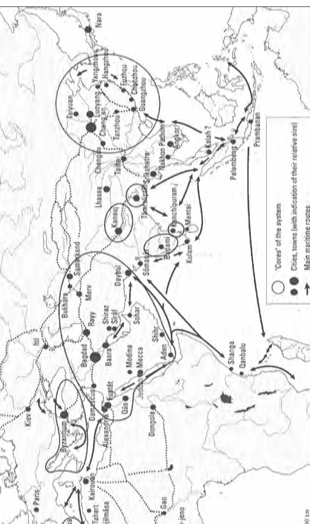
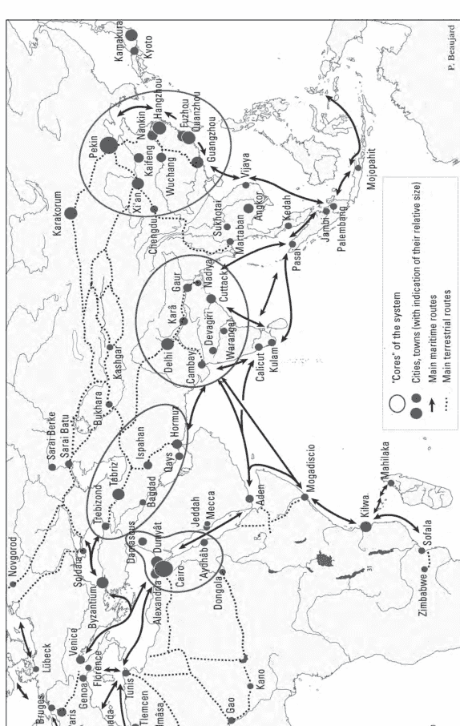
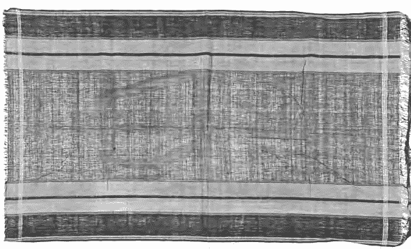
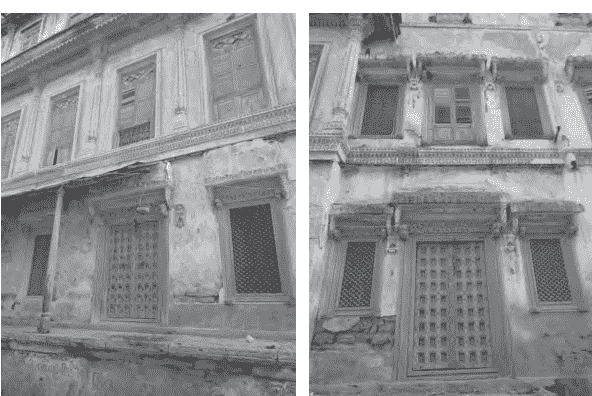
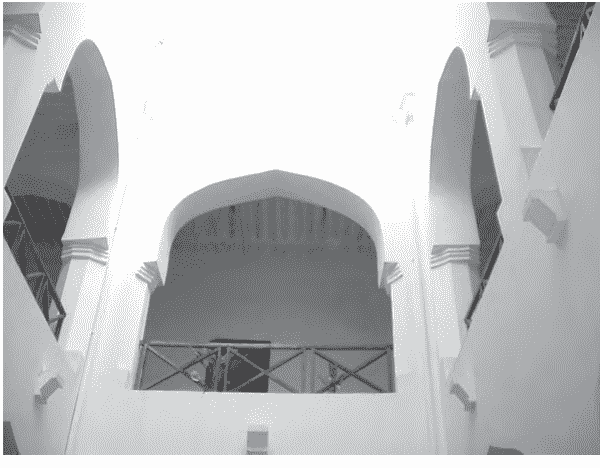
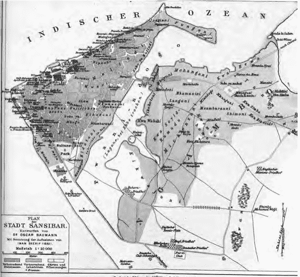

# 跨区域贸易与商人：早期至1900年印度洋中的古吉拉特

牛津大学出版社是牛津大学的一个部门。它通过在全球范围内出版出版物，促进大学在研究、学术和教育方面追求卓越的目标。“牛津”是牛津大学出版社在英国及某些其他国家的注册商标。

使用 Scala Pro 10/13 排版

Trananics Data Technologies, Kolkata 700 091 制作

Replika Press Pvt. Ltd 在印度印刷

## 引言

EDWARD A. ALPERS 和 CHHAYA GOSAMI

“就像线上的珠子——无论是卡奇奇、索拉亚斯特拉、古吉拉特还是印度斯坦——一千年来，阿拉伯[海]在古吉拉特的历史中发挥了基础性作用；因此，海洋确实值得研究和思考。” Guuntravari Acharya 在他的小说《Sarkkarbar》中这样写道¹。他敏锐地指出，海洋是古吉拉特年史一条重要且丰富的线索。“那些忽视海洋的人将无法完全理解我们地区或国家的历史，”他警告道²。正如他在叙述中所反映的，Acharya 正确理解了海洋对古吉拉特海岸社会、商业和文化生活的影响。显然，海洋在塑造古吉拉特历史方面至关重要。十多年前，Acharya 就预言了对海洋的赞歌，当时他强调了外来者从卡提瓦穿越索姆纳特、帕坦、迪乌直到曼德维征服或统治各地区的千年历史³。在某种意义上，Acharya 在评估古吉拉特的海洋历史时围绕海洋展开写作，反映了分析者的长久视角。为什么不呢，因为海洋对于……一直是核心。

¹ Acharya (1952)

² Acharya (1952)

³ Alpers and Goswami (2019)

## 非欧亚世界体系的兴起

## 印度洋中的古吉拉特

长期以来印度洋与古吉拉特无关的观点正面临挑战。沿着古吉拉特漫长的海岸，从孟加拉湾口到西部，印度洋一直是核心。

⁴ https://en.wikipedia.org/Geography_of_India，访问于2016年2月1日。

⁵ Alpers (2014: 19–25)

### 4 爱德华·A·阿尔珀斯和 Chhaya Goswami

古吉拉特语。这种调查不足的两个主要原因是：来源和方法论。关于古吉拉特沿海及其与海洋互动的大部分丰富口述记录并未详尽，而其历史的印刷文献和档案来源也是碎片化且分散的。这些研究问题有时导致写者构建出显然单薄且概念薄弱的历史。在方法论上，应对这些挑战需要更细致的理论构建。将这些问题记在心中，近年来，受过专业训练的历史学家和人类学家正试图通过有系统地围绕海洋过去的历史开展研究，来填补这些空白。海洋史涵盖了许多广泛的主题，如海洋考古、航海、造船、沉船、港口城市和移民等。每一个主题都要求研究人员调查与其相关的多个维度。因此，重建跨区域的商业历史并对跨印度洋的贸易、商人和商品进行民族志研究，需要仔细的设计和勤奋的学术工作。诚然，要绘制这种交织在交换网络网中的跨区域历史特征并非易事。这些挑战之一是需要查阅多种语言的文献。从生产地到消费地，商品可能会跨越多条路线、地区和海洋。商品流通的整个复杂过程涉及大量的参与者、巨额投入和大量的商业活动。这几乎涉及了参与海洋互动的每一个社会和文化。

印度洋及其对特定地区的影响程度，很大程度上取决于该地区参与海洋活动的程度。一些内陆地区虽然在地理上与印度洋不相连，但与海洋事务密切联系。例如，印度拉杰普特尔地区的马尔瓦尔（Marwar）没有出海口，但该地区的织造社区和象牙制造者通过其生产系统，积极地参与了远达东非的长途海上贸易。同样，在查看 Alpers (2016) 后，波斯人击败了内陆的亚美尼亚，并在 17 世纪初将其商人社区迁往新朱尔法（New Julfa），这些富有进取的亚美尼亚人通过商业活动改变了他们社区的命运，这些活动将亚美尼亚商人带到了印度洋东部更远的地方。为了环境的干旱，波斯湾的商人船员们热烈地跨越海洋，寻找生计和生存。来自也门南部和不同红海社区的进取型非洲人也发展了类似的向海导向。尽管东非人不像其他一些印度洋居民那样作为商人资本家和船主活跃，但非洲的主要产品极地吸引了海外商人，并刺激了涉及许多远离海岸的非洲人的商业网络。同样，来自中国和东南亚的丝绸和香料也吸引了来自西印度洋遥远处的商人。因此，要理解每个地区在构建印度洋世界充满活力经济中的作用，涉及到对这个庞大世界系统的每个组成部分的独特历史进行深入的智力投入。其中一个地区就是古吉拉特。正如我们已经注意到的，由于其海岸线、充满活力的港口城市、生产体系、造船和航海社区以及长期以来拥有的商人能力，古吉拉特从很久以前起就成为印度洋海洋地区中最具活力的地区。古吉拉特的航海人和商人是整个地区海洋史的恒常特征。事实上，古吉拉特沿海的故事为理解印度洋更广泛的历史提供了无数可能。

当水手商人穿过印度洋水域时，根据季节性季风的本性，他们在停泊的港口养成习惯并结交朋友。这种规律的移动意味着印度人由于强制性关系与当地女性同居，有时还与之结婚；他们也在许多非印度人港口留下了后代，他们的非洲、阿拉伯和波斯同类在古吉拉特港口也是如此。虽然声称每个西印度洋港口都是大国际的可能有些牵强，但几乎没有像 Aslanian (2011) 所说的那样，可以怀疑那些最重要的港口无疑是这样的。在古吉拉特内部，古吉拉特人、卡奇奇人和其他印度人，阿拉伯人、波斯人、阿富汗人、莫卧儿人、土耳其人、犹太人、亚美尼亚人和非洲人比肩，并最终与各种欧洲人比肩。这种地理上的亲近性使得每个西印度洋港口都是多元的。无论如何，这些伟大的港口并不总是舒适的，也没有产生一种混合社会，但确实产生了不同的习俗。在古吉拉特内部，他们了多元的印度教徒、穆斯林、帕斯教徒、基督徒和自然主义。

这些使古吉拉特商人在印度洋成功的因素是广泛的。这些因素包括可靠的港口、良好的商业实践、贸易结构、造船和航海技术、海洋保险的可用性以及手人和商人。例如，几个世纪以来，古吉拉特的商人发展出了卓越的创业能力，使他们与印度洋其他地区区别开来。艰苦节俭的生活方式是他们的特征，是由古吉拉特严酷的环境造就的。此外，他们在商业运营中寻求团结。这些家族公司不仅为商品分配资金，还通过完善学徒制向创业者传递知识，这种学徒制几乎是获得商业技能的必要安排，最终使学徒建立自己的公司。这些动态力量共同成了古吉拉特更广泛故事的主线。

### 引言 7

本卷挑战了围绕古吉拉特贸易历史划分区域的尝试。通过采用各种方法和时间视角，作者们强调了从古代到 19 世纪古吉拉特贸易活动的重要性。

## 本书的形成

本论文集汇了由 Darshak Itihas Nidhi (DIN)（一个历史研究基金会）组织的第三次关于古吉拉特在全球背景下历史的国际研讨会的部分论文。2010 年在曼德维（Mandvi）举行的“古吉拉特与海洋”产生了一本同名的丰实著作。2012 年在达马曼（Daman）举行的第二次会议“古吉拉特港口城市”由 Primus 出版。最近一次会议由 DIN 于 2015 年 12 月在苏拉特（Surat）举办。这次会议的标题以及本书的书名为《跨区域贸易与商人：将古吉拉特置于古代至 20 世纪初的印度洋》。正如从这些研究古吉拉特历史的学者重大会议主题所示，贯穿始终的一个共同主题是即古吉拉特在印度洋世界的地位。当然，关于古吉拉特在经济和海洋史中中心地位的历史不仅限于此，长期以来认为印度历史几乎全是大陆性的观点，也有力地支持了 DIN 继续关注古吉拉特面向外的前沿。

本卷中的章节反映了这些宏观趋势，尽管细节比我们在本引言中所概述的要详细得多。这些章节强调了面向印度洋贸易的产品和人员，涵盖了从古代到 19 世纪的广泛特定主题。

### 爱德华·A·阿尔珀斯 与恰雅·戈斯瓦米

主题。在会议上，论文按易管理的年代顺序或主题进行分组，例如：“早期印度洋中的古吉拉特定位”、“阿拉伯海的古吉拉特贸易网络”、“远东海洋的古吉拉特商人”、“航海史中的古吉拉特”、“西印度洋古吉拉特商人的贸易世界”、“印度洋商品与当地市场：流流与消费”以及“古吉拉特与外国商人的区域贸易网络”。然而，适用于时间受限的会议环节的形式并不适用于出版物。为了使我们的书籍具有更强的连贯性，并鼓励论文之间进行更深入的知识交流，我们将章节分为三个大板块：史学、方法与来源；商品；以及贸易网络与离散群。

## 史学、方法与来源

诚然地说，本部分的三个关键词指导了该书的每一项贡献，正如它们指导所有历史学的工作一样。尽管如此，这些章节以各自的方式对这些宽泛的话题投射了更敏锐的光。第一章是爱德华·阿尔珀斯在会议上的一场专门针对史学的基调演讲稿的扩展版。在回顾过去四十年的历史学研究（主要为英语）时，包括考古学家对1900年以前古吉拉特和印度洋的贡献，阿尔珀斯识别了这些年来涌出的几场活跃争议和持续辩论。他并建议在重建古吉拉特过去这方面时，应加强跨学科的合作。正如阿尔珀斯所指出的，过去的四十年见证了关于古吉拉特印度洋贸易及其商人（包括本土和外国商人）的大量一流学术成果的产生。这些跨越两个学术代际学者的最新著作，对这段历史的未来研究提出了许多新视角和具有挑战性的问题。从另一个角度来看，印度近期通过建立国家海军并寻求确立其作为印度洋海洋权力强国的地位，也为现在和未来带来了许多重要的政策问题。因此，尽管本书书的贡献严格来说是历史性的，并侧重于古代、中世纪和近现代早期，但出于学术和政治两个原因，2015年是一个恰当的时，通过关注其跨区域贸易和商人，对古吉拉特在印度洋世界中的地位进行知识性的总结。这种史学综述的结果让我们了解了当前的辩论在这些十年中是如何发展的，以及何处需要进一步的研究。

与阿尔珀斯的章节形成补充的是，拉克希米·苏里布拉曼（Lakshmi Subram）对过去三十年古吉拉特和印度洋航海史写作的重要总结。她主要识别了标记历史知识本质的重大转变和重点。她探索了这些变化对整个历史学科意味着什么，以及这些变化又是如何影响到对古吉拉特的特定案例研究的。这项工作的主要意图是强调发现和阅读新的、当地档案的重要性，以及将新方法纳入标准的历史工作的意义。

从古代到中世纪，菲利普·博伊扎尔（Philippe Beauazard）通过世界系统的四个阶段追溯了古吉拉特的位置。他仔细地将古吉拉特和印度洋置于一个不断演变的世界体系中，以构建出一幅更广阔的图景。他证明了古吉拉特在1500年前如何维护其权力，并逐渐成为印度洋及其周边交换的主要因素，这些交换与宗教网络和地点有着联系。在博伊扎尔宏大的框架内，希曼舒·普拉哈·雷（Himanshu Prabha Ray）为古吉拉特的早期航海史贡献了一个引人深深的章节。她讨论了公元前四世纪到公元四世纪之间古吉拉特航海活动的文化背景，其目的是强调影响跨洋接触的文化因素。她进一步强调了这一时期贸易活动相对于政治组织的自主性。因此，博伊扎尔和雷扫清了有时笼罩古吉拉特早期航海和商业史的迷雾。继续在这一宽泛的近现代早期之前的时间框架内，拉纳布·查克拉帕尔蒂蒂（Ranab Chakrabarti）利用了丰富但经常被开发的（至少对于印度而言）的开罗热尼萨手稿（Cairo Geniza）记录，勾勒出早期的商人网络.¹¹ 这一章探索了共同时代前四个世纪古吉拉特海岸港口的意义，将其置于更广阔的背景下。古吉拉特海岸与阿拉伯湾之间的贸易关系形成了跨区域的互动，这在印度洋贸易中占据重要地位。他的章节将我们的注意力引向西印度洋的商业。

作为阿尔珀斯章节的补充，萨米拉·谢赫（Samira Sheikh）对过去三十年关于古吉拉特和印度洋航海史写作进行了重要总结。她主要识别了标记历史知识本质的重大转变和重点。她探索了这些变化对整个历史学科意味着什么，以及这些变化又是如何影响到对古吉拉特的特定案例研究的。这项工作的主要意图是强调发现和阅读新的、当地档案的重要性，以及将新方法纳入标准的历史工作的意义。

从古代到中世纪，菲利普·博伊扎尔（Philippe Beauazard）通过世界系统的四个阶段追溯了古吉拉特的位置。他仔细地将古吉拉特和印度洋置于一个不断演变的世界体系中，以构建出一幅更广阔的图景。他证明了古吉拉特在1500年前如何维护其权力，并逐渐成为印度洋及其周边交换的主要因素，这些交换与宗教网络和地点有着联系。在博伊扎尔宏大的框架内，希曼舒·普拉哈·雷（Himanshu Prabha Ray）为古吉拉特的早期航海史贡献了一个引人深深的章节。她讨论了公元前四世纪到公元四世纪之间古吉拉特航海活动的文化背景，其目的是强调影响跨洋接触的文化因素。她进一步强调了这一时期贸易活动相对于政治组织的自主性。因此，博伊扎尔和雷扫清了有时笼罩古吉拉特早期航海和商业史的迷雾。继续在这一宽泛的近现代早期之前的时间框架内，拉纳布·查克拉帕尔蒂（Ranab Chakrabarti）利用了丰富但经常被开发的（至少对于印度而言）的开罗热尼萨手稿（Cairo Geniza）记录，勾勒出早期的商人网络.¹¹ 这一章探索了共同时代前四个世纪古吉拉特海岸港口的意义，将其置于更广阔的背景下。古吉拉特海岸与阿拉伯湾之间的贸易关系形成了跨区域的互动，这在印度洋贸易中占据重要地位。他的章节将我们的注意力引向西印度洋的商业。

## 商品

古吉拉特的跨区域贸易网络为南亚次大陆带来了一系列商品，并帮助经济变得充满活力且实现货币化。在这里，认为直到17世纪印度洋经济仍然是前资本主义的，且商品交换对价格并不敏感，这种观点需要修正。对于这个问题，人们需要询问什么是资本主义经济？如果我们同意它是一种基于资本私有的经济体系，并且指的是为了促进业务目标而投入企业中的资金，那么维尔吉·沃赫拉（Virji Vohra）和阿卜杜勒·加富尔（Abdul Gaffur）——可能是最著名的苏拉特的商人资本家——在阿拉伯湾的投资非常具有资本主义色彩。同样，莫吉·罗吉（Mowji Rowji），一位驻马斯卡的古吉拉特组合资本家，也有许多投入商品贸易的投资² 而且在17世纪，世界市场开始主导商品生产及其价格。近现代早期资本主义活动的其他案例可以在象牙、咖啡和武器中找到。欧洲进入亚洲商业世界重绘了印度洋的海图。欧洲商人不仅探索了与欧洲直接贸易的潜力，还揭示了深远的印度洋商品和人员交流。大多数早期欧洲旅行者的游记都是围绕印度洋周边商品、商人和贸易路线的叙述组织的。在印度，异域商品尤其是硬币的引入成为其经济生活的特征，而国内产品（尤其是棉质纺织品）的出口在印度洋贸易中也占据了同等中心。因此，印度洋经济的商品化在本书中作为一个独立的单元进行研究，重点关注纺织品、象牙、椰枣和武器等具有商业价值的商品。

莎拉·费（Sarah Fee）详细检查了古吉拉特和马尔瓦尔的纺织品生产是如何为19世纪中非市场进行定制的。她认为，从古吉拉特出口的充满活力且多样的面料不仅满足并改变了人们的基本服装需求，还响应了非洲消费者不断变化的时尚感，这种感取决于地点、时间和阶级。在她的章节中，玛莎·蔡克林（Martha Chaiklin）调查了这种角色

¹ 见 Ghosh (1994) 和 Margariti (2007)。

² 见 Goswami (2011)。

### 12 埃德华·A·阿尔珀斯（Edward A. Alpers）与恰雅·戈斯瓦米（Chhaya Goswami）

早期象牙贸易和手工业生产中的苏特。她通过象牙将苏特与印度洋世界联系起来，并反映了古吉拉特地区象牙与纺织品相互关联的特性。咖啡在如今跨越了多个界限成为全球性饮料。恰雅·戈斯瓦米通过探索咖啡贸易的跨区域特征，展示了单一商品（即咖啡）如何产生从红海出发的复杂贸易路线，这不仅是因为贸易额的增长，还因为金银和利润通过各种渠道的流动。卡尔文·艾伦（Calvin Allen）通过对塞斯·拉西·普罗塔姆（Seth Rasi Purottam）生活和职业的迷人案例研究，对椰枣和武器进行了记录，证明了19世纪马斯喀特的班商人（Banyans）如何利用他们的商业经验和网络将港口的跨区域贸易与全球市场连接起来。

商人和生产者在获取高度需求商品时面临着哪些挣扎？尼沙特·马哈拉杰（Nishat Maharaj）通过解释纺织工匠与商人之间的等式，为古吉拉特提供了答案。她的讨论围绕着织工如何被商人雇佣和工作；他们如何被迫在本土实践与时代的需求之间进行调整；以及双方在平衡产量与需求方面面临的困难。她的章节和菲（Fee）的观点指出，商人的后地网络对于建立稳固的长途商业关系至关重要。

## 贸易网络与离散

古吉拉特是早期印度洋世界的核心。正如葡萄牙编年史托梅·皮斯（Tomé Pires）¹³所言，在16世纪——坎贝伊伸出了两只手臂，分别指向亚丁和马六甲。尽管东南亚在书中占比较少，但并非完全缺失。鲁比·马洛尼（Ruby Maloni）探讨了印度洋世界东部古吉拉特商人的离散扩张。

> ¹³ 托梅·皮斯的《东方东方》（The Suma Oriental），这是一部关于从红海到日本的方的记录，于1512–1515年在马六甲和印度撰写；以及弗朗朗斯斯科·罗德里格斯（Francisco Rodrigues）的著作，关于红海航行的记录、航海规则、历法和地图，均于1515年之前在东方撰写和绘制，由新德里的亚洲教育服务书店于1990年出版。

她解释说，如果没有古吉拉特棉纺织品的作用，东部群岛胡椒和香料的利润性贸易几乎是不可能的。

古吉拉特的航运在盈利连接印度洋港口方面发挥了至关重要的作用。18世纪，随着对船的需求增加，由一系列远洋船组成的古吉拉特船队规模也随之增加。考虑到迪（Diu）和达曼（Daman）商业航运的实力，佩德罗·马查多（Pedro Machado）认为，除了夸大了欧亚帝国“衰落”的破坏性影响（这是一个与欧洲征服正当性相关的观念）外，这种观点由于很大程度上忽略了中型远洋船在19世纪仍持续存在西印度洋，而夸大了古吉拉特航运在海洋中的萎缩。

通过关注艾哈迈巴德（Ahmedabad）、巴罗达（Baroda）和其他内陆贸易站，拉迪希卡·塞尚（Radhika Seshan）追踪了商人与内陆的联系。她强调了古吉拉特商人对印度不同地区的触达、接触和范围，特别提到了跨越德干半岛的连接。

最后，离开商品和网络的世界，阿卜杜尔·谢里夫（Abdul Sheriff）的章节在一篇极具个人色彩的文中探讨了迁移和离散的问题。商人在远方的定居和适应方面表现出惊人的灵活性。在临时或永久逗留期间，他们处于新旧身份的二元对立之间，也处于“无根之感”与与原产地重新建立联系之间。谢里夫的章节关注家庭和个人身份主题，批判性地审视了各类人群（特别是商人）跨印度洋的更广泛迁移和定居背景。他对他们如何以及为何迁移感兴趣，他们如何成为当地人并成为不断变化的新社会的一部分。他问，为什么我是一个印度裔的斯瓦希里-桑给尔人，而不是一个离散的古吉拉特人，这种本土身份意味着什么？他的视角使我们对“离散”的理解变得复杂，而这在现有关于古吉拉特人或海外印度人的文献中往往缺失。

- Aboti, Hasmukh. 2012. *Sagarna Susvata*. Mandvi: Vivekgram Prakashan.

# 参考文献

- Acharya, Gunvantrai. 2013. *Dararial*. Ahmedabad: Guijar Granth Karyalaya.
- 1952. *Sarkarabad*, Ahmedabad: Guijar Granth Karyalaya.
- Alpers, Edward A. 2014. *The Indian Ocean in World History*. New York: Oxford University Press.
- 2016. ‘Maritime History, World History, Global History: Some Thoughts on Past, Present, and Future.’ In Abdullah al-Salimi and Eric Stables (eds), *Oman, A Maritime History*, pp. 15–26. Hildesheim: Georg Olms.
- Aslanian, David 2011. *From the Indian Ocean to the Mediterranean: The Global Trade Networks of Armenian Merchants from New Julfa*. Berkeley: University of California Press.
- Ghosh, Amitav. 1994. ‘The Slave of MS. H. 6’, *Subaltern Studies*, 3: 159–219.
- Goswami, Chhaya. 2011. *The Call of the Sea: Traders in the Indian Ocean, c.1800–1880*. Delhi: Orient Black.
- Keller, Sara and Michael N. Pearson (eds). 2015. *Port Towns of Gujarat*. Delhi: Primus Books and Vadodara: Darshak Ithas.
- Margariti, Eleni. 2007. *Aden & the Indian Ocean Trade: the Sixteenth Century*. Chapel Hill: University of North Carolina.
- Pandhi, Manubhai. 1976–7. ‘Kachchh’. In *Art, Culture and Natural History of Kutch*, edited by. Vadodara: Museum and Picture Gallery.
- Pand, Vanu. 1977. *Sadhukan*: Mumbai.
- Varadarajan, Lotika (ed.). 2011. *Gujarat and the Sea*. Vadodara: Darshak Ithas.

# 四十年来

## 古吉拉特在印度洋

埃德华·A·阿尔珀斯

四十年前，我发表了一篇关于古吉拉特与东非从16世纪到19世纪的文章¹。当时，我想，对于东非历史学家来说，这是一篇开创性的作品，尽管其他一些学者已经写过关于现代东非印度商人的严肃历史著作。尽管我到那时的研究已经将我引向西印度洋海域，但我是否知道季风会继续产生多大的影响？事实依然如此，尽管我没有再次写过印度洋。

* 感谢 Cal Margulis 在准备本章节时提供的研究帮助。还要感谢 YRL 的 Ruby Bell。我应该强调，如果没有在线资源，我完成这个项目是不可能的。

这些研究是以来源为驱动的，由于现代早期丰富的档案资源可用性，加上苏拉特（Surat）对荷兰和英国贸易公司的核心地位，共同导致了古吉拉特贸易与商人研究中这种广为人知的不平衡。相比之下，我发现关于坎姆贝/卡奇奇（Cambay/Kachchh）的只有十四处标题引用，对巴拉奇（Bharach）仅有一处，而迪乌（Diu）和达曼（Daman）的葡萄牙殖民遗产则产生了十余次。特定的商人是参考文献中的另一类群体，尽管这些人通常被包含在对苏拉特和欧洲贸易活动的研究中。巴黎商人出现在七次引用中；关于阿曼和东非古吉拉特及卡奇奇商人的大部分文献集中在殖民时期，因此我没有将他们纳入。另外两个大类主题包括艺术/建筑/考古（26项），以及航运/导航/制图学/港口（21项）。或许更惊讶的是，古吉拉特对非洲或非洲人的引用有34处（占11%）。即便考虑到非洲-印度西迪人（Sidis）最重要的学者海伦娜·巴苏（Helene Basu）的高产著作，这一比例仍然相当显著。辛普森（Simpson）的参考文献之所以是因为包含了发表在《印度历史学会年报》（Proceedings of the Indian History Congress）上的论文，这些论文倾向于反映我刚才提到的主题分布。总体来看，基于对1976年后出版物的引用，很明显的是，古吉拉特1900以前商业史仍有许多未开发的研究课题。

## 现代早期

让我先考虑1976年以来贸易与商人史学研究中两位主要人物的贡献，然后再转向过去十年中备受关注的几部主要著作。迈克尔·N·皮尔森（Michael N. Pearson）开创性的著作《古吉拉特的商人与统治者》（Merchants and Rulers in Gujarat, 1976）与我的文章同年出版（我在文中引用了皮尔森当时尚未发表的博士论文）。皮尔森的书值得关注之处在于他以开创的方式利用了葡萄牙来源

> 4 Basu (1993, 1995, 2006, 2007, and 2008).

来重建接触第一个世纪的古吉拉特历史。在我们的语境下，他关于古吉拉特商人的章节特别具有启发性。在方法论上，他的工作在许多方面与我自己在东非的论文研究完全平行。⁵ 皮尔森的书也是一个重要的基石，因为他论证，由于古吉拉特统治者的大部分收入来自土地，他们对海洋贸易几乎没有兴趣。皮尔森认为，“通常统治者并不不在乎商人做什么”。决定他们对16世纪葡萄牙入侵反应的关键是“古吉拉特社会中统治者与商人之间缺乏政治联系，这一点至关重要。”⁶ 正如下所示，这种解释在过去的几里被许多历史学家严严挑战。

古吉拉特商人最著名的历史学家无疑是阿欣·达·古普塔（Ashin Das Gupta）这一脉，他的工作跨越了导师与迈克·皮尔森（Mike Pearson）合作者的身份。达·古普塔广泛利用了英国东印度公司（EEIC）和荷兰东印度公司（VOC）的记录，他非常清楚这些来源为重建印度历史所带来的挑战。⁷ 与此同时，尽管他认同皮尔森关于商人与统治者处于不同世界的观点，根据桑杰·苏布拉拉马尼姆（Sanjay Subrahmanyam）⁸⁸，达·古普塔在晚年稍微放了他的观点。尽管如此，达·古普塔关于苏拉特及其所谓的“中世纪”古吉拉特商人活动的作品仍然指向这种区分。此外，尽管达·古普塔泛泛地描述了现代早期的印度商人，但他关于古吉拉特的研究始终如一地集中在苏拉特。达·古普塔对古吉拉特商人研究的显著贡献之一是对人——实际上是对个体的关注，而不是抽象的社会学类别。我们可以在他追溯到1970年的关于苏拉特商人的早期论文中看到，

+ ⁵ Alpers (1975).
+ 6 Pearson (1976: 2).
+ 7 Das Gupta (1981).
+ 8 Subrahmanyam (2001: 11); also Mukherjee (1998).

# 四十年后 21

以及他最重要的著作《印度商人与苏拉特的衰落》（Indian Merchants and the Decline of Surat, 1979）中，但他直到20世纪80年代后期一直保持对个人和商人家族的着迷。⁹

以皮尔森和达·古普塔为起点，让我转向最近几十年出现的历史研究。为了理解这些著作，我将从现代早期的古吉拉特和苏拉特开始，然后转向同一时期的其他古吉拉特港口，之后是1750年后的时期，最后是1500年以前时期。这在时间线上似乎是杂乱无章的，但我希望它在智力上是有的。

关于古吉拉特现代早期贸易与商人的史学大多始于1572年的莫卧儿征服以及在莫卧儿主权下苏拉特港的兴起。这一关注点的一个重要例外是桑杰·苏布拉拉马尼姆（Sanjay Subrahmanyam）10 对16世纪苏拉特崛起的评论。苏布拉拉马尼姆提出了一系列复杂得多的情况，影响了这一现代早期最重要的古吉拉特港口的崛起，包括古吉拉特苏丹马赫穆德·沙赫（Mahmud Shah，在位1537-54）对它的防御、它在亚齐和红海之间胡椒贸易中的中介位置、坎姆贝的衰落以及葡萄牙对迪乌的占领。他有说服力地指出从某种意义上说，[莫卧儿人]占据了一个相对于竞争对手已处于强大地位的港口……简而言之，”他继续道，“在被莫卧儿捕获之前，苏拉特已经处于海上贸易的重要地位”。因此，莫卧儿征服的关键意义在于，它让古吉拉特南部能够更直接地整合到印度的心脏地带”。¹¹

自20世纪70年代中期以来，出现了大量基于EEIC和VOC档案的苏拉特研究。没有一项能超越（尽管有些研究脱离了）达·古普塔的贡献，他对欧洲记录的必要依赖总是通过苏拉特商业活动的印度语境来实现的。

+ 9 Das Gupta (2001: 315–409).
+ 10 Subrahmanyam (2000).
+ 11 Subrahmanyam (2000: 28).
+ 12 See also Carreira (1998).

# Edward A. Alpers

相比之下，在达·古普塔的书出版的同时，O.P.辛（O.P. Singh）和B.G. 戈克哈尔（B.G. Gokhale）¹³认为东印度公司和泛指欧洲人在苏拉特商业生活中的地位比他认为的重要得多。正如达·古普塔¹⁴对辛对此类资源较少批判性的使用幽默地观察到，“我知道即使是工厂的见证人也会撒谎”。

在关于苏拉特商业史及其与更广泛印度洋联系的众多研究中，值得注意的单本著作包括梅塔（Mehta）、鲁比·马洛尼（Ruby Maloni）和普拉纳布·库马尔·米特（Pranab Kumar Mitra）的作品。梅塔关于古吉拉特商人和钱主的论文集集中在苏拉特和艾哈达巴德。⁵1992年，马洛尼出版了书籍《欧洲商人资本与印度经济》（European Merchant Capital and the Indian Economy），其核心文本复制了整卷苏拉特记录⁶ 尽管她用17世纪印度洋经济史的主要趋势的有用调查介绍了这些档案，但她最有价值的贡献是对文献本身提供的详尽且细心的注释。P.K. 米特（P.K. Mitra）采取了某种不同的方法，¹⁷对他显然是计划中的关于17世纪印度港口城市书籍系列之一的社会经济研究。在其著作出版十年后，马洛尼¹⁸出版了一部关于苏拉特的论文集，提供了该港口经济史主要主题的概述。再次，她的研究主要集中在苏拉特工厂记录上。最近，马洛尼写了关于古吉拉特欧洲存在和印度回应的重要评估¹⁹2003年，迪利普·查克拉巴蒂（Dilip Chakrabarti）出版了一部引人入胜的历史考古

# 四十周年 23

关于古吉拉特邦的欧洲扩张，再次重点关注苏拉特（Surat）。通过将其研究置于全球欧洲扩张的广泛背景下，他将苏拉特的研究置于极其广阔的历史和学术语境之中。近期，Murari Kumar Jha 发表了关于古吉拉特商人印度洋贸易网的有趣章节，而长岛广武（Nagashima Hiromu）则发表了关于苏拉特欧洲公司建筑环境的章节。^20

当然，苏拉特并非历史学家在现代早期时期所描述的唯一古吉拉特港口城市。史学界中对苏拉特主导地位的早期例外是 V.A. Janaki 在1980年对坎贝（Cambay）的研究，但该研究已被 Aniruddha Ray 的^21 对同一主导港口的详细研究所取代。诚然，Ray 广泛地利用了英国东印度公司（EEIC）的记录，但他严肃地关注了该镇更早期的历史，并谨慎地没有简化坎贝历史在受葡萄牙人、马拉塔人和英国影响下所变化的特征。我特别欣赏他在讨论18世纪中期马拉塔人夺取坎贝各区（parganas）时，强调了“人们不能将所有的历史都放在一个篮子里”。^22 同样，在他对坎贝衰落的细致校准分析中（这种衰落往往被归因于自然原因），Ray 得结论认为其衰落并不取决于马希河（Mahi）的淤积，因为即使在19世纪中期——当时坎贝早已被称为外外港——仍有五十到六十艘船进入坎贝，其中三十只属于坎贝商人。整个地区印度商人的贸易的错乱是由其他因素造成的，其中莫卧儿帝国的衰落、马拉塔人的侵略性以及英国人的垄断控制在其中起了作用。^23

除了这些专著外，还有 Sinnapaai Araratnam 关于《17世纪的海事印度》（1994）的重要通论研究，其中包含一个致力于古吉拉特邦的长章节；此外，20世纪最后四分之一的各种期刊和书章也有大量的学术文献，有些关注苏拉特商业精英的特定方面，另一些则努力应对欧洲的存在。苏拉特贸易中的杰出人物，如所谓的“贾那商人王子”维吉·沃拉（Virji Vora），以及新兴帕尔西（Parsi）社区的领袖，都得到了很好的体现。

一位在使用英国公司资料方面完全处于不同层次的学者是 Lakshmi Subramanian。在《巴尼亚人与英国人》^25 中，她为十年后在《本土资本与帝国扩张》^26 中对苏拉特和孟买记录的全面发展分析奠定了基础，这使她主张了她所说的“盎格鲁-巴尼亚秩序”（Anglo-Bania Order）的演变，即印度教和贾那教商人与英国东印度公司之间的合作产生了一种互利互惠的关系。这种新兴的秩序始于苏拉特，最终转向孟买，并在那里开始涵盖帕尔西人和穆斯林人。因此，虽然 Subramanian 并非专门研究古吉拉特或苏拉特的历史学家，但她学术的精深揭示了西印度古吉拉特商人与英国帝国主义者之间错综复杂的联系。在后来的一篇关于苏拉特织者的文章中，她证明了这些记录如何能阐明18世纪商人和统治者之外的其他印度人阶层的历史。她告诉我们，“这篇文章特别关注苏拉特织者，关注他们如何在转型时期的折磨中挣扎，并在18世纪下半叶挽救他们剩余的日益增长的实力。”具体而言，她认为1788年和1795年发生的动乱“主要是由苏拉特的穆斯林织者发起的，他们抗议帕尔西人和巴尼亚人承包商——即英国东印度公司的代理人——以及他们运作的强制制度”。^27 在这里，她再次证明了在古吉拉特邦经济和社会历史这一关键时期，政治与商业交织的复杂方式。

# 四十周年 25

尽管如此，Subramanian 的观点也受到过挑战，最著名的是 Michelguglielmo Torri 在20世纪80年代和90年代发表的一系列文章，在这些文章中，他驳斥了“盎格鲁-巴尼亚秩序”的概念，并对她对苏拉特当地社会的理解提出了挑战，理由是她依赖于“那些本身无关且具有绝对误导性的社区类别”。^28 我显然没有立场去对他们各自解释的优劣做出所罗门式的裁决，而是将强调在《现代亚洲研究》及其他地方从20世纪90年代持续到本世纪的辩论，这凸显了关于苏拉特历史研究的活力、其18世纪社会秩序的复杂性，以及其与莫卧儿和英国帝国存在之间如迷宫般的联系。

当前的千年之见证了一代年轻学者的出现，他们对古吉拉特邦的研究同样引发了一系列重要的史学和方法论问题。这些问题中，可能最重要的是关于古吉拉特邦商人与统治者之间的脱节，Pearson 曾如此有力地阐述过这一点。然而，对这一解释的首次严肃挑战是由 Sanjay Subrahmanyam 提出的。^29 在这里，Subrahmanyam 反驳了他认为限制了印度洋商业史研究的一套“束缚”^30。他从马六甲到亚丁，再到赫尔木兹，为他的论点建立了更广泛的背景，随后转向古吉拉特邦，将其确定为“西印度洋贸易的枢纽”。^31 对于商人与统治者在独立领域运作的争论，他指出：

> 隐含的假设似乎是国家本身是一个封闭的实体，商业利益无法触及。相反，我主张，重商主义国家通常必须与社会中的至少一个商人团体结盟，因为通过定义的官僚机构进行国家贸易通常是不可能的。^32

因此，Subrahmanyam 在“……的保护壳下，”认为，其衰落并不取决于马希河的淤积，因为即使在19世纪中期——当时坎贝早已被称为外港——仍有五十到六十艘船进入坎贝，其中三十只属于坎贝商人。整个地区印度商人的贸易错乱是由其他因素造成的，其中莫卧儿帝国的衰落、马拉塔人的侵略性以及英国人的垄断控制在其中起了作用。^33

除了这些专著外，还有 Sinnapaai Araratnam 关于《17世纪的海事印度》的重要通论研究，其中包含一个致力于古吉拉特邦的长章节；此外，20世纪最后四分之一的各种期刊和书章也有大量的学术文献，有些关注苏拉特商业精英的特定方面，另一些则努力应对欧洲的存在。苏拉特贸易中的杰出人物，如所谓的“贾那商人王子”维吉·沃拉（Virji Vora），以及新兴帕尔西（Parsi）社区的领袖，都得到了很好的体现。

一位在使用英国公司资料方面完全处于不同层次的学者是 Lakshmi Subramanian。在《巴尼亚人与英国人》^25 中，她为十年后在《本土资本与帝国扩张》^26 中对苏拉特和孟买记录的全面发展分析奠定了基础，这使她主张了她所说的“盎格鲁-巴尼亚秩序”（Anglo-Bania Order）的演变，即印度教和贾那教商人与英国东印度公司之间的合作产生了一种互利互惠的关系。这种新兴的秩序始于苏拉特，最终转向孟买，并在那里开始涵盖帕尔西穆斯林人。因此，虽然 Subramanian 并非专门研究古吉拉特或苏拉特的历史学家，但她学术的精深揭示了西印度古吉拉特商人与英国帝国主义者之间错综复杂的联系。在后来的一篇关于苏拉特织者的文章中，她证明了这些记录如何能阐明18世纪商人和统治者之外的其他印度人阶层的历史。她告诉我们，“这篇文章特别关注苏拉特织者，关注他们如何在转型时期的折磨中挣扎，并在18世纪下半叶挽救他们剩余的日益增长的实力。”具体而言，她认为1788年和1795年发生的动乱“主要是由苏拉特的穆斯林织者发起的，他们抗议帕尔西人和巴尼亚人承包商——即英国东印度公司的代理人——以及他们运作的强制制度”。^27 在这里，她再次证明了在古吉拉特邦经济和社会历史这一关键时期，政治与商业交织的复杂方式。

# 四十周年回顾

尽管如此，Subramanian 的观点也受到过挑战，最著名的是 Michelguglielmo Torri 在20世纪80年代和90年代发表的一系列文章。在这些文章中，他驳斥了“盎格鲁-巴尼亚秩序”的概念，并对她对苏拉特当地社会的理解提出了挑战，理由是她依赖于“那些本身无关且具有绝对误导性的社区类别”。^28 我显然没有立场去对他们各自解释的优劣做出所罗门式的裁决，而是将强调在《现代亚洲研究》及其他地方从20世纪90年代持续到本世纪的辩论。这凸显了关于苏拉特历史研究的活力、其18世纪社会秩序的复杂性，以及其与莫卧儿和英国帝国存在之间如迷宫般的联系。

当前的千年之交见证了一代年轻学者的出现，他们对古吉拉特邦的研究同样引发了一系列重要的史学和方法论问题。这些问题中，可能最重要的是关于古吉拉特邦商人与统治者之间的脱节，Pearson 曾如此有力地阐述过这一点。然而，对这一解释的首次严肃挑战是由 Sanjay Subrahmanyam 提出的。^29 在这里，Subrahmanyam 反驳了他认为限制了印度洋商业史研究的一套“束缚”^30。他从马六甲到亚丁，再到赫尔木兹，为他的论点建立了更广泛的背景，随后转向古吉拉特邦，将其确定为“西印度洋贸易的枢纽”。^31 对于商人与统治者在独立领域运作的争论，他指出：

> 隐含的假设似乎是国家本身是一个封闭的实体，商业利益无法触及。相反，我主张，重商主义国家通常必须与社会中的至少一个商人团体结盟，因为通过定义的官僚机构进行国家贸易通常是不可能的。^32

因此，Subrahmanyam 认为，其衰落并不取决于马希河的淤积，因为即使在19世纪中期——当时坎贝早已被称为外港——仍有五十到六十艘船进入坎贝，其中三十只属于坎贝商人。整个地区印度商人的贸易错乱是由其他因素造成的，其中莫卧儿帝国的衰落、马拉塔人的侵略性以及英国人的垄断控制在其中起了作用。^33

主要基于葡萄牙记录的 Jorge Flores 特别建立在 Hasan 的基础上，以进入学术界对商人与统治者之间经典且有些僵硬的区分。这种区分影响了他对现代早期印度和印度洋的观点，他认为这种互动是在现代早期时期中一种复杂且充满紧张的过程。^34 结果，莫卧儿国家在苏拉特通过与当地精英（特别是哈那雅团体）的互动来运作，到1723年哈那雅人已经获得了常规的话语权。^35 这些是个人还是团体，在很大程度上取决于细节，以及在不同组成部分之间竞争的结果。例如，在17世纪，商人通常被任命为总（`mutasaddi`），而到1723年哈那雅人已经在以新的方式参与到对苏拉特商业生活的监管中。^36

---

^20 Hiromu (2009); Jha (2009).

^21 Ray (1994).

^22 Ray (1994: 170).

^23 Ray (1994: 297).

^24 Edward A. Alpers. 如果我没有引用特定的文章或书章（除非另有说明），可以在 Simpson 的参考文献中找到，Simpson (2013)。

^25 Subramanian (1987).

^26 Subramanian (1996).

^27 Subramanian (1998: 52, 75).

^28 Torri (1987: 681).

^29 Subrahmanyam (1995).

^30 Subrahmanyam (1995: 755).

^31 Subrahmanyam (1995: 763).

^32 Subrahmanyam (1995: 773).

^33 Subrahmanyam (1995: 774).

^34 Subrahmanyam (1995: 775).

^35 Hasan (2008: 18).

^36 Hasan (2004: 38–40, 44).

---

# 四十周年回顾 27

“被许多莫卧港口官员的个人和集体轨迹所反驳”。事实上，他们的特征并未暗示陆地与海洋之间存在明确的对立，相反，他们似乎更符合一个政治与贸易并行的模型。³⁷ 弗洛里斯（Flores）提供了有关莫卧官员职业生涯的细节，例如穆卡拉布·汗（Muqarrab Khan），他在17世纪前二十年里曾多次担任苏拉特和坎贝的总督，“拥有船只并参与了亚洲海域的私私贸易”；以及米尔·穆萨（Mir Musa），他于1723年担任坎贝的贾吉尔达（`jagirdir`），并于1730年左右担任苏拉特的穆塔萨迪（`mutasaddi`），他是“在许多成功在商业和政治领域都取得业的伊朗人中，在印度次大陆找到了自己的立足点”。事实上，他认为，“米尔·穆萨仅仅是苏拉特和坎贝许多具有这种商人兼官员双重背景的穆塔萨迪之一。”³⁸ 采纳了由苏布拉马尼姆（Subramanyam）和已故的克里斯托弗·贝利（Christopher Bayly）于1988年提出的概念，弗洛里斯认为他们被视为“投资组合资本家”，即同时担任商人、生意人和政治参与者角色的人。³⁹ 在这种解释中，弗洛里斯将自己与哈桑（Hasan）区分开来，“后者通过将他们主要刻画为商人而非帝国官员，而我认为，他们体现了远为复杂的现实。”⁴⁰

在一系列论文和一部重要专著中，古鲁拉姆·纳德里（Ghulam Nadri）加深了我们对古吉拉特商业史及其在印度洋世界中地位的理解。在他的著作《18世纪的古吉拉特》（*Eighteenth Century Gujarat*, 2009）中，他主要关注苏拉特，反驳了达斯·古普塔（Das Gupta）的传统观点——后者认为这一世纪是衰落的世纪，而实际上这是一个弱国政下蓬勃贸易与不受限制的商人相得辉映的时代。与哈桑和弗洛里斯采取的国家与商人关系观点相反，纳德里回溯了皮尔森（Pearson）对16世纪的论点，即国家在古吉拉特商业经济中扮演的角色有限，尽管他对商人和统治者的概念化可能被批评比其他学者所暗示的更为静态。相比之下，

³⁷ Flores (2011: 57).

³⁸ Flores (2011: 60, 66, 68).

³⁹ Flores (2011: 69).

⁴⁰ Flores (2011: 70).

---

# 28 爱德华·A·阿尔尔珀斯（Edward A. Alpers）

在对一位著名的帕西籍商人曼彻尔吉·库尔什谢德吉（Mancherji Khurshedji）的详细研究中，他指出曼彻尔吉“接近我们已经看到的‘投资组合资本家’的地位，这种地位刻画了‘结合政治与贸易的商人’”。⁴¹ 纳德里的工作同样值得关注，因为他关注了古吉拉特和印度洋研究中经常被忽视的社会群体和地区。他对18世纪苏拉特海事劳动的精辟分析——“他们形成了一支重要的劳动力，促进了该市繁荣海外贸易的扩张与维持”——特别受到欢迎。⁴² 纳德里将工人分为三大类，“全部来自经济上贫困的家庭”⁴³——奴隶、自由计工工人，以及那些因贫困而被迫从事海事劳动的人，他暗示这可能构成债务奴役的形式。⁴⁴ 他注意到了这支劳动力的民族多样性，包括穆斯林教、印度教徒和帕西人，以及阿拉伯人和非洲人。他写道，“苏拉特高度多样化的水员社区的证据，与印度公司官员及其欧洲同僚普遍持有的种姓——或基于社区的职业观念并不相符。”⁴⁵

- 41 Nadri (2007: 327), (2012a), (2012b).
- 42 Nadri (2015: 337).
- 43 Nadri (2015: 340).
- 44 Cf. Campbell and Stanziani (2013).
- 45 Nadri (2015: 348).
- 46 Khan (2013).

---

# 四十周年回顾 29

纳德里也是几位考察苏拉特海运商人方面的历史学家之一，在他的案例中，他认为至少有一些苏拉特商人家族——再次与达斯·古普塔所强调的相反——能够跨代维持其家族财富。在17世纪，伊夫蒂哈尔·艾哈迈德·汗（Iftikhar Ahmed Khan）⁴⁶ 提供了令人信服的证据，表明不仅普通商人，莫卧皇室成员和莫卧官员也是活跃的船主。他对船主所有者的分类尤为引人注目。苏拉特几乎所有的船主都是穆斯林，该市仅记录了三位印度教船主，这让汗暗示“印度教商人可能在传统经营中担任萨拉（`sarrâ`），即经纪人、放贷者以及从内陆到港口城镇的货物运输者”。⁴⁷ 他还注意到富裕的土耳其商人——恰莱比人（Chalebis）也是船主，这一主题由鲁基亚·胡赛因（Ruquia Hussain）专门讨论过。⁴⁸ 最后，汗对与皮尔森相关的立场发表了评论，“而且印度统治阶层即使保持沉默，也保持了相当的地位，他们大部分收入来自土地，对保护印度航运并无兴趣。莫卧宫廷和贵族对作为商业企业的航运所表现出的极大兴趣……表明这一观点必须被考虑。”⁴⁹

对纳德里创新的最后认可是他对奇奇（Kachh）的关注，在“古吉拉特地区衰落与命运转折的背景下”。⁵⁰ 这出现在他的著作以及《东方经济社会历史杂志》（*Journal of the Economic and Social History of the Orient*）的一篇重要文章中。具体而言，他强调“奇奇湾的贸易和商业在18世纪中期迅速扩张，是因为在西方海洋世界不同地区几乎同时发生了某些发展”；⁵¹ 包括信德地区（Sind）和马斯喀（Masqat）的经济和政治变化，以及曼维（Mandvi）的兴起。纳德里的分析提供了一种方法，让我们理解奇奇商人在19世纪对东非贸易的显著作用并非一种现象或奇迹，而是地区巨大潜力的逻辑结果。⁵²

两本近期的著作涵盖了这一故事，特别是古吉拉特和喀恰地区。查雅·戈斯瓦米（Chhaya Goswami）的作品《海洋之声》（*The Call of the Sea*, 2011）是对19世纪桑齐巴印度商人的深度实证研究。尽管皮尔森⁵³ 写过关于19世纪东非的

- 47 Khan (2013: 32).
- 48 Hussain (2014).
- 49 Khan (2013: 34).
- 50 Nadri (2008: 463).
- 51 Nadri (2008: 466).
- 52 Nadri (2008: 483); cf. Oishi (2007).
- 53 Pearson (1998a).

---

# 30 爱德华·A·阿尔尔珀斯（Edward A. Alpers）

在现代早期时期，几位关于桑齐巴和马达加斯加的历史学家都讨论了这些人在19世纪东非的活动，⁵⁴ 戈斯瓦米对这些人的复杂家族联系取得了非常详尽的评估。特别是对19世纪中期担任桑齐巴海税官的亚拉姆·希夫吉（Jairam Shivji）的细致重建非常值得注意。

通过采纳不同的档案材料——在葡萄牙[境内]——以及更广泛的比较分析框架，佩德罗·马尔恰多（Pedro Machado）考察了18世纪中期到19世纪期间位于迪乌（Diu）的瓦尼亚（Vāniā）商人的问题，这远超我在1976年的文章《非洲与奴隶》（*Africa and Slaves in East Africa*）中能够实现甚至想象的范围。⁵⁵ 通过整合葡萄牙印度、莫桑比克和英国的零散档案，他重建了关于这一古吉拉特和东非商业活动的组织和执行情况的最令人深刻的描述，以及对每一个产生的影响。仅举一个例子，在评估此前被低估的古吉拉特人在印度洋和大南西洋莫桑比克奴隶贸易中的作用时，他得出结论：

> 由于他们在由于人在纺织品供应中的作用以及资助奴隶交换的能力，古吉拉特商人因此坚定且关键地嵌入了复杂的区域和全球奴隶系统中。他们活动的规模和范围强调了我们需要重新考虑对大西洋和印度洋的概念，以及看似边缘的参与者对海洋经济整体运作的关键性。⁵⁶

^54 关于现代时期印度商人的代表性学者，请参见辛普森（Simpson, 2013）书中关于索菲·布兰德（Sophie Blanchard, Loc 2076）和丹尼斯·盖（Denis Gay, Loc 4611–4617，后者均关于马达加斯加；对于东非，请参考吉斯伯特·翁克（Gijsbert Oonk, Loc 8475–8481）、让·克洛德·潘拉德（Jean-Claude Penrad, Loc 9211–9217）和千鹤子富米奈（Chizuko Tominaga, Loc 12000）。

^55 Alpers (1975); cf. Tambs-Lyche (1997: 224–55).

^56 Machado (2014: 266–7).

---

# 四十年后 31

Machado^57 也对古吉拉特海外纺织贸易更悠久的历史贡献了两篇重要论文。诚然，纺织品在历史上一直是古吉拉特最重要的海外出口产品，但对于古吉拉特在印度洋世界纺织品出口中的核心作用，仍有空间进行更多研究。^58 一位艺术史学家暗示，布奇（Bhuj）、恰奇奇（Chakhchh）的穆斯林祈祷垫生产可能存在风格影响，这可能是古吉拉特商人在西北马达加斯加贸易的结果。^59

Machado 对古吉拉特历史的葡萄牙档案来源的深度研究，提醒了人们关于古吉拉特葡萄牙人的另一类完全不同且相关的学术成果。当然，存在着早于20世纪70年代中期的丰富史学著作，但学术界帝国研究的复兴继续吸引历史学家对这项研究的关注。为16世纪葡萄牙人遇到的沿海社会建立基准，引起了 Annapoorna Ravichandar 和 Sohinee Basak 的关注，^60；而在对印度葡萄人的许多研究中，多产的 K. Mathew 考察了他们与古吉拉特苏丹国的历史，专门花了四个章节讨论贸易问题。^61 Pearson 还重新审视了葡萄牙与古吉拉特的早期关系，在其中他也修正了早期关于商人与统治者之间绝对分离的观点。^62 José Pissarra^63 在对乔道尔（Chaul）和迪乌（Diu）的研究中，考虑了16世纪第一个十年葡萄牙试图建立印度洋霸权的尝试，而 Roger Lee de Jesus^64 在文中写了关于1546年第二次围攻迪乌战以及迪乌堡垒的建造。葡萄牙来源在研究印度历史的另一种用途反映在 Luís Thomaz^65 对印度洋伊朗离散群的阐述中，其中包含了对古吉拉特的宝贵讨论。

- 57 Machado (2009a, 2009b).
- 58 见 Janaki (2006: 212); 另见 Dossal (2014).
- 59 Hess (2016)
- 60 Basak (2014); Ravichandar (1989).
- 61 Mathew (1983), (1986: 9–67).
- 62 Pearson (1998b).
- 63 Pissarra (2002).
- 64 Jesus (2012a and 2012b).
- 65 Thomaz (2015).

---

# 32 Edward A. Alpers

Mehrad 和 Natalie Shokoohy^66 对迪乌建筑的调查显著包含了印度教、穆斯林教和琐罗亚教以及葡萄牙人的建筑遗迹。与关注迪乌的葡萄牙视角不同的是 Ababu Minaimene^67 关于迪乌西迪人（Sidis）的论文，该论文为得益于 Helene Basu 对古吉拉特西迪人研究（其贡献极丰）的宏大学术成果增加了一个新维度。^68

在离开卡奇奇（Kachchh）之前，如果我不提到人类学家 Edward Simpson^69 的启发性工作，我将是失职的，他对口述史学的探索为思考古吉拉特的过去开辟了重要的新途径。他对卡奇奇历史的穆斯林和印度教不同解读进行了具有理论依据的分析，不仅暗示了在这一政治敏感地区进行实地调查的危险，也揭示了通过对所有过去资料进行更仔细的阅读可能获得的洞察——更不用说这些。这对于历史学家和人类学家来说都是一个方法论上的重要信息。Simpson 作品的另一个大优势是详细描述了曼德维（Mandvi）逊尼穆斯林海员之间是如何管理知识传递的。他在《穆斯林社会与西印度洋》（2006）中关于“造船厂学徒制与知识传递”的章节，预并补充了 Maxine Berg^70 对早期现代时期古吉拉特和卡奇奇工艺和小规模生产的修正。

- 66 Mehrad and Natalie Shokoohy (2010).
- 67 Yimene (2015).
- 68 另见 Patel (1991); Micklin (2001)。对比对古吉拉特巴黎投入的同样巨大的关注，例如 Kelawa (2002), Mamerkar and Dhunjischa (2002)，以及包含在 Simpson (2013) 中的 David L. White 的博士论文和发表文章（Loc 12636–12642）。
- 69 Simpson (2006), (2007), (2008), 和 (2010).
- 70 Berg (2013).

---

# 四十年后 33

Berg 利用了关于“有用知识”和“知识经济”的理论文献，并在 Simpson 等学者工作的基础上，也进入了文化和思想如何在印度洋世界中传播的领域。Berg 认为，“对古吉拉特和卡奇奇在早期现代全球历史中以及近期全球化框架下的工艺生产进行比较，使我们能够参与关于工业化和印度在殖民前、殖民时期、民族主义时期以及近期全球时期工业史的更广泛的辩论”。^71 虽然她在早期阶段使用了熟悉的客居者和英国档案资料，但在民族考古学的启发下，Berg 组织了一个研究小组对当地手工艺进行访谈，以了解他们如何看待过去并代代传授知识。

访谈和口述史提供了一种方式，将工艺和许多行业如今所处的全球化世界与18世纪的印度洋和奢侈品全球贸易连接起来。^72 最后，她认为这种手工业的深层历史使其成为一个现在与过去之间进行类比的地方。此外，手工艺在过去和现在都是一个涉及商人、主技师/设计师以及一系列专业工人的分工过程，其中大多数人没有受过教育，且无法获得那些可能让他们及时掌握自身技艺的资本。她继续论证，我们留下的18世纪旅行者的描述传达了同样的信息，并补充说这一领域在殖民前时期通过其港口与全球贸易网络紧密相连。^73 一张中世纪的古吉拉特印度洋地图的发现带来了另一个不同的知识经济领域，该地图由 Samira Sheikh 分析过。^74 这本同时用古吉拉特语和阿拉伯语编写的地图揭示了印度海员选择性地使用了欧洲技术。^75 她随后认为，印度海员并不需要或产生精确导航技术的长期假设已不再成立。^76

- 71 Berg (2013: 26).
- 72 Berg (2013: 33).
- 73 Berg (2013: 39–40).
- 74 Sheikh (2009).
- 75 Sheikh (2009: 69).
- 76 Sheikh (2009: 77).

---

# 34 Edward A. Alpers

另一种思考古吉拉特在印度洋贸易中多重文化后果的方法是由哈达里离散群的历史学家和人类学家 Engsens Ho 提出的。从 Tomé Pires 在其16世纪著作《东方》中经常被引用的观察出发，“布奇伸出两只手臂，一只手伸向亚丁，另一只伸向马六甲”，Ho 评论道古吉拉特凭借其在纺织品生产上的主导地位，作为两者之间的天然枢纽和交换节点。77。这两个印度洋分支的结合产生了其主导穆斯林商人，他将其描述为产生了经典典籍的“普世伊斯兰教”，他在他的富有启发性的文章中分析了其中。通过对布奇国际化、多民族成分的深刻证明，他对这些阿拉伯文本的阅读揭示了诸如这种路线上的西迪人和哈达里人的合作在南亚研究中很少被评论。78。他首先讨论了几位参与印度洋贸易的西迪马木鲁克以及对哈达里赛义精神指导的依赖。随后他转向了一个代表性文本《Tarikh al-Nur-Safir》（他译为《揭示的行光》），该书由 ‘Abd al-Qadir bin Shaykh al-Aydaris 于1603年在苏拉特创作。作者出生于苏拉特，是一个移民哈达里赛义父亲和印度母亲的混血儿，一个制造奴隶。”79。文本本身属于一种被称为“百年史”的传统，并将一种预言性的谱系与物理墓地相结合，产生了 Ho 所说的“通过一种借喻操作将宇宙领域与地球上的特定地点联系起来的符号行为”。80。Ho 的开创性贡献使我们远离了通常各种古吉拉特社区的世界和

- 77 Ho (2007: 352).

- 78 Ho (2007: 353).

- 79 Ho (2007: 356).

- 80 Ho (2007: 359).

四十载后 35

主导了我们对早期现代时期理解的欧洲人，同时也进一步加强了古吉拉特与印度洋之间紧密的联系，以及应对知识经济不同方面可能具有的重大意义。

## 古代与中世纪时期

现在，让我将注意力从早期现代时期转向到1500年之前的几个世纪。在方法论上，这类学术研究很大程度上是由考古学家完成的，涉及对文学文献的仔细阅读以及基础性发掘。古吉拉特在印度洋贸易中地位的最早证据，可以追溯到哈拉帕文明遗址向其东部海洋边疆的延伸。毫无疑问，自1976年以来发现的这些联系中，最重要的是出版了在1955–62年间在洛塔尔（Lothal）进行的发掘报告。洛塔尔是一个哈拉帕的港口，它消失在萨巴马马蒂河（Sabarmati River）的泛滥平上，位于坎巴特湾（Gulf of Khambat）顶部。⁸¹ 无论对于所谓的“洛塔尔码头”存在什么争论，它在哈拉帕文化成熟期的海外贸易中都是核心，延伸至印度西部沿岸地区和海湾。正如首席考古学家S.R. Rao所说，“洛塔尔与海湾之间印度洋贸易中的远距离海路贸易，如果那里没有长段没有港口的海岸线，将是不可能实现的。”⁸² 除了洛塔尔与印度之间印度洋贸易的广泛证据外，Rao的同事们还发现了令人信服的证据，证明了从拉杰皮（Rajpi）跨越坎巴特湾，通过像巴格拉夫（Bhagrav）和梅格姆（Megham）等小港口进口原色红髓石，并在洛塔尔将其制成珠子，海外出口到幼发拉河-提格里斯河谷的苏美尔米亚城市，以及迪尔木蒙（Dilmun）。³³ 这里我应该指出，现代将拉杰皮的红髓石矿与当地的西迪（Sidi）社区以及埃比西尼尼亚苏菲派圣人巴瓦·戈尔（Bava Ghor）的陵墓联系在一起，以及这些在几个世纪以来从印度西部贸易到非洲的珠子的确切来源，引起了考古学者的关注。⁸⁴

- ⁸¹ Rao (1979), (1985).

- ⁸² Rao (1979: 224).

- ⁸³ Rao (1979: 221); Rao (1985: 580–1).

- ⁸⁴ Insoll et al (2004); Insoll and Bhan (2001).

- ⁸⁵ Dhalikjar et al (1996).

- ⁸⁶ Gaur (2000).

- ⁸⁷ Hegde et al (1992: 3); also Bahn and Kenoyer (1984).

- ⁸⁸ Bhan et al (2005; 2015).

- ⁸⁹ Ray (1999: 22–50). (2011).

最后，在卡提亚瓦尔（Kathiawar）也存在印度河流文明的港口城镇昆塔西（Kuntasi），它在20世纪90年代被报道。⁸⁵ 2090年代末，阿尼鲁德·辛格·高尔（Aniruddh Singh Gaur）完成了一篇关于“古吉拉特的哈拉帕海洋遗产”的博士论文，该论文汇集了现有资料，将其自己的研究相结合，并产出了一关于古吉拉特哈拉帕港口兴衰的通俗性短叙述。⁸⁶

最近，巴罗达马哈拉大学（M.S. University of Baroda）的考古学家在卡提亚瓦尔的杜瓦卡（Dwarka）附近发掘了一些较小的哈拉帕遗址。纳格什瓦尔（Nageshwar）专业的贝壳加工特别有趣，因为它暗示了一个季节性营地随着时间推移演变为永久定居点，以开发在成熟哈拉帕文明中极具价值的贝壳。印度洋故事中特别值得注意的是，“从离岸的海床中采集的”这种质量最好的腹螺——纳格什瓦尔的哈拉帕贝壳工艺者使用船只收集这些物品的。对于船只来说，当地名为“巴鲁”（*Sorhum halepensis*）的当地草在水中具有浮力，还可以用于“运输制成品”。⁸⁷ 因此，纳格什瓦尔的发现也侧面揭示了跨坎巴特湾的海上活动。该大学的几位同样的考古学家在卡奇湾（Gulf of Kachchh）头部的巴萨尔（Bagasar）附近的戈拉多罗（Gola Dhoro）发掘了另一个同样重要的哈拉帕制造和贸易中心。⁸⁸

在哈拉帕之后，最近的考古研究存在一个有趣的空白，但它们为将古吉拉特置于这一关键古代中世纪时期更大的印度海洋经验中提供了一个宝贵的框架。查克拉瓦尔蒂（Chakravarti）2014年的海洋历史学会周年纪念演讲同样概述了这一时期印度和印度洋的广阔范围，仅对古吉拉特略有提及，正如皮斯·马莱坎达利尔（Pius Malekandhalil）在2013年12月第74届印度历史大会中世纪印度历史分会的主席演讲中那样。⁹⁰ 然而，古吉拉特在查克拉瓦尔蒂关于海洋史写作的长篇且博学的贡献中确实占据了重要地位，该贡献关注从公元前500年至公元1500年约两千年的印度西部。⁹¹ 同样，雷（Ray）最近的作品也详细讨论了早期中世纪的古吉拉特。⁹² 这些文章共同强调了印度洋在古代和中世纪印度历史中的重要性。考古学家苏什米塔·森·普拉马尼（Sushmita Sen Pramanik）也提供了关于古吉拉特这一广阔过渡期的概述。⁹³

- ⁹⁰ Malekandhalil (2014).

- ⁹¹ Chakravarti (2012); cf. Chakravarti (2015).

- ⁹² Ray (2015: 156–81).

- ⁹³ Pramanik (2013).

- ⁹⁴ Pramanik (2013).

- ⁹⁵ Strauch (2012).

- ⁹⁶ Strauch (2012).

- ⁸⁷ Ray (2007).

- ⁸⁸ Ray (2007).

四十载后 39

主导了我们对早期现代时期理解的欧洲人，同时也进一步加强了古吉拉特与印度洋之间紧密的联系，以及应对知识经济不同方面可能具有重大意义。

古代与中世纪时期

现在，让我将注意力从早期现代时期转向到1500年之前的几个世纪。在方法论上，这类学术研究很大程度上是由考古学家完成的，涉及对文学文献的仔细阅读以及基础性发掘。古吉拉特在印度洋贸易中地位的最早证据，可以追溯到哈拉帕文明遗址向其东部海洋边疆的延伸。毫无疑问，自1976年以来发现的这些联系中，最重要的是出版了在1955–62年间在洛塔尔（Lothal）进行的发掘报告。洛塔尔是一个哈拉帕的港口，它消失在萨巴马蒂河（Sabarmati River）的泛滥平上，位于坎巴特湾（Gulf of Khambat）顶部。⁸¹ 无论对于所谓的“洛塔尔码头”存在什么争论，它在哈拉帕文化成熟期的海外贸易中都是核心，延伸至印度西部沿岸地区和海湾。正如首席考古学家S.R. Rao所说，“洛塔尔与海湾之间印度洋贸易中的远距离海路贸易，如果那里没有长段没有港口的海岸线，将是不可能的。”⁸² 除了洛塔尔与印度之间印度洋贸易的广泛证据外，Rao的同事们还发现了令人信服的证据，证明了从拉杰皮（Rajpi）跨越坎巴特湾，通过像巴格拉夫（Bhagrav）和梅格姆（Megham）等小港口进口原色红髓石，并在洛塔尔将其制成珠子，海外出口到幼发拉河-提格里斯河谷的苏美尔城市，以及迪尔木蒙（Dilmun）。³³ 这里我应该指出，现代将拉杰皮的红髓石矿与当地的西迪（Sidi）社区以及埃比西尼尼亚苏菲派圣人巴瓦·戈尔（Bava Ghor）的陵墓联系在一起，以及这些在几个世纪以来从印度西部贸易到非洲的珠子的确切来源，引起了考古学者的关注。⁸⁴

- ⁸¹ Rao (1979), (1985).

- ⁸² Rao (1979: 224).

- ⁸³ Rao (1979: 221); Rao (1985: 580–1).

- ⁸⁴ Insoll et al (2004); Insoll and Bhan (2001).

- ⁸⁵ Dhalikjar et al (1996).

- ⁸⁶ Gaur (2000).

- ⁸⁷ Hegde et al (1992: 3); also Bahn and Kenoyer (1984).

- ⁸⁸ Bhan et al (2005; 2015).

- ⁸⁹ Ray (1999: 22–50). (2011).

最后，在卡提亚瓦尔（Kathiawar）也存在印度河流文明的港口城镇昆塔西（Kuntasi），它在20世纪90年代被报道。⁸⁵ 2090年代末，阿尼鲁德·辛格·高尔（Aniruddh Singh Gaur）完成了一篇关于“古吉拉特的哈拉帕海洋遗产”的博士论文，该论文汇集了现有资料，将其自己的研究相结合，并产出了一关于古吉拉特哈拉帕港口兴衰的通俗性短叙述。⁸⁶

最近，巴罗达马哈拉大学（M.S. University of Baroda）的考古学家在卡提亚瓦尔的杜瓦卡（Dwarka）附近发掘了一些较小的哈拉帕遗址。纳格什瓦尔（Nageshwar）专业的贝壳加工特别有趣，因为它暗示了一个季节性营地随着时间推移演变为永久定居点，以开发在成熟哈拉帕文明中极具价值的贝壳。印度洋故事中特别值得注意的是，“从岸的海床中采集的”这种质量最好的腹螺——纳格什瓦尔的哈拉帕贝壳工艺者使用船只收集这些物品。对于船只来说，当地名为“巴鲁”（*Sorhum halepensis*）的当地草在水中具有浮力，还可以用于“运输制成品”。⁸⁷ 因此，纳格什瓦尔的发现也侧面揭示了跨坎巴特湾的海上活动。该大学的几位同样的考古学家在卡奇湾（Gulf of Kachchh）头部的巴萨尔（Bagasar）附近的发掘了另一个同样重要的哈拉帕制造和贸易中心。⁸⁸

在哈拉帕之后，最近的考古研究存在一个有趣的空白，但它们为将古吉拉特置于这一关键古代中世纪时期更大的印度海洋经验中提供了一个宝贵的框架。查克拉瓦尔蒂（Chakravarti）2014年的海洋历史学会周年纪念演讲同样概述了这一时期印度和印度洋的广阔范围，仅对古吉拉特略有提及，正如皮斯·马莱坎达利尔（Pius Malekandhalil）在2013年12月第74届印度历史大会中世纪印度历史分会的主席演讲中那样。⁹⁰ 然而，古吉拉特在查克拉瓦尔蒂关于海洋史写作的长篇且博学的贡献中确实占据了重要地位，该贡献关注从公元前50年至年至1500年约两千年的印度西部。⁹¹ 同样，雷（Ray）最近的作品也详细讨论了早期中世纪的古吉拉特。⁹² 这些文章共同强调了印度洋在古代和中世纪印度历史中的重要性。考古学家苏什米塔·森·普拉马尼（Sushmita Sen Pramanik）也提供了关于古吉拉特这一广阔过渡期的概述。⁹³

- ⁹⁰ Malekandhalil (2014).

- ⁹¹ Chakravarti (2012); cf. Chakravarti (2015).

- ⁹² Ray (2015: 156–81).

- ⁹³ Pramanik (2013).

- ⁹⁴ Pramanik (2013).

- ⁹⁵ Strauch (2012).

- ⁹⁶ Strauch (2012).

- ⁸⁷ Ray (2007).

- ⁸⁸ Ray (2007).

四十载后 39

印度教徒与穆斯林之间的政治争论。作为印度历史学界的巨匠，罗米拉·塔帕尔（Romila Thapar）十年前加入了这场辩论。正如她在开头段写道：

1026年，马哈穆德·加格兹尼袭击了索姆纳特神庙，掠夺了财富并破坏了神像。普遍观点是，这一事件标志着掠夺者和被掠夺者态度的固化，从那时起相互敌对。我决定探索这一事件的结果，以追踪它是否固化、它是如何记录的，以及对该事件的感知是否发生了变化。我感兴趣的还有通过这些叙述呈现的历史学⁹⁹

- ⁹⁹ Thapar (2005: 1).

作为印度历史学家中一个处于风口浪尖的人物，塔帕尔的参与型历史学仔细概述了围绕该地的争议背景，分析了历史证据和竞争性文献（她一直追踪到前殖民、殖民和国家时期），并以一个名为“构建记忆，编写历史”的冷静判断结束。¹⁰⁰ 在复数形式下，应该注意。这非常是一个知识分子的工作。塔帕尔将本章置于历史与记忆的知识背景中，与我在本章提到的辛森的方法产生了共鸣。

最近，考古学家梅赫达德·肖库希（Mehrdad Shokooohy）通过研究其主要的清真寺，考察了“索姆纳特的穆斯林文化”，这是基于“对从朱纳格尔到迪乌的绍拉斯特沿岸少数社区（穆斯林、基督教和波德教，但不包括耆教）的历史和建筑遗迹进行广泛调查”项目的一部分。¹¹ 基于十三世纪阿拉伯语和梵文的铭文证据，作者得出结论，毫无疑问索姆纳特不仅存在穆斯林贸易社区，而且他们与当地居民和谐相处并受到了拉杰的支持，尽管他也评论了

- ¹⁰⁰ Thapar (2005: 195–224).

- ¹⁰¹ Shokooohy (2012: 297).

## 40 爱德华·A·阿尔珀斯

关于铭文中揭示的观点差异（这也是 Chattopadhyay 提倡的一种跨语境方法），从这些证据中可以看出两个揭示意义的细节：其中一座清真寺是由一位 nākhudā（船长）建造的，而胡尔穆兹苏丹被承认是索姆纳特（Somnath）穆斯林居民的统治者。最后，Shokohoo 认为索姆纳特的清真寺建筑，正如其所在的更大地区一样，“有助于我们理解古吉拉特早期的穆斯林建筑风格，以及从航海定居者时期到古吉拉特苏丹国建立期间的美学演变”。

A.S. Gaur 及其作者在果阿国家海洋研究所的工作呈现出一种完全不同的海洋考古学特征。他们的工作包括对古吉拉特沿岸漫长海洋活动历史的有用调查，特别关注了坎巴哈特湾潮间地带石锚的鉴定。它还表明，海洋活动最活跃的时期是中世纪的8世纪到14世纪世纪。在另一篇短文中，他们讨论了位于穆尔德瓦尔卡（Mul Dwarka）、靠近卡蒂亚瓦半岛基纳拉特（Kinarat）的一处大约属于中世纪晚期的圆形结构可能是一座灯塔，这对航海具有至关重要的意义。

当然，考古学并不是学者理解遥远过去的唯一方法论。尽管在 Samira Sheikh 对广泛本土来源的开创性分析中，印度洋只是略带提及，但她的书中关于古吉拉特在中世纪晚期如何作为一个地区演变的论述其重要性需要被。通过引用当时的文献

> 102 Chattopadhyay (1999)。

> 103 Shokohoo (2012: 309–10)；参见 Parikh and Jamindar (1981)。Prasad (2007: 122) 包含一份来自坎巴哈特湾格哈港（Gogha）的13世纪梵文文献，提到了来自胡尔穆兹的马贸易。

> 104 Shokohoo (2012: 335)。根据铃木秀明博士（大阪国立民族学博物馆）在2015年9月2日的邮件回复，Fukami (2008) 讨论了卡奇奇和卡蒂亚瓦1900年之前的伊斯兰遗迹，包括坎贝（Cambay）和巴拉楚（Barachuk）。

> 105 Gaur (2010); Gaur and Sundaresh (2011)。

> 106 Gaur et al (2010)。

使用阿拉伯语、波斯语、梵语和古吉拉特语，她能够论证构建古吉拉特的多方向和多族裔来源。此外，通过将研究结束于苏丹·马哈穆德·比加拉（Sultan Mahmud Bigara）统治末期（她将其描述为“真正的黄金时代”），她大大降低了在他去世70多年后卧儿征服古吉拉特的重要性。

从印度洋的角度来看，在这一形成时期，关于古吉拉特海洋最引人注目的近期考古工作之一来自 Elizabeth Lambourn 的系列具有实质内容的发表论文。对14世纪坎巴特（Khambat）周五清真寺及相关的卡扎鲁尼墓群进行的早期详细建筑分析……由于其汇集的来源之广而显得异常，这种广度反映了坎贝作为印度北部苏丹国与西印度洋交界处处的地位。她强调了清真寺的赞助人道瓦特沙·穆哈迈德·阿尔·布提哈里（Dawlatshah Muhammad al-Butihari），他与西印度港口有“密切的且极可能是官方的联系”，并且“具有伊朗背景的奥马尔·艾哈迈德·阿尔·卡扎鲁尼（Umar Ahmad al-Kazaruni）被伊本·巴图塔称为‘商人王’”。她指出，“正如该时期许多伟大的商人一样，卡扎鲁尼与图格鲁王朝及当时的政治密切相关”。这里又看到了商人与统治者紧密联系的例子。Lambourn 观察到：

这两个结构的结合在港口正中心……创造了一个主要的宗教中心……这些是任何到达坎贝的人遇到的首批主要结构…………南方大门宣告了图格鲁印度的威严……[而]随后的描述表明，它们位于古吉拉特苏丹所开发的更大景观化和建筑化海上要塞的核心。

> 107 Sheikh (2010: 216).

> 108 Lambourn (2001: 118).

> 109 Lambourn (2001: 131).

> 110 Lambourn (2001: 133)。

## 42 爱德华·A·阿尔珀斯

在对这两个结构本身的详尽讨论中，Lambourn 强调了“材料、规模和建筑词汇的剧烈变化”，其中包括显著的伊朗影响，

特别是宣真塔的创新，但也存在本土古吉拉特建筑模型，如阶梯井。最后，在这篇论述广泛的文章中，她提醒我们“其外地商人之间存在激烈的建筑竞争”。

# Lambourn 与发展建筑材料主题

Lambourn 在发展建筑材料这一主题时，指出了古吉拉特沿海伊斯兰建筑中木材和砖石结构的主导地位，而这与古吉拉特内陆石材的主导地位形成对比。在文中，她为了自己的目的提出了两个重要点：首先，“尽管木材也是一种昂贵的原材料且当地并不产，但它可以通过海路廉价进口，并与当地的砖块结合以最大化其性能”；其次，“这种材料的使用和循环模式将古吉拉特沿海建筑牢牢地纳入了波斯湾周围及阿拉伯半岛沿岸伊斯兰建筑的范畴”。这一发现无疑可以认为是西印度洋“知识经济”的又一个例子。

Lambourn 将焦点从古吉拉特的伊斯兰建筑转向15世纪印度尼西亚的古吉拉特纪念碑，她从材料和风格两个基础证明了苏门答腊帕赛（`Samudera-Pasai`）的一组墓地和爪哇格里斯（`Gresik`）的另一组墓地“属于古吉拉特坎贝港生产的雕刻体系”，并且“坎贝发现的帕西（`Pasik`）和坎贝只是从13世纪末开始在整个印度洋沿岸广泛传播的坎贝大理石雕刻的一部分”。早期现代印度尼西亚古吉拉特物质存在的进一步证据存在于来自班登（`Banten`）和亚齐（`Aceh`）的四个16世纪大炮铭文中，它们被归于强大的古吉拉特贵族程祥（`Cheng Xiang`）。

总之，过去的几十年见证了关于印度洋跨区域古吉拉特贸易和商人的国际学术的惊人涌入。反复出现主题包括商人与统治者关系的性质、对一个

> 111 Lambourn (2001: 142).

> 112 Lambourn (2006: 214).

> 113 见 Sheriff (2010).

> 114 Lambourn (2003: 241).

> 115 Guillot and Kalus (2006)。

## 四十年过去了 43

利用日益增长的欧洲和亚洲来源，对内部历史以及早期现代时期古吉拉特与欧洲关系的更细致的理解，考古学及相关学科对理解印度洋古吉拉特的贡献。

## 参考文献

Alpers, Edward A. 1975. *Ivory and Slaves in East Africa*. London: Heinemann/Berkeley and Los Angeles: University of California.

- 1976. *Guajarat and the Trade of East Africa, c. 1500–1800*.

- Arasaratnam, Sinnappa. 2014. *Maritime India in the Seventeenth Century*. Delhi: Oxford Press.

- Basak, Sohinee. 2014. ‘Coastal Gujarat on the Eve of Portuguese’, *Maritime Affairs: Journal of the National Foundation of India* 10(1): 95–112. DOI: 10.1080/973519.2014.

- Basu, Helene. 1993. ‘The Sidi and the cult of Bava Gor in Gujarat’, *Journal of the Indian Anthropology Society* 28: 289–300.

- Bhan, K.K. and J.M. Kenoyer. 1984. ‘Nageshwar: A Mature Harappan Site on the Gulf of Kutch’, *Journal of Oriental Institute Baroda* 34:67–80.

- Berg, Maxine. 2013. ‘Craft and Small Scale Production in the Global Economy: Gujarat and Kachchh in the Eighteenth and Twenty-first Centuries’, *Itinerario*, 37(2): 23–45.

- 1995. *Habshi-Sklaven, Sidi-Fakire. Muslimische Heiligenverehrung in westlichen Indien*. Berlin: Das Arabische Buch.

- 2006. *Cultural Practices of Indian Sidis through the Prism of Indian Ocean Connections*. Mumbai: The Ninth Vasant J. Sheth Memorial Lecture

- 2007. ‘Drumming and praying: Sidi at the interface of spirit possession and Islam’. In Edward Simpson and Kai Kresse (eds), *Struggling with History: Islam and Cosmopolitanism in the Western Indian Ocean*, pp. 291–322. London: Hurst.

- 2008. ‘A gender Indian Ocean state: Mishra, African spirit possession and Sidi women in Gujarat’. In Helene Basu (ed.), *Journeys and Dwellings: Indian Ocean Themes in South Asia*, pp. 22–55. Hyderabad: Orient Longman.

## 爱德华·A·阿尔珀

Bhan, Kuldeep K., V.H. Sonawane, P. Ajithprasad and S. Pratapchandra. 2005. “Golo Dhor (Bagaras) 的哈拉帕贸易与手工艺生产中心”，“古代性》项目画廊 79 (304)。访问地址：`http://antiquity.ac.uk/proijall/bhan304/`，访问于 2015年8月31日。

2015. “Golo Dhor (Bagaras)”。访问地址：`http://www.harappa.com/goldahoro/goldahoro.html`，访问于 2015年11月14日。

Campbell, Gyn and Alessandro Zanzani (编). 2013. 《印度洋世界的契约劳动与债务》。Pickering & Chatto。

Carreira, Ernestine (编), 1998. 《古吉拉特的欧洲来源》。巴黎与蒙特利尔：L'Harmattan 出。

Chakrabarti, Dilip K. 2003. 《印度欧洲扩张的考古学：古吉拉特，16-18世纪》。新德里：Aryan Books International。

Chakravarti, Ranbir. 2012. “印度西海岸的商人、商品与商队：海事概况（公元前500年-公元1500年）”。收录于 Om Prakash (编)，《印度洋贸易世界，1500–1800》，第 53–116 页。德里/钦奈伊/昌迪加尔：Pearson，为文明中心，《印度洋科学、哲学与文化史》第三卷，第七部分，总编辑：D.P. Chattopadhyay。

2014. 《印度与印度洋：贸易与政治问题（至公元1500年左右）》。孟买：Maritime History Society。

2015. 《印度洋充满活力的海洋权国家：超越民族国家，《历史》[期刊]] 31(2): 235–48。

Chattopadhy, Brajadukul. 1998. 《表现他者？梵语文献与穆斯林（八世纪至十四世纪）》。新德里：Manohar。

Chavda, V.K. 1972. 《古吉拉特选书：其历史与文化，1600–1857》。艾哈迈巴德：New Order Book Co。

Das Gupta, Asher. 1978. 对 O.P. Singh 的《苏拉特及其贸易》的评论，《经济与社会历史评论》15 (3): 415–16。

1979. 《印度商人与苏拉特的衰落，约 1700年–1750年》。

1981. “从欧洲文献中重建印度西岸的一些问题”。收录于 Uma Das Gupta (编)，《1500–1800年印度洋商人的世界：Ash Gupta 论文集》，第 253–61 页。新德里：Oxford University Press。

Das Gupta, Uma (编). 2001. 《1500–1800年印度洋商人的世界：Ash Gupta 论文集》。新德里：Oxford University Press。

Dhavalikar, M.K., M.H. Raval, and Y.M. Chattalayala. 1996. 《Kuntasi：西岸的哈拉帕商口》。普那内：Deccan College Post-Graduate and Research Institute。

Dossal, Miriam. 2014. 《库奇奇及其对世界的接纳性》。孟买：K.R. Cama Oriental Institute。

Flores, Jorge. 2011. 《Mutassadi 的海洋与世界：莫卧儿古吉拉特港口官员概况（约 1600年–1650年），《皇家亚洲学会杂志》21(1): 55–71。

Fukami, Naoko. 2008. “古吉拉特沿海的伊斯兰清真寺与墓葬建筑（实地调查）”。收录于 *Indoyo kiiki sekai ni oeru koshi no kenkyu [印度洋世界港口城市研究：印度库奇奇港口城市]》，第 27–62 页。奈良：Shiruko Rodo-gaku Kenyuku Senta。

Gaur, Anirudh Singh. 2000. 《古吉拉特的哈拉帕海洋遗产》。新德里：Asian Publication Services。

——. 2001. “Ghhogha：坎巴特湾（坎贝伊）的印度-阿拉伯贸易站，《国际海军考古学杂志》39(1): 146–55。

Gaur, A.S. and Sunduresh. 2011. “古吉拉特的海事考古学：印度海岸”。收录于 M. Stanifnord, J. Craig, S.-Gago, B. Orillanda, and L. Lacsina (编)，《亚太水下文化遗产区域会议论文集》，第 155–68 页。访问地址：`http://drs.nio.org/drs/handle/2264/3972`，访问于 2015年8月31日。

Gaur, A.S., Sunduresh, B.R. Rao Tripati and V. Khedkar. 2001. “Mu Dwarka（印度索拉亚斯特拉特岸）可能的中世纪灯塔，《国际海军考古学杂志》39(2): 218–22。

Gokhale, Balkash Govind. 1979. 《17世纪的苏拉特：前现代印度城市研究》。新德里：Curzon Press。

Goswami, Chhaya. 2011. 《海洋的呼唤：1800年–1880年在马斯喀与桑齐巴尔的商人》。新德里：BlackSwan。

Guillot, Claude and Ludvik Kalus. 2006. “17世纪的伊斯兰铭文，《Archipel》72: 69–94。

Hasan, Farahat. 2004. 《莫卧儿印度的权力与地方，约 1572年–1730年》。剑桥：Cambridge University Press。

——. 2008. “苏拉特的莫卧儿城市，《Marg》(60): 12–27。

Haynes, Douglas E. 1993–94. “欧洲商人资本与印度经济，《太平洋事务》66 (6): 608–9。doi:10.2307/27670997。

Hegde, K.T.M., K.K. Bhan, V.H. Sonwane, D.R. Shah. 1992. 《古吉拉特的哈拉帕贝壳遗址发掘》。巴罗达：巴罗达大学考古系与古代历史系。

Hess, Jeffrey A. 2006. “印度洋奥德之旅：古吉拉特的马达加斯加纤维织品”。收录于 Rosemary Crill (编)，《印度的贸易：全球贸易》，第 195–216 页。加尔答/伦敦/纽约：Seagulls。

Hiromu, Nagashima. 2009. “苏拉特的东印度公司工厂与设施”。收录于 Haneda Masashi (编)，《1600–1800年亚洲港口城市：地方与文化的互动》，第 192–228 页。新加坡：University Press。

Ho, Engs. 2007. “坎贝伊的两个分支，《东方杂志》50: 37–54。

Hussain, Ruquia. 2014. “苏拉特的穆斯林社区，《东方时间》30: 21–43。

Insoll, Timothy and Kuldeep Bhan. 2001. “古吉拉特的，《古代性》49: 16–30。

Insoll, Timothy, and David A. 2004. “印度洋的，《古代性》75: 49–63。

Janaki, V. 1980. 《从最早时期到19世纪的坎贝伊贸易》。巴罗达：巴罗达大学。

——. 1986. “18世纪的古吉拉特，[期刊]] 35: 1–。

Jesus, 2012. “古吉拉特的伊斯兰历史，《Muqarnas》23: 1–2”。University Press。

2006. “古吉拉特的砖块、石材与建筑，《Muqarnas》23: 191–217。

Khan, Iftikar. 2013. “古吉拉特的存在与回应，《南亚研究》36: 64–99。

Lambourn, Elizabeth. 2001. “坎巴特的穆斯林社区，《南亚研究》17: 117–49。

——. 2003a. “印度洋的,[期刊]] 36(2): 213–40。

2003b. “印度洋的，《印度尼西亚与马来世界》31: 221–84。

2003c. “14世纪印度洋的网络，《东方杂志》20: 39–52。

Machado, Pedro. 2014. 《洋上贸易：南亚商人、非洲与印度洋，约 1750年–1850年》。剑桥：Cambridge University Press。

2009a. “新时尚的布料：古吉拉特、非洲与印度印度洋”。收录于 G. Riello and T. Roy (编)，《印度如何装点世界：南亚纺织品世界，1500–1850》，第 53–84 页。莱顿与波士顿。

2009b. “布料海洋中的：古吉拉特、非洲与印度印度洋，1300年–1800年”。收录于 G. Riello and T. Parthasarathi (编)，《纺织世界：棉纺织品的全球史，1200年–1850年》，第 161–79 页。牛津：Oxford University Press。

Mekandhalhi, Pius. 2014. “印度洋在塑造中世纪后期印度中的作用，《历史研究》30(2): 125–49。

Maloni, Ruby. 1992. 《欧洲商人资本与印度经济：基于苏拉特工厂记录（1630–1668）的历史构建》。新德里：Manohar。

2003. 《苏拉特，莫卧儿帝国的港口》。孟买：Himalaya Publishing House。

2008. “17世纪古吉拉特的欧洲人：存在与回应，《社会科学家》36(3/4): 64–99。

Mamerkar, Mani and Soonu Dhunjisha. 2002. 《从伊朗高原到古吉拉特海岸：帕西斯人在印度的定居与吸收的故事》。孟买：Allied Publishers（为 K.R. Cama Institute 出版）。

## 48 爱德华·A·阿尔珀斯

Mathew, Kuzhippillalli. 1983. 《17世纪葡萄牙与印度的贸易》。新德里：Manohar。

1986. 《葡萄牙与古吉拉特苏丹国，1500–1573》。德里：Mittal Publications。

Mehta, Makrand（编）. 1988. 《西印度的城市化：历史视角》。艾哈迈达：古吉拉特大学。

1991. 《历史视角下的印度商人与企业家，特别参考古吉拉特的什罗夫人（Shroffs）：17世纪至19世纪》。德里：Academic Foundation。

Micklin, James. 2001. 《古吉拉特的西迪人》。爱丁堡：爱丁堡大学。Mitra, Pranab Kumar. 1995. 《中世纪印度的港口城市，公元1605–1700年：对苏拉特的研究》。加尔加答：Punthi-Pustak。

Mukherjee, Rudrangshu. 1998. 《阿申·古普塔：一些回忆与反思》。收于 Rudrangshu Mukherjee 和 Lakshmi Subramanian（编），《印度洋的政治与贸易：纪念阿申·古普塔的论文集》，第6–18页。新德里：牛津大学出版社。

Nadri, Ghulam. 2007. 《曼彻尔吉·库尔塞尔吉的商业世界与荷兰东印度公司：相互关系研究》，《现代亚洲研究》41(2): 315–42。

2008. 《古切奇尔湾的航行：18世纪的区域经济与贸易》，《海洋经济与社会历史杂志》，51: 460–88。

2009. 《18世纪的古吉拉特：其政治经济的动态变化，1750–1800》。莱登：Brill。

2012a. 《前殖民时代古吉拉特印度洋商人的贸易世界，1600–1750年》。》收于 Om Prakash（编），《印度洋的贸易世界，1500–1800》，第25–54页。德里/金奈/昌迪加尔：Pearson 为文明研究中心出版，《印度文明科学、哲学与文化史》第三卷，第七部分，主编 D.P. Chattopadhyaya。

2012b. 《在危险水域中航行：18世纪下半叶古吉拉特的海外商人》。》收于 Om Prakash（编），《印度洋的贸易世界，1500–1800》，第55–84页。德里/金奈/昌迪加尔：Pearson 为文明研究中心出版，《印度文明科学、哲学与文化史》第三卷，第七部分，主编 D.P. Chattopadhyaya。

2015. 《Zielkoper ，与荷兰东印度公司：18世纪苏拉特的海事劳动力市场，《现代亚洲研究》49(2): 336–64。

Nanji, Rukshana J. 2011. 《海员与商人：桑詹（古吉拉特）陶瓷研究》。牛津：Archaeopress 为 BAR 出版。

## 四十年 49

# 参考文献

Oishi, Takashi. 2007. 《莫桑比克和南非的印度商人：与国家机构的区域内网络，1870年代–1930年代，《东方经济社会历史杂志》50(2): 287–324。

Parikh, Ramlal 和 Rasesh Jamindar. 1981. 《古吉拉特的铭文资源》。德里与巴罗达达。

Patel, Jayanti. 1986. 《古吉拉特的非洲人定居点，《印度季报》42(3): 238–46。

1991. 《古吉拉特的非洲人定居点》。》收于 Aniruddha Gupta（编），《印度西沿岸的少数群体：历史与社会》，[页码缺失]。新德里：Kalinga Publications。

Pearson, Michael N. 1976. 《古吉拉特的商人与统治者：17世纪对葡萄牙人的回应》。伯克利/洛杉矶：加利州大学。

1998a. 《东非的印度人：现代时期》。》收于 Rudrangshu Mukherjee 和 Lakshmi Subramanian（编），《印度洋的政治与贸易：纪念阿申·古普塔的论文集》，第227–49页。新德里：牛津大学出版社。

1998b. 《葡萄牙与古吉拉特的早期关系，《Indica》35(2): 81–95。

Pissarra, José Virgilio Amaro. 2002. 《印度领地，1508年》。里斯本。

Pramanik, Smhita Sen. 2013. 《辉煌的富足：参考古吉拉特与西印度的贸易与商业（公元前300年至公元600年）》。德里：Parimal。

Prasad, Pushpa. 2007. 《古代与中世纪古吉拉特的国家与日常生活文献，第9世纪至15世纪》。新德里：牛津大学出版社。

Rao, S.R. 《洛塔尔：一个哈拉帕港口城市（1955–1962）》。印度考古调查局回忆，第78号。新德里：印度调查总局。

1985. 《洛塔尔：一个哈拉帕港口城市（1955–1962）》。印度考古调查局备录。[页码缺失]。

Ravichandar, Annapoorna. 1989. 《古吉拉特的沿海社会，《Studia (Lisboa)》，49:16–80。

Ray, Aniruddha. 1994. 《坎贝》。》收于 Sikkarnam 和 Aniruddha，《马苏帕特与坎贝：1500–1800年》，第117–314页。新德里：Munishiram。

Ray, Himanshu Prabha（编）. 1999. 《航海考古：古代印度洋》。德里：Pragati。

## 50 爱德华·A·阿尔珀斯

2007. 《古吉拉特的印度教商人，《Ars Orientalis》39–61。

2011. 《印度洋的起源：古吉拉特的学者与商人》。》收于 Sabyasachi Bhattacharya（编），《历史方法：论文》，第25–54页。新德里：ICHR & Primus。

2015. 《超越贸易：印度的根源》。新德里：Aryan Books。

Satyaprash. 1976. 《古吉拉特：选书目》。古冈：Indian Documentation Service。

Sheikh, Samira. 2009. 《一份1750年的古吉拉特地图，《Imundo》61(1): 67–83。

2010. 《塑造地区：1200年古吉拉特的苏丹与商人》。新德里：牛津大学出版社。

Sheriff, Abdul. 2010. 《印度洋帆船文化：多元文化与商业》。纽约：哥伦比亚大学出版社。

Shokoohry, Mehrdad. 2012. 《索姆纳特的伊斯兰遗产，《亚洲研究学报》75(2): 297–335。

Shokoohry, Mehrdad 和 Natalie H. 2010. 《迪乌岛，其建筑与遗迹，《亚洲研究》26(2): 161–91。

Simpson, Edward. 2006. 《西部印度洋的穆斯林社会：卡奇奇的海员》。伦敦与纽约：Routledge。

2007. 《由当地历史学家讲述的布杰奇历史》。》收于 Edward Simpson 和 Kai Kresse（编），《西部印度洋的伊斯兰与多元文化》，第93–124页。伦敦：Hurst。

2008. 《不航行的水手：印度洋的印度教、人类学与地方主义》。》收于 Helene Basu（编），《旅程与居住：南亚印度洋》，第90–120页。海得拉：Longman。

2010. 《理解历史》。》收于 E. Simpson 和 A. Kapadia，[页码缺失]。

2013. 《班尼人与英国：古吉拉特史》。希马亚蒂纳格：Orient Book。

Singh, O.P. 1977. 《苏拉特与下半世纪》。德里：University。

Stra, Inge. 2012. 《移植与符号认同：印度迪乌的西迪人，《非洲离散、考古与遗产》4(1)。

Subramanian, Lakshmi. 1987. 《世纪下半叶西印度的本土资本与帝国扩张，《现代亚洲研究》21(3): 473–510。

# 印度洋历史中的古吉拉特：航行海上过去

LAKSHMI SUBRAMANIAN

古吉拉特的历史是如何书写的？古吉拉特的历史在专业历史学界是如何组织的，特别是在独立之后？这两个问题具有重要性，原因有两点：首先，近年来对历史写作的诉求增加，这不仅使现有的学科规范复杂化，还为大众和社区史中的区域想象开辟了新的思维方式。第二个原因与近期的历史研究有关，这些研究关注于殖民前和殖民时期印度撰写历史的文化。在这里，孟加尔、马哈拉施特拉和印度半岛等地区得到了充分的关注；许多重要著作卓越地利用了历史写作文化，以及在呈现那些某种程度上与社区认同表述相关的创造性过去时所做的努力。古吉拉特的情况并不十分广为人知，尽管近期由 Simpson、Kadia、Shokan 和 Riho Isaka 开创的令人瞩目的学术成果提供了有趣的平行现象与差异，并为刻在古吉拉特历史上的某种特定偏见提供了重要的论据。²

> 1 Chatterjee (1998: 91–48); Rao Desande (2013); Rao et al. (2001).

Lakshmi Subramanian, 《印度洋历史中的古吉拉特：航行海上过去》。载于《跨区域贸易与商人：从早期到1900年将古吉拉特置于印度洋中》。Edward A. Alpers 和 Chhaya Goswami 编，牛津大学出版社（2019）。牛津大学出版社。DOI: 10.1093/oso/9780199490684.003003

² Isaka (2002: 4867–72); Simpson and Kapadia (2010).

此外，古吉拉特在20 世纪 60 年代后期兴起的海上历史项目中占据了核心地位，并在对该地区历史（尤其是殖民前时期）的呈现和突出方式上赋予了非常独特的侧重点。独立后几十年撰写的大部分历史强调了该地区过去的商业荣光；其强健的商业传统以及得益于对商业能量和投资的早期继承而在工业化方面的领先地位。这种取向在某种程度上是 19 世纪殖民历史写作的延续，其中包含了对古代拉杰普特/印度教过去、莫卧儿统治者的赞颂，以及从被统治者的赞助对蓄意取代该省并导致压迫的马拉其特统治的谴责。根据同样的逻辑，取代了没落莫卧儿王朝以及马拉其特统治的英国统治被认为是仁慈且有益的，特别是对商人以及“工业与企业精神的后代”而言。³ 风气的最佳例子是 James Forbes，他撰写了《东方回忆》，是拉杰普特传统毫无掩饰的崇拜者，并用不含糊的话指责马拉其特人。用他的的话，“想到这片人间天堂的居民在最残暴的专制统治下呻吟，真是太可怕了。与布罗德拉首领的政府相比，莫卧儿王子似乎是一个高尚的人物；但与古代的印度教国王相比，后者也显得逊色许多。”⁴ Forbes 显然受到了他的当地助手 Dasantpat Tripathi 的影响，Tripathi 像他后来的同者 Madhavram Tripathi 一样，设定了古吉拉特的力量价值观，这些价值观随后成为了其英国统治者所叙述的古吉拉特历史的框架装置。随后，出现了对英国统治的批判尝试，特别是在甘地政治之后，但这并未在真实和实质意义上取代古吉拉特历史过去中的商业侧面。

印度洋史学的轨迹遵循了类似的路线，特别是强调商业传统和社区的活力与强健，以应对面对优越的欧洲商业和军事力量时关于印度软弱和缺陷的欧洲中心主义假设。

³ 引用自 Riho Isaka (2002: 4870)。

⁴ Forbes (1813: 290).

欧洲历史不可避免且反复地从“缺乏”的角度描述印度和印度企业——例如，缺乏[理性]、缺乏[资本主义元素]、缺乏[零售商人]、缺乏[海军力量和雄心]。这些缺陷对印度是不利的，特别是考虑到那些在沿海扩张并经营大型船只的欧洲权力。在独立后的几十年，民族主义历史学家对欧洲中心主义偏见提出了强有力的论据，并通过官方文件检索并恢复了印度企业和商业活动的重要元素。印度商业历史叙述的核心是区域维度；对西岸古吉拉特和马拉巴尔等典型沿海地区的识别，以及对东海岸孟加尔和科罗曼德尔地区的识别，意味着详尽的古吉拉特商业传统和工艺研究占据了主导地位。随后，古吉拉特的海上史出现了重要的著作和重大转变，对这些分析指向了印度洋研究议程的改变，以及其所依赖的档案。

> 5 参见，Moreland (1923); Van Leur (1955); Steensgaard (1972)。

尽管本文的意图并非重述印度和印度洋历史中出现的所有主要干预，但它尝试更仔细地观察古吉拉特作为印度洋的缩影，并反思过去几十年它是如何讲述的，以及这些对于档案、记忆和权力等问题意味着什么。

大多数殖民前印度历史著作的一个隐含假设是：古吉拉特作为印度洋贸易首要海洋地区的中心地位。这很大程度上源于该地区的商业潜力，其利用大量珍贵产品的内在能力，以及其遍布沿海且能够容纳大型船只的港口所享有的自然优势。该地区拥有强健的海员和水手人口，同时也支持着活跃的印度教和伊斯兰背景商人社区，这些社区在古吉拉特苏丹国和莫卧儿帝国时期变得显赫。通过主要利用英国东印度公司的文献，历史学家们勾勒了坎贝、苏拉特和戈哈等港口城市的崛起和主导地位，列举了商业产品和制造业的范围，并赞扬了如 Virji Vora Jhaveri、Haji Zahid Beg 和 Haji Abul Nabi 等商人王子的声名。有趣的是，尽管在意料之中，许多依赖官方英国公司文献的学术倾向于将古吉拉特的繁荣与欧洲贸易公司的存在和经营联系起来，并强调了经营金融和银行业行业的印度教和班尼亚阶层的影响。除了 S.C. Misra ⁶ 写的关于古吉拉特穆斯林社区的重要著作外，总体倾向是通过印度教商业和金融的棱镜来看该地区，而不是通过穆斯林的航运和海外贸易。这并不是意味着穆斯林的航海或航运未被识别为苏拉特贸易概况的一个主要方面，只是为了指出它并没有获得详尽的历史处理，特别是相对于更大的

⁶ Misra (1964).

## 56 Lakshmi Subramanian

关于印度洋内伊斯兰网络的问题。当时存在对欧洲海上优越性的内在假设，这种假设通过对港口的定期封锁表现出来，并最终在莫卧帝国衰落的世纪被认为具有了实质性的维度，导致了印度贸易在印度洋上的几乎没落。亚洲贸易的长期衰落正如预期的那样，对穆斯林航运人和海员的影响远大于那些能够与欧洲人建立短期合作伙伴关系的经纪人和银行家。

对“欧洲优越性”这一主题的底层关注，以及对这种压迫且反复无常的亚洲国家的关注（这些国家对商人的利益或潜在的外贸同样漠不关心），都是欧洲在印度洋存在的暴力历史以及这种遭遇暴力以无数种方式呈现的产物。鉴于葡萄牙人声称垄断印度洋贸易和航运的主张，以及在强加“许可证-商队-舰队系统”（Cartaz-Cafila-Armada system）后随来的报复，如 K.M. Panikar 等学者以及 F.C. Danvers、R.S. Whiteway 等历史学家倾向于从欧洲海上优越和亚洲被俘的角度来描写这段经历。即使是那些对英国统治及其对印度社会各阶层造成的灾难性影响持批判态度的历史学家，在正式政治征服之前，也倾向于支持英国对印度外部贸易的霸权。这种流派中最佳的例子之一是 Surendra Gopal 和 Sushil Chaudhuri 关于孟加拉拉地区的作品，其重点是欧洲企业及其最终的崛起。这在很大程度上归于那些被投入使用的、带有其所有偏见的文献，这些文献希望撰写一部由欧洲人所述的印度人历史。并不是说这个项目没有潜力，或说它没有提出许多重要的问题和谜团。但只有在学者们开始探索审视记录并批判性地阅读大部分欧洲文献的可能性之后，才出现了一系列新的解释，而这些解释纠正了现有的假设。

7 Danvers (1894); Panikar (2008); Whiteway (1899).

8 Chaudhuri (1975); Gopal (1975).

## 印度洋历史中的古吉拉特邦 57

（接上文）印度洋史学及其狭窄的南亚视角。M.N. Pearson 和 Ashin Das Gupta 设定了趋势；他们都关注西岸，不仅确立了亚洲“运运贸易”在印度洋的重要性，还重新绘制了印度洋的地图，使印度南部和西部印度成为一个向西亚洲延伸的地理范围的一部分，而科罗曼德尔海岸则与东南亚保持着密切联系。

M.N. Pearson 作品中显著意义的新颖之处在于，他为葡萄牙私人贸易和印葡网络提供了辩护，瓦解了葡萄牙在印度洋运运贸易中绝对主导的观念，并确立了古吉拉特穆斯林航运人和商人绕过许可证系统的韧性。随后，Anthony Disney 对坎纳拉海岸及其那里葡萄牙商业运营的研究，以及 Ashin Das Gupta 对 17 世纪和苏拉特兴起的研究，为印度洋历史增加了一个全新且令人的维度。Das Gupta 关于苏拉特市的专著强调了该城市与海洋以及更广阔的后陆地的联系；讲述了一个关于商人的故事——他们的日常活动、争吵和挫折——并将他们置于国家权力、市场和社区的三位一体之中。Das Gupta 的工作极其精地描述了印度次大陆密集的贸易网络，这些网络促成了苏拉特成为印度洋首要贸易城，并在此过程中为新新兴的 18 世纪修正主义史学增加了一个重要的线索。Das Gupta 和 Pearson 的著作共同展示了古吉拉特邦的核心地位，揭穿了曾作为印度洋史学特征的“小贩子理论”（peddler thesis），并识别了殖民前时期印度贸易网络的密度和制造业潜力。因此，随后出现了一系列来自城市学者和历史学者的研究，他们强调了港口城市的城市形态方面，暗示了其人口的国际化性质，具有不同族裔的穆斯林商人居住在城市中，并描述了印度教和班尼亚（Bania）金融家所享有的卓越地位；这得益于欧洲贸易公司的不断扩张。

9 Das Gupta (2001); Pearson (1976).

10 参见 Van Leur (1955).

虽然 Pearson 的作品是对 16 和 17 世纪印度洋内欧洲绝对商业霸权的欧洲中心理解是一个重要的纠正，但 Das Gupta 关于苏拉特的巨著识别了莫卧帝国的运作机制，以及印度洋内帝国与贸易网络之间重要的、甚至是至关重要的联系。Das Gupta 将商人的日常运作——穆斯林航运人和印度教金融家——作为关注，特别是在 18 世纪上半叶莫卧帝国衰落的危机时期.¹¹ 他在他作品中脱颖而出的是对荷兰档案的精辟解读，以此找回印度商人的世界，即他在陆地上运用莫卧系统并利用欧洲的通行证为自己牟利，并对 18 世纪国家与商业企业这一更宏大的问题进行评论。同样重要的是他对该市贸易和社会空间中穆斯林航运和商业投资的理解，这种理解在他的处理中变得更像是共同历史的一部分，而非仅仅是城市历史。

11 Das Gupta (1979).

12 Bayly (1988).

Das 的工作还有效地展示了通过精细阅读欧洲文献来讲述苏拉特历史的方式，这也是 18 世纪修正主义史学的一个时刻。在 C.A. Bayly² 的引领下，其他学者对该地区产生了新的兴趣，特别关注地区档案，以追踪贸易网络和与农业社会的联系。这揭示了古吉拉特在马拉拉塔统治下的商业利益的影响。

## 印度洋历史中的古吉拉特邦 59

（接上文）其遵循了马拉拉塔帝国轨迹的，即穆斯林航运人和印度教金融家的家族。因此，像 G.D. Sharma³ 等学者试图对 Hari Bhakti 家族进行研究，遗憾的是，该家族的文献尚未公开。希望像 Darshak Itihas Nidhi 这样的倡议能够利用对 Hari Bhakti 通信的获取，探讨这一转型时期国家权力和商人资本的新问题，并深化我们对正式英国统治前几十年印度商人资本及其部署和多元化的理解。

在修正主义史学兴起后出现的最重要子领域之一是关于莫卧城镇和中心的中型或小型资本形成及城市化的研究。因此，即使在苏拉特的衰落时期，它也受到了关注¹⁴（Torri, Subramanian），巴达达也是如此，尽管学术重点是其在马拉拉统治时期的财政状况¹⁵。此同时，这些关于古吉拉特的研究从未与印度洋历史脱节，印度洋对该地区的影响是持续的。该地区因此被定位为面向印度洋，面向阿拉伯海、波斯湾以及非洲东岸；富有进取的班尼亚群体被认为在鼎盛时期维持并扩大了他们的联系。古吉拉特和西部印度作为非洲和西亚贸易伙伴的概况从未消失，因为研究印度洋两岸的历史学家（例如 Alpers 对东非的研究，随后 Pedro Machado 对东非-古吉拉特衔接的研究）指出，即使在苏拉特衰落时期，古吉拉特的海外联系依然具有活力¹⁶。事实上，通过新城孟买市和老城苏拉特的视角，对印度洋的发展有了新的审视。这些研究对西部印度商业利益的演变产生了重要见解，特别是关于帕西商业利益的形成以及古吉拉特穆斯林影响力的衰落

13 Sharma (1984).

14 Subramanian (1996); Torri (1991).

15 Bajpai (1989).

16 Machado (2014).

60 Lakshmi Subramanian

海运商人。Michelguglielmo Torri、David White、Howard Spodek 关于索拉拉斯特拉（Saurastra）的著作，以及我自己的工作，标志着重新审视古吉拉特历史的一个重要时刻。17 在很大程度上，这些研究依赖于对英国东公司档案的批判性细致读读，重点关注从莫卧儿/马拉塔王朝到英国统治的过渡时期、印度商人与欧洲人之间社会结的形成，以及与每一个殖民统治所伴随的新机构相结合的现代市政文化的阐述。Spodek 的工作建立在跨学科的视角框架内；他对索拉拉斯特拉城乡整合的关注，促进了政治控制与影响，并得到了商人精英和权力者的鼓励。尽管如此，其中也存在一些不一致之处——正如 Alice Clark 在一篇重要的评论中指出的那样，Spodek 似乎暗示，作为扩张市场网络的受益者，商人刻意将农民排除在这些网络之外，并继续保持他们的买方垄断地位。

因此，商人资本家仍然是古吉拉特历史上的关键人物，无论是涉及像`Kasturbhai Lalbhai`¹⁸这样的商业家族和创业者的微观史，还是如`Douglas Haynes`¹⁹的著作所示的市政机构分析，亦像人类学家`Harald Tambs-Lysche`²⁰的著作。`Haynes`在对19世纪苏拉特（`Surat`）的研究中提出了重要论点，他认为西方公共文化产生于传统的苏拉特精英，而非源于新产生的中产阶级。`Haynes`随后结合档案法和民族志方法，追踪了印度西部手工艺生产的兴起。20世纪80年代后期和90年代的大企业史支持了“西方例外论”的主题，即资本积累、工业化和经济增长似乎阻碍了种族殖民统治的破坏性维度。这与印度洋史学的新转变也相一致，当时人们正试图通过新的视角审视帝国。

+ ¹⁷ Gokhal (1979); Spodek (1974); Torri (1991); White (1995).

+ ¹⁸ Tripathi (1981).

+ ¹⁹ Haynes (1991).

+ ²⁰ Tambs-Lysche (1997).

## 印度洋史中的古吉拉特 61

`Thomas Metcalf`和`Sugata Bose`将英国帝国视为一个网络集合，使印度重新恢复其在印度洋的中心地位，并成为延伸和新的劳动力与资本流的通道。²¹ 如果说比哈尔（`Bihar`）和印度南部为非洲的糖田和印度洋的岛屿领地提供了债务劳动力，那么正是古吉拉特作为店主和中间供应商，为非洲和西亚（特别是桑齐巴尔）提供了资本和企业精神。因此，古吉拉特及其商业群体（无论是印度教徒还是穆斯林）成为了印度洋中印度资本网络韧性和例外论的测试案例。`Himanshu Prabha Ray`和`Edward Alpers` (1995) 以及`Claude Markovits` (2000) 强调了古吉拉特商业企业的组织及其对印度洋的影响，识别了组织的家族性质和商业学徒制，以及帝国产生的反常和过程，这些使得商人社区能够在绕过帝国某些规定的情况下，进入并与帝国政权合作工作。¹² 巴扎作为中间资本积累和部署空间的重要性，成为理解印度商业经验独特性的主要主题，而印度西部及其地区（如古吉拉特和拉贾斯坦）则被标记为帝国网格中的例外空间。在此方面，`Rajat Ray`在提到这些社区时，指出了在该领域研究的不可能性。²²³ 这些用印地语书写的历史（如《哈里巴克提》`Hari Bhakti`文献）仍待深入探索；当它们最终可用时，注定会产生关于商人行为社会学和市场谈判动态的一系列重要问题。

在近期印度洋和沿海古吉拉特史学中，出现的最显著的转变之一是

> ¹¹ Bose (2006); Metcalf (2007).

> ¹² Markovits (2000); Ray and Alpers (2007); 另见 Goswami (2011) 对帝国全盛时期古吉拉特海外业务的更晚期的处理。

> ¹³ Ray (1995).

## 62 Lakshmi Subramanian

对法律与海盗行为的研究²⁴

+ ²⁴ Benton (2010); Subramanian (2016).

+ ²⁵ Benton (2010); Simpson (2006).

+ ²⁶ Subramanian (2016).

+ ²⁷ Layton (2011: 81–97); 另见 Prange (2011).

## 印度洋史中的古吉拉特 63

对沿海社会的研究。²⁸ 在这里，`Clare Anderson`和`Edward Simpson`的贡献是开创性的，他们将学术重点从商人转向了海员和底层阶级（`subalterns`）。`Simpson`的工作特别质疑了对标准历史叙事的不加批判的支持，这些叙事既没有表现出紧张关系，也没有社会多样性，而且事实上刻意删除了逊尼派穆斯林和水手在坎奇（`Cutch`）航海传统和历史中的作用。作为一名人类学家，`Simpson`研究了当代的造船厂——关注为新历史收集和编纂记录的新迫需求。这种需求在`V.K. Rajlade` (1863–1926) 等学者的努力中是显而易见的，他建立了一种记忆过去、记录方法和监督历史的传统；而古吉拉特业余历史学家`Dungarsi Dharams Sampath`则选择了编纂口头传统，以创造关于古吉拉特航海辉煌的叙事，让印度教徒能够在历史和神话中想象自己的自己。对于`Simpson`来说，重要的是仔细且批判性地阅读这些历史和神话，理出裂缝和断层，并找回失踪的穆斯林海员，博达拉（`Bhodalas`）就是一个典型的例子。

+ ²⁸ Anderson (2012).

²⁹ Simpson (2006).

³⁰ Simpson (2006: 35).

辛普森（`Simpson`）的工作主要是人类学领域的。通过研究曼达维（`Mandavi`）和萨拉亚（`Salaya`）造船厂学徒制的实际经验，并追踪从古吉特（`Kutch`）到马斯喀和迪拜的海员和水手手的足迹，他开启了讲述一个完全不同的古吉拉特海洋故事的可能性——这种故事不受限于倾向于强调其领土和拉杰普特起源的旧项目，而是更致力于重新刻绘古吉拉特沿海边疆不断扩张、无处不在的丰富性。这在辛普森之后开展的多项倡议中得到了体现；他与阿帕纳·卡帕迪亚（`Aparna Kapadia`）合编的《古吉拉特的思想》展示了历史研究的新趋势，即将人类学、民族志工作与历史研究相结合，进入了一个产生令人兴奋的新问题的阶段。³¹ 事实上，该项目甚至促进了公共历史领域的动态对话，使电影制片人谢娜·阿南德（`Shaina Anand`）致力于研究码头费用和船只模式，以讲述一个在迪拜和沙贾工作的古吉拉特水手手的复杂故事，他们生活在一个多孔性的地理环境中，为迁移、旅行和想象的实际经验赋予了一种不寻但丰富的主观维度。³²

历史写作的这些进展和转变对我们理解古吉拉特的海洋过去产生了什么影响？这个问题可以从许多视角切入并回答，其中一些视角质疑专业历史与大众历史之间的边界，另一些则有助于更好地理解沿海社会和海民，他们的经历并非旧历史的主流。关于海盗、奴隶和叛乱的著作尽管依赖于殖民架构及其基础和局限，但仍提供了宝贵的见解。因此，我们知道工作在印度和欧洲船只上的水手们会潜伏、叛变和逃跑，并形成短暂且偶然的共同体，以反抗虐待和惩罚的政权。³³ 同样，关于海盗的著作强调了古吉拉特与其相邻内陆地区以及向南延伸至马拉巴尔（`Malabar`）、向北通往信德（`Sind`）和马克拉克（`Makran`）的更广沿海地带之间的联系。古吉拉特从各个方面都向海洋看，而不是向内看内陆腹地，在此过程中，对于其沿海居民来说，这包含了一种流动的地理。鉴于我们所依赖的档案性质，要重塑古吉拉特的历史并恢复其海民的故事并非易。因此，挑战在于批判性地阅读档案。其意图是超越关于古吉拉特韧性和衰落的国家叙事，转而观察民间和民族志中的替代声音，以找回构成古吉拉特海洋历史的多元化经验和元素。正是这种持续的反思、对意义和素材的寻找，使历史成为一个生生的故事，并使其对大众想象和学术严谨性拥有合法的诉求。因此，作为学术公共领域的利益相关者，我们以某种方式都有责任对新的档案和存储库保持警惕，对解释和话语性的重新排列保持开放态度，同时坚持最佳的学术规范。

+ ³¹ Simpson and Kapadia (2010).

+ ³² 'From Gulf to Gulf to Gulf', available at `https://indiancance.ma/BBRJ/info`, accessed on 2 May 2015.

+ ³³ A more recent book on mutinies and desertion is by Jaffer (2015).

## 印度洋历史中的古吉拉特

## 参考文献

`Anderson, Clare. 2012. Subaltern Lives Biographies of Colonialism in the Indian Ocean World, 1790–1920. Cambridge: Cambridge University Press.`

`Bajpai, Gita. 1989. Agrarian Urban Economy and Social Change: The Socio-Economic Profile of Select Districts of Gujarat 1850–1900. Delhi: Publishing House.`

`Bayly, C.A. 1988. Rulers, Townsmen and Bazaars: North Indian Society in the Age of British Expansion, 1770–1870. Cambridge: Cambridge University Press.`

`Benton, Lauren. 2010. A Search for Sovereignty and Geography in European Empires 1400–1900. New York: Cambridge University Press.`

`Bose, Sugata. 2006. A Hundred Horizons: The Indian Ocean in the Age of Global empire. Cambridge Mass. Harvard University Press.`

`Chatterjee, Kusum. 1998. 'History as Self-Representation: The Recasting of a Political Tradition in Late Eighteenth Century Eastern India', Modern Asian Studies, XXII (4): 93–48.`

`Chaudhuri, Sushil. 1975. Trade and Commercial Organization in Bengal, 1650–1720 with Reference to the English East India Company. Calcutta: Firma K.L. Mukhopadhy.`

`Danvers, F.C. 1894. The Portuguese in India Being a History of the Rise and Decline of Their Eastern Empire. London: W.H.Allen and Co.`

`Das Gupta, Ashwin. 2001. The World of the Indian Ocean Merchants: Collected Essays of Ash Das Gupta, Compiled by Uma Das Gupta. Delhi: Oxford University Press.`

`Das Gupta, Ashwin. 1979. Indian Merchants and the Decline of Surat 1700–1750. Wiesbaden: Franz Verlag.`

`Deshpande, Prachi. 2013. Historical Memory and Identity in Western India, 1700–1960. Delhi: Permanent Black.`

`Forbes, James. 1813. Oriental Memoirs, III. London: White, Cochrane, and Co.`

`Gokhale, B.M. 1997. Surat in the Seventeenth Century: A Study in Urban History of Pre-modern India. Bombay: Popular Prakash.`

`Gopal, Surendra. 1975. Merchants and Crafts in Gujarat 16th and 17th centuries: A Study in the Impact of European Expansion on Pre-capitalist Economy. New Delhi: Publishing House.`

`Goswami, Chhaya. 2011. The Call of the SachKchhhi Traders in Muscat and Zanzibar. 1800–1890. Delhi: Orient BlackSwan.`

`Haynes, Douglas. 1921. Rhetoric and Ritual: The Shaping of a Public Culture in Surat City, 1852–1928. Berkeley: University of California Press.`

`Isaka, Riho. 2002. ‘Gujarati... (此处略，保留原文格式)`

`... (其余参考文献保持原文格式)`

# 3 16世纪以前印度洋地区的古吉拉特与远程贸易

`PHILIPPE BEAUJARD`

印度西北特别是古吉拉特，通过与印度洋不同地区建立联系，在古代世界史上发挥了至关重要的作用。这些地区一方面包括波斯湾、阿拉伯南部、红海和非洲之角，另一方面包括南印度、斯里兰卡和东南亚。古吉拉特受益于其农业潜力，并作为多个地区的枢纽。这既解释了它的成功，也解释了地区势力对其进行的持续控制。在本章中，我将尝试证明古吉拉特如何证明其权力，并逐渐成为印度洋及其周边交流的主要参与者，这些交流也与宗教网络和场所有着联系。

## 公元前第一千年纪远程贸易的兴起

关于印度河流文明崩溃后的海运或陆路贸易，证据并不多，但某些港口一定保持着活跃。

`Philippe Beaujard, *Gujarat and Long-Distance Trade in the Indian Ocean Region before the Sixteenth Century. In: Transregional Trade and Traders: Situating Gujarat in the Indian Ocean from Early Times to 1900*. Edited by Edward. Alpers and Chhaya Goswami (Oxford University Press). DOI: 10.1093/oso/9780199490684.003.004`

我们知道，例如，公元前第二千年纪，栽培的非洲植物已到达古吉拉特和印度西岸，特别是从公元前1600年开始。¹¹

在公元前第一千年纪前半叶，远程贸易再次加强，这与大型政治实体的出现以及恒河平原中部、孟加拉、甘达罗、阿富汗（坎布贾）、马哈哈普拉什邦（乌贾斯坦地区）、马哈拉希特拉（帕伊坦地区）和绍拉斯特拉的铁制造业的发展有关。公元前六世纪的气候改善可能也有农业增长。各种文献证明了公元前七世纪和六世纪巴比伦与印度西北部之间存在海上贸易。《巴维鲁本生》（`Baveru Jataka`）提到了巴鲁卡卡（布罗奇）、苏尔帕拉卡（古吉拉特的索普拉）和巴比鲁（巴比伦）之间的联系。² 当以色列太王国在公元前721年崩溃时，犹太人可能迁移到了古吉拉特。六世纪钱币的出现揭示了通过伊拉克来自美索波塔米亚的影响。后来印度北部与珊帝国建立了联系，后者控制甘达罗和信德，使得文字得以引入。巴比伦和波斯的影响也出现在天文学和占星术中。可以认为，一个印度世界体系已经形成，并与西方世界体系以及中亚洲相连。³ 希腊和圣经文献提到了来自东南亚甚至中国的香料和芳香。

孔雀王朝（公元前320–185年）对古吉拉特和康坎海岸的控制，有利于与西方（`Chakravarti 2002a, p. 36`）以及南方地区的交流。在阿努拉达普拉发现青金石和红玛瑙反映了古吉拉特与斯里兰卡之间的接触。⁴ 在此期间，`Ray`认为贸易很大程度上掌握在私人商行会手中，这些行会在公元前五世纪随着佛教和耆教的兴起而发展。

- ¹¹ Fuller (2008).

- ² Rawlinson (2001: 197).

- ³ Beaujard (2012: 295ff).

- ⁴ Coningham et. al. (2006: 165).

- ⁵ Ray (1991).

相比之下，`Chakravarti`⁶认为，拥有伟大的“塞提”（`setthi`）商人的重要私人部门的出现，仅发生在孔雀王朝时期。国王通常与一位富有的塞提商人保持特权关系，这位商人可以借钱给国王。⁷ 印度西北部与多勒密王朝和塞琉冷帝国都有联系。雅瓦纳人（希腊人）在孔雀王朝时期及以后有时负责古吉拉特和康坎的省份。⁸ 印度化的雅瓦纳人可能定居在印度并皈依了佛教。⁹

孔雀王朝结束后，印度西北部经历了激烈的竞争。在西北部，希腊化的细菌国王控制着印度河和古吉拉特的港口；米那罗（约公元前160–140年）统一了印度北部的大部分地区。米那罗的统治时期，古吉拉特与西亚以及斯里兰卡之间的海上贸易有所增加。从公元前二世纪末开始，印希腊国王被来自中亚的塞人（塞人）逐渐消灭。现在印度西北部统治者的印塞种人必须向印-提亚亚国王冈德福斐斯一世（公元前20–10年）效忠，后者在甘达罗的城塔克西拉建立了首都。与波斯湾和斯里兰卡的贸易继续，那里的铭文提到了马匹的进口，可能来自印度西北部和波斯。¹⁰

- ⁶ Chakravarti (2002b).

- ⁷ Fiserer (2001).

- ⁸ Ray (2003: 181–2).

- ⁹ Thapar (1997).

- ¹⁰ Ray (1996).

- ¹¹ Beaujard (2005).

## 非亚欧世界体系第一个循环的古吉拉特（公元一至六世纪）：一个争议的界面

在公元一世纪，交流将印度洋变成了一个统一且分层的区域，嵌入在非亚欧世界体系中。¹² 三个区域是地中海延伸到中国的贸易网络驱动力：罗马帝国、贵霜帝国和印度国家。在后者中，西方萨提拉帕（塞人）占据了古吉拉特和印度西岸。

# 《红海航记》与古吉拉特的早期贸易

《红海航记》（一部写于公元40至70年间的希腊语文献）提到了萨卡统治者纳姆巴诺（纳哈帕纳），并强调了巴里格扎（布罗奇）港的重要性。从波斯湾和红海出发，船只驶向印度河口的巴尔巴里孔以及巴里格扎。其他路线间接将巴里格扎与乌贾斯坦和普拉提斯塔普拉连接起来。³ “巴里格扎定期向波斯湾派遣大型船只，装载铜、檀香、柚木材、黑木原木和乌木。”⁴ 古吉拉特向阿杜鲁斯出口铁钢、棉织品和蕾丝染料。⁵ 巴里格扎还出口农产品，如长椒、小麦、米、芝麻油和被称为` sachari`的芦蜜⁶ 到摩沙·林和索马里，这些产品随后被运往埃及。来自巴里格扎的小麦和米也到达索科特拉岛，还有棉布和“女奴”。⁷ 《红海航记》提到印希腊币在古吉拉特流通。巴里格扎进口葡萄酒（主要产自意大利）、金属（铅、铜、锡）、硬币、红珊瑚、黄、锑、玻璃、绣织品和绿松⁸

- ² Beaujard (2012).
- ¹³ Casson (1989: 81).
- ¹⁴ Ray (1996: 73).
- ¹⁵ Casson (1989: 55).
- ¹⁶ Casson (1989: 69).
- ¹⁷ Casson (1989: 81)

## 图3.1 公元一至三世纪的非亚欧世界体系

+ 图例：
* “核心”
* 带有相对大小标记的城市
* 边缘的王国
* 主要海运路线

注：本地图不代表印度真实的国家和国际边界。仅供说明之用。

## 古吉拉特邦与印度洋地区的远距离贸易 73

从古代起，市场价格就影响着货物的流动，似乎有利于埃及铜材进口到巴里加扎（`Barygaza`），随后将其铜材出口到阿波洛戈斯（`Apologos`）（印度西北部也产铜）。贵金属价格则有利于埃及金银币进口巴里加扎。这些硬币可以“与当地货币进行交换，并从中获得利润”。¹⁸

来自古吉拉特和印度其他地区的印度人也出现在阿拉伯海岸，¹⁹ 位于索科特拉岛和红海。古吉拉特的黑陶在贝伦尼克（`Berenike`）、迈奥斯·霍尔穆斯（`Myos Hormos`）和阿伊拉（`Aila`）出土，而印度西北部的稻混陶器在贝伦尼克和苏姆哈姆（`Sumhuram`）被鉴定出来。²⁰ 拉斯哈芬（索马里）——《航海记》中的`Opônē`——一个年代追溯到公元100年至500年的遗址，出土了来自古吉拉特和波斯湾的陶瓷。²¹

公元二世纪，库石帝国将古吉拉特纳入版图。库石帝国通过古吉拉特与斯里兰卡建立联系。这一时期见证了佛教的新轮扩张，这部分与贸易有关。塔帕（`Thapar`）² 强调了王室家族、佛教社区与印度各地工人和商人的`sreni`行会之间的相互联系。纳西克（`Nasik`，马哈拉希特拉邦）的一份公元42年的铭文揭示了印度-塞提国王纳哈帕纳（`Nahapāna`）的女婿与织工行会的一项投资，其利息转给了寺院的僧侣。²³ 来自萨卡领地印度西北部的三世纪文献显示，寺院发挥着金融机构的功能，接收存款并进行有息贷款。²⁴

从三世纪起，由于核心地区内外部因素的共同作用，如全球气候变化、帝国过度扩张和流行病，世界体系经历了衰退。这种衰退伴随着欧亚大陆大规模的人口迁移。四个帝国在崩溃

+ ⁸ `Periplus`，见 49, Casson (1989: 81).
¹⁹ Avanzini (2007).
²⁰ Tomber et al (2011: 362–6).
²¹ Smith and Wright (1988).
²² Thapar (1997: 35).
²³ Thapar (2007: 266–39).
²⁴ Liu (1988: 125).

## 74 菲利普·博约尔（Philippe Beaujord）

在同一时期：汉帝国（约220年）、帕提亚帝国（226年）、库石帝国（约240年）和萨塔塔瓦哈纳帝国（约220年）。然而，古吉拉特似乎并未受到严重影响。与在224年于伊朗形成并产生强大影响的萨珊帝国进行往来，印度西北部的统治者（作为萨珊的附庸）铸造了银质“印度-萨珊”币；这些硬币在亚次大陆的各个地区被发现并被仿制，这表明它们在贸易网络中取得了成功。²⁵ 在古吉拉特，起源于萨卡的卡马达卡（`Kámardaka`）王朝的“西方萨特拉普（`Kshatrapas`）”权力维持到了第五世纪。随后，以恒恒河为中心建立帝国的笈多王朝夺取了古吉拉特的控制权。

罗马与印度之间的直接交流在三、四世纪变得愈稀稀。然而，公元五、六世纪的晚期罗马陶器在古吉拉特和马哈拉希特拉邦（象神岛 `Elephanta`）被发现²⁶，且古吉拉特与萨珊帝国之间的交流十分活跃。古吉拉特的红磨光陶在塞拉（`Será`）出土，在巴里加扎附近的一个遗址也发现了萨珊的碎片。²⁷ 萨珊的船只航行印度，特别是到达巴里加扎港。波斯人与印度人的接触导致了曼尼教与印度佛教之间的相互影响。他们与红海也有关系：在古吉拉特的坎姆杰（`Kämrej`）发现了阿克苏姆陶器。根据生活在公元四世纪晚期的希腊作者帕拉迪乌斯（`Palladius`）的记载，锡里兰卡的印度人航往阿杜利斯（`Adulis`），从那里前往马尔代夫和锡里兰卡。然而，在罗马晚期，印度陶瓷在[红海]并不常见 ²⁸ 古吉拉特也与斯里兰卡保持着联系。曼泰（`Mantai`）港出土了古吉拉特的红磨光陶。²⁹

在五、六世纪的部分时期，出现了一个气候恶化的新阶段。随着白衣人的入侵，这些恶化的气候状况加剧了

+ 25 Smith (2002: 142).
26 Tomber (2012: 166).
27 Schenk (2007: 57–8).
28 Tomber (2012: 76–7).
29 Ray (2003: 201).

## 古吉拉特邦与印度洋地区的远距离贸易

笈多帝国。从笈多时期末期公元480年起，印度北部的经济状况陷入低迷，贸易似乎在下降。然而，古吉拉特在五、六世纪重新发挥了重要作用，这从其红陶的传播，以及发现的记录来自其他地区商人（马图拉普、乌贾亚因、坎诺杰等）向寺庙捐赠的铭文铜板中可以看出。³⁰ 公五世纪末在绍罗拉什特拉（`Saurashtra`）形成的、由古吉拉特王朝领导的王国，在六世纪控制了整个古吉拉特。根据一份公元592年的铭文提到一个商人团体（`vanigrama`），³¹ 科斯马斯（`Cosmas`）的希腊编年史提到了古吉拉特的坎巴特（`Cambay`）和凯扬（`Kalyan`）。公元603年，库什拉帕提亚人控制了古吉拉特。在哥文宾达三世（793-814）统治下，拉什特库特征服了古吉拉特。古吉拉特北部从八世纪开始由瓦达纳（`Vardhana`）人控制

+ 30 Ray (2003: 201).
³¹ Chakravarti (2012: 5).
³² Jamji (1992: 51).
³³ Manguin (1980: 274).
³⁴ Yinzen (2006: 120).

## 76 菲利普·博约尔（Philippe Beaujord）

促成了两个帝国的建立：唐帝国和穆斯林帝国。这两个国家的相互联系导致了穆斯林世界信贷工具产量的惊增：`suftajā`（支付指令、信用证）、`hawāla`（涉及债务转让的文件）、`ruʿa`（支付单或支票）。由于地理位置中心，此时的印度再次是一个多中心的核心。地理学家马苏迪（`Masūdi`）³⁵ 提到控制西部海岸的“巴拉拉”（`Ballāra`）、拉什特库特国王（其首府位于马尔凯德`Malkhed`）、坎诺杰的库什拉帕提亚国王布贾（`Budhad`/`Boja`），以及孟加拉的帕拉国王拉赫马（`Rahma`）。我们还应该加上科罗曼德尔海岸的帕拉拉瓦（`Pallava`）。

古吉拉特仍然是一个充满争议且破碎的地区。尽管它不代表一个主要的政治力量，但是一个经济活跃且繁荣的地区。迈特拉王朝维持到了八世纪，其首府位于瓦拉纳比（`Vallabhi`）港。后来，库什拉帕提亚人成功取得了对拉贾斯坦斯坦和古吉拉特的控制；在绍罗拉什特拉西部，赛德纳瓦（`Saindhava`）建立了一个王国，可能是库什拉帕提亚的附庸。查帕人在942年被索兰基王朝（卓鲁基亚）取代，后者在阿纳希尔达（`Anahilpada`）建立首府³⁶

波斯湾对穆斯林与印度洋的贸易至关重要。穆斯林商人从波斯湾伊朗岸的希拉夫（`Siraf`）港前往印度和中国。拉什特库特人欢迎了同样出现在古吉拉特的穆斯林商人。船队从古吉拉特和康坎（`Konkan`）出发，经泰国马来半岛前往中国

+ 35 Masūdi (1841: 193).
36 Jamindar (2008: 705).

图 3.2 七世纪至九世纪的欧亚非非洲世界体系

注：此地图并不代表真实的印度国家和国际边界。仅供参考。

## 78 Philippe Beaujord

苏马特拉。此外，穆斯林人占领了印度河口的达亚布尔.^37 一支来自信德的穆斯林军队在739年入侵了古吉拉特，但后来被驱逐。其他群体到达了印度西部：当穆斯林军队征服伊朗（636–651）并在后的几个世纪里，琐�罗亚教帕斯人在古吉拉特避难。

这种穆斯林的扩张促进了印度贸易的发展。`Sharma`（2005）和其他其他作者曾考虑过北印度在拉赫特塔克塔国王时期贸易可能衰落的想法，但可用数据揭示了这种贸易的活力，穆斯林人的存在和货币的使用证明了这一点。马匹被进口并经古吉拉特运往银河帝国。这些马匹对印度王国的军事力量至关重要，而马匹贸易主要由穆斯林控制。在伊朗海岸的许多遗址出土了古吉拉特和马哈哈特拉邦的红陶.^38 古吉拉特的货币显示了该地区在贸易网络中的重要性。古吉拉特部分融入伊斯兰世界的货币体系，该体系使用金银币和迪拉姆。古吉拉特也铸造货币：其含银量并不高于古吉拉-普提哈拉币，但这种含量保持稳定.^39 与古吉拉-普提哈拉帝国的钱币不同，古吉拉特的币被用跨区域交换的媒介并被模仿。伊本·胡尔达贝^41提到在印度西部使用了这些被称为`tātaririya（自希腊语 stator)`的货币。

古吉拉特发展了农业和纺织业。九世纪和十世纪日益干旱的状况导致了移民的发展，并使用了所谓的“波斯水轮”（`aragahatta`），这是一种由动物驱动的`saqiya`（一种机械提水装置，带有垂直轮）用于提水。与穆兰世界的交流不仅限于贸易，还涉及文化和知识，特别是天文学、占星术、数学和医学领域.^42

+ 37 Wink (1996).
38 Chakravarti (2001: 260).
39 Deyell (1999: 33).
40 Subrahmanyam (1994a: 14).
41 Khurdādbeh (1865: 289).
42 Beckwith (2011: 153); Djebbar (2001: 162).

## 79 古吉拉特与印度洋地区的长途贸易

古吉拉特人在东南亚发挥了日益重要的作用。中爪爪哇岛普拉奥桑寺庙（约公元800年）的一处铭文明确提到“来自古吉拉德斯[古吉拉特及邻近地区]的人流不断——这就是这座寺庙建造的原因。”⁴³ 印度商人也访问了东非海岸。红玛瑙珠子（可能来自古吉拉特）在潘加尼谷的 `Kwa Mgogo` 和查林宁区东北部的 `Misasa` 被出土，这两地都在坦桑尼亚⁴⁴ 发现了来自古吉拉特的红色抛光器。可能还有其他关于南亚与东非海岸联系的证据：非洲口头传统中提到的 `Wadeburi` 表明，位于卡拉奇附近的达亚布尔城在古代可能参与了奴隶贸易。⁴⁵

九世纪和十世纪，普遍的变冷却和国内动荡导致了唐朝的灭亡和穆斯林帝国的解体。在西印度洋地区，政治碎片化证明是有益的，首先对埃及的图卢姆有利，然后对法蒂马王朝和红海有利。值得注意的是，信德的迪拉姆——至少是穆尔特的迪拉姆——开始模仿法蒂马埃及的钱币。伊斯玛仪教派社区在信德和古吉拉特发展，那里的商人阶层皈依了什叶亚派伊斯兰教。然而，印度西部保持着与波斯湾的关系。

## 扩张中的印度网络中的古吉拉特（世界体系的第三周期，十世纪至十四世纪）

得益于欧洲“中世纪气候最优化时期”（十世纪末至十三世纪）期间全球气温的上升，世界体系从十世纪起在不断的交流以及技术和制度创新的推动下经历了一个新的增长阶段。宋王朝统治下的中国发挥了关键作用。这部分解释了这一事实：在印度，主要的政治力量位于东部，孟加拉王国和位于科罗曼德尔海岸的朱罗海政权。北印度被加兹纳维土耳穆斯林王朝（成立于977年）领导的远征所掠夺，他们统治着阿富汗和霍罗珊。然而，古吉拉特和马拉巴尔海岸成功地在长途贸易中保持活跃。

+ ⁴³ Kulke and Rothermundd (1995: 158).
⁴⁴ Hawkes and Wynne-Jones (2015).
⁴⁵ Pouwels (2002: 394, 396).

80 Philippe Beaujord

## 索兰基王朝时期大商的兴起

在古吉拉特，索兰基（查鲁基亚）王朝（942–1243）统治下的政治稳定与经济繁荣并存。阿纳希尔瓦达发展成为印度最大的城市之一，人口估计为100,000。（注：原文此处有大量重复，翻译时已按要求去重）。

十一世纪。梵文手稿《义理法果树》（`Yuktikalpataru`，十一世纪）提到了多达十五种海船，其中不乏大型船舶。56

## 古吉拉特：德里苏丹国的一个繁荣省份

在13世纪，蒙古半外围地区作为一种主要的政治力量兴起，导致了亚洲大陆及其交换网络的剧烈重组，并在中国、波斯和东欧促成了蒙古政国的建立。关于这方面的另一个发展是印度德里苏丹国的形成，它作为蒙古帝国扩张的制衡力量（地图 3.3）。在印度洋西部，在马穆鲁克王朝的统治下，埃及能够遏制蒙古人的扩张，而也门商人在与印度的贸易中发挥了显赫的作用。这一世纪标志着伊斯兰教扩张第二个阶段的黎明，不仅在印度，而且在东南亚和东非。古吉拉特网络在这一扩张中发挥了积极作用；东南亚群岛最早的穆斯林墓地显示了古吉拉特的影响。波斯也对这些网络留下了印记。

古吉拉特从1243年起由瓦盖拉王朝统治，于1298年被苏丹“阿拉·丁·哈尔吉”（1296-1316）征服。虽然德里苏丹国是一个农业国家，但它也有利于陆海国际贸易的发展，最显著的是通过古吉拉特和孟加拉。

纺织品是古吉拉特经济的关键。纺织工人日益专业化的趋势显而易见。57 来自（主要是波斯的）穆斯林世界的影响导致了变化，使得国内市场的纺织业持续增长。纺织生产的增加刺激了长途贸易。也门的编年史提到1384年亚丹有一个班扬教（印度教）纺织品商人区。58 古吉拉特还出口地毯、加工皮革、玛瑙、红玛瑙、象牙制品以及玻璃珠。此外，

- 56 Mookerji (1999: 15–16)。
- 57 Jain (1990: 63)。
- 58 参 Vallet (2010: 108)。

## 地图 3.3 十三、十四世纪的非洲-欧亚世界体系

注：此地图不代表印度的真实国家和国际边界。仅供说明之。

伊本·巴图塔⁵⁹ 提到了出口到阿拉伯半南部南部马尔代夫的稻米。古吉拉特进口金属、奴隶和马。马匹的大量进口有利于控制商业的穆斯林网络。这导致穆斯林越来越多地参与到政权的斗争中⁶⁰，这些斗争主要不仅来自波斯湾，也来自也门。霍尔穆兹对马克兰沿岸和古吉拉特有着重大影响。[新注] 伊本·巴图塔写道，霍尔穆兹是印度和海洋的仓库。“它是将印度和信德的货物发往伊拉克（`'Iraqs`）、法斯和呼库库珊的港口。”⁶¹

古吉拉特商人的网络使他们能够贸易“来自西方的金属、来自非洲的象牙、黄金和奴隶、来自苏门答腊的黄金和长椒、来自佩古的红宝石和漆器、来自马鲁古群岛的香料以及来自锡里兰的宝石”⁶² 伊本·巴图塔⁶³ 指出坎拜港大量的“外国[穆斯林]商人”。“商人首领是一个波斯苏菲派，他在印度的扩张与14世纪霍尔穆兹日益增长的影响相呼应。”贸易网络的国际化以及贸易与政治权力之间的汇，通过来自红海的塔杰·丁·伊本·阿尔·库拉米（`Taj ed-Din Ibn al-Kulami`）的一生得到了很好的说明，他带着华丽的礼物从“土耳其之地”抵达苏丹宫廷。他通过其父亲与库拉姆城（马拉巴尔沿岸）有联系。伊本·库拉米被苏丹任命为坎拜总督。从那里，他派遣船只前往“马拉巴尔、锡里兰等地”，并且他“变得极其富有”⁶⁴

古吉拉特建立了与波斯湾和红海的交流。古吉拉特与东南亚和中国也有联系。中国编史学家赵汝国（1255）的一书中有一章专门胡恰拉（古吉拉特）。⁶⁵ 赵汝国提到从胡恰拉出口的蓝花棉销到了大食国（阿拉伯国家）和中国。

- 59 伊本·巴图塔 (1959: 383)。
- 60 Digby (1982c: 152)。
- 61 伊本·巴图塔 (1959: 400)。
- 62 Bouchon (1999: 46)。
- 63 伊本·巴图塔 (1982: 102–3, vol. III)。
- 64 伊本·巴图塔 (1971: 733); Digby (1982c: 157)。
- 65 Hirth and Rockhill (1911)。

印度人在东非海岸非常活跃。来自马蓬古韦（林波坡河谷）的玻璃珠（那里的精英控制着黄金和象牙出口）可能来自古吉拉特。有趣的是，这些玻璃珠在肯尼亚和坦桑尼亚海岸很少见到。⁶⁶ 1240年左右，伊本·阿尔·瓦迪⁷写道：“印度人访问[索法拉沿岸]并用大量银币购买铁，尽管他们在印度有铁矿，但索法拉沿岸的矿产质量更好，[后者]更纯，印度人使其更纯，并将其变成钢块’。” 古吉拉特人还定期航往桑齐巴尔。根据赵汝国的记载，“[该岛（位于胡恰拉以南）的居民源自大食国[阿拉伯人]，并信奉大食教[伊斯兰教]。他们穿着进口的蓝色衣服和皮凉鞋……]。每年，胡恰拉和大食沿岸[阿拉伯半岛]的港口都会派遣白棉、瓷器、铜[和]红棉。”⁶⁸ 在通姆巴图（位于桑齐巴尔西北的一个小岛）上出土了大量的印度陶器。⁹

奴隶从东非进口。在14世纪初，住在德里的阿米尔·库苏拉（`Amir Khusraw`，1253–1325）能够区分哈比希奴隶（来自东北非）和来自东非的赞吉奴隶。⁷⁰ 此时古吉拉特可能当时有大量的哈比希奴隶。伊本·巴图塔⁷¹ 提到了哈比希黑印度奴隶的存在。

- 66 Wood (2011: 76)。
- 67 Ibn al-Wardi (n.d.: 73)。
- 68 Hirth and Rockhill (1911: 126)。
- 69 Horton and Middleton (2000: 223, n.24)。
- 70 Digby (1982c: 149)。
- 71 Ibn·Bāttata (1982: 86–27, vol. III)。

尽管13世纪发生了政治动荡，但世界体系继续增长，并在14世纪初达到巅峰。然而，在1210年至1320年间，世界体系进入了剧衰期，这是由严重的气候恶化引发或加剧的。此外，在1346年，一场鼠疫瘟疫从中国横卷到埃及并到达欧洲的整个印度洋地区。世界体系经历了混乱时期，直到14世纪末。北印度从1330年代开始遭受货币饥荒，德里苏丹国从1334年起开始整合。在布拉奇发现的一处约到1382年的宝藏⁷² 说明了贵金属的流动情况：它主要包含来自埃及马穆鲁克王朝的金银币、来自也门拉斯苏德王朝的硬币、少量来自欧洲的硬币，极少来自波斯湾，因为该地区出口马匹⁷³。布拉奇宝藏中的1200枚银币中，没有一枚来自德里，这证明了苏丹国缺乏银，而它仍控制着该地区。

尽管1330年代以后印度洋的交流减少，但在14世纪下半叶印度与东南亚之间仍保持着大量的贸易：这对古吉拉特有间接的好处。

## 古吉拉特：十五世纪印度洋的领先力量（世界体系第四个循环的开始）

14世纪末见证了世界体系的复苏，这从明朝皇帝武治（洪武）时期对中国的重建以及帖木儿的扩张得到了证实。这种新的增长也受到崛起的奥斯曼帝国、德里苏丹国崩溃后印度崛起的大型国家、马六甲、卡里库特和霍尔穆兹等活跃的印度洋城市以及快速发展的欧洲的推动。

1391年，古吉拉特成为一个独立的苏丹国。利用德里苏丹国内部的混乱，突厥-蒙古首领帖木儿（`Timur Lang`，1398–99）入侵印度北部并夺取了德里。德里出现了一个新王朝——史王朝（1414–51），他们向帖木儿效忠。汗人王朝洛迪王朝取代了史王朝，并建立了对印度北部的统治。

## 古吉拉特与印度洋区域的远距离贸易 87

阿哈迈德·沙（`Ahmed Shâh`）于1411年至1442年统治古吉拉特苏丹国，他在艾哈迈达巴德建立了首都，并促进了坎贝伊作为主要港口和国际贸易枢纽的崛起。尽管与邻国爆发过战争，古吉拉特在阿哈迈德·沙继承者时期，特别是马哈德·贝哈（`Mahmud Begarhā`）统治时期（1458-1511），依然繁荣。古吉拉特人主导了印度洋贸易，特别是与东南亚的贸易。葡萄人托马斯·皮里斯（`Tomás Pires`）在1515年写道：

> 坎贝伊伸出两只手臂；右臂伸向亚丁，另一只则伸向马六甲，那里是最重要的航海目的地……。古吉拉特人在各处都有代理人，在印度西岸、孟加拉、佩古、暹、佩迪尔、帕塞、吉达。……古吉拉特的船只每年都来到这些王国，每个地方一艘。……坎贝伊的商人将马六甲作为他们主要的贸易中心。马六甲曾有数千名古吉拉特商人，外加五千名在[马六甲与坎贝伊之间]往来的古吉拉特海员。马六甲没有坎贝伊无法生存，坎六甲也如此⁷⁴

古吉拉特还定居爪哇岛北岸，主要在格里斯克。根据普拉克（`Ptak`）⁷⁵，1500年左右进口马六甲的丁中有60到70%被运往古吉拉特；只有5%的丁香被运往欧洲。

迪乌（`Diu`）主要受西亚商人控制，是另一个享有一定自治权的大港。其总督马利克·阿亚兹（`Malik Ayaz`）是一个释放的奴隶，来自伊朗吉兰（`Jīlan`）的穆斯林。他本人也是一位大商人和船主⁷⁶。

与巴赫曼苏丹国（德干高原北部）和维杰亚纳加尔（南印度）不同，古吉拉特购买的马相对较少；尽管如此，它是霍尔木兹的主要商人，将南亚的棉布、米和各种东南亚产品运往该岛。坎贝伊与亚丁和红海也有紧密联系，哈德拉（`Hadrami`）商人经常访问古吉拉特。古吉拉特苏丹对麦加的圣地进行了宏大的捐赠。⁷⁷

16世纪初，葡萄人在西印度洋建造的最大船只来自古吉拉特。此外，似乎当时在古吉拉特和印度洋其他地区都使用了“与葡萄牙航海图可比拟的字面图表”。⁷⁸

古吉拉特商人出口各种纺织品，这些产品是由来自艾哈迈达巴德、苏拉特、帕坦、巴罗达和布罗奇等村庄及大型中心的廉价劳动力大量生产的。在基于合伙关系建立的公司或企业中，大商人主导着整个体系，向手人和和小贸易商提供物资和资金。根据因索尔（`Insoll`）⁷⁹，拉坦普尔（`Ratanpur`）地区非洲裔人口——西迪人（`Siddi`）的存在可能与贸易珠子有关。西迪人确保了位于一座开采玛瑙石的山顶神庙的安全。⁸⁰

皮里斯⁸¹指出，古吉拉特欢迎许多外国人，如波斯人、阿拉伯人和阿比西俄尼亚人，但“坎贝伊的所有贸易都在那些异教徒……被称为巴尼扬（`banians`）的人手中”，这个词既指印度教也指耆教徒。事实上，“贸易组织建立在穆斯林海商与印度教银行家（瓦尼亚和耆教徒）的联盟之上”。⁸² 可转让的期货或汇票（`hundi`，相当于穆斯林世界的`suftaja`）在这一时期发展起来。⁸³ 印度教商人主要参与内陆贸易，但他们也是海商，大量出现在塔塔、果尔雅、卡里库特、坎纳诺尔、科科因、霍尔木兹、亚丁以及苏拉特。16世纪初苏拉特最伟大的人是一个婆罗门，马利克·戈皮（`Malik Gopi`），他拥有三十艘船。皮里斯描述他为“比东方所有的男人都要富有”，马利克·戈皮参与了苏丹国的政治.¹⁸⁴ 穆斯林人口由多个群体组成，逊尼派和伊斯玛仪派，后者分为波赫拉（`Bohras`）和科贾（`Khojas`）。除了来自波斯湾的人外，还有哈德拉人、赛义德（`Sayyid`）和红海商人。琐罗教帕斯斯人（`Parsis`）形成了另一个商人社区。

古吉拉特人在东非海岸也占据主导地位：葡萄人在16世纪初在蒙巴萨和马林迪观察过古吉拉特的船只。古吉拉特向非洲海岸出口棉织品、珠子⁸⁵、米、靛蓝以及可能的鸦片⁸⁶，进口黄金、象牙和奴隶。古吉拉特纺织业的崛起使坎贝伊夺取了来自津巴布韦的大部分黄金。（注：原文此处存在大量重复，翻译时已去重）

## 92 Philippe Beauchard

`kings`⁹¹ 这种界限往往被过度估了，⁹² `Subrahmanyam`⁹³ 正确地批评了那些理论化“政治精英对贸易缺乏兴趣”的言论。我曾指出，进口马匹对国家而言是至关重要的。事实上，关于古吉拉特，我们经常观察到政治、贸易与宗教之间缺乏清晰的界限。由于商人精通会计，他们是国家非常宝贵的辅助力量。⁹⁴ 尽管 `Lombard`⁹⁵ 曾认为“亚洲的商人被排除在政治之外，或者说他们自己躲避了政治”，但古吉拉特提供了相反的例子：国家之间的军事竞争为富商阶层创造了机会。

尽管资本主义实践已经主导了生产和商业领域

+ 91 `Markovitz (2004: 43)`.
+ 92 `See Pearson (2003: 114)`.
+ 93 `Subrahmanyam (2005: 61–92)`.
+ 94 `Subrahmanyam (1996: 89)`.
+ 95 `Lombard (1988: 117)`.
+ 96 `Mielants (2007: 101)`.
+ 97 `Mielants (2007: 100)`.
+ 98 `Subrahmanyam (1990: 25)`.
+ 99 `Goody (2007); Norel (2009)`.

## 古吉拉特与印度洋地区的长途贸易 93

## 参考文献

- `Avanzini, A. 2007. 'Sumhumar: A Hadrami Port on the Indian Ocean'. In E. H. Sel (ed.), *The Indian Ocean in the Ancient Period: Definite Places, Translocal Exchange*, pp. 23–32. Oxford: Archaeopress, BAR International Series 1593.`

- `Axelson, E. 1973. Portuguese in South-East Africa 1488–1600. Cape Town: Wittersrand University Press.`

- `Basu, H. 1993. 'The Sidi and the Cult of Bava Gor in Gujarat', Journal of the Indian Anthropological Society, 28: 289–300.`

- `Beaujard, P. 2013. 'Ancient World-Systems and Processes of Domination, Coevolution, and Resistance: The Example of the East African Coast before the Seventeenth Century', Actual Marx, 53: 40–62.`

- `- 2012. *Les mondes de l'océan Indien* 2 vols. Paris: Armand Colin.`

- `- 2005. The Indian Ocean in Eurasian and African World-Systems over the Seventeenth Century., Journal of World History, 16(4): 411–65.`

- `Beckwith, L. 2011. *Empires of the Silk Road: History of Central Eurasia from the Bronze Age to the Present*. Princeton. Oxford: Princeton University Press.`

- `Bouchon, G. 2004. ‘Presentation’. In voyage aux Indies de Nicol de Conti (1414–1439), pp. 7–39. Paris, Chandande.`

- `- 1999. The Indian Ocean at the Dawn of the Seventeenth Century. In S. Chaudhary and M. Moreineau (eds), *Merchants, Companies and Trade. Europe and Asia in the Early Modern Era*, pp. 42–51. Paris: Maison des Sciences de l'Homme, and Cambridge: Cambridge University Press.`

- `Casson, L. (ed.). 1989. *Periplus Maris Erythraei*. Princeton: Princeton University Press.`

- `Chakravarti, R. 2012. 'Merchandise, and Merchantmen in the Western Seababoard of India: A Maritime Profile (500 BCE–1500 CE)', In O. Prakash (ed.), *The Trading World of the Indian Ocean, 1500–1800*, pp. 53–116. Delhi/Chandigarh: Pearson, for the Centre for Studies in Civilizations, Vol. III, Part 7 of History of Science, Philosophy and Culture in Indian Civilization, D.P. Chattopadhyay, General Editor.`

- `- 2002a. 'Seafaring, Ships and Ship Owners: India and the Indian Ocean (AD 700–1500)'. In D. Park and R. Barnes (eds), *Ships and the Development of 1700 Maritime Technology in the Indian Ocean*, pp. 28–61. London: New York, Routledge/Curzon.`

- `- 2002b. *Trade and Traders in Early Indian Society*. Oxford: Oxford University Press.`

- `- 2001. 'Monarchs, Merchants, and a Matha in Northern Konkan (c. AD 900–1053)'. In R. Chakravarti (ed.), *Trade in Early India (Oxford)* in Readings: *Themes in Indian History*, pp. 257–281. Oxford: University Press.`

- `Chandler, T. 1987. *Four Thousand Years of Urban Growth: An Historical Census*. Leweston, Lumpen: The Edwin Mellen Press.`

- `Chaudhuri, K.N. 1985. *Trade and Civilization in the Indian Ocean: An Economic History from the Rise of Islam to 1750*. Cambridge: Cambridge University Press.`

- `Coneham, R. et al. 2006. *Anuradhapura. The British Lankan Excavations at Anuradhapura Vol. II: The Artefacts*. Oxford: Archaeopress, BAR International Series 1598.`

- `Corteão, A. (ed.), 1994. *The Sum Oriental of Tomé*, London: Hakluk Society.`

- `Curtin, P.D. 1984. *Cross-Cultural Trade in World History*. Cambridge: Cambridge University Press.`

- `Deloche, J. 1996. "Iconographic Evidence on the Development of Boat and Ship in India (2nd C.-15th C. AD.): A New Approach". In H.P. Ray and J.-F. Salles (eds), *Tradition and Archaeology. Early Maritime Contacts in the Indian Ocean*, pp. 19–224. Delhi: Manohar.`

- `Devilly, J. 1999. *Living without Silver*. New Delhi, Oxford University Press.`

- `Digby, S. 1982a. "Economic Conditions before 1200". In T. Raychaudhuri and I. Habib (eds), *The Cambridge Economic History of India*, vol. I: c. 1200–1750, pp. 45–47.`

- `- 1982b. "The Currency System". In T. Raychaudhuri and I. Habib (eds), *The Cambridge Economic History of India*, vol. I: c. 1200–1750, pp. 93–101.`

- `- 1982c. "The Maritime Trade of India". In T. Raychaudhuri and I. Habib (eds), *The Cambridge Economic History of India*, vol. I: c. 1200–1750, pp. 125–62.`

- `Djebar, A., 2001. *Une histoire de la science arabe*, entre Rosseau, Paris: Editions du Sahel.`

- `Eaton, R.M. 2006. "The Rise and Fall of Military Slavery in the Deccan, 1450–1650". In I. Chatterjee and R.M. Eaton (eds), *Slavery & South Asian History*, pp. 15–35. Bloomington: Indiana University Press.`

- `Ferrand, G. 1907. *Les îles de l'Or, géographie et Madagascar*, *Journal Asiatique*, 10: 433–566.`

- `Fiser, I. 2001 [1954]. "The Problem of the *setthi* in Buddhist *Jātakas*. In R. Chakravarti (ed.), *Trade in Early India*, pp. 238–266. Oxford: University Press.`

- `Fuller, D.Q. 2008. "Neolithic Cultures". In D.M. Pearsall (ed.), *Encyclopedia of Archaeology*, pp. 756–768. New York: Academic Press.`

- `Goody, J. 2007. *The Theft of History*. Cambridge, New York: Cambridge University Press.`

- `Habib, I. 1990. 'Merchant Communities in Precolonial India'. In J.D. Tracy (ed.), *The Rise of Merchant Empires: Long-Distance Trade in the Early Modern World, 1350–1750*, pp. 31–99. Cambridge: Cambridge University Press.`

## 参考文献

- 1982. 'Non-Agricultural Production and Urban Economy'. In T. Raychaudhuri and I. Habib (eds), *The Cambridge Economic History of India*, vol. I: c. 1200–1750, pp. 76–93. Cambridge: Cambridge University Press.

- Hansen, M.H. 2000. 'The Concepts of City-State and City-State Culture'. In M.H. Hansen (ed.), *A Comparative Study of City-State Cultures*, pp. 11–34. Copenhagen: Det Kongeligeige Videnskabens Selskab.

- Hawkes, J. and S. Wynne-Jones. 2015. 'India in Africa: Trade Goods and Connections of the First Millennium', *Afrique*, 6. Available at: http://afriques.revues.org.

- Heider, N. 2007. 'The Network of Monetary Exchange in the Indian Ocean Trade, 1200–1700'. In H.P. Ray and E.A. Alpers (eds), *Current and Community Networks: The History of the Indian Ocean World*, pp. 181–205. New Delhi: Oxford University Press.

- Hirth, F. and W.W. Rockchill. 2011. *Chau-Ju-Kua: His on the Chinese and Arab Trade in the Twelfth and Thirteenth Centuries, Entitled Chu-fan chi*. St Petersburg: Printing Office of the Imperial Academy of Sciences.

- Horton, M.C. 1996. *Shanga: The Archaeology of a Muslim Trading Community on the Coast of East Africa*. London: British Institute in Eastern Africa.

- Horton, M. and J. Middleton. 2000. *The Swahili, the Social Landscape of a Mercantile Society*. Oxford: Blackwell.

- Ibn al-Ward, n.d. *Kharitat al-'ajib*. Beyrouth: Dar al-sharq al-arabi.

- Ibn Battuta. 1982. *Voyages. III: Inde, Extême-Orient, Espagne et Sudan*. Translated with revisions and notes from the Arabic text edited by C. Defermy and B.R. Sanguetti, vol. 3, trans. H.A.R. Gibb. Cambridge: Published for the Hakluy Society at the University Press.

- 1959. *Travels of Ibn Battuta, A.D. 1325–1354*. Translated with revisions and notes from the Arabic text edited by C. Defermy and B.R. Sanguetti, vol. 2, trans. H.A.R. Gibb. Cambridge: Published for the Hakluy Society at the University Press.

- Ibn Khurdadbeh. 1865. *Le Livre des Routes et des Provinces*, in C. Barbier de Meynard (ed.), *Journal Asiatique*, mars-avril et mai-jun 1865, pp. 227–296, 446–532.

## 96 菲利普·博雅尔 (Philippe Beaujard)

Insoll, T., 2003. 《撒哈拉以南非洲的伊斯兰考古学》。剑桥：剑桥大学出版社。

Jain, V.K. 2001 [1989]. "贸易社区与商人公司"。R. Chakrabarti (编),《早期印度贸易》，第34–69页。牛津：牛津大学出版社。

- 1990. 《印度西部的贸易与商人（公元1000–1300年）》。新德里：Munshiram Manoharlal Publishers。

- Jamindar, R. 2008. 《古吉拉特特的农业经济：截至公元1300年的方面与评估》。收于 L. Gopal 和 V. C. Srivastava (编),《印度文明的科学、哲学与文化史》，第702–745页，收于 D.P. Chattopadhyay (总编),《印度农业史（约公元1200年前）》，第五卷第一部分。新德里：文明研究中心出版公司。

- Kenoyer, J.M. 和 K.K. Ban. 2004. "西迪人与印度西部的玛瑙制造业"。收于 A. Catlin-Jairabrow 和 E.A. Alpers (编),《西迪人与学者：关于非洲印度人的论文》，第42–60页。诺伊拉：Rainbow Publishers。

- Kulke, H. 和 D. Rothermund. 1995. 《印度史》。伦敦，纽约：Routledge。

- Liu, X. 1988. 《古代印度与古代中国：贸易与宗教交流 印度（公元1–600年）》。德里，牛津大学出版社。

- Lombard, D. 1988. "苏丹国作为一种社会经济模式"。收于 D. Lombard 和 J. Aubin (编),《印度洋与中国海的商人与商业模式：13–20世纪》，巴黎：法国高等社会科学学院 (EHESS)。

- Macho, P. 2001. "沉浸在布布海洋中：古吉拉特、非洲与1300–1800年的印度西洋"。收于 P. Parthasarathi 和 G. Riello (编),《纺织的世界：棉纺织品的全球史，1280–1850年》，第16–79页。牛津：牛津大学出版社。

- Manguin, P.-Y. 2012. "东方扩张黎明时期印度洋亚洲造船传统"。收于 O. Prakash (编),《印度洋贸易世界，1500–1800年》，第507–629页，收于 D.P. Chattopadhyay (总编),《印度农业史（约公元1200年前）》，第三卷第七部分。新德里：文明研究中心出版公司。

- 1980. "东南亚船只：一种历史方法"。《东南亚研究杂志》(Journal of Southeast Asian Studies), 11(2): 266–76。

- Markovitz, C. 2004. 《现代印度史，1480–1950年》。伦敦：Anthem Press。

- Masudi (A. Sprenger 译), 1841. 《黄金草甸与宝石矿藏》，第一卷。伦敦。为大英和爱尔兰东方翻译协会印刷。

# 古吉拉特特与印度洋区域的远距离贸易

Mielangs, E.H. 2007. 《资本主义的起源与"西方的崛起"》。费城：天普普尔大学出版社。

Mookerji, R.K. 1999 [1912]. 《印度航运：从最早时期起印度人的海上贸易与海洋活动史》。新德里：Munshiram Manoharhal。

Norel, P. 2009. 《全球全球经济史》。巴黎：Seuil。

Palat, R. 1991. "共生姐妹：印度世界经济中的孟加湾港口"。收于 R. Kasaba 和 I. Wallerstein (编),《世界体系中的城市：世界体系政治经济研究》，第17–40页。纽约，威斯波特，伦敦：Greenwood Press。

Pearson, M.N. 2003. 《印度洋》。伦敦，纽约：Routledge。

——— 《港口信使与内陆：现代早期的斯瓦希里海岸、印度与葡萄牙》。巴尔的摩：约翰霍普金斯大学出版社。

——— 1991. "商人与国家"。收于 J.D. Tracy (编),《商人帝国的政治经济》，第41–116页。剑桥，纽约，波特切斯特斯特，墨尔本，悉尼：剑桥大学出版社。

——— 1976. 《古吉拉特特的商人与统治者：17世纪对葡萄牙人的反应》。伯克利：加州大学出版社。

Pomeranz, K. 2000. 《大大分化：中国、欧洲与现代世界经济的形成》。普林斯顿：普林斯顿大学出版社。

Pwels, R.L. 2002, "1800年前东非与印度洋：从历史视角审视关系"，"非洲历史研究国际杂志"(International Journal of African Historical Studies), 35(2-3): 385–425。

Ptak, R. 1999. "约1500年的亚洲丁香贸易：数量与贸易路线——收源......编),《印度农业史（约公元1200年前）》，收于 D.P. Chattopadhyay (总编),《印度农业史（约公元1200年前）》，第1。4–99。

Rawlinson, H.G., 2001 [1918]. 《印度洋》。新德里：Asian Services。

Ray, H.P. 1991. 《印度洋贸易的起源》，新德里。

1111........1111111111111111111111111111111111wood Press。

——— 1976. "印度洋网络》，第17–41页。

,, M. 2000.......................22–22。伦敦，纽约：Rwood。

Ray, H.P. 2003. "在南洋的航行"。收于 D. Parkin 和 R. Barnes (编),《印度洋的发展》，第1–27页。伦敦，纽约：Routledge。

——— 2002. "在南洋的航行"。收于 D. Parkin 和 R. Barnes (编),《印度洋的发展》，第1–27页。

Ray, H.P. 1994b. "约1500年的亚洲丁香贸易：数量与贸易路线——收源...... (编),《印度农业史（约公元1200年前）》，第149–69页。阿德斯霍：Ashgate。

Ray, H.P. 1994a. "南洋的贵金属流动"。收于 S. Subrahmam (编),《货币与市场》，第186–218页。

Schenk, H. 2007. "印度洋中的国家"。收于.............................. S. Subrahmam (编),《货币与市场》，第57–90页。

Subrahmam, S. 2005. 《探索印度洋》。新德里：牛津大学出版社。

Subrahmam, S. 2006. "13世纪末的也门政策"。...................2...................................................., 36: 289–96。

Udowitch, A. 1970. "早期伊斯兰贸易中的商业技术"。收于 D. Richards (编), University of Press：University of Pennsylvania Press。

Vallet, E., 2010. 《阿拉伯商人：也门苏丹时代的国家与贸易》。巴黎：法国高等社会学院出版社。

Wink, A. 1996 [1990]. 《印度：印度伊斯兰世界的形成》，第一卷。新德里：牛津大学出版社。

Wood, M. 2011. 《连接：7–16世纪非洲南非和印度洋的玻璃珠与贸易》。乌ppsala。

Tomber, R. 2012 [2008]. 《印印罗马贸易：从陶器到胡椒》。伦敦：Bloomsbury Publishing。

Tomber, R.C., and S. Gupta. 2011. "印度洋中的米料：技术解决方案与来源鉴定"。,"印度洋中的米料：技术解决方案与来源鉴定"，"《考古科学杂志》(Journal of Archaeological Science), 38: 360–6。

Yinzeng, G. 2006. 《奥德赛的深层足迹：中印对话的中国文献源》，"中国报告"(China Report), 42(2): 117–21。

## 早期史期的古吉拉特与西印度洋贸易世界

**HIMANSHU PRABHA RAY**

本章将讨论公元前四世纪至公元四世纪间古吉拉特航海活动的文化背景，其目的是引起对一个研究不足的主题的关注，即影响跨境接触的文化因素。我们将强调这一时期贸易活动相对于政治组织的自主性。统治者确实利用了贸易收入，而以物易物和货币交换启动了贸易。贸易涉及一系列复杂的交易，包括向权威者赠送礼物，以及权力集团和城市一端居民所需的声商品，这在当地和地区层面是常态。¹¹这种方法与马克思主义学派历史学家对海上贸易的传统理解不同，他们将海上贸易视为帝国之间的贸易，并以物易物为主且本质上局限于奢侈品。这个问题在其他地方已已有讨论，本章借鉴了已建立的论点。²

* ¹ Ray (2015).

* ² Ray (2003 and 2011): 27–54.

Himanshu Prabha Ray, Early Historic Gujarat and the Trading World of the Western Indian Ocean. In: Transregional Trade and Traders: Situating Gujarat in the Indian Ocean from Early Times to 1900. Edited by Edward A. Alpers and Chhaya Goswami, Oxford University Press (2019). Oxford University Press.

DOI: 10.1093/oso/9780199409684.003.005

海洋活动本质上具有流动性，跨越了政治边界，并因此创建了自身的通信和信息传递网络。在其他地方曾暗示，在早期史时期，书写的一个重要用途是建立……³ 这种文化不仅跨越了南亚，印度洋也是包括佛教和耆耆僧侣、航海家以及贸易和手工艺群体的识字传统的一部分。这一海洋景观的一个重要特征是宗教神龛，本文讨论的焦点正是神龛的作用。

本章分为三部分：第一部分强调了穿越古吉拉特的内部路线，这些路线将海岸与内陆城镇和村庄连接起来，并将古吉拉特置于西印度洋到红海的早期史航海世界之中。第二部分强调了古吉拉特与犍陀罗及大犍陀罗地区更广泛的联系，这从提到的路线中显而易见，例如用通用希腊语写的第一世纪《红海航记》（Periplus Maris Erythrae），提到了亚历山大远征的遗迹遗保在古吉拉特；而最后部分讨论了通过宗教神龛或印度教寺庙制度实现的文化整合主题，特别是参考了位于印度西岸或其附近的寺庙。更大的问题是将焦点从罗马帝国和奢侈品贸易转移，为古吉拉特的当地和地区网络提供背景，包括与印度西北部的陆路连接，以及跨越波斯湾的海的海路连接，同时也突出了激励印度西部旅行和航海活动的文化因素。

## 古吉拉特的早期史海洋网络

《红海航记》（Periplus Maris Erythrae）提供了对公元几个世纪初印度洋当地船只的首次详细描述，并记录了从东非洲海岸到印度西岸的几种船型。例如，在东非洲海岸提到了用于捕鱼的缝合船和独木舟（第15节）；

* ³ Ray (2006: 113–43).

还提到了参与沿海航行的、被称为 madaratate 的当地阿拉伯缝合船（第36节）；以及名为 trappaga 和 kotymba 的当地船只，它们会出海迎接进入古吉拉特的入境船只（第44节）。在古吉拉特的语境下，《红海航记》指的是梵语中的 Syrastrene 或萨拉拉什特拉（Saurashhtra）；以及 Eiron 和卡奇特滩（Rann of Kachchh），其之外是巴拉凯或卡奇特湾（第40节）。对于航行来说，这是一个危险的海湾，因为"不仅是波浪巨大且压抑，而且海面波涌浑浊，有涡流和剧烈的旋涡"（第40节）。之后，作者提到了等同于坎姆哈特湾的巴里加扎湾（第41节）。

该地区被描述为"非常肥沃"，且"该地区至今仍保留着亚历山大远征的痕迹、古代神庙以及营地地基和巨大的井（第41节）"。稍后，作者提到了在刻有希腊字母的铭文中，亚历山大多洛德（Apollodotus）和米南达达（Menander）等亚历山大之后统治者的古德币出现在巴里加扎的市场（第47节）。⁴ 如何解释在早期几个世纪就会带有希腊文字的硬币？由于我们稍后会讨论这个问题，在这里我们继续基于考古学和传统造船实践的研究，讨论当地参与海洋网络的情况。

捕鱼和航海社区构成了印度洋海洋活动的基础，并为整个航海活动提供了连续性，尽管它们的命运随着时间而波动。使这些船只建造和航行的社会因素为远距离贸易网络的运作提供了可能的见解和另一种视角。这些社区的历史从他们对宗教机构的捐赠中可以明显看出。由于目前在印度海域尚未发现同时代的沉船，来自传统造船社区的民族志数据变得意义重大。

这项讨论的起点是古吉拉特的现状，其特点是拥有沿泥滩和盐碱荒地的长海岸。直到1970年，这条海岸线还包含了46个小港和一个位于卡奇（Kachchh）坎拉的大型免税港。

* ⁵ Casson (1989: 75–81).

卡哈拉瓦（Kharavas）传统上是领先的航海社区，拥有长期的航海技能和海上经验。卡奇和萨拉拉什特拉的十二个村庄归他们所有，从卡奇的科特什瓦尔（Koteshwar）到曼维（Mandvi）、贝岛、波尔班达（Porbandar）、维拉瓦尔（Veraval）等。然而，造船绝不仅限于这十二个村庄，而是在沿海岸的小村庄中进行的⁵

* Orton (2001).

印度西部的考古调查提供了关于几个长期存在的沿海定居点的信息。例如，位于卡奇湾入口鲁卡瓦蒂河（Rukavati River）河口的曼维遗址，已知是一个与阿曼和东非洲海岸有联系的港口城镇，19世纪在此进行了考古。除了一系列陶瓷外，重要的发现包括当地和地区的硬币，以及一枚公元638年的拉克留尼奥（Heraclius）拜占庭金币（Solid）和公元716年的阿拉伯奥麦亚德第纳（din）⁶

* Vasa (1990).

亚历山大·伯恩（Alexander Burns）在1836年描述了曼维的海洋活动如下：

库奇（Kutch）的主要海港是曼维（Mandavee），位于北纬22°51'，东经69°34'，靠近海湾。它拥有不少于250个村庄，人口达5万，约占整个库奇省的八分之一。它是一条带有海湾的开放通道。从曼维出发，与赞格巴尔（Zanguebar）和整个非洲海岸、红海和阿拉伯，以及波斯湾、梅克罗姆（Mekrom）和信德（Sinde）以及印度直到锡里兰保持海上通信。这种广泛使用的船载量从100到800担，或25到200吨不等。它们配有大型三角帆，有两个桅，且从没有甲板⁷

* ⁷ Burns (1836).

民族志数据表明，沿海定居点参与了与更南方中心以及跨越海洋的贸易，每个中心都专门负责特定的角色。曼维、波尔班达和维拉瓦尔与东非洲贸易，波尔班达和维拉瓦尔与南阿拉伯、东南亚和波斯湾贸易。因此，路线

## 104 希曼舒·普拉巴哈·雷

专业化是航海活动的一个重要方面，对过去的研究也有深远的影响。88 另一个关键因素是航海季节，在古吉拉特，航海季节在6月结束，之后季风变得变得过于危险，直到7月底。

《红海航行记》（*Periplus*）提到了西印度洋采用的几种导航技术，例如通过水色颜的变化和海蛇的存在来识别接近的海岸。从这些地方附近的公海驶来的船只，可以通过迎面而来的海蛇来判断它们正接近陆地；这些海蛇也是黑色的，身体较短，长有龙形的头部和血红色的眼睛（第55节）。

阿耶罗萨拉（Āryurasāra）的《本生花华》（*Jātakamāla*）是公元四世纪对佛前世故事的梵文译本，书中在列出导航员苏帕拉加（Suparaga）特质的同时，也描述他精通天文学并能够进行准确的观察。他可以通过观察鱼类、水色、地面物种和岩石来确定船只在海洋中的精确位置。9 普林尼提到了僧哈拉人，

他们在航行中不进行星象观测——事实上，大熊座是不可见的；他们随身带着鸟，并经常地释放它们，然后跟随它们飞向陆地的路线行进。他们每年只用四个月进行航海，并特别避开夏至后的一百天，因为那时那些海域风暴雨大。10

这种通过丰富的海蛇数量来识别印度海岸（很可能是古吉拉特海岸和康坎海岸）的做法一直被当地水手所采用。11 因此，古吉拉特沿海当地渔鱼和航海社区参与海洋网络是显而易见的。在下一节中，我们将讨论考古数据，试图识别当地和区域网络。

+ 8 Orton (2001: 100–1).

9 Khoroche (1989: Chapter XIV).

10 Pliny (1942: Book VI: xxiv).

11 Orton (2001: 94).

## 早期历史时期古吉拉特的考古学

古吉拉特的特征陶瓷是红抛光器（Red Polished Ware, RPW），年代在公元前50年至公元300年之间，这标志着比早期陶器技术的精进，并代表了该地区经济生活的重大变化。RPW碎片在几乎400个沿海和内陆遗址中被发现，代表了各种口缘形状，仅罐器就有160种风格变体.¹12 RPW的地图显示在波尔班德尔（Porbander）、索姆纳特（Somnath）、乌纳（Una）和塔拉贾（Talaja）等遗址至少有四个沿海集群.¹13 因此，显然，这些沿海中心绝不是孤立存在的，相反，它们与基于内陆中心的维持着共生关系。农场和森林的产品为帆船提供了货物，并维持了沿海地区与其他中心之间的贸易。RPW是由当地陶工制作的，以满足他们的邻居农民和商人的需求，且形状多样。薄口陶瓷表明，随着农业活动和定居点的扩张，贸易网络也在扩大，同时也包括海上贸易。

古吉拉特的考古探险提供了22个沿谢特鲁尼河（Shetruni river）沿线分布的早期历史遗址，以及多层次的定居点等级。哈塔布（Hathab）遗址是最大的，位于海附近，面积超过40公顷，而11个遗址面积为3–12公顷。意义重大，13个遗址位于黑土带，6个位于海岸。帕特里（Patri）遗址位于内陆3–4公里处，以采盐闻名.¹14 2001–2年在哈塔布进行的考古发掘显示，该遗址从公元前4世纪到公元6世纪一直有人定居。

阿姆雷利（Amreli）另一个重要的考古遗址，位于谢特鲁尼河支流泰比河（Thebi）的上游，在此进行的挖掘显示该遗址从公元前1世纪到公元8世纪持续居住.¹15 在古吉拉特发现的几种物品被认为是“外国”贸易的证据，例如来自几个遗址的双耳瓶碎片、罗马硬币，16，一件来自阿科塔（Akota）现藏于巴罗达博物馆的青铜柄，年代为公元50–100年，17，以及如RPW这样的陶瓷。意义重大，发现Dressel 2–4双耳瓶碎片的55个遗址中有25个位于古吉拉特，其中13个聚集在朱纳加尔（Junagarh）周围。

朱纳加尔地区提供了肥沃的土地，正如我们以后讨论的，它在早期是一个核心地区。该地区也是皇家铭文和宗教圣所在地。双耳瓶碎片的其他发现地包括德瓦卡（Dwarka）、索姆纳特帕塔纳（Somnathpattana）、纳加拉（Nagara）和瓦拉比（Valabhi）等沿海中心。瓦拉比等遗址在公元一世纪中期发展成为政治中心。相比之下，索姆纳特帕塔纳和德瓦卡是非常神圣的朝圣中心。在索姆纳特帕塔纳，历史定居开始追溯到公元前4世纪，但寺庙等宗教建筑出现在稍晚的公元五六世纪。

因此，显然，古吉拉特的不同当地社区与其他地方一样，参与了航海活动，正如之前讨论的《红海航行记》所反映的那样。对《红海航行记》的阅读还确立了红海地区或海外对海上贸易没有国家控制，尽管当地政权确实试图从市场中心的贸易商品中提取税收。还需要解决最后一点，这与之前引用的《红海航行记》中的陈述有关，即带有希腊字母的硬币出现在古吉拉特的市场（第47节）。这一陈述需要结合该地区的政治状况进行背景化，并涉及跨越印度的古吉拉特与通常被称为甘达罗地区的联系¹⁸

+ 12 Orton (2001: 125).

+ 13 Orton (2001: 12).

+ 14 Paul (1999–2000: 99–105).

+ 15 Rao (1966).

+ 16 Rajgor (1997: 197–2003).

+ 17 De Puma (1992: 101–2).

+ 18 Salomon (1999).

## 早期历史时期古吉拉特与贸易世界

《红海航行记》中提到的亚历山大远征遗迹仍留在古吉拉特，表明了甘达罗地区与印度西部文化路线的延续，希腊硬币的使用进一步证实了这一点。

### 硬币上的希腊语与早期政策

印度文化边界两侧硬币铸造和流通的不同方法具有重要意义。对于希腊人来说，硬币刻有国王肖像，是合法性的主要来源，因此背面有神像。相比之下，早期的印度货币基于重量标准，似乎并不具有同样的王权内涵。

萨特拉帕（Kshatrapas）统治的区域涵盖从阿富汗的西北边疆到印度次大陆北部的马图拉（Mathura）。西萨特拉人的统治通常被定在公元二世纪下叶到公元五世纪初。他们发行银、铜、铅硬币，以及掺铅和砷的铜合金。

鲁德拉曼（Rudradaman）王朝是早期世纪统治绍特拉什特拉（Saurashtra）和马尔瓦（Malwa）的被称为“萨特拉帕”的六家族之一。他们与其他在硬币和铭文上使用“ksatrapra”（字面意思是总督）头衔的者结盟。与印度中部和半岛许多同代人相比，萨特拉帕人在硬币上使用希腊文字。在各种发行品中，著名的是纳哈哈纳（Nahahana）的银币，正面有统治者的胸像和希腊文字铭文，背面有雷电和箭箭等符号，以及佉罗米文和婆罗文铭文。正面的希腊铭文是背面婆罗文/佉罗米文铭文的音译¹⁹ 三处铭文都承认纳哈哈纳为克哈拉塔（Kshaharata）家族，读作“Rano Kshaharatasa Nahapanasa”。

+ ¹⁹ Jha and Rajgor (1994: 25).

108 Himanshu Prabha Ray

这段普拉拉特语（Prakrit）传说以一种扭曲的形式读作 Ranniu Ca-aaratasa Na-aanasana。20

纳哈纳（Nahana）硬币的设计直接来源于印度希腊银质德拉克马币。古吉拉特的主要货币包括非本土的印度希腊银币，以及对印度王朝银制冲孔币的本地低劣银币或铜币仿制品。公元一世纪与古吉拉特沿岸海上贸易的扩张确保了白银流入纳哈纳领土。硬币的分布显示，它一方面将古吉拉特与波斯湾的中心联系起来，另一方面将其与印度次大陆的西北部联系在一起。

在波斯湾，位于阿曼半岛西岸的大型考古遗址埃杜尔（ed-Dur）为海上连接提供了关键数据。21 该遗址被《红海航记》（Perippus）中提到的奥曼（Omana）认定为向意大利出口珍珠、紫色衣服、葡萄酒、椰枣和奴隶（第36节）。埃杜尔位于通往波斯湾头部查拉克克斯（Charax）的运输路线上，并经陆路通往帕尔米拉（Palmyra）。22 对这一假设的进一步支持来自埃杜尔发现的十五枚查拉克斯（Characene）硬币，以及该地40%的诊断性陶器带有查拉克斯装饰。该遗址可追溯到公元一世纪，考古发掘恢复的147件玻璃制品是在公元前25年至公元75年间到达该址的。

该遗址参与了广泛的贸易和交换网络，从该遗址发现的东北阿拉伯硬币以及外来币证明了这一点。后一组包括四枚罗马硬币（一枚奥古斯图的，两枚提伯留的）、东地中海硬币（三枚公元前55年至公元40年哈瑞阿特斯时期的纳巴泰亚硬币，加沙）、南美索不达米亚（11枚查拉克斯硬币）、南阿拉伯（两枚来自哈德拉毛特的硬币）、波斯（帕提亚和波斯斯），以及五枚年代为公元前一世纪至公元一世纪的印度硬币。印度硬币包括乌贾因类型的铜质卡沙帕纳纳（karshapanasas）以及阿格尼米特（Agnmitra）、阿希拉卡（Abhiraka）和布马卡（Bhumaka）的硬币。23

- 20 Bhandare (2006).

- 21 Potts (1997: 92–3).

- 22 Whitehouse (2000: 87–128).

- 23 Haerinick (1999: 293–5).

## 历史早期古吉拉特与西印度洋贸易世界 109

波斯湾—古吉拉特—甘达拉的进一步证据来自巴林林发现的希腊语献文和墓葬铭文，以及陶器上的希腊字母。这些加强了该岛与提洛斯（Tylos）的同一性，那里对于某些人来说是一个站点，对于其他理解并使用希腊语的人来说则是家园，尽管他们的闪米特名字表明他们并非希腊族人。由保罗·伯纳德（Paul Bernard）翻译的最近发现的坎哈哈尔索菲斯（Sophyth）石碑进一步证实了希腊化当地精英的存在，他们的通用语是希腊语，他们通过贸易和访问许多城市积累财富。具有意义的是，这块石碑立在路边供人阅读，清楚地表明当地民众对希腊语具有某种程度的识字能力。显然，需要将种族与语言脱钩，并在早期北印的多文化背景下考察希腊语作为一种语言的使用。

1958年以来，印度王朝君主阿育华（Asoka，公元前272–232年）的几处希腊语和阿拉姆语铭文在塔克西拉（Taxila）、普尔-达伦塔（Pul-i-Darunta）、沙里-库纳（Shari-Kuna，靠近坎哈哈尔）、坎哈哈尔和拉格曼（Laghman）发现。石刻V提到了法法（dhammamāhmātras），他们负责在雅那族（yanas）、希腊人、康豆罗人（kambojas）以及他们领土西部边界的其他居民中建立和弘扬法（dharma）；而石刻XIII指示了副王安提约克（Antiyoka）的领土以及其他与其领土接壤的地区。这些敕诏是印度王朝通信网络的宝贵指标，因为阿育华铭文和美葛斯尼尼（Megasthenes）的记载都提到了道路的维护。

沙里-库纳位于现坎哈哈尔西西几里处，也是一个刻在岩石上的双语铭文的发现地。希腊语记录有十四行，阿拉姆语有八行，两者是行间隔开的同一法令的两个版本。铭文日期于阿育华的第十十年，提到了对真理、非暴力和孝顺父母的促进。在古坎哈哈尔发现了另一块刻在石块上的二十二行字的希腊语铭文。它被认为是RE XII和XIII的译文。后一部分提到了阿育华在迦陵伽（Kalinga）的遭遇，记录的第一部分告诫他的臣民相互尊重并接受彼此的教导。27

- 24 Gatier et al. (2002): 223–33).

- 25 Bernard et al. (2004).

- 26 Sircar (1975): 44).

这些姿态的结果是什么？来自硬币和印章的证据表明存在多种宗教信仰。学者们反对米南德王（Menander）皈依佛教的说法，而认为这可能是他在大众认知中的形象，是由于与佛和阿育华相关的故事被转移到了他身上。他特别提到了普鲁塔克（Plutarch）典故，即在米南德的骨灰上建立建立佛塔。28

佛教也不是唯一的。四世纪见证了埃及基督圣徒和基督教的兴起。涂鸦、基督教十字架以及两处主要的希腊语教会铭文的存在证明了阿布沙阿尔（Abu Sha’ar）作为上埃及朝圣中心的重要性。此外，它的地理位置理想，方便前往西奈山的圣凯特琳修道院或位于亚伯湾北部的亚凯巴（Aqaba）以及耶路撒。34

- 27 Sircar (1975: 33–9).

- 28 Holt (1999: 180–1).

- 29 Sircar (1965: no. 2).

- 30 Kielhorn (1981: 36–49).

- 31 Sircar (1963: 197).

- 34 Sidebotham (2005: 10–19).

该遗址参与了广泛的贸易和交换网络，从该遗址发现的东北阿拉伯硬币以及外来币证明了这一点。后一组包括四枚罗马硬币（一枚奥古斯图的，两枚提伯留的）、东地中海硬币（三枚公元前55年至公元40年哈瑞阿特斯时期的纳巴泰亚硬币，加沙）、南美索不达米亚（11枚查拉克斯硬币）、南阿拉伯（两枚来自哈德拉毛特的硬币）、波斯（帕提亚和波斯斯），以及五枚年代为公元前一世纪至公元一世纪的印度硬币。印度硬币包括乌贾因类型的铜质卡沙帕纳纳（karshapanasas）以及阿格尼米特（Agnmitra）、阿希拉卡（Abhiraka）和布马卡（Bhumaka）的硬币。23

为了获得显赫地位，希腊人只是跨越大洋的几个社区之一，其他还包括阿拉伯人、印度人和犹太人。在红海海岸的贝伦尼克（Berenike）遗址进行的考古发掘发现了日期从公元前一世纪到公元550年、刻有十二种不同语言的碎片。俯瞰海岸的丘陵上的寺庙和岩窟构成了西印度洋沿岸的景观，且迹象表明存在不断扩张的海上旅行领域。

## 西印度印度教寺庙的起源

《航海记》（*Periplus*）缺失的一个方面是对当地社区信仰体系的描述。在这里，民族学数据再次显示了航社区参与了各种仪式和信仰。在船只建造的每个阶段都会举行仪式，这些仪式也汇编在一部名为《新船建造仪式》（*Nauka Navaghatan Pujanam*）或崇拜的书中。这些社区与沿岸寺庙的多种神灵联系在一起，并经常定期进行维护或举行仪式。宗教景观中的第三个特征是纪念石或*paliyar*，用于纪念那些在海中丧生的人。此外，寺庙建筑通常兼作海岸标记物，并往往与关于海上救主的当地传说有关。因此，宗教建筑兼顾了宗教和导航目的，这在早期时期也是重要的。

本章对沿岸神的讨论至关重要，以消除一种观点：由于法律书籍或《法典》（*Dharmaśstras*）对海上旅行的限制，印度教人口转向了“农业追求和生产，远离了贸易和海上运输”。³⁵ 寺庙被描述为仪式工具，其功能是“随着时间的推移，将个人和社区织入复杂且不一致的社会结构中”。我们需要理解并欣赏正是这种社会结构的纤维，而且

³⁵ Wink (1990: 72)。

³⁶ Meister (2000: 24).

尽管大多数此类寺庙的起源神话将其建立与皇家赞助者有关，但在它们的大部分时间里几乎没有历史证据。另一种关联是谱缘关系，即特定社区与寺庙供奉的神灵有着特殊的关系。僧侣和以寺庙为中心的宗教机构在国家和家庭之间形成了一个重要的中间群体。因此，寺庙和修道院不仅是虔诚和崇拜的中心，也是九世纪到十三世纪期间确立法律并对其成员执行法律的主要机构。

除了担任社会裁决者的角色外，宗教神庙也是各种仪式用品的消费者，而且由于寺庙区域内或周边的商店和市场表明，它们也是贸易活动的重要场所。新寺庙的建造刺激了经济增长，从而改变了地区的地理和社会景观。³7 同时，还存在几起对宗教用途所需商品征收差异税的实例。

大量的铭文记录了寺庙资源使用的复杂安排，无论是土地还是来自商店和市场的收入。在大型寺庙中，我们发现了几类寺庙员工，如管理员、财务员、会计师、寺庙妇女、厨师、清扫工、工匠、守卫等。寺庙仪式、游行以及大量员工的资源来自于寺庙土地的剩余生产，以及贸易团体提供的现金和实物捐赠。铭文还记录了所进行的法律交易，除了寺庙关于收入和支出的档案外，它们形成了寺庙法律管辖权的宝贵信息来源。一个很好的例子是对喀拉拉邦（Kerala）一座寺庙17世纪档案的研究。³⁸

^37 Talbot (2001: 87).

^38 Davis Jr. (2004).

本章所讨论的古代宗教神庙角色的表述，与古代印度历史学家普遍接受的观点不同。在目前的历史写作中，重点是公元四、五世纪左右通过在新兴政治精英阶层的促使下婆罗曼僧的运动以及封建秩序的巩固，梵文文化的传播。寺庙通常与中世纪早期新出现的国家联系在一起。婆罗曼僧和寺庙为统治者提供合法性支持，以换取慷慨的捐赠。³⁹ 在与婆罗曼僧迁移以及他们在巩固新崇拜（通常被描述为《往书》关联）作用的关联上，人们拥有共识。这些主张有多大有效？我已经在其他地方反驳了这些表述，不再重复这些论点。寺庙中心的数量和网络其起源无疑可以追溯到笈普多时期之前，当我们开始意识到它们与赠给婆罗曼人的礼品和土地赠与（brahmadeyas 和 agraharas）紧密联系亚区域和区域王国的形成、资源基地的巩固以及跨社区社会整合纽带的建立时，这些就变得可以理解了（Chatopadhyaya [1993: 42]）。

40 Verma-Mishra and Ray (2017); Ray (2010); Ray (2009: 76–96).

在古吉拉特，沿岸寺庙供奉多种神灵，从非梵文的女神拉贾-高里（Lajja-gauri），其神庙可追溯到公元前一世纪。从十世纪到十三世纪，从绍拉斯特拉沿岸的索姆纳特（Somnath）到卡奇湾的杜瓦尔卡（Dwarka）。索姆纳特和杜瓦尔卡的海岸中心以其宏伟的寺庙而闻名，尽管它们的起源可以追溯到六世纪。

# 沿岸神庙的早期证据与背景

需要解决的第一个问题是：我们是如何知道沿岸神庙的，它们有多早？沿岸神庙最早的证据来自古吉拉特邦巴瓦纳格尔县（Bhavnagar district）塔拉贾县（Talaja tahsil）的帕德里（Padri），距离坎姆特湾不到2公里。该遗址始于公元前三千纪，但在公元前一世纪再次被居住。这个占地7.14公顷的遗址拥有3.2米厚的居住层，具有三个文化时期的数据。时期I是早期哈拉帕（公元前3000-2600年），时期II是成熟哈拉帕（公元前2500-1900年），第三时期是早期历史（公元前一世纪到公元一世纪）。¹⁴¹

> ¹⁴¹ Paul (2000: 53–66).

该神庙还需要被置于该世纪帕德里地区定居点层级增加的更大背景下。正如之前讨论的，帕德里以开采盐闻名，而哈塔布（Hathab）是最大的遗址，靠近海洋。公元五世纪，巴瓦纳格尔的什鲁纳蒂河谷成为早期密特拉王朝统治者（Maitra rulers，公元475-767年）的核心地区，从铭文中可见，其政治中心位于坎姆特湾口的瓦拉比（Valabhi）。

帕德里的数据之后是绍拉斯特拉的一系列沿岸神庙，其中最早的是七世纪的寺庙，⁴² 位于贾姆纳格尔县（Jamnagar）戈普（Gop）的太阳神，距离海岸内陆65公里。该时期最大的寺庙是比莱斯瓦拉（Bilesvara），位于戈普以南30公里。在6至8世纪期间，索拉什特拉（Saurashtra）沿岸建造了大量寺庙。这些也被称为迈特拉卡（Maitraka）寺庙，因为这一时期与迈特拉卡统治大致吻合，尽管在这些龛中尚未发现任何王室铭文。此时印度西部和中部寺庙的一个独特方面是它们供奉太阳神（Surya）或太阳崇拜。西拉迪蒂亚一世（Siladitya I，约610–11年）的《巴德里亚卡》（Bhadriyaka）记录了在巴德里亚卡村为该村供奉的太阳神（Aditya deva）崇拜捐赠了两百份土地（padavartas）。崇拜活动包括涂抹檀香膏、献花、点燃油灯以及表演声乐、音乐和舞蹈，祭祀和供品的费用（bali-caru-satra），以及神灵仆人的维护。⁴⁴

> ⁴² Shinde (1994: 481–5).
>
> ⁴³ Janssen (1993); Bolon (1992).
>
> ⁴⁴ Banerji (1984: 116–19).

这些文献之所以重要，不仅是因为它们是印度西部沿海地区存在宗教龛位以及向寺庙捐赠的指标，更重要的是，它们反映了通过沿海路线进行的旅行和朝圣，这种路线为寺庙之间提供了相互联系。另一个在铜板中频繁出现的方面是，国王将商人行会纳入寺庙和城市的管理之中。

与本文讨论相关的是维斯努塞纳（Visnusena）的梵文铜板契约，其从卡提瓦尔（Kathiwar）地区的洛哈塔（Lohata）颁发。铭文编辑者D.C.西尔卡（D.C. Sircar）将洛哈塔定位于卡奇湾的罗哈尔（Rohar）镇。铜板的发现地不详，但根据古文字学依据，其被定于公元6至7世纪。铭文记载，国王维斯努塞纳受到商人社区的请求，认可该社区中盛行且已持续数世代的习俗法。国王向建立在该地区的商人社区提供保护，并认可他们的持续运作。铭文随后提供了一份商人社区需遵循的七十二贸易条例或习俗法的详细列表。

早期历史时期的古吉拉特与西印度洋贸易世界 117

某些条例对本文讨论具有极大意义。例如，规定离开海外一年的商人在返回时不需要支付入场费。⁴⁵ 其他条款规定必须支付费用。一艘装有容器的船（`bhānda-bhrta-vahitrasya`）被收取12枚银币，但如果容器用于宗教目的，则仅收取1.25枚银币。⁴⁶ 运载稻谷的船费用为金额的一半。例外是运载水牛和骆驼的船，不允许任何减免。⁴⁷ 其他经常通过船只运输的物品包括干姜、竹子、酒、皮革和公牛。铭文中提到的各种纳税对象表明了该地区贸易的多样性。这些包括油奶、甘蔗田、孜然籽、黑芥末和香菜。铭文还提到了对染布师、织布师、鞋匠以及徒步售货的零售商征税。其他如铁匠、木工、理发师、陶工等，可以在官员的监督下被征召义务劳动。因此，记录区分了用于宗教目的和寺庙的商品与市场上销售的商品之间的区别，并强调了税收的差异。

这引出了商人作为当地管理者的角色，特别是他们参与寺庙管理的问题。重要的证据来自铜板铭文，第一组来自纳西克（Nasik）附近的安贾内里（Anjaneri）的三块铜板（该地距离孟买西岸内陆168公里），它证实了商人的这一地位，并将城邦（nagara）委托负责寺庙庄园的管理，包括收入的处置和投资。记录提到博加沙克蒂（Bogashakti）赐予了八个村庄用于对纳拉亚纳（Narayana）的供奉以及寺庙的维修。该记录记载了来自各地的朝圣者在马尔加斯（Marchas）月聚集在寺庙。这在寺庙中举行了持续十五周的重大节日。⁴⁸

> ⁴⁸ Mirashi (1955: 146).
>
> ⁴⁹ Bhandarkar (1929: 20). 坎赫里（Kanheri）的记载提到一位医生（vaidya）的捐赠。三块来自中部古吉拉特的铜板是胡韩人托摩纳（Huna Toramana）统治时期（五至六世纪）献给寺庙的礼物。瓦德帕里（Vadrapalli）可能位于圣杰利（Sanjeli）以西8公里。一位金匠在寺庙附近修建了一池湖。⁵⁰ Ramesh (1973–5: 175–86).

因此，贸易和贸易活动被孤立地研究在其宗教景观之外。本章的尝试是突出宗教建筑的位置和考古价值，将寺庙置于更广泛的社会基础中。还需要意识到，寺庙绝非独特；相反，它是多元地理的一部分。为了对古吉拉特的工艺社区进行全面评估，宗教建筑、经济活动和政治干预之间交织的线索需要被审查和理解。本文介绍的活动概述展示了古吉拉特社区在公元前四世纪至公元四世纪期间对局部、区域和跨洋网络的参与。

# 参考文献

Banerji, R.D. 1984 (reprint). 'The Bhadreniyaka Grant of Siladitya I'. In Hiranda Sastri (ed.), *Epigraphica Indica*, XXI (1931–2), pp. 116–19. New Delhi: Archaeological Survey of India.

Bernard, Paul, George-Jean Pinault, and Georges Rouement. 2004. 'Deux nouvelles inscriptions grecques de l'Asie centrale', *Journal des Savants*: 227–35.

Bhandare, Shailendra. 2006. 'A Tale of Two Dynasties: The Kshahararatas and the Satavahanas in the Deccan'. In Himansu Prab Ray (ed.), *Coins in India: Power and Communication*, pp. 24–33. Mumbai: Marg Publications.

Bhandarkar, D.R. 1929. 《萨朗格德瓦（维克拉马）萨姆特1348年的阿瓦纳德石刻铭》，印度古迹，41: 20–1。

Bolon, Carol Radcliffe. 1992. 《印度艺术中的拉贾·高里（Lajjā Gaurī）女神形象》。费城：宾夕法尼亚州立大学出版社。

Burnes, Alexander. 1836. 《论各国（特别是来自印度河口口的古奇地区）进行的印度海上贸易》，伦敦皇家地理学会杂志，VI: 23–9。

Casson, Lionel. 1989. 《危险的红海（Maris Erythae）》。普林斯顿：普林斯顿大学出版社。

Chatopadhyay, B.D. 1993. 《史学、历史与宗教中心：早期中世纪印度，约公元700–1200年》。收录 Vishaka N. Desai 和 Marielle Mason（编），《神、守护者与爱人：北印度寺庙雕塑，公元700–1200年》，第33–47页。Mapin出版社。

Crib, Joe. 1999/2000. 《重新审视君泥鹿一世的佛像币》，丝绸之路艺术与考古，镰仓道路研究协会杂志，6: 151–89。

Davis Jr., Donald R. 2004. 《印度教法的边界：中世纪喀拉拉邦的传统、习俗与政策》。托利诺：CESME。

Puma, R.D. 1992. 《来自科尔哈普尔的罗马青铜器》。收录于 Vimala Begley 和 Richard Daniel De Puma（编），《罗马与印度：古代海外贸易》，第82–112页。新德里：牛津大学出版社。

Errington, Elizabeth and Joe Crib（合编）. 1992. 《亚洲的十字路口：图像与符号的转型》。剑桥：古代印度与伊朗信托。

Gatie, L.P. Lombard, and K.M. Alindi. 2002. 《来自巴林的希腊铭文》，阿拉伯考古与铭文学，13(2): 22–33。

Hnaerick, E. 1998. 《公元前1世纪末/公元1世纪初波斯湾南部的国际接触：来自德-杜尔（ed-Dur）的钱币证据》，伊朗古代史，33: 29–5。

Holt, Frank L. 1999. 《雷神宙斯：希腊化巴克提亚的形成》。伯克利与洛杉矶：加州大学出版社。

Jansen, Frans H.P.M. 1993. 《论所谓"拉吉贾·高里"（Lajija Gaurī）的起源与发展》。收录于 A.J. Gail 和 Gerd.R. Mevissen（编），《1991南亚考古》，第457–72页。斯图加特：Steiner出版社。

Jha, Amitesh and Dilip Rajigor. 1994. 《西萨特拉帕帕钱币研究》。纳西克：印度钱币研究学院。

Khoroche, Peter. 1989. 《连佛也是猴子：埃里亚蛇塔摩罗（Airyāra Jātamālā）》。芝加哥：芝加哥大学出版社。

Kielhorn, F. 1981. 《鲁德拉达曼的朱纳加德铭文，72年》。收录于 E. Hultzsch（编），《印度铭文集》，VIII，第36–49页。新德里：印度考古局。

Meister, Michael. 2000. 《民族志与人格：野外笔记》。新德里与斋浦尔：Rawat出版社。

Mirashi, Y.V. 1955. 《卡拉库里-切迪纪铭文》，印度铭文全集，IV。奥瓦塔蒙德：印度政府铭文官。

Newton, Nancy Pinto. 2001. 《早期历史时期古吉拉特的海外贸易（约公元前100年–公元50年）》。学位论文。宾夕法尼亚：宾夕法尼亚大学。

Paul, Ashit Rohan. 1999–2000. 《古吉拉特邦巴哈瓦纳格尔县谢特鲁尼河流的早期历史定居点与生存模式》，Puratativa，30: 99–105。

Paul, Ashit Rohan. 2000. 《巴哈瓦纳格尔县帕特维（Patvi）发现的早期历史时期遗存研究》，Pratnatativa，6: 53–66。

普林尼（老士）.1942. 《自然史》，第3–7卷：VI. XXIV。H. Rackham 译自拉丁语。剑桥：洛布经典图书馆丛。

Potts, Daniel, 1997. 《从斯皮诺斯查拉克（Spinous Charax）兴起（公元前127年）到沙普尔二世统治（公元300–379年），罗马与波斯湾（Persicus sinus）的关系》。收录于 Susan E. Alcock（编），《东方的罗马帝国》，第89–107页。牛津：Monsoon Griff。

Rajdor, D. 1997. 《古吉拉特的罗马货币》。收录于 R.N. Mehta（编），《印度的新维度》，第197–203页。新德里：Bharatiya Vidya Prakash出版社。

Ramesh, K. 1973. 《古吉拉特圣杰吉（Sanjeji）的早期特许状》，印度铭文集，40: 175–86。

Rao, S.R. 1966. 《阿姆雷利挖掘》。巴罗达达博物馆与美术馆。

Ray, Himanshu. 2003. 《南亚航海考古》。剑桥：剑桥大学出版社。

Ray, Himanshu. 2006. 《西印度的寺庙》。收录于 Patrick Olive（编），《公元前300年至公元400年的帝国之间》，第113–54。新德里：牛津大学出版社。

Ray, Himanshu. 2009. 《神圣环境》，研究杂志，2: 76–96。

Ray, Himanshu. 2010. 《早期历史定居点》。收录于 Sabyachi Bhattacharya（编），《历史方法》，新德里：牛津大学出版社。

Ray, Himanshu. 2011. 《关于印度海洋史的著作》。收录于 New.（编），《史学的新维度》，第27–54页。

Ray, Himanshu. 2015. 《跨越海洋》。大英图书馆。

Shinde, Vasant. 1994. 《东西方的最早寺庙》。

Whitehouse, David. 2000. 《来自德-杜尔（ed-Dur）的古代玻璃》，阿拉伯考古与铭文学，11(1): 87–128。

Wink, A. 1990. 《印度（Al-Hind）：一个印欧-伊斯兰世界的形成》，第一卷。

124 Ranabir Chakrabarti

商人——这些商人活动处于公元二千年首叶印度洋（泛指）特别是西部印度洋海事事务的整体格局之中。

印度西部的古吉拉特邦或许不是一个典型的海洋或沿海社会案例，例如喀拉拉（Kerala）或康肯（Konkan），或者古代苏门答腊的三佛罗齐亚（Srivijaya）。另一方面，古吉拉特邦拥有从卡蒂亚瓦德（Kathiawad）到达曼（Daman）的长海岸线，以其海洋传统和前景而闻名，因为古吉拉特海岸拥有许多港口，当地和外国商人的活动活跃。如果说现代古吉拉特从奥哈（Okha）获得了巨大的经济利益，它也因面向海洋（尤其是西部印度洋）的长久传统而自豪。在漫长的历史不同时期，这片海岸有少数几个港口。古吉拉特的第一个重要港口是洛塔尔（Lothal），它繁盛于青铜时代哈拉帕文明时期，公元前2600–1800年¹。其后是布鲁加奇奇哈港（Bhrugakachchha），即巴里加扎港（Barygaza），该港口在佛教和耆那教文献中被称为巴拉古奇哈（Bharaguchchha）；在印度与罗马贸易鼎盛时期（约公元前1世纪至公元300年），希腊语和拉丁语文献反复将其作为西印度的第一港口²。现在被称为布罗奇（Broach）的布鲁加奇奇/巴里加扎在公元7世纪左右作为西印度第一港口逐渐没落。从公元1000年起，另一个大港口在古吉拉特海岸崛起，即斯坦姆巴蒂尔蒂里拉（Stambathirthira/Stambapur），阿拉伯语和波斯语的地理与旅行文献由此衍生出坎姆巴特（Khambayat/Khambhat/Kanabaya）。这就是坎贝（Cambay）港，它可能在16世纪达到了巅峰³。坎贝之后是苏拉特（Surat），它是莫卧儿帝国的“神圣之港”（Bandar-i-mubarak），频繁受到欧洲船只的访问，来自葡萄牙印度公司以及荷兰、英国和法国的东印度公司⁴。19世纪初苏拉特的总体衰落为北康肯新港口的兴起铺平了道路：孟买港（Bombay，现代孟买）作为现代西印度的第一港口脱颖而出⁵。

这是康肯港口首次不仅在西印度而且在整个西部海域掩盖了所有其他港口⁶。这也标志着一次重大的转折，不仅是在地理意义上——从古吉拉特转移到其相邻的康肯沿海带，而且从19世纪起孟买的崛起标志着一个直接位于海滨的港口的出现。次南大陆的所有其他现代港口并非完全位于海滨，而是位于河流河口或三角洲的内陆。因此，洛塔尔位于萨巴姆马蒂河（Sabarmati），巴里加扎位于纳达三角洲（Nada），坎贝位于马希河（Mahi），苏拉特位于坦皮/塔普蒂河（Tampi/Tapti）。

## 古吉拉特的海事概

在哈拉帕文明的鼎盛时期（公元前2600–1800年），考古材料丰富的表明，洛塔尔作为该文明的主要港口，似乎与波斯湾地区和阿曼半岛保持着海上联系⁷。古吉拉特海岸在南亚早期历史海事贸易（公元前晚几个世纪到约公元300年）中占据重要地位，特别是与东地中海的贸易；在此期间，古吉拉特的第一港口是布里古加奇哈/巴拉古奇哈/巴里加扎，在希腊语和拉丁语文献的本经（Jatakas）和耆那教文献中十分突出。在最后一类文献中，最重要的是《红海航海记》（Periplus Maris Erythraei，公元1世纪晚期），由一位匿名海员撰写，他似乎对古吉拉特海岸非常熟悉，这很可能是因为他在罗马帝国鼎盛时期通过海事贸易访问过该地区⁸。克劳狄斯·托勒密（Claudius Ptolemy，约公元150年）在《地理教程》（Geographike Hepheges）中将巴里加扎视为西印度的第一港口⁹。《红海航海记》对该港口进行了更详尽的描述，特别是通过该港口处理的各种商品、巴里加扎丰富的后陆和腹地，以及当地统治者对该港口的独特政治兴趣¹⁰。公元1世纪至10世纪期间古吉拉特海岸的海上活动通过近期对位于亚丁湾入口的索科特拉岛（Socotra）的铭文发现得到了记录。索科特拉岛有多种类型的地中海、帕尔米拉和埃塞俄比亚访问者的铭文；康肯海岸从北部的达曼延伸到南部的卡尔角（Karwar Point），被让·德洛什（Jean Deloche）认为是印度最适合作为天然港口的沿海带（Deloche，2001）。然而，康肯海岸夹在古吉拉特和马拉巴尔（Malabar）沿海带之间，其繁荣程度未达到另外两个竞争对手的高度（Chakravarti，2012）。

+ 1 Ratnagar (2002); Rao (1973).
+ 2 Boussac, Salles and Yon (2016).
+ 3 Jain (1989: 130–9).
+ 4 Maloni (2003); Nadri (2012: 215–54).
+ 5 Das Gupta (2001; 1974).
+ 6 (见上文）。
+ 7 Ratnagar (2004).
+ 8 (见上文）。
+ 9 (见上文）。
+ 10 (见上文）。

## 犹太人视角下的古吉拉特商业网络 125

（哈斯塔卡普拉/Hastakapra）和坎姆雷（Kamrej）¹¹似乎很好地服务了巴里加扎¹³。巴里加扎在7世纪末似乎享有巨大的地位。当玄奘（公元629年至650年游印度）来到摩哈拉恰（Mo-ha-cha，马哈哈施拉邦，在查鲁基亚王朝普拉卡二世统治下，约公元610–42年）时，他离开布罗奇到达摩拉波（Mo-la-po，马拉瓦地区，乌贾因斯坦一带）。7世纪布罗奇与西德干和马拉瓦高原的联系，与《红海航海记》中的描述高度吻合，该书指出巴里加扎的后陆延伸到帕伊坦（Paithan）和特（Ter，奥朗赤巴德县，马哈哈施拉邦）以及乌贾因（Ozenze，第48节）。

+ 11 (见上文）。
+ 12 (见上文）。
+ 13 (见上文）。
+ 14 Beal (2003: 259-60).
+ 15 (见上文）。

## 128 Ranabir Chakrabravarti

特别是前工业时代时期古吉拉特、孟加拉和科罗曼德尔地区，同时也本质上基于农业的产品。该领域的近期研究，特别是针对公元约600年至1300年这几个世纪，倾向于认为农业部门和非农业部门（特别是在农产品交易增加的背景下）存在密切互动，而非剧的隔绝（Chakravarti，即将出版）。¹⁶ 印度历史上的公元600–1300年其特点是前所未有的农业扩张，这种扩张伴随着国家社会的显著繁荣。¹⁷ 对次南大陆的研究强调了高价值、小批量、奇异且易于携带的奢侈品的交易。这在印度长途贸易的研究中尤为明显，在印度洋海洋贸易的历史学研究中也更为常见。这种不变的形象需要根据印度洋海洋史不断变化的视角进行审视，特别是针对公元前1500年之前的阶段。

上述准备工作帮助我们专门关注公元二千年后的前三个世纪与印度海上贸易的关系，这无疑考虑了当时的印度洋状况。在公元第二个千年年的上半叶，印度洋成为一个巨大的贸易区；其西端是波斯湾地区的希拉夫/巴斯拉/巴格达以及红海地区的亚历山大/法斯塔特（老开罗），而东端则延伸到中国的港口。南亚大陆几乎处于印度洋的正中心，那里的航运和导航很大程度上取决于或或可预测的风风系统变化。¹⁸ 考虑到印度洋在蒸汽机出现之前就已经出现，这意味着这段历史本质上与印度洋北部地区有关。

¹⁶ Chakrabravarti（即将出版）。
¹⁷ Chattopadhyay (1994); Jha (2008); Sharma (1980); 1987)。
¹⁸ Chakrabravarti (2012: 78–110); Udovitch (1999)。西印度洋的两条主要海道——波斯湾和红海并未同时享有同等的重要性；这两条海道的重要性存在着类似于钟摆的摆动……直到埃及法蒂木哈里国的兴起。

K.N. Chaudhuri 将11世纪之交印度洋的“商埠贸易”和“分段航行”标记为¹⁹，该大陆的两个海岸遍布许多港口，除了直接参与商业交换外，开始作为合适的转运点、门户和停留地而变得日益重要。

本章根据追溯到公元约11世纪至13世纪的犹太商人信函，详细审视了印度的海外贸易。各种商人、商品、船只、港口、海行的危险、商人的社会和文化实践以及商人之间的信息交换等迷人的形象是这些贸易信函的主题。

对于印度洋研究来说，这是一种相对新的素材，需要在这里介绍。这些信件是从老开罗（埃及）的一座犹太会堂中发现的（由于 S.D. Goitein 及其同事的卓越研究，被誉为“印度商人”的 geniza 信函），这些航行犹太商人的信件为我们提供了关于商业的定量数据，这在印度早期历史的其他文献中非常罕见。“geniza”（藏经室）一词源自波斯语词 *gan*，意为存储的行为。在开罗，geniza 存储了大量的旧信件、合伙文件、法院文件和其他法律文件，犹太人在这些文件变得无用且没有价值后将其丢弃在 geniza 中。根据犹太习俗，任何写有上帝名字的纸张不能销毁，因此被丢弃的文件被存放在犹太会的 geniza 中，这实际上是一个巨大的废纸篓。开罗犹太会中的 geniza 现在已完全清空，所有的信件、文件和其他纸都在19世纪末和20世纪初被取出，现在保存在多个国家的各种博物馆和图书馆藏品中。最大的

^19 将布罗德尔的方法和视角应用于印度洋状况，然而 Chaudhuri (1985) 在其对印度洋的概述中选择将非洲东岸留白。

## 犹太人视角下的古吉拉特商业网络 129

## 130 Ranabir Chakrabravarti

以及非正式和个人化的视角。²⁴ 有意义的是，费尔南·布罗德（Fernand Braudel）意识到了这些通信信的巨大意义。感谢 Miller 近期对 Braudel-Goitein 研究的研究，布罗德对这些信件的热情开启了我们的视野。⁵

²⁴ Udovich (1977).
⁵ Miller (2013).
⁶ 从马赛利挑选一封特定的17世纪商人信件，布罗德尔展示了它如何阐明“城市”和马赛利的位置、热那亚丝绸买家的角色、里昂交易所的重要性、塞维利亚和和卡迪斯的吸引力、“美洲”胭脂虫向东的运输、马赛利银比索的价格，以及船只前往亚历山大和特里波的旅程；引自 Miller (2013: 32)。

布罗德尔在其他地方关于16世纪至18世纪涉及法国和地中海网络的商业信函中写道，信函提供了个性化的、颗粒化的现实视角。³

大量犹太商人从突尼斯的出发到达法斯塔特或老开罗（埃及法蒂木哈里国的政治中心）。商人选择从埃及港口库斯或艾德哈布沿红海航行，到达这些地方需要从法斯塔特进行陆路旅行。犹太贸易活动的主要枢纽是亚登，它是也门的一个大港，从亚登开始了海上航行。这些商人被 Goitein 标记为“印度商人”（musafirin al Hind）。在这里至关重要的是红海的海上网络，阿拉伯人称之为 bahr-i-kulzum。在公元约7世纪到10世纪期间，红海似乎处于次要地位。公元965年埃及法蒂木哈里国的兴起让钟摆再次向红海倾斜。红海网络进一步提供了与通过埃及的活力地中海贸易路线的联系。亚登像法蒂木时期的老开罗一样，是从事印度洋贸易的犹太商人的主要中心，他们在马斯（埃及）与也门之间或亚登与印度西岸之间往返。这需要犹太商人代表（wakil ul tujjar）经常出现在

此类信函的合集和商人的历史记载可以在剑桥图书馆找到。例如，Ahmed (1960); Yule and Cordier (1903); Ibn Battuta (Gibb, 1929) 对于海洋也很重要。泰米尔语商人，前往东南亚以及中国。

132

Ranabir Chakrabarti

亚登（Aden），在文献手稿（geniza documents）中非常显著且频繁地出现，27

犹太印度商人的流动精神在以下引言中得到了很好的体现：“在者见其不在，不在者见不见。”这是著名的印度商人约瑟夫·b·亚伯拉罕（Joseph b. Abraham）从亚登写给马拉马拉巴的亚伯拉罕·比尤（Abraham Biyu，更具体地说是在曼朱鲁尔或曼格罗尔）的信，请求他为购买合适的货物，以便判断哪些印度商品。28 比尤由于当时身在印度，被认为是亚登市场商业上最可行的人。在犹太印度商人的信件中，马拉马拉巴被反复提到，很大程度上是因为犹太商人在沿岸地带持续定居，29 但也因为收到信件数量最多的亚伯拉罕·b·Yiyu（公元1132–49年，在印度）大部分时间居住在曼朱鲁尔或曼格罗尔，并在那里成功经营了一家青铜工厂。30 然而，在文献手稿中，偶尔也能见到康坎海岸和古吉拉特海岸，特别是那里的港口及其商品。

## 文献手稿与古吉拉特港口

从公元1000年起，古吉拉特的主要港确实是坎贝（Cambay，Kanbayat, Khambhat, Stambhapura, Stambhathitha），它确实出现在文献手稿中，但出现得并不规律。有趣的是，更频繁提到的是巴鲁/巴鲁斯（Baruj/Barus，即布罗奇或巴鲁格加恰），然后是坎姆拜。十二世纪的布罗奇可能比不上坎贝，但文献手稿确实提到了布罗奇的商业活动。31 犹太文献手稿信件

+ 27 Margarititti (2007); Smith (1997).
+ 28 Goitein and Friedman (2008: 575).
+ 29 Katz, Chakrabravi, Weil, and Sinha (2007).
+ 30 Chakrabravi (2015a, 2015b); Ghosh 1990.
+ 31 Jain (1989) 对古吉拉特的贸易和商人提供了最全面的研究，并强调了坎贝，但对布罗奇并没有过多关注。确实，他的著作出版于印度商人信件仅偶尔出版的时期。因此，坎贝以一种独特的方式证明了布罗奇在1100-1300年期间作为港口的连续性——这在其他同时文献中（特别是关于旅行和地理的阿拉伯语和波斯语文本）中是不明显的。至于为什么印度商人倾向于布罗奇而非坎贝，尚无法确定。

现在转向犹太信件的具体焦点：一封日期为11世纪30年代的信，是来自亚登的马德蒙·b·哈森（Madmun b. Hasan）写给亚伯拉罕·b·Yiju（一位卓越的犹太商人，b. Yiyu的朋友）。马德蒙敦促 b. Yiyu 利用最早到达亚登的船只供应某些货物，因为这些货物在亚登卖得很好。名单包括来自马拉马拉巴的铁和来自古吉拉特的姜，尽管产品的最终发运将来自马拉马拉巴的某地。这首先表明，不能忽视从古吉拉特到遥远目的地的海岸网络。更重要的信息是，船只将从阿尔迪布（Al-Dyyb）装载珊瑚、优质沉香、芒果和椰子。该术语无疑源自梵语 *dvipa*，或者如 Goitein 最初在咨询 Basham 后将其确定为现今的迪乌（Diu）。这可能是对迪乌（Dien）的早期引用之一。从这个角度看，迪乌似乎被纳入了与亚登的海的网络，可能是通过马拉马拉巴沿岸的一些港口。因此，也必须认真考虑从马拉马拉巴到古吉拉特迪乌的沿海航行的可能性，这得到了曼加尔普拉普（Mangrol）、索马纳纳塔（Somanatha）、Gosha和斯里斯坦纳卡（Thana）等中转港的良好支持，Jain 也证明了这一点。

在《印度书》（The India Book）中，Mordechai Friedman 拒绝了 Goitein 的识别，并建议将其识别为马尔代代夫（Goitein and Friedman: 35–16, footnote 24）。首先，他的识别基于 Ibn Majid 的手册（公元15世纪，Tibbetts 1971），显然比文献手稿的时期晚得多。其次，从阿尔迪布运送的产品是椰子纤维、优质沉香、芒果和椰子。虽然椰子和纤维在马尔代代夫可以获得，但沉香和芒果很大程度上可以与之联系。芒果是南亚大陆——古吉拉特的典型产品。由于阿拉伯语和波斯语记载提到穆尔特（Multan）产最优质的沉香，这种物品在古吉拉特沿岸很容易获得，而不是遥远的马尔代代夫。我们遵循 Goitein 的观点，将阿尔迪布等同于迪乌。

现在谈到巴鲁/巴鲁，它特别出现在1139年由哈尔夫·b·艾萨克（Khalf b. Isaac）从亚登写给亚伯拉罕·b·Yiyu 的信中。33。在传给 Yiyu 的各种信息中，有一条是关于海难导致两个年轻犹太商人去世，他们名叫犹大（Judah）和哈鲁恩（Harun），他们都是穆萨（Musa）之子，他们前往布罗奇，但船在哈瓦尔（Khawar）或浅海湾遭遇袭击。毫无疑问，布罗奇是这艘从亚登出发船只的目的地。信的内容和背景表明，这是一次从亚登直达布罗奇的旅行，而不是先从亚登到马拉马拉巴再沿岸向北到达古吉拉特港口——正如我们在紧接的一封信中看到的。它还提供了一个商人之间信息流通和共享的显著实例。这也提醒了我们接近巴里加扎（Barygaza）的困难，因为正如《航海记》（Periplus）的作者在第一世纪注意的那样。34 我们的下一份样本日期为1145年，是犹太商人马德鲁兹（Mahruz）写给阿布·齐克里（Abu Zikri）的。35. 这封信写于曼格罗尔，36. 这封信还提到了泰纳（Tana）的海盗威胁。与此同时，由于船长告诉我们船只被海盗劫持了。37. 马德鲁兹非常担心科恩的安全，敦促他立即出发，以便科恩能到达曼格罗尔，通过那些即将开始返回曼格罗尔的船只。

+ 33 Goitein and Friedman (2008: 607).
+ 34 Casson (1989).
+ 35 Goitein and Friedman (2008: 473–9).
+ 36 Goitein and Friedman (2008: 476–7).
+ 37 Goitein and Friedman (2008: 63–5).

## 犹太信件中的古吉拉特商业网络 135

134 Ranabir Chakrabarti

曼格罗尔。“如果你需要钱，请从船长（nakhuda）那里拿，他住在泰纳，他们有着不可分割的友谊。”这封信提到了泰纳的海盗威胁，这一点在马可·波罗的十三世纪旅行记载中也有体现。38. 马拉巴到布罗奇经过康坎港口泰纳（thane，孟买郊区）的长海岸网络印象清晰，强调了布罗奇的重要性。返回马拉马拉巴的航行可以从坎贝或泰纳开始，这充分证明了布罗奇与泰纳之间的联系。

+ 38 Check.

在巴鲁附近发生的类似海盗事件出现在另一封日期为1145–9的信中。39. 这封信是马德蒙·b·哈森（Madmun b. Hasan）从亚登写给亚伯拉罕·b·Yiyu 的。它告知船只上有两类海盗（al-surraq），他们在法姆哈瓦（Fam Khawr，确认为布罗奇湾）劫持了船。似乎从马拉马拉巴出发并在巴鲁停靠的船只在开始前往亚登的航程时遭到了海盗袭击，船只幸存并从巴鲁到达了亚登。这是马德蒙获得的关于船只的相关信息。他将信息分享给 b. Yiju，当海盗袭击船只时，船员丢弃了铁货并以某种方式幸存。丢弃一些货物似乎减轻了船的重量，因此避开了海盗。但这里重要的是巴鲁与亚登之间的直接航运联系，这一点在上述1139年从亚登发往巴鲁的信中已经显现。

+ 39 Goitein and Friedman (2008: 368–9).

# 文献手稿中的古吉拉特商业网络

## 纳拉瓦拉与红海港口

文献手稿揭示了纳拉瓦拉（`Nahrwara`）或阿纳帕塔纳（`Anahapattana`），古吉拉特丘鲁克（`Chaulukyas`）王朝的政治中心。在十二世纪初，1101年，一封由埃及某地商人写的信告知，船只运载了大量货物，在著名的红海港口阿达卜（`Aydhab`）卸载了近10000包货物。^40 在这些货物中，有80捆漆，包装在`ibn al-Lebdi`的箱中。这些漆由`Joseph ibn al-Lebdi`从古吉拉特运往阿达布（`Aydhab`），他是该年从印度西部海岸抵达阿达布的首批人之一。

尚不确定古吉拉特具体的哪一个港口完成了这80捆包装在`Nahrwara`的漆货。可能是坎纳巴亚（`Kanabaya`）或巴鲁斯（`Barus`）。这里的意义在于从古吉拉特海岸到阿达布的运输网络，后者位于埃及南部红海西岸。换句话说，古吉拉特的网络延伸到了红海更深处的亚丁。还必须考虑到，漆是特定昆虫分泌的红色树脂分泌物。漆在古吉拉特并不产；如今它在印度贾坎德邦、西孟加尔邦、恰蒂加尔邦和马哈拉特拉邦生产。尚不清楚这种产品是从哪里到达古吉拉特的，但相邻的马哈拉特拉邦可能是一个候选地。这凸显了古吉拉特令人印象深刻的后方，显然其广阔森林延伸到了红海港口阿达布。

## 犹太商人的法律纠纷与货币流通

一份在法斯塔（`Fustat`，老开罗）签发的法院文件告诉我们关于两个犹太商人之间的法律纠纷。此事可以追溯到公元1097–98年。^41 书中提到在达哈拉克（`Dahlak`，一个位于红海南端的岛屿港口）的没药价值40达哈拉克第纳，等同于10埃及第纳；随后剩下的没药由`Joseph Lebdi`带往了印度。剩下的没药以120`Nahrwara`迪拉姆卖出，约合8埃及第纳。没药是产自亚洲的一种芳香树脂；从那里通过亚历山大、开罗和亚丁到达印度。^42

在深入探讨具体的货币交易之前，从古吉拉特与达哈拉克、阿达布等红海港口的联系来看，有时冒险的商人可以在不经由也门亚丁港的情况下到达这些红海港口。因此，古吉拉特与这两个红海港口的海上互动值得我们关注。以12`Nahrwara`第纳售出这种数量的没药，其价值低于埃及第纳，这凸显了一种可能性：在这种情况下，进口产品的终点可能是古吉拉特。

^40 Goitein and Friedman (2008: 238–40).
^41 Goitein and Friedman (2008: 188).
^42 Goitein and Friedman (2008: 171, fn. 20).

## 内陆城市与货币认可

`Nahrwara`或`Anahilapattana`是古吉拉特的一个内陆城市，没药可能到达了古吉拉特海岸的港口，然后通过陆路或河流路线运往`Anahilapattana`。这样的古吉拉特港口可能是坎巴亚（`Kanbaya`）或巴鲁斯（`Barus`），尽管无法确定。这些`Nahrwara`迪拉姆可能指的是各种类型的银德拉姆币，出现在古吉拉特的当代铭文和《`Lekpahahdati`》中。^43 在古吉拉特发行的`Nahrwara`迪拉姆已进入了红海港口的货币区，并且可以与埃及第纳进行交换和转换，这不得不说明某些古吉拉特货币在跨海地区得到了认可，这是我们此前无知的事实。在十二世纪上半叶，不仅是古吉拉特的港口和商品，古吉拉特的银币在交易网络中也发挥了重要作用，这一点在这些信书中显得非常显著。

^43 Jain (1989); Prasad (2001).

## 甘尼文献中的港口地位

我们在前几页中试图证明的是，通过甘尼文献（`geniza documents`）的视角，聚焦于第二个千年上半叶古吉拉特海岸以及在更广泛的西印度洋海洋图景中的地位。从这些信件研究中得出的最重要的点是布罗赫（`Broach`）作为港口的连续性。令人惊讶的是，犹太商人与古吉拉特的首要港口坎巴亚或坎贝（`Cambay`）并没有太多交集，但与巴鲁斯/布罗赫港口保持着定期的联系。至少在我们讨论的信件中，有一次暗示了`al-Dyyb`（现今迪乌`Diu`）与亚丁的联系。

巴鲁斯和其他古吉拉特港口为犹太商人提供的运输网络，不仅包括也门的大港亚丁，还包括亚丁之外的两个红海港口，即达哈拉克（`Dalahah`）和阿达布（`Aydhab`），这一点在一些甘尼信书中得到了揭示。巴鲁斯/布罗赫无疑不再是十二世纪古吉拉特最出的港口，但其重要性被甘尼文献记录了下来，这种记录在其他类型的文献中——无论是本土文献还是阿拉伯语和波斯语的大量旅行与地理著作——都是无法比拟的。与此同时，马拉巴尔（`Malabar`）港口出现在甘尼文件中的频率比古吉拉特港口更加突出和规律。这是因为印度商人从亚丁出发前往印度（`al Hind`）时，倾向于选择喀拉拉的港口作为目的地。

## 参考文献

Ahmed, S. Maqbul (trans.). 1989. *Arabic Classical Accounts of India and China by Sulaiman and ibn Khordadbeh*. Shimla: Indian Institute of Advanced Study.

— (trans.). 1960. *India and its Neighbouring Territories by Idrisi*. Leiden: E.J. Brill.

Beal, Samuel, (trans.), 2003 [1884]. *Si-Yu-Ki of Hiuen Tsiang, Buddhist Records of the Western World*, New Delhi: Asian Education Service.

Begley, Milna and Richard Daniel de Puma (eds). 1992. *Rome and India, The Ancient Trade*. New Delhi: Oxford University Press.

Boussac, Marie-France, Jean-Francois Salles, and Jean-Baptiste Yon (eds). 2016. *Ports of the Indian Ocean*. New Delhi: Primus.

Casson, Lionel (ed. and trans.). 1989. *Peri Maris Erythrae*. Princeton: Princeton University Press.

Chakravarti, Ranabir. Forthcoming. 'Exchanges of Agricultural Products at Local Levels in the Early Medieval Times (500–1300 CE)'. In K.M. Shrimali (ed.), *Excursions in History, Essays in Memory of R.S. Sharma*. New Delhi: Tulika Academy.

2015a. 'India Traders in the Early Medieval Times (1000–1300), Studies in People's History, *Studies in History* 31:27.

2015b. 'Vibrant Thalassographies of the Indian Ocean: Beyond Nation States', *Studies in History* 31:48.

2014. *Trade and Politics: India and Indian Ocean up to c. 1500*. Mumbai: Maritime History Society.

2012. 'Merchants and Merchantmen in the West Coast of India: A Maritime Profile (c. 500 BCE–1500 CE). In Om Prakash (ed.), *The Trading World of the Indian Ocean*, pp. 53–116. New Delhi: Pearson.

2000. 'Nahrwara and Nauittikas: Ship-owning Merchants in India (c. 1000–1500)', *Journal of the Economic and Social History*, 43:64.

1991. 'Horse Trade and Piracy at Thana (Thana): Gleaning from Marco', *Journal of the Economic and Social History*.

Chatopadhyay, Brajadakul. 1994. *The Making of Early India*. New Delhi: Oxford Press.

Chaudhuri, K.N. 1985. *Trade and Civilization in the Indian Ocean*. New Delhi: Manohar.

Das Gupta, Ashin. 2001. *Indian Merchants* with an Introduction by Sanjay Subrahmanyan. Leiden: South Asian.

Ducène, Jean-Charles. 2016. 'The Ports of the Western Coast of India According to Arabic Geographers (Eighth–Fifteenth A Glimpse into Geography'. In Ranbir Chakrabarti (ed.), In Boussac, Salles, and Yon. *Ports of the Indian Ocean*, pp. 166–78.

Freeman-Grenville, G.S.P. (trans.). 1990. *In Antique Land*, New Delhi: Ravial. East and West.

Ghosh, Amit. 1990. *In Antique Land*, New Delhi: Ravial.

Gibb, H.A.R. (trans.). 1929. *Ibn Battuta's Travels in Asia and Africa*. London: Hakuli Society.

Goitein, S.D. 1960– *A Mediterranean Society*, six volumes. Berkeley: University of California.

— 1973. *Letters of Medieval Jewish*. Princeton: University of.

Goitein, S.D. and Mordechai A. 2008. *Indian Traders of the Middle Ages: Documents from the Cairo Geniza* ('India Book'). Leiden, Boston: E.J. Brill.

Gupta, S.P., Sunil Gupta, Tejas Garhi, and Rohini Pandey. 2004. 'On the Trail of the Periplus: Excavations at Kamaraj', *Journal of Indian Ocean Studies*, 1:9–34.

Hourani, George F. 1995. *Arab Seafaring in the Indian Ocean in Ancient and Early Medieval Times*, revised and expanded by J. Carswell. Princeton: Princeton University Press.

Jain, V.K. 1989. *Trade and Traders in Western India c. A. 1000–1300*. New Delhi: Munshir Manhal.

Jha, Viswa Mohan. 2008. 'Economic Condition: North India'. In R.S. Sharma and K.M. Shrimali (eds), *A Comprehensive History of India*, vol IV, part 2, pp. 251–310. New Delhi: Manohar.

Karashima, Noboru (ed.). 2002. *Ancient and Medieval Commercial Activities in the Indian Ocean: Testimonies of Inscriptions and Ceramics Beads*. Tokyo: Taisho University.

Katz, Nathan, Ranbir Chakrabravarti, Shalwa Weil, and Braj M. Sinha, eds. 2007. *Indo-Judaics in the Twenty Century, a View from the Margins*. New York: Palgrave MacMillan.

Lambourn, Elizabeth. 2016. 'Describing the Lost Camel–Clue for West Asian Mercantile Networks in South Asian Maritime Trade (tenth-elfth 公元世纪"AD"'. 见于 Boussac, Salles, and Jean-Baptiste Yon (编), *古代印度洋的港口* (*Ports of Ancient Indian Ocean*), 第 351–407页.

Margaritti, Roxani Elleni. 2007. *亚丁与印度洋贸易：中世纪阿拉伯港口的1500年生活*. 查皮希尔：北卡罗来纳大学出版社.

Malony, Ruby. 2003. *苏拉特：莫卧帝国的港口*. 孟买：喜马拉雅出版社.

Miller, Peter N. 2013. *船上的两个人：布罗德尔-戈特因的"书信"与海洋史学的开启*. 见于 Peter N. Miller (编), *海洋：海洋史学与史学* (*The Sea: Thalassography and Historiography*), 第 27–60页. 密歇根：密歇根大学出版社.

Nadri, G.A. 2012. 〈前殖民时期古吉拉特印度洋商人的贸易世界，1600–1750〉. 见于 Om Prakash (编), *印度洋贸易世界 1500–1800*, 第 21–55页. 新德里：皮尔逊出版社.

Pramanik, Subhra. 2004. 〈哈巴特，坎巴特湾的早期历史时期港口〉, *印度洋研究杂志* (*Journal of Indian Ocean Studies*), 1(1): 133–40.

Prasad, Pushpa. *莱卡普拉德蒂* (*The Lekhapraddhati*), 新德里：Tulika 出版社.

Rao, S.R. 1973. *洛塔尔与印度河流文明*. 纽约：亚洲出版公司.

Ratnagar, Shreen. 2004. *贸易遭遇：青铜时代从幼发拉底河到印度河河*. 新德里：牛津大学出版社.

— 2002. *理解哈拉帕：大印度河流域的文明*. 新德里：Tulika 出版社.

Reiff, Stefan C. 2000. *来自旧开罗的犹太档案*. 伦敦：伦敦.

Shaked, Paul. 1964. *热尼扎文献初步书目索引*. 巴黎：Mouton 出社.

Sharma, R.S. 1987. *公元300–1000年印度的城市衰落*. 新德里：Munishiram Manoharal 出社.

— 1980. *公元300–1200年印度的封建制度*. 新德里：MacMillan 出社.

Smith, G. Rex. 1997. *也门与南阿拉伯中世纪历史研究*.

Straugh, Ingo. 2012. *索科特拉的外国海员*. 不来梅：汉堡出版社.

Tibbitts, G.R. (译). 1971. *葡萄牙人到来之前的印度洋中的阿拉伯航海*. 伦敦：皇家亚洲学学会.

Udovitch, A.L. 1999. *法蒂木开罗：世界贸易的十字路口——从……到印度*. 见于 Mariane Barrucand (编), *法蒂木埃及* (*L'Egypte Fatimide*), 第 681–91页. 巴黎：巴黎索尔本大学出版社.

— 1977. 〈中世纪伊斯兰世界社会经济制度中的形式主义与非形式主义〉, 见 A. Banani and S. Vronis (编), *古典伊斯兰教中的个人主义与从众* (*Individualism and Conformity in Classical Islam*), 第 61–71页. 威斯巴登：Harrowswitz 出.

Yule, Henry and H. Cordier (译). 2003. *马可·波罗游记*. 2卷. 伦敦：John Murray 出.

# 跨越陆海

## 一位当地人的跨区域网络

SAMIRA SHEIKH

古吉拉特拥有悠久而壮丽的跨区域贸易和商人历史。1900年以前，古吉拉特商人穿梭于印度洋的各个角落以及广阔的陆地。古吉拉特的产品遍布全球。我将不再尝试重述这段历史，其中的某些方面在许多重要著作（包括本本）中都有记载。相反，本章讲述了一个既不是商人也不是跨区域代理人的故事。他是18世纪末古吉拉特错综政治中的一位当地参与者，可能从未离开过家乡巴鲁奇赫（`Bharuch`）超过几百公里。然而，正如我希望所证明的那样，他的生活和商业利益与古吉拉特遥远的跨区域贸易密不可分。通过研究他的生活和行动，我将论证：古吉拉特的政治——即使在内陆，即使在表面上远离印度洋贸易世界——也与贸易世界深度交织。

> * 我感谢 Darshak Itih Nidhi 和 Hasmukh Shah 邀请我参加在苏拉特的会议。我特别感谢 Chhaya Goswami-Bhatt 的安排，以及对本项目研究提供的无价帮助。

# 文献信息

Samira Sheikh, 《Reaching Across Land and Sea: The Transregional Networks of a Local Man.》，见于：《Transregional Trade and Traders: Situating Gujarat in the Indian Ocean from Early Times to 1990》。Edward A. Alpers 和 Chhaya Goswami 编，牛津大学出版社 (2019)。DOI: 10.1093/oso/9780199406083.007

# 引言

Lallubhai 的职业证明了沿海贸易与内陆政治不应被视为孤立的；两者相互依赖。如果说古吉拉特是一个印度洋经济与印度大陆经济重叠的领土，那么 Lallubhai 的生活展示了内陆与海岸交汇的一些位点。

古吉拉特南岸是印度（随之世界）最繁荣的地区之一。在18世纪中叶，古吉拉特南岸是印度最繁荣的地区之一。Lallubhai 的生活展示了内陆与海岸交汇的一些位点。

苏拉特在17世纪作为莫卧帝帝国统治下的卓越港口崛起。Lallubhai 的生活展示了内陆与海岸交汇的一些位点。在莫卧帝国时期，存在活跃的贸易一直延伸到红海、东非洲和印度尼西亚。英国、荷兰和法国人在17世纪就对古吉拉特产生了利益。到18世纪中叶，东印度公司通过迪乌（Diu）和达曼（Daman）的港口参与了古吉拉特贸易。虽然，苏拉特及其内陆对他们来说仍然重要。

古吉拉特内陆最富产的城镇之一是巴鲁奇（Baruch），又称布罗奇（Broach）。作为粗棉织物、漂白织物和纱线生产的重要产地，巴鲁奇的村庄和城市作坊向苏拉特及以外地区供应产品。此外，巴鲁奇的村庄和城市作坊产出高品质的棉花。考虑到该地区的生产力，当莫卧控制力削弱时，出现多个权力主张者这并不令人意外。

> 关于苏拉特衰落的经典著作见 Das (1979)。

随着莫卧监督的消失，城市总督开始作为独立的代理运作。其中一位总督是巴鲁奇的法达（faudar），他在1736年背弃了对莫卧皇帝的效忠，宣布自己为纳瓦布（nawab，即代理）。巴鲁奇纳瓦布是南亚许多类似的君主之一。纳瓦布的地位面临着持续挑战——来自控制着北方巴罗达（Baroda）的加耶克瓦德家族（Gaekwads）、顽固的当地扎民（zamindars）、东印度公司以及他家族的成员。² 关于巴鲁奇短暂的纳瓦布时期历史，请见 S.C. Misra 对 Ābas Āli (1975: 1–28) 的引言。

对于纳瓦布及其继任者来说，至关重要的是由当地官员组成的家族公司，他们评估土地税收，与侵略者达成协议，并在国库空虚时借款支付军事开支。该公司由 Bhidas 领导，他担任马久达尔（majumdar，税收评估员），并由 Bhukandas 协助。当 Bhidas 及其儿子去世后，公司由 Bhidas 的外孙 Lalludas（更为人知的 Lullabhi）接管。

巴鲁奇赫（Bharuch）市他们从那里可以购买细布和花布进入同一个市场。³经过两年的谈判，当深陷债海的纳布（nawab）未能履行对英国人的承诺时，公司派遣军队将其驱逐。在纳布失败后，巴鲁奇赫成为公司在古吉拉特邦邦产出最高的领地之一。此外，他们还从控制土地税制度中获了利。

1772年纳布被驱逐后，拉卢布拜（Lalubhai）在公司与盖克瓦德家族（Gaekwads）之间促成了一项收益分成协议，并恢复了他作为马杰穆尔（majdmur）的原职。在英国控制该地区的十年里，他继续对英国人而言不可或缺，财富和权力也日益增长。据报道，1772年他的资产价值300万（30 lakh）卢比，年收入超过四十四卢比，在面对英国试图削减他的福利和影响时，他仍保留了这笔财富。1783年公司将巴鲁奇赫让给信德人后，拉卢布拜面临着更具挑战性的管理，被迫竭力留住自己的职位和收入。由于被迫对该地区的收入“承包权”竞出越来越高的价格，他深陷债债，并于1794年因未付款被入狱。他于1799年在狱中去世。

从他的生平可以看出，拉卢布拜的影响力和活动非常局限。他似乎没有离开过苏特（Surat）、艾哈迈巴德（Ahmedabad）或巴罗达（Baroda）。尽管在1677年至1694年的近三十年里一直一直是地区的大人物，但他的影响力并未远超巴鲁奇赫税区。然而，拉卢布拜的职业与跨区域贸易和网络紧密相连。在接下来的章节中，我将考察古吉拉特贸易网络与拉卢布拜职业交汇的三种方式。首先，我将展示古吉拉特棉花贸易的历史学未能考虑到生产链中最早的步骤——棉花的种植、土地所有权和税收评估。虽然棉价也受到全球压力和市场的影响，但同时也受到生产成本和组织的影响，包括土地税的征收和支付。尽管像拉卢布拜这样的土地税商人并不被视为跨区域贸易故事的一部分，但他们对这种贸易是不可或缺的。

其次，我将强调拉卢布拜作为纳布部长的身份使他卷入了定义了18世纪大多数小王国的“军事财政主义”（military fiscalism）之中。他是聚集资源和寻找资金以支付那些对纳布生存至关重要的战斗人员的关键人物。许多此类战斗人员出现在古吉拉特，这反映了跨区域贸易中军事劳动力市场的体现——包括地方民兵，以及来自波斯湾地区的“阿拉伯人”分队、信德人、阿富汗人，以及来自东非、南非和北非的西迪（Sidis）。虽然拉卢布拜是王国土地收入的管理者，但筹集资金的必要性迫使他与苏特的主要商人和银行家保持密切联系，其中许多人是跨区域、跨洋贸易的参与者。因此，军事财政主义将陆地海洋经济结合在了一起。

最后，拉卢布拜作为纳布部长的身份意味着他监管贸易经济。除了监督土地税外，他还负责进出巴鲁奇赫港货物的关税。虽然他的主要收入来自土地税计划，但他从关税监管中获得了巨额利润。一旦东印度公司在孟买的高级官员盯上了巴鲁奇赫，觊觎其贸易商品及其收入，拉卢布拜在谈判中占据了重要地位。再次，巴鲁奇赫作为农业高产后地中心以及著名港口的地位，将当地经济的参与者引入了更广泛的贸易圈子。

# 棉花供应链

18世纪中期，苏特仍是该地区最有活力的港口，服务于延伸到阿格拉（Agra）和拉霍尔（Lahore）的广阔后方。尽管苏特买卖多种商品，但古吉拉特自己的纺织品（无论是印花的、染色的还是素色的）是最有价值的商品，捕获了全球市场。附近的几个城镇，包括安克莱什瓦尔（Ankleshwar）、巴鲁奇赫、纳瓦萨里（Navsari）、汉索特（Hansot）、巴罗达和达博伊（Dabhoi），发挥着辅助经济功能，特别是作为棉布、木质家具、靛蓝和黄油等商品的生产中心。到目前为止，最常见的是棉织品的多阶段生产。

织物生产链的第一个环节是原棉。古吉拉特的棉田是印度最丰富、最肥沃的土地之一。马希河（Mahi）、纳尔马达河（Narmada）和塔普河（也称为Tapti）的良好灌溉使得巴鲁奇赫到苏特的黑土地区成为古吉拉特产量最高的地区。该地区的许多村庄都收获棉花。棉花被收集、清洗并纺入家庭作坊。纱由织工或向织工供品的中间人购买，然后变成布料。有时纱由专业人士染色或印花。棉布可以是未经漂白的，也可以漂白成纯白色。生产数十种织物，根据精细度、柔软、织造质量、图案和尺寸进行分级。每种织物的生产都是为了荷兰、苏门答拉或莫桑比等目标市场的口味和不断变化的时尚而定制。成品布被卷成捆，组合成“糖包”（candies），在市场上销售，或装在船上销往海外（见本书第12章）。

关于古吉拉特纺织品贸易的丰富史学追踪了许多买卖棉花的商人、中间人和小贩。我们开始了解那些在18世纪运输棉花的海员，以及他们从港口到港口的运作方式。

但这种历史学对生产的前期环节并不感兴趣。那些清理和开垦土地、纺成纱或将货物扎成捆运往市场的棉花农民，被认为属于农业史，而非贸易史。在其他值得赞的贸易史中，故事总是从购买货物并运往市场的中间人或商人开始。但古吉拉特织物并非源于商人和中间人；它们与土地的政治经济内在相关。

+ ³ 关于葡萄牙人在东南非洲调节商人网络的尝试，见 Machado (2014:61–3)。

+ ⁴ 詹·莫利（James Morley）给苏特首席和委员会的信，1772年4月26日，见 Forrest (1887:169)。

+ 5 关于古吉拉特纺织品的文献正显著增加。近期的研究包括 Machado (2009) 和 Subramanian (2009) 的文章。

+ 6 关于海员，见 Nadri (2008)，特别是第2章。关于古吉拉特航海，见 Varadarajan (1980); Arunachalam (1987); Sheikh (2008)。

+ 7 近期的例子包括 Barnes (2004); Barnes et al (2002)。

但这种历史学对生产的前期环节并不感兴趣。那些清理和开垦土地、纺成纱或将货物扎成捆运往市场的棉花农民，被认为属于农业史，而非贸易史。在其他值得赞的贸易史中，故事总是从购买货物并运往市场的中间人或商人开始。但古吉拉特织物并非源于商人和中间人；它们与土地的政治经济内在相关。

正如我们所看到的，拉卢布拜继承了祖父 Bhaidas 建立的家族头衔和控制权。作为马杰穆尔（majmudar），他审计了结算 *jama*（对土地预期产量的预估评估）的过程。此外，他还记录实际产量和实现的税收。他对生产融资的深入了解使他能够为农民提供保险，这样如果作物歉收或不下雨，农民可以提供土地作为担保。如果他们无法付款，拉卢布拜有权没收土地并成为其所有者（zamindar）享受其收益，或将所有权出售给其他势力。结果是，高产土地日益与政府征税“脱钩”，在巴鲁奇赫的案例中，落入了拉卢布拜和其他税收中间人的手中。这意味着纳布的收入来源萎缩，而拉卢布拜的收入和声望却增加了。税收中间人还有其他方法可以从直接征税的土地中抽取政府的收入份额。从许多村庄的帕特尔（patels，村长）那里获取

定期赠送纱线、皮革、酥油或其他村落产品（或预定的现金等值物），旨在缓进他们与如马吉穆达尔（majmudar）等权势官员的工作关系。此外，官员经常会向耕者提供贷款，用以购买种子、牲口或其他农业必需品，贷款年利率在 30% 到 45% 之间。⁸ 耕者通常通过抵押其田地的预期产量来获得这些贷款。在这种情况下，官员要么要求全额偿还贷款本金利息，要么向政府支付约定的税款，并将差额留给自己。

控制土地和土地征税的能力是古吉拉特跨区域贸易的关键部分。难怪英国东公司在 18 世纪 60 年代后期坚持在巴鲁奇（Bharuch）建立一家工厂以获取棉织品时，纳瓦布（nabab）心存戒备，担心自己的主权受到威胁。他拖了一段时间，但最终由于欠下公司未付的关税款项，他被迫为工厂提供土地。不久后，于 1772 年 11 月，巴鲁奇及其丰富的资源落入了公司手中。

我未能辨别英国占领巴鲁奇对棉花或棉货价格产生了什么影响。⁹ 然而，征服之后，公司官员的注意力从廉价收购棉花转向了更棘手的土地征税监管问题。虽然收回流失的土地仍然是一个主要关注点，但对棉花产地收入更大份额的渴望，被在新征服地区维持稳定的更具务实的必要性所平衡。这正是拉鲁拜海（Lalubhai）派上用场的地方——他已经代表纳瓦布与英国进行过谈判，是一个广为人知的人物，一个博学且有权势的人，尽管他的忠诚从根本上说是交易性的。在英国接管后不久，拉鲁拜海被任命恢复管理税收征收。¹⁰ 在接下来的十年里，他巨大的个人魅力和影响力战胜了官方多次削减其特权利益的努力。

在公司于 1783 年被迫将该地区让给马拉拉塔人（Marathas）后，他们坚持在镇上留驻一名商业驻员以维护英国的商业利益。英国人离开后不久，马拉拉塔人允许荷兰人从巴鲁奇开始出口布匹，这唤醒了英国对荷兰人将被重新建立工厂的恐惧。英国人同样担心法国和葡萄牙人在这一极具价值的地区得得之地。¹¹¹ 因此，孟买政府继续游说辛迪亚人（Sindhias），授予英国人（包括公司和私人商人）此前二十年（ 1764 年）与巴鲁奇纳瓦布谈判水平的排他性权利，并要求所有公司员工（包括“经纪人、制造商和翻译员”）受到工厂保护并免缴税。¹¹² 辛迪亚人最终同意并于 1786 年与公司签署了条约，从而允许英国人在南亚最获利丰丰的棉花供应区之一保留了排他性的商业利益。1788 年，查尔斯·马莱特（Charles Malet）不满足于间接控制，强烈主张公司应兼并南古吉拉特资源丰富的地区，以保护对华贸易。

“获得位于塔普河（Tapti）、纽布达河（Nbuda）和马希河（Mahi）三条大河上的苏拉特、布洛奇、坎贝城镇，将必然使整个省的贸易掌握我们手中。通过这种手段，除了公司目前的投资（我相信主要由供应非洲市场的布匹组成外），公司还可以掌控重要的棉花、靛蓝和烟草原产物。”¹³

最终，巴鲁奇及其周边地区于 1803 年重新回到公司手中。因此，土地征税和主权与公司促进盈利贸易的努力紧密相连。

⁸ Campbell (1887: 485)。

⁹ 参见 Hariharan (2002)。

¹⁰ Lulloobhoy 在过段时间后恢复了作为 Musmandar 的事务。G. Perrott, 'Report on the Revenues of Broach, dated 16 May. 1776', 收录于 Forrest (1887: 180).

+ ¹¹ Nightingale (2007: 130).

+ ¹² Nightingale (2007: 130).

+ ¹³ Nightingale (2007: 136), 引用 PRO 30/11/26, ff. 451-2: Malet to Cornwallis, 1788 年 9 月 20 日。

# 军事财政与贸易的联系

纳瓦布们不断寻求招募和留武装人员以帮助维持对领土的控制。士兵有两种：常备的（sehbandī qadim）和临时性的（sehbandī jadīd）。前者大多是“加迪”（gardis），这个词源于 gharbi 或意为“西方人”，既用于阿拉伯或东非背景的士兵，也用于来自孟加拉以外地区的士兵，包括许多跨区域民兵的成员，这些人在古吉拉特南部和东部富庶且冲突不断的地区很容易找到。¹¹⁴ 临时性士兵（sehbandī jadid）根据季节或需要进行招募，包括在收获季节帮助征收税款。¹¹⁵ 例如，在 1667 年，穆阿扎兹·汗（Mu’azzaz Khan）受其父亲纳瓦布尼赫姆·汗（Nawab Nekham Khan）派遣前往艾哈迈达，带着 300 名士兵一头大象，任务是沿途招募士兵。¹⁶ 古吉拉特的军事劳动市场与跨区域贸易错综复杂。该地区最受青睐的常军是“阿拉伯人”，通常是来自哈德拉毛（Hadrawt）、波斯湾或俾路斯坦地区的男子，他们来到印度寻求工作，建立贸易路线和联系。¹⁷ 巴鲁奇的许多常军是阿拉伯人——1676 年，穆阿扎兹·汗向拉鲁拜海抱怨，他前往艾哈迈达的进展受到非阿拉伯人的阻碍。在1769 年成为纳瓦布后，穆阿扎兹·汗向莫卧儿皇帝阿拉拉姆（'Alam，1759-1806）报告他了一支由阿拉伯人、罗希尔人和拉杰普特人组成的军队。¹⁸ 引用自穆阿扎兹·汗的信件

拉鲁拜海派上用场——他已经代表纳瓦布与英国进行过谈判，是一个广为人知的人物，一个博学且有权势的人，尽管他的忠诚从根本上说是交易性的。拉鲁拜海在英国接管后不久，被任命恢复管理税收征收。¹⁰ 在接下来的十年里，他巨大的个人魅力和影响力战胜了官方多次削减其特权利益的努力。

军事集团产生于西迪（Sidis），这个术语指代来自非洲南部和东北部的奴隶和自由人士，他们在整个亚洲以军事专长闻名。非洲向亚洲的流散通过 18 世纪的多种路线发生，包括埃塞俄比亚和葡萄牙控制的莫桑比克。¹⁹ 拉鲁拜海写过关于巴鲁奇西迪人的有趣文章。在其中的文章中，拉鲁拜海为西迪人建造了一座“清寺”。²⁰

马拉拉塔人允许荷兰人从巴鲁奇开始出口布匹，这唤醒了英国对荷兰人将被重新建立工厂的恐惧。英国人同样担心法国和葡萄牙人在这一极具价值的地区得之地。¹¹ 因此，孟买政府继续游说辛迪亚人，授予英国人（包括公司和私人商人）此前二十年（ 1764 年）与巴鲁奇纳瓦布谈判水平的排他性权利，并要求所有公司员工（包括“经纪人、制造商和翻译员”）受到工厂保护并免缴税。¹¹² 辛迪亚人最终同意并于 1786 年与公司签署了条约，从而允许英国人在南亚最获利丰丰的棉花供应区之一保留了排他性的商业利益。1788 年，查尔斯·马莱特（Charles Malet）不满足于间接控制，强烈主张公司应兼并南古吉拉特资源丰富的地区，以保护对华贸易。

“获得位于塔普河、纽布达河和马希河三条大河上的苏拉特、布洛奇、坎贝城镇，将必然使整个省的贸易掌握我们手中。通过这种手段，除了公司目前的投资（我相信主要由供应非洲市场的布匹组成），公司还可以掌控重要的棉花、靛蓝和烟草原产物。”¹³

最终，巴鲁奇及其周边地区于 1803 年重新回到公司手中。因此，土地征税和主权与公司促进盈利贸易的努力紧密相连。⁸ Campbell (1887: 485)。

⁹ 参见 Hariharan (2002)。

¹⁰ Lulloobhoy 在过段时间后恢复了作为 Musmandar 的事务。G. Perrott, 'Report on the Revenues of Broach, dated 16 May. 1776', 收录于 Forrest (1887: 180).

+ ¹¹ Nightingale (2007: 130).

+ ¹² Nightingale (2007: 130).

+ ¹³ Nightingale (2007: 136), 引用 PRO 30/11/26, ff. 451-2: Malet to Cornwallis, 1788 年 9 月 20 日。

# 军事财政与贸易的联系

# 纳瓦布与军事力量

纳瓦布们不断寻求招募和留用武装人员，以帮助维持对领土的控制。士兵有两种：常备的（`sehbandī qadim`）和临时性的（`sehbandī jadīd`）。前者大多是“加迪”（`gardis`），这个词源于 `gharbi` 或意为“西方人”，既用于阿拉伯或东非背景的士兵，也用于来自孟加拉以外地区的士兵，包括许多跨区域民兵的成员，这些人在古吉拉特南部和东部富庶且冲突不断的地区很容易找到。¹¹⁴ 临时性士兵（`sehbandī jadid`）根据季节或需要进行招募，包括在收获季节帮助征收税款。¹¹⁵ 例如，在 1667 年，穆阿扎兹·汗（`Mu’azzaz Khan`）受其父亲纳瓦布尼赫姆·汗（`Nawab Nekham Khan`）派遣前往艾哈迈达，带着 300 名士兵和一头大象，任务是沿途招募士兵。¹⁶

古吉拉特的军事劳动市场与跨区域贸易错综复杂。该地区最受青睐的常军是“阿拉伯人”，通常是来自哈德拉毛（`Hadrawt`）、波斯湾或俾路斯坦地区的男子，他们来到印度寻求工作，建立贸易路线和联系。¹⁷ 巴鲁奇的许多常军是阿拉伯人——1676 年，穆阿扎兹·汗向拉鲁拜海抱怨，他前往艾哈迈达的进展受到非阿拉伯人的阻碍。在 1769 年成为纳瓦布后，穆阿扎兹·汗向莫卧儿皇帝阿拉拉姆（`'Alam`，1759-1806）报告他拥有一支由阿拉伯人、罗希尔人和拉杰普特人组成的军队。¹⁸ 军事集团产生于西迪（`Sidis`），这个术语指代来自非洲南部和东北部的奴隶和自由人士，他们在整个亚洲以军事专长闻名。²

¹⁴ Yule and Burnell (1903: 365):‘Gardees ... 最初这些士兵由阿拉伯人指挥，或是印度康纳德和坎坎地区的后裔，他们自称为 Gharbi。此外这些部队主要由阿拉伯人、黑人和哈比希人组成，所有人在该海岸都带有同样的 Gharbi…… 这个词被法国人和印度人误读为 Gari，现在是全印度（孟加拉除外）士兵的通称……在那里他们仍被称为 Talingas.’ – 译者注

¹⁵ Ahmed (1985: 134)。

非洲向亚洲的流散通过 18 世纪的多种路线发生，包括埃塞俄比亚和葡萄牙控制的莫桑比克。¹⁹ 拉鲁拜海写过关于巴鲁奇西迪人的有趣文章。在其中的文章中，拉鲁拜海为西迪人建造了一座“清寺”。²⁰ 这座清寺位于拉鲁拜海自己的豪宅附近。在 Jhaveri 于 1939 年写文章时，清寺拥有一个坟墓和一名守护者（`mujav`），被称为 `Attarshah Pir` 的圣地（`dargah`）。婚礼游行在路过时会停止音乐以免冒犯 Jhaveri (1951: 465)。一个小小的西迪圣地仍位于拉鲁拜海宅邸遗址附近。

如有需要，他将把他们送往布罗赫（`Broach`），那里的堡垒工程正在进行。他们将在布罗赫堡中展示他们的技艺，使得后续从岛上对该堡垒的炮击变得不可能。²¹

在这种以及许多情况下，金钱的问题给纳瓦布（`nawab`）带来了巨大的压力。他指示道：

> “你应该要求他（阿亚伯拉罕）在一个月左右备齐这些东西，并将账单寄给我。在测试大炮后，将立即支付款项。如果你觉得购买大炮需要现金（这自然非常昂贵），我们可以预先付钱给他。”²²

## 与商人和银行家的关系

纳瓦布多次恳求莫卧儿皇帝及其高级大臣提供皇室资金以帮助支付其军队开支。²³ 穆阿扎兹汗（`Mu'azazzaz Khan`）在写给沙阿拉姆二世（`Shah 'Alam II`）的信中哀叹道：“尽管士兵欠款如堆，但我并未放弃——我已尽了一切努力，甚至抵押了衣服并赌上了自己的生命。”²⁴ 这种恳求是徒劳的；财政捉襟见肘的中央财政并没有提供任何帮助。纳瓦布多次指示拉鲁拜（`Lallubhai`）从苏拉特（`Surat`）的商人和钱贷者那里为军队借钱。其中一次情况发生在穆阿扎兹与 1770 年 3 至 4 月发生纠纷时。为了避免直接冲突，巴罗达（`Baroda`）的盖克瓦德（`Gaekwad`）首领法特赫·辛格拉（`Fatehsinghra`），纳瓦布派遣拉鲁拜去与法特赫·辛格拉进行谈判。后者后来同意，如果得到一头大象和合适的丝绸礼物，他将退让。尽管穆阿扎兹起初不愿满足这些要求，但他还是答应了，并指示拉鲁拜在苏拉特买一头大象，这笔钱将从第一期土地税款中支付。

²¹ Ahmad (1985)。译文略有修改。

²² Ahmad (1985)。译文略有修改。

²³ Ahmad (1985: 126)，引自《穆阿扎兹·丹尼什集》(`Majmu‘a-i Danish`)，第一部分，列表 4, 10, 15；第二部分，列表 11, 18；第三部分，列表 1, 23, 39, 68, 234, 236。第一部分和第二部分的信件发表于 Munshi (1957)。

²⁴ 穆阿扎兹汗写给沙阿拉姆二世的信，Munshi (1957: 32) 第一部分（译文）；Munshi (1957: 38)，第二部分（波斯语原文）。

商人查尔比（`Chalpi/Chalabi`）为他的大象索要 1 万卢比，但由于拉鲁拜的评估师认为其价值 6000 卢比，交易失败了。最终，纳瓦布通过另一个中间人买下了大象，并将其送给了法特赫·辛格拉奥（`Fatesinhrao`）。两人于 1770 年 7 月签署了一份条约。²⁵

查尔比家族是一个显赫的商人家族，在 17 世纪非常活跃。他们源自伊拉克，带有奥斯曼帝国授予某些显赫商人的称号 `chalabi` 或 `celebi`，查尔比家族是主要的船东和商人，在波斯湾（尤其是巴士拉）拥有熟悉的人脉关系和业务往来。²⁶ 当穆阿扎兹访问孟买与东印度公司谈判条款时，苏拉特的首席商人曾特登拜访了他。纳瓦布写给拉鲁拜，说“穆拉吉”（`Mullaji`）和“查尔普吉”（`Chalpji`）在他抵达后的第二天拜访了他，并带来了玫瑰水和干水果作为礼物。

穆拉和查尔比留了很长时间，谈到了苏拉特、孟买及等地贸易和商业的低迷。一切都因为孟加拉之难和英国人的竞争而毁灭了。两年来，查尔比的船只因为缺乏贸易而闲置；而来送货的穆拉吉其处境也比最初时好不到哪去。²⁷

来见穆阿扎兹汗的“查尔比”很可能是阿卜杜勒·卡迪尔·查尔比（`Abdul Qadir Chalabi`）或萨利赫·查尔比（`Salih Chalabi`），两人在当时都活着且活跃。“穆拉吉”可能是穆拉·法赫鲁丁（`Mulla Fakhruddin`），他是穆拉·阿卜杜勒·加富尔（`Mulla ‘Abdul Ghafur`）的祖父，后者是一位逊尼派船东兼商人，也是南亚最富的人之一，于 1718 年去世。²⁸

²⁵ Munshi (1957: 61–3)，引自《穆阿扎兹·丹尼什集》，第三部分，第 146 封。

²⁶ Abdullah (2001: 96–7)。关于他们 17 世纪的历史见 Das Gupta (1979); Hussain (2014)。有趣的是，我们知道拉鲁拜在跨国贸易中感到感兴趣的一个领域。他精通鸽子，特别是来自巴士拉的鸽子，甚至通过纳瓦布阿哈马德·阿斯萨夫·阿尔·道瓦拉（`Ahmad Asaf al-daula`）的随从马赫布布·阿里·汗（`Mahbub ‘Ali Khan`）送了一对鸽子。Ahmad (1985: 166)，引自《穆阿扎兹·丹尼什集》，第四部分，第 3, 02 封。

²⁷ Ahmad (1985: 88–90)，引自《穆阿扎兹·丹尼什集》，第三部分，第 202 封。“孟加拉之难”指的是 1770 年的灾难性饥荒。

在 18 世纪中叶，穆拉·法赫鲁丁移到了孟买寻求英国人的保护，尽管他最终回了苏拉特。纳瓦布和拉鲁拜往来密切。其中表现最好的莫过于拉鲁拜，他是纳瓦布的代理人。纳瓦布已经决定他们可以和拉鲁拜做生意……（注：原文此处开始出现大量重复和乱码，译文已根据逻辑整合）。

156 萨米拉·谢赫（`Samira Sheikh`）

甚至没有等待进一步的回信……你必须随他一起去。在这些主要需要善意的场合，你的出席将是至关重要的。你越早通知我们你的到来，越有利于派遣船只运送纳瓦布先生（`Nawab Sahib`）、他的随从以及你自己。³⁸

虽然纳瓦布从孟买回来时比以前欠了更深的债，但公司很快就发放了鲁鲁拜（`Lullubhai`）一份许可，允许他在公司的保护下在苏拉特和孟买进行贸易。³⁹ 纳瓦布的追随者后来指控鲁鲁拜背叛了纳瓦布并卖给了公司。根据 19 世纪第一个十年写的一部关于巴鲁奇（`Bharuch`）的波斯史，鲁鲁拜在英国入侵巴鲁奇期间协助了他们，引导指挥官进入堡垒的薄弱位置。⁴⁰ 无论事实如何，随着其赞助者命运的衰落，鲁鲁拜似乎一直与公司保持联系。在公司接管该镇后不久，鲁鲁拜实际上重新恢复了他在纳瓦布时期所享有的地位。⁴¹

---

鲁鲁拜作为税务专家和农业中介的角色，似乎使其职业生涯坚定地植根于农业史领域。另一方面，他担任纳瓦布部长和贸易监管者的经历，表明他作为投资组合资本家的角色有限，特别是在他与苏拉特大亨的往来，以及为纳瓦布军事募集资金的交易中。在他职业生涯的下一阶段，他花了十年时间代表东印度公司（世界上第一家也是最大的跨区域公司）工作，当时该公司正转变为一个南亚的政治实体。即使在职业生涯的最后阶段，当他是辛迪亚（`Sindhia`）的包税商时，鲁鲁拜仍然深陷于更大的价格、信用和需求网络之中。很快就会变得清楚，从这个角度来看，古吉拉特农业史与贸易史之间的史学划分完全是人为的。即使是完全沉浸于当地政治的人，无论主观意愿如何，也都处于跨区域纽带之中。在 18 世纪下半叶，如果不成为跨区域贸易网络中的参与者，在南古吉拉特做生意几乎是不可能的。

## 跨越陆地与海洋 157

## 参考文献

- 'Abbas 'Ali, Munshi Sayayyid. 1975. `Qissah-i Ghamgin` (1779) (ed.), S.C. Misra. Baroda: M.S. University of Baroda.

- Abdullah, Thabit. 2001. `Merchants, Mamluks, and Murder: The Political Economy of Trade in Eighteenth-Century Basra`. Albany, NY: SUNY Press.

- Ahmad, Syed Maqbool. 1985. `History of the Nawabs of Broach` (Based on the Persian Manuscript `Majm‘e-Dānish`). Department of Persian, University of Delhi.

- Alpers, Edward A. 2004. ‘Africans in India and the Wider Context of the Indian Ocean’. In Edward. Alpers and Amy Catlin-Jairazhoy (eds), `Sidi and Scholars: Essays on African Indians`, pp. 27–41. Noida, UP: Rainbow Publishers.

- Arunachalam, B. 1987. ‘The Haven-Finding Art in Indian Navigational Traditions and Cartography’. In S. Chandra (ed.), `The Indian Ocean: Explorations in History, Commerce and Politics`, pp. 191–222. New Delhi: Sage.

- Barnes, Ruth. 2004. ‘Indian Textiles for Island Taste: Gujarati Cloth in Eastern Indonesia’, `Art Orientalis` 34:134–49.

- Barnes, Ruth, Steven Cohen, and Rosemary Crew. 2002. `Temple and Court: Indian Textiles from the Tampi Collection`. Mumbai: India Book House and Garden Silk Mills.

- Basu, Helene. 2003. ‘Slave, Soldier, Trader, Faqir: Fragments of African Histories in Gujarat’. In Shihan Jayasya and Richard the Indian Ocean, pp. 223–49. Trenton, NJ and Asmara: Africa World Press.

- Campbell, J. M. 1877. `Gazeteer of the Bombay Presidency: Gujarat: Surat and Broach`. Bombay: Government Press.

- Das Gupta, Ashin. 1979. `Indian Merchants and the Decline of Surat 1700–1750`. Wiesbaden: Franz Steiner.

- Das Gupta, Uma. 2004. `The World of the Indian Ocean, 1500–1800: Collected Essays of Das Gupta`. New Delhi: Oxford University Press.

- Forrest, George W. (ed.). 1887. `Selections from the Letters, Despatches, and Other State Papers, Preserved in the Bombay Secretariat` (Home Series) Vol. 2. Bombay: Government Press.

- Gambier, Robert, George Perrott, and Joseph Smith. 1776–7. ‘Proceedings of Robert Gambier, Chief, Mr. George Perrott, & Mr. Joseph Smith appointed a Committee to Enquire into the Validity of Several claims on the Broach Factory’, 262, Maharashtra State Archives.

- Hans, Rajkumar. 1981. ‘The Mansabdari System of the Agrarian Economy of 18th Century’, `Proceedings-Indian History` 42:53.

- Hariharan, Shantha. 2002. `Cotton Textiles in Cottonopolis: A Study of Purchases and Prices in Gujarat, 1600–1800`. Delhi.

- Haynes, Douglas E. 2015. ‘Surat City, Its Decline and the Indian Ocean, 1730–1940’. In Sarah Keller and Michael N. Pearson (eds), `Port Towns of Gujarat`, pp. 31–42. Delhi: Primus.

- Hussain, Ruquia. 2014. ‘The Turkish Merchants at Surat’, `Studies in History` 30 (1):43–54.

- Jha, K. 1951. ‘The Parsis of Bharuch (1803–1947)’, In Manjul Rananchod Majmukdar (ed.), `Divan-i-Shahi`, pp. 46–74.

- Kelawala, Meher P. 2002. ‘The Hadhrami Role in the Politics and Society of Colonial India’, In U. Freitag and W. G. Clarence-Smith (eds), `Hadhrami Traders and Statesmen in the Indian Ocean, 1750–1960s`, pp. 67–81. London and Boston.

- Khan, Iftikhar Ahmed. 2007. ‘Surat c. 1795: State, Community and Society’, Ph.D., M. S. University of Bombay.

- Machado, Pedro. 2009. ‘Clocks of a New Fashion: Indian Ocean Networks of Exchange and Cloth Zones in Africa and India in the Eighteenth and Nineteenth Centuries’. In G. Riello and T. Roy (eds), `How India Clothed the World: The World of South Asian Textiles, 1500–1850`, pp. 53–84. London and Boston.

- 2014. `Trade: South Asian Merchants, Africa and the Indian Ocean, c. 1750–1850`. Cambridge: Cambridge University Press.

- Munshi, Kishor Das. 1957. `Majmu‘a-i Danish` (`Majmu‘a-e-Danish: Life and Time of Kishore Munshi from 1740–1780`), Parts I & II. Saeed Hasan: Bharatiya Vidya Bhawan/Bombay: Ram Narain Lal.

- Nadri, G.A. 2008. `Eighteenth-Century Gujarat: The Dynamics of Its Political Economy, 1750–1800`, Leiden: Brill.

# 满心喜悦

19世纪出口至中东非的手工“印度纺织品”

SARAH FEE

人们公认为，印度次大陆制造的棉纺织品在1800世纪初一直主导着全球进口，直到英国工业化生产的布料渗透了其中许多相同的市场。然而，确定人们常说的“英棉与印度棉花之间的竞争”¹的本质，以及其对印度纺织工人的影响，引发了“激烈的争论”。²

> * 我想感谢 Chhaya Goswami 和 Edward Alps 邀请我参加2015年“跨区域贸易与商人：将古吉拉特置于早期至约1900年的印度洋背景中”的会议。我感谢他们，也感谢 Douglas E. Haynes 和 Prasannan Parthasarathi 对本章早期草稿提出的建设性意见。所有的错误和解释均由本人负责。感谢研究人员 Heather Bell 和 Sarah Schwarzschildmidt，以及策展人 Silvia Dolz、Paola Ivanov、Sandra Feracutti、Floriane Morin 和 Rosemary Crill 以及员工，他们为物件研究提供了便利。博物馆、档案和实地研究是在加拿大社会科学与人文研究委员会（SSHRC）和安大略皇家博物馆世界文化部的资助下完成的。

¹ Iniki (2009): 107.

Sarah Fee, Filling Hearts with Joy: Handcrafted ‘Indian Textiles’ Exports to Central Eastern Africa in the Nineteenth Century. In Transregional Trade and Traders: Situating Gujarat in the Indian Ocean from Early Times to 1900. Edited by Edward A. Edwards and Chhaya Goswami, Oxford University Press (2015). * Oxford University Press. DOI:10.1093/oso/9780199409648.0.003

一些学者认为，工业品通过重新导向或刺激某些行业产生了积极影响，³；而另一些人则认为它“有力地扼杀了本土纺织业的发展”。⁴ 许多作者强调了按地区、时代、工匠阶层和纺织类型划分的影响。例如，Douglas Haynes⁵ 在他近期对西印度织造的细致研究中，识别出1800–40年间存在显著去工业化的普遍趋势，在此期间，织工最初将外部市场让给了英国制造的货物，但在中等质量范围内，他们随后在19世纪后期重新夺回了市场，这部分归功于他们对欧洲材料和技术的利用，同样重要的是他们对变化的消费者需求的适应性应对。

在 Abdul Sheriff 和 Rheda Bhacker 早期见解以及 Chhaya Goswami 和 Jeremy Prestholdt 近期丰富研究的基础上，本文进一步探讨了1800–1900年间一个较小市场——中东非，手工“印度布料”进口的命运转变。本文通过一种以物件为中心的方法，不仅审视“布料”这一类别，也审视“英国的”、“印度的”、“古吉拉特的”或“库奇”等修饰语。正如 T. Roy 长期强调的那样，离散的纺织类型而非国家起源是比较研究的最佳单位，因为“不同的布料面临不同的市场前景，其相关的多样化和创新能力也存在差异”。⁷ 根据独特的物理属性和技术要求，进口到东非的纺织品可以分析分为七大类。对每个类别的研究强调了

> ^2 Parthasarathi and Wendt (2009: 397)。有关这些争论的最新总结和参与，请参见 Haynes (2012), Riello (2013), 以及 Riello & Roy (2009) 和 Riello & Parthasarathi (2009) 中的各种贡献。关于面对工业竞争时土耳其生产的迷人相似之处，请参见 Quataert (1993)。

3 Roy (1999).

4 Dicken (1986: 221).

5 Haynes (2012).

6 Bhacker (1992); Goswami (2011; 2015; 2016); Prestholdt (2004; 2008; 2012);

7 Sheriff (1987).

8 Roy (1999): 92, 98.

制造商有很多，且直到1880年代，来自西印度的手工布料在大多数市场上占据了巨大的——主导性的份额。它揭示了哪些类型最成功，并帮助我们理解为何如此。与印度的更广泛的发展并行⁸，供应东非的工匠在工业化时代不仅仅是生存了下来；他们积极创新以满足消费者需求。在这种情况下，颜色往往是关键，凸显了印度染工师和印刷师的重要性，而历史学家往往为了纺纱和织工人而忽视了他们。在19世纪的东非，特别是某些新品种的手织条纹布让“穿上它的人内心……充满了喜悦，说：‘现在我穿得真体面了’”。⁹

## “古切奇、坎贝伊与孟买”¹⁰：19世纪为东非生产的多个“印度”

根据雅奥哈语历史学家 Yohanna Abdallah 的说法，是对一种奇妙新布料的追求促使他的同胞跋涉数百公里到达海岸，从而成为东南非伟大的商人¹¹ 所有的叙述一致认为，对进口布料的渴望使非洲人参与长途贸易——通过收集货物、生产剩余或组织商队——并最终将整个撒哈拉以南非洲的中部和东部与贝纳迪尔（Benadir）海岸联系起来。² 渴望获得象牙、香料、香料和

> ^8 Haynes (2012).

9 Abdallah (1973): 33.

10 “古切奇、坎贝伊与孟买”是法国官员 Loarer 在其1848年报告中选择的标题。

11 Abdallah (1973): 26.

12 Alpers (1975); Goswami (2011; 2016); Loarer (1848); Machado (2014); Prestholdt (2004); Sheriff (1987).

奴隶，外国商人竭尽全力采购（或生产）吸引他们的类型。在中世纪，至少在马加迪舒，奢侈纺织品来自红海，由丝绸、埃及亚麻衬衫和流苏头巾组成，此外所谓的“耶路撒布”³ 但整个现代早期到19世纪，来自印度次大陆的纺织品完全主导了东非的奢侈和大众市场。将这种布料归为“印度的”或“古吉拉特的”并没有说明全貌，因为生产中心是高度局部化的。直到1800年左右，古吉拉特中部南部的港口——坎哈特、苏拉特、迪乌、达曼——连同相关的后陆和商人网络供应了非洲的市场¹⁴

> ^13 Gibb (1972): 376.

> ^14 即使在1840年代，迪乌也有约700人在为莫桑比克和“印度葡萄地区”制作条纹布、手帕，使用从孟买和卡蒂瓦进口的布料和染料，Guillain (1856, II, 2:276)。

从1800年起，运往东非的布料生产、采购和运输主要转向古切奇，它是古吉拉特邦最西部的地区¹⁵ 这种转变随着古切奇在印度洋的整体商业崛起而发生，学者将其与几个局部和跨区域事件联系起来：这些包括苏拉特的衰落和孟买的崛起。英国和莫卧政策使该地区保持了很大独立；对非洲象牙的高需求；纺织工匠的流动性和技能；从18世纪后期开始协助阿曼商人者在东非建立商业企业的古切奇动态商人团体；当地统治者的亲贸易政策，以及葡萄牙和英国对纺织品生产的自由化¹⁶ 到19世纪初，古切奇的大港口曼德维是一个主要的区域贸易中心，被认为

> ^15 Goswami (2011, 155: 29); Goswami (2015: 97); Machado (2014: 269); Prestoldt (2004: 774).

> ^16 Bhacker (1992); Gondelot (2011); Goswami (2011, 2015, 2016); Machado (2014); Simpson (2015).

满心欢喜 167

印度是通往阿拉伯和非洲的门户。17 它最大的贸易伙伴是斯瓦希海岸，那里主要的出口产品是布料。18

观察到卡奇特（Kachchh）向东非出口布料的兴起与这些市场出现西方工业布料之间看似矛盾的现象，马查多（Machado）敦促我们“密切关注在19世纪工厂生产竞争加剧的情况下，印度手工纺织品的生存状况”，并研究为什么卡奇特布料“在短期内成功地应对了这一[工业]挑战”。19 戈斯瓦米（Goswami）20 许多答案：卡奇特充满活力的商人将曼德维（Mandvi）变成了一个主要的贸易中心，贸易路线通过海上到达四面八方；他们与桑齐巴尔保持着极其紧密的商业关系，这使其获得了有关东非消费者偏好的特权知识；卡奇特廉价且高质量的当地棉供应；来自苏拉特（Surat）和孟买（Bombay）涌入的工匠；以及卡奇特织工“针对不同市场的客户定制产品”、“精美的图案设计[以及]丰富的色彩”。这正是我提议在本文中进一步探讨的一点。戈斯瓦米和普雷斯特霍特（Prestholdt）都列出了19世纪桑齐巴尔从印度进口的布料——无论是手工的还是工业的。我建议更仔细地观察它们的物质属性和相关的制造技术，有助于理解随时间推移的竞争成功或失败。正如K.N. 丘里、蒂尔坦卡尔·罗伊（Tirthankar Roy）和R.J. Barense等人所证明的那样，每种不同的纺织类别都意味着完全不同的技术、供应链、工匠群体、商消费者。21 这种以对象为中心的方法进一步支持了海（Hayne）的见解：创新不仅体现在工业制造中，也出现在工匠手中，他们同样开发并利用了新的材料流和技术。事实上，在某些创新中，为东非市场工作的纺织工匠（特别是曼德维）似乎比印度西部其他地区的同行领先了几个十年。

然而，尽管卡奇特作为19世纪桑齐巴尔手工布料的主要供应商受到了应有的关注，但可以看出，商人从远处的腹地和邻地区获得了某些布料，而苏拉特和孟买的工匠也积极创新，向东非提供特定类型的产品，以（重新）夺回几个产品类别。

# 东非贸易的多种“布料”

拿破仑战争后印度洋西部引发的商业繁荣已得到了相当详细的描绘.^22 1832年左右，阿曼苏丹在卡奇商人及其资本的紧密支持下，将首都迁至现坦桑尼亚海岸的小岛——桑齐巴尔，建立了一个集中的转运港，用于中大陆东非的象牙、树脂、皮草、奴隶以及桑齐巴尔自身种植的丁香，并换取所寻求的外国货物——特别是布料、珠子和金属丝。同时，来自新英格兰和汉堡的越来越多的商人在出口货物和安全贸易条件的吸引下，纷纷涌入桑齐巴尔。发现自己与亚洲和非洲同胞依赖同样的“印度布料”来获取这些货物后没多久，西方商人就试图用工业仿制品来取代它们。

对桑齐巴尔进出口记录和内陆商队装单的研究表明，随着时间的推移，七种基本布料一直很有需求：未漂白棉、漂白棉、靛蓝染棉、“红布”、印花布、条纹/格纹布和丝绸。表7.1展示了出口到桑齐巴尔和进入桑齐巴尔的已知布料种类，根据这些类别进行了分组，并附带了当时的描述。除了广知的列表和贸易

^22 Bhacker (1992); Goswami (2011); Prestholdt (2004); Sheriff (1987).

**表7.1** 出口/进口到东非（桑齐巴尔和布布拉）的纺织品，1837–1880年，按类型和字母顺序排列。k = koorie（库奇货币）；$ = 玛丽莎萨勒；cubit = 27；tassoo = 25；guz = 54.5；udha = 335；dah = 100；weetah = 1800；kodie = 240

| 名称 | 描述 |

| :--- | :--- | :--- |

| Sawahi | 桑齐巴尔：两种类型的“hammi”棉，宽度26英寸，每卷160码，分成20份8码 | |

| Maharaj | 桑齐巴尔：两种类型的“hammi”棉，宽度26英寸，每卷160码，分成20份8码 | |

| Pankoras | 曼德维：未漂白的平棉，每卷160码，分成20份8码 | $6 到 $12 |

| White cloth | 曼德维：粗棉 | $7.5 到 $8 |

| Purim | 曼德维：粗棉 | $1 到 $5 |

| Tonana | 曼德维：粗棉 | $2 到 $4 |

| Burane | 曼德维：粗棉 | $3 到 $6 |

| Bafta | 桑齐巴尔：精细棉布，在孟买染色 | $15 到 $20 |

| Joree | 曼德维：粗棉 | $2 到 $5 |

| Moorbee | 曼德维：粗棉 | $3 到 $5 |

| Kaniki | 曼德维：粗棉 | $2 到 $4 |

**表7.1**（续）

| 名称 | 描述 | 价格 |

| :--- | :--- | :--- |

| Bendera | 桑齐巴尔：（1）旗帜（阿拉伯旗为红色），红棉布，土耳其红棉布 | $2.50到3.50/gorah (7 shukkas) |

| Johor | 桑齐巴尔：蓝色或红色毛布 | 50美分/码，内陆$4 |

| Shiti | 曼德维：多种粗棉床罩。常见的英语款式是红棉布带黄色和深绿色条纹 | 通常为$1.5到$5.5/28，但ajemi品种为..5到1/码 |

| Dabola | 曼德维：粗色布，40000码由卡奇当地棉线制造，其余从马拉瓦尔进口并在卡奇染色 | $3 到 $6 |

| Fallin | 曼德维：一种粗色布，这种布料来自马拉瓦尔并在卡奇染色 | $2 到 $5 |

| Kaniki | 曼德维：粗棉 | $2 到 $4 |

满心欢喜 171

(kiniki, kunake, kuneeke)

桑齐巴尔：来自孟买的kaniki，年进口价值10,000 piastres（洛埃）。这种染棉有三种：最好的做工紧密且精美，korjah价值在8到13美元之间波动，平均价格每1 gorah80 shukka (Burton)。欧洲制造、在孟买染色的jacaconet布，女奴隶和妾室作为头巾。$1, .5, .4/块 (Burton)

ukaya

红布

| 名称 | 描述 | 价格 |

| :--- | :--- | :--- |

| Bendera | 桑齐巴尔：（1）旗帜（阿拉伯旗为红色），红棉布，土耳其红棉布 | $2.50到3.50/gorah (7 shukkas) |

| Johor | 桑齐巴尔：蓝色或红色毛布 | 50美分/码，内陆$4 (Burton) |

| Shiti | 曼德维：多种粗棉床罩。常见的英语款式是红棉布带黄色和深绿色条纹 | 通常为$1.5到$5.5/28 (Loerer)，但ajemi品种为.5到1/码 (Burton) |

- 2015. ‘Revisiting the ‘Decline of Surat’: Maritime Trade and the Port Complex of Gujarat in the Late Eighteenth and Nineteenth Centuries’. In Ulbe Bosma and Anthony Webster (eds), Commodities, Ports and Asian Maritime Trade since 1750, pp. 95–111. London: Palgrave Macmillan.

- Nightingale, Pamela. 2007 [1970]. Trade and Empire in Western India, 1784–1806. Cambridge University Press.

- Pankhurst, Richard. 2003. The Ethiopian Diaspora to India: The Role of Habishes and Sidids from Medieval Times to the End of the Eighteenth Century. In Shihan S. Jayasuria and Richard Pankhurst (eds), The African Diaspora in the Indian Ocean, pp. 189–221. Toronto, NJ and Asmara: Africa World Press.

- Riello, Giorgio, and Tirthankar Roy (eds). 2009. How India Clothed the World: The World of South Asian Textiles, 1500–1850. Leiden and Boston: Brill.

- Sheikh, Samira. 2009. ‘A Gujarati Map and Pilot Book of the Indian Ocean, c. 1750’. Imago Mundi 61 (1): 67–83.

- Subramanian, Lakshmi. 1991. ‘The Eighteenth-Century Social Order in Surat: A Political Economy of Textiles in Western India: Weavers’, T T. Roy (ed.), How India Clothed the World: The World of South Asian Textiles, Asian Studies 25 (2): 321–65.

- 2009. ‘The Political Economy of Textiles in Western India: Weavers, merchants and the Transition to a Colonial Economy’. In G. Riello and T Roy (eds), The World of South Asian Textiles, 1500–1850, pp. 253–80. Leiden and Boston: Brill.

- Varadarajan, Lotika. 1980. ‘Traditions of Indigenous Navigation in Gujarat’, South Asia: Journal of South Asian Studies 3 (1): 28–35.

- Yule, H. and A. C. Burnell. 1903. Hobson-Jobson: A Glossary of Colloquial Anglo-Indian Words and Phrases, and of Kindred Terms, Etymological, Historical, Geographical and Discursive, (new ed. by W. Crook). London: Murray.

172 Sarah Fee

## 表 7.1 (续)

| 品名称 | 描述与注释 | 价格 |
| --- | --- | --- |
| Gordi (korti) | 桑给巴尔语：‘一种棉花布的名字(gordi 和 shedi) (kihindi)？(Krapf)；‘一种用于女装的廉价印度棉布(namna ya siti)。参考印度语：Kurti（短上衣）、背心、连衣裙’(Sacleux)。 | |
| Kisutu (kisoutou) | 桑给巴尔语：‘大块印花细布(Krapf)；‘用于妇女的卡奇印花布。不同宽度和长度的口巾布，广泛用于桑给巴尔及整个东海岸以及马达加斯加的女装。两件这样的布料可组成一套完整的衣服。有针对不同尺寸和不同富裕程度的大号(Loerer)。’ | $13/每件两块（长2.5码） |
| Msutu | 桑给巴尔语：‘茜红色底上的靛蓝色，点缀白色斑点；低等品种为 kisutu，沿岸称为 shazar；两幅缝合在一起；欧洲棉布，在苏拉特染色；阿拉伯妇女和斯瓦希里妇女用作睡衣和晨袍穿着；在内陆则成为一种礼服’(Burton)。 | $19/每20件的一组 |
| Sarees (纱丽) | 曼德维语：‘或一种长披肩，妇女穿着，英国制造但印有花纹或为卡奇印花’(Raikes)。 | |

## 满心欢喜 173

### Shal

桑给巴尔语：‘(印度披肩的变体)，最廉价棉花制成的普通英国仿制披肩(Burton)’

$25/每20件

### ‘彩色布’ I – 条纹与格纹

**Bajootia**

曼德维语：无描述 (Postangs)。1200根经线。

曼德维语：60卢比/3,350 (100码)；非洲市场：15 to 20美元/4,690 (20件每7码)

**Barsati (barasati, bersati, beresati)**

桑给巴尔语：‘条纹棉布围裙，蓝底偏绿，底部有宽红边。这是一种卖给 waanywami（当地妇女）的围裙；从卡奇进口(Sacleux)；‘印度染料源自欧洲或卡奇……在沿岸，受自由人、奴隶和妇女喜爱。沿岸的没胶商人更青睐卡奇染品种。在内陆，如果布料太小或太薄，酋长会拒绝购买’(Burton)。

低质：$5 to $7/每20；中等：$10.50/每20；优质：$14 to $15/每20 (Burton)

**Bhorah**

曼德维语：粗红白条纹，红边，1000根线 (Postangs)。

曼德维语：60 to 100卢比/3,350 (100码)；非洲市场：15 to 20美元/4,690 (20件每7码)

**Billie**

曼德维语：蓝白密条纹，红蓝边，比 bissot 更精细，4000根经线 (Postangs)。

曼德维语：150卢比/3,350 (100码)；非洲市场：15 to 20美元/4,690 (20件每7码)

**Bissotah**

曼德维语：蓝白密条纹，红蓝边，1600根经线 (Postangs)。

曼德维语：80卢比/100码；非洲市场：30 to 35美元/4,690 (20件每7码)

(续)

## 表 7.1 (续)

| 品名称 | 描述与注释 | 价格 |
| --- | --- | --- |
| Bungan | 曼德维语：‘深蓝黑布’，1880年以前织造出口至桑给巴尔 (Campbell)。 | |
| Chowaree | 曼德维语：密格纹，蓝白间，红黄边。1200根经线 (Postans)。 曼德维语：80卢比/3,350 (100码)；非洲市场：15 to 20美元/4,690 (20块布每块10码) | |
| Deuli | 桑给巴尔语：‘印度笼基，红、黄或绿底，各种条纹，因 uzar 而受推崇……由苏拉特丝绸制成，在桑给巴尔饰有金线边和流苏；装饰有金饰的上等品价格为80美元’(Burton)。 | |
| Ismail potah | 曼德维语：蓝白条纹布，丝绸边，1600根经线 (Postans)。 曼德维语：80卢比/3,350 (100码)；非洲市场：25 to 30美元/4,690 (20件每7码) | |
| Jawi (dyawa) | 桑给巴尔语：‘一种阿拉伯制造的布(R.)，也许是印制的(Krapf)；‘深红色边缘’(Stanley)。’ | |
| Jodi | 曼德维语：‘深蓝黑布’，1880年以前织造出口至桑给巴尔 (Campbell)。 | |
| Khess (kess, khesi) | 曼德维语：格纹，深蓝、浅蓝和白色带红边，800根经线 (Postans)。一种 khess 品种，单层使用 (Leech)。桑给巴尔：饰有金边的丝绸。 | 满心欢喜 175 |

### Kikoy

曼德维语：密格纹，蓝白间，红黄边。1200根经线 (Postans)。

# Ismail potah

曼德维语：蓝白条纹布，丝绸边，1600根经线（Postans）。

曼德维语：80卢比/3,350（100码）；非洲市场：25至30美元/4,690（20件每7码）

## Jawi (dyawa)

桑给巴尔语：“一种阿拉伯制造的布（R.），也许是印制的（Krapf）；‘深红色边缘’（Stanley）。”

## Jodi

曼德维语：“深蓝黑布”，1880年以前织造出口至桑给巴尔（Campbell）。

## Khess (kess, khesi)

曼德维语：格纹，深蓝、浅蓝和白色带红边，800根经线（Postans）。一种`khess`品种，单层使用（Leech）。桑给巴尔：饰有金边的丝绸。

## Kikoy

曼德维语：密格纹，蓝白间，红黄边。1200根经线（Postangs）。

| 表 7.2 进口桑给巴布的织物价值与数量，按纺织类型和产地排列 | | 1830 | 1841 | 1848 | 1859<ii | 1864 | 1876-79 平均值<iii |
| :--- | :--- | :--- | :--- | :--- | :--- | :--- | :--- |
| | 未漂白棉布 | | | | | | |
| “印度” | 库奇奇（Kutch） | $40,000<iv | | $20,500<v 3,000 库贾（480,000 码）<vi | $220,000 1,000 捆（1,675,000 码）<vii | $110,000 | $69,310 $187,838 |
| | 英属印度或孟买 | 英国（UK） | | ($49,500)（330,000 码）<viii | ($16,406) 350-400 捆（187,000 码）<ix | ($81,562) $136,360 71,700 件（2,151,000 码）<x | $421,850 6,950 捆（4,691,250 码）<xi | $15,000 | $411,729 |
| | 漂白棉布 | | | | | | |
| “美国和英国” | 英国（UK） | | | $18,200（230,380 码）<xii | $81,248 400 捆（240,000 码）<xiii | | $52,584 |
| | | | | | | | | |
| 靛蓝染染布 | | | | | | $432,946 |
| “印度” | $10,000 | $48,000 | | | | | |
| 孟买 | 100,000 件 | (172,972 码)<ii | | | | | | |
| 库奇奇（Kutch） | ($700) 码<i | (800,000 码)<iii | | | | | | |
| 美国（USA） | | | | | | (续) | | |
| 土耳红棉布 | | | | | | | | |
| 英国（UK） | 未给出金额 | $3,750 | 1250 件 | | | | | |
| | (20件每24码一捆) | (30,000 码)<iii | | | | | | |
| | 呢毛宽织布 | | | | | | | | |
| 英国（UK） | ($18,533) | $8,825 | $925 | $500 | | | | |
| | (8,427 码)<vii | 11 捆 + 500 件 | (18,000 码)<viii [5824] | [2750] | | | | |
| 法国（France） | | $1,800 | 10 捆 | | | | | | |
| 美国（USA） | | (4,800 码) | | | | | | | |
| 表 7.2 (续) | 1830 | 1841 | 1848 | 1859 | 1864 | 1876-79 平均值 |
| :--- | :--- | :--- | :--- | :--- | :--- | :--- |
| “印度” 英属印度或孟买 | | | 印花布 | $10,000 20,000 件（90,000 码）<xiii | $198 | | $4,914 |
| 库奇奇（Kutch） | | | ($14,375) 11,500 件（均值）（58,650 码）<xiii | 30 件（900 码）<xiii $15,000 6,250 件（175,000 码）<xiv | $414 157 件（4,396 码）<xiii | | $70,903 |
| 英国（UK） | | ($1.125)（14,000 码）<xiii | | | | | | |
| 法国（France） | | | | | | | | | |
| “欧洲” “印度” | | | | 印花手帕 | $8,000 80,000 件（65,600 码）<xiii | $5,500 | | | |
| 英国（UK） | | | | | | | | | | |
| 条纹和格子纹 | 未给出金额 | | | | | | | | | |
| “印度” | $1,500 | | | | | | | | |
| 库奇奇（Kutch） | 500 件（80,000 码）<xxvii | | | | | | | | |
| 英属印度 | $10,000 | 6,000 件（960,000 码）<xxviii | | | | | | | | |
| 马斯喀（Muscat） | $50,000 | 150,000 件（1,260,000 码）<xxix | | | | | | | |
| | | 200 捆（126,000 码）<xxx | $30,000 | | | | | | | |
| 条纹手帕 | (续) | | | | | | | | | | |
| 印度（India） | $1,875 | 2,000 打（19,680 码） | $4,950 | | | | | | | | |
| 库奇奇（Kutch） | $726 | 800 打（7,872 码） | | | | | | | | | | | |
| 表 7.2 (续) | 1830 | 1841 | 1848 | 1859 | 1864 | 1876-79 平均值 |
| 美国（USA） | | | | | | | | | | | | | | | | | | | | | |
| 英国（UK） | | | | | | | | | | | | | | | | | | | |
| 法国（France） | | | | | | | | | | | | | | | | | | | | |

喜悦满溢 185

然而，胜利并没有持续。32 正学者们仔细记录的那样，33，从1825年起，在马萨诸塞州塞勒姆经营的美国商人与桑给巴布建立了常规贸易关系。这些商人主要关注这一市场，并渴望获得其树胶、象牙和皮草，他们竭力创造一种能够提升贸易前景的产品，在马萨诸塞引入了新的工厂，以模仿在东非洲流行的印度棉品种。这些产品最终被命名地称为“merikan”（美国布），因其耐用性而最受青睐，马萨诸塞制造的未漂白棉布“将类似的英国和印度制造的产品挤出了市场”；34 东非洲所有国籍的商人都在寻求与之交易。35 美国内战的爆发为激烈竞争留了空间，特别是来自孟买的新纺织厂填补了空白，到1878年，它们向桑给巴布出口了280万码布料，十年后这一数字增加到1500万码。36

不为人所知的是，至少直到1865年，来自印度西部的手工纺织和织造的未漂白棉布在该类产品中占据很大比例，高达50%。戈斯瓦米（Goswami）列出了从奇奇（Kachchh）出口的几种品种名称，并暗示了其数量巨大。37 从

> 32 许多因素导致了英国未漂白棉布在东非洲不受待。许多观察者将其归因于纤维；用于廉价商品的短绒棉需要用盐类进行重上浆，而这在热带地区容易发霉；棉花在运往英国之前经历的压缩也可能损害了质量，Burton (1860:115); Forbes Watson (1866:73)。因此，1845年英国商人离开桑给巴布阻碍了营销和分销，Loerer (1848)。
> 33 Evers (1986); Goswami (2016); Sheriff (1987); Presttholdt (2004, 2012)。
> 34 Hammerton (1848) 见于 Evers (1986)。
> 35 1848年，首选品种是马萨诸塞州的Miles Lowell、Superior Drilling Walthaus、Drilling制造以及Gold River，宽度从29到36英寸不等，长度为32到40码（Evers 1986）。
> 36 Presttholdt (2004: 775)。
> 37 Goswami (2016: 30-1)。

非洲，Loarer观察到，桑给巴布对岸的斯瓦希里海岸更青睐印度原产布，这种布被称为 *hami*，即“原布（raw）”。38 进口估算显示，1830年约有950,000码从奇奇进入，到1848年下降到480,000码，但在1859年飙升至1,675,000码——在价值价值上，这占了当年半制布料的一半，这一地位在1864年依然维持。观察者还报告了曼德维（Mandvi）向整个东非洲（不仅是桑给巴布）出口了更多数量，如7.3所示：1839年运了1,256,000码，1851年至1854年平均每年出口906,510码，而当时美国`merikan`的进口量约为3,000,000码。总之，这些数字表明，在1837年至1864年间，奇奇可能供应了未涂层棉市场份额的25%到50%。在索马利亚，在世纪中期，“奇奇帆布”也与`merikan`一起销售。³⁹

尽管这释放了来自曼德维和蒙德拉的布料，但它们是在不同地区制造的。⁴⁰ 部分是在奇奇本身生产的，每家户都有六个纺织车，这些纺织车在1830年代“备受推崇”，所有阶级的女性都在“不停地劳作”，“从年迈的老人和寡妇老妇，到华丽的贵妇和微笑的孩子”。⁴¹生产和采购涉及大量的商人库存和“包买制”：曼德维的布料商向乡村的仓库派遣代理，仓库里堆满了由`Dher`和`Borhra`织工使用`andaryan`纱制成的布。⁴²1837年，供应桑给巴布的标准未漂白产品布料是 *tonkapana*，尺寸为33.5英寸乘以335英寸。然而，正如戈斯瓦米指出的，从奇奇运出的许多未漂白布实际上是在马尔瓦（Marwar，即今天的拉贾斯坦）生产的。主要品种是`pankoros`，长度402英寸，比奇奇品种长一点

> ³⁸ Loarer (1848)观察拉穆（Lamu）进口了200码坯坯布，而奇奇出口了300码未漂白棉。另见 Guillain (1856, II, 2: 344)。
> ³⁹ Burton (1856: 92)。
> ⁴⁰ Goswami (2011: 46–67, 7); Goswami (2015: 103)。
> ⁴¹ M. Postans (1839a: 80, 122, 273, 274)。
> ⁴² Leech (1855 [1837]: 214)。

这种来源在桑给巴布布料的新名称中有所体现：窄的（27英寸）`mare-wara`（马尔瓦），以及稍宽的（30英寸）`sawahi`，后者指向更遥远的拉贾斯坦。44 这是

## 表7.3 曼德维向“非洲”出口的布料数量，1851/52、1852/53和1853/5年的平均值，根据1854年奇奇助理代理Raikes的报告，重新排列的布料和数量*

| 布料名称与性质 | 数量（码） | 价值（卢比 A. T） | 出口占比 | 每码价格 |
|---|---|---|---|---|
| 素色，不太可能 | | | | |
| 白布，奇奇制造土土纱 | 906,510 | 60,689 | 24% | .06 |
| Purim，奇奇制造的土纱粗布 | 22,244 | 2188 | .6 | .1 |
| 帆布，奇奇制造的土纱制 | 59,238 | 10,999 | 1.6 | .19 |
| Kunakee，奇奇和马尔瓦制造的土纱粗白布，可能是一半一半 | 58,960 | 3456 | 1.6% | .59 |
| 条纹/格子布 | | | | |
| 黑布，约26,800码用土纱制，其余用英国纱制 | 155,641 | 21,423 | 4.1% | .14 |
| （续） | | | | |

> 43 T. Postans (1840: 171)。780年代苏拉特的`Bhora`织工也生产`pankoras`（`pachoras`），Subramanian (2004: 269)。
> 44 Loarer (1848)。

## 表7.3（续）

| 布料名称与性质 | 数量（码） | 价值（卢比 A. T） | 出口占比 | 每码价格 |
|---|---|---|---|---|
| 英国和奇奇制造黑布，后者也用英国纱制 | 2,082,360 | 402,145 | 55.2% | .19 |
| 红白粗布，从马尔瓦陆路进入奇奇并由海路出口。估计出口根据物品价值和出口包数量计算，尽管包裹通过奇奇时会征税 | 350,000 | 30,527 | 9.2% | .09 |
| Dabola，彩色粗布，其中40,200码在奇奇用土纱制造，其余从马尔瓦进口并在奇奇染色 | 123,280 | 9689 | 3.3 | .078 |
| 某种彩色粗布，这种布来自马尔瓦，在奇奇盖印或染色 | 14,740 | 378 | .4 | .06 |
| 或长披肩，妇女穿的，英国制造并在奇奇盖印或染色 | 536 | 9 | .01 | .016 |
| 曼德维出口布料总计 | 3,773,509* | 548,819 | | |

* 感谢Chhaya Goswami分享来自马哈哈特拉邦档案馆的Raikes报告副本。
** 作者计算。

不清楚为什么这种普通、非专业的产品在奇奇已经制造类似货物的情况下，却从内陆远处采购。解释可能可以在连接曼德维与“Pele和马尔瓦其他地方”的密集商业网络中，特别是马尔瓦作为非洲象牙主要消费者的地位.^45 或与塞勒姆的同行相似，马尔瓦的商人和手工艺者通过东非洲口味制作产品获益最多。

未漂白棉的品种可能不是直接替代品，而是针对特定的利基市场。尽管未漂白布在未经训练的眼中看起来是统一的，但东非洲的消费者对质量、纱线、尺寸、上浆、包装和“品牌”的变化非常敏感，价格随之不同。在其他全球市场，工业织造和衬衫（这里是在美国而非英国制造）显然占据了印度产品的中等质量范围。动力机很难制造非常粗纱的布料，除非它们经过深度上浆，^46，这种类别可能与其产品宽度随时间推移缩小（33.5到27英寸）的事实一致。未来的研究还可能揭示，随着内陆越来越多的人放弃树皮和皮衣改为织布，工厂产品是否掠夺棉纺织品的新需求。

不应忽视的是，美国的工业成功仅适用于布料：未漂白的白单。它营销其他商品的尝试失败了。此外，在1860年之前，未漂白棉布从未超过过桑给巴布总布料进口量的51%。因此，未漂白棉布在字面上仅仅只占了故事的一半。

# 漂白棉布（“白布”）

尽管其未漂白棉布陷入困软，其他几种类型的英国工业织物开始占据东非洲的领域。

^45 Goswami (2011: 144); Machado (2014: 176); M. Postans (1839a: 169)。
^46 Roy (1999).

随着非洲市场财富的增长和时尚的变迁，许多——但并非全部——布料从沿海地区扩散出去。他们漂白棉布、土耳其红棉布、宽幅布以及某些类型的印花布。除少数例外外，布料并非直接从英国运来，而是由阿拉伯或印度船只从孟买转口，孟买在19世纪中叶通过公开拍卖以“难以置信的廉价价格”获得这些布料。47 某些类型的布料直接竞争以补充或替代西印度的货物，另一些则似乎开辟了全新的领地。尽管如此，在1878年之前，这些英国工业生产的织物在总价值上仅占桑给巴尔布类进口总额的4%至最高14%。

第一种值得关注的英国制纺织品进口是漂白棉布，这是一种与其他物区分开来的独立布料类型。漂白能产生更白的布料，但显著增加了成本，因为它需要优质的棉纤维作为基础底物，还需要专门的劳动力和资源，包括用于干燥的大片土地和用于洗涤的特殊水（布料通常在此过程中会缩水）。在近代早期，巴鲁奇是西印度的漂白中心；至少有五种不同的专家负责浸泡、蒸煮、洗涤和捶打，使用多种原料，包括靛蓝、羊粪和大量的柠檬。48 他们的技术需要三个月，而欧洲则六个月。然而，到1800年，欧洲化学方面的发展大大缩短了漂白的时间和成本。49 英国的工业版本在世界许多地区广受欢迎，其成功可能归功于该国在生产衬衫和印花精细棉方面付出的共同努力，以及在纺纱和织造方面的相对创新。50

# 东非布料贸易与染色工艺

## 漂白棉布

第一种值得关注的英国制纺织品进口是漂白棉布，这是一种与其他物区分开来的独立布料类型。漂白能产生更白的布料，但显著增加了成本，因为它需要优质棉纤维制成的底物作为基础底物，还需要专门的劳动力和资源，包括用于干燥的大片土地和用于洗涤的特殊水（布料通常在此过程中会缩水）。在近代早期，巴鲁奇（Bharuch）是西印度的漂白中心；至少有五种不同的专家负责浸碱水处理（bucking）、蒸煮、洗涤和捶打，使用多种原料，包括靛蓝、羊粪和大量的柠檬。⁴⁸ 他们的技术需要三个月，而欧洲则六个月。然而，到1800年，欧洲化学方面的发展大大缩短了漂白的时间和成本。⁴⁹ 英国的工业版本在世界许多地区广受欢迎，其成功可能归功于该国在生产衬衫和印花精细棉方面付出的共同努力，以及在纺纱和织造方面的相对创新。⁵⁰

在东非，斯瓦希里男子以及日益增多的内陆精英购买布料主要为了一个目的：制作具有标志性剪裁的穆斯林男子长袍（阿拉伯达什和斯瓦希里坎祖），这种长袍的袖子和及盖长度需要几码布料，而且其对整洁和洁白的展示——最白之白⁵¹——是至关重要的。少量的布料用于制作配套的帽子、背心、披肩和马甲（图7.1）。坎祖被精英——包括非穆斯林人——在内陆深远的布干纳，因为“随着与穆斯林沿岸接触的加强……内陆市场的男子被棉质男装所吸引。”⁵² 西印度为非洲市场生产了数种漂白布。或者索马里红海岸的曼维运了名为`moorbee`和`jalawadee`的品种，这些名字分别指的是邻近的卡提亚瓦（Kathiawar）、莫尔比镇（Morbi）和历史悠久的Jhalawad地区。⁵³ 桑给巴尔的“阿拉伯人”还有两种品种：`merkule`和较窄的`joree`，据观察它们在马尔瓦尔（Marwar）生产。⁵⁴ 这些漂白棉布的价格几乎是未漂白品种的两倍（对比表7.1中的`merklee`）。然而，从19世纪40年代后期开始，英国工业版本似乎取代了印度原产，因为从那时起桑给巴尔的记录显示，所有入境货物均具有英国产地。Loarder记录了十种价格不同的品种，范围从每件30码2.75美元到7美元不等，大部分以较低价格出售；从他18,000美元的总进口价值可以估计，1846年至1848年间每年约为230,380码，Rigby在十年后报告价值是其四倍，占所有布类物品的8.9%。尽管如此，轶事显示某些人继续青睐西印度制造的手织漂白棉。⁵⁵

+ ⁴⁷ Loerer (1840); Owen (1883, II: 17). 孟买的观察者证实，“堡垒内的拍卖每天举行，各种损坏的货物以极廉的价格出售，最高出价者是波拉拉人”（1839, I: 24）。
+ ⁴⁸ Hariharan (2002: 152–82).
+ ⁴⁹ Martinsen (2015).
+ ⁵⁰ Sykas (2013).
+ ⁵¹ 致J. Mullens关于价格的意见，1877年5月28日，CWM LMS Incoming Box 1 1877–8, SOAS.
+ ⁵² Prestheld (2012).
+ ⁵³ Jhalawad是Surendranagagar地区的一部分。
+ ⁵⁴ Merklee在印度其他地区也有生产，包括阿格拉（Hariharan 2002: 175）。
+ ⁵⁵ Burton (1872, I: 382)对1世纪50年代的桑给巴尔观察到，dash可以用“称为Doriyah、Tarabuz和Jamdani的面料”制作。

**图7.1** 约1848年斯瓦希里家庭衣橱可能的来源

- 左侧女性：来自印度或阿曼的`mashru`头巾，彩色棉长袍
- 男子：漂白棉长袍，宽布外袍，印度或奥曼手工棉头巾和腰带
- 立着的女性：进口工业织物的衣物，印度靛蓝染的`ukaya`头巾，工业织物
- 右侧坐着的女性：印度奥曼棉的条纹肩巾，印度靛蓝染的`ukaya`头巾，工业织物

*摘自Charles Guillain的达盖尔摄影，《1846年至1847年执行的非洲海岸探险之旅》*

## 染色的布料

在19世纪70年代末，在英国市场管理者的干预下，曼德维（Mandvi）为桑给巴尔市场建立了靛蓝染色业。⁶⁶ 染色工和生产转移到了孟买，转而依赖于莫桑比克和桑给巴尔市场。大部分由从卡奇奇（Kachchh）迁来的熟练工人（染色工、上浆工、历工）组成，其创新包括规模经济，拥有超过3700名工人的巨大作坊，并将靛蓝缸与苯胺紫混合仅需浸泡两次；桑给巴尔接受了产生的紫色调，但莫桑比克则没有，而消费者愿意为浸过七次靛蓝的料支付更高的价格。⁶⁷ 两者都坚持最后的上光处理。

表7.2显示，1859年，价值48000美元的80万码坎尼基（`kaniki`）进入了桑给巴尔。作为19世纪60年代进口报告中的一个类别，靛蓝色色布在1876-1879年再次出现——可能是由于孟买的生产率——印度染色的棉布，坎尼基在总价值上占了桑给巴尔所有进口额的平均32%，与未漂白棉花的50%并不相远。直到19世纪90年代，印度染色的坎尼基仍主要存在于桑给巴尔和邻的佩姆巴岛（Pemba），因为德国仿品的合成染料会迅速褪色，而孟买的合成与天然靛蓝混合物不会。⁶⁸

### “红布类”：土耳其红色棉布（`bendera`）和羊毛粗绒（`joho`）

海因斯（Haynes）强调，全球向工业织物的转变，既受到需求模式变化的影响，也受到（欧洲）“生产条件”的影响。⁶⁹ 两者之间的共生关系在东非对全红织物日益增长的喜爱中显而易见，这形成了另一种独特的织物进口。特别是在内陆，对两种工厂制造红布的需求虽小但稳定增长；这些布主要挑战的不是进口印度货物，而是此前在许多地方“彰显威严”的珍贵动物皮毛和当地织布。这种服饰上的转变与当时东非发生的剧烈政治经济变化有关，表现为根植于资、血缘和“旧色”的老权力基础的削弱，以及基于贸易技巧和武力的新权力基础的崛起，这是一个“贸易军阀”的新时代。⁷⁰ 历史学家卡达桑·曼格（Kadassan Mange）恢复了记载，阿拉伯人到达后，酋的服装发生了变化；⁷¹ “如今在加冕酋时，他身穿一件红布”。

生产和消费的因素共同作用使得红布在1800年之前成为东非稀有且昂贵的进口物品。必须记住，棉是一种纤维素纤维，不易着色。获得鲜艳、固色的红色特别是劳动密集型且具有挑战性的。在古吉拉特，正如许多地方一样，用红色染料或红线制成的布是一种需要专业知识的“特种商品”，为生产者带来了更高的地位，并使布料的价格上涨了12%至25%。⁷² 为东非市场生产的工匠从信德、东南亚和东非本身在内的许多地方寻求多种染料——虫胶、番红花、漆、藤、红树皮；从19世纪30年代末开始，织工开始使用英国染色的线（见下文）。除了价格，消费的文化因素也受到生命力、权威和统治者的限制；非洲宇宙观将红色与生命力、权威和统治者联系在一起；因此，它可能受到奢侈法和禁忌的限制。⁷³ 因此，如果有从印度进口到东非的全红布料，它们最多也只有有限的红色区域（例如红条纹），即使这些也只占总贸易额的一小部分。确定的是，到中叶，桑给巴尔的进口记录包含了两种商品品目：土耳其红色棉布（`bendera`）和羊毛粗绒（`joho`），大部分被染成亮丽的红色。这两者都针对小众精英市场，且都是在英国工业化生产的。

⁶⁶ 英国国家图书馆，卡奇奇私人文件1870–1944, IOR V/10/1494。
⁶⁷ Fawcett [1900] (1976: 103–4, 124)。
⁶⁸ Evers (1986); Hardinge (1896: 10); O’Sullivan-Bare (1901: 16)。
⁶⁹ Haynes (2012: 66).
⁷⁰ Barendse (2009: 1060); Glassman (1995); Presthold (2012)。
⁷¹ Mange (1931: 14)。
⁷² Barendse (2009: 1104); Edwards (1976) [1900]; Hariharan (2002: 148)。
⁷³ 参见例如 Gamotto (1960, I: 90, 120, 121, 176); J. Rebman 《Kiniassa语言字典》。教会传协会 (1877: 54, 74); Fee (2016)。

复制印度工匠数千年来开发的化学染料配方，对于欧洲工业来说，与纺棉或织棉一样困难，最终需要几个世纪的“学徒制”（Riello 2013, [此处重新核对原文流程]）。

## 红色粗呢

……带来了大量的红色粗呢，而在1840年至1848年间，英国Dickson, Cogan, Henderson & Co.公司的一位驻代理储备了约16种颜色和品种。⁸⁴

粗呢时尚被斯瓦希里人采为正式服装，并由商队送给内陆地区的酋长，因此风靡开来。除了长袍外，居住在富裕贸易镇和贸易路线上的精英还购买了猩红色的布料作为围裹物。红色羊毛的光泽种类繁多，粗呢的毛毡表面使其成为这种颜色的完美载体，这些独特的品质满足了读者对新奇的追求。⁸⁵ 在马达加斯加高地，红色粗呢（`jaky`）被提升到“皇室服装”的高度，仅允许君主、皇室和国家护符守护者穿着。然而，桑给曼阿拉伯人的其他面料和时尚（如喀什米尔披肩和条纹丝绸`mashru`布）未能引起非洲内陆的想象力，正如带框的`jamdanee`（“印度织者的杰作”）和印度商人喜爱的服装面料也是如此。⁸⁶

最终，这种独特的市场需求促成了英国的“胜利”，因为土耳其红棉布和粗呢在整个19世纪从未超过桑给曼布料总进口量的2%。尽管如此，这已足以促使19世纪80年代的塞姆和孟买的工厂开始为东非生产并销售面料；⁸⁷ 在孟买，来自卡奇奇的商人可能起到了催化作用。

⁸³ Loerer将其称为“Coghen Rabut & cie”。关于该公司的更多信息，请见 Goswami (2016: 178)。
⁸⁴ Guillain (1843: 527); Loerer (1848); Presthold (2008: 92)。
⁸⁵ Fee (2016)。
⁸⁶ Forbes Watson (1866: 79)。
⁸⁷ Presthold (2012: 103)。
⁸⁸ Haynes (2012: 52)。

## 图案染棉布（“印花”）

为了方便起见，通常被称为“印花”（prints），图案染棉布的制造并非直接将颜色涂抹在布料表面，而是通过在织物表面涂绘或用版印染媒剂（染料接收体）和/或防染剂（例如蜡），然后将其浸入不同的染料槽。印度是这门艺术无可争议的全球大师⁸⁹ 仅准备用于染料的布料就需要数天用粪便进行清洗和漂白。不同阶层专门负责刻木版、准备基础织物、盖印媒剂和防染剂、处理各种染料槽，然后进行清洗、漂白、干燥和光光以完成成品。总的来说，他们增加了最终布料价格的50%到75%。欧洲人研究并实验了几个世纪以模仿这些技术，但直到18世纪末才通过机械化和直接在布料上打印颜色取得了重大进展，伦敦和兰开夏郡占据了全球市场，随着19世纪50年代后期苯胺染料的发明，这一过程进一步加速⁹⁰

各种证据表明，19世纪桑给曼的进口布料分为两种完全不同的技术和风格类型，一种产于印度西部，另一种产于欧洲，消耗比例大致。⁹¹ 在1880年之前，它们在价值上占布料进口量不超过4%。

一方面，19世纪的前三个四分之一时期，东非洲继续大量消耗在印度西部手印的矩形围裹物。无疑，到19世纪中叶（可能更早），它们已成为斯瓦希里女性的主要服装，她们在胸前围裹一块，另一块披在头上。这些印度的“印花”有两种品种，分别被称为斯瓦希里的`msutu`和`kisutu`，后者被认为“低于”前者；它们的设计是靛蓝色和茜草红，“并点有白点”。⁹² 1848年，桑给曼每年进口量估计为11,500件，到1859年增加到20,000件，此外还有几乎等数量的码印花手帕（表7.2）。然而，在曼维（Mandvi）19世纪30年代详细的纺织品出口记录中并没有印花布的记载，Raikes在19世纪50年代中期的报告显示，港口向“非洲”运了138,566块被称为`dabola`和`fallin`的、在卡奇奇手工纺织的织物上“盖印并染色”的布料，以及少量在卡奇奇染色的英国制纱丽（长裙）。⁹³ 来自桑给曼的证据表明，苏特（Surat）是另一个——如果不是主要的——印花供应商；这包括书面证词⁹⁴ 以及一件1855年在苏特采集的印在手工纺织棉上的`msutu`。⁹⁵ 也观察到非洲人偶尔使用当地染色剂分批染色或其他方式对进口布料进行染色，Burton (1860: 216); Cameron (1877: 80); Ryan (2018)。

⁸⁹ 原文此处为上标数字，排版时统一为普通数字。
⁹⁰ 原文此处为上标数字，排版时统一为普通数字。
⁹¹ 原文此处为上标数字，排版时统一为普通数字。
⁹² 原文此处为上标数字，排版时统一为普通数字。
⁹³ 原文此处为上标数字，排版时统一为普通数字。
⁹⁴ 原文此处为上标数字，排版时统一为普通数字。
⁹⁵ 原文此处为上标数字，排版时统一为普通数字。

> $89}$ Gittinger (1982).

$^{90}$ Martinsen (2015); Riello (2013).

$^{91}$ 非洲人偶尔使用当地染色剂分批染色或其他方式对进口布料进行染色，Burton (1860: 216); Cameron (1877: 80); Ryan (2018).

$92$ Burton (1860: 533).

$93$ Goswami (2011).

$94$ Burton (1860: 533); Rigby (1859).

$95$ 在1700年代，印度西部的多个中心——艾哈迈巴德、迪乌、达曼、苏特和果亚——都为莫桑比克市场生产印花，Alpers (出版中)。

$96$ Edwards (2011)。

# 曼维制造的“卡奇条纹”

在东非洲真正让人们“心欢不已”的布料类型是带有大胆格子和条纹图案的矩形棉围裹物，这些设计是织工在织机上通过对预染线进行排列和处理而成的，是印度纱丽和围腰（`lungees`）的变体。特别是精英男性，以及沿海和内陆的女性，寻找这些时尚版本作为围裹物和头巾，统治者向商队要求这些。

在为东非创作欧洲仿品方面，来自汉堡的商人似乎发挥了早期作用；为了获得桑给曼的产品，由于已被白棉市场挤出，他们将许多精力花在了印花上。97 他们最终从英国和瑞士转向荷兰，部分是因为后者在生产亚洲市场产品方面经验，部分是因为他们的作坊直到1890年代仍在使用手工印工（主要是妇女和儿童），正如Mackenzie Moon Ryan98提到的，他们可以高效地生产小批量。正如Moon Ryan等人进一步所示，欧洲工业化大规模印花斯瓦希里女性围裹物的成功直到19世纪70年代才迟到来，带来了新设计格式的发展和若干纺织技术创新。同样，蒸汽船的出现、苏伊士运河和电报让欧洲制造商每四到六周就能推出一条新的印花线99 在此之前，英国在东非印花的成功仅限于贸易报告中单独列为“锦缎”（`chintz`）的产品，即设计为简单条纹和小面积重复图案的码料。Roer观察到1848年有九种基本品种，主要供沿海精英女性用于定制上衣。这种印花码料占桑给曼进口量的2%，以及进入内陆的布料货运。

$^97$ Evers (1986); Schwidder (2004).

$98$ Ryan (2018).

$99$ Schwidder (2004).

跨越了他们的土地，各地普通人为了社会和生态经济生活的许多交换，渴望昂贵的版本。

至少到19世纪30年代，曼德维（`Mandvi`）的织工已专门生产供应桑给巴尔的奢侈和半奢侈条纹及格子棉织物¹110 部分生产也发生在附近的凯伊拉村¹101 与其他织物相比，“库特奇条纹”（`Cutchi stripes`）是曼德维的“大出口商品”，因其“与桑给巴尔贸易的繁盛”而闻名，占该港对非洲织物出口价值的约68%（T. Postans 1840）。他们的织工——大多是近期来自信德的——在下机织机上工作，主要使用进口材料。因此，他们是罗伊（Roy 1999:3, 20, 66）所说的印度城市“技能密集型织造”以及“专业化生产手工艺者”的典型代表，他们全职工作，与兼职、低地位的粗棉织工相比，他们享有更高的社会地位和收入¹103

尽管在卡奇奇（`Kachchh`）被称为“黑布”（`seah kupra`），但实际上这些条纹是“日常彩色的”¹104 大多数图案以深染线为中心区域，排列成条纹和格子，并由红色和黄色的“明亮且色彩丰富”的条纹边缘¹105（图7.2）。它们复杂的格子、带状和条纹组合难以在工业上模仿，因此，

> 100 Goswami (2011, 2016).

> 101 M. Postans (1839a: 27). Leech (1855[1837]: 220–1) 使用“black khess”（或在其中一处称为 `charas`）一词来指代这些织物；`khess` 指一种特定类型的双面复杂格子织布。关于 `loogee` 一词，虽然现在被理解为围腰，但在19世纪它指的是“一种披在肩部和身体上部的大号围巾或格子布”，Forbes Watson (1866: 4)。

> 102 对于“这门艺术[织造]的知识”，他们归功于信德人，这种织物在曼德维生产，原始生产者是“来自塔塔的人”（M. Postans 1839a: 273）。

> 103 Campbell (1880: 125–7) 报告了纺织工的日薪（4.5到6便士）、染色工（4.5到7便士）和丝绸织工（6.5到9.3便士），但遗憾的是没有棉纺织工的数据。

> 104 M. Postans (1839a: 27).

> 105 T. Postans (1840).

# 204 Sarah Fee

> 来源：荷兰世界文化博物馆收藏品。

> 收藏编号：RV-2668-413。

与印度其他地方制作的带有“花哨边缘和末端”的织物类似，它们保持着“手织工的垄断”¹106 在这里，正如印花一样，汉堡的商人一直在寻求仿品方面最活跃，再次主要转向瑞士和荷兰的制造商；这些仿品可能是由手织工生产的，他们为奥斯曼地区生产产品有悠久的历史，并且曾时为东南亚市场生产带标记的条纹和格子织物¹107。但到1880年，孟买的工厂从未从未超越过欧洲对条纹货品的仿品，尽管两者都未能攻入最高端的奢侈品市场¹108

> 106 Roy (1999: 112, 115).

> 107 Mast (1994), Tanner (1992), Schwidder (2004).

> 108 Evers (1986: 58).

与此同时，“库特奇条纹”在19世纪大部分时间的成功可以归于不断的实验。曼德维的案例支持了罗伊的观察：印度的精细织工最适合进行多样化和创新，因此在19世纪上半叶繁荣。他们的第一个可能也是关键的创新是19世纪30年代大量采用工厂纺线和染线¹109 到1812年，英国纱的价格远低于印度产纱，在印度纱价格保持不变时，英国价格到1830年减半，结果是印度进口量不断增加。学者认为，纱线生产的瓶颈限制了印度的织造（估计需要四个纺织工才能让织工忙起来），并使得织物更加光滑和均匀；此外，在印度手织工手中，工业织物“更耐用、更便宜且手感更软”¹112 曼德维的织工充分利用了这一点，进口数千磅的白色、蓝色和红色纱供应非洲市场。这样做，他们领先了古吉拉特的织工几十年，进入了精细端¹114

从某种意义上说，采用欧洲产纱说是革命不如说是延续。曼德维的手工艺利用了来自东南亚、中国和湾等远地的纤维、纱线和染料。另一方面，他们对工厂制染线的采用似乎引发了第二次创新：全新条纹图案的发明。

> 109 Goswami (2001, 2016); Leech (1855); Raikes (1854).

> 110 Report of the Select Committee (1840: 277, 606); Parthasarathi (2009: 423).

> 111 Haynes (2012: 48); Morris (1963: 62).

> 112 Report from the Select Committee (1840: 277, 606).

> 113 Leech (1855); Raikes (1854).

> 114 Haynes (2012: 48).

# 207

（此处由于原文乱码跳过重复）

> 115 Alpers (2014).

> 116 Burton (1860); Goswami (2011).

> 117 Sacleux (1939).

> 118 Speke (1863).

> 119 Burton (1880, I: 533).

> 120 Guillain (1856 II 2: 351).

> 121 Campbell (1880: 126, 127).

> 122 Leech (1855 [1837]: 214, 218); Campbell (1880: 70, 127), Goswami (2011).

## 丝绸

娇丝蚕（*Bombyx mori*）无法在西印度饲养，但丝线从孟加拉、布哈拉、湾和中国广泛进口，专业手工艺——在织工接触之前需要多达十名专家——集中艾哈达巴德、苏特和曼德维等中心。在最后，“丝绸织造在很大程度上仍在进行”，产品似乎东非洲只进口了少数条纹货品。除了上述 *deuli* 之外，还包括一种名为 *mashru* 的面料。`mashru` 以其鲜艳的色彩和光泽为特色，由丝绸和棉纬织成，使用带有多个综的复杂织机产生 5:1 的缎织法，将丝绸带到表面，并将棉推向背面。因此，它成为穆斯林男性合适的服装，并在整个西亚被生产。19世纪30年代，曼德维的 `mashru` 织工是“科埃尔、博拉和霍贾”，他们生产至少五个品种（类型7.2）；到1880年，这项工艺掌握在富有的卡特里姓穆斯林和印度教徒手中，他们产生了681名织工¹11² 直今天，仍有一些家庭在曼德维继续织造 `mashru`。

## 208 莎拉·费 (Sarah Fee)

十九世纪。123 到1879年，艾哈迈达已采用了欧洲织造法，但仍在使用织机（`pitloom`）织造。124 印度手织丝绸出口的持续成功，部分归功于欧洲知识和方法的局限性，以及孟买工厂侧重于为中产阶级生产“廉价面料”。125 质地是一个问题，印度手工复制的是一种柔软的“丝绒感”的织物，这与早期英国工业方法那种“通过机器纺成扭曲丝线”的方法不同。126 欧洲丝绸的颜色也同样令亚洲和非洲消费者不满意，因为这些丝绸经不起洗涤，而在这些地区布料通常作为裙子和裤子穿着，洗涤是基本要求。在对欧洲制造商给出的悲观建议中，福布斯·沃森（Forbes Watson）建议道：“在任何对织物的模仿中，必须使用最好的染料，如此精细的织造才能保持光泽”。127 与棉花不同，英国在1800年已掌握了棉花的机械织造，而昂贵且脆弱的丝绸并不适应机器，动力织机需要上述那种剧烈扭曲的丝线。`马什鲁（mashru）`复杂的织法被证明在大规模生产中尤为困难。尽管如此，东非对马什鲁的消费——和其他丝绸一样——微乎其微。这种面料受到沿海阿拉伯妇女青睐用于家居和服装（裤、长袍和头巾），并被马达加斯加西岸的萨卡拉瓦人（Sakalava）用于用于王室和仪式服装，但这种面料从未在非洲内陆流行，也从未出现在桑基巴进出口记录的独立品类中。128

同样，欧洲机器在织造金线（`jari`）方面也面临困难。129 印度金属工艺品的竞争反而来自桑基巴本身，当地工匠使用一种可能源自阿曼的小型宽织机，将金线织在进口布料的松散经线末。¹³⁰

在这一世纪的最后几十年，面向东非市场的棉花和丝绸生产模式似乎再次发生了变化。当戈斯瓦米¹³¹ 将此归因于英国关税政策、孟买的崛起、曼德维（`Mandvi`）无法容纳蒸汽船的浅港，以及东非欧洲殖民划分（阻碍了印度洋网络）时，卡奇（`Kachchh`）的作用及其整体命运都在下降。1878年的一项详细研究指出，“深蓝色和黑色棉布过去在[曼德维]大量织入桑基巴……最近贸易已经下降。”¹³² 非洲的数据证实了这一点（表7.2）。¹³³ 得很清楚，随着合成靛蓝的出现，欧洲和孟买的工业工厂夺取了这种产品的份额，并开发了模仿花纹织边的巧妙手段。但手织布并未完全消失；条纹商品的时尚并未停滞。似乎一些生产转移到了苏拉特（`Surat`），那里已成为一个主要的织造中心，在1899年仍向桑基巴出口，¹³⁴，可能还有部分转移到了孟买监狱的手工织机（图7.3）。更有甚者，它转移到了沙特阿拉伯的曼。在阿卜杜拉（Abdullah）¹³⁵ 记录的“令人心欢”的布料中，有一种名为“马斯喀（`maskat`）”的。正如我在其他处所示，¹³⁶ 从1930年代起，阿曼港口的织工者也为东非市场开发了条纹图案，到中叶运量高达10万件。他们的布料通常至少有几条丝丝纹，吸引了整个内陆的客户，尤其是随着“阿拉伯”服装在男女中变得越来越流行。在19世纪末，由于这种从“库奇条纹”转向阿曼风格的转变，导致当时仍从印度西部出口到桑基巴的手织布被报道为“马斯喀布料”的“劣质”版本。¹³⁷ 尽管曼彻已经占据了“普通质量”的垄断，“更好的质量……是手工制作的”。¹⁸ 追踪19世纪面对西方工业化产品竞争时，印度手织布生产和消费模式的变化规律，今天的学者通常认为这是一种“连续性、变化与生存”，¹⁹，或是积极的创新，而非“衰落”——后者是一个笼统术，无法捕捉变化的复杂性，也无法涵盖“动态低迷空间”并存的情况。⁴¹ 本章考察了这一更大故事的一个章节：东非通过其主要中转站桑基巴从印度西部进口纺织品。追踪这些命运揭示了一个比“印度对抗英国”更微妙的故事，并支持了罗伊（Roy）的观点，即“竞争性衰落是针对特定市场和服装类型的”，⁴² 这与该时代奥斯曼世界的纺织品生产经验相平行，不同部门经历了“衰落……适应、增长与反抗”。19世纪进口到东非的印度布料产于多个地点。粗糙、通用的产品（如未漂棉）在农村卡奇和马尔瓦尔（`Marwar`）制造，而专门产品（如靛染、版画印刷和织造）则在港口城镇进行，特别是曼德维，以及苏拉特。直到至少1860年，印度西部在这些产品中占据着重要份额。曼德维的染匠和织工是创新者，他们创造了新图案并利用了新材料，其范围从英国工业纱线到非洲自身的染料（即特种红色和羊毛布），这些产品被极小的利基市场消费。然而，美国和英国并非西方唯一的工业参与者，荷兰和瑞士的布料制造商在印花和格纹领域也发挥了活跃甚至是关键的作用。为了探讨这些关于“衰落”的争论，帕特塔萨拉蒂（Parthasarathi）和温特（Wendt）⁴⁴ 建议写一本专著。与此同时，个人研究人员可以通过密切关注布料类型来帮助揭示它们真正是……

+ 123 Haynes (2012).

+ 124 Campbell (1880: 136).

+ 125 Edwards (1976 [1900]: 26).

+ 126 挑选委员会报告 (1840: 305–6)。在加尔各答，工人通过将蚕茧放在嘴里来柔和地软化丝胶层（Select Committee 1840: 306）。

+ 127 Forbes Watson (1886: 97).

+ 128 Leech (1855 [1837]: 214); Feeley-Harnik (1988: 75)。Leech (1855 [1837]: 216) 确实提到了从曼德维到桑基巴的`kitanee`出口。

+ 129 Edwards (1976 [1900]: 26); Haynes (2012: 113).

+ Fee (2018); Prestheld (1998).

+ 131 Goswami (2011, 2016: 33–5).

+ 132 Campbell (1880: 119).

+ 133 表 7.2。

+ 134 Alpers (2017).

+ 135 Abdallah (1973).

+ 136 [As I have shown elsewhere].

+ 137 Anonymous (1898).

+ 138 Hardinge (1896).

+ 139 Wendt (2009).

+ 140 Haynes (2012).

+ 141 Roy (1999).

+ 142 Roy (1999).

+ 143 Quataert (1993).

+ 144 Parthasarathi and Wendt (2009).

## 参考文献

Abdallah, Yohanna B. 1973 [1919]. The Yaos, Chiikala cha Wayao，Meredith Sanderson 编、并译，Edward A. Alpers 序言。伦敦：Frank Cass。

Alpers, Edward A. 1975. Ivory and Slaves in East Central Africa. 加利福尼亚大学出版社。

Alpers, Edward. 2017. 'Indian Textiles at Mozambique Island in the Mid-Eightteenth Century', 'Textile History 48 (1): 31–48。

Anonymous. 1898. 'Gazetteer of East Africa', 1:4。

Barendse, R.J. 2009. Arabian Seas 1700–1763. 第三卷。“欧洲扩张与本土回应”。 莱登：布ill。

Bridges, R.C. 1982. James Augustus Grant, 1827–1892: 非洲探险家与插图师。爱丁堡：国家图书馆。

Burnes, Alexander. 2016. ‘On the Maritime Communications of India, as Carried by the Natties, particularly from Kutch, at the Mouth of the Indus’, 皇家地理学会，6: 23–9。

Burton, Richard F. 1872. Zanzibar: City, Island and Coast, 两卷。伦敦：Johninsley Brothers。

1860. The Regions of Central Africa, 两卷。纽约：Harper and Brothers。

Cameron, Rover Lovett. 1877. Across Africa.纽约：Harper & Bros。

Campbell, James M. 1880. Gazetteer of the Bombay Presidency, 第五卷，“Cutch, Palanpur, and Mahi Kantha”。孟买：Central Press。

Chaudhuri, K.N. 1974 “The Structure of Indian Industry in the Seventeenth and Eighteenth Centuries”, 印度经济与历史评论, 11(2–3):127–82。

Evers, Karl. 1986. “Das Hamburger Zanzibarhandhaus WM O’swald and Co 1847–1890 关于汉堡与东非贸易的历史”。未发表博士论文：汉堡大学。

# 满溢喜悦 213

Fawcett, C.G.H. 1976 [1900]. 《孟买任辖区眼部与染色的单论》。重印于《历代演变的艺术工业》，孟买任辖区专著系列，第 83–126 页。新德里：Navrang。

# 参考文献

Sarah, 2011. 《英国红色粗毛呢料：东非的完美成果，约 1820–1885 年》。收于 Jonathan Faiers 和 Mary Westerman（编），《时尚中的色彩》。伦敦：Bloomsbury Press。

— 2017. “有名字的布料”：东非奢侈纺织品进口，约 1800–1885 年。《纺织史》（Textile History）。

— 2018. “东非海岸最珍贵的东西”：被遗忘的19世纪“马斯喀布料”贸易。收于 Pedro Machado, Sarah 和 Gwen Campbell（编），《纺织贸易、消费文化与印度洋物资：布料海洋》，第 29–52 页。瑞士：Palgrave Macmillan。

Sarah and Samuel Sanchez. 即将出版。《Edouard Loerer 针对桑给巴尔贸易的 [1846–48] 进口商品批判性陈述》，《海洋研究》（Études Océaniques）。

Feeleyn-Harick, Gillian. 1998. 《萨卡拉拉舞蹈战斗：萨卡卡拉的冲突战斗》，《人类学》（Anthropos），83(1–3): 65–8。

Forbes Watson, John. 1886. 《印度人民的纺织制造业与服饰》。伦敦：为印度办公室印刷。

Gamitto, A.C.P. 1960 [1831–2]. 《卡扎姆比国王与马拉拉维、切尔瓦、比萨、贝姆、伦达及南部非洲其他民族》，共 2 卷。里斯本：Junta de Investigação de Ultramar。

Gill, H.A.（编并译）. 1972. 《伊本·巴图塔旅行游记》，公元 1235–1354 年，第二卷。英国剑桥：剑桥大学为 Hakluyt Society 出版。

Gittinger, Materielle. 1982. 《世界染匠：印度早期染织棉纺织品的技术与贸易》。华盛顿特区：纺织博物馆。

Glassman, J. 1995. 《1856–1888年斯瓦希里海岸的宴会、反叛与大众意识》。波尔斯茅：Heinemann。

Gondoleud, Ludovic. 2011. 《XXX世纪的大学、精英与斯瓦希里人》。收于 Finarina R. Rajaohan（编），《印度洋的城市文化（XVII-XX世纪）：多元主义、交换、创造性》。巴黎：Karthala。

Goswami, Chaya. 2016. 《超越时代的全球化：卡奇古吉特商人》。德里：Penguin。

— 2015. 《蒙达：一个围墙港口的故事》。收于 Sarah Keller 和 Michael Pearson（编），《古吉拉特邦港口城镇》，第 91–108 页。德里：Primus Books。

— 2011. 《海洋的呼唤：马斯喀特与桑给巴尔的卡奇商人，约 1800–1880 年》。新德里：BlackSwan。

Guillain, Charles. 1856. 《东非历史、地理与贸易文献》，共 3 卷。巴黎：Bertrand。

# 214 Sarah Fee

1843. 《诺斯贝贝与马达加斯加西岸的贸易》，《殖民杂志》（Revue Coloniale）；I: 245–80。

Hardinge, A.H. 1896. 《关于贸易与金融的外交与领事报告，第1765号。1895年桑给巴尔贸易报告》。伦敦：Harrison and Sons。

Hariharan, Shanta. 2002. 《棉都的棉纺织品与企业买家：古吉拉特采购与价格研究，1600–1800》。德里：Manak Publications。

Haynes, Douglas E. 2012. 《印度西部的小镇资本主义：工匠、商人与非正式经济的形成，1870–1960》。剑桥：剑桥大学。

2015. 《苏拉特市、衰落与印度洋，1730–1940 年》。收于 Sarah Keller 和 Michael Pearson（编），《古吉拉特邦港口城镇》，第 31–42 页。德里：Primus Books。

Inikori, Joseph E. 2009. 《英国棉对比棉纺织品：进口对西非棉生产的影响》。收于 G. Riello 和 T. Roy（编），《被衣覆盖印度：南亚纺织品的世界，1500–1850》，第 85–114 页。伦敦：Brill。

Jacqué, Jacqueline（编）. 1995. 《安德里诺普，华丽的红色：从染色到印刷，对穆尔海的征服》。MISE。

Leech, R. [1855] 《关于曼迪贸易或曼迪港的回忆。故 R 中尉》。收于《孟买政府记录选》，第15卷，第 21–66 页。孟买：为政府教育协会印刷。

Livingston, David. 1865. 《赞比西河及其支流探险记1858–1864》。伦敦：John Murray。

Loerer, Edouard. 1846–8. 《桑给巴尔海岸的进口商品》，《印度洋》（Océan Indien）23(7)。艾克斯罗旺斯国家档案馆。

Machado, Pedro. 2014. 《贸易海洋：南亚商人、非洲与印度洋，约 1750–1850 年》。剑桥：大学出版社。

2005. 《全球化经济中的区域市场：中东南部非洲人、古吉拉特商人与19世纪的印度纺织品》。第8GEHN会议。

Macmurdo, J. 1820. 《位于古吉拉特与印度河之间的卡奇省报告》，孟买文学学会会报，2:205–41。

Mange, Kadasson. 1967. 《布金巴的详细历史，约1931年》。坦桑尼亚姆姆瓦社会研究所。

Martinsen, Hanna. 2015. 《时尚中的技术：法国纺织业，1750–1820》。未发表博士论文：多伦多大学。

Mastboom, Joyce. 1994. 《农业、技术与工业化：1830–1860年的农村纺织业》，《农村史》（Rural History），5:41–61。

Moon, Ryan. 2018. 《汇合的贸易与新技术：19世纪斯瓦希里海岸纺织品的出现》。收于 Pedro Machado, Sarah Fee（编），《布料海洋：纺织贸易、消费文化与印度洋的视角》。

Morris, Morris D. 1963. 《对19世纪历史的重新诠释》，《经济史杂志》（Journal of Economic History），23(4):606–18。

O’Sullivan-Beare. 1901. 《1900年彭米岛报告》，外交与领事报告，第2653号。伦敦：Harrison and Sons。

Parthasarathi, Prasanthan. 2009. 《19世纪印度的去工业化》。收于 Giorgio Riello 和 Tirthankar Roy（编），《被衣覆盖印度：南亚纺织品的世界，1500–1850》，第 415–35 页。

Parthasarathi, Prasanthan 和 Ian Wendt. 2009. 《三个关键：18世纪末的印度棉制造业》。收于 Giorgio Riello 和 Parthasarathi（编），《纺织世界》，第 397–420 页。牛津：大学出版社。

Postans, Marianne. (1839a). 《印度西部的一个省居住期间的随机随描》。Cornhill：Smith, Elder, and Co.

——— 1839b. 《1838年的印度西部》。伦敦：Saunders and Otley。在卡奇曼迪港与非洲东岸，《孟买地理学会会报》，3:169–76。

Prestholdt, Jeremy. 2012. 《非洲与物品的全球生命》，收于 F. Trentmann（编），《消费史牛津手册》，第 85–110 页。牛津：大学出版社。

——— 2008. 《驯化世界：非洲消费与全球化的谱系》。伯克利：加州大学出版社。

——— 2004. 《东非消费的全球性影响》，《美国历史评论》（The American Historical Review），109(3):755–81。

——— 1998. 《随艺术许可与习俗规定：约1450年至1600年斯瓦希里世界物质消费的社会结构》。埃文斯顿：西北大学，PAS工作论文，第3号。

# 216 Sarah Fee

Quataert, Donald. 1993. 《工业革命时代的奥斯曼制造业》。剑桥：剑桥大学出版社。

Raikes, S.N, 1854. 《显示古吉拉特年1908、1909和1910年从卡奇港出口衣服平均数量和价值的表格，对应公元1851/52、1852/53和1855/56》。马哈拉特拉邦州档案馆，66卷。卡奇：政治部门。

Rebman, Johann. 1877. 《基尼萨语字典》。伦敦：教会传教协会。

《东印度产物挑选委员会报告，1840，下议院》。

Riello, Giorgio. 2013. 《棉花：制造现代世界的织物》。剑桥：剑桥大学出版社。

Riello, Giorgio, 和 Prasananan Parthasarathi（编）. 2009. 《纺织世界：1500–1850年纺织品的全球史》。牛津：大学出版社。

Riello, Giorgio 和 Tirthankar Roy（编）. 2009. 《印度如何让世界棉化：南亚纺织品的世界，1500–1850》。伦敦：Brill。

Rigby, Christopher. 1859. 《1859年桑给巴尔港进口回报》。英国国家档案馆，FO 54/17, 1855至1860。

Rigby, Christopher. 1863. 《马斯喀特-桑给巴尔：C.P. Rigby中校关于1860年桑给巴尔贸易的报告，1862年7月1日至1863年6月30日收于外交部的英国女王领事商业报告》。伦敦：Harrison and Sons。

Roy, Tirthankar. 1999. 《殖民印度经济中的传统工业》。剑桥：剑桥大学。

Sacleux, Charles. 1939. 《斯瓦希里语法语字典》。巴黎：民族学研究所。

Sanchez, Samuel. 2017. 《复杂的线索：19世纪马达加斯加西部与莫桑比克海峡变化的纺织网络》，《纺织史》（Textile History）。

Subramanian, Lakshmi. 1996. 《本土资本与帝国扩张：孟买、苏拉特与西岸》。牛津：牛津出版社。

2009. 《西印度纺织品的政治经济：织工、商人与向殖民经济的转型》。收于 Giorgio Riello 和 Tirthankar Roy（编），《印度如何装饰世界：南亚纺织品的世界，1500–1850》，第 253–80页。伦敦：Brill。

Sykas, Philip. 2013. 《理清丝线：技术与调查方法论》。收于 Helen Thomas, Root, Sandy Black, Amy de la Haye, Joanne Entwistle, 和 Agnes Rocamora（编），《时尚研究手册》，第 235–67页。伦敦：Bloomsbury。

Tanner, Albert. 1992. 《瑞士东部的棉纺织业，1750–1914：从原型工业到工厂和家庭作坊》，《纺织历史》，23(2): 139–64。

Tippu Tip. 1974 [1966]. 《Maisha ya Hamed Mohammed el Murjebi yaani Tippu Tip kwa maneno yake mwenewe》（自述），W.H. Whitelay 译。坎帕拉、内罗毕、达尔萨拉姆：东非文学局。

von Hohnel, L. 1894. 《鲁道尔夫湖与斯蒂法妮湖的发现》，2卷。Nancy Bell 译。伦敦：Longmans, Green & Co。

Wendt, Jan. 2009. 《四个世纪的衰落？理解南印度纺织业的结构》。收于 Giorgio Riello 和 Tirthankar Roy（编），《印度如何装饰世界：南亚纺织品的世界，1500–1850》，第 193–215页。伦敦：Brill。

# 苏拉特：象牙之城

MARTHA CHAIKLIN

在18世纪，苏拉特或许是莫卧儿帝国最重要的港口城市，如果不是全球的话。它是一个至关重要的收集点，“所有珍稀异宝的宝库”。¹ 荷兰、英国、法国和葡萄牙从非洲和巴西出发，为了古吉拉特棉织品的船只，在整个印度洋世界进行竞争。苏拉特无疑是纺织贸易的枢纽，但棉花的重要性导致了一个单一视角的历史视角，这种视角忽略了经济的复杂性。苏拉特不仅仅是棉质纺织品的分销商，它还是活跃的金融中心和繁忙的港口，靛蓝和胭脂等许多其他商品都通过这里运输。香料从东南亚和斯里兰卡运来，进一步运往波斯；铜从日本运来；商队从西北部运来；旅行者从苏拉特出发麦加。象牙是这座港口城市“宝库”中的“珍稀异宝”之一，而且是至关重要的一种。苏拉特通常没有被列为印度的贸易或生产中心，但象牙不仅仅是通过该港口的系列货物之一——在苏拉特繁荣和被认为衰落时期，对当地经济都至关重要。

¹ Lockyear (1711: 262)。

Martha Chaiklin, Surat: City of Ivory. 收于: Transregional Trade and Traders: Situating Gujarat in the Indian Ocean from Early to 1900. A. Alpers 和 Chhaya Goswami 编，牛津出版社 (2019)。牛津出版社。DOI: 10.1093/9780199490684.003.009

# 苏拉特与象牙

苏拉特在17世纪成为了一个主要的国际转运港。可以说它是亚洲最重要的象牙贸易港口，也许全球也是，直到19世纪某时候被孟买所取代。来自地球上每个地方的海象牙，包括来自莫桑比克、桑齐巴尔、几内亚和好望角的非洲来源，以及来自泰国和苏门答腊的东南亚来源，由印度商人、商队和西方商人运往苏拉特，以应对全印度对象牙消费的增长。苏拉特的兴衰不能直接归因于象牙，但在象牙不再供应之前，它对苏拉特的经济可行性至关重要。

苏拉特位于塔普蒂河（Tapti River），是坎姆哈特湾周边经济蜂巢的一部分，由达曼（Daman）、迪乌（Diu）、巴瓦夫纳加尔（Bhavnagar）、巴鲁鲁奇（Bharuch）和坎姆哈特（Khambhat）组成。苏拉特拥有古老的港口根，但在16世纪开始繁荣，因为河流淤积导致水路基本中断，使得莫卧儿人的赞助逐渐转向那里。根据雷纳尔神父（Abbé Raynal, 1713–96）的说法，苏拉特获得了“特权”，使得所有新改良工业（手工生产）的财富在此汇集。葡萄牙人在兰德（Rander）的反复掠夺以及随而来的苏拉特筑工事无疑促进了这种繁荣，正如由于泥沙沉积导致坎姆哈特衰落一样。

然而，所有这些因素都不能充分解释苏拉特的繁荣与象牙之间的联系。大象栖息地相对遥远，没有古代象牙雕刻传统，作为一个地理位置，它不像特兰坎（Transancore）那样合理。正如孟买官员兼商人亨利·布里格斯（Henry Briggs, 1824–72）所写，“半打……”

² Raynal (1804: 25, vol. 2).

³ Subrahmanyam (2000).

⁴ Buckland (1968).

半打[象牙]……在单批[货物]中被发现……

玛莎·蔡克林（Martha Chaiklin）

金银，尤其是黄金，对于印度商人贸易至关重要。¹⁴ 同时，欧洲的重商主义哲学以金银来衡量财富。在15世纪末和16世纪初，荷兰人和英国人都没有获得过后来变得至关重要的金银矿。此外，亚洲对英国宽毛布和荷兰蕾花丝织品的需求有限。这导致了不利的贸易逆差，东印度公司的商人阶试图通过各种所谓的“贸易”（即对欧洲以外的产品进行运输和销售）来解决这一问题。象牙可能是这些产品中最重要的，它被用作抵消在印度进行贸易时对金银的依赖。¹⁵ 与香料和纺织品等其他产品不同，湿气有利于象牙的保存，且它适合海运。象牙在较少的货运空间内提供了极高价值。此外，用于纺织品的象牙是葡萄牙贸易模式的一部分，因此，当荷兰和英国公司试图分得这笔生意时，他们模仿了葡萄牙的贸易模式，尽管他们拥有象牙来源和纺织品销售市场。

从早期的公司贸易中就可以看出，在印度贸易对象牙的需求是显见的。例如，由亨利·米德顿爵士（Sir Henry Middleton，卒1613年）领导的失败的第六次航行（1610年），货物包括“带有铅、锡、水银、朱砂、剑刃、红铅、布、键盘和红帽的大象”。¹⁶ 尽管米德顿失败了，英国东印度公司（EIC）在托马斯·贝斯特（Thomas Best，1567–1639）的努力下于1612年成功在苏拉特立足。苏拉特是英国公司在印度的第一个足点，在17世纪是英国在亚洲贸易的核心。

这种为了印度贸易与葡萄牙人发生冲突的模式在苏拉特工厂建立之初就显而易见。一位在苏拉特贸易的名为大卫·范代森（David van Deynsen）的商人⁷，不幸地与一位名叫米格尔·博特尔霍（Miguel Botelho）的葡萄牙人陷入了某些象牙所有权的纠纷。博特尔霍指控范代森从圣安东尼那里偷了象牙。¹⁸ 结果，象牙被当地当局没收，范代森被迫前往以夺回他的货物。¹⁹ 根据当时的报告，范代森在1608年等待法庭判决（悲剧的是对他来说是一个积极的结果）期间，由于焦虑而选择自杀。荷兰东印度公司（VOC）派遣了一个使团以部分归还范代森的财物，但对范代森家族的损失对公司来说却是一种收益，因为他们于1616年获得了在苏拉特建立荷兰工厂的许可。¹²⁰ 到1750年，这个微小的工厂已扩大到105名公司员工和约300名非欧洲员工。相比之下，葡萄牙人在苏拉特仅维持了一名代理人。¹²¹

这些公司至关重要，与东非的海上联系也很重要，但整体情况要复杂得多。尽管英国东印度公司努力结束这种从阿拉伯海比岸土地的陆路运输，转而支持海运，但商队贸易一直是苏拉特商业的一个重要方面。例如，与伊朗的联系很大程度上是通过商队贸易实现的。这些路线包括沿印度河前往拉霍尔的河流旅行，随后是陆路运输，或完全跨越兴库什山的陆地运输。¹²² 亚尼亚犹太商人从格姆鲁恩（伊朗）派遣船只，装载从摩也卡（也门）获取的象牙，以及来自马林迪（肯尼亚）和桑齐基巴等东非地区的象牙。在马斯喀（阿曼）购买的象牙也被运往苏拉特。¹²⁴ 在1779年季，一艘来自摩卡、由来自巴斯拉的著名苏拉特船主拥有的“查拉比号（Challabis）”²⁵ 带来了200担象牙。²⁶ 运往迪乌和达曼的象牙也被带到苏拉特进行销售。²⁷ 同样，英国人会在几内亚停留，用英国货物换黄金和象牙带往印度。

# 供应、需求与消费

有时会在原始文献中遇到一些陈述，似乎苏拉特的象牙市场非常冷淡。例如，霍桑德号（Hosiander）的军需拉尔夫·克罗夫特（Ralph Croft）在1613年写道，公司运来的象牙只值其在欧洲的价格。在17世纪初，象牙的价值并没有人们认为的那样。其主要来源是几内亚。随着荷兰东印度公司的衰落，荷兰公司越来越无法满足这一订单，但它的存在在某种程度上代表了苏拉特对象牙的需求。

此外，似乎必须发生转变才能处理大量的象牙。在17世纪，苏拉特并没有许多工匠。苏拉特日益增长的繁荣改变了这一动态。16世纪20年代，有证据表明象牙在城内经过加工³²。1757年，随着艾哈迈巴德被马拉拉人占领后发生的迁移，苏拉特的象牙匠数量激增³³。因此，在苏拉特荷兰工厂的早期，市场被认为只能承受7,000到8,000磅象牙。在1623年，这一数字增加到10,000磅³⁴。尽管其他来源的积压可能会影响销售和随后的运输，需求在18世纪显然增长了³⁵。在17世纪，仅荷兰人就带来了15,000–20,000磅缅甸象牙³⁶。到18世纪，荷兰东印度公司有一个长期订单将50,000磅象牙运往苏拉特，这些象牙集自亚洲和非洲来源。有时供应超过需求，导致象牙滞销。这种情况很可能并不代表需求的缺乏或转变，而是资本的限制。

+ 14 Maloni (2003: 62).

+ 15 See for example, VOC 1079 in the Nationaal Archief, The Hague, summarized in Prakash (1984): 54.

+ 16 Markham (1970): 139.

+ 17 Sometimes spelled van Deinsen or Diensssen. (2007: 190–191).

+ 18 Radwan (1978: 24); Terpstra (1918: 23–5, 68–70). These writers use the name Miguel Botelho to tell us about whom little is known he sailed with Rui Freere de Andrada. See Boxer (1930).

+ 19 Anon. (1755: 252).

+ 20 Foster (1899: 234, vol. 1).

+ 21 Furber (1965: 62–3, 66).

+ 22 Dale (1994: 46, 66).

+ 23 See Aslanian (2011).

+ 24 Lockyear (1711: 210).

+ 25 Abdullah (2001: 98).

+ 26 Torri (1982: 276).

+ 27 Muchado (2014).

+ 28 Ralph Croft (1997): 235.

+ 29 Makepeace (1989: 237–39).

+ 30 Maloni (2003: 92).

+ 31 Foster (1918: 370).

+ 32 Terpstra (1918: 282).

+ 33 Forbes (1813: 258).

+ 34 Prakash (1984: 93, 140, 285).

+ 35 See for example, Nationaal Archief in The Hague (hereafter NA) VOC 11326 l antwoorde patria extracten den 16 November 1742, 43, 44, 46, Abstract-September 1743.

+ 36 Dijk (2006: 126).

例如，在孟买卸货的象牙被重新送往苏拉特（Surat），因为即使在孟买进行拍卖，也需要包含那里的运费，而且苏拉特的价格更高.^37 18世纪也是由于类似的原因，从暹和其他东南亚其他地区运送象牙的荷兰船会将它们绕过次大陆运往苏拉特，而不是在它们位于马德拉斯（Madras，今金买纳）的主要工厂卸货。

因此，无论供需如何波动，苏拉特对象牙而言通常是一个获利的市场。荷兰和英国的记录均显示，平均利润在30%左右，但通常往往更高.^38 并非所有的象牙都消耗在印度。有些被转运到了中国或日本。尽管如此，就目前研究的分析来说，苏拉特在现代早期的大部分时间内可能是世界上最重要的象牙目的地。然而，这些数据并并不能充分解释苏拉特与象牙之间的联系，只能说明贸易是繁荣的。连接苏拉特与象牙贸易的并非供应，而是需求。

## 手镯、梳子和玩具

象牙与苏拉特最重要的联系可以用一个词来总结：手镯。这些手镯在过去和现在都是由各种材料制成的——从黄金、白银到玻璃。自印度河流文明以来（甚至更早），印度所有经济和社会阶层的女性在很大程度上都佩戴它们，但并非完全如此。手镯是社会地位、婚姻状况、宗教和地区身份以及个人表达的体现，是印度佩戴最广泛的珠宝类型.^39 这种显然具有经济意义的习俗仅收到了有限的学术关注，这正是历史性别化的一个证明。

象牙是制作手镯的材料之一，尽管如此，它是非常重要的。根据《1886年殖民地与印度展览会指南》，手镯实际上是象牙在印度最主要的用途.^40 象牙手镯被广泛的女性群体使用，包括穆斯林和印度教教徒、婆罗门（在古吉拉特等地区，佩戴手镯是习俗，但不定义他们的社会地位）和达利特（Dalits），以及阿萨姆的纳加族（Nagas）和游牧的班贾尔（Banjar）。^41 在苏拉特，班尼亚商人（Banias）对贸易的控制包括象牙的进口。他们还充当欧洲人与其他商人及工匠之间的中间人.^42 因此，班尼亚妇女因佩戴许多象牙手镯和其他象牙珠宝而闻名，这说明了象牙的重要性。

旅行者的记录清楚，佩戴手镯的习俗在古吉拉特已经存在很久，并贯穿整个现代早期。例如，伊丽莎白·拉尔夫·菲奇（Elizabeth Ralph Fitch）提到，Dio曾写道：“女性在手臂上戴着无数由象牙制成的戒指，她们对此非常快乐，以至于宁愿没有肉也不要手镯。”^44 大约一个半世纪后，勇敢的旅行者兼故事家亚历山大·汉密尔（Alexander Hamilton）指出：“象牙消耗量极大，因为女士们流行从腋窝到肘部、从肘部到手腕佩戴象牙戒指，当她们去世时，所有的都会随她们一起焚葬。”^45 这种将手镯戴在手臂（准确地称为臂环）上的做法以及随后的销毁，对非洲象牙产生了稳定的需求.^46 大象牙雕刻起来更经济，因为浪费较少，而且它们提供了更大的灵活性，可以生产更多种类的物品；非洲象牙被特别用于制作手镯，因为大多数手镯只是从象牙空心部分切下的。在可能的情况下，手镯是成对生产的。因此，需要周长足够大的象牙以产生可以滑过手臂并过肘部的切片。在德干（Deccan）等地区，还会佩戴象牙脚链.^47 因此，对非洲象牙的需求主要是为了尺寸，而不是像19世纪作品中经常提到的那样为了颜色或软度。例如，威廉·米尔本（William Milburn）指出，苏拉特更青睐来自莫桑比克的象牙，因为该地区的象牙不太变黄.^48

- ^37 MSA Public Diaries 14, Part 1, 1740, January 1741 ff 50, March 5 1741 ff 114.

- ^38 Gokhale (1979: 114).

- ^39 Shukla (2008: 184).

- ^40 Codrington (1931: 78–81, 85); Waddlele (1886: 251).

- ^41 Forbes (1856: 258–9).

- ^42 Lex Mercatoria (1813: 207, vol. 2).

- ^43 Herbert (1638: 38).

- ^44 Ryle (1899: 58).

- ^45 Hamilton (1727: 128, vol. 1).

- ^46 For more on this, see Alpers (1975, 86–7); Sheriff (1987, 78).

- ^47 Brooke (1906: 73).

- ^48 Milburn (1811: 62).

- ^49 Watt (1903: 179).

- ^50 Gokhale (1979: 114).

- ^51 See, for example, the first text on ivory carving in Japanese, Kuninosuke (1890).

- ^52 MSA Public Diary, 1741, 34.

- ^53 MSA Public Diary, 1741.

- ^54 Dijk (2006: 149).

- ^55 Anon (1755: 224).

- ^56 Gazetteer (1877: 180, vol. 2).

- ^57 Burns (1900: 2).

- ^58 Census of India (1961: 66).

- ^59 Milburn (1811: 62).

- ^60 Sainsbury (1779: 89).

……六八只手镯，每只仅价值半个卢比。62 苏拉特在20世纪一直是一个象牙手镯生产中心。63

苏拉特的工匠还为其他地区（如格拉）的工匠制作粗加工。这需要两名手持锯子的工人的技巧和努力，才能将其切割成合适的形状，同时尽可能减少浪费且不损坏象牙。64 象牙纹或其他缺陷通常直到象牙被实际切割后才能检测出来。65 对此，不同地区的手镯制造者根据当地流行的风格切割并装饰手镯。在苏拉特，印度教手镯制造者来自婆罗门-刹利雅阶级，被称为 chudgars；而穆斯林无论使用何种材质都被称为 Maniars，但这个词也包含了象牙工匠。18世纪初，大量帕西人开始在苏拉特定居。66 帕西手工艺人也制作手镯和其他象牙制品。67

在印度许多古吉拉特和其他族群中，象牙手镯与婚姻习俗紧密相。它们在订婚或婚礼时收到，在去世或守寡时销毁，正如亚历山大·哈密尔顿（Alexander Hamilton）所写，这确保了需求的稳定和增长。早期民族学家威廉·克鲁克（William Crooke，1848–1923）敏锐指出：“象牙手镯在婚礼仪式中的应用已根深蒂固，随着象牙变得稀缺，观察什么材料将取代它将有趣的。”68 今天用于 churas（新娘手镯）的塑料树脂在克鲁克时代尚未发明，但他可能会感兴趣地发现现代 churas 通过在白色类象牙手镯上涂抹红色漆脂，保持了传统象牙手镯的外观。因此，在严禁使用象牙的现代印度，婚礼习俗仍受到这一始于那时的贸易的影响。

+ 62 MSA 824 海关修订委员会日记 No. 3/189.

+ 63 Chatterjee (1908: 1); Untract (1997: 180).

+ 64 Chattopadhyay (1985: 99). Burns (1900: 3) 认为印度手工艺比其欧洲同类产品更多；然而，他是印度手工艺的粉丝。

+ 65 Burns (1900: 2).

+ 66 White (1995: 36).

+ 67 Anon. (1816: 448); Mehta (1991: 31).

+ 68 Crooke (1906: 175).

另一个具有性别特征的、被广泛使用但研究比手镯更少的对象是梳子。梳子是象牙的一种广泛且古老的用途，包括在亚述、腓尼基、古代中国和印度河流域。象牙作为梳子材料是非常理想的，因为它足够坚硬，可以做出相当耐用的细齿，且在深色头发的衬托下非常漂亮。虽然不像旁遮普那样具有苏拉特的特色，但锡克人也使用象牙梳。该地区的高种姓女性也总是佩戴象牙梳。69 也许更有意义的是，象牙梳被上层阶级的印度教已妇女广泛佩戴。70。 根据公司官员兼艺术评论家伯伍德（Birdwood，1832–1917）的说法，“雕刻象牙梳在每个印度巴集随可见”，而且“在形式和细节上最具艺术性”。71 制作手镯需要更多技巧，梳子是另一种与苏拉特有关的象牙制品。

乔治·昆茨（George Kunz）声称：“如果不是对一直受欢迎的‘手镯’以及梳子有持续且广泛的需求，她留下的象牙将无用武之地……”72 许多人认为在博物馆中发现的精美物品证实了这种夸张说法以及其他物品也是苏拉特生产的。这些包括镶嵌盒（源自18世纪）、骰子、陀螺、铃铛、棋盘、象牙浮雕和雕刻蔬菜。73 这类物品通常更属于世俗范畴，而非精细艺术品，但它们讲述了古吉拉特手工艺的特征以及苏拉特与遥远地区的联系。

## 象牙与苏拉特的轨迹

关于苏拉特衰落的准确轨迹并没有统一的共论。它从未完全被孟买吞噬。74 莱纳尔神父（Abbé Raynal）可能缺乏历史的回顾优势，他将这种衰落归于1664年，当时该城市被希瓦吉（Shivaj）劫掠。75 更最近的观点是，

+ 69 Crooke (1906: 161).

+ 70 Crooke (1906: 161).

+ 71 Birdwood (1881).

+ 72 Kunz (1906: 115).

+ 73 Burns (1990).

+ 74 Haynes (2015).

+ 75 Raynal (1804).

例如，迪特·托德蒙（Dieter Tothermund）认为苏拉特在奥朗齐1707年去世后迅速衰落。76 其他学者将衰落时间放在1720年之后。77 究竟构成衰落是一个争议问题，但苏拉特在19世纪一直是一个重要的港口。英国人于1758年接管，但苏拉特并没有立即衰落。1759年的某文献显示苏拉特仍是一个繁华的人口城市，但衰落并非仅仅由于英国人的决定。78。 具体来说，在19世纪，苏拉特的象牙关税是5卢比，而孟买只有3.5卢比，这导致了流量转向后者。85 象牙工艺持续到18世纪。

## 苏拉特

泥沙逐渐填满了河流，导致船只必须停得越来越远。84 沃尔特·哈密尔顿（Walter Hamilton）在1820年注意到，船必须在苏拉特下方20英里处锚。1837年的大火持续了两天，摧毁了9373间房屋，标志着苏拉特作为海上强国的终结，但手工制品仍在。

最终，孟买确实夺了苏拉特作为象牙目的地的活力，但这种转变比对其消灭的学术评估要缓慢得多。最终，是象牙进入苏拉特的贸易下降标志了苏拉特作为主要贸易口的终结。苏拉特在20世纪作为象牙雕刻中心依然很突出，但被印度其他地区如德里和穆尔希达巴德的新中心所掩盖。1900年，孟买艺术学校校长兼艺术家西西尔·伯恩（Cecil Burns，87）指出，“苏拉特对象牙没有巨大需求”，那是“由于这些物品无论是实用还是装饰用的价格较高”。88 伯恩的评估没有包含手镯，尽管该评估提到手镯是在苏拉特生产并广为人知的。即使在1932年，一项调查也列出了25位苏拉特象牙匠，制作手镯、纽扣、戒指、梳子和柄、耳饰以及链条。象牙不再直接运往苏拉特而是从孟买获取，但尽管面临德国廉价赛璐仿品的压力，剩余的少数匠仍以此过着不错的生活。

+ 84 Hamilton (1820: 624, 717).

+ 87 他在1896–1918年担任爵立J.J.艺术学院校长。

+ 88 Burns (1900: 9–10).

# 234 Martha Chaiklin

……以及日本。89。因此，根据1964年的《印度时报年鉴》，“象牙手镯是苏拉特不仅在全印度甚至在海外都闻名的主要手工艺品”。90

总而言之，象牙是苏拉特繁荣的重要组成部分。英国人在孟买实施的行政措施削弱了苏拉特的关键性贸易，并成为其衰落的一个重要因素。同样重要的是来自赛璐璐定和塑料等新材料的竞争，这些材料在大多数人中已取代了象牙。然而，通过象牙放大镜观察，可以看到这在整个19世纪一直是一个繁忙的港口。用道格拉斯·海恩斯（Douglas Haynes）91的话来说，苏拉特从未崩溃。自1990年以来，印度禁止了非洲象牙，但手镯虽然使用了其他材料，却仍旧苏拉特制造。象牙可能已经消失，但它的遗产依然存在。

## 参考文献

### 档案及其缩写

- 海牙国家档案馆 (NA)

- 马哈拉拉施拉邦州档案馆，孟买 (MSA)

### 出版文献

- Abdullah. Thabit A.J. 2001. *Merchants, Mamluks and Murder*. 奥尔尼: The State University of New York.

- Alpers, Edward. 1975. *Ivory and Slaves in Central East Africa*. 伯克: University of California Press.

- Anon. 1816. ‘Asiatic Fragments, Anecdototes & c.,’, *Asiatic Journal and Monthly Miscellany* 1(5): 447–8.

- — 1759. *The Modern Part of the Universal History*, London: S. Richardson, T. Osborn, C. Hitch, A. Milar, John Rington, S. Croder, P. Davey, B. Law, N. Longman and C. Ware.

- — 1755. ‘An Account of Bombay, An Island in the East Indies, Belonging to the East India Company’, *The Universal Magazine*, 16(6): 249–53.

> 89 Fernandes (1932: 51, 61, 125, 127).

> 90 Reed (1964: 474).

> 91 Haynes (1991: 39–40).

苏拉特 235

- Aslanian, Sebhou David. 2011. *From the Indian Ocean to the Mediterranean: The Global Trade Networks of Armenian Merchants from New Julfa*. 伯克: University of California Press.

- Barbosa, Duarte. 1866. *A Description of the Coasts of East Africa and Malabar in the Beginning of the Sixteenth Century*. London: Haklut Society.

# 参考文献

- Bauss, Rudy. 1972. "Textiles, Bullion and Other Trades of Goa; Commerce with Surat, Other Areas of India, Luso-Brazilian Ports, Macau and Mozambique, 1816–1819,” *The Indian Economic and Social History Review* 34(3): 275–87.

- Beachey, R.W. 1967. ‘The East African Ivory Trade in the Nineteenth Century’ *Journal of African History* 8(2): 269–300.

- Birdwood, George. 1881. *The Industrial Arts of India*. London: Chapman and Hall.

- Coxer, C.R. 1930. *Commentaries of Roy Freyre de Andrada*. London: George Routledge & Sons.

- Briggs, H.G. 1849. *The Cities of Gujarat*. 孟买: The Times Press.

- Buckland, C.E. 1968. *Dictionary of Indian Bibliography*. 纽约: Haskell House.

- Burns, Cecil. 2002. *Monograph on Ivory Carving*. 孟买: Privately Printed.

- Cavaliero, Roderick. 2002. *Strangers in the Land: The Rise and Decline of the British Indian Empire*. London: I.B. Taurus.

- Census of India. 1961. Vol. 1, part VII, A Craft Survey Series (5) Delhi: Manager of Publications.

- Chatterjee, A.C. 1908. *Notes on the Industries of the United Provinces*. 阿拉哈巴德: Government Press.

- Chattopadhyay, Khamaladevi. 1985. *Handicrafts of India*, 2nd ed. 新德: Indian Council for Cultural Relations.

- Chaudhuri, K.N. 1985. *Trade and Civilization in the Indian Ocean: An Economic History from the Rise of Islam to 1750*. 剑桥: Cambridge University Press.

- Codrington, K.de B. 1931. ‘Mughal Marquetry,’ *The Burlington Magazine* 58(35): 78–85.

- Crooke, William. 1906. *Things Indian*. London: J. Murray.

- Dale, Stefan Friedrich. 1994. *Indian Merchants and the Eurasian Trade, 1600–1750*. 剑桥: Cambridge University Press.

- Das Gupta, Ashin. 2004. *The World of the Indian Ocean Merchant, 1500–1800* 牛津: Oxford University Press.

- De Bode, Peter (ed.). 2007. *Treesor der zee- enlanden III*. 曾芬: Walberg Pers.

- Dijk, Wil O. 2006. *Seventeenth Century Burma and the Dutch East Company, 1634–1680*. 新加坡: Singapore University Press.

- Fernandes, G.P. 1932. *Arts of the Bombay Presidency*. 孟买.

- Forbes, Alexander Kinloch. 1856. *Ras Mala, or Hindoo Annals of the Province*.

- Forbes, James. 1813. *Oriental Letters, Selected from a Series of Familiar Letters*. London: Cochrane and Co.

- Foster, William (e.d.). 1997. *The Voyage of Thomas Best to the East Indies*. 新德: Munshiram Manohar.

- — 1918. ‘English Commerce with India, 1608–1658,’ *Journal of the Royal Society of Arts* 66(3): 361–72.

- — 1899. *Embassy of Thomas Roe to the Great Mughal*. London: Haklut Society.

- Furber, Holden. 1965. *Bombay Presidency in the Mid-Eightteenth Century*. 孟买: Asia Publishing House.

- — 1877. *Gazetteer of the Bombay Presidency, Gujarat and Surat*.

- Gokhale, Balkrishna. 1997. *The Seventeenth Century*. London: Curzon.

- Hamilton, Alexander. 1727. *Being a New Account of the East Indies*.

- Hamilton, John C. 1851. *The Collected Works of Alexander Hamilton, Vol VII*. London: John Murray.

- Hamilton, Walter. 1820. *A Geographical, Statistical Description of the Adjacent Countries*.

- — 1915. *Its Decline and Indian Ocean, c. 1730–1940,’ *Port Towns of Gujarat*, pp. 31–42.

- Herbert, Thomas. 1638. *Some Years Travel into Diverse Parts of Asia and Africa*. London: Blume.

- Kunz, George. 1906. *Ivory in Art, Archeology, and Science*. Garden City: Doubleday and Company.

- Lex Mercatoria: Or a Complete Code of Commercial Law. 1813. London: F.

- Locke, Charles. 1711. *An Account of the Trade in India*. London: Samuel.

- Machado, Pedro. 2014. *Oceans of Trade: South Asian Merchants, Africa and the Indian Ocean*: 剑桥: Cambridge University Press.

- Makepeace, Margaret. 1989. ‘English Traders in the Guinea Coast, 1657–1668: An Analysis of the East India Company,’ *History in Africa* 16: 23–84.

- Maloni, Ruby. 2003. *The Mughal Empire*. 孟买: Himalaya Publishing House.

苏拉特 237

- Markham, Clements R. (ed). 1970. *The Voyages of James Lancaster to the East Indies*. 纽约: Burt Franklin.

- Markovitz, Claude. 2000. *The Global World of Indian Merchants, 1750–1847*. 剑桥: Cambridge University Press.

- Mehta, Makrand. 1991. *Indian Merchants and Entrepreneurs in Historical Perspective*. 德里: Academic Foundation.

- — 2009. *History of International Trade and Customs Duties in Gujarat*. Vadodara: Darshat.

- Milburn, William. 1811. *Oriental Commerce*. London: Parry and Company.

- Pearson, Michael. 2002. *Cities and Intruders*. Baltimore: Johns Hopkins University Press.

- Prakash, Om. 1984. *The Dutch Factories in India 1617–1627*. 新德: Munshiram Manohar.

- Redwan, Ann Bos. 2078. *The Dutch in Western India, 1601–1632*. 加尔加答: KLM.

- Raynal, Abbé. 1804. *A Philosophical and Political History of the Settlements and Trade of the Europeans in the East and West Indies*. 爱丁堡: Mundall and Son.

- Reed, Stanley (ed.), 1964. *Times of India Directory and Yearbook*. 德里: Times of India.

- Ryle, J. Horton. 1899. *Ralph Fitch: England's Pioneer to India and Burma*. London: T. Unwin.

- Sainsbury, W. Noel (ed.). 1879. *Calendar of State Papers, Colonial Series, East Indias, China and Japan 1617–1921*. London: Longman & Co. and Trubner Co.

- Sheriff, Abdul. 1897. *Spices, Slaves and Ivory in Zanzibar*. 雅典: Ohio State University Press.

- Shukla, Pravina. 2008. *The Grace of Four Moons: Dress, Adornment and the Art of Body in Modern India*. 布林顿: Indiana University Press.

- Smee, Thomas. 1844. 'Proceedings at Zanzibar, for the 25th February to 9th April, 1811, with Some Account of the Island', *Transactions of the Bombay Geographical Society* 6: 41–60.

- Sum Kinosuke. 1890. *Geboko chokukho*. 东: Printed Privately.

- Subrahmanyam, Sanjay. 2000. 'A Note on the Rise of Surat in the Sixteenth Century', *Journal of the Economic and Social History of the Orient* 43: 23–33.

- Tagliacozzo, Eric. 2002. 'Trade, Production, and Incorporation: The Indian Ocean in Flux, 1600–1900', *Itinerario* 26(1): 75–106.

- Terstrap, H. 1918. *De Opkomst van der Werkwartijen van de Oost Indische Compagnie*. 海牙: Magnus Nijhoff.

- Tothermund, Dieter. 1981. *Asian Trade and European Expansion*. 新德: Manohar.

- Torri, Michelguglielmo. 1982. 《在深蓝海中：双重统治时代的苏拉特及其商人阶级（1759–1800）》，《印度经济与社会历史评论》，XIX (3 & 4): 267–98。

- Untracht, Oppi. 1997. 《印度的传统珠宝》。伦敦：Thames and Hudson。

- Wardle, Thomas. 1886. 《殖民地与印度展览》。伦敦：W. Clowes。

- Watt, George. 1903. 《德里的印度艺术》。加尔各答：政府印刷局。

- White, David. 1995. 《竞争与合作》。新德里：Academic Foundation。

# 咖啡摩卡

从也门高地到苏拉特、马斯喀和曼德维

CHHAYA GOSWAMI

咖啡是世界上最重要的农产品之一。它如何成为如此重要的世界贸易商品已引起许多历史学者的研究，但作为 18 世纪马斯喀主要流通商品的兴起，以及它与曼德维的联系，却记载并不多。从 17 世纪声名鹊起起，苏拉特横跨印度洋的多边贸易网络一直是其力量和活力的源泉。尽管卡奇奇湾的海运相当繁荣，但与欧洲商业活动基地的苏拉特相比，当代文献中的卡奇奇和卡蒂亚瓦尔港口往往被忽视。在本章中，我感兴趣的是解释随着马斯喀和曼德维海上者的进入，苏拉特对咖啡贸易的控制如何受到挑战，以及他们随后如何影响了阿拉伯海和红海贸易网络的重新路由。故事的这一部分涉及 18 世纪孟买与马斯喀、曼德维的商业联系如何导致苏拉特在红海和波斯湾咖啡贸易中被边缘化。在讨论这种转型之前，我首先关注印度洋西部咖啡贸易的更广泛的背景。

Chhaya Goswami，《咖啡摩卡：从也门高地到苏拉特、马斯喀和曼德维》，收于《跨区域贸易与商人：从古代到1900年将古吉拉特置于印度洋》，由 Edward A. Edwards 和 Chhaya Goswami 编辑，牛津大学出版社（2019）。DOI:10.1093/oso/9780199046803.*

# 传说、景观与用途中的咖啡

我们对 1500 年初之前咖啡的使用信息并不多，但众所周知的是，15 世纪中叶，埃塞俄亚和也门之间存在着小规模的咖啡贸易。表面上看，咖啡在埃塞俄亚种植并通过红海分销。当 15 世纪末在苏菲派社区中发现有记录的咖啡使用时，这种刺激剂获得了宗教认可。此后，咖啡被用作苏菲齐克尔（dhikr）仪式中的虔诚辅助，苏菲信徒会在晚上聚会并进行旨在提升其意识向神性境界的仪式。¹ 在这些仪式中，咖啡被视为崇拜的有用助手，因为它让信徒能够持续到深夜进行仪式。² 关于谢谢赫·阿里·奥马尔·沙齐利（Sheikh Ali Omar Shadhili）的也门传说为与阿拉伯南部和红海的早期商业互动提供了一些有趣的线索。传说将摩卡的建立归于沙齐利的宗教生活和教导，但它特别指出，沙齐利的印度船只在前往吉达之前，会将它们的商品货物卸载在摩卡。³ 根据传说，一艘来自印度并开往吉达的船的船员访问了沙齐利的居所。作为好客之举，沙齐利为他们提供了咖啡。芳香的咖啡还帮助一位商人从海症中恢复了精神。随后，沙齐利鼓励访问者出售他们的货物，并预言在卸货的地方将出现一个商业城镇，然后这些商人将一次又一次访问摩卡进行贸易。聚集在岸边听沙齐利讲座的阿拉伯人买下了整批印度货物，船队满喜地回到家乡，并在海外传了关于谢谢赫·沙齐利的消息。⁴ 摩卡建筑背景中“沙齐利门”的存在被认为是这一传说的证实。⁵

¹ 齐克尔（Dhikr）是对神之名的缅念。

² Hattox (1985: 24)。

³ Overton (1994: 271)。

⁴ Hamilton (1727: 40); Playfair (1859: 20–3)。

⁵ Um (2009: 101–3)。

# 咖啡的早期种植与传播

在16世纪的前四十年里，大多数咖啡种植主要限于埃塞俄比亚。1544年，咖啡在也门西南部的提哈马（Tihama）地区开始种植。这种农业业务日益增长的人气，以至于农民们牺牲了生活空间。为了从这种现金作物中获利，他们挤在一起居住。因此，咖啡种植在也门高地大大扩张。当时也门的山地景观布满了深层梯田，产生了世界上大部分咖啡。然而，也门高地种植的咖啡其品牌名称源自摩卡港，该港垄断了向伊斯兰世界的咖啡分销。随着需求日益全球化，咖啡与港口起源比与种植地更为紧密。直到19世纪，咖啡商人才开始建立一套与产地港命名法不同的分级和命名方案。这种做法表明，主要分销港的名称与商品的认同程度高于产地，正如来自詹布拉尔（Jamburar）和巴哈鲁奇（Bharuch）的制棉品被品牌为“苏拉特布料”。另一个与咖啡传播相关的迷人故事是：到公元1000年，阿拉伯人已经在烘焙和干燥咖啡豆。因此，无产的咖啡豆一直留在阿拉伯或非洲，直到17世纪初。

咖啡的使用似乎从东北非迅速扩散到土耳其，然后向东进入伊朗；1511年，它已经在圣地麦加流通。随着1517年奥斯曼土耳其人征服马穆鲁克埃及，咖啡饮用在开罗盛行。¹⁰ 苏莱曼大帝（Suleiman the Magnificent）的宫廷医生在1522年批准其医疗用途。¹¹ 在几十年内，咖啡遍布整个伊斯兰世界，从北非到印度的莫卧儿帝国。从苏菲神秘主义者的仪式性饮料，在一个世纪的时间里，咖啡成为了伊斯兰国家和社会建筑的一部分。² 咖啡是招待和社交的象征。咖啡饮用也反映了阶级分层。曼达纳·利伯特（Mandana Limbert）¹³ 认为只有最有权的人喝咖啡，即使有大量咖啡通过摩卡港运往苏拉特、孟买和曼德维，它在很长一段时间内都不是流行饮料。卡奇当地人会看着任何喝咖啡的人并用卡奇语惊叹：“ner coffee to piye!”（看，他在喝咖啡！）这种评论在很大程度上反映了咖啡作为外来品的成本。关于咖啡消费的社会区分，马（Matthe）⁴ 指出，17世纪萨法维伊朗的咖啡饮用局限于城市，而拉尔夫·哈顿（Ralph Hatton）⁵ 为奥斯曼帝国的阶级差异提供了更多光。

# 咖啡的流通

在将咖啡从也门高地运往摩卡海岸时，骆驼是主要的载体。这种巨大的运输网络支撑了咖啡贸易的扩展。

¹⁰ 在咖啡贸易中兴起的埃及咖啡商人被称为塔加尔（Taggars）。

¹¹ Wild (2004: 49–52).

¹² Matthe (1994: 20–1).

¹³ Limbert (2010: 62).

¹⁴ Matthe (1994: 22).

¹⁵ Hattox (1985).

# 摩卡咖啡 243

1725年的一份报告建议了交通流量：“海关有七百驼骆驼咖啡，商行有六百加三十至六十驼骆驼运往市场”。¹⁶ 咖啡被装在28到64磅不等的捆包中。这些连续持续约六天的骆驼队，总量可达388包或更多。¹⁷ 季节性地，咖啡每天直接从农民手中或从摩卡运抵。斯蒂芬·托皮克¹⁸ 认为，“商人受限于生产农民的喜怒无常，这些农民根据价格或对金钱的需求将少量货物带到市场”。这在产量有限的最初几年可能是事实，但在17世纪，农民对作物商业化的预支付款已如火如荼，许多市场相继出现。

在咖啡的流通中，最引人注目的是分销环节，它们遍布于整个奥斯曼帝国、波斯、北非和印度。咖啡是印度洋贸易体系的重要组成部分。随后咖啡引入欧洲，标志着全球流通系统的开始，多个参与者竞争咖啡供应，咖啡市场价格的波动也变得更加激烈。英国和荷兰与苏拉特（大部分咖啡从摩卡进口此处）的联系，促进了英荷参与咖啡贸易。到1620年，首批英国贸易利益与将咖啡豆出口到欧洲无关。他们最初与当地商人合作，在摩卡购买咖啡，并在巴士拉和波斯湾其他地区进行销售。咖啡在伊朗城市的流行，促使荷兰人试图收紧其对咖啡供应的控制。随之，欧洲人参与度的增加使摩卡的咖啡市场变得极具竞争性。法国人也加入了咖啡市场；1709年，法国人与摩卡也门总督签署了一份商业合同，建立了一个法国商业中心。¹⁹

¹⁶ 孟买马哈拉施特拉邦档案馆（以下简称MSA），1725/26年7月24日（周四），收到来自Beeftleece的Gerrard先生的信件，属于第21车信。告知其已于18日抵达，《摩卡随船日记》1725–33年#74，第20页。

¹⁷ MSA，咨询记录，Josephson Chief, Francis Dickinson，1722年3月，《摩卡日记》#64，1722–3年，第22–5页。

¹⁸ Topik (2013)。

¹⁹ Smart et al (2004: 4).

²⁰ Jayaseela (2008: 31).

²¹ Jayaseela (2008: 32).

# 苏拉特商人与对摩卡咖啡市场的控制

苏拉特与摩卡咖啡贸易的联系有多紧密？在17世纪，苏拉特成为摩卡咖啡豆流通的主要转运枢纽。葡萄牙人在印度洋的影响力衰退，加强了苏拉特商人在印度与波斯之间骆驼队路线上的地位。苏拉特对贸易的主导地位很大程度上归功于其强大的商人船队。在1650年代，有多达50艘不同大小的苏拉特船穿梭于阿拉伯海的海域。具体而言，为了扩张到班德尔阿巴斯和摩卡，1651年建造了四至六艘大船用于航行。除了大型商业公司外，我们还遇到了几位小商人和经纪人，他们通过交易收益的佣金获利。事实上，这些经纪人在红海大量出现，防止了强大的波哈拉（Bohra）商人阿杜·Ghafur垄断红海贸易。¹² 这种现实显然不仅让总部位于苏拉特的商人，也让卡奇奇湾（Gulf of Kachchh）的商人从持续的咖啡贸易中获利。由于商业交易的性质，咖啡贸易的范围广泛。这些商人作为经纪人、钱换师或`shroffs`（票号），在特定商品的供应和资金转账方面根深蒂固。这种贸易模式在整个17世纪没有任何阻碍地持续着。主要是向苏拉特、孟买和曼德维的白银转移，随着资金转移机会的增加，巩固了这些商人兼经纪人的地位。¹¹ 这一发展表明，信用业务在资金转账方面已达到一种常规形式，且这些操作同样受到临时性或周期性力量的影响。无疑，苏拉特商人在摩卡的大量存在推动了贸易，荷兰和英国贸易公司也是如此。许多东印度公司（EIC）的日记都证明了苏拉特港定期为公司和苏拉特当地商人接收著名的摩卡咖啡。荷兰人使其成为咖啡贸易最重要的中心之一，他们将咖啡从苏拉特出口到公司位于印度东北部和萨法维波斯（Safavid Iran）的分支，那里咖啡消费非常广泛。²² 到世纪末，尽管荷兰人失去了作为英国第一强国的地位，但他们一直通过代理机构与摩卡保持联系直到1724年，直到1738年关闭。这在很大程度上是因为到1730年，欧洲市场已被咖啡饱和，使得荷兰人更加依赖摩卡的供应。²³ 相比之下，东印度公司面临向英国国内消费的咖啡供应问题，在1650年后，咖啡馆如雨后春笋般出现。

欧洲参与度的增加引发了一个问题：他们为什么不将咖啡出口到印度洋世界的主要市场？答案在于苏拉特对摩卡贸易的主导及其与波斯湾的强大商业联系。结果，苏拉特班尼亚（Bania）的资本和创业活力极大阻碍了欧洲公司对供应和分销的直接控制。商人是在开放市场的结构中聚集并进行大量交易的。拉贾特·坎塔·雷（Rajat Kanta Ray）²⁷ 强调市场不仅仅是小贩售卖货物的地方。显著的是，市场还有空间结构，容纳了最具功能性的经济单位`pedhi`或公司。空间的使用和`pedhi`的形态非常引人注目。从空间上说，无论是否有楼层，`pedhi`都设有地板矩阵和办公桌，坐在那里的吉拉拉特商人处理了他的大部分日常业务。²⁸ 这种商业与空间的控制推动了班尼亚人的贸易实践，并赋予了他们咖啡营销的运营指挥。这种有效性迫使西方商人遵循南亚商业体系。与雷²⁹ 认为它是“从属的”相反，它不仅是自主的，而且等于甚至高于全球资本主义经济。在摩卡，欧洲公司...

²⁴ Hamilton (1727: 37).

²⁵ Matthee (1994: 23).

²⁶ Macro (1960: 37).

²⁷ Ray (1995: 57).

²⁸ Goswami (2016: 69).

²⁹ Ray (1995).

# 摩卡咖啡 247

比他们的欧洲同胞支付更高的关税，并且在咖啡货物离开离岸之前，先将咖啡运往海关。关于关税，哈密尔顿写道，³⁰“欧洲人收3%，非教徒收5%（sec）。”³⁰ 近五十年后，尼鲍尔反驳说土耳其人、阿拉伯人和印度支付的是8-10美分，而欧洲人仍支付3%。³¹ 在17世纪60年代，奥文格文斯顿注意到，亚洲人被迫将所有进出货物都运往海关；而欧洲人则被允许直接在工厂之间运送货物。³² 公司的垄断贸易显然为欧洲商人带来了一些直接优势。有一次，当公司的阿尔伯特先生向总督和其他人多支付了3%的关税和约700美元时，公司认为这将对我们的贸易产生“有害性”的后果，并打击了我们特权的基石（sec）。³³ 因此，公司在东方拥有了最紧密的贸易特权，这些特权是通过条约获得的。相比之下，古吉拉特人在没有任何商业条约的情况下，独立进行贸易，并支付更高的关税以及被任意征收的额外税。然而，这种独立性加速了商业交易进程，而公司的买办和代理人则并非如此。每一项经营活动都需要获得董事会的批准和指示。例如，在1741年，议会主席命令代理人为免于欧洲的船只准备咖啡供应。但为了购买4000包咖啡，议会不得不向“孟加拉和马德拉斯绅士们”安排贷款。此外，为了将4000包咖啡中的700到800包进行委托，租赁了一艘隶属于苏拉特Chabelly公司的船。³⁴ 季节性的海洋物流涉及的季节性不确定性加剧了与也门进行贸易的困难。事实上，这是迫使荷兰人重新考虑他们在摩卡贸易业务的原因之一。

另一个让公司位居第二的因素是印度对也门统治精英和士族的影响。1698年，来自艾哈哈达巴德的波哈拉商人谢赫·萨拉·拜伊·肖万吉（他在咖啡贸易中赚了巨额财富）向萨那的伊玛目提议，他可以主导整个六年的商业活动。³⁵ 摩卡市中心班根门（Bangan Gate）的存在本身就说明了他们对摩卡贸易和城市建筑的影响程度。³⁶ 在管理货运方面，公司也难以为他们委托的船只管理足够的货运。例如，在1730年，他们未能从苏拉特为运往摩卡的`弗雷里克`（Fredrick）王子安排货运，尽管发布了货运公告，商人也没有任何回应。³⁷ 简而言之，贸易中涉及的复杂过程和因素根植更深、进入更早，这种锁定使得荷兰人和英国比印度人领先几步。此外，在波斯湾，这些公司未能控制通往霍拉桑和克尔曼的内陆及咖啡供应骆驼路线。³⁸ 这些公司的商业成功被古吉拉特商人阻挠，他们非常成功地控制了分配路线。

阿拉伯地区所需的印度商品范围（包括最珍贵的纺织品）也让印度人处于前沿。欧洲人自己依靠苏拉特货物和其他商品来换取所需的咖啡货物。在咖啡交换中，来自古吉拉特的布织品在交换系统中占据了主导地位。事实上，苏拉特的布织品继续统治摩卡、巴士拉和波斯的市场。

# 摩卡咖啡 249

随着香料贸易重要性的下降，印度洋贸易发生了变化。高价值和普通贸易物品的引入使经济更具活力和扩张性。从霍尔木兹到亚延，印度的杂货物品有着巨大的需求。大宗货物贸易的利润相对较低。印度西部著名的棉花在西亚市场也是主要的青睐。当胡椒和靛蓝在阿拉伯贸易中处于边缘地位时，古吉拉特和孟加拉其他商品的重要性增加了。金银、羊毛织和马吸引了印度的特别关注。异域物品如葡萄酒、丝绸、地毯、玫瑰水和药用树脂仅使得（注：OCR原文为“only made the”，我将保留为“only made the”）……金银、羊毛织和马吸引了印度的特别关注。异域物品如葡萄酒、丝绸、地毯、玫瑰水和药用树脂仅使得（注：OCR原文为“only made the”，我将保留为“only made the”）……

# 251

250 查雅·戈斯瓦米

危机。³² 托皮克进一步指出，也门咖啡已完全整合到世界经济中，因为代表北非和欧洲出口商的印度商人购买了它们。³³

然而，在17世纪有效的方法在接下来的一个世纪里对于咖啡、金银和苏拉特来说不再适用。1722年萨法维王朝的覆灭导致商品系统发生了剧烈变化。无论如何，到17世纪末，摩卡贸易的某些倒退已经引起注意。关于咖啡贸易低迷的情况，C.F. 巴金汉写道：“到1695年，咖啡已成为一种重要性日益增加的商品，人们尝试在爪哇岛上种植它。他们（爪哇人）成功得如此快速且彻底，以至于摩卡没有机会在东方贸易中恢复其旧地位。”³⁴ 尽管在1717年亚历山大·哈密尔顿³⁵ 发现摩卡是一个巨大的贸易之地，但在同一世纪内，其他人观察到了咖啡贸易的衰落。鲁克³⁶ 看到欧洲已从西（误）印度群岛供应咖啡。³⁷ 更重要的是，到18世纪中叶，这种需求的下降对苏拉特的贸易产生了负面影响。正如Barendse所指出的，当一个特定地区经历收缩时，苏拉特的商人总是转向其他贸易路线，以减少金银汇款减少的影响。

## 马斯卡特对咖啡贸易的控制

18世纪初，当苏拉特在维持其对红海贸易的权力方面陷入挣扎时，该地区的商业交易似乎处于悬而未决的状态。而且，一切可能会失去控制，因为大部分咖啡交易都是通过苏拉特进行的。然而，在这一混乱局势中，救星是马斯卡特的崛起。事实上，咖啡贸易常规模式的改变是发生在葡萄牙与阿曼竞争日益加剧的背景下的。阿曼在1650年成功将葡萄牙人赶出阿曼，并在一个世纪后将他们赶出孟巴萨，阿曼强大的舰队控制了阿拉伯海的海道。这些政治发展引发了波斯湾政治的系列变化，并影响了摩卡的咖啡贸易。诚然，这些胜利让阿曼能够对摩卡的咖啡贸易行使控制权。

马斯卡特舰队的发展分为两个阶段。阿曼舰队很大程度上是在苏拉特的造船厂建造的，这后来危及了苏拉特的利益。因此，不仅是苏拉特的商业帝国，总部位于苏拉特的造船匠的专业技术也助长了阿曼舰队的扩张。然而，在阿曼与葡萄牙竞争开始之前，阿曼已经是也门的贸易伙伴。在1641年和1642年，一个来自阿曼的商队商人团购买了约10万磅咖啡，尽管巴伦德斯（Barendse）认为这只是贝特·法基市场销售额的一小部分，但这显然允许他们主宰了定价条款。在1648–49年的贸易季节，据说从马斯卡特供应的400包咖啡导致了伊斯法罕市场的过剩。到此时，马斯卡特已经在与其他咖啡供应港激烈竞争，或许可能正准备在18世纪挑战苏拉特和各贸易公司。

在雅鲁比王朝（1624–1749）统治下，马斯卡特商人发现了与印度、也门、非洲和波斯湾贸易活动的进一步扩张。最重要的是，巴斯拉在波斯湾贸易中的地位受了考验。尽管这种对抗变成了有利的商业关系，但与萨法维德波斯的情况并非如此。对于后者，马斯卡特在未来的很长一段时间内一直保持冲突。18世纪的前几十年，阿曼人威胁了几个波斯港口，并于1717年征服巴林岛。这种对波斯湾和经济日益增加的控制为马斯卡特开启了许多机会。一种形式是通过马斯卡特引导波斯和巴斯拉的咖啡供应。由于巴斯拉商人拥有阿曼舰队的一些船只，这种联系得到了加强。马斯卡特发现巴斯拉与包括印度在内的约六个主要贸易地区的贸易联系非常有利。摩卡的咖啡贸易加速了巴斯拉与也门的贸易活动，但通过马斯卡特进行。底格里斯河和幼发拉底河为巴斯拉与巴格达及北方地点（如亚勒颇）的贸易提供了公路，而波斯南部通过商队或卡伦河到达。最后，巴斯拉与波斯湾的其他港口进行了广泛贸易。

进入18世纪，波斯湾瞬息变化的政治和马斯卡特东阿拉伯强权的崛起动摇了苏拉特在波斯湾的地位，因为在波斯湾和红海贸易方面，苏拉特确实面临着对手。随着时间的推移，阿拉伯海道航运量的增加和马斯卡特航运的崛起垄断了摩卡咖啡贸易。18世纪中期，马斯卡特重要性的提升恰好与整个印度洋贸易活动的扩张相吻合。

18世纪上半叶，阿曼的政治稳定被长期的内战所打破，1738年纳迪尔沙的入侵加剧了这一局面。内战最终在1749年让布赛德家族上台，阿曼随后的和平让马斯卡特成为具有重大意义的港口。因此，布赛德家族开始了对马斯卡特舰队的第二阶段统治。凭借其新获得的重要印度洋贸易中心地位，古老的贸易加强了这一主张。事实上，阿曼布赛德家族的统治者的父亲阿哈迈德·本·赛义德（1710–83）是一位咖啡商人。此外，在内战中，他得到了班尼亚资本的支持，这些资金很大程度上是通过咖啡贸易获得的。在苏丹哈马德·本·阿哈迈德（在位1784–92）时期，这些商人进一步加强了他们与南阿拉伯、红海和东非的商业联系。通过他的代表，伊玛目还控制了与西印度和波斯湾的贸易网络。

1791年，公司在巴斯拉的代理人写道，当土耳其和波斯领地的贸易陷入低迷且钱币短缺日益严重时，马斯卡特的商人正从事资本商业活动……马斯卡特商人表现出的创业技能使他们的贸易在世纪末波斯湾衰落后得以继续。马斯卡特的这种转变在世纪末的一份报告中得到了很好的体现：

“从印度紧接着波斯运入的大部分货物似乎已经转移到了马斯卡特，对于运往波斯湾的货物仓库来说，这里非常合适，当时政府的不稳定使得在国家境内冒险财产具有危险性。由于伊玛目在该港口的明智鼓励，它已经达到了某种程度的成就，如果没有那是不可能实现的。”

根据韦尔斯特（Wellsted）的说法，该城镇或出售给邻近省份的贝杜因人通过小船运往巴林、巴士拉和波斯湾南部。⁵⁸

古吉拉特商人也通过马斯喀特与吉达的贸易联系从中获益，因为希贾兹的朝圣路线由土耳其人守护，而红海南部几乎对印度人的通行或贸易关闭。⁵⁹ 随着时间发展，对咖啡的实际垄断加强了马斯喀特对波斯湾贸易的主导。据估计，马斯喀特船队每年运送咖啡占“也门产量的近一半”。这“足够波斯、阿拉伯沙漠、美索不达米亚、库尔德斯坦（库库斯坦）、亚美尼亚、格鲁吉亚和安纳托利亚（安纳托利亚）的全部消费”。⁶⁰ 塔比特·阿杜拉（Thabit Abdallah）⁶¹ 提供了大量的证据，证明18世纪初从摩卡到马斯喀特的咖啡贸易非常广泛且活跃。然而，从逻辑上讲，控制这一分支带来了巨额利润。苏拉特在当时很大程度上负责监督这一繁荣局面。然而，波斯湾和阿拉伯南部的政治动荡破坏了苏拉特的贸易利益。苏拉特还受到日益加剧的马拉塔人入侵的困扰。内部政治和欧洲干预的增加（尤其是东印度公司EIC的干预）进一步导致了苏拉特的衰落。⁶² 与此同时，马斯喀特咖啡船队施加的日益增加控制变得显而易见，骚扰了苏拉特，甚至马斯喀特对摩卡贸易路线的重新规划防止了咖啡贸易的“急剧下降”。⁶³ 然而，苏拉特并未被完全消灭，也没有完全流离。事实上，马斯喀特获得的大部分最初成功是通过其与苏拉特的商业联系实现的。尽管咖啡贸易量有所减少，苏拉特继续进口摩卡咖啡。这种贸易量的减少是由于巴士拉进口数量的减少，其现在的咖啡供应很大程度上依赖于马斯喀特。

⁵⁸ Wellsted (1838: 24–5).

⁵⁹ Raymond (2012).

⁶⁰ Quoted in Abdallah (2001: 65).

⁶¹ Abdallah (2001: 65–6).

62 For more details, see MSA, PDD # 5-A, (1732–3: 69–82, 104–13, 175–63), PDD # 5–B, (1732–3: 416–22, 458–9, 461–8), and PDD # 6, (1733: 1–89).

63 Abdallah (2001: 65–6).

64 Anon (2006).

65 Lorimer (1970: 1819).

66 Limbert (2010: 62).

当马斯喀接手摩卡贸易时，它也成为了波斯湾内流通咖啡豆的主要转运和分销中心。阿曼商人了解咖啡豆的特性，以及如何在完成航行所需的几个月里保护其香气。商人们投入了大量精力研究如何运输豆子，因为阿曼的咖啡贸易对该国至关重要，为许多阿曼人提供了生计，并为商人带来了利润。咖啡船队会安排抵达红海港的时间，恰好能以可持续的价格收购到作物中质量最好的部分。64

显而易见的是，咖啡是一种重要的商品，也是阿曼贸易经济、政策和社会不可或缺的组成部分。在阿拉伯湾，海路主导了咖啡的流通，因此需要一支能够保护并确保昂贵咖啡货物安全通过的海军力量。这些咖啡船只受到的保护非常严密，以至于形成了一个不成文的规定：如果任何商人想要随咖啡运送他们的珍贵包裹。1765年，卡斯滕·尼布尔（Carsten Niebuhr）观察到在波斯湾地区旅行最安全的方法是加入载咖啡的阿曼船只船队，或登上那些在印度和波斯湾之间航行的阿曼船只。阿曼在贸易上的实力和咖啡的安全性还带来了稳定的业务。在年度贸易季节，阿曼船只船队会访问摩卡以获取咖啡。由于违规行为是常态，许多竞争对手觊觎这些珍贵货物，包括葡萄牙人、荷兰人，甚至是哈尔格岛的首领。波斯湾的动荡也阻碍了咖啡的定期供应。例如，1767年，班德里格长米尔·马哈纳（Mir Mahanna）破坏了咖啡船队。65 1775年，随着波斯地区巴士拉，咖啡船队停止了移动但在但在结束后恢复了活动。66 对于东印度公司（EIC）来说，促进阿曼咖啡船队的安全符合其利益。这种安排被证明是互利的。东印度公司发现，与其直接投资从摩卡到巴士拉的咖啡转运，外包给阿曼船只成本更低。不仅英国人受益了，阿曼也分享了果实，因为咖啡船队增加了基于阿曼的印度和阿拉伯商人所运运的总体贸易量。对咖啡需求的增加也增加了运输中的风险，这反过来迫使阿曼商人对其船舶武装，并组织起来寻求保护。因此，马斯喀咖啡船队运而生，船只以大型船队的形式共同旅行，因为知道攻击者在袭击船队之前会三思而后行。67

最后，发生了一艘英国船绕过路线，直接从摩卡运了一批咖啡到巴士拉。68 因此，在18世纪的最后一个季度，我们看到了通过传统咖啡路线遇到的偶尔转变。

67 Anon (2006).

68 Parsons (1808: 157).

69 The- (wait,) The Kachchh-made ship Kotia was reputed for its speed and sustenance in the stormy sea. It was referred to as ‘oceanic tramps’, Gurchan (2016). Dinghy was a small boat, especially an open boat with a mast.

## 曼德维的崛起

当马斯喀接手摩卡贸易时，它也成为了波斯湾内流通咖啡豆的主要转运和分销中心。阿曼商人了解咖啡豆的特性，以及如何在完成航行所需的几个月里保护其香气。商人们投入了大量精力研究如何运输豆子，因为阿曼的咖啡贸易对该国至关重要，为许多阿曼人提供了生计，并为商人带来了利润。咖啡船队会安排抵达红海港的时间，恰好能以可持续的价格收购到作物中质量最好的部分。64

显而易见的是，咖啡是一种重要的商品，也是阿曼贸易经济、政策和社会不可或缺的组成部分。在阿拉伯湾，海路主导了咖啡的流通，因此需要一支能够保护并确保昂贵咖啡货物安全通过的海军力量。这些咖啡船只受到的保护非常严密，以至于形成了一个不成文的规定：如果任何商人想要随咖啡运送他们的珍贵包裹。1765年，卡斯滕·尼布尔（Carsten Niebuhr）观察到在波斯湾地区旅行最安全的方法是加入载咖啡的阿曼船只船队，或登上那些在印度和波斯湾之间航行的阿曼船只。阿曼在贸易上的实力和咖啡的安全性还带来了稳定的业务。在年度贸易季节，阿曼船只船队会访问摩卡以获取咖啡。由于违规行为是常态，许多竞争对手觊觎这些珍贵货物，包括葡萄牙人、荷兰人，甚至是哈尔格岛的首领。波斯湾的动荡也阻碍了咖啡的定期供应。例如，1767年，班德里格长米尔·马哈纳（Mir Mahanna）破坏了咖啡船队。65 1775年，随着波斯地区占据巴士拉，咖啡船队停止了移动但在占据结束后恢复了活动。66 对于东印度公司（EIC）来说，促进阿曼咖啡船队的安全符合其利益。这种安排被证明是互利的。与其直接投资从摩卡到巴士拉的咖啡转运，东印度公司发现，外包给阿曼船只成本更低。不仅英国人受益了，阿曼也分享了果实，因为咖啡船队增加了基于阿曼的印度和阿拉伯商人所运的总体贸易量。对咖啡需求的增加也增加了运输中的风险，这反过来迫使阿曼商人对其船舶武装，并组织起来寻求保护。因此，马斯喀咖啡船队运而生，船只以大型船队的形式共同旅行，因为知道攻击者在袭击船队之前会三思而后行。67

最后，发生了一艘英国船绕过路线，直接从摩卡运了一批咖啡到巴士拉。68 因此，在18世纪的最后一个季度，我们看到了通过传统咖啡路线遇到的偶尔转变。

67 Anon (2006).

68 Parsons (1808: 157).

69 The Kachchh-made ship Kotia was reputed for its speed and sustenance in the stormy sea. It was referred to as ‘oceanic tramps’, Gurchan (2016). Dinghy was a small boat, especially an open boat with a mast.

## 曼德维的崛起

曼德维的商人在破坏苏拉特的咖啡供应方面发挥了重要作用。曼德维在马斯喀的商业活力加剧了苏拉特的问题。曼德维不仅占据了马斯喀咖啡贸易的很大份额，还控制了通往孟买的供应链。像`kotia`和丁格船（`dinghy`）这样的小船与苏拉特的商人竞争。69 在跨阿拉伯的贸易网络中，荷兰东印度公司（VOC）和东印度公司（EIC）几乎没有控制。例如，1749年在摩卡，苏拉特受到了冲击，因为曼德维商人“不受价格限制，因此可以更廉价地出售货物”。70 这种灵活性使他们脱离了市场监管，并可以轻松地遵循自己的定价。71 对于小型船只来说，担忧并不显著。

马斯喀和曼德维青睐大量的小型船只来争夺红海的贸易机会。在18世纪50年代，阿拉伯海到处都是`kotia`船。特别是对于葡萄牙人所谓的“摩卡海岸”，每年有100到200吨的船只从戈格（Gogha）和普尔班达（Purbandar）出发。72 事实上，曼德维向摩卡、摩加迪舒和贝贝拉市场充满了各类商品。曼德维贸易像苏拉特的商品是棉花纺织品。19世纪第一季度，李尉（Lieutenant Leech）报告说，从恰奇特运往摩卡的有5000包棉花，以及同样数量的布匹，以及约400包线，每包4、5或6磅。曼德维的棉花被估为廉价的10科尔，但在干旱的摩卡，有时以20和25磅的价格出售。不同类型的纺织品，如通卡帕纳（Tonkapana）、梅库里（Merkulee）、杰哈拉普（来自杰哈拉瓦）和摩尔比（来自摩尔比）被出口到摩卡。73 曼德维港与摩卡、马斯喀和孟买建立了三维的贸易关系。各种商品从区域、沿岸和内陆接触中收集并在海外市场销售。摩卡-曼德维贸易线还包括满足各种消费需求的杂物。例如，有约2000坎提鼻粉从曼德维运往

## 摩卡咖啡 259

摩卡咖啡.^74 出口了各种类的杂货，如200包1½当地曼德（`maund`）的化铵（白盐）、200担硼砂、250担的虫胶（蜡）、20卡尔西（`karsees`）的莲藕；以及干米饼。在摩卡市场.^75 售出了10000把梳子。卡奇特（Kachchh）无法自足地向摩卡供应如此多的商品。其中一些商品产于卡奇特，另一些则通过与马尔瓦尔（Marwar）和信德（Sindh）的陆地接触进行管理。卡奇特到马拉巴（Malabar）和孟加拉的跨岸航行也丰富了曼德维（Mandvi）贸易的商品范围，揭示了曼德维商人的贸易活力和流动性。曼德维的船从马斯带来椰枣和珍珠，也将摩卡的咖啡运到孟买。包括来自马拉巴的不同品种米在内的收益被带到孟买和曼德维，然后运往摩卡。回程货物装满了咖啡和干果，如葡萄干（`khismis`）、杏仁、椰枣和`oriza`（浆果）。还有一些不常的草药商品，如`manjeet`（茜草根）、`eriya`、茜草根和`sanjee khar`，这些商品从其他地区进口到曼德维，并在摩卡和曼德维出售.^76 咖啡曼德要么直接从摩卡供应到卡奇特，要么通过马斯喀间接供应到卡奇特。此类咖啡在摩卡的价格为每份`frasil`2¼亚尔（`rial`），在曼德维则为每曼德27、28或30亚尔。作为交换，出口了约5000包棉到摩卡，以及约400包线，每包包含4、5和6曼德.^77 从印度其他地区的大米和布料被运往也门和波斯。此外，在科钦（Cochin）购买以换咖啡的爪哇货物也被运回也门和巴士拉。对于曼德维商人来说，确实是一个繁荣富足的时代。

+ 74 重量值的价值，32卡奇特`dokra` = 1西尔（`Seer`）；50西尔 = 1曼德（`Maund`）棉；20曼德 =1坎迪（`Kandy`）。

+ 75 选自孟买政府记录第222页。硼砂是硼的矿石，由水合硼酸钠组成；用作熔剂或清洁剂。

+ 76 `Manjeet`（茜草根）或`Rubiya manjeet`是一种颜料，用于涂层象牙器和纺织品。`Eriya`是芦宾的一种。`Sanjeej Khar`（碳钠）用作蓝色染料或烹饪盐/苏打；它也具有一些药用。

+ 77 Raikes (1856: 221)。

在阿拉伯语中称为`Takbeera`的摩卡开市贸易季节持续280天后，有大量现币出口到孟买。卡奇特国的拉奥王（Rao）收取每份2v2 `korisser`的钱作为过路税.^78 他征收这种税的能力表明，作为一个独立的港口，曼德维大多是与马斯喀和孟买合作运作的。然而，卡奇特湾的牛群转移引发了海上的掠夺性袭击。例如，当1759年荷兰印度公司（VOC）派遣远征军封锁曼德维时，船长和船员们渴望从从摩卡返回、载有白银、黄金和宝石的曼德维船只掠掠夺获品，尽管实际的战利品有些令人失望.^79

在摩卡，咖啡贸易掌握在曼德维班尼亚商人（Banianians）手中；威尔斯斯特（Wellsted）认为这非常有利可.^80 在摩卡，大部分外贸由充当经纪人的班尼亚人（Bania）进行。帕森斯（Parsons）数他们有二百多人，穿着一种奇特的白色棉布衣服。这些大多数班尼亚人来自苏拉特（Surat），独自住在摩卡，不带家人。然而，来自曼德维、戈格哈（Gogha）和波本德尔（Porbender）的商人也在场。和其他印度教商人一样，他们中的许多人在摩卡的停留是暂时的。他们乘坐从苏拉特的船只进行年度航行，其中一些人留在摩卡几年，并带上了他们的儿子和男性亲属。这些年轻的学徒继承了他们的事业。帕森斯有趣地讲述了他们在摩卡停留的丰厚回报。一些班尼亚人留了几年，而另一些则选择一辈子居住。他们中的几个人给幸存的家人留下了巨额，因为他们是伟大的经济学家，在商业交易中非常敏锐，尽管被认为很诚实；他们的举止非常安静且不易得罪，以至于被特许住在城的一个独立区域，并可以在公开行使他们的宗教.^81

+ 78 `Ser`或`Sher`是1曼德的细分。据此，32个旧`dokda`等于1个`sher`，50个这样的`sher`组成1个`man`或`mound`（担）。`Kori`是卡奇特的货币。

+ 79 Barendse (2009: 985).

+ 80 Wellsted (1838: 25).

+ 81 Parsons (1808: 276)。

在将贸易从摩卡转向亚登方面起了关键作用，亚登在19世纪成为咖啡贸易的重要停靠港，正如我们随后将看到的。

孟买作为主要转运中心的出现也改变了多项贸易方程式。在这里是东印度公司（EIC）促成了咖啡贸易重新流向孟买。自从他们在红海的贸易利益增长以来，他们一直关注红海利润丰厚的货运贸易。孟买取代了他们以前在苏拉特的行政中心，成为摩卡咖啡业务的便利出口。从摩卡出发的咖啡船在不到一个月的时间内到达孟买，这节省了时间并确保了运费。1720年，`Victoria`号护卫舰将1700包咖啡直接运往孟买.^82 代表孟买利益的英国人在1721年在摩卡建立了一个工厂。在将苏拉特的贸易转向孟买的同时，这一决策旨在削弱穆卧儿皇帝和阿杜勒·穆哈默德的位置.^83 起初英国人并没有成功损害苏拉特的贸易；事实上，他们对来自摩卡的贸易白银感兴趣。为了支持迪金森的谈判，公司在1728年派遣了孟买帆船前往摩卡，迪金森和他们随后将所有现金通过苏拉特运往孟买.^84 随后，亨利·洛瑟（苏拉特东印度公司负责人）签署了一份合同，他们每个季节都在[苏拉特]，但现在咖啡由当地船运往孟买，再运往欧洲.^85 因此，东印度公司用孟买取代了苏拉特以建立自己的治理体系。这种通过孟买建立帝国的过程是一个高度战略性的计划，贯穿了商业循环和海上网络。

+ 82 MSA, Consultation, Edward Say, 1720年9月5日, PDD# 1A1720: 227).

+ 83 See Das Gupta (2001: 351–68).

+ 84 MSA, Consultation, William Phipp... PDD# 3A (1728–9: 33–44).

## 衰落

经历了多次起伏，摩卡对咖啡贸易的控制一直维持到19世纪初。19世纪变化的环境破坏了它的控制，摩卡被迫失去了咖啡供应的领先地位。19世纪上半叶，情况开始发生剧烈变化。以前，通往巴士拉的贸易非常广泛，叙利亚几乎完全通过这一通道供应。根据威尔斯斯特的，西印度咖啡进入黎凡已完全取代了摩卡的咖啡.^86 政治事件也干扰了摩卡的贸易。其中一个事件是1820年英国对摩卡实施的海封，以就摩卡总督对英国公民的侵害以及掠夺公司摩卡工厂财产的行为索赔。持续约五个月的封锁对咖啡贸易造成了严重损害，也损害了萨那伊教目和古吉商人的经济利益，向孟买政府提交了投诉信，但没有成功.^87 无论如何，到1832年，随着其他国家成功进入咖啡种植竞争，摩卡的咖啡贸易开始减少。热带殖民种植园经济的发展，

## 咖啡摩卡 263

其中，威尔斯德（Wellsted）提到的西印度群岛咖啡降低了也门和埃塞俄比亚作为生产中心的重要性。随着每个具备所需土壤条件、气候和降水的国家开始建立巨型咖啡种植园，咖啡格局发生了迅速变化。也门因统治者频繁更迭（其通常政策似乎是机会机主义的）导致政治动荡，这也加剧了摩卡的衰落。连续的统治者并不毫不吝于监禁和折磨富商或没收他们的财产。因此，商人们并未放弃摩卡。勒索的一个典型例子是摩卡的达拉（`Daula`，即军事总督）监禁了部分巴尼亚人（`Banias`）。由于1820年英国封锁了摩卡港，达拉急需资金。于是他们转向巴尼亚人，当他们拒绝服从要求时，就把他们关起来，直到他们屈服并向达拉支付了800德国克朗。88 此外，还要面对邻近贝杜因部落频繁的掠夺性袭击。89

下一个重要进展是亚登的兴起，英国于1839年占领了亚登。年度集市是该海岸最有趣的景观之一。正如英国驻亚登居民普莱费尔（R.L. Playfair）所说：

> ...来自马斯加特、苏尔、巴士拉、巴赫林、波尔宾达尔、曼德维和孟买的帆船，在亚登和红海港口汇聚。这是一个地区与纠纷交织的混乱嘈杂之地，这些纠纷通过压力和刀剑来解决，且每天都在发生；但在这一切混乱中，商人们并未受到骚扰；每个人在自己选择的“阿巴班”（'Abban）保护下，用本国的产物交换非洲的胶脂和贵货；没有人比肥大富有的巴尼亚人更成功了，他们凭借卓越的资本、狡诈和影响力，迅速甩开了所有竞争者。90

+ 88 在 `Carron` 号货船上，1820年11月19日星期日，《阿拉伯比亚与摩卡》，MSA，杂记日记 #323, (1819–21: 134–6)。

+ 89 Ruschenberger (1838: 167)。

+ 90 R.L. Playfair 上尉，亚登第一助理政治居民，关于英国亚登定居点年度贸易状况报告（1857–58: 1–58），MSA, (1859) 第165 卷。

1850年，亚登宣布为自由港，进出口均不征收任何种关税。由于这一声明，该港口的贸易大幅增加，几乎所有美国船只都更倾向于重新路线其咖啡和其他亚登产物的货物，以避开前往摩卡穿越红海的危险航行。普莱费尔认为摩卡的商业正在快速且稳步地衰落。用他的的话：“因此，曾经繁华的摩卡港已成为废墟；城里没有少于二十间完好的房屋，而三分之二的房子正在坍塌并荒弃，大多数居民已前往亚登寻找生计，而他们在家乡已无法找到生计了。”91 尽管如此，虽然亚登确实取代了摩卡成为也门的主要入境港，但事实仍然是，咖啡摩卡继续被视为最卓越且昂贵的咖啡。92

随着1869年苏伊士运河的开通和蒸汽船的引入，阿曼商人被迫咖啡放在脑后考虑其他选择。必须注意的是，马斯加特和摩卡直到19世纪一直维持咖啡贸易，并得到了曼德维商人甚至某种程度上苏尔特（Surti）商人的支持。

从更广泛的角度来看，尽管苏拉特对咖啡贸易的控制力下降，但它一直获得供应直到19世纪初。最重要的是，关于苏拉特如何衰落的争议问题可以通过咖啡贸易的视角得到部分回答。学者研究的苏拉特衰落并非发生在18世纪上半叶，其本质上是突发性的，它是随着波斯湾发生的政治动荡而出现的。然而，苏拉特贸易性质的变化、转移或转型是清晰可见的。另一方面，崛起的孟买港并不能独自削弱苏拉特或摩卡-苏拉特咖啡路线的重要性。为了开展沿海和海外贸易，孟买需要在印度西北一个辅助港口，因为在铁路时代无法直接到达。它继续依靠苏拉特和曼德维，特别是在棉棉和棉织品的供应方面。巴鲁奇和詹布尔如何为苏拉特、曼德维和马尔沃内陆织织品，满足了孟买对外贸易的需求。同样，对于曼德维来说，孟买的增长至关重要，因为它标志着一个贸易中心的兴起，可以卸下咖啡等商品并管理资金转移。曼德维的商业活力通过包括沿海和内陆在内的各种贸易网络进行。它不需要苏拉特或孟买来继续其海外业务。苏拉特整个18世纪都很重要，但它对红海和波斯湾的控制力萎缩，孟买作为一个替代出口脱颖而出。在阿拉伯湾，曼德维依靠马斯加特，将咖啡和其他货物运往卡奇（Kachchh）和孟买。曼德维与马斯加特的贸易伙伴关系有利于马斯加特，并从摩卡进一步延伸到19世纪。全球咖啡经济的特征是衰落世纪的到来。

> 91 R.L. Playfair 上尉，关于英国亚登定居点年度贸易状况报告（1857–1–58），MSA, (1859) 第165 卷。

> 92 Osgood (1854: 180)。

93 Goswami (2011)。

# 参考文献

Abdullah, Thabit A. 2001. *The Indian Trade at the Arabian Frontier*. Delhi: Gyan Publishing House.

Anon. 2006. *How Coffee Came to Oman*.

Carsten, Nieburgh. 1792. *Travels through Arabia and Other Countries*, Volume 2. Edinburgh: John Newman.

Barends, R. 2000. ‘The Indian Trade at the Arabian Frontier’, *Journal of World History*, 11 (2): 173–225.

Hamilton, Alexander. 1727. *A New Account of the East Indies, 1688–1727*, Vol. 1. Edinburgh: John Newman.

Hattox, Ralph S. 1985. *Coffee and Coffeehouse: The Origins of a Social Beverage in the Medieval Near East*. Seattle: University of Washington Press.

Jeyeseela, Stephan. 2008. *The Indian Trade at the Arabian Frontier*. Delhi: Gyan Publishing House.

Chaudhuri, K. N. 2006. *The Trading World of Asia and the English East India Company*. Cambridge: Cambridge University Press.

Clarence-Smith, William Gervase, and Steven Topik. 2003. *The Global Coffee Economy in Africa, Asia, and Latin America, 1500–1989*. Cambridge: Cambridge University Press.

Des Gupta, Ash. 2011. ‘The Crisis in Surat, c.1730–32’. In Uma Das Gupta (compiler), *The World of the Indian Merchant 1500–1800: Collected Essays of Ash Das Gupta*, pp. 35–68.

Goswami, Chhaya. 2011. *The Call of the Sea: Kachchhi Traders in Muscat and Zanzibar, c.1800–1980*. Hyderabad: Orient Black Swan.

Goswami, Chhaya. 2016. *Globalization Before Time: The Gujarati Merchants from Kachchh*. Delhi: Penguin Random House.

Gurchuran, Das. 2016. ‘Introduction’. In Chhaya Goswami (ed.), *Globalization Before Time: The Gujarati Merchants from Kachchh*, pp. xxiv–xxxv. Delhi: Penguin Random House.

# 咖啡与摩卡 267

Leech, 中尉. 1837. 《库切奇曼德维港的贸易等事备录》。收录于 S.N. Raikes（编），*与库切奇省相关的杂项信息*，孟买教育学会出版社，孟买，*孟买政府记录选编*，MSA, # XV, 新系列, #3315, 1856, 第 222–223 页。

Limbert, Amanda E. 2010. 《石油时代：阿曼小镇的虔诚、记忆与社会生活》。斯坦福：斯坦福大学出版社。

Lorimer, J. G. 1970. 《波斯湾地理志（历史卷，四卷）》。加尔各答：孟加拉政府印刷局。

Macro, Eric. 1960. 《也门文献目录与摩卡札记》。珊瑚盖布尔：迈阿密大学出版社。

Matthee, Rudi. 1994. 《萨法维时期伊朗的咖啡：贸易与消费》，《东方经济与社会史杂志》，37 (1): 1–32 页。

Osgood, Joseph. 1854. 《马容加哈、桑齐尔、马斯喀特、亚丁及其他东方港口的旅行笔记与回忆》：George Creamer 出版。

Ovington, J. 1994 [1929]. 《1689年苏拉特之行》，H.G. Rawlinson（编）。伦敦：牛津出版社。

Parsons, Abraham. 1808. 《亚洲与非洲旅行记》。伦敦：Longman, Hurst, Rees, and Orme 出。

Playfair, Robert Albert. 1859. 《阿拉伯半岛或也门史，第 49 卷》。孟买：孟买政府记录选编。

Raikes, S. N. 1855. 《关于库切奇国家的备忘录与简记》。孟买：孟买教育学会。

Raikes, S.N.（编）. 1856. 《与库切奇省相关的杂项信息》，收录于*孟买政府记录选编*，孟买：孟买教育学会出版社。MSA, # XV, 新系列, #3315, 第 221–222 页。

Raj Kanata. 1995. 《欧洲主宰时代的亚洲资本：巴扎的崛起，1800–1914》，《现代亚洲研究》，29 (3): 449–554 页。

Raymond, André. 2012. 《分裂的海域：17、18 世纪红海地区的开罗咖啡贸易》。收录于 Leila Tazardi Fawaz 和 C.A. Bayly（编），*地中海与印度洋的现代与文化*，第 46–57 页。纽约：哥伦比亚大学出版社。

Ruschenberger, W. S. W. 1838. 《1835–1837 年环球航行叙述，包括前往马斯喀特苏丹和西暹国王的使团叙述，第 1 卷》。伦敦：Richard Bentley 出版。

Smart, J.R., G. Rex Smith, B.R. Pridham. 2004. 《新阿拉伯研究，第 6 卷》。埃克塞特：埃克塞特大学。

Topik, Steven. 《全球商品的形成》，第 1 部分。收录于《特种纪事（2013年10月4日）》。也可访问：`http://www.scaa.org/chronicle/2013/10/04/the-making-of-a-global-commodity-out-of-arabia`。

Tuchscher, Michel. 2003. 《16 世纪至 19 世纪红海地区的咖啡》。收录于 William Gervase Clarence-Smith 和 Steven Topik（编），《非洲、亚洲和拉丁美洲的全球咖啡经济，1500–1989》，第 50–67 页。剑桥：剑桥大学出版社。

Um, Nancy. 2009. 《摩卡的商行：印度洋港口的贸易与建筑》，近东出版丛书。华盛顿州西雅图：华盛顿大学出版社。

Wellsted, J. R. 1837. 《阿拉伯旅行记，第一卷》。伦敦：John Murray 出版。

Wild, Antony. 2004. 《咖啡：一段黑暗的历史》。纽约：W.W. Norton and Company 出版。

# Ratansi Purshottam、马斯喀特的古吉拉特人与印度洋跨区域市场的全球连接性

CALVIN H. ALLEN, JR.

在 19 世纪末，马斯喀特的古吉拉特班扬商人（Banyan）在连接该港口与印度、波斯湾和东非的跨区域贸易中发挥了核心作用。本章通过对 Ratansi Purshottam Purecha 生活和职业的案例，展示了马斯喀特的班扬商人如何利用他们的商业经验和网络，将该港口的跨区域贸易连接到全球市场。在 19 世纪末，Ratansi 与其他班扬商人、霍贾（Khoja）商人和阿拉伯商人合作，将马斯喀特的经济从其针对西印度洋/阿拉伯海地区的传统创业功能，转变为全球网络的一部分。这是通过两种方式实现的：首先，像 Ratansi 这样的商人通过开发美国市场，将椰枣出口这一区域性商业活动扩大到全球经济中。其次，Ratansi 和他的同事还将欧洲产品（尤其是武器和弹药）扩展到全球网络，为消费品奠定了基础。

Calvin H. Allen, Jr. Ratansi Purshottam、马斯喀特的古吉拉特人与印度洋跨区域市场的全球连接性。收于《跨区域贸易：早期至 1900 年》，Edward A 编，牛津大学出版社。DOI: `10.1093/9780194608`。

19 世纪末，马斯喀特的古吉拉特班扬商人在连接该港口与印度、波斯湾和东非的跨区域贸易中发挥了核心作用。本章通过对 Ratansi Purshottam Purecha 生活和职业的案例，展示了马斯喀特的班扬商人如何利用他们的商业经验和网络，将该港口的跨区域贸易连接到全球市场。在 19 世纪末，Ratansi 与其他班扬商人、霍贾商人和阿拉伯商人合作，将马斯喀特的经济从其针对西印度洋/阿拉伯海地区的传统创业功能，转变为全球网络的一部分。这是通过两种方式实现的：首先，像 Ratansi 这样的商人通过开发美国市场，将椰枣出口这一区域性商业活动扩大到全球经济中。其次，Ratansi 和他的同事还将欧洲产品（尤其是武器和弹药）扩展到全球网络，为消费品奠定了基础。

作为自营进出口商，Ratansi 的经营范围广泛，包括谷物、纺织品、椰枣和咖啡，在阿拉伯地区。为了协助这些商业运营，Ratansi 建立了一个网络，通常涉及家族成员，如他在孟买的兄弟 Virji 以及其他巴提亚人、非巴提亚人和穆斯林。

除了进出口外，Ratansi 还成为马斯喀特主要的银行家和物业主。这些功能密切相关。虽然许多物业是直接购买的，但其他是由于提供的抵押品的结果。到 19 世纪末，Ratansi 在马斯喀特的资产包括位于宫的大型住宅/办事处、十二个仓库、五个带有二楼住宅的仓库以及位于海关和英国领事馆之间的大土地。此外，他在 Sidab 有处带花园的房屋、两处带有一楼办公室的房屋、马特拉的一处临水房屋（靠近海关码头），以及两个仓库和位于郊村的两个农场。

Ratansi 还是主要的政府承包商。早在 1887 年，在苏丹 Turki Sa'id 统治下，他以 110,000 孟买卢比的价格获得了关税合同。他一直担任税务官，直到 1898 年 11 月被同为古吉拉特班扬人的 Damodar Dharamsit 夺走了该合同。他还获得了其他政府合同，例如苏丹 Faisal b. Turki 为了报复 1995 年对马斯喀特的袭击对阿曼部落征收的税收。

最后，Ratansi 试图在马斯喀特之外但仍位于西印度洋地区扩大他的业务活动。例如，1900 年，阿布扎比的谢赫 Za'id b. Khalifah 授予他一个珍珠特许权。虽然班扬商人

272 卡尔文·H·艾伦 Junior

经常被批评为过于保守，7 Ratansi 试图通过利用配备现代潜水装备的印度潜水员来使渔业现代化。遗憾的是，这项倡议被证明是失败的，这是对当地渔业了解不足以及英国人阻止他经营特许经营的结果。8 随后在 1901 年，巴林酋长接触 Ratansi，讨论经营巴林关税的事宜。英国人的干预再次阻止了 Ratansi 扩张其业务利益。9

到 19 世纪末，马斯喀特的市场状况开始发生变化。从帆船到蒸汽机的转变很大地减少了该港在 19 世纪后期作为中转港的作用，而来自卡拉奇、阿丹、巴林和科威特等港口的竞争日益激烈，侵蚀了马斯喀特的市场。为了应对这一挑战，Ratansi 和其他马斯喀特商人开始了新的尝试，最著名的是阿曼椰枣市场从传统的分销渠道扩展到新市场（特别是美国），并在其传统商业区域更活跃地分销西方制造的武器弹药。

## 旧产品，新市场：销往美国的椰枣

# 椰枣贸易与阿曼的全球化

在石油出现之前，椰枣是阿曼最大的出口产品。其中大部分椰枣以`kharek`（阿拉伯语`bir`）的形式运往印度，即在绿色时采摘、煮熟然后晾干的椰枣。在19世纪末，上述的`Damodar Dharams`是`kharek`的主要出口商。椰枣（阿拉伯语`amar`/印地语/乌尔固语`kajur`）以较少数量出口到南阿拉伯和东非。来自塞勒姆和其他新英格兰港口的非洲商人最初通过桑齐巴尔结识阿曼椰枣，到19世纪40年代，马斯喀成为常规停靠港，每年有来自马萨诸塞州塞勒姆和其他新英格兰港口的船只在港口停留达一个月，通过经纪人购买椰枣。到19世纪60年代，这种模式开始改变，美国人`W.J. Towell`在马斯喀开了椰枣出口业务；到19世纪70年代，贸易“掌握在一两家公司手中^10”，随着椰枣从地区性美味食品变为全国性美味食品，纽约取代了新英格兰成为主要目的地。

到世纪末，模式再次发生变化，从经纪人和受西方控制的商业行转变为当地出口商。代表美国亚美尼亚人、`Margossian`人以及一位犹太商人`Barook`被提到为椰枣出口商；两位印度商人——`Muhammad Fadl`，作为领先的科霍贾（`Khoja`）商人，他在1894年成为`W.J. Towell`公司的合伙人并于1906年购买了该公司，担任`Arnold, Cheney and Company`的代理；以及`Gopalji Walji`，来自卡蒂瓦的巴蒂亚人（`Bhatia`），担任`Hills Brothers Company`的代理，开始主导市场。`Ratansi Purshottam`进入美国市场相对较晚，他在1905年与兄弟分家后与`William Hills`合伙。^11

美国椰枣市场非常特殊，因为这种水果是季节性美味食品，出现在从感恩节（11月下旬）到新年的假期期间。有几个因素影响了美国的椰枣市场。首先，作为一种季节性美味食品，它必须在适当的时间上市，即11月初中旬。其次，美国消费者更倾向于相对干燥的产品，可以逐粒食用，而不是粘稠的块状。

在世界上有的数百种椰枣品种中，阿曼有一种特别适合美国市场的椰枣，即`fard`。`fard`椰枣生长在巴蒂纳海岸（`Batinah Coast`）并延伸至萨伊尔山谷，尽管沿海的那些被称为“驴枣”（也许是因为它们常被用作牲料）的劣质产品并未出口。^12 `fard`在8月下旬成熟，因此在9月即可出口。在贸易的早期，这至关重要，因为装载货物通常需要一个月，而从马斯喀到塞勒姆的回程需要一年的时间。因此，`fards`抵达美国时恰恰好。从帆船到蒸汽机的转变很大地减少了该港在19世纪后期作为中转港的作用，而来自卡拉奇、阿丹、巴林和科威特等港口的竞争日益激烈，侵占了马斯喀的市场。为了应对这一挑战，`Ratansi`和其他马斯喀商人开始了新的尝试，最著名的是阿曼椰枣市场从传统的分销渠道扩展到新市场（特别是美国），并在其传统商业区域更活跃地分销西方制造的武器弹药。

## 出口数据与经济影响

仅为估算。美国领事代表从1881年开始报告，但他们办事非常松散。然而，从美国的贸易记录中我们可以确定第一次世界大战爆发前日期椰子出口的总体概况。贸易从19世纪70年代开始增长，并在19世纪80年代爆发，当时每年出口超过100,000美元。1889年，出口跌至12,000美元的低点，并在整个19世纪90年代一直维持在这一水平，这种状况归因于该十年阿曼政治局动荡以及1893年恐慌和银价运动萧条导致的美国经济萧条的共同影响。贸易在20世纪第一个十年内再次回升，尽管往往波动，并在1911年达到了近155,000美元的峰值。¹¹¹ 作为背景，在此期间，马斯特政府的关税收入平均为120,000马斯特比尔（`MT$`），比尔汇率在8.7美元至45美元之间波动。

日期椰子的出口还产生了第二次经济影响，因为在马特拉对椰子进行拆包、分拣和重新包装，像`拉坦西`（`Ratansi`）这样的出口商必须在8月中旬至12月的包装季节雇佣劳动力。`拉坦西`1912年椰子季节的年度报告记录了雇佣木工制作包装箱、女装箱工、搬运工、挑水工以及将日期椰子运往蒸汽轮船上的驳运工的情况。对于许多人，特别是马特拉的女性来说，这是一个重要的就业来源。总而言之，`拉坦西`业务价值的约13%流向了劳动。¹⁰

> ¹⁰ 日期椰子出口数据可从美国和英国来源获得。美国数据见《美国商业关系》、《每日领事与贸易报告》以及《每月领事与贸易报告》。英国数据来自波斯湾驻留处和马斯特政治代理机构的年度行政报告，1904年以后发表在《下议院议会论文》中的《外交与领事报告：马斯喀》（`Diplomatic and Consular Reports: Muscat`）中。领事报告请参见`Mauire (1881)`和`Coffin (1908)`，关于这一时期进口的讨论请参见`Hoffmann (1907: 159–66)`。关于进口下降，请参见`Taylor (1898: 318)`，他认为这种下降不能归于国内生产。

> ¹¹ `Ratansi Purshottam`档案，“1912年季节至1912年12月31日的马斯特比尔小额日期账本”。同年马斯特的盛行工资列表可参见`Brett (1912a: 1283)`。

## 法德椰子的长期影响

在当地，当马斯特遭受全球经济波动的无常影响时，法德（`fard`）日期椰子的出口起到了扩大阿曼经济的作用，因为法德椰子的销售对阿曼种植园主来说是一个新市场。这种椰子无法干燥，因此没有出口到印度，而且如上所述，它在当地被视为低质水果。然而，一旦出口市场打开，法德椰子就成了市场上最值钱的椰子，其法德分支的价格是其他品种的两倍。在19世纪80年代，“他们渴望在自己的花园里种植这种品种而排挤其他品种”²¹并发现他们可以卖掉收获的所有东西。²² 马斯特内部以及美国、马斯特与北非洲之间的激烈竞争保持了相对稳定，从1880年的每磅0.01美元到1910年的每磅0.04美元的增长大部分归因于银价下跌导致玛丽亚·特蕾莎美元贬值。²³

第三也是更长期影响是法德椰子在当地声誉的改变。正如`Paul Popoeoe`上文所述，法德椰子在19世纪的阿曼甚至没有进入过前五大椰子之列。国际市场需求完全扭转了当地观点，因为椰子的感知质量与其溢价挂钩。今天，如果至少根据阿曼营销的代表（以其机场免税店展示的特色为准）来说，法德椰子已成为苏丹国的天然珍馐美味之一。

> ²¹ `Ross (1884: 148)`。

> ²² `Lorimer (1970: 1413)`; `Brett (1912)`; `Popoeoe (1914: 12)`。

> ²³ `Maguire (1881: 312)`; `Ray (1911: 312)`。欧曼马斯特比尔（`MT$`）的价值在这一期间损失了约一半的价值，从0.87美元下降到0.45美元，`Landen (1967: 128–31)`。

# 新产品，旧市场：军火贸易

关于阿拉伯湾和马斯特的军火贸易已有许多论述，大部分侧重于对欧洲内部事务的影响。该贸易最初发展为非洲奴隶贸易的分支，用武器和弹药换取奴隶，以及非洲人获取更多奴隶时使用的武器，尽管武器也到达了阿拉伯湾、阿富汗以及俾路支斯坦。桑给巴尔是英国军火进入布希和马斯特的主要配送中心，吉布提等次要要点是法国军火商的中心。19世纪废除奴隶贸易的行动将军火销售的重心转向海湾和阿富汗，后者后来参与了“大博弈”（1878–80）。波斯政府在英国压力下于1881年7月禁止了所有武器进口，尽管在20世纪以前，军火贸易在马斯特持续了另一个十年。²⁴

马斯特作为军火贸易中心的出现，归因于向马斯特大量引入武器和弹药的古吉拉特商人。最大的四家军火商——`古尔帕尔吉·瓦尔吉`、`拉坦西·普尔肖塔姆`、`丹吉·莫拉拉吉`和`达马莫达尔·达拉姆西`，无疑受益于马斯特与桑给巴尔之间的现有联系，这种联系促进了军火进入马斯特的禁区之前。²⁵

> ²⁴ 见[原文处缺失]。

> ²⁵ 关于古吉拉特人请参见`Goswami (2011)`。

> ²⁶ `Lorimer (1970)`: 255, Vol 2.

将货物装上单帆船，并运往海湾或马克拉克。进入马斯特的利润惠及了极小部分人群，主要是商人和政府，尽管在条约规定范围内，政府将武器和弹药的关税提高到了6分。这项业务与日期椰子不同，它不需要支持服务，提供的就业机会很少，除了装卸船只的搬运工外。

武器开辟了现成的市场，但买家并非盲目选择。在马斯特销售的主要武器是丁宁亨利步枪。然而，“丁宁亨利”描述的是一系列步枪，因为几乎每个欧洲公司都有自己的型号。阿拉伯和阿富汗买家会区分品牌并偏好某些型号，商人也力求满足客户需求。例如，`拉坦西`从伦敦商人`沙特与哈锤`（`Schart and Hammer`）购买武器，他们在英国和比利时订购枪。1906年，`拉坦西`要求`沙特与哈锤`交付“法朗特”丁宁亨利。`沙特与哈锤`拒绝了，并向他们的古吉拉特伙伴解释了商标问题。然而，`拉坦西`执意要获得与“法朗特”品牌类似的步枪，因此要求`沙特与哈锤`提供略不同的配置。这一请求也失败了，但`拉坦西`继续要求更改设计以吸引他的阿拉伯和阿富汗买家。他还直接写给`法朗特`公司及其伦敦分支寻求供应。`拉坦西`并非唯一试图从更成功的竞争对手供应商处购买武器的马斯特商人。甚至`沙特与哈锤`也收到了其他马斯特商人的武器请求。马斯特商人还收到来自欧洲经销商和制造商的不断描述各种武器的报价和手册。²⁷

> ²⁷ 本段的材料摘自1907年的军火信函，包含在`拉坦西·普尔肖塔`档案中，包括：`Schart & Hammer`给伦敦`Rutensee Purshottam`的信，1907年6月7日；`Schart & Hammer`给伦敦`Rutunee Purshottam`的信，1907年7月19日；`Schart & Hammer`给伦敦`Rutunee Purshottam`的信，1907年9月27日。1907年期间，`拉坦西`收到了七个欧洲军火商的报价。

英国对压制武器贸易的压力持续到19世纪90年代，并在1898年迫使苏丹·费萨尔·本土耳基（`Sultan Faisal b. Turki`）要求马斯喀的英国臣民和受保护人员注册所有武器交易。此后，武器商数量迅速增加，因为班扬（`Banyan`）商人试图寻找阿拉伯伙伴以规避监管。1899年，欧洲商人从3月的法国人`戈古耶耶`（`Goguyer`）开始，开始从吉布提转移业务。这笔贸易继续繁荣，1908年5月，布鲁塞尔会议再次召开。`拉坦西`（`Ratansi`）向德国武器商人`莫里茨·马格斯`（`Moritz Magnus`）表达了他的担忧，后者回答道：

> 我们仔细注意了你对目前在比利时举行的会议的描述，但我们认为你的担忧过过了。与武器贸易涉及的利益太多，而且他们都是非常出色的商人，不会破坏这项重要的贸易，甚至连他们的子民也从中获取了相当的利润。

尽管`马格斯`提供了保证，`拉坦西`仍寻求通过保险保单来保护他的投资，一旦实施进出口禁令，保单将涵盖任何运输中武器的价值。`Scharte and Hammer`的保险经纪人拒绝承保保单。英国对苏丹·费萨尔的压力持续，1912年他同意了一项仓储方案，该方案实际上取消了这项贸易。

椰枣出口和武器进口对印度洋地区的跨区域贸易也产生了次要但远持久的影响，因为它们为更广泛的消费品贸易以及现代代理经济体系的开始奠定了基础。`拉坦西·普尔绍特塔姆`（`Ratansi Purshottam`）等商人利用他们的欧洲和美国贸易伙伴来扩大网络。例如，`拉坦西`向`威廉·希尔斯`（`William Hills`）查询了美国板材、咖啡、糖、小麦、大米和武器供应商的信息；从`Schwarte and Hammer`处获得了彩色铅笔、笔插、别针、信纸、便签纸和信封；并从德国的`莫里茨·马格斯`处获得了糖和烟草。`马格斯`还向`拉坦西`保证，他愿意提供任何其他欧洲产品和制造商品，并向`拉坦西`提到另一家汉堡公司`Hesse Newman & Company`已请求提供推荐信。美国领事`霍默尔·布雷特`（`Homer Brett`）在1912年报告道：“椰枣贸易与美国商品的进口有非常直接的关系。其中一个商人（原文为“农民”，疑为笔误）是某美国石油公司的代理并供应了整个市场，另一个人从美国进口制成品，而第三个人正准备引入美国的泵送机械设备。”

到“漫长的十九世纪”末期，`拉坦西·普尔绍特塔姆`和位于马斯喀特的其他古吉拉特商人们族（如`戈帕尔吉`/`Gopalji`）通过扩大与欧洲和美国的商业联系，已将阿曼完全整合进全球经济。在此过程中，植根于库特奇（`Kutch`）和卡蒂亚瓦尔（`Kathiawar`）的`拉坦西`和`戈帕尔吉`，在加强古吉拉特在印度洋跨区域市场全球连接中的地位也发挥了重要作用。

## 参考文献

## 初级资料

### 英国

英国伦敦，印度部档案馆（`India Office Records`）

- `L/PS/10/110`，武器贸易：马斯喀特仓库；与法国的谈判。

- `L/PS/20/C21`，1854–1904年巴林事务摘要。

- `L/PS/20/C245`，1892–1905年马斯喀特事务摘要。

- `Prideaux, W. F. 1877`。1876–77年波斯湾政治驻扎处及马斯喀特政治领事处行政报告。加尔各答：外交部出版社。

# 参考文献

## 档案资料

- R/15/1/753，阿拉语/英语文件7号。
- R/15/2/347，马斯喀特椰枣订单。
- R/15/6/26，1901年8月关于英国政府收购的英国领事馆相邻物业的契约和信函。
- Ross, E.C. 1884. 1883–84年波斯湾政治驻扎员及马斯喀特政治领事处行政报告。加尔各答：印度政府印刷局。
- 1904–14年议院论文。伦敦：下议院。

### 印度

印度孟买，马哈拉施特拉邦州档案馆。

### 阿曼

- 与Ranjordas Lalji和Vimal Ranchordas Purecha的个人访谈，马特拉，1976–2013。
- 拉坦西·普尔绍特塔姆文件（Ratansi Purshottam Papers）。

### 美国

- Brett, Homer. 1912a. 《阿拉伯地区的阿曼贸易》，《每日领事与贸易报告》，第76号，3月。
- Brett (1912b: 1642)。
- Coffin, William. 1907. 《阿曼：出口减少》，《每日领事与贸易报告》，第32号。
- Coffin, William. 1908. 《阿曼：其引进》，《每日领事与贸易报告》，第98号。
- Coffin, William. 1911. 《阿曼：椰枣作物》，《每日领事与贸易报告》，第93号。
- Maguire, Louis. 1881. 《阿曼：其贸易、工业与资源》，《每日领事与贸易报告》。
- Ray, John A. 1911. 《马斯喀特椰枣》，《每日领事与贸易报告》。
- Swingle, Walter T. 1904. 《椰枣树及其在西南部的利用》，植物工业局，第53号。
- Taylor, William A. 1898. 《水果业及国内水果的替代》，《1897年年鉴》。

## 注释

28 L/PS/10/110，外交部备忘录，1910。

29 Ratansi Purshottam文件，Moritz Magnus, Jr. 致 Ratansi Purshottam，汉堡，1908年5月22日。

30 Ratansi Purshottam文件，Scharte and Hammer 致 Rutunee Purshottam，伦敦，1908年4月16日。

31 Ratansi Purshottam文件，William Hills, Jr. 致 Rutunee Purshottam，纽约，1907年3月16日；Schwarte & Hammer 致 Rutunee Purshottam，伦敦，1908年6月7日；Moritz Magnus, Jr. 致 Rutunee Purshottam，汉堡，1908年8月15日。

32 Brett (1912b: 1642)。

## 二级资料

- Allen, Calvin H., Jr. 1981. 马斯喀特的印度商人社区，《伦敦大学东方学院学报》，44(1):39–53。
- 匿名。1890. 《马斯喀特的椰枣包装》，《钱斯文学、科学与艺术杂志》，6月14日：383–4。
- Beachey, R.W. 1962. 《19世纪末非洲的武器贸易》，《非洲历史》，3(3):451–67。
- Burrell, R.M. 1986. 《马克拉克地区的武器与阿富汗：1905–1912年波斯关系的一个事件》，《伦敦大学东方与非洲学院学报》，49(1):8–24。
- Busch, B.C. 1967. 1894–1914年英国与波斯湾。伯克利和洛杉矶：加州大学出版社。
- Chew, Emrys. 2012. 边缘。全球帝国时代的印度洋武器贸易。Houndmills（英国）和纽约：Palgrave Macmillan。
- Fairchild, David C. 1938. 世界是我的花园：一位植物探险家的游记。纽约和伦敦：Charles Scribner’s Sons。
- Goswami, Chhaya. 2011. 海洋的呼唤：马斯喀特与桑给巴尔的卡奇商人，约1800–1880。新德里：BlackSwan。
- Hoffmann, Charles. 1970. 《90年代的萧条：一部经济史》。Westport, CN: Greenwood Publishing.
- Hopper, Matthew, 2015. 《单一主人的奴隶：帝国时代阿拉伯亚的全球化与奴隶制》。New Haven: Yale University Press.
- Landen, Robert. 1967. 《1856年以来的阿曼》。Princeton: Princeton University Press.
- Lorimer, J.G. 1970 [1908 and 1915]. 《波斯湾、阿曼和中阿拉伯利亚地志》，2卷。Wheatmead（英国）与都柏林：Gregg International Publishing and Irish University Press.
- Peterson, J.E. 2004. 《阿曼的多元化社会：北部阿曼》，《中东期刊》，58(1): 32–51。
- Popoeoe, Paul B. 1914. 《Fardh椰枣的家乡》，州园艺委员会委员会月报》，III(1): 9–19.
- Popoeoe, Paul B. 1973. 《椰枣树》，Henry Field (编)。迈阿密: Field Research Projects.

# 根据需求调整产量

17世纪古吉拉特邦织工与英国商人的等价关系

尼沙特·曼扎尔 (NISHAT MANZAR)

## 17世纪的纺织业

从当代资料可以清楚地看出，在17世纪，随着荷兰和英国东印度公司的积极参与，印度与欧洲国家之间的贸易量增长了数倍。他们在航运安排、为了销售和购买目的而进行的商品价格谈判、订购货物或雇佣工人和经纪人方面都表现得非常有组织。与当局保持良好关系也需要大量的计算。最初，像他们的前身（葡萄牙人）一样，他们主要投资于香料。然而，他们逐渐意识到投资纺织品将对各自的公司产生巨大利益。

考虑到与欧洲同胞以及亚洲商人的激烈竞争，招募织工是一项艰巨的任务，通常雇佣经纪人来维护客户的利益。由于需要为织工提供物资以按照特定规格准备布料，布料通常在适当加工后被收集，这需要画师（也称为“印花师”）、洗染工和漂白者的参与。高质量的包装确保了货物在长途海运期间的安全，以避免货物受潮和撒漏。商人经常抱怨这些群体的行为。虽然商人被迫根据合同条件预先付款，以便在时间内（在航运季节开始之前）获得货物，但他们可能会在质量和交货延迟方面遭受背叛。在交办任务延迟、质量低劣或货物损坏的情况下，经纪人或工匠及抵押服务提供者承担了此类投诉的主要后果。另一方面，雇主方面也有许多欺诈的机会。双方不断就问题进行谈判，关于该问题的充足信息表明，纺织业是该时期所有行业中最占主导地位的。一个显著的事实是，针对任何工匠群体的注册投诉中，大多数与织工、洗染工和画师有关。另一方面，这些人也经常对雇主或充当中间人的经纪人的剥削表示抗议。尽管如此，尽管存在这些紧张压力，纺织业仍在继续增长。

关于欧洲人到达亚大陆后印度纺织业的发展，有大量的著作，包括生产技术和布料种类。关于贸易量和组织的优秀著作也随处可见。¹ 在本章中，我尝试根据当时的欧洲记录来理解工匠、服务提供者与商人之间的关系，特别参考了古吉拉特地区的英国人。讨论集中在他们如何被雇佣，以及如何在当地实践与欧洲商业公司决定的不断变化的需求之间工作或被迫做出调整。我还将审查雇主和生产者双方在平衡产出与需求方面所面临的困难。

¹ Chicherov (1971); Chopra (1963); Narain (1929); Pearson (1976); Raychaudhuri and Habib (1982); Sarkar (1975).

## 在古吉拉特邦招募织工

织工被称为 *min'a bāft* 或 *nūr bāft*。一位名为 Banarsidas 的17世纪自记者也用印度术语 *patbuniya* 来称呼他们。² 古吉拉特邦兴起的许多纺织生产中心由于国际市场对纺织品和其他商品稳定且日益增长的需求而在17世纪获得了广泛认可。两家主导公司——荷兰东印度公司 (VOC) 和英国东印度公司 (EEIC) 的出现为纺织业注入了动力，这是一个众所周知的事实。纺织业本身可以分为两大类：棉和丝绸。织造中心位于印度几乎所有地区，而某些特定中心也因生产丝绸而闻名。古吉拉特邦是这两个纺织业都盛行的地区之一。艾哈迈德、巴罗达、苏拉特、巴罗赫 [Bharuch]、纳瓦萨里、甘德夫和安克莱什瓦是这些地区。古吉拉特邦以生产以下类货物而闻名：在国际市场上根据需求采购的优质棉布被称为 *bfta*，印花布被称为 *chhīnt*；对于丝绸，是 *patola* 使其享誉全球。随着需求的增加和竞争（尤其是欧洲人之间），ād尼 成为解决按时获取问题的唯一方案。虽然钱可以直接付给织工，但通过经纪人（dāllīs）支付更安全，因为他们为从制造商处采购的货物提供了担保。织工需要全年保持雇佣状态以确保按计划供应。钱需要至少提前“8 或 10 个月”预付，或者在“淡季”支付，即当年大多数船只返程的季节。这些各种原因由雇佣织工的人描述过。

（注：原文中存在大量文本重复错误，翻译时已根据逻辑进行了合并与去重）

³ 该词词源于波斯语动词 *dādadan*，意为“给”。

⁴ Chicherov (1971); Raychaudhuri and Habib (1982): 344.

⁵ Crooke and Ball (1977: II, 22–3). References in English faculty accounts do not generally speak of the number of pieces in a bale. A chance reference in Tavernier's memoir suggests that two hundred pieces were packed in a bale.

⁶ In the 1630s due to the famine in Gujarat, the number came down almost to nil.

⁷ Varadarajan (1985: II, part II, 445, 448, 750, 754.

# 根据需求调整输出 - 289

当发现客户要求过高时，他们拒绝提供服务。英国人注意到，从事纺织品制造的工匠总是“忙于为海外市场织造各种货物”，以至于他们不会根据自己的规格来考虑那些提出特定要求的商人。他们认为印度和其他欧洲商人购买工匠通常出售的布料没有问题，这导致英国人陷入困境，必须独自应对公司的特定需求。最终，他们意识到，在要求规格方面表现出的非凡责任感和严谨性是获得满意水平货物的障碍。为了确保他们所需的质量，甚至经线和纬线的线条都要经过数数¹⁰ 不令人的是，织工们并不轻易遵循这些要求，正如英国公司总裁曾向伦敦董事会汇报的那样：“紧密织线会导致布变短，或者为了达到通常长度而更费力，这对于贫穷工人不利，他们不会被说这样做，因为如果他们的经纪人拒绝，其他人会以同样的速度购买。”¹¹ 随着时间的推移，一些欧洲商人也意识到，从北印度将苏拉特现有的某些品种运过来可以节省他们大量的运输成本。他们很早就意识到了印度织工的价值。在古吉拉特，他们计划从达里亚巴德（勒亥浦附近的一个城镇）获得一种最流行的棉花品种，即 *derebands* (Dariabadi)，并诱导苏拉特的织工制作其仿品。尽管英国人想要宽37英寸、长14码的长布。织工们通常制作宽32英寸的布。1634年，英国商人根据公司的指示在苏拉特举行会议，要求织工制作的围裤（dhotis）比英国的麻布宽三英寸……这将大量销售。织工拒绝了这一要求，原因有两个：其一他们已经被荷兰人雇佣；其次，如果他们要安装新织机，就需要额外的资金来支付费用。

织工们没有拒绝，但计划无法执行，因为织工对这项陌生的工作要求更高的价格。然而，约翰·奥文斯顿在苏拉特承认“丝绸织工将完全模仿从欧洲带来的最精美最美丽的图案”。¹² 欧洲商人希望获得自己选择的衣服，他们还期望制造商以更廉的价格卖给他们。为了实现目标，他们甚至不惜从远方邀请织工。在一种情况下，英国人邀请苏拉特的织工去马德拉斯，以便专门为他们工作，并指示他们保持与在其他地方相同的质量。¹³

纺织行业腐败横行，往往是织工承受了最后的结果。存在过强迫的情况，织工被迫以更廉的价格出售货物，或者他们带来的布料经过了如此严格的检查，以至于大多数都被否收。“Dadni”或“押金”¹⁴通过经纪人发放，经纪人从中收取佣金。一个记录显示，苏拉特的一位经纪人每件留下了 6 1/4 mahmdis（15世纪苏尔丹·贝格达在古吉拉特引入的银币），而他支付给织工的仅为5 3/8 mahmdi¹⁵ 经纪人还从双方——投资者和工匠——身上收取佣金，获取双重利益。他们甚至在购买纱线并转交给织工时收取佣金，这种做法被视为“滥用”。¹⁶ 直接接触织工并不容易，因为经纪人形成了一个统一体，如果客户尝试这样做，他们可以轻易阻止。¹⁷ 腐烂的谷物可能会以 dadni 或购买的形式被强加给织工¹⁸

# 根据需求调整输出 - 291

然而，经纪人经常因其腐败行为受到惩罚。他们因违规行为被鞭打（chawbuk，即鞭子）¹⁹ 此外，经纪人经常将业务外包给子经纪人，子经纪也向雇主和被雇者收取佣金¹²⁰

为了避免尴尬并根据通过经纪人与工匠达成的协议获得成品，布的定价不是根据总数，而是按“单件”计算的，即每块布都单独检查。然而，织工们不喜欢这种做法，坚持将所有布混合在一起，并要求买家或投资者接受这些。这种做法的原因是贬值是另一种形式的强迫。巴罗哈总督曾将织工关入监狱，因为很难实现统一性¹²¹ 1622年，坎贝总督禁止了受织工影响的销售。1684年，苏拉特总督萨拉巴特·汗（Salabat Khan）要求织工离开为他工作，因为他想要大量的布。总督立即意识到自己的错误，并派人带回了他们走了两 kos 距离的人¹²² 英国公司的一名为索马吉（Somaji）的经纪人于1662年被指控参与违规行为。他通过发放旧、腐烂和虫蛀的谷物，从苏拉特附近村庄的家庭获得纱线。

# 根据需求调整输出 - 292

织工很少对当局和其他影响力人物表现出反抗。然而，有时织工会关店，从而迫使雇主或政府当局重新考虑他们的决定。在上述关于巴罗哈总督的案例中，织工拒绝按照总督的命令出售。同样，当英国人在1630年试图在巴罗哈购买大量棉纱用于出口时，织工们“发生了暴变”，因为这导致市场上纱线的某种人为短缺，导致棉纱价格波动。当地织工停止运送布轴（bafts），直到他们确未来不会对他们造成伤害¹²³ 当织工没有直接参与双方竞争时，他们也被证明是软柿子。有一次，当巴罗哈副总督雅库布·贝格（Yaqub Beg）坚持英国人购买时，“由于他们拒绝，他威胁要禁止织工和其他与他们交易，”巴罗哈的代理人在1621年写信给他们在苏拉特的总裁¹²⁴ 他们的回答清楚地表明，对织工的限制将直接影响拒绝遵守副总督命令的商人。

织工也可能为他们的客户制造问题。曾发生这样的事件：织工在已经向不同客户交付货物后，又将货物卖给其他方。通过与包装人员合作，经纪人还通过将劣质布包裹在内来欺骗主主。泰纳尼（Tavernier）敏锐地观察到了纺织行业常见的腐败行为，他写道，每捆200块布中可以很容易地插入10块质量较差的布。这些布可能比样品更窄、更短。在大宗货物中，收费价格与实际收到货物之间的价格差异可能非常巨大。塔瓦尼尔（Taverier）证明是一个很有价值的证人，他观察到包裹中要么插入了潮湿布料，要么以欺诈手段放入了其他物品以增加捆的重量。在大批量挑选货物的情况下，损失是巨大的。

通常情况下，织工在自己的家乡村庄或城镇工作，不喜欢到处走动。当商人需要他们的产品时，就会涌入到这些地区。然而，自然灾害往往让他们别无选择，只能迁移。17世纪30年代的饥荒迫使古吉拉特的一些织工逃离了该地区；饥荒对包括织工在内的其他生活也产生了同样的影响，迫使他们迁移。程度较温和的是，正如我们所看到的，欧洲人经常会诱导织工专门为他们工作。当英国人在17世纪60年代从葡萄牙人织工手中获得孟买时，他们邀请了苏拉特的其他手工艺人定居在孟买，生产丝绸和棉织品。他们承诺提供原料，并提供住宿用的土地。尽管他们最初要求附近的绍尔（`Chaul`）和塔纳（`Thana`）的织工定居新的英国殖民地，但大多数人不同意定居在该岛。该项目被放弃了，因为从苏拉特“进口”的纱太粗无法加工；同时，一些被邀请定居孟买的织工非常贫穷，无法在英国提供的土地上建造房屋。与希瓦瓦齐（`Shivaji`）和西迪迪（`Siddis`）的战争也让织工离开了那里。在正常情况下，他们不容易被诱导迁移到其他地方。

# 纺织业与担保服务提供商

纺织业极其专业。染工或布料彩绘被称为`chhīpi`、`rangrez`和`chāhāpikār`。在欧洲的记载中，他们通常被称为“画家”。如果成件布料需要染色、用笔彩绘或用木版印花，则要交给这组人员。这些手工艺人通过经纪人和被称为`muqaddam`（穆卡达姆）的社区领袖来聘佣。我们已经注意到，印花（`chintz`）和帕托拉（`patola`）是从古吉拉特出口两种著名品种。在古吉拉特的背景下，为了制作帕托拉，纱线的染色非常小心，以便织工能够创作几何和花卉图案。关于棉织品，奥文斯顿（`Ovington`）详细描述了苏拉特染工和画家的技艺：“在某些方面，印度艺术家超越了一切，即对印花布或细棉布的彩绘，无论从色彩的鲜艳生动还是在布料上的持久性来看，欧洲都是无法比拟的。”

参与染色行业的手工艺人并不使用当地现有的颜色，如“根染（`root roenas`）”，但有时也会从科罗曼德尔（`Coromandel`）或马拉伯巴尔（`Malabar`）等外地带来蓝或靛蓝。来自波斯的染料也被进口了。尽管如此，人们对这些手工艺人的工作可能会有投诉。1614年，巴罗赫（`Baroch`）的英国代理商试图在他们的监督下用印度染料对布料进行染色。问题不在于染色的质量，而是成本。商人希望节省在染色或印花上花费的巨额费用。然而值得注意的是，苏拉特的一些英国商人在这种情况下更为现实，并对这一决定发出了警告。他们认为从染工那里购买染好的布料风险很小。他们警告受监管的对手：“你们必须随他们的产出而接受”（也就是说，你们必须毫无选择地接受他们生产的布料）。正如我们之前提到的，定价是在收到完工后进行的，并根据每件布料的价值固定价格。印度染工不擅长染紫色等颜色。1622年，苏拉特的主席和委员会通知他们在巴达维亚（`Batavia`）的对手，“染工没有按照他们的要求染紫色”。在另一个场合，他们还制定了一个在艾哈迈达巴德（`Ahmedabad`）“建立一家工厂”的计划，这似乎具有很大的价值。他们寻求公司董事会的许可建造这座工厂（花费1000卢比），为专门为他们工作的染工服务，并说“这对于尊贵的公司非常有益，甚至可以节省一年的费用……这样我们就可以避免未来对他们处理过的布料的所有指责。”

染色行业中对欺诈的投诉很常见。褪色并非意料之外，而且丝线上浆的情况也得到了证实。为了检查褪色，会在染过的布料上涂抹柠檬汁。1662年6月24日一封从坎贝（`Cambay`）寄往苏拉特的信提到，英国人采取了烧掉布料或将其切成小块的做法，“这导致了卖方的损失”。为了去除丝线上的浆，需将其煮沸以恢复原始形状。有时，当地传统与商人需求之间的冲突会导致争端。当染工为了染色目的提供较短的布料并将较长的布料切成两半时，英国人……

# 根据需求调整输出 297

古吉拉特邦也有记录洗涤场所，因为衣物会从马苏利帕塔姆（`Masulipatam`）运往苏特（`Surat`）进行处理。40

在某些情况下，洗衣工也被送到印度以外的定居点。苏特英国工厂的主席和委员会于1622年12月从苏特派了两名渔民去他们位于巴塔维（`Batavia`）的工厂，为期一年。他们的工资应在巴塔维确定并支付。他们可能在苏特工厂的编制名单上。巴塔维的代理人通过回程船的信件正式确认了他们的抵达。证据还表明班塔姆（`Bantam`）存在印度洗衣工，1642年7月的一封信件中提到，苏特的一名洗衣工因为是一个“好斗的老混蛋”而被允许返回。信中还提出要求，由其他人替他，并附带“一筐优质的苏特肥皂”。从这些信件中可以推断，他们需要来自洗衣工熟悉的同一地区的材料。41 从古吉拉特邦运了一种名为`saiji`的碱，到其他地方用于洗涤布料，尤其是鱼网，这些布料被认为非常“实用”。肥皂也从其他国家运来，例如在古吉拉特邦流行的“伊拉克式”品种。42

织布工和染工也被预先雇佣。他们要在船只出发后立即被预订，特别是那些通往欧洲的船只。工作最好在夏季和季风季节之前的3月完成。在夏季，水井、池塘和河流会干涸，而在季风季节，所有水体都会变得浑浊。由于高湿度和不可预测的降雨，雨季节干燥布料是一个问题。43 虽然他们大多是季节性地忙碌，但其中一些人是公司的长期编制人员。在后一种情况下，他们将获得洗涤用品，包括大锅。在这些情况下，他们还需要住宿，特别是从远远来时。在工厂场所内工作时，工资根据他们洗涤或染织的件数支付。⁴4

> 40 Foster (1912: 30).
> 41 Foster (1908: 165, 223; 1913: 37).
> 42 Naqvi (1968: 156–7).
> 43 Foster (1914: 155).

尽管这些工人有技术，但如果他们未能遵守经纪人和雇主的命令，往往会遭受暴力。例如，如果一件（或多件）布料在洗涤、染色或漂白过程中损坏；他们必须面对惩罚。为了省钱，他们不用用于漂白的柠檬，而是在石板上拍打布料，这严重损坏了纤维。经纪人和洗衣工/染工对损害雇主利益的行为都要共同负责。由于这种共同责任，45 如果货物丢失或被盗，投诉应在法官（`gāzī`）的法庭登记。在没有令人解释的情况下，洗衣工或染工必须进行赔偿。盗窃案应报告给法官（`faujdār`）。然而，如果货物未能找回，法官只能将他们监禁。英国人担心如果没有收到赔偿，他们将对公司负责并从自己的腰包掏钱。⁶ 每个工厂都留有一本“洗衣账”，经纪人负责追踪那些从事洗涤、漂白或染色货物的人，这些货物在没有经过适当后期处理的情况下是运输的。一封从萨尔凯杰到苏特的信件显示：“`Cabeere`（`Kabir`）和我们的另外两个仆人这个月（1621年12月）没做的其他事情，就是在不同地点和房屋之间穿梭，手里拿着木棍（`chowcuk`），强迫洗衣工和打布工把他们带过来。”47 这一观察表明了外包系统中内在固有的强制程度，也表明了对新生产纺织品进行后处理这一步骤的重要性。

出口或运输成品布料的最后阶段是包装。良好的包装确保了货物的安全。

> 44 Foster (1927: 73, 93, 223–4).
> 45 Crook and Ball (1977: II, 28).
> 46 Fawcett (1954: III, 232). 在1678年，巴罗达（`Baroch`）的洗衣工丢失了24件属于英国商人的布料。该城的法官监禁了洗衣工，但无果。英国商人感到整个事件有些可疑。
> 47 Foster (1906: 343).

专业的包装工被聘用从事这项工作。包装工被称为`bār-band`（捆扎重量或包的人）或`bārinder`（`bār-band`的英语化形式）。在波斯语中，大捆包被称为`basta`。48 其他同义词还有`chakar`和`chowkri`，欧洲人还称这些为`fardles`、`bundles`、`churls`、`chests`（箱子）和`rolls`（卷）。捆包必须免受雨水、热、潮湿、撞击或划伤，这些因素可能导致货物洒出。包装工随处可见，特别是在港口周围。有时他们要从镇外请来，并在航运季节留守。逐渐，欧洲人维持了自己的长期包装工，特别是沿海地区。这种发展从1614年的一个引用中可见，当时来自苏特的商人派了六名包装工去巴罗达的工厂，称他们为“我们的包装工”。同样，1622年的一处引用指向了英国商人的需求，他们需要来自苏特的包装工，“如果可用”。当被派往国外时，他们将获得津贴。一份记录显示，1622年巴罗达的包装工每包支付四分之一的津贴，而这种工资是可以商议的。49

包装工被认为要仔细包装货物。包装材料——绳子、麻袋、棉绒、皮草、蜡、桶、垫子等——由雇主提供。来自马拉巴巴海岸的船只也带来了椰丝到古吉拉特，由于该地区的贸易活跃。50 捆包应该是正方形的，以便整齐。一个引用表明通常一个包里装了两百件布料，尽管数量取决于尺寸。每个工厂都维持一个“仓库”，其工作是确保包装恰当。这一步骤对于

> 48 Foster (1906: 310).
> 49 Foster (1908: 39).
> 50 Moreland (1938: 76).

内部。随班塔姆发出的发票必须与包上的细节相符。班塔姆曾投诉过，从苏特寄出的帕特拉（`patola`）布料是按“`tannes`”（印度长块或卷）开票的，没有注明件数和每卷的长度。打开包后发现丢失了两块`thans`。在这种情况下，经纪人和包装工都要承担责任。51

> 51 Foster (1913: 37).

包装工并不总是守信。他们经常欺骗客户，与经纪人、杂役、搬运工（`mazdur`）、称重等人勾结。包装工对任何此类变化负责。包装不合格的重新包装。包装工由主管发放一份关于包装数量的“证书”，他们据此领取工资。52 这通常有助于雇主发现某人的错误。

> 52 Foster (1908: 144).

***

尽管这些群体全年不断工作以满足印度和外国商人的需求，但他们无法赚取或积累很多。关于他们物质状况的当代报告令人沮丧。他们通常被标识为贫穷或极贫。根据苏特主席乔治·奥森（`George Oxinden`）在1662年报告的一份针对名为`Somaji`的经纪人的指控列表中，古吉拉特某未知地点的纺纱工被描述为“最底层的人”。53 `Somaji`被指控利用支付给纺纱工和织工的预付款获利。与收取1%或2%佣金的普遍做法相反，`Somaji`据称的利润是“每百卢比兑换12、14、15和16个`mamudi`”（约每百卢比五到六卢比）。在达尼（`dadni`）形式提供资金时，价格低于市场价格。有时欧洲商人通过对这笔预付款收取利息来欺骗织工和染工/画家等人，因为他们自己被迫

> 53 Foster (1923: 112).

# 根据需求调整输出

向高利贷者借钱以预先支付工匠的报酬。由于一切都记录在案中，现金保管员还会从支付给织工和其他服务提供者的款项中扣除一些佣金。在市场上原材料价格突然上涨的情况下，由于合同是预先签署的，并没有任何补偿或报销制度。结果，整个体系都不利于那些真正生产织品的人，而个别商人、经纪人和欧洲公司则从中获利。在这种情况下，生产者中最声名显赫的是织工，而那些支持他们努力工作的人却一直默默无闻、且不为人知，这并不令人意外。在 17 世纪及以后，通过国内或国际贸易积累财富的欧洲人的记录中，我们很少见到这些群体的名字。

## 参考文献

- Bruce, John. 1810. *Annals of the Honourable East India Company*, 3 volumes. London: Black, Parry, and Kingsbury.
- Chicherov, A.I. 1971. *Economic Development in the 16th–18th Centuries*. Moscow: Nauka Publishing House.
- Chopra, P.N. 1955. *Some Aspects of Social Life during the Mughal Age (1526–1707)*. Agra: Shiva Lal Agarwala & Co.
- Commissariat, M.S. (ed.). 1931. *Mandelso’s Travels in Western India, 1638–1639*. London: Oxford University Press.
- Crooke, William and V. Ball (eds). 1977. *Jean Baptiste Tavernier’s Travels in India*. New Delhi: Oriental Books Reprint Corporation.
- Dancers, F.C. 1896. *Letters Received by the East India Company from Its Servants in the East*, volume 1. London: Sampson, Low, Marston & Company.
- Fawcett, Charles (eds.). 1954. *English Factories in India*, 3 volumes. London: Clarendon Press.
- Fawcett, Charles and Richard Burn (eds). 1947. *The Travels of Abbe Carre in India and the Near East, 1672–1674*. Hakluyty Society, London.
- Foster, William (ed.). 1939. *Voyages of Nicholas Downtown*. London: Hakluyty Society.
- —(ed.). 1906–27. *The English Factories in India*, 13 volumes. London:
- —(ed.). 1897–1902. *Letters Received by the East India Company*, 5 volumes. London: Sampson, Low, Marston & Company.
- ——(ed.). 1899. *Embassy of Sir Thomas Roe*, 2 volumes. London: Hakluy Society.
- Lath, Mukund (ed.). *Aradhakathānaka*. 1980. Jaipur: Rajasthan Prakrat Bharati Sanstan.
- Moreland, W.H. (ed.). 1938. *John Van Twist*, JIH, I: p. 76.
- Narain, Brij. 1929. *Indian Economic Life, Past and Present*. Lahore: Uttar Chand Kaur and Sons.
- Naqvi, H.K. 1968. *Urban Centres and Industries in Upper India*. Bombay: Asia Publishing House.
- Pearson, M.N. 1976. *Merchants and Rulers in Gujarat*. California: UC Press.
- Rawlinson, H.G. (ed.). 1929. *A Voyage to Surat in the Year 1689*. London: Humphrey Milford.
- Raychaudhuri, Tapan and Irfan Habib (eds.). 1982. *The Cambridge Economic History of India*, volume I: c. 1200–c. 1750. Cambridge: Cambridge University Press.
- Sarkar, Jagdish Narayan. 1975. *Studies in Economic Life in Mughal India*. Delhi: Oriental Publishers.
- Sen, S.N. (ed. and tr.). 1949. *Indian Travels of Thevenot and Careri*. Delhi: National Archives.
- Vararadarajan, Lotika. 1985. *India in the 17th Century*. New Delhi: Manohar.
- Wheeler, J.T. 1878. *Early Records of the British in India*. London: Trubner.
- Yule, Henry (ed.). 1887. *Diaries of William Hedges*. London: Hakluyt Society.

# 12 东南亚的古吉拉特商人散居地（16至17世纪）

RUBY MALONI

古吉拉特的贸易一直在一个广泛的地理框架内运行。在现代早期，这种贸易的动态达到了前所未有的复杂程度，各个层级都在努力优化商业利润。古吉拉特是印度洋世界的中心。在欧洲人到来之前，跨越海洋的亚洲远距离贸易复杂网格就已经存在。16 世纪和 17 世纪见证了远距离贸易系统的精细调整。在东南亚的不同地区，印葡贸易网络在 16 世纪蓬勃发展，随后在 17 世纪被英国人和荷兰人接替。欧洲商人和亚洲商人之间建立了一种平衡形式，双方对彼此而言都是不可或缺的。在连接古吉拉特与东南亚一系列港口城市和海上国家的香料贸易“公路上”，古吉拉特商人既在合作又在竞争中航行。该地区的古吉拉特商人散居地在印度洋运作的复杂贸易实践、传统和路线的形成中发挥了重要作用。

Ruby Maloni, *Gujarati Merchant Diaspora in South East Asia (Sixteenth and Seventeenth Centuries)*. In *Transregional Trade and Traders: Situating Gujarat in the Indian Ocean from Early Times to 1900*. Edited by Edward A. Alpers and Chhaya Goswami, Oxford University Press (2019). Oxford University Press.

DOI: 10.1093/oso/978019940684.003.0

（注：原文后续存在大量重复段落，译文已按要求不重复输出内容）

# 古吉拉特纺织品贸易与印度洋商业网络

古吉拉特和科罗曼德尔海岸产出各种图案的棉织品，这些纺织品在东南亚群岛拥有专门的市场。古吉拉特大量生产的廉价纺织品可以以极具竞争力的价格大量出售。在苏门答腊北部的`Pidie`和`Paie`，以及苏门答腊西部的四个小海港要地——`Priaman`、`Tiku`、`Baros`和`Singkel`，都是古吉拉特船舶的停靠港，这遵循了早先泰米尔商人开创的先例。在香料群岛——班达群岛产肉豆蔻和肉豆，安汶伯纳、塞拉姆和马鲁古群岛产丁香——并没有直接的印度航运。爪哇航运将印度纺织品作为交换香料的以物易物。在16世纪葡萄人到达后，一旦第一波动结束，古吉拉特在东南亚的贸易便没有中断。尽管葡萄人对马六甲的征服是对贸易网络的重组，但爪哇人的贸易和航运依然存在。随着葡萄人在1534年于迪乌（`Diu`）建立定居点，他们处于了控制从古吉拉特的海运并将当地纺织品销往东南亚的绝佳位置。

印度洋的商业现实与其印度框架不可分割。如果没有来自印度的棉织品，在东部群岛进行胡椒和香料的盈利贸易几乎是不可能的。该地区许多岛屿的经济货币化程度并不完善，印度手织织工提供的衣物材料提供了一种基本的以物交换商品，既满足了日常穿着的需求，也满足了奢侈市场的需求。

意识到用古吉拉特的棉织品交换东南亚香料是高利润的亚洲内部贸易的支柱后，葡萄人在果亚和马六甲之间建立了一条垄断路线。这一路线受到了阿彻（`Ache`）与阿丁（`Aden`）之间另一条胡椒路线的制衡，尽管在16世纪与葡萄人发生过海战，这条路线依然不可否的。古吉拉特商人是这条路线背后的创业者。

苏门答腊胡椒用古吉拉特棉布支付的程度之高，以至于17世纪的阿彻市场拒绝了科罗曼德尔纺织品。只有古吉拉特能生产苏门答腊港口阿彻要求的特定品质。尽管葡萄人主导了马六甲和马拉巴比胡椒贸易，古吉拉特商人开发了一种新的三角贸易——将纺织品运往阿彻，将胡椒运往红海，将金银运回古吉拉特。有趣的是，16世纪古吉拉特船只从阿彻运到红海尽头的胡椒数量，比葡萄人从好望角运到里斯本的量还要多。专门在布罗奇（`Bharuch`）制造的`bafta`品类棉织品是定期发往班达（`Bantam`）和阿彻的常规货物的一部分，而这些地是古吉拉特商人的传统出口市场。在葡萄人到达之前，古吉拉特兴起的商业中心并没有失去它的活力，反而于16世纪变得更加重要。

葡萄人在东南亚需求的的商品包括来自马鲁古群岛的丁香、来自班达的肉豆蔻，以及来自苏门答腊和巽达的胡椒，还有来自提木的檀香、波罗洲的樟脑、苏门答腊的黄金和马来半岛的锡。马六甲是重新分配的主要中转点，葡萄牙船的第一站是爪哇东部的港口，如`Gresik`和`Panarukan`。与葡萄人不同，或正是因为他们，荷兰人和英国购买胡椒不是来自印度西南部，而是来自印度尼西亚。

17世纪，古吉拉特商人仍然是东南亚贸易中的重要重要人物。`Ashin Das Gupta`、`K.N. Chaudhuri`和`Om Prakash`等学者广泛认为，这一时期标志着印度海运贸易的黄金时代。盛名香料贸易的衰落并不代表古吉拉特商人的真正挫折。古吉拉特人在印度洋贸易中（无论是纺织品还是香料）都是非常不可或缺的人物。1600年，这种连续性非常显著，因为古吉拉特仍然保留着它的中心地位，海洋贸易路线同时延伸至红海和南亚。在印度海地区，坎贝港（`Cambay`）让位于位于莫卧儿的港口苏拉特（`Surat`），这进一步促进了古吉拉特贸易的巩固。苏拉特及其商船船队进一步促进了古吉拉特贸易的巩固。古吉拉特仍然保留着它的中心地位，海洋贸易路线同时延伸至红海和南亚。在印度海地区，坎贝港让位于莫卧儿的港口苏拉特，这进一步促进了古吉拉特贸易的巩固。苏拉特及其商船船队进一步促进了古吉拉特贸易的巩固。17世纪时期，苏拉特的商船船队由50多艘船组成。1650年，苏拉特商人的财富和地位，由于后者没有感受到任何威胁。17世纪，印度船首次进入南海。在1690年代，印度船也出现在马尼拉，尽管数量很少，每年只有一两艘。`Steensgaard`认为，古吉拉特作为一个国际化城市的崛起，与阿姆斯特丹的相似之处非常值得关注，值得进一步研究。

荷兰东印度公司（`VOC`）在香料贸易中成为葡萄人的真正继承者，这始于1605年占领香料群岛的安汶。1641年征马六甲后，`VOC`比葡萄人更有效地执行了香料垄断政策。他们的商业组织得到了巩固，在爪哇和马鲁古建立了基地和工厂。然而，葡萄人和古吉拉特商人购买的苏拉特纺织品在印度尼西亚群岛被广泛销售和分销。

+ ^8 `Das Gupta (1982)`.

+ ^9 `Boxer (1974)`.

+ ^10 `Steensgaard (1987)`.

+ 11 `Kathirithambhy-Wells (1969)`.

+ 12 `Boxer (1974)`.

+ 13 `Varieties of Baftas are exported by Hariharan (2002: 147–8)`.

+ 14 `Prakash (1998: 50)`.

> 15 莫卧儿皇帝奥儿巴在1572年征了古吉拉特。

> 16 `Das Gupta (1979: 286)`.

> 17 `Steensgaard (1987: 131)`.

+ ^18 `Henry Gary to Lord Marlborough in England, 16 February, 1663, C.O. 77, Vol. 9, No. 3, Public Record Office, British Library`.

+ ^19 `Reid (1995)`.

+ ^20 `Steensgaard (1987: 142)`.

+ ^21 `Chaudhuri (1982: 390)`.

成为了东印度公司（`EIC`）胡椒的主要供应商。在阿齐姆（`Achem`）、滴古（`Tiku`）和普里亚曼（`Priaman`）建立了工厂，但万丁丹（`Bantam`）的工厂仍然是东印度公司在该地区的总部。在1623年荷兰人获胜的安波亚岛事件后，英国人从巴达达维迁回万丁丹。在印尼群岛，荷兰人和英国人之间存在激烈的竞争。1623年，马鲁古群岛荷兰总督引发了臭名昭著的“安波亚岛屠杀”，当时英国人被斩首.^22 此时，这种基于纺织品交换香料模式的再分配贸易为公司创造了300 cent的毛利.^23。

虽然科罗曼德尔商人在阿齐姆更具韧性，但在压力下，古吉拉特商人普遍放弃了前往东南亚的航行，1618年后很少有人前往苏门答腊。他们失去了主要香料的贸易权，甚至是胡椒，因为这些货物已被转运往欧洲。苏拉特的英国商人写道：“此地的商人也因为我们向南的贸易而破产，这种贸易夺走了（正如我们所说的）他们嘴里的食物，并中断了他们在那方面的生意。”^24

17世纪中期以后，古吉拉特商人试图通过在东印度公司的船上货运大量货物（正如他们以前在葡萄牙船上这样做那样），寻找前往东南亚的替代贸易手段。这并不是公司对印度商人施压的结果；而是由于担心来自自己租船货运商人的竞争。印度船的运费远低于欧洲船。到18世纪初，其费率只有欧洲费率的一半.^25 古吉拉特商人明智地通过将货物分散在可用船只中来分风险。

18世纪见证了苏拉特的衰落和古吉拉特伟大商业海洋的没落。导致这一的因素包括莫卧儿帝国的衰落、马拉塔人的入侵、海岸海盗、向孟买的转移，以及私人身份经营的英国“乡村商人”的激烈竞争。该世纪内快速变化的公司政治为主要的经济转型铺平了道路。相关的贸易港口在18世纪下叶失去了重要性，贸易发生了转移。在马来-印尼世界中，爪哇、苏门答腊和东部群岛在荷兰日益严格的控制下变得贫困。马来西亚是这一贸易特别重要的中心，因为来自南亚、波斯湾和欧洲的货物都在该地区流通。在现在被称为马来西亚的地区，出现了布吉人（`Bugis`）等商人团体（称为布吉人，一个来自印尼的民族），他们对利润的新追求。英国快速增长的私人贸易导致了东南亚贸易性质的根本性改变。16世纪来自东南亚的古吉拉特商人进入了变化的轨道。然而，他们与波斯湾之间日益增长的跨区域贸易联系帮助他们适应了这种变化。有趣的是，尽管面临若干挑战和历史变迁，跨越很长时间的与东南亚的贸易仍在持续。在松散结合的结构和印度洋贸易波浪潮的众多丝缕中，古吉拉特的商业活动在提升其质量和数量方面发挥了重要作用。因此，这些商人根据与每个贸易伙伴的交换货物安排了回程货物。新贸易商口的出现为贸易资本的形成铺平了道路。最初对萌芽中的古吉拉特资本的依赖，不仅滋养了东南亚新贸易中心的兴起，最终为贸易定居点的形成铺平了道路。

^22 `Bassett (1960)`.

^23 `Danvers and Foster, eds (1896–1902: 239, vol 1)`.

^24 `Foster, ed. (1908: xiii)`. “向南”意味着阿齐姆、万丁丹等等。

^25 `Das Gupta (2001: 68)`.

## References

`Arasaratnam, Sinnappah and Ray, Aniruddha. 1994. Masulipatam and Cambay: 1500–1800`.

`Bassett, D. 1960.TheTheboina Massacre of 1623’, Journal of the Asian,, 1): 19`.

`Boxer, C.R. 1974. 'A Note on Portuguese Reactions to the Red Sea Trade: Acheh, 1500–16'`.

`Chaudhuri, K.N. 1982. 'The Maritime Trade of India'. In Tapan Raychaudhuri and Irfan Habib (eds), The Cambridge Economic History of India, vol. 1, c.1200–1750, New Delhi: Cambridge University Press`.

`Danvers, F.C. and Foster, William (ed.). 1896–1902: Letters Received by the East India Company from Its Servants in the East, 1602–17`.

`Das Gupta, Arun. 2001: 68`.

`Das Gupta, Arun. 1987. 'The Indian Ocean Network and the Emerging World, c.1500–1750'. In Satish Chandra (ed.), The Indian Ocean, Explorations in History: Commerce and Politics: p. 135`.

`Foster, ed. (1908: xiii)`. “Southwards” signified Achem, Bantam, and so on.

`Hariharan, Shanta. 2002. Cotton Textiles and Corporate Buyers in Guijarat, 1600–1800`.

`Kathirambhy-Wells, J. 1969. 'Achenese Control over West Sumatra 1663'. Journal of Southeast Asian History, December, 453–59`.

`Le Leur, J.C. 1955. Indonesian Trade and Society: Essays in Asian Social and Economic. The Hague: W. van Hoeve`.

`Prakash, Om. 1998. The New Cambridge History of India: Cambridge University Press`.

`Reid, Anthony. 1995. Southeast Asia in the Age of Commerce, 1450–1680. Yale: Yale University Press`.

`Russell-Good, A.J. 1992. The Portuguese Empire, 1415–1808: A World on the Move. Baltimore and London: Johns Hopkins University Press`.

`Subrahmanyam, Sananjay. 2012. The Portuguese Empire in Asia, 1500–1700: A Political and Economic History. London: Wiley-Blackwell`.

`Steengaards, Niels. 1987. 'The Indian Ocean Network and the Emerging World, c.1500–1750'. In Satish Chandra (ed.), The Indian Ocean, Explorations in History: Commerce and Politics: p. 135. New Delhi: Sage Publications`.

# 佩德罗·马查多

多种因素的共同作用，其中包括来自阿曼的卡奇巴提亚人和信德商人的竞争加剧，他们的活动阻碍了瓦尼亚（`Vāniyās`）的发展。这些商人将资本投向日益增长的棉布、象牙、奴隶和白银贸易领域，这些贸易开始将莫桑比克岛及其内陆、桑齐比河谷的经济与马达加斯加、马斯喀拉纳群岛以及日益活跃的里约德拉普拉塔和特别是巴西的大西洋奴隶港口联系起来。尽管他们从未完全放弃对马斯喀等港口以及哈拉马奥特的穆卡拉等地区其他港口的贸易，但他们的重心转向了非洲南部贸易，这种重心一直持续到19世纪的30年代和40年代。在这一期间，由于受到来自曼德维（`Mandvi`）不断扩张的卡奇网络的竞争压力（这些网络受益于与阿曼政府的联系），以及葡萄牙人在莫桑比克沿岸奴隶贸易的显著减缓，导致了他们再次重新转向，并回到了19世纪以前他们长期盛行的马萨瓦（`Massawa`）等红海港口。

在本章中，我考察瓦尼亚航运业的发展，这是其在18世纪及19世纪上半叶在印度洋追求商业和业务利益的有机组成部分。惊讶的是，在近期关于海洋众多商人网络经济活动的学术研究中，对本土航运业的关注少得惊人，尽管它对海洋周边人员和货物的流动循环至关重要。瓦尼亚船只（其中许多是在达曼（`Daman`）造船厂建造的，其历史可以追溯到16世纪下半叶）是中型船舶，设备齐全且人员充足，能够胜任卡提亚瓦尔（`Kathiawar`）、古吉拉特与莫桑比克海岸之间漫长且有时艰辛的航行。达曼作为一个造船国家的出现，特别是在18世纪，很大程度上归功于其建造小型吨位船舶的能力，例如比早时期在果亚和贝赛因（`Bassein`）的船只。

2 有关瓦尼亚航运业实力的更多细节，请参见 `Machado (2014)`。

3 在另一项关于广泛的亚美商人网络的卓越研究中，例如 `Aslanian (2011)` 在第104–105页仅对商人航运进行了极简短的讨论。

众周知，西印度洋的跨洋至少在15世纪和16世纪就是古吉拉特贸易的常态，来自苏特（`Surat`）的商人在17世纪每年前往摩哈（`Mocha`）以及阿拉伯南部的其他港口。但从18世纪初的几十年开始，前往非洲的航行显著扩大，并成为瓦尼贾（`Vañija`）网络进入印度洋西南区域市场增长的核心元素。在从世纪中叶起的大多数年份里，每年从迪乌（`Diu`）和达曼派遣至少三艘、最多五艘船进行跨洋航行，载有大量货物和规模庞大的船员。这发生在18世纪40年代和50年代，东印度公司对航运业的压力日益增加的背景下，特别是在印度西部的苏特等其占据有影响地位的地点，迫使他们接受英国的承运服务。瓦尼贾人的所有权和对独立航运的利用（正如来自卡奇和卡提亚瓦尔的其他本土商人航运的情况那样），决定性地增强了他们在海洋贸易中的竞争力。商人依赖印度商人和船主来运送他们的印度贸易货物并运往莫桑比克；在大多数情况下，这是通过与船主合作安排的，或者通过派遣双向货物的瓦尼贾人以寄货方式安排的。

4 更多细节，请参见 `Carreira (2006)`。

5 我应该指出，这代表了从果亚到莫桑比克的船只数量更多，且与抵达葡萄牙印度首府的利斯本船相当，在某些年份甚至超过了后者。例如，1780年，只有两艘船从利斯本到达果亚，参见 `Pinto (1994: 270, 附录4）`。1785年是一个例外年份，有九艘利斯本船到达果亚。

6 参见 `Subramanian (1996)`。

本章也作为一种观点的修正，即古吉拉特航运在18世纪中期就已经剧衰。相比之下，在17世纪，像穆拉·阿卜杜·古法尔（`Mulla Abd-Ghafur`）这样拥有财富的印度商人拥有从苏特开往各个印度洋港口的20艘船。萨法维王朝、奥斯曼帝国特别是穆卧儿帝国等伟大帝国的结合，一种流行的观点认为古吉拉特航运在18世纪已经萎缩。由于这些帝国对古吉拉特航运产生了长期且具有破坏性的影响，这种观点夸大了古吉拉特航运在海洋贸易中的衰减。瓦尼亚航运在前往莫桑比克和东非洲沿海的航行中直到19世纪仍是一个充满活力的（绝非例外）领域。

7 `Ashin Das Gupta`

# 航行印度洋

瓦尼亚海员在整个印度洋的普遍做法是遵循月亮罗杰历（`Naroj calendar`）——这是一种指导他们跨越海洋规划的特定航海日程。该历法源自伊朗新年（`Nayruz`），被划分为365个连续编号的天，大致对应一个太阳年。它被进一步分为100天一组，由于不考虑闰年，需要定期进行调整以适应相应的航海季节。罗杰历还作为海员在穿越印度洋时标记时间的标准方法。新罗杰（`Nava Naroj`）即新年第一天在7月或8月庆祝，象征着旧航海季节的结束，也是新年的开始。它在财年开始具有另一个重要功能，因此对于年度贸易的结算至关重要。

8 吸引古吉拉特航运的其他片段包括阿曼的马斯喀和19世纪30年代的红海马萨瓦。

9 `Simpson (2006: 112–13)`。

如果罗杰历建立了一套计时系统，那么18世纪的古吉拉特船只在海洋航行中似乎依赖详细地图和文字说明。萨米拉·谢赫（`Samira Sheikh`）最近发现的18世纪早期古吉拉特语`rahmani`（海员手册）和`mālam-nīothī`（船长书），有力地挑战了认为前殖民时代南亚海员仅利用陆标和海标在印度洋水域航行的观点。这项工作建立在其他学者的基础上，例如`Lotika Varadarajan`和最近的`Ashok Rajeshhirke`的研究，他们为印度洋水域海员的航海知识和技术提供了丰富的细节。该航海手册用古吉拉特语编写并使用阿拉伯术语，包含了引导船只前往苏特和吉达的其他航行信息；最重要的是，它列了一份大约84个印度洋港口及其星高的列表。除了包括巴鲁奇（`Bharuch`）、迪乌（`Diu`）和戈格哈（`Gogha`）等港口，以及其他印度港口和阿拉伯南部港口外，手册还列出了沿

10 `Sheikh (2009)`.

# 11 Varadarajan (2004).

# 12 Rajeshhirke (2014).

# 13 这里也值得提到 Goswami (2016a) 的章节。

## 320 佩德罗·马查道

东非海岸。正如谢赫克指出的，这些广泛分散的地点可能代表了不同的路线，并反映了对18世纪印度洋西部一些最重要港口的详细航海知识。

除了导航信息外，该手册还包含了一张绘有网格线的坎贝湾详细地图，其特点是对海岸的笛卡尔式描绘，这与“当时倾向于使用符号化渲染并辅以航行时间指示的南亚洲地图”形成对比。^14 这种特定的空间图形描绘是当时欧洲制图师常用的，其原因可能被解释为古吉拉特商人与葡萄牙、荷兰和英国海员之间接触的结果，以及他们对航海技术的选择性吸收——这种做法植根于西印度洋的传统，这些传统在印度、阿拉伯、欧洲以及可能的中国海员之间是共有的。尽管18世纪的古吉拉特地图使用了网格结构和对印度西部海岸的特定描绘，但它同时也提供了以“vam”（一种以船上三小时值班为单位的距离单位）衡量的深度信息，并按照当地航海习惯列出了每个港口北极星的高度。通过借鉴欧洲航海传统中的选择性元素，古吉拉特海员和地图制作者能够绘制出反映其与西印度洋国际化海洋环境持续且充满活动的地图，并满足了“对准确和更新信息的需求。”^15 迪乌偶尔提到“海员使用的地图”^16，证实了它们在瓦尼亚（Vānia）船只中的存在，即使其导航设计的细节难以识别。更广泛地说，尽管对于后者，rahmani（也称为 roznama）和地图的存在表明，古吉拉特海员能够带着详细的航海和制图信息在印度和非洲之间航行，这些信息可以在海员之间共享并不断更新。因此，路线可以以可靠的方式视觉化呈现，并以更大的信心进行跨洋航。

> 14 Sheikh (2009: 73).

> 15 Sheikh (2009: 77).

> 16 HAG CD 1014, Vitorino José Mendes Gouveia e Sousa 致总督, 1821年6月。

## 最深蓝的海 321

## 船只与船员

虽然迪乌、达曼和莫桑比克之间跨洋航行的导航知识对于瓦尼亚商业至关重要，但拥有能够承受年度跨洋航行的船所有权同样重要。在18世纪和19世纪初的跨洋贸易中，瓦尼亚人主要利用一种名为 `pala` 的船型¹¹¹⁷ 这个名字很可能是俗语 `pahala` 的误译，这些船只属于 `kotia` 类，在过去的几个世纪里从印度西北海岸航行。`kotias` 在“外表、结构和索具上……非常接近[于]较小型的阿拉伯 `baghla` 型，是一种带有高后楼的甲板甲板船，[以及]带有倾斜横梁的”¹¹⁸ `kotias` 在整个印度洋广泛航行，特别用于往波湾和东非海岸的航行，它们是双桅或三桅船，带有覆盖甲板，载重量高达200吨。同样，古吉拉特商人乘坐的 `imagha` 是双桅船，载重量在80到250吨之间。这种中型船只的吨位处于18世纪下半叶许多本土航运的高端，甚至与19世纪初日益增长的奥曼帝国船队相比也颇具竞争力。

18世纪的货物清单显示 `palas` 运载大量沉重货物，这证实了它们的尺寸。一个说明性的例子是 Jhaver Khushal 的船在1800年从莫桑比克返回迪乌的途中，其重量和体积巨大，携带了总计近40,000公斤的象牙、金银币、铁和酿酒，此外还有船员、乘客、奴隶及其补给，以及食物和厨具。`Palas` 能够运载50到125人以及多达6,000 象牙牙具¹¹¹⁹。

> ¹⁷ 关于瓦尼亚人在卡提亚瓦尔尔半岛海岸贸易和莫桑比克使用的其他类型船只的讨论，参见 Machado (2014: 74–5)。

> ¹⁸ Hornell (1946). `baghla` 是一种大约80到300吨的大型船，广泛用于阿拉伯半岛的货物运输。见 Lorimer vol. II (1905–15)。

## 322 佩德罗·马查道

以及象牙牙。最大的个体在某些情况下，当海上面临高昂的攻击风险时，甚至可以运载170个人的大炮¹²⁰ `Palas` 以其速度和机动性闻名，被认为是印度和莫桑比克之间跨行的理想选择。¹²¹ 一位葡萄牙官员甚至热情地评论道，它们在通过科摩罗群岛和马达加斯加艰难航道时，比葡萄牙船更合适¹²²

`Palas` 建造于印度西部，从18世纪中期开始，许多船是在达曼为瓦尼亚商人建造的。由于可以获得柚木（Tectona grandis）森林，并且有熟练的印度造船匠，该港口成为了印度西部极具吸引力的造船中心，不仅为了印度商人，也为了他们的葡萄牙和英国同行。葡萄牙帝国国家在1770年代颁布了对“葡萄牙”船只建造的免税政策，其在达曼以东获得了拥有充足柚木和酸花梨（印度玫瑰木，Dalbergia sissoo）的森林土地，以及熟练的

> ¹¹⁹ [Text missing in original]

> ¹²⁰ [Text missing in original]

> ¹²¹ [Text missing in original]

> ¹²² [Text missing in original]

## 最深蓝的海 323

以及经验丰富的造船师、廉价的劳动力，使得达曼得以繁荣，其造船业成为印度西岸一个重要的——在很大程度上被忽视的——中心。它的船舶产量令人印象深刻，特别是中大型船只（与当时日益服务于中国的孟买不同）;例如，在1820年到19世纪40年代初之间，那里有149艘船只完成并下水，范围从建造用于航海的 `machwas` 到为了抵抗莫桑比克萨卡拉瓦人（Sakalava）袭击的600吨护卫舰和军逐舰²⁴ 瓦尼亚商人发现这些船只对他们的航运需求具有“良好的条件”²⁵。这些船只有时通过瓦尼亚商人和英国商人之间的合伙关系建造。²⁶ 18世纪和19世纪上叶达曼熟练且廉价的造船技术，是瓦尼亚商业活动跨越整个印度洋持续的重要贡献因素。

> ²³ [Text missing in original]

> ²⁴ Pinto (1859: 38–40); HAG, CDm 1056, “Carta Testemunha aos Mercadores Christos, Gentios e Morous...,,” n.d. [but c. 1784]; CDm 1065, D. Joze Maria de Castro e Almeida 致总督, 1817年8月13日; CDm 1065, Joze Francisco de Paula Cavalcanti de Albuquerque 致 D. Joze Maria de Castro e Almeida, 1818年9月3日; Carreira (2006).

> ²⁵ [Text missing in original]

> ²⁶ [Text missing in original]

## 324 Pedro Machado

一旦帕拉达（paladas）建成，跨洋航行的挑战就由技术高且经验丰富的海手应对。正如16和17世纪的印度洋世界一样，18和19世纪的印度船只由严格的指挥结构和明确定义的船上职位组成.^27 虽然这些职位在船只层级中的性质在后几个世纪里可能发生了变化，但其核心是名为纳哈达（nakhada）的高级职位，他负责整体指挥。在早期的职位中，纳哈达通常指的是船长或船只所有者，但到17世纪，船主的多样性增加，导致这一职位日益成为那些受托管理船只和贸易货物的人。如果商人没有随货物一同出发，那么负责货物的处理或转运的也是纳哈达负责工作。同样重要的是，他还对船员和乘客行使权威。^28 其他职位对于穿越洋流和应对严酷气候也至关重要——例如负责船只技术控制的萨汉（sarhang）和负责船员的坦德洛（tandelo）——但没有比水手穆阿利姆（mu'allim）或马拉姆（malam）更重要的了，他们是导航员。由于他们负责在整个航行期间引导船只进入远海，导航员是那些通过早年生活在海上而对海岸线和港口了如指的人。^29 虽然通常一个穆阿利姆就足以引导一艘帕拉达安全离开港口，但他们带着三名导航员航行的情况也并不常见，这些导航员对通往莫桑比克的航行途中必须经过的各个海岸线段拥有专业知识。^30 最受青的导航员是那些对印度西部海岸和东南非洲海岸都有深入了解的人，但商人通常必须聘请两岸的当地导航员，以确保船只从其锚地安全通过。进入莫桑比克岛尤为困难，这使其成为一种不可置疑的必要。³31

这些人对于古吉拉特航队穿越西印度洋的成功至关重要。如果没有长于航行瓦尼亚（Vaniais）船只所经特定路线的船员进行密集工作，他们的劳动将是微不足道的。招聘很少完全来自单一群体，大多数船员由来自印度教和穆斯林海手组成，他们来自哈尔瓦斯（Kharwas）和科利（Kolis）等社区，这些社区发现于迪乌岛的戈戈拉渔村和附近的格霍哈（Ghogha）镇，那里作为海上劳动力招聘中心的历史可以追溯到1650年代.^32 在莫桑比克海岸，瓦尼亚拥有或资助的船只带有由奴隶和非奴隶海手组成的船员。非洲海手在整个莫桑比克海岸被招募，许多来自莫桑比克岛对面陆地的马库亚（Makua）人（马库纳，Macuana）在南至德拉戈湾的沿海航行；来自索法拉（Sofala）和因哈万内（Inhambane）的非洲海手也是瓦尼亚拥有船只的船员。其中一些作为奴隶的人——作为船主的私人财产，在19世纪——接受过专门在船上工作的培训。³3 目前还不清楚非洲奴隶海手是如何招募的，但他们似乎并没有被强迫服役

^27 关于海手层级的最新民族志描述，参见 Simpson (2006)。

^28 Araratnam (1994: 262); Um (2009: 92)。关于纳哈达的早期角色，参见 se Chakravarti (2000: 34–64)。

^29 关于广泛阐述穆阿利姆职位的经典描述，阿哈迈德·伊本·马吉德的《Kitab al-Fawa'id fi 'Ilm al-Bahr wa 1-Qawa'id》（航海原理与规则的有用信息），见 Tibbets (1971) 的介绍。

^30 HAG, CD 1000, 'Mappa da tripulação e carga da galera N. Senhora do Socorro Estrela do Mar do proprietario Sagudas Nattu...,' 1823年10月19日;

³¹ 参见附录二，“进入莫桑比克港的指南”，摘自托马斯·韦瑟德（Thomas Weatherhead）船长，《1814》。关于导航员误判状况并故意引导船只以索取贿赂案例，参见 Machado (2014: 77)。

³2 Barendse (1998: 153); Pinto (1859: 27–8)。关于格霍的海手种姓，参见《Gazetteer of Bombay Presidency》(1884: 153)。

³3 Cooper (1977: 32)。

然而，大多数非洲船员似乎是在沿岸招募的对莫桑比克海岸有丰富知识的自由民，他们获得工资或可以在目的地出售的贸易货物作为报酬。他们与南亚海手一起工作，但人数从未超过他们，在许多情况下——大西洋除外——³⁴

³⁴ 参见 Candido (2010): 397。

## get行的变幻与挑战

季风系统对大型船只穿越印度洋的航行有严格的日期限制，令人惊讶的是，大多数情况下船只离开卡提亚海岸前往东南非洲的时间晚于11月-12月，此时退风的不稳定天气状况已经过去。因此，船长的选择是在4月西南季风的“增强期”进行回程，或者在8月下旬或9月的“末期”进行。³9 未能在这些时间航行增加了出发时状况危险的风险，或者最好的结果是即使能够航行也被迫转到另一个港口，因为商人并不一定拥有业务合作伙伴和有关市场的详细信息，最坏的结果则是失船，给船员和商人带来同样的损失。

³7 20–25天³37。

³8 Sheriff (1987: 8–12)。

³9 Datoo (1970: 3, 5); Sheriff (1987: 10)。

## 深海

一旦季风在4月开始反转，从非洲海岸向北进入阿拉伯海的回程就可以开始。然而，在5月中旬到8月中旬有一段中断，风力变得大到无法进行任何航行。因此，船长的选择是在4月西南季风的“积聚期”进行回程，或者在8月下旬或9月的“末期”进行。

## 328 Pedro Machado

开启任何前往南方港口的航行；其次，在莫桑比克岛以南的贸易季节，前往奎利马内（Quelimane）和因哈姆内（Inhambane）等瓦尼亚人（Vāniya）船只频繁的重要目的地仍然可能的，尽管风险更大，即使船只在1月份离开印度也是如此。这种出发可能是因为从古吉拉特沿岸获取进口货物的延迟（最重要的是非洲消费者大量消耗的棉布用于外向航行），也可能是因为商人船主意识到，船舶离开大陆的时间超过1月底的天数越多，沉没的风险就成比例增加。

然而，有时观察航行时间并不能保证航行无忧——不季节宜的气候会让最经验丰富的海员也措手不及。瓦尼亚人拥有的加莱帆船“罗萨里圣母号”（de la Nossa Senhora do Rozario）于1803年9月6日这一有利日期出发，从莫桑比克岛返回迪乌（Diu）的途中途中，在科莫罗群岛北方遭遇了严重故障。导航不当和恶劣天气的共同导致船只偏离航线并沉没在基尔瓦（Kilwa）沿岸附近，导致35人丧命，货物价值400,000克鲁萨多（cruzados）。船只偏离航线或沉没时，并非所有人都会遇，特别是当它还在岸线范围内时。随着打捞服务成为现代西方西部印度洋航海的共同特征，专业的潜水员海员在卡提亚瓦尔（Kathiawar）沿岸可用，为海员提供服务，从此类不幸中营救一切可能的物品。

> 40 详见 Machado (2014: 97–8) 关于莫桑比克岛以南沿岸航行时间的详细说明。

> 41 关于此项讨论以及因被风吹离到莫桑比克或在1月底之后从印度出发时遭遇沉船而遭受损失的商人案例，请参见 Machado (2014: 94–5)。这些由于延迟出发造成的损失和其他损失始于葡萄牙当局时期，其细节（包括瓦尼亚人对帝国国家试图监管其海洋移动的反对）在第95–97页进行了详细讨论。

> 42 Machado (2014: 98)，其中我讨论了其他沉船案例。克鲁萨多（Cruzado）是一种货币计算单位，以雷斯（réis）衡量，这是一个使用帝国结算货币的虚构单位。一个克鲁萨多相当于400雷斯。

这可能包括船上相当比例的货物。1808年，一组潜水员从韦尔吉·达西（Velji Darci）拥有的一艘在布兰卡拉（Brancara）附近遭遇故障的船上打捞了许多帕塔卡（patacas）44。虽然关于这些人是如何被承包或雇佣、如何以及支付报酬，以及这是否是一份全职工作的证据很少，但他们显然是不可或缺的劳动力，商人依靠他们进行打捞工作。潜水员和打捞工人可能是社区成员，提供其他服务，例如将搁浅的船只拖回岸边。他们的服务对于减少损失是不可或缺的。45

除了季风季节对瓦尼亚跨洋船只构成的自然挑战外，商人还面临着海洋中长期存在的危险——海盗和私人掠夺。这在18世纪是由个人进行的，其行为往往得到支持和许可，导致了定义了“海盗”身份的复杂关系矩阵。在18世纪日益军事化的沿岸政治的大背景下，印度西部的沿岸统治者和某些航海社区围绕海盗活动和商业活动的纠葛，结成了共生关系以获得双方的政治和商业利益——包括挑战东印度公司和孟买海军（Bombay Marine）权威的能力——瓦尼亚人必须通过面对海上攻击的可能性，就其海上贸易协商出一套潜在的限制。这种政治的军事化使得商人对卡提亚瓦尔（Kathawar）沿岸和康坎（Konkan）海岸沿的海盗活动表示严重担忧。例如，最早的一些担忧与索特特拉帕拉（Sotrapara）海盗有关，他们在17世纪60年代“侵入”了卡提亚瓦尔沿岸的水域，并攻击瓦尼亚商人船。几年后，有报告称船只遭到贾夫拉达布（Jaffradab）西迪人（Sidis）的攻击并被索金。在17世纪80年代和90年代，拉贾普尔（Rajapur）的科利人（Kolis）和来自“诺瓦班德”（Novabunder）的海盗在达曼（Daman）周围的沿海航道以及达曼、苏拉特（Surat）和孟买之间非常活跃，使得航行变得危险，威胁到西部印度洋的长途航行。这些攻击和相关沉船的损失估计在1781年至1793年间高达惊人的三百万塞拉芬（xerafins），或略于一百五十万半（halves）。

> 43 Margariti (2007: 169–73)。

> 44 帕塔卡（Patacas）与里斯特（liastres）一样，是在法国和葡萄牙领土流行的西班牙银（$），从18世纪后期起一直是西部印度洋的基本贸易货币。其价值计算为 $1=700雷斯。

> 45 HAG, CD 1004, Joze Leite da Cruz 写给 Conde de Sarzedas，1808年1月8日；Joze Leite da Cruz 写给迪乌总督，CDm1067, Harichand Ira 写给 Souza Pimenta，1821年4月28日。

同样，由于19世纪初对葡萄牙宣战，非洲沿岸葡萄牙领土周围和莫桑比克海峡水域的法国私掠活动威胁增加，武装精良的船只到1807年大幅减少。

## 最深海

## 管理不确定性与风险

显然，由于19世纪初对葡萄牙宣战，非洲沿岸葡萄牙领土周围和莫桑比克海峡水域的法国私掠活动威胁增加，武装精良的船只到1807年大幅减少。

同样，由于19世纪初对葡萄牙宣战，非洲沿岸葡萄牙领土周围和莫桑比克海峡水域的法国私掠活动威胁增加，武装精良的船只到1807年大幅减少。

> 46 Machado (2014: 105)。塞拉芬（Xerafins）是另一种计算单位；一个塞拉芬相当于300雷斯。

> 47 尽管18世纪后期该海峡没有记载马达加斯加人的攻击，但瓦尼亚人对非洲沿岸表示担忧。细节请参见 Machado (2014: 111–12)。

在多次前往莫桑比克的航行中，商人承担了船上所载货物的责任。此类货物装载船上时“由商人的责任和风险”。这表明，拥有货运的商人有责任独立向个人保险人寻求承保，而不是船主为船只及其自身货物购买保险所做的安排。船主和货运商人也可以为整个船货的价值集体获得海上保险，这在18世纪晚期的几位商人身上发生过。

> 49 使用此类语言的许多示例存在于 HAG, AD 4952–69；以及 AD 4836–52。

# 19世纪初的海洋贸易与风险

但有时，由于货物保险的成本高昂，商人往往倾向于通过对货物价值进行不足额投保来省钱。当然，这是一种伴随着巨大风险的策略，但如果船只安全返回，其优点将大于缺点，使一个深思熟虑的决定变成一次值得的博弈。然而，如果船和货物在海中丢失，情况就完全是另一回事了，投资航程的人将面临随之而来的业务财务打击，这可能是毁灭性的。卡拉扬吉·塔尔西（Kalyanji Tairsi）在1792年前往莫桑比克的途中遭遇了损失船只的“耻辱”。他很可能是为了节省这批价值高达110,000 xera菲（xerafis）的高价值货物的保险费，只购买了27,500 xera菲，仅为其价值的25%。雪上加霜的是，承保这项保险的一些萨（sarafs，银行家）在船只离开印度后不久便破产，导致他们承担的损失比例比通常情况下更大。这种——虽然或许可以理解的——决定带来的打击是难以克服的，并可能瘫痪卡拉扬吉·塔尔西在西印度洋再次贸易的能力。

虽然出海是从事海洋贸易不可避免的风险，但瓦尼亚（Vaniya）商人受益于葡萄牙人在18世纪设计的“优先航运”制度，该制度为抵御这些变幻提供了某些保护。“优先航运”作为一种跨洋贸易的商业机制，来自迪乌（Diu）和达曼（Daman）的商船在每个贸易季节都会被指定为“旅行船”（barco de viagem），并因此获得军事护卫，且在前往莫桑比克的航程中享受其他几项保护。对于葡萄牙当局来说，这一制度是引导古拉特商人与其在莫桑比克的同行进行贸易的动力，并帮助葡萄牙国家获得了急需的关税收入；它还通过鼓励在最可能减少沉船风险或跨海中断可能性的日期出发，实现了对商人航行路线和时机的控制。一旦被迪乌和达曼的总督提名，“旅行船”被允许在其他船只之前在码头装载货物；在可能的情况下获得武装的葡萄牙海军舰队的护送；并通常获得确保航行成功所需的所有援助。由于来自迪乌瓦尼亚（Vāñyā）以及较少来自达曼的瓦尼亚商人船只在连接西印度和莫桑比克的航线上占据主导地位，它们经常被提名为“旅行船”。

如果有足够的出口货物作为证明，并且/或者感兴趣的商人成功地向其各自的总督和葡萄牙官员提出申请，额外的船只被允许随“旅行船”前往莫桑比克。这种情况发生在1789年，当时有三艘瓦尼亚船在东北风季节随“旅行船”从迪乌航往莫桑比克。然而，提名的优势在瓦尼亚商人之间引发了对“旅行船”地位的剧烈竞争和敌对，有时涉及葡萄牙官员在选择过程中的勾结。这种安排带来的共同利益——商人跨越西印度洋装载和运输货物的独特便利，以及官员通过贿赂获得的经济收益——使得这一制度成为18世纪和19世纪的一项持久性做法。

***

# 古拉特航运的活力与学术研究

本章强调了古拉特航运在某一时期的活力，而在这一时期，人们通常认为它因英国航运的兴起而受到严重破坏。因此，它与近期关于西印度洋的学术研究一致，这些研究揭示了东非当地航运在商业交换和运输中的持续重要性，在整个海洋处于正式英国殖民统治期间，将斯瓦希里海岸与波斯湾和阿拉伯半岛联系。虽然不同地区的商人有时利用了19世纪下半叶出现的蒸汽轮运路线，但日益明显的是，这些路线并未完全取代本土航运。本章探讨的瓦尼亚商人航运是中型船只对于印度与非洲交换的意义，以及迪乌和达曼等较小港口的海事法院在维持极活跃的海上活动方面的作用，这些活动促进了从1750年代、1760年代直到19世纪卡蒂亚瓦尔（Kathiawar）和莫桑比克特有的强大商业化区域经济。

## 参考文献

Arasaratnam, Sinnappah. 1994. *Maritime India in the Seventeenth Century*. Delhi: Oxford University Press.

Aslanian, Sebhoud David. 2011. *From the Indian Ocean to the Mediterranean*.

Barendse, R.J. 1998. *The Arabian Seas, 1640–1700*.

Bhacker, M. 1992. *Trade and Empire, Muscat*.

Gilbert, Erik. 2004. *Dhows and the Colonial Economy in Zanzibar, 1860–1970*.

Candido, Mariana. 2010. *Enslaved Africans on Board of Portuguese Ships*.

Carreira, Ernestina. 2006. *From Decline to Prosperity*.

Chakravarti, Ranabir. 2000. *Nakhudas and Nauvik*.

Cooper, Frederick. 1977. *Plantation Slavery on the East Coast*.

Das Gupta, Ashin. 1999. *India and the Indian Ocean, 1500–1800*.

Das Gupta, Uma (compiler). 2001. *The World of the Indian Ocean Merchant, 1500–1800: Collected Essays of Ashin Gupta*.

Datoo, Bashir. 1970. *Misceptions about the Use of Monsoons by Dhow in East African Waters*.

*Gazette of the Bombay Presidency*, Vol. 8: Kathiawar. 1984.

Goswami, Chhaya. 2016a. *Malam-Ni Poth: Exploring the Essence of the Navigational Manuals*.

2016b. *Globalization Before Its Time: The Gujarati Merchants from Kachchh*.

# 336 佩德罗·马查多 (Pedro Machado)

Hornell, James. 1946. 《西印度的帆船工艺》，《海员之镜》32: 195–217。

Lorimer, J.G. 1908–15. 《波斯湾、阿曼与中东阿拉伯地志》，共2卷。加尔各答：政府监督印刷局。

Machado, Pedro. 2014. 《贸易之洋：南亚商人、非洲与印度洋，约1750–1850年》。剑桥：剑桥大学出版社。

Margariti, Roxani Eleni. 2007. 《亚丁与印度洋贸易：一个中世纪阿拉伯港口的150年生活史》。查佩尔希希尔：北卡罗来纳大学大学出版社。

Miran, Jonathan. 2009. 《红海公民：马萨瓦的国际化社会与文化变迁》。布明灵顿：印第安纳大学出版社。

Pearson, M.N. 2003. 《印度洋与纽约》。罗特列奇。1998. 《港口与入侵者：现代早期的斯瓦希里海岸、印度与葡萄牙》。巴尔的摩：约翰斯霍普金斯大学出版社。

Pinto, Celsa. 1994. 《葡萄牙属印度的贸易与金融：对葡萄牙殖民地贸易的研究，1770–1840年》。新德里：概念出版公司。

Rajeshnik, Ashok B. 2014. 《前现代古吉拉航海技术与航行》。新德里：印度国家博物馆与Darshak Nidhi。

Salt, Henry. 1814. 《前往阿比西辛尼亚的航行……于1809年和1810年》。伦敦：F.C. and J. Rivington.

Sheikh, Samir. 2009. 《约1750年的古吉拉特印度洋地图与航海手册》，*Imasto, Mundi*, (61): 67–83。

Sheriff, Abdul. 1987. 《桑齐巴尔的奴隶、香料与象牙：东非商业帝国融入世界经济，1770–1870年》。伦敦：James Curry。

Simpson, Edward. 2006. 《穆斯林社会与西印度洋：卡奇奇的阿法拉法人》。伦敦与纽约：罗特列奇。

Subramanian, Lakshmi. 1996. 《本土资本与帝国扩张：孟买、苏拉特与西岸》。德里：牛津大学出版社。

Teixeira Pinto, Gonçalo de Magalhães. 1895. 《于1823年撰写的关于在亚洲葡萄牙财产的回忆（由Joaquim Heliodoro da Cunha Rocha进行简要注释和编辑后出版）》。里斯本：国家出版社。

Tibbets, G.R. 1971. 《葡萄牙人到来之前的印度洋阿拉伯航海》。伦敦：大英爱尔兰皇家亚洲学会。

Um, Nancy. 2009. 《莫哈卡的商行：印度洋港口的贸易与建筑》。西雅图与伦敦：华盛顿大学港口出版社。

Varadarajan, Lotika. 2004. 《卡瓦拉蒂Kukununhi Malmi的拉赫尼：拉克沙迪群岛的航行手册》。新德里：Manohar。

# 14 商人与市场

## 16、17世纪古吉拉特的贸易网络

拉迪卡·谢尚 (RADHIKA SESHAN)

自 Sardar K.M. Pannikar¹ 的早期工作以来，印度的贸易网络和生产系统已经得到了广泛研究。K.N. Chaudhuri 的里程碑式贡献众所周知²，Ashin Das Gupta 的贡献同样广为人知³。针对古吉拉特及其该地区生产的研究主要是 Surendra Gopal 和 Michael Pearson 的著作⁴，仅举两例，他们对于研究西印度洋贸易和该地区的港口来说都至关重要。科罗曼德尔海岸也存在类似的历史研究，其中包括 Tapan Raychaudhuri 和 S. Narasaratnam。所有这些作品都详细地讨论了欧洲人到达印度的反应和影响。人们已经注意到欧洲人留下的大量文献，这些文献对于任何关于16世纪以后的时期研究都具有重要意义。从这些学术成果中可以清楚地看到，参与大型亚洲贸易网络的货物是多种多样的，而且参与这些货物跨越亚洲流动的商人数量和种类也是丰富的。然而，还有其他问题可能需要更详细的研究。一个方面是货物从生产地到港口的运输。通常使用哪些路线？我们可以在历史中追溯多远来识别这些路线及其使用情况？不同的商人是否参与了这些路线的不同分支或路段？他们是谁？进入生产地区的方法是什么？这些问题的答案相当难以获得，但并不意味着我们不应该问这些问题。

这段商业史的另一个需要进一步研究的方面是港口与后陆连接本身的性质。人们经常有一种说法，认为苏拉特的后陆延伸到整个莫卧儿帝国，这无疑是准确的。然而，在这个广阔的后陆内部，什么样的政治经济鼓励了货物单向苏拉特方向流动？同样重要的是，考虑到苏拉特作为一个内河港口，其港口选址并没有许多天然物理优势，因此也有必要考虑它所拥有的其他使其成为“幸运港”（Bandar-i-Mubarak）的多种优势。尽管之前对港口的不同方面提出过类似的问题（包括港口城市理论），但这些随后并未被继续探讨。

再次，文中提到，欧洲人首先到达苏拉特，随后进入印度。然而，在详细讨论 Thomas Roe 的同时，我们没有获得关于三个欧洲国家——英国、荷兰和葡萄牙——之间的竞争的任何信息，或者他们是否试图绕过这些联系。Philip Anderson 在他的著作中提到印度的历史可以分为五个时期：第一是从在苏拉特建立商站开始；第二是在孟买建立定居点；第三是英国公司获得在印度的特权；而最后两个则是我们今天所说的古吉拉特沿岸。在这些书中清晰可见的是沿古吉拉特海岸的连接性质，以及苏拉特的中心地位。

R.J. Barendse 指出，“远程贸易建立在互锁的回路之上”。这些回路不仅限于港口和海岸，陆路和海路在许多方面是互补的。当然，每个港口都有后陆，这些后陆通过陆路到达；但也有更长的路线，例如连接印度与撒马尔罕或大马士革的路线，这些路线是已知且经常使用的。根据 Stephen Dale 的观点¹⁰，印度最重要的市场位于边界印度洋的国家，以及邻接的伊朗高原和中亚草原。他认为奥斯曼、萨法维和莫卧儿帝国成功建立了一个“伊斯兰和平”（pax islamica），他进一步指出17世纪初，俄罗斯也成为该网络的一部分。

这里描述的网络是一个由陆路和海路组成的网络，当然，但更早，对这个网络至关重要的是印度的生产系统。横跨整个大陆的路线从未被具体提到，但例如宗教文献中的引用提到了前往各地的朝圣，包括班拉纳斯（Banaras）和阿杰梅尔（Ajmer）。（薛沙修建从德里到孟加拉道路的，即现在的1号公路，甚至出现在学校教科书中。）这些路线会被大量人群——移民、朝圣者、商人和外国游客使用。我们有许多记载，例如由*班贾拉人*（Banjaras）进行的贸易¹¹。这种贸易跨越长距离，或许从一个相当自相矛盾的角度来看，可以同时被归类为短途和长途。在特别提到古吉拉特时，重要的是跨越整个大陆的连接性质。众所周知，苏拉特（Surat）*是莫卧儿帝国的港口*；但像坎贝（Cambay）这样的港口，或者艾哈迈达巴德（Ahmedabad）或巴罗达（Baroda）等城镇呢？关于坎贝的研究是存在的，例如 V.A. Janaki 和 Aniruddha Ray 的著作¹²。Janaki 考察了从10世纪起该城市在不同统治者下的建立与增长，并对该城市贸易的稳定增长进行了相当详细的研究。Ray 的研究更多是关于内陆不断变化对该城市贸易的影响。但本文假设与内陆的连接持续存在，而不详细说明这些商人是谁，以及通往港口的路线和供应线。本章旨在考察16世纪和17世纪古吉拉特与腹地之间某些连接的性质。重要的是记住，这些连接也包含人的因素，因此我在这里将尽可能关注通过这些交通路线运营或沿这些路线往来的商人。

广而言之，可以勾勒出三个主要网络。首先是古吉拉特内部的路线，其中包括例如苏拉特与坎贝之间的路线，或苏拉特与艾哈迈达巴德及萨尔凯杰（Sarkhej）之间的路线；从这些任何（或所有）地方通往巴罗达或巴鲁奇（Bharuch），或者前往古吉拉特其他地方的重要市场。第二类是沿着海岸向康坎（Konkan）和马拉拉巴海岸（Malabar Coasts）向下延伸的接触网络。这些既包括海路也包括陆路，包含了马拉拉巴商人与古吉拉特海岸之间的相互连接，反之亦然。第三类将包括进入印度的网络，既包括进入恒河平原和北印度，也包括进入德干（Deccan）。所有这些网络都有助于维持跨越阿拉伯海以及陆路进入中亚及更远地区的贸易，而在最后一种网络中，涉及了来自亚洲各地的商人。因此，也必须在可能的范围内考察参与此类贸易的商人。鉴于资料的性质，大部分可用信息与苏拉特以及从该市运营的商人有关。路线也是如此，因为这些路线通常以苏拉特为起点。

¹¹ *班贾拉人*（banjaras）从该词最广义的意义上说，是游牧商人，参与印度的长距离国内贸易，特别是粮食贸易。17世纪，彼得·蒙迪（Peter Mundy）曾提到过拥有1000多头牛的班贾拉驼队。见 Irfan Habib (1990)。

¹² Arasaratnam and Ray (1994); Janaki (1980)。

商人与市场 341

17世纪早期，法国商人兼旅行家让·巴普蒂斯特·塔夫尼尔（Jean-Baptiste Tavernier, 1605–89；他在1630年至1668年间曾六次造访印度）声称，“大莫卧儿帝国生产的所有货物，以及哥尔康达王国和比贾普尔王国的部分货物，都要从苏拉特出口到亚洲和欧洲的不同地区。”¹³ 苏拉特的优势，正如阿欣·达斯·古普塔（Ashin Das Gupta, 1979）以及奥姆·普卡什（Om Prakash, 2007）和古拉姆·纳德里（Ghulam Nadri, 2007）经常论证的那样，在于其网络延伸至整个莫卧儿帝国并在更远地区，因为不仅有将苏拉特与王国每个部分连接起来的海陆路线，还有通往中亚市场的陆路通道。然而，必须记住，虽然苏拉特在17世纪占据了卓越地位，但古吉拉特还有其他港口和城镇在之前就已经非常重要，并且往往一直保持着同等重要的地位。从元纪开始（如果不是更早），巴鲁奇（Broach）港就是西岸最重要的港口之一，它被确定为北印度大贸易路线“北方之路”（Uttarapatha）和“北线”的终点。在中世纪时期，坎贝港作为与西亚连接的海陆交通网络的重要供应点，获得了相当的关注度；在坎贝湾入口处还有另一个港口，它在17世纪的英国商馆记录中被频繁提及。

13 Ball and Crooke (1977: 30)。

342 Radhika Seshan

生产是印度贸易的一个方面，但显而易见，正如之前提到的，无论生产了什么，如果没有商人就无法进行运输。我们知道，在整个印度存在着强大的商人和金融家网络。在资料中有许多关于萨拉夫（sarrafs，钱庄主）和萨拉菲（sarrafi，货币兑换业务）的记载（例如，下文提到的为出售挂毯所收到的款项进行转账而做的安排），以及关于使用汇迪票（hundis）和瓦拉特票（varats，特别是在马哈拉施特拉邦用来指代汇票的词）将资金从一个地方转移到另一个地方。这个复杂系统的另一个组成是经纪人或代理，他们为其他商人采购货物，或为不同的欧洲公司提供货物。

¹4 Seshan (2012)。

¹5 Foster (1906: 29)。

商人与市场 343

¹6 苏拉特记录（下简称 SFR），马哈拉施特拉邦档案馆，孟买，出口账，1630年，致艾哈迈达巴德信，1630年9月30日。

¹7 SFR，马哈拉施特拉邦档案馆，孟买，出口账，1630年，致布罕普尔信，1630年11月10日。

¹⁸ 维吉·戈亚（Virji Goa）可能是苏特商人中最广为人知的。作为17世纪极其重要的商人，他凭自己跨越阿拉伯海到达波斯湾和红海，此外还是欧洲人的主要货物供应商。苏特商馆记录，出口账，致布罕普尔信，1630年11月10日。

¹⁹ SFR，致布罕普尔信，1630年11月10日。

344 Radhika Seshan

这里是关于贸易网络和商人的早期提及的一些内容。在第一次引用中，似乎有一位印度人被派往那里安排货物运输，并确保运货的商队首领“Addowaya”没有延误，更重要的是，他将货物直接运到了斯瓦利（Swally/Swali）。显然，人们对这个名为“Surianack”的人有足够的信任，以至于此类细节可以交由给他处理。同样具有意义的是提到将货物直接运往斯瓦利，这样它们就可以装载锚泊在那里的船只上，而不是通过苏拉特（Surat）；因为在苏拉特，人们总是担心货物一旦运到苏拉特，就会被苏拉特总督以某种借口将其扣留，而且在船只装载之前，短暂的航海季节就会结束。

从最后两段引文中，引人注目的是存在的接触范围，推测涵盖了家庭和生意双方。“Jowe”（Jhav——一个马哈拉施拉邦常见的姓氏）是一名代理——即“vakeel”（律师/代理）；“Gourdas”和“Calliangee”（Gurudas和 Kalyanji）是经纪人，他们与Jadowe有关，且后者有权获得从密德普拉什邦塔普河（Tapt River）北岸的布汉普尔（Burhanpur）向苏拉特转账的许可（berat）。同样重要的是，最初进行挂毯销售的人是一个经纪人，可能是一个在苏拉特经营，但通过他在德干（Deccan）地区其他地方的人和代理进行。

经纪人也被用于其他与货物供应直接无关的事情。例如，在1635年，当英国人试图在达布霍尔（Dabhol）建立自己的商站时，当地的代理人威廉·皮特（William Pitt）被指示接受一位名为Vimal Das的经纪人的帮助。² 稍后，苏拉特的代理人告知，Vimal Das已向达布霍尔的英国人保证，他们不受莫卧帝国入侵的影响，因为莫卧军队不会跨越山区地区到达达布霍尔.¹¹ 这似乎暗示了代理人们试图论证选择一个更南方、远离莫卧帝国的港口的合理性，因为莫卧帝国在苏拉特是一个非常显眼的存在。至于这件事从未被跟进则是另一回事了——苏拉特及其网络的优势实在太多，不允许发生这样的改变。

² Foster (1911: 134).

¹¹ Foster (1911: 175).

本世纪晚些时候出现的另一个经纪人是Bhimji Parikh。他的名字与货物供应以及与当地官僚机构的谈判有关。对于官僚机构来说，这些经纪人一旦与公司建立了稳固的关系，也成了收入的来源。例如，在1672年，一封从苏拉特发往孟买的信中抱怨，该地区的总督派遣了

> 大约1000名骑兵和步兵，在下午3点左右，其中19人进入并占领了你们的房屋并守卫周围所有的街道和小巷；晚上大约6人，他派了Bimker Bimjee Parrack [Bhimji Parikh] 来向我们要钱，给了他一个明智的回答，说我们给他的钱比给过的任何总督的都要多，而且我们并没有错，不会再给他钱，于是他强从Bimker Bimjee Parrack那里索要了500卢比，威胁如果不交就没收他的房屋、家产、妻子和孩子，后者在惊恐中付给了他钱，并声称那些钱是他们自己的，而不是公司的钱。

Bhimji Parikh在这里似乎被当地管理部门认可为通往公司官员的渠道，也是一个可以凭个人账户支付500卢比金额的人。

另一方面，在信中也发现了一些带有某种火药味基调的问题。同样，人们在很早的时候就能看到这一点，在1630年，苏拉特委员会写给布罗奇（Broach）的代理人的信中写道：

> 根据布罗奇经纪人Lickmydas [Lakshmidas]的可靠信息，关于近年来经纪人通过狡猾的手段在提供宽幅布（Broad baaftes）等方面欺骗公司的虚假滥用，我们需要你们的年度账本（wast booke），其中包含所有所购布料的每日购买记录和具体价格，以便与你们的经纪人Tappidasses [Tapi Das]的账本进行对比，他也寄了该账本，以证明自己没有被指控的罪名……

²² SFR, Letter from Surat to Bombay, 1672年4月23日.

这个特定案件持续了相当长的时间，因为信中也提到了16世纪30年代中期布罗奇引起的问题。

我们在这里得到的是一些商人的名字，他们最近似乎具有某些影响。例如，Lakshmidas被确认为一名“布罗奇商人”，他是布料供应商，Tapi Das也是如此。对记录的审查可能会引出其他名字，并帮助我们理解城市内部及跨城市的商业活动性质，从而有助于更好地理解在该国运作的各种商业网络类型。

我提议关注的另一个方面是路线。我应该强调的是，对路线的讨论引发了识别两种网络的可能性——商人、朝圣者、士兵等人员使用的物理网络，以及那种不那么实形的人际关系网络。

346 Radhika Seshan

## 商人与市集

使用了哪些陆路？让·德洛什（Jean Deloche）对印度南部路线的绘制⁵，以及他对（其他）蒸汽航行之前的罗马贸易路线的研究，对于理解当时存在的网络具有极其重要的意义。当我们进入中世纪，当然有更多关于陆路方面的信息可用，尽管对于区域间的贸易，这些信息还没有得到深入研究，尽管我们对大型亚洲贸易网络有特别是亚美商人的研究⁷。然而，关于所使用的路线仍有很多信息，尽管缺乏特定商人的细节。广泛来说，这些路线可以根据它们进入内陆的方向进行分类。我必须再次指出，我将参照苏拉特讨论路线，这并不意味着所有的路线都开始或结束于那里。相反，苏拉特得益于其巨大的后地区，成为印度西部主要的市集之一；但显然，所有港口都能利用其特定的后地区。

⁵ Deloche (2010).

⁶ Deloche (1995).

⁷ Chaudhuri and Kévonian (2014).

²⁴ Habib (1972).

这里有“许多技艺精湛的各行各业机械工匠，就像佛兰德一样；而且物优价廉。这里有精细和粗糙的白色棉织物，以及印有图案的布料；还有许多丝绸和质量较差的彩色丝绒、天鹅绒缎面和塔夫纱，以及厚地毯”。28 这是该城市市特有的特征，但重要的是，这座城市本身就是一个生产中心，也是各种物资的来源地。因此，坎姆贝（Cambay）是一个重要的市场；在17世纪的英文文献中，我们发现了关于在坎姆贝收集后通过骆队运往苏拉特（Surat）的棉布的记载。特别感兴趣的是提到在坎姆贝采购稻米的许可，这些稻子也将运往苏拉特使用。29 这一最后的观察呼应了葡萄旅行者托马斯·皮雷斯（Tomás Pires）早早记录的内容，他说：

> 坎姆贝高贵的王国……土地广阔，盛产各种大麦、小米、蔬菜、水果，并拥有许多马、大象、野禽以及许多关在笼子里的其他种类的动物，它们备受青睐。那里人口稠密，沿海和内陆都有美丽的城市，以及大型村庄。30

从苏拉特出发，路线沿海岸延伸，经过布罗奇（Broach）（或从其经过），到达坎姆贝。坎姆贝北部是阿罕达巴德（Ahmedabad），或者路线经由布罗奇到巴罗达（Baroda）再到阿罕达巴德，或者先到坎姆贝再到阿罕达巴德。这条路线对于获取阿罕达巴德附近的萨尔克杰（Sarkhej）的靛蓝，以及坎姆贝附近拉坦普尔（Ratanpur）的红玛瑙尤为重要，此外还有这些地区生产的布料。这条路线可能遵循上述关于骆队向斯瓦利（Swally）移动的描述。

《苏拉特公馆记录》中不断提到的另一个城市是巴罗达。当然，英国人对古吉拉特生产的棉布特别感兴趣。记录提到了各种布料，尽管最常用的术语是“baftas”（细棉布）和“taffeties”（塔夫纱）。

28 Dames (2002: 139–40).

29 SFR, Letter to Cambay, 8 November 1630.

30 Cortésão (1944: 33).

这两种都是棉布的一种，在红海-波斯湾贸易中需求量很大。这些产于坎姆贝、布罗奇和阿罕达巴德附近，通过居住在这些城市的经纪人或居住在苏拉特的商人代理获得。早些提到的财务网络在关于购买棉花和其他产品（特别是靛蓝）的付款记录中也清晰可见；例如，在11630年一封来自苏拉特的信中，我们提到向阿格拉汇款，以支付通过苏拉特商人维尔吉·沃拉（Virji Vora）代理出具的汇票购买的靛蓝。31 阿格拉的代理是比姆吉·卡卡（Bhimji Kaka），与提到布尔汉普尔（Burhanpur）的人不是同一个人。

从苏拉特出发的另一条重要路线通往布尔汉普尔。这座城市是该国贸易路线的重要交叉点，我们从塔凡尼埃（Tavernier）那里获得了关于路线、阶段以及各阶段之间距离的详细描述，例如他说“苏拉特到巴尔诺利（Barnoly），14科（cos）”，或“纳瓦普拉（Navapoura）到纳萨巴（Nasabar），9科”。32 在17世纪30年代，由于军队的存在，这里的贸易异常繁荣；但布尔汉普尔地区以生产精细棉纺品而闻名，在红海和波斯湾地区都有很大需求。这条路线的延伸到达了马苏里帕特纳姆（Masulipatnam），戈尔康达苏丹国（Golconda）的主港，将苏拉特与跨越半岛进入东岸的生产和贸易网络连接起来。

第三组路线是沿海岸向南的。这条路线似乎欧洲人使用较少，因为我们很少找到关于它们的记载。当英国人试图在达布霍尔（Dabhol）港建立基地，以及后来在拉贾普尔（Rajapur）时，我们发现记载非常少，他们通过信件描述了赖里（Rairi）或拉巴格（Raybag）的内部市场，那里是马拉巴比岸胡椒供应的主要市场，但他们无法进入。33

^31 Foster (1910: 56).

^32 Ball and Crooke (1977: 40–1).

^33 Foster (1911: 212).

# 350 海运

除了这些路线，人们还考虑到海运。我们有关于小船海运和货运的记载。34 古吉拉特的来源也提供了关于海运和货运的信息，但这些来源在本章并未被参考。这些记录没有给我们具体的数字和名称，也没有关于例如消费品距离贸易的任何细节，正如之前提到的巴尔博萨（Barbosa）的记载，以及17世纪第一个十年访问印度的卢多维科·迪·瓦特（Ludovico di Varthe）的记载，35 关于坎姆贝和苏拉特港口的“马拉巴比船”，他说他们带来了香料并带回布料。这是跨半岛贸易的另一个方面，是通过海洋而非陆地。

我想表达观点是，跨地区的贸易和商人网络是长期存在且完善的。英国人自己并没有任何网络，只能通过他们在苏拉特或其他港口接触的商人经纪人进入内陆。他们的连续性在多大程度上与当地体系有关，这一点阿尔珀斯（Alpers）讨论过，但我仍然强调的是，需要在一个更长的时间跨度内追踪这些联系——也许涵盖整个中世纪——以理解其演变、连续性和断裂。鉴于古吉拉特本土资源的丰富，这些问题在该地区可能会得到更好的解决，但我仍然强调的是，需要在更长的时间跨度内追踪这些联系。

352 拉德希卡·塞尚汉

Chaudhuri, K.N. 1985. 《印度洋的贸易与文明：从伊斯兰教兴起到1750年的经济史》。剑桥：剑桥大学出版社。

1978. 《亚洲的贸易世界与英国东印度公司》。剑桥：剑桥大学出版社。

Chaudhuri, Sushil 和 Kám Vian（编）. 2014. 《近现代早期亚洲贸易中的亚美尼亚人》。新德里：Manohar 出版社。

Cortesao, Armando（译并编）, 1944. 《托马·皮雷斯的〈东方总记》（*The Suma Oriental*），第1卷。伦敦：Hakluyt学会。通过 archive.org 在线访问，2013年8月25日。

Dale, Stephen. 1994. 《印度商人与欧亚利亚贸易，1600–1750》。剑桥：剑桥大学出版社。

Dames, M.L.（译并编）, 2002 [1918]. 《杜尔塔特·巴博萨之书》（*The Book of Duarte Barbosa*），第1卷。新德里：Educational Services。

Das Gupta, Ash. 1979. 《印度商人与苏拉特的衰落，约1700–1750》。威斯巴登：Franz Steiner。

Deloche, J. 2010. 〈南印度的罗马贸易：地理与技术因素（公元前1世纪至公元5世纪）》，《印度历史杂志》45(1): 33–46。

1994, 1995. 《蒸汽机车时代之前的印度交通与通信：第1卷：陆路运输；第2卷：水路运输》（南亚文化与社会法国研究）。牛津出版社。

Foster, William. 1911. 《1630–1636年印度的英国工厂》。奥斯津：Clarendon出版社。

1910. 《1630–1631年印度的英国工厂》。奥斯津：Clarendon。

1906. 《1618–1621年印度的英国工厂》。奥斯津：Clarendon。

Gopal, Surendra. 1975. 《16、17世纪古吉拉特邦的商业与手工业：欧洲扩张对前资本经济影响的研究》。新德里：Peoples’ Publishing House。

Habib, Irfan. 1990. 〈前殖民时期印度的商人社区〉。收于 James D. Tracy（编），《商人帝国的兴起：早期世界的远距离贸易，1350–1750》，第371–99页。剑桥：剑桥大学出版社。

1972. 〈穆卧儿帝国的汇票系统（*Hund*）\}$,《印度历史大会论文集》，第290–303页。

Janaki, V.A. 1980. 《从早期到19世纪的坎贝湾贸易》。巴罗达：马哈拉雅·萨亚吉拉奥巴罗达大学地理系。

Jones, J.W.（译）和 G.P. Badger（编）. 1863. 《卢多维科·迪·瓦尔特马在埃及、叙利亚、阿拉伯沙漠和幸运阿拉伯比亚，以及在波斯、印度和埃塞俄比亚的旅行游记，公元1503年至1508年》。伦敦：Hakluyt学会。

Nadri, Ghulam. 2007. 〈苏拉特的航运商人：长期视角\}$,《东方经济与社会历史杂志》，50 (2/3): 235–58。

Pannikar, K.M. 1959. 《亚洲与西方主导地位：达斯··伽马时代亚洲历史的调查》。伦敦：Allen & Unwin。

Pearson, Michael N. 1976. 《古吉拉特邦的商人与统治者：17世纪对葡萄牙人的反应》。伯尔克利：加州大学出版社。

Prakash, Om. 2007. 〈1720–1750年西印度洋的英国私人贸易\}$,《东方经济与社会历史杂志》，50 (2/3): 215–34。

Raychaudhuri, Tapan. 1962. 《1605–1690年科罗曼德尔的英国公司：欧洲贸易与传统经济相互关系的研究》。格拉文哈格：M. Nijhoff。

Risso, Patricia. 1995. 《商人与信仰：印度洋的穆斯林商业与文化》。布尔克/旧金山/牛津：Westview Press。

Sheshan, Radhika. 2012. 《17世纪和18世纪初科罗曼德尔海岸的贸易与政治》。德里：Primus Books。

# 15 移民与新社会的创造

一个来自印度洋的故事

阿卜杜尔·谢里夫 (ABDUL SHERIFF)

1969年，我人生第一次来到印度，在纽德里的国家档案馆进行博士研究，这恰好赶上了关于“海外印度人”的会议。那是发生革命后的五年，恰好赶在我们在桑尔巴尔居住了一整世纪之后，赶在伊迪·阿明驱逐印度人之前的几年。当时，那些散居在桑尔巴尔的同胞们不断指责我们对遥远的印度有着忠诚，我当时感到，我们这些拥有印度裔、说斯瓦希里语的桑尔巴尔人无论是非洲、阿拉伯、波斯还是中国人，但都是桑尔巴尔人。我出生在桑尔巴尔，是那些150年前定居桑尔巴尔的印度人的。祖父出生在桑尔巴尔，父亲出生在桑尔巴尔，我也出生在桑尔巴尔。我们是寻找生活和机会来到桑尔巴尔的一代。

# 移民与新社会的创造 355

# 356 阿卜杜尔·谢里夫

大多数桑尔巴尔的印度人和是通过正常的历史进程迁移过来的，尽管他们可能保留了记忆、某些文化特征甚至语言，但他们的演变并未在离开时就停止，而是在定居非洲后的几代人中，通过与其他人的互动在印度洋沿岸创造了新的社会。他们不仅在市场，还作为邻居与当地人互动，学习并丰富了当地语言，经常与当地人通婚，有时融入当地人口。我们不应仅仅被他们的起源所迷惑，而应同样关注他们正在变成什么。在我看来，流散主义和世界主义是矛盾的，或者至少是印度洋长期历史同化过程光谱上的两个极端。当我被邀请撰写关于古吉拉特邦和印度洋的章节时，我意识到我的学术作品中从未纯粹关注过印度人，除了职业生涯初期的一篇关于东非印度人的书评之外，尽管在桑尔巴尔、东非以及整个印度洋的历史中他们一直贯穿其中。然而，在我的几个退休计划中，我决定整理我的家族史并写一本自自传，不是为了出版，而是为了我及家人的教化，看看我们来自哪里，又变成了什么。当被要求发表论文时，我觉得我唯一能做的就是提供一个古吉拉特家族如何通过几代人演变为桑尔巴尔人的历史缩影。从20世纪70年代开始在桑尔巴尔档案馆进行研究时，我一直随身带着笔记本记录任何关于我家族的信息。因此，我开始收集任何档案证据证明

¹ 参见 https://en.wikipedia.org/wiki/Diaspora，访问于2016年1月24日，讨论了 William Safran 的定义及其他派生概念。

# 迁徙与新社会的建立

我从家族记录中尽可能收集了一些资料——遗憾的是，大部分在革命中被毁了——我的祖母以及家族和社区的其他成员告诉我，去观察我的家族史与西印度洋地区古吉拉特人的普遍历史是如何关联的，但这种关联是基于骨骼、肌肉和肉，而非仅仅是统计数据。

我家族迁徙最直接的背景是苏丹·赛义德·赛德（Sultan Seyyid Said）在东非沿岸建立的“商业帝国”，该帝国建立在桑齐巴尔附近的种植园经济和国际贸易这两个基石之上，这在我的书中《桑齐巴尔的奴隶、香料与象牙》中曾详述。

# 19世纪初的桑齐巴尔印度商人

19世纪初，还有少数来自苏拉特（Surat）和巴瓦夫纳加尔（Bhavnagar）的季节性印度商人，也有一些来自古吉奇（Kutch）和信德（Sind）、较为定居的“冒险者”。到1819年，他们共有214人，已被描述为掌握“行业顶尖业务”的富个体。看来少数印度移民是根基稳固的富商，例如来自古吉奇蒙德拉（Mundra）的雅拉姆·塞沃吉（Jairam Sewjji）的巴提亚家族（Bhatia family），他们从1835年起在下一个世纪里控制着桑齐巴尔的海关。卡里姆·吉瓦纳维（Karimee Jivanjee）的父亲是一个小规模五金硬件商人，据报道他是1818年抵达桑齐巴尔的沉没帆船的唯一幸存者，并于1825年在桑齐巴尔开了店。二十五年来，他乘帆船在印度之间往返，等待三个月直到季风变化。他还前往彭巴岛（Pemba）和马达加斯加，用美国和印度的纺织品交换香料、农产品以及来自大陆的贸易物品。

更多的人是更贫困的农民，他们的生计被古吉奇经常发生的饥荒周期所摧毁，通过迁徙到海外（包括桑齐巴尔）来寻求庇护。托潘·塔贾亚尼（Topan Tajiani）源于拉赫帕特（Lakhpat）一个平凡的油坊背景，但到19世纪30年代，他已成为桑齐巴尔显出的印度商人，尽管是他的儿子塔里亚（Tharia）在1876年登顶并控制了桑齐巴尔的海关，成为了苏丹的首席商业顾问，并被维多利亚女王封爵。他们中的一些最初受雇于已立的商人担任助手，但随着时间的推移，他们中的许多人寻求建立自己的小店（`dukas`），其中一些人通过自身经营成为了独立的商人。拉达·达姆吉（Ladha Damji）从蒙德拉的贫困中崛起，从1853年直到去世一直担任雅拉姆·塞沃吉公司的经理，他儿子在蒙德拉建造的宏伟的纳瓦拉克霍·塞沃吉（Navlakho Sewji）豪邸甚至盖过了雅拉姆·塞沃吉的（图15.1）。

英国领事馆于1840年在在桑齐巴尔建立，当时发现雅拉姆·塞沃吉已经控制了海关，但英国利用他们对印度的统治，逐渐将其控制力扩大到桑齐巴尔整个印度社区，包括来自古吉奇等土公邦的人。这种控制的一个重要后果是19世纪60年代初禁止印度人参与奴隶所有，从而将他们排除在基于奴隶的丁香种植园经济之外，并将他们限制在贸易金融领域，然而，这些领域无法免于邪恶贸易的影响。

**图15.1** 位于古吉奇蒙德拉的拉达·达姆吉纳瓦拉克霍宅

来源：A. Sheriff

这正是我的曾祖父德武吉·贾马尔（Dewji Jamal）似乎从巴瓦夫纳加尔和孟买迁徙到桑齐巴尔的准确时刻。据说他在1860年迁徙，但在1860年但关于他的首次记载出现在1860年。在为期三十个月的时间里，他出现在1864年后的领事登记中。到1864年，其中许多人已经注销了登记，但德武吉·贾马尔留在该地区。

德武吉·贾马尔参与了所有的贸易。与`Ahmed b. Ali Hamdeen`关于象牙的合同，1865年8月14日（7/1865）；与`Sae b. Hamed b. Ham`关于紫檀的合同，1866年4月19日（11/1866）；与`Said b. Al-Hini`关于象牙的合同，1866年6月5日（24/1866）；与`Savad b. Sultan Al-Sinani`关于丁香的合同，1869年2月16日（244），销售契据与抵押贷款文件，`NAZ: AM 1/1`。

与印度人住在贫民窟的流行观念相反，德武吉·贾马尔选择选址似乎受到了居住在纯印度社区愿望的影响。土地是从一个阿拉伯人那里买来的。相邻的一座清真寺是由阿曼穆哈默德·本·哈穆德·阿尔·巴尔瓦尼（Muhammad bin Hamood al-Barwani）建造的。

**图 15.2** 阿曼式房屋中向天空的内院。

桑齐巴尔海关。

来源：A. Sheriff

这里最初可能是一座伊巴迪派清真寺。然而，到中世纪时期，桑齐巴尔的逊尼派首席卡迪（Kadhi）曾来自索马里海岸的巴拉瓦，他在那里主持宗教课程；而我的祖父是一位什叶派，在20世纪40年代初晚年，当他身体不佳无法前往不远处的伊斯纳谢里派清真寺时，就会在那里祈祷。东侧是谢赫·阿卜杜卡迪·本·穆哈默德的房子，他可能与来自巴拉瓦的另一位宗教学者和商人有关联，后者曾修复过马林迪的宣塔清真寺。在该地块西侧是一座哈德拉米家族成员的陵墓，建于1890年，他的苏菲信徒在去周五清真寺之前通常会在那里祈祷。$^{13}$ 这是我长大的社区。它靠近马林迪的帆船港，每年有来自索马里、也门、阿曼、波斯湾以及印度的多达300艘帆船降临我们这个约1万人的城镇，伴随着多达6000名海员，他们在两个季风季节之间完全改变了我们的城镇。$^{14}$ 其中一些人会留下来成为我们的邻居，例如住在我们房子后面的哈德拉米咖啡商人奥马尔，以及住在房子前的篮筐工巴·弗雷杰。

桑齐巴尔老城大部分位于一个三角形半岛上，一条小溪几乎将其岛的其他部分隔离开，只有南端的一个陆脊与主岛相连（地图15.1）。它是一个非常多元的城镇，其中

**地图15.1** 1892年桑齐巴尔镇地图。

来源：Baumann (1897)。

注：此地图不代表印度真实的国家和国际边界。此地图未按比例绘制，仅供说明参考。

$^{14}$ Sheriff (2004)。

属于不同社区甚至不同阶层的人在这里并存。直到19世纪70年代，居住的教区医生詹姆斯·克里斯蒂（James Christie）曾写道：“泥草屋并不局限于城市的任何特定部分，”$^{15}$ 探险家斯坦利（Stanley）说：“马林迪是高大白房子和低矮棚屋的杂烩体。”$^{16}$ 当英国人在1892年对该镇进行详细调查时，他们发现这个半岛上有超过1500间石屋和5000多间草屋，而且“富人及其石屋与穷人的草屋‘紧紧挨在一起’。”$^{17}$

然而，随着1890年殖民统治的建立，英国建筑法规开始根据他们对殖民城镇的设，按照种族和阶级路线重新调整城镇的人口。他们试图清晰地划分城镇，将三角形半岛与“另一侧”（Ngambo）不断扩张的“土著区”隔离开，其之间用小溪作为卫生缓冲区。$^{18}$ 半岛上的公民被要求在房屋和屋顶铺设波楞铁板，理由是草草屋顶易燃。那些负担不起费用的人被放逐到“另一侧”。等我在20世纪50年代长大时，城镇已经发生了社会分层。我只记得住在我们紧邻社区的一个“非洲人”。所谓的桑齐巴尔石头城就是这样产生的，它是英国人的产物，而非西方人类学家和历史学家所声称的斯瓦希里城镇的标准特征。”$^{19}$

殖民种族政策并非导致不同社区在城镇不同区域聚集的唯一原因。由于英国反奴隶政策，印度人在很大程度上被限制从事贸易，这意味着他们倾向于局限于城镇，并集中在穿越城镇的几条集市街道上，直到福哈尼海滨老堡垒后方的大市场（Soko Kuu）销售他们的产品。在回程路上，他们口袋里有钱，可以购买集市街道印度店主（`dukawallas`）提供的任何商品，无论是印度或美国的纺织品、五金或其他家居必需品。因此，这些街道发展出一种非常印度的建筑风格：狭窄的店面房屋（上房下店——`makan niche dukan`），配有四叶吉拉拉特门，这些门通常完全没有雕刻，房屋的整个正面都是商店。桑齐巴尔从未发展成为一个按种族或社区隔离的城镇。$^{20}$

然而，印度人口并非单一，定居桑齐巴尔的印度教徒和穆斯林之间出现了显著差异。印度教徒受到其仪式种姓制度的限制，这在最初阻止了他们带着妻子定居桑齐巴尔。（注：此处原文存在大量重复错误，已根据语意进行去重处理）。德杜吉·贾马尔（Dewji Jamal）属于霍贾阶层，在迁移时仍是阿加罕汗的伊斯玛仪派追随者。这种宗教是印度教、逊尼派和什叶派伊斯兰教的混合。惊讶的是，该社区正处于宗教动荡之中，当阿加罕汗在1844年被迫逃离伊朗并在孟买难时，这种动荡变得更加恶化。他开始对霍贾社区施加绝对权威，包括声称对从社区捐资购买的所有公共财产拥有所有权。

- $^{13}$ Farsy (1982: 4); Sheriff (1995b: 51).
- $^{14}$ Sheriff (2004).
- $^{15}$ Christie (1876: 303).
- $^{16}$ Stanley (1899: vol. 1, 26).
- $^{17}$ Sheriff (1995c: 25).
- $^{18}$ Myers (1995).
- $^{19}$ Middleton (1992: 54–99).
- $^{20}$ Sheriff (1998).
- $^{21}$ Sheriff (1987); Honey (1982: 74); Goswami (2011: 175).
- $^{22}$ Burton (1872: vol. 1, 329).
- $^{23}$ Goswami (2011: 38–9).
- $^{24}$ Sheriff (2005: 34–6).
- $^{25}$ Sheriff (1987: 147).
- $^{26}$ Goswami (2011: 175).
- $^{27}$ Christie (1876: 337, 342).
- $^{28}$ Lilani (1890).

# 366 阿બ્દુ·谢里夫

## 瓦希利语指南

### 第一部分

在桑齐巴尔岛（Zanzibar）的建筑里，人们说古拉特语。他们说的是瓦希利语。瓦希利语源于第一个阿拉伯语单词（`tinara=C0218`），该词在复数形式下使用，它们是阿拉伯语的亲属（`tinara=C0218`）。

在桑齐巴尔岛沿岸，瓦利亚亚的古拉特语文学中，曾用瓦希利语写着一种“અરમ”和“તયા”的模式。但像阿拉伯语一样，在古拉特语中写下了它们的复数形式。（进步；哈斯米，在阿拉伯语中像阿拉伯语的和`ni`一样，在古拉特语中理解了`muhal`。（进步 =哈斯米，阿拉伯语中源自“真主的恩赐”一词，而在瓦希利语中，桑齐巴尔的棋子使用了“`ununjuja`”一词。）

## 桑齐巴尔的数字

在桑齐巴尔岛使用的数字。

在桑齐巴尔岛沿岸的数字在古拉特语文学中，曾用瓦希利语写着一种“અરમ”和“તયા”的模式。但像阿拉伯语一样，在古拉特语中写下了它们的复数形式。它的数字是用古拉特语书写的，并以阿拉伯语的方式呈现的。这很奇怪，因为数字的发音是用古拉特语写出来的，但看起来却是`taranatana`，其接受了源自“真主的恩赐”一词，而且在这里可见，它的小屋就在这里，它进到了里面。

当瓦希利语的数字在古拉特语中翻译时，会被翻译成，就像一个流动的杀手在`rajana`中既是古拉特语也是另一种语言，而独立书写的数字并不是大人的，但其中包含了未写的，但在`ijeya`中不是这样的，它提供了这样的词汇。

**图 15.3** 瓦希利语指南

来源：Alidina S. Lilani, 1890。

对他而言这是一种伊斯兰教和常规税。²⁹ 第一次分裂发生在孟买，导致 1869 年在那里建立自己清真寺的逊尼派科贾人（Sunni Khojas）被驱逐。在桑齐巴尔，第二次分裂开始于 1877 年出现，当时德武吉·贾马尔（Dewji Jamal）从……被搬走。

²⁹ 阿加·汗案（1886年）。

## 迁移与新社会的创造

伊斯玛仪仪派社区（Ismaili Jamat）与其他十个人一起，在孟买建成之前，他们在桑齐巴尔建造了第一座科贾什亚派什纳什（Khoja Shia Ithnaasheri）清真寺。他还在城镇边缘靠近溪口买了一块土地作为家族墓地，那是我现在居住的地方。³⁰

作为一名商人，1890年印度人提议为孩子们建立一所学校，并受到了英国领事的鼓励，该学校后来以欧万·史密斯马德莎（Euan-Smith Madressa）命名。然而，由于印度人的宗教虔诚，他们无法就宗教教学的单一大纲达成一致，因此 `ESM` 保持为一所非教派的印度学校。教学语言在小学低年级是古拉特语，高级阶段越来越多地使用英语.³¹ 虽然伊斯玛仪派和波赫拉拉什亚派（Bohora Shia）社区坚持建立自己的小学和中学以确保遵循他们自己的宗教教义，但中央组织的什纳什里派社区在我们加入 `ESM` 之前，已经能够建立小学前三年的课程。这让我从很小的时候就接触到了桑齐巴尔的其他印度社区，尽管没有接触到英国人为他们建立的独立政府学校的阿拉伯人和瓦希利儿童。

政府还建立了一所面向所有种族的单一中学，竞争非常激烈，只有少数来自小学的孩子能进入公立男生中学和一所独立的女校。我很幸运地进入了这所非种族学校，在那里的我的同学有阿拉伯人、希拉拉齐人（声称具有古代波斯起源的桑齐巴尔原住民）和瓦希利人以及印度人。我的同桌是一个希拉拉齐人，我最亲的终生朋友是一个阿拉伯人。教学语言主要是英语，而阿拉伯语、瓦希利语或古拉特语被要求作为第二语言。因此，除了克里斯蒂在20世纪70年代描述的这种本土化之外，我在20世纪50年代的经历也是多种族的，我们共同的口语是瓦希利语。

> 30 Dosa 从 Mohamed Ramji 手处购买了 Bustani 土地，然后是 Dewji Jamal，根据 1880 年 2 月 2 日第 115 & 116 号记录，`NAZ`。

> 31 Loimeire (2009: 224)。

## 阿布杜尔·谢里夫

在我长大过程中（当时的大多数其他什纳什里人也是如此），我们在家里交流时使用的语言是……

*(注：由于原文文本中包含大量古拉特语和瓦希利语的混合及乱码字符，译文已根据上下文对英文部分进行了还原和翻译。)*

## 新社会的迁移与建立

## 参考文献

- 阿加汗案。1866年。重印于《桑齐巴尔法律报告》，第1卷 (1919年)，第60–68页。伦敦：Waterlow。
- Burton, R.F. 1872. 《桑齐巴尔：城市、岛屿与海岸》。伦敦：Tinsley。
- Baumann, O. 1971. 《桑齐巴尔群岛：桑齐巴尔岛》，第2卷。莱比锡：Von Dunker & Humbolt。附录。
- Christie, J. 1876. 《东非洲的霍乱流行》。伦敦：Macmillan。
- Farsy, A.S. 1982. 《东非洲的沙斐派学者，约1830–1970年，一部传记记述》。麦迪逊：威斯康星大学非洲研究计划项目。
- Goswami, C. 2011. 《海洋之声：马斯喀与桑齐巴尔的卡奇奇商人，约1800–1880》。新德里：Orient BlackSwan。
- — 2015. 《蒙杜拉：一个围墙港口城市的故事》。收 S. Keller 和 M. Pearson (编)，《古吉拉特人的港口》。德里：Primus。
- Gurnah, A. 2001. 《海边》。伦敦：Bloomsbury。
- Honey, M. 1982. 《坦桑尼亚印度商人阶级与阶级形成史，约1840–1940年》。博士论文，达斯萨拉姆大学。
- Lilani, A.S. 1890. 《古吉拉特字母斯瓦希语指南，附英语和古吉拉特语翻译》。孟买：出版社未知。（大英图书馆藏本）。
- Loimeir, R. 2009. 《在社交技能与市场技能之间》。莱顿：Brill。
- Middle, J. 1992. 《斯瓦希里世界：非洲贸易文明》。新哈文：耶尔大学出版社。
- Myers, G.A. 1995. 《桑齐巴尔镇“另一侧”的早期史》。收于《桑齐巴尔石头石城的历史与保护》，Sheriff (编)，第30–45页。伦敦：James Curry。
- Oonk, G. 2009. 《Karimijee Jiwanee家族，东非洲的商人王子，1800–2000》。阿姆斯特丹：Paulus。
- Seidenberg, D.A. 1996. 《贸易冒险家：东非亚洲人的世界，1750–1985》。新德里：New Age International。
- Sheriff, A. 1973. 《东非洲的印度人：文章综述》，坦桑尼亚笔记与记录，72–75页。
- — 1987. 《桑齐巴尔的奴隶、香料与象牙》。伦敦：James Curry。
- — 1995a (编)。《桑齐巴尔石头石城的历史与保护》。伦敦：James Curry。
- — 1995b. 《桑齐巴尔老石城的清真寺、商人与地主》。收 Sheriff (编)，《桑齐巴尔石头石城的历史与保护》，第46–55页。伦敦：James Curry。
- — 1995c. 《桑齐巴尔石头石城简史》。收 Sheriff (编)，《桑齐巴尔石头石城的历史与保护》，第8–29页。伦敦：James Curry。
- — 1998. 《桑齐巴尔石头石城：建筑探索》。伦敦：HSP。
- — 2004. 《苏尔：单帆船港口的世界》，《阿曼研究杂志》，13期：99–112页。
- — 2005. 《Sanjejeeda，一艘季风单帆船回到桑齐巴尔》，斯瓦希里海岸杂志》，第32–4页。桑齐巴尔：ZG。
- — 2010. 《印度洋的单帆船文化：世界主义、商业与伊斯兰教》。伦敦：C. Hurst。
- Stanley, H. M. 1899. 《穿越黑暗大陆》。伦敦：Low, Marston。

## 索引

- Abdallah, Yohanna 165, 209
- Abhiraka 108
- Aboti, Hasmukh 3
- Abraham, Joseph b. 132
- Abu'Qasim, Sheikh 134
- Acharya, Gunvantarai 1, 3
- Acheh/Ach 21, 42–2, 228, 306–12
- Addowaya 343–4
- Aden 12, 25, 81–2, 78–126, 131–7, 249, 261, 263–4, 272, 306, 308；兴起 263；也门港口 136
- Adulis 71, 74
- Afgan Wan, 第二 278
- Afghans 6, 145
- African: dipora 171, 象牙; 166, 189, 227–83, 市场 149, 168, 190, 196, 205; 以及印度 Sidis 19
- Africans 5–6, 19, 28, 92, 168, 189, 277, 354, 363；作为奴隶 316
- 非洲欧亚世界 70–5
- Agarwalls 61, 见 Baniates 71, 82, 221, 347
- 代理 24, 80, 154, 186, 223, 247, 273–4, 281, 342, 344, 349–50
- Agnimitra 108

- Agra 145, 230, 296, 346, 349；佩戴象镯 229，见 象镯；象牙产品 71

- Ahmed, Hamad bin 253

- Ahmedabad 87–8, 144, 150, 201, 207–8, 225, 248, 295–6, 307, 339–40, 342, 348–9, 351

- Aila 71, 113

- Ajanta 75

- Al Bu Said/Al Busaid, Azzan bin Qais 252–3, 270

- Al II, Shah,莫卧皇帝 151–2

- al-Barwani, Muhammad bin Hamood 360

- Albert, Tanner 247

- Al-Biruni 81

- Al-Buthihari, Dawlat Muhammad 41

- al-Dyyb (现代) 133, 137

- Alexander, 远征 101–2, 107

- Alexandria/Fustat, (旧) 128

- al-Ghafur, Mulla Abd 153, 244, 261, 318

- Ali, Maulana Mohmm 261

- al-Kazaruni, Umar ibn Ahmad 41

- Allen, Calvin 12

- al-Wardi, Ibn 85

- Amadavades 342

- Ambo 308, 312；屠杀 312

- Amin, Idi 354, 370

- Amreli 105

- anahilapattana 135, 137

- Anahilada 76, 80–1

- Anand, Shaina 64

- Anderson, Philip 338

- Anglo-Bania Order 24–5

- Ankaleshwar 146, 287

- Antialcidas 110

- 反奴隶政策，英国 363

- apolloditos 71

- Arabia 2–3, 85, 103, 167–241, 244, 248–95, 262, 264, 326, 370；阿拉伯湾 277

- Arabian Peninsula 270, 334

- 阿阿拉伯海 2, 223, 251, 270–1, 341；贸易 29

- 阿拉伯 5–6, 85, 88, 145, 150–1, 190, 196, 240–1, 246–7, 277–8, 306, 354–6；服装 209

- Asaratnam, Sinnappah 23, 337

- 考古挖掘 103, 105, 108, 112

- 亚美尼亚 6, 223, 273

- 武器/贸易 11–12, 34, 87, 151, 196, 227–8, 257, 269, 277–8, 306；在阿拉伯湾 277

- Arnold, Cheney and Company 69, 71, 165, 38, 165, 167–18, 195, 79, 219, 227, 239, 285–6, 289–91, 293–4, 298, 301

- Āyasura, Jkamal 104

- 亚洲贸易 56, 305, 308–9, 313, 347

- 亚洲人 57, 168, 208, 225, 247, 370

- Asoka 109–10

- 大西洋奴隶港 316

- Aurangzeb, 莫卧皇帝 38, 232

- Ayáz, Malik 87, 306

- baftas 144, 348

- 曼哈苏苏国 87

- 巴林 109, 252, 255, 272

- Bait al-F-Faqih 245–6, 251

- 俾路斯坦 278

- 班达群 308

- 班德阿巴斯 244

- Bandarimubarak 124, 338

- 象镯 226–31, 233–4；以及 Bania 女性 227；佩戴 277；印度制造者 230；价值 230

- Banyans 12, 245–6, 260, 262；贸易控制 277；作为金融家 57；群体 55, 99；商人 271

- Banjar, 游牧 227

- 银行家，见 shroffs/sharafs

- 班丹 297, 300, 306–7, 309–12, 工厂 311

- Barb, Duarte 347

- Barendse, R.J. 251, 339

- 巴罗达 58–9, 88, 144, 146, 152, 287, 296, 340, 351

- Barook 273

- 以物易 100, 308, 311

- Basak, Sohinee 3, 37, 71, 73–4, 102, 124–7, 134

- 巴拉：咖啡 153, 224, 243, 248, 251–5, 257, 259, 262；波斯占 256；贸易路线 252

- Bassin 317

- Basu, Helene 19, 32

- 巴西达雅 294, 297, 311–12；荷兰贸易 311；货物 259

- Baussy, Rudy 332

- 珠子 35, 85–88；见 玛瑙

- Beg, Haji Zahid 55

- Beg, Yaquub 292

- Benton, Lauren 62

- 贝贝拉 258

- 贝勒尼克 73, 112

- Best, Thomas 222, 224

- Beyland 103

- Bhacker, Rheda 164

- Bhaidas 143, 147

- 巴鲁奇 (Barush/Baroch) 3, 19, 69, 71, 86, 88, 124–5, 137, 141–9, 151–2, 156, 190, 219, 241, 287, 307, 319, 340–1, 345–9, 351；在库特奇的防御 143, 149

- Bharukachcha (Pol-Bharagaja) 124, 126–7, 270–1, 273, 357, 364；印度 270

- 婆瓦纳加尔 114, 219, 357

- Bhodala 63

- Bhukands 143

- Bhumoka 108

- Bigarhā, Mahmūd 87, 91

- Birdwood, George 231

- 黑陶 73

- 印刷 211

- 船只：当地 101–2；船员 321–6，阿拉伯 102

- Bohras 89, 244, 270

- 孟买 (Mumbai) 24, 125, 153–6, 165–8, 193–5, 207, 209, 231–4, 257–6, 293, 339, 360

- 孟买海军 329

- 孟买面厂 204, 208

- Bose, Sugata 61

- Bothel, Miguel 223

- 布罗曼 114

- Brancava 329

- Braudel, Ferdinand 141

- Brett, Homer 281

- 英国 149；反奴隶贸易 359；制造纺织品 190；价格 205

- 经纪人 146–7, 244, 260, 270, 285–6, 288–92, 294, 296, 298, 300–1, 342–5，见中间人 291

- Buckingham, C.F. 250

- 佛教 69–70, 93, 110

- 金银贸易 222, 249–50, 254, 261

- Burhanpur 343–4, 349

- Burnes, Alexander 103

- Burns, Ceill 233

- Burton, Richard 177, 193, 207, 364；在西拉特丝绸 207

- Bushire 278

- 开罗 128–9, 136, 242

- 布料 144, 287

- 坎贝 (Khabat/Khambhat) 3, 19, 69, 71, 86, 88, 124–5, 137, 141–9, 151–2, 156, 190, 219, 241, 287, 307, 319, 340–1, 345–9, 351

- 德角 109, 252, 272

- Carsten, Niebuhr 247

- Chaudhuri, Dilip 247

- Chaudhuri, K.N. 81

- Chaudhuri, Sushil 55

- 基督徒 5

- Christie, James 363, 365

- Clark, Alice 184

- Coen, Piet 311

- 强迫/征收 290, 298

- 咖啡 242–56, 71, 73, 78, 86, 91, 102, 106–8, 110–11

- 硬币 71, 73, 78, 86, 91, 102, 106–8, 110–11

- 梳 226–31

- 商品 4, 10, 12, 13, 14, 15, 16, 17, 18, 19, 20, 21, 22, 23, 24, 25, 26, 27, 28, 29, 30, 31, 32, 33, 34, 35, 36, 37, 38, 39, 40, 41, 42, 43, 44, 45, 46, 47, 48, 49, 50, 51, 52, 53, 54, 55, 56, 57, 58, 59, 60, 61, 62, 63, 64, 65, 66, 67, 68, 69, 70, 71, 72, 73, 74, 75, 76, 77, 78, 79, 80, 81, 82, 83, 84, 85, 86, 87, 88, 89, 90, 91, 92, 93, 94, 95, 96, 97, 98, 99, 100, 101, 102, 103, 104, 105, 106, 107, 108, 109, 110, 111, 112, 113, 114, 115, 116, 117, 118, 119, 120, 121, 122, 123, 124, 125, 126, 127, 128, 129, 130, 131, 132, 133, 134, 135, 136, 137, 138, 139, 140, 141, 142, 143, 144, 145, 146, 147, 148, 149, 150, 151, 152, 153, 154, 155, 156

- 科摩罗群岛 322, 328

- 达拉克群岛 136–7

- 公司贸易 149, 222

- 戴尔，史蒂芬 339

- 复杂的化学染料配方 197

- 消费者 11, 113, 146, 167, 184

- 达尔帕特拉姆 (Dalpatram) 53

- 达曼 (Daman) 7, 13, 19, 124, 142, 166, 193, 219, 224, 315, 317, 321–3, 329–30, 333–4; 造船业 316, 323

- 消费 224–6; 织物类型图案 184

- 大马士革 339

- 铜板 75, 119; 来自安贾内里 117

- 达西，维尔吉 (Darci, Velji) 329

- 达尔沙基特·尼迪 (DIN) 7, 59

- 达斯，塔皮 (Das, Tapi) 346

- 达斯，维姆纳 (Das, Vimnal) 344

- 科罗曼德海岸 76, 80, 201, 308, 337; 212的商人

- 腐败：塔瓦尼尔 (Tavernier) 见292；在纺织业中290

- 枣 11–12, 37, 108, 254, 259, 271–7, 280, 333; 法尔德 (fard) 273, 277, 品种 274

- 世界主义 356

- 棉花 85, 144–166, 184, 194, 207–218, 221, 258–287; 黑布 209; 漂白 168, 189, 211; 印度斜纹布 202, 287, 294; 布 71, 87, 91, 以及 194, 296, 316, 347-作为发带 (Dariabandi) 289

- 面料 71, 146; 货物 148, 277, 293; 奥文斯顿 (Ovington) 关于货物见294；帕托拉织 (patola) 294, 300; 供应链 145–6

- 纺织品 11, 13, 146, 163, 189, 221, 258, 306–308; 贸易 144, 147; 未漂白的护层 192

- 手工艺生产 12, 219, 221

- 工匠 73, 167, 225, 230, 233, 254, 48; 象牙的223；在苏拉特230

- 船员 240, 254, 260, 321–324, 359, 364

- 代布尔 (Daybul) 78–99

- 德拉戈湾 325

- 德里苏丹国 82–6

- 洛切，贾纳特 (Janat) 评估291；另见腐败

- 达拉尼什 (Dharanjish) 154

- 达拉莫希，莫达姆 (Dharamoshi, Modam) 271–272；在洗衣店中286, 295–7；在八打腊297；关于海外定居297

- 离散群体 12, 17, 355–6; 非洲的151；古吉拉特市场305；哈德拉米34；印度的368；伊朗的31；335；桑给巴尔的370

- 迪金森，弗朗西斯 (Dickinson, Francis) 261, 257

- 克罗特，拉尔夫 (Croft, Ralph) 224

- 克鲁，威廉 (Crooke, William) 230

- 文化融合 101

- 关税 (furza) 145, 149, 154–249, 358； 象牙233

- 迪斯尼，安东尼 (Disney, Anthony) 57, 13, 19, 31–2, 133, 142, 224, 207, 306, 318, 319–21, 327–9, 333–4; 葡萄牙的夺取21；水手32

- 达布霍伊 (Dabhoi) 146; 工厂344, 349

- 达达拜 (Dadabhai) 154

- 系统 278–8, 292, 300

- 荷兰东印度公司 (VOC): 和英国公司222, 245; 工厂222–3, 225; 船只3, 19–20, 26, 143, 149, 221–3, 232, 245, 248, 256–7, 260, 285, 287–8, 305, 307, 309–13；在苏拉特221；贸易311

- 德瓦卡3, 36, 106; 庙114

- 染织工和主293

- 东非 17–19, 29–30, 81–2, 85；非洲86；黄金和象牙85；手写丝绸208，另见丝绸；象牙的11；卡奇奇布167；哈雷克布272；纺织品163

- 面料 146–190, 199, 208, 298; 粗棉布142；古吉拉特143, 147；马什鲁织 (mashru)207；工厂143–48–9, 297–9, 311–32, 334； 荷兰人在苏拉特的223；兰开郡的221；摩卡262；在苏拉特338

- 印度布料进口211

- 英国东印度公司 (EIC) 124, 143, 153–4, 156, 222–5, 245–255, 261–2, 311–12, 319

- 东印度洋 5, 270, 306

- 普世伊斯兰教34

- 埃德杜尔 108

- 埃及 71, 82, 85, 111, 129–135, 黄金73

- 大象 219–20；象牙226–7；另见英国东印度公司 (EEIC) 3, 20–64, 55, 58, 62, 143, 222, 285, 287, 296, 311, 342；在苏拉特221–4, 225, 154, 222, 232–n285–7, 293, 297, 305–6, 311–13, 338–2, 341, 346, 348–50；运输服务317

- 布料211；来自几内亚的象牙224

- 埃塞俄比亚 126

- 机械208；制好的线205；市场245；仿制品202；优越性56；在苏拉特23；商人92, 220–1；贸易公司55, 58, 220

- 发掘105；在卡姆拉杰126

- 例外主义60–1

- 交换系统248；商品250

- 独家贸易权149

- 异域货物11

- 出口217；到非洲203；枣274–6, 280；关税264；到非洲86；黄金和象牙85；手写丝绸208，另见丝绸；象牙的11；卡奇奇布167；哈雷克布272；纺织品163

# 索引

## 382 索引

### 达斯，塔皮 (Das, Tapi) 346

### 达斯，维姆纳 (Das, Vimnal) 344

### 科罗曼德海岸 76, 80, 201, 308, 337; 212的商人

### 腐败：塔瓦尼尔 (Tavernier) 见292；在纺织业中290

### 枣 11–12, 37, 108, 254, 259, 271–7, 280, 333; 法尔德 (fard) 273, 277, 品种 274

### 世界主义 356

### 棉花，85, 144–166, 184, 194, 207–218, 221, 258–287; 黑布 209; 漂白 168, 189, 211; 印度斜纹布202 287, 294; 布 71, 87, 91, 以及 194, 296, 316, 347-作为发带 (Dariabandi) 289

### 面料 71, 146; 货物 148, 277, 293; 奥文斯顿 (Ovington) 关于货物见294；帕托拉织 (patola) 294, 300; 供应链 145–纺织品 11, 13, 146, 163, 189, 221, 258, 306–308; 贸易 144, 147; 未漂白的护层 192

### 手工艺生产 12, 219, 221

### 工匠 73, 167, 225, 230, 233, 254, 48; 象牙的223；在苏拉特230

### 船员 240, 254, 260, 321–324, 359, 364

### 代布尔 (Daybul) 78–99

### 德拉戈湾 325

### 德里苏丹国 82–6

### 洛切，贾纳特 (Janat) 评估291；另见腐败

### 达拉尼什 (Dharanjish) 154

### 达拉莫希，莫达姆 (Dharamoshi, Modam) 271–272；在洗衣店中286, 295–7；在八打腊297；关于海外定居297

### 离散群体 12, 17, 355–6; 非洲的151；古吉拉特市场305；哈德拉米34；印度的368；伊朗的31；335；桑给巴尔的370

### 迪金森，弗朗西斯 (Dickinson, Francis) 261

### 克罗特，拉尔夫 (Croft, Ralph) 224

### 克鲁，威廉 (Crooke, William) 230

### 文化融合 101

### 关税 (furza) 145, 149, 154–249, 358；象牙233

### 迪斯尼，安东尼 (Disney, Anthony) 57

### 13, 19, 31–2, 133, 142, 224, 207, 306, 318, 319–21, 327–9, 333–4; 葡萄牙的夺取21；水手32

### 达布霍伊 (Dabhoi) 146; 工厂344, 349

### 达达拜 (Dadabhai) 154

### 系统 278–8, 292, 300

### 荷兰东印度公司 (VOC): 和英国公司222, 245; 工厂222–3, 225; 船只3, 19–20, 26, 143, 149, 221–3, 232, 245, 248, 256–7, 260, 285, 287–8, 305, 307, 309–13；在苏拉特221；贸易311

### 德瓦卡3, 36, 106; 庙114

### 染织工和主293

### 东非 17–19, 29–30, 81–2, 85；非洲86；黄金和象牙85；手写丝绸208，另见丝绸；象牙的11；卡奇奇布167；哈雷克布272；纺织品163

### 面料 146–190, 199, 208, 298; 粗棉布142；古吉拉特143, 147；马什鲁织 (mashru)207；工厂143–48–9, 297–9, 311–32, 334；荷兰人在苏拉特的223；兰开郡的221；摩卡262；在苏拉特338

### 印度布料进口211

### 英国东印度公司 (EIC) 124, 143, 153–4, 156, 222–5, 245–255, 261–2, 311–12, 319

### 东印度洋 5, 270, 306

### 普世伊斯兰教34

### 埃德杜尔 108

### 埃及 71, 82, 85, 111, 129–135, 黄金73

### 大象：219–20；象牙226–7；另见英国东印度公司 (EEIC) 3, 20–64, 55, 58, 62, 143, 222, 285, 287, 296, 311, 342；在苏拉特221–4, 225, 154, 222, 232–n285–7, 293, 297, 305–6, 311–13, 338–2, 341, 346, 348–50；运输服务317

### 布料211；来自几内亚的象牙224

### 埃塞俄比亚 126

### 机械208；制好的线205；市场245；仿制品202；优越性56；在苏拉特23；商人92, 220–1；贸易公司55, 58, 220

### 发掘105；在卡姆拉杰126

### 例外主义60–1

### 交换系统248；商品250

### 独家贸易权149

### 异域货物11

### 出口217；到非洲203；枣274–6, 280；关税264；到非洲86；黄金和象牙85；手写丝绸208，另见丝绸；象牙的11；卡奇奇布167；哈雷克布272；纺织品163

### 康坎（Konkan） 2, 69–71, 76, 81, 110, 124–5, 340；沿岸 104, 329

### 科提亚斯（kotias） 257–8, 321

### kotymba，见船（boats）

### 萨特拉帕（Ksatrapa） 107, 111

### 库纳蒂（Kunati） 36

### 昆瓦尔吉，查图尔布杰（Kunwarji, Chaturbhuj） 330

### 昆兹，乔治（Kunz, George） 231

### 贵霜帝国（Kushan Empire） 71, 73–4

### 贵霜人（Kushans） 73

### 劳动力 2, 61, 88, 92, 117, 145, 150, 148, 190, 196, 275–6, 323, 325–329；海运 28

### 骨胶染 71

### 拉弗朗科特（LaFrancotte） 279

### 拉贾-高丽女神（laja-gauri, Goddess） 114

### 拉尔巴拜，卡斯图巴拜（Lalbhai, Kasturbhai） 60

### 鲁鲁巴拜（Lullubhai (Lalludas）） 143–5, 147–150–1, 63–；拉卢·拉（Lalu Ram）143；作为马吉米尔（Majmir）43；作为阿萨瓦（asawab）145

### 兰姆尔，伊丽莎白（Lambour, Elizabeth） 41–2

### 朗，提木尔（Lang, Timur） 86

### 莱布迪，约瑟夫（Lebdi, Joseph） 136

### 李奇中尉（Leech, Lieutenant） 258

### 黎凡特（Levant） 130, 197, 221, 262

### 林伯特，曼达纳（Limbert, Mandana） 242

### 洛勒，爱德华·弗朗西上尉（Loarer, Edouard French Capt.） 177, 188, 191, 202

### 洛塔尔（Lothal） 124–5；码头 35

### 洛瑟瑟，亨利（Lowther, Henry） 261

### 笼裙（lungegees） 202

### 澳门（Macao） 232, 307

### 马萨卡尔（Massacar） 310–11

### 狼锤 309–

### 马查多，佩德罗（Machado, Pedro） 30–1, 167

### 马库纳（Macuana） 325

### 马达加斯加（Madagascar） 30–1, 198–9, 206, 208, 316, 322–3, 357, 359

### 马德蒙（Madmun） 133, 135

### 曼格努斯，莫里茨（Magnus, Moritz） 280

### 马哈纳，米尔（Mahanna, Mir） 256

### 盖兹尼的马哈穆德（Mahmud of Ghazny） 39

### 马哈拉兹（Mahrauz） 134

### 密特拉卡王朝（Maitraka dynasty） 75–6

### 密特拉卡统治者 75, 115

### 密特拉卡人（Maitrakes） 38

### 贾姆达（majumdar） 143–4, 147–8

### 马拉巴尔（Malabar） 2, 54, 65, 84, 135–137, 259, 294, 299；海岸 80, 84, 135, 341, 349；胡椒 309

### 马六甲（Malacca） 33, 86–8, 306–；葡萄牙征服 307–8

### 马雷甘蒂尔，皮留斯（Malekandthil, Pius） 37

### 马林迪（Malindi） 89, 221, 223, 361

### 马洛尼，露比（Malony, Ruby） 12, 222

### 坎诺尔的马利（Malli of Cannanore） 91

### 马穆鲁克统治（Mamluk rule） 8

### 曼德维/曼达维（Mandvi/Mandavi） 1, 103, 166, 188, 201–3, 205–7, 211, 239, 244, 244–257；用于外来信仰的工匠 205；“黑布” 206；衰落 262–5；靛染 195；主干燥工和织布工 221；红海岸 191；造船厂 64；船 259–60

### 马洛尔/曼格阿普尔/曼格罗尔/曼贾尔（Malore/Mangapur/Mangrol/Manjar） 132–5；部分 133

### 曼杰，卡松（Mange, Cadasson） 196

### 摩尼教（Manicheism） 74

### 马拉地人人（Marathas） 23, 53, 149, 225, 306, 312

### 马戈斯人（Margossian） 273

### 海洋考古 4–38, 63, 258, 319–326

### 海洋 1–5, 27–38, 40–1, 53–61–5, 68–70, 100–4, 108, 112, 123–31, 309–10, 318–20, 325–331–2；历史 4–5, 7, 37–54–5；网络 102–4；贸易 21, 69–70, 100, 108, 128–30, 223；旅行水平

### 马尔科维茨斯，克劳德（Markovitz, Claude） 61

### 马瓦尔（Marwar） 11, 86–7, 189, 191, 194, 215；纺织贸易 265

### 马萨诸塞州（Massachusetts） 185, 272

### 马苏苏基（Massuqi） 316

### 马苏里帕塔姆/马苏里帕特纳（Masulipatam/Masulipatnam） 297, 349

### 马修，K.S.（Mathew, K.S.） 31

### 马特拉（Matrah） 274–276

### 孔雀王朝（Maurya empire） 69–70

### 地中海（Mediterranean） 71, 126, 306

### 梅格尼，扎维尔钱德（Meghani, Zaverchand） 3

### 赫拉德（Mehrad） 32

### 耆真教（Jain） 24；犹太教（Jewish） 123–49, 134, 137, 273；坎契人（Kachchhi） 168, 199；作为当地管理者 117；曼德维 257, 259, 264；马斯喀 251, 253, 272, 278–9；穆斯林 57, 76, 80, 220；帕里人 19, 154；波斯湾 5；葡萄牙人 372, 323；航运 60；辛德人 316；苏特 244, 264, 310；泰米尔凯林 307–8；在寺庙管理 117；土耳其人 29, 306；瓦尼（Vāñī） 315, 322–3, 330–3

### 梅里尼（美国人）（merikani (American））185–6, 193

### 金属 84

### 梅特卡夫，托马斯（Metcalf, Thomas） 61

### 墨西哥银 250

### 中间人 227, 245

### 米尔顿，亨利（爵）（Middleton, Henry (Sir)) 222

### 迁移 4, 62–4, 114, 225, 368

### 米尔伯恩，白色（Milburn, Weiss） 228–9

### 军事：伊斯兰与贸易 150–2；市场 145, 250

### 梅哈塔，马克兰德（Mehta, Makrand） 22

### 马六甲（Melaka） 3, 12, 25, 306–

### 门蒙人（Memons） 270

### 梅诺尔（Menanor） 70–1，商人 5–11, 12, 26–30, 56–8, 91–2, 116–129–131, 252, 246, 286–291–6, 310, 334, 346–7；在艾哈迈巴德 296；阿拉伯人 80, 257, 5, 347；亚洲人 285, 271, 278–9

### 布赫拉人（Bohra） 244；坎贝（Cambay） 23, 87；英国人 285, 291, 294, 296, 319, 323；欧洲人 11, 247, 280, 289–90；穆斯林 46, 228, 300；乌贾尔人 13, 22–4, 31, 88–9, 143, 246, 255, 305, 307, 319–131, 320；坎契特湾 244；来自汉堡 202；印度人 28, 31, 88, 20–1, 23, 60, 199, 222, 250, 273, 306–311, 37；土著 245；象牙 220–4

### 米诺赫里（Minochheri） 154

### 米斯里拉，S.C.（Misra, S.C.） 55

### 米特拉，普拉纳布·库马尔（Mittra, Pranab Kumar） 32

### 米特拉，P.K.（Mittra, P.K.）

### 魔卡 223–4, 240–6, 248–5, 254–65；每年航行 317；咖啡贸易 245；贸易 260；摩卡-曼德维（Mocha-Mandvi） 258；摩卡-苏特 264；以及马加迪舒 166, 206, 221

### 摩鹿加群岛（Molluccas） 84, 308–9, 311–12

### 蒙巴萨 89, 251

### 钱钱兑员 244；贷主 89；季风系统 326–79

### 莫尔吉，丹吉（Morji, Dhanji） 278

### 摩尔比（Morbi） 191, 258

### 莫申（Moshen） 71

### 纳库达斯（nakhudas） 38, 40, 135, 324

### 纳吉，鲁克沙纳（Nanji, Rukshana） 38

### 纳罗杰（Naroj） 319–34

### 长崎（Nagasaki） 307

### 纳赫瓦拉（Nahrwara） 135–7

### 莫桑比克（Mozambique） 20, 146, 195, 219, 221, 218–317, 321–2, 324, 327

### 纳塔（Natha） 146, 287, 296

### 纳哈坦（Navhatan）112

### 纳瓦（Nawaws） 143, 145, 147–8, 151；纽英格兰（New England） 272

### 尼布尔，卡斯滕（Niebuhr, Carsten） 247, 256

### 诺萨·塞尼亚·德罗扎里（Nossa Senhora de Rozario） 328

### 肉豆 308–9

### 奥哈（Okha） 3, 124

### 老开罗（Old Cairo） 129, 131, 136

### 阿曼（Oman） 103, 166, 238, 251–57, 272–3, 276–3, 370

### 穆萨，米尔（Musa, Mir） 275

### 马斯喀 64, 210, 223, 242, 251–60, 263–5, 269–73, 275–81, 315–316

### 辛德商人（Sindhi merchants） 316

### 印度人 20–1, 23, 60, 199, 222, 250, 273, 306–311, 317；美国人 209；坎契奇条纹（Cutchi stripe） 274；武器贸易 227；布料 256, 264；贸易经济，咖啡贸易 251–7, 260, 255；船只 256–7；拉坦瓦尔（Ratan’s）的财产 61

### 奥斯曼人（Ottomans） 86, 91, 242–3, 318, 339

### 奥维斯顿（Ovington） 290, 294

### 克斯因登（Oxinden） 300

### 包装者 276, 281, 292, 299–300

### 祈祷垫（prayer mats）生产–band 299

### 帕德里（Padri） 105, 114–15；盐的开采

### 帕拉斯船只 321–4, 327, 329

### 帕拉迪乌（Palladius） 74

### 潘迪，马努巴拜（Pandhi, Manubhai） 3

### 潘迪，范努（Pandhi, Vanu） 3

### 帕尼卡，K.M.（Panikkar, K.M.） 56

### 帕里赫，比姆吉（Parikh, Bhimji） 345

### 帕西人（Parsis） 6, 24, 28, 38, 142, 230；商业利益 59；��罗斯教徒（Zoroastrian） 89

### 帕森，亚伯拉罕（Parsons, Abraham） 254

### 帕坦（Pattan） 88

### 帕坦尼亚（Pattanaiya） 306

### 皮尔逊，M.N.（Pearson, M.N.） 7, 19–21, 25, 29, 57–8, 62, 93, 146, 207, 219, 316, 349

### 蒲桂（Pegu） 306

### 霹雳港（Perak port） 311

### 波斯湾 68, 70–1, 73, 76, 79, 81, 103, 108–9, 127–8, 248–251–6, 264–355

### 波斯人（Persians） 5–6, 41, 69, 74, 80, 109, 116, 137, 142, 149, 151, 207, 220, 230, 243, 248, 249, 252–4, 261, 263–5, 309

### 佩什瓦（Peshwas） 142

### 散货 149, 248, 291, 391

### 海盗活动 2, 64, 135, 329

### 海盗们 1–5, 312, 329

### 皮雷斯，托梅（Pires, Tomé） 12, 34–89

### 普里尼（Pliny） 104

### 罗罗，马可（Polo, Marco） 127, 135

### 陶器 105, 108

### 阿克姆帝国（Axumite） 74

### 仿漆的 75, 78

- 罗马人（Roman） 74
- 罗马帝国 71, 100, 124–6
- 普卡什，奥姆（Prakash, Om） 309, 341
- 普拉马尼克，苏什米塔·森（Pramanik, Sushmita Sen） 27
- 贵金属 86, 91, 249
- 普雷斯特霍尔特，杰里（Prestholdert, Jeremy） 164, 167
- 普里曼（Priamman） 308, 312
- 韦伯关于“新教伦理” 360
- 托勒密，克劳迪斯（Tollemy, Claudius） 126
- 普里查，纳塔赫·马哈穆德（Purecha, Nath Mahmud） 270
- 普里查，拉特斯坦（Purecha, Ratstan）
- 普肖托姆，塞·拉特斯坦（Purshottom, Seth Rats） 2
- 普苏普塔（Pusupta） 110
- 红海 11–12, 71, 74, 79, 81, 84, 103, 108, 109, 112, 116, 117, 123, 131, 134, 135, 136, 137, 138, 139, 140, 145, 146, 147, 148, 149, 150, 151, 153, 154, 155, 156, 157, 166, 167, 168, 169, 170, 177, 188, 189, 190, 191, 192, 193, 194, 195, 196, 197, 198, 199, 200, 201, 202, 203, 204, 205, 206, 207, 208, 209, 210, 211, 212, 213, 214, 215, 216, 217, 218, 219, 220, 221, 222, 223, 224, 225, 226, 227, 228, 229, 230, 231, 232, 233, 234, 235, 236, 237, 238, 239, 240, 241, 242, 243, 244, 245, 246, 247, 248, 249, 250, 251, 252, 253, 254, 255, 256, 257, 258, 259, 260, 261, 262, 263, 264, 265, 266, 267, 268, 269, 270, 271, 272, 273, 274, 275, 276, 277, 278, 279, 280, 281, 282, 283, 284, 285, 286, 287, 288, 289, 290, 291, 292, 293, 294, 295, 296, 297, 298, 299, 300, 301, 302, 303, 304, 305, 306, 307, 308, 309, 310, 311, 312, 313, 314, 315, 316, 317, 318, 319, 320, 321, 322, 323, 324, 325, 326, 327, 328, 329, 330, 331, 332, 333, 334, 335, 336, 337, 338, 339, 340, 341, 342, 343, 344, 345, 346, 347, 348, 349, 350, 351, 352, 353, 354, 355, 356, 357, 358, 359, 360, 361, 362, 363, 364, 365, 366, 367, 368, 369, 370
- 招募士兵 150
- 收入 147
- 钱钱兑员 244； 贷主 89
- 季风系统 326–79
- 宗教机构 147
- 革命 205, 354, 360
- 米饭 71, 87, 89
- 风险 330
- 运人 147

# 索引 387

- 萨马尔谷 273–5; 274年的法德枣
- 撒马尔罕 339
- Sampat/Sampath, Dungarshi Dharamsi 3, 63
- Samudera-Pasai, 42处的墓地
- 檀木 309
- 梵文 39, 41, 104, 111; 文化 114; 另见婆罗门，运动
- 莎丽/纱丽裤 201–2
- Sarkhey 298, 340, 348
- 萨珊王朝 74, 91
- 萨塔瓦哈王朝 126
- Satyaprash 18
- 索拉亚斯特拉 1, 39, 60, 69, 75–102–3, 107, 115–16; 187年的马拉地人统治
- 赛义德，哈德米 34
- 赛义德家族 86,
- 红色锦缎 (jaky) 99
- Schwarte 279
- 海员 4, 62, 123, 319–20, 328–9; Bhodala 63: 孙尼穆斯林 32
- 印章 116，另见硬币
- Sewji, Ijbi 365
- Sewji, Jairam 357–360,
- Shadhili, Omar 240
- 沙哈，艾哈迈 87
- 沙哈，马哈穆德 21
- 沙哈，纳迪尔 252
- Sharma, G.D. 59, 78
- Shaw, Dhanji 154
- 谢赫赫，Samira 33–4, 40, 319–20
- Shelat, Bharati 37
- 谢里夫，Abdul 164
- 船主 5, 28–93, 153, 224, 257, 307, 317; 另见Chalebis；苏拉特的 28
- 造船 4–91, 251, 322
- 船 84–5, 87–99, 248–49, 252–4, 257–61, 272–5, 288, 309–10, 312, 318, 325–7, 331, 344 (另见马斯喀；曼维；苏拉特；Vaniyā); 美国船 274; 法船 218; 印度船 190, 240, 310, 312; jalawadee 191; 可能是船 191, 258
- 沉船 4, 327–8, 330, 333
- 谢拉兹 367
- Shivji, Jairam 30
- Shodun 52
- Shokoohy, Mehrad 33–40
- Shokoohy, Natalie 32
- 谢赫，Sheikh Salla Bhai 248
- 兑换商/sharafs (银行家) 22, 24, 56, 80, 145–62, 244, 332
- 泰国 87, 219, 226, 228, 306
- 西迪人/迪迪 32, 35, 88, 142, 145, 151, 293; 巴鲁奇的 151; 迪乌的 32; 在吉拉特特的 32;  Jaffradab的 329
- Siladitya 116
- 丝绸 5, 152, 168, 199, 206–10, 221, 249, 287, 290, 293, 307, 348; 来自中国 71; 家蚕 (Bomby mori) 207; 织造 207
- 银 85–6, 107–8, 222, 246, 29, 260, 306
- 白银大萧条 276
- Simpson, Edward 18–19, 32, 39, 52, 63–4
- 辛德语 144, 149, 156
- 辛德人 145, 151
- Singh, O.P. 22
- 希拉夫/巴士拉/巴格达 128
- Sircar, D.C. 116
- 奴隶贸易 79, 278
- 奴隶 28, 30, 64, 80, 84–5, 108, 166, 168, 221, 277, 316, 321, 325, 355; 女性 71; 哈比希人 85
- 索科特拉 37–8, 71, 73, 126
- 索兰基王朝 70–82
- 索马里 71, 73, 186, 221, 361
- Somnath/Somanatha 3, 38–40, 105, 133; 袭击 29; 40处的清真寺建筑
- Som纳特庙 114
- Somnapatana 106
- Sonoras 270
- Sopra 69, 91
- 南亚 2, 79, 101, 125, 143, 149, 154, 310, 313; 商人 220
- 东南亚 305–13; 货物 311; 与吉拉特的贸易 305; 港口 307, 309, 313
- 香料 11–12, 240, 256; 出口到孟买 260
- 香料群 308, 310–11
- 香料 5, 13, 69, 71, 80, 85, 218, 222, 285, 236, 308–132, 357, 360; 贸易 249, 305–6–310
- 香商人 165, 192, 205, 300
- Spod, Howard 60
- Sristhanaka (Thana) 133
- Stambhapura/Stambathira (Khambay/Khambat). 另见 Cambay
- 钢 71
- 龙涎 71, 136–7
- Strauch, Ingo 37, 126
- Subrahmanyan, Sanjay 20–1, 25–7, 92
- Subramanian, Lakshmi 24–5
- 202, 264; 危机 368
- 糖 80, 281
- Sumuka 197
- 苏莱曼 242
- 吉拉特苏苏丹国 31, 40, 55, 87, 91, 306
- 答门腊 42, 78, 84, 146, 219, 309, 311–13; 胡椒 308; 阿切港 309
- 杂货 259
- 孙尼派 32, 69, 85, 另见Khojas
- 苏拉特 18–28, 144–6, 151–4, 218–34, 242–5, 248–52, 255, 260–2, 264–5, 287–90, 292–5, 297–300, 310–12, 338–42, 344–51; 朗卧布之后 232; 班尼亚人 245; 下落 3, 59, 124, 166, 231–2, 264; 工厂 22, 297, 348; 象牙和需求 220, 233; 作为海上贸易港 3; 门麦商人 245; 莫卧港市 218; 海洋贸易 310; 海上采集 310; 船 244; 纺品 311; 织工 24, 289
- Surian 343–4
- Swat 190, 193, 199–200, 206, 355, 367–8; 沿岸 89, 165, 177, 186, 315, 334, 364
- Swally (Swally) 288, 343, 348; 桑给巴尔人 354, 368
- 叙利亚 262
- Taglicuzzo, Eric 220
- Tairs, Kalyanji 332
- Talaja 105
- Tavernier, Jean-Baptiste 293, 299, 341, 349
- 税收 117, 147–9, 246, 260, 271, 366
- Tejapla 80
- Tejavaraja 118
- 寺庙 39, 75, 79–80, 106, 112–14, 116–19; 沿海的 112; 供奉奎奴 118
- 纺织品 11–12, 30–1, 81–2, 88–9, 164, 166, 202, 221–232, 285, 287–8, 296, 301; 进口奢侈 166; 工业 78, 82, 91–2, 11, 34, 92, 211, 287–8; 用于香料 312; 到苏拉特 232; 品种 258; 在吉拉特的 308
- Thapar, Romila 39
- Thomas, Louis 79
- 锡 222, 207, 309
- 烟草 149, 281
- Topik, Stevat 250
- Torri, Michel 25, 60
- Tommund, Dieter 232
- Towell, W.J. 273
- Town, Stone 366
- 玩具 226–31
- 中世纪 68–70, 113, 118–14; 离散的 119; 在中世纪–12; 私人的 149; 在香料 249, 305–6–310; 运输者 29
- Tripathi, Madhavram 53
- 旅行者 339–45, 外国 340
- 束服 191, 208
- 土耳其苏丹 Faisal 271, 280
- 土耳其王朝 80
- 象牙 6, 225–30, 24, 255; 非洲 227; 缅甸 228; 象牙关税 233; 来自苏拉特 228
- Una 5
- Ujjain (Ozene) 75, 119
- 美国 269, 272–5, 277–8, 281, 359
- Vaghela王朝 82
- Lababhi 38, 105, 116
- van Deynsen, David 222–3
- naniya人(s) 316–17, 327, 329– 贸易 321; 商人 329, 334; 网络 317; 海员 318; 船 316; 船只 320–35, 333; 13, 27, 36, 103–4, 126, 134, 254, 257, 315, 319, 321, 323–3; vahitra 75; 贸易 103
- Varthema, Ludovico di 50
- Veraval 103
- 毗杰纳加尔 87
- Vora/Vohra, Virji 55, 310, 346, 39; 耆那教商人 24
- 航行 129, 131, 133–5, 244, 253, 256, 306, 310, 312, 317, 321, 325, 341, 跨洋 329; 吉拉特语 325; 到莫桑比克 333
- W.J. Towell 公司 273
- Walji, Gopalji 273, 278, 281
- 仓库管理员 299–300
- 战争 293
- Watt, George 228
- 路边旅 89
- 织工 12, 73, 117, 146, 65, 189, 192, 196, 202–3, 205–7, 211, 285–6, 287–94, 296–7, 300–1; 在曼维 203; 作为阿曼q’bā或nūr bāf 287; patbuniya的限制 287; 目标 292
- Weber 360
- Wellstd, J.R. 254–5, 260, 263
- 西印度洋 3, 5, 38, 41–2, 86, 88, 101, 124, 270–1, 315, 317–18, 320, 328, 330, 332–4
- 小麦 71, 281
- Western David 60
- White, R.S. 56
- Willoughby 343
- 羊毛 249
- 羊毛 (joho) 195–6
- 西方带 71, 74
- 也门 81
- Yanas 70
- Yiju, Abraham 132–5
- Yene, Ababu Minda 32
- Yinzeng 143
- 桑给巴尔 75, 30, 85, 167–8, 184–9, 189–93, 203, 206, 208–11, 219, 278; 布料 354–6; 在 367–8; 在 367; 革命 355, 359, 368, 370
- Zayd, Abū 81
- Zhao Rugua 84–5
- 罗斯教徒 32

# 关于编辑与贡献者

**Calvin H. Allen Jr** 是历史教授（退休），谢诺亚大学艺术与科学学院荣誉院长。除了关于阿曼的许多出版和会议报告外，Allen还撰写了《阿曼：现代化》，1987；以及W.Lynn Riggs合著的《古布斯时代的阿曼：从政变到宪法》，1996（平装版2002）。Allen博士获得富兰莱-Hays论文资助在阿曼进行研究，此后一直在该阿曼进行研究（邮箱: callen@su.edu）。

**Edward A. Alpers** 是加州大学洛杉矶历史研究教授。他曾在坦桑尼亚达尔斯萨姆大学（1966–8）和索马里国立大学（1980）任教。1994年，他担任美国非洲研究协会主席。Alpers在东非和印度洋历史方面发表了大量著作。他的主要出版物包括：《东中部的象牙与奴隶》，1975；《沃尔特·罗德里格：革命者与学者》，与Pierre-Michel Fontaine合著，1982；与William H. Worger和Nancy Clark合著的《非洲与西方：从奴隶贸易到独立的文献史》，2001（第2版2010）；与Vijayalakshmi Teelock合著的《历史、记忆与身份》，2001；由Amy Catlin-Jairazbhoy编的《西迪人与学者：关于非洲人的论文》，2004；与Gwyn Campbell和Michael Salmon合著的《非洲和亚洲的奴隶制与反抗》，2005；《东南非洲奴隶路线与口头传统》，与Benigna Zimba 和 Allen F. Isaacman，2005；《反抗印度洋非洲与亚洲奴隶》（Resisting Bondage in Indian Ocean Africa and Asia），由 Gwyn Campbell 和 Michael Salman 合编，2007；《跨流与社区网络：印度洋世界史》（Cross-Currents and Community Networks: The History of the Indian Ocean World），与 Himanshu Prabhu Ray 合编，2007；《东非与印度洋》，2009；《世界史中的印度洋》（The Indian Ocean in World History），2014。Alpers 教授担任过6 位博士论文主席（邮箱：alpers@history.ucla.edu）。

Philippe Beauard 是一位农业工程师、人类学家和历史学家。他是法国国家科学中心（Centre National de la Recherche Scientifique）非洲世界学院（Institut des Mondes Africains, Imaf）的荣誉研究主任。他曾在马达加斯加工作多年，并在那里出版了关于马达加斯加的著作。

他现在正致力于全球史和印度洋史。他最近出版了*全球史、全球化与资本主义*（`Histoire globale, mondialisations et capitalisme`），`P. Beauard, L. Berger` 和 `P. Norel`（编），2009；以及*印度洋世界体系：第一卷：从国家形成到公元1至6世纪（公元4世纪）。第二卷：古代全球化核心的印度洋*（`Les système-monde-de l'océan Indien. Vol. 1 : De formation de l'État au premier J.-C.-6e siècle (4e siècle apr. J.-C.). Vol. 2: Ocean Indien au coeur des globalisations de l'Ancien Monde`），2012（邮箱：`philippe.beauard@ebhess.fr`）。

`Martha Chaiklin` 是圣易斯华盛顿大学、密歇根大学安娜堡、西大学和莱登大学的校友。她目前在东京法政大学教学。她编写了多本书：*明治时代日本的象牙与现代性美学*（`Ivory and the Aesthetics of Modernity in Meiji Japan`），2014；《康宁的`C.T. Assendelt`：横浜的先驱——一个荷兰人的新条约口冒险》（`C.T. Assendelt of Coning, A Pioneer in Yokohama – A Dutchman's Adventures in the New Treaty Port`），2012（由她翻译、引介并加注）；以及*荷兰贸易与荷兰商业文化：欧洲物质文化对日本的影响，1700–1850*（`Dutch Commerce and Dutch Commercial Culture, The Influence of European Material Culture on Japan, 1700–1850`），2003。她还创作了许多关于日本和南亚历史、物质文化、动物等主题的书章节和文章。最近的作品包括：“大象与早期现代印度的形成”（`Elephants and the Making of Early Modern India`），收于《早期现代印度的形成中的印度洋》，`Pius Mankandathi` 编，2015；以及“自给自足的进口：早期现代日本的玳角”（`Imports of Autarky: Tortoiseshell in Early Modern Japan`），收于《全球视角下的奢侈》，`Karin Hofmeister` 和 `Bernd Grewe` 编，2016（邮箱：`mchaiklin@gmail.com`）。

`Ranabir Chakravarti` 是印度新德里贾瓦哈拉尔·内内大学（`Jawaharlalarlal Nehru University`）历史研究中心的古代史教授；他专长社会经济史，特别对印度洋海事史感兴趣。作为学术期刊的定期贡献者，`Chakravarti` 编写/编辑了多本书，包括：《印度文明史料》（`A Sourcebook of Indian Civilization`），2000；《早期印度的贸易》（`Trade in Early India`），2005；《早期印度社会中的贸易与商人》（`Trade and Traders in Early Indian Society`），2007；《21世纪的印犹太研究：来自边缘的视角》（`Indo-Judaic Studies in the Twentyfirst Century: A View from the Margin`），2007；以及《探索早期印度》（`Exploring Early India`），2013。他还注释了文本*如何击败萨拉森人*（`How to Defeat the Saraces`），2012。`Chakravarti` 于2011年当选为印度历史大会（第72届，帕特贾拉）古代印度分会主席。他曾担任旁遮普历史大会古代印度分会（2011年，旁遮普大学，帕特贾拉）主席。`Ranabir Chakravarti` 于2014年5月在孟买海事历史协会赞助下发表了周年纪念演讲，“印度与印度洋：直到公元约1500年的贸易与政治问题”（`India and the Indian Ocean: Issues in Trade and Politics up to c. 1500 CE`）（邮箱：`ranabirallatase@gmail.com`）。

`Sarah Fe` 是加拿大多伦多皇家安大略博物馆东半纺织品策展员。她拥有牛津大学和巴黎国立东方学院的人类学和非洲研究学位。

她的主要研究重点是马达加斯加及其纺织艺术与贸易，她在这些领域发表了大量著作。在社会科学与人文研究委员会（`SSHRC`）提供的为期5年的资助下，她目前正在对西印度洋世界的联合手织进行研究。这项工作的初步结果已发表在《纺织史》（`Textile History`），2017年，以及她与 `Pedro Machado` 和 `Gwyn Campbell` 合编的著作《印度洋的纺织贸易、消费者文化与物质世界：布之海洋》（`Textile Trades, Consumer Cultures and the Material Worlds of the Indian Ocean: An Ocean of Cloth`），2018年。

她担任多伦多大学的兼职教员，以及麦吉尔大学印度洋世界中心的研究助理（邮箱：`sarahf@rom.on.ca`）。

`Chhaya Goswami` 是印度孟买`S.K. Som`梅亚学院（`S.K. Somaiya College`）历史系系主任。她专攻南亚和西印度洋的海事史。她撰写了两本关于卡奇（`Kachchhhi`）海事贸易联系的学术著作，分别为《海洋的召唤：1800–1880年马斯喀与桑齐的卡奇商人》（`The Call of the Sea, Kachchhhi Traders in Muscat and Zanzibar c.1800–1880`），2011；以及《超越时代的全球化：来自卡奇的古吉拉特商人》（`Globalization Before its Time, The Gujarati Merchants from Kachchhhi`），2016。她在《印度历史》（`Indian History`）上发表了数篇论文，并屡获殊荣。她目前的研究重点是卡奇的海事贸易联系，名为《海洋的召唤：1800–1880年马斯喀与桑齐的卡奇商人》（`The Call of the Sea, Kachchhhi Traders in Muscat and Zanzibar c.1800–1880`），2011；以及《超越时代的全球化：来自卡奇的古吉拉特商人》（`Globalization Before its Time, The Gujarati Merchants from Kachchhhi`），2016。（注：此处原文内容似乎存在重复描述，译文已按逻辑处理）。

# 396 编辑者与贡献者

自1996年以来，她在许多国家和国际期刊上发表了许多论文。最近，她在在日本举办的世界经济史学会议上组织了一场小组会议。她编辑过五本书，此外还作为独立作者出版了两部著作——分别是《科罗曼德尔海岸的贸易与政治，十七世纪与十八世纪》，2012年；以及《中世纪印度的思想与制度，八世纪至十八世纪》。她最近的出版物是一部编著书籍《前现代亚洲世界的叙事、路线与交汇》，2016年（邮箱：`seshan.radhika@gmail.com`）。

萨米拉·谢谢赫（`Samira Sheikh`）是美国范德尔特大学的历史学副教授。她就读于巴罗达马哈拉拉·萨亚吉奥大学、新德里贾瓦哈尔·内赫鲁大学和牛津大学，研究领域约为1400年至1800年间的古吉拉特历史。她是《塑造一个地区：1200–1500年古吉拉特的苏丹、商人与朝圣者》的作者，也是两部论文集的合编者。她目前正在对一位十八世纪的古吉拉特商人政治家的研究（邮箱：`samira.sheikh@vanderbilt.edu`）。

阿卜杜·谢里夫（`Abdul Sheriff`）曾就读于加州大学洛杉矶分校（学士、硕士，1961–66年）和伦敦大学亚非学院（博士，1966–71年）。他曾在达斯萨姆大学教授历史（1969–92年）。1993年，他被任命为桑齐巴尔博物馆的顾问兼首席策展人，并协助建立了宫博物馆和奇迹屋博物馆。从2007年起，他担任桑齐巴尔印度洋研究所的执行主任，直到2012年退休。

他曾担任加拿大麦吉尔大学印度洋中心的研究主任；并曾在威斯康星大学大学麦迪逊分校（1974/5年）、德国柏林科学学院（2002/3年）、德国柏林现代东方中心（1994年, 1999–2000年）、葡萄牙里斯本理工大学（1998年）以及挪威卑尔根大学（1996–98年）从事博士后研究。

谢里夫教授出版了多部受学术赞誉的著作，包括《桑齐巴尔的奴隶、香料与象牙》，1987年、《桑齐巴尔石城：建筑探险》，1998年、《印度洋的单帆船文化》，2010年，并编选了《桑齐巴尔石城的历史与保护》，1995年（邮箱：`asheriff@zitec.org`）。

拉克希米·苏布布拉马尼姆（`Lakshmi Subramanian`）是一位研究现代印度的历史学家，拥有超过30年的教学和研究经验。她的专业领域包括印度洋贸易网络和社区的社会经济史，以及南亚音乐与表演的社会史。她精通多种印度语言，包括法语和英语。她曾在孟买、德里、加尔加答、伦敦和爱丁堡的多个档案馆进行过研究，对印度沿海地区的贸易史有着浓厚的兴趣。

她的作品包括《孟买的三位商人》，2012年、《1707–1857年印度史》，2010年、《维纳·达纳姆马尔：传奇的诞生》，2009年以及《港口、小镇与城市：印度沿海的历史之旅》，2008年（邮箱：`nilgiri98@gmail.com`）。
