# 泰恩代尔战争 1939–1945（二战中的你的城镇）

本书献给所有泰恩代尔的男士女性，他们团结在一起，对抗希特勒战争机器的强大力量，无论是作为武装部队的一员、服务于女子土地军、家民防卫队或民防兵团，还是仅仅通过向涌入该地区的成千上万疏散人员敞开家门。你们都贡献了自己的力量。

布莱恩·蒂利（BRIAN TILLEY）

## 致谢

《海克斯姆快报》（Hexham Courant）涵盖了二战前、战期间及战后初期的装本，提供了一个独特的当代事实宝库，记录了冲突如何影响生活在诺森伯郡这一农村地区的人们。我再次对这份优秀报纸的编辑、所有者和员工衷心感谢，让我为了编写本书不受限制地查阅档案。

我还要感谢 Muriel Sobo 允许我使用她在该地区拍摄的优秀土地军照片；感谢我哥哥 Michael Tilley 在摄影方面的协助；感谢 Terry Robson 提供的关于家民防卫队的照片和信息，以及所有在各方面提供过帮助的人们。

特别感谢书籍编辑、我的前同事艾琳·摩尔（Irene Moore）的慷慨帮助和鼓励，最重要的是感谢我的妻子莫琳（Maureen），感谢她始终忍受家里那些厚且满是灰尘的书籍，并宽容我经常在楼上对着电脑苦干工作而长时间“消失”。

## 第一章

### 风暴降临

5 月下旬的一个傍晚，两个中队的德国轰炸机从夕阳中俯冲海克斯姆。由于轰炸工业区泰恩赛德的计划受阻，德国空军飞行员转向西北方，随后沿着泰恩河谷回家，为了减轻沉重的载荷，他们在毫无防备的海克斯姆上空打开了弹舱门。博蒙特街（Beaumont Street）警察局顶部新安装的防空警报声刚刚响起，炸弹就开始如雨般落下，导致整个城镇陷入混乱。

第一枚高爆炸弹落在罗盖特（Lowgate），封锁了安伦代尔路（Allendale Road），几秒后，一枚芥气弹在水利大楼西侧的林中爆炸。普里尔平地（Prior’s Flat）的泰恩代尔板球俱乐部亭被燃烧弹直接命中，几秒钟内，这座木质结构就变成一片火焰。赫克斯托尔巷（Hextol Terrace）一栋房屋的上层在被燃烧弹命中后也发生了火灾，而在沙福新月（Shaftoe Crescent），一枚高爆炸弹炸裂了燃气主，火焰直冲云霄。

破坏在集市广场（Market Place）持续，那里浓烈的大蒜味表明掉落在那里的那枚 250 磅炸弹装满了毒气。路面、集市十字架以及覆盖集市摊位的 Shambles 市场屋顶都被溅洒了棕色液体，两名路人也被溅到。


1939 年 7 月夏季训练中的诺森伯郡骑兵团。

燃烧弹持续落下，其中一枚在博蒙特街（Beaumont Street）未爆炸，另一枚则在海克斯姆医院附近的一栋房屋点起了火。一枚高爆炸弹落在海克斯姆伊丽莎白女王公立学校（Queen Elizabeth Grammar School）入口附近但未能爆炸，这个致命武器深埋在碎石中。

普里斯特普尔（Priestipple）发生了伤亡，那里的炸弹切断了水管并切断了电源。许多商店窗被炸碎，令人耻的是，看到一些青少年在抢劫受损的商店。

幸运的是，没有人员伤亡，而且损害都是表面的——那些抢劫者实际上是童子军在为当天行善事。这些“空袭”发生在 1939 年 5 月，距离二世界大战爆发还有几个月。这一切都是一次秘密计划的演习的一部分，为了在德国在英吉海峡展示军事实力时，测试该镇民防和防空服务的准备情况。

活动被认为是一个巨大的成功，因为当新的防空警报开始鸣响时，汽车司机表现出了值得赞赞的热情和迅速，街道在短时间内被清空。总共发生了 15 起假设事件，警察、消防、救护车、去污部队和军事当局被派遣去处理混乱局面。

演习的总结会议于下周在海克斯姆幼儿小学（Hexham Infants School）举行，首席组织者蒙罗少校（Major Munro）表示：“这次演习体现了参与者的极大荣誉。我也对普通人的配合方式感到非常满意。”

蒙罗承认存在错误，识别这些错误正是进行演习的主要原因之一。他敦促哨员的信息传递要尽可能快速简洁，他说：“记住，控制室是整个演习的心脏和脉搏，如果哨员和控制室之间没有完全配合，那么这些练习将完全彻底失败。”


1939 年 5 月海克斯姆博蒙特街警察局顶上新安装的防空警报。

海克斯姆城市议会主席汤姆·惠利（Tom Wheatley）议员表示，空袭表明，要使海克斯姆的哨员服务完善还缺 20 到 30 名志愿者。

这是该重重 5.5 cwt 的新型防空警报器安装在警察局屋顶以来的首次使用，为了承受这一重量，该屋顶还经过了特殊的加固。人们很快发现，新警报器在`Lowgate`听不见，那里仅位于`Hexham`外一英里处，而在`Tyne`河下游 12 英里处的`Ovington`却能清晰听见。这一问题被归咎于强烈的西风。

回到 1939 年，泰恩代尔（Tynedale）与国内其他地区一样，开始接受这样一个事实：首相`内维尔·张伯林`一年前做出的“我们时代的和平”宣言，可能并不如它所载的纸张那样值钱，因为`希特勒`和`第三帝国`的行为变得愈发挑衅。

然而，人们仍抱和平希望。第一次世界大战老兵、《赫克斯姆快报》（Hexham Courant）报的所有者本尼·普鲁默先生（Benny Plummer）在访问了德国黑森林地区的`弗赖堡`后，向`赫克斯姆轮流俱乐部`的成员们表示，和平仍有希望。在提到德国重备“要大枪不要面包”的口号时，普鲁默先生无奈地评论道：“虽然我们看到了大量的黄油，但没有看到一把枪，除了回家路途中铁路侧线上的一个。”

普鲁默先生说，他发现德国人非常热情，他见到的只有友好和友善。他补充道：“你可以通过宣传强迫人们变得和蔼，但如果人们本性中不善良，你就无法将其强加给他们。留下的感觉是，德国人对战争的渴望并不比我们少，他们最不想考虑的就是与我们开战。德国正规军反对战争，但似乎纳粹党冲锋队将逐渐成为主宰，而正规军将被挤到边缘。”

普鲁默先生说，至少在`弗赖堡`，英国首相`内维尔·张伯林`被视为神，被视为唯一在 1938 年 9 月努力避免了战争的人，而`希特勒`先生也被视为某种神圣的存在。“他的照片随处可见。他一定拍了成千上万张，因为我们访问的每个地方似乎都有不一样的。”

当`希特勒`受到尊崇时，其他德国领导人并不那么受欢迎，普鲁默先生宣布道：“戈培尔`被人恨，`施特莱尔`被由衷讨厌，而`戈林`则被当作一个大笑话。每当他出现在屏幕上，观众就会爆发出一阵大笑。如果他们能嘲笑`戈林`这样的人，也许他们还有希望。”

他还注意到德国各处都干净得一不染，每个人都穿着某种制服，所以他根本不知道自己是在和士兵还是邮递员说话。他还意识到，尽管`弗赖堡`距离法国边界仅 10 英里，但并没有看到采取任何防空措施的迹象。

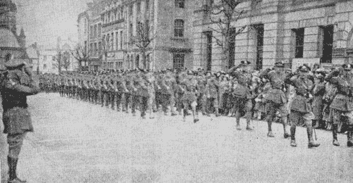

准备就绪——`皇家诺森伯兰掷矛枪兵团`第 4 营的来自`Hexham`、`Haltwhistle`、`Newburn`、`Bellingham`和`Prudhoe`的小队正参加 1939 年 4 月的圣乔治日游行。圣乔治是该团联的主保圣。

显而易见，普通的德国人甚至不假装喜欢犹太人，但他认为他们许多人对实施在他们身上的暴行一无所知。不过，德国人明确表示他们比意大利人更喜欢犹太人。在轴心协定签署后不久，意大利小组进入`弗赖堡`狂欢，但小镇的年轻女性在晚上七点后拒绝离开家。

然而，在其他地方，对德国及其意大利盟友仍存在深层的不信任，`约翰·理查森`（John Richardson）法官在`轮流俱乐部`的年度晚会上警告称，`Corbridge`分会的`英国军团`（British Legion）担心由于`希特勒`和`墨索里尼`的不可预测性，……

他继续说道：“最大的道德问题是，是否要让一百万英国年轻人为了干预大陆上的一场不公正纷端而牺牲。在我们冲去援助一个受霸凌之者的较小国家之前，我们必须确定确实有一个霸凌者。”

尽管莫斯莱是这么说，泰恩郡（Tynedale）仍处于战争警戒，`Hexham 军童团`是该地区首批注册为空防员的团体之一。

不过，并非一切都是战争话题，`Hexham 市议会`拒绝了允许儿童在周日使用`Sele`游乐场秋千的请求。`Joe Cullen`议员支持这项申请，并指出`Tyne Green`已经允许周日高尔夫球，他也希望看到周日也能打保龄球。他说：“我不认为这会让孩子们远离主日学校或礼拜堂，也不会对安日造成任何亵渎。”

然而，`Iveson`女议员反对这一举动，她表示：“一周中有六天孩子们可以使用秋千，我认为他们他们在周日完全可以不用秋千。”该请求被拒绝了。

当国家为战争做准备时，一名`Wark`水兵不幸成为九十九名死者之一，当时那不幸的潜艇`HMS Thetis`在威尔士海岸外进行试验时沉没，这预示了未来的严峻。他是士官`John Adam Hope`，与母亲同住在`Elliott Terrace`。他年 36 岁，在`皇家海军`服役了二十年，其中十五年在潜艇部队服役。

1939 年 6 月征兵制度的实施非常顺利，该地区内的任何`劳动力交换处`都没有出现问题，男人们需要在那里注册参加军事训练。`Hexham 交换处`的一位官员说：“人们踊跃报名，心情很好。有两点值得注意——他们来时的良好精神，以及他们出色的体魄。”有人步行了六英路来到`交换处`报名，其他人还包括一个来自`Harrogate`的人（他来`Hexham`参加婚礼），以及一个在该地区度假、穿着短裤、皮肤黝黑的男子。申请注册成为良心主义者的人很少，尽管他们明显倾向于加入`皇家空军（RAF）`。

无处不在的战争威胁在 8 月底升到了更高的水平，随着国际局势恶化，该地区所有的空防哨所都有人值守，所有的路灯都被关闭。灯管制也导致路缘和街角被涂成白色。商业几乎陷入停滞，商店除外，商店对罐头食品和遮光窗户的材料需求巨大。尚未领取防毒口罩的居民被敦促尽快前往`Hexham 市议会`办公室领取。

当战争最终于 9 月 3 日宣布时，人们收到的消息非常冷静，空防警报响起，特警们戴着防毒口罩和钢盔头走上`Hexham`的街道。他们被派去守卫整个地区的桥梁和其他战略要点，并确保严格遵守灯管制规定。

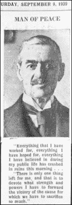

心碎交加的首相`Neville Chamberlain`。

`Hexham 市区议会`主席`Tom Wheatley`议员发表了严厉的辞，他说：“我得出结论，当世界上放着像希特勒那样的疯狗时，绥协政策是没用的。我很高兴我们将尝试除掉这只疯狗。”

### 难民

到 9 月第一周，随着第一枚德国炸弹落在波兰，`Hexham`已经开始接收来自`Newcastle`和`Gateshead`的首批 4000 名计划疏散难民。五列火车上的儿童到达`Hexham 火车站`，乘坐一队大巴将他们送到高级中学，那里已做好准备将他们转移到农村地区的各个部分。车主也被要求前往火车站，协助将这些不知所措的孩子送往他们新的临时家。

`Hexham`的难民来自`St Dominic’s 天主教学校`（690 人）；`Cowgate`（300 人）；`West Walker 委员会`（733 人）和`East Walker 委员会`（476 人）。`Bellingham`的配额包括来自`Heaton Park Road 委员会`的 450 名儿童，而`Haltwhistle`有来自`Delaval 委员会`的 700 人，`Allendale`有来自`Whickham Road 委员会学校`的 307 人和来自`Pendower Bridge`的 214 人。

根据`Hexham Courant`报报道，孩子们在老师的陪伴下到达车站，“兴奋得喘不过气”。每个孩子都有一个防毒口罩和一个身份牌。在`Patton`Doctor 的带领下，医护小组进行了体检，手、牙齿和头发都经过了严密检查。

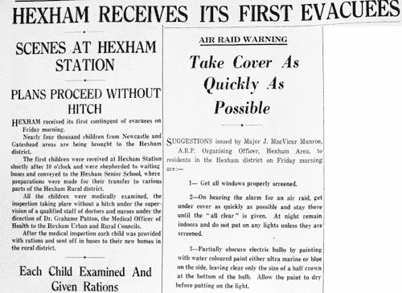

战争爆发后，数千难民开始涌入泰恩郡。

随后，他们领取了配给，包括饼干、一罐腌制牛肉、两块巧克力、一罐无糖奶和一罐炼乳。

孩子们受到了非常欢迎，一位`Hexham`母亲告诉`Courant`报：“我们必须考虑孩子们，而不是我们自己。我们过得相对舒适，但这些孩子离开了他们的家、朋友和一切。我愿意尽自己一份之力来减轻他们的负担。”

她的观点得到了一个男人的认同，他补充道：“这些年轻人无法改变自己的处境。他们可能并不富裕，但我确定，照顾他们的人不会感到麻烦。”

城市的孩子们很快被安置在当地家庭，尽管有些居民拒绝接收任何难民。一个男孩写信给妈妈：“Hexham 是个好地方。那里有很多李子、梨和黑莓。那个女人对我们很好，给我们吃很好。这像是一场假期——我们整天都在公园玩。”

乡村生活对许多难民来说是个谜团，有几个男孩在`Hexham`的街道上寻找糖果店却无一获，而电影院的缺失也让人深感遗憾。`Hexham 战争纪念医院`秘书`Michael Green`呼吁捐集书籍和杂志为难民建立图书馆，并安排了城内外孩子之间的足球赛。还呼吁提供室内游戏来消遣孩子们。

`Courant`报报道，在`Corbridge`疏散过程“相当顺利”，但也有人拒绝接收儿童，而且一些母亲遇到了一些困难。在`Haltwhistle`，大巴和一队私家车将孩子们送到`Olympic Hall`——该大厅是用`泰坦尼克号`的姊妹`奥林匹号`在拆解时回收的材料制成的——位于`Smith and Walton 喷漆厂`，在介绍给寄宿家庭之前，他们吃了丰盛的肉汤和包子。`运输部`指出，`Haltwhistle`是该地区首批完成儿童安置并填写正确表格的地方之一。

在处理完孩子们及其母亲后，镇上几乎每个家庭都敞开了大门，在本周晚些时候，`Haltwhistle`还欢迎了“孕妇、残疾者和盲人”。

200 多名儿童和 75 名母亲在`Wylam`受到了热烈欢迎，特别是孩子们寻找安置地毫无困难，以至于有些家庭因没有难民入住而感到失望。安置官`W.E. Keys`上校报告说，所有孩子看起来都照顾得非常好，干净且“异常友善”。

并不是所有人人都准备好接收疏散人员。在持续拒绝人们进入他在瓦尔（Wall）那间与母亲和一名女佣人的九室室牧师住宅后，李区圣奥斯沃尔德教堂的牧师弗雷德里克·塞塞尔·韦斯特加斯（Reverend Frederic Cecil Westgarth）牧师被赫克斯姆治安法庭罚款 5 英镑——并告知罚金可能是 50 英镑，或监禁三个月。法庭主席洛夫图斯·贝茨斯将军（Brigadier Sir Loftus Bates）表示：“我无法不对一位宗教人士提出这样的指控感到遗憾。”

赫克斯姆农村地区首席安置官塞尔尔比·伍德（Selby Wood）对该地区应对紧急状况赞誉有加。他说，99%的家庭都全心全配合，并补充道：“对于安置官出色的志愿者工作，怎么赞美都不过。他们执行了一项极其复杂艰巨的任务，并以令人赞叹的乐观和效率完成了任务。如果没有住户的合作，他们的任务将是不可能完成的。许多住户告诉我，被疏散的母亲非常愿意回报所提供的招待。他们的许多丈夫已经自愿参军，而孩子们也已经离开了熟悉的环境。”

赫克斯姆的学校实行了双班制制度，当地孩子从上午 9 点到下午 12:30 上课，下午与疏散人员交换课桌，后者在下午 1:30 到下午 5 点上课。在随后的几周里，位置发生了对调，疏散人员在上午上课，当地人在下午上课。

但在战争爆发后的第二周，几个疏散人员及其母亲发现自己无法适应乡村生活，他们宁愿回到纽卡斯尔面对炸弹。

当时发起了献血者的呼吁，赫克斯姆医院的护士还呼吁捐赠旧睡衣和睡裤。


普鲁德霍（Prudhoe）充满了怨气，该镇的志愿者防空警员们愤怒地发现，当敌对爆发时，许多全职防空警员被任命为有薪职位——而志愿者们却被要求培训这些人。艾达·布莱克恩夫人（Mrs Ada Blackburn）议员告诉普鲁德霍市政议会：“我们的警员对这件事非常愤愤。他们是自愿的，而现在某些在志愿者征集时没有出来的人，却获得了一个全职有薪岗位。让一个自愿服务的人去培训另一个拿钱干活的人，这是一个非常不寻常的局面。”

## 潜艇袭击后的逃生

战争恐怖的早期体验发生在 9 月 10 日，当时一艘德国 U 潜艇击没了从利物浦开往加拿大的雅典尼亚号（SS Athenia）邮轮。船上的人包括来自安大略省温莎市的 A·巴特利夫人（Mrs A. Butterley），她在汉姆绍（Humshaugh）长大，当时正在瓦尔探望她的姐姐。巴特利夫人告诉《酷报》（Courant）的记者：“每个人的心情都很好，因为我们在战争爆发前正要回家。船上非常拥挤，其中一间餐厅不得不改造成宿舍。突然，听到一声无法言喻的沉闷响，所有的灯熄灭了。没有人在考虑鱼雷或潜艇，但我们本能地知道发生了什么。孩子们吓坏了，但总的来说，并没有怎么恐慌。”

她设法在黑暗的船上摸索着到达甲板，但等了一个半小时才等到救生艇。她报告说，当其中一条救生艇降入水中时，支架断了，导致许多乘客溺水。另一艘船完全满了妇女和儿童，没有男人划船，但巴特利夫人不知道他们是否幸还了。

她最终爬上了最后一艘离开船只的救生艇，这艘本设计为 50 人设计的船上拥挤了 75 人，她报告说潜艇在再次潜没前曾浮出并射了两射。“这是一次噩梦般的经历，”她说，“我们紧紧在一起，因为担心弄翻船而几乎不敢挪动。每一波浪花都会打过船身，我们很快就淋透了全身。那些穿着鞋的人把鞋脱掉，用鞋来舀水。”

在狂暴的大西洋上坐着开放小船漂流了十二小时后，他们日益微弱的“呼救”声得到了一艘路过的皇家海军驱逐舰的注意，并被救起。巴特利夫人说她感到头晕脑胀、疲惫，对船员提供的热饮深表感谢。她相信船上的每个人都幸存了，尽管有很多人遭受着骨折。

巴特利夫人觉得自己被营救是双倍的幸运，因为她曾乘坐雅典尼亚号横跨大西洋，并尝试在回程时获得同样的客舱，但已经被预订了。她后来得知她中中的客舱在潜艇袭击中炸成了碎片。

她曾七次横跨大西洋，但说：“等我安全回到加拿大，我就再也不跨它了。”

当时发起了号召 18 至 43 岁的女性加入女子空军辅助队（Women’s Auxiliary Air Force），那里有厨师、食堂勤员、汽车运输司机、文员、电话和电报员以及织布工的空缺。日薪从初级军官 7 英士 10 便到高级军官 1 英镑 2 士 4 便不等。

战争才持续了两周，该地区就遭受了第一起归因于宵令的伤亡：一名 89 岁的疏散人员在赫克斯姆东部的怀德霍（Widehaugh）被公交车撞死。联合巴士公司司机威廉·伊德（William Eade）在对本杰明·钱姆伯斯（Benjamin Chambers）死因的调查中告诉，他在一个黑暗阴雨的夜晚晚上 9 点刚过开着巴士从赫克斯姆开往纽卡斯尔。他开启了允许的灯光，侧灯被遮住，任何朝他来的人都能看到。当以每小时 10-15 英里的速度行驶时，感觉到有东西撞了他的左侧大灯。他在车长范围内停下巴士，发现钱姆伯斯先生躺在路中心的白线附近。尸检显示他遭受了多处伤害，其中任何一种都可能致命。

南诺森伯兰郡法医 P.M. 多德斯（P.M. Dodds）听闻钱姆伯斯先生既聋又近，在做出裁决时评论道：“一个 89 岁、患有近视和耳聋的老人在这种时间无人照护地出现在黑暗中，真是太遗憾。”

他建议在宵令期间，人们不应该在路中间行走，而应该靠人行道，并且应该穿着或携带白色或浅色物品，以便被辨认。


即使是希特勒也无法压制 1939 年赫克斯姆的圣诞精神。

宵令规定被严格执行，在海登桥（Haydon Bridge），海登酒店和苏格兰手臂酒店（Scotch Arms）的房东各因场所内灯光可见而被罚款 10 英士，赫克斯姆灰牛酒馆（Grey Bull Inn）的房东也被处以了同样的罚款。

战争爆发关闭后，该地区的电影院和舞厅在三周后开始开放，前提是所有顾客都自带防毒面具。各学校的课程被削减，木工课被用于制作夹板，作为学校救护设施的一部分。塞尔学校（Sele School）和圣玛利亚天主教学校也提供了防碎片和防毒的空避难所。中学提供了八处避难所，伊丽莎白女王文法学校每个部门提供了六处，小学提供了六处。父母被建议，在发生空袭时，当地学校是孩子们最安全的地方。

与此同时，科布里奇（Corbridge）利用了已有数百年历史的安全设施为最坏的情况做准备。牧师佩尔塔（Vicar’s Pele Tower）建于 1318 年，墙厚 4 英尺 3 英寸，用于抵御苏格兰人的入侵，此时被用作`ARP`站；而更老的是在`Corstopitum`罗马遗址出土的一座有 2000 年历史的地下宝库，被指定为防空避难所。

## 补给站建立

9 月底，在修道院酒店（Abbey Hotel）举行会议后，赫克斯姆（Hexham）建立了一个医院物资补给站，延续了 25 年前大战期间建立补给的优良传统。会议由纽布鲁（Newbrough）的诺曼·D·纽尔夫人组织，她的姐姐——来自劳布罗（Loughbrow）的克莱斯·D·史密斯夫人是第一个补给站推动者。妇女协会的各个地方分会已愿意组建工作小组提供帮助。

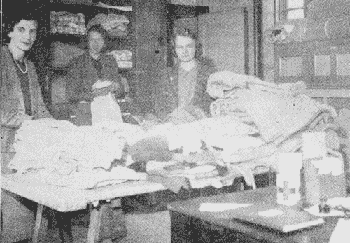

赫克斯姆集团医院补给站的工作人员正在为海外军人分类和包装生活用品。

史密斯夫人坚信这一行动将取得巨大成功，因为人们有了时间为敌行动做准备，不像 1914 年战争爆发时是如此突然。她很高兴看到许多参与过最初补给站的女士们再次挺身而出，而且往往还带着她们的孩子和其他亲属。她说：“我从未想过在 1918 年后我还要再次站出来，要求在赫克斯姆建立一个医院补给站。我觉得太棒了，上一次我们有 600 人（不包括分补给站）共同工作，在四年里从未一次发生过争执，也没有遇到过最小的麻烦。大家都非常乐意，我知道他们现在也会这么做。一些最初的女士身体不再像以前那样健康或强壮了，但她们带来了无价的经验。”

该补给站迅速发放了一本战时食谱和实用贴士。这本书售价 6 便士，在无数食谱中精选的一道菜是羊头汤——脑花要单独烹饪——同时还提供了关于如何煮荨草、如何治疗疣以及如何将山毛榉叶子保存“一两年”的建议。

## 补给与运输

到 9 月底，汽油已实行严格配给，当地一家经销商报告说，他通常每周销售 1500 加仑燃料，暴跌至 50 多加仑。他说：“我们这些经销商正面临严峻的考验，我们中一些人会发现很难维持下去。”燃料短缺导致许多车主停用改骑自行车，结果导致新车和二手自行车的需求极度饱和，而后者尤为困难。

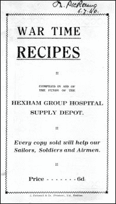

赫克斯姆集团医院补给站制作的食谱，其中包含了如何烹饪羊头的建议。

## 健康与防空

到 10 月中旬，人们对疏散者的新奇感开始消退，此时贝灵汉姆（Bellingham）的卫生官员将新来者归咎于该地区多种传染病的传播，包括猩红热、天花、脓疮和疥疮，以及虱虫感染。

月中旬，约四分之一来自考盖特（Cowgate）地区的儿童回了纽卡斯尔（Newcastle），通常是违背了他们的意愿，因为他们的父母想让他们回到家里。大多数人在乡村期间体重增加了，学业也进展顺利。

10 月 17 日，该地区的的防空警报器真正鸣响了，当时在东北海岸探测到不明飞机。那些没有警报器的村庄依靠教堂钟声，在约 90 分钟后才响了解除信号。赫克斯姆的守卫员感到沮丧，因为虽然繁忙的市场广场（Market Place）上的购物者瞬间消失，但普斯特波普尔（Priestpopple）的人行道依然人满为患。

《国民服务法案》的实施要求所有 20 至 22 岁的男性必须在武装部队登记，结果有 216 人了登记——其中只有一人注明为良心抗拒者。

## 阿尔弗雷德·根顿的故事

战争开始仅六周，对于来自赫克斯姆罗德克罗斯（Round Close）的阿尔弗雷德·根顿下士（20 岁）来说就结束了。他是空军（RAF）的一名无线电员，在 1939 年 10 月 15 日在执行飞越德国的任务时未能回来。他的父母焦虑地等待了近三周，才听到他被俘并作为战俘扣留。他从赫克斯姆女王伊丽莎白文法学校读书起就“对航空很感兴趣”，此前曾有过两次幸运的逃生：一次是被迫从一架在高空起火的飞机上跳跳伞，另一次是在战争开始仅第二天，他所在的机组的飞机因燃料不足被迫在法国紧急降落。

根顿下士是医院补给站提供的生活用品包裹的首批接收者之一，他还被通过德国短波电台向英国广播。在战俘营写给父母的一封信中，他透露自己的飞机被防空火击落，并说：“我们不得不跳跳伞。飞行员被碎片射死，没有离开机器，但没有其他人受伤。我们在这里待遇得很好。最近一直在下雪，深度有两英寸，但我被发了很多暖衣。”

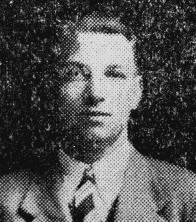

在战争第二个月被俘后，空军准军官阿尔弗雷德·罗纳德·根顿在 1944 年被遣回他位于赫克斯姆的家。

## 海上损失与空中活动

根顿下士在用铅笔写的未拆封信中请求父母寄来包裹，写道：“我们需要一些巧克力、饼干、罐牛肉和一罐水果，如果可以，设法弄黄油。战后见！”

货轮`airmona`号从蒙特利尔出发前往英国时船上有两只黑猫，但它们并没有带来运气，因为该船在东北海岸被鱼雷击中十五分钟内沉没了。幸存者包括来自赫克斯姆的 C.D. Boyd 学员，他在第 36 次跨越大西洋失去了所有财产。`airmona`号由桑德兰制造，属于凯尔恩航线，该航线由赫克斯姆公爵大厦（Dukes House）的 T·鲁塞尔·凯尔恩少校担任董事会主席。

10 月 29 日，北泰河（North Tyne）地区异常活跃，一辆从贝灵汉姆出发的早晨巴士被一架低飞德国飞机“掠过”。柴油发动机的轰鸣声把人们带出门，田里的工在飞机仅距离地面如 0 英尺掠过时惊讶地停下了手中的工作。机翼和尾翼上的德国标志清晰可见。

一名目证者说：“我想我们应该躲起来的，但相反，大家都跑出门去看飞机。”

《赫克斯姆快报》（Hexham Courant）的读者通过一个德国人提前了解了集中营的恐怖，此人在战争开始前不久在营中待了两个月后，成功逃到了赫克斯姆。为了保护身份，该男子仅被称为`X 先生`，他告诉记者，集中营的建立是为了通过缓慢折磨杀死老人。他说：“这太可怕了。进入集中营的人就了。各种恶行都由负责人实施，主要是小偷和小杀人。希姆莱尔似乎拥有绝对的控制权，他的话都必须执行。”

X 先生目睹了老人被殴打死以及各种形式的残忍虐待犯罪。在几次中，这座本为容纳 5,000 人设计的营地的全部 20,000 名囚犯在半夜被唤醒，目睹集体绞刑。营中所有死者均被火化，骨灰被送给亲属，但亲属不被允许询问死因或原因。亲属被允许寄送包裹，但囚犯必须排队领取，有时要排一整天的队。如果包裹里含有烟草或水果，会被营官员没收，而来自家中的信件则会在预期收件人面前被撕碎。

早餐是一份咖啡颜色的饮料和四分之一块面包，午餐是带有极少量肉类痕迹的汤，晚餐是小块重盐香肠和盐鲱鱼。X 先生说：“这是另一种形式的折磨，因为我们不准喝水，如果你吃了晚餐，整晚都会忍受极度口渴。”

他谈到了大多数德国人的绝望，他们被政府拖入了一场他们并不想要的战争，而那个政府无情地镇压任何对纳粹党的抵抗迹象。

人们对来自布里格伍德、海登桥的二等军官西里尔·克莱米森（Cyril Clemitson）的处境深表同情。他当时正乘坐纽卡斯尔号 `Dalryan` 往返远东完成 50,000 英里旅程的最后途中，船只在英国东南海岸附近撞中了水雷。

他告诉《快报》：“在准备好起落架之前，我正在舱里小睡，这时被一个恐怖的声音惊醒了。船的金属侧面像纸一样被撕碎了。我的舱室完全破碎了；我的无线电、衣柜和其他家具都变成了木屑。我摸索着寻找手电筒和救生衣，跑到甲板上，那里发生了第二次爆炸，我们不得不躲避坠落的碎片。”

幸运的是，所有 38 名船员都获救了，因为爆炸在岸上被看到了。正如克莱米森二等军官所说，唯一的伤员是“我的金鱼和别人的金丝雀”。

战争中的第一个圣诞节带来了无声的反抗，商店报告的生意比冲突前有所好。邮局报告交换问候卡的数量大幅增加。许多在部队服役的当地男子休假回家，因此有了一些幸福的家庭团聚。虽然许多疏散人员在节日期间回家，但另一些人留在泰恩代尔（Tynedale），在赫克斯姆的共济会为新来者举行了一场大型派对，由“快乐百万人”（Jolly Millers）提供舞蹈音乐。

圣诞节的一大特色是无线电中的帝国联动节目，科布里奇圣歌团参加了其中，并以乔治六世国王对帝国的信息结束结束。科布里奇的广播是在罗克利夫庄园（Roecliffe Lodge） 84 岁的 J.T. Mail 家中进行的。传唱的圣歌有《平安夜》和《我们东方三王》，并由著名的诺伯兰郡风笛手杰克·阿斯特朗（Jack Armstrong）伴奏。

赫克斯姆战争纪念医院的病房用彩带和其他护士和患者自己制作的物品装饰得色彩斑斓。几位士兵病人收到了护士编织的毛衣礼物。尽管受到封锁带来的影响，邮局很好地应对了如雪崩般的邮件，大多数人都听从了早点寄圣诞卡的请求。

# 1940 年

尽管泰恩代尔在第二次世界大战期间被认为更多是一个避难所而非活动中心，但它并非完全没有冲突发生的证据。该地区到处是沼泽坑洞和掩盖着破损残骸的茂密土丘，这充分证明了该地区多年来见证了许多悲剧。

## 空坠事故

遗憾的是，当地的坠机地点很少发现敌方飞机——大多数地点讲述了年轻盟军士兵多重丧命的悲惨故事。1940 年 10 月，一架惠特利（Whitley）轰炸机在从波兰斯得廷（Stettin）油厂执行任务返回的途中燃料耗尽。五名机组人员安全跳伞，但由于未知原因，他们的飞机没有指向海面，在机组人员缓慢降落时飞机继续飞行。在贝林汉（Bellingham）西南三英里处，失事的轰炸机撞击了高地，最终在梅斯林斯（Meslings）坠毁。惠特利机的机组人员中有马克·阿尔弗雷德·尼曼（Mark Alfred Niman）军士，他曾在飞机所在的`RAF Leeming`的`10 Squadron`担任无线电操作员。机组人员最终降落在南方八英里的斯通豪（Stonehaugh）附近的莱迪希（Ladyhill），裹着伞罩过了一个寒冷的夜晚。

在惠特利机坠毁仅两周后，一架来自`RAF Newmarket`的维克斯威尔士顿（Vickers Wellington）轰炸机在执行轰炸柏林的任务返回途中坠落。恶劣天气和能见度低导致飞机在奥特伯恩（Otterburn）西部的布莱克霍普山（Blakehope Fell）坠毁。据认为，飞行员选择穿云层下降以确定位置，结果威尔士顿撞上了一堵干石墙并在撞击时起火，导致六名机组人员中的一人死亡。

1941 年 7 月，一架海风战斗机在惠顿斯尔费尔利农场（Fairley Farm, Whittonstall）森林中坠毁，飞行员跳伞逃生时折断了脚踝。1941 年 8 月，一架喷火狮战斗机在华灵顿大厅（Wallington Hall）坠毁，飞行员死亡，同一天莱亚尔穆特劳农场（Mootlaw Farm）也遭到五枚炸弹。

1941 年 9 月，一架来自克罗斯比-昂伊登（Crosby-on-Eden）的霍克飓风机在天气糟糕、燃料不足的情况下被迫迫降陆。这架飓风机正在进行摄像枪练习时，法国飞行员让·德·泰斯科（Jean de Tedesco）少尉成功在雅罗·法尔斯顿（Yarrow, Falstone）降落。一名当地男子称看到一架飞机从贝林汉方向沿北泰恩谷低空飞行，并看到它落在雅罗银行（Yarrow Bank）脚下的田里。当该男子到达飞机时，让·德·泰斯科坐在机翼上，已经联系了基地，并允许当地孩子坐在驾驶舱内。

另一架飓风战斗机于同年 11 月坠入基尔德的皮尔山（Peel Fell）山顶，飞行员牺牲。皇家印度空军飞行员哈库姆·钱德·梅塔（Hukum Chand Mehta，24 岁）驾驶着四架从`RAF Acklington`起飞执行编队飞行训练的飓风机之一。来自`43 Squadron`的梅塔是编队长，但在返程途中失踪。接下来的两天一直在寻找飞机但无无获，直到一名当地牧羊人报告看到飞机飞机以惊人的速度撞向山坡，只剩下尾部可见。梅塔的身体在撞击点远处被发现，埋在 8 英尺厚的泥炭下。他是巴基斯坦莱亚尔普尔（Lyallpur）卡姆·钱德·梅塔（Karam Chand Mehta）之子；他在纽卡斯尔西路火化场被火化。

1941 年的圣诞节并没有停歇，另一架飓风机在奥文格姆（Ovingham）附近低空飞行时坠毁。同样在 12 月，一架西陆信塞德（Westland Lysander）在奥特伯恩参加火兵合作演习时坠毁。飞行员 J.K. 阿斯汀（J.K. Astin）在从`RAF Clifton`到达奥特伯恩后发现引擎开始熄火。由于无法解决问题，他被迫在松软不平的地面着陆，导致飞机在着陆时翻扣。幸运的是，阿斯汀未受伤，飞机随后被打捞。

1942 年 3 月 22 日，沃克的居民听到头顶上方单架飞机引擎的声音。澳大利亚陆军士克拉里·哈克（Clarrie Harker）是英国皇家空军乌斯沃斯机场的一架`Hurricane`战斗机的飞行员，该飞机在未能成功从环绕中恢复后垂直向地面俯冲。他成功跳出了机舱，留下那架`Hurricane`坠落在莫特山农场的一片田里，并在那里化作火球并爆炸。哈克的降落伞挂在了附近的一棵树上，使他悬在半空中。当地孩子们赶到现场，发现村里的一位年老女性居民误以为他是德国人，正对着他破口大骂。

北泰恩（North Tyne）最著名的坠机事故发生在 1943 年 2 月，当时一架美国`Mustang`战斗机以约 400 英里的的速度飞入了贝灵汉附近哈雷肖角（Hareshaw Head）的一处沼泽山丘。飞行员 22 岁的飞行军官约翰·菲舍尔（Johnny Fisher）遇难，英国皇家空军的搜救小组在沼泽中挖掘了 16 英尺深才找到了他的遗体。

1943 年 3 月，一个六人小组乘坐一架`Vickers Wellington`战斗机坠毁。从英国皇家空军哈尔威尔机场起飞后，事故原因仍然是一个谜，但它是在格林豪的康穆地（Comb Moor）着火坠落的。调查表明，飞行员可能失去了控制，导致飞机俯冲进荒地上的泥炭沼泽，全机机员遇难。

1943 年 6 月，一架来自诺森伯兰郡伍勒附近英国皇家空军米尔菲德机场的`Hurricane`战斗机坠落在埃尔斯登的奥特科普斯苔（Ottercops Moss）。飞行员飞行军士约翰·盖茨（John Gates）在坠机中失去意识，但在飞机停止移动时恢复了过来。在他未能从一次低空俯冲动作中恢复后，附近经过的士兵从残骸中救了他。


遭遇悲剧命运的不仅是盟军飞机，1943 年 3 月 25 日，一架德国`Dornier`轰炸机在罗马墙附近的斯蒂尔里格（Steel Rigg）被一架夜间战斗机击落。四名机员全部牺牲，并葬在卡里莱尔。

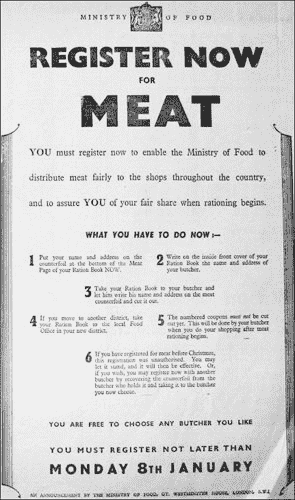

这张 1940 年 1 月的海报解释了配给的现实。

混乱一直持续到 1944 年，4 月，一名年仅 20 岁的飞行军士西里尔·杰克·朱威尔（Cyril Jack Jewell）在他的`Spitfire`战斗机撞入沃克的豪克斯蒂森林（Houxty Woods）时去世。

1940 带来了新的配给规定，黄油、培肉、火腿和糖都需要券。黄油、火腿和培肉的基本配额为每人每周 4 盎司，糖的配额为每人每周 12 盎司。对于想制作果酱或养蜂的人，还提供了额外的糖供应。在异工作的人还被告知，他们可以在不使用任何券的情况下订购培肉、鸡蛋、面包和黄油，他们的茶也会随附提供糖。

店主们称为“票券周一”的情况井井有序进行，但并没有急于接受双倍培肉配额的优惠。一位肉铺师说：“我们的培肉柜很冷清，对额外配额的需求很少。政府设定的培肉价格阻止了人们购买。普通的家庭主妇认为培肉和火腿是某种奢侈品，可以轻易放弃——消费者负担不起每磅 1 英镑 8 士的培肉。普通的家庭主妇正在忍饥，用更便宜且提供同等营养的食物养活家人。”

战争早期引起了公众关注的是威廉·乔伊斯（William Joyce）那尖锐的语调，他从第三帝国发出的“德国呼唤”广播让他赢得了“霍霍爵”（Lord Haw-Haw）的绰号。很快证实，乔伊斯对赫克斯姆（Hexham）并不陌生，战争爆发前不久曾在该镇代表英国法西斯联盟传播宣传活动。他甚至去过《快报》办公室，为宣传他在 1936 年在该镇举办的会议。

专栏作家 Hextol 在 1940 年 3 月回忆道：“我从他口中得知，他曾多次代表法西斯斯领袖奥斯瓦德·莫斯莱爵士（Sir Oswald Mosley）办事。我没有亲自报道过他的会议，但记录显示他请求结束国际金融和犹太对市场的控制。他认为，一个人民认可的领袖进行公开独裁，比国际金融的隐性独裁要好得多。”

到年底，赫克斯姆医院供应仓库已派遣了 7000 多件物品，从 11 月初开始，仓库交付了 1000 双袜子、370 双手套、310 个头盔、300 条围巾和 104 条针织毯。织工们正使用白色羊毛为芬兰军队制作巴拉拉克法帽，并为皇家海军制作海靴袜。鞋子制造商也被迫切需要。

南诺森伯兰矮马俱乐部在水疗酒店（Hydro Hotel）举行了年度舞会，酒店装饰有俱乐部的紫色和金色。舞曲由克莱门特·米拉德管弦团提供，《西西格里德防线》、《Boomps a Daisy》、《兰贝斯漫步》和《栗树》证明非常受欢迎。

天气在 2 月急剧恶化，记录到 34 度的霜冻，阿伦代尔（Allendale）和北泰恩的道路被大雪封堵。

1 月 29 日发生了空袭警报，赫克斯姆所有学校的孩子都进入了防空洞，他们的歌曲包括《滚出木桶》和《跑吧，兔子，跑吧》。没有敌方飞机进入泰恩河谷，25 分钟后响起了解除警报。

灯管制继续为泰恩代尔（Tynedale）的人们带来许多问题，司机和行人在应对黑暗夜晚时都苦苦挣扎，导致了数人死亡。丧生者中最显赫的人士之一是最近退休的《快报》首席记者弗雷德·古斯里（Fred Guthrie），他在离家几码远的地方被一辆双人自行车撞中导致颅骨骨折。他去世时 71 岁，工作了半个世纪。

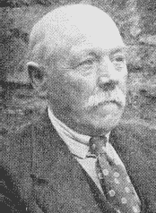

## 水手的故事

战争第一个完整年份中英国早期的胜利之一是猎捕德国口袋战舰“格拉夫·施皇帝号”（Admiral Graf Spee），这被称为“拉普塔河战战”——一位来自福斯通斯（Fourstones）的水员在其中发挥了作用。他是锅炉工安德鲁·查尔顿（Andrew Charlton），他当时在“亚贾克斯号”（`Ajax`）上，该舰与“阿基琉斯号”和“埃舍特号”共同在大西洋追击这艘巡洋舰，直到它最终在蒙特维的海岸附近自沉。

从南美水域返回后享受了 26 天在家时光的查尔顿锅炉工说，胜利是因为“皇帝号”的船员都是年轻纳粹，当他们发现预定目标可以反击时，他们就失去了战斗意志。

他告诉《快报》：“他们的长是个真正的绅士，属于老派，但船员是由希特勒运动的年轻人组成的。在对我们发动一次进攻后，他们就没有战斗力了。当他们看到我们可以反击时，他们不想战斗了。”

海军知道有一艘德国巡逐舰在大西洋活动并造成了巨大破坏，于是三艘船被派去追捕它。“埃舍特号”首先交战，“皇帝号”也很有兴趣地进行了回击，其 8 英寸炮火力超过了驱逐舰上的 6 英寸武器。

司炉工查尔顿（Stoker Charlton）说：“施普特号将火力集中在埃克塞号上，但我们三个人都在向她猛击，她几乎没有逃脱的机会。我们持续攻击她，很少停止开火，尽管我们有一座炮塔失效，主桅被击毁，导致无线电桅杆和天线随之坠落。施普特号的炮弹在我们四周爆炸，碎片向我们身上飞溅，上甲板上的男士们非常幸运，仅一人死亡，几人受伤就逃生了。”

查尔顿幸运了死里逃生，一枚 11 英寸的炮弹穿过了了他正在工作的隔间，但并没有伤及他，但在战斗剩下的时间里，他一直忙于奔命，在炮弹持续落下的情况下修理损坏的管道和电线。“最后，射声停止了，”他说，“我们瞥瞥了那具破破累累的残骸，它曾是德国海军的骄傲，正沿着黑暗的地平线向蒙特维亚方向蹒跚而去。”

英国船只无法进入中立国乌拉圭的海域，只能在三里限制外等候`Graf Spee`号出现，她确实出现了——但选择了自爆而非投降。

三周后，当`Ajax`号回访蒙特维亚进行礼性访问时，`Graf Spee`号的残骸仍在燃烧，`Ajax`号的船员们受邀在该市英国社区举办的派对担任荣誉宾客。除了被称为`saadre`的乌拉圭盛宴（在那里烤了六只羊肉并用手吃），水手们还参加了一场舞会，司炉工查尔顿在会上表演了他的第一支《Boomps a Daisy》。

回到福尔斯通（Fourstones）后，司炉工查尔顿在纽布罗市政厅的一个仪式上，收到了福尔斯通基金会赠的刻有字的不锈钢手表。

另一位南泰恩河的司炉工约瑟夫·查尔顿·威利（Joseph Charlton Wylie）来自海登桥，他告诉《快报》（`Courant`）他与所谓的德国地狱船“阿尔特马克”号（`Altmark`）的遭遇经历。在那艘油轮上关押着被`Graf Spee`号击沉的船只的英国战俘，他们极其凄惨。他当时在役于`HMS Ivanhoe`号，当他们在挪威海域遇到“阿尔特马克”号时，他们向其船首方向发射了一发警告弹。

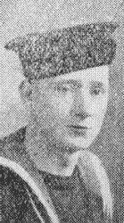

来自海登桥的一等司炉工约瑟夫·查尔顿·威利，他当时在`HMS Ivanhoe`号上追逐所谓的德国地狱船——“阿尔特马克”号。

他说：“‘阿尔特马克’号忽略了警告，于是我们向她靠近，就在距离几码之遥正准备跳上船时，一艘挪威鱼雷艇介入了，并抗议我们进入了挪威海域。纳粹船长利用他提供的机会，急转弯进入了一个峡湾。船上完全没有任何英国人的迹象，在中立国船长的干预后，德国船长在自己的驾驶台上得意意地走着，嘴里叼着香烟。”

`Ivanhoe`号失去了动力，但在黑暗的掩护下，`HMS Cossack`号回到了峡湾，其船员登上了“阿尔特马克”号并释放了 300 多名战俘。

在后方，有一场为了协助战争努力的物资回收运动，克斯姆城市区议会同意报废其旧的消防车；在公众上交的物品中，有两支从上一次大战中回收的德国机枪，它们以 5 个尼镑卖掉。

初夏较清闲的夜晚也带来了警方的警告，称执行灯控规定方面存在“明显的松懈现象”，特别是在商业场所。与此同时，阿康姆（Acomb）圣约翰教堂的牧师 W.H.S.伍德博士表示，为了满足灯控规定的紧急需求而改为下午举行服务的决定已完全失败了，因此，如果战争持续到明年冬天，教堂的窗户将会被遮光。

在海登桥，教区委员会致信给克斯姆区议会，要求为村庄提供一个防空警报器，因为尽管有 100 多男女参加了防空（`ARP`）任务，但一旦发生空袭袭击，没有办法将他们召回岗位。

两名骑摩托车去乡间游荡的纽卡斯尔男子停下来拍照——结果发现自己站在了克斯姆治安法庭面前。因为在照片的背景中有一根无线电桅杆，而根据《紧急权力防御条例（第 1 号照片控制令）》，没有战争部大臣的书面许可，对这类设施进行拍照是禁止的。这两个男士说，他们完全没有考虑过照片背景里有什么，但他们两人都被罚款 1 英镑，外加 9 先令诉讼费。法庭主席洛夫图斯·贝茨士（Sir Loftus Bates）接受这些男人的行为没有别有用，但说他们非常粗心，本可以罚款 100 英镑。

## 第二章

## 泰恩代尔（Tynedale）准备迎接入侵

1940 年晚春，“假战”毫无突然结束了，希特勒的坦克（`Panzer`）师团不可阻挡地横扫欧洲。1940 年 5 月国民联合政府的成立，温斯顿·丘吉尔接替内维尔·威尔民成为首相，《快报》对此表示热烈欢迎，编辑泰迪·泰勒在社论中写道：

“在希特勒于战场发动进攻的时刻，国家在后方获得了一剂急需的补药。正如内维尔·威尔民上周五通过无线电对我们说的那样，如果希特勒寄希望利用我们的内部分裂来帮助他，那他误判了这个民族的心。现在要结成队伍并为即将到来的伟大斗争做好准备，唯一需要的就是这声战斗的号召。以典型的丘吉尔风格，我们的新首相为我们总结了问题。通过血水、辛劳、泪水和汗水，我们的军队将走向胜利。温斯顿·丘吉尔的精神是不可战胜的。在他那个时代没有人比他遭受过更多的命运的箭矢，也没有人比他更有勇气反击并赢得胜利。今天我们在他身上看到了英国民族所拥有的每一种品质，这些品质一次一次地在压倒性的劣势中夺得了胜利。现在是将他的能量和驱动力扩展到我们努力每一个分支的时候了。

过去九个月来束缚我们战争努力的官僚主义必须被切断。为了满足战场的紧迫号召，必须牺牲闲暇、便利和对利润的考虑。如果丘吉尔精神主导我们的每一个行动，挽救战斗部队士兵的生命将是我们的直接收获，而推翻野兽般的纳粹主义则是最终目标。在我们不可避免将面临的黑暗日子里，随着当前冲突愈演愈烈，让我们都记住领袖英勇的精神，从中汲取灵感来指导我们的每一个行动，并实现我们的目标，直到最终确保胜利。”

新面貌的政府并不是唯一的变化——在其 76 年的历史中，首次，克斯姆《快报》的头版不再填满了广告，比如来自吉布斯药剂店的诺斯特罗林（Nostroline）鼻炎药、普鲁霍（Prudhoe）里奥河畔的老母亲莱莉，或者是寻找收养一个 10 个月大女孩的广告。

作为战争努力的一部分，小广告从第一页被一扫空，为战争新闻让路。编辑的一份说明解释说，这种转变是为了战报纸生产的需要。他向读者保证：“这种转变将不会影响报纸的性质，报纸将继续提供完善的当地新闻服务以及受欢迎的定期栏目。新版布局起初读者无疑会感到陌生，但我们相信将本周的主要当地新闻印在头版将有助于读者，这种转变将受到他们的欢迎。”

# 那个历史性的头版上的主要故事之一，是关于纳粹伞兵会堕落到何种地步的警告。读者们被告知，一个卑鄙的“匈奴”使用一个气胶降落伞降落在比利时，不仅带了机枪，还带了一个挤奶凳。着陆后，他冲向最近的一头牛并开始挤奶，但他那德意志人的诡计并未欺骗过当地人，反而被他们俘了。

此外还有呼吁更多防空民兵（ARP）志愿者，以及请求援助医疗物资。读者被警告，糖的配额将从每人每周 12 盎司减至每人 8 盎司。不过，对于用自己花园种的水果制作果酱的人，有特殊的优惠政策。赫克斯姆市委员会要求 11.5 吨制作果酱用的糖，而贝林汉地区议会则想要 19 吨。

然而，日常生活仍在继续，报纸上最大的两个案件是：两名普鲁德霍的农民因稀释牛奶分别被罚款 4 英镑和 5 英镑；以及一对米克利的夫妇因疏忽略儿童被入狱。他们甚至不确定自己是有十三个还是十四个孩子。

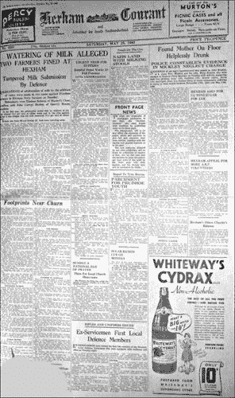

1940 年 5 月 25 日，《赫克斯姆快报》在其 74 年的历史中首次在头版刊登了新闻而非广告。占据显眼位置是一项警告：要警惕携带挤奶凳作为掩护的纳粹伞兵。

J.V.C. 法夸哈牧师于 1919 年至 1944 年间担任赫克斯姆的区长。1939 年敌对爆发时，他在修道院安装了扬声器系统，以便晨礼时的会众能听到内维尔·奇伯林宣布英德两国处于战争状态的洪亮嗓音。

法夸哈先生非常担心燃烧弹摧毁修道院，因此他组织了一支睡在建筑内的火警队。他自己也许多晚上睡在深夜楼梯顶部的折叠床上。当地历史学家罗兰德·查尔顿（Rowland Charlton）是国民民卫队的一员，过去曾在市政厅（Moot Hall）执行值守任务。起初，国民民卫队被称为“地方防御志愿者”，简称`LDV`——查尔顿先生总是坚称这三个缩字母的意思其实是“看、躲、溜溜”（Look, Duck and Vanish）！

## 国民民卫队的事迹

随着“假战争”的结束，`LDV`在赫克斯姆的活动加强，所有自愿服役的退伍军人都获得了装备，其中包括一套卡其工作服、一顶猎帽和一把步枪。超过 1000 人自愿，令他们非常失望的是，很快就清楚并非所有人都需要服役。指挥赫克斯姆小组的奥特伯恩阿奇巴尔德·怀特爵士（Sir Archibald White）中校表示，一切进展顺利，一旦各个分队练熟了射击，巡逻就会开始。他补充道：“我无法说会有多少志愿者被召集；这取决于我们允许获得多少套装备。但可以肯定，所需人数不会达到志愿者的总数。”

各单位的负责人分别是：阿尼克的副小组指挥官查尔斯·贝克·霍恩比（Charles Beck Hornby）少校；赫克斯姆的格里德利·罗布（J. Ridley Robb）中校；贝林汉的 J.D.杰布（J.D. Jebb）准将以及贝文格顿的 H.S.贝尔（H.S. Bell）上校。

雷德斯代尔的居民非常怀念西伍德德伯恩和里兹代尔国民民卫队的事迹。他们过去在柯尔克哈尔指挥官安德森少校的注视下，在全圣教堂后的田野进行每周一次的野外训练和阅兵。参与者包括罗伯特·泰特、托马斯·泰特、休·斯奈斯、吉姆·威尔逊、威利·罗布、杰克·布罗迪和哈里·康梅。他们最喜欢的训练之一是实弹手榴弹练习，志愿者们必须将手榴弹投过山顶并掉进方便的凹处以安全爆炸。

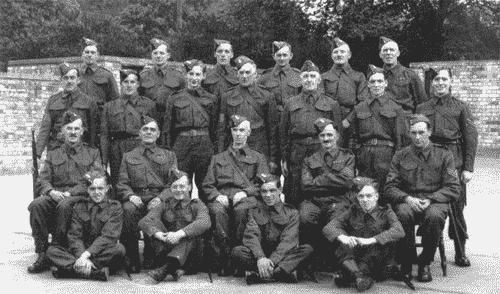

准备在德国人入侵时尽一份力量的赫克斯姆国民民卫队。

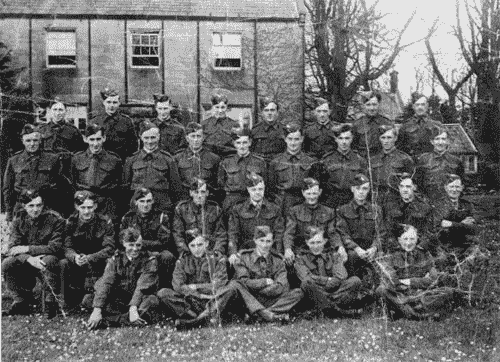

正在阅兵的沃克国民民卫队。

不用说，在一次著名的场合，由于一个特别笨拙的新兵的手榴弹没飞过山顶，而是轻轻地滚回连队的其他人那里，他们惊恐地散开了开。

在另一次训练中，连队被爬上伍德伯恩外的长坡到达采石场顶部，寻找敌方伞兵。同一个倒霉的新兵被任命为传令兵，被命令骑一辆沉重的自行车从村中心去采石场。他还没来得及喘气，就被士官命令骑那台机器骑回营部——也就是大家非常怀念的“狐狸与狗”（Fox and Hounds）酒吧。那个可怜的士兵咽了口口水拒绝了命令，当他脸紫的士官询问原因时，不得不回答道：“因为我不会骑该死的自行车，士官！”

还有人记得那个所谓的德国入侵英东北部海岸的著名夜晚。指挥程序是：指挥官安德森少将将给位于卡菲顿（Capheaton）钟磨场的汤米·汤普森（Tommy Thompson）打电话，由汤普森再打给连队成员汤米·沃尔尔顿（Tommy Walton）。他会再打给下一个，以此类推，这样所有人都能收到警报。

在疑似入侵的那个晚上，汤米·沃尔尔顿接到了安德森少校的电话，说怀疑有入侵。然而，少校无法联系上汤米·汤普森，请求沃尔尔顿先生开车去叫醒他。沃尔尔顿先生确实去了钟磨场，但尽管用力敲门并向窗户扔石头，还是没能醒汤普森。最后，沃尔尔顿回到车里回家睡觉了，也许德国决定不入侵反而是件好事。

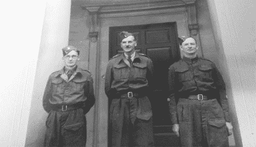

埃迪·怀特（Eddie Waite）——他后来在 20 世纪 80 年代担任泰恩代尔议会（Tynedale Council）主席——位于左侧，右侧是哈罗德·罗布（Harold Robson）。中间是基思上尉（Captain Keith）。

国民民卫队的训练在某些地区比其他地区更严肃，一个不幸的疏散者付出了代价才发现这一点，他不经意卷入了一场涉及汉绍（Humshaugh）和纽布鲁哈（Newbrough）部队的训练。该连由汉绍村学校校长爱德华·怀特（Edward Waite）经营，他将部下分为两组：他的一组是英国人，另一组由第一次世界大战诺森森郡冲击团军士长哈罗德·罗布（Harold Robson）领导，代表“敌人”。

怀特在霍尔顿路（Haughton Road）为“德国人”设下伏击，但那个疏散者发现了怀特和他的士兵躲在油桶和灌木丛后，无意中告诉了罗布他看到的一切。狡猾的士长随后能够溜到怀特的士兵身边并俘获了所有人，这让校长大发雷霆。

第二天在学校里，当疏散者们上早晨课时，怀特要求知道是谁泄露了伏击行动的消息，当那个年轻人承认是自己时，怀特的愤怒非常可怕。他训斥那个恐惧的小孩言言不慎会害害生命，并告诉他国民民卫队对内奸的简单方法——处决。

随后，他派了另一个疏散者去那个孩子的家里取他的手枪和萨姆·布恩带，然后蒙住孩子的眼睛，问他是否还有遗言。

在校长放手之前，那个孩子已经失禁了裤子。

还有一个传说说，安德森少校决定在他的领地上隐藏了所有国民民卫队的弹药和爆炸品，以备入侵。不幸的是，这位老少校忘记了把它们埋在哪里了，据传从未被发现过。

在科布里奇国民民卫队，劳伦斯·贝斯特（Laurence Best）14 岁时是军士长的跑腿。在他年过 80 多岁时，他回忆道：“有些小伙对待非常认真，这也许是好事，但我们有一个‘尴尬小组’（Awkward Squad），我是其中的荣誉成员——他们把这当成一个大笑话。”

在上学时代，劳伦斯被发了一支木制步枪，但被中士没收了，因为他那支真实的 .303 步枪对于演习来说太重了。当时还有与赫克斯姆民卫队（Hexham Home Guard）的模拟战，在那里，“笨拙小队”（Awkward Squad）总有一个目标——攻占当地的酒吧。

劳伦斯回忆道：“我们抓了科布里奇的站长皮尔森先生，并让火车到了赫克斯姆，在那里我们占领了旧车站酒店。当我们的军官问我们在做什么时，我们告诉他我们正在审讯一名囚犯。他说应该由他来审讯，我们说可以——但前提是他必须请每人喝杯啤酒！我当然没喝酒——我只能靠汽水和薯片对付了。”

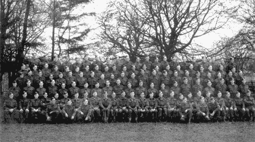

科布里奇民卫队的男士们已整装就绪。

在另一次，一名军官随口透露他计划在凌晨 2 点对民卫队进行检查——结果当他靠近时，迎接他的是连串空包弹的爆炸声，他吓得落荒而逃！

## 当地伤亡者


战争中首批当地伤亡者的悲惨称号落在了两位 20 岁的年轻人身上：步兵阿尔伯特·汤普森（Albert Thompson），赫克斯姆泰恩格林（Tyne Green）W.汤普森夫妇的小儿子；以及步兵科内利乌斯·牛顿（Cornelius Newton），来自万莱斯巷（Wanless Close），两人均在 5 月 19 日为皇家诺森伯兰的掷枪兵团服役期间战斗阵亡。

当英国远征军被强大的德国战争机器推回大海并抵达敦迪尔克海滩时，整个国家在国王的要求下举行了国家祈祷日。超过 2000 人参加了赫克斯姆修道院的周日崇拜，该地区的教堂也座无虚席。

伤亡人数开始增加，从敦迪尔克抢出来的伤兵护送队开始抵达赫克斯姆急诊医院。这片木制建筑群建立于战争初期，用于收治在海外受伤的军伤亡员，并处理平民和军方的空袭伤亡。一段时间内，它收治了当地的“和平时期”紧急病例，以及在纽卡斯尔皇家维多利亚医学院等待治疗的急性症和外科病例。但 1940 年 6 月 1 日，第一批 269 名来自敦迪尔克撤离的军伤员抵达，从那时起医院一直满到 1945 年。赫克斯姆的人一直称其为“军医院”，本应在战争结束时关闭，但在 1948 年被并入新的国家医疗服务体系，那些木制建筑直到 2004 年首相托尼·布莱尔为赫克斯姆启用新医院之前一直发挥着巨大的作用。

敦迪尔克伤员的抵达本应是一个秘密，但许多人在凌晨时分出来迎接这些疲惫不堪的伤员，在很多情况下他们伤势垂危，但仍保持着令人惊讶的乐观精神。许多人除了身穿的外没有任何个人物品，但人们立即进行了募集，在他们抵达后的几小时内，士兵们就收到了衣服、剃须刀、烟草、火柴、食物和水果等礼物。“我被像国王一样对待，”一位士兵给家人写信道。

医院的常规医人员由大量的红十字会工作者补充，人们尽全力照顾伤员并减轻他们的痛苦。显而易见，所有的士兵都经历过他们不愿谈及的经历，但他们惊人的乐观精神让护士和医生们感到震惊。

伤员中还有一支法国士兵，尽管他们自己身负重伤，家园可能已被夷平，妻儿散落在法国各地，他们依然保持着极佳的乐观精神。其中一人通过翻译说：“再过十天，我就回来让弗里茨（德国人）看看厉害的。”

送往赫克斯姆的人中，有一位来自皇家诺森伯兰掷枪兵团的威廉·奥姆斯顿（William Ormston），他的脚部被严重压伤，在敦迪尔克的途中经历了艰辛的 40 小时救护车旅程，期间救护车司机为了躲避纳粹炸弹和机枪子弹曾停过两次。最终抵达英国后，他与其他伤员一起坐在救护列车上，第一次听到有人提到赫克斯姆是列车的终点。尽管受伤了，他感到非常高兴，因为赫克斯姆是他的家乡，父母只需走几百米就能探望他。

赫克斯姆自由教会为探视伤兵的亲属设立了一项“留宿”服务，他们呼吁当地家庭为访客提供住宿，并收到了许多帮助提议。

并不是人都活了下来；一名英国士兵和一名法国海军陆兵在伤兵护送队抵达后不久去世。这两名受害者——米德克斯克斯团的雷克斯·马丁（Rex Martin，21 岁）士兵和海军陆兵保罗·鲁埃（Paul Ruel）——并排安葬在赫克斯姆墓。赫克斯姆牧师分别举行了告别仪式，J.V.C. 法尔奎哈尔牧师为英国人主持了仪式，天主教神父坎宁汉姆为法国人主持了仪式。棺材覆盖着英国国旗和法国三角旗，哀悼者中还有来自纽卡斯尔的法国领事。

当时还需要大量的翻译人员来帮助法国公民和殖民地人员翻译，包括来自伊丽莎白女王男女语法学校的法国老师。

男士们不愿公开记录关于他们在敦迪尔克的经历，但一位赫克斯姆掷枪兵告诉《快报》（Courant），当敦迪尔克断水时，他还是设法在五后洗了第一次澡——用了两瓶香槟。他说：“我洗得很彻底——从里到外都是。”

尽管如此生活仍在继续，一位来自海登桥（Haydon Bridge）的空袭警员因违反宵灯规定被罚 12 英镑 6 便士。他责怪妻子为了擦窗户而拆掉了宵灯材料。

贝灵林姆（Bellingham）的农民威廉·詹姆斯·多德（William James Dodd，60 岁）在拒绝陆军部挖掘所有土地以增加产量的指令后陷入了法律问题，被罚 40 英镑加 10 英镑诉讼费。他告诉法庭，他无法同意耕种所有土地，因为他留了两块最好的草场来生产奶牛饲料。他与牛奶营销委员会有合同，规定每天提供 50 加仑牛奶，如果奶牛得不到良好喂养，他就无法做到。判决时，多德说他宁愿坐牢也不交罚款，但被告知这不是选择，如有必要，他的土地将被强制征收并耕种。

普鲁霍（Prudhoe）的一名警察被指控在逮捕三名涉嫌醉酒的人时，行为“更像冲锋队队员，而不是开明的英国警察”。然而，法官拒绝接受了他辱骂这些人并击中其中一人腹部的指控，那三个恶作者均被罚了款。

当当地著名的运动员二中尉托马斯·本森·布兰（Thomas Benson Bland）报告失踪时，赫克斯姆一片哀。他曾代表泰恩代尔（Tynedale）参加橄榄球和板球，帮助橄榄球俱乐部三次获得诺森伯姆高级杯冠军，并代表诺森伯兰参加了三十多次比赛。他是 1936 年诺森伯兰与达姆联合队对阵新西兰全队的比赛的成员，他也是一名同样出色的板球运动员，也曾代表诺森伯兰和泰恩代尔，曾在泰恩代尔对阵本韦尔山时在 129 分钟内得了 155 分。

后来得知他被俘，但在 1941 年 1 月在德国的一所医院伤重去世。

由于入侵威胁无处不在，泰恩代尔（Tynedale）的居民被警告要加强灯管制措施，违反灯管制规定的标准罚款已从 12 英镑 6 便士增加到更重的 2 英镑。公众还被警告要更严肃地对待防空警报。北方地区专员亚瑟·兰伯特爵士（Sir Arthur Lambert）表示：“很大一部分公众似乎没有意识到炸弹爆炸的风险，而这种爆炸在防空警报后几乎会立即发生。许多人聚集在自家的门窗前。许多人来到室外，甚至带着他们的孩子。被炸弹直接命中的概率很小，但爆炸后的碎片在 70-80 码的范围内可以造成巨大的破坏。”

人们还被警告要听从部署在该地区各敏感地点哨兵的指示。J·麦克维卡·蒙罗少校（Major J. MacVicar Munro）警告说：“我们正处于战争状态，这些哨兵已被警告要停止靠近其哨所的人员，如果不听从命令则开火。你是一个忠诚的民，你可能在执行某个完全忠诚的任务，哨兵是并不知道的。最近有一个人认为哨兵命令他停下是在开玩笑，在被第二次拦截时仍继续让汽车行驶，直到一把刺刀刺穿了他的前轮胎他才停下来。聋哑人士在没有朋友陪同的情况下，不应靠近任何守卫点。”

人们对赫克斯姆（Hexham）区学校防空避难所的有效性提出了质疑，向当局投诉称，在最近一次演习中，避难所的通风证明不足，孩子们几乎窒息。许多孩子还因为避难所内极炎热导致了严重的头痛。解释是门必须锁紧，否则无法隔绝气体。

户主还被警告要节约用水用于消防，并禁止洗车、浇园或冲洗小路和院子。

为了进一步推进战争，决定在北部一个著名的风景胜地——位于贝灵格姆（Bellingham）的哈雷肖林林（Hareshaw Linn）砍伐树木。贝灵格姆农村区委员会主席 T·辛普森议员（Councillor T. Simpson）表示，他已经视察了通往壮丽瀑布的林地山谷，并说：“这是一个非常漂亮的地方——它看起来非常美，我们不得不破坏它真是太遗憾了。”尽管如此，还是同意砍伐溪流南侧所有的橡树和软木，留下一窄窄的树带，以尽可能保持森林的美感。

## 一枚军事勋章和更多伤亡

回到前线，一名来自福尔斯通斯（Fourstones）的 20 岁步兵成为该地区首位因英勇受勋的人。皇家诺森伯兰郡掷击兵团（Royal Northumberland Fusiliers）的克里斯托弗·威尔逊二兵（Private Christopher Wilson）在 5 月 21 日的阿拉斯（Arras）战斗中因表现英勇，被授予军事勋章，当时他用反坦克炮击毁了两辆坦克，并持续射击直到炮管爆炸。

英海彼岸传来的消息不断，来自米克利（Mickley）的步兵威廉·沃克（William Walker）的家人被告知他在战斗中牺牲了——恰恰是其父亲牺牲于索姆河的纪念日。服役于皇家诺森伯兰郡掷击兵团、来自贝灵格姆的埃德文·约翰逊二尉（Second Lieutenant Edwin Johnson）也被报告失踪。他是一位著名的运动员，曾帮助泰恩代尔橄榄球俱乐部在 1935 年和 1936 年获得诺森伯兰高级杯，并入选诺森伯兰郡队；他还是一名郡级高尔夫选手。随后确认了：

整个战争期间只发生过一次防空警报，当时女孩们在防空洞里抱着它们的毛熊度过一个不安的夜晚，等待着警报解除。女孩们在学校读了四年书，但在诺曼迪登陆后，她们回了家，带走了许多快乐的回忆。

物资回收的号召在整个地区引起了积极响应，每个城镇和村庄都建立了物资回收站。在`Prospect House`的`Hexham`站交出的物品中，有一位老太太的铝热水壶、一个实铜浴缸和一个农民的鸡类孵化器，而一个孩子交出了他的发条火车模型组。此外交出的还有维多利亚时代的金属壁炉、大量的黄油灯、婴儿车、玩具、锅炉和成千上万的罐头，以及两根`Tyne`捕鲸队的遗物和一顶从上一次大战中回收的德国头盔。

`Hexham`的牧师不得不为`Abbey`金属围栏保留原地的事实进行辩护，他指出教区委员会曾想将它们作为物资回收物资，但被`Newcastle`的主教办公室拒绝了许可。主教的立场得到了《Courant》报记者的支持，他认为围栏对于保护教堂的完整性是必要的。他写道：“想象一个特殊的场合，比如一场有趣的婚礼。人们会爬上墙，需要警察的协助来防止他们冲进门口。警察已经有许多事情要做，没必要再增加他们的负担。”

直到 10 月中旬，教区才松口，并授予了拆除围栏的许可。然而，全镇公共公园以及墓地的围栏也都被拆除了。

### 本地悲剧

后方也发生了悲剧，两名士兵分别在`Tyne`河游泳时溺水——一个在`Riding Mill`，另一个在`Hexham`。来自`Warrington`的`Richard Welding`二兵在`Riding Mill`的`Tyne`河与大约三十名士兵一起进行游泳训练时陷入了困。随后的验讯结果显示，他不擅长游泳，而且他游泳的区域极很危险，因为那里有回流和漩涡，水深达`10-12ft`，且底部是不稳定的泥沙。

他所属部队的一名军官告诉法医，由于这次事故，`Tyne`河将不再进行集体游泳训练，取而使用公共浴场。

仅仅三天后，20 岁的来自`Manchester`的炮手`James Radcliffe`在`Hexham`的`Tyne`河游泳时也遭遇了危险并溺水。目击者说他当时正在河里洗澡，告诉朋友他要游到对岸，尽管他并不擅长游泳。他游到一半时没入水下，随后大喊着浮出水面：“救我，我溺水了！”尽管同伴们试图救他，他还是溺水了，尽管他游泳的那个区域世代以来一直深受沐浴者的喜爱。军营里也发生了死亡事件，来自`Birmingham`的士兵`William Joseph Murphy`（22 岁）在驻守的`Hexham`村外发生的一场醉酒争吵后，被指控杀害来自`Manchester`的同事`George Eric Ward`。当他床头丢失了两个半克朗硬币时，冲突爆发了。他装填了步枪，说要射掉任何拿他钱的人。据说，几个人试图从他手中夺枪，其中包括据认为是他最好的朋友的`Ward`，后者最终腹中弹身亡。

`Murphy`声称枪是意外走响的，但他仍被送到`Newcastle Assizes`在`1940`年 8 月受审。他后被判定谋杀无罪，但过失杀人罪，被处九个月苦役。

对于住在`Hexham` `Wanless Close`的`Mrs T.C. Urwin`夫人来说，这是一个创心的八月，因为在两个月内，她的丈夫和儿子都在德国鱼雷击沉的船只上。她的丈夫当时在`Mohamed Ali El Kebir`号轮船上，该船从一个英国港口出发，载有士兵和海军人员，在离港两天后被鱼雷击中。船只在两小时内沉没，由于救生艇损坏，`Urwin`先生不得不沿着绳索滑轮登上了一只木筏，在汹涌的海中漂流了五个小时才被一艘驱逐舰救起。

与此同时，这对夫妇 18 岁的儿子`Michael`在`HMS Calypso`号舰上，该舰也被鱼雷击中，家人在确认他已被救起并在埃及康复之前经历了焦急的等待。

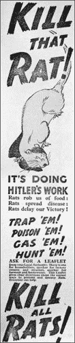

除了在海外与纳粹作战，`Tynedale`的居民还被敦促对后方的另一个敌人——老鼠。注意展品上那个“希特勒式发型”和牙刷胡须。

在贡献力量的人中，有`Hexham`年龄最大的老居民`Mary Jane Robson`，她 97 岁岁时仍在为士兵织袜子。`Robson`夫人经历过五场战争，是一个九口大家庭中最后幸存的成员，这个家庭以长寿闻名。在她哥哥`Dr C.R. Kendal`以 97 岁去世后，她继任成为小镇最年长的居民。她的丈夫在第一次大战爆发的最初几周被杀。为她的生日蛋糕购买 97 根蜡烛需要花费`12s 6d`，但`Robson`夫人要求将这笔钱捐给战争慈善机构，而不是购买蜡烛。

8 月，“Hexham`发起了“反击，购买喷式战斗机”活动，目标是宏大的`£5,000`。该活动得到了空军准将`Milne Robb`在获得空军十字勋章不久的支持。“Robb`说：

“德国空军最近失败的大规模攻击主要目标是消耗我们的战斗机防御，这一定让大家意识到我们的战斗机中队所承担的巨大责任。在目前这些攻击中，敌人主要依靠中型和俯冲轰炸机，由大型战斗机群护航，使用的重轰炸机比例较小，而他们拥有大量的重轰炸机。我们防御的任何削弱都会让他白天使用这些重轰炸机。

`波兰`和鹿特丹造成的巨大破坏是重轰炸机的结果，之所以能实现，是因为它们能够在白天作战。这就是敌人希望在这个国家造成的局面。到目前为止，他们并不成功，但现在不能放弃，否则就意味着承认了重大失败。

我欢迎在`Hexham`建立喷式战斗机基金的建议，这既证明了我们战斗机的工作和责任得到了认可，也是增加防御的实用手段。”

`Hexham`妇女协会的领先成员`Sadie Dodd`敦促女性参与喷式战斗机基金，她说：“这是一个极佳的宣传。那些德国人每晚都来这里打击我们的士气，而这唯一的效果是让大群的人自发地集资购买喷式战斗机来击退他们。如果他们发现我们如此充满斗志，一定感到非常沮丧。”

收集箱分到了酒吧和商店，向预期的捐助者寄送了私人信，并宣布将开展“英里 10 英镑票”活动。在一周内，捐款就超过了`£200`，不到两个月总额就达到了`£2,000`。到`1941`年 1 月初，在五个月内就超过了目标，从特别筹款到个人捐赠，每月流入`£1,000`。组织秘书是`J.F. Macgregor`，他领导着一群自愿的助手团队。

“喷火战斗机行动”确实激发了公众的想象力，在那个工人年薪约为 3 英镑的年代，捐款金额非常慷慨。当基金在 1941 年 2 月结束时，总共筹了 5,250 英镑，行政费用仅为 34 英镑 16 令士 3 便——仅占总数的 0.76%。

地区筹款明细显示了资金来源：Acomb £54；Allendale £163；Barrasford £110；Bellingham £75；Blanchland £17；Corbridge £595；Fourstones £74；Haydon Bridge £116；Hexham £2,658；Horsley £50；Humshaugh £34；Langley £21；Lowgate £61；Matfen £40；Newton £69；North Tyne £114；Ovingham and Ovington £29；Riding Mill £175；Hexhamshire £59；Slaley £61；Stamfordham £7；Stocksfield £170；Wall £45；Wark £99；殖民及海外 £356。

一些捐赠和筹款活动的金额相对较小——Stocksfield 的一场婚礼上的“讨闹钱”只带来了少道的 2 令士，一场舞会仅筹了 5 英镑——但社区努力带来了 3,588 英镑，此外学校和学生贡献了 240 英镑、社交活动、销售和音乐会 784 英镑、募捐箱收集 240 英镑、雇主和员工的每周贡献 107 英镑、竞赛 91 英镑以及一次全地区的旗日活动 199 英镑。

人们希望航空生产部长比弗伯鲁克男爵能亲自来到赫克斯姆领取支票，但这无法实现，因此支票通过邮寄寄出，并要求在飞机造好后，在机身上显示“赫克斯姆及地区”字样。

### U 潜艇袭击

当英国空战战在空中激烈进行时，德国 U 潜艇在海上继续造成了沉重损失。《快报》（The Courant）生动地描述了哈尔特威斯尔三副约翰·弗朗西斯·布莱基（25 岁）所经历的磨难，他是一艘油轮上的 39 名商人海员之一，该油轮在赫布里底岛以西 120 英里处被鱼雷击。他告诉《快报》，U 潜艇在晚上 8:30 左右浮出水面，他说：“他们看起来受到的冲击和我们一样大。我们试图转弯以部署火炮，但在我们来得及之前她就潜下了，留下了我们，我们希望继续旅程。”

他们的希望破灭了，因为两个小时后，大约 10:30，油轮在中部被一枚鱼雷击中，这也摧毁了其中一艘救生艇。布莱基说：

“我们只剩下一艘救生艇和一艘我们都挤进去的小艇。我们 14 个人挤在小艇里，几乎没有活动空间，只有极少量的船用饼干和水。船下沉得很缓慢，但当我们离开危险区域时，第二次爆炸折断了船脊——我想可能是击中了我们的药库。

“当我们脱离险后，又救了另外两个同伴，其中包括一名第一次航海的 16 岁船舱童，他在随后的几天里成了大家的活动灵魂人物。第二次爆炸后不久，潜艇再次浮出水面并靠向我们的船，船长问我（作为小艇的负责人）我们母船的名字。我向指挥官提供了必要信息，他的英语非常流利。事后有几个人说，他们曾想过向指挥官透露一点前一天德国空军损失的情况，但他们认为在这种情况下最好保持沉默。”

这些人在这种天的小的小船上在非常恶劣的海面上航行了三天，通常每天只有几块饼干和一点水，尽管有些人完全什么都没有吃。布莱基报告说士气非常好，并说：“那个船舱童异常地乐观，他带领男人们唱歌来提振精神。”

他们最终操纵这艘小船到达巴拉岛可见的范围内，被“新兰斯号”（Newlands）拖船接起。布莱基说：

“我们好几个人都感受到了严寒的影响，但得知噩梦结束了感到很庆幸。我们穿着鱼雷击中时身上的少数衣服就登陆了，有些当时躺在床上的人既没有鞋也没有袜子。在托伯莫里（Tobermory），我们在前往奥班（Oban）之前得到了食物，在那里酒店的居民自愿为我们提供床位，并提供了衣服。”


来自 Stagshaw 的枪兵罗伊·克拉克（19 岁）获得了诺森伯郡枪兵团的准假，参加 Stagshaw 教堂小屋的一场特别活动的贵宾，在会上，他因 5 月 28 日和 5 月 31 日与英国远征军（`BEF`）战斗中的两次独立英勇行为而被授予军事勋章。在密集的炮火和迫击炮攻击下，他继续通过步行和骑摩托车传递信息。他从不躲避或休息，而是以无畏的勇气完成所有的行程，确保了重要信息的快速传递。在一次纸牌牌活动结束后，他收到了科布里奇战争服务基金赠送的刻有纪念文字的金表。

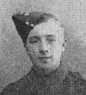

军事勋章获得者、来自 Stagshaw 的枪兵罗伊·克拉克（19 岁），他因步行和骑摩托车传递信息的英勇行为获得此奖。

法院对违反灯宵管制的行为变得越来越严厉，罚金增加到 4 英镑——即使对于没有直接参与的人。被处该金额罚金的是科布里奇小麦穗酒店（Wheatsheaf Inn）的房东，他确保了所有 35 扇窗户都做了遮光。一名女在灯宵时间前半小时巡视以拉上所有窗帘，但这一次，一位客人打开了门并留了灯。

住在 Riding Mill 的德国难民保琳·马因泽（Pauline Mainzer）因在 Terrace 的一处未遮盖的灯光被罚款 2 英镑，但法庭确认这并非故意引导敌军。敌对人群聚集在普鲁德，威胁要打破西路建筑的窗户，当时一处光线从`费斯特修理厂`的天窗透出来，从 150 码外可见。警方最终闯入场所熄了灯。店主詹姆斯·费斯特在承认罪行后被罚 2 英镑，但他归咎于负责关灯的学徒没有熄。

普鲁德居民通过捐赠和特别认缴筹集了 241 英镑 10 令士 1 便士，用于购买三辆价值 135 英镑的汽车，另花了 100 英镑将其转换为当地民防（ARP）小组的救护车。

赫克斯姆罗尔利溪（Rowley Burn）一项失败的铅矿计划在启动 70 年后获得了回报。

赫克斯姆的战争物资仓库必须加倍努力为士兵提供生活用品，因为他们制造的成千上万物品中的许多在丹麦尔等地被遗弃。巴拉克法头盔和扫雷手套特别短缺。为了给更多设备筹资金，当地绅士组织了一场难忘的展览，展出的物品包括不幸的德文特水伯爵穿着的蓝色锦缎外套；玛丽女王在莱文湖城堡作为囚犯期间制作的床罩；沃顿著名的谋杀案受害者“缝纫的乔”制作的拼布被，以及沃尔特·比森特著名小说中的英雄人物布兰奇德的多萝蒂·福斯特所穿的围裙。展览在赫克斯姆天主教学校的大厅举行。

## 战时决策与当地新闻

在所做出的更奇怪的决定中，是禁止 `Corbridge` `St Andrew’s Church` 的钟声，使其在战争期间不再报时。该决定由 `Corbridge Parish Council`（科布奇教区会）副主席 `R.R. Ridley` 员做出，理由是“出于安全考虑”，但当时正在休假的牧师 `Rev. M.M. Barlow` 博士对此并不知情。这一决定在村子里引起了某些恐慌，尤其是当时 `London` 的 `Big Ben` 大大钟仍在隆隆作响。牧师认为，教区会没有权力在未征得他或教会执事员同意的情况下停止钟声报时。他说：“我个人或许是最不在乎自身权利的人，但我是在乎教会的荣誉，而我是教会在这一教区的个人代表。我很惊讶在没有咨询我的情况下，钟声竟然就停止停止了。”

内政部（`Home Office`）并未发布关于禁止钟声运行的命令，双方同意恢复钟声报时。

### 价格强制执行

在 `Bellingham` 地方法院，来自 `Wark` `Pasture House` 的 `Ellen Charlton` 因以每只 `4d` 的价格出售鸡蛋，超过了政府规定的每只最高价 `3d` 而出庭。`Charlton` 告诉法庭，她知道《自产鸡蛋最高价格令》（`Maximum Prices for Home Produced Eggs order`）的规定，但她认为自己权收取更高的价格，因为 `Bellingham Food Control Committee` 的 `Sidney Clough` 在测试购买中买到的鸡蛋特别大，可能是双黄的。

她被罚款 `£1`，并承担 `£1` 的诉讼费用，法庭主审 `Major G.D. Anderson` 告诉她，她本可以被罚 `£100`。针对她辩称自己只有几只产蛋很少的鸡的请求，`Major Anderson` 表示：“你拥有多少家禽并不重要。如果你只有一只每天产一个蛋的鸡，而你以高于最高价卖掉那颗蛋，就构成了犯罪。无论这些规定多么令人厌烦，它们都是为了整个国家的利益而制定的，每个人都要尽力愉快地执行这些规定。”

他要求媒体报道此案起到震慑作用，因为有暗示——尽管无法证实——称 `North Tyne` 的其他养殖者一直在以高于许可的价格出售鸡蛋。

### 家庭新闻与认可

来自 `Corbridge` `Dilston Haugh` 的 `Mr and Mrs J. Atkinson` 夫妇收到了好消息。一个月前他们被告知，长子 `Able Bodied Seaman Joseph Atkinson` 在驱逐舰 `HMS Esk` 被鱼雷或水雷击沉后失踪，推测已遇难。当他们收到他已被获救并目前身处战俘营的确认时，他们喜若狂。

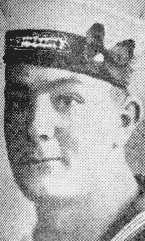

来自 `Corbridge` 的 `Able Bodied Seaman Joseph Atkinson`（22 岁）在其船只 `HMS Esk` 沉没时被误报战死。在他的帽子（`cap-tally`）上，船名被划掉，以避免向敌人提供信息。

`Courant` 报在战时不仅传递坏消息，也能传播好消息，以 `Hexham` 的 `RAF Sergeant Harold Robson` 为例，正是一位 `Courant` 记者告诉他的家人，他因在占领领土上执行四十一次日间任务而被授予卓越飞行勋章（`Distinguished Flying Medal`）。他强调，该奖励是对整个 `Blenheim` 机组工作的认可。

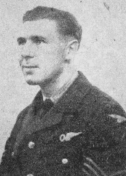

来自 `Hexham` 的 `RAF Sergeant Harold Robson`（26 岁）因在占领领土上执行四十一次日间任务被授予卓越飞行勋章。

### 后方与生产

在后方，`Tynedale` 的女士们听到了一个毁灭性的消息，英国贸易部（`Board of Trade`）宣布将禁止丝袜。`Courant` 报的“女性话题”专栏报道道：“一夜之间，一双丝袜成了 `Hexham` 最炙求的商品，在周六早上晨女商店开门后，丝袜柜台就排起了长队。到周一早上，一双丝袜就像夏天的雪一样稀缺。为了确保所有客户都能公平分配到现有库存，每人限购一双。一家商店甚至采取了记录所有丝袜购买者姓名的方法，以扰乱潜在的囤积者。店主说：‘限制只是又一种牺牲——与正在进行的其他牺牲相比，这是微小的——女性被要求为了自由而做的牺牲。’”

在 `Hexham War Supplies depot` 的第一次年度会议上报告，已有 10 英里的材料被制成 3,051 件衣服，25 英里的纱布被变成了 44,000 个棉签，12.5 英里的材料被卷成了 3,685 条绷带。该仓库每周产 3,000 件，全年总产量为 109,000 件，由 33 个不同的小组组成。其中包括来自 `Hexham Senior School` 的木工班。

### 安全规定

对防空管制（blackout）违规行为的打击持续，`Corbridge` `Stagshaw Colliery` 的主被罚款 `£5`，因其允许煤堆闷燃，发出了远处可见的光亮。`Corbridge` 消防队使用了 1,000 加仑水扑灭了火灾。来自 `Hexham` 的业主 `Thomas English` 表示他知道煤堆正在升温，并正在组装一台电动泵以控制火势。

来自 `Prudhoe` `River View` 的 `George Stoker` 因违反防空管制被罚款 `£1`，当时炉火上的一个炸锅翻了，点燃的油脂点燃了烟囱，产生了 3 英尺高的火焰，从远处可见。

在黑暗期间，赫克斯姆博蒙特街（Beaumont Street）停的汽车也是一个问题，因为它们的引擎盖经常悬在人行道上，导致毫无防备的行人走时撞到小腿。据警方介绍，街道上经常停着六十多辆车，如果车灯没关，它们产生的亮度甚至比路灯还要强。

`Joe Cullen` 议员敦促赫克斯姆地区委员会（Hexham UDC）禁止在街道上停车，并指责这些违规司机极度自私，他说：“如果他们有黑鱼的脑子，就能清楚地看到以这种方式停车辆对行人构成了危险。”

黑暗期间还被小偷用作掩护，他们袭击了赫克斯姆的分配菜园，偷取作为“为胜利而挖掘”（Dig for Victory）运动的一部分而种植的农产品。愤怒的菜园所有者表示，在蔬菜难以得的的时期，这些盗窃行为尤为卑劣。当地童子军创建的一块地本是为了为`赫克斯姆急诊医院`（Hexham Emergency Hospital）及其父母提供新鲜蔬菜，但其一半以上的产量被盗走了。

一位园丁说：“在黑暗期间，很难抓到那些用卑劣手段袭击我们园子的人。我们不能每晚都站在花园里守着蔬菜。我曾数过一个晚上一个花园里被偷走了十个萝卜子。”

来自阿康姆（Acomb）的`William Bell` 夫妇收到了一份早早的圣诞礼物，他们的儿子`Ivan`隶属于`阿盖尔和苏萨高地陆兵团`（Argyll and Sutherland Highlanders），自 7 月参与`敦刻尔克撤退`以来一直被报告失踪。他们在 11 月收到他儿子的来信感到非常高兴，信中说尽管他受了伤，但在战俘营里情况进展良好。

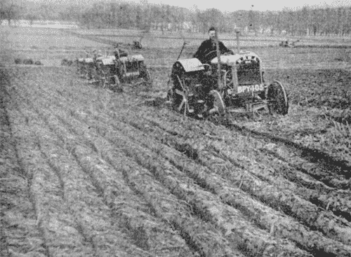

`泰恩代尔`（Tynedale）的农民们对政府要求耕种草地种植作物以协助战争努力的号召做出了积极响应。

尽管媒体和无线电中反复提醒，但许多`泰恩代尔`的人未能申请新一期的配给证，导致他们可能面临一个凄惨的圣诞节。超过 40%的`赫克斯姆`居民未能完成申请，而在`贝灵哈姆`（Bellingham），只有一半的人口提交了申请——在申请的人中，许多表格填写错误。

食品执行官`J. Robinson` 表示：“这种失败给食品办公室的顺利运行造成了极大的不便，因此我敦促所有尚未申请的公众立即申请，否则无法保证配给证的发放。”

赫克斯姆破事法庭（Hexham Petty Sessions）发生了一件趣事，一名退休的“神职人员”`William Kerr Smyth`（64 岁）因在赫克斯姆醉酒并扰乱治安被指控出庭。当时，一名信息部（Ministry of Information）官员正在市场广场（Market Place）的一场露天公众会议上演讲，明显醉酒的`Smyth`将他推到一边，并撞倒了他的麦克风架，随后被警方强行带走。`Smyth`否认自己既醉酒也没有扰乱，并告诉法庭，由于扬声器发出的巨大噪音，他听不见自己的思考声。他只是走向那位官员，要求他“闭上胡言乱语的嘴”。`Smyth`被判定有罪并罚款最高`2 英镑`，他对法庭说：“真遗憾——那个演讲者本应该被罚 6 英镑。”

在圣诞节前，`科布里奇战争军人福利基金`（Corbridge War Servicemen’s Gift Fund）的女士们正在为村里 200 多名现役准备十令包。每个包裹包含一个 2 磅的水果面包、五十支香烟、两块巧克力、一包饼干，以及一双手织袜或一个巴拉克拉法帽。

## 第三章

## 盘点与反击

驻扎在`泰恩代尔`地区的澳大利亚士兵参加了在赫克斯姆迪尼公园（Dene Park）举行的一场体育盛会，并展现了我们早已习惯的对英国运动员的某种体育优越性。

劈木比赛由帝国军队伍的六名成员赢得，他们仅用 51 秒就劈断了木头；来自“南方”（Down Under，澳大利亚）的人们在拔河比赛中也连续两轮击败了`赫克斯姆警方`。三脚跑、接力赛和 100 米冲跑也由这些殖民地人赢得。澳大利亚人还表演了澳式橄榄球。

舞台上，著名的`BBC`低音女高`Essie Ackland`带领一支`英国士兵娱乐协会`（ENSA）艺人，在赫克斯姆急诊医院为伤员表演。她得到了她的澳大利亚丈夫`Reg Morphan`的支持，他是一位才华横溢的男音。

不仅是人类人口遭受着配给制的影响。该地区许多虎鹉鹦饲养者由于政府对作为它们主食的进口种子进行镇压，被迫考虑大幅减少鸟笼中鸟的数量或完全处掉这些鸟。饲养者们曾通过节省现有的库存来维持他们的爱好，但库存已经几乎耗尽，预计新年期间将面临重大问题。

一位`赫克斯姆`的饲养者说：“到目前为止我们的食物并不短缺，但我正在尝试其他谷物，看看是否能说服鸟类改变食性。要让虎鹉吃其他种子是非常困难的。在种子中混合粗糙燕麦可以维持供应，我希望它们能接受这种混合物。无法获得这些进口种子无疑将迫使我们减少养殖的数量。”

圣诞购物者发现自己缺少分币（farthings），尽管皇家造币厂（Royal Mint）生产了足够的小硬币，但它们并没有进入流通领域，因为商人没有把它们存入银行，而主妇们也没有花它们。

阿康姆（Acomb）发生了一起圣诞悲剧，一名 67 岁的老人在圣诞前夜通过比尔基溪（Birkey Burn）回家时不滑倒，掉入溪流，在仅四英寸深的水中溺水。

赫克斯姆牧师`J.V.C. Farquhar`在向`赫克斯姆轮会士`（Hexham Rotarians）的圣诞演讲中对希特勒表达了令人惊讶的赞赏，他将元首描述为在不同情况下本可以是第二个约翰的天才。他指出，英国大体是一个热爱和平的国家，但德国在希特勒出生很久以前就有战争倾向。他说：“他所做的是非常聪明地利用了这种激情，现在他是那个国家的主人——可能是世界上过的最大的大师。他通过这种残酷的手段做到这一点，在此过程中他发展了铁石和征服世界的激情。当我们称希特勒为疯子时，我们犯了一个错误。他可能有疯狂的偏执，但他确实拥有伟大的天才。如果希特勒童年被送到某个宗教机构或修道院，让他的灵魂能与上帝交融，他本可以是第二个约翰。”

英国空军被公认为有功于在 1940 年那些黑暗的日子里拯救了英国。。当时，英国远征军刚刚被强大的德国战争机器在敦迪尔克轻蔑地横扫大海。赫尔曼·戈林领导的德国空军正猛烈轰炸伦敦，英国加入希特勒铁靴靴统治下的欧洲其他国家似乎只是时间问题。

但是，从全国各地的小机场起飞，像是一群骚扰猛禽的鸣唱鸟，火花式战斗机和飓风战斗机云云。它们摧残了德国轰炸机及其护航机，极大地削弱了德国的战争努力，导致入侵计划被搁置。尽管肯特郡的比金希尔（Biggin Hill）和杜克斯福德（Duxford）等机场留在人们的集体记忆中，但泰恩代尔（Tynedale）也为丘吉尔那句不朽的名言贡献了自己的力量：“在人类冲突的领域，如此多人对如此少数的人负有如此之恩。”

### 乌斯顿空军基地 (RAF Ouston)

现在位于哈洛希尔（Harlow Hill）的阿尔贝马尔兵营（Albemarle Barracks）始建于乌斯顿空军基地。它于二世界大战初期作为战斗机站建成，是东北部最繁忙的机场之一。该机场于 1941 年 3 月 10 日正式开放，其首个作战单位是第 317（维伦斯基）飓风战斗机队，这是 4 月底抵达的新的一批波兰战斗机部队之一。波兰人很快对护航巡逻的常规工作感到厌倦，并不断抱怨该地区没有德国飞机可供进攻。

他们没有等多久，5 月 7 日，有 28 架敌机袭击了泰恩赛德——乌斯顿就在袭击名单上。该机场遭受了一架孤单 `Junkers 88` 战斗轰炸机的协同攻击，它投掷了十枚炸弹，然后在低空盘旋并对机场进行机枪扫射。它最终被哨塔上的刘易斯机枪击退，但造成了 16 名空员受伤和 3 架飞机受损。

米克利里（Mickley）的伊万·西摩尔（Ivan Seymour）当时是一名 15 岁的木工学徒，在机场工作，他目睹了这次轰炸。他说：

“这是一个狡猾的入侵者，我当时住在米克利的罗斯代尔（Rosedale），从落地窗户看着他。从那个视点我可以观察到乌斯顿发生的一切。

五枚 500 磅炸弹掉落了，幸运的是，唯一一枚可能造成严重破坏的炸弹没有爆炸。它穿过拱门掉进 NAAFI（军人食堂）建筑后方的院子里，在造成任何真正严重的损坏之前停了下来。任何知道 NAAFI 在战期间重要作用的人都会理解，如果这枚炸弹爆炸了后果有多严重！

因为在炸弹被拆除移除并清理现场之前，那里‘茶和点心’一直严重短缺。”

6 月 2 日，波兰飞行员对战斗的渴求得到了满足，两名乌斯顿飞行员在泰恩茅斯（Tynemouth）海外击落了一架 `Junkers 88`。当波兰人被喷火式战斗机队取代时，乌斯顿作为国际联盟机场的角色继续延续，尽管该中队被称为肯特郡中队，但实际上几乎完全由比利时飞行员组成。

1941 年 9 月，乌斯顿再次遭到袭击，一枚炸弹在机场中心留下了一个宽 20 英尺、深 6 英尺的坑。炸弹炸断了水管并炸破了几扇窗户，但人员和飞机没有伤亡。

同月，一架喷火式战斗机在接近乌斯顿时坠毁，导致一名加拿大飞行员死亡，他安葬在斯坦姆福德姆（Stamfordham）教区墓地。另一名加拿大飞行员在乌斯顿空军妇女辅助队（WAAF）宿舍附近的飓风飞机迫陆中牺牲。1942 年该基地的开始很糟糕——一名清理跑道雪地的平民被一架滑脱的喷火式战斗机撞死，另一名飞行员在第二天喷火式战斗机与虎蛾式飞机的碰撞中去世。

著名的夜战斗机波尔顿·罗挑战者（Boulton Paul Defiant）于 10 月来到乌斯顿短留，但未与敌方发生接触。

1942 年，乌斯顿承担了新的海空救援任务，最初使用改装的挑战者战斗机，它们可以向受困的空员投放救生艇，后来使用了另一种早期的双翼机——海牛式（Walrus），然后是装备更好的安诺安逊式（Avro Anson）。

驻扎乌斯顿成功的单位之一是 226 中队，配备了新型美国制双引擎道拉斯·波音轰炸机。糟糕天气推迟了 12 架飞机的抵达，在当天结束前就有三架坠毁，造成一人死亡。一架在进场时发动机熄熄坠；另一架在两个发动机失效后在大特惠廷顿的田里腹陆；第三架则在机场上完成了壮观的迫陆。

1943 年 6 月，乌斯顿发生了另一场悲剧，两架喷火式战斗机在接近机场时在空中碰撞，两名比利时飞行员当场死亡。

乌斯顿后续的角色还包括拖曳目标进行靶射练习，随后作为空中观察哨。它还是使用机载雷达的先驱站之一，令人难以信的是，曾一度有 50 多架安逊式飞机驻于此。威灵顿轰炸机也被改装为雷达训练机，其中 29 架驻扎在乌斯顿，还有近两打飓风式战斗机为雷达学员提供移动目标。

欧洲战争结束前四天，乌斯顿失去了它唯一的一架飓风战斗机，该飞机发生发动机故障，在埃肖特农场（Eshott Farm）进行了腹陆。


与当时的情况不同的是，乌斯顿空军基地的住宿设有中央供暖和自来水，这深受空员和军官的喜爱。基地建造了一个大型总部和复杂的、受高度保护的控制室，表明该机场在开放后可能具有重要作用。还有供军官、士官和空员使用的舒适食堂。

机场有三条跑道，最长的达 1400 码，在那个时期不寻常的是，它们的设计几乎在一点相交。这种设计是不受欢迎的，因为一旦遭到敌袭，一组精准的炸弹可以一次性关闭三条跑道。由于敌袭的可能性极高，乌斯顿在庞特兰德（Ponteland）北部的贝瑞维克山（Berwick Hill）拥有自己的诱饵机场。

在铺设沥青之前，英国空军就已经利用乌斯顿的平整草地了。它是第 13 集团通信飞行队的轻型飞机所在地，该飞行队使用一系列飞机，包括战争爆发时被征用的民用飞机。除了像格洛斯特·格拉迪石（Gloster Gladiator）这样可靠的军用双翼机外，还有被遗忘的机型如珀西瓦·维加海鸥（Percival Vega Gull）和迈斯·惠特直（Miles Whitney Straight）。乌斯顿还被位于哈灵顿厅（Hallington Hall）的第 3 无线服务段校准队使用。

战争的结束并不意味着乌斯顿的结束。随着 607（达勒郡）中队的德哈维兰吸血鬼战斗机的到来，该机场进入了喷气机时代，这要求延长主跑道。在 20 世纪 50 年代和 60 年代，乌斯顿被各种小型单位使用，英国空军滑翔学校成为 1975 年陆军接管前最后一家驻扎该基地的空军部队。令人惊讶的是，尽管自 1975 年以来未再作为机场使用，但跑道和周线依然完好如初，控制塔依然屹立。

然而，关于一架梅塞斯密战斗机在诺森伯兰郡荒地上低空飞行的报告，被米德克斯`RAF Fighter Command`（皇家空军战斗指挥部）的人员付之一笑，因为`Ottercops`的可靠性口碑并不好——它以无法区分雷暴天气和来袭飞机而闻名。该设施的设计旨在为敌方攻击提供远程预警，但其提供的情报在去年曾受到质疑，当时在 1940 年 8 月，它报告有三十架敌对飞机从北方向接近海岸。但当`Ottercops`派遣四架喷式战斗机冲入云霄时，他们惊恐地发现竟然有 21 架战斗机护送的 90 架德国轰炸机！

### 奥特科普斯事件

女子空军辅助队军士费莉西蒂·阿什比（Felicity Ashbee）记得，1940 年 5 月 10 日的晚上原本无事可做，直到战斗指挥部的地图上出现了一个标记点——在北海深处，诺森伯兰郡岸外——被`Ottercops`的雷达捕捉到了。值班的三名成员大笑起来，心想那些乡下人又搞混了。

最初绘图时，那架梅塞斯密战斗机的高度约为 15,000 英尺，以每小时 300 英里的速度几乎正西飞行。`Ottercops`将这次潜在袭击报告为“三架以上”，但随着飞机的接近，其他四个站点（Danby Beacon、Douglas Wood、Bamburgh 和 Cresswell）正确识别出它是单架飞机。这架飞机被命名为“42 号袭击”。当它距离海岸 50 英里处时，已报告给位于`RAF Ouston`的英国皇家空军第 13 战斗群，并在 22:30 派遣了一架喷式战斗机升空拦截。

### 赫斯在英国

整整两天后，BBC 的一场广播揭露了赫斯——纳粹党副领袖和希特勒的左右手——以一种相当不体面的方式降落在格拉斯哥郊外，赫斯在那里透露他想会见汉密尔顿公爵，他认为自己可以与此人做生意。尽管汉密尔顿上校事后坦言他对自己为何被选中感到非常困惑，但赫斯相信他们对航空的共同兴趣、战前避免英德爆发战争的愿望，以及与阿尔尔布雷希·豪泽霍费（Albrecht Haushofer，卡尔·豪泽霍费之子，地缘政治教授，希特勒劫持的“生存空间”哲学的主要建筑师）的友谊，将为谈判铺平道路。

赫斯穿上德国空军的`hauptmann`（上尉）制服，配备了一台徕卡（Leica）相机以及许多治疗他真实和虚幻疾病的药物——众所周知有些疑病症。他背诵了飞行路线，然后将飞行计划绑在大腿上。赫斯飞越北海时，其航线使他一直保持在英国雷达的视线之外，距离英国海岸至少 200 英里。天气晴朗，当他转向正西并开始接近东北海岸时，满月正升起，但距离日落还有一小时，他担心会被皇家空军战斗机发现并击落。

他后来告诉汉密尔顿公爵，他通过在海岸附近盘旋 40 分钟直到太阳落下来补偿。赫斯飞行得太快，无法被拦截，他在后来写给妻子的信中说，他在那个阶段正全速飞行，很享受其中。他说他爬上了海拔 2,676 英尺的切维特山（The Cheviot），滑向另一侧进入苏格兰。赫斯在黑暗中没有发现汉密尔顿的邓加维尔别墅，错过了目标。当燃料开始耗尽时，他决定跳伞。

### 降落与后续

飞机坠落在格拉斯哥以南 10 英里的 Bonnyton 荒地，而他降落在附近的一个农场。他被首席耕农大卫·麦克林（David McLean）发现，麦克林问他：“你是德国人吗？”赫斯回答：“是的，我是阿尔弗雷德·霍恩上尉——我给汉密尔顿公爵带了重要消息。”

麦克林的老母亲为这位挑剔的赫斯泡了一壶茶（但他拒绝了，要了一杯水），同时赞赏着他剪裁得体的制服和名贵手表。一名农夫被派去寻找权威人士，赫斯很快就前往了伦敦塔，那是他在几个月里被关押的三个监狱中的第一个。他曾两次试图自杀。期间，德国广播的一则公告称赫斯飞过了这个国家，并补充说这位副领袖多年来一直遭受幻觉和精神疾病。

尽管有力证据表明他确实有精神疾病，但在纽伦堡军事审判中，赫斯被判定具有辩护能力。他被指控了许多罪名，包括策划发动战争和发布了被清除的指令。

### 当地新闻与报道

一名 26 岁的男子险些逃生，他的岳母 I·哈德斯通顿夫人（Mrs I. Huddestone）从窗户目睹了这一幕，她在约翰之前看到了火车，但由于震惊过度没能大喊。“在撞击的那一刻，我闭上了眼睛，然后对我的女儿大喊车已经没了。轨道上剩下的只有一个掉落的轮毂，我从没想过能再次见到约翰。”

然而，约翰不仅仅受了轻微的割伤和淤青，而且当天就回了家。他说：“汽车原本运行得完好，但在铁路中间熄火了。我正在检查仪表盘和自启动器时，听到火车过来了。我抬头一看，引擎离汽车只有 20 码了。我除了坐在驾驶位上闭上眼睛，没时间做任何其他事情，只能希望最好的结果。等我再次知道时，已经在车外了，脸上的小伤口贴着胶布。我对那次事故完全没有记忆了。”

1941 年 1 月还引入了学校餐饮（起初被称为集体供餐），在伊丽莎白女王女子文法学校的舒适食堂里提供供应。约 140 名孩子分两批用餐，每单餐费用为 4 便士，每周 1 英镑 3 便士，同一家庭的两个孩子每周费用为 2 英镑 4 便士。费用仅涵盖了购买食品的成本，剩余部分由县教育委员会承担。

位于科布里奇（Corbridge）的一家咖啡馆老板被罚 10 先令，并被令支付 30 先令诉费，因为她被发现卖水牛奶。一名来自县衡量部门的男子在 River View 咖啡馆购买了一杯热牛奶进行测试，发现其中含有 36%的加水。事实证明，两品脱牛奶中加入了一品水，但被告辩称热牛奶是误提供的，因为它原本是留用来冲咖啡的。

舞台和银幕上那些不可挡的喜剧大师杰克·赫尔伯特（Jack Hulbert）和西莉·库特尼奇（Cicely Courtneidge）在赫克斯姆（Hexham）的论坛剧院亲自亮相，为所有武装人员表演了一场特别的免费午场。剧院楼下所有的座位都留给了官兵，这场演出之所以能够实现，是因为这些伦敦戏剧影星是赫克斯姆 Summerrods 的 P.P.菲利普斯夫妇的好友。

明星们曾出现在纽卡斯尔的“赫尔伯特剧院”（The Hulberts Follies），尽管行程紧凑，他们还是同意为了友谊放弃周日的下午。剧院的场地由`Hexham Entertainments Company`免费提供，所有利润都捐赠了当地的战争慈善机构。他们得到了`杰斯蒙德小丑`（Jesmond Jesters）的支持，这支滑稽表演队自大战以来一直深受部队的欢迎。

明星们正处于最光彩、最快乐的心情，接受了欢呼观众的久久掌声。杰克在谢幕致辞时台上说：“今天下午能来到赫克斯姆真是太棒了，我们喜欢这里的每一分钟。”非现役人员的门票收入共计 52 英镑 19 先，这笔钱由`赫克斯姆集团医院供应站`、`英国红十字会赫克斯姆分会`以及`赫克斯姆救助协会`平分。

赫克斯姆那座拥有 1300 年历史的修道院的重要性受到了质疑，因为一次招募志愿者担任火哨员的号召仅吸引了寥寥几个人名字，这让牧师 J.V.C. 法克哈牧师非常不悦。尽管发出了多次号召，只有十名志愿者站了出来。他说：“这不仅仅是教会当局的问题，而是整个教区和镇民的责任。我们都应该尽力守护修道院，因为通过这样做，我们是在守护自己的家。这是一件关乎整个镇子的事情。”

仪仗乔治·里亚（George Reah）表示，在一个人口一万的镇子上，竟然只能找到 10 个人来守护其最著名的建筑，这简直是“一种奇耻的耻辱”。

在`赫克斯姆警察法院`，一名当地水员因无故缺席船只被收押留，等待军事护送。助理厨师本杰明·詹姆森（Benjamin Jameson）声称他已回到了船只停泊的地方，但船不在那儿了，于是他决定回乡。在另一场审判中，来自格拉斯哥的 25 岁詹姆斯·汤斯利（James Townsley）因盗取新布鲁格勒沃什农场（Allerwash Farm）的财产被判处六个月苦役，他在那里曾被允许在一个谷仓里和一个 19 岁的女性伴侣同睡。事实证明，他是`卡梅隆高地人`（Cameron Highlanders）的逃兵，已潜逃了三个月，法官席约翰·查尔顿（John Charlton）告诉他：“你是苏格兰的耻辱。你是军队的逃兵，却在全国流荡过着偷窃的生活。”

弗朗西斯·沃尔兰特（Francis Volante）也成为了历史的一部分，他因在镇上的福雷街醉酒滋事被带到`赫克斯姆治安法庭`审判，当时他在那里大声唱歌并使用污秽语言。当被要求安静时，他变得具有攻击性并被捕。警察警监威廉·古德费罗（William Goodfellow）表示，他对他提出这一指控感到遗憾，因为这是自从战争开始以来针对`赫克斯姆地区`任何武装部队成员的首次指控。通过破坏这一记录，沃尔兰特不仅自己蒙了辱，也让所有驻在该地区的士兵都蒙了脸。

2 月，受伤的士兵和护士联手扑灭了赫克斯姆`急诊医院`（Emergency Hospital）发生的一场火灾。一名护士和一名士兵看到浴室冒出烟雾。火起于锅炉房，破入浴室，并沿着伤员所在病房上方的屋顶空间蔓延。病房被疏散，康复中的士兵、护士和医院工作人员使用手摇泵和化学灭火器与火搏，直到医院自己的消防队接手。当镇消防队到达时，有三根水管正在作业，火势被扑灭。浴室被烧毁了，除了屋顶受损外，大量的床单被毁坏。

在里丁米尔（Riding Mill）的一处`YMCA 食堂`开幕式上，老兵 E.P.A. 瑞德尔准将（E.P.A. Riddell）对那些没有为战争努力贡献力量的人进行了一番严厉的斥责，称他们为“寄生虫个体”。他宣布，国家不需要那些不为战争付出作用的人，并补充道：“每个人都有自己的位置，那些说因为不知道去哪里而无法服役的人，仅仅是没心去找。如果我们想要击败纳粹和法西斯分子，我们都必须战斗和服役。我们已经给意大利人留下了思考的空间，现在必须继续完成击败德国人的任务。”

一位正在做出贡献的人是罗伯特·巴蒂（Robert Baty，30 岁），他是前`赫克斯姆童军团长`，因伦敦轰炸期间的勇敢被授予`乔治勋章`（George Medal）。作为一名全职`防空员`（ARP warden），他与同事`J.B. 米尔恩`（J.B. Milne）爬上铅水管进入了一栋被炸弹击中的房屋的三楼，此时其他炸弹从仍在盘旋的轰炸机上落下，破裂气管的火焰在他们身边轰鸣。他们在房子里搜寻了两个小时，已知有三人在里面，最终一名在碎片中被发现生还的女性通过由床单结成的绳子降到地面并送往医院。

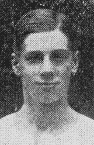

前`赫克斯姆童军团长`罗伯特·巴蒂（30 岁）在伦敦轰炸期间担任威斯敏斯特`防空员`时，因英勇表现被授予了`乔治勋章`。

在搬到伦敦之前，巴蒂先生曾在`赫克斯姆业余戏剧协会`（Hexham Amateur Stage Society）担任舞台调度，并在伦敦担任剧院工程师，对灯光特别感兴趣。他服务过的对象包括著名制片人 C.B. 柯克兰（C.B. Cochran）和著名演员南希·普莱斯（Nancy Price）。

### “鲁比逊·克鲁索”式的经历

海军炮手埃里克·罗兰斯（Eric Rowlands，23 岁）来自巴登米尔（Bardon Mill），经历了真正的现实戏剧。他的首次航行在船只被鱼雷击没后结束——他因此过上了鲁比逊·克鲁索的生活。他告诉《快报》（Courant）：“我感觉到船在震动并立即向左舷倾斜，看起来它要翻过来了。我抓了一个装有香烟的包，当我上甲板时，差点被冲走。”

他成功进入了一艘救生艇，并意识到船只沉没时可能被吸入水中。这种情况没有发生，但幸存者遭了机枪扫射，据信那是击沉船只的 U 艇船员所为。他们活了下来，随后进入了另一艘遭遇同样命运的荷兰商船救生艇。那只船只有 20 英尺，挤满了人，根本无法躺下。由于在大海上漂流未知，幸存者每天被限制为两勺水（大约酒杯大小）、两块饼干、少量的罐头牛肉和炼乳。

罗兰斯先生说：“白天我挺享受航行的，但晚上太糟糕了。你无法躺下，天气极冷，我只穿了一件夹克。”

在救生艇上漂了两天后，他们发现了一个岛屿，但没有找到合适的登陆点。在海上又漂了一个晚上后，他们决定让船靠岸，但在进入时撞到了岩石，救生艇破碎。他们设法爬上岸，收集了尽可能多的物资，在吃了一顿饭后，他们在四个晚上以来第一次在岸上睡觉。

他们受到了热烈的欢迎，欧洲人和当地人齐聚在港口，大喊着：“大英帝国万岁！”罗兰兹先生（Mr Rowlands）表示，这些男士出色地度过了他们的难关，除了遭受了严寒和晒伤侵蚀了他们结满盐渍的皮肤之外。他说：“这是一次非常兴奋且有趣的经历，但这种事一生经历一次就够了。”

艾伦山谷（Allen Valleys）遭受的首次轰炸记录于 1941 年 4 月 26 日（周六）深夜临近午夜之际。一架显然迷路的德国空军轰炸机在泰恩代尔（Tynedale）上空盘旋了一段时间，似乎在随机地投掷炸弹。在艾伦山谷，飞机在海阿克顿（High Acton）和诺克谢尔德（Knockshield）农场之间的空地上投掷了 200 枚燃烧汽弹，在索恩利门（Thornley Gate）和毕斯菲尔德（Bishopfield）之间又投掷了 50 枚，但未造成任何伤亡。后来，在该地区还发现了四个装载燃烧汽弹的飞机容器。

前艾伦代尔居民、百岁老人艾伦·史密斯（Allen Smith）记得他叔叔对轰炸的反应。“他们投炸弹的那个晚上，我叔叔——住在辛德霍普（Sinderhope）附近的伯恩富特的埃弗斯特·查尔顿（Everest Charlton）——听到了爆炸声，拿出了他的双管枪，因为他以为德国人过来了。他带着妻子和守在一起，准备射掉第一个出现在花园小径上的德国人——幸运的是那天晚上没有人路过！”

1941 年晚些时候，艾伦山谷再次发生了一次轰炸，时间是 10 月 12 日（周日）。几架从曼彻斯特轰炸后返回的德国轰炸机选择泰恩河峡谷（Tyne Gap）作为返回路线，这条路线经常用于对默西赛德郡（Merseyside）和克莱德赛德（Clydeside）的袭击。晚上 10:51，东北地区发布了灯光预警，随后在晚上 11:05 响起了警报。尽管战争期间艾伦代尔（Allendale）或艾伦海德（Allenheads）没有防空警报器，但该地区有几个警报器，其中包括位于赫克斯姆（Hexham）的一个，在安静的夜晚，跨越整个山谷都能听到。

晚上 11:25，一架飞机投下了一枚炸弹，落在艾伦代尔西西英里基恩利（Keenley）奥斯特利农场（Oustley Farm）的一个采石场里。这是一个巨大的炸弹，形成了一个直径 30 英尺、深 20 英尺的坑。爆炸导致农场的窗户和一扇门受到轻微损坏。前艾伦代尔居民朱·沃克（June Walker）在战争爆发时只有三岁，但她还记得父亲带她去看过炸弹造成的破坏。“我记得去看炸弹坑，因为我父亲是民兵队（Home Guard）的成员，他带我一起去的，”她说。

## 武器周 (War Weapons Week)

泰恩代尔地区通过国家储蓄运动每天节省 1000 英镑，自敌战爆发以来，该地区已为战争努力贡献了超过 50 万英镑，并筹集了 5000 英镑购买了自己的“喷火式”战斗机。然而，当计划在 1941 年 4 月 26 日至 5 月 3 日举行“武器周”时，该地区准备投入更多，是在七天内达到惊人的 60,000 英镑。据称，每筹集的六便士就能买一颗重机枪子弹，因此将成为希特勒棺材上又来的一颗钉子。

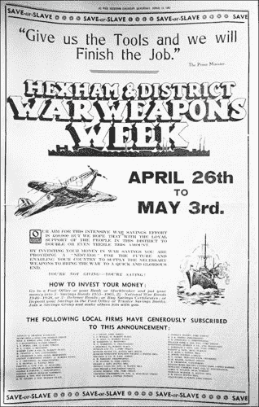

1941 年春季，数十家赫克斯姆企业支持了赫克斯姆地区武器周。

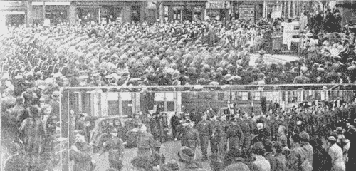

在尤斯塔斯·珀西勋爵（Lord Eustace Percy）启动赫克斯姆武器周时，挤满了赫克斯姆市场广场。

陆军部的购物清单从一艘战舰的 800 万英镑到一艘航空母舰的 300 万英镑，从一把韦伯手枪的 4 英镑 10 先到一枚手榴弹的 4 先——更不用说那些六便士的机枪子弹了。

这一周从镇东部的迪尼公园（Dene Park）橄榄球场游行到市场广场，大量的人群欢迎了在军乐队带领下的士兵、民兵队、辅助消防队、红十字分遣、防空人员（ARP）和其他民防人员的到来。致礼的是洛夫图斯·贝茨爵士准将（Brigadier General Sir Loftus Bates），由爱德华·里德尔准将（Brigadier General Edward Riddell）陪同。武器周组织者尤斯塔斯·珀西勋爵向群众表示，战争每周花费 5000 万英镑，这种资金不能仅靠税收。还需要以储蓄形式提供的额外自愿捐款，这些可以在战争结束后兑换。

很快很清楚，目标是刻意保守的，因为在活动的第一天就筹到了 90,856 英镑，仅该镇的银行——巴克莱斯、米德兰、莱莱德斯、马丁斯和国家省银行——每家就承诺了 10,000 英镑。

活动开始四天后，总额超过了 150,000 英镑，最终总额为 236,959 英镑 19 先 11 便士——几乎是目标的四倍——这获得了财政大臣金斯利·伍德爵士（Sir Kingsley Wood）的热烈感谢信。赫克斯姆地区武器委员会主席安东尼·埃默森（Anthony Emerson）补充道：“这表明全格兰的心脏如既往一样坚定忠诚。”

## 良心拒绝者 (Conscientious Objectors)


来自奥特伯恩（Otterburn）的林业工人约翰·沃尔顿（John Walton，25 岁）因未根据《1939 年兵役法案》注册而被贝勒林汉治安法庭罚款 5 英镑。他告诉法庭，他没有注册是因为他是一个良心拒绝者，他认为战争“完全没有必要”。他拒绝缴纳罚款，当他询问是否有其他选择时，法官席长 G.D.安德森少校（Major G.D. Anderson）告诉他：“没有其他选择；你将被强制罚款，并给你一个月的时间缴纳。你对这一问题的个人观点对我们没有影响。《兵役法案》和任何法律一样都是该国的法律，你很清楚自己没有遵守那部法律。我们不关心你的观点，因为作为这个国家的公民，你必须遵守它的法律。”

沃尔顿没有交罚款，两个月后被带回法庭，他告诉法官他仍然没有交罚款的意愿。他被关了一个月，并告诉法庭：“是六个月还是六年，这并不重要。”

## 防空措施 (Air Raid Precautions)

防空措施继续占据地方当局的精力，赫克斯姆地区议会（Hexham UDC）向内政安全部申请拨款，用于提供家庭防空避难所。H.H.达尔林顿（H.H. Darlington）议员说，虽然赫克斯姆有一些优秀的公共防空避难所，但很少有人使用它们，“因为他们不愿在晚上离开温暖的床去进避难所”。

海登桥（Haydon Bridge）对敌机威胁来时发出警报的方法也深表不满，这种方法涉及到首席防空警员 E·基尔索普先生（Mr E. Kirsopp）在村子里到处奔跑，敲响他的警员们的门。尽管一个警报器只需 20 英镑，但向诺森伯郡防空委员会申请警报器的请求一再被拒绝。一位当地议员问：“我们现在不是时候结束这场闹剧，告诉郡议会不要在解释防空措施时那么吝啬吗？”

约翰·理查德森法官（Judge John Richardson）在英国军团科布里奇奇（Corbridge）分支组织的一场烟草会上对德国民族发表了蔑视。他说：“对德国人说好话固然很好，但我从未见过一个好的德国人——至少在 1938 年我在德国的时候。对希特勒类型和性格的人表现出如此奴性忠诚的人，是不可能有好处的。为了欧洲，那种人不可信，德国必须永远被压制。”

对于泰恩代尔（Tynedale）的狩猎协会来说，这是一个坏消息：他们收到一项政府新指令，必须将猎群中的猎犬数量减少到战前水平的六分之一。泰恩代尔将被要求每周仅活动两天，而不是传统的四天，且猎犬数量将减少到八个半对或九对。一位猎头人表示：“自从战争开始以来，狩猎活动一直在为了国家利益做出牺牲。这项新规定将极大限制我们的活动，但与数百万为了赢得战争所付出的牺牲相比，这算不上什么。”

## 醉酒、扰乱秩序和其他犯罪

澳大利亚帝国军成员在周六晚上来到赫克斯姆（Hexham）的行为，日益引起了赫克斯姆法庭的关注。在对一名澳大利亚人因醉酒和扰乱秩序处以 2 英镑的最高罚款后，法庭主席约翰·布鲁格登（John Brogdon）议员警告说，任何更多不听话的闹事者将被送往监狱，且没有罚款的机会。当地警察警亭长威廉·古德费尔（William Goodfellow）告诉法庭，澳大利亚人在醉酒问题上的表现远低于制服人员应有的标准。警察在午夜或凌晨 1 点前将他们赶出镇非常困难，而且他们的行为对驻扎在该地区的许多其他士兵是不公平的，而那些士兵没有引起任何投诉。该士兵部队的一位军官说：“这种情况让我们感到非常困扰，因为我们非常看重自己的名誉。”

当月晚些时候，法官们拒绝为赫克斯姆的一场为海外联盟（Overseas League）筹字的舞会发放晚间饮酒许可，理由是存在混乱的风险，并提到赫克斯姆附近驻扎着来自不同国家的大量士兵。由于下班士兵扰乱秩序的行为增加（包括打破和投掷玻璃杯），警察反对了这项申请。

出现在法庭的不仅仅是澳大利亚人。一名在本周早早些时候击落了一架德国飞机的波兰飞行员出现在被告席，被指控盗窃了一只价值 12 先令的艾尔伯里鸭，那只鸭属于一名当地警察。这名飞行军士穿着全套飞行装备出现在被告席，且不会说英语，因此需要翻译服务。逮捕警察接受了该波兰人偷鸭并不是为了食物，而是想将其作为吉祥物，案件被驳回。然而，该飞行员被命令支付 5 先令诉讼费，但法庭的一名成员表示，考虑到该男子击落过一架德国军飞机，他将自掏腰这笔费用。

另一位匿名陆军军官也出现在法庭，被指控在没有许可的情况下在科布里奇（Corbridge）泰因河钓鲑鱼。当被执吏询问时，他问道：“这就是我们战斗的意义吗？我以为钓鱼是免费的；这太琐碎了。”尽管他告诉法庭他习惯在苏格兰钓鱼（那里不需要执照），但他被罚款 15 先令，并承担 5 先令诉讼费。

## 赫克斯姆辅助消防队调查

1941 年中期，赫克斯姆辅助消防队（Auxiliary Fire Service）的活动引起了赫克斯姆地区委员会（UDC）的极大恐慌，有人要求因涉嫌盗取单位消防车的汽油而解雇所有全职人员。人们对消防车消耗的燃料量过高表示担忧，委员会官员的调查显示，在 4 月 5 日至 5 月 20 日期间，该车辆仅行驶了 46 英里——但提取的燃料量却是 44 加仑。检查显示，泡沫设备的一根管子被用来将汽油从消防车抽吸到一个容器中。据信，在车辆执行任务派遣期间，其汽油箱曾被完全抽干。

在要求解雇辅助消防队所有全职成员时，委员会副主席乔·库伦（Joe Cullen）表示：“我们至少可以说，在看护和管理这种珍贵物资时存在着完全的疏忽，而这种物资是我们油罐车士兵们用血、汗和生命带入这个国家的。你们可能觉得我的建议非常激进，但极端的恶行需要激进的对策，在目前的情况下不允许这些事情发生。”

警方曾被报案，但事实证明要识别真手是不可能的——就像在其他几次辅助消防队库存的燃料莫名其妙消失时一样。

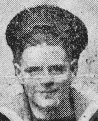

## 军事荣誉与食品供应

来自赫克斯姆的代理军士诺曼·P·麦基（Norman P. McKie）在索马里号舰（HMS Somali）于执行北极护航任务遭鱼雷袭击后自愿留守，获得了战后表彰。在几乎所有士兵离开船后，他作为蒸汽小组的一员留在船上。记载写道：“麦基军士在船沉没前的三个半小时内表现出的热情、勇气和对职责的忠诚，是所有同在人员的典范。”

其他议员同样担心燃料的损失，但质疑在国家危机时期辞退训练良好且有能力的消防员是否明智。解雇提议被拒绝了，但大家同意必须加强纪律和安全。

在食品方面，西红柿极其短缺，以至于店主为有固定订单的老客户预留，这导致一位家庭妇女询问：“这意味着工人阶级的人买不到西红柿了吗，因为他们负担不起固定订单？”

赫克斯姆店主评论道：“当你带着西红柿从市场回来时，人们为了抢几乎要把你的窗户撞破，如果你拒绝，你就真的惹麻烦了。”

## 水果保存计划

制作果酱的糖一直是争论的，但果酱制作被交给了泰恩代尔妇女协会（women’s institutes）负责。整个地区设立了剩余水果的保存中心。该计划专门用于保存那些本会被浪费的水果，并鼓励水果生产者像战前那样自行食用、装瓶或将水果制成果酱。只有剩余产品才能带往各个中心，价格由政府制定。醋栗的最高售价价为每百英磅 30 先令，覆盆莓为 47 先令 6 便士，黑醋醋果为 90 先令，草莓为 75 先令，越橘莓为 50 先令。

该计划在贝林汉姆（Bellingham）启动，但最初被证明大大不人意，因为没有水果供应。该计划生产的第一批果酱是在斯托克斯菲尔德（Stocksfield），在那里，Bywell 和 Branch End 协会的女士们制作了 100 磅的醋栗果酱，这些水果是以每磅 3.5 便士的固定价格购买的。除了清洗和煮熟水果外，女士们还承担了清洗和消毒当地小学生为计划收集的 2000 多个果酱罐的任务。

其他中心也效仿此举，科布里奇、迪尔斯顿（Dilston）和斯塔肖（Stagshaw）联合妇女协会生产了 154 磅的大黄和醋栗果酱，迅速被当地店主抢购。阿伦代尔老男爵夫人（Dowager Viscountess Allendale）将她在 Bywell Hall 的厨房租给了这项事业，生意非常兴隆。

泰恩代尔水疗中心（Tynedale Hydropathic Establishment）的居民感到震惊，当他们从晚饭后起身时，发现接待处贴了一张告示，称酒店正在出售中，他们必须寻找替代住宿。虽然细节很少，但人们理解出售是迫于所有主的，因为该建筑正被政府征用作为儿童疗养。

许多居民已将酒店作为永久住所，有些人是因为他们在英东北部其他地方的家被炸了，无处可去。

“水轮号”已运营了约七十年，其过去的宾客名单包括第一任工党首相拉姆赛·麦克唐纳和他的女儿伊什贝尔，以及电影明星查尔斯·劳顿、埃尔莎·兰彻斯特、道格拉斯·菲本波克斯二世、雷蒙德·马西、伊芙林·莱叶和多迪·史密斯。

1941 年出现在赫克斯姆法庭的较不寻常案件，是一个男子被指控在科尔布里奇到哈尔特威斯路上行走时虐待大象。科尔布里奇的兽医弗雷德里克·克鲁德斯开车沿路行驶时，看到来自伊尔克利的养象员艾沃沃·戈登·罗斯骑在那头动物身上。他正用一根非常沉重的灰木棍猛抽它，并时不时用工具的钢尖戳大象的耳朵后面。当兽医对罗斯这种他认为是极度残忍的行为提出抗议时，罗斯只是笑了笑。

到达赫克斯姆后，克鲁德斯先生向警察报告了他所见的情况，结果导致皇家防止虐待动物（RSPCA）对罗斯提出了虐待指控。一名证人告诉法庭，大象在被击或被戳时并没有尖叫或长鸣，但它“看起来非常累”。

罗斯告诉法庭，他已经做了十年大象训练员，如果他按照克鲁德斯先生暗示的方式虐待动物，动物就不会在场上为他表演了，那个表演包括让一个小女孩把头伸进大象嘴里。案件被驳回了。

### 海上险

潜艇威胁再次来袭，当来自赫克斯姆的三等军官德里克·吉尔克斯特在船上时，船被西非洲海岸附近的一支潜艇编队击沉。这位赫克斯姆女王伊丽莎白文法学校的校友在救生艇上度过了三十天——这是该类型航程中无一人伤亡的记录。吉尔克斯特告诉《库兰报》：“大约晚上 10 点左右，我听到‘嗖’的一声和‘砰’的一声，就知道我们被击中了。”

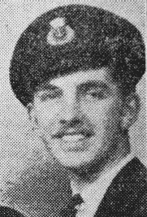

赫克斯姆的三等军官德里克·吉尔克斯特在船只在非洲海岸被潜艇鱼雷袭击和炮击后，在开放救生艇在海上度过了 30 天。

救生艇放下了，吉尔克斯特发现自己负责一艘由九个欧洲人和 21 个印度人组成的船只。随着黎明破晓，他们意识到自己与另外两个救生艇失散了，他们看到的船只最后的迹象是远处燃烧时发出的微弱红光。仅凭一个罗针和一个粗略自制的六限仪来计算纬度，吉尔克斯特设定了大致航线，开始了一段艰辛的划船和航行旅程。

食物和水有限，从第一天起就实施了严格的配给。半块船用饼干和三分之一杯水是基本比例，每天额外增加一茶匙浓缩奶。船上少量的罐头牛肉每三或四天分配一次，而一罐沙丁鱼和一些鱼酱则节省着吃，直到被营救的那一天才用完。频繁的暴雨补充了水水。

吉尔克斯特说：“这是一段非常艰辛的经历。我们变得越来越虚弱，最后发现很难站立。我们只看到鸟类、沉骸和浮碎片，以及大量的鲨鱼。由于船尾有严重的泄漏，印度人轮流抽水。晚上我们玩牌牌打发时间。白天热得令人无法忍受，我们许多人都在中暑，但晚上，特别是在大雨过后，我们只是坐在发抖。”

谈到船员，吉尔克斯特说他无法奢求更好的同伴了，但他表示：“我们相当担心当地人无法承受这种压力并引起麻烦，但他们表现得非常好。有时情绪会变得有些紧张，但尽管有心理压力，从未出现过任何裂隙。我们从未怀疑过能安全到达。我们总是确定会被营救，很多对话都是关于我们回去后要做什么。”

曾发生过一次假报警，船员在远远的地平线上看到一道光，并点燃信号弹吸引注意，但最后当光变得越来越亮并在空中升得越高时，才发现那是一颗星。

当一名印度侦察员发现船只的烟雾时，他们最终被营救了，他们划过船只的船头以吸引注意。他们被带往西非洲的一个港口，一些船员需要医疗治疗，但没有留下后遗。吉尔克斯特评论道：“回想起来，我很享受这段经历，但这是一段无人会希望再次经历的经历。在持续期间，它只能被描述为地狱。”

这本可能在 1941 年克里特岛战役期间，英国巡洋舰`HMS Fiji`号被德国俯冲轰炸机炸成残骸中结束。但一名年轻的中尉紧紧抓住船上绞机的一个横杆，设在仍在遭受德国空军炸弹和子弹扫射的危险海域中幸存了三个小时。那位年轻的海员是罗伯特·约翰逊，他不仅活了下来，后来在英国银行创造了辉煌的事业，并成为泰恩代尔委员会的主席，并一直活到 99 岁的高龄。

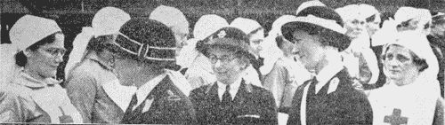

1941 年 5 月，伦敦自愿救助分部首脑贝瑞尔·奥利弗爵士在科尔布里奇检查英国红十字协会赫克斯姆分部的护士。

他于 1916 出生于惠特利湾，是双胞胎中较小的一个，但遗憾的是，他的兄弟布莱恩在 41 岁于意大利多洛米蒂山脉步行时不幸去世。年轻的罗伯特在泰恩茅斯学校读书，后进入了纽卡斯尔文法学校。

他的职业生涯始于纽卡斯尔的保险和银行业，在获得提名前往针线街银行之前，他在 1936 年在伦敦工作。然而，伦敦的生活成本并不吸引他，他很高兴被派往纽卡斯尔分行，在那里，随着欧洲形势恶化，他在`卡里奥珀`号上加入了泰恩海军海军预备役队，成为一名少尉。

1939 年 8 月，战争爆发前一个月，他被命令加入印度洋群的一艘皇家海军巡洋舰——但在被允许之前，他必须安排人接替他的工作。他花了一周培训一个名叫琼的女孩，尽管在接后的六半年里他们只见过了一面，但他仍记得她灿烂的笑容和温柔的性格。他们随后结婚，生活了 68 年。

他首先在`曼彻斯特`号巡洋舰服役，参与了 1940 年挪威的入侵和撤离，并参加了意大利舰队被击退的帕托角海战。随后是克里特岛战役的惨伤经历，当时他是皇家海军轻巡洋舰`菲吉`号的火炮兵官，该舰在失去`坎达尔`号和`金斯斯顿`号驱逐舰后不久仍在执行任务。这些船在反空弹耗尽之前继续战斗，击落了一架攻击机并损坏了两架，成为了德国空军的活靶子，根据当时的描述，敌机数量多到天空变黑。

在被几架梅塞塞 F109 战斗机击中后，`菲吉`号失去了动力并停了下来，随后被容克斯斯 888 俯冲轰炸机投下的三枚炸弹命中。在下达撤离命令后不久`菲吉`号翻覆沉没，罗伯特被抛入水中。他设法抓住了一个绞机横杆，在另外两艘船在投放救生筏后撤离期间，他抓着那个横杆坚持了几个小时。

`坎达尔`号在夜色掩护下返回并救起了了昏迷但仍抓着横杆的罗伯特。他是 523 名幸存者之一，但当船沉入海底时，有 241 名士兵遇难。

罗伯特后来说，当他在吊床上醒来时，由于喝了太多`坎达哈尔`号船员们灌的朗姆酒，他以为自己已经死掉并升了天堂！

他作为幸存者回到家乡赫克斯姆（Hexham），但随后加入了`肯特`号和`安森`号恢复战斗，护送前往俄罗斯的极地护队；之后加入了`阿伯康姆比`号，该舰在为盟军登陆法国做准备时中扫雷。他还在法国的曼通（Menton）短暂地上过陆地，利用他的火炮手技巧指挥海军火力攻击由德国占领的意大利边境地区。

当他在 1946 年退役时，曾两次获得战报表彰。

五名年龄在 9 到 13 岁的普鲁德霍（Prudhoe）男学生因为对当地警察约翰·L·里查森森（John L. Richardson）的花园大肆破坏，违背了国家性的“为胜利而挖掘”运动，感受到了赫克斯姆少年法院的愤怒。这名警察整个上午都在`展望露台`（Prospect Terrace）的花园里工作，但当他四个小时回来时，篱笆上被开了两个洞，150 个洋葱被拔起并带走。两排长 8 码的豌豆被拔起，三排胡萝卜和春葱被毁到无法使用，一床夏日甘菜被踩踏得一完完。他苹果树的几根树枝也被折断了，苹果也被偷了。

在进行调查时，里查森警官听闻曾有一个小女孩在普鲁德霍家挨户售卖洋葱，当他与她交谈时，女孩说洋葱是她哥哥给她的。她哥哥和他的朋友们被捕，所有人均被指控故意破坏财，金额为`£3`。

法庭主席 J.M.赫斯洛普告诉他们，在战争期间破坏园艺产品确实是一件非常严肃的事情。他们每个人被命令支付 12 令的赔偿金，并签署保证书在两年内以`£1`的价格表现良好。

## 第四章

## 女性帮助扭转局势

人们对女性在现代战争中所扮演的角色有许多讨论，但认为二战期间国家的女性只是顺从地留在家里擦着手帕等丈夫从前线归来的观点是错误的。许多女性曾作为`空军女兵(Wrens)`、`WAAFs`或`陆军队(ATS)`服役，其中包括未来的伊莎莎白二世女王，但仅担任支持角色。

人们有时会忘记另一支女性力量在英国击胜强大的德国方面发挥了同样重要的作用。这就是女子陆军（Women’s Land Army），这是一支专门创建的力量，旨在当许多男性外出期间保持国家农场的食物产出。许多农场女孩来到泰恩代尔（Tynedale），她们掌握农作复杂技巧和艰苦劳作的战时努力，在来自庞特兰德（Ponteland）的缪里尔·索博（Muriel Sobo）所编写的书中《1940-50 年诺森伯郡农场女孩》中得到了生动描写，她的家族农场在战后立即包含了一个刚空出的陆军宿舍。

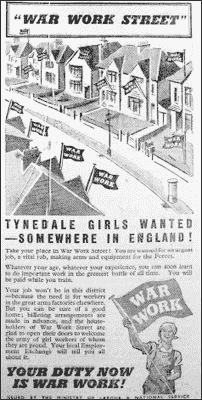

正如这则针对泰恩代尔女孩的广告所示，全国各地都在招收从事战争工作的女性。

缪里尔完美地描绘了那群困惑的女孩，其中一些人从未离开过他们的矿业村或其他地区，另一些人则来自优越的背景，所有人都投入到极其费力的农活劳动中。

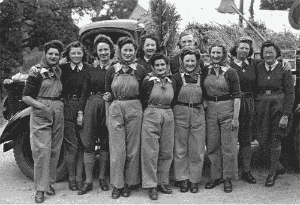

穿上工作服准备好工作，这是驻扎在泰恩代尔的一些陆军女孩。

在海登桥（Haydon Bridge）、科尔韦（Colwell）、斯托克斯菲尔德（Stocksfield）和斯坦姆福德哈姆（Stamfordham）设有陆军宿舍。海登桥宿舍是专门建造的，但没有电灯，通过休息室两端的两个焦煤炉取暖。第一位管理员是来自哈尔特威斯特（Haltwhistle）的缪里尔·弗莱明（Muriel Fleming），她是一位知名的当地议员，非常保护她的女孩们，并确保肉铺只为她们提供最好的肉。

斯托克斯菲尔德宿舍位于`Painshawfield 路`的尽头，它的许多特征之一是一个木制装置，上面挂着挂羊毛袋的橡胶手套——用于教女孩们挤牛奶。

有些女孩带着对农生活的浪漫幻想加入陆军，认为这种生活只是在阳光明媚的草田间散步，周围环绕着嬉戏的小羊和帅气的农夫，但残酷的现实大不相同。

莎拉·奥格（Sarah Ogle）是一个典型的农场女孩，她在 19 岁时从药店工作直接来到海登桥的宿舍。第一天，她乘坐`早上 7.15`的巴士前往奥伦代尔（Allendale），在伯特通格斯的亨德森商店工作了一整天的铺肥工作。第二天，她负责抹石灰——但石灰已经像混凝土一样硬了，必须先用手弄碎。在另一块农场干了一天的脱谷后，莎拉接下来的三天里都在田里分土豆。周末回家时，莎拉宣布她不再打算回去了——结果被妈妈告诉，既然她已经洗过并熨好了制服，最好还是回去干吧！

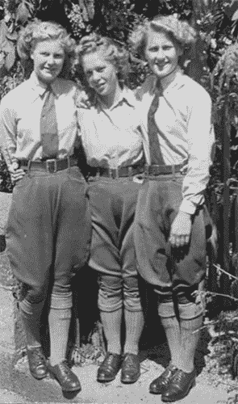

三名陆军女孩在职责之隙短暂休息。

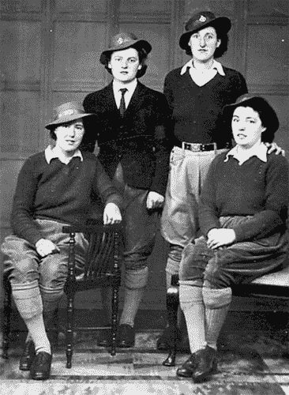

软帽和裤子是当时的制服。


莉莉·凯里（Lily Carey）加入陆军是为了逃离一段破碎的感情和家庭生活的束缚，被派往斯坦姆福德哈姆宿舍。第一天，她在雪地中骑了八英里路，在没有任何雨衣的情况下前往莱尔（Ryal）的一座农场，结果到达后被告诉农夫改变了主意，不需要她了。她别无选择，只能转身骑回去。

陆军有一支名为`木工队(Timber Corps)`的支队，在森林中工作，为仍然繁荣的诺森伯郡矿井提供木柱。陆军徽章上的麦穗图案被云杉树标志取代，普通的帽子也被贝雷帽取代。木工女孩玛丽·海宁（Mary Haining）在惠特利小礼拜堂（Whitley Chapel）的森林工作时结识了一个特别的朋友——一只红松鼠，将其驯服并住在她的外套里。她甚至在回纽卡斯尔（Newcastle）家里时带了松鼠，结果在一个潮湿的冬夜，它在拥挤的公交车上被压在外套下，最终导致松鼠死亡！

陆军女孩负责种植基尔德森林（Kielder Forest）的大片土地，其中十个人住在基尔德村的一间小屋里。农场女孩的主要职责之一是除萝卜草，为羊提供冬季饲料，不得不说，她们并不总是做得对。在被要求在植物之间留出锄头的宽度时，一个女孩选择了`6 英尺`长的工具长度，而不是`6 英寸`的刀刃！

农场不是胆小者的地方，因为有大规模捕杀老鼠的记载，一次可以杀死 200 只这种鳞尾类动物，每个尾巴奖励一便士。其他来自优越背景的女孩不习惯诺森伯郡方言，但由于礼貌，没有告诉农夫她们完全听不懂他们关于“割大裤子”或用肚脐塞蚂蚁的话。一个女孩不得不面对放气严重的马，以至于笑得湿了内裤。

战后引起了骚动，因为事实很清楚，武装部队的其他女性工资更高、获得的衣服票证更多，并配内衣，而陆军女孩完全是二等公民。不仅没有勋章、奖金或培训，她们还必须归还制服。

一些抗议的诺森伯郡女孩被传到伦敦参加纪律会议——她们的惩罚是被派往彭斯斯（Penzance），而他们非常喜欢那里！

住在 Acomb 米勒斯菲德（Millersfield）的莎拉·贝尔（Sarah Bell）在 1939 年以前在里兹代尔（Ridsdale）担任女仆，并迅速志愿加入了陆军（Land Army）。她的第一个驻地是位于贝尔赛（Belsay）附近的东肖夫农场（East Shaftoe Farm）。她每周工作七天，挤奶、喂牛、驾驶拖拉机——她还成了精练的马犁手。不过她也有时间小憩一下。每周，女孩们都会去当地的村会堂（通常在贝尔赛或柯克韦尔普灵顿（Kirkwhelpington））参加周五晚舞会。在那些年里，她们建立了深厚的友谊，对贝尔夫人来说也是如此。她在东肖夫农场的陆军战友玛丽·汤森（Mary Thompson）成了她的好朋友，后来还当了她的伴娘。

不过，贝尔夫人对某些社交经历并不感冒。有一次，陆军的女孩们聚集在莫普斯（Morpeth）领取代表其服务等级的菱形别针，这就像士兵的条纹一样。在百般劝下，她最终被说服和他们一起去一家酒馆庆祝。当时她才 25 岁，这是她第一次进酒吧。她说：“我从小就不习惯那种地方，所以我没待多久——他们中有些人只是为了喝酒。我很怕会有认识我的人走进来。”

她对那些被招来协助收割的临时工动力也留不了什么好印象。“他们以前会从阿辛灵顿（Ashington）来人帮忙摘土豆，每个人都有自己固定的任务量。但是，如果你不盯着他们，他们就会把自己的份儿也推给你做。阿辛灵顿的那群人真是奇群魔种！”

海克斯姆（Hexham）的议员道格拉斯·克利夫顿·布朗（Douglas Clifton Brown）在镇上的一场陆军集会上赞扬了陆军女孩的工作，并表示，这些陆军女孩的重要性与食品运输船的船员或护卫运输队的船只不上下。虽然他并不希望轻视空军妇女队（WAAFs）在预测器上的工作、陆军辅助队（ATS）在炮位上的工作以及皇家海军女子辅助队（WRNS）在其他战场的工作，但在许多情况下，她们所做的是与战前完全相同的工作。许多陆军女孩承担了对她们来说完全全新的工作，而且这些工作并不轻松也不愉快。

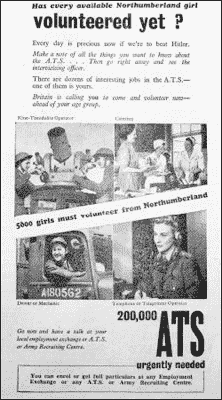

泰因代尔（Tynedale）的女孩被鼓励加入领土辅助队（Auxiliary Territorial Service），为战争努力贡献力量。

女性贡献力量的不仅仅是陆军。1941 年 10 月，曾有一份呼吁泰因代尔的女性加入领土辅助队，这是武装部队设立的一个分支，旨在让女性承担士兵的常规工作，从而释放男性去执行战斗任务。

泰因代尔有 300 个名额等待填补，年龄在 17.5 岁到 43 岁之间，如果是退伍军人则为 50 岁。通过《快报》（Courant），来自劳工和国家兵役部发给当地女性的消息说：“提醒海克斯姆的女性们她们所属著名郡团——皇家诺森郡掷击团（Royal Northumberland Fusiliers）的辉煌战绩，告诉她们不要让家里的男人丢脸。”

基本工资为每天 1 先令 8 士，虽然仍是私薪，但根据承担的工作和通过的熟练测试，可以增加到每天 2 先令 10 士甚至 3 先令 4 士。根据职业，中士每天收入约 4 先令 6 士，而上士士的工资每天可达 9 先令 4 士。

### 火神星飞行员

来自格林黑德（Greenhead）的前《海克斯姆快报》记者伍德鲁·雷恩（Woodrow Raine）军士飞行员本人也成为了新闻焦点，因为他拍了坐在火神星探险 1 号”（Venture 1）战斗舱内的照片，这架飞机是由米德兰银行（Midland Bank）员工的捐款购买的。在写给银行员工的一封信中，雷恩军士飞行员用典型的英帅的英国空军风格写道：

“抱歉没有立即回复，但正如你们想象的，我们最近忙于在法国度假，并与梅塞斯密特 109 战斗机享受茶会。

‘探险 1 号’是一台伟大的机器。我拥有它大约六个月了，在过去的两三周里，我们确实共同度过了生活，它现在几乎可以在法国上自动飞行。它受到的唯一损伤是升降器上的一个弹孔，那是我在法国的一个机场用机枪扫射 109 战斗机时留下的。我在 30 英尺的高度飞过，扫射了两架 109 和一些站在停机道上的纳粹分子。从他们向我射出的火力量来看，一定有人对此有异议，但我们只中了一个弹孔就逃脱了。”

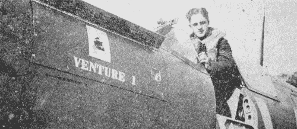

前《快报》记者伍德鲁·雷恩军士飞行员，坐在米德兰银行员工资助的火神星“探险 1 号”上，他在其中‘享受在法国度假并与梅塞斯密特 109 战斗机享受茶会’。雷恩军士于 1941 年 8 月 21 日被击身亡，安葬在加莱海峡（Pas de Calais）的圣奥梅（St Omer）。

遗憾的是，雷恩的运气并不长；1941 年 8 月 21 日，他的火神星在敦刻尔克（Dunkirk）附近被一架 Me109 击落。他被葬在圣奥梅的龙内瑟纪念园（Longuenesse Souvenir Cemetery）。不过他也曾经历过险，他在 1939 年 2 月加入英国皇家空军预备队（RAFVR）成为学员飞行员。他于 9 月 1 日被征召，在完成训练后，于 9 月 19 日在哈沃登（Hawarden）第 7 作战训练单元（OTU）转入火神星，结果起落架塌了，飞机头朝下落地。

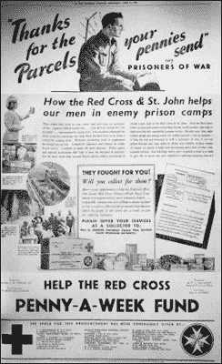

1942 年 6 月发起了一项“每周一分钱”运动，旨在为战俘的红十字包裹募集资金。

在 1941 年的夏末，一群佩满勋章的战老兵聚集在哈德里亚墙（Hadrian's Wall）的阴影下，第 4 团陆军的军士们聚在一起复习现代方法。现场没有讲座，只有关于命令的下达与接收、第五纵和伞兵的危险与方法，以及如何应对他们的讨论。猎弹枪在游击战中的用法得到了演示，但当每个人都发一把猎弹枪时，千疮百孔的靶子表明，这些战壕老兵在使用上不需要指导。

一名正规军官解释了《国王条例》，在进行进一步练习后，他们躺在床上，《快报》的记者注意到：“对于许多人来说，睡帐篷并不是什么很舒服的新奇体验，但在筋疲力尽的一天之后，再加上无穷的轶事和过去的战争经历作为助酒，甜美的睡眠很快降临在他们身上。”

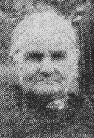

来自拉姆肖·汉斯坦沃思（Ramshaw Hunstanworth）的玛格丽特·皮登（Margaret Peaden），她在 91 岁生日生日时为士兵织袜子。

周末活动对陆军成员来说非常受欢迎，以至于几个人预订了后续课程。

### 周日游戏——有罪还是无罪？

是否允许在周日在普鲁姆（Prudhoe）的公园里玩游戏这一棘手问题，在普鲁姆市政委员会（UDC）的会议上引发了神学分歧。会上牧师罗伯森（（Rev. R.E. Robson）表示支持，而圣约翰普鲁姆和普鲁姆站公会教会以及主日观察协会则强烈反对，后者认为遵守主日比以往任何时候都重要。

这场辩论源于`普鲁德霍工人男子俱乐部`辩论社就该事提出裁决请求后进行的。牧师表示，他认为公园对那些希望在周日玩游戏的人开放完全没有问题。他说：“如果我在我在周日玩游戏，我不会认为自己在犯罪。我认为，如果人们不认同我的生活方式，并且周日不去教堂，那么他们应该被允许根据意愿玩游戏。人们应该被允许在周日随心所欲，仅仅因为公园开放供人玩游戏，并不意味着人们真的会去玩。我不认为公园的开放会对基督教信仰的任何分支造成威胁。”

他得到了米克利市议员阿达·布拉克伯恩（Ada Blackburn）的支持，布拉克伯恩说，《马可福音》中提到“安息日是为人造的，而不是人为安息日造的”。她表示，由于许多人从事战争工作且时间很长，任何户外休闲设施的增加都是受到欢迎的。务实的议员约翰·柯里（John Currey）指出，虽然他对公园每周七天开放没有异议，但需要考虑周日给公园工作人员支付双倍工资的问题，因为公园已经给普鲁德霍的纳税人带来了大量资金。

针对布拉克伯恩议员的圣经引用，J.W.李（J.W. Lee）议员回应道，圣经也提到“六日要劳作，第七日要安息”。他指出，公园在周末已经开放给想要休息和欣赏美景的人，而步行者不希望宁静被玩游戏的噪音所打破。

T·皮尔（T. Peel）议员补充道：“我认为我们过去享受了太多的运动，忘记了生活中更严肃的事情。安息日是为了休息和崇拜而设立的。”除了牧师和布拉克伯恩议员外，议会投票决定不在周日进行体育活动。

赫克斯姆镇副防空警员 G·W·乌姆普比（Mr. G.W. Umpleby）先生对赫克斯姆在应对任何空袭方面表现出的麻痹态度提出了指控。他告诉赫克斯姆轮游国际社成员：“在夜晚的任何时候，炸弹都可能落下，坐在那里说‘这永远不会发生’的时代已经过去了。我们必须做好任何准备。太多的火警员在炸弹坠落时不知道该怎么办。难道我们要因为没有费心照顾它，就把我们所有的东西都送给希特勒吗？”

他敦促所有企业确保至少有三四名员工接受过手摇泵的使用培训，并知道如何处理纵燃弹。

来自城堡路的 39 岁普鲁德霍 39 岁海员托马斯·牛顿（Thomas Newton）获得了一个特别奖，在他船被敌方炸弹击中后，救了三十名船员的生命。他指挥一艘救生艇将幸存者从受损船只上撤离并送到待命的军舰，随后自愿返回沉没的船上救援更多幸存者。他的船友一致认为，牛顿在轰炸期间和之后的表现是模范性的。船主通过给牛顿寄去支票和一封感谢信认可了他极大的勇气。

来自丈夫哈里·麦布莱德（Corporal Harry McBride）下士的一封信，对一位普鲁德霍女性来说是美妙的消息，因为她得知他不仅在德国战俘营中安全无事，还是营地乐队的领队，那里专门为他提供了一架钢琴。

在后方，一群斗殴的澳大利亚人再次出现在法庭，这是由于里丁米尔（Riding Mill）的一家酒吧发生的事件，当时家具被砸碎，四十八只玻璃杯破碎。在被酒吧赶出去后，他们继续在外面打架，并使用令人作恶的淫秽语言造成骚乱。这三名士兵和一名海员被指控扰乱行为并对酒吧造成了 5 镑 9 先令的损失。他们每人被罚款 12 先令，赫克斯姆治安初级法庭主席约翰·查尔顿（John Charlton）告诉他们：“我们很高兴你们作为澳大利亚联邦的客人来到这个国家，我们也知道你们在这里所做的出色工作。然而，我们希望你们行为端正，不要到处把地方涂成红色。”

对煤油使用的限制引起了农村地区的关注，因为那里煤油被大量用于烹饪、照明以及农耕工作。农民们被限制每月只能使用一或两加仑煤油，但在实践中，他们每周需要三四加仑才能完成工作。一位来自海登桥（Haydon Bridge）的农夫抗议道：“如果不提供更多煤油，牲畜的饲养和挤奶将不得不在白天进行，而人们本应该在田里工作。”

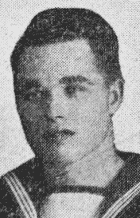

贝灵汉姆的代理士官 R·S·T·斯科特（R.S.T. Scott），在哈夫洛克号驱逐舰服役期间因海上英勇被卓越行为勋章。

一位安兰德尔（Allendale）农民补充说：“没有光，农民怎么给牲畜喂食和挤奶？现在的煤油分配无法满足住房的需求，不用说牛棚了。”

《赫克斯姆报》（The Hexham Courant）被认为救了赫克斯姆遗乔治·里德尔夫人（Mrs George Riddell）的命，她在丈夫去世后搬到了海岸。当她正纠结是去花园和四岁的孙女一起摘水果，还是去厨房开始做饭时，《报》通过邮寄送达了，她决定改读报纸。在她带着小女孩进入餐厅后不久，一架“打完就跑”的袭击机向小镇投掷了一枚炸弹，炸弹落在距离她原本所在的花园仅 30 码的地方。

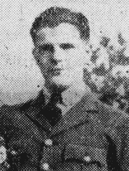

顶尖足球星罗尼·里德尔（Ronnie Pell）来自阿康姆（Acomb），他正在皇家空军印度服役，并入选代表队对阵孟买队的比赛，与六名国际级球员和其他职业球员同场。

几名待在外面的人遇难，爆炸的力量将厨房门从铰链上撕下，对厨房本身造成了严重破坏。里德尔夫人的女儿说：“可以肯定，如果妈妈没有进房间读《报》，她今天就不会活命了。”

赫克斯姆的三名驾驶员因在夜间使用保险杠和踏板未涂白漆的汽车（违反了宵禁规定）被镇治安法官处罚款 1 英至 15 先令不等。

1941 年 11 月 11 日，赫克斯姆 22 年来首次没有在范围内遵守两分钟默哀。现场没有号角宣告纪念活动的开始，当局依靠修道院的钟声来通知人们，这种未通知的程序变更引起了很大混乱。除了英国军团外，很少有公共机构参加纪念活动，城市议会主席也没有献花圈。

### 驱逐与道路死亡

部分煤矿主对工人冷酷的态度遭到了米克利议员阿达·布拉克伯恩（Ada Blackburn）的严厉批评，此前许多家庭从村里的矿矿住房中被驱逐，且没有为他们提供替代住房。她说这是“该地区最大的悲剧之一”，并将流离失所家庭的境遇与城市中被炸毁的家庭相比。她说，有几个家庭被分散了，一个家庭的父母和孩子都住在不同的临时住所处。她敦促米克利煤矿公司修理目前空置的房屋以解决这一问题。

赫克斯姆 Hencotes 发生了一起双重悲剧，一辆军用失控，导致一名军警和一名赫克斯姆的年轻女性死亡。司机`Fusilier George Farrand`因驾驶车辆危及公共安全被罚款`£5`英镑，并承担了`£1 18s 9d`的诉费用。他还被禁止三年内持有民用驾驶执照。

赫克斯姆治安法庭获悉，该卡车在 Hencotes 以超速行驶，撞上了一辆由一名`ATS private`驾驶的静止车辆，导致当时正在与她交谈的`Grenadier Guards`军警`Lance Corporal William Hanley`死亡。随后卡车冲入人行道，冲散了行人，并导致了住在赫克斯姆`Osborne Avenue`的 23 岁年轻女性`Winifred Taylor`死亡。在随后的验尸会上，法医对这一事实的讽刺性发表了评论：`Farrand`无法驾驶私家车，却可以继续驾驶军车。

较不严重的情况下，七名男孩因在街上踢足球被`Hexham Juvenile Court`各罚款`10s`谢令。这场喧闹的比赛发生在他`Beaumont Street`、`Market Place`以及`Abbey`前方。法庭获悉，球偶尔会危险地靠近商店窗，并给行人造成了不便。

一名军用传令兵被带到`Hexham Magistrates`面前，因为他在`Corbridge`的`Howden Dene`以超过`60 mph`的速度骑行机器——且未开启灯。来自`Royal Artillery`的`Signaller Peter Green`每项指控被罚`£1`英镑，但他的指挥官告诉法庭，他认为这是过度积极的表现，而非危及公共安全。传令兵的工作就是不计代价地送达，而`Green`心中怀着军团最优秀的传统。

`1941`年的圣诞节依然是一个光辉的节日，尽管配给和票券要求导致了物资短缺。一位零售商说：“袜子可能不像往年那样种类多样，但肯定不会完全落空。人们对战争玩具的需求非常大，但无法满足这种需求。”

鞋店尤为繁忙，一个有趣的现象是木屐鞋需求的复苏，木屐鞋不受配给限制，且无需票券即可购买。一位靴鞋商说：“如果有更多存货，我确信`Hexham`一半女性都会穿木屐鞋，不仅是在花园里，在街上。”

最严重的短缺是儿童鞋，尤其是幼儿和幼儿儿童的。

## 1942

新的一年随着`Prudhoe` `Beech Grove`的`Leading Aircraftsman John Nattress`（22 岁）的悲剧去世开始的，他为了配合同事慷慨放弃了假期，不幸在一场事故中丧生。战前他是`Prudhoe Cycling Club`的成员，同时也是`St Mary Magdalene's Church`的唱诗班。

## 关于希特勒的严厉警告

`Northumberland` `ARP Services`副主管`Major J. McVicar Munro`也向`Hexham Rotarians`发出了一个严厉的警告，他说，随着战争局势开始不利`Hitler`，这位独裁者将毫不犹豫向英国发动致命的毒气攻击。

他说：

“我深信，当老虎`Hitler`被妥善入网时——这不会持续太久——他将竭尽一切手段对英国发动毒气攻击。然而，只有出其不意，他才能成功；而一个配备了有效呼吸器、充足的二号防毒软膏，并采取了简单但必要的预防措施的国家，对`Hitler`可能发起的任何攻击付之一笑。”

`Major Munro`少尉表示，`Hitlerism`（希特勒主义）不应被视为当下的阶段，而是根植于德国人心理中的东西。他补充道：

“现在的匈奴人与`Atilla`时代的古代匈奴人无异。当我们赢得战争时，德国人会告诉我们是`Hitlerism`的溃毒瘤导致了麻烦。不要让我们相信这一点。`Hitler`起初之所以被允许掌权，是因为军事当局认为他是他们手中合适的棋子。

`Nazism`（纳粹主义）背后的机器拥有运行了几个世纪的同样的齿轮，而这一次，我们必须确保这些齿轮不仅仅是被敲掉了几个齿角，而是被用非常粗糙的锉磨平了。”

## Ossie Chipchase 的磨难


`1942`年1月见了布商`Ossie Chipchase`噩梦的开始，他在16岁时离开学校在布料仓库工作。在1933年萧条年仓库关闭后，他在23岁建立了自己的布料业务。`1939`年战争爆发前，他娶了赫克斯姆的女孩`Dorothy`，两年后被征召入`Royal Signals Corps`当无线电员。他被分配到一个防空小组，该小组于当年11月出发前往面临日本即将进攻的`Singapore`。他在`1942`年1月到达这个`British Empire`的哨所，被分配到`Royal Naval base`附近的营地，随后被转到`Argyll and Sutherland Highlanders`。

1942年2月15日（周日），`Singapore`向`Japanese Imperial Army`投降，`Ossie`被俘。随后他被转到臭名昭著的`Changi camp`附近的一所学校派去修路。然后他被送往`Thailand`开启为期五天的火车之旅，负责修建铁路。食物和衣服极其匮乏，他被迫赤脚生活和工作，只围着一条腰兜布。守卫们经常用竹竿抽打他。

在`2005`年的一次采访中，他说：“在被俘的前18个月里，我的妻子`Dorothy`并不知道我在哪里。日本人对`Geneva Conventions`（日内瓦公约）并不感兴趣，随心所欲。他们没有告知我们在这里。最后我们收到一张卡片，上面有印好的信息：‘我很好，我在领薪工作，或我在医院’。`Dorothy`以前每周写信，但我没有收到那些信。”她甚至根据他失踪推定死亡而收到了`Widow’s Payment Form`。”

但`Ossie`依然活得很好，1944年6月，他被带回`Singapore`准备乘船前往`Japan`。他是船上1200名战俘之一，航行了三个月——险些死在自己人手中。这艘船在`Philippines`的`Manila`海港被美国飞机轰炸。约750名战俘溺水，但`Ossie`游到了舱顶，在艰难挣扎后移开了舱盖，在船沉没前逃脱了。`Ossie`与三名同伴利用舱盖和木板上岸——但他被日本人再次捕获。

随后他被送到另一艘前往`Japan`的船上。其中一艘船沉了，无幸存者，但`Ossie`所在的船到达了日本南部，他在日本城市`Nagasaki`附近的煤矿工作。

六个月后，`Ossie`看到天空出现巨大的光芒——二战中第二枚原子弹落在了`Nagasaki`。战争结束了，守卫逃跑了。一个月后，美国人陆路抵达，`Ossie`被安置在前往`San Francisco`的医院船上。他横跨`US`并乘船回到`England`。

1945年11月28日，在重重困难之后，`Ossie`和`Dorothy`终于在`Newcastle Central Station`的行人天桥上重聚了。

多萝西维持着布料店的经营，奥西很快回到诺森伯兰郡的各个村庄和农场继续从事他的贸易。这对夫妇于1946年搬到赫克斯姆（Hexham），幸福地生活了59年，直到多萝西去世。奥西在1969年退休，直到90多岁时仍在使用驾驶汽车。

《赫克斯姆快报》（`Hexham Courant`）中“弗雷德爷爷的儿童角”的成员们与地区妇女协会、妇女志愿服务团（`Women’s Voluntary Service`）及其他机构合作，在灌木丛中搜集蔷薇果。他们获悉全国范围内的努力收获了200吨这种橙色的果实，果实富含能够对抗感染的维生素C。按照每磅300个果实的计算，这意味着全国从带刺的枝条上采摘了约1.43亿个果实，足以制作60万瓶糖浆，这些糖浆每盎司瓶装出售，6盎司1便9士，或8盎司2便4士。每天喝一勺就足够让孩子获得一半所需的维生素量。

一个来自普鲁霍（Prudhoe）埃奇韦尔（Edgewell）的骗子找错了对象，试图买一张抽取肥鹅奖的彩票。这位潜在买家是一名休假警察，当被问及是否想要票时，他说他全都要，并逮捕了那个街头小子从事非法彩票。他在赫克斯姆初级法庭（`Hexham Petty Sessions`）被罚款10士林。

在同一处法庭上，一名因汽车保险杠未涂白漆而被罚款的司机抱怨道，在圣诞节前夜午夜，警方对赫克斯姆的一处停车场进行搜查后，他收到了传唤。他表示搜查的时机选择得不好，这与这一年之中惯有的善意精神和唱诗歌氛围形成了鲜明对比。

两名男子因滥用汽油被罚款各5英镑——其中一人使用他的工厂家具货车从赫克斯姆开车到五英里外的汉姆绍（Humshaugh）参加舞会；另一人则非法开车从科布里奇奇（Corbridge）开三英里去赫克斯姆看电影。

尽管他们被捕获的时间不同，且频繁被转移到不同的战俘营，但两名科布里奇的士兵在同一个营地相遇了，两个人的家庭都收到了家中的圣诞信片。在同一个营地，还有皇家工程师团（`Royal Engineers`）的H.布罗迪·科克莱恩中尉、皇家炮兵（`Royal Artillery`）的芬尼·迪恩·汉姆德中尉，以及皇家诺森伯兰掷弹团（`Royal Northumberland Fusiliers`）的哈特威斯尔肯尼斯·克拉克少校。

汉姆德中尉在圣诞信片中报告了这次会面，他在信中说自己很好，并转告科布里奇的朋友。他还报告说营地有一支很好的舞蹈乐队和一个交响乐团。

## 军舰周与泰恩代尔号

1942年2月，“赫克斯姆军舰周”启动，该地区被赋予集资20万英镑的任务以赞助皇家海军驱逐舰泰恩代尔号（`HMS Tynedale`）。这艘驱逐舰并未直接以该地区命名，但作为一艘猎人者级（`Hunt` class）舰艇，它以“泰恩猎队”（`Tynedale Hunt`）命名，该猎队的猎犬养在科布里奇附近的斯塔肖（`Stagshaw`）。船的军官舱里挂着一只诺森伯兰狐狸面具，是由猎队主人送给船的。

募捐通过穿过镇子的盛大游行启动，由民卫队（`Home Guard`）乐队领队，包括民卫队、军事和民防运动以及国家消防局、红十字会、空军训练团、妇女土地军、童子军和女童子军的代表。

整个地区举行了众多活动，包括捐款、音乐会和纸牌牌赛；而阿伦代尔附近的肯恩利议会学校（`Keenley Council School`）的学生们筹集了93英镑13士——折合每人5英镑10士2便士——其他学校也筹集了类似的金额。

在一周忙碌的筹款后，组织者召集了四位当地战争英雄，正式揭晓了筹集总额——三等军官德里克·吉尔克里斯特MBE（`Third Officer Derek Gilchrist MBE`）、飞行军官哈罗尔德·罗布森DFM勋（`Pilot Officer Harold Robson DFM`）、飞行军官亚瑟·加威尔韦尔DFM勋（`Pilot Officer Arthur Garwell DFM`）以及罗伯特·巴蒂GM勋（`Robert Baty GM`）——当公布在武装力量日存入了268,476英镑时，现场爆发了巨大的掌声。到周末结束时，最终数字为325,099英镑。

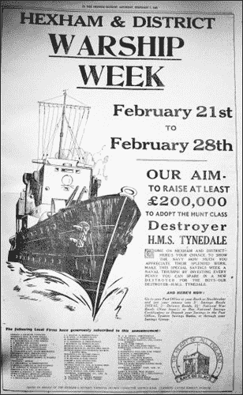

当地企业对1942年赫克斯姆军舰周的启动给予了巨大的支持。

在问及想要从新获得的“家庭”什么样的舒适时，泰恩代尔号的船员向赫克斯姆妇女协会（`Hexham Townswomen’s Guild`）索要了袜子、毛衣、足球鞋、扫雷手套、飞镖板、桌游、长棋板、书籍和纸牌——以及一架钢琴以协助船上的戏剧表演。一周内，他们收到了赫克斯姆海雷斯（`High Reins`）莱斯利·曼夫妇（`Mr and Mrs Leslie Mann`）赠的钢琴，他们的独子在几个月前服役舰队航空兵时牺牲了。

泰恩代尔号于1939年4月11日从格拉斯哥克莱河边的亚历山大·斯蒂芬父子公司（`Alexander Stephen and Sons`）订购，于1939年7月27日开工。她于1940年6月5日下水，于1940年12月2日服役，总造价42.5万英镑。她排水量904吨，装备四门4英寸防空炮和八门较小火炮。

泰恩代尔号于1939年4月11日订购，于1939年7月27日铺骨。她于1940年6月5日下水，于1940年12月2日服役，总造价42.5万英镑。她排水量904吨，装备四门4英寸防空炮和八门较小火炮。

泰恩代尔号主要负责护航任务，最初作为驻扎波尔斯茅的第一驱逐大队（`First Flotilla`）的一部分，但在1941年3月11日，她遭受了德国空军（`Luftwaffe`）对波尔斯茅码头的袭击而受损。

泰恩代尔号的高光时刻出现在1942年3月27日，当时她作为护卫之一参加了塞内尔袭击，装满爆炸物的驱逐舰坎普敦号（`Camptown`）撞向了诺曼迪号（`Normandie`）。这次大胆的进攻并未让泰恩代尔号在战争的剩余时间里停止行动，而是持续了五年。在尚特（Ushant）西南方，泰恩代尔号发现了潜艇U593——这正是她在塞内尔袭击中交战的那只潜艇。然而，当潜艇浮出水面时，它被击沉了。


泰恩代尔号。

在从港口撤离剩余的小船时，泰恩代尔号和另一艘驱逐舰阿瑟斯顿号（`Atherstone`）交战了第五鱼队（`5th Flotilla`）的五艘德国鱼雷艇。

泰恩代尔号于3月29返回波尔斯茅，与幸存的护队一同返回。她在修理后于4月18日恢复工作，继续在西洋海域执行护航。5月14日，她遭遇了德国巡洋舰斯蒂尔号（`Stier`），并作为击沉它的舰队的一部分，尽管仅是支援舰。她还参与了击沉德国巡洋舰科梅特号（`Komet`）。

泰恩代尔号被派往地中海服役，作为1943年3月8加入第59驱逐队（`Destroyer Division 59`）的一部分，保护从布罗斯茅到阿尔及利亚之间的护队。在盟军入侵西西里期间，她担任拦截者，并救援了荷兰货船“菲利克斯·扬·范·马尼克斯号”（`Felix Jan Van Manix`）上的218名乘客，该船于1943年10月被鱼雷击沉。

1943年12月12日凌晨6点，泰恩代尔号在阿尔及利亚海岸执行护航任务时，被德国潜艇U-593发现并攻击——这正是她在塞内尔袭击中交战的那只潜艇。一枚声纳制导鱼雷直击中部的锅炉室，将船体断为两段，134名船员中有90多人遇难；一些受伤的人后来在岸上去世了。

这次沉没的幸存者之一是罗·巴伯（`Ron Babb`），他在1995年回忆时提到，赫克斯姆及周边地区的人们非常喜爱泰恩代尔号，向船只寄送信件、卡片和游戏，帮助军官们在战争期间保持乐观。

他说：“她是一艘迷人的小船，当然，赫克斯姆和诺森伯兰郡的所有人都曾资助并领养了她。她有一段非常精彩的经历，但当她沉没时，三分之二的船员丧生了。在幸存者，还有一些人回到岸后去世了。当我跳入水中的时候，脱掉了所有的厚衣服，包括靴子。但当我被发现时，他们一眼认出了我——头上还戴着我的海军帽。那是我最后一个没想过要掉的东西！”

工程师隆（Ron）讲述了这一事件是一个非凡的巧合，因为大约十八个月前，`Tynedale`号曾对同一艘`U-boat`发射射击，并以为击沉了它，但事实并非如此。那艘`U-boat`对`Tynedale`号报了复仇，但第二天又被盟军部队击沉。

但战争是国家之间的战争，而不是个人的。`U-593`号的舰长`Gerd Kelbling`在沉没中幸存，战后他与隆互寄了多年圣诞片。

当赫克斯姆拥有`HMS Tynedale`号时，哈尔特威斯特（Haltwhistle）举办了自己的“军舰周”，筹集了52000英镑来赞助拖网式扫雷舰`HMS Hornpipe`，并成功筹集了超过86000英镑；而普鲁霍（Prudhoe）需要筹集15000英镑来装备一艘动力快艇，实际上筹集了37700英镑。北泰恩地区被负责筹集4万英镑，以领养并装备拖网式扫雷舰`HMS Birdlip`，成功筹集了65000英镑，相当于该地区每人约10英镑。

随着战争局势开始转变，在中东，一名赫克斯姆士兵因医疗技能被德国人俘留，而他所属部队的其他成员被德国俘俘释放。`列纳德·C.B. 沃德`（Leonard C.B. Ward）是著名律师`Septimus G. Ward`之子，在中东的一场战斗中被德国人俘。一位同事给姐姐写信说，在战斗期间，`沃德下士`表现得模范，完全无视危险。他说：

“当无法再进行抵抗且我们被包围时，他依然保持着冷静，只要俘虏者允许，他就去照料伤员，无论是英国人还是德国人。

我深信，通过在猛烈火力下的果断行动，他救了至少两个人的生命，正是这种极其人道的工作让他被留为俘虏。当德国人发现自己要掉战斗时，他们释放了我们，无疑是因为我们在撤退时会对他们造成障碍。然而，`沃德下士`被敌人留下了，我只能猜测理由是为了照顾敌方的伤员。”

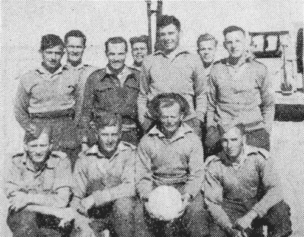

在西沙漠，`皇家诺森伯兰掷弹团`侦察团（`Recce Regiment`）的人竟然能找时间踢足球，当时他们正准备进入利比亚。照片是由来自赫克斯姆的`莱昂·史蒂芬森上尉`（Lionel Stephenson）拍摄的，他在照片发表两个月前在战斗中牺牲；同样来自赫克斯姆的`掷兵马特·杨`（Matt Young）（后排左二）随后被俘，而同样来自赫克斯姆的`连队军士大卫·福斯特`（David Forster）（后排右三）则于7月17日在战斗中牺牲，并安葬在特黎斯。

当住房危机席卷该地区时，`普鲁霍地方委员会`（`Prudhoe UDC`）致信`卫生部`，希望重新开放一些冲突前被认为不宜居住的房屋。镇牧师`R.E. 罗布森议员`（R.E. Robson）表示，越来越多的人涌入该地区，但可提供的住房还没有一个空肥皂箱多。

两名男子在他们乘坐的坦克在斯塔格肖（Stagshaw）附近的比威克莱银行（`Bewclay Bank`）无法通过S弯道时翻了。他们来自阿尔尼克的小霍顿（Littlehoughton）的发动机修理师`罗纳·克罗尔`（Ronald Crole）和来自纽卡斯尔机械检验员`爱德华·内特尔顿`（Edward Nettleton）。来自布莱伊登（Blaydon）的坦克测试员`利物弗·理查森`（Oliver Richardson）驾驶员受了割伤和瘀伤逃之生。

超过1000名学生聚集在赫克斯姆的`中央卫公会堂`（`Central Methodist Hall`），听取`BBC`传奇广播员`Romany`带来的自然讲座，并配有黑板画。他在开始演讲时对他只著名的英国梗犬`Raq`缺席表示歉，并解释道：“由于汽油短缺，我无法开车，如果我带着`Raq`坐拥挤的公交，人们会踩在它的脚上，它并不喜欢，所以我不得不把它留在家里。”

`Romany`是历史上第一个野生动物节目节目，他坐着由马“逗号”（Comma）拉着的吉普赛马车，和他的两个年轻伙伴玛丽埃尔（Muriel）和迪莉丝（Doris）走遍全国，拥有巨大的追随者。

现实生活中，`Romany`是卫公会牧师`乔治·布拉韦尔·埃文斯`（George Bramwell Evens），因他的《跟随罗马尼出去》（`Out with the Romany`，后改为`Out with Romany`）节目而闻名，该节目于1933年在`BBC`的《儿童时间》中开始。他的职业经历包括在卡莱斯尔的`卫公会中央厅`度过的十二年。

### 空军英雄被俘

1942年5月，赫克斯姆屏息以神，因为当地英雄`亚瑟·加尔韦飞行尉`（Arthur Garwell DFM）在`兰开斯特`号轰炸机对德国南部奥格斯堡的`M.A.N.`柴油厂进行著名的低空空袭后据报失踪——当确认他在目标上方遭到炮弹命中后，在燃烧的`兰开斯特`号上完美迫陆并被俘后，大家才松了一口气。

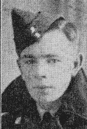

来自橡木伍德的`亚瑟·约翰·加尔韦飞行尉`（Arthur John Garwell）在敌领土上完成三十轰炸任务后，被授予`卓越飞行勋章`。

`加尔韦`是英国空军帅气“发蜡男孩们”（Brylcreem Boys）的缩影。他出生于1920年2月，于1939年5月加入`皇家空军预备役队`，在获得飞行许可后，于1940年9月被分配到位于斯坎普顿（Scampton）的第83中队，这是一支`汉丹`机群。从那时到1941年3月，`加尔韦`完成了一次完整的作战任务，大部分时间攻击防御严密的德国目标——因此两次访问了柏林、不莱梅和科隆，并至少三次前往了汉堡、马格德堡和威廉斯哈芬（Wilhelmshaven）。

不同寻常的是，他在1940年12月还在伯明山上执行了一次夜间战斗任务。1940年12月22日至23日夜，他被迫从德斯绍（Dessau）转向埃姆登（Emden），并在返回途中因油箱几乎为空而迫降。他后被分配到芬宁利（Finningley）的第25号飞行训练学校（OTU）担任教官，并授予了`DFM`勋章。

`加尔韦`于1941年11月加入博斯康姆唐恩（Boscombe Down）的`兰开斯特`强化飞行飞行队，在该基地他偶尔担任`J.D. 内特尔顿队长`（J.D. Nettleton）的副驾驶。到1942年4月，他已成为`内特尔顿`的得力助手。在执行`奥格斯堡空袭`任务的乘坐中队卡车出发途中，两人约定如果遭到战斗机攻击，将不采取避让动作，而是保持航线。`加尔韦`说：“唯一的解决办法就是直冲并保持地面飞行。如果有人受伤，我建议他收油门并向前迫陆。”

在这次大胆的日间掠地式空袭中，`兰开斯特`号遭到了德国战斗机的波攻击，在他的小组中，`加尔韦`是唯一一个到达目标并释放四枚1000磅弹的人。他刚一这样做就遭到了防空火力。随后发生的情况在拉尔夫·巴克（Ralph Barker）的书《猛击，准击》（`Strike Hard, Strike Sure`）中记载：

```
‘当加尔韦听到他的无线电员弗克斯（Flux）在他耳边大喊：“我们着火了！”弗克斯不断指着他的肩膀，加尔韦迅速回头了一眼。通往机身的装甲门开着着，内部是一片火海。“关上门！”加尔韦命令道，他决定立即迫陆，而不是尝试爬出去并跳伞。五名机组成挤在前面的驾驶舱里，但火墙后面还有两个人。’
```


Garwell 看到 Nettleton 和他的一些机员正盯着正在燃烧的兰开斯特轰炸机，他做出了不礼貌的胜利手势，对方立刻回了礼。随后他向左转迎风飞行，在城镇南方一片斑块状农田。当他收回油门并放下襟翼时，烟雾开始涌入舱内，熏得他完全看不清窗外，也无法读取仪表，还呛得他几乎无法呼吸。前舱的五个人都在剧烈地咳嗽，Flux 打开了航员桌上方的逃生舱以获取新鲜空气。

Garwell 保持着他认为相同的角度维持飞行，这时，舱门的一股突然下气流让烟雾消散了一小会儿，他看到正前方有一排高树，挡了他们的道路。他加大引擎功率并拉回操纵杆，但烟雾再次弥漫了过来。

Garwell 以每小时 80 英里的速度盲目地驾驶飞机撞地，但当撞发生时，飞机像一只老母鸡一样落了下来，用腹部滑动了约 50 英尺后轻轻地停了下来。他们冲向逃生舱。在外面，他们发现 Flux 躺在右侧内发动机下方。他在撞击时被甩了。他迅速打开逃生舱的行为可能救了他们的命。整个机身正在剧烈燃烧，他们无法靠近，死亡人数增加到了三个。

Garwell 因其英勇事迹被授予卓越飞行勋章，而作为奥格斯斯堡空袭战后唯一一个将兰开斯特轰炸机带回家的 Nettleton 被授予了维多利亚十字勋章。

Garwell 被关在臭名昭著的第三空军战营（Stalag Luft III），一直留到 1945 年 5 月获释，但他并不是一个模范囚犯。他参与了至少一次越逃尝试，他在战后的战俘简报中简练地描述道：“和其他 25 个人作为除虱小组逃脱了。囚犯们伪装成守卫。一天后被捕。被德国人威胁要因破坏和间谍罪受军事法判。在监狱里关了 56 天，1943 年 6 月 16 日至 8 月 8 日。”

根据他的战时日志，他再次在 1943 年 12 月 26 日至 1944 年 1 月 17 日期间被单独关禁，尽管他在书中没有提到这一点，但有人推测他曾参与了 1944 年 3 月从第三空军战营发生的那场传奇的“大逃亡”。然而，他并不是那 76 个成功逃脱的人之一，也不是那随后被盖世局冷酷杀害的 50 个人之一。

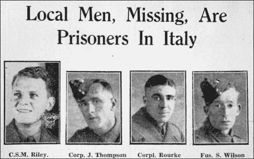

对于那些在中东隶的诺坎堡郡皇家骑兵团侦察团中失踪的亲人的当地家庭来说，由于他们他们被关在意大利战俘营的消息，压力得到了某种程度的缓解。来自赫克斯姆（Hexham）的人包括（从左到右）：连士长 R. 莱利、约瑟夫·汤普森下士、约翰·爱德华·鲁克下士和步兵萨缪尔·威尔逊。

战后，Garwell 加入了海关和关税部的调查部门，并在 1957 年加入东非海关关税部，居住在蒙巴萨和内罗毕，在肯尼亚于 1963 年独立之前成为该部门的负责人。他留在了肯尼亚，于 1964 年获得肯尼亚国籍，并开始经营酒店业的蘑菇种植。

他于 1969 年去世于肯尼亚，年仅 49 岁。当他的勋章和战时文件于 2006 年在伦敦拍卖时，最终成交价为 8800 英镑，几乎是估价的两倍。

## 民兵卫的悲剧

贝林汉（Bellingham）墓地发生了一场悲剧，1942 年 6 月的一次民兵卫演习出了严重错误。一名来自凯尔德（Kielder）贝什肖（Bewshaugh）的林业工人乔治·威廉·格伦丁宁（31 岁）在演习中用的一枚手榴弹在他附近爆炸，导致其致命伤。

验讯法得知，格伦丁宁先生是民兵卫的一员，并参加了该演习，演习还包括正规军成员。正规军的一中士扔了一枚手榴弹以警告他人让路，但格伦丁宁被爆炸波及了。民兵卫成员并不知道使用的是真实弹而非烟雾弹。格伦丁宁的双腿被爆炸炸碎，他因休克和大出血去世。

南诺坎堡郡法医 P.M. 杜斯判定其为意外死亡，并表示：“格伦丁宁忠诚地试图为他的国王和国家尽职责，并在万一发生时为该地区的防御做好训练。”

诺坎堡民兵卫第 4 营团的其他成员，包括来自赫克斯姆、阿康布、洛盖特、惠特利查教堂和斯莱利的小队，在赫克斯姆的普莱尔平地（Prior’s Flat）举行了露野战仪式。指挥官 J. 瑞德·罗布中校对他们说：“民兵卫不再仅仅是穿制服的平民，而是武装部队不可或缺的一部分，装备精良且训练良好，我不犹豫地说，是一支高效的战斗力量。我们来到这里不仅是为了击退入侵，通过保持强大和训练良好，我们可以允许正规部队调往海外。我们越强大、训练越好，就能有越多的正规部队被往海外，战争结束得越快。”

一条变质的熏肉被归咎于科安伍德（Coanwood）21 岁农民托马斯·哈金辛森死亡。哈金辛森在吃了他工作的农民妻子提供的熏肉一周后病倒了。尽管那个农民也吃了同一锅里的熏肉而没有任何不适，哈金辛森几天后还是病了，住院时他说他吃了一条味道很坏的熏肉。他说：“如果我挺过来，再也不吃这种。”他因链球菌肠道感染在哈尔蒂斯尔（Haltistle）医院去世，但当地医生 J.M. 格拉斯表示，无法判断死亡是否与熏肉有关。

多年来，阿伦代尔（Allendale）自诩为英国的中心，尽管离海洋很远，但随着英国第一家乡村度假和疗养中心的开放，这里成为了许多国家海员的家，让遭受敌方袭击或疾病影响的商船海员能够在此恢复健康。

该中心坐落在阿伦河（River Allen）岸的一座旧酒店内，由海员宣教协会运营，旨在为所有遭受纳粹手之海的海员提供为期两周的免费假期。一个名为“商船海员假期疗养中心基金”的特别基金建立了，该中心很快被阿伦代尔的人们接纳，客人在许多家中受到款待。

中心有来自所有国家的人，他们拥有海洋这一共同纽带，一位挪威海员宣布：“这是一个美丽宁静的地方。人们都如此善良——对我来说就像天堂。”

有些人曾被鱼雷击中多次并受重伤，但整体印象是，一旦他们从伤病中恢复，就迫不及待要回到战斗中。

战争继续对泰恩代尔（Tynedale）的士兵造成了惨重损失，几名当地人死于利比亚沙漠，其中包括皇家诺坎堡郡骑兵团侦察营营长爱德华·德斯·格拉兹中校，以及在同一团服役的南威尔姆（South Wylam）的约翰·皮尔森少校。

侦察营（Recce Corps，正如大家亲切称的那样）主要由曾在皇家诺森伯兰陆击团服役过的民兵卫军组成。它被视为“军队的眼睛”，被看作布尔战争中表现卓越的侦察兵以及上一次大战中骑兵的继任者。侦察营被归类为骑兵连，配备 `Bren` 载兵车、装甲车或卡车。这些士兵被要求能够驾驶任何车辆，并能够进行维修。他们的工作是侦察其他部队前方的情况并汇报回来。人们传说，那些土生土长、对乡村环境眼敏锐且精通野外生存技巧的人，非常适合这项工作。

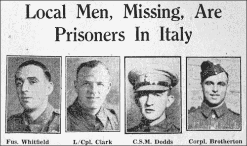

1942 年 9 月在意大利战俘营中，来自赫克斯姆的皇家诺森伯兰陆击团侦察团成员，从左到右分别是：步兵 T.H. 特菲尔德、下士乔治·克拉克、连士长莱斯利·多德斯和 R. 布罗瑟顿下士。

当地士兵继续在中东阵亡时，后方也发生了悲剧。前服军人、赫克斯姆家民卫队成员本杰明·古顿在回到镇上罗德克罗斯（Round Close）的家中花园时，听到了一声巨大的爆炸声，发现他 18 岁的儿子德斯蒙德不小心用手榴弹炸伤了自己。

古顿先生在质询会上说，那个青少年从一名士兵那里得到了四枚手榴弹作为纪念品，并将它们存在花园底部的一间小屋里。他习惯于把炸弹拆解并重新组装。他承认应该从孩子那里没收这些东西，但一直没抽出时间来。

泰恩代尔第一家“英国餐厅”（British Restaurant）建立在普鲁霍的威斯利礼厅，那里耗资`£600`经过改造，旨在一次为 100 人提供廉价且营养丰富的餐点。营业时间为周一至周六上午 11:45 至下午 2:15，提供四道菜，包括 2 便士的汤、7 便士的肉菜（儿童 4 便士）、2 便士的甜点和 1 便士的一杯茶。

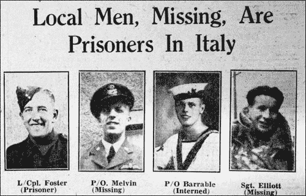

据报道在意大利战俘营的有来自科布里奇的下士威廉·福斯特（左），而来自赫克斯姆的士军官弗雷德·巴拉布尔（右二）在地中海所在的船只 `HMS Manchester` 号沉没后被关押在阿尔及利亚。然而，来自海顿桥的飞行军官西德尼·梅尔文（左二）和他的皇家空军同事、来自科布里奇的军士约翰·里德利·埃利奥特（右）均音讯不明。

英国餐厅是 1940 年创建的公共厨房，旨在帮助那些因轰炸失去家园、用完配给券或其他需要帮助的人。这还具有政治维度，因为工党将其视为跨阶级实现消费平等的永久解决方案，并确保穷人能获得营养丰富的饮食。

这些餐厅最初被称为“社区供餐中心”，“英国餐厅”这一名称由首相温斯顿·丘吉命名。它们由食品部设立，并由当地政府或自愿机构非营利性运营。

## 良心问题

来自普鲁霍的第一次世界大战老兵，罗伯特·威廉·马里纳因不服征兵服役官要求从事国家重要工作的命令，被赫克斯姆治安法庭判处有期苦役两个月。马里纳告诉法庭说，如果他接受了被指派的工作，他目前的工作每周将损失`20s`到`30s`的工资。他说：“我在上一次战争中每天为了六便士而战斗，并被承诺回来后会有更好的待遇——现在我回来却得到了这种对待。”

在同一座法庭，来自海顿桥的 25 岁凯瑟琳·马戈·朱普在被告席上阅读她的圣经，当时她正被指控未参加执行国家重要工作的面试。她解释自己的职业是全职耶和华见证人，在被问及辩词时说：“从技术上来说，我有罪；从道德上来说，我无罪。”她此前申请注册为良心拒绝者，但被告知根据《就业登记条例》（Registration of Employment Order）的规定，是不可能的。法庭获悉朱普小姐有一些“特殊的宗教信仰”，这使她难以承担被指派的工作，即使这些工作与战争无关。

征兵服役官查尔斯·韦尔伯恩告诉法庭，由于她的信仰，朱普小姐一直没有被指派从事军药工作或任何与战争直接相关的工作，而是被要求去赫克斯姆的儿童疗院工作，但她拒绝与护士长面试。当法庭主席约翰·查尔顿问她是否不是不受英国法律约束的英国臣民时，她说：“我首先受上帝法律的约束。”

法庭获悉她曾是妇女土地军的成员，但在“受到耶和华见人运动的影响后”辞职了。在休庭两周后，她被罚款`£20`。

随后在向赫克斯姆轮达俱乐部演讲时，诺森伯兰和达姆郡良心拒绝者法庭主席 T·里查德森法官表示，在他看来，一旦战斗结束，所有拒绝为战争努力做出任何贡献的良心拒绝者都应该受到冷落。这同样适用于那些雇佣“良心拒绝者”的公司，在其他员工为祖国牺牲生命时，这些公司往往在工作中提拔他们。法官说，最近越来越多的年轻女性声称自己是良心拒绝者，他发现她们比男性更有“毒性”，因为她们是如此自以为。

他说：“大部分并不是真正的良心拒绝者，而是逃避兵。还有一些人利用所谓的宗教协会作为借口，拒绝为祖国做任何贡献。基本上，这些宗教协会是由一群无知且危险的人组成的，他们一点脑子也没有。”

19 岁的士兵休奇·威尔在海顿桥的一次陆军演习中，溺水于泰恩河。威尔被要求带着一根绳子过河，绳子将固定在对岸，以便其他士兵过河。然而，河水迅速上涨，下令停止演习。遗憾的是，这一变化没有传达给威尔，他当时穿着裤子和健身背心，将绳的一端系在腰带上，另一端系在桶上。他刚进入河水四码就被水流冲走了。绳的另一端从桶上脱落，没有人能抓住它。

威尔的遗体在下游 50 码处被被找到，法医官认为取消信息未能传达非常“不幸”。

## 第五章

## 通往诺曼地的坎坷之路

来自斯托克斯菲尔的 15 岁女孩被赫克斯姆少年法庭送往收容学校，法庭对她在被描述为极其肮脏的案件中的“丑闻”行为感到震惊。她的父亲形容她完全失去控制，她被送往纽卡斯尔的一个教区静修院，但她通过爬顶楼窗户并顺着排水管滑到防空洞屋顶逃脱了。

她和一名水手出现在纽卡斯尔的一家酒店，自称是他的妻子，但当“丈夫”回到船上后，她与同一酒店的另一人住在一起，并告诉被冒犯的经理，她的丈夫介意她与其他男性交往。她拒绝支付`45s`的酒店费用，但账单由她现在共用房间的另一个男人支付了。

那个女孩还在纽卡斯尔进行了一次购物，她在那里订购了一件 14 吉尼的舞服和一件 10 吉尼的晚外套，并支付了 10 先的定金，但被拒绝了。

## 蒙提的成功与当地英雄

虽然伯纳德·蒙特马利中将在埃及带领“沙漠鼠”取得的成功是极大的好消息，但赫克斯姆的议员道格拉斯·克利夫顿·布朗警告不要过早庆祝。他说：“隆梅尔是一个勇敢而狡猾的士兵，无论他必须付出多大的代价，他都会尽可能保存他那名声显赫的非洲军团。獾被逼到洞穴尽头时才是最危险的。我们赢得了一场胜利，这对于我们这场战争来说是新奇，但我们还没有赢得战争。现在还不到庆祝‘马菲辛式的胜利’。”

然而，《赫克斯姆纪报》很快指出，“蒙提”与赫克斯姆有深厚的渊，因为他是赫克斯姆前牧师西德尼·萨维奇牧士的侄子，后者的妻子正是蒙提母亲的姐姐。

蒙提在阿拉曼战战役的成功让整个英国范围内寂静了两年的钟声再次响起，其中包括赫克斯姆修道院的钟声。修道院九位常驻钟手中有七位在外服役，但剩下的两位幸存者加入了早已退休的钟表专家，以及从特鲁罗、惠奇彻和诺汉普顿等远地区派驻当地的钟手。牛顿厅、奥伦代尔、科布里奇和威尔拉姆也响起了胜利之钟。

一名来自哈特威斯尔的空军运输队（ATS）女兵在南部海岸遭到炸弹袭击时，与另一个女孩坚守岗位而受到嘉奖。当《纪报》采访她时，玛丽·豪不愿谈论此事，但最终说道：“我们正在房间里像常一样工作，突然毫无预兆地，门被炸开了，我被撞到了角落。我设法回到交换机继续接听，直到收到撤离命令。我们刚离开房间，地板就塌了，所以我想我们是逃得相当幸运的。我们做的比任何其他人会做的都不少。”

另一个故事来自赫克斯姆的士官弗雷德·巴拉贝尔，他的船只“曼彻斯特号”在阿尔及利亚海岸外沉没，他被俘了。他和其他囚犯一起坐上火车，被送到维希法国经营的撒哈拉阿尔及利亚拉霍特监狱营。在那里，在所有物品被没收后，二十六个人挤在一间本应容纳十二人的小屋里。

巴拉贝尔说，阿拉伯守卫对囚犯使用了卑劣手段，他记得其中一个从锅炉工那里拿了一块金金表，说作为交换，他会允许那名水兵逃跑。但他没走多远，因为在穿过铁丝网时就被他们射杀了。

营里的主食是扁豆、橄榄油和黑面包，并辅以由枣核制成的“咖啡”。他们偶尔会被分到酒，喝起来更像醋，法国当局说这这是为了抑制营地内蔓延的疾病。巴拉贝尔指出：“医院设备简陋，用一匹马和马车当救护车，更糟糕的是，各种昆虫没完没了地骚扰我们。”

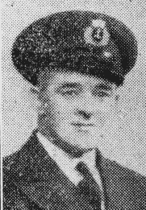

1943 年 7 月获得大英帝国勋章（OBE）的是赫克斯郡首席工程师托马斯·库斯伯特·戈曼，在他所属的商船被鱼雷击中并在七分钟内沉没后，他带领一艘载 23 人的救生艇在大西洋漂流了 49 天。

囚犯们最终设法弄到了无线机，从那里他们盟军登陆阿尔及利亚的消息，这引起了士兵、水兵和飞行员的欢呼——但法国营长没有，因为他不知道入侵的发生！不久后营地被解放了。

来自赫克斯姆的首席工程师托马斯·戈曼讲述了更多恐怖经历，他的船在大西洋距离陆地 700 英里的遭到三枚鱼雷击后，他在开放的小艇中漂流了 49 天。船在六分钟内沉没，但在潜艇浮出并劫舰长为战俘之前，发射了两艘救生艇。

两艘救生艇（一艘载 26 人，另一艘载 12 人）在一起了五天，随后在大海中分离。一段时间后，他们发现第二艘救生艇是空的，并从其储物柜中补充了自己的有限的物资和水，还获得了第二面帆。

戈曼讲述道：“我们只有船上的指南针引导，主要听命于盛风，尽管我们偶尔划桨。八天后我们看到一艘船，尽管我们发射了信号弹并尽一切吸引注意，但她没有看到我们。”

最初的配给是每人早晚两块船饼、一汤匙肉干、一点巧克力和一根何立力粉，但在最后的十六天里，他们被减少到每天只能喝四分之一桶的水。一名炮手做了一副多米牌，他们还用照片制作牌牌来打时间。当他们获救时，戈曼体重减轻了三，他的大拇指和小指可以围住船上 16 岁学徒的腿。

随着 1942 年圣诞节的临近，礼物短缺，配给越发紧张，当地农场养满了为了圣诞餐特意肥鹅和火鸡，这一事实对某些人来说太有诱惑了。许多农场遭受了严重的盗窃问题，据有组织的团伙使用汽车和马车运走鹅、鸡和火鸡。兰格利地区受灾特别严重，一个农场一夜内失去了十一只火鸡，另一个则损失了二十七只鸡。一位农夫说：“家禽损失在任何时候都是严重的，但当我们为了圣诞节节衣缩用地喂大这些鸟时，这种感觉尤为强烈。”

科布里奇的议员爱德华·皮格告诉赫克斯姆农村地区委员会，当地存在强烈情绪，认为虽然小屋花园和联排房屋的栅栏已被拆除，但大庄园的栅栏留在了原地，其中一些庄园还有大型金属大门，这些大门可以产生大量的价值铁。他说：“人们对此感到非常愤怒。为什么穷人必须放弃他们的围栏，而大庄园却能逍遥法外？必须对此采取行动。”

他得到了议员 M.S.鲁杜斯的支持，鲁杜斯表示，仅一个庄园就有 100 多个金属树护，据称它们保护的树木实际上“像米米塞拉一样古老”。

在国王新年授勋名单中，来自奥伦代尔的商船船长约翰·汤姆森被授予大英帝国勋章（OBE），以表彰他的船不仅遭受了鱼雷攻击，随后又遭到俯冲轰炸。他的船只在潜艇袭击中受损严重，船上和海面上升起的汽油烟雾引发着爆炸的严重危险。汤姆森船长和他的船员设法将受损的船只进了港口，但再次遭到德国俯冲轰炸机的袭击并遭受了进一步损坏。表彰指出，汤姆森船长在两次行动中都发挥了卓越的领导能力，很大程度上由于他的决心、资源和技巧，船只才得以幸。

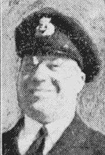

来自奥伦代尔的约翰·汤姆森船长（40 岁）在 1943 年国王新年授勋名单被授予大英帝国勋章，表彰他在油轮在遭受鱼雷袭击和俯冲轰炸后的英勇营救。火灾和爆炸的危险一直存在，不仅来自落下的炸弹，还来自货物的气体，船甲板和周围的海面溢满了汽油。

同样获得荣誉的还有来自伯特利的士兵兵彼得·麦唐纳德（25 岁），他在阿拉拉曼战役中因英勇拯救多名战友的生命而获得军事勋章。麦唐纳德士兵兵曾在诺丁汉郡谢尔伍德皇家骑兵旅团服役，在战斗中失去了一条腿。

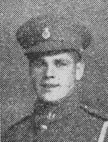

来自沃克附近的伯特利士兵兵彼得·麦唐纳德（25 岁）因在阿拉拉曼战役中拯救多名战友的生命被授予军事勋章。他在诺丁汉郡谢尔伍德皇家骑兵旅团服役，在行动中失去了一条腿。

议员乔·库伦在赫克斯姆地区委员会的会议上，对赫克斯姆的宵灯措施的执行描述为“荒谬”，并特别提到了携带大型火炬的做法，这些火炬在人们脸上闪烁。他说：“无论你晚上几出去，都可能遇到这些昏昏欲睡的蟑螂。有些所谓的火炬根本不是火炬，而更像是便携式探照灯。我希望人们不要陷入虚假的安全感中。战争还没有结束，可能还会发生任何事情。”

J.M.赫斯洛普议员抱怨道：“我很想知道那些拿着大火炬的人是从哪里弄来电池的……”

### 七人死于手榴弹事故

战争期间当地最大的人员伤亡发生在 1943 年 1 月 21 日的科安伍德，当时由于一枚步枪手榴弹在训练过程中爆炸，导致七人死亡，十七人受伤。死者包括两名军官、四名士官和一名炮手，该事故从未得到令人满意的解释。


死者是：米德塞克斯郡诺斯伍德的马克·弗朗西斯·沙克尔上尉（25 岁）、伦敦哈尔斯登的副尉阿尔弗雷德·詹姆斯·贝尔（30 岁）、比肯黑德的团军士长赫伯特·威廉·雷维尔-布鲁格斯（38 岁）、高怀凯姆的连级军需士约翰·斯坦利·威尔克斯（31 岁）、卢顿的下士炮兵威廉·约翰·莱特（25 岁）、达灵顿的中士雷蒙德·波普里特（32 岁）以及伦敦的炮手爱德华·约翰·韦顿（32 岁）。

哈尔特威斯尔的验讯得知，当时一组士兵正在接受连队士长`F.J.詹金斯`的指导使用步枪手榴弹，并在他周围围成半圆，听他解释这种武器的使用方法，该武器本应将手榴弹发射到 200 码外。手榴弹装在发射杯中，士兵被要求在发射时撤退到六七英尺远。一名证人看到士长从手榴弹上拔出插销并正确地放入发射杯中，但当扳机触发时，发生了“剧烈的爆炸和刺眼的闪光”，爆炸波导致 24 人死亡或受伤。

该连队士长在爆炸中幸存，但在医院里重病期间，无法作证，尽管显然手榴弹从未离开过发射杯。

验法官`P.M.多德`在得出结论时说，唯一可能的解释是手榴弹没有正确装在发射杯中——证人说并非如此——或者是手榴弹本身存在缺陷。他记录的死因是手榴弹爆炸导致的多处伤重，原因不明。

今年 1 月，赫克斯姆治安法院创造了历史，辅助女警格蕾塔·亚瑟成为首位在该法庭作证的女性官员。她告诉法官，她看到赫克斯姆轮德克洛斯某处房屋的烟囱里喷出巨大的火花，从而违反了宵禁规定。被告托马斯·考恩说，火花是因为他往火上泼水灭火导致烟囱起火。他被罚款 10 先令。

在同一法院，当第一起涉及违反《消费者配给条例》的案件提交当地法庭时，据报道赫克斯姆存在“严重的服装优惠券交易”。这涉及来自赫克斯姆吉尔斯盖特的 74 岁退休金领取者托马斯·阿肯德、来自纽卡塞尔 64 岁劳工托马斯·布拉肯以及来自科布里奇亲王街的`N.罗布森`夫人。

阿肯德向援助委员会的工作人员报告说，他在入住旅馆的储物柜中丢失了衣服配给本。但在被问及时，他承认以 1 英镑的价格将其卖给了同住的布拉肯，而布拉肯转而以 25 先的价格卖给了罗布森，并将利润用于买啤酒。罗布森被罚款 10 英镑加 2 英镑诉讼费，而那两名男子被要求以 5 英镑的金额保证表现良好。

来自布克斯特山的斯坦姆福德姆姆农约翰·多德也被带上法庭，因为未能按照《国防（通用）条例》的要求在其农场上耕种足够的土地。他被命令耕种其农场 134 英亩中的 44 英亩，但他只耕了 33 英亩。代表战争农业委员会起诉的律师理查德·埃利斯表示，诺丁汉郡要求耕种 16.5 万英亩土地，如果所有农民都像多德一样未能完成所要求的四分之一工作，那那里将陷入混乱。

多德告诉法庭，他认为自己被规定的配额不合理，由于天气等其他问题，他没能在规定时间内完成目标，尽管他后来已经耕种完毕。他说：“我们有一次大丰收——50 捆大堆玉米——这对国家粮食储备做出了巨大贡献。作为农民，我们已经尽了职责。”

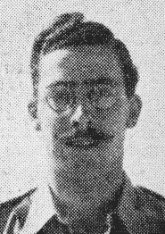

在在中东战斗中被报告失踪并认为战死后，皇家诺丁汉郡冲锋团侦察团的基特·帕特森上尉于 1942 年 7 月被确认正在意大利的一个中转营中战战。

法庭并未同意他的观点，多德被罚 5 英镑，加 5 金的诉讼费。

## 土豆周

泰恩代尔在二月发现了一项对抗纳粹的新武器，当时启动了`赫克斯姆及地区马土豆周`，当地主妇们被敦促停止食用面包，转而供应马土豆饼。这一活动得到了食品部长`伍尔顿勋爵`的支持，他在给`零售水果贸易联盟``赫克斯姆`分支主席`S.F. Robinson`的一封电报中表示：“通过承认食用当地食品的重要性，并将我们的小麦运输空间腾出来用于更坚固的货物，`赫克斯姆`树立了良好的典范。”他还为最佳原创马土豆食谱设立了两金尼的奖金。该地区的烘焙师也发挥了作用，出售由马土豆制成的司饼、蛋糕和点心，许多商人参与了《库兰报》中关于`马土豆周`的押韵广告活动。

最受关注的是来自`西威拉姆和普鲁德霍合作社`的一首诗，该协会的驻押韵诗人写道：

```
希特勒对戈培尔说，
英国人都是没用的，
他忘记了泰恩赛地的乔治人
他们是为土豆而战的恶魔
他们在埃及证明了这一点
当时罗姆尔正落荒逃亡
他回电给希特勒说：
我的老天爷，我们得逃命了。
```

来自`沃克`的杂货商`W. Civil`贡献了：

```
你无法驾驶飞机，
或指挥英国潜艇
但你可以通过吃当地的土豆
来击败纳粹。
```

来自`赫克斯姆伍拜恩露场`的商人`E. Dawson`写道：

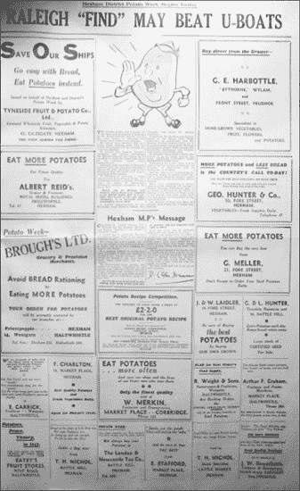

一项让主妇在准备食物时使用当地马土豆而非进口面粉的大型运动，促成了`赫克斯姆马土豆周`的启动，`食品部`为最佳马土豆食谱提供了两金尼的奖金。

```
节省小麦多吃土豆
帮助赢得战斗
它将援助我们勇敢的海军
让匈牙人魂逃窜。
```

哈尔特威斯尔的水果商`E. Carrick`写道：

```
少吃面包多用土豆
为了营养它们是极品
让船只带来大炮和坦克
赢得伍尔顿勋爵最热诚的感谢。
```

在随附的社论中，《库兰报》写道：

“质的马土豆，印加人真正的宝藏，可能是击败威胁我们运输的潜艇的主要因素之一。通过多吃马土豆、少吃面包，许多用于进口小麦的运输空间将释放给重要的战争物资。整个地区的当地商人、妇女协会和学校正联系在一起，努力让人们更好地了解普通马土豆的营养价值。尽管马土豆在英国遗憾地被忽视，但长期以来一直是爱尔兰农民的主食，在大陆，它们的使用比在本国广泛得多。”

有人指出，在德国的`奥芬堡`有一座英国海盗`弗朗西斯·德雷爵士`的雕像，以纪念他将马土豆引入欧洲大陆。

`马土豆周`取得了巨大成功，尽管当地议员`I.M. Iveson 小姐`评论道：“我认为，如果`伍尔顿勋爵`禁掉马土豆一个月，他会更好地实现普及马土豆的目标，因为在上次大战期间马土豆稀缺时，它们才值千金。我认为我们正处于这场战争的最后冲刺阶段，但这往往是最的。”

共有四十位商人参与了马土豆相关的橱窗竞赛，五金尼一等奖的获得者是哈尔特威斯尔的`R. Wright 父子公司`。安慰奖颁给了赫克斯姆`巴特尔山`的`伦敦和纽卡斯尔茶公司`以及普鲁德霍的`沃尔特·威尔逊`商店。赫克斯姆的`布鲁夫`商店和`泰恩代苗场`也获得了特别表扬。

`伍尔顿勋爵`为最佳原创马土豆食谱设立的两金尼奖授予了赫克斯姆`阿康姆庄`的`斯坦利夫人`，她的马土豆模具被裁判描述为“一个非常实用的战时食”。

1943 年夏天，`赫克斯姆`和`普鲁德霍`都发起了“胜利之翼”活动，其中`赫克斯姆`的目标是 25 万英镑，以提供四个中队的`飓风暴`战斗机，而`普鲁德霍`的目标是 4 万英镑以发射一架`航空罗兰卡斯特`轰炸机。`普鲁德霍`率先实现了目标，筹集了 52039 英镑，这完全归功于`米克利联合煤矿`提供的 1.5 万英镑投资。在里奥电影院还举办了一场庆祝音乐会，澳大利亚女高音`弗洛伦斯·澳洲`和英国男低音`诺曼·阿林`以及当地合唱`普鲁德霍歌唱团`演出。

`赫克斯姆`的活动由新任议会议长`道拉斯·克利夫顿-布朗`发起，他对非洲战争局势的转变发表了激昂演讲，他曾担任指挥官的`诺森郡骑兵团`作为反坦克部队表现出色。

赫克斯姆（Hexham）的街道举行了一场盛大的游行，挤满了人。一支管乐队领着一支庞大的队伍，包括国内兵卫队、皇家空军（RAF）、`WAAF`、`ATC`、国家消防局、女训练兵团、英国军团、民防队、英国红十字会、女童子军和童子军。现场还有一支着装整齐的妇女农军队队伍，国内兵卫队的乐队也参加了游行。镇上的商人也以爱国风格装饰窗户参与了进来，一个广受欢迎的特色是在炸弹上贴上国家储蓄债券，这枚炸弹后来被投向德国。

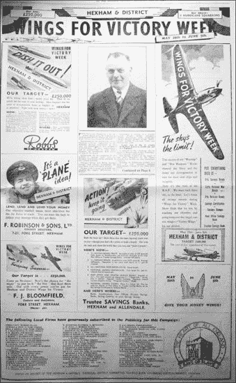

1943 年夏天，赫克斯姆“机翼周”（Wings Week）的目标是筹集`£250,000` 以购买四个中队的飓风风战斗机。

“胜利之翼周”（Wings for Victory Week）再次取得巨大成功，赫克斯姆的 `£250,000` 目标超过了 `£100,000`。最终总额为 `£339,106`，其中 `£79,206` 来自国家储蓄证书；`£46,030` 来自廷代尔银行或邮局的存款；`£54,885` 来自国防债券；`£4,615` 来自储蓄邮票；`£67,150` 来自战争债券以及 `£86,900` 来自储蓄债券。

该地区的 48 所学校的目标是共同筹集 `£5,000`，但实际上筹集了 `£9,941`。该地区的 39 家邮局筹集了 `£94,089` 的捐款。

该地区的许多地方都超过了目标，包括康姆（Acomb，目标 `£1,000`，总计 `£4,082`）、奥伦代尔（Allendale，`£6,000`，`£18,227`）、布兰奇兰（Blanchland，`£1,500`，`£3,542`）、科布里奇（Corbridge，`£10,000`，`£23,607`）、科威尔尔（Colwell，`£150`，`£287 10s`）、海德登桥（Haydon Bridge，`£3,000`，`£11,506`）、汉姆绍（Humshaugh，`£6,000`，`£9,348`）、纽伯鲁哈和福尔斯斯通（Newbrough and Fourstones，`£759`，`£8,567`）、奥文格姆（Ovingham，`£350`，`£1,291`）、里丁米尔（Riding Mill，`£500`，`£11,160`）、西蒙伯恩（Simonburn，`£1,000`，`£1,654`）、斯托克斯菲尔德（Stocksfield，`£12,000`，`£32,420`）以及威拉姆（Wylam，`£16,000`，`£19,508`）。

贝灵哈姆的“胜利之翼周”在一周后举行，目标是筹集 `£40,000` 购买大兰斯特轰炸机。北泰恩的人们不仅实现了该目标，还额外筹集了 `£25,000`，以提供五架战斗战斗机，护送大兰斯特轰炸机对德国的袭击。

1943 年不为人知的事件之一是乔治六世国王和伊丽莎白王后对该地区的私人访问，他们在费瑟斯通（Featherstone）哈尔特威斯尔–阿尔斯顿线的皇家火车上上了一夜。王后（原伊丽莎白·鲍斯-莱恩）与巴登米尔（Bardon Mill）和贝灵廷姆（Beltingham）地区有家族渊源。巴登米尔里德利庄（Ridley Hall）现在是海德登桥高中的宿舍楼，直到 1948 年一直由王后的叔叔弗朗西斯·鲍斯-莱恩所有。他是该地区的大慈善人，在里德利庄执行了重大的重建计划，并为贝灵廷姆的圣库特伯斯教堂提供了门和彩色玻璃窗。他还是 1881 年爱丁堡苏格兰士兵臭名昭著的“湿阅兵”的幸存者，当时作为女王射箭团团长，在大雨无情倾盆时，他有荣幸为维多利亚女王撑了四个小时的伞。

## 勋章获得者和其他当地英雄

科布里奇培养了一位双重战争英雄——国王龙骑卫队的约翰·理查森上尉，他获得了军事十字勋章（MC）增加了一个附加勋章。他因在 1942 年 5 月在托布鲁克（Tobruk）附近的利比亚沙漠比尔·哈切姆（Bir Hacheim）南方的敌方阵地攻击中表现被授予 `MC`，随后在利比亚大理石门（Marble Arch）地区的行动中获得了附加勋章，当时他自愿带领了一次长 370 英里的巡逻，成功切断了德军的大部分。

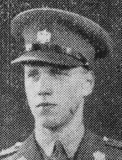

克拉克下士（Lance Corporal Clark）是意大利营地写出的信件的 23 名签署人之一，信中赞扬了赫克斯姆（Hexham）当地为战俘提供服务的各种组织。信中写道：“我们对所做的一切都深表感谢。我们都健康如初，期待早日回到‘英格兰的心脏’。我们经常希望能读到《赫克斯姆日报》（Hexham Courant）。”

同样来自赫克斯姆的莱纳德·沃德军士（Corporal Leonard Ward）从意大利转移后，在位于 IVB 号战俘营（Stalag IVB）写信表示，德国的食物和待遇远好于意大利。

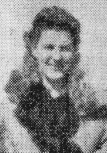

海登桥（Haydon Bridge）的杰西·沃尔（Sister Jessie Waugh）修女在作为登陆西西里岛的 21 名英国护士之一时，是一位广受欢迎的人物。她不仅提供护理服务，还通过音乐会娱乐士兵，她的才华使她赢得了加入娱乐国家服务协会（广为人知的 ENSA）的邀请。

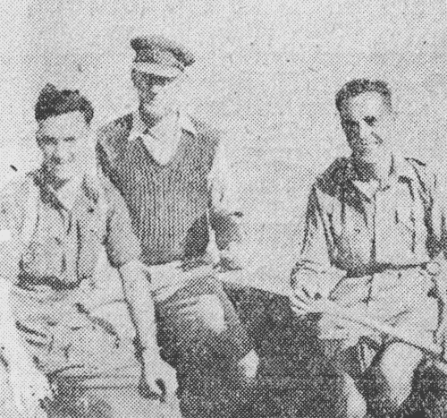

赫克斯姆的 E. 霍林顿军士（Corporal E. Horlington，左）和海登桥的 F.H. 沃德士兵（Private F.H. Ward，右）与来自富勒姆（Fulham）的军团军士华纳·史密斯（Regimental Sergeant Major Warner Smith）一起通过划船远离中东的战斗间隙。

回到国内，发生了一件令人悲伤的事：一名 21 岁的女子陆军（Women’s Land Army）成员在赫克斯姆郡（Hexhamshire）斯蒂尔“魔鬼之水”（Devil’s Water）的一个深潭中被发现死亡。这位来自罗普顿（Thropton）地区的女孩在斯莱利（Slaley）工作，当时她去骑自行车后再也没有回来。她留了一封给母亲的信，写道：“我厌倦生活——每个人都反对我。他们恨我，我无法继续下去了；也许我去的地方会很幸福。”法医裁定其为自杀。

## 赫克斯姆火车站弹药爆炸

第二次世界大战期间，赫克斯姆在遭受泰河（Tyne）、泰斯河（Tees）和威尔河（Wear）工业区的纳粹炸弹袭击相对幸免，但是英国弹药造成了该国内唯一的人员死亡。

三个士兵在赫克斯姆火车站从火车上卸载弹药时在爆炸中丧生。没有人真正知道 1943 年 9 月 9 日那个命运之日发生的全过程，但现场出现了一些非凡的英雄主义事迹，与海外发生的任何事件一样值得承认。已知，有一箱弹药掉落并爆炸，导致了两名 19 岁的皇家苏格兰掷击团（Royal Scots Fusilier）军官和一名 24 岁的皇家陆军后勤军（Royal Army Service Corps）司机死亡。

来自费夫（Fife）莱文的约翰·米德马斯中尉（Lieutenant John Middlemass）和来自彼得堡（Peterborough）的司机斯坦利·道斯斯（Stanley Dowse）当场死亡。来自皮布斯（Peebles）的帕特里克·威尔尔森中尉（Lieutenant Patrick Wilson）稍后在赫克斯姆医院去世。另一名被卷入爆炸的士兵受伤，而一名住在附近的房子外的平民达格利什夫人（Mrs Daglish）被爆炸的弹药碎片击中。

所有铁路交通陷入中断，由于担心进一步爆炸的巨大危险，附近所有的房屋都进行了疏散。通勤者在线路更远处被带下火车并乘巴士回家后，已迟到了好几个小时。火势加剧了危险，军人员与国家消防队和警察合作，共同扑灭蔓延在弹药箱周围的火焰。

五名士兵冒着巨大的生命危险，解开了一节满载的货车，并将其拖到安全地带。拆弹小组工作了一整晚，清理了车站区域内的未爆炸弹药，其中包括各种类型的步兵武器，如手榴弹。

调车工罗伯特·亨利·汤普森（Robert Henry Thompson，50 岁）和他的两个同事——机车罗伯特·诺里斯（Robert Norris）和火工爱德华·利德尔（Edward Liddle）也做出了贡献。汤普森试图从装卸货平台撤出装满弹药的货车。他拦截了一辆牵引机，回到四节弹药车旁，将它们连接起来以便被拖走。此时，一些货车已经起火，汤普森不得不用他的调车杆将一节货车车顶上的燃烧物推开。

在货车被充分隔离后，汤普森将它们与牵引机解开并撤离。在随后的验证会上，一名证人称他曾看到一个放在卡车背板上的箱子掉到了地上。司机似乎在鹅卵石路上滑倒了一下。箱子只掉了两三英尺，但立即爆炸了。几分钟后，军用卡后部发生第二次爆炸，随后引发火灾。弹药和磷散落在四周，在整个过程中，由于火势巨大，铁路货车和军用卡都发生了轻微爆炸。

然而，爆炸的原因仍然是一个谜，因为专家在验证会上告诉，弹药不应该仅仅因为箱子掉落就爆炸。皇家苏格兰军团的军士长托马斯·基比（Thomas Kirby）表示，弹药位于密封箱内，手榴弹没有插引信。当问及爆炸的理论时，基比军士长告诉验证会：“我完全无法解释。”在被追问时，他只能假设弹药的某种成分存在问题，或者存在缺陷。

调车工汤普森的勇敢行为使他获得了大英帝国勋（BEM），而诺里斯和利德尔也受到了高度表扬。北方指挥部指挥官认为他们的行为是“最高等级”的，并代表陆军向他们表示感谢。

对于参与解开车厢的士兵，他们的英勇行为也得到了正式认可。授予“在赫克斯姆弹药爆炸期间表现英勇”的大英帝国勋被授予了掷击团士兵威廉·查塞尔（William Chassels）和掷击团士兵安德鲁·麦克米尔（Andrew McMichael），表扬信则授予了下士 W. 辛明顿（W. Symington）、下士吉米·桑德森（Jimmy Saunderson）和掷击团士兵 J. 蒙特戈利（J. Montgomery）。

不幸的是，这两名获得大英帝国勋的掷击团士兵都没有活过战争。威廉·查塞尔于 1944 年 7 月 16 日死于诺曼迪。他那年 21 岁，来自兰纳克郡汉密尔顿。

安德鲁·麦克米尔于 1945 年 3 月 24 日在跨越莱茵期间牺牲。他那年 37 岁，来自艾尔郡的梅博尔。

来自艾尔郡的下士吉米·桑德森虽然活过了战争，但几年后在纽卡斯尔地区试图过河流时与另外两人一同溺水。

汤姆林先生表示，该中心将具有无价之，因为它能在工人们病倒严重并导致彻底崩溃之前提供为期两周的假期，从而节省了数千小时宝贵的工业工时。东北休息委员会主席谢尔拉·贝文顿博士说，在战争第五年，人们对休息的需求不仅是身体上的，也是心理上的。她指出，赫克斯姆（Hexham）中心尤为需要，因为东北部战争工人的体力很差——这反映了女孩们营养不良，以及该地区可怕的失业和经济萧条时期留下的影响。


加拿大驱逐舰 `Restigouche` 号的舰员在泰恩河下游的贾罗（Jarrow）进行修整期间，在博福朗（Beaufront）和阿尼克（Anick）地区协助收获提供了帮助，并与当地人交流在一起。

两名在船只停靠在贾罗进行修整期间在阿尼克地区协助收获的加拿大海员，在当地一家酒馆过度地庆祝了他们即将重返大海。来自多伦多的普通海员塞缪尔·帕特顿和来自蒙特利尔的主任海员詹姆斯·菲茨杰拉德决定带两只青铜梅鹿作为纪念品，这些鹿是从他们在博福朗城堡意大利园林里的底座上生生扯下的。每只鹿价值 50 英镑，而且暴力拆除留下的损坏无法修复。在被警察质问时，这两名男子起初否认参与，但后来承认各自拿了一只。

警察督事威廉·古德费尔洛告诉赫克斯姆的法官，这两名男子在收获工作中的志愿服务表现非常出色，深受当地社区的喜爱和优待。因此，他们的行为蒙辱了自己，也蒙辱了整个船员，这非常遗憾。


代表两名男子的辩护律师 K.H. 博姆表示，在饮用了过量酒精后，他们去了城堡，那里的人对他们非常友好，于是他们决定拿走那些鹿。

博姆先生说：“当这两个人恢复清醒时，他们发现自己偷了鹿而感到非常羞愧。考虑到他们的体重，他们是如何把那些鹿带回宿舍的，这还是一个谜。”

他表示他们对自己的行为深表遗憾，并渴望支付维修费用。由于他们的行为，他们在德纳监狱（Durham Gaol）度过了几个晚上，这给他们带来了持久的影响。他还指出，虽然土地主哈罗德·库伯特上尉正在海外服役，但他持有授权书的母亲瑞雷夫人并未要求严厉的判罚，也没有寻求任何赔偿。

法官们认为，在监狱关禁对盗窃行为已经是足够的处罚，并撤销了指控。他感谢这两名男子通过协助收获为英国尽了一份力。

这两名男子来自加拿大驱逐舰`HMCS Restigouche`号，全舰船员都在城堡和附近的阿尼克庄园（Anick Grange）协助了收获。

### 被“失控”气球杀死

1943 年 11 月 4 日（周四），两个拦截气球（用于防止德国空军的低空攻击和精确轰炸）从海岸附近的锚点脱离，向内陆泰恩德谷（Tynedale）漂移。其中一个失控的气球停在了斯帕蒂·李（Sparty Lea）附近的阿伦代尔山地（Allendale fells），其锚绳被卡在一个干石墙上。

第一个气球很快被警察人员放气，随后他们出发放气停在山地更高处的第二个气球。许多旁观者聚集在一起观看行动，其中一名来自辛德霍普（Sinderhope）布罗德盖特小屋（Broadgate Cottage）的议会员工罗伯特·贝蒂（47 岁）决定近距离观察。有人看到贝蒂先生进入田地，在气球旁蹲下，并似乎开始卷起它。然而，气球随后爆炸，导致他受了致命伤。他稍后在赫克斯姆医院因伤势去世。

在随后的验证会上作证时，来自斯帕蒂·李低哈伊雷克（Low Hayrake）的玛乔丽·吉尔穆说，当警察离开第一个气球时，曾警告人们远离。包括一个老人和两个孩子在内的人群正站在墙后看着气球，此时它爆炸了。

来自斯帕蒂·李斯诺普磨坊（Swinhope Mill）索恩登宅（Thorndene House）的约翰·莱特（79 岁）被送往纽卡斯尔的皇家维多利亚医学院，左眼有裂伤；同样来自斯诺普磨坊的安妮·费瑟斯顿（28 岁）也受了多处伤。来自艾伦黑德（Allenheads）礼堂小屋（Chapel Cottages）的 7 岁女孩维拉·尼克森被送往赫克斯姆医院，患有轻微擦伤；而来自斯帕蒂·李白岭（White Ridge）的哈罗德·尼克森（14 岁）被送往肖特利桥医院，胸部有穿刺伤和多处弹片伤。

在 2006 年时，当时 77 岁的尼克森先生表示，爆炸后他在医院呆了近两个月，身上仍然留有疤痕。“我记得当时有两个拦截气球卡在山野上，”他回忆道，“周围有几个人，警察也在那里。他们放出了其中一个的气体，但突然‘砰’的一声，等我我知道时，已经在 50 码外了！我在肖特利桥医院住了七周，直到今天身上还带着弹片。”

爆炸后，气球尾部起火，火焰逐渐蔓延到头部，直到完全烧毁。空军部的一位专家在验证会上告诉，他认为爆炸可能是由于气球内的一小袋气体和空气被摩擦点燃引起的。某些版本的拦截气球带有小型爆炸荷，可以由被缠住的敌机引爆以确保其被毁，这也是爆炸的另一个可能原因。

### 行动中的当地英雄

服务于南斯塔福克郡团团的普鲁霍（Prudhoe）私兵威廉·亨利·查尔斯沃斯因在西西里岛的卓越英勇而获得了军事勋章。他是一次滑翔攻击小组的一员，目标是夺取一座名为“大桥”（Ponte Grande）的桥，士兵们称之为“滑铁卢桥”。

桥梁被占领后，炸药包被移除，电话线被切断，确保了这座重要桥梁不会被炸毁。夺取桥梁十五分钟后，一载有十名德国士兵的卡车试图强攻桥北端，但查尔斯沃斯挥着他的`Bren`机枪投入战斗，击毙了其中五个人。当弹匣用光后，他英勇地用`Bren`机枪当球棍冲向剩余人员，此举确保了拆药包的工作没有被中断。


普鲁霍私兵威廉·亨利·查尔斯沃斯因在西西里岛英勇被授予军事勋章，尽管他腹部中弹，但他拒绝向敌人投降。

在另一次场合，他在密集的火力下带着他的`Bren`机枪冲了 50 码，以便他的小组撤离战斗。第二天下午，查尔斯沃斯腹部受伤，24 小时内没有得到医疗治疗，这段时间一直在清理和维护他的`Bren`机枪。当桥被敌人临时夺回时，他拒绝投降并一直躲着，后来重新加入了他的排。

## 荣誉

空军飞行军士乔治·米尔伯恩（George Milburn，25 岁）是奥伦代尔人，居住在布兰奇恩德。他在敌方上空表现冷静被授予卓越飞行勋章；在气球拦截部队服役两年半后转为飞行组员，他参与了四十多次作战飞行。表彰信指出，在一次对汉诺林的袭击中，他的飞机被搜照灯光束困了八分钟，当时它正遭受德国战斗机的攻击。尽管被搜照灯晃眼，米尔伯恩冷静的指挥和准确的火力使他的飞行员采取了必要的规避动作。

来自科布里奇的士兵埃内斯特·赫尔斯（Ernest Hulse）在意大利的一场战斗中，在猛烈的炮火和迫击火力下营救伤员表现勇敢，被授予军事勋章。

## 1944 年

1944 年的开端异常惨，两起连续发生的重大悲剧给整个地区带来了巨大痛苦。1 月 22 日的《库兰报》（Courant）不仅报道了“泰恩代尔号”（HMS Tynedale）的沉没，还报道了广受欢迎的赫克斯姆伊丽莎白女王文法学校教师、泰恩代橄榄球之星 K.W.D.霍德森在参加民兵卫演习时不幸伤重身亡。


泰恩代橄榄球俱乐部明星、赫克斯姆伊丽莎白女王文法学校历史老师 K.W.D.霍德森少校，在民兵卫训练演习中卷入爆炸后去世。

霍德森少校是赫克斯姆民兵卫总部连的指挥官。1944 年 1 月 16 日，他负责一次民兵卫武器的练习和演示。训练在连队的武器训练学校进行，期间使用了`Blacker Bombards`（又称为喷管式迫击器，一种反坦克设备）、炸弹和其他爆炸装置进行了多次练习。结束后，霍德森少校在连军士长乔治·道格拉斯（George Douglas）的协助下，安设了一枚地雷向士兵们演示其作用。

道格拉斯在和平时期是一名铁路信号员，他在随后的质询中告诉，他帮助少校安设了那枚地雷。地雷埋在地下并连有电线，以便遥控爆炸。随后他们离开地雷约 20 码，躲在土堤后，那里比地雷所在的平面低约 15 英尺。这种地雷是那种在地面爆炸，然后射出弹体并在空中爆炸的类型。

道格拉斯说：“我们都躲了起来，然后我听到了一声爆炸，紧接着又是第二声，所以我知道地雷爆炸了。我一直用手臂护住头部，在第二次爆炸后，我问霍德森少校是否无事。我没有收到回复。”

道格拉斯走过去发现他脸朝下躺在土堤上，当他把他翻过身来，显然他伤得很重。他鼻梁上方的额头有一个穿孔伤，并处于半昏状态。

其他民兵卫成员先对他进行了急救，随后他被送往赫克斯姆医院，之后又转到纽卡斯尔的另一家医院。霍德森少校为了生命战斗了十三天，但最终伤重不治。官方死因是颅骨复合骨折引发脓毒性脑膜炎。

道格拉斯告诉纽卡斯尔市法医阿尔弗雷德·苹果比爵士（Sir Alfred Appleby），地雷并没有照常爆炸。地雷本应呈伞状效应爆炸，但碎片只从两个方向落下，而不是四周扩散。

他说：“左右只要偏两三英寸，导致致命伤的碎片就会避开霍德森少校。”在被问及发生事的看法时，道格拉斯说，可能是霍德森少校将第二次爆炸误认为是第一次，所以抬头得太快了。

法庭裁定为意外死亡，但这场悲剧结束了一个年仅 38 岁的非凡生命。

他的全名是金斯利·沃尔斯沃思·大卫·霍德森（Kingsley Wallsworth David Hodgson），但他一直只以首字母相称。他是泰恩代历史上最优秀的运动员之一，作为泰恩代橄榄球俱乐部首发队队长，带领球队在 1933-1936 年连续四年获得声誉卓著的诺森兰郡高级杯，赢得了不朽的荣誉。他拥有罕见的荣誉，曾代表三个不同的郡打过橄榄球：1933 年率领诺森兰郡对抗切希郡，还曾代表约克郡和达勒郡打球。

尽管他已正式退役并接任球队秘书，但在战时仍代表泰恩代参加比赛。他还是名实力不凡的板球运动员，曾为泰恩代俱乐部打过许多场势精彩的比赛。他在伊丽莎白女王文法学校担任了十三年的历史和游戏老师，在赫克斯姆修道院举行的追念仪式是当年参加人数最多的仪式之一。

同样在 1 月，还有另一个消息，《库兰报》的另一名编辑部员工飞行军士哈里·安南（Harry Annan）在执行飞行任务时殉职。他当时正驾驶一架`哈利法克斯`（Halifax）轰炸机进行演习，起飞仅两分钟便坠毁，底朝天掉落在斯凯尔顿附近的费尔尔德疗养院附近的乌斯河，距离约克中心四英里。他是该报社在空军服役的 19 名员工中的 10 名之一。

不过，《库兰报》的一位员工发现他在博蒙特街的技能大有用场：在皇家信号兵团担任下士的记者西德尼·福克斯罗夫特（Sidney Foxcroft）被任命为第八集团新闻报及军报《十字军者》（The Crusader）的前线记者。

福克斯罗夫特下士在给住在赫克斯姆温莎露台的父母的信中写道：“这五天可能是我入伍以来最有趣的。我进行了广泛的旅行，并希望能够定期访问我们的前线位置。在编辑部中，我是唯一一名在前线的成员，渴望证明自己的价值。我今天待在最前线的医院，担任护士的翻译，与来自各个国籍的人们聊天。”


哈里·安南军士，曾是《库兰报》编辑部员工，死于一次飞行事故。

战争以前，西德尼·福克斯罗夫特深度参与童军运动。他本人是一名“王牌童军”，曾担任赫克斯姆第 3 小狼童队的童队领。战后，他回归了正新闻业，多年来一直是《人民报》的东北地区通讯员。

不过 1 月也有好消息，来自兰格利的掷榴兵威廉·杰斯珀·卡鲁瑟斯（William Jasper Carruthers，33 岁）在从意大利战俘营逃脱并徒步 200 英里后回到家，他的旅程大部分是在德国军线后进行的。他是赫克斯姆利兹斯庄园斯特拉克家族的一名庄园工人，战争爆发后加入皇家诺森兰郡掷榴团，在法国服役并从敦刻尔克撤离，随后回到中东战场，在在那里的骑士桥战役中被俘。


兰格利的掷榴兵威廉·杰斯珀·卡鲁瑟斯，在从意大利战俘营逃脱后徒步 200 英里回到盟军范围。

他曾被关在 PG53 战营，但在意大利投降和墨索里尼倒台的那个晚上，500 名新守卫被负责囚犯。第二天，所有守卫都消失了，囚犯们破了包围营地的栅栏。大多数囚犯逃跑，但很快就在德国部队来搜捕并将送往德国时被抓了。然而，卡鲁瑟斯和另外两个人设避了被捕，但在逃亡十天后，他们决定独自行动会更好，于是分道扬镳。

卡鲁瑟斯告诉《酷讯报》：“我设法带走了两个红十字战俘包裹，这让我维持了相当长的一段时间，但之后我得尽尽所能地搜寻食物。有时生活得并不太困难，因为山坡上长满了葡萄和桃子。”

“我们遇到的意大利人大多非常友好，他们不惜冒着极大的危险为我们提供食物和住所。他们并不知道我是英国人还是德国人。当他们发现我是英国人时，他们提醒我附近任何法西斯分子，并教我如何避开他们。我多次险些再次被捕获。在我获得自由的七周里，有四周我一直处于德军阵之后。”

他成功找到了前往瑞士的路线并重新加入了盟军部队。

并不是所有从意大利战俘营的逃亡都如此成功。来自赫克斯姆的皇家诺森伯郡掷击兵团军军士大卫·福斯特（David Forster，29 岁）在 1942 年 6 月于骑士桥被捕获后，在试图逃跑时被击杀。像他的父亲——第一次世界大战军事勋章获得者大卫·福斯特军士一样——他是泰恩代尔橄榄球俱乐部的著名成员。他因在中东战役中英勇且卓越的行为被追记表扬。


来自赫克斯姆的军军士长官大卫·福斯特在试图从意大利战俘营逃跑时被击杀，他因在中东战役期间英勇且卓越的表现被追记表扬。

农场女孩子们被指责导致斯坦纳斯伯恩“皇冠酒馆的执照者陷入麻烦。衡量部门官员对北泰恩的一家酒吧进行访问时发现，女店主玛丽·维尔·内文（Mary Wear Nevin）售卖的金酒被严重稀释了，浓度比标准值低了约 6%。

法官被告知，向金酒中加水是因为内文夫人觉得，原汁的金酒对于经常光顾这家酒馆的农场女孩们来说太烈了。检查员告诉法庭：“内文夫人可能认为她通过确保这些女孩子们不喝过多的烈酒是在照顾她们，但她稀释金酒的行为完全是不合理的。”内文夫人被罚款 4 英镑，外加 15 先令诉讼费。

## 第六章：帝国反击

许多泰恩代尔汉士参与了 6 月 6 日的诺曼迪登陆行动，因为第 50（诺森伯利亚）师是诺曼迪海滩登陆部队的先锋队。随着入侵行动的加速，伯纳德·蒙哥马利将军将他们特别点名给予了表扬。

从记者转行军人的唐纳德·莱斯利（Donald Leslie）上尉告诉《酷讯报》，诺森伯利亚人曾在赢得上一场战争中发挥了巨大作用，在接下来的几个月里将再次如此。在描述诺曼迪登陆舰队——这支人类以来集结规模最大的入侵船队——时，他说：

“那是一场壮丽的奇观，大小不一的船只一眼望不到头——从一万吨的大舰到小小的动力艇——我们上方有强大的空中伞的保护。我们曾收到警告，预计会有来自纳粹鱼快艇和潜艇的攻击，但那个夜晚几乎没有发生任何意外——这是对我们从皇家海军和皇家空军所获得支持的持久致敬。就在黎明前，天空灯光闪烁，我们知道轰炸机找到了目标。”

随着接近法国海岸，莱斯利上尉回忆起听见一个地地道的诺森伯利亚口音在喊道：“我们离他们不远了。不久之后我们又要回到他们中间了。”

第 50 师在超过 5000 英码的战线上进攻金沙滩，海滩上布满了钢刺和埋在水线之下的致命武器。尽管他们暴露在岸上可怕的火力下，但他们成功在敦迪尔克撤离四年后，重新踏回了法国土地。莱斯利上尉说：

“我们是以艰难的方式完成的，因为这不是一次干脚着陆的登陆。我们进了海里，有些人没到腰部，有些人到脖子，还有人完全没过了水，但到`2pm`，我们已有十二个营上岸，到最后的余光时，桥头堡已经建立，我们已经向内陆推进了三四英里。”

他向来自赫克斯姆四特尔布拉斯的克拉克（Clark）士兵致敬，这位士兵虽然受伤了，但请求留在海滩上，以免在同胞前进时成为累赘。

## 向士兵致敬募捐活动

入侵行动与该地区几乎每个城镇和村庄开展的“向士兵致敬”募捐活动恰逢其时。那个激动人心的口号是：“通过做出巨大的个人牺牲来贷款，报答我们士兵所成就的伟大壮举。”

现场有游行和特别活动——资金源源不断涌。在赫克斯姆，这一周由下院议长、该镇议员道格拉斯·克利夫顿·布朗（Douglas Clifton Brown）上校启动，他表示看到美国士兵穿着整齐的制服在市中心方阵游行感到非常高兴。布朗上校说：“我想对他们表示热烈欢迎，并对我们这些英勇的盟友今天与我们在一起感到非常自豪。你们可能读过他们在海峡彼岸的表现有多出色，在意大利的表现有多好。我们能为一位伟大的美国人——艾森豪将军效力感到自豪，他是世界上伟大的将军之一。”


米克利飞行军军士西德尼·罗斯·安德森（Sidney Ross Anderson）因在敌军占领区上执行轰炸任务被授予卓越飞行勋章。他是皇家空军“炸弹者”小组成员，并参与了在挪威峡湾击沉德国战舰“提尔比特号”。1945 年 1 月，他的飞机在一次对挪威潜艇巢穴的袭击中失生。

赫克斯姆的爱国运动目标是`£275,000`，将用于维持第 50 师的一个步兵营一年。该项目通过一次游行启动，涉及皇家海军、本土卫队、陆军辅助队（ATS）、女子空军辅助队（WAAFs）、民防、国家妇女勤队（NFS）、红十字学员、童子军和女童军、救军会、农场和陆军福利（NAAFI）等单位。

每天都会更新赫克斯姆的总额，第一天就有承诺金额超过`£106,000`，总额由来自赫克斯姆小学的七岁女孩芭芭·阿姆斯特朗（Barbara Armstrong）在一个五月柱舞蹈和庆祝日的活动上宣布。

现场有消防队的一场健身展示，本土卫队的传令员也进行了表演。到周末时，总额达到了`£413,875`，赫克斯姆远远超过了其目标。泰恩代尔整个地区也是如此，每个家庭和企业都倾尽全力支持这项事业。在贝林汉姆，目标是筹集`£45,000`以购买三辆丘西尔坦克，最终总额集了`£70,000`，这是通过纸牌游戏、舞会、足球赛、体操表演以及来自贝林汉姆的“火焰与闪光”剧团的表演筹集的。

全地区的目标为：阿康姆（Acomb）`£2,500`，通过包括本土卫队乐队会、幽默足球赛和装扮游行在活动实现；安伦德（Allendale）`£6,000`，通过皇家诺森伯郡掷击兵团乐队会筹集；布兰奇兰（Blanchland）`£1,000`；科布里奇（Corbridge）`£15,000`，通过音乐会、舞会和花园游华筹集；福尔斯通和纽鲁（Fourstones and Newbrough）`£5,000`，通过五人制足球赛、音乐会、寻宝活动和保龄锦标赛；海登桥（Haydon Bridge）`£5,000`，通过谷仓舞会、灯笼讲座、运动会和纸牌游戏实现；斯托克斯菲尔德（Stocksfield）`£20,000`，通过沙堡比赛、纸牌游戏、儿童运动会、小组射击比赛以及普鲁霍合唱团（Prudhoe Gleemen）的音乐会筹集；里丁米尔（Riding Mill）`£10,000`，通过舞会、鼓头仪式、综艺演唱、电影放映、板球赛、儿童运动会和运动会；以及威尔拉姆（Wylam）`£15,000`，其特别活动包括莫里斯舞表演。

几乎所有人都超过了目标，一种乐观的情绪开始渗透到该地区的日常生活。他们同意储蓄将继续进行，因为“向士兵致敬”（Salute the Soldier）的现金刚存入，一项新的募捐活动便启动，旨在于六个月内筹集资金替换丢失的同名“泰德代号”（HMS Tynedale）巡卫舰。然而，海军部拒绝了这一提议，指出无法根据当地储蓄活动来命名海军舰。船只只能按照预先安排的方案命名。

生活仍在继续，来自海德登桥（Haydon Bridge）的 31 岁女性多萝丝·查尔顿（Dorothy Charlton）因拒绝担任速记打字员而被入狱两个，因为这与她作为耶和华见人的信仰相冲突。`Hexham`法庭主席`J.M. Heslop`表示，查尔顿的立场是“对法律的公然蔑视”。

来自奥伦代尔（Allendale）的 22 岁画家兼装潢工罗塞尔·亚历山大（Russell Alexander）被处三个月苦徒刑，因为他拒绝履行`国家兵役局`要求的农业劳工工作。他此前因拒绝接受体检已服刑了一年，但亚历山大表示他是一个和平主义者，拒绝参与任何战争努力。


一名`皇家陆军军械团`（Royal Army Ordnance Corps）的士兵因驾驶军车危及公共安全被罚款`10s`，并因醉酒驾车被额外罚款`£1`。36 岁的约翰·菲利普·梅特尔菲（John Philip Metcalfe）被目击在`Acomb`以超速驾驶一辆休假车，行驶在道路错误的一侧，轮子掉进了沟里。他在沟里行驶了 60 码后撞上了一根电线杆，电线杆被折断成两段，然后冲上了土堤。车辆随后转向道路另一侧，撞穿了一个花园栅栏并停下，车上挂满了电线和断裂的栅栏碎片。

栅栏的主人出来向梅特尔菲抗议，梅特尔菲拒绝下车，但他将车倒回路上，然后以疯狂的速度朝向赫克斯姆（Hexham）出发，身体左右摇晃。当他没能转过圣约翰李（St John Lee）角的弯并撞穿栅栏进入田地时，行程结束了，他在田里耕了 60 码后最终停下。当他试图下车时，摔倒在地，显然已完全醉醉。

律师`约翰·巴蒂`（John Baty）在法庭代表梅特尔菲发言，称他不习惯喝酒，这种状态是由于“过度款待”造成的。他所属部队的一名军官告诉法庭，按照他的薪水，梅特尔菲买不起他显然已经喝掉那么多酒。

`诺森伯兰郡巡回法庭`（Northumberland Quarter Sessions）听到了一个在伦敦轰炸（London Blitz）中失去妻子和两个孩子的故事，他发现自己身处卡顿（Catton），在那里一位慷慨寡妇提供了免费食宿。无固定住所的劳工亚瑟·华特顿（Arthur Wharton，54 岁）通过偷走一只金表、一个银烟盒和其他总价值`£30`的物品来对她的善意报答。他被判处四年苦役监。

`贝灵汉欢迎回家基金`（Belling Welcome Home Fund）的首位奖励获得者是`西福斯高地团`（Seaforth Highlanders）的 19 岁下士詹姆斯·戴利（Corporal James Daley），因在意大利战斗中的英勇表现被授予了军事勋章（Military Medal）。在一段激烈战斗期间，他通过消灭两个德国机枪阵地拯救了许多生命。他在两次受伤后曾多次住院。该基金在市政厅的一个仪式上向他颁发了一张`£30`的支票，还有另一张来自他加入部队之前的贝灵汉（Bellingham）民兵队（Home Guard）公司的支票。颁奖结束后，在“黑牛酒馆”（Black Bull Inn）举行了派对，他在那里与母亲和继父一起生活。


来自贝灵汉的 19 岁下士詹姆斯·戴利（Corporal James Daley）因在意大利的英勇表现被授予军事勋章，他在那里消灭了两个机枪阵地。他两次受伤并在医院治疗。

据称，一名来自沃尔（Wall）的士兵得益于新的血浆输液技术。`N·克雷格`士兵（Trooper N. Craig）在意大利安齐奥（Anzio）所在的战壕由于被德国`88mm`炮弹直接命中，失去了双腿。当他被抬进伤员站时，正处于严重的失血和休克状态，但在急救血浆输液后，他奇迹地恢复了。十天内，他就好到可以被担架抬出医院去看足球比赛。

## 哈尔特威斯尔的勒索

哈尔特威斯尔（Haltwhistle）揭露了一个大骗局，当时对驻在该地区的一支军队的仓库进行抽查时，发现大量物品丢失。结果，16 名当地人被传到治安法官面前，被指控非法持有从军装、毯子到带床垫的铁床的所有物品，这些物品均属于英国战争部（HM War Department）。

警察总监威廉·古德菲尔洛（William Goodfellow）告诉镇上的法官：“哈尔特威斯尔的军用物资买卖中发生了可以被称为正当勾当的行为，而且已经持续了相当长的时间。”

当一个位于哈尔特威斯尔地区的陆军搬迁时，在对基地仓库进行审计时发现了巨大的差异，这种勒索行为因此曝光。很快证实，哈尔特威斯尔的人购买他们需要的任何物品是常有的。搜查令获得后，从不同家中追回的物品包括军毯、衬子、毛巾、毛衣、马术靴、卡其军服、大外套，甚至一套床和床垫。法庭还展示了由军毯制成的妇女和儿童大衣。

16 人（8 名男性和 8 名女性）出庭，其中 15 人承认收受赃物，法庭主席`J.R·布莱克特`宣布了总计`£62`的罚款，他表示法官对政府财产的批发盗窃非常严肃，并决定停止这种行为。

在随后的法庭上，又有四名来自哈尔特威斯尔地区的平民被定罪持有包括靴子、衬子、衬子和大外套在内的军队财产。负责此案的警探斯科特（Detective Constable Scott）和警员哈利戴（PC Halliday）因在破获复杂的批发盗窃案中的勤勉工作受到法庭表扬。

在教堂院钟声的预热下，赫克斯姆（Hexham）第二个“家庭假期周”见证了 13 岁的贝蒂·安布勒（Betty Ambler，她的父母在福街（Fore Street）经营阳光酒馆（Sun Inn））在教堂院广场的一个仪式上被加冕为皇后，随后是由诺森伯兰乐队联盟（Northumberland Band League）组织的乐队比赛。

圣威尔弗德学院（St Wilfrid’s Institute）的兔子展吸引了 134 份参赛作品，其他活动还包括第二哈克斯姆女童军团（2nd Hexham Girl Guides）的剑舞表演和第三哈克斯姆长老会童子军团（3rd Hexham Presbyterian Scout Troop）的体操表演，以及一场滑稽芭蕾。还有由赫克斯姆民兵举办的婴儿展和步行比赛，路线横跨于迪尔斯顿（Dilston）、科布里奇（Corbridge）和博弗朗特（Beaufront）之间，冠军是来自惠特莱尔教堂（Whitley Chapel）民兵队的 18 岁民兵乔治·埃利奥特（George Elliott），他在 90 分钟内比赛击败了 47 名其他竞争者。

在女王厅（Queen’s Hall）举办的假期舞会吸引了 500 多人参加，听着乔斯·Q·阿金森（Jos Q. Atkinson）及其乐队的音乐跳舞。在体育方面，还有六人制足球和橄榄球七人赛，以及由驻当地的美军在教堂院广场提供的新奇棒球表演，并有解说向困惑的当地人解释到底发生了什么。

与此同时，真正的战斗仍在多个战线持续。来自费尔赛德（Fellside）、科布里奇（Corbridge）的`John Rudd Mackie`中尉在`Tilly–Caen`（蒂利-康）区域巡逻时，俘获了两名德国人。然而，当绊线触发了德国人的陷阱且两名囚犯试图逃跑时，他受伤。尽管受伤，`Mackie`仍成功用他的`Sten`冲锋枪开火并击中了两人，使他们被重新捕获。他曾获得由蒙哥马利（Montgomery）陆军元帅签署的卓越服务证书，但在逃跑计划失败后几周在战斗中阵亡。

`R.C. Osborne Hedley`准将被授予卓越服务勋章，表彰他在缅甸钦奇山脉（Chin Hills）对抗日军的印度军旅团中表现出的模范领导力，特别是在萨考恩山战役（Battle of Sakawng Hill），这是远东战争的关键转折点之一。`Hedley`属下的古尔卡士兵穿过不可逾越的丛林包抄了日军，他们曾一度甚至用步枪枪托作为简易梯子爬上悬崖，打开了通往英帕尔（Imphal）的道路。

投降后，从意大利营逃脱的人员在躲避纳粹流亡了几个月后，开始返回泰恩代尔（Tynedale）。其中包括来自皇家诺森伯兰郡燧发枪团（Royal Northumberland Fusiliers）的`Kit Patterson`上尉，他徒步走了 250 英里回到盟军阵线，耗时九个半月。他是五人逃亡小组中的一人，其余四人均被捕回。他因天气延误，在山中依靠智慧生存，并由意大利农民提供食物，他发现这些人非常友好且乐于助人。回到赫克斯姆（Hexham）后注意到的第一件事是建筑周围所有的围栏都消失了。


来自亨肖（Henshaw）的`John Oswald Nolan`下士，他在从战俘营逃脱后用他“流利的意大利语”欺骗了纳粹部队。

另一位逃脱者是来自亨肖（Henshaw）的`John Nolan`下士，他也潜逃了九个月，躲过了德国巡逻队的搜捕。有一次，他遇到一队骑自行车的德国士兵，但他只是挥了挥手，用假装意大利语对他们胡言乱语，他们便让他通过。此后，他小心避开主路，在树篱和森林的掩护下走向自由。和`Patterson`上尉一样，他得到了当地人的照顾，他们与他分享了匮乏的食物储备。他曾为一个意大利家庭工作，当他说要回家时，那家人崩溃落泪。由于曾在的黎波里（Tripoli）、布林迪西（Brindisi）和马切拉塔（Macerata）的监狱营中被关押，他说许多意大利营的食物非常糟糕，如果没有红十字会的食物包，许多英国战俘将无法生存。

`Nolan`下士于 1942 年在奈茨布里奇（Knightsbridge）被俘，但他已经参加过战斗，曾从敦刻尔克（Dunkirk）撤离，并因在阿拉斯（Arras）冒着猛火驾驶满载士兵的卡车安全撤离而获得战斗表彰。当时的火力如此猛烈，导致卡车轮胎被炸飞，他仅靠轮毂行驶了许多英里。


前阿康姆（Acomb）矿工`Sidney Cooper`下士，他在法国卡格尼（Cagny）曾捡起一箱燃烧的炸弹并将其处理安全，拯救了许多生命。

前阿康姆（Acomb）矿工`Sidney Cooper`下士（32 岁）在卡昂（Caen）的一个装甲师中服役期间，还有更多英勇事迹。

在缅甸，泰恩代尔的人也展现了巨大的影响力，其中最著名的莫过于来自汉绍的弗朗西斯·W·费斯廷少将（Major General Francis W. Festing）。他在军中势如破竹，最终在 20 世纪 50 年代后期担任帝国陆军总参谋长，并升为弗朗西斯·费斯廷元帅。

他那根巨大的灰木手杖象征着这位军事界巨人的斗志。战争期间，他曾用这根手杖追击一名日本狙击手；三十年后，他在北泰恩河谷挥舞手杖，抗议修建基尔德水水库的计划。这根手杖甚至出现在他 1942 年在马达加斯加获得卓越服务勋章（SDO）的表彰书中。

他身高 6 英尺 4 英寸，留着红发，散发着如凌乱床铺般的时尚优雅，外表引人注目，但真正让他与众不同的是那种天生领袖、难以言表的气质。与蒙哥马利和斯利姆元帅一起，费斯廷构成了英国二战期间最顶尖的三位将领的三足鼎立。他并非知识分子，但他极其聪明；他因闻名——也许他那高效的参谋长会用“声名狼藉”这个词——只读文件和书籍中他应付的最少内容。

他对细节并不感兴趣，但他是一位卓越的战略家；他的声誉在第二次世界大战期间定格，当时他领导第 14 军第 36 师，凭借精妙的战术对将日军赶出缅甸起巨大作用。尽管他不喜欢政治、文官或委员会会议，但在需要时，他也能成为最微妙的外交官。他性格复杂，充满了许多矛盾，但对于前线的士兵来说，他是他们最直率的人。他勇敢果决，被公誉为“前线弗兰基”（Front Line Frankie），只愿把士兵派往自己也会去的地方；他总是冲在最前。

习惯了身处世界风暴中心并带有一丝游牧色彩，他在远离尘嚣的泰恩代尔安了最后的家。他这里的纽带是他的妻子——来自斯温伯恩城堡和庄园的玛丽·西西利亚·里德尔（Mary Cecilia Riddell）。这对夫妇于 1937 年在里德尔家族的私人教堂结婚，当时他只有 35 岁。七年后，为了在奔波全球的生活中为日益增长的孩子建立一个基地，他们在离她家族所在地不远的塔塞特（Tarset）买了一座大型乡村别墅。多年来，他们反复回到那里，直到费斯廷爵退休后，他们最终在那里永久定居。

尽管费斯廷爵本人来自牛津郡的一个军庭，但他实际上于 1902 年 8 月出生于都柏林。他是弗朗西斯·莱斯特·费斯廷准将（Brigadier General Francis Leycester Festing）与其妻子夏洛特的独子；当时他的父亲正在都柏林服役。尽管出身于一个军将世家，但费斯廷爵像他父亲一样，避开了传统的军事学校。他们两人转而就读温彻斯特学院。

他出生于坚定的新教背景，在 16 岁时便改信了天主教，这很大程度上归功于姨母的影响。古怪的埃莉诺阿姨（Aunt Eleanor，被人们亲切地称为内洛）成年后大部分时间生活在西班牙巴斯克地区。她像幻影一样出现在圣让德吕兹（St Jean de Luz）的街道上，骑着由微型发动机驱动的自行车飞驰而过，穿着法国农妇典型的黑色长袍。

一生虔诚的费斯廷爵其信仰不仅得益于内洛姨母，也得益于他的双语能力。他小时候大部分学校放假时间都和她在一起度过，因此她请了一位法语教师，这使他在欧洲盟军最高司令部（SHAEF）工作期间拥有巨大的优势。

他最快乐、最无忧无虑的是在步枪旅（Rifle Brigade）度过的，他在 1921 年从桑德赫斯特军事学院毕业后作为年轻军官加入。那里有很多机会投身剑击、狩猎、赛马和帆船等爱好。作为一名出色的船员，他于 1932 年参加了跨大西洋百慕大帆船赛。

在军级中经历了多年令人沮丧的缓慢进展后，费斯廷爵在第二次世界大战爆发时终于展现了自己的才华，他接管了东兰开夏团第 2 营的指挥权。他天生自带风度，带着感染力的微笑，在带领士兵穿越法国、挪威并在马达加斯加的多次冲突和战斗中，赢得了士兵们的信任和尊重。在缅甸，当负责推进的部队指挥官牺牲后，他在当地接管指挥——被描述为“对危险漠不关心”。

这是一个气质和能力上都完美适应军事行动的人，战争结束后，白厅的官僚们不知道该如何安置这位“拳击手”。他随后被调回陆军部担任武器与开发主管，但这并不是办法。他是一个亲民的人而非冰冷的硬件，因此在 1949 年被派往香港担任海陆空三军统一指挥部的将军。然而，这项任命在当年晚些时候戏剧性地结束，他在 47 岁时因脑血栓险些丧命。一位惊恐的目击者回忆道，看到一头狮子被驯服了，士兵们将他固定在担架上抬上道格拉斯飞机，医生和护士在他身边俯身。当时正怀着第四个孩子的玛丽写道，在过去的十年里他只请了十天假。她告诉白厅，他需要一个长而充分的休息。

乔治六世国王是许多向费斯廷爵送去祝福的人之一，费斯廷爵在几个月放松的休息后完全康复。复职后，他短暂担任了英国常任军事委员会（Regular Commissions）主席，他利用这一平台游说废除义务兵制。他说，50 年代一支精锐战斗部队的唯一基础应该是自愿入伍。

随后的一系列任命带他回了欧洲大陆、埃及和东方，在那个年代末，他担任陆军总参谋长并拥有元帅军衔。1961 年，这匹“战马”退休了，在泰恩代尔这个偏远的角落安度了宁静的生活。

他带走了在东方服役期间收集的名贵日本刀收藏。传说他一直希望自己能被盗劫，这样他就能用上它们了。由于许多刀都是致命的，他的家人庆幸他从未获得这个机会。费斯廷爵于 1976 年 8 月 3 日在家中去世。到那时，他拥有的众多头衔包括帝国勋章指挥官（CBE）、大英帝国勋章骑士一级（KBE）以及巴斯勋章爵士勋章（GBE）。

## 在阿纳姆的战斗

尽管正处于撤退，但德国人远未结束，他们在对荷兰阿纳姆进攻的顽强抵抗证明了这一点。原本以为是一场相对容易的行动被证明并非如此，因为第 9 党卫师和第 10 党卫装甲师的人让入侵的英国伞兵和滑翔机师吃了大亏，导致他们在经历了九天的激烈战斗后被全线溃退。


来自汉绍的炮兵莱斯利·奥尼尔（Leslie O’Neill，20 岁），他曾随伞兵师团在北非和意大利战斗过。他告诉《库兰报》（Courant）：“我们经历了一段相当糟糕的时间，非常幸运才逃出来。我们被迫击和炮火炸得不可开交，最糟糕的是德国人轰炸森林，树木在我们周围倒塌破碎。简直像地狱降临。”

来自克劳克克的士兵罗纳德·牛顿（Ronald Newton）参加了第一波登陆，他表示所有相关的滑翔飞行员都应因其勇敢表现授予维多利亚十字勋章。他补充说，从德国人的进攻中撤退的士兵必须给靴子包底，才能安全地回到莱茵河。

阿纳姆袭击行动导致了来自威尔拉姆的`滑翔飞行员团`威廉·N·巴里（William N. Barrie，26 岁）牺牲，他此前因在西西里的英勇和卓越服务已获得了卓越飞行勋章。巴里上尉的妻子玛格丽特任职于`ATS`（女子辅助军），几个月前还陪同他前往白金汉宫参加了他的授勋仪式。


来自威尔拉姆的威廉·巴里上尉在白金汉宫的仪式上佩戴卓越飞行勋章后不久，在阿纳姆的`滑翔飞行员团`服役期间阵亡。

战争爆发时，他正在接受会计师培训，后被任命为`皇家诺森伯兰郡燧发枪团`军官，随后转入`陆军航空兵团`。在生活中，他深度参与了`童军`运动，是赫克斯姆首位`皇家童子军`。他还代表泰恩代尔参加橄榄球比赛。

两名在赫克斯姆万莱斯巷一起长大的孩子同随`侦察团`一同上战场，他们是约翰·詹姆斯·斯凯尔顿（John James Skelton，24 岁）中士和托马斯·威廉·哈森（Thomas William Hudson，23 岁）士兵，均因在西欧的英勇表现被授予`军事勋章`，并在布鲁塞尔的一场特别仪式上，由伯纳德·蒙哥马利（Bernard Montgomery）元帅将勋章别在他们胸前。

这些奖项是在芬拉伊（Vemraij）的一次巡逻后获得的，当时他们遭到猛火，导致一名中士伤势严重到不得不留在原地。在返回基地时，斯凯尔顿中士自愿去营救该士兵，哈森士兵也自愿陪他去。他们乘坐一辆装甲车，在距离伤员仅 50 码处遭遇了来自步枪和机枪的致命火力，不得不停下。然而，这两个好哥们儿在距离敌人不到 100 码的情况下下车，成功营救了受伤的战友并将其拖回了装甲车。


两名来自赫克斯姆的和平时期邻居的男子，在`皇家诺森伯兰郡燧发枪团`的`侦察团`服役期间，均因在欧洲的英勇表现被授予`军事勋章`。托马斯·哈森（Thomas Hudson）士兵（左）和约翰·詹姆斯·斯凯尔顿中士在布鲁塞尔的一场仪式上，由伯纳德·蒙哥马利元帅将勋章别在他们的制服上。

表彰信写道：“斯凯尔顿中士凭借其卓越的英勇行为和完全不顾自身安全，防止了战友被俘，并很可能拯救了他的生命。哈森士兵保持了完全的冷静，他卓越的勇敢典范对所有一同作战的人来说都是极大的鼓舞。”

圣诞前的一周，赫克斯姆西端客栈（West End Inn）的经理被罚 20 英镑，加 5 英镑 16 先令的诉讼费。衡量官描述这是一起“极其廉耻的严重掺假案件——是我从事这份工作 40 年来遇到最严重的一起”。执照人约翰·威廉·伯恩斯（John William Burns）被发现出售掺水比例高达 34%的威士忌，以及加入了 33.4%水的金酒。他声称这些稀释的酒是供他自己使用，以便在接受客户的赠酒时不会醉酒，但法官驳回了他的主张。

## 1945 年

1945 年的开端十分阴郁，一名在伯明翰从事战争工作的赫克斯姆女性被发现被杀害，喉咙里被塞了 75 英镑现金。她是阿格内斯·杜勒利（Agnes Dooley），在她尸体旁的是赫克斯姆医院的前任门卫，`J·约翰逊`（J. Johnson）。验尸判定团判定约翰逊杀死了杜勒利小姐，随后自杀。


据确认，由赫克斯姆地区赞助的失事`泰恩代尔号`的替换舰是在米德尔斯堡建造的`洛赫·埃克号`（HMS Loch Eck）护卫舰，许多成员来自该地区。船长 R.C·弗里克（R.C Freaker）海军上尉表示，他对继承了该地区对`泰恩代尔号`的喜爱感到自豪，并希望他的船在面对敌人时也能同样出色。该舰深受当地小学生的欢迎，赫克斯姆高学的五十多名学生给船员写了信寻求笔友。

`洛赫·埃克号`是一艘成功的反潜艇杀手，得益于布莱切利园`Enigma`密码破译员提供的信息，她能够精确定德国潜艇的位置。她驻扎在西北海域的斯卡帕湾，仅在 1945 年 2 月就帮助击沉了三艘 U 艇。她幸存了战争，后转入新西兰海军成为`HMNZS Hawea 号`。


`洛赫·埃克号`，赫克斯姆地区在`泰恩代尔号`沉没后采用的驱逐舰。

一名骗子在对沃克附近的奇普彻斯城堡（Chipchase Castle）住客身上耍了“恶劣诡计”后被判禁六个月。肯尼斯·麦克纳斯（Kenneth McManus）出现在泰勒家族的家族宅地，穿着`加拿大军`中尉军服。他说自己是服役`爱尔兰卫队`的罗伯特·泰勒（Robert Taylor）上尉的好友，并在安齐奥滩滩头与他并肩作战。他声称泰勒上尉曾敦嘱他，如果去北方一定要顺路去城堡。他作为一名军官和绅士受到了热烈欢迎，并在城堡被分配了一套套房，可以自由进入该物业。他被带出去打猎和钓鱼，在度过四天的奢侈生活后离开。

直到他离开后，泰勒夫妇才发现价值 200 英镑的珠宝丢失了，还有武器室的一支步枪和一把手枪。

警方介入调查，麦克纳斯在几周后于爱丁堡被捕。事实证明，他是梅西德的布特尔人，从未去过加拿大、安齐奥或任何战场，实际上是一个逃亡的逃兵。据推测，他在逃亡期间遇到了泰勒上尉，并设法知道了对方住住。他在赫克斯姆的一家酒吧里卖了部分被盗珠宝，谎称那是他姨妈留给他的。

与此同时，随着盟军逼近德国，一名服役`阿盖尔和苏格兰高地团`、来自西蒙伯的 21 岁士兵爱德华·杰弗里（Edward Jeffrey）以英勇表现平定了一次德国反击。杰弗里士兵曾是在坦克支持下夺一个农场堡垒的一员，但坦克撤离后，德国人重新集合并试图夺回。杰弗里士兵让敌人靠近，然后用他的`布登枪`击杀了六人，导致其他人撤退。

## 德国战俘逃亡

并非只有英国战俘会逃跑。1945 年 4 月 1 日，奥地利人约瑟夫·基希奇多弗（Josef Kirchdorfer，19 岁）和七名战俘从哈尔特威斯附近的`菲斯斯顿城堡`（Featherstone Castle）战俘营逃脱。基希奇多弗在 1944 年在荷兰敌后执行间谍任务时被捕。得益于他口袋里有一封来自世界上第一位女性飞行员——著名的汉娜·瑞奇（Hanna Reitsch）的信（她曾被希特勒授予铁十字勋和空军钻石勋），他被送往英国审讯。

在伦敦关押了两周后，他被送到菲瑟斯顿，并很快成为一项逃亡计划的核心。他们在半夜逃脱，打算偷窃一架飞机回国。如果小组中至少有两名飞行员，这个计划本可能可行，但这次行动演变成了灾难。

他们八人分为两组，约瑟夫（Josef）和两名同伴沿着南泰恩河（South Tyne）上到阿尔斯顿（Alston）。然而，当地警员`PC Wilson`拦住了这三个人并“发现他们是德国人”，在休假士兵`John Fawcett`的协助下，将这些人送往了警察局。令人生畏的`PC Wilson`在阿尔斯顿附近的哈尔登磨坊（Haldon’s Mill）逮捕了另外五名逃犯中的四人。那组选择渡过河流，以便任何追踪他们的猎犬失去气味，但小组中一名德国空军（Luftwaffe）`Karl Kropp`最后被看到试图涉过汹涌的南泰恩河，水位没到了他的腰部。

三天后，他的遗体在赫克斯姆（Hexham）附近的泰恩河被打捞起，并埋在赫克斯姆墓地的战争墓区，棺材上覆盖着卐字旗，由六名`Luftwaffe`同伴抬着。另外六名德国战俘在武装护送下走在棺材后面。棺材降入墓中时，所有德国人都行了军礼并脱帽致哀。仪式结束后，每位战俘都走到墓旁，敬礼，并各向棺材上撒了三手泥土，然后再次敬礼并回到队列。

`Klopp`的遗体在 1958 年被挖出，与在赫克斯姆去世的其他战俘遗体一同送回了德国。

## 管理和平

当胜利的盟军挺进柏林时，许多战俘被遣遣回泰恩代尔（Tynedale），每个人都有关于他们所遭受苦难的故事要讲述。其中来自赫克斯姆的乔治·克拉克（下士（`Lance Corporal George Clark`），他在 1942 年为皇家诺森伯郡掷击团（Royal Northumberland Fusiliers）服役期间，在骑士桥（Knightsbridge）被俘。

他在意大利被关押了一年，随后被转到西西里西亚的一个营地，该营地于 1945 年 4 月被美国人解放。他告诉《库兰特报》，当美国人接近时，德国守卫撤了，并升起了白旗，但“饼干兵”（doughboys）为了追击撤退的德军而绕过了小镇。有两天时间没有守卫值班，但很明显美军短期内不会回来了，守卫重新上岗，白旗也被拉了下来。

当美国人终于回来时，联合军旗和星条旗在营地上方飘扬，战俘们用床单制作了“战俘”字样。`克拉克下士`说：“欢呼声震耳欲聋。”


在当了三年战俘后，来自赫克斯姆的乔治·克拉克下士（`Lance Corporal George Clark`）在美军解放营地后，经历了一段 530 英里的跋涉，体重减轻了三半石重（约 22 公斤）。

然而，他的磨难并没有完全结束，因为在释放后，他面临着长达 39 天、530 英里的回家之路，在此期间他又减轻了三半石重。或许令人惊讶的是，他似乎对俘虏者没有什么成见，他说俘虏者尊重死者，并为伤者尽了所能。

他说英国看起来与他离开的国家没有太大区别，尤其是监狱营周围流传着传言，国家正处于饥饿边缘，人们除了黑面包别无可吃。


《赫克斯姆库兰特报》（Hexham Courant）在头版上迎接欧洲胜利日消息的方式。

### 欧洲胜利

当欧洲胜利最终于 1945 年 5 月 8 日确认时，泰恩代尔地区的消息引起了克制的喜悦，而非狂热的欢呼。除了装饰华丽的街道和商店橱窗，以及大多数人在外套上佩戴着爱国标志外，那里看起来就像赫克斯姆一个普通的集市日。赫克斯姆郡法院（`Hexham County Court`）的法官在判决时脱下了假发法袍，取而戴上红白蓝色的丝花。

修道院广场架了一个扬声器，听首相温斯顿·丘吉（`Winston Churchill`）宣布停火，赫克斯姆修道院（Hexham Abbey）的钟声响起了胜利之钟。那天晚上，超过 1000 人挤进修道院，参加由院长 A.G. 哈迪牧（`Canon A.G. Hardie`）主持的感恩仪式，整个地区举行了类似的仪式。点燃了许多篝火，其中急诊医院（`Emergency Hospital`）院内的一堆，那里仍有许多人在接受战伤治疗。欧洲胜利日当天，酒吧、俱乐部和其他许可经营场所允许开放到晚上 11:30，但实际上，由于啤酒和烈酒的短缺，大多数商店在正常时间就关闭了。

在奥伦代尔（Allendale），当地的小学生建立了一个巨大的篝火，由一名前战俘汤米·希尔下士（`Lance Sergeant Tommy Shield`）点燃；而在海德登桥（Haydon Bridge），当地红十字会的青年小组在他们的胜利篝火上烧掉了希特勒（`Hitler`）的像。整个地区举行了露天舞会、运动会和其他庆祝，但没有哪一个的规模能比第一次世界大战结束时的狂欢。

在奥伦代尔发生了悲剧，26 岁的哈罗德·菲利普森（`Harold Phillipson`）在欧洲胜利日派对后选择穿越荒野步行回到辛德霍普（Sinderhope），他不慎掉下桥护栏，坠落 30 英尺身亡。

人们对给予德国战俘的慷慨食物配额表示担忧，当时英国人不得不依靠受限的配给生活。赫克斯姆地区委员会（`Hexham UDC`）主席乔·库伦议员（`Councillor Joe Cullen`）表示，德国人吃得比英国人好是厚颜无耻的，并补充道：“在不违反日内瓦公约的情况下，我确定可以将德国战俘的配额降下来。我们是一个奇特而卓越的民族，似乎总是对敌人非常慷慨。这些人回到德国时将是精力充沛的。”


赫克斯姆的佩斯角（Peth Head）举行了胜利茶会，每个家户都出了贡献。在服装比赛之后，有一场游行。

欧洲胜利日后的周日，修道院举行了另一场感恩仪式，仪式之前是民防部队和其他组织的游行，包括赫克斯姆地区委员会（`Hexham Urban District Council`）的成员。游行的队伍还有赫克斯姆区警察、英国军团的特别警员、民卫军、陆军学员团、空军训练团、男童军、女童军和妇女辅助军。

欧洲胜利的狂热被一个事实冲淡了：泰恩代尔的男人们仍在远东方与日本人战斗，生命仍在流失。尽管如此，有一种回归某种常态的迹象，因为将举行大选，而当工党宣布将针对赫克斯姆议员道格拉斯·克利夫夫顿-布朗（`Douglas Clifton-Brown`）推出候选人时，引发了愤怒。按照传统，政党不会针对议长推出候选人，因为他是整个下议院的代表，而非任何单一政党的代表。


当工党宣布将在 1945 年大选中中反对哈克斯姆议员`道格拉斯·克夫顿-布朗上校（Colonel Douglas Clifton-Brown）`时，传统被打破了。克夫顿-布朗上校曾任下院议长，按照传统，议长是不受竞争当选的。工党候选人是来自利兹的欧斯特·卡瓦纳（Ernest Cavanagh），但议长以 4,645 票的优势当选。

卡瓦纳先生辩称他并不是反对议长，因为克夫顿-布朗上校在议会解散时已经卸下了该职位，他只是保守党的候选人。克夫顿-布朗没有以任何政党名义参加，正如议长的身份一样，他以 4,645 票的优势当选。他获得了 16,431 票，而卡瓦纳先生也获得了 11,786 票这一相当不错的成绩。

哈克斯姆集团医院供应站建立于战争初期，并于 1945 年 6 月底关闭，到那时，它已向军人、医院患者和贫困平民发放了超过一百万份慰问品和手术用品。卷制了超过 1000 英里的绷带，外科部门使用了 1000 英里的材料，并将 200 吨羊毛编织成了生活慰用品。整个战争期间，供应站平均有 300 人工作，多年来有 4000 多人对供应站的工作做出了贡献。通过捐款和自愿努力为站筹了约 20,800 英镑，但该计划很大程度上是自给自足的，因为由 T.M.罗布森夫人经营的食堂提供了 2.6 万份餐食。

委员会主席诺曼·D·纽尔夫人（Mrs Norman D. Newall）说：“这完全不合逻辑，但供应站的关闭笼罩着一片阴郁，因为对于许多在战争期间愉快、自愿地在一起工作并建立了这么多友谊的工人来说，这将是一次巨大的离别。”

随着从德国战俘营回家的囚犯从涓涓变成洪流，哈克斯姆警察面临了尴尬，因为四名因入室盗窃罪待审的囚犯通过拆除牢室的砖块和石头，从墙洞爬出逃离了哈克斯姆警察局。这四人外逃了十二小时，后在惠特菲尔（Whitfield）被重新捕获。

哈克斯姆治安法庭得知，由于那天晚上很暖，这四个人被允许使用警察局后方的操场。他们在晚上 7 点接受了检查，发现都在场，但晚上 9 点的进一步检查发现，牢室和操场都空了。他们用从牢室走道百叶上撬下的铁棒，以及从操场墙上扯下的排水管，撬开了操场墙上的石头和砖块。他们开了一个长 2 英尺、高 18 英寸、宽 18 英寸的洞。

欧洲胜利日三个月后，当日本投降的消息传开时，人们在凌晨时分的哈克斯姆街头跳舞。篝火点燃了，烟花也大受欢迎，不仅是孩子们，还有来自急诊医院穿着蓝色衣服的康复患者，他们乐于在最意想不到的地方放鞭炮。

一名来自斯托克斯菲尔德的年轻人、名为“贝文男孩”（Bevin Boy）的阿兰·林（Alan Lynn，19 岁），在科布里奇的王子电影院放映电影期间燃放庆祝闪光弹被带上法庭，罚款 2 英镑。

阿伦德尔（Allendale）尽情狂欢，除了通常的篝火和烟花外，还增加了真人巡游，主角包括丘尔、山大叔、斯大林、蒋介石，以及最后绳在一起的希特勒和日本领导人东条希喜。尽管食物配给短缺，整个地区仍举行了街头派对和舞会。

### 大卫·贝尔

作为战争期间首批从舰船上飞机的勇敢年轻人之一，斯托克斯菲尔德的大卫·贝尔（David Bell）属于精英飞行员。但即使在舰队航空队的顶尖王王中，大卫也有自己独特的成名理由。作为海军飞行员，他在远东战争最后阶段从一艘航空母起飞。他的中队本计划对日本进行轰炸，但几天前，原子弹的投掷结束了敌对行动。然而，他仍必须执行任务，并内心不安地意识到投降的消息尚未传达给所有日军成员。

二战胜利日后，大卫驾驶了十二架飞机之一，前往当时仍由日本人控制的香港启德机场执行侦察任务。油箱里几乎只剩下油气，他降落在香港机场——当飞机停下时，看到一辆日军座驾朝着他的飞机驶来，他感到相当震惊。他爬出驾驶舱时，几位日本高级军官正从车里出来。其中一人走向大卫，将他的礼剑交给了大卫——他把整个机场都交给了大卫照料！那把剑是大卫最自豪的财产之一，在四十年的大部分时间里，它展示在他位于斯托克斯菲尔德巴特路家中的走廊里。

大卫于 1924 年出生于沃尔尔森，第二次世界大战开始时，他随沃尔尔森语法学校的其他学生一起疏散到阿尔尼克（Alnwick）。18 岁时，加入皇家空军志愿备备队，大卫在加拿大安大略开始训练成为皇家海军舰队航空队的飞行员，驾驶虎蛾式双翼机和更现代的哈佛飞机。在空中飞行了 186 小时后，他获得了飞行执，回到英国继续训练，并于 1944 年 7 月加入 814 海军中队。

同事们称他为“丁格”（Dinger），他驾驶飞鱼鱼式攻击机，主要在苏格兰练习低空飞行、夜间编队和俯冲。1945 年 3 月，他乘坐英国女神号从克莱德河出发，前往远东迎接他的命运。那一年些时候，在太平洋和中国海执行演习时，一次故障迫导致大卫在悉尼住院，随后在阿德莱德休养。

住院的经历导致他与中队分离，不得不“搭便”回家，这包括他在新几内亚待了一段时间，那里的日本人仍在战斗，不知道战争已经结束。

战后，大卫于 1958 年成为布鲁姆县立小学校长，最后在杜伦大学担任讲师。他惊讶地发现，作为校长，他被要求成为斯托克斯菲尔德教区委员会的一员——部分原因是会议在他的书房举行。职责还包括确保壁炉有足够的煤炭，并在会议中途准备茶。这是他三十年政治生涯的开始，这段经历使他从教区委员会一直发展并在 1985 年至 1986 年间担任泰恩代尔（Tynedale）委员会主席两年。

### 日军战俘营的恐怖

二战胜利日后几周，许多人回到家，讲述了在战俘营中遭受日军之手的恐怖故事。N.T. 贝威克（N.T. Bewick）上尉在被关押三个半年后回到他位于科布里奇的家中——他看到的第一个消息之一就是官方伤亡名单上关于他的死亡通知。他在 1942 年新加坡沦落时因受伤被日本人俘。遣返后，他说：

“新加坡的情况非常凄惨。食物极度匮乏，我们过去靠在灌木丛中觅食，粉碎草叶来提取维生素和水分以缓解剧热的口渴。我们曾靠着通常被视为猪食的东西生存。日本人吃得很好，而他们留下的猪食也比我们分到的要好得多。军官们被强迫干马马的工作。他们被分成二十人一组去拉卡车，还必须挖树并收集自己的木柴。”

在营地医院，英国医生和外科医生付出了卓越的工作，尽管他们被俘虏者剥夺了医疗物资，没有任何绷带、血清和疫苗。

贝维克上尉（Captain Bewick）说，日本人永远无法理解他们的残酷和非人道待遇未能摧毁英国的精神，战俘们在一天结束时通常聚在一起大笑。营里从未没有无线电通信，通过三台无线电台实现，日本士兵从未发现过其中任何一台。

家乡还有皇家诺坎伯郡掷击兵团的士兵伊恩·维尔（Ian Weir），他在新加坡同样被俘，并送往臭名昭彰的樟宜战地营，然后是吉凯尔港，他在那里码头工作了六个月。他说：


来自赫克斯姆的日本战俘掷击兵伊恩·维尔，他将家中的信件当作卷烟纸，在没有烟草的情况下抽杂草烟。

“我们不得不依靠日本人的配给生存，那只是米饭加一点蔬菜水。我们有时必须在只吃一顿饭的情况下工作三十六小时。在某些营地，我们不被允许说话，只能坐在床上。我们经常在黑暗中起床去工作，直到天黑后仍在工作。丛林营地的条件非常糟糕，但每个人的精神都很伟大。日本人永远无法理解这一点。他们用尽各种办法来破坏那种精神，从取消音乐会到阻止我们娱乐，但从未成功地击垮我们。”

在关押期间，掷击兵维尔收到了八十四四封家信，但他没有留住任何一张；他用纸做成自制香烟，里面填满了杂草。

另一位留在家乡科布里奇（Corbridge）的战俘是皇家炮兵队的阿兰·H·麦克奎恩（Alan H. McQueen）少校，他在新加坡被俘后被关押泰国的一个战俘营。他在被禁期间的大部分时间都在从事铁路建设工作。战俘们生活在肮脏的环境中，没有衣服更换被俘时穿的衣服，他们必须用麻袋自己制作衣服。然而，食物不是问题，营地食堂五分钱卖一杯热水，或者五分到五十分钱不等卖一个鸭蛋。肉类很充足，通常是配有大量米饭的鸭肉，战俘们还能在自己开辟的土地上种植生菜、西红柿和小葱。

在后方，赫克斯姆急诊医院面临着场危机，因为服役过部队的男人们复员了，而在战期间在医院担任护士的妻子们也递了辞职信，为丈夫经营家庭。总共有二十一人辞职，其中包括十一名受过训练的护士，导致有两个病房不得不关闭。

德国战俘被允许描绘科布里奇的历史桥梁一事引起了教区议会的愤慨，议会向首席警官提出了正式投诉。此事是由爱德华·皮格（Edward Pigg）提出的，他说村民对给予这些男人的自由感到愤愤，因为这些人本该在农场工作，而不是画画。牧师 M.M·巴洛洛（Rev. M.M. Barlow）表示，也有人担心战俘们在科布里奇到处向当地人要茶和咖啡。

教区议会的态度让来自哈灵顿（Hallington）的艾格尼斯·吉尔比（Agnes Gilbey）愤怒，她在给《快报》（Courant）的信中表示，她对科布里奇缺乏公平竞争感到厌恶。她说：“教区议会应该团结起来消除带来的混乱，而不是对战俘在我们的英国通过绘画和享受我们美丽的村庄获得和平发表廉价的抗议。我们引以为傲的英国正义在哪里？”


投诉的后续说明是，在该年的 12 月，教区议会收到了一幅由一名战俘创作的桥梁画，画框是由另一名战俘制作的，由庞特兰德（Ponteland）战俘营营长 R.F·皮茨中校（Lieutenant Colonel R.F. Pitz）进行了法国漆抛光，挂在委员会会议室。皮茨中校解释说，被允许画画的人是著名的反纳粹分子，而这幅画的作者完全没有政治色彩。皮茨中校继续道：“对于战俘有两种观点，一种是消灭他们，但那不是英国的方式。我们倾向于重新教育他们，这正是我们正在尝试做的。”

在下游三英里的赫克斯姆，情况显然并不乐观，那里议会主席乔·库伦（Joe Cullen）议员仍然“怒火中烧”，因为他发现从纽卡斯尔到卡莱斯的快车上所有的头等座都分配给了作为战俘的德国军官。库伦议员说，乘坐这列火车的商人因为德国人的存在上车非常困难，并补充道：“特别恼人的是，为他们伸展优雅的意志肢体分配的空间，以及为了确保他们德意志身体获得高度舒适而所采取的措施。英国民众往往不得不像沙丁鱼一样紧紧在一起旅行。在这一列火车上，辛苦工作一天后疲惫归来的服役人员、商人和工人必须站在走廊里，或紧密地挤在一个车厢里，以便让这些德国军官享受奢华旅行。”

## 第 18 营的独特角色

虽然战争已经结束，但和平仍需管理，菲瑟斯通顿城堡（Featherstone Castle）被选中在战后最初的几年发挥关键作用。它始于 1944 年，曾是准备诺曼迪 D 日登陆的美军的临时驻军地。随着“霸主行动”的开始，它又被使用了几个月来关押意大利战俘。但随着盟军不断进军德国，人们决定让菲瑟斯通顿承担关键的战后角色——第 18 营由此诞生了。

它被选中关押那些被归为最危险的德国战俘。涉嫌战争罪的高级纳粹分子将在纽伦堡受审。其他人员根据他们对元首政权的支持程度，被分为黑色、灰色和白色。决定第 18 营将关押“黑色”人员，只有在经过强化“去纳粹化”课程确保他们抛弃了法西斯倾向后，才会被遣回国。

## 18 号营与费瑟斯顿公园

18 号营与南威尔士的 186 号营一样，是英国最大的军官战俘营。其人数有时达到 4,000 多名军官战俘和多达 600 名德国勤务。四个营区（`A`到`D`）需要约 200 间`huts`小屋来容纳这庞大的人口。除了居住区外，营地内还有一个剧院、图书馆、教堂、医疗中心、烘包店和一套原始的下水道系统。

营地有自己的报纸——《泰恩河时代报》（`Die Zeit am Tyne`），共出版十七期，全部在《赫克斯姆快报》（`Hexham Courant`）办公室印刷并分发全英。随着遣返战俘工作的启动，最后一期于 1948 年 3 月付印。


《泰恩河时代报》为泰恩代尔带来了德国风味，这是这是一份位于南泰恩河谷费瑟斯顿战俘营的报纸。

营地开设了大学课程，由邻近纽卡斯尔和杜伦大学的学者授课，甚至接待过几次牛津学者的特殊访问。

对于德国勤务人员，设有职业课程，为他们回国后的开启新事业做准备。营地聚集了他们那代最有天赋的德国音乐家和艺术家。这里有三个不同的管乐团，甚至还有一个木偶剧院，为英格兰北部的观众表演。该营地的文化声望之高，著名小提琴家雅胡迪·梅纽因（`Yehudi Menuhin`）在 1946 年至 1948 年间曾光顾费瑟斯顿。至于他为何在那些于美国和欧洲巡演以及与`柏林爱响乐团`合作的期间抽空来到哈尔特斯斯尔，是一个谜团。

## 通往哈尔特斯斯尔之路

在《海峡岛占领评论》（`Channel Islands Occupation Review`）一书中，来自亚琛附近的埃舍魏勒的埃格尔伯特·霍珀（`Engelbert Hoppe`）描述了在泽西岛被俘并运往英国、在漫长的哈尔特斯斯尔之旅中的感受。在平稳的航行后，海峡岛的战俘在`南安普顿`登陆，从港口步行到达火车站。途中，他们遇到了波兰难民，这些人对着德国士兵大叫骂，甚至向他们扔石头。“在经历了所有可怕的经历和苦难后，谁能责怪他们呢？”埃格尔伯特问道，“然而，我记得英国卫兵阻止了这种行为并保护了他们的战俘，这给我们留下了深刻的印象。”

埃格尔伯特没有忘记看到`维拉斯洛夫`军队（`Vlasov` army）成员时的感受，他们曾倒戈为德国人对抗斯大林，正被一名俄罗斯政治官指斥。“看着他们的脸上写满了恐惧、焦虑和恐恐，现在看来，他们意识到了即将发生的事情——从`赫尔`被运往`海参迪沃克`或其他西伯利亚港口遭受酷刑和处决，或者被遗弃在古拉格（`gulag`）饿死。”

在连续三周除了卫兵外没见到任何人后，埃格尔伯特和同胞们被带往另一个火车站，那里将他们带往诺丁汉郡。他们抵达`哈尔特斯斯尔`，沿着`南泰恩河`走过一座桥，穿穿了埃格尔伯特描述的如诗般的偏远景观，四周是起伏的丘陵，牧着牛和羊。

## 营内生活

由于有高大的铁丝网栅和地面上围着的厚厚铁圈，这座巨大的营地设有四个营区来安置战俘。在经历了严厉的点名仪式后，埃格尔伯特和其他军官被带往不同的营区和`尼森小屋`（`Nissen huts`），每间小屋居住多达 100 名战俘。第二天早上，他们看了关于德国和被占领东欧国家集中营的电影。这种情况持续了一多周。“这太残酷、太震惊了，几乎没有人愿意相信，”他说，“我们中有些人崩溃了，另一些人则喊道‘你们不停止这些该死的好莱坞假货吗？’但小屋里开始了讨论：‘如果这是真的，我们会怎么办？’”

在最初的几周里，男人们食物匮乏，面临着严格的制度，但埃格尔伯特知道在小屋里无所事事毫无好处。小型学习小组已经开始，通过`红十字会`（`Red Cross`），为那些因征入军队而非参加考试而被赋予“战争成熟”的年轻战俘创办了一个成年课程。埃格尔伯特参加了这些课程之一，其课程标准等于德国文法学校的毕业年。“我们被告诉课程将持续一年，”他说，“我们开始时几乎没有书，在卫生纸上乱草笔记。”

其他想工作的军官被允许担任农场工、园丁师和建筑工。

## 领导力与和解

1945 年秋季，埃格尔伯特记得新一批战俘被带到了`18 号营`。无缘无故，他们的物品被没收，并被卫兵毒打，这些卫兵是`安德森军`（`Anders Army`）的波兰人。《赫克斯姆快报》上出现了愤怒的信件，几天后，一个由英国军官和`红十字会`代表组成的委员会出现了。案件被诉至法院，者受到惩罚，战俘的物品得到了恢复。埃格尔伯特说：“这次事件以及处理过程的正确性，即使在我们中极少数纳粹分子或军事主义者眼中也留下了如此深刻的印象，以至于他们以最高的尊重谈论此。”

圣诞节前，费瑟斯顿公园收到了一个完美的礼物，那就是`维克斯斯中校`（`Lieutenant Colonel Vickers`）的到来。这位新营长曾在 1916 年于法国作为一名受伤的英国军官当过战俘，并立即获得了费瑟斯顿数千名战俘的信任和尊重。他对男人们说：“第一次世界大战期间，我是战俘，并被像绅士一样对待。因此，我会这样对待你们。”

次年，维克斯斯加入了`赫尔伯特·苏尔巴赫`（`Herbert Sulzbach`），他是一位来自德国的难民，被英国军队授予上尉军衔，后来成为战后时期英德和解的支柱。对纳粹复兴的担忧是毫无根据的。在被英国军队授予上尉军衔的德国难民赫尔伯特·苏尔巴赫的密切关注下，`18 号营`的“和解”实验取得了巨大的成功。苏尔巴赫后来成为 1949 年成立的德意志联邦共和国发展中的领军人物，讽刺的是，许多从`18 号营`“毕业”的优秀学生也同样如此。

他也是费瑟斯顿公园战俘中的领军人物，而最令埃格尔伯特震惊的是，他对那些将人分为不同小组的筛选小组（screening teams）的极度反感。“他不认为这符合`日内瓦公约`，”埃格尔伯特说，“这为成堆的谎言、歧视和不信任开启了大门。”

## 文化遗产

在埃格尔伯特的书中，被称为“人性的骑士”，苏尔巴赫和维克斯斯成功地建立了管乐团、图书馆、学习小组，甚至一所大学。他们在 1946 年开放了营区，拆除了大卷铁丝网，并让巨大的哨塔楼倒塌。取而代之的是起了一道象征性的围栏，“以防止羊牛进入”。

此后营地的情况日益好转。两个剧院工作坊已经成立，从学生时代起就对戏剧感兴趣的埃尔伯特加入了`泰恩河剧院`（`Theatre on Tyne`）的剧组并进行了多次演出。剧院有专业的制片人和一两个专业演员，但真正的难关出现在决定女主角时！“在这个过程中充满了乐趣，尽管我们很清楚自己要担负`老维多利亚剧院`（`Old Vic`）的传统，”埃格尔伯特说，“我们的表演非常成功，我们开始从`纽卡斯尔`到`卡莱斯尔`的各地巡演，在许多营地，也面向英国观众表演。”

## 诺伯兰郡战俘留下的遗产

在第二次世界大战结束仅仅一年后，在纪念日周日仅一周，当小镇往常人数较少的集会者们向那些在击败希特勒中牺牲生命的亲人致敬时，见证了修道院长历史上最令人感动的时刻之一。来自费瑟斯通（Featherstone）的战俘被带到赫克斯姆（Hexham），作为他们帮助诺伯兰郡南部 300 个农场收获的奖励。

这是一场引起了巨大关注的独特仪式。除了德国战俘外，现场只能容纳 300 名公众。许多人排了几个小时队以确保有座位。许多人在大门关闭后被拒之门。幸运参加的当地人坐在希特勒一些最忠诚、最热诚的部下身边。仪式上呈现了修道院历史上听过最精妙的音乐和歌声。由十多人的战俘合唱团包括战前德国歌剧院的成员。柏林和莱比锡国立歌剧院乐乐团的前首席成员在曾任萨尔布吕肯歌剧院指挥的带领下组成了一个乐队。

杰斯蒙德圣乔治教堂的约翰·拉姆斯索姆（John Ramsbotham）牧师用德语演讲。他告诉战俘们，当他们回到德国时，将带着诺伯兰郡人民对他们在农场工作的感激。“我知道已经建立了许多真正的友谊，希望这些友谊有助于建立两个国家之间的理解，”他说。

## 费瑟斯通公园的关闭

两年后，囚犯们被通知费瑟斯通公园将关闭。他们人数仍约 1800 人，相当多的人住在没有守卫的旅馆里。恩格伯特（Engelbert）在英国的最后几个月里，与他在兰布利（Lambley）和哈尔顿里门（Halton Lea Gate）结的朋友住在营地外。4 月底，他被告知准备遣返，出发日期定在 5 月 11 日。“我记得那种奇怪的感觉——既高兴能再次见到家人，但同时也被离开这些我深喜爱的人的忧郁情绪所淹没，”他说。

现在，`Camp 18` 曾经存在的唯一迹象，是旧入口处墙上一块献给 `Herbert Sulzbach` 的铭牌。

## 战后传奇

尤尔根·奥斯滕斯（Jurgen Oestens）在战争的黑暗时期是一个非常成功的经营者，他因对抗盟国的战绩（包括击沉 18 艘盟国船）获得了梦寐以求的骑士勋。他活过了战争，在费瑟斯通的 `Camp 18` 待一段时间后，他成为一名成功的工业家。他对南泰恩河谷（South Tyne）被迫居住期间有着美好的回忆，正如他在给斯托克斯菲尔德（Stocksfield）的 `Ian Maclean` 的信中透露的那样，麦克林在《纪报》（Courant）上读到关于 `Camp 18`的文章后，成功找到了这位老海员。

奥斯滕斯先生写道：“德国军官可以在营外工作，尽管他们没有义务这样做。由于大多数战俘都有合格的平民职业，我们拥有了几乎所有技术和其他领域的专家。如果该地区的发电站或矿井发生任何差错，人们就会向营地寻求帮助——我们甚至能提供寻水占卜师！由于相关的英国专家仍忙于战争，营地可以提供很多帮助。”

他说，英国雇主必须支付与英国劳动力相同的工资，否则战争农业委员会和工会将会“闹大天”。他说，诺伯兰郡的一些农民对有一个德国战俘在他们的农场工作感到非常高兴。

## 费瑟斯通跑道

战俘们在费瑟斯通还创造了一段独特的体育历史，其形状被认为是英国第一条 400 米跑道。城堡的现任主人 `John Clark` 当时是位于城堡的私立学校 `Hillbrow School` 的一名男学生，他记得那条跑道曾极受欢迎。

他说：“据我所知，直到 1965 年和 1966 年左右，英国的每个田径场都是以英尺而非米的单位。但德国人在费瑟斯通期间设计并建造了一条用渣筑成的 `400m` 跑道，这在当时是与众不同的。我记得在大教室里，向窗外看去，看到他们都在田径场上或在进行长跑。”

跑道形成的背后的故事非常引人入胜，英国指挥官维克斯中校（`Lieutenant Colonel Vickers`）允许德国人为了休闲活动建造了它。

克拉克先生说：“当德国人来到这里时，指挥官说他在第一次世界大战中也是战俘，最大的问题就是无聊。他说‘我会尽我所能确保你们不无聊，并有各种机会发展技能。’所以基本上他们发展了田径和足球，尽管他们不像英国军官那样踢板球。”

从那里开始，田径在年轻战俘（他们通常在 18 到 24 岁之间）中人气飙升，并成为一项常设活动。克拉克先生说：“我记得最深的一点是听到比赛开始的信号枪声，因为他们在战俘营内举办了规模很大的活动。我不确定他们是否与其他运进的战俘进行过比赛，但极可能。”

有一个因为在费瑟斯通期间而大放异彩的人名叫 `Günter Behnisch` 的年轻男子，他在营地学习了两年建筑。在离开该地区后，他作为建筑师声名大起，设计了 `慕尼黑奥林匹场`

## 卫星营地与当地关系

除了费瑟斯通，该地区还有其他卫星战俘营。来自德国、意大利和其他轴心国的士兵发现自己生活在宁静的社区中，耕作土地，从事劳动并改善基础设施。尽管在营地监守下生活，但囚犯们通常被当地人接受。

一些营地，如 `Byrness` 的那个，甚至向公众开放，分享圣诞节等特别庆祝活动。在旧营地遗址（现在是 `Border Forest Caravan Park`）对面有一条通往奥特特伯恩山脉（`Otterburn Ranges`）的路，是由德国战俘建造的。

路边有一块大岩石，上面刻着 `POW Camp 667 1945/46` 字样，这是战俘在当地地区发挥作用的持久提醒。

在拜内斯（Byrness），村民 `Ian Scott` 回忆起与营地战俘的生活，营地经常对居民开放。他说：“那是一段有趣的时光，尤其是对孩子们来说，因为一直充满魔力。我记得营地围着铁丝网，你可以看到守卫肩扛着步枪走动。他们举办跳舞，有自己的乐队，圣诞节还会举办派对。第一批战俘是意大利人，他们听到德国人要来时很恐慌。他们不让他们在那里，但等德国人到达时，大多数意大利人都离开了。”

圣诞节，村里的孩子们会收到战俘制作的礼物，Ian 回忆起每年收到新玩具的快乐。“他们手很巧，”他解释道，“我有一个木制的潜艇模型，甚至还带了一艘船；他们这些东西非常出色。我们对他们从没有忧虑。他们是愉快的人，很高兴能离开战争。”

来自奥特伯恩（Otterburn）的 `Derek MacDonald` 有一个战俘为他制作的小木制推车，他留了近七十年。他的父亲 `Tommy MacDonald` 在位于村里的货运公司 `Forster’s` 工作，在将战俘从当地营地运往山脉工作地点时结识了他们。

在青少年时期，来自辛德霍普（Sinderhope）的前农夫西里尔·福西斯（Cyril Forsyth）结识了意大利战俘阿尔伯托·卡特纳（Alberto Catena）。阿尔伯托和其他十几个意大利战俘在他父亲莱克（Alec）的海高阿顿（High Acton）农场从事排水工作。阿尔伯托是唯一一个与家人聊天并和他们一起喝酒的人。在离开之前，阿尔伯托送给了青少年时期的西里尔一个手工烟草盒，上面刻着他的名字以及阿尔伯托的名字、日期 `6-5-1944`、“卡顿（Catton）”、几枝冬青枝条、一个老式灯笼和一只猫。西里尔回忆道：“他从未提过自己是如何被俘的或任何事情。我觉得他做这些事非常好。他一定有一把小别针和锤子。我想他可能把它送给我是因为我的家人对他表现出的善意，而且这对他来说也是一种消遣。”

西里尔记得曾在村子周围见过这些战俘，在 17 岁时，他甚至在卡顿的斯通霍尔农场（Stone Hall Farm）工作过，那里是战俘营的所在地。尽管他记得意大利战俘之间没有任何问题（他们并没有受到持续的看守），但他对那些经常守卫森严的德国人感到恐惧。他说：“我大约 17 岁时在卡顿耕地，一看到德国人就直不起眼来。他们被一群持枪的哨兵包围着工作，”他补充道，“意大利人不想参加战争。他们从不谈论家乡。在异国他乡生活一定非常困难。”

卡顿的意大利战俘还在阿伦·班克斯斯（Allen Banks）森林的山毛榉上刻上他们的战俘身份证留下了标记，比恩斯（Byrness）战俘卫星营 `667` 的囚犯们也做了类似的事情。

在拉姆（Wylam）发生了一个有趣的进展，那里的德国战俘在当地农场工作时，总部设在尼森棚屋里。其中有一名木匠和一名石匠，他们决定为在棚屋周围布置的整洁花园里增添一些特别的东西。在短短八天时间里，他们在花园中建造了一座微型城堡，拥有四座塔楼、电力照明以及他们自己制作的精美挂毯和地毯。

这座三英尺高的杰作是使用战友们从泰河（Tyne）河床抬起的石头制成的，屋顶是用营厨房回收的罐头做的。囚犯们还制作了家具、刺绣了挂毯，并为宏大的宴会厅织了地毯。电力从尼森棚屋引入，一种巧妙的自制设备允许正门以电子方式开闭。拉姆城堡甚至还有自己的装饰性喷泉。

正门上方一个隐蔽的面板上写着“由德国战俘建造”，旨在作为他们在拉姆停留期间的永恒纪念。该城堡于`1947`年完工，在接下来的两年里吸引了数百名游客，但一些村民却对这个关于战争年代的提醒感到不悦，无论建造得多么巧妙。`1949`年 5 月的一天，一辆卡车出现在现场，城堡从地基上抬起被运走，再也没有出现过……尽管传言仍在，据说它仍然在该地区某人的后院里占据着显眼的位置！


拉姆城堡，战后德国战俘建造的三英尺高建筑。

## 参考文献

- 《赫克斯姆日报》（The Hexham Courant）报纸 `1939-46`。

- Muriel Sobo 著，《诺森伯郡乡村女孩》（Land Girls of Northumberland）`1940-1950`。Northern Heritage 出，`2003`年 4 月 1 日。

- Russell Gray, Neil Anderson, Jonathan Shipley 和 Jim Corbett 著，《诺森伯郡空难》（Air Crash Northumberland）。Countryside Books 出，`2008`年。

- Ralph Barker 著，《强攻，必必胜》（Strike Hard, Strike Sure）。Pen & Sword Military Classics 出，`2003`年。
