# 1939–1945年战争中的泰恩代尔

本书献给所有泰因德尔的男士女性，他们团结在一起反抗希特勒战争机器的威力，无论是作为武装部队的一员、服役于女子土地军、家民卫卫队或民防团，还是仅仅通过向涌入该地区的成千上万疏散人员敞开家门。你们都尽了自己的份。

布莱恩·蒂利（BRIAN TILLEY）

## 致谢

《赫克斯姆快报》（Hexham Courant）报纸涵盖二世界大战前、期间及结束后不久的装订本，提供了一个独特的当代事实宝库，记录了冲突如何影响生活在诺森伯兰郡这一农村地区的人们。我再次感谢这家优秀报纸的编辑、所有者和员工，他们允许我无限制地查阅文件以编写本书。

我还要感谢穆里埃尔·索博（Muriel Sobo）允许我使用她在当地拍摄的精美女子军照片；感谢我哥哥迈克尔·蒂利（Michael Tilley）提供的摄影协助；感谢特里·罗布森（Terry Robson）提供的民卫队照片和信息，以及所有以任何方式提供帮助的人。

特别感谢书籍编辑、我的前同事艾琳·摩尔（Irene Moore）的慷慨帮助和鼓励，最重要的是感谢我的妻子莫琳（Maureen），她对我忍受家里厚重且满是灰尘的书，以及我频繁长时间在楼上对着电脑苦干时作时表现出的无限耐心和宽容。

## 第一章：风暴前夕

5 月下旬的一个傍晚，两个中队的德国轰炸机从夕阳方向俯冲赫克斯姆。由于轰炸工业区泰因赛德的计划失败，德国军飞行员转向西北方向，然后沿着泰因河谷回家，为了减轻沉重的负荷，他们在毫无防备的赫克斯姆上方打开了弹舱。博蒙特街警察局顶部新安装的防空警报器刚刚鸣响，炸弹便开始如雨落下，导致整个城镇陷入混乱。

第一枚高爆弹落在罗盖特（Lowgate），封锁了安伦德尔路（Allendale Road），几秒后，一枚芥气气弹在水力建筑西侧的林地中爆炸。一枚燃烧弹直接命中了位于普里尔平地（Prior's Flat）的泰因德尔板球俱乐部凉亭。博蒙特街警察局顶部新安装的防空警报器刚刚鸣响，炸弹便开始如雨落下，导致整个城镇陷入混乱。

这是这台重量 5.5 cwt 的新型防空警报器安装在警察局屋顶后的首次使用，为了承受这一重量，屋顶还经过了专门加固。人们很快发现，新警报器在赫克斯姆（Hexham）外一英里的`Lowgate`听不见，但在泰因河下游 12 英里处的`Ovington`却清晰可见。这一问题被归咎于强劲的西风。

回到 1939 年，泰恩代尔（Tynedale）与国家其他地区一样，开始接受这样一个事实：首相内维尔·丘伯林一年前发表的“我们时代的和平”宣言可能不值它写下的那张纸的钱，因为希特勒和第三帝国的行为愈发具有挑衅性。

然而，和平希望依然存在。第一次世界大战的老兵、《赫克斯姆快报》（Hexham Courant）报的所有者本尼·普拉默（Benny Plummer）在访问了德国黑森林地区的弗赖堡后，向赫克斯姆扶轮俱乐部的成员表示。普拉默提到德国重备口号“要枪不要黄油”，他苦涩地评论道：“虽然我们看到了大量的黄油，但没有看到一把枪，除了回家的路上的铁路旁线有一把。”

普拉默先生说，他发现德国人非常热情，遇到的都是友善和善良。他补充道：“你可以通过宣传强迫人们和蔼，但如果人们内心本没有善良，你无法将其强行植入他们。我的感觉是，德国人并不像我们一样渴望战争，他们最不想考虑的就是与我们开战。德国正规军反对战争，但显然纳粹冲锋队将逐渐成为主宰，而正规军将被挤到边缘。”

普拉默先生说，至少在弗赖堡，英国首相内维尔·丘伯林被视为神，被视为那个在 1938 年 9 月努力避免了战争的唯一人物，而希特勒先生也被视为某种神圣的存在。“他的照片无处可见。他一定拍了成千上万张，因为我们去的每个地方似乎都有不一样的照片。”

虽然希特勒受到崇敬，但其他德国领导人并不那么受欢迎，普拉默先生宣布：“戈培尔（Goebbels）受人痛恨，施莱尔（Streicher）被由衷厌恶，而戈林（Goering）则被当作一个大笑话。每当他出现在屏幕上，观众就会出一阵大笑。如果他们能对像戈林这样的人发笑，也许他们还有希望。”

他还注意到，德国各处一尘不染，每个人都穿着某种制服，所以他从不知道自己是在和士兵还是邮递员说话。他还意识到，尽管弗赖堡距离法国边界仅 10 英里，但并没有采取任何防空措施的迹象。

准备就绪——皇家诺森伯郡掷弹团第 4 营的赫克斯姆、哈尔特威斯尔、纽伯恩、贝灵汉和普鲁德霍分队在 1939 年 4 月的圣乔治巡游中前进。圣乔治是该团的保佑圣。

显而易见，普通德国人并不假装喜欢犹太人，但他觉得他们许多人并没有意识到正在针对他们进行的暴行。不过，德国人明确表示他们比意大利人更喜欢犹太人。轴国协定签署不久后，一群意大利人进入弗赖堡夜游，但镇上的年轻女性在晚上七点后拒绝离开家。

然而，在其他圈子里对德国及其意大利盟友仍抱有深层的不信任。约翰·理查森（John Richardson）法官在 2 月英国军团科布里奇分部的年度晚宴上警告，希特勒和墨索里尼这两个独裁者是不可预测的。他说：

“毫无疑问，德国个人想要是友好的，但当你有一个疯狂的独裁者执政时，任何事情都会发生。毫无疑问，希特勒和墨索里尼为他们的国家做得很好，但他们把人民掌握在掌中。如果他们质疑政府所做的任何事情，意味着集中营或更糟的后果。

有证实的案例显示，孩子们因为父母在自己家里私下谈话向当局举报，因为这些孩子从小被教导只有一种忠诚，那就是对德国国家。我不相信大多数德国人赞同对犹太人的可怕迫害，但由于处于奴役状态，他们不敢说任何话。

很清楚，避免战争的唯一办法就是向他们展示我们已经做好了准备，这样这些独裁国家就不敢践踏狮子的尾巴。”

尽管第一次世界大战的记忆在脑海中仍然如此新鲜，每个炉旁都空着椅子，但注册国民兵役——民防部队——的号在整个泰恩代尔引起了热烈响应。在注册的人中，在手册发放后的几天内，就有一位 84 岁的老人和他的妻子。

在普鲁德霍（Prudhoe），人们担心小镇正处于泰因河畔重工业区的边缘，可能面临德国空袭的潜在危险。因此，普鲁德霍城市区委员会启动了一项调查，研究当地任何废弃的煤矿是否可以用作防空难所。

虽然在卡斯尔登（Castle Dene）挖掘了防护战壕，但它们只能容纳约 10%的人口，皮尔（T. Peel）议员问：“剩下的 90%的人去去哪里？尽管有所有指令，空袭发生时仍会产生恐慌，我认为那些废弃的斜井矿将是地区居民逃难的自然场所。”

人们注意到，战壕并不是为了整个小镇服务的，而是为了那些可能暴露在露天环境下的人。委员会主席阿达·布莱克本（Ada Blackburn）指出，利用旧矿作为避难所的问题以前考虑过，但认为这些矿井离镇中心太远了。此外，移动的人群将为袭击者提供易受攻击的目标。

那年的 4 月，英国法西斯联盟的领袖奥斯瓦德·莫斯莱（Sir Oswald Mosley）爵士在赫克斯姆的皇家酒店向扶轮俱乐部会议发言时，受到了热烈的掌声。在会上，他坚持认为与德国的战争并非不可避免，“如果我们足够聪明地保留和开发祖父们用勇气为我们赢得资源，我们对德国毫无恐惧，”他说。他有一项维持欧洲和平的四点计划，从需要对大陆东部表现不感兴趣开始，“我们为什么必须与东部的每个小国家结盟？”

作为不干涉东部事务的回报，莫斯莱表示英国应该与德国签署解除军协议：

“我们必须照顾和建设人类所知的最伟大遗产：大英帝国。我们凭什么对任何外国势力畏缩，并认为如果没有贝克上校握着手、卡罗国王握着另一只手，我们就无法面对德国？我们为什么要到处寻找欧洲每个小国家的结盟，并告诉他们，如果他们遭到攻击，我们会派遣军队去帮助？”

他指出，波兰正在利用通过伦敦城金融开发的矿井，通过剥削廉价劳动力获得的煤炭，来低价倾夺英国的煤炭工业。罗马尼亚出口小麦，每一粒小麦都意味着英国和加拿大的农民的收入减少。

他继续说道：“最大的道德问题是，是否要让百万英国青年为了干预欧洲大陆一场不公正的争端而牺牲。在我们帮助一个小国反抗欺凌者之前，我们必须确定确实存在欺凌者。”


尽管莫斯利是这么说的，泰恩代尔（Tynedale）仍处于战争备战状态，赫克斯姆童军团是该地区首批注册为防空警员的队伍之一。

不过并非全是关于战争的话题，赫克斯姆市委员会拒绝了孩子们申请在周日使用塞勒（Sele）游乐场秋千的请求。乔·库勒伦（Joe Cullen）议员支持这项申请，他注意到泰恩绿已经允许周日高尔夫球，他也希望看到周日保龄球。他说：“我不认为这会让孩子们远离周日学校或拜堂，也不会对安息日造成任何亵渎。”

然而，艾维森（Iveson）议员反对这一做法，她表示：“一周有六天孩子们可以玩秋千，我认为他们周日完全可以不用。”该请求被驳回了。

当国家为战争做准备时，当不幸的潜艇“提提斯号”（HMS Thetis）在威尔士海岸外进行试验时沉没，一名来自沃克（Wark）的海员成为九十九名死者之一，这预示着未来的严酷。他是约翰·亚当·霍普（John Adam Hope）军士，与母亲住在埃特巷。他今年 36 岁，在皇家海军服役了二十二年，其中十五年在潜艇兵服役。

1939 年 6 月实行征兵制的进展非常顺利，该地区所有的劳动力交易所都没有出现任何问题，男人们需要在那里注册参加军事训练。赫克斯姆交易所的一位官员说：“男人们表现得很积极，状态良好。有两点值得注意——他们来时的良好精神，以及他们出色的体魄。”有一个人步行了六英里来到交易所报名，其他人还包括一个从哈罗盖特（Harrogate）来赫克斯姆参加婚礼的男人，以及一个在当地徒足度假穿着短裤的古铜色男子。注册成为良心反对者的请求很少，尽管他们明显倾向于在皇家空军（RAF）服役。

无处不在的战争威胁在 8 月底升到了更高的水平，随着国际局势恶化，该地区所有的防空哨所都有人值守，所有的路灯关闭。宵禁还导致路缘和街角被漆成白色。商业几乎陷入停滞，商店除外，商店对罐头食品和遮光窗户材料的需求巨大。尚未发放防毒面具的居民被敦促立即前往赫克斯姆市委员会办公室领取。

当 9 月 3 日正式宣战时，消息的收到了十分冷静，防空警报声响起，特勤警员戴着防毒面具和钢头盔走上赫克斯姆的街道。他们被派去守卫整个地区内的桥梁和其他战略要点，并确保严格遵守宵禁规定。

心碎神伤的首相内维尔·丘伯林林（Neville Chamberlain）。

赫克斯姆地区议会主席汤姆·惠特利（Tom Wheatley）议员发表了强硬的话，他说：“我得出结论，当世界上有像希特勒这样的疯狗在肆窜时，绥靖政策是没用的。我很高兴我们将尝试除掉这只疯狗。”

## 疏散者

到 9 月第一周，随着第一枚德国炸弹落在波兰，赫克斯姆已经开始接收来自纽卡塞尔（Newcastle）和盖茨黑德（Gateshead）的首批 4000 名疏散者。五列火车的孩子到达赫克斯姆火站，登上一队大巴前往中学，那里已做好准备将他们转接到农村地区的不同地方。车主们也被要求来到火站，协助将困惑的孩子送往他们新的临时住所。

前往赫克斯姆的疏散者来自圣多米尼罗马天主教学校（St Dominic’s RC School）（690 人）；考盖特（Cowgate）（300 人）；西沃克委员会（West Walker Council）（733 人）和东沃克委员会（East Walker Council）（476 人）。贝灵汉姆（Bellingham）的配额包括来自希顿公园路委员会（Heaton Park Road Council）的 450 名儿童，而哈尔特威斯（Haltwhistle）有来自德拉瓦委员会（Delaval Council）的 700 人，奥伦德尔（Allendale）有来自惠克汉姆路学校（Whickham Road Council School）的 307 人和来自潘多威尔尔桥（Pendower Bridge）的 214 人。

根据《赫克斯姆报》（Hexham Courant）的报道，孩子们在老师的陪同下“兴奋不已”到达车站。每个孩子都有一个防毒面具和一个身份牌。由帕顿医生（Dr Patton）领导的医护小组进行了体检，手、牙齿和头发都经过了仔细检查。

战争爆发时，成千上万的疏散者涌入泰恩代尔。

他们领取了配给，包括饼干、一罐腌牛肉、两块巧克力、一罐无糖牛奶和一罐炼乳。

孩子们受到了非常欢迎，一位赫克斯姆的母亲告诉《快报》：“我们必须考虑孩子们，而不是我们自己。我们过得相对舒适，但这些孩子离开了他们的家、朋友和所有的一切。我愿意尽一份力减轻他们的负担。”

一个男人也认同了她的观点，他补充道：“这些年轻人中许多人无法改变自己的境遇。他们可能不是富裕阶层，但我确定，对于我们这些必须照顾他们福利的人来说，他们不会带来太大的麻烦。”

城市的孩子们很快被安置在当地家庭中，尽管有些居民拒绝收留任何疏散者。一个男孩给妈妈写信道：“赫克斯姆是个好地方。这里有很多梅子、梨和黑莓。那个女人对我们很好，让我们吃得很好。这像是一次假期——我们整天都在公园里玩。”

对许多疏散者来说，乡村生活是一个谜团，有两个男孩在赫克斯姆郡的道路上徒步寻找糖果店却无功而返，而电影院的缺失也深感缺切。赫克斯姆战争纪念医院的秘书迈克尔·格林（Michael Green）呼吁捐赠书籍和杂志以为疏散者建立图书馆，并安排了城内外孩子之间的足球赛。还有呼吁提供益智游戏以消遣孩子们。

《快报》报道说，在科布里奇（Corbridge），疏散过程进展“相当顺利”，但有些人拒绝收留孩子，有些母亲也遇到了一些困难。在哈尔特威斯（Haltwhistle），他们利用巴士和一队私车将孩子们送到“奥林匹克厅”（Olympic Hall）——该大厅是用泰坦尼克号（RMS Titanic）的姊妹舰“奥林匹克号”（SS Olympic）在沃尔森德拆解时回收的材料制成的——位于史密斯与沃尔顿（Smith and Walton）漆厂，他们在介绍主家庭之前提供了美味的肉汤和面包包。交通部指出，哈尔特威斯是该地区首批完成孩子们安置并填写好正确表格的地方之一。

在处理完孩子们及其母亲后，镇上几乎每个家庭都敞开了大门，哈尔特威斯在当周晚些时候还欢迎了“孕妇、残疾人和盲人”。

200 多名孩子和 75 名母亲在威拉姆（Wylam）受到了热烈欢迎，尤其是孩子们寻找住宿几乎没有困难，以至于有些家庭因为没有疏散者可以接收而感到失望。安置官 W.E·基斯上校（Colonel W.E. Keys）报告说，孩子们看起来照顾得非常好，干净且“格外友善”。

情况在海登桥（Haydon Bridge）并不顺利，那里有些房东拒绝收留送给他们的孩子，一些年长的疏散者“倾向于给提供住所所的人带来比必要的更多的麻烦”。

并不是所有人人都准备好接收疏散民的。李（Lee）圣奥斯尔德教堂的牧师弗雷德里克·塞西·韦斯特加斯（Reverend Frederic Cecil Westgarth）在坚持拒绝人们进入他位于沃尔尔（Wall）、与母亲和一名女佣人居住的九间房住宅后，被赫克斯瑟姆（Hexham）治安法庭罚款 5 英镑——并被告知罚款本可以是 50 英镑，或监禁三个月。法庭主席洛夫图斯·贝茨准将士（Brigadier Sir Loftus Bates）表示：“我对于对一位宗教神职提出提出指控感到非常遗憾。”

赫克斯瑟姆农村区的首席安置官塞尔尔比·伍德（Selby Wood）对该地区应对紧急状况的方式赞赞有加。他说`99`%的家庭都全心全意地配合了，并补充道：“对于安置官们出色的志愿者工作，怎么赞美都不过。他们执行了一项极其复杂且艰巨的任务，并以令人赞叹的乐观和高效完成了任务。如果没有住户的配合，他们的任务是不可能完成的。许多住户告诉我，一些被疏散的母亲非常愿意为了所提供的款待做些回报。她们的许多丈夫已经自愿参军，孩子们也已经离开了熟悉的环境。”

赫克斯瑟姆的学校推行了双班制制度，当地孩子在`9am`到`12-30pm`之间上课，下午与疏散民交换座位，而疏散民在`1-30`到`5pm`之间上课。随后的几周里，位置进行了对换，疏散民在上午上课，当地人在下午上课。

但到战争爆发的第二周，几位疏散民及其母亲发现自己无法适应乡村生活，宁愿回到纽卡斯尔面对炸弹。

当时发了征集血者的呼召，赫克斯瑟姆医院的护士还呼吁捐赠旧睡衣和睡裤。

在普鲁德霍（Prudhoe）充满了闷气，该镇的志愿者防空警员们愤怒地发现，当敌对行动发生时，他们任命了许多全职的`ARP`警员担任有薪职位——而志愿者们却被要求培训他们。阿达·布莱克恩（Ada Blackburn）议员告诉普鲁德霍城市市政会：“我们的警员对这件事感到非常心痛。他们是自愿的，而现在某个在征集志愿者时没有站出来的人却获得了一个全职有薪的岗位。让一个自愿服务的人去培训另一个正在拿薪做工作的人，这是一个非常不寻常的。”

战争恐怖的初次体验发生于，一艘德国潜艇在`9 月 10 日`击沉了从利物浦开往加拿大的`雅典尼亚号`（`SS Athenia`）邮轮。船上的人包括来自安大略省温莎多市的 A·巴特利夫人（Mrs A. Butterley），她在汉姆绍（Humshaugh）长大，当时正在沃尔尔探望姐姐。巴特利夫人告诉一位《快报》（`Courant`）记者：“大家心情都很好，因为我们在战争爆发前正要回乡。船上非常拥挤，其中一个餐厅不得不被改装了宿舍。突然，听到一声无法描述的沉闷响，所有的灯都灭了。没有人考虑过鱼雷或潜艇，但我们本能地知道发生了什么。孩子们被吓坏了，但总来说并没有怎么恐慌。”

她设法在黑暗的船上摸索到达甲板，但等了一个半小时才来上救生艇。她报告说，当其中一个救生艇放入水中时，吊架断了，导致许多乘客溺水。另一艘船完全满了妇女和儿童，没有男人划船，但巴特利夫人不知道他们是否幸还。

她最终得以爬上了最后一艘离开船只的救生艇，这艘本设计只能容纳 50 人的船上拥挤了 75 个人，她并报告说潜艇在再次潜水之前曾浮出水面并射了两射。“那是一次噩梦般的经历，”她说，“我们挤在一起，由于担心弄翻船，几乎不敢移动。每一波浪都冲过船身，我们很快就湿透了。那些穿着鞋的人把鞋脱掉，用它们来舀水。”

在狂野的大西洋上坐在救生上度过十二小时后，他们愈发微弱的“呼救”声引起了一艘经过的英国海军驱逐舰的注意，他们被救了。巴特利夫人说她感到昏迷疲惫，对船员提供的热饮深表感谢。她相信她船上的每个人都幸存了，尽管有许多人遭受了骨折。

巴特利夫人觉得自己被救是双倍的幸运的，因为她曾乘坐`雅典尼亚号`横跨大西洋，并尝试在回程时预订同一个客间，但已经被订掉了。她后来得知，她选中的那个客间在潜艇袭击中被炸成了碎片。

她曾七次横跨大西洋，但说：“一旦安全回到加拿大，我再也不会横跨它了。”

当时发出了一个呼召，要求年龄在`18`到`43`岁之间的女性加入女子辅助空军，那里有厨师、食堂勤员、汽车运输司机、文员、电话和电传勤员以及织工的空缺。日薪从初级军官的`7s 10d`到高级军官的`£1 2s 4d`不等。

战争才持续两周就发生了第一起归因于灯光管制伤亡事故，一名`89 岁`的疏散民在赫克斯瑟姆东部的怀德豪（`Widehaugh`）被公交车撞死。联合巴士公司司机威廉·伊德（William Eade）在关于`本杰明·钱伯斯`（`Benjamin Chambers`）死亡的验讯会上说，他在晚上`9 点`之后不久正开着巴士从赫克斯瑟姆开往纽卡斯尔。

战争才持续两周，该地区就发生了第一起归因于灯光管制伤亡事故，一名`89 岁`的疏散民在赫克斯瑟姆东部的怀德豪（`Widehaugh`）被公交车撞死。联合巴士公司司机威廉·伊德（William Eade）在关于`本杰明·钱伯斯`（`Benjamin Chambers`）死亡的验讯会上说，他在晚上`9 点`之后不久正开着巴士从赫克斯瑟姆开往纽卡斯尔。在一个黑暗阴雨的夜晚，他开启着允许的灯光，以`10-15`英里的速度行驶时，感到撞到了什么。尸检结果显示他遭受了多处伤，，其中任何一处都可能致命。

南诺福克郡法医官多德斯（Dodds）取证说`钱伯斯先生`既听力又有近视，并在裁决时评论道：“一个`89 岁`、患有视力和听力障碍的人，在这种情况下独自外出，真是太大的遗憾。”

他建议在灯光管制期间，人们不要在路中间行走，而应该靠人行道，并且应该佩戴或携带白色或浅色物品，以便被发现。

即使是希特勒也无法抑制 1939 年赫克斯瑟姆的圣诞精神。

灯光管制规定执行非常严格，在海登桥（`Haydon Bridge`），海登酒店（`Haydon Hotel`）和苏格兰酒馆（`Scotch Arms`）的房东因场所灯光可见而被罚款 10 先令，赫克斯瑟姆的灰牛酒馆（`Grey Bull Inn`）房东也被处以同样的罚。

战争爆发关闭后，该地区的电影院和舞厅在三周后开始重新开放，前提是所有顾客都自带防毒面具。各学校的课程被削减，木工课被用于制作夹板，作为学校救护设施的一部分。塞勒学校（`Sele School`）和圣玛利亚罗马天主教学校（`St Mary’s Roman Catholic School`）也提供了防碎片和防气的避难所。中学提供了八个避难所，伊丽莎白女王语法学校（`Queen Elizabeth Grammar School`）的每个部门提供六个，小学也提供了六个。家长被建议，在发生空袭时，当地学校是孩子们最安全的地方。

与此同时，科布里奇（Corbridge）利用了已有数百年历史的安全设施为最坏的情况做准备。牧师佩尔塔（Pele Tower）建于 1318 年，墙厚达`4ft 3in`，用于抵御入侵的苏格兰人，现被用作防空哨点（`ARP`）；而更老的是在`Corstopitum`罗马遗址处出土的一座有 2000 年历史的地下宝库，被指定用作防空难所。

到 9 月底，在`Abbey Hotel`举行会议后，赫克斯姆建立了一个医院物资仓库，延续了 25 年前为第一次世界大战建立的仓库的优良传统。会议由来自纽布鲁（Newbrough）的`Mrs Norman D. Newall`组织，她的姐姐、来自洛布鲁（Loughbrow）的`Mrs Clarence D. Smith`是第一个仓库的推动者。`妇女协会`（Women’s Institute）的各地方分支已表示愿意组成工作小组提供帮助。

赫克斯姆集团医院物资仓库的工作人员正在整理和包装寄往海外军人的生活用品。

Smith 夫人确信这一倡议将取得巨大成功，因为人们有了时间为战斗做好准备，不像 1914 年战争开始得如此突然。她非常高兴，许多参与过最初仓库的女士士们再次挺身而出，而且往往还带着他们的孩子和其他亲属。她说：“我从没想过在 1918 年后我还要再次站出来要求在赫克斯姆建立一个医院仓库。我觉得太棒了，上一次我们有 600 人（不包括分支仓库）共同工作，在过去的四年里没有一次发生过争执，也没有遇到过最细微的麻烦。每个人都非常乐意，我知道他们现在依然会如此。一些最初的女士士们身体已经不再像以前那样健康或强壮了，但她们带来了无价的经验。”

物资仓库迅速发放了一本战时食谱和实用小贴士。这书标价六便士，在无数食谱中精选出来的一道是羊头汤——脑花要单独烹饪——同时还提供了关于如何烹饪荨、如何治疗疣以及如何将山榉树叶保存“一两年”的建议。

到 9 月底，汽油已实行严格配给，当地一名零售商报告说，他平时每周 1500 加仑的燃料销量已跌至 50 加仑出。他说：“我们这些零售商正面临严峻的考验，我们中的一些会发现很难维持下去。”燃料短缺导致许多车主停运汽车并改骑自行车，导致对新旧二手自行车的需求爆发性增长，其中后者尤为难寻。

由赫克斯姆集团医院物资仓库制作的菜谱，包含了如何烹饪羊头的建议。

到 10 月中旬，疏散者的新奇感开始消退，此时贝林哈姆（Bellingham）的卫生官指责新来者导致了当地多种传染病的传播，包括猩红、天花、脓疮和疥疮，以及虱虫感染。

到月中旬，来自`Cowgate`地区的约四分之一的孩子已返回纽卡斯尔，这通常是违背了他们的意愿的，但因为他们的父母想让他们回到家里。大多数人在乡下期间体重增加了，学业也进展顺利。

10 月 17 日，当东北部海岸探测到不明飞机时，该地区的防空警报器真的鸣响了。没有警报器的村庄依靠教堂钟声，而在警报解除前整整等了九十分。赫克斯姆的警卫员感到沮丧，因为繁忙的`Market Place`（市场广场）上的购物者几乎瞬间消失，而`Priestpopple`的人行道依然人满为患。

《国民服役法》（`National Service Act`）的实施要求所有年龄在 20 至 22 岁的男性必须在武装部队登记，共有 216 名男子了登记——其中只有一人注明自己是良心拒绝者。

战争开始仅六周，对于来自赫克斯姆`Round Close`的 20 岁阿尔弗雷德·格顿士兵（`Corporal Alfred Gunton`）来说就结束了。他是皇家空军（`RAF`）的一名无线电员，在 1939 年 10 月 15 日在执行德国上空任务时未能回来。他的父母焦虑地等待了近三周，才听到他被俘并作为战俘扣留。自从在赫克斯姆伊丽莎白女王文法学校（`Hexham Queen Elizabeth Grammar School`）读书起他就酷爱“航空之魂”，此前他曾两次幸运死里逃生：一次是被迫从一架在高空起火的飞机上跳伞，另一次是在战争开始仅两天后，他所在的组员的飞机因燃料耗尽而被迫在法国紧急迫陆。

`格顿士兵`是医院物资仓库提供的生活包裹的首批接收者之一，并被允许通过德国短波电台向英国广播。在从战俘营写给父母的一封信中，他揭露了自己的飞机被防空火炮击落，并说：“我们不得不跳伞逃生。飞行员被弹片炸死，再没有离开过飞机，但其他人都没有受伤。我们在这里对待得很好。最近下了两英寸厚的雪，但我被给了很多保暖衣服。”

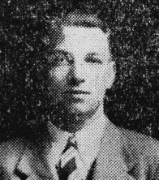

在战争第二个月被俘后，皇家空军的阿尔弗雷德·罗纳德·格顿军士（`Warrant Officer Alfred Ronald Gunton`）于 1944 年 9 月被遣返回他在赫克斯姆的家，此前他在战俘营被关了近五年。

在战俘营关押了近五年后，`格顿士兵`在写给父母的一封未审查信中用铅笔写道：“我需要一些巧克力、饼干、罐装牛肉和一罐水果，如果可以的话，请寄一些黄油。战后见！”

货轮`Cairmona`从蒙特利尔出发前往英国时，船上有两只黑猫，但它们并没有带来好运，因为该船在苏格兰东北海岸被鱼雷命中后十五分钟内就沉没了。幸存者中包括赫克斯姆的 C.D.博伊学员（`Cadet C.D. Boyd`），他在第 36 次跨越大西洋时失去了所有财产。桑德兰号`SS Cairmona`属于`Cairn Line`公司，赫克斯姆公宅（`Dukes House`）的 T.鲁塞尔少校（`Major T. Russell`）担任董事会主席。


X 先生目睹了老人被打死，以及各种形式的残忍罪行。在好几次中，这处为容纳 5000 人而建造的营中所有 20000 名囚犯在半夜被唤醒，目睹大规模绞决。营中所有死者都被火化，骨灰被送给亲属，但亲属不被允许询问死亡的原因和方式。亲属可以寄包裹，但囚犯必须排队领取，有时要排一整天。如果包裹里有烟草或水果，会被营地官员没收，家中的信件会在预定收件人面前被撕碎。

早餐是一杯咖啡色的饮料和四分之一块面包，午餐是带有极少量肉痕迹的汤，晚餐是小块重盐香肠和盐渍鱱。X 先生说：“这是另一种形式的酷刑，因为我们不被用水，如果你吃了晚餐，整晚都会忍受极度口渴。”

他谈到了大多数德国人的绝望，他们被一个政府拖入了一场并不想要的战争，而这个政府无情地镇压了任何对纳粹党的反抗苗头。

人们对来自布里伍德、海登顿桥的二等军官西里尔·克莱米特森的遭遇深表同情。他当时乘坐纽卡斯尔号`Dalryan`轮船在往返远方的 5 万英里旅程接近结束时，船只在英国东南岸附近击中了水雷。

他告诉《快报》：“在准备起落架之前，我正在舱内小睡，这时被一个恐怖的声音惊醒了。船侧的金属侧面像纸一样被撕碎了。我的舱室完全破碎；我的无线电、衣柜和其他家具变成了木屑。我摸索着寻找手电筒和救生衣，跑到甲板上，那里发生了第二次爆炸，我们不得不躲避坠落的残骸。”

幸运的是，所有 38 名船员都获了救援，因为爆炸从岸上可以看到。正如克莱米特森中尉所说，唯一的伤亡是“我的金鱼和别人的人的金丝雀”。

战争中的第一个圣诞节带来了无声的反抗，商店报告的生意比冲突前更好。邮政局报告交换的问候卡数量大幅增加。许多在部队服役的当地男子休假回家，因此有一些快乐的家庭团聚。虽然许多疏散人员回家过节，但另一些人留在了泰恩代尔，在赫克斯姆的共济会大厅为新来者举行了一场大型派对，由快乐磨坊乐队提供跳舞音乐。

圣诞节的一大特色是无线电中的帝国联动节目，科布里奇圣歌队参加了该节目，并以乔治六世国王给帝国的消息结束。科布里奇的广播是在罗克利夫庄园（Roecliffe Lodge）84 岁的 J.T. 梅尔家中进行的。吟唱的圣歌有《寂静夜》和《东方三博士》，由著名的诺森伯兰郡风琴手杰克·阿姆斯特朗伴奏。

赫克斯姆战争纪念医院的病房被装饰得色彩斑斓，挂着护士和患者自己制作的带和其他物品。几位士兵病人收到了护士编织的羊毛礼物。尽管灯控带来了麻烦，邮政局很好地应对了雪片般的邮件，大多数人都听从了尽早寄送圣诞邮件的建议。

尽管在第二次世界大战期间泰恩代尔被认为更多是一个寻求安全的避难所而非活动中心，但这里并非完全没有冲突发生的证据。该地区布满了沼泽弹坑和掩盖着撕裂残骸的草丛山丘，这充分证明了该地区多年来见证了与其相当的悲剧。

遗憾的是，当地的坠机现场很少发现敌方飞机——大多数现场讲述了年轻盟军士兵多次丧生命的悲惨故事。1940 年 10 月，一架`Whitley`轰炸机在从对波兰斯廷廷油厂的袭击返回的途中耗尽了燃料。五名机组成员安全跳伞，但由于某些未知原因，他们的飞机没有指向大海，随着机组成员缓慢降落，飞机继续飞行。在贝勒林姆西南三英里处，失事的轰炸机撞击高地，最终在梅斯林斯（Meslings）坠毁。`Whitley`的机组成员包括马克·阿尔弗雷德·尼曼中士，他曾在驻扎于利明皇家空军基地的`RAF Leeming` `10 中队`担任无线电员。机组成员最终在南方八英里的斯通豪什（Stonehaugh）附近的`Ladyhill`着陆，裹着降落伞度过了一个寒冷的夜晚。

在`Whitley`坠毁仅两周后，一架来自`RAF Newmarket`的维克斯士林顿轰炸机在执行轰炸柏林的任务返回途中坠落。恶劣的天气条件和低能见度导致飞机在奥特伯恩西部的布莱克霍普山（Blakehope Fell）坠毁。据认为，飞行员在`Wellington`撞击高地时选择穿云层以确定位置。飞机撞过了一道干石墙并在撞击时起火，导致六名机组成员中的一人丧生。

1941 年 7 月，一架`Hurricane`战斗机坠落在惠顿斯托尔费尔利农场（Fairley Farm）的森林中，飞行员在跳伞时脚折。1941 年 8 月，一架`Spitfire`战斗机坠落在华灵顿厅（Wallington Hall），飞行员死亡，同一天，莱尔的穆特劳农场（Mootlaw Farm）被五枚炸弹命中。

同年 11 月，另一架`Hurricane`战斗机坠落在凯尔德的皮尔山（Peel Fell）山顶，飞行员死亡。皇家印度空军的胡库姆·钱德·梅塔军官（24 岁）驾驶着四架从`RAF Acklington`起飞参加编队演习的`Hurricane`之一。来自`43 中队`的梅塔领领编队，但在返程途中失踪。接下来的两天都在寻找飞机却无无果，直到一名当地牧羊人报告看到飞机以惊人的速度撞入山坡，只留了尾部可见。梅塔的遗体在撞击点不远处被发现，埋在 8 英尺厚的泥炭下。

1941 年的圣诞节并没有宁静，另一架`Hurricane`在奥文格姆（Ovingham）附近低空飞行时坠毁。同样在 12 月，一架`Westland Lysander`飞机在靶场上方参加炮兵协作演习时坠落在奥特伯恩（Otterburn）。飞行员 J.K. 阿斯汀飞行官注意到，从`RAF Clifton`到达奥特伯恩后引擎开始熄火。无法解决问题，他被迫在软且不平整的地面着陆，导致飞机在着陆时翻扣。幸运的是，阿斯汀未受伤逃，飞机后来被打捞。

1942 年 3 月 22 日，Wark 的居民听到头空有一架单引擎飞机引擎的声音。澳大利亚军士克拉里·哈克（Clarrie Harker）是`RAF Usworth`一架`Hurricane`战斗机的飞行员，这架飞机在未能成功从仰角中拉出后，垂直向地面俯冲。他设法跳出了机舱，留下`Hurricane`坠落在 Moat Hill 农场的一块田里，并在火球中爆炸。哈克的降落伞挂在了附近的一棵树上，使他悬挂在半空中。当地孩子们赶到现场，发现村里的一位年老女性正对着他大骂脏话，误把他当成了德国人。

北泰恩著名的坠机事故之一发生在 1943 年 2 月，当时一架美国`Mustang`战斗机以约每小时 400 英里的速度撞 Bellingham 附近的 Hareshaw Head 的一处沼泽山坡。飞行员仅 22 岁的飞行军尉约翰·菲舍尔（Johnny Fisher）遇难，一支`RAF`救援队在沼泽中挖掘了 16 英尺深才寻回了他的遗体。

1943 年 3 月，一组六人乘坐一架`Vickers Wellington`轰机坠毁。从`RAF Harwell`起飞后，事故原因仍是一个谜团，但飞机在 Greenhaugh 的 Comb Moor 冒着火坠落在此。调查表明，飞行员可能失去了控制，导致飞机俯冲进荒地的一处泥炭沼，造成全体机员遇难。

一架来自诺森伯兰郡 Wooler 附近`RAF Milfield`的`Hurricane`战斗机于 1943 年 6 月坠毁在 Elsdon 的`Ottercops Moss`。飞行飞行军士约翰·盖茨（John Gates）在坠毁中昏迷，但在飞机停止移动时恢复了意识。他在未能从一次低空俯冲动作中恢复后，被附近附近的士兵从残骸中救了出来。

遭遇悲剧命运的不只有盟军飞机，1943 年 3 月 25 日，一架德国`Dornier`轰炸机在罗马墙附近的 Twice Brewed 附近的 Steel Rigg 被一架夜战机击落。四名机组成全部遇难，并葬在卡莱斯尔。

这张 1940 年 1 月的海报解释了配给制的现实。

混乱一直持续到 1944 年，同年 4 月，年仅 20 岁的军士西里尔·杰克·朱威尔（Cyril Jack Jewell）在他的`Spitfire`战斗机撞上 Wark 的 Houxty Woods 时牺牲。

1940 年带来了新的配给规定，黄油、培根、火腿和糖都需要券。黄油、火腿和培根的基本配额每人每周 4 盎司，糖的配额为每人每周 12 盎司。对于想要制作果酱或养蜂的人，提供了额外的糖供应。在外工作的人还被告知，他们可以在不使用任何券的情况下订购培根、鸡蛋、圆面包和黄油，他们的茶也会随附提供糖。

被店主们称为“票券一”（Coupon Monday）的日子进行得有序，但并没有急于领取双倍培根配额。一位肉铺师说：“我们的培根柜台很冷清，对额外配额的需求很小。政府设定的培根价格阻止了人们购买。普通的主妇认为培根和火腿是某种可以轻易放弃的奢侈品——购物者负担不起每磅 1 英镑 8 便士的培根。普通主妇正在忍受，用更便宜但提供同等营养的食物来养活家人。”

战争初期几年引起了公众关注的是威廉·乔斯（William Joyce）那尖锐的语调，他从第三帝国发出的“德国呼唤”广播为他赢得了“鹰勋爵”（Lord Haw-Haw）的绰号。很快就确定，乔斯对赫克斯姆（Hexham）并不陌生，在战前不久曾到该镇代表英国法西斯联合联盟传播宣传。他甚至去过`Courant`报办公室，为宣传他在 1936 年在该镇上举行的一场会议。

专栏作家 Hextol 在 1940 年 3 月回忆道：“我从他口中得知，他曾多次代表法西斯领袖奥斯瓦德·莫斯莱爵士（Sir Oswald Mosley）办事。我没有亲自报道过他的会议，但记录显示他曾请求结束国际金融和犹太人对市场的控制。他认为，一个经人民认可的领袖进行公开独裁，比国际金融的隐性独裁要好得多。”

到年底，赫克斯姆医院供应仓库已派发了 7000 多物品，从 11 月初开始，仓库交付了 1000 双袜子、370 双手套、310 个头盔、300 条围巾和 104 条针织毯。织者们使用白色羊毛为芬兰士兵制作护脸头盔，并为皇家海军制作海靴袜。拖鞋制造商也被迫切需要。

南诺森伯兰马术俱乐部在 Hydro Hotel 举行了年度舞会，酒店装饰有俱乐部的色彩——紫色和金色。舞会音乐由 Clement Millard 乐队提供，《西格里德防线》、《Boomps a Daisy》、《兰贝斯漫步》和《栗树》证明非常受欢迎。

天气在 2 月变恶化，记录到零下 34 度的霜冻，Allendale 和北泰恩的道路被大雪封堵。

1 月 29 日发生了一次空袭警报，赫克斯姆所有学校的孩子进入了防空洞，他们的歌声包括《滚出木桶》和《跑吧，兔子，跑吧》。没有敌机进入泰恩河谷，25 分钟后响起了解除信号。

灯空管制持续给泰恩郡（Tynedale）的人们带来许多问题，司机和行人在黑暗中挣扎，导致数人死亡。知名人物之一是`Courant`报最近退休的主记者弗雷德·古斯（Fred Guthrie），他被一辆双人自行车撞导致头部骨折。他去世时 71 岁，在报社工作了半个世纪。

战争第一年英国的早期胜利之一是击败德国口袋战舰“海军上将号”（Admiral Spee），这变成了著名的河口海战——而一位来自 Fourstones 的海员在摧毁舰队中发挥了作用。他是锅炉工查尔顿（Stoker Charlton），当时在“亚历克斯号”上，与“阿基琉斯号”和“埃克斯特号”一起围了该者，直到其最终在蒙特维的亚附近自沉。

从南美水域返回家中享受 26 天休假后，锅炉工查尔顿说，胜利是因为“海军上将号”的船员是由年轻纳粹组成的，当他们发现预定目标可以反击时，他们就没有战斗斗志了。

他告诉`Courant`：“他们的队长是一个真正的绅士，一个老派的人，但船员是由希特勒运动的年轻人组成的。在对我们发动一次进攻后，他们就没有战斗斗志了。当他们看到我们可以反击时，他们就不想战斗了。”

司炉工查尔顿（Stoker Charlton）说：“施佩德号将火力集中在埃克塞特号上，但我们三艘都在向她猛击，她几乎没有逃脱的机会。我们持续攻击她，很少停止射击，尽管我们有一座炮塔被毁，主桅也被击断，导致无线电线杆和天线随之掉落。施佩德号的炮弹在我们四周爆炸，碎片向我们身上飞溅，我们上甲板的官兵们非常幸运，仅一人死亡，几人受伤。”

查尔顿经历了一次死里逃生，一枚 11 英寸的炮弹穿过了他工作的隔间但没有伤到他，但在战斗的剩余时间里，他一直忙于奔命，在炮弹如雨般落下时修理损坏的管道和电线。“最后，射击停止了，”他说，“我们都瞥了那艘残破不堪的残骸，它曾是德国海军的骄傲，如今正向着蒙得维亚的方向在黑暗的地平线上蹒跚离去。”

英国船只无法进入中立国乌拉圭的海域，但在三海里界外等待`施佩德号`的出现，她确实出现了——只是选择了自爆而非投降。

三周后，当`雅德克斯号`回到蒙得维亚进行友好访问时，`施佩德号`的残骸仍在燃烧，`雅德克斯号`的船员们是该市英国社区举办的派对的贵宾。除了名为`sadre`的乌拉圭式盛宴（六只羊被烧烤并用手抓），水员们还参加了一场舞会，司炉工查尔顿在会上表演了他的第一支《Boomps a Daisy》。

在回到福尔斯通（Fourstones）后，司炉工查尔顿在纽布罗市政厅的一个仪式上，收到了福尔斯通基金赠送的一块刻字不锈钢手表。

另一来自海登桥的南泰恩河司炉工约瑟夫·查尔顿·威尔莱（Joseph Charlton Wylie）告诉《快报》（`Courant`），他与所谓的德国“地狱船”阿尔特马马克号（`Altmark`）相遇的经历。那是一油油轮，关押着被施佩德号击沉的船只的英国战俘，环境极其恶劣。他当时在伊万霍号（`HMS Ivanhoe`）服服，他们在挪威海域发现了阿尔特马马克号，并向其船头发射了一发警告弹。

来自海登桥的一级司炉工约瑟夫·查尔顿·威尔莱，他当时在`伊万霍号`上追逐所谓的德国地狱船——阿尔特马马克号。

他说：“阿尔特马马克号无视了警告，于是我们向她靠近，正当距离只有几码、准备跳上船时，一艘挪威鱼雷艇介入，并抗议我们进入了挪威海域。纳粹船长利用这个提供的机会，急转弯进入了一个峡湾。船上完全没有一个英国人的迹象，在中立船长的干预下，德国船长叼着烟头，在指挥楼上得意扬扬地走着。”

`伊万霍号`失去了动力，但在黑暗的掩护下，考萨克号（`HMS Cossack`）返回峡湾，其船员登上了阿尔特马马克号并释放了 300 多名战俘。

在后方，曾发起过回收物资以支持战争努力的运动，赫克斯姆区议会同意报废其旧消防车；在公众交出的物品中，有两支从上一次大战中回收的德国机枪，它们以 5 几尼的价格售出。

在海登桥，教区委员会致信给赫克斯姆区议会，要求为村子提供一个防空警报，因为尽管有 100 多男女参加了防空民兵（`ARP`）工作，但在发生空袭袭击时，没有办法召唤他们回到岗位。

两名骑摩托车去乡下游玩的纽卡斯尔男子停下来拍照——结果发现自己站在了赫克斯姆治安法庭面前。因为照片背景中有一根无线电线杆，根据《紧急权力条例》（照片控制令第 1 号），在没有战争部部长书面许可的情况下，拍摄此类设施的照片是禁止的。这两个人说他们完全没有考虑过照片背景中有什么，但他们两人都被罚款 1 英镑，外加 9 先令诉讼费。法庭主席洛夫图斯·贝茨爵士（Sir Loftus Bates）接受这两个人的行为没有其他动机，但表示他们非常粗心，本可以被罚款 100 英镑。

## 泰恩代尔准备迎接入侵

1940 年春末，“假装战争”猝如其地结束了，希特勒的坦克师不可阻挡地席卷了欧洲。1940 年 5 月联合政府的成立，温斯顿·丘吉尔接替内维尔·塞伯兰担任总理，《快报》对此表示热烈欢迎，编辑泰迪·泰勒（Teddy Taylor）在社论中写道：

“在希特勒在战场上进攻的时刻，国家后方获得了一剂急需的补药。正如内维尔·塞伯兰上周五通过无线电对我们所说的，如果希特勒寄希望依靠我们的内部分裂来帮助他，他就误判了这个民族的心思。为了结队并为即将到来的伟大斗争做好准备，唯一需要的就是这声战斗号召。以典型的丘吉尔式风格，我们的新总理为我们总结了问题。通过血水、辛劳、泪水和汗水，胜利属于我们的军队。温斯顿·丘吉尔的精神是不可摧的。在他那个时代，没有人比他遭受过命运的箭矢，也没有人比他这样勇敢地反击并赢得胜利。今天我们在他身上看到了英国民族拥有的每种品质的化身，这些品质一次一次在压倒性的优势中夺得了胜利。现在是将他的能量和驱动力扩展到我们努力的每一个分支了。

过去九个月缠绕我们战争努力的官僚主义必须被切断。为了迎接战场迫切的召唤，必须牺牲休闲、便利和对利润的考虑。如果丘吉尔精神主导我们的每一个行为，那么拯救战斗部队士兵的生命将是我们的直接收获，而推翻野蛮的纳粹主义则是最终目标。在我们不可避免将面临的黑暗日子里，随着当前冲突的加剧，让我们都记得领袖英勇的精神，从中汲取灵感来指导我们的每一个行为，服务我们的每一个目标，直到胜利最终获得。”

新面貌的政府并不是唯一的改变——在它 76 年的历史中第一次，赫克斯姆《快报》的头版没有填满广告，比如像吉布森药店出售的诺斯特罗莱鼻涕消除剂、普鲁德霍的里奥剧院表演的“老太太·莱莉”，或是寻找领养一个 10 个月大女孩的广告。

作为战争努力的一部分，小广告被从第一页扫除，为战争新闻让路。编辑的一份说明解释说这种这种是为了满足战时报纸生产的需求。他向读者保证：“这种转变绝不会影响报纸的性质，报纸将继续提供完整的本地新闻服务以及受欢迎的常规栏目。新的版式起初会让读者感到陌生，但我们相信，在头版刊当周主要本地新闻的决定将对读者有所帮助，这种转变将受到他们的欢迎。”

## 在那个历史性的头版上的主要故事之一，是关于纳粹伞兵会堕落到何种地步的警告。读者被告知，一个卑鄙的匈奴人使用气胶降落伞降落在比利时，他不仅带了机枪，还带了一把挤奶凳。着陆后，他冲向最近的一头牛并开始挤奶，但他那德国人的诡计并未能欺骗当地人，反而被他们俘虏了。

## 然而，日常生活仍在继续，报纸上两个最大的案件是：两名普鲁德霍的农民因稀释牛奶分别被罚款`£4`和`£5`，以及一对米克利的夫妇因忽视儿童被入狱。他们甚至不确定自己是有十三个还是十四个孩子。

## 在其 74 年的历史上首次，《赫克斯姆纪事报》在`1940 年 5 月 25 日`的头版刊登了新闻而非广告。显著位置是一条警告，要提心携带挤奶凳作为掩护的纳粹伞兵。

J.V.C. 法夸尔（Farquhar）牧师在`1919`年至`1944`年间担任赫克斯姆牧师。在 1939 年敌对爆发时，他在修道院安装了扬声器系统，以便晨礼时的会众能听到内维尔·奇伯林宣布英德两国处于战争状态的洪亮声音。

法夸尔先生对燃烧弹摧毁修道院深表恐惧，因此他组织了一支守火员队伍，他们住在建筑内。他自己也许多晚上睡在半夜楼梯顶部的折叠床。。当地历史学家罗兰·查尔顿（Rowland Charlton）是民卫队的一员，曾在市政厅（Moot Hall）执行守火任务。起初，民卫队被称为地方防御志愿者，简称`LDV`——查尔顿先生一直认为这三个首字母的真实含义是“看、躲、溜溜”（Look, Duck and Vanish）！


随着“假战争”阶段的结束，`LDV`在赫克斯姆的活动加强了，所有自愿服役的退役军人都被发放了装备，包括一套卡其工作服、一顶野猎帽和一支步枪。超过 1000 名男子自愿报名，令他们非常失望的是，很快就清楚并非所有人都需要服役。指挥赫克斯姆小组的奥特伯恩阿奇巴德·怀特爵士（Sir Archibald White）中校表示，一切进展顺利，一旦各个部门练好了射击术，巡逻工作就会开始。他补充道：“我无法说会有多少志愿者被召唤；这取决于我们被允许多少套装备。然而，可以肯定，人数将远低于志愿者的总数。”

各单位的负责人分别是：阿尼克的助理小组指挥官查尔斯·贝克·霍恩比（Charles Beck Hornby）少校；赫克斯姆的里德利·罗布（Ridley Robb）中校；贝灵汉的 J.D·杰布（J.D. Jebb）准将以及贝宾顿的 H.S·贝尔（H.S. Bell）上校。

雷德斯代尔的居民们怀怀记忆着西伍德伯恩和里兹代尔民卫队的事迹。他们过去会在柯基卡哈尔指挥官安德森少校的监视下，在全圣教堂后的田野进行每周演习和阅兵。参与者包括罗伯特·泰特（Robert Tait）、托马斯·泰特（Thomas Tait）、休·斯奈斯（Hugh Snaith）、吉·威尔逊（Jim Wilson）、威利·罗布森（Willie Robson）、杰克·布罗迪（Jack Brodie）和哈里·康梅（Harry Comer）。他们喜欢的训练之一是实弹手榴弹训练，志愿者们必须将手榴弹投过山脊，掉进一个方便的凹地处以安全爆炸。

赫克斯姆民卫队准备好在德国人入侵时尽一份力。

瓦克民卫队在阅兵。

不用说，在一次著名的场合，，一个特别笨拙的新兵投出的手榴弹没能飞越山脊，而是轻轻地滚回了连队的其他人那里，导致他们惊恐地散开了来。

在另一次演习中，连队被要求爬上伍德伯恩长坡到达采石场顶部，以监视敌方伞兵。同一个倒霉的新兵被任命为传令兵，被命令把一辆沉重的自行车从村中心骑到采石场。他还没等得及喘气，就被士官命令骑着那台机器回到营部——也就是那个广受人们怀念的“狐狸与猎狗”（Fox and Hounds）酒吧。那个可怜的士兵吞了口口水拒绝了命令，当他被满脸紫色的士官询问为什么时，他不得不回答道：“因为我骑不了这该死的自行车，士官！”

其他人还记得那个所谓的德国入侵东北部海岸的著名夜晚。命令程序是：指挥官安德森少校会打电话给卡皮顿克洛克米尔的汤米·汤普森（Tommy Thompson），再由他拨打给连队成员汤米·沃尔顿（Tommy Walton）。然后他会打给下一个，以此类推，这样所有人都能收到警报。

在疑似入侵的夜晚，汤米·沃尔顿接到了安德森少校的电话，说怀疑有入侵。然而，少校联系不上汤米·汤普森，于是请沃尔顿先生开车去叫醒他。沃尔顿先生如约去了克洛克米尔，尽管拼命敲门并向窗户扔石头，但并没有能叫醒汤普森。最后，沃尔顿先生回到车里回家睡觉了，所以也许德国人决定不入侵就好了。

埃迪·怀特（Eddie Waite）在`1980 年代`曾担任泰代尔议会主席——图中左侧，右侧是哈罗德·罗布（Harold Robson）。中间是基思（Keith）上尉。

民卫队的训练在某些地区比其他地区更认真，正如一个不幸的志愿者在参加一次涉及赫克斯姆和纽伯罗部队的演习时付出的代价那样。该连由赫克斯姆村学校的校长爱德华·怀特（Edward Waite）运营，他将士兵分为两组——他的一组是英国，另一组由第一次世界大战的诺森伯郡陆军士官哈罗德·罗布带领，即为敌方。

怀特在霍格顿路为“德国人”设了伏击，但那个不幸的志愿者发现了怀特和他的士兵躲在油桶和灌木丛后，并无意地告诉了罗布。那个狡猾的士官随后得以偷袭了怀特的人并俘虏了他们所有人，这让校长大发雷霆。

第二天在学校，当学生们正在上早课时，怀特追问是谁泄露了伏击战的消息，当那个年轻人承认是他自己时，怀特的愤怒非常可怕。他训斥那个恐惧的的孩子，说口言不慎会导致生命损失，并告诉他民卫队处理第五纵奸的简单方法——他们会被处决。

随后他派了另一个学生去学校家里取回他的手枪和萨姆布恩带，然后蒙住那个孩子的眼睛，问他是否有最后的遗言。

在校长罢手之前，那个孩子已经吓尿了裤子。

还有一个传说说，安德森少校决定在他自己的庄园上藏起所有民卫队的弹药和爆炸物，以防入侵。不幸的是，这位老少校忘记了把它们埋在哪里了，据称从未被发现。

在科布里奇民卫队，劳伦斯·贝斯特（Laurence Best）在`14`岁时就当士官的跑腿。在他年过`80`多岁时，他回忆道：“有些孩子非常认真，这也许是件好事，但有一个‘尴尬小组’（Awkward Squad）——我是荣誉成员——他们把它当成大玩笑。”

在学生时代，劳伦斯被发了一支木制步枪，但后来被士官收走了，因为他那支真实的.303 步枪对于演习来说太重了。当时还有与`赫克斯姆民卫军`进行的模拟战，其中，`笨拙小队`总有一个共同的目标——攻占当地的酒吧。

劳伦斯回忆道：“我们抓了科布里奇的站长皮尔森先生，并让火车开到了赫克斯姆，在那里我们占领了旧的`车站酒店`。当我们的军官问我们在做什么时，我们告诉他我们正在审问一名犯人。他说应该由他来审问，他说可以——前提是他必须得请大家每喝啤酒！我当然没喝酒——我只能靠汽水和薯片应付了。”

`科布里奇民卫军`的士兵们已准备就绪。

在另一次，一名军官不小心透露他计划在凌晨 2 点对民卫军进行检查——当他靠近时，迎接他的是一连串空弹爆炸的巨响，他吓得魂飞魄散！

战争中首批当地伤亡者的这一悲剧身份落在了两个 20 岁的年轻人身上：步兵阿尔伯特·汤姆森，来自泰恩格林赫克斯姆的 W.汤姆森夫妇的幼子；以及步兵康内利奥斯·牛顿，来自万内莱斯近巷，两人均在`5 月 19 日`服役于`皇家诺森伯兰步兵团`期间战死沙场。

当`英国远征军`被强大的德国战争机器推回大海并驱赶至敦迪尔克海滩时，整个国家在国王的要求下举行了国家祈祷日。超过`2,000`人参加了`赫克斯姆修道院`的周日礼拜，该地区各教堂也座无虚席。

伤亡人数开始增加，从敦迪尔克抢出来的伤兵护送队开始抵达赫克斯姆的`应急医院`。这片木制建筑群是在战争初期建立的，用于收治在海外受伤的军方伤员，以及处理平民和军方的空袭伤员。一段时间内，它接收了当地的“和平时期”紧急病例，以及在纽卡斯尔`皇家维多利亚医院`等待治疗的急症和手术病例。但`1940 年 6 月 1 日`，第一批`269`名来自敦迪尔克撤离的伤员到达，从那时起医院一直满到`1945 年`。赫克斯姆人一直称之为`军医院`，它本在战结束后关闭，但在`1948 年`并入了新的`国家医疗服务体系`，那些木制建筑一直发挥着巨大的作用，直到`2004 年`首相托尼·布莱尔在赫克斯姆开了新医院。

敦迪尔克伤员的抵达本应是一个秘密，但许多人在清晨时分出来，迎接那些疲惫不堪的伤兵，在很多情况下他们命悬一危，但仍保持着令人惊讶的乐观精神。许多人除了身上的衣服外别没有其他个人物品，但人们立即进行了收集，在他们到达后的几小时内，士兵们就得到了衣服、剃须刀、烟草、火柴、食物和水果等礼物。一名士兵给家人的信中写道：“我被对待得像国王一样。”

医院的医护人员由大量的`红十字`工作者进行补充，他们尽全力照顾伤员并减轻他们的痛苦。显而易见，所有的士兵都经历过他们不愿提起的经历，但他们那惊人的乐观让护士和医生们大叹不已。

伤员中还有一支法国士兵，尽管他们自己伤势严重，家园可能已被夷毁，妻子和孩子可能散落在法国各地，但他们仍保持着极佳的乐观精神。其中一人通过翻译官说：“再过十天，我就回去让弗里茨（德国人）看看什么叫厉害。”

被送到赫克斯姆的人中，有一位名叫`威廉·奥姆斯顿`的`皇家诺森伯兰步兵`，他的脚部被严重压碎，在前往敦迪尔克的途中经历了艰辛的`40 小时`救护车之程，在此期间，司机为了躲避纳粹的炸弹和机枪弹曾两次停下车。最终抵达英国后，他和其他伤员一起上了一列救护火车，这时他第一次听到赫克斯姆被提到是火车的终点。尽管受伤了，他非常高兴，因为赫克斯姆是他的家乡，他的父母只需要走几百就能探望他。

`赫克斯姆自由教会`为探视伤兵的亲属设立了“住宿服务”，他们呼吁当地家庭为访客提供住宿，并收到了许多帮助的报价。

并不是人都活了下来；一名英国士兵和一名法国海军陆战队员在伤兵运输队后不久便去世。这两位受害者——来自`米德尔塞军团`的雷克斯·马丁二等（`21 岁`）和海军陆战保罗·鲁尔——并排安葬在赫克斯姆墓地。`赫克斯姆牧师`分别举行了告别仪式，由赫克斯姆牧师`J.V.C.法奎哈尔`为这位英国人主持仪式，而天主教神父`康宁汉父亲`为这位法国人主持了仪式。棺材上覆盖着`英国国旗`和`法国三色旗`，哀悼者中还有纽卡斯尔的法国领事。

当时还需要大量的语言人才来为法国国民和殖民地提供翻译，包括来自`伊丽莎白女王`男女文法学校的法国老师。

士兵们不愿在记录中谈论他们在敦迪尔克的经历，但一名`赫克斯姆步兵`告诉《酷韵报》，当敦迪尔克切断供水时，他仍设法在几天后洗上了第一次澡——用的是两瓶香槟。他说：“我洗得真舒服。”

尽管如此生活仍在继续，一名来自`海登桥`的防空警员因在家违反黑灯规定被罚 12 英先 6 士。他将其归咎于妻子为了打扫窗户拆掉了遮光材料。

来自地区的贝灵汉姆农夫`威廉·詹姆斯·多德`（`60 岁`）因拒绝遵守`战争部`耕种所有土地以增加产量的指令而处于法律对立面，被罚款 40 英加 10 英诉讼费。他告诉法庭，不同意耕种所有土地，因为他留了两块最好的草场为奶牛提供饲料。他与`牛奶营销委员会`签有合同每天提供`50`加牛奶，如果动物在冬季得不到良好饲养，他就无法做到。判决下达时，多德说他宁愿坐狱也不交罚款，但被告知这不是选择，如有必要，他的土地将被征收并耕种用于生产。

`普鲁霍`的一名警察被指控在逮捕三名涉嫌醉酒的人时行为“更像冲锋队队员而不是一个开明的英国警察”。然而，法官拒绝接受他辱骂这些人并击中其中一人腹部的指控，那三个恶徒都被处了罚款。

当当地受欢迎的运动员`托马斯·布兰`中尉被报告失踪时，赫克斯姆一片哀痛。他曾代表`泰德尔`参加橄榄球和板球比赛，帮助橄榄球俱乐部三次获得`诺森伯兰高级杯赛`冠军，并代表`诺森伯兰`参加过三十多次比赛。他是 1936 年`诺森伯兰与达姆`联合队对阵新西兰全黑队的成员，他也是一位同样有天赋的板球运动员，曾代表`诺森伯兰`和`泰德尔`参加比赛，并在代表`泰德尔`对阵`本韦尔山`时在 129 分钟内击得 155 分。

后来得知他被俘，并于`1941 年 1 月`在一家德国医院伤势去世。

由于入侵威胁无处不在，泰因代尔（Tynedale）的居民被警告要加强灯管制措施，违反灯管制条例的标准罚款已从 12 先令 6 便士增加到更昂贵的 2 英镑。公众还被警告要严肃地对待防空警报。北方地区专员亚瑟·兰伯特爵士（Sir Arthur Lambert）表示：“有相当一部分公众似乎没有意识到炸弹爆炸的风险，这种爆炸可能在防空警报后几乎立即发生。许多人聚集在自己房屋的门窗前。许多人来到户外，甚至还带着他们的孩子。被炸弹直接命中的几率很小，但爆炸后的碎片可以在 70-80 码的范围内造成可怕的伤害。”

人们还被警告要服从部署在地区各敏感地点的哨兵的指示。J·麦维卡尔·蒙罗（Major J. MacVicar Munro）少将警告道：“我们正处于战争中，这些哨兵被警告要阻止靠近哨所的人，如果不听从命令就开火。你是一个忠诚臣民，你可能在执行某个完全忠诚的任务，哨兵是并不知道的。最近有一个人认为哨兵命令他停下是在开玩笑，在受到第二次警告时仍继续开车移动，直到一把刺刀刺穿了他的前轮胎才停下来。聋哑人士在没有朋友陪同的情况下，不应接近任何守卫点。”

人们对赫克斯姆（Hexham）市政学校防空避难所的有效性提出了质疑，并向当局投诉，称在最近一次演习中，避难所的通风不足，导致孩子们几乎窒息。许多孩子还因为避难所内极度炎热而导致严重的头痛。解释是门必须锁紧，否则无法隔挡毒气。

户主还被警告要节约用水用于消防，并禁止洗车、浇灌花园或冲洗小路和院子。

为了支持战争努力，一项决定在北部一个著名的风景胜地之一——贝灵汉（Bellingham）的哈雷肖林林（Hareshaw Linn）砍伐树木。贝灵汉农村地区委员会主席 T·辛普森（T. Simpson）议员表示，他已经检查了通往壮丽瀑布的林地山谷，并表示这是一个非常漂亮的地方——它看起来非常美丽，我们不得不破坏它真是件遗憾。”尽管如此，他们仍决定砍伐溪流南侧所有的橡树和软木，留下一窄窄的树带以尽可能保持树林的美观。

回到前线，一名来自福尔斯通斯（Fourstones）的 20 岁掷枪兵成为该地区首位因英勇受勋的军士。皇家诺坎伯郡陆掷枪兵团的克里斯托弗·威尔逊（Private Christopher Wilson）下士因在 5 月 21 日在阿拉斯（Arras）表现出非凡的英勇被授予军人勋章，当时他用他的反坦克炮击毁了两辆坦克，并持续射击直到炮筒炸裂。

从海峡彼岸传来的噩耗不断，米克利（Mickley）的步兵威廉·沃克（William Walker）的家人被告知他在战斗中阵亡——恰好是其父亲在索姆战役战死的纪念日。服役于皇家诺坎伯郡陆掷枪兵团的来自贝灵汉的埃德温·约翰逊（Edwin Johnson）中尉也被报告失踪。他是一位著名的运动员，曾帮助泰因代尔橄榄球俱乐部在 1935 年和 1936 年获得诺坎伯郡高级杯并代表诺坎伯郡参赛；他还是一位县级高尔夫选手。后来确认他已被俘，正在战俘营中。

来自福尔斯通斯的军人勋章获得者克里斯托弗·威尔逊。

服役于“光荣丽号”（HMS Glorious）的普鲁霍（Prudhoe）医生、休休·阿达尔·洛克哈特（Surgeon Lieutenant Commander Hugh Adare Lockhart）外科上校指挥的家人拒绝接受海军部关于他被推定死亡的正式通知，他的母亲提到了他出色的游泳能力以及他拥有一件特别好用的救生衣。遗憾的是，他们的信念寄托错了地方——他在战斗中阵亡。

三名被确认关押在德国战俘营的泰因代尔军官。

来自贝灵汉的亨利·斯托克（Henry Stokes）中尉、普鲁霍的罗伯特·布利斯（Robert Bliss）上尉和来自赫克斯姆的托马·克莱克（Thomas Clark）少尉被确认关押在德国战俘营。1940 年 5 月，由于来自英东北沿海城镇的难民涌入，贝灵汉农村地区委员会向卫生部申请将赫克斯姆的肯尼迪·史密斯（Kenneth Smith）等人的难民安置在那些被判定为不宜居住的空房子里。

普鲁霍地区也失去了一名最有希望的士兵，来自陆军军械团的约翰·雷尔顿（John Railton）军士在 22 岁时伤亡。赫克斯姆市政委员会（UDC）在 1940 年 7 月被通知，可能需要为来自阿德代尔（Allendale）和卡特顿（Catton）的难民安置，如果人们不自愿接受，将使用强制手段。

在赫克斯姆安置 800 名难民的情况被报告为“困难重重”，因为由于来自危险地区的人迁入，由于难民进入导致贝灵汉的人口也增加了一倍。《快报》（The Courant）指出，由于大量人口迁入，最近的人口普查已完全失效。

户主对安置更多陌生人持抵触情绪，因为发往当地 3000 户家庭的征集令仅收到了 30 个名额。安置到阿德代尔的许多孩子被安置在阿德代尔的节制厅（Temperance Hall）和卡特顿阅读室。贝灵汉的人口翻了一番，引发了对水供应的担忧。

当来自英东北沿海城镇的大量难民在不到一小时内到达贝灵汉时，贝灵汉农村地区委员会向卫生部提出了强烈抗议。他们中的大多数有生虫，有四个人患有疥疮。委员会被迫将他们安置在一个大房间里，并提供床铺、毯子和食物。曾尝试联系位于布恩格（Brownrigg）新建立的营地学校，那里有医院和护理人员，以加速清理工作，但营地并不接受他们。来自赫克斯姆的肯尼迪·史密斯（Kenneth Smith）指出，他们最终被转移到了 30 英外的莫普菲斯（Morpeth）的一所机构。

布恩格格在国家营地公司（National Camps Corporation）仍在建造时，便被征用为难民中心。它是全国一系列学校计划的一部分，旨在让城市孩子体验乡村生活，但这一想法在战争期间被搁置了。1940 年春季，尚未完工的布恩格格成为来自纽卡斯尔小学的 400 名女孩的家园，尽管现场有自来水，但并没有管道连接到五个宿舍，因此在早期，女孩们必须流经校场的小溪中洗。。

但一旦建筑工作完成，他们比大多数人都要幸运，因为布恩格格广阔的土地意味着工作人员可以自己种蔬菜，这意味着在配给时代食物短缺的情况下，布恩格格的女孩经常可以加饭。

在整个战争期间只发生过一次防空警报，当时女孩们在防空洞里紧抱着自己的泰迪熊度过了一个不安的夜晚，等待着解除警报。女孩们在学校读了四年书，但在诺曼迪登陆后，她们回了家，留下了许多快乐的回忆。

回收物资的号在整个地区引起了积极响应，每个城镇和村庄都建立了回收站。在`Prospect House`赫克斯姆仓库上交的物品中，有一位老人的铝制热水壶、一个实铜浴缸和一个农民的鸡类孵化器，而一个孩子交出了他的发条火车模型。上交的还有一个维多利亚时代的金属壁炉、大量的黄铜油灯、婴儿车、玩具、锅炉和成千上万的罐头，以及两根泰恩捕鲸船队的遗物和一顶从上一次大战中回收的德国头盔。

赫克斯姆牧师不得不为修道院铁栏保留原样的事实辩护，他指出教区委员会曾想将其作为回收物资提供，但被纽卡斯尔主教办公室拒绝了许可。主教的立场得到了《快报》记者的支持，该记者表示栏杆对于保护教堂的完整性至关重要。他写道：“想象一个特殊的场合，比如一场有趣的婚礼。人们会爬上墙壁，这需要警察的协助来防止他们冲撞门口。警察的任务已经够多了了，没必要再增加他们的负担。”

直到 10 月中旬，教区才松了口，并批准了拆除栏杆的许可。然而，城镇所有公共公园以及墓地的栏杆都被拆除了。

后方战线也发生了悲剧，有两名士兵分别在泰恩河游泳时溺水——一个在里丁米尔，一个在赫克斯姆。来自沃灵灵格顿的`Richard Welding`下士在里丁米尔与大约三十名士兵一起在泰恩河进行沐浴训练时，他陷入了困难。随后的质讯结果显示，他并不擅长游泳，而且他游泳的区域非常危险，因为那里有回流和漩涡，且水深达`10-12ft`，河底是不稳定的淤泥。

他所属团团的一名军官告诉法医，由于这一事件的发生，泰恩河将不再进行沐浴训练，取而代之的是公共浴室。

仅仅三天后，来自曼彻的 20 岁炮兵`James Radcliffe`在赫克斯姆的泰恩河游泳时也遭遇不幸并溺亡。目击者说，他正在河里洗澡，告诉朋友他要游到对岸，尽管他并不擅长游泳。他游到一半时沉入水底，浮出水面时大喊道：“救救我，我溺水了！”尽管同伴们试图救他，但他还是溺水了，尽管他游泳的那个区域几代以来一直深受游泳者的欢迎。


军营里也发生了死亡事件，一名来自伯明翰的士兵`William Joseph Murphy`（22 岁）在驻守的赫克斯姆外村庄发生醉酒争吵后，被指控杀杀了同为来自曼彻的士兵`George Eric Ward`。当他床上的两枚半克朗硬币失踪时，矛盾爆发了。他装填了步枪，说要射掉任何拿他钱的人。据说，有几个人试图从他手中夺枪，其中包括被认为是他最好的朋友`Ward`，后者最终腹部中弹身亡。

`Murphy`声称枪是意外走火，但他仍被移往`1940`年 8 月的纽卡斯尔巡回庭受审。他后来被判定杀人罪不成立但过杀罪成立，被处九个月苦役。

对于住在赫克斯姆`Wanless Close`的`T.C. Urwin`夫人来说，这是一个痛苦的八月，因为在两个月内，她的丈夫和儿子都在被德国鱼雷击沉的船上。她的丈夫当时在`Mohamed Ali El Kebir`号轮上，该船从一个英国港口出发，载有士兵和海军人员，在离港两天后被鱼雷命中。船在两小时内沉没，由于救生艇损坏，`Urwin`先生不得不顺着绳索滑轮爬下在汹涌的海中登上木筏，漂流了五个小时后才被一艘驱逐舰救援。

与此同时，夫妇 18 岁的儿子`Michael`在`HMS Calypso`号上，该舰也被鱼雷击中，在经历了一段焦虑的等待后，确认他已被获救并在埃及疗养。

除了在海外与纳粹作战外，泰恩代尔的人们也被敦促对付后方的另一个敌人——老鼠。请注意展示标本上的希特勒发型和牙刷胡须。

在贡献力量的人中，有赫克斯姆最年长的居民`Mary Jane Robson`，她在`97`岁时仍在为士兵织袜子。`Robson`夫人经历过五场战争，是一个九口大家庭的最后一位幸存者，这个家族以长寿闻名。在她哥哥`C.R. Kendal`医生于 97 岁去世后，她继成为该镇最年长的居民。她的丈夫在第一次大战爆发的最初几周内去世了。为她的生日蛋糕购买 97 只蜡烛花费`12s 6d`，但`Robson`夫人要求将这笔钱捐给战争慈善机构，而不是购买蜡烛。

8 月，赫克斯姆发起了“反击，购买战斗火式飞机”运动，目标是`£5,000`。该活动得到了空军准将`Milne Robb`的支持，在此之前获得空军十字勋章不久。`Robb`表示：

> “德国军最近的大规模攻击的主要目标是消耗我们的战斗机防御，这让每个人意识到战斗机中队所承担的巨大责任。到目前为止，敌在攻击中主要依靠中型轰炸机，并有大型战斗机编护，只使用了较小比例的重轰炸机。我们防御的任何削弱都会让他们白天使用这些重轰炸机。在波兰和罗特丹造成的巨大破坏是重轰炸机的成果，由于它们能够在白天作业。这就是敌人希望在这个国家造成的局面。到目前为止他们成功有限，但现在不能在没有重大胜利的情况下放弃。我欢迎在赫克斯姆建立战斗式飞机基金的建议，这既是对战斗机工作和责任的认可，也是加强防御的一种实用手段。”

赫克斯姆镇妇女协会领先成员`Sadie Dodd`敦促女性参与战斗式飞机基金，她说：“这是一个极佳的宣传。那些德国人每晚都过来破坏我们的士气，而这产生的唯一效果是让很多人自发集集资金购买战斗式飞机来把他们击退。”

收集箱发到了酒吧和商店，向预期的捐赠者寄了私人信，并宣布将开展“英里十镑钞票”活动。在不到一周的时间，捐款超过了`£200`，不到两个月总额就达到了`£2,000`。到`1941`年 1 月初，短短五个月，目标就已经被超越，从特别筹款到个人捐赠每月高达`£1,000`。组织秘书是`J.F. Macgregor`，他领导着一群热心的助手。

喷火式战斗机运动确实激发了公众的想象力，在一个工人工年薪约为每周 3 英镑的年代，捐款非常慷慨。当资金在 1941 年 2 月结束时，总共募集了 5,250 英镑，行政费用仅为 34 英镑 16 先 3 便——仅占总额的 0.76%。

各地区募集资金的明细显示了资金来源：Acomb £54；Allendale £163；Barrasford £110；Bellingham £75；Blanchland £17；Corbridge £595；Fourstones £74；Haydon Bridge £116；Hexham £2,658；Horsley £50；Humshaugh £34；Langley £21；Lowgate £61；Matfen £40；Newton £69；North Tyne £114；Ovingham and Ovington £29；Riding Mill £175；Hexhamshire £59；Slaley £61；Stamfordham £7；Stocksfield £170；Wall £45；Wark £99；殖民及海外 £356。

一些捐赠和筹款活动筹集的金额较小——Stocksfield 的一场婚礼上的“起抢钱（hoy oot）”带来了微薄的 2 先令，一次舞会仅筹了 5 英镑——但社区努力带来了 3,588 英镑，这通过学校和学生带来的 240 英镑、社交活动、销售和音乐会的 784 英镑、募捐箱 240 英镑、雇主和员工的每周贡献 107 英镑、竞赛 91 英镑以及全地区的灯光日 199 英镑得到了进一步增加。

比弗鲁克勋爵本希望亲自来到克斯姆领取支票，但这并不可，于是支票通过邮寄寄出，并要求在飞机制造后，在机身上标上“克斯姆及地区”字样。

当英国空战战在空中激烈进行时，德国 U 潜艇在海上继续造成了沉重损失。《库报》（The Courant）详细描述了哈尔特威斯三等兵约翰·弗朗西斯·布莱基（25 岁）的痛苦经历，他是当时一艘油轮上的 39 名海员之一，这艘油轮在赫布里迪群岛以西 120 英处被鱼雷击中。他告诉《库报》，U 潜艇在晚上 8:30 左右浮出水面，并说：“他们受到的冲击似乎和我们一样大。我们试图转身以部署火炮，但在我们来得及之前，她潜下了，留下了我们，所以我们希望继续旅程。”

他们的希望落了空，因为在两个小时后，大约在 10:30，油轮在中部被一枚鱼雷击中，还摧毁了其中一艘救生艇。布莱基说：

> “我们只剩下一艘救生艇和一条我们都挤进去的小艇（jolly boat）。我们 14 个人挤在小艇里，几乎没有活动空间，只有少量的船用饼干和水。船下没得非常慢，但当我们脱离危险区域时，第二次爆炸折断了它的船脊——我想那可能击中了我们的药库。
>
> “当我们撤离时，又救了另外两名同伴，其中包括一个正值第一次航海的 16 岁舱童，他在随后的几天里成了大家的活动中心。第二次爆炸发生后不久，潜艇再次浮出水面并靠向我们的小艇，船长问我（作为小艇的负责人）我们船的名字。我向指挥官提供了必要信息，他的英语非常流利。事后有个人说，他们曾想过向指挥官透露一些前一天德国空军损失，但他们认为在这种情况下保持沉默更为明智。”

这些男士在敞口的小艇中在极其恶劣的海面上漂了三天，通常每天只吃几块饼干喝一点水，尽管有些人完全什么都没吃。布莱基报告说士气非常好，并说：“那个舱童异常地乐观，他带领男士们唱歌来提振精神。”

他们最终操纵这艘小船到达了巴拉岛可见范围内，在那里被“新兰斯号”（Newlands）拖拉船救起。布莱基说：

> “我们好几个人都受到了严寒的影响，但得知噩梦结束了我们感到非常感激。我们穿着鱼雷击中时身上的那几件衣服上岸，有些原本在病床上的人既没有鞋也没有袜子。在托伯莫里，我们先得到了食物，然后前往奥班，那里的酒店的居民自愿为我们提供床位，我们还得到了衣服。”

来自斯塔格肖的步兵罗伊·克拉克（19 岁）获准从诺森伯郡步兵团休假，担任在斯塔格肖教堂小屋举行的一场特别活动的贵宾。在活动中，他因在 5 月 28 日和 5 月 31 日在英国远征军（BEF）战斗中的两次独立英勇行为而被授予军事勋章并受到表扬。他曾在密集的炮火和迫击攻击下，继续通过步行和骑摩托车传递信息。他从未躲避或休息，而是以无畏的勇气完成每一段旅程，确保重要信息的快速送达。在一次扑克牌活动结束后，他收到了科布里战争服务基金赠送的一块刻有纪念文字的金表。

军事勋章奖得者、来自斯塔格肖的步兵罗伊·克拉克（19 岁），他因步行和骑摩托车传递信息的英勇行为获得此奖项。

法院对违反灯宵规定的处罚变得越来越严厉，罚金增加到高达 4 英镑——即使对于那些没有直接参与的人也是如此。在处以该金额的人中，包括科布里小麦穗旅馆（Wheatsheaf Inn）的房东，他确保了所有 35 扇窗户都做了遮挡。一名女佣被指示在灯宵前半小时巡视，确保所有窗帘都拉上，但这一次，一位客人打开了门并开着灯。

住在莱丁米尔的德国难民保琳·马因泽（Pauline Mainzer）因在莱丁米尔的平台有未遮挡的灯光被罚款 2 英镑，但法院认为这并非故意引导敌军。

一群敌对群众在普鲁霍（Prudhoe）聚集，威胁要打破西路建筑的窗户，那里的费斯斯特车库（Fewster’s Garage）天窗透出亮光，从 150 码外就能看到。警方最终闯入建筑熄灭了灯光。主詹姆斯·费斯斯特（James Fewster）在承认违规时被罚 2 英镑，但他归咎于一名本该锁门的学徒没有关掉灯。

普鲁霍的居民通过捐赠和特别订阅募集了 241 英镑 10 先令 11 便，用于 135 英镑购买三辆汽车，另外花了 100 英镑将其转换为当地民防（ARP）小组的救护车。

克斯姆郡罗利伯溪（Rowley Burn）一项失败的铅矿矿计划在启动 70 年后获得了回报。采矿者曾将资金投入了一项名为“鞋匠冒险”（Cobblers Venture）的采矿作业，但只开采了一小层铅矿，工厂随后被遗弃并荒废。在被遗弃的机器中，有一个重约 5 吨的大水轮，它在 1940 年被发现并运往回收计划。

在所做出的离奇决定中，一个是让科布里奇（Corbridge）圣安德鲁教堂的钟声沉默，使其在战争期间不再报时。这一决定是由科布里奇教区委员会副主席 `R.R. Ridley` 议员做出的，理由是“安全措施”，但当时正在休假的牧师 `Rev. M.M. Barlow` 对此无所知。这一决定在村子里引起了一些恐慌，尤其是当时大本钟（`Big Ben`）依然在伦敦上空轰鸣作响。牧师认为，教区委员会在没有咨询他或教会执事的情况下，没有权力命令停止时钟运行。他说：“我不是最后一个不在乎自己权利的人，但我在乎教会的荣誉，而我是我在该教区的个人代表。我很惊讶在没有咨询我的情况下，时钟竟然停止了敲击。”

内政部（`Home Office`）并未发布过关于时钟运行的命令，双方同意恢复钟声。

在贝林格姆（Bellingham）治安法庭，来自沃克（`Wark`）牧场（`Pasture House`）的 `Ellen Charlton` 因被控以每枚 4 便士出售鸡蛋出庭，而非政府规定的每枚 3 便士的最高价。Charlton 告诉法庭，她知道《本产鸡蛋最高价格令》（`Maximum Prices for Home Produced Eggs`）的规定，但她认为自己有权收取更高的价格，因为贝林格姆食品控制委员会（`Bellingham Food Control Committee`）的 `Sidney Clough` 在测试购买中买到的鸡蛋特别大，可能是双黄的。

她被罚款 1 英镑，外加 1 英镑诉费，法庭主席 `Major G.D. Anderson` 少将告诉她，她本可以被罚款 100 英镑。面对她关于自己只有几只产蛋很少的鸡的恳求，`Anderson` 少将说：“你有多少家禽并不重要。如果你只有一只每天产一个蛋的鸡，而你以高于最高价出售这枚蛋，就构成了犯罪。无论这些规定多么令人厌烦，它们都是为了国家的整体利益而制定的，每个人都应该尽可能愉快地执行这些规定。”

他请求媒体报道此案以起到震慑作用，因为有暗示——虽无法证实——北泰恩河（North Tyne）的其他养殖者一直在以高于许可的价格出售鸡蛋。

对于住在科布里奇迪尔斯顿霍格（`Dilston Haugh`）的 `J. Atkinson` 夫妇来说，这是一个好消息。一个月前他们被告知长子、熟练水兵 `Joseph Atkinson` 在埃斯克号（`HMS Esk`）驱逐舰因鱼雷或水雷沉没后失踪，推定遇难。当他们确认儿子已被救起并正处于战俘营时，他们欣喜若狂。

来自科布里奇的熟练水兵 `Joseph Atkinson`（22 岁）在埃斯克号（`HMS Esk`）沉没时被错误报告为战死。他帽子织带上的船名曾被划掉，以防向敌人提供信息。

《快报》（`Courant`）在战争期间除了传播坏消息也能传播好消息，例如来自赫克斯姆（`Hexham`）的空军中士 `Harold Robson` 的例。正是一位《快报》记者告诉他的家人，他因在占领领土上执行 41 次白间任务而被授予卓越飞行勋章（`Distinguished Flying Medal`）。尽管他强调该奖是对整个布里斯托布林姆（`Bristol Blenheim`）轰炸机小组工作的认可，但这位观察员在对荷兰、比利时和法国北部的袭击中经历了一些惊心胆跳的时刻。

来自赫克斯姆的中士 `Harold Robson`（26 岁）在 1940 年 10 月参加了 41 次进入占领区域的飞行后被授予卓越飞行勋章。

最刺激的事件发生在纳粹突破法国马奇诺线（`Maginot Line`）时，空军（`RAF`）被派去阻止德国机械纵队的推进。`Robson 的布林姆`因防空火与中部队分离。他说：“我们发现自己在灌木丛中穿梭，受到地面机枪和步枪火力的骚扰，还有五架梅塞斯密（`Messerschmitts`）在后面追。我们的射击手击落了一架敌机，之后其他的就放过了我们，因为它们似乎弹药光了。我们回到家时，布林姆飞机上有了一两个弹孔，但仅此而已了。”

在另外一次中，他感到腿部剧痛，低头一看发现他的皮质飞行靴被碎片炸破了。但这算不上什么——只是一天工作的一部分。

他在空中最令他满意的时刻之一是对被占领的荷兰某处机场的袭击，他说：“我们从云层中俯冲到约 1000 英尺处，然后投下炸弹。我们看到炸弹在机场中间的一个机库上爆炸，在他们防空炮就位之前我们就飞回了云中。”

他对布林姆飞机（`Blenheim`）的制造商表示高度赞誉，这是首批采用全金属应力皮肤结构、可收缩起落架、襟翼、动力炮塔和变螺距螺旋桨的飞机之一。他观察到：“我见过布林姆飞机在遭受防空炮和纳粹战斗机的猛烈炮击后返回，尽管它们几乎被被打成了碎片，但还是以某种方式回了。这归功于我们飞行员的技巧，以及他们所驾驶机器的品质。”

在后方，泰恩代尔（`Tynedale`）的女士们听到了一个毁灭性的消息：贸易部（`Board of Trade`）宣布，从 1940 年 12 月 1 日起禁止销售丝袜，因为战争努力需要丝绸，特别是降落伞的生产。《快报》的“女性话题”（`Women’s Topics`）专栏报道：

> “一夜之间，一双丝袜变成了赫克斯姆最炙求的商品，周六早上女装店开门后不久，丝袜柜前就排起了队。到了周一早晨，一双丝袜就像夏天的雪一样稀缺。对于那些打算储备丝袜作为养老金来说，这进一步令人失望，因为为了确保所有客户都能公平分到现有库存，顾客被限制只能买一对。一家商店甚至采取记录所有丝袜购买者姓名的方法来迷惑潜在的囤者。店主说：‘这种限制只是又一次牺牲——与其正在做的其他牺牲相比，很小的牺牲——女性被要求以自由的名义做出。’”

在赫克斯姆战争物资仓库（`Hexham War Supplies`）的第一次年度会议上，据报告，10 英里的材料已制作了 3051 件服装，25 英里的纱布制成了 44000 个棉签，12.5 英里的材料制成了 3685 条绷带。该仓库每周产出 3000 件，全年产量为 109000 件，由 33 个工作小组组成。其中包括赫克斯姆高级学校的木工班，他们正在制作木夹、床托和拐杖。

对宵禁违规的打击仍在继续，科布里奇斯塔格肖矿矿（`Stagshaw Colliery`）的所有者因导致煤堆闷燃被罚款 5 英镑，因为煤堆发出的光芒在远处都能看到。科布里奇消防队用了 1000 加仑水扑灭了火灾。来自赫克斯姆的所有者 `Thomas English` 说，他知道煤堆正在升热，正在组装一台电动泵以控制火情。他曾用土覆盖煤堆以压制火源，但强风助长了火势。

普鲁德（`Prudhoe`）河景路（`River View`）的 `George Stoker` 因宵禁违规被罚款 1 英镑，原因是炉火上的炸薯锅翻了，燃燃的油脂点燃了烟囱，形成了 3 英尺高的火焰，在远处可见。

海克斯姆博蒙特街（Beaumont Street）停放的汽车在停电期间也是一个问题，因为汽车的引擎盖经常悬空在人行道上，导致毫无防备的行人走过去时撞到小腿。据警方介绍，街道上通常停着六十多辆汽车，如果车灯没关，它们产生的光亮度会比路灯还要大。

乔·库伦（Joe Cullen）议员要求海克斯姆地区议会（UDC）禁止在街道上停车，并指责这些违规司机极度自私，他说：“如果他们有黑线鱼的脑子，就能很好地看到以这种方式停放车辆对行人成了危险。”

停电还被小偷用作掩护，他们袭击了海克斯姆的分配菜地，偷走作为“胜利大丰”（Dig for Victory）运动一部分种植的农产品。愤怒的菜地持有者表示，在蔬菜难以获取的时期，这些盗窃行为尤为卑劣。当地童子军创建的一块地块旨在为海克斯姆急诊医院及其父母提供新鲜蔬菜，但其一半以上的产量被盗走了。

一位园丁说：“在停电期间，很难抓到那些用卑劣手段袭击我们园子的人。我们不能每晚都站在园子守守护我们的蔬菜。我曾数过晚上一个园子里被偷走了十个萝卜子。”

住在阿康（Acomb）的威廉·贝尔夫妇（Mr and Mrs William Bell）收到了一份早早圣诞礼物，他们的儿子伊万（Ivan）隶属于阿格格尔和萨瑟郡高地兵团，自 7 月参与敦刻尔克撤离行动以来一直被报告失踪。他们在 11 月收到儿子的信感到非常高兴，信中说尽管他受了伤，但在战俘营中进展良好。

泰恩代尔（Tynedale）的农民们对政府要求耕种草地以种植作物以援助战争努力的号召做出了积极响应。

尽管媒体和无线电中反复提醒，但许多泰恩代尔的人未能申请新一期的配给证，导致他们可能面临一个凄惨的圣诞节。海克斯姆超过 40%的居民未能完成申请，而在贝林汉姆（Bellingham），不到一半的人口申请了——而且申请的人中许多人的表格填写错误。

食品执行官 J·罗宾森（J. Robinson）表示：“这种失败给食品办公室的顺利运行造成了极大不便，因此我敦促所有尚未申请的公众立即申请，否则无法保证发放配给证。”

在圣诞节前，科布里奇奇（Corbridge）战地慰问基金的女士们正为村里 200 多名服役的士兵准备 10 英镑的包裹。每个包裹包含一个 2 磅的水果面包、五十支香烟、两块巧克力、一包饼干，以及一双手织袜或一个巴拉克头头套。

驻扎在泰恩代尔地区的澳大利亚士兵参加了海克斯姆德尼公园（Dene Park）的一场体育盛会，并展示了对我们所习惯的英国运动员的体育优越性。


劈木比赛由六名帝国军队成员赢得，他们仅用 51 秒时间就劈断了木头；来自南方（澳大利亚）的男人们在拔河比赛中也连续两拉战胜了海克斯姆警察。三脚跑、接力赛和 100 米冲跑也由这些殖民地者获得。澳大利亚人还表演了澳式橄榄球。

在舞台上，著名的 BBC 女低音艾西·阿克兰兰（Essie Ackland）带领一支 ENSA 艺人团，为海克斯姆急诊医院的伤兵们表演。她得到了澳大利亚丈夫雷格·莫森（Reg Morphan）的支持，他是一位才华横溢的男音。

不仅是人类人口在遭受配给制的影响。该地区的许多鹦鹉饲殖者由于政府对作为它们主食的进口种子的打击，被迫考虑大幅减少笼中鸟的数量或完全处置掉。饲殖者曾通过节省现存物资来维持爱好，但物资几乎耗尽，预计明年将面临重大问题。

一位海克斯姆的饲殖者说：“到目前为止我们的食物并不短缺，但我正在尝试其他谷物，看看能否说服鸟类改变饮食。让鹦鹉吃其他种子是非常困难的。粗燕麦混合种子可以维持供应，我希望它们能接受这种混合物。无法获得这些进口种子无疑将使我们减少饲养鸟的数量。”

圣诞购物者发现自己缺少分币（farthings），因为尽管皇家造币厂生产了足够的小硬币，但这些硬币并未进入流通，因为商人没有把它们存入银行，家庭主妇也不花它们。

阿康发生了一起圣诞悲剧，一名 67 岁的男子在圣诞夜于沿比尔基溪（Birkey Burn）岸边回家的途中，在停电期间滑倒并掉入溪流，在短短四英寸深的水中溺水身亡。

海克斯姆牧师 J·V·C·法屈（Rev. J.V.C. Farquhar）在对海克斯姆罗敦社的圣诞演讲中对希特勒表达了令人惊讶的赞赏，他将元首描述为一个天才，在不同情况下本可以成为第二个施洗约翰。他指出，虽然英国大体是一个热爱和平的国家，但德国在希特勒出生很久以前就是好战的。他说：

> 他所做的是非常巧妙地利用了这种激情，所以现在他是那个国家的主人——世界上见过的最伟大的主人。他通过这种无情的手段做这一点，在此过程中他练就了一颗铁石和对征服世界的热情。当我们称希特勒为疯子时，犯了一个巨大的错误。他可能有疯狂的执念，但他也有伟大的天才。
>
> 如果希特勒小时候被送往某些宗教机构或修道院，他的灵魂在那里可以与上帝交融，他可能就会成为第二个施洗约翰。

入侵的威胁并没有阻挡泰恩代尔的人们前往商店，海克斯姆的商人们享受了多年来最好的圣诞节之一。许多商店，特别是糖果店和烟草店，在圣诞节当天一早就售空了所有。商人唯一的抱怨是由于战争限制，他们无法满足客户的需求。一位商人告诉《郡报》：“面上的钱比我以前任何时候都多。引入购买税带来的价格上涨似乎并不重要，我每接待五个人中就有两个空手而回。”

但从全国各地的小机场起飞的，像一群骚扰猛禽的鸣鸟一样，云般的`喷火机`和`飓风战斗机`肆虐着德国的轰炸机和护航机，极大地削弱了德国的战争努力，导致入侵计划被推迟。尽管像肯特郡的`Biggin Hill`和`Duxford`等机场留在英国人的集体记忆中，但泰恩代尔（Tynedale）也为丘吉尔那不朽的名言贡献了自己的力量：“在人类冲突的领域，如此多的人竟亏了如此少数的人。”

如今位于哈洛山（Harlow Hill）的`Albemarle Barracks`最初始于`乌斯顿皇家空军基地`。它建于二战早期，作为一个战斗机站，是东北部最繁忙的基地之一。该机场于 1941 年 3 月 10 日正式开放，其首个作战单位是`317 (Wilenski) 中队`的`飓风战斗机`，这是在 4 月底抵达的新一批波兰战斗机部队之一。波兰人很快就对护航巡逻的常规工作感到厌倦，并不断抱怨该地区缺乏德国飞机供其进攻。

他们没有等多久，因为 5 月 7 日，28 架敌机袭击了泰恩赛德（Tyneside）——乌斯顿就在目标名单上。该机场遭受了一架孤立的`容克斯 88`战斗轰炸机的协同攻击，该机投掷了十枚炸弹，然后在低空盘旋并对机场进行机枪扫射。它最终被哨塔上的`刘易斯`机枪火力击退，但导致 16 名飞行员受伤，3 架飞机受损。

当时在米克利（Mickley）担任 15 岁学徒木工并在机场工作的艾万·西摩尔（Ivan Seymour）目睹了这次轰炸。他说：

> “这是一个狡猾的入侵者，我从当时住在米克利的`Rosedale`的降落窗观察着他。那里是一个绝佳的观察点，我可以观察到`乌斯顿`上方发生的一切。
>
> 掉落了五枚 500 磅炸弹，幸运的是，唯一一枚可能造成严重破坏的炸弹没有爆炸。它滑过拱门掉落在`NAAFI`（空军福利协会）建筑后的院子里，在造成任何真正严重的破坏之前就停住了。任何意识到`NAAFI`在战期间关键作用的人都会理解如果这枚炸弹爆炸了后果将有多么严重！
>
> 在炸弹被拆除、移除并清理现场之前，那里的‘茶和点心’严重短缺。”

波兰飞行员对行动的渴望在 6 月 2 日得到了满足，当时两名乌斯顿的飞行员在泰内茅斯（Tynemouth）海外击落了一架`容克斯 88`。当波兰人被一个`喷火机`中队取代时，乌斯顿作为国际联盟机场的角色继续延续，尽管该中队被称为`肯特郡郡`，但实际上几乎完全由比利时飞行员组成。

1941 年 9 月，乌斯顿再次遭到袭击，一枚炸弹在机场中心炸出一个宽 20 英尺、深 6 英尺的坑。炸弹炸断了水管并炸破了几扇窗户，但人员和飞机均无伤亡。

同月，一架`喷火机`在进近乌斯顿时坠毁，导致一名加拿大飞行员牺牲，他安葬在`斯坦姆福德姆教区教堂`（Stamfordham Parish Church）墓地。另一名加拿大飞行员在乌斯顿`WAAF`（英国空军妇女辅助队）宿舍附近的`飓风战斗机`迫降时遇难。1942 年基地的开始非常糟糕——一名在跑道上除雪的民工被一架滑脱的`喷火机`撞死，另一名飞行员在第二天于`喷火机`与`虎蛾式`的相撞中去世。

著名的夜间战斗机`波尔顿·保罗挑战者式`（Boulton Paul Defiant）于 10 月抵达乌斯顿短暂停留，但未与敌军接触。

1942 年，乌斯顿承担了海空救援部队的新角色，最初使用改装的`挑战者`向被困的飞行员投送救生艇，后来使用了另一种更早时代的双翼水陆机`黄牛`，然后是装备更好的`安罗·安逊号`。

驻守乌斯顿不太成功的单位之一是`226 中队`，配备了新型美国制双引擎`道格拉斯·波士顿`轰炸机。恶劣天气推迟了这十二架飞机的抵达，在当天结束前，其中三架发生坠毁，造成一人死亡。一架在进近时发动机熄灭坠毁，另一架在两个发动机失效后在`格特惠廷顿`（Great Whittington）的田里腹着陆，第三架则在机场上进行了一次壮观的迫降。

1943 年 6 月，乌斯顿发生了另一场悲剧，两架`喷火机`在进近机场时空中相撞，两名比利时飞行员均当场死亡。

乌斯顿后续的角色包括拖曳靶练习用的阻力靶，随后作为空中观测哨站。它还是使用空中雷达的先驱站之一，令人难以置信的是，曾一度有 50 多架`安逊号`驻在此。`威灵顿`轰炸机也被改装为雷达训练机，其中 29 架驻在乌斯顿，外加近两架`飓风战斗机`为雷达训练员提供移动目标。

在欧洲战争结束前四天，乌斯顿失去了它仅有的一架`飓风战斗机`，该飞机发生发动机故障并在`埃肖特农场`（Eshott Farm）腹着陆。

与那个时代不同的是，`乌斯顿皇家空军基地`的宿舍设有中央供暖和自来水，这深受飞行员和军官的欢迎。基地建造了大型站总部和精密的、受高度保护的控制室，表明该机场在开放后可能具有重要作用。此外还有为军官、士官和飞行员准备的舒适食堂。

机场有三条跑道，最长的一条有 1400 码，而且在那个时代不寻常的是，它们的设计几乎在一点交汇。这种设计不受欢迎，因为一旦遭到敌军攻击，一组精准的炸弹可以一次性关闭三条跑道。由于敌袭概率极高，乌斯顿甚至在`庞特兰德`（Ponteland）北部的`贝瑞克山`（Berwick Hill）建造了自己的诱饵机场。

在铺设沥青层之前，`皇家空军`就已经利用乌斯顿平整的草地了。它是`第 13 集团通信飞行队`轻型飞机的所在地，该飞行队使用一系列飞机，包括爆发时被征用的民用飞机。除了像`格洛斯特·角斗士`这样老可靠的军用双翼机外，还有许多被遗忘的机型如`珀西瓦·维加鸥`（Percival Vega Gull）和`迈斯·惠特`（Miles Whitney Straight）。乌斯顿还被驻在`哈灵顿厅`（Hallington Hall）的第 3 号无线电段校准飞行队使用。

然而，关于一架梅塞斯密战斗机在诺森伯兰郡荒原上低空飞行的报告，被米德尔塞克斯 `RAF Fighter Command` 的工作人员付之大笑，因为 `Ottercops` 雷达的可靠性口碑并不好——它以无法区分雷暴天气和来袭飞机而闻名。该系统旨在为敌方攻击提供远程早期预警，但其提供的情报在去年曾受到质疑：在 1940 年 8 月，它报告有三十架敌对飞机从北方接近海岸。但当由 `Ottercops` 派遣四架喷火式战斗机进入云霄时，他们惊恐地发现有 90 架德国轰炸机在另外 21 架战斗机的护航下！

女子空军辅助军士费莉西蒂·阿什比（Felicity Ashbee）记得，1940 年 5 月 10 日的晚上几乎无事可做，直到 `Fighter Command` 的地图上出现了一个标记点——在北海远的海域，诺森伯兰郡岸外——被 `Ottercops` 莫斯（Moss）捕捉到了。值班的三名成员大笑起来，认为那些乡下佬又搞混了。

最初绘图时，那架梅塞斯密特战斗机的高度约为`15,000ft`，以`300mph` 的速度几乎正西飞行。`Ottercops` 将这次潜在袭击报告为“三架以上”，但随着飞机的接近，其他四个站点（Danby Beacon、Douglas Wood、Bamburgh 和 Cresswell）正确地将其识别为单架飞机。该飞机被命名为“42 号袭击”。当它距离海岸 50 英里时，它已报告给位于 `RAF Ouston` 的 `RAF` `13 Fighter Group`，并在 `22.30 hours` 派遣了一架喷火式战斗机出动。

整整两天后，BBC 的一则广播透露，赫斯（Hess）——副元首和希特勒的得力助手——相当不体面地降落在格拉斯哥郊外，赫斯在那里透露他想会见汉密顿公爵，他认为自己可以和这位公爵做生意。尽管汉密顿飞行翼指挥官后表示对自己为什么被选中感到困惑，但赫斯相信他们对航空的共同兴趣、战前避免英德战争的愿望，以及他们与阿尔布雷希特·豪泽弗（Albrecht Haushofer，卡尔·豪泽弗之子，地缘政治教授，希特勒劫持的 `Lebensraum` 哲学的主要建筑师）的友谊，将为谈判铺平道路。

赫斯穿上德国空军的 `hauptmann`（上尉）制服，配备了一台 `Leica` 相机和许多用于治疗真实和虚幻疾病的药物——众所周知他有些疑病症倾向。他背诵了飞行路线，然后将飞行计划绑在右大腿上。赫斯飞越北海，其路线使他保持在英国雷达视线以下方，距离英格兰海岸至少 200 英里。当他向正西转向并开始接近东北海岸时，天气晴朗，满月正升起，但距离日落还有一小时，他担心被 `RAF` 战斗机发现并击落。

他事后告诉汉密顿公爵，他通过在海岸外盘旋 40 分钟直到太阳下山作为补偿。赫斯飞行得太快，无法被拦截；在后来写给妻子的信中，他说在那阶段他正全速飞行并享受其中。他说爬上了高度为`2,676ft` 的切维特山坡，从另一侧滑入苏格兰。赫斯在黑暗中没有发现汉密顿公爵的邓加维尔别墅（Dungavel House），错过了目标。当燃料开始耗尽时，他决定跳伞。

飞机坠落在格拉斯哥以南 10 英里的博尼顿荒原，而他降落在附近的一个农场。他被首席耕地农大卫·克莱恩（David McLean）发现，克莱恩问他：“你是德国人吗？”赫斯回答：“是的，我是阿尔弗雷德·霍恩上尉——我给汉密顿公爵带了重要消息。”

麦莱恩的老母亲为那位事事挑剔的赫斯泡了一壶茶（但他拒绝了，转而要了一杯水），同时赞叹他剪裁得体的制服和昂贵的手表。一名农夫被派去寻找有权威的人，赫斯很快就前往伦敦塔，那是他在随后几个月里被关押三个监狱中的第一个。他曾两次自杀。期间，德国广播宣布赫斯飞过了该国，并补充说这位副元首一直遭受幻觉和精神疾病。

尽管有充分证据表明他确实精神异常，赫斯在纽伦堡审判被判定具有受审能力。他被指控犯有许多罪，包括策划发动战争以及指示盟军飞行员在德国领土上跳伞应被“清理”。他被判定有罪，并判处终身监禁。他在柏林的施潘道监狱服刑，并最终于 1987 年 8 月成功自杀，享年 93 岁。

新年是随着赫克斯姆水电站（Hexham Hydro）的一场化装舞会开启的，那里一位勇敢的人打扮成墨索里尼，被当场逐出大厅。

一名 26 岁的赫克斯姆男子死里逃生，他当时在 Warden 附近的 Quality Cottages 穿过纽卡斯尔-卡莱的铁路线，他的车在轨道上熄火了。当约翰·隆斯塔夫（John Longstaff）尝试重新启动引擎时，车辆被一列货车撞上，沿着轨道被缓冲垫推向前了半英里。

他的岳母 I·哈德尔斯坦夫人（Mrs I. Huddlestone）从卧室窗外目睹了这一切，她在向他挥手时确信他已经死了。她告诉 `Courant` 报：“货载得很重，运行得很快。我比约翰先看到火车，但震惊得没能大喊。撞击的那一刻我闭上了眼睛，然后对女儿说约翰不在了。轨道上剩下的只有汽车轮子掉下的轮毂，我从没想过能再次看到活着的约翰。”

然而，约翰不仅仅受了轻微割伤和淤青并生存，而且当天就回了家。他说：“汽车之前运行完全正常，但在轨道中间熄火了。我正在检查仪表盘和自启动器时，听到火车过来了。我抬头一看，引擎离汽车只有 20 码了。除了坐在驾驶位上闭上眼睛祈祷最好的结果外，我没有时间做任何事情了。等我知道我已经在车外了，脸上的小伤口贴着创可贴。我完全不记得事故的任何事。”

1941 年 1 月还引入了学校午餐（在之初被称为集体用餐），在伊丽莎白女王文法学校（Queen Elizabeth Grammar School）宜人的食堂里供应。约 140 名孩子分两批次用餐，每餐费用为`4d`，一周`1s 3d`，同一家庭两个孩子一周`2s 4d`。费用仅涵盖购买食物的成本，剩余部分由县教育委员会承担。

科布里奇奇（Corbridge）的一家咖啡馆老板被罚 10s 并处支付 30s 诉讼费，因为她被发现在卖水牛奶。县衡量部门一名男子在 River View 咖啡馆购买了一杯热牛奶进行测试，发现含有 36%的水。结果显示，两品脱牛奶中加入了一品脱水，但被告称那杯热牛奶是误用来冲咖啡的。

这对舞台和银幕上不可挡的喜剧大师杰克·赫伯特（Jack Hulbert）和西西莉·库特尼奇（Cicely Courtneidge）出现在赫克斯姆的论坛剧院（Forum Theatre），为所有军方人员表演了一场特别的免费午场演出。这场演出的之所以能实现，是因为这些伦敦西区明星是赫克斯姆 Summerrods 的 P.P. 菲利普少校及夫人的私人朋友。

明星们在纽卡斯尔的“赫尔伯特剧院”（The Hulberts Follies）亮相，尽管行程繁忙，他们还是同意为了友谊的名义放弃周日的下午。剧院的使用由赫克斯姆娱乐公司免费提供，所有利润都捐给了当地的战争慈善机构。他们得到了杰斯蒙德小丑团（Jesmond Jesters）的支持，自大战以来，他们的滑稽表演一直深受士兵的欢迎。

明星们处于最灿烂、最快乐的心情中，受到了欢呼观众的持久掌声。杰克在谢幕时站在台上说：“今天下午能来到赫克斯姆太棒了，我们热爱这里的每一分钟。”非现役人员观众的门票销售额为 52 英镑 19 先，由赫克斯姆小组医院补给站、英国红十字会赫克斯姆分会和赫克斯姆援助协会平分。

## 修道院的防御

赫克斯姆这座拥有 1300 年历史的修道院的重要性遭到了质疑，因为一项招募火警员的募员仅吸引了少数几个名字，这让牧师`J.V.C. Farquhar` 感到非常不悦。尽管多次呼吁，但只有十名志愿者站了出来。他说：“这不仅仅是教会当局的问题，也关乎整个教区和镇民。我们都应该尽力守护修道院，因为通过这样做，我们是在守护我们自己的家。这是关乎整座城市的事。”

守门员`George Reah` 表示，在一个人口一万的城市里，竟然只能找到 10 个人来守护其最著名的建筑，这简直是“一种耻辱”。

在赫克斯姆警察法庭，一名当地水员因无故擅离船只后被拘留等待军事护送。助理厨师`本杰明·詹姆斯`（Benjamin Jameson）声称他回到了船只停靠的泊地，但船不在了，于是他决定回家。在另一场听证中，来自格拉斯哥的 25 岁`詹姆斯·汤斯利`（James Townsley）因盗取新布鲁诺奥勒沃什农场（Allerwash Farm）的财产被判处六个月苦役，他在那里曾被允许在一个谷仓里和一个 19 岁的女性伴侣同睡。事实证明，他是卡梅隆高地团的一名逃兵，已经潜逃了三个月，审判席主席`约翰·查尔顿`（John Charlton）告诉他：“你是苏格兰的耻辱。你是一个军队的逃兵，却在全国流荡过着偷盗的生活。”

历史也为`弗朗西斯·沃尔兰特`（Francis Volante）留了一个位子，他因在赫克斯姆镇的福尔街（Fore Street）醉酒并扰乱治安被带到赫克斯姆治安官法庭审判，当时他大声唱歌并使用淫秽语言。当被要求安静时，他变得具有攻击性并被捕。警察局长`威廉·古德费洛`（William Goodfellow）表示，他对不得不提出指控感到遗憾，因为这是自战争开始以来，赫克斯姆地区任何武装部队成员的首例。通过破坏这一记录，`沃尔兰特`不仅蒙辱了自己，也蒙辱了驻扎在该地区的所有士兵。

## 急诊医院的火灾

受伤的士兵和护士齐力作战，扑灭了 2 月份在赫克斯姆急诊医院发生的火灾。一名护士和一名士兵看到浴室冒出烟雾。火起于锅炉房，破入浴室，并沿着伤员卧的病房上方的屋顶空间蔓延。病房被疏散，康复中的士兵、护士和医院工作人员使用手摇泵和化学灭火器扑灭火势，直到医院自己的消防队接手。当镇消防队到达时，有三根水管正在工作，火势被扑灭。浴室被烧毁，除了屋顶受损外，大量床具被毁了。

那些没有为战争努力做出贡献的人，被老兵将军`E.P.A. 瑞德尔`（E.P.A. Riddell）在莱丁·米尔（Riding Mill）的青年协会食堂开业上进行了一番严厉训斥，他称他们为“寄生个人”。他宣布，国家不需要那些不为战争努力发挥作用的人，并补充道：“每个人都有自己的位置，那些说因为不知道去哪里而无法服务的人，他们没用心去找。如果我们想要击败纳粹和法西斯主义者，我们都必须战斗和服役。我们已经给了意大利人一些思考的空间，现在必须继续完成痛击德国人的工作。”


其中一个正在做出贡献的人是 30 岁的`罗伯特·巴蒂`（Robert Baty），曾任赫克斯姆童军领，因在伦敦空袭期间的英勇表现被授予乔治勋章。作为一名全职防空警员（ARP warden），他与同事`J.B. 米尔`（J.B. Milne）爬上铅制水管进入了一栋被炸弹击中的房屋的三楼，此时其他轰炸机仍在上方盘旋投下炸弹，破裂煤气管火焰在他们身边轰鸣。他们在房子里搜寻了两个小时，已知有三人在里面，最终在废墟中发现的一名幸存女性通过床单结成的绳子降到地面并送往医院。

前赫克斯姆童军领`罗伯特·巴蒂`（Robert Baty）（30 岁）在伦敦空袭期间担任防空警员时因英雄事迹被授予乔治勋章。

在搬到伦敦之前，巴蒂先生曾是赫克斯姆业余戏剧协会的舞台调度，后前往伦敦担任戏剧工程师，对灯光特别感兴趣。他工作过的对象包括著名制片人`C.B. 柯克兰`（C.B. Cochran）和著名演员`南希·普莱斯`（Nancy Price）。

对于来自巴登·米尔（Bardon Mill）的 23 岁商船炮手`埃里克·罗兰兹`（Eric Rowlands）来说，现实就是真正的戏剧，他的第一次航海以灾难告终——船只被鱼雷击沉——他因此过上了罗宾逊·克鲁索的生活。他告诉《快报》：“我感觉到船在颤动并立即向左舷倾斜，看起来要翻覆了。我抓了一个装有几支香烟的小包，当我上甲板时几乎被冲走。”

他设法进入了一艘救生艇，并意识到船只沉没时被吸入水下的可能性。这种情况没有发生，但他认为幸存者遭到了击沉船只的潜艇船员的机枪扫射。他们活了下来，然后掉进了另一艘来自同样遭遇不幸的荷兰商人船的救生艇中。那艘船只有 20 英尺长，挤满了人，根本无法躺下。由于不知道会在公海上漂流多久，幸存者每天被限制为两勺水（大约两个葡萄酒杯量）、两块船用饼干、一点牛肉罐和炼奶。

`罗兰兹`说：“我白天很享受这种航行，但晚上太糟糕了。你无法躺下，天气冷刺骨，我只穿了一件外套和一条炮手裤。”

在开放式船上漂流了两天后，他们发现了一个岛屿，但没有找到合适的登陆点。在海上又漂了一个晚上后，他们决定靠岸，但在进入时撞击了岩石，救生艇被撞碎。他们设法爬上陆地，回收了能找到的物资，吃了一顿饭后，他们在四个晚上以来第一次在岸上睡觉。

第二天他们去探险，发现了一个由无窗小土房组成的村庄，屋顶是草做的，羊和猪在房屋内外穿梭。当地人出来，给了他们热烈的欢迎，并给他们吃咖啡和水果。妇女们来到登陆点，将行李顶在头上带回村庄。他们在村庄里住了几天，然后骑驴走了 20 英里到达他们受困的这个岛屿群的首府，乘坐一艘被派来接他们的轮船。

他们受到了热烈的欢迎，欧洲人和当地人一齐聚集在港口，欢呼着：“大英万岁！”罗兰兹先生（Mr Rowlands）表示，这些男人们非常出色地度过了难关，除了遭受了严寒和日晒，侵蚀了他们结满盐渍的皮肤之外。他说：“这是一次非常兴奋且有趣的经历，但这种经历一辈子一次就够了。”

对艾伦山谷（Allen Valleys）的首次轰炸记录在 1941 年 4 月 26 日（星期六）午夜，午夜不久。一架显然迷路的德国空军轰炸机在泰恩代尔（Tynedale）上空盘旋了一段时间，似乎在随机投掷炸弹。在艾伦山谷，飞机在海阿克顿（High Acton）和诺克谢尔德（Knockshield）农场之间的空地上投掷了 200 枚燃烧弹，在索恩利门（Thornley Gate）和毕晓菲尔（Bishopfield）之间又投了 50 枚，但未造成任何人员伤亡。后来，在该地区还发现了四个装载过燃烧弹的飞机容器。

1941 年晚些时候，10 月 12 日（星期日），艾伦山谷再次遭了轰炸。几架从曼彻斯特轰炸任务归回的德国轰炸机选择了泰恩峡谷（Tyne Gap）作为返回路线，这条路线通常被用于袭击默西赛德（Merseyside）和克莱德斯赛德（Clydeside）。晚上 10:51，东北部地区发布了灯光预警，随后在晚上 11:05 响了警报。虽然战争期间艾伦代尔或艾伦海德（Allenheads）没有防空警报器，但该地区有几个警报器，其中包括赫克斯姆（Hexham）的一个，在安静的夜晚，跨越整个山谷都能听到。

晚上 11:25，一架飞机投下了一枚炸弹，掉落在艾伦代尔西西一英处的奥斯特利农场（Oustley Farm），位于肯恩利（Keenley）。这是一枚巨大的炸弹，形成了一个直径 30 英尺、深 20 英尺的坑。爆炸导致农场的窗户和一扇门受到轻微损坏。前艾伦代尔居民朱·沃克勒（June Walker）在战争爆发时只有三岁，但她还记得父亲带她去看炸弹造成的破坏。“我记得去看炸弹坑，因为我父亲是民兵卫队的（Home Guard），他带我一起去的，”她说。

泰恩代尔地区通过国家储蓄运动每天节省 1,000 英镑，自敌对爆发以来，他们已为战争努力贡献了超过 50 万英镑，还筹集了 5,000 英镑购买他们的“喷火式战斗机”。然而，当计划 1941 年 4 月 26 日至 5 月 3 日举行“战争武器周”时，该地区准备做得更多，目标是在七天内达到惊人的 60,000 英镑。当时称，每募集六便士就能买一颗重机枪子弹，因此成为在希特勒棺材上再钉的一枚钉子。

1941 年春季，许多赫克斯姆的企业支持了赫克斯姆及地区战争武器周。

尤斯塔斯·珀西勋爵（Lord Eustace Percy）启动赫克斯姆战争武器周时，挤满了赫克斯姆市场。

陆军部的购物清单从一艘战舰的 800 万英镑到一艘航空母舰的 300 万英镑，从一把韦伯利手枪的 4 英镑 10 令到手榴弹的 4 令——更不用说那些六便士的机枪子弹了。

这一周从镇东部的德尼公园（Dene Park）橄榄球场开始游行，到达市场广场，大量群众欢迎了在军乐队带领下的士兵、民兵卫队、辅助消防队、红十字分队、防空识别员（ARP）和其他民防人员的登场。致礼的是洛夫图斯·贝茨爵士准将（Brigadier General Sir Loftus Bates），随行的是爱德华·里德尔尔准将（Brigadier General Edward Riddell）。战争武器周组织者尤斯塔斯·珀西勋爵向群众演讲时说，战争每周花费 5,000 万英镑，这种资金不能仅靠税收。。还需要储蓄形式的额外自愿捐款，可以在战争结束后兑换。

很快很清楚，目标是刻意保守的，因为在活动的第一天就筹到了 90,856 英镑，仅该镇的银行——巴克莱斯、米德兰、莱莱丰、马丁和国家省级银行——每家就承诺捐款 10,000 英镑。

活动开始四天后，总额超过 150,000 英镑，最终总额为 236,959 英镑 19 令 11 便——几乎是目标的四倍——这赢得了财政大臣金斯利·伍德爵士（Sir Kingsley Wood）的一封热烈感谢信。赫克斯姆及地区战争武器委员会主席安东尼·埃默森（Anthony Emerson）补充道：“这表明全英的心脏如既往一样坚定忠诚。”

来自奥特伯恩（Otterburn）的林业工人约翰·沃尔顿（John Walton，25 岁）因未根据《1939 年兵役法案》注册而被贝灵汉姆（Bellingham）法庭罚款 5 英镑。他告诉法庭，他没有注册是因为他是一个良心反对者，他认为战争“完全没有必要”。他拒绝缴纳罚款，当他询问还有什么其他选择时，法官席 G.D.安德森少校（Major G.D. Anderson）告诉他：“没有其他选择；你将被迫缴纳罚款，并给一个月的时间交。你对这一问题的个人观点并不影响我们。《兵役法案》和其他任何法律一样是这个国家的法律，你完全清楚自己没有遵守该法律。”

沃尔顿没有交罚款，两个月后被再次带回法庭，他告诉法官他仍然打算交罚款。他被关禁一个月，并对法庭说：“无论是六个月还是六年，并不重要。”

防空措施继续占据地方当局的精力，赫克斯姆地区委员会（Hexham UDC）向国内安全部申请了一项拨款，用于提供家庭防空难所。H.H.达林顿（H.H. Darlington）议员表示，虽然赫克斯姆有一些出色的公共防空难所，但很少有人使用它们，“因为他们不愿意在晚上离开温暖的床去进难所”。

海德登桥（Haydon Bridge）对敌机飞机威胁时发出警报的方法深表不满，这涉及到首席防空警员 E·基尔索普先生（Mr E. Kirsopp）在整个村子里敲开警员们的门。向诺森伯兰防空委员会申请防空警报器的请求反复被拒绝，尽管一个警报器只要 20 英镑。一位当地议员问：“我们现在不是应该结束这场闹剧，并告诉郡议会他们在解释防空措施时不要那么吝啬吗？”

约翰·理查森法官（Judge John Richardson）在英国军团科布奇（Corbridge）分会组织的吸烟会上诋毁了德国民族。他说：“对德国人说好话固然很好但我从未遇到过一个好的德国人——至少在我 1938 年去德国时没有。对于对希特勒类型和性格的人表现出这种盲目忠诚的人，是不值得信任的。为了欧洲，不能信任那类人，德国必须永远被打制。”

对于泰恩代尔（Tynedale）狩猎协会来说，这是一个坏消息：他们收到政府的一项新指令，要求将犬群中的猎犬数量减少到战前水平的六分之一。泰恩代尔将被每周仅狩猎两天，而不是传统的四天，且猎犬数量将减少到八半对或九对。一位猎头人表示：“自从战争开始以来，狩猎活动为了国家利益一直在牺牲，虽然这项新规定将极大削减我们的活动，但与数百万人赢得战争所付出的牺牲相比，这算不上什么。”

## 醉酒、滋事和其他犯罪

澳大利亚帝国军成员在周六晚上来到赫克斯姆（Hexham）的行为，引起了赫克斯姆法庭日益的关注。在对一名澳大利亚人因醉酒滋事处以`£2` 的最高罚款后，法庭主席约翰·布鲁格登（John Brogdon）议员警告说，任何更多不听话的闹者将被送往监狱，且没有罚款的机会。当地警察局局长威廉·古德费洛（William Goodfellow）告诉法庭，澳大利亚人在醉酒方面的行为远低于对制服人员的预期标准。警察在让他们于午夜或凌晨 1 点前离开城镇非常困难，而且他们的行为对在该地区驻的许多其他部队是不公平的，而那些部队没有收到任何投诉。该士兵部队的一名军官说：“这种情况让我们感到非常困扰，因为我们非常看重自己的名誉。”

该月晚些时候，由于存在可能发生混乱的风险，法官们拒绝为赫克斯姆举行的一场支持海外联盟（Overseas League）的舞会发放晚间饮酒许可，理由是赫克斯姆附近驻扎了来自许多不同国家的大量士兵。由于下班士兵滋事行为增加（包括打破和投掷玻璃杯），警察反对了这项申请。

出现在法庭的不止是澳大利亚人。一名在当周早些时候击落过一架德国飞机的波兰飞行员出现在被告席，他被指控偷窃了一只价值`12s` 的艾尔斯里鸭，那只鸭属于一名当地警察。名飞行军士穿着全套飞行装备出现在被告席，且不会英语，因此需要翻译服务。逮捕人员承认了这名波兰人偷鸭并不是为了食物，而是想将其作为吉祥物，案件遂被驳回。然而，该飞行员被命令支付`5s` 的诉讼费，法庭的一名成员表示，考虑到该男子击落了一架德国空军飞机，他将自掏腰包支付费用。

另一位匿名陆军军官也出现在法庭，被指控在没有许可的情况下在科布里奇（Corbridge）附近的泰恩河捕钓鲑鱼。当被法官询问时，他问道：“这就是我们战斗的吗？我以为钓鱼是免费的；这太琐了。”尽管他告诉法庭他习惯在苏格兰钓鱼（那里不需要执照），但他被罚款`15s`，并承担`5s`的诉讼费。

1941 年中，赫克斯姆辅助消防队（AFS）的活动引起了赫克斯姆地区委员会（UDC）的高度震惊，当时有人指控有人偷窃了单位消防车的汽油，要求解雇所有全职人员。人们对消防车燃料消耗量过高表示担忧，委员会官员的调查显示，在`5 月 5 日`到`5 月 20 日`期间，该车辆仅行驶了`46 miles`——但提取的燃料量却是`44 gallons`。检查显示，泡沫装置的一根管子被用来将汽油从消防车抽入一个容器中。据信，在某个阶段，车辆在出任务时油箱曾被完全干涸。

针对要求解雇 AFS 所有全职成员，委员会副主席乔·库伦（Joe Cullen）表示：“我们至少可以说，在看护和管理这种珍贵的物资时存在完全的疏忽，而这种物资是我们油罐兵们用血、汗水和生命带入这个国家的。你们可能觉得我的建议非常激进，但极端的恶行需要激进的补救，在目前的情况下不允许这些事情发生。”

警方被召集，但事实证明无法确定真凶——就像在其他几次 AFS 库存中燃料发生莫名其妙消失一样。

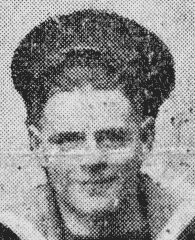

赫克斯姆的临时军士诺曼·P·麦基（Norman P. McKie）在“索马里号”（HMS Somali）舰在执行北极护护队任务期间被鱼雷击中后，自愿留在舰上，被追授表彰。在几乎所有士兵离开船只后，他作为加热小组的一部分留在了船上。表文中写：“麦基军士在船只沉没前的三天半中表现出的热情、勇气和对职责的忠诚，是所有和他在一起的人的典范。”

其他议员同样对燃料的损失表示担忧，但对在国家危机时期辞雇训练良好且能力出的消防员的做法表示质疑。解雇提议被拒绝了，但双方同意必须加强纪律和安全措施。

在食品方面，西红柿极缺，以至于店主将它们留给有长期订单的老客户，这导致一位主妇询问：“这意味着工人阶级的人吃不上西柿了吗，因为他们付不起长期订单费用？”

赫克斯姆的一个店主评论道：“当你带着西柿从市场回来时，人们为了抢西柿几乎要撞破你的窗户，如果你拒绝，你就真的惹上麻烦了。”

做果酱的糖仍然是一个争议点，但制作果酱的工作交给了泰恩代尔的妇女协会（women's institutes）来负责。该地区设立了多余水果保存中心。该计划专门用于保存本会被浪费的水果，并鼓励水果生产者按照战前的方式直接食用、装罐或制成果酱。只有剩余产品才能运往各个中心，价格由政府设定。醋栗每百磅最高价为`30s`，覆盆子`47s 6d`、黑醋栗`90s`、草莓`75s`以及奇异`50s`。

该计划在贝灵汉姆（Bellingham）启动，但最初由于没有水果供应而显得毫无进展。该计划生产的第一批果酱出现在斯托克斯菲尔德（Stockfield），比威尔（Bywell）和分支端（Branch End）协会的妇女们制作了`100lb`的醋栗酱，水果是按每磅`3½d`的固定价格购买的。除了清洗和煮沸水果，妇女们还负责清洗和消毒由当地学生为该计划收集的`2000`多个果酱罐。

其他中心很快运转起来，科布里奇、迪尔斯顿（Dilston）和斯塔肖（Stagshaw）联合妇女协会生产了`154lb`的大黄和醋栗酱，被当地店主迅速抢购。安德尔兰男爵夫人（Dowager Viscountess Allendale）提供了她在比威尔厅（Bywell Hall）的厨房供事业使用，业务非常繁忙。

泰恩代尔水疗馆（Tynedale Hydropathic Establishment）的居民感到了一个震惊，当他们吃完晚饭起身离开时，发现接待处贴了一张告示，称酒店正在出售中，他们必须寻找替代住所。虽然细节很少，但据了解，出售是迫使业主做出的，因为该建筑正被政府征用作为儿童疗养院。

许多居民已将酒店作为永久住所，有些人是因为他们在英格兰东北部其他地方的家被炸了，他们无处可去。

“水轮号”已运营了大约七十年，它之前的宾名单其中包括第一位工党首相拉姆赛·麦克唐纳和他的女儿伊什贝尔，以及影星查尔斯·劳顿、埃尔莎·兰彻斯特、道格拉斯·菲本巴克斯二世、雷蒙德·马西、伊芙林·莱叶和多迪·史密斯。

1941 年出现在赫克斯姆治安法庭的较不寻常案件之一，是一个男子被指控在从科布里奇到哈尔特威斯尔的公路上虐待一头大象。科布里奇的兽医弗德里克·克鲁德斯正开车沿着路行驶，他看到来自伊尔克利的大象饲养员艾沃沃·戈登·罗斯骑在那头动物身上。他正用一根非常重的白木棍猛打它，并时时用工具的钢尖刺大象耳朵后面。当这位兽医对罗斯就他认为是极度残忍的行为提出抗议时，罗斯只是笑了笑。

在到达赫克斯姆后，克鲁德斯先生向警方报告了他的所见，结果皇家防止虐待动物协会（RSPCA）对罗斯提起了虐待指控。一名证人告诉法庭，大象在被击或被刺时并没有尖叫或鸣叫，但它“看起来非常累”。

罗斯告诉法庭，他已经当了十年大象训练师，如果他按照克鲁德斯先生暗示的那样虐待动物，动物就不会在场上为他表演了，那里的节目包括一个小女孩把头伸进大象嘴里。案件被驳回了。

## 海上危险

潜艇威胁再次来袭，当时来自赫克斯姆的三级军德里克·吉尔克斯特在船上，船被西非洲海岸的一支潜艇编队击沉。这位赫克斯姆伊丽莎白女王语法学校的校友在救生艇上度过了 30 天——这是此类行程中无伤亡的记录。吉尔克斯特告诉《快报》：“大约晚上 10 点时，我听到了嗖的一声和砰的一声，就知道我们被击中了。”

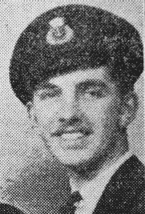

来自赫克斯姆的三级军官德里克·吉尔克斯特，在船只在非洲海岸被潜艇鱼雷和炮击后，在救生艇在海上度过了 30 天。

救生艇被放下，吉尔克斯特发现自己负责一个由 9 名欧洲人和 21 名印度人组成的船员。随着黎明破晓，他们意识到自己已经与另外两个救生艇失散了，他们看到的船只最后一眼是远处燃烧时发出的微弱红光。仅凭罗盘和一个粗略制制的六星仪来计算纬度，吉尔克斯特设定了一个粗略的路线，开始了一段艰辛的划船和航行之旅。

食物和水有限，从第一天起就实行了严格的配给。半块船饼干和三分之一勺水是基本比例，每天两次额外增加一茶匙浓缩奶。船上少量的罐牛肉每三或四天分享一次，而一罐沙丁鱼和一些鱼酱则一直节约直到被接走的那天用完。频繁的暴雨补充了饮用水供应。

吉尔克斯特说：“这是一次相当艰辛的经历。我们变得越来越虚弱，到最后时发现站立都很困难。我们只看到鸟类、浮木和残骸，还有大量的鲨鱼。印度人轮流负责排水，因为我们船尾有相当严重的漏水。晚上，我们玩牌打发时间。白天热得难以忍受，我们许多人都遭受了灼热之苦，但在晚上，尤其是大雨过后，我们只是坐在那里发抖。”

谈到船员，吉尔克斯特说他无法希望能有更好的同伴了，尽管他说：“我们相当担心当地人无法承受这种压力，可能会引起麻烦，但他们表现得非常出色。有时情绪会变得有些紧张，但尽管有心理压力，从未出现过裂痕。我们从不怀疑自己能到达安全地带。我们一直确定会被接到，我们的大部分对话都是关于回去后要做什么。”

发生过一次虚假报警，船员们在远远的地平线上看到光亮，并点燃信号弹吸引注意，但最后当光变得越来越亮、在空中升得越高时，发现那是一颗星。

他们最终被接到，当时一名印度侦察员发现了一艘船的烟雾，他们航向那艘船的船头以吸引注意。他们被带往西非洲的一个港，那里一些船员需要医疗治疗，但没有留下后遗。吉尔克斯特评论道：“回想起来，我很享受这这段经历，但这是一段没人希望再次经历的经历。在持续期间，它只能被描述为地狱。”

这本可能在 1941 年克里特岛战役期间被德国俯冲轰炸机炸毁的英国巡洋舰`HMS Fiji`的熊熊残骸中结束。但一名年轻的中尉抓住船上绞车机的一根横梁，在仍在遭受德国空军炸弹和子弹扫射的危险海域中幸存了三个小时。那位年轻的水手是罗伯特·约翰逊，他不仅活了下来，后来在英格兰银行取得了良好的职业生涯，并成为了泰恩代尔委员会的主席，一直活到 99 岁的高龄。


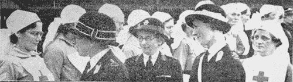

贝瑞尔·奥利弗爵士，伦敦志愿救援遣队部负责人，于 1941 年 5 月在科布里奇视察英国红十字会赫克斯姆分部的护士。

他于 1916 出生于惠特利湾，是双胞胎中较小的一个，但遗憾的是他的兄弟布莱恩在 41 岁时在意大利多米蒂山脉步行不幸去世。年轻的罗伯特在特茅斯学校后进入纽卡斯尔皇家语法学校。

他的职业生涯开始于纽卡斯尔的保险和银行业，直到 1936 年获得董事提名加入“线程街的老妇人”（指英格兰银行）。然而，首都的生活成本并不吸引他，他很高兴被分配到银行的纽卡斯尔分行，在那里，随着欧洲形势恶化，他加入了`HMS Calliope`的泰恩海军志愿预备役队担任少尉。

1939 年 8 月，在战争一个月一个月，他被命令加入东印度群岛的一艘皇家海军巡洋舰——但在被允许离开之前，他必须安排人替他在银行的工作。尽管在后的六半载里他们只见过了一面，但他仍记得她灿烂的笑容和温柔的性格。他们随后走过了 68 年的婚姻。

他首先在巡洋舰`HMS Manchester`上服役，参与了 1940 年挪威的入侵和撤离，并在意大利舰队被击退时参加了斯帕尔托托角海战。随后参与了克里特岛战役，当时他是皇家海军轻巡洋舰`HMS Fiji`上的炮官，该舰当时在巡洋舰`HMS Gloucester`损失后与驱逐舰`HMS Kandahar`和`HMS Kingston`共同行动。

这些船进行了战斗，击落了一架攻击者并损坏了两架，随后在防空弹耗尽后，成为德国空军的活靶子，根据当时的记载，对方的数量多到让天空变黑了。

在被`Messerschmitt Bf 109s`的几枚炸弹命中后，`HMS Fiji`失去动力并停下，随后被一架`Junkers 88`俯冲轰炸机投下的三枚炸弹命中。放弃命令不久不久`HMS Fiji`翻覆沉没，罗伯特被甩入水中。他设法抓住一个绞车横梁，在上面抓了几个小时，而另外两艘船在投放救生筏后被驱离。

`HMS Kandahar`在黑暗掩护下返回并接起了此时已昏迷但仍抓着横梁的罗伯特。他是 523 名幸存者之一，但当船只沉入海底时，有 241 名士兵遇难。

罗伯特后来说，他在吊床中醒来时，由于被`Kandahar`号的船员灌得大醉，他以为自己已经死掉并上天堂了！

他被作为幸存者假回到家乡赫克斯姆，但随后回到`肯特`号和`安森`号恢复战斗，护送前往俄罗斯的北极护航队，后来加入了`阿伯辛比`号，该船在准备为盟军登陆法国时不幸中水雷。他他曾在法国的芒顿短暂留陆，并利用他的炮兵官技能指导海军火力攻击被德国占领的意大利边境地区。

当他在 1946 年退役时，曾两次获得战报表彰。

五名年龄在 9 到 13 之间的普鲁德霍小学生，由于在当地警察约翰·L·理查森的花园里大肆破坏，公然违背国家的“为胜利而挖掘”运动，领受了赫克斯姆少年法院的严惩。这名警察整个上午都在`Prospect Terrace`的花园里忙碌工作，但当他四小时后回来时，篱笆上被开了两个洞，150 个洋葱被拔起并运走了。两排长 8 码的豌豆被连根，三排胡萝卜和三排春葱被毁坏到无法使用，一片夏日甘菜被踩踏得一无完存。他的苹果树上还有几根树枝被折断，苹果也被偷光了。

在进行调查时，理查森警官听到一个小女孩在普鲁德霍挨家推销洋葱，当他与她交谈时，女孩说这些洋葱是她哥哥给她的。哥哥和他的朋友一同被捕，所有人均被指控蓄意破坏物品，金额为 3 英镑。

法判席主席 J.M·赫斯洛普告诉他们，在战争期间破坏园艺产品确实是一件非常严肃的事情。他们每个人都被命令支付 12 先令的赔偿金，并以 1 英镑的金额保证在两年内表现良好。

## 第四章

## 女性助力扭转局势

女性在现代战争中所扮演的角色广受关注，但那种认为二战期间，国家的女性本分地待在家里揉着手帕等待丈夫从前线归来的观念是错误的。许多女性曾作为`Wrens`、`WAAFs`或`ATS`成员服役，其中包括未来的伊丽莎白二世女王，但仅处于支持性角色。

人们有时会忘记还有另一支女性力量在英国击胜强大的德国方面发挥了同样巨大的作用。这就是妇女农军（Women’s Land Army），这是一支专门创建的部队，旨在许多男性外出征期间保持国家农场的粮食生产。许多“乡村女孩”来到泰恩代尔，她们在战期间掌握农作复杂技巧和付出的辛勤劳动的努力，在庞特兰德的缪里尔·索博编纂的《1940-50 年诺森伯兰郡乡村女孩》一书中得到了生动描写，她的家族农场在战后立即曾包含一栋刚空出的妇女农军宿舍。

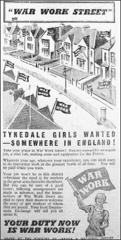

正如这则针对普鲁德霍女孩的广告所示，各地都需要女性从事战争工作。

缪里尔完美描绘了那些困惑的女孩，其中有些人从未离开过他们的矿村或其他地区，另一些人则来自优越的背景，所有人都在投入到农活的精疲力竭中。

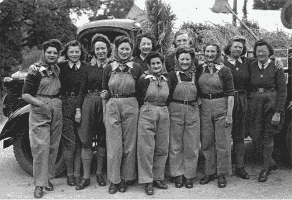

穿上工作服准备好工作的，是驻在泰恩代尔的一些妇女农军女孩。

海登桥、科尔韦尔、斯托克斯菲尔德和斯坦姆福德哈姆都有妇女农军宿舍。海登桥宿舍是专门建造的，但没有电灯，通过休息室两端的两座煤炉进行加热。第一位女管理员是来自哈尔特威斯的缪里尔·弗莱明，她是一位著名的当地议员，她非常保护她的女孩们，并确保屠夫只为她们提供最优质的肉类。

斯托克斯菲尔德宿舍位于`Painshawfield Road`的尽头，它的众多特征之一是一个木制装置，上面一个羊毛袋上挂着橡胶手套——用来教女孩们如何挤牛奶。

一些女孩加入妇女农军时对农场生活充满了幻想，认为无非是在阳光明媚的草地上散步，周围环绕着跳跃的小羊和英俊的农夫，但残酷的现实完全不同。

莎拉·奥格尔是一个典型的乡村女孩，她在 19 岁时从药店工作直接去了海登桥的宿舍。第一天，她乘坐了`7.15am`的巴士前往奥伦代尔，在`Henderson’s of Burnt Tongues`干了一天的铺粪。第二天，她铺石灰——但石灰像混凝土一样硬了，必须先用手弄碎。在另一个农场干了一天的脱谷小麦后，莎拉接下来的三天里都在田里分土豆。周末她回家时，莎拉宣布她不再回去了——结果被母亲告诉，既然她已经洗好并熨好了制服，最好还是回去干吧！

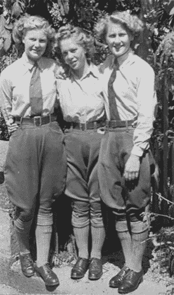

三名妇女农军成员在任务之隙休息。

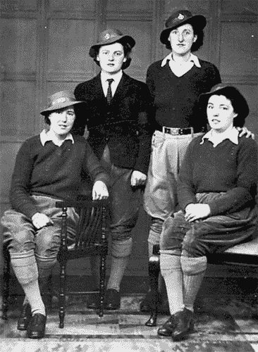

宽檐帽和裤子是当时的制服。

莉莉·凯瑞加入妇女农军是为了逃离一段破碎的感情和家庭生活的束缚，她被送到斯坦姆福德哈姆宿舍。第一天，她在雪中骑了 8 英里的自行车，没有任何防水衣具保护，前往 Ryal 的一个农场，结果到达后被告诉农主改变了主意，不需要她了。她别无选择，只能骑车回去。

妇女农军有一支名为木业兵团的支队，他们在森林中工作，为依然繁荣的矿井提供矿柱木。妇女农军徽章上的麦穗图案被云杉标志所取代，普通的帽子被贝雷帽取代。木业兵团的女孩玛丽·海宁在惠克利查普尔的森林里工作时结了一个特别的朋友——一只红松鼠，她驯服了它让住在她的外套里。她甚至在回到纽卡斯尔家里时带了它，这在一个冬天夜晚对那只松鼠是致命的，因为它在拥挤的巴士上被她的外套压扁了！

妇女农军女孩负责种植基尔德森林的许多英亩土地，她们中的十个人住在基尔德村的一间小屋里。乡村女孩的主要职责之一是除芜菁，为绵羊提供冬季饲料，必须说的是，她们并不总是做得很好。在被要求在植物之间留出锄头的宽度时，一个女孩选择了工具的`6ft`长度，而不是刀片的`6ins`宽度！

农场不是胆小者可以待的地方，因为有关于大规模捕鼠的故事，一次可以杀死 200 只这种带鳞的啮齿动物，每条尾巴奖励一便士。其他来自优越背景的女孩对诺森伯兰方言感到困惑，但她们很有礼貌，没有告诉农夫们他们听不懂那些关于“剪裤子”或用肚脐塞住麦蚁的话。一个女孩不得不对付排气得厉害的马，以至于她笑湿了裤。

战后爆发了愤怒，因为显而易见，武装部队中的其他女性工资更高、有更多的服装配券并提供内衣，而妇女农军的女孩们完全是二等公民。她们不仅没有勋章、津贴或培训，还必须交回制服。

一些抗议的诺森伯兰女孩被传唤到伦敦参加纪律会议——她们的惩罚是被送到了彭斯，而她们非常喜欢那里！

来自 Acomb Millersfield 的莎拉·贝尔（Sarah Bell）在 1939 年之前一直在 Ridsdale 农村担任起居女佣，她迅速自愿加入了了陆农军（Land Army）。她的第一个驻扎地是 `Belsay` 附近的 `East Shaftoe Farm`。她每周工作七天，负责挤奶、喂牛和驾驶拖拉机——她很快也精通了操作马犁。不过，她也有时间尽情玩乐。每周，女孩们都会去当地的村公堂（通常在 `Belsay` 或 `Kirkwhelpington`）参加周五晚上的舞会。在那些年里，她们也建立了深厚的友谊，对贝尔夫人来说无疑也是如此。她在 `East Shaftoe Farm` 的陆农军队友玛丽·汤普森（Mary Thompson）成了她最好的朋友，后来还当她的伴娘。

不过，有些社交经历是贝尔夫人并不怎么喜欢的。有一次，陆农军的女孩们聚集在 `Morpeth` 领取代表其服役等级的菱形别针，这就像士兵的条纹一样。在多番劝说下，她最终被说服和大家一起去一家酒馆庆祝。当时她只有 25 岁，那是她第一次进酒吧。她说：“我从小生活的环境没接触过那种地方，所以我没待多久——他们中有些人只是为了喝酒。我很怕会有认识我的人走进来。”

她对那些被雇来协助收割的临时工也无太印象深刻。“他们以前会从 `Ashington` 找人来帮忙采土豆，每个人都分配一段特定长度的任务。但是，如果你不盯着他们，他们就会把自己的份量也推给你。那群 `Ashington` 的人真是一群古怪家伙！”

`Hexham` 的议员道格拉斯·克利夫顿·布朗（Douglas Clifton Brown）在镇上的一场陆农军集会上赞扬了陆农女孩们的工作，并表示陆农女孩们的重要性与食物运输船的船员或护航运输队的船只一样重要。虽然他不希望贬低 `WAFFs`（女子空军妇女）在预测器上、`ATS`（陆军辅助队）在炮位以及 `WRNS`（皇家女子海军辅助队）在其他战场所的工作，但在许多情况下，她们正在做与战前所做相同的工作。许多陆农女孩承担了对她们来说完全全新的工作，这些工作并不容易也不愉快。

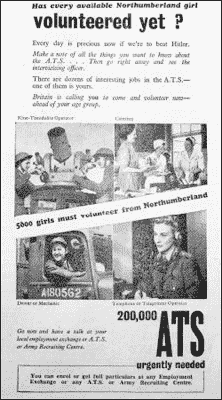

`Tynedale` 全地的女孩被鼓励加入`辅助领土军`（Auxiliary Territorial Service），为战争努力贡献力量。

女性贡献力量的领域不仅限于陆农军。1941 年 10 月，曾有人呼吁 `Tynedale` 的女性加入`辅助领土军`，这是武装军种的一个分支，旨在让女性从事士兵的常规工作，从而释放男性去执行战斗任务。

`Tynedale` 分有 300 个名额待填补，年龄在 17½岁到 43 岁之间，如果是退役军人则为 50 岁。`劳工和国家服务部`通过 `Courant` 报发布了一条给当地女性的消息，写道：“提醒 `Hexham` 的女性们她们所属著名郡团——皇家诺坎伯郡掷击团（Royal Northumberland Fusiliers）的辉绩，告诉她们不要让家里的男人失望。”

基本工资为每天 1s8d，虽然这只是私人收入，但根据所承担的工作和通过的技能测试，可以增加到每天 2s10d 甚至 3s4d。根据兵种，一名军士每天约赚 4s6d，而上军士的工资可以达到每天 9s4d。

### 火火式飞行员

来自 `Greenhead` 的前 `Hexham Courant` 记者伍德罗·雷恩（Woodrow Raine）军士飞行员本人也成了新闻焦点，因为他被拍到了“喷火式 Venture 1”战斗机的驾驶舱内，而这架飞机是由 `Midland Bank` 员工捐款购买的。在写给银行员工的信中，`雷恩军士飞行员`以非常帅气的英国皇家空军（RAF）风格写道：

“抱歉没能立即回复，但正如你们想象的，我们最近忙于在法国度假，并与`梅塞斯密 109`们享受茶会。

`Venture I` 是一台伟大的机器。我拥有它大约六个月了，在过去的两三周里，我们确实共同度过了生活，它现在几乎可以自己飞越法国了。它受到的唯一损伤是升降板上中了一颗弹，那是在我在法国的一个机场上集结用机枪扫射 `109` 时被击中的。我在 30 英尺的高度飞过去，扫射了几架 `109` 和一些站在停机道上的纳粹。从他们向我发射的火力量来看，一定有人表示反对，但我们只带着那个弹孔逃之大幸。”

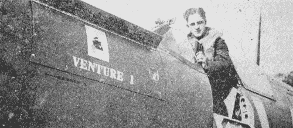

前 `Courant` 记者军士飞行员伍德罗·雷恩，坐在他由 `Midland Bank` 员工资助的喷火式“Venture I”战斗机中，他曾“在法国度假并与`梅塞斯密 109`们享受茶会”。`雷恩军士`于 1941 年 8 月 21 日被击落身亡，葬在帕德卡莱尔省的圣奥梅尔（St Omer）。

遗憾的是，雷恩的运气并没有长久；1941 年 8 月 21 日，他的喷火式在敦刻尔附近被一架 `Me109` 击落。他葬在圣奥梅尔的龙涅纪念墓（Longuenesse Souvenir Cemetery）。不过在此之前他也经历过惊险，他在 1939 年 2 月加入 `RAFVR`（皇家空军志愿备役队）成为学员飞行员。他在 9 月 1 日被征召，完成训练后，在 `7 OTU Hawarden` 转换驾驶喷火式，并在 9 月 18 日的喷火式迫降中死里逃生。

他于 1940 年 10 月 5 日被分配到北坎伯兰郡 `Acklington` 的 `610 中队`，同年 11 月 19 日，他又躲过一劫，当时他的喷火式在 `Acklington` 着陆时轮胎爆了，起落架塌陷，飞机头朝下倾。

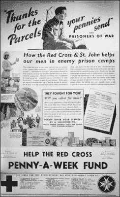

1942 年 6 月，发起了一项“每周一便士”活动，旨在募集资金为战俘提供红十字会包裹。

1941 年夏末，在`哈德良墙`的阴影下聚集了一群戴着旧战争勋章的老兵，当时`第四营民兵卫队`的士官们聚在一起温习现代战争方法。他们乘坐私家车、卡车和自行车从 `Prudhoe`、`Haltwhistle`、`Slaggyford` 和 `Blanchland` 。一位 `Hexham Courant` 记者写道：“对于某些人来说，这是自从一战以来第一次体验军营，但正如胸前五彩斑斓的丝所示，这勾起了 25 年前的回忆。这支平民军队尽管有多年正规军经验，发现在现代战争方面有许多要学。”

没有讲座，只有关于命令的下达与接收、第五人和伞兵的危险以及如何对付他们的讨论。演示了散击战中猎枪的使用，但当每个人都发一把猎枪时，那些百孔射穿的目标表明这些老兵在使用上指导。

正规军官解释了《皇家条例》，在进行进一步练习后，他们躺在床上，`Courant`记者注意到：“对许多人来说，睡在帐篷里并不是什么舒服的新奇体验，但在经历了高强度的一天后，再加上无尽的轶事和过去的战争故事作为睡酒，他们陷入了甜甜的睡眠。”

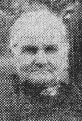

来自 `Ramshaw Hunstanworth` 的玛格丽特·皮登，她在 91 岁生日时在为士兵织袜子。

这个周末对民兵卫队成员非常受欢迎，以至于几个人预订了后续课程。

### 周日运动——有罪还是否？

关于是否允许在周日在 `Prudhoe` 的公园内进行运动的棘手问题在 `Prudhoe UDC` 的会议上引发了一场神学分歧，牧师 `R.E. Robson` 博士支持，而 `St John` 和 `Prudhoe Station` 的方法格教会表示强烈反对，`主日观察协会`也认为遵守主日比以往任何时候都更重要。

这场辩论是在普鲁德霍工人男子俱乐部（Prudhoe Working Men’s Club）辩论社就该问题请求裁决后进行的。牧师表示，认为公园对那些希望在周日玩游戏的人开放完全没有问题。他说：“如果我在周日玩游戏，我不会认为自己在犯罪。我认为，如果人们不认同我的生活方式，且周日不去教堂，只要他们愿意，就应该被允许玩游戏。人们应该被允许周日随心所欲，仅仅因为公园开放供人们玩游戏，并不意味着人们真的会去玩。我不认为公园开放会使基督教信仰的任何分支受到威胁。”

他得到了米克利（Mickley）议员阿达·布莱克恩（Ada Blackburn）的支持，她表示，在《马可福音》中提到，安日日是为人造的，而不是人为安日日造的。她说，由于许多人长时间从事战争工作且工作繁忙，任何户外休闲设施的增加都是受到欢迎的。务实的议员约翰·库里（John Currey）指出，虽然他对公园每周七天开放没有异议，但需要考虑周日公园员工的双倍工资问题，因为公园已经给普鲁德霍的纳税人造成了大量费用。

针对布莱克恩议员的圣经引用，李（J.W. Lee）议员回应道，圣经中也提到“你六日要劳作，第七日要安息”。他指出，公园在周末已经对那些想要休息和欣赏美景的人开放，而且步行者不希望听到游戏带来的噪音破坏宁静。

特尔·皮尔（T. Peel）议员补充道：“我认为我们过去享受了太多的运动，忘记了生活中更严肃的事情。安息日是为了休息和崇拜而设立的。”除了牧师布莱克恩议员外，议会投票决定不应在周日进行游戏活动。

### 空袭准备状态

赫克斯姆（Hexham）市副防空警员长格·G·W·姆普尔比（G.W. Umpleby）先生指责该镇在应对任何空袭的准备上松懈。他告诉赫克斯姆扶轮社的成员们：“在黑夜的任何时候，炸弹都可能落下，那种坐着说‘永远不会发生’的时代已经结束了。我们必须做好任何准备。太多的火警观察员在炸弹落下时完全不知道该怎么办。难道我们要把所有的东西都交给希特勒，就仅仅因为我们没有花心思照顾它们吗？”

他敦促所有企业确保至少三四名员工接受过手摇泵的使用培训，并知道如何处理燃烧弹。

### 英勇举动

39 岁的普鲁德霍海员、来自城堡路（Castle Road）的托马斯·牛顿（Thomas Newton）获得了特别奖励，他在船只被敌方炸弹击中后救了 30 名船员的生命。他指挥一艘救生艇从受损船只上接了幸存者并将他们送到待命的军舰，随后自愿返回沉没的船只救援更多幸存者。他的船员一致认为，牛顿在轰炸期间及之后的行为堪称典范。船主通过向牛顿寄送支票和一封感谢信认可了他的极度勇气。

来自丈夫哈里·麦克莱德（Harry McBride）下士的一封信，对一位普鲁德霍女性来说简直是美妙的音乐，因为她得知他不仅在德国战俘营中平安无事，还是营地乐队的领队，那里专门为他提供了一架钢琴。

### 后方战


在后方，一群斗殴的澳大利亚人再次出入法庭。此前在莱丁米尔（Riding Mill）的一家酒吧发生了冲突，当时家具被砸碎，几十个玻璃杯被打碎。在被酒吧赶出去后，他们继续在外面打斗并使用令人厌恶的污俗语言扰乱。这三名士兵和一名海员被指控扰乱秩序并对酒吧造成了 5 英镑 9 士令的损失。他们每人被罚款 12 士令，赫克斯姆治安级法庭主席约翰·查尔顿（John Charlton）告诉他们：“我们很高兴你们作为澳大利亚联邦的客人们来到这个国家，我们也知道你们在这里所做的出色工作。然而，我们希望你们表现端正，不要到处乱涂红色。”

## 煤油限制

对煤油使用的限制引起了农村地区的担忧，那里煤油被大量用于烹饪、照明以及农活。农民们被限制为每月只能使用一或两加仑煤油，而实际上，他们工作时每周需要三到四加仑。一位来自海登桥（Haydon Bridge）的农民抗议道：“如果不提供更多煤油，牲畜的饲养和挤奶将不得不白天进行，而那时人们应该在田里忙。”

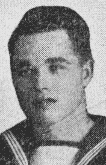

来自贝灵汉（Bellingham）的代理士官 R.S.T·斯科特，在哈维尔洛克号（HMS Havelock）驱逐舰服役期间因海上英勇被授予卓越行为勋章。

一位安伦德尔（Allendale）的农民补充道：“没有光，农民怎么给牲畜喂料挤奶？目前的煤油分配无法满足房屋的需求，更不用说牛圈了。”

## 《赫克斯姆日报》（The Hexham Courant）

《赫克斯姆日报》被认为救了前赫克斯姆遗孀乔治·里德尔夫人（Mrs George Riddell）的生命。她在丈夫去世后搬到了海岸。当她正独自纠结是去花园和四岁的孙女一起摘水果，还是去厨房开始做饭时，《日报》通过邮寄送达，她决定改为读报。就在她带着女孩进入餐厅不久，一架“俯冲即逃”式轰炸机向小镇投掷了一个炸弹，炸弹落在距离她本会所在的花园仅 30 码处。

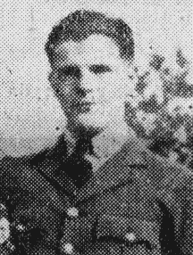

来自阿康（Acomb）的前战顶级足球星罗尼·赫普尔（Ronnie Heppell）当时在印度皇家空军服役，被选代表空军参加对阵孟买 XI 队的比赛，并与六名国际球员和其他职业运动员并肩作战。

几名被困室外的人遇难，爆炸的力量将厨房门从铰链上崩落，对厨房本身造成了严重损坏。里德尔夫人的女儿说：“可以肯定，如果母亲没有进餐厅读《日报》，她今天就活不下来了。”

赫克斯姆的三名司机被市法官每人罚款 1 英镑到 15 士令不等，原因是他们在晚上开车时，汽车保险杠和踏板上没有涂白漆，违反了禁灯规定。

二十二年来第一次，1941 年 11 月 11 日的赫克斯姆没有举行全员两分钟默哀。没有号角声宣告哀悼活动的开始，当局依靠修道院时钟的响起来通知人们，这种未通知的程序变更引起了许多混乱。除了英国军团外，很少有公共机构出现在纪念碑前，市政议会主席也未献花。

## 驱逐与道路死亡

部分矿主对工人的冷酷态度遭到了米克利议员阿达·布莱克恩（Ada Blackburn）的严厉批评，此前许多家庭从村里的矿工房屋被驱逐，且没有为他们提供替代住房。她说这是该地区最大的悲剧之一，并将流离失所家庭的境遇与城市被轰毁的家庭相比。她说几个家庭被拆散了，一个家庭的父母和孩子都住在不同的临时住所。她敦促米克利煤矿公司修理目前空置的房屋，以解决这一问题。

在赫克斯姆的亨科特（Hencotes）发生了一起双剧，一辆军用卡车失控，导致一名军警和一名赫克斯姆年轻女性死亡。司机步兵`George Farrand` 因驾驶车辆危及公共安全被罚款`5`英镑，并承担了`1 英镑 18 先 9 便士`的诉讼费用。他还被禁止三年内持有民用驾照。

赫克斯姆法庭获悉，这辆卡车以超速行驶在亨科特街上，撞上了一辆由 ATS 私人驾驶的静止车辆，导致当时正在与她交谈的掷榴兵卫队（Grenadier Guards）军警下士`William Hanley`丧生。随后，卡车冲入人行道，导致行人散落，并害了居住在赫克斯姆奥斯本大道（Osborne Avenue）的 23 岁少女`Winifred Taylor`。在随后的尸检调查中，法医对这一讽刺事实发表了评论：`Farrand` 虽然不能驾驶私车，却可以继续驾驶军用车辆。

另一件不那么严重的事件是，赫克斯姆少年法庭对七名在街上踢足球的男孩各罚款`10`先士。这场激烈的比赛发生在博蒙特街（Beaumont Street）、市场广场（Market Place）以及修道院前。法庭获悉球有时危险地靠近商店窗，并给行人带来了不便。

一名军传令兵被带到赫克斯姆法庭受审，原因是他在科布里奇（Corbridge）的霍登德尼（Howden Dene）以超过`60 mph`的速度行驶——且未开启灯。皇家炮兵信号兵`Peter Green`每项指控被罚`1`英镑，但他的指挥官告诉法庭，他认为这属于过度热情，而非危及公共安全。传令兵的工作是不惜一切代价送达，而`Green`心中怀着该军团优秀的传统。

`1941`年的圣诞节尽管由于配给和票证要求导致物资短缺，但依然是一个光明的节日。一位零售商说：“袜子可能不像往年那样多样，但肯定不会完全空白。人们对战争玩具的需求很大，但我们无法满足这一需求。”

鞋店尤为繁忙，一个有趣的现象是木鞋需求的复苏，因为木鞋不受配给限制，不需要票证即可购买。一位靴鞋商说：“如果有更多存货，我确信赫克斯姆的一半女性都会穿木鞋，不仅是在花园里，在街上也是。”

最大的短缺是儿童鞋，尤其是幼儿和小童的鞋子。

## 1942

新年始于普鲁德霍（Prudhoe）比奇格林的高级机务兵`John Nattress`（22 岁）的惨剧，他为了配合同事慷慨放弃了自己的假期，在一场事故中丧。战前他是普鲁德霍自行车俱乐部的成员，也是圣玛利亚·马格拉链教堂的唱诗班。

## 关于希特勒的严厉警告

诺森伯郡民防空（ARP）服务副总监`J. McVicar Munro`少校向赫克斯姆扶轮社成员发出了严厉警告。他说，随着战争局势开始不利于`希特勒`，这位独裁者将毫不犹豫向英国发动致命的气气攻击。

他说：

“我坚信，当老虎`希特勒`被正确入网时——这不会很久了——他将竭尽一切手段对英国发动毒气攻击。然而，只有出其奇兵才能成功，而一个配备了有效呼吸器、储备充足的二号防毒药膏并采取了简单但必要措施的国家，将对`希特勒`可能发起的任何攻击付之大笑。”

`Munro`少校验表示，`希特勒主义`不应被视为当下的一个阶段，而是根植于德国人心理中的东西。他补充道：

“现在的匈奴人与阿提汗时代的旧匈奴人并无区别。当我们赢得战争时，德国人会告诉我们，是`希特勒主义`的毒瘤导致了麻烦。不要让我们相信这一点。`希特勒`起初之所以能上台，是因为德国军事当局认为他是他们手中理想的棋子。

`纳粹主义`背后的机器拥有运行了几个世纪的同类齿轮，这一次，我们必须确保这些齿轮不是简单的被敲掉几个齿齿，而是被用极粗锉彻底磨掉。”

## Ossie Chipchase 的苦难

`1942`年 1 月是布匹商`Ossie Chipchase`噩梦的开始。他在 16 岁时离开学校，在一家布料仓库工作。在`1933`年大萧条时期仓库关闭后，他在 23 岁建立了自己的布料生意。在`1939`年战争爆发前不久，他与赫克斯姆女孩`Dorothy`结婚，两年后被征召进入皇家信号兵团担任无线电员。他被分配到一个防空小组，该小组当年 11 月出发前往面临日军近期进攻的新加坡。他在`1942`年 1 月到达这片大英帝国的哨所，被分配到皇家海军基地附近的一个营地，随后被调往阿盖尔和萨瑟高地兵团。

`1942`年 2 月 15 日周日，新加坡向日本帝国陆投降，`Ossie`被俘。随后他被转到臭名昭彰的樟义营（Changi camp）附近的一所学校，被派去修路。然后他被送上为期五天的火车前往泰国，修建铁路。那里几乎没有食物或衣服，他被迫赤脚生活工作，仅围着一条围布。他经常被守卫用竹竿抽打。

在`2005`年的一次采访中，他说：“在被俘的前 18 个月里，我的妻子`Dorothy`不知道我在哪里。日本人不在乎《日内瓦公约》，他们随心所欲。最后我们收到一张卡片，上面印有预设的信息：‘我很好，我在有薪工作，或者我在医院。’我们必须勾选正确的框，但不被允许写任何东西。`Dorothy`过去每周都会写信，但我从未收到过。”

她甚至根据他失踪并推定死亡收到了寡妇津贴申请表。

但`Ossie`还很活着，`1944`年 6 月他被带回新加坡，准备乘船运往日本。他是那艘船上 1200 名囚犯之一——并几乎被他自己的人害死。那艘船在菲律宾马尼拉港遭到美国飞机的轰炸。约 750 名囚犯溺水，但`Ossie`游到了船舱顶部，在经过殊死斗争后移开了舱盖，在船没时夺之逃生。`Ossie`与三名同伴利用舱盖和木板到达岸边——在那里他又被日本人俘了。

随后他被放在另一艘开往日本的船上，船再次遭到美国空军的攻击。日本人封住了舱门——舱内的 800 人中有 300 人因窒息死亡。`Ossie`仅仅幸存，并被送往开往台湾的两艘船之一。其中一艘船沉了，无幸存者，但`Ossie`到达了日本南部，被分配到日本长崎附近的一座煤矿工作。

六个月后，`Ossie`目睹了空中巨大的光芒——战争期间的第二枚原子弹投落在长崎。战争结束了，守卫逃之了。一个月后，美国人陆路抵达，`Ossie`被送上一艘开往旧金山的医院船。随后他横跨美国，乘船回到英国。

`1945`年 11 月 28 日，`Ossie`和`Dorothy`最终克服重重困难，在纽卡斯尔中央车站的人行桥上重聚。

多萝西维持着布料生意，而奥西很快又回到诺森伯兰郡的村庄和农场继续经营他的职业。这对夫妇于 1946 年搬到海克斯姆，并幸福地生活了 59 年，直到多萝西去世。奥西于 1969 年退休，即便在 90 多岁时他仍在驾驶汽车。

《海克斯姆快报》（Hexham Courant）中“弗雷德叔叔儿童角”的成员们与地区妇女协会、妇女志愿服务团和其他机构合作，在灌木丛中采摘玫瑰花刺果。他们获悉，全国范围内的这一行动收获了 200 吨这种橙色的果实，其中富含对抗感染的维生素 C。根据每磅 300 个花果的估算，这意味着全国范围内从多刺枝头上采摘了约 1.43 亿个花果，足够制作成 60 万瓶糖浆，糖浆以每 6 盎司 1 先 9 士的价格出售，或每 8 盎司 2 先 4 士。孩子每天喝一勺，就足够提供其一半的维生素需求。

一个来自普鲁霍埃德奇威尔（Edgewell）的无赖子找错了对象，向对方求买一张抽取肥鹅奖的彩票票。这位潜在买家是一名下班警察，当被问及是否想要票时，他说他全要了，并以非法组织彩票罪逮捕了那个无赖子。他在海克斯姆小事法庭被罚款 10 先士。

在同一所法庭上，一名因汽车保险杠未涂白色油漆而被罚款的驾驶员抱怨道，在圣诞平安夜午夜时分，警方对海克斯姆的一处停车场进行搜查后，他被收到了传票。他表示搜查的时机选择得糟糕，这与一年中这一夜晚惯有的善意精神和唱圣诞歌的氛围形成了鲜明对比。

两名男子因滥用汽油被罚款各 5 英镑：一人使用他单位的家具货车从海克斯姆开车前往 5 英外的汉肖（Humshaugh）参加舞会；另一人则非法开车从科布里奇奇（Corbridge）三英里去海克斯姆看电影。

尽管两名士兵被俘的时间不同且频繁被转移到不同的战俘营，但科布里奇的两个士兵在同一个营地会合了，两人的家人都在圣诞贺卡中得到了问候。在同一个营中，还有皇家工程师团的 H·布罗迪·科克兰恩（H. Brodie Cochrane）中尉、皇家炮兵队的芬尼克·迪·汉蒙德（Fenick Deane Hammond）中尉，以及皇家诺森伯兰掷军队的哈特威斯尔肯尼斯·克拉克（Kenneth Clark）少校。

汉蒙德中尉在圣诞卡中报告了这次会面，信中提到他身体良好，并请问候科布里奇的朋友。他还报告说营里有一个舞蹈乐队和一个交响乐团。

## 军舰周与泰恩代尔号战舰

1942 年 2 月，海克斯姆军舰周宣告启动，该地区被负责筹集 20 万英镑以赞助皇家海军驱逐舰`HMS Tynedale`。这艘驱逐舰并未直接以地区命名，但作为一艘亨特级舰船，它以“泰恩代尔狩猎队”（Tynedale Hunt）命名，该队的猎犬居住在科布里奇附近的斯塔格肖（Stagshaw）。舰的军官室里挂着一只诺森伯兰狐狸的面具，是由狩猎队队长送给该舰的。

募捐活动通过穿越全镇的大游行启动，由民兵卫队的乐队领队其中包括其中包括兵卫队、军事和民防运动的代表，以及国家消防局、红十字会、空军训练团、妇女土地、童子军和女童子军。

全地区举行了众多活动，包括募捐、音乐会和纸牌赛，而阿伦代尔（Allendale）附近的基恩利议会学校的学生们筹到了 93 英镑 13 先士——折合每人 5 英镑 10 先士 2 便——其他学校也筹集了类似的金额。

在了一周忙碌的筹款后，组织者召集了四位当地战争英雄正式揭晓了筹集到的总额：三等军官德里克·吉尔克斯特（Derek Gilchrist，大英帝国勋章）、飞行军官哈罗德·罗布森（Harold Robson，卓越飞行勋章）、飞行军官亚瑟·加威尔尔（Arthur Garwell，卓越飞行勋章）以及罗伯特·巴蒂（Robert Baty，盖然勋章）——当公布在武装部队日存入了 268,476 英镑时，现场爆发了巨大的欢呼声。到周末结束，最终数字为 325,099 英镑。

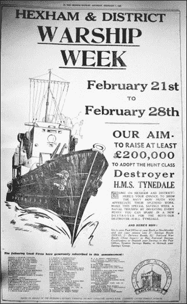

当地企业对 1942 年海克斯姆军舰周的启动给予了巨大的支持。

`HMS Tynedale`的船员们被问及想要从新收的“家庭”那里得到什么舒适，向海克斯姆妇女协会要袜子、毛衣、足球鞋、扫雷手套、飞镖盘、棋游、长凳棋、书籍和纸牌——还有一台用于协助舰上戏剧表演的钢琴。在一周内，他们收到了海克斯姆海因斯（High Reins）的莱斯利·曼（Leslie Mann）夫妇赠送的一台钢琴，他们唯一的独子在几个月前服役于舰队航空兵时牺牲了。

`HMS Tynedale`于 1939 年 4 月 11 日从格拉斯哥克莱河的亚历山大·蒂芬父公司订购，于 1939 年 7 月 27 日下水。她于 1940 年 6 月 5 日下水并于 1940 年 12 月 2 日服役，总建造成本为 425,000 英镑。她的排水量 904 吨，配备有四门 4 英寸防空炮和八门较小炮。

`Tynedale`主要负责护队和护卫任务，最初作为驻在普利茅斯的第一驱逐队的一部分，但在 1941 年 3 月 11 日，她在德国空军对普利茅斯码头的袭击中受损，停止了九天。

12 月 15 日，她被转移到驻在普利茅斯的第 15 舰队。`Tynedale`的高光时刻出现在 1942 年 3 月 27 日，当时她参加了著名的圣纳代尔突袭行动（St Nazaire Raid），作为过时的、装满炸药的驱逐舰`HMS Campbeltown`号的护卫舰之一，后者被撞入德国占领的法国港口诺曼德（Normand）干船坞的闸门内。这次大胆的联合行动攻击使该港口不仅在战争剩余时间内瘫痪，在随后的五年内也无法使用。在位于尚岛西南，`Tynedale`发现了潜艇`U-593`并对其进行了攻击，最初使用深水弹，在潜艇被迫浮出水面后使用甲板炮。然而，潜艇设法潜水逃脱了——却在次年带着致命的报复归来。

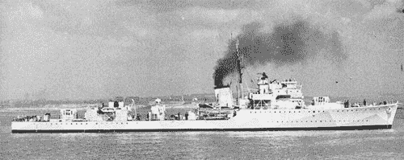

`HMS Tynedale`。

在与港口外袭击行动中幸存的小船只会合时，`Tynedale`和另一艘驱逐舰`HMS Atherstone`交战了五艘德国鱼雷艇。

`Tynedale`于 3 月 29 日返回普利茅斯，与护队的其余舰只一同返回。她于 4 月 18 日修复完毕，继续在西南部海域执行护队任务。5 月 14 日，她遭遇了德国辅助巡舰`Stier`号，并参与了击沉该舰的任务，尽管当时仅作为支持舰。她在 10 月还参与了击沉德国辅助巡舰`Komet`号的任务。

`Tynedale`随后被派往地中海服役，作为第 59 驱逐队的一部分（她于 1943 年 3 月 8 日加入），负责护卫直布罗陀与阿尔及利亚之间的护队。在盟军入侵西西里期间，她充当了拦截者，并在 1943 年 10 月荷兰货船`Felix Jan Van Manix`号被鱼雷击沉后，协助救援了 218 名乘客。

他说：“她是一艘可爱的小船，当然，赫克斯姆和诺森伯兰郡的所有人都为她出了钱并收养了她。她有一段非常有趣的经历，但当她沉没时，三分之二的船员丧生了。在幸存者中，还有一些回到岸后去世了。当我跳入海中时，脱掉了所有的厚衣服，包括靴子。但当我被发现时，他们一眼认出了我——我头上戴着我的海军军帽。那是我最后没想过要摘掉的东西！”

工程师`Ron`讲述了这一事件是一个惊人的巧合，因为在`Tynedale`号大约 18 个月前曾对同一艘 U 艇开过火，并以为击沉了它，但事实并非如此。那艘 U 艇对`Tynedale`号进行了报复，但第二天又被盟军击沉。然而战争是国家之间的战争，而不是个人的战争，`U-593`号的艇长`Gerd Kelbling`在沉没中幸存，他与`Ron`在战后交换了多年的圣诞贺卡。

## 本地战争努力

当`Hexham`拥有`HMS Tynedale`号时，`Haltwhistle`举办了自己的“战舰周”，筹集了 52,000 英镑以赞助拖网扫雷舰`HMS Hornpipe`号，并成功募集了超过 86,000 英镑；而`Prudhoe`需要募集 15,000 英镑来装备一艘动力艇，实际上筹集了 37,700 英镑。泰河北部地区被负责筹集 40,000 英镑以收养并装备拖网扫雷舰`HMS Birdlip`号，成功筹集了 65,000 英镑，相当于该地区人均 10 英镑。

## 中东故事

随着战争局势开始扭转，在中东，一名`Hexham`士兵因其医术高而被德国人留为俘虏，而他部队的其他成员却被他们的德国俘俘者释放。`Leonard C.B. Ward`下士是著名律师`Septimus G. Ward`之子，他在中东的一场战斗中被德国人俘。一位同事写信给妹妹说，在战斗期间，`Ward`下士表现得非常有模范性，完全不顾危险。他说：

“当无法再抵抗且我们被包围时，他保持了冷静，只要他的俘虏允许，他就继续救治伤员，无论是英国人还是德国人。

我深信通过他在猛烈炮火下的果断行动，他救了至少两个人的生命，正是这种人道主义的工作让他留下了俘虏。当德国人发现他们要掉战斗时，他们释放了我们，无疑是因为我们会对他们的撤退造成阻碍。然而，`Ward`下士被敌人留下了，我只能推测原因是为了照顾敌方的伤员。”

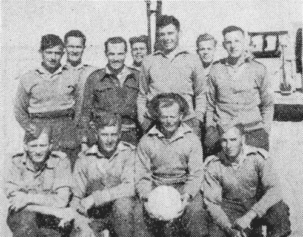


在西沙漠，`皇家诺森伯兰步兵团`侦察团的男士们竟然设法抽出时间踢足球，当时他们正准备前往利比亚。这张照片是由`Hexham`的`Lionel Stephenson`上尉拍摄的，他在照片发布两个月前已战死。随后来自`Hexham`的步兵`Matt Young`（后排左起第二）被俘，而同样来自`Hexham`的连军士`David Forster`（后排右起第三）于 7 月 17 日战死，安葬在特利波。

## 后方线与事故

当住房危机席卷该地区时，`Prudhoe 地方委员会`写信给`卫生部`，希望重新开放一些在冲突前被认为不宜人类居住的房屋。镇牧师、议员`R.E. Robson`教师表示，越来越多的人涌入该地区，但可提供的住宿甚至不如一个空肥皂箱多。

两名男子在他们乘坐的坦克在`Stagshaw`附近的`Bewclay Bank`无法通过一个 S 型弯道翻覆时遇难。他们分别是来自`Alnwick`, `Littlehoughton`的机械配师`Ronald Crole`和来自`Newcastle`的机械审查员`Edward Nettleton`。来自`Blaydon`的坦克测试员司机`Oliver Richardson`仅受了擦伤，得以逃生。

## 播音员 Romany

1,000 多名学生挤在`Hexham`的`中央卫公会堂`听由`BBC`传奇播音员`Romany`主角的自然讲座，并配有黑板画演示。他在开始演讲时为他著名的英国宾犬`Raq`缺席道歉并解释道：“由于汽油紧张，我无法开车，如果我带`Raq`坐拥挤的公交，人们会踩在他的脚上，它不喜欢那样，所以我不得不把它留在家里。”

`Romany`是第一位野生动物播音员，他赶着马`Comma`、吉普赛马车和两个年轻伙伴`Muriel`和`Doris`在全国范围内，人气巨大。生活中，`Romany`是卫公认为`George Bramwell Evens`教师，以他的《跟随 Romany 出行》（后来改为《跟随 Romany》）节目而最闻名，该节目于 1933 年在`BBC`的《儿童时间》中开始。他的职业经历包括在卡莱尔卫公会中心大厅度过的十二。

### 空军英雄被俘

1942 年 5 月，当当地英雄飞行军尉`Arthur Garwell DFM`被报道失踪后，`Hexham`屏息以待。在此之前大约 18 个月前，`Tynedale`号曾对同一艘 U 艇开过火，并以为击沉了它，但事实并非如此。那艘 U 艇对`Tynedale`号进行了报复，但第二天又被盟军击沉。然而战争是国家之间的战争，而不是个人的战争，`U-593`号的艇长`Gerd Kelbling`在沉没中幸存，他与`Ron`在战后交换了多年的圣诞贺卡。

### 空军英雄被俘

1942 年 5 月，当当地英雄飞行军尉`Arthur Garwell DFM`被报道失踪后，`Hexham`屏息以待。飞行军尉`Arthur Garwell`来自`Oakwood`，在著名的低空飞行任务中，德国南部的奥格斯堡目标，`Lancaster`轰炸机在中弹后由于由于完美坠毁被俘，他获得了卓越飞行勋章。

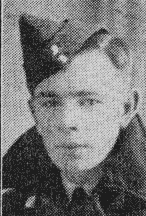

飞行军尉`Arthur Garwell`来自`Oakwood`，在著名的低空飞行任务中，德国南部的奥格斯堡目标，`Lancaster`轰炸机在中弹后由于完美坠毁被俘，他获得了卓越飞行勋章。

加威尔看到内特尔顿和他的一些船员正盯着正在燃烧的兰开斯特轰炸机，他比了一个不礼貌的手势，对方也立刻回了礼。随后，他向左转迎风飞行，飞向镇南方一片斑块状的田地。随着他收回油门并放下襟翼，烟雾开始涌入舱内，熏得他睁不开眼，不仅看不清外面也无法读取仪表，还令他几乎无法呼吸。前舱的五个人都在剧烈咳嗽，弗卢克斯打开导航员桌上的逃生舱以获取一些空气。

加威尔保持飞机以他认为相同的角度飞行，这时舱门处的一股突然下气流让烟雾消散了一小会儿，他看到前方有一排高树挡住了他们的路线。他推大引擎动力并拉回操纵杆，但烟雾已经再次弥漫开。

加威尔以每小时 80 英里的速度盲目地让飞机撞向地面，但撞击时，飞机像一只老母鸡一样稳了下来，腹部滑动了约 50 英码后平和地停住了。他们向逃生舱冲去。在外面他们发现弗卢克斯死在右侧内发动机下方。他在撞击时被甩了出去。他迅速打开逃生舱的行动可能救了他们的命。整个机体正在剧烈燃烧，他们无法靠近，死亡人数增加到了三个。

加威尔因其英勇被授予了卓越飞行十字勋，而内特尔顿作为奥格斯斯堡空袭后唯一一个将兰开斯特战斗机带回家的人，被授予了维多利亚十字勋。

加威尔被关押在臭名昭著的第三代空战俘营（`Stalag Luft III`），一直直到 1945 年 5 月获释，但他并不是模模范范。他参与了至少一次越狱尝试，在战后战俘的回报中简练地描述道：“与 25 其他人作为捉虱小组逃脱。囚犯伪装成守卫。一天后被捕。被德国人威胁要因破坏和间谍罪接受军事法判。在监狱关了 56 天，1943 年 6 月 16 日至 8 月 8 日。”

根据他的战时日志，他再次于 1943 年 12 月 26 日至 1944 年 1 月 17 日期间被禁闭，尽管他在书中没有提到这一点，但有人推测他曾参与了 1944 年 3 月从第三代空战俘营发起的传奇般的“大逃亡”。然而，他并不是那逃脱的 76 人之一，也不是那随后被盖斯塔冷酷杀害的 50 人之一。


对于那些等待在东非皇家诺坎伯兰郡掷榴团侦察团中失踪亲人消息的当地家庭来说，当得知他们被关押在意大利战俘营时，压力在某种程度上得到了缓解。来自赫克斯姆的人员包括（从左到右）：连士军长 R. 莱利、约瑟夫·汤普森军下士、约翰·爱德华·鲁克军下士以及步兵萨缪埃尔·威尔逊。

战后，加威尔加入了英国皇家海关和关税部的调查部门，并于 1957 年加入东非海关和关税局，在蒙巴萨和内罗毕生活，在肯尼亚于 1963 年独立之前成为该机构的负责人。他留在了肯尼亚，于 1964 年获得肯尼亚国籍，并开始为酒店业经营蘑菇。

他于 1969 年死于肯尼亚，年仅 49 岁。当他的勋章和战时文件于 2006 年在伦敦拍卖时，成交价为 8800 英镑，几乎是预估价的两倍。

## 国内民兵的悲剧

1942 年 6 月，贝林汉姆的一场国内民兵演习发生了严重事故，导致了悲剧。来自基尔德的贝绍肖的林业工人乔治·威廉·格伦登宁（31 岁）在演习中使用的一枚手榴弹在他附近爆炸，导致其遭受致命伤。

验讯会得知，格伦登宁先生是国内民兵的一员，并正在参加演习，演习中还包括正军成员。正军的一名军士扔了一枚手榴弹以警告他人让路，但格伦登宁被爆炸波波及了。民兵队并不知道使用的是实弹而非仅仅是烟雾弹。格伦登宁的双腿被爆炸炸碎，他因休克和大出血死亡。

南诺坎伯兰法医官 P.M. 杜德斯在判定为意外死亡时说：“格伦登宁忠诚地试图为他的国王和国家履行职责，并为万一发生时防御该地区做好训练。”

诺坎伯兰郡国内民兵第 4 营的其他成员，包括来自赫克斯姆、阿康布、洛盖特、惠特利小教堂和萨斯莱利的小队，在赫克斯姆的普莱尔平地举行了野战仪式。指挥官 J. 瑞德·罗布中校告诉他们：“国内民兵不再仅仅是穿制服的平民，而是武装部队不可或缺的一部分，他们装备精良、训练良好，毫不毫不地说，是一支高效的战斗力量。我们在这里不仅仅是为了抵御入侵，而是通过保持强大和良好训练，允许正规军调往海外。我们越强大、训练越良好，就能派遣越多的正规军，战争也会结束得越快。”

一条变质的熏��鱼被认为导致了来自科安伍德的 21 岁农农托马斯·哈金森的死亡。哈金森在吃了了他工作的农主妻子提供的熏��鱼一周后病倒了。尽管那个农主也吃了同一个锅里的熏��鱼却没有任何不适，哈金森在几天后还是病了，入院医院后说他吃了一条“味道不对”的熏��鱼。他说：“如果我能挺过这一关，我再也不吃熏��鱼了。”他在哈特威斯尔纪念医院死于链球菌肠道感染，但当地医生 J.M. 格拉斯说，无法确定熏��鱼是否对死亡负责。

多年来，阿伦代尔一直自诩为英国的中心，尽管它远离海洋，但随着英国第一家乡村度假和休养地的开放，这里成为了来自许多国家海员的家，那些遭受敌袭或疾病的海员能够恢复健康。

该设施位于艾伦河畔的一栋旧住宅酒店内，由海员宣教协会运营，旨在为所有遭受过纳粹之手的海员提供免费的为期两周的假期。建立了一个名为“商船员假期休养所基金”的特别基金，该设施很快被阿伦代尔的人们所采用，住院者在山谷的许多家中受到了款待。

休养所里有各种国籍的人，他们拥有海洋这一共同纽带，一位挪威海员宣称：“这是一个美丽而和平的地方。人们都非常友好——对我来说这里就像天堂。”

有些人曾被鱼雷击中多次并遭受重伤，但整体印象是，一旦他们从伤病和疾病中康复，他们迫不及待要回到战斗中。

战争继续对泰恩代的军人造成了惨重损失，几位当地人死于利比亚沙漠，其中包括皇家诺坎伯兰郡掷榴团侦察营团长爱德华·德斯·格拉齐兹中校，以及在同一团服役的南威尔姆的约翰·皮尔森少校。

侦察团（`Recce Corps`）是人们亲切的称呼，主要由服役过皇家诺森伯郡掷击团的民兵军员组成。它被视为“军队的眼睛”，被认为是布尔战争中表现卓越的侦察兵以及上一次大战中骑兵的继任者。侦察团被归类为骑兵连，乘坐`Bren`载兵器、装甲车或卡车行动。这些士兵被要求能够驾驶任何车辆，并能够修理它们。他们的工作是发现其他部队前方的状况，并汇报回情况。人们说，土生土长的、对乡村环境有眼光且精通野外生存技巧的人，非常适合这项工作。

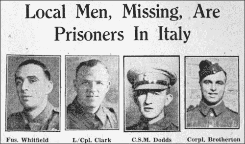

1942 年 9 月在意大利意大利战俘营的、来自赫克斯姆的皇家诺森伯郡掷击团侦察团成员，从左到右分别是：步击兵 T.H. Whitfield、下士 George Clark、连军士 Leslie Dodds 和 士 R. Brotherton。

当当地士兵在中东继续牺牲时，英国本土也发生了悲剧。前军人、赫克斯姆家园卫队成员 Benjamin Gunton 在其位于镇上罗德克罗斯（`Round Close`）的家中花园时，听到了一声巨大的爆炸声，发现他 18 岁的儿子 Desmond 不小心被手榴弹炸死了。

Gunton 先生在法医质询会上告诉，这名青少年被士兵给了四枚手榴弹作为纪念品，并存放在花园底部的一个小屋里。他习惯于把炸弹拆开再组装。他承认本应该从孩子那里没收这些炸弹，但一直没得及处理。

泰恩代尔的第一家“英国餐厅”（`British Restaurant`）建立在普鲁霍的威斯利礼堂，该礼堂花费`£600`进行改造，一次可为 100 人提供廉价且营养丰富的餐点。营业时间为周一至周六上午 11:45 至下午 2:15，提供四道菜套餐，包括`2d`的汤、`7d`的肉和蔬菜（儿童为`4d`）、`2d`的甜点和`1d`的杯茶。

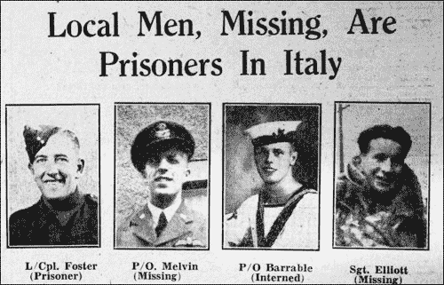

据报道，位于意大利战俘营的是来自科布里奇的下士 William Foster（左），而来自赫克斯姆的士官 Fred Barrable（右二）在位于地中海的`HMS Manchester`号沉没后被关在阿尔及利亚。然而，来自海登桥的飞行军官 Sidney Melvin（左二）和他的皇家空军同事、来自科布里奇的军士 John Ridley Elliott（右）均下落不明。

英国餐厅是`1940`年创建的社区厨房，旨在帮助那些因轰炸流离失所、用完配给券或其他需要帮助的人们。这也具有政治意义，因为工党将其视为跨阶层平衡消费差异的永久解决方案，并确保贫困人口获得营养丰富的饮食。

这些餐厅最初被称为“社区供餐中心”，“英国餐厅”这一名称由首相温斯顿·丘吉尔命名。它们由食品部设立，由地方政府或自愿机构以非营利性质运营。

### 良心的问题

第一次世界大战的老兵、来自普鲁霍的 Robert William Marriner 因不服国家兵役官要求其从事国家重要工作的命令，被赫克斯姆治安法庭判处有禁苦役两个月。Marriner 向法庭表示，如果他接受了被指派的工作，他目前的工作每周将损失`20s`到`30s`的工资。他说：“我在上一次大战中每天为了 6 个便士战斗，并被承诺回来后会有更好的待遇——现在我回来却遭受到这种对待。”

在同一处法庭，来自海登桥的 25 岁女孩 Kathleen Margo Jupp 在被告席上朗读她的圣经，当时她被指控未参加执行国家重要工作的面试。她解释自己的职业是全职耶和华见证人，在被问及诉求时，她说：“从技术上讲，我有罪；从道德上讲，我是无罪的。”她此前申请注册为良心拒绝者，但被告知根据《就业登记令》（`Registration of Employment Order`）的规定这是不可能的。法庭获悉，Jupp 女士有一些“奇特的宗教信仰”，这使得她难以承担被指派的工作，即使这些工作与战争无关。

国家兵役官 Charles Welburn 告诉法庭，由于她的信仰，Jupp 女士未被分配军火工作或任何与战争直接相关的任务，而是被去赫克斯姆的儿童疗院工作，但她拒绝与护士长面试。当法庭主席 John Charlton 问她是否不是受英国法律约束的英国臣民时，她说：“我首先服从上帝的法律。”

法庭获悉她曾是妇女土地军的成员，但在“受到耶和华见证人运动的影响”后辞职了。在休庭两周后，她被罚款`£20`。

诺森伯郡和德里郡良心拒绝者法庭的主席 T.Richardson 法官随后在向赫克斯姆轮社俱乐部发言时表示，在他看来，一旦战斗结束，所有拒绝为战争努力做任何事的良心拒绝者都应该被冷落。这同样适用于那些雇佣“良心拒绝者”的公司，在其他员工为国家牺牲生命时，这些公司往往在职位上提拔了这些人。法官说，最近有越来越多的女性声称自己是良心拒绝者，他发现她们比男性“更有毒性”。

他说：“大部分人根本不是真正的良心拒绝者，而是无异于逃兵。还有一些人利用所谓的宗教团体作为掩护，以逃避为国家做任何事。总来说，这些宗教团体由非常无知但危险的人组成，他们到处煽动。”一名 19 岁的士兵 Hugh Weir 军士在海登桥的一次陆军演习中不幸溺水于泰恩河。Weir 被要求提着一根钢绳横渡河流，将钢绳固定在对岸，以便其他士兵过河。然而河水位迅速上涨，下了放弃演习的命令。遗憾的是，计划的变化没有传达给 Weir，他穿着裤子和运动背心走入激涨的河流，钢绳的一端系在腰带上，另一端系在一个鼓上。他刚进入河流四码远，就被水流冲走了。钢绳的另一端从鼓上散落下来，没有人能抓住绳头。

Weir 的尸体在河流下游 50 码处被找到，法官认为取消指令没能送达非常“遗憾”。

## 第五章

## 通往诺曼地的坎坷之路

一名来自斯克斯菲尔德（`Stocksfield`）的 15 岁女孩被赫克斯姆少年法庭送往收容学校，法庭对她在被描述为极其肮脏案件中表现出的“丑闻”行为感到震惊。她的父亲描述她完全失控，她被送到纽卡斯尔的一个教区静修地，但通过从顶层窗户爬出并顺着排水管滑到防空洞屋顶逃脱了。

她伴同一名水手出现在纽卡斯尔的一家酒店，自称是他的妻子，但当“丈夫”回到船上后，她与同一家酒店的另一位客人住在一起，并告诉被冒犯的经理她的丈夫并不介意她与其他男性友好地交往。她拒绝支付`45s`的酒店单，但这笔钱由她现在共用房间的另一个男人支付了。

那个女孩还在纽卡斯尔去了一次购物，她在那里订购了一件 14 金尼的舞服和一件 10 金尼的晚宴外套，并支付了 10 的定金，但被拒绝了。

## 蒙提的成功与当地英雄

尽管中将伯纳德·蒙哥米利在埃及带领“沙漠鼠”取得的成功是一个极大的好消息，但赫克斯姆议员道格拉斯·克利夫顿·布朗警告不要过早庆祝。他说：“隆罗梅尔是一个英勇且狡猾的士兵，无论他必须付出什么代价，他都会尽可能保留他那闻名遐外的非洲军。当獾被逼到洞穴尽头时，它才是最危险的。我们赢得了一场胜利，这在我们场战争中是件新事，但我们还没有赢得战争。现在还应该应该为马菲丁而欢呼。”

然而，《赫克斯姆快报》很快指出，“蒙提”与赫克斯姆有深厚的渊，因为他是赫克斯姆前牧师西德尼·萨维奇教士的侄子，而教士的妻子正是蒙提母亲的姐姐。

蒙提在阿拉曼战战役中的成功让全英范围内沉默了两年的钟声再次鸣响，其中包括赫克斯姆修道院的钟声。修道院九位常驻钟手中有七位正在服役，但留下的两位幸存者加入了退休已久的钟表专家，以及从特鲁罗、惠奇彻奇和诺汉普郡等远地区驻扎当地的钟手。牛顿霍尔、奥伦德尔、科尔布里奇和威尔拉姆也响起了胜利钟。

一名来自哈尔特威斯尔的陆军女子军团（`ATS`）下士因在南岸遭到炸弹袭击时，与另一个女孩一起坚守岗位而受到公开表扬。玛丽·豪在接受《快报》采访时曾不愿谈论此事，但最终说道：“我们正像往常一样在房间里工作，突然间毫无预警地，门被炸开了，我被撞到了角落里。我设法回到交换机旁继续接电话，直到我们收到撤离命令。我们刚离开房间，地板就塌了，所以我想我们逃得相当幸运。我们所做的并不比别人能做的多。”

另一个故事来自赫克斯姆的士官弗雷德·巴巴尔，他所在的英国英国“曼彻斯特号”舰在阿尔及利亚岸外被沉并被俘了。他和其他战俘一起被上火车，被送到维希法国经营的撒哈拉阿尔及利亚拉古阿特监狱营，在那里，在所有物品被没收后，26 个人挤在一个本应容纳 12 人的小屋里。

巴巴尔说，阿拉伯守卫对囚犯耍了阴招，他记得其中一个人从一名锅炉工那里拿了一块金表，说作为交换，他会允许那名水手逃跑。但他没走多远，因为他在穿过铁丝网时被射毙了。

营里的主食是小扁豆、橄榄油和黑面包，辅以用椰枣核制成的“咖啡”。他们偶尔会被分到酒，喝起来更像醋，法国当局说这是为了压制营地内蔓延的疾病。巴巴尔指出：“医院设备简陋，用一匹马和马车当救护车，但更糟糕的是，各种昆虫无休地骚扰着我们。”

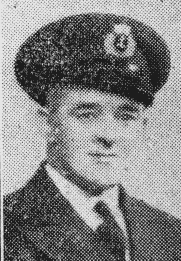

1943 年 7 月，赫克斯姆郡首席工程师托马斯·库斯伯特·戈曼被授予大英帝国勋章（`OBE`），在他的商船被鱼雷击中并在不到七分钟内沉没后，他带领 23 人在救生艇在南西洋漂流了 49 天。

囚犯们最终设法了一台无线机，从中获了盟军在阿尔及利亚登陆的消息，这引起了士兵、水员和飞行员的响声欢呼——但法国营地长没有，因为他不知道入侵的发生！不久后，营地被解放了。

来自赫克斯姆郡的首席工程师托马斯·戈曼讲述了更多恐怖经历，他的船在南西洋距离陆地 700 英里的处被三枚鱼雷击中，他在敞的小船中漂流了 49 天。船在六分钟内沉没，但在两艘救生艇发射之前，潜艇浮出水面并将船长俘为战俘。

两艘救生艇，一艘载有 26 人，另一艘载有 12 人，在大海中聚在一起了五天，随后分离。一段时间后，他们发现第二艘救生艇是空的，于是从它的储物中补充了自己匮乏的物资和水，还获得了第二面帆。


戈曼回忆道：“我们只有船上的指南针引导，主要听命于盛风，尽管我们偶尔也会划桨。八天后，我们看到了一艘船，尽管我们发射了信号弹并尽一切努力吸引注意，但她没有看到我们。”

最初的配给是每人早晚两块船用饼干、一勺肉脂（pemmican）、一小巧克力和一根何力士（Horlicks），但在最后十六天里，他们减到每天仅靠四之三吉的水生存。一名炮手做了一副多骨牌，他们还用照片做成扑牌打时间。当他们被获救时，戈曼瘦了三石，他的大拇指和食指就能围住船上那个 16 岁学徒的腿。

随着 1942 年圣诞节的临近，礼物短缺，配给卡越发紧张，当地农场里充满了为了圣诞餐特意肥大的鹅和火鸡，这一事实对某些人来说诱惑太大。许多农场遭受了严重的盗窃问题，据说有组织的团伙使用汽车和马车运走鹅、鸡和火鸡。兰格利地区受灾尤为，一位农民一夜内失去了十一只火鸡，另一人损失了二十七只鸡。一位农民说：“损失禽类在任何时候都是严重的，但当我们节衣缩用为了养大鸟过圣诞节时，这种损失尤为剧痛。”

1942 年的圣诞节再次以物资匮乏、严格的食物配给和稀缺的商店供应为特征——但战争期间的第四个圣诞节是最快乐的。战场传来的罕见好消息使得圣诞节早晨整个地区的教堂钟声再次响彻。人们努力确保驻扎在当地的许多军人和妇女能过上尽可能快乐的圣诞节。青年会厅装饰了冬青和��寄，为士兵举办了派对，进行了一些激烈的团队游戏，带来了许多欢乐。位于奥伦德尔的海员休息与假期之家为居民和朋友举办了家庭聚会，还有许多其他活动。

很少有家庭幸运能在圣诞餐桌上准备一只火鸡，但赫克斯姆应急医院的每个病房都有一只。

来自科布里奇的爱德华·皮格（Edward Pigg）议员告诉赫克斯姆地区委员会，当地有强烈情绪认为，虽然小屋花园和连排房屋的栅栏已被拆除，但大型庄园的栅栏被留在原处，其中一些庄园还有大型金属大门守护，这些大门可以提供大量的贵铁。他说：“人们对此此感到非常愤怒。为什么穷人必须放弃栅栏，而大庄园却能逍遥过？必须对此采取行动。”

他得到了 M.S.伯杜斯（M.S. Burdus）议员的支持，后者表示，仅一个庄园就有 100 多个金属树护，据称保护的树木实际上“像米特塞拉一样古老”。

在国王的新年授勋名单中，来自奥伦德尔的商船海军上约翰·汤姆森（John Thomson）被授予大帝国勋章（OBE），以表彰他的船不仅遭受了鱼雷袭击，随后又遭受了俯轰攻击。他的船只在潜艇袭击中受损严重，船上和海面上升起的汽油烟存在爆炸的严重危险。汤姆森上尉和船员设法将受损船只进了港口，但那里再次遭到德国俯冲轰机的攻击，遭受了进一步损坏。记载指出，汤姆森上尉在两次行动中都发挥了卓越的领导能力，很大程度上由于他的决心、资源和技巧，船才得以幸。

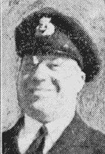

来自奥伦德尔的约翰·汤姆森上尉（40 岁）在 1943 年国王新年授勋名单中因其油油轮在遭受鱼雷袭击和俯轰后的英勇行为授予大帝国勋章。火灾和爆炸的危险一直存在，不仅是因为落下的炸弹，还因为货物的蒸汽，当时甲板和周围海面溢满了汽油。

同样获得荣誉的还有来自伯特利的士兵彼得·麦克纳德（Peter MacDonald，25 岁），他在阿拉曼曼战役中因营救数名战友的生命而获得军事勋章。麦克纳德士兵曾在诺丁汉郡谢尔伍德皇家游骑兵兵团服役，在战斗中失去了一条腿。

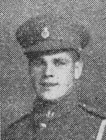

来自沃克附近伯特利的彼得·麦克纳德士兵（25 岁）因在阿拉曼曼战役中救了数名战友生命而被授予军事勋章。他在诺丁汉郡谢尔伍德皇家游骑兵兵团服役，在战斗中失去了一条腿。

乔·库伦（Joe Cullen）议员在赫克斯姆地区委员会的会议上将赫克斯姆对宵禁规定的执行描述为“荒谬可极”，并特别提到了提着大火炬并对着人脸晃光的做法。他说：“无论你晚上几点出去，都可能遇到其中一个昏昏欲睡的蟑螂。这些所谓的火炬有些根本不是火炬，更像是便携式搜索灯。我希望人们不要沉溺于错误的安全感。这场战争还没有结束，任何事情仍可能发生。”

J.M.赫斯洛普（J.M. Heslop）议员抱怨道：“我很想知道，那些拿着大火炬的人是从哪里弄来电池的……”

### 七人死于手榴弹事故

战争期间当地伤亡最重的事件发生在 1943 年 1 月 21 日的科安伍德（Coanwood），当时步榴榴弹在演习中爆炸，导致七人死亡，十七人受伤。死者包括两名军官、四名士官和炮手，这起事故从未得到过满意的解释。

死者是：来自米德塞克斯郡诺斯伍德的马克·弗朗西斯·沙克尔上尉（Mark Francis Shackle，25 岁）；伦敦哈尔斯登的副少尉阿尔弗雷德·詹姆斯·贝尔（Alfred James Bell，30 岁）；比肯黑德的军士士长赫伯特·威廉·雷维尔-布鲁格（Herbert William Revel-Burroughes DCM，38 岁）；高怀凯姆的连级副军士长约翰·斯坦利·威尔克斯（John Stanley Wilks，31 岁）；卢敦的下士级击手威廉·约翰·莱特（William John Wright，25 岁）；达灵顿的雷蒙德·波里里特（Raymond Porritt，32 岁）以及伦敦的炮手爱德华·约翰·韦斯顿（Edward John Weston，32 岁）。

哈尔特威斯尔的质讯会得知，一群士兵正接受连级军士长 F.J.詹金斯（F.J. Jenkins）关于步榴榴弹使用的指导，他们围在他周围听他解释武器用法，该武器本应将手榴弹射向 200 码外。手榴弹装在发射杯中，士兵被要求在发射时撤到六到七英尺远。一名证人看到士长从手榴弹上拔出插销并正确放入发射杯中，但当扣扳机时，发生了“巨大的爆炸和刺眼的闪光”，爆炸波导致 24 人死亡或受伤。

连级军士长在爆炸中幸存，但在医院处于危重无法作证，尽管很明显手榴弹从未离开过发射杯。

验尸官 P.M.多斯（P.M. Dodds）在做出裁决时表示，唯一的解释是手榴弹没有正确装入发射杯——证人说并非如此——或者是手榴弹本身存在缺陷。他记录的死因是手榴弹爆炸导致的多处伤亡，原因不明。

1 月，赫克斯姆治安法庭创造了历史，辅助女警格蕾塔·亚瑟（Greta Arthur）成为在该法庭作证的首位女性官员。她告诉法官，她看到赫克斯姆圆场（Round Close）一栋房屋的烟囱里喷出巨大的火花，违反了宵禁规定。被告托马斯·考万（Thomas Cowan）称，火花是因为他往火上泼水灭火导致烟囱起火。他被罚 10 英镑。

在同一法庭，当首起涉及违反《消费者配给令》的案件提交当地法庭时，据报道赫克斯姆存在“严重的服装配额私交易”。案件涉及来自赫克斯姆吉尔斯盖（Gilesgate）的 74 岁退休人员托马斯·阿肯黑（Thomas Akenhead）、来自纽卡斯尔的 64 岁工人托马斯·布拉肯（Thomas Bracken）以及来自科布里奇公主街的 N.罗布森夫人。

阿肯黑向救济委员会的工作人员报称，他在居住的旅馆储物柜丢失了衣服配给本。但在接受询问时，他承认以 1 英镑卖给了同住的布拉肯，布拉肯转而以 25 先卖给罗布森，并用利润买了啤酒。罗布森被罚 10 英镑外加 2 英镑诉讼费，而两名男子被要求缴纳 5 英镑保证金保证良好表现。

来自布克斯特山（Brixter Hill）的农夫约翰·多斯（John Dodds）也因未按照《国防（通用）条例》指示在其农场耕种足够的土地而被起诉。他被命令耕种其农场 134 英亩中的 44 英亩，但他只耕了 33 英亩。代表战争农业委员会的检察律师理查德·埃利斯（Richard Ellis）表示，诺丁汉郡要求耕种 16.5 万英亩，如果所有农民都效仿多斯的做法，未完成四分之一的规定工作，将会陷入混乱。

多斯告诉法庭，他认为分配的额度不合理，由于天气和其他问题，他没能在规定时间内完成目标，尽管他后来已经耕好了。他说：“我们丰收了大丰——有 50 大捆玉米——这对国家粮食储备做出了巨大贡献。我们已经为国家事业付出了人类所能的一切。我们履行了农民的职责。”

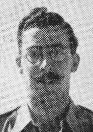

在被报道为在中东战斗中失踪并估计战死后，皇家诺丁汉郡冲锋兵团侦察团的基特·帕特森（Kit Patterson）上尉于 1942 年 7 月被确认为意大利中转营的战俘。

法官席不同意这一结果，多斯被罚 5 英镑，并加 5 几尼的诉讼费。

### 土豆周

Tynedale 在二月份发现了一种对抗纳粹的新武器，当时他们发起了`赫克斯姆及地区土豆周`，敦促当地主妇们停止使用面包，改而供应土豆饼干。这一活动得到了食品部长`伍尔顿勋爵`的支持，他在给零售水果贸易协会赫克斯姆分会主席`S.F. Robinson`的电报表示：“通过承认食用本地食品的重要性并为我们的小麦运输空间腾出更坚固的货物，赫克斯姆正在树立良好的典范。”他还为最佳原创土豆食谱设立了两吉尼的奖金。该地区的烘焙师也参与了进来，出售由土豆制成的饼干、蛋糕和点心，许多商人还参与了《库兰特报》上关于土豆周的押韵广告活动。

最受关注的是由`西威拉姆和普鲁埃合作社`创作的一首诗，他们当地的押韵诗人写道：

```
希特勒对戈培尔说，
英国人都是没用的，
他忘记了泰恩赛德的乔迪人
他们为了土豆简直是恶魔
他们在埃及证明了这一点
当时隆梅尔正被追得败北
他回电给希特勒说，
我的天哪，我们得逃命。
```

来自`Wark`的杂货商`W. Civil`的贡献是：

```
你无法驾驶飞机，
无法指挥英国潜艇
但你可以通过吃当地的土豆
击败纳粹。
```

来自赫克斯姆`Woodbine Terrace`的商人`E. Dawson` 写道：

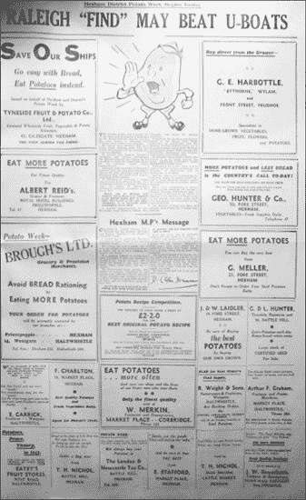

一场敦促主妇在准备餐食时使用自产而非进口面粉的大型活动，促成了`赫克斯姆土豆周`的启动，食品部为最佳土豆食谱提供了两吉尼的奖金。

```
节省小麦，多吃土豆
帮助赢得战斗
它将援助我们英勇的海军
让侵匈人落于逃路
```

哈尔特威斯尔的水果零售商`E. Carrick` 写道：

```
少吃面包，多吃土豆
为了营养，它们是好东西
让船只运送大炮和坦克
赢得伍尔顿勋爵最热诚的谢意
```

在随附的社中，《库兰特报》写道：

“谦卑的土豆，印加人的真正财富，可能是击败威胁我们运输的潜艇的主要因素之一。通过多吃土豆、少吃面包，用于进口小麦的大量运输空间将释放给重要的战争物资。整个地区的当地商人、妇女协会和学校正联合起来，努力让人们更好地了解普通土豆的营养价值。尽管土豆在英国被遗憾地忽视，但长期以来一直是爱尔兰农民的主食，在大陆，它们的使用比在本国广泛得多。”

有人指出，德国的`奥芬堡`有一座纪念英国海盗弗朗西斯·德雷爵士的雕像，以纪念他将土豆引入欧洲大陆。

`土豆周`取得了巨大的成功，尽管当地议员`I.M. Iveson 小姐`评论道：“我认为，如果伍尔顿勋爵能禁止土豆一个月，他会更好地实现普及土豆的目标，因为在上次大战期间土豆稀缺时，它们才价值金连城。我认为我们正处于这场战争的最后冲刺，但那总是是最的。”

总共有 41 位商人参加了土豆相关的橱窗竞赛，五吉尼一等奖的获得者是来自哈尔特威斯尔的`R. Wright 父子公司`。安慰奖颁给了赫克斯姆`Battle Hill`的`伦敦和纽卡斯尔茶公司`以及普鲁埃的`Walter Willson`商店。赫克斯姆的`Brough`公司和`泰恩河苗场`也获得了特别表扬。

伍尔顿勋爵颁发的最佳原创土豆食谱两吉尼奖金被授予了赫克斯姆`Acomb House`的`Stanley 夫人`，她的土豆模具被评委描述为“一个非常实用的战时配方”。由于拒绝让他的童子军参加赫克斯姆周的木鸽清点活动，导致了来自`爱德华·格雷学院野鸟类学研究所`的区专员`T. Russell Cairns 少校`遭到谴责，该研究所指责他“过度谨慎且短视”。`Cairns 少校`反驳道，该研究所认为木鸽（当地称为`cushats`）筑巢在灌木丛中，而众周知它们更青睐高树顶，他认为让童子军参与太危险了，而且给童军领造成了巨大的责任。他总结道：“我告诉他们，与其爬两三次高树去数幼鸟，不如爬一次，然后把结果做进饼里。”

他认为童子军在当地承担了许多更重要的国家服务工作，例如担任`防空警报员`、`国民卫队`的信号兵、`青年会`的助理以及药草采集者。他们还进行过鼠尾收集，其中一个童子军独自收集了 106 条尾，赢得了一枚国家服务勋章。

赫克斯姆商店的吸引力意味着镇外的人早晨就乘坐巴士来到镇上扫空非配给物资的货架，`赫克斯姆地方议会`会议上的`Ned Fenwick 议员`这样抱怨道。他说每周二（集市日）和周六都是“一场真正的抢购”，等赫克斯姆当地人出去购物时，已经没剩下什么东西了。他说早晨的购物者回到巴士站汇集他们的购买物品，并要求采取措施保护赫克斯姆居民的利益。

议会食品控制委员会主席`Tom Wheatley 议员`表示，议会没有权力干预此事事，并补充道：“在我看来，如果周边地区的人可以坐巴士进城购物，说明镇上的人下床还不够够快。”

当赫克斯姆的保守党议员`Douglas Clifton-Brown`被任命为第 139 届下议院议长（王国第一平民）时，赫克斯姆获得了一个非凡的荣誉。他向 1918 年首次选举他为赫克斯姆议员的选民保证，尽管他的新职位意味着他必须在威斯敏花费更多时间，但他不会搬到伦敦，而是倾向于留在位于`Blanchland`附近的`Ruffside`家中。他自 1938 年起担任副议长，一直担任议长直到 1951 年退休，被授予“诺森伯郡赫克斯姆鲁夫赛德子爵”的头衔。

赫克斯姆高尔夫俱乐部是许多郡级锦标赛的举办地，被认为是国内最好的内陆球场之一，但正面临生存之战。有许多成员加入了军队，导致会费减少了 530 英镑，果费从 1938 年的 538 英镑骤降至 71 英镑。尽管采取了严格的节约，俱乐部仍有许多难以承担的债务，因此发起了一项 2000 英镑的募捐，以确保在战争胜利军人回来时可以使用`Spittal`球场。

### 胜利之翼

“胜利之翼”活动于 1943 年夏天在赫克斯姆和普鲁埃同时启动，赫克斯姆的目标是筹集 25 万英镑以提供四中队的`霍克“飓风”战斗机，而普鲁埃的目标是 4 万英镑，以发射一架`航空英国斯特”轰炸机。普鲁埃率先实现了目标，筹集了 52039 英镑，这在很大程度上归功于`Mickley 联合煤矿`1.5 万英镑的投资。Rio Cinema`还举办了庆祝音乐会，由澳大利亚女高音`Florence Austral`和英国男低音`Norman Allin`以及当地合唱团`普鲁埃合唱团`演出。

赫克斯姆的活动由新任命的下议院议长`Douglas Clifton-Brown`启动，他发表了关于非洲战争局势转折的激昂演讲，当时他曾担任指挥官的`诺森伯郡骑兵团`正作为反坦克部队表现出色。

赫克斯姆（Hexham）街道上举行了一场盛大的游行，一支军队领着规模庞大的队伍，其中包括国内卫军、皇家空军（RAF）、皇家空军女子辅助队（WAAF）、防空团（ATC）、国家消防局、女子训练团、英国军团团、民防队、英国红十字会、女童军和男童军。现场还有一支着装整齐的妇女土地军分队，国内卫军乐队也在游行。镇上的商人们以爱国主义风格装饰窗户参与其中，其中一个广受欢迎的特色是在炸弹上贴上储蓄债券，这枚炸弹后来被投向德国。

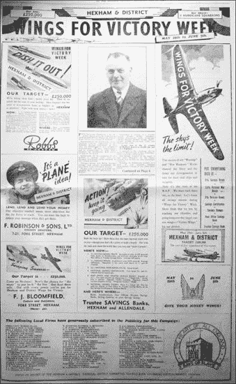

1943 年夏天，“赫克斯姆之翼周”的目标是筹集`£250,000`以购买四架霍克“飓风”战斗机。

“胜利之翼周”再次大获成功，赫克斯姆超过了`£250,000`的目标额万`£100,000`。最终总额为`£339,106`，其中`£79,206`来自国家储蓄证书；`£46,030`来自廷代尔郡银行或邮局的存款；`£54,885`通过国防债券；`£4,615`通过储蓄债券；`£67,150`通过战争债券以及`£86,900`通过储蓄债券。

该地区的 48 所学校的目标是共同筹集`£5,000`，但实际上筹到了`£9,941`。该地区的 39 家邮局募集了`£94,089`的捐款。

该地区许多地方都超过了目标，包括康姆（Acomb）（目标`£1,000`，总额`£4,082`）、奥伦代尔（Allendale）（`£6,000`，`£18,227`）、布兰奇兰（Blanchland）（`£1,500`，`£3,542`）、科布里奇（Corbridge）（`£10,000`，`£23, 07`）、科威尔尔（Colwell）（`£150`，`£287 10s`）、海登桥（Haydon Bridge）（`£3,000`，`£11,506`）、汉姆绍（Humshaugh）（`£6,000`，`£9,348`）、新布鲁赫和福尔斯通（Newbrough and Fourstones）（`£759`，`£8,567`）、奥文姆（Ovingham）（`£350`，`£1,291`）、瑞丁·米尔（Riding Mill）（`£500`，`£11,160`）、西蒙伯恩（Simonburn）（`£1,000`，`£1,654`）、斯托克斯菲尔德（Stocksfield）（`£12,000`，`£32,420`）以及威拉姆（Wylam）（`£16,000`，`£19,508`）。

贝灵汉姆的“胜利之翼周”在一周后举行，目标是筹集`£40,000`购买一架兰斯特轰炸机。北泰恩的人们不仅实现了该目标，还额外筹了`£25,000`，以提供五架战斗战斗机，护护兰斯特轰炸机前往德国执行任务。

1943 年较不为人知的活动之一是乔治六世国王和伊丽莎白王后私访该地区，他们在费瑟斯顿（Featherstone）哈尔特威斯尔–阿尔斯顿线的皇家火车上度了一夜。女王（原伊丽莎白·鲍斯-莱恩）与巴多登米尔（Bardon Mill）和贝林廷格姆（Beltingham）地区有家族渊源。巴多登米尔里德利堂（现在是海登桥高中的宿舍楼）在 1948 年以前由女王的叔叔弗朗西斯·鲍斯-莱恩所有。他是该地区的大慈善人，在里德利堂进行了一项重大的重建计划，并在贝林廷格姆的圣库伯特教堂提供了门廊和彩色玻璃窗。他还是 1881 年爱丁堡苏格兰士兵那臭名昭著的“湿淋阅兵”的幸存者，当时作为女王射箭团长，在暴雨倾盆时，他荣幸为维多利亚女王撑了四个小时伞。

### 勋章获得者及其他当地英雄

科布里奇培养出了一双战争英雄，一位是皇家骑兵卫队的约翰·理查森上尉，他获得了军事勋章（Military Cross）并获得了一枚勋扣。他在 1942 年 5 月在托布鲁克附近的利比亚沙漠比尔·哈切姆（Bir Hacheim）南方的敌方阵地进攻中表现出色，被授予`MC`；随后在利比亚大理石门地区的一次行动中获得了勋扣，当时他自愿领导一次长达 370 英里的巡逻，成功切断了德军的大部分。

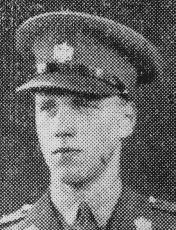


科布里奇的皇家骑兵卫队中尉约翰·大卫·本博·理查森在中东随第八军服役期间，因英勇被授予军事勋章。他是亚历山大·詹姆斯·戈登爵士的曾曾孙孙，后者是曾随尼逊的最后幸存上尉。

为了纪念他卓越的表现，理查森上尉通过科布里奇战争战役人员捐赠基金收到了一个银质烟盒，但他的父亲——住在科布里奇克里夫豪宅（`Cliffe House`）的约翰·理查森法官代为接受了礼物，并表示儿子仍在西沙漠服役。这位法官说：“他本可以回这里的，因为家里提供了一份当老师的工作，但他说不可能接受这个职位，因为他觉得自己必须留下来完成他开始的工作。”

兰格利（`Langley`）的绿色豪亚德团（`Green Howards`）二等兵约翰·阿姆斯特朗（23 岁）被授予卓越行为勋章，以表他在 1942 年 10 月在艾拉曼因（`El Alamein`）附近的穆纳西布盆地（`Munasin Depression`）表现出的非凡勇气，当时他的班遭受了敌方机枪阵的袭击。他的班长受伤无法继续战斗，阿姆斯特朗完全不顾自身安全，进攻了该阵地并将其摧毁，使进攻得以继续。当天晚些时候，盟军巡逻队再次被机枪火和闪光弹阻拦，但阿姆斯特朗和另一名等兵冲进了该位置，使其失去战斗能力，并杀死或伤了七名意大利人。第二天，在猛烈的迫击炮火下，阿姆斯特朗对敌方狙击小组持续进行猛烈火力覆盖，杀死至少一名狙击手并迫使其他人放弃了阵地。

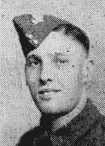

兰格利的二等兵约翰·阿姆斯特朗在北非穆纳西布盆地摧毁了两个敌方机枪阵后被授予卓越行为勋章。然而在 1944 年西北欧的第五次战役中，他因伤势去世。

皇家空军兄弟吉姆和托马斯·罗宾森在新加坡沦落后逃离日军，走了世界上半个地球——但他们说，旅途中哪里也没有见过能与赫克斯姆相提并的。军官吉姆和下士托马斯在新加坡沦陷时逃往爪哇，很快日本人也占满了整个爪哇，兄弟俩失散了，一个找到了前往澳大利亚的路，另一个去了印度。吉姆曾是《库兰报》（`Courant`）机舱室的工作人员，他说：“无论我们在何处，似乎总能找到一份《库兰报》，大家都会带着极大的兴趣阅读它。战前，我们经常能拿到三周以前的《库兰报》，但有一次，我们拿到了一份整整一个月前出厂的。但这并不重要，大家照样读得津津有味。”

入侵入侵期间，赫克斯姆的下等兵牛顿（`Newton`）与高地师的机枪手一起处于战斗中心，在战斗期间，他和仅的一名士兵俘了七十名战俘。这一事件发生在高地人从一个狭缝中引出两个意大利人之后，他们指向了一个干谷（`wadi`——干涸的河床）。班长派牛顿和另一名士兵去调查，结果那七十个人就举着手了出来。

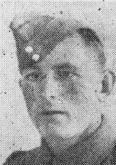

赫克斯姆的下等兵汤姆·牛顿在西西里岛的一个干谷中抓了七十名意大利战俘。

意大利战场的进展让下等兵乔治·克拉克感到感触复杂。他在 1942 年为皇家诺森伯郡团（`Royal Northumberland Fus`）侦察团服役期间，在托布鲁附近的骑士桥战役（`Battle of Knightsbridge`）被俘。他在一个意大利战俘营里关了十二个月，随后被转到德国的另一个营地。在写给住在赫克斯姆圆形住宅（`Round Close`）妻子多丽丝的信中，他写道：“我曾以为很快就能回家了，但这个想法已经破灭了。不过，我们待的营地非常好，伙食也好得多。现在我只想找点工作来打发时间，时间过得非常缓慢。”

克拉克下士（`Lance Corporal Clark`）是来自泰恩代尔（`Tynedale`）地区的 23 名签署人之一，他们写了一封来自意大利营地的信，赞扬了赫克斯姆为战俘提供服务的各种组织。信中写道：“我们对所做的一切深表感激。我们都健康健康，期待早日回到‘英格兰的心脏’。我们经常希望看到《赫克斯姆纪报》（`Hexham Courant`）。”

同样来自赫克斯姆的莱纳德·沃德军士（`Corporal Leonard Ward`）从意大利转运后，在营地 `Stalag IVB` 写信称，德国的食物和待遇远好于意大利。

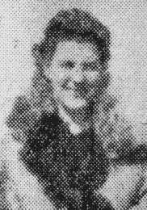

海德登桥（`Haydon Bridge`）的杰西·沃奇（`Jessie Waugh`）姐姐在登陆西西里岛的 21 名英国护士中是一位广受欢迎的人物。她不仅提供护理服务，还通过音乐会娱乐士兵，她的才华使她赢得了加入娱乐国家服务协会（广为人知的 `ENSA`）的邀请。

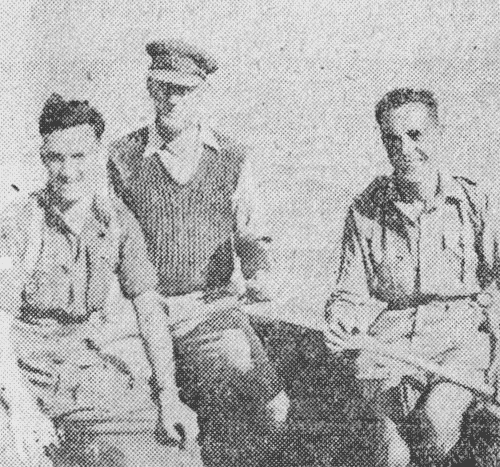

赫克斯姆的 E·霍林格顿军士（`Corporal E. Horlington`，左侧）和海德登桥的 F.H·沃德士兵（`Private F.H. Ward`，右侧）与来自富勒姆的华纳·史密斯军士长（`Regimental Sergeant Major Warner Smith`）在一起，通过划船暂时远离中东战场的战斗。

回到国内后，一名 21 岁的妇女土地军成员在赫克斯姆郡斯尔魔鬼水（`Devil's Water`）的一处深潭中被发现溺亡，令人悲痛。这个来自索普顿（`Thropton`）地区的女孩曾在斯莱利（`Slaley`）工作，当时她去骑自行车后再也没有回来。她留了一封给母亲的信，说：“我厌倦了生活——每个人都反对我。他们恨我，我无法继续下去了；也许我去的地方会很快乐。”验验官判定结论为自杀。

## 赫克斯姆站的弹药爆炸

赫克斯姆在第二次世界大战期间落在泰恩河、蒂斯河和威尔士河工业区的纳粹炸弹中相对幸免，但是英国弹药造成了该镇国内唯一的人员死亡。

三名士兵在赫克斯姆火车站卸载火车上的弹药时在爆炸中丧生。没有人真正知道 1943 年 9 月 9 日那个决定性日子发生的完整经过，但存在非凡的英雄主义范例，与海外发生的任何事情一样值得承认。已知情况是，有一箱弹药掉落并爆炸，导致两名 19 岁的苏格兰皇家掷弹兵（`Royal Scots Fusilier`）军官和一名 24 岁的陆军运输勤兵司机死亡。

来自菲夫郡莱文的约翰·米德尔马斯中尉（`Lieutenant John Middlemass`）和来自彼得伯勒的斯坦利·道道斯（`Stanley Dowse`）司机当场死亡。来自皮布尔斯（`Peebles`）的帕特里克·威尔逊中尉（`Lieutenant Patrick Wilson`）稍后在赫克斯姆医院离世。另一名被卷入爆炸波的士兵受伤，而一名站在附近家外的平民——达格利什夫人（`Mrs Daglish`）被爆炸弹药的碎片击中。

所有轨道交通被中断，由于担心进一步爆炸的巨大危险，附近的所有房屋都被疏散。通勤者在路线更远处下车后乘巴士回到家中，已迟晚了几个小时。火势加剧了危险，军人员在国家消防队和警察的协助下，共同对抗舔舐弹药箱的火焰。

五名士兵冒着巨大的危险，解开了其中一节满载的货厢，并将其拖到安全地带。拆弹小组工作了一整晚，清理车站区域的未爆炸弹药，其中包括各种类型的步兵武器，包括手榴弹。

调车工罗伯特·亨利·汤普森（`Robert Henry Thompson`，50 岁）和他的两位同事——机车罗伯特·诺里斯（`Robert Norris`）和司炉工爱德华·利德尔（`Edward Liddle`）也发挥了作用。汤普森试图从装卸货平台撤出装载的弹药车厢。他拦截了一台牵引机，回到四辆弹药车厢旁将它们连接起来以便拖走。此时，一些车厢已经起火，汤普森不得不用他的调车杆将一节车厢顶部的易燃物推开。

在车厢被充分隔离后，汤普森将它们与牵引机分离并撤离。在随后的死因调查会上，一名证人说他曾看到一个放在卡车背上的箱子掉到了地上。司机似乎在鹅卵石路上滑倒了。箱子只掉了两三英尺，但立即爆炸了。几分钟后，军卡后部发生第二次爆炸，随后引发火灾。弹药和磷散落在四周，在整个过程中，由于火势猛，铁路车厢和军卡都发生了轻微爆炸。

然而，爆炸的原因仍然是一个谜团，因为专家在调查会上告诉他们，弹药不应该仅仅因为箱子掉落而爆炸。苏格兰皇家掷弹兵的军士长托马斯·基比（`Thomas Kirby`）表示，弹药装在密封箱内，手榴弹没有插引信。在被问及爆炸理论时，基比军士长告诉调查会：“我完全无法解释。”在受到追问时，他只能假设弹药的某种成分有问题，或者存在缺陷。

调车工汤普森的勇敢使他获得了大英帝国勋，而诺里斯和利德尔也受到了高度表扬。他们的行动被北方司令部指挥官视为“最高等级”，该指挥官代表陆军感谢了他们。

对于参与解开车厢的士兵的英勇也得到了正式认可。几枚“表彰赫克斯姆弹药爆炸中英勇”的大英帝国勋章颁给了掷弹兵威廉·查塞尔斯（`William Chassels`）和掷弹兵安德鲁·麦克莱尔（`Andrew McMichael`），而表扬信颁给了下士 W·辛明灵顿（`W. Symington`）、下士吉米·桑德森（`Jimmy Saunderson`）和掷弹兵 J·蒙特哥马里（`J. Montgomery`）。

不幸的是，这两位获得勋章的掷弹兵都没有活过战争。威廉·查塞尔斯于 1944 年 7 月 16 日在诺曼迪去世。他 21 岁，来自拉纳克郡的汉密顿。

安德鲁·麦克莱尔于 1945 年 3 月 24 日在跨越莱茵河期间去世。他 37 岁，来自艾尔郡郡的梅博尔。

来自艾尔郡郡的下士吉·桑德森活过了战争，但几年后在纽卡斯尔地区尝试过河时与另外两人一同溺水。

赫克斯姆法庭审理的罕常案件之一发生在 10 月，当时康姆煤炭公司（`Acomb Coal Company`）因 47 名矿工未到工违反合同而对其起诉。起诉对象是年龄在 19 至 66 岁的矿工，他们来自西威廉姆、普鲁德霍、米克利和分支端地区，乘坐专门安排的巴士往返康姆矿场工作。

然而，在 8 月 11 日，换了一辆新巴士，运营商要求后班的 22 名男子在煤堆场（距离矿场 200 码）下车，因为他不想让通往矿场路上的树枝划伤他的新车。男们拒绝下车，在僵持后，他们表示不准备在这种情况下工作并回了家。

从地下上来的 25 名夜班工在听到发生的事情后停工表示同情。公司向每人索要 1 英镑赔偿，但在与诺森伯郡矿工协会协商后撤回了诉讼，协商达成的方案是每人需支付 10 先令，每周从工资中扣除 2 英镑 6 先令。

赫克斯姆在一项帮助泰恩地区疲劳女工的计划中做出了贡献，在西区（`West Quarter`）建立了一个休息中心，为 40 名女性提供住宿。该中心由劳工和国家服务部联合副国务官乔治·汤姆森（`George Tomlinson`）揭幕。

汤姆林先生表示，该中心将具有无法估量的价值，因为它为工人提供了为期两周的假期，防止他们因过度而疾病并导致彻底崩溃，从而节省了数千小时宝贵的工业工时。东北休息委员会主席希尔拉·贝文顿博士（`Dr Sheila Bevington`）表示，在战争第五年，对休息的需求不仅是身体上的，也是心理上的。她提到，赫克斯姆中心尤为需要，因为东北战争工人的体力很差——这反映了女孩们营养不良，以及该地区可怕的失业和大萧条时期的遗症。

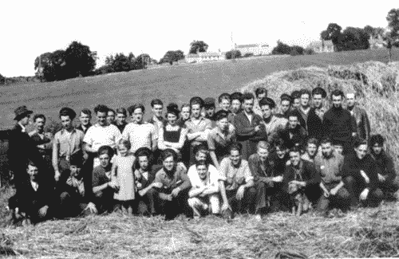

加拿大驱逐舰 `Restigouche` 号的船员在停靠于泰河下游的贾罗进行维修期间，在博弗朗特（`Beaufront`）和安尼克（`Anick`）地区协助收割，并与当地人交流。

两名在船只停靠贾罗维修期间于安尼克地区协助收割的加拿大海员，在当地的一家酒吧过度地庆祝了他们即将重返大海。来自多伦多的等兵水兵 `Samuel Patton` 和来自蒙特利尔的主任水兵 `詹姆斯·菲兹杰拉德`（`James Fitzgerald`）决定从他们在博弗朗特城堡意大利花园的底座上拆下两只青铜鹿作为纪念品。每只鹿价值 `£50`，且由于暴力拆除留下的损坏无法修复。在受到警方质问时，这两个人起初否认参与，但事后承认各偷走了一个。

警察督警 `威廉·古德费尔洛`（`William Goodfellow`）告诉赫克斯姆治安官，这两名男子以自愿身份在收割工作中表现异常出色，深受当地社区的喜爱和优待。因此，他们的这种行为给自己和船员全体带来了耻辱，这非常令人遗憾。

代表两名男子的律师 `K.H. Bolam` 表示，他们在饮用过量酒精后去了城堡，那那里的人们对他们非常友好，于是决定拿走那只鹿。

博姆先生说：“当这两个人清醒过来时，他们发现自己偷了鹿，感到非常尴尬。考虑到他们的体重，不知道他们是如何把那些鹿带回营地的，这引起了人们的推测。”

他表示他们对自己的行为深表遗憾，并渴望支付费用。由于他们的行为，他们在`杜鲁姆监狱`（`Durham Gaol`）度过了几个夜晚，这对他们产生了深远的影响。他还指出，虽然土地主 `哈罗德·库伯特上尉`（`Captain Harold Cuthbert`）正在海外服役，但他拥有委托书的母亲 `瑞雷夫人`（`Lady Rayleigh`）并没有要求严判，也没有寻求任何赔偿。

治安官们同意，监狱里的时光对盗窃行为已经是足够的处罚，并撤销了指控。他感谢这些人通过协助收割为英国做出的贡献。

这些男子来自加拿大驱逐舰 `HMCS Restigouche` 号，全船员都协助城堡以及附近的安尼克庄园（`Anick Grange`）进行了收割。

### 被“流氓”气球杀死

1943 年 11 月 4 日（周四），两个用于防止德国空军（`Luftwaffe`）低空攻击和精确轰炸的防御气球从它们海岸附近的锚点脱离，向内陆漂移至泰德尔（`Tynedale`）地区。其中一个流氓气球在斯帕蒂·利（`Sparty Lea`）附近的奥伦代尔山（`Allendale fells`）停了下来，其锚绳被挂在一个干石墙上。

警察迅速放气了第一个气球，然后出发放气停在山上更高处的第二个气球。许多观者聚集在一起观看，其中一位来自辛德霍普（`Sinderhope`）布罗盖特小屋（`Broadgate Cottage`）的委员会员工 `罗伯特·贝蒂`（`Robert Batey`，47 岁）决定近距离观察。看到贝蒂先生进入田野并在气球旁蹲下，似乎开始卷它。然而，气球随后爆炸，导致他致命伤。他稍后在赫克斯姆医院因伤去世。

在随后的验讯会上作证时，来自斯帕蒂·利低哈伊雷克（`Low Hayrake`）的玛乔丽·吉尔穆（`Marjorie Gilmour`）表示，当警察离开第一个气球时，他们警告人们远离它。包括一名老人和两个孩子在内的人群站在墙后看着气球，此时气球爆炸了。

来自斯帕蒂·利辛霍普米尔（`Swinhope Mill`）索德登房屋（`Thorndene House`）的 `约翰·莱特`（`John Wright`，79 岁）被送往纽卡斯尔皇家维多利亚医院，左眼割伤；同样来自辛霍普米尔的 `安妮·费瑟斯坦`（`Annie Featherstone`，28 岁）也受了多伤。来自艾伦黑德（`Allenheads`）教堂小屋（`Chapel Cottages`）的 7 女孩 `薇拉·尼克森`（`Vera Nixon`）被送往赫克斯姆医院，患轻微割伤；而来自斯帕蒂·利白岭（`White Ridge`）的 14 岁少年 `哈罗德·尼克森`（`Harold Nixon`）被送往肖特利桥医院（`Shotley Bridge Hospital`），胸部穿刺伤和多处碎片伤。

在 2006 年，当时 77 岁的尼克森先生表示，爆炸后他在医院呆了近两个月，身上仍然留下了疤痕。“我记得有两个防御气球被挂在山上，”他回忆道，“周围有几个人，警察也在那里。他们排出了其中一个的气体，但突然‘砰’的一声，等我再反应过来时，已经在 50 码外了！我在肖特利桥医院住了七周，直到今天我身上还带着碎片。”

爆炸后，气球尾部起火，火焰逐渐蔓延到头部，直到完全烧毁。空军部的一位专家在验讯会上告诉，他认为爆炸可能是由于气球内的一小袋气体和空气因摩擦引发的。某些版本的防御气球携带有小型爆炸药，可在被敌机缠绕时触发以毁灭，这也是爆炸的另一个可能原因。

### 战斗中的当地英雄

在南斯福克郡郡服役的普鲁德（`Prudhoe`）士兵威廉·亨利·查沃斯（`William Henry Charlesworth`）在西西里的战斗精神让他赢得了军事勋章。他是参加滑翔机袭击小组的一员，其目标是占领一座名为“大桥”（`Ponte Grande`）的桥，士兵们称其为“沃卢桥”（`Waterloo Bridge`）。

大桥被占领后，炸药被移除，电话线被切断，确保了这座重要桥梁没有被炸毁。在大桥被占领 15 分钟后，一队乘坐卡车的德国士兵试图强攻大桥北端，但查沃斯手持`布伦`机枪战斗，击毙了五人。当弹匣用光后，他英勇地用`布伦`枪当棍子冲向剩余的人员，此举确保了拆炸药的工作没有中断。

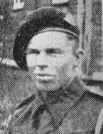

来自普鲁德的士兵威廉·亨利·查沃斯在西西里战获得了军事勋章，此前是因为他在腹部中弹的情况下仍拒绝向敌人投降。

在另一次行动中，他在猛火力下手持`布伦`机枪跑了 50 码，以便他的小队撤离战斗。第二天下午，查沃斯腹部受伤，在 24 小时内没有接受医疗治疗，其期间他一直在清洁和维护他的`布伦`机枪。当大桥被敌人重新占领时，他拒绝投降并躲了起来，后来重新加入了他的排。

空射手飞行军士乔治·米尔伯（`George Milburn`，25 岁）是奥伦德尔（`Allendale`）人，居住在分支端（`Branch End`）。他因在敌空上冷静表现被授予卓越飞行勋。在气球防空部队服役两年半后转为机组人员，他参加了 40 多次任务飞行。表彰指出，在一次进攻汉诺威的任务中，他的飞机被搜照灯光束困住了 8 分钟，当时正遭受德国战斗机的攻击。尽管被搜照灯晃得眼睛疼，米尔伯冷静的指挥和精准的射击使他的飞行员采取了必要的规避动作。

来自科布里奇（`Corbridge`）的担架兵士兵内斯特·赫尔斯（`Ernest Hulse`）也因在意大利的一场战斗中在猛烈的炮火和迫弹袭击下营救伤员表现出卓越英勇而被授予了军勋。

## 1944

1944 年的开端异常惨淡，两起重大悲剧接踵而至，给整个地区带来了巨大的痛苦。1 月 22 日的《快报》（`Courant`）不仅报道了泰恩代尔号军舰（`HMS Tynedale`）的沉没，还报道了广受欢迎的赫克斯姆伊丽莎白女王文法学校教师、泰恩代尔橄榄球之星 K.W.D. 霍森森（`K.W.D. Hodgson`）在参加国民卫队（`Home Guard`）演习时不幸身亡。

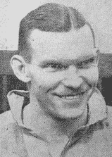

泰恩代尔橄榄球俱乐部明星、赫克斯姆伊丽莎白女王文法学校历史老师 K.W.D. 霍森森少校，在参加国民卫队训练演习时遭遇爆炸后不幸去世。

霍森森少校是赫克斯姆国民卫队总部连的指挥官。1944 年 1 月 16 日，他负责主持一次国民卫队武器的演习和演示。训练在连队的武器训练学校进行，在那里，进行了多次使用“布莱克尔炸弹”（`Blacker Bombards`，又称插塞式火箭弹，一种反坦克装置）、炸弹和其他爆炸装置的练习。当霍森森少校在军士长乔治·道格拉斯（`George Douglas`）的协助下布设地雷向士兵们演示其作用时，课程结束。

道格拉斯在和平时期是一名铁路信号员，他在随后的质询中告诉，他曾帮助少校安置地雷，地雷被埋在地下，并连有电线以便通过遥控爆炸。随后他们离开地雷约 20 码，躲在一个土堤后，该土堤比地雷所在的平面低约 15 英尺。这种地雷是在地面上爆炸，然后发射出一个弹体使其在空中爆炸。


道格拉斯说：“我们都躲了起来，然后我听到一声爆炸声，紧接着是第二声，我知道地雷爆炸了。我一直用双臂护住头部，在第二次爆炸后，我问霍森森少校他是否无事。我没有收到回答。”

道格拉斯走过去发现他脸朝下躺在土堤上，当把他翻转过来时，显然他伤得很重。他的额头鼻梁上方有一个穿刺伤，且处于半昏迷状态。

国民卫队的其他成员对他进行了急救，随后他被送往赫克斯姆医院，后又转到纽卡斯尔的另一家医院。霍森森少校坚持了十三天，但最终没于伤势。官方死因是颅骨复合骨折导致的脓毒性脑膜炎。

道格拉斯告诉纽卡斯尔市法医阿尔弗雷德·阿贝尔爵士（Sir Alfred Appleby），地雷并没有按照常理爆炸。地雷本应产生伞状爆炸效果，但碎片只从两个方向落下来，而不是四周散开。

“左右差两三英寸，造成致命伤的碎片就会避开霍森森少校了，”他说。当被问及对发生事的看法时，道格拉斯说，霍森森少校可能将第二次爆炸误认为是第一次，而且抬头得太早了。

法庭判定为意外死亡，但这场悲剧结束了一个年仅 38 岁的非凡生命。

他的全名是金斯利·沃尔斯沃思·大卫·霍森森（Kingsley Wallsworth David Hodgson），但他一直只以缩写相识。他是泰恩代尔历史上最出色的运动员之一，在 1933-1936 年间，作为泰恩代尔橄榄球俱乐部一队队长带领连续四年获得声誉显赫的诺康伯郡高级杯，赢得了永恒的名声。他拥有罕见的荣誉，曾代表三个不同的郡打过橄榄球：在 1933 年代表诺康伯郡对阵切舍尔郡，还曾代表约克郡和德姆郡打球。

尽管他已正式退役并担任球队秘书，但在战争期间仍代表泰恩代尔参加比赛。他也是一名相当优秀的板球手，曾为泰恩代尔俱乐部打过多次精彩的得分。他在伊丽莎白女王文法学校（QEGS）担任了十三年的历史游戏老师，他在赫克斯姆修道院的追思礼是当年参加人数最多的仪式之一。

同样在 1 月，《快报》的另一名编辑人员飞行军士哈里·安南（Harry Annan）在飞行任务中殉职。他当时正驾驶一架哈利法克斯轰炸机（Halifax bomber）进行训练演习，飞机在飞行仅两分钟后坠毁，倒朝掉落在斯凯尔顿下方费菲尔尔德疗养院附近的乌斯河中，距离约克中心四英里。他是该报社在空军服役的十名成员之一（总共有 19 人在军队服役）。

不过，《快报》的一名员工确实在博蒙特街的技能派上了用场，记者西德尼·福克斯克夫特（Sidney Foxcroft）当时在皇家信号兵团担任下士，被任命为第八军团新闻以及军方报纸《十字军报》（*The Crusader*）的前线区域记者。

在写给位于温莎瑟露台（Windsor Terrace）父母的信中，这位来自赫克斯姆的福克斯克夫特下士说：“这最后几天可能是我入伍以来最有趣的时光。我广泛地穿了各地，并收集素材。在编辑人员中，我是唯一在前线的成员，渴望证明自己的价值。我今天待在最前线的医院和护士们在一起，与不同国籍的人聊天。”

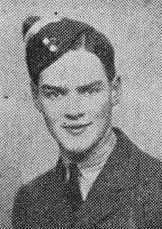

哈里·安南是《快报》的另一名成员，他在飞行任务中因事故丧生。

在战前，西德尼·福克斯克夫特曾参与童军运动。他本人是一名国王级童军，并曾担任第 3 赫克斯姆狼童队的童军长。战后，他回归了职业新闻界，多年担任《人民报》的东北部通讯员。

不过 1 月也传来了一个好消息，来自兰格尔的士兵威斯利·詹珀·霍森森（33 岁）从意大利俘营逃脱并徒步 200 英里回到家中。他在赫克斯姆斯特拉克家族的利斯庄园（Leases Estate）担任场工人，二战爆发时加入了皇家诺康伯郡掷弹团，曾在法国服役并从丹麦尔基撤离，随后回到中东战场，在骑士桥战役中被俘。

卡鲁瑟斯告诉《库兰报》：“我设法拿到了两个红十字战俘包裹，这让我得以维持了相当长一段时间，但之后我不得不尽所能地搜寻食物。有时日子过得并不太艰难，因为山坡上长满了葡萄和桃子。

‘我们遇到的意大利人大多非常友好，他们冒着极大的个人安全危险为我们提供食物和住所。他们当时并不知道我是英国人还是德国人。当他们发现我是英国人时，他们提醒我注意附近的法西斯分子，并告诉我如何避开他们。我多次险些没有再次被捕。在我获得自由的七周里，有四周时间一直处于德军后方’”

他成功找到了前往瑞士的路并与盟军汇合。

并不是所有从意大利战俘营的逃亡都能如此成功。来自赫克斯姆的皇家诺森森伯兰掷骑兵团连上军士长大卫·福斯特（David Forster，29 岁）在 1912 年 6 月于骑士桥被捕后，在试图逃跑时被击杀。与他的父亲大卫·福斯特军士（一位一战勋章获得者）一样，他是泰恩代尔橄榄球俱乐部的著名成员。他因在中非战役中英勇且卓越的行为被追记表彰。

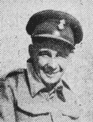

在试图从意大利战俘营逃跑时被击杀的来自赫克斯姆的连上军士长大卫·福斯特，因在中非战役期间表现英勇且卓越被追记表彰。

农业军团的女孩们被指责导致斯坦纳斯伯恩皇冠客馆的执照者陷入麻烦。衡器官员对北泰恩酒吧进行访问时发现，女店主玛丽·维尔·内维辛（Mary Wear Nevin）出售的金酒被严重稀释了，浓度比标准值低了约六%。

法官们被告知，在金酒中加入水是因为内维辛夫人觉得，原汁的金酒对于经常光顾这家店的农业军团女孩们来说太烈了。检查官告诉法庭：“内维辛夫人可能觉得通过确保女孩子们们不喝过烈酒是在照顾她们，但她稀释金酒的行为完全站不住脚。”内维辛夫人被罚款 4 英镑，并加 15 先令诉讼费。

## 六章

## 帝国反击

许多泰恩代尔的人士参加了 6 月 6 日的 D 日登陆，因为第 50（诺森森伯兰）师是诺尔曼迪海滩登陆队的先遣部队。随着进攻的加速，伯纳德·蒙特马利将军（Bernard Montgomery）特别点名表扬了他们。

从记者转行军人的唐纳德·莱斯利上尉（Donald Leslie）告诉《库兰报》，诺森森伯兰人在赢得上一场战争中发挥了巨大作用，在接下来的几个月里他们将再次如此。在描述 D 日登陆舰队——这支有史以来集结规模最大的入侵船船队时，他说：

‘这是一场壮丽的奇观，大大小各的船只一眼望不到头——从万万吨的大舰到小小的动力登陆艇——而且我们上方有强大的空中保护伞罩。我们曾被警告可能会受到纳粹鱼快艇和 U 潜艇的攻击，但那个夜晚几乎没有发生意外——这是对我们从皇家海军和皇家空军所获得支持的持久致敬。黎明前，天空闪烁着光，我们知道轰炸机正在寻找目标’”

随着靠近法国海岸，莱斯利上尉回忆起听到一个明显的诺森森伯兰口音喊道：“离他们不远了。没多久我们又要加入他们了。”（Wah not far away from them noo. It’ll not be lang afore wah’re amang them agyen.）

第 50 师在超过 5000 英尺的战线上进攻黄金海滩，那里布满了水线下的钢刺和致命武器。尽管他们遭受了岸上猛烈的火力，但在敦迪尔克撤离四年后，他们成功回到了法国土地。莱斯利上尉说：

‘我们是以极其艰难的方式完成的，因为这不是一次干岸登陆。我们进入海中，有些人没过腰部，有些人过了脖子，还有人完全没过了，但到下午 2 点，我们就有十二个营上岸了，到最后的光亮，桥头堡已经建立，我们向内陆推进了三到四英里’”

他向来自赫克斯姆四特拉布拉斯的克拉克（Clark）下士致敬，这位士兵虽然受了伤，但请求留在海滩上，以免阻碍同伴的前进。

### “致敬士兵”筹款活动

入侵与该地区几乎每个城镇和村庄开展的“致敬士兵”（Salute the Soldier）筹款活动恰好重合。激动人心的口号是：“通过巨大的个人牺牲捐款，回报我们士兵所成就的伟大事业。”

现场有游行和特别行动——金钱源源涌入。在赫克斯姆，这一周由下议院院长、当地地议员道格拉斯·克利夫顿·布朗（Douglas Clifton Brown）上校启动，他看到美国大兵穿着整齐的制服在市中心游行，感到非常高兴。布朗上校说：“我想对他们表示热烈欢迎，并对我们这些英勇的盟友今天与我们在一起感到非常自豪。你们可能读过他们在海峡彼岸的表现有多好，以及在意大利的表现有多出色。我们为为一位伟大的美国人艾森豪威尔将军（Eisenhower，这位世界伟大将军之一）效力感到自豪。”

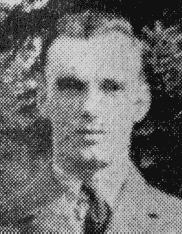

米克利的飞行军士西德尼·罗斯·安德森（Sidney Ross Anderson）因在对敌占领土的轰炸行动中被授予卓越飞行勋章。他是皇家空军大坝者小组的成员，还参与了在挪威峡湾沉没德国战舰“提尔比特茨号”。他在 1945 年 1 月因飞机在对贝尔根 U 潜艇巢的袭击中失而丧生。

赫克斯姆的爱国主义活动目标是 275,000 英镑，用于维持第 50 师的一个步兵营一年。该项目以游行启动，由赫克斯姆家庭军乐队领队，涉及皇家海军、家庭卫军、陆军辅助队（ATS）、女子空军（WAAFs）、民防队、国民妇女服务团（NFS）、红十字学员、童子军和女童军、救世军、男女旅团、农业军团和 NAAFI 等单位。仅第一天就承诺捐了超过 106,000 英镑，总额由来自赫克斯姆小学的七岁女孩芭芭拉·阿姆斯特朗（Barbara Armstrong）在一次五月花柱舞蹈和其他庆祝活动上宣布。

消防队举行了健身展示，家庭卫军的传令兵进行了表演。到周末，总额达到了 413,875 英镑，赫克斯姆远超目标。整个泰恩代尔也是如此，每个家庭和企业都倾尽全力支持这一事业。在贝灵汉姆，目标是筹集 45,000 英镑以购买三辆丘吉尔坦克，最终通过扑克牌筹款、舞会、足球赛、体操表演以及来自贝灵汉姆的“闪光音乐会”的表演筹集了 70,000 英镑。

全地区的目标为：阿康姆（Acomb）2,500 英镑，通过家庭卫军乐队音乐会、趣味足球赛和变装游行等努力实现；奥尔代尔（Allendale）6,000 英镑，通过皇家诺森森伯兰掷骑兵团乐队的音乐会；布兰奇兰（Blanchland）1,000 英镑；科布里奇（Corbridge）15,000 英镑，通过音乐会、舞会和花园游览会实现；福尔通斯（Fourstones）和纽布罗（Newbrough）5,000 英镑，通过五人制足球赛、音乐会、寻宝活动和保龄锦标赛实现；海登桥（Haydon Bridge）5,000 英镑，通过谷仓舞、灯笼讲座、运动会和扑克牌筹款实现；斯托克斯菲尔德（Stocksfield）20,000 英镑，通过沙堡比赛、扑克牌筹款、儿童运动、团体射击比赛以及普鲁霍格莱曼人（Prudhoe Gleemen）的音乐会实现；里丁米尔（Riding Mill）10,000 英镑，通过舞会、鼓击仪式、综艺演唱、电影放映、板球赛、儿童运动和乡村运动会实现；威拉姆（Wylam）15,000 英镑，其特别活动包括莫里诗舞蹈表演。

几乎所有人都超过了他们的目标，一种乐观的情绪开始渗透进地区的日常生活。尽管他们同意储蓄将继续进行，但“向士兵致敬”的现金才刚入账，一项新的募捐活动已启动，旨在于六个月内筹集资金，为丢失的`HMS Tynedale`号换回另一艘同名驱逐舰。然而，海军部拒绝了这一提议，指出无法根据当地的储蓄活动为海军舰船命名。船只只能按照预先安排的方案命名。

生活仍在继续，来自海伊登桥（Haydon Bridge）的 31 岁女性多萝丝·查尔顿（Dorothy Charlton）因拒绝担任速记打字员而被入狱两个月，因为这与她作为耶华见证人的信仰相冲突。赫克斯姆法庭主席`J.M. Heslop`表示，查尔顿的立场是对法律的“公然蔑视”。

来自奥伦代尔（Allendale）的 22 岁画家兼装饰师罗塞尔·亚历山大（Russell Alexander）因拒绝按照`National Service Office`（兵役局）的要求担任农工，被处以三个月苦役徒刑。他此前因拒绝接受体检已服一年刑，但亚历山大表示他是一个和平主义者，拒绝参与任何战争努力。

一名皇家陆军军种兵团列兵因驾驶军用货车危害公共安全被罚款`10s`，并因醉酒开车被额外罚款`£1`。36 岁的约翰·菲利普·梅特卡夫（`John Philip Metcalfe`）被目击在阿姆（Acomb）以超速驾驶休假用车，行驶在道路错误的一侧，侧轮掉进了沟里。他在沟中行了 60 码，撞撞上了一根电线杆，电线杆被折断成两段，冲上了土堤。车辆随后偏向道路另一侧，撞穿了一个花园的栅栏并停下，身上挂满了电线和断裂的栅栏碎片。

栅栏的主人出来向梅特卡夫抗议，梅特卡夫拒绝下车，但他将车倒回马路上，然后以疯狂的速度向赫克斯姆出发，身体左右摇晃。他的旅程结束于未能通过圣约翰李角（St John Lee corner）的弯道，撞穿栅栏进入一片田，在田里犁了 60 码后才最终停止。当他试图下车时，摔倒在地上，显然完全醉了。

在法庭代表梅特卡夫发言时，律师约翰·巴蒂（`John Baty`）表示他不习惯喝酒，这种状态是由于“过度款待”造成的。他所属部队的一名军官告诉法庭，按照他的薪水，梅特卡夫根本买不起他显然已经喝掉那么多酒。

诺森伯兰郡地方法院（Northumberland Quarter Sessions）审理了一个男子在伦敦轰炸中失去妻子和两个孩子的故事，他发现自己在卡顿（Catton），在那里一位友好的寡妇提供了免费的食宿。无固定住所的劳工亚瑟·华特顿（`Arthur Wharton`，54 岁）通过偷走一只金表、一个银质烟盒和其他总价值`£30`的物品来报答她的善意。他被判处四年徒役劳役刑。

贝灵汉姆归家基金（`Bellingham Welcome Home Fund`）的首位奖项获得者是 19 岁的詹姆斯·戴利（`James Daley`）下士，来自塞福高地人（`Seaforth Highlanders`），因在意大利战斗中英勇被授予军事勋章（`Military Medal`）。在激烈战斗期间，他通过消灭两个德国机枪阵地拯救了许多生命。他曾两次受伤并多次住院。在小镇市政厅举行的仪式上，该基金向他颁发了一张`£30`的支票，另一一张来自贝灵汉姆民兵队（`Home Guard`）公司的支票，他在入伍前一直是该组织的成员。颁奖结束后，在黑牛酒馆（`Black Bull Inn`）举行了一场派对，他与母亲和继父住在一起。

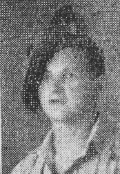

来自贝灵汉姆的 19 岁下士詹姆斯·戴利（`James Daley`）因在意大利英勇获得军事勋章，他在那里消灭了两个机枪阵地。他两次受伤并在医院治疗。

据称，一名来自沃尔（Wall）的士兵得益于新的血浆输血技术。尼·克雷格（`N. Craig`）士兵在意大利安齐奥（Anzio）所在的战壕遭到德国`88mm`炮弹直接命中，失去了双腿。当他被抬进伤员站时，正遭受灾难性的失血和休克，但在急救血浆后，他奇迹地康复了。十天内，他好到可以被担架出院去看足球比赛。

### 哈尔特斯斯尔的勒索活动

哈尔特斯斯尔（Haltwhistle）发现了一起大骗局，对驻在该地区的一支军队仓库进行抽查时，发现大量物资丢失。结果，16 名当地人出现在治安法官面前，被指控非法持有从军服、毯子到带床垫的铁床等物品，这些物品都是皇家战争部（`HM War Department`）的财产。

警察警司威廉·古德费尔（`William Goodfellow`）告诉镇上的法官：“在哈尔特斯斯尔，军产买卖中存在一种被称为正当勒索的行为，而且已经持续了相当长的时间。”

一支基地在哈尔特斯斯尔地区的军队搬迁时，这一勒索活动暴露无遗，在对基地仓库进行审计时发现了巨大的差异。很快证实，哈尔特斯斯尔的人从乐于的士兵那里购买他们需要的任何物品是一种常态。获得搜查令后，从各种家中追回的财产包括军毯子、袜子、衬衫、毛巾、毛衣、雨靴、卡其军装、大衣，甚至有一套床和床垫。法庭还展示了由军毯子制成的女装和儿童大衣。

16 人（8 男 8 女）出庭，其中 15 人承认收受物品，法庭主席 J.R. 布莱克特-奥德（J.R. Blackett-Ord）宣布罚款总额为`£62`，他表示法官对盗窃政府财产严肃。

在随后的一场法庭上，又有四名来自哈尔特斯斯尔地区的平民因持有靴子、袜子、衬衫、毯子和大衣被定罪。负责此案的侦探警斯科特（`Scott`）和警员哈利迪（`Halliday`）因在破解这起复杂的批发盗窃案中的辛勤工作受到法庭表扬。

在教堂钟声的预热下，赫克斯姆的第二届家庭假期周来临。13 岁的贝蒂·阿姆布勒（Betty Ambler）的父母在福雷街（Fore Street）经营阳光酒馆，她在教堂广场举行的仪式上被冕为假期皇后，随后是由诺森伯兰乐队联盟（`Northumberland Band League`）组织的乐队比赛。

圣威尔弗雷德学院（`St Wilfrid’s Institute`）举办的兔子展吸引了 134 项参赛，其他活动还包括第二届赫克斯姆女童子军的剑舞表演、第三届赫克斯姆长老信会童军军团（`3rd Hexham Presbyterian Scout Troop`）的体操表演，以及一场滑剧芭蕾。还有由赫克斯姆民兵举办的婴儿展和徒步比赛，路线横跨了迪尔斯顿（Dilston）、科布里奇（Corbridge）和博弗朗特（Beaufront），冠军是来自 188 岁的民兵乔治·埃利特（`George Elliott`）以 80 分钟的成绩获得，击败了其他 47 名竞争者。

在女王厅（`Queen’s Hall`）举行的假期舞会吸引了 500 多人随着乔斯·Q·阿特金森（`Jos Q. Atkinson`）及其乐队的跳舞。体育方面有六人制足球和七人制橄榄球赛，还有由驻当地的美军在教堂广场提供的新奇棒球表演，配有解说向困惑的当地人解释比赛到底发生了什么。

与此同时，真正的战斗仍在多个战线持续。来自费尔赛德、科尔布里奇的约翰·鲁德·马基基（John Rudd Mackie）中尉在蒂利-卡恩地区巡逻时，俘获了两名德国人。然而，随后由于一条绊线触发了德国人的陷阱，导致他受伤，而两名战俘试图逃跑。尽管受伤，马基基仍成功用他的`Sten`冲锋枪击中了他们两人，使他们被重新捕获。他曾获得过由蒙哥马利元帅签署的表彰卓越服务的证书，但在逃跑计划失败后仅几周便在战斗中阵亡。

R.C. 奥斯伯恩·赫德林准准少将（Brigadier R.C. Osborne Hedley）被授予卓越服务勋章，是因为他在缅甸钦岭领导印度陆军团对抗日军表现了典范般的领导力，特别是在萨考山战役中，那是远东战争的关键转折点之一。赫德林的戈尔卡士兵开辟了密不可入的丛林绕过日军侧翼，他们曾一度用步枪柄制作简易梯子爬上悬崖，开辟了通往英法尔的道路。

### 意大利战营逃亡者的回归

投降后，从意大利战营逃出的人在躲避纳粹并四处奔波数月后，开始返回泰恩代尔。其中包括皇家诺森兰伯郡掷枪兵团的基特·帕特森（Kit Patterson）上尉，他徒走了 250 英里回到盟军阵线，耗时九半个月。他是五人逃生小组中的一个，其他四人均被重新捕获。他因天气延误，在山中依靠智慧生存，并由意大利农民提供食物，他发现这些农民非常友好且乐于帮助。他回到赫克斯姆后注意到的第一件事是建筑周围所有的围栏都消失了。


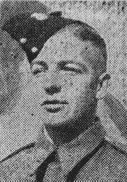

来自亨绍的约翰·奥斯瓦德·诺兰（John Oswald Nolan）军士，他在从战俘营逃脱后利用他的“流利意大利语”骗过了纳粹军队。

另一位逃亡者是来自亨绍的约翰·诺兰（John Nolan）军士，他也失踪了九个月，躲过了德国巡逻队的搜捕。有一次，他遇到了一队骑自行车的德国部队，但他只是挥了挥手，用装出来的意大利语对他们胡言乱语，他们就让他通过了。之后，他小心避开主路，在树丛和森林的掩护下走向自由。和帕特森上尉一样，他受到了当地人的照顾，他们与他分享了贫乏的食物。他曾为一个意大利家庭工作，当他说要回家时，那个家人崩溃落泪。由于他曾在特拉波利、布林迪西和马切拉塔的监狱营被关押，他说许多意大利战营的食物非常贫劣，如果没有红十字会的食品包，许多英国战俘将无法幸存。

诺兰军士于 1942 年在骑士桥被俘，但他此前已经参加过战斗，他曾从敦尔克撤离，并因在阿拉斯战战中的英勇表现——在猛火力下驾驶一辆满载士兵的卡车开往安全地带而获得战报表扬。当时的火势之猛烈，卡车轮胎被炸飞，他沿着轮毂行驶了许多英里。

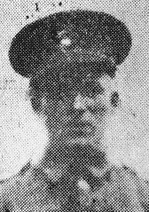

前阿康姆矿工出身的西德尼·库珀（Sidney Cooper）军士，他在法国卡格尼捡起一箱燃烧的炸弹并将其处理安全，拯救了许多生命。

## 前线的英雄事迹

前阿康姆矿工出身的西德尼·库珀军士（32 岁）展现了更多英雄事迹，他当时在卡昂的一个装甲师服役，面对过精锐的德国装甲部队和伞兵师。在卡格尼的一个艰苦的日子里，一枚德国 88 毫米高射弹落在距离他位置五码处，点燃了一堆二十枚迫击弹的火药。这些炸弹随时可能爆炸，但机智敏捷的库珀军士撕掉了燃烧炸弹的箱子，并铲了一堆土盖在上面以熄灭火苗。一名军官告诉军事观察员：“库珀军士的行为拯救了宝贵的设备和生命。这是我遇到的最冷静、最勇敢的任务之一。”

当盟军横跨法国挺进时，来自赫克斯姆葡萄酒店的罗伯特·麦克法拉恩（Robert MacFarlane）列兵向父母写信，讲述了法国人给予他们的欢迎。他说：“我们进入一个村庄的边缘，被居民围住了，他们撒下花并带来酒，因为我们是第一个进入村庄的英国士兵。一位老太太高兴得流泪，我跳下坦克给她一些巧克力，她亲了我并抱住我，就像我是她的亲儿子一样。”

麦克法拉恩列兵在写信后不久受伤，被转往南威尔士南部的一家军事医院。

## 空战与本土守卫队

在空中，喷气式风暴战斗机（Hawker Typhoon）发射火箭的工作是由来自宾菲尔德的 D·穆里（D. Murray）飞行尉描述的，他曾参与了阿姆斯特附近莱茵河南岸工厂的进攻，该工厂当时被德国人用作军营和据点。

他告诉《时代报》（Courant）：“这是一个大工厂，派了两个中队过去，每个小组负责拆毁工厂的一个区域。瞄准非常精准，每个小组发射的火箭都正中目标，等我们完成时，整个工厂已经彻底被毁了。当进攻开始时，那些鬼子逃光了，我们把他们击退。”

尽管入侵威胁逐渐消退，本土守卫队开始精简，来自普拉斯特斯（Plashetts）的牧羊人乔治·威廉·罗伯森（George William Robson）告诉贝林汉法庭，他曾独自管理一个 1000 英里的农场，照顾着 400 只母羊和 300 只羔羊。作为诺森兰伯郡第 10 团本土守卫队的士兵，他已经两年没有参加阅兵了。尽管如此，他仍被判定无故缺勤并罚款 6 英镑。

在案件发生后，诺森兰伯郡第 4 团本土守卫队的指挥官 J·罗布（J. Robb）中校将 1944 年后期本土守卫队的处境比作足球队的守门员。在科尔布奇举行的一场本土守卫队运动会上，他面对 500 名观众说：“当对方施压时，本土守卫队曾非常活跃，而现在他们处于获胜的一方，守门员很容易靠在门柱上，但他们必须意识到对方可能快速突破。本土守卫队就像守门员一样，在终场哨响之前必须保持警惕。”

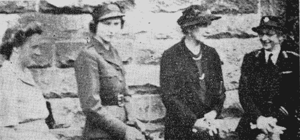

在科尔布奇的红十字会花园游华筹集了 200 英镑，图中（从左到右）是举办豪登巷活动的 R.D·拉斯（Mrs R.D. Glass）、主持活动的布拉克利女夫人（Viscountess Brackley）、主持会议的斯蒂福德的迪金森夫人（Mrs Dickinson）以及诺森兰伯郡红十字会主任 M.M·威廉森小姐（Miss M.M. Williamson）。

终场哨响出现在 11 月 19 日，在皇家诺森兰伯郡掷枪兵乐队演奏的激昂《布莱登赛马》（Blaydon Races）曲中，诺森兰伯郡第 4 团本土守卫队在赫克斯姆的普里斯特波尔（Priestipple）举行了告别阅兵。

总共有 1200 名来自该地区各连的士兵自豪地走过泰恩谷储蓄银行前的检阅台。接受检阅的是诺森兰伯郡副区本土守卫队指挥 A.E·霍金斯（Colonel A.E. Hawkins）上校，他告诉他们，在 1940 年那些黑暗的日子里，希特勒没有执行入侵计划的原因之一，是因为他知道除了正规军，他还要对付 200 万本土守卫队成员。

在缅甸，泰恩代尔的人也发挥了巨大的影响力，其中来自汉绍的`弗朗西斯·W·费斯廷少将`尤为突出，他在军队中大扫千军，并最终在 20 世纪 50 年代后期出`弗朗西斯·费斯廷爵元帅`——`帝国总参谋长`。

他那根巨大的灰木拐杖象征着这位军事界巨头的斗志精神。战争期间，他曾用它追逐一名日本狙击手；三十年后，他再次在北泰恩河谷挥舞拐杖，抗议修建凯尔德水库的计划。这根拐杖甚至在他 1942 年在马达加斯加荣获得的`卓越服务勋章`表彰词中被提到过。

他身高 6 英尺 4 英寸，留着红发，带着一种宛如凌乱床铺般的独特优雅，外表引人注目，但真正让他脱颖而出的是那种无法言喻的天生领袖的气质。与元帅`蒙哥马利`和`斯姆`一起，`费斯廷`构成了英国二战期间最优秀的三位将领三三角。尽管他并非知识分子，但他极其聪明；他因闻名——也许他那高效的参谋会用“臭名昭著”这个词——而只读文件和书籍中可以应付的最少内容。

他对细节不感兴趣，但他是一位卓越的战略家；他的声誉在第二次世界大战期间奠，当时他担任`第 14 军第 36 师`师长，他成功的战术对将日本人赶出缅甸起了很大作用。尽管他不喜欢政治、公务员或委员会会议，但在需要时，他可以是最微妙的外交官。他是一个复杂的人，充满了许多矛盾，但对于前线的士兵来说，他是最直率的人。他勇敢果决，被大众称为“前线弗兰基”，他只有在自己也愿意去的地方才会派遣他的士兵；他总是从前指挥。

由于习惯了身处世界冲突中心，且带有一丝游牧色彩，他在远离泰恩代尔任何地方安家了最后的家。他的纽带是他的妻子，来自`斯温伯恩城堡`及其庄园的`玛丽·西西莉·里德尔`。这对夫妇于 1937 年在里德尔家族的私人教堂结婚，当时他 35 岁。七年后，为了在环球旅行的生活中为日益成长的孩子们建立一个立足点，夫妇在离她家族所在地不远的`塔塞`买了一栋大乡村别墅。在过去的多年里，他们反复回到那里，直到`弗朗西斯爵士`退休后，他们在那里永久定居。

## 早年生活与教育

虽然`弗朗西斯爵士`本人来自牛津郡的一个家庭，但他实际上于 1902 年 8 月出生于都尔林。他是`弗朗西斯·莱西斯特·费斯廷准将`与其妻子`夏洛特`的独子；当时他的父亲正在爱尔兰服役。尽管出身于世军将世家，但`弗朗西斯爵士`像他的父亲一样，避开了传统的军事学校。他们转而就读于温彻学院。

出生于坚定的新教背景，他在 16 岁时早熟地皈依了天主教，这在很大程度上受他姨妈的影响。古怪的`埃莉诺阿姨`（被人们亲切地称为`内洛`）成年后的大部分时间住在西班牙的巴斯克地区。她会像幻影一样出现在`圣吕昂`的街道上，骑着由微型发动机驱动的自行车飞驰而过，穿着法国农村妇女飘逸的黑色长袍。

他一生虔诚，`弗朗西斯爵士`的信仰不仅归功于`内洛姨妈`，也归功于他的双语能力。小时候，他大部分假期和她一起过，因此她请了一位法语老师，这使他在`欧洲盟军最高司令`期间拥有了巨大的优势。

## 军事生涯与第二次世界大战

他最快乐、最无忧无虑的岁月是在`步兵旅`度过的，他在 1921 年从`桑德赫斯特军事学院`毕业后作为一名年轻军官加入。他有很多机会迷于剑击、狩猎、点赛和航海等爱好。作为一名优秀的帆船运动员，他参加了 1932 年的跨大西洋`百慕达大赛`。

在军衔中经历了多年令人沮丧的缓慢进展后，`弗朗西斯爵士`在第二次世界大战爆发时终于展现了自己的价值，当时他接管了`东兰卡夏团第 2 营`的指挥。他天生的风度和富有感染力的微笑使他在带领他们经历了法国、挪威以及马达加斯加的冲击和战斗后，赢得了士兵们的信任和尊重。在缅甸，当负责进攻的部队指挥官牺牲后，他在当地接管指挥——他被描述为“对危险漠不在”。

这是一个气质和能力都完美适合军事行动的人，战争结束后，白厅的官僚们在考虑该如何安置他们的“拳击手”。他随后被调往`陆军部`担任武器开发主管，这并不是答案。他是一个亲民的人，而不是冷硬件，因此在 1949 年被派往`香港`担任海陆空全军统一指挥的将军。然而，这项任命在同年晚些急剧结束了，他在 47 岁时因脑血栓险些丧。一位惊恐的目击者回忆道看到狮子被驯服了，士兵们将他放在担架上送上`道科塔飞机`，医生和护士在他身边守候。当时怀着第四个孩子的`玛丽`写道，在过去的十年里他只请了十天假。她告诉白厅，他需要一次长好的休息。

## 晚年与遗产

`乔治六世国王`是众多许多向`弗朗西斯爵士`送上祝福的人之一，爵士在经历了几个月放松的时光后完全康复了。重返岗位后，他短暂担任了`英国常任委员会委员会`主席，他利用这一平台游说取消了`国民兵役制`。他说，一支适用于 1950 年代的精锐战斗力量的唯一基础是自愿入伍。

随后的几年调动带他回到了欧洲大陆、埃及和远东，到世纪末，他担任了`帝国总参谋长`一职并授予了`元帅`军衔。1961 年，这匹“战马”退休了并在泰恩代尔偏远的角落安度了和平的生活。

他带走了他著名的价值日本刀收藏，这些是在他远东任职期间收集的。传说他一直希望自己能被入室，这样他就能尝试使用它们了。由于其中许多都是致命武器，他的家人很庆幸他从未获得过机会。`弗朗西斯爵士`于 1976 年 8 月 3 日在家中去世。那时，他拥有的众多头衔包括`大英帝国勋章指挥官`、`大英帝国勋章骑士司令`以及`巴斯勋章大十字勋骑士`。

## 在阿姆斯特丹战斗

尽管他们处于撤退状态，但德国人远未结束，他们在对荷兰阿姆斯特丹进攻的有力抵抗中证明了这一点。原本应该是一次相对容易的行动被证明并非如此，因为`第 9SS 师`和`第 10SS 坦克装甲师`的士兵给入侵的英国伞兵和滑翔机师造成了沉重打击，导致他们在经历了九天的激烈战斗后全线溃退。

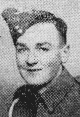

在阿姆斯特丹战斗的人之一是汉绍的炮兵`奥内尔`（20 岁），他曾在北非和意大利的`空降师`服役。他告诉《酷讯报》：

```
“我们经历了一段相当糟糕的时光，非常幸运才逃出来。我们被迫击弹和炮火炸得无法交，最糟糕的是德国人在炮击森林，树木在我们周围倒塌断裂。那简直是地狱般的景象。”
```

来自克劳克克的士兵罗纳德·牛顿（Ronald Newton）是第一波登陆者，他表示所有参与的滑翔机飞行员都因其勇敢应该被授予维利亚十字勋章。他补充说，从德国进攻中撤退的士兵们必须给靴子包底，才能安全地回到莱河。

阿姆姆行动导致了来自威尔拉姆的`滑翔机飞行员团`威廉·N·巴里（`William N. Barrie`）上尉（26 岁）牺牲，他此前曾因在西西里英勇且卓越的服务而获得卓越飞行勋章。巴里上尉的妻子玛格丽特曾服役于陆军辅助队（`ATS`），几个月前还陪同他前往白金汉宫参加了他的授勋仪式。

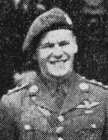

在白金汉宫的仪式上被别上卓越飞行勋章后不久，来自威尔拉姆的威廉·巴里（`William Barrie`）上尉在阿姆姆`滑翔机飞行员团`服役期间殉职。

战争爆发时，他正在接受会计师培训，后被任命为皇家诺森伯兰陆团（`Royal Northumberland Fusiliers`），随后转入陆军航空兵团（`Army Air Corps`）。在日常生活中，他深度参与童军运动，是赫克斯姆的首位皇家童军军员。他曾代表泰恩代尔（Tynedale）参加过橄榄球赛。

两名在赫克斯姆 Wanless Close 共同长大的士兵同随侦察团（`Recce Regiment`）参战，约翰·詹姆斯·斯凯尔顿（`John James Skelton`）24 岁军士和托马斯·威廉·哈德森（`Thomas William Hudson`）23 岁士兵，两人因在西北欧英勇表现被授予军事勋章，并在布鲁塞尔的一场特别仪式上，由伯纳德·蒙特马利（`Bernard Montgomery`）元帅将勋章丝带别在他们胸前。

这些奖励是在维姆莱伊（Vemraij）侦逻期间获得的，当时遭遇了猛火，导致一名士兵伤势严重不得不留在原地。在返回基地时，斯凯尔顿军士自愿营救该士兵，哈德森士兵也自愿一同前往。他们乘坐一辆装甲车，在距离伤员 50 码处时遭遇了来自步枪和机枪的致命火力，被迫他们停下。然而，这两个好伙伴在距离敌人不到 100 码的情况下下车，成功找到了受伤的战友并将其拖回了装甲车。

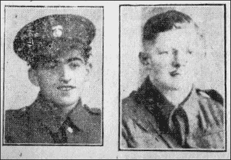

两名赫克斯姆的和平时期邻居在服役于皇家诺森伯兰陆团（`Royal Northumberland Fusiliers`）侦察团（`Recce Corps`）期间，均因在欧洲的英勇表现被授予军事勋章。托马斯·哈德森（`Thomas Hudson`）士兵和约翰·詹姆斯·斯凯尔顿（`John James Skelton`）军士在布鲁塞尔的仪式上，由伯纳德·蒙特马利（`Bernard Montgomery`）元帅将勋章别在制服上。

记载写道：“斯凯尔顿军士凭借其卓越的英勇行为完全不顾自身安全，防止了战友被俘，并很可能挽救了他的生命。哈德森士兵保持了完全冷静，他卓越的勇气典范对他所有同仁来说都是极大的鼓舞。”

圣诞前的一周，赫克斯姆西端客馆（West End Inn）的经理被罚款 20 英镑，加 5 镑 16 先的诉费。一名衡量官称这是一起“令人廉耻的严重掺假案件——是我从事这份工作 40 年来见过最糟糕的一起。”执照人约翰·威廉·伯恩（`John William Burns`）被发现出售稀释比例高达 34%的威士忌以及添加了 33.4%水的金酒。他声称这些稀释酒仅供他自己使用，以便在接受客户提供的饮料时不会醉，但法官驳回了他的说法。

## 1945 年

1945 年初开始阴郁，一名在伯明翰从事战争工作的赫克斯姆女性被发现遇害，喉咙里塞满了 75 英镑现金。她是阿格尼斯·杜杜利（`Agnes Dooley`），在她尸体旁边的是赫克斯姆医院的前门守卫 J·约翰逊（`J. Johnson`）。验尸团判定约翰逊杀杀了杜杜利小姐后自杀。

据已确认，由赫克斯姆地区赞助的失难泰恩德尔号（`HMS Tynedale`）的替换舰是位于米德伯斯堡建造的洛赫埃克号（`HMS Loch Eck`）护卫舰，该舰许多成员来自该地区。舰长 R·C·弗里克（`R.C. Freaker`）中校表示，他对继承泰恩德尔号在当地赢得的喜爱感到自豪，并希望自己的船在面对敌人时同样出色。她一深受当地学生的欢迎，赫克斯姆高级中学的五十多名学生给船员写信寻找笔友。

洛赫埃克号（`HMS Loch Eck`）是一艘成功的潜艇杀手，得益于从布莱切利公园的恩 igma 密码破解员获得的信息，她能够精准定位德国潜艇的位置。她驻扎在西北海口的斯卡帕流（Scapa Flow），仅在 1945 年 2 月就帮助击沉了三艘潜艇。她度过了战争，随后被转交给新西兰海军，更名为哈维亚号（`HMNZS Hawea`）。

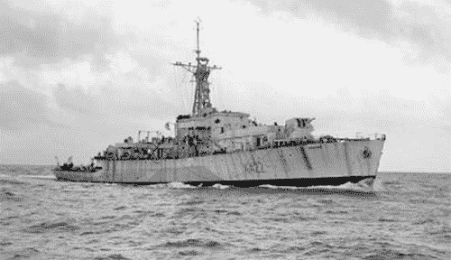

泰恩德尔号（`HMS Tynedale`）沉没后，赫克斯姆地区采用的驱逐舰洛克号（`HMS Lock Eck`）。

一名骗子在对沃克附近的奇普奇城堡（`Chipchase Castle`）居住者身上耍“阴险花招”后被判禁六个月。肯尼斯·麦克纳斯（`Kenneth McManus`）穿着加拿大陆中尉服出现在泰勒（`Taylor`）家族的领地。他说他是服役于爱尔兰卫队（`Irish Guards`）的罗伯特·泰勒（`Robert Taylor`）上尉的好友，并在安齐奥滩头曾与其并肩战斗。他声称泰勒上尉曾敦促他，如果来到北方一定要在城堡停下。作为一名官和绅士，他受到了热烈欢迎，并获得了城堡的一套房间。他去打猎和钓鱼，度过了四天的奢侈生活。

直到他离开后，泰勒夫妇才发现价值 200 多英镑的珠宝丢失了，还有枪房的一支步枪和手枪。

警方报警，几周后麦克纳斯在爱丁堡被捕。事实证明他是梅西赛德的布特尔人，从未去过加拿大、安齐奥或任何战区，实际上是一名逃亡逃兵。据推测他在逃亡期间结识了泰勒上尉，并找到了对方的住处。他在赫克斯姆的一家酒吧卖掉了一些被盗的珠宝，声称那是姨妈留给他的。

与此同时，随着盟军逼近德国，一名服役于阿盖尔和苏格兰高地（`Argyll and Sutherland Highlanders`）、来自西蒙伯恩的 21 岁士兵以英勇的表现平定了一次德国反击。爱德华·杰弗里（`Edward Jeffrey`）士兵曾是小组坦克支持下攻下一个农场堡垒的一部分，但坦克撤离后，德国人重新集结并试图夺回。杰弗里士兵让他们他们靠近，然后用他的布伦机枪击杀了六人，导致其余人员撤退。

## 德国战俘逃亡

监狱逃亡的不只有英国战俘，1945 年 4 月 1 日，19 岁的奥地利人约瑟夫·基尔希多夫（`Josef Kirchdorfer`）与其他名同胞从哈尔特威斯附近的费瑟斯通城堡（`Featherstone Castle`）战俘营逃脱。基尔希多夫在 1944 年在荷兰敌后执行间谍任务时被捕。得益于他口袋里有一封来自世界首位女性测试飞行员——著名的汉娜·瑞奇希（`Hanna Reitsch`）的信（她曾被希特勒授予铁十字勋章和空军钻石勋章），他被送往英国审讯。

在伦敦留了两周后，他被送到费瑟斯通，很快成为逃跑计划的核心。他们在深夜逃脱，打算偷飞机回国。如果小组中至少有两名飞行员，这个计划本可以可行，但这次冒险变成了灾难。

他们八人分为两组，约瑟夫（Josef）和他的两个伙伴沿着南泰恩河一直上走到尔斯顿（Alston）。然而，当地警官威尔逊（PC Wilson）拦住了这三个人并“发现他们是德国人”，并在休假的士兵约翰·福塞特（John Fawcett）的帮助下，将这些人带到了警察局。威严的威尔逊警官还在位于尔斯顿附近的哈尔登磨坊（Haldon’s Mill）逮捕了其他五名逃犯中的四名。那组选择过河是为了让用来追踪他们的猎狗失去气味，但小组中一名德国空军卡尔·克罗普（Karl Kropp）最后被看到试图涉过涨水的南泰恩河，水没过腰。


三天后，他的遗体在赫克斯姆（Hexham）的泰恩河被找到，他被埋在赫克斯姆墓地的战区区域，棺盖覆盖着卐字旗，由六名空军战友抬送。另外六名德国战俘在武装护送下走在棺材后面。当棺材降入墓穴时，所有德国人都行了军礼并脱下帽子。仪式结束时，每位战俘都走到墓旁行礼，并各向棺材上撒了三把泥土，然后再次行礼并回到队列。

克罗普的遗体在 1958 年被挖出，与在赫克斯姆去世的其他战俘一同被送回了德国。

# 第七章

## 管理和平

当胜利的盟军直逼柏林时，许多战俘被遣返回泰恩代尔（Tynedale），每个人都有关于他们所遭受的苦难的故事。其中包括赫克斯姆的乔治·克拉克（George Clark）下士，他在 1942 年服役于皇家诺森伯兰郡掷击团期间，在骑士桥（Knightsbridge）被俘。

他在意大利被关押了一年，随后被转往西西里西亚（Silesia）的一个营地，该地于 1945 年 4 月被美国人解放。他告诉《快报》（Courant），随着美国人的逼近，德国守卫撤退并升起了白旗，但这些美国陆兵为了追击撤退的德国军，绕过了小镇。有两天没有守卫值班，但很明显美军短期内不会回来了，守卫重新上了岗，白旗也被拉了下来。

当美国人终于回来时，联合国旗和星条旗在营地上空飘扬，战俘们用他们的床单做了“战俘”的字样。克拉克下士说：“欢呼声震耳欲聋。”

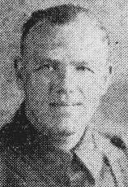

在当了三年战俘后，来自赫克斯姆的乔治·克拉克下士在美军解放营地后，经历了长达 530 英里的徒步，体重因此减轻了三又半石磅（约 22 公斤）。

然而，他的磨难并没有结束，因为在释放后，他面临着长达 39 天、530 英里的路程才能回家，在此期间他又减轻了三又半石磅。令人惊讶的是，他对他的俘者似乎并没有产生仇恨，他说这些俘者尊重死者，并为伤员尽尽所能。

他说，英国与他离开的国家相比似乎没有太大区别，尤其是当监狱营地周围流传国家处于饥饿边缘、人们除了黑面包外无物吃时。

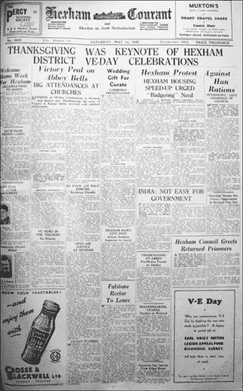

《赫克斯姆快报》在头版如何迎接欧洲胜利日的消息。

### 欧洲胜利

当欧洲胜利最终于 1945 年 5 月 8 日确认时，泰恩代尔收到的消息引起了克制的喜悦，而非疯狂的狂欢。除了装饰华丽的街道和商店橱窗，以及大多数人在外套上戴着爱国标志外，那里就像赫克斯姆一个普通的集市日。赫克斯姆县法院的法官脱掉了假发和法袍，在判决时改戴了一个红白蓝三丝花。

修道院广场上立了一个扬声器，用来听首相温斯顿·丘吉尔宣布停火，赫克斯姆修道院的钟响起了胜利之钟。那天晚上，超过 1000 人挤进教堂，参加由院长 A.G. 哈迪（Canon A.G. Hardie）牧师主持的感恩仪式，整个地区也举行了类似的活动。当地点了许多篝火，其中包括急诊医院内的一堆，那里仍有许多人在接受战伤治疗。在欧洲胜利日当天，酒吧、俱乐部和其他许可经营场所被允许开放到晚上 11:30，但实际上，由于啤酒和烈酒短缺，大多数地方在正常时间就关门了。

在奥伦代尔（Allendale），当地小学生搭建了一个巨大的篝火，并由一位前战俘汤米·谢尔德（Tommy Shield）下士点燃；而在海德登桥（Haydon Bridge），当地红十字会的青年分队在他们的胜利篝火上焚烧了希特勒的人偶。整个地区举行了露天舞会、运动会和其他庆祝活动，但没有哪一次能达到第一次世界大战结束时的那种狂欢规模。

奥伦代尔也发生了悲剧，26 岁的哈罗德·菲利普森（Harold Phillipson）在参加完胜利日派对后选择穿过荒丘步行回辛德霍普（Sinderhope），他不慎掉下桥的护栏，坠落 30 英尺死亡。

人们对给予德国战俘的慷慨食物配额表示担忧，因为当时英国人不得不依靠配给制度日。赫克斯姆区委员会（UDC）主席乔·库伦（Joe Cullen）议员表示，德国人吃得比英国人好，这简直是耻辱，并补充道：“在不违反日内瓦公约的情况下，我确定可以将德国战俘的配给降低到英国平民的水平。我们是一个奇特而卓越的民族，似乎对敌人非常慷慨。我们在配给上没有受到任何伤害，德国人也不会如此。这些人人回到德国时会精力充沛，不知道未来该怎么办。”

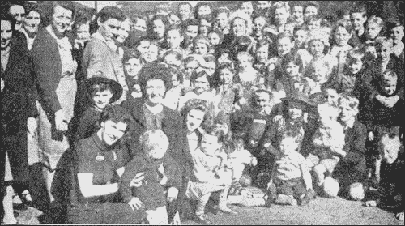

在佩斯角（Peth Head）举行了一场胜利茶会，每个家户都贡献了食物。在奇装比赛之后，举行了一场游行。

欧洲胜利后的周日，修道院举行了另一场感恩仪式，在此之前是民防部门和其他组织的游行，其中包括赫克斯姆区委员会的成员。游行的还有赫克斯姆区警察和特别警察、英国军人团、民兵军以及红十字会的男、女、青年队、军官训练团、空军训练团、童子军、女童军和妇女辅助兵。

欧洲胜利的兴奋情绪被部分抑制，因为泰恩代尔的男人们仍在远东与日本人战斗，仍有生命损失。不过，这也意味着某种回归常的迹象，因为将举行大选，当工党宣布将对赫克斯姆的议员道格拉斯·克利夫顿-布朗（Douglas Clifton-Brown）推出候选人时，引发了愤怒，他在 1943 年被选为议会议长。按照传统，政党不会反对议会议长的候选人，因为他是整个议会的代表，而非单一政党的代表。

尽管如此，工党选择了北方工人运动的先驱哈罗德·史密斯（Harold Smith）作为候选人，但史密斯后因“个人原因”退出了，接力棒给了来自利兹的导师欧内斯特·卡瓦纳（Ernest Kavanagh），他是利兹市会最年轻的成员。

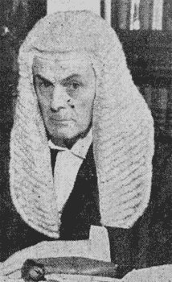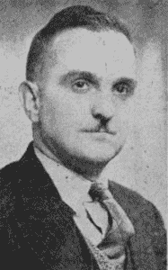

当工党宣布将在 1945 年大选中中反对赫克斯姆（Hexham）的议员道格拉斯·克夫顿-布朗上校（Colonel Douglas Clifton-Brown）时，传统被颠覆了。克夫顿-布朗上校曾任下议院议长，按照传统，议长是不经竞争当选的。工党候选人是来自利兹的欧内·卡瓦纳格（Ernest Cavanagh），但议长以 4,645 票的优势当选。

卡瓦纳格先生辩称他并不是反对议长，因为克夫顿-布朗上校在议会解散时已经卸下了该职位，他仅仅是保守党的候选人。克夫顿-布朗上校没有以任何党派身份参选，正如议长的身份一样，他以 4,645 票的优势当选。他获得了 16,431 票，而卡瓦纳格先生也获得了 11,786 票，成绩相当亮眼。

赫克斯姆小组医院供应站（Hexham Group Hospital Supply Depot）成立于战争初期，并于 1945 年 6 月底关闭。到那时，它已向军人、医院患者和需要的平民运送了超过一百万份慰问品和手术用品。卷好了超过 1000 英里的绷带，外科部门使用了 1000 英里的材料，还有 200 吨羊毛被织成了生活用品。战争期间，供应站平均有 300 人在工作，多年来有超过 4000 人参与过供应站的工作。通过捐款和自愿努力为供应站筹集了约 20,800 英镑，但该计划很大程度上是自给自足的，因为由 T.M.罗布森夫人（Mrs T.M. Robson）管理的食堂提供了超过 26,000 份餐。

供应站委员会主席诺曼·D·纽瓦尔夫人（Mrs Norman D. Newall）表示：“这完全不符合逻辑，但供应站关闭时笼罩着阴郁氛围，因为对于许多在战争期间快乐、自愿共同工作并建立了如此深厚友谊的工人来说，这将是一个巨大的心痛时刻。”

随着从德国战俘营回乡的人流逐渐汇成洪流，赫克斯姆警方陷入了尴尬，因为四名等待入室窃窃审判的囚犯从赫克斯姆警察局逃脱，他们拆掉了牢室的砖块和石头，从墙上的洞爬了出去。四人失踪十二小时后，在惠特菲尔德（Whitfield）被重新捕。

赫克斯姆治安法官得知，这四个人由于晚上很暖和，被允许使用警察局后方的操场。晚上 7 点他们接受了检查，发现所有人都在场，但晚上 9 点的进一步检查发现，牢房和操场均已空如。。他们用从牢房走廊百叶窗上撬下来的铁杠，以及从操场墙上扯下的排水管，撬破了操场墙上的石头和砖块。他们开了一个 2 英尺长、18 英寸高、18 英寸宽的洞。

在欧洲胜利日（VE Day）三个月后，当日本投降的消息传开时，人们在凌晨的赫克斯姆街头上跳舞。篝火被点燃，烟花非常抢手，不仅是孩子们，还有来自急诊医院穿着蓝色衣服的康复病人，他们乐于在最令人意想不到的地方放鞭炮。一名来自斯托克斯菲尔德（Stocksfield）的年轻男子，“贝文男孩”（Bavin Boy）艾兰·林恩（Alan Lynn，19 岁）在科布里奇（Corbridge）的王子电影院放映电影时燃放庆祝用的闪光，被带上法庭罚款 2 英镑。

阿伦代尔（Allendale）真是尽情了，除了通常篝火和烟花外，还增加了一场活动画巡游，主角包括丘吉尔、山姆叔、斯大林、蒋介石，最后是希特勒和日本领导人东条裕机，他们被绳在一起。尽管由于配给制食物短缺，整个地区还是举行了街派对和舞会。

### 大卫·贝尔（David Bell）

作为战争期间首批从舰上驾驶飞机的帅气年轻人之一，斯托克斯菲尔德的大卫·贝尔属于精英飞行员阶层。但即使在皇家海军航空队的顶尖王牌中，大卫也有自己的特殊成名理由。作为一名海军飞行员，他在远东战争最后阶段从一艘航空母上起飞。他的中队原定对日本进行轰炸空袭，但在几天前，原子弹的投掷结束了敌对行动。然而，他仍然必须执行任务，并且内心非常不安地意识到，投降的消息尚未传给所有日军成员。

在太平洋胜利日（VJ day）之后，大卫驾驶了十二架飞机中的一架飞往当时由日本人控制的香港启角机场（Kai Tak airport）执行侦察。油箱里几乎只剩下燃油，他降落在香港机场——当看到一辆日军座车在他飞机停下时朝他驶来时，他感到非常震惊。当他爬出驾驶舱时，几名高级日本军官正从车里出来。其中一人走上大卫，把他的礼剑交给了大卫——他把整个机场交给了大卫的悉心照顾！这把剑是大卫最引自豪的物品之一，在他位于斯托克斯菲尔德巴特路（Batt House Road）的家走廊里展示了整整四十时间。

大卫于 1924 出生于沃尔尔森（Wallsend），第二次世界大战开始时，他随沃尔尔森文法学校的其他学生疏散到阿尔尼克（Alnwick）。18 岁时，大卫加入空军预备役队，在加拿大安大略开始训练成为皇家海军航空队的飞行员，驾驶虎蛾式双翼机（Tiger Moth）和更现代的哈佛式（Harvard）飞机。在空中飞行 186 小时后，他获得了飞行执，回到英国继续训练，于 1944 年 7 月加入 814 海军航空中队。

同事称他“丁格”（Dinger），他驾驶飞马鱼式攻击机（Fairey Barracuda），主要在苏格兰练习低空飞行、夜间编队和俯冲。1945 年 3 月，他在克莱德河登了胜利号航空母舰（HMS Venerable），前往远东迎接他的命运。同年晚些时候，在太平洋和中国海域执行演习时，一次故障的着陆导致大卫在悉尼住院，随后在阿德莱德休养。

他在医院的经历导致他与中队分离，让他不得不“搭便”回家，其中包括他在新几内亚度过段时间，那里的日本人仍在战斗，不知道战争已经结束。

战后，大卫于 1958 年成为布鲁利县小学（Broomley County Primary School）校长，最后成为杜伦大学教师。他惊讶地发现，作为校长，被预计成为斯托克斯菲尔德教政会成员——部分原因是会议在他的书房举行。职责还包括确保火炉有足够的煤，并在会议中途准备茶。这是他三十年政治生涯的开始，他从教政会一直发展到在 1985-86 年担任泰恩代尔委员会（Tynedale Council）主席。

### 日本战俘营的恐怖

太平洋胜利日几周后，人们带着在日本人战俘营的恐怖经历回家。N.T·贝维克（N.T. Bewick）上尉在被关押三个半年后回到他位于科布里奇（Corbridge）的家中——他读到的第一个消息之一是官方伤亡名单上关于他自己的死亡通知。他在 1942 年新加坡沦落战斗中受伤被日本人俘。在遣返后，他说：

“新加坡的情况非常糟糕。食物极度匮乏，我们过去靠在灌木丛中觅食，通过粉碎草叶来提取维生素和水分以缓解狂烈的口渴。我们曾靠着通常被视为猪圈食的东西生存。日本人吃得很好，他们留下的猪圈残渣比我们吃的要好得多。军官们被强迫像马一样工作。他们被分成二十人小组去拉车，还必须挖掘树木并收集自己的木柴。”

在营地医院，英国医生和外科医生完成了卓越的工作，尽管他们被俘者剥夺了医疗物资，没有了绷带、血清和疫苗。

`Bewick 上尉`说，日本人永远无法理解为什么他们的残酷和非人道待遇未能击垮英国人的精神，因为俘虏们在一天结束时通常聚在一起大笑。营地从未没有无线通信，通过三台无线电台进行，而日本守卫从未发现过其中任何一台。

家乡还有来自`皇家诺森郡掷陆团`的赫克斯姆士兵`Ian Weir`，他也在新加坡被俘，并送往臭名昭彰的吉宜集中营工作，随后在吉凯尔港码头工作了六个月。他说道：


来自赫克斯姆的日本战俘士兵`Ian Weir`，他在由于没有烟草的情况下，把从家里的信当成烟纸来抽杂草。

“我们不得不依靠日本人的配给生存，那只是加了少许蔬菜水的米饭。我们有时在只吃一顿饭的情况下工作三十六小时。在某些营地，我们不被允许说话，只能坐在床上。我们经常在黑暗中起床去工作，直到天黑后仍在工作。丛林营地的条件极其糟糕，但每个人的精神都非常顽强。日本人永远无法理解这一点。他们想尽各种办法来破坏那种精神，从取消音乐会到阻止我们进行娱乐，但从未成功过让我们意志消灭。”

在被禁期间，士兵`Weir`收到了八十四封家信，但他没有留住任何一张；他用纸做成自制香烟，里面塞满了杂草。

另一位在家乡科布里奇的战俘是`皇家炮兵团`的`Alan H. McQueen 少将`，他在新加坡被俘后在泰国的一个战俘营被关押。他在被禁期间的大部分时间都在从事铁路建设。俘虏们生活在肮脏中，没有衣服可以更换被俘时穿的衣服，他们不得不用麻袋自制衣服。然而，食物不是问题，营地食堂以五分钱卖一杯热水，或以五分到五十分不等的价格卖一个鸭蛋。肉类充足，通常是鸭肉配大量米饭的形式，俘虏们还能在自己开辟的地块上种植生菜、西红柿和葱。

在后方，赫克斯姆的`急诊医院`出现了危机，因为服役过部队的人员正在复员，而他们在战争期间在医院担任护士的妻子们也递了辞职信，为丈夫们回家。共有二十 1 人辞职，其中包括十一名受过训练的护士，导致两个病房不得不关闭。

德国战俘被允许画科布里奇的历史桥梁，这引起了教区议会的不满，议会向`首席警长`提了正式投诉。该问题由`Edward Pigg`提出，他说村民对这些本应在农场工作却在画画的人所享有的自由感到愤怒。牧师`M.M. Barlow 博士`表示，也有人担心`战俘`在科布里奇到处走，向当地人要茶和咖啡。

教区议会的态度让来自哈灵灵顿的`Agnes Gilbey`大怒不已，她在给《酷报》的一封信中表示，她对科布里奇缺乏公平竞争的精神感到厌恶。她说：“教区议会应该团结起来消除战争造成的混乱，而不是对战俘在我们的英国通过绘画和享受我们美丽的村庄来获得和平发表廉不足道的抗议。我们引以为傲的英国正义何在？”

投诉的补充说明是，当年 12 月，教区议会收到了一幅由一名战俘创作的桥梁画，画框是由另一名战俘制作的，并由庞特兰德战俘营指挥官`R.F. Pitz 中校`进行了法国漆抛光，用于挂在议会厅里。`Pitz 中校`解释说，被允许画画的人是众知的反纳粹分子，而这幅画的创作者完全没有政治色彩。`Pitz 上校`继续说道：“对于战俘有两种观点，其中一种是消灭他们，但那不是英国的方式。我们更倾向于重新教育他们，这正是我们正在做的。”

在道路三英外的赫克斯姆，情况显然并不乐观，那里议会主席`Joe Cullen 议员`在发现从纽卡斯尔到卡莱莱的快车上所有头等座都分配给了作为战俘的德国军官后，仍然“愤愤不已”。`Cullen 议员`说，由于德国人的存在，乘坐火车的人员上车非常困难，并补充道：“特别令人恼的是为他们伸展优雅的意志肢体提供的空间，以及确保他们德意志身体获得高度舒适而所采取的措施。英国民众往往不得不像沙丁鱼一样挤在一起旅行。在这一列火车上，服务人员、商务人士和工作了一天后精疲力竭的工人，必须站在走廊里，或紧密地挤在一个车厢里，以便让这些德国军官享受待遇。”

### 第 18 营的独特角色

虽然战争已经结束，但和平仍需管理，`费瑟斯滕城堡`被选中履行战后初的关键角色。它始于 1944 年，作为准备诺曼迪登陆的美国军队的临时驻地。随着“主战行动”的开始，它又被用来关押几个意大利战俘。但随着盟军不断进军德国，人们决定给`费瑟斯滕`一个关键的战后角色——第 18 营由此诞生了。

它被用来安置被归类为最危险的德国战俘。涉嫌战争罪的高级纳粹分子将在纽伦堡受审。其他人根据他们对`元首`政权的支持程度，被分为黑、灰、白。决定第 18 营将安置“黑色”人员，他们只有在经过强化“去纳粹化”课程确保抛弃了法西斯倾向后才会被遣返。

来自敌人的威胁证明非常低，1947 年初，`费瑟斯滕`的铁丝网围被拆除。在`费瑟斯滕`度过时光的许多战俘白天在泰恩代尔地区的农场里忙碌。晚上，他们许多人都在学习，第 18 营具备了大学校园的所有特征，而不是一个监狱。

# 第 18 号营与费瑟斯顿公园

第 18 号营与南威尔士的第 186 号营一样，是英国最大的军官营营。其人数有时达到 4,000 多名官兵战俘和多达 600 名德国勤务。为了容纳这庞大的人口，需要四个营区（`A`到`D`）内的约 200 间小屋。除了住宿区外，营内还有一个剧院、图书馆、礼拜堂、医疗中心、面包店和一套原始的下水道系统。

营里有自己的报纸——《泰因时代报》（`Die Zeit am Tyne`），共有十七个版本，全部在`Hexham Courant`报社印刷并分发全英国。随着遣返战俘回家工作的启动，最后一份报纸于 1948 年 3 月付梓。


《泰因时代报》这本起源位于南泰恩河谷费瑟斯顿（Featherstone）战俘营的报纸，为泰恩代尔（Tynedale）带来了德国风味。

该营开设了大学课程，由邻近纽卡斯尔和杜伦大学的学者授课，甚至接待了几位牛津大学教授的特别访问。

对于德国勤务人员，这里设有职业课程，为他们回国后开启新职业做准备。该营还汇聚了他们那代最有天赋的德国音乐家和艺术家。这里有三个不同的管乐团，甚至还有一个木偶剧院，都为英格兰北部的观众表演。该营的文化声望之高，著名小提琴家犹迪·梅纽因（`Yehudi Menuhin`）曾曾在 1946 年至 1948 年间的某段时间访问费瑟斯顿。至于他为何在那些在美国和欧洲巡演以及与`柏林爱乐乐团`合作期间，抽空来到哈尔特威斯（Haltwhistle），仍然是一个谜。

# 恩格尔伯特·霍珀的经历


在《海峡岛占领回顾》（`Channel Islands Occupation Review`）一书中，来自阿琛附近埃施魏勒（`Eschweiler`）的恩格尔伯特·霍珀（`Engelbert Hoppe`）描述了在泽西岛被俘并被送往英国前往哈尔特威斯的漫长旅程是什么样的感受。经过顺利航行后，海峡岛的战俘在南安普顿登陆，并从港口步行到车站。途中，他们遇到了波兰难民，这些人对德国士兵大声辱骂，甚至向他们扔石头。“在经历了所有可怕的经历和苦难后，谁能责怪他们呢？”`恩格尔伯特`问道，“但我记得英国守卫是如何制止这种行为并保护他们的战俘的，这给我们留下了深刻的印象。”

`恩格尔伯特`没有忘记看到维拉斯夫军队（`Vlasov army`）的人员（他们背叛加入德国人对抗斯大林）时，被一名俄罗斯政治官辱骂时的感受。“看着他们脸上写满了恐惧、焦虑和惊恐，我现在看来，他们意识到了即将发生的事情——被从赫尔运往海拉迪沃斯克或其他西伯利亚的某个港口接受折磨和处决，或者被丢在古拉格中饿死。”

在连续三周除了守卫外没见过任何人后，`恩格尔伯特`和他的同伴被带往另一个火车站，送他们前往诺丁汉郡。他们到达哈尔特威斯，沿着南泰恩河走过一座桥，穿过`恩格尔伯特`描述的世外桃源般的偏远景色，那里有起伏的丘陵，牧着牛和羊。

## 营内生活

由于有高大的铁丝网围栏和地面上厚实的卷网，这个巨大的营有四个营区来安置战俘。在严厉的晨点人数后，`恩格尔伯特`和其他军官被带到不同的营区和尼森小屋（`Nissen huts`），每间小屋可居住多达 100 名战俘。第二天早上，他们看了关于德国和被占领东欧国家集中营的电影。这种情况持续了一周多。“这太残忍、太震惊了，几乎没有人相信，”他说。小屋里的课程标准等同于德国文法学校最后一年级。“我们被告知课程将持续一年，”他说，“我们开始时几乎没有任何书，只能在卫生纸上写笔记。”

其他想工作的军官被允许担任农场工、园丁和建筑工人。

1945 年秋季，`恩格尔伯特`记得新一批战俘被送到了第 18 号营。无缘无故，他们的物品被没收，并被来自安德斯军（`Anders Army`）的波兰守卫毒打。`Hexham Courant`报出现了愤怒的信，几天后，一个由英国军官和红十字代表组成的委员会出现了。案件被诉至法庭，施暴者受到惩罚，战俘的物品被归还。`恩格尔伯特`说：“这次事件以及处理过程的公正性，即使在我们极少数纳粹分子或军国主义者眼中留下了巨大的印象，他们带着极高的尊重谈论此事。”

## 领导与和解

圣诞节前，费瑟斯顿公园收到了一份名为维克斯中校（`Lieutenant Colonel Vickers`）的绝佳礼物。新营长曾在 1916 年在法国作为一名受伤的英国军官成为战俘，立即赢得了费瑟斯顿数千战俘的信任和尊重。他对士兵们说：“在第一次世界大战期间，我曾是战俘，并像绅士一样被对待。因此，我将同样地对待你们。”

次年，维克斯加入了赫尔伯特·苏尔茨巴赫（`Herbert Sulzbach`），这位来自德国的难民在英军中拥有上尉军衔，成为英德和解的中流砥柱。对纳粹复活的恐惧是毫无根据的。在赫尔伯特·苏尔茨巴赫（英军授予上尉军衔）的监督下，第 18 号营的“和解”实验取得了巨大的成功。苏尔茨巴赫后来成为 1949 年成立的德意志联邦共和国（`Federal Republic of West Germany`）发展的领军人物，讽刺的是，许多从第 18 号营“毕业”的学生也是如此。

他也是费瑟斯顿公园战俘中的一位领军人物，而他对将人员分为不同小组的筛选小组的强烈反感，令`恩格尔伯特`印象最深。“他不认为这符合《日内瓦公约》（`Geneva Convention`），”`恩格尔伯特`说，“这为谎言、歧视和不信任开启了大门。”

在`恩格尔伯特`的书中，他们被称为“人性的骑士”，苏尔茨巴赫和维克斯成功地建立了管乐团、图书馆、学习小组，甚至有一所大学。他们在 1946 年开放了营区，拆除了大卷铁丝网，推倒了高大的哨塔。取而代之的是一道作为“防止羊牛进入”的象征性围栏。

此后，营里的状况日益改善。两个剧院工作坊已经成立，从学生时代起对戏剧感兴趣的`恩格尔伯特`加入了泰因剧院（`Theater am Tyne` / `Theatre on Tyne`）的阵容并进行了多次演出。剧院有专业的制片人和一两个专业演员，但最大的转折出现在决定女主角时！“在这个过程中我们充满了乐趣，尽管我们非常清楚自己要传承老维多剧院（`Old Vic`）的传统，”`恩格尔伯特`说，“我们的表演非常成功，我们巡演了从纽卡斯尔到卡莱尔等地，去了许多营地，也为英国观众表演过。”

## 费瑟斯通与诺森伯兰郡的战俘传奇

在第二次世界大战结束短短一年后，在纪念星期日仅一周后，当镇上常年人数较少的信众向那些在击败希特勒中牺牲生命的亲人致敬时，见证了修道院长历史上最令人感动的时刻之一。来自费瑟斯通的战俘被带到了赫克斯姆，这是对他们帮助诺森伯兰郡南部 300 个农场收割的报答。

这是一场吸引了巨大关注的独特仪式。除了德国战俘，公众空间只能容纳 300 人。为了确保能有座位，有些人排队了几个小时。许多人因为门锁了而被拒之门外。幸运参加的当地人坐在希特勒一些最忠诚、最狂热的下属旁边。仪式上表演了修道院历史上听过的最美的音乐和歌声。由 70 人组成的战俘合唱团包括德国歌剧院战前的成员。柏林和莱比锡国立歌剧院乐团的前任首席成员在曾在萨尔布鲁肯歌剧院指挥的指挥下，组成了一支乐团。

来自杰斯蒙德圣乔治教堂的约翰·拉姆斯索姆（`John Ramsbotham`）牧师用德语演讲。他告诉战俘们，当他们回到德国时，将带着诺森伯兰郡人民对他们在农场工作的感激。“我知道已经建立了许多真正的友谊，希望这些友谊有助于建立两国之间的理解，”他说。

两年后，囚犯们被通知费瑟斯通公园将关闭。他们人数仍有 1800 人左右，相当多住在没有任何守卫的旅舍里。在英国的最后几个月里，恩格伯特（`Engelbert`）与他在兰姆利（`Lambley`）和哈尔顿门（`Halton Lea`）结交的朋友住在营地外。4 月底，他被要求准备遣返，日期定在 5 月 11 日。“我记得当时那种奇怪的感觉——既为再次见到家人感到高兴，又被离开这些我如此喜爱的人的忧郁情绪所淹没，”他说。

现在，`Camp 18` 曾经存在的唯一迹象是旧入口处墙上的一块纪念赫伯特·苏尔茨巴赫（`Herbert Sulzbach`）的纪念牌。

## 尤尔根·奥滕斯滕的成功

尤尔根·奥滕斯滕（`Jurgen Oestens`）在战争的黑暗日子里是一个非常成功的经营者，他因对抗盟军的战绩获得了梦寐以求的骑士十字勋章，其中包括击沉 18 艘盟军船只。他活了下来，在费瑟斯通的`Camp 18`度过之后，他成为了一名成功的工业家。他对泰恩河南部的强制留守有着美好的回忆，正如他在给斯托克斯菲尔德（`Stocksfield`）的安·麦克林（`Ian Maclean`）信中所透露的那样，后者在《库兰报》上读到关于`Camp 18`的文章后找到了这位老海狼。

奥滕斯滕先生写道：“德国士兵可以在营地外工作，尽管他们没有义务这样做。由于大多数战俘都有合格的民用职业，我们拥有几乎所有技术和其他领域的专家。如果该地区的发电站或矿井出现任何问题，人们就会找营地——我们甚至能提供寻水师！由于相关的英国专家仍忙于战争，营地可以提供很多帮助。”

他说，英国雇主必须支付与英国劳动力相同的工资，否则战争农业委员会和工会将会“闹得不可开交”。他说诺森伯兰郡的一些农场主对德国战俘在他们的农场工作感到非常高兴。

## 一段体育史

战俘们在费瑟斯通还创造了一段独特的体育史，其形式被认为是英国第一条 400 米田径跑道。城堡现的所有者约翰·克拉克（`John Clark`）当时是位于城堡的私立希尔布罗高学校（`Hillbrow School`）的学生（当时学校就设在城堡里），他记得那条跑道曾极受欢迎。

他说：“据我所知，直到 1965 年和 1966 年左右，英国所有的田径跑道都是以码为单位而不是米。但德国人在费瑟斯通期间设计并用碎渣铺设了一条 400 米的跑道，这在当时是非常不寻常的。我记得那时在大教室里，向窗外望去，看到他们都在田径跑道上或在进行长跑。”

跑道形成的背后的故事非常引人注目，英国指挥官维克斯中校（`Lieutenant Colonel Vickers`）准许德国人为了休闲活动建造了它。

克拉克先生说：“当德国人来到这里时，指挥官他说他在第一次世界大战中战俘，最大的问题就是无聊。他说‘我将尽全力确保你们不感到无聊，并有一切机会发展技能。’所以基本上他们发展了田径和足球，尽管他们不像英国士兵那样打板球。”

从那时起，田径在年轻战俘（他们年龄通常在 18 到 24 岁之间）中的人气急剧增长，并成为了一项常态活动。克拉克先生说：“我记得最深的是听到比赛开始的枪声，因为他们在战俘营内举办过相当大的活动。我不确定他们是否与其他运进来的战俘进行过比赛，但很有可能。”

## 著名人物与卫星营地

有一个因为在费瑟斯通的经历而大放异彩的人，名叫君特·贝尼施（`Günter Behnisch`）的年轻人，他在营地里学习了两年建筑。在该地区待一段时间后，他作为一名建筑师声名在外，设计了慕尼黑奥运体育场。

除了费瑟斯通，该地区还有其他卫星战俘营。来自德国、意大利和其他轴心国的士兵生活在宁静的社区中，从事耕作、体力劳动和基础设施建设。尽管在营地里受监管生活，囚犯通常被当地人接受。

一些营地，如比内斯（`Byness`）的营地，甚至向公众开放分享圣诞节等节日。旧营地所在地（现在是森林汽车公园）对面有一条通往奥特伯恩靶场（`Otterburn Ranges`）的路，那是德国战俘建造的。

路边有一块大石头，上面刻着`POW Camp 667 1945/46`字样，提醒着人们战俘在当地所起的作用。

在比内斯，村民伊·斯科特（`Ian Scott`）回忆了与战俘共处的生活，营地经常向居民开放。他说：“那是段有趣的时光，对孩子们来说尤其是，因为一直吸引他们。我记得营地周围围着铁丝网，你可以看到守卫扛着步枪巡逻。他们举办舞会，还有自己的乐队，在圣诞节期间会有派对。第一批战俘是意大利人，当他们听到德国人要来时惊慌失措。我们并不想要他们在这里，但等德国人到达时，大多数意大利人已经离开了。”

作为一名青少年，前辛德霍普农场的西里尔·福赛斯（`Cyril Forsyth`）结识了一位意大利战俘阿尔伯托·卡特纳（`Alberto Catena`）。阿尔伯托和其他十多名意大利战俘在他父亲亚历克（`Alec`）的海阿顿（`High Acton`）农场从事排水工作。阿尔伯托是唯一一个与这家人聊天并和他们一起喝酒的人。在离开之前，阿尔伯托送给了青少年西里尔一个手工制的烟盒，上面刻有他的名字和阿尔伯托的名字，日期为 1944 年 6 月 5 日、“卡顿（`Catton`）”、还有几枝冬青、一盏老式灯笼和一只猫。西里尔回忆道：“他从未提过自己是如何被俘的或任何事情。我觉得他做的事情非常棒。他一定有一把小锉刀和锤子。我想他可能把它送给我是因为我的家人对他表现出的善意，而且对他来说也是一种消遣之物。”

西里尔记得曾在村子里见过那些战俘，在 17 岁时，他甚至在卡顿的斯通石农场（`Stone Hall Farm`）工作过，那里是战俘营的所在地。尽管他不记得意大利战俘出过什么问题（他们并没有受到时刻看守），但他对那些被守卫得严密的德国人感到恐惧。他说：“我大约 17 岁时在卡顿耕地，一看到德国人的眼睛就没法直视地干活。他们被持枪的哨兵包围着工作，”他补充道，“意大利人不想参加战争。他们从不谈论家乡。处在一个陌生的国家生活一定非常困难。”

卡顿的意大利战俘也留下了印记，他们在艾伦班克斯（`Allen Banks`）林地的山毛榉树上刻了自己的战俘身份证，比恩斯（`Byrness`）667 战俘卫星营的囚犯也做了类似的事情。

在威尔姆（`Wylam`）发生了一件趣事，德国战俘在当地农场工作时，总部设在尼森小屋（`Nissen huts`）中。其中有一名木匠和一名石匠，他们决定为在小屋周围布置的那些整齐划一的园卉花园增添一些特别的装饰。在短短八天内，他们在花园里建造了一座微型城堡，拥有四座塔楼、电力照明，以及他们自己制作的精美挂毯和地毯。

这座高三英尺的作品是利用战友们从泰恩河（`Tyne`）河床抬起的石头制成的，屋顶是用从营厨房回收的罐头制成的。囚犯们还制作了家具、刺绣了挂毯，并为宏大的宴会厅织了地毯。电力从尼森小屋引入，一个精制的自制设备让前门能够电子化地开启。威尔姆城堡甚至还有自己的装饰性喷泉。

正门上方一个隐蔽的面板上写着“由德国战俘建造”，旨在作为他们在威尔姆停留期间的永恒提醒。这座城堡于 1947 年完工，在接下来的两年里吸引了数百名游客，但一些村民对这个战争年代的提醒物感到不悦，无论它建造得多么精巧。1949 年 5 月的一天，一辆卡车出现在现场，城堡从地基上被抬起并运走，再也没有出现过……尽管传言依然存在，说它仍然在该地区某人的后院里占据着显眼的位置！


威尔姆城堡，战后由德国战俘建造的三英尺高建筑。

## 参考文献

- `The Hexham Courant` 报纸文件 1939-46。

- `Land Girls of Northumberland 1940-1950`，Muriel Sobo。Northern Heritage, 2003 年 4 月 1 日。

- `Air Crash Northumberland`，Russell Gray, Neil Anderson, Jonathan Shipley 和 Jim Corbett。Countryside Books, 2008。

- `Strike Hard, Strike Sure`，Ralph Barker。Pen & Sword Military Classics, 2003。
