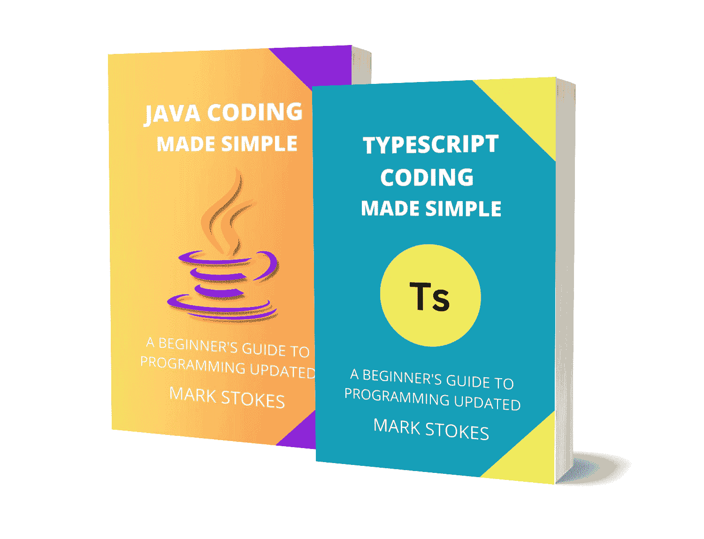

# TYPESCRIPT 与 JAVA

## 编程变得简单

### 编程入门指南

**马克·斯托克斯**

第 1 章：TypeScript 简介

第 2 章：TypeScript 基础

第 3 章：接口与类

第 4 章：TypeScript 高级概念

第 5 章：TypeScript 模块与命名空间

第 6 章：TypeScript 高级工具与技巧

第 7 章：使用 TypeScript 进行面向对象编程

第 8 章：TypeScript 中的泛型

第 9 章：TypeScript 中的装饰器与元数据

第 10 章：使用 TypeScript 进行异步编程

第 11 章：TypeScript 中的错误处理与异步编程

第 12 章：TypeScript 中的测试与调试

第 13 章：将 TypeScript 与 JavaScript 集成

第 14 章：构建与部署 TypeScript 应用程序

JAVA

第 1 章：Java 编程简介

第 2 章：变量与数据类型

第 3 章：控制流语句

第 4 章：方法

第 5 章：数组

第 6 章：面向对象编程（OOP）

第 7 章：异常处理与文件 I/O

第 9 章：多线程

第 10 章：使用 Java 进行数据库交互

第 11 章：使用 Java 进行 Web 开发

第 12 章：Java 数据库连接

第 13 章：用于快速开发的 Java 框架与库

第 14 章：Java 测试：框架与方法论

第 15 章：Java 调试技术与工具

# TYPESCRIPT 编程

## 变得简单

### 编程入门指南

**马克·斯托克斯**

## 书籍简介

欢迎阅读《TypeScript 编程示例详解》。本书旨在成为您学习和掌握 TypeScript 编程语言的全面指南。无论您是希望开始学习 TypeScript 的初学者，还是希望提升技能的经验丰富的开发者，本书都能为您提供所需的内容。

在本书中，我们将深入探讨 TypeScript，探索其特性、语法和最佳实践。我们将从基础知识开始，涵盖变量、数据类型、函数和类等主题。然后，我们将转向更高级的概念，如模块、命名空间和类型注解。

TypeScript 的一个关键优势在于其提供静态类型检查的能力，这使您能够在开发过程的早期捕获错误。我们将探讨类型注解和类型推断的强大功能，以及它们如何帮助提高代码的可靠性和可维护性。

随着章节的推进，我们将涵盖高级类型、面向对象编程、泛型、装饰器和元数据等主题。我们还将学习如何在 TypeScript 中处理异步编程，包括使用 `Promise` 和 `async/await`。

错误处理和调试是任何编程语言的关键方面，TypeScript 也不例外。我们将探讨处理错误和有效调试 TypeScript 代码的各种技术和工具。

测试是软件开发过程不可或缺的一部分，我们将讨论测试和调试 TypeScript 代码的策略。我们还将了解 TypeScript 如何与现有的 JavaScript 代码库无缝集成，从而实现向 TypeScript 的渐进式迁移。

最后，我们将学习构建和部署 TypeScript 应用程序，探索有助于开发和部署过程的工具和框架。

在整本书中，我们将提供大量的示例和代码片段来阐述所讨论的概念和技术。这些示例将帮助您快速掌握概念并将其应用于实际场景。

读完本书，您将打下坚实的 TypeScript 基础，并具备使用 TypeScript 构建健壮且可维护应用程序的知识和技能。

那么，让我们一起踏上这段 TypeScript 之旅，释放这门强大编程语言的全部潜力吧。

**书名：** 《精通 TypeScript：示例详解轻松编程》

**章节标题：**

1. TypeScript 简介

2. TypeScript 基础

3. TypeScript 变量与数据类型

4. 在 TypeScript 中使用函数与类

5. TypeScript 模块与命名空间

6. 类型注解与类型推断

7. TypeScript 中的高级类型

8. 使用 TypeScript 进行面向对象编程

9. TypeScript 中的泛型

10. TypeScript 中的装饰器与元数据

11. 使用 TypeScript 进行异步编程

12. TypeScript 中的错误处理与调试

13. 测试与调试 TypeScript 代码

14. 将 TypeScript 与 JavaScript 集成

15. 构建与部署 TypeScript 应用程序

# 第 1 章：TypeScript 简介

在本章中，我们将通过了解 TypeScript 的目的、优势及其与 JavaScript 的关系，开启我们的 TypeScript 世界之旅。

TypeScript 是 JavaScript 的静态类型超集，它编译成纯 JavaScript 代码。它由微软开发，旨在解决 JavaScript 的一些不足之处，尤其是在大型应用方面。

TypeScript 的一个关键特性是其对静态类型检查的支持。与 JavaScript 中变量可以持有任何类型的值不同，TypeScript 允许您显式地指定变量的类型。这使得 TypeScript 编译器能够在开发过程的早期捕获与类型相关的错误。

要开始使用 TypeScript，我们需要设置开发环境。我们需要在系统上安装`Node.js`和`npm`（Node 包管理器）。一旦满足这些前提条件，我们就可以使用`npm`全局安装 TypeScript：

```
npm install -g typescript
```

安装 TypeScript 后，我们可以创建第一个扩展名为".ts"的 TypeScript 文件。让我们创建一个名为"hello.ts"的文件，并在您选择的代码编辑器中打开它。

在我们的"hello.ts"文件中，让我们从编写一个简单的 TypeScript 代码片段开始：

```typescript
function sayHello(name: string) {
    console.log("Hello, " + name + "!");
}

sayHello("John");
```

在这个代码片段中，我们有一个名为`sayHello`的函数，它接受一个类型为`string`的参数`name`。在函数内部，我们使用`console.log`函数打印问候消息。

要将此 TypeScript 代码编译成 JavaScript，我们需要运行 TypeScript 编译器。打开您的终端或命令提示符，导航到"hello.ts"文件所在的目录，然后运行以下命令：

```
tsc hello.ts
```

TypeScript 编译器（`tsc`）将生成一个同名但扩展名为".js"的 JavaScript 文件。在这种情况下，它将创建一个名为"hello.js"的文件。

现在，让我们通过在终端中执行以下命令来运行我们的 JavaScript 代码：

```
node hello.js
```

你应该会看到输出："Hello, John!"。

恭喜！你已经成功编写并执行了你的第一段 TypeScript 代码。这个示例展示了 TypeScript 的基本语法和类型检查功能。

在本书中，我们将探索更高级的 TypeScript 概念，包括处理不同的数据类型、函数、类、模块等等。我们还将深入探讨实际示例和最佳实践，帮助你成为一名熟练的 TypeScript 开发者。

在下一章中，我们将深入探讨 TypeScript 的基础知识，并探索它提供的各种数据类型。我们将学习如何声明变量、赋值，以及使用 TypeScript 丰富的内置类型执行操作。

所以，请继续关注，准备好将你的 TypeScript 技能提升到新的水平！

# 第 2 章：TypeScript 基础

在本章中，我们将深入探讨 TypeScript 的基础知识，并探索其丰富的数据类型、变量声明和基本操作。

## 数据类型

TypeScript 提供了几种内置数据类型，允许我们显式定义变量的类型。这些数据类型包括：

- `number` 用于数值，例如 1、2.5 或-3。

- `string` 用于文本数据，用单引号（`''`）或双引号（`""`）括起来。

- `boolean` 用于表示逻辑值，即`true`或`false`。

- `array` 用于存储相同类型元素的集合。我们可以使用语法 `type[]` 或 `Array<type>` 来定义数组。

- `tuple` 用于表示具有固定数量元素的数组，其中每个元素可以有不同的类型。

- `enum` 用于定义一组命名的常量值。

- `any` 用于可以保存任何类型值的变量。这在处理动态数据或不想强制类型检查时很有用。

- `void` 用于表示值的缺失。通常用作不返回任何内容的函数的返回类型。

- `null` 和 `undefined` 分别用于表示 null 和 undefined 值。

- `object` 用于非原始类型，例如函数、数组和对象。

## 变量声明

在 TypeScript 中，我们可以使用 `let` 或 `const` 关键字声明变量。`let` 关键字用于可以重新赋值的变量，而 `const` 关键字用于值恒定、不能重新赋值的变量。

```typescript
let age: number = 25;
const name: string = "John";
let isStudent: boolean = true;

// 数组
let numbers: number[] = [1, 2, 3];
let fruits: Array<string> = ["apple", "banana", "orange"];

// 元组
let person: [string, number] = ["John", 25];

// 枚举
enum Color {
  Red,
  Green,
  Blue,
}
let favoriteColor: Color = Color.Blue;

// Any
let dynamicValue: any = 5;
dynamicValue = "hello";

// Void
function sayHello(): void {
  console.log("Hello!");
}

// Null 和 Undefined
let nullValue: null = null;
let undefinedValue: undefined = undefined;

// Object
let user: object = {
  name: "John",
  age: 25,
};
```

## 基本操作

TypeScript 支持各种运算符来执行基本操作，例如算术、赋值、比较和逻辑运算。这些运算符包括：

- 算术运算符：`+`、`-`、`*`、`/`、`%` 用于加法、减法、乘法、除法和取模。

- 赋值运算符：`=`、`+=`、`-=`、`*=`、`/=`、`%=` 用于赋值和执行复合赋值。

- 比较运算符：`==`、`!=`、`===`、`!==`、`>`、`<`、`>=`、`<=` 用于比较值。

- 逻辑运算符：`&&`、`||`、`!` 用于逻辑与、逻辑或和逻辑非运算。

### 比较运算符

TypeScript 提供比较运算符来比较值。这些运算符包括 `==`（相等）、`!=`（不相等）、`===`（严格相等）、`!==`（严格不相等）、`>`（大于）、`<`（小于）、`>=`（大于或等于）和 `<=`（小于或等于）。例如：

```typescript
let num1: number = 10;
let num2: number = 5;
let isGreaterThan: boolean = num1 > num2; // true
let isLessThan: boolean = num1 < num2; // false
let isEqual: boolean = num1 === num2; // false
```

### 逻辑运算符

TypeScript 支持逻辑运算符来组合和否定条件。逻辑与运算符（`&&`）在两个操作数都为 `true` 时返回 `true`。逻辑或运算符（`||`）在至少一个操作数为 `true` 时返回 `true`。逻辑非运算符（`!`）否定操作数的值。例如：

```typescript
let isTrue: boolean = true;
let isFalse: boolean = false;
let result1: boolean = isTrue && isFalse; // false
let result2: boolean = isTrue || isFalse; // true
let result3: boolean = !isTrue; // false
```

### 字符串连接

TypeScript 允许我们使用 `+` 运算符连接字符串。例如：

```typescript
let firstName: string = "John";
let lastName: string = "Doe";
let fullName: string = firstName + " " + lastName; // "John Doe"
```

### 类型断言

类型断言允许我们在知道变量实际类型时，覆盖其推断的类型。它使用尖括号语法（`<type>`）或 `as` 关键字来完成。例如：

```typescript
let someValue: any = "hello";
let strLength: number = (someValue as string).length; // 5
```

## 控制流语句

TypeScript 支持各种控制流语句来有条件地执行代码块。这些包括 `if...else`、`switch` 以及循环语句，如 `for`、`while` 和 `do...while`。这些控制流语句的工作方式与 JavaScript 中的类似。

```typescript
let temperature: number = 30;
if (temperature > 30) {
  console.log("It's a hot day!");
} else if (temperature > 20) {
  console.log("It's a pleasant day.");
} else {
  console.log("It's a cold day.");
}

let fruit: string = "apple";
switch (fruit) {
  case "apple":
    console.log("Selected fruit is apple.");
    break;
  case "banana":
    console.log("Selected fruit is banana.");
    break;
  default:
    console.log("Selected fruit is unknown.");
    break;
}

let numbers: number[] = [1, 2, 3, 4, 5];
for (let i: number = 0; i < numbers.length; i++) {
  console.log(numbers[i]);
}

let count: number = 0;
while (count < 5) {
  console.log("Count: " + count);
  count++;
}

let i: number = 0;
do {
  console.log("i: " + i);
  i++;
} while (i < 5);
```

## 函数

函数在 TypeScript 开发中扮演着至关重要的角色。它们允许我们定义可重用的代码块，这些代码块可以用不同的输入调用，并且可以有返回值。

在 TypeScript 中，我们可以使用 `function` 关键字后跟函数名和一组圆括号来定义函数。我们可以在圆括号内指定函数参数及其类型。我们还可以在参数列表后使用冒号后跟类型来指定函数的返回类型。

这是一个将两个数字相加并返回其和的函数示例：

```typescript
function addNumbers(num1: number, num2: number): number {
  return num1 + num2;
}
let result: number = addNumbers(5, 10); // 15
```

函数也可以有可选参数和默认值。可选参数通过在参数名后添加问号（`?`）来表示。默认值可以在定义函数时使用赋值运算符（`=`）来分配。

```typescript
function sayHello(name: string, age?: number): void {
  console.log(`Hello, ${name}! You are ${age || 'unknown'} years old.`);
}
sayHello("John"); // Hello, John! You are unknown years old.
sayHello("Jane", 25); // Hello, Jane! You are 25 years old.
```

函数还可以使用剩余参数，这允许我们向函数传递可变数量的参数。剩余参数通过在参数名前加上三个点（`...`）来表示，并在函数体内表示为一个数组。

```typescript
function sumNumbers(...numbers: number[]): number {
  let sum: number = 0;
```

```typescript
for (let num of numbers) {
  sum += num;
}
return sum;
}

let total: number = sumNumbers(1, 2, 3, 4, 5); // 15
```

在本章中，我们介绍了 TypeScript 数据类型、变量声明、基本操作、控制流语句和函数的基础知识。这些是构成 TypeScript 编程基础的核心概念。

## 第三章：接口与类

### 接口


## 第四章：TypeScript 高级概念

## 简介

在本章中，我们将深入探讨 TypeScript 的高级概念，这些概念将进一步增强你对这门语言的理解和熟练度。我们将探索联合类型、交叉类型、类型别名和泛型等主题。这些概念是强大的工具，能够为你的代码带来更高的灵活性和可复用性。

### 联合类型

TypeScript 中的联合类型允许一个变量具有多种类型。它使用类型之间的管道符号（`|`）来表示。这使得一个变量可以在不同时间持有不同类型的值。当我们需要处理可能具有不同数据类型的值时，联合类型非常有用。

```typescript
let pet: string | number;
pet = "dog"; // 有效
pet = 42; // 有效
pet = true; // 无效
```

### 交叉类型

TypeScript 中的交叉类型使我们能够将多个类型组合成一个类型。它使用类型之间的与符号（`&`）来表示。这允许一个对象或变量拥有所有被交叉类型的属性和方法。

```typescript
interface Order {
  id: number;
  amount: number;
}

interface Customer {
  name: string;
  age: number;
}

type OrderWithCustomer = Order & Customer;

let order: OrderWithCustomer = {
  id: 1,
  amount: 100,
  name: "John Doe",
  age: 30,
};
```

### 类型别名

TypeScript 中的类型别名提供了一种为类型创建自定义名称的方式。在处理复杂类型或希望使代码更具可读性和可维护性时，它们尤其有用。类型别名使用`type`关键字创建。

```typescript
type Point = {
  x: number;
  y: number;
};

type Shape = "circle" | "square" | "triangle";

let origin: Point = { x: 0, y: 0 };
let shape: Shape = "circle";
```

### 泛型

TypeScript 中的泛型允许我们创建可与多种类型一起使用的可复用组件。它们提供了一种定义类型占位符的方式，这些占位符在组件使用时确定。泛型使我们能够编写灵活且类型安全的代码。

```typescript
function reverse<T>(arr: T[]): T[] {
  return arr.reverse();
}

let numbers: number[] = [1, 2, 3, 4, 5];
let reversedNumbers: number[] = reverse(numbers);

let names: string[] = ["John", "Jane", "Joe"];
let reversedNames: string[] = reverse(names);
```

在本章中，我们探讨了 TypeScript 的高级概念，包括联合类型、交叉类型、类型别名和泛型。这些概念将使你能够编写更具表现力和可复用性的代码，从而增强 TypeScript 项目的灵活性和可维护性。

## 第五章：TypeScript 模块与命名空间

## 简介

在 TypeScript 中，模块和命名空间提供了组织和封装代码的机制，使得在大型应用程序中实现更好的模块化、可复用性和可维护性。在本章中，我们将探讨 TypeScript 中模块和命名空间的概念，以及它们如何帮助构建和管理你的代码库。

### 模块

TypeScript 中的模块提供了一种将代码封装到单独文件中并定义它们之间依赖关系的方式。模块是一个自包含的单元，可以导出功能，也可以从其他模块导入功能。

### 导出与导入

要从模块导出功能，你可以在声明（如变量、函数、类或接口）之前使用`export`关键字。

```typescript
// mathUtils.ts
export function add(a: number, b: number): number {
  return a + b;
}

// app.ts
import { add } from "./mathUtils";
console.log(add(2, 3)); // 输出：5
```

在上面的例子中，`add`函数使用`export`关键字从`mathUtils`模块导出。在`app.ts`文件中，`add`函数使用`import`语句导入，并可在该文件内使用。

### 默认导出

除了命名导出，模块还可以有一个默认导出。默认导出是模块的主要导出，通常用于导出单个值或功能。

```typescript
// mathUtils.ts
export default function add(a: number, b: number): number {
  return a + b;
}

// app.ts
import add from "./mathUtils";
console.log(add(2, 3)); // 输出：5
```

在上面的例子中，`add`函数作为`mathUtils`模块的默认导出。导入默认导出时，你可以为导入的值选择任意名称。

### 命名空间

命名空间，也称为内部模块，提供了一种将相关代码组织到命名作用域中的方式。命名空间可以包含变量、函数、类和接口。

```typescript
namespace Geometry {
  export function calculateCircumference(radius: number): number {
    return 2 * Math.PI * radius;
  }

  export function calculateArea(radius: number): number {
    return Math.PI * radius * radius;
  }
}

console.log(Geometry.calculateCircumference(5)); // 输出：31.41592653589793
console.log(Geometry.calculateArea(5)); // 输出：78.53981633974483
```

在上面的例子中，`Geometry`命名空间包含两个函数：`calculateCircumference`和`calculateArea`。这些函数使用`export`关键字导出，可以通过命名空间名称后跟函数名称来访问。

### 模块解析

模块解析是在 TypeScript 应用程序中定位和加载模块的过程。TypeScript 支持多种模块解析策略，例如 Node.js、Classic 或 Module Aggregation。

模块解析策略可以在`tsconfig.json`文件中使用`moduleResolution`编译器选项进行配置。

```json
{
  "compilerOptions": {
    "moduleResolution": "node"
  }
}
```

结论：

TypeScript 模块和命名空间为在大型应用程序中组织和构建代码提供了强大的机制。模块允许你将代码封装到单独的文件中，并定义它们之间的依赖关系，从而实现更好的代码重用和可维护性。命名空间提供了一种在命名范围内对相关代码进行逻辑分组的方式。理解 TypeScript 中的模块和命名空间对于构建模块化和可维护的应用程序至关重要。

## 第 6 章：高级 TypeScript 工具与技术

引言：

在本章中，我们将探索可以增强你的 TypeScript 开发体验的高级工具和技术。我们将涵盖诸如类型推断、类型守卫、模块解析、装饰器和代码生成等主题。

### 类型推断：

TypeScript 的类型推断系统在声明变量并赋值时会自动推断其类型。它会分析变量的上下文和用法来确定其类型。类型推断在许多情况下消除了对显式类型注解的需求，使代码更简洁、更易读。

```typescript
let name = "John"; // 类型推断赋予类型 string
let age = 25; // 类型推断赋予类型 number
let isStudent = true; // 类型推断赋予类型 boolean
```

### 类型守卫：

类型守卫允许我们在条件块内缩小值的类型范围。它们提供了一种对值的类型进行运行时检查的方式。类型守卫可以使用`typeof`、`instanceof`或自定义类型谓词来创建。

```typescript
function processValue(value: string | number): void {
    if (typeof value === "string") {
        console.log(value.toUpperCase());
    } else if (typeof value === "number") {
        console.log(value.toFixed(2));
    }
}
```

### 模块解析：

模块解析是 TypeScript 解析和定位模块依赖关系的过程。TypeScript 支持多种模块解析策略，例如 Node.js 风格的解析和 ES 模块。它允许我们以结构化和有组织的方式导入和使用外部模块中的代码。

```typescript
import { greet } from "./greetings"; // 相对路径导入
import { sum } from "math-lib"; // 包导入

greet("John"); // 调用模块中的函数
const result = sum(5, 10); // 使用包中的函数
```

### 装饰器：

装饰器是 TypeScript 中的一个强大功能，允许我们在设计时为类、方法或属性添加元数据并修改其行为。它们由`@`符号后跟一个装饰器函数表示。装饰器提供了一种以模块化和可重用的方式实现横切关注点（如日志记录、身份验证和验证）的方法。

```typescript
function log(target: any, propertyKey: string, descriptor: PropertyDescriptor): void {
    const originalMethod = descriptor.value;
    descriptor.value = function (...args: any[]): any {
        console.log(`Calling method ${propertyKey} with arguments: ${args}`);
        const result = originalMethod.apply(this, args);
        console.log(`Method ${propertyKey} returned: ${result}`);
        return result;
    };
}

class Calculator {
    @log
    add(a: number, b: number): number {
        return a + b;
    }
}

const calculator = new Calculator();
const sum = calculator.add(5, 10); // 输出：Calling method add with arguments: 5, 10
// 输出：Method add returned: 15
```

### 代码生成：

TypeScript 通过 Babel 和 TypeScript 编译器（`tsc`）等工具支持代码生成。这些工具允许我们将 TypeScript 代码转译为 JavaScript，从而实现与不同环境和浏览器的兼容性。代码生成在 TypeScript 项目的构建和部署过程中扮演着至关重要的角色。

在本章中，我们探索了 TypeScript 中的高级工具和技术，包括类型推断、类型守卫、模块解析、装饰器和代码生成。这些工具和技术有助于在 TypeScript 项目中编写更高效、模块化和可维护的代码。

## 第 7 章：TypeScript 面向对象编程

引言：

面向对象编程（OOP）是一种流行的编程范式，它允许开发者将代码组织成称为对象的可重用和模块化的组件。TypeScript 凭借其对类、接口和其他 OOP 特性的支持，为构建健壮和可扩展的应用程序提供了坚实的基础。在本章中，我们将探索 OOP 的关键概念以及它们在 TypeScript 中的实现方式。

### 类与对象：

OOP 的核心是类和对象的概念。类是定义对象结构和行为的蓝图或模板。对象是类的实例，代表程序中的特定实体或实例。类封装了与特定概念或实体相关的数据（属性）和行为（方法）。

```typescript
class Circle {
    radius: number;
    constructor(radius: number) {
        this.radius = radius;
    }
    getArea(): number {
        return Math.PI * this.radius ** 2;
    }
    getCircumference(): number {
        return 2 * Math.PI * this.radius;
    }
}

const myCircle = new Circle(5);
console.log(myCircle.getArea()); // 输出：78.53981633974483
console.log(myCircle.getCircumference()); // 输出：31.41592653589793
```

### 继承：

继承是 OOP 中的一种机制，允许类从其他类继承属性和方法。TypeScript 支持单继承，即一个类只能从一个父类继承。这促进了代码重用，并便于在类之间创建层次关系。

```typescript
class Shape {
    color: string;
    constructor(color: string) {
        this.color = color;
    }
    getColor(): string {
        return this.color;
    }
}

class Rectangle extends Shape {
    width: number;
    height: number;
    constructor(color: string, width: number, height: number) {
        super(color);
        this.width = width;
        this.height = height;
    }
    getArea(): number {
        return this.width * this.height;
    }
}

const myRectangle = new Rectangle("blue", 4, 6);
console.log(myRectangle.getColor()); // 输出："blue"
console.log(myRectangle.getArea()); // 输出：24
```

### 封装：

封装是将相关的属性和方法捆绑在一个类中并控制其可访问性的实践。在 TypeScript 中，我们可以使用访问修饰符（`public`、`private`和`protected`）来定义类成员的可见性。这使我们能够强制执行封装，并限制对敏感数据或实现细节的直接访问。

### 接口

TypeScript 中的接口允许我们定义对象的结构，并为实现类提供契约。它们定义了对象应具有的属性和方法。接口也可用于强制执行类型检查。

```typescript
interface Person {
  name: string;
  age: number;
  sayHello: () => void;
}

let person: Person = {
  name: "John",
  age: 25,
  sayHello: function () {
    console.log("Hello!");
  },
};
```

### 类

TypeScript 中的类提供了一种定义对象蓝图或模板的方式。它们将数据和行为封装到一个单元中。类可以拥有属性（变量）和方法（函数）。我们可以使用`new`关键字来创建类的实例。

```typescript
class Car {
  brand: string;
  color: string;

  constructor(brand: string, color: string) {
    this.brand = brand;
    this.color = color;
  }

  startEngine(): void {
    console.log(`${this.brand} car started!`);
  }
}

let myCar: Car = new Car("Toyota", "red");
myCar.startEngine(); // Toyota car started!
```

在本章中，我们介绍了 TypeScript 的其他概念，包括接口和类。这些概念扩展了 TypeScript 的功能，使开发者能够编写更具结构性和可维护性的代码。


```typescript
class BankAccount {
    private balance: number;
    constructor(initialBalance: number) {
        this.balance = initialBalance;
    }
    deposit(amount: number): void {
        this.balance += amount;
    }
    withdraw(amount: number): void {
        if (amount <= this.balance) {
            this.balance -= amount;
        }
    }
    getBalance(): number {
        return this.balance;
    }
}

const myAccount = new BankAccount(1000);
myAccount.deposit(500);
myAccount.withdraw(200);
console.log(myAccount.getBalance()); // 输出：1300
```

### 多态

多态允许将不同类的对象视为公共超类的实例。TypeScript 通过方法重写和接口支持多态。方法重写使派生类能够提供其自身对继承方法的实现，而接口定义了类必须遵守的契约。

```typescript
class Animal {
    makeSound(): void {
        console.log("Animal makes a sound");
    }
}

class Dog extends Animal {
    makeSound(): void {
        console.log("Dog barks");
    }
}

class Cat extends Animal {
    makeSound(): void {
        console.log("Cat meows");
    }
}

function makeAnimalSound(animal: Animal): void {
    animal.makeSound();
}

const dog = new Dog();
const cat = new Cat();
makeAnimalSound(dog); // 输出："Dog barks"
makeAnimalSound(cat); // 输出："Cat meows"
```

### 接口

TypeScript 中的接口为类定义了必须遵循的契约。它们指定了类必须遵守的结构和行为，从而实现代码互操作性，并在组件之间实现松耦合。接口可以定义属性、方法，甚至可以扩展其他接口。

```typescript
interface Printable {
    print(): void;
}

class Document implements Printable {
    content: string;

    constructor(content: string) {
        this.content = content;
    }

    print(): void {
        console.log(this.content);
    }
}

class Invoice implements Printable {
    amount: number;

    constructor(amount: number) {
        this.amount = amount;
    }

    print(): void {
        console.log(`Invoice amount: $${this.amount}`);
    }
}

const document = new Document("Sample document");
const invoice = new Invoice(1000);

document.print(); // Output: "Sample document"
invoice.print(); // Output: "Invoice amount: $1000"
```

使用 TypeScript 进行面向对象编程为构建模块化、可重用和可维护的应用程序奠定了坚实的基础。通过利用类、对象、继承、封装、多态和接口，你可以设计和开发既高效又灵活的软件系统。OOP 原则促进了代码组织、可重用性和可扩展性，使 TypeScript 成为构建复杂应用的强大语言。

# 第 8 章：TypeScript 中的泛型

## 简介

TypeScript 中的泛型为创建可重用且类型安全的代码组件提供了强大的工具。它们允许你定义可以与不同类型一起工作的函数、类和接口，提供了灵活性并增强了代码的可重用性。在本章中，我们将探讨泛型的概念以及它们在 TypeScript 中的使用方式。

## 泛型基础

泛型允许你创建可以与一系列类型一起工作的组件，而不是局限于特定类型。它们提供了一种参数化类型的方法，使你能够为组件实际使用时所用的实际类型定义占位符。

```typescript
function identity<T>(arg: T): T {
    return arg;
}

let result = identity<string>("Hello, TypeScript!"); // Type argument explicitly provided
console.log(result); // Output: "Hello, TypeScript!"

let anotherResult = identity(42); // Type argument inferred as number
console.log(anotherResult); // Output: 42
```

在上面的例子中，`identity` 函数使用泛型类型参数 `T` 声明。这允许函数接受任何类型的参数并返回相同类型的值。类型参数可以显式提供，如第一个用法所示，也可以从参数推断出来，如第二个用法所示。

## 使用泛型类型参数

泛型类型参数可以在函数、类和接口中以多种方式使用。它们可用于指定函数参数的类型、函数返回类型、类属性以及方法返回类型。

```typescript
function toArray<T>(arg: T): T[] {
    return [arg];
}

let stringArray = toArray("TypeScript"); // Type argument inferred as string
console.log(stringArray); // Output: ["TypeScript"]

let numberArray = toArray(42); // Type argument inferred as number
console.log(numberArray); // Output: [42]
```

在上面的例子中，`toArray` 函数接受一个类型为 `T` 的参数，并返回一个类型为 `T[]` 的数组。类型参数是根据传递给函数的实际参数推断出来的。

## 泛型类

泛型类允许你创建可以与不同类型一起工作的类。类型参数可用于定义类中的属性、方法参数和返回类型。

```typescript
class Box<T> {
    private value: T;

    constructor(value: T) {
        this.value = value;
    }

    getValue(): T {
        return this.value;
    }
}

let stringBox = new Box<string>("TypeScript");
console.log(stringBox.getValue()); // Output: "TypeScript"

let numberBox = new Box<number>(42);
console.log(numberBox.getValue()); // Output: 42
```

在上面的例子中，`Box` 类被定义为一个带有类型参数 `T` 的泛型类。`value` 属性和 `getValue` 方法使用 `T` 进行类型化。创建 `Box` 类的实例时，类型参数指定了使用的实际类型。

## 使用泛型约束

TypeScript 允许你对泛型类型参数应用约束，确保它们满足特定要求。当你想限制可以与泛型组件一起使用的类型时，这非常有用。

```typescript
interface Lengthable {
    length: number;
}

function getLength<T extends Lengthable>(arg: T): number {
    return arg.length;
}

let arrayLength = getLength([1, 2, 3, 4, 5]);
console.log(arrayLength); // Output: 5

let stringLength = getLength("TypeScript");
console.log(stringLength); // Output: 10
```

在上面的例子中，`getLength` 函数定义了一个泛型类型参数 `T`，它扩展了 `Lengthable` 接口。`Lengthable` 接口要求类型 `T` 具有类型为 `number` 的 `length` 属性。此约束确保在函数内部可以访问 `length` 属性。

## 泛型的实际用例

泛型在 TypeScript 中被广泛用于创建可重用且类型安全的代码组件。以下是泛型可能有益的一些实际用例：

1. **集合和数据结构：** 泛型可用于创建泛型集合和数据结构，如数组、链表、栈和队列，这些结构可以容纳不同类型的元素。

2. **函数转换：** 泛型可用于创建高阶函数，这些函数可以转换或操作其他函数。例如，一个泛型函数可以接受一个函数作为参数，并返回一个具有修改行为的新函数。

3. **类型安全的 API：** 泛型可用于设计类型安全的 API，其中函数、类和接口等组件可以与多种类型一起工作，同时保持类型安全。

4. **数据处理和转换：** 泛型可用于数据处理和转换，允许你创建可重用的函数或类，这些函数或类可以操作不同类型的数据。

## 泛型的优势

在 TypeScript 中使用泛型提供了几个好处：

1. **代码可重用性：** 泛型允许你创建可以与不同类型一起使用的组件，减少代码重复并促进代码重用。

2. **类型安全：** 泛型通过在整个组件使用过程中保留类型信息，使你能够保持类型安全。这有助于在开发过程中捕获潜在的类型相关错误。

3. **灵活性：** 泛型通过允许组件与多种类型一起工作来提供灵活性。这使你的代码更具适应性，并适用于各种用例。

4. **表达能力：** 泛型通过使你能够编写更通用和可重用的函数、类和接口来增强代码的表达能力。这导致代码更简洁、更易读。

## 结论

TypeScript 中的泛型为创建可重用且类型安全的代码组件提供了强大的机制。通过使用泛型类型参数，你可以构建可以与多种类型一起工作的函数、类和接口，从而增强代码的可重用性、类型安全性和灵活性。泛型在你希望创建可以处理不同类型数据而不牺牲类型正确性的组件的场景中特别有用。

# 第 9 章：TypeScript 中的装饰器和元数据

## 简介

装饰器和元数据是 TypeScript 中的高级功能，允许你在运行时为类、方法和属性添加额外信息并修改其行为。装饰器提供了一种注解和修改类或其成员结构的方式，而元数据则允许你附加和检索与这些实体关联的额外数据。在本章中，我们将探讨装饰器和元数据的概念，以及它们在 TypeScript 中的使用方法。

## 装饰器

装饰器是一种特殊的声明，可以附加到类、方法、属性或参数上。它们以 `@` 符号为前缀，可用于修改或增强目标实体的行为。装饰器在运行时执行，可用于添加功能、修改行为或提供额外的元数据。

## 创建装饰器

要创建装饰器，你需要定义一个以目标实体作为参数的函数。装饰器函数随后可以通过返回新值或修改其属性来对目标实体执行操作或进行修改。

```typescript
function log(target: any) {
  console.log("Decorating class:", target);
}

@log
class MyClass {
  // 类实现
}
```

在上面的示例中，`log` 装饰器被应用于 `MyClass` 类。当装饰器执行时，它会向控制台输出一条消息，表明装饰器已应用于该类。

## 装饰方法和属性

装饰器也可以应用于类中的方法和属性。这允许你修改类特定成员的行为或添加额外功能。

```typescript
class MyClass {
  @log
  myMethod() {
    // 方法实现
  }

  @readonly
  myProperty: string = "Hello, TypeScript!";
}
```

在上面的示例中，`log` 装饰器应用于 `myMethod` 方法，而 `readonly` 装饰器应用于 `myProperty` 属性。这些装饰器可以修改这些成员的行为，或在访问或调用它们时执行额外操作。

## 装饰参数

装饰器也可以应用于方法或构造函数的参数。这允许你为传递给函数的参数添加额外的行为或验证。

```typescript
class MyClass {
  myMethod(@validate input: string) {
    // 方法实现
  }
}
```

在上面的示例中，`validate` 装饰器应用于 `myMethod` 方法的 `input` 参数。该装饰器可以对参数值执行验证，或在方法执行前修改其行为。

## 元数据

元数据提供了一种将额外数据附加到类、方法、属性或参数的方式。这些元数据可以在运行时检索，并用于各种目的，例如反射、依赖注入或运行时分析。

## 附加元数据

要将元数据附加到实体，你可以使用 TypeScript 提供的 `Reflect.metadata` 函数。`Reflect.metadata` 函数接受两个参数：一个元数据键和一个元数据值。

```typescript
class MyClass {
  @Reflect.metadata("custom:tag", "Some metadata")
  myMethod() {
    // 方法实现
  }
}
```

在上面的示例中，`Reflect.metadata` 函数用于将元数据附加到 `myMethod` 方法。元数据键是 `"custom:tag"`，元数据值是 `"Some metadata"`。此元数据可以在运行时使用反射技术检索。

## 检索元数据

要在运行时检索元数据，你可以使用 TypeScript 提供的 `Reflect.getMetadata` 函数。`Reflect.getMetadata` 函数接受一个元数据键和目标实体作为其参数。

```typescript
class MyClass {
  @Reflect.metadata("custom:tag", "Some metadata")
  myMethod() {
    // 方法实现
  }
}

const metadata = Reflect.getMetadata("custom:tag", MyClass.prototype, "myMethod");
console.log(metadata); // 输出: "Some metadata"
```

在上面的示例中，`Reflect.getMetadata` 函数用于检索附加到 `MyClass` 类的 `myMethod` 方法的元数据。元数据键是 `"custom:tag"`，结果是元数据值 `"Some metadata"`。

## 装饰器和元数据的实际用例

装饰器和元数据提供了强大的功能，可用于各种场景。以下是装饰器和元数据可能有益的一些实际用例：

1. **日志和调试：** 装饰器可用于记录方法调用、测量性能或通过将元数据附加到方法或类来提供调试信息。

2. **验证和数据转换：** 装饰器可应用于方法参数，以执行输入验证、数据转换或数据清理。

3. **依赖注入：** 装饰器和元数据可用于依赖注入框架，根据附加到类或其成员的元数据自动连接依赖项。

4. **路由和中间件：** 装饰器可用于 Web 框架中定义路由、应用中间件或执行身份验证和授权检查。

5. **序列化和反序列化：** 装饰器可用于注解属性或方法，以控制序列化和反序列化过程，例如转换数据类型或排除特定字段。

## 装饰器和元数据的优势

装饰器和元数据在 TypeScript 开发中提供了几个好处：

1. **代码模块化：** 装饰器允许你将横切关注点（如日志记录、验证或身份验证）分离到可重用的装饰器函数中，从而促进代码的模块化和可重用性。

2. **可扩展性：** 装饰器使你能够轻松扩展类、方法、属性或参数的行为，而无需修改其原始实现。这增强了代码的可维护性和灵活性。

3. **可读性：** 装饰器可以通过将额外功能封装在装饰器中来提高代码的可读性。这有助于保持类或方法的核心逻辑清晰和专注。

4. **运行时反射：** 附加到实体的元数据可以在运行时检索，从而实现强大的反射功能。这允许对类及其成员进行动态分析、依赖注入和运行时操作。

## 结论

装饰器和元数据在 TypeScript 中提供了强大的功能，允许你在运行时修改类、方法、属性或参数的行为并附加额外数据。装饰器使你能够添加功能、修改行为并分离横切关注点。元数据提供了一种在运行时附加和检索有关实体的额外信息的方式。通过利用装饰器和元数据，你可以增强 TypeScript 应用程序的模块化、可扩展性和灵活性。

# 第 10 章：TypeScript 异步编程

## 简介


异步编程是现代软件开发的一个关键方面，尤其是在需要处理耗时操作（如从服务器获取数据、从文件读取或进行网络请求）的场景中。`TypeScript` 提供了强大的工具和语言特性，以结构化和高效的方式处理异步操作。在本章中，我们将探讨 `TypeScript` 中异步编程的概念和技术。

### 回调

`JavaScript` 和 `TypeScript` 中异步编程的传统方法之一是使用回调。回调是作为参数传递给另一个函数的函数，并在异步操作完成后被调用。

```typescript
function fetchData(callback: (data: any) => void) {
  // 模拟异步操作
  setTimeout(() => {
    const data = "Some data";
    callback(data);
  }, 1000);
}

// 使用
fetchData((data) => {
  console.log(data);
});
```

在上面的示例中，`fetchData` 函数接受一个回调函数作为参数。在模拟了 1 秒的异步延迟后，它使用获取到的数据调用回调函数。这种方法允许你在异步操作的结果可用时处理它。

### Promises

`Promises` 提供了一种更结构化、更直观的方式来处理异步操作。一个 `Promise` 代表一个异步操作的最终完成或失败，并允许你附加回调函数来处理成功或错误的情况。

```typescript
function fetchData(): Promise<any> {
  return new Promise((resolve, reject) => {
    // Simulating an asynchronous operation
    setTimeout(() => {
      const data = "Some data";
      resolve(data);
    }, 1000);
  });
}

// Usage
fetchData()
  .then((data) => {
    console.log(data);
  })
  .catch((error) => {
    console.error(error);
  });
```

在上面的示例中，`fetchData` 函数返回一个 `Promise`。在 `Promise` 构造函数内部，执行了异步操作，并使用获取到的数据调用了 `resolve` 函数。`.then()` 方法用于处理 `Promise` 的成功完成，而 `.catch()` 方法用于处理可能发生的任何错误。

### Async/Await

`Async/await` 是 `ECMAScript 2017 (ES8)` 中引入的一种更现代、更简洁的处理异步操作的方法，并在 `TypeScript` 中得到支持。它允许你以看起来像同步的方式编写异步代码，使其更易于理解和维护。

```typescript
async function fetchData(): Promise<any> {
  return new Promise((resolve, reject) => {
    // Simulating an asynchronous operation
    setTimeout(() => {
      const data = "Some data";
      resolve(data);
    }, 1000);
  });
}

// Usage
async function getData() {
  try {
    const data = await fetchData();
    console.log(data);
  } catch (error) {
    console.error(error);
  }
}

getData();
```

在上面的示例中，`fetchData` 函数被声明为 `async`，表明它返回一个 `Promise`。在函数内部，执行了异步操作并解析了数据。`await` 关键字用于暂停 `getData` 函数的执行，直到 `Promise` 被解析或拒绝。

## 异步编程的实际用例

异步编程广泛应用于各种场景，包括：

1. **HTTP 请求**：在进行 `API` 调用或从服务器获取数据时，异步编程允许你执行这些操作而不阻塞程序的执行。

2. **文件操作**：异步地读取或写入文件对于防止程序在等待文件 `I/O` 操作完成时冻结至关重要。

3. **数据库访问**：异步编程广泛用于与数据库交互。异步执行数据库查询和检索数据可确保应用程序保持响应，并且在等待数据库操作完成时不会阻塞执行。

4. **并发任务**：异步编程支持并发执行多个任务。当你有可以同时运行的独立操作时，这尤其有用，可以提高应用程序的整体性能和响应能力。

5. **事件处理**：异步编程在处理用户界面或事件驱动架构中的事件方面发挥着重要作用。它允许你响应用户交互、系统事件或外部触发器，而不会阻塞主线程的执行。

## 异步编程的好处

异步编程在 `TypeScript` 开发中提供了几个好处：

1. **提高性能**：通过利用异步技术，你可以避免阻塞程序的执行，并更有效地利用系统资源。这可以带来更好的性能和响应能力，尤其是在涉及耗时操作的场景中。

2. **更好的用户体验**：异步编程有助于确保你的应用程序在处理长时间运行的操作时保持响应，不会冻结或变得无响应。这通过提供流畅且交互式的界面来增强用户体验。

3. **可扩展性**：异步编程使你能够高效地处理多个并发任务。这种可扩展性允许你的应用程序处理更多的请求或并行执行多个操作，从而提高整体吞吐量。

4. **代码可读性和可维护性**：`Promises` 和 `async/await` 语法提供了一种更结构化、更易读的方式来处理异步代码。这使得理解、调试和维护你的代码库变得更容易，减少了出现错误的可能性并提高了代码质量。

5. **错误处理**：异步编程通过使用 `promises` 和 `async/await` 的 `try/catch` 块，允许更好的错误处理。这使你能够优雅地处理错误，并提供适当的错误消息或回退机制。

## 结论

异步编程是现代软件开发的一个基本方面，`TypeScript` 提供了强大的工具和语言特性来有效地处理异步操作。无论你选择回调、`promises` 还是 `async/await` 语法，理解和利用异步技术对于构建响应迅速、可扩展且高效的应用程序都至关重要。通过拥抱异步编程，你可以提高性能、增强用户体验，并在你的 `TypeScript` 项目中编写更易于维护的代码。

# 第 11 章：TypeScript 中的错误处理与异步编程

## 简介

在本章中，我们将重点关注 `TypeScript` 中的错误处理和异步编程。处理错误和使用异步操作是现代 `Web` 开发的关键方面。`TypeScript` 提供了强大的功能和技术来有效地管理错误和处理异步任务。

## 错误处理

在 `TypeScript` 中，错误处理通常使用 `try-catch` 块来完成。`try` 块包含可能抛出错误的代码，而 `catch` 块在发生错误时处理该错误。我们还可以使用可选的 `finally` 块来执行无论是否发生错误都应始终运行的代码。

```typescript
try {
  // Code that might throw an error
  throw new Error("Something went wrong");
} catch (error) {
  // Error handling logic
  console.log("An error occurred:", error.message);
} finally {
  // Code that always runs
  console.log("This code always executes");
}
```

## 异步编程

异步编程对于处理耗时操作（如进行 `API` 调用或读写文件）至关重要。`TypeScript` 提供了多种机制来处理异步代码，包括回调、`promises` 和 `async/await`。

### 回调

回调是处理异步操作的传统方式。一个回调函数作为参数传递给异步函数，并在操作完成时被调用。然而，基于回调的代码可能变得难以阅读和维护，尤其是在处理多个异步任务时。

```typescript
function fetchData(callback: (data: string) => void): void {
  // Simulating an asynchronous operation
  setTimeout(() => {
    const data = "This is the fetched data";
    callback(data);
  }, 2000);
}

fetchData((data: string) => {
  console.log("Data received:", data);
});
```

### Promises

`Promises` 提供了一种更结构化的方式来处理异步操作。一个 `Promise` 代表一个异步任务的最终完成或失败。我们可以使用 `then` 方法来处理成功的结果，使用 `catch` 方法来处理任何错误。

```typescript
function fetchData(): Promise<string> {
    return new Promise((resolve, reject) => {
        // 模拟一个异步操作
        setTimeout(() => {
            const data = "This is the fetched data";
            resolve(data);
        }, 2000);
    });
}

fetchData()
    .then((data: string) => {
        console.log("Data received:", data);
    })
    .catch((error) => {
        console.log("An error occurred:", error);
    });
```

### Async/Await

`Async/await` 是一种现代的异步编程方法，它使代码更具可读性，也更易于理解。`async` 关键字用于定义一个异步函数，而 `await` 关键字用于暂停函数的执行，直到一个 `Promise` 被解决或拒绝。

```typescript
async function fetchData(): Promise<string> {
    return new Promise((resolve, reject) => {
        // 模拟一个异步操作
        setTimeout(() => {
            const data = "This is the fetched data";
            resolve(data);
        }, 2000);
    });
}

async function fetchDataAndProcess(): Promise<void> {
    try {
        const data: string = await fetchData();
        console.log("Data received:", data);
    } catch (error) {
        console.log("An error occurred:", error);
    }
}

fetchDataAndProcess();
```

在本章中，我们探讨了使用 `try-catch` 块进行错误处理的技术，以及各种异步编程方法，包括回调、`Promise` 和 `async/await`。这些工具使开发者能够在 `TypeScript` 中处理异步任务时优雅地处理错误并编写高效的代码。

# 第 12 章：TypeScript 中的测试与调试

## 简介

测试和调试是软件开发中必不可少的活动，它们确保了代码的质量和可靠性。在本章中，我们将重点介绍 `TypeScript` 特有的测试和调试技术。我们将探讨单元测试、调试工具以及有效的错误修复策略。

## 单元测试

单元测试是软件开发中广泛采用的一种实践，它涉及测试代码的单个单元或组件，以确保它们按预期运行。`TypeScript` 支持多种测试框架，如 `Jest`、`Mocha` 和 `Jasmine`。这些框架为编写和执行测试提供了强大的工具。

```typescript
import { sum } from "./math";

test("Adding two numbers", () => {
    expect(sum(2, 3)).toBe(5);
});

test("Adding negative numbers", () => {
    expect(sum(-5, -10)).toBe(-15);
});
```

## 调试工具

`TypeScript` 与现代调试工具无缝集成，提升了开发体验。像 `VS Code` 和 `Chrome DevTools` 这样的调试器提供了断点、单步执行代码、检查变量和求值表达式等功能。这些工具使你能够高效地追踪和解决 `TypeScript` 项目中的问题。

## 调试策略

当在 `TypeScript` 代码中遇到错误时，遵循有效的调试策略对于高效地识别和修复问题至关重要。以下是一些值得考虑的策略：

1. **重现问题**：尝试通过识别触发错误的步骤或输入来稳定地重现该错误。这有助于隔离问题并理解其范围。

2. **使用调试语句**：在代码中插入调试语句，以便在运行时将相关信息输出到控制台。这允许你检查变量、检查执行流程并识别潜在问题。

3. **从小处着手**：不要对代码进行重大修改，而是从较小的修改开始，以缩小问题区域。通过逐步排除潜在原因，你可以更有效地定位根本原因。

4. **利用调试工具**：利用你所选调试器提供的断点、单步执行和变量检查功能。这些工具使你能够分析代码在特定点的状态并识别异常。

5. **编写测试用例**：开发专门针对错误行为的测试用例。编写测试不仅有助于验证修复，还可以防止未来的回归问题。

## 错误修复最佳实践

在修复 `TypeScript` 代码中的错误时，请考虑以下最佳实践：

1. **理解问题**：彻底分析错误，以深入理解该问题及其对代码的影响。

2. **隔离问题**：将问题缩小到代码的特定部分或模块。这使得更容易追踪和修复错误，而不会引入意外的副作用。

3. **编写回归测试**：创建能够重现错误行为并验证修复的测试用例。这些测试充当安全网，有助于防止错误再次发生。

4. **记录修复**：清晰地记录错误修复，包括问题描述、所做的更改以及修复背后的原理。这有助于未来的代码维护和与其他开发者的协作。

在本章中，我们探讨了 `TypeScript` 特有的测试和调试技术。通过采用单元测试实践、利用调试工具以及遵循有效的调试和错误修复策略，你可以确保 `TypeScript` 代码的可靠性和稳定性。

# 第 13 章：将 TypeScript 与 JavaScript 集成

## 简介

`TypeScript` 是 `JavaScript` 的超集，这意味着任何有效的 `JavaScript` 代码也是有效的 `TypeScript` 代码。这种兼容性允许你将 `TypeScript` 无缝集成到现有的 `JavaScript` 项目中，使你能够利用 `TypeScript` 的静态类型和高级语言特性的优势。在本章中，我们将探讨将 `TypeScript` 与 `JavaScript` 集成的各种方法。

## 将 JavaScript 文件重命名为 .ts

在 `JavaScript` 项目中开始使用 `TypeScript` 的最简单方法之一是将 `JavaScript` 文件的扩展名重命名为 `.ts`。`TypeScript` 可以理解并转译 `JavaScript` 代码，允许你逐步将 `TypeScript` 特性引入项目。

例如，如果你有一个名为 `app.js` 的文件，你可以将其重命名为 `app.ts` 以表明它包含 `TypeScript` 代码。`TypeScript` 将能够编译和转译文件中的 `JavaScript` 代码。

## 配置 tsconfig.json

为了更有效地将 `TypeScript` 与 `JavaScript` 集成，你可以在项目根目录中创建一个 `tsconfig.json` 文件。此配置文件允许你指定 `TypeScript` 编译器选项和项目设置。

以下是一个 `tsconfig.json` 文件示例：

```json
{
    "compilerOptions": {
        "target": "es6",
        "module": "commonjs",
        "outDir": "dist",
        "strict": true
    },
    "include": ["src/**/*.ts"],
    "exclude": ["node_modules"]
}
```

在上面的示例中，我们将 `"target"` 选项设置为 `"es6"`，表示我们希望 `TypeScript` 编译器将代码转译为 `ECMAScript 6`。`"module"` 选项设置为 `"commonjs"` 以生成 `CommonJS` 模块。`"outDir"` 选项指定了转译后 `JavaScript` 文件的输出目录。`"strict"` 选项启用了严格的类型检查。

通过配置 `tsconfig.json` 文件，你可以更好地控制 `TypeScript` 如何处理 `JavaScript` 代码，并根据需要应用额外的编译器选项。

## 类型声明

`JavaScript` 库和框架可能没有原生的类型信息。但是，`TypeScript` 提供了一种使用声明文件（`.d.ts` 文件）为 `JavaScript` 代码包含类型声明的方法。

声明文件为现有的 `JavaScript` 库提供类型信息，使你能够受益于 `TypeScript` 的静态类型和工具特性。


你可以在 DefinitelyTyped 仓库（https://github.com/DefinitelyTyped/DefinitelyTyped）中找到流行 JavaScript 库的声明文件。

以下是使用 jQuery 库声明文件的示例：

1. 安装 jQuery 的声明文件：

```bash
npm install --save-dev @types/jquery
```

2. 在 TypeScript 代码中使用 jQuery：

```typescript
import * as $ from 'jquery';
$('#myElement').addClass('highlight');
```

通过包含 jQuery 的声明文件，TypeScript 可以提供准确的类型信息并捕获任何潜在的类型错误。

## 渐进式转换

将 TypeScript 与 JavaScript 集成并不意味着你必须立即将整个代码库转换为 TypeScript。TypeScript 支持渐进式转换，允许你通过转换代码库中的单个文件或部分来逐步引入 TypeScript。

你可以从将 JavaScript 文件重命名为 TypeScript 文件开始，逐步添加类型注解，并根据需要利用 TypeScript 的高级功能。这种方法可以在保持现有 JavaScript 功能的同时，实现向 TypeScript 的平滑过渡。

将 TypeScript 与 JavaScript 集成提供了一种将 TypeScript 引入现有 JavaScript 项目的无缝方式。通过利用 TypeScript 的静态类型和高级语言特性，你可以提高代码质量，在编译时捕获潜在错误，并受益于 TypeScript 的工具和开发体验。无论你选择重命名 JavaScript 文件、配置`tsconfig.json`、使用类型声明，还是逐步转换代码库，TypeScript 都提供了灵活性和兼容性，以将 TypeScript 与你的 JavaScript 项目无缝集成。这种集成允许你在使用现有 JavaScript 代码库的同时，利用 TypeScript 的优势。

## 使用 TypeScript 进行测试

TypeScript 的一个优势是它能够在开发阶段捕获与类型相关的错误，从而减少运行时错误的可能性。你可以在为 JavaScript 代码编写测试时利用这一功能。通过将测试文件转换为 TypeScript，你可以受益于静态类型和增强的工具支持。

要开始，你可以将测试文件重命名为具有`.ts`扩展名，并配置它们以使用 TypeScript。然后，你可以逐步添加类型注解，并利用 TypeScript 的功能来提高测试套件的可靠性和可维护性。

## 构建和打包

在构建和打包项目时，TypeScript 与流行的构建工具和打包器（如 webpack 或 Rollup）集成良好。你可以配置构建过程以包含 TypeScript 编译步骤，并生成用于部署的优化包。

通过在构建工具中使用 TypeScript，你可以在构建过程中利用 TypeScript 的静态类型检查。这有助于及早发现潜在问题，并提供更好的优化和错误报告。

## 与 JavaScript 库集成

TypeScript 为与 JavaScript 库和框架协同工作提供了出色的支持。许多流行的 JavaScript 库都有官方或社区支持的类型声明可用。这些类型声明为库提供了 TypeScript 特定的类型信息，使你能够享受静态类型和智能代码补全的优势。

要包含 JavaScript 库的类型声明，你通常可以使用包管理器（如`npm`或`yarn`）安装相应的类型声明包。安装后，TypeScript 将识别类型信息，并为使用该库提供增强的工具支持。

## 渐进式迁移

如果你有一个大型 JavaScript 项目，你可能更愿意逐步将其迁移到 TypeScript，而不是一次性转换整个代码库。TypeScript 允许你在同一项目中无缝混合 JavaScript 和 TypeScript 文件。

你可以从将单个 JavaScript 文件转换为 TypeScript 开始，并根据需要逐步引入类型注解、接口和其他 TypeScript 功能。这种方法允许你逐步享受 TypeScript 的优势，并最大限度地减少对现有开发工作流程的干扰。

## 结论

将 TypeScript 与你的 JavaScript 项目集成提供了许多优势，包括提高代码质量、早期错误检测、增强的工具支持和更好的可维护性。通过逐步引入 TypeScript 并利用其功能，你可以在无需完全重写的情况下增强你的 JavaScript 代码库。TypeScript 与 JavaScript 的兼容性允许平滑过渡，使其成为增强 JavaScript 项目的强大工具。

# 第 14 章：构建和部署 TypeScript 应用程序

## 简介

一旦你开发了 TypeScript 应用程序，下一步就是构建和部署它以用于生产环境。构建 TypeScript 代码涉及将其转换为浏览器或 Node.js 可以执行的 JavaScript。部署你的应用程序涉及在生产环境中使其对用户可用。在本章中，我们将探讨构建和部署 TypeScript 应用程序的过程。

## 构建 TypeScript 应用程序

要构建 TypeScript 应用程序，你需要将 TypeScript 代码转换为 JavaScript。TypeScript 提供了一个名为`tsc`的命令行界面（CLI）工具来执行此转换过程。

1. **安装 TypeScript**：

   如果你还没有，请使用以下命令在系统上全局安装 TypeScript：

   ```bash
   npm install -g typescript
   ```

2. **创建`tsconfig.json`文件**：

   在项目的根目录中，创建一个`tsconfig.json`文件。此文件指定 TypeScript 编译器的配置选项。

   ```json
   {
     "compilerOptions": {
       "target": "es6",
       "module": "commonjs",
       "outDir": "dist"
     },
     "include": ["src/**/*.ts"]
   }
   ```

   上面的`tsconfig.json`文件指定了目标 ECMAScript 版本、模块系统以及转换后 JavaScript 文件的输出目录。它还指定了哪些文件包含在编译过程中。

3. **运行 TypeScript 编译器**：

   在项目的根目录中打开终端并运行以下命令：

   ```bash
   tsc
   ```

   此命令指示 TypeScript 编译器读取`tsconfig.json`文件，并根据指定的配置将 TypeScript 文件转换为 JavaScript。

   转换后的 JavaScript 文件将生成在指定的`outDir`目录中（在本例中为`dist`目录）。

## 部署 TypeScript 应用程序

一旦你构建了 TypeScript 应用程序，就该将其部署到生产环境了。部署过程可能因应用程序的目标平台和托管基础设施而异。以下是一些需要考虑的一般步骤：

### 1. 压缩和优化

在部署应用程序之前，最好压缩和优化你的 JavaScript 文件。压缩通过删除不必要的空格和注释来减小文件大小。代码打包和树摇等优化技术可以进一步优化应用程序的性能。

可以使用 webpack、Rollup 或 Parcel 等工具来打包和优化你的 TypeScript 代码。

### 2. 设置生产构建

在许多情况下，你的生产构建将与开发构建不同。考虑创建一个专门用于生产的单独构建配置，其中可能包括额外的优化或特定于环境的设置。

例如，你可能希望启用某些编译器标志（如`--prod`）以启用生产模式，或使用环境变量为生产配置不同的设置。

### 3. 部署到服务器

将 TypeScript 应用程序部署到服务器涉及将必要的文件传输到服务器并配置服务器以提供应用程序。

如果你正在部署 Node.js 应用程序，你可以将转换后的 JavaScript 文件以及任何必要的依赖项复制到服务器。你可能还需要设置一个进程管理器（如 PM2）以使你的应用程序在生产环境中保持运行。

对于客户端应用程序，你可以将打包后的 JavaScript 文件与任何静态资源（HTML、CSS、图像）一起部署到 Web 服务器或内容分发网络（CDN）。

### 4. 持续集成与部署（CI/CD）

为了简化部署流程，可以考虑设置一个 CI/CD 流水线。可以使用`Jenkins`、`Travis CI`或`GitLab CI`等持续集成工具来自动化构建和部署过程，确保部署工作流顺畅高效。CI/CD 流水线允许你自动化运行测试、构建应用程序以及将其部署到不同环境等任务。

### 5. 监控与错误跟踪

TypeScript 应用程序部署后，监控其性能并跟踪生产环境中发生的任何错误至关重要。`New Relic`、`Sentry`或`Google Analytics`等工具可以提供有关应用程序行为的宝贵洞察，使你能够及时识别和解决问题。

通过监控应用程序，你可以深入了解其性能指标，例如响应时间、资源使用情况和错误率。这些信息可以帮助你优化应用程序，提供更好的用户体验。

## 结论

构建和部署 TypeScript 应用程序涉及一系列步骤，包括将 TypeScript 代码转译为 JavaScript、优化和打包代码、设置生产环境，以及将应用程序部署到服务器或托管平台。遵循最佳实践并利用构建工具，你可以简化流程并确保部署体验顺畅。此外，结合持续集成和监控工具，使你能够维护应用程序的性能并解决生产环境中可能出现的任何问题。通过建立适当的构建和部署流程，你可以自信地将 TypeScript 应用程序交付给用户，并为他们提供可靠、高效的软件体验。

# JAVA 编程轻松学

## 编程入门指南（更新版）

**马克·斯托克斯**

## 书籍简介

欢迎阅读《Java 编程轻松学》。本书旨在为有志于编程的读者提供对 Java 的全面介绍，Java 是世界上最流行、用途最广泛的编程语言之一。

无论你是编程新手，还是具有其他语言的编程经验，本书都将指导你学习 Java 的基础知识，并帮助你在软件开发领域打下坚实的基础。Java 以其可读性、简洁性和广泛的应用而闻名，是初学者的理想语言。

在本书中，你将踏上一段循序渐进的学习之旅，从 Java 语法基础开始，逐步深入到更高级的主题。每一章都经过精心设计，以确保学习过程顺畅，概念以易于理解的方式呈现，避免使用过于专业的术语。

# JAVA

## 第 1 章：Java 编程简介

在本章中，我们将开启一段激动人心的 Java 编程世界之旅。我们将探讨 Java 的基础知识、其历史，以及它在当今技术驱动世界中的重要性。无论你是编程新手还是有一定经验，本章都将为你的 Java 学习之旅奠定坚实的基础。

### 1.1 什么是 Java？

Java 是一种功能强大的通用编程语言，由 James Gosling 及其团队在 Sun Microsystems 于 1990 年代中期开发。其设计目标是创建一种简单、平台无关且足够通用的语言，以构建适用于各种领域的应用程序。

Java 的一个关键特性是其“一次编写，到处运行”的原则。这意味着一旦你编写了一个 Java 程序，它就可以在任何安装了 Java 虚拟机（`JVM`）的设备或操作系统上运行。这种平台无关性使得 Java 成为开发从桌面软件到 Web 和移动应用程序等各种应用的热门选择。

### 1.2 为什么要学习 Java？

学习 Java 有几个令人信服的理由，尤其是对于初学者程序员：

#### 1.2.1 广泛的应用领域

Java 被应用于众多领域，包括 Web 开发、移动应用开发（Android）、企业软件开发、科学研究等。通过学习 Java，你获得了参与各种项目的灵活性，并在不同行业中开辟了机会。

#### 1.2.2 就业机会

Java 一直是就业市场上需求量最大的编程语言之一。许多公司依赖 Java 来满足其软件开发需求，熟练的 Java 开发人员备受追捧。学习 Java 可以提升你的职业前景，并为你打开令人兴奋的就业机会之门。

#### 1.2.3 面向对象编程（OOP）

Java 是一种面向对象的语言，这意味着它强调使用对象来表示现实世界中的实体和交互。理解面向对象编程的概念对于现代软件开发至关重要，而 Java 为学习 OOP 原则提供了坚实的基础。

#### 1.2.4 丰富的生态系统

Java 拥有庞大的库、框架和工具生态系统，可以简化和加速开发过程。从`Spring`和`Hibernate`等强大的框架，到`IntelliJ IDEA`和`Eclipse`等全面的开发环境，Java 提供了丰富的资源来提高你的生产力。

### 1.3 Java 入门

要开始你的 Java 之旅，你需要设置你的开发环境。以下是基本步骤：

#### 1.3.1 安装 Java 开发工具包（JDK）

`JDK`是一个软件包，包含编译、运行和调试 Java 程序所需的工具。访问 Oracle 官方网站，下载与你的操作系统兼容的最新版本`JDK`。按照提供的安装说明完成设置。

#### 1.3.2 选择集成开发环境（IDE）

`IDE`是一个软件应用程序，提供了一套全面的工具，用于编写、调试和测试你的 Java 代码。流行的 Java`IDE`包括`IntelliJ IDEA`、`Eclipse`和`NetBeans`。选择适合你偏好的一个，并将其安装在你的系统上。

#### 1.3.3 编写你的第一个 Java 程序

环境设置完成后，你就可以编写你的第一个 Java 程序了。使用你选择的`IDE`，创建一个新项目和一个新的 Java 类。在类文件中，编写一个简单的 "Hello, World!" 程序，这是初学者的传统起点。编译并运行程序以查看输出。

恭喜！你已经迈出了成为 Java 程序员的第一步。在下一章中，我们将更详细地探讨 Java 的语法和结构，深入研究变量、数据类型和控制流语句。准备好扩展你的知识，释放 Java 的全部潜力吧。

### 1.4 Java 语法和结构

在本节中，我们将深入探讨 Java 程序的语法和结构。理解这些基本元素对于编写清晰、可读且无错误的代码至关重要。

#### 1.4.1 注释

注释用于在代码中添加解释性说明，这些说明不会被编译器执行。它们有助于使你的代码更容易被其他程序员理解，并作为你自己的提醒。在 Java 中，有两种类型的注释：

- 单行注释：用两个正斜杠（`//`）表示。同一行中`//`之后的所有内容都被视为注释。

示例：

```java
// 这是一个单行注释
```

- 多行注释：包含在`/*`和`*/`之间。它们可以跨越多行。

示例：

```java
/*

这是一个

多行注释

*/
```

#### 1.4.2 变量和数据类型

变量用于在 Java 程序中存储和操作数据。在使用变量之前，必须声明其数据类型。Java 支持多种数据类型，包括：

- 基本数据类型：`int`、`float`、`double`、`boolean`、`char`等。

- 引用数据类型：`String`、数组、对象等。

示例：

```java
int age = 25;
float price = 9.99f;
String name = "John";
```

#### 1.4.3 控制流语句

控制流语句允许你控制程序的执行流程。它们包括：

- 条件语句：`if-else`和`switch-case`。

- 循环语句：`for`、`while`和`do-while`。

示例（`if-else`）：

```java
int age = 18;
if (age >= 18) {
    System.out.println("You are an adult.");
} else {
    System.out.println("You are a minor.");
}
```

示例（`for`循环）：

```java
for (int i = 1; i <= 5; i++) {
    System.out.println(i);
}
```

#### 1.4.4 类与对象

Java 是一种面向对象的语言，这意味着它围绕类和对象的概念构建。类是创建对象的蓝图，而对象是类的实例。类定义了对象的属性（特征）和行为（方法）。

示例（类定义）：

```java
public class Car {
    String brand;
    String color;
    void startEngine() {
        System.out.println("Engine started.");
    }
}
```

示例（对象实例化与方法调用）：

```java
Car myCar = new Car();
myCar.brand = "Toyota";
myCar.color = "Red";
myCar.startEngine();
```

#### 1.4.5 包与导入语句

Java 将类组织到包中以避免命名冲突。包提供了一种对相关类进行分类并使其易于重用的方式。要使用其他包中的类，你需要使用`import`语句导入它们。

示例（导入包）：

```java
import java.util.Scanner;
```

### 1.5 总结

在本章中，我们探讨了 Java 编程的基础知识。我们了解了 Java 的重要性、其广泛的应用以及学习它的原因。我们还讨论了设置 Java 开发环境的步骤，并编写了我们的第一个 Java 程序。

此外，我们深入探讨了 Java 程序的语法和结构，涵盖了注释、变量、数据类型、控制流语句、类、对象、包和导入语句。这些概念构成了 Java 编程的基石，将是你成为一名熟练 Java 开发者之旅的基础。

在下一章中，我们将继续探索，更详细地关注变量和数据类型。准备好更深入地探索 Java 编程世界，释放其全部潜力吧。

# 第 2 章：变量与数据类型


在第 1 章中，我们介绍了 Java 编程的基础知识，并探讨了 Java 作为一种多功能语言的重要性。在本章中，我们将更深入地探讨 Java 中的变量和数据类型。理解变量及其关联的数据类型对于在程序中存储、操作和处理各种信息至关重要。

## 2.1 什么是变量？

在 Java 中，变量是一个命名的存储位置，用于保存一个值。它充当一个容器，用于存储在程序执行期间可以修改的数据。变量允许你赋值、检索值并对其执行操作。

在使用变量之前，你必须通过指定其数据类型并为其命名来声明它。这会告知编译器该变量可以保存的数据类型，并为其预留内存。

## 2.2 基本数据类型

Java 提供了几种基本数据类型，用于表示基本类型的数据。这些数据类型内置于语言中，具有预定义的特性。

以下是 Java 中常用的基本数据类型：

- `byte`：用于存储从 -128 到 127 的小整数。
- `short`：用于存储范围更大的整数，从 -32,768 到 32,767。
- `int`：用于存储范围更广的整数，从 -2,147,483,648 到 2,147,483,647。
- `long`：用于存储超出 `int` 范围的更大整数。
- `float`：用于存储单精度小数。
- `double`：用于存储双精度小数（精度高于 `float`）。
- `boolean`：用于存储 `true` 或 `false` 值。
- `char`：用于存储单个字符或 ASCII 值。

示例：

```java
int age = 25;
double price = 9.99;
boolean isStudent = true;
char grade = 'A';
```

## 2.3 引用数据类型

除了基本数据类型，Java 还支持引用数据类型，它们更复杂，表示对象而非简单值。引用数据类型包括类、数组和接口。

- `String`：用于存储字符序列（文本）。尽管 `String` 是引用类型，但由于其广泛使用，通常被视为基本类型。

示例：

```java
String name = "John";
```

## 2.4 类型推断（`var`）

从 Java 10 开始，`var` 关键字允许进行类型推断。你可以使用 `var` 而不是显式声明数据类型，让编译器根据赋值的值来推断类型。

示例：

```java
var age = 25; // 编译器推断数据类型为 int
var price = 9.99; // 编译器推断数据类型为 double
```

## 2.5 变量命名

命名变量时，遵循某些命名约定以提高代码可读性非常重要。变量名应有意义且具有描述性，以小写字母开头。对于多单词名称，请使用驼峰命名法。

示例：

```java
int studentAge;
double averageGrade;
```

## 2.6 总结

在本章中，我们探讨了 Java 中的变量和数据类型。我们了解到变量是命名的存储位置，用于保存值，并允许我们在程序中处理数据。我们讨论了基本数据类型，如 `int`、`double`、`boolean` 和 `char`，它们代表基本类型的数据。我们还介绍了 `String` 类作为引用数据类型，用于存储文本信息。

此外，我们讨论了 Java 10 中使用 `var` 关键字引入的类型推断概念。最后，我们强调了变量命名的重要性。

# 第 3 章：控制流语句

在前面的章节中，我们探讨了 Java 编程的基础知识，包括变量和数据类型。现在，在第 3 章中，我们将深入探讨控制流语句，它们允许我们控制程序中的执行流程。这些语句使我们能够做出决策、重复操作，并创建更具动态性和交互性的程序。

## 3.1 条件语句：`if-else`

条件语句允许我们根据特定条件执行特定的代码块。条件语句最基本的形式是 `if-else` 语句。

`if-else` 语句的语法如下：

```java
if (condition) {
    // 如果条件为真，则执行此代码
} else {
    // 如果条件为假，则执行此代码
}
```

示例：

```java
int age = 18;
if (age >= 18) {
    System.out.println("You are eligible to vote.");
} else {
    System.out.println("You are not eligible to vote yet.");
}
```

在上面的示例中，如果条件 `age >= 18` 的计算结果为真，则会显示消息 "You are eligible to vote."。否则，如果条件为假，则会显示消息 "You are not eligible to vote yet."。

## 3.2 Switch 语句

`switch` 语句提供了一种基于表达式的值执行多个条件检查的替代方法。它允许你为表达式的不同可能值指定不同的操作。

`switch` 语句的语法如下：

```java
switch (expression) {
    case value1:
        // 如果表达式等于 value1，则执行此代码
        break;
    case value2:
        // 如果表达式等于 value2，则执行此代码
        break;
    // 更多 case 语句...
    default:
        // 如果没有 case 与表达式匹配，则执行此代码
}
```

示例：

```java
int dayOfWeek = 3;

switch (dayOfWeek) {
    case 1:
        System.out.println("Today is Monday.");
        break;
    case 2:
        System.out.println("Today is Tuesday.");
        break;
    case 3:
        System.out.println("Today is Wednesday.");
        break;
    // 更多情况...
    default:
        System.out.println("Invalid day of the week.");
}
```

在上面的例子中，如果 `dayOfWeek` 的值为 3，将显示消息 "Today is Wednesday."。如果没有 `case` 与表达式匹配，则会执行 `default` 分支，并显示消息 "Invalid day of the week."。

## 3.3 循环语句：`for`、`while` 和 `do-while`

循环语句允许我们多次重复执行一段代码块。Java 提供了三种类型的循环语句：`for`、`while` 和 `do-while`。

### 3.3.1 `for` 循环

当你预先知道迭代次数时，可以使用 `for` 循环。它由三部分组成：初始化、条件和增量/减量。

`for` 循环的语法如下：

```java
for (initialization; condition; increment/decrement) {
    // 要重复执行的代码
}
```

示例：

```java
for (int i = 1; i <= 5; i++) {
    System.out.println("Count: " + i);
}
```

在上面的例子中，循环将执行五次，打印从 1 到 5 的计数。

### 3.3.2 `while` 循环

当预先不知道迭代次数时，可以使用 `while` 循环。只要指定的条件为真，它就会持续执行代码块。

`while` 循环的语法如下：

```java
while (condition) {
    // 要重复执行的代码
}
```

示例：

```java
int i = 1;
while (i <= 5) {
    System.out.println("Count: " + i);
    i++;
}
```

在上面的例子中，只要条件 `i <= 5` 为真，循环就会执行。它将打印从 1 到 5 的计数。

### 3.3.3 `do-while` 循环

`do-while` 循环与 `while` 循环类似，但它保证在检查条件之前至少执行一次代码块。

`do-while` 循环的语法如下：

```java
do {
    // 要重复执行的代码
} while (condition);
```

示例：

```java
int i = 1;
do {
    System.out.println("Count: " + i);
    i++;
} while (i <= 5);
```

在上面的例子中，循环将至少执行一次，打印从 1 到 5 的计数。

## 3.4 控制流语句：总结

在本章中，我们探讨了 Java 中的控制流语句，它们使我们能够控制程序的执行流程。我们讨论了两种条件语句：`if-else` 和 `switch`。`if-else` 语句允许我们根据条件执行代码，而 `switch` 语句提供了一种基于表达式值进行多重检查的方法。

我们还介绍了三种类型的循环语句：`for`、`while` 和 `do-while`。`for` 循环用于预先知道迭代次数的情况，`while` 循环用于不知道迭代次数的情况，而 `do-while` 循环确保代码块至少执行一次。

通过掌握控制流语句，你可以创建更具动态性和交互性的程序，这些程序能够做出决策、重复操作并响应不同的场景。这些语句是你编程工具箱中的基本工具，使你能够编写更灵活、更高效的代码。

在下一章中，我们将探讨方法的概念，方法是执行特定任务的可重用代码块。准备好学习如何封装功能并创建模块化、有组织的程序吧。

# 第 4 章：方法

在前面的章节中，我们学习了变量、数据类型和控制流语句。现在，在第 4 章中，我们将深入探讨方法的概念。方法是执行特定任务的可重用代码块，允许我们在程序中封装功能。它们实现了代码的模块化、可重用性和组织性。

## 4.1 方法简介

方法是为执行特定任务而组合在一起的语句集合。它在类中定义，可以从程序的其他部分调用以执行其功能。方法有助于将复杂问题分解为更小、更易管理的任务，使代码更具可读性和可维护性。

## 4.2 方法签名和语法

方法由两个主要部分组成：方法签名和方法体。

方法签名包括以下元素：

- **返回类型**：指定方法返回的值的类型。如果方法不返回值，请使用关键字 `void`。
- **方法名称**：方法的唯一标识符。
- **参数**：方法的输入。它们是可选的，并包含在括号内。多个参数用逗号分隔。
- **访问修饰符**：确定方法的可见性（例如，`public`、`private`、`protected`）。

方法声明的语法如下：

```java
accessModifier returnType methodName(parameters) {
    // 方法体
}
```

示例：

```java
public void greetUser(String name) {
    System.out.println("Hello, " + name + "!");
}
```

在上面的例子中，我们有一个名为 `greetUser` 的方法，其返回类型为 `void`（无返回值）。它接受一个类型为 `String` 的参数 `name`。方法体包含一条打印问候消息的语句。

## 4.3 调用方法

要执行方法内部的代码，我们需要调用或触发该方法。方法调用允许我们在程序的特定点使用方法提供的功能。

要调用方法，我们使用以下语法：

```java
methodName(arguments);
```

示例：

```java
greetUser("John");
```

在上面的例子中，使用参数 `"John"` 调用了 `greetUser` 方法。这将执行方法代码，并在控制台打印消息 "Hello, John!"。

## 4.4 方法重载

方法重载允许我们定义多个具有相同名称但参数列表不同的方法。它使我们能够创建执行类似任务但接受不同类型或数量参数的方法。

Java 根据方法调用时传递的参数来确定执行哪个方法。这个决定是在编译时做出的，考虑了参数的数量、类型和顺序。

示例：

```java
public int sum(int a, int b) {
    return a + b;
}

public double sum(double a, double b) {
    return a + b;
}
```

在上面的例子中，我们有两个 `sum` 方法——一个接受两个 `int` 参数，另一个接受两个 `double` 参数。Java 将根据方法调用时提供的参数类型调用相应的方法。

## 4.5 从方法返回值

方法可以使用 `return` 语句返回值。方法签名中指定的返回类型指示了方法应返回的值的类型。

要从方法返回值，请使用以下语法：

```java
return expression;
```

示例：

```java
public int square(int num) {
    return num * num;
}
```

在上面的例子中，`square` 方法接受一个 `int` 参数，并通过将其与自身相乘来返回该数字的平方。

## 4.6 总结

在本章中，我们探讨了 Java 中方法的概念。我们了解到方法是执行特定任务的可重用代码块，提供了代码的模块化和可重用性。方法由方法签名（包括返回类型、方法名称、参数和访问修饰符）和方法体（包含定义方法功能的语句）组成。

我们讨论了如何通过使用方法名称后跟括号并传递任何必需的参数来调用或触发方法。我们还探讨了方法重载，它允许我们定义多个具有相同名称但参数列表不同的方法，从而在方法使用上提供了灵活性。

此外，我们学习了如何使用 `return` 语句从方法中返回值。方法签名中指定的返回类型决定了该方法应返回的值的类型。通过返回值，方法可以为程序的其他部分提供有用的输出和结果。

方法在构建程序和促进代码重用方面起着至关重要的作用。它们有助于将复杂问题分解为更小、可管理的任务，并增强代码的可读性、可维护性和组织性。

在下一章中，我们将深入探讨数组，这是一种基本的数据结构，允许我们存储和操作元素的集合。准备好探索 Java 编程中数组的多样性和强大功能吧。

# 第 5 章：数组

在第 4 章中，我们探讨了方法的概念以及它们如何让我们组织和重用代码。现在，在第 5 章中，我们将深入数组的世界。数组是 Java 中的基本数据结构，允许我们存储和操作元素的集合。它们提供了一种强大的方式来处理相同类型的多个值。

## 5.1 数组简介

数组是一个容器对象，用于保存固定数量的相同类型的值。数组中的每个值称为一个元素，每个元素通过其索引进行访问。数组提供了一种便捷的方式来在单个变量中存储和访问多个相关值。

## 5.2 声明和初始化数组

要使用数组，我们需要声明并初始化它。声明指定了数组将保存的元素类型，而初始化则为数组元素分配实际的值。

声明数组的语法如下：

```java
type[] arrayName;
```

示例：

```java
int[] numbers;
```

在上面的示例中，我们声明了一个名为 `numbers` 的数组，它将保存 `int` 类型的元素。然而，此时数组尚未初始化，不包含任何值。

要初始化数组，我们可以使用以下方法之一：

### 5.2.1 内联初始化

我们可以在声明时使用花括号 `{}` 直接用值初始化数组。

```java
type[] arrayName = {value1, value2, value3, ...};
```

示例：

```java
int[] numbers = {1, 2, 3, 4, 5};
```

在上面的示例中，我们声明并初始化了一个名为 `numbers` 的数组，其值为 1、2、3、4 和 5。

### 5.2.2 使用 new 运算符初始化

我们也可以使用 `new` 运算符初始化数组。此方法允许我们指定数组的大小。

```java
type[] arrayName = new type[size];
```

示例：

```java
int[] numbers = new int[5];
```

在上面的示例中，我们声明并初始化了一个名为 `numbers` 的数组，其大小为 5。数组最初填充了默认值（`int` 类型为 `0`）。

## 5.3 访问数组元素

数组元素可以通过其索引进行访问，索引从 0 开始，一直到 `length - 1`，其中 `length` 表示数组中的元素数量。

访问数组元素的语法如下：

```java
arrayName[index]
```

示例：

```java
int[] numbers = {10, 20, 30};
int firstElement = numbers[0]; // 访问第一个元素 (10)
int secondElement = numbers[1]; // 访问第二个元素 (20)
```

在上面的示例中，我们使用相应的索引访问了 `numbers` 数组的第一个和第二个元素。

## 5.4 数组长度

数组的 `length` 属性返回它可以容纳的元素数量。它是一个 final 变量，因此不能被修改。

获取数组长度的语法如下：

```java
arrayName.length
```

示例：

```java
int[] numbers = {1, 2, 3, 4, 5};
int arrayLength = numbers.length; // 数组的长度 (5)
```

在上面的示例中，我们获取了 `numbers` 数组的长度并将其存储在变量 `arrayLength` 中。

## 5.5 修改数组元素

可以通过使用索引和赋值运算符 (`=`) 为数组元素分配新值来修改它们。

示例：

```java
int[] numbers = {1, 2, 3, 4, 5};
numbers[2] = 10; // 将第三个元素修改为 10
```

在上面的示例中，我们通过分配新值 10 来修改 `numbers` 数组的第三个元素。

## 5.6 遍历数组


要访问和处理数组的所有元素，我们可以使用循环，例如`for`循环。

示例：

```java
int[] numbers = {1, 2, 3, 4, 5};
for (int i = 0; i < numbers.length; i++) {
    System.out.println(numbers[i]);
}
```

在上面的示例中，我们使用`for`循环遍历`numbers`数组的每个元素。循环从索引 0 开始，一直到`numbers.length - 1`，将每个元素打印到控制台。

## 5.7 多维数组

在 Java 中，我们也可以有多维数组，即数组的数组。它们允许我们以类似矩阵的结构存储元素。

示例：

```java
int[][] matrix = {
    {1, 2, 3},
    {4, 5, 6},
    {7, 8, 9}
};
```

在上面的示例中，我们声明并初始化了一个名为`matrix`的二维数组。它包含三行三列。

要访问多维数组中的元素，我们使用嵌套循环。

示例：

```java
for (int i = 0; i < matrix.length; i++) {
    for (int j = 0; j < matrix[i].length; j++) {
        System.out.print(matrix[i][j] + " ");
    }
    System.out.println();
}
```

在上面的示例中，我们使用嵌套的`for`循环遍历`matrix`数组的每个元素，并逐行打印它们。

## 5.8 总结

在本章中，我们探讨了 Java 中数组的概念。数组是强大的数据结构，允许我们存储和操作元素的集合。我们学习了如何声明和初始化数组、访问和修改数组元素、获取数组长度以及使用循环遍历数组。我们还简要介绍了多维数组。

数组提供了一种便捷的方式来处理相同类型的多个值，并在组织和处理数据方面提供了灵活性。它们广泛应用于各种编程场景，例如存储数字列表、管理对象集合或表示矩阵。

在下一章中，我们将深入面向对象编程 (OOP) 的世界，探讨类和对象，它们构成了 OOP 的基础。准备好学习封装、抽象和面向对象设计原则吧。

# 第 6 章：面向对象编程 (OOP)

在前面的章节中，我们介绍了 Java 编程的基础知识，包括变量、控制流、方法和数组。现在，在第 6 章中，我们将深入面向对象编程 (OOP) 的世界。面向对象编程是一种编程范式，专注于对现实世界中的对象及其在程序中的交互进行建模。

## 6.1 面向对象编程简介

面向对象编程 (OOP) 是一种将代码组织成对象（类的实例）的编程范式。它强调封装、继承、多态和抽象的概念。OOP 允许我们通过将现实世界的实体表示为具有属性（特征）和行为（方法）的对象来创建模块化、可重用和可维护的代码。

## 6.2 类和对象

在 OOP 中，类是定义对象结构和行为的蓝图或模板。它描述了该类的对象将拥有的属性和方法。另一方面，对象是类的实例。它们代表特定的实体，并且可以相互交互。

要创建一个类，我们使用以下语法：

```java
public class ClassName {
    // 类成员（字段、构造函数、方法）
}
```

示例：

```java
public class Car {
    // 类成员
}
```

在上面的示例中，我们定义了一个名为`Car`的类。它作为创建汽车对象的蓝图。

要创建一个类的对象（实例），我们使用`new`关键字：

```java
ClassName objectName = new ClassName();
```

示例：

## 6.3 类成员：字段和方法

一个类由两种类型的成员组成：字段（变量）和方法。

字段代表对象的属性或特性。它们存储与对象相关的状态或数据。字段可以是不同类型，例如`int`、`double`、`String`，甚至是其他对象。

另一方面，方法定义了对象可以执行的行为或操作。它们封装了与对象相关的操作或功能。方法可以有参数，并且可能返回值。

示例：

```java
public class Car {

    // 字段

    String brand;

    String color;

    int year;

    // 方法

    public void startEngine() {

        System.out.println("Engine started!");

    }

    public void drive(int distance) {

        System.out.println("Driving " + distance + " kilometers.");

    }

}
```

在上面的示例中，`Car`类有字段`brand`、`color`和`year`，代表汽车的属性。它还有方法`startEngine()`和`drive(int distance)`，定义了汽车的行为。

## 6.4 封装与访问修饰符

封装是面向对象编程中的一个重要概念，它涉及将数据（字段）和方法捆绑在类中，并控制它们的访问。它有助于隐藏类的内部实现细节，并提供数据保护和安全性。

Java 提供了访问修饰符来控制类成员的可见性和可访问性。四种访问修饰符是：

- `public`：成员可以从任何地方访问。
- `private`：成员只能在同一类中访问。
- `protected`：成员可以在同一类、子类和同一包中访问。
- 默认（无修饰符）：成员可以在同一包中访问。

默认情况下，字段应声明为`private`，并且应通过方法（getter 和 setter）提供对它们的访问，以维护封装并确保数据完整性。

示例：

```java
public class Car {

    // 私有字段

    private String brand;

    private String color;

    private int year;

    // Getter 和 Setter 方法

    public String getBrand() {

        return brand;

    }

    public void setBrand(String brand) {

        this.brand = brand;

    }

    public String getColor() {

        return color;

    }

    public void setColor(String color) {

        this.color = color;

    }

    public int getYear() {

        return year;

    }

    public void setYear(int year) {

        this.year = year;

    }

    // 方法

    public void startEngine() {

        System.out.println("Engine started!");

    }

    public void drive(int distance) {

        System.out.println("Driving " + distance + " kilometers.");

    }

}
```

在上面的示例中，我们修改了`Car`类，通过将字段设为`private`来封装它们。我们提供了公共的 getter 和 setter 方法来访问和修改私有字段。这样，我们可以在维护数据完整性的同时，控制对`Car`对象内部状态的访问。

## 6.5 构造方法

构造方法是一种特殊的方法，用于初始化类的对象。当使用`new`关键字创建对象时，会调用构造方法。构造方法与类同名，并且没有返回类型。

示例：

```java
public class Car {

    private String brand;

    private String color;

    private int year;

    // 默认构造方法

    public Car() {

        brand = "Unknown";

        color = "Unknown";

        year = 0;

    }

    // 带参数的构造方法

    public Car(String brand, String color, int year) {

        this.brand = brand;

        this.color = color;

        this.year = year;

    }

    // ...

}
```

在上面的示例中，我们向`Car`类添加了两个构造方法。默认构造方法将字段的初始值设置为默认值。带参数的构造方法接受参数，用特定值初始化字段。

## 6.6 继承

继承是面向对象编程中的一种机制，它允许一个类（子类）继承另一个类（超类）的属性和行为。子类扩展超类，继承其字段、方法和构造方法。它促进了代码重用，并支持类之间的层次关系概念。

要创建子类，我们使用`extends`关键字：

```java
public class SubclassName extends SuperclassName {

    // 子类成员

}
```

示例：

```java
public class SportsCar extends Car {

    // SportsCar 特有的额外成员和方法

    // ...

}
```

在上面的示例中，我们定义了一个`SportsCar`类，它扩展了`Car`类。`SportsCar`类继承了`Car`类的字段和方法，也可以定义跑车特有的额外成员和方法。

## 6.7 多态

多态是面向对象编程中的另一个重要概念，它允许将不同类的对象视为公共超类的对象。它使方法可以在子类中被重写，提供不同的实现，同时保留公共接口。

示例：

```java
public class Car {

    // ...

    public void drive() {

        System.out.println("Driving a car.");

    }

}

public class SportsCar extends Car {

    // ...

    @Override

    public void drive() {

        System.out.println("Driving a sports car at high speed!");

    }

}

public class SedanCar extends Car {

    // ...

    @Override

    public void drive() {

        System.out.println("Driving a sedan car smoothly.");

    }

}
```

在上面的示例中，`SportsCar`和`SedanCar`类都扩展了`Car`类，并用它们特定的实现重写了`drive()`方法。当我们调用这些类对象的`drive()`方法时，将根据实际对象类型执行适当的实现。

```java
Car car1 = new Car();

car1.drive();           // 输出："Driving a car."

Car car2 = new SportsCar();

car2.drive();           // 输出："Driving a sports car at high speed!"

Car car3 = new SedanCar();

car3.drive();           // 输出："Driving a sedan car smoothly."
```

在上面的示例中，`drive()`方法根据实际对象类型表现出不同的行为，展示了多态。

## 6.8 抽象

抽象是通过仅表示必要细节并隐藏不必要的复杂性来简化复杂系统的过程。在 Java 中，抽象通过抽象类和接口实现。

抽象类是不能被实例化、旨在被子类扩展的类。它可以有抽象方法（没有实现的方法）和具体方法（有实现的方法）。

示例：

```java
public abstract class Vehicle {

    // 抽象方法

    public abstract void start();

    // 具体方法

    public void stop() {

        System.out.println("Vehicle stopped.");

    }

}
```

在上面的示例中，`Vehicle`类被声明为抽象类，并包含一个抽象方法`start()`，该方法必须由其子类实现。它还有一个具体方法`stop()`，具有默认实现。

另一方面，接口定义了实现类必须遵守的方法契约。接口可以有常量字段和抽象方法，但不能有实例字段或具体方法。

示例：

```java
public interface Driveable {

    // 常量字段

    public static final int MAX_SPEED = 100;

    // 抽象方法

    public void drive();

}
```

在上面的示例中，`Driveable`接口定义了一个常量字段`MAX_SPEED`和一个抽象方法`drive()`。

类可以实现多个接口，但只能扩展一个类。通过使用抽象，我们可以在代码中定义公共行为并强制执行一致的结构。

## 6.9 总结

在本章中，我们探讨了面向对象编程（OOP）的概念。我们学习了类和对象、封装、访问修饰符、构造方法、继承、多态和抽象。OOP 允许我们通过将现实世界的实体建模为具有属性和行为的对象，来创建模块化、可重用和可维护的代码。

通过运用面向对象编程（OOP）原则，我们可以设计出更易于理解、扩展和维护的程序。类和对象提供了一种组织和构建代码的方式，而封装和访问修饰符则确保了数据保护和控制。继承和多态促进了代码复用并实现了灵活性，抽象则有助于简化复杂系统。

在下一章中，我们将探索 Java 中更高级的主题，包括异常处理、文件 I/O 和泛型。这些概念将进一步加深你对 Java 编程语言的理解，并扩展你的编程能力。

# 第 7 章：异常处理与文件 I/O

在前面的章节中，我们介绍了 Java 编程的基础知识，包括变量、控制流、方法、数组、面向对象编程（OOP）等。现在，在第 7 章中，我们将探讨两个重要的主题：异常处理和文件输入/输出（I/O）。

## 7.1 异常处理简介

异常处理是 Java 中的一种机制，它允许我们处理程序执行过程中可能出现的运行时错误或异常情况。这些异常可能由多种因素引起，例如无效输入、除零错误、文件未找到等。

通过处理异常，我们可以优雅地从错误中恢复，向用户提供有意义的错误信息，并防止程序崩溃。Java 提供了一个内置的异常处理机制，使用`try-catch-finally`代码块。

## 7.2 try-catch-finally 代码块

`try-catch-finally`代码块用于在 Java 中处理异常。`try`代码块包含可能抛出异常的代码。`catch`代码块用于捕获和处理异常，提供替代的执行路径。`finally`代码块是可选的，用于执行无论是否发生异常都应始终运行的代码。

语法：

```java
try {
    // 可能抛出异常的代码
} catch (ExceptionType1 exception1) {
    // ExceptionType1 的异常处理
} catch (ExceptionType2 exception2) {
    // ExceptionType2 的异常处理
} finally {
    // 始终运行的代码
}
```

示例：

```java
try {
    // 可能抛出异常的代码
    int result = divide(10, 0); // 示例除零错误
} catch (ArithmeticException ex) {
    // ArithmeticException 的异常处理
    System.out.println("发生算术异常: " + ex.getMessage());
} finally {
    // 始终运行的代码
    System.out.println("在 finally 代码块内部。");
}
```

在上面的示例中，`try`代码块尝试将`10`除以`0`，这将抛出一个`ArithmeticException`。`catch`代码块捕获该异常并通过打印错误信息来处理它。无论是否发生异常，`finally`代码块都会被执行。

## 7.3 受检异常与非受检异常

在 Java 中，异常分为两类：受检异常和非受检异常。

受检异常是必须在方法签名中使用`throws`关键字声明，或使用`try-catch`代码块处理的异常。受检异常的例子包括`IOException`、`SQLException`和`ClassNotFoundException`。

非受检异常，也称为运行时异常，不需要显式声明或捕获。它们是`RuntimeException`类的子类。非受检异常的例子包括`ArithmeticException`、`NullPointerException`和`ArrayIndexOutOfBoundsException`。

处理或声明受检异常对于确保正确的错误处理和保持代码健壮性非常重要。另一方面，非受检异常可以可选地处理。

## 7.4 文件输入/输出（I/O）

文件输入/输出（I/O）是从计算机系统中的文件读取数据和向文件写入数据的过程。Java 提供了多个类和方法来执行文件 I/O 操作，允许我们创建、读取、写入和操作文件。


文件 I/O 操作涉及的关键类包括`File`、`FileReader`、`FileWriter`、`BufferedReader`、`BufferedWriter`、`InputStream`、`OutputStream`等。

要从文件读取数据，我们通常遵循以下步骤：

1. 创建一个表示文件的`File`对象。
2. 创建一个`FileReader`对象，并将`File`对象作为参数传递。
3. 将`FileReader`对象包装在`BufferedReader`对象中以实现高效读取。
4. 使用`BufferedReader`的`readLine()`方法逐行读取文件内容。

示例：

```java
import java.io.BufferedReader;
import java.io.File;
import java.io.FileReader;
import java.io.IOException;

public class FileReadingExample {
    public static void main(String[] args) {
        File file = new File("example.txt"); // 将 "example.txt" 替换为实际文件路径
        try (FileReader fileReader = new FileReader(file);
             BufferedReader bufferedReader = new BufferedReader(fileReader)) {
            String line;
            while ((line = bufferedReader.readLine()) != null) {
                System.out.println(line);
            }
        } catch (IOException e) {
            System.out.println("读取文件时发生错误: " + e.getMessage());
        }
    }
}
```

在上面的示例中，我们创建了一个表示文件`example.txt`的`File`对象。我们使用`FileReader`对象读取文件，并将其包装在`BufferedReader`中以实现高效读取。然后，我们使用`while`循环，通过`readLine()`方法逐行读取文件，直到返回`null`，表示文件结束。每一行都被打印到控制台。

要向文件写入数据，我们遵循类似的步骤：

1. 创建一个表示文件的`File`对象。
2. 创建一个`FileWriter`对象，并将`File`对象作为参数传递。
3. 将`FileWriter`对象包装在`BufferedWriter`对象中以实现高效写入。
4. 使用`BufferedWriter`的`write()`方法将数据写入文件。

示例：

```java
import java.io.BufferedWriter;
import java.io.File;
import java.io.FileWriter;
import java.io.IOException;

public class FileWritingExample {
    public static void main(String[] args) {
        File file = new File("example.txt"); // 将 "example.txt" 替换为实际文件路径
        try (FileWriter fileWriter = new FileWriter(file);
             BufferedWriter bufferedWriter = new BufferedWriter(fileWriter)) {
            String data = "Hello, World!";
            bufferedWriter.write(data);
        } catch (IOException e) {
            System.out.println("写入文件时发生错误: " + e.getMessage());
        }
    }
}
```

在上面的示例中，我们创建了一个表示文件`example.txt`的`File`对象。我们使用`FileWriter`对象向文件写入数据，并将其包装在`BufferedWriter`中以实现高效写入。我们使用`BufferedWriter`的`write()`方法将字符串`Hello, World!`写入文件。

通过使用适当的类和方法进行文件 I/O 操作，我们可以在 Java 中读取和写入文件数据，操作文件内容，并执行各种与文件相关的任务。

在下一章中，我们将深入探讨另一个重要主题：泛型。泛型允许我们创建可重用的代码，这些代码可以与不同的数据类型一起工作，提供类型安全并消除类型转换的需要。

# 第 8 章：泛型

在前面的章节中，我们涵盖了 Java 编程的各个方面，包括变量、控制流、方法、面向对象编程（OOP）、异常处理和文件 I/O。现在，在第 8 章中，我们将探讨 Java 中的泛型概念。

## 8.1 泛型简介

泛型提供了一种创建可重用代码的方式，这些代码可以与不同的数据类型一起工作。它允许我们对类型、类和方法进行参数化，提供类型安全并消除显式类型转换的需要。

在 Java 中使用泛型的主要好处是：

1. 类型安全：泛型确保在编译时使用正确的类型，防止运行时出现与类型相关的错误。
2. 代码复用性：通过泛型，我们可以编写能够用于多种数据类型的代码，从而提高代码复用性并减少冗余。
3. 编译时类型检查：编译器会对泛型代码执行类型检查，在代码执行前检测与类型相关的错误。

## 8.2 泛型类语法

要定义泛型类，我们在类名后使用尖括号（`<>`）来指定类型参数。类型参数可以是任何有效的标识符，通常用单个大写字母表示。

语法：

```java
public class ClassName<T> {
    // 类成员和方法
}
```

示例：

```java
public class Box<T> {
    private T item;

    public void setItem(T item) {
        this.item = item;
    }

    public T getItem() {
        return item;
    }
}
```

在上面的示例中，我们定义了一个带有类型参数`T`的泛型类`Box`。`Box`类有一个类型为`T`的私有成员变量`item`。我们提供了 getter 和 setter 方法来操作`item`变量。

## 8.3 在方法中使用泛型

我们也可以在方法中使用泛型，以创建能够处理不同数据类型的参数化方法。

语法：

```java
public <T> void methodName(T parameter) {
    // 方法体
}
```

示例：

```java
public <T> void printArray(T[] array) {
    for (T element : array) {
        System.out.println(element);
    }
}
```

在上面的示例中，我们定义了一个泛型方法`printArray`，它接受一个类型为`T`的数组作为参数。该方法遍历数组的元素，并将每个元素打印到控制台。

## 8.4 有界类型参数

我们可以使用有界类型参数来进一步限制可用作类型参数的类型。有界类型参数允许我们指定类型参数必须是特定类的子类型或实现特定接口。

语法：

```java
public class ClassName<T extends BoundType> {
    // 类成员和方法
}
```

示例：

```java
public class Box<T extends Number> {
    private T item;

    public void setItem(T item) {
        this.item = item;
    }

    public T getItem() {
        return item;
    }
}
```

在上面的示例中，我们定义了一个泛型类`Box`，其类型参数`T`必须是`Number`的子类型。这限制了可以与`Box`类一起使用的对象类型为数值类型。

## 8.5 泛型中的通配符

泛型中的通配符允许我们表示未知类型或类型范围。Java 泛型中的两种通配符类型是`?`通配符（无界通配符）和`? extends Type`通配符（有界通配符）。

语法：

```java
public void methodName(List<?> list) {
    // 方法体
}
```

示例：

```java
import java.util.List;

public void processList(List<?> list) {
    for (Object element : list) {
        System.out.println(element);
    }
}
```

在上面的示例中，我们定义了一个方法`processList`，它接受一个带有无界通配符`?`的`List`作为参数。此方法可以接受任何类型的列表。它遍历列表的元素，并将每个元素打印到控制台。

## 8.6 泛型的类型推断

在 Java 7 及更高版本中，编译器可以根据方法参数推断泛型方法调用的类型参数。此功能称为类型推断。

示例：

```java
List<String> stringList = new ArrayList<>();
stringList.add("Hello");
stringList.add("World");
printList(stringList); // 类型推断在起作用

public static void printList(List<?> list) {
    for (Object element : list) {
        System.out.println(element);
    }
}
```

在上面的示例中，我们创建了一个`String`对象的`List`。当我们使用`stringList`作为参数调用`printList`方法时，编译器会根据参数的类型自动推断类型参数`String`。因此，我们不需要显式指定类型参数。

## 8.7 类型擦除与类型边界

Java 使用类型擦除来实现泛型，这意味着类型参数在运行时会被擦除。编译器会将类型参数替换为其边界类型，或者如果未指定边界，则替换为`Object`类型。

示例：

```java
public class Box<T extends Number> {
    private T item;

    public void setItem(T item) {
        this.item = item;
    }

    public T getItem() {
        return item;
    }
}
```

在上面的示例中，即使我们使用了类型参数`T`，在运行时，实际类型也会被擦除为其边界类型`Number`。这允许编译器在确保类型安全的同时，仍然保持灵活性。

## 8.8 使用泛型的指南

使用泛型时，请考虑以下指南：

- 当你需要创建可与不同数据类型一起使用的可复用代码时，请使用泛型。
- 使用有界类型参数来限制可用作类型参数的类型。
- 利用类型推断来避免显式指定类型参数。
- 注意类型擦除，并理解类型参数在运行时会被擦除。
- 当你需要表示未知类型或类型范围时，请使用通配符。

通过理解和有效应用泛型，你可以在 Java 中编写更灵活、类型安全且可复用的代码。

在下一章中，我们将深入探讨另一个重要主题：多线程。多线程允许程序并发执行多个任务，从而提高效率和响应能力。

# 第 9 章：多线程

在前面的章节中，我们涵盖了广泛的 Java 主题，包括变量、控制流、面向对象编程、异常处理、文件 I/O 和泛型。现在，在第 9 章中，我们将探索 Java 中迷人的多线程世界。

## 9.1 多线程简介

多线程是程序并发执行多个线程的能力。线程是一个轻量级的执行单元，代表程序内一条独立的执行路径。多线程允许程序同时执行多个任务，使其更高效、响应更迅速。

## 9.2 创建线程

在 Java 中，有两种创建线程的方式：通过继承`Thread`类或通过实现`Runnable`接口。

### 9.2.1 继承 Thread 类

要通过继承`Thread`类来创建线程，我们需要重写`run()`方法，该方法是线程执行的入口点。`run()`方法包含将在单独线程中执行的代码。

示例：

```java
public class MyThread extends Thread {
    @Override
    public void run() {
        // 要在线程中执行的代码
    }
}
```

要启动线程，我们创建`MyThread`类的一个实例并调用`start()`方法。

示例：

```java
MyThread thread = new MyThread();
thread.start();
```

### 9.2.2 实现 Runnable 接口

创建线程的另一种方式是实现`Runnable`接口。`Runnable`接口表示一个可以并发执行的任务。

示例：

```java
public class MyRunnable implements Runnable {
    @Override
    public void run() {
        // 要在线程中执行的代码
    }
}
```

要启动线程，我们创建`MyRunnable`类的一个实例，并将其作为参数传递给`Thread`对象。然后我们在`Thread`对象上调用`start()`方法。

示例：

```java
MyRunnable runnable = new MyRunnable();
Thread thread = new Thread(runnable);
thread.start();
```

## 9.3 线程同步

在多线程环境中，经常会遇到多个线程同时访问共享资源的情况。这可能导致数据不一致和竞态条件。线程同步允许我们控制对共享资源的访问，并确保一次只有一个线程可以访问它们。

在 Java 中，我们可以使用`synchronized`关键字或使用`java.util.concurrent.locks`包中的锁来实现线程同步。

## 9.4 线程通信

当线程需要协作或交换信息时，线程通信非常重要。Java 提供了几种线程通信方法，例如`wait()`、`notify()`和`notifyAll()`，这些方法在`Object`类中可用。

通过使用这些方法，线程可以通信并协调它们的活动，防止死锁并提高多线程程序的整体效率。

## 9.5 线程安全

线程安全是多线程编程的一个关键方面。它指的是程序或代码的属性，确保在多个线程同时访问时行为正确。线程安全的代码消除了竞态条件，并保证一致且可预测的结果。

为了实现线程安全，我们可以使用同步、原子操作和不可变对象等技术。

## 9.6 线程池

在多线程程序中为每个任务创建一个新线程可能开销很大且效率低下。线程池通过从预创建的线程池中重用线程来提供解决方案，减少了线程创建的开销。

Java 提供了`ExecutorService`框架，允许我们创建和管理线程池。通过利用线程池，我们可以提高多线程应用程序的性能和可扩展性。

## 9.7 线程干扰和内存一致性

在多线程编程中，当两个或多个线程同时访问共享数据时，可能会发生线程干扰，导致意外和不正确的结果。为了防止线程干扰，我们需要确保对共享数据的适当同步和访问。

此外，内存一致性是多线程环境中的一个重要考虑因素。Java 内存模型（JMM）定义了线程与内存交互的规则和保证。理解 JMM 及其内存一致性效应对于编写正确可靠的多线程代码至关重要。

## 9.8 线程优先级和线程状态

Java 提供线程优先级来为线程分配不同的重要性级别。线程优先级范围从 1 到 10，其中 1 是最低优先级，10 是最高优先级。但是，应谨慎使用线程优先级，因为它们是平台相关的，并且在不同操作系统上可能没有一致的行为。

Java 中的线程可以处于不同的状态，例如`NEW`、`RUNNABLE`、`BLOCKED`、`WAITING`、`TIMED_WAITING`和`TERMINATED`。理解这些线程状态对于管理和控制线程的执行至关重要。

## 9.9 线程死锁和避免死锁

当两个或多个线程被无限期阻塞，等待彼此释放它们持有的资源时，就会发生死锁。死锁可能导致程序挂起或变得无响应。避免死锁需要仔细设计和同步线程，以防止循环依赖和资源冲突。

为了防止死锁，遵循最佳实践至关重要，例如以一致的顺序获取锁，并为资源获取使用超时。

## 9.10 GUI 应用程序中的线程安全

在图形用户界面（GUI）应用程序中，多线程在提供响应式和交互式用户体验方面起着至关重要的作用。但是，从多个线程更新 GUI 可能会导致同步问题和不可预测的行为。

为了确保 GUI 应用程序中的线程安全，Java 提供了`Event Dispatch Thread`（EDT），它负责处理 UI 事件。所有 UI 更新都应在 EDT 上执行，以避免并发问题并保持应用程序的响应性。

## 9.11 Java 并发工具

Java 在`java.util.concurrent`包中提供了一套全面的并发工具，简化了并发和多线程应用程序的开发。这些工具包括线程池、并发集合、锁、屏障、信号量和原子变量。

通过利用 Java 并发工具，我们可以编写高效、可扩展且线程安全的代码，减少与多线程编程相关的复杂性。


在本章中，我们探讨了 Java 中多线程的基础知识。我们学习了如何创建线程、同步对共享资源的访问、在线程之间通信、确保线程安全以及管理线程执行。理解和有效利用多线程概念对于开发健壮且高性能的 Java 应用程序至关重要。

在下一章中，我们将深入探讨数据库世界，并探索如何使用 Java 与它们进行交互。

# 第 10 章：使用 Java 进行数据库交互

在当今世界，数据是大多数应用程序的关键组成部分。无论是存储用户信息、管理产品库存，还是分析客户行为，数据库在处理和组织数据方面都起着至关重要的作用。在本章中，我们将探讨如何使用 Java 与数据库进行交互。

## 10.1 数据库简介

数据库是数据的结构化集合，其组织和存储方式允许高效检索、管理和操作数据。数据库为应用程序提供了一个可靠且集中的存储解决方案，用于存储和检索信息。

常见的数据库类型包括关系数据库（如 MySQL、Oracle 和 PostgreSQL）、NoSQL 数据库（如 MongoDB 和 Cassandra）以及内存数据库（如 Redis）。

## 10.2 Java 数据库连接（JDBC）

Java 数据库连接（JDBC）是一个 Java API，提供了与数据库交互的标准方式。JDBC 使 Java 应用程序能够连接到数据库、执行 SQL 查询并执行各种数据库操作。

要使用 JDBC，我们需要遵循以下步骤：

1. 加载 JDBC 驱动程序：我们需要加载要连接的数据库的适当 JDBC 驱动程序。
2. 建立连接：我们通过提供必要的连接参数（如数据库 URL、用户名和密码）来建立与数据库的连接。
3. 创建语句：我们创建`Statement`或`PreparedStatement`的实例来执行 SQL 查询。
4. 执行查询：我们使用`executeQuery()`方法执行 SQL 查询以检索数据，或使用`executeUpdate()`方法修改数据。
5. 处理结果：我们处理查询结果并检索数据库返回的数据。
6. 关闭连接：完成数据库操作后，我们关闭数据库连接以释放资源。

示例：

```java
import java.sql.*;

public class DatabaseExample {

    public static void main(String[] args) {

        try {

            // 加载 JDBC 驱动程序
            Class.forName("com.mysql.jdbc.Driver");

            // 建立连接
            String url = "jdbc:mysql://localhost:3306/mydatabase";
            String username = "root";
            String password = "password";
            Connection connection = DriverManager.getConnection(url, username, password);

            // 创建语句
            Statement statement = connection.createStatement();

            // 执行查询
            String sql = "SELECT * FROM users";
            ResultSet resultSet = statement.executeQuery(sql);

            // 处理结果
            while (resultSet.next()) {
                int id = resultSet.getInt("id");
                String name = resultSet.getString("name");
                System.out.println("ID: " + id + ", Name: " + name);
            }

            // 关闭连接
            resultSet.close();
            statement.close();
            connection.close();

        } catch (Exception e) {
            e.printStackTrace();
        }

    }

}
```

## 10.3 对象关系映射（ORM）

对象关系映射（ORM）框架，例如 Hibernate、JPA（Java 持久化 API）和 MyBatis，为 Java 中的数据库交互提供了更高级别的抽象。ORM 框架将 Java 对象映射到数据库表，抽象了 SQL 查询和特定于数据库的操作的复杂性。

ORM 框架提供了自动映射、查询生成、缓存和事务管理等功能，简化了数据库驱动应用程序的开发。

使用 Hibernate 的示例：

```java
@Entity
@Table(name = "users")
public class User {
    @Id
    @GeneratedValue(strategy = GenerationType.IDENTITY)
    private Long id;
    @Column(name = "name")
    private String name;
    // Getters and setters
}

// Usage
Session session = HibernateUtil.getSessionFactory().openSession();
Transaction transaction = session.beginTransaction();
User user = new User();
user.setName("John Doe");
session.save(user);
transaction.commit();
session.close();
```

在此示例中，我们定义了一个使用 Hibernate 注解标注的`User`实体类。我们创建了一个新的`User`实例，设置其属性，并使用 Hibernate 的会话 API 将其保存到数据库。

ORM 框架提供了一种便捷且面向对象的方式来与数据库交互，抽象了 JDBC 和 SQL 的底层细节。

## 10.4 事务管理

事务管理是数据库交互的一个重要方面。事务是一个逻辑工作单元，由多个数据库操作组成，例如插入、更新和删除。事务通过将相关的数据库操作分组并强制执行 ACID（原子性、一致性、隔离性、持久性）属性来确保数据的完整性和一致性。

在 Java 中，我们可以使用 JDBC 的`Connection`接口或借助 ORM 框架（如 Hibernate）来管理事务，这些框架为事务管理提供了更高级别的抽象。

使用 JDBC 的示例：

```java
Connection connection = DriverManager.getConnection(url, username, password);
connection.setAutoCommit(false);
try {
    // Perform database operations
    // ...
    // Commit the transaction
    connection.commit();
} catch (SQLException e) {
    // Rollback the transaction in case of an error
    connection.rollback();
    e.printStackTrace();
} finally {
    // Close the connection
    connection.close();
}
```

在此示例中，我们禁用了自动提交模式并手动管理事务。如果在数据库操作期间发生异常，我们将回滚事务以撤销所做的任何更改并确保数据一致性。

## 10.5 数据访问模式

在使用数据库时，遵循良好的数据访问模式对于优化性能和保持代码可维护性至关重要。一些常见的数据访问模式包括：

- 数据访问对象（DAO）：DAO 模式将数据访问逻辑与应用程序的业务逻辑分离。它为对特定实体执行 CRUD（创建、读取、更新、删除）操作提供了一致的接口。
- 仓储（Repository）：仓储模式抽象了特定领域实体的数据存储和检索操作。它提供了一个更高级别的 API 来查询和操作数据，而无需暴露底层数据库细节。
- 查询构建器（Query Builder）：查询构建器模式提供了一种流畅且编程的方式来构建 SQL 查询。它允许根据运行时条件动态生成查询，并促进代码重用。

通过遵循这些模式，我们可以编写更清晰、更易于维护的数据库代码。

在本章中，我们探讨了使用 Java 与数据库交互的基础知识。我们学习了提供数据库访问低级 API 的 JDBC，以及提供更高级别抽象的 ORM 框架（如 Hibernate）。我们还讨论了事务管理和常见的数据访问模式。

在下一章中，我们将深入探讨使用 Java 进行 Web 开发，并探索如何使用流行框架和技术构建 Web 应用程序。

# 第 11 章：使用 Java 进行 Web 开发

在当今的数字时代，Web 开发是构建交互式和动态应用程序的关键技能。Java 为 Web 开发提供了一个强大的生态系统，提供了各种简化该过程的框架和技术。在本章中，我们将探索使用 Java 进行 Web 开发的世界。

## 11.1 Web 开发简介

Web 开发指的是创建在 Web 浏览器上运行并与用户交互的 Web 应用程序。它涉及设计、构建和维护网站及基于 Web 的系统。Web 开发涵盖了 Web 应用程序的客户端（前端）和服务器端（后端）组件。

客户端技术包括 HTML、CSS 和 JavaScript，它们决定了应用程序的用户界面和交互性。服务器端技术处理 Web 应用程序的处理、逻辑和数据管理。

## 11.2 Java Web 技术

Java 提供了一系列用于 Web 开发的技术和框架。让我们探讨一些关键组件：

### 11.2.1 Java Servlets

Java Servlets 提供了一种平台无关的方式来构建 Java Web 应用程序。Servlets 是扩展`javax.servlet.HttpServlet`类并处理 HTTP 请求和响应的 Java 类。它们是 Java 服务器端 Web 开发的基础。

Servlets 接收请求，执行业务逻辑，并生成发送回客户端的动态内容。它们可以处理各种 HTTP 方法，如 GET、POST、PUT 和 DELETE，使其成为构建 RESTful API 的多功能选择。

Servlet 示例：

```java
@WebServlet("/hello")
public class HelloServlet extends HttpServlet {
    protected void doGet(HttpServletRequest request, HttpServletResponse response) throws ServletException, IOException {
        response.setContentType("text/html");
        PrintWriter out = response.getWriter();
        out.println("<html><body>");
        out.println("<h2>Hello, Servlet!</h2>");
        out.println("</body></html>");
        out.close();
    }
}
```

在此示例中，我们创建了一个简单的 servlet，它响应一个显示 "Hello, Servlet!" 消息的 HTML 页面。

### 11.2.2 JavaServer Pages (JSP)

JavaServer Pages (JSP) 是一种允许使用 HTML 和 Java 代码组合创建动态网页的技术。JSP 页面被编译成 servlets 并在服务器上执行，生成发送给客户端的动态内容。

JSP 提供了一种便捷的方式来将表示层（HTML）与业务逻辑（Java 代码）分离。它支持在 HTML 模板中嵌入 Java 代码，使得生成动态内容变得容易。

JSP 示例：

```jsp
<html>
<body>
<h2>Hello, JSP!</h2>
<p>Today is <%= new java.util.Date() %></p>
</body>
</html>
```

在这个示例中，我们使用 JSP 来显示一条“Hello, JSP!”消息以及当前日期。

### 11.2.3 JavaServer Faces (JSF)

JavaServer Faces (JSF) 是一个基于组件的 Web 框架，它简化了 Java Web 应用程序用户界面的开发。JSF 提供了一套可重用的 UI 组件、事件处理和表单处理功能。

JSF 遵循模型-视图-控制器（MVC）架构模式，实现了清晰的关注点分离。它提供了数据绑定、验证和国际化等功能，使其成为企业 Web 应用程序的热门选择。

### 11.2.4 Spring MVC

Spring MVC 是一个建立在 Spring 框架之上的强大 Web 框架。它遵循 MVC 模式，并为构建 Web 应用程序提供了健壮且灵活的架构。

Spring MVC 提供了路由、请求处理、视图解析和数据绑定等功能。它与其他 Spring 模块（如 Spring Data 和 Spring Security）集成良好，使其成为企业 Web 开发的全面解决方案。

## 11.3 RESTful Web 服务

表述性状态转移（REST）是一种用于构建轻量级、可扩展且无状态的 Web 服务的架构风格。RESTful Web 服务提供 API，允许客户端使用标准的 HTTP 方法（如 GET、POST、PUT 和 DELETE）与服务器资源进行交互。

Java 提供了多个用于构建 RESTful Web 服务的框架，包括：

### 11.3.1 JAX-RS (Java API for RESTful Web Services)

JAX-RS 是一个简化 RESTful Web 服务开发的 Java API。它提供了注解和类，用于定义资源、处理 HTTP 请求和响应，以及将 Java 对象映射为 JSON 或 XML 表示。

JAX-RS 资源示例：

```java
@Path("/books")
public class BookResource {
    @GET
    @Produces(MediaType.APPLICATION_JSON)
    public List<Book> getAllBooks() {
        // 检索并返回所有书籍
    }

    @POST
    @Consumes(MediaType.APPLICATION_JSON)
    public Response createBook(Book book) {
        // 创建一本新书
        // 返回一个包含书籍位置的响应
    }

    // 用于检索、更新和删除书籍的其他方法
}
```

在这个示例中，我们定义了一个用于管理书籍的 JAX-RS 资源。`@Path`注解指定了资源的基础 URI，而 HTTP 方法（`@GET`、`@POST`等）定义了可以对资源执行的操作。

### 11.3.2 Spring Boot

Spring Boot 是一个流行的框架，用于构建基于 Java 的 Web 应用程序，包括 RESTful 服务。它提供了约定优于配置的方法，使得以最少的配置轻松设置和部署 Web 应用程序成为可能。

Spring Boot 与 Spring MVC 无缝集成，并提供了构建 RESTful API 的额外功能，例如自动 JSON 序列化/反序列化、错误处理和 API 文档生成。

Spring Boot 控制器示例：

```java
@RestController
@RequestMapping("/books")
public class BookController {
    @Autowired
    private BookService bookService;

    @GetMapping
    public List<Book> getAllBooks() {
        // 检索并返回所有书籍
    }

    @PostMapping
    public ResponseEntity<Book> createBook(@RequestBody Book book) {
        // 创建一本新书
        // 返回一个包含创建的书籍和 HTTP 状态的 ResponseEntity
    }

    // 用于检索、更新和删除书籍的其他方法
}
```


在这个示例中，我们创建了一个 Spring Boot 控制器来处理与书籍相关的操作。`@RestController`注解结合了`@Controller`和`@ResponseBody`注解，表明控制器方法直接返回响应体。`@RequestMapping`注解指定了控制器的基础 URI。

## 11.4 Web 安全

Web 安全是 Web 开发的一个关键方面。Java 提供了多种机制来保护 Web 应用程序的安全，包括：

### 11.4.1 Java 认证和授权服务（JAAS）

JAAS 是一个 Java 框架，它提供了一种标准方式来在 Java 应用程序中认证和授权用户。它允许使用可插拔的认证模块，并支持多种认证机制，如用户名/密码、证书和 LDAP。

### 11.4.2 Spring Security

Spring Security 是一个功能强大且高度可定制的 Java Web 应用程序安全框架。它提供了全面的安全功能，包括认证、授权、会话管理以及防御常见的 Web 漏洞。

Spring Security 与 Spring MVC 无缝集成，并提供了一种声明式和基于配置的方法来保护 Web 应用程序的安全。

## 11.5 部署 Java Web 应用程序

一旦我们开发了一个 Java Web 应用程序，我们需要将其部署到 Web 服务器或云平台，以便用户可以访问它。Java Web 应用程序可以部署到：

- Servlet 容器，如 Apache Tomcat、Jetty 或 GlassFish。
- Java EE 应用服务器，如 JBoss。

### 11.5.1 云平台

云平台提供了一种便捷的方式来部署和扩展 Java Web 应用程序。亚马逊网络服务（AWS）、微软 Azure 和谷歌云平台（GCP）等提供商提供了专门设计用于托管和管理 Web 应用程序的服务。

这些云平台提供了自动扩展、负载均衡、数据库服务以及与其他云资源轻松集成等功能。在云平台上部署 Java Web 应用程序提供了灵活性、可扩展性和可靠性。

### 11.5.2 容器化

容器化在部署 Web 应用程序方面变得越来越流行。容器提供了一个轻量级且隔离的运行时环境，封装了应用程序及其依赖项。Docker 是一个流行的容器化平台，允许开发人员将应用程序打包并部署为容器。

通过容器化，Java Web 应用程序可以轻松部署在任何支持 Docker 的平台上。容器在不同环境中提供了一致性，并简化了部署过程，确保应用程序无论底层基础设施如何都能可靠运行。

### 11.5.3 持续集成和部署（CI/CD）

持续集成和部署（CI/CD）实践简化了构建、测试和部署应用程序的过程。CI/CD 流水线自动化了将更改从开发环境交付到生产环境所需的步骤。

可以使用 Jenkins、Travis CI 和 GitLab CI/CD 等工具为 Java Web 应用程序设置 CI/CD 流水线。这些工具与版本控制系统、构建工具和部署平台集成，允许高效和自动化的应用程序部署。

通过采用 CI/CD 实践，开发人员可以确保更快、更可靠的发布，减少错误风险并增强整体开发过程。

## 11.6 结论

使用 Java 进行 Web 开发为创建强大且可扩展的 Web 应用程序提供了广泛的可能性。无论您选择使用 servlet、JavaServer Pages（JSP）、JavaServer Faces（JSF），还是像 Spring MVC 和 JAX-RS 这样的框架，Java 都提供了构建健壮 Web 解决方案所需的工具和库。

在本章中，我们探讨了 Java 生态系统中的各种 Web 开发技术，包括 servlet、JSP、JSF、Spring MVC、JAX-RS 以及像 JAAS 和 Spring Security 这样的安全框架。我们还讨论了不同的部署选项，如 servlet 容器、应用服务器、云平台、容器化和 CI/CD 实践。

通过掌握使用 Java 进行 Web 开发，您可以创建满足现代用户需求的动态和交互式 Web 应用程序。在下一章中，我们将深入探讨数据库的世界，并学习 Java 在数据存储和检索方面的能力。

# 第 12 章：使用 Java 连接数据库

在当今数据驱动的世界中，存储、检索和操作数据的能力对于构建健壮且可扩展的应用程序至关重要。Java 提供了强大的功能和库来处理数据库，使开发人员能够创建高效可靠的数据驱动应用程序。在本章中，我们将探索使用 Java 连接数据库的世界。

## 12.1 数据库简介

数据库是一个结构化的数据集合，它被组织和管理以便于访问、存储和检索。数据库在应用程序中扮演着至关重要的角色，提供了一种集中且高效的方式来存储和管理数据。

数据库有不同类型，包括关系型数据库（如 MySQL、PostgreSQL 和 Oracle）、NoSQL 数据库（如 MongoDB 和 Cassandra）以及内存数据库（如 Redis 和 Apache Ignite）。每种类型都有其自身的优势和用例。

## 12.2 JDBC：Java 数据库连接

Java 数据库连接（JDBC）是一个标准 API，用于将 Java 应用程序连接到数据库。它提供了一组类和接口，允许开发人员使用 SQL 查询与数据库交互。

JDBC 使 Java 应用程序能够执行基本的数据库操作，例如建立连接、执行查询、处理结果集和管理事务。它充当 Java 应用程序和数据库之间的桥梁，提供了一种标准化的方式来访问和操作数据。

## 12.3 连接到数据库

要使用 JDBC 连接到数据库，涉及几个步骤：

### 12.3.1 加载 JDBC 驱动程序

在建立连接之前，必须加载特定数据库的 JDBC 驱动程序。驱动程序提供了连接到数据库和执行查询所需的功能。

加载 MySQL 的 JDBC 驱动程序示例：

```java
Class.forName("com.mysql.jdbc.Driver");
```

### 12.3.2 建立连接

加载 JDBC 驱动程序后，需要与数据库服务器建立连接。连接需要 URL、用户名和密码来访问数据库。

建立与 MySQL 数据库连接的示例：

```java
String url = "jdbc:mysql://localhost:3306/mydatabase";
String username = "root";
String password = "password";
Connection connection = DriverManager.getConnection(url, username, password);
```

### 12.3.3 执行 SQL 语句

一旦连接建立，就可以对数据库执行 SQL 语句。语句可以是不同类型，如 SELECT、INSERT、UPDATE 和 DELETE。

执行 SELECT 查询的示例：

```java
Statement statement = connection.createStatement();
ResultSet resultSet = statement.executeQuery("SELECT * FROM users");
while (resultSet.next()) {
    String username = resultSet.getString("username");
    String email = resultSet.getString("email");
    // 处理检索到的数据
}
```

### 12.3.4 处理事务

JDBC 允许管理事务，事务确保数据的完整性和一致性。事务将多个数据库操作分组为一个单一的逻辑单元，要么全部成功，要么全部失败。

管理事务的示例：

```java
connection.setAutoCommit(false);
try {
    // 执行多个数据库操作
    connection.commit(); // 如果所有操作成功，则提交更改
} catch (SQLException e) {
    connection.rollback(); // 如果任何操作失败，则回滚更改
} finally {
    connection.setAutoCommit(true);
}
```

## 12.4 对象关系映射（ORM）

对象关系映射（ORM）框架，例如 Hibernate 和 JPA（Java 持久化 API），为数据库访问提供了更高级别的抽象。它们允许开发者直接使用 Java 对象进行操作，抽象掉了底层的 JDBC 代码。

ORM 框架将 Java 对象映射到数据库表，并提供了查询、插入、更新和删除数据的机制。它们处理了对象关系阻抗不匹配的问题，简化了 Java 应用程序中的数据库操作。

使用 Hibernate 进行对象关系映射的示例：

```java
@Entity
@Table(name = "users")
public class User {
    @Id
    @GeneratedValue(strategy = GenerationType.IDENTITY)
    private Long id;

    @Column(name = "username")
    private String username;

    @Column(name = "email")
    private String email;

    // Getters and setters
}

// Usage in code
Session session = HibernateUtil.getSessionFactory().getCurrentSession();
Transaction transaction = session.beginTransaction();

User user = new User();
user.setUsername("john_doe");
user.setEmail("john@example.com");

session.save(user); // Persist the user object to the database
transaction.commit(); // Commit the transaction
```

# 第 13 章：用于快速开发的 Java 框架与库

从头开始开发应用程序可能是一项耗时且具有挑战性的任务。幸运的是，Java 提供了广泛的框架和库，可以显著加快开发速度并提高生产力。在本章中，我们将探讨一些流行的 Java 框架和库，它们能够实现快速开发。

## 13.1 Java 框架简介

Java 框架为构建应用程序提供了结构化和可复用的基础。它们提供预构建的组件、模块和工具，简化常见任务，推广最佳实践，并为组织代码和实现特定功能提供框架。

框架通常遵循“约定优于配置”的原则，这意味着它们提供默认配置和预定义结构，减少了开发者需要编写的样板代码量。这使得开发者可以更专注于实现业务逻辑，而不是处理底层细节。

## 13.2 Spring 框架

Spring 框架是企业应用程序开发中使用最广泛的 Java 框架之一。它为构建 Java 应用程序提供了全面的编程和配置模型。Spring 框架的主要特性包括：

### 13.2.1 依赖注入（DI）

Spring 通过其依赖注入机制促进松耦合和更轻松的测试。通过 DI，对象被提供其依赖项，而不是在内部创建它们。这提高了模块化、灵活性和可测试性。

### 13.2.2 控制反转（IoC）

Spring 实现了控制反转原则，即框架管理对象的生命周期和依赖关系。IoC 使开发者能够专注于定义业务逻辑，而不是管理对象创建和依赖关系。

### 13.2.3 Spring MVC

Spring MVC 是 Spring 生态系统中的一个 Web 框架，它简化了 Web 应用程序的开发。它遵循模型-视图-控制器架构模式，允许开发者分离关注点，实现清晰且可维护的代码库。

### 13.2.4 Spring Boot

Spring Boot 是一个基于 Spring 框架构建的、遵循“约定优于配置”原则的框架。它简化了基于 Spring 的应用程序的设置和配置，减少了所需的样板代码量。Spring Boot 提供了嵌入式服务器、自动配置和开箱即用的生产就绪功能。

## 13.3 Hibernate

Hibernate 是一个对象关系映射（ORM）框架，它简化了 Java 应用程序中的数据库访问。它将 Java 对象映射到数据库表，允许开发者使用对象而不是直接编写 SQL 查询。Hibernate 的主要特性包括：

### 13.3.1 对象关系映射（ORM）

Hibernate 抽象了底层的 JDBC 代码，并提供了一个更高级别的 API 用于数据库操作。它处理 Java 对象和数据库表之间的映射，使数据持久化和检索更加容易。

### 13.3.2 缓存

Hibernate 包含一个缓存机制，通过减少数据库查询次数来提高应用程序性能。它支持各种缓存策略，例如一级缓存（会话缓存）和二级缓存（共享缓存）。

### 13.3.3 事务管理

Hibernate 与事务管理框架集成，允许开发者以声明方式定义和管理事务。这确保了数据库操作期间数据的一致性和完整性。

## 13.4 Apache Maven

Apache Maven 是一个强大的构建自动化和依赖管理工具，用于 Java 项目。它提供了一种声明式方法来管理项目依赖、编译源代码、运行测试和打包应用程序。Apache Maven 的主要特性包括：

### 13.4.1 项目结构与约定

Maven 遵循标准项目结构，并提供一组预定义的约定。这促进了项目间的一致性，使开发者更容易理解和浏览代码库。

### 13.4.2 依赖管理

Maven 通过集中管理外部库和框架来简化依赖管理。它允许开发者在配置文件（`pom.xml`）中指定依赖项，并自动从远程仓库下载所需的依赖项。

### 13.4.3 构建生命周期与插件

Maven 定义了一个构建生命周期，包括编译、测试、打包和部署等阶段。每个阶段代表构建过程中的一个特定步骤。插件是 Maven 的扩展，为每个阶段提供额外功能。开发者可以通过利用插件来配置和自定义构建过程。

## 13.5 Apache Tomcat

Apache Tomcat 是一个流行的开源 Web 服务器和 Servlet 容器。它为部署 Java Web 应用程序提供了强大而高效的平台。Apache Tomcat 的主要特性包括：

### 13.5.1 Servlet 容器

Tomcat 实现了 Java Servlet 和 JavaServer Pages（JSP）规范，允许开发者使用这些技术构建动态 Web 应用程序。它为执行 Servlet 和 JSP 提供了运行时环境。

### 13.5.2 Web 应用程序部署

Tomcat 通过提供基于目录的部署模型简化了 Web 应用程序的部署。开发者可以将他们的应用程序打包为 WAR（Web 应用程序归档）文件并将其部署到 Tomcat。服务器会自动部署和管理 Web 应用程序。

### 13.5.3 可扩展性与性能

Tomcat 旨在处理高流量，并提供可扩展性选项。它支持集群和负载均衡，允许多个 Tomcat 实例协同工作以处理大规模应用程序。此外，它还包含了会话管理、缓存和连接池等功能，有助于提高性能。

## 13.6 Apache Kafka

Apache Kafka 是一个分布式流处理平台，为实时数据处理提供了一个高度可扩展和容错的系统。它被广泛用于构建事件驱动架构和处理高吞吐量数据流。Apache Kafka 的主要特性包括：

### 13.6.1 发布-订阅消息模型

Kafka 遵循发布-订阅消息模型，其中生产者将消息发布到主题，消费者订阅这些主题以接收消息。这种解耦的架构实现了可扩展和灵活的数据处理。

### 13.6.2 容错与复制

Kafka 在多个代理之间提供容错的数据复制。发布到主题的每条消息都会被复制到多个代理，确保数据持久性和高可用性。

### 13.6.3 可扩展性与高吞吐量

Kafka 旨在处理大量数据，并支持水平扩展。它可以在多个分区和消费者之间每秒处理数千条消息，使其适用于高吞吐量应用程序。

## 13.7 总结

Java 框架和库在加速开发过程和提高生产力方面发挥着至关重要的作用。在本章中，我们探讨了一些流行的框架和库，如 Spring、Hibernate、Apache Maven、Apache Tomcat 和 Apache Kafka。

这些工具提供了强大的抽象、预定义结构和自动化流程，简化了复杂任务，推广了最佳实践，并提高了 Java 开发的效率。通过利用这些框架和库，开发者可以更高效、更有效地构建健壮、可扩展和可维护的应用程序。

在下一章中，我们将深入探讨 Java 测试的世界，探索不同的测试框架和方法论，以确保软件应用程序的质量和可靠性。

# 第 14 章：Java 测试：框架与方法论

测试是软件开发的一个关键方面，它确保应用程序的质量和可靠性。在 Java 中，有多种框架和方法可用于执行各种类型的测试。在本章中，我们将探讨 Java 生态系统中一些流行的测试框架和方法论。

## 14.1 单元测试

单元测试是测试软件应用程序的单个单元或组件以确保其正确运行的实践。单元测试通常由开发者编写，并在隔离环境中执行，以验证特定方法或类的行为。

### 14.1.1 JUnit

JUnit 是 Java 中使用最广泛的单元测试框架之一。它提供注解、断言和测试运行器，简化了编写和执行单元测试的过程。JUnit 支持各种断言来检查预期结果，其测试运行器便于测试执行和报告。

### 14.1.2 Mockito

Mockito 是一个流行的 Java 模拟框架，允许开发者在单元测试期间创建模拟对象并模拟其行为。模拟对象模拟依赖项，以隔离被测单元并验证与其的交互。

## 14.2 集成测试

集成测试侧重于测试系统不同组件或模块之间的交互，以确保它们按预期协同工作。它涉及测试应用程序不同部分之间的集成点、通信渠道和数据流。

### 14.2.1 TestNG

TestNG 是一个支持单元测试和集成测试的测试框架。它提供测试套件、数据驱动测试和并行测试执行等功能。TestNG 提倡使用注解来定义测试和测试配置。

### 14.2.2 Spring 测试


Spring 框架为集成测试提供了强大的支持。它提供了一套测试注解和实用程序，帮助开发者为基于 Spring 的应用程序编写集成测试。Spring 测试功能包括测试上下文管理、依赖注入和事务性测试。

## 14.3 功能测试

功能测试涉及从最终用户的角度测试应用程序的功能。它确保系统行为正确并满足指定要求。功能测试通常以场景或用户故事的形式编写，并模拟真实的用户交互。

### 14.3.1 Selenium WebDriver

`Selenium WebDriver`是用于 Web 应用程序功能测试的流行工具。它提供了一个编程接口，用于与 Web 元素交互、执行点击按钮和填写表单等操作，以及验证预期结果。`Selenium`支持多种编程语言，包括 Java。

### 14.3.2 Cucumber

`Cucumber`是一个行为驱动开发（BDD）框架，允许开发者和利益相关者协作，并以人类可读的格式定义应用程序行为。`Cucumber`使用一种名为 `Gherkin` 的纯文本规范语言来描述应用程序功能和场景。它可以与 Java 集成，根据定义的场景执行自动化功能测试。

## 14.4 性能测试

性能测试侧重于评估应用程序在各种负载条件下的性能和可扩展性。它有助于识别性能瓶颈、测量响应时间，并确保系统满足性能要求。

### 14.4.1 Apache JMeter

`Apache JMeter`是一个广泛使用的开源性能测试工具。它允许开发者模拟不同的负载场景、向 Web 服务器发送请求、测量响应时间并分析性能指标。`JMeter`支持脚本和配置，以创建复杂的测试场景。

### 14.4.2 Gatling

`Gatling`是一个基于 Scala 构建的高性能负载测试工具。它提供了一种领域特定语言（DSL），以可读和富有表现力的方式定义性能测试。`Gatling`支持异步和基于事件的架构，可以模拟数千个并发用户。

## 14.5 总结

测试是软件开发的一个关键方面，Java 生态系统提供了一套丰富的框架和方法论，以促进不同类型的测试。在本章中，我们探讨了一些流行的测试框架，如 `JUnit`、`TestNG`、`Mockito`、`Selenium WebDriver`、`Cucumber`、`Apache JMeter` 和 `Gatling`。

这些框架和工具使开发者能够执行单元测试、集成测试、功能测试和性能测试，确保 Java 应用程序的可靠性、功能性和性能。

通过利用这些测试框架和方法论，开发者可以在开发周期的早期识别和修复缺陷，根据需求验证应用程序的行为，并优化其在各种负载条件下的性能。

开发者将测试实践纳入其开发工作流程非常重要，以交付高质量的软件。测试有助于构建健壮且可维护的应用程序，降低生产环境中的缺陷风险，并增强整体用户体验。

在下一章中，我们将深入探讨 Java 调试技术领域，探索各种工具和策略，以帮助开发者有效地识别和解决软件缺陷。

# 第 15 章：Java 调试技术与工具

调试是开发者识别和修复软件缺陷或问题的一项基本技能。在 Java 中，有多种调试技术和工具可供使用，以帮助开发者进行故障排除和解决错误。在本章中，我们将探讨 Java 生态系统中一些常用的调试技术和工具。

## 15.1 日志记录

日志记录是用于调试和监控应用程序的基本技术。开发者可以使用日志框架，如 `Log4j`、`SLF4J` 或 `java.util.logging`，来生成不同严重级别的日志消息。这些日志消息可以提供有关应用程序执行流程、变量值以及潜在错误或异常的有价值信息。

通过在代码中战略性地放置日志语句，开发者可以跟踪执行路径、跟踪变量值并识别问题的根本原因。在附加调试器可能不可行或不切实际的情况下，日志记录尤其有用。

## 15.2 断点

断点是一项调试功能，允许开发者在特定行或语句处暂停程序的执行。通过在集成开发环境（IDE）（如 `Eclipse` 或 `IntelliJ IDEA`）中设置断点，开发者可以检查变量的状态、逐行单步执行代码，并识别任何意外行为或错误。

断点提供了一种强大的手段来实时检查程序的执行情况，并理解代码的行为方式。开发者可以修改程序的状态、计算表达式，并深入了解应用程序的内部工作原理。

## 15.3 调试工具

Java 提供了一系列调试工具，帮助开发者分析和诊断代码中的问题。一些流行的调试工具包括：

### 15.3.1 Java 调试器（jdb）

`jdb`是随 Java 开发工具包（JDK）一起提供的命令行调试器。它允许开发者使用命令交互式地调试 Java 应用程序，设置断点、检查变量并控制程序的执行。`jdb`在 IDE 不可用的环境中调试应用程序时非常有用。

### 15.3.2 Eclipse 调试器

`Eclipse`是一个流行的 Java IDE，提供了一个强大的调试环境，具有断点、单步执行、变量检查和线程监控等功能。`Eclipse`调试器与 IDE 无缝集成，使开发者能够方便地在其代码库中识别和修复错误。

### 15.3.3 IntelliJ IDEA 调试器

`IntelliJ IDEA`是另一个广泛使用的 Java IDE，提供了一套强大的调试工具集。它支持断点、监视、表达式计算以及条件断点和远程调试等高级调试技术。`IntelliJ IDEA`调试器提供了一个用户友好的界面和各种提高生产力的功能，以实现高效调试。

## 15.4 远程调试

远程调试允许开发者调试在远程服务器或设备上运行的应用程序。它使他们能够从本地机器连接调试器到远程应用程序，并执行调试操作，就像应用程序在本地运行一样。

远程调试在问题出现在生产环境中或调试部署在远程服务器上的应用程序时特别有用。通过远程附加调试器，开发者可以深入了解应用程序的行为、检查变量并诊断问题，而无需直接访问服务器。

## 15.5 性能分析工具

性能分析工具通过识别性能瓶颈、内存泄漏和优化领域，帮助开发者分析其 Java 应用程序的性能。分析器收集有关应用程序执行的详细运行时信息，包括方法计时、内存分配和线程利用率。

像 `Java VisualVM`、`YourKit` 和 `JProfiler` 这样的工具提供了应用程序性能指标的可视化表示，使开发者能够精确定位需要改进的领域。性能分析有助于优化应用程序性能、提高资源利用率并消除与性能相关的问题。

## 15.6 总结

调试是软件开发的一个重要方面，Java 提供了一系列技术和工具来帮助开发者进行调试过程。日志记录、断点以及 `jdb`、`Eclipse`调试器和 `IntelliJ IDEA`调试器等调试工具使开发者能够高效地识别和解决错误。

远程调试使开发者能够调试在远程服务器上运行的应用程序，而 `Java VisualVM`、`YourKit` 和 `JProfiler` 等性能分析工具有助于分析和优化应用程序性能。

通过掌握这些调试技术并利用适当的工具，开发者可以简化调试过程，减少开发时间，并交付更高质量的软件。

在本书中，我们涵盖了 Java 编程的基础知识，包括语法、数据类型、控制结构、面向对象概念和异常处理。我们还深入探讨了文件 I/O、多线程、网络编程和 Java 集合等高级主题。

此外，我们还介绍了重要的 Java 库和框架，包括用于构建图形用户界面的 `JavaFX` 以及 `JUnit` 和 `TestNG` 等流行的测试框架。我们讨论了调试的重要性，并介绍了各种调试技术和工具，以帮助有效解决软件缺陷。

通过本书获得的知识，初学者将拥有坚实的 Java 编程基础，并为开启 Java 开发者之旅做好充分准备。通过实践所介绍的概念并利用所提供的工具，他们可以继续扩展 Java 技能并应对现实世界的编程挑战。

请记住，学习 Java 是一个持续的过程，最好的改进方法是通过实践经验。继续编码、探索新项目，并随时了解 Java 生态系统。通过奉献和毅力，你可以成为一名熟练的 Java 开发者，并在广阔的软件开发领域中开启无限可能。

祝你在 Java 编程之旅中一切顺利！
