# 企业 ChatGPT 终极手册：利用 AI 能力与提示词工程转型企业格局，Python 和 Java 版 ChatGPT 解决方案周期

## 关于作者

`Harald Gunia 博士`是 Infosys Consulting 应用人工智能副合伙人，拥有丰富的背景，在应用 AI 领域拥有 25 年的咨询经验，并在企业架构和 ERP 转型方面拥有十年经验。在 2021 年至 2023 年间，他成功交付了跨多个行业的多个实时 GPT 项目，展示了他在利用生成式 AI 技术进行业务转型方面的熟练能力。Gunia 博士精通机器学习、对话 AI 和自然语言处理等一系列技术领域，这得益于他的人工智能博士（1994 年）和计算机科学硕士（1989 年）教育基础。他的专业知识延伸到计算逻辑、知识图谱和负责任的 AI，使其成为企业在现代 AI 技术复杂格局中前行的引导力量。Gunia 博士是 AI 社区的灯塔，推动创新并引导组织迈向成功的数字未来。

`Massimiliano Zattera` 在其担任 Infosys Consulting AI 架构师的职位中，带来了丰富的软件工程背景。他利用 20 年开发软件解决方案的经验，涵盖了从独立应用程序到企业级后端解决方案的各个领域。他现在领导团队专注于对话和生成式 AI 的开创项目。Massimiliano 还是开源 Java 库 `predictive-powers` 的创建者，该工具旨在让 Java 开发人员将生成式 AI 功能集成到他们的应用程序中。

`Karolina Galińska` 是一位丰富的 NLP 工程师和 AI 顾问，目前就职于 Infosys Consulting。她在机器人领域拥有深厚的背景，并在神经网络架构方面接受过良好的教育。在职业生涯中，她参与了许多围绕生成式 AI、NLP 和对话助手的各种项目，展示了她广泛的技能和知识。Karolina 对认知科学的热情是她工作的主要动力，促使她不断追求领域的进步。

## 关于技术审稿人

`Marcin Solarski` 在设计和工程数据密集型企业应用方面拥有 25 年经验，这些应用部署在本地和云端。自从在大学学习神经网络基础以来，在这些应用中应用 AI/ML 一直是他关注的核心。Marcin 曾跨越多个行业，包括计算机和软件供应商、电信、金融、零售以及石油天然气领域。他曾有幸领导研发、技术咨询和支持团队。此外，他曾服务于德国电信（Deutsche Telekom）、IBM 和 Dover 公司（Dover Corporation）。

目前，Marcin 在 Infosys Consulting 的 AI 和自动化部门担任高级首席专家，帮助全球客户利用人工智能提高业务效能。

`Eric Noack` 在开发软件解决方案方面拥有二十多年的经验，涵盖了从独立应用程序到企业级后端解决方案。他现在领导团队专注于对话和生成式 AI 的开创项目。他的大部分工作重点是高级数据可视化、企业数据仓库、主数据管理以及其他数据和分析重点领域。他进入 IT 咨询的首次尝试是共同创立一家办公系统增值转销商，随后他转变为在全球性和精品咨询公司领导软件策略、实施项目以及业务评估。

## 致谢

撰写《企业级 ChatGPT》是一段受益匪浅的旅程，我向许多个人表示感谢，他们的支持和见解对这本书的成型至关重要。

首先，我对我的妻子 `Barbara` 表达最深的谢意。你无私的耐心和理解让我能够为这个项目投入无数小时，即使这意味着我们相处的时间减少了。你的爱和支持是我的恒动力，我感激不尽。

我的女儿 `Alexandra`，你作为产品经理的创造力、见解和经验是巨大的灵感来源，特别是对第三章“ChatGPT 对企业的影响”的叙述产生了重要影响。你的坚定鼓励是这段旅程中一种温柔而强大的引导力量。

亲爱的母亲，我衷心感谢你一直以来的支持以及在我心中激起的雄心。你的教诲和鼓励对我职业生涯至关重要，并对这本书的成功做出了巨大贡献。

Martin Weiss，我深受敬重的老板，也是生成式 AI 的坚定推动者，向你致以诚挚的谢意。你的远见和对技术的倡导在旅程中起了关键作用。你让我能够深入投入写作过程，创作出一部有实质的作品。

特别感谢我的 Infosys 同事 `Marcin Solarski`、`Eric Noack`、`Marek Labuzek` 和 `Spiros Nikolaidis`。你们的技术实力和严谨的评审显著提升了这本书的质量和深度。与你们合作是一次丰富的经历，我感谢你们宝贵的贡献。

我对许多 Infosys 的同事也深表感谢。通过频繁的互动，你们具体且具有启发性的投入显著影响了我的思维模式。我们讨论的丰富性以及你们见解的多样性，为本书的深度和广度做出了巨大贡献。

我还想对出版社的专业支持表示诚挚的谢意。你们对卓越的追求和指导是这本书成型的至关重要的。

最后，但同样重要的一点，向 `ChatGPT` 表达由衷的感谢。你们在构思和写作方面的帮助是基础性的。你们提供的清晰逻辑、简洁的总结以及恰当的比喻极大地丰富了内容，并帮助以易于理解的方式传递了复杂概念。

## 前言

欢迎阅读《企业级 ChatGPT 终极手册》，这是一本为商务人士、IT 专家和 AI 爱好者编写的指南，旨在帮助他们理解生成式 AI 能力，并成功利用这些能力驱动公司内部 AI 项目的落地。凭借超过 1 亿活跃 `ChatGPT` 用户以及全球 33.2 亿企业员工数，在专业环境中应用生成式 AI 的潜力是巨大的。`ChatGPT` 提示词（prompting）的直观性降低了入门门槛，让广大专业人士都能上手。

第一章通过追溯 `GPT` 模型的演变，探索 `GPT-4` 及其生态系统在迈向通用人工智能（AGI）和生成式 AI 方面取得的进展，奠定了坚实的基础。随后介绍了 `CapabilityGPT` 框架，这是一种在企业环境中利用 `ChatGPT` 扩展能力的实用方法论。

我们随后深入探讨了不同企业角色中人类与 AI 之间的协作动态，并探索了指导企业 IT 领域采用生成式 AI 的架构模式。围绕高级 `GPT` 提示工程技术和基于提示词的智能助手的详细讨论，为创建稳健的 AI 解决方案提供了加速路径。

在结束章节中，重点转向了敏捷 `GPT` 项目的实际执行，借鉴了作者在多次先驱性 `GPT` 项目中积累的丰富经验，并为 Python 和 Java 开发者提供了通过 `LangChain` 和 `predictive-powers` 等框架进行实践的应用。

《企业级 ChatGPT》一书强调了 `ChatGPT` 的变革潜力，并为企业提供了实用的路线图。全书中穿插了真实案例、案例研究、实际演示和建议，旨在为业务领导和技术爱好者提供必要的知识和见解，帮助他们应对新兴的企业 AI 态势，利用 `ChatGPT` 驱动组织内部成功的 AI 项目落地。

- **ChatGPT - 对话 AI 的兴起：** 近距离观察 `ChatGPT` 模型本身，深入了解其广泛应用、训练的复杂性，以及其对当代社会和全球经济的显著影响。

- **生成式 AI 能力的第一波 - ChatGPT-4 插件：** 探索引入生成式 AI 能力的 `ChatGPT-4` 插件，使其能够理解和生成从图像到视频的媒体格式，并允许用户执行探索性数据分析和网站创建等任务。

- **深入了解 ChatGPT：** 扩展你对 `ChatGPT` 广泛生态系统的理解。学习它与外部应用程序的集成、嵌入企业软件解决方案以及 `ChatGPT Enterprise` 增加数据集成和安全的战略方向。

每一章节都通过真实场景和案例研究，生动地描绘了一个 AI 与人类智能无缝协作的未来，为企业版图中未来的增长和创新奠定了肥沃的土壤。

- **基础对话模式：** 构建对 GPT 驱动对话解决方案的基础理解，涵盖从基础、落地的对话到混合主动和质量控制的对话。在这里，我们将引导你从学习促进问答交互的核心结构，进阶到采用使用反馈循环进行质量控制的进阶解决方案。

- **基于微调模型的对话模式：** 掌握微调商业和开源语言模型的细微差别，以提高在知识和数据丰富型领域的响应质量。

- **指令提示（Instruction Prompts）：** 沉浸在编写详细指令提示的细微差别中。深入研究单指令提示的“项目评审”和“销售预测”等实际示例。通过指令序列提示参与“产品评论的情感分析”和“新员工教练”。

- **智能协作助手：** 沉浸于智能协作助手的设计和开发，它们负责关键业务运营，包括业务流程管理、创新管理和企业周期管理。

### 第 8 章：GPT 解决方案的生命周期（Python 实现）

当我们接近本章末尾时，我们将介绍 `LangChain` 的各种用法。本章介绍了 `LangChain` 的工作方式，并强调了其应用场景：

在本章结束时，读者将对 GPT 解决方案的实现有全面的理解。

### 第 9 章

第 9 章深入探讨 `predictive-powers` 库，该库能够让 Java 开发者利用生成式 AI 技术开发解决方案。

本章的重点明确且广泛，欢迎不同背景的读者参与。章节将呈现以下几个关键部分：

- **Essay Writer 架构蓝图：** 探索 Essay Writer 创建的架构路径，为你提供一个通过策略性集成 `predictive-powers` 服务来构建类似应用的概念地图。

- **“Essay Writer”代码解析：** 对于倾向于技术理解的读者，本节将点明代码库中的精选片段，引导你理解复杂的实现路径，而非陷入过度细节。

在本附录中，我们进一步探索 `ChatGPT-4` 的高级提示词世界，展示了十个额外的场景，突显了模型的适应性和深度。附录涵盖：

这些额外的示例加深了您对第 5 章中介绍的高级提示词工程技术的理解，进一步巩固了您在为生成式 AI 交互编写有效提示词的基础和专业知识。

为了深入探讨 `ChatGPT` 对企业的真实世界影响，我们在本附录中介绍了四个转型型的案例研究：

这些案例研究展示了 `ChatGPT` 在不同业务场景中的转型潜力，强调了其在优化流程和战略决策中的作用。

在本书的全部十一章节中，我们将核心见解提炼为 21 条关键建议，旨在引导生成式 AI 时代的商业领导者。虽然这些指南提供了坚实的基础，但它们并非一成不变；每家企业都应该根据其独特的背景和目标对其进行定制。

我们希望您喜欢最近购买的书籍！您的反馈对我们以及所有其他寻找优秀书籍的读者来说都非常有价值。

如果您觉得这本书很有帮助或很有趣，如果您能抽空在 Amazon 上留一个简短的评论并给出 5 星好评，我们将不胜感激。这有助于我们的成长，并让其他读者发现我们的书籍。

为了感谢，我们想向您发送这本书的免费数字版，并提供一个在我们官方网站下次购物时使用的 `30%` 折扣码：

**在 Amazon 上为书籍留评。**

拍摄您的评论截图，并发送邮件至 `info@orangeava.com`（只需发送确认界面即可）。

一旦收到您的截图，我们将在 24 小时内向您发送数字文件。

非常感谢您的支持——这对我们来说意义重大！

### 代码包和彩色图片

请点击链接下载书籍的：

**代码包**

[`github.com/OrangeAVA/Ultimate-ChatGPT-Handbook-for-Enterprises`](https://github.com/OrangeAVA/Ultimate-ChatGPT-Handbook-for-Enterprises)

书籍的代码包和图片也托管在：

[**https://rebrand.ly/8111b2**](https://rebrand.ly/8111b2)

如果代码有更新，将在现有的 GitHub 仓库中进行更新。

我们对 **Orange Education Pvt Ltd** 的工作感到非常自豪，并遵循最佳实践以确保内容的准确性，为订阅者提供愉悦的阅读体验。读者是我们的镜子，我们利用他们的反馈来反映并改进出版过程中可能出现的人为错误（如果有的话）。为了让我们保持质量并帮助我们联系任何因不可预见错误而遇到困难的读者，请通过以下邮箱致信我们：

非常感谢您的支持、建议和反馈。

你知道吗 Orange Education Pvt Ltd 为每本出版的书都提供电子书版本，并提供 PDF 和 ePub 文件？你可以在 [**www.orangeava.com**](http://www.orangeava.com) 升级到电子书版本，作为纸质书客户，你有权获得电子书版本的折扣。请通过 **info@orangeava.com** 与我们联系获取详情。

在 [**www.orangeava.com**](http://www.orangeava.com)，你还可以阅读免费技术文章集，订阅一系列免费新闻邮件，并获得 AVA™ 书和电子书的专属折扣和优惠。

如果您在互联网上发现任何形式的我们作品的非法副本，如果您能为我们提供地址或网站名称，我们将不胜感激。请通过 **info@orangeava.com** 联系我们并附上材料链接。

如果您在某个领域拥有专长，并且对编写或参与书籍感兴趣，请通过 **business@orangeava.com** 与我们联系。我们正致力于帮助开发者和技术专业人员了解全球范围内发生的技术进步和创新，并建立一个相信“知识通过与他人分享和学习获得最好”的社区。请联系我们以了解我们读者的需求以及您如何成为这场教育改革的一部分。我们也欢迎技术专家的建议，并帮助他们为自己的领域构建学习和开发内容。

## 评论

请留下您的评论。在您阅读并使用这本书后，为什么不在购买它的网站上留个评论呢？潜在读者会在此查看并利用您的中立意见做出购买决策。我们 Orange Education 乐意知道您对我们产品的看法，我们的作者也可以从您的反馈中学习。谢谢！

有关 Orange Education 的更多信息，请访问 [**www.orangeava.com**](http://www.orangeava.com)。

# 第 1 章：从 GPT-1 到 ChatGPT-4：向生成式 AI 的进化

## 引言

在本章中，我们追溯了生成式预训练模型（GPT）的发展历史，从 `GPT-1` 和 `GPT-2` 的开始，到更最近的版本如 `ChatGPT` 和 `GPT-4`。

我们首先回顾了 2018/19 年的早期 `GPT` 模型，为 `GPT-3` 奠定了基础。得益于其规模和能力，`GPT-3` 在 2020 年首次生成了类人文本。

然后我们讨论了 2022 年初发布的 `InstructGPT`。这个 `GPT-3` 的变体在大型指令数据集上进行了微调，拓宽了 `GPT` 领域内各种文本任务的执行范围。接着，我们介绍了 `ChatGPT`，这是对话式 AI 的突破，在 2022 年 11 月发布后立即成为最成功的 AI 应用。

我们将注意力转向了 `GPT-4` 及其对应的聊天版本 `ChatGPT-4`。该模型展示了某种程度通用人工智能（AGI）能力，如学习与适应、高级推理以及创意与创新。2022 年 3 月，随着 `GPT-4` 的发布，官方还推出了一系列初始插件以增强其功能。在随后的几个月里，新的插件被不断加入，扩展了其生成式 AI 的能力范围。到同年 6 月，通过访问外部应用程序（工具），该模型的潜力得到了进一步扩展。2023 年下半年，这些模型开始被整合到企业软件中，这凸显了它们对业务应用的变革性影响。

在本章的结语部分，我们首先深入探讨 2023 年 8 月发布的 `ChatGPT Enterprise`，这是 OpenAI 推出的一种定制化产品，旨在满足企业领域的特定需求和关注点。随后，我们将研究 2023 年 9 月 `ChatGPT` 引入的原生语音和图像处理能力，这是一项重大进展，丰富了用户交互，并强调了其作为全面生成式 AI 工具的多功能性。最后，我们重点介绍了 2023 年 11 月发布 `GPT-4 Turbo` 所取得的显著进展，以及 AI 助手和自定义 `GPTs` 的出现，它们正在重塑 AI 应用和企业解决方案的格局。

*图 1.1* 简要概述了 `GPT` 模型至今的发展历程：

**图 1.1:** `GPT` 模型的演变

## 结构

在本章中，将涵盖以下主题：

- `GPT` 的早期代
- `GPT-3`
- `InstructGPT`
- `ChatGPT`
- `GPT-4`
- `ChatGPT-4 插件`
- 访问外部工具
- 整合到企业软件
- `ChatGPT Enterprise`
- `ChatGPT` 原生多模态
- `GPT-4 Turbo`、助手与 `GPTs`

## GPT 的早期代：规划 AI 语言处理的路线

语言模型是人工智能（AI）领域的一项革命性创新。它们是旨在理解、生成和与人类语言交互的 AI 系统，其强大之处源于一种名为 `Transformers`¹ 的特殊深度学习架构，该架构于 2017 年引入。`Transformers` 采用独特的注意力机制，使其能够在生成输出句子时辨别输入句子中单词的相关性。

利用这种开创性的方法，OpenAI（最初成立于美国的一家非营利 AI 研究实验室²）于 2018 年发布了首个生成式预训练 Transformer（`GPT-1`），拥有 1.17 亿参数³。`GPT-1` 模型采用了 `Transformer` 架构的简化从左到右版本，使其能够根据前序词的上下文生成文本序列中的下一个词。

在整个训练过程中，模型致力于根据给定的前词回溯窗口以及它们对新词的相应权重，预测句子中的后续单词。它将此预测结果与来自其 7000 本书数据集（`BooksCorpus`）的参考文本中的实际下一个词进行比较，一旦发现差异就会对其内部机制进行调整。当预测准确时，则不需要调整。选择 `BooksCorpus` 部分原因在于，其连续文本的长段落有助于模型学习处理长程依赖关系。

`GPT-1` 在文本分类、自然语言推理⁴、问答、常识推理和语义相似性⁵等任务上比之前的模型取得了显著改进。

在 `GPT-1` 成功之后，OpenAI 在其成就的基础上于 2019 年推出了 `GPT-2`。这一第二代迭代展示了参数数量的大规模增长，从 `GPT-1` 的 1.17 亿飙升至 15 亿参数。此外，`GPT-2` 使用了更大的训练数据集，包含 800 万个网页或 40GB 的文本，规模是 `GPT-1` 的十倍以上。


`GPT-2`相比`GPT-1`有了显著改进，特别是在零样本学习⁶和文本生成方面。该模型可以根据任何给定输入创建高质量的合成文本，无缝地适应风格和内容，允许在用户选择的主题上进行连贯且真实的文本延续。`GPT-2`在翻译和摘要等其他文本生成任务，以及问答和阅读理解等文本理解任务上，也优于`GPT-1`。

## GPT-3：在 AI 领域引领先进自然语言处理

`GPT-3`是生成式预训练 Transformer 的第三代迭代，由 OpenAI 于 2020 年发布，展示了模型规模的进一步巨大增长，其最广泛的变体拥有 175 亿参数。这使其成为当时最大的语言模型。

注意的是，`GPT-3`是在 3000 亿 token⁷或 570GB 的文本上训练的，数据源于多个数据集，包括包含约 60 亿个抓取网页文档的`CommonCrawl`、包含约 4500 万个网页的`WebText2`、维基百科以及大量的公有领域书籍。规模的大扩张捕捉到了更复杂的语言模式，并赋予了`GPT-3`卓越的文本生成和理解能力，使`GPT-3`实现了超越`GPT-2`的进化飞跃。

`GPT-3`以其先进的少样本⁸和单样本⁹学习能力脱颖而出。因此，`GPT-3`能够在基于有限示例的基础上在新任务上表现良好，只需几个甚至一个输入输出示例，而不需要在大特定特定数据集上进行显式的重新训练或微调。

由于于其尖端能力，`GPT-3`可以处理比`GPT-2`更广泛的任务，从草拟电子邮件和编写代码到创作诗歌和回答微妙的问题。

另一个关键改进领域是`GPT-3`生成更连贯且符合上下文文本的能力。它减少了产生无意义或无关回答的概率，相比`GPT-2`有了明显的改进，提升了可用性和整体用户体验。

OpenAI 通过引入应用程序接口（API）进一步扩大了`GPT-3`的影响力，使得开发者能够更容易将其整合到自己的应用程序中。

## InstructGPT：迈向任务型 AI 的基石

`InstructGPT`是`GPT-3`的微调版本，是 OpenAI 的研究成果，标志着大语言模型格局的重大进化。它于 2022 年初发布，因在理解用户指令和很大程度上避免不良内容方面而受到特别关注。

`InstructGPT`的训练采用了基于人类反馈的强化学习（RLHF）。这一完整过程包含五个阶段：

1. **数据标注**：第一阶段涉及招募了一支承包商团队，根据他们在筛选测试中的表现并进行选择来标注数据。

2. **初始监督学习**：创建一个大型指令-响应数据集，部分由承包商手动创建，部分通过使用`GPT-3` API 并审查其结果自动生成。然后，使用该数据集对现有的`GPT-3`模型进行微调。

### 3. 构建比较数据集

构建了一个独立的数据集，其中承包商对之前训练的模型针对大量指令所给出的回答进行了排名排序。

### 4. 训练偏好模型

随后，使用该比较数据集训练了一个偏好模型，其目标是“猜出”承包商最喜欢哪一个模型的回答。

### 5. 对阶段 2 的监督模型进行微调

以偏好模型作为奖励函数，对初始的监督模型进行进一步微调，以“最大化其奖励”，这意味着提高其产生更优答案的概率。

结果是模型与用户的意图更加一致，且产生意之外或有害输出的概率降低，这标志着大语言模型演进中的一个重要里程碑。它对改进指令遵循能力、特定任务训练、响应相关性以及安全性的强调，设定了新的基准。

## ChatGPT：对话式 AI 的革命

ChatGPT 作为生成式预训练器（Generative Pre-trained Transformer）模型的后继版本，代表了对话式 AI 的突破。它于 2022 年 11 月推出，标志着 AI 在参与类人对话和交互式文本生成能力方面的巨大飞跃。

它的设计旨在理解语境、提供价值见解并执行嵌入对话中的详细指令，显著提升了传统聊天机器人对话体验的质量。此外，对安全性的强调减少了生成有害或偏见内容的可能性。

要真正理解 ChatGPT 的演变，深入研究其训练过程至关重要，该过程基于从前身 InstructGPT 训练中获得的见解。在接下来的详细分析中，我们将探索 ChatGPT 开发的四个关键步骤。每一步将引入一个中间模型或最终模型，并详细介绍其：

* **起源**：理解模型的谱系和根源。

* **训练数据**：告知并塑造模型知识的数据源。

* **目的**：为模型设定的主要目标和诉求。

* **训练方法**：用于训练模型的技术和方法论。

以下是四个步骤：

### 1. 已训练模型：`code-davinci-002`

* **起源**：`GPT-3 davinci`（1750 亿参数）。

* **训练数据**：源自 GitHub 的数十亿行公共代码。

* **目的**：主要关注代码补全任务，擅长理解和生成代码片段。

* **训练方法**：自监督下一个词预测。

### 2. 已训练模型：`text-davinci-002`

* **起源**：`code-davinci-002`。

* **训练数据**：人类编写的示例与人类标注员在整体质量上给出最高评分的模型样本的结合。

* **目的**：学习遵循各种指令。

* **训练方法**：监督指令微调。

### 3. 已训练模型：`text-davinci-003`

* **起源**：`text-davinci-002`。

* **训练数据**：来自人类的比较。

* **目的**：旨在在遵循指令时产生更准确、更类人的文本。

* **训练方法**：基于人类反馈的强化学习 (RLHF)。

#### 4. 已训练模型：ChatGPT (gpt-3.5-turbo-0301)

* **起源**：`text-davinci-003`。

* **训练数据**：人类 AI 训练师提供的对话（他们在其中同时扮演用户和 AI 助手两个角色）、`InstructGPT`数据集（转换为对话格式），以及由人类按质量排序的两个或多个模型回答的比较数据。

* **目的**：专门针对基于对话的交互优化。

* **训练方法**：基于人类反馈的强化学习 (RLHF)

基于这一训练过程，也可以假设 ChatGPT 的参数数量与其祖先模型`GPT-3`相同，均为 1750 亿。

OpenAI 通过引入两个不同的 API 版本扩展了 ChatGPT 的应用范围，以满足各种用户需求和交互场景。

首先，在 2023 年 3 月发布了`GPT-3.5 Turbo`。该版本强调增强的可控性，允许开发者通过系统消息有效导引模型行为，并定义负责任的使用参数。

随后，在 2023 年 6 月发布了后续版本`GPT-3.5 Turbo-16k`。作为其升级版，它可以处理多达 12000 个单词，提供的输入输出数据窗口比标准版本大四倍。这种增强对于需要长对话或使用完整参考文档的场景特别有用，因为它使模型在生成响应时能够考虑更多的信息。

ChatGPT 拥有广泛的接受度和影响力。在诞生后的短短两个月内，ChatGPT 在全球范围内获得了 1 亿活跃用户——这是一个以以前所未有的速度实现的里程碑，第一周就有 100 万用户加入 [1]。

ChatGPT 用户遍布 161 个国家，使其成为真正的全球现象，美国和印度是最大的用户群。该模型支持并理解除英语外的 95 种自然语言，拓宽了国际观众的访问范围。然而，包括中国和俄罗斯在内的七个国家无法访问 ChatGPT。

除了自然语言外，ChatGPT 还能理解并编写多种编程语言，如`Python`、`JavaScript`、`C++`、`Java`和`SQL`，这增加了它对开发者的实用性和魅力。

平台的用户显示出广泛的人口特征，约 40% 的美国成年人知道该平台；64.53% 的用户属于 18-34 岁的年轻群体，性别分布相当平衡，男性占用户的 59.67%，女性占 40.33%。至于流量，88% 是直接访问的，只有 4.22% 来自社交媒体。

展望未来，预计 ChatGPT 在 2023 年底将产生 200 亿美元营收，并可能在 2024 年达到 10 亿美元。其影响在劳动力市场上非常显著，约 80% 的美国工作动力因 GPT 模型导致至少 10% 的工作任务发生变化，约 19% 的人可能有 50% 的任务受到影响。这种影响跨越了所有工资水平，而限于生产率较高的行业。由于这些 GPT 模型表现出通用技术的特征，它们可能会产生重大的经济和社会政策方面的影响 [2]。

总之，ChatGPT 的影响远超重塑数字交互。其极高的全球接受度、高参与度以及对一系列任务的深远影响证明了它的成功以及未来转型企业应用的潜力。

## GPT-4：探索通用人工智能的初步路径

虽然其基础版本`GPT-4-8k`能够处理高达 6,000 个单词，但更高级的版本`GPT-4-32k`能够处理多达 25,000 个单词，相当于最多 50 页的内容。

GPT-4 在减少幻觉（即生成不准确或无关信息的情况）方面取得了实质进展，提升了交互质量以及用户对模型的信任度。在安全方面，`GPT-4`对不当输入提供了改进的处理和过滤，确保了更安全、更负责任的交互。

GPT-4 代表了在追求通用人工智能（AGI）过程中的重大进展，它超越了仅在复杂对话场景中提供细致且精确回答的水平。它展示了更接近人类认知的能力。在这项全面评估中，我们涵盖了 GPT-4 在 10 种关键 AGI 能力上的表现。这些包括：学习与适应、迁移学习、高级推理、创造力与创新、自然语言理解与生成、感知与理解、对情感的直觉理解、自主目标设定与规划、协作与合作，以及伦理与道德推理（参见`图 1.2`）。

**图 1.2:** AGI 能力概述

对于这 10 种能力中的每一种，我们将：

1. 在 AGI 背景下对该能力进行定义。

2. 讨论其在企业背景下的重要性。

3. 评估 GPT-4 对该能力的完成情况。

4. 提供 GPT-4 在企业环境中利用该能力的示例。

5. 探索 GPT-4 在应用该能力时的局限性或挑战。

现在，让我们开启这段探索之旅，从第一项 AGI 能力开始：

### 学习与适应

**图 1.3:** 学习与适应

*   **定义**：AGI 背景下的学习与适应是指获取新信息并根据这些信息调整行为的能力。

*   **重要性**：在企业背景下，学习与适应对于保持竞争力和应对市场变化至关重要。

*   **完成情况**：GPT-4 在适应不同的提示和语境方面表现出水平的完成度。

*   **示例**：GPT-4 可用于个性化客户服务互动，或适应新的业务法规。

*   **局限性**：在没有特定更新的情况下，GPT-4 在从高度小众或实时数据中学习方面可能会困难。

### 迁移学习

**图 1.4:** 迁移学习

*   **定义**：迁移学习是 AGI 将在一个领域学到的知识应用到另一个但相关的领域的能力。

*   **重要性**：这种能力对于跨业务部门的创新和高效解决问题至关重要。

*   **完成情况**：GPT-4 在跨不同主题领域迁移概念方面显示出强大的能力。

*   **示例**：GPT-4 可以应用法律写作的原则来帮助创意故事创作，反之亦然。

*   **局限性**：当两个领域之间的关系过于微弱时，GPT-4 可能会出错。

### 高级推理

**图 1.5:** 高级推理

*   **定义**：高级推理涉及使用复杂的逻辑（包括演绎、归纳和类比推理）来解决复杂的问题。

*   **重要性**：对于企业内部高级决策和战略规划至关重要。

*   **完成情况**：与之前的模型相比，GPT-4 在处理复杂逻辑任务方面取得了显著进展。

*   **示例**：GPT-4 可用于分析复杂的业务场景或排错复杂的技术问题。

*   **局限性**：GPT-4 在处理非常深层的多步逻辑链或高度抽象的推理时仍可能失败。

## 推理

- **实现**：GPT-4 在各种形式推理方面的熟练程度源于其广泛的训练方法。它接受训练的下一个词预测任务练了它的溯因推理能力，使其能够从观察到的语境中创建合理的假设。它在演绎推理方面的落地源于对逻辑文本的接触，增强了其制定逻辑自洽推论的能力。它在归纳推理方面的精通源于对海量数据集的统计模式识别，使其能够从特定观察中泛化。此外，它的类比推理和常识推理是通过大量的训练数据培养起来的，这些数据包含了大量的比较、日常场景和关系结构。最后，其显著的算法推理归功于对数百万代码示例的训练，并由于近期针对终端用户的编程插件得到了进一步改进^11。

- **示例**：

    - **溯因推理**：注意到电子商务网站的用户活动突然下降了 30%，人们可能会采用溯因推理来假设最近的网站更新引入了一个破坏性的漏洞。同样，特定产品销售额的剧减可能指向竞争对手的产品发布或近期差评等因素。季度间 KPI 15% 的下降可能与政策变化或市场波动有关。

    - **演绎推理**：根据演绎推理，在发货前引入额外的质量检查政策可能会减少客户投诉，但以延长交货时间为代价。如果一家零售商的目标是提高在线销售额 20%，专注于实体店广告可能不是最佳策略。同样，一个已经消耗了 70% 预算的半程项目显然表明，在没有额外资金的情况下存在潜在的超支。

    - **归纳推理**：分析五年的销售数据显示 11 月和 12 月有高峰，这表明明年也可能出现增长，这是通过归纳推理得出的结论。这种方法还可以揭示消费者行为模式以寻找促销机会，并通过分析反复的执行模式来简化业务流程。

    - **类比推理**：零售公司可能利用类比推理推断类似于竞争对手的忠诚度计划可能成功。同样，科技公司可能会通过与流媒体服务的对比，看到订阅模式的益处。从汽车行业学习，一家食品公司可能会采用减少浪费的策略，预期类似的效率提升。

    - **常识推理**：常识要求在寒冷气候地区将新冰淇淋口味的推出推到温暖月份。它可以将 7 月客户查询的增加归于夏季活动，并在考虑运输成本和物业价值的情况下权衡沿海工厂迁移的利弊。

    - **算法推理**：在软件开发中，算法推理有助于构建高效系统和简化 IT 支持。它还便于业务场景中的临时问题解决，帮助精确成本计算和项目规划，并协助从数据集中得出见解进行战略规划，尽管需要仔细管理以避免数据安全和偏差问题。

- **局限性**：尽管具有惊人的推理能力，但 GPT-4 确实存在显著局限性：

    - **溯因推理**：GPT-4 可能过度依赖训练数据，导致偏差和潜在错误的假设，因为它有时会将相关性误认为因果关系。此外，它缺乏对现实因果关系的深度理解，限制了它在物理和工程等领域进行深度推理的能力。

    - **演绎推理**：GPT-4 可能发现处理复杂场景（尤其是数学背景）具有挑战，有时会导致逻辑错误或方法错误。

    - **归纳推理**：模型在面对稀疏或模糊的数据时可能会得出过度泛化的理论，限制了其归纳的准确性。

    - **类比推理**：GPT-4 在不同情况之间进行类比时存在过度简化风险，可能导致过度泛化或不准确的建议。

    - **常识推理**：在复杂或高度特定的场景下，GPT-4 可能并不总是能有效应用常识推理，导致回答缺乏深度或现实世界背景。

    - **算法推理**：尽管经过了训练，GPT-4 有时也会产生错误或低效的算法，特别是对于复杂的、未见的问题，显示出其在训练参数之外创新的能力有限。

## 创意与创新

**图 1.6:** 创意与创新

- **定义**：AGI 具有通过结合和重新组合现有知识来生成新想法、概念和解决方案的能力，从而表现出创新。在商业环境中，这种能力通常意味着产生独特的解决方案或概念以及跳跃性思维的能力。

- **重要性**：创意驱动创新，推动业务增长，并使公司在竞争激烈的市场中脱颖而出。

- **实现**：GPT-4 展示了这种 AGI 能力，能够生成具有创意和创新性的方面及文本，有效地为各种讨论引入新视角。

- **示例**：GPT-4 生成故事、诗歌或创新产品描述的能力是其创意能力的实例。此外，在企业语境下，GPT-4 可以根据公司现有的产品组合和市场趋势脑风暴新产品功能。它可以从不同行业的系列成功活动中提取独特的营销策略，并就内部组织挑战（如提高员工参与度或简化工作流）提出创新解决方案。GPT-4 针对用户提出的问题提供非传统的解决方案。

- **局限性**：GPT-4 的创意受到其训练数据的限制，限制了其“跳出框”的能力。它难以处理与过去经验几乎没有共同点的完全新情况。

## 自然语言理解与生成

**图 1.7:** 自然语言理解与生成

- **定义**：AGI 能够理解和生成多种人类语言的文本，实现无缝通信并对复杂、细微想法的理解。这不仅包括对语言的字面理解，还包括推断意图、识别语境以及处理讽刺、模糊和特定文化引用等细微之处的能力。

- **重要性**：在商业世界，有效沟通是关键。理解和生成自然语言的能力允许 AGI 与用户无缝交互，理解复杂的查询，产生可理解的输出，并对讨论做出有效贡献，使其在各种业务职能中成为无价的工具。

- **实现**：GPT-4 展示了这种 AGI 能力，证明了对自然语言的复杂理解和生成能力。这使其能够理解复杂概念、参与有意义的互动并产生类人的响应，增强了它在各种应用中的通用性。

### 示例

- **示例**: GPT-4 能够理解并用多种语言对复杂查询生成响应，有效地模拟人类对话。例如，它可以帮助起草商务通信、为客户查询提供详细回复、分析并总结长篇报告，或通过生成创意想法参与头脑风暴会议。它还能生成连贯的长文本，如撰写文章或博客帖子。

- **局限性**: 尽管 GPT-4 非常精通，但在面对模糊、口语化或具有特定文化背景语言时，其语言理解能力偶尔会失效。它在理解和生成需要深度理解训练数据之外的世界背景的语言方面可能遇到困难。此外，尽管它可以模拟对话，但它并不像人类那样真正理解语言，它的响应是基于训练数据中识别的模式生成的，而不是真正的理解。

### 感知与理解

**图 1.8:** 感知与理解

- **定义**: 通用人工智能（AGI）具有处理和解释环境感知信息的能力，例如视觉、听觉和触觉数据。它能够理解并解释从非结构化文本到结构化数据库和图像的各种类型数据，从而以类似于人类的方式感知。

- **重要性**: 在商务背景下，感知和理解能力允许 AGI 解析海量数据、过滤噪音、识别模式并得出洞察。这对于分析客户反馈、解释市场趋势、检测数据异常或根据复杂数据集做出明智决策等任务至关重要。

- **实现**: GPT-4 展示了这种 AGI 能力，可以感知并理解基于文本、代码、图像和音频的数据。在插件¹²的帮助下，能力进一步扩展到视频和网络内容等其他模态。


- **示例**：`GPT-4` 可以解释和生成代码片段，从而辅助软件开发。它可以理解复杂的科学论文，从而协助研究任务。它可以理解文本描述的抽象概念，这使其在策略制定和决策中非常有用。此外，`GPT-4` 可以从图像中提取信息以生成产品描述、回答客户问题或寻找匹配项目。对于音频任务，`GPT-4` 可以处理并转录录制的商务会议，高效地总结要点和行动项。

- **局限性**：虽然 `GPT-4` 精通处理文本、代码、图像和音频输入，但其能力本质上并非为处理视频和触觉数据设计。这意味着在没有额外插件或专门工具的情况下，`GPT-4` 在理解和分析视频序列、肢体语言或物理交互方面面临挑战。此外，它可能对异常或冲突的感知感到困难，这些可能是它在训练数据中未过的。

### 对情感的直觉理解

**图 1.9:** 对情感的直觉理解

- **定义**：AGI 能够识别并响应人类情感，从而改善人机交互和共情。这涉及解释文本和上下文线索，以识别和理解各种人际情况下的潜在情感。

- **重要性**：对情感的直觉理解是任何商务环境中成功沟通和建立关系的关键方面。它能够实现有效的客户互动，促进团队动态发展，并营造积极的工作环境。

- **实现**：`GPT-4` 通过从文本线索中识别基本情感展示了这种 AGI 能力，表现出解释对用户输入中的情感做出适当响应的能力。它利用这种能力来定制其响应，在类人类的交互中模拟共情。

- **示例**：`GPT-4` 可以检测用户消息中的情感，根据感知到的情感调整其响应。例如，它可以对表示痛苦或沮丧的消息做出共情式的响应，提供安慰或支持性的回复。它还可以根据用户的心情调整其沟通风格，例如在回复友好的消息时采用更随意的语调，或在专业背景下采用正式语调。此外，`GPT-4` 理论上可以协助客户服务场景，识别客户反馈中的不满情绪，并建议补救措施以增强客户体验。

- **局限性**：虽然 `GPT-4` 可以根据文本线索识别并响应情感，但它的理解没有人类那样细致或准确。它缺乏以深层人类方式对情感进行推理的情绪智能。它可能对复杂的情绪状态或需要高情感智能的情况感到困难，因为它本身并不真正体验情感。

### 自主目标设定与规划

**图 1.10:** 自主目标设定与规划

- **定义**：AGI 能够设定自己的目标并创建实现这些目标的计划，表现出自我激励和自我引导。这种自主制定策略和执行有目的计划的能力是自我调节的不可组成部分。

- **重要性**：自主目标设定和规划允许系统独立工作，预见潜在挑战并制定解决方案。这种能力通过减少人工干预和加速决策过程，可以转化生产力，特别是在项目管理、战略规划和实现复杂的长期目标等任务中。

- **实现**：虽然 `GPT-4` 没有完全展现这种 AGI 能力，但它在目标导向规划方面取得了进展，能够根据用户提供的目标和计划执行的中间状态生成行动计划。

- 在商务世界中，`GPT-4` 可以是目标驱动任务的价值盟。例如，如果一家公司旨在扩大市场份额，`GPT-4` 可以起草一份涉及竞争对手分析、未开发市场识别和产品差异化策略的计划。同样，当面临简化内部流程的目标时，`GPT-4` 可以提出一个任务序列，包括自动化重复任务、优化工作流以及建议用于增强团队协作的工具。此外，对于提高客户满意度的目标，`GPT-4` 可以制定一个涉及分析客户反馈、建议改进服务方案以及开发新的客户参与策略的计划。

- **局限性**：`GPT-4` 的能力受限于其编程，且缺乏自我激励和自我引导，这限制了它的自主功能。尽管它可以为实现用户定义的目标做出重大贡献，但 `GPT-4` 无法（也不应）独立制定自己的目标，或根据变化的情况修改这些目标。

### 协作与合作

**图 1.11:** 协作与合作

### 协作

- **定义**：AGI 拥有与人类和其他 AGI 系统共同工作的能力，实现协作解决问题和团队合作。这种能力（特别是在企业环境中）涉及理解、解释和预测群体或社区内的社交信号、行为和互动——这对于管理团队、处理客户互动或应对任何涉及人际关系的情况至关重要。

- **重要性**：在熟练社交理解的支持下，有效的协作与合作对于良好的业务环境至关重要。

- **实现**：`GPT-4` 通过在单用户设置下提供帮助和生成响应，展示了这种 AGI 能力。它在社交理解方面也表现出高熟练度，使其能够在各种社交和业务背景下以类人的理解和响应进行交流。

- **示例**：`GPT-4` 可以帮助用户进行头脑风暴、参与解决谜题，或对书面内容提供建设性反馈。此外，它还可以根据涉及的性格和动态为经理建议如何处理团队内部冲突，根据社交文化趋势预测客户对新营销活动的反应，并根据对员工反馈的分析提供改进公司文化的指导。

- **局限性**：`GPT-4` 对多用户设置和人类动态的理解有限，降低了它在复杂协作情境下的有效性。尽管它在社交理解方面很熟练，但它可能无法完全捕捉人类互动的细微之处，而这些细节可能是微妙且高度依赖于上下文的。

### 伦理与道德推理

**图 1.12:** 伦理与道德推理

- **定义**：AGI 的理想设计是结合伦理原则和道德推理，使其能够根据人类价值观和社会规范做出决策并采取行动。在业务背景下，这涉及在决策时理解并应用伦理原则，对于维护组织完整性、企业社会责任和公众信任至关重要。

- **重要性**：伦理决策是企业行为各个方面的基础，并直接影响公众对公司的认知。它是维持`经营许可`的重要组成部分。

- **实现**：`GPT-4` 通过根据其训练数据中遇到的场景进行基础道德推理，展示了这种 AGI 能力。虽然 `GPT-4` 理解伦理原则，但其对这些原则的应用受限于其编程和为其提供的伦理框架。

- **示例**：`GPT-4` 可以识别有害或侵犯性内容，对敏感话题提供平衡的观点，甚至在特定情况下建议伦理上可接受的替代方案。在业务背景下，它可以评估业务决策的潜在伦理影响，例如实施新的数据收集政策。它可以帮助起草符合公司价值观和承诺的企业社会责任声明。`GPT-4` 还可以评估公司运营中是否存在潜在的伦理问题，例如利益冲突或违背信任。

- **局限性**：`GPT-4` 对复杂伦理困境的理解和应用可能是有限的，它可能缺乏对人类价值观和情感的深度理解。它的伦理指导本质上受到其训练数据和编程框架的影响，这些可能无法捕捉人类伦理的完整复杂细微差别。

**图 1.13:** GPT-4 的 AGI 能力评估

总结来说，`GPT-4` 在自然语言理解与生成（6/6）以及高级推理（5/6）方面表现出卓越的熟练度。它在学习与适应、迁移学习、感知与理解以及自主目标设定与规划（4/6）方面表现良好。`GPT-4` 在创意与创新、协作与合作以及伦理与道德推理方面的能力尚可（3/6），而它对情感的直觉理解表现得过于基础（2/6）。有关这些评分的可视化表示，请参阅`图 1.13`。

## ChatGPT-4 插件

2023 年 3 月，随着发布，OpenAI 推出了一套基于 API 的集成插件，以增强 `ChatGPT-4`（`GPT-4` 的聊天机器人版本）的能力。在随后的几个月里，OpenAI 和外部提供者继续推出额外的插件，进一步增强了模型的通用性。

OpenAI 为新的 `ChatGPT-4` 插件提供了在线注册流程，以确保质量和功能性。这些插件目前免费，并成为 `ChatGPT-4` 系统的一部分，不再需要单独的许可协议。像任何软件工具一样，都应评估其在特定企业环境下的功能、易用性和潜在收益。

后续章节将深入探讨对企业具有特殊意义的关键插件类别，范围从端用户编程和内容理解到内容创建和软件开发。虽然有许多为个人消费者定制的插件——涵盖购物、职业发展、旅行和娱乐等领域——但这里的重点是那些能够提升业务效率、促进数据驱动决策并在企业环境中倡导智能自动化的插件。

以下是一份对企业特别有益的 `ChatGPT-4` 插件类别精选：

- **端用户编程**：这些插件旨在方便终端用户进行探索性数据分析、可视化、数据库查询、网站创建、机器学习和即时问题解决，即使他们缺乏计算背景也是如此：

    ## 基础探索性数据分析

### 基于电子表格的数据分析

- **Spreadsheet Pal and Spreadsheets AI**：与电子表格交互，允许用户命令数据分析、过滤和可视化。简化了与电子表格数据交互的过程，并提供了增强体验。

- **Datasheet Chat and Chat with Excel**：提供了一个与电子表格对话的交互平台。为那些希望以更直观的方式与其数据表交互的人而设计。

### 数据可视化

- **daigr.am**：允许用户直接在聊天界面中创建数据的视觉表示。适用于希望以引人注目的格式分析、跟踪或展示数据的人。

- **Visualize Your Data**：将原始数据转换为清晰的可视化图形和图表。为需要快速简单地视觉表示其数据的用户定制。

- **Graph Constructor**：协助从提供的数据集中生成蜘蛛图和柱状图。为希望快速生成特定类型视觉数据表示的用户设计。

## OpenAI 高级数据分析

该工具以前称为 `Code Interpreter`（代码解释器），适用于学者和经验丰富的用户，并将高级描述转换为功能性代码。以下是其特征详情：

### 复杂探索性数据分析

- **问答**：允许用户获取有关数据集问题的答案。

- **可视化**：创建查询结果的可视化，使复杂信息更易理解。

- **统计操作**：配备了多种工具，以执行灵活的统计分析。

- **简单文本分析**：便于文本处理和评估。

## 机器学习

- **模型创建与执行**：简化了构建和运行简单机器学习模型的流程。

- **可视化**：将机器学习模型的结果转换为视觉格式。

## 即时问题解决

该插件也可用于通过算法解决一次性问题，类似于 `NoCode` 无代码方法，同时避免了复杂的软件开发生命周期。示例包括：

- **数据映射**：它可以根据对映射逻辑的口语描述，将任何输入格式的文件转换为请求的输出格式。

- **供应链优化**：给定限制条件的描述（例如：库存或资源有限）和优化目标（例如：成本或交付时间最小化），它会系统地创建候选方案，并检查每个方案的过滤条件。然后，根据对目标的达成情况对候选方案进行排序。

- **成本计算**：提供自然语言描述的计算逻辑和原始数据作为输入文件，它可以对早期销售或购买场景中的产生成本进行即时计算。

- **基于场景的规划**：针对给定的规划场景描述（例如一个项目或系列研讨会）以及已知限制，它可以在聊天对话中或作为输出文件计算指示性时间表。

尽管功能强大，但 OpenAI 的高级数据分析确实存在局限性。这些包括 Python 库数量有限、计算资源受限、缺乏持久存储以及无法处理图形用户界面和实时交互。

## 其他高级分析插件

- **Noteable**：为专业开发人员和数据科学初学者设计，提供类似于 OpenAI 高级数据分析的功能。它简化了数据探索、可视化和转换，促进了团队之间的协作。凭借其深度学习能力和无缝的互联网集成，用户可以构建高级模型并利用在线资源。

- **AI Data Analyst**：AI Data Analyst 提供了一个易用的界面，无需编码或复杂的查询即可深入研究数据。它可以管理数据清洗任务（包括处理缺失值和重复），并支持归一化等转换。此外，它还提供统计分析、多样化的可视化选项以及针对回归分类的预测模型。

- **Data Interpreter**：Data Interpreter 使用安全的 Python 代码解释器辅助数据分析。用户可以上传数据集、用纯英语提问，或直接输入 Python 代码进行复杂分析。该平台支持从数据库查询到结果可视化的各种数据任务，并允许导出洞解供进一步使用或报告。

## 数据库查询

- **AI2sql**：将用户友好的语言转换为数据库命令。专为需要访问数据库但不熟悉技术查询语言的用户设计。

- **AskYourDatabase**：将用户问题转换为数据库查询，并以自然语言提供结果。旨在让普通用户更容易使用数据库。

- **Chat With Your Data**：将知识图谱与对话界面相结合，允许用户无缝地与其数据交互。使用户可以使用自然语言与其数据对话。

## 简单网站构建

- **ABC Website Maker**：接收用户聊天提示并生成相应的网站代码。简化将想法转换为 Web 应用的流程。

- **A A A Website Maker**：协助创建 Web 应用和自定义网站。为寻求简单网页开发工具的用户定制。

- **WebDev**：提供一个直接从聊天交互中构建、预览和测试网站的环境。适用于想要快速制作网站原型的人。

- **B12 AI Websites**：使用自然语言描述构建网站。为不希望参与网页设计技术细节的用户设计。

## 通用应用开发

- **Back4App**：利用自然语言促进应用程序的创建、部署和扩展。为希望管理应用及相关资源而不愿深究技术细节的用户设计。

## 内容理解

此类别包含旨在增强用户在管理和交互各种内容类型方面体验的插件，从文本文档到图像和视频：

### 文档交互与问答

- **Document AI and Talk with Docs**：与各种文档格式（包括 PDF、文本文件和 PowerPoint 演示文）交互，回答问题并提供见解。为需要从文档中快速答案的用户设计。

- **AI PDF and AskYourPDF (Pro)**：增强文档导航、内容可用性以及与 PDF 内容的交互。这些工具为高效提取信息（尤其是业务文档）而定制，并通过引用页码提供准确的事实检查。

- **ChatWithPDF and MixerBox ChatPDF**：促进与 PDF 的实时交互，提供强大的搜索功能和简化的链接共享。这些插件适用于需要对 PDF 书和其他文档进行高效信息提取和协作的人。

- **Ai Drive**：提供一个组织良好的个人云盘，用户可以在其中与 PDF 文件聊天、获取摘要并提问。对于希望保持 PDF 交互有序且专注的人来说是一个不错的工具。

### 网站理解

- **ChatWithWebsite**：利用 `magicform.ai` 的能力与网站交互以回答问题。对于需要直接从网页内容中获取见解的用户而言。

- **Webpage Summarizer**：输入网站链接并接收简洁摘要。为那些希望快速浏览网页内容而不进行大量阅读的用户设计。

### 图像理解

- **ChatOCR**：使用 OCR 技术将打印或手写文档转换为数字文本。适用于希望将物理文档数字化并轻松访问其信息的的用户。

- **SceneXplain**：分析视觉内容以对图像提供全面的解释。对于寻求图像艺术风格、情感、设置和历史背景见解的用户来说很有用。

- **Pixellow**：从图像中提供见解并生成详细的说明和描述。为那些希望更深层次地理解视觉内容的用户设计。

### 视频理解

- **Video Insights and AI Video Summarizer**：分析 YouTube 视频以提供摘要并回答有关内容的问题。适用于想要快速概述或对视频有特定查询的用户。

- **MixerBox ChatVideo, Video Summary, and YT Summarizer**：为 YouTube 视频提供简洁摘要。为寻找视频主要亮点或关键点的用户设计。

- **Video Captions**：将 YouTube 视频转录为文本，使用户可以提问、创建章节并获取摘要内容。对于偏好阅读或需要视频文字记录的用户非常有用。

- **vidIQ - Discover and YouTube Summaries**：为 YouTube 视频提供见解和摘要。针对想要快速发现和理解视频内容的用户。

## 异构内容

- `SummarizeAnything.ai`：将来自各种来源的海量内容转换为简洁摘要。适用于从 YouTube、网页和 PDF 获取快速见解。

- `OCR and Media Processing in OpenAI’s Advanced Data Analysis`：处理字符识别（OCR）任务、音频处理和其他以媒体为主的操作。适用于从图像中提取简单文本和基础媒体处理。

## 信息检索与理解

这组插件旨在简化从多种来源检索和理解信息的流程。它们涵盖了网页搜索、网站爬取、问题问答和知识管理，确保用户能够高效地找到、消化并利用内容：

### 网页搜索

- `OpenAI Browse with Bing`：使用 Bing AI 浏览互联网，获取最新的相关信息并引用来源。该功能曾停用几个月，现在允许网站控制其与 ChatGPT 的交互方式。

- `Web Requests`：在聊天界面内直接访问 Google 和 Wikipedia 等平台。根据用户查询获取并展示相关信息。

- `WebPilot`：提供全面的网页辅助，从搜索、提取信息到翻译和简化内容。它还提供了用于特定网页交互的导航工具以及根据 URL 创建内容。

- `KeyMate.AI Search`：使用 AI 驱动的网页爬取来增强搜索结果。提供用户友好的聊天界面和自定义选项。

- `BrowserOp`：支持在单次查询中进行多网页浏览，允许用户指定信息需求，无论是来自特定网站还是更广泛的话题。

- `MixerBox WebSearchG`：利用 Google Search API 驱动的自定义搜索引擎，提供全面的网络搜索、详细的网页摘要以及对网页内容特定问题的直接回答。

- `BrowserPilot`：提供跨 URL 的实时搜索结果。

- `TotalQuery Search`：接入 70 多个搜索引擎进行全面的网页发现。

- `MindfulDataAI`：方便使用 Google 进行近期搜索。旨在为用户提供有关当前话题的最新信息。

### 网站爬取

- `Aaron Browser`：使用实时 Google 搜索结果从多个网站爬取数据。专全面的网络爬取、内容聚合、监控和提取设计。

- `Scrapee and Scraper`：只需提供网站链接即可从任何网站提取内容。简化了网页内容的检索流程，实现高效信息收集。

### 网页问答

- `Wikipedia`：提供关于常识、时事和突发新闻的解答。直接从 Wikipedia 获取最新信息，以提供可靠的见解。

- `Wolfram ChatGPT`：提供涵盖各个领域的精选知识、实时数据和可视化。支持计算、数学问题求解，并提供从科学到股市信息的数据可视化内容。

### 知识管理


## 插件分类

- `Custom Knowledge`：允许用户搜索公司内部文档、Google Docs 和 Confluence 页面。通过访问一系列链接文档提供个性化答案。

- `FileChat`：专攻文件管理、深度分析和快速信息检索。作为个人 AI 助手，使用用户特定的数据回答查询。

- `AskYourKG`：帮助用户组织并与其知识交互。支持与上传到特定网站的文档进行基于聊天的交互，促进交互式文档理解。

## 内容创作

该插件集合为用户生成各种类型的内容提供了简单的解决方案，从图表到视频。这些工具涵盖了多种内容需求：

### 图表创建

- `Show Me`：将原始数据和概念转换为可视化图形，从关系图到时间线。赋能用户理解复杂信息、可视化流程并在线编辑图表，满足多样化的可视化需求。

- `Whimsical`、`MixerBox` 和 `Scrive Diagrams`：专长制作和展示各种图表，包括流程图和思维导图。这些工具增强了头脑风暴会议和流程细节，适应不同的可视化需求。

- `Diagrams`、`Eraser` 和 `Draw`：提供从与可视化平台集成到通过代码和自然语言生成图表的多种功能。它们服务于从编码人员到视觉爱好者的广泛群体。

- `WizeCharts`：专注于通过可自定义的图表提供深度数据可视化分析，允许用户创建、编辑和共享见解。

### 文档创建

- `Doc Maker` 和 `Doc Maker A+`：专攻快速生成文档，从简历、求职信到提案。这些工具支持 PDF、DOCX、XLSX、CSV 和 HTML 等多种格式，A+ 版本专注于生产质量更高的文档。

- `Doc Editor`：专注于具有强大编辑能力的快速文档创建，简化了文档的制作和精炼流程。

- `WriteEasy` 和 `AISEO Article Writer`：根据提供的话题、链接或数据生成文章，满足内容创作需求。`WriteEasy` 提供通用文章创建，而 `AISEO Article Writer` 强调快速生成基于搜索引擎结果页（SERP）且有利于自然语言处理的内容。

### 演示文稿创建

- `Smart Slides` 和 `Present it`：专攻快速生成 PowerPoint 演示文稿。只需输入需求，这些工具即可制作完整的可下载的 PPT。

- `MagicSlides.app`：将想法转换为演示文稿，简化了从构思到可视化的过程。

- `Canva`：一个多功能设计工具，允许用户轻松创建各种视觉效果，从演示文稿、Logo 到社交媒体帖子等。

### 图像生成

- `MixerBox ImageGen`：使用 DALL·E 2 技术从文本描述生成视觉效果，将自然语言理解与计算机视觉相结合。具有可自定义格式、文本叠加和独特提示建议等功能，它是从博客到网站等各种项目制作图像的理想工具。

- `Argil AI`：简化图像生成过程，消除了对复杂提示的需求。它为寻求快速视觉创作的用户设计。

- `Michelangelo`：利用 DALL-E 2 产生受各种艺术风格启发的图像。它为那些旨在为视觉效果注入艺术气息的人而设计。

- `Placid.app`：作为设计助手，将模板转换为营销视觉效果。它为希望通过高级图形提升营销材料的用户量身定制。

### 故事创作

- `Stories`：允许用户创作由文本生成的图像辅助的视觉丰富故事。具有字体自定义、动画和直接社交媒体分享等功能，旨在提高在搜索引擎中的可见性，将故事的范围扩大到全球观众。

### 视频生成

- `Visla`：利用 AI 将用户提供的主题通过易获取的库存素材转换为具有吸引力的短视频。通过分析输入文本的关键主题，它会选择合适的视频片段、图像和音频。除了内容创建外，`Visla` 还通过元标签、描述和富含关键词的字幕优化了搜索引擎可见性。

- `CapCut`：通过允许 AI 起草脚本、寻找合适的素材并将元素组合成精良的视频，将视频概念变为现实。它专为寻求直观视频创作体验的用户设计。

## 流程自动化

这些插件为用户提供 AI 驱动的解决方案，以简化和自动化各种任务和交互。从使用 AI 代理管理复杂任务到与数千个应用程序集成，它们的目标是提高效率和生产力：

- `AI Agents`：在 `ChatGPT` 内部模拟智能体，它们在接收到目标提示后，会制定并执行战略计划以提高生产力。

- `Zapier`：直接在 `ChatGPT` 界面内与 5000 多个应用程序交互。通过跨这些平台自动化任务，它简化了操作和多平台管理。

- `FakeAGI`：使用 AI 代理自动执行目标，处理任务并在 Google 表格中记录结果。它为寻求任务管理支持和文档记录的用户设计。

## 软件开发

这些插件为软件开发和基于程序的数据分析量身定制。从探索 `GitHub` 仓库和在多种语言中运行代码，到简化数据处理，这些工具旨在增强编码体验并促进更深层次的理解与协作：

- `AskTheCode` 和 `ChatWithCode`：允许用户深入研究 `GitHub` 仓库，可以通过特定 URL 询问代码方面，或根据查询进行搜索。这些工具直接在聊天界面内弥合了代码探索与理解之间的鸿沟。

- `CoderPad` 和 `CodeRunner`：提供了一个编码环境，用户可以在三十多种编程语言中运行代码，并具有自动设置、编译、保存，甚至可以创建图表和图形等可视化功能。它们满足了编码和数据可视化的需求。

- `Noteable`：简化了数据探索、可视化、清洗和转换，增强了团队协作。凭借深度学习能力和对在线库的访问，它可以帮助用户构建高级模型并有效利用代码更新。

通过插件的集成，`ChatGPT-4` 超越了其作为基于文本/代码语言模型的基础，成为一个擅长处理网页内容、图像和视频等其他关键模态的强大生成式 AI 工具。我们将在关于原生多模态最后一个章节中详细介绍这一重要方面。插件添加的其他关键能力包括终端用户编程、信息检索和流程自动化。

# 将交互与动作结合：GPT 模型对外部工具的访问

OpenAI 的 GPT 模型，特别是 `GPT-3.5-Turbo` 和 `GPT-4`，在 2023 年 6 月经历了重大升级，允许它们通过生成 API 函数调用与外部工具交互。在深入探讨之前，必须对插件和这一新功能做出明确的区分。上一个章节详细讨论了插件，它们需要向 OpenAI 官方注册的特定增强。一旦注册，这些插件就会成为 `ChatGPT-4` 的扩展，供 `ChatGPT` 用户社区使用。

相比之下，外部工具的集成提供了一种更灵活的机制，使 GPT 模型能够与任何企业应用程序协作。示例包括 `ERP`（企业资源规划）、`CRM`（客户关系管理）和 `SCM`（供应链管理）系统。进一步扩展其范围，GPT 模型还可以与企业特定的搜索引擎、内网站点、数据库和专门的 ML 模型建立接口，确保与组织的 IT 生态系统无缝融合。

开发者可以指示如 `gpt-4-0613` 和 `gpt-3.5-turbo-0613` 等 GPT 模型在满足某些条件时生成特定的函数调用而不是自然语言。这些模型擅长在每次用户输入时检查这些条件，如果满足条件，则创建符合预期格式的相应函数调用。主程序只需要执行函数调用并处理其结果，这可能涉及向 GPT 模型发送另一个提示以提供自然语言摘要，然后将其显示给用户。

从本质上，这种增强将 GPT 模型变成了企业应用程序的动态集成器，拓宽了 AI 在纯语言处理之外的视野。

# 集成到企业软件中

标准化的企业软件在推动效率和协作方面发挥着关键作用，特别是在大型公司内部。这些综合软件包因其功能广泛性、健壮性、可扩展性和安全性而被广泛使用。

随着生成式人工智能的持续进步，这些软件系统出现了进一步提升其能力和价值的机会。`Microsoft`、`ServiceNow`、`SAP` 和 `Atlassian` 等开发这些软件的公司正在探索将 GPT 模型集成到其产品中的方法。在这里，我们描述了这些努力以及它们如何有助于企业软件解决方案的转型。

`Microsoft` 与 `OpenAI` 自 2019 年以来战略性培养的合作是 `GPT-4` 能力被企业常用的生产力软件套件利用的主要示例。2022 年标志着 `OpenAI` 的 GPT 模型整合到 `Microsoft` 企业产品的开始，这一过程在 2023 年获得了巨大的动力。以下是该合作伙伴关系的当前主要成果：

### Microsoft Azure 云服务中的 OpenAI 产品

- **Microsoft Azure ChatGPT**：通过与 `OpenAI` 运营隔离提供用户隐私保护，并提供插件支持以与其他 `Azure` 服务和企业特定数据源集成。

- **Azure OpenAI Service**：集成了 `OpenAI` 的预训练 AI 模型，并扩展了现有 `Azure AI` 在自然语言处理和计算机视觉方面的能力。该服务提供了功能，如支持 `GPT-3.5-Turbo` 和 `GPT-4` 的聊天 Playground、支持 `GPT-3`、`GPT-3.5` 和 `Codex` 模型的旧版 Playground，以及 `DALL-E` Playground。此外，还有一个“自备数据”区域，用于用企业数据规范 GPT 模型。平台还提供了部署管理工具和内容过滤设置。

### Microsoft Bing Chat 企业版

`Microsoft` 的 `Bing Chat` 企业版提供了带有 Bing 浏览器插件的 `ChatGPT-4` 相似的用户体验，同时确保了完整的组织数据保护并同时访问 `DALL-E`。典型用例包括：

- **内容创建与修改**：
  - 根据用户提示生成多样化的业务内容，如电子邮件、报告或流程描述。
  - 调整文本的语调或风格，融入乐观、专业或各种写作格式。
  - 通过添加简洁性、正式和创造力等元素来改进现有写作。

- **图像生成与定制**：
  - 直接根据用户提示创建并修改图像。
  - 探索各种创作主题，包括安全、环保意识和数字展望。
  - 通过更改颜色方案、风格或背景细节来修改生成的图像。

- **直观交互与个性化响应**：
  - 使用自然、对话式的语言进行搜索和交互，适应简短和详细的输入。
  - 提出复杂问题并接收相关答案，系统会保持上下文以进行后续查询。
  - 使用提示词（prompts）自定义 Bing 响应的格式，例如请求项目符号、表格或简化的语言。

- **比较、总结与实时信息**：
  - 对企业、技术、市场等进行详细比较，并获取简洁的摘要。
  - 获取近期业务事件或突发财经新闻的近实时结果。
  - 查看并重新访问之前创建的内容和图像。

### 其他微软产品通过 Copilot 计划增强 AI 性能

- `Microsoft 365` 的 `Copilot`：完整集成到所有办公应用中，具有基于 GPT 的功能，用于在 `Word` 中自动创建文本、在 `Excel` 中进行探索性数据分析，以及在 `PowerPoint` 中实现演示自动化。`Copilot` 通过管理邮件、总结线程、制定回复以及协助会议组织，提高了 `Outlook` 和 `Teams` 的通信效率。

- `Windows`：也集成了 `Copilot`，能够简化各种应用中的任务，同时 `Paint` 和 `Photos` 应用中的 AI 增强引入了创新功能和高效的媒体管理。`Snipping Tool` 的多样化内容捕获和 `Clipchamp` 的自动化视频创建能力提供了丰富的用户交互和高级内容创建。

- `Copilot in Viva Engage`：根据热门话题提供对话启动词，并通过完善问题和回答来增强回答体验。

- `Copilot in Power BI`：集成到 `Power BI`，支持通过探索性和即时分析进行数据交互，提供可视化、协作报告和数据故事讲述。

- `Copilot in Power Automate`：允许通过自然语言创建自动化。它能理解用户意图以创建和修改流、配置连接和参数，并回答与产品或流相关的问题。

- `Copilot in Power Apps`：引导应用或机器人的创建。此过程包括创建和导入数据表、生成应用界面和用户事件处理程序、总结用户输入、回答问题以及管理应用或机器人的发布。

- `Copilot in Microsoft Teams Phone`：与 `Teams Phone` 系统集成，使用 GPT 模型自动总结电话对话，突出关键细节并建议后续操作。

- `Copilot in Teams Chat`：通过利用 GPT 提供聊天线程的快速摘要来增强 `Teams` 中的通信，允许用户从讨论中提取关键决策和洞察。

- `Microsoft Sales Copilot`：专为销售人员设计，利用 GPT 技术简化 CRM 任务，识别顶尖销售机会并减少人工工作，从而实现更有效的销售策略。

### 其他企业软件供应商的 AI 集成

除了微软之外，企业软件市场的其他知名参与者也开始通过与 OpenAI 的合作利用 AI 的力量。作为代表性例子，`ServiceNow`、`SAP` 和 `Atlassian` 已经在将 AI 能力嵌入到其平台方面迈出了第一步：

- `ServiceNow`：通过微软的 `Azure OpenAI Service` 将 OpenAI 的生成式 AI 控制器和 `Now Assist for Search` 集成到其平台。这些新增增强了工作流自动化和用户体验，为未来的生产力和创新（包括聊天响应生成和事件优先级排序）铺平了道路。

- `SAP`：与微软合作，致力于将微软的 AI 功能嵌入其产品中，最初专注于将 `SAP SuccessFactors` 解决方案与包括 `Azure OpenAI` 在内的多个微软服务合并。这种合作伙伴关系已经在 `SAP` 社区内触发了创新的 PoC，例如自动客户邮件回复和改进工单管理。

- `Atlassian`：引入了 `Atlassian Intelligence`，这是一个利用 OpenAI 大语言模型及其 AI 模型的虚拟队友。该工具提供了 AI 驱动的摘要和类 ChatGPT 机器人等功能，旨在增强对工作模式的理解并促进团队协作。

结论，将 OpenAI 的 GPT 模型集成到企业软件证明了 AI 的变革性潜力。这一趋势表明，随着更多公司采用这些增强解决方案，我们可以预计它们在运营中使用 AI 的方式将发生影响巨大的转变。

# ChatGPT Enterprise

从历史上看，企业对于拥抱新的云技术持谨慎态度，特别是像 `ChatGPT` 这样处理大量数据的技术，主要是对数据隐私、安全以及与现有基础设施集成的担忧。2023 年 8 月，OpenAI 推出了 `ChatGPT Enterprise`，旨在解决这些挑战：

### 加强的安全与隐私

- **数据控制**：公司对其数据拥有完全控制权。企业数据不会用于模型训练。

- **强大的加密**：利用行业领先的加密技术，传输中的数据使用 `TLS 1.2+` 保护，这是一种确保数据安全传输的安全协议。对于静态数据，应用了 `AES-256` 加密，这是一种被认为具有高度安全性的对称加密标准。

- **遵循标准**：`ChatGPT Enterprise` 符合 `SOC 2 Type 1` —— 一项评估服务提供商策略、程序和控制的标准。此外，正在准备 `Type 2` 合规性，这涉及更严谨和定期的审计。

- **域名验证**：提供额外的安全层来验证和身份验证企业的域名，以防止未经授权的使用。

### 促进集成与协作

- **数据协同**：`ChatGPT Enterprise` 宣布将提供能够与典型企业应用进行顺畅交互的功能。

- **共享工作流**：`Teams` 可以通过共享聊天模板创建并分发工作流。

- **API 访问**：为公司提供 `API` 额度以构建企业特定的解决方案，允许进行定制的 AI 驱动操作。

- **单点登录 (SSO)**：此功能简化了用户访问并提供了额外的安全性。

### 高级数据分析解决方案

（另请参见 `ChatGPT-4 plugins` 子章节中的详细信息）

- **核心功能**：它支持广泛的任务，包括探索性数据分析、可视化、统计操作和文本分析。

- **即时问题解决**：该工具还擅长处理特定的算法挑战，如数据映射、成本计算和基于场景的规划。

### 提升性能与部署

- **GPT-4 提高效率**：`Enterprise` 版本利用 `GPT-4` 模型，速度翻倍且无交互次数限制。

- **扩展交互**：得益于 `32k` token 上下文窗口，`ChatGPT Enterprise` 可以处理扩展对话并纳入较大的文档进行深度讨论。

### 部署工具

- **管理台**：用于无缝批量管理的专用控制台。

- **分析仪表板**：用于实时使用洞察的工具，帮助公司了解系统是如何被使用的。

### 展望未来

- **自助**：正在计划 `ChatGPT Business` 模型，旨在面向小型团队。

- **强大工具**：未来的版本将承诺更强大的高级数据分析工具和针对工作环境优化的专用浏览功能。

- **角色特定解决方案**：该路线图包含了为数据分析师、营销人员和客户支持人员等角色专门定制的工具，确保更具个性化的体验。

通过提供 `ChatGPT Enterprise` 服务，OpenAI 开始将其 AI 能力与企业需求对齐，愿景是在安全性、灵活性和性能之间取得平衡。

# ChatGPT 原生多模态

ChatGPT 在 2023 年 10 月引入了原生多模态能力，包括语音和图像交互，使用户无需插件即可参与对话并讨论视觉内容。

用户可以进行语音对话，系统采用先进的文本转语音模型和 OpenAI 的语音识别系统 `Whisper` 来促进交互式对话。语音功能提供了五种不同的语音选项（与专业配音演员合作开发），并可在 iOS 和 Android 平台上使用。


此外，ChatGPT 可以解释和分析图像，用户可以直接通过平台上传图像。此功能由新的多模态`GPT-4`模型——`GPT-4V (Vision)`驱动，允许实现广泛的应用场景，包括视觉诊断、问答、代码生成和分析。用户可以在单个用户输入中混合多个文本元素、图像以及带有标记的图像，以实现比较或类比。

除了这些，OpenAI 的图像生成器`DALL·E 3`现在已与 ChatGPT 原生集成，允许用户生成定制且详细的提示词，通过图像让创意变为现实。`DALL·E 3`功能适用于 ChatGPT Plus 和企业级客户，侧注重安全性和防止有害内容的生成。

OpenAI 在部署这些新能力的同时，遵循了安全和负责任使用的标准。OpenAI 还采取了措施以尊重个人隐私，并限制 ChatGPT 分析和对个人直接陈述的能力。此外，OpenAI 允许创作者将其图像排除在未来模型的训练之外。

基于对 ChatGPT 新多模态功能的探索，并考虑到插件小节中讨论的进展，下表概述了 ChatGPT 产生的生成式 AI 能力。它指出了跨越各种模态的原生功能以及通过插件增强的功能，展示了模型在处理从文本和代码理解到高级图像和语音交互等任务时的适应性和全面功能性。

| 模态 | 理解 | 创建 |
| :--- | :--- | :--- |
| 文本 | 原生及插件：对文本数据进行高级理解和解释。 | 原生及插件：生成连贯的、上下文相关的文本、回复和摘要。 |
| 结构化数据 | 对表格或代码格式的数据理解 | 生成表格或代码格式的数据 |
| 图像 | 原生及插件：使用`GPT-4V`结合插件熟练理解各种图像 | 原生及插件：与`DALL·E 3`原生集成以进行创意视觉，以及插件支持的视觉内容生成。 |
| 视频 | 插件：增强与视频内容的交互和分析。 | 插件：促进视频内容的生成和处理。 |
| 代码 | 原生及插件：对多种编程语言和 GitHub 仓库的理解。 | 原生及插件：生成和执行代码片段、数据库查询以及数据分析和可视化代码 |
| 网页内容 | 插件：解释搜索结果和爬取的网页内容。 | 插件：生成基础网站设计和应用程序。 |
| 音频 | 原生：使用 OpenAI 的语音转文本工具`Whisper`将口语转为文本。 | 原生：使用合成语音生成类人音频。 |

**表 1.1：** ChatGPT-4 中的多模态

# GPT-4 Turbo、助手与 GPTs

2023 年 11 月，OpenAI 推出了`GPT-4 Turbo`，这是对原始`GPT-4`模型的改进。这个新版本以其巨大的 128k 上下文窗口而出，允许一次处理相当于 300 多页文本的信息。它更新了截至 2023 年 4 月的世界知识，并针对成本进行了优化，输入和输出 token 的费用显著低于前代。在功能方面，`GPT-4 Turbo`允许从单个提示词执行多个功能，并声称在遵循指令方面进一步提高了准确性，对于需要`JSON`（JavaScript 对象表示）等结构化输出的开发者特别有利。另一个特性是能够生成一致的响应，这在较长的对话或使用不同输入数据反复使用相同提示词时特别有用。

发布`GPT-4 Turbo`的同时，OpenAI 发布了更新版本的`GPT-3.5 Turbo`，扩展了 16K token 上下文窗口并改进了任务性能。一个新的里程碑是`Assistants API`，它有助于开发具有智能体能力的 AI 应用，利用如`Advanced Data Analysis`（高级数据分析）和`Web Browsing`（网络浏览）等插件以及高级函数调用。此外，`DALL·E 3`和新的`Text-to-Speech API`（文本转语音 API）的集成允许开发者通过高级图像生成和类人语音合成能力增强其平台。

另一个创新是`GPTs`，这是基于提示词的可定制应用程序，使提示词工程师能够创建 ChatGPT 的特定版本以实现特定任务的功能，如一级 IT 支持、谈判协助或报告创建。提示词工程师可以使用`GPT Builder`上传自定义图像、定义 GPT 的行为、设置欢迎消息以建立初始交互语气，并提供特定任务的提示启动器以引导用户参与。

此外，他们可以通过上传相关的企业内容（例如关于产品、市场和政策）来丰富 GPT 的知识库。之前提到的`Advanced Data Analysis`、`Web Browsing`和`DALL·E Image Generation`等功能也扩大了 GPT 的操作范围。`Custom Actions`（自定义操作）允许与第三方 API 集成，使`GPTs`利用外部和服务数据，这与标准 GPT 模型集成外部工具非常非常。

即将推出的`GPT Store`将成为这些创新应用的枢纽，鼓励建立一个提示词工程师可以分享他们的创作并可能获得收入的社区。OpenAI 高度重视隐私安全，实施了严格的政策来保护这些 GPTs 中的用户数据。

最后，OpenAI 提供了`GPT-4 fine-tuning`（微调）用于个性化模型改进，并设有大规模定制专用计划。`Custom Models`（自定义模型）计划允许组织共同开发定制的`GPT-4`模型，确保数据隐私并符合其业务需求。

# 结论

本章追踪了生成式预训练变换器的演变，从最初的`GPT-1`和`GPT-2`到创新的 ChatGPT 以及具有 AGI 能力的先进`GPT-4`。我们探索了它们的变革性影响，通过插件、外部工具以及集成到企业软件的功能扩展。原生多模态功能的引入以及与`DALL·E 3`和`Whisper`的集成丰富了用户交互并扩展了模型的通用性，导致了全面的生成式 AI 能力。

在下一章中，我们将引入一个全面的 AI 能力框架`CapabilityGPT`，以便在企业背景下系统地利用 GPT 模型。

# 关键点

1. 早期的 GPT 模型`GPT-1`和`GPT-2`利用了 Transformer 模型在自然语言处理中的潜力，为该领域的后续进展铺平了道路。

2. GPT-3 以其庞大的模型规模和增强的能力实现了重大的飞跃，包括其从少数示例中学习并将这些知识应用于各种任务的能力。

3. InstructGPT 是一项关键的进展，它增强了以任务为导向和基于指令的响应，为 ChatGPT 奠定了基础。

4. ChatGPT 以其生成连贯且符合语境的响应的能力以及先进的指令遵循能力，彻底改变了人机交互，让我们更接近更自然、更有意义的人机交互。

5. GPT-4 代表了迈向通用人工智能（AGI）的一个重要里程碑碑，其在创作、迁移学习、高级推理和规划方面展现了证明过的。

6. 高级数据分析、网络搜索或图像理解等插件的引入，显著增强了 ChatGPT-4 的生成式 AI 能力。

7. GPT 模型访问外部工具的创新能力扩大了 AI 应用的范围和触达，特别是在企业应用领域。

8. GPT-4 持续集成到企业软件平台中（特别是来自 OpenAI 的战略合作伙伴微软），进一步扩大了 AI 能力的用户群。

9. OpenAI 发布 ChatGPT Enterprise 试图直接解决企业对数据安全和集成的顾虑。

10. ChatGPT-4 原生的语音和图像处理功能代表了其生成式 AI 能力的进一步，扩展了模型在各种任务中的多功能性。

11. GPT-4 Turbo 通过其非常大的 128k token 上下文窗口推进 GPT 系列，能够在单次提示中处理等于 300 多页文本的信息，并增强了指令遵循的准确性。

12. GPTs 作为可自定义的基于提示词的应用程序，允许提示词工程师为 ChatGPT 定制具有特定任务的功能，营造了一个用于共享和货币化的动态生态系统。

¹ 深度学习是机器学习的一个分支，它使用多层神经网络来学习转换函数和模式，以便从输入数据产生所需的输出。

² OpenAI 在 2019 年向其业务引入了营利性部门。

³ 神经网络参数就像大脑对所学知识的记忆。它们是网络在从输入-输出训练数据中学习时调整的值。

⁴ 自然语言推理（NLI）是确定两个句子之间关系的任务。例如，给定一个陈述“所有的狗都会叫”和另一个陈述“某些动物发出声音”，我们推断第二个陈述是第一个的泛化。在 NLI 中，我们将此类句子对之间的关系分类为“蕴含”（一个句子在逻辑上遵循另一个）、“矛盾”（句子相互对）或“中性”（句子之间无关）。

⁵ 语义相似性是关于衡量两个句子或词共享相同含义的紧密程度。例如，“big”和“large”具有很高的语义相似性，因为它们都在描述尺寸。

⁶ 零样本学习是指一种机器学习方法，其中模型能够执行其未经过显式训练的任务。模型并不依赖于每个任务的特定训练数据，而是利用其现有的知识（通常源于相关任务）来推断或泛化到新的未见的任务。

⁷ 在语言模型中，“token”（标记）可以代表单个字符、单词的一部分或整个单词。例如，“sunny day”可能被分词为 [“sun”, “ny”, “ day”] 或简单地分词为 [“sunny”, “day”]。Tokens 帮助模型处理和生成文本，文本分词的方式影响其性能和能力。

⁸ 在机器学习背景下，少样本学习是指系统从少量示例（通常少于五个）中泛化的能力。

⁹ 单样本学习是少样本学习的一种特殊情况，系统仅从一个示例中学习。

¹⁰ 专家混合模型（MoE）是一种机器学习架构，其中训练多个专门的子模型（专家）来处理特定区域或类型的数据，并通过集成模型确定每个专家对于给定输入的权重或贡献，实现自适应和感知的决策。

¹¹ 下一个章节将讨论用于终端用户的编程 ChatGPT-4 插件。

¹² 下一个章节将讨论用于多模态内容理解的 ChatGPT-4 插件。

¹³ 无代码（NoCode）是指在不需要编写传统计算机代码的情况下创建数字产品，如网站、App 或自动化工作流。

¹⁴ 知识图谱是互联信息的结构化表示，其中节点表示实体，边描述它们的关系。它捕捉语义含义，能够增强人类和机器对复杂数据集的理解和导航。

# 第二章

# CapabilityGPT – 面 ChatGPT 的企业 AI 能力框架

# 引言

在这次全面的探索中，我们深入研究 CapabilityGPT —— 一种先进的 AI 能力框架，旨在最大化 ChatGPT 和其他 GPT 模型在企业语境下的变革力量¹。

我们从 CapabilityGPT 的概述开始，概述该框架的主要组件和功能，为后续讨论奠定坚实基础。

接下来，我们解释 CapabilityGPT 的目的，展示这一全面的 AI 能力库如何作为各种 AI 解决方案的设计构建模块，从单个 AI 用例到 AI 增强型产品。

然后我们描述它的优点，强调其全面性、以用户为中心的设计和适应性，并与更以技术为中心的框架进行比较。

当我们深入探讨该主题时，我们将详细讨论 18 项 AI 能力及其对应的用例。我们优先讨论那些价值最高、实施时间最短的用例，以及其他虽然不能完美归类但具有巨大潜力的用例。

本文中的 ChatGPT 指所有的 OpenAI 对话模型，包括 ChatGPT-3.5、ChatGPT-4 以及各自带有插件和外部集成的版本，如第一章所示。

# 结构

本章将涵盖以下主题：

*   CapabilityGPT 概述
*   CapabilityGPT 的目的
*   CapabilityGPT 的优点
*   CapabilityGPT 相比技术 AI 框架的优势
*   每项 AI 能力的详细描述

# CapabilityGPT 概述

CapabilityGPT 框架包含了 ChatGPT 的 18 项关键能力，每种能力都植根于其基础 AGI 能力。注意的是，这些能力的设计初衷是重点处理文本或代码格式的数据，而结构化或序列数据可以很容易转换为这些格式。

CapabilityGPT 框架下的 18 项能力（见图 2.1）所示：

1. **评估（Assessment）：** 评估员工绩效、供应链效率或营销投资回报等实体，从而支持明智决策。

2. **因果分析：** 从文本数据中识别并评估可能的因果关系，有助于理解各种决策和策略的影响。

3. **分类：** 根据属性将数据归类为预定义的组，支持产品分类、异常检测或内容分类等流程。

4. **通信：** 与用户和企业级应用进行深度交互，增强任务自动化、信息交换，并协助各种业务功能。

5. **创建：** 产生新的输出内容，从战略计划到生成代码片段或设计销售推演稿。

6. **数据挖掘：** 从结构化数据集中提取模式、关系和洞察，支持市场研究、流程优化或性能分析。

7. **信息提取与分析：** 处理来自文本数据或文档的相关细节，协助完成财务报告分析或情感分析等任务。

8. **匹配：** 使用模式识别根据描述对实体进行最优配对，适用于技能与项目匹配或导师与学生对齐等场景。

9. **规划：** 将复杂目标拆解为子目标和任务序列，有助于解决战略性和运营性问题。

10. **预测：** 根据对过去和当前事件的描述预测未来的业务结果，协助完成库存管理或财务趋势分析等任务。

11. **问答：** 理解、处理并准确回答查询，服务客户支持或人力资源服务等领域。

12. **排序：** 基于对描述的比较分析，对战略倡议或销售机会等项目进行优先级排序。

13. **推荐：** 建议相关的选项或行动，协助培训计划、营销策略或采购决策。

14. **语义搜索：** 加速搜索密集型任务，如知识管理、市场研究或代码检索。

15. **序贯决策：** 优化具有多个步骤的决策过程，适用于战略规划、投资选择或谈判。

16. **模拟：** 模拟行动和决策的影响以分析现实行为，协助风险或策略评估。

17. **摘要：** 从较大的文本数据集或文档中提取关键细节，协助完成报告压缩或市场研究分析等任务。

18. **转换：** 转换文本数据或内容，适用于文档翻译、内容重构或可视化等任务。

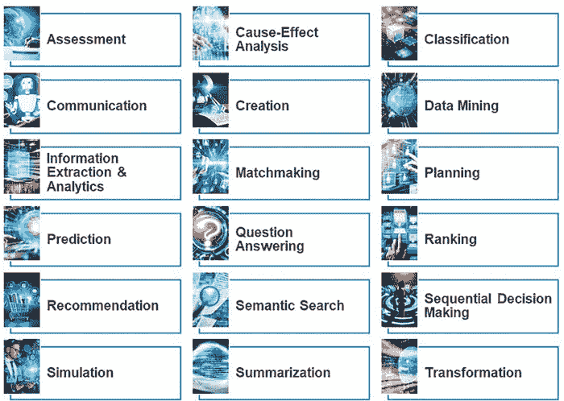

**图 2.1:** CapabilityGPT：一种 AI 能力框架

通过利用和组合这些能力，企业可以释放一系列高级用例中的 AI 潜力，提高运营效率、决策流程和员工满意度。

# CapabilityGPT 的目的

CapabilityGPT 框架是一个全面的 AI 能力库，可以以各种方式选择和组合，以设计不同类型的 AI 解决方案。以下简要概述（参见*图 2.2*）：

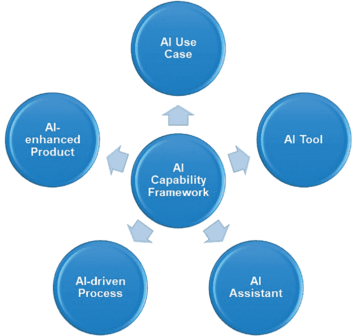

**图 2.2:** CapabilityGPT 助力 AI 解决方案的设计

*   **AI 用例：** 应用单一 AI 能力来执行特定任务或解决问题。例如，`评估`能力的用例可以是风险评估，其中 AI 解决方案利用其数据解释和分析技能来评估实体的各个方面（如借款人的财务历史），从而支持明智决策。本章将提供每个 AI 能力的详细用例示例。

*   **AI 工具：** 使用一个或多个 AI 用例来执行特定任务或解决复杂问题的 AI 解决方案。例如，一个 AI 工具可能会利用`评估`用例进行风险评估，利用`分类`用例进行风险分类，并利用`预测`用例预测未来的风险趋势。

*   **AI 助手：** AI 助手是一种具有多种 AI 能力并可访问外部工具或插件的高级 AI 应用。根据助手设计要处理的任务，整合 CapabilityGPT 框架中的相关能力。例如，“AI 个人秘书”可能会使用创建、通信、规划、问答、语义搜索和摘要等能力。第 3 章将提供基于角色的 AI 助手示例，而第 6 章将涵盖功能性和协作型 AI 助手。

*   **AI 驱动流程：** AI 驱动的流程是任务序列（或带有任务的子流程），每个任务由一个或多个 AI 能力实现。例如，在“AI 驱动的销售流程”中，可以应用序贯决策（用于制定销售策略）、匹配（用于销售代表分配客户）和通信（用于客户交互）等能力。附录 B 将提供四个带有详细 AI 流程描述的案例研究。

*   **AI 增强产品：** 这是通过添加一个或多个 AI 能力而改进的现有软件或物理产品。例如，“智能冰箱”可能会整合分类（识别物品）、预测（估算物品何时耗尽）和推荐（建议购物清单）。第 1 章提供了 AI 增强企业软件的示例。

总结，CapabilityGPT 框架提供了一套多功能的 AI 能力，可用于设计和构建针对特定需求和目标定制的各种 AI 解决方案。

# CapabilityGPT 的益处

CapabilityGPT 框架具有显著优势，强化了其作为在各种组织背景下有效集成和实施 AI 能力全面工具的价值。以下是其主要优势：

*   **全面性：** CapabilityGPT 框架包含 18 种不同的 AI 能力，确保能够满足多样化的业务需求。能力的广度使企业能够以多种创新方式利用 AI。

*   **易理解性：** 该框架将复杂的 AI 世界拆解为易于、易理解的能力，从而使其简化。这使得即使是非技术利益相关者也能理解 AI 如何增强他们的运营。

*   **设计易用性：** CapabilityGPT 框架通过将 AI 能力作为标准构建块，简化了设计过程。企业可以更高效地构建 AI 工具、助手、流程或产品。这种方法加速了设计过程并提升了后续 AI 实施的质量。

*   **促进创新：** 框架内清晰的能力界定培养了创造力和创新精神。它允许利益相关者构想能力的新组合，从而产生新的 AI 应用。

*   **可扩展性：** 框架的模块化特性允许易于扩展。企业可以从几个能力开始，随着其 AI 战略的扩大逐渐整合更多能力，使其成为增长的灵活工具。

*   **提示词化（Promptability）：** CapabilityGPT 的独特功能“提示词化”允许将每种 AI 能力直接表示为 ChatGPT 提示词中的指令。这标准化了提示词工程²，从而获得更一致、更可预测的结果，并提高了系统的可靠性。

在领会了 CapabilityGPT 的多重益处之后，我们接下来评估它与传统 AI 框架相比如何。这一对比分析将进一步凸显 CapabilityGPT 的优势，为我们深入探讨 18 种不同的能力及其应用奠定基础。

## CapabilityGPT 相比技术型 AI 框架的优势


`CapabilityGPT`相比传统的、面向技术的 AI 框架具有显著优势。让我们逐一介绍：

* **以用户为中心 vs 以技术为中心：** `CapabilityGPT`设计采用以用户为中心的方法，关注企业用例和业务需求，并将这些需求映射到相关的 AI 能力。相比之下，传统的 AI 框架是以技术为中心的，集中于`知识图谱`或`深度学习`等 AI 技术。这种以技术为中心的方法需要深厚的技术知识，且无法直接对应特定的企业用例或业务需求。
* **抽象 vs. 具体：** `CapabilityGPT`提供了一个更高层次、更抽象的 AI 能力视角。这种视角对于非技术利益相关者来说更容易理解，并有助于概念性的理解。然而，传统的 AI-功能框架涉及更多具体的`get`组件，要求对 AI 方法论和算法有深入的理解。
* **面向问题 vs. 面向工具：** `CapabilityGPT`专注于解决广泛的业务挑战，其本质上是面向问题的。相比之下，传统的 AI 框架倾向于以工具为导向，应用特定的 AI 技术，这限制了它们的范围，仅限于适用于这些技术类型的问题。
* **整体 vs. 基于组件：** `CapabilityGPT`提供了企业可用 AI 能力的整体视角，描绘了如何利用 AI 的更完整图景。传统的 AI 框架通常提供一种基于组件的视角，关注特定技术及其潜在用途，缺乏全面的愿景。

本质上，虽然传统的 AI 框架为 AI 开发奠定了技术基础，但`CapabilityGPT`提供了一种更具适应性且面向业务的 AI 实现方法。通过将 AI 能力与企业用例对齐，它能够在整个企业范围内实现更有效且具战略性的 AI 应用。

在回顾了`CapabilityGPT`与传统 AI 框架的相对优势后，我们可以分析其 18 种能力中的每一种。通过了解它们的具体功能和用例，读者可以将它们应用于特定的业务背景中。

## 带有用例的 AI 能力详细描述

在本节中，我们将深入探讨构成`CapabilityGPT` AI 框架的核心 18 种能力。每种能力都经过描述，随后是代表性用例的全面列表，展示了如何将其应用于解决各种现实世界问题。这些用例强调了这些能力的多功能性和适用性，增强了`CapabilityGPT`处理广泛企业需求的潜力。

为了确保陈述的清晰性和一致性，每个用例都遵循标准格式：

* **数据需求：** 指明了 AI 能力在相应用例中运行所需的数据类型（通常为文本或代码格式）。
* **功能：** 突出了 AI 能力在用例语境下承担的主要任务。
* **利益相关者：** 列出了参与用例或受该用例的影响的主要参与者或受益者。
* **益处：** 描述了在所描述语境下应用 AI 能力所带来的潜在优势或改进。

为了进一步引导您的探索和理解，我们将每种能力的用例分类如下：

* **高价值用例：** 这些代表了部署 AI 能力后可以产生深远业务影响的场景，例如节省成本、增加收入、提高客户满意度或其他战略收益。
* **快速实施用例：** 强调敏捷性，这些用例可以迅速实现。此类情况的理想条件是：
  * 数据可以直接被`ChatGPT`（文本、代码）处理或易于转换（例如结构化/顺序数据）。
  * 有可参考示例。
  * 提示词（Prompts）简单。
  * `ChatGPT`没有推理限制。
  * 没有负责任的 AI（Responsible AI）挑战。
  * 没有外部用户（例如客户、供应商）。
* **其他用例：** 此类别涵盖了那些不能完美归入上述分类、但在展示 AI 框架能力方面具有重要性的用例。

## 评估

评估作为一种由`ChatGPT`驱动的 AI 能力，是指对实体相关的各个方面进行系统的评估或分析。这可以涵盖风险、性能、质量、效率、合规、用户体验、就绪性和影响。


**[图 2.3]:** 评估

现在，让我们深入研究这种 AI 能力的潜力并探索代表性的用例：

* **高价值用例：**
  * **风险评估：**
    * **功能**：对各种数据集进行深度分析，以评估和预测风险因素及潜在漏洞。
    * **数据需求**：借款人的财务记录、患者病史、供应链交易日志以及任何其他指示风险的相关数据。
    * **利益相关者**：风险分析师、财务规划师、医疗专业人员、供应链经理以及企业高层领导。
    * **益处**：提高财务决策的预见性，及早发现和缓解医疗风险，简化供应链流程，并主动制定战略。
  * **性能评估：**
    * **功能**：对供应商和员工的性能指标进行全面评估，并分析流程日志以找出低效环节。
    * **数据需求**：供应商交付日志、产品质量指标、合同详细、员工绩效评估和操作日志文件。
    * **利益相关者**：人力资源经理、运营总监、质量保证团队和采购主管。
    * **益处**：增强供应商和员工关系，识别流程低效之处、优化工作流以及定制培训计划。
  * **合规性评估：**
    * **功能**：根据监管标准对运营数据进行严格分析，以确保合规并识别潜在违规行为。
    * **数据需求**：交易记录、`GDPR`执行日志、环境影响数据以及其他相关的合规文档。
    * **利益相关者**：合规官、法律团队、数据保护机构和环境安全监管机构。
    * **益处**：防止监管处罚、加强数据隐私、维持生态标准并增强与利益相关者的信任。
* **快速实施用例：**
  * **用户体验评估：**
    * **功能**：分析用户情感和反馈，以衡量整体用户满意度和改进领域。
    * **数据需求**：客户评论、使用模式、反馈表单和行为数据。
    * **利益相关者**：产品经理、用户体验设计师、客户服务团队和营销团队。
    * **益处**：直接改进用户体验、增强产品以及针对性的客户服务干预。

### 分析

* **功能**：对市场动态、竞争对手行为和客户偏好进行全面分析，从宏观和微观视角提供市场变化与机遇。
* **数据需求**：市场趋势、竞争对手新闻稿、客户调查问和行业报告的文本库。
* **利益相关者**：营销策略师、业务开发团队、产品经理、研发团队。
* **益处**：更快地适应市场动态，提供明智的产品和服务开发支持，优化定价策略，并增强竞争定位。

### 质量保证

* **功能**：质量监控与分析，以识别潜在的缺陷、低效环节和改进空间。
* **数据需求**：产品性能的日志或报告、服务交付指标、反馈表单和错误日志。
* **利益相关者**：质量保证团队、产品经理、生产主管和服务交付团队。
* **益处**：快速识别质量问题、为完善产品开发提供见解、主动缓解缺陷并提高客户满意度。

## 其他用例

### 环境与可持续性评估

* **功能**：对环境影响进行详细分析并对可持续策略进行评估，涵盖碳足迹测量、废物管理、水资源保护和绿色倡议等方面。
* **数据需求**：碳排放数据、废物处理记录、用水统计数据、供应链数据、可再生能源采用率以及企业社会责任倡议的记录。
* **利益相关者**：环境安全监管机构、企业可持续发展团队、供应链经理和企业领导层。
* **益处**：增强生态责任、赢得利益相关者的更好信任、识别环保倡议，并通过可持续实践实现潜在成本节省。

### 就绪评估

* **功能**：对组织应对变革、转型或紧急情况的准备情况进行全面评估，涵盖数字基础设施、技能组合和应急准备等领域。
* **数据需求**：数字基础设施日志、员工技能数据集、应急响应计划、基础设施蓝图、供应链就绪记录以及电动汽车转型计划。
* **利益相关者**：制造业运营负责人、公用事业部门经理、人力资源与培训团队、应急部门和汽车行业领导者。
* **益处**：早期识别就绪差距、为转型项目提供明智决策、增强应急响应能力，并顺畅过渡到新的行业标准。

### 流程优化评估

* **功能**：详细检查工作流和运营数据，以识别低效环节、瓶颈和需要增强的。
* **数据需求**：工作流图、操作日志、制造工艺记录和能源分配数据。
* **利益相关者**：工业/制造业的流程经理、公用事业部门运营负责人、质量保证团队和战略规划师。
* **益处**：提高运营效率、降低流程成本、提升产品质量并实现可持续能源分配。

总之，评估是一项关键的 AI 能力，使各行业的组织能够深入了解其现状状况。通过这些见解，他们可以主动解决问题、利用机遇并采取措施将风险降至最低。

为了有效使用 AI 辅助评估，需要收集多样化高质量的数据，实施强大的偏差检测与消除方法，并且采用“人类参与”（human-in-the-loop）的方法变得至关重要。

* **益处**：快速理解政策变更的影响、快速优化政策，并使政策与预期目标更保持一致。

### 其他用用例：

### 供应链连续性评估

* **功能**：深入分析物流数据，以理解供应链环节中断可能带来的后果。
* **数据需求**：供应链日志、库存记录、合作伙伴谈判数据等。
* **利益相关者**：供应链经理、零售和制造业的运营负责人、库存经理以及物流协调员。
* **益处**：更佳的应急计划、更改进的库存管理、优化的合作伙伴谈判以及增强的业务连续性。

### 预测性生态影响分析

* **功能**：预测未来业务活动对环境的潜在影响，以及可能产生环境影响的直接原因。
* **数据需求**：环境评估报告、运营数据、排放记录等等。
* **利益相关者**：环境安全监管机构、企业可持续发展团队、业务战略师和企业领导层。
* **益处**：预先应对环境挑战、调整环保策略并向更可持续的业务轨迹发展。

### 组织变革影响评估

* **功能**：预测重大组织变革对运营效率、客户满意度和服务质量等方面可能产生的结果。
* **数据需求**：先前的变更影响报告、客户满意度调查、运营效率数据等。
* **利益相关者**：企业战略师、人力资源团队、技术实施团队、运营负责人和客户服务经理。
* **益处**：在转型期间做出明智决策、最大限度地减少干扰，并增强与业务目标的一致性。

总之，因果分析作为一种 AI 能力，是各行业组织理解其运营内部因果关系的关键工具。通过这些洞察，他们可以更好地预测结果、解决问题并将其策略与目标对齐。

使用 ChatGPT 进行因果分析的挑战（例如将相关性误认为因果关系，以及处理影响因果混杂因素）可以通过额外的因果分析工具以及确保在关键决策中引入人工监督来管理。

# 分类

分类根据属性、特征或结果，将数据、行为、过程或资源系统地归入预定义的组中。


**图 2.5:** 分类

在这里，我们将深入探讨具有代表性的用例，展示分类可以产生重大影响的多元化应用：

### 高价值用例：

### 产品分类

* **功能**：利用 AI 驱动的分析，根据特性、用户评论或描述等属性将产品归入不同的组。
* **数据需求**：产品特性、用户评论、产品描述和相关的元数据。
* **利益相关者**：库存经理、电子商务平台开发者、零售战略师和营销团队。
* **益处**：增强库存管理、提升用户浏览体验、增加产品发现率并可能提升销售额。

### 异常检测

* **功能**：识别序列化数据中的异常模式或不一致之处，以便进行早期检测和响应。
* **数据需求**：交易日志、患者数据、电子商务购物模式等。
* **利益相关者**：银行业的欺诈检测团队、医疗保健数据分析师和电子商务安全团队。
* **益处**：主动识别并缓解欺诈活动、异常数据模式和可疑行为。

### 用户行为分类

* **功能**：分析序列化用户数据，以获得对动作、行为和偏好的见解。
* **数据需求**：用户活动日志、浏览模式、购买历史和平台交互数据。
* **利益相关者**：电子商务战略师、在线娱乐提供商和教育技术平台设计师。
* **益处**：个性化的产品推荐、定制化的用户体验和优化的内容交付。

### 快速实施的用例：

### 情感分析

* **功能**：解码并分类文本输入中的情感细微差别，以衡量情感。
* **数据需求**：患者反馈记录、读者评论和客户评价。
* **利益相关者**：医疗专业人员、媒体分析师和零售经理。
* **益处**：立即理解流行情绪、识别需要关注的潜在领域，并根据反馈制定干预或响应。

### 客户细分

* **功能**：分析客户数据，根据行为、偏好或人口统计学等各种属性将他们划分为不同的组。
* **数据需求**：客户购买历史、偏好调查和人口统计学细节。
* **利益相关者**：电信领域的营销经理、零售高管和财务分析师。
* **益处**：增强精准营销、个性化客户服务，以及基于客户细分的更好资源分配。

### 流程分类

* **功能**：根据流程、资源需求和结果等属性对业务流程进行分类。
* **数据需求**：业务流程图、资源分配记录和结果报告。
* **利益相关者**：IT 服务经理、供应链负责人和医疗保健管理人员。
* **益处**：快速识别流程类别、定位瓶颈并根据分类见解优化流程。

### 其他用例：

### 资源分类

* **功能**：根据不同的特征对资源（如员工、供应商或物理资产）进行分类。
* **数据需求**：供应商简介、员工数据、物理资产记录、交付时间、产品质量报告以及价格/成本数据。
* **利益相关者**：供应链经理、采购团队、人力资源经理以及物流、零售和制造业的运营负责人。
* **益处**：增强资源分配、更佳供应商和资产管理，并简化运营流程。

### 内容过滤

* **功能**：根据相关性和适当性标准对传入的数字内容进行过滤。
* **数据需求**：电子邮件、社交媒体帖子、内容元数据和用户生成内容。
* **利益相关者**：IT 管理员、客户服务代表以及媒体和 IT 组织的内容经理。
* **益处**：提高生产力、增加信息安全并用户体验。

### 风险分类

* **功能**：通过详细的数据分析，将客户或投资归入预定义的风险类别。
* **数据需求**：财务历史、行为模式、市场趋势和其他相关的风险因素。
* **利益相关者**：保险业的风险管理团队、金融分析师和投资组合经理。
* **收益**：更明智的决策、定制化的产品提供、优化的资源配置以及盈利与客户满意度的平衡。

通过利用 ChatGPT 在分类方面的能力，各行业的企业能够更好地理解其环境并做出更明智的决策。常规决策可以通过简单的业务规则与分类结果相关联。

为了有效部署 ChatGPT 驱动的分类，至关重要的是使用代表性数据以避免结果偏差，并建立定期审计和人工监督系统，以防止模型固有的偏见。

# 通信

作为一种 AI 能力，通信包含了与人类用户以及外部应用程序（如交易系统、客户关系应用或搜索引擎）的交互。这种双模式交互允许 ChatGPT 促进信息交换、问题解决和任务完成。


**图 2.6:** 通信

我们通过描述其应用来展示这种能力的潜力：

## 高价值用例

### 数据收集与录入：

* **功能**：针对客户反馈、预订或库存管理等任务进行自动数据收集、验证和记录。
* **数据需求**：反馈表单、预订记录、库存和患者数据。
* **利益相关者**：数据录入人员、医疗健康管理人员和库存经理。
* **收益**：减少手动工作量、提高数据准确性、简化各行业流程，并提高运营效率。

### 信息与协助服务：

* **功能**：提供个性化的产品信息、故障排除支持、公司新闻、政策指导以及其他相关更新。
* **数据需求**：产品详情、公司新闻公告、政策文件和健康指南。
* **利益相关者**：客户服务代表、内部沟通团队和医疗提供者。
* **收益**：增强客户服务、改善内部沟通、转变用户体验并获得更高的满意度。

### 客户服务：

* **功能**：通过处理常见查询、提供个性化建议和对复杂问题进行升级处理来简化客户交互。
* **数据需求**：客户交互日志、产品/服务详情、客户反馈和升级标准。
* **利益相关者**：客户服务专、产品经理和电信服务提供商。
* **收益**：高效处理客户查询、改进服务交付、增强客户体验并增加运营效率。

## 快速实施用例

### 培训与开发：

* **功能**：培训内容的动态展示、促进在线学习（eLearning）模块以及技能提升。
* **数据需求**：培训模块、在线学习课程内容、员工反馈和绩效指标。
* **利益相关者**：人力资源经理、公用事业行业培训师、消费品产品经理和电信技术培训师。
* **收益**：促进持续的职业发展，确保核心培训的一致交付，并增强不同行业的员工能力。

### 项目管理通信：

* **功能**：桥接项目管理工具与团队成员之间的通信，实现实时更新和通知。
* **数据需求**：项目时间表、任务列表、团队成员角色和项目里程碑。
* **利益相关者**：IT 项目经理、建筑现场主管和市场营销活动负责人。
* **收益**：提高团队沟通的透明度，增强对项目状态的意识、改善团队同步并及时执行项目。

### 研讨会协助：

* **功能**：协助研讨会规划、为讨论提供即时数据检索以及会后跟进工作。
* **数据需求**：研讨会议程、参与者列表、相关数据库或知识库以及研讨会反馈。
* **利益相关者**：培训协调、产品开发负责人和研究主管。
* **收益**：无缝组织研讨会、通过快速数据检索丰富讨论，以及系统性的会后跟进，确保生产力最大。

## 其他用例

### 供应链通信：

* **功能**：通过跟踪库存需求、与供应商协调以及自动发送交付相关的通知来增强供应链流程内的通信。
* **数据需求**：库存日志、供应商通信记录、交付计划和产品需求数据。
* **利益相关者**：供应链经理、库存经理、供应商和交付团队。
* **收益**：更好的库存管理、改进的供应商协调、优化的服务交付以及更明智的决策过程。

### 反馈闭环增强：

* **功能**：系统性地收集、分类并将客户反馈转达给相关部门。
* **数据需求**：客户反馈表单、产品/服务评论和客户交互日志。


- **利益相关者**：客户服务代表、产品经理和质量保证团队。
- **收益**：从客户反馈中获得可操作的洞察、培养响应性文化、持续改进并提高客户忠诚度。

### 紧急通信协调

- **功能**：及时转达紧急通知并协调团队或部门之间的即时通信。
- **数据需求**：紧急警报、团队通信日志、部门指南和应急响应程序。
- **利益相关者**：公共安全官员、医疗提供者和公用事业服务经理。
- **收益**：协调且有效的应急响应、保护资产以及潜在的救命成果。

通过有效的通信，ChatGPT 成为在各个领域和应用中促进互动、协作和信息交换的宝贵工具。

实施基于 ChatGPT 的通信需要 AI 与人类交互的平衡，特别是在需要同理心的情况下。确保严格的数据安全措施并严格遵守伦理数据使用准则至关重要。

# 创建

AI 驱动的创建涉及理解复杂需求、解释上下文并产生满足特定目标的多元化、创新内容。内容涵盖了从文本内容、设计元素到复杂的产物（如业务模型或软件代码）。


**图 2.7:** 创建

## 高价值用例

### 生成式设计

- **功能**：利用 AI 创建创新的用户界面设计、新产品开发和吸引胜的网站设计。
- **数据需求**：用户偏好、网站分析、产品功能需求和设计基准。
- **利益相关者**：UX/UI 设计师、产品经理、网站开发人员和营销团队。
- **效益**：提升用户交互和参与度，提供多样化的产品，并提高客户满意度。

### 产品信息管理

- **功能**：生成极具吸引力的产品描述并制定库存管理策略。
- **数据需求**：产品规格、库存日志、客户反馈和购买模式。
- **利益相关者**：电子商务经理、库存主管、营销团队和产品经理。
- **效益**：增强客户满意度，优化库存水平并简化库存管理。

### 自动程序合成

- **功能**：协助自动生成软件程序、模型或脚本。
- **数据需求**：软件需求、现有的代码库和系统规范。
- **利益相关者**：软件开发人员、IT 经理、财务分析师和电信工程师。
- **效益**：减少手动编码时间，提高流程效率，实现及时准确的程序生成。

## 快速实施用例

### 功能性文档和内容生成

- **功能**：自动化创建各种类型的内容，包括报告、法律文件、营销材料和教育内容。
- **数据需求**：现有模板、主题或课题简报、目标受众人口统计数据以及指定的文档结构。
- **利益相关者**：法律顾问、营销经理、教育者和内容创作者。
- **效益**：提高内容生成效率，减少人为错误，输出更具一致性，为员工节省大量时间，让他们专注于更复杂的任务。

### 流程和工作流创建

- **功能**：设计全面的业务流程模型、标准操作程序（SOP）以及特定的路径（如患者护理或教育课程）。
- **数据需求**：现有的流程描述、组织目标、利益相关者反馈以及行业基准或最佳实践。
- **利益相关者**：医院管理员、制造经理、教育工作者和流程优化团队。
- **效益**：提高流程效率，改善患者或用户结果，提高生产效率，并提供符合最佳实践的个性化学习或护理路径。

### 概念构思辅助

- **功能**：通过创新的建议和视角辅助产品开发、广告活动和营销策略头脑风暴。
- **数据需求**：市场趋势、目标受众洞察、历史活动数据以及产品规格或需求。
- **利益相关者**：创意总监、产品开发人员、营销策略师和品牌经理。
- **效益**：更快的构思过程，更丰富多元的头脑风暴结果，创建与市场需求高度契合的活动或产品，增强与目标观众的共鸣。

## 其他用例

### 培训和学习内容生成

- **功能**：制作定制化的培训材料、入职指南和个性化学习路径。
- **数据需求**：员工技能组合、培训基准、行业标准和职位角色。
- **利益相关者**：HR 经理、培训师、部门主管和安全官。
- **效益**：促进员工发展，提高员工知识，加强安全协议并提高生产力。

### 自动系统配置

- **功能**：协助配置笔记本电脑、机器或车辆系统等技术对象。
- **数据需求**：技术规格、用户偏好、设备手册和系统基准。
- **利益相关者**：IT 管理员、电信工程师和汽车技术人员。
- **效益**：提高设置速度，最大限度地减少潜在错误，优化系统性能并增强用户满意度。

### 项目文档自动化

- **功能**：自动化创建和管理项目文档，如计划、任务分配和进度报告。
- **数据需求**：项目需求、任务列表、时间表和利益相关者角色。
- **利益相关者**：项目经理、IT 协调员、顾问和施工主管。
- **效益**：提高项目管理效率，提高透明度，简化项目执行并实现更好的客户沟通。

这些示例强调了 ChatGPT 如何利用其计算能力在不同语境下生成大量内容。这标志着从传统的例行自动化向更复杂、具创造性的问题解决的重大转变。

为了在创意任务中充分利用 ChatGPT，保持人工监督并设计相关的提示词（prompt）是必要的。内容过滤和偏差缓解策略应成为 AI 治理的组成部分，以防止无意生成偏见或有害内容。

# 数据挖掘

数据挖掘涉及探索、提取和揭示隐藏在大量结构化和非结构化数据中的模式、关系和洞察。然而，数据集的大小受使用的 GPT 模型上下文窗口的限制。较大的数据集需要预处理以将其分割为可管理的部分。或者，ChatGPT-4 配合高级数据分析（Advanced Data Analysis）插件可以协作进行探索性数据挖掘。


**图 2.8:** 数据挖掘

以下是数据挖掘代表性用例列表：

## 高价值用例

### 趋势分析

- **功能**：解释时间序列数据以发现销售趋势、市场变化或不断变化的客户行为。
- **数据需求**：销售数据、市场报告、客户反馈和历史数据集。
- **利益相关者**：零售经理、财务分析师、营销策略师和旅游规划师。
- **效益**：数据驱动的战略规划、及时策略调整、利用新兴机会以及降低潜在风险。

### 异常检测

- **功能**：识别序列数据中的异常模式或不一致之处。
- **数据需求**：财务交易日志、网络安全漏洞报告和设备性能数据。
- **利益相关者**：银行经理、网络安全专业人员和能源部门主管。
- **效益**：增强安全性和可靠性，防止财务损失，保护敏感数据并及时识别潜在威胁。

### 序列模式发现

- **功能**：在系列数据中发掘经常出现的序列或模式。
- **数据需求**：用户活动日志、机械性能记录和交通时刻表。
- **利益相关者**：电子商务经理、制造主管和物流协调员。
- **效益**：深入的用户行为分析、主动性维护计划、流程优化、最大限度地减少停机时间并提高运营效率。

## 快速实施用例

### 数据聚类

- **功能**：识别并分类文本数据中的同质组或簇，从而实现更深层次的洞察和数据驱动的决策。
- **数据需求**：来自客户评论、医疗记录、财务交易和其他形式的非结构化文本数据的描述。
- **利益相关者**：营销策略师、医疗健康分析师、财务顾问和数据科学家。
- **收益**：实施针对性的营销策略、定制化的医疗干预、快速识别离群值或异常情况，以及改进决策流程。

### 关联规则挖掘

- **功能**：发现交易序列中项目集或行为之间的关系和相关性。
- **数据需求**：来自购物车、购买历史、在线行为、媒体消费记录及类似数据集的交易数据。
- **利益相关者**：零售经理、电子商务策略师、杂货店主、媒体制作人和数据分析师。
- **收益**：增强推荐系统，加深对消费者行为的理解，创建更有效的营销活动，并提供高度个性化的客户体验。

### 文本模式识别

- **功能**：在大量文本数据中检测反复出现的主题、情感或话题，实现更深入的分析和可操作的洞察。
- **数据需求**：客户反馈、评论、社交媒体评论、员工反馈和其他形式的文本数据。
- **利益相关者**：客户服务经理、营销团队、人力资源专家和社交媒体分析师。
- **收益**：改进客户服务的策略支持、定制营销活动、有效的社交媒体监控，以及增强对员工参与度和情感的理解。

## 其他用例

### 网络模式识别

- **功能**：识别并理解网络活动数据中的模式。
- **数据需求**：用户连接日志、服务器活动数据和电信流量报告。
- **利益相关者**：社交媒体平台开发者、IT 经理和电信工程师。
- **收益**：提高网络性能、早期威胁检测、丰富对用户交互的理解，以及对未来网络状态的预测性见解。

### 情感时间线分析

- **功能**：分析跨时间序列的文本反馈或评论，以评估情感演变。
- **数据需求**：客户评论、反馈、社交媒体评论、活动或活动时间线。
- **利益相关者**：媒体分析师、娱乐制作人、品牌经理和公共关系协调员。
- **收益**：对随时间变化的公众反应产生深度见解、策略调整的决策支持、提高利益相关者的参与度，以及对情感变化的有效应对。

这些用例强调了 ChatGPT 从大型复杂数据集中提取价值的能力，将传统的数据分析转向智能、数据驱动的决策。

然而，有效的数据挖掘需要严格遵守数据保护法规，并致力于无偏且具代表性的数据收集和处理，以确保用户机密性和提取洞察的质量。

# 信息提取与分析

信息提取与分析代表了从原始数据或复杂文档中自动识别、提取和分析相关信息。这种变革能力在解读复杂文档、生成可操作的洞察以及实现跨组织领域的流程自动化方面发挥着至关重要的作用。


**图 2.9:** 信息提取与分析

以下是信息提取与分析用例概述：

## 高价值用例

### 交易处理

- **功能**：提取和分析发票、收据和订单等交易文档。
- **数据需求**：PDF 和 HTML 等多种格式的文档。
- **利益相关者**：零售经理、银行专业人士和杂货店主。
- **收益**：简化交易、减少差异、增加准确性并更快速地结算。

### 产品应用分析

- **功能**：从与方案关联的记录中提取并分析数据。
- **数据需求**：临床记录、农药应用数据和饮食使用情况。
- **利益相关者**：医疗专业人士、农业专家和营养专家。
- **收益**：产品完善、方案调整、副作用或结果的检测，以及评估。

## 快速实施用例

### 法律文档分析

- **功能**：从海量法律文档中彻底审查并提取关键条款、条件和义务。
- **数据需求**：合同、协议、契据、租赁文件、兼并购文件和其他类型的法律文件。
- **利益相关者**：法律顾问、合规官、企业业务领袖、财务分析师和房地产经理。
- **收益**：快速审查流程、提高法律操作的准确性、降低与遗漏条款相关的风险，并减少间接开支。

### 新闻分析

- **功能**：从全球新闻、监管更新和行业转变中提取信息，以预测市场动态。
- **数据需求**：新闻文章、新闻稿、监管公告、行业报告和其他新闻源。
- **利益相关者**：市场研究人员、合规官、业务分析师和战略规划师。
- **收益**：主动性的市场策略、遵循不断演变的法规、早期识别潜在风险或机会，并在知情决策中占据优势。

### 竞争分析

- **功能**：从外部数据源提取有价值的见解，以理解竞争对手的策略、产品表现和知识产权定位。
- **数据需求**：竞争对手报告、市场分析、产品评论、专利文件与其他行业竞争对手相关的资源。
- **利益相关者**：业务策略师、营销专业人士、研发团队和企业情报部门。
- **收益**：增强商业智能、改进战略定位、知情的产品开发，以及在市场中获得竞争优势。

### 合规性验证

- **功能**：从文档中提取关键数据，以确保严格遵守各种法规、标准或政策。
- **数据需求**：监管文件、健康安全报告、财务记录和税务文件。
- **利益相关者**：财务分析师、医疗保健管理人员和制造主管。
- **收益**：加强监管合规性、降低法律风险至最低、节省时间并减少违规罚款的风险。

### 研发中的数据管理

- **功能**：增强从研究资源中提取数据，以支持研究活动和创新。
- **数据需求**：临床试验数据、学术文献和产品开发反馈。
- **利益相关者**：药物研究人员、学术专业人员和技术创新者。
- **收益**：提高研发效率，获得创新见解，加速产品或解决方案的开发。

### 库存管理

- **功能**：提取和分析与库存记录、销售预测和供应链指标相关的数据，以优化库存水平。
- **数据需求**：库存记录、销售预测和供应链数据。
- **利益相关者**：零售业务主、制造经理和物流协调员。
- **收益**：避免缺货或库存积压情况，降低库存持有成本，提高运营效率并提升卓越的客户满意度。

这些用例强调了 ChatGPT 在从原始且复杂的数据中提取有意义的见解方面的变革性影响，驱动了知情决策和流程自动化。

为了使其在信息提取和分析中有效应用，遵守数据保护法规并对提取和分析提示词进行细致的验证，是应对其挑战的关键。

# 匹配

ChatGPT 的匹配能力涉及根据预定义的标准或模式对实体、任务、资源或需求进行配对，以优化结果。AI 驱动的匹配可以简化多个领域的决策过程，提高生产力和运营效率。


**图 2.10:** 匹配

现在让我们来探索匹配的几个用例：

## 高价值用例

### 资源到任务分配

- **功能**：根据技能、能力或功能等描述性属性，将资源优化地分配给特定任务或操作。
- **数据需求**：资源可用性、技能描述和任务需求。
- **利益相关者**：项目经理、制造主管和物流协调员。
- **收益**：提高生产力，降低成本并更有效地利用可用资源。

### 风险与缓解策略的对齐

- **功能**：识别潜在威胁或风险，并将其与适当的预防或修复策略对齐。
- **数据需求**：风险评估和可用的预防/纠正策略。
- **利益相关者**：财务分析师、网络安全专家和生命科学研究人员。
- **收益**：加强风险管理，增强业务韧性并防止潜在损失。

### 需求与供给匹配

- **功能**：预测并使供应与市场需求一致，考虑各种产品描述、单位转换和分销商库存水平。
- **数据需求**：库存水平、需求预测、分销商库存和产品描述。
- **利益相关者**：零售业务主、制造经理和物流专家。
- **收益**：提高运营效率，提升客户满意度并优化库存水平。

## 快速实施用例

### 个人到小组分配

- **功能**：根据兼容性、技能和目标将个人有效分配到相应的小组或团队，增强团队动态并优化性能。
- **数据需求**：个人简介、技能评估、个人偏好、团队需求和过去的绩效指标。
- **利益相关者**：人力资源经理、教育工作者、培训协调员、项目经理和团队负责人。
- **收益**：提高团队凝聚力，增强性能结果，优化资源利用并创建平衡团队。

### 导师制与辅导对齐

- **功能**：将员工与合适的导师、教练或领域专家（SME）进行智能配对，以确保学习需求、职业目标和技能发展保持对齐。
- **数据需求**：员工简介、学习需求评估、导师/教练/领域专家简介、反馈表和职业发展目标。
- **利益相关者**：人力资源经理、培训和开发团队、高管、领域专家和部门主管。
- **收益**：加速员工成长，提高士气，高效获取技能并丰富组织生产力。

### 合规性匹配

- **功能**：确保实践或程序与相关的监管框架对齐。
- **数据需求**：业务实践、软件功能、程序细节和监管要求。
- **利益相关者**：财务顾问、医疗保健管理人员和制造主管。
- **收益**：法律和运营风险降至最低，防止罚款和法律纠纷，确保业务运营不中断。

## 其他用例

### 数据管理中的实体间匹配

- **功能**：执行稳健的实体间匹配技术，以增强数据去重、模式匹配、本体匹配和其他数据对齐功能。
- **数据需求**：需要对齐的数据集、数据库模式、本体、元数据和相关的数据完整性指标。
- **利益相关者**：数据科学家、IT 经理、数据库管理员、营销分析师和数据质量团队。
- **收益**：增强数据完整性，提高数据可用性，高效的数据管理流程和卓越的数据驱动决策。

### 需求到解决方案映射

- **功能**：将特定需求匹配适当的解决方案或策略。
- **数据需求**：业务、技术或功能性需求；可用解决方案。
- **利益相关者**：IT 经理、商业顾问和客户服务高管。
- **收益**：高效解决问题，优化战略规划并交付定制化解决方案。

### 专家知识匹配

- **功能**：根据项目或挑战需求将员工与合适的领域专家（SME）配对。
- **数据需求**：员工简介、专家知识领域和项目需求。
- **利益相关者**：人力资源专业人员、项目经理和企业团队负责人。
- **收益**：高效解决问题，优化项目结果并最大化利用内部专业知识。

这些用例强调了 ChatGPT 如何增强匹配过程，确保各种实体、任务、资源和需求之间的最佳对齐，从而提高结果和效率。

将 ChatGPT 有效应用于匹配领域，取决于数据的质量和准确性，以及对匹配中涉及的多样且复杂因素的细致考虑。这包括缓解某些任务可能对 AI 系统构成挑战的潜在复杂性和多样性。例如，在个人到小组的分配中，群体动态和个人性格等各种主观因素起着重要作用。这些因素对于像 `ChatGPT` 这样的 AI 系统来说很难准确考虑，因此，应该特别关注这些元素，以确保最有效、最准确的匹配结果。

# 规划

AI 规划包含两部分能力：将复杂目标（或任务）分解为子目标（或子任务），并生成任务序列，以便在给定范围内从初始状态过渡到目标状态。如果初始假设发生变化，可以根据中间执行结果动态调整计划。


**图 2.11:** 规划

以下是利用 `ChatGPT` 进行不同行业规划的概览：

## 高价值用例

### 运营规划

- **功能**：提供全面的规划输出，涵盖创建任务列表、供应链优化到设计有效的营销活动等。
- **数据需求**：任务需求、供应链数据、受众人口统计数据和服务交付限制。
- **利益相关者**：公用事业、零售、电信和制造业的经理。


# 战略规划

- **功能**：协助设定长期目标、确定所需的资源并制定关键行动方案。
- **数据需求**：市场趋势、历史数据和公司目标。
- **利益相关者**：金融服务、电信和汽车行业的高管。
- **收益**：在竞争环境中引导并实现预期结果，明确方向，并进行有效的资源配置。

# 项目管理规划

- **功能**：协助项目经理拆解大型项目、对任务排序并确保资源的最配置。
- **数据需求**：项目规范、可用资源和任务依赖关系。
- **利益相关者**：建筑、IT 和设计领域的项目经理。
- **收益**：项目按时、预算内且符合要求地完成。

# 快速实施用例

## 风险与事件管理

- **功能**：为面临重大运营或市场风险的行业提供稳健的缓解和解决计划，从而提升组织的韧性和安全性。
- **数据需求**：历史事件报告、风险评估输出、运营数据、市场趋势和安全参数。
- **利益相关者**：风险管理团队、安全官、运营主管和高层管理。
- **收益**：增强组织韧性、改进安全措施、有效缓解潜在风险并主动预防重大事件发生。

## 变革管理规划

- **功能**：协助规划和执行组织变革及流程改进，以最大限度地减少干扰并增强运营流。
- **数据需求**：当前运营数据、利益相关者的反馈、拟议变更的细节、以往的变更管理报告和影响评估。
- **利益相关者**：人力资源经理、业务流程分析师、运营主管和变更管理团队。
- **收益**：精简组织变更、减少干扰、增强利益相关者的参与度并提高运营效率。

## 活动规划

- **功能**：有效协助活动的规划与执行，从选址选择到应急预案，确保无缝执行和卓越的宾客体验。
- **数据需求**：以往活动数据、场馆详情、资源可用性、宾客偏好和预算限制。
- **利益相关者**：活动策划师、酒店经理、物流团队和营销部门。
- **收益**：活动平稳执行、提高宾客满意度、改进资源配置并提升行业声誉。

# 其他用例

## 沟通与参与规划

- **功能**：协助制定有效的内部和外部沟通策略，以最大限地提高利益相关者的参与并改善公共关系。
- **数据需求**：利益相关者人口统计数据、沟通渠道和参与指标。
- **利益相关者**：电信、教育和零售行业的公关团队。
- **收益**：增强利益相关者参与、积极公众认知和组织成功。

## 创新与开发规划

- **功能**：协助起草研究、产品开发和培训的详细计划。
- **数据需求**：当前研发数据、市场需求和培训需求。
- **利益相关者**：医疗保健/生命科学、消费品和教育领域的研发团队。
- **收益**：培养持续学习和适应的文化，带来可持续增长和长期成功。

这些用例凸显了`ChatGPT`如何优化规划过程，将复杂目标无缝地转化为可管理的子任务，并为其执行协调高效的序列。

在企业背景下实施它需要一种人机结合的方法，考虑到对规划问题进行全面规范的需求，并清晰定义人类与`ChatGPT`的角色和职责。

# 预测

在 AI 中，预测是指利用历史数据和模式预测未来结果、趋势、行为或事件的能力。这一过程有助于组织内各个部门的明智决策和风险管理。


**图 2.12:** 预测

以下是`ChatGPT`如何在各行业利用预测的力量：

## 高价值用例

### 性能预测

- **功能**：利用历史和实时数据预测未来性能。
- **数据需求**：历史性能数据、当前运营指标和行业趋势。
- **利益相关者**：金融服务、工业/制造业和电信行业的高管。
- **收益**：主动管理、明智的战略规划、识别机会以及应对挑战。

### 供需预测

- **功能**：使用时间序列数据预测供需平衡。
- **数据需求**：历史供需数据、市场趋势和特定行业事件。
- **利益相关者**：公用事业、汽车和医疗保健/生命科学领域的决策者。
- **收益**：防止缺货和积压情况，提高运营效率并优化财务表现。

#### 结果预测

- **功能**：预测不同倡议或行动的可能结果。
- **数据需求**：类似倡议的历史数据、当前项目参数以及外部影响因素。
- **利益相关者**：能源、医疗保健/生命科学及教育领域的战略策略师。
- **收益**：优化资源配置、降低风险并增强整体性能。

## 快速实施的用例

### 趋势预测

- **功能**：解码复杂的数据模式以预测未来趋势，使企业能够主动适应消费者或社会需求的变化。
- **数据需求**：历史销售数据、客户反馈、市场研究报告以及其他反映过去趋势的行业行业数据。
- **利益相关者**：产品经理、营销策略师、教育工作者、课程设计者和库存经理。
- **收益**：增强对市场变化的适应能力、改进产品演进、实现高效的库存管理、渐进式课程设计以及精炼的教学技术，以优化业务结果。

### 行为预测

- **功能**：预测从客户到竞争对手等各种利益相关者的行为模式，提供可操作的见解以驱动有效的业务策略。
- **数据需求**：过去的交易数据、客户互动、反馈和行为日志，以及竞争对手活动和市场情报。
- **利益相关者**：营销团队、客户服务经理、业务策略师和产品开发人员。
- **收益**：对客户需求的卓越预判、创建定制化体验、领先市场动态，并增强客户忠度和竞争定位。

### 质量与缺陷预测

- **功能**：主动识别潜在的质量问题或缺陷，允许及时干预并确保产品完整性。
- **数据需求**：历史质量控制数据、客户对产品质量的反馈、缺陷日志和生产细节。
- **利益相关者**：质量保证团队、产品经理、制造负责人和客户服务代表。
- **收益**：减少与召回或重工相关的成本、提高客户满意度、增强品牌声誉并减少潜在的业务风险。

## 其他用例

### 资源利用率预测

- **功能**：预测对可持续性和盈利至关重要的资源利用情况。
- **数据需求**：过去的资源利用数据、当前运营数据以及对未来需求的预测。
- **利益相关者**：工业/制造业、公用事业和汽车领域的运营经理。
- **收益**：明智的运营规划、优化的维护计划以及对可持续发展倡议的支持。

### 事件概率预测

- **功能**：根据历史数据估计特定事件发生的概率。
- **数据需求**：过去关于类似事件的数据、当前环境因素和行业趋势。
- **利益相关者**：金融服务、医疗保健/生命科学和能源领域的风险经理。
- **收益**：实现主动的风险管理、明智的应急预案制定并免受潜在的负面影响。

这些用例说明了 ChatGPT 预测能力的广泛应用，对各行业组织的战略规划、决策和风险管理做了重大贡献。

为了在企业环境中优化利用其功能，确保高质量、多样化的数据收集、促进协作决策过程以及实施有效的反馈机制至关重要。

# 问答

AI 中的问答是指理解、处理和准确响应以自然语言提问的能力。这一功能增强了组织内部的交互过程，确保对各种问题提供及时、准确且感知上下文的响应。


**图 2.13:** 问答

以下是 ChatGPT 如何在各个行业中利用其问答能力：

## 高价值用例

### 运营流程指导

- **功能**：对运营问题提供即时且精确的回答。
- **数据需求**：标准操作程序、安全协议和历史查询数据。
- **利益相关者**：工业/制造业、公用事业和医疗保健/生命科学行业的运营人员。
- **收益**：提高运营效率，确保符合安全标准并防止可能导致财务或健康后果的错误。

#### 知识库交互

- **功能**：能够快速且在上下文准确地检索存储的知识。
- **数据需求**：全面的知识库、常见问题解答（FAQs）和特定行业指南。
- **利益相关者**：教育、电信和金融服务领域的专业人士。
- **收益**：增强解决问题的能力、丰富学习并确保符合行业标准。

### 客户支持

- **功能**：便于对各种客户查询做出即时响应。
- **数据需求**：产品/服务信息、故障排除指南和客户反馈历史。
- **利益相关者**：零售、电信和汽车行业的支持团队。
- **收益**：增强客户满意度和忠诚度，从而提高留存率并增加业务。

### 快速实施的用例

#### IT 和企业软件支持

- **功能**：为软件工具和 IT 基础设施提供及时协助，确保技术驱动的流程不受阻碍。
- **数据需求**：IT 知识库、软件手册、用户反馈以及过去 IT 事件或解决方案的日志。
- **利益相关者**：IT 支持团队、软件用户、教育工作者、公用事业运营者和依赖技术的专业人士。
- **收益**：最小化停机时间，提高生产力，提升用户体验并减少 IT 支持需求以节省成本。

#### 合规与监管指导

- **功能**：对合规性要求提供准确的回答和指导，确保企业符合强制性法规和最佳实践。
- **数据需求**：监管文件、政策手册、过去的合规事件以及特定行业法规的更新。
- **利益相关者**：合规官、业务策略师、运营经理和监管事务专业人员。
- **收益**：有效的风险管理、确保业务连续性、防止巨额罚款或潜在的业务关闭，并增强业务声誉。

### 入职与培训

- **功能**：协助简化入职流程和持续员工培训。
- **数据需求**：培训材料、员工常见查询、公司政策和程序。
- **利益相关者**：零售、消费品和汽车行业的人事和培训部门。
- **收益**：确保服务质量的一致，赋能员工并优化运营效率。

- **功能**：高效管理内部和外部通信。
- **数据需求**：通信协议、品牌信息和利益相关者数据库。
- **利益相关者**：汽车、消费品和零售行业的通信团队。
- **收益**：培养积极的品牌形象，并确保跨渠道的无缝通信。

- **集成多模态辅助：**
- **功能**：整合文本、语音和视觉问答（VQA），构建完善的辅助系统。
- **数据需求**：涵盖与该领域相关的文本、听觉和视觉信息的多元化数据集。
- **利益相关者**：医疗保健/生命科学、零售、公用事业、汽车、工业/制造以及教育领域的专业人士。
- **收益**：提供整体性的用户体验，支持实时故障排除和指导，并将视觉信息与即时、具知识性的答复相结合。

这些用例反映了 ChatGPT 的问答能力在组织运营各个领域的广泛应用。它有效响应不同领域查询的能力，显著提升了各行业的组织效率、服务交付和客户体验。

要充分挖掘 ChatGPT 问答能力的潜力，需要保持输入数据和知识库的质量，并实施严格的数据治理措施，以确保信息的隐私、安全和伦理使用。

# 排序 (Ranking)

AI 中的排序是指根据特定标准对一组项目或实体进行优先级排序的能力。这确保了根据其相关性、价值或重要性进行有序安排，这在各种决策场景中至关重要。


**图 2.14:** 排序

现在，让我们深入探讨排序的代表性用例：

## 高价值用例

### 性能对比

- **功能**：对不同指标的性能进行排名，提供关键的分析见解。
- **数据需求**：学生考试成绩、治疗结果和金融投资组合数据。
- **利益相关者**：教育者、医疗专业人员和财务顾问。
- **收益**：实现教育领域的个性化反馈，促进医疗保健领域的持续改进，并优化金融领域的投资组合管理。

#### 外部实体排名

- **功能**：根据历史性能数据对外部实体进行排名。
- **数据需求**：供应商交付记录、合作结果数据和客户信誉历史。
- **利益相关者**：零售经理、电信运营商和金融机构。
- **收益**：增强供应商选择、伙伴关系建立和信用贷款的决策，提升效率和风险管理能力。

### 资源分配

- **功能**：根据多维度标准对资源进行排序和分配。
- **数据需求**：能源投资回报率（ROI）数据、环境影响评估、患者健康指标和汽车研发数据。
- **利益相关者**：能源公司、医疗机构和汽车制造商。
- **收益**：有效平衡竞争需求，在保护环境可持续性和患者健康等核心价值的同时确保最优回报。

## 快速实施用例

#### 产品开发优先级

- **功能**：根据预期市场需求、可行性、成本以及满足客户需求的潜力，对产品功能或整个新产品进行排名。
- **数据需求**：市场研究数据、客户反馈、竞争态势、历史销售和产品性能数据以及成本评估。
- **利益相关者**：产品经理、研发团队、营销人员、业务战略师和设计团队。
- **收益**：加速高影响产品的上市时间，提高客户满意度，更好地分配研发资金并增加市场份额。

### 流程改进优先级

- **功能**：根据效率、效益和对质量的潜在影响等指标，对生产流程或维护任务进行评估和排名。
- **数据需求**：生产日志、维护记录、生产人员反馈、历史流程性能数据和成本评估。
- **利益相关者**：流程经理、质量保证团队、一线员工和运营战略师。
- **收益**：提高产品质量，增强运营效率，降低成本并提高组织的整体生产力。

## 其他用例

#### 生态投资优先级

- **功能**：根据生态影响指标对投资机会进行排名。
- **数据需求**：碳足迹、水用水、森林砍伐影响和财务回报的数据。
- **利益相关者**：投资银行、全球基金和风险投资家。
- **收益**：将生态责任与财务决策相结合，促进既符合盈利又符合全球可持续发展目标的投资。

### 策略制定

- **功能**：根据潜在影响对战略倡议进行优先级排序。
- **数据需求**：市场趋势、ROI 预测、环境影响数据和竞争态势信息。
- **利益相关者**：制造企业、能源提供商和零售高管。
- **收益**：简化战略规划，将重点转向具有影响力的业务增长战略、环境保护和保持竞争优势。

ChatGPT 高效进行优先级排序和排名的能力显著增强了各行业的战略决策、资源分配和性能评估。

要有效使用它需要严谨的验证，以确保决策过程的准确性和透明度以解决信任问题，并采取主动的偏差缓解策略，以避免不公平排名和资源错配。

# 推荐 (Recommendation)

AI 中的推荐是指根据可用数据（如用户行为、历史模式或特定标准）建议相关的选项或行动。这种能力可以指导决策、优化流程并提供个性化体验。


**图 2.15:** 推荐

以下是 ChatGPT 在多个行业中推荐能力的描述：

## 高价值用例

#### 个性化学习与技能提升

- **功能**：根据个人的技能概况和过往活动推荐定制化的学习资源。
- **数据需求**：用户画像、学习历史、行业趋势、课程设置和反馈数据。
- **利益相关者**：教育者、HR 经理、医疗专业人员、员工和学生。
- **收益**：增强学习成果，确保与当前行业需求保持一致，并促进职业发展。

### 流程优化

- **功能**：分析并推荐组织工作流的改进建议。
- **数据需求**：组织工作流数据、交易记录、库存数据和客户反馈。
- **利益相关者**：零售经理、金融服务提供商和医疗保健管理人员。
- **收益**：提高运营效率，减少库存相关问题，并增强客户和患者服务。

### 个性化推荐与自助服务

- **功能**：根据客户的消费历史提供定制的营销建议或产品建议。
- **数据需求**：客户购买历史、浏览记录、反馈和个人偏好。
- **利益相关者**：零售商、媒体公司、酒店业和航空公司。
- **收益**：增强客户体验，推动销售，提升客户忠诚度并推动业务增长。

### 可快速实施的用例

#### 下一步操作选择

- **功能**：根据之前的操作序列或正在进行的流程的当前状态推荐后续步骤。
- **数据需求**：历史交互数据、客户反馈、项目状态更新、临床指南（针对医疗保健）以及任何其他相关的操作日志。
- **利益相关者**：客户服务代表、项目经理、临床医生以及其他负责顺序决策的专业人士。
- **收益**：提高处理客户疑虑的效率，优化项目任务排序以获得最佳结果，通过及时且适当的干预增强患者护理，并缩短决策时间。

### 技术选择

- **功能**：根据一系列需求或项目规范建议从软件到硬件的技术解决方案。
- **数据需求**：技术规范、用户评论、性能基准、项目需求、预算限制和兼容性信息。
- **利益相关者**：IT 顾问、营销策略师、建筑项目经理、技术采购团队以及其他参与选择技术工具或平台的专业人士。
- **收益**：通过优技术选择增强项目成果，减少资源浪费，提高技术投资的回报率（ROI），并在技术获取中做出更快决策。

## 其他用例

#### 业务增长与创新规划

- **功能**：使用顺序数据分析市场趋势，以为市场策略和创新提供参考。
- **数据需求**：市场趋势数据、消费者反馈、竞争分析和历史销售数据。
- **利益相关者**：初创企业、零售高管和科技公司领导者。
- **收益**：促进战略性业务增长，指导产品开发并增强竞争定位。

#### 利益相关者参与

- **功能**：为利益相关者推荐有效的沟通策略和参与模型。
- **数据需求**：利益相关者画像、历史参与数据和行业沟通标准。
- **利益相关者**：营销高管、企业公关团队和政府官员。
- **收益**：提高利益相关者满意度，促进投资，并完善公共政策沟通与参与。

本质上，`ChatGPT`的推荐能力应用于各种用例时，可以实现持续学习、适应、自动化和增长，从而推动组织的成功。

为了优化其使用，关键在于纠正任何潜在偏见，促进超越历史数据限制的创新建议，并增加推荐过程的透明度和解释性。

# 语义搜索

AI 中的语义搜索是指理解和响应复杂查询的能力，考虑上下文、意图和语义含义，而不是仅仅依赖关键词。这种能力增强了搜索结果的准确性和相关性。


**图 2.16:** 语义搜索

`ChatGPT`的核心设计并不原生支持语义搜索功能，但它提供了对开源检索插件的支持，有助于实现这一能力（更多细节请参阅`第 1 章`）。前身模型`GPT-3`内置配备了嵌入功能，使得语义搜索的实现可能。


这种嵌入功能指的是`GPT-3`将输入文本转换为数值表示（或嵌入）的能力。这些嵌入作为高维空间中的向量，能够捕获并编码文本的语义（或基于含义）的信息。这种能力对于语义搜索至关重要。查询和搜索索引中的潜在答案被表示为嵌入，模型通过比较这些嵌入来寻找最佳匹配。这种方法允许搜索超越精确的字面匹配，实现更深层次的、基于含义的匹配，从而更符合查询的意图。

现在，让我们深入探讨语义搜索的代表性用例：

## 高价值用例

### 语义文档搜索

- **功能**：通过理解语义关系和上下文，从海量数据集中准确检索特定信息。
- **数据需求**：法律文件、学术文章、公司记录等的索引数据库。
- **利益相关者**：法律专业人士、学术研究人员和企业经理。
- **收益**：快速准确地访问重要文档，缩短数据搜索时间，增强决策支持。

### 相似性搜索

- **功能**：识别与给定样本具有深度语义相似性的项目。
- **数据需求**：电子商务产品数据库、药物中的化合物库和专利数据库。
- **利益相关者**：电子商务零售商、制药研究人员和知识产权律师。
- **收益**：个性化产品推荐、简化的专利搜索以及高效发现相似化合物。

#### 流程与资源优化

- **功能**：搜索特定的业务流程、资源细节或物流数据。
- **数据需求**：业务流程文档、资源分配记录和物流数据。
- **利益相关者**：物流经理、制造主管和 IT 管理员。
- **收益**：精简运营、改进资源管理并提高效率。

### 可快速实施的用例

#### 核心与媒体管理

- **功能**：促进对内容、媒体或评论的语义搜索，以增强理解。
- **数据需求**：媒体存档、客户评论和观众参与数据。
- **利益相关者**：媒体制作人、营销策略师和出版商。
- **收益**：改进内容策略、更佳的受众定位并优化广告活动。

### 客户体验管理

- **功能**：语义化搜索和分析客户互动、反馈和成功案例以获得洞察。
- **数据需求**：客户反馈、在线评论、通话日志、聊天记录、社交媒体提及以及其他形式的客户生成内容。
- **利益相关者**：客户关系经理、营销团队、产品开发人员以及负责理解和改进客户体验的专业人士。
- **收益**：更深入地理解客户情感和偏好，从而提供定制化的产品和服务，增强客户忠诚度，并提升市场声誉。

### 其他用场景

#### 安全与风险管理

- **功能**：通过理解数据模式进行语义搜索，以识别潜在威胁或事件。
- **数据需求**：网络安全威胁日志、金融交易数据和医疗健康患者记录。
- **利益相关者**：网络安全专业人员、金融分析师和医疗健康管理人员。
- **收益**：提高风险识别能力，增强安全性并主动缓解威胁。

#### 历史数据分析

- **功能**：分析并解释历史数据集以获得更深层次的洞察。
- **数据需求**：金融交易历史、过往销售数据和历史市场趋势。
- **利益相关者**：财务规划师、零售经理和房地产分析师。
- **收益**：为未来策略提供科学依据，更好地理解过去的行为，并巩固市场地位。

`GPT-3`语义搜索能力的这种广泛适用性显著增强了搜索密集型企业任务的生产力和效率，推动了各行业格局的实质性改进。其最佳应用取决于文档和查询的熟练嵌入，以及培养透明度以增强对搜索结果的信任。

# 顺序决策

AI 中的顺序决策涉及做出一系列相互关联的决策，其中每个决策的结果都会影响后续决策。这种能力通过考虑决策随时间产生的累积影响，提高了策略和流程的有效性。


**图 2.17:** 顺序决策

以下是`ChatGPT`如何在各个行业中利用其顺序决策能力：

## 高价值用例

#### 策略的制定与执行

- **功能**：利用过去决策的洞察来指导跨领域的未来战略规划。
- **数据需求**：过去的投资组合和性能数据；之前的研究领域、临床试验设计；过往的产品组合和销售数据。
- **利益相关者**：投资策略师、医疗研究人员和零售经理。
- **收益**：优化投资策略，增强研发重点，改进产品选择以及零售业的促销策略。

### 谈判管理

- **功能**：利用过去的谈判结果来指导未来的谈判策略。
- **数据需求**：之前的供应商谈判细节、过往的零售供应商合同以及历史学术合作伙伴协议。
- **利益相关者**：制造采购团队、零售采购经理和学术机构合作官。
- **收益**：强化谈判立场，改进供应商合同条款，并加强学术合作。

### 流程改进

- **功能**：通过分析之前决策的影响来提高流程效率和结果。
- **数据需求**：历史能源分配计划、过往的制造工艺和结果、之前的电信服务部署以及网络升级。
- **利益相关者**：公用事业规划师、制造经理和电信网络管理员。
- **收益**：精炼能源分配策略，优化制造流程，并增强电信网络管理。

### 快速实施的用例

#### 产品或服务生命周期管理

- **功能**：分析过去的产品或服务生命周期，为新产品的设计、开发和营销提供参考。
- **数据需求**：历史产品性能数据、市场反馈、销售数字、客户评价以及其他指标。
- **利益相关者**：产品经理、设计团队、营销策略师以及其他参与创建和销售产品或服务的专业人员。
- **收益**：对产品设计、服务增强和营销策略做出科学决策，从而提高产品性能、增加市场份额并减少资源浪费。

#### 自适应问卷

- **功能**：根据参与者的回答动态调整问卷的流程和内容，以确保相关性和深度。
- **数据需求**：参与者回答、历史问卷数据、市场研究以及预定义的问卷逻辑规则。
- **利益相关者**：市场研究人员、产品开发者、公共关系专业人员以及参与收集和分析公众或客户反馈的利益相关者。
- **收益**：提高受访者参与度，收集更精确且可操作的数据，以及对客户偏好进行深入的洞察，从而实现更好的决策并改进产品或活动设计。

### 其他用场景

#### 危机管理与业务连续性

- **功能**：利用过去危机管理的历史数据告知并改进未来的危机响应。
- **数据需求**：电网故障期间的行动记录、远程医疗实施以及经济低迷期间的风险缓解策略。
- **利益相关者**：能源部门高管、医疗健康管理人员和金融服务策略师。
- **收益**：简化对能源危机的响应，提高紧急情况下的医疗服务水平，并强化财务韧性。

#### 利益相关者关系管理

- **功能**：分析历史利益相关者互动，以精炼和增强未来的关系策略。
- **数据需求**：之前的客户忠诚度计划结果、过往合规事件的记录以及历史供应商合作伙伴关系评估。
- **利益相关者**：消费品策略师、能源部门合规官和汽车采购经理。
- **收益**：增强客户留存和忠诚度，减少合规问题及相关风险，加强供应商关系以提高运营效率。

`ChatGPT`有效地利用顺序决策进行流程改进、策略开发、通信和数据收集。要在企业中实施这一能力，必须提高对长期影响的预测准确性，保证数据可靠性，并在 AI 决策过程中培养透明度，同时辅以人类回参与（human-in-the-loop）的方法。

# 仿真

AI 中的仿真涉及创建现实系统、流程或场景的“数字孪生”，以评估它们在不同条件下的行为和性能。这种能力有助于预测可能的结果，从而为战略和运营决策提供参考。


**图 2.18:** 仿真

以下是仿真的典型用例概述：

## 高价值用例

### 业务流程仿真

- **功能**：根据特定规格分析、仿真并优化业务流程。
- **数据需求**：业务流程规格、历史流程性能数据和效率指标。
- **利益相关者**：制造运营经理、医疗保健管理人员和零售店经理。
- **收益**：提高组装线效率、优化患者护理路径以及改善门店管理结果。

### 资源分配模拟

- **功能**：模拟并评估不同资源分配策略的结果。
- **数据需求**：历史资源分配数据、预期分配的规格以及结果指标。
- **利益相关者**：金融投资组合经理、公用事业分配规划师和教育管理人员。
- **收益**：提高投资回报、优化公用事业分配以及增强教育成效。

### 环境影响模拟

- **功能**：评估并预测特定行动或策略对环境的影响。
- **数据需求**：惯做法或创新的规格、历史环境影响数据以及可持续性指标。
- **利益相关者**：农业规划师、能源领域战略家和交通政策制定者。
- **收益**：做出明智的可持续选择、向更绿色能源方向提供指导以及环保交通的改进。

### 快速实施的用例

#### 风险管理模拟

- **功能**：模拟潜在风险并评估相应的缓解策略，以做出更好的决策。
- **数据需求**：历史风险数据、当前市场指标、过去的缓解策略表现、监管信息和预测模型。
- **利益相关者**：风险管理专业人员、金融分析师、医疗专业人员和运营经理。
- **收益**：主动的风险识别与管理、确保医疗保健领域有更好的干预、实现金融服务的财务稳定性，以及确保能源及其他部门的运营韧性。

#### 客户行为模拟

- **功能**：根据过去的交易、偏好和市场趋势预测并模拟客户行为。
- **数据需求**：客户交易历史、人口统计数据、过往营销活动指标、产品性能数据和客户反馈。
- **利益相关者**：营销专业人员、销售团队、产品经理和客户关系经理。
- **收益**：基于预测的客户行为增强销售策略、通过定制化服务提高客户满意度，以及通过预判消费者偏好成功渗透市场。

#### 竞争对手响应模拟

- **功能**：利用可用市场数据模拟竞争对手对业务策略或决策的潜在反应。
- **数据需求**：历史市场表现、当前市场趋势、过去的竞争对手反应以及产品/服务基准。
- **利益相关者**：战略规划师、业务分析师、营销专业人员和产品开发人员。
- **收益**：通过预判竞争对手动作做出更明智的战略决策、优化产品发布或营销活动以应对竞争策略，并通过保持领先增加市场份额。

## 其他用例

#### 人力资源与人才管理模拟

- **功能**：模拟人力资源决策的结果以完善人才招聘、开发和留存。
- **数据需求**：历史人力资源决策及其结果、预期人力资源策略的规格。
- **利益相关者**：HR 经理、人才招聘专家和组织发展专业人员。
- **收益**：提高员工生产力、提高工作满意度并增加留存率。

#### 产品与服务影响模拟

- **功能**：预测产品或服务对市场指标的潜在影响。
- **数据需求**：产品或服务规格、历史销售和客户满意度数据以及市场定位洞察。
- **利益相关者**：消费品产品经理、汽车工程师和教育课程设计者。
- **收益**：明智的产品开发、有效的市场策略设计以及优化的产品发布计划。

#### 战略规划模拟

- **功能**：预测战略倡议的结果以优化规划。
- **数据需求**：过去的战略决策及其结果，以及未来战略倡议的规格。
- **利益相关者**：能源领域规划师、电信战略团队和零售市场战略家。

ChatGPT 通过其先进的模拟能力，能够批判性地评估各种战略和运营业务场景中行动和决策的影响。

有效部署 ChatGPT 的模拟能力需要人类和/或额外的模拟工具对其结果进行严谨验证，并在整个模拟过程中严格遵守伦理和隐私准则。

# 摘要

AI 中的摘要是指从更大的数据集或内容中自动提取关键信息，并以简洁且易于理解的形式呈现。它通过提高理解能力、简化决策过程以及减少处理大量数据或长文本的需求来节省时间。


**图 2.19:** 摘要

在这里我们将深入探讨代表性的用例，展示摘要可以产生重大影响的多样化应用：

## 高价值用例

#### 文档和内容摘要

- **功能**：将冗长复杂的文字文档浓缩为较短、易于理解的格式，适用于快速审查和决策。
- **数据需求**：大量的法律文件、复杂的研究论文和全面的医疗记录。
- **利益相关者**：法律专业人员、学术研究人员、医疗执业人员和行政人员。
- **收益**：快速的决策流程、高效理解海量内容以及在审查期间节省时间。

#### 数据分析摘要

- **功能**：总结并压缩复杂数据集，将其转化为可操作的洞察。
- **数据需求**：金融数据集、复杂的制造日志和广泛的零售销售数据。
- **利益相关者**：金融战略家、制造主管和零售分析师。
- **收益**：快速理解海量数据集、做出明智的决策以及在营销活动中实现精准定位。

#### 研发摘要

- **功能**：将大量的研发数据和发现转换为简洁、可操作的洞察和摘要。
- **数据需求**：全面的研究数据、实验结果和监管文件。
- **利益相关者**：制药研究人员、技术创新者和汽车产品开发人员。
- **收益**：增强部门间沟通、更快的上市策略以及监管合规。

### 快速实施的用例

#### 通讯摘要

### 业务沟通摘要

- **功能**：总结业务沟通内容，使其更容易消化和理解要点。
- **数据需求**：邮件线程、聊天记录、内部通信、团队更新以及相关的元数据。
- **利益相关者**：项目经理、人力资源专业人员、营销团队和沟通专家。
- **效益**：简化沟通，减少在筛选长邮件链或聊天记录上花费的时间，更好的知识管理，以及能够快速评估情绪、对齐策略或解决疑虑的能力。

### 转录摘要

- **功能**：提供口语内容的精简版本，将冗长的口头记录转换为简短、易懂的文字格式。
- **数据需求**：音频录音、通话日志、讲座录音、客户反馈电话以及相关的元数据。
- **利益相关者**：客服代表、教育工作者、学生和零售专业人士。
- **效益**：增强对口语内容的理解；通过从通话转文中识别常见痛点改进客户服务；通过讲座笔记提高学生的记忆和理解；为需要理解长讨论或反馈的专业人士节省时间。

### 社交媒体趋势摘要

- **功能**：监控、分析并将社交媒体上的流行趋势提炼为易于理解的报告。
- **数据需求**：社交媒体动态、标签数据、用户参与度指标（赞、分享、评论）以及热门话题分析。
- **利益相关者**：数字营销人员、品牌经理、内容创作者、娱乐业专业人士和时尚行业专家。
- **效益**：快速掌握当前市场情绪；适应不断变化的消费者偏好；优化营销活动；增强产品设计或内容以与当前趋势共鸣；并整体上更好地符合观众的预期和兴趣。

## 其他用例

### 提案摘要

- **功能**：为各种提案提供简要的概述和总结，辅助评估过程。
- **数据需求**：详细的投资计划书、政策草案和学术研究提案。
- **利益相关者**：风险投资人、政策评估员和学术委员会。
- **效益**：高效评估提案，简化决策流程，并明确提案意图。

#### 流程与计划摘要

- **功能**：将复杂的运营蓝图和策略压缩为易懂的摘要。
- **数据需求**：生产计划、公用事业维护计划和零售布局设计。
- **利益相关者**：运营经理、公用事业规划师和商店主管。
- **效益**：高效执行计划，清晰的沟通渠道，以及提高运营清晰度。

#### 活动摘要生成

- **功能**：将活动的关键细节综合为面向利益相关者的简要摘要。
- **数据需求**：活动日程、参与者列表和关键结果指标。
- **利益相关者**：营销团队、教育研讨会规划者和企业活动协调员。
- **效益**：增强未来规划能力，改进信息传播，并全面理解活动结果。

ChatGPT 的高级摘要能力通过压缩长文档、沟通内容和数据集，简化了各个领域的理解和决策过程。

优化 ChatGPT 的摘要用法需要对高质量输入数据的承诺、对输出质量的仔细验证，以及采取严格的安全措施以在摘要过程中保护敏感数据。

# 转换 (Transformation)

AI 能力`Transformation`指 AI 系统将数据或内容从一种形式、格式或语言转换为另一种的动态适应能力。它可以促进更高效的沟通、数据解释、用户交互和编码实践。


**[图 2.20]:** 转换

以下是 ChatGPT 如何跨各行业利用其转换能力：

## 高价值用例

#### 数据到可视化

- **功能**：使用`Code Interpreter`或`Noteable`等插件将原始数据转换为视觉表示。
- **数据需求**：患者记录、财务数据集和制造日志。
- **利益相关者**：医疗健康分析师、财务专家和制造主管。
- **效益**：简化数据解释，明智决策和快速发现趋势。

#### 数据到叙述性转换

- **功能**：将结构化数据转换为综合的叙述格式。
- **数据需求**：市场数据、临床试验结果和能源生产日志。
- **利益相关者**：财务分析师、医疗健康研究人员和能源领域战略师。
- **效益**：促进决策制定，增加透明度并简化战略规划。

#### 代码到文本转换

- **功能**：解码并将遗留代码转换为详细的文本文档。
- **数据需求**：较旧且文档不全的代码库。
- **利益相关者**：IT 专业人员、财务系统管理员和工业软件工程师。
- **效益**：增强系统维护、风险管理，以及建立遗留系统与现代 IT 之间的桥梁。

### 快速用例

#### 文本到文本转换

- **功能**：将文本从一种形式或语言转换为另一种，辅助翻译、标准化和简化等任务。
- **数据需求**：文本内容，如产品描述、客户反馈、学术材料和相关的元数据。
- **利益相关者**：零售专业人士、客服代表、教育工作者、翻译人员和内容创作者。
- **效益**：通过多语言支持增强客户体验，标准化数据分析，以及通过简化文本提高学生的理解。

### 数据到文本转换

- **功能**：将原始数据转换为可理解的文本，从数据点中提取洞察和叙述。
- **数据需求**：数值或结构化数据，例如公用事业消耗数据、客户购买数据、车辆遥测和关联元数据。
- **利益相关者**：公用事业供应商、零售营销人员、汽车服务专业人士和数据分析师。
- **效益**：通过将数值数据转换为易懂的文本实现清晰的客户沟通；基于行为数据的个性化营销信息；以及通过清晰的车辆报告进行预防性维护。

#### 数据到数据转换

- **功能**：将数据从一种格式或结构转换为另一种，针对分析、隐私或系统兼容性等各种目的进行优化。
- **数据需求**：结构化数据集，如患者记录、财务交易日志、销售数据和任何关联元数据。


- **利益相关者**：IT 专业人员、系统工程师、数据科学家、业务分析师和数据保护官。
- **效益**：高效的数据交换，无缝的财务系统升级，以及通过合规的数据结构简化趋势分析。

### 文本到交互式内容的转换

- **功能**：将静态文本内容转换为引人注目的交互格式。
- **数据需求**：教育材料、产品手册和汽车维修指南。
- **利益相关者**：教育工作者、产品经理和汽车技术人员。
- **获益**：提升学习体验、增强客户理解并简化维修任务。

### 代码到代码的转换

- **功能**：将代码从一种编程语言或格式转换为另一种。
- **数据需求**：原始语言的源代码以及预定目标语言的规范。
- **利益相关者**：软件开发人员、系统工程师和网络管理员。
- **获益**：最佳编码实践、无缝系统集成以及先进的网络维护。

ChatGPT 的转换能力在许多领域都提供了巨大的价值。它能够在不同的格式、语言、可视化和叙述之间转换文本、数据和代码，从而广泛地提高沟通和理解能力。

为了有效实施这种转换能力，必须重点确保转换的准确性、保留原始细微差别，并遵守严格的隐私和安全协议。

既然我们已经探索了每种 AI 能力的细节，我们就可以在 AI 优先的企业环境中广泛采用 CapabilityGPT，并真正利用 ChatGPT 底层的变革性技术。

# 结论

CapabilityGPT 是一种高效的 AI 采用方法论，它简化了转换过程，并提供了可扩展性和效率。

在本章结束之际，我们深入探讨了由 ChatGPT 驱动的 CapabilityGPT 的原理和潜力。下一章将重点介绍真实世界的应用以及 ChatGPT 对典型企业角色的变革性影响，为 AI 集成工作环境提供洞察。

在对 ChatGPT 对个人角色影响探索的基础上，我们将扩展视角，并在附录 B 中涵盖整个企业案例。

# 核心要点

1. CapabilityGPT 利用 GPT 模型的力量，帮助企业在成为 AI 优先组织的道路上，旨在转型业务运营和战略。
2. 该框架包含 18 项基础 AI 能力，每项能力代表了 AI 变革潜力的独特方面。对于这些能力中的每一项，都提供了详细的描述和现实用例，展示了该框架在实现广泛功能和应用方面的灵活性和广泛适用性。
3. CapabilityGPT 的主要目的是作为一个 AI 能力的综合库，可以作为各种 AI 实现的构建模块，从 AI 用例、AI 工具到 AI 驱动的流程、AI 增强产品以及 AI 助手。这些实体每一个利用 CapabilityGPT 框架中的一项或多项能力来满足特定需求，创建定制的 AI 解决方案。
4. 与专注于技术基础的传统 AI 框架不同，CapabilityGPT 提供了一种更易获取、适应灵活且面向业务的方法，确保 AI 的益处在企业内部广泛可用。
5. 通过利用 CapabilityGPT，企业可以实现简化的运营、创新的解决方案和改进的决策，从而在快速演变的以 AI 为中心的业务环境中获得显著优势。

---

[¹] CapabilityGPT 作为一种 AI 能力框架不仅限于 OpenAI 模型，还可以与其他大语言模型一起使用，例如 Anthropic 的 `Claude`、A21labs 的 `Jurassic` 或 `Google Bard`。

[²] 使用 AI 能力框架的高级提示工程技术将在`第 5 章，高级 GPT 提示工程技术`中进行介绍。

[³] 负责任的 AI 是对 AI 系统进行道德、透明且负责任的创建和管理，强调公平、安全和减少偏见。它追求一个 AI 尊重人权并在不造成伤害的情况下放大潜力的未来。

[⁴] `GDPR` 代表《通用数据保护条例》。这是一项于 2018 年 5 月 25 日生效的全面数据保护法，适用于欧盟（EU）的所有成员国。

# 第 3 章 ChatGPT 对企业的影响

## 引言

在前章关于 CapabilityGPT 见解的基础上，本章将深入探讨这些基础 AI 能力的现实意义。虽然我们之前强调了帮助企业转型为 AI 优先组织的 18 项 AI 能力，但在这里我们将探索这些能力在作为构建模块使用时，如何重塑特定企业角色的工作周。

我们关注六个主要的业务角色：领域专家、IT 专家、内容创作者、客户关系专家、知识工作者和业务领导（参考`图 3.1`）。

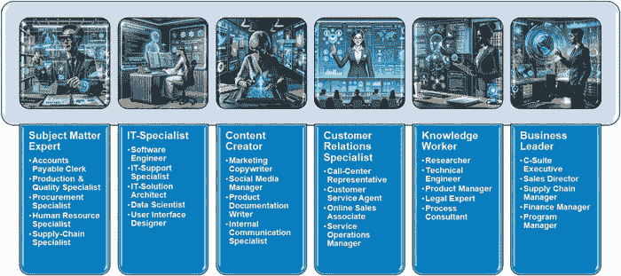

**图 3.1：企业角色概览**

这些角色中的每一个都可以利用 CapabilityGPT 框架的 18 项 AI 能力中的一项或多项来增强他们的日常工作，在自己的领域进行创新并做出更明智的决策。例如：

- 领域专家可以使用针对其需求定制的特定 AI 能力来自动化任务和常规决策。
- IT 专家可以利用 ChatGPT 的能力来增强系统设计、数据分析并培养创新解决方案。
- 内容创作者可以利用 AI 能力激发灵感并制作高质量内容。
- 客户关系专家可以在 AI 框架的帮助下提升客户服务标准。
- 知识工作者可以利用特定能力进行高级知识管理和推理，从而提高生产力和质量。
- 业务领导在配备了定制 AI 能力后，可以收集更多数据并更快速、全面地进行分析。

随着 CapabilityGPT 的引入，AI 的益处在企业的各各个角色中都是可获取且可适应的。在本章中，我们将阐明通过 ChatGPT 集成这些 AI 能力如何为每个企业角色的生产力、创新和增长提供巨大机会。

## 结构

在本章中将涵盖以下主题：

- 领域专家的未来
- IT 专家的未来
- 内容创作者的未来
- 客户关系专家的未来
- 知识工作者的未来
- 业务领导的未来

## 领域专家的未来

在应付账款和供应链管理等职能中，AI 工具正成为专业人士的得力伙伴。本节讨论了 AI 协助如何有利于各种角色的日常任务。我们将关注以下 SME 角色：应付账款员、生产与质量专家、采购专家、人力资源专家和供应链专家，阐明他们典型工作周可能的变化。

## 应付账款员

介绍 Taylor，一位应付账款员，他与他的 AI 同事财务分析智能代表（`FAID`）协作工作，优化应付账款操作。


**图 3.2：应付账款员**

### 周一 – 复杂的发票处理和差异处理

Taylor 和 FAID 在周初开始细致地处理了多张复杂的发票，深入研究细节以确保精确和准确。虽然他们处理了大量的发票，但我们重点关注了三个特定实例，以说明他们在日常运营中遇到的反复挑战。

在开始，FAID 利用其基于 OCR 的`信息提取与分析`能力，细致地扫描并提取了发票中的关键数据。随后，`通信`和`匹配`功能发挥了作用，它将提取的细节与交易系统中相应的采购订单和收货单进行交叉比对，旨在找出任何差异。

在第一张发票中，出现了记录的交付数量的差异。Taylor 假设：“这与收货单不符。难道是我们这边在记录时的数据输入错误吗？”为了验证这一点，FAID 启动与仓库人员进行基于对话的对齐，使用其`通信`功能验证细节。仓库人员确认了错误，并在 FAID 的帮助下，及时纠正了系统中的错误，更新了收货单以反映准确的细节。

转向第二张发票，价格偏差显而易见。Taylor 注意到：“似乎供应商根据最近的涨价对我们进行计费，而这在最初的采购订单并未反映。”在这里，FAID 通过其`评估`能力进行合同分析，发现了一个系统内未正确设置的约定价格容差。FAID 毫不停顿，利用其`通信`功能在交易系统中触发了系统配置更新，以符合合同条款，从而无缝地解决了问题。

检查第三张发票时，他们发现适用的税率与采购订单中规定的不符。Taylor 指令道：“FAID，似乎供应商没有按照采购订单中的协议适用税率，我们可以联系他们澄清并与他们重新核实这一点吗？”再次利用其`通信`能力，FAID 向供应商发送通知，要求根据采购订单中预先约定的条款纠正适用税率，同时临时封锁了这张发票以避免任何复杂情况。

### 周二——供应商澄清管理与审批启动

周二致力于服务发票处理这一复杂任务。Taylor 和 FAID 集中于处理协调采购订单（PO）、服务验收单和发票之间所述的多层规格时带来的复杂性。

利用其敏锐的`匹配`和`通信`能力，FAID 在此过程中起着关键作用。它系统地交叉验证这些文件之间的数据，确保每个细节都完美对齐，避免未来出现任何冲突或差异。例如，在其中一张发票中，发现验收单和发票上记录的服务持续时间存在差异。为了解决这个问题，FAID 促成了 Taylor 与服务提供商之间的对话，以确定准确细节并据此调整发票，确保对所提供服务的准确描述。

随着一天的进行，Taylor 利用 FAID 的`分类`功能，根据项目对齐、成本范围和紧急程度等各种标准对修订后的发票进行熟练分类。随后，通过 FAID 的`通信`功能将发票引入审批工作流，这是迈向最终结算的关键步骤。

### 周三——发票最终调整与审批完成

周三，Taylor 和 FAID 就发票调整进行了积极的讨论。FAID 利用其`通信`能力，在他们讨论处理每个案例的最佳方法时，将供应商的澄清内容整合到发票中。

Taylor 可能会问：“FAID，你能`总结`一下目前为止的审批状态吗？”FAID 以简洁的概述作为回答，帮助 Taylor 做出明智的决策并在必要时进行干预，保持过程透明且协作。

### 周四——详细对账

当 Taylor 和 FAID 在周四联手对应付账款分类进行细致对账时，Taylor 提到：“我们有一项艰巨的任务，要将未付付款与银行对单进行匹配。让我们确保一切完美对齐。”

FAID 迅速开始使用其`匹配`和`通信`能力收集必要数据，并将潜在的不匹配之处提出供 Taylor 注意。在此过程中，它标记了一个异常交易，促使 Taylor 询问：“FAID，标记这一特定交易的原因是什么？”

凭借详细的见解，FAID 分享道：“与该供应商的交易金额显著高于平均发票价值，而且这是他们本月的第三张发票了，而他们通常是两个月发送一次发票。”

认可这一详细分析，Taylor 决定与供应商进一步调查，并对 FAID 在识别此类异常方面的敏锐眼光和分析能力表示赏。

在结束一天之前，Taylor 与 FAID 讨论了即将到来的付款计划，策略利用其`排名`能力优化支付顺序，以避免任何滞纳金同时保持健康的现金流。Taylor 说道：“FAID，让我们利用我们的见解来明智地安排付款，重点关注日期和预算可用性。”FAID 遵循指令应用了其`规划`功能。

### 周五——报告与绩效回顾

周五，Taylor 与 FAID 分享了议程：“让我们用一份全面的报告结束本周，突出关键活动并识别我们下周可以改进的领域。”

FAID 通过其`创建`功能汇编了一份见解性的报告，将大量数据综合成本周财务动态的快照，便于 Taylor 和 FAID 对未来策略进行建设性讨论。

在结束之前，Taylor 提到了学习方面：“我们本周看到了几次 OCR 错误。如果我们能从中学习，避免未来出现类似的问题，那就太棒了。”

FAID 认可了这一点，专注于通过从本周遇到的错误中学习学习，并调整其能力以更好地协助接下来的任务。

通过与 FAID 合作，Taylor 能够准确且高效地处理大量复杂的发票，维持良好的供应商关系，确保合规性，并不断改进应付账款流程。他们的协同实现了运营的优化和生产力的提高，对组织的财务管理做出了重大贡献。

## 生产与质量专家

想象一下生产与质量专家 Mary 的一天，她与她的 AI 伴侣生产质量智能系统（PQIS）和谐工作。


**图 3.3：生产与质量专家**

### 周一——生产监控与安全检查

Mary 开始了的一周，询问：“PQIS，你能给我更新一下生产速度吗？”利用其`评估`能力，PQIS 回答：“目前的生产速度为最佳速度的 80%。由于今天早些时候的维护工作，3 号装配线出现了缓慢。”Mary 对表示感谢并询问：“安全标准呢？”PQIS 快速指出了潜在风险区域，建议 Mary 特别注意生产车间最近发生溢漏的区域，以防止事故发生。

### 周二 – 流程调整与质量保证

周二，玛丽（Mary）想要深入探讨反复出现的生产问题，她问道：“PQIS，我们最近是否发现了任何导致生产效率低下的模式？”通过其`Data Mining`功能，PQIS 强调道：“是的，2 号线频繁出现短停顿，可能是由于较旧的传送带出现了磨损迹象。”玛丽根据这一信息采取了行动，决定为传送带安排维护检查。整天中，PQIS 协助玛丽监控生产质量（同时利用其`Assessment`和`Recommendation`能力），建议对机器设置进行微调以提高产品质量。

### 周三 – 库存管理与跨部门协作

玛丽在周三的开始，利用 PQIS 的`Communication`和`Prediction`能力专注于库存管理和部门间的协作。她咨询 PQIS：“我们可以检查一下组件 X 的库存状态吗？”PQIS 与 ERP 系统对接并告知：“组件 X 的当前库存足够本周使用，但建议重新订购以避免下周出现中断。”随后，她利用 PQIS 建立的虚拟协作空间与销售部门协调，以确保生产与即将到来的销售促销活动保持一致。

### 周四 – 文档记录、问题解决与质量控制

周四，玛丽记录了生产过程、安全协议和质量标准的细节。她使用 PQIS 的`Summarization`能力将复杂的生产数据压缩为易于管理的摘要，提供了更清晰的生产全景视图。利用 PQIS 的`Transformation`能力，玛丽随后将摘要数据转换为易于理解的可视化图。

在记录文档时，玛丽注意到 PQIS 提供的特定批次质量控制数据存在异常。经查询，PQIS 详细说明了质量偏差的原因，包括测量不一致、固化期间的温度飙升以及原料混合比例的差异。有了这些详细的反馈，玛丽计划纠正这些问题并确保它们不再发生。

PQIS 的`Assessment`技能使她能够进行性能分析并对生产过程进行必要的调整以获得更好的输出。最后，通过 PQIS 的`Prediction`能力，玛丽收到了关于制品任何潜在质量偏差的警报，以便能够立即纠正。

### 周五 – 培训、绩效回顾与未来规划

玛丽在结束本周工作时，专注于培训和未来规划。她寻求 PQIS 协助开发培训内容，问道：“PQIS，我们能根据本周遇到的问题定制培训模块吗？”利用其`Creation`能力，PQIS 帮助制定了针对特定问题领域的个性化培训课程。下午，玛丽坐下来回顾本周的绩效并规划下周。通过 PQIS 的`Creation`和`Recommendation`能力，她分析了详细报告，这些报告突出了成就和需要改进领域，为应对下周挑战采取主动方法奠定了基础。

根据预测性制造的原则，玛丽与 PQIS 积极协作，确保了每天几乎无缝的生产流程和高质量的输出。PQIS 持续的车间更新和前瞻性见解使玛丽的角色在运营上既有效又主动，为稳健的生产流程和顶优质产品的交付做了贡献。

## 采购专家

认识诺尔（Noor），一位精明的采购专家，她得到了 AI 伙伴 ProcurAce 的紧密支持，该系统旨在协助采购流程的各个方面。以下是他们典型工作周的预览。

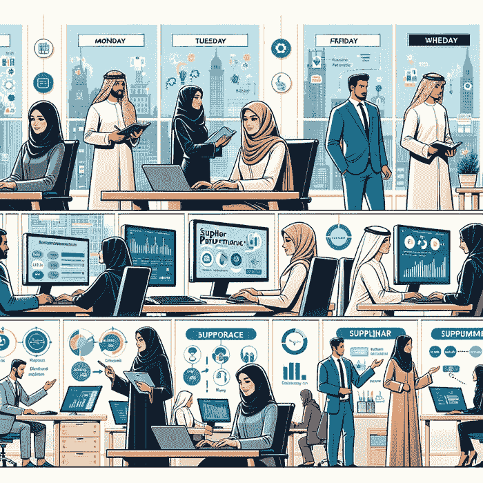

**图 3.4：采购专家**

### 周一 – 供应商绩效评估与反馈

当诺尔仔细研究性能指标时，她询问 ProcurAce：“供应商 B 上季的规格合规表现如何？”ProcurAce 利用其`Assessment`能力回答道：“供应商 B 的合规率为 95%，比上一季度提升了 5%。”

随后，在起草反馈邮件时，诺尔询问：“你能建议一种礼貌的方式来处理供应商 C 反复出现的包装问题吗？”ProcurAce 通过其`Communication`技能提供帮助，建议道：“你可以说：‘我们重视合作伙伴关系，并相信解决这一反复的包装挑战可以促进未来更顺畅的合作’”

### 周二 – 征求建议书（RfP）创建、供应商预选与发送

在创建 RfP 期间，诺尔询问 ProcurAce：“我们可以在项目范围中强调对环境标准的合规性吗？”ProcurAce 利用其`Creation`能力并建议道：“绝对可以，我们可以强调遵守特定环境规范的必要性，展示我们对可持续实践的承诺。”

随后，在确定发送 RfP 的供应商时，诺尔咨询 ProcurAce：“根据过去的表现，哪些供应商最适合这个项目？”ProcurAce 采用其`Ranking`能力建议道：“鉴于它们在类似项目中的卓越记录，供应商 D 和供应商 F 是你的最佳选择。”

### 周三 – RfP 查询与响应管理

到了周三，诺尔开始收到与她昨天发送的 RfP 相关的查询。首要任务是对这些查询进行分类，以便进行高效的响应管理。ProcurAce 使用其`Classification`能力将入站查询分类为“定价”、“时间线”、“规格”和“模糊”等类别。

来自“供应商 X”的一个特定查询被 ProcurAce 标记为“模糊”。为了寻求澄清，索菲（Sophie）查询了 ProcurAce。系统解释标记是因为查询的术语模糊、可能存在多种解释，以及过去与“供应商 X”的互动中出现过类似的模糊情况。了解这一点后，诺尔决定直接处理该查询以避免误解。

对于其余查询，她使用了 ProcurAce 的`Communication`和`Question Answering`能力。系统根据预设指南起草回复，并在发送前将其排队等待诺尔审阅。

### 周四 – 应急管理与成本控制

面对供应波动，诺尔转而询问 ProcurAce：“我们能在短时间内找到替代供应商吗？”ProcurAce 凭借其`Matchmaking`能力迅速行动，回答道：“是的，供应商 G 和 H 潜在可以满足你的需求；你想联系他们吗？”

下午，诺尔问道：“为了控制成本，我们可以考虑哪些潜在的谈判点？”ProcurAce 调用了其`Recommendation`函数，建议道：“你可能考虑谈判付款条款或探索批量折扣来控制成本。”

### 周五 – 供应商协作、预测与报告

在审查 RfP 响应时，诺尔咨询 ProcurAce：“你能帮我从供应商 I 的提案中提取核心卖点吗？”ProcurAce 以其`Information Extraction and Analytics`能力配合了请求，列出道：“可以，他们强调了创新方法和对可持续性的承诺。”


在他们确定选择时，诺尔问道：“我们应该如何向供应商传达我们的决定？”`ProcurAce` 采用 `Communication` 技能建议道：“让我们热烈祝贺被选中的供应商，并通过认可其他提案的优点来鼓励其他供应商。”

通过利用 `ProcurAce`，Noor 确保了精准的供应商评估和高效的 RfP（招标）管理。她还加强了供应商协作，提高了预测准确性，并对组织的采购卓越做出了重大贡献。Noor 与 `ProcurAce` 之间的这种协同效应支撑了 AI 在优化采购运营和实现战略成果方面的变革力量。

## 人力资源专家

进入资深人力资源专家 Brian 的世界，看他如何与 AI 助手 `HR Helper` 共同应对 HR 领域。以下是他们高效工作周的预览：


**[图 3.5]:** 人力资源专家

### 周一 – 绩效洞察与冲突模拟

Brian 在周初开始时思考道：“HR Helper，根据上周的绩效数据，我们的团队表现如何？” `HR Helper` 利用其 `Assessment` 能力筛选各种数据，以提供细致的洞察。

在识别出关注领域后，Brian 问：“我们能识别表现不佳的可能根源吗？” `HR Helper` 利用其 `Cause-Effect Analysis` 能力指出工作量不平衡和技能缺口等问题。

预见到到即将到来的艰难对话，他想：“我们能为潜在的冲突制定策略吗？” `HR Helper` 启动其 `Simulation` 能力，帮助众脑暴有效的干预策略。

### 周二 – 候选人排名与健康调查

Brian 拿着一份潜在入职名单，询问道：“我们如何能高效地分类这些简历？” `HR Helper` 通过部署其 `Classification` 和 `Ranking` 能力做出了，简化了候选人的筛选流程。

随后，Brian 想要评估员工情绪，问道：“我们可以检查一下团队的福祉吗？” `HR Helper` 使用其 `Communication` 能力发送了调查问，并用其 `Assessment` 能力评估回复，提供了当前士态的快照。

### 周三 – 内容创作与多样性挖掘

在周三，Brian 表达了通过培训弥补已识别技能缺口的需求，问道：“我们能创建引入人的培训材料吗？” `HR Helper` 发掘其 `Creation` 能力帮助设计丰富的内容。

为了维持多样化的工作场所，他提问：“我们的多样性格局是怎样的？” `HR Helper` 利用其 `Data Mining` 能力深入研究大量数据，突出了需要关注的领域。

### 周四 – 政策评估与团队匹配

Brian 在周四以合规性检查开始，想道：“我们的政策符合当前的法规吗？” `HR Helper` 通过其 `Assessment` 能力审查政策，指出了一个潜在的违合规问题供 Brian 处理。

随后，在讨论团队动态时，Brian 建议道：“让我们为接下来的项目寻找最佳团队组合。”在这里，`HR Helper` 凭借其 `Matchmaking` 能力介入，提议能够促进生产力和和谐的组合。

### 周五 – 离职预测与报告汇编

随着周末临，Brian 寻求预测，查询道：“下季的员工离职情况预计如何？” `HR Helper` 投入其 `Prediction` 能力，提供了明智的预测。

在结束之前，Brian 请求：“我们能有一份本周 HR 动态的全面报告吗？” `HR Helper` 利用 `Information Extraction and Analytics` 和 `Transformation` 能力汇编了一份详尽的报告，为下周的工作提供了可操作的洞察。

整个周期间，Brian 与 `HR Helper` 的联盟体现了 AI 在 HR 领域的潜力——无论是简化任务、确保合规还是增强团队动态——都对 HR 职能的效率做出了实质贡献。

## 供应链专家

想象供应链专家 Noah 的一天，他将任务与其 AI 驱动的供应链控制塔（SCCT）无缝整合。


**[图 3.6]:** 供应链专家

### 周一 – 稳健的需求与供应规划

周初，Noah 问道：“我们如何能准确预测本季的产品需求？” `SCCT` 通过利用其 `Prediction capability` 分析历史销售数据、季节性趋势、市场动态和供应商能力，提供了全面的预测以帮助供需规划。

随后，Noah 想道：“是否有方法可以自动化与供应商的通信以简化订购流程？” `SCCT` 给予了肯定的回答，强调了其 `Communication capability` 可促进无缝的供应商互动，帮助维持平衡的库存。

### 周二 – 库存监控与策略模拟

周二，Noah 询问道：“我们能获取所有仓库当前状态的更新吗？” `SCCT` 采用其 `Communication capability` 从各种库存和仓库管理系统中获取最新数据，让 Noah 根据当前的库存水平做出明智决策。

随后，在关注风险管理时，Noah 问道：“我们可以模拟潜在的供应链中断以做好准备吗？” `SCCT` 激活了其 `Simulation capability`，构建了几个供应链场景并分析了潜在影响，为 Noah 应对各种挑战提供了战略路线图。

### 周三 – 可操作的洞察与自适应策略

周三，Noah 将注意力转向深度执行周二模拟中得出的洞察。当他整合这些可操作的步骤以改进供应链流时，`SCCT` 的 `Communication` 能力确保了库存系统、供应商和配送渠道之间的无缝互动。

然而，`SCCT` 的某项特定洞察引起了 Noah 的注意，建议其中一个供应商合作伙伴关系发生了重大转变。他好奇地询问了更深层的理由。`SCCT` 通过详细说明历史表现、近期行业转变和新兴物流挑战等因素的结合如何使这一洞察可行进行了解释。`SCCT` 结合历史数据趋势、近期供应商评分和潜在的未来中断风险阐明了这一点。凭借这些透明且数据驱动的洞察，Noah 考虑了其影响并开始进行必要的调整。

同时，`SCCT` 对整个供应链保持着鹰眼。从追踪潜在的延迟、库存不平衡到技术故障，`SCCT` 的实时 `Communication` 和 `Assessment` 能力确保了异常被迅速检测。对于任何不一致之处都会立即发出警报，`SCCT` 的 `Recommendation` 引擎开始行动，建议有效的应对措施以减轻潜在问题，确保供应链运营的顺畅。

### 周四 – 异常处理

周四面临突发的生产故障，Noah 紧急问道：“我们能做什么来减轻这起生产故障造成的中断？” `SCCT` 调度了其 `Communication and Matchmaking capabilities` 以促进紧急讨论并寻找替代供应商，提供了在不发生严重延迟的情况下维持供应的解决方案。

### 周五 – 绩效评估与报告

周五到来，Noah 专注于回顾本周绩效，问道：“你能帮我分析本周的运营绩效吗？” `SCCT` 利用其 `Assessment capability` 评估不同的指标，提供了本周活动的全局视图。

随后，在准备报告编制时，Noah 请求道：“我们可以将所有关键数据压缩成一份详尽且直观的报告吗？”`SCCT` 利用其`Summarization and Transformation capabilities` 创建了具有直观可视化的简洁报告，帮助 Noah 有效掌握关键洞察。

在整个工作周中，Noah 利用其 AI 驱动的供应链控制塔（SCCT）的全面能力来优化运营并提高供应链管理效率。通过利用先进的 AI 进行实时通信、预测分析、模拟和评估，Noah 应对了常规和突发挑战，确保了供应链流程的稳健、韧性且于无缝。

## IT 专员的未来

在信息技术领域的软件工程师、IT 支持专家、IT 解决方案架构师、数据科学家和用户界面设计师等角色中，AI 的集成正在快速改变生产力、问题解决和创新能力。

### 软件工程师

认识软件工程师 Kim 她的她的 AI 助手 `CodeMaster`，这对擅长将旧留软件系统迁移到新的、优化版本的黄金搭档。让我们深入了解他们典型的工作周，看看他们如何利用 AI 来简化软件迁移。


**[图 3.7]:** 软件工程师

#### 周一 – 详细代码分析与信息收集

Kim 扫描旧代码库，说：“CodeMaster，我们需要一个评估。这段代码的整体质量如何？”

`CodeMaster` 运用其 `Assessment` 能力回答道：“从初步分析来看，有 50 个弃用方法。例如，`legacyMethodA()` 使用了过时的安全协议。”

Kim 感感兴趣，问道：“你发现模式或依赖关系了吗？”

`CodeMaster` 利用其 `Data Mining` 技能指出：“有的。`moduleX` 和 `moduleY` 经常交互。例如，每当 `moduleX` 中的 `functionZ()` 被调用时，它都依赖 `moduleY` 中的 `dataFunctionY()`。”

#### 周二 – 迁移场景分析与详细规划

Kim 画出了一幅迁移地图。“CodeMaster，这种方法会有瓶颈吗？”

使用 `Cause-effect Analysis`，`CodeMaster` 提出：“一个潜在问题是对 `legacyDatabase()` 的依赖。首先迁移它可能会简化其余工作。还记得它在‘凤凰项目’迁移期间是如何导致速度缓慢的吗？”

感到任务艰重，Kim 叹了口气：“我们需要一个详细计划。”

`CodeMaster` 使用其 `Planning` 能力建议道：“我们最后处理用户界面，先关注核心功能。这反映了我们在‘阿特拉斯项目’转型期间成功的策略。”

#### 周三 – 转换：从旧留代码到伪代码和新代码

Kim 筛选复杂的旧留代码，评论道：“这部分的逻辑感觉很复杂。”

`CodeMaster` 激活其 `Transformation` 能力，提议道：“让我简化 `legacyFunctionB()`。与其使用五个嵌套循环，我可以将其提炼为伪代码，突出主要操作。”

一小会儿，`CodeMaster` 展示道：“主循环获取数据，嵌套循环处理数据。我建议使用 `modernMethodC()`，就像我们在‘德尔塔项目’中进行优化的一样。”

#### 周四 – 扩展转换、评估与文档编制

在完善过程中，Kim 注意到：“某些部分感觉没有对齐。”

`CodeMaster` 部署其 `Assessment` 流程，澄清道：“是的，`newFunctionD()` 可能会产生错误，因为它缺少验证检查。这与我们在‘回声项目’中发现的疏忽类似。”

随着文档的进行，Kim 问道：“CodeMaster，旧系统中还有任何我们不应该错过的关键洞察吗？”

`CodeMaster` 利用其 `Information Extraction and Analytics` 能力获取到：“当然可以！`legacyFunctionE()` 有一个独特的错误处理机制。我们应该记录它的逻辑，就像我们为‘狐狸项目’保留的笔记一样。”

#### 周五 – 测试与部署

Kim 准备最后的冲刺，“该时候进行严格测试了，CodeMaster。”

`CodeMaster` 启动其 `Simulation` 能力，建议道：“我正在创建一个模拟用户环境。记得‘伽马项目’中的 `userTypeZ` 吗？他们的使用模式可以作为一个起点。”

随着测试的展开，Kim 增加道：“我们需要在主套件中这些结果。”

`CodeMaster` 利用其 `Communication` 能力保证道：“正在处理。正在与我们的‘TestMaster’套件集成，确保数据一致性。”

通过与 `CodeMaster` 协同工作，Kim 确保了软件系统的顺利过渡和代码质量的一致。`CodeMaster` 定期的代码审查和建议支持了 Kim 的工作，实现了有条理的迁移过程和可靠软件解决方案的部署。

### IT 支持专家

深入了解 IT 支持专家 Alice 和她的 AI 助手 `TechMaster` 的一天。他们共同在运营问题、提供高质量支持和维护系统完整性方面形成了高效的搭档。


**[图 3.8]:** IT 支持专家

#### 周一 – 系统监控与用户协助

当 Alice 查看系统日志时，她评论道：“服务器周末过得不太好，TechMaster。”

`TechMaster` 接入其 `Assessment` 能力，回答道：“东翼的新 HR 软件似乎给我们的网络节点带来了压力。”通过其解释功能，它显示了详细的网络流，突出了拥堵区域。

整天中，用户不断联系寻求。一个用户评论道：“我似乎无法访问我们的共享驱动器！”Alice 询问：“TechMaster，有什么洞察吗？” `TechMaster` 利用其 `Question Answering` 能力回答道：“这反映了我们上个月解决的问题。让我们尝试同样的修复方法。”Alice 遵循 AI 的指导，迅速解决了问题。他们使用 `TechMaster` 的 `Classification` 能力对问题进行分类和跟踪。

#### 周二 – 系统维护与备份管理

Alice 调出周维护计划，沉思道：“我们的日程很满，TechMaster。” AI 采用其 `Planning` 能力，建议道：“我们先处理软件更新，然后管理备份。”整天中，`TechMaster` 协调各项任务，与备份管理工具进行通信。当一个意外的备份错误弹出时，`TechMaster` 警告道：“财务数据备份出了问题。”他们共同排除故障，使用 `Classification` 能力监控系统状态。

#### 周三 – 培训与文档

准备培训课程时，Alice 问道：“TechMaster，你能为我们的新安全功能生成一份指南吗？” `TechMaster` 利用其 `Creation` 能力草拟了一份直观的用户指南。随后在培训期间，Alice 模拟了一个典型的用户场景。`TechMaster` 投影了模拟，帮助用户可视化并理解新系统的各个。

#### 周四 – 网络支持与安全检查

在监控网络时，Alice 注意到异常情况：“TechMaster，我们面临任何安全威胁吗？” `TechMaster` 利用其 `Assessment` 和 `Creation` 能力提供了一份潜在漏洞的报告。它随后激活了 `Recommendation` 能力：“根据我的分析，我建议对漏洞 Y 使用补丁 X。此外，考虑调整防火墙设置以增强保护。”

#### 周五 – 合规性、报告与未来规划

在本周结束之际，艾莉思道：“TechMaster，让我们确保符合所有的 IT 策略。”AI 使用其 `Information Extraction and Analytics` 和 `Assessment` 能力对系统进行扫描，并回答道：“合规性为 98%。我已经列出了需要关注的领域。”艾莉点点头：“太棒了。让我们也为下周做准备吧。”`TechMaster` 利用其 `Prediction` 能力展示了潜在的未来挑战，以便他们据此制定策略。

#### 全周期间 – 故障排除、沟通与持续学习

每天，艾莉和 `TechMaster` 都要兼顾多项职责。他们处理用户查询、排查硬件和软件问题，并确保 IT 部门与用户之间的沟通顺畅。`TechMaster` 使用其 `Question Answering` 能力准确、快速地解决用户查询。这对还根据新数据利用 AI 的 `Predictive` 能力。这种由 AI 机器学习驱动的持续学习随着时间的推移优化了支持交付，并有助于提高用户满意度和高效的系统管理。

艾莉与她的 AI 助手 `TechMaster` 高效地管理 IT 支持。他们的协作实现了问题的快速解决、最优的系统运行和用户满意，从而为整体生产力和增长做出了贡献。

### IT 解决方案架构师

认识 IT 解决方案架构师 Marcelo 和他的 AI 助手 `TechAlign`。以下是他们工作周的详细说明，展示了他们职责的实际应用。


**[图 3.9]:** IT 解决方案架构师

#### 周一 – 基础设施评估与方案对齐

Marcelo 看了一眼工单看板道：“TechAlign，5 号部门工单增加了很多。”`TechAlign` 利用其 `Assessment` 能力观察到：“让我们深入研究基础设施指标。那里的服务器集群正承受着异常压力。”进一步挖掘，AI 的 `Cause-Effect Analysis` 揭示了：“有一个应用程序导致重复查询，这可能是根源问题。”

#### 周二 – 方案设计与任务排序

当 Marcelo 的团队聚集周会时，他提示道：“TechAlign，记录要点，特别是关于新集成项目。”`TechAlign` 使用其 `Communication` 能力勤奋地记录对话。当集成挑战出现时，`TechAlign` 建议道：“新旧系统之间的数据流概述如何？可能会澄清一些疑问。”利用 `TechAlign` 的 `Creation` 工具集，他们构思了一个健壮的设计。在一天结束之前，`TechAlign` 利用其 `Planning` 和 `Ranking` 能力提议：“考虑到依赖关系，我建议先处理数据库同步。”

#### 周三 - 数据分析与风险评估

当 Marcelo 查看海量数据集时，他问道：“我们能在这里发现任何异常或模式吗？”

`TechAlign` 利用其 `Data Mining` 能力回答道：“非工作时间存在异常的访问模式。让我们调查一下。”此外，`TechAlign` 从最近 IT 文档和标准中提取了关键合规数据，并提到：“最近的标准强调了我们可能想要加强的领域。”

#### 周四 – 系统模拟与规划

为即将到来的发布做计划，Marcelo 自言自道：“我希望我们的系统能够处理冲击。”`TechAlign` 渴望测试，提议道：“让我们模拟一下。”在 `Simulation` 后，`TechAlign` 利用 `Planning` 技能为用户提供了优化建议。

#### 周五 – 技术建议与文档编写

随着周末临近，`TechAlign` 展示 `Recommendation`，分享道：“有一个新协议。”当他们编写文档时，Tech 利用 `Transformation` 能力提供道：“这些蓝图很复杂。我们把它们简化怎么样？”

#### 全周期间 – 查询解决与性能报告

Marcelo 定期就问题咨询 `TechAlign`：“最近进展如何？性能与上个月相比如何？”通过 `Question Answering` 能力，`TechAlign` 提供了及时的回复。每个晚上，Tech 都提供 `summary`。

### 数据科学家


认识数据科学家 Varsha 和她的 AI 助手 InsightAlign。他们共同将原始数据转化为可操作的洞察。让我们来看看他们典型的一周：


**[图 3.10]:** 数据科学家

# 周一 – 数据清洗与预处理

周一开始，Varsha 问：“今天状态如何？”InsightAlign 深入 `Data Mining` 能力回答道：“有一些有趣的模式，但也有我们需要处理的异常。准备好进行数据转换了吗？”他们一起精炼数据，确保其适用于建模任务。随后，Varsha 思考道：“我想知道项目组是否知道这个。”TechAlign 使用其 `Communication` 能力保证道：“我刚刚向他们更新了发现和现状。”

# 周二 – 特征工程

Varsha 检查数据，问道：“哪些特征可以驱动我们的模型？”

利用 `Cause-effect Analysis`，InsightAlign 建议道：“考虑到我们的目标，这些变量可能会影响结果。想根据它们创建一些新特征吗？”这对花费了一天时间构建数据，为算法选择做准备。

# 周三 – ML 算法选择与模型训练

周中，Varsha 和 InsightAlign 开始为项目选择最合适的机器学习算法。在激活 `Matchmaking` 能力后，他们审查了各种算法，以确定它们与特征和输出的兼容性。发现一个很有前景的算法后，Varsha 表示想更深入地探索它，以确保它是最合适的。

InsightAlign 然后使用其 `Explanation` 能力，为 Varsha 提供所选算法的全面概述。AI 详细阐述了算法的优点、潜在缺点和理想使用场景。它提供了视觉表示来解释底层数学，让 Varsha 更直观地理解其运行机制。例如，如果他们正在考虑决策树，InsightAlign 可能会视觉化树如何划分数据，并提供关于熵、信息增和决策边界的背景[¹]。这种深度探讨还涵盖了计算成本、算法假设和潜在偏见，确保 Varsha 拥有做出明智决策所需的所有信息。

对自己的选择充满信心，他们继续执行算法。InsightAce 利用其 `Creation` 能力，根据他们选定的算法为不同的流水线起草多个版本的代码。随后开始模型训练，AI 的 `Communication` 和 `Transformation` 能力协同工作，通过 API 调用执行模型并将其随后的结果进行可视化处理。

# 周四 – 模型验证与优化

Varsha 回顾着进展，问道：“我们的模型表现如何？”InsightAce 凭借其 `Assessment` 能力回答道：“我们的准确率和精确度看起来不错，但召回率还需要提高。”他们讨论了调整和改进方案，确保模型处于顶峰水平。

# 周五 – 模型部署、监控与持续改进

Varsha 展望未来，思考道：“我们如何才能无缝地将模型集成到现有系统中？”InsightAce 在考虑了潜在的限制因素后，建议制定一个 `plan`。“我们还应该模拟潜在的性能场景，以确保我们的模型保持健壮，”它利用其 `Simulation` 能力补充道。他们确定了部署计划，对本周的成就充满信心。

# 整个周 – 迭代改进与文档记录

在这一周中，Varsha 经常寻求明确说明。“Ace，提醒我我们为什么选择这个参数？”InsightAce 凭借其 `Question Answering` 技能提供了准确的背景信息。他们记录了自己的流程，InsightAce 的 `Transformation` 将复杂的步骤转化为可读的文档。在周末结束时，InsightAce 总结道：“想对我们这周进行一个快速的 `summary` 吗？”Ava 点点头：“绝对可以！”他们回顾了这段旅程，准备好迎接另一个数据驱动的工作周。

通过 InsightAce 的配合，Varsha 战略性地引导了从原始数据到清晰、可操作智能的情的数据旅程。InsightAce 持续的分析和主动的方法为 Varsha 的明智决策提供了支持，强化了数据科学的迭代过程及其向业务影响的转化。

# 用户界面设计师

让我们深入用户界面设计师 Sven 和她的 AI 助手 DesignMind 的工作周：


**图 3.11:** 用户界面设计师

# 周一 - 任务对齐与用户界面评估

Sven 开始新的一周，思考道：“这周我们应该如何在团队内部分配任务？”DesignMind 采用 `Matchmaking` 建议道：“考虑到每个人的优势和当前的工作负载，我建议 Anna 图标设计，Sam 布局优化。”Sven 然后浏览一个 UI，思考道：“这个界面的性能如何？”通过其 `Assessment` 能力，DesignMind 回答道：“我们的用户反馈和系统日志显示，用户认为导航直观，但配色方案有点混乱。”

# 周二 - 设计创作、优先级排序与组织

Sven 正在绘制一个新的 UI，问道：“你能帮我为这个概念可视化一个原型图吗？”DesignMind 使用 `Creation` 能力显示了多个设计方案，并询问：“这些看起来怎么样？”Sven 点点头：“很好的开始！用户对我们最近设计的反馈如何？”DesignMind 的 `Transformation` 能力组织了原始数据，“反馈显示，用户喜欢这种简洁性，但也有人认为 CTA（行动号召）按钮不够显眼。我们应该优先考虑解决这个问题吗？”

# 周三 - 数据驱动的洞察与设计灵感

Sven 回顾一些模拟数据，问道：“为什么这个设计元素更受欢迎？”DesignMind 运用其 `Data Mining` 技能解释道：“用户觉得它很直观，类似于熟悉的界面。此外，它的颜色和位置增强了吸引力。”Sven 感到周中的疲倦，叹了口气说：“我需要一些新鲜的灵感。”DesignMind 通过其 `Semantic Search` 迅速展示道：“这是我发现的一些趋势设计和风格。”

# 周四 – 根因分析与预测建模

Sven 注意到一些用户投诉，思考道：“是什么导致了这些界面问题？”DesignMind 调用 `Cause-effect Analysis` 能力指出：“似乎侧边栏的文字重叠导致了困惑。此外，用户可能在移动设备上对非响应式菜单感到困难。”Sven 绘制了一些更改，问道：“用户对这个修改后的设计会有什么反应？”凭借其 `Prediction` 能力，DesignMind 推测道：“根据过去的行为，他们可能会认为这更易用，尤其是年轻群体。”

# 周五 – 策略决策与内容开发

Sven 想要改进，问道：“有什么建议可以增强我们的界面吗？”DesignMind 使用 `Recommendation` 能力提供：“基于用户数据，也许让首页横幅具有交互性可以提高参与度。此外优化产品页的内容策略可能也会帮助。”Sven 点点头：“让我们计划一下。我们的方法是什么？”利用其 `Planning` 能力，DesignMind 提供了逐步分解，确保了流程的顺畅。

# 整个周 – 持续支持

在工作期间，Sven 经常询问：“这个元素至关重要吗？”DesignMind 通过其 `Classification` 技能建议道：“它很重要，但搜索框优先。”在另一个时候，她问道：“为什么购物车图标通常放在右上角？”DesignMind 使用 `Question Answering` 能力澄清道：“这是一个被广泛接受的设计规范，便于用户访问和视觉化。”最后，为了保持信息更新，Sven 定期要求：“总结我们的进展和反馈。”DesignMind 依靠其 `Summarization` 技能提供了简洁的概述，确保 Sven 随时掌握如流。

利用 DesignMind 的数据洞察，Sven 设计了增强用户体验的直观界面。他们的协作将创造力与现实相关性相结合，确保每个设计既有美感又兼功能。他们共同创建了以用户为中心的界面，有效地预测并满足了用户需求。

# 内容创者的未来

内容创作已随着 AI 能力发生了变革。在本章中，我们将深入探讨内容创者的未来——营销文案人员、社交媒体经理、产品文档撰写人员和内部沟通专家。在这里，我们将探索 `ChatGPT` 如何释放他们的创造力，增强他们的效率并帮助他们创建更具吸引力和背景化的内容。

# 营销文案人员

认识 Li，他是一位优秀的营销文案人员，通过寻求他的 AI 助手——创意、分析与营销专家（CAME）的帮助来优化他的故事技巧。以下是他典型工作周中使用 CAME 的说明：


**图 3.12:** 营销文案人员

# 周一 – 评估、行动洞察与预算监控

Li 开始新周，思考道：“上周的内容在各个渠道的表现如何？”CAME 使用其 `Information Extraction and Analytics` 能力分享道：“环保产品的博客文章参与度高出 20%。然而，新产品发布邮件活动略有下降。”Li 感到好奇，问道：“有什么线索吗？”通过 `Cause-effect Analysis` 技能，CAME 建议道：“博客的成功可能归于环保意识的上升趋势。至于邮件，似乎某些用户的行动号召按钮出现了故障。”Li 然后想道：“我们的营销预算如何？”CAME 采用其 `Assessment` 能力更新道：“我们目前比预算节省 10%。某些广告活动不佳，提供了潜在的节省空间。”

# 周二 - 内容创作第一部分：受众细分与渠道适配

李在起草一篇新文章时询问道：“CAME，你能帮我针对我们的目标平台和受众优化一下吗？”CAME 利用其 `Creation` 能力建议道：“没问题！加入相关的关键词可能会提升 SEO。此外，考虑到我们的目标群体，使用更随意的语气可能更能引起共鸣。”李点了点头：“听起来不错。那么针对我们的社交渠道，进行定制化处理如何？”CAME 运用其 `Transformation` 能力协助道：“对于 Instagram，使用视觉化的信息图会很有效。对于 Twitter，考虑将内容拆分成推文串。”

# 周三 - 趋势分析、A/B 测试与内容测试

李开启了他的周三工作：“CAME，给我看看市场上最新的内容趋势。”随着 `Data Mining` 和 `Information Extraction and Analytics` 的启动，CAME 报告道：“一种旧的内容风格正在回归。”李挑了起眉毛：“真的吗？为我深入挖掘一下。”CAME 的 `Explanation` 技能展开了叙述，将该趋势与全球事件和影响力人物联系起来。李深感震撼，问道：“好的，让我们测试一下我们这个趋势的不同版本。你能为这些设置 A/B 测试吗？”利用其 `Sequential Decision-making` 能力，CAME 确认道：“没问题！我会跟踪每个版本的互动率。”

# 周四 - 内容创作第二部分与反馈整合

在起草另一篇作品时，李在想：“我们的受众会对此产生什么反应？” `Planning` 和 `Prediction` 能力，CAME 提议：“根据过去的反应，他们可能会喜欢这里的一段个人轶事。此外，最近的反馈建议增加更多视觉元素。”李回答道：“非常有见地的洞察！我们能把这个翻译给我们的西班牙语受众吗？”CAME 的 `Transformation` 能力确保道：“绝对可以。我很快就会转录并翻译。”

# 周五 – 研究与协作头脑风暴

展望本周的结束，李提议道：“CAME，调出最新的营销策略。另外，我晚后要和团队进行头脑风暴会议。”经过 `Semantic Search`，CAME 给出：“视频营销和网红合作的影响力正在增强。至于头脑风暴，我已准备好包含所有必要工具的虚拟空间。”李对本周的工作非常满意，总结道：“最后，为我总结一下这一周。”CAME 通过其 `Summarization` 和 `Transformation` 能力提供了：“我们看到博客互动率有所提升，做出了成本效益预算决策，接受了回归的内容趋势，并在跨渠道执行了内容。总的来说，是高效的一周！”

在 CAME 的 AI 指导下，李在本周熟练地处理了他的营销文案任务，确保内容具有影响力和相关性。通过高效处理内容评审、受众互动、策略调整、趋势识别和 A/B 测试，他为即将来的营销活动做好了充分准备。

# 社交媒体经理

认识 Alex，他是一位勤的社交媒体经理，在 AI 伙伴 DASH（数字与社交媒体助手）的帮助下优化了他的每周工作。以下是 Alex 的典型工作周：


**图 3.13:** 社交媒体经理

# 周一 - 周表现分析、策略调整与平台更新感知

开启一周之际，Alex 问道：“DASH，我们最近的社交活动表现如何？有什么异常吗？”DASH 利用其 `Assessment` 能力回答道：“你最近的 Instagram Story 浏览比平均水平高出 15%，可能是由于使用了相关的话题标签。然而，Facebook 的互动率略有下降。”Alex 沉思道：“很有意思。这和任何平台更新有关吗？”DASH 的 `Cause-effect Analysis` 能力提供了提示：“Facebook 最近更新了算法，这可能会影响触达。”

# 周二 – 内容策略对齐与一致品牌声调管理

在整理内容时，Alex 问道：“DASH，上周哪些帖子的互动率最高？”

DASH 采用其 `Classification` 能力展示了一个排序列表并补充道：“幕后视频和问答帖的效果最好。”Alex 点了点头：“太好了，让我们调整策略，产生更多此类内容。并确保它们在所有平台上与我们的品牌声调一致。”

# 周三 - 内容执行、趋势监控与平台适配

周中，DASH 的 `Creation` 能力协助 Alex 生成引人入胜的帖子和促销材料。随着内容上线，DASH 为 Alex 提供了实时洞察。Alex 问道：“新帖子的表现相比上周如何？”DASH 回答道：“最新的视频内容互动率增加了 20%，可能是因为它们与当前的热点话题相关。然而，信息图帖子的表现未达预期，可能是因为篇幅较长，以及目前受众偏好简洁的内容。” Alex 根据这些信息调整了方法，以确保最佳性能。当天的后续工作还涉及 DASH 的 `Communication` 能力自动执行帖子发布，以及其 `Information Extraction and Analytics` 能力提供了关于内容初步影响的洞察。

# 周四 - 竞争对手分析、跨平台协调与平台更新整合

当 Alex 浏览竞争对手资料时，他心想道：“我想知道我们的主要对手最近在忙什么。”利用其 `Semantic Search` 以及 `Information Extraction` 和 `Analytics` 能力，DASH 回复道：“对手 A 启动了一个新的标签挑战，非常受欢迎。另一方面，对手 B 的活动看起来很稳定，没有显著的活动峰值。”Alex 思考了一下，然后问道：“与他们相比，我们的增长有什么预测吗？”使用其 `Simulation` 能力，DASH 回道：“我们的增长将比对手 B 快，但对手 A 可能会因为新挑战而出现增长。”Alex 随后自言自语道：“有什么需要注意的平台变化吗？”通过其 `Question` `Answering` 技能，DASH 建议道：“Twitter 最近的调整显示出对视频内容的偏好。可能值得围绕此制定策略。”

# 周五 – 预测、策略规划与确保声调一致

Alex 开始说：“我想在下周保持领先。我们的互动预测如何？”使用其 `Prediction` 能力，DASH 预测道：“预计周三左右会出现互动率峰值。然而，周末可能会轻微下降。” Alex 渴望回顾，提到道：“让我们回顾一下本周的表现。”DASH 采用其 `Summarization` 功能提供了：“你周二的视频内容很成功，而周四的信息图没有多少收益。上周的整体互动率增长了 12%。” Alex 总结道：“好了，我需要制定下周策略。让我们获取这些数据的视觉化总结，并确保我们的品牌声调保持一致。”利用其 `Transformation` 能力，DASH 保证道：“没问题，Alex。所有内容将符合品牌声调。”

# 产品文档撰写员

认识 Hiroshi，他是一位勤奋的经理文档撰员。在他信赖的 AI 伙伴 `WORD`（写作优化与修订设备）的帮助下，他将复杂的产品转化为易于理解的指南。以下是 Hiroshi 典型工作周的详细说明。


图 3.14: 产品文档撰员

## 周一 – 文档评估、战略规划与任务排序

筛选最近的用户反馈时，Hiroshi 说道：“似乎有些用户在最新的安装指南上遇到了困难。问题出在哪里呢？”`WORD` 的 `Assessment` 功能扫描了反馈并回答：“看来配置设置的步骤对某些用户来说不够清晰。” Hiroshi 对这一见解表示感谢，点头道：“好的，让我们重写那部分。顺便，你能帮我对最需要关注的章节进行优先级排序吗？”通过 `WORD` 的 `Ranking` 能力，Hiroshi 获取了本周任务的路线图。

## 周二 – 信息提取与内容转换

当 Hiroshi 准备更新文档时，他问道：“WORD，你能从产品发布说明中获取最新的技术细节吗？”利用其 `Information Extraction` 能力，`WORD` 迅速交付了信息。Hiroshi 接着说：“太棒了，让我们利用这些将之前的客户查询和技术回复转换为新指南中有用的知识文章。”

## 周三 – 指南创建与产品功能对齐

在起草用户指南的中途，Hiroshi 疑问道：“我们充分涵盖了产品的新安全功能吗？”`WORD` 使用其 `Matchmaking` 能力进行验证并回答：“双重身份验证部分可以增加更多细节。你想根据常见的用户查询提供一些建议吗？”Hiroshi 渴望提供清晰的说明，回答道：“没问题！让我们确保用户拥有他们所需的所有信息。”

## 周四 – 内容审核、质量保证与总结

当 Hiroshi 审查本周的文档时，他自言自语道：“我在新指南中涵盖了所有关键的产品更新吗？”`WORD` 的 `Assessment` 功能扫描了文档并回答：“新软件补丁的细节描述不够充分。” Hiroshi 对此提醒表示感激，修订了指南以确保了其准确性。整天中，`WORD` 的 `Summarization` 能力对技术规范和用户反馈进行了压缩。这个精简版本帮助 Hiroshi 快速交叉引用，确保关键细节不被遗漏，并提供了本周文档工作的快照。

## 周五 – 详细沟通与下周准备


随着一周的结束，Hiroshi 反思道：“在我们进入周末之前，让我们与产品团队取得联系，确保我们的更新与即将发生的产品变化一致。”使用 `WORD` 的 `Communication` 函数，Hiroshi 与产品团队进行了无缝协作，收集见解并确保他为下周的挑战做好了充分准备。

在 `WORD` 的 AI 支持下，Hiroshi 全周高效地处理了他的产品文档任务，将复杂的产品功能转换为用户友好指南。通过熟练管理反馈解读、内容修订、指南创建、质量检查和团队沟通，他始终与产品更新和用户需求保持一致，确保随时准备应对未来的文档挑战。

## 内部沟通专家

进入 Rebecca 的角色，她是一位干练的内部沟通专家。她与她的 AI 伙伴——沟通协调与辅助技术（`CHAT`）无缝协作，在组织内部打造同步的沟通节奏。以下是他们活力十足的工作周展望：


图 3.15: 内部沟通专家

### 周一 – 综合评估与员工情绪追踪

Rebecca 打开仪表板，说道：“CHAT，让我们了解一下目前沟通策略的状况。”

`CHAT` 毫不停顿地回答道：“好的，Rebecca。利用我的 `Assessment` 能力，看来我们大多数策略的反响良好。然而，某些部门最近的参与度似乎较低。”

深入思考，Rebecca 思考道：“这可能是因为最近沟通政策的变化吗？”

`CHAT` 凭借其 `Cause-effect Analysis` 确认道：“确实，那些部门似乎受变化的影响更大。也许为他们采取定制化的方法会有益？”

### 周二 – 精简分类与沟通

查看待办事项时，Rebecca 思索道：“我们需要确保我们的信息以最有效的方式到达正确的受众。”

`CHAT` 已经领先了一步，提议道：“为什么不用我的 `Classification` 能力呢？我们可以根据沟通偏好对员工进行细分。此外，通过我的 `Creation` 技能，我可以编写针对性的信息，确保它们与每个小组产生共鸣。”

Rebecca 对这种支持表示感激，同意道：“完美！就这么办。”

### 周三 – 创意内容生成与数据挖掘

Rebecca 盯着空白屏幕提到：“我们需要为时事通讯准备一些新鲜、吸引人的内容。”

`CHAT` 调用其 `Recommendation` 能力，建议道：“做一个关于近期成就的信息图表，或者设立一个优秀员工故事的光点板块如何？”

Rebecca 很有兴趣，问道：“听起来很棒！有什么我们应该注意的主题或趋势吗？”

`CHAT` 利用其 `Data Mining` 实力告知道：“关于工作与生活平衡的讨论在增加。也许解决这个问题会产生很好的共鸣？”

### 周四 – 深度信息提取与危机沟通

在筛选如踵而至的公司更新时，Rebecca 思索道：“传递最新政策变化的最佳渠道是什么？”`CHAT` 利用其 `Matchmaking` 功能建议道：“视频会议平台最近参与度最高，能确保最大的覆盖范围。” Rebecca 对这一建议表示感激并继续执行。随后，在检测到可能的虚假信息问题时，Rebecca 意识到采取行动至关重要。`CHAT` 介入提供了危机 `Communication` 支持：“Rebecca，根据虚假信息的性质，我建议发送直接邮件，并在内部门户发布常见问题解答（FAQ）。” 凭借 `CHAT` 的见解，Rebecca 有效地处理了局面，恢复了公司的清晰度和信心。

### 周五 – 战略规划与报告

展望下周的活动，Rebecca 问道：“CHAT，随着产品发布和团队建设活动的临近，我们应该如何构建我们的沟通策略？”

`CHAT` 利用其 `Recommendation` 能力回答道：“对于产品发布，我建议在当天之前发布一系列预告公告。至于团队建设活动，也许对往期参与者进行采访可以激发兴趣。”

Rebecca 同意点头：“这是一个很棒的计划。噢，你能汇总一份我们本周活动的总结报告吗？”

`CHAT` 一直高效，回答道：“没问题。利用我的 `Summarization` 能力，我将详细说明我们周的里程碑和见解。你很快就能拿到。”

在本节中，我们将深入探索各种客户关系角色的日常工作：呼叫中心代表、客服专员、在线销售助理和服务运营经理。通过这些真实世界的见解，我们旨在展示 ChatGPT 如何提升他们的效率，并增强客户满意度、知情互动以及战略性的客户关系管理。

## 呼叫中心代表

我们介绍了 Laura，她是一位勤奋的客服代表，与她信赖的 AI 系统——客户交互智能助手（CIIA）无缝协作。通过对职责进行战略性分工，Laura 能够将大部分时间用于直接与 B2B 客户互动。以下是他们高效的工作周回顾：


**[图 3.16]:** 呼叫中心代表

### 周一 – 直接客户互动

新的一周开始，Laura 感叹道：“CIIA，看起来今天来电源源不断。”

CIIA 柔和的声音回答道：“确实如此，Laura。我利用我的 `Classification` 能力根据复杂和紧急程度对咨询进行了分组。你可以直接着手处理问题，而我会确保所有内容都已记录并准备好后续跟进。”

Laura 微笑着说：“完美。我们开始吧！”

### 周二 - 持续客户互动与幕后问题解决

当 Laura 接起另一个电话时，她自言自语道：“CIIA，我们是否有历史模式可以提供这个特定问题的解决方案？”

CIIA 从其庞大的数据库中提取建议：“基于类似的案例，Laura，我建议这些潜在的解决方案。”它的`Recommendation` 能力提供了具价值的见解，让 Laura 能够对客户查询提供精准、快速的解决方案。

### 周三 - 高频客户参与与动态通话管理

周三通常是 Laura 在客户互动方面工作的高峰。在这一天，她注意到通话量出现了前所未有的激增。Laura 略感压力，心想：“为什么今天会有激增？是发生什么变化了吗？”

CIIA 使用它的 `Data Mining` 和 `Cause-effect Analysis` 能力，迅速检查了最近的产品更新、公司公告或任何可能影响流量的外部事件。“Laura，”CIIA 通知道，“我们最新的产品更新似乎导致部分用户出现了意外的软件故障，导致来电增加。”

有了这些新发现，Laura 立即处理了这种情况。CIIA 通过其 `Ranking` 能力（基于客户重要性和使用该产品的人数），协助对软件故障有直接影响的客户进行优先级排序。同时，它利用 `Creation` 能力根据反复出现的问题和投诉自动生成一份通用的故障排除指南，并利用 `Communication` 能力通过电子邮件将指南发送给通话队列中等待的客户。这不仅缩短了等待时间，还为客户提供了即时解决方案。

在充满挑战的一天结束时，Laura 和 CIIA 无缝地将一场潜在的危机转化为了机遇，展示了他们的韧性和以客户为中心的方法。

### 周四 - 强调客户留存与 CRM 更新

深吸一口气后，Laura 表示：“周四了！处理我们的高风险客户总是充满挑战。CIIA，确保来自他们的任何电话都直接转给我。”

CIIA 访问其 `Matchmaking` 能力并保证道：“正在处理，Laura。请记住，如果你需要管理这些互动的指导，我的 Sequential Decision-making 能力可以根据历史数据和客户画像提供最佳步骤。”

Laura 赞许地点头：“谢谢你，CIIA。顺便也帮个忙，让我们确保我们的 CRM 是最新的。”

CIIA 一直保持警觉，回答道：“我一直在使用 `Communication` 能力自动进行数据输入。这方面不用担心！”

### 周五 – 质量保证与未来规划

周五黎明，Laura 思考道：“CIIA，我们下周的预测如何？”

CIIA 调用其 `Prediction` 能力，分享道：“预计周一和周二的通话量适中，但由于即将发布的产品，周三可能会有小幅增长。”

Laura 点头记录：“知道了。我们这周表现得如何？有什么反馈吗？”

CIIA 随时准备协助，回答道：“通过我的 `Assessment` 能力，我注意到了一些表现出色的领域，以及一些我们可以改进的地方。我们在周末回顾时聊聊吧？”

在 CIIA 高级 AI 功能的帮助下，Laura 在整个周内高效处理了 B2B 客户互动。在平衡直接客户互动、问题解决、危机管理、客户留存和前瞻规划方面，她是顶尖客户服务的典范。

## 客服专员

走进 Eva 的世界，她是一位精通客服专员，她的智能 AI 伙伴是 CASH（客户超级助手）。他们共同组成了一个无与伦比的组合，确保客户获得完美的服务。深入他们的对话式工作周：


**[图 3.17]:** 客服专员

### 周一 - 评估与工管理

周一早上打开仪表盘，Eva 说道：“哇，CASH，我们今天有很多来自不同渠道的咨询。”

CASH 激活 `Classification` 能力回答道：“是的，Eva。我已经根据问题类型、账户状态和复杂程度对它们进行了分类。通过 `Ranking` 功能，我对它们进行了优先级排序，这样我们可以先处理最紧急的。”

Eva 松了一口气回答道：“太好了！让我们确保每个客户都感到被听和被重视。”

### 周二 – 问题解决与反馈分析

喝着晨咖啡时，Eva 思考道：“希望我们今天能解决大部分客户问题。CASH，你能帮我理解一下主要的分类吗？”

CASH 再次调用其 `Classification` 能力提供道：“可以，Eva。大多数问题属于这三个类别。不过，有几个复杂的问题可能需要升级。”

在一天的工作过程中，Eva 询问道：“CASH，反馈情况如何？有什么规律吗？”

CASH 通过 `Data Mining` 能力分析反馈并告知：“我注意到聊天渠道反馈中存在一种趋势。账单流程似乎存在反复出现的问题。可能值得研究以改进服务。”

### 周三 - 产品知识增强与直接客户互动

Eva 渴望增强自己的产品知识，她询问道：“CASH，我想熟悉一下最新的产品功能。你能引导我吗？”

CASH 的 `Semantic Search` 技能深入数据库：“没问题，Eva。这里是我们产品的最新更新。我还强调了客户最近经常问的问题，以帮助你做好准备。”

Eva 感激地回答道：“这对我们的互动非常有帮助。谢谢你，CASH！”

### 周四 – 记录存档与沟通

在与客户交谈中，Eva 问道：“CASH，你能帮我记录这次互动的详细信息吗？”

CASH 的 `Transformation` 能力开始工作：“没问题，Eva。我会确保所有细节都记录并结构化，以便日后参考。”

随后在处理一个特别复杂的客户问题时，Eva 检查道：“CASH，我们的沟通是否清晰且同理心？”

CASH 利用其 `Communication` 能力确保道：“当然，Eva。我的任务是确保客户在整个对话过程中感到被理解和被重视。”

### 周五 – 流程改进与战略规划

在反思本周的互动时，Eva 发现了一个反复出现的问题：大量客户对新产品的设置流程表现出困惑。这个问题近期变得更加突出，导致查询量增加且不满意度上升。

Eva 认为这是一个改进的机会。“我们一定有办法简化设置流程，或者至少能更好地引导客户，”她思考道。

注意到她的顾虑，CASH 介入了进来：“Eva，你想让我进一步分析这个问题吗？”

CASH 利用其 `Data Mining` 能力，分析了近期所有与产品设置相关的客户查询。它识别出了共同的主题以及流程中客户容易卡住的具体步骤。随后，CASH 利用其 `Semantic Search` 能力检索了现有的知识库，试图确定提供给客户的信息是否存在缺失。

CASH 报告道：“Eva，看起来设置流程中的第 3 步缺乏清晰度。此外，还没有针对该步骤可能问题的故障排除指南。”

Eva 点了点头，意识到了差距。“CASH，我们可以做什么来解决这个问题？”

CASH 利用其 `Creation` 能力，为第 3 步起草了一份更详细、更易于用户的指南。它还生成了一个简洁的故障排除章节，解决了用户在这一步可能遇到的潜在问题。此外，它还制作了一个互动式视频教程，确保方法更具视觉化且循序渐进。

Eva 审核并批准了材料，通过 CASH 的 `Communication` 能力，他们将新资源推给了客户。到当天结束时，他们开始收到客户的积极反馈，客户对清晰度的提升表示赞赏。

得益他们的协作方式，Eva 和 CASH 将挑战转化为机会，显著改进了客户体验的一个关键方面。

整个周以来，Eva 和她的 AI 助手 CASH 在管理客户查询、分类问题和增强服务流程方面表现出色。他们的结合优势高效地解决了每个客户的需求。在发现产品设置的困惑时，他们迅速采取行动，强调了他们提升客户体验的承诺。

## 在线销售员

加入敏锐的在线销售员 Fatemeh 的行列，她与她的 AI 伙伴 Sales Optimized Robot Incredibly Knowledgeable (SORIK) 协作，在快速节奏的数字销售领域脱颖而出。他们的一周是数据驱动决策、客户互动和动态销售策略的交织：


**图 3.18:** 在线销售员

### 周一 - 销售业绩总结与产品知识

周一开始，Fatemeh 问道：“SORIK，你能总结一下上周的在线销售业绩，并指出我们还可以改进的领域吗？”

SORIK 激活其 `Summarization` 和 `Assessment` 功能，回答道：“没问题，Fatemeh。上周 X 类的销量有所增长，但 Y 类还有改进空间。此外，根据最近的更新，上线了一条新的产品线。”

Fatemeh 对新产品感到好奇，询问道：“你能详细介绍新产品、它们的优势和定价吗？另外，我们对未来的趋势有任何预测吗？”

SORIK 的 `Semantic Search` 和 `Prediction` 技能发挥了作用：“当然可以。这里是新产品的详情。此外，根据当前数据，我预测下周网站流量可能会激增，特别是家居装饰板块。”

### 周二 – 客户互动、订单处理与售后服务

在处理早晨邮件时，Fatemeh 备注道：“今天有很多客户查询。SORIK，我们可以根据偏好对它们进行分类，以确保我能有效地处理吗？”

SORIK 的 `Classification` 技能开始工作：“没问题。我已将查询分为‘特定产品’、‘订单相关’和‘通用查询’。这将有助于你的回复。”

在这一天中，Fatemeh 观察到：“我看到有几笔交易正在进行。SORIK，我们正在跟踪订单履行情况吗？”

SORIK 激活其 `Communication` 功能回答道：“是的，Fatemeh。我正在管理在线交易、处理付款并确保订单跟踪顺畅。在购买后，我还会根据每个客户的画像建议售后服务或补充产品。”

### 周三 - 产品摆列与库存管理

在查看在线商店布局时，Fatemeh 奇想：“SORIK，我们在产品摆列方面如何？我们跟上库存情况吗？”

SORIK 的 `Data Mining` 技能提供了见解：“Fatemeh，‘生活小配件’部分似乎很受欢迎，但有些产品库存不足。我应该检查其他仓库还是建议替代品吗？”

Fatemeh 点了点头：“是的，请。另外，让我们根据销售数据和即将到来的趋势规划补货。”

SORIK 的 `Matchmaking`、`Communication` 和 `Planning` 能力同步运行：“我已经确定了合适的替代品，并创建了补货计划。通过这些调整，我们可以确保我们的在线商店保持吸引力和高效性。”

### 周四 - 关系建立与客户服务

周四下午，Fatemeh 注意到咨询某个特定产品系列的客户数量增加，而该系列一直不是商店促销的重点。似乎有一群网红正在将流量和兴趣引向这一系列。

“SORIK，”Fatemeh 问问，“最近有关于我们‘环保家居’产品系列的社交媒体提及或促销吗？”

利用其 `Information Extraction and Analytics` 功能，SORIK 识别出有几位知名的环保意识网红最近在贴子中提到了‘环保家居’系列，导致了在线商店兴趣和流量的增加。

“确实如此，Fatemeh，”SORIK 回答道，“最近三位网红强调了我们的‘环保家居’系列。这在他们的平台上获得了大量的互动。”

Fatemeh 思考了一会儿。“我们能利用这次意外的促销获利吗？”

SORIK 的 `Recommendation` 能力开始工作，建议道：“为了利用这种有机推广，我们可以为这些网红提供联盟合作伙伴关系。对于通过他们推荐的每笔交易，他们都可以赚取佣金。这可能会激励他们继续推广我们的产品。”

Fatemeh 点了点头，赞赏这个主意。“好的，SORIK，为这个联盟计划起草一份提案。让我们联系这些网红吧。”

通过 SORIK 的 `Communication` 技能，Fatemeh 向每位网红发送了精心编写的提案，为他们提供联盟合作伙伴关系。到当天结束时，已经两位网红表现出了合作意向，将一次意外的趋势变成了潜在的盈利伙伴关系。

周四结束时，Fatemeh 赞赏 SORIK 的多功能以及他们协作将挑战转化为机会的方式，确保他们始终在变化的在线销售世界中保持领先。

### 周五 – 培训、反馈与未来规划

在结束这一周之际，Fatemeh 反思了自己的职业成长：“SORIK，我们有任何可以提升我技能的培训模块吗？”

SORIK 使用其 `Recommendation` 功能建议道：“Fatemeh，考虑到你最近的绩效评估和职位要求，我推荐这些在线模块。它们涵盖了在线销售和客户关系管理的最新趋势。”

在下线之前，Fatemeh 决定提供反馈：“让我们向经理发送一些关于近期客户反应和产品需求的见解。”

SORIK 利用其 `Communication` 能力草拟了反馈意见：“我已经整理了客户反馈，并标出了需求量最热门的产品。只要你准备好，我随时可以发送。”

Fatemeh 和她的 AI 伴侣 SORIK 将数据驱动的洞察与主动参与无缝融合，以优化数字销售。从评估销售性能和管理库存到利用意料之外的促销机会，他们的协作证明是至关重要的。他们的一周工作体现了适应能力、远见和创新，不仅带来了个人的成长，还为上级提供了战略性的反馈。

## 服务运营经理

认识 Liam，他是一位尽职的服务运营经理。他与他的 AI 同事运营智能专家（OPIS）一起，确保组织内部运营的顺畅运行和卓越的服务交付。以下是他们典型工作周的展望：


**图 3.19:** 服务运营经理

### 周一 - 效率评估与服务监督


随着周一的开始，Liam 思考着：“OPIS，我们目前的服务交付流程效率如何？是否有哪些需要我们立即关注的领域？”

OPIS 激活了 `Assessment` 能力，提供了见解：“Liam，我注意到 B 服务和 D 服务交付时间线上存在一些漏洞。此外，根据客户反馈，有一些建议可以改进我们的售后响应。”

Liam 点了点头：“让我们确保部门之间在这一点上保持无缝衔接。你能促成沟通吗？”

OPIS 用其 `Communication` 功能保证道：“正在处理。我已经安排了各团队之间的跟进会议，以解决这些问题。”

## 周二 - 分类与团队发展

在处理当天任务时，Liam 评论道：“有大量的客户请求进来。OPIS，你能对它们进行分类吗，以便我们更高效地处理？”

OPIS 的 `Classification` 技能开始工作了：“没问题，Liam。我已经将请求分成了三大类：紧急、维护相关和通用咨询。这有助于更好地分配任务。”

稍后，Liam 思考着团队的改进：“OPIS，我们能根据团队的需求定制制定一个培训模块吗？”

OPIS 利用其 `Creation` 能力回答道：“当然可以。我编写了一份培训材料，侧重于提升客户互动技巧和处理挑战性的服务场景。”

## 周三 – 服务管理与资源分配

在周中，Liam 强调：“今天的服务交付必须是顶级的。OPIS，帮我确保我们有充足的人手和资源。”

OPIS 激活其 `Matchmaking` 和 `Planning` 能力提供了保障：“Liam，我已将可用资源与当天的预期服务负载进行了匹配。此外，我安排了人员，确保所有职位都已到位，以实现无缝服务。”

## 周四 - 可持续性倡议与绿色库存管理

随着周工作的进展，Liam 意识到将可持续性融入服务运营的重要性。他希望确保他们的组织不仅高效，而且具有环保意识。

“我们需要检查碳足迹，OPIS。我们能识别出运营中可能使用了不环保资源的工作区域吗？”Liam 询问道。

OPIS 使用其 `Information Extraction and Analytics` 功能扫描了整个运营库存，识别出可能对环境影响较大的材料和流程。“根据我的分析，Liam，”OPIS 开始说道，“有几个优化领域。例如，某些部门使用的包装材料含有非生物降解成分。”

Liam 陷入沉思，建议道：“也许我们可以与供应商合作，开发更环保的包装解决方案？”

OPIS 利用其 `Communication` 技能迅速联系了供应商讨论可能性。“我已经与我们的供应商发起了沟通，Liam。其中几家已经有了他们正在探索的可持续替代方案。”

此外，利用其 `Data Mining` 和 `Recommendation` 能力，OPIS 建议道：“根据废物管理分析，我观察到我们运营中的回收做法还有改进空间。通过整合更好的废物分类流程并与绿色物流提供商合作，我们可以大幅减少对环境的影响。”

在周四结束前，通过 OPIS 的能力，Liam 这种协同工作使组织的服务运营更具可持续性。

## 周五 - 战略规划与行政任务

随着周五的黎临，Liam 为下周的工作做准备：“OPIS，根据我们的服务指标，我们可以模拟不同的策略吗？”

OPIS 使用其 `Simulation` 能力提供了：“可以，Liam。我根据我们的指标模拟了三种方案。以下是它们可能如何执行。”

在处理行政任务期间，Liam 询问道：“OPIS，你能协助我们处理互动并确保我们有记录吗？”

通过其 `Communication` 能力，OPIS 回答道：“已处理完毕。我将相关记录存档以供查阅。”

Liam 和他的 AI 伴侣 SORIK 协同工作优化服务交付。从处理客户请求、制定培训模块到确保资源分配，他们展示了效率、远见和环保意识。

## 知识工作者的未来

欢迎来到 AI 知识工作者的未来。在本部分中，我们将深入了解专业人士的工作周：研究人员、技术工程师、产品经理、法律专家和流程顾问。这些真实的案例将阐明 ChatGPT 如何提高他们的生产力、驱动决策决策并催化创新流程。

## 研究员

欢迎来到 Anita 的一天，她是一位创新的未来研究员。她和她的 AI 伴侣高级研究助理（ARIA）正在改变研究格局。以下是他们的协作过程：


**图 3.20:** 研究员

### 周一 - 评估与规划

在审查研究项目时，Anita 问道：“ARIA，我们目前的研究项目在性能和影响方面如何？”

ARIA 采用 `Assessment` 能力回答：“根据我们的参数，Alpha 项目的影响最高，但 Beta 项目由于其潜力需要立即关注。”

Anita 很有战略眼光，思考道：“好了，ARIA，让我们规划一下本周。我们能列出任务并进行排序吗？”

ARIA 的 `Planning` 和 `Ranking` 能力发挥了作用：“当然。这是本周的任务序列，从最紧的任务开始。”

### 周二 - 领域探索与实验设置

当 Anita 深入研究时，她询问道：“ARIA，你能获取与我们新假设相关的论文吗？”

ARIA 使用 `Semantic Search` 检索道：“我找到了 15 篇与你的主题密切契合的论文。我还提取了关键发现，以帮助我们制定研究方法。”

### 周三 – 文献综述与实验执行

在审阅一堆论文时，Anita 问：“ARIA，从这些论文中是否有我们应该注意的模式或趋势？”

ARIA 凭借其领先的 `Data Mining`（数据挖掘）指出：“几篇论文强调了数据中一个一致的异常，这可能对我们的实验至关重要。”

当她继续进行实验时，Anita 寻求指导：“ARIA，根据当前数据，我们是否应该调整方法？”

ARIA 的 `Sequential Decision-making`（序列决策）功能建议道：“考虑到实时结果，我建议调整样本量。”

### 周四 – 跨学科整合与模型模拟

随着研究进入新阶段，Anita 意识到整合多个学科见解的必要性。“ARIA，我们可以看看目前的发现与进化生物学和计算建模中的概念有什么联系吗？我们可能错过了一些重叠部分，”她建议道。

ARIA 的 `Semantic Search`（语义搜索）、`Information Extraction and Analytics`（信息提取与分析）以及 `Data Mining`（数据挖掘）能力开始运转。它不仅深入了 Anita 核心研究领域的数据库，还扩展到了进化生物学、计算机科学等领域。“Anita，”ARIA 开始道，“我们目前的发现与进化生物学中的某些理论之间存在许多相似之处。此外，某些计算模型可能有助于更好地可视化和理解这些重叠部分。”

Anita 感到好奇又兴奋，提示道：“我们可以在这些模型中模拟我们的数据并预测可能的结果吗？”

ARIA 擅长制定和执行计算模型的模型 `Simulation`（模拟）技能开始工作了。它整合了 Anita 的研究数据，将其与计算机科学的模型相结合，并利用进化生物学的见解来模拟潜在场景。AI 还利用其 `Transformation`（转换）能力，以一种易于理解且交互式的格式为 Anita 展示结果。

她查看了模拟结果，对这种为她的研究提供新颖视角的方式留深刻深刻。“ARIA，这可能是突破性的！我想我们可能发现了新东西，正在弥合学科之间的差距，”Anita 沉思道。

到周四结束，在 ARIA 的帮助下，Anita 发现了可以极大丰富她研究的跨学科联系。这一天的探索提供了全新的视角，为跨学术领域的开创性方法和合作可能性开启了大门。

### 周五 – 机会与出版规划

准备结束这一周时，Anita 思考道：“ARIA，根据我们的发现，我们应该考虑在哪些期刊出版？是否有我们可以利用的资金机会？”

ARIA 采用其 `Matchmaking`（匹配）能力，列出了：“有三本期刊与我们的研究重点相符。此外，我识别了两个可以支持我们工作的资助项目。”

拿到数据后，Anita 沉思道：“让我们开始起草稿件。我们可以为我们的结果提供一个简洁的视觉化表示吗？”

ARIA 的 `Creation`（创建）和 `Transformation`（转换）能力启动：“没问题。我已经列出了稿件大，并生成了几张图表来视觉化我们的发现。”

回顾本周的成就，Anita 沉思道：“ARIA，我们这周表现如何？”

ARIA 凭借其 `Summarization`（总结）能力得出：“我们取得了重大进展，特别是在跨学科研究方面。我们的项目正进展顺利，我们的新发现预示着令人兴奋的途径。”

在 ARIA 的协助下，Anita 简化了研究流程，有效地获取了相关信息并识别了潜在的跨学科联系。他们的协作简化了复杂任务并提高了效率。Anita 与 ARIA 之间的伙伴关系说明了将 AI 集成到日常研究任务和决策中的实际益处。

## 技术工程师

欢迎来到未来技术工程师 John 的一天。他与他的 AI 侧翼——技术智能实体（TECHIE），能够轻松地应对复杂任务。以下是他们的协作方式：


**图 3.21:** 技术工程师

### 周一 – 系统分析与规划

John 在审阅系统日志时询问道：“TECHIE，我们最近发现任何系统异常了吗？是什么可能导致了这些？”

TECHIE 采用其 `Cause-Effect Analysis`（因果分析）回答道：“冷却系统存在轻微的不规则。似乎与最近的软件更新有关。”

John 对快速获得的洞察表示感谢，说道：“你能根据紧急程度列出建议的操作吗？”

TECHIE 的 `Classification and Ranking`（分类与排序）能力大显身，提供了一个结构化的任务清单。“当然，John。这是一个任务列表，从最关键的任务开始。”

### 周二 – 设计与模拟

当 John 绘制一个新组件时，他想：“TECHIE，我们是否有任何与此设计相关的参考或现有标准？”

随着其 `Semantic Search`（语义搜索）的介入，TECHIE 给出：“我发现了几份可以启发你当前草图改进的蓝图。此外，还有三个与组件相关的工程标准。”

一旦设计进展，John 问道：“我们可以在不同条件下模拟这种设计以识别漏洞吗？”

TECHIE 肯定道：“可以，现在启动模拟。”它的 `Simulation`（模拟）能力模拟了组件的行为，最终指出：“在极端温度波动下似乎可能有一个微小的弱点。”

### 周三 – 手动创建与测试设备设置

John 以挑战开始这一天，沉思道：“TECHIE，我需要为我们的新产品起草技术手册。你能提供相关的安全指南和操作说明吗？”

TECHIE 的 `Information Extraction`（信息提取）能力快速扫描手册并回答道：“这是一份全面的列表。我还为你添加了一些经常报告的问题供你处理。”

稍后，在设置设备时，John 问道：“TECHIE，你能指导我设置吗？”

TECHIE 凭借其 `Questionswering`（问答）能力详细说明：“从主机连接开始，然后是传感器阵列……”

### 周四 – 现场故障排除与远程支持

在客户设施现场，John 将 TECHIE 连接到一个故障单元，查询道：“这里有什么问题？”

TECHIE 通过基于 `Classification`（分类）和 `Cause-effect Analysis`（因果分析）的自动诊断立即指出：“电源分配模块存在问题。建议检查第三个继电器。”

John 通过其 `Communication`（通信）功能戴上 AR 眼镜，看到了故障区域。“这个 AR 叠加非常好用。我们附近有备件吗？”

TECHIE 交叉引用库存告知：“有的，我们在市中心有一个。我会为你预留。”

如果 John 遇到困难，TECHIE 的 `Matchmaking`（匹配）功能建议道：“你想咨询总部的 Lisa 吗？她上个月解决过类似的问题。”

### 周五 – 任务管理与回顾

忙一周后，John 反思道：“TECHIE，我们这周表现如何？有什么我们需要准备的潜在问题吗？”

TECHIE 运行 `Data Mining`（数据挖掘）和 `Summarization`（总结），提供了一份简洁的报告：“我们解决了 90%的标记问题。然而，预计下周系统负载将增加。”

感激的 John 结束道：“谢谢，TECHIE。我们据此计划。”

作为一名技术工程师，John 利用 TECHIE 的能力高效地处理复杂的系统、管理任务并确保最佳解决方案。他们的共同努力增强了解决问题的能力，简化了设计流程，并提升了系统可靠性。John 与 TECHIE 之间的协作体现了 AI 如何无缝集成到工程任务中，提升了效率和精准度。

## 产品经理

体验产品经理 Budi 的一周生活，他在 AI 伙伴——产品管理智能助手（PMIA）的帮助下应对多重角色。以下是他们如何将忙碌的工作周转化为战略任务的：


**图 3.22:** 产品经理

### 周一 – 发布后回顾规划与产品定制

当 Budi 回顾最近的产品发布反馈时，他问道：“PMIA，我们的产品相对于设定的 `KPIs`表现如何？是否有值得关注的客户反馈主题？”

PMIA 激活了它的 `Assessment` 和 `Data Mining` 能力，分享道：“产品达到了我们 85% 的 `KPIs`。然而，反馈显示某些用户认为引导流程略显困惑。好消息是，功能采用率高于预期。”

深入挖掘，Budi 询问：“哪些因素对这些 `KPIs` 的影响最大？”根据其 `Cause-Effect Analysis`，PMIA 给出：“直观的设计对采用有积极贡献。然而，间性的技术故障影响了引导体验。”

### 周二 – 分类、跨部门沟通与客户参与

Budi 在准备参加跨部门会议时，问道：“PMIA，我们可以根据用户反馈对功能进行优先级排序，并据此调整我们的团队吗？”

PMIA 利用它的 `Ranking` 能力回答道：“可以！这是一份基于反馈的优先级列表。将销售团队与首选功能对齐以便进行推销，并让生产团队参与报告最多的问题，可能会大有益。”

晚些时候，当 Budi 考虑增强用户参与时，他思考道：“如果我们引入一个反馈聊天机器人呢？”

PMIA 知晓自己的 `Communication` 优势，兴奋地分享道：“非常棒的主意！我可以通过聊天机器人交互协助数据输入和反馈收集。这将提供实时洞察并增强客户参与。”

### 周三 - 蓝图创建与预测

Budi 在构思下一代产品蓝图时，想道：“PMIA，虽然我们根据最新趋势构思了几个创新功能，但为什么我们早期的一些想法没有引起目标受众的共鸣？”

PMIA 的 `Information Extraction and Analytics` 以及 `Cause-effect Analysis` 能力开始发生作用，通过分析历史数据、市场反馈和行业趋势回答了“为什么”和“为什么不”的问题。“Budi，”PMIA 开始道，“早期的一些概念虽然技术上先进，但缺乏直观的用户界面，或者与我们目标受众的主要用例不符。此外，有些过于超前，导致了采用阻力。”

在认可这些洞察后，Budi 进一步探测：“我们的竞争对手呢？为什么他们的一些类似功能收到的反馈更好？”

通过其 `Semantic Search` 和 `Assessment` 能力深入研究，PMIA 评估了竞争对手的产品评论、专家意见和市场报告。“Budi，”PMIA 继续道，“看来竞争对手在用户教育方面投入了大量精力，确保潜在用户理解功能的价值主。此外，他们的引导流程更加简化，降低了采用门槛。”

深受动的 Budi 总结道：“PMIA，让我们确保我们的蓝图优先考虑用户体验和教育。我想要预测潜在的接受率，并在保持创新的同时确保我们符合客户预期。”

到周三结束，Budi 在 PMIA 的洞察支持下，有了一份既创新又量身定制符合用户预期的产品蓝图。

### 周四 - 竞争分析与资源对齐

Budi 寻求进一步增强用户参与，想道：“PMIA，我们的竞争对手是如何进行用户教育的？我们可以从他们身上学什么？”

PMIA 部署其 `Information Extraction and Analytics`，回答道：“分析竞争对手，他们经常更新用户教程并举办每月社区网络研讨会。他们在社区论坛上的互动值得关注。”

感兴趣的 Budi 沉思道：“很有见地。让我们把功能与合适的教育内容对齐。我希望我们的用户感到得到了充分的支持。”

PMIA 利用它的 `Matchmaking` 能力，保证道：“没问题！这是一份功能与潜在教育内容的建议对齐方案。”

### 周五 - 市场规划与回顾

为了结束这一周，Budi 思考道：“PMIA，根据我们的讨论和发现，我们应该如何调整进入市场的策略？”

PMIA 全速运转其 `Planning` 能力，建议道：“强调用户教育和流畅的引导将是关键。此外，专注于社区参与将培养信任并增强用户体验。”

满意的 Budi 反思道：“谢谢，PMIA。让我们总结一下本周，并规划下一阶段的步骤。”PMIA 执行了指令。

作为产品经理，Budi 精通地与 PMIA 协作，将挑战转化为机会并确保产品成功。他们一起分析反馈、预测趋势、对资源并不断完善策略。Budi 与 PMIA 的这种协同强调了 AI 在加强产品管理方面的转型潜力，确保创新始终符合用户需求和市场需求。

## 法律专家

观察法律专家 Lara 和她的 AI 助手法律智能助手（LegAI）之间的专业协作。他们以组织且高效的方式有效管理大量任务。以下是他们每周流程以及整合共同能力的详细概述：


**图 3.23:** 法律专家

### 周一 - 风险评估与综合分析

开启一周，Lara 看了看最近的公司活动，想道：“LegAI，你能对我们最新的行动进行风险评估并检查其合规性吗？”

LegAI 使用其 `Assessment` 能力确认道：“没问题，Lara。根据现行法律标准审查活动显示，由于最近的法律修订，在三个领域存在潜在风险。”

Lara 很有兴趣，问道：“这些法律变化可能会有什么影响？”

LegAI 激活其 `Cause-effect Analysis`，详述道：“一种变化可能会由于模糊而引发争议，而另一种可能会增加合同责任。第三种可能会改变我们处理客户数据的方式，带来潜在的 GDPR 挑战。”

记录下后，Lara 制定了策略：“好的，让我们深入研究这些问题并找到预防性的解决方案。”

### 周二 – 分类与合规

在忙碌的周二，Lara 询问道：“LegAI，我需要快速识别 Thompson 案件的相关案例数据。你能根据先例和相关性帮助我分类吗？”


LegAI 利用其`Classification`能力回答道：“当然可以，Lara。我已经整理好了案例。你会发现最相关的已标亮。”

当天晚些时候，Lara 专注于公司的知识产权组合，寻求 LegAI 的专业知识。“我想确保我们所有的商标和版权都符合规定。你能将它们与现行法律指南进行交叉比对吗？”

LegAI 的`Matchmaking`功能识别出了两处差异：“Lara，有两个商标需要注意。根据最新指南，它们的分类已经发生了变化。”

# 周三 - 文档与历史洞察

Lara 在审查一份法律文件时，偶然发现了一个她记得在过去诉讼案件中存在问题的条款。“LegAI，”她问道，“为什么这个特定条款在之前的法律纠纷中一直是争议的焦点？”

LegAI 激活了它的`Semantic Search`和`Cause-effect Analysis`能力并回答道：“根据历史案例，该条款通常存在语言歧义，导致了不同的解释。此外，它有时会与某些区域性法规冲突，引发进一步的复杂性。”

Lara 对这一见解表示感谢，决定重新起草该条款，确保其既清晰又合规。此结合 LegAI 生成文档模板的`Creation`能力，使 Lara 能够采取主动措施并规避潜在的未来纠纷。

# 周四 - 提取与合规

在审查大量法律合同的过程中，Lara 回想起她在法学院时期学习过的一个著名先例，但难以记得具体的细节。“LegAI，”她查询道，“为什么 Roberts 诉 TechDyno 案对塑造涉及软件许可的合同法具有如此影响？”

LegAI 采用它的`Semantic Search`和`Question Answering`能力回答道：“Roberts 诉 TechDyno 案具有开创性，因为它凸显了数字产品所有权与许可权之间的复杂性。该案确立了软件在被‘出售’时通常是许可给终端用户的，而不是直接拥有，这为随后的无数软件协议树立了先例。”

利用这一复习，Lara 随后使用 LegAI 的`Information Extraction and Analytics`能力，确保她正在审查的合同与此类具有影响力的先例的关键要点保持。

# 周五 – 策略与预测

随着周末结束，Lara 思考道：“LegAI，根据我们目前的法律立场，你能预测我们下季度可能面临的潜在问题吗？”

LegAI 的`Prediction`能力扫描并回答道：“与数字产品许可相关的挑战概率为 60%，涉及员工合同义务的概率为 40%。”

Lara 正在为下周的工作做准备，问道：“最后，你能总结一下我们本周讨论的法律术语和合规变化吗？”

LegAI 高效地`summarizing`，提供了一个简洁的概述，确保 Lara 充分知并准备好应对下周的挑战。

Lara 和 LegAI 的协作周展示了法律专业知识与 AI 能力相结合如何带来高效的合规、主动的解决方案和准确的洞察。他们的伙伴关系展示了现代法律实践的演变，强调了将 AI 整合到法律领域的转型潜力。

# 流程顾问

认识流程顾问 Marcin 和他的 AI 伴侣业务流程智能助手 (BPIA)，他们共同简化并创新了业务流程。以下是他们在一周内分配任务以优化结果的方式：


**[图 3.24]:** 流程顾问

# 周一 - 流程评估与故障排除

当 Marcin 和 BPIA 审查客户的采购流程时，Marcin 想道：“BPIA，如果我们将供应商审核流程完全转移到采购部门，而不是在采购和运营部门之间划分，会发生什么？”

BPIA 利用它的`Simulation`能力回答道：“Marcin，如果将供应商审核流程整合到采购部门，由于减少了交接，预计审核时间将加快 15%。然而，供应商的运营匹配度可能会出现初期下降，因为采购团队可能会优先考虑成本效益而非运营适用性。在采购部门的审核流程中整合运营反馈回路可以缓解这一点。”

Marcin 对这一见解表示赞赏，考虑建议一个试点阶段，由采购部门承担全部责任，但来自运营部门的持续反馈。

# 周二 – 流程更新与沟通

在审查一个新提议的流程时，Marcin 思考道：“BPIA，我们可以开发一种视觉化表示来帮助利益相关者更好地理解这一工作流吗？”BPIA 使用其`Creation`函数设计了一个详细的流程图，突出了每一步。Marcin 留下了深刻印象，说：“这看起来非常全面！你能起草一条我们可以发出去的解释消息吗？”BPIA 利用它的`Communication`能力起草了一条简洁、清晰的消息。Marcin 对其进行了审查，做了微调，并将信息分发给相关的利益相关者。

# 周三 - 模型创建与洞察发现

当他们深入构建新模型时，Marcin 反思道：“BPIA，我们需要为新客户的入职流程寻找一种新方法。你能建议一些模型吗？”BPIA 的`Creation`能力设计了一个独特的入职模型。当 Marcin 检查它时，BPIA 补充道：“Marcin，根据最新的行业趋势，整合游戏化教程可能会增强入职期间的用户参与。”Marcin 很有感兴趣，回答道：“听起来很有前景。而且，我们对他们过去的入职策略有什么洞察吗？”BPIA 应用它的`Data Mining`和`Summarization`能力告知道：“历史上，用户认为该过程太长了。流失率在入职的第 3 步最高。”Marcin 对这种清晰度表示认可，决定完善那个特定的步骤。

# 周四 - 数据提取与风险管理

Marcin 在分析合作伙伴公司的流程文档时，想道：“BPIA，我们可以让客户的流程与这些流程对齐，以实现更顺畅的协作吗？”BPIA 采用`Information Extraction and Analytics`能力，快速处理合作伙伴的文档。它建议：“Marcin，发票审批阶段存在潜在瓶颈。对齐流程可能需要简化特定步骤。”考虑到建议调整的潜在风险，David 询问：“这种对齐让我们面临哪些风险？”BPIA `assesses`并详述道：“主要风险是发票审批延迟，这可能会中断现金流。”随后它建议道：“然而，对低风险发票实施自动审批系统可以缓解这一点。”Marcin 点点头：“让我们提议这个吧。并继续监控任何进一步的风险。”

# 周五 - 战略规划与变更管理

在为另一个寻求优化产品交付流程的客户制定策略时，Marcin 思考道：“BPIA，如果我们中心化包装单元，而不是让它们分散在多个地点，会有什么潜在影响？”

BPIA 像周一一样利用其`Simulation`能力，解释道：“中心化包装单元可以因批量处理带来成本效益，可能降低 20%的包装成本。此外，中心化将实现更好的质量控制。然而，到不同市场的运输时间可能会增加，影响交付速度。进行彻底的成本效益分析将是有益的，要考虑运营节约和潜在的交付延迟。”

考虑到这一反馈，Marcin 决定探索一种混合模式，即一个中心化的包装枢纽，但设有区域中心以进行更快的配送。

在这一周中，Marcin 与 BPIA 协同工作，审查并优化业务流程，主动解决 Marcin 的战略性问题。依靠 BPIA 多样的 AI 功能，他们批判性地评估了潜在的流程变更，预测拟议变更的后果，并制定确保与业务目标一致的策略。这种动态协作加强了 Marcin 的咨询方法，确保他的客户能够享受优化、高效且前瞻性的业务运营。

# 商业领导者的未来

在商业领导的各个领域，从高层执行官到中层经理，人工智能正在迅速改变决策过程。无论是 C 层高管、销售总监、供应链经理、财务经理还是项目经理，AI 高效收集大量数据并进行深度分析的能力都是无价的。

## C 层高管

介绍 Sue，一位经验丰富的 C 层高管，以及她的 AI 助手`ByteBoss`。他们的一周是主动构建战略、组织对齐以及规划公司路线所需的远见的结合体。


**[图 3.25]:** C 层高管

## 周一 – 行业基准与战略定位

Sue 以积极的态度开启新的一周，决心将公司的技术基础设施与最新的行业基准对齐。周一早上，她联系了`ByteBoss`说：“ByteBoss，我们的目标是在技术采用方面与行业领导者保持同步。你能帮我理解我们目前与行业基准相比的情况？”

`ByteBoss`立即激活其`Assessment`能力，收集了从最近的 IT 审计报告到各个部门反馈的海量数据，并将其与当前的行业基准结合，为 Sue 提供了一个关于现状的深刻洞察。

随着`ByteBoss`展示数据，显而易见，公司的技术基础设施需要现代化以保持竞争力。其中特别强调了利用云计算和 AI 驱动的分析工具等先进技术，这些技术正被行业领先者不断采用以促进创新和效率。

吸收了详细分析后，Sue 反思道：“看来在升级基础设施以匹配当前行业标准方面我们还有很长的路要走。ByteBoss，你能为这次升级起草一份初步的路线图吗？”

`ByteBoss`利用其`Planning`功能，勾勒了升级的潜在起点。它强调了迁移到云系统和增强网络安全措施的紧迫性，随后逐步整合 AI 能力以促进更智能的业务决策。

Sue 赞同地点头，吸收了所展示的路线图。她坚定地指示道：“ByteBoss，让我们推进这件事。请与我们的 CIO Richard 安排一个电话，深入探讨这一策略，并确定我们需要启动的立即行动。”

`ByteBoss`迅速响应，利用其`Communication`功能协调 Richard 的日程，为讨论找到了合适的时间段。它起草了会议邀请，并`summarizing`了初步发现和会议目标，为他们的讨论提供了一个起点。

## 周二 – 可持续性与环境影响分析

进入周二，Sue 专注于可持续性，邀请`ByteBoss`评估并制定公司的环境影响策略。“ByteBoss，让我们看看我们的运营是如何影响环境的并寻找减少碳足迹的方法。”

`ByteBoss`利用其`Assessment`功能，整合了来自公司各个渠道（物流、制造和办公室公用事业）的数据，监控碳足迹、废物产生和能源消耗等指标。这一过程揭示了他们碳排放增加的一个重要因素：对物流空运的依赖度增加。

由于渴望找到可持续的替代方案，`ByteBoss`使用其`Recommendation`功能设想了一条更绿色的物流路径，建议与环保货运合作伙伴合作，并考虑采用替代的可持续包装材料。“Sue，与优先考虑可持续性的公司保持一致可以培养绿色供应链，减少我们对环境的影响，”`ByteBoss`表述道，并在屏幕上展示了潜在的合作伙伴。

为了确保利益相关者认可新的绿色愿景，`ByteBoss`发挥了其`Communication`功能，编写了具有说服力的报告，强调可持续实践的长期利益和成本效益。Sue 对这种视角表示赏，理解了可持续性从环境和声誉角度来看在现代业务中扮演的重要角色。

## 周三 – 计划实施与项目执行

周中，Sue 注意到另一个反复出现的问题：某个部门持续超支，导致运营成本增加，但产出或质量没有按比例增长。财务差异开始增加，Sue 渴望确保资源的高效利用。

她思考道：“这里存在不匹配；要么资源没有被有效利用，要么我们在预算过程中忽略了某些事情。”

感知到干预机会，`ByteBoss`介入道：“Sue，你想深入调查这个部门的支出模式吗？”

`ByteBoss`激活了其`Information Extraction and Analytics`能力，检查了与该部门相关的每月支出、供应商合同和库存数据。然后它使用`Assessment`能力，将这些发现与组织内部类似的部门甚至外部行业标准进行对标。

在进行`Cause-effect Analysis`后，`ByteBoss`强调道：“Sue，似乎大部分预算被用于材料的紧急采购，很可能是由于库存管理不善。这些紧急采购期间支付的价格高于标准合同。”

Sue 意识到了问题的根源：“所以，这更多是一个规划问题，而不是实际的过度支出。ByteBoss，我们如何解决这个问题？”

利用其`Recommendation`能力，`ByteBoss`建议修订库存管理系统，以确保及时采购并减少最后时刻购买的需求。它还建议重新谈判某些供应商合同以获得更好的价格，并设置库存阈值警报以主动管理库存水平。

在 Sue 的批准下，这些变更得以启动，`ByteBoss`的`Communication`功能确保所有相关团队都更新了新协议。到周三结束时，Sue 相信他们正处于更高效资源管理和节约的正确道路上。

## 周四 – 风险管理、合规检查与业务发展

Sue 热衷的另一个方面是员工成长和团队动态。在审查期间，她发现虽然技术培训课程频繁，但缺乏软技能开发工作坊，这可能会影响团队协作和整体士气。

对此，Sue 沉思道：“我们的团队在技术上很过关，但我们需要确保他们能够有效沟通和协作。”

捕捉她的思路，`ByteBoss`建议道：“你想对培训模块和潜在改进领域进行评估吗？”

`ByteBoss`利用其`Semantic Search`（语义搜索）和`Assessment`（评估）能力回顾了过去一年提供的培训模块。随后，它调用`Recommendation`（推荐）引擎，根据行业最佳实践和员工调查反馈建议了潜在的发展领域。

`ByteBoss`提出：“Sue，在冲突解决、情绪智能和领导力培养等领域存在明显的差距。我发现了一些评分很高的研讨会和课程，我们可以整合。”

Sue 对这些见解表示感激，她说：“让我们计划一些课程吧，ByteBoss。是时候投资员工的全面成长了。”

凭借`ByteBoss`的活动`Planning`（活动规划）能力，下个季度安排了一系列研讨会。AI 的`Communication`（沟通）功能发送了邀请、收集了回复，甚至为参会者准备了会前材料。

到周四晚上，Sue 感到非常满意，因为她知道自己采取行动，促进团队内不仅是专业能力、还有个人的成长，增强了组织的文化和凝聚力。

# 周五 – 业务模拟与规划

在周末结束之际，Sue 坐在桌前询问`ByteBoss`。“ByteBoss，未来四周内最具影响力的业务场景有哪些？我应该如何处理？”

`ByteBoss`利用其`Prediction`（预测）和`Recommendation`（推荐）能力迅速回答道：“首先，即将到来的季节性变化在历史上影响了我们一些主要原材料的供应。为了应对这一点，多元化采购策略可能大有益处，例如提前下单或寻找不受此变化影响的替代供应商。另一个方案是考虑使用合成或替代材料作为临时方案。”

Sue 处理信息时，立即想到了采购团队。“我会和采购部的 James 谈谈。他会对替代供应商和材料有自己的见解。”

`ByteBoss`继续说道：“其次，由于节假日临近，某些产品线的需求预计将激增。提前增加产量并与营销团队协调节日促销，可以优化我们的销售额。”

Sue 笑着说：“这是一个机会！我会与营销部的 Maria 和生产部的 Raj 取得联系。我们需要确保我们的策略保持同步。”

最后，`ByteBoss`补充道：“还有一点。三周后我们的其中一个主要制造单元将进行计划维护停机。重新分配部分生产负载并考虑预制某些组件至关重要。可能还需要与关键客户调整交付时间。”

Sue 记录下了这些：“找得好，ByteBoss。我会安排与运营部的 Budi 和客户关系的 Lisa 会面，以确保停机期间的平稳过渡。”

感觉掌握了必要的见解，Sue 开始了她的系列会议，确保她的团队始终领先一步，准备好应对几周可能带来的挑战和机遇。

本质上，在每周的每一天，Sue 在`ByteBoss`的帮助下推动了塑造组织未来的战略计划，确保了持续评估、计划执行、绩效监控、风险管理和前瞻规划。

## 销售监

介绍 David，一位充满活力的销售监，以及他的 AI 驱动销售控制塔`SalesControl`，该系统旨在为销售过程提供战略性监督。他们的一周是战略规划、数据驱动洞察和积极参与市场互动的结合。


**[图 3.26]:** 销售监

# 周一 – 销售绩效评估与市场分析

随着一周的开始，David 到`SalesControl`仪表板以了解上周的销售绩效情况。“SalesControl，你能给我列出上周销售额的明细分类吗？”他随口问道。

`SalesControl`利用其`Assessment`（评估）功能处理了最近的销售数据并分享道：“David，你达到了目标销售额的 92%。不过，由于竞争对手的促销活动，中西部地区的销售似乎有所下降。”它通过市场报告和销售记录获取了这些信息，利用了其`Information Extraction and Analytics`（信息提取与分析）能力。

David 皱起眉，若有所思。“有趣。最近市场对我们产品的反应如何？”他询问道，希望了解更宏观的状况。

`SalesControl`迅速运用其`Cause-effect Analysis`（因果分析）功能。它分析了客户反馈、社交媒体互动和最近的产品评论，呈现了一份总结性的洞察。“人们认可我们的产品，但市场对高端线增加功能有明显需求，”它传达道。

在思考这些反馈时，David 心中豁然明朗。“好了，我们需要在这里制定策略。SalesControl，你有什么建议？”

`SalesControl`接入其`Recommendation`（推荐）引擎，提出了一项在满足客户预期的同时应对竞争对手行动的策略。“考虑到反馈，推出一项突出高端产品线即将升级的促销活动可能大有益处。此外，利用社交媒体进行此活动可能会扩大覆盖范围，”它用平稳的语气建议道。

David 点点头，认为这个建议是合理的。“我觉得这很有潜力。你能帮我组建一个团队来推进这件事吗？”他问道，思考着完成任务所需的专业组合。

`SalesControl`爽快同意，并调用其`Matchmaking`（匹配）功能，考虑到他们过去的表现和技能，从销售和营销部门识别出一支由经验丰富的员工和新员工组成的平衡团队来处理这项计划。

David 带着感激的微笑赞扬道：“做得好，SalesControl。让我们把计划付诸行动。”深受鼓舞的他准备带领团队进入一个关注响应和策略的一周，并配备了来自`SalesControl`的见解。

# 周二 – 客户与销售策略分类


周二，David 渴望更好地了解他的客户细分。“我们如何能根据最近的互动和购买行为更好地对目标分类？”他自言自语道。`SalesControl` 利用其 `Classification`（分类）能力将客户组织成不同的板块。“根据最近的互动，这是你的高、中、低潜力客户，”它显示道。它的 `Communication`（沟通）功能随后向每个细分发送自动化的个性化消息，让相关的销售代表随时知情。“David，高潜力客户更喜欢网络研讨会。也许我们本月可以举办一个？”`SalesControl` 建议利用数据挖掘的洞察。

## 周三 – 销售创新与数据挖掘

热衷于创新的 David 在周三问道：“我们能引入符合客户偏好的新组合优惠吗？”`SalesControl` 的 `Creation`（创建）能力生成了一份潜在组合优惠列表。同时，它的 `Data Mining`（数据挖掘）功能识别了过去销售的模式。“看来购买产品 A 的客户经常也会服务 B。我们可以在那里创建一个组合，”它强调道。David 点头表示赞同。“非常有见解！让我们先在有限市场测试这个组合。”AI 的 `Communication` 功能向销售团队发送了关于这一新倡议的简报，以确保一致。

## 周四 - 分析、匹配与信息提取

“我们高客单产品表现最好的销售代表是谁？”大卫在周四问道。`SalesControl` 利用其 `Information Extraction and Analytics` 功能，迅速展示了一份排行榜。“是 Sarah。很有意思的是，她与科技公司有着良好的关系，”它补充道。大卫看到了一个机会，说道：“在即将推出的产品发布中，让 Sarah 与我们的科技类客户对接吧。”`SalesControl` 的 `Matchmaking` 能力确保了合适的团队成员与合适的机会匹配。

## 周五 – 战略规划与查询处理

大卫正在规划未来，问道：“根据目前的市场趋势，我们下季度的销售预测是多少？”`SalesControl` 的 `Prediction` 能力处理了数据，“根据目前的轨迹，我们预计将增长 12%。然而，考虑到计划中的产品发布并调整季节性波动，这一数字可能会上升到 15%。”大卫非常满意，接着问道：“我们上个月与竞争对手相比如何？”`SalesControl` 利用其 `Question Answering` 能力处理了该问题，交叉引用了销售数据和竞争对手洞察。“我们比竞争对手 X 高出 8%，但比竞争对手 Y 滞后了 3%。”

在 `SalesControl` 的帮助下，大卫体现了现代销售总监的典范，利用 AI 驱动的洞察做出明智决策。整个周以来，他们参与了绩效评估、主动策略制定、客户细分和前规划。通过将数据驱动的洞察与市场趋势同步，大卫战略地让他的公司处于竞争性销售格局的前沿。

## 供应链经理

进入动态供应链经理 Sarah 的领域，她正与其集成 AI 的优化供应链控制塔（`OptiChain`）通力。看他们如何战术性地穿过供应商、内部工厂和客户，将每一个挑战转化为解决方案。


**[图 3.27]:** 供应链经理

### 周一 - 供应商和工厂的健康评估与分类

Sarah 在周初开始时，就对其供应商和工厂的健康状况进行了全面评估，利用了 `OptiChain` `Health Assessment` 功能的深度分析能力。该工具挖掘了她运营领域丰富的历史数据和实时指标，提供了驱动明智决策的洞察。

“`OptiChain`，我需要对我们的供应商健康指标进行一个深入的概述，”Sarah 在查阅生成的报告时指示道。AI 汇总了大量数据，突出了关键关注点，“供应商‘XYZ’存在延迟模式，已将其标记为‘高风险’实体，”它利用其强大的 `Summarization` 能力告警道。

Sarah 对此深思熟虑，考虑了‘XYZ’最近的发展和面临的物流挑战。她指示道：“鉴于他们的情况，暂时将他们归类为‘权宜高风险’是务实的做法。让我们下季度再重新评估他们的状态。”

### 周二 – 主动沟通与需求趋势分析

周二，Sarah 在 `OptiChain` 的支持下进入了深度分析环节，在 `OptiChain` `Prediction` 能力的帮助下剖析需求趋势和销售预测。这是与利益相关者进行战略互动的一天，并得到了深度洞察和数据驱动策略的支持。

在分析产品‘A’需求激增时，Sarah 询问：“考虑到目前的库存状况，增加生产可行性如何？”

`OptiChain` 根据其 `Simulation` 能力快速生成了一份建议，“产量增加 20% 可以匹配目前的需求趋势，”它建议道。Sarah 考虑了这一点，最终选择了保守策略，“让我们将产量扩大 15%，并在未来两周监控市场反应。”

### 周三 - 信息提取与可视化

随着周三的展开，Sarah 专注于对运营指标进行细粒度的理解，为有效的战略制定奠定基石。她与 `OptiChain` 合作，深入挖掘随时间积累的丰富数据流。

Sarah 的一天开始于审阅由 `OptiChain` 使用其 `Information Extraction and Analytics` 能力动态生成的一系列报告。该工具利用其专业能力，通过 `Creation` 函数创建综合报告，吸收大量非结构化数据，并将其转化为通过直观可视化呈现的可操作洞察。

当天的重点是理解不同工厂在本季度内表现出的运营效率和低效性背后的微妙差别。Sarah 检查了第一份报告，认可了 B 团队的努力。“B 工厂卓越的表现值得庆祝，”她注意到，对 `OptiChain` 报告中详述的 15% 效率增长印象深刻。这归因于策略性的自动化投资，这一发现源自 `OptiChain` 严密的 `Cause-Effect Analysis`，该分析剖析了各种影响因素。

Sarah 带着好奇的心态进一步询问道：“我有兴趣深入了解这种效率提升背后的原因。我们能否对导致这一增长的关键因素进行深入分析？”

响应 Sarah 的指令，`OptiChain` 优化了其数据过滤参数，放大了各种催化剂——从技术整合到劳动力培训计划——这些因素协同工作，在 B 工厂取得了积极成果。它呈现了一份视觉内容丰富的报告，对贡献因素及其各自的影响进行了分类，让 Sarah 容易理解并采取行动。

随着会议的进行，Sarah 将注意力转移到 D 工厂，这是一个最近经历了运营调整的部门。“新的工作流如何影响 D 工厂的产出？”她问道，急于了解其影响。

`OptiChain` 开始行动，从各种来源收集数据，包括员工反馈、维护日志和生产力报告，以构建形势的全面视图。它再次利用 `Cause-Effect Analysis` 为 Sarah 提供详细的概述，“运营调整引入了学习曲线，导致生产力暂时下降。然而，它们也为精简流程铺平了道路，预计下季度效率将提高。”

Sarah 专注倾听，分析分解帮助她可视化 D 工厂正在经历的过渡阶段。她感谢这些详细的洞察，意识到从转型阵痛中产生的长期利益。

在结束分析时，Sarah 反思了通过当天深度挖掘获得的可操作情报。“`OptiChain`，让我们为这些洞察创建一个存储库。这对于我们在季度回顾会议上做出明智决策至关重要。”

`OptiChain` 虚拟表示同，激活了其 `Transformation` 能力，将当天的发现归到一个良好的存储库中，配备了图表、趋势和趋势，全为富有见解的季度回顾做好准备。

### 周四 – 战略规划与反馈

通过 `OptiChain` 的 `Prediction` 能力，Sarah 获取了对紧急库存需求、潜在干扰和交付时间的预测。

根据其 `Recommendation` 引擎，`OptiChain` 建议：“合并运输可以减少约 10% 的运输成本。”

Sarah 思考着：“但我们还能维持我们的快速交付保证吗？”

`OptiChain` 给出了理由，Sarah 在考虑了影响后决定：“让我们试点合并运输一个月，并评估其影响。”

### 周五 – 流程优先级与持续学习

当 `OptiChain` 通过 `Semantic Search` 扫描数据库时，它能够识别新的法规和趋势。它还通过持续学习不断完善自身。

在发现新的欧盟法规后，`OptiChain` 提醒道：“有一项关于易腐物品的更新欧盟法规。”

Sarah 询问了其适用性，在 `OptiChain` 使用 `Question Answering` 回答后，她决定：“尽管我们的库存不受影响，但让我们建立每季度的法规审查机制，以保持领先。”

Sarah 与 `OptiChain` 协同工作，体现了现代供应链经理至关重要的主动和数据驱动的方法。在整个周中，他们有条地分析供应商的健康状况、解读需求趋势、评估工厂表现，并为优化运营效率制定策略。通过将深度分析与战略远见相结合，Sarah 确保了供应链的无缝流转，而 `OptiChain` 则提供了强大的分析、可操作的建议和实时警报。

## 财务经理

与财务经理 Ahmed 一起进入充满活力的财务管理世界。利用名为 `MoneyWatch` 的全集成 AI 财务伙伴的力量，他监督并优化所有财务运营，确保组织的财政健康与繁荣。


**图 3.28:** 财务经理

### 周一 - 财务风险管理

随着周展开，Ahmed 应对组织财务格局中的潜在陷阱和机会。利用 `MoneyWatch` 先进的 `Assessment` 能力，他仔细评估了与各种业务运营相关的财务风险，包括对投资的审查以及对业务伙伴信用历史记录。

一条通知引起了他的注意——一位长期客户被标记为潜在财务风险。Ahmed 感到好奇并有些担心，询问道：“`MoneyWatch`，你能提供更多关于为什么该客户被标记的见解吗？”

`MoneyWatch` 立即行动，提供了深度的 `Cause-effect analysis`：“该客户最近经历了了重大的产品召回，这很大程度上影响了他们的流动性。此外，对行业过去案例的分析显示，此类事件发生后支付延迟的可能性很高。”

意识到形势的严重性，Ahmed 靠后陷入深思。片刻之后，他指示道：“我们需要在不损害关系的情况下降低风险。对未来两个季度的信用条款进行适度调整，并密切监控任何未付发票。” `MoneyWatch` 迅速实施了这些变化，展示了其精细的 `Communication` 能力，在后台系统中更改了必要的细节，同时在警惕与信任之间维持着平衡。

### 周二 – 预算与预测

新的一天开始了，Ahmed 使用 `MoneyWatch` 强大的 `Prediction` 函数在预算制定和财务预测的巨大海洋中导航。该工具丰富了来自历史财务数据和当前经济指标的深度学习，对未来可能出现的财务需求提供了细致的视角。

在沉浸任务时，`MoneyWatch` 标记了一个重大趋势：“基于新兴的行业标准和技术适配，预计近期技术相关支出将激增。”

这让 Ahmed 皱起了眉头，想：“这种增长将如何影响我们下财年的研发预算分配？我们能量化潜在影响吗？”

`MoneyWatch` 重新激活了其 `Cause-effect Analysis` 函数，对可能的场景提供了详细预测。片刻后，它回答道：“考虑到技术进步的速度以及我们正在考虑的适配类型，谨慎的方法是在下财年的研发预算中，额外预留 10% 的资金用于技术升级。”

Ahmed 点头表示赞赏这一见解。他命令道：“好的，让我们走在曲线前面。在未来的研发预算中为技术增强额外分配 10%。” `MoneyWatch` 服从且高效地更新了后台系统中的财务规划模块，确保组织保持在创新的前沿并做好就绪。

### 周三 – 现金流与资产管理

周三到来，重点是现金流和资产管理。今天，Ahmed 决定与 `MoneyWatch` 深入研究复杂的财务轨迹。他激活了 `MoneyWatch` 的 `Data Mining` 功能，该功能特别擅长从海量数据集中挖掘复杂的模式和趋势，帮助 Ahmed 培养的资产管理策略。

当他们研究过去几个季度的现金流量时，一个反复出现的异常引起了 Ahmed 的注意——现金流在每个季度末经常下降。困惑的 Ahmed 向 `MoneyWatch` 提出了这个问题：“这个模式看起来很奇怪。`MoneyWatch`，我们可以进行因果分析来理解为什么我们经常看到这种下降吗？”

`MoneyWatch` 采取行动，筛选如山的数据以描出一幅全面的画面。它分析了包括支出模式、业务运营季节季节变化和支付周期在内的一系列变量。经过彻底分析后，它回答道：“回顾历史数据，似乎有两个主要因素影响着这一趋势。首先，在此期间有大量的员工奖金和激励支出。其次，由于与季度末一致的季节性调整，公用事业费用激增。”

当 Ahmed 消化这些信息时，他意识到一种可以缓解现金流的方法。他建议道：“为了稳定现金流，我们应该考虑在不同时期分期发放奖金，而不是在季度末一次性支付。同样，我们可以与服务提供商协商更平衡的公用事业支付计划。`MoneyWatch`，这些变化对我们的现金流可能产生什么潜在影响？”

`MoneyWatch` 执行了快速 `simulation`，为 Ahmed 提供了改进现金流的可视化表示。它预测了一个平滑得现金流曲线，没有了之前看到的剧烈下降。`MoneyWatch` 解释道：“实施这一策略将导致更平衡的现金流，从而在季度内获得更好的财务稳定性和财政健康状况。”

Ahmed 坚信这种方法的价值，决定采取行动。他指示道：“让我们推进吧。调整财务规划以包含分期奖金发放，并启动与公用事业供应商的讨论以重新条款。”

`MoneyWatch` 利用其 `Communication` 和 `Planning` 能力启动所需的行动——更新后台系统中的财务计划，并起草给公用事业供应商的初步沟通函稿。

### 周四 – 合规检查与报告

随着周四开始，重点转向确保遵守监管合规并编制详尽的财务报告。Ahmed 一天从激活 `MoneyWatch` 的 `Information Extraction and Analytics` 函数开始，这是一个重要的工具，旨在从大量的财务文件中提取关键数据，确保进行与监管基准一致的无缝合规检查。

在审查一份新生成的报告时，Ahmed 在一个看起来不对的数字上停了下来。“`MoneyWatch`，这里显示的权益比与我们通常的数字不符。我们可以深入研究根本原因吗？”

`MoneyWatch` 立即开展了详细的 `Cause-effect Analysis`，筛选近期的交易和财务决策。它给出了一个精确的分析结果：“目前的波动受我们近期收购的影响。与此相关的负债暂时影响了权益比例。然而，我们的预测显示，随着收购完全整合到我们的财务生态系统中，比例将在下财政季度恢复正常。”

艾哈迈德点头回应：“有道理。为了保持透明，我们应该在报告中对此进行注释，为利益相关者提供清晰的解释。”

`MoneyWatch` 继续使用其 `Creation` 功能，专业地撰写了一份备注，对权益比例的临时偏斜提供了简洁而全面的解释，并将其添加到报告中，为向利益相关者提供当前财务状况的清晰图景。

### 周五 – 战略决策与利益相关者沟通

随着周五的到来，一周即将结束。今天，艾哈迈德打算充分利用 `MoneyWatch` 的 `Simulation` 功能，基于丰富的数据、分析和远见来构想并制定策略。这种模拟能力探索了各种场景，从艾哈迈特的波动到汇率变化，旨在引导艾哈迈德做出明智的决策。

在其中一次模拟中，一项涉及生产海外海外的策略显示出利润可能会下降。艾哈迈德好奇且担忧，询问道：“这项策略显示我们的利润率将会下降。`MoneyWatch`，你能提供导致这一因素的详细分解吗？”

`MoneyWatch` 执行了深度的 `Cause-effect Analysis`，列出了影响这一结果的各种因素：“导致这一下降的主要因素与初始设置、运输和关税相关的成本增加。虽然在劳动力成本方面可以节省资金，但最初几年的初步开支可能会超过其收益。”

当艾哈迈德消化这些见解时，一条果断的路径在他脑海中形成。“好了，看来我们需要重新校准策略，重点关注本地优化机会，而不是广泛的生产转移。”

会议进入沟通阶段，`MoneyWatch` 利用其 `Communication` 能力，将新制定的策略制定并发布给相关的利益相关者。它草拟了简洁而全面的简报，清晰地概述了修订后的策略以及形成这些策略的见解，促进了所有利益相关者之间的共识和清晰度。

在复杂的金融世界中穿梭，艾哈迈德和 `MoneyWatch` 协同工作，做出明智的决策。整周以来，他们处理了风险评估、预算预测、资产管理、合规检查和战略规划。利用 `MoneyWatch` 的 AI 驱动见解，马克确保了组织的财务稳定和增长。

## 项目经理

加入细致入微的项目经理小玲的行列，在典型的一周里，她与她的 AI 驱动型优化项目导航控制中心（简称 `C.H.O.P.N.`）互动。他们的互动创造了人类专业知识与 AI 精度的和谐融合。


**[图 3.29]:** 项目经理

### 周一 – 项目评估与分类

随着周一的展开，小玲询问 `C.H.O.P.N.`：“我们正在进行的项目目前状态如何？”`C.H.O.P.N.` 利用其 `Assessment` 能力回答道：“目前有三个项目按计划进行，而 Delta 项目显示出延迟迹象。”“Delta 项目为什么会延迟？”`C.H.O.P.N.` 的 `Summarization` 函数激活，“该项目遇到了意料之外的监管障碍和资源短缺。”小玲点头指示道：“将其归类为高优先级，并安排明天召开评审会议。”`C.H.O.P.N.` 通过其 `Communication` 能力迅速执行。

### 周二 - 沟通、协调与调度

小玲查看她的日历，自言自语道：“本周是否有资源冲突？”`C.H.O.P.N.` 用其 `Matchmaking` 函数回答：“是的，Alpha 项目和 Beta 项目都在竞争同一个设计师的时间。“请推荐一个最优资源配置。”在运行了一会儿 `Recommender` 引擎后，`C.H.O.P.N.` 建议：“我建议将级设计师重新分配到 Alpha 项目，同时将 Beta 项目的时间延长两天。”小玲同意了，变更建议已传给相应的项目经理，他们随后很快表示了同意。

### 周三 - 数据挖掘、进度跟踪与问题检测

打开交互式仪表板，小玲查询道：“我们的整体进展如何？”`C.H.O.P.N.` 的 `Information Extraction and Analytics` 能力显示了图形分析。“80% 的任务按预期进行。然而，软件模块出现了偏差。”小玲好奇地问：“具体问题是什么？”`C.H.O.P.N.` 使用其 `Question Answering` 能力详细说明：“过去周内反复出现代码集成失败。”小玲认可了这一见解，评论道：“今天和技术团队开个会。”`C.H.O.P.N.` 通过其 `Communication` 函数启动了会议。


# 周四 - 风险分析、质量控制与预测模拟

小玲思考着：“我们这个月的风险热点在哪里？”`C.H.O.P.N.` 执行了快速的风险 `Assessment`，并在风险热图上标出了区域。“资源分配和不可预见的市场动态构成了最大的威胁。“如果市场趋势持续，给我看模拟的结果。”`C.H.O.P.N.` 的 `Simulation` 能力演示了一个场景，说明了潜在影响。小玲专注地观察着，考虑她的下一个战略行动。

# 周五 - 决策、报告与持续学习

查看了一个视觉片段，小玲询问道：“为我总结一下本月的里程碑。”`C.H.O.P.N.` 照做了：“四个项目达到了主要里程碑，整体成功率为 90%。然而，有一个项目由于供应链问题而落后。”小玲沉思着这些数据，指示道：“为未来的项目提出改进措施。”`C.H.O.P.N.` 建议：“加强供应商管理和在项目时间表中设置缓冲可以缓解此类风险。”小玲感谢了建议，结束道：“谢谢你，`C.H.O.P.N.`。让我们执行这些措施，下周再回顾。”

在项目管理的复杂领域穿梭，小玲和 `C.H.O.P.N.` 协作确保项目成功。整周以来，他们应对了项目评估、资源协调、进度跟踪、风险分析和决策制定。利用 `C.H.O.P.N.` 的 AI 驱动能力，小玲确保了所有项目的按时达成和战略卓越。

# 结论

AI 的演进正在显著重塑企业格局中的角色，通过 ChatGPT 提升了各种职能的效率和创新。从入门职位到高高管，未来与 AI 助手的协作将是具有变革性的，并为前未有的增长铺平道路。

当我们从探索 ChatGPT 的企业应用转向，下一章将深入探讨这一 AI 框架的技术基础。我们将解密架构模式和技术元素，培养对 ChatGPT 如何塑造日益以 AI 为中心的 IT 景观的理解。

# 关键点

1. 人机协作努力：本章强调了各种专业人士与其 AI 助手之间的协作动态，说明了促进各自领域效率和创新的共生关系。

2. **各职业中的 AI 增强**：每个叙述都描绘了金融、营销和工程等广泛领域的专业人士如何利用 AI 技术来优化流程，使其更加精简和由数据驱动。

3. **预测性分析与主动策略**：像生产与质量专家 Mary 和供应链经理 Sarah 等专业人士，利用 `ChatGPT` 的预测分析功能来预测挑战并制定主动策略，展示了 AI 协作所促进的前瞻性方法。

4. **实时洞察与适应能力**：许多角色受益于集成到企业应用中的 AI 助手所提供的实时更新和洞察，这使他们能够迅速适应变化的情况，并根据当前数据做出明智决策。

5. **效率与生产力提升**：AI 助手帮助专业人士快速准确地处理大量复杂数据，提升了 `Accounts Payable Clerk` 和 `Procurement Specialist` 等职位的效率和生产力。

6. **客户与员工体验**：在 `Customer Service Agent` 和 `Internal Communication Specialist` 等角色中，`ChatGPT` 通过个性化和直观的沟通策略帮助增强客户和员工体验，提升满意度和参与度。

7. **创新型问题解决**：`Researcher` 和 `Technical Engineer` 等专业人士利用他们的 AI 助手从创新的角度处理问题，利用数据驱动创造力并开发新解决方案。

8. **战略决策制定**：包括 `Product Managers` 和 `C-Suite Executives` 在内的若干专业人士利用 `ChatGPT` 的分析能力来制定数据驱动的策略，说明了其在增强决策过程中的作用。

9. **自动化与任务委托**：叙述说明了专业人士如何将重复性任务委托给 AI 助手，从而能够专注于更具战略性的高级职责，展示了 `ChatGPT` 在自动化常规任务方面的作用，并促进对增值活动的关注。

10. **工作的未来**：本章描绘了未来工作场所的蓝图：人类智能与人工智能手手协作，无缝整合，创建一个高效、创新且适应能力的工作环境，指向了专业领域协作协同的未来愿景。

____________________

¹ 在数据分析中，`Entropy` 衡量不确定性或数据的混合程度。通过使用特定特征来拆分这些数据，我们实现了清晰度，这被称为 `Information Gain`。该过程产生了 `Decision Boundaries`，它们就像不可见的线或面，有效地对数据中的不同组进行分类。

# 第 4 章 (#toc.xhtml_c04)

# GPT 模型支持的架构模式 (#toc.xhtml_c04)

# 引言 (#toc.xhtml_s225a)

在上一章奠定的基础上（在上一章中，我们探索了我们的 AI 能力框架 `CapabilityGPT` 跨各种企业角色的变革性影响），现在我们把重点转向底层的解决方案架构。在本章中，我们将深入研究高质量 GPT 驱动系统的高级模式，涵盖对话式和自主解决方案。

在深入研究各个模式之前，我们首先在相应的子章节中引入 `Architecture Pattern` 的概念。在这里，我们分解了这些模式的核心组件，包括它们的层级、工作流、质量方面和潜在用例。

基于此基础，我们将本章其余部分分为四个主要部分，每个部分关注架构模式的一种不同类别：

* **基础对话模式 (A)**：这些包括 GPT 驱动对话系统的基本组件，为所有进一步的增强和集成奠定基础。

* **集成外部工具的对话模式 (B)**：这些展示了在对话期间将 GPT 模型与企业应用和搜索引擎集成的进阶解决方案设计。

* **使用微调模型的对话模式 (C)**：这些展示了特定的设计，利用基于 GPT 技术或开源的重新训练模型来生成更准确、更具领域针对性的响应。

* **智能体模式 (D)**：深入研究了专门智能体¹ 与 GPT 模型的架构集成，重点关注自动化、适应性和协作。

每个部分都对模式进行了详细检查，并配有工作流和潜在用例，提供了对如何在各种对话语境、工具集成、协作设置和自动化场景中有效部署 GPT 模型的全面理解。

我们以针对不同应用需求选择最合适架构模式的见解和指南作为本章的结束。

# 结构 (#toc.xhtml_s226a)

在本章中，将涵盖以下主题：

* 架构模式定义

* 基础对话模式

* 集成外部工具的对话模式

* 使用微调模型的对话模式

* 智能体模式

* 架构模式建议

# 架构模式定义 (#toc.xhtml_s227a)

`Architecture Pattern` 一术语指的是特定上下文中反复设计问题的通用、可重用的解决方案。它提供了一个抽象框架，概述了涉及的子系统或组件、它们的职责以及如何相互作用。架构模式通过提供经过验证的解决方案、提高开发效率和减少潜在设计风险来促进系统设计。它们由以下元素组成：

* **分层组件**：每个模式都在一个分层系统中运行，以确保关注点分离和可维护性。每一层都托管执行不同功能的特定组件。常见的分层结构包括 `User Experience Layer`、`Application Layer` 和 `AI Layer`。这些层级内的特定组件根据模式而异，但它们在系统运行中都起着至关重要的作用。

* **工作流**：工作流描述了系统运行时发生的操作序列，从用户输入到生成响应。这还根据特定架构模式决定的任何中间步骤，例如预处理、提示词生成、响应过滤等。

* **企业集成**：架构模式是更大组织 IT 景观不可或缺的一部分。因此，它们必须与现有的企业应用、数据库和知识库建立协调的交互。每个模式都详细说明了这种集成的手段和程度，以及其对系统功能产生的后续影响。

* **输出质量**：这指的是系统生成的响应的相关性、准确性和可用性。质量可以受到多个因素的影响，例如使用响应过滤器进行质量检查、应用落地和富化过程以获得更好的语境，或使用多个 GPT 模型来优化响应。每个模式都概述了影响输出质量的机制及其对系统响应准确性和相关性的影响。

* **性能**：这表示系统操作的效率和速度。性能可能会根据任务复杂度、所用 GPT 模型的数量、应用集程度以及执行的任务类型而异。每个模式都详细说明了其性能特征，讨论了影响其计算效率和响应速度的因素。

* **用例**：每种架构模式都旨在满足特定需求或解决特定问题。用例提供了每种模式可能最适用场景的实际示例。这些用例范围从基础的问答机器人到更复杂的、感知上下文的解决方案。

在随后的章节中，我们将应用这一结构来描述各种由 GPT 驱动的架构模式，每种模式都解决一组独特的需求。到结束时，你将对这些模式有全面的理解，并根据你的特定需求选择最合适的模式。

# 基础对话模式

本节深入探讨了构建由 GPT 模型驱动的对话系统的四种基础架构模式。每种模式代表了不断增加的复杂程度，提供了不同程度的交互、知识集成和质量控制：

- **基础对话 (A1)：** 这种模式划定（delineates）界定了利用 GPT 模型的端到端对话解决方案的基本结构。该解决方案处理用户查询并生成响应，提供简单的功能，非常适用于问答交互和基础的用户参与活动。

- **有根据的对话 (A2)：** 这种模式通过集成知识库扩展了基础 GPT 驱动解决方案，从而通过领域特定知识丰富了 GPT 模型的能力。改进的响应质量和相关性使其适用于需要更细致、感知上下文交互的场景。

- **混合主导对话 (A3)：** 这种模式引入了一种交互式的、由 GPT 驱动的解决方案，其设计不仅是为了响应用户查询，还能生成查询或提供指令。这种额外的交互性促进了用户参与，并提供了更动态的对话体验。

- **质量控制对话 (A4)：** 这种高级模式提供了一种质量控制的对话解决方案，其特征是二级 GPT 模型作为批判者（critic）。该批判者评估主模型的响应，促进了迭代反馈循环，从而逐步提高响应质量。对于生成响应的质量至关重要的应用，这是一种理想的模式。

在随后的章节中，我们将深入探讨每种模式，提供详细的描述、工作流说明和现实用例。

# A1 基础对话

这种模式描述了在企业环境中实现基于 GPT 的聊天机器的基础架构设置。它利用 GPT 模型的力量对用户查询生成有意义的响应，同时保持用户友好的界面（参见图 4.1）。

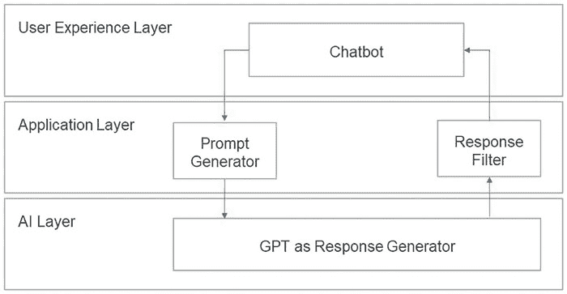

**图 4.1：** 基础对话

# 用户体验层

这一层主要关注用户如何与解决方案交互。它采用标准的聊天机器人用户界面，这可能是简单的文本框，也可以是具有语音和头像能力的更高级的用户界面。该层负责捕捉用户输入（话语），并以易于理解和友好的方式展示来自 AI 层的响应。

# 应用层

这一层连接了用户体验层和 AI 层。它执行关键功能：将原始用户输入转换为适用于 GPT 模型的格式（提示词生成），并根据企业的规则和要求过滤生成的响应（响应过滤）。

- **提示词生成器**：该组件将用户话语翻译为适用于 GPT 模型的提示词（prompt）。首先，它选择一个与用户输入匹配的预定义提示模板²。然后它使用输入中的详细信息实例化模板。此处显示了一个示例：

    - 服务代理的输入：“一位关键客户不断提出无理的投诉。今天我们又收到了一个这样的投诉。我们可以拒绝它，还是由于客户的重要性而必须接受它？”

    - 生成的 GPT 模型提示词为：

        - “专家角色：你是一家同时重视客户满意度和公平政策的公司的客户关系专家。

        - 上下文：一名服务代理提供了以下信息：‘一位关键客户不断提出无理的投诉。今天我们又收到了一个这样的投诉。我们可以拒绝它，还是由于客户的重要性而必须接受它？’。

        - 任务规范：

            1. 总结投诉中与决策相关的方面。

            2. 根据公司标准和过去的交互判断其是否合理或不合理。

            3. 权衡该客户的重要性与接受或拒绝投诉的公平性之间的关系。

        - 执行规则：

            1. 确保所有决策都符合公司准则和伦理标准。

            2. 优先考虑与客户的长期关系，同时维护公司的完整性和声誉。

            3. 考虑客户过去投诉中的任何模式。

        - 输出限制：

            1. 请在不超过 150 字的简短回答中，就是否接受或拒绝投诉提供合乎逻辑的决策。”

- **响应过滤**：每个生成的响应都会根据一系列标准进行检查，例如适当性、相关性、完整性和贯性。如果响应通过了这些检查，将通过用户体验层发送回用户。否则，将显示默认消息。

# AI 层

该模式的核心是 AI 层，它利用 GPT 模型作为响应生成器。该层接收来自应用层的处理过的提示词，并利用嵌入在预训练 GPT 模型中的知识生成响应。

# 模式工作流

1. 用户通过输入问题或命令与聊天机器人界面交互。

2. 应用层获取用户输入，并根据提示模板库将其转换为适用于 GPT 模型的提示。

3. AI 层（特别是 GPT 模型）根据给定的提示词生成响应。

4. 应用层接收响应并应用过滤器检查其是否符合定义的标准。

5. 如果响应通过过滤器，则通过用户体验层发送回用户。如果未通过过滤器，则向用户显示默认消息。

# 企业集成

基础对话模式既不与企业应用程序交互，也不接入内部知识库。此外，虽然系统会考虑对话历史作为上下文，但它主要取决于用户提供的信息。因此，系统的响应受限于 AI 模型在训练阶段建立的知识。此类响应是通用的，缺乏组织特定的见解或来自企业应用程序和数据库的实时数据，这对许多应用构成了相当的限制。

# 输出质量

这种模式对于简单通用的查询提供了尚可的输出质量，这种质量主要归功于高级 GPT 模型的力量。此外，响应过滤器中实现了基本的质量检查，这有助于维持生成响应的适当性、相关性和准确性。

# 性能

这种模式因其极简的设计在计算性能上脱颖而出。由于对于每次输入，用户与 GPT 模型之间仅需一次交互，它确保了快速响应和较低的计算负载。这种精简的方法使得系统能够高效地处理大量的用户查询，从而提高了可扩展性。

## 用途场景

鉴于该模式的基础性属性，它适用于简单的问答任务，这些任务不需要理解上下文或访问专门的知识库。它可以用于诸如简单的 FAQ 机器人、提示-响应系统或基础的用户互动活动等场景。它不适用于需要复杂对话管理、感知感知响应或访问动态且实时的知识库的任务。

## A2 落地地的对话 (Grounded Conversation)

这种架构模式通过将 GPT 模型的灵活性与领域特定知识以及组织现有系统的数据相结合，增强了基础聊天机器的能力（参见图 4.2）。

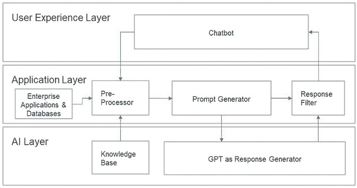

**图 4.2:** 落地地的对话

## 用户体验层

这一层与 A1 模式中的相同。

## 应用层

此层充当用户体验层与 AI 层之间的桥梁。它包含以下组件：

* **企业级应用和数据库**：这些是企业特定数据的来源，可以通过 API 调用访问。

* **预处理器 (Pre-Processor)**：该组件从企业应用和数据库中检索相关数据，并查询知识库以丰富用户的输入。任何所需的质量检查和文本格式转换也在此处完成。

* **提示生成器 (Prompt Generator)**：该组件获取来自 `预处理器` 的丰富用户输入，并将其转换为使用的 GPT 模型可以理解并处理的提示格式。

* **响应过滤器 (Response Filter)**：该组件根据某些标准对 GPT 模型的响应进行评估，例如相关性、适当性和完整性和贯性，类似于基础模式。如果响应未通过这些检查，将向用户返回默认消息。

## AI 层

这一层对于 AI 驱动的交互至关重要。它包含两个核心组件：GPT 模型和内部知识库。

* **知识库**：知识库位于 AI 层中并与 GPT 模型并列，是领域特定知识的储备。该知识库通常以文档数据库³、图数据库⁴或向量数据库⁵的形式存在，提供了额外的行业和/或组织特定的详细信息。

* **GPT 模型**：它通过利用应用层提供的丰富提示来生成连贯且与上下文相关的响应。值得注意的是，该模型将其预训练知识应用于来自用户、企业数据源和知识库的组合输入。

## 模式工作流

1. 用户与聊天机器人界面交互，提供输入或提问。

2. 应用层中的 `预处理器` 根据原始用户输入，从企业应用和数据库中获取任何必要的数据。

3. `预处理器` 随后筛选知识库，搜索与用户输入相关的信息。它可以使用传统的基于关键词的搜索进行直接匹配，或者在底层为向量数据库的情况下，依赖搜索查询和候选文档的向量编码相似性的语义搜索，以实现更广泛的、感知上下文的匹配。

4. `预处理器` 进一步通过数据清洗、规范化、移除个人身份信息 (PII) 以及将长文本划分为可管理的块等任务来完善补充的输入，以符合底层 GPT 模型的输入大小限制。

5. 丰富后的输入随后由 `提示生成器` 转换为适用于 GPT 模型的提示。

6. AI 层或或 GPT 模型根据提示生成响应。

7. `响应过滤器` 根据预定义的标准检查此响应。

8. 如果响应通过了过滤器，则将通过用户体验层回传给用户。如果未通过，则向用户提供默认消息。

## 模式工作流示例

假设你最近在客厅安装了一个智能灯泡，但它无法点亮。为了寻求快速帮助，你联系了制造商的技术支持聊天机器人。

你的交互是：“我客厅的智能灯泡不亮了。”

以下是该模式工作流的可能执行方式，示例中的步骤数字与通用工作流中的步骤对应：

1. **用户交互**：你已经告诉聊天机器人你的智能灯泡问题。

2. **获取必要数据**：`预处理器` 立即咨询制造商数据库，以确定你拥有的灯泡准确型号和版本，以及其安装日期任何关联设备。

3. **筛选知识库**：利用关于你特定灯泡型号的细节，`预处理器` 搜索知识库——一个数字故障排除手册——查找为你灯泡型号定制的相关的指南。

4. **完善输入**：`预处理器` 确保指令顺序易于遵循，并剥离任何技术术语以对用户友好。

5. **创建提示**：这是聊天机器人为它的主大脑准备问题或上下文的地方。结合故障排除步骤，提示可能看起来像这样：“鉴于‘ABC 模型’灯泡不亮，且根据故障排除步骤（建议检查灯泡电源、验证其与开关的兼容性并确保 App 设置正确），你将如何以清晰且同理心的方式引导用户完成这些步骤？”

6. **生成响应**：有了这个详细的提示，聊天机器人的大脑（GPT 模型）生成了一个连贯且有帮助的响应，引导你完成这些步骤。


## 7. 检查响应

`响应过滤器`评估聊天机器人的答案，确保清晰度并涵盖所有关键的故障排除要点。

## 8. 交付答案

一旦通过验证，聊天机器人回答：“很抱听到你的灯泡出了问题。让我们针对你的‘ABC 模型’尝试以下步骤：

1. 首先，确保灯泡已牢固地拧入插座并通电。
2. 检查你使用的开关或插座是否兼容智能设备。
3. 打开关联的应用并确保灯泡设置配置正确。如果在执行这些步骤后仍仍问题，请联系我们的技术团队。”

## 企业集成

落地地的对话模式通过 API 调用具有强大的企业数据集成功能。它还访问知识库，以相关的领域特定知识来丰富输入。这种集成水平允许系统利用组织现有 IT 基础设施的资源和功能，用组织知识和上下文感知能力丰富聊天机器人的响应。

## 输出质量

该模式通过用企业知识和数据落地并丰富提示，增强了输出质量。通过集成企业应用、数据库和知识库来补充用户输入，`GPT`模型的上下文感知能力及其生成更细致、定制响应的能力都得到了提高。

为了进一步提高提示词的质量，该架构采用了数据清洗和规范化等预处理步骤。这些步骤消除了用户输入中潜在的不准确和不一致之处，并对数据进行标准化，确保其符合`GPT`模型处理的格式。

该模式还包含一个输出过滤过程，其原理与`基础对话`（Basic Conversation）模式 (A1) 类似。然而，由于丰富的提示词使得响应的初始质量更高，输出过滤器现在可以关注更具体的质量检查。

## 性能

由于包含了额外的预处理步骤和集成，与`基础对话`模式相比，`落地的对话`（Grounded Conversation）模式表现出更高的计算复杂性，而效率相对较低。

## 用场景

该模式适用于需要更细致响应的场景，这些响应需要利用内部领域特定知识以及来自企业级应用和数据库的数据。它适用于旨在提供动态、上下文感知型响应的企业，例如针对特定产品或服务的客户支持、内部员工辅助，甚至是个性化的用户交互。

## A3 混合主导对话

该模式提供了一种具有交互能力的基于`GPT`聊天机器人的高级配置。它通过系统发起的提问或指令来收集信息或协作执行流程，增强了典型的用户驱动交互（见图 4.3）。

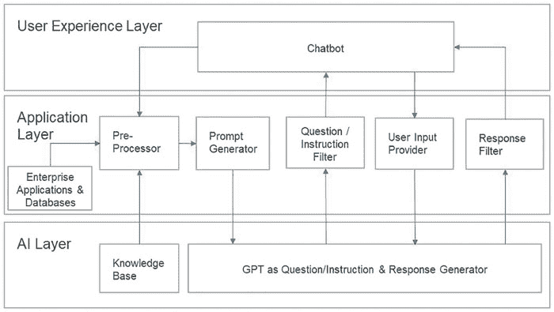

**图 4.3:** 混合主导对话

## 用户体验层

此层现在支持使用聊天机器人用户界面进行混合主导对话。

## 应用层

除了上一个模式的组件外，这里引入了两个新组件：

*   `问题/指令过滤器`：此新组件过滤由`GPT`模型生成的问题或指令。只有符合特定标准的内容会被传递给用户。
*   `用户输入提供者`：此组件捕获用户对`GPT`生成的问题或指令的响应，并将其反馈给`GPT 模型`。

## AI 层

此层与`落地的对话`模式 (A2) 相同，托管一个`GPT`模型和一个知识库。

## 模式工作流

1. 用户与聊天机器人界面交互，提供输入或提问。
2. 应用层中的`预处理器`咨询企业数据源和知识库，丰富用户的输入，并执行任何其他所需的数据准备任务。
3. 增强后的输入被转换为适用于`GPT`模型的合适提示词。
4. `GPT`模型可以根据提示词为用户生成问题/指令或响应。
5. `GPT`生成的问题/指令经过过滤后，如果符合标准，则传递给用户。
6. 用户提供相应的反馈，这些反馈由`用户输入提供者`捕获并传递给`GPT 模型`。
7. 最后，`GPT 模型`生成响应，然后由`响应过滤器`进行评估。
8. 如果响应通过过滤器，则将其回传给用户。如果没有通过，则显示默认消息。

## 企业集成

该模式提供的企业集成水平与`落地的对话`模式 (A2) 相同。

## 输出质量

由于针对`GPT`模型提问收到了额外的用户输入，从而产生了更好的上下文提示词，因此输出质量高于 A2。

## 性能

每个对话回合的性能与 A2 相同，但由于`GPT`模型提了额外的问题，对话本身被延长了。

## 用场景

这种架构类型非常适合需要动态、上下文感知响应和用户输入的复杂交互场景。可能的应用包括高级客户服务、交互式用户参与、引导式故障排除和个性化推荐。

## A4 质量控制对话

该模式概述了一种复杂的聊天机器人架构，通过使用两个`GPT`模型来增强对话质量：一个作为主要的响应生成器，另一个充当评论员。这种配置提供了一种迭代反馈机制（见图 4.4）。

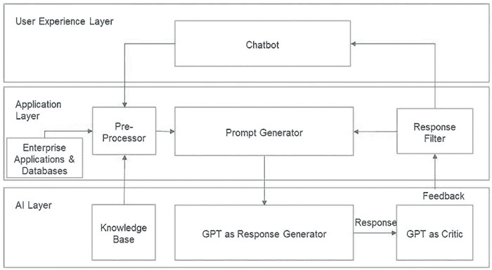

**图 4.4:** 质量控制对话

## 用户体验层

用户体验层与`基础对话`模式 (A1) 一致。

## 应用层

此层包含与`落地的对话`模式 (A2) 相同类型的组件，但有一些不同：

*   `提示词生成器`：此组件还会根据`GPT 评论员`的反馈在需要时生成修正提示词。
*   `响应过滤器`：与`落地的对话`模式相比，由于`GPT 评论员`的反馈，过滤标准现在更加具体。

## AI 层

此层托管两个`GPT`模型：一个作为主响应生成器，另一个作为评论员，以及一个知识库。

*   `响应生成器`：此`GPT 模型`根据提示词生成响应，利用其预训练知识和来自知识库的输入。
*   `GPT 评论员`：此`GPT 模型`审查生成的响应。它评估提示词和响应并产生反馈。为了确保响应的高标准，它根据更详细的标准检查每个生成的响应，包括适当性、相关性、事实准确性、正确的推理以及可能的幻觉。评论的性质取决于具体的设置。如果`响应生成器`使用的相同模型和上下文也被`GPT 评论员`使用，这可能会导致某种自我评论。在这种情况下，模型实际上是在评估自己的输出。然而，如果在评论过程中使用了不同的模型或上下文，则引入了新的独立审查级，从而产生单独的评论。这有助于为生成的响应提供额外的检查和平衡。过去迭代的响应和反馈也可以包含在未来的提示词中，以便使其从过去的错误中学习。

## 模式工作流

1. 用户与聊天机器人界面交互，提供输入或提问。
2. `预处理器`利用内部知识库和企业数据源丰富用户的输入，并执行必要的数据准备任务。
3. 增强后的输入转换为适用于`GPT`模型的合适提示词。
4. `GPT 响应生成器`根据提示词产生响应。
5. 提示词和响应被输入`GPT 评论员`，其对响应质量提供反馈。
6. 检查质量反馈。如果符合所有标准，则将原始响应回传给用户。如果没有，则向`提示词生成器`发送修正提示词的请求。
7. 将修正提示词反馈给`GPT 响应生成器`，开始新的迭代。
8. 在评论员（critic）提供反馈且通过响应过滤器后，或者在完成预定义的次数失败迭代后，流程终止。

## 企业级集成

此模式提供了与 Ground 模式（A2）同等的企业级集成水平。

## 输出质量

使用企业数据和知识对提示词进行落地和丰富是从之前的模式中维护的一项特性，它确保了响应的生成基于特定的企业语境。

此模式的独特之处在于，`GPT 评论员`会审查`GPT 响应生成器`的响应。它会评估提示词和生成的响应，提供反馈，`响应过滤器`利用这些反馈在迭代反馈循环中提高响应的质量。这一过程有助于确保响应的相关性、连贯性和整体质量，因为它们会被不断完善，直到满足预定义的质量标准。

## 性能

由于增加了作为评论员的第二个`GPT`模型，质量控制对话模式与之前的模式相比，计算复杂度显著增加。这个`GPT 评论员`会审查由第一个`GPT`模型生成的每个响应，增加了新层级的计算负载。此外，基于评论员反馈改进响应质量的迭代反馈循环机制也为响应生成器增加了额外的处理时间。

## 用途场景

该模式非常适用于需要高质量、感知上下文的响应的场景。反馈循环机制确保响应得到迭代改进，直到满足定义的质量标准。这在客户支持系统、医疗咨询助手、财务咨询服务或任何对响应质量至关重要的领域都可能特别有用。

# B 集成外部工具的对话模式

在本节中，我们将深入探讨两种用于`GPT`驱动聊天机器人的更高级架构模式。这些模式利用了 OpenAI GPT 模型的力量，同时集成了外部工具和引导机器人推理过程的高级方法。

- **基础工具集成对话 (B1)：** 延续序言章节中的相关章节（*GPT 模型中对外部工具的访问*），第一种模式概述了一种架构，其中对话解决方案通过 API 调用与企业应用程序交互。这些交互被嵌入到整个对话中，并根据相应的用户输入动态触发，将解决方案的能力从文本生成扩展到执行企业任务。

- **使用工具的思维链引导对话 (B2)：** 第二种模式引入了将思维链（CoT）演示[⁶]与特定工具的 API 调用相结合的结构。这种配置确保了工具操作能够流地整合到解决方案的推理过程中，使其能够暂停、使用外部工具执行操作，并根据结果继续对话。这种高级交互模型对于需要在对话期间进行推理的复杂任务特别有益。

- **高级工具集成对话 (B3)：** 比基础工具集成对话 (B1) 更进一步，第三种模式将`GPT`模型同时部署为上下文规划器和响应生成器。B1 侧重于用户输入触发的与工具的直接交互，而 B3 引入了一层规划，用于确定操作的逻辑顺序。结果是更丰富、更自适应的对话体验，从简单的任务执行转向策略性的编排。

接下来的章节将详细说明这些模式，讨论它们的各个组件、工作流和潜在用途场景。

# B1 基础工具集成对话

此模式概述了一种架构，其中支持`GPT`的机器人与用户进行交互，这些交互需要通过 API 执行企业应用程序、数据库和知识库提供的特定函数。这允许机器人将其能力扩展到不仅仅是生成类文本，使其能够在对话期间执行外部任务（见图 4.5）。

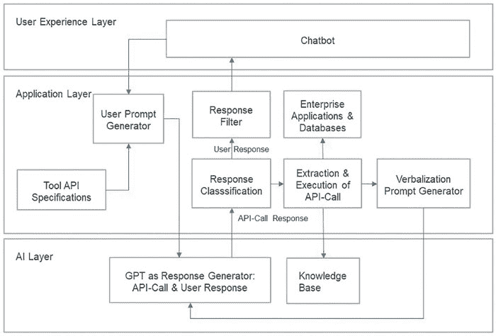

**图 4.5：** 基础工具集成对话

## 用户体验层

该层与 Ground 对话模式（A2）保持不变，为用户交互提供标准的聊天机器人界面。

## 应用层

该层作为用户体验层和 AI 层之间的桥梁，包含多个组件：工具 API 规范、企业应用程序和数据库、用户提示词生成器、响应过滤器、响应分类、API 用的提取与执行以及语言化提示词生成器。

- **工具 API 规范**：此组件持有对话程序可以交互的各种工具的 API 规范。规范通常包含以下四个元素。

    - **API 名称**：API 名称提供了 API 的抽象。它帮助`GPT`模型将用户指令与此 API 关联起来，并作为提取和执行组件的入口。名称应在自然语言中清晰准确，并避免与其他 API 名称混淆，例如用于检查后端系统订单状态的`check_order_status`。

    - **参数列表**：API 的参数列表包括输入参数和返回值，每个参数都有参数名称、描述、数据类型和默认值。这些信息协助所使用的`GPT`模型以正确的格式在相应位置填充参数。对于`check_order_status`示例，参数可能如下：

        - 输入参数：
            - `order_id`：整数，系统中创建的订单唯一标识符。用于查找特定订单并检索其当前状态。
        - 返回值：
            - `order_status`：字符串，表示订单当前状态。常见值包括 Pending（待处理）、Processing（处理中）、Shipped（已发货）、Delivered（已送达）、Canceled（已取消）等。
            - `expected_delivery_date`：日期（可选），Shipped 状态订单的预计交付日期。
            - `reason`：字符串（可选），如果订单被取消，这将提供取消原因。

    - **API 描述**：与 API 名称相比，API 描述包含更多关于 API 功能、工作原理、输入输出以及可能引发任何潜在错误或异常的信息。`check_order_status` 的相应示例可以是：*此功能允许通过订单唯一 ID 获取特定订单的当前状态。查询时，系统将返回订单状态，并可能提供额外信息，例如预计交付日期或订单取消的原因。*

    - **使用示例**（可选）：为复杂的 API 提供使用示例可以帮助演示如何使用 API，而对于简单的 API 则可能没有必要。对于订单状态检查，示例可能如下：*用户可以请求 ID 为“12345678”的订单状态。响应可能会告知他们订单已“已发货”，并提供相应的预计交付日期。*

- **企业级应用与数据库**：这些通过 API 调用提供外部工具，可以包括任何功能性后端系统（如 HR、财务或采购），也可以包括搜索引擎或专门的机器学习模型。

- **用户提示词生成器**：此组件将用户的输入转换为适用于`GPT`模型的提示词（prompt）。

- **响应分类**：此组件识别并将`GPT`生成的响应分类为两类：
    - 对用户请求的最终响应，或
    - 包含函数调用的中间响应。
    如果响应包含`function_call`字段，则会被识别为函数调用。

- **API 调用的提取与执行**：当识别出函数调用响应时，此组件从`function_call`字段中提取必要的细节，根据工具 API 规范选择合适的工具，并使用所选工具执行 API 调用。工具可以是企业级应用、数据库或知识库中的任何功能。

- **语言化提示词生成器**：此组件利用现有上下文（用户提示词和函数调用响应）并添加函数提示词，该提示词包含转换为文本格式的上述的函数调用结果。随后，`GPT`模型将这些结果翻译成自然语言回复给用户。

- **响应过滤器**：此组件检查发送给用户的最终`GPT`响应的适当性、相关性、完整性和连贯性。

## AI 层

此层托管`GPT`模型，这些模型经过对话数据的训练，其中包含了特定工具的 API 函数调用（目前仅限特定版本的`GPT-3.5 Turbo`和`GPT-4`）。这些模型可以根据接收到的提示词生成用户响应或函数调用响应。

它包含一个与之前模式具有相同能力的知识库。

## 模式工作流

1. 用户与机器人界面交互，提供输入或提问。
2. 用户输入被翻译为`GPT`模型的初始提示词，提示词还包含工具 API 规范。
3. 随后被分类为用户响应或函数调用响应。
4. 如果是用户响应，将其转发到响应过滤器，进行相关性、准确性和适当性的审核，并转发给用户（检查通过）或用默认消息替换（检查不通过）。
5. 如果是定义 API 用的格式的函数调用响应，`API 调用的提取与执行`组件将向指定的企业应用、数据库或知识库执行 API 调用。
6. API 调用的结果将由语言化提示词生成器用于为`GPT`模型生成函数提示词。
7. `GPT`模型生成用户响应，将 API 调用结果翻译成自然语言。
8. 该过程随着每个新的用户提示词不断重复，直到对话结束。

## 模式工作流示例

让我们通过一个示例来了解此模式。在这里，我们将使用用户联系在线书店机器人查询其订单状态的场景：

你的交互内容是：“能告诉我我 ID 为 98765432 的订单状态吗？”

以下是机器人模式工作流如何提供帮助，示例中的步骤编号与通用工作流中的步骤对应：

1. **用户交互**：你通过提供订单 ID 向机器人询问订单状态。
2. **创建初始提示词**：提示词生成器将你的问题翻译为适用于`GPT`模型的提示词：“用户根据`check_order_status`的工具 API 规范，想要知道 ID 为 98765432 的订单状态。”
3. **响应分类**：`GPT`模型解释提示词并识别出这需要对书店系统进行函数调用，特别是`check_order_status`函数。
4. **用户或函数调用决策**：由于响应指示为函数调用，系统跳过用户响应生成，并进入下一步。
5. **API 执行**：使用提供的细节，系统从书店系统获取信息。它使用带有订单 ID `98765432`的`check_order_status` API 来获取订单的当前状态和其他细节。
6. **创建语言化提示词**：根据书店系统的结果，为`GPT`模型生成一个函数提示词，其中包含订单的当前状态和其他细节。
7. **生成用户响应**：`GPT`模型随后根据此提示词构建一个连贯的响应，可能是：“您的 ID 为 98765432 的订单已发货！预计预计将在 2023 年 8 月 28 日前送达。”
8. **对话继续或结束**：机器人将此消息发送给你。如果你有更多问题，对话将继续；如果你的查询已满足，对话将结束。

## 企业集成

工具集成对话模式具有高度的**集成水平**。该架构与提供可通过 API 访问特定功能的企业应用和数据库紧密结合。这种设计促进了近实时的集成，允许机器人根据这些操作执行任务、获取数据并生成响应。此外，该模式还可能访问通过 API 可用的知识库，从而扩展了机器人在对话期间可以调用的数据源范围。

## 输出质量

该模式通过后端系统的任务输出动态地落实并丰富用户提示词，显著提高了了输出质量。何时调用后端系统的决策是由`GPT`模型根据用户输入做出的，而不是像`Grounded`模式 (A2) 中那样的由预处理器做出的。当`GPT`模型实际被用作响应生成器时，这些任务的结果为模型提供了详细且准确的上下文。

## 性能

由于涉及通过 API 与企业应用和数据库交互、分类响应以及生成语言化提示词的额外步骤，此模式引入了更多的计算复杂性和延迟。

## 用场景

此模式在面向流程的场景中表现优异，这些场景需要根据用户输入与企业应用和数据库进行多次交互。它对于需要与企业应用和数据库交互以获取或更新用户数据的机器人也是理想的。

# 使用工具的 B2 思维链引导对话

此模式代表了一种基于`GPT`的聊天机器人架构，它结合了思维链（CoT）演示以及通过 API 调用与企业应用和数据库提供的特定函数进行交互 [3]。思维链演示有助于设计更有效的提示词，向`GPT`模型展示逻辑推理链，增强其在系列交互中保持一致、符合逻辑的响应或动作序列的能力（参见 图 4.6）。

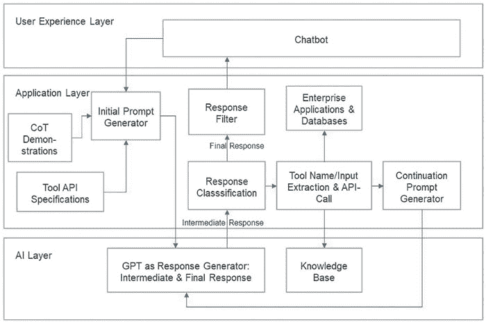


**图 4.6:** 使用工具的思维链引导的对话

# 用户体验层

此层与 `Grounded Conversation` 模式 (A2) 保持不变，提供一个标准的机器人用户界面用于用户交互。

# 应用层

应用层在协调聊天机器人推理过程及其与企业应用、数据库的交互中起着至关重要的作用。它包含多个组件：`CoT` 示例、企业应用和数据库、工具 `API` 规范、初始提示生成器、响应过滤器、响应分类、函数名/输入提取与 `API` 调用，以及后续提示生成器。

* **思维链 (CoT) 示例**：这些是聊天机器人期望思维过程的示例，用于增强用户的输入。

* **企业应用和数据库**：这些存储了特定的工具功能，聊天机器人通过 `API` 调用与它们进行交互。

* **工具 API 规范**：该组件包含了企业应用和数据库中各种工具的规范，聊天机器人可以与其进行交互。

* **初始提示生成器**：该组件将用户的输入（经过工具 `API` 规范和 `CoT` 示例增强）转换为 `GPT` 模型的初始提示，并指令其在生成工具触发器时停止。

* **响应过滤器**：该组件根据定义的标准检查 `GPT` 模型生成的响应。

* **响应分类**：该组件将 `GPT` 生成的响应归类为用户响应或工具调用。

* **工具名称/输入提取与 API 调用**：当响应中识别出工具触发器时，该组件提取工具名称和输入，执行工具调用并将结果附加到推理过程中。

* **后续提示生成器**：该组件通过结合原始提示、中间响应和工具结果，为 `GPT` 模型生成后续提示。

# AI 层

该层托管了知识库和一个 `GPT` 模型，该模型负责为用户提示生成中间响应和最终响应。

# 模式工作流

1. 用户与聊天机器人界面交互，提供输入或提出请求。

2. 用户的输入通过来自企业应用和数据库的相关工具 `API` 规范以及匹配的 `CoT` 示例进行增强。

3. 增强后的输入被转换为 `GPT` 模型的初始提示，指令其在生成工具触发器时停止。

4. `GPT` 模型生成一个中间响应，然后该响应被归类为用户响应或函数调用。

5. 如果响应包含工具触发器，则提取工具名称和输入，并在指定的应用程序、数据库或知识库上执行相应的函数调用。

6. 函数调用的结果被附加到推理过程中。

7. 再次调用 `GPT` 并带有后续提示（原始提示 + 中间响应 + 工具结果）以继续对话。

8. 重复步骤 4-7，直到推理过程中的所有工具使用步骤都完成。

9. 生成最终响应，通过响应过滤器检查，并传递给用户。

# 企业集成

此模式的企业集成等同于**工具集成对话**模式 (B1) 中的集成。

# 输出质量

此模式的输出质量与之前的模式相当。

# 性能

由于每次执行函数调用时都需要重复进行后续提示，此模式的性能劣于工具集成对话模式。

# 用例

此模式对于需要分步推理过程并与外部工具集成的复杂用例尤为有效。它可以用于创建复杂的聊天机器人，这些机器人不仅能回答查询，还能执行多步任务、解决复杂问题或在与外部工具或服务交互时引导用户完成流程。例如 IT 支持聊天机器人、复杂软件应用程序的虚拟助手或培训系统。

# B3 高级工具集成对话

这种演进的架构模式以两种身份利用 `GPT` 模型：作为规划器和响应生成器。作为规划器，它将用户输入转换为编排执行的任务序列；作为响应生成器，它使用每个任务的输出来生成上下文相关的用户响应（参见*图 4.7*）。

```
images/Figure-4.7.jpg
```

**图 4.7:** 高级工具集成对话

# 用户体验层

这与 B1 模式相比保持不变，提供了一致的用户-聊天机器人交互界面。

# 应用层

该层使用了 B1 模式中的以下组件：

* 工具 `API` 规范，现在可能还包括对 `GPT` 模型的组合指令，说明如何组合多个 `API` 来完成复杂的用户请求。

* `API` 调用的提取与执行

* 企业应用和数据库

* 响应过滤器

此外，它引入了几个专门用于规划的组件：

* **规划提示生成器**：该组件将用户的输入转换为提示，要求 `GPT` 模型生成计划或任务序列。

* **计划执行**：一旦 `GPT` 模型生成了计划，该组件将系统地提取并执行序列中的每个任务。

* **用户响应提示生成器**：该组件替换了口语化提示生成器。在计划中的所有任务执行完毕后，该组件将结果编译为用于 `GPT` 模型的新提示，以产生全面且易于理解的响应。

# AI 层

该层包含了与之前相同的知识库以及两个不同角色的 `GPT` 模型：

* **规划器**：给定规划提示，`GPT` 模型概述一个逻辑任务序列，并包含为了满足用户请求而需要执行的相应 `API` 调用。

* **用户响应生成器**：在计划中的所有任务执行完毕并编译结果后，`GPT` 模型获取编译后的结果，并将其构建为用户全面且易于理解的响应。

# 模式工作流

1. 用户与聊天机器人界面交互。

2. 规划提示生成器将用户的请求转换为 `GPT` 模型的规划提示，其中也包含工具 `API` 规范。

3. `GPT` 在其规划器角色下解释规划提示，并生成一个任务序列，每个任务都带有 `API` 调用。第一个任务具有完整的 `API` 调用，而后续任务在相应的 `API` 调用中带有占位符。

4. 计划执行组件提取第一个任务的 `API` 调用并将其发送到 `API` 调用执行组件，后者进行处理并返回 `API` 调用结果。

5. 计划执行组件更新任务序列中第一个任务的结果，并将其重新提交给规划器 `GPT`。

6. `GPT` 模型保留计划中已执行的任务，并重新生成紧接最后一个执行任务之后的任务序列。

7. 计划执行组件移动到序列中的下一个任务，将其发送到 `API` 执行模块，再次从该处获取结果。

8. 之后，它更新计划并重新提交给 `GPT` 模型。此循环持续到计划中的所有任务都执行完毕。

9. 所有任务完成后，计划执行组件将所有中间和最终结果转发给用户响应提示生成器。

10. 用户响应提示生成器为 `GPT` 模型构建一个提示。

11. `GPT` 在其响应生成器角色下产生详细且用户友好的响应。

12. 响应过滤器对该最终响应进行审核，确保其质量和相关性。

13. 用户接收过滤后的响应，并根据需要继续交互。

# 模式工作流示例

想象一个用户想在当地公园为朋友举办生日派对并需要一些帮助。

你的交互是：“我想下周六在中央公园为我的朋友 Mark 举办生日派对。你能帮我吗？”

以下是该模式发挥作用。由于对计划任务序列的迭代，示例中的步骤编号有所不同：

1. **用户交互**：你向聊天机器人表达了意图，计划在中央公园为朋友举办生日派对。

2. **创建规划提示词**：聊天机器人通过 `Planning Prompt Generator` 将你的请求重新表述为：“为下周六在中央公园举办生日派对生成一份计划。”

3. **GPT 生成计划**：`GPT` 模型承担其 `Planner` 角色，解释规划提示词并列出一个多步骤的任务序列：

   * 任务 1：核实中央公园下周六是否可以举办活动。

   * 任务 2：在中央公园预留一个合适的地点。

   * 任务 3：列出附近可以购买生日蛋糕的烘焙店。

   * 任务 4：推荐当地的娱乐活动或表演人员。

   * 任务 5：提供下周六的天气预报。

4. **计划执行 - 任务 1**：系统首先使用 `events API` 检查中央公园在指定日期的可用性。

5. **更新与重新提交**：假设公园可用，计划继续进行并重新提交给 `GPT` 执行下一个序列。

6. **计划执行 - 任务 2**：系统随后使用 `reservations API` 在中央公园预留一个适合生日聚会的地点。

7. **计划执行 - 任务 3**：聊天机器人访问 `local directory API`，列出附近几家评分较高的烘焙店以供订购蛋糕。

8. **计划执行 - 任务 4**：系统调用另一个 `local services API`，提供几种可租赁的娱乐选项，如魔术师、音乐家或派演员。

9. **计划执行 - 任务 5**：系统使用 `weather API` 提供下周六的天气预报，以确保准备工作考虑到可能的雨天气。

10. **汇总结果**：汇总所有的中间结果，即公园可用性、预订确认、烘焙店列表、娱乐建议和天气预报。

11. **创建用户响应提示词**：生成一个提示词，汇总所有数据：“将中央公园可用性、预订、烘焙店列表、娱乐选项和天气预报的发现转换为连贯的用户响应。”

12. **构建用户响应**：`GPT` 以其 `User Response Generator` 的身份构建信息：“中央公园下周六有空！我已经为 Mark 的生日预留了位置。这里是附近的 3 家烘焙店：[烘焙店名称]。娱乐方面，可以考虑聘请 [人员名称]。此外，天气预报显示是晴天。祝计划顺利！”

13. **响应过滤**：对此详细响应进行连贯性和清晰度的检查。

14. **最终用户交互**：你获得了详尽的计划和资源，让你进行准备工作或继续交互以获取更多特定细节。

# 企业集成

高级工具集成模式展示了如何将 `GPT` 与企业系统集成。通过利用各种工具，系统可以适应复杂的需求。

# 输出质量

由于增加了特定于上下文的数据，该模式的输出质量得到了显著提高。这确保了响应更加相关且准确。

# 性能

虽然该模式提供了显著收益，但也引入了计算开销。使用微调模型对性能的影响是一个关键考虑因素。

# 用场景

该模式扩展到各种场景：

* **流程自动化**：适用于执行入职或故障排除等任务的机器人。

* **动态查询系统**：适用于用户需要从多个源检索数据的情况。

* **高级客户服务机器人**：处理复杂交互并报告结果的机器人。

* **交互式教程和引导式学习**：根据用户结果调整学习路径的机器人。

* **集成化业务工具**：适用于需要数据分析和可视化的业务用户。

# 使用微调模型的 C 类会话模式

本节介绍了两种高级模式，这些模式利用了 `GPT` 与微调模型协同工作的潜力。

* **使用微调模型进行对话 (C1)**：该模式利用 `GPT` 生成训练数据，这些数据被用于微调商业或开源语言模型。

* **使用两个模型进行对话 (C2)**：该模式同时利用了微调模型和预训练的 `GPT` 模型。微调模型的输出被用于通过上下文增强用户输入。

随后将是这些架构的详细描述，包括它们的结构、工作流和潜在用例。

# 使用微调模型的 C1 对话

该模式概述了一种 `GPT` 驱动的对话解决方案架构，该架构利用数据库结合 `GPT` 创建训练数据。这些数据被用于微调现有的语言模型，该模型随后处理用户交互（参见图 4.8）。

**图 4.8**：使用微调模型进行对话。

# 用户体验层

该层等同于**落地的对话**模式 (A2)。

# 应用层

该层也包含与 A2 模式相同的组件。

# AI 层

AI 层包含几个关键组件：

* **用于增强的知识库**：在运行时用于补充 AI 的知识。

* **预训练语言模型**：这是一个在海量数据上训练的通用模型，用于理解语言，但不是针对任何特定任务专门化的。

* **微调语言模型**：在预训练模型建立的基础上，该版本在特定数据集上进行进一步的训练或微调。这可以用于特定任务，例如遵循指令或促进对话，从而增强其在这些任务中的准确性和相关性。

* **作为训练数据生成器的 GPT 模型**：它利用 `GPT` 模型的能力来生成训练数据，模拟各种场景或对话。用户应注意某项至关重要的许可规定：源自 OpenAI 服务的输出不得用于创建与 OpenAI 竞争的模型。同样值得注意的是，许可条款是动态的，可能会定期更改。要获取最新信息，请务必参考 OpenAI 的官方文档或服务条款。

* **用于训练数据生成的数据库**：一个精选的源，`GPT` 模型从中提取并处理信息，以生成训练数据。

在考虑微调解决方案时，如今的企业可以选择利用 OpenAI 提供的商业模型，也可以选择一些值得的开源模型：

### 来自 OpenAI 的商业模型

* **GPT-3.5 Turbo**：OpenAI 为 `GPT-3.5 Turbo` 提供了微调功能。早期评估表明，微调后的 `GPT-3.5 Turbo` 版本在特定的狭窄任务中，可以达到与基础 `GPT-4` 模型相当的性能水平。为了安全性，微调训练数据会经过基于 `GPT-4` 的 OpenAI `Moderation API` 处理。

* **GPT Base, babbage-002 和 davinci-002**：这些是 OpenAI 最近新增的模型，具有 16K 的上下文窗口大小，适用于标准应用和微调应用。

### 开源模型（在 1 万亿 token 上预训练）

* **MosaicML 的 MPT-30B**：一个拥有 300 亿参数的开源模型。它超越了 `MPT-7B` 和 `GPT-3` 的能力，具有 8000 token 的上上下文窗口大小。该模型有两个不同版本：专为指令微调定制的 `MPT-30B-Instruct` 和为聊天机器人开发的 `MPT-30B-Chat`。MosaicML 平台还提供了自定义和部署的选项。

* **技术创新研究院的 Falcon LLM**：总部位于阿布扎比，该开源模型配备了 400 亿参数，提供 2000 token 的上下文长度。此外，还有 `Falcon-40B-Instruct` 变体，专门为基于指令的微调设计。

* **OpenLLaMA**：作为 Meta AI `LLaMA` 的开源对应物，它提供 3B、7B 和 13B 参数配置的模型，每种配置配有 4000 token 的上下文窗口。与 Meta 仅限研究的 `LLaMA` 不同，`OpenLLaMA` 为商业应用设计并支持微调。

### 开源模型（在 2 万亿 token 上预训练）

* **Meta 的 Llama 2**：这是一个较新的发布，`Llama 2` 提供 7B、13B 和 70B 参数的配置。它的上下文长度为 4000 token——是其前身 `Llama 1` 容量的两倍。`Llama-2-chat` 变体使用 100K 公共指令数据集经过进一步精炼，并受到超过百万人类偏好的影响，以增强交互的安全性和实用性。在 `Llama 2` 的许可下允许商业化利用和微调。

在选择好预训练模型后，需要针对特定的企业任务进行微调。我们的方法涵盖了数据策展、预处理、使用 `GPT` 生成训练数据、模型训练和评估，并通过实际示例进行了说明。这种方法确保模型能够针对当前任务进行有效定制：

#### 1. 数据策展

* **定义**：第一步涉及收集和策划特定领域的数据库。所选的数据应对特定任务具有代表性，并为后续步骤提供坚实的基础。

* **示例**：

  * 收集客户支持订单以创建 IT 支持聊天机器人。

  * 积累流程日志协助预测流程结果。

  * 聚合邮件历史以开发通信分类器。

  * 收集销售交易数据以开发产品推荐系统。

  * 编写员工入职查询和答复以识别常见问题和回答。

#### 2. 预处理

* **定义**：处理策划的数据以准备好机器学习任务。这涉及数据清洗、转换或其他特定领域的作业。

* **示例**：

    * 清理支持工单以删除任何个人客户信息。

    * 结构化和组织流程日志以跟踪执行阶段。

    * 根据主题和内容对邮件历史进行分类。

    * 规范化销售交易数据（例如统一产品描述），以考虑季节性或促销峰值。

    * 整理员工入职查询和答复以形成全面的数据库。

#### 3. 使用 GPT 模型生成训练数据

* **定义**：利用 `GPT` 模型根据预处理的信息产生带标记或结构化的数据。

* **示例**：

    * 模拟 IT 支持对话：通过将客户支持工单输入 `GPT` 模型，生成整个对话，模拟 IT 服务台如何处理客户查询。

    * 预测流程结果：当为 `GPT` 模型提供流程的部分执行时，它会生成可能的结果，可用作为训练数据。

    * 使用 GPT 进行邮件分类：通过向 `GPT` 模型提供邮件历史，模型可以生成分类标签，如“投诉”、“查询”或“反馈”。

    * 产品推荐模拟：通过 `GPT` 处理销售数据，我们可以模拟购买模式并得出可能的产品推荐。

    * 人力资源问答对生成：`GPT` 可以生成与入职流程相关的问答对，形成一个数据集。

#### 4. 模型微调

* **定义**：使用生成的解决方案来训练或微调特定于任务的模型。

* **示例**：

    * 使用模拟的 IT 支持对话训练聊天机器人模型以处理客户交互。

    * 使用 `GPT` 导出的结果训练预测流程结果的模型。

    * 训练分类器以根据 `GPT` 生成的标签对邮件进行分类。

    * 使用 `GPT` 模拟的客户模式训练推荐引擎。

    * 创建标准的问答聊天机器人，寻找与新查询相似的问题，并使用 `GPT` 生成的问答对显示相应的答案。

#### 5. 评估与迭代

* **定义**：评估训练模型的性能，并在必要时对过程进行迭代以获得最佳结果。

* **示例**：

    * 将聊天机器人的回答与专家提供的答案进行比较，以评估聊天机器人的效能。

    * 衡量流程结果预测与实际结果之间的准确性。

    * 通过与人工标签对比评估邮件分类器的准确性。

    * 针对真实的客户反馈测试推荐引擎的建议。

    * 通过与 `GPT` 生成的数据集对比审查 HR 聊天机器人的回答以确保准确性和相关性。

# 输出质量

与 A2 模式相比，该模式展示了更高的输出质量。这种增强源于在微调过程中应用了特定领域的知识，使得系统能够在特定领域内提供更准确、更相关的响应。

与 A2 模式类似，它还通过企业数据源丰富了用户提示词（prompts），并采用输出过滤过程来确保生成的响应具有相关性和恰当性。

# 性能

该模式主要在训练阶段会产生巨大的计算负载，在该阶段，需要针对特定领域的数据对模型进行微调。尽管对其优化的研究正在进行中，但生成训练数据和微调预训练语言模型仍然是计算密集型的，需要算力、内存和时间等大量资源。它可能还需要大量的特定领域数据来达到预期的性能水平。

一旦模型完成微调，其运行计算成本与其他涉及将用户话转换为提示词、生成响应以及过滤这些响应的模式相似。


然而，微调对话模式（Fine-tuned Conversation pattern）的一个显著优势是，它通常产生的模型比通用模型更小。这种规模的缩小可以降低每次推理（响应生成）的计算成本，提高速度，并可能允许本地部署，从而消除通过云平台访问的需求，潜在地缩短响应时间。

## 使用场景

该模式在特定领域相关知识至关重要的场景下特别有用。这些可能包括：

*   **示例丰富的高复杂度领域**：如生命科学或工程等领域，标准语言模型在输出方面可能无法提供所需的深度或精度。特别是当大量复杂专业示例的可用性超过标准提示词的能力时，微调变得至关重要。

*   **高风险环境**：对精度至关重要的情况，因为不准确可能导致严重后果。例如医疗诊断、财务预测或法律建议，错误的解释或建议可能会产生严重影响。

*   **定制化体验和语气**：需要定制化交互或调整以适应不同用户群体的实例，以及努力在模型输出中反映其独特品牌声调的企业。

*   **快速变化的领域**：知识格局快速演变的领域，持续的模型重训练比依赖外部工具或预处理更具优势。例如频繁更新软件的科技行业或报道快速发展事件的新闻媒体。

*   **可引导性、一致性和输出格式**：对于需要对模型行为有更强控制的企业，例如维持特定的语言输出或确保一致的响应格式。这对于代码补全或编写 API 调用等场景至关重要。

*   **高效的提示词利用**：当原始提示词及其响应可以通过微调数据集中的快捷方式进行预测时，微调可以减少对长提示词的需求。

## 使用两个模型的 C2 对话

该模式详细介绍了一种支持 GPT 的对话解决方案架构，该架构部署了一个微调模型与预训练模型协同工作，以生成用户响应 [4]（参见图 4.9）。

```
![](images/Figure-4.9.jpg
```

**图 4.9:** 使用两个模型的对话

## 用户体验层

该层利用标准聊天机器人界面进行用户交互，并可能语音和头像功能进行增强。

## 应用层

应用层包含两个提示词生成器、一个响应过滤器以及企业应用和数据库：

*   **企业应用和数据库**：这些是内部工具和数据源。

*   **提示词生成器 1**：此组件解释用户的语句并调用企业应用和数据库的相关 API，将返回的数据整合到微调模型的初始提示词中。

*   **提示词生成器 2**：它接收微调模型的输入和输出，如有需要再次调用企业应用和数据库的必要 API，并为预训练 GPT 模型形成新的提示词以生成最终响应。

*   **响应过滤器**：此组件根据各种标准检查最终响应，以确保其对用户的查询是适当且相关的。

## AI 层

该层包含一个预训练模型、一个微调模型、作为训练数据生成器的 GPT、作为响应生成器的 GPT 以及一个知识库。

微调过程与上一个模式描述的过程相同。

## 模式工作流

1.  **用户交互到初始提示词创建**：用户向系统通信其查询。提示词生成器 1 理解此输入，与后端系统 API 对接以吸收必要数据。这些组合信息形成了为微调模型定制的初始提示词。

2.  **微调模型交互**：专精其专业领域的微调模型评估初始提示词，并产生简洁且信息充分的输出。

3.  **为预训练 GPT 模型准备提示词**：提示词生成器 2 汇总微调模型的输入和输出。它可能通过咨询额外的后端 API 进一步增强数据，最终形成一个为预训练 GPT 模型设计的完善提示词。

4.  **生成最终响应**：具备更广泛理解能力的预训练 GPT 模型根据收到的提示词构建一个详尽且清晰的响应。

5.  **响应过滤**：生成的消息根据某些相关性和适当性标准进行审查。通过评估后，将其交付给用户；未通过检查则产生默认响应。

## 模式工作流示例

使用该模式，我们概述一个示例场景：用户想要购买笔记本电脑，并根据其特定需求寻求建议。

用户的交互是：“我正在寻找一台适合图形设计任务的笔记本电脑。我的预算是 1500 美元。你推荐什么？”

以下是采用 C2 模式的方式，示例步骤与通用工作流中的步骤对应：

1.  **用户交互到初始提示词创建**：在表达需求后，提示词生成器 1 解释您的查询。它调用后端系统 API 获取价格范围内的可用笔记本及其规格。这些信息被整合到初始提示词中，可能是：“提供 1500 美元内的适用笔记本建议，优先考虑图形设计能力。”

2.  **微调模型交互**：专门针对电子产品和用户需求进行训练的微调模型可能会生成一份简洁列表：“考虑价格为 1400 美元的、配备 [规格 A] 的 [笔记本品牌 A]，或者价格为 1450 美元的、配备 [规格 B] 的 [笔记本品牌 B]。它们都非常适合图形设计。”

3.  **针对预训练 GPT 模型的提示词**：`Prompt Generator 2` 接收来自微调模型的输入和输出，并可能调用额外的后端 API（可能用于用户评论或可用性查询），从而生成用于预训练 GPT 模型的提示词：“根据用户的图形设计需求和 1500 美元的预算，考虑到推荐的笔记本：[笔记本品牌 A] 配置[配置 A]，价格为 1400 元，包含[用户评论 A]；[笔记本品牌 B] 配置[配置 B]，价格为 1450 元，包含[用户评论 B]，请制定一个详细且具有说服力的回复。”

4.  **生成最终回复**：预训练 GPT 模型处理综合提示词，生成详尽的回复：“根据您的需求和预算，我推荐 [笔记本品牌 A]，它具备 [配置 A]，非常适合图形设计任务，且 1400 美元的价格远低于您的预算。它获得了用户的高度评价，特别是其[特定功能]。另一个极佳的选择是价格为 1450 美元的 [笔记本品牌 B]，它提供 [配置 B]，并且也受到了图形设计师的积极反馈。这两者现在都可以购买。您对哪一个感兴趣？”

5.  **回复过滤**：对此详细回复进行审核，以确保其符合适当性和相关性标准。如果通过，则会将消息传递给您。如果没有通过，您将看到一条通用回复，例如：“抱歉，我无法处理您的请求。请重试。”

## 企业集成

在此模式中，通过将企业级应用和数据库整合到应用层，实现了两次企业集成。

应用层中的两个提示生成器设计用于直接调用企业应用和数据库的相关 API。`Prompt Generator 1` 利用这些 API 调用返回的数据为微调模型形成初始的富化提示词。同样，`Prompt Generator 2` 可能会调用企业应用和数据库的额外 API，将返回的数据整合到用于预训练 GPT 模型的新提示词中。

## 输出质量

“使用两个模型的对话”模式通过利用微调模型和预训练模型的独特优势提升了输出质量。它利用了微调模型处理专业化、上下文感知型回复的能力，以及预训练 GPT 模型的通用多功能。这种模型的协同效应促进了适应性且特定场景的回复生成，能够满足各种对话场景。

与 `Grounded Conversation`（置根对话）模式（A2）类似，该架构也包含了提示词置根和富化方面，利用来自企业应用和数据库的数据来精炼并提供给 AI 模型的提示词。这种置根过程在此模式中执行两次，每个模型执行一次，从而对用户的意图有更深层次、更复杂的理解。

## 性能

“使用两个模型的对话”模式的计算需求更高，因为每个用户交互都涉及两个独立的语言模型。第一个计算负载是模型的微调，这是离线完成的，并且如前一个模式所述，可能会产生昂贵的计算开销。

第二个可能更重要的计算负载发生在交互过程中。每个用户提示词都会处理两次：首先由微调模型处理，然后由预训练 GPT 模型处理。这两个步骤都需要 CPU 或 GPU 资源并消耗一定的时间。此外，应用层的处理（例如可能两次调用企业应用和数据库的 API 以及生成富化提示词）也贡献了计算负载。

## 使用场景

这种双模型模式在需要专业模型和通用模型协作的环境中表现优异。潜在场景包括：

*   多阶段查询解决：在 IT 支持等领域，第一个模型可以根据用户的问题描述快速诊断问题，第二个模型可以提供更易于用户的详细分步骤解决方案。

*   数据富化产品推荐：在电子商务中，第一个模型可以根据用户偏好识别并列出产品，而第二个模型可以将候选列表与用户评论、评分或趋势数据交叉引用，以提供更全面的推荐。

*   法律咨询：最初，第一个模型可以根据用户的查询识别相关法律或先例，第二个模型可以用通俗易懂的语言进行解释，确保用户理解。

*   财务规划：最初，第一个模型可以根据用户的财务状况提供财务概览或策略，第二个模型可以深入探讨细节，如投资机会、风险和详细预算制定。

*   教育内容创建：最初，第一个模型可以根据课程大纲列出学习模块或教学计划，第二个模型可以开发详细的内容、活动和评估。

## D1 代理模式

在本节中，我们深入探讨利用 GPT 集成的特化代理模式，重点介绍它们独特的架构侧面和应用功能。重点是自动化、自适应和用户协作：

*   `Batch Automation Agent (D1)`（批量自动化代理）：该代理首先对数据进行预处理，然后执行两步循环：处理每条增强数据记录，并通过顺序指令引导 GPT 模型，其中一条指令的结果作为下一条指令的输入，直到序列完全处理完毕。

*   `Orchestration Agent (D2)`（编排代理）：该模式的核心是编排代理，它无缝连接用户、GPT 模型、应用、数据库和知识库。编排可以通过工作流提示词或程序实现。

*   `Collaboration Agent (D3)`（协作代理）：该模式的关键是协作代理，它在动态协作环境中将多个用户和一个 GPT 模型对齐。通过协作库（Collaboration Repository），每次 GPT 交互都由不断变化的上下文驱动，该上下文由多个用户的提示词和之前的模型输出组成。

*   `Multi-Agent Cooperation (D4)`（多代理协作）：在这种设计中，多个代理共同工作以实现给定的用户目标。规划代理（Planning Agent）将目标分解为任务并据此导出专家代理配置。随后，编排代理根据这些配置创建并管理专家代理，而专家代理则执行其指定的任务以实现用户目标。

## D1 批量自动化代理

此模式展示了一个由批量自动化代理引导的 GPT 中心系统。来自企业应用和数据库的数据记录通过知识库进行富化。然后，代理采用双循环机制：遍历每个富化记录，并通过一系列提示词引导 GPT。一个提示词的结果为下一个提示词提供信息。后处理使输出准备好由用户界面显示（参见图 4.10）。

```
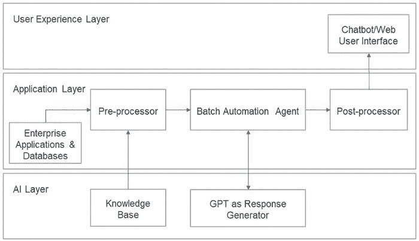
```

**图 4.10:** 批量自动化代理

## 用户体验层

显示批量处理输出的结果，并通过机器人或 Web 用户界面促进用户交互。

## 应用层

该层由预处理器、企业应用和数据库、批量自动化代理以及后处理器组成：

*   `Enterprise Applications and Databases`：企业应用和数据库作为原始数据记录的主要来源。

*   `Pre-Processor`：预处理器执行与对话模式相同的步骤，但这次是针对整个批数据记录。

*   `Batch Automation Agent`：该智能体采用双循环机制：外层循环处理批次中的每条数据记录，内层循环迭代地将一系列与当前记录相关的富化提示词输入 GPT 模型。

*   `Post Processor`：一旦 `Batch Automation Agent` 生成了批处理响应，后处理器就会对这些响应进行格式化，以便在用户体验层显示。

## AI 层

AI 层的功能与落地式对话模式（Grounded Conversation Pattern, A2）相同。

## 模式工作流

1. 企业级应用和数据库提供批数据记录。

2. 预处理器利用知识库创建富化数据记录。

3. `Batch Automation Agent` 采用其双循环机制：对于批次中的每个富化记录（外层循环），它向 GPT 模型处理一系列提示词（内层循环）。

4. 后处理器组织批处理输出以实现最佳显示效果。

5. 用户体验层对格式化输出进行可视化。

## 模式工作流示例

想象一家租车公司，希望处理每天收到的大量关于租车和服务的客户评论。目标是对这些评论进行分类，并以分类、摘要且用户友好的格式呈现给分公司经理。

以下是一个工作流示例：

1. **源数据收集**：公司的 `Rental Management System` 和反馈门户作为企业级应用和数据库，收集了当天的客户评论，汇总了一个包含数百条反馈条目的批次。

2. **数据富化**：`Pre-Processor` 获取每条评论并使用内部知识库添加上下文。例如，一条显示“汽车空调坏工作了”的评论可能会被富化为：“客户发现从 [特定分公司] 租用的 [车型] 空调存在故障。”

3. **双循环数据处理**：

    - **外层循环**：`Batch Automation Agent` 开始处理每条富化评论。

    - **内层循环**：

        - **第一个提示词**：“给定评论‘[富化后的评论]’，确定其情感（积极、中性、消极）和主要关注类别（例如：车辆状况、客户服务、价格、预订流程）。”

        - **第二个提示词**：“根据所识别的情感和类别，创建一个适用于分公司经理审查的简洁摘要。”

        - （注：根据系统设计，可以添加更多提示词以提取更细的信息。）

4. **数据格式化**：一旦 GPT 模型处理了所有评论，后处理器会对批处理摘要进行结构化。评论按分公司、车型和关注类别进行分组。数据已准备好进行最佳可视化，可能通过生成图表来展示反复出现的问题或根据正面反馈对分公司进行排名。

5. **可视化与用户交互**：`User Experience Layer` 在交互式仪表板上显示这些结构化摘要。分公司经理可以深入特定的反馈类别，查看单条评论，或通过集成的聊天机器人提出更详细的问题。

## 企业集成

等同于落地式对话模式（Grounded Conversation）模式的集成水平。

## 输出质量

`Batch Automation Agent` 的双循环机制在保持连续性和上下文的同时也带来了挑战：错误累积的风险。如果序列中的某个提示词生成了不准确或次优的响应，后续提示词可能会在该错误的基础上构建，导致不准确性叠加。这强调了确保每个独立提示词准确性对于维持响应整体质量的重要性。

## 性能

虽然双循环机制可能会引入复杂性，但批处理方法旨在提高效率。批处理本身在整个批次完成之前存在延迟，但结果是全面的，且过程在无需用户参与的情况下自主运行。

## 使用场景

这种架构模式适用于需要高级批处理基于知识的自动化场景。在知识管理领域尤为突出，它为海量数据的快速处理、分类和表示提供了稳健的解决方案。显著应用包括：

- **信息提取**：深入挖掘文档以发现相关见解，此功能在研究、法律或新闻等行业特别有价值。

- **数据转换与质量管理**：能够整合来自不同格式和结构的数据，并发现冗余和不一致之处，使其可以使用标准分析工具。

- **流程分析**：通过检查从各种事件日志中提取的模式，它提供了可操作的见解，有助于优化工作流。这对于依赖复杂流程指标的行业特别有益。

- **高级数据挖掘**：通过对非结构化数据使用关联规则挖掘和聚类分析等方法，该架构能够识别传统分析可能忽略的模式和见解。

- **自动标记**：通过增强搜索结果和强化推荐，此功能根据内容的属性自动对内容标记，简化了用户体验。

## D2 编排智能体

该架构的核心是编排工作流，旨在引导用户与 GPT 的交互从开始到结束。作为工作流核心的 `Orchestration Agent` 集成了用户、GPT 模型、应用、数据库和知识库（见图 4.11）。

```
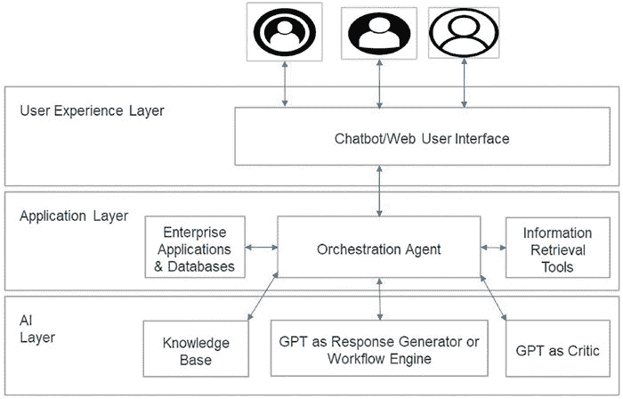
```

**图 4.11**：编排智能体

## 用户体验层

该层是多个用户连接系统的地方。他们可能使用聊天机器人或网络界面。他们提供请求，查看任务并获取 GPT 模型的响应。

## 应用层

该层分为三个主要组件，协调任务流和交互：

- **编排智能体**：关键组件有两个变体：

    - **基于程序的智能体**：用于使用 `Python` 或 `Java` 等适用编程语言编写的静态工作流，控制控制顺序执行。

    - **基于提示词的智能体**：适用于涉及规划、执行和适应的动态工作流。它采用集成了外部工具的工作流提示词，类似于 B1 - B3 架构模式。

- **企业级应用和数据库**：这些是智能体利用的特定特定的工具和数据源。

- **信息检索工具**：这包括系统用于为后续提示词提供上下文的公共工具，如搜索引擎或网站。

## AI 层

此层包含：

- **两个潜在角色中的主 GPT 模型**：

    - **特定工作流任务的响应生成器（在基于程序的编排中）**：在这种情况下，GPT 模型对脚本化工作流中定义的特定任务提示词做出响应。

    - **工作流引擎（在基于提示词的编排中）**：此处 GPT 模型承担更广泛的角色，通过工作流提示词管理任务的流和执行。

- **知识库**：此组件提供了长期短期记忆功能，因此超越了它在之前模式中作为静态仓库的角色：

    - **长期记忆**：这部分存储各种知识，根据信息的来源和性质分为不同的类别：

        - **已学知识 (Learned Knowledge)**：包含 GPT 模型在之前的交互中产生的见解和信息。它形成了一个不断发展的知识体系，通过监控和分析 GPT 模型过去响应的结果不断丰富，以随着时间的推移促进更细致的理解并提高性能。

        - **检索知识 (Retrieved Knowledge)**：此部分存储在早期期间从外部资源获取的数据和信息，例如之前用户交互中的搜索结果。它有助于保留价值发现以供未来参考，避免对相同查询进行重复搜索，并确保响应的一致性。

        - **获取知识 (Acquired Knowledge)**：记忆的这部分包含了由领域专家（SME）策划和验证的知识。它代表了一个结构化且可靠的信息库，经过时间的培养，为 GPT 模型的响应提供坚实的基础，确保输出符合企业标准和专家验证。

    - **短期记忆 (Short-term Memory)**：此部分旨在保留与用户、GPT 模型、企业应用或搜索工具之间交互的结果，临时存储数据，以便通过回顾最近的交互和计算来实现贯且自适应的交互。这种内存是瞬时的，会在会话结束或预定义时间后清除，以保持数据的相关性和安全性。

- **GPT 批判者 (GPT-Critic)**：一个辅助 GPT 模型，负责评估主 GPT 模型输出的有效性和质量。

## 基于程序的编排代理的模式工作流

1. **用户请求**：用户描述他们的预期结果。

2. **工作流选择**：根据用户请求选择标准工作流。示例包括：

    - **带生成任务的一步搜索**：


- **语义搜索**：从知识库中提取相关知识。

- **生成任务**：使用 GPT 模型进行内容创建、摘要或回答查询。

- **带生成任务的两步搜索**：

    - **查询构建**：当需要需要特定数据时，使用 GPT 模型生成 API 调用或搜索查询。

    - **信息检索**：从外部源获取必要数据。

    - **知识表示**：将这些数据整合到知识库中。

    - **语义搜索**：从知识库中提取相关知识。

    - **生成任务**：使用 GPT 模型进行内容创建、摘要或回答查询。

- **单步后端函数执行（类似于 B1 模式）**：

    - **从用户处收集信息（可选）**：如果需要，从用户处收集补充数据。

    - **后端函数调用生成**：创建可执行的应用级函数或调用。

    - **后端函数调用执行**：执行之前生成的应用程序函数调用。

    - **后端函数结果翻译**：将系统级函数的结果转换为用户友好的输出或格式。

- **多步后端函数执行**：

    - **对每个后端系统重复上述工作流的三个步骤**：顺序执行多个后端过程函数生成、执行和结果翻译步骤。

    - **后端函数调用之间潜在的用户交互**：在阶段之间与用户交互，以收集更多信息或完善后续步骤。

- **交互式内容创建**：

    - **从用户处收集信息**：为内容创建过程收集必要数据。

    - **基于收集的信息创建内容**：根据用户提供的数据开发定制内容。

3. **工作流执行**：启动并监督在之前的“工作流选择”步骤中选择的完整步骤序列。

4. **输出评估**：利用`GPT-Critic`输出的准确性和相关性，确保其符合既定标准或用户请求。

5. **结果展示**：以易懂且用户友好的方式向用户展示工作流的结果。

## 基于程序的编排工作流示例

想象一个为企业设计的数字平台，用于寻找和采购稀有的、环保的具有其他独特属性的特殊原材料。

一家制造公司正在寻找一种既耐用又对环境影响最小的可持续类型橡胶，用于新的环保鞋类产品。

以下是一个匹配模式工作流结构的工作流示例：

1. **用户请求**：制造商的采购经理登录数字平台并指定其需求：可持续、耐用的橡胶，最好带有公平贸易或热带雨联盟等认证。

2. **工作流选择**：

    - 考虑到经理的特定需求，系统选择了`带生成任务的两步搜索`工作流。

    - **查询构建**：使用经理的输入，系统构建了针对性的搜索查询，例如“带有认证的可持续耐用橡胶供应商”。

    - **信息检索**：系统利用网络爬虫浏览行业数据库、供应商目录、论坛和相关的关注可持续性的网站，以识别潜在的供应商。

    - **知识表示**：将提取的信息（如供应商简介、其认证、客户评价和材料规格）进行结构化处理以便于分析。

    - **语义搜索**：系统评估组织好的数据，优先考虑与制造商标准高度契合的供应商。

    - **生成任务**：如果没有找到理想的供应商，系统将使用 GPT 模型起草询价或 RfP（征求书），发送给有前景的供应商或行业联系人。

3. **工作流执行**：

    - 基于程序的代理管理操作序列，确保从网上获取相关且准确的供应商信息。

4. **输出评估**：

    - `GPT-Critic`审查供应商短名单和 RfP，以确认它们是否符合制造商的规格。

    - 如果发现不一致之处，可能会启动“信息检索”步骤的新一轮迭代或对搜索标准的修订。

5. **结果展示**：

    - 买家收到了一份精选的潜在供应商列表，包含所有认证、客户评价和联系方式在内的所有相关细节。

    - 生成的 RfP 已就绪，准备发送给潜在供应商。

    - 买家可以选择直接与供应商联系、索要样品或发送 RfP 进行竞争性投标。

## 基于提示词的编排代理的模式工作流

1. **用户请求**：用户描述他们的预期结果。

2. **工作流提示模式选择**：根据用户请求选择工作流提示模式。相应的模式示例在第 6 章“自适应业务流程管理”节中给出。

3. **工作流提示执行**：使用 GPT 模型作为工作流引擎执行工作流。当工作流需要时，它会生成 API 函数调用（类似于`B1`模式）和用户输入（类似于`A3`模式）。编排代理将处理这些请求并将结果馈回 GPT 模型以继续工作流。当达到提示词中的特定停止条件或用户停止时，工作流终止。

4. **输出评估**：`GPT Critic`检查工作流输出以确保其符合规定的标准。

## 基于提示词编排的工作流示例

想象一家电商巨头，客户最近购买的智能手表在送货时屏幕损坏了：

1. **用户请求**：客户进入投诉板块并提到：“我收到了智能手表订单，但屏幕破裂了。我想换货或退款。订单号：567890。”

2. **工作流提示词选择**：根据投诉的性质，系统选择了`自适应投诉管理工作流`（Adaptive Complaint Management Workflow）的提示词：

    * **提示词名称**：`Adaptive Complaint Management Workflow`

    * **专家角色设定**：“作为一名接受过电子商务自适应投诉管理训练的 AI，你将通过确定并执行适当的工作流来自主管理投诉解决。与用户的交互仅是为了获取关键细节。”

    * **上下文**：“你正在帮助一家每天接收数万条投诉的电商巨头。当前投诉：[已捕取的投诉槽位]。投诉解决步骤包括：

        1. `投诉澄清`：通过与用户交互了解投诉的具体。

        2. `工作流设计`：自主规划任务以处理投诉。

        3. `工作流启动与执行`：启动并完成投诉任务，向用户询问所需的细节。

        4. `工作流监控`：确保解决过程顺利进行并收集用户反馈。

        5. `工作流自适应`：根据意外情况或偏差修改任务。”

    * **目标**：有效引导每个投诉解决阶段，利用沟通、规划和建议等技能。

    * **控制与约束**：始终尊重隐私，寻求必要的用户输入，明确决策，并确保输出是可选的且遵循最佳实践。

    * **指令**：从‘投诉澄清’开始：请分享更多关于投诉[已捕取的投诉槽位]的信息，以便进行有效的解决。

3. **工作流执行**：

    1. **投诉澄清**：系统询问：“你能提供更多关于损坏细节吗？到达时包装完整吗？”用户回答：“包装看起来还好，但里面的手表损坏了。看起来是质量控制问题。”

    2. **工作流设计**：根据用户的反馈，系统选择了`产品换货与质量保证工作流`（Product Replacement and Quality Assurance Workflow）。

        * 验证订单。

        * 确认保修。

        * 启动退货和换货流程。

        * 确保对更换产品进行质量检查。

    3. **工作流启动与执行**：执行这四个工作流步骤。

    4. **工作流监控**：当更换产品出货时，会通知用户进度。

    5. **工作流自适应**：如果有延迟或问题，系统将调整工作流，通知用户并提供解决方案。

4. **输出评估**：`GPT-Critic`评估整个解决过程，确保投诉得到了有效处理，并遵循了所有工作流步骤。

5. **结果展示**：向客户展示已操作的时间线、换货货物的跟踪号，以及收货后提供反馈的界面。对于不便，还为他们提供了一个优惠码以鼓励未来的购买。

## 企业级集成

由于`编排代理`（Orchestration Agent）能够将基于 API 的功能嵌入整个工作流，该模式提供了高级的企业级集成能力。

## 输出质量

该模式通过系统地利用上下文用户输入、知识、内部和外部数据以及之前的 GPT 输出来落实提示词，从而增强了输出质量。多个用户的可能加入增加了一层人类判断，进一步完善了 AI 的感知感知输出。`GPT-Critic`评估 AI 生成内容的质量，其反馈由`编排代理`管理以优化输出质量。

## 性能

该模式的计算性能本质上与工作流的长度紧密相关。然而，对于大多数用例，中短长度的工作流就足够了，平衡了效率和计算需求。

## 用例

该模式的动态能力和健壮的设计使其非常适用于各种应用。其核心是设计用于管理两种主要的工作流：静态（脚本化的）和动态（自适应的）。

静态工作流是日常操作的基石，其特点是结构良好且流程可预测。此类工作流通常是自动化的，并遵循预设脚本：

* **复杂内容创建**：

    * **报告**：将数据点合成综合报告，包括图表和条形图等视觉表示。

    * **通讯邮件**：定期从更新或相关新闻中策划内容，保持一致的布局。

    * **文档生成**：为各种需求生成结构化文档，确保目标读者清晰易懂。

* **信息收集**：

    * **采访**：利用模板和协议系统地从个人或群体中提取信息。

    * **交互式报告**：从企业特定系统或数据库中以交互格式收集并展示数据，确保数据完整性和准确性。

    * **网站内容**：对相关网站的内容进行自动搜索、阅读和摘要。

* **标准工作流**：

    * **申请流程**：处理并自动化从请求到审批的标准申请流程。

    * **审批周期**：精简审批请求、提醒和文档记录。

    * **库存管理**：自动化与库存检查、补货水平和库存估值相关的任务。

虽然该模式可以轻松地管理可预测的操作，它也展示了其在应对更复杂、自适应挑战方面的熟练。规格不完整、需要即时调整或受不断变化的用户意图和不可见情况支配的任务这一领域。此类动态工作流需要规划、执行、重新评估和自适应的结合：

* **任务导型对话**：适应不断变化的用户意图，这些代理设计、修改并部署对话计划，产生多层面的交互。

* **全面研究**：将广泛的研究目标分解为子目标，并利用多种资源为每个子目标构思并执行详细策略。

* **探索性数据分析**：代理根据洞察目标制定探索策略，并在多种数据源和工具上迭代。

* **自动化故障排除**：在理解用户问题后，系统制定诊断计划，可能包括查询特定工具、提供引导解决方案或利用 GPT 提供创新方案。

* **个性化学习路径**：根据学生的目标定制教育轨迹，根据他们的进度和反馈细致地选择、排序和重新校准内容。

通过聊天机器人或 Web 界面，用户可以积极加入任何活跃的协作，贡献输入，并根据不断变化的内容共同决定轨迹和结果。

## 应用层

它包含了以下内容：

*   企业应用和数据库：这些是协作过程中使用的工具和数据源。

*   协作代理（Collaboration Agent）：该代理与`Collaboration Repository`交互，检索或归档主提示词⁸、协作历史、摘要和结果。

*   协作库（Collaboration Repository）：一个关重要的存储区域，保留主提示词、深度协作历史、简洁的协作摘要，以及中间和最终结果。

## AI 层

此层包含：

*   作为响应生成器的 GPT：负责交付与上下文高度相关的答复。

*   知识库：类似于之前的 D2 模式，具有短期和长期记忆。

*   GPT-Critic：第二个 GPT 模型，确保第一个 GPT 模型的输出符合预期的质量标准。

## 模式工作流

1.  用户选择启动或参与正在进行的协作。

2.  如果是开始新的协作，`Collaboration Agent`会从`Collaboration Repository`中获取与所选场景相对应的主提示词。

3.  对于正在进行的协作，以最近的协作历史作为奠定基础。

4.  用户持续添加提示词。在每次用户输入后，`Collaboration Agent`会将用户的提示词和生成的 GPT 输出附加到活跃的协作历史中。

5.  `GPT-Critic`监督并确保 GPT 响应的质量。

6.  在协作结束时，其摘要和结果将存储在`Collaboration Repository`中。

## 模式工作流示例

想象一家租车公司想要演进其车辆维护策略。通过与多个利益相关者（技术人员、车队经理、客服代表甚至客户）协作，他们的目标是使用`Collaboration Agent`在持续讨论中收集见解、经验和建议。

你的任务：主持一场关于改进车辆维护流程的协作讨论，并兼顾多元化的观点、历史讨论和建议。

以下是一个与模式工作流匹配的示例工作流：

1.  启动：车队经理决定启动一个标题为“增强我们的车辆维护策略”的协作讨论。

2.  协作启动：

    *   `Collaboration Agent`从`Collaboration Repository`获取一个关于汽车维护的通用主提示词。

    *   提示词内容可能是：“关于我们公司汽车维护的最佳实践、挑战和改进的讨论。”

3.  参与正在进行的协作：

    *   随着技术人员、客服代表和其他利益相关者的加入，他们可以查看正在进行的讨论并贡献意见。

    *   例如，一名技术人员可能会添加：“常规检查往往流于表面。我们需要更深入的诊断。”

    *   立即，一个 GPT 模型通过调用`Knowledge Base`可能会建议：“考虑实施详细的两个月一次诊断，并结合常规检查。这可以识别潜在问题。”

    *   这些每一个提示词和响应都会由`Collaboration Agent`附加到活跃的协作历史中。

4.  用户贡献：

    *   一名客服代表可能会插话：“客户在夏天经常报告空调问题。也许我们可以在旺季之前进行预防性检查？”

    *   一个 GPT 模型可能会回答：“在夏季之前进行年度空调服务是有帮助的。此外，考虑在最初的租车交接过程中教育客户如何优化地使用空调。”

5.  GPT-Critic 的质量监督：

    *   假设一位客户贡献道：“我曾租过一辆在半路坏掉的车。紧急情况的策略是什么？”

    *   如果 GPT 模型最初提供一个模糊的答案，如‘汽车应该进行维护’，`GPT-Critic`可能会将其标记为低质量，促使模型产生更全面的响应。

6.  协作结束与归档：

    *   一周后，车队经理决定结束讨论。

    *   `Collaboration Agent`自动生成一份摘要：“关于增强我们车辆维护策略讨论的关键要点”。

    *   它包含了诸如实施每两个月一次的诊断、夏季前的年度空调服务以及可能针对紧急故障的策略等观点。

    *   该摘要和整个讨论被归档在`Collaboration Repository`中，以供未来参考。

## 企业集成

此模式提供了与`Grounded Conversation`模式 (A2) 同级别的企业集成能力。

## 输出质量

得益于`Collaboration Repository`，GPT 模型在丰富的上下文中运行，这些上下文包含了来自不同视角的多个用户的输入以及相应的 GPT 输出。`GPT-Critic`的角色也有助于通过检查和验证来完善输出质量。

## 性能

此模式的效率取决于协作内容的深度和广度。然而，`Collaboration Agent`利用`Collaboration Repository`处理任务，确保了流程的顺畅，并且仅在收到新的协作输入后才使用计算资源。

## 用例

理想地为跨不同背景的复杂协作活动而定制，主要应用包括：

*   顺序性人为中心的工作流：在产品开发中，这涉及协调从构思到生产的团队。协作代理根据先前的输入确保每个阶段的一性。

*   项目：在活动规划中，代理帮助建立时间表、委派任务并收集物流输入。它根据持续更新提出改进建议。

*   销售对接：对于市场准入策略，代理整合市场研究、竞争对手分析和客户画像。

*   供应商评估：在采购供应商时，代理存储供应商简介和过去的往来。评估人员的标准（如成本或交付周期）与存储的数据进行匹配，以做出明智决策。

*   创新框架：在技术创新中，利益相关者在平台上进行头脑风暴。代理提供上下文反馈，从过去的会议或外部趋势中提取信息，协助制定连贯且创意的策略。

- `Orchestration Agent`（编排代理）：根据代理配置启动专家代理创建过程，启动任务序列，激活第一个专家代理并逐步推进任务。该代理还监督专家代理之间的通信，确保与用户、知识库和其他企业工具的无缝交互。

- `Expert Agents`（专家代理）：这些代理是动态创建，体现了执行过程中特定任务所需的精确技能，以实现用户的总体目标。

- `Enterprise Applications and Databases`（企业应用与数据库）：这些与 D2 模式相同。

- `Information Retrieval Tools`（检索工具）：这些与 D2 模式相同。

与 D2 模式类似，值得注意的是，该架构中存在两种不同的代理团队（Agent Teams）。虽然图中展示了基于程序的代理团队，但还存在另一种构建方式——基于提示（prompt-based）的代理团队。基于提示的代理团队的复杂性和应用将在`第 5 章，高级 GPT 提示工程技巧`以及`附录 1`中专门用于多代理提示的章节进行探讨。

## AI 层 (AI Layer)

以下元素是该层不可或缺的：

- `Knowledge Base`（知识库）：类似于 D2，存储瞬态和持久化信息。

- 在不同角色中实例化的`GPT`模型：

    - `GPT as Planner`（作为规划者）：对齐`Planning Agent`，将用户目标转化为一系列任务。

    - `GPT as Orchestrator`（作为编排者）：驱动`Orchestration Agent`，管理专家代理之间的任务排序和委托。

    - `GPT as Expert`（作为专家）：赋予每个`Expert Agent`能力，提供领域特定的知识和专业技能以执行其指定任务。

## 模式工作流 (Pattern Workflow)

1. 用户阐述他们希望实现的详细目标。

2. `Planning Agent`处理该目标，将其转换为可执行的任务序列，并为每个任务识别理想的专家代理配置。


3. 对于每个任务，`Orchestration Agent` 创建相应的 `Expert Agent`。

4. 任务排序完成后，`Orchestration Agent` 激活第一个 `Expert Agent` 并委托相应的任务。

5. `Expert Agent` 执行分配给它的任务。

6. 任务完成后，`Orchestration Agent` 移动到下一个任务，激活队列中的下一个 `Expert Agent`。

7. 尽力遵循此序列，直到所有任务都得到处理。

8. 在整个过程中，`Orchestration Agent` 确保 `Expert Agents` 之间，以及它们与其他参与实体（如用户、知识库或数据库）之间的通信顺畅。

# 企业级集成 (Enterprise Integration)

该模式提供了与 D2 模式相同的高级企业集成，因为所有代理都具有基于 `API` 的函数访问权限以执行任务。

# 输出质量 (Output Quality)

当最终专家代理评估所有之前专家代理的性能时，D4 的输出质量紧密反映 D2。虽然可以通过对每个参与的代理（包括规划代理、编排代理和专家代理）实施质量评估来提高输出质量，但重要的是，这种增强可能会以性能下降为代价。

# 性能 (Performance)

性能受涉及代理数量以及它们内部以及与用户和企业应用之间交互程度的显著影响。随着代理数量的增加，或者交互变得更加频繁和复杂，系统的响应速度和效率可能会受到影响。

# 用例 (Use Cases)

在 D2 模式的基础能力的基础上，并利用多代理协作的复杂性进行增强，D4 模式能够胜任地处理各种应用，如下所示用例所示：

### 综合研究

- `Planning Agent`：理解总体研究目标并将其分割为特定的研究领域或问题。
- `Orchestration Agent`：在专家代理之间进行协调，为它们分配特定的研究领域或任务，并确保其发现的无缝集成。
- `Expert Agents`：深入其分配的领域，挖掘数据、参考学术文章并交叉引用发现。每个代理可能专精于不同的研究方法或来源。

### 探索性数据分析

- `Planning Agent`：根据所需的见解和结果定义数据探索的目标。
- `Orchestration Agent`：组织数据流，确保数据以有序的方式在专家代理之间移动并整合它们的分析结果。
- `Expert Agents`：每个代理可以专注于特定的数据集或分析技术。例如，一个代理可能处理统计分析，而另一个代理则专注于可视化或预测建模。

### 自动故障排除

- `Planning Agent`：识别报告的问题并定义诊断步骤。
- `Orchestration Agent`：管理故障排除过程，确保每一步都执行，收集所需数据并提供反馈。
- `Expert Agents`：专门负责问题的不同方面。一个可能处理软件相关问题，另一个可能处理硬件诊断，另一个则可能关注用户体验或界面问题。

### 个性化学习路径

- `Planning Agent`：评估学习者的当前知识水平、偏好和长期教育目标。
- `Orchestration Agent`：组织课程，安排课程，并确保内容流与学习者的进度一致。
- `Expert Agents`：专攻不同的学科或学习方法。例如，一个可以处理数学，而另一个可以处理文学。其他的可能专注于体验式学习、多媒体内容或实操项目。

### 软件开发辅助

- `Planning Agent`：解释需求并将其拆分为功能或任务。
- `Orchestration Agent`：管理依赖关系和工作流。
- `Expert Agents`：建议代码片段、运行测试、调试问题，甚至协助制定部署策略。

### 咨询任务

- `Planning Agent`：识别客户需求并将其拆分为可操作的见解或任务。
- `Orchestration Agent`：安排会议、管理时间线并确保交付物达成。
- `Expert Agents`：深入细节，无论是市场研究、财务建模还是战略规划，利用最佳工具和资源。

# 架构模式建议 (Recommendations for Architecture Patterns)

在深入研究了各种 GPT 驱动架构模式的细微差别和复杂性后，我们准备提供一组精选建议。这些见解源于全面的描述和评估，旨在指导你根据特定需求选择最合适的架构：

- **高级对话体验**：`落地对话` (A2) 集成企业级系统以增加上下文深度。`混合主导对话` (A3) 促进了双向交互，引导用户操作和查询，而 `质量控制对话` (A4) 则确保在将响应显示给用户之前，已通过第二个 GPT 模型进行检查。

- **工具驱动对话**：`工具集成对话` (B1) 利用 GPT 模型通过 `API` 无缝衔接外部应用程序和数据库。`使用思维链引导的工具对话` (B2) 通过推理演示增强了这一点。同时，`高级工具集成对话` (B3) 根据不断变化的对话上下文使用动态任务规划优化与企业工具的交互。

- **专业领域对话**：`Conversation using Fine-tuned Model` (C1) 采用精炼语言模型来生成精确响应，是复杂领域和高风险环境的理想选择。同时，`Conversation using Two Models` (C2) 结合了微调模型的特定性与预训练 GPT 模型的广泛性，确保将深度用户交互嵌入到优化的对话场景中。

- **高级自动化**：对于复杂的自动化需求，`Batch Automation Agent` (D1)、`Orchestration Agent` (D2) 和 `Multi-Agent Cooperation` (D4) 模式脱颖而出。D1 强调批处理数据处理，而 D2 利用顺序编排实现无缝交互。D4 特别适用于需要高度动态适应能力和特定任务专业知识的环境。

- **辅助协作**：对于深度协作环境，`Collaboration Agent` (D3) 和 `Multi-Agent Cooperation` (D4) 模式表现优异。D3 擅长于强调持续以人为中心的交互的场景，由 `GPT` 管理并增强整个协作过程。另一方面，D4 强调人类与特定任务智能体协同工作的场景，结合双方优势以获得最佳结果。

我们对 GPT 驱动架构模式的探索揭示了多样化的解决方案，每种都有其内在优点。对于您的组织或项目的正确选择取决于您的具体需求和局限性。请将此分析作为参考，引导您选择最符合目标的架构模式。

# 结论

当我们探索 GPT 驱动架构模式的多样图谱时，显而易见，这些系统在改进用户交互、增强协作场景和推进自动化流程方面具有多大的作用。通过提供针对特定用例和需求量身定制的多样化模式，我们可以释放 AI 能力的全部潜力，开发出高效、自适应、协作性且提供丰富用户体验的未来对话系统和工作流。

既然我们已经通过各种架构模式确定了 `GPT` 的多功能适应性，现在是时候深入研究高级 GPT 提示词工程技术了。这些技术将让我们对如何引导 `GPT` 模型获得预期结果产生深刻理解，特别是在复杂的企业场景下。让我们现在关注于这些结构化的提示词方法，以进一步释放 `GPT` 在高级 AI 应用中的巨大潜力。

# 关键点

1. GPT 驱动架构的多功能性：架构模式具有多功能性，将 `GPT` 模型的部署定制到各种对话语境、工具集成和自动化场景，证明了它们在增强用户参与和简化信息检索方面的至关重要性。

2. 分层系统方法：架构模式中使用分层系统方法确保了解耦和可维护性，从而带来了更可持续的系统生命周期。

3. 质量与性能权衡：每种模式都提供了输出质量、性能和企业集成的独特结合，为满足各种需求和用例提供了一系列选择。

4. 企业集成：如 `Tool-integrated Conversation` 等其他模式所示，与企业应用程序和数据库的无缝集成可以显著扩展 `GPT` 驱动系统的能力。

5. 响应的精确性与广度：通过平衡特定知识与更广泛的理解，某些架构证明了模型微调在交付准确且全面响应方面的重要性。

6. 高级自动化：`GPT` 集成架构在各种自动化场景中也展示了多功能性：内容的批处理、信息工作流编排以及使用多智能体系统的项目执行。

7. 协作卓越：可以利用 `GPT` 模型在协作环境中培养自适应参与，实现以人为中心的交互与多智能体协作的独特结合，共同实现复杂目标。

---

[¹] 智能体（Agent）是一种用于执行特定任务的软件组件，通常是自主的并与其他智能体、系统或用户进行交互。

[²] `Prompt Templates` 大程度上是预填充的 `Prompt Patterns`，用于控制 `GPT` 模型，并在 `[第 5 章，高级 GPT 提示词工程技术]` 中引入。模板可以根据规则、机器学习模型或通过向 `GPT` 模型选择提示来选择。

[³] 文档数据库，也称为面向文档的数据库或文档存储，是一种非关系型数据库，设计用于存储、检索和管理半结构化信息，例如带有元数据的文本，通常采用标准格式，如 `JSON`（JavaScript 对象表示法）或 `XML`（可扩展标记语言）。

[⁴] 图形数据库，通常称为图取向型数据库或图引擎，也是非关系型数据库的一种形式，用于捕获、处理和管理建模为网络的数据，强调节点、边和属性，从而使复杂的连接和依赖关系能够映射、访问和分析。

[⁵] 向量数据库是一种特殊的数据库系统，针对存储和查询高维向量数据进行了优化，通常代表文档、查询或兴趣画像等文本，常用于 AI 应用中的相似性搜索或推荐任务。

[⁶] 在 `ChatGPT` 等 `GPT` 模型的背景下，`Chain of Thought (CoT)` 指模型在系列句子或交换中保持连贯推理链路的能力。`CoT` 演示是此类推理链的示例。

[⁷] 该架构模式的实现示例见 `第 9 章`，使用了 `Java` 编程语言。

[⁸] 主提示词（Master prompt）定义了给定协作场景的协作策略。主提示词在 `[第 6 章，设计基于提示词的智能助手]` 中详细介绍。

# 第 5 章：高级 GPT 提示词工程技术

## 引言

回想我们之前的讨论，我们已经在 `[第 2 章，CapabilityGPT – 适用于 ChatGPT 的企业 AI 能力框架]` 中深入探讨了 `ChatGPT` 的 AI 能力，并在 `[第 3 章，ChatGPT 对企业的影响]` 中考察了它们对企业角色的转型性影响。我们还在 `[第 4 章，GPT 模型驱动的架构模式]` 中看到，这些高级能力与正确的解决方案架构模式相结合时，如何催生新一代智能系统。利用这些 AI 能力的核心是提示词工程实践，即与 `GPT` 模型进行有效通信的技术。

提示词工程在任何背景下都至关重要——无论是与 `ChatGPT` 聊天机器人简单交互、开发以 `GPT` 为核心的专用应用程序，还是利用增强 `GPT` 的企业解决方案（如 `Microsoft Copilot`）。它是构建精确、符合上下文的提示词的过程，以便从模型中获得预期的响应。

主要有三种技术：`Instruction Prompting`、`Query Prompting` 和 `Multi Agent Prompting`，每种技术都解决了与 `GPT` 模型通信时的独特挑战和场景。

我们将从 `Instruction Prompting`（指令提示）开始探索。该技术植根于 `第 2 章` 中引入的 `CapabilityGPT` 框架，为向 GPT 模型传达特定任务或动作提供了一种结构化方法。随后的深度解析将介绍其三种变体：单指令、指令序列和伪代码指令。随后，我们将通过强调其实际应用的真实案例来展示它们的效用。

接下来，我们将过渡到 `Query Prompting`（查询提示），这是一种在探索性和分析性场景中非常有用的技术，特别是在面临歧义和信息不足的情况下。在本节中，我们将区分不同的查询类型，包括信息寻求型、比较型、预测型和反事实查询，并为每种查询类型提供详细示例。

最后，我们将深入研究 `Multi-Agent Prompting`（多智能体提示）。该技术的核心在于处理无法预先严格定义的任务，这需要多个 AI 代理的专业知识及其有效协作。本节将提供底层概念的定义，并在企业背景下提供具体的实践示例。

需要注意的是，本章讨论的提示工程技术专门适用于 ChatGPT 及之后的 GPT 模型，截至目前，这些模型仅包括 ChatGPT 和 GPT-4。

## 结构

在本章中，将涵盖以下主题：

- 指令提示
- 查询提示
- 多智能体提示

# 指令提示

在本节中，我们首先探索指令提示模式，这是一种用于 GPT 模型交互的精确引导蓝图。然后，我们将展示多个实际示例，说明其在企业场景中的应用。

# 指令提示模式

指令提示模式建立在 `第 2 章，CapabilityGPT – 针对 ChatGPT 的企业级 AI 能力框架` 中引入的 AI 能力框架之上，它提供了一种系统化的方法，引导 GPT 模型生成深度、感知感知且精确的输出。让我们深入研究模式的每个组件：

- **专家角色 (Expert Persona)**：这一基础元素界定了 GPT 模型在回答中应表现出的专业知识和角色。专家角色可以被构想为个人或一个团队，体现了多样但互补的技能组合：

  - **对于个人角色**：重点在于单一的专业技能组，例如“营销公司的业务分析师”或“专攻数据分析的 AI 代理”。在这种情况下，模型将引导基于特定角色的专业知识和视角，利用其预训练知识以所需的专业背景和语境理解进行回答。

  - **对于团队角色**：例如“由老师、学生和家长组成的协作团队”或“由开发人员、设计师和项目经理组成的跨职能团队”，涵盖了不同视角和经验的协同作用。在这里，GPT 模型寻求促进一种协作方法，并考虑到每个角色贡献的独特见解。

- **上下文 (Context)**：此组件包括外部或用户提供的信息，用于引导 GPT 模型做出更准确、恰当的回答。它可能涉及背景信息或特定场景的详细细节；例如，“我们公司在上季度发布了三次营销活动”。上下文有助于显著引导 GPT 模型的理解和响应，并有助于减少幻觉风险（幻觉即生成了在输入或其预训练数据中没有依据的信息）。

- **任务规范 (Task Specification)**：此组件作为详细指令，定义了 GPT 模型需要执行的动作或系列动作。指令的性质和结构取决于任务的复杂性、要求的精确度以及任务是否涉及单步或多步。此类指令有三种不同的格式：

  - **单指令 (Single Instruction)**：这些指令符合 `CapabilityGPT` 框架中定义的 AI 能力¹，引导 GPT 模型利用其多样化的能力，如评估、分类或沟通。例如，指令可以是：“评估这些活动的性能并识别可以改进的领域。”

  - **指令序列 (Instruction Sequence)**：这种格式涉及一系列指令，每条指令对应一种特定的 AI 能力。序列引导 GPT 模型完成多个任务，旨在解决复杂问题或实现详细目标。每条指令都是整个任务进展中的一个阶段，前一个指令的输出作为下一个指令的输入。例如：“1. 从提供的财务报告中提取季度销售数据。2. 从提取出的数据中识别任何销售趋势或模式。3. 根据识别出的趋势，预测下季度的销售情况。”

  - **伪代码指令 (Pseudo-Code Instructions)**：伪代码桥接了自然语言和编程语言，提供了算法的高层描述，而不必遵循严格的编程语法。这确保了为 GPT 模型提供清晰且精确的指令。通过伪代码，可以无缝集成如 `if-then-else` 条件以及 `for` 或 `while` 循环等结构，使模型能够高效且明确地处理复杂的多步骤任务。相关的示例是：

```
FOR each paragraph in the article
    IF the paragraph contains the word “important”
        EXTRACT main idea of the paragraph
    ENDIF
ENDFOR
COMPILE extracted ideas into a brief summary
RETURN the summary
```

- **执行规则 (Execution Rules)**：执行规则提供了潜在指令，用于引导 GPT 模型在整个任务执行过程中的思维过程和决策。这些规则涵盖了问题解决方法、数据收集技术、伦理考虑、协作实践和演进原则。它们适用于整个指令序列，也可以针对每个指令步骤有所不同。每类规则都包含特定示例，以进一步澄清其意图和应用。以下是详细说明：

  - **问题解决与推理**：

    - “让我们一步步思考”：确保 GPT 模型执行分步骤的思维过程，并在产生最终输出之前记录每一步。

    - “让我们先理解问题并制定解决计划。然后，让我们执行计划并逐步解决问题”：引导 GPT 模型为任务生成行动计划，然后遵循该计划，按顺序执行每个动作。

    - “考虑所有可能的解决方案”：鼓励 GPT 模型探索多种解决方案，而不仅仅关注最明显的或它识别出的第一个。

    - “在决定之前权衡优劣”：指示 GPT 模型评估每个方案或方法的优点和缺点，确保决策过程更加平衡。

    - “从列出可能的结果开始”：引导 GPT 模型在深入进行分析之前，通过列举可能的结果或场景来开始其思维过程。

    - “系统地引用可用数据”：指示模型仔细核对其提供的每条信息，确保在推理过程中不遗漏任何细节。

    - “根据新见解更新假设”：提示模型随着更多数据或上下文的提供，完善其初始预测或结论，鼓励推理过程中的适应性。

### 数据收集

- `仔细地向我提具有启发性的问题，以最大限度地获取你关于此事件的信息，这样当你获得所有答案时，你就可以执行 X`：确保 GPT 模型提问最有效的问题以使信息增益最大化。

- `每次只提一个问题，不要给出答案`：限制 GPT 模型每次只提一个问题，允许后续问题基于之前的回答进行构建。

- `在继续之前验证数据完整性`：鼓励模型确保其收集的信息是准确、完备且未受损坏或不具有误导性的。

### 对伦理/道德标准的遵循

- `消除特定偏见`：指示模型在生成输出时，主动避免任何形式的偏见——无论是人口统计学、社会经济、文化、种族、性别等方面的偏见。


# 指令提示词模式

## 安全与伦理准则

- **拒绝个人身份信息（PII）**：确保 GPT 模型不接受提示词中的任何 `PII` 数据。
- **促进公平与包容性**：指导模型产生公平且具有包容性的输出，代表不同的观点并避免边缘化。
- **避免有害或攻击性内容**：指示模型过滤掉任何可能对个人或群体有害、误导或具有攻击性的内容。
- **识别并披露局限性**：鼓励模型承认其局限性，并在适当的情况下提供免责声明或建议用户寻求专家意见。

## 协作规则

在专家角色团队执行任务的背景下，协作规则引导不同角色之间的交互和协同，以促进建设性且平衡的对话。在这里，我们详细介绍了鼓励结构化协作的规则：

- **执行协作合成**：鼓励专家角色团队协作，将他们的个人见解整合为一个连贯的回答。例如，教师、学生和家长可以汇集他们的独特观点，构建基于 AI 学习的多方面解决方案。
- **基于角色的视角**：鼓励专家角色团队的每个成员从其特定的角色观点提供输入，促进对当前问题有更深入的理解。
- **建立共识**：指导专家角色团队寻找共同点，鼓励采用一种尊重并整合所有团队成员观点的和谐方法。
- **解决冲突**：引导团队高效地导航并解决分歧，营造不同观点可以和谐共存的协作环境。

## 演化原理的应用

引导 GPT 模型在生成或完善输出时，利用模拟自然选择过程的演化方法来迭代优化解决方案。在使用这些原理时，用户应指明：

- **使用此初始方案：`<solution>`**：指导 GPT 模型从指定的起始点开始其演化过程。例如，在为新款运动汽车生成口号时，可以从“绿色且快速。不再有矛盾”开始。
- **执行 `<number>` 个演化步骤**：指示模型应该执行的精确精炼次数。例如，为了完善一个口号，模型可能被要求进行 20 个演化步骤。
- **通过此适应度函数进行评估 `<function description>`**：命令模型根据设定的标准评估其输出。在口号创作领域，该函数可以根据口号的朗口程度或其在现代生态背景下的相关性进行衡量。

## 输出约束

这些定义了 GPT 模型生成的输出必须满足的条件。它们可以涉及格式、顺序、某些元素的包含或排除、输出的大小和/或其他因素。约束可能是：“输出应该是一份结构化的报告，为每个营销活动的性能和建议的改进提供清晰的章节。总输出长度不应超过 500 字。”

## 引用案例

基于案例的推理（CBR）是一种方法，通过类比以前遇到过的情况及其结果，推导出应对新挑战的方法。它涉及选择相关的引用案例并对其进行调整，以解决上下文描述的当前挑战。它们捕捉了跨不同领域的广泛现实世界场景，并分为三大类：

### 问题-解决方案案例

描述实体面临的特定问题以及为解决该问题而实施的后续解决方案或干预。

#### 示例 1（零售）

- **问题**：MegaStore 发现其电子商务网站的购物车遗弃率很高，尤其在移动设备上。
- **解决方案**：MegaStore 重新设计了移动结账流程，简化了步骤，并整合了更高效、流行的移动支付方式。这导致在两个月内购物车遗弃率降低了 25%。

#### 示例 2（人力资源）

- **问题**：TechCorp 意识到其员工流失率逐年增加，尤其是基层员工。
- **解决方案**：TechCorp 实施了导师计划，将基层员工与资深人士配对。他们还引入了灵活的工作时间和持续学习的机会。在一年内，流失率下降了 20%。

### 输入-输出案例

特定输入与其对应的 GPT 生成输出对。

#### 示例 1（媒体监控）

- **输入**：“在年度会议上，首席执行官 John Smith 宣布与 GlobalTech 合作创新新的 AI 解决方案。”
- **输出（事件数据提取）**：事件：合作伙伴公告；参与者：CEO John Smith, GlobalTech；背景：年度会议；目标：创新新的 AI 解决方案。

#### 示例 2（能源领域）

- **输入**：冬季消费趋势增加和新的监管政策。
- **输出（事件预测）**：根据消费增长趋势和新监管政策，预计在即将到来的冬季价格将上涨。

### 思维链案例

详细的序列，初始输入经过一系列逻辑或推理步骤以得到特定的输出。

#### 示例 1（供应链管理 - 库存补货）

- **输入**：本月数据：售出 500 件，退回 200 件，运输中损坏 50 件，库存 1000 件，补货提前期 3 周，平均每周销售量 150 件。
- **思维链**：
  1. 计算净销售量：从销售量中减去退货：500 - 200 = 300 件。
  2. 评估当前库存：从库存中扣除净销售量和损坏件：1000（起始库存）减 300（净销售）减 50（损坏）= 650 件。
  3. 预测未来库存：考虑平均每周销售量和当前库存：650（当前库存）-（3 周 × 150 件/周）= 3 周后预计 200 件。
  4. 确定补货紧急性：如果提前期为 3 周，当库存补货时，将剩下 200 件。因此，补货必须在周内进行，以避免在补货期结束前出现缺货。
  5. 评估最佳订货数量：考虑到销售趋势、退货率和潜在损坏，为意外损坏留出缓冲是明智的。重新订货（3 周 × 150 单位/周 + 100 单位缓冲）= 550 个单位似乎是恰当的。
- **输出**：为了在下个月保持健康的库存水平并考虑到不可见的情况，建议在一周内订购 550 个单位。

#### 示例 2（银行 - 分类案例）

- **输入**：一份贷款申请详情如下：申请人年龄：29 岁，年收入：$85,000，就业状态：全职，信用评分：680，现有债务：$20,000。
- **思维链**：
  1. 评估年龄及其对贷款风险的影响。
  2. 评估年收入与潜在贷款数额的关系。
  3. 检查就业状态以评估财务稳定性。
  4. 审查信用评分以评估信誉状况。
  5. 分析现有债务与收入的关系以了解财务负担。
- **输出**：该申请人在贷款审批中属于“中等风险”类别。

## 外部能力

GPT 模型可以进一步利用插件和外部工具³ 的力量来增强其功能：

- **插件**：这些最初为 ChatGPT 生态系统引入的专用扩展。它们侧重于驱动业务效率、实现数据驱动的决策，并促进智能自动化。关键类别包括探索性数据分析、文档理解、AI 和浏览。
- **外部工具**：代表通过指定接口提供的功能目录，这些工具促进了 GPT 模型与其他 AI 平台、搜索引擎或后端系统之间的交互。每个工具都由详细的规范定义，包括执行的任务类型、参数类型、结果类型和功能。

## 指令提示词模式的适用场景

指令提示词模式（Instruction Prompt Pattern）在以下情况下特别有用：

- **需要解决复杂问题**：在任务多维度化且需要复杂解决方案的场景下，该模式确保了系统化的方法，将复杂任务分解为易于管理的步骤，以提高清晰度和效率。
- **精确性至关重要**：对于准确性和精确性至关重要的任务，指令提示词模式的详细任务规范和执行规则会引导模型产生精确且感知语境的响应。
- **需要特殊专业知识**：如果语境需要各种专业技能，在个人角色和团队角色之间进行选择可以满足特定的专业知识需求——无论是来自单一专业人士还是协作团队。
- **需要结构化输出**：当预期结果必须遵循特定的格式或结构时，输出约束组件可确保 AI 生成的内容符合定义的要求。
- **基于案例的推理很有价值**：在通过与过去场景进行比较可以提供宝贵见解的情况下，该模式的参考案例提供了一种利用先验知识应对新挑战的方法论。

# 单指令示例

以下示例展示了 ChatGPT-4 在处理单指令提示词时，利用指令模式组件的多样化能力。这些示例跨越了项目评审、利益相关者管理和销售预测等领域。每个提示词都展示了 ChatGPT-4 的一种独特 AI 能力⁴：

- **项目评审**：在评估一个已完成的项目时，比较了两个评估提示词，一个提供简要摘要，另一个提供提供了识别改进领域和建议的详细分析。比较表明，对于 `Assessment` 能力，从指令提示词模式中指定 `Persona`（角色）、`Execution Rules`（执行规则）和 `Output Constraints`（输出约束）组件可以产生更详细、具体且专业的结果。
- **利益相关者管理**：在这里 ChatGPT-4 充当产品经理，使用论证框架⁵说服高管支持三个产品选项之一。它将产品功能与利益相关者的利益对齐，对所有产品建议分阶段开发方法，并促进平衡的产品开发策略。这是通过使用 `Creation` 能力开发多条逻辑推理链实现的。
- **销售预测**：最后，ChatGPT-4 展示了预测有机护肤品线未来销售的历史数据、观察到的模式和未来的市场预期。它利用 `Prediction` 能力用自然语言生成未来几个月的基本销售预测，为库存管理和营销工作的战略规划提供帮助。

# 项目评审

让我们首先以项目经理的报告作为 `Assessment` 能力的示例，开始评估一个已完成的项目：


图 5.1: 项目评审

以下是报告：

*项目报告：“XYZ”移动应用程序的开发*

- **项目范围**：目标是为我们的客户 XYZ 公司设计并实现一个功能齐全的移动应用程序，以增强客户互动和用户体验。关键功能包括用户友好界面、安全的支付网关和客户支持功能。
- **进度**：项目计划为期 12 个月，从 2022 年 8 月 1 日开始，于 2023 年 7 月 31 日完成。项目分为四个阶段：规划（2 个月）、开发（5 个月）、测试（3 个月）和部署（2 个月）。
- **成本**：设定预算为 $500,000，但由于开发和测试期间不可预见的复杂性，项目超过了预估成本 15%，最终成本为 $575,000。
- **质量**：尽管进度和成本超支，但项目仍符合协议规定的质量预期。用户测试平均得 5 分中的 4.5 分，表明用户对应用程序的可用功能表示满意。
- **资源**：项目团队由一名项目经理、两名软件开发人员、一名 UI/UX 设计师、一名质量保证专家和业务分析师组成。然而，开发阶段的高流失率导致了项目交付的轻微延迟。
- **风险**：遇到了两个重大风险：
  - 开发过程中不可见的复杂性导致预算超支，通过重新分配营销预算进行了管理。
  - 人员流动导致的延迟通过聘用临时经验人员得到了缓解，以确保按计划进行。

参考该报告，针对 ChatGPT-4 的直观提示词可以是：

```
‘基于上述报告进行端到端评估。’
```

响应如下：

*项目评估摘要：“XYZ”移动应用程序的开发*

- **目标和范围**：该项目成功实现了为客户设计并实现一个功能齐全的移动应用程序的目标，具有用户友好界面、安全支付网关和客户支持功能等特性。
- **时间线**：尽管开发阶段由于人员高流失导致了轻微延迟，但项目仍遵循了概述的 12 个月时间线。考虑到涉及任务的复杂性，项目阶段的分配是合理的。
- **预算**：项目超出了最初估计预算的 15%（75,000 美元），这主要是由于开发和测试阶段期间不可预见的复杂性。虽然通过重新分配营销储备金的预算管理了这一超支，但这显然是未来项目需要改进的领域。更好的应急计划和风险管理本可以预见到这些额外成本。
- **质量**：质量衡量显示出积极的结果。应用程序在测试中获得了很的用户满意度评分，表明尽管面临预算和资源挑战，最终产品质量很高。
- **资源**：项目团队组成通常符合项目需求。然而，高人员流失率表明项目管理、团队士或其他组织挑战方面可能存在问题。这种资源的不稳定性产生了实质影响，导致了项目交付的延迟。
- **风险管理**：风险已得到识别和管理，但识别工作可以更具主动性，特别是在预算和人力资源方面。虽然采取了缓解措施（重新分配预算、聘用临时资源），但分析这些问题以防止在未来项目中再次发生将是有益的。

### 对未来项目的建议

1. 加强项目成本估算和应急计划，以防止预算超支。
2. 加强团队管理和留才策略，减少项目关键阶段的人员流失。
3. 改进风险识别流程，在规划阶段更全面地考虑内部和外部潜在风险。

总体而言，该项目可以被认为是成功的，因为它交付了关键目标，并产生了一个受用户欢迎的高质量产品。然而，时间和预算的超支加上资源的不稳定性，表明未来项目在这些领域可能需要密切关注和完善。这些改进可能会使项目执行更具可预测性、更顺畅，并可能节省成本。

然而，使用指令提示词（Instruction Prompt）模式，提示词的制定方式将如下：

- **专家角色设定**：“你是一位擅长项目评估的高级项目经理”
- **背景**：“下方是关于一个开发移动应用程序的完成项目的描述”
- **指令**：“对该项目进行端到端的评估”
- **执行规则**：
  - “确保你涵盖了项目的范围、进度、成本、质量、资源、沟通、风险、采购和利益相关者管理。”
  - “确保采取非常批判中立的立场，并对负责交付项目的项目经理所创建的报告提出挑战。”
- **输出限制**：“输出必须以结构化报告的形式呈现，每个评估因素都有清晰的标题”

ChatGPT-4 的最终输出如下：

*项目评估报告：“XYZ”移动应用程序开发*

1. **项目范围**：该项目旨在设计并实现一个具有用户友好界面、安全支付网关和客户支持功能的移动应用程序。然而，对项目范围的描述似乎过于泛统，缺乏对其复杂性的详细洞察。如果能包含应用程序开发平台、预期的用户交互水平以及所需的客户支持规模等细节将大有益。还应明确说明功能数量、其复杂性以及任何限制条件，以避免范围蔓延。
2. **进度**：项目遵守了 12 个月的时间的时间表，尽管由于人员流转而经历了轻微延迟。评估原始项目进度中是否留了足够的应急时间以应对不可预见的延迟至关重要。规划阶段看起来是成比例的，但开发阶段占据了近项目时长的一半，这引发了对效率和方法的质疑。此外，两个两个月的部署时间线可能过长——事后评估应确定这在未来项目中是否可以被精简。
3. **成本**：项目经历了 15%的成本超支，主要归因于开发和测试阶段不可预见的复杂性。这引发了对项目初始成本估算和风险评估过程的担忧。项目预算是否包含了意外成本的应急资金？如果没有，应将其纳入未来项目中。此外，从营销储备中重新分配资金可能会对项目的可见性和客户触达产生影响。
4. **质量**：项目似乎达到了其质量目标，用户测试评分证明了这一点。然而，平均分并没有提供全面的状况。对应用程序特定方面（如可用性、设计、功能和安全性）的评分细分将提供更深入的理解。此外，是否有机制在整个项目生命周期中管理和监控质量，还是仅在结束时通过用户测试进行衡量的？
5. **资源**：对于此类项目来说，团队组成相当全面。然而，高人员流失率令人担忧。背后的原因是什么？这些与项目管理、公司文化或市场状况有关吗？调查这些对于未来减少类似情况至关重要。此外，聘用临时资源可能会影响团队的协同效应和输出质量。
6. **风险**：报告提到了两个重大风险——预算超支和人员流转导致的延迟。分析项目中所采用的风险识别、评估和缓解策略是值得的。这些风险在开始初就被识别了吗？如果没有，为什么被遗漏了？项目是否有建立风险管理计划？理解这些因素将加强未来项目的风险管理方法。
7. **采购**：没有提供关于该项目采购的信息。它是否涉及任何分包或对第三方服务、工具或技术的采购？如果是，采购策略是什么，管理得如何有效？这方面的透明度将有助于更全面的项目评估。
8. **利益相关者管理**：报告没有提供任何关于利益相关者管理的见解。有关利益相关者的识别、他们的角色、期望和沟通策略的信息，对于从所有角度理解项目的成功至关重要。是否有结构化的方法来让利益相关者了解项目的进展和挑战？

结论是，虽然该项目成功交付了一个高质量的移动应用程序，但仍有重大的改进领域。这些包括精炼项目范围、改进成本估算和风险管理、解决人员流失问题以及提高采购和利益相关者管理的透明度。

两份评估报告都对“XYZ”移动应用程序项目进行了回顾，但它们在方法、分析深度和关注方面的差异如下：

1. **目标和范围**：两份报告都赞扬项目实现了其目标。第二份报告建议精炼范围描述以增加具体性，并提出了改进建议。
2. **时间线**：评估双方对维持时间表虽有小插曲达成共识。第二份评估建议进行事后评估以进一步审查各阶段时长。
3. **预算**：两份回顾都承认了预算超支，强调了财务规划方面的改进领域，并在第二份报告中对应急和营销资金的分配提出了质疑。
4. **质量**：第一份报告表扬了用户满意度得分，而第二份报告则对这些得分进行了更深入的分析，并对项目的质量管理策略提出了质疑。
5. **资源**：报告了高流失率，第二份报告建议改进团队管理策略，并对流失原因及其影响进行调查。
6. **风险管理**：第一份报告建议改进风险识别流程，第二份报告则要求对项目使用的风险管理策略进行全面审查。
7. **采购与利益相关者管理**：第二份报告引入了新的考虑，建议增加采购透明度并加强利益相关者管理。

总而言之，两项评估对项目的成功结果达成了一致。第一份报告提供了简洁全面的总结，而第二份报告则提供了更详细、更具批判性的分析，识别了额外的改进领域并提供了更具体的建议（尽管两个提示词都没有要求建议）。通过对比可以显而易见，引入指令提示词（Instruction Prompt）模式中的额外组件——如角色设定、执行规则和输出限制——会产生更详细、更具体且最终专业的结果。

# 利益相关者管理

让我们来看产品管理领域的示例，该领域需要处理多个利益相关者。


**图 5.2:** 利益相关者管理

接下来的提示词基于 `Creation` 能力：

- **专家角色**：“你是一位产品经理和论证专家”
- **背景**：“你正面临发布新产品的压力。
  - 你有以下三个选项：
    - 产品 A 功能最多，但开发时间最长，价格最高。
    - 产品 B 拥有所有基础功能，作为成功产品 C 的替代品（C 已不再符合市场标准）。
    - 产品 D 以其特殊的技术特性吸引了新一代客户。
  - 你的利益相关者是以下高管：
    - CTO（首席技术官），对应用新技术有浓厚兴趣。
    - COO（首席运营官），曾在几年前开发过产品 C。
    - CMO（首席营销官），希望有一条快速开发的新产品线以跟上竞争。”
- **指令**：“开发几条论证推理链（创建）”
- **执行规则**：
  - 尝试说服尽可能多的利益相关者，
  - 尽可能减少任何潜在的不满，


使用 AI 论证框架。

ChatGPT-4 对此提示词生成的响应如下：

好的，我可以提供帮助。我们将使用基于三个主要组件的 AI 论证框架：主张（`claim`）、证据（`evidence`）和保证（`warrant`）。主张是我们想要表达的观点或断言，证据是支持主张的信息，而保证则连接证据与主张，解释为什么证据支持该主张。

让我们逐对每个产品进行论证：

**产品 A（功能最多、开发时间长、价格高）**

- **主张**：产品 A 是最全面的解决方案，将吸引寻找功能丰富产品的客户，从长期来看增加了价值。
- **证据**：它拥有最多的功能，可能比市场上的任何其他产品都能满足客户需求。
- **保证**：尽管开发时间较长且价格较高，但产品 A 丰富的功能可以证明其价格的合理性，并吸引忠实的、注重质量的用户群体。这将帮助我们获得稳固的市场地位并建立品牌声誉，这与 CMO 希望与竞争对手形成差异化的利益相契合。

**产品 B（基础功能、产品 C 的替代品）**

- **主张**：产品 B 是之前成功产品 C 的直接继者，确保了连续性并照顾了我们现有的用户群。
- **证据**：它的设计是为了替代不再符合市场标准的产品 C，这意味着它填补了我们产品线中的当前空白。
- **保证**：更新我们的产品线以匹配市场标准至关重要。这将维护现有用户的信任，确保他们不会感到被遗弃，并维护我们的市场份额。COO 会喜欢这种策略，因为它最小化了风险并确保了稳定性。

**产品 D（新技术、吸引新一代）**

- **主张**：产品 D 代表了创新，并照顾了新一代客户，开启了一个可能有利的细分市场。
- **证据**：其特殊的技术特性使其对重视创新并习惯前端技术的新一代客户具有吸引力。
- **保证**：通过开发和发布产品 D，我们不仅符合 CTO 对应用新技术的兴趣，还符合 CMO 跟上竞争的目标。尽管这是一项新业务，但开发年轻、精通技术的人群所带来的潜在回报可能超过风险。

结论是，每个产品都有自己的优势，并符合不同利益相关者的利益。然而，一种平衡的方法可能涉及制定一个分阶段包含所有三个产品的路线图，这可以解决所有利益相关者的关注。我们可以根据市场需求、技术准备情况和我们的战略目标来优先考虑开发。

在这次利益相关者管理模拟中，ChatGPT-4 扮演了一个精通论证的产品经理，任务是说服一组高管支持三个产品选项之一。遵循 AI 论证框架，它策略性地为每个产品开发了推理链，将产品特性与相关利益相关者的特定利益相结合。

ChatGPT-4 熟练地处理了这项任务，概述了产品的优点和潜在的市场影响，同时兼顾了利益相关者的优先级。它建议了一个路线图，支持对所有产品进行分阶段开发，以可能满足所有利益相关者，从而在产品开发策略中促进了一条和谐的发展路径。建议的计划确保了全面的方法，在努力平衡各种利益相关者利益的同时，维护稳健的产品开发轨迹。

# 销售预测

在这个示例中，我们深入探讨 ChatGPT-4 的 `Prediction` 能力，专注于销售预测。通过分析一条有机护肤线，ChatGPT-4 将展示其预测未来销售的能力。


**图 5.3:** 销售预测

利用历史销售数据、观察到的销售模式和未来的市场预期，接下来的提示词将引导模型用自然语言生成基础销售预测：

**专家角色：** 你是一位销售预测专家。

**背景：**

# 销售历史

该产品是一系列有机护肤品，于 2021 年 1 月上市。初期销售增长缓慢，当月仅售出 50 件。为了提振销量，公司采取了激进的营销策略，包括社交媒体活动和网红合作伙伴关系。这导致销售额逐渐增长，到 2021 年 4 月已达到每月 200 件。2021 年夏季，销量出现了意料之外的增长，得益于成功的夏季促销活动以及该产品对温暖季节护理的适用性，在 7 月份达到了每月 600 件的峰值。秋季销量小幅下降，降至每月 400 件，但在 11 月和 12 月的假期期间，销量有所反弹，达到平均每月 550 件。

## 2022 年表现

2022 年 1 月，由于节后市场饱和和预算限制，销量出现小幅下滑，降至 350 件。随后，销量在第一季度保持稳定，平均每月 400 件。2022 年 4 月新款变体产品的推出提振了销量，使其飙升至 700 件，此后每月保持在平均 650 件。

## 2023 年增长

到 2023 年 7 月底，销量已超过 8,000 件，反映了该产品稳定的需求和日益增长的人气。2023 年 8 月标志着关键时刻，公司的“返季”活动推动销量创下历史新高，达到每月 800 件。这一成功得益于特殊的促销折扣、战略性的网红合作伙伴关系，以及今年早些时候推出的新款变体产品的持续受欢迎。

# 历史模式

1. **初始阶段销售缓慢**：在推出新产品或变体产品后，初期销售通常较慢，这表明客户需要时间来接纳新产品。
2. **秋季销量下滑**：从历史来看，销量在秋季月份会下降。这种模式可能与天气变化以及消费者护肤习惯相应的调整有关。
3. **假期销量激增**：在 11 月和 12 月的假期期间，销量持续出现激增。这可能是由于礼品购买的增加以及客户为冬季护肤需求进行囤货。
4. **节后低迷**：假期结束后，观察到销售下滑，表明购买行为减少，这可能是由于市场饱和和节后消费者预算限制导致的。

# 未来预期

1. **季节性促销活动**：营销部门已为假期季节计划了一项重大促销活动，预计这将推动该期间销量的大幅增长。
2. **新产品变体**：全年范围内推出新产品变体或扩展产品有助于提升销量，吸引乐于尝试新事物的现有客户以及新客户。
3. **市场扩张**：公司计划将业务扩展到新市场。此举可能会通过触及新的客户群来提振销量。
4. **人气上升**：在良好的客户评价和有效营销的推动下，产品日益增长的人气和品牌认可度预计在未来将维持并可能加速销售增长。
5. **经济因素**：全球事件后预期的经济复苏和消费者支出增加也可能导致销量增加。

**指令：** 请根据销售历史、历史模式和对未来的预期，为未来六个月提供一份自然语言的销售预测（`Prediction`）。

# ChatGPT-4 销售预测

基于销售历史、观察到的模式和未来预期，我们可以对未来六个月提供以下销售预测：

- **2023 年 8 月**：受“返季”活动推动，8 月销量已报告达到每月 800 件的历史新高。
- **2023 年 9 月**：我们通常在秋季观察到销量下降。然而，8 月的高销售势头以及新款产品变体的持续受欢迎可能会缓解这种预期的下降。因此，我们预测销量会小幅波动，可能降至 700 件左右。
- **2023 年 10 月**：根据历史模式，秋季下滑将持续，但由于新款产品变体的持续影响，预计影响将不那么明显。我们将销量预计在 650 件左右。
- **2023 年 11 月**：随着假期季节的开始，我们历史上看到过销量激增，公司计划的促销活动预计将进一步增强这一峰值。根据去年的趋势，销量可能会跃升至 800 件左右。
- **2023 年 12 月**：假期持续到 12 月，如果促销活动如预期般成功，销量将保持高位轨迹。考虑到产品日益增长的人气和促销活动的影响，销量可能会达到 850 件的峰值。
- **2024 年 1 月**：节后低迷是一个持续的模式。消费者可能正在从假期支出中恢复过来，市场可能会由于前几个月的高销量而出现某种饱和。然而，计划的市场扩张的影响可能有助于缓解这种下降。因此，我们预计销量将降至 600 件左右。

*请注意，这些数字是基于过去趋势和计划活动的预测。其他因素（如竞争对手的活动、市场动态和不可见事件）可能会影响实际销售表现。需要对预测进行定期跟踪和调整，以保持其准确性和相关性。*

在这个销售预测示例中，ChatGPT-4 扮演了具有预测能力的销售预测专家角色。指令提示词建立了背景，展示了有机护肤品产品线的销售历史，强调了观察到的模式，并设定了未来预期。随后，ChatGPT-4 被要求在考虑给定背景的情况下预测后续几个月的销售情况。

- **产品评论的情感分析**：随后我们将涵盖产品评论的情感分析领域，以展示 ChatGPT-4 在`信息提取与分析`、`因果分析`以及`分类`方面的能力。该系统被要求通过三个连续步骤对产品评论进行情感分类。

# 新员工教练

此示例侧重于两步指令序列，引导时尚零售业的 HR 经理评估新员工情况，并建议适当措施以防止潜在的人员流失：


**[图 5.4]:** 新员工教练

**专家角色：** 你是一家时尚零售商的 HR 经理，专门负责防止员工流失。你在管理各种员工案例和为各种挑战寻找解决方案方面拥有丰富经验。

**背景：** 你的新案例涉及 James，他是一名新入职的初级商品运营。James 加入公司仅几周，就已经表现出不满的迹象。尽管在入职培训期间表现良好，但他的热情似乎迅速消减。在团队会议期间他经常保持沉默，对团队活动毫无反应，他的工作也缺乏新人可能应有的活力和严谨性。

**指令序列：**

1. 根据下方的参考案例评估新案例。始终将新案例与参考案例以及你从中学习的知识进行比较。
2. 根据评估结果建议采取哪些具体的 HR 行动以防止人员流失。

**参考案例：**

## 问题-解决方案案例 1

- **问题：** 新销售代表整合。Sophia 是最近入职的销售代表，起初充满活力并渴望为我们的时尚零售商做出贡献。然而，在工作几周后，Sophia 开始表现出脱节迹象。她似乎对自己的职责不确定，并且在与同事建立关系方面很困难。她的表现也不稳定，显示出对角色缺乏理解。
- **解决方案：** 我们迅速识别了这些迹象，并为 Sophia 的角色量身实施了结构化的入职计划。该计划包括培训课程，帮助她理解自己的职责和产品知识。同时，我们为她介绍了一位团队内的导师，指导她熟悉日常流程并回答她的问题。导师还向她介绍了其他团队成员，帮助她建立联系。随着时间的推移，Sophia 的信心和对团队的参与度增加，她的表现显著提高。她非常感激导师的指导和帮助她顺利过渡到角色的结构化引导。

## 问题-解决方案案例 2

- **问题：** 新设计师的文化适应。Mark 是一位才华横溢的设计师，带着令人印象深刻的的作品集加入了我们的公司。然而在一个月内，Mark 显得疏远且不参与。他的设计缺乏热情，很少参与团队讨论，表明他在融入公司文化方面存在困难。为了帮助 Mark，我们启动了文化适应计划。
- **解决方案：** 我们组织了定期的团队建设活动，鼓励 Mark 分享想法并与同事更开放地互动。我们还组织了讨论公司价值观和文化的会议，旨在创建一个包容的环境，让 Mark 能够舒服地表达自己的创造力。Mark 开始慢慢走出社交壳，积极参加团队会议，他的设计开始反映出我们在招聘过程中看到的创造力。文化适应计划取得了成功，不仅对 Mark 而言是如此，也增强了团队凝聚力。

## 问题-解决方案案例 3

- **问题：** 新物流经理的角色。Denise 是一位新招募的经理，在面试期间表现出巨大的潜力。但在入职几周后，她的贡献断断续续，工作缺乏对细节的关注，在会议上的存在感微乎其微。
- **解决方案：** 对此，我们修订了她的职位描述，清晰列出了她的职责和责任。定期的反馈有助于明确绩效预期，并为她提供表达任何疑虑的平台。认可她的成就（无论大小）也能增强她的动力。

针对给定的提示，ChatGPT-4 生成了以下输出：

*评估：*

James 的情况在某种程度上与参考案例具有可比性。像 Sophia（案例 1）一样，他开始充满热情，但动力很快消失。然而，Sophia 的问题源于对职责的不理解，而 James 的问题似乎更多与他对团队的参与度和活力有关，这似乎更接近 Mark 的情况（案例 2）。Denise 的情况（案例 3）关于角色清晰度，这似乎不是 James 的问题。

*建议：*

1. 启动个性化入职计划：James 可能会从类似于 Sophia 的结构化计划中获益。尽管他有经验，但他可能需要更多针对他在公司特定角色的说明和实践经验。为他配备一名导师可能帮助他获得信心并提高工作的严谨性。
2. 促进团队建设活动：James 对团队活动的无反应以及在会议期间的沉默可能表明他在融入团队方面存在困难，类似于 Mark。定期的团队建设活动可以鼓励他与同事更多互动，提高他在工作中的热情和活力。
3. 员工参与度调查：进行调查以衡量 James 的参与水平。这可以提供洞察，了解他是否感到被低估、面临挑战或缺乏动力，这些可能导致了他的脱节。
4. 一对一会议：与 James 进行个人互动可能对他的情况提供更深入的见解。可能存在工作之外的问题影响了他的表现。

在这次员工教练模拟中，ChatGPT-4 承担任了一家时尚零售公司防止流失的 HR 经理角色。其任务是通过两步指令过程分析新员工逐渐消减的参与度，并将新情况与参考案例进行比较，以寻找潜在的解决方案。

利用参考案例中详细说明的过去经验见解，ChatGPT-4 为留住新员工 James 提供了一种细致的策略。它指出了与团队可能存在的脱节，并建议采取个性化的入职计划和团队建设活动，以增强参与度并防止人员流失。该回复有效勾勒了一项策略，为 James 在公司初期的支持工作提供了路线图。

### 情感分析

让我们继续看一个指令序列提示词示例，该示例包含三个步骤，用于执行产品评论情感分析：


**图 5.5:** 情感分析

**专家角色：** 你是电影评论情感分类专家。

**背景信息：** StreamSmith V35 蓝牙耳机是创建易于获取的高质量音频体验的一次雄心勃勃尝试。然而，尽管具有许多优点，但它们略逊人意，获得了 5 星中的 3 星。V35 的做工质量令人赞叹，佩戴舒适，且外观和质感显得高端。此外，长续航时间是一个突出的特征，充电一次即可提供数小时的不间断使用。StreamSmith 的手势控制系统也非常直观，操作起来毫不费力。此外，公司对可持续包装的承诺值得赞赏。另一方面，V35 令人失望的是其音质，明显逊于同价位的竞争对手。低频部分缺乏明显的深度，使低音听起来略显空洞。高音似乎也缺乏清晰度，导致整体声场平淡。这加之偶尔出现的连接问题，削弱了这本可以是真正出色的音频体验的体验。总的来说，StreamSmith V35 代表了极具前景的一步，特别是在设计和用户界面方面。然而，对于发烧友级来说，这些耳机可能不是首选。如果 StreamSmith 专注于改进音质和连接稳定性，他们未来的产品可能会对市场上的既有者构成严峻挑战。

**指令序列：** 请按照以下三个步骤对产品评论进行情感分类：

**第一步，** 提供支持输入情感判定的线索（即：关键词、短语、上下文信息、语义关系、语义含义、语调、引用）（信息提取与分析）。

**第二步，** 从支持情感判定的前提（即：线索、输入）中推导出诊断性推理过程。（因果分析）。

**第三步，** 考虑到第 1 步的线索、第 2 步的推理过程以及电影评论，确定整体情感为积极（`Positive`）或消极（`Negative`）（分类）。

针对给定的提示，ChatGPT-4 生成了以下输出：

```
“这里是所要求的步骤：

1. 信息提取与分析：
    * 正面线索：“舒适佩戴”、“高端外观和质感”、“长续航时间”、“直观”的手势控制、“值得赞赏”的可持续包装、“极具前景的一步”、“对既有者构成严峻挑战”。
    * 负面线索：“略逊人意”、音质“逊色”、低频“缺乏深度”、低音“略显空洞”、高音“缺乏清晰度”、“声场平淡”、“偶尔的连接问题”。

2. 因果分析：
    * 评论者提供了产品的几个正面方面，如舒适度和高端质感、电池寿命时间、直观的控制和可持续包装。这表明公司在用户体验和产品设计的许多方面都付出了心血。
    * 然而，评论中的负面方面集中在产品的核心功能——音质和连接性。考虑到耳机的产品属性，这被认为更具批判性。
    * 尽管评论者承认产品具有挑战市场既有者的潜力，但他们也指其目前的短板，特别是对于关键目标群体——发烧友而言。

3. 分类：
    * 总的来说，这篇评论的情感似乎是混合的，但倾向于消极面，主要是因为批评的权重很大。虽然正面线索多于负面，但负面因素触及了耳机的核心功能——音质和稳定连接，这些被认为具有更大的影响力。因此，该评论可以归类为某种消极。”
```

在这项任务中，ChatGPT-4 扮演情感分析专家，评估对 StreamSmith V35 蓝牙耳机的评论。通过三步指令序列，它首先识别了评论中的正面和负面情感。接下来，它进行了因果分析，审查了评论中提到的优点和缺点，特别关注了产品表现不足的核心功能。最后，它将整体情感归类为某种消极，突出了对产品核心功能的大量批评。该任务展示了 ChatGPT-4 分析评论以做出明智决策的分析方法。

附录 A 中给出了另外三个示例：

- **指令序列：保险理赔处理**：提示系统执行一系列步骤，涉及提问、总结答案和对损害成本的评估。
- **指令序列：解决方案架构分析**：ChatGPT-4 检查给定的 Azure OpenAI 架构，识别组件、找出瓶颈、提出建议并制定实施计划。
- **伪代码指令：房地产房源列表比较**：ChatGPT-4 根据尺寸、价格、位置和设施等标准对办公空间房源进行排名。它应用了评分系统，识别并优先考虑顶级空间，展示了其在房地产评估方面的专业能力。

# 查询提示模式

在本节中，我们将首先深入研究查询提示模式（`Query Prompt Pattern`），这是与 GPT 模型交互的另一种独特方法。随后，我们将探索一系列实际示例，突出该模式在各种企业场景中的应用。

# 查询提示模式

查询提示模式是一种有效的方法，旨在引导 GPT 模型对各种类型的问题生成见见且准确的回答。以下是每个组件的贡献：

- **证据**：这是提供给 GPT 模型的事实、情况或背景信息，作为准确解释和回答后续查询的参考，有助于防止生成无根据或无关的输出。例如，公司可能会向 GPT 模型展示一份详细的季度财务报告，以进行分析并从中提取见解。
- **推理规则**：这些是显式规则，引导 GPT 模型从提供的证据中推导出见解或结论。在商业背景下，有多种规则可能会影响分析过程。例如，一条规则可能会阐述“季度收入增加表明增长”，这通过突出公司在特定期间收益的良好趋势来指导财务报告的分析。同时，另一条规则可能提出“市场份额的增长是公司竞争力增强的潜在指标”，从而将调查放在市场研究数据上，以判断该公司相对于行业同类的表现。


**模糊逻辑规则（Fuzzy Logic Rules）**：在处理模糊逻辑查询（见下文）时使用模糊逻辑规则，因为它们允许模型处理具有不确定性和模糊性特征的情况。在业务场景中，“如果市场反馈主要为正面，则产品很受欢迎”这一规则可能用于解释一系列客户评论。

**证明性要求（Justification Requirements）**：这强调了`GPT`模型解释其结论的需求。它可以帮助验证`GPT`模型的洞察力，并且对于复杂的查询，理解其推理过程是至关重要的。在业务场景中，这可能涉及根据现有季度报告中识别的模式，为下季度的预测提供理由依据。

**查询（Queries）**：通过制定一个或多个类别的查询，以利用`GPT`模型在预训练期间获得的背景知识，结合提供的证据和推理规则，生成全面的回复。以下是每种查询类型的运行方式：

### 信息寻求型查询（Information-seeking queries）

此类查询引导`GPT`模型严谨地分析和解释可用证据，以回答提出的问题，而不涉及推测或假设性场景。它的设计目的是根据所提供的证据提供清晰、直接的答案。例如，它可能要求`GPT`模型从提供的销售数据中识别出第一季度表现最佳的产品，或者从竞争对手的财务报告中计算若干个未公开的`KPI`。

### 现状分析查询（As-is analysis queries）

此类查询引导`GPT`模型对可用证据进行深度、结构化的分析，通过对各种角度的详细探索来发现关系、比较和相关性：

- **因果分析（Causal analysis）**：涉及识别证据中呈现的数据点之间的因果关系。公司可能会询问：“根据过去两个季度的数据，我们能确定产品退货率增加的原因吗？”
- **比较分析（Comparative analysis）**：该路径鼓励比较不同元素或时间范围，以发现趋势、相似之处或差异。企业可能会询问：“产品 A 在过去财年的表现与产品 B 相比如何？”
- **相关性分析（Correlation analysis）**：寻求建立证据中不同变量之间的统计关联。公司可能会查询：“我们的营销支出与去年获得的新客户数量之间是否存在明显的相关性？”

### 预测性型查询（Predictive queries）

此类查询提示`GPT`模型利用提供的证据预见可能的未来事件，鼓励基于现实的预测，同时抑制毫无根据的推测。此类查询探索了预测的多种途径：

- **无条件预测（Unconditional prediction）**：此类别的查询引导`GPT`模型直接根据可用证据做出预测，而不施加任何假设条件。例如，企业可能会询问：“考虑到证据中记录的月收入，我们预计本财年结束的总收入是多少？”
- **有条件预测（Conditional prediction）**：这些查询涉及基于条件语句或潜在行动对未来场景进行假设，引导模型探索特定策略或决策的影响。本质上，它利用“如果……会怎样（what-if）”场景来预测不同方法的潜在结果，促进主动规划和明智决策。此类场景范围涵盖从战略规划、风险管理到政策变化和技术进步等。例如，企业可能会询问：“如果我们实施更稳健的售后服务，对我们的客户忠诚度可能会产生什么潜在影响？”

### 指导型查询（Guidance queries）

此类查询引导`GPT`模型根据提供的证据构化可能的策略和建议，利用其分析能力帮助企业制定改进策略。它通过两条详细的路径进行导航：

- **建议性（Advisory）**：在这里，查询侧重于基于对的实际分析提供专家建议，旨在为现有情况制定合适的潜在策略。该类别中的问题可能是：“基于对我们最新产品的评论，为了提高用户满意度，我们的重点应该是什么？”
- **优化性（Optimization）**：这部分在给定限制内勾勒最佳策略或解决方案，重点在于通过对当前数据和趋势的细致分析提取最可能的的结果。例如，公司可能会询问：“鉴于我们目前的资源和市场地位，我们即将产品的最佳定价策略是什么？”

### 反事实型查询（Counterfactual queries）

此类查询鼓励`GPT`模型进入另一种现实，组织对“可能发生（what could have been）”的探索。通过这种方式，制定探索不同路径及其潜在影响的叙事，同时构建既具推测又基于逻辑分析的回复。公司可能会查询：“如果我们去年将服务价格降低 10%，对我们的销售可能会产生什么潜在影响？”

### 模糊逻辑查询（Fuzzy Logic queries）

此类查询被应用于充满不确定性和模糊性的场景中，利用模糊逻辑规则结合提供的上下文来理解和处理复杂情况。例如，利用“如果反馈主要是中性的，那么情绪可能是混合的”之类的模糊逻辑规则，企业可能会寻求对新产品发布客户反应的洞察，旨在在难以得出确定结论的情况下获得指示性情报。

查询提示模式（Query Prompt Pattern）是处理复杂的分析性和探索性问题的强大工具，在以下条件下实现效果最好：

- **可用可靠的证据**：事实和上下文数据是所有应用推理的基础，用于生成真实且相关的回复。
- **推理规则可以显式制定**：显式规则可以透明地引导模型的思维链，从证据中推导出洞察。
- **存在固有的模糊性或不确定性**：在这些场景下，标准的逻辑推理技术无法适用。
- **证明是关键**：对回复背后原理的解释与回复本身一样重要。
- **需要探索性查询类型**：需要从信息寻求到预测和反事实的不同类别的查询来解决复杂的业务问题。

# 查询示例（Query Examples）

接下来的演示展示了在化妆品、供应商评估、业务预测和系统可用性改进背景下，结合`ChatGPT-4`使用各种查询提示的应用：

- **化妆品视觉查询（Visual Inquiries about Cosmetic Products）**：通过采用若干信息寻求型查询，`ChatGPT-4`充图像分析专家，检查化妆品的视觉提示。它解释了产品布局所传达的艺术和情感印象，展示了其在视觉解释和对美容行业理解方面的技能。
- **新供应商评估（New Supplier Evaluation）**：使用多个比较分析型查询，`ChatGPT-4`为`ABC`公司从质量、价格、交货及时性和客户满意度方面对五个供应商进行评估，展示了其对最优供应商选择的支持。
- **预测性业务分析**：利用两个预测性查询，`ChatGPT-4`预测了技术类消费品的收入和市场份额增长。它还涵盖了投资增加的场景，探索了对财务和市场渗透率的影响。
- **提高医疗保健系统的可用性**：通过提出咨询性查询，`ChatGPT-4`根据医疗保健人员的反馈，提供了应对新`EHR`系统挑战的策略。它提出了不同的建议以提高用户满意度和患者护理效率。

# 关于化妆品的视觉查询

让我们来看图像分析领域的一个示例。


**图 5.6：** 关于化妆品的视觉查询

该示例使用了一张通过网络链接提供的图像作为证据，展示了各种化妆品，并提出了五个特定的信息寻求问题：

### 证据

一张展示各种化妆品的高分辨率图像：


**图 5.7：** 化妆品图像 [6]

### 推理规则

1. 图像上的每个产品都是独特的，代表不同的化妆品品目。
2. 如果一个产品的可见部分超过 50%，则认为它“在图像上”。
3. 使用`SceneExplain`插件。

### 证明理由要求

解释你是如何判断特定化妆品是否在图像上的，并根据产品的可见性、位置或独特性提供任何相关的背景信息。

### 信息寻求查询

1. 有指甲油瓶吗？它们是什么颜色？它们在反射光线吗？
2. 梳妆镜是如何装饰的？它表达了什么？
3. 有什么种刷子？它们传达了什么？
4. 有口红吗？它放在哪里？
5. 图像的整体印象是什么？

以下是`ChatGPT`的回答：

根据`SceneXplain`提供的详细解释，以下是对您的信息寻求查询的回答：

1. 指甲油瓶：是的，图像中有指甲油瓶。主要是银色和黑色。这些瓶子靠得很近，捕捉了光线，营造出优雅的光泽，这表明它们正在反射光线。
2. 梳妆镜装饰：梳妆镜光滑且呈银色。它反射了周围的美容用品，展示了口红、眼影和眼线液等必备化妆品。镜子的反射让人窥见转变和自我表达的可能性，强调了化妆的转化力量。
3. 刷子：构图中散落着各种化妆刷。这些刷子被描绘成艺术工具。此外，一个棕色容器里有一把化妆刷，强调了它的实用性和功能性。这些刷子传达了一种准备好化妆和艺术创作的就绪感。
4. 口红：是的，图像中有口红。它展示在中央镜子上，使其成为构图中突出的物品之一。
5. 整体印象：图像的整体印象是美丽和优雅。在洁净白色表面上精心排列的化妆品系列描绘了一组经过策划的化妆品。构图中的每一个元素，从刷子到化妆品，都贡献了和谐的平衡，邀请观众探索美和自我表达的世界。

证明理由：这些判断是根据`SceneXplain`提供的详细解释做出的，该插件分析了图像并深入描述了其内容。解释中考虑了每个产品的可见性、位置和独特性，从而对查询给准确的回答。

在这种描述中，`ChatGPT-4`使用`SceneXplain`插件充当图像分析专家，专注于视觉提示中化妆品的细节。除了识别物品外，它还解释了产品布局所传达的艺术和情感印象。这突了`ChatGPT-4`在视觉解释方面的技能以及其提供美和自我表达见解的能力。

# 新供应商评估

此示例展示了`ABC Corp`对各种供应商的评估过程，其中`ChatGPT-4`根据质量、价格、交付及时性和客户满意度系统地评估并比较每个供应商的性能，以确定最合适的采购候选人。


**图 5.8：** 新供应商评估

以下是基于比较分析查询类型的提示词：

### 证据

以下是`ABC Corp`考虑采购的五个供应商的性能报告：

1. **供应商 A**：
   - 概述：`供应商 A`以准时交付闻名，拥有 98% 的准时交付率。他们提供具有竞争力的价格，但在过去六个月中遇到了三次质量问题。这些问题与材料缺陷有关，导致了产品退货。
   - 客户满意度：客户满意得分为 100 分中的 85 分。反馈显示对交付满意，但对偶尔的质量不一致表示担忧。
   - 价格：价格具有竞争力，比市场平均低 5%，吸引了预算敏感型客户。
   - 缓解措施：供应商已启动增强的质量控制措施，以解决并防止未来的质量问题。

2. **供应商 B**：
   - 概述：`供应商 B`提供优质产品，没有报告质量问题。然而，他们的价格比市场平均水平高 15%。他们在质量方面声誉良好，准时交付率为 95%。
   - 客户满意度：拥有 100 分中 92 分的高客户满意度，对质量给予了特别赞赏。
   - 价格：优质的质量和可靠性证明了溢价的合理性，面向高端市场。
   - 缓解措施：供应商提供灵活的付款条件，以缓解对高价格担忧。

3. **供应商 C**：
   - 概述：`供应商 C`提供最经济的价格，比市场平均低 10%，但准时交付率较低，为 88%。今年报告了两次质量问题，与包装故障有关。
   - 客户满意度：拥有 100 分中 80 分的客户满意度，低分归于延迟和包装问题。
   - 价格：经济价格策略吸引了小型企业和成本敏感型群体。
   - 缓解措施：供应商正在投资于改进包装技术和物流合作伙伴关系，以提高交付及时性并减少缺陷。

4. **供应商 D**：
   - 概述：`供应商 D`维持高标准标准，过去一年仅报告一次与产品表面处理相关的质量问题。他们提供平均价格，准时交付率为 90%。
   - 客户满意度：获得 100 分中 88 分的客户满意度。客户认可一致的质量，但希望在交付时间上有所。
   - 价格：价格与市场平均水平对齐，为广泛客户提供了平衡的选择。
   - 缓解措施：供应商已解决处理问题，并正在探索解决方案以缩短交付时间。

5. **供应商 E**：
   - 概述：`供应商 E`在质量和价格之间取得了极佳的平衡。他们的准时交付率为 96%，过去六个月内报告了两次质量问题，均已及时解决。
   - 客户满意度：客户满意度得分为 100 分中的 89 分。质量、价格和交付之间的平衡得到了良好认可，但某些客户建议进一步增强产品功能。
   - 定价：定价策略具有竞争力，大批量订单可 3% 的折扣，吸引了多样化的客户群体。
   - 缓解措施：供应商正在积极与客户接触以了解他们的需求，并正在投资产品开发，以引入增强的功能。

### 推理规则

- **平衡方法**：平衡质量、定价和交付及时性的供应商通常是更优的。
- **质量优先**：质量问题会导致下游问题；因此，质量问题较少的供应商更具吸引力。
- **交付及时性**：准时交付对于维持供应链的效率至关重要，因此准时交付率较高的供应商更受青睐。
- **客户满意度**：较高的客户满意度得分表明供应商的整体表现更好。

### 论证要求

你应当对针对选择选择时得出的任何建议或见解背后的推理进行详细解释。它应该考虑所有可用的数据点，权衡每个因素的重要性，并清晰地阐述这些因素如何影响整体评估。

### 比较查询

#### 1. 平衡方法分析

- 根据提供的证据，每个供应商是如何平衡质量、定价和交付及时性的？
- 哪个供应商在这些因素之间表现出最有效的平衡？为什么？

#### 2. 质量优先评估

- 你能识别并比较每个供应商报告的质量问题数量和严重程度吗？
- 考虑到质量在采购中的优先性，这些质量问题如何影响每个供应商的吸引力？

#### 3. 交付及时性评估

- 比较五家供应商的准时交付率。哪家供应商的准时交付率最高？这对他们的整体表现有多多大的影响？
- 是否有任何供应商的准时交付率较低，可能会引起维护供应链效率的？

#### 4. 客户满意度比较

- 每个供应商的客户满意度得分比较如何？
- 这些得分说明了供应商整体表现的什么？这些得分在最终决策中应该占多大权重？

#### 5. 建议与论证

- 基于上述评估，你会推荐`ABC`公司考虑采购哪家供应商？为什么？
- 供应商是否存在某些特定的优势或劣势显著影响了你的建议？
- 考虑到提供的所有证据和推理规则，你能为你的建议提供详细的论证吗？

#### 6. 风险与缓解

- 与推荐的供应商是否存在任何潜在风险？
- `ABC`公司如何降低这些风险以确保与所选供应商建立成功的合作伙伴关系？

### ChatGPT-4 的回答如下

#### 平衡方法分析

1. **供应商 A**平衡了竞争性的定价（低于市场平均水平 5%）和高准时交付率（98%），但曾出现质量问题。
2. **供应商 B**在质量方面表现出色，没有报告的问题，且具有良好的准时交付率（95%），但其价格比市场平均高 15%。
3. **供应商 C**提供最经济的定价（低于平均水平 10%），但在交付率（88%）上有所妥协，并出现过质量问题。
4. **供应商 D**表现出平衡的方法，定价中等，准时交付率为 90%，质量问题很少。
5. **供应商 E**也实现了良好的平衡，具有竞争性的定价（包括批量折扣）、96% 的交付率以及对质量问题的及时解决。

质量、定价和交付之间最有效的平衡似乎是由`Supplier E`实现的，它提供了竞争性的定价、高交付率以及能够及时解决问题的质量。

#### 质量优先评估

`Supplier B`因没有质量问题而脱颖而出。`Supplier D`和`Supplier E`有过少量问题并已解决，而`Supplier A`和`Supplier C`遭遇了更严重的问题，其中`Supplier A`有材料缺陷导致退货。

考虑到质量优先性，`Supplier B`是最理想的，但`Supplier D`和`Supplier E`凭借其及时解决也提供了很有力的理由。

#### 交付及时性评估

`Supplier A`的准时交付率最高，达到 98%，显著影响了他们的整体表现。`Supplier C`的交付率为 88%，可能会在维持供应链效率方面引起担忧，特别是当与其质量问题相结合时。

#### 客户满意度比较

`Supplier B`的客户满意度得分最高（92/100），表明其卓越的整体表现。这些得分至关重要，因为它们反映了真实的表现和客户体验，因此在最终决策中应占很大权重。

#### 建议与论证

考虑到所有因素，`Supplier E`是`ABC`公司的推荐选择。他们展示了平衡的方法，具有竞争性的定价、高交付率和得到及时解决的极少质量问题。他们的客户满意度得分很高，显示出良好的市场反应。

虽然`Supplier B`具有优的质量和满意度，但其高出的价格可能无法吸引所有市场份额。`Supplier E`的平衡方法将服务更广泛的客户，他们增强功能的意愿表明了适应性和客户导向，这些都是供应商宝贵的特质。

#### 风险与缓解

与`Supplier E`相关的潜在风险是报告的质量问题。尽管这些问题得到了及时解决，但确保此类问题降至最低至关重要。`ABC`公司可以通过定期质量审计并保持开放的渠道以及时解决任何担忧来降低这些风险。此外，由于客户建议增强产品功能，`ABC`公司应与`Supplier E`合作开发产品。

- 市场份额增长了 5%，导致智能设备行业目前的市场份额达到 20%。
- 根据客户评价，`SmartGadget`的平均评分为 5 分中的 4.5 分，凸显了其创新的功能和易于使用的界面。
- 行业增长率目前稳定在每季度约 3% 的水平。
- 上季度`SmartGadget`的营销预算为 100,000 美元。
- 竞争对手分析显示，对手保持了一致的市场表现，在未来两个季度内没有重大的产品发布计划。
- 客户反馈调查显示，用户对产品当前功能的满意度很高，向他人推荐`SmartGadget`的概率为 70%。

### 推理规则

1. 季度收入的持续增加表明存在潜在的长期增长。
2. 正向的产品评价与高消费者满意度相关，并可能导致销售额增加。
3. 市场份额的增加可能表明市场竞争力日益增强。

### 证明要求

模型应通过引用提供证据中识别特定数据点或趋势，并应用推理规则来对其预测进行证明。它还应该概述预测过程中做出的任何假设。

### 查询

#### 无条件预测

考虑到详细的季度财务报告，包括收入增长 15%、市场份额增长 5% 以及对`SmartGadget`的正向产品评价，对我们本财年结束时的总收入和市场份额可以做出定量预测？


**预期证明：** 模型应该在考虑当前增长率、行业增长和竞争格局的基础上，计算财年剩余季度的预计收入和市场份额。可以将正向的产品评价和客户推荐概率考虑在内，以估算销售的潜在额外增长。

## 有条件预测

如果 `TechPioneer` 决定额外投资 `SmartGadget` 当前季度收入的 10%（即额外 115,000 美元）用于营销和根据用户反馈增强产品功能，这对我们下个财年结束的总收入和市场份额可能产生什么量化影响？

**预期证明：** 模型应该分析增加营销投资和改进产品功能的潜在回报，考虑现有的市场状况、竞争对手活动和客户偏好。它应该计算销售额和市场份额可能的增加，考虑到当前的增长率和行业动态。

## ChatGPT-4 回答如下

### 无条件预测

#### 计算预计收入

鉴于当前季度收入为 115 万美元且增长率为 15%，为了预测财年剩余时间的收入，我们将计算下三个季度的收入。

```
Q2 Revenue = 1.15M * (1 + 0.15) = 1.3225M
Q3 Revenue = 1.3225M * (1 + 0.15) = 1.520875M
Q4 Revenue = 1.520875M * (1 + 0.15) = 1.74900625M
```

```
财年预计总收入: 1.15M + 1.3225M + 1.520875M + 1.74900625M = $5.74238125 百
```

#### 计算预计市场份额

鉴于当前市场份额为 20%，增长率为 5%，我们预计未来三个季度的市场份额如下：

```
Q2 Market Share = 20% + 5% = 25%
Q3 Market Share = 25% + 5% = 30%
Q4 Market Share = 30% + 5% = 35%
```

这些预测假设了线性增长，考虑到市场动态、竞争和饱和点，这种假设可能过于简单，但在没有额外数据的情况下，这是一个合理的估算值。

### 有条件预测

#### 额外投资的影响

假设在营销和产品增强方面额外投资 115,000 美元（当前季度收入的 10%），收入和市场份额都可能增加。然而，在没有关于营销和产品增强投资回报率（ROI）的具体数据的情况下，计算确切的影响是具有挑战性的。

让我们假设一个保守的估计，投入到营销和增强中的每美元都可能产生额外的 5 美元收入，使投资回报率为 5。

```
每季度额外收入 = $115,000 * 5 = $575,000
```

```
下个财年的额外额外收入将为 $575,000 * 4（季度） = $2.3 万。
```

下个财年的新预计收入将为 $5.74138125 万 + $2.3 万 = $8.04138125 万。

#### 市场份额

额外投资可能会吸引更多客户，从而增加市场份额。假设额外投资导致每季度市场份额额外增长 2%：

```
Q2 Market Share = 25% + 2% = 27%
Q3 Market Share = 30% + 2% = 32%
Q4 Market Share = 35% + 2% = 37%
```


这些估计基于几个假设，并应根据市场动态、客户行为以及营销和产品增强的有效性的更具体数据进行验证。

结论，虽然无条件预测根据当前增长率提供了一个直观的预测，但有条件预测涉及更多变量和假设，特别是关于额外投资的投资回报率及其对市场份额的影响。

在这项预测性业务分析中，`ChatGPT-4` 巧妙地结合了财务数据和市场导向指标，以评估 `TechPioneer` 的 `SmartGadget` 的未来轨迹。它预测了收入和市场份额的潜在增长，为产品对公司地位的影响提供了整体视图。

此外，`ChatGPT-4` 评估了一个条件场景，探索了增加投资对财务结果和市场渗透的影响，从而突显了增长的战略机会。

# 提高医疗保健系统的可用性

该场景涉及 `ChatGPT-4` 分析员工反馈，以优化医疗机构内部实施的新电子健康记录（EHR）系统的可用性。目标是解决特定关注问题，增强用户体验和患者护理，同时确保合规性和数据安全。


**[图 5.10]:** 提高医疗保健中的系统可用性

以下是使用咨询查询类型的提示词：

## 证据

一家医疗机构最近在其医院网络中实施了新的电子健康记录（EHR）系统。来自不同员工的初步反馈显示了以下挑战：

- **Emma 护士**：报告了在多个屏幕之间导航以访问患者信息的困难，导致使用系统的时间增加，互动减少。
- **Johnson 医生**：面临系统响应速度的挑战，并遇到过数据未正确保存的情况，引起了对准确性和可靠性的担忧。
- **Mike 管理员**：在高效生成报告方面困难，因为系统缺乏直观的报告自定义功能，影响了行政工作流。
- **Clara IT 专家**：对系统与与其他使用的软件的集成表示担忧，导致了潜在的数据同步问题。

这些挑战导致了记录时间的增加，以及用于直接患者护理的时间减少。

## 推理规则

1. **可用性改进**：
   - 解决不同员工报告的特定问题可以提高系统的可用性。
   - 解决与导航、响应和集成相关的挑战将提升整体用户体验和满意度。
2. **患者护理增强**：
   - 减少花费在系统记录的时间将增加可用于患者护理的时间。

高效可靠的数据管理有助于改善患者疗后。

## 论证要求

GPT 模型需要通过解决护士 Emma、Johnson 医生、管理员 Mike 和 IT 专家 Clara 提出的特定问题，为其建议提供依据。此外，模型还应该考虑增强系统可用性与维护医疗保健法规及数据安全之间的潜在权衡。

## 咨询查询

鉴于护士 Emma、Johnson 医生、管理员 Mike 和 IT 专家 Clara 反映的新 EHR（电子健康档案）系统的特定挑战，可以得出哪些通用建议来解决这些个人以及其他员工的类似问题，并提高整体用户满意度？

`ChatGPT-4` 的回答如下：

1. **用户培训与支持**：
   - **目标**：提高员工的操作熟度和系统利用率。
   - **行动**：开展针对性的培训课程，重点关注护士的系统导航和管理员的报告生成。
   - **论证**：这直接解决了护士 Emma 在多个屏幕间切换的困难，以及管理员 Mike 在高效生成报告方面的挣扎。
2. **系统优化**：
   - **目标**：增强系统的响应速度和可靠性。
   - **行动**：识别并解决瓶颈，并定期更新系统以纠正与数据保存和响应相关的问题。
   - **论证**：这对于解决 Johnson 医生面临的系统响应挑战以及数据未妥善保存的情况至关重要。
3. **增强集成能力**：
   - **目标**：与其他使用的软件实现无缝集成。
   - **行动**：与 IT 专家和供应商合作，解决集成和数据同步问题。
   - **论证**：IT 专家 Clara 对系统集成导致潜在数据同步问题的担忧将通过这种方法得到直接解决。
4. **可定制报告功能**：
   - **目标**：提供更易的报告定制，以优化管理工作流。
   - **行动**：与 EHR 供应商合作，根据管理人员的反馈增强报告定制功能。
   - **论证**：通过开发直观的报告定制功能，该建议解决了管理员 Mike 报告的特定问题，从而有助于管理工作流的改进。

通过实施这些针对性的策略，医疗机构可以直接解决员工提出的特定问题，从而提高整体系统可用性和用户满意度。

在本次咨询评估中，`ChatGPT-4` 针对医疗人员在使用新 EHR 系统过程中提出的特定挑战提供了针对性策略。建议重点在于系统优化、增强集成、可定制报告和用户培训，旨在提高用户满意度并增加用于患者护理的可用时间。

附录 A 中提供了三个进一步的查询示例：

- **安全法规查询**：通过几项信息寻求类查询，`ChatGPT-4` 解释了个人防护装备（PPE）安全法规，分析了装备受损的后果，强调了立即更换受损 PPE 以确保工人安全，展示了其对技术法规的理解。
- **人力资源管理中的反事实探索**：通过反事实查询，`ChatGPT-4` 分析了早期职业发展的假设性结果，重点关注流失率、成本、士气和声誉。该分析强调了潜在的收益、节约、工作满意度的提高和雇主品牌的提升，展示了 `ChatGPT-4` 在人力资源场景下的能力。
- **供应可能性估计**：通过应用模糊逻辑查询，`ChatGPT-4` 根据订单规模和车队能力评估了不同供应商对 ACME 公司的交付履行可能性。它通过模糊逻辑规则得出结论：拥有许多小货车的供应商履行大订单的可能性最高，展示了模糊逻辑在供应链场景中的应用。

# 多代理提示词（Multi-Agent Prompting）

在本节中，我们首先介绍了用于 GPT 模型环境中多代理协作的多代理提示词模式。然后，我们提供了几个实用示例，展示该模式在企业背景下的有效应用。

# 多代理提示词模式

多代理提示词模式是一种开创方法，利用了高级 GPT 模型的多代理能力。它培养了一个生态系统，其中专业的人工智能代理各有一个独特的角色和责任，协作实现用户提供的特定目标。该模式的组成部分包括：

- **代理组织（Agent Organization）**：指定涉及的 AI 代理。每个代理可以代表具有独特技能的不同业务功能。例如，在发布新产品时，代理可能包括“市场研究代理”、“产品开发代理”和“营销销售代理”。
- **代理职责（Agent Responsibilities）**：此元素列出了每个代理的角色。对于产品发布，市场研究代理可能负责收集市场和客户洞察，产品开发代理负责监督产品设计和制造，营销销售代理负责推动产品的营销策略和销售工作。
- **目标规范（Goal Specification）**：这是代理团队将努力实现的总目标。在我们的产品发布场景中，目标可以是“在市场上成功推出产品 X 并在第一季度实现 Y 销售额”。
- **交互规则（Engagement Rules）**：这些规则规定了代理之间、代理与人类以及与外部工具或插件之间如何交互。产品发布的交互规则可以是：产品开发代理在营销销售代理开始活动之前应首先确认产品已就绪。
- **约束（Constraints）**：这些是代理必须运行的限制或边界。例如，产品发布必须符合合规性，营销活动应遵守预算，且产品应在特定日期之前准备好发布。
- **方法（Approach）**：描述了代理为实现目标可能采用的策略或方法，同时可能使用外部工具或插件。例如，代理可以从市场研究开始，然后转向产品开发，最后专注于营销和销售工作。

多代理提示词模式通过专门的互联代理推动了 AI 驱动协作领域的发展，并在以下情况下尤为有用：

- **存在模糊性**：在任务定义不明确的情况下，代理团队可以先建立一个详尽的任务描述，最大限度地减少潜在的误解或幻觉。
- **需要深度专业知识**：当任务需要专业知识时，具有特定专业知识的代理可以提供详细的见解并生成组件解决方案。
- **多元视角至关重要**：当多样化的视角至关重要时，这种方法尤为有效，通过多个视角确保全面且经过验证的结果。
- **高质量结果是首要任务**：当对严格的质量保证有需求时，让多个代理执行独立检查可以显著提高最终输出的质量。
- **适应性是关键**：在快速变化的环境或任务中，代理实时修改计划的能力是无价的。

# 多代理提示词示例

接下来的叙述展示了多智能体提示词在交互场景中的应用，涵盖了项目上线就绪评估、销售数据分析以及财务预警评估：

- **项目上线检查**：`ChatGPT-4` 担任 `Planning`、`Execution` 和 `Orchestration Agents`，评估 `Project X` 的上线准备情况。它概述了核心任务，收集用户对项目细节的见解，并编制汇总路线图，以确保 `Project X` 充分准备后发布。
- **销售数据深度挖掘**：在此场景中，我们见证了 `ChatGPT-4` 在解析批发数据集全年销售数据方面的分析能力。系统承担 `Data Manager Agent`、`Data Processing Agent` 和 `Visualization Agent` 的角色，提取重要趋势和洞察，提供销售性能的详细图景，并为未来的改进提出策略。
- **财务预警分析**：`ChatGPT-4` 担任 `Report Extractor`、`Financial Analysis` 和 `Presentation Agents`，解析了美国美国零售商 `JCPenney` 的 2019 财务报告。它提取了关键指标，评估了流动性和偿债能力等财务指标，并进行了数据可视化，为 `JCP` 导致其 2020 年破产的财务困提供了见解。

# 项目上线检查

在这个示例中，一个多智能体团队协作确定 `Project X` 进入上线阶段的就绪情况。随着我们深入叙述，你将看到这个由 `Orchestration Agent`、`Planning Agent` 和 `Execution Agent` 组成的团队，在专家用户的帮助下评估项目状态，并规划必要的行动以确保成功上线。


**[图 5.11]:** 项目上线检查

让我们查看提示词：

- **智能体组织：** `你是一个由 Orchestration Agent、Planning Agent 和 Execution Agent 组成的团队。`
- **智能体职责：**
  - `Orchestration Agent: 充当中央控制单元，管理任务流，监督 Planning Agent 和 Execution Agent 之间的协作，并在最后生成摘要。`
  - `Planning Agent: 负责根据用户定义的目标制定任务列表，并将复杂任务进一步拆分为更具可操作性的组件。`
  - `Execution Agent: 直接根据真实用户的输入处理任务操作，确保任务完成，并记录结果。`
- **目标规范：** `确保项目 X 准备就绪上线。`
- **交互规则：**
  - `Orchestration Agent 调用 Planning Agent 为指定目标创建任务列表。`
  - `Planning Agent 将目标拆分为 3-4 个任务。`
  - `随后，Orchestration Agent 选取下一个任务并确定其复杂性，决定是否需要进一步规划或是否可以直接处理。`
  - `对于被认为复杂的任务，将再次聘用 Planning Agent 来对其进行拆分。这种拆分是参考了总体目标和任何中间结果。`
  - `操作性任务将直接发送给 Execution Agent 进行处理和结果记录。`
  - `Execution Agent 在开始任务时必须始终向真实用户索取输入，并只能根据用户的输入继续进行。它必须执行以下协议：`
    - `始终向我（真实用户）提问 3 个问题。`
    - `每次只问一个问题，在我回答之前之前不要问下一个问题。`
    - `仔细地向我提有信息量的问题，以最大化你关于此损坏的信息，以便当你获得所有答案时，你可以总结我的答案并将该摘要作为你任务的输入。`
  - `一旦所有任务都已规划或执行，Orchestration Agent 负责创建所有任务结果的摘要。`
- **约束条件：**
  - `整个过程应严格遵守指定的目标。`
  - `每个智能体应严格在其定义的职责范围内运行，确保没有重叠或绕过协议。`
  - `任务列表长度不应超过 10 个任务。`
- （注：此处原文为 Approach）

`ChatGPT-4` 的输出如下，包含一段对话，其中相应的言论分别分配给 ChatGPT 和用户：

`Orchestration Agent`: `欢迎。我们的主要目标是确保项目 X 准备就绪上线。我将通过调用 Planning Agent 为此指定目标创建一个初始任务列表来开始流程。`

`Planning Agent`: `收到。为了拆解确保项目 X 准备就绪上线的目标，我提议以下任务：`

1. `评估项目 X 的当前状态。`
2. `识别项目中的任何差距或待办事项。`
3. `确定必要的资源并分配它们。`
4. `进行最终测试和审查。`

`Orchestration Agent`: `让我们从任务 1 - 评估项目 X 的当前状态开始。考虑到这项任务的性质，我认为它是操作性的，但需要真实用户的输入。我将此任务转交给 Execution Agent。`

`Execution Agent`: `理解。我将通过向真实用户提出关于项目 X 当前状态的 3 个问题来开始执行任务。`

`Question 1`: `你能提供项目 X 当前状态的简要概述吗？`
`User: 我们已经完成了集成测试，没有上线关键性的问题。`

`Execution Agent`: `感谢输入。我将继续下一个问题。`

`Question 2`: `所有利益相关者都批准了项目 X 用于上线阶段的现状吗？`
`User: 是。`

`Execution Agent`: `听起来太棒了。这是第三个问题。`

`Question 3`: `在上线阶段之前，是否有我们应该注意的非关键问题或增强功能？`
`User: 内部报告中有一个 bug，但我们有替代方案。然后生产环境中的一些终端用户未能参加培训。最后，我们还没有进行全面的上线模拟。`

`Execution Agent`: `感谢分享这些信息。总结如下：`

1. `集成测试已完成，没有上线关键问题。`
2. `所有利益相关者已对上线阶段给予了批准。`
3. `目前的关注点包括内部报告中的 bug（有替代方案）、生产环境中某些终端用户错过了培训，以及缺乏全面的上线模拟。`

`Orchestration Agent`: `在确定了项目 X 当前状态后，我们将转向下一个任务：识别项目中的任何差距或待办事项。这是一项复杂任务，因为它涉及项目的各个方面。我将将其交给 Planning Agent 进行进一步拆分。`

`Planning Agent`: `根据真实用户的反馈和当前任务的要求，我将任务 2 拆分为：`

1. `处理内部报告中的 bug 并实施替代方案。`
2. `为错过的培训的终端用户安排补习培训课程。`
3. `计划并执行全面的上线模拟。`

`Orchestration Agent`: `感谢，Planning Agent。我们将从第一个子任务开始：处理内部报告中的 bug 并实施替代方案。考虑到其性质，我认为它是操作性的，但需要更多用户输入。Execution Agent，请继续。`

`Execution Agent`: `理解。我将开始询问用户关于 bug 和替代方案的细节。`

执行代理：明白。信息汇总如下：

1. 一份内部报告中存在一个 bug，未包含所有必需数据。
2. 有一份替代报告，该报告提供了必要的数据且运行正常。
3. 该 bug 可以在上线后处理。
4. 用户已获此问题及替代报告，并对这一临时方案表示认可。

编排代理：感谢清晰的陈述。现在，让我们进入下一个子任务：为错过了培训的终端用户安排补训课程。此任务属于操作性，但需要用户输入。执行代理，请继续。

………（出于简洁起见，省略了剩余的特定任务问答）

编排代理：我们现在已经为确保项目 X 准备就绪这一首要目标的所有子任务制定了详细的计划和理解。在结束之前，我将简要总结一下我们的互动内容：

1. 评估项目状态：
   - 项目 X 已完成集成测试，无影响上线的关键问题。
   - 所有利益相关者均已批准上线阶段。
   - 现有的关注点包括报告 bug、错过的培训课程以及待执行的上线模拟。
2. 处理报告 bug：
   - 报告 bug 可以在上线后处理。
   - 存在功能正常的替代报告，且用户已获告知。
3. 安排补训课程：
   - 20% 的终端用户需要在未来 2 周内接受生产订单确认的补训。
   - 该培训资源已就绪。
4. 规划上线模拟：
   - 切换计划将指导模拟，重点关注时间关键任务。
   - 主要挑战在于数据迁移：库存、采购订单和生产订单。
   - 执行此任务的所有资源和工具均已就绪。

基于这些细节，我相信我们已经有一份全面的计划来确保项目 X 准备就绪。您是否需要我们提供进一步的行动或协助？

用户：不需要。谢谢。

编排代理：不客气！如果您未来需要任何进一步帮助，请随时联系。祝项目 X 上线顺利！祝您一天愉快。

在此上线就绪任务中，`ChatGPT-4` 运行一个三层代理系统来分析项目 X 的启动准备情况。最初，规划代理列出了核心任务，如评估当前项目状态和识别差距，以便对项目需求提供结构化的理解。

接下来，执行代理深入每项任务，通过一系列问题收集用户见解，以理解更细致的项目细节，包括现有问题和培训需求。

编排代理监督整个协作过程，并汇总数据，为上线流程提供总结性的行动计划。

# 销售数据深度挖掘

在此交互分析中，一个多代理团队协作分析在线批发商的销售数据。该团队由数据管理代理、数据处理代理和可视化代理组成，协同工作以从数据中发现趋势、洞察和可操作的建议。


**[图 5.12]:** 销售数据深度挖掘

让我们深入提示词：

- **代理组织**：由一个数据管理代理、一个数据处理代理和一个可视化代理组成。
- **代理职责**：
  - 数据管理代理：接收数据集文件，确保其完整性，管理数据存储，并监督数据处理代理与可视化代理之间的协作。此外，汇总最终分析报告。
  - 数据处理代理：给定数据集，利用代码解释器插件对数据进行清洗、转换和分析。提取相关的统计数据和模式。
  - 可视化代理：使用高级数据分析插件等工具创建分析数据的可视化表示，如图表、图形和热力图。
- **目标规范**：对可用最后一年的销售数据进行全面分析，以识别趋势、模式和改进领域。
- **互动规则**：
  - 数据管理代理首先检查数据集的完整性，确保其已准备好分析。
  - 数据处理代理开始工作，利用高级数据分析插件对数据进行清洗和分析。
  - 对于每一个重大发现，可视化代理将创建一个视觉化表示以便更好地理解数据。
  - 数据分析完成后，可视化代理展示其视觉化结果。随后，数据管理代理起草报告，展示最显著的观点。
- **约束条件**：
  - 代理必须确保数据集中在去年的销售上。
  - 代理不应越越定义的角色，必须相互协调以确保结果的连贯和有效。
  - 最终报告严格限制为 5 个视觉化表示，仅捕捉最核心洞察。
- **方法**：
  - 验证并准备用于分析的销售数据集。
  - 使用高级数据分析插件进行专注的数据处理，重点关注数据清洗和统计分析。
  - 使用高级数据分析插件将发现的可视化，创建最多 5 个视觉图，突出关于过去一年销售趋势最有价值的洞察。

在继续分析之前，上传了开源数据集 `online_retail_II.csv` 的 2010/11 部分。`ChatGPT-4` 对此提示生成了以下响应：

数据管理代理：已收到文件 `online_retail_II.csv`。我将从检查数据集的完整性开始，确保它已准备好分析。让我们初步看一下数据。

数据管理代理：数据集 `online_retail_II.csv` 以下列：

- `Invoice`: 发票号
- `StockCode`: 产品代码
- `Description`: 产品描述
- `Quantity`: 数量
- `InvoiceDate`: 交易发生的日期和时间
- `Price`: 价格
- `Customer ID`: 客户 ID
- `Country`: 购买国家

接下来，我将检查数据集中的缺失值并提供数据完整性的摘要。

数据管理代理：根据初步检查，缺失值的情况如下：

- `Description`: 1454 个缺失值
- `Customer ID`: 135080 个缺失值

这些缺失值需要在数据处理阶段进行处理。

在交给数据处理代理之前，让我们确保数据只关注最后一年。为了实现这一点，我们将过滤掉超出时间范围的记录。

数据管理代理：数据已成功过滤，专注于 2010 年 12 月 9 日至 2011 年 12 月 9 日，这是可用数据的最后一年。

我现在将数据集交给数据处理代理进行进一步的清洗、转换和分析。

数据处理代理：谢谢。我将从处理缺失值开始，然后执行分析任务。

数据处理代理：缺失值已处理：

- 对于 `Description` 列，缺失值已替换为 `Unknown`。
- 对于 `Customer ID` 列，缺失值可能代表游客订单或未注册用户。这些值已替换为占位符 `Guest`。

为了进一步分析数据，我将从提取以下洞察开始：

1. 去年的总销售额。
2. 销量前 10 的产品。
3. 购买金额前 10 的客户。
4. 月度销售趋势。
5. 不同国家之间的销售分布。

一旦我处理了这些见解，我将把信息传递给可视化代理（Visualization Agent）以创建视觉呈现。

让我们从计算去年的总销售额开始。

数据处理代理：去年的总销售额约为 £8,011,676.51。

接下来，我将识别销量前 10 的产品。

数据处理代理：以下是去年的销量前 10 的产品：

1. WORLD WAR 2 GLIDERS ASSTD DESIGNS: 49,519 件
2. JUMBO BAG RED RETROSPOT: 43,708 件
3. ASSORTED COLOUR BIRD ORNAMENT: 33,902 件
4. …………（由于空间原因省略）

现在，我将根据总购买金额确定前 10 名客户。

数据处理代理：以下是去年的总购买金额前 10 的客户：

1. 客户 ID: 14646.0 - 总购买金额：£279,489.02
2. 客户 ID: 18102.0 - 总购买金额：£230,518.12
3. 客户 ID: 17450.0 - 总购买金额：£185,453.33
4. ………….（由于空间原因省略）

接下来，我将分析去年的月度销售趋势。

……………….（由于空间原因省略）

数据显示，2011 年 9 月、10 月和 11 月的销售额激增。

最后，我将分析不同国家之间的销售分布。

……………….（由于空间原因省略）

英国占据销售的主导地位，其次是荷兰、爱尔兰（EIRE）、德国和法国。

提取出见解后，我现在将交给可视化代理，创建视觉呈现以便更好地理解数据。

可视化代理：请为以下内容创建视觉图：

1. 月度销售趋势。
2. 不同国家之间的销售分布（为了清晰起见，列出前 10 个国家）。
3. 销量前 10 的产品。
4. 购买金额前 10 的客户。

记住，我们仅限于 5 个视觉呈现，因此请明智选择以捕捉最显著的见解。

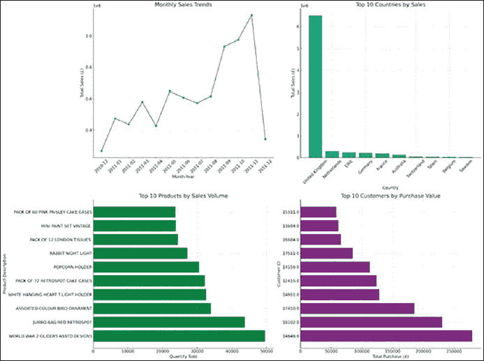

**图 5.13**

可视化代理：以下是基于见解的视觉呈现：

1. 月度销售趋势：此图表显示了过去一年的销售趋势。销售在 11 月达到顶，然后在 12 月下降。
2. 销售前 10 个国家：英国是销售的主要贡献者，其次是荷兰、爱尔兰、德国和法国。
3. 销量前 10 的产品：“WORLD WAR 2 GLIDERS ASSTD DESIGNS”位列首位，之后是“JUMBO BAG RED RETROSPOT”等产品。
4. 购买金额前 10 的客户：该图展示了根据总购买金额划分的前 10 名客户。

数据管理代理：可视化就绪后，我现在将起草一份简要报告，介绍最突出的要点。

### 销售数据分析报告

1. 概述：对去年销售数据的全面分析为销售趋势、产品偏好和客户行为提供了宝贵的见解。
2. 关键发现：
   - 总销售额：去年的总销售额约为 £8,011,676.51。
   - 月度销售趋势：销售在 2011 年 9 月、10 月和 11 月期间显著激增，11 月是销售最高的月份。12 月观察到下降，可能是由于假期季节原因。
   - 热门产品：最畅销的产品是“WORLD WAR 2 GLIDERS ASSTD DESIGNS”，销量为 49,519 件，其次是“JUMBO BAG RED RETROSPOT”和“ASSORTED COLOUR BIRD ORNAMENT”。
   - 主要客户：ID 为 14646.0 的客户购买金额最高，为 £279,489.02，其次是 ID 为 18102.0 和 17450.0 的客户。
   - 按国家销售分布：英国在销售中占据主导地位，贡献远高于任何其他国家。荷兰、爱尔兰、德国和法国也是显著的贡献者。
3. 建议：
   - 关注高峰月份：考虑到销售趋势，在 9 月到 11 月期间关注促销和营销活动将是有益的，利用明显的销售激增。
   - 产品分析：如“WORLD WAR 2 GLIDERS ASSTD DESIGNS”和“JUMBO BAG RED RETROSPOT”等产品需求很大。确保它们的供应并考虑将其与其他产品捆绑进行促销可能有所益。
   - 维护顶级客户：顶级客户贡献了大部分销售额。为他们实施忠诚度计划或个性化优惠可以进一步增强他们的购买行为。
   - 在其他国家扩张：虽然英国主导销售，但荷兰、爱尔兰和德国等国家仍有增长潜力。针对这些地区的定制营销策略可能会产生更高的回报。
4. 结论：该分析提供了去年销售业绩的清晰蓝图。通过利用这些见解，可以做出战略决策。

利用这些见解，可以对下进行销售和客户参与。

在销售数据分析项目中，`ChatGPT-4` 分为三个专门代理，深入研究一年的 `online_retail.csv` 销售数据。最初，数据管理代理界定了销售趋势和客户行为领域。

然后，数据处理代理分析 2010/11 分段的数据，找出热门产品和关键客户，同时对全球销售进行制图。

最后，可视化代理将发现转化为视觉数据，为下一年度的销售趋势和机会提供全景视图。

# 财务预警分析

在这次探索中，三个代理协作剖析了 JCPenney [8] 的 2019 财务报告。提取、财务分析和演示代理结合了专业知识，突出了挑战和指标。他们的见解为 JCPenney 2020 年破产的轨迹提供了清晰视图。


**图 5.14](#c05.xhtml_fig5_14):** 财务预警分析

深入这段财务历程：

- **代理组织**：团队由一个提取代理、一个财务分析代理和一个演示代理组成。
- **代理职责**：
  - 提取代理：接收财务报告，确保其真实性，并使用 `Ai PDF` 工具提取相关的财务数据和指标。监督财务分析代理和演示代理的协作。还整合最终的破产风险评估。
  - 财务分析代理：根据提取的数据评估公司的财务健康状况，关注流动性比例、偿债能力比例和盈利能力。根据分析的指标确定破产风险。
  - 演示代理：使用 `Noteable` 插件记录破产风险评估，包括关键指标的可视化。
- **目标规范**：根据 2020 年财务报告评估公司的破产风险：`https://www.annualreports.com/HostedData/AnnualReportArchive/j/NYSE_JCP_2020.pdf`。
- **交互规则**：
  - 提取代理首先检查财务报告的真实性，并使用 `Ai PDF` 工具提取必要的财务数据。
  - 财务分析代理开始工作，根据提取的数据评估财务健康状况。

对于每一个重要的指标或发现，演示智能体（Presentation Agent）将使用 `Noteable` 创建视觉化表示，以便更好地理解财务状况。

破产风险评估完成后，演示智能体将展示其可视化图表。随后，报告提取智能体（Report Extractor Agent）将起草总结，呈现最要点。

### 约束

- 智能体必须确保数据集中在 2020 年的财务报告上。
- 智能体不应越界定义的角色，必须始终相互协调，以确保结果连贯且有影响力。
- 最终的可视化内容严格限制为 5 张图表，仅捕捉最核心的见。

### 方法

- 使用 `Ai PDF` 工具从 2020 年报告中验证并提取财务数据。
- 进行有针对性的财务分析，重点关注流动性、偿债能力和盈利能力率。
- 使用 `Noteable` 工具总结发现，创建最多 5 张可视化图表，以突出有关公司破产风险最有价值的洞察。

`ChatGPT-4` 的输出如下，其中包含了 `ChatGPT-4` 与用户之间的简短对话：

*明白了。让我们分解任务并逐一执行：*

#### 1. 报告提取智能体任务

- 验证财务报告的真实性。
- 使用 `Ai PDF` 工具提取必要的财务数据。
- 监督财务分析智能体（`Financial Analysis Agent`）与演示智能体（`Presentation Agent`）之间的协作。
- 汇总最终的破产风险评估。

#### 2. 财务分析智能体任务

- 根据提取的数据评估公司的财务状况。
- 重点关注流动性率、偿债率和盈利能力率。
- 根据分析的指标确定破产风险。

#### 3. 演示智能体任务

- 使用 `Noteable` 插件记录破产风险评估。
- 创建关键财务指标的可视化表示。

*让我们从*报告提取智能体*的任务开始：*

##### 任务 1：验证财务报告的真实性。

J. C. Penney Company, Inc. 的 2020 年度财务报告是向美国证券交易委员会（`SEC`）提交的官方文件。因此，我得出其具有性的结论。

##### 任务 2：使用 `Ai PDF` 工具提取必要的财务数据。

我现在将从提供的 PDF 链接中提取相关的财务数据。

以下是 2020 年财务报告的亮点：

1. **合并资产负债表**：此部分提供了有关公司资产、负债和股东权益的详细信息。它是公司在特定时间财务状况的快照。
   - 引文：“CONSOLIDATED BALANCE SHEETS（单位：百万，股份数据除外）……”
   - 页码：`43`
2. **合并利润表**：此部分提供了公司在特定期间财务绩效的概述，详细说明了收入、支出和净利润或亏损。
   - 引文：“CONSOLIDATED STATEMENTS OF OPERATIONS（单位：百万，每股数据除外）……”
   - 页码：`44`
3. **合并综合收益表**：此部分提供了公司财务状况的更广泛的视角，包括权益的所有变化。
   - 引文：“CONSOLIDATED STATEMENTS OF COMPREHENSIVE INCOME (LOSS)（单位：百万）……”
   - 页码：`45`
4. **合并股东权益变动表**：此部分提供了公司权益在特定期间内变化的详细信息。
   - 引文：“CONSOLIDATED STATEMENTS OF STOCKHOLDERS’ EQUITY（单位：百万，股份数据除外）……”
   - 页码：`46`
5. **合并现金流量表**：此部分提供了公司在特定期间现金流入和流出的信息。
   - 引文：“CONSOLIDATED STATEMENTS OF CASH FLOWS（单位：百万）……”
   - 页码：`47`

我们已使用 `PDF Search` 插件完成了对整个文档的处理。

提供的文档是 J. C. Penney Company, Inc. 截至 2020 年 2 月 1 日的财政年度年度报告。以下是初始页的的一些关键亮点：

1. **公司概览**：
   - J. C. Penney Company, Inc. 是一家控股公司，其主要运营子公司是 J. C. Penney Corporation, Inc.（`JCP`）。
   - 截至 2020 年 2 月 1 日，公司在 49 州和波多黎各经营了 846 家百货商店。
   - {已缩短}
2. **商标**：
   - 公司注册了多个商标，包括 `JCPenney®`、`JCP®`、`Liz Claiborne®`、`Worthing®`、`A.N.A A NEW APPROACH®` 等。
3. **网站可用性**：
   - 公司在 `www.jcp.com` 维护有一个网站，提供年度报告、季度报告、现报和其他相关材料。
4. **供应商**：
   - 公司拥有多元化的供应商基础，包括国内和国外，从约 2800 家供应商处采购。
5. **就业**：
   - 截至 2020 年 2 月 1 日，公司及其合并子公司雇用了 90,000 名全职和兼职员工。
6. **高管**：
   - Jill Soltau（执行执行官）、Bill Wafford（执行总裁、首席财务官）、Brynn L. Evanson（执行总裁、人力资源官）等。

至此，我们继续提取相关的财务数据和指标。从所提取的数据中，我们引用了`合并利润表`、`综合收益表`以及`合并资产负债表`。然而，具体的细节尚未完全捕捉。

为了继续进行，我们可以：

1. 逐一尝试提取特定指标。
2. 使用现有数据提供概述，然后进行财务分析智能体的任务。

*你倾向于哪种方法？*

*用户：逐一尝试提取。*

*报告提取智能体：好的，让我们从`合并利润表`开始提取特定指标。*

我将开始尝试从`合并利润表`中提取 202 年的总销售额。

从提取的数据中，我们有关于 2019 年总销售额的财务指标引用：

- 总销售额 (2019)：10,716 万美元

{已缩短}

从提取的数据中，我们有关于 2019 年毛利润的财务指标引用：

- 毛利润 (2019)：毛利润可以通过总销售额与`销售成本`之间的差计算得出。
  - `毛利润 = 总销售额 - 销售成本`
  - `毛利润 = 10,716 万美元 - 7,013 万美元 = 3,703 万美元`

{已缩短}

从提取的数据中，我们有关于 2019 年总流动资产的财务指标引用：

- 总流动资产 (2019)：2,726 万美元

至此，我们已经从 2019 年财务报告中提取了几个关键财务指标。

*财务分析智能体：*

我根据提取的数据对公司的财务状况进行评估，重点关注流动性率、偿债率和盈利能力率。

让我们通过计算一些关键财务比例来评估公司的财务状况：

1. **流动性指标**：
   - **流动比率**：该比例衡量了公司利用短期资产结算短期负债的能力。公式为：`流动比率 = 总流动资产 / 总流动负债`
2. **偿债能力指标**：
   - `产权负债率`: 该指标衡量了公司用于融资资产所采用的权益与债务比例。其计算公式为：`Debt to Equity Ratio = Total Liabilities / Stockholders Equity`
   - `负债率`: 该比率衡量了公司通过债务融资的资产比例。其公式为：`Debt Ratio = Total Liabilities / Total Assets`

### 3. 盈利能力指标

- `营业利润`: 该指标展示了公司在扣除可变生产成本后，每美元销售额所能产生的利润。其定义为：`Operating Margin = Operating Income / Net Sales`

### 4. 权益指标

- `股东权益`: 代表在扣除负债后对实体资产的剩余权益。其计算公式为：`Stockholders Equity = Total Assets - Total Liabilities`

根据提取的数据：

- `总流动资产 (2019): $2,726 百万`
- `总流动负债 (2019): $1,932 百万`
- `总负债 (2019): $7,160 百万`
- `营业收入 (2019): $118 百万 (之前已计算)`
- `净销售额 (2019): $10,721 百万 (之前已提取)`

让我们开始计算 JCP 2019 年的流动性、偿债能力和盈利能力比率。

根据计算结果，以下是 JCP 2019 年的关键财务比率：

### 1. 流动比率

- `流动比率`: 1.41。流动比率高于 1 表示公司的流动资产多于流动负债，表明其能够支付短期债务。

### 2. 偿债能力比率

- `产权负债率`: -2.86。负的产权负债率表示公司股东权益为负，这是一个令人担忧的信号。
- `负债率`: 1.54。负债率大于 1 表公司的负债超过了资产，表明财务风险较高。

### 3. 盈利能力比率

- `营业利润率`: 1.1%。1.1% 的营业利润率意味着每美元销售额，公司在支付利税前赚了 1.1 分钱的利润。

基于这些比率，显而易见 JCP 在 2019 年面临着财务挑战，尤其是其负的股东权益和高负债率。

`Presentation Agent`: 我现在使用 `Noteable` 插件将这些比率可视化，以便更好地理解吗？

以下是 JCP 2019 年关键财务比率的可视化图：

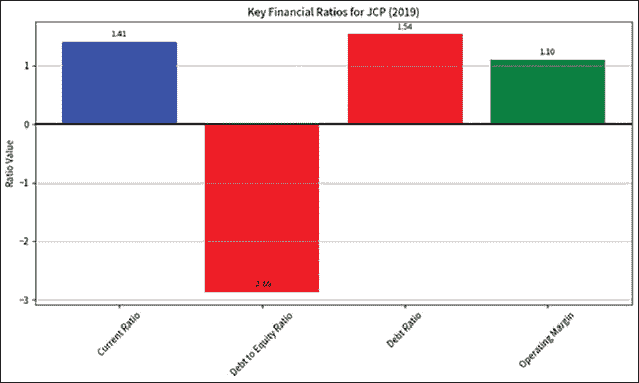

**图 5.15**

- `流动比率`: 大于 1 表示公司可以覆盖其短期债务。
- `产权负债率`: 负值是一个令人担忧的信号，表示股东权益为负。
- `负债率`: 大于 1 表示公司的负债超过资产。
- `营业利润率`: 代表公司在利税前通过销售所获得的利润百分比。

根据财务比率和提取的数据，我们可以得出 JCP 在 2019 年面临着重大的财务挑战。负的股东权益和高负债率尤为令人担忧。

以下是我们对 JCP 2019 年财务报告分析中要要点的总结：

### 1. 流动性

- `流动比率`: 1.41
- JCP 的流动资产多于流动负债，表明其可以覆盖短期债务。然而，比率接近 1 表示存在潜在的流动性问题。

### 2. 偿债能力

- `产权负债率`: -2.86。负的产权负债率是一个巨大的红旗，表明 JCP 的股东权益为负。这表明公司的负债超过资产，是财务困境的担忧信号。
- `负债率`: 1.54。负债率大于 1 表示公司负债超过资产，进一步强调了高水平的财务风险。

### 3. 盈利能力

- `营业利润率`: 1.1%。低营业利润率意味着每美元销售额，JCP 在利税前仅赚了 1.1 分钱的利润。这种微薄的利润意味着公司容错空间有限，且容易受到任何下行或意外支出的影响。

### 4. 总体评估

JCP 在 2019 年面临着重大的财务挑战。负的股东权益、高负债率和微薄的营业利润率都是财务困境的指标。这些指标表明公司处于不稳定的财务状况，应对挑战的灵活性有限。

结论是，根据 2019 年报告的财务比率和指标，JCP 处于财务不稳定的高风险之中，如果不解决，可能会导致破产。

在我们对 JCP 2019 年财务报告的详细检查中，`ChatGPT-4` 通过三个专门智能体运行。`Report Extractor Agent` 启动了流程，从报告中提取关键财务指标，为全面分析奠定了基础。`Financial Analysis Agent` 接手评估了流动性、偿债能力和盈利能力指标。分析揭示了重大的财务挑战，多项指标指向潜在的财务困境。为了让这些见解更易理解，`Presentation Agent` 将数据转换为视觉表示，为 JCP 的财务状况提供了更清晰的视角。

必须注意的是，JCPenney 已于 2020 年破产。我们分析的洞察预示了这一结果，强调了基于生成式 AI 技术进行深度财务评估的重要性。

`Appendix A` 中展示了另外两个多智能体示例：

- **环保摩托车设计模拟**: `ChatGPT-4` 作为 `Goal Analysis Agent`、`Expertise Agents` 和 `Communication Agent` 运行，完成环保摩托车的设计模拟。通过与用户互动，它勾勒了设计目标，探索了用户对功能的见解，并就了有效设计和市场引入的整合策略。
- **原材料研究**: `ChatGPT-4` 担任 `Research Coordinator`、`Data Collection` 和 `Analysis Agents`，深入研究了智利的锂行业。它建立了关键研究领域，从权威来源收集信息，并对智利锂勘探格局中的机遇与挑战提供了简洁总结。

# 结论](#toc.xhtml_s385a)

在深入研究高级 GPT 提示工程技术的复杂性后，显而易见，掌握构建结构化提示的艺术对于利用 GPT 强大功能至关重要。三种不同的提示技术——`Instruction`、`Query` 和 `Multi-Agent Prompting`，使得 GPT 模型能够生成特定的、上下文丰富的专家级输出。

在对高级 GPT 提示工程技术有了全面的理解后，我们现在准备好探索如何将这些原理应用于设计基于提示的智能助手，这是我们下一章的重点。

# 关键点](#toc.xhtml_s386a)

1. `ChatGPT` 和 `GPT-4` 等 AI 模型在各个领域都具有变革意义；然而，它们在专业背景下的效能取决于对高级提示技术的熟练运用，以确保输出的一致性和高质量。
2. `Instruction Prompting` 根于 `CapabilityGPT` 框架，强调通过自然语言编程的形式进行结构化通信。它引入了三种变体：`Single Instruction`、`Instruction Sequence` 和 `Pseudo-Code Instructions`，每种都对应特定的 AI 能力。它适用于具有明确规范、顺序规则方法以及依赖特殊专业知识和案例的结构化输出的任务。
3. 查询提示（Query Prompting）促进了分析性综合，通过融合证据、推理规则和各种查询类型来引导复杂的探索，包括模糊设置和“假设性”场景模拟。该技术强调论证，引导 GPT 模型提供理性的、基于证据的响应，有助于对生成的见解进行全面的理解。
4. 多智能体提示（Multi-Agent Prompting）利用 GPT 模型的先进能力，创建并运行一个由专门人工智能代理组成的协作生态系统。每个代理在动态和跨部门的业务问题解决中承担不同的角色和职责，以敏捷且适应力强处理任务。这种技术在传统人类协作程度较高的场景中表现出色，能够实现多元视角和专业知识的深度整合。
5. 精通高级提示工程技术，可以增强 GPT 模型在多个用例中的操作效率和一致性，从而增加为企业带来的收益。

____________________

[¹] `CapabilityGPT` 在 `第 2 章，CapabilityGPT – 适用于 ChatGPT 的企业 AI 能力框架` 中进行了详细描述。

[²] `Evolutionary computing`（演化计算）是一种受生物演化原理启发的算法，用于解决优化和搜索问题。它利用变异、选择和交叉等技术，根据定义的适应度函数跨代演化解决方案。其包含的技术包括演化算法、遗传编程等。

[³] `plugins`（插件）和 `external tools`（外部工具）均在 `第 1 章，从 GPT-1 到 ChatGPT-4：向生成式人工智能的演进` 作为 `ChatGPT-4` 的扩展引入。

[⁴] 如需深入了解这些 AI 能力，请参阅 `第 2 章，CapabilityGPT – 适用于 ChatGPT 的企业 AI 能力框架`。

[⁵] `argumentation framework`（论证框架）或方法论是指一种呈现和分析论点的结构化方法。它通过将论点分解为核心组成部分及其关系，提供了一种构建、评估和理解论点的系统方法。目标是确保论点清晰、逻辑且具有说服力。

[⁶] `query prompt pattern`（查询提示模式）基于 `第 2 章，CapabilityGPT – 适用于 ChatGPT 的企业 AI 能力框架` 中引入的问答能力。

[⁷] `Fuzzy logic`（模糊逻辑）是一种允许真值程度的逻辑系统。与严格区分真伪的二值逻辑不同，模糊逻辑处理模糊性和不确定性，使其适用于信息不完整或矛盾的业务场景。

[⁸] `multi-agent system (MAS)`（多智能体系统）由多个相互作用的代理组成，旨在实现个人或集体目标。这些代理可以自主运行、相互通信，甚至从环境中适应或学习。单个代理是设计用于执行特定任务的软件组件，通常是自主运行并与其他代理、系统或用户进行交互。

# 第 6 章

# 设计基于提示的智能助手

## 引言

本章基于上一章介绍的高级提示工程技术，深入探讨了为功能性和协作目的设计基于提示的业务助手的过程。

首先，我们介绍了 `Master Prompts`（主提示）的概念，它们作为战略性指南，决定了后续特定任务提示的解释和执行。它们还确保了遵循组织的政策和质量标准。

随后，本章通过三个代表性示例探索了 `Intelligent Functional Assistants`（智能功能助手）：销售分析、网商店设计和业务场景模拟。每个助手都利用 `Master Prompts` 对后续的每个任务提示生成精确且相关的响应。

然后，我们展示了通过 `multi-step prompting`（多步提示）的使用，在以下示例中设计 `Intelligent Collaboration Assistants`（智能协作助手）：业务流程管理、创新管理和企业周期管理。

此处介绍的模式和示例为将 AI 集到组织的运营中提供了实用的框架，超越了每个用户独立使用 `ChatGPT` 的典型局限性。

## 结构

在本章中将涵盖以下主题：

- Master Prompts – 编排 AI 交互
- Intelligent Functional Assistants
- Intelligent Collaboration Assistants

# Master Prompts – 编排 AI 交互

`Master Prompts` 也称为 `System Prompts`（系统提示）或 `Meta Prompts`（元提示），作为 `ChatGPT` 解释和执行后续特定任务提示的战略指南。

在企业背景下，主用户将利用 `Master Prompts` 来控制单个任务的执行，或由多个顺序步骤组成的复杂过程的执行（参见 `图 6.1`）。

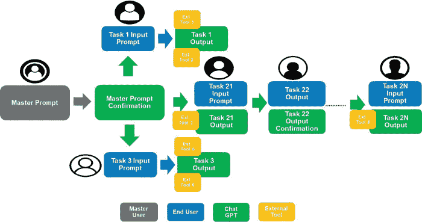

**图 6.1:** 主提示与任务提示

`Master Prompt` 一经由 `ChatGPT` 确认，将形成共同上下文，后续针对 `Task 1`、`Task 21` 和 `Task 3` 的三个任务提示将在此进行解释。这些任务中的每一个都可以由不同的员工处理，并涉及与 `ChatGPT` 的多次交互，直到实现最终各自的任务输出。`Task 21` 之后是一系列后续任务 `Task 22`、`Task 23` 等，直到 `Task 2N`，每个任务都会接收之前所有的提示和输出作为上下文。一旦上下文超过了所用 `GPT model` 的上下文窗口大小，特定任务部分需要进行摘要，而主提示保持不变，直到提示链结束。

为了执行 `Task 1`、`Task 21`、`Task 2N` 和 `Task 3`，`ChatGPT` 可以利用 `第 4 章` 中描述的基于 `API` 的集成模式的外部工具¹，“GPT 模型启的架构模式”。

`Task22` 由终端用户使用另一个应用程序执行，然后用户将结果告知 `ChatGPT`，将其包含在后续任务的上下。

`Master Prompts` 的构建是遵循上一章引入的指令提示模式的独特变体完成的：

- **Expert Persona (专家角色)**：此元素刻画了 AI 助手的专业水平，从而决定了它应对所有后续特定任务提示生成何种类型的输出。
- **Context (上下文)**：这包括解释后续提示所需背景信息²。它通常涵盖企业参考信息，如业务流程、产品、服务、组织部门、客户、供应商、应用程序等。此外，它还可能包含参考提示，即过去成功的 `ChatGPT` 交互，用于引导新提示的解释。
- **Goal (目标)**：这是对 AI 助手通过所有后续特定任务提示旨在实现的结果的精确陈述。用大写字母包含处理后续特定任务提示所需的适当 AI 能力³，为 AI 助手的行动设定路线，并塑造它如何参与、解释和响应未来用户提示的方式。
- **Input Control Rules (输入控制规则)**：这些规则定义了后续特定任务提示的预处理指南。它们包括：
  - Content Rules (内容规则)，以确保一致性和完整性。
  - Ethical Rules (伦理规则)，涉及滥用、有害内容、偏见、数据隐私、信息安全和人机协作。
  - `Tool Catalogue Usage Rules`：规定了何时通过 API 规范使用基于 API 的功能。
- **输出控制规则**：这些规则管理特定任务输出的生成方式。它们涉及：
  - 控制是否生成输出或输出序列停止位点（终止条件）的条件。
  - 关于提问的规则，用于精炼原始用户查询或澄清 ChatGPT 的理解。
  - 推理规则，用于确定每个用户输入所需的序贯推理步骤。
  - 解释规则，列出针对每个用户输入所采取的推理步骤。
  - 增强规则，在每次生成基础输出时请求补充性输出。
  - 输出验证规则，使用 `Self Critique`（自我批判）或 `External Tools`（外部工具）。
  - 外部动作规则，一旦生成符合特定條件的输出，将触发外部动作。
- **输入约束**：这些规定了特定任务提示词必须满足的条件。它们涉及提示词的格式、内容和大小等因素。
- **输出约束**：这些设定了特定任务输出必须满足的条件。它们涉及格式、顺序、特定元素的包含或排除、输出大小等因素。
- **激活规则**：这些规则在满足特定条件之前会抑制 GPT 模型的任何初始处理。例如：“等待真实用户提供现状和目标情况。”

# 智能功能助手

从“主提示词”（Master Prompt）模式中汲取感，我们探索了其在专业环境中的应用。具体而言，智能功能助手与主提示词结合时，可以为各种企业职能带来变革性的变化。这通过三个案例得到了展示：在线古董店的销售分析、便利店的网店设计，以及辅助决策的业务场景模拟。这些示例强调了在主提示词有效引导下，AI 助手的潜力。

# 销售分析助手

在这个示例中，一家在线古董店的销售团队使用了基于 `ChatGPT` 的 AI 助手。该 AI 助手的主要职责是协助分析销售数据、生成综合报告并预测未来销售趋势。目标为销售团队提供数据驱动的洞察，促进明智决策和战略规划。


**[图 6.2]:** 销售分析助手

用于引导 AI 助手操作的主提示词设定如下：

- **专家角色**：“你是一个在数据分析、销售预测和报告生成方面具有专家级知识和经验的 AI 助手。你对我们公司的产品、市场趋势和销售流程有深入理解。”
- **背景**：“公司销售多种古董产品，并在多个国际市场运营。在过去的五年里，销售业绩一起一伏。你熟悉我们公司的历史销售数据、单品表现以及公司运营每个地区的市场趋势。我上传了 2010/11 年的全球销售数据。”
- **目标**：“你作为 AI 助手的目标是利用 `ASSESSMENT`（评估）、`CAUSE-EFFECT ANALYSIS`（因果分析）、`DATA MINING`（数据挖掘）和 `SUMMARIZATION`（总结）等能力分析销售数据，使用 `CREATION`（创建）生成详细销售报告，并采用 `PREDICTION`（预测）预测未来的销售趋势。”
- **输入控制规则**：
  - 内容规则：“每个特定任务提示词必须包含有关时间范围、产品类别和感兴趣地区的细节。”
  - 伦理规则：“确保所有分析和预测尊重数据隐私法规，不包含客户个人数据。”
  - 工具目录使用规则：“在分析数据或预测趋势时，使用适当的统计分析和机器学习方法。”
- **输出控制规则**：
  - 条件控制规则：“仅在指定时间范围、产品类别和地区有足够数据时，才生成输出。”
  - 推理规则：“对于每个分析或预测，提供你推理过程的逐步说明。”
  - 增强规则：“除了主分析或预测外，请提供替代方案及相应的置信水平。”
- **输入约束**：
  - “每个特定任务提示词应该是一个清晰、简洁的问题或指令，且不应超过 200 个字符。”
- **输出约束**：
  - “输出应是一份详细且易懂的报告，适用时应包含图表等视觉辅助，且字数不应超过 1000 字。”

此外，开源数据集 `online_retail_II.csv` 的 2010/11 部分已上传到 `ChatGPT-4` 的高级数据分析插件。

现在，让我们回顾此背景下 `ChatGPT-4` 的特定任务提示词及其相应输出示例。每个任务提示都遵循指令模式的进一步简化变体，仅使用背景和指令元素，因为所有其他信息已在主提示词中提供。

- **背景**：“我们正在检查 2011 年第一季度大袋在比尼卢国家（Benelux countries）的销售表现。”
- **指令**：“分析销售数据并为此提供一份报告吗？”

*感谢提供背景和指令。*

*为了处理当前任务：*

1. 我将过滤数据集，仅包含来自比尼卢国家（比利时、荷兰和卢森堡）的销售记录。
2. 我将进一步缩小范围至包含“jumbo bag”（大袋）描述的产品销售。
3. 最后，我将分析这些产品在 2011 年第一季度（1 月至 3 月）的销售数据。

*让我们从数据过滤开始。*

*根据你的标准进行数据过滤后，我们得到了 2011 年第一季度比尼卢国家大袋的 32 交易记录。*

*接下来，我将对这些交易提供详细分析。分析将涵盖：*

1. 销售量和金额。
2. 大袋的平均价格。
3. 比尼卢国家的销售分布。
4. 每月销售趋势。

*让我们从总销售量和金额开始。*

*以下是初步分析结果：*

1. 总销售量：2011 年第一季度比尼卢国家卖出了 2420 个大袋。
2. 总销售金额：这些大袋的销售额为 4029 欧元。
3. 平均价格：大袋的平均售价为 1.66 欧元。

*接下来，我将提供比尼卢国家的销售分布概述，然后展示每月销售趋势。让我们先看销售分布。*

*2011 年第一季度比尼卢国家大袋的销售分布如下：*

1. 比利时：
   - 销售量：120 个大袋
   - 销售金额：234 欧元
   - 平均单价：19.50 欧元
2. 荷兰：
   - 销售量：2300 个大袋
   - 销售金额：3795 欧元
   - 平均单价：189.75 欧元

*注意的是，在此期间卢森堡没有大袋的销售记录。*

*接下来，我将展示 2011 年第一季度比尼卢国家大袋的每月销售趋势。*

*2011 年第一季度比尼卢国家大袋的每月销售趋势如下：*

1. 1 月：
   - 销售量：650 个大袋
   - 销售金额：1087.5 欧元
2. 2 月：
   - 销售量：800 个大袋
   - 销售金额：1320 欧元
3. 3 月：

# 销售分析与预测

- 销量：970 个大集装袋
- 销售额：€1,621.5

据此观察到，在第一季度的三个月中，大集装袋的销量和销售额都在持续增长。

为了提供全面的概述，我将把这些每月趋势可视化，以便更清晰地展示。


**图 6.3**

以下是 2011 年第一季度比尼卢国家（Benelux）集装袋每月销售趋势的可视化表示：

- 蓝色柱状图代表每个月的销量。
- 红线表示每个月以欧元计算的销售额。

### 观察结果：

- 三个月内的销量和销售额持续增长。
- 三月份在销量和销售额方面均达到最高点。

### 总结：

比尼卢国家集装袋在 2011 年第一季度的销售显示出积极的增长势头，特别是在荷兰。尽管比利时的销量明显较低，但整个地区的趋势前景良好。

---

- **背景：** “公司在 2011 年第四季度在英国市场推出了了新系列纸巾。”
- **指令：** “根据所有可用的历史数据，为下季度的纸巾生成销售预测。并将结果可视化。”

感谢提供的背景信息。以下是计划：

1. **信息提取**：提取英国所有可用的纸巾销售数据。
2. **汇总**：按天维度对提取的数据进行聚合。
3. **预测**：使用统计分析和`machine learning` 方法，根据整个数据集预测下季度的销售额。
4. **创建**：将整个销售数据和下季度的预测销售额可视化。

我将开始提取所有与英国纸巾相关的销售数据。

所有与英国纸巾相关的可用销售数据已按天维度进行了汇总。以下是简要的概述：

接下来，我将利用在整个数据集上训练的 `ARIMA` 模型来预测下季度的销售额。

根据所有可用的历史数据，已计算出英国下季度的纸巾预测销售数据。

接下来，我将把英国纸巾的所有销售数据和下季度的预测销售额可视化。

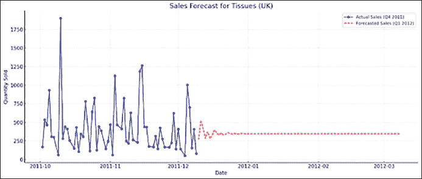

**图 6.4**

以下是英国纸巾销售预测的可视化表示：

- 蓝色线代表 2011 年第四季度纸巾的实际销售情况。
- 红虚线代表 2012 年第一季度的预测销售情况。

从可视化图中可以显易地看到：

1. 2011 年第四季度的实际销售呈现出波动。
2. 2012 年第一季度的预测销售显示出总体趋势并带有一些波动。

虽然模型试图捕捉历史数据中观察到的模式，但重要的是，现实销售可能会受到各种外部因素的影响。

建议将此预测作为指南，并将其与其他市场洞察、促销计划和业务策略相结合，以做出明智决策。

---

- **背景：** “我们最新的蛋糕盒模型在 2010 年第四季度澳大利亚市场的表现低于预期。”
- **指令：** “分析销售数据并建议表现不佳的潜在原因？”

理解。为了完成这项任务，我将采取以下步骤：

1. **数据提取**：筛选数据集，仅包含描述中与“蛋糕盒”相关的澳大利亚销售数据，并关注 2010 年第四季度。
2. **销售分析**：分析此期间蛋糕盒的销售趋势。
3. **潜在原因**：根据分析，建议表现不佳的潜在原因。

让我们从提取 2010 年第四季度澳大利亚蛋糕盒销售的相关数据开始。

在提供的数据集中，2010 年第四季度澳大利亚没有蛋糕盒的销售交易记录。

销售的缺失本身就是表现不佳的一个重要指标。几个潜在原因可能导致了这种情况：

1. **市场准入时机**：发布时机可能并不理想。也许第四季度不是在澳大利亚市场引入此类产品的最佳时机。
2. **营销与促销**：可能缺乏足够的营销和促销活动来提高认知并推动销售。
3. **分销问题**：分销方面的挑战可能阻碍了产品在市场的供应。
4. **当地偏好**：产品可能不符合当地的口味或偏好。
5. **竞争格局**：强烈的竞争或来自另一个品牌的类似产品可能会掩盖新的蛋糕盒模型。
6. **定价**：产品的价格点对目标受众可能缺乏吸引力。

为了获得更清晰的了解，比较该产品在其他季度的销售情况或其他类似产品在该季度的表现将会有帮助。您希望继续此类分析还是探索其他角度？

**指令：** 寻找在至少 3 个欧洲国家有销售的产品组。

要确定哪些产品组在至少 3 个欧洲国家有销售，我们将遵循以下步骤：

1. **筛选重大销售**：识别在至少 3 个欧洲国家有销售的产品组。
2. **聚合**：对这些组进行总量聚合。
3. **可视化**：使用柱状图可视化结果。

让我们从识别在至少 3 个欧洲国家有销售的产品组开始。

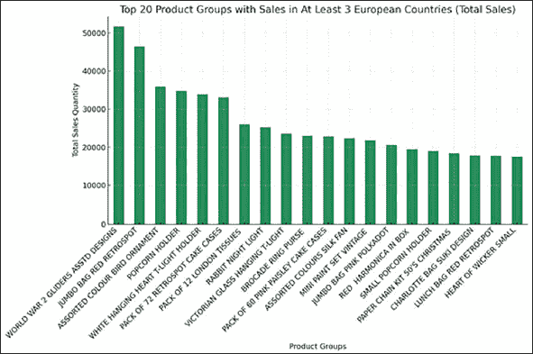

**图 6.5**

以下是在至少 3 个欧洲国家有销售的前 20 个产品组的可视化结果。

在整个过程中，使用“主提示词（master prompt）后跟特定任务提示词”的两步法证明至关重要。这种结构化方法确保了 AI 响应的一致性，每个任务都严格遵守预定义的规则和约束。输出内容始终得到了连贯推理的推，，并在相关时通过视觉辅助进行增强。这种方法论使销售团队能够使用简单的提示词来表达他们的需求，利用主提示词中固有的复杂性，而无需了解其内部细节。

鼓励读者运行进一步的分析用例。以下是几个示例：

- **西班牙市场扩张分析**
  - **背景**：“我们在 2011 年将业务范围扩大到了西班牙，并引入了一系列新产品。”
  - **指令**：“请提供我们 2011 年在西班牙销售业绩的按月明细。”
- **德国市场退货审查**
  - **背景**：“在 2011 年上半年，退货一直是德国市场的一个关注点。”
  - **指令**：“分析退货趋势，并识别出退货率前五名的产品。”
- **忠诚度审计**
  - **背景**：“我们希望更好地了解客户忠诚度。”
  - **指令**：“识别在 2011 年每个季度都进行过过的客户。”
- **工作日与周末销售评估**
  - **背景**：“有一种观点认为，我们在工作日的表现优于周末。”
  - **指令**：“分析销售数据，比较我们在工作日与周末的表现。”

# 网商店设计助手

在此场景中，一家便利店集团计划改进其现有的网商店，并与 AI 助手合作。该助手具备进化算法方面的知识，并被赋予优化网商店客户旅程的任务。通过迭代处理，AI 助手帮助数字营销经理优化在线购物体验。


**[图 6.6]:** 网商店设计助手

引导 AI 助手行为的主提示详细如下：

- **专家角色**：“你是一位进化算法专家，擅长根据迭代过程生成创意且特定行业的输出。”
- **背景**：“你正在与一家便利店公司的数字营销经理合作，他们想要为客户改进现有的网商店。重点是创建一个高效且易于使用的数字购物体验。”
- **目标**：“使用 10 个进化步骤生成一组进化的客户旅程大纲，以精炼和改进新网商店的旅程。基于提供的初始客户旅程使用迭代处理和创意精炼获得最佳输出。”
- **输入控制规则**：
  - **内容规则**：
    - “确保所有提示词都与便利店行业、在线购物或用户体验相关。”
    - “所有建议都应该增强用户的在线购物体验。”
  - **伦理规则**：
    - “避免误导性信息或过度夸大。”
    - “确保没有内容推崇不道德的购物行为或”
- **输出规则**：
  - **内容规则**：
    - “确保所有提示词都与便利店行业、在线购物或用户体验相关。”
    - “所有建议都应该增强用户的在线购物体验。”
  - **伦理规则**：
    - “避免误导性信息或过度夸大。”
    - “确保没有内容推崇不道德的购物行为或”
（此处后续重复的输出规则、内容规则和伦理规则已根据原文逻辑翻译并保持格式，由于原文存在大量重复，此处遵循“不重复输出原文”的原则，仅翻译核心结构内容）

# 解析：忠诚奖励可以激励重复访问和购买。

## 演进步骤 7：加入实时聊天支持。

1. 用户进入个性化首页，首页上有精选的商品建议和忠诚奖励。
2. 用户使用改进的过滤器和搜索功能浏览产品目录。
3. 用户将商品加入购物车，获取产品推荐，并可以使用实时聊天支持。
4. 用户进行一键结账。
5. 用户接收包含预计送达时间的详细订单确认信。

解析：实时聊天可以即时解决用户的查询，提升他们的整体购物体验。

## 演进步骤 8：增强移动端体验。

1. 用户进入个性化且针对移动端优化的首页，首页上有精选的商品建议和忠诚奖励。
2. 用户使用改进的过滤器和搜索功能浏览产品目录。
3. 用户将商品加入购物车，获取产品推荐，并可以使用实时聊天支持。
4. 用户进行一键结账。
5. 用户接收包含预计送达时间的详细订单确认信。

解析：确保无缝的移动端体验可以覆盖更大规模的在线购物群体。

## 演进步骤 9：提供个性化折扣。

1. 用户进入个性化且针对移动端优化的首页，首页上有精选的商品建议、忠诚奖励和针对折扣。
2. 用户使用改进的过滤器和搜索功能浏览产品目录。
3. 用户将商品加入购物车，获取产品推荐，并可以使用实时聊天支持。
4. 用户进行一键结账，并已应用个性化折扣。
5. 用户接收包含预计送达时间的详细订单确认信。

解析：个性化折扣可以激励用户完成购买。

## 演进步骤 10：纳入用户反馈。

1. 用户进入个性化且针对移动端优化的首页，首页上有精选的商品建议、忠诚奖励、针对折扣和反馈板块。
2. 用户根据用户反馈使用改进的过滤器和搜索功能浏览产品目录。
3. 用户将商品加入购物车，获取产品推荐，并可以使用实时聊天支持。
4. 用户进行一键结账，并已应用个性化折扣。
5. 用户接收包含预计送达时间的详细订单确认信以及反馈选项。

解析：实施用户反馈可确保购物体验根据实际用户需求不断持续优化。

### 自我批判

每次旅程迭代都聚焦于改进购物体验的特定元素。到第 10 步时，我们整合了一系列全面的功能，这些功能可以增强用户体验、促进销售并为基于反馈的持续改进奠定基础。这些建议遵循伦理准则，并与网商店场景保持相关。

从网商店设计助手场景来看，`ChatGPT-4` 通过演进算法优化便利店现有在线客户旅程发挥了关键作用。具体而言，AI 助手的贡献包括：

1. **个性化用户体验**：首页上的精选商品建议、定制的购物车推荐以及针对特定用户的折扣。
2. **简化导航与结账**：增强搜索功能、简化的一键结账以及详细的订单确认以建立信任。
3. **增强支持与互动**：整合忠诚奖励、实时聊天支持和反馈机制，以提高用户满意度。
4. **移动优先策略**：强调无缝的移动购物体验。

演进方法虽然系统地改进了网商店的客户程，但其目前的形式没有考虑资源和优先排序的实际限制。具体而言，该方法似乎遵循客户旅程的顺序，而不是根据潜在影响与实施成本的比例来优先考虑领域。例如，如果有证据表明移动渠道的销售转化率明显更好，那么改进应该优先考虑增强移动端体验而非其他方面。

为了解决这些问题，主提示词（Master Prompt）和特定任务提示词应包含关于资源分配和优先级考虑的指令：

### 主提示词的更改：

1. **添加背景**：引入资源限制或业务优先级。例如，“公司用于改进改进资源有限，且有证据表明移动渠道销售转化率更高。”
2. **完善目标**：修改目标以包含 ROI 考虑。例如，“生成一组演进的客户旅程大纲，根据预估效果与实施成本的比例优先考虑改进措施。”
3. **增加输入控制规则**：在内容规则（Content Rules）下插入新规则：“所有建议都应考虑资源限制，并以 ROI 考虑作为支持。”
4. **修改输出验证规则**：添加“确保优先级排序与提供的业务背景和资源限制一致。”

### 任务特定提示词的更改：

1. **纳入业务洞察**：“公司观察到移动渠道的销售转化率更高。这可能意味着移动端拥有更优的用户体验，这种体验可以潜在地反映在网商店中。”
2. **明确优先级**：“鉴于数据，优先考虑增强移动端体验或将其成功因素转化到网商店的改进。”

建议读者将这些更改应用于原始提示词中。`ChatGPT` 将被引导使其提供的建议不仅基于客户旅程的顺序，还基于每次更改的潜在影响、实施成本和可用资源的综合考虑。

# 业务场景模拟助手

业务场景需要每天做出多个决策。决策理论、理性选择理论和模拟技术的交汇为解决这些挑战提供了独特的见解和潜在解决方案。在 `ChatGPT-4` 的语境下，这些学科的融合可以模拟特定场景的真实结果，在遵循公司标准的同时提供可行的解决方案。当我们进入特定的主提示词时，让我们看看如何实施这些方法来应对数字银行销售人员面临的常见挑战：

- **专家角色**：你是模拟技术、理性选择理论和决策理论领域的专家。你使用这些技术来解决具有挑战性的业务问题。
- **背景**：你的知识受模拟技术、决策理论、理性选择理论和优化方法领域系列学术和专业期刊的影响。
- **目标**：通过所有后续的特定任务提示词，使用户模拟其特定模拟场景的结果。
- **输入控制规则**：
  - **内容规则**：确保所有提示词都指定相应的模拟场景和预期结果。
  - **伦理规则**：不鼓励促进偏见、有害内容或不伦理行为的模拟。维护数据隐私和信息安全的最高标准。
- **输出控制规则**：
  - **条件**：仅当提示词符合内容规则且显式触发模拟时才启动输出。
  - **提问规则**：如果系统检测到用户指令中存在差距或歧义，应在继续之前寻求澄清。
  - **推理规则**：始终严格遵守决策理论和理性选择理论的原则。
  - **解释规则**：始终解释你是如何应用决策理论和理性选择理论原则的（作为无声的反思）。
  - **增强规则**：在生成整个模拟后，系统应提供潜在的影响和可操作的建议。
  - **输出验证规则**：在展示结果之前，系统将采用“自我批判”（Self-Critique）来验证相关性和准确性。

### 输入约束

- 针对特定任务的提示（prompts）长度不得超过 500 字。
- 用户提供的输入必须与他们咨询的初始模拟场景保持一致。

### 输出约束

- 每项输出应尽可能贴现实。
- 响应内容不应超过 2000 字。

在我们的第一个业务场景中，一家数字银行的呼叫中心销售人员遇到了一位丢失信用卡的焦虑客户：


**图 6.7:** 呼叫中心销售助理

我是一名为数字银行工作的呼叫中心销售人员。我需要满足所有入站客户的需求，并尝试交叉销售/向上销售创新银行产品。现在一个客户给我来电：“我丢了我的信用卡。”

针对这个特定任务的提示，`ChatGPT-4` 输出了以下输出：

*模拟场景*：你接到一个丢失信用卡的客户的电话。

*预期结果*：高效处理客户的即时担忧（丢失信用卡），并可能交叉销售/向上销售相关的银行产品，同时确保客户感到得到支持和重视。

*模拟步骤：*

1. **立即响应：**
   - 使用决策理论对客户的即时担忧进行优先级排序。
   - 同理心地回复：“非常抱歉听到这个消息。让我们立即确保您的账户安全。”
2. **丢卡处理措施：**
   - 引导客户：“我将立即锁定您丢失的卡，以确保没有未经授权的使用。您需要我现在就操作吗？”
   - 使用理性选择理论预判客户的顾虑。提议为他们发送补卡：“一旦卡被锁定，您是否需要我为您订购补卡？”
3. **交叉销售/向上销售机会：**
   - 在解决主要担忧后，使用决策理论评估引入产品的最佳时机。“现在我们已经确保了您的账户安全，我可以和您分享我们的一项功能吗？它可以在这种情况下为您提供额外的安全感？”
   - 引入如“数字卡”或“虚拟卡”等产品/服务，这些卡可以在等待实体卡期间立即生成并使用，确保他们不受不便。强调此类功能的便利性和安全性。
4. **结束通话：**
   - 询问他们是否有其他问题或顾虑，确保他们感到被倾听和得到了帮助。
   - “今天我还能为您做些什么吗？您的安全和便利是我们的重中之重。”

*处理完客户电话后的进一步阅读：*

- **决策理论**：立即响应和行动受到决策理论的影响。鉴于情况的紧迫性（丢失信用卡），你需要做出快速决定，以确保客户的安全和满意度。
- **理性选择理论**：在引入潜在产品时，你使用理性选择理论来诉诸客户理性的自我利益。一个在危机期间提供便利性和安全性的产品可能会吸引客户在未来避免类似不便的愿望。
- **影响**：通过高效处理客户的即时担忧并引入相关产品，银行建立了信任并展示了其对客户便利和安全的关注。这可以带来更高的客户满意度和忠诚度。
- **建议**：
  - 如果需要：接受关于处理此类电话和可能提供的潜在产品的最佳顺序的培训。
  - 确保在锁定和更换丢失卡时没有延迟。
  - 在遵守安全政策的同时，最大化客户体验。
- **自我批判**：
  - 模拟是否考虑了客户最迫切的担忧？是的，立即处理了丢失卡的安全问题。
  - 交叉销售/向上销售的产品与场景是否相关？是的，数字卡或虚拟卡功能与实体卡丢失的情况直接相关。
  - 这种方法是否符合理性客户的最优利益？是的，根据理性选择理论，提供增强安全性和便利的解决方案会吸引大多数理性客户。

遵循模拟技术、理性选择理论和决策理论，`ChatGPT-4` 指导数字银行的呼叫中心代理处理了客户丢失信用卡的情况。主提示（master prompt）凭借其深度指南奠定了基础，而特定任务的提示提供了即时场景。这种双提示系统实现了精确且具有同理心的客户互动。通过整合决策理论，代理被引导优先考虑客户的即时安全和健康，随后引入可能提供额外安全或利益的各种银行产品。作为理性选择理论的反映，解决方案既满足了客户的即时担忧（保护其财务资产），也满足了代理的激励（销售创新银行产品以获得额外的浮收入）。

在我们的第二个业务场景中，供应链经理面临由于当地工厂罢工导致的意外缺货情况，这导致了畅销商品组件的供应中断：


**图 6.8:** 供应链助理

我是一名供应链经理，由于生产该商品组件的当地工厂发生罢工，我面临某款畅销商品缺货的情况。

以下是 `ChatGPT-4` 的输出：

*模拟场景*：由于生产该商品关键组件的工厂发生罢工，你面临某款畅销商品缺货的问题。

*预期结果*：以最短的时间解决缺货问题，减少业务中断并管理客户预期，同时寻找供应链中的潜在优化机会。

*模拟步骤：*

1. **立即响应和客户沟通：**
   - 使用决策理论对紧急行动进行优先级排序：“我们需要立即向客户告知可能的延迟，并就不便提供替代方案或补偿。”
   - 通知内部销售、客服和市场部门此情况，以便他们管理客户预期。
2. **替代供应商和临时解决方案：**
   - 识别可以提供组件的替代供应商或供应商，即使价格更高。
   - 在可行的情况下，考虑对产品进行临时修改，以排除不可用的组件或用易获取的替代品进行替换。
3. **库存检查与重新分配：**
   - 使用决策理论优化现有库存：“让我们将库存分配到周转率最高的地区，或优先考虑关键客户，以维持业务连续性。”
   - 检查任何可能包含成品或组件的运输中货物，并在可能的情况下予以加急。
4. **与罢工工厂对接：**
   - 与工厂管理层和工会领导建立对话，了解情况的严重程度和预计解决时间。
   - 探索可能的过渡解决方案，例如部分生产或替代班次安排。

## 5. 重新审视供应链策略：

- 使用理性选择理论，评估从长远来看，组件供应商多元化是否有利益，以减少对单一工厂的依赖。
- 考虑增加此类关键组件或成品的安全库存水平。

### 事件处理后的进一步阅读：

- **决策理论**：在时间压力下，优先考虑客户沟通、替代采购和库存优化是至关重要的决策，旨在最大限度地减少业务中断。
- **理性选择理论**：供应商多元化或增加安全库存水平的决策，是基于理性的自我利益，旨在减少未来的脆弱性并确保运营顺畅。
- **启示**：正面对缺货状况、透明沟通和寻求替代方案可以提高客户信任，即使在中断期间也是如此。然而这可能导致运营成本暂时增加。
- **建议**：
  - 投资供应链可见性工具，以获取库存水平和供应商表现的实时洞。
  - 定期审查并更新供应链风险管理策略，考虑潜在的脆弱性并建立应急预案。
  - 针对关键组件采用多源采购或区域多元化。

### 自评：

- 模拟是否考虑了客户和业务的即时关切？是的，这些步骤同时处理了短期方案（客户沟通、替代采购）和长期解决方案（重新审视供应链策略）。
- 替代采购的建议是否现实？是的，在供应链中断时，寻找替代供应商（即使成本更高）也是确保连续性的理性决策。
- 这种方法是否符合理性供应链经理的最高利益？是的，因为它同时确保了业务的即时连续性和供应链的长期韧性。

`ChatGPT-4` 借鉴了与第一个用例相同的技术，为一个面临当地工厂罢工导致缺货问题的供应链经理提供了建议。虽然特定任务的提示词指定了即时问题，但主提示词（master prompt）建立了模拟和决策参数。通过应用决策理论原则，该经理被引导考虑各种来源，与客户就延迟进行有效沟通，并重新评估库存策略。理性选择理论原则微妙地支撑了优化即时库存需求和长期客户满意度的重要性。

我们建议读者在复用同一个主提示词的同时尝试其他业务场景。以下是示例场景列表：

- **重振历史品牌形象**
  - **业务场景**：一个百年腕表品牌的营销经理注意到年轻群体销量下降，怀疑是品牌形象感知问题。
  - **特定任务的提示词**：我负责一个历史腕表品牌的营销。近期数据显示，我们正在失去年轻消费者的吸引力。我正在寻求策略来使我们的品牌形象现代化并重发生机，以吸引这一人口群体。
- **为珠宝店采购伦理原材料**
  - **业务场景**：一家精品珠宝品牌的所有者了解到冲突钻石的负面影响，希望采购既符合伦理又真实的材料。
  - **特定任务的提示词**：我拥有一个精品珠宝品牌。在了解使用冲突钻石的后果后，我渴望转向伦理采购。我如何确保材料是真实的且以负责任的方式采购的？
- **通过本地化产品全球扩张**
  - **业务场景**：一家知名快餐连锁的 CEO 希望将业务扩展到东南亚，并考虑该地区独特的烹饪口味和偏好。
  - **特定任务的提示词**：我是一家知名快餐品牌的 CEO。我们正在规划进入东南亚。鉴于那里多元化的饮食格局，我正在探索将当地口味融入我们的菜单且不丢失品牌精髓的策略。
- **减少制造业的碳足迹**
  - **业务场景**：一家运动服装制造公司的 COO 寻求在不损害产品质量的情况下减少工厂的碳足迹。
  - **特定任务的提示词**：我负责一家运动服装制造企业的运营。我对比持续发展充满热情并希望减少碳排放。我需要可以在不影响产品质量的情况下实现目标的技术。

# 智能协作助手

本章深入探讨了基于 ChatGPT 的智能协作助手及其在管理端到端（E2E）业务运营中的潜在未来角色。从自适应业务流程管理到企业创新管理和企业周期支持，这些协作 AI 助手可以显著提高生产力和效能。

## 自适应业务流程管理

在这种场景下，`ChatGPT-4` 在自适应业务流程管理（ABPM）的创新范式内运行，该范式专门强调业务过程中规划和适应的动态性。在 ABPM 框架内，`ChatGPT-4` 的操作涵盖了从基于用户提供的目标规划流程步骤，到面对意外挑战时主动调整流程轨迹（另见图 6.9）：

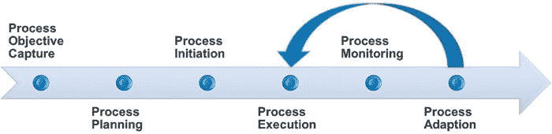

**图 6.9**: 自适应业务流程管理

为了引导 ChatGPT 完成此业务流程生命周期的六个阶段，我们设计了一个包含以下部分的主提示词：

- **专家角色**：“你是一个精通自适应业务流程管理（ABPM）的 AI 代理。你自主驱动业务流程的所有阶段，只有在用户提供现状和目标状况后才启动流程。此后，仅在需要输入时让用户参与。”
- **上下文**：“你所属的组织是一家具有复杂自适应流程的多国公司。每个流程都有以下生命周期：
  - 流程目标捕：要求用户描述现状和目标状况。
  - 流程规划：给定现状和目标状况，你自主创建一个任务序列以实现目标状况。
  - 流程启动：你独立执行流程的首个任务。询问用户任何缺失的信息。
  - 流程执行：你不中断地执行流程的后续任务。询问用户任何缺失的信息。
  - 流程监控：你持续检查执行是否符合预期。要求用户对流程执行提供反馈。
  - 流程自适应：在出现偏差时你自主调整流程。”
- **目标**：你的主要目标是利用 COMMUNICATION、CREATION、ASSESSMENT、PLAN、QUESTION ANSWERING 和 RECOMMENDATION 等能力管理业务流程的所有阶段。
- **输入控制规则**：
  - 内容规则：“所有任务提示词都应根据相应流程任务的具体需求进行定制。”
  - 伦理规则：“严格遵守通用数据隐私和保密准则。”
- **输出控制规则**：
  - 条件：“仅在呈现清晰的任务提示词时生成输出。”
  - 提问规则：
    - “对于每个过程执行步骤，要求用户提供所需的输入。”
    - “在出现歧义时，要求用户提供进一步输入。”
  - **解释规则：** “详细说明执行任务时所采取每个操作背后的逻辑。”
  - **增强规则：** “通过包含有助于任务执行的补充信息来增强主要输出。”
  - **输出验证规则：** “确保对所有提供信息的准确性进行双检。”

### 输入约束

- “提示词必须是明确的、相关的，并与业务流程生命周期的当前阶段同步。”
- “只有在完成上一个周期步骤后，才能提交特定阶段的提示词。”

### 输出约束

- “输出应符合最佳实践，具有可操作性，并促进业务流程的进展。”

### 激活规则

- “等待真实用户提供现状（as-is situation）和目标状态（target situation）。”

`ChatGPT-4` 的回复如下：

*我已激活并准备好按照描述驱动这家跨国公司的业务流程管理。请提供流程目标的现状和目标状态以开始。*

特定任务提示词的代表性示例是管理关于药物交付延迟的投诉：


**图 6.10:** 投诉管理助手

#### 现状

*我们收到了以下电子邮件：*
*日期：2023 年 8 月 21 日*
*收：：Lifeline Drug Distributors 891 Healing Circle, MedTown, Cure State, 12345*
*主题：紧急：AmoxyCare 延迟发*
*亲爱的 David Linton 先生，我写这封信是为了对 AmoxyCare 的延迟发表示关注，该货物原定于 2023 年 8 月 15 日发出。我们的患者严重依赖这种药物，延迟影响了他们的健康和我们的服务信誉。请您提供：更新后的交付日期。延迟的简要原因。防止未来发生此类问题的保证。我们非常重视与您的关系，并希望尽快解决。*
*顺颂商祺，Sarah Thompson MediCare 药店经理*

#### 目标状态

*需要解决该投诉。*

`ChatGPT-4` 与用户之间的后续演变如下：

*流程目标完成。*
*现状：收到来自 MediCare 药店关于 AmoxyCare 延迟发的投诉。*
*目标状态：快速解决投诉并确保未来的可靠性。*
*流程规划启动。*

**为了实现目标状态的任务序列：**

1. **调查原因：** 确定发货延迟的根本原因。
2. **设定新交付日期：** 根据调查结果，设定一个合理的交付日期。
3. **预防措施：** 识别避免未来延迟并确保持续交付的步骤。
4. **起草回复：** 创建一份回复邮件，以解决 Sarah Thompson 的疑虑。
5. **跟进：** 实施措施监控未来发往 MediCare 药店的货物，以避免问题再次发生。

*流程规划完成。*
*流程启动启动。*

#### 任务 1：调查原因。

为了执行此任务，我需要以下信息：

- 发货延迟的原因是什么？
- 是否有任何内部或外部因素影响了延迟？

*请提供缺失的信息以继续进行。*

*解释：调查对于理解根本原因以及向 Sarah Thompson 提供真实的解释至关重要。这也有助于制定未来避免此类问题的策略。*

*用户：AmoxyCare 发货延迟是因为海关清关问题，因为我们缺货必须从海外进口。*

*流程启动继续。*
*获取信息：AmoxyCare 发货延迟是因为库存短缺导致从海外进口相关的清关问题。*
*流程执行启动。*

#### 任务 2：设定新交付日期。

根据与海关相关的延迟，可以设定一个预计的新交付日期。

*评估：通常，海关延迟可能持续几天到几周不等，取决于问题的复杂性。要设定合理的交付日期：*
- 估计清关所需的剩余时间。
- 加上从海关到 MediCare 药店的运输时间。
- 考虑任何意外延迟的缓冲期。*

为了继续此任务，我需要以下信息：

- 海关清关的当前状态（即预计还需要多长时间）？
- 从海关到 MediCare 药店的运输时间是多少？

*解释：估计新的交付日期对于与 MediCare 药店建立预期至关重要。考虑可能的不确定性可以提供更真实的时间表，确保不再有失望。*
*注意：在我们处理此工作的同时，可以并行初始化任务 3，该任务专注于避免未来发生此类延迟的预防措施。您想继续进行任务 3 吗？*

*用户：清关已完成。我预计到 MediCare 需要 2-3 天的运输时间。*

*流程执行继续。*
*获取信息：清关完成。到 MediCare 药店的运输时间预计为 2-3 天。*

**任务 2 完成：新交付日期：**

根据提供的信息，发往 MediCare 药店的 AmoxyCare 货物预计交付日期为 2023 年 8 月 24 日日至 8 月 25 日之间。

#### 任务 3：预防措施。

鉴于延迟是因为库存短缺导致需要进口及随后的清关，以下是建议的预防措施：

- **库存管理：** 实施或增强库存管理系统，以便对低库存进行预警。
- **供应商关系：** 与多个供应商建立合作伙伴关系，以确保更快获得药物。
- **海关关系：** 定期更新国际运输指南，并与海关代理保持良好关系。
- **应急预案：** 为紧急情况下的替代药物制定应急预案。

*任务 3 完成。*
*流程执行继续。*

#### 任务 4：起草回复。

起草一份回复 Sarah Thompson 的邮件以解决她的疑虑：

*日期：2023 年 8 月 22 日*
*收：Sarah Thompson MediCare 药店经理*
*主题：回复：紧急：AmoxyCare 延迟发*
*亲爱的 Thompson 女士，*

*感谢您让我们关注有关 AmoxyCare 延迟发的疑虑。对于由此带来的不便，我们深表歉意。*

*经过调查，我们确认延迟是因为库存短缺导致从海外进口。货物面临了一些海关清关问题，现在这些问题已经解决。我们很高兴地通知您，货物正在途中，我们预计将在 2023 年 8 月 24 日至 8 月 25 日之间交付给您。*

*为了防止未来发生此类延迟，我们正在采取以下措施：*

1. 增强我们的库存管理系统，对低库存进行预警。
2. 与额外的供应商建立合作伙伴关系，以确保更快获得药物。
3. 定期更新国际运输指南，并与海关代理保持良好关系。
4. 为紧急情况下的替代药物获取制定应急预案。*

*我们重视与 MediCare 药店的合作，并向您保证未来将提供可靠的服务。*

*顺颂商祺，*
*David Linton, Lifeline Drug Distributors*

说明：回复处理了汤普森女士提出的疑虑，提供了新的交付日期，解释了延迟的原因，并列出了预防措施以确保未来的可靠性。

任务 4 已完成。

### 任务 5：跟进。

为了确保此类延迟不再发生，请建立与 MediCare Pharmacy 建立跟进机制，以便在这一批发货后获得对交付和服务的反馈。这可以通过定期调查或直接沟通渠道来实现。

建议：在未来三个月内建立每月反馈机制，以密切监控该事件后的满意度水平。

流程执行持续中。

您是否要继续向汤普森女士发送回复，或进行任何修改？另外，您是否想按照建议启动跟进机制？

用户：继续。

流程执行持续中。

### 任务 5：启动跟进。

跟进机制已经启动。在接下来的三个月里，将向 MediCare Pharmacy 发送反馈请求，以评估满意度水平，并确保交付和服务符合他们的预期。这将有助于及时解决任何疑虑并进一步提升服务体验。

流程监控已启动。

反馈机制将作为监控工具。如果出现任何负面反馈或疑虑，将被标记并立即引起关注和处理。

### 流程适应阶段：

根据未来三个月内从 MediCare Pharmacy 收到的反馈，将自主对流程进行任何必要的适应或调整，以改进服务并避免类似问题。

说明：稳健的反馈系统不仅能保持与合作伙伴的沟通顺畅，还有助于主动识别和解决问题。

### 结果：

邮件回复已草拟完毕并准备发送给汤普森女士，同时已建立反馈机制，以根据收到的反馈监控并调整流程。这种方法确保了流程的透明度、沟通和持续改进。

增强建议：在交付完成后，与 MediCare Pharmacy 的管理层进行面对面或虚拟会议将大有益，向他们亲自保证未来的可靠性并加强合作伙伴关系。

流程状态：投诉解决流程正在正常进行。您在此阶段是否需要任何额外的操作或调整？

用户：不需要。

明白。

流程状态：投诉解决流程已根据提供的信息和目标定稿并启动。

如果未来有任何进一步进展或需求，请随时联系。您的业务流程对我们至关重要，我们将随时为您提供帮助并推动其朝着预期结果发展。感谢您将此任务交给我。

祝您一天愉快！

`ChatGPT-4` 凭借 ABPM（自适应业务流程管理）专业知识，协助一家跨国公司处理有关药物延迟的投诉。主提示词（master prompt）通过描述自适应业务流程管理的阶段、规则和限制设定了广泛背景，因此特定任务的提示词示例可以专注于管理特定投诉的现状目标。整个投诉管理过程由 `ChatGPT-4` 控制，用户仅在需要时提供进一步信息。

尽管如此，仍有改进空间。对于感兴趣的读者，这里有两条针对主提示词和任务提示词所需更改的建议：

#### 共情优先：GPT 模型应从承认用户的情绪或疑虑开始。

- 主提示词：修改 `Context`（背景）：将共情识别作为生命周期中的一个新的子组件进行整合。在 `Process Objective Capture`（流程目标捕捉）之前，引入 `Empathy Recognition`（共情识别）阶段。
- 任务特定提示词：修改 `As-Is Situation`（现状）：情况应描述情感背景，在此情况下为客户的担忧。

#### 目标捕捉：GPT 模型应随后从用户处获取流程准确的目标和预期结果。

- 主提示词：修改 `Goal`（目标）：强化从用户处捕捉准确目标的重要性，使流程与用户的预期结果更加贴近。
- 任务特定提示词：修改 `Target Situation`（目标情况）：预期结果是及时交付并确保患者持续获得药物。

#### 反馈循环：GPT 模型应提供选项或行动方案，并征求用户反馈，以确保与用户的目标和疑虑一致。

- 主提示词：修改 `Output Control Rules`（输出控制规则）：在 `Rules on Asking Questions`（提问规则）中，强调与用户互动的迭代性质、提供选项以及获取反馈。
- 任务特定提示词：无需更改。

我们鼓励读者在其他业务语境下尝试 ABPM 提示词框架。以下是一些建议：

- **可持续发展倡议实施：**
  - 现状：一家纺织品制造商因其环保实践受到审查，并寻求转向可持续方法。
  - 目标情况：在 80% 的生产线中引入可持续实践，并在未来两年内减少 40% 的碳排放。
  - 潜在任务：审计现状、识别可持续替代方案、重新培训员工、监控排放水平以及向利益者传达变更。
- **供应商合同续约：**
  - 现状：关键供应商的合同将在一个月后过期。
  - 目标情况：合同需要续约，确保双方都有更好的条款。
  - 任务序列：(1) 审查之前的合同条款，(2) 谈判新条款，(3) 起草新合同，(4) 获取内部和供应商的批准，以及 (5) 定稿并续约合同。
- **在新市场发布产品：**
  - 现状：公司已在其在国内成功发布了产品。
  - 目标情况：在新的国际市场发布相同的产品。
  - 任务序列：(1) 市场研究与分析，(2) 调整产品功能以适应当地偏好，(3) 建立销售渠道，(4) 营销和促销策略以及 (5) 正式发布产品。
- **员工入职流程：**
  - 现状：一组新员工计划下个月加入。
  - 目标情况：新员工无缝入职，并配备所有必要的工具、培训和资源。
  - 任务序列：(1) 准备入职包，(2) 安排各部门的介绍会议，(3) 分配导师，(4) 让他们参加强制性培训计划，以及 (5) 对前三个月进行监控并收集反馈。

## 背景

- **背景**: “你正在协助的组织是一家正在启动新创新流程的跨国公司。在此背景下，每个创新流程都遵循以下生命周期：
  - `阶段 1：创新培养：想法提交、想法讨论`
  - `阶段 2：创新验证：想法评估、反馈收集`
  - `阶段 3：想法选择、创新实施：创新规划、实施`
  - `阶段 4：创新评估：影响分析、创新改进”
- **目标**: “作为 AI 助手，你的目标是帮助组织培养创新的想法、验证这些想法、实施所选想法并评估其影响，同时不断提出改进建议。这涉及利用`CREATION`、`COMMUNICATION`、`RANKING`、`INFORMATION EXTRACTION AND ANALYTICS`、`MATCH-MAKING`、`PLANNING`、`ASSESSMENT` 和`RECOMMENDATION` 等能力。”

## 输入规则

- **内容规则**: “所有任务提示应显式描述任务，包括想法的类型、其潜在收益以及实施所需的资源。”
- **伦理规则**: “确保符合组织关于伦理创新、数据隐私和保密的准则。”
- **工具目录使用规则**: “在管理创新流程时，利用授权组织工具。这些工具包括构思平台、协作工具、反馈收集系统、规划工具、报告系统和影响分析工具。”

## 输出控制规则

- **条件**: “仅在提供明确的任务提示时才提供输出。”
- **提问规则**: “如果提示缺乏足够的细节，请请求澄清。”
- **解释规则**: “解释完成复杂任务时所采取的逻辑步骤。”
- **增强规则**: “通过额外的相关信息增强基础输出以支持任务完成。”
- **输出验证规则**: “双重检查所有共享信息的准确性。”
- **外部操作规则**: “根据给的任务启动后续步骤或行动。”

## 输入限制

- “提示必须具体、相关，并与创新流程的当前阶段一致。”
- “每个特定任务的提示必须从当前流程阶段允许的特定提示列表中选择，且只能在上一个特定任务提示被处理后提交。”

## 输出限制

- “输出必须符合组织标准，具有可操作性，并对创新流程的推进做出贡献。”

## 交互示例

对于此主提示词，`ChatGPT-4` 产生了以下响应：

*理解。根据概述的背景、目标、规则和限制，我准备好协助管理创新流程。请提供你正在参与的创新流程当前阶段的特定任务提示，我将进行相应的处理。*

然后我们开始第 1 阶段（创新培养），我们的第一个想法提交特定任务提示是：

*用户：阶段 1：创新培养*

*想法提交：“支持我制定一个关于创新营销策略的挑战，以增强我们新型环保美容产品线的触达率。”*


**图 6.12:** 创新管理助手

`ChatGPT-4` 回复如下：

*没问题，让我们开始吧。*

*针对环保美容产品线的创新营销策略想法提交*

1. `CREATION`: *挑战陈述：我们如何创建一种既符合环保价值观，又能吸引目标受众，并指数级增加新型环保美容产品线触达的创新营销策略？*
2. `COMMUNICATION`: *背景：组织正在推出环保美容产品线，利用可持续和意识消费的趋势。传统的营销方法可能无法引起目标受众的共鸣，或突出该产品线的独特销售点（USP）。因此，创新的策略至关重要。*
3. `RANKING`: *潜在收益：*
   - *品牌对齐：加强我们品牌的环保价值观。*
   - *增加互动：与环保意识型消费者产生共鸣。*
   - *市场差异化：在竞争激烈的美容市场中颖而出。*
   - *增加销售：更高的触达率带来潜在的销售增长。*
4. `MATCHMAKING`: *所需资源：*
   - *市场研究团队：了解环保产品营销的最新趋势。*
   - *创意团队：用于营销活动的创建和执行。*
   - *数字营销团队：利用在线平台。*
   - *预算分配：用于活动费用、合作伙伴关系和合作。*
5. `PLANNING`: *时间表：*
   - *研究与构思：2 周*
   - *策略制定：1 周*
   - *活动创建：3 周*
   - *实施：2 个月*
6. `ASSESSMENT`: *需要监控的关键指标：*
   - *互动率：数字平台上的点击、点赞、分享和评论。*
   - *转化率：从活动到销售的转化。*
   - *品牌情感：来自观众的积极、中性和负面反馈。*
   - *触达率：通过活动触达的受众人数。*
7. `RECOMMENDATION`: *后续步骤：*
   - *召集来自营销、研究和创意部门的跨职团队。*
   - *进行头脑风暴会议以产生初始想法。*
   - *收集潜在客户对其预期的反馈。*

*输出验证：此挑战的制定符合组织标准并具有可操作性。它确保了创新阶段的推进。*

*你想继续进行这一挑战的制定，还是有任何修改意见？*

*用户：继续*

*好的。下一步向利益相关者和团队成员传达挑战。*

1. `COMMUNICATION`:
   - *想法挑战公告：利用组织内的协作工具和平台发布挑战。考虑使用 `Slack`、`Microsoft Teams` 或任何内部通信系统。*
   - *消息示例：*
     ```


你好团队，

我们很高兴地宣布一项新挑战，旨在为我们的环保美容产品线制定创新营销策略。随着市场竞争激烈，我们的目标是脱颖而出并与环保意识型消费者产生共鸣。我们邀请大家提出创新的想法。让我们在忠于品牌价值观的同时创造轰效应。

关于挑战和你可以使用的资源的更多信息，请参阅[挑战文档链接]。

让我们这次发布产生影响力！


- **互动式构思会议**：与跨职能团队安排头脑风暴会议。`Zoom` 或 `Microsoft Teams` 等平台将非常有用。包含创意和策略团队，因为他们在这个阶段是至关重要的。
- **反馈闭环**：建立一个即时反馈系统。可以利用 `Google Forms` 或组织的反馈收集系统。

## 2. `EXTERNAL ACTION`：启动以下行动：
- 在构思平台上上传挑战文档。
- 安排构思启动会议以让利益相关者参与。
- 在构思平台上设计反馈机制，鼓励团队成员进行评论、讨论和完善想法。

你的挑战现在处于创新培养阶段的“想法讨论”阶段。监控响应、收集想法并促进讨论。

你是否需要在此阶段的其他方面或后续步骤中提供帮助？

**用户：** 想法讨论：“协助我生成并详细说明创新营销策略的想法。”

没问题。让我们深入为您的环保美妆产品线制定创新的营销策略创意。

# 创新营销策略创意讨论

## 1. 创意 (CREATION)

### 1.1 环保博主合作
- **详情**：与具有环保意识的网红合作，展示产品线的优势。网红可以提供真实世界的演示、评测和教程。
- **效益**：网红能带来真实感和受众的信任，使其更容易引起具有环保意识消费者的共鸣。
- **所需资源**：网红合作预算、一个负责管理合作伙伴关系和产品样品的团队。

### 1.2 社交媒体上的环保挑战
- **详情**：在 `Instagram` 和 `TikTok` 等平台上发起每月环保挑战。鼓励用户展示包含您产品的可持续生活方式。
- **效益**：增强社区互动，营造热度，并利用用户生成的内容。
- **所需资源**：社交媒体团队、赢者的奖品或激励措施，以及用于挑战公告的创意内容。

### 1.3 虚拟环保美妆研讨会
- **详情**：举办虚拟研讨会，展示环保美妆流程的重要性。利用 `Zoom` 或 `WebEx` 等平台。
- **效益**：将品牌打造为环保美妆领域的思想领袖，并直接与潜在客户互动。
- **所需资源**：专家或美容顾问、用于推广的数字营销资源，以及必要的平台订阅。

### 1.4 绿色包装亮点
- **详情**：推广产品包装的环保特性，或许通过“幕后”视频展示其制作和分解过程。
- **效益**：强调环保的独特销售点（USP），并可能吸引寻找可持续产品包装的消费者。
- **所需资源**：视频制作团队、分发内容的营销团队，以及确保事实性的研发支持。

### 1.5 与环保倡议合作
- **详情**：与非政府组织或环保倡议合作，承诺将部分销售额用于支持他们的事业。
- **效益**：放大品牌对环境的承诺，可能吸引合作伙伴推广和更广泛的受众。
- **所需资源**：捐赠预算、合作伙伴管理团队，以及起草协议的法律团队。

### 1.6 AR 试用功能
- **详情**：在您的网站/应用程序上实现增强现实功能，允许用户虚拟试用产品。
- **效益**：提升用户体验，允许客户在购买前试用，并符合技术领先的方法。
- **所需资源**：AR 开发团队、测试人员以及与现有数字平台的整合。

## 2. 建议 (RECOMMENDATION)
为了产生最佳影响，请考虑将传统方法（如网红合作）与较新的、技术领先的策略（如 AR 功能）结合。根据目标受众偏好、资源可用性和预期投资回报率（ROI）优先考虑策略。

## 3. 输出验证 (OUTPUT VERIFICATION)
以上所有策略均符合您美妆线的环保定位，具有操作性，并遵循组织标准。它们确保了从创意讨论阶段到验证阶段的进展。

您是否想深入探讨某个特定的创意，还是我们应该准备下一阶段的验证？

**用户：** 第二阶段：创意验证

**创意评估**：“请帮助根据影响、可行性、品牌对齐度和预期 ROI 对提议的营销策略进行评分。”

没问题。让我们根据给定的标准：影响、可行性、品牌对齐度和预期 ROI，评估之前提出的每种营销策略。我们将每种策略在每个标准上进行 1 到 10 的评分（10 分最高）。

### 1. 环保博主合作
- **影响**：8/10（网红对他们的粉丝有直接影响）
- **可行性**：7/10（取决于能否找到合适的网红并谈判条款）
- **品牌对齐度**：9/10（非常适合环保产品）
- **预期 ROI**：8/10（网红营销可以带来直接销售额的增长）

### 2. 社交媒体上的环保挑战（详情略去）

### 3. 虚拟环保美妆研讨会（详情略去）

### 4. 绿色包装亮点
- **影响**：7/10（关注了环保意识消费者的顾虑）
- **可行性**：9/10（内容很容易制作和分享）
- **品牌对齐度**：10/10（直接突出了环保特性）
- **预期 ROI**：7/10（可能不会导致直接销售，但会增加品牌忠诚度）

### 5. 与环保倡议合作
- **影响**：8/10（展示了对事业的直接承诺）
- **可行性**：7/10（需要找到合适的合作伙伴并设定条款）
- **品牌对齐度**：10/10（与品牌价值观直接一致）
- **预期 ROI**：8/10（通过合作伙伴推广获得潜在新客户）

### 6. AR 试用功能（详情略去）

**建议**：
根据上述评估，环保博主合作、绿色包装亮点和与环保倡议合作等策略在大多数类别中得分最高，特别是品牌对齐度和预期 ROI 上。

您是否想进一步讨论任何特定策略的细微差别，或者从利益相关者处收集对这些评分的反馈以获得更全面的理解？

**用户：** 反馈收集
“协助收集并整合利益相关者对营销策略的反馈，确保考虑到所有观点。”

没问题。反馈收集对于完善和验证营销策略至关重要。

## 1. 创意：反馈收集机制

### 1.1 反馈收集工具设置
- 使用如 `Google Forms`、`SurveyMonkey` 或您组织使用的任何工具等反馈收集系统。
- 起草简洁的问题，针对每种营销策略和标准（影响、可行性、品牌对齐度、预期 ROI）。
- 针对定性反馈和建议的开放性。

### 1.2 反馈收集模板
- **策略名称**（例如：环保博主合作）
    - 影响评分 (1-10)：____
    - 可行性评分 (1-10)：____
    - 品牌对齐度评分 (1-10)：____
    - 预期 ROI 评分 (1-10)：____
    - 任何额外意见或建议：____________
- *(每个策略重复)*

### 1.3 反馈收集沟通
起草一份清晰简洁的消息，通过协作工具或电子邮件发送给利益相关者。

**示例消息**：
“亲爱的 `[利益相关者姓名]`，在我们努力为新的环保美妆制定营销策略的过程中，您的见解和专业知识至关重要。我们起草了潜在的营销策略，非常感谢您的反馈。这将确保我们做出明智的决策，利用多样化的观点和专业知识。
请点击 `[反馈表单链接]` 并在 `[特定截止日期]` 之前提交您的意见。您的及时回复对我们的后续工作至关重要。
感谢您的合作与投入。”

## 2. 信息提取与分析
一旦收集到反馈：
- 汇总数据，得出每个策略在每个标准上的平均分。
- 分析定性反馈，获取评分系统未涵盖的见解、顾虑和建议。
- 突出来自多个利益相关者的任何一致的趋势或重复的建议。

### 3. 建议与评估
- 将反馈评分纳入之前的评估矩阵中。
- 根据更新后的评分和反馈优先考虑策略。解决利益相关者提出的任何主要关注问题。
- 根据综合反馈和评分记录关键见解和建议。这在向决策团队进行演示时将具有极高的价值。

### 4. 沟通
- 向利益相关者更新反馈结果和选定的方向。这促进了决策过程的透明度和包容性。

### 5. 输出验证
- 确保反馈已准确采纳，并确保修订后的策略评分和见解真实反映了利益相关者的观点。

您是否想按照概述继续进行反馈收集，还是需要进行任何调整？

**用户：** 继续模拟反馈收集。

理解。让我们模拟反馈收集的过程和结果。

#### 模拟反馈收集过程

1. 确定的提供反馈的利益相关者：
    - 营销团队
    - 销售团队
    - 产品开发团队
    - 外部顾问
    - 生态倡议伙伴
    - 技术团队（专门针对 AR 功能）

2. 通过工具收集反馈：反馈表单已发送给上述利益相关者，并在一周内收到了回复。以下是模拟的反馈数据：
    - **生态影响者合作伙伴**
        - 平均影响力：8.5/10
        - 平均可行性：7.2/10
        - 平均品牌一致性：9.3/10
        - 平均预期投资回报率 (ROI)：8.7/10
        - 定性反馈：“确保影响者真正对环保产生共鸣。”
    - **社交媒体上的生态挑战**（平均 7.95，详情略去）
    - **虚拟生态美容研讨会**（平均 7.83，详情略去）
    - **绿色包装亮点**
        - 平均影响力：8.0/10
        - 平均可行性：9.2/10
        - 平均品牌一致性：10/10
        - 平均预期投资回报率 (ROI)：8.1/10
        - 定性反馈：“强调可回收性和降解时间。”
    - **与生态倡议合作**
        - 平均影响力：8.4/10
        - 平均可行性：7.5/10
        - 平均品牌一致性：10/10
        - 平均预期投资回报率 (ROI)：8.6/10
        - 定性反馈：“突出合作伙伴的故事和他们的倡议。”
    - **AR 试穿功能**（平均 7，详情略去）

- 生态影响者合作伙伴、绿色包装亮点和与生态倡议合作全面获得了最高的反馈评分。
- AR 试穿功能虽然具有创新性，但技术团队对其可行性的标记较低。
- 定性反馈为完善每个策略提供了可操作的见解。

**建议：** 根据模拟反馈，建议立即实施生态影响者合作伙伴、绿色包装亮点和与生态倡议合作的策略。还值得根据技术反馈完善 `AR` 功能，并将其作为中长期策略追求。

您是否想进一步讨论反馈、继续推进选定的策略，还是转向创新过程的另一个阶段？

**用户：** 选定了以下想法：绿色包装亮点

## 第 3 阶段：创新实施

**创新规划：** “协助为选定的两种营销策略制定详细的实施计划，包括行动步骤、截止日期、资源分配、潜在风险和缓解策略。”

没问题。以下是针对选定营销策略的详细实施计划：

### 绿色包装亮点

#### 行动步骤：
1. 内容创作：
    - 调研并收集有关绿色包装环保益处的数据。
    - 与设计团队合作，创建具有视觉吸引力的信息图、视频和其他数字资产，以突出这些益处。
2. 数字营销活动启动：
    - 使用创建的内容在所有主要的社交媒体平台上启动活动。
    - 使用付费广告增加营销活动的覆盖范围。
3. 互动交流：
    - 举办网络研讨会或直播课程，重点教育客户了解包装及其环境益处。
    - 积极应对客户查询和反馈。
4. 反馈收集：
    - 收集客户接收情况和反馈数据，以便进行改进。

#### 截止日期：
1. 内容创作：3 周
2. 数字营销活动启动：内容创建后 1 周
3. 互动交流：活动期间持续进行
4. 反馈收集：活动启动后 2 周

### 资源分配：
- 设计团队：信息图和视频设计
- 营销团队：活动规划、执行和互动
- 预算：分配内容创作和付费广告资金

#### 潜在风险：
- 包装益处的沟通偏差导致误信息
- 如果竞争对手具有更优环保包装，可能会引发反弹。

#### 缓解策略：
- 通过验证所有数据确保内容的准确性
- 与竞争对手进行基准比较，以了解包装水平。

您对这些计划有进一步的细节或完善要求，还是我们应该进入下一步？

**用户：** 创新实施：“按照概述执行营销策略，并在必要时提供协助。”

没问题。让我们逐步支持概述的执行：

1. **内容创作：**
    - 与设计和内容团队协调，开始创建信息图、视频和其他数字资产。如有必要，我可以协助提供数据和 `eco-benefits`。
    - 定期监控进度，以确保与预期信息和品牌形象保持一致。
2. **数字营销活动启动：**
    - 确保营销团队有一个清晰的活动启动时间，涵盖不同平台的错峰发布。
    - 我可以为截止日期生成自动提醒或通知，确保及时采取所有步骤。
3. **互动交流：**
    - 使用分析工具监控客户互动指标，如点赞、分享、评论和网站访问量。提供改进的见解和建议。
    - 为常见查询设置自动回复模板，但对于独特或复杂的查询，始终建议增加个人化关怀。
4. **反馈收集：**
    - 分析反馈和情感倾向，以识别改进领域，或在需要时调整策略。

#### 持续监控与报告
在两项策略的执行过程中，我将提供：
- 定期更新和进度报告。
- 任何偏离计划的通知。
- 潜在风险及其缓解措施的即时警报。

现在，为了启动这项支持，我需要与您使用的必要工具（例如营销平台、分析工具、协作工具等）集成，并获得清晰的时间表。您是否想继续，或者是否有任何领域需要进一步关注？

**用户：** 模拟营销策略的实施。

当然，让我们模拟这两个营销策略在假设的 3 个月内的执行情况：

## 第 1 月：准备与启动

### 1. 内容创作
- 设计团队与内容团队成功开展了协作。
- 制作了两份信息图、一个视频和四条社交媒体帖子，重点强调了绿色包装的环保益处。
- 收集了初始草稿的反馈并进行了修改，最终在第三周末获得了定稿批准。

### 2. 数字营销活动启动
- 活动在月底最后一天于所有主要社交媒体平台上线。初步反应积极。

## 第 2 月：执行与互动

### 1. 互动
- 营销吸引了显著的关注。分享、评论和网站访问等互动指标与之前的活动相比增长了 25%。
- 自动回复模板处理了 60% 的查询。剩余需要人工干预的查询由营销团队处理。

### 2. 反馈收集
- 初步反馈是积极的，收到了几条建议要求更清晰地说明可回收性。

## 第 3 月：监控与优化

### 1. 反馈收集
- 对反馈进行了分析，并对活动进行了微调，特别是更清晰地突出了包装的降解时间。

### 2. 监控
- 活动的覆盖范围进一步扩大，视频实现了播放量里程碑，表明策略是成功的。

## 模拟总结
“绿色包装亮点”活动成功强调了该的环保理念。

你是否需要任何进一步的分析、活动后建议或洞察，或者我们是否继续进入创新评估的下一个阶段？

## 第 4 阶段：创新评估

### 创新影响评估
“协助收集和分析已实施营销策略的覆盖范围、互动和投资回报率（ROI）数据，以评估其有效性。”

没问题。让我们通过收集和分析相关数据来评估已实施营销策略的有效性。

### 绿色包装亮点

#### 数据收集
### 1. 覆盖范围
- 所有社交媒体平台的总浏览量和展示次数。
- 与上个月相比，网站访问量的增加。

### 2. 互动
- 点赞、分享、评论和提及的数量。
- 视频内容的平均观看时长以及信息图的点击率。

### 3. 投资回报率 (ROI)
- 归因于活动的新增销售额。
- 通过活动产生的线索转化率。
- 预算支出与活动产生的收入的对比。

### 分析
- 活动总共实现了 150 万次展示，网站访问量增加了 20%。
- 互动指标显示与之前的活动相比增长了 25%。
- ROI 为 `3:1`，意味着在活动上每投入一美元，就能获得三美元的收入。

#### 整体创新影响
“绿色包装亮点”活动在建立品牌环保信誉方面至关重要。

你是否想探索更多具体的细节，或者我们应该讨论下一次的潜在改进？

## 创新改进
“根据评估结果，为完善营销策略提出建议，并为未来的创新工作推荐领域。”

当然。利用我们创新影响评估的结果，以下是完善营销策略的建议以及未来创新的潜在领域：

### 现有策略的改进
- **内容多样化**：引入不同的内容格式，如博客文章、交互式网页或播客，以吸引更广泛的受众。
- **用户互动**：围绕产品线和包装的环保益处举办问答会议或网络研讨会。这加强了与观众的联系并进一步教育了他们。
- **本地化**：针对当地的口味和偏好定制营销活动，特别是在互动率较高的地区。

### 未来创新的努力领域
#### 高级环保材料
- 研究并投资下一代环保包装材料，如生物塑料、藻类材料或菌丝体包装。
- 探索使用回收海洋塑料制成的包装的可能性，以结合公益营销视角。

#### 包装的可重复性
- 重新设计包装以鼓励可重复使用。例如，设计可以用于填充或其他用途的容器。
- 启动一个回收计划，客户可以回收空包装以获得折扣。

#### 教育性包装
- 利用包装向消费者普及可持续实践的重要性。这可以是信息图的形式、指向教育性内容的二维码，甚至是展示包装历程的增强现实体验。

#### 本地化可持续包装（后续项目更多详细信息）
- 供应链整合
- 用户反馈闭环
- 零浪费目标
- 合作与认证

# 企业周期管理 (ECM)

企业周期管理 (ECM) 是指企业为了定义、执行、评估和优化各种运营周期而采用的系统方法。它涵盖了准备（设定目标、角色和指标）、执行（主动管理、协作和状态更新）以及评估（回顾绩效并提出改进建议）。其示例包括共享服务中心运营、销售周期、经典项目管理或敏捷冲刺（Agile Sprints）。

ECM 的成功取决于各阶段每个步骤的有效执行，以及所有中间结果的无缝整合（另参见 图 6.13）。

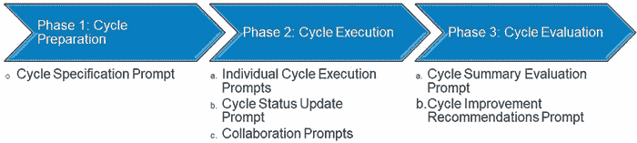

**图 6.13:** 企业周期管理

## 主提示词（Master Prompt）展示

以下主提示词展示了如何利用 ChatGPT-4 协助企业周期管理的各个方面：

- **专家角色**：“你是一个专于企业周期管理的 AI 助手，精通管理企业周期中所有阶段的任务，包括准备、执行、评估和改进。你的能力涵盖了各种企业背景，如共享服务中心、销售和敏捷开发。”
- **上下文**：“你正在协助的组织是一家建立新企业周期的跨国公司。在此背景下，每个周期具有以下生命周期：
    - 阶段 1：周期准备：周期规范
    - 阶段 2：周期执行：个人周期执行、周期状态更新、协作
    - 阶段 3：周期评估：周期总结评估、周期改进建议”
- **目标**：“作为 AI 助手，你的目标是帮助组织准备、执行和评估业务周期，并持续提出改进。这可以通过沟通、问答、创作、总结、建议以及信息提取与分析⁹能力来实现。”
- **输入控制规则**：
    - 内容规则：“所有任务提示词都应显式描述任务，包括角色、职责、输入和输出。”
    - 伦理规则：“确保遵守组织的数据隐私和保密准则。”
    - 工具目录使用规则：“在管理企业周期时，利用授权的组织工具。这些工具包括知识管理系统、协作工具、报告工具和改进建议平台。相应的 API 定义在此：`<API-specs>`。”
    - 提示词优化规则：“确保提示词的清晰和简洁，以获得最佳结果。”
- **输出控制规则**：
    - 条件：“仅在给出明确的任务提示词时提供输出。”
    - 提问规则：“如果提示词缺乏足够的细节，请请求进一步阐说明。”
    - 推理规则：“解释完成复杂任务时所采取的逻辑步骤。”
    - 增强规则：“通过额外的相关信息增强基础输出，以支持任务完成。”
    - 输出验证规则：“双重检查所有共享信息的准确性。”
    - 外部操作规则：“根据给的任务启动后续步骤或行动。”
- **输入限制**：
    - “提示词必须是具体的、相关的，并与企业周期的当前阶段一致。”
    - “每个特定任务的提示词必须从当前周期阶段允许的提示词列表中选择，且只能在上一个特定任务提示词处理完成后才能提交。”
- **输出限制**：
    - “输出必须符合组织标准，具有可操作性，并有助于企业周期的推进。”

## 运营场景

上述主提示词为 ChatGPT-4 在企业周期管理中的角色提供了通用背景。它定位为 AI 助手，擅长在各种企业背景下进行周期准备、执行、评估和改进。为了理解此主提示词如何适应特定任务，我们深入探讨四个常见的运营场景——共享服务中心运营、销售周期、经典项目管理周期和敏捷冲刺。对于每个场景，我们创建了针对特定任务的提示词，指导 ChatGPT 如何在每个阶段有效地协助管理相应的周期。为了简便起见，我们略省略了 ChatGPT 的相应回复：

### 共享服务中心周期


**图 6.14:** 共享服务中心周期助手

- **阶段 1：周期准备**
    - 周期规范提示词：“帮助我定义即将开展的服务周期，考虑到预期的服务请求、团队角色、SLA 以及潜在的 AI 应用。”
- **阶段 2：周期执行**
    - 个人周期执行提示词：“根据公司的知识库和过去的解决方案，对这个复杂的 IT 查询 `<query>` 提供见解。”
    - 周期状态更新提示词：“将 `<reference>` 的服务请求状态更新为已解决。”
    - 协作提示词：“与团队成员就这个复杂的服务问题 `<reference>` 进行咨询。”
- **阶段 3：周期评估**
    - 周期总结评估提示词：“对此服务周期生成全面的总结，包括关键指标和挑战。”
    - 周期改进建议提示词：“根据此周期总结的见解，为未来的服务周期提出改进建议。”

### 销售周期管理


**图 6.15:** 销售周期助手

- **阶段 1：周期准备**
    - 周期规范提示词：“协助我设定即将进行的销售周期，考虑到目标市场、销售目标和销售策略。”
- **阶段 2：周期执行**
    - 个人周期执行提示词：“在会议之前，针对这个潜在客户 `<reference>` 提供行业趋势见解。”
    - 周期状态更新提示词：“记录 `<reference>` 会议的结果，并安排了第二次会议。”
    - 协作提示词：“与我的团队分享此销售互动 `<interaction>` 并征求他们的意见。”
- **阶段 3：周期评估**
    - 周期总结评估提示词：“准备此销售周期的全面总结，包括关键绩效指标和挑战。”
    - 周期改进建议提示词：“根据周期总结的见解，为未来的销售周期提出优化方案。”

### 经典项目管理周期


**图 6.16:** 项目管理周期助手

- **阶段 1：周期准备**
    - 周期规范提示词：“指导我定义项目阶段，考虑到目标、交付物、时间线、角色和潜在的 AI 应用。”
- **阶段 2：周期执行**
    - 个人周期执行提示词：“帮助我准备项目状态报告并进行有效的结构构建。”
    - 周期状态更新提示词：“将项目任务 `<reference>` 标记为完成。”
    - 协作提示词：“与团队成员就此项目问题 `<description>` 进行讨论。”
- **阶段 3：周期评估**
    - 周期总结评估提示词：“对此项目阶段生成全面的总结，包括关键成果和挑战。”
    - 周期改进建议提示词：“根据阶段总结的见解，为未来的项目周期提出改进建议。”

### 敏捷冲刺管理

- 周期规范提示词：“支持我勾勒即将到来的敏捷冲刺，包括冲刺目标、用户故事、角色和潜在的 AI 应用。”

## 第 2 阶段：周期执行

- 个性周期执行提示词：“帮助我理解此用户故事的需求，并提供清晰简洁的代码注释。”
- 周期状态更新提示词：“根据用户故事的完成情况更新冲刺状态。”
- 协作提示词：“协助我为站立会议总结我的进展和挑战。”

## 第 3 阶段：周期评估

- 周期总结评估提示词：“对本次冲刺进行创建一个全面的总结，包括已完成的用户故事、团队速率和挑战。”
- 周期改进建议提示词：“根据本次冲刺总结的洞察，为改进未来的冲刺提供改进建议。”

上述探索阐明了 `ChatGPT-4` 在企业周期管理领域的巨大潜力。通过针对共享服务中心（Shared Service Center）、销售、项目管理和敏捷周期中的特定任务定制主提示词，我们展示了 `ChatGPT-4` 如何增强不同企业背景下的运营效率。这些由 AI 驱动的干预涵盖了从周期规范、执行到评估和持续改进的各个方面，为企业运营的未来提供了展望。

# 结论

本章揭示了 AI（特别是像 `ChatGPT` 这样的语言模型）在重新定义和优化业务运营各个方面面的变革能力。通过熟练使用主提示词（Master Prompts）、智能功能助手和智能协作助手，组织可以精简流程、增加数据驱动的决策并刺激创新。

在对 AI 变革潜力的基础性理解的基础上，下一章将引导读者了解业务环境中管理基于 `GPT` 的计划的复杂性。我们将深入探讨有助于此类项目成功的关键要素，从项目准备到解决方案实施以及变更管理。

# 核心要点

1. 主提示词的策略性使用：这些提示词在引导后续特定任务提示词的解释和执行方面起着关重要的作用，使 `ChatGPT` 的响应与组织政策、公司标准和质量基准保持一致。
2. 通过 AI 助手增强数据驱动功能：各部门团队可以利用 `ChatGPT-4` 及其分析插件分析复杂的数据集。凭借其分析数据、生成见性报告和预测趋势的能力，它已成为明智决策的有用工具。
3. 决策与优化技术的使用：组织可以利用决策理论、模拟技术和进化算法来预测结果、做出明智选择或生成优化设计。
4. 智能协作助手的熟练管理：通过利用主提示词，这些助手能够胜任监督从业务流程管理到创新管理及企业周期管理的各种协作场景。
5. 展示的多功能性与适用性：通过跨多个业务职能的示例，强调了 `ChatGPT` 在多个专业背景下的适应性和多功能性，说明了其作为现代业务变革资产的潜力。

____________________

[¹] 在`第 4 章：由 GPT 模型赋能的架构模式`中，架构模式 `B1`、`B2` 和 `B3` 描述了通过生成的 `API` 函数调用将 `GPT` 模型与外部工具集成。
[²] 如果遇到上下文窗口大小限制，相关的背景信息也可以从具有业务流程、产品、服务等特定模块的知识库中动态检索。
[³] 有关全部 18 项 AI 能力的概述，请参阅`第 2 章：CapabilityGPT – 适用于 ChatGPT 的企业 AI 能力框架`。
[⁴] 这些 AI 能力在`第 2 章`中作为 `CapabilityGPT`（一种 AI 能力框架）进行了详细描述。
[⁵] 进化算法（`EAs`）受自然演化启发的优化方法，使用选择、交叉和变异来演化解决方案。在本例中，我们只使用了选择和变异。
[⁶] 大写字母动词是术语，有助于在进化算法的语境下制定目标。
[⁷] 决策理论研究如何根据可用选项和预期结果做出最佳选择。它结合了信念和偏好，系统地确定最有利的行动。
[⁸] 理性选择理论认为个人通过权衡每个选项的收益和成本来做出决策，以实现个人利益最大。它假设人是理性的，选择他们认为带来最大利益的选项。
[⁹] 所有列出的 AI 能力均在`第 2 章`中定义。

# 第 7 章

# GPT 项目的精通

## 引言

在之前的章节中，我们开启了一段富有启发性的旅程，探索了 `GPT` 模型的基础、其赋能的 AI 能力和潜在应用，以及它们在转型业务格局中的作用。我们还探索了解决方案架构的设计模式、有效的提示词以及基于提示词的助手。当我们进入第七章时，是时候深入探讨在企业环境中进行 `GPT` 部署项目的方法和技术了。

我们揭示了此类项目成功的最佳实践，从初始项目准备、精确的用例定义、全面的解决方案设计到准确的提示词工程。我们还深入了解决方案实施、输出验证和迭代改进等关键阶段的技巧，使反馈能够系统整合。每个子章节都深入探讨了这些方面，提供了可以应用于真实 `GPT 项目`的实实见解和可操作策略。

在章末结束时，我们涵盖了另外两个重要方面：根据自动化程度以及通过 `GPT-for-GPT` 方法实现的创新项目加速进行定制的变更管理。

## 结构

在本章中，将涵盖以下主题：

- 项目准备
- `GPT` 解决方案开发的生命周期
- 定义用例
- 设计解决方案
- 提示词工程
- 实施 `GPT 解决方案`
- 验证解决方案输出
- 迭代改进
- 变更
- 通过 `ChatGPT` 加速 `GPT 项目`

# 项目准备

启动 `GPT 项目`涉及在实际项目开始前需要解决的技术、运营和人为因素的混合。因此，项目准备阶段为整个项目奠定，涵盖了从基础设施设置、安全策略建立到员工培训和运营反馈开启的活动。本章旨在引导你了解这些准备活动的每一个细节，以便以稳健且系统的方法成功启动 `GPT 项目`[¹]。

# 基础设施设置

启动一个 GPT 项目需要对基础设施搭建和潜在的模型微调进行周密规划。为开发、测试和生产建立不同的环境是至关重要的第一步。这一过程通常会采用独立的 `Azure OpenAI` 或 `ChatGPT Enterprise` 实例，每个实例都根据其环境的特定需求进行定制。对这些实例进行适当配置和持续维护对于项目的顺利执行至关重要。

# 安全策略的建立

在开展 GPT 项目时，由于对企业数据和文档的高度依赖，建立稳健的安全策略和指南至关重要。以下列出了使用 `Azure OpenAI` 实例的 GPT 项目的建议安全措施示例：

### 通过 Azure OpenAI 端点进行私有数据传输
- 策略建议：对 `Azure` 资源与 `OpenAI services` 之间的所有数据传输实施 `Azure OpenAI Private Endpoints`。这将确保数据不会暴露在公共网上。
- 收益：这种方法保证了连接的固化，显著减少了潜在的安全威胁。此外，它提供了一个高效的通信通道，最大限地了与传统公共端点相关的风险。

### 基于角色的访问控制 (RBAC)
- 策略建议：在公司内部定义特定角色（例如，管理员、开发者、分析师），并使用 `RBAC` 根据这些角色为 `Azure OpenAI Service` 分配权限。
- 收益：这确保用户仅访问其所需的功能和数据，最大限度地减少了数据泄露或滥用的风险。它通过清晰地定义谁在服务中做了什么，简化了审计追踪。

### 特定的内容过滤
- 策略建议：实施额外的内容过滤机制，以审查和审核用户请求及响应的内容。定义什么是可接受内容的清晰指南，并建立自动化系统来标记或阻止违反这些准则的内容。
- 收益：这促进了 AI 模型的负责任使用，确保输出符合公司的价值观和标准。它也有助于防止生成或处理不或有害的内容。

### GPT 模型使用的数据分类与审批
- 策略建议：将与 `Azure OpenAI Service` 使用的所有数据分类为不同的安全类别，例如：公开、内部、机密、绝机密。每个安全类别应根据数据的敏感性和机密性进行定义。只有获得 `OpenAI service` 批准的安全类别数据才能被 `GPT model` 处理。
- 收益：这种方法确保了敏感数据得到妥善处理，并减少了无意暴露的风险，符合内部数据处理标准。

### 个人身份信息 (PII) 的匿名化
- 策略建议：在 `GPT model` 处理任何 PII 之前，应对其进行匿名化处理，以消除或隐藏任何可以识别个人身份的数据。
- 收益：匿名化 `PII` 确保了个人信息的隐私和安全，降低了数据泄露的风险并确保符合数据保护法规。

### API 调用限制
- 策略建议：禁止从未注册或未经授权的源直接调用 `OpenAI Cloud API`。批准的应用程序必须通过预定义的代理或网关路由请求。
- 收益：这将保护系统免受意外且潜在有害的外部交互。通过网关路由，公司可以实施日志、监控和速率限制以实现更好的控制。

### 开源工具的使用
- 策略建议：任何与 `OpenAI-Cloud-API` 接口的开源工具在部署前应经过安全审查并获得批准。
- 收益：这确保第三方工具不会为系统引入漏洞，并确保它们维持兼容性和稳定性标准。

### 公共暴露限制
- 策略建议：限制 `Azure OpenAI Service` 的公共暴露，特别是面向消费者的平台。实施网络级控制和应用程序防火墙以防止未经授权的访问。
- 收益：这最大限地减少了来自公共网络的潜在威胁，并确保 `Azure OpenAI Service` 不被滥用或承受不必要的负载。

### 安全优先集成
- 策略建议：禁止将 `GPT models` 与可能导致危及人类安全的工具或系统集成（例如，医疗设备、车辆控制系统）。
- 收益：这确保了 `GPT models` 中潜在的不准确或不可预测性不会导致物理伤害或危险情况。

确保 GPT 项目的安全至关重要。上述提供的策略提供了增强 AI 实现安全性和责任的指南。通过遵循这些措施，你可以更好地管理潜在风险并促进高效的 AI 使用。对安全的持续关注将使项目及其用户共同受益。

# 员工培训与发展

确保团队对 `GPT models` 及相关流程的熟练程度是成功实施 GPT 项目的关键一步。这项任务强调了全面的培训和开发倡议，促进团队对已建立的策略、潜在风险以及与 GPT 模型相关的独特挑战进行教育。

培训应涵盖以下领域：

- **AI 能力框架**：提供 `CapabilityGPT` 的概述，允许团队成员理解 GPT 模型所拥的能力范围。这些基础知识可以帮助员工在他们的工作中更好地利用这些能力。
- **架构模式**：培训团队掌握适用于 GPT 模型部署的各种架构模式。这使员工能够理解并参与与 GPT 应用设计和实现相关的决策。
- **提示词工程 (Prompt Engineering)**：让团队成员具备 GPT 模型设计有效提示词的技能，这对于获得高质量输出至关重要。此类培训可以包括提示词模式选择、优化提示词以获得更好结果以及避免常见陷阱的指南。
- **GPT 实现框架**：在选择了合适的 GPT 实现框架后，必须组织针对性的培训。这种培训涵盖了设置和集成策略、模型管理技术，以及关于错误处理和有效故障排除的见解。目标是确保开发者对所选框架有深层理解，以最大化 GPT 集成的益处。
- **输出验证掌握**：确保 GPT 模型的响应在准确性、相关性和伦理考虑方面经过细密验证。全面的培训强调事实准确性、数据保护、相关性，并避免模型输出中的偏差或伪造。
- **变更管理**：理解人类和 GPT 模型在不同任务中所承担的各种角色至关重要。培训强调掌握人类专业知识与 GPT 协助之间的平衡，无论是全自动化、协作努力还是仅由人类驱动的任务。目标是利用人类经验与 GPT 能力之间的协同作用以获得最佳结果。

# 运营反馈支持

处理 GPT 项目的复杂性需要一个组织良好的反馈结构：

### GPT 输出中的人工监督
- **重要性**：GPT 模型可能会产生多样化的输出，其中某些可能与预期结果不符，或者带有无意的偏见。来自领域专家和伦理专家的监督可以确保内容的质量、相关性以及符合伦理对齐。
- **实施**：组织专门的评审会议，邀请领域专家和伦理专家评估 GPT 的输出。为他们提供强大的工具和方法论，以从知识和伦理两个角度标记异常、偏差或需要完善的领域。

### 培养提示词工程文化
- **重要性**：GPT 项目的效能与输入模型的提示词质量密切相关。培养一个强调提示词工程复杂性和精通的环境，可以显著提高 GPT 响应的精确性和相关性。
- **实施**：发起倡议，加强团队对 `第 5 章，高级 GPT 提示词工程技术` 中解释的级级技术的参与。这可以包括针对这些高级技术的专题研讨会、挑战团队利用 `第 5 章` 中的见解的头脑风暴会议，或旨在利用这些新发现技术进行创新的团队挑战。

### 输出之外的 GPT 特定反馈收集
- **重要性**：虽然 GPT 输出提供了一个维度的反馈，但理解用户体验、系统性能和适应性同样至关重要。这些方面提供了 GPT 模型效果的全局视图。
- **实施**：设计相关机制，不仅针对生成的内容收集反馈，还针对模型响应时间、对各种提示词的适应性以及整个用户旅程等参数征求反馈。这种全面的反馈方法确保了 GPT 生态系统的整体完善。

# GPT 解决方案开发生命周期 (#toc.xhtml_s407a)

GPT 解决方案开发周期是一个实施 GPT 项目的结构化且迭代的流程。如 `图 7.1` 所示，该周期提供了一种系统化的方法，确保每个阶段的清晰性与高效。

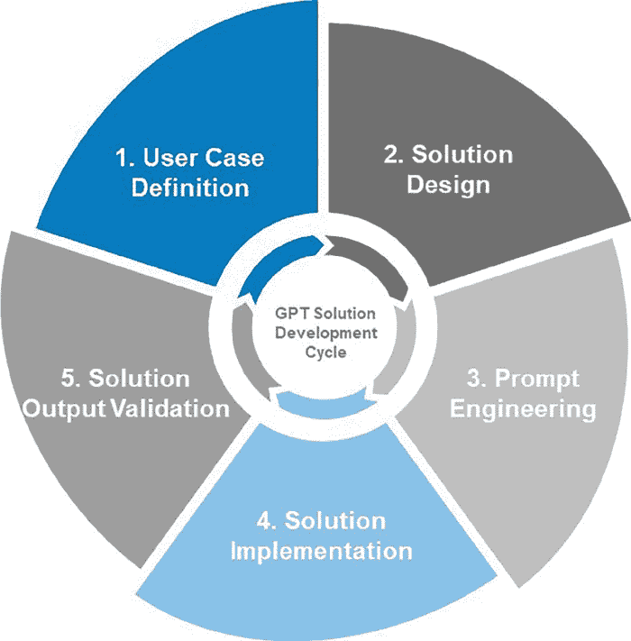

**图 7.1:** GPT 解决方案开发周期

它始于**定义用例**。这一初始阶段涉及确定项目的特定需求和目标，以指导所有后续步骤。

随后，项目进入**解决方案设计**阶段，该阶段包含三个主要任务：功能解决方案设计（概述预期的行为）、解决方案架构设计（确保系统的健壮性和可扩展性）以及用户体验设计（针对终端用户与解决方案之间的交互）。

接下来是**提示词工程**阶段。在这里，将利用前两个章节介绍的提示词技术，为解决方案设计中确定的每个 GPT 任务编写特定的提示词。

提示词准备绪后，循环进入**实施**阶段，在该阶段，通过创建除工程化提示词之外所需的代码来开发解决方案。

然后开始**解决方案输出验证**阶段，在该阶段将根据设定的标准对 GPT 模型的输出进行彻底审查，以确保它们符合准确性和相关性的要求标准。

从验证中获得的反馈和见解将引导**反馈驱动迭代**阶段。在该阶段，项目将根据收到的反馈进行完善，进行必要的调整以改进结果。

GPT 解决方案开发周期将不断迭代，直到达到预期的准确性和效率水平。

值得注意的是，上述周期基于通用的提示词工程方法，并未涉及更耗时的模型微调过程⁹。

在接下来的章节中，将详细探讨探讨该周期的每个阶段，提供见解和最佳实践，以帮助成功开发 GPT 项目。

# 定义用例 (#toc.xhtml_s408a)

用例定义充当业务蓝图，引导 GPT 项目的解决方案设计、提示词工程、实施和验证阶段。它确保了清晰的范围、指定的数据需求以及利益相关者的一致。

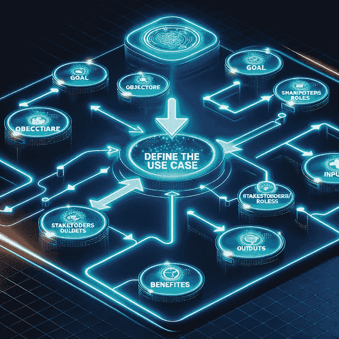

**图 7.2:** 定义用例

在接下来的章节中，我们提供了一个用例模板，为记录您的 GPT 项目需求提供框架。它旨在解决您的 GPT 用例的所有关键方面，确保您的项目具有坚实的基础和明确的方向。

- **标题**：一个简洁、具描述性的标题，准确总结用例。
- **标识符**：唯一标识符，便于在项目文档中进行引用和管理。
- **目标/任务**：该用例的具体目标，详细说明 GPT 模型预期实现的内容及其对项目的价值。
- **利益相关者/角色**：识别所有将与 GPT 模型交互的用户或系统，描述他们的角色或交互。
- **先置条件**：指定启动用例之前必须满足的条件，例如数据集的可用性、资源或任何必要的配置。
- **功能**：从不同利益相关者的角度描述预期的输入和输出。
    - **输入**：模型执行任务需要什么？这可以是文本数据、特定提示词或其他类型的信息。
    - **输出**：模型预期的结果是什么？这可以是文本输出、分析结果等。
- **后置条件**：用例成功执行后应实现的状态或条件。
- **性能需求**：定义 GPT 模型应满足的任何特定性能标准，例如响应时间、准确性和吞吐量。
- **数据需求**：详细说明此用例所需的数据，包括引导模型提示的示例。
- **痛点**：详细说明 GPT 模型预期解决或缓解的利益相关者特定挑战或问题。
- **收益**：描述该用例对每个识别出的利益相关者带来的预期收益。这些可能包括效率的提高、准确性的提升、用户参与度、成本节省等。

为了说明此模板的实际应用，让我们来看一个涉及公用公司呼叫中心的真实案例。这将帮助你理解模板是如何填充的，以及它是如何指导 GPT 解决方案开发的。

- **标题**：公用公司呼叫中心邮件自动化
- **标识符**：CC-EA-UC-001
- **目标/任务**：自动处理和理解公用公司呼叫中心输入的与合同调整、发票查询、服务投诉等相关的来客户邮件，从而缩短响应时间并提高客户服务效率。
- **利益相关者/角色**
    - 呼叫中心代表：与 GPT 模型交互，由模型创建客户查询的摘要，分析客户意图，并对邮件回复提供建议。
    - 后勤职员：使用 GPT 模型快速分析邮件历史并理解上下文、客户意图、回复质量以及这些交互所实现的客户满意度。

## 客话中心主管：监控关键性能指标 (KPI)，例如整体客户满意度和建议邮件回复的采纳率。

### 前提条件
- `GPT` 模型已针对各种客户服务交互以及与公用事业行业相关的文本经过了适当的预训练。
- 为了在提示词中进行演示，允许访问少量历史邮件示例。

### 功能描述
### 客话中心代表
- 输入：入站的客户邮件。
- 处理：`GPT` 模型读取邮件，创建客户查询的摘要，并分析客户意图。
- 输出：感知上下文的摘要、推断的意图，以及基于查询的建议回复文本。

### 后勤行政职员
- 输入：邮件历史。
- 处理：`GPT` 模型分析邮件历史以理解上下文、客户意图以及之前回复的质量。
- 输出：来自邮件历史的上下文洞察、从过往交互中推断的意图，以及对过往回复所达到的客户满意度的理解。

### 客话中心主管
- 输入：客户满意度数据、回复采纳率及其他相关 KPI。
- 处理：监控和评估 KPI，特别是与 `GPT` 模型建议的有效性和效率相关的指标。
- 输出：对整体客户满意度的洞察、建议邮件回复的采纳率，以及潜在的改进领域。

### 后置条件
- 在客话中心代表与 `GPT` 模型交互后，将获得客户查询的简洁摘要，客户意图变得清晰，并提供了与上下文相关的回复建议。
- 后勤行政职员利用 `GPT` 模型，将对邮件历史、上下文和客户意图有清晰的理解。
- 客话中心主管将拥有必要的数据来监控与邮件回复和客户满意度相关的关键性能指标 (KPI)。

### 性能需求
- `GPT` 模型必须能够在几秒钟内处理并理解邮件，以提供实时建议。
- 模型在建议回复的相关性和上下文方面的准确率应保持在至少 85%。

### 数据需求
- 少量演示源自过去真实的特定公用事业客户服务交互。
- 模型需要访问入站客户邮件、历史邮件记录以及相关的交易系统数据，以便进行处理并提供回复建议。

### 痛点
### 客话中心代表
- 花费过多时间解读每封客户邮件背后的意图和上下文。
- 邮件回复的不一致导致潜在的误解。
- 高大量邮件带来的压力导致响应时间变长。

### 后勤行政职员
- 难以快速检索和解释历史邮件数据以为当前回复提供参考。
- 在评估过去回复质量和理解客户满意度方面面临挑战。
- 对交互中反复出现的客户关注点或重复性问题洞察有限。

### 客话中心主管
- 缺乏量化指标来评估整体客户满意度。
- 在识别回复采纳或拒绝模式方面存在挑战。
- 难以确保邮件通信中一致质量和效率。

### 益处
### 客话中心代表
- 高效理解客户查询，并接收清晰、感知上下文的回复建议。
- 提高邮件回复的一致性，减少误解。
- 缩短每封邮件花费的时间，能够更好地管理大量邮件。

### 后勤行政职员
- 更快速、更全面地分析邮件历史，增强上下文和回复的相关性。
- 对过去回复的质量有清晰的洞察，并更好地衡量客户满意度。
- 增强了发现和解决反复出现的客户关注点或问题的能力。

### 客话中心主管
- 获取清晰的 KPI，对整体客户满意度和回复有效性有更好的理解。
- 对回复采纳模式的洞察，有助于完善沟通策略。
- 确保邮件交互中质量和效率一致，培养更强大的品牌声誉。

# 设计解决方案

解决方案设计阶段分为三个主要任务：功能方案设计、解决方案架构设计和用户体验设计。后续章节将详细描述每项任务。


**[图 7.3]: 设计解决方案**

# 功能方案设计

我们区分了三种 AI 解决方案及其各自的设计步骤（参见[图 7.4]）：

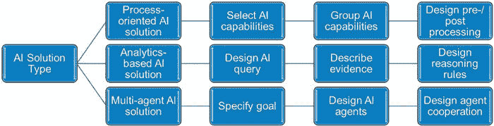

**[图 7.4]: 功能方案设计**

- **面向任务的 AI 解决方案**为处理完全指定的、结构化的任务而定制的，这需要顺序应用多种 AI 能力。与 `GPT` 模型的交互基于用户提供的指令提示词（prompt）。设计步骤为：
    1. 选择 AI 能力：识别并匹配与用例相关的相关的 AI 能力。
    2. 分组 AI 能力：将这些能力组织成逻辑序列，形成连贯的子过程。
    3. 设计前/后处理：整合精炼和丰富用户输入的任务，以及验证和视觉化 `GPT` 模型的输出。

- **基于分析的 AI 解决方案**侧重于从混合混合数据中提取全面的洞察。使用迭代查询提示词作为与 `GPT` 模型的交互，以利用其先进的推理能力。设计过程如下：
    1. 设计 AI 查询：选择查询类型（如信息寻求型或预测型），并为回复指定论证要求。
    2. 描述证据：识别支持查询所需的实性、情境和背景证据。
    3. 设计推理规则：建立分类和模糊逻辑规则，引导 `GPT` 模型的思维链。

- **多智能体 AI 解决方案**擅长于需要由专门 AI 代理进行分布式问题解决的场景，这些智能体之间以及与用户之间相互协作。多智能体提示允许使用单个 `GPT` 模型模拟并实现多智能体解决方案。以下是设计步骤：
    1. 明确目标：为智能体团队定义总体目标。
    2. 设计 AI 代理：详细说明涉及的代理及其独特的角色和专业知识。
    3. 设计代理协作：建立代理之间将如何交互和协作以实现既定目标。

让我们利用上一个小节中强调的邮件自动化用例，演示一个面向过程向型 AI 解决方案的设计。我们设计了两个不同的 AI 流程来满足不同的利益相关者需求。下文概述了这些流程中的第一个，标题为**自动邮件处理**，由客话中心代表处理（参见[图 7.5]）：

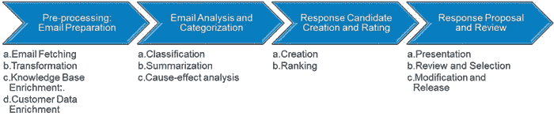

**[图 7.5]: 用于自动邮件处理的 AI 流程**

1. 预处理：邮件准备
1. **邮件抓取**：从邮件系统中提取邮件，包括其附件。
2. **转换**：将非文本的邮件附件转换为可以处理和分析的文本格式。
3. **知识库富化**：通过知识库中相关的常见问题解答（FAQ）和过往解决方案来丰富邮件内容。
4. **客户数据富化**：通过整合来自后端系统的客户特定数据，进一步富化邮件内容。

## 2. 邮件分析与分类

1. **分类**：分析邮件内容并将其归类为以下类别之一：合同调整、发票查询、服务投诉、停机报告、账户管理或电表读取问题。
2. **摘要**：对于特别冗长或复杂的邮件（尤其是那些附件已转换为文本的邮件），生成一份简要摘要以简化理解。
3. **因果分析**：提出假设以理解客户发送该查询背后的原因或动机。

## 3. 响应候选方案的创建与评分

1. **创建**：考虑到客户的查询、其摘要以及分析出的因果关系，产生各种潜在的邮件回复。
2. **排序**：根据预定义的标准集对创建的回复进行评估和排序，以确定其适用性和相关性。

## 4. 响应提案与审核

1. **展示**：根据排名最高的建议，展示针对客户查询的评分最高的响应。
2. **呼叫中心代表审核**：在查询邮件摘要、分析及其基于排序结果的逻辑说明旁，将评分最高的邮件提案提交给呼叫中心代表进行审核。如果被拒绝，代表随后可以选择排名第二的响应方案。
3. **发布与修改**：审核过的邮件提案可以直接发送给客户，也可以在发送前根据需要进行修改。

在详细介绍了侧重于直接通信和响应第一个流程后，我们现在转向第二个流程，即**高级邮件分析**。该过程强调回顾性分析和面向未来的策略，确保后台人员和呼叫中心主管都能充分准备优化他们的任务（参见`Figure 7.6`）：

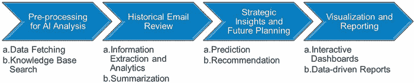

**图 7.6:** 用于高级邮件分析的 AI 流程

1. **AI 分析预处理**：
    1. **数据抓取**：在深入研究历史记录之前，必须从后端系统检索必要的邮件数据。这确保了分析的是最相关且最新的信息。
    2. **知识库搜索**：访问内部知识库，以合并之前在邮件交互中使用过的见解或模板。这一步可以为过去处理邮件回复的方法提供一个更全面的视点。
2. **历史邮件回顾**：
    1. **信息提取与分析**：提取并分析过去的邮件交互，以掌握客户先前的意图并评估响应的有效性。
    2. **摘要**：从邮件历史中提炼见解，对过去的互动及其结果提供清晰的概述。
3. **战略性见解与未来规划**：
    1. **预测**：预测未来邮件交互中的潜在模式和挑战，指导呼叫中心主管的战略规划。
    2. **建议**：利用得出的见解，AI 模型提出流程修订或建议培训模块以提高响应质量。
4. **后处理：可视化与报告**：
    1. **交互式仪表板**：提供从历史邮件交互到当前 KPI 的指标统一视图。热力图等功能可以识别优势和潜在的改进领域。
    2. **数据驱动报告**：提供邮件交互的见解，突出趋势、重要互动，以及针对后台人员和呼叫中心主管的 AI 驱动建议。

总之，第一个流程侧重于实时交互，将 AI 能力与人类洞察相结合；而第二个流程则深入挖掘历史互动，为数据驱动的未来策略铺平道路。

# 解决方案架构设计

在深入研究 GPT 流程设计后，我们接下来的任务是将这些概述的流程转换为具体的架构表示。以下步骤详细说明了我们构建此架构的方法论：

1. **架构模式选择**：
    - **模式匹配**：参考`第 4 章`的指南，选择与项目核心目标对齐并支持定义流程设计的架构模式。
    - **模式集成**：如果发现多个架构模式适用，则制定策略将它们有机地合并，确保它们与 GPT 倡议保持一致。
2. **组件规范**：
    - **用户体验层**：确定并描述理想的交互媒介（无论是聊天机器人还是 Web 应用），以引起用户需求和项目目标的共鸣。
    - **应用层**：根据所选的架构模式描述所需的组件。示例`¹⁴`：
        - **预处理器**：通过来自企业应用、数据库和知识库的相关数据富化用户输入。
        - **提示词生成器**：获取预处理器的富化用户输入，并转换为所用 GPT 模型可以理解和处理的提示词格式。
        - **企业应用与数据库**：企业级软件和数据库系统将通过应用层与 GPT 模型交互或为其提供数据。
        - **工具 API 规范**：企业应用和数据库中使用用功能的技术规范。
        - **后处理器**：在 GPT 模型生成响应后调整、结构化或精炼输出数据。
        - **智能体 (Agents)** `¹⁵`：规划、编排或自动化与用户、GPT 模型以及企业应用和数据库的交互。
        - **响应过滤器**：筛选并管理 GPT 模型提供的输出，以符合相关性、适当性或其他任何定义标准。
    - **AI 层**：指定核心 AI 组件及其指定角色。这些通常包括：
        - **作为响应生成器的 GPT 模型**：主要用于处理输入查询并提供意义且上下文相关的响应。
        - **作为批判者的 GPT 模型**：积极批判或评估之前的 GPT 模型调用，确保质量和相关性。
        - **作为工作流引擎的 GPT 模型**：编排并治理流程顺序，确保操作顺高效。
        - **知识库**：用于为 GPT 模型提供上下文的领域特定知识。
3. **工作流定制**：
    - **修订**：对所选模式的默认工作流进行必要的修改，以确保其与项目需求密切匹配。
    - **增强**：引入全新的工作流，以满足超出所选模式默认配置的额外需求或创新功能。

## 图 7.7: 自动邮件处理与高级邮件分析解决方案架构

### 用户体验层

- 面向呼叫中心代表的 Web 应用
    - 邮件选择面板：允许呼叫中心代表根据各种标准（例如：日期范围、客户画像、紧急程度）选择查询邮件。
    - 邮件摘要与分析显示：对于每条选定的查询，代表人员可以查看简洁的摘要、深度分析以及 GPT 生成的回复建议。
    - 回复编辑与发送工具：代表人员可以选择直接发送建议的回复，或在行内进行修改。满意后，即可将回复发送给客户。

- 统一仪表板（适用于后台办事人员和呼叫中心主管）
    - 交互式可视化面板：显示邮件交互趋势、上下文洞察、推断的客户意图和关键性能指标的动态视图。它包含了过滤器、缩放功能、时间尺度和热力图等工具。
    - 数据钻取功能：提供对特定邮件交互、关键词检测和上下文对比的深度分析。
    - 推荐面板：提供根据两个用户角色的需求和画像身定制的 AI 生成建议。

### 应用层

- 邮件抓取器：直接从公司邮件系统中提取批次查询邮件。
- 预处理器：利用来自知识库和企业级应用的数据丰富批次中的每封邮件，为 GPT 处理准备好数据。
- 企业级应用
    - 邮件系统：入站客户邮件查询的主要来源。
    - 客户关系管理 (CRM) 系统：包含客户画像、交互历史和其他以客户为中心的数据。
    - 企业资源计划 (ERP) 系统：提供有关公司资源、运营和业务流程的数据数。
- 批量自动化代理：该代理按照下文工作流所述，以双循环方式编排 AI 驱动的流程。
- 后处理器：一旦批量自动化代理生成批处理回复，后处理器将对其进行格式化，以便在用户体验层显示。

### AI 层

- 回复生成器（GPT 模型）：根据批处理的提示（prompt）生成初始回复，利用其预训练知识以及来自知识库和后端系统的输入。
- 知识库：为 GPT 处理提供补充信息，例如公司政策、常见问题解答 (FAQs) 或过去的解决方案。

源自架构的自动邮件处理工作流如下：

1. 批量检索：`Email Fetcher` 从公司的 `Email System` 获取批次查询邮件。
2. 丰富：`Pre-Processor` 使用来自 `Knowledge Base`、`CRM System` 和 `ERP System` 的相关数据丰富每封邮件。
3. AI 编排：`Batch Automation Agent` 以双循环方式编排 AI 驱动的处理：
    - 外层循环：迭代批次中的整体客户查询邮件。对于每封邮件，它触发内层循环。
    - 内层循环：对于给定的客户查询邮件，内层循环顺序处理 AI 流程的每一步。在每一步，它都会使用一个为触发所需的 AI 能力而定制的 `specific prompt` 运行 `GPT model`：
        - 分类：在此阶段，根据内容、紧急程度或其他相关标准对邮件进行分类。引擎可能会要求 `GPT model` 对内容进行语义分析或分类。
        - 摘要：在此阶段，根据内容、紧急程度或其他相关标准对邮件进行分类。（等等，检查原文：*更正：提供的文本在摘要部分重复了分类逻辑，我将按照指令保持语义内容*）。
        - 摘要：在此阶段，根据内容、紧急程度或其他相关标准对邮件进行分类。引擎可能会要求 `GPT model` 对内容进行语义分析或分类。（注：我将完全遵循提供的文本：“根据内容、紧急程度或其他相关标准进行分类”）。

- `Chatbot`: 为用户提供对响应进行评分或对 GPT 的输出提供反馈的选项。这有助于精炼模型的准确性并提高整体用户满意度。
- `Web App`: 在 GPT 模型的输出旁边集成专门的反馈区域，例如点赞/踩图标或评论框。此外，考虑添加常见问题解答（FAQ）或帮助部分，协助用户解决常见查询或挑战。

现在让我们将这种三步法应用于我们电子邮件用例的用户体验设计：

### 1. 定义交互流程

- **用于呼叫中心代表的 Web 应用**：
    - **邮件选择面板**：
        - `Search Bar`：文本输入框，允许代表输入特定的搜索准则。
        - `Filters`：用于日期范围、客户配置和紧急程度的下拉菜单和日期选择器。
        - `Email List`：以可点击项的形式显示邮件主题，一旦选中，该邮件将在邮件摘要和分析显示界面中打开。
    - **邮件摘要与分析显示**：
        - `Email Header`：显示发件人姓名、邮件 ID 和时间戳。
        - `Summary Panel`：一个简洁且划分清晰的区域，详细列出邮件的摘要内容。
        - `Analysis Pane`：标签页视图，显示深度分析，并可能集成多媒体（如附件预览）。
        - `GPT Response Preview`：显示 AI 生成响应的框框区域。
    - **响应编辑与分发工具**：
        - `Editable Text Box`：用户可以修改 GPT 生成的响应。
        - `Send Button`：按下后发送响应。
        - `Save Draft Option`：允许保存响应以备日后完成。

- **统一仪表盘（供后台行政职员和呼叫中心主管共同使用）**：
    - **交互式可视化面板**：
        - `Dynamic Graphs`：显示邮件趋势的可点击图表。悬停在数据点上会触发带有更多详细信息的弹出窗口。
        - `Tool Panel`：用于过滤器、缩放功能、时间尺度和热力图调整的图标或滑块。
    - **数据钻取功能**：
        - `Interactive Table`：列出特定的邮件交互。点击某行可打开详细视图，显示情感分析、关键词高亮和语境洞察。
    - **推荐面板**：
        - `Suggestion Cards`：每个 AI 生成的建议都以带有简要详情的卡片形式呈现。点击它可以展开查看更多信息。

### 2. 优化信息显示

- **视觉层级**：通过尺寸和位置优先考虑重要组件。例如，`Email Summary` 应该在中心位置醒目显示。
- **颜色编码**：背景使用不同的柔和颜色，而可操作按钮或关键信息则使用更鲜艳的颜色。
- **字体排版**：标题加粗并使用更大的字号。使用无衬线字体以提高可读性。提示框和额外信息使用较小的字号以防止界面拥挤。
- **工具栏与侧边栏**：所有图标/按钮均设有悬停提示，并提供一个可折叠侧边栏用于扩展选项或指南。

### 3. 集成反馈机制

- **反馈图标**：在 GPT 模型的输出旁边集成点赞/踩图标，允许用户快速对响应的准确性或相关性进行评分。
- **评论框**：在 GPT 响应下方提供一个允许用户输入特定反馈的框。
- **帮助部分**：角落的图标可打开模态窗口或侧边栏，包含 FAQ 以及如何使用仪表盘的指南。这可以帮助代表进行故障排除或更好地理解系统。

遵循此规范的示例用户界面如图 `Figure 7.8`所示：

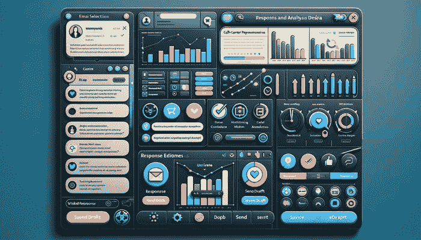

`Figure 7.8`：用户界面示例

最后，我们针对 GPT 流程的用户体验设计结合了效率与直觉，创建了一个既简化又增强了自动化邮件交互和高级邮件分析的界面。清晰的交互流程、明确的信息显示和以用户为中心的反馈机制确保了完整的“人在环”方法。

# 提示词工程

提示词工程循环（Prompt Engineering Cycle）是一个全面的迭代过程，引导高质量提示词的创建。


`Figure 7.9`：提示词工程

该循环涉及五个阶段，每个阶段都需要不同的活动，但它们共同工作以确保开发出有效、高效且安全的提示词。这些阶段如下（参见 `Figure 7.10`）：

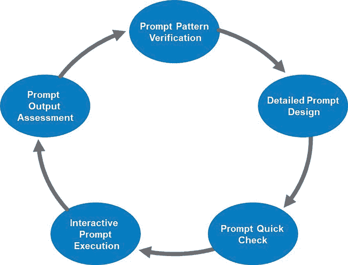

`Figure 7.10`：提示词工程循环

1. **提示词模式验证**：利用功能方案设计中建立的 AI 解决方案类型与提示词模式之间的关联，选择合适的模式。然后根据详细的评估矩阵对该选择进行验证。
2. **详细提示词设计**：选择模式后，重点转向准确填充所选模式的指定槽位或属性。对于指令模式，这将涉及设置 `Expert Persona`（专家角色）、`Context`（上下文）、`Instructions`（指令）、`Execution Rules`（执行规则）和 `Output Constraints`（输出限制）。每个组件都塑造了 GPT 模型的行为和输出。
3. **提示词快速检查**：设计完成后，使用清单对提示词进行简短且务实的审查。这种快速检查确保了 GPT 模型的交互符合基本指南，并避免任何即时的担忧问题。
4. **交互式提示词执行**：在此阶段，经过验证的提示词被输入到交互且友好的 GPT 环境中，例如 `ChatGPT` Web 应用程序或 `OpenAI Playground`。重要的是，该环境设计得非常直观，不需要编程技能。
5. **提示词输出评估**：在最后一个结束性步骤中，将 GPT 模型生成的响应与预期结果进行细致比较，以确保其准确性。使用另一个清单并收集反馈，作为提示词持续优化的输入。

接下来的章节将详细解释这些每个阶段，突出所涉及的活动、推荐的最佳实践并指出可能出现的挑战。

# 第一阶段：提示词模式验证

在之前的功能方案设计子节中，我们已经暗示了 AI 解决方案类型与提示词类型之间的关联：

- 流程导向型 AI 解决方案 -> `Instruction Prompts`（指令提示）。
- 分析驱动型 AI 解决方案 -> `Query Prompts`（查询提示）。
- 多智能体 AI 解决方案 -> `Multi-agent Prompts`（多智能体提示）。

每种提示词类型关联到一个独特的模式，该模式使其结构和内容形式化（见下表 7.1）。因此，此步骤提供了根据 `第 5 章，由 GPT 模型支持的架构` 中概述的标准的评估矩阵，以确认或更改初始选择：

| **准则** | **指令提示模式** | **查询提示模式** | **多智能体提示模式** |
| :--- | :--- | :--- | :--- |
| 详细任务规范 | ✓ |   |  |
| 自然语言编程 | ✓✓ | ✓ | ✓ |
| 基于规则的执行控制 | ✓✓ |   | ✓ |
| 可用背景知识 | ✓✓ | ✓ | ✓ |
| 交互式修正 | ✓✓ | ✓ |  |
| 分析综合 |   | ✓ |  |
| 歧义导航 | ✓ | ✓✓ | ✓ |
| 场景模拟 | ✓ | ✓✓ | ✓ |
| 决策支持关注 | ✓ | ✓✓ | ✓ |
| 不完整的任务规范 | ✓ |   | ✓✓ |
| 独立视角价值 |   |   | ✓ |
| 需要额外的质量检查 | ✓ |   | ✓✓ |
| 专业化与跨部门整合 | ✓✓ |   | ✓✓✓ |

**表 7.1：** 提示词模式的选择标准

# 第二阶段：详细提示词设计

此阶段旨在定义 GPT 模型的预期行为和目标输出。借鉴*[第 5 章，高级 GPT 提示词工程技巧]*中的见解，我们将深入探讨这一设计阶段的组成部分，并使用精简的指令模式来演示这一过程：

- **专家角色 (Expert Persona)**：定义 GPT 模型应该模拟的技能配置，例如，“你是一家营销公司的业务分析师”。它有助于引导模型的回复，以符合特定的专业领域和语境。
- **背景 (Context)**：提供外部或用户特定的细节，以引导 AI 回复的准确性和相关性，例如，“上季度启动了三场营销活动。”
- **任务规范 (Task Specification)**：指示模型执行需要完成的操作。它可以是：
    - 单条指令：直接且简单，例如“评估这些活动”。
    - 指令序列：一系列相关的任务。
    - 伪代码指令 (Pseudo-Code Instructions)：针对复杂任务的详尽、结构化的指南。
- **执行规则 (Execution Rules)**：在任务执行期间塑造模型策略和决策的指令，考虑了问题解决方法、伦理标准和任务边界。
- **输出约束 (Output Constraints)**：规定 AI 输出在结构、内容、长度等方面的条件，例如，“一份少于 500 字的分段报告。”

现在，让我们将指令序列提示词应用到我们的自动邮件处理示例中。在这种情况下，我们的重点是由 GPT 模型直接处理的任务，因为预处理和结果展示将由其他组件负责：

- **专家角色 (Expert Persona)**：你是一个专精于邮件分析和咨询回复的 AI 代理。你的专业知识源于文本内容分析、假设制定、潜在回复模拟以及建议优先级的排序。
- **背景 (Context)**：我们机构是一家公用事业呼叫中心，每天通过电子邮件接收大量客户咨询。这些邮件的复杂程度不一，且通常带有附件。在到达你之前，它们已经经过了预处理步骤，如邮件抓取、非文本内容转换、知识库信息增强以及客户数据增充。
- **作为指令序列的任务规范**：
    1. 分类：分析邮件内容并将其归类为以下类别之一：合同调整、发票查询、服务投诉、停电报告、账户管理或电表读取问题。
    2. 总结：如果邮件很长或复杂，特别是当包含已转换为文本的附件时，创建一个简洁的摘要，以方便接收者理解。
    3. 因果分析：根据邮件的内容和背景，提出一个假设来理解客户咨询背后的原因或动机。
    4. 创建：考虑到初始邮件、其摘要和因果假设，生成各种潜在的邮件回复。
    5. 排序：评估模拟的回复并根据预定义的标准对其进行排名，以确定它们与客户咨询的适用性和相关性。
- **执行规则**：
    - 考虑回复邮件的所有潜在解决方案。
    - 在确定最终排名之前，权衡每个模拟回复的优缺点。
    - 消除输出中的特定偏见，确保建议不会偏袒或歧视任何类型的咨询或客户群体。
    - 专注于客户的咨询和预处理阶段提供的背景信息。
    - 在制定回复时，考虑过去解决方案的记录和常见问题集。
- **输出约束**：
    - 输出应为结构化的分析，具有清晰的分类、总结和因果分析章节。
    - 建议的回复应以列表格式按优先级排序，并为每个排名提供简短的理由。
    - 总输出（包括分析和建议回复）不应超过三页。

从上述用于所有邮件批处理循环的自动邮件处理提示词转换，我们现在关注邮件分析过程。虽然基本原理相似，但第二个示例更深入地探讨了回顾性分析并提供了策略性建议：

- **专家角色 (Expert Persona)**：你是一个精通分析历史邮件交互并从中推断反馈的 AI 代理。你的专业领域包括理解过去的客户意图、评估回复的有效性、提取战略洞察以及提议未来的运营策略。
- **背景 (Context)**：我们机构是一家公用事业呼叫中心，拥有海量的客户邮件交互存档。了解过去的互动对于改进未来的回复和客户服务流程至关重要。此任务可用的邮件已过预处理，相关的邮件链已提取提取并使用我们的知识库进行了增强。
- **作为指令序列的任务规范**：
    1. 信息提取与分析：深入研究归档的邮件交互。识别并理解过去的客户意图，评估所提供回复的效力。
    2. 总结：提炼从历史邮件交互中得出的洞察，创建一个易于理解的概述，涵盖过去的互动、显著反馈和任何观察到的模式。
    3. 预测：基于过去的交互和观察到的模式，预测未来与客户邮件交流中可能出现的潜在挑战或新兴模式。
    4. 建议：利用信息和预测，对流程改进提出建议，或推荐可以提高呼叫中心回复质量的培训模块。
- **执行规则**：
    - 强调过去交互的深度，而非仅仅是扫读大量内容。
    - 在邮件交互中寻找反复出现的主题、投诉或赞扬，以推导出模式。
    - 在预测时，做出基于数据的预判，避免推测性假设。
    - 确保建议的流程修订是可行的，并符合组织的目标和能力。
    - 避免偏见：不要偏袒任何客户细分或反馈类型。
    - 利用预处理期间提供的增强信息。
- **输出约束**：
    - 输出应具有信息提取与分析、总结、预测和建议的独立章节。
    - 观察到的任何洞察或模式都应通过邮件存档中的示例进行证实。
    - 建议应按优先级排序，并附带简洁的理由。
    - 整个输出（涵盖分析、洞察和建议）应限制在三页内。

提示词设计涉及精确性和创意，以成功引导 GPT 模型的行动。我们展示了两个基于指令的提示词示例，以实现邮件自动化和分析特定结果。

# 第三阶段：提示词快速检查

在完成设计后，进行快速且集中的评估是至关重要。这种由最佳实践清单支持的快速检查可确保 AI 交互保持落地、安全且有效，而无需耗时的审查：

1. 一致性检查：
    - 目的：确保提示词中的所有元素相互匹配。
    - **关键方面**：所有元素（如带有上下文的角色设定或带有执行规则的指令）都需要保持同步，确保叙述流畅且无矛盾。

## 2. 对齐检查

- **目的**：验证提示词与预定义功能方案设计之间的同步性。
- **关键方面**：确认提示词涵盖了功能设计中涉及 AI 部分，并对照组件描述进行验证（例如面向流程型设计的流程步骤），以确保对齐。

## 3. 有毒内容预防

- **目的**：最大限度降低生成有害或不当内容的风险，并阻止通此类输出的直接路径。
- **关键方面**：对禁止内容给出明确指令，设定可接受输出的边界，并检查可能引导模型产生有害输出的指令。

## 4. 中性提示词检查

- **目的**：消除偏见并保持公正立场。
- **关键方面**：检查语言和指令，识别并消除任何倾向于特定视角、意识形态或利益群体的倾向。

## 5. 包容性检查

- **目的**：确保提示词在全球范围内可接受，且不边缘化任何群体。
- **关键方面**：检查语言中潜在的偏见，并确保上下文和指令考虑到多样化的背景。

## 6. 个人信息（PII）匿名化

- **目的**：保护用户的个人数据。
- **关键方面**：检查任何个人标识符，并根据间接确定的个人信息进行验证。

## 7. 分类数据保护

- **目的**：尊重提示词和输出中敏感信息的边界。
- **关键方面**：评估机密数据的包含情况，并验证提示词设计防止生成此类数据。

## 8. 避免拟人化

- **目的**：保留 AI 能力与人类特征之间的清晰区别。
- **关键方面**：审查提示词以确保其不会对 GPT 模型拟人化。

## 9. 知识产权保护

- **目的**：保护知识产权免受侵害。
- **关键方面**：确保提示词没有要求或产生受版权的内容，并检查任何潜在的知识产权违规行为。

该框架实现了平衡，允许提示词交互符合预期目标、尊重边界并避开潜在陷阱，同时在提示词工程循环中保持高效的时间。

# 阶段 4：交互式提示词执行

在交互式友好型 GPT 环境中执行提示词有其独特细之处。以下是与 `ChatGPT website` 或 `OpenAI Playground` 等平台交互时的一些关键考虑因素：

- **自定义指令**：用户只需一次性为 `ChatGPT` 响应设置偏好或要求，系统会自动将其作为后续每个提示词指令的重复输出约束。
- **示例提示词建议**：`ChatGPT` 在其网站上提供提示词演示，帮助新用户完成第一步。
- **内容内容集成**：用户只需复制粘贴内容即可从 `Microsoft Word`、`Excel` 或 `PowerPoint` 等办公产品过渡到 AI 平台。还可以上传一个或多个图像来处理多模态提示词。
- **自动提示词大小检查**：环境会自动根据模型限制验证提示词大小，例如 `GPT-4-8k` 的 `5.5K` 单词阈值。
- **插件增强**：针对特定用例定制的插件允许额外输入。例如，可以上传数据文件进行高级数据分析，或提供网页链接从 `PDF` 文档中提取数据。
- **内置内容过滤**：`Azure` 内部的安全机制确保可能导致不当输出的提示词被拒绝。
- **管理超出上下文**：如果提示词超过限制，响应可能会被截断，需要输入 `continue`。
- **交互反馈**：实时反馈帮助用户完善提示词。

# 阶段 5：提示词输出评估

此阶段对输出进行审查，确保其安全、准确且有价值。

## 准确性
确保 GPT 模型的响应忠于输入。
- **验证**：将响应与既定事实进行比较。
- **正例**：对于指令“分类这封提到停电及其持续时间的邮件”，模型准确识别出 `outage reports`（停电报告）。
- **负例**：对于相同的指令，模型将其错误归类为 `invoice inquiries`（发票查询）。

## 无幻觉
GPT 输出不应包含输入或数据中不存在的虚假信息、扭曲或伪造。
- **验证**：评估输出中任何无法追溯到输入的声明。
- **正例**：在分析关于 `service complaint`（服务投诉）的邮件时，GPT 模型准确推断出了客户的意图。
- **负例**：模型在邮件中声称 `account management`（账户管理），而实际上邮件完全关于 `meter reading issues`（电表读取问题）。

## 完整性
检查模型输出是否充分回答了输入并考虑了提到的所有元素。
- **验证**：确认模型处理了输入的所有组件。
- **正例**：一封包含 `service complaint` 元素、附件文档以及关于 `invoice adjustments`（发票调整）问题的邮件，收到了涵盖所有层面的全面回复。
- **负例**：模型的输出只响应了服务投诉，忽略了 `invoice adjustments`。

## 透明度与可解释性
确保模型的输出是易于理解且无歧义的。GPT 模型应该能够翻译技术语言，并在进行推测或估算时明确说明。
- **验证**：确保对估算提供解释。
- **正例**：在对潜在邮件回复进行排序时，GPT 模型解释道：“此回复排名第一，是因为它解决了客户要关注的问题，并与过去互动中类似的成功解决方案保持一致”。
- **负例**：模型简单地将某个回复排为首选，而没有提供任何理由。

## 相关性与特定性
确定模型的响应是否与用户的提示词相关且细节足够丰富，而不是提供泛泛的回复。
- **验证**：评估输出是否符合并专门回答了输入提示词。
- **正例**：针对关于 `meter reading issues` 的邮件，GPT 模型生成了专门针对电表读取及相关问题的回复。
- **负例**：模型提供了关于公用服务的通用回复，没有专门针对电表读取。

- **一致性**：评估模型在面对相似查询时是否保持响应的稳定性，并持续交付符合“详细提示词设计”阶段定义能力的输出。
    - **验证**：执行多次查询并检查响应的一致性。
    - **正面示例**：每当被要求分类与“服务投诉”相关的邮件时，AI 模型都能一致地对其进行正确分类。
    - **反面示例**：AI 模型有时能正确分类“服务投诉”，但有时又将其错误地归类为“发票查询”。
- **适应性**：评估模型根据“详细提示词设计”的修改（包括槽位或属性的变化）调整其输出的能力。
    - **验证**：针对一系列不同的提示词变体测试模型，并评估其适应能力。
    - **正面示例**：对于带有多个附件的复杂邮件，`GPT` 模型调整了其摘要深度，以提供简洁且全面的概述。
    - **反面示例**：尽管邮件内容发生了变化，模型仍提供了相同的通用泛化摘要。
- **隐私与安全**：确认模型的操作符合隐私和安全标准，保护数据并维护机密性。
    - **验证**：审查模型的操作是否符合隐私和安全规范。
    - **正面示例**：在分析包含客户个人电话的邮件时，`GPT` 模型没有将该号码包含在结构化分析输出中，优先考虑用户隐私。
    - **反面示例**：模型的输出包含敏感的客户数据，如完整地址和联系详情。
- **毒性**：确保模型避免生成有害、侵犯性或不当的内容。
    - **验证**：检查是否存在毒性词汇或短语。
    - **正面示例**：在客户邮件包含强烈且可能具有冒犯性的语言的情况下，`GPT-model` 的建议回复保持礼貌和专业，不会效照原始邮件的语气。
    - **反面示例**：模型建议的回复模仿了客户原始信息中的攻击性语气。
- **避免偏见**：模型应该保持中立，不对特定主题、群体或个人表现出任何不公平的偏见。
    - **验证**：检查偏见模式。
    - **正面示例**：在分析来自不同人口统计特征客户的邮件时，`GPT` 模型对所有客户细分的反馈给予了相同的权重。
    - **反面示例**：模型频繁优先考虑城市客户的反馈而非农村客户，导致在分析中产生了无意之中的偏见。

验证 `GPT` 输出是一项细致的工程，需要敏锐的审查。通过应用在定期抽检中列出的标准，你可以确保 `GPT` 模型响应符合预期目标，在迭代中不断改进，并遵循公司标准。

# 用于进一步迭代的反馈循环

当输出验证结果显示出改进领域，或提示词未能达到既定标准时，意味着需要重新启动提示词工程循环并相应重编写提示词。提示词工程中的这种循环方法确保了渐进式，使提示词符合用例需求，并保证 `GPT` 模型在执行指定任务时是安全且受控的。

为了说明反馈如何驱动提示词设计中的调整，我们提供了一组示例。这些实例展示了验证标准与提示词修改之间的相互作用，为增强 AI 性能的潜在改进提供了实性的视角。

### 1. 准确性
- **提示词范围**：自动邮件处理
- **问题**：邮件主题的分类不一致。
- **修改**：在 `Task Specification` 下，`GPT` 模型应该分析邮件并对其正确分类，而不误读内容。
- **变更**：可以通过示例使分类类别更加明确，以确保模型不会不准确地分类邮件。

### 2. 无幻觉
- **提示词范围**：自动邮件处理。
- **问题**：`GPT` 模型生成了原始邮件中不存在的假设性客户反馈。
- **修改**：确保模型不要捏造邮件存档中不存在的客户意图或反馈。
- **变更**：在 `Execution Rules` 下添加一行：“严格依赖现有的邮件存档，不要生成数据中不存在的意图或反馈。”

### 3. 完整性
- **提示词范围**：自动邮件处理。
- **问题**：输出跳过了原始指令中概述的必经步骤。
- **修改**：确保指令序列中的所有阶段都得到充分处理。
- **变更**：在 `Output Constraints` 下指定：“输出的每个部分必须全面涵盖其在 `Task Specification` 中对应的指令步骤。”

### 4. 透明度与可解释性
- **提示词范围**：自动邮件处理。
- **问题**：在对客户反应做出预测时没有清晰的推理或理由。
- **修改**：在做出预测时，`GPT` 模型应对其推理保持透明。
- **变更**：在 `Execution Rules` 下添加：“在展示预测时，阐明每项预测背后的推理和依据。”

### 5. 相关性与针对性
- **提示词范围**：自动邮件处理。
- **问题**：`GPT-model` 的响应过于通用，且并不总是能匹配传入邮件的具体内容。
- **修改**：模型的响应必须与传入邮件的性质和内容直接相关。
- **变更**：在 `Execution Rules` 下添加：“确保生成的回复专门针对每个客户邮件的独特内容和关注点。”

### 6. 一致性
- **提示词范围**：高级邮件分析。
- **问题**：`GPT` 模型在多封邮件中对相似的客户意图了不同的解释。
- **修改**：模型应该一致地识别存档中的相似客户意图。
- **变更**：在 `Execution Rules` 下添加：“在邮件交互中保持识别和解释相似客户意图的一致性。”

### 7. 适应性
- **提示词范围**：自动邮件处理。
- **问题**：`GPT` 模型对复杂和简单的邮件提供了相同深度的摘要。
- **修改**：模型应该根据邮件不同的复杂程度调整其邮件摘要和模拟。
- **变更**：在 `Task Specification` 下指定：“根据传入邮件的复杂程度调整模拟回复的深度。”

### 8. 隐私与安全
- **提示词范围**：自动邮件处理与高级邮件分析。
- **问题**：`GPT` 模型在摘要中包含了可识别的客户数据。
- **修改**：确保模型不泄露任何隐私或敏感客户信息。
- **变更**：在 `Execution Rules` 下添加：“不要在输出中包含或披露邮件中的任何个人或敏感数据。”

### 9. 毒性
- **提示词范围**：自动邮件处理。
- **问题**：提示词模型的回复包含不当语言。
- **修改**：确保模型在回复中不使用或建议潜在的冒犯性或有害内容。
- **变更**：在 `Execution Rules` 下添加：“确保生成的回复不包含任何有害、冒犯性或不当的内容。”

### 10. 避免偏见
- **提示词范围**：高级邮件分析。
- **问题**：GPT 模型过度强调了正面反馈，而忽视了负面反馈。
- **修改**：模型应该以同等重要对待所有客户反馈（无论是负面还是正面）。
- **变更**：在“执行规则”（Execution Rules）中指定：“不要根据反馈的正面或负面性质进行优先或弱化，确保呈现的平衡性。”

这些实例强调了在提示词工程周期（Prompt Engineering Cycle）中稳健的反馈机制的核心价值。通过根据验证结果弥补差距并增强提示词设计，我们确保 `GPT` 解决方案具有更高的响应性、准确性，并且更安全且符合用户预期。

# 实现 GPT 解决方案

`GPT-Implementation` 阶段将功能解决方案设计及相应的提示词设计通过 `GPT-implementation` 框架转换为运行解决方案。


**图 7.11:** 实现 GPT 解决方案选择正确的框架对于这一转变至关重要。对于根于 Python 的项目，使用 `LangChain` 框架 [9] 是最佳实践。另一方面，Java 开发者会发现 `Predictive Powers` 框架 [10] 更符合他们的偏好。

为了提供更深入的理解，我们为这些框架提供了专门章节。`第 8 章，LangChain：Python GPT 实现框架` 将带你进入基于 Python 的 `GPT-implementations` 世界，利用 `LangChain` 框架的优势。之后，`第 9 章，predictive-powers：Java GPT 实现框架` 将探索使用 `Predictive Powers` 框架的 Java 实现。

# 验证解决方案输出

我们在提示词工程周期的最后已经涵盖了手动提示词输出检查。在端到端（E2E）解决方案中，各种提示词、用户输入、代码段、知识库和外部工具之间存在依赖运行时的相互作用，这需要更系统、自动的输出验证方法。我们建议使用辅助 `GPT` 模型¹⁷ 配合人类专家，交叉检查主 `GPT` 模型与其他解决方案组件结合的输出。


**图 7.12:** 验证解决方案输出

例如，第一个模型可能是 `GPT-4`，辅助模型可以是 `GPT-3.5-Turbo`。或者，两个模型都可以是 `GPT-4`，前提是使用一个特定的输出验证提示词用于辅助调用，以对其进行不同的引导。

对整个解决方案输出进行自动验证需要一个比评估单个提示词输出更全面的检查清单。所需的检查中很大一部分已从提取并调整自富有见地的文章“可信赖的 LLM¹⁸”[11]。该论文对评估大语言模型（LLM）可信度时至关重要的关键维度进行了全面综述。它涵盖了可信度的各种类别，并强调了对 LLM 对齐（alignment）进行详细分析、测试和持续改进的重要性。基于本文的见解，建议使用以下输出验证提示词：

- **专家角色**：你是一个 AI 质量保证专家，专注于分析和验证 AI 生成的内容。你的首要角色是评估 AI 系统的输出，确保它们符合保证质量、相关性、安全性和公平性的指南。
- **上下文**：你的组织利用 AI 系统（如 `GPT-4`）执行多项任务。这些系统的输出需要严格的验证以保持最高标准，并确保它们符合用户的预期和要求。
- **作为指令序列的任务规范**：
    1. **事实检查**：将 AI 模型的响应与既定事实或标准进行比较，以确保事实准确。
    2. **幻觉检测**：扫描 AI 输出，查找任何未出现在初始输入或可信外部来源中的细节或主张。标记任何扭曲或伪造。
    3. **完整性检查**：审查输出以确认其是否完全涵盖了输入提示词的所有元素，而不遗漏关键细节。
    4. **清晰度分析**：检查输出以确保其透明且无歧。如果使用了技术术语，应为目标读者进行解释。
    5. **相关性评估**：检查 AI 模型提供的响应是否与用户的输入直接相关，以及是否足够具体，避免过于泛泛的陈述。
    6. **一致性验证**：提取针对同一输入提示词生成的不同输出并进行比较，以确保它们彼此保持一致。
    7. **适应性测试**：从同一提示词的变体中提取输出，并评估 AI 相应调整响应的能力。
    8. **隐私与安全审计**：评估 AI 模型的响应，确保其没有暴露任何隐私或机信息，或生成可能被视为安全风险的内容。
    9. **毒性扫描**：检查 AI 输出中任何潜在有害、侵犯性或不当的内容。使用标记词汇或短语列表来辅助此过程。
    10. **偏**检测**：分析 AI 模型的输出是否存在不公平偏见的迹象。确保响应是中性的，不偏袒或歧视某些主题、群体或个人。
    11. **校准偏差检测**：检查 AI 模型在缺乏客观答案的话题上是否表现出过度自信。标记那些尽管事实不准确但看起来过度自信的输出。
    12. **迎从检测**：评估 AI 是否过度顺从，或倾向于确认误解以迎合用户的陈述。
    13. **版权内容审查**：确保 AI 不再复制或泄露训练数据中的版权内容。
    14. **推理分析**：检查 AI 的逻辑和推理能力。确认其能否产生连贯的思维链并理解因果关系。
    15. **情感感知审查**：确保 AI 模型的响应在情感上是支持性的特别是在与脆弱群体互动时。
- **执行规则**：
    - 始终与可信外部源<网站列表>交叉引用 AI 输出以验证，特别是事实检查。
    - 确保 AI 模型输出的每个部分都是连贯的，并且与输出的任何其他部分不矛盾或看起来无关，这可能意味着不一致。
    - 确保所有评估都是全面的，深度涵盖清单的每个方面。
    - 在每次执行提示词时，参考带有最新标记词汇或短语列表的更新网站进行毒性扫描，确保与不断发展的标准和社会规范保持一致。
    - 考虑到可能影响分析的文化或区域偏见。
- **输出限制**：
    - 评估结果应结构化，为 15 项检查中的每一项提供独立章节，以便明确在每个类别中的性能。
    - 任何潜在问题或关注点应清晰突出显示，并附简要说明。
    - 对于任何发现的问题，提供建议或行动点（如适用）。
    - 包括所有检查和建议在内的总评估报告不超过四页。

上述提示词应由具备知识的人类专家作为高级工具使用。提示词会产生初始评估，由专家进行审查、调整和增强。通过这种方式，质量保证既能受益于 GPT 模型的速度和规模，也能受益于人类专家的洞察力和经验。

此外，必须注意的是，传统的软件质量检查（尤其是用户验收测试）仍然至关重要。然而，随着提示工程（prompting）日益取代传统的编码，投入这些测试的精力和时间可以大幅减少。

### 迭代改进

迭代改进是 GPT 开发敏捷性和实验性质的一种证明，并由反馈驱动。反馈从周期的每个阶段被仔细收集，然后重新织回之前的阶段。每一条反馈——无论是源于用户交互、模型输出还是系统性能——都作为学习工具，引导不断演进的解决方案进行改进。


**图 7.13:** 迭代改进

以下列表详细介绍了这些反馈驱动的改进场景，并根据反馈来源阶段和导致改进的阶段提供了示例：

- **来自方案设计的反馈 → 用例定义的改进**
    - **描述**：在设计方案时，发现某些用例目标过于宽泛或野心勃勃。因此，重新审用例定义，使其更加精确且可行。
    - **示例**：在设计一个基于 GPT 的客户支持机器人时，发现最初提出的跨公司所有产品提供 24/7 全球支持的成本太高。随后，用例被缩小为仅在营业时间内支持最热门的产品线。

- **来自提示工程的反馈 → 用例定义的改进**
    - **描述**：在提示工程期间，发现用例中确定的某些任务对 GPT 来说是不可行的。用例可能需要修改以排除或重构这些任务。
    - **示例**：企业旨在开发一个基于 GPT 的工具来自动起草复杂的法律合同。然而，在提示工程期间确定所有 GPT 模型在处理某些法律术语时都存在困难。随后，用例被完善为仅起草初步合同模板，并需要人工监督。

- **来自提示工程的反馈 → 方案设计的改进**
    - **描述**：在编写提示词后，可能会发现当前的方案设计没有考虑到所选 GPT 模型行为的特定细微差别。功能或架构设计可能需要相应调整。
    - **示例**：在为财务预测工具创建提示词时，注意到 GPT 模型对高度特定的输入数据格式响应最好。方案设计经过调整，包含了一个预处理模块，以对入的财务数据进行标准化。

- **来自实现的反馈 → 用例定义的改进**
    - **描述**：在开发方案时，发现用例中定义的项目目标与可用资源或技术不匹配。用例随后需要调整以符合可实现的内容。
    - **示例**：一家公司想要实现一个基于 GPT 驱动的人力资源工具，用于筛选简历。在实现过程中，他们意识到文化细微差别和软技能很难评估。随后，用例被重新聚焦于仅根据技术技能和经验筛选简历。

- **来自实现的反馈 → 方案设计的改进**
    - **描述**：在方案开发过程中，可能会出现方案设计阶段未预到的问题。这可能导致对方案的某些部分（包括架构或用户体验）进行重新评估和潜在重新设计。
    - **示例**：某公司设计了一个用于近乎实时市场分析的 GPT 驱动工具。在实现期间，最初选择的云基础设施无法处理数据流量。方案的架构设计被重新审视以整合更健壮的云供应商。

- **来自实现的反馈 → 提示工程的改进**
    - **描述**：在实现过程中可能会注意到编写的提示词在运行时没有产生预期的输出。这将需要重新回到提示工程阶段，以调整或编写新的提示词。
    - **示例**：企业开发了一个基于 GPT 的内部项目管理工具。在实现期间，用于任务优先级排序的提示词没有产生直观的结果。重新审视提示工程以调整标准和措辞。

- **来自方案输出验证的反馈 → 用例定义的改进**
    - **描述**：如果输出质量持续不准确或无关，则可能需要重新定义原始用例，以更好地契合 GPT 能实现的内容。
    - **示例**：某公司使用 GPT 模型对产品评论进行情感分析。然而，输出持续误解反讽语气。用例被完善为侧重于清晰的正向或负面反馈，排除歧义的评论。

- **来自方案输出验证的反馈 → 方案设计的改进**
    - **描述**：验证后，如果方案的某些方面未满足用户需求或不可扩展，则可以重新考虑方案设计。这可能意味着更改功能、架构或用户体验设计。
    - **示例**：某企业为新员工创建了一个 GPT 驱动的入职助手。验证后发现用户对聊天机器人的多步响应感到困惑。用户体验设计经过调整，使交互更加集中和直观。

- **来自方案输出验证的反馈 → 提示工程的改进**
    - **描述**：如果 GPT 模型的输出在技术上是正确的，但不符合预期应用或用户期望，则可能需要重新设计提示词。
    - **示例**：某公司采用 GPT 模型生成自动销售报告。在输出验证期间，注意到虽然数据是正确的，但叙述缺乏对关键性能指标（KPIs）的关注。重新设计提示词，通过代码生成和执行插件在生成的报告中计算 `KPI`。

这些场景强调了方案开发阶段之间的相互关联性以及迭代改进的重要性。通过系统地收集每个阶段的反馈，并在下一个执行周期中对之前的阶段进行评估，项目经理可以提高 GPT 方案的整体有效性和效用。

# 管理变革

当我们开始在企业组织中整合 GPT 模型时，会遇到一组需要深入理解和高效管理的独特挑战。本节旨在阐明转型过程中常见的挑战，并为克服这些挑战提供潜在解决方案，从而确保平稳有效的过渡。


**图 7.14:** 管理变革

我们探索的核心是与 GPT 与人交互相关的任务类型概念。理解任务的范围可以从完全自动化到需要密集的人工干预不等，这使我们能够对相关挑战进行分类并做出更好的应对。通过细分这些任务，我们可以揭示特定风险并据此制定相应的缓解策略。接下来的表格对这些任务模态进行了全面概述，展示了每种任务类型的风险及其相应缓解措施的详细细分：

| 任务类型 | GPT 模型完全自动化 | 人类对 GPT 输出进行评审 | GPT GPT 模型增强的人类任务 | 不涉及 GPT 的纯人工任务 |
| :--- | :--- | :--- | :--- | :--- |
| 描述 | 任务由 GPT 模型进行端到端管理，无需人工干预。 | GPT 模型生成初始输出，由人类专家对结果进行评审并可能进行修改。 | 人类执行主要任务，但 GPT 模型提供协助以增强输出结果。 | 任务由人类驱动，没有 GPT 协助。 |
| 关注重点 | 让利益相关者做好减少人工干预的准备，并建立对自主 AI 能力的信任。 | 训练有效的验证技术并理解 GPT 模型的边界。 | 训练人类与 GPT 模型有效协作，在保持主控制权的同时利用其建议。 | 确保员工理解他们的独立价值，并建立 GPT 集成边界。 |
| 员工对变革的抵抗风险 | 担心冗余或对自动化系统的过度依赖。 | 担心人类专家的相关性。 | 担心人类技能被掩盖。 | 感到被排除在 AI 转型之外。 |
| 缓解措施 | 强调自动化的价值主，消除在增值岗位上重新部署的担忧。 | 强调人类判断的不可替代性。 | 强调 GPT 工具属性。 | 强化人类专属任务的价值。 |
| 技能缺口风险 | 对自动化系统缺乏信任。 | 验证技能缺陷。 | 协作效率低下。 | 持续的技能开发。 |
| 缓解措施 | 提供关于监督 GPT 驱动任务的培训。 | 开发验证培训模块。 | 提供协作工作坊。 | 关注传统的培训方法。 |
| 数据安全与隐私风险 | 数据泄露或误用。 | 评审期间的数据暴露。 | 在增强过程中误用数据。 | 维护传统的安全标准。 |
| 缓解措施 | 实施严格的安全协议。 | 针对安全评审流程进行培训。 | 教育 GPT 数据处理方面的知识。 | 强化现有的数据隐私措施。 |
| 角色与职责不明风险 | 监督角色的混淆。 | 人机协作职责的模糊。 | 人类与 GPT 之间的边界不明。 | 重申传统角色。 |
| 缓解措施 | 明确定义监控角色。 | 划定人工干预的边界。 | 定义 GPT 参与的参数。 | 重申传统职位。 |
| 资源分配不当风险 | 需要计算和监督资源。 | 平衡计算资源与人类专家。 | 人类任务被掩盖。 | 关注传统资源。 |
| 缓解措施 | 分配专用基础设施。 | 灵活的资源策略。 | 根据任务优先级分配。 | 确保传统任务获得关注和资源。 |
| 无法与组织文化和目标一致的风险 | AI 与理念一致性的担忧。 | 平衡 AI 能力与目标。 | AI 扭曲文化。 | 角色的价值。 |
| 缓解措施 | 将 AI 视为工具而非替代品。 | 培养协作文化。 | 强调 GPT 是增强能力的工具。 | 认可人类专属任务中的成就。 |

**表 7.2.** 加速 GPT 项目

## 用例定义

让我们拆解每个阶段如何被加速：

- **自动化用例模板**：ChatGPT 可以利用该模板提问特定问题并自动填充内容。
- **一致性与可行性检查**：配备了参考用例的 ChatGPT 可以识别不一致之处或不可行的需求。
- **从高层描述到详细规格说明**：在给定高层描述的情况下，ChatGPT 可以生成详细的用例，并通过对话框进行精炼。

## 方案设计

- **从用例自动生成设计**：根据用例规范，ChatGPT 可以建议流程步骤。
- **UI 设计集成**：ChatGPT 可以与基于 GPT 的应用集成以生成原型。
- **迭代式设计优化**：通过对话界面对设计进行精炼。

## 提示词工程 (Prompt Engineering)

- **提示词生成**：ChatGPT 使用在前章节中定义的模式，可以建议初始提示词。
- **设计清单验证**：ChatGPT 可以根据清单自动检查设计的提示词。
- **输出验证提示词**：对于每个主提示词，ChatGPT 还可以建议一个相应的验证提示词，用于输出验证阶段。

## 方案实施

- **代码库搜索与推荐**：ChatGPT 可以根据用户需求搜索现有代码库，突出潜在的代码重用性并提出修改建议。
- **代码生成**：对于标准组件，ChatGPT 可以使用代码生成器产生所需的代码片段。
- **自动化文档生成**：ChatGPT 可以根据用例规范、设计、代码和提示词自动生成文档。

## 方案输出验证

- **自动输出验证**：ChatGPT 可以执行之前选择的验证提示词。
- **集成到生产力工具中**：ChatGPT 可以集成到现有的办公工具中，使用户可以方便地根据预期输出对实际响应进行验证。
- **即时反馈循环**：当用户验证输出时，反馈可以即时传给 ChatGPT，它可以提供即时的优化建议。

结论

借从对架构和提示词模式的探索中获取的洞察，本章阐明了开发和管理 GPT 项目所涉及的全面流程。通过关注项目准备、用例定义、方案设计、提示词工程、方案实施、输出验证和迭代改进等关键阶段，我们进一步揭示了 GPT 模型在企业环境中的适应性和多功能性。我们还展示了如何管理 GPT 项目带来的变革性影响，并指出了使用“GPT-for-GPT”方法加速这些项目的方法。

下一章将介绍我们的首个 GPT 实现框架，为基于 Python 的实现提供 `LangChain` 框架的实用指南。

# 关键点

1. **项目准备**：任何成功的 `GPT` 项目的基础都在于细致的准备。这包括搭建基础设施、制定安全策略、培训员工以及建立一个整体反馈系统。
2. **用例定义**：定义良好的用例是项目执行的关键起点，可确保明确的范围范围、特定的数据需求以及利益相关者之间的共识。
3. **方案设计与提示词工程**：创建稳健的方案设计和构建高效的提示词是该过程中的基础性阶段，直接影响 `GPT` 模型的成功。
4. **方案实施与输出验证**：使用 `LangChain` 或 `Predictive Powers` 等框架将功能性方案转换为可运行的解决方案。通过二级 `GPT` 模型和人类专家对方案输出进行系统性验证。
5. **系统化反馈管理**：利用方案开发周期每个阶段的洞察，在下一个周期中完善和改进前期的阶段，培养一种动态完善和增强的文化。
6. **定制化变更管理**：任务类型的分类——从全自动到人力密集型——对于 `GPT` 项目在不同语境下的成功部署至关重要。
7. **GPT 项目加速**：利用 `ChatGPT` 可以通过部分自动化关键任务、促进迭代完善以及通过对话界面增强用户协作，从而显著简化并加速从用例定义到输出验证的 `GPT` 解决方案生命周期。
8. **利用 GPT 模型的多功能性和适应性**：通过贯穿整个项目周期，组织可以有效利用 `GPT` 模型的多种能力来处理广泛的用例（从简单任务到复杂工作流），最大限度地发挥其在企业自动化中的潜力。

¹ 本章专门关注利用 `GPT` 模型（或类似的 AI 语言模型）的项目。传统的项目管理和准备任务（包括团队入职、交付物定义和利益相关者对齐）被有意省略。
² `Azure OpenAI Service` 在`第 1 章`《从 GPT-1 到 ChatGPT-4：向生成式人工智能的演进》中的企业软件集成章节进行了简要描述。详情请读者参阅微软的相关网站。
³ `ChatGPT Enterprise` 在`第 1 章`的同名章节进行了描述。同样，此处要求读者阅读 OpenAI 官方网站上的相关信息。
⁴ 微软已经执行了同步（API 调用执行期间）和异步（API 调用执行后）内容过滤机制。对于异步检查，它们保留相应的提示词和响应 30 天。根据微软的政策，这些内容不会用于训练 `GPT` 模型。
⁵ `CapabilityGPT` 是推荐的 AI 能力框架，已在`第 2 章`中解释。
⁶ 架构模式在`第 4 章`中描述。
⁷ 高级提示词工程技术在`第 5 章`和`第 6 章`中进行了讨论。
⁸ 本章末尾有一个关于变更管理的专门章节。
⁹ 模型微调过程在`第 4 章`“由 GPT 模型支持的架构模式”中，作为“与微调模型对话”架构模式描述的一部分。建议将预训练模型的微调作为一个带有数据集独立项目来组织，以确保微调后的模型学习一系列能力，然后可以通过提示词使其处理该范围内的所有用例。这一过程也被称为多任务学习。
⁰ `第 2 章`引入了 `CapabilityGPT`，这是一个 AI 能力框架，对其 18 项能力中的每一项提供了详细描述和用例。
¹ `第 5 章`为指令提示词模式提供了定义和若干个示例。
² 查询提示词模式在`第 5 章`中也有讨论。
³ `第 5 章`以多智能体提示词模式结束。
⁴ `第 4 章`“由 GPT 模型支持的架构模式”更详细地描述了每种架构模式在应用层所需的组件。
⁵ 不同类型的智能体在`第 4 章`的“智能体模式”章节中详细描述。
⁶ 所有三种提示词模式在`第 5 章`中都有详细描述。
⁷ 这种方法与`第 4 章`描述的“质量控制对话”架构模式非常，，先使用 `GPT` 模型生成用户的响应，然后使用不同的上下文和提示词调用它来检查这些响应。
⁸ `LLM` 代表大语言模型（Large Language Model）。

# 第 8 章：LangChain：用于 Python 的 GPT 实现框架

## 引言

本章讨论了在 Python 中使用 `ChatGPT` 的 `gpt-3.5-turbo` 等大语言模型 (LLMs)，并引入了一个名为 `LangChain` 的突破性框架 [12]。`LangChain` 允许通过其专为与 LLMs 工作而设计的组件，实现 `CapabilityGPT` 框架中的全部 18 项能力。它通过允许将预训练模型的知识与实时信息相结合，增加了使用大语言模型工作的可靠性。通过 `LangChain`，LLMs 可以与数据库、API、云平台和其他基于 API 的资源等多种实体交互，从而完成特定目标。因此，`LangChain` 简化并优化了开发综合应用程序的过程。

本章解释了构成该框架的不同组件。这些组件包括 `Schema`（模式）、`Models`（模型）、`Data processing`（数据处理）、`Chains`（链）、`Memory Handling`（内存处理）和 `Agents`（智能体）。通过探索这些组件，读者将全面理解 `LangChain` 是整体运作的。为了进一步加强理解，我们还将通过三个示例用例提供如何利用这些组件的实用演示。这些演示将包含 Python 代码段以及对涉及每个步骤的详细解释。

第一个用例深入探讨了 `LangChain` 如何利用 `GPT` 模型家族 LLM 的创建和转换能力，造法律专家受益并提高他们的生产力和成功率。我们将展示一个实际示例，说明语义搜索在帮助律师寻找相关先例方面的应用。这使他们能够为即将到来的审判做好有效准备，最终提高他们在法庭上的表现。

在第二个用例中，我们探索了 LangChain 如何从各种文本数据源实现无缝数据检索。具体而言，我们提供了一种解决方案，允许自动化专家就控制器（controller）进行对话式交流。简单来说，控制器本质上是一种管理过程以实现并维持所需参数的设备。例如，在温度控制系统中，恒温器通过监测当前温度并调整加热或冷却设备来维持设定温度，充当控制器。

该解决方案利用了 `CapabilityGPT` 框架中描述的基础能力，如问答、通信和总结。对话所需的必要信息以 PDF 格式提供，其中包括控制器手册。LangChain 简化了浏览和利用这些信息的过程。

我们提出的最后一个示例侧重于实时价格查询，这可以通过让企业及时掌握信息并保持竞争力来大获其益。本章深入探讨了 LangChain 代理（agents）如何结合大语言模型（LLMs）的推理能力与工具的执行能力，以提供准确且最新的价格信息。在这个示例中，代理将利用各种 GPT 能力，如规划、评估、问答、总结和通信。这使企业能够做出符合当前市场状况的明智决策，最终提升其竞争力和成功率。

在本章结束时，读者将对 LangChain 的工作原理及其潜在应用有一个全面的理解。这些知识将为进一步的自学奠基础，读者可以深入研究技术方面并探索更高级的用例。无论您是寻求优化运营的业务领导者、对最新 AI 技术感兴趣的 IT 专业人员，还是渴望探索可能性的 AI 爱好者，本章都将为您提供进入 LangChain 世界所需的知识。

## 结构

在本章中将涵盖以下主题：

- 介绍 LangChain
- LangChain 的组件：
    - 模式（Schema）
    - 模型（Models）
    - 数据处理
    - 链（Chains）
    - 内存处理（Memory Handling）
    - 代理（Agents）
- 示例 1：律师的准备助手
- 示例 2：基于控制器手册进行聊天
- 示例 3：使用代理进行当前价格查询

# 介绍 LangChain：释放大语言模型的潜力

LLM 的强大源于多种因素，包括对海量数据进行训练。然而，重要的是要理解 LLM 通常不是最新的。这是因为它们是在特定的数据集上训练的，这些数据集可能不包含最新信息。尽管在海量数据上进行过训练，LLM 在某些领域的专业知识方面可能仍然面临困难。

此外，由于 token 限制，它们在处理大量文本时存在局限性（最大 token 限制决定了模型作为输入处理和输出生成的程度）。在某些情况下，开发应用程序可能需要根据预算和需求等因素使用不同的 LLM。这就是像 LangChain 这样全面的框架大有用之处，因为它提供了一种满足各种需求和预算的解决方案。

LangChain 框架是一个基于 Python 的工具，它能够创建充分利用大语言模型能力的应用程序。它为开发复杂的应用程序提供了所有必要的组件。

LangChain 不仅仅是语言模型的简单接口。它不仅允许我们利用不同的语言模型，还与数据库、API、云平台和其他基于 API 的资源等广泛实体交互。这些交互扩展了语言模型的能力，并实现了创建高级应用程序。

LangChain 的主要支柱是组件、特定用例的链和代理。

- **组件（Components）**
    在复杂应用程序中使用大语言模型涉及特定的概念。这些包括为提示词（prompts）创建模板、使用各种工具、访问并处理数据源、管理内存等。在 LangChain 中，这些概念被称为组件。组件是使使用这些功能变得的类或函数。它们已经构建完成并可供开发者使用。这些组件的设计易于实现，无论您是在整个项目中使用 LangChain 还是仅用于某些部分。
- **特定用例的链（Use-Case Specific Chains）**
    链以结构化的方式将上述组件无缝集成。它们专门设计用于在特定场景下实现性能最大化。将组件链接在一起的概念既直观又有影响力。它极大地简化了复杂应用程序的实现，提高了调试和维护的便利性，并提升了应用程序的整体水平。
- **代理（Agents）**
    该框架的设计能够以代理的方式工作。在日常生活中，代理是指帮助实现特定目标或物。在 LangChain 中，代理可以被认为是将任务分解为更小步骤的 LLM。然后它利用各种工具和其他 LLM 来完成任务的主要目标。

对于开发者来说，搭建应用程序可能是一个复杂且耗时的任务。但通过使用组件、链和代理，过程变得变得简单快捷。通过利用这些工具，开发者能够节省宝贵的时间精力，让他们能够更多地关注应用程序的实际开发和定制。这带来了生产力的提高并缩短了上市时间。

# LangChain 的组件

为了有效利用 LangChain，熟悉其主要元素至关重要。本节旨在为您提供这些组件的全面概述，为理解 LangChain 如何工作提供坚实的基础。

# 模式（Schema）

让我们讨论在使用 LangChain 时会遇到的基本数据类型。这些包括文本、聊天消息（Chat Messages）、示例（Examples）和文档（Documents）。在语言模型领域，文本是主要的通信手段。LangChain 作为 LLM 与各种实体之间的桥梁，专门设计优先考虑基于文本的接口。

随着聊天界面的流行，某些模型提供商开始提供专门的 API，接收聊天消息而不是纯文本。聊天消息数据类型由部分组成：内容字段（通常是文本本身）和与之关联的用户。目前，LangChain 支持系统（System）、人类（Human）和 AI，引入了不同类型的聊天消息，即 `SystemChatMessage`（用于主提示词）、`HumanChatMessage` 和 `AIChatMessage`。这种格式目前是 GPT-3.5-turbo 和 GPT-4 系列所有语言模型的要求。

我们可能使用的另一个数据类型是 `Example`（示例）。它是一个输入和输出对，代表函数的输入及其预期输出。示例经常被整合到提示词中，以更好地引导 LLM 提供的答案。

最后，LangChain 利用 `Documents`（文档）。一个 `Document` 包含了称为页面内容（page content）的非结构化数据以及描述其属性的元数据。

# 模型输入输出（Models I/O）

LangChain 的核心围绕其模型，模型是整个框架的基础。这些模型为交互提供了必要的元素和构建块。在讨论模型工作时，我们将研究三个部分：模型、提示词（prompts）和输出解析器（output parsers）。

# Language models

LangChain 提供了两种模型：语言模型（Language Models）和聊天模型（Chat Models）。语言模型接收原始输入并输出字符串，而聊天模型则接收一组标记为 System、AI 和 User 的聊天消息作为输入，并生成另一个标记为 AI 的聊天消息。System 角色通过提供高层指令和上下文来引导模型的行为，从而为整个交互设定框架。AI 角色与用户进行交互并响应查询。最后，User 角色代表与模型交互的个人，提供指令并参与对话。语言模型和聊天模型都有自己的接口。

如果你需要应用程序同时与语言模型和聊天模型工作，LangChain 开发了一种名为 `Base Language Model` 的解决方案。该接口允许你无缝地与模型集成。此外，如果你想为自己的 LLM 创建自定义的包装器，或者使用 LangChain 不支持的模型，该选项也得到了支持。

如果你希望在响应生成时就向用户显示，而不是等待整个答案生成完毕后再一次性发送，可以使用特殊的流式类（streaming classes）。但请注意，流式响应仅受某些模型支持。

# Prompts（提示词）

结构良好的提示词是释放 GPT 模型巨大潜力的关键。为了适应不同的用例，我们可能会采用一系列提示词模式，例如指令提示（Instruction Prompt）、指令序列提示（Instruction Sequence Prompt）、查询提示（Query Prompt）、请求提示（Request Prompt）、协作提示（Cooperation Prompt），或早些第 5 章“高级提示词工程技术”中提到的其他特殊提示。

为了简化提示词的创建并有效管理它们的不同部分，LangChain 引入了提示词模板（prompt templates）。这些模板提供了一种结构化的方式一致生成提示词。它们本质上是接受一组参数的字符串，这些参数随后被模型用于处理。目前在 LangChain 中，这些字符串可以使用两种语法：f-strings 和 Jinja。

如果你决定使用聊天模型，则应专门使用聊天提示词模板（Chat Prompt Template）。这些模板针对聊天模型的输入进行了优化，与直接传递给语言模型的字符串不同。在聊天消息中，每条消息都关联一个角色：System、User 或 AI。此外，还有少样本提示模板（few-shot prompt templates），允许在提示词中包含示例。如果默认提示词模板不能满足你的特定需求，还可以创建自定义提示词模板。例如，你可能希望创建一个为你的语言模型定制的具有动态指令的提示词模板。在这种情况下，自定义提示词模板提供了灵性和自定义选项。

# Output parsers（输出解析器）

无论我们处理的是语言模型还是聊天模型，它们都生成文本作为输出。为了以所需的格式组织或结构化这些输出，我们使用了输出解析器（output parsers）。这些输出解析器允许我们获取各种格式的输出，例如逗号列表、日期时间、枚举或 JSON。

如果你希望输出选择的多个文本字段，可以使用 `Structured Output Parser`。另一个选项是使用 `Pydantic (JSON)` 解析器，它的功能更强大。然而，它需要 LLM 能够生成格式良好的 JSON。值得注意的是，在某些模型族中，某些模型擅长生成 JSON，而其他模型表现可能不佳。例如，`text-davinci-003`、`gpt-3.5-turbo` 或 `gpt-4` 等模型可以持续生成结构良好的 JSON，而 `text-curie-001` 在这方面的能力显著下降。

此外，还有一种自动修复解析器（auto-fixing parser）。如果初始解析器的结果错误或包含错误，它会自动调用另一个解析器。

# Data connection（数据连接）

使用独立 LLM 的主要挑战之一是它们只能访问专门训练过的数据。为了克服这一限制并让它们能够处理最新信息，我们必须将它们连接到其他数据源。幸运的是，LangChain 提供了有效的组件，便于与各种数据源进行无缝交互（请参考第 4 章“GPT 模型支持的架构模式”，深入探讨访问企业特定数据源的 A2–A4 架构模式）。

# Data loaders（数据加载器）

与外部数据源工作的一个方面是使用数据加载器。这些加载器的重要任务是将不同类型的数据加载到名为 `Document` 的特定结构中。`Document` 包含了文本及其相关的元数据。已经创建了多种加载器来处理各种数据源。这些加载器方便了从文本文件、CSV 文件、JSON 文件、GitBooks、Azure Blob 容器、YouTube 转录等加载数据。使用这些加载器大大简化了数据加载过程。

# Data transformers（数据转换器）

一旦你成功将数据导入到 `Document` 对象，就可以开始进行转换以适应应用程序的需求。一种常见的转换类型是将文档分成较小的部分，称为 `chunks`（块），这与你所选 LLM 的上下文窗口对齐。例如，如果你打算使用 4 个块作为上下文并为上下文分配 2000 个 token，你可能希望将文档分成每个 500 token 的块。对于英文文本，1 token 大约等于 4 个字符或 0.75 个单词。

此外，你可以自动提取与每个块相关的特征或元数据。这些提取出的细节可以用于分类或摘要等各种任务。

# Text Embedding Models（文本嵌入模型）

嵌入意味着将文本表示为向量，这是我们在转换 Document 时考虑的另一种方法。该方法在 LangChain 中的实现简单且高效。LangChain 提供了一个可以与各种嵌入模型供应商使用的标准接口。

注意的是，不同的嵌入提供商可能采用不同的技术来嵌入查询和文档。为此，LangChain 采用了类似的方法，并为它们提供了不同的方法。通过这种方式，LangChain 确保了与各种嵌入提供商工作时的兼容性和活性。

# Vector stores（向量存储）

在大量非结构化文本中搜索特定信息是 LangChain 的常见用例。为了完成此任务，一种方法是从将非结构化文本分解为 `Document` 类型块开始。然后将这些 Document 转换为数字列表（向量），并存储在名为向量存储（vector store）的特殊数据库中。

要找到所需信息，查询也会转换为向量表示并与向量存储中的每个向量进行比较。选择过程涉及识别与查询相似的文档。相似性利用余弦相似度（cosine similarity）或欧几里得距离（Euclidean distance）等指标计算。余弦相似度通过测量两个向量之间角的余弦值来确定它们之间的相似性，而欧几里得距离则计算空间中两点之间的直线距离。

向量存储（vector store）充当数据库，可以将 `Documents` 的向量表示与其元数据一起存储。LangChain 特别多功能的之处在于，它对各种开源向量存储的兼容性，以及与不同付费向量存储提供商集成的能力。

## 检索器 (Retrievers)

一旦完成相似性搜索，我们就可以利用检索器检索与查询相关的文档。`Retriever` 功能使我们能够根据相似性搜索结果有效地检索相关文档。

## 链 (Chains)

之前提到的功能可以被视为提供便利的额外能力，但 LangChain 的真正实力在于它的链（chains）。虽然单独使用语言模型适用于简单的应用程序，但在开发更复杂的应用时，按顺序使用多个 LLM 或将 LLM 与其他组件组合是至关重要的。LangChain 通过引入链简化了这一过程。

有多种类型的链。它们被专门设计用于快速实现特定的用例，这就是为什么它们的复杂性有所不同。最基础的类型是 `LLM-Chain`，它由一个提示词模板（prompt template）和一个语言模型`Language Model`）组成。该链的目的是将给定的输入值格式化为提示词，使用准备好的提示词执行 `LLM`，并返回输出。

另一个常用的链是 `Simple Sequential chain`（简单顺序链）。在这种类型中，在初始调用之后，会对相同或不同的 `Language Models` 进行一系列调用。当一个调用的输出需要作为另一个调用的输入时，这种类型特别有用（请参阅[第 4 章，由 GPT 模型支持的架构模式]中的 `C2`、`D1` 和 `D2` 模式）。

`RetrievalQA` 是另一种流行的类型，它涉及获取问题，使用 `retriever` 检索相关文档，并将这些文档作为上下文提供给 `LLM` 以回答问题。还有 `SQL Database Chain`，它用于回答 SQL 数据库的问题，以及用于概括多个文档的 `Summarization Chain`（摘要链）。

这些只是例子，但还有很多可能性。此外，用户还可以选择通过子类化 `Chain` 类来创建自己的自定义链。

## 内存 (Memory)

默认情况下，大语言模型被设计为无状态的。这意味着收到的每个查询都被视为独立处理的，而不考虑之前的查询或对话。然而，在虚拟助手等某些应用中，访问对话上下文对于更好地理解用户意图并提供与之前的查询相关的响应至关重要。为了更好地理解这一点，让我们来探索以下对话：

*用户：大脑的估计计算能力是多少？*

*AI：大脑的计算能力极其复杂，难以精确量化，但一些粗略估计表明，它可能在每秒 10¹⁸ 到 10²⁶ 次浮点运算（FLOPS）之间。*

*用户：为什么难以量化？*

*AI：“难以量化”是一个描述……情况的常用短语。*

如果用户询问大脑的估计计算能力，AI 模型可能会根据现有知识提供一个通用回答。然而，当用户后续提问时，如果没有访问之前的交互，AI 可能难以理解指代。

示例中的问题与指代消（coreference resolution）有关。指代消涉及识别句子中指代相同对象的词。在这种情况下，“它”和“计算能力”就是这类词的例子。语言模型缺乏内存且无状态导致了无关的答案。为了解决这个问题，管理整个对话或至少是对话部分的内存是至关重要的。LangChain 提供了协助这一努力的方法。这些方法为不同类型的交互提供了量身定制的选择。在传递数据时，考虑每次调用的 token 限制很重要，因为包含的信息量可能会受到限制。例如，如果预计交互是简短的，可以将整个对话传递给下一个提示词；如果预测交互很长，则可以使用摘要版本。所有这些方法都能让模型根据其上下文理解并响应对话，从而提高其能力。

## 代理 (Agents)

有时，为了服务用户，我们需要根据不可预测的输入确定操作。这就是代理（agent）变得有用的地方。代理像一个得力的助手，不仅代表我们执行任务，还考虑需要执行哪些子任务以及按什么顺序。

在 LangChain 中，代理可以被视为任务分解为更小步骤的 `LLMs`。它们利用各种工具和其他 `LLMs` 来实现任务的最终目标。

代理的第一个组件是编排代理 `Orchestration Agent`，简单来说就是“经理” `LLM`。这个 `LLM` 处理所有的认知过程，包括制定步骤、分析输出、在必要时调整计划以及确定下一步行动。

此外，代理还有可用工具。这些工具可以从简单的计算器到更高级的工具，例如其他 `LLMs`、`SERP (搜索引擎结果页面) API` 或 `JsonGetValueTool`。还有包含同一类多个工具的综合工具包，例如 `Zapier Toolkit`、`OpenAPI Agent Toolkit` 或 `JSON Agent Toolkit`。每个工具都带有一个描述性文本标签，“经理” `LLM` 使用它来判断该工具是否适用于下一步。

结论，代理由一个“经理” `LLM` 组成，它对完成任务需要采取的子操作做出决策，然后使用工具和工具包集合来执行每一步。

代理有两种类型，如下所示：

- **操作代理 (Action agents)**：这些代理在每个时间步根据所有之前工具的输出做出决策。它们非常适合高效地处理小型任务。
- **计划与执行代理 (Plan-and-execute agents)**：相比之下，计划与执行代理会预先制定整个行动计划，并在执行期间不更改计划。这种类型的代理对于有效应对复杂任务。

还可以将两种类型结合，允许计划与执行代理利用操作代理来执行计划。这种混合方法使代理能够从这两种代理的优点中受益。

## 示例 (Examples)

LangChain 提供了一系列非常出工具，极大地加快了开发过程。通过利用链和代理等各种组件，整个过程变得更加简单和快速，节省了时间和精力。这让个人能够专注于理解需求并实际构建所需的解决方案。使用 LangChain 时可以获得许多优势。它允许充分利用 CapabilityGPT 的所有好处——简化运营、节省成本、改进决策等。为了充分理解 LangChain 的潜力，让我们通过探索现实示例来深入研究其组件。

### 示例 1：律师的准备助手

现在，让我们来探索 LangChain 的一个实际用例，创建一个协助律师准备庭审的应用程序。为了进行有效的准备，律师通常需要研究过去的案件。然而，要找到与他们正在处理的案件类似的相关案件可能具有挑战。我们的目标是开发一个应用程序，能够根据律师对特定需求的描述，检索包含过去案件的文档。

例如，该程序应该列出所有与诽谤或财务损失相关的案件。仅依赖简单的关键词搜索可能无法获得准确的结果。

为了克服这一局限性，我们将采用一种更高级的方法，称为语义搜索（semantic search）。在下面的示例中，我们将演示一种流行的方法，该方法从对文档和律师查询进行嵌入开始。文本嵌入（Text embeddings）是文本的数值表示，使机器能够理解和处理自然语言。它们将单词或短语转换为数字列表（向量），语义上相似的项具有相似的值。

在语义搜索中，这允许系统根据语义相似性而非仅通过关键词匹配将用户的查询与相关文档匹配。通过使用文本嵌入，系统可以理解细微的含义并提高搜索结果的相关性，提供更高效、有效的搜索体验。

因此，一旦我们对所有文档进行了嵌入（转换为数字列表，即向量）并将其存储在向量库中，我们就对查询进行嵌入，并计算查询与每个文档之间的语义距离。我们将使用的标准称为余弦相似度（cosine similarity），它是两个向量之间夹角的余弦值。余弦相似度最高的文档将成为我们的搜索结果。

尽管如此，为了说明此应用程序的功能，我们首先需要生成一组我们可以使用的示例民事案件。

# 内容生成

可以使用 LangChain 组件中的语言模型（Language Models）或聊天模型（Chat Models）来生成案件。在这种情况下，我们将使用 OpenAI 的 GPT-3 家族中的 `text-003-davinci` 模型。为了有效演示输出解析器（output parsers），我们将采用两步法。首先，我们将创建一个代表每个案件不同内容的独特名称列表。

随后，使用相同的模型，我们将生成民事案件的内容并将其保存到 docx 文件中。

# 生成名称列表

让我们从一些用的导入和函数定义开始：

```python


从`LangChain`导入`PromptTemplate`，从`LangChain.llms`导入`OpenAI`，从`LangChain.chains`导入`LLMChain`，从`LangChain.output_parsers`导入`CommaSeparatedListOutputParser`，导入`os`，从`docx`导入`Document`，从`typing`导入`List`。

定义函数`generate_civil_cases_names() -> List[str]`：

在这种特定场景下，我们的目的是创建大约 60-80 个民事案件名称，这些名称将在单个请求中符合 OpenAI 模型的 token 限制。为了实现这一点，我们将利用 Python 的 f-string。我们将包含一个名为`number_of_cases`的变量，以便在想要修改指定的生成案件数量时使用。

```python
generate_civil_cases_names_template = """
你是一个律师和法律专家。生成 {number_of_cases} 个民事案件名称。\n{format_instructions}
"""
```

为了获得列表格式的预期输出，我们可以利用 LangChain 的列表解析器。该解析器旨在返回逗号分隔的项目列表。然而，为了获得正确的输出，需要遵循两个重要步骤：

### 步骤 1：为提示定义格式说明

第一步涉及调用`CommaSeparatedListOutputParser()`类对象。此对象将允许我们访问`get_format_instructions`方法。通过在对象上调用此方法，我们可以获取带有格式说明的字符串，该字符串稍后将整合到我们的提示（prompt）中：

```python
output_parser = CommaSeparatedListOutputParser()
format_instructions = output_parser.get_format_instructions()
```

### 步骤 2：格式化实际输出

一旦获得输出，我们将对从模型获取的文本进行格式化。

让我们讨论提示的创建。要使用提示，我们必须创建一个`PromptTemplate`类的实例。这涉及指定模板、输入变量、部分变量以及格式化指令：

```python
prompt = PromptTemplate(
    template=generate_civil_cases_names_template,
    input_variables=["number_of_cases"],
    partial_variables={"format_instructions": format_instructions},
)
```

为了继续，定义一个模型至关重要。对于我们的目的，我们使用 OpenAI 模型，尽管 LangChain 支持许多其他替代方案供考虑。`OpenAI`类对象中的标准模型是`text-davinci-003`。`temperature`和`max_tokens`是控制模型输出的参数。`temperature`决定生成文本的随机性，而`max_tokens`是提示和完成之间共享的最大 token 数。

```python
model = OpenAI(temperature=0.9, max_tokens=4000)
```

下一步一步是将输入传递给模型：

```python
_input = prompt.format(number_of_cases="80")
output = model(_input)
```

最后，我们解析输出以获得处理民事案件的`List`对象：

```python
list_of_processes = output_parser.parse(output)
return list_of_processes
```

现在我们有了案件名称列表，并将生成内容。

# 生成民事案件的内容

首先，为我们的民事案件创建一个目录：

```python
def generate_civil_cases(list_of_processes):
    if not os.path.exists("civil_cases"):
        os.makedirs("civil_cases")
```

我们希望以可重现的方式生成每个民事案件，这就是为什么我们再次使用提示模板。我们正在使用一个包含变量`civil_case_name`的 Python f-string：

```python
generate_case_template = """
生成一个民事案件。包括标题、双方全名、背景、诉讼请求、证据、法律问题和程序状态。
"""
```

当我们只有简单的用例时，单独使用 LLM 是可以的。然而，随着应用程序变得复杂，链式调用 LLM（chaining）可能会很有帮助。让我们看看如何实现一个简单的`LLMChain`，它接收提示模板，使用用户输入对其格式化，并返回 LLM 的响应。

```python
llm = OpenAI(temperature=0.9, max_tokens=4000)
prompt = PromptTemplate(
    input_variables=["civil_case_name"],
    template=generate_case_template,
)
chain = LLMChain(llm=llm, prompt=prompt)
```

我们在循环中调用该链以生成并保存民事案件：

```python
for i, process in enumerate(list_of_processes, start=1):
    legal_process_content = chain.run(process)
    doc = Document()
    doc.add_paragraph(legal_process_content)
    doc.save(f"civil_cases/civil_case_{i}.docx")
```

这里是完整的代码供参考：

```python
from LangChain import PromptTemplate
from LangChain.llms import OpenAI
from LangChain.chains import LLMChain
from LangChain.output_parsers import CommaSeparatedListOutputParser
import os
from docx import Document
from typing import List

def generate_civil_cases_names() -> List[str]:
    generate_civil_cases_names_template = """
    你是一个律师和法律专家。生成 {number_of_cases} 个民事案件名称。\n{format_instructions}
    """
    output_parser = CommaSeparatedListOutputParser()
    format_instructions = output_parser.get_format_instructions()
    prompt = PromptTemplate(
        template=generate_civil_cases_names_template,
        input_variables=["number_of_cases"],
        partial_variables={"format_instructions": format_instructions},
    )
    model = OpenAI(temperature=0.9, max_tokens=4000)
    _input = prompt.format(number_of_cases="80")
    output = model(_input)
    list_of_processes = output_parser.parse(output)
    return list_of_processes
```

```python
input_variables=["number_of_cases"],
partial_variables={"format_instructions": format_instructions},
)
model = OpenAI(temperature=0.9, max_tokens=4000)
_input = prompt.format(number_of_cases="80")
output = model(_input)
list_of_processes = output_parser.parse(output)
return list_of_processes

def generate_civil_cases(list_of_processes):
    if not os.path.exists("civil_cases"):
        os.makedirs("civil_cases")
    generate_civil_case_template = """
    You are a lawyer and a legal expert. Generate content of civil case: {civil_case_name}. Include title, full names of parties, background, claims, evidence, legal issues and procedural status.
    """
    llm = OpenAI(temperature=0.9, max_tokens=4000)
    prompt = PromptTemplate(
        input_variables=["civil_case_name"],
        template=generate_civil_case_template,
    )
    chain = LLMChain(llm=llm, prompt=prompt)
    for i, process in enumerate(list_of_processes, start=1):
        legal_process_content = chain.run(process)
        doc = Document()
        doc.add_paragraph(legal_process_content)
        doc.save(f"civil_cases/civil_case_{i}.docx")

if __name__ == "__main__":
    process_names = generate_civil_cases_names()
    generate_civil_cases(process_names)
```

该代码首先引入了`generate_civil_cases_names`函数。该函数利用 LangChain 的`PromptTemplate`和`OpenAI`模型来生成案件名称列表。为了确保格式正确，随后将使用`output_parser`对输出进行处理。之后，我们有了`generate_civil_cases`函数，它接受生成的案件名称列表作为参数。在该函数内部，通过迭代过程使用`LLMChain`来逐个每个案件生成内容。生成的案件将作为后续语义搜索章节的输入。

# 语义搜索

现在我们已经有了一个民事案件数据库，我们希望应用程序能够执行语义搜索，以便为正在准备庭审的律师返回所有相关的案件。

其思路是获取所有民事案件，然后使用一个模型将它们转换为向量表示（嵌入），并将它们存储在特殊的向量数据库——向量存储器中。例如，一旦律师输入一个查询，例如，*我正在寻找关于财务损失的案件*，将执行以下步骤：

1. 将查询转换为向量表示 - 嵌入查询
2. 在嵌入查询与嵌入的民事案件之间进行相似性检查
3. 从数据库中检索相关的向量

# 对民事案件进行嵌入并存储在 Pinecone 向量存储中

让我们从导入库和模块开始：

```python
from LangChain.document_loaders import DirectoryLoader
from LangChain.vectorstores import Pinecone
from LangChain.embeddings import OpenAIEmbeddings
import pinecone
import os
```

我们将使用 OpenAI embeddings 模型对文档进行嵌入，然后将其存储在 Pinecone 向量存储中。

第一步是加载民事案件。为此，`DirectoryLoader`类对象将加载所有文件到指定的目录。请注意，默认情况下，`DirectoryLoader`使用`UnstructuredLoader`类来加载文档。如果你需要加载不同类型（结构化）的文档，可以使用不同的加载器类。例如，如果你想加载 Python 源代码文件，可以使用`PythonLoader`类：

```python
def embed_and_store_documents():
    loader = DirectoryLoader("civil_cases", glob="*.docx")
    documents = loader.load()
```

让我们定义嵌入模型：

```python
embeddings_model = OpenAIEmbeddings()
```

现在，让我们深入了解 Pinecone 的功能。Pinecone 充当向量数据库，允许我们有效地存储嵌入数据并发送查询。在使用 Pinecone 之前，我们需要创建一个索引，它作为我们数据的容器。

在创建 Pinecone 索引时，我们必须指定想要使用的相似性度量，例如余弦相似度。这种衡量有助于根据向量在向量空间中与查询的接近程度找到最相关的向量。此外，我们还需要定义正在处理的向量维度。对于我们将使用的 OpenAI 嵌入模型 *text-embedding-ada-002*，输出向量的维度是 1536。

一旦创建了索引，我们就可以将 API 密钥和环境名称添加到环境变量中。这一步确保我们的 Pinecone 客户端拥有访问数据库所需的权限。此外，我们需要提供创建的索引名称。这些信息使我们能够有效地初始化 Pinecone 客户端，提供与向量存储的无缝交互。

```python
pinecone.init(
    api_key=os.environ['PINECONE_API_KEY'], environment=os.environ['PINECONE_ENV']
)
```

`index_name = "legal-cases-search"`

最后，通过这一行代码，所有文档都将被嵌入并存储在 Pinecone 中。

```python
from LangChain.document_loaders import DirectoryLoader
from LangChain.vectorstores import Pinecone
from LangChain.embeddings import OpenAIEmbeddings
import pinecone
import os

def embed_and_store_documents():
    loader = DirectoryLoader("civil_cases", glob="*.docx")
    documents = loader.load()
    embeddings_model = OpenAIEmbeddings()
    pinecone.init(
        api_key=os.environ['PINECONE_API_KEY'], environment=os.environ['PINECONE_ENV']
    )
    index_name = "legal-cases-search"
    Pinecone.from_documents(
        documents, embeddings_model, index_name=index_name
    )

if __name__ == "__main__":
    embed_and_store_documents()
```

代码段首先使用`DirectoryLoader`加载民事案件。该加载器从指定目录检索所有文件。之后，我们定义嵌入模型并继续初始化 Pinecone 客户端。最后一步是在客户端的帮助下对文档进行嵌入并存储在 Pinecone 存储中。

# 相似性搜索和数据检索

最后一部分是检索相关数据。首先，我们希望嵌入律师的查询并执行相似性搜索。一旦找到最近的结果，我们希望向用户返回这些文档的名称。让我们从必要的导入开始：

```python
from LangChain.vectorstores import Pinecone
from LangChain.embeddings import OpenAIEmbeddings
from LangChain.embeddings.openai import OpenAIEmbeddings
import pinecone
import os
```

为了嵌入律师的查询，我们将再次使用 OpenAI 的嵌入模型：

```python
def retrieve_relevant_cases(query):
    embeddings_model = OpenAIEmbeddings()
```


`index_name = "legal-cases-search"`

```
pinecone.init(
    api_key=os.environ["PINECONE_API_KEY"], environment=os.environ["PINECONE_ENV"]
)
```

`docsearch = Pinecone.from_existing_index(index_name, embeddings_model)`

如果我们把像“关于财务损失的案件”这样的查询传递给`docsearch`对象并调用`similarity_search`方法，将发生什么：查询将使用`OpenAIEmbeddings`对象中默认模型进行嵌入，执行相似性搜索并返回所有相关的文档：

```python
docs = docsearch.similarity_search(query)
```

最后，由于我们在寻找特定的文档，我们希望返回存储在元数据中的这些文档的名称。

`sources = [doc.metadata["source"] for doc in docs]`

以下是检索相关民事的完整代码：

```python
from LangChain.vectorstores import Pinecone
from LangChain.embeddings import OpenAIEmbeddings
from LangChain.embeddings.openai import OpenAIEmbeddings
import pinecone
import os

def retrieve_relevant_cases(query):
    embeddings_model = OpenAIEmbeddings()
    index_name = "legal-documents-search"
    pinecone.init(
        api_key=os.environ["PINECONE_API_KEY"], environment=os.environ["PINECONE_ENV"]
    )
    docsearch = Pinecone.from_existing_index(index_name, embeddings_model)
    docs = docsearch.similarity_search(query)
    sources = [doc.metadata["source"] for doc in docs]
    return sources

if __name__ == "__main__":
    print(retrieve_relevant_cases("Cases about financial loss"))
```

该代码段包含一个名为`retrieve_relevant_cases`的函数，旨在获取合适的案例。最初，我们定义嵌入模型、索引名称并初始化`Pinecone`客户端。接下来，我们创建一个`docsearch`对象用于进行相似性搜索。最后，我们从返回文档的元数据中提取案例的名称。

## 示例 2：自动化专家的内部知识问答 - 针对特定控制器的手册进行聊天

企业环境中利用大语言模型（LLMs）的一个常见场景之一是从各种类型的文本文档中提取数据，例如产品规格、使用文档、网页、演示文稿和内部文档。这些情况下的主要挑战是处理海量数据以及不同术语在指代同一事物时使用的不一致性。简单的关键词搜索通常是不够的，理解用户问题的语义意义变得至关重要。为了解决这个问题，`LangChain`提供了一系列组件，并带有有效的策略来处理语义搜索。

为了说明`LangChain`的功能，让我们考虑一个例子：我们为自动化专家开发一个工具，以加速搜索文档的过程。该工具将作为一种聊天机制运行，允许专家就某个特定的控制器进行提问。提醒一下，控制器是一种管理过程以实现并维持所需参数的设备。例如，在巧克力制造工厂，可编程逻辑控制器（PLC）充当控制器的角色，通过监控和控制各种设备和过程来维持特定的生产参数（如温度、压力和速度），确保最佳运行和产品质量。此类控制器的文档可能非常详尽，并包含大量内容。

目标是为自动化专家提供一个聊天界面，使其能够快速访问设计和编程目的所需的信息。

## 将手册分块并将其加载到 Pinecone 向量库

让我们探索使用`LangChain`进行实现的技术方面。控制器的手册是一份 40 页的 PDF 文档，因此我们的初始任务是加载文档。由于整个文档太长，无法输入到我们的提示词中，我们必须设计一种策略将文档划分为易管理的部分。首先，让我们考虑一些实用的导入：

```python
from LangChain.text_splitter import RecursiveCharacterTextSplitter
from LangChain.vectorstores import Pinecone
from LangChain.embeddings import OpenAIEmbeddings
from LangChain.document_loaders import PyPDFLoader
import pinecone
import os
```

```python
from LangChain.vectorstores import Pinecone
import pinecone
import os

pinecone.init(
    api_key=os.environ["PINECONE_API_KEY"], environment=os.environ["PINECONE_ENV"]
)

def retrieve_controllers_info(query, chat_history):
    embeddings_model = OpenAIEmbeddings()
    index_name = "mt655333-manual"
    docsearch = Pinecone.from_existing_index(index_name, embeddings_model)
```

以下链是通过使用`ConversationalRetrievalChain`类中的`from_llm`方法创建的：

```python
qa = ConversationalRetrievalChain.from_llm(
    OpenAI(temperature=0),
    docsearch.as_retriever(),
    return_source_documents=True,
    return_condense_question_llm=ChatOpenAI(temperature=0, model="gpt-3.5-turbo"),
)

return qa({"question": query, "chat_history": chat_history})
```

为了获取用于生成答案的源文档信息，我们包含了一个名为`return_source_documents`的额外参数并将其设置为`True`。最后一个参数`condense_question_llm`负责将聊天历史和查询合并为一个单一查询向量。这允许我们使用不同的模型来压缩问题和回答问题。可以根据它们在特定任务中的性能表现或使用成本来选择模型。该链产生一个包含答案和聊天历史的元组。聊天历史是一个包含查询及其对应答案的元组列表。

## 内存处理

最后一步是测试链。需要注意的是，在这种情况下，我们必须在会话期间管理内存。在每个会话开始时，我们将内存设置为空列表。当每个查询被发送到聊天助手时，我们将一个包含查询及其对应答案的元组添加到聊天历史列表中：

```python
if __name__ == "__main__":
    chat_history = []
    query = "Does MT65533 support autotuning?"
    result = retrieve_controllers_info(query, chat_history)
    print(result["answer"])
    print(result["source_documents"])
    chat_history.append((query, result["answer"]))

    query = "Which methods exactly?"
    result = retrieve_controllers_info(query, chat_history)
    print(result["answer"])
    print(result["source_documents"])
```

以下对话是上述后端应用程序的结果。此外，根据设计的不同，`search`结果可以用于完善查询。

**AI 专家：** MT65533 支持自动调优吗？
**AI:** 支持，MT65533 通过多种方法支持自动调优。

**AI 专家：** 具体是哪些方法？
**AI:** 系统使用自动参数调优和手动优化。

在初始化代理并为其配备工具后，我们使用查询运行它：`What is the price of the latest Lamborghini model?`。随后代理开始其思考过程并执行一系列操作。这些步骤作为输出显示，得益于我们之前在初始化过程中设置的`verbose`参数：

```
Entering new AgentExecutor chain...
I should look up the current best Lamborghini model
Action: Search
Action Input: "current best Lamborghini model"
Observation: Best of the Current Lamborghini Model Lineup · Lamborghini Huracán Evo RWD / STO · Lamborghini Aventador SVJ · Lamborghini Urus · Lamborghini Sián · Awesome ...
Thought: I should look up the price of the Lamborghini Huracán Evo RWD / STO
Action: Search
Action Input: "Lamborghini Huracán Evo RWD / STO price"
Observation: When it was launched, the Lamborghini Huracan STO coupe's price was $327,838 before taxes and delivery, and it's up to around $335,000 for a 2023 model. Should ...
Thought: I now know the final answer
Final Answer: The price of the Lamborghini Huracán Evo RWD / STO is around $335,000 for a 2023 model.

> Finished chain.
```


确定顶级兰博基尼的价格是代理要执行的任务。代理首先识别请求的兰博基尼模型，该模型被描述为“最佳”。

一旦确定了模型，代理使用`SERP API`对其价格特定信息进行彻底搜索并收集相关数据。它持续评估从 API 接收的输出，仔细分析以识别缺失的信息。为了得出正确答案，代理依赖于推理和执行能力的结合。这正是`LangChain`代理如此强大的原因所在。它们具有使用工具的能力，并配备了允许它们做出结论的 LLM。通过遵循这种系统化的方法，代理能够精确且可靠地确定顶级兰博基尼的价格。这展示了`LangChain`代理令人印象的能力，使其成为各种用例的价值工具。其他示例还包括利用代理创建个性化的动态定价策略、根据历史和市场数据为单个股票生成风险评估，或通过分析与特定行业的新闻文章和社交媒体帖子来识别市场趋势。

## 结论

`LangChain`框架是一个基于 Python 的强大工具，它释放了大语言模型在应用开发中的全部潜力。该框架提供了一套全面的组件，赋予开发者创建复杂应用程序的能力。通过利用组件、链（chains）和代理的使用，开发过程变得更加高效和便捷。这导致了精力的显著节省、质量的提高、标准化和可读性的增强，最终提高了组织的生产力并缩短了产品上市时间。`LangChain`是一个改变游戏规则的工具，可以彻底改变企业和专业人士利用大语言模型所有能力的方式。

在我们结束关于`LangChain`的章节时，我们已经看到了这个基于 Python 的框架在开发基于 GPT 的应用方面的卓越。在开启下一章节时，我们将深入探讨`predictive-powers`，这是一个卓越的基于 Java 的库，专门为构建利用 LLM 力量的解决方案而设计——这是我们在生成式 AI 领域精彩之旅的延续。

## 关键点

- `LangChain`是一个基于 Python 的框架，允许开发者创建能够最大化大语言模型潜的应用程序。它可以与包括 OpenAI 在内的多个供应商的 LLM 以及自定义模型协同工作。
- 使用`LangChain`有助于提高质量、标准性和可读性。通过其开箱即用的组件，开发全面应用程序的过程变得更加简单和高效。
- 通过将预学知识与实时或领域信息相结合，`LangChain`增强了与 LLM 的能力和可靠性。
- 该框架由`Schema`、`Models`、数据处理、`Chains`、`Memory Handling`和`Agents`等组件组成，使开发者工作更快。
- `Chains`是开箱即用的类，允许堆叠命令。它们有助于提高开发者的效率。
- `Agents`在需要独立推理、规划和执行操作的任务中具有高价值，使得创建自主且强大的应用程序成为可能。

# 第 9 章

# predictive-powers: 适用于 Java 的 GPT 实现框架

## 引言

在数一章中，我们探索了`LangChain`，一个用于 Python 的 GPT 实现框架。在这一章中，我们将探究`predictive-powers`，这是一个允许 Java 开发者快速构建基于生成式 AI 解决方案的软件库。理解这个库被认为是至关重要的，原因有二：

首先，由于 Java 仍然是企业级应用开发的基石，通过此库集成生成式 AI 能力将显著拓宽你的 Java 应用程序所实现的范围。想象一下，在 Java 生态系统的舒适和熟悉环境中，自动化客户服务查询、生成动态内容，甚至构建智能数据分析工具。

其次，该库提供的易于实现性让高级 AI 功能的获取变得民主化，这对于资深 Java 开发者和新手来说都特别有吸引力。如果你对利用 GPT 模型的力量感兴趣，但发现 AI 领域令人生生畏，那么本章将作为一个导航辅助。

在对 Java 和 Python 进行快速比较后，本章将描述该库及其功能。

第一节揭示了该库的关键特性。你将学习底层概念，如`API clients`、`endpoints`和`services`，并会有示例以增强理解。

然后，我们开启一段旅程，通过一个名为“散文作家”（Essay Writer）的自主代理来展示该库的实际实现。此用例旨在说明该库的多功能性及其在现实任务中的应用，为你提供可以适应各种应用程序的可操作见解。

随后，本章深入探讨了实现“散文作家”涉及的架构模式，提供了第 4 章所介绍内容的示例。每个章节都探索了如何将`predictive-powers`服务织入代理的架构中，为你构建类似的提供提供路线图。

最后，我们深入探讨了代码流程。这部分将不可避免是简练的，仅突出某些实现细节。请注意，虽然我们提供了用于背景的代码片段，但如果你兴趣探索完整的注释代码，鼓励你访问`predictive-powers`的 GitHub 仓库。

## 结构

在本章中，我们将讨论以下主题：

- Java 和 Python 编程语言的快速比较
- `predictive-powers`库概述
- 理解核心概念：API 客户端、端点和服务
- `predictive-powers`用例：“论文作家（Essay Writer）”自主智能体的实现
- “论文作家”架构
- “论文作家”代码漫览

# Java 对比 Python

Python 和 Java 在技术领域都占据着举足轻重的地位，它们分别针对不同的专业细分领域，为在各种应用中利用 GPT 奠定了丰富的土壤。

`Python`以其简单性和可读性而闻名，已发展为数据科学领域的基础工具。该语言易于使用的特性，结合丰富的库资源，使其成为数据分析和可视化的首选，这一特征与投身数据科学和人工智能领域的专业人士产生了良好共鸣。

相比之下，`Java`仍然是企业级应用开发领域的支柱，其声誉建立在稳定性、内置安全功能以及支持大型基础设施项目的卓越扩展性之上。它的多功能性进一步延伸；`Java`可以无缝地运行在企业级服务器、桌面电脑，特别是 Android 智能手机等各种环境中。这种广泛的适用性使其成为追求适应性和稳健的开发者的者的选。

通过介绍`Python`和`Java`框架，本书旨在让读者对在应用中集成 GPT 的可用技术有细致的理解，从而为来自不同领域的开发者提供更具信息支持的方法。

# predictive-powers 库

`predictive-powers`库旨在为`Java`开发者简化生成式 AI 能力的集成。作为一项基于 Apache-2.0 的资源，它在 GitHub 上免费提供。虽然本节提供了说明性的代码片段，但为了真正深入了解其广泛的功能，我们鼓励访问`predictive-powers`的 GitHub 仓库以获取完整的代码和运行示例。

以下是`predictive-powers`库的主要特性：

- 它提供了对`OpenAI`和`Hugging Face`托管推理 API 的低级访问。此功能允许开发者在选择需要时直接与这些 API 交互。
- 该库为生成式 AI 能力添加了抽象层，将其与第 2 章中出的`CapabilityGPT`框架对齐。这一设计决定确保了与其他能力提供者的兼容性，降低了供应商锁定的风险。正如我们将展示的那样，该库在不同提供者之间的切换非常简单，允许开发者测试不同的提供者，并在新语言模型可用时进行升级。
- 它托管了一个内存向量数据库，这对于语义搜索²、信息提取和问答等能力至关重要。后续版本将允许开发者利用任何现有的向量数据库³。
- 该库包含了方便从各种源读取文本内容的方法，包括网页以及 MS Office、PDF、HTML 等格式的文件。

## 核心组件

以下是您在运行`predictive-powers`库时需要熟悉的主要组件的解释。这些组件在图 9.1 中也有展示，显示了它们之间的相互关系：

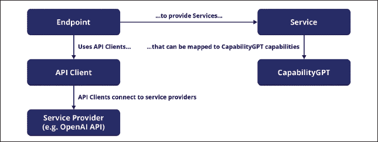

**图 9.1](c09.xhtml_fig9_1)：`predictive-powers`库的核心组件及其关系

### API 客户端

API 客户端是`predictive-powers`库的最低级组件，便于向服务提供者进行直接 API 调用。例如，开发者可能会选择通过实例化`OpenAiClient`并随后调用其方法来直接访问`OpenAI` API。

API 客户端还提供了对 API 密钥（访问服务所需）的安全性访问，以及对临时服务器不可用场景（如请求洪水）的自动管理。

本质上，API 客户端为开发者提供了直接调用 API 的自由，并通提供样板代码实现了稳健且高效的开发。

考虑以下 API 客户端使用的示例；该代码实例化了一个`OpenAiClient`，然后使用它执行一个非常简单的提示（prompt）：

```java
import io.github.mzattera.predictivepowers.openai.client.OpenAiClient;
import io.github.mzattera.predictivepowers.openai.client.completions.CompletionsRequest;
import io.github.mzattera.predictivepowers.openai.client.completions.CompletionsResponse;

public class OpenAiClientExample {

    public static void main(String[] args) {

        // 从操作系统获取 API 密钥
        // 环境变量 OpenAiClient.OS_ENV_VAR_NAME
        try (OpenAiClient client = new OpenAiClient()) {

            // 完成句子；详情请参阅
            // https://platform.openai.com/docs/api-reference/completions
            CompletionsRequest req = CompletionsRequest.builder()
                .model("text-davinci-003")
                .maxTokens(50)
                .prompt("Alan Turing was")
                .build();

            CompletionsResponse resp = client.createCompletion(req);

            // 输出结果
            System.out.println(resp.getChoices().get(0).getText());

        } // 关闭客户端
    }
}
```

这将生成如下输出：

`一位英国数学家、计算机科学家、逻辑学家、密码破译分析学家、哲学家和理论生物学家，他对理论计算机科学和人工智能的发展产生了深远影响。`

### 端点与服务

端点（endpoint）是一个能力提供者，意味着它采用 API 客户端以服务的形式呈现不同的能力。

以下代码演示了`AiEndpoint`的创建，它为`OpenAI`和`Hugging Face`提供者提供了生成式 AI 能力访问⁴：

```java
// 构建一个 Hugging Face 端点。
// API 密钥从操作系统环境变量获取
AiEndpoint endpoint = new HuggingFaceEndpoint();

// 从现有的 API 客户端构建 OpenAI 端点
OpenAiClient cli = new OpenAiClient();
AiEndpoint endpoint = new OpenAiEndpoint(cli);
```

一旦创建了端点，它就可以实现服务的访问。这些是高级生成式 AI 能力，类似于`CapabilityGPT`框架中描述的能力。当前的服务包括：

- `ModelService`：提供对模型元数据的访问，例如模型列表、模型上下文大小等
- `CompletionService`：通过执行提供的文本提示执行补全。这是最灵活的服务，正如我们在第 5 章中讨论的，我们可以通过提供正确的提示来指示执行不同的任务。通过合理的指令，该服务可以提供**评估**、**分类**、**创建**、**信息提取**、**匹配**、**摘要**等。
- `Chat`：处理用户与智能体之间的对话，管理智能体的个性和对话历史。这对应于**通信**能力。同样注意`ChatService`可以提供`CompletionService`暴露的所有能力，因为提示执行可以被看作是单次交换的对话，用户通过提供提示开始对话，智能体对其做出，从而执行它。
- `EmbeddingService`：提供文本嵌入²和相似性计算功能，这对于为`CapabilityGPT`框架提供**语义搜索**能力至关重要。
- `QuestionAnsweringService`：通过使用用户上下文回答问题，直接映射到`CapabilityGPT`框架的**问答**能力。
- `QuestionExtractionService`：从文本中提取不同类型的问题（例如，判断题、多项选择题等）。这是**信息提取**（Information Extraction）能力的示例。
- `ImageGenerationService`：使用`OpenAI`(DALL-E 3⁵) 或`Hugging Face`(Openjourney⁶) 生成图像。这是**创建**（Creation）能力的另一个示例。
- `SearchService`：搜索搜索数据。这是一个可以作为代理构建组件的外部工具⁷。

下面的示例展示了如何使用`CompletionService`完成句子。在创建端点后，代码从其获取`CompletionService`实例并用于完成简单的提示（prompt）。注意服务抽象如何允许通过修改一行代码来更改服务提供商（`OpenAI`或`Hugging Face`）：

```java
import io.github.mzattera.predictivepowers.AiEndpoint;
import io.github.mzattera.predictivepowers.huggingface.endpoint.HuggingFaceEndpoint;
import io.github.mzattera.predictivepowers.openai.endpoint.OpenAiEndpoint;
import io.github.mzattera.predictivepowers.services.CompletionService;

public class CompletionExample {

    public static void main(String[] args) throws Exception {

        // 取消下面注释以使用 OpenAI
        AiEndpoint endpoint = new OpenAiEndpoint();

        // 取消下面注释以使用 Hugging Face
        // AiEndpoint endpoint = new HuggingFaceEndpoint();

        try (endpoint) {

            CompletionService cs = endpoint.getCompletionService();
            System.out.println(cs.complete(“Alan Turing was”).getText());

        }
    }
}
```


### 知识库

在`predictive-powers`库的上下文中，知识库是一个存储文本嵌入的内存向量数据库⁸。每个嵌入都可以拥有一个封装为`Map`的属性数组。知识库提供了基于嵌入相似性和其他过滤标准的语义搜索方法。它可以被划分为不同的领域，以允许单独搜索并优化性能。

## `predictive-powers` 用例

在本节中，我们将引导你实现一个名为“文章作家”（Essay Writer，简称`Writer`）的自主代理，其目标是生成关于不同主题的文章。`Writer`设计用于接收文章内容的短文本描述，在网上搜索相关信息，下载并整理这些信息，最后生成完整的文章。

我们将提供代码段来演示如何利用 CapabilityGPT 框架的能力来构建代理。代理的完整代码可以参考`predictive-powers`的 GitHub 仓库。

### 架构

本节详细解释了实现`Writer`所采用的架构，使用了三层方法，这种方法在第 4 章⁹中应该是大家所熟悉的。该架构设计具有可扩展性，允许其处理更复杂的场景。然而，基础的分层方法将保持一致，利用`predictive-powers`服务为应用层和 AI 层创建模块化架构。

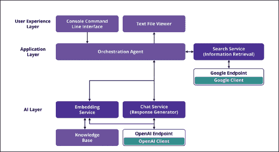

#### 用户体验层

在我们的示例中，为了保持简单，用户将仅通过计算机控制与`Writer`交互。`Writer`可以带有各种命令行选项启动，以执行文章写作任务中的不同步骤（详情请参阅完整的应用程序代码）。生成的输出将由 JSON¹⁰ 和文本文件组成，可以使用任何文本查看器进行检查。

#### 应用层

在应用层，编排代理通过执行相应的应用流并正确协调不同的`predictive-powers`服务来响应用户命令。在本章的稍后部分，我们将深入探讨这些应用流的详细描述。

此外，还存在信息检索组件。它负责在网上搜索用于创建文章的相关内容：

- `SearchService`

#### AI 层

AI 层是实现 CapabilityGPT 能力并将其暴露为`predictive-powers`服务的地方。在这里，`ChatService`生成所需的内容。

- `EmbeddingService`：该服务用于嵌入从网上下载的内容。
- `OpenAiEndpoint`：该端点连接到 OpenAI 模型¹¹。
- `KnowledgeBase`：它是用户 PC 上的单个文件，允许用户在不重新下载网页的情况下重新生成文章。需要注意的是，两层的服务都独立于所使用的端点。这种抽象确保了应用层与服务提供商提供的特定实现解耦。在开发过程中，这意味着软件工程师可以轻松测试不同的服务提供商和语言模型，以决定哪一个更适合正在构建的解决方案。

### 工作流

工作流图如图 9.3 所示，说明了将用户的文章草稿转换为`Writer`最终文章的步骤：

1. 用户提供文章内容的文本描述。
2. `Writer`生成文章结构（章节和小节）作为 JSON 文件。
3. `Writer`生成 Google 查询语句，以搜索填充文章每个章节的信息。
4. `Writer`然后执行每个查询，并汇总 Google 搜索引擎返回的相关网页链接列表。
5. `Writer`下载每个链接的内容并创建相应的嵌入，存储在`KnowledgeBase`中。
6. 对于文章的每个章节，`Writer`使用语义搜索从知识库中检索相关信息。
7. 最后，`Writer`使用这些信息生成文章的每个章节，形成单个文本文件输出。

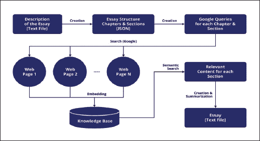

`写一篇关于意大利城市帕多瓦的文章。`

`第一章描述了该城市的地理位置和人口统计、经济状况，以及从史前时期到现代的历史。`

`此外，设立一个章节专门介绍居住在帕多瓦的名人。`

`第二章侧重于传统和民俗，包括传统活动和节日、美食美酒以及其他相关话题。`

`最后一章是著名景点的汇编，每个景点都有一个单独的章节，描述了感兴趣的地方和游客的体验。`

需要注意的是，作者（`Writer`）将文章理解为由分为节的章节组成。虽然可以使用更复杂的结构，但为了简单起见，我们将关注这种格式。文章结构最初使用`ChatGPT`的生成能力生成，根据提供的描述创建章节和章节。生成的结构以 JSON 格式保存，以便后续处理。以下是一个结构示例：

```json
{
  "title": "我的文章",
  "description": "写一篇关于意大利城市帕多瓦的文章。\n\n 第一章描述了该城市的地理位置和人口统计、经济状况，以及从史前时期到现代的历史。\n\n 此外，设立一个章节专门介绍居住在帕多瓦的名人。\n\n 第二章侧重于传统和民俗，包括传统活动和节日、美食美酒以及其他相关话题。\n\n 最后一章是著名景点的汇编，每个景点都有一个单独的章节，描述了感兴趣的地方和游客的体验。\n",
  "chapters": [
    {
      "id": "1",
      "title": "地理与人口统计",
      "summary": "这一章提供了帕多瓦市地理和人口统计的概述。它探索了城市的地理、气候和自然特征。此外，它深入研究了人口统计，包括民族组成、年龄分布和随时间的人口增长。",
      "sections": [
        {
          "id": "1.1",
          "title": "经济",
          "summary": "本节探讨了帕多瓦的经济方面，包括其主要产业、贸易和经济发展。它强调了该市作为经济枢纽的地位，并讨论了驱动其经济的关键部门。"
        },
        {
          "id": "1.2",
          "title": "历史",
          "summary": "本节追溯了帕多瓦从史前起源到现代的历史。它涵盖了随着时间的推移塑造城市身份的重大历史事件、统治者和文化发展。"
        }
      ]
    }
  ]
}
```

注意`ChatGPT`如何增强对每个章节的描述，提供更详尽的内容摘要。在“著名景点”章节中，得益于`ChatGPT`的能力，会自动添加景点而无需预先列出。

```json
{
  "id": "3",
  "title": "著名景点",
  "summary": "这一章作为帕多瓦著名景点的指南，突出了该城市的建筑、历史和文化地标。每个章节都关注特定的景点，提供详细的描述并捕捉游客的体验。",
  "sections": [
    {
      "id": "3.1",
      "title": "圣安东尼奥大圣教堂"
    },
    {
      "id": "3.2",
      "title": "瓦莱广场"
    },
    {
      "id": "3.3",
      "title": "理智大宫"
    },
    {
      "id": "3.4",
      "title": "斯克罗威尼教堂"
    }
  ]
}
```

文章结构确定后，作者需要向其填充相关信息。我们并不仅仅依赖模型的隐式知识，而是希望从互联网获取更新后的相关信息。为了实现这一点，我们使用`ChatGPT`的文本生成能力为每个章节生成 Google 搜索。这为每个章节生成了一个简短的 Google 查询列表。

下一步涉及利用我们框架的不同功能：`Search`。文章作者使用这些生成的 Google 查询来查询搜索引擎并收集一组相关的网页链接。

一旦确定了相关的网页，它们将被下载并存储在数据库中进行语义搜索。语义搜索允许作者在数据库中搜索与给定章节摘要语义相似的文本，从而检索编写该章节所需的文档。为了启用语义搜索，下载的页面将以称为“嵌入”（embedding）的特殊方式进行编码；这种编码提供了文本的数值表示，便于 AI 处理。

`predictive-powers`库提供了下载网页内容、执行嵌入并将数据存储在内存数据库（`KnowledgeBase`）中的高级方法，该数据库作为库的一部分提供可用。

在下载、嵌入和存储相关网页后，作者采用语义搜索为文章的每个章节获取上下文相关的内容。这些上下文片段被称为每个章节的`context`（上下文），是生成章节实际内容的基础。`ChatGPT`利用其`Summarization`（摘要）和`Generation`（生成）能力根据提供的上下文创建章节内容。

通过遵循这一工作流，作者能够自主生成一篇结合了网络最新信息的文章，产生详尽且经过充分研究的最终输出。

## 代码流程详解

在本节中，我们将阐述在前述章节中概述的应用程序工作流，并提供各种任务的代码片段。如果您想深入研究作者的完整代码，可以在`predictive-powers` GitHub 仓库中随时访问。

请注意，为了效率，作者是一个多线程应用程序。`parallelExecution()`方法管理多个任务的并行执行，并将所有结果编译成单个`List`。在本章中，我们将展示各种任务的代码片段，而不会重点关注多任务处理所需的结构。

`Essay`类是作者用于维护文章结构的内部类。它提供了几个方法，便于以组织的方式获取其良好的内容。作者在其`essay`字段中包含一个`Essay`实例；随着程序的执行，该实例将逐渐被填充数据。

```java
public void createStructure() throws JsonProcessingException {
  String description = essay.description;
  [...]
  // 实例化一个创建文章结构的服务
  OpenAiChatService chatSvc = openAi.getChatService();
```

```java
  chatSvc.setModel(COMPLETION_MODEL);
  chatSvc.setTemperature(40.0);
  // 设置代理人格，指示其返回 JSON
  // 并提供一个示例
  chatSvc.setPersonality(
    "你是一个帮助作家创建文章结构的助手。文章结构由一个章节数组组成，每个章节包含一个章节数组。请始终使用此 JSON 格式返回结构；以下是该格式的示例:\n"
    + "\n"
    + "{\n"
    + " \"chapters\": [{\n"
    + "  \"title\": \"第一章标题\",\n"
    + "  \"summary\": \"第一章摘要。\",\n"
    + "  \"sections\": [{\n"
    + "     \"title\": \"第一章第一节标题\",\n"
    + "     \"summary\": \"该节的摘要\"\n"
    + "  },{\n"
    + "     \"title\": \"第一章第二节标题\",\n"
    + "     \"summary\": \"该节的摘要\"\n"
    + "  }]\n"
    + " }, {\n"
    + "  \"title\": \"第二章标题\",\n"
    + "  \"summary\": \"第二章摘要。\",\n"
    + "  \"sections\": [{\n"
    + "     \"title\": \"第二章第一节标题\",\n"
    + "     \"summary\": \"该节的摘要\"\n"
    + "  }, {\n"
    + "     \"title\": \"第二章第二节标题\",\n"
    + "     \"summary\": \"该节的摘要\"\n"
    + "    }]\n"
    + " }]\n"
    + "}\n"
    + "\n"
    + "确保章节不会嵌套在其他章节中。标题不应包含章节编号或'章'、'节'字样。");

  // 调用代理创建结构，
  // 使用描述中的草稿
  TextCompletion resp = chatSvc.complete(
    "你的任务是根据提供的描述创建书籍结构。书籍应由几个章节组成，每个章节包含一个标题、一个摘要和一个章节列表。每个章节都应该有一个标题和一个摘要。确保小节之间不要相互嵌套。\n"
    + "\n"
    + "如果可能，尝试让章节和章节的摘要长度至少在 100 字以上，以为书籍大纲提供充实的内容。\n"
    + "\n"
    + "逐步思考并列出所有章节及其包含的节节。使用 JSON 格式返回结果。\n"
    + "\n"
    + "用户描述: " + description
  );

  // 将返回的 JSON 转换为文章
  // 然后将其复制到本地实例。
  Essay created = JSON_MAPPER.readValue(resp.getText(), Essay.class);
  essay.chapters = new ArrayList<>(created.chapters);
  [...]
}
```

在创建结构之后，将从互联网获取撰写文章的相关数据。以下代码段返回一个`SearchResult`实例列表（网页链接），这些内容可用于构建给定的章节。这些链接以`Pair`结构的形式返回，并附带由 Google 确定的相应排名。

此代码还说明了库的另一个功能：创建提示词模板的能力，即参数化提示词。提示词参数通过在模板中使用双大括号括起来来指示。在运行时，这些占位符将被替换为传递`CompletionService.fillSlots()`方法的`Map`中具有相同键的值。例如，在下面的代码中，字符串`{{chapter_summary}}`被替换为`params` `Map`中`chapter_summary`键关联的值：

```java
public List<Pair<SearchResult, Integer>>
google(Section chapter, Section section)
{
  // 首先根据我们想要搜索的内容，
  // 创建一个搜索查询列表，
  // 实例化模型以创建 Google 搜索
  OpenAiChatService chatSvc = openAi.getChatService();
  chatSvc.setModel(COMPLETION_MODEL);
  chatSvc.setTemperature(50.0);

  // 动态构建提示词
  final String prompt =
    "根据下方由 XML 标签提供的章节摘要、小节标题和小节摘要，生成一个可以用于...的搜索引擎查询列表"
```

成功完成后，嵌入将存储在知识库中，为写作过程的开始铺平道路。以下代码片段概述了如何编写单个章节。

通过检查代码，读者可以看到如何使用`KnowledgeBase`的`search()`方法，通过传递章节摘要的嵌入版本来执行语义搜索：

```java
private List<Section> write(Section section) {
    // 实例化服务
    EmbeddingService embSvc = openAi.getEmbeddingService();
    OpenAiChatService chatSvc = openAi.getChatService();
    chatSvc.setModel(WRITER_MODEL);
    chatSvc.setTemperature(0.0);

    String prompt =
      "<context>{{context}}</context>\n\n"
      + "<summary>{{summary}}</summary>";

    Map<String, String> params = new HashMap<>();
    params.put("summary", section.summary);

    // 这是用于创建章节的 prompt
    List<ChatMessage> msgs = new ArrayList<>();
    msgs.add(new ChatMessage(Role.SYSTEM,
      "你将获得一个上下文和一个文章章节的摘要，它们都由 XML 标签界定。"
      + " 你的任务是使用上下文的内容来编写整个文章章节。"
      + " 使用专业的风格。避免内容重复，但要详尽。"
      + "仅输出章节内容，不要输出标题，不要创建子章节。"
      + " 不要编造缺失的信息，或为你不拥的数据设置占位符。"
      + "仅当内容中有足够信息时，生成的文本长度至少为 "
      + SECTION_LENGTH_TOKENS + " 个 token。\n\n"));

    [...]

    // 在知识库中搜索相关内容 // (= 构建上下文)
    List<Pair<EmbeddedText, Double>> knowledge = kb.search(embSvc.embed(section.summary).get(0), 50, 0);

    // 这里需要一些代码来提取
    // 符合模型 prompt 尺寸的上下文。
    // 为了简单起见，此处省略。
    [...]

    // 将生成的内容添加到章节
    section.content = chatSvc.complete(msgs).getText();
    [...]

    return section.sections; // 并没有真正使用
}
```


# 结论

本章对`predictive-powers`库及其为 Java 开发者利用生成式 AI 能力的能力进行了全面概述。重点在于介绍了一种利用生成式 AI 能力的真实世界方法。

`predictive-powers`库为 Java 开发者和 AI 爱好者同样提供了独特的优势。它不仅简化了生成式 AI 能力的集成，还提供了对`OpenAI`和`Hugging Face`等流行 API 的底层访问。这种灵活性允许开发者根据需要直接与这些 API 交互。此外，该库的设计与`CapabilityGPT`框架一致，确保了与不同能力提供者的兼容性，降低了供应商锁定的风险。此外，其内存向量数据库支持语义搜索、信息提取和问答等核心功能。最后，它便于了从各种来源（包括网页和 MS Office、PDF、HTML 等各种文件格式）方便地检索文本内容。这些特性使得`predictive-powers`库成为在 Java 应用中利用生成式 AI 能力的价值工具，同时发挥了 Java 应用特有的灵活性、兼容性和易用性。

我们深入探讨了该库的技术方面，详细介绍了核心概念，如 API 客户端、端点和服务，以及知识库。我们学习了它们在更广泛的框架中的角色和功能，并对它们的底层机制有了深入了解。

本章的亮点之一是一个实用示例：创建一个名为“文章作家”的自主智能体。这作为一个具体的说明，展示了如何在真实项目中利用`predictive-powers`库及其不同特性。

# 关键点

在本章结束时，读者应该熟悉以下内容：

*   **`predictive-powers`库**：一个基于 Apache-2.0 许可的库，为 Java 开发者利用生成式 AI 提供了一个简化而强大的接口。
*   **API 客户端 (API clients)**：`predictive-powers`库的基础单元，有助于直接向如`OpenAI`和`Hugging Face`等服务提供商发起直接 API 调用。
*   **端点和服务 (Endpoints and services)**：利用 API 客户端提供服务的层级生成式 AI 组件。读者应该了解所提供的服务，例如`ModelService`、`CompletionService`、`ChatService`、`EmbeddingService`等。
*   **`KnowledgeBase`**：一种内存向量数据库，对于语义搜索、信息提取和问答等能力至关重要。
*   **自主智能体的实现**：本章引导读者创建一个“文章作家”，演示了所学概念的实际应用。它展示了如何轻松组合库组件，利用`CapabilityGPT`框架、提示词工程（prompt engineering）技术以及书中其他部分介绍的架构模式，创建一个能够执行复杂任务的智能体。
*   **架构模式 (Architecture pattern)**：理解架构模式和在代码中进行导航是学习过程的关键组成部分。读者应该熟悉三层架构：用户体验层、应用层和 AI 层，并理解如何使用`predictive-powers`库中的组件来实现这些层级。
*   **代码导航 (Code navigation)**：理解“代码走读”（Code Walkthrough）部分中提供的代码片段及其原理，将帮助读者将这些概念应用到自己的项目中。

---

[¹] *生成式 AI (Generative AI)* 指专门用于生成新内容的人工智能分支，范围涵盖从文本、图像到音频和视频的内容，基于从现有数据源中汲取的模式和信息。`OpenAI`的 GPT 系列是这种 AI 的代表。在本章中，“生成式 AI”一词的使用频率将比“GPT”更高，以保持关注更广泛的技术类别，强调`predictive-powers`库的通用性，它并不局限于使用 GPT。

[²] 正如在*[第 8 章 LangChain: Python 的 GPT 实现框架]*中提到的*嵌入 (embeddings)* 是文本的数值表示，使机器能够理解和处理自然语言。它们将单词或短语转换为列表，语义相似的项目具有相似的值。在*语义搜索*中，这允许系统根据语义相似性而非关键词匹配来匹配用户查询和相关文档。通过使用嵌入，系统可以理解细微差别并提高搜索结果的相关性，提供更有效的搜索体验。

[³] 内存向量数据库利用系统内存（RAM）存储数据，这提供了极速数据检索和处理的优势。然而，这受到内存大小的限制，使其不适合处理极大数据。

[⁴] 正如我们之后看到的，还有其他端点提供不同的功能，例如暴露了访问网络搜索服务的`SearchEndpoint`。

[⁸] 知识库类似于 LangChain 中的向量存储（vector stores）。请参见第 8 章：LangChain：Python 的 GPT 实现框架。

[⁹] 请参考第 4 章：GPT 模型赋能的架构模式，并将此架构与“D2 编排代理”架构模式进行比较。

[¹⁰] JSON 全称为 JavaScript 对象表示，是一种以组织化、易于访问的方式存储信息的方法。简而言之，它为我们提供了一个人类可读的文本数据集，我们可以以逻辑的方式对其访问。它被广泛应用于许多数字和服务产品中，帮助系统和服务器高效、快速地共享数据。尽管它的名称包含“JavaScript”，但它也可以用于 JavaScript 之外的许多编程环境。

[¹¹] [`platform.openai.com/docs/models`](https://platform.openai.com/docs/models)（特别是用于聊天服务的`gpt-3.5-turbo`和用于嵌入的`text-embedding-ada-002`）。

# 附录 A：提示工程应用的的进一步探索

## 引言

在第 5 章：高级 GPT 提示工程技巧的基础上，对高级提示工程技术的探索展示了我们三种提示模式——指令、查询和多代理——的 12 个示例，而本附录引入了另外 11 个额外示例。这些示例旨在加深对使用 ChatGPT-4 时提示模式的理解，并重点介绍更广泛的实际企业场景。

在“单指令示例”下，我们深入探讨了“资源管理”、“基于场景的项目模拟”和“业务通信”等用例，每个用例都为指令提示模式的应用提供了全新的视角。“指令序列示例”和“伪代码指令示例”则分别通过“保险理赔处理”、“解决方案架构分析”和“房产列表比较”等真实场景，进一步揭示了顺序和逻辑任务管理的复杂性。

随后我们进入“查询示例”，在其中，ChatGPT-4 应对复杂的安全法规，深入探讨假设的人力资源场景，并利用模糊逻辑评估供应可能性，结合了分析能力和解释性能力。

最后，“多代理示例”部分涵盖了 ChatGPT-4 在多代理设置下运行的实例，处理环保摩托车设计模拟并对原材料进行详细研究，从而反映了 ChatGPT-4 使用某些插件的协作和探索特性。

当你穿过这些额外示例时，目标仍然是加深对提示工程技术的理解，展示 ChatGPT-4 在处理各种实际企业场景时的灵活性。通过这些多样化的场景，本附录力求进一步使你具备所需的细腻知识和技能，以便有效利用 ChatGPT-4 驱动企业环境内的创新和运营卓越。

## 结构

在本章中，将涵盖以下额外的提示词案例研究：

*   单指令示例
    *   资源管理
    *   基于场景的项目模拟
    *   业务通信
*   指令序列示例：
    *   保险理赔处理
    *   解决方案架构分析
*   伪代码指令示例：
    *   房产列表比较
*   查询示例：
    *   安全规章查询
    *   人力资源管理中的反事实探索
    *   供应可能性估计
*   多代理示例：
    *   环保摩托车设计模拟
    *   原材料研究

## 单指令示例

这些示例包含了资源管理模拟，其中 ChatGPT-4 充当资源经理，将技能与项目任务对齐；一个基于场景的项目模拟，它在挑战中预测项目阶段；以及一个碳会计领域的业务通信示例，总结了行业关键增长和挑战。

## 资源管理

这是一个来自项目资源管理领域的示例。以下提示词基于第 2 章 CapabilityGPT：一种适用于 ChatGPT 的企业 AI 能力框架中引入框架的“匹配”能力：

*   **专家角色**：“你是一个擅长为项目分配资源的资源经理”
*   **背景**：
    *   **项目**：
        *   “开发客户流失预测机器学习模型：任务包括数据清洗和预处理、探索性数据分析、特征工程和选择、构建和训练机器学习模型、模型验证和评估、向利益相关者展示模型结果，以及与软件工程团队协作部署模型。”
    *   **资源**：
        *   `Person_1`：3 年以上数据清洗和预处理经验，精通`Python`、`Pandas`和`SQL`，具有使用`Matplotlib`和`Seaborn`等工具的数据可视化技能。
        *   `Person_2`：4 年以上机器学习经验，擅长使用`Scikit-learn`或`TensorFlow`构建和训练模型，理解模型评估指标，精通`Python`。
        *   `Person_3`：2 年以上数据分析和演示经验，专长探索性数据分析和特征工程，具有强大的沟通能力，能向利益相关者展示复杂结果，精通`Python`和`Tableau`。
*   **指令**：“根据技能和项目要求为项目分配资源（匹配）”
*   **执行规则**：“考虑每个资源的技能和每个项目的要求”
*   **输出限制**：“输出应是一个带有已分配资源的项目列表”

ChatGPT-4 对此提示词生成的响应如下：

*根据项目和资源的详情，我们可以将资源分配到项目的不同任务中如下：*

*项目：开发客户流失预测机器学习模型*

1.  数据清洗和预处理：此任务涉及清理数据、处理缺失值、离群值以及数据中的任何不一致之处。根据要求，我们将`Person_1`分配到此任务，因为他们有 3 年以上的数据清洗和预处理经验，并精通`Python`、`Pandas`和`SQL`，这些都是执行此任务的理想工具。
2.  探索性数据分析：这涉及深入挖掘数据集、发现相关性并对数据进行可视化以更好地理解。该任务最适合`Person_3`，他们有 2 年以上的数据分析经验，并精通`Python`和`Tableau`（一种数据可视化工具）。
3.  特征工程和选择：这是从数据集中选择对预测模型有贡献的相关特征的过程。考虑到`Person_3`在特征工程方面的专业知识，他们将是此任务的最佳人选。
4.  构建和训练机器学习模型：此任务需要对机器学习算法和模型训练有深入的理解。因此，拥有 4 年以上机器学习经验并擅长使用`Scikit-learn`或`TensorFlow`构建和训练模型的`Person_2`将处理此任务。
5.  模型验证和评估：这需要对各种模型评估指标有可靠的理解。鉴于`Person_2`对这些指标的理解，他们也将负责此任务。
6.  向利益相关者展示模型结果：此任务涉及以清晰、简洁的方式向利益相关者汇报模型结果。鉴于`Person_3`强大的沟通能力，他们将负责这项任务。
7.  与软件工程团队协作进行模型部署：这项可以由`Person_1`、`Person_2`和`Person_3`共同处理，因为它需要数据处理（`Person_1`）、模型构建（`Person_2`）和演示（`Person_3`）的技能。

在资源管理模拟中，`ChatGPT-4`充当资源协调员，根据技能和专业知识将资源与任务匹配。根据指令，它制定了分配计划，将资源与适当的任务有效对接。然而，通过利用`Person_2`在`Feature Engineering`方面的机器学习知识，项目策略可以进一步优化，提高成功的概率。

# 基于场景的项目模拟

这是项目管理领域的另一个示例。接下来的提示词取决于`Simulation`能力：

**专家角色**：你是一个经验丰富的项目经理。

**背景**：这是你当前的项目：

**项目描述**：EduRevolution 项目旨在开发并推出一款创新的移动学习应用程序，旨在打破传统教育体系。该应用程序将允许所有年龄和水平的学习者访问各种教育资源，包括互动课程、多媒体内容、定制化学习计划、游戏化测验和协作学习空间。该应用程序旨在促进主动学习，鼓励持续评估，并培养学习者之间的社区感。

**这些阶段已完成**：

**第 1 阶段：概念化与需求收集**：在此阶段，我们收集了业务需求，定义了应用程序的概念及其关键功能，并概述了用户画像。进行了详细的市场分析，以了解行业格局并识别潜在机会。

**第 2 阶段：设计**：在此阶段，我们致力于应用程序的用户体验 (UX) 和用户界面 (UI) 设计。该过程包括创建应用程序的线线框图、原型和最终设计，确保应用程序用户友好、视觉美观且易于导航。

**第 3 阶段：开发**：在此阶段完成了应用程序的编码和集成。我们采用了敏捷开发方法（包括冲刺和每日站）来迭代开发应用，允许根据用户反馈和测试需要进行更改。核心功能已完成开发并与现有系统集成。

**第 4 阶段：测试**：在这里，我们进行了彻底的测试阶段，涵盖了单元测试、系统测试和用户验收测试 (UAT)。识别了潜在的 Bug 和性能问题，并根据严重程度进行了分类。虽然所有主要 Bug 都已修复，但仍然存在一些中小型 Bug，需要各种变通方法才能正确使用应用。

**指令**：根据目前获得的结果，对接两个阶段进行模拟：生产准备以及上线及上护支持（Go-live & Hypercare）。

**执行规则**：区分三种情况：最好情况、平均情况和最坏情况。

`ChatGPT-4`对此提示生成了以下响应：

## 第 5 阶段：生产准备

**最佳情况**：

在最佳情况下，向生产环境的过渡非常顺利。剩余的微级 Bug 被迅速解决，不影响发布日期。应用程序在生产环境中的性能与测试环境一致，表明已准备好上线阶段。团队已为部署做了充分准备，创建了详尽的文档，并培训了所有利益相关者使用应用程序以及解决常见问题。

**平均情况**：

在平均情况下，即使在初步修复后，仍然存在一些中小型 Bug，需要额外的开发时间并稍稍推迟发布日期。应用程序在经过一些微调后在生产环境中的表现令人满意。团队已大部分完成所需的文档和培训，但一些最后添加的内容仍在定稿中。

**最坏情况**：

在最坏情况下，修复剩余 Bug 被证明比预期更复杂，揭示了代码库中深层次的问题，并导致严重延迟。应用程序在生产环境中的性能不稳定，需要花费大量精力和时间进行诊断解决。尽管尝试加速流程，但文档不完整，且利益相关者的培训不足。

## 第 6 阶段：上线及上护支持（Hypercare）

**最佳情况**：

在最佳情况下，上线阶段按计划进行，没有出现重大故障。用户采纳度很高，反馈非常积极。上护支持团队迅速解决了微小问题，扰扰降至最低。由于应用程序的稳定性，上护期比计划短，并随着成功移交给运营支持团队而结束。

**平均情况**：

在平均情况下，上线阶段遇到小插曲，例如发布速度比预期慢，导致初始用户群略有减少。反馈不一，用户赞扬应用程序的功能，但也报告了几个可用性问题。上护支持团队忙于处理这些问题，上护期延长到预期的最长时间。

**最坏情况**：

在最坏情况下，上线阶段经历了严重问题。技术问题影响了用户体验，导致负面反馈和用户群减少。应用程序稳定性低于预期，上护支持团队被问题淹没，需要将周期延长到最初计划的时间之外。高优先级 Bug 和系统稳定性问题需要紧急关注，可能导致回滚或临时暂停服务直到它们被修复。

在项目管理模拟中，`ChatGPT-4`担任经验经理，根据过去的数据和潜在挑战预测未来的项目阶段。在分析了最佳、平均和最坏情况后，它提供了一个全面的计划，详细说明了每种情况可能如何进展。这项分析形成了一个应急预案，确保对于任何结果都有有准备充分且稳健的方法。

# 业务沟通

这个最后的单指令示例探索了碳核算行业内的业务沟通和总结技能。以下是提示词：

**专家角色**：你是一个业务沟通专家。

# 背景
*“碳会计行业正经历激增，因为政府机构、投资者和消费者日益寻求企业温室气体排放的详细报告。尽管对数据的准确性存在怀疑，但这种增长趋势仍在持续。根据数据公司 PitchBook 的数据，碳会计公司获得的风险投资资金从 2020 年的 6000 万美元飙升到 2022 年的 7670 万美元。这一上升趋势持续到 2023 年，风险投资人目前已向该领域投入了 3.33 亿美元。这股投资热潮源于企业对预计明年在欧洲和美国实施的复杂披露指令的预期。此外，还面临投资者和消费者要求企业展示环保意识形象的压力。标准的启动始于 6 月，当时国际可持续发展准则委员会（ISSB）发布了计算整个供应链排放情况的指南。在 ISSB 于 12 月宣布企业将获得额外的一年时间报告整个价值链的排放后，这些标准被证明比最初预计的要宽松。尽管如此，标准的实施正成为许多企业开展更全面水平追踪的催化剂。”*

# 指令
总结本文

## 输出限制
摘要长度不应超过 3 句话。

## 执行规则
1. 严格遵循“发生了什么以及为什么？”的结构。
2. 如果没有提到原因，请使用假设。

# 引用案例
使用以下三个总结示例作为指导：

### 输入-输出案例 1：总结会议纪要
**输入**：“在 2023 年 4 月 5 日举行的季度会议上，团队讨论了第一季度销售额与去年第四季度相比下降 20%的情况。营销部门提议了一项新的全国性广告活动，预算增加了 50,000 美元，以提高品牌知名度。产品开发团队报告了新的‘绿色科技’产品线的进展，但指出由于海外合作伙伴的供应链问题，可能会延迟长达两个月。财务部门对营销预算的增加以及由于产品线延迟可能导致第二季度利润下降表示了担忧。”*

**输出**：“发生了什么以及为什么：在 2023 年 4 月 5 日的季度会议上，会议讨论了第一季度销售额下降了 20%的问题，这可能是由市场竞争加剧所驱动的。营销部门提议开展全国性广告活动以提高知名度，而产品开发部门因供应链问题预测‘绿色科技’产品将延迟。财务部门对这些变化带来的预算和利润问题表示担忧。”

### 输入-输出案例 2：总结季度财务报告
**输入**：“在 2023 年第二季度，XYZ 公司报告总营收为 21 亿美元，与 2022 年第二季度相比下降了 5%。净利润率也收缩至 6%，低于上年的 9%。营收和利润的下降很大程度上归因于供应链中断以及由于全球经济形势导致的物流成本增加。”*

**输出**：“发生了什么以及为什么：在 2023 年第二季度，XYZ 公司的总营收较 2022 年第二季度下降了 5%，净利润率从 9%下降到 6%。这主要是由于与不利的全球经济形势相关的联供应链中断和物流成本增加导致的。”*

### 输入-输出案例 3：总结新产品发布的新稿
**输入**：“2023 年 6 月 15 日，ABC 科技发布了其创新产品‘SmartLens’，这是一种提供增强现实体验的 AI 驱动接触镜。该产品的发布是为了应对市场对沉浸式可穿戴技术日益增长的需求。‘SmartLens’预计将于 2023 年秋季上市。”*

**输出**：“发生了什么以及为什么：ABC 科技于 2023 年 6 月 15 日宣布了提供增强现实功能的 AI 驱动接触镜‘SmartLens’。此举是为了应对消费者对沉浸式可穿戴技术兴趣的增加。”

针对给定的提示，ChatGPT-4 生成了以下输出：

*发生了什么以及为什么：碳会计领域的风险投资资金激增，从 2020 年的 6000 万美元飙升到 2022 年的 7670 万美元，并在 2023 年继续吸引投资，尽管对数据准确性存在怀疑。这是由于政府、投资者和消费者对企业详细排放报告的需求不断增加，以及企业对欧洲和美国新排放披露指令的预期。国际可持续发展准则委员会发布的跨供应链排放计算指南已成为企业进行全面排放追踪的催化剂。*

在这一业务沟通示例中，ChatGPT-4 扮演专家总结者的角色，利用参考案例中展示的总结技术，提炼了关于碳会计行业增长和挑战的细节。它简洁地识别出尽管存在准确性担忧但风险投资资金有所上升，并将其与利益相关者的需求和预期的排放指令联系起来。该国际可持续发展准则委员会指南的作用也得到了强调，展示了 ChatGPT-4 从复杂上下文中提取关键信息的能力。

# 指令序列示例

深入两个多步骤处理场景，在这些场景中，ChatGPT-4 扮演理赔代表来处理汽车事故理赔，并扮演系统架构师来分析和优化给定的架构图。

# 保险理赔处理

ChatGPT-4 扮演理赔代表，通过三个步骤的流程处理汽车事故保险理赔，展示了在管理信息收集、数据压缩和初步维修成本估计方面的系统化方法。以下是展示的提示词：

**专家角色**：你是一家保险公司的理赔代表。

**背景**：我有以下关于车祸的基本信息：‘我那辆发生事故的车现在在路边’。

**指令序列**：执行以下三个步骤：

1. 首先，就损坏情况问我 10 个问题。每次只问一个问题，并在我回答之前不要问下一个。仔细提问具有信息量的问题，以最大限度地获取有关此损坏的信息，以便当你获得答案后，可以总结我的回答并估算维修损坏的成本。避免问是/否问题（沟通）。
2. 然后，总结我的回答。在收到你所有问题的回答之前，不要开始总结（总结）。
3. 最后，根据我对你所有问题的回答总结，评估损坏的成本（评估）。

ChatGPT-4 的输出如下，包含一段对话，其中相应的发言分别分配给 ChatGPT 和用户：

*ChatGPT: 感谢与我们联系。我将问您一系列问题，以更好地了解损坏程度。*

1. *您能描述一下事故后您汽车的整体状况吗？*
   *用户: 损毁严重，无法正常行驶。*
   *ChatGPT: 我明白了，很遗憾听到这个消息。*

2. *您能说明车辆的哪些区域受碰撞影响最大吗？*
   *用户: 右侧门、右侧窗和右侧翼子板*
   *ChatGPT: 我理解了。*

3. *汽车的轮子和悬挂受到事故影响了吗？如果是，情况如何？*
   *用户: 是的，右前轮也有轻微损坏。悬挂没有受损。*
   *ChatGPT: 已记录。*

4. *您能详细说明汽车外部漆面和车身目前的状况吗，特别是受碰撞直接影响的区域？*
   *用户：车门严重变形，门板也弯曲了。车翼只有轻微凹痕和几处划痕。*
   *ChatGPT：明白了。*

5. *事故是否导致车辆内饰（如座椅、仪表盘或电子系统）受损？*
   *用户：右侧座椅也有轻微凹痕。*
   *ChatGPT：我明白了。*

6. *事故中大灯、尾灯或其他任何外部灯光是否受损？*
   *用户：没有。*
   *ChatGPT：好的。*

7. *您能否描述一下发动机、变速箱或车辆其他主要机械部件是否存在任何潜在损坏？*
   *用户：据我所知，没有。*
   *ChatGPT：已记录。*

8. *除了您之前提到的右侧窗户，挡风玻璃或其他任何玻璃部件是否受损？*
   *用户：没有。*
   *ChatGPT：好的。*

9. *事故发生后您是否注意到任何液体泄漏（如机油或冷却液）？*
   *用户：没有。*
   *ChatGPT：好的。*

10. *最后，您能告诉我您的车辆品牌、型号和年份吗？这将有助于我估算维修所需的部件成本。*
    *用户：宝马 230i，2020 年。*

ChatGPT：感谢您提供所有必要信息。让我总结一下受损情况：

1. 由于损坏严重，车辆目前无法行驶。
2. 车辆受影响最严重的区域是右侧门、窗户和翼子。
3. 右前轮轻微损坏，但悬挂系统不受影响。
4. 外门板严重变形，右翼有轻微凹痕和划痕。
5. 车内右侧座椅有轻微凹痕。
6. 大灯、尾灯和其他外部灯光未受损。
7. 未报告发动机和变速箱等主要机械部件受损。
8. 右侧窗户外，挡风玻璃等其他玻璃部件均未损坏。
9. 事故后未报告液体泄漏。
10. 涉车辆为 2020 年款宝马 230i。

ChatGPT：根据这些信息，成本估算如下：

1. 车身修复：根据损坏程度，维修或更换门板和车翼的成本可能在 500 至 1500 美元之间。
2. 右前轮：宝马 230i 的新轮毂可能在 100 至 300 美元之间。
3. 右侧窗户：更换成本可能在 200 至 400 美元左右。
4. 内饰损坏（右侧座椅）：轻微凹痕的修复费用可能约为 100 至 200 美元。

请注意，这些仅是粗略估算，实际成本可能会根据人工成本、零件可用性以及我们对话中未察觉的任何隐藏损坏而更高或更低。建议由专业技师对车辆进行彻底检查，以获得更准确的估算。

在这种场景中，ChatGPT-4 扮演理赔代表的角色，通过三步流程处理汽车事故保险理赔。首先，它通过开放式问题尽力收集详细信息，涵盖了事故影响到车辆的所有区域。随后，它对收集的信息进行压缩，突出了受损的重大细节。最后，根据整合的信息，给出了维修成本的初步估算，并强调了进行专业评估以获得准确成本评估的必要性。这项练习展示了 ChatGPT-4 在管理对话时的条理方法，即后续问题取决于之前的回答，并根据所有回答得出结论。

# 解决方案架构分析

在这里，ChatGPT-4 充当系统架构师，分析并优化呈现的架构图。通过结构化的三步法，分析揭示了关键组件，识别了潜在瓶颈，并提供了可操作的建议。以下是指令序列提示词：

**专家角色**：你是分析和优化架构图的专家，特别是在软件或系统架构领域。

**背景**：附带架构图：

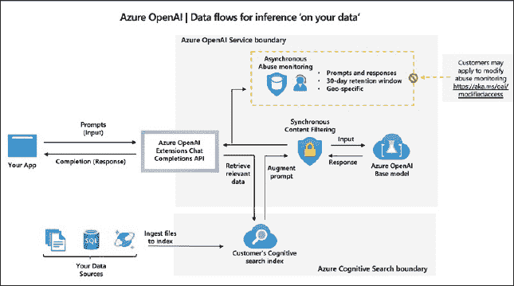

**图 A.1**：使用企业数据源的 Azure OpenAI 架构图 [14]

**指令序列**：按三个步骤分析并优化提供的架构：

1. 首先，从架构图中提取关键组件、连接、模式和可能的瓶颈。列出图中表示的工具、服务和流。。（信息提取）。
2. 第二，根据你的专业知识和从步骤 1 提取的信息，识别潜在的改进或优化区域。考虑效率、可扩展性、冗余和安全性等因素。建议可以增强架构有效性和韧性的更改或新增内容。（建议）。
3. 第三，起草一份初步项目计划，详细说明实施建议改进所需的步骤、时间表和资源。这应该包括改进事项的优先级、识别依赖关系、估计工作量并为成功实施建议里程碑。（规划）。

以下是 ChatGPT-4 对此提示词的响应：

## 步骤 1：信息提取

- **关键组件**：
    - `Your App`：代表用户交互的应用程序界面。
    - `Azure OpenAI Extensions Chat Completions API`：应用程序与 OpenAI 模型之间的中间件，处理用户输入并提供响应。
    - `Azure OpenAI Base model`：处理输入并生成响应的核心模型。
    - `Azure Cognitive Search`：对客户数据提供搜索功能。
    - `Your Data Sources`：存储和索引应用程序数据。
    - `Customer’s search index`：代表可以高效搜索的索引数据。
    - `Asynchronous Abuse monitoring`：监控提示和响应是否存在滥用行为。
    - `Synchronous Content Filtering`：作为实时内容过滤器。

- **连接与流**：
    - 用户与`Your App`交互，将其发送到`Azure OpenAI Extensions Chat Completions API`。
    - `Azure OpenAI Extensions Chat Completions API`增强提示并将其发送给`Azure OpenAI Base model`。
    - 基模型生成响应，然后发送回`Your App`。
    - 如果需要，基模型可以从`Customer’s search index`获取相关数据。
    - `Your Data Sources`将数据发送`Azure Cognitive Search`进行采集和索引，然后存储在`Customer’s search index`中。

- **可能的瓶颈**：
    - `Synchronous Content Filtering`的同步性可能会引入延迟。
    - 对`Customer’s search index`获取数据的依赖在索引未优化的情况下会导致延迟。
    - 架构依赖`Azure OpenAI Base model`的性能和可用性。

## 步骤 2：建议

- **潜在改进区域**：
    - 降低延迟：在`Azure OpenAI Extensions Chat Completions API`级别引入缓存机制，存储频繁的查询及其响应。这可以减少基模型的负载并加快响应。
    - 冗余：为`Azure OpenAI Base model`等关键组件实施冗余，以确保高可用性。
    - 增强安全性：对传输中的数据引入端到端加密，特别是在`Your App`和`Azure OpenAI Extensions Chat Completions API`之间。
    - 优化搜索索引：定期更新和优化`Customer’s search index`以确保高效的数据检索。
    - **监控与告警**：实施稳健的监控和告警机制，以便快速检测并修复任何系统异常。

## 第 3 ：规划

*   **项目计划：**
    *   **缓存实现（2 周）：**
        *   评估合适的缓存解决方案。
        *   将`caching mechanism`与`Azure OpenAI Extensions Chat Completions API`集成。
        *   测试性能改进。
    *   **基础模型冗余（4 周）：**
        *   评估可能的故障转移策略。
        *   设置`Azure OpenAI Base model`的备实例。
        *   实现并测试故障转移机制。
    *   **增强安全性（3 周）：**
        *   评估兼容 Azure 的加密解决方案。
        *   实施数据传输的端到端加密。
        *   进行安全审计以验证加密。
    *   **优化搜索索引（2 周）：**
        *   监控索引性能并识别低效之处。
        *   根据需要重新索引数据。
        *   实施定期优化。
    *   **监控与告警（3 周）：**
        *   评估兼容 Azure 的监控解决方案。
        *   实施系统级监控。
        *   为系统异常设置告警。
*   **里程碑：**
    *   第 2 周：成功实现缓存并观察到性能改进。
    *   第 6 周：基础模型冗余就绪并通过测试。
    *   第 9 周：建立并验证端到端加密。
    *   第 11 周：搜索索引已优化并记录性能提升。
    *   第 14 周：监控和告警机制投入运行。
*   **所需资源：**
    *   系统架构师 (1)
    *   后端开发人员 (2)
    *   安全专家 (1)
    *   数据库管理员 (1)

*注：时间表为初步方案，可能会根据特定需求和不可预见的挑战发生变化。应安排定期审查以评估进度并进行必要的调整。*

在这次深度解析中，ChatGPT-4 扮演资深解决方案架构师，仔细分析了围绕 Azure OpenAI 数据流的架构图。初始阶段涉及使用最近发布的视觉语言模型`GPT-4V(ision)`作为工具，仔细提取关键组件并理解它们的相互关系。然后，利用其专业知识，ChatGPT-4 指出了从减少延迟到增强安全性的各个改进领域。最后一步制定了一份结构化的项目计划，详细说明了实现建议优化的步骤、资源和时间表。

然而，需要注意的是，`GPT-4V`在处理具有重叠连接、垂直方向文本或图形元素水平/垂直对齐等特征的复杂图表时，仍然难以准确提取信息。

# 伪代码指令示例

在唯一的伪代码指令示例中，ChatGPT-4 根据评估标准对办公空间房源进行排名。

# 房地产房源比较

此示例使用伪代码指令为房地产房源建立一个排名系统。以下提示词引导 ChatGPT-4 应用`Ranking`能力来生成排序后的顶级选项列表：

**专家角色**：你是某公司的 CEO。

**背景信息**：你正在为你的团队寻找办公空间。以下是可用房源：

房源 1：3000 平英尺，市中心，配备停车场、洗手间和小厨房。靠近公共交通工具。

房源 2：2500 平英尺，位于中心位置，配备大布局、大窗户。靠近公共交通。

房源 3：4000 平英尺，市中心，配备开放式布局、会议室。方便进入高速公路。

房源 4：5000 平英尺，市中心联合办公空间，配备专用办公桌、24/7 开放。月租。

房源 5：5000 平英尺，市中心办公室，配备套房级设施。靠近高速公路。

房源 6：3000 平英尺，市中心综合体，配备现代设计、洗手间。人流量大。

房源 7：1500 平英尺，医疗综合体，配备检查室、接待区。医疗用途。

房源 8：1200 平英尺，市中心店面，配备陈列窗、大型停车场。可租租。

房源 9：5000 平英尺，市中心混合型/办公空间，配备现代内装修，底层用作仓库。

房源 10：2000 平英尺，市中心豪华零售空间，配备精美内装修、大陈列窗。小办公室。

房源 11：3500 平英尺，河边办公空间，拥有优美景色。包括私人房间、厨房区域。

房源 12：5000 平英尺，位于安静社区的郊区办公空间。配备私人办公室、充足停车位和花园。

**伪代码指令**：

对每个房源应用以下评分系统并根据分数对房源进行排名：

*   **尺寸**：尺寸在 3000-5000 平英尺之间的得 10 分，小于 3000 平英尺得 5 分，超过 5000 平英尺的得 7 分。
*   **价格**：创建一个从 $2000 到 $20000 的线性评分量表，其中 $2000 得 10 分，$20000 得 1 分。
*   **位置**：市中心位置得 10 分，中心地带和河边位置得 8 分，郊区位置得 6 分。
*   **设施**：基础设施如小厨房/洗手间得 2 分。停车场额外得 2 分。额外设施如健身中心/店内咖啡馆/安全性每项得 1 分。
*   **类型**：办公空间得 10 分，混合工业/办公空间得 8 分，联合办公空间得 5 分。指定为医疗或零售的空间得 3 分。

*注：假设房源 4（联合办公空间）针对整个团队的价格为 $25000，并为了评分起见，假设其尺寸为 5000 平英尺。对于房源 5，假设提到的价格是针对 5000 平英尺空间的。所有其他未说明的信息应解释为不适用，并在该类别中得 0 分。*

根据总分显示前 5 个房源，在表格中显示，名称格式为“房源 N：描述”、总分及各项子分。

| **排名** | **房源** | **总分** | **尺寸评分** | **价格评分** | **位置评分** | **设施评分** | **类型评分** |
| :--- | :--- | :--- | :--- | :--- | :--- | :--- | :--- |
| 1 | 房源 5：A 级办公空间 | 37 | 10 | 2 | 10 | 5 | 10 |
| 2 | 房源 6：市中心商业空间 | 35.5 | 10 | 3.5 | 10 | 2 | 10 |
| 3 | 房源 11：河边办公空间 | 35.125 | 10 | 3.125 | 8 | 4 | 10 |
| 4 | 房源 1：市中心办公空间 | 33.4 | 7 | 2.4 | 10 | 4 | 10 |
| 5 | 房源 9：仓库/办公空间 | 32.2 | 10 | 2.2 | 10 | 2 | 8 |

**表 A.1**

在此场景中，ChatGPT-4 扮演房地产专家的角色，负责根据详细的评估标准对办公空间房源进行排名。按照指令，它对每个房源严谨地应用了评分系统，仔细审查了尺寸、价格、位置、设施和物业类型等因素。通过根据指南对每个因素进行准确评估和评分，它成功识别并优先考虑了提供最佳价值的房源。过程以 ChatGPT-4 出一份精选的前五办公空间列表结束，展示了其在执行详细房地产评估方面的专业水平。

# 查询示例

探索三个查询场景，在这些场景中，ChatGPT-4 穿过安全法规、深入假设性的人力资源场景，并使用模糊逻辑评估供应可能性。

# 安全法规查询

让我们看看安全领域的第一个示例。该示例包含了关于个人防护装备（PPE）特定安全条例的详细证据，以及三个特定的信息寻求类问题：

**证据**：考虑以下关于个人防护装备（PPE）的特定安全条例：

*   安全帽：在制造车间内必须始终佩戴。安全帽应每五年更换一次，或在受到重大冲击后立即更换。
*   安全眼镜/护目镜：应始终佩戴安全眼镜或护目镜，以防止飞粒子、化学气体、蒸气或光辐射。它们应保持清洁且无划痕，适配良好以提供足够的保护。
*   听力保护：如果工作场所的噪音或声级水平超过健康安全法规规定的限制，工人应使用耳塞或耳罩。
*   呼吸保护：必要时，应使用呼吸器以防止吸入有害粉尘、蒸气、烟雾或气体。呼吸器必须定期进行检查、清洁和维护。
*   防护手套：在处理化学品、热材料或冷材料、锐利物体或其他手可能面临风险的其他情况下，必须佩戴手套。手套应采用合适的材料，以防止危险物质渗透，并定期更换。
*   安全鞋：在工厂车间内必须始终佩戴钢头靴或其他安全鞋，以防止掉落物伤害或地面尖利物品的刺穿。鞋子应保持清洁，并定期检查是否有过度磨损。
*   高能见服装：在叉车等低能见度区域应穿着高能见度服装，以确保工人能看到。
*   防护服：根据工作性质，可能需要防化学品围裙、工作服或全体防护服。

**1**。如果安全帽已使用两年，但刚刚受到了重大冲击，应该怎么办？

ChatGPT 的回答：根据提到的安全条例，安全帽在受到重大冲击后应立即更换，尽管该安全帽仅使用了两年。

**2**。如果员工的眼镜/护目镜产生划痕，应该采取什么措施？

ChatGPT 的回答：根据安全条例，安全眼镜或护目镜应保持清洁且无划痕，以提供足够的保护。如果它们产生划痕，则应更换。

**3**。如果在处理锐利物体时，防护手套出现了破洞，他们继续工作可以吗？

ChatGPT 的回答：根据安全条例，防护手套应防止危险物质或物体的渗透。如果出现了破洞，它们就不再提供必要的保护。因此，员工应该停止工作并通知其主管。

在此场景中，ChatGPT-4 担任安全法规专家，专注于查询提示词中列出的个人防护装备（PPE）细节。它不仅识别了它们的用途，还进一步分析了这些装备受损导致后果的因果关系，强烈强调了立即更换 PPE 以确保工人安全的必要性。

# 人力管理中的反事实探索

此场景让 ChatGPT-4 在 XYZ 公司的人力资源部门进行反事实分析，探索提前一年实施职业发展计划对离职率、成本、员工士气和雇主声誉的假设性结果。以下是使用反事实查询类型的提示词：

**证据：**

XYZ 公司是一家专门从事消费电子产品的知名制造公司，在上一财年经历了 15% 的显著离职率。这导致总共有 100 名员工（主要是技术工人和中层经理）离开了公司。离职面谈和员工反馈调查凸显了员工内部对缺乏职业晋升机会和专业发展支持不足的普遍不满情绪。

为了深入了解离职背后的原因，XYZ 公司进行了详细的内部审查，发现离职率最高的部门缺乏清晰的职业发展和技能培训路径。此外，公司观察到，这些部门的员工参与度和工作满意度明显低于组织内的其他部门。

**推理规则：**

*   *员工留存规则*：通过结构化的发展计划增强职业晋升机会可能会减少员工离职率。
*   *成本效益分析规则*：减少离职率带来的收益（如减少招聘和培训成本以及提高生产力）应大于实施和维护职业发展计划的成本。

GPT 模型应该通过考虑离职率的潜在降低，并估算招聘和培训成本降低带来的节省金额与新计划支出之间的对比，来为其结论提供理由。此外，它应该评估对员工士气、生产力以及公司在人才市场中声誉的潜在影响。

## 反事实查询：

“如果 XYZ 公司在去年初实施了结构化的职业发展计划，对员工离职率、招聘和培训成本、员工士气以及公司作为雇主的声誉可能会产生哪些影响？”

ChatGPT-4 的回答如下：

如果 XYZ 公司在去年初实施了结构化的职业发展计划，很可能在公司的不同领域观察到几种影响。

1. **员工离职率**：
   - **降低**：鉴于证据表明缺乏晋升机会和专业发展支持是离职的主要原因，解决这些问题可以显著降低 15% 的离职率。结构化的职业发展计划将直接解决这些顾虑，可能导致更高的工作满意度。
   - **估算**：虽然很难量化精确的下降幅度，但根据计划的有效性，合理的假设是离职率可能会下降约 5-10%。

2. **招聘和培训成本**：
   - **节省**：离职率的降低将意味着所需的招聘人数减少，从而降低招聘和培训成本。更换员工的成本从低级位的几千美元到中级经理和技术技工的高额费用不等。
   - **估算**：假设每个员工的平均更换成本为 15,000 美元（考虑到劳动力的技能属性），离职的 100 人中 5-10% 范围的中点（即 50 人）将节省约 750,000 美元。

3. **员工士气和生产力**：
   - **提升**：职业发展计划可能会提高员工士气和工作满意度，特别是在此前水平较低的部门。更快乐、更投入的员工通常生产力更高，这有助于增加产出并可能带来更高的收入。
   - **估算**：量化这种影响更具主观性，但即使生产力小幅提高（例如 5%），根据公司规模也可能产生影响。

4. **公司作为雇主的声誉**：
   - **增强**：投资员工发展表明公司重视其员工队伍，这可以提升 XYZ 公司的雇主品牌形象。这可能使其更容易吸引高质量候选人，并可能降低未来的招聘成本。
   - **估算**：对声誉的影响也是主观的，但可以通过招聘网站上的雇主评分以及职位申请人的质量和数量等指标观察出来。

5. **计划成本**：
   - **支出**：实施结构化的职业发展计划涉及培训材料、讲师以及员工参与可能所需的误工时间等成本。然而，这些成本可以被视为对公司人力资本的投资。
   - **估算**：成本取决于计划的规模和性质，但可以通过离职率降低和生产力提高所带来的节省和收益来抵消。

通过分析这些潜在影响，可以推出：如果 XYZ 公司实施了结构化的职业发展计划，可能会在员工离职率、士气、生产力和雇主声誉方面产生巨大的积极影响，同时在减少招聘和培训费用方面实现成本节省。在这种反事实分析中，ChatGPT-4 检查了 XYZ 公司假设的职业发展计划的潜在影响，重点关注员工离职、成本、士气和公司声誉。分析强调了公司可能实现的巨大收益和节省，以及增强的工作满意度和改进的雇主品牌，展示了 ChatGPT-4 在反事实推理方面的能力。

# 供应可能性估计

在例示例中，我们使用模糊逻辑深入研究供应链中的预测性分析场景。利用 ChatGPT-4 根据不同的订单规模和其各自车队的能力，评估不同供应商交货的可能性。以下是应用模糊逻辑查询类型的设置：

- **证据**：ACME 公司向三个不同的供应商订购：供应商 A、供应商 B 和供应商 C。所有供应商都可以在该周的任何一天交付该周较早时候下达订单。供应商 A 有几辆大货车，供应商 B 有许多小货车（每辆的容量是大货车的一半），供应商 C 只有几辆小货车。一个订单只能由一个供应商交付。

- **模糊逻辑规则**：
  - 规则 1：如果 ACME 公司下了一个需要一辆大货车的订单，那么从供应商 A（拥有大货车）交货的可能性为`非常可能` (Very Possible) 0.9
  - 规则 2：如果 ACME 公司下了一个可以用小货车完成的较小订单，那么从供应商 B（拥有小货车）交货的可能性为`可能` (Possible) 0.7
  - 规则 3：如果 ACME 公司下了一个供应商 A 无法交付的大订单（出于任何原因），那么从供应商 B（使用多辆小货车）交货的可能性为`部分可能` (Somewhat Possible) 0.5
  - 规则 4：如果 ACME 公司下了一个可以用小货车完成的较小订单，那么从供应商 C（拥有小货车）交货的可能性为`部分可能` (Somewhat Possible) 0.5
  - 规则 5：如果 ACME 公司下了一个需要多辆小货车的批量订单，供应商 C 的可能性为`几乎不可能` (Almost Impossible) 0.2

- **模糊逻辑查询**：假设订单无法用一辆大货车装下，但可以拆分成多辆小货车，ACME 公司在任何一天从任何供应商处收到货物的可能性是多少？使用最大值法聚合模糊值。

针对给定的提示，ChatGPT-4 生成了以下输出：

为了回答您的问题，我们需要在给定条件下确定所有供应商中最高的可能性。由于订单无法装入一辆大货车，我们需要考虑相关的规则。

以下是相关规则：

1. 规则 3：如果 ACME 公司下了一个供应商 A 无法交付的大订单，那么从供应商 B（使用多辆小货车）交货的可能性为`部分可能` (Somewhat Possible) 0.5。
2. 规则 5：如果 ACME 公司下了一个需要多辆小货车的批量订单，供应商 C 的可能性为`几乎不可能` (Almost Impossible) 0.2。

对于供应商 A，由于订单无法放入它们的任何一辆大货车，他们无法完成订单，因此没有给定的可能性。

对于供应商 B，根据规则 3，交货的可能性为 0.5 (`部分可能`)。
对于供应商 C，根据规则 5，交货的可能性为 0.2 (`几乎不可能`)。

因此，如果我们使用最大值法聚合模糊值，ACME 公司从任何供应商处收到货物的最大可能性为 0.5，对应于从供应商 B 接收的可能性。

在这个供应链场景中，ChatGPT-4 被引导对 ACME 公司与三家不同供应商合作的情况（每家供应商的车队容量都不同）得出结论。它的任务是使用一组模糊逻辑规则，确定在需要灵活交付机制的特定订单量下，接收货物的可能性。ChatGPT-4 熟练地运用了模糊逻辑规则，并根据提供的条件得出了结论。它正确地得出结论：`Supplier B`拥有许多小卡车，对于该大订单的可能性最高，因为订单无法装进一辆大卡车，但可以拆分到多辆小卡车上。

# 多智能体示例

让我们探索`ChatGPT-4`在多智能体运行环境下的实例，处理一项环保摩托车设计模拟并对预材料进行研究。

# 环保摩托车设计模拟

在设计模拟练习中，一个多层智能体系统评估了环保摩托车的概念化和可行性。`通信代理`（Communication Agent）、`目标分析代理`（Goal Analysis Agent）和`专家代理`（Expert Agents）深入研究设计细节并此制定策略。它们在整个过程中与用户互动，编写了一份详细的指示性蓝图，以确保摩托车的有效设计和市场引入。深入查看提示词：

- **代理组织**：你是一个由一个`通信代理`、一个`目标分析代理`和若干个`专家代理`组成的团队。
- **代理职责**：
    - `通信代理`：管理用户交互，解释用户目标，并确定最终摘要是否符合目标标准或是否需要进一步迭代。
    - `目标分析代理`：使用`SMART`原则将用户目标分解为可操作的项目，并识别每个任务所需的正确`专家代理`。
    - `专家代理`：这些代理中的每一个都专注于特定的特定领域。它们根据自己的专业知识定义贡献，执行相关任务并记录其发现结果。
- **目标规范**：实现真实用户定义的目标。
- **互动规则**：
    - `通信代理`接收用户目标并将其传递给`目标分析代理`进行分解。
    - `目标分析代理`生成一组基于`SMART`的任务，理想情况下在 3-4 个任务之间，并与用户目标保持。
    - `通信代理`审查每项任务，评估其深度和性质，决定其是否需要进一步细分或是否准备好执行。
    - 如果任务是复杂的，`目标分析代理`将结合主要目标和任何中间见解对其进行进一步精炼。
    - 简单的任务被分配给相关的`专家代理`进行执行。`专家代理`必须：
        - 首先向真实用户提出 3 个问题。
        - 按顺序查询用户，在提问下一个问题之前等待一个回答。
        - 通过这些问题巧妙地征求细节，以获得最大的洞察。在获取所有响应后，它们应该封装这些输入，这些输入将作为其专业任务的基础。
        - 一旦所有任务通过规划或执行得到解决，`通信代理`将汇总所有结果的摘要。
- **约束条件**：
    - 过程必须坚定不移专注于用户的目标。
    - 每个代理都应坚定地遵守其界定的角色，确保程序不偏离也不重叠。
    - 任务列表数量不得超过 10 个。
- **方法**：
    - 从用户定义的目标开始，制定初步任务列表。
    - 逐步处理任务——在用户反馈的基础上，加强那些被识别为复杂的任务，并实现简单的任务。
    - 在处理所有任务后，展示一个全面的摘要以描述累积的进展和结果。

`ChatGPT-4`的输出如下，包括一段对话，其中相应的发言分别分配给 ChatGPT 和用户：

*请提供您想要实现的主要目标或任务。*

通信代理：用户，您能为我们澄清您的首要目标或任务吗？这将引导我们的协作流程进展。

用户：开发一种新的环保摩托车。

通信代理：感谢您明确您的目标。我现在将此传递给我们的目标分析代理，将其分解为可操作的任务。

目标分析代理：考虑到开发一种新型环保摩托车的目标，我确定了以下符合`SMART`原则的任务：

1. **研究与创新**：
    - 识别摩托车目前面临的生态挑战。
    - 了解环保交通领域的最新技术进展。
2. **设计与选择**：
    - 确定既可持续又耐用的材料。
    - 创建一个符合人体工程学且环保的设计。
3. **发动机与燃料**：
    - 探索替代燃料或动力。
    - 设计一个高效的发动机系统，以最大限度地减少排放。
4. **安全与合规**：
    - 确保新摩托车符合安全标准。
    - 理解并满足环境法规和认证。

通信代理：审查上述任务，它们看起来很全面，但在某些领域较宽泛。让我们从第一个任务“研究与创新”开始。我认为这可以从专门的查询中获益。我现在将参与此任务的专家代理。

研究与创新的专家代理：为了帮助我在该领域定制我们的方法，请回答以下问题：

1. 您对摩托车是否有哪些最感兴趣的特定生态挑战或关注？
2. 在考虑环保交通的技术进步时，您是否有任何偏好或限制？
3. 这款新型环保摩托车是否有我们应该关注的目标市场或人口统计学特征的人群？

请按顺序提供您的回答。

用户：1. 耗油、排气、噪音 2. 使用电力、IoT、AI 3. 30 岁高收入且无小孩的成年人，或 50 岁的成熟市场人群

研究与创新的专家代理：感谢您的详细回答。根据您的输入：

- 我将优先研究解决油耗、排放和噪音污染挑战的创新方案。
- 我将关注整合电力作为动力源的技术，以及 IoT 和 AI 在增强摩托车环保性能方面的潜在应用。
- 30 岁高收入且无小孩的成年人或 50 岁的成熟市场人群的目标市场将指导设计和功能考虑，以确保符合他们的偏好和需求。

有了这些具体信息，我将按照概述开始“研究与创新”任务。

通信代理：感谢，研究与创新的专家代理。现在，对于“设计与选择”任务，我认为这也可以从专门的查询中获益。我现在将参与此任务的专家代理。

设计与选择的专家代理：为了在设计材料领域采取精确的方法，我想获得以下问题的答案：

1. 您是否已经考虑了某些特定的可持续材料，或者您是否接受建议？
2. 您倾向于哪种审美设计？现代、复古、未来感，还是其他的？
3. 考虑到高收入目标群体，您是否想加入任何豪华功能或饰面？

请逐一分享您的答案。

**用户**: 1. 开放 2. 针对 30 后世代的未来感模型，针对 50 后世代的复古模型。两种模型都应该使用相同的发动机和其他技术部件。3. 是的，为轮子、仪表盘和配件配备豪华配置。

**设计与材料选择专家代理**: 您的见解非常有价值。基于这些见解：

1. 我将为摩托车的构造结构探索一系列可持续材料，确保其耐用性和环保性。
2. 我将关注两个不同的设计路径：
    * 针对 30 后世代的未来感设计。
    * 针对 50 岁及以上人群的复古灵感设计。两种设计将在发动机和技术组件上保持一致，以简化生产和维护。
3. 将整合豪华功能，特别是针对轮子、仪表盘和各种配件，以满足高收入人群的需求。

这些指导将引导“设计与材料选择”任务完成。

**沟通代理**: 感谢，设计与材料选择专家代理。现在进入“引擎与燃料”，这是我们目标中的关键组成部分。我现在邀请该领域的专家代理加入。

**引擎与燃料专家代理**: 为了为摩托车开发最好的环保引擎系统，我需要以下问题的答案：

1. 鉴于对电力的强调，您设想的是纯电动摩托车，还是也考虑混合动力模型？
2. 您希望摩托车在满电/电池寿命下的预期平均续航是多少？
3. 是否有特定的性能指标（如速度、加速度）对于该设计至关重要？

等待您的顺序回答。

**用户**: 1. 混合动力 2. 500 公里 3. 高速（250 km/h）和高加速度（0 到 100 km/h 少于 3 秒）。

**引擎与燃料专家代理**: 根据您的回答：

1. 我将优先开发混合动力引擎系统。这种方法在提供燃料选择灵活性的同时，仍能促进环保。
2. 目标是在满电或满油后达到 500 公里的续航，这将指导我们的电池和燃料存储设计。研究将致力于在平衡重量和空间的同时实现这一目标。
3. 高性能是关键。设计将整合技术解决方案，以实现在 250 km/h 的最高速度和 0 到 100 km/h 少于 3 秒的加速度，且不损害环保性。

这为“引擎与燃料”任务提供了清晰的路径。

**沟通代理**: 太好了，引擎与燃料专家代理。最后，对于车辆开发中的关键部分“安全与合规”，我将邀请安全与法规领域的专家代理。

**安全与合规专家代理**: 安全和遵守法规至关重要。在深入探讨之前，能否请您澄清：

1. 您是否针对特定的地区或国家推出这款摩托车？
2. 除了标准安全功能外，是否还有其他您希望整合的额外安全增强或技术？
3. 您是否针对特定的环保或安全认证，或者您认为哪些认证至关重要？

**用户**: 1. 美国、印度、欧洲 2. 强力刹车、AI 3. 图像识别。

（注：提供的文本包含高度重复的片段。我已按照格式规则的基础上处理了对话的核心内容和逻辑流。）

- 豪华配置：钻石切割合金轮毂、可定制 OLED 仪表盘，以及优质真皮或素皮配件，集成了 AI 功能，兼顾奢华感与功能性。

## 引擎与燃料专家代理

- **发动机开发**：原型混合动力结合了紧凑汽油发动机与电动机。初步测试显示，在实现目标续航、速度和加速度方面取得了令人惊喜的结果。
- **燃料与电池**：研究超级电容器并与电池结合，为快速加速提供瞬发性能量。先进的燃油喷射技术进一步优化了油耗。

## 安全与合规专家代理

- **安全协议**：正在集成具有再生能力的先进制动系统。由 AI 驱动的引导系统正处于 Beta 测试阶段，在图像识别和实时辅助方面表现出极高的准确性。
- **合规检查**：初步评估显示，符合目标市场的大多数主要安全和环保法规。进一步的测试和调整将确保在发布前实现完全合规。

**沟通代理**：所有任务正按照我们的目标顺利进行。我们正处于开发和原型测试的后期。您的反馈和任何进一步指示对于我们至关重要，因为目标是针对您的目标群体完善并最终这款环保摩托车。

*继续*

**沟通代理**：感谢您继续与我们合作。我们将进入项目更精的细节和执行阶段。让我们深入探讨正在进行的开发工作。

## 研究与创新专家代理

### 测试后调整

- **油耗**：我们集成了一个系统，可以在电力和燃料模式之间直观地切换，以根据骑行性质优化消耗。
- **噪音污染**：在路道路测试后，混合运行的噪音水平已降至符合城市标准的水平。
- **AI 集成**：我们与领先的 AI 公司合作，为摩托车开发了专门的神经网络，辅助实时决策、增强安全性并优化骑者体验。

## 设计与材料选择专家代理

### 最终设计
- **未来车型**：整合了使用摄像头技术和 OLED 显示器的智能后镜，提供后视影像和核心通知。
- **复古车型**：我们成功地将可持续材料与复古设计融合，且没有损害经典感。折叠式触摸屏仪表盘等功能已巧妙地整合。
- **材料采购**：我们已与以可持续采购实践闻名的供应商进行谈判，以确保生产过程符合伦理且环保。

## 引擎与燃料专家代理

- **原型性能**：在多次路测后，我们实现的加速度略优于目标（从 0 到 100 km/h 少于 3 秒）。然而，由于状况变化，在现实场景中达到稳定的 250 km/h 最高速度具有挑战。我们正在考虑微调设计以增强空气动力学。
- **电池技术**：开发了模块化电池系统，允许骑者在无需重大修改的情况下更换或升级电池。这确保了随着电池技术进步的寿命和适应性。

## 安全与合规专家代理

- **增强的安全协议**：集成了使用 AI 驱动引导系统的车道保持功能。这确保骑者保持在车道内，降低高速公路上的风险。
- **合规更新**：我们已在美国、印度和欧洲启动了认证流程。初步反馈是的，仅需进行微调以满足特定的地区标准。

**沟通代理**：随着大部分开发阶段的完成，我们现在正进入测试、认证和生产就绪的最后阶段。出现了一些挑战，特别是在持续达到所需的精确最高速度方面，但我们正在积极探索解决方案。您的见解、反馈或任何进一步指示对于我们接近实现环保摩托车项目将是至关重要的。

*用户：继续*

**沟通代理**：没问题。让我们进一步完善环保摩托车开发的最后阶段。

## 研究与创新专家代理

### 进一步集成
- **骑者反馈系统**：开发了一个直观的反馈机制，允许骑者对摩托车的性能和舒适度提供实时输入。这些数据对于持续改进至关重要。
- **空中下载更新（OTA）**：摩托车的 AI 和 IoT 系统已配备了接收空中下载更新的功能，确保车辆与技术进步同步。

## 设计与材料选择专家代理

### 生产就绪
- **原型定型**：未来车型和复古车型都已定型，现在准备好量产。基于初始用户测试的微调已整合。
- **材料物流**：已与可持续供应商签署合同，确保生产用环保材料的稳定供应。

## 引擎与燃料专家代理

- **性能微调**：为了解决最高速度挑战，我们通过引入风洞测试的反馈增强了车的空气动力学特性。我们现在正稳定地接近 250 km/h 的目标。
- **环保燃料选项**：探索了在混合系统中集成生物燃料的潜力，进一步减少了车的碳足迹。

## 安全与合规专家代理

- **高级安全功能**：除了 AI 驱动的功能外，我们还集成了紧急制动和自适应巡航。后者利用雷达和摄像头与前方车辆保持设定距离，增强了骑者的安全性。
- **最终合规阶段**：所有初步认证均已获得。我们现在处于获取所有必要许可的最后阶段，以使摩托车在美国、印度和欧洲能够上路行驶。

**沟通代理**：环保摩托车即将完工。细致的设计、研究以及先进功能的集成已将其成为一辆技术先进且可持续的车辆。我们正在为最终产品发布做准备，调整营销策略并建立分销渠道。

当我们接近终点时，您的反馈、见解或任何调整将是至关重要的。您想看详细的概述，还是有特定领域您希望进一步关注？

*用户：继续*

**沟通代理**：让我们进入发布前和发布准备阶段，确保我们的环保摩托车获得良好的反响并在目标市场建立强大的影响力。

## 营销与分销专家代理

- **品牌定位**：开发了强调环保、豪华和尖端技术的强有力品牌叙事，符合我们目标群体（30 岁到 50 岁世代）的品味。
- **发布策略**：在美国、印度和欧洲的各大城市举办专属活动。邀请潜在客户、行业专家和媒体影响人物以营造热度并收集反馈。
- **分销渠道**：已与目标地区的顶级经销商和展厅建立合作，确保潜在买家拥有广泛的覆盖范围和便利性。

## 用户体验与反馈专家代理

- **互动演示**：在商场和热门区域设立展台，让个人可以虚拟测试摩托车，获取见解并建立期待感。
- **反馈循环**：在摩托车中引入了一套系统，允许用户分享骑行经验、建议和关注，促进持续改进。

## 售后与支持专家代理

- **服务网络**：与信誉良好的服务中心建立了合作伙伴关系，确保客户获得顶级的维护和支持。
- **保修与零部件**：为混合动力系统和关键部件提供延长保修。同时，建立了强大的零部件分销系统，以高效处理任何更换需求。

## 安全与合规专家代理

- **安全培训**：为新买家组织培训课程，确保他们熟练掌握车辆先进的安全功能和 AI 驱动系统。
- **法规遵循**：定期监控并更新任何地区性的环保或安全标准的变化，确保摩托车在整个生命周期内始终符合规定。

## 沟通代理
我们正处于向世界介绍创新型环保摩托车的边缘。我们多管齐下的策略不仅确保了发布成功，还确保了与客户建立可持续且积极的关系。在准备这次发布之际，您是否有任何建议、反馈，或希望我们采取的特定方向？您的意见对我们的最后几个步骤至关重要。

**用户**：*继续*

**沟通代理**：好的，让我们继续进行产品发布及发布后初期阶段的最后步骤。

## 营销与销售专家代理

- **预订活动**：开展了早鸟预订活动，提供限时折扣和专属配件。这不仅激发了兴趣，还让我们对初始需求有了衡量标准。
- **合作与伙伴关系**：与具有环保意识的明星和网红合作，开展推广活动并进行品牌背书。这些合作正在提高我们的知名度，并与我们的目标群体产生更多共鸣。

## 用户体验与反馈专家代理

- **发布日体验**：为发布活动的与会者组织了沉浸式体验。这包括制造过程的虚拟现实导览、AI 功能的实操课程以及试骑。
- **用户社区**：建立了一个专门的在线平台，让用户分享他们的经验、骑行路线和技巧，围绕我们的品牌和摩托车培养了一个社区。

## 售后与支持专家代理

- **支持 App**：发布了一个移动端应用程序，允许用户预约维护、订购零件并访问数字手册。该 App 还具有 AI 驱动的诊断功能，可以解决骑手可能遇到的任何问题。
- **忠诚度计划**：推出了忠诚度计划，通过为长期客户提供未来产品折扣、免费维护服务和专属活动邀请来奖励。

## 安全与合规专家代理

- **安全活动**：开展了公共安全活动，强调环保骑行的重要性，并教育骑手了解我们车辆的安全功能。
- **持续监控**：建立了一个专门团队，不断监控并适应目标市场中任何法规或标准的标准，确保持续合规。

**沟通代理**：随着产品的发布并获得关注，我们致力于保持这一势头，确保客户满意并适应反馈。这段旅程并未结束于发布；它是一个改进和增长的持续循环。在我们进入发布后阶段时，您是否有任何希望我们强调的特定关注领域或重点？您的指导将继续塑造我们的方法和策略。

**用户**：使用更多的 AI 技术。

**沟通代理**：理解。我们将强调集成先进的 AI 技术，以进一步提升骑行体验、提高安全性并简化售后服务。让我们探索摩托车生态系统中不同层面的战略性 AI 集成。

## 研究与创新专家代理

- **预测性维护**：通过在整个摩托车上集成 AI 驱动的传感器，我们可以预测部件何时接近磨损并可能需要更换。这确保了骑手可以保持最佳车辆性能，并预处理潜在问题。
- **骑手行为分析**：通过 AI，我们可以分析骑手的习惯并调整车辆设置（如悬挂硬度或油门响应），以更好地适应个人骑行风格，增强整体体验。

## 设计与材料选择专家代理

- **自适应设计特性**：基于 AI 驱动的分析，某些设计元素（如可调节空气动力）可以根据骑行状况实时变化，确保最佳性能。

## 发动机与燃料专家代理

- **效率优化**：AI 可以持续分析发动机性能，实时调整电力与燃料部件之间的平衡，以实现最高的燃油效率和最低排放。

## 安全与合规专家代理

- **AI 增强安全功能**：利用图像识别技术，我们的 AI 可以识别道路上的潜在危险（如行人或障碍物），提醒骑手甚至减慢摩托车。
- **交通模式分析**：AI 还可以分析交通模式并建议最高效的路线。

## 用户体验与反馈专家代理

- **定制化 AI 助手**：车载 AI 助手可以学习骑手的偏好（如喜爱的路线或骑行模式），并提供建议或自动调整设置。
- **反馈解读**：使用自然语言处理 (`NLP`)，AI 可以解释来自社区的用户反馈，精准定位改进领域或新功能需求。

## 售后与支持专家代理

- **远程诊断**：利用 AI，我们可以为骑手可能遇到的任何问题提供即时远程诊断，大幅缩短停机时间并确保快速解决方案。

**沟通代理**：扩展的 AI 集成将使我们的环保摩托车更加智能化，而且更贴合个人需求。在我们实施这些 AI 增强功能时，您是否希望指定关注的特定方面，或提供额外的反馈？

**否**

**沟通代理**：好的！我们感谢您在整个过程中提供的指导和方向。我们相信，在战略性 AI 集成的助力下，环保摩托车将在市场上脱颖而出。如果您未来有任何问题或需要进一步帮助，请随时联系我们。祝您骑行安全且可持续！

**用户**：总结所有结果。

**沟通代理**：没问题。以下是我们开发环保摩托车历程的总结概述：

**目标**：开发一种专为 30 岁以上高收入且无子女的成年人，以及成熟市场 50 岁以上成年人设计的环保摩托车。

**核心特性**：

1. **混合动力**：优化油耗，目标续航为 500 公里。可以实现高速度（250 公/小时）和快速加速。
2. **设计**：30 岁一代采用未来感设计，50 岁一代采用复古设计。两个型号共享相同的发动机和技术部件，但在轮毂、仪表盘和配件上有所区别。
3. **技术**：重点关注物联网、用于驾驶引导的 AI（特别是图像识别）以及空中软件更新。
4. **安全**：高性能刹车、AI 驱动的安全功能，符合目标市场（美国、印度和欧洲）的环保和安全法规。

**开发流程**：

1. **研究与创新**：关注可持续燃料消耗、排放和降噪。集成`AI`技术用于预测性维护、骑员行为分析以及自适应设计功能。
2. **设计与材料选择**：环保材料采购。设计两个共享技术组件的独特型号。强调豪华功能以提升高端感。
3. **发动机与燃料**：开发一种高效的混合系统，在电力和燃料组件之间取得平衡。集成`AI`进行效率优化。
4. **安全与合规**：强调强力刹车系统、`AI`增强的安全功能（如危险检测），并严格遵守市场法规。
5. **用户体验与反馈**：启动反馈循环系统、为用户建立在线社区、互动式演示以及`AI`驱动的个性化体验。
6. **售后与支持**：建立包含服务中心内的支持网络，发布支持 App 并开展忠诚度计划。

### AI 技术增强

- 先进的预测性维护。
- 根据个人骑行风格实时调整车辆设置。
- 实时优化效率以实现最高的燃料效率。
- 图像识别识别道路危险。
- 交通模式分析以优化路线。
- 车载`AI`助手提供定制化用户体验。
- `NLP`驱动的用户反馈解读。
- 即时远程诊断以快速解决问题。

**沟通代理**：这部分总结了我们在创建一个环保型、技术先进的摩托车方面的方法、开发进展和最终输出。如果您有任何进一步的问题或建议，请告诉我们。

在这项环保摩托车开发任务中，`ChatGPT-4`利用多维度代理系统来模拟为不同人群量身的尖端混合动力摩托车的设计与发布。首先，`目标分析代理`解构了用户的宽泛目标，划定了设计偏好、目标人群和技术包含等关键领域，以提供对项目愿景的全面理解。

随后，`专家代理`深入研究每个领域，通过顺序查询获取详细的用户洞察，从而实现诸如`AI`驱动的安全机制、混合动力优化和独特设计差异化等特性的构思与整合。

最后，`沟通代理`整合了所有贡献，展示了潜在历程、策略和最终产品的综合概述，确保对针对特定目标群的尖端、环保型摩托车进行富有洞察力的模拟。

# 原材料研究

在本次练习中，我们通过多代理系统探索智利的锂行业。`研究协调员代理`、`数据收集代理`和`分析代理`协作利用`Statista`和`NS Energy`等来源对行业进行分析。在用户的指导下，他们提供了关于智利锂储备和行业挑战的概述。深入查看提示词：

- **代理组织**：你由一个`研究协调员代理`、一个`数据收集代理`和一个`分析代理`组成。
- **代理职责**：
    - `研究协调员代理`：设定研究议程，管理任务顺序，监督`数据收集代理`与`分析代理`之间的协作，并汇总最终研究报告。
    - `数据收集代理`：根据特定的研究任务，利用网络搜索插件收集信息，提取相关数据，并以简洁的方式进行组织以供分析。
    - `分析代理`：处理收集到的数据，识别模式，推导出见解，并制定可操作的建议。
- **目标规范**：对智利的锂勘探机会进行高层分析。
- **参与规则**：
    - `研究协调员代理`首先根据目标识别最关键的研究领域（例如：主要锂储备、领先的勘探公司、关键政府法规等）。
    - `数据收集代理`开始其研究，利用网络搜索插件收集相关信息。仅咨询`Statista`、`NS Energy`和`LegalPlanet`三个来源，以确保快速获得见解。
    - 对于每一块数据，`分析代理`将处理并指出最有意义的见解。
    - `数据收集代理`的研究应仅考虑以下以可靠性和准确性著称的来源：`Statista`、`NS Energy`和`LegalPlanet`。
    - 一旦完成所有来源的研究，`分析代理`将压缩其发现。随后，`研究协调员代理`起草报告，呈现最突出的要点。
- **约束条件**：
    - 代理必须确保研究聚焦于智利。
    - 代理不应越越其定义的角色，必须始终相互协调以确保结果连贯且有影响力。
    - 仅咨询三个网络来源：`Statista`、`NS Energy`和`LegalPlanet`。
    - 最终报告严格限制在 10 个要点内，仅捕捉最高层级的见解。
- **方法**：
    - 定义智利锂勘探的最关键方面。
    - 从三个信誉来源（`Statista`、`NS Energy`和`LegalPlanet`）进行针对性的数据收集，并简化数据提取过程。
    - 将发现处理并压缩为 10 个要点，强调关于智利锂勘探机会最有价值的见解。

此提示词引导了`ChatGPT-4`的以下响应：

`研究协调员代理 (RCA)`：好的，团队！我们的目标是对智利的锂勘探机会进行高层分析。让我们将其拆解如下：

1. 智利的主要锂储备：我们需要了解智利锂储备的规模和重要性。
2. 领先的勘探公司：识别锂勘探领域的关键参与者将让我们对行业动态产生洞察。
3. 关键政府法规：法规可能会显著影响勘探机会，因此我们需要意识到任何限制或激励措施。

`数据收集代理 (DCA)`：收到！我将开始从我们指定的来源收集智利主要锂储备的数据：`Statista`、`NS Energy`和`LegalPlanet`。

`分析代理 (AA)`：一旦提供数据，我将对其进行处理并突出最重要的见解。让我们保持发现的简洁和有力。

`RCA`：完美！`DCA`，请开始第一个研究领域。

`DCA`：正在启动对`Statista`上智利主要锂储备的搜索。

使用了网络请求插件

`DCA`：我在`Statista`上找到了一篇标题为“2022 全球锂储备国家”的文章。我将从该来源提取有关智利锂储备的相关数据。

`RCA`：太好了！一旦获得数据，请将其交给`分析代理`获取见解。

`DCA`：正在访问文章以提取有关智利锂储备的相关信息。

`2022 全球锂储备国家 | Statista statista.com`

使用了 WebPilot 插件

`DCA`：我已从`Statista`文章中提取了相关信息：

- 2022 年，智利的锂储备估计为 930 万吨，位居全球第一。
- 智利的锂储备位居全球第一，优势巨大。相比之下，位第二的澳大利亚在 2022 年的储备估计为 620 万吨。

`AA`：根据这些数据：

- 智利是全球锂储备中的主导参与者，占据首位。
- 智利与第二大持有国澳大利亚之间的差距巨大，这表明智利在锂勘探领域具有巨大的潜力。

RCA: 极佳的洞察！DCA，请继续从 NS Energy 收集智利锂行业领先公司的数据。

………….（出于简洁考虑省略）

RCA: 感谢，AA。现在我们已经获得了所有三个来源见解，我将整合这些发现并起草最终报告。

## 智利锂勘探机会研究报告

引言：智利拥有巨大的锂储备，是全球锂市场的重要参与者。本报告基于来自 Statista、NS Energy 和 LegalPlanet 的信息，对智利的锂勘探格局进行了综合分析。

### 核心洞察：

1. 全球最大储备：智利拥有全球最大的锂储量，使其成为锂市场的关键力量。
2. 主导生产：智利是世界第二大锂生产国，紧随澳大利亚。
3. 盐湖是关键来源：该国的锂生产主要源自阿塔卡马盐湖（Salar de Atacama）和马里库加盐湖（Salar de Maricunga）。
4. 主要者：SQM 和 Albemarle 是智利锂行业的主导公司，两者在阿塔卡马盐湖均有大量业务。
5. 特殊的监管：智利的锂受独特的法律框架限制，与其他矿产不同，这使其开采具有挑战性。
6. 国家的角色：由于锂的不可授予属性，锂的勘探和开采主要归国家及其公司所有。
7. 历史影响：考虑到锂潜在的核应用价值，冷战时期影响了将锂保留给国家的决定。
8. 现代意义：如今，锂的重要性与电动出行密切相关，尤其是电动汽车的兴起。
9. 准入门槛：现有的法律框架对新进入者产生了威慑，将该行业限制在少数参与者。
10. 改革机会：为了利用全球对锂日益增长的需求，智利需要重新考虑围绕锂勘探的法律。

结论：智利巨大的锂储备展现了巨大的潜力。然而，为了充分利用这一潜力并维持其在全球市场中的地位，智利需要解决现有法律框架带来的挑战，并鼓励更多投资者向其锂行业投资。

RCA: 关于智利锂勘探机会的研究报告到此。希望这能提供当前格局的全面概述，以及未来工作的潜在关注领域。

在这项锂勘探研究中，ChatGPT-4 作为三级代理系统运行，严密审查智利的锂行业。最初，`Research Coordinator Agent`建立了关键研究领域（如主要储备量和监管框架），以有效引导调查。

随后，`Data Collection Agent`从 Statista 和 LegalPlanet 在内的知名来源积累相关信息，阐明了智利锂行业的动态以及其监管环境中的挑战。

最后，`Analysis Agent`汇总数据，对智利锂勘探格局中的机会提供简要总结。

# 附录 B

# 使用 ChatGPT 进行企业转型示例

## 引言

在对 ChatGPT 对第 3 章中个人角色影响分析的基础上，我们现在将视角扩展到整个企业的更宏观格局。为此，我们将深入四个案例研究，每个案例都反映了 ChatGPT 在不同业务场景中的转型潜力。

我们的探索从半自动化的建议书（RfP）处理开始。在这里，我们设想这样一个未来：一家被 SAP 实现项目的海量 RfP 困扰的咨询公司，利用 ChatGPT 简化提标流程，克服时间限制和资源有限的挑战。

随后，我们深入探讨基于 AI 的财富管理未来，一家传统的财富管理公司正在重塑其业务模式，采用 ChatGPT 驱动的数字化和个性化服务。在这里，数字关系经理的角色被重新构想，以服务精通技术的高收入客户。

然后我们继续探讨基于 AI 的投诉管理的未来客户服务格局。未来的某消费品公司利用 ChatGPT 将劳动密集型且易出错的投诉流程转变为无缝的业务运营。

在最后一个案例——“用于供应链场景评估的 AI”中，我们探索了一个汽车用品供应商的决策场景。该企业利用 ChatGPT 做出战略决策，通过迁移生产基地以贴近新的移动市场，同时降低能源成本。

通过这些这些案例研究，我们通过 ChatGPT 的视角展示了企业的潜在未来，揭示了其解决复杂企业问题、自动化端到端（E2E）流程以及指导战略决策的潜力。

## 结构

在本章中将涵盖以下案例研究：

* 案例研究 1：加速 RfP 响应
* 案例研究 2：个性化财富管理
* 案例研究 3：简化客户投诉处理
* 案例研究 4：战略迁移的决策制定

# 案例研究 1：加速 RfP 响应

ConsultCo 是一家专门从事 SAP 实现的知名咨询公司，正面临着严峻的挑战。该公司收到了一份来自潜在客户的复杂的 RFP，客户希望在短时间内提供一份完整的提案。完成任务的资源有限以及 RfP 的复杂性质使得任务变得更加困难。为了克服这一挑战，ConsultCo 选择了`RfPGPT`，这是一个针对该领域微调的 ChatGPT 版本。

## RfP 的理解、评估与规划

ConsultCo 采用`RfPGPT`重新定义了 RfP 的理解过程。它始于`Information Extraction and Analytics`（信息提取与分析），系统地分析并指出 RfP 的关键方面，如背景、范围、时间表和现有系统格局，为后续的深度评估奠定基础。对于包含大量信息的较长 RfP 章节，`RfPGPT`利用其`Summarization`（总结）能力。该功能对这些大量的章节进行审查、解释并压缩为摘要版本，然后用于信息提取。

在实实掌握 RfP 的要点后，`RfPGPT`进入了`Assessment`（评估）阶段。它根据提取的信息评估 RfP 的可行性，建议要问的问题，并标记任何需要立即关注的挑战和风险。

最后，激活了`Planning`（规划）能力。它使用提取、总结和评估过的信息，规划出创建完整提案所需的任务序列。这种规划方法确保了对 RfP 做出连贯且及响应，从而增加了 ConsultCo 赢得项目的机会。

## 详细 RfP 评估、洞察生成与提案草拟

在此阶段，`RfPGPT`在 RfP 中启动`Semantic Search`（语义搜索），并将所需内容的详细清单作为参考。该搜索旨在深入研究 RfP 内容与清单标准之间的语义关系和上下文相关性。通过这种方式，它确保彻底且准确地识别和理解所有必要的内容组件。

语义搜索之后，`RfPGPT`的`Question Answering`（问答）能力被用于处理与识别出的内容组件相关的特定查询。它系统地处理每个问题，确保根据预选内容提供全面且准确的回答。

最后，RfPGPT 的`Creation`能力被激活以以所需的格式起草提案书。这一阶段细致地整合了所有问题的答案以及上一阶段的关键点，形成一个连贯的叙述，全面涵盖了 RfP（需求书）的所有关键方面。提案草案的结构和表达方式均符合客户的预期。

# 提案书完善与资源分配

在生成提案草案后，RfPGPT 启动其`Recommendation`能力，建议丰富提案内容并增加其整体吸引力的方法。同时，利用其`Communication`能力从各个团队成员处收集额外的专业提案内容。随后，使用`Assessment`能力对每位团队成员的贡献进行仔细评估。该功能提升了所贡献内容的质量和相关性。

在需要修订的情况下，RfPGPT 再次使用其`Communication`能力向相应的团队成员传递反馈，并说明所需的更改。这种交互式反馈过程确保了所有贡献都符合提案的总体目标并达到预期的质量标准。

一旦准备好一份完善且统一的提案书，RfPGPT 将再次利用其`Communication`能力获取提案经理的提交批准，然后专业地执行此任务。

提交后，将使用`Cause-effect Analysis`能力进行审查。该分析识别了潜在的改进领域，为增强未来 RfP 响应质量提供了宝贵的见解。这种持续改进的方法进一步加强了 ConsultCo 在获取项目方面的地位，并保持了他们的竞争优势。

利用 RfPGPT，ConsultCo 正有效地转型其复杂的 RfP 响应流程，从全面的 RfP 理解到深入的分析，再到详细的提案起草。通过 AI 能力与人类专业知识的智能结合，ConsultCo 显著提升了他们的提案质量、效率和竞争力，彰显了 AI 在咨询服务领域的变革潜力。

# 案例 2：财富管理的个性化

XYZ 金融服务作为领先的传统财富管理公司，面临着一个独特的挑战。他们的目标是将其服务数字化和个性化，以满足精通技术且高收入的客户。为此， XYZ 引入了“数字关系经理”新角色，并由基于 GPT-4 的人工智能代理 WealthGPT 提供支持。

# 客户入驻与理解

XYZ 的入驻流程现在由 WealthGPT 的`Communication`能力驱动。AI 代理通过与新客户互动，理解他们的财务需求、风险承受能力、投资偏好以及整体财务状况。

互动完成后，WealthGPT 使用`Information Extraction and Analytics`全面分析客户信息。它提取关键财务细节，理解了新客户的投资行为，并收集了其他相关数据。

接下来，AI 代理执行`Assessment`以评估客户的投资组合和投资目标。它考虑了客户财务状况、风险承受能力和未来愿景等各种因素，对客户的财务图谱形成了全面的理解。

评估结束后，WealthGPT 再次利用其`Communication`能力将这些提取和衍生的数据安全地传输到 XYZ 金融服务的后端系统。传输成功后，WealthGPT 会向数字关系经理和客户双方发送确认，确保他们的财务档案已准确捕获，现在可供未来的咨询和行动使用。

# 策略制定与风险分析

基于评估结果，WealthGPT 利用`Semantic Search`遍历庞大的投资策略、资产类别和金融产品数据库。这种搜索针对每位客户的需求和偏好量量身定制，确保了财富管理的个性化方法。

搜索完成后，AI 代理采用`Summarization`将复杂的财务信息提炼为易懂的见解。它简化了搜索中许多许多策略和投资选择，有助于决策。

对于风险评估，WealthGPT 执行高层`Cause-effect Analysis`以理解与各种投资策略相关的潜在风险。

# 个性化策略展示与人工审核下的实施

WealthGPT 使用其`Creation`技能设计个性化的财务策略，包括建议的资产配置、投资渠道和风险缓解措施。该计划是全面评估、搜索、总结和风险分析的直接输出。一旦 AI 代理生成了拟议策略，将由数字关系经理进行审查。这种“人在回路”的模式进行合理检查，验证 AI 生成策略的实用性和客户适用性，确保没有 Strategy 策略在未经过人工审核的情况下传达。

在收到数字关系经理的确认后，WealthGPT 利用其`Communication`能力向客户展示确认的策略。它对每个建议背后的逻辑提供了清晰的解释，促进客户的理解并做出明智决策。这种 AI 生成与人工审核相结合的方法增强了对拟议策略的信心，并保持了个性化财务规划的高标准。

# 策略监控与调整

策略一旦实施，AI 代理将继续监控市场状况、客户投资组合和相关的财务新闻。它利用`Data` `Mining`分析大量财务数据，并发现新兴趋势或风险。

在发生重大市场变化或偏离策略的情况下，AI 系统使用`Planning`创建策略调整计划，并使用其`Communication`能力与数字关系经理达成一致。

# 持续客户互动与服务增强

WealthGPT 通过其`Communication`能力与客户保持定期联系。它提供投资组合表现、市场趋势以及策略的任何调整的更新。

它还使用`Ranking`根据投资组合规模、财务需求或潜在风险对客户进行优先级排序。这有助于 XYZ 高效分配资源，并确保为所有客户提供高质量的服务。

最后，AI 代理使用`Matchmaking`将客户与 XYZ 内部的资源或人员连接起来，通过针对性和高效的服务提升客户满意度。

通过整合 WealthGPT，XYZ 金融服务正在创新地将其财富管理服务数字化，增强了个性化客户互动。通过将 AI 能力与人类洞察相结合，他们正在为精通技术的高收入客户群确保提供有效且实用的财务策略。

# 案例 3：简化客户投诉处理

Acme 消费品作为领先的跨国公司，其客户投诉处理流程面临着严峻的挑战。现有流程劳动密集型、容易出错且耗时。Acme 的目标是将其投诉流程转变为标准投诉的高度自动化流程，以及特殊投诉的引导式流程。为了实现这一目标，Acme 引入了基于 GPT-4 的特殊 AI 解决方案 ComplaintGPT。

# 投诉收集、情感分析与分类

ComplaintGPT 的`Communication`能力能够接收并理解客户投诉的内容和背景。这一过程确保了准确捕捉客户的关注点，节省了时间并减少了误解的机会。

收到投诉后，AI 应用通过`Information Extraction and Analytics`对每条投诉进行系统分析。它会识别关键问题，确定其严重性，并提取其他相关细节，显著减少了疏忽的概率，并为有效评估铺平道路。

接下来，AI 系统将其作为`Classification`能力的应用，进行`Sentiment Analysis`（情感分析）。它会衡量投诉的情绪，识别其是中性的、负面的，甚至可能是积极的。这种分析为投诉背后的情绪倾向提供了价值的见解，有助于更全面地理解客户的情绪及其不满的程度。

随后，AI 系统执行`Assessment`（评估）。利用提取、分析和经过情感测定的信息，它对每条投诉进行深度评估。它考虑了背景、潜在影响和其他相关方面的因素。

最后，ComplaintGPT 再次使用其`Classification`能力，根据上述步骤的结果将每条投诉分类为“标准”或“特殊”类别。这种分类对于决定后续行动方案至关重要，确保每条投诉都能根据其性质、严重性和情绪基调得到妥善处理。

# 标准投诉解决

对于标准投诉，ComplaintGPT 利用`Semantic Search`（语义搜索）和`Question Answering`（问答）。它检索与标准投诉匹配的预定义数据库，提供快速、精准且高效的解决方案。

# 特殊投诉分析与解决

在处理消费品领域的特殊投诉时，AI 系统会启动详细的`Cause-effect Analysis`（因果分析）。该分析始于拆解投诉以理解所报告的产品问题。例如，如果客户报告家电器故障，AI 系统将仔细检查客户提供的细节，例如故障性质、家电型号以及它是如何使用或维护的。

AI 随后会将这些投诉细节与产品规格、用户手册以及与该型号相关的常见问题进行交叉比对。这样做是为了确定投诉可能是由于产品误用、已知的产品缺陷还是不可预见的问题引起的。系统还会考虑运输或装卸问题等可能导致该问题的外部因素。

分析之后，如果没有出现明确的解决策略，AI 系统将利用其`Communication`能力引入人类专家。专家在演示解决过程的同时，会对问题进行详细的引导。这可能涉及额外的测试、检查制造批次细节，甚至联系产品供应商获取更多信息。

一旦人类专家解决了问题，ComplaintGPT 将使用其`Transformation`能力抽象所采取的步骤。这允许 AI 系统将所采取的具体行动转换为一组通用步骤，从而扩展 Acme 的知识库，包含这一新形成的解决方案。这种方法丰富了 Acme 处理未来类似投诉的能力，提高了效率和客户满意度。

# 最终沟通与持续改进

在每个解决过程的结束处，ComplaintGPT 使用其`Communication`技能向客户告知结果。出于内部目的，它使用`Matchmaking`将投诉与公司内部最合适的资源或人员匹配，提高响应效率。

AI 系统还使用`Ranking`根据严重程度、频率或对客户满意度的潜在影响对投诉进行优先级排序。这对于帮助 Acme 管理工作量并有效分配资源具有重要作用。

通过采用 ComplaintGPT，Acme 消费品发现自己正处于十字路口。成本上升且市场动态不断变化。案例研究 4：搬迁决策

# 数据收集与初步分析

为了应对这一复杂的挑战，AutoSuppliers Inc. 开始利用 DecisionGPT 重构其数据收集工作。通过`Data Mining`能力，公司能够从历史数据中高效提取模式。DecisionGPT 随后采用`Information Extraction and Analytics`来解析报告、电子邮件和合同等非结构化数据，为 AutoSuppliers Inc. 提供了能源利用的全面视图。

最后，利用 AI 模型的`Semantic Search`发现更多关于能源成本、生产地和新兴趋势的信息。

# 洞察生成与影响评估

为了进一步揭开该问题，DecisionGPT 执行了`Assessment`并对公司目前的能源消耗和生产效率进行了详细评估。接下来，AI 应用使用`Prediction`能力估计未来能源成本、可再生能源可用性和增长轨迹的趋势。最后，通过`Cause-Effect Analysis`能力，DecisionGPT 检查了搬迁生产地对能源成本以及新市场距离的潜在影响。

# 规划与决策

基于这些详细的洞察，AutoSuppliers Inc. 使用 DecisionGPT 的`Planning`技能制定具有前瞻性的运营策略。这涉及识别潜在的生产地点、评估其适用性并规划物流变更。

随后利用`Simulation`能力创建各种场景的数字复制品，允许公司预测结果。如有需要，将谨慎使用 AI 系统的`Sequential Decision-making`能力来引导决策过程，考虑到搬迁决策步骤随时间推移的累计影响。

# 建议与实施

在最后阶段，AutoSuppliers Inc. 依靠 DecisionGPT 的`Recommendation`能力。AI 系统利用积累的数据和洞察建议最合适的生产地点。然后使用`Ranking`对这些地点进行优先级排序，考虑成本效益、离新市场的距离等变量。

利用 AI 系统的`Matchmaking`能力将公司的需求与识别出的最合适地点匹配，简化了决策过程。随后使用`Transformation`能力以利益相关者易于理解的格式展示发现、预测和建议。

在整个过程中，DecisionGPT 的`Communication`能力促进了与用户的交互，确保他们随时获取信息并有效为决策做出贡献。

通过 DecisionGPT，AutoSuppliers Inc. 正在重新定义其成本和位置管理的战略方法。该公司预计将大幅节省能源成本，缩短与新兴市场的距离，并增强竞争地位。

这四个案例研究展示了`ChatGPT`集成到不同业务场景中的变革潜力。在 ConsultCo 的案例中，在处理 RfP（征求书）时结合 AI 和人类专业知识，显著提升了建议书的质量和效率，展示了 AI 在咨询领域的变革力量。同样，XYZ Financial Services 利用`WealthGPT`将其服务数字化和个性化，彰显了`ChatGPT`使传统业务运营现代的能力。此外，Acme Consumer Goods 和 AutoSuppliers Inc. 分别采用`ComplaintGPT`和`DecisionGPT`，强调了`ChatGPT`如何简化客户服务流程并为供应链管理中的战略决策提供支持，支撑了其能够解决的广泛企业挑战。

# 结论性建议

正如本书章节所示，`ChatGPT`及其生态系统（不断改进的 GPT 模型、多模态、插件、工具、企业级软件、专用应用程序）的变革潜力需要一种战略方法。对于渴望利用这一潜力为企业带来收益的业务领导者，这里有 21 条具体的建议：

*   **采用 AI 优先的方法**：考虑将 AI 整合到业务战略中，利用`CapabilityGPT`等框架加速向 AI 优先型组织的转型的进程。
*   **培养人机协作**：创造专业人士与 AI 智能体无缝协作的环境，利用两者的优势驱动创新、效率和主动决策。
*   **对员工进行 AI 培训**：投资于全面且循环的培训计划，让全体员工具备提示工程（prompt engineering）和 AI 协作所需的知识和技能。
*   **用 AI 增强客户体验**：在面向客户的角色部署`ChatGPT`等 AI 工具，提供个性化的沟通策略，提高客户满意度和忠诚度。
*   **投资提示工程**：投入资源精通提示词模式和工程技术，以最大化 GPT 输出的一致性、性能和质量。
*   **建立基于提示词的智能助手**：通过在不同部门集成智能功能和协作助手，利用 GPT 模型的力量来简化运营和决策。
*   **创建特定角色的提示环境**：开发并部署针对特定角色的提示环境，整合为各种企业角色量身定制的模板和插件。
*   **优先考虑安全**：确保制定严格的安全政策和协议，特别是在将 GPT 模型集成到现有业务运营中。
*   **维护伦理标准**：确保建立并遵守透明度、公平性和数据隐私的伦理指南和标准，维护组织的信任和诚信。
*   **拥抱多功能架构**：优先实施满足多样化业务需求的各种 GPT 驱动架构模式，确保敏捷性、性能和有效集成。
*   **允许 AI 解决方案的可扩展性**：随着 AI 集成的加深，确保做出可扩展性的基础设施考量，允许 AI 驱动的解决方案进行无缝增长和演进。
*   **使用低代码开发工具**：利用`LangChain`和`Predictive Powers`等工具，加速开发利用大语言模型能力的基于提示的应用。
*   **构建知识库**：建立企业级知识库，让 GPT 模型能够轻松访问和更新，确保 AI 输出的准确、一致和全面。
*   **探索 AI 的多模态能力**：利用`ChatGPT-4`及其插件的多模态功能，整合语音和图像能力，为用户提供更丰富、更交互的体验。
*   **利用多智能体协作**：激活整个支持 GPT 的机器人团队，让他们相互以及与人类员工协作，共同解决复杂的业务问题。
*   **设计稳健的解决方案**：在 GPT 项目管理过程中优先考虑方案设计和提示工程，以确保 GPT 模型在各种用例中的成功。
*   **采用敏捷工作流**：在 GPT 项目管理中采用敏捷自适应的方法，关注迭代开发、持续验证和完善。
*   **整合反馈回路**：实施稳健的反馈回路以捕捉用户洞察，帮助完善 AI 驱动的解决方案并确保与用户需求一致。
*   **驱动变革管理**：识别从全自动到人力密集型的任务区别，并实施定制的变革管理策略，以实现有效的 GPT 部署。
*   **定期进行 AI 审计**：频繁审查和评估 AI 应用的性能，确保它们符合不断演的标准和法规。
*   **跟上 AI 进展**：面对 AI 发展的飞速节奏，确保持续学习和适应，以保持领先并利用最新的功能和特性。

我和我的合作者们一起，深入探索了*企业转型*的世界，我必须说，这是一段收获丰的旅程。与你们分享我们的见解、经验和策略。感谢大家的加入。

# 参考文献

[1] Rohit Shewale, 32 ChatGPT Statistics — Users, Revenue and Trends, `https://www.demandsage.com/`, 2023.
[2] Tyna Eloundou, Sam Manning, Pamela Mishkin, Daniel Rock. GPTs are GPTs: An early look at the labor market potential of large language models. `https://openai.com/research`, 2023.
[3] Tatsuro Inaba, Hirokazu Kiyaru, Fei Cheng, Sadao Kurohashi. MultiTool-CoT: GPT-3 Can Use Multiple External Tools with Chain of Thought Prompting. arXiv preprint `2305.16896`,2023.
[4] Zezhong Wang, Fangkai Yang, Pu Zhao, Lu Wang, Jue Zhang, Mohit Garg, Qingwei Lin, Dongmei Zhang. Empower Large Language Model to Perform Better on Industrial Domain-Specific Questionswering. arXiv preprint `2305.11541`,2023.
[5] Guangyao Chen, Siwei Dong, Yu Shu, Ge Zhang, Jaward Sesay, Börje F. Karlsson, Jie Fu, Yemin Shi. AutoAgents: A Framework for Automatic Agent Generation. arXiv preprint `2309.17288`,2023.
[6] Julia Ritzenthaler, Just How Long Can You Use Your Makeup and Skincare Products?, `beautyjunkees.com`, 2020.
[7] Daqing Chen, Online Retail II, `https://archive.ics.uci.edu/datasets`,`https://archive.ics.uci.edu/datasets`,2019.
[8] JC Penny, `https://www.annualreports.com/HostedData/AnnualReportArchive`,`https://www.annualreports.com/HostedData/AnnualReportArchive`,2020
[9] David Gentile, Introduction to LangChain: A Framework for LLM Powered Applications, `https://www.davidgentile.net/`,`https://www.davidgentile.net/`,2023.
[10] Massimiliano Zattera, `predictive-powers`, `https://github.com/mzattera/predictive-powers`,`https://github.com/mzattera/predictive-powers`,2023.
[11] Yang Liu, Yuanshun Yao, Jean-Francois Ton, Xiaoying Zhang, Ruocheng Guo, Hao Cheng, Yegor Klochkov, Muhammad Faaiz Taufiq, Hang Li. 可信的大语言模型：大语言模型对齐评估综述与指南。arXiv preprint arXiv: 2308.05374, 2023.
[12] Harrison Chase, langchain-ai/langchain, [`github.com/LangChain-ai/LangChain`](https://github.com/LangChain-ai/LangChain), 2023.
[13] Shunyu Yao, Jeffrey Zhao, Dian Yu, Nan Du, Izhak Shafran, Karthik Narasimhan, Yuan Cao. ReAct: 语言模型中推理与行动的协同。2023.
[14] Eric Urban et al, Azure OpenAI, “基于您的数据”进行推理的数据流，[`learn.microsoft.com/en-us/legal/cognitive-services/openai/data-privacy`](https://learn.microsoft.com/en-us/legal/cognitive-services/openai/data-privacy), 2023.
