# 数据分析与机器学习终极 Java：Java 生态系统解锁指南 2024

## 致献

我的父母 Usha Singh 和 Ram Vijay Kumar

我的兄弟 Avinash 和 Anjali

我的妻子 Harshita

以及

我的女儿 Yavnika

## 关于作者

Abhishek Kumar 在超过12年的时间里一直是复杂企业级软件设计与开发的关键人物。在他的职业生涯中，他曾为 Adobe、Intel、ARM、Samsung 和 NVIDIA 等领先技术公司贡献过他丰富的系统编程专业知识。目前，他担任高级计算机科学家，继续在自己的领域取得卓越成就。

Abhishek 对教授编程和机器学习充满热情。这种热情体现在他编写的《Rust 快速教程》以及他创建的多门涵盖 C++、Rust、Lua、数据结构与算法以及机器学习的成功课程中。他对推动该领域的贡献通过他拥有的计算机视觉和深度学习美国专利得到了进一步证明。

Abhishek 拥有享誉的印度理工学院（IIT）德里分校的电气工程学士学位和信息与技术硕士学位。他的学术和职业成就彰显了他在技术领域对卓越和创新的追求。

## 关于技术审核员

Priya Bhatia 以深厚的学术基础进入人工智能领域，在声誉盛目的印度理工学院（IIT）海得拉巴完成了 AI 硕士学位。这一严谨的课程不仅为她提供了深的理论见解，还磨炼了她在领域的实践技能，为她未来的努力奠定了坚实的基础。为了表彰她的学术能力，Priya 在 2020-2021 年因在 AI 和计算机科学领域的卓越表现荣获声誉的信赖基金奖学金。这一荣誉是对她在这些领域奉献精神和杰出的证明。

为了进一步巩固学术地位，Priya Bhatia 撰写了关于医疗领域 AI 的研究论文并由 IEEE 发表，展示了她为技术做出重大贡献的能力。从学术界转向职业领域，她在数据科学领域积累了三个以上的丰富经验，曾在 Thales 等知名跨国公司和充满活力的初创公司 iuron.ai 担任过工作。

除了专业和学术成就外，她对导师指导和教育充满热情。在过去的三年里，她是数据结构与算法（DSA）和数据科学领域的公共演讲者和导师，引导并激励了这些领域的新一代爱好者和专业人士。她通过自己的 YouTube 频道 Priya Here 扩展了教育影响力，分享了与 DSA 和数据科学相关的各种主题的高质量视频，满足了渴望在这些领域学习和成长的广泛观众。

她在人工智能和数据科学世界的道路以学术卓越、专业洞察以及对培养他人知识和技能发展的承诺无缝结合为标志，使她成为这一动态且富有影响力的领域的卓越人物。

## 致谢

编写《用于数据分析与机器学习的终极 Java》是一段变革性的旅程，我对为实现这一目标做出贡献的人深表感谢。如果没有许多人的专注支持和专业知识，这个项目是不可能的。

首先，我对充满活力的 Java 和数据科学社区表示诚挚的感谢。他们的不断创新和贡献是灵感的重要来源。丰富的文档和资源，特别是官方 Java 文档和各种数据分析库，是不可或缺的。特别感谢技术审核员，他们详尽的审查和宝贵的反馈对于完善内容和确保准确性至关重要。

我深感谢我的家人提供的坚定支持和鼓励。特别是我要感谢我的配偶，在整个旅程中作为我不断的力量源泉。出版社所有以各种身份做出贡献的每一个人，你们的集体努力至关重要。你们的合作精神和专业精神极大丰富了这本书。

最后，感谢读者们选择此书作为你们学习《用于数据分析与机器学习的终极 Java》的指南。

## 前言

在数据科学的动态领域，将数据分析与强大的编程技能无缝结合的能力是无价之宝。欢迎阅读《用于数据分析与机器学习的终极 Java》——这是一本使用 Java 弥合数据科学与软件开发差距的全面指南。本书旨在让你具备使用 Java 进行高效数据分析、数据可视化和深度学习所需的知识和技能。

无论你是学生、经验丰富的 Java 开发者，还是有抱负的数据科学家，这本书都是为满足你的需求而设计的。通过大量的现实案例和易于理解的示例，你将在引导下学习 Java 实现数据分析的基础概念和高级技术。对统计学和关系型数据库的基本了解将有帮助，但并非强制要求。然而，需要良好的 Java 基础才能充分利用本书。

本书分为 15 章，每章都深入探讨数据分析的不同方面，从基础概念到高级应用。以下是你可以预期学到的内容概述：

- **第 1 章 使用 Java 进行数据分析**：我们将从理解数据分析的基础、其重要性以及各种技术和工具开始之旅。这一章为本书奠定了基础，向你介绍了数据分析的核心概念和方法论。

- **第 2 章 数据集**：本章关注数据——其类型、结构以及生成和预处理数据集所涉及的过程。你将学习数据清洗和数据处理的基础知识，为你的数据分析做好准备。

- **第 3 章 数据可视化**：本章探索数据可视化领域，这是数据科学的一个关键方面。你将学习使用 `JFreeChart` 库的各种图表绘制技术，为你的数据创建具有洞察力的视觉表示。

- **第 4 章 Java 机器学习库**：本章为你介绍了流行的 Java 库，包括 `WEKA`、`Rapidminer`、`ADAMS`、`JavaML`、`OpenNLP` 和 `Mallet`，以及如何利用它们来实现机器学习算法。它揭示了 Java 在机器学习应用中的强大力量。

- **第 5 章 统计分析**：本章深入探讨了数据科学至关重要的统计原理，如描述性统计、随机采样、贝叶斯定理和假设检验。它涵盖了如何使用 Java API 应用这些原理。

- **第 6 章 关系数据库**：本章涵盖了使用 `JDBC`、`SQL` 和 `MySQL` 数据库来高效管理和分析结构化数据知识。在本章中，我们将学习关系型数据库及其设计和数据模型。

- **第 7 章 回归分析**：本章重点介绍回归分析方法，包括线性回归、多项式回归。你将学习如何使用 Java 识别数据模式并建立数学函数。

- **第 8 章 分类分析**：本章涵盖了决策树、贝叶斯分类器和逻辑回归等分类算法。你将学习如何将数据集划分为标记组以便进行更好的分析。

- **第 9 章 情感分析**：本章探索了使用 `Stanford CoreNLP` 进行自然语言处理（NLP）的情感分析。它将涵盖如何分析客户评论并确定文本数据中的情感。

- **第 10 章 聚类分析**：本章探索了 K-Means、DBSCAN 和层次聚类等发现算法。你将学习如何根据相似性对数据点分组，并将这些技术应用于客户细分。

- **第 11 章 使用 NoSQL 数据库**：本章比较了 SQL 和 NoSQL 数据库，并重点关注了 Java 中的 `MongoDB`。你将理解 NoSQL 数据库处理动态数据的灵活性。

- **第 12 章 推荐系统**：本章讨论了 Amazon 和 Netflix 等平台使用的推荐系统背后的算法。你将学习基于内容的推荐系统和协同推荐系统。

- **第 13 章 数据分析的应用**：本章回顾了数据分析在商业智能和时间序列预测中的流行应用。你将学习如何使用 `Apache POI` 处理 Excel 表格并进行实时数据分析。

- **第 14 章 使用 Java 进行大数据分析**：本章探索了大数据分析的挑战和技术。你将学习 Google 的 `MapReduce`、`Apache Hadoop`、`Apache Spark` 以及如何使用 Java 管理大型数据集。

- **第 15 章 使用 Java 进行深度学习**：本章深入研究了深度学习、神经网络和 `Deeplearning4j` 库。你将学习如何使用 Java 中的卷积神经网络实现对象分类。

本书是一本实用的指南，充满了示例、真实场景和最佳实践。它将使你利用数据分析和 Java 的力量，增强你的技能，并使你能够有信心地应对复杂的数据挑战。学习愉快！


# 第 1 章 使用 Java 进行数据分析

## 结构

在本章中，我们将涵盖以下主题：

- 数据分析引论
- 数据分析的类型
- 描述性分析
- 预测性分析
- 规范性分析
- 数据分析的重要性
- 数据分析方法
- 数据分析工具与框架

## 数据分析引论

数据分析是一个广义术语，指的是对数据进行检查、清洗、转换和建模的过程，其目的是发现有用信息、得出结论并支持决策。它涉及广泛的技术和方法，包括统计分析、机器学习和可视化，以从数据中进行分析并提取洞察。

数据分析经常用于业务领域，帮助公司更好地了解其客户、运营情况和市场，并做出更明智的决策。例如，公司可以使用数据分析来分析客户数据，以识别其购买习惯中的趋势和模式，或分析销售数据以优化定价和库存管理。

数据分析也可用于医疗保健、金融和政府等领域，以改进决策并推动更好的结果。例如，医院可能使用数据分析通过识别患者健康数据中的趋势来改善患者护理，或者政府可能使用数据分析识别犯罪数据中的趋势，以帮助分配执法资源。

总而言之，数据分析是从数据中发现洞察和做出更明智决策的强大工具。在本章中，我们将学习数据分析的基本概念、其重要性，以及用于这些领域的工具和框架。

## 数据分析的类型

数据分析涉及不同的技术和工具来从数据中提取有用信息。执行数据分析有多种方法，每种方法使用不同的工具和技术，并具有不同的目的和应用。这些可以归类为描述性分析、预测性分析和规范性分析，如图所示：

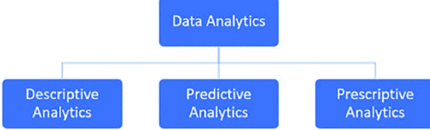

图 1.1：数据分析的类型

## 描述性分析

描述性分析是最简单的分析形式，专注于描述过去的数据并尝试回答问题。它使用统计学（如平均值、中位数、众数、方差等）以图表和表格的形式表示数据。它生成报告、业务指标和关键绩效指标（KPI），帮助企业跟踪性能并识别各种趋势。描述性分析收集长时间的信息，并使用这些信息跟踪公司在不同时间的进展。例如，描述性分析可以帮助公司跟踪其不同季度的销售和收入增长，并以图表的形式呈现数据。描述性分析涉及识别关键业务指标、确定生成这些指标所需的数据、提取、清洗和准备数据以供分析、分析数据以及最后呈现数据的过程。

描述性分析通常涉及几个关键步骤，可以大致分为以下阶段：

- **数据收集**：任何数据分析的第一步都是收集将要分析的数据。这些数据可能来自各种来源，例如交易、问卷调查或实验。

- **数据清洗和准备**：一旦收集了数据，可能需要对其进行清洗并为分析做准备。这可能包括删除任何缺失或无效数据，将数据转换为可用的格式，并确保数据一致且准确。

- **统计分析**：下一步是使用统计工具和技术对数据进行汇总和分析。这可能涉及计算汇总统计（如平均值和总和），并使用这些统计数据识别数据中的趋势和模式。

- **数据可视化**：为了让数据更易于访问和理解，创建数据的可视化（如图形、图表和地图）通常是有用的。这些可视化有助于揭示可能从原始数据中无法立即观察到的趋势和模式。

- **解释和报告**：最后，需要对从数据中提取的洞察和信息进行解释，并与相关利益相关者沟通。这可能包括以清晰简洁的方式展示发现，并就如何利用这些信息来改进决策和流程提供建议。


图 1.2：描述性分析涉及的步骤

为了更好地理解描述性分析的本质，考虑一个具体的示例可能会有所帮助。假设一家公司想要了解客户的购买习惯。公司可以使用描述性分析来分析客户购买数据，包括购买的产品、购买的时间和地点以及花费的金额等信息。通过统计分析，公司可以计算汇总统计数据，例如平均购买金额和最受欢迎的产品。通过数据可视化技术，公司可以创建图形和图表来使数据视觉化，这可能会揭示从观察原始数据中无法立即发现的趋势和模式。最后，通过数据挖掘技术，公司可以识别不同数据点之间的关联和关系，例如购买时间与花费金额之间的关系。

总而言之，描述性分析的目标是对给定数据集的关键特征提供全面且易于访问的总结。这种总结可以用于理解系统或流程的过去和现在状态，并帮助组织对未来如何发展做出更明智的决策。

## 预测性分析

预测性分析使用统计、预测建模和机器学习技术来分析当前和历史数据，以对未来做出预测。它尝试回答问题：保险和营销行业是否会使用预测分析来做出关键业务决策。预测性分析用于营销、销售、医疗保健、银行、零售、供应链、人力资源等许多行业。例如，在营销领域，它可以用于营销活动和交叉销售策略。在零售领域，它可以用于识别产品推荐、分析市场、预测销售。在医疗保健领域，它用于管理慢性病患者的护理。金融服务使用定量工具和机器学习来检测欺诈和预测损失。企业利用它更有效地管理库存，并在满足需求的同时减少库存。人力资源部门利用它识别和招聘员工并预测员工流失。预测性分析通常涉及几个关键步骤，可以大致分为以下阶段：

- **数据收集**：任何数据分析的第一步都是收集将用于预测的数据。这些数据可能来自各种来源，例如交易、问卷调查或实验。

- **数据清洗和准备**：一旦收集了数据，可能需要对其进行清洗并为分析做准备。这可能包括删除任何缺失或无效数据，将数据转换为可用的格式，并确保数据一致且准确。

- **模型构建**：下一步是使用机器学习算法构建预测模型。这涉及在历史数据上训练模型并微调模型以提高其预测准确性。

- **模型评估**：一旦构建了预测模型，评估其性能以确保其准确可靠至关重要。这可能包括在新数据上测试模型，并将模型做出的预测与实际结果进行比较。

- **预测和部署**：最后，可以使用预测模型对未来事件做出预测。这些预测随后可以指导决策，并识别潜在的风险和机会。


图 1.3：预测性分析涉及的步骤

总而言之，预测性分析的目标是利用历史数据和机器学习算法对未来事件做出准确可靠的预测。这可以帮助组织更好地理解系统或流程的未来方向，并对未来如何发展做出更明智的决策。

## 规范性分析

规范性分析从数据中确定最佳行动方案。它试图回答一个问题：我们应该做什么？它通过考虑所有相关因素，为后续步骤生成建议。这就是为什么规范性分析是一种基于数据的宝贵决策工具。它通常使用机器学习算法以快速、高效的方式处理大量数据。

> **注意**：描述性分析主要与商业智能术语相关，而预测性与规范性分析被称为高级分析。

规范性分析超越了预测未来结果（预测性分析），它通过建议采取的行动来影响这些结果。它被应用于各个领域，如：

- **供应链**：规范性分析可以帮助确定库存水平、再订点和物流路线，以最大限度地降低成本并高效满足需求。

- **医疗保健**：它可以根据患者数据提供治疗建议，为特定的医疗状况预测最佳行动方案。

- **营销**：规范性分析可以识别最有效的营销策略和渠道以触达目标受众，优化预算分配并实现投资回报最大化。

- **金融**：它通过推荐与投资者风险承受能力和财务目标一致的资产配置，协助投资组合管理。

规范性分析通常涉及几个关键步骤，可以大致归类为以下阶段：

- **数据收集**：任何数据分析的第一步都是收集用于生成建议的数据。这些数据可能来自各种来源，如交易、调查问卷或实验。

- **数据清洗与准备**：一旦收集了数据，可能需要对其进行清洗并准备分析。这可能涉及移除任何缺失或无效数据、将数据转换为可用的格式，并确保数据的一致性和准确性。

- **模型构建**：下一步是建立一个用于生成建议的数学模型。这可能涉及使用优化算法来识别给定问题的最优解决方案。

- **模型评估**：一旦建立了数学模型，评估其性能至关重要，以确保其准确性和可靠性。这可能包括在新的数据上测试模型，并将模型生成的建议与实际结果进行比较。

- **建议生成**：最后，可以使用数学模型为实现所需的结果而采取的行动或决策生成建议。这些建议随后可以指导决策，并识别潜在的风险和机会。


# 图 1.4：规范性分析涉及的步骤

总体而言，规范性分析的目标是利用数据、数学模型和优化算法，为实现所需的行动或决策生成建议。这可以帮助组织做出更明智、有效的决策，从而获得更好的结果。

## 数据分析的重要性

数据分析之所以重要，因为它允许我们从数据中提取有价值的见解和信息。这些信息随后可以用于做出更好的决策并改进各种流程。例如，数据分析可以用于识别数据中的趋势和模式，帮助企业做出更明智的营销和销售决策。此外，数据分析可以用于识别流程中的低效环节和改进领域，帮助组织节省时间和金钱。

数据分析的优势之一是，它可以帮助组织更好地理解其客户、员工和其他利益相关者。通过分析客户行为、偏好和反馈的数据，组织可以更好地了解其目标市场，并量身定制其产品和服务以满足客户需求。同样，通过分析员工表现、满意度和流失率的数据，组织可以识别可能影响员工参与度和生产力的因素，并采取措施解决这些问题。

数据分析的另一个重要益处是，它可以帮助组织对未来事件做出更准确、更可靠的预测。通过使用预测分析技术，组织可以预测未来的趋势和模式，识别潜在的风险和机会。这使得组织能够规划未来，并就如何分配资源和管理运营做出更明智的决策。

总的来说，数据分析的重要性在于它能够利用数据、数学模型和优化算法来生成行动或决策的建议，以实现所需的结果。这可以帮助组织对未来事件做出更准确、可靠的预测。

## 数据分析方法

有几种用于处理数据的数据分析方法和技术。数据分析中常用的方法包括：

- **回归分析**：这是一种建立因变量与多个自变量之间关系的统计技术，用于处理大规模数据集的输出。
- **因子分析**：这涉及对大型数据集进行缩小。因子分析是一种随机收集样本以确定因变量的统计技术。
- **同类分析**：同类分析是将数据划分为相似群体（通常是客户群体）的统计方法，让我们深入研究。
- **时间序列分析**：时间序列分析是一种在时间间隔内记录数据点的技术，用于了解数据随时间的变化。通过时间序列分析，组织可以理解周期性的趋势。数据可视化技术可用于观察这些趋势。
- **蒙特卡洛方法**：蒙特卡洛方法是用于预测各种结果概率的计算算法。在蒙特卡洛模拟中，会对不确定变量分配多个值，然后通过平均值获得估计。

## 数据分析工具与框架

`Java` 数据分析工具和框架是旨在支持开发数据分析程序的库和平台。这些工具和框架提供了多种功能，包括支持数据处理、机器学习和数据可视化。`Java` 有许多数据分析工具和框架。`Java` 开发者常用的数据分析工具包括 `Apache Hadoop`、`Apache Spark`、`Apache Storm`、`Apache Mahout`、`JFreechart` 和 `Deeplearning4j`。

## Apache Hadoop

`Apache Hadoop` 是一个用于在计算机集群上进行分布式存储和分布式处理的开源软件框架。由 `Apache` 软件基金开发并于 2011 年发布。`Hadoop` 设计为从单个服务器扩展到数千台，每台机器提供本地计算和存储。`Hadoop` 通常用于大数据应用程序，是数据湖架构的核心技术。对于需要处理和分析大量数据的企业来说，它是必不可少的工具。`Hadoop` 包含多个模块，包括用于存储的 `HDFS` 和用于并行处理数据的 `MapReduce` 程序模型。

`Apache Hadoop` 具有几个关键特性，使其成为数据分析的强大工具。`Hadoop` 的主要特性包括：

- **可扩展性**：`Hadoop` 设计为从单个服务器扩展到数千台机器，每台机器提供本地计算和存储。使其非常适合处理海量数据。
- **容错性**：`Hadoop` 设计对硬件故障具有韧性。如果 `Hadoop` 集群中的某个节点故障，系统会自动重新复制数据并在不中断的情况下继续处理。
- **数据本地性**：`Hadoop` 的设计是将计算移动到数据处，而不是将数据移动到计算处。这意味着数据是在存储所在的节点上进行处理的，这可以提高性能并减少网络流量。

`Hadoop` 支持多种数据类型，包括结构化、非结构化和半结构化数据。这使其成为数据分析的通用功能工具。

`Hadoop` 的易用性在于其简单的编程模型，并包含了许多高级抽象，例如 `MapReduce`，这使得开发和运行数据分析应用变得简单。

`Hadoop` 是一个开源项目，这意味着它是免费提供的，并且可以自由地修改和发布。这使其成为数据分析领域的热门选择。

## Apache Spark

`Apache Spark` 是一个用于大数据分析的开源分布式计算平台。它由 `Apache` 软件基金会开发，并于 2014 年首次发布。`Spark` 的设计目标是快速且易用，它包含了一系列 `API`，用于使用不同的语言（包括 `Java`、`Python` 和 `R`）处理数据。`Spark` 构建在 `Hadoop` 生态系统之上，使用 `Hadoop` 分布式文件系统 (`HDFS`) 进行存储。它通常与 `Hadoop` 生态中的其他工具（如 `Apache Flink` 和 `Apache Hadoop`）一起使用进行数据处理和分析。`Spark` 以其速度和实时处理大量数据的能力而闻名。它被广泛应用于金融、医疗保健和电子商务等多个行业。

`Apache Spark` 具有几个关键特性，使其成为大数据分析的流行工具。`Spark` 的一些主要特性包括：

- **速度**：`Spark` 以其快速处理速度而闻名，使其非常适合实时分析应用。
- **易用性**：`Spark` 的易用性体现在其简单的编程模型，并包含了用于用不同语言处理数据的高级 `API`。这使得开发和运行数据分析应用变得简单。
- **可扩展性**：`Spark` 可以从单机扩展到成千上万台机器的集群，非常适合处理海量数据。

`Spark` 支持多种数据类型，包括结构化、非结构化和半结构化数据。这使其成为数据分析的通用功能工具。

`Spark` 包含一个强大的流处理引擎，允许对数据流进行实时处理。

`Spark` 构建在 `Hadoop` 生态系统之上，并与 `Hadoop` 生态系统中的其他工具（如 `Apache Flink` 和 `Apache Hadoop`）兼容。这允许与其他大数据工具进行无缝集成。

`Spark` 是一个开源项目，意味着它是免费提供的，并且可以自由地修改和发布。这贡献了它在数据分析领域的普及。

## Apache Mahout

`Apache Mahout` 是一个用于数据分析的开源机器学习库。它由 `Apache` 软件基金会开发，并于 2008 年首次发布。它为一系列机器学习技术提供了算法和实现方案，包括协同过滤、聚类和分类。`Mahout` 构建在 `Hadoop` 生态系统之上，使用 `MapReduce` 编程模型进行分布式计算。它通常与 `Hadoop` 生态系统中的其他工具（如 `Apache Spark` 和 `Apache Flink`）结合使用进行数据处理和分析。`Mahout` 被应用于金融、医疗保健和电子商务等多个行业。对于需要构建机器学习模型并从大型数据集进行预测的企业来说，它是一个至关重要的工具。

`Apache Mahout` 具有几个关键特性，使其成为数据分析机器学习的热门选择。`Mahout` 的一些主要特性包括：

- **算法丰富**：`Mahout` 为机器学习提供了系列算法和实现，包括协同过滤、聚类和分类。
- **可扩展性**：`Mahout` 构建在 `Hadoop` 生态系统之上，使用 `MapReduce` 编程模型，使其能够从单机扩展到成千上万台机器的集群。
- **兼容性**：`Mahout` 与 `Hadoop` 生态系统中的其他工具（如 `Apache Spark` 和 `Apache Flink`）兼容。这允许与其他大数据工具进行无缝集成。
- **多数据类型与语言支持**：`Mahout` 支持多种数据类型并可以与不同的编程语言（包括 `Java` 和 `Scala`）配合。
- **开源**：`Mahout` 作为一个开源项目，是免费提供的，并且可以自由地修改和发布，使其成为数据分析机器学习的流行选择。

## Java JFreechart

`Java JFreeChart` 是一个用于在 `Java` 中创建图表和图形的免费开源库。它由 `David Gilbert` 开发，是开源项目 `JFreeChart` 的一部分。该项目用 `Java` 语言编写，包含了多种图表类型，包括饼图、柱状图、折线图和散点图。它还包含了许多功能，可以轻松地自定义图表并将其集成到 `Java` 中。`JFreeChart` 被广泛应用于金融、医疗保健和电子商务等多个行业。对于需要进行数据可视化和结果传达的企业来说，它是一个至关重要的工具。

`Java JFreeChart` 具有几个关键特性，使其成为 `Java` 数据可视化的热门选择。`JFreeChart` 的一些主要特性包括：

- **多种图表类型**：`JFreeChart` 包含了多种图表类型，包括饼图、柱状图、折线图和散点图。这允许用户以多种方式可视化数据。
- **易于自定义**：`JFreeChart` 包含了许多易于自定义图表的功能，例如添加标签、图例和其他注释的能力。
- **易于集成**：`JFreeChart` 可以轻松地集成到 `Java` 应用程序中，允许用户在自己的程序中包含图表和图形。
- **导出支持**：`JFreeChart` 支持将图表导出为图像文件，这些文件可以用于报告、演示和其他文档。
- **开源**：`JFreeChart` 是一个开源项目，意味着它是免费提供的，并且可以自由地修改和发布，使其成为 `Java` 数据可视化的流行选择。

## Deeplearning4j

`Deeplearning4j` (`DL4J`) 是一个用于 `Java` 编程语言的开源深度学习库。它由 `Skymind` 公司开发，并于 2014 年首次发布。`DL4J` 用 `Java` 编写，设计用于配合 `Java` 虚拟机 (`JVM`)。它构建在 `Hadoop` 生态系统之上，并使用 `Hadoop` 分布式文件系统 (`HDFS`) 进行存储。`DL4J` 用于多种深度学习任务，包括图像识别、自然语言处理和推荐系统。它被广泛应用于金融、医疗保健和电子商务等行业。对于需要构建和部署机器学习模型的企业来说，`DL4J` 是一个至关重要的工具。

`Deeplearning4j` (`DL4J`) 具有几个关键特性，使其成为 `Java` 深度学习的热门选择。`DL4J` 的一些主要特性包括：

- **深度学习算法**：`DL4J` 包含系列深度学习算法和实现，包括前馈神经网络、卷积神经网络和循环神经网络。
- **可扩展性**：`DL4J` 构建在 `Hadoop` 生态系统之上，使用 `Hadoop` 分布式文件系统 (`HDFS`) 进行存储。这使其能够从单机扩展到成千上万台机器的集群。
- **兼容性**：`DL4J` 与 `Hadoop` 生态系统中的其他工具（如 `Apache Spark` 和 `Apache Flink`）兼容。这允许与其他大数据工具进行无缝集成。
- **高性能**：`DL4J` 设计快速高效，支持 `GPU` 加速和并行处理。
- **Java API**：`DL4J` 包含 `Java API`，允许用户在 `Java` 中轻松地开发和运行深度学习应用。
- **开源**：`DL4J` 是一个开源项目，意味着它是免费提供的，并且可以自由地修改和发布。这使其成为 `Java` 深度学习领域的流行选择。

## Apache Storm

`Apache Storm` 是一个开源分布式实时计算系统。它由 `Apache` 软件基金会开发，并于 2011 年首次发布。`Storm` 的设计目标是快速、可扩展且容错，非常适合实时处理数据流。`Storm` 常用于实时处理海量数据，例如实时分析、在线机器学习和物联网 (`IoT`) 应用。它构建在 `Hadoop` 生态系统之上，使用 `Hadoop` 分布式文件系统 (`HDFS`) 进行存储。`Storm` 被广泛应用于金融、医疗保健和电子商务等多个行业。

`Apache Storm` 具有几个关键特性，使其成为实时数据处理的热门选择。`Storm` 的一些主要特性包括：

- **实时处理**：`Storm` 设计用于实时处理数据流。它每秒可以处理数百万次事件，非常适合需要快速且准确结果的应用。
- **可扩展性**：`Storm` 可以从单机扩展到成千上万台机器的集群，非常适合处理海量数据。
- **容错性**：`Storm` 的设计使其对硬件故障具有韧性。如果 `Storm` 集群中的节点发生故障，系统会自动重新处理数据并继续运行而不会中断。

`Storm` 的易用性在于其简单的编程模型并包含了许多高级抽象，例如节点 (`bolts`) 和喷流 (`spouts`)，这使得开发和运行实时数据处理应用程序变得简单。

`Storm` 与 `Hadoop` 生态系统的其他工具兼容，例如 `Apache Spark` 和 `Apache Flink`。这允许它与其他大数据工具进行无缝集成。

`Storm` 是一个开源项目，这意味着它是免费提供的，并且可以自由修改和分发，使其成为实时数据处理的热门选择。

## 结论

在本章中，我们学习了使用 `Java` 进行数据分析的基础，包括不同类型的数据分析（如描述性分析、预测性分析和指导性分析），并探讨了数据分析的重要性。我们还查看了数据分析的一些主要技术，如回归分析、时间序列分析等。此外，我们还探索了 `Java` 数据分析的重要工具和框架，如 `Apache Hadoop`、`Spark` 等。

在下一章中，我们将学习数据、数据集以及如何生成和处理它们。

## 问题

- 什么是数据分析？它有哪些不同的类型？
- 什么是预测性分析？
- 为什么数据分析很重要？
- 解释一些重要的数据分析方法。
- 写出 `Java` 中一些流行的数据分析工具和框架。
- 什么是 `Apache Hadoop`？列出它一些使其成为流行框架的特性。

## 知识点回顾

- 数据分析是检查或分析数据以发现数据中有用信息或趋势的行为。
- 数据分析方法可以分为描述性分析、预测性分析和指导性分析。
- 描述性分析是最简单的分析形式，侧重于描述过去的数据并试图回答以下问题：
- 预测性分析使用统计学、预测建模和机器学习技术来分析当前和历史数据，以对未来进行预测。它试图回答“将会”的问题。
- 指导性分析根据数据确定最佳行动方案。它试图回答“应该如何”的问题。
- 回归分析是一种统计技术，建立因变量与一个或多个自变量之间的关系。
- `Java` 开发者最常用的数据分析工具包括 `Apache Hadoop`、`Apache Spark`、`Apache Storm`、`Apache Mahout`、`JFreechart` 和 `Deeplearning4j`。
- `Apache Hadoop` 是一个开源软件框架，用于在计算机集群上对数据集进行分布式存储和分布式处理。
- `Java JFreeChart` 是一个用于在 `Java` 中创建图表和图形的免费开源库。
- `Deeplearning4j` (`DL4J`) 是一个用于 `Java` 语言的开源深度学习库。

## 引言

在本章中，我们将重点关注处理和操作数据。我们将探索各种类型的数据以及如何创建数据集。为了有效分析数据，首先通过一个称为“预处理”的过程对其标准化是非常重要的。我们将涵盖预处理技术，例如使用 `Java Apache Spark` 框架处理数据中的缺失值、转换数据类型、清洗数据、缩放或归一化变量、编码类别变量、移除异常值以及特征工程。

## 结构

在本章中，我们将涵盖以下主题：

- 数据类型
- 数据集
- 生成数据集
- 数据预处理

## 数据类型

数据有各种类别，每种类别都有其特定的特性。这些特征被称为数据类型，不仅定义了数据的结构，还决定了可以在其上执行哪些操作。例如，数值数据允许执行算术运算，而文本数据则不允许。项目的数据类型会影响它在计算机中所需的存储空间。例如，像 `2.50` 这样的小数值可能需要 `4` 字节（`32` 位）的存储，而像 `https://youtube.com` 这样的网络地址可能需要 `20` 字节（`160` 位）的存储。下表为读者理解每种数据类型的大小和范围特性提供了快速参考：

| type: |
| :--- |
| type: type: type: |
| type: type: type: |
| type: type: type: |
| type: type: type: |
| type: |
| type: type: |
| type: |

表 2.1：`Java` 中数据类型的大小和范围

在 `Java` 中，有几种数据类型可以分类为数值型、文本型或对象型。本章将重点关注以下数据类型：

### 数值数据类型

在 `Java` 中，有几种数值数据类型可以表示数字。这些可以分为整数类型和浮点类型。

#### 整数类型

在 `Java` 中，有几种整数数据类型可以表示不同范围内的整数（整数字）。这些包括：

- **`byte`**：字节数据类型是 `8` 位符号补码整数。它的最小值为 `-128`，最大值为 `127`。它通常用于在大型数组中节省内存，在这些情况下内存节省的效果最为显著。
- **`short`**：短型数据类型是 `16` 位符号补码整数。它的最小值为 `-32768`，最大值为 `32767`。它也用于在大型数组中节省内存，但频率不如 `int`。
- **`int`**：`int` 类型数据类型是 `32` 位符号补码整数。它的最小值为 `-2^31`，最大值为 `2^31 - 1`。它是 `Java` 中最常用的整数数据类型，也是整数字面量的默认类型。
- **`long`**：长整型数据类型是 `64` 位符号补码整数。它的最小值为 `-2^63`，最大值为 `2^63 - 1`。它在值需要拟合……时使用。

#### 浮点类型

这些包括 `float` 和 `double`，它们可以存储小数。

- **`float`**：`float` 数据类型是单精度 `32` 位 `IEEE 754` 浮点数。它用于表示小数。
- **`double`**：`double` 类型数据类型是双精度 `64` 位 `IEEE 754` 浮点数。它用于表示小数，是小数字面量的默认类型。

### 文本数据类型

在 `Java` 中，主要的文本数据类型是 `String` 类。`String` 是表示字符序列的对象。它经常用于……

以下是 `String` 类的一些关键特性：

- **不可变性**：`String` 是不可变的，这意味着一旦创建了 `String` 对象，其值就无法更改。任何看似修改 `String` 的操作都会创建一个新的 `String` 对象。
- **拼接**：`String` 可以使用 `+` 运算符或 `concat()` 方法拼接。
- **搜索**：`String` 可以使用 `indexOf()` 和 `lastIndexOf()` 方法搜索子字符串或字符。
- **修改**：可以通过新字符串来修改 `String`，例如提取子字符串、替换字符或转换为大小写。

此外 `Java` 还提供了 `StringBuilder` 和 `StringBuffer` 类，它们是 `String` 的可变替代方案。它们提供了插入、删除和替换字符以及拼接的方法。`StringBuffer` 是线程安全的，这意味着它可以用于多线程环境，但是以牺牲性能为代价的。`StringBuilder` 不是线程安全的。

值得注意的是，`Char` 类也可以用于表示单个字符，它是原始数据类型的包装类。

### 对象数据类型

在 `Java` 中，对象是类的实例。类定义对象的属性和方法，而对象包含实际数据。

对象数据类型（也称为引用数据类型）是持有对象引用的变量，而不是持有对象的数据。当你创建一个对象时，`Java` 会自动为对象分配内存地址，引用变量持有该地址。这允许你创建多个引用同一个对象的变量，通过一个变量对对象进行的更改对所有引用该对象的变量都可见。


# Java 对象数据类型

以下是 Java 对象数据类型的一些关键特性：

- 对象数据类型使用类名后跟变量名进行声明。例如，`Employee emp1 = new Employee();` 创建了一个 `Employee` 类型的新对象并将其赋值给变量。
- 对象数据类型使用 `new` 关键字初始化，该关键字用于创建类的实例。
- 对象数据类型可以拥有方法和属性，这些由类定义。
- 对象数据类型可以为 `null`，意味着它们不引用任何对象。

对象数据类型可以使用 `==` 运算符进行比较，该运算符比较对象的内存地址；也可以使用 `equals()` 方法，该方法比较对象的内容。

对象数据类型可以作为参数传递给方法，并从方法返回。

除了类之外，Java 还提供了几个内置类，如 `String`、`Integer` 等，它们作为对象数据类型使用。

# 数据集

数据集是为特定目的而组织和结构化的数据集合。数据集通常用于机器学习和数据分析，用于训练和测试模型，以及执行各种统计分析。

有许多类型数据集，它们在大小、结构和内容上可能不同。数据集的一些共同特征包括：

## 变量

一个数据集通常由一个或多个变量组成，这些变量是正在测量或记录的特征或属性。例如，在一个学生成绩数据集中，变量可能包括学生姓名、年龄、性别、测试成绩和年级。变量是数据集的列；它们可以是定量的，也可以是定性的，并且可以具有不同的测量水平。以下是对这些方面每个方面的更详细的解释：

### 定量与定性

变量可以是定量的，也可以是定性的。定量变量是数值型的，代表可测量的值，如年龄、体重或收入。定性变量（也称为分类变量）代表非数值值，如名称、颜色或类别。

### 测量水平

变量可以具有不同的测量水平，这些水平描述了数据的属性和特征。

- **名**：在名水平上测量的变量用于识别或标记数据，例如客户 ID 或产品类别。它们没有任何顺序或排名，值之间的差异没有意义。
- **序数**：在序数水平上测量的变量具有意义的顺序或排名，但值之间的差异没有意义，例如，调查问题询问你对我们答案选项的满意程度，如满意、满意、中立、不满意、非常不满意。
- **间隔**：在间隔水平上测量的变量具有意义的顺序或排名，值之间的差异是有意义的，但没有真正的零点，例如以摄氏度测量的温度。
- **比例**：在比例水平上测量的变量具有意义的顺序或排名，值之间的差异是有意义的，并且存在真正的零点，例如重量或长度。

## 观测

数据集中的每个记录或每行代表变量的单一观测或测量。在学生成绩示例中，每行将代表一个学生的测试成绩。以下是关于如何在数据集中表征观测值的更多详细信息：

- 观测可以代表不同的：取决于数据集，一个观测可以代表不同类型的实体，如人、产品、交易或事件。
- 观测可以具有不同的属性：每个观测都可以拥有一组属性，即为该观测记录的变量。例如，在包含客户信息的数据集中，一个观测可能具有姓名、地址和年龄等属性。
- 观测可以是：数据集中的每个观测都可以是唯一的，并与其他观测值不同。当在尝试识别特定观测值或处理对时间敏感的数据时，这可能是重要的。
- 观测可以与其他观测值关联：某些数据集的观测值通过共同变量或标识符与其他观测值相关联。例如，在包含客户信息及其订单的数据集中，每个订单都将通过唯一的客户 ID 与特定客户关联。
- 观测值可能是缺失的：有时，观测值在某些变量上可能缺少某些值。这可能是由于各种原因造成的，例如调查未完成或数据未记录。

值得注意的是，观测值的特征取决于特定的数据集以及该数据集旨在回答的研究问题。

## 关系

数据集可能包含变量之间的关系，例如成绩与年级之间的关系。可以通过分析这些关系来得出结论或做出预测。这些关系可以用于探索和分析数据，并可以采取许多形式，如：

- **因果关系**：变量之间的某种关系，其中一个变量的变化（自变量）导致另一个变量（因变量）的变化。例如，在包含睡眠小时数和学生平均分的数据集中，睡眠小时数将是自变量，平均分将是因变量。
- **相关性**：变量之间的某种关系，其中一个变量的变化与另一个变量的变化相关，但这种关系并不一定是因果。例如，在包含冰淇淋销售数量和温度的数据集中，这两个变量之间可能存在相关性，但这种关系并不一定是因果。
- **嵌套**：变量之间的某种关系，其中一个变量嵌套在另一个变量内部。例如，在包含国家、地区和城市的数据集中，城市将嵌套在区域中，区域将嵌套在国家中。
- **时间序列**：变量之间的某种关系，观测值在不同的时间点记录。例如，在包含随时间变化的股票价格的数据集中，变量之间的关系就是时间序列。
- **分组**：变量之间的某种关系，观测值被分为不同的组或类别。例如，在包含学生信息的数据集中，变量之间的关系可以根据年级或专业对学生进行分组。

值得注意的是，数据集中的关系可能是复杂且多层，识别并理解它们对于对数据的正确分析和解释至关重要。

## 缺失值

数据集的“缺失值”特征是指某些观测在某些变量上可能缺少某些值。缺失值的发生可能是由于各种原因，例如调查未完成、数据未记录或在收集过程中丢失数据。以下是关于如何在数据集中表征缺失值的更多详细信息：

- **完全随机缺失（MCAR）**：缺失值随机发生，与数据集中的任何变量都无关。这种缺失数据被认为问题最小，因为它不会偏向分析或结论。
- **随机缺失（MAR）**：缺失值随机发生，但与数据集中的一个或多个变量相关。这种缺失数据会导致偏差，特别是当缺失值与感兴趣的变量时。
- **非随机缺失（MNAR）**：缺失值不是随机的，与未观测变量相关。这种缺失数据会显著影响分析和结论，因为缺失值与未观测变量相关。
- **缺失值具有不同的百分比**：缺失值以不同的百分比出现；它们可能是观测值的一小部分，也可能是大部分比例。缺失值的百分比会影响分析和结论。
- **缺失值具有不同的模式**：缺失值以不同的模式出现；它们可能是零散的，也可能是聚集的。缺失值的模式会影响分析和结论。

值得注意的是，缺失值可能会对分析和结论产生重大影响。因此，正确识别和处理缺失值是非常关键的，例如使用插补方法或排除具有缺失值的观测值。

## 文件格式

数据集的文件格式是指数据在文件中存储的方式。可以使用不同的文件格式来存储数据集，文件格式的选择会影响数据的存储、访问和分析。以下是关于如何在数据集中表征文件格式的更多详细信息：

- **逗号分隔值（CSV）**：这是一种简单的文本格式，以表格形式存储数据，每行代表数据，每个字段（列）由逗号分隔。CSV 文件广泛支持，可以轻松导入到大多数数据分析软件中。
- **Excel**：这是由微软开发的一种专有文件格式，以表格格式存储数据，每个工作表代表一个表格。Excel 文件可以包含多个工作表，还可以包含图表、图像和其他类型的数据。
- **JavaScript 对象表示法 (JSON)**：这是一种轻量级的数据交换格式，以分层格式存储数据，每个元素由键值对表示。JSON 文件易于读取和写入，被广泛用于网络数据的存储和传输。
- **结构化查询语言 (SQL)**：这是一种用于管理和操作关系型数据库的标准语言。SQL 数据库将数据存储在表中，每个表由行和列组成。SQL 文件可以导出为文本文件，并导入到大多数数据分析软件中。
- **其他文件**：许多许多可用于存储数据集的文件格式，例如 SAS、SPSS、Stata、Rdata、HDF5、Parquet、Avro 等。每种文件格式都有自己的优缺点，文件格式的选择将取决于数据分析任务的具体需求。

值得注意的是，文件格式的选择可能会影响分析和结论，因此为数据分析任务选择合适的文件格式至关重要。此外，数据还可以存储在数据库、云端数据湖或数据仓库中，这些是大数据场景下更强大的解决方案。

总而言之，数据集是存储和组织数据的关键工具，能够对其进行分析并从中得出见解。

# 生成数据集

生成数据集有多种方法，取决于数据的类型和数据集的目的。以下是几种常见方法：

## 收集数据

生成数据集的一种方法是直接从调查、实验或传感器读取等来源收集数据。这需要定义感兴趣的变量，并制定数据收集计划。这种方法用于生成为研究问题定制的数据。以下是关于数据收集特征的更多详细信息：

- **调查**：问调查是收集数据最常见的方法之一。调查可以通过面对面、电话、邮件或在线的方式进行。调查可以是结构化或非结构化的，可以是闭式或开放式的，并且可以包括多选择、李克特量表或自由形式的。调查有助于在较短的时间内从大量个体中收集数据。
- **实验**：是另一种收集数据的常用方法。实验涉及操纵一个或多个独立变量，以观察其对一个或多个依赖变量的影响。实验有助于测试因果关系并控制外部变量。
- **观察法**：观察性研究是一种通过观察和记录有关主体的信息而不对其进行操纵来收集数据的方法。观察性研究可以是横截面的（在某时间点收集的数据），也可以纵向的（在一段时间内收集的数据）。这种方法可以用于研究变量之间的关系，并识别数据中的模式或趋势。
- **其他**：其他收集数据的方法，例如焦点小组、访谈和次级数据分析。每种方法都有自己的优缺点，最佳方法取决于研究问题的具体要求。

值得注意的是，收集数据可能既耗时且昂贵，但它允许收集为研究问题定制的特定且相关的数据。此外，确保数据以有效且可靠的方式收集（使用适当的抽样技术和调查设计），并遵循数据收集的伦理准则是非常重要的。

## 爬取数据

另一种选择是使用网络爬虫工具或 API 从网站或其他在线源爬取数据。这是从公共可用源收集大量数据的一种有用方法。以下是关于爬取数据特征的更多详细信息：

- 使用网络爬虫工具或库（如 `Beautiful Soup`、`Scrapy` 或 `Selenium`）从网站爬取数据。这些工具允许您浏览网站的结构并提取特定的信息，如文本、图像或链接。
- **社交**：Twitter、Facebook 和 LinkedIn 等社交媒体平台提供了可用于爬取数据的 API，例如帖子、评论和用户信息。然而，这些平台对数据爬取有严格的政策和指南，因此在使用它们的 API 时遵循这些指南至关重要。
- 许多在线服务和平台（如 Google、Amazon 或 Wikipedia）提供了可用于爬取数据的 API，例如搜索结果、产品信息或文章。API 通常提供以结构化格式（如 JSON 或 XML）访问数据的方法，可以使用 Python 或 Java 等编程语言访问。

爬取数据可能具有挑战性，因为数据结构和格式从来源差异很大。此外，爬取大量数据会对网站或服务器造成沉重负载，导致 IP 被封锁或面临 CAPTCHA 挑战。同时，注意数据爬取相关的法律和伦理问题，并尊重网站的服务条款和隐私政策也是重要的。

值得注意的是，爬取数据可以是收集大量数据的快速且高效的方法，但确保数据质量和完整性也具有挑战性。因此，验证和清洗爬取的数据以确保其符合研究问题的要求是重要的。

## 生成合成数据

某些情况下，可能需要生成合成数据，即人工创建的数据，用于测试算法或训练模型，当真实数据不可用时。以下是关于合成数据特征的更多详细信息：

- **数学**：合成数据可以使用数学模型（如统计模型或模拟模型）生成。这些模型用于生成遵循特定分布（如正态分布或泊松分布）的数据。
- **计算机**：合成数据还可以使用计算机程序（如生成模型或基于代理的模型）生成。这些程序可以用于模拟复杂系统（如交通模式或社交网络），并生成模拟真实模式和行为。

生成合成数据具有多种优点，例如可以控制数据分布、生成大量数据，并为现实世界无法观察的场景生成数据。合成数据也有一些缺点，例如并不总是反映真实的复杂性，或无法涵盖所有场景。此外，合成数据可能不像真实数据那样具有代表性和通用性。

值得注意的是，合成数据可以是测试和开发算法的有用工具，但它可能无法代表真实数据。因此，尽可能使用真实数据来验证合成数据，并注意合成数据的局限性。此外，合成数据还可以增强真实数据，特别是当真实数据稀缺或难以获得时，以提高机器学习模型的性能。

## 使用现有数据集

网上有很多可用于机器学习和数据分析的现有数据集。这些数据集可以直接下载使用，也可以修改并与其他数据集结合以创建新数据集。以下是关于使用现有数据集特征的更多详细信息：

- **公共可用**：有很多用于研究的公共数据集，例如美国人口普查、世界银行或 UCI 机器学习库。这些数据集可以免费下载，并涵盖广泛的主题和行业。
- **商业**：还有可以购买的商业数据集，例如来自市场研究公司的数据或社交媒体平台的数据。这些数据集比公共数据集更具体、更详细，但也可能更贵。

使用现有数据集具有多种优点，例如节省收集和清洗数据的时间和资源，并获得比自己收集更广泛的数据。使用现有数据集也有一些缺点，例如数据可能与研究问题不相关，或者数据存在偏差或不完整。此外，确保数据集与研究问题相关且适用，并注意数据的局限性是非常重要的。

无论使用哪种方法，确保数据集在使用分析之前经过适当的清洗和预处理至关重要。这可能涉及处理缺失值、转换数据类型以及对变量进行缩放或归一化。

# 数据预处理

数据预处理是指为分析或建模准备数据集而采取的步骤。预处理是数据流水线中重要的一步，因为它对结果的质量和有效性具有显著影响。Apache Spark 是一种流行的大数据处理开源平台，为数据预处理提供了许多工具和库。

以下是在数据集上可能执行的一些常见预处理任务：

- **处理缺失值**：许多数据集包含缺失值，这可能是由数据收集不完整或数据损坏引起的。可以通过多种方式处理缺失值，例如使用变量的平均值或中位数填补缺失值，或者删除带有缺失值的行或列。Apache Spark 允许你使用类 SQL 查询或 DataFrame 变换从数据过滤并选择特定的行或列。
- **转换数据类型**：数据集中的不同变量具有不同的数据类型（如数值、文本或类别）是常见现象。在某些情况下，可能需要转换数据类型以便更有效地处理数据。在 Apache Spark 中，你可以使用 `cast()` 函数转换数据类型，该函数在 Column 和 DataFrame 对象上均可用。
- **清洗数据**：Apache Spark 包含许多用于清洗数据的函数，例如删除空值、用默认值填充空值以及去除文本数据中的空格。
- **缩放或归一化变量**：某些机器学习算法对输入变量的尺度敏感。在这种情况下，可能需要对变量进行缩放或归一化，以确保它们处于相同的尺度并具有相似的数量级。Apache Spark 包含了用于数据缩放和归一化的函数，例如 `MinMaxScaler`。
- **编码变量**：类别变量代表可以分组为类别的值，可能需要将其编码为数值以便用于某些机器学习算法。编码类别变量有多种方法，例如独热编码和标签编码。Apache Spark 提供了许多编码类别变量的函数，例如独热编码和字符串索引。
- **移除离群值**：离群值是与大多数数据显著不同的数据点。它们会对分析结果产生不成比例的影响，可能需要将其移除或进行特殊处理。
- **特征工程**：Apache Spark 允许你使用各种技术（如应用数学函数、创建虚拟变量和聚合数据）来创建新特征或转换现有特征。

总的来说，预处理是数据流水线中的关键步骤，它需要仔细的考虑和规划，以确保数据准备好进行分析或建模。

# 处理缺失值

在 Apache Spark 中有多种方法可以处理缺失数据，例如：

## 删除包含缺失数据的行

你可以使用 `na.drop()` 函数删除包含缺失值的行。这是最简单的选项，但如果你有大量的缺失数据，这可能不是最佳选择。例如：

```java
import org.apache.spark.sql.Dataset;
import org.apache.spark.sql.Row;
import org.apache.spark.sql.SparkSession;

SparkSession spark = SparkSession.builder().getOrCreate();

Dataset<Row> df = spark.createDataFrame(Arrays.asList(
    new Row(1, 2),
    new Row(2, null),
    new Row(3, 4)),
    new StructType(new StructField[] {
        new StructField("id", DataTypes.IntegerType, false, Metadata.empty()),
        new StructField("value", DataTypes.DoubleType, true, Metadata.empty())
    }));

df.na().drop().show();
```

## 填补缺失值

你可以使用 `ml.feature` 包中的 `Imputer` 类将缺失值替换为固定值，例如列的平均值或中位数。如果你有少量缺失数据，这是一个很好的选择。例如：

```java
import org.apache.spark.ml.feature.Imputer;
import org.apache.spark.sql.Dataset;
import org.apache.spark.sql.Row;
import org.apache.spark.sql.SparkSession;

SparkSession spark = SparkSession.builder().getOrCreate();

Dataset<Row> df = spark.createDataFrame(Arrays.asList(
    new Row(1, 2.0),
    new Row(2, null),
    new Row(3, 4.0)),
    new StructType(new StructField[] {
        new StructField("id", DataTypes.IntegerType, false, Metadata.empty()),
        new StructField("value", DataTypes.DoubleType, true, Metadata.empty())
    }));

Imputer imputer = new Imputer()
    .setInputCols(new String[]{"value"})
    .setOutputCols(new String[]{"imputedValue"})
    .setStrategy("mean");

ImputerModel imputerModel = imputer.fit(df);
Dataset<Row> imputedData = imputerModel.transform(df);
imputedData.show();
```

## 使用模型预测缺失值

你可以使用机器学习模型（如决策树或线性回归）根据数据集中的其他值来预测缺失值。这是一种更准确的方案，但需要更多的实现工作。

## 保持缺失值原样

在某些情况下，保持缺失值原样并让机器学习模型处理它们可能是合适的。例如，某些模型可以在内部处理缺失值。你选择哪种方案取决于你数据集的细节和目标。


## 转换数据类型

在 Apache Spark 中，你可以使用 `DataFrame` 类的 `withColumn()` 方法来转换列的数据类型。`withColumn()` 方法接受两个参数：新列的名称以及一个根据原有值计算新列值的函数。这里有一个将列的数据类型从 String 转换为 Integer 的示例：

```java
import org.apache.spark.sql.Dataset;
import org.apache.spark.sql.Row;
import org.apache.spark.sql.SparkSession;
```

```java
SparkSession spark = SparkSession.builder().getOrCreate();
```

```java
Dataset<Row> df = spark.createDataFrame(Arrays.asList(
    new Row("1", "Alice"),
    new Row("2", "Bob"),
    new Row("3", "Charlie")),
    new StructType(new StructField[] {
        new StructField("id", DataTypes.StringType, false, Metadata.empty()),
        new StructField("name", DataTypes.StringType, false, Metadata.empty())
    }));
```

```java
Dataset<Row> df2 = df.withColumn("id", df.col("id").cast("integer"));
```

```java
df2.show();
```

你可以使用 `cast()` 函数将列的数据类型转换为任何其他支持的数据类型。支持的数据类型包括 `IntegerType`、`LongType`、`DoubleType` 等。注意，`withColumn()` 方法返回一个新的 `DataFrame`，因此你需要将结果存储在新的 `DataFrame` 或覆盖现有的。

## 数据清洗

- **删除空值或缺失值**：你可以使用 `na.drop()` 函数删除包含空或 NaN 值的行。这是从数据集中移除不完整数据的简单方法。
- **填补缺失值**：你可以使用 `ml.feature` 包中的 `Imputer` 类将缺失值替换为固定值，例如列的平均值或中位数。
- **处理无效或离群值**：你可以使用各种技术来识别并处理数据集中的无效或离群值。例如，你可以使用过滤或聚合函数来识别异常值，然后决定如何处理它们（例如通过将其替换为空、平均值或固定值）。
- **删除重复行**：你可以使用 `dropDuplicates()` 函数从数据集中删除重复行。你可以指定根据哪些列来判断某行是否为重复。
- **归一化或标准化数据**：你可以使用各种技术（如最小-最大缩放或 z-score 标准化）来转换数据中的值，使你的数据集处于相同的尺度上。这对于输入数据尺度敏感的机器学习模型非常有用。

总的来说，在 Apache Spark 中清洗数据涉及数据转换和数据操作技术的结合。你使用的特定技术取决于你的数据集的需求和分析目标。

## 变量缩放或归一化

在 Apache Spark 中，你可以使用 `ml.feature` 包中的 `StandardScaler` 或 `MinMaxScaler` 类来缩放或归一化变量。

`StandardScaler` 通过移除均值并缩放到单位方差来标准化特征。它接受以下参数：

- `withStd`：是否将标准差缩放到单位方差（默认：true）
- `withMean`：是否将均值中心对齐到零（默认：true）

以下是在 Java 中使用 `StandardScaler` 标准化 Spark `DataFrame` 的示例：

```java
import org.apache.spark.ml.feature.StandardScaler;
import org.apache.spark.sql.Dataset;
import org.apache.spark.sql.Row;
import org.apache.spark.sql.SparkSession;

SparkSession spark = SparkSession.builder().getOrCreate();

Dataset<Row> df = spark.createDataFrame(Arrays.asList(
    new Row(1, 2.0),
    new Row(2, 3.0),
    new Row(3, 4.0)),
    new StructType(new StructField[] {
        new StructField("id", DataTypes.IntegerType, false, Metadata.empty()),
        new StructField("value", DataTypes.DoubleType, false, Metadata.empty())
    }));

StandardScaler scaler = new StandardScaler()
    .setInputCol("value")
    .setOutputCol("scaledValue")
    .setWithStd(true)
    .setWithMean(true);

StandardScalerModel scalerModel = scaler.fit(df);
Dataset<Row> scaledData = scalerModel.transform(df);
scaledData.show();
```

`MinMaxScaler` 通过将特征转换为单位范围 `[0, 1]` 然后将其缩放到所需的范围，将特征缩放到 `[min, max]` 范围。它接受以下参数：

- `min`：输出范围的最小值（默认：0）
- `max`：输出范围的最大值（默认：1）

以下是在 Java 中使用 `MinMaxScaler` 缩放 Spark `DataFrame` 的示例：

```java
import org.apache.spark.ml.feature.MinMaxScaler;
import org.apache.spark.sql.Dataset;
import org.apache.spark.sql.Row;
import org.apache.spark.sql.SparkSession;

SparkSession spark = SparkSession.builder().getOrCreate();

Dataset<Row> df = spark.createDataFrame(Arrays.asList(
    new Row(1, 2.0),
    new Row(2, 3.0),
    new Row(3, 4.0)),
    new StructType(new StructField[] {
        new StructField("id", DataTypes.IntegerType, false, Metadata.empty()),
        new StructField("value", DataTypes.DoubleType, false, Metadata.empty())
    }));

MinMaxScaler scaler = new MinMaxScaler()
    .setInputCol("value")
    .setOutputCol("scaledValue")
    .setMin(0)
    .setMax(1);

MinMaxScalerModel scalerModel = scaler.fit(df);
Dataset<Row> scaledData = scalerModel.transform(df);
scaledData.show();
```

上述示例将 "value" 列的值缩放到 `[0, 1]` 范围。你可以通过相应设置 `min` 和 `max` 参数来指定任何其他范围。

注意，你应该在训练数据上拟合缩放器（`scaler`），然后使用它来转换训练和测试数据，以确保缩放在所有数据点上是一致的。

## 类别变量编码

在 Apache Spark 中，你可以使用 `ml.feature` 包中的 `StringIndexer` 或 `OneHotEncoder` 类对类别变量进行编码。

`StringIndexer` 将标签字符串列转换为标签索引列。它接受以下参数：

- `inputCol`：输入列的名称
- `outputCol`：输出列的名称

以下是在 Java 中使用 `StringIndexer` 对 Spark `DataFrame` 中的类别变量进行编码的示例：

```java
import org.apache.spark.ml.feature.StringIndexer;
import org.apache.spark.sql.Dataset;
import org.apache.spark.sql.Row;
import org.apache.spark.sql.SparkSession;

SparkSession spark = SparkSession.builder().getOrCreate();

Dataset<Row> df = spark.createDataFrame(Arrays.asList(
    new Row("a", 1.0),
    new Row("b", 2.0),
    new Row("c", 3.0),
    new Row("a", 4.0),
    new Row("b", 5.0)),
    new StructType(new StructField[] {
        new StructField("category", DataTypes.StringType, false, Metadata.empty()),
        new StructField("value", DataTypes.DoubleType, false, Metadata.empty())
    }));

StringIndexer indexer = new StringIndexer()
    .setInputCol("category")
    .setOutputCol("categoryIndex");

StringIndexerModel indexerModel = indexer.fit(df);
Dataset<Row> indexedData = indexerModel.transform(df);
indexedData.show();
```

`OneHotEncoder` 将标签索引列转换为二进制向量列。它接受以下参数：

- `inputCol`：输入列的名称
- `outputCol`：输出列的名称

以下是在 Java 中使用 `OneHotEncoder` 对 Spark `DataFrame` 中的类别变量进行编码的示例：

```java
import org.apache.spark.ml.feature.OneHotEncoder;
import org.apache.spark.sql.Dataset;
import org.apache.spark.sql.Row;
import org.apache.spark.sql.SparkSession;

SparkSession spark = SparkSession.builder().getOrCreate();

Dataset<Row> df = spark.createDataFrame(Arrays.asList(
    new Row("a", 1.0),
    new Row("b", 2.0),
    new Row("c", 3.0),
    new Row("a", 4.0),
    new Row("b", 5.0)),
    new StructType(new StructField[] {
        new StructField("category", DataTypes.StringType, false, Metadata.empty()),
        new StructField("value", DataTypes.DoubleType, false, Metadata.empty())
    }));

StringIndexer indexer = new StringIndexer()
    .setInputCol("category")
    .setOutputCol("categoryIndex");

StringIndexerModel indexerModel = indexer.fit(df);
Dataset<Row> indexedData = indexerModel.transform(df);

OneHotEncoder encoder = new OneHotEncoder()
    .setInputCol("categoryIndex")
    .setOutputCol("categoryVector");

OneHotEncoderModel encoderModel = encoder.fit(indexedData);
Dataset<Row> encodedData = encoderModel.transform(indexedData);
encodedData.show();
```

## 删除离群值

在 Apache Spark 中有多种方法删除离群值。以下是几种选项：

- **删除包含离群值的行**：你可以使用 `DataFrame` 类的 `filter()` 方法删除包含离群值的行。
- **将值限制到范围**：你可以使用 `DataFrame` 类的 `withColumn()` 方法以及 `when()` 和 `otherwise()` 函数将列的值限制在某个范围内。

例如：

```java
import org.apache.spark.sql.Dataset;
import org.apache.spark.sql.Row;
import org.apache.spark.sql.SparkSession;
import org.apache.spark.sql.functions;

SparkSession spark = SparkSession.builder().getOrCreate();

Dataset<Row> df = spark.createDataFrame(Arrays.asList(
    new Row("a", 1.0),
    new Row("b", 2.0),
    new Row("c", 3.0),
    new Row("a", 4.0),
    new Row("b", 5.0)),
    new StructType(new StructField[] {
        new StructField("category", DataTypes.StringType, false, Metadata.empty()),
        new StructField("value", DataTypes.DoubleType, false, Metadata.empty())
    }));

// 删除值大于 3 的行
Dataset<Row> filteredData = df.filter("value <= 3");
filteredData.show();

// 将值限制在 [2, 4] 范围内
Dataset<Row> clippedData = df.withColumn("clippedValue",
    functions.when(df.col("value").leq(2), 2)
    .when(df.col("value").geq(4), 4)
    .otherwise(df.col("value")));
clippedData.show();
```

**标准化值**：你可以使用来自 `ml.feature` 包的 `StandardScaler` 类来对列的值进行标准化。标准化将值缩放到具有零均值和单位方差。这有助于消除离群值，因为太大或太小的值将被缩放到更适中的范围内。以下是一个在 Java 中使用 `StandardScaler` 对 Spark `DataFrame` 中的列值进行标准化的示例：

```java
import org.apache.spark.ml.feature.StandardScaler;
import org.apache.spark.sql.Dataset;
import org.apache.spark.sql.Row;
import org.apache.spark.sql.SparkSession;

SparkSession spark = SparkSession.builder().getOrCreate();

Dataset<Row> df = spark.createDataFrame(Arrays.asList(
    new Row("a", 1.0),
    new Row("b", 2.0),
    new Row("c", 3.0),
    new Row("a", 4.0),
    new Row("b", 5.0)),
    new StructType(new StructField[] {
        new StructField("category", DataTypes.StringType, false, Metadata.empty()),
        new StructField("value", DataTypes.DoubleType, false, Metadata.empty())
    }));

StandardScaler scaler = new StandardScaler()
    .setInputCol("value")
    .setOutputCol("scaledValue")
    .setWithStd(true)
    .setWithMean(true);

StandardScalerModel scalerModel = scaler.fit(df);
Dataset<Row> scaledData = scalerModel.transform(df);
scaledData.show();
```

前面的示例标准化了 `value` 列的值并将结果存储在一个新列中。`withStd` 和 `withMean` 参数控制是否通过标准差缩放值并相应地减去均值。

## 特征工程


# 特征工程

特征工程是从现有数据中提取并创建新特征以提高机器学习模型预测能力的过程。在 Apache Spark 中，你可以使用 `ml` 库来执行各种特征工程任务。

以下是可以在 Apache Spark 中执行的特征工程任务的一些示例：

- **分类变量编码**：你可以使用 `ml.feature` 包中的 `StringIndexer` 或 `OneHotEncoder` 类分别将分类变量编码为标签索引或二进制向量。
- **数值变量缩放或归一化**：你可以使用 `ml.feature` 包中的 `StandardScaler` 或 `MinMaxScaler` 类将数值变量缩放或归一化为零均值和单位方差，或处于 0 到 1 之间的范围。
- **数值填充**：你可以使用 `ml.feature` 包中的 `Imputer` 类通过用列的平均值或众数填充数据集中的缺失值。
- **从文本提取特征**：你可以使用 `ml.feature` 包中的 `IDF` 类通过对文本进行分词、对标记进行哈希以及根据其逆文档频率缩放哈希值来从文本数据中提取特征。
- **从图像提取特征**：你可以使用 `ml.image` 包中的 `ImageSchema` 和 `ImageTransformer` 类通过将图像转换为指定格式并提取像素值从图像中提取特征。

## 结论

在本章中，我们学习了如何处理数据。我们介绍了不同类别的数据。我们还理解了数据集以及如何生成它们。最后，我们学习了预处理以及在数据预处理期间执行的不同任务。

在下一章“数据可视化”中，你将学习 Java 在机器学习应用中的重要性，以及你可以用于实现不同机器学习算法的各种库。

## 问题

1. Java 中有哪些不同的数据类型？
2. 什么是数据集？写下数据集的不同特征。
3. 写出生成数据集的三种方法。
4. 什么是数据预处理？写下在数据集上执行的一些常见预处理任务。
5. 什么是特征工程？

## 注意点

- Java 中有多种数据类型：`boolean`、`byte`、`char`、`short`、`int`、`long`、`float`、`double` 和 `String`。
- 数据集是数据的集合，具有特定的特征。
- 生成数据集有三种方法：从文件读取、从数据库读取或手动创建。
- 数据预处理是指为分析准备数据的步骤。常见的任务包括处理缺失值、数据归一化、特征选择等。
- Apache Spark 是一个用于大数据处理的平台。

# 第 3 章 数据可视化

## 引言

本章将深入探讨可视化的复杂性。可视化在决策制定中扮演着至关重要的角色。通过将抽象数据转换为直观格式，可视化可以帮助分析师和利益相关者从中获得见解。

在我们数据可视化之旅中，核心是开源库。虽然 Python 生态系统中的 Matplotlib 或 Seaborn 非常出名，但我们对 JFreeChart 的选择基于其灵活性、易用性以及在 Java 环境中的强大功能。

## 结构

在本章中，我们将涵盖以下主题：

- 图表和方法的类型
- JFreeChart 简介
- 柱状图
- 直方图
- 折线图
- 散点图
- 时间序列图
- 箱线图
- 饼图
- 高级可视化工具

## 图表和方法的类型

数据分析中有多种常用的可视化图表和方法。以下是一些示例：

- **柱状图**：柱状图是使用矩形条组成的图表，其长度与代表的值成正比。用于比较不同的类别或组。
- **直方图**：直方图是表示连续数据分布的图表。用于显示数据的频率分布。
- **折线图**：折线图通过直线连接的一系列点显示数据。用于显示随时间变化的数据趋势。
- **散点图**：散点图使用点表示两个不同变量的值。用于显示两个变量之间的关系并识别任何模式或趋势。
- **时间序列图**：时间序列图用于可视化随时间变化的数据。时间序列是在固定时间间隔内测量的数据点集合。时间序列图的 x 轴表示时间，y 轴表示数据点的值。
- **箱线图**：箱线图通过分位数表示连续数据分布的图表。用于显示数据的分布程度并识别离群值。
- **饼图**：饼图以圆形格式表示数据，饼的每个部分代表不同的类别或数据比例。用于显示比例或百分比。

## JFreeChart 简介

JFreeChart 是一个免费开源的 Java 库，用于创建各种图表和图形，包括柱状图、折线图、饼图、散点图等。它是一个用于数据可视化和分析的强大工具，广泛应用于科学、工程、金融和业务领域。

JFreeChart 提供了一个简单且灵活的 API，用于创建和自定义图表。它支持多种图表类型，包括标准 2D 图表、3D 图表和组合图表，并提供了广泛的自定义选项，如颜色、字体和数据标签。它还可以生成各种格式的图表图像，如 PNG、JPEG 和 SVG。

JFreeChart 构建在 Java2D 图形库之上，该库提供了图表和图形的高质量渲染。它设计为可以与 Swing（Java 应用的标准 GUI 工具包）良好协作，并可以轻松集成到任何 Java 应用中。

总的来说，JFreeChart 是在 Java 应用中创建专业级图表和图形的强大且多功能的工具。它的开源许可、丰富的文档和活跃的用户社区使其成为开发者和数据分析师的热选。

## 柱状图

柱状图是数据的图形表示，它使用柱形表示不同的类别或组，并用柱形的高度或长度表示与这些类别或组相关的数据值。柱状图广泛用于显示不同数据集之间的比较。

JFreeChart 是一个创建图表和图形的免费开源 Java 库。它支持多种图表类型，包括柱状图。要使用 JFreeChart 创建柱状图，您需要执行以下步骤：

1.  **创建数据集**：数据集包含要可视化的数据。对于柱状图，您可以使用 JFreeChart 提供的一个内置数据集类之一，例如 `DefaultCategoryDataset`。
2.  **创建图表**：图表是代表图表的主对象。对于柱状图，您可以使用 `ChartFactory.createBarChart` 方法并传递标题、x 轴标签、y 轴标签和数据集。
3.  **创建绘图区域**：绘图区域是控制数据可视化的对象。对于柱状图，您可以使用 `CategoryPlot` 类。
4.  **创建渲染器**：渲染器负责在图表上绘制这些柱形。对于柱状图，您可以使用 `BarRenderer` 类。
5.  **显示图表**：最后，您可以在 Swing 窗口中显示图表，或将其保存为图像文件。

这里有一个使用 JFreeChart 创建简单柱状图的代码示例：

```java
import org.jfree.chart.ChartFactory;
import org.jfree.chart.ChartFrame;
import org.jfree.chart.JFreeChart;
import org.jfree.chart.plot.CategoryPlot;
import org.jfree.chart.plot.PlotOrientation;
import org.jfree.data.category.DefaultCategoryDataset;
import org.jfree.chart.renderer.category.BarRenderer;

public class BarChartExample {
    public static void main(String[] args) {
        // Step 1: 创建数据集
        DefaultCategoryDataset dataset = new DefaultCategoryDataset();
        dataset.setValue(50, "Sales", "January");
        dataset.setValue(70, "Sales", "February");
        dataset.setValue(90, "Sales", "March");

        // Step 2: 创建图表
        JFreeChart chart = ChartFactory.createBarChart("Monthly Sales", "Month", "Sales", dataset, PlotOrientation.VERTICAL, false, true, false);

        // Step 3: 创建绘图区域
        CategoryPlot plot = chart.getCategoryPlot();

        // Step 4: 创建渲染器
        BarRenderer renderer = (BarRenderer) plot.getRenderer();
        renderer.setSeriesPaint(0, java.awt.Color.blue);

        // Step 5: 显示图表
        ChartFrame frame = new ChartFrame("Monthly Sales", chart);
        frame.pack();
        frame.setVisible(true);
    }
}
```

## 直方图

直方图是一种用于显示数据分布的图表，通常用于显示变量的频率分布。

在 JFreeChart 中，直方图可以使用 `HistogramDataset` 类创建：

```java
import org.jfree.chart.ChartFactory;
import org.jfree.chart.ChartFrame;
import org.jfree.chart.JFreeChart;
import org.jfree.chart.plot.PlotOrientation;
import org.jfree.data.statistics.HistogramDataset;

public class HistogramExample {
    public static void main(String[] args) {
        // 创建数据集
        double[] data = {1.2, 2.3, 3.4, 4.5, 5.6, 6.7, 7.8, 8.9, 9.0, 10.1};
        HistogramDataset dataset = new HistogramDataset();
        dataset.addSeries("Data", data, 10);

        // 创建图表
        JFreeChart chart = ChartFactory.createHistogram(
            "Histogram Example", // 图表标题
            "Value",             // x轴标签
            "Frequency",         // y轴标签
            dataset,             // 数据集
            PlotOrientation.VERTICAL, // 绘图方向
            true,                // 显示图例
            true,                // 显示提示框
            false                // 显示 URL
        );

        // 创建显示图表的框架
        ChartFrame frame = new ChartFrame("Histogram Example", chart);
        frame.pack();
        frame.setVisible(true);
    }
}
```

## 折线图

折线图（也称为线图）用于可视化由直线段连接的数据点。它们通常用于时间序列数据，以显示随时间变化的趋势或比较两个多个相关变量。当数据值随时间变化时，折线图特别有用。

以下是使用 JFreeChart 在 Java 中创建折线图示例代码：

```java
import org.jfree.chart.ChartFactory;
import org.jfree.chart.ChartFrame;
import org.jfree.chart.JFreeChart;
import org.jfree.data.category.DefaultCategoryDataset;
import org.jfree.chart.plot.PlotOrientation;

public class LineChartExample {

    public static void main(String[] args) {
        // 创建数据集
        DefaultCategoryDataset dataset = new DefaultCategoryDataset();
        dataset.addValue(10, "Series 1", "Category 1");
        dataset.addValue(20, "Series 1", "Category 2");
        dataset.addValue(30, "Series 1", "Category 3");
        dataset.addValue(40, "Series 1", "Category 4");
        dataset.addValue(50, "Series 1", "Category 5");

        // 创建图表
        JFreeChart chart = ChartFactory.createLineChart(
            "Line Chart Example", // 图表标题
            "Category",           // 域轴标签
            "Value",              // 值轴标签
            dataset,              // 数据集
            PlotOrientation.VERTICAL, // 方向
            true,                 // 包含图例
            true,                 // 提示框
            false                 // url
        );

        // 显示图表
        ChartFrame frame = new ChartFrame("Line Chart", chart);
        frame.pack();
        frame.setVisible(true);
    }
}
```

在这个示例中，我们创建了一个 `DefaultCategoryDataset` 并向其添加了一些数据。然后，我们使用 `ChartFactory.createLineChart` 方法创建一个折线图，传递了图表标题、域轴标签、值轴标签、数据集、方向以及其他各种属性。最后，我们使用 `ChartFrame` 显示图表。

代码示例输出如图所示：

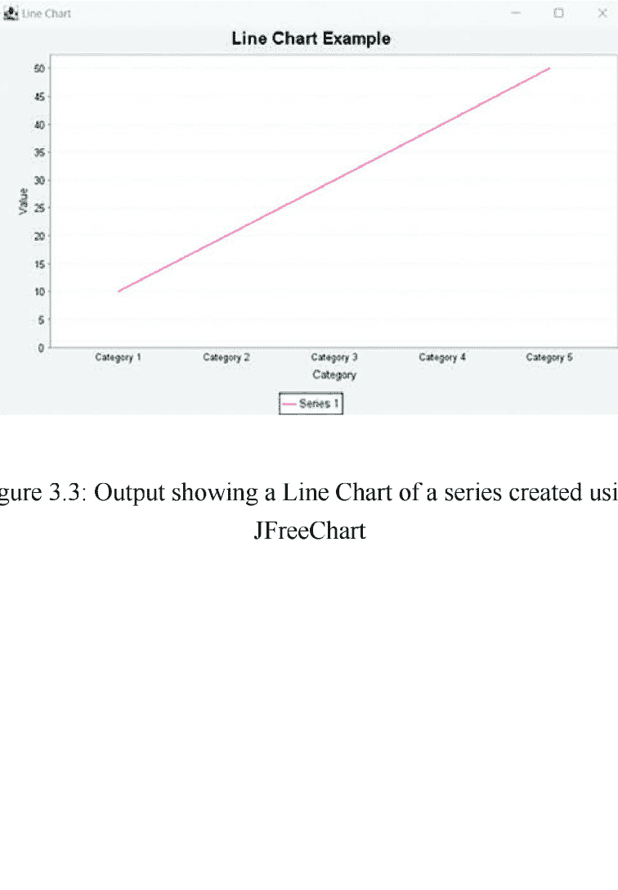

图 3.3: 显示使用 JFreeChart 创建的系列折线图的输出

## 散点图

散点图是图的一种类型，在二维坐标系上显示两个变量的值。图中的每个点代表一个单独的观测，一个变量绘制在 x 轴上，另一个变量绘制在 y 轴上。

散点图用于探索两个变量之间的关系，并识别数据中可能存在的任何模式或趋势。它们可以用于可视化数据点的分布，并识别离群值或异常观测值。

以下是一个使用 JFreeChart 创建散点图的 Java 代码示例：

```java
import java.awt.Color;
import java.awt.Dimension;
import javax.swing.JFrame;
import org.jfree.chart.ChartFactory;
import org.jfree.chart.ChartPanel;
import org.jfree.chart.JFreeChart;
import org.jfree.chart.axis.NumberAxis;
import org.jfree.chart.plot.PlotOrientation;
import org.jfree.chart.plot.XYPlot;
import org.jfree.chart.renderer.xy.XYLineAndShapeRenderer;
import org.jfree.data.xy.XYDataset;
import org.jfree.data.xy.XYSeries;
import org.jfree.data.xy.XYSeriesCollection;

public class ScatterPlotExample {

    public static void main(String[] args) {

        // 创建一个数据集
        XYSeriesCollection dataset = new XYSeriesCollection();

        XYSeries series = new XYSeries("Scatter Plot Example");
        series.add(1.0, 2.0);
        series.add(2.0, 3.0);
        series.add(3.0, 1.0);
        series.add(4.0, 5.0);
        series.add(5.0, 4.0);
        dataset.addSeries(series);

        // 创建一个图表
        JFreeChart chart = ChartFactory.createScatterPlot(
            "Scatter Plot Example",
            "X-Axis",
            "Y-Axis",
            dataset,
            PlotOrientation.VERTICAL,
            true,
            true,
            false
        );

        // 自定义绘图
        XYPlot plot = (XYPlot) chart.getPlot();
    }
}
```


# 散点图示例代码

```java
plot.setBackgroundPaint(Color.WHITE);
plot.setDomainGridlinePaint(Color.BLACK);
plot.setRangeGridlinePaint(Color.BLACK);
plot.setDomainCrosshairVisible(true);
plot.setRangeCrosshairVisible(true);

// 自定义渲染器
XYLineAndShapeRenderer renderer = new XYLineAndShapeRenderer();
renderer.setSeriesLinesVisible(0, false);
renderer.setSeriesShapesVisible(0, true);
plot.setRenderer(renderer);

// 将图表添加到面板并显示它
ChartPanel chartPanel = new ChartPanel(chart);
chartPanel.setPreferredSize(new Dimension(500, 500));
JFrame frame = new JFrame("Scatter Plot Example");
frame.setDefaultCloseOperation(JFrame.EXIT_ON_CLOSE);
frame.setContentPane(chartPanel);
frame.pack();
frame.setVisible(true);
```

代码的输出如图所示：

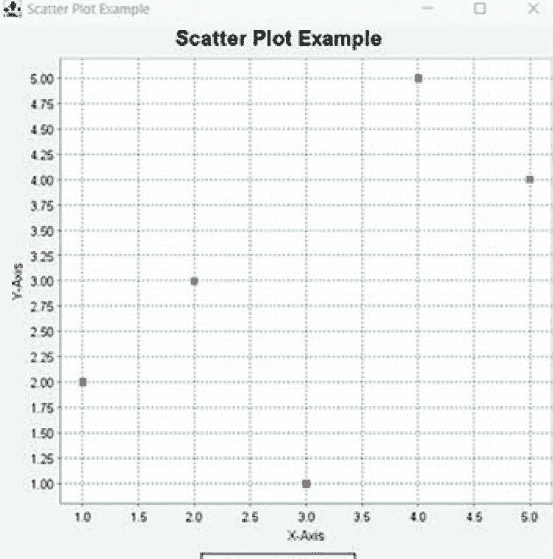

**图 3.4：** 显示 X 和 Y 坐标序列散点图的输出

程序创建了一个包含两个系列的数据集，其中每个数据点代表一对 X 和 Y 坐标。它创建了一个散点图图表并将两个系列添加到图表中。程序设置了一些图表属性，如图表标题、X 和 Y 轴标签以及标记的大小。最后，它在窗口中显示了图表。此示例演示了使用 JFreeChart 创建散点图是多么简单，以及如何使用各种图表属性对其外观进行自定义。

散点图不仅是可视化关系的不可或缺的工具，对于进行变量之间的相关性分析也很有价值。除了视觉吸引力外，散点图是评估两个变量之间关系强度和方向的第一步。由散点图辅助的相关性分析衡量了变量变化的程度...

# 时间序列图

时间序列图是用于显示随时间变化的图表的一种。它们对于分析随时间变化的数据特别有用，例如股票价格、天气或流量。JFreeChart 通过其数据集提供了创建时间序列的支持。以下是使用 JFreeChart 创建简单时间序列的示例：

```java
import java.util.Date;
import org.jfree.data.time.*;
import org.jfree.chart.*;
import org.jfree.chart.axis.*;
import org.jfree.chart.plot.*;
import org.jfree.chart.renderer.xy.*;

public class TimeSeriesChart {

    public static void main(String[] args) {
        // 创建时间序列集合
        TimeSeriesCollection dataset = new TimeSeriesCollection();

        // 将时间序列添加到数据集
        TimeSeries series = new TimeSeries("Stock Price");

        // 将数据添加到时间序列
        series.add(new Day(1, 1, 2022), 20.5);
        series.add(new Day(2, 1, 2022), 21.3);
        series.add(new Day(3, 1, 2022), 21.0);
        series.add(new Day(4, 1, 2022), 21.7);
        series.add(new Day(5, 1, 2022), 22.0);
        series.add(new Day(6, 1, 2022), 22.1);
        series.add(new Day(7, 1, 2022), 21.8);

        // 将时间序列添加到数据集
        dataset.addSeries(series);

        // 创建图表
        JFreeChart chart = ChartFactory.createTimeSeriesChart(
            "Stock Price", // 图表标题
            "Date", // 域轴标签
            "Price", // 值轴标签
            dataset, // 数据集
            true, // 图例
            true, // 提示框
            false // url
        );

        // 自定义图表
        XYPlot plot = chart.getXYPlot();
        DateAxis axis = (DateAxis) plot.getDomainAxis();
        axis.setDateFormatOverride(new java.text.SimpleDateFormat("MMM-\nyyyy"));
        plot.setRenderer(new XYLineAndShapeRenderer(true, false));
        plot.setBackgroundPaint(java.awt.Color.white);
        plot.setRangeGridlinesVisible(true);
        plot.setRangeGridlinesPaint(java.awt.Color.lightGray);
        chart.setBackgroundPaint(java.awt.Color.white);

        // 显示图表
        ChartFrame frame = new ChartFrame("Time Series Chart Example", chart);
        frame.pack();
        frame.setVisible(true);
    }
}
```

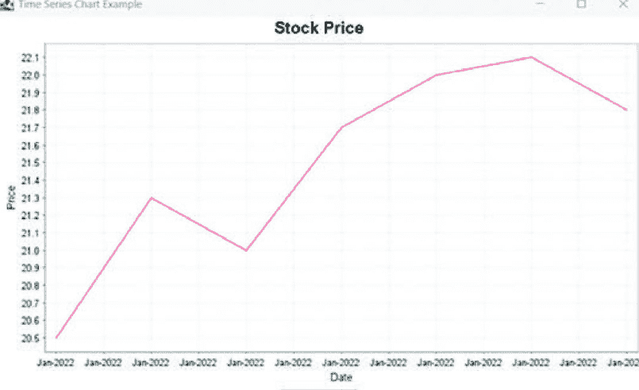

**图 3.5：** 使用 JFreeChart 显示股票价格时间序列图的输出

此代码使用 JFreeChart 库创建股票价格的时间序列图。它首先创建一个 `TimeSeriesCollection` 并向其添加一个 `TimeSeries`。然后使用 `Day` 对象指定日期并使用 `double` 值指定股票价格将数据添加到 `TimeSeries` 中。随后使用 `ChartFactory.createTimeSeriesChart` 方法创建时间序列图。该方法接受图表标题、x轴标签、y轴标签、数据集、图例标志、工具提示标志和 URL 标志作为参数。

随后通过从图表中获取绘制区域（plot）来进行自定义，包括设置 x 轴的日期格式、仅显示线条的渲染器、背景颜色以及范围网格线颜色。最后，使用 `ChartFrame` 显示图表。

# 箱线图

与直方图类似，箱线图（也称为须线图，box-and-whisker）提供了数值数据的可视化表示。它们将数据集划分为等距的间隔。箱线图是基于五数摘要的统计数据的图形化表示，包括最小值、第一四分位数、第三四分位数和最大值。箱线图通常用于可视化数据集的分布，包括离群值的存在。

在箱线图中，绘制一个矩形来代表中间 50% 的数据（第一四分位数和第三四分位数之间的范围），矩形内部有一条垂直线表示中位数。须线延伸至特定范围内的最小值和最大值（通常为四分位距的 1.5 倍）。落在该范围之外的点被视为离群值并单独绘制。

箱线图由各种组件组成，包括中位数、四分位数和离群值。中位数（Q2）由箱内部的线表示，它代表数据排序后的中间值。箱体封装了四分位距（IQR），表示中间 50% 数据的分布程度。Q1（下四分位数）将低 25% 的数据与其他部分隔离开，而 Q3（上四分位数）将高 25% 的数据与其他部分隔离开。箱线图和四分位数如图所示：

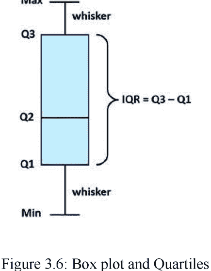

要计算数据集中的四分位数，请将数据按升序排列。然后，找到中位数（Q2）。Q1 是数据集下半部分的中位数，而 Q3 是上半部分的中位数。

箱线图是识别离群值（即明显超出四分位数范围的数据点）的有效工具。离群值落在四分位距计算出的绘图范围之外：

- 下界：$Q1 - 1.5 \times IQR$
- 上界：$Q3 + 1.5 \times IQR$

任何在边界之外的数据点均被视为离群值。

## Java 示例

让我们来了解如何在 Java 中使用 JFreeChart 创建箱线图，如下例所示：

```java
import java.awt.Color;
import java.util.ArrayList;
import java.util.List;
import org.jfree.chart.ChartFactory;
import org.jfree.chart.ChartFrame;
import org.jfree.chart.JFreeChart;
import org.jfree.chart.axis.CategoryAxis;
import org.jfree.chart.axis.NumberAxis;
import org.jfree.chart.plot.CategoryPlot;
import org.jfree.chart.renderer.category.BoxAndWhiskerRenderer;
import org.jfree.data.statistics.DefaultBoxAndWhiskerCategoryDataset;

public class BoxPlotExample {
    public static void main(String[] args) {
        // 创建数据集
        DefaultBoxAndWhiskerCategoryDataset dataset = new DefaultBoxAndWhiskerCategoryDataset();
        List<Double> values1 = new ArrayList<>();
        values1.add(2.3);
        values1.add(3.1);
        values1.add(2.8);
        values1.add(3.5);
        values1.add(3.6);

        List<Double> values2 = new ArrayList<>();
        values2.add(2.7);
        values2.add(2.9);
        values2.add(3.1);
        values2.add(3.4);
        values2.add(3.2);
        dataset.add(values1, "Series 1", "Category 1");
        dataset.add(values2, "Series 1", "Category 2");

        // 创建图表
        CategoryAxis xAxis = new CategoryAxis("Category");
        NumberAxis yAxis = new NumberAxis("Value");
        BoxAndWhiskerRenderer renderer = new BoxAndWhiskerRenderer();
        CategoryPlot plot = new CategoryPlot(dataset, xAxis, yAxis, renderer);
        JFreeChart chart = new JFreeChart("Box and Whisker Chart", plot);
        chart.setBackgroundPaint(Color.white);
    }
}
```

代码的输出如下所示：

## 箱线图输出

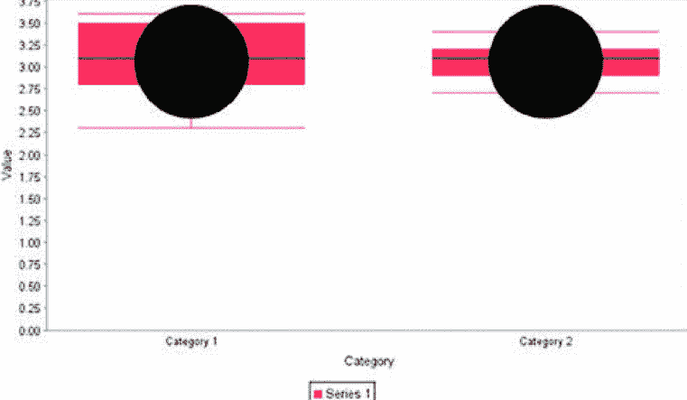

**图 3.7：** 显示箱线图的输出

在此示例中，我们创建了一个 `DefaultBoxAndWhiskerCategoryDataset`。然后我们创建一个 `JFreeChart`，传入数据集、标题和其他一些设置。我们创建一个 `ChartPanel` 并将其添加到 `JFrame` 等容器中。

# 饼图

饼图是分成扇区的圆形图表，每个扇区代表整体的比例。饼图用于比较整体的部分。在 JFreeChart 中，创建饼图涉及以下步骤：

- 创建 `DefaultPieDataset` 对象并填充数据。
- 创建 `JFreeChart`，传入数据集、标题和布尔标志。
- 将 `ChartPanel` 添加到 `JFrame`。

这里有一个演示如何创建基础饼图的示例代码：

```java
import javax.swing.JFrame;
import org.jfree.chart.ChartFactory;
import org.jfree.chart.ChartPanel;
import org.jfree.chart.JFreeChart;
import org.jfree.data.general.DefaultPieDataset;

public class PieChartExample {
    public static void main(String[] args) {
        // 创建数据集
        DefaultPieDataset dataset = new DefaultPieDataset();
        dataset.setValue("Java", 25);
        dataset.setValue("Python", 40);
        dataset.setValue("C++", 15);
        dataset.setValue("JavaScript", 10);
        dataset.setValue("Other", 10);

        // 创建图表
        JFreeChart chart = ChartFactory.createPieChart("Programming Language Popularity", dataset, true, true, false);

        // 创建 ChartPanel
        ChartPanel chartPanel = new ChartPanel(chart);

        // 将 ChartPanel 添加到 JFrame
        JFrame frame = new JFrame("Pie Chart Example");
        frame.setContentPane(chartPanel);
        frame.pack();
        frame.setVisible(true);
    }
}
```

代码的输出如下所示：

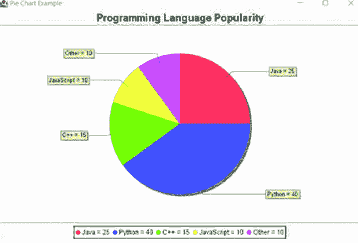

**图 3.8：** 使用 JFreeChart 显示饼图示例的输出

# 其他工具

**Jupyter Notebook**：Jupyter Notebook 是一个基于网络的交互式计算环境，允许用户创建和共享包含实时代码、方程、可视化和叙述性文本的文档。

这些工具为数据分析师提供了广泛的数据可视化选项，并用于为各种类型的数据创建强大且信息丰富的可视化。

# 结论

在本章中，我们涵盖了 Java 中几个重要的数据可视化工具和技术，包括 JFreeChart，它是一个用于创建各种图表和图形的开源库。我们还讨论了多种图表，包括柱状图、直方图、折线图、散点图、箱线图和时间序列图，并看到了使用 JFreeChart 创建这些可视化的代码示例。此外，我们还简要介绍了 Java 的一些高级数据可视化工具和技术，例如 JavaFX 和 Processing。总的来说，数据可视化是数据分析的一个关键方面，深入理解可用的工具和技术可以极大地增强提取洞察和有效传播数据的能力。

在下一章“Java 机器学习”中，我们将学习 Java 对机器学习应用的重要性，以及你可以使用的用于实现不同机器学习算法的各种库。

# 问题

- Java 编程中有哪些流行的开源数据可视化库？
- 数据分析中使用了哪些类型的图表和图形？每种类型的最适用场景是什么？
- 如何在 Java 编程中使用 JFreeChart 创建柱状图、直方图、折线图、散点图、箱线图和时间序列图？
- Java 数据分析中有哪些高级数据可视化工具？它们是如何使用的？
- 在 Java 中创建数据可视化时应遵循哪些最佳实践？这些最佳实践如何提高可视化的有效性？
- 数据可视化中存在哪些挑战？如何解决这些挑战以创建更有效的可视化？

# 知识点回顾

- 数据可视化是数据科学的关键部分，有助于获取洞察并根据数据做出决策。
- 有多种类型的图表和图形可用于数据可视化，例如柱状图、直方图、折线图、散点图、箱线图和时间序列图。


# JFreeChart 图表类型

- JFreeChart 是一个开源库，提供在 Java 中创建不同类型图表和图形的支持。
- 柱状图用于比较分类数据，使用 JFreeChart 中的 `CategoryPlot` 类创建。
- 直方图用于表示连续数值数据的分布，并使用 JFreeChart 中的 `XYPlot` 类创建。
- 折线图用于表示数据随时间变化的趋势，并使用 JFreeChart 中的 `XYPlot` 类创建。
- 散点图用于表示两个变量之间的关系，并使用 JFreeChart 中的 `XYPlot` 类创建。
- 箱线图用于表示数据分布并识别离群值，并使用 JFreeChart 中的 `BoxAndWhiskerPlot` 类创建。
- 时间序列图用于表示数据随时间的变化，并使用 JFreeChart 中的 `TimeSeriesPlot` 类创建。
- Java 还有其他几种高级数据可视化工具和库，例如 JavaFX、D3.js 和 Plotly，它们为数据可视化提供了额外的功能和能力。

# 引言

Java 是编程语言领域的基石，被广泛应用于各个领域，包括软件开发、机器学习、深度学习和大数据分析。在本章中，我们将专门探讨 Java 在机器学习背景下的作用。虽然随后的章节将深入探讨 Java 在深度学习和大数据分析中的应用，但我们此处的重点仍然是 Java 中可用的丰富的机器学习库的图景。

想象这样一个世界：预测性分析驱动决策，推荐系统预测我们的偏好，欺诈检测算法保护金融交易。在这个数字时代，机器学习驱动着各行业的进步，为复杂问题提供了转型性的解决方案。在这种背景下，Java 不仅是开发健壮软件解决方案的首选语言，也是实现机器学习算法的强大工具。它的活性、平台独立性和广泛的生态系统使其成为构建智能系统的理想人选。

Java 的内在特性与机器学习任务的需求无缝协同。从其促进模块化和可扩展代码的面向对象本质，到其支持多种数据结构和算法的丰富库，Java 为构建复杂的机器学习模型提供了坚实的基础。

在本章中，我们将探索 Java 在机器学习应用中的重要性，并检查用于实现不同机器学习算法的各种可用库。

# 结构

在本章中，我们将涵盖以下主题：

- 机器学习中的 Java
- WEKA
- RapidMiner
- ADAMS
- JavaML
- OpenNLP
- Mallet

# 机器学习中的 Java

由于以下原因，Java 在机器学习应用中具有重要意义，包括：

- **平台**：Java 的平台无关性使其能够在无需任何修改的情况下运行在多个操作系统上，使其成为需要在不同平台上运行的机器学习应用的理想选择。
- **大规模开发者群体**：Java 拥有庞大的开发者社区，他们为许多机器学习库、框架和工具的开发做出了贡献，使开发者更容易处理机器学习算法。
- **广泛性**：Java 拥有广泛的机器学习库，如 [此处原文缺失] 和 Apache，使得实现不同的机器学习算法变得更容易。
- **性能**：Java 的性能与 C++ 和 Python 等其他编程语言相当，适用于计算密集型的机器学习应用。
- **安全性**：Java 内置的安全特性使其成为开发安全的机器学习应用的理想选择，特别是在金融和医疗保健等对安全性有高要求的行业。

总的来说，Java 的平台独立性、庞大的开发者社区、广泛的库、性能和安全特性使其成为机器学习应用的适用语言。

# WEKA

Waikato Environment for Knowledge Analysis（怀卡托知识分析环境）是一种用 Java 开发的流行机器学习库。它提供了用于分类、回归、聚类和特征选择的广泛算法。Weka 是开源免费的，这使其成为学术和应用的流行的选择。

以下是 WEKA 的一些关键功能：

- **用户友好**：WEKA 提供了一个易于使用的图形用户界面 (`GUI`)，允许用户与机器学习算法交互并进行数据分析，无需编写代码。
- **广泛**：WEKA 提供了用于分类、回归、聚类和特征选择的广泛算法。这些算法包括决策树、基于规则的分类器、支持向量机、神经网络等。
- **预处理**：WEKA 还提供了多种预处理技术，如归一化、离散化特征缩放，有助于准备数据。
- **可视化**：WEKA 内置了可视化工具，使用户能够可视化数据、评估模型并比较不同算法的性能。
- **集成**：WEKA 可以与 KNIME、RapidMiner 和 R 等工具集成，扩展了它的功能并使其更容易与其他数据分析工具配合使用。
- **活跃**：WEKA 拥有庞大的用户和开发者社区，他们为该库的开发做出支持，并通过论坛和在线资源共享知识。

总的来说，WEKA 是一个强大且多功能的机器学习库，提供了易于使用的界面、广泛的算法以及多种预处理和可视化工具。它与其他工具的集成以及活跃的社区使其成为学术和工业机器学习应用的流行选择。

让我们考虑一个 WEKA 可以帮助检测金融交易欺诈的实际业务应用。

**问题陈述**：一家金融机构在面对不断增长的金融数据时，面临着检测欺诈交易日益巨大的挑战。他们希望部署机器学习算法来及时识别欺诈活动并降低财务风险。

**使用 WEKA 的解决方案**：

**数据**：该机构汇总了跨越各种金融活动的交易数据，包括信用卡交易、在线银行和电转账。采用 WEKA 的预处理技术对交易数据进行归一化、异常检测并提取用于欺诈检测的相关特征。

**算法选择**：利用 Weka 丰富的机器学习算法库，数据科学团队实验了集成方法、异常检测技术和基于规则的分类器。他们在历史交易数据上训练模型，并通过微调参数来优化性能。

**实时集成**：基于 Weka 的欺诈检测模型与机构的交易处理系统集成，实时监控入站交易。触发告警的可疑活动会促使欺诈分析师进一步调查，从而实现及时介入和防止欺诈。

**结果**：通过利用 Weka 的欺诈检测功能，该金融机构加强了对欺诈活动的防御，保护了资产，维护了客户信任并符合监管合规标准。

## 使用 Weka

Weka 的安装过程非常简单，可以通过以下简单的步骤完成：

- 前往官方网站的 Weka 下载页面：
- 为您的操作系统（Windows、Mac 或 Linux）选择合适的安装程序。
- 下载并将安装程序保存到您的计算机上。
- 运行安装程序并按照屏幕上的指示完成安装过程。
- 安装完成后，从开始菜单（Windows）或应用程序文件夹（Mac）中启动 Weka。

你将看到 Weka 的 `GUI`，可以在其中选择你想要使用的界面类型，如图所示。默认选项提供了一个用于处理机器学习算法的易于使用的界面。


图 4.1：Weka GUI 选择窗口

如果你想从命令行使用 Weka，可以导航到 Weka 安装目录并使用 Java 虚拟机 (`JVM`) 运行 `weka.jar` 文件。

大功告成！Weka 已安装在你的计算机上，你已准备好开始使用机器学习算法。如果你在安装过程中遇到任何问题，请参考 Weka 文档或向 Weka 社区寻求帮助。

# RapidMiner

RapidMiner 是一个用 Java 编写的开源机器学习和数据挖掘框架。它提供了一个易于使用的图形用户界面 (`GUI`)，允许用户无需编写代码即可与机器学习算法交互并进行数据分析。RapidMiner 支持广泛的数据源，包括电子表格、数据库和文本文件，并为分类、回归、聚类和关联分析提供了大量的机器学习算法。

以下是 RapidMiner 的一些关键特性。

- **用户友好**：与 Weka 类似，RapidMiner 框架提供了一个易于使用的 `GUI`，允许用户无需编写代码即可与机器学习算法交互并进行数据分析。该界面设计直观且易于使用，允许用户快速构建和测试机器学习模型。
- **范围广泛**：RapidMiner 为分类、回归、聚类和关联分析提供了大量的算法。这些算法包括决策树、基于规则的分类器、支持向量机、神经网络等。
- **预处理**：RapidMiner 提供了预处理技术，如归一化、离散化和特征缩放，有助于为机器学习算法准备数据。
- **集成**：RapidMiner 可以与 Weka、KNIME 和 R 等其他工具集成，扩展了它的功能并使其更容易与其他数据分析工具配合使用。
- **扩展**：RapidMiner 提供了一个扩展市场，用户可以在那里查找并安装附加功能，以扩展平台的核心功能。该市场包含了各种扩展程序，包括数据连接器、机器学习算法和数据可视化工具。
- **活跃**：RapidMiner 拥有庞大的用户和开发者社区，他们为平台开发做出贡献，提供支持并通过论坛和在线资源共享知识。

总之，RapidMiner 是一个既强大又多功能的机器学习平台，它提供了易于使用的界面、广泛的算法选择以及各种预处理和可视化工具。它与其他工具集成的能力、扩展市场的可用性以及活跃的用户社区，使其成为学术界和工业界机器学习应用的流行选择。

## 使用 RapidMiner

首先，你需要按照以下步骤安装 RapidMiner：

- 前往 RapidMiner 网站 `https://rapidminer.com/platform/` 并下载适用于你操作系统的安装程序。
- 双击下载的文件以开始安装过程。
- 按照安装向导的说明完成安装。
- 启动 RapidMiner Studio 以获得与图所示类似的 `GUI`。

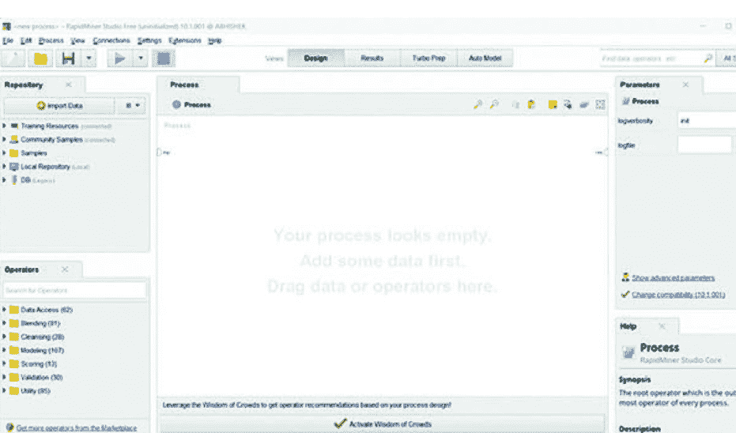

图 4.2：Windows上的 RapidMiner Studio GUI

一旦安装了 RapidMiner，你就可以开始使用它来构建机器学习模型，如下流程图所示：


图 4.3：数据分析流水线中的 RapidMiner

以下是入门的基本步骤：

- **导入**：从将数据导入 RapidMiner 开始。你可以从多种源导入数据，包括电子表格、数据库和文本文件。RapidMiner 还提供了示例数据集供你测试该平台。
- **预处理**：导入数据后，你可能需要对其进行预处理以为机器学习做好准备。RapidMiner 提供了多种预处理工具，如归一化、离散化和特征缩放，可以帮助你准备数据。
- **构建**：RapidMiner 提供了用于分类、回归、聚类和关联分析的各种机器学习算法。你可以使用这些算法构建预测结果或发现数据中模式的模型。
- **评估**：一旦构建了模型，你就需要评估其性能。RapidMiner 提供了多种评估工具，如交叉验证和混淆矩阵，可以帮助你评估模型的准确性。
- **部署**：一旦评估了模型并对其性能满意，就可以将其部署以对新数据进行预测。

总之，要使用 RapidMiner，你需要安装它、导入数据、预处理数据、构建机器学习模型、评估性能并部署它们。RapidMiner 提供了易于使用的界面和多种工具来帮助你执行这些步骤。

# ADAMS

高级数据挖掘与机器学习系统是一个基于 Java 的机器学习库，为构建和部署机器学习模型提供框架。它被设计为模块化、可扩展和可扩展的，允许用户轻松整合新算法、数据源和数据转换。以下是 ADAMS 的一些特性：

- ADAMS 提供了分类、回归、聚类和关联分析的各种机器学习算法。它还包括几种优化算法，如梯度下降和粒子群优化。
- ADAMS 支持多种数据源，包括电子表格、数据库和文本文件。它还为 Web 服务和 Twitter、Facebook 等社交平台提供了连接器。
- ADAMS 包含了多种数据转换工具，如归一化、离散化和特征缩放。它还提供了多种文本处理工具，如分词、词干提取和停用词移除。
- ADAMS 为机器学习模型的部署提供了多种选项，包括将模型嵌入 Java 应用程序中、将模型导出为 `RESTful` Web 服务，以及将模型作为独立应用程序运行。
- ADAMS 包含了多种可视化工具，帮助用户探索和理解其数据。这些工具包括散点图、柱状图和热力图。
- ADAMS 的设计兼顾了易用性和强大，使其成为学术界和工业界机器学习应用的流行选择。它由一个开发者社区积极维护，且用户和贡献者列表也在不断增长。

## 使用 ADAMS

要使用 ADAMS，您需要遵循以下步骤：

- **下载与安装**：ADAMS 是一个开源库，可以从其官方网站下载。下载后，将文件提取到您选择的目录中。您也可以下载预构建的 ADAMS 包或从源代码进行构建。
- **创建工作流**：工作流是构建和部署模型所涉及步骤的图形化表示。可以通过打开 ADAMS 并从文件（`File`）菜单中选择来创建一个新的工作流。然后，您可以将所需的模块拖入工作流画布中。
- **配置**：一旦您向工作流中添加了所需的模块，就需要通过设置其参数对其进行配置。您可以通过双击模块或右键点击模块并选择来完成。
- **连接**：配置好模块后，您需要通过在输入和输出端口之间绘制连接来连接它们。您可以通过点击一个模块的输出端口并将光标拖到另一个模块的输入端口来实现。
- **运行**：一旦您配置并连接了模块，就可以通过点击工具栏中的按钮来运行工作流。ADAMS 将按照连接指定的顺序执行工作流中的模块并生成输出。
- **可视化**：ADAMS 提供了多种可视化工具来帮助您探索和理解数据。您可以使用这些工具生成散点图、柱状图和热力图，以使您的工作流结果可视化。

ADAMS 是一个强大且多功能的机器学习库，提供了广泛的算法、数据源和数据转换。基于工作流的方法使其能够构建和部署机器学习模型，而其可视化工具则帮助用户探索和理解其数据。

让我们通过一个社交媒体数据情感分析的实际示例来了解 ADAMS 的多功能。

**问题描述**：一家营销机构旨在通过分析社交媒体上的对话来衡量公众对新发布产品的情绪。他们希望对大量的 Twitter 数据进行情感分析，以理解客户的感知和情绪。

**使用 ADAMS 的解决方案**：

- **数据**：ADAMS 的 Web 服务连接器能够与 Twitter API 无缝集成，允许该机构获取与产品相关的实时 Twitter 数据。
- **文本**：ADAMS 的文本处理工具（包括分词、词干提取和停用词删除）对原始文本数据进行预处理，清除噪声和无关信息。
- **情感**：利用 ADAMS 的机器学习算法，该机构在标注的 Twitter 数据上训练情感分析模型。他们利用词袋模型表示和情感词表等技术将推文分类为积极、消极或中性情绪。
- **可视化**：ADAMS 的可视化工具生成交互式仪表板，显示随时间变化的情绪趋势、不同人群的情绪分布以及驱动情绪的影响性主题。

通过利用 ADAMS 的能力，该营销机构可以获得有关公众产品情绪的可操作洞察，从而做出明智决策并制定针对性的营销策略。

# JavaML

JavaML 是一个用于 Java 的机器学习库，为监督学习和无监督学习提供了广泛的算法。它设计易于使用且灵活，注重模块化和可扩展性。JavaML 的架构如图所示

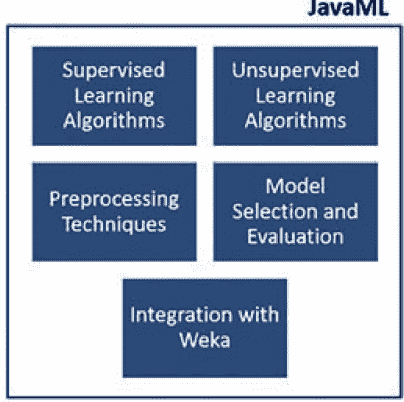

图 4.4：JavaML 架构

上图提供了 JavaML 架构及其与其他 Java 组件集成的视觉概述，对其功能和用法提供了清晰的说明。它作为核心组件，封装了 JavaML 的所有功能。各种模块，如监督学习算法、无监督学习算法、预处理技术以及模型选择和评估工具，是 JavaML 架构不可或缺的一部分。JavaML 与 Weka 机器学习库无缝集成，通过额外的算法和工具增强了功能。

以下是 JavaML 的一些关键特性：

- **监督学习**：JavaML 提供了多种监督学习算法，包括决策树、逻辑回归、k-最近邻和支持向量机。这些算法可用于分类、回归和排序等任务。
- **无监督学习**：JavaML 还提供了多种无监督学习算法，包括聚类、主成分分析和独立成分分析。这些算法可用于数据压缩、特征提取和异常检测等任务。
- **预处理与特征**：JavaML 提供了多种预处理和特征提取技术，包括归一化、特征缩放和特征选择。这些技术可用于机器学习算法准备数据，并从原始数据中提取有意义的特征。
- **模型选择与评估**：JavaML 提供了多种模型选择和评估技术，包括交叉验证、自助采样和网格搜索。这些技术可用于为特定任务选择最佳模型，并评估模型在新数据上的性能。
- **集成**：JavaML 设计用于与 Weka 机器学习库无缝工作，后者为机器学习提供了额外的算法和工具。JavaML 可以作为独立库使用，也可以与 Weka 结合构建更复杂的机器学习工作流。

总之，JavaML 是一个功能丰富且稳健的 Java 机器学习库，提供了监督和无监督学习了一系列算法和技术。它对模块化灵活性的强调使其与其他工具和库无缝集成，而其用户友好的界面让不同技能水平的人都能轻松上手。

## 使用 JavaML

使用 JavaML 涉及多个步骤，包括安装库、准备数据、选择并训练算法以及评估模型性能。以下是涉及步骤的概览：

- **安装**：JavaML 可以从官方网站或通过 Maven 下载。下载库后，可以将其导入您的 Java 项目。
- **准备数据**：在使用任何机器学习算法之前，需要以合适的格式准备数据。这可能包括处理缺失值、缩放或归一化数据并将类别变量转换为数值。
- **选择**：JavaML 为监督学习和无监督学习提供了多种算法。您需要根据问题描述、数据类型和可用资源选择合适的算法。
- **训练**：一旦选择了算法，您需要使用准备好的数据训练模型。这包括将数据分为训练集和测试集、在训练数据上拟合模型并调整超参数以提高性能。
- **评估**：训练模型后，您需要使用合适的指标（如准确率、精确率、召回率或 F1 分）评估其性能。这将帮助您判断模型在测试数据上的表现良好，还是对训练数据存在过拟合或欠拟合。
- **部署**：一旦您对模型性能满意，就可以将其部署到生产环境中。这可能涉及与其他系统或应用程序集成，并确保它能够处理新的数据输入。

总体来说，使用 JavaML 涉及多个步骤，从安装库到部署训练模型。该过程需要对机器学习原理、数据准备和 Java 编程有良好的理解。然而，凭借其用户友好的界面和详细的文档，JavaML 让在 Java 中学习机器学习变得简单。

# OpenNLP

OpenNLP（自然语言处理）是一个基于 Java 的机器学习库，它为自然语言处理任务提供了各种工具和模型，如分词、句法检测、词性标注、命名实体识别、分块（`chunking`）、句法分析和共指消解。它是由 Apache 软件基金开发的开源库，在工业和学术界被广泛使用。

OpenNLP 的主要特性如下：

- **分词（Tokenization）**：它提供了将文本拆分为单个单词或标记（`tokens`）的模型，这对于下游 NLP 任务至关重要。


# OpenNLP

OpenNLP（自然语言处理）是一个基于 Java 的机器学习库，它为自然语言处理任务提供了各种工具和模型，如分词、句法检测、词性标注、命名实体识别、分块、句法分析和共指消解。它是由 Apache 软件基金会开发的开源库，在工业和学术界被广泛使用。

OpenNLP 的主要特性如下：

- **分词（Tokenization）**：它提供了将文本拆分为单个单词或标记的模型，这对于下游 NLP 任务至关重要。
- **句法检测（Sentence Detection）**：OpenNLP 提供了用于检测文本中句子边界的模型。这对于如情感分析或文档分类等任务非常重要。
- **词性标注（Part-of-Speech, POS）**：它提供了为句子中的每个单词分配词性标记的模型。这可以帮助识别句子的句法结构。
- **命名实体识别（Named Entity Recognition）**：OpenNLP 提供了识别文本中命名实体的模型，例如人名、组织名或地名。
- **分块（Chunking）**：它提供了根据句法结构将单词分组为“块”的模型。
- **句法分析（Parsing）**：OpenNLP 提供了解析句子并识别句子单词之间关系的模型。
- **共指消解（Co-reference）**：它提供了解析文本中引用的模型，这有助于识别文本中提到的实体之间的关系。

总而言之，OpenNLP 是一个强大且多功能的 Java NLP 库，它为自然语言处理任务提供了各种工具和模型。它的易用性、丰富的特性以及开源的本质使其成为工业界和学术界 NLP 应用的热门选择。

## 使用 OpenNLP

要使用 OpenNLP，你首先需要下载针对你想要执行的特定 NLP 任务的模型。这些模型是在大型文本数据语料上训练的，由 OpenNLP 项目提供。你可以从 OpenNLP 网站或 Maven 中央存储库下载这些模型。

一旦下载了模型，你就可以使用 OpenNLP 库来执行各种 NLP 任务。以下是一个如何使用 OpenNLP 执行句子检测的示例：

```java
import opennlp.tools.sentdetect.*;

public class SentenceDetectorExample {
    public static void main(String[] args) throws Exception {
        // 加载句子检测模型
        InputStream modelIn = new FileInputStream("en-sent.bin");
        // ...
    }
}
```

## OpenNLP 的真实世界应用

OpenNLP 在真实领域的应用：

- **情感分析（Sentiment Analysis）**：OpenNLP 广泛应用于社交媒体、评论和调查，衡量公众观点。
- **信息提取（Information Extraction）**：利用 OpenNLP 从金融服务和新闻中提取关键实体。
- **客户支持自动化（Customer Support Automation）**：OpenNLP 驱动聊天机器人和虚拟助手进行意图识别和回复。

# Mallet

Mallet 是一个强大的 Java 机器学习库，为自然语言处理（NLP）、文本分类、主题建模提供了各种算法和工具。Mallet 的关键特性和组件包括：

- **算法（Algorithms）**：Mallet 提供了多种前沿的机器学习算法，包括朴素贝叶斯、最大熵、条件随机场（CRF）、隐马尔可夫模型（HMM）以及潜在狄利克雷分配（LDA）。
- **数据（Data）**：Mallet 提供了表示数据的高效数据结构，如实例（instances）、特征向量（feature vectors）和管道（pipes）。
- **评估（Evaluation）**：Mallet 提供了多种衡量机器学习模型性能的指标，如准确率、召回率、F1 分数的混淆矩阵。
- **可视化（Visualization）**：Mallet 提供了多种可视化工具，用于探索机器学习模型的输出，如主题模型和文档分类器。
- **命令行（Command-Line）**：Mallet 提供了一个用于运行机器学习实验和分析结果的界面。该界面高度可配置，允许用户为算法指定各种选项和参数。

## 模型训练与调优

你可以使用 Mallet 的训练工具训练模型，并调整模型的超参数，使用交叉验证或其他技术进行调优。

## 评估

在训练模型后，你可以使用 Mallet 的评估工具评估它们的性能。Mallet 提供了多种评估指标，如准确率、精确率、召回率和 F1 分数。你还可以使用 Mallet 的可视化工具对结果可视化，例如主题模型和词云。

## 部署

一旦完成模型的训练和评估，你就可以将其部署到生产应用程序中。Mallet 提供了几种序列化和加载模型的方法，例如二进制序列化、文本序列化。你还可以将模型与其他 Java 库和工具集成。

## 比较分析

与 Java 中的其他 NLP 工具相比，Mallet 以其几个独特优势脱颖而出，包括：

- **丰富的特征集**：Mallet 为广泛的 NLP 任务提供了一套全面的算法和工具，为用户选择其应用程序最合适的方法提供了灵活性和选择。
- **效率和可扩展性**：Mallet 为效率和可扩展性而设计，能够处理大型文本语料库并扩展到不同大小的数据集，使其非常适合科学研究和工业应用。
- **活跃的开发社区**：Mallet 受益于活跃的开发社区，有来自全球研究人员和从业者的定期更新、错误修复和贡献，确保了对用户的持续改进和支持。

使用 Mallet 需要熟悉 Java 编程、机器学习算法和 NLP。尽管如此，Mallet 提供了易于使用的 API、全面的文档和活跃的社区，这简化了入门过程以及解决复杂的机器学习问题。

# 结论

在本章中，我们涵盖了各种 Java 机器学习库和框架，包括 Weka、RapidMiner、ADAMS、JavaML、OpenNLP 和 Mallet。我们了解到每个库和框架都有其独特的特征和优势，使其适用于不同的机器学习应用。我们还看到 Java 为机器学习提供了丰富且多样化的生态系统，其普及、易用性和详尽的文档使其成为初学者和经验丰富的从业者的极佳选择。根据你的特定用例和专业水平选择合适的库或框架至关重要。总体而言，本章提供了 Java 机器学习领域中可用选项的概述，这将使读者在根据需求选择最合适的库或框架时做出明智的决策。

在下一章“统计学”中，我们将探索最流行的统计原理，如描述统计、随机抽样、贝叶斯定理等。

## 问题

1. 什么是 Weka？它的哪些关键特征使其成为机器学习应用的流行选择？
2. ADAMS 与其他 Java 机器学习库有何不同？它在哪些用例中表现优异？
3. 使用 RapidMiner 进行机器学习任务有哪些优势？它与其它基于 Java 的机器学习框架相比如何？
4. 什么是 OpenNLP？它如何用于机器学习中的自然语言处理任务？
5. JavaML 中提供了哪些算法和技术？它对模块化的关注如何使其易于与其他库和工具集成？
6. Mallet 与其他 Java 机器学习框架有何不同？它可以有效应用的常见用例有哪些？

## 要点回顾

- 由于其性能、可扩展性以及各种库和工具的可用性，Java 是一种用于机器学习应用程序的强大编程语言。
- Java 中有多种机器学习框架，如 Weka、RapidMiner、ADAMS、JavaML、OpenNLP 和 Mallet，每个框架都有其独特的特征和能力。
- Weka 是一个流行的基于 Java 的机器学习库，为监督学习和无监督学习提供了广泛算法，以及数据预处理和可视化的工具。
- ADAMS 是一个模块化的 Java 机器学习框架，强调灵活性、可扩展性，并为各种机器学习任务提供了大量预构建模块。
- RapidMiner 是一个多功能且易于使用的基于 Java 的机器学习平台，为构建机器学习工作流提供了拖放式界面，以及大量内置算法和可视化工具。
- OpenNLP 是一个基于 Java 的自然语言处理库，为词性标记、命名实体识别和句法分析等任务提供了工具。
- JavaML 是一个灵活且可扩展的基于 Java 的机器学习库，为监督学习和无监督学习提供了多种算法，并关注模块化以及与其他库和工具集成的易用性。
- Mallet 是一个基于 Java 的机器学习框架，为自然语言处理任务提供了广泛工具，以及用于分类、聚类和主题建模的算法。

# 引言

统计学是数学的一个基础分支，在决策、问题解决和研究分析中起着重要作用。在本章中，我们将探索一些重要的统计原理，如描述统计、随机抽样、概率分布等，并查看它们如何应用于解决现实问题。

## 结构

在本章中，我们将涵盖以下主题：

- 描述统计
- 随机抽样
- 随机变量
- 概率分布
- 贝叶斯定理
- 协方差与相关性
- 中心极限定理
- 假设检验
- 置信区间

# 描述统计

描述统计是统计学的一个分支，通过对数据进行分析和描述，以清晰易懂的方式总结并展示其主要特征。它涉及使用各种技术来组织、总结和展示数据，以便于它们的解释和分析。描述统计用于描述一组数据的主要特征，包括其集中趋势、变异性和形状。这些统计量是数据分析中的重要工具，广泛应用于业务、金融、医疗保健、社会科学和工程等领域。它涵盖了中心趋势度量、变异性、频率分布、探索性数据分析、离群值、数据清洗和归一化等主题。描述统计提供了一种理解数据本质、分布及其特征的方法。

## 集中趋势量

集中趋势量是一组描述数据集中心位置的统计指标。这些指标包括平均值、中位数和众数。平均值是所有值之和除以观测次数。它是最常用的集中趋势量，且对极端值敏感。中位数是数据集按顺序排列时的中间值。它不受极端值的影响，但对于大型数据集来说计算困难。众数是数据集中出现频率最高的值。它适用于描述名义或分类数据。这些度量可以提供数据集的快速总结，并通常用于不同数据集之间进行比较。

### 平均值

在统计学中，平均值是数据集集中趋势的度量。在 Java 中，可以通过对所有值求和然后除以集合中的总数来计算一组数字的平均值。这里有一个使用 `Apache Commons Math` 库计算数组平均值的 Java 代码示例：

```java
import org.apache.commons.math3.stat.descriptive.moment.Mean;

public class MeanExample {
    public static void main(String[] args) {
        // 创建一个值数组
        double[] values = { 4.5, 3.0, 5.7, 2.6, 5.5, 9.2, 7.5, 5.5 };

        // 计算平均值
        Mean mean = new Mean();
        double meanValue = mean.evaluate(values);

        System.out.println("Mean: " + meanValue);
    }
}
```

代码的输出：

```
Mean: 5.4375
```

这意味着数字 4.5, 3.0, 5.7, 2.6, 5.5, 9.2, 7.5 和 5.5 的平均值为 5.4375。

### 中位数

中位数是数据集中一种集中趋势的衡量标准，表示当数据按升序或降序排列时的中间值。它是将数据的下半部分与上半部分分开的值。当数据包含离群值或可能偏移平均值的极端值时，中位数特别有用。要找到中位数，首先对数据集进行排序，然后确定中间值。如果数据集的数据个数为偶数，则中位数是两个中间值的平均值。例如，在数据集 {2, 3, 5, 7, 10, 12, 15} 中，中位数是 7。以下是一个使用 `Apache Commons Math` 库的 Java 示例代码，用于计算数字数组的中位数：

```java
import org.apache.commons.math3.stat.descriptive.rank.Median;

public class MedianExample {
    public static void main(String[] args) {
        // 创建一个值数组
        double[] values = {2, 3, 5, 7, 10, 12, 15};

        // 计算中位数
        Median median = new Median();
        double medianValue = median.evaluate(values);

        System.out.println("Median: " + medianValue);
    }
}
```

代码的输出：

```
Median: 7.0
```

### 众数

在统计学中，众数被定义为给定数据集中出现频率最高的值。它是一种集中趋势的衡量标准，通过识别出现频率最高的值来描述数据集。例如，在数据集 {2, 4, 5, 5, 6, 6, 6, 8} 中，众数是 6，因为它出现了三次，比数据集中的任何其他值都多。众数在处理名义数据时特别有用，这些值代表类别，例如汽车的颜色或水果的种类。


```java
import org.apache.commons.math3.stat.StatUtils;

public class ModeExample {

    public static void main(String[] args) {

        // 创建一个值数组
        double[] values = {2, 4, 5, 5, 6, 6, 6, 8};

        // 计算众数
        double[] mode = StatUtils.mode(values);

        System.out.print("Mode: ");
        for (double m : mode) {
            System.out.print(m + " ");
        }
    }
}
```

代码的输出：

```
Mode: 6.0
```

## 离散程度衡量

离散程度衡量是描述数据集扩散或分布程度的统计指标。它们提供了关于数据值相互之间以及离集中趋势程度的见解。常见的离散程度指标是范围、方差、标准差和四分位距。这些指标有助于量化数据集内部变异或多样性的程度，并可识别离群值或异常观测值。

## 范围

范围是数据集扩散的衡量标准，计算方法为数据最大值和最小值之间的差。Apache Commons Stat `StatUtils` 提供了 `max()` 方法来计算最大值，以及 `min()` 方法来计算最小值。然后可以通过从最大值中减去最小值来计算范围。这里有一个示例代码：

```java
import org.apache.commons.math3.stat.StatUtils;

public class RangeExample {

    public static void main(String[] args) {
        double[] data = {2.1, 4.5, 1.2, 6.9, 3.8, 6.5};

        double max = StatUtils.max(data);
        double min = StatUtils.min(data);
        double range = max - min;

        System.out.println("Range: " + range);
    }
}
```

代码的输出：

```
Range: 5.7
```

## 方差

方差是一种描述单个数据点偏离数据集平均值程度的统计量。数据集的方差通过计算每个值与平均值之间差的平方的平均值得出。较高的方差表示数据点更加分散，而较低的方差表示数据点更密集地聚集在平均值周围。这里是一个使用 Apache Commons Math 库的 Java 示例代码，用于计算数据集的方差。

```java
import org.apache.commons.math3.stat.descriptive.DescriptiveStatistics;

public class VarianceExample {

    public static void main(String[] args) {
        double[] data = { 2.1, 3.2, 4.5, 1.7, 6.9, 5.8, 8.2, 3.4, 4.7, 5.1 };

        DescriptiveStatistics stats = new DescriptiveStatistics(data);
        double variance = stats.getVariance();

        System.out.println("Variance: " + variance);
    }
}
```

代码的输出：

```
Variance: 4.226666666666667
```

## 标准差

标准差是数据集扩散的衡量标准。它是方差的平方根。标准差通常用于描述数据点的分布。这里是一个使用 Apache Commons Math 库的 Java 示例代码，用于计算数据集的标准差。

```java
import org.apache.commons.math3.stat.descriptive.DescriptiveStatistics;

public class StandardDeviationExample {

    public static void main(String[] args) {
        double[] data = {2.1, 3.2, 4.5, 1.7, 6.9, 5.8, 8.2, 3.4, 4.7, 5.1};

        DescriptiveStatistics stats = new DescriptiveStatistics(data);
        double stdDev = stats.getStandardDeviation();

        System.out.println("Standard Deviation: " + stdDev);
    }
}
```

代码的输出：

```
Standard Deviation: 2.0558858555112
```

## 四分位距

四分位距 (IQR) 是一种描述数据中间 50% 的离散程度衡量。四分位数将从低到高的分布分为四个等份。换句话说，它是数据集的上四分位数（Q3）和下四分位数（Q1）之间的差。使用 Apache 库在 Java 中计算四分位距，可以使用以下 `DescriptiveStatistics` 类：

```java
import org.apache.commons.math3.stat.descriptive.DescriptiveStatistics;

public class IQRExample {

    public static void main(String[] args) {
        double[] data = {1.2, 2.3, 3.5, 4.7, 5.8, 6.9, 7.1, 8.2, 9.4, 10.6};

        DescriptiveStatistics stats = new DescriptiveStatistics();
        for (double d : data) {
            stats.addValue(d);
        }

        double q1 = stats.getPercentile(25);
        double q3 = stats.getPercentile(75);
        double iqr = q3 - q1;

        System.out.println("Q1: " + q1);
        System.out.println("Q3: " + q3);
        System.out.println("IQR: " + iqr);
    }
}
```

代码的输出：

```
Q1: 3.2
Q3: 8.5
IQR: 5.3
```

# 频率分布

频率分布是一种以简洁且信息丰富的方式总结和展示数据的方法。它们将原始数据组织成有意义的类别，并显示落入每个类别的观测次数。这些信息可以以频率表、图表和直方图的形式进一步呈现。频率表显示类别及其对应的频率，而图表则提供了数据的视觉表示。直方图是图表的一种，以柱状的形式显示连续变量的频率。它们有助于理解数据分布的形状并识别任何模式或离群值。总的来说，频率分布、表格、图表和直方图是总结和可视化数据重要工具，可以为从业务到社会科学的广泛应用提供宝贵的见解。以下是一个使用 Java 和 Apache Commons Math 库创建频率表的示例。

```java
import java.util.Iterator;
import org.apache.commons.math3.stat.Frequency;

public class FrequencyExample {

    public static void main(String[] args) {
        // 创建数据数组
        double[] data = {2.0, 2.5, 3.0, 3.5, 3.5, 4.0, 4.0, 4.5, 5.0, 5.0, 5.0};

        // 创建 Frequency 对象
        Frequency freq = new Frequency();

        // 将数据添加到频率表中
        for (double value : data) {
            freq.addValue(value);
        }

        // 打印频率表
        System.out.println("Frequency table:");
        Iterator freqIt = freq.valuesIterator();
        while (freqIt.hasNext()) {
            Comparable value = (Comparable) freqIt.next();
            System.out.println(value + ": " + freq.getCount(value));
        }
    }
}
```

代码的输出结果：

```
Frequency table:
2.0: 1
2.5: 1
3.0: 1
3.5: 2
4.0: 2
4.5: 1
5.0: 3
```

此代码使用 `Frequency` 类创建了一个频率表，该类计算了每个值在数据集中出现的次数。

# 探索性数据分析 (EDA)

探索性数据分析 (EDA) 是理解和分析数据的重要步骤。它涉及使用各种统计方法和可视化技术识别数据中的模式、趋势和异常值。EDA 中常用的三种常见方法是箱线图、散点图和 QQ 图。

## 箱线图

箱线图也称为箱须图（box-and-whisker），用于显示数据集的分布。它们显示了数据的中位数、分位数和离群值。箱体代表中间 50% 的数据，中位数由箱内部的线表示。箱须延伸到 1.5 倍四分位距（IQR）范围内的极值值，而超出箱须的数据点被视为离群值。以下是一个使用 Apache Commons Math 库创建箱线图的示例代码：

```java
import org.apache.commons.math3.stat.descriptive.DescriptiveStatistics;

public class BoxPlotExample {

    public static void main(String[] args) {
        double[] data = {1.2, 2.1, 3.5, 4.2, 5.7, 6.8, 7.5, 8.2, 9.1, 10.0};

        DescriptiveStatistics stats = new DescriptiveStatistics(data);

        double q1 = stats.getPercentile(25);
        double q2 = stats.getPercentile(50);
        double q3 = stats.getPercentile(75);
        double iqr = q3 - q1;

        double upperWhisker = q3 + 1.5 * iqr;
        double lowerWhisker = q1 - 1.5 * iqr;

        System.out.println("Q1: " + q1);
        System.out.println("Q2: " + q2);
        System.out.println("Q3: " + q3);
        System.out.println("IQR: " + iqr);
        System.out.println("Upper Whisker: " + upperWhisker);
        System.out.println("Lower Whisker: " + lowerWhisker);
    }
}
```

代码的输出：

```
Q1: 3.15
Q2: 6.25
Q3: 8.424999999999999
IQR: 5.274999999999999
Upper Whisker: 16.3375
Lower Whisker: -4.7624999999999997
```

为了更好地可视化箱线图，你可以使用我们在第 3 章：数据中学习过的内容。

## 散点图

散点图用于显示数据集中两个变量之间的关系。图上的每个点代表两个变量的一对值。点在 x 轴上的位置代表一个变量的值，点在 y 轴上的位置代表另一个变量的值。我们已经在第 X 章中涵盖了如何使用 JFreeChart 绘制散点图。

## QQ 图

QQ 图（分位数-分位数图）是一种用于评估两组数据是否来自同一分布的图形技术。它在识别偏离正态分布的情况时特别有用。QQ 图将数据的分位数与已知分布（通常是正态分布）的分位数进行比较。

以下是使用 Java 和 Apache Commons Math 库生成 QQ 图的示例代码：

```java
import org.apache.commons.math3.stat.descriptive.rank.Percentile;
import org.apache.commons.math3.distribution.NormalDistribution;
import java.util.Arrays;
import java.awt.Color;
import javax.swing.JFrame;
import org.jfree.chart.ChartFactory;
import org.jfree.chart.ChartPanel;
import org.jfree.chart.JFreeChart;
import org.jfree.chart.plot.PlotOrientation;
import org.jfree.chart.plot.XYPlot;
import org.jfree.data.axis.NumberAxis;
import org.jfree.data.xy.XYSeries;
import org.apache.commons.math3.stat.descriptive.rank.Percentile;
import org.apache.commons.math3.distribution.NormalDistribution;
import java.util.Arrays;
import java.awt.Color;
import javax.swing.JFrame;
import org.jfree.chart.ChartFactory;
import org.jfree.chart.ChartPanel;
import org.jfree.chart.JFreeChart;
import org.jfree.chart.plot.PlotOrientation;
import org.jfree.chart.plot.XYPlot;
import org.jfree.data.axis.NumberAxis;
import org.jfree.data.xy.XYSeries;
import org.jfree.data.xy.XYSeriesCollection;

public class QQPlot extends ApplicationFrame {

    public QQPlot(String title) {
        super(title);
    }

    public static void main(String[] args) {
        double[] data = {2.5, 3.2, 3.5, 4.1, 4.5, 4.8, 5.3, 5.8, 6.1, 6.6, 7.2, 7.5, 7.9};

        Arrays.sort(data);

        NormalDistribution normalDist = new NormalDistribution();

        double[] theoreticalQuantiles = new double[data.length];
        for (int i = 0; i < data.length; i++) {
            theoreticalQuantiles[i] = normalDist.inverseCumulativeProbability((i + 1.0) / data.length);
        }

        double[] sampleQuantiles = new double[data.length];
        for (int i = 0; i < data.length; i++) {
            sampleQuantiles[i] = new Percentile().evaluate(data, (i + 1.0) / data.length * 100);
        }

        XYSeries series = new XYSeries("QQ Plot");
        for (int i = 0; i < data.length; i++) {
            series.add(theoreticalQuantiles[i], sampleQuantiles[i]);
        }

        XYSeriesCollection dataset = new XYSeriesCollection();
        dataset.addSeries(series);

        JFreeChart chart = ChartFactory.createScatterPlot(
            "QQ Plot",
            "Theoretical Quantiles",
            "Sample Quantiles",
            dataset,
            PlotOrientation.VERTICAL,
            true,
            true,
            false);

        XYPlot plot = chart.getXYPlot();
        plot.setBackgroundPaint(Color.white);
        NumberAxis rangeAxis = (NumberAxis) plot.getRangeAxis();
        rangeAxis.setTickUnits(NumberAxis.createIntegerUnits());
```


## 离群值

离群值是远离数据集中心趋势的数据点。它们对统计分析和机器学习模型可能会产生重大影响。因此，识别和处理离群值是数据分析的重要部分。

识别离群值的一种方法是使用统计技术，例如 Z-score 或 IQR（四分位距）方法。Z-score 方法涉及计算数据点距离数据集平均值的标准差倍数。任何 Z-score 大于指定阈值的数据点均被视为离群值。IQR 方法涉及计算四分位距，然后将任何超出指定范围的数据点识别为离群值。

这里是一个 Java 示例代码，演示了如何使用 Z-score 方法识别离群值：

```java
import org.apache.commons.math3.stat.descriptive.DescriptiveStatistics;

public class OutlierExample {

    public static void main(String[] args) {

        // 示例数据
        double[] data = {1, 2, 3, 4, 5, 6, 7, 8, 9, 10, 100};

        // 计算平均值和标准差
        DescriptiveStatistics stats = new DescriptiveStatistics();
        for (double d : data) {
            stats.addValue(d);
        }
        double mean = stats.getMean();
        double stdDev = stats.getStandardDeviation();

        // 计算每个数据点的 Z-score
        for (double d : data) {
            double zScore = (d - mean) / stdDev;
            if (Math.abs(zScore) > 2) { // 阈值为 2
                System.out.println(d + " is an outlier.");
            }
        }
    }
}
```

代码的输出：

```
100.0 is an outlier.
```

在例例中，我们首先定义了一个包含离群值（100）的数据点数组。然后，我们使用 Apache Commons 中的 `DescriptiveStatistics` 类计算数据的平均值和标准差。最后，我们计算每个数据点的 Z-score，并将任何 Z-score 大于 2（这是我们的离群值检测阈值）的数据点识别为离群值。

## 数据清洗与归一化

数据清洗和归一化是为分析准备数据的关键步骤。数据清洗涉及识别并纠正或删除数据集中任何错误、不一致或缺失值。这对于确保数据在分析中的准确性和可靠性至关重要。数据归一化涉及转换数据使其符合标准尺度或分布。这对于确保不同变量可以共同比较和分析至关重要。例如，如果一个变量以美元为单位，另一个变量以数量为单位，它们无法直接比较。归一化可能涉及等技术，如将数据缩放到公共范围或将数据转换为正态分布。总的来说，数据清洗和归一化对于确保数据适用于分析以及从数据中得出的任何见解或结论有效至关重要。

## 随机采样

随机采样是一种统计技术，涉及从较大的群体中随机选择一个个体或数据点的子集。这种技术通常用于研究和统计分析，以便根据较小的样本对更大的群体得出结论。

在 Java 中，我们可以使用 `Random` 类来执行随机采样。这里有一个示例代码：

```java
import java.util.ArrayList;
import java.util.Random;

public class RandomSamplingExample {

    public static void main(String[] args) {
        // 创建数据点列表
        ArrayList<Integer> data = new ArrayList<>();
        for (int i = 1; i <= 100; i++) {
            data.add(i);
        }

        // 创建随机数生成器
        Random random = new Random();

        // 执行随机采样
        ArrayList<Integer> sample = new ArrayList<>();
        for (int i = 0; i < 10; i++) {
            int index = random.nextInt(data.size());
            int value = data.get(index);
            sample.add(value);
            data.remove(index);
        }

        // 打印样本
        System.out.println("Random sample: " + sample);
    }
}
```

代码的输出：

```
Random sample: [16, 22, 60, 92, 23, 56, 63, 75, 78, 70]
```

在此例中，我们首先创建一个从 1 到 100 的数据点列表。然后，我们创建一个 `Random` 对象来生成随机数。我们通过从列表中随机选择 10 个数据点并将它们添加到一个名为 `sample` 的新列表中来执行随机采样。我们使用 `Random` 对象的 `nextInt` 方法为数据列表生成随机索引，并从列表中删除所选数据点以避免重复选择。最后，我们打印样本。

## 随机变量

随机变量是从随机事件或过程中获得的数值值。它们是概率论和统计学中使用的基本元素。随机变量的值不是预先确定的，每次执行实验时都会变化。随机变量有两种类型：离散型和连续型。

离散随机变量取有限或可数的值。例如，抛掷三次硬币时出现正面的次数就是一个离散随机变量。它可以取的值为 0, 1, 2 或 3。

另一方面，连续随机变量可以在指定范围内取任何值。其示例包括人的身高、给定小时内进入商店的客户人数，或某个地区的降雨量。

在 Java 中，我们可以使用 `Random` 类来执行随机采样。对于离散随机变量，可以使用 `nextInt()` 方法生成随机整数。对于连续随机变量，可以使用 `nextDouble()` 方法生成 0.0（包含）到 1.0（排除）之间的随机小数。

随机变量用于统计分析以模拟系统行为并据此做出明智决策。这里有一个生成代表六面骰子的随机变量示例代码：

```java
import java.util.Random;

public class RandomVariableExample {

    public static void main(String[] args) {
        Random random = new Random();
        int dieRoll = random.nextInt(6) + 1; // 生成 1 到 6 之间的数字
        System.out.println("The roll of the die is: " + dieRoll);
    }
}
```

现在运行此程序并查看输出：

运行 1：
```
The roll of the die is: 2
```

运行 2：
```
The roll of the die is: 3
```

运行 3：
```
The roll of the die is: 4
```

运行 4：
```
The roll of the die is: 2
```

在此例中，我们首先使用 `new` 关键字创建 `Random` 类的实例。然后我们使用 `nextInt` 方法生成 0（包含）到 6（排除）之间的随机整数，并加 1 以得到 1 到 6 之间的数字。最后，我们将结果打印到控制台。

## 概率分布

概率分布是描述随机事件不同结果概率的函数。它告诉我们随机变量可以取的每个可能值的概率。概率分布有两种类型——离散和连续。离散概率分布是指随机变量只能取特定值的分布，而连续概率分布是指随机变量可以在某个范围内取任何值的分布。例如，六面骰的概率分布是离散均匀分布。掷任何特定值的概率均为 1/6。

在统计学中，概率分布用于模拟现实现象，例如人口身高或重量的分布、给定小时内进入商店的客户人数或降雨量。

## 离散概率分布

离散概率分布是描述有限或可无限样本空间每个可能结果发生概率的分布。分布函数给出样本空间中事件发生的概率。所有事件的概率之和等于 1。离散概率分布的示例包括二项分布、泊松分布和几何分布。在 Java 中，Apache Commons Math 库提供了处理离散概率分布的类和方法。

## 二项分布

二项分布是一种离散概率分布，用于描述在固定次数的独立试验中成功的次数。每次试验只有两种可能的结果，通常被称为“成功”和“失败”。二项分布有两个参数：$n$ 和 $p$，其中 $n$ 代表试验次数，$p$ 代表每次试验成功的概率。在 $n$ 次试验中恰好获得 $k$ 次成功的概率由由二项分布的概率质量函数给出：

$P(X = k) = \binom{n}{k}p^k(1-p)^{(n-k)}$

读作“$n$ 选 $k$”，这是一种数学符号，用于表示从包含 $n$ 个不同元素的集合中选择 $k$ 个元素的方法，而不考虑它们的顺序。它也被二项式系数。它使用以下公式计算：

$\binom{n}{k} = \frac{n!}{k!(n-k)!}$

其中 $n!$ 表示 $n$ 的阶乘，即从 1 到 $n$ 所有正整数的乘积。在二项分布的语境下，“$n$ 选 $k$”代表在 $n$ 次独立试验中出现 $k$ 次成功的方法，其中每次试验的成功概率相同。

以下是一个 Java 示例代码，用于计算给定 $k$ 和 $n$ 值下的二项分布概率质量函数：

```java
import org.apache.commons.math3.distribution.BinomialDistribution;

public class BinomialExample {

    public static void main(String[] args) {
        int n = 10; // number of trials
        double p = 0.5; // probability of success
        int k = 3; // number of successes
        BinomialDistribution binomial = new BinomialDistribution(n, p);
        double probability = binomial.probability(k);
        System.out.println("Probability " + k + " successes in " + n + " trials with a probability of success " + p + " is " + probability);
    }
}
```

代码输出：

```
Probability 3 successes in 10 trials with a probability of success 0.5 is 0.1171875000000014
```

在这个示例中，我们创建了一个具有 $n$ 和 $p$ 参数的 `BinomialDistribution` 对象。然后我们使用 `probability` 方法计算在 $n$ 次试验中恰好获得 $k$ 次成功的概率。

## 泊松分布

泊松分布是一种离散概率分布，表示在固定时间间隔内发生事件次数，前提是这些事件以恒定的平均速率随机且独立地发生。它被广泛用于金融、保险和电信等领域。在 Java 中，我们可以使用 Apache Commons Math 库来计算泊松分布。以下示例演示了如何生成均值为 $n$ 的泊松分布：

```java
import org.apache.commons.math3.distribution.PoissonDistribution;

public class PoissonExample {

    public static void main(String[] args) {
        PoissonDistribution poisson = new PoissonDistribution(5);
        for (int i = 0; i <= 10; i++) {
            System.out.println("X=" + i + " = " + poisson.probability(i));
        }
    }
}
```

在这个示例中，我们创建了一个均值为 $n$ 的 `PoissonDistribution` 类实例。然后我们使用 `probability()` 方法计算在时间间隔内获得特定数量事件（即 $k$）的概率。

程序的输出为：

```
P(X=0) = 0.006737946999085467
P(X=1) = 0.033689734995542734
P(X=2) = 0.084224233748856835
P(X=3) = 0.14037389581428062
P(X=4) = 0.1754673696767850688
P(X=5) = 0.175467369676785074
P(X=6) = 0.14622280813987565
P(X=7) = 0.104444486295705409
P(X=8) = 0.065278039348158688
P(X=9) = 0.036265577415643744
P(X=10) = 0.018132788707821854
```

## 几何分布

几何分布是一种离散概率分布，用于模拟在一系列独立伯尔努利试验中达到首次成功所需的试验次数。它通常用于我们感兴趣在第一次成功之前的失败次数的情况。

在几何分布中，每次试验的成功概率为 $p$，失败的概率为 $1-p$。几何分布的概率质量函数（PMF）给出：

$P(X = k) = (1 - p)^{k-1}p$

其中 $X$ 是代表直到第一次成功所需的试验次数的随机变量。

这是一个使用 Apache Commons Math 库的 Java 示例代码，用于计算在成功概率为 0.5 的硬币序列中首次出现反面的概率：

```java
import org.apache.commons.math3.distribution.GeometricDistribution;

public class GeometricExample {

    public static void main(String[] args) {
        int numTrials = 5;
        double successProbability = 0.5;
        GeometricDistribution geometric = new GeometricDistribution(successProbability);
        for (int i = 1; i <= numTrials; i++) {
            System.out.printf("Probability of first success on trial %d: %.4f%n", i, geometric.probability(i));
        }
    }
}
```

程序的输出为：

```
Probability of first success on trial 1: 0.5000
Probability of first success on trial 2: 0.2500
Probability of first success on trial 3: 0.1250
Probability of first success on trial 4: 0.0625
Probability of first success on trial 5: 0.0313
```

## 直方图示例代码片段

```java
// 为直方图创建数据集
HistogramDataset dataset = new HistogramDataset();
dataset.addSeries("Random Sample", values, 20); // 20个分箱
```

```java
// 创建直方图表
String title = "正态分布 (μ=0, σ=1)";
String xaxis = "数值";
```

```java
String yaxis = "频率";
PlotOrientation orientation = PlotOrientation.VERTICAL;
```


```java
boolean show = false;
boolean toolTips = false;
boolean urls = false;
org.jfree.chart.JFreeChart chart = ChartFactory.createHistogram(title, xaxis, yaxis, dataset, orientation, show, toolTips, urls);
```

```java
// 在帧中显示图表
ChartFrame frame = new ChartFrame("Histogram", chart);
frame.pack();
frame.setVisible(true);
```

在这个示例中，我们首先创建了一个均值为0且具有标准差的 `NormalDistribution` 对象，然后使用 `sample()` 方法从该分布生成一个包含1000个值的随机样本。最后，我们使用 JFreeChart 库中的 `HistogramDataset` 类创建了一个具有20个分箱的样本直方图，并显示该直方图。使用上述代码生成的随机样本直方图如图所示

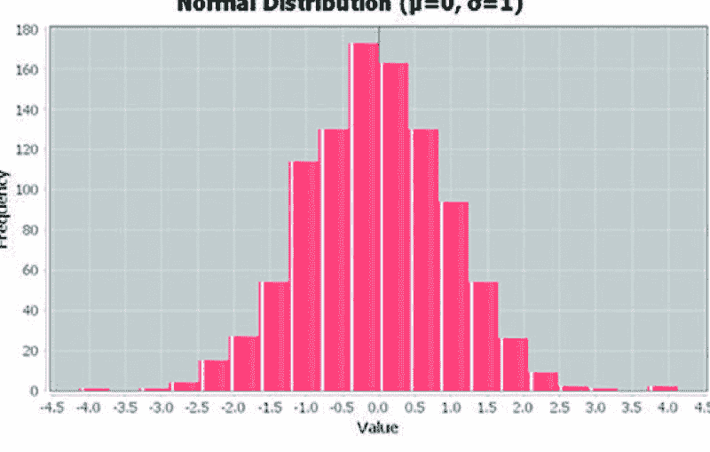

图 5.3：μ=0 和 σ=1 的正态分布随机样本的直方图

# 贝斯定理

贝斯定理是概率论中的一个基本定理，它根据相关条件或情况的先验知识来描述事件发生的概率。它描述了如何根据新信息更新概率。贝斯定理以首次制定该定理的托马斯·贝斯（Thomas Bayes）牧师命名。在数学上，贝斯定理可以表示如下：

```math
P(A|B) = \frac{P(B|A) * P(A)}{P(B)}
```

其中：

- `P(A|B)` 是给定 B 的条件下 A 的后验概率
- `P(B|A)` 是给定 A 的条件下 B 的条件概率
- `P(A)` 是 A 的先验概率
- `P(B)` 是 B 的先验概率

贝斯定理在统计学、数据科学、机器学习、人工智能等领域有许多应用。它可以用于分类、预测和决策等任务。

## 现实生活应用

贝斯定理在许多领域都起着重要作用。让我们探索一下吧！

- **医学诊断**：贝斯定理在医学诊断中被广泛应用。例如，考虑患者表现出某些症状的情况。贝斯方法有助于根据观察到的症状、之前的病史和测试结果更新不同疾病的概率。这有助于对潜在诊断和治疗方案做出明智决策。
- **垃圾邮件过滤**：电子邮件服务提供商采用贝斯技术进行垃圾邮件过滤。通过分析邮件内容并与已知垃圾邮件和合法邮件的语料库进行比较，贝斯算法会动态更新邮件为垃圾邮件的概率。这有助于高效地分类邮件并减少误报或漏报的发生率。
- **天气预报**：贝斯推理在天气预报模型中起着至关重要的作用。气象学家利用历史天气数据以及当前大气状况来预测未来的天气模式。通过引入贝斯技术，这些预报可以随着新数据的可用而不断完善和调整，从而获得更准确的预测。
- **金融建模**：在金融领域，贝斯定理被用于风险评估、投资组合优化和欺诈检测。例如，贝斯网络被用于信用风险建模，根据各种财务指标和市场状况估计违约的概率。同样，在欺诈检测中，贝斯方法通过分析交易数据中的模式和异常来帮助识别可疑交易。

这些现实生活中的例子强调了贝斯定理在不同领域的实际意义，凸显了它利用先验知识做出明智决策和预测的有效性。

## 协方差与相关性

协方差和相关性是用于衡量数据集中两个变量之间关系的两个统计学概念。协方差衡量两个变量如何共同变化。如果两个变量之间的协方差为正，意味着它们倾向于共同增加或减少，而负协方差意味着一个变量倾向于增加而另一个变量减少。相关性衡量两个变量之间线性关系的强度和方向，其范围从 -1（完全负相关）到 1（完全正相关），0 表示不相关。协方差和相关性在统计学和数据分析的许多领域都很重要，包括金融、经济学和社会科学。它们有助于识别两个变量之间的关系，并可用于预测和辅助决策。

在 Java 中，Apache Commons Math 库提供了计算协方差和相关性的方法。`Covariance` 类可以计算两个数字数组之间的协方差，而 `PearsonsCorrelation` 类可以计算皮尔逊相关系数。以下是一个使用 Apache Commons Math 库计算两个数据数组之间协方差和相关性的 Java 代码示例：

```java
import org.apache.commons.math3.stat.correlation.Covariance;
import org.apache.commons.math3.stat.correlation.PearsonsCorrelation;

public class CovarianceCorrelationExample {
    public static void main(String[] args) {
        double[] x = {1, 2, 3, 4, 5};
        double[] y = {6, 7, 8, 9, 10};

        // 计算协方差
        Covariance covariance = new Covariance();
        double cov = covariance.covariance(x, y);
        System.out.println("Covariance: " + cov);

        // 计算相关性
        PearsonsCorrelation correlation = new PearsonsCorrelation();
        double corr = correlation.correlation(x, y);
        System.out.println("Correlation: " + corr);
    }
}
```

在这个示例中，我们有两个数据数组 `x` 和 `y`。首先使用 Apache Commons Math 中的 `Covariance` 类计算 `x` 和 `y` 之间的协方差并存储在变量中。接着，我们使用 `PearsonsCorrelation` 类计算 `x` 和 `y` 之间的相关性并存储在变量中。最后，我们打印协方差和相关性的值。程序的输出为：

```
Covariance: 2.5
Correlation: 1.0
```

# 中心极限定理

中心极限定理（CLT）是一个统计概念，它指出从任何分布中提取大量独立随机样本的均值将服从正态分布。中心极限定理非常重要，因为它允许我们根据样本均值对总体均值进行推断。它还意味着，即使总体分布不是正态的，只要样本量足够，样本均值的分布也会近似正态分布。

## 中心极限定理的意义

中心极限定理在统计学中具有巨大的意义，原因如下：

- **总体均值的推断**：中心极限定理允许我们根据样本均值对总体均值进行推断。通过了解样本均值的分布，我们可以估计总体参数并计算总体均值的置信区间。
- **统计检验**：许多统计检验（如 z 检验和 t 检验）都依赖于正态假设。中心极限定理使得即使在总体分布非正态的情况下，只要样本量足够，就可以使用这些检验。
- **参数估计**：在质量控制和制造业等需要对过程进行监控的领域，中心极限定理有助于从样本数据估计过程参数（如均值和标准差）。

简单来说，中心极限定理告诉我们，当我们从任何总体中获取越来越多的样本时，样本均值的分布将趋于正态分布，无论总体分布的形状如何。

## 示例

这是一个 Java 语言的示例，展示了中心极限定理：

```java
import org.apache.commons.math3.distribution.NormalDistribution;

public class CentralLimitTheoremExample {
    public static void main(String[] args) {
        int n = 1000; // 生成样本的数量
        int m = 1000; // 重复次数
        double mean = 5; // 底层分布的平均值
        double stdDev = 2; // 底层分布的标准差

        NormalDistribution normal = new NormalDistribution(mean, stdDev); // 创建底层分布

        double[] sampleMeans = new double[m]; // 用于存储样本均值的数组

        for (int i = 0; i < m; i++) {
            double sum = 0;
            for (int j = 0; j < n; j++) {
                sum += normal.sample(); // 从底层分布生成随机样本
            }
            sampleMeans[i] = sum / n; // 计算样本均值并存储在数组中
        }

        // 计算样本均值的平均值和标准差
        double sampleMean = calculateMean(sampleMeans);
        double sampleStdDev = calculateStandardDeviation(sampleMeans, sampleMean);

        // 打印结果
        System.out.println("Underlying distribution: mean = " + mean + ", stdDev = " + stdDev);
        System.out.println("Sample mean: " + sampleMean);
        System.out.println("Sample standard deviation: " + sampleStdDev);
    }

    // 计算 double 数组平均值的辅助方法
    private static double calculateMean(double[] data) {
        double sum = 0;
        for (double x : data) {
            sum += x;
        }
        return sum / data.length;
    }

    // 在给定平均值的情况下，计算 double 数组标准差的辅助方法
    private static double calculateStandardDeviation(double[] data, double mean) {
        double sum = 0;
        for (double x : data) {
            sum += Math.pow(x - mean, 2);
        }
        return Math.sqrt(sum / (data.length - 1));
    }
}
```

代码输出：

```
Underlying distribution: mean = 5.0, stdDev = 2.0
Sample mean: 5.000220108741335
Sample standard deviation: 0.06600468648480796
```

在这个示例中，我们从一个平均值为 5、标准差为 2 的正态分布生成了 1000 个大小为 1000 的随机样本。然后我们计算了样本均值的平均值和标准差并打印了结果。正如预期，样本均值遵循正态分布，在这种情况下，样本均值接近底层分布的平均值，标准差也接近底层分布的标准差除以根号 n。这证明了中心极限定理。

# 假设检验

假设检验是一种统计方法，用于测试关于总体参数的给定假设是否为真。它涉及建立两个相互竞争的假设：零假设（null hypothesis）和备择假设（alternative hypothesis），并使用样本数据来确定哪种假设更有可能是真的。

零假设是默认假设，认为观测到的样本数据与预期的总体参数之间没有显著差异。备择假设是零假设的相反，通常是研究人员想要测试的假设。

假设检验涉及从样本数据中计算检验统计量，并将其与基于所需的显著性水平和自由度的临界值进行比较。如果检验统计量大于临界值，则拒绝零假设并接受备择假设。如果检验统计量小于临界值，则接受零假设。

假设检验用于许多领域，如医学、心理学、经济学等，它为基于数据做出可靠结论提供了框架。

## 结果解释

- **检验统计量 (Test Statistic)**：检验统计量是根据样本计算出的数值，显示了数据偏离假设值的程度。
- **P 值 (P-value)**：P 值表示在零假设为真的情况下获得观测结果或更极端结果的概率。它并不证明零假设；相反，较小的 P 值意味着观测结果是不可能的。
- **I 类错误和 II 类错误 (Type I and Type II Errors)**：假设检验涉及这两种错误的风险。I 类错误是在零假设为真时拒绝了它（假阳性）；相反，II 类错误是在零假设为假时接受了它（假阴性）。
- **样本量与功效 (Sample Size and Power)**：假设检验的统计功效是指其检测效应的能力。较大的样本量通常会增加功效，使其更容易检测到效应。

例如，假设我们有 1000 名学生参加了数学考试，并测试其平均分是否为 75。我们的零假设是平均分等于 75，而备择假设是不等于。我们可以使用 0.05 的显著性水平进行假设检验，这意味着我们愿意接受 5% 的概率发生 I 类错误（在零假设为真时拒绝它）。在 Java 中，我们可以使用 Apache Commons 库来执行 t 检验。这里有一些常见的误区：

- **P 值的误解 (Misinterpretation of p-values)**：理解 P 值是关键的。它并不代表零假设是真的；相反，高 P 值意味着观测结果是可能的。

```
p-value: 6.353671892997314E-5
拒绝原假设
```

在这个示例中，我们有一个包含 20 个得分的数据集，我们想要测试均值是否与 75 有显著差异。我们计算了样本平均值和标准差，然后使用公式（样本平均值 - 假设均值）/（均值的标准误）计算 t 值。接着，我们使用 Apache Commons Math 中的 t 检验来计算 p 值，p 值表示在原假设成立的情况下，获得与我们计算的 t 值相同或更极端值的概率。如果 p 值小于 0.05，我们拒绝原假设，并得出均值与 75 有显著差异的结论。如果 p 值大于 0.05，我们无法拒绝原假设，并得出没有足够证据表明均值与 75 有不同。

## 置信区间

置信区间是一种统计量，有助于根据来自该总体的样本来估计总体参数可能取值的数值范围。它是通过样本点估计和基于数据变异性的误差范围计算得出的。置信区间用于表示与特定估计相关的不确定性水平，并经常用于假设检验。

例如，如果我们想估计某个人群的平均身高，我们可以从该人群中随机抽取一个样本，并计算该样本的平均身高。然后，我们可以计算一个置信区间，以估计总体均值在特定置信水平下可能取值的身高范围（例如，95% 置信区间）。该区间为总体均值提供了一组可能的数值范围，如果假设值落在这个区间内，我们就可以得出该假设是合理的。

以下是一个使用 Java 和 Apache Commons Math 计算样本平均值置信区间的示例：

```java
import org.apache.commons.math3.distribution.NormalDistribution;

public class ConfidenceIntervalsExample {
    public static void main(String[] args) {
        // Generate sample data
        double[] data = {10.0, 12.0, 15.0, 13.0, 11.0, 14.0, 16.0, 9.0, 10.0, 12.0};

        // Compute sample mean and standard deviation
        double mean = 0.0;
        double variance = 0.0;

        for (double d : data) {
            mean += d;
        }
        mean /= data.length;
        for (double d : data) {
            variance += Math.pow(d - mean, 2);
        }
        variance /= data.length - 1;
        double stdDev = Math.sqrt(variance);

        // Compute confidence interval at 95% confidence level
        NormalDistribution dist = new NormalDistribution();
        double z = dist.inverseCumulativeProbability(0.975);
        double marginOfError = z * stdDev / Math.sqrt(data.length);
        double lowerBound = mean - marginOfError;
        double upperBound = mean + marginOfError;

        // Output results
        System.out.println("Sample mean: " + mean);
        System.out.println("Standard deviation: " + stdDev);
        System.out.println("95% confidence interval: [" + lowerBound + ", " + upperBound + "]");
    }
}
```

在这个示例中，我们在 `data` 数组中存储了一个包含 10 个观测值的样本。我们首先计算样本平均值和标准差，然后使用 Apache Commons Math 中的 `NormalDistribution` 类计算 95% 置信水平下的临界值 z（即 0.975 是标准正态分布的分位数）。接着，我们使用之前描述的公式计算误差范围以及置信区间的下界和上界。最后，我们将结果输出到控制台。

程序的输出：

```
Sample mean: 12.2
Standard deviation: 2.2997584414213783
```


95% confidence interval: [10.774621142506549, 13.625378857499345]

## 结论

在本章中，我们涵盖了统计分析中的各种主题。我们首先学习了描述性统计，包括中心趋势测量、变异性测量和频率分布。接下来，我们介绍了随机抽样的概念，学习了如何从总体中生成随机样本。我们还研究了随机变量和不同类型的概率分布，包括离散分布、连续分布以及贝叶斯定理。此外，我们讨论了协方差和相关性之间的关系，以及它们如何用于衡量两个变量之间关系的强度和方向。然后，我们探索了中心极限定理以及它在推断统计中起的重要作用。最后，我们学习了假设检验和置信区间，这些都是统计分析中测试结果显著性的重要工具。总体而言，我们涵盖了统计分析中广泛的主题，这些主题对于任何数据分析师或研究人员的理解至关重要。

在下一章中，我们将学习如何在 Java 中处理关系型数据库。

## 问题

- 统计学中的总体（population）和样本（sample）有什么区别？

- 如何计算数据集的平均值、中位数和众数？每种中心趋势测量方法的优缺点是什么？

- 假设你有一个关于商店客户年龄的数据集。该数据集的平均值为35，标准差为8。请使用这些信息回答以下问题：

    - 年龄的范围是多少？

    - 数据集的四分位距是多少？

    - 年龄在27到43岁之间的客户占百分比多少？

    - 随机选择的客户年龄大于50岁的概率是多少？

- 你可以使用 Java Commons Math 库进行任何必要的计算。如何识别并处理数据集中的离群值？检测离群值的常用方法有哪些？

- 离散概率分布和连续概率分布的区别是什么？常见的例子有哪些？

- 什么是中心极限定理？它与样本分布有什么关系？

- 什么是假设检验？如何使用原假设和备择假设进行检验？

- 什么是置信区间？如何为给定数据集或样本计算它？如何解释置信区间的结果？

- 如何计算并解释变量之间的相关性和协方差？

- 什么是贝叶斯定理？如何应用它计算条件概率？

## 重点

- 描述性统计是收集、分析和解释数据以总结和描述其主要特征的统计分支。

- 随机采样是一种从总体中选择子集的技术，确保总体中的每个成员都有被选中的机会。

- 随机变量是可以根据概率取不同值的变量，可以通过概率分布对其行为进行建模。

- 概率分布描述随机事件不同结果的概率，可以是离散的或连续的。

- 在处理概率分布时，根据你拥有的数据类型和对数据可以做的假设来选择合适的分布。

- 贝叶斯定理是一个描述如何根据新证据更新假设概率的数学公式。

- 协方差衡量两个变量之间线性相关的程度，而相关性衡量两个变量之间线性关系的强度和方向。

- 中心极限定理指出，随着样本量的增加，样本均值的分布趋向于正态分布，无论总体分布的形状如何。

- 假设检验是一种根据数据判断关于总体参数的假设的统计方法。

- 置信区间根据样本数据和置信水平，提供了总体参数的一个可能取值范围。

## 引言

在第2章中，我们涵盖了存储结构化和非结构化数据的各种方法。文本文件可以存储少量的非结构化数据，而 XML 和 JSON 格式可以用于少量的结构化数据。然而，对于大量数据，数据库是必要的。本章将重点关注关系型数据库以及如何在 Java 中操作它们。

## 结构

在本章中，我们将涵盖以下主题：

- 关系数据模型
- 关系型数据库
- 结构化查询语言 (SQL)
- 使用 JDBC 和 MySQL 工作

## 关系数据模型

关系数据模型是一种用于在数据库中组织和表示数据的概念模型。它将数据组织成一个或多个表，每个表都有唯一的名称和一组预定义的、具有特定数据类型的列。关系模型中的表通过键（keys）相互链接，用于建立表与表之间的关系。

关系数据模型基于数学术语：具有相同属性的元组（tuples）集合。元组是属性值的有序列表，其中每个属性对应表中的一列。在关系型数据库中，表中的每一行代表一个元组。

关系数据模型还包括约束，这些约束规定了表与表之间的关系以及可以存储在其中的数据。这些约束包括主键和外键（用于强制表之间的引用完整性），以及唯一约束和检查约束（用于确保数据的一致性和有效性）。

总的来说，关系数据模型提供了一种灵活且强大的方式，能够以结构化且高效的方式组织和管理大量数据。

关系数据模型中的一些重要概念如下：

- 关系（Relation）或表是行和列的集合，表示一组具有相同属性的实体集合。
- 属性（Attribute）或列是实体的特征或属性，在表中以列的形式表示。
- 元组（Tuple）或行是表示实体实例的值集合，每个值对应于实体的一个属性。
- 主键（Primary Key）：主键是表中的每一行的唯一标识符。它是唯一标识表中某行的列或多个列的组合。
- 外键（Foreign Key）：外键是表中的列或多个列的组合，引用另一个表的主键。它建立了两个表之间的关系。
- 实体完整性（Entity Integrity）：实体完整性确保表中的每一行都有唯一的主键值，且主键值不为空。
- 引用完整性（Referential Integrity）：引用完整性通过强制表中的外键值存在于另一个表的引用主键列中，来维护两个表之间的关系。
- 规范化（Normalization）：在数据库中组织数据以减少冗余并提高数据完整性的过程。它涉及将大表拆分为较小的表，并定义它们之间的关系。
- 基数（Cardinality）：描述两个表之间的关系，表现为对于另一个表中的每行，其中一个表中可以存在的行数。
- 连接（Joins）：用于根据两个表之间的相关列组合来自两个或多个表的行。有不同类型的连接，如内连接（inner join）、外连接（outer join）、左连接（left join）和右连接（right join）。

让我们考虑以下示例来来说明关系模型。

假设我们有两个实体，“员工”（Employees）和“部门”（Departments），它们具有以下属性：

- Employees: `emp_id` (主键), `department_id` (外键)
- Departments: `dept_id` (主键), `location`

在这个示例中，“部门”实体和“员工”实体之间存在一对多的关系，其中一个部门可以拥有许多员工，但每个员工只能属于一个部门。“员工”实体中的 `department_id` 属性是一个外键，引用“部门”实体的主键。这建立了两个实体之间的关系。

使用关系数据，我们可以将此示例表示为关系型数据库中的两个表：Employees 和 Departments。

表 6.1: Employees

| emp_id | department_id |
| :--- | :--- |
| emp_id | department_id |
| emp_id | department_id |
| emp_id | department_id |

表 6.2: Departments

| dept_id | location |
| :--- | :--- |
| dept_id | location |

通过这种方式，关系数据模型允许我们以结构化和组织化的方式表示复杂的数据结构，使得更容易管理和分析大量数据。

## 规范化示例

考虑一种情况：我们有一个名为“Orders”（订单）的表，包含客户信息及其相应的订单。然而，在单个表中存储客户详细信息和订单信息可能会导致数据冗余和异常，如下表所示：

表 6.3: Orders

| Order_ID | Customer_Name | Order_Date | Amount |
| :--- | :--- | :--- | :--- |
| 1 | Alice Smith | 2023-01-01 | 150 |
| 2 | Alice Smith | 2023-01-05 | 200 |
| 3 | Bob Jones | 2023-01-02 | 50 |
| 4 | Charlie Brown | 2023-01-10 | 300 |

在前面的表中，客户详细信息（如 `Customer_Name`）同一客户的每个订单都会重复，导致了冗余。

为了对这些数据进行规范化，我们可以将其分解为两个独立的表：Customers（客户）和 Orders（订单），如下：

表 6.4: Customers

| Customer_ID | Customer_Name |
| :--- | :--- |
| 1 | Alice Smith |
| 2 | Bob Jones |
| 3 | Charlie Brown |

表 6.5: Orders

| Order_ID | Customer_ID | Order_Date | Amount |
| :--- | :--- | :--- | :--- |
| 1 | 1 | 2023-01-01 | 150 |
| 2 | 1 | 2023-01-05 | 200 |
| 3 | 2 | 2023-01-02 | 50 |
| 4 | 3 | 2023-01-10 | 300 |

在这种规范化的结构中，Customers 表存储了唯一的客户信息，Orders 表通过外键引用 `Customer_ID`，减少了冗余并维护了数据关系。

## 基数示例

考虑一种场景，我们有两个表，“Students”（学生）和“Courses”（课程），它们表示多对多的关系。每个学生可以参加多门课程，每门课程可以有多个学生。Students 和 Courses 表所示：

表 6.6: Students

| Student_ID | Student_Name |
| :--- | :--- |
| 1 | Alice |
| 2 | Bob |
| 3 | Charlie |

表 6.7: Courses

| Course_ID | Course_Name |
| :--- | :--- |
| C101 | Mathematics |
| C102 | Physics |
| C103 | History |

为了表示学生和课程之间的多对多关系，我们引入了第三张表，通常称为关联表或中间表，如下：

表 6.8: Enrollments

| Student_ID | Course_ID |
| :--- | :--- |
| 1 | C101 |
| 1 | C102 |
| 2 | C101 |
| 3 | C103 |
| 3 | C102 |

在这种结构中，Enrollments 表中的每一行代表特定学生对特定课程的报名。具有相同 `Student_ID` 的多行表示一个学生参加了多个课程。同样，具有相同 `Course_ID` 的多行表示多个学生参加了同一门课程。这种结构有效地管理了学生和课程之间的多对多关系。

## 关系型数据库

关系型数据库是一种通过共同字段相互关联数据的数据库类型。它们被设计用于高效、有效地管理大量数据，并为访问和操作这些数据提供标准方法。关系型数据库基于一组被称为关系的数学原理，这些原理定义了可以在表上执行以产生新表的操作。这些操作包括：选择（Selection）是根据某些条件过滤数据的过程；投影（Projection）是从表中选择特定列的过程；连接（Join）是根据共同字段合并两个或多个表的数据的过程；聚合（Aggregation）是使用平均、计数和求和函数对数据进行汇总的过程。

关系型数据库使用结构化查询语言来访问和操作数据。SQL 允许用户创建表、插入数据、更新数据、删除数据以及从一个或多个表中检索数据。它还提供了排序、分组和过滤数据的工具。

关系型数据库广泛应用于各种场景，从简单的数据存储到复杂的业务系统。它们用于 Web 应用程序、银行系统、库存管理系统以及许多需要高效管理和访问大量数据的应用程序。

一些流行的关系型数据库管理系统（RDBMS）包括 MySQL、Oracle、Microsoft SQL Server、PostgreSQL 和 SQLite。这些 RDBMS 提供了一系列工具，用于管理和优化数据库性能，以及用于备份和恢复数据的工具。

## 结构化查询语言 (SQL)

结构化查询语言是一种用于管理关系型数据库的标准语言。它提供了与数据库中存储的数据交互的标准方法。SQL 使用不同的命令对数据执行各种操作，例如从数据库中插入、更新、删除和检索数据。SQL 还用于定义和修改数据库结构，如表、视图、索引和存储过程。这些命令可以分为五类，如图所示

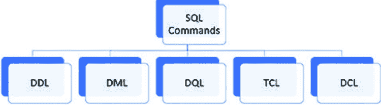

图 6.1：SQL 命令分类

## 数据定义语言 (DDL)

在 SQL 中，数据定义语言（DDL）用于定义和管理数据库的结构，例如创建、修改和删除表、索引和其他数据库对象。一些常见的 DDL 命令包括：

### CREATE

SQL 中的 `CREATE` 命令用于创建新的数据库、表、视图、索引和其他数据库对象。它是一种数据定义语言（DDL）命令，允许用户定义数据库对象的结构和模式。以下是使用 `CREATE` 命令在 SQL 中创建新数据库和表的示例：

```sql
-- 创建一个新数据库
CREATE DATABASE mydatabase;

-- 切换到新数据库
USE mydatabase;

-- 创建带有列的新表
CREATE TABLE customers (
    customer_id INT PRIMARY KEY,
    customer_name VARCHAR(50),
    customer_email VARCHAR(50),
    customer_phone VARCHAR(20)
);
```

在此示例中，我们首先使用 `CREATE DATABASE` 命令创建一个名为 "mydatabase" 的新数据库。然后，我们使用 `USE` 命令切换到该新数据库。最后，我们使用 `CREATE TABLE` 命令创建了一个名为 "customers" 的具有四个列的新表。`INT` 和 `VARCHAR` 关键字用于指定列的数据类型。`PRIMARY KEY` 约束用于指定唯一标识表中每行的行的列。

Customers

| customer_id | customer_name | customer_email | customer_phone |
|---|---|---|---|
| empty | | | |

图 6.2：具有四个列的“customers”表

### ALTER

SQL 中的 `ALTER` 命令用于修改现有数据库对象的结构，例如表。它允许你添加、修改或删除列，更改数据类型，设置默认值并对表进行其他修改。

例如，假设我们想在 "customers" 表中添加新列 "country"：

```sql
ALTER TABLE customers
ADD country varchar(50);
```

此 SQL 语句向 "customers" 表中添加了一个名为 "country" 的新列，最大长度为 50 个字符，默认值为空。

如果我们想修改 "customers" 表中现有的列，例如将列 "customer_phone" 重命名：

```sql
ALTER TABLE customers
RENAME COLUMN customer_phone TO phone;
```

如果我们想从 "customers" 表中删除一列，例如 "email" 列：

```sql
ALTER TABLE customers
DROP COLUMN email;
```

| customer_id | customer_name | phone | country |
|---|---|---|---|
| empty | | | |

图 6.3：执行了一系列 ALTER 语句后的“customers”表

### DROP

`DROP` 命令用于移除或删除整个数据库或表，以及其数据和关联对象，如索引、约束和触发器。为了说明 `DROP` 命令，让我们考虑之前创建的 "customers" 表。要删除 "customers" 表，我们可以使用以下 SQL 语句：

```sql
DROP TABLE customers;
```

这将从数据库中完全删除 "customers" 表以及其所有关联数据和对象。需要注意的是，此操作是不可逆的，表中的所有数据将被永久删除。因此，务必谨慎使用 `DROP` 命令，仅在需要时使用。

### TRUNCATE

`TRUNCATE` 命令用于删除表中的所有记录，但表结构保持不变。这意味着表将没有任何记录，并将重置为原始状态。`TRUNCATE` 命令的语法为：

```sql
TRUNCATE TABLE table_name;
```

其中 `table_name` 是你想要清空的表名。

例如，假设 "customers" 表中有记录。我们可以使用 `TRUNCATE` 命令删除 "customers" 表中的所有记录，如下：

```sql
TRUNCATE TABLE Customers;
```

这将删除 "customers" 表中的所有记录。然而，需要注意的是，`TRUNCATE` 是一个数据定义语言（DDL）命令，一旦执行就无法回滚。因此，请谨慎使用此命令。

### RENAME

SQL 中的 `RENAME` 命令用于重命名现有表。`RENAME` 命令的基本语法如下：

```sql
RENAME TABLE current_table_name TO new_table_name;
```

以下是在 customers 表上使用 `RENAME` 命令的示例：

```sql
RENAME TABLE customers TO clients;
```

执行此命令后，customers 表将被重命名，并可以使用新名称进行访问。

## 数据操作语言 (DML)

数据操作语言（DML）用于操作数据库中的数据。它允许插入、更新、删除和检索数据。

### INSERT

SQL 中的 `INSERT` 语句用于向表中插入新行。其基本语法如下：

```sql
INSERT INTO table_name (column1, column2, ...)
VALUES (value1, value2, ...);
```

例如，向 customers 表插入一条新记录：


```sql
INSERT INTO customers (customer_id, customer_name, customer_email, customer_phone)
VALUES (1, 'John Doe', 'john.doe@example.com', '555-1234');
```

## UPDATE

SQL 中的 `UPDATE` 命令用于修改表中的现有数据。它允许一次更新一个或多个行。可以使用 `WHERE` 子句来指定要更新的行。

```sql
UPDATE table_name
SET column1 = value1, column2 = ...
WHERE condition;
```

例如，将 John Doe 的电话号码从 555-1234 修改为 555-0000：

```sql
UPDATE customers
SET customer_phone = '555-0000'
WHERE customer_name = 'John Doe';
```

## DELETE

SQL 中的 `DELETE` 命令用于从表中删除现有行。可以使用 `WHERE` 子句来指定要删除的行。

```sql
DELETE FROM table_name
WHERE condition;
```

例如，删除 `customer_id` 为 1 的客户：

```sql
DELETE FROM customers
WHERE customer_id = 1;
```

| customer_id | customer_name | customer_email | customer_phone |
|---|---|---|---|
| 1 | John Doe | johndoe@example.com | 555-1234 |
| 2 | Jane Doe | janedoe@example.com | 555-5678 |
| 3 | Bob Smith | bob.smith@example2.com | 555-9014 |

图 6.5：‘customers’表的内容

在 `UPDATE` 语句中使用 `WHERE` 子句来指定要更新哪些行是非常重要的。如果不使用 `WHERE` 子句，表中的所有行都将被更新。

## DELETE

`DELETE` 语句用于从数据库的表删除一行或多行。它也可以包含 `WHERE` 子句来对要删除的行进行过滤。`DELETE` 语句的语法如下：

```sql
DELETE FROM table_name WHERE condition;
```

在这里，`table_name` 是需要删除行的表名，`condition` 指定了删除这些行必须满足的条件。例如，考虑数据如图所示的客户（`customers`）表。要删除 `id` 为 2 的客户对应的记录，我们可以使用以下语句：

```sql
DELETE FROM customers WHERE customer_id = 2;
```

‘customers’表现在应该删除了第二行，如图所示：

| customer_id | customer_name | customer_email | customer_phone |
|---|---|---|---|
| 1 | John Doe | johndoe@example.com | 555-1234 |
| 3 | Bob Smith | bob.smith@example2.com | 555-9014 |

图 6.6：删除行后‘customers’表的内容

## MERGE

SQL 中的 `MERGE` 语句用于根据匹配条件合并两个表的数据。它也被称为 `UPSERT` 操作，因为它可以更新现有记录，或者在没有匹配项时插入新记录。`MERGE` 语句的基本语法如下：

```sql
MERGE INTO table1 AS target
USING table2 AS source
ON target.column = source.column
WHEN MATCHED THEN
UPDATE SET target.column1 = source.column1, target.column2 = source.column2
WHEN NOT MATCHED THEN
INSERT (column1, column2) VALUES (source.column1, source.column2)
```

在此语法中，`table1` 是将合并数据的目标表，`table2` 是源表。`ON` 子句根据特定列指定两个表之间的匹配条件。`WHEN MATCHED THEN` 子句指定了当存在匹配时要执行的操作，通常是使用源表中的对应值更新目标表中特定列的值。`WHEN NOT MATCHED THEN` 子句指定了当没有匹配项时要执行的操作，通常是使用源表的值插入一条新记录。

以下是在两个表 `customers` 和 `customers_new` 表上使用 `MERGE` 语句的示例：

```sql
MERGE INTO customers AS target
USING customers_new AS source
ON target.customer_id = source.customer_id
WHEN MATCHED THEN
UPDATE SET target.customer_name = source.customer_name,
target.customer_email = source.customer_email, target.customer_phone = source.customer_phone
WHEN NOT MATCHED THEN
INSERT (customer_id, customer_name, customer_email,
customer_phone) VALUES (source.customer_id, source.customer_name,
source.customer_email, source.customer_phone);
```

在这个示例中，`MERGE` 语句用于根据 `customers_new` 表中的数据更新 `customers` 表。匹配条件基于 `customer_id` 列。如果匹配成功，则用 `customers_new` 表中的值更新 `customers` 表中对应的列。如果没有匹配，则用来自 `customers_new` 表的值向 `customers` 表中插入一条新记录。

## 数据查询语言 (DQL)

SQL 中的数据查询语言 (DQL) 用于从数据库检索数据。DQL 语句用于查询数据库并检索符合指定条件的数据。最常用的 DQL 语句是 `SELECT` 语句，它从数据库中的一个或多个表中检索数据。SQL 中其他一些常用的 DQL 语句包括 `GROUP` 和 `ORDER`。

## SELECT

`SELECT` 语句用于从数据库表中检索数据。`SELECT` 语句的基本语法如下：

```sql
SELECT column1, column2, ...
FROM table_name;
```

该语句将返回指定表中指定列的所有数据。例如，若要从‘customers’表中选择所有列，我们可以使用以下 SQL 语句：

```sql
SELECT *
FROM customers;
```

该语句将选择‘customers’表中的所有列，但由于它目前是空的，它将返回一个空结果集。我们也可以指定单个列进行选择，如下所示：

```sql
SELECT customer_id, first_name, last_name
FROM customers;
```

该语句将仅选择‘customers’表中的 `first_name` 和 `last_name` 列。`SELECT` 语句允许您指定从哪些列检索数据、从哪个表（表）检索数据，以及检索数据必须满足的任何条件。可以使用 `WHERE` 子句添加条件，如下：

```sql
SELECT column1, column2, ...
FROM table1
WHERE condition;
```

## JOIN

`JOIN` 用于根据两个或多个表之间的相关列合并这些表的行。有不同类型的 `JOIN` 可以使用：

- `INNER JOIN`：返回在两个表中都有匹配值的记录。
- `LEFT JOIN`：返回左表的所有记录，以及右表的匹配记录。如果没有匹配项，则右侧将返回 `NULL`。
- `RIGHT JOIN`：返回右表的所有记录，以及左表的匹配记录。如果没有匹配项，则左侧将返回 `NULL`。
- `FULL JOIN`：当左表或右表任一存在匹配时，返回所有记录。

假设我们有两个表，`students` 和 `marks`：

| student_id | student_name | subject |
|---|---|---|
| 1 | John | Math |
| 2 | Emma | Science |
| 3 | Jack | History |

图 6.7：‘students’表

| student_id | marks |
|---|---|
| 1 | 80 |
| 2 | 90 |
| 4 | null |

图 6.8：‘marks’表

我们可以使用 `INNER JOIN` 来获取每个学生的成绩：

```sql
SELECT students.student_name, marks.marks
FROM students
INNER JOIN marks
ON students.student_id = marks.student_id;
```

输出应该如下：

| student_name | marks |
|---|---|
| John | 80 |
| Emma | 90 |

图 6.9：在 'students' 和 'marks' 上执行 `INNER JOIN` 的输出

注意，Jack 的行没有包含在输出中，因为在 'marks' 表没有对应的记录。

以下是 `marks` 表和 `students` 表之间右连接（`RIGHT JOIN`）的示例：

```sql
SELECT *
FROM marks
RIGHT JOIN students
ON marks.student_id = students.student_id;
```

这将产生如图所示的结果集：

| student_id | marks | student_name | subject |
|---|---|---|---|
| 1 | 80 | John | Math |
| 2 | 90 | Emma | Science |
| 43 | null | Jack | History |

图 6.11：‘students’ 表和‘marks’ 表执行 `RIGHT JOIN` 的输出

在 SQL 中，全外连接（`FULL OUTER JOIN`）结合了左外连接和右外连接的结果，返回两个表中的所有行。如果其中一个表中没有匹配的数据，则结果集中另一个表的列将包含 `NULL` 值。SQL 中全外连接的语法如下：

```sql
SELECT table1.column1, table1.column2, table2.column1,
table2.column2
FROM table1
FULL OUTER JOIN table2
ON table1.key = table2.key;
```

这里，`table1` 和 `table2` 是正在连接的表名，`key` 是用于匹配两个表行的公共列。

让我们用之前使用的 'students' 表和 'marks' 表举个例。要使用 `student_id` 列作为键对这两个表执行全外连接，我们可以使用以下 SQL 语句：

```sql
SELECT students.student_id, students.student_name, marks.marks
FROM students
FULL OUTER JOIN marks
ON students.student_id = marks.student_id;
```

该 SQL 查询的结果如下：

| student_id | student_name | marks |
|---|---|---|
| 1 | John | 80 |
| 2 | Emma | 90 |
| 43 | Jack | null |
| null | null | 85 |

图 6.12：‘students’ 表和‘marks’ 表执行 `FULL OUTER JOIN` 的结果

## GROUP BY

SQL 中的 `GROUP BY` 语句用于根据一个或多个列对行进行分组，并对每个组执行聚合函数。`GROUP BY` 语句的语法如下：

```sql
SELECT column_name, aggregate_function(column_name)
FROM table_name
GROUP BY column_name;
```

这里，`column_name` 是我们想要分组的行的列名，`aggregate_function` 是我们想要应用到每个组的函数。让我们考虑 'orders' 表：

| order_id | customer_id | order_date | order_total |
|---|---|---|---|
| 1 | 101 | 2023-01-01 | 100 |
| 2 | 102 | 2023-01-02 | 200 |
| 3 | 103 | 2023-01-03 | 150 |
| 4 | 101 | 2023-01-04 | 50 |
| 5 | 102 | 2023-01-05 | 300 |

图 6.13：'orders' 表

如果我们想计算每个客户的订单总值，可以使用以下 SQL 查询：

```sql
SELECT customer_id, SUM(order_total) AS total_orders
FROM orders
GROUP BY customer_id;
```

这应该产生以下输出：

| customer_id | total_orders |
|---|---|
| 101 | 150 |
| 102 | 500 |
| 103 | 150 |

图 6.14：‘orders’ 表执行 `GROUP BY` 的输出

在这里，我们通过 `customer_id` 列对行进行了分组，并使用 `SUM` 函数计算了每个组的 `order_total` 列的总和。我们还使用了 `AS` 关键字为输出列命名。

## ORDER BY

SQL 中的 `ORDER BY` 语句用于根据一个或多个列对查询结果进行排序。它按升序或降序对数据进行排序。`ORDER BY` 语句的基本语法如下：

```sql
SELECT column1, column2, ...
FROM table_name
ORDER BY column1 [ASC|DESC], column2 [ASC|DESC], ...;
```

这里，`...` 是你想要从表中检索的列名，`table_name` 是你想要从中检索数据的表名。`ORDER BY` 子句指定了按哪些列排序数据，以及按升序还是降序排序。

例如，要从 'orders' 表检索 `order_id` 和 `order_total` 列，并按 `order_total` 列降序排序，可以使用以下 SQL 查询：

```sql
SELECT order_id, order_total
FROM orders
ORDER BY order_total DESC;
```

该语句的输出如图所示：

| order_id | order_total |
|---|---|
| 5 | 300 |
| 2 | 200 |
| 3 | 150 |
| 1 | 100 |
| 4 | 50 |

图 6.15：'orders' 表执行 `ORDER BY` 的输出

## 事务控制语言 (TCL)

在 SQL 中，事务（transaction）是一组被视为单个工作单元的操作序列。事务控制语言（TCL）用于管理这些事务。主要命令有：`COMMIT`、`ROLLBACK` 和 `SAVEPOINT`。

## COMMIT

`COMMIT` 命令用于永久保存对数据库的更改。一旦事务提交，其更改将无法撤销。需要注意的是，`COMMIT` 命令适用于尚未提交的事务。这是一个使用 `COMMIT` 命令的示例：

```sql
BEGIN TRANSACTION;
INSERT INTO customers (customer_id, customer_name, customer_email, customer_phone)
VALUES (1, 'John', 'john@example.com', '1234567890');
COMMIT;
```

## ROLLBACK

`ROLLBACK` 命令用于撤销尚未提交的更改。它将数据库恢复到之前的状态。例如，假设我们对 'customers' 表做了某些更改但尚未提交。我们可以使用 `ROLLBACK` 命令撤销这些更改：

```sql
BEGIN TRANSACTION;
INSERT INTO customers (customer_id, customer_name, customer_email, customer_phone)
VALUES (1, 'John', 'john@example.com', '1234567890');
UPDATE customers
SET customer_phone = '9876543210'
WHERE customer_id = 1;
ROLLBACK;
```

## SAVEPOINT

SQL 中的 `SAVEPOINT` 命令允许你在事务中创建一个点，以便在需要时回滚到此处。它通常与 `ROLLBACK` 命令配合使用，以对撤销数据库更改提供更细粒度的控制。

`SAVEPOINT` 命令的语法如下：

```sql
SAVEPOINT savepoint_name;
```

其中 `savepoint_name` 是你想为该保存点指定的。

以下是 `SAVEPOINT` 命令在 SQL 中的用法示例。假设我们有一个包含列的 'customers' 表，我们想要更新 `customer_id` 客户的电子邮件地址，但在操作之前，我们想创建一个保存点，以防以后需要回滚更改。我们可以这样做：


```
SAVEPOINT before_update;
UPDATE customers
SET customer_email = 'new_email@example.com'
WHERE customer_id = 123;
```

如果我们以后决定撤销该更新，可以使用 `ROLLBACK` 命令回到我们创建的保存点：

`ROLLBACK TO before_update;`

这将撤销更新并将数据库恢复到创建保存点时的状态。

## 数据控制语言 (DCL)

数据控制语言 (DCL) 是 SQL 的一部分，用于处理数据库系统的安全和授权方面。它提供了授予和撤销用户及角色的权限的命令。DCL 的主要目的是控制用户对数据库的访问，并确保数据的安全完整性。

以下是 SQL 中 DCL 的主要命令：

### GRANT

`GRANT` 命令用于向用户或角色授予特定权限。例如，你可以使用 `GRANT` 命令为用户授予特定表的查询或删除（`DELETE`）权限。

`GRANT` 命令的语法如下：

```
GRANT privilege ON object TO user/role
```

例如，可以使用以下语句为用户授予 `SELECT` 权限：

```
GRANT SELECT ON customers TO john;
```

### REVOKE

`REVOKE` 命令用于撤销之前授予用户或角色的权限。例如，你可以使用 `REVOKE` 命令从用户处撤销对特定表的查询或删除（`DELETE`）权限。

语法：`REVOKE privilege ON object FROM user/role`

示例：`REVOKE SELECT ON customers FROM john;`

### DENY

`DENY` 命令用于拒绝用户或角色的特定权限。与 `GRANT` 不同，`DENY` 即使用户已被显式授予或通过角色授予权限，也会阻止其获得该权限。

语法：`DENY privilege ON object TO user/role`

示例：`DENY SELECT ON customers TO john;`

需要注意的是，上述命令用于控制对象级别（如表、视图或存储过程）的访问。SQL 还提供了系统级权限，例如创建或删除数据库的能力，可以使用 `GRANT` 命令配合 `WITH ADMIN OPTION` 子句进行授予。

总的来说，DCL 提供了一套强大的工具集，用于控制对数据库系统的访问，并确保用户拥有执行任务所需的权限，同时维护数据的安全性和完整性。

## 使用 JDBC 和 MySQL

在 Java 中处理 Java 数据库连接（JDBC）和 MySQL 是 Java 开发人员的常见任务。JDBC 是一个 Java API，提供了访问关系型数据库的标准方法。MySQL 是一种广泛应用于流行的开源关系型数据库管理系统。

要在 Java 中使用 JDBC 和 MySQL，你需要遵循以下步骤：

- 下载 MySQL Connector/J 驱动：第一步是下载并安装 MySQL Connector/J 驱动，它是用于 MySQL 的 Java JDBC 驱动。
- 设置 JDBC 驱动：下载驱动后，你需要通过将其添加到 Java 项目的类路径中设置 JDBC 驱动。
- 执行 SQL 语句：一旦建立连接，就可以使用 JDBC API 的 `Statement` 或 `PreparedStatement` 类来执行 SQL 语句。`Statement` 对象用于执行简单的 SQL 语句，而 `PreparedStatement` 对象用于执行参数化的 SQL 语句。
- 处理异常：在 Java 中使用 JDBC 和 MySQL 时，处理在连接数据库或执行 SQL 语句期间可能发生的异常至关重要。

这是一个在 Java 中使用 JDBC 和 MySQL 的简单示例。我们将使用 'mydatabase' 数据库以及我们之前为此示例创建的表。让我们先打印 'customers' 表的内容，以确保它有一些数据：

`SELECT * FROM CUSTOMERS;`

这应该打印出 'customers' 表的记录，如下：

```
+----------------+----------------+----------------+----------------+
| customer_id | customer_name | customer_email | customer_phone |
+--------------+----------------+----------------+----------------+
| 1 | John Doe | johndoe@example.com | 555-1234 |
| 2 | Jane Doe | janedoe@example.com | 555-5678 |
| 3 | Bob Smith | bobsmith@example.com | 555-9012 |
+--------------+----------------+----------------+----------------+
3 rows in set (0.00 sec)
```

> 图 6.16：数据库 'mydatabase' 中 'customers' 表的内容

现在，让我们如下所示创建一个 Java 类 `JdbccExample`：

```java
import java.sql.*;

public class JdbccExample {
    public static void main(String[] args) {
        try {
            // Step 1: 加载 MySQL JDBC 驱动
            Class.forName("com.mysql.cj.jdbc.Driver");

            // Step 2: 建立到 MySQL 数据库的连接
            String url = "jdbc:mysql://localhost:3306/mydatabase";
            String username = "root";
            String password = "admin";
            Connection conn = DriverManager.getConnection(url, username, password);

            // Step 3: 执行 SQL 语句
            Statement stmt = conn.createStatement();
            ResultSet rs = stmt.executeQuery("SELECT * FROM customers");

            // Step 4: 处理结果集
            while (rs.next()) {
                int id = rs.getInt("customer_id");
                String name = rs.getString("customer_name");
                String email = rs.getString("customer_email");
                String phone = rs.getString("customer_phone");
                System.out.println("ID: " + id + ", Name: " + name + ", Email: " + email + ", Phone: " + phone);
            }

            // Step 5: 关闭连接和语句对象
            rs.close();
            stmt.close();
            conn.close();
        } catch (SQLException ex) {
            System.out.println("SQL exception: " + ex.getMessage());
        } catch (ClassNotFoundException ex) {
            System.out.println("Driver not found: " + ex.getMessage());
        }
    }
}
```

代码的输出应该如下：

| customer_id | customer_name | customer_email | customer_phone |
| :--- | :--- | :--- | :--- |
| 1 | John Doe | johndoe@example.com | 555-1234 |
| 2 | Jane Doe | janedoe@example.com | 555-5678 |
| 3 | Bob Smith | bobsmith@example.com | 555-9012 |

## 总结

在本章中，我们涵盖了与数据库以及使用 SQL 和 Java 管理相关的各种重要主题。我们从关系模型开始，它是现代数据库的基础。然后我们学习了关系型数据库以及如何使用 SQL 命令创建和管理它们。我们涵盖了数据操作语言，包括用于管理数据的 `DELETE` 语句。此外，我们讨论了数据查询语言，包括强大的 `JOIN` 语句，该语句允许用户连接表并检索相关数据。我们还涵盖了 SQL 中的事务控制语言 (TCL) 和数据控制语言 (DCL) 命令。最后，我们学习了如何使用 JDBC 连接 MySQL 数据库并使用 Java 代码与其交互。总的来说，本章为使用 SQL 和 Java 管理数据库所需的概念和工具提供了全面的介绍，读者现在应该具备了在各种场景下处理数据库所需的知识和技能。

在下一章“回归”中，我们将学习如何通过不同的回归分析方法发现数据中的模式，并建立描述该模式的数学函数。

什么是 SQL 中的数据操作语言 (DML)？DML 中哪些常用命令有哪些？

如何使用 SQL 中的 DML 命令进行查询和修改数据？

什么是 SQL 中的事务控制语言 (TCL)？TCL 中哪些常用命令有哪些？

关系数据模型基于关系的概念，数据存储在具有行和列的表中。

主键是表中某行的唯一标识符，而外键用于建立表与表之间的关系。

SQL 是一种用于与关系型数据库交互的标准语言，它由 DDL、DML、DQL 和 DCL 命令组成。

`CREATE` 命令用于在 SQL 中创建新的数据库或表，并指定表的名称、列和数据类型。

`ALTER` 命令用于修改现有表的结构，例如添加或删除列。

`DROP` 命令用于删除数据库或表，且操作不可撤销。

`TRUNCATE` 命令用于删除表中的所有数据，但会保持表结构完整。

`RENAME` 命令用于更改现有数据库或表的名称。

`SELECT` 语句用于从表中检索数据，并可以与 `ORDER BY` 和 `GROUP BY` 等子句配合使用。

`INSERT` 语句用于向表中插入新数据，并指定表中每列的值。

`UPDATE` 语句用于修改表中的现有数据，并使用 `SET` 子句指定每列的新值。

`DELETE` 语句用于根据条件从表中删除特定行。

`JOIN` 语句用于根据公共列合并多个表的数据。

`INNER JOIN` 仅返回两个表中都具有匹配值的行。

`LEFT JOIN` 返回左表的所有行以及右表中匹配的行。

`RIGHT JOIN` 返回右表的所有行以及左表中匹配的行。

`FULL OUTER JOIN` 返回两个表中的所有行，包括不匹配的行。

`GROUP BY` 语句用于根据特定列对行进行分组，通常与聚合函数一起使用。

`ORDER BY` 语句用于根据特定列对行进行排序，可以使用 `ASC` 或 `DESC` 关键字来指定排序顺序。

JDBC 是一个允许 Java 程序与关系型数据库交互的 Java API，而 MySQL Connector/J 驱动程序是一个 JDBC 驱动程序，允许 Java 程序与 MySQL 数据库交互。

## 引言

数据分析的目标之一是识别数据中的模式，并开发描述这些模式的数学模型。回归分析包含了有助于这一过程的算法。线性回归是用于估计函数为线性时的术语，而多项回归用于函数为多项式的情况。本章将涵盖这两种回归分析方法。

## 结构

在本章中，我们将涵盖以下主题：

- 回归算法
- 线性回归
- 多项回归
- 比较回归模型

## 回归算法

回归算法是一种用于建立两个或多个变量之间关系的统计方法。它有助于发现数据中的模式并预测未来结果。回归分析涉及估计最能描述变量之间关系的数学函数。回归算法有多种类型，包括线性回归、多项回归、逻辑回归等。每种回归算法都有其自身的假设和局限性。回归分析在金融、经济、工程和社会科学等领域有广泛的应用。它可以用于预测销售额、分析股价、预报天气等。在本章中，我们将关注最常用的回归算法：线性回归和多项回归。

当因变量和自变量之间存在线性关系时，线性回归是一种多功能工具，使其适用于根据面积、卧室数量和位置等因素预测价格的任务。另一方面，多项回归通过容纳变量之间的非线性关系扩展了线性回归的能力。例如，它可能用于根据温度、降水量和肥料使用量等因素预测作物产量，在这种情况下，关系可能不是严格线性的，而是表现出曲线或波动。

在为特定任务选择合适的回归模型时，仔细考虑数据的特征以及变量之间关系的性质至关重要。例如，如果根据探索性数据分析关系似乎是线性的，那么线性回归可能是首选。然而，如果关系更复杂并表现出曲率或其他非线性模式，多项回归或其他非线性回归技术可能更为合适。

## 回归分析的类型

回归分析类型指的是用于分析数据并识别变量之间模式或关系的不同数学模型。回归模型的选择取决于数据类型和变量之间关系的性质。回归分析有多种类型，包括线性回归、多项回归、逻辑回归、岭回归、Lasso 回归等。每种类型的回归分析都有其自身的假设和特征，选择合适的回归模型对于数据的进行准确分析和预测至关重要。在本章中，我们将关注线性回归和多项回归分析。

## 回归分析的应用

回归分析在不同领域有许多应用。回归分析的一些常见应用如下：

- 商业与经济：回归分析用于商业和经济领域预测产品或服务的未来销售或需求。它还用于确定不同经济因素（如通胀和利率）之间的关系。
- 医疗健康：回归分析用于医疗领域根据年龄、性别和生活方式等不同因素预测疾病的风险。它还用于评估不同治疗方法的有效性。
- 工程：回归分析用于工程领域根据温度、压力和负载等不同变量预测系统或产品的性能。
- 社会科学：回归分析用于社会科学分析不同变量（如收入和教育水平）之间的关系。
- 环境研究：回归分析用于环境研究预测环境因素对物种和生态系统的影响。它还用于分析人类活动对环境的影响。

## 线性回归

线性回归是一种对一个或多个自变量之间关系建模的统计方法。换句话说，它试图通过一组数据拟合直线来解释变量之间的关系。直线方程表示为：

$Y = a + bX$

其中：

- Y 是因变量，
- X 是自变量，
- a 是截距，
- b 是直线的斜率。

该方程表示的直线如图所示

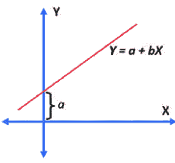

图 7.1：由方程 Y = a + bX 表示的直线

线性回归可以根据数据范围内自变量的任何给定值预测因变量的值。它被广泛应用于金融、经济、工程和社会科学等各个领域，用于预测、趋势分析和假设检验。

现在，让我们深入线性回归背后的数学直觉以及确定其系数的过程。从本质上讲，线性回归旨在使观测值与线性模型预测值之间的差异最小化。这一优化过程通常涉及普通最小二乘法（OLS）或梯度下降等技术。

### 普通最小二乘法 (OLS)

普通最小二乘法是一种用于估计线性回归模型参数的经典方法。OLS 的目标是找到一条直线（高维下的超平面），使得观测值与线性模型预测值之间的平方差和最小化。

在数学上，给定一组数据点，其中 $x$ 代表自变量，$y$ 代表因变量，线性回归模型寻求寻找系数 $a$ 和 $b$，使得平方误差和最小化：

$$\minimize \sum_{i=1}^{n}(y_i - (a + b \cdot x_i))^2$$

该优化问题可以使用微积分技术进行解析求解，从而得到使平方误差和最小的系数 $a$（截距）和 $b$（斜率）的封闭表达式。

### 梯度下降

梯度下降是一种用于最小化代价函数的迭代优化算法，例如线性回归背景下的均方误差。梯度下降不像 OLS 那样直接求解最优系数，而是沿着代价函数下降最快的方向逐渐调整系数。

算法从系数的初始值开始，迭代更新它们，直到收敛到代价函数的最小值。在每次迭代中，计算代价函数对系数的梯度（导数），这指示了最陡峭上升的方向。然后通过沿梯度相反的方向迈步来调整系数，并由学习率参数进行缩放。

在数学上，线性回归中梯度下降的更新规则可以表示如下：

```
$a_{new} = a_{old} - \alpha \frac{\partial}{\partial a}Cost(a,b)$
```

```
$b_{new} = b_{old} - \alpha \frac{\partial}{\partial b}Cost(a,b)$
```

其中：

$a$ 和 $b$ 是系数的当前值。

$\alpha$ 是学习率，控制每次迭代中取步的大小。

偏导数表示代价函数对系数 $a$ 和 $b$ 的偏导数。

该过程持续到收敛，通常定义为达到代价函数变化的预定义阈值，或经过固定次数的迭代。OLS 和梯度下降都为确定线性回归系数提供了有效方法，OLS 提供了封闭解，而梯度下降提供了一种更具通用性的迭代方法，适用于大型数据集或非线性优化问题。

## 线性回归假设

线性回归是一种用于建立因变量与一个或多个自变量之间关系的统计方法。该技术有几个假设，这些假设对于使模型具有意义且可靠至关重要。以下是线性回归的一些关键假设：

- **线性性**：因变量与自变量之间的关系应该是线性的。这意味着因变量的变化应该与自变量的变化成正比。
- **独立性**：数据集中的观测值应该是相互独立的。独立性假设意味着一个观测值的因变量值不应受任何其他观测值的因变量值的影响。


## 线性回归的假设

- **齐方差**：误差的方差在自变量的所有水平上应该是恒定的。这意味着残差（误差）的离散程度在自变量的所有水平上应该是相同的。

- **正态性**：误差应服从均值为零的正态分布。正态性假设意味着残差的分布围绕零对称，大多数残差接近零，并随着离零点距离的增加而减小。

- **无多共线性**：自变量之间不应高度相关。多共线性会导致模型系数的估计出现问题，使其变得不稳定且难以解释。

- **无离群值**：离群值是偏离数据集中其他观测值的观测值。它们会影响模型的准确性，应该在拟合模型之前识别并处理。

在对数据进行线性回归模型拟合之前，检查这些假设是非常重要的。违反这些假设可能会导致估计偏差、错误的推断和低模型准确性。

## 简单线性回归

简单线性回归是线性回归的一种类型，其中只有一个自变量。它用于估计两个连续变量之间的关系。在这项技术中，我们创建一条代表自变量与因变量之间关系的最佳拟合线。

让我们考虑这样一个例子：我们有一个关于学生学习小时数和获得分数的数据集。我们想找出这两个变量之间是否存在线性关系。

首先，我们需要在 MySQL 数据库中创建一个表来存储数据。我们可以将其命名为 `student_data`，并设置两个列——`hours_studied` 和 `marks_obtained`。

```sql
CREATE TABLE student_data (
    hours_studied FLOAT,
    marks_obtained FLOAT
);
```

现在，让我们向表中插入一些样本数据。

```sql
INSERT INTO student_data (hours_studied, marks_obtained) VALUES
(2.5, 21),
(5.1, 47),
(3.2, 27),
(8.5, 75),
(3.5, 30),
(1.5, 20),
(9.2, 88),
(5.5, 60),
(8.3, 81),
(2.7, 25),
(7.7, 85),
(5.9, 62),
(4.5, 41);
```

## 多元线性回归

多元线性回归是一种用于建立因变量与多个自变量之间关系的统计学方法。它假设变量之间存在线性关系，并使用数学公式来估计自变量的系数以预测因变量。多元线性回归的公式为：

$$y = \beta_0 + \beta_1x_1 + \beta_2x_2 + \cdots + \beta_nx_n$$

其中：

- $y$ 是因变量，
- $x_1, x_2, \dots, x_n$ 是自变量，
- $\beta_0$ 是常数，且
- $\beta_1, \beta_2, \dots, \beta_n$ 是系数。

在 Java 中实现多元线性回归，我们可以使用 Apache Commons Math 库。以下是一个演示如何使用多元线性回归的示例代码：

```java
import org.apache.commons.math3.stat.regression.OLSMultipleLinearRegression;

public class MultipleLinearRegressionExample {
    public static void main(String[] args) {
        // 创建回归对象
        OLSMultipleLinearRegression regression = new OLSMultipleLinearRegression();

        // 定义数据矩阵（自变量）
        double[][] x = {{1, 2, 3}, {4, 5, 6}, {7, 8, 9}, {10, 11, 12}};

        // 定义响应向量（因变量）
        double[] y = {2, 4, 6, 8};

        // 拟合模型
        regression.newSampleData(y, x);

        double[] beta = regression.estimateRegressionParameters();

        // 打印系数
        System.out.println("Intercept: " + beta[0]);
        System.out.println("Coefficient 1: " + beta[1]);
        System.out.println("Coefficient 2: " + beta[2]);
        System.out.println("Coefficient 3: " + beta[3]);
    }
}
```

程序的输出如下：

```
Intercept: -0.6666666666666667
Coefficient 1: -0.3333333333333333
Coefficient 2: -0.0
Coefficient 3: 1.0
```

在这个示例中，我们定义了一个包含三个自变量 $x_1, x_2, x_3$ 的数据矩阵和一个响应向量。然后，我们创建了一个新的 `OLSMultipleLinearRegression` 对象，使用 `newSampleData` 方法设置数据，并使用 `estimateRegressionParameters` 方法估计回归参数。最后，我们将系数打印到控制台。

## 多项式回归

多项式回归是回归分析的一种类型，其中自变量 $X$ 与因变量 $Y$ 之间的关系被建模为多项式。换句话说，当 $X$ 和 $Y$ 之间的关系不是线性的，但可以用多项式函数近似时，就会使用它。$n$ 次多项式回归的数学公式表示如下：

$$Y = \beta_0 + \beta_1X + \beta_2X^2 + \dots + \beta_nX^n$$

其中：

- $Y$ 是因变量，
- $X$ 是自变量，且
- $\beta_0, \beta_1, \dots, \beta_n$ 是多项式函数的系数或参数。

多项式的次数决定了模型的复杂度和所需的系数数量。多项式回归的目标是找到最拟合数据的系数值。

例如，如果我们有一组数据点 $(x_1, y_1), (x_2, y_2), \dots, (x_n, y_n)$，并且我们想要拟合一个 2 次多项式，那么多项式回归的公式为：

$$Y = \beta_0 + \beta_1X + \beta_2X^2$$

系数和参数可以使用最小二乘法等各种方法计算。一旦我们得到了系数，就可以使用多项式函数对 $X$ 的新值进行预测。

## 单变量多项式回归

单变量多项式回归是回归分析的一种，其中自变量 ($X$) 与因变量 ($Y$) 之间的关系被建模为多项式函数。单变量简单多项式回归的公式为：

$$Y = \beta_0 + \beta_1x + \beta_2x^2 + \cdots + \beta_nx^n$$

其中：

- $Y$ 是因变量，
- $x$ 是自变量，
- $\beta_0, \beta_1, \dots, \beta_n$ 是回归系数，且
- $n$ 是多项式的次数。

在 Java 中执行单变量多项式回归，我们首先需要使用 Apache Commons Math 库创建一个多项式函数。以下是一个演示如何在 Java 中执行单变量多项式回归的示例片段：

```java
import org.apache.commons.math3.analysis.polynomials.PolynomialFunction;
import org.apache.commons.math3.fitting.PolynomialCurveFitter;
import org.apache.commons.math3.fitting.WeightedObservedPoints;

public class PolynomialRegression {
    public static void main(String[] args) {
        // 创建一些样本数据
        WeightedObservedPoints data = new WeightedObservedPoints();
        data.add(1.0, 2.0);
        data.add(2.0, 3.0);
        data.add(3.0, 4.0);
        data.add(4.0, 5.0);
        data.add(5.0, 6.0);

        // 创建多项式曲线拟合器
        PolynomialCurveFitter fitter = PolynomialCurveFitter.create(2);

        // 对数据拟合曲线
        double[] coefficients = fitter.fit(data.toList());

        // 使用拟合系数创建多项式函数
        PolynomialFunction function = new PolynomialFunction(coefficients);

        // 在给定的 X 值下评估函数
        double x = 6.0;
        double y = function.value(x);
        System.out.println("Predicted value of Y at X = " + x + " is " + y);
    }
}
```

程序的输出如下：

```
Predicted value of Y at X = 6.0 is 6.9999999999999
```

在这个示例中，我们创建了一些 $X$ 和 $Y$ 值的样本数据并将其添加到 `WeightedObservedPoints` 对象中。然后我们创建一个次数为 2 的 `PolynomialCurveFitter` 对象（以拟合二次多项式），并调用 `fit` 方法对数据进行拟合。`fit` 方法返回一个系数数组，我们使用它创建一个 `PolynomialFunction` 对象。最后，我们在给定的 $X$ 值下评估该函数并输出 $Y$ 的预测值。

## 多变量多项式回归

多变量多项式回归是回归分析的一种类型，其中因变量与两个或多个自变量之间的关系被建模为多项式。多变量回归模型的一般方程为：

$$y = \beta_0 + \beta_1x_1 + \beta_2x_2 + \beta_3x_1^2 + \beta_4x_2^2 + \beta_5x_1x_2 + \beta_6x_1^3 + \beta_7x_2^3 + \beta_8x_1^2x_2 + \beta_9x_1x_2^2 + \dots$$

其中：

- $y$ 是因变量，
- $x_1$ 和 $x_2$ 是自变量，且
- $\beta_1, \beta_2, \beta_3, \beta_4, \beta_5, \beta_6, \beta_7, \beta_8, \beta_9, \dots$ 是待估计的系数。

在该方程中，可以通过添加涉及自变量高次幂或它们之间相互作用的项来增加多项式的次数。例如，$x_1^2$ 项表示第一个自变量的平方，而 $x_1x_2$ 项表示两个自变量之间的相互作用。

多变量多项式回归的优势之一是能够捕捉因变量与自变量之间复杂的非线性关系。然而，随着多项式次数的增加，模型变得越来越复杂，并且容易过拟合数据。此外，解释模型的系数可能非常困难，特别是当模型包含交互项时。因此，多变量多项式回归可能并不是所有数据类型和研究问题的最佳选择。

## 回归模型比较

当仅有一个自变量且自变量与因变量之间存在线性关系时，使用简单线性回归。当存在多个自变量且自变量与因变量之间存在线性关系时，使用多元线性回归。当自变量与因变量之间的关系是非线性的且可以用多项式函数表示时，使用多项回归。多元多项回归是多项回归的扩展，涉及多个自变量。

简单线性回归易于解释和实现，但在更复杂的场景下可能无法捕捉变量真实关系。多元线性回归可以处理多个预测变量，但需要对预测变量进行仔细的选择和解释。多项回归可以捕捉非线性关系，但需要高阶项且可能容易过拟合。多元多项回归可以处理多个自变量和非线性关系，但也可能容易过拟合。

总之，回归方法的选择取决于数据的性质以及自变量与因变量之间的关系。在为给定问题选择合适的方法之前，仔细考虑每个方法的假设和局限性是很重要的。

## 结论

在本章中，我们学习了回归，这是一种建立自变量与因变量之间关系的基础数据分析技术。我们学习了不同类型的回归分析，包括简单线性回归、多元线性回归和多项回归。此外，我们涵盖了线性回归的假设和使用多项回归的局限性。通过示例和代码片段，我们理解了如何使用 Apache Commons Math 库在 Java 中实现线性回归和多项回归算法。虽然多项回归在某些情况下很有用，但我们也讨论了为什么深度学习模型优于多元多项回归，因为它们能够处理变量之间复杂的非线性关系。在本章结束时，读者将对回归分析的工作原理、其应用及其局限性有深入的理解。

在下一章“分类”中，我们将学习不同的分类方法，例如二分类和多路分类，以及不同的分类算法。

## 问题

1. 回归分析的主要目标是什么？
2. 回归分析的不同类型有哪些？
3. 回归分析的常见应用有哪些？
4. 线性回归的假设有哪些？
5. 什么是简单线性回归？
6. 什么是多元线性回归？
7. 什么是多项回归？
8. 简单线性回归和多元线性回归之间的区别是什么？
9. 如何使用 Apache Commons Math 在 Java 中实现多项回归？
10. 在机器学习中使用多项回归的优点和局限性是什么？
11. 简单线性、多元变量线性、多项和多元多项回归模型在复杂性、准确性以及对不同类型数据的适用性方面的关键区别是什么？
12. 你如何决定为给定数据集使用哪种回归模型？

## 记忆点

- 回归分析用于发现数据中的模式并建立描述该模式的数学函数。
- 线性回归通过对数据拟合线性方程来估计两个变量之间的关系。
- 线性回归的假设包括线性性、独立性、同方性和正态性。
- 多元线性回归涉及使用两个或多个预测变量来估计与响应变量之间的关系。
- 多项回归是一种回归分析，其中自变量 $x$ 与因变量 $y$ 之间的关系建模为多项式。
- 多元多项回归涉及使用两个或多个预测变量通过多项式估计与响应变量之间的关系。
- 多项回归和多元多项回归使用的多项式次数是根据变量之间关系的复杂度选择的。
- 当多项式次数过高时可能会发生过拟合，导致在新数据上的性能下降。
- 正则化技术可以避免多项回归模型中的过拟合。
- 在 Java 中，Apache Commons Math 库提供了实现多项回归模型的类和方法。
- $R^2$（R-squared）是衡量多元线性回归中回归线对真实数据点近似程度的统计量。
- 多重共线性是多元线性回归中当预测变量彼此高度相关时可能出现的问题。
- 虽然线性回归模型有助于分析一个或多个自变量与一个因变量之间的关系，但多项回归模型可以捕捉更复杂的关系。另一方面，多元多项回归模型可以捕捉多个自变量与因变量之间更复杂的关系。然而，模型的选择取决于数据的性质和研究问题。

## 引言

在数据分析领域，经常遇到需要根据特定标签将数据分类或划分到不同组的场景。这一过程被称为分类。在本章中，我们将深入探讨分类的世界，探索用于分类数据的各种技术。我们将讨论将数据分为两类的二分类，以及涉及多个类的多路分类。此外，我们还将深入研究流行的分类算法，如决策树、贝叶斯分类器和逻辑回归，这些算法在分类过程中起着重要作用。

## 结构

在本章中，我们将涵盖以下主题：

- 分类算法
- 二分类和多类分类
- 决策树
- 贝叶斯分类器
- 逻辑回归

## 分类算法

分类分析算法是数据分析中的一种技术，根据特定标准或特征将数据分类或划分到不同的组或类。它涉及使用数学和统计模型来学习数据中的模式和关系，并对新的未见数据点的类或类别进行预测。

该算法遵循两个步骤的过程：训练和预测。在训练阶段，算法从带标记的数据集中学习，每个数据点被分配一个特定的类或类别。它分析数据的特征或属性，并根据这些信息构建分类模型。该模型捕捉了特征与相应类别之间的模式和关系。一旦模型训练完成，就可以用于预测。当将新的未标记数据点引入算法时，它会应用学习到的分类规则将它们分配到最合适的类或类别。该算法使用各种技术（如决策边界、概率分布或相似性度量）来确定类别分配。

## 分类算法类型

分类算法涵盖了多样化的方法，每种方法都有根据输入特征和类别标签对数据进行分类的方法。了解这些不同类型的算法对于为给定数据集和问题领域选择合适的技术至关重要。重要的分类算法包括：

- **决策树**：决策树是层次结构，根据输入特征的值递归划分特征空间。在树的每个节点上，根据特征的值做出决策，导致分裂成子节点，直到满足停止条件（如达到最大深度或纯度阈值）。
- **贝叶斯分类器**：贝叶斯分类器利用贝叶斯定理计算给定特征数据点属于每个类的概率。这些分类器假设特征之间独立，并根据先验概率和特征的似然计算每个类的后验概率。
- **逻辑回归**：逻辑回归使用逻辑函数对二元结果建模，该函数将输入特征映射到 0 到 1 之间的概率评分。它通过极大似然估计等优化技术来估计逻辑函数的参数，使用线性决策边界有效地分离类别。

## 分类中的数学模型

分类算法利用各种数学模型来理解输入特征与类别标签之间的关系。这些模型在决定数据点如何分类方面起着至关重要的作用，并且是分类分析有效性的基础。

- **决策边界**：决策边界界定了特征空间中分配给不同类别的区域。在逻辑回归等线性分类算法中，决策边界是分离不同类别的超平面；而在决策树等非线性算法中，它们可以呈现出更复杂的形状。
- **概率分布**：贝叶斯分类器依赖概率分布来对在给定每个类别的情况下观察到某些特征值的概率进行建模。这些分布（例如用于连续特征的高斯正态分布或用于离散特征的多项式分布）为计算类别概率提供了基础。
- **相似性度量**：某些分类算法（特别是基于实例的方法，如 K 近邻 `KNN`）使用相似性度量为新数据点分配类别。这些度量量化了新数据点与现有标记数据点之间的相似性，特征空间中距离越近的点表示相似性越高，并可能属于同一类。

通过理解分类分析中底层的数学模型和算法，从业人员可以针对特定的数据集和任务做出明智的选择，采用合适的技术，最终提高其分类解决方案的质量和效率。

分类分析的目标是开发准确且可靠的模型，以有效分类新数据点。这使得垃圾邮件过滤、情感分析、欺诈检测、医疗诊断以及许多其他需要数据分类的任务成为可能。

## 二分类与多分类


# 二分类和多分类

二分类和多分类是机器学习中的两种分类问题。在二分类中，任务是将数据分为两个不同的类别或范畴。例如，将电子邮件分类为垃圾邮件或非垃圾邮件、预测客户是否会流失、或确定患者是否患有特定疾病。二分类算法学习根据提供的特征来区分这两个类，并对类别分配做出决策。另一方面，多分类涉及将数据分为两个以上的类别或范畴。在这种情况下，每个数据点可以属于若干个相互互斥的类别之一。例如，将图像分类为不同的物体或识别手写数字。多分类算法旨在学习每个类别的模式和特征，并为新的、未见的数据点分配适当的标签。

二分类和多分类都有自己的挑战，并且需要不同的算法和技术。二分类通常更简单，因为它处理的是两个不同的类。相比之下，多分类同时处理多个类别，可能会更加复杂。各种算法（如逻辑回归、支持向量机、决策树和神经网络）都可以用于二分类和多分类任务。算法的选择取决于特定问题、数据的性质以及期望的性能。

## 二分类

二分类是一种分类问题，其目标是将数据实例归类为两个可能的类别或范畴之一。类别通常表示为 0 和 1，其中 0 代表负类，1 代表正类。二分类算法根据数据实例的特征或属性学习决策边界或分类规则。该决策边界将实例分离到各自的类别中。算法旨在找到一个最优决策边界，使两类之间的分离度最大化，从而对新的未见实例做出准确预测。

有多种二分类算法可用，每种都有自己的底层原理和技术。常用的二分类算法包括：

- **逻辑回归**：逻辑回归使用逻辑函数对特征与属于正类的概率之间的关系进行建模。它估计特征的系数来进行预测。

- **支持向量机 (SVM)**：SVM 在高维特征空间中寻找一个最优超平面，以最好地分离两个类的实例。它最大化两类之间的间隔。

- **决策树**：决策树根据特征值创建树状的决策模型。每个内部节点代表基于特征的决策，每个叶子节点代表一个类别标签。

- **随机森林**：随机森林是一种集成学习方法，结合了多棵决策树。每棵树都在数据和特征的随机子集上训练，最终预测通过聚合所有树的预测完成。

- **神经网络**：神经网络（特别是深度学习模型）可以用于二分类任务。它们由多个相互连接的节点（神经元）组成，可以学习数据中的复杂模式。

这些算法在复杂度、可解释性以及在不同类型数据集上的表现各不相同。算法的选择取决于问题的性质、数据集的大小、标记数据的可用性以及在准确性、可解释性和计算效率之间期望的权衡。

让我们考虑一个基于某些特征预测电子邮件是否为垃圾邮件的二分类问题，如图所示：

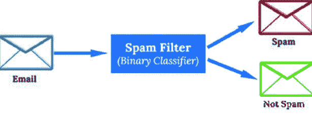

图 8.1：电子邮件垃圾邮件过滤器

我们有一个标记电子邮件的数据集，其中每封邮件都由特征表示，例如某些关键词的存在、邮件的长度以及感叹号的数量。每封邮件的标签要么是“spam”，要么是“not spam”。我们可以使用二分类算法（如逻辑回归）为该问题构建一个模型。该算法将学习特征与邮件为垃圾邮件概率之间的关系。训练阶段涉及向算法输入一组标记电子邮件及其相应的特征。算法将调整模型参数，以最小化预测概率与训练示例实际标签之间的差异。一旦模型训练完成，我们就可以使用它来预测新的未见邮件的类别。给定某封邮件的特征，模型将估计其为垃圾邮件的概率。然后我们可以应用一个阈值（例如 0.5），根据预测概率将电子邮件分类为垃圾邮件或非垃圾邮件。例如，如果模型预测的概率为 0.8，我们可以将其分类为垃圾邮件。另一方面，如果预测概率为 0.3，我们将其分类为非垃圾邮件。

二分类算法的性能可以使用各种指标（如 F1）进行评估，这些指标评估了模型预测正类和负类的效果。

## 多分类

多分类是一种机器学习算法，用于将实例归类为两个及以上的类别或范畴。与只有两个结果的二分类不同，多分类处理具有两个以上类别的问题。有多种常用于多分类的算法，如决策树、随机森林、支持向量机和神经网络。这些算法可以通过利用其底层模型和技术有效地处理多个类别，以适应问题的复杂度。

在多分类中，目标是根据特征为每个实例分配类别标签。训练阶段涉及向算法提供标记数据集，其中每个实例与多个类别中的一个相关。在训练期间，算法学习数据中的模式和关系，以创建一个能够区分不同类别的模型。模型参数将被调整以优化多个类别的分类性能。一旦模型训练完成，可以使用它来预测新的未见实例的类别标签。算法接收实例的特征作为输入，并根据学习到的模式将其分配到多个类别之一。

需要注意的是，多分类算法可能使用不同的技术来处理多个类别，例如一对多法（one-vs-all，也称为一对一方法）。这些技术涉及训练多个二分类分类器来分别区分一个类别与其他所有类别之间的关系，或者在类与类之间进行两对比较。

总之，多分类算法是解决具有两个以上类别的复杂分类问题的有力工具。它们应用于许多领域，包括图像识别、文本分类、情感分析和疾病诊断。

现在，让我们考虑一个多分类的常见例子：手写数字分类。假设我们有一个手写数字图像数据集，其中每张图像代表一个 0 到 9 之间的数字。目标是开发一个能够准确将给定图像分类到正确数字类的模型，如图所示：

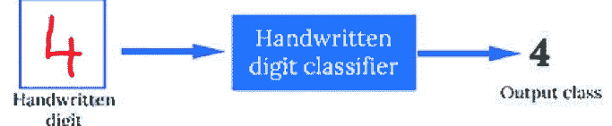

图 8.2：手写数字分类

多分类的另一个实践示例是医疗行业中的医疗诊断，通过将患者归类为不同的疾病组，或根据症状、病史和诊断测试来识别医疗状况。

为了训练多分类模型，我们需要一个标记数据集，其中每张图像都与对应的数字类别相关联。数据集将包含图像作为输入特征，并将相应的数字标签作为目标变量。我们可以使用多种机器学习算法进行多分类，例如支持向量机（SVM）或神经网络。这些算法可以从训练数据中学习模式和特征，以区分不同的数字类别。

模型训练完成后，我们就可以使用它来对新的未见过数字图像进行分类。模型接受图像作为输入，并根据学习到的模式和特征之间的关系来预测类别标签。例如，给定一个新的手写数字图像，模型可能会根据从训练数据中学到的模式将其预测为数字“7”或“4”。

## 决策树

决策树是一种用于分类和回归任务的机器学习算法。它们代表了一种类似于流程图的结构，每个内部节点代表一个特征或属性，每个分支代表基于该属性的决策，每个叶子节点代表一个类别标签或预测值。决策树算法通过根据所选属性递归划分数据来构建树，旨在最大化每个子集中类别的同质性。

构建决策树的关键步骤如下：

- **选择最佳**：算法确定最能将数据分为不同类别的属性，或者在回归任务中最小化不纯度的属性。

- **划分**：根据所选属性及其可能的属性值将数据划分为子集。

- **递归重复**：将上述步骤应用到每个子集，直到满足停止条件，例如达到最大树深度或具有纯的叶子节点。

决策树具有多个优势，包括可解释性、处理分类和数值数据的能力以及易于可视化。然而，它们容易过拟合，并且在具有高维特征的复杂数据集上可能表现不好。使用决策树进行预测时，输入数据从根节点开始通过树，根据属性值遵循相应的分支，直到到达提供预测类别或数值的叶子节点。

让我们考虑一个简单的例子来说明如何使用决策树进行分类。假设我们有一个客户数据集，想要根据两个特征（年龄和收入）预测客户是否会购买产品。我们有以下训练数据：

| age | income | purchase |
|---|---|---|
| 25 | 30,000 | 否 |
| 35 | 50,000 | 是 |
| 20 | 20,000 | 否 |
| 45 | 70,000 | 是 |
| 30 | 40,000 | 否 |

表 8.1：客户样本数据集

为了构建决策树，我们需要选择提供最佳划分的属性。假设我们选择年龄作为根属性。我们根据年龄将数据分为两个子集：

子集 1 (age $\le$ 30):

| age | income | purchase |
|---|---|---|
| 25 | 30,000 | 否 |
| 20 | 20,000 | 否 |
| 30 | 40,000 | 否 |

表 8.2：年龄 $\le$ 30 的客户样本数据集子集

子集 2 (age > 30):

| age | income | purchase |
|---|---|---|
| 35 | 50,000 | 是 |
| 45 | 70,000 | 是 |

表 8.3：年龄 > 30 的客户样本数据集子集

接下来，我们根据剩余属性继续划分子集。假设我们选择收入作为子集 1 的下一个属性。划分后，我们得到以下子集：

子集 1.1 (age $\le$ 30, income $\le$ $40,000):

| age | income | purchase |
|---|---|---|
| 25 | 30,000 | 否 |
| 20 | 20,000 | 否 |
| 30 | 40,000 | 否 |

表 8.4：年龄 $\le$ 30 且收入 $\le$ $40,000 的客户样本数据集子集

子集 1.2 (age $\le$ 30, income > $40,000):

（没有数据点符合此标准）

在此处，子集 1.1 和 1.2 各包含一个类别，因此它们成为叶子节点。让我们绘制到此为止的决策树，即两个叶节点，如图所示：

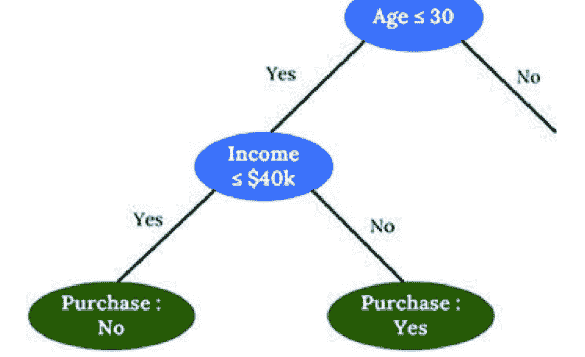

图 8.3：对应年龄 $\le$ 30 的决策

子集 2 仍然混合了类别，因此我们根据剩余属性继续对其划分。假设我们根据收入将其划分为两个子集：

子集 2.1 (age > 30, income $\le$ $60,000):

| age | income | purchase |
|---|---|---|
| 35 | 50,000 | 是 |

表 8.6：年龄 > 30 且收入 $\le$ $60,000 的客户样本数据集子集

子集 2.2 (age > 30, income > $60,000):

| age | income | purchase |
|---|---|---|
| 45 | 70,000 | 是 |

表 8.7：年龄 > 30 且收入 > $60,000 的客户样本数据集子集

现在，子集 2.1 和 2.2 各包含一个类别。因此，让我们根据属性构建完整的决策树，如图所示：


图 8.4：完整的决策树

### J48 类用于创建决策树分类器的实例

`J48` 类用于创建决策树分类器的实例。

通过调用 `buildClassifier` 方法使用数据集构建决策树模型。

使用 `toString` 方法打印决策树模型。

## 过拟合处理与树剪枝技术

决策树容易出现过拟合，即模型捕捉了训练数据中的噪声，无法良好地泛化到未见的数据。有多种技术可以改进决策树，例如用于减少过拟合的剪枝技术、结合多个决策树的集成方法（如随机森林），以及通过从弱模型中迭代构建强模型的提升方法（如梯度提升）。其中一些剪枝技术如下所示：

- **预剪枝（Pre-pruning）**：预剪枝涉及提前停止树的构建过程，以防止变得过于复杂并捕捉数据中的噪声。常见的预剪枝策略包括限制树的最大深度、设置分裂所需的最小样本数，或设置分裂所需的最小不纯度减少值。

- **后剪枝（Tree Pruning）**：后剪枝也称为树剪枝，涉及先生长一棵完整的决策树，然后移除或合并那些不能提供显著预测能力或无法提高模型在验证集上性能的节点。这有助于简化树并在保持预测准确性的同时减少过拟合。

决策树是多功能的机器学习模型，在解释性以及处理类别和数值数据方面表现出色。通过采用适当的剪枝技术，我们可以缓解过拟合并提高决策树的泛化性能，使其成为各个领域分类和回归任务的价值工具。

## 贝叶斯分类器

贝叶斯分类器也称为朴素贝叶斯（Naive Bayes），是一种基于贝叶斯定理的概率机器学习算法。它常用于分类任务，在处理大规模特征空间时特别有用。贝叶斯分类器假设类别中特定特征的出现（或不存在）与其他特征的出现（或不存在）是相互独立的。这种假设被称为“朴素”假设，这也是它被称为朴素贝叶斯分类器的原因。尽管这种假设在现实场景中并不总是成立，该分类器在实践中仍然表现良好。

该算法计算实例属于每个类的概率，然后将实例分配给概率最高的类。它使用贝叶斯定理计算这些概率，该定理将给定实例特征的某个类的后验概率与该类的先验概率以及在该类条件下特征的似然联系起来。

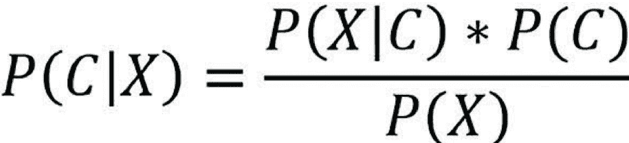

其中：

- `P(C|X)` 是给定实例的情况下该类的后验概率。
- `P(X|C)` 是给定类的情况下观测到该实例的似然。
- `P(C)` 是类的先验概率。
- `P(X)` 是观测到该实例的概率（也称为证据）。

在贝叶斯分类器中，实例 X 通常由一组特征 X 表示，类 C 代表实例可能所属的各个类别。为了将实例分配给概率最高的类，我们计算每个类的后验概率，并选择值最大的类。

要训练贝叶斯分类器，需要一个类标签已知的标记数据集。在训练阶段，算法估计每个类的先验概率以及在给定每个类的情况下特征的似然。这些概率随后在分类阶段被用于计算后验概率。在分类期间，贝叶斯分类器通过将该类的先验概率与在该类条件下特征的似然相乘，计算实例属于每个类的后验概率。将后验概率最高的类分配给实例。以下是一个演示贝叶斯分类器运行的 Java 代码示例：

```java
import weka.core.Attribute;
import weka.core.DenseInstance;
import weka.core.Instance;
import weka.core.Instances;
import weka.core.converters.ConverterUtils.DataSource;
import weka.classifiers.bayes.NaiveBayes;

public class BayesianClassifierExample {

    public static void main(String[] args) {
        try {
            // 从 .arff 文件加载数据集
            DataSource source = new DataSource("data.arff");
            Instances dataset = source.getDataSet();

            dataset.setClassIndex(dataset.numAttributes() - 1);
            // 创建一个用于分类的新实例
            Instance instance = new DenseInstance(dataset.numAttributes());
            instance.setDataset(dataset);
            instance.setValue(0, 30); // 年龄
            instance.setValue(1, "medium"); // 收入
            // 创建并构建贝叶斯分类器
            NaiveBayes classifier = new NaiveBayes();
            classifier.buildClassifier(dataset);
            // 分类实例
            double predictedClass = classifier.classifyInstance(instance);
            // 获取预测类标签
            Attribute classAttribute = dataset.classAttribute();
            String predictedClassName = classAttribute.value((int) predictedClass);
            // 打印预测类标签
            System.out.println("Predicted Class: " + predictedClassName);
        } catch (Exception e) {
            e.printStackTrace();
        }
    }
}
```

在这个示例中，我们使用了 Weka 库，它提供了多种机器学习算法，包括朴素贝叶斯分类器。代码从 .arff 文件加载数据集，创建一个用于分类的新实例，使用数据集构建贝叶斯分类器，然后对实例进行分类。最后，根据最高概率打印预测的类别。让我们使用以下 arff 文件作为贝叶斯示例的输入：

```arff
@relation purchase
@attribute age numeric
@attribute income {low, medium, high}
@attribute purchase {yes, no}

@data
30, medium, yes
25, low, no
35, high, yes
20, low, no
40, medium, yes
28, low, no
32, high, yes
23, low, no
37, medium, yes
26, low, no
33, high, yes
21, low, no
42, medium, yes
29, low, no
31, high, yes
24, low, no
38, medium, yes
27, low, no
34, high, yes
22, low, no
```

此数据集代表了一个简单的场景，我们有三个属性：年龄（数值）、收入（类别）和购买（类别）。数据集中的实例由不同的年龄和收入值以及购买结果组成。

分类输出如下：

```
Predicted Class: yes
```

总结来说，贝叶斯分类器是一种简单有效的算法，广泛应用于文本分类、垃圾邮件过滤、情感分析和其他分类任务。它以高效性和处理大规模特征空间的能力而闻名，是许多应用中的流行选择。

## 逻辑回归

逻辑回归是一种用于二分类任务的统计模型，其中结果变量是具有两个类别的类别。它模拟了预测变量与实例属于特定类别概率之间的关系。逻辑回归利用逻辑函数（也称为 sigmoid 函数）将预测变量的线性组合转换为 0 到 1 之间的概率值。逻辑函数定义为：

$$P(y = 1|x) = \frac{1}{1 + e^{-z}}$$

其中 `P(y = 1|x)` 代表给定预测变量的情况下实例属于类 1 的概率，`z` 是预测变量及其相应系数的线性组合。


# 逻辑回归模型

逻辑回归模型使用极大似然估计法来估计预测变量的系数。目标是找到一组使观测数据似然最大化的系数。为了估计系数，模型使用了对数似然函数，即似然函数的自然对数。对数似然函数给出：

$$L = \sum(y_i \cdot \log p_i + (1 - y_i) \cdot \log(1 - p_i))$$

其中，$y_i$ 为实例的实际类别标签（0 或 1），$p_i$ 为该实例属于类别 1 的预测概率。

逻辑回归模型通常使用优化算法（如梯度下降法或牛顿法）进行训练，以找到能够使对数似然函数最大化的系数。一旦估计了系数，逻辑回归模型就可以使用逻辑函数（`logistic function`）预测实例属于类别 1 的概率。如果预测概率大于某个阈值（0.5），则该实例被分类为类别 1；否则，分类为类别 0。

以下是一个 Java 代码示例，演示了如何使用 Apache Commons Math 库实现逻辑回归分类器：

```java
import org.apache.commons.math3.linear.MatrixUtils;
import org.apache.commons.math3.linear.RealMatrix;
import org.apache.commons.math3.linear.RealVector;
import org.apache.commons.math3.linear.SingularMatrixException;
import org.apache.commons.math3.stat.regression.OLSMultipleLinearRegression;
```

```java
public class LogisticRegressionClassifier {
    private RealMatrix X;
    private RealVector y;
    private double[] coefficients;

    public void train(double[][] input, double[] output) {
        X = MatrixUtils.createMatrix(input);
        y = MatrixUtils.createRealVector(output);
        OLSMultipleLinearRegression regression = new OLSMultipleLinearRegression();
        regression.newSampleData(y.toArray(), X.getData());
        try {
            coefficients = regression.estimateRegressionParameters();
        } catch (SingularMatrixException ex) {
            // Handle singular matrix exception
            ex.printStackTrace();
        }
    }

    public double predict(double[] input) {
        double logOdds = coefficients[0]; // Intercept term
        for (int i = 0; i < input.length; i++) {
            logOdds += coefficients[i + 1] * input[i];
        }
        return sigmoid(logOdds);
    }

    private double sigmoid(double x) {
        return 1 / (1 + Math.exp(-x));
    }

    public static void main(String[] args) {
        double[][] input = {
            {2.0, 1.0},
            {1.0, 3.0},
            {4.0, 5.0},
            {6.0, 7.0}
        };
        double[] output = {0.0, 0.0, 0.0, 1.0, 1.0};
        LogisticRegressionClassifier classifier = new LogisticRegressionClassifier();
        classifier.train(input, output);
        double[] testInput = {3.0, 4.0};
        double prediction = classifier.predict(testInput);
        System.out.println("Prediction: " + prediction);
    }
}
```

代码的输出结果如下：

```
Prediction: 0.6140303729468465
```

在这段代码中，`train` 方法接收一个 2D 输入数据数组（`input`）和一个对应的 1D 输出标签数组（`output`）。它使用 Apache Commons Math 的 `OLSMultipleLinearRegression` 类来估计逻辑回归模型的系数。`predict` 方法接收单个输入数据实例（`input`），并使用学习到的系数计算对数几率（`log odds`）。`sigmoid` 方法应用 sigmoid 函数将对数几率转换为 0 到 1 之间的概率值。在 `main` 方法中，创建了一个带有相应输出标签的示例数据集。`LogisticRegressionClassifier` 实例在该数据集上进行训练，然后使用测试输入通过 `predict` 方法进行预测。请注意，这是一个简化的示例，不包含正则化或处理类别变量等高级功能。它仅作为在 Java 中使用 Apache Commons Math 实现逻辑回归分类器的基础演示。

总而言之，逻辑回归是一种广泛用于二分类的算法。它使用逻辑函数对预测变量与实例属于特定类概率之间的关系建模。模型系数使用极大似然估计法（MLE）进行估计，模型通过比较预测概率与阈值来做出预测。

## 结论

在本章中，我们涵盖了机器学习分类的基础概念和算法。我们从理解二分类和多类分类的区别开始。我们探索了分类中常用的各种算法，包括决策树、贝叶斯分类器和逻辑回归。在整个章节中，我们研究了这些算法的底层原理、数学公式以及在 Java 中的实际实现。

在下一章“情感”中，我们将学习情感分析，它利用自然语言处理（NLP）来分析文本数据的情感。

## 问题

- 二分类和多类分类的区别是什么？
- 决策树算法在分类实例时是如何工作的？
- 概率在贝叶斯分类器算法中起什么作用？
- 逻辑回归如何对输入特征与类别概率之间的关系建模？
- 用于评估分类模型性能的常用评估指标有哪些？
- 如何解决分类算法中的过拟合问题？
- 使用逻辑回归进行分类任务的优点和缺点是什么？
- 朴素贝叶斯假设是什么？它是如何简化分类过程的？
- 解释集成学习的概念以及它是如何提高分类结果的。
- 解释支持向量机（SVM）中用于分类的支持向量和间隔（margin）的概念。

## 注意事项

- 分类分析用于根据模式和关系将数据集划分为标记的组。
- 二分类涉及将实例分类为两个类别之一，而多类分类处理多个类别。
- 常见的二分类算法包括逻辑回归、决策树和支持向量机。
- 多类分类算法扩展了二分类分类器以处理多个类别，例如一对多和一对一方法。
- 决策树是根据一系列规则或条件做出决策的分层模型。
- 贝叶斯分类器使用概率模型根据概率将实例分配到类别。
- 逻辑回归是一种统计模型，预测实例属于特定类别的概率。
- 分类算法可以使用准确率、精确率、召回率和 F1 分数等指标进行评估。
- 集成学习通过结合多个分类器来提高分类性能。
- 正则化技术通过对复杂模型引入惩罚来防止过拟合。
- 交叉验证通过将数据分为训练和测试集来评估分类模型的性能。
- 特征选择技术用于识别分类最相关的特征。
- 预处理技术如特征缩放、独热编码和处理缺失值常用于分类任务。
- 类别不平衡（一个类别的实例远多于其他类别）会影响分类准确性，可能需要平衡技术。
- 理解决策边界和类别分离对于分类分析至关重要。

# 情感分析

## 引言

情感分析又称为意见挖掘，是自然语言处理（NLP）中的一个专门领域，旨在识别和理解文本数据传达的情感。其演变可以追溯到计算语言学和文本分析的早期阶段，随着时间的推移经历了显著进展。社交媒体平台的兴起和数字内容的指数级增长使情感分析处于至关重要的地位，成为企业和研究人员不可或缺的工具。在本章中，我们将使用 Stanford CoreNLP 内置的情感分析功能，这是一个致力于 NLP 任务的免费库。

## 结构

在本章中，我们将涵盖以下主题：

- 情感分析
- Stanford CoreNLP
- 针对客户评论的情感分析

## 情感分析

情感分析（Sentiment Analysis），也称为意见挖掘，是自然语言处理（NLP）的一个子领域，专注于提取和理解文本中附带的情感或情绪。它被广泛应用于数据挖掘、网络挖掘和社交媒体分析等领域，因为它允许公司能够对公众对其产品或服务的观点产生洞察。

从本质上说，情感分析解释并将文本数据中的情感分类为积极、消极或中性。然而，高级的情感分析还可以识别更复杂的情绪，如快乐、悲伤、愤怒等。

## 情感分析的类型

根据所需的分析粒度和深度，情感分析分为不同的类型，每种类型在不同领域中都有特定的用途：

- **细粒度情感（Fine-Grained Sentiment）**：这不仅涉及将情感分类为积极、消极或中性，还涉及到情感的程度，例如非常积极、稍微积极等。例如，一条表示“服务很好”的评论将被归类为非常积极。
- **情绪（Emotion）**：这超越了基本的情感极性，识别特定的情绪，如快乐、沮丧、愤怒等。例如，检测社交媒体帖子或客户反馈中的讽刺语调可以提供关于客户情绪的宝贵见解。
- **基于方面的情感分析（Aspect-Based Sentiment）**：这种类型侧重于识别对文本中特定方面或特征的情感。例如，在产品评论中，识别对性能、设计、可用性和客户服务等方面的情感，可以帮助企业确定改进领域。

## 情感分析中使用的技术

情感分析依赖于各种技术来解释情感，从传统的基于词典的方法到先进的机器学习方法。虽然机器学习算法通过从标记数据中学习模式来提供稳健性和适应性，但基于词典的技术通过利用预定义的情感词典提供了简单性和透明度：

- **机器学习（Machine-Learning）**：机器学习算法可以在标记数据集上进行训练以对情感分类。这通常是一种非常复杂但非常准确的方法。
- **基于词典（Lexicon-Based）**：这些技术使用情感词典，即一个每个单词都标记了其相关情感（积极、消极或中性）的列表。可以根据单个单词的情感来确定文本的整体情感。

除了这些传统方法外，情感分析中的新兴实践包括：

- **深度学习（Deep Learning）**：深度学习模型（如递归神经网络（RNN）和卷积神经网络（CNN））通过捕捉文本数据中的复杂模式，在情感分析任务中显示出良好的效果。
- **基于神经网络的方面情感分析（Aspect-Based Sentiment Analysis with Neural）**：神经网络架构的最新进展促进了专门为基于方面的情感分析模型的发展，能够对文本中不同方面或实体的情感进行更细的分析。

通过结合这些先进技术，情感分析系统可以在捕捉文本数据中人类情感的细微差别方面获得更高的准确性和适应性。

## 使用 Java 进行情感分析

Java 以及 Stanford CoreNLP 等某些库提供了强大的情感分析功能。这里是一个使用 Stanford CoreNLP 进行情感分析的 Java 示例：

```java
import edu.stanford.nlp.ling.CoreAnnotations;
import edu.stanford.nlp.neural.rnn.NNNCoreAnnotations;
import edu.stanford.nlp.pipeline.*;
import edu.stanford.nlp.sentiment.SentimentCoreAnnotations;
import edu.stanford.nlp.trees.Tree;
import edu.stanford.nlp.util.CoreMap;
```

```java
public class BasicSentimentAnalysis {
    public static void main(String[] args) {
        String text = "I love this product. It's amazing.";

        Properties props = new Properties();
        props.setProperty("annotators", "tokenize, ssplit, parse, sentiment");
        StanfordCoreNLP pipeline = new StanfordCoreNLP(props);
        Annotation annotation = pipeline.process(text);

        for (CoreMap sentence : annotation.get(CoreAnnotations.SentencesAnnotation.class)) {
            Tree tree = sentence.get(SentimentCoreAnnotations.SentimentAnnotatedTree.class);
            int sentiment = NNNCoreAnnotations.getPolarity(tree);

            System.out.println(sentence + " " + (sentiment > 2 ? "Positive" : "Negative"));
        }
    }
}
```

上述代码的输出如图所示：

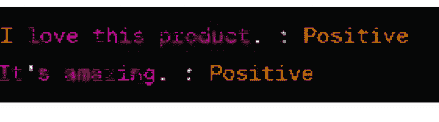

**图 9.1：使用 Stanford Core NLP 预测文本的情感**

在此代码中，我们首先导入了必要的库和类。然后，我们设置了一个带有必要标注器（`tokenize`、`ssplit`、`parse`、`sentiment`）的 Stanford CoreNLP 流水线。我们通过流水线处理输入文本，对于文本中的每个句子，我们获取其情感标注的解析树。树的极性告诉我们句子的情感。这个示例非常简单，对于实际应用，可能需要更复杂的预处理和后处理步骤。例如，处理否定词（“not good”应该被识别为消极情感）、处理成语短语等。

在本章的后续章节中，我们将更多地探索 Stanford CoreNLP 以及如何使用它对客户评论进行情感分析。

## Stanford CoreNLP

Stanford CoreNLP 是由斯坦福大学开发的一个开源自然语言处理（NLP）工具包。它用 Java 编写，提供了一系列对文本进行语言分析的工具，包括分词、词性标记、命名实体识别、解析和情感分析等。这里有一张显示数据通过这些任务的流程图：


**图 9.2：通过任务的数据流**

关于 Stanford CoreNLP 的更多细节可以在其 GitHub 上找到。Stanford CoreNLP 以其稳健性和准确性以及对许多语言的支持而闻名，使其成为流行的库之一。它可以与机器学习库集成以进行高级处理。

## Stanford CoreNLP 的关键功能

Stanford CoreNLP 提供了一套全面的语言分析工具。一些关键功能包括：

- **分词（Tokenization）**：这是将文本分解为单词或标记的过程。这些标记是 NLP 流水线处理的基本单元。Stanford CoreNLP 中的分词过程所示：

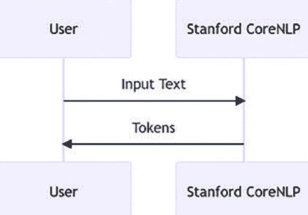

**图 9.3：Stanford CoreNLP 分词的序列图**

- **词性标记（POS）**：这为文本中的每个单词分配语法类别（如名词、动词、形容词等），如图所示：

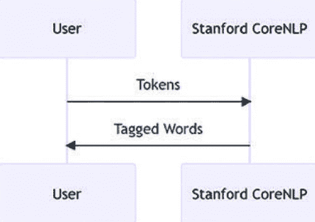

**图 9.4：Stanford CoreNLP 词性标记的序列图**

- **命名实体识别（Named Entity Recognition）**：这识别并分类文本中的专有名词，如人物、组织、地点等，如图所示：

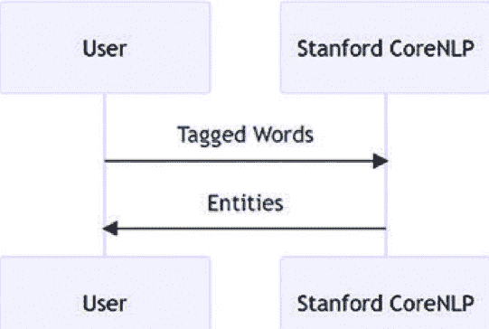

**图 9.5：Stanford CoreNLP 命名实体识别的序列图**

- **解析（Parsing）**：这涉及分析句子语法结构。输出是显示句子不同部分之间关系的解析树，如图所示：

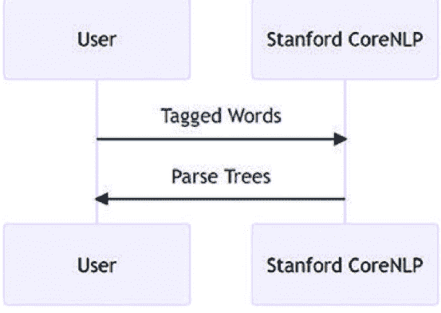

**图 9.6：Stanford CoreNLP 解析的序列图**

- **指代消解（Coreference）**：这一过程识别文本中的两个或多个表达式指向同一个实体。例如，在句子“John said he would”中，“he”指的是同一个人。Stanford CoreNLP 中的指代消解过程如图所示。

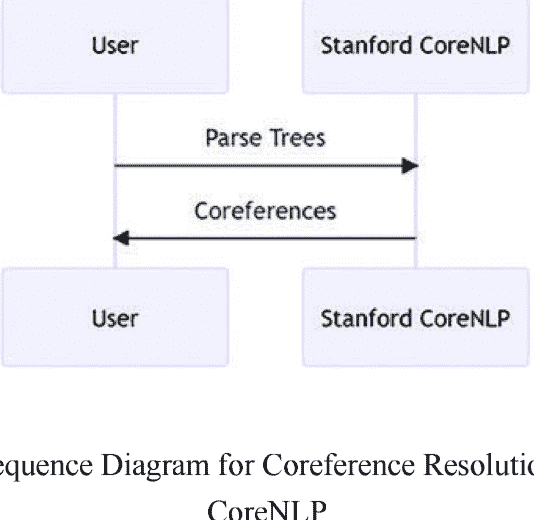

**图 9.7：Stanford CoreNLP 指代消解的序列图**

- **情感（Sentiment）**：这涉及确定文本中所表达的情感或情绪。它可以用于识别积极、消极或中性的情感。用户向 CoreNLP 系统提供文本，然后由系统执行情感分析并返回情感结果。Stanford CoreNLP 中的情感分析过程如图所示。


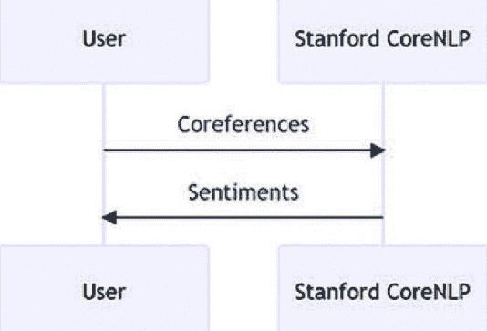

图 9.8：Stanford CoreNLP 情感分析序列图

## 在 Java 中使用 StanfordCoreNLP

`StanfordCoreNLP` 是一个 Java 库，可以通过 `StanfordCoreNLP` 类在 Java 程序中访问其工具。该类充当流水线，接收原始文本并在其上运行一系列 NLP 标注器。以下是如何使用 `StanfordCoreNLP` 进行词性标注的示例：

```java
import edu.stanford.nlp.pipeline.*;
import edu.stanford.nlp.ling.*;

public class POSTaggingExample {
    public static void main(String[] args) {
        String text = "This is a simple sentence.";

        // 设置流水线属性
        Properties props = new Properties();
        // 设置要运行的标注器列表
        props.setProperty("annotators", "tokenize,ssplit,pos");
        // 构建流水线
        StanfordCoreNLP pipeline = new StanfordCoreNLP(props);
        // 创建文档对象
        CoreDocument doc = new CoreDocument(text);
        // 标注文档
        pipeline.annotate(doc);
        // 查看结果
    }
}
```

```java
for (CoreLabel tok : doc.tokens()) {
  System.out.println(String.format("Token: %s, POS. %s", tok.word(),
  tok.tag()));
}
}
```

上述代码的输出所示：

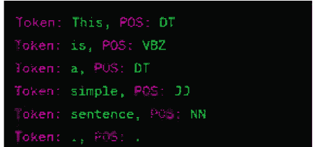

图 9.9：使用 Stanford CoreNLP 进行词性标注

这里，POS 标签代表：

- **DT**：限定词
- **VBZ**：动词，第三人称单数现在式
- **JJ**：形容词
- **NN**：名词，单数或不可数名词

在这段代码中，我们首先设置了一个带有必要标注器（`"tokenize"`, `"ssplit"`）的 `StanfordCoreNLP` 流水线。我们从输入文本创建一个 `CoreDocument` 对象并在其上运行流水线。然后，对于文档中的每个标记，我们打印其文本和词性标注标签。

## 与其他库集成

`StanfordCoreNLP` 可以与其他 Java 库集成，以执行更高级的文本处理任务。例如，它可以与 `Weka` 或 `Deeplearning4j` 等机器学习库一起用于文本分类或聚类等任务。

在本章的下一节中，我们将深入探讨如何使用 `StanfordCoreNLP` 对客户评论进行情感分析。

## 客户评论的情感分析

客户评论情感分析涉及将情感分析技术应用于客户评论，以确定客户对产品、服务或品牌所表达的情感或情绪。这是企业用来衡量客户满意度并识别改进领域的强有力工具。

通过分析客户评论的情感，企业可以洞察客户对他们产品和服务的喜好之处。这可以指导产品开发、营销和客户服务等领域的决策。

## 客户评论情感分析的重要性

客户评论的情感分析对企业至关重要，并在多个领域起着关键作用：

- **理解客户评论**：评论是客户的直接反馈，理解这些评论背后的情感有助于企业理解其产品或服务是如何被感知的。积极的情感通常表示客户满意，而消极的情感可能预示着需要解决的问题。

- **识别趋势话题**：通过分析随时间推移客户评论的情感，企业可以识别客户情感的趋势以及客户提出的常见问题。例如，如果对产品耐用性的负面情感突然增加，企业可以调查并解决该问题。

- **改进产品**：客户评论可以为客户对产品或服务的喜好提供宝贵的见解。通过分析这些评论以及其中表达的情感，企业可以识别改进领域并对产品开发做出明智的决策。

- **增强客户情感**：情感分析可以帮助企业快速响应负面评论，及时解决客户顾虑并提高他们的整体体验。它还帮助公司更好地了解客户，从而改善与客户的关系并建立客户忠诚度。

## 客户评论情感分析面临的挑战

尽管非常重要，但客户评论情感分析面临着若干挑战：

- **讽刺**：情感分析算法难以检测讽刺和反讽。例如，一条显示“我真喜欢程序崩溃”的评论很可能是讽刺且消极的，但算法可能会根据“love”一词的存在将其错误地分类为积极。这种挑战可以通过开发能够检测讽刺和反讽语言线索的算法来缓解，例如否定与积极词或夸张语言相结合。可以利用机器学习技术在包含讽刺或反讽表达的标记数据集上训练模型。

- **上下文相关性**：词的含义和情感在很大程度上取决于它们所使用的上下文。例如，“unpredictable”（不可预测的）一词在描述汽车时可能带有负面情感，但在描述电影剧情时可能带有积极情感。为了克服这一挑战，可以通过考虑周围的单词和短语，将上下文信息整合到情感分析中。

```java
System.out.println(sentence + " : " + (sentiment > 2 ? "Positive" : "Negative"));
}
}
```

在这个示例中，我们正在分析一条包含正面和负面情感的客户评论。情感分析工具将分别分析每个句子，并输出每个句子的情感倾向。

这段 Java 代码的输出结果为：

```text
I love the camera on this phone, : Positive
but the battery life is disappointing. : Negative
```

这个示例演示了如何将情感分析应用于客户评论以提取有价值的见解。然而，现实世界的应用可能涉及更大的数据集，并可能需要额外的步骤，如数据清洗、边缘情况处理以及更复杂的情感分析技术。

## 结论

在本章中，我们探索了情感分析，这是自然语言处理（NLP）的一个关键组件。我们学习了情感分析的基础知识，以及它如何将情感分类为正面、负面或中性。我们深入研究了一个 NLP 开源库，并用 Java 代码示例说明了它的用法。随后，我们将注意力转向了情感分析在客户评论中的应用，强调了它的重要性和挑战。最后，我们演示了如何使用 Java 和 `StanfordCoreNLP` 对客户评论进行情感分析。本章旨在提供对情感分析的全面理解、其在当今数据驱动世界中的意义以及其实际实现。

在下一章“聚类”中，我们将学习一些最流行的聚类分析算法，并将它们用于客户细分。

## 问题

1. 什么是情感分析？它是如何分类情感的？
2. 情感分析是如何使用自然语言处理（NLP）的？
3. 什么是 `StanfordCoreNLP` 库？它的主要特征是什么？
4. 如何使用 `StanfordCoreNLP` 在 Java 中执行情感分析？请提供一段代码作为示例。
5. 情感分析如何应用于客户评论？这能为企业带来什么益处？
6. 在客户评论上进行情感分析涉及哪些挑战？
7. 你能用一个例子来解释情感分析中的语境含义问题吗？
8. 讽刺或反讽如何给情感分析带来挑战？
9. 比较句在情感分析中有什么意义？为什么它们难以被分析？
10. 企业如何利用从客户评论的情感分析中获得的见解来改进他们的产品或服务？
11. 情感分析在增强客户服务方面起着什么作用？
12. 情感分析如何帮助根据客户评论识别趋势主题或问题？

## 知识点回顾

- 情感分析是自然语言处理中的一种技术，用于分析文本数据的情感。
- 文本中的情感可以被分为正面、负面或中性。
- 情感分析可以帮助理解文本中的态度、观点和情绪。
- `StanfordCoreNLP` 是一个用于自然语言处理的开源库。
- `StanfordCoreNLP` 可以执行各种 NLP 任务，包括情感分析。
- 在 Java 中可以使用 `StanfordCoreNLP` 来执行情感分析。
- 情感分析可以应用于客户评论，以理解客户对产品、服务或品牌的情感。
- 分析客户评论的情感可以为企业提供有价值的见解，让他们了解客户对产品或服务的喜欢和讨厌之处。
- 情感分析可以帮助企业快速响应负面评论，从而增强其客户服务。
- 通过识别客户情感的趋势和常见问题，企业可以做出产品开发和改进的明智决策。
- 讽刺和反讽对情感分析是一个巨大的挑战，因为它们可能导致错误的情感分类。
- 词汇的情感可能会根据语境改变，这是情感分析的另一个挑战。
- 比较句（比较一个产品或服务与另一个）可能很难分析其情感。
- 复杂的语言结构，如双重否定、成语和口语，会使情感分析更具挑战性。
- 尽管存在这些挑战，情感分析仍然是企业从客户评论中获取见解的有效工具。
- 需要先进的情感分析算法和技术来处理人类语言的微妙性和复杂性。
- 情感分析在利用当今大量的文本数据方面发挥着至关重要的作用。
- 情感分析可以帮助企业更好地理解客户，从而改善与客户的关系并建立客户忠诚度。
- 情感分析的现实应用通常涉及更大的数据集，并可能需要数据清洗和处理边缘情况等额外步骤。
- 情感分析的实际实现需要良好理解底层概念和技术，并精通 Java 等编程语言。

## 引言

聚类分析是无监督机器学习的一种重要范式，涉及将相似的数据点分为不同的簇。我们的旅程将从理解聚类的基本概念开始，然后深入研究不同的算法，例如 `K-Means` 聚类，它根据数据与质心的接近程度来划分数据。我们将进一步探索 `DBSCAN`，该算法通过识别核心点、边界点和噪声点提供了更大的灵活性。我们的探索将继续到层次聚类，它生成簇的树状结构，提供多层次的粒度。最后，我们将通过实践实现客户细分的 `K-Means` 聚类作为结束，说明企业如何利用这些技术来创建有意义的客户类别。

## 结构

在本章中，我们将涵盖以下主题：

- 聚类
- `K-Means` 聚类
- `DBSCAN` 聚类
- 层次聚类
- 使用 `K-Means` 聚类的客户细分

## 聚类

聚类或簇分析是指将数据对象组织成不同的组，使得同一簇内的对象彼此比与其他簇中的对象更相似。这种方法是无监督学习的一个示例，因为它不需要先验知识或训练数据。让我们通过考虑一个业务场景来理解聚类：某公司想要为了营销目的对其客户进行细分。例如，它可以向高收入群体提供优质产品，向中收入群体提供中端产品，向低收入群体提供廉价产品。公司可以使用聚类算法根据收入水平对客户进行分组。这一过程如图所示：


图 10.1：使用聚类进行客户细分

有多种聚类技术，每种适用于不同的数据类型和背景。例如，`K-Means` 聚类是一种基于质心的方法，通常在你想指定簇的数量时使用。基于密度的空间聚类噪声分析（`DBSCAN`）是一种基于密度的方法，它在识别任意形状的簇和离群值方面非常有效。层次聚类构建了簇的层次结构，分为凝聚式（自下而上）或分裂式（自上而下），适用于未知精确簇数量的情况。正如我们将在随后的章节中看到的，这些方法可以应用于许多现实场景，例如营销中的客户细分，`K-Means` 聚类可以帮助识别具有相似行为或偏好的客户群体。

除了客户细分，聚类技术在各个领域都有广泛的应用。一个例子是图像处理，聚类算法被用于图像分割，即将图像划分为多个部分以简化其表示或便于分析。例如，在医学影像中，聚类算法可以用于分割 MRI 或 CT 扫描中的不同组织或器官，辅助诊断和治疗计划。聚类的另一个实际应用是推荐系统，它被用于将具有相似偏好或行为模式的用户进行分组。通过根据历史交互或偏好对用户进行聚类，推荐系统可以向同一簇内的用户推荐相关的项目或内容，增强用户体验和参与度。例如，Netflix 等流媒体平台采用基于用户的观看历史和偏好推荐电影或电视节目的聚类技术。

这些示例强调了聚类技术在不同领域的通用性和实用性，证明了它们在发现数据中有意义的模式和结构方面的有效性，从而提供可操作的见解和辅助决策。

## K-Means 聚类

`K-Means` 聚类是一种划分聚类，将数据集分成 K 个不同的不重叠子集或簇，每个数据点属于均值最近的簇。它的原理是最小化数据点与其形成的簇质心或均值之间的距离。

### K-Means 聚类是如何工作的？

该算法通过以下步骤运行：

1. 随机选择 K 个数据点作为质心。
2. 将每个数据点分配给最近的质心，形成 K 个簇。
3. 计算每个簇的新质心（均值）。
4. 重复步骤 2 和 3，直到质心不再发生显著变化，或达到预定义的迭代次数。

## 选择合适的聚类数量

确定最佳聚类数量 K 是 `K-Means` 聚类中的关键步骤。选择不合适的 K 值可能会导致聚类结果不佳，产生的簇过于粗糙或过于细粒。几种方法可以帮助选择正确的聚类数量：

- **手肘法**：手肘法是一种启发式方法，通过分析簇内平方和（WCSS）随簇数量的变化来确定 K。它涉及将 WCSS 与簇数量的关系绘制成图，并识别出 WCSS 下降速率显著减慢的点。进一步划分簇在减少 WCSS 方面收益递减的点被认为是最佳聚类数量。

- **轮廓系数**：轮廓系数是一个量化簇与簇分离程度的指标。它衡量了簇内的凝聚力和簇之间的分离度。较高的轮廓系数表示簇的定义更清晰。通过计算不同 K 值的轮廓系数，可以识别出使整体凝聚力和分离度最大化的 K 值，从而获得更有意义的聚类结果。

- **间隙统计**：间隙统计是另一种用于估计最佳聚类数量的方法。它将数据的簇内散度与假设无聚类时生成的参考分布的散度进行比较。通过识别观测到的簇内散度与零假设下预期散度之间差距最大的 K 值，来确定最佳聚类数量。

- **交叉验证**：交叉验证技术（如 k 折交叉验证）可以评估不同 K 值下 `K-Means` 聚类的性能。通过多次将数据分为训练集和验证集，并使用轮廓系数或聚类稳定性等指标评估聚类性能，可以识别出良好泛化到未见数据的最佳聚类数量。

- **领域知识**：某些情况下，领域知识或对数据的先验理解可以为合适的簇数量提供有价值的见解。领域专家可能对数据的内在结构或所需的聚类粒度有见解，从而指导 K 的选择。

通过结合或单独使用这些方法，数据分析师和从业人员可以对 `K-Means` 聚类的簇数量做出决策，从数据中获得更有意义且可操作的见解。

## 处理非球形数据

`K-Means` 聚类假设簇是球形的且大小相似。然而，现实世界的数据往往表现出非球形形状和变化的簇大小。为了处理此类数据，可以使用特征缩放和使用替代聚类算法等技术。

特征缩放涉及将特征缩放到相似范围，这可以减轻不同特征尺度对簇形成的影响。

如果数据表现出非球形形状，像 `DBSCAN` 或高斯混合模型（`GMM`）等算法可能是 `K-Means` 聚类的更好的替代方案。

## K-Means 聚类示例

在 Java 中，我们可以使用 `Smile` 库来实现 `K-Means` 聚类。`Smile` 是一个全面的系统，包含了 Java 和 Scala 的机器学习、自然语言处理、线性代数、图论、插值和可视化功能。这里是一个使用 `Smile` 库进行 `K-Means` 聚类的简单示例。该示例使用 2D 数组表示数据点并将它们分配到两个簇：

```java
import smile.clustering.Kmeans;
import smile.plot.swing.ScatterPlot;

public class KMeansExample {
    public static void main(String[] args) {
        double[][] data = {
            {0.8, 2.0},
            {0.5, 1.8},
            {5.0, 4.0},
            {7.2, 8.0},
            {1.0, 0.6},
            {6.0, 9.3}
        };

        // 执行 K-Means 聚类
        Kmeans kmeans = KMeans.fit(data, 2);

        // 打印簇标签
        for (int i = 0; i < kmeans.length; i++) {
            System.out.println("Data point " + i + " is in cluster " + kmeans.y[i]);
        }

        // 绘制数据点及其聚类分配图
        ScatterPlot plot = ScatterPlot.of(data);

        try {
            plot.canvas().window();
        } catch (Exception e) {
            e.printStackTrace();
        }
    }
}
```

这段代码将打印每个数据点的簇分配情况，如下所示：

```text
[main] INFO smile.clustering.KMeans - Distortion after initialization: 26.9000
[main] INFO smile.clustering.KMeans - Distortion after 1 iterations: 21.025
[main] INFO smile.clustering.KMeans - Distortion after 2 iterations: 21.025
Data point 0 is in cluster 1
Data point 1 is in cluster 1
Data point 2 is in cluster 0
Data point 3 is in cluster 0
Data point 4 is in cluster 1
Data point 5 is in cluster 0
```


散点图将创建数据的散点图，每个簇使用不同的颜色。然而，作为一个基于文本的 AI，它无法执行代码或生成图表。你可以在本地环境中运行此代码以查看图表，如图所示：


图 10.2：显示每个数据点簇分配的输出

图 10.3：数据分为两个簇的散点图

请注意，你需要在路径中包含 `Smile` 库才能运行。你可以使用 `Maven` 或 `Gradle` 将其添加到项目中。以下是依赖项：

## DBSCAN 聚类

基于噪声的密度空间聚类 (`DBSCAN`) 是一种基于密度的聚类算法，具有发现任意形状簇的独特能力。`DBSCAN` 特别适用于需要区分噪声（离群值）和形成簇的数据的任务。

`DBSCAN` 算法通过以下关键步骤运行：

1. 对于每个数据点，算法计算用户指定的半径 `eps` 内的其他数据点的数量。
2. 如果一个点在 `eps` 半径内至少有指定数量的点，则被分类为核心点。如果它不满足这一标准但在另一个核心点的 `eps` 半径内，它是边界点。如果它两者都不是，则是噪声点。
3. 核心点之间创建一个簇。

## DBSCAN 聚类示例

同样，我们可以在 `Java` 中使用 `Smile` 库进行 `DBSCAN` 聚类。首先，如果尚未添加，请将 `Maven` 依赖添加到 `pom.xml` 文件：

```xml
<dependency>
    <groupId>com.github.haifengl</groupId>
    <artifactId>smile-core</artifactId>
    <version>3.0.2</version>
</dependency>
```

```java
import java.util.Arrays;

import smile.clustering.DBSCAN;
import smile.math.distance.EuclideanDistance;
// import smile.swing.PlotCanvas;
import smile.plot.swing.ScatterPlot;

public class DBSCANExample {
    public static void main(String[] args) {
        // 示例 2D 数据
        double[][] data = {
            {0.8, 2.0},
            {0.5, 1.8},
            {1.5, 1.5},
            {7.2, 8.0},
            {1.0, 0.6},
            {6.0, 9.3},
            {3.0, 4.4},
            {9.0, 6.0}
        };

        // Epsilon radius
        double eps = 3.0;

        // Minimum number of points
        int minPts = 2;

        // Run DBSCAN clustering
        DBSCAN dbscan = DBSCAN.fit(data, minPts, eps);

        // Print cluster labels for each data point
        int[] labels = dbscan.labels();
        for (int i = 0; i < labels.length; i++) {
            System.out.println("Data point " + Arrays.toString(data[i]) + " belongs to cluster " + labels[i]);
        }

        // Create scatter plot
        // PlotCanvas plot = ScatterPlot.plot(data, labels, '*', Palette.COLORS);
        ScatterPlot plot = ScatterPlot.of(data, dbscan.y, '*');
        try {
            plot.canvas().window();
        } catch (Exception e) {
            e.printStackTrace();
        }
    }
}
```

输出将指示每个数据点所属的簇。控制台输出可能如图所示：

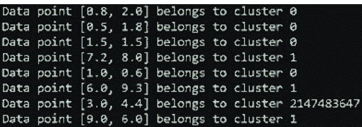

图 10.4：显示每个数据点聚类分配的输出

这表明第一、第二、第三和第五个数据点属于第一个簇，而第四、第六和第八个数据点属于第二个簇。`DBSCAN` 具有噪声或离群点的概念，在前面的示例中它们被这样标记；如控制台输出所示，第七个点是一个离群点。代码还生成了一个散点图，其中每个点的颜色表示其所属的簇，如图所示：

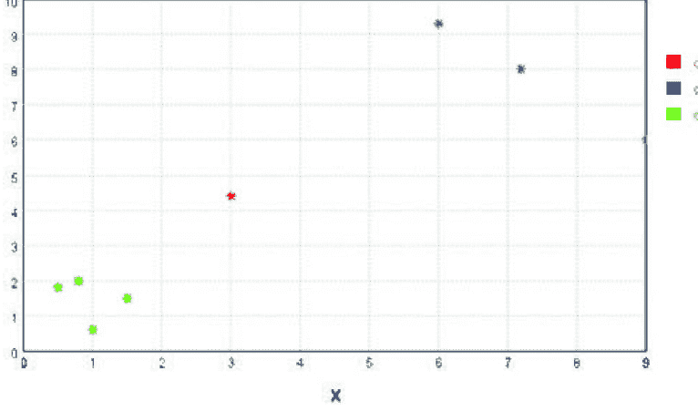

图 10.5：显示不同数据点聚类情况的散点图

## 层次聚类

层次聚类是一种广泛使用的无监督学习技术，根据数据点的相似性/差异性将相似的数据点分组成簇。与形成不重叠簇的 `K-Means` 和 `DBSCAN` 不同，层次聚类以树状结构（称为树状图，`dendrogram`）的形式创建数据点的层次表示。它不需要预先指定簇的数量，使其成为探索数据模式的一种灵活且强大的方法。

层次聚类大可以分为两种主要方法，如图所示：

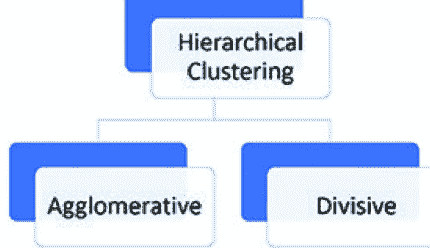

图 10.6：层次聚类的类型

- **凝聚层次聚类**（自下而上的方法）：它从每个数据点作为一个单独簇开始，然后迭代地合并最近的簇，直到所有数据点都属于同一个簇或满足预定义的停止准则。
- **分裂层次聚类**（自上而下的方法）：它从所有数据点属于一个簇开始，然后递归地分裂簇，直到每个数据点形成自己的簇或满足停止准则。

在本章中，我们将主要关注凝聚层次聚类，因为它在实践中更常用。

## 凝聚层次聚类

凝聚层次聚类是一种从每个数据点作为一个单独簇开始，并迭代合并最近的簇，直到所有数据点都属于同一个簇的方法。合并过程以树状图的形式形成了数据的层次表示。

- **距离矩阵**：最初，我们计算所有数据点之间的两两距离并将其存储在距离矩阵中。该矩阵表示基于所选距离度量（例如欧式距离）的每对数据点之间的差异。
- **单个簇**：开始时，每个数据点被视为一个单独的簇。
- **合并最近的簇**：算法根据距离矩阵找到两个最近的簇并将它们合并为一个新簇。此过程持续，直到所有数据点成为单个簇的一部分。
- **树状图构建**：随着簇的合并，形成了一个树状图。树状图是一种树状结构，直观地表示了合并过程。树状图中的每个叶节点代表单个数据点，内部节点代表合并的簇。每个内部节点的高度表示两个合并簇之间的距离。
- **可视化**：树状图可以可视化，其中 y 轴表示簇之间的距离，x 轴显示单个数据点以及合并步骤。两个簇合并的高度指示了它们的差异性。

考虑一个简单的例子，我们有四个数据点：A、B、C 和 D。凝聚层次聚类的树状图可能如图所示：

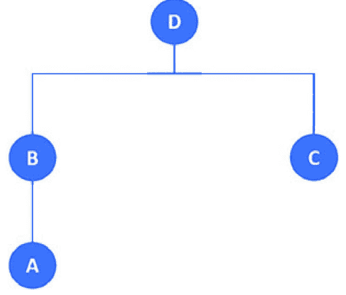

图 10.7：树状图示例

在这个树状图中，我们可以按照以下步骤逐步观察合并过程：

最初，每个数据点（A、B、C 和 D）都是一个单独的簇。算法找到两个最近的簇 A 和 B，将它们合并为一个新簇。接下来，它找到下一个最近的簇 C 和 D 并合并它们。最后，它合并剩余的两个簇以形成一个包含所有数据点的单个簇。树状图中每次合并的高度代表被合并簇之间的距离。

```java
class ScatterPlot extends JPanel {
    private double[][][] data;
    private int[][][] tree;
    private double[] height;

    ScatterPlot(double[][][] data, int[][][] tree, double[] height) {
        this.data = data;
        this.tree = tree;
        this.height = height;
    }

    @Override
    protected void paintComponent(Graphics g) {
        super.paintComponent(g);
        Graphics2D g2d = (Graphics2D) g;

        int width = getWidth();
        int height = getHeight();

        // Draw the scatter plot of data points
        for (int i = 0; i < data.length; i++) {
            int x = (int) (data[i][0] * (width - 50));
            int y = (int) ((data[i][1]) * (height - 50));

            g2d.setColor(Color.BLACK);
            g2d.fillOval(x, y, 8, 8);
        }

        // Draw the clustering tree
        int yStep = height / (this.tree.length + 1);
        int x = width - 50;

        for (int i = 0; i < this.tree.length; i++) {
            int cluster1 = this.tree[i][0];
            int cluster2 = this.tree[i][1];

            int y1 = yStep * (i + 1);
            int y2 = y1 + yStep;

            int x1 = x - (int) (this.height[i] * 10);
            int x2 = x;

            g2d.setColor(Color.BLUE);
            g2d.drawLine(x1, y1, x2, y1);
            g2d.drawLine(x1, y1, x1, y2);
            g2d.drawLine(x1, y2, x2, y2);

            g2d.setColor(Color.RED);

            g2d.drawString("Merge " + cluster1, x1 + 5, y1 + 15);
            g2d.drawString("Merge " + cluster2, x1 + 5, y2 - 5);
        }
    }
}
```

在上述示例中，我们首先创建一个包含 2D 点的合成数据集。该数据集包含 12 个由 X 和 Y 坐标表示的点。我们使用欧几里得距离计算成对距离矩阵。执行层次聚类（`Hierarchical Clustering`）需要该距离矩阵。接下来，我们使用距离矩阵创建一个 `WardLinkage` 对象。Ward 联动（`Ward's linkage`）是层次聚类合并过程中计算簇之间距离的方法之一。然后，我们使用 `WardLinkage` 对象创建一个 `HierarchicalClustering` 对象。执行层次聚类过程，并从模型中获取聚类树和高度。我们打印出聚类树，它展示了层次聚类过程中每一步中簇的合并情况，如图所示：

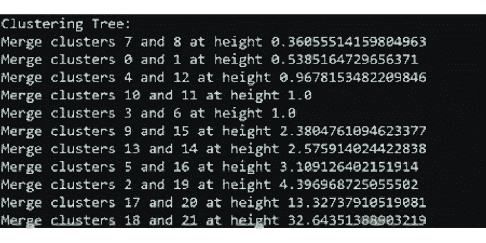

图 10.8：使用层次聚类的簇合并输出

`tree` 数组中的每一行代表两个簇的合并，而 `height` 数组包含了相应的聚类高度。我们使用散点图对聚类进行可视化。每个数据点在图中表示为一个黑色圆圈。聚类树与散点图并排绘制。树图中的垂直线表示特定高度下的簇合并，红色文本指示每一步正在合并哪些簇，如图所示：

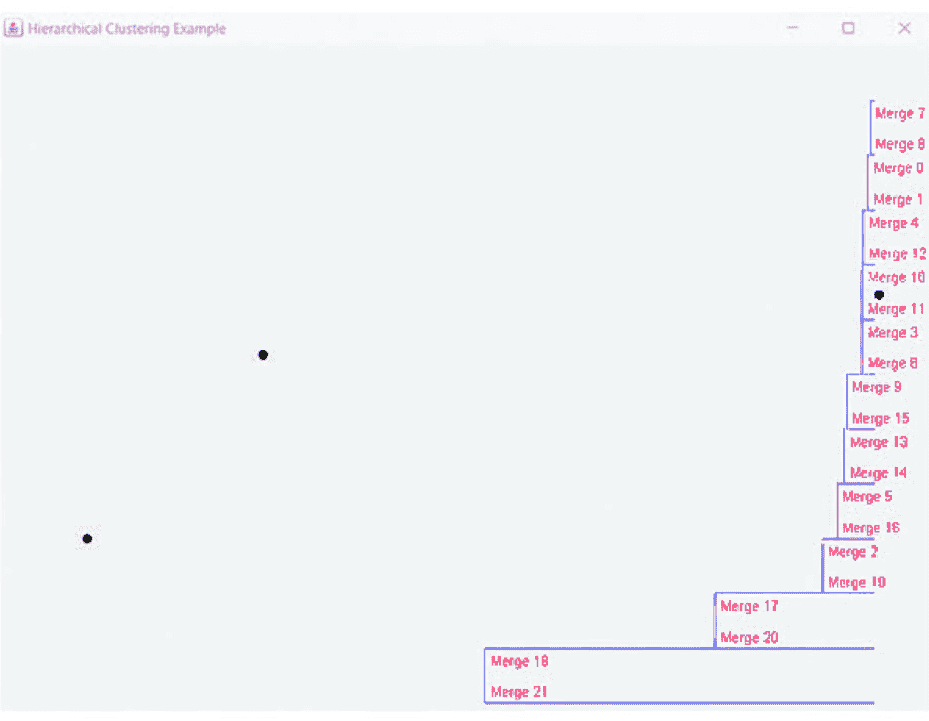

图 10.9：显示不同簇的散点图和树图

## 客户细分

客户细分是一种强大的营销技术，根据某些特征将公司的客户群划分为不同的组。`K-Means` 聚类是客户细分最广泛使用的算法之一。它是一种无监督学习算法，根据相似性将数据点分为 “K” 个簇。每个簇代表一个具有相似特征的客户群体。

可以使用以下步骤实现用于客户细分的 `K-Means` 聚类：

### 数据收集与预处理

- 收集客户的相关数据，例如人口统计数据、购买历史、浏览行为等。
- 对数据进行预处理，处理缺失值、归一化数值数据，并在必要时对类别变量进行编码。

### 选择簇的数量 (K)

- 第一步是为客户细分确定合适的簇数量 (K)。
- 企业可以使用各种方法，如肘部法（`Elbow Method`）、轮廓系数（`Silhouette Score`）或业务知识来决定最符合其要求的簇数量。

### 应用 K-Means 聚类

- 确定簇的数量后，对预处理后的数据应用 `K-Means` 算法。
- `K-Means` 首先在特征空间随机初始化 “K” 个质心（簇的代表点）。

### 分配数据点到簇

- 根据欧几里得距离或其他距离度量将每个数据点分配给最近的质心。
- 具有相似属性的客户被分到同一个簇。

### 更新簇质心

- 在初始分配后，更新每个簇的质心。

### 解释细分

一旦算法收敛，我们就得到了不同的细分，可以对其进行分析以理解每个细分的特征。让我们来看一个 `Java` 中 `K-Means` 聚类的示例，假设有如下数据：

```
Age,Annual Income
28,35000
34,36000
26,56000
29,64000
31,59000
32,58000
33,57000
30,58000
34,56000
35,59000
36,55000
37,57000
```

我们可以按照如下代码实现它：

```java
import smile.clustering.KMeans;
import smile.data.DataFrame;
import smile.io.Read;
import smile.plot.swing.ScatterPlot;
import java.io.IOException;
import java.nio.file.Path;
import java.nio.file.Paths;

public class CustomerSegmentation {
    public static void main(String[] args) {
        // 将文件名转换为路径
        Path filePath = Paths.get("customer_data.csv");

        // 从文件加载数据
        DataFrame data = loadCSV(filePath);

        // 提取“年龄”和“年收入”列
        double[] age = data.doubleVector(data.names()[0]).toDoubleArray();
        double[] income = data.doubleVector(data.names()[1]).toDoubleArray();

        // 将提取的列转换为二维数组
        double[][] features = new double[age.length][2];
        for (int i = 0; i < age.length; i++) {
            features[i][0] = age[i];
            features[i][1] = income[i];
        }

        // 使用 3 个簇进行 K-Means 聚类
        int k = 3;
        KMeans model = KMeans.fit(features, k);

        // 绘制数据点及其簇分配结果
        ScatterPlot plot = ScatterPlot.of(features, model.y);
        try {
            plot.canvas().window();
        } catch (Exception e) {
            e.printStackTrace();
        }
    }

    // 使用 smile 库从 CSV 文件加载数据
    private static DataFrame loadCSV(Path filePath) {
        try {
            return Read.csv(filePath);
        } catch (IOException e) {
            e.printStackTrace();
            return null;
        }
    }
}
```

## 结果解读与策略实施

解释 `K-Means` 聚类生成的分群对于获取可操作的洞察和实施有效策略至关重要。以下是解释分群结果的一些方法：

- **分群画像分析**：根据人口统计数据、行为模式、偏好和购买历史为每个分群创建客户画像。识别定义每个分群的独特特征和属性。
- **分析分群特征**：分析每个分群的人口统计特征和行为特征，以理解他们的独特需求、偏好和痛点。识别分群内部的共同趋势和模式。
- **开发针对性营销活动**：定制营销活动、促销和信息传递，以引起每个分群偏好和兴趣的共鸣。个性化沟通渠道、内容和优惠，以增强互动和转化率。
- **产品和服务定制**：定制产品、服务和方案，以满足不同客户分群的特定需求和偏好。开发吸引每个分群偏好的产品功能、组合或定价策略。
- **客户旅程映射**：绘制每个分群的客户旅程，以识别整个客户生命周期中的触点、交互和痛点。优化每个阶段的客户体验，以提高满意度和忠诚度。

通过解读分群结果并实施针对性策略，企业可以有效地与客户互动、推动收入增长并建立持久的关系。

## 结论


在本章中，我们深入探讨了使用 Java 进行聚类分析，并关注了三个基本算法：K-Means、DBSCAN 和层次聚类。通过使用 Java 的 `smile` 库实现这些技术，我们在客户分群和异常检测方面获得了实践经验，这对于寻求理解其客户群体和识别数据集中的离群值的企业至关重要。聚类分析通过将数据组织成有意义的组提供了宝贵的洞察，使企业能够做出明智决策、优化资源并针对特定的客户分群定制营销策略。通过利用聚类算法的力量，企业可以提高客户满意度、提升产品推荐并简化运营，在当今数据驱动的世界中提高性能和竞争力。

在下一章“使用 NoSQL”中，我们将比较 SQL 和 NoSQL 数据库，并学习如何在 Java 中使用 MongoDB。

## 问题

1. 什么是聚类分析？它对数据分析有什么帮助？
2. 解释 K-Means 聚类算法的工作原理。
3. 企业如何利用 K-Means 聚类进行客户分群？
4. 描述基于密度的空间聚类算法（DBSCAN）的概念及其在离群值检测中的优势。
5. 在 Java 中，如何使用 `smile` 库加载并预处理用于聚类的数据？
6. 什么是层次聚类？它与 K-Means 和 DBSCAN 有何不同？
7. 讨论使用散点图对聚类结果进行可视化的意义。
8. 企业如何利用层次聚类来获取其数据的洞察？
9. 在 Java 中实现聚类算法可能会遇到哪些挑战？
10. 在客户分群中，与其他分析方法相比，公司采用聚类技术可以获得哪些具体的收益？

## 重点回顾

- 聚类分析是将数据组织成有意义的组的强大技术，有助于数据探索和理解。
- K-Means 聚类是一种迭代算法，通过最小化数据点与其聚类质心之间的距离平方和，将数据点划分为 K 个簇。
- Java 库提供了轻松实现 K-Means 聚类和其他机器学习算法的工具。
- DBSCAN 是一种基于密度的聚类算法，可以识别任意形状的簇并高效地处理离群值。
- 在应用聚类算法之前，务必对数据进行适当的预处理和缩放，以确保结果的准确。
- 在 Java 中，从 CSV 文件加载数据并转换为相应的格式对于分析至关重要。
- 层次聚类在树状图中构建嵌套的簇，允许我们在不同的粒度级别上可视化聚类过程。
- 凝聚型层次聚类根据接近性将数据点合并为簇，创建出簇的层次结构。
- 分裂型层次聚类从单个簇开始，递归地将其划分为较小的簇。
- 在 K-Means 中选择最佳簇数 (K) 是至关重要的，可以使用肘部法或轮廓系数等方法确定。
- 通过散点图进行聚类可视化有助于有效解读和分析聚类结果。
- K-Means 聚类对初始化敏感，使用不同的初始化多次运行可能会导致不同的结果。
- DBSCAN 不需要预先指定簇的数量，并且处理具有不同密度的数据集。
- 层次聚类的树状表示允许用户在不同的粒度级别上解读聚类结果。
- 聚类分析广泛应用于各行业的客户分群、异常检测和模式识别，驱动数据驱动的决策制定。

# 第 11 章：使用 NoSQL 数据库

## 引言

在数据库管理领域，我们之前探索了关系型数据库领域，在那里，结构化数据在行和列组成的表中找到家。虽然此类数据库适用于组织良好的数据，但它们要求对数据结构有预定义的理解，并需要提前定义模式（包括数据类型）。然而，现实世界的场景通常涉及数据处理中的动态数据灵活性。此类情况的首选是 NoSQL，因为它们具有无需定义模式的优势。此外，它们释放了对可以存储的数据类型的限制，允许在需要时无缝添加新的数据类型。这种灵活性在数据模式快速演变或处理非结构化或半结构化数据源时尤为重要。NoSQL 数据库在各种行业和应用中变得突出，包括：

- **Web**：NoSQL 数据库在对扩展性和性能至关重要的现代 Web 应用中表现出色。它们处理海量数据和高吞吐负载，使其成为社交媒体平台、内容管理系统和电子商务网站的理想选择。
- **大数据**：随着各种来源产生的数据爆炸，NoSQL 数据库在大数据分析平台中发挥着至关重要的作用。它们促进了实时数据处理、存储和分析，使组织能够从海量数据集中提取价值的洞察。
- **物联网**：IoT 设备产生大量数据，需要实时进行接入、处理和分析。NoSQL 数据库提供了所需的灵活性和扩展性，以处理 IoT 设备产生的各种数据格式和高速度数据流。
- **移动端**：移动应用通常需要在多个设备之间同步数据并处理离线数据存储。NoSQL 数据库凭借其灵活的数据模型和对分布式架构的支持，非常适用于需要无缝数据同步和离线能力的移动应用程序。

## 结构

在本章中，我们将涵盖以下主题：

- SQL 与 NoSQL 数据库对比
- MongoDB 数据库
- 在 Java 中使用 MongoDB

## SQL 与 NoSQL 数据库

在数据库管理领域，出现了两种主要的范式：结构化查询语言（SQL）数据库和非 SQL（NoSQL）数据库。每种范式都解决了不同的数据存储和检索需求，理解它们之间的差异对于根据特定用例选择合适的数据库系统至关重要。

### SQL 数据库

SQL 数据库基于关系模型，数据被组织在具有固定模式（schema）的表中。每个表由行和列组成，表之间的关系通过外键建立。SQL 数据库的结构化特性确保了数据的完整性和一致性。流行的 SQL 数据库包括 MySQL、PostgreSQL 和 Oracle。

使用 SQL 数据库有许多优点：

- **数据一致性**：定义的模式确保数据的一致性并遵循特定规则，降低了数据异常的风险。
- **强大的查询能力**：SQL 提供了一种功能强大的查询语言，能够对数据进行复杂操作。
- **ACID 事务**：SQL 数据库支持原子性、一致性、隔离性和持久性（ACID）属性，确保即使发生故障，数据也能保持一致状态。

让我们使用 MySQL 创建一个名为 `mydatabase` 的数据库：

```sql
CREATE DATABASE mydatabase;
```

切换到 `mydatabase` 数据库：

```sql
USE mydatabase;
```

让我们向数据库中添加一个 `employees` 表，包含字段：

```sql
CREATE TABLE employees (
    id INT AUTO_INCREMENT PRIMARY KEY,
    name VARCHAR(50) NOT NULL,
    age INT
);
```

让我们查看该表的信息：

```sql
DESC employees;
```

| Field | Type | Null | Key | Default | Extra |
|---|---|---|---|---|---|
| id | int | NO | PRI | NULL | auto_increment |
| name | varchar(50) | NO | | NULL | |
| age | int | YES | | NULL | |

图 11.1：“employees”表的结构

现在，让我们向 `employees` 表插入几条记录：

```sql
INSERT INTO employees (name, age) VALUES ('John Doe', 30);
INSERT INTO employees (name, age) VALUES ('Jane Smith', 28);
INSERT INTO employees (name, age) VALUES ('Michael Johnson', 35);
```

现在，`employees` 表应该包含以下记录：

```mysql
mysql> SELECT * FROM employees;
+----------------------+-------+
| id | name               | age |
+----------------------+-------+
| 1 | John Doe            | 30 |
| 2 | Jane Smith          | 28 |
| 3 | Michael Johnson    | 35 |
+----------------------+-------+
3 rows in set (0.00 sec)
```

图 11.2：“employees”表的记录

你可以使用以下 Java 代码通过 JDBC 连接 SQL 数据库：

```java
import java.sql.*;

public class SqlDatabaseExample {
    public static void main(String[] args) {
        String url = "jdbc:mysql://localhost:3306/mydatabase";
        String username = "root";
        String password = "admin";

        try {
            Connection connection = DriverManager.getConnection(url, username, password);
            Statement statement = connection.createStatement();
            ResultSet resultSet = statement.executeQuery("SELECT * FROM employees");

            while (resultSet.next()) {
                String name = resultSet.getString("name");
                int age = resultSet.getInt("age");
                System.out.println("Name: " + name + ", Age: " + age);
            }
            connection.close();
        } catch (SQLException e) {
            e.printStackTrace();
        }
    }
}
```

你应该得到类似于图中所示的输出：

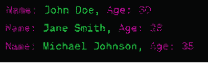

图 11.3：使用 JDBC 访问数据库

### NoSQL 数据库

另一方面，NoSQL 数据库提供了无模式（schema-less）的方法，允许灵活和动态的数据存储。这些数据库适用于数据结构可能随时间演变的场景，在这种情况下预先定义固定模式具有挑战性。NoSQL 数据库分为多种类型，包括文档型（例如 MongoDB）、键值存储（例如 Redis）、列族存储（例如 Cassandra）和图数据库（例如 Neo4j）。

使用 NoSQL 数据库的主要优点包括：

- **模式灵活性**：NoSQL 数据库可以轻松适应变化的数据结构，适应非结构化或半结构化数据。
- **水平扩展**：许多 NoSQL 数据库设计为可水平扩展，使其能够处理海量数据和高流量负载。
- **高性能**：NoSQL 数据库可以针对特定用例进行优化，为某些数据访问模式提供卓越的性能。

在本章中，我们将学习 MongoDB NoSQL 数据库以及如何在 Java 中使用它。

理解 SQL 和 NoSQL 数据库之间的差异使开发者在为应用程序选择合适的数据库系统时做出明智的决策。SQL 数据库提供了数据完整性和强大的查询能力，而 NoSQL 数据库提供了动态数据结构和高可扩展性需求所需的灵活性。两者之间的选择取决于项目的具体需求和性质。

下表显示了 SQL 和 NoSQL 数据库的对比：

| | SQL | NoSQL |
|---|---|---|
| 数据模型 | 关系型 | 非关系 |
| 模式 | 固定 | 动态 |
| 扩展 | 垂直扩展 | 水平扩展 |
| 查询 | 结构化 (SQL) | 多种 (API/查询) |

表 11.1：SQL 和 NoSQL 数据库的对比

## MongoDB 数据库

MongoDB 是一个流行的开源 NoSQL 数据库，属于文档类型。它设计用于存储和管理非结构化或半结构化数据。MongoDB 的一些关键特性包括：

- **文档型**：以 BSON 格式的 JSON 类文档存储数据。
- **无固定模式**：与需要预定义模式的传统数据库不同，MongoDB 允许创建各种类型的文档。
- **可扩展性**：通过分片（sharding）支持水平扩展，这涉及将数据分布在多台机器上。
- **高性能**：索引和内存处理等特性导致了高性能的数据检索。
- **丰富的查询语言**：提供强大的查询语言，支持复杂查询、聚合和排序。
- **复制**：支持自动复制，允许将数据复制到多个服务器上。这增强了数据的可用性和容错能力。
- **地理空间查询**：内置支持地理空间数据和查询，适用于涉及位置的应用。
- **即时查询**：你可以对 MongoDB 文档中的任何字段建立索引，使即时查询变得高效。
- **聚合框架**：提供了一个通用的聚合框架用于执行数据转换。

MongoDB 因其灵活性、可扩展性和性能被各行业广泛使用。让我们探索一些真实示例：

- **电子商务平台**：被 eBay 和 Etsy 等电子商务平台用于处理大量的产品数据、用户配置和交易信息。其无模式架构允许这些平台无缝适应变化的产品属性和用户偏好。MongoDB 的扩展性使这些平台能够适应数据量和用户的快速增长。
- **社交媒体和内容管理**：Twitter 和 LinkedIn 等社交媒体巨头利用 MongoDB 存储大量的用户生成内容，包括推文、帖子和简介。MongoDB 高效存储复杂层次结构的能力使其成为管理数据的理想选择。此外，MongoDB 的地理空间查询功能被基于位置的社交网络用于位置标记和附近用户搜索。
- **金融服务**：被 HSBC 和 JPMorgan Chase 等金融机构用于各种应用程序，包括欺诈检测、风险分析和客户关系管理。处理实时数据流和执行复杂分析的能力使他们能够快速做出数据驱动的决策。MongoDB 对多文档事务的支持确保了金融交易的数据完整性和一致性。
- **物联网 (IoT)**：被 Bosch 和 Siemens 等 IoT 公司用于存储和分析来自连接设备的传感器数据。MongoDB 灵活的数据模型适应了 IoT 设备产生的各种数据格式，如传感器读数、遥测数据和事件日志。其水平扩展性使 IoT 平台随着连接设备数量的增加而无缝扩展，确保实时洞察和情报。
- **医疗保健和生命科学**：被医疗机构和制药公司用于管理患者记录、临床试验和基因组数据。它存储和查询结构化及非结构化数据的能力使其非常适合处理各种医疗数据类型。MongoDB 对分布式架构和高可用性的支持确保了对关键医疗信息的无间断访问。

通过将 MongoDB 集成到他们的技术栈中，各个行业的组织获得了在当今数据驱动的世界中创新和繁荣所需的敏捷性和扩展性。

## 安装 MongoDB

以下是安装 MongoDB 的通用步骤：

- **下载**：访问 MongoDB 官方网站并下载适用于您操作系统的版本。
- **安装**：按照您操作系统的安装说明进行。例如，在 Windows 上，您通常运行安装程序并按照提示操作。

一旦完成安装，如果您在 Windows 平台上，将看到类似图 11.4 所示的窗口：


图 11.4：在 Windows 上安装 MongoDB

### 配置

- **Windows**：MongoDB 通常安装在 `C:\Program Files\MongoDB\Server\` 目录下。您可能需要创建一个数据目录（例如，MongoDB 将存储数据的地方）。您还可以创建一个配置文件（例如，用于设置配置）。
- **Linux**：在 Linux 系统上，您通常使用包管理器安装 MongoDB。安装后，您可能需要创建一个数据目录并通过修改 `/etc/mongod.conf` 文件来配置 MongoDB。

### 启动服务器

- **Windows**：打开命令提示符并导航到 MongoDB 安装的 bin 目录（例如 `C:\Program Files\MongoDB\Server\<version>\bin`）。运行 `mongod` 来启动 MongoDB 服务器。
- **Linux**：在 Linux 上，使用 `sudo service mongod start` 等命令启动 MongoDB 服务。

### 使用 MongoDB

要与 MongoDB 交互，请打开另一个命令提示符或终端并导航到 MongoDB bin 目录。运行 `mongo` 启动 MongoDB shell，可以在其中执行 MongoDB 命令和查询。

> **注意**：安装步骤取决于您的操作系统和 MongoDB 版本。请务必参考 MongoDB 官方文档以获取最新的安装说明：https://docs.mongodb.com/manual/installation/

## 在 Java 中使用 MongoDB

MongoDB 提供了一个 Java 驱动程序，使 Java 能够连接、交互并对 MongoDB 数据库执行操作。官方 MongoDB Java 驱动程序提供了一种简单的方法，可以在您的 Java 代码内部处理 MongoDB 的面向文档的数据模型。

### 连接到 MongoDB

要连接到 MongoDB 实例，您需要使用 `MongoClient` 类。以下是建立连接的方法：

```java
import com.mongodb.client.MongoClients;
import com.mongodb.client.MongoClient;

public class MongoDBConnectionExample {
    public static void main(String[] args) {
        String connectionString = "mongodb://localhost:27017";
        MongoClient mongoClient = MongoClients.create(connectionString);
        System.out.println("Connected to MongoDB!");
        mongoClient.close();
    }
}
```


您应该能看到如图 11.5 所示的“Connected to MongoDB”消息：

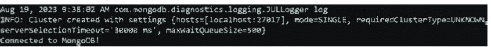

图 11.5：连接到 MongoDB

在之前的示例中，行 `connectionString = "mongodb://localhost:27017"` 定义了 MongoDB 服务器的连接字符串。在此示例中，假设 MongoDB 运行在本地机器的默认端口上。`MongoClient.create()` 方法使用连接字符串创建一个 MongoDB 客户端，并返回一个 `MongoClient` 实例，可以使用它与 MongoDB 服务器进行交互。

## 访问数据库和集合

一旦连接，您就可以分别使用 `MongoDatabase` 和 `MongoCollection` 类访问特定的数据库及其集合：

```java
import com.mongodb.client.MongoClients;
import com.mongodb.client.MongoClient;
import com.mongodb.client.MongoCollection;
import com.mongodb.client.MongoDatabase;
import org.bson.Document;
```

```java
public class MongoDBCollectionExample {
    public static void main(String[] args) {
        String connectionString = "mongodb://localhost:27017";
        MongoClient mongoClient = MongoClients.create(connectionString);

        MongoDatabase database = mongoClient.getDatabase("mydatabase");
        MongoCollection collection = database.getCollection("employees");
        System.out.println("Connected to collection: " + collection.getNamespace());
        mongoClient.close();
    }
}
```

输出应该如如图所示：

```
Aug 19, 2023 10:18:28 AM com.mongodb.diagnostics.logging.JULogger log
INFO: Cluster created with settings {hosts=[localhost:27017], mode=SINGLE, require
ClusterType=UNKNOWN, serverSelectionTimeout=30000 ms, maxwaitQueueSize=500}
Connected to collection: mydbatabase.employees
```

## 图 11.6：访问数据库和集合

在前面的代码示例中，行 `MongoDatabase database = mongoClient.getDatabase("mydatabase");` 获取 "mydatabase" 数据库的引用。如果数据库不存在，MongoDB 将动态创建它。行 `MongoCollection collection = database.getCollection("employees");` 获取 "mydatabase" 数据库中 "employees" 集合的引用。

您可以使用下例所示的 `insertOne()` 或 `insertMany()` 方法向 MongoDB 集合插入文档：

```java
import com.mongodb.client.MongoClients;
import com.mongodb.client.MongoClient;
import com.mongodb.client.MongoCollection;
import com.mongodb.client.MongoDatabase;
import org.bson.Document;
```

```java
public class MongoDBInsertExample {
    public static void main(String[] args) {
        String connectionString = "mongodb://localhost:27017";
        MongoClient mongoClient = MongoClients.create(connectionString);

        MongoDatabase database = mongoClient.getDatabase("mydatabase");
        MongoCollection collection = database.getCollection("employees");
        Document document = new Document("name", "Alice Johnson").append("age", 28);
        collection.insertOne(document);
        System.out.println("Document inserted: " + document.toJson());
        mongoClient.close();
    }
}
```

您应该能够看到以下输出：

```
Aug 19, 2023 11:24:23 AM com.mongodb.diagnostics.logging.JULogger log
INFO: Cluster created with settings (hosts=[localhost:27017], mode=SINGLE, require
ClusterType=UNKNOWN, serverSelectionTimeout=30000 ms, maxwaitQueueSize=500)
INFO: Connection was established before timing out
INFO: Opened connection [connection1@localhost:27017] to localhost:27017
INFO: Monitor thread successfully connected to server with description ServerDescription(address=localhost:27017, type=STANDONE, state=CONNECTED, ack=true, serverVersion=versionList=[7, 0, 0], roundTripTimeNanos=3144)
INFO: Opened connection [connection2@localhost:27017] to localhost:27017
Document inserted: {"name": "Alice Johnson", "age": 28, "_id": {"$oid": "64e59f0b3a6760aeb23bc"}}
```

代码的输出如图所示：

```
INFO: Opened connection(connectionId=localValue:1, serverVersion=3) to localhost:27017
Aug 19, 2023 11:37:10 AM com.mongodb.diagnostics.Logger
INFO: Monitor thread successfully connected to server with description ServerDescription(address=localhost:27017,type=STANDALONE,state=CONNECTED,ok=true,version=ServerVersion(versionList=[7, 0, 0]), mimikivision=21,maxPoolSize=100,maxDocumentSize=16777216,logSessionTimeoutMinutes=30,roundTripTimeMS=10
Aug 19, 2023 11:37:10 AM com.mongodb.diagnostics.Logger to localhost:27017
INFO: Opened connection(connectionId=localValue:2, serverVersion=3.4)
Document: { "id": "65a0b8f1b3b66aa8e2bc9", "name": "Alice Johnson", "age": 28 }
```

## 图 11.8：从集合中查询文档

代码 `FindIterable documents = collection.find();` 使用 `find()` 方法从 "employees" 集合中检索所有文档。`find()` 方法返回一个 `FindIterable`，允许你遍历结果。然后，我们遍历了检索到的文档。每个文档都表示为一个 `Document` 对象，它类似于 JSON 对象。`toJson()` 方法将文档转换为其 JSON 字符串表示。

你可以使用 `deleteMany()` 方法来更新和删除文档。

## 运行聚合操作

MongoDB 允许复杂的数据聚合。聚合框架为数据库内部的数据分析和处理提供了强大的能力。这里有一个简单的示例，说明了如何按特定字段对文档进行分组，并计算每个组中文档的数量：

```java
import com.mongodb.client.MongoClients;
import com.mongodb.client.MongoClient;
import com.mongodb.client.AggregateIterable;
import com.mongodb.client.MongoCollection;
import com.mongodb.client.MongoDatabase;
import org.bson.Document;
import java.util.Arrays;
```

```java
public class MongoDBAggregationExample {
    public static void main(String[] args) {
        String connectionString = "mongodb://localhost:27017";
        MongoClient mongoClient = MongoClients.create(connectionString);
        MongoDatabase database = mongoClient.getDatabase("mydatabase");
        MongoCollection collection = database.getCollection("employees");

        AggregateIterable result = collection.aggregate(Arrays.asList(
            new Document("$group", new Document("_id", "$age").append("count",
            new Document("$sum", 1))))
        ));

        for (Document doc : result) {
            System.out.println("Aggregation Result: " + doc.toJson());
        }

        mongoClient.close();
    }
}
```

程序的输出如下：

```
INFO: Opened connection [connectionId:localValue:2,serverValue:36] to localhost:27017
Aggregation Result: [{"id": 28, "count": 1}]
```

图 11.9：运行聚合操作以分组文档

在之前的示例中，代码 `AggregateIterable result = collection.aggregate(Arrays.asList(...));` 使用聚合框架对 "employees" 集合执行数据转换。聚合流水线被定义为一系列阶段。在这个示例中， `$group` 阶段用于根据 "age" 字段对文档进行分组，然后计算每个组中文档的数量。`new Document("$group", new Document("_id", "$age").append("count", new Document("$sum", 1))))` 定义了 `$group` 阶段。它根据 "age" 字段对文档分组，并使用 `$sum` 累加器计算每个组的计数。结果存储在一个名为新字段中。

## 结论

在本章中，我们涵盖了 NoSQL 数据库的基础概念，深入探讨了它们相对于传统关系型数据库的优势。我们探索了像 MongoDB 这样的 NoSQL 数据库如何提供不受固定模式限制的灵活数据建模，使其非常适用于动态和不断变化的数据需求。通过比较 SQL 和 NoSQL 数据库，我们强调了 NoSQL 数据库大放异彩的场景，特别是处理多样化和非结构化数据时。随后，我们通过演示如何使用 Java 操作 MongoDB 进入了实战领域，展示了数据库连接、文档插入、查询，甚至执行了数据聚合。本章对 NoSQL 数据库世界提供了全面的介绍，为读者提供了在现代应用开发中利用其能力的见解和实用技能。

在下一章“推荐系统”中，我们将理解这些算法是如何工作的，以及推荐系统的不同类型。

## 习题

- NoSQL 数据库与传统关系型数据库之间的关键区别是什么？
- 解释为什么固定模式在某些应用程序的关系型数据库中可能是一个局限性。
- 在哪些场景，NoSQL 数据库比 SQL 数据库更合适？
- NoSQL 数据库如何应对处理动态和非结构化数据的挑战？
- 列出并描述 NoSQL 数据库的主要类别之一，并提供一个示例。
- MongoDB 如何存储数据？MongoDB 中文档的结构是怎样的？
- 该术语在 NoSQL 数据库语境下有什么意义？
- 在 MongoDB 可扩展性背景下，描述分片（sharding）的概念。
- 什么是 MongoDB 中的聚合框架？
- 如何使用 Java 建立与 MongoDB 的连接？
- 解释使用 Java 向集合中插入文档的过程。
- 提供一个使用 MongoDB Java 的聚合操作示例。

## 记忆要点

- NoSQL 数据库与传统关系型数据库的区别在于它们提供了不受固定模式限制的灵活数据模型。
- NoSQL 数据库非常适用于动态、不断变化的需求以及非结构化或半结构化数据的应用程序。
- 与 SQL 数据库不同，NoSQL 数据库可以在同一个集合中存储多种类型的数据。
- NoSQL 数据库分为几类：文档型、键值型、列族和图数据库。
- 文档型数据库（如 MongoDB）以类 JSON 文档存储数据，具有更大的活性。
- MongoDB 是一种流行的 NoSQL 数据库，允许无模式存储，支持复杂的结构。
- MongoDB 的分片是一种用于水平扩展的技术，将数据分布在多个服务器或集群上。
- MongoDB 中的聚合框架为数据转换、分析和聚合提供了强大的工具。
- MongoDB Java 驱动允许 Java 程序与 MongoDB 进行交互。
- 使用 Java 连接 MongoDB 时，需要使用连接字符串创建 `MongoClient` 实例。
- MongoDB Java 驱动提供了如 `MongoDatabase` 和 `MongoCollection` 等类用于操作数据库和集合。
- MongoDB 中的文档插入通过 `insertOne()` 或 `insertMany()` 方法结合 `Document` 对象完成。
- MongoDB 查询通过允许对结果进行过滤、排序和投影的方法来实现。
- MongoDB 聚合使用流水线，每个阶段在将数据传递给下一个阶段之前进行处理和转换。

## 结构

在本章中，我们将涵盖以下主题：

- 推荐系统
- 推荐系统的类型
- 基于内容的推荐系统
- 协同推荐系统

## 推荐系统

推荐系统，也称为推荐引擎，是现代数据分析的重要组成部分，在个性化内容分发中起着至关重要的作用。它们是根据用户的偏好和历史行为来预测并建议项目或内容的算法和技术。这些系统在我们的数字生活中无处不在，影响着我们购买的商品、观看的电影、阅读的文章等。它们对于增强各种在线平台的用户体验和参与度具有工具性作用。

为了理解推荐系统的工作原理，理解其基本组件至关重要，如图所示：

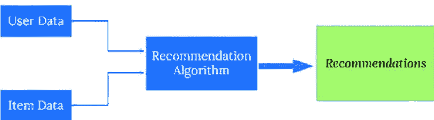

图 12.1：推荐系统的关键组件

**用户数据**：推荐系统依赖于用户与项目或内容交互的数据。这些数据可以包括用户评分、购买历史、点击率等。

**项目数据**：关于被推荐项目或内容的信息也至关重要。它涵盖了产品描述、类型、类别或标签等属性。

**推荐算法**：推荐系统的核心是处理用户和项目数据以生成推荐的算法。这些算法可以分为多种类型，我们将在随后的章节中进行探讨。

推荐系统主要分为两大类：

**基于内容的推荐系统**：这些系统根据项目的属性或特征以及用户的之前的行为来做出推荐。例如，在电影推荐系统中，它可能会推荐与用户喜欢的电影类型相似或演员相似的电影。

**协同推荐系统**：协同系统通过分析多个用户的行为和偏好来推荐。它们识别出品味相似的用户，并推荐其他相似偏好用户喜欢的项目。协同过滤是该类别中的常用技术。

让我们来看看日常生活中一些推荐系统的实际示例：


# 推荐系统概述

**Netflix 电影推荐**：Netflix 根据用户的观看历史、评分和类型偏好向其用户推荐电影和电视节目。这些推荐旨在保持用户的参与感和满意度。

**亚马逊产品推荐**：亚马逊的推荐系统根据客户过去的购买历史、浏览历史以及相似配置用户的偏好向其推荐产品。

**Spotify 音乐发现**：Spotify 的音乐推荐系统根据用户的听歌历史、喜爱的类型以及他们喜欢或不喜欢的歌曲来策划播放列表并建议歌曲。

**YouTube 视频建议**：YouTube 采用推荐算法根据用户的观看历史、点赞和订阅向用户推荐视频，帮助用户发现新内容。

在本节中，我们为理解推荐系统及其重要性以及两个主要类别（基于内容和协同）奠定了基础。在随后的章节中，我们将深入探讨这些类别的每一个机制、算法和现实世界的应用。

## 推荐系统的类型

推荐系统大致分为主要类型，如图所示：

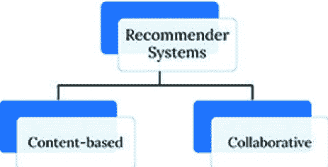

图 12.2：推荐系统的类型

### 基于内容的推荐系统

这些系统根据项目的特征属性以及用户的历史偏好向用户推荐项目。本质上，它们侧重于将项目内容与用户画像匹配。基于内容的推荐器非常适合可以识别明确项目特征并用于推荐的场景。基于内容的推荐系统的实际示例包括：

- **Netflix 电影推荐**：Netflix 根据类型、演员、导演和用户观看历史建议电影和电视节目。
- **亚马逊产品推荐**：亚马逊根据项目属性（如描述、类别）和用户购买历史推荐产品。
- **Spotify 音乐发现**：Spotify 根据类型、艺术家和用户听历史策划播放列表并建议歌曲。

### 协同推荐系统

协同系统通过分析多个用户的行为和偏好来推荐。它们识别用户之间的模式和相似性，并推荐志同道合的用户感兴趣的项目。协同过滤是该领域广泛使用的技术。常见包括：

- **Netflix 电影推荐**：Netflix 分析用户评分和相似用户的偏好来建议电影和电视节目。
- **亚马逊产品推荐**：亚马逊根据相似用户的浏览和购买历史建议产品。
- **Spotify 每周发现（Discover Weekly）**：Spotify 的 Discover Weekly 播放列表根据音乐品味相似用户的听歌习惯推荐歌曲。

## 基于内容的推荐系统与协同系统

让我们对比基于内容和协同推荐系统的区别：

| 特性 | 基于内容的推荐系统 | 协同推荐系统 |
| :--- | :--- | :--- |
| 数据需求 | 项目属性、用户画像 | 用户-项目交互数据（评分、点击等） |
| 项目发现 | 依赖项目特征，难以发现无特征新项目 | 可通过用户行为发现无显式特征的项目 |
| 用户独立性 | 强（单个用户画像即可生成推荐） | 弱（需足够用户群体交互数据） |
| 冷启动问题 | 新用户冷启动较易解决（问卷/偏好设置）；新项目需特征提取 | 新用户/新项目均面临严重冷启动问题 |
| 推荐的多样性 | 较低（倾向于推荐相似特征项目，易形成“回声室”） | 较高（可跨领域推荐，带来意外惊喜） |
| 可扩展性 | 较好（计算复杂度随用户数线性增长） | 较差（计算复杂度随用户/项目数平方增长，需优化） |
| 意外惊喜 | 较难实现 | 易实现（通过相似用户的异质偏好） |
| 常见用例 | 新闻推荐、文档推荐、特征明确的商品 | 电商、视频/音乐平台、社交网络 |
| Java 库支持 | Apache Mahout, Tribuo, Smile | Apache Mahout, LensKit, MyMediaLite |

表 12.1：基于内容和协同推荐系统的区别

该表强调了基于内容和协同推荐系统在数据需求、项目发现、用户独立性、冷启动问题处理、推荐多样性、可扩展性、意外惊喜、常见用例以及 Java 库支持方面的关键区别。每种系统都有其优缺点，使其适用于不同的推荐场景。

## 冷启动问题

让我们简要查看推荐系统中的“冷启动”问题。它指的是一种挑战，即系统对于具有有限或没有历史交互数据的新用户或新项目，难以做出准确的推荐。这个问题可能体现在两个主要情景中：

### 新用户的冷启动

当新用户加入某个平台或服务时，他们尚未提供足够的数据（例如，评分、购买、点击）让推荐系统理解他们的偏好。结果是系统难以为该用户提供个性化推荐。

### 新项目的冷启动

当一个新项目被引入系统目录时，没有或很少与之相关的用户交互历史。因此，系统无法依赖用户-项目交互来决定如何向用户推荐该新项目。

## 解决冷启动问题

解决“冷启动”问题需要创造性的解决方案：

- **基于内容的推荐**：对于新用户，基于内容的推荐系统是有效的。这些系统利用属性（例如类型、流派、关键词、元数据）并与用户画像或偏好进行匹配。新用户可以提供他们感兴趣的显式偏好或特征，系统可以根据这些输入做出初始推荐。
- **混合方法**：混合推荐系统结合了多种推荐技术。最初，它们可以使用基于内容的方法为新用户或物品提供推荐。随着用户与系统交互并提供数据，协同过滤技术可以逐渐接管，以提供更个性化的推荐。
- **基于流行度的推荐**：对于新物品，一种简单的策略是根据其流行程度或新颖性进行推荐。热门物品可能吸引更广泛的观众，推荐它们可以帮助收集初始交互和数据。
- **用户反馈激励**：鼓励新用户在加入平台时对他们选择的几个物品进行评分或互动。提供折扣、奖励或独家内容等激励可以激励用户提供初始反馈。
- **用户引导（Onboarding）**：实施用户引导流程，引导新用户在与平台的首次交互期间指定他们的偏好、兴趣或初始选择。
- **利用上下文信息**：如果可用，使用位置、人口统计数据或浏览行为等上下文信息，对新用户的偏好做出合理的推测。
- **基于知识的系统**：在具有定义良好的知识结构的领域（例如教育内容），基于知识的推荐系统可以根据用户的技能水平或学习目标为新用户提供初始指导。

值得注意的是，解决“冷启动”的方法取决于推荐系统的性质、可用数据的类型以及特定的用户或物品背景。根据平台需求定制这些策略的组合可以帮助缓解“冷启动”挑战，并为新用户和物品提供有意义的推荐。

## 基于内容的推荐系统

基于内容的推荐系统是一种推荐系统，它根据物品的特征和属性以及用户的历史偏好为用户提供个性化建议。这些系统通过检查物品的内容或特征并将其与用户画像相匹配来推荐物品。其核心思想是推荐与用户之前喜欢或互动过的物品在内容上相似的物品。基于内容的推荐如图所示：

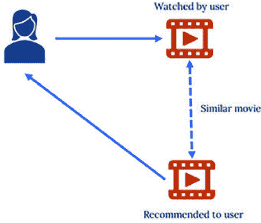

图 12.3：基于内容的推荐

### 基于内容的推荐系统的关键组件

基于内容的推荐系统的关键组件包括物品属性或特征、用户画像和推荐算法。这些元素共同使系统将物品的内容特征与用户的偏好相匹配，便于根据用户的历史交互和显式反馈生成个性化推荐。

- **物品属性或特征**：基于内容的系统依赖于描述系统中每个物品的属性或特征。这些属性会根据推荐物品的类型而显著不同。例如，在电影推荐系统中，物品属性可能包括流派、演员、导演、发行年份和用户生成的标签。这些属性有助于定义物品的内容。
- **用户画像**：系统维护一个用户画像，它是用户偏好和兴趣的表示。该画像基于用户过去与物品的交互或显式反馈（如评分和点赞）构建的。它封装了用户对不同物品属性的偏好，为他们的品味创建了个性化的视图。
- **推荐算法**：基于内容的推荐系统采用推荐算法生成个性化推荐。这些算法的主要功能是计算物品属性与用户画像之间的相似性。常见的相似性度量包括`余弦相似度`、`雅卡德相似度`和`欧几里距离`。物品与用户画像之间的相似性得分越高，被推荐的可能性越大。

### 理解基于内容的推荐系统的运行

在基于内容的推荐系统的运行时，过程始于根据用户的交互和偏好创建用户画像。然后，系统评估物品的属性，计算它们与用户画像之间的相似性，并最终根据物品内容与用户偏好的对齐情况生成推荐。以下是步骤：

- **画像创建**：系统从创建基于用户交互和偏好的用户画像开始。例如，如果用户对动作和冒险类型的电影给出好评，他们的画像将反映这些偏好。
- **物品属性分析**：系统的每个物品由一组属性或特征描述。这些属性用于定义物品的内容。在电影的情况下，属性可以是流派、导演。
- **相似性计算**：推荐算法计算用户画像与物品属性之间的相似性。这种相似性量化了物品与用户偏好的匹配程度。
- **推荐生成**：选择相似性得分最高的物品作为用户的推荐。这些推荐物品的属性匹配用户画像。
- **向用户展示**：将推荐物品通过用户界面或应用程序展示给用户，使用户探索和互动内容。

### 基于内容的推荐系统示例

让我们考虑使用 `Java` 和 `Apache Mahout` 库的一个简单的基于内容的推荐系统示例。Mahout 是一个为可扩展学习和数据挖掘设计的开源库。它提供了用于构建和部署机器学习应用程序的广泛算法。在这个示例中，我们将向用户推荐推荐分数。请确保将以下 JAR 文件添加到项目的类路径中：

- `mahout-mr-0.13.0.jar`
- `mahout-math-0.13.0.jar`
- `commons-math3-3.6.1.jar`
- `guava-14.0.1.jar`
- `slf4j-api-1.7.22.jar`

现在，让我们开始根据用户高分电影之间的相似性推荐电影。`Apache Mahout` 提供了一些协同过滤的推荐算法，包括基于物品和基于用户的方法，但它没有内置基于内容的推荐算法。基于内容的推荐通常需要额外的数据处理和特征工程，这取决于具体应用而差异很大。因此，我们在示例中使用基于物品的推荐。

#### 加载电影数据集

代码从从 CSV 文件加载电影数据集开始。该数据集包含有关电影的信息，包括用户 ID、电影 ID 和评分。需要注意的是，此代码假设数据集包含用户 ID、电影 ID 和评分。

让我们查看数据集文件中的几行数据：

```
## userID, movieID, rating
1,25,3
1,9,3
1,10,4
1,34,1
1,32,4
1,30,5
1,1,1
1,26,2
1,16,2
1,4,4
```

请记住，这个数据集是用于教学目的的简化示例。在现实应用程序中，你需要更广泛、更准确的数据集来满足你的需求。

#### 创建 DataModel

`DataModel` 是推荐系统中至关重要的部分。它代表数据并为用户-物品交互提供了抽象。在这种情况下，我们使用以下代码片段从电影数据集文件创建一个 `FileDataModel`：

```java
File movieFile = new File("movie_data.csv");
DataModel dataModel = new FileDataModel(movieFile);
```

#### 创建基于物品的推荐器

接下来，使用以下代码创建一个基于物品的推荐器，该推荐器构建在 `DataModel` 之上并使用物品相似性度量寻找相似物品：

```java
GenericItemBasedRecommender recommender = new GenericItemBasedRecommender(dataModel, similarity);
```

#### 物品相似性计算

代码使用对数似然性（`LogLikelihoodSimilarity`）来计算数据物品之间的相似性。这种相似性度量量化了两个物品被用户共同选择的概率，并用于寻找相似物品：

```java
ItemSimilarity similarity = new LogLikelihoodSimilarity(dataModel);
```

#### 生成推荐

为了查找电影推荐，代码指定了一个用户 ID（您应该将其替换为目标用户的实际 ID）和要生成的推荐数量。我们可以使用 `recommend()` 方法（它通常为用户提供个性化推荐），或者使用寻找与用户高评分电影最相似的电影的方法。这是生成基于物品推荐的常用技术。

```java
// Find movies similar to the user’s highly rated movies
long userId = 1; // User ID (替换为实际用户 ID)
int numRecommendations = 10;
// List recommendations = recommender.recommend(userId, numRecommendations);
List recommendations = recommender.mostSimilarItems(userId, numRecommendations);
```

#### 显示推荐结果

最后，我们遍历推荐物品列表，并打印它们的 ID 以及相应的相似性得分。这些推荐推荐物品是与用户高评分电影相似的电影。

```java
for (RecommendedItem recommendation : recommendations) {
    System.out.println(recommendation.getItemID() + "," + recommendation.getValue());
}
```

现在，让我们为我们的基于内容的电影推荐系统编写完整的代码：

```java
import org.apache.mahout.cf.taste.impl.model.file.FileDataModel;
import org.apache.mahout.cf.taste.model.DataModel;
import org.apache.mahout.cf.taste.impl.recommender.GenericItemBasedRecommender;
import org.apache.mahout.cf.taste.impl.similarity.LogLikelihoodSimilarity;
import org.apache.mahout.cf.taste.recommender.RecommendedItem;
import org.apache.mahout.cf.taste.similarity.ItemSimilarity;
import java.io.File;
import java.util.List;

public class ContentBasedMovieRecommender {

    public static void main(String[] args) throws Exception {
        // 加载带有属性的电影数据集（例如 userId, title, rating）
        File movieFile = new File("movie_data.csv");

        DataModel dataModel = new FileDataModel(movieFile);
        // 使用对数似然性创建一个基于内容的推荐器
        ItemSimilarity similarity = new LogLikelihoodSimilarity(dataModel);
        GenericItemBasedRecommender recommender = new GenericItemBasedRecommender(dataModel, similarity);
        // 寻找与用户高评分电影相似的电影
        long userId = 1; // 用户 ID (替换为实际用户 ID)
        int numRecommendations = 10;
        // List recommendations = recommender.recommend(userId, numRecommendations);
        List<RecommendedItem> recommendations = recommender.mostSimilarItems(userId, numRecommendations);

        for (RecommendedItem recommendation : recommendations) {
            System.out.println(recommendation.getItemID() + "," + recommendation.getValue());
        }
    }
}
```

代码的输出如图所示：

```
30,0.7987041
14,0.7236532
27,0.7180733
21,0.7180733
5,0.6499638
7,0.6499638
3,0.5646782
15,0.5646782
4,0.5646782
25,0.5646782
```

图 12.4：基于内容的电影推荐器输出

基于内容的推荐系统在物品属性定义明确且对于生成推荐有意义的场景中表现出色。它们特别适用于建议与用户之前参与过或喜欢的物品具有相似内容特征的物品。然而，它们在引入意外惊喜或完全新的物品作为推荐时可能存在局限性，因为它们高度依赖已知的物品属性。

## 协同推荐系统

协同推荐系统（通常被称为协同过滤）是一类流行的推荐系统，它们通过利用用户的偏好和行为来提供个性化推荐。这些系统基于这样一个想法：在过去对某些物品达成共识的用户，未来往往倾向于再次达成一致。协同过滤可以进一步分为两种主要方法：基于用户和基于物品。协同推荐的示例如图所示：


图 12.5：协同推荐

### 协同推荐系统的关键组件

这些组件包括用户-物品交互数据、相似性计算、用户邻域和推荐生成：

- **用户-物品交互数据**：协同过滤系统依赖于记录用户与物品交互的数据集。这些数据可以包括显式反馈（如评分）。
- **基于用户的协同过滤**：在基于用户的协同过滤中，通过识别与目标用户相似的用户来提供推荐。系统随后推荐这些用户喜欢但目标用户尚未喜欢的物品。
- **基于物品的协同过滤**：在基于物品的协同过滤中，通过识别与用户已交互物品相似的物品来提供推荐。系统推荐这些相似物品。
- **相似性计算**：为了寻找相似的用户或物品，协同过滤算法使用相似性度量，如`余弦相似性`、`皮尔逊相关系数`或 `Jaccard 相似性`。这些度量量化了用户或物品之间的关联程度。
- **推荐生成**：一旦计算了用户或物品之间的相似性，就会生成推荐。对于基于用户的协同过滤，这通常涉及选择相似用户交互过但目标用户尚未交互的物品。对于基于物品的协同过滤，这涉及到建议与用户感兴趣的物品相似的物品。

### 协同推荐系统示例

让我们来看一个使用 `Java` 和 `Apache Mahout` 库实现的、基于用户的协同过滤推荐系统示例。在这个示例中，我们将根据用户评分创建一个简单的基于用户的电影推荐系统。我们将使用与之前在构建基于内容的推荐系统时相同的数据集。

首先，我们加载电影评分数据集（通常包含 `userId`、`movieId` 和 `rating` 等列），并使用：


```java
// Load the movie ratings dataset (userId, movieId, rating)
File movieRatingsFile = new File("movie_data.csv")
DataModel dataModel = new FileDataModel(movieRatingsFile);
```

然后，我们创建一个基于**皮尔逊相关系数**（Pearson correlation）的用户相似性模型。该模型通过衡量用户评分模式之间的相似性，量化两个用户或物品在评分方面的相似程度或相关性。皮尔逊相关系数是协同过滤中广泛使用的指标，因为它考虑了用户评分偏差，并能够处理用户在不同尺度上进行评分的情况。它计算用户 A 和 B 在他们都评分过的所有物品上的评分相关性。皮尔逊相关系数的范围从 -1 到 1。正值（接近 1）表示正相关，意味着用户 A 和 B 具有相似的评分模式。当 A 对某物品给出高分时，B 很可能也给出高分。负值（接近 -1）表示负相关，意味着用户 A 和 B 的评分模式相反。当 A 对某物品给出高分时，B 可能会给出低分，反之亦然。接近 0 的值表示用户评分模式之间几乎没有或没有相关性：

```java
UserSimilarity similarity = new PearsonCorrelationSimilarity(dataModel);
```

然后，我们根据给定用户最近的 N 个用户定义一个用户邻域：

```java
UserNeighborhood neighborhood = new NearestUserNeighborhood(10, similarity, dataModel);
```

接着，我们创建一个结合了数据模型、用户邻域和用户相似性的基于用户的推荐器：

```java
UserBasedRecommender recommender = new GenericUserBasedRecommender(dataModel, neighborhood, similarity);
```

然后，我们指定一个想要为其生成电影推荐的目标用户，并为该用户检索指定数量的推荐（例如，前 5 个）：

```java
long userId = 1; // Replace with the actual user ID
// Get recommendations for the user
int numRecommendations = 5;
List recommendations = recommender.recommend(userId, numRecommendations);
```

最后，我们显示推荐的电影 ID 及其预测评分：

```java
// Display recommended movie IDs and predicted ratings
for (RecommendedItem recommendation : recommendations) {
  System.out.println("Movie ID: " + recommendation.getItemID() + ",
  Predicted Rating: " + recommendation.getValue());
}
```

现在，让我们来看基于用户的协同过滤推荐系统的完整代码：

```java
import org.apache.mahout.cf.taste.impl.model.FileDataModel;
import org.apache.mahout.cf.taste.impl.neighborhood.NearestUserNeighborhood;
import org.apache.mahout.cf.taste.impl.recommender.GenericUserBasedRecommender;
import org.apache.mahout.cf.taste.impl.similarity.PearsonCorrelationSimilarity;
import org.apache.mahout.cf.taste.model.DataModel;
import org.apache.mahout.cf.taste.neighborhood.UserNeighborhood;
import org.apache.mahout.cf.taste.recommender.RecommendedItem;
import org.apache.mahout.cf.taste.recommender.UserBasedRecommender;
import org.apache.mahout.cf.taste.similarity.UserSimilarity;
```

```java
import java.io.File;
import java.util.List;
```

```java
public class UserBasedMovieRecommender {
    public static void main(String[] args) throws Exception {
    // Load the movie ratings dataset (userId, movieId, rating)
    File movieRatingsFile = new File("movie_data.csv");
    DataModel dataModel = new FileDataModel(movieRatingsFile);
    // Create a similarity model (e.g., Pearson correlation)
    UserSimilarity similarity = new PearsonCorrelationSimilarity(dataModel);
    // Create a neighborhood (e.g., nearest N users)

    UserNeighborhood neighborhood = new NearestUserNeighborhood(10, similarity, dataModel);
    // Create a user-based recommender
    UserBasedRecommender recommender = new
    GenericUserBasedRecommender(dataModel, neighborhood, similarity);
    // Specify the user for whom you want to generate recommendations
    long userId = 1; // Replace with the actual user ID
    // Get recommendations for the user
    int numRecommendations = 5;
    List recommendations = recommender.recommend(userId, numRecommendations);
    // Display recommended movie IDs and predicted ratings
    for (RecommendedItem recommendation : recommendations) {
        System.out.println("Movie ID: " + recommendation.getItemID() + ", " + 
        Predicted Rating: " + recommendation.getValue());
    }
}
}
```

上述代码的输出如图所示：

```
Movie ID: 15, Predicted Rating: 4.5043745
Movie ID: 29, Predicted Rating: 4.3471675
Movie ID: 40, Predicted Rating: 4.1927433
Movie ID: 17, Predicted Rating: 4.179993
Movie ID: 28, Predicted Rating: 4.12381
```

图 12.6：使用基于用户的推荐系统推荐的电影

## 总结

在关于推荐系统的章节中，我们开启了一段探索推荐算法基本概念和实际实现的旅程。我们从探索推荐系统在现代数据分析中的重要性开始，意识到它们在 Amazon 和 Netflix 等平台上无处不在。我们深入研究了推荐系统的类型，包括基于内容的协同过滤，理解了它们独特的运作机制。通过深入分析用户-物品交互、计算相似性并生成个性化推荐，我们甚至使用了 Mahout 的代码示例。总之，本章为我们提供了构建智能推荐系统的知识和工具，增强了用户体验并辅助各个领域的决策。

在下一章节“数据应用”中，我们将看到数据分析的一些热门应用——特别是在商业智能和时间序列预测中的应用。

## 问题

- 什么是推荐系统？为什么它们在当今的数据分析中至关重要？

- 解释基于内容的推荐系统与协同过滤系统的区别。

- 基于内容的推荐系统是如何生成推荐的？

- 在协同过滤中，基于用户的推荐的基本原理是什么？

- 相似性量在协同过滤中起什么作用？它们是如何计算的？

- 描述推荐系统中的“冷启动”问题。如何解决它？

- 你能解释协同过滤中用户和物品邻域的概念吗？

- 在基于内容的推荐系统中，用户画像是什么？它们是如何构建的？

- 协同推荐系统的关键组件有哪些？它们为什么重要？

- 什么是皮尔逊相关系数相似性？它在协同过滤中使用？

- 概述 Apache Mahout 库及其在构建推荐系统中的作用。

- 混合推荐系统如何结合基于内容和协同过滤的方法来改进推荐结果？

- 在实践中，如何使用 Java 和 Mahout 实现一个基于用户的协同过滤系统？

- 每种推荐系统存在哪些挑战或局限性？

- 推荐系统如何贡献于在线平台的个性化？其影响的真实世界示例有哪些？

## 注意事项

推荐系统是数据分析中至关重要的工具，用于向用户提供个性化的项目推荐，增强用户体验并驱动互动。

推荐系统主要有两种类型：**基于内容（Content-Based）**和**协同过滤（Collaborative Filtering）**，每种都有不同的推荐方法。

基于内容的推荐系统通过将用户偏好与项目属性或内容（如电影类型、演员或关键词）进行匹配来提供推荐。

协同过滤推荐系统依赖用户-项目的交互数据来识别模式，并计算用户或项目的相似性，以进行个性化推荐。

协同过滤可以分为基于用户（User-Based）和基于物品（Item-Based）的方法，取决于关注重点是用户的相似性还是物品的相似性。

基于用户的协同过滤识别与目标用户相似的用户，并推荐这些相似用户喜欢的项目。

基于物品的协同过滤找到与用户交互过的项目相似的项目，并项目间的相似性进行推荐。

协同过滤系统在处理交互历史有限的新用户或新项目时可能会遇到问题。策略包括基于内容的推荐和混合方法。

混合推荐系统结合了多种推荐技术（例如基于内容和协同过滤），以提高推荐的准确性和覆盖率。

相似性度量（如皮尔逊相关性和余弦相似性）在计算协同过滤的用户或项目相似性中起着至关重要的作用。

Apache Mahout 是一个用于 Java 构建推荐系统的流行库，提供了协同过滤工具，包括基于用户和基于物品的方法。

推荐系统促进了在线平台的个性化，提升了用户满意度并驱动了用户参与。

用户画像和项目画像是基于内容的推荐系统的核心组成部分，分别代表用户偏好和项目属性。

评估指标（如平均绝对误差 MAE 和 均方根误差 RMSE）被用于评估推荐系统的准确性。

解决该问题涉及多种策略，如基于内容的推荐、混合方法、基于流行度的推荐、用户引导（onboarding），以及利用上下文信息为新用户和项目提供有意义的推荐。

# 第 13 章

# 数据分析的应用

## 引言

在当今数据驱动的世界，数据分析的力量在各个领域都是不可或缺的。本章探讨了如何在商业智能（BI）中利用数据分析做出明智的战略决策、优化运营并获得竞争优势。我们将深入**时间序列预测**领域，揭示如何利用历史数据模式来预测未来的趋势和结果，为从金融到医疗服务的各行业提供具价值的见解。此外，我们将进入**实时数据分析**的动态领域，在该领域，实时处理并响应数据的能力正在改变企业应对变化情况和机遇的方式。加入我们的这段旅程，发现数据分析如何重塑不同行业决策和创新的格局。

## 结构

在本章中，我们将涵盖以下主题：

- 商业智能中的数据分析

- 时间序列预测

- 实时数据分析

## 商业智能中的数据分析

商业智能（BI）是一门强大的学科，它利用数据分析将原始信息转换为可操作的洞察，使组织能够做出明智决策并推动战略增长。数据分析通过收集、处理和可视化数据来揭示趋势、模式和关键绩效指标，在 BI 中发挥着关键作用。在本节中，我们将深入探讨商业智能领域数据分析的各个方面。

让我们理解 BI 领域数据分析涉及的核心组件和流程。关键步骤（如从各种来源收集数据、数据清洗和预处理技术）确保了数据质量，而至关重要的**探索性数据分析（EDA）**阶段则从数据中发现洞解。商业智能中的数据分析涉及以下关键步骤：

- **数据收集**：流程开始从各种来源收集数据，包括数据库、电子表格、网络服务等。数据可以是结构化的（例如关系型数据库）或非结构化的（例如社交媒体流），目标是将其整合以供分析。

- **数据清洗和预处理**：原始数据通常需要清洗和预处理以处理缺失值、异常值和不一致性。数据分析师使用数据插补、归一化和转换等技术为分析准备数据。

- **探索性数据分析 (EDA)**：EDA 是一个关键阶段，分析师通过可视化和探索数据来识别趋势、相关性和异常值。这有助于更好地理解数据的特征。

- **数据建模**：数据分析师采用各种统计和机器学习模型来发现数据中的模式和关系。常用技术包括回归分析、聚类和分类。

- **可视化**：通过图表、图形和仪表板可视化数据对于有效传递洞察至关重要。BI 工具通常提供交互可视化能力。

- **报告和仪表板**：BI 平台允许创建交互式报告和仪表板，允许决策者实时监控 KPI 并做出数据驱动的决策。

## BI 中数据分析的 Java 库

让我们探索一些常用的用于 BI 数据分析的 Java 库。这些库是 Java 开发者在 BI 生态系统中利用数据分析力量的重要工具。Apache POI 简化了 Excel 文件的处理，能够轻松地导入和操作电子表格数据。同时，Apache Commons CSV 简化了读写 CSV 文件的过程，这是一种基础的数据存储格式。这些库以及许多其他库让 Java 专业人士能够有效处理数据并将其发现无缝集成到 BI 系统中，为组织实现数据驱动的决策和战略规划。

## 用于 Excel 处理的 Apache POI

Apache POI 允许你处理 Excel 文件，在 Java 中轻松导入、操作和分析电子表格数据。通过其全面的 API Set，开发者可以轻松地读取、修改和创建 Excel 文档，将 Excel 数据无缝集成到商业智能系统中。让我们读取图所示数据的 Excel 文件内容：

| 姓名 | 年龄 |

|---|---|

| Abhishek | 34 |

| Avinash | 42 |

| Harshit | 29 |

| Vijay | 73 |

| Usha | 67 |

| Anjali | 36 |

图 13.1: Excel 文件中的示例数据

使用 Apache POI 库读取上述文件的简单 Java 代码如下所示：

```java
import org.apache.poi.ss.usermodel.*;
import org.apache.poi.xssf.usermodel.XSSFWorkbook;
```

```java
import java.io.FileInputStream;
import java.io.IOException;
import org.apache.poi.ss.usermodel.*;
import org.apache.poi.xssf.usermodel.XSSFWorkbook;

public class ExcelDataAnalysis {
    public static void main(String[] args) {
        try {
            FileInputStream file = new FileInputStream("data.xlsx");
            Workbook workbook = new XSSFWorkbook(file);
            Sheet sheet = workbook.getSheetAt(0);
            for (Row row : sheet) {
                for (Cell cell : row) {
                    System.out.print(cell.toString() + " ");
                }
                System.out.println();
            }
        } catch (IOException e) {
            e.printStackTrace();
        }
    }
}
```

程序的输出所示：

| 姓名 年龄 |

|---|---|

| Abhishek | 34.0 |

| Avinash | 42.0 |

| Harshita | 29.0 |

| Vijay | 73.0 |

| Usha | 67.0 |

| Anjali | 36.0 |

图 13.2: 显示从 Excel 读取的文本输出


在上一个示例中，我们导入了处理 Excel 所需的 Apache POI 类，并包含了读取 Excel 文件的 `FileInputStream`。在 `main` 方法内部，我们声明了两个变量 `file` 和 `workbook`，并将它们初始化为 `null`。这些变量将分别用于管理 Excel 文件的输入流和 Excel 工作簿。然后，尝试使用 `FileInputStream = new` 打开名为 "data.xlsx" 的 Excel 文件，并创建一个 `Workbook 对象 = new` 来表示该 Excel 工作簿。`XSSFWorkbook` 用于 XLSX 文件。在成功打开 Excel 文件并创建工作簿后，你通常会对工作簿执行各种操作，例如从工作表中读取数据、修改数据或创建新的工作表。如果在文件操作过程中发生了类型为 `IOException` 的异常（例如，未找到或无法打开文件 "data.xlsx"），则会捕获该异常并使用将错误消息打印到控制台。

确保在项目依赖中包含以下 jar 文件，以使上述代码运行：

- `poi-3.9.jar`
- `poi-ooxml-3.9.jar`
- `poi-ooxml-schemas-3.9.jar`
- `dom4j-1.6.1.jar`
- `xmlbeans-2.3.0.jar`

你可以选择包含此处提到的较新版本的 jar 包。

提供的代码段是使用 Apache POI 处理 Java Excel 文件的起点。你可以通过添加与工作簿交互的代码来扩展它，例如读取单元格值或修改数据。

## 用于 CSV 句的 Apache Commons CSV

Apache Commons CSV 简化了 CSV 文件的读写，这些文件通常用于各种数据分析和 BI（商业智能）应用中的存储和交换。该库为 Java 开发者提供了一种简单且高效的方法来解析和生成 CSV 数据，使处理表格数据源并将其无缝集成到 BI 流中变得更容易。它在处理 CSV 文件时使用的多功能性使其成为从 BI 领域结构化数据源中提取价值见解的重要工具。让我们创建一个 CSV 文件 "data.csv"，其数据与我们之前使用的 Excel 文件相同，并使用 Apache Commons CSV 库读取文件内容。在运行以下代码之前，确保将 `commons-csv-1.6.jar` 添加到项目依赖中：

```java
import org.apache.commons.csv.CSVFormat;
import org.apache.commons.csv.CSVParser;
import org.apache.commons.csv.CSVRecord;
import java.io.FileReader;
import java.io.IOException;

public class CSVDataAnalysis {
  public static void main(String[] args) {
    try (CSVParser parser = CSVParser.parse(new FileReader("data.csv"), CSVFormat.DEFAULT)) {
      for (CSVRecord record : parser) {
        for (String value : record) {
          System.out.print(value + " ");
        }
      }
      System.out.println();
    } catch (IOException e) {
      e.printStackTrace();
    }
  }
}
```

该代码演示了如何在 Java 中使用 Apache Commons CSV 读取和处理 CSV 文件。它首先开始导入了必要的 Apache Commons CSV 类。在 `main` 方法内部，它初始化了一个 `CSVParser` 对象，使用默认 CSV 格式解析名为 "data.csv" 的 CSV 文件。然后，它遍历 CSV 文件中的记录，并将每个值打印到控制台。这段代码展示了如何高效地处理 CSV 数据，使其成为商业智能领域内数据分析和操作的宝贵工具。程序的输出所示：

| Name | Age |
| :--- | :--- |
| Abhishek | 34 |
| Avinash | 42 |
| Harshita | 29 |
| Vijay | 73 |
| Usha | 67 |
| Anjali | 36 |

图 13.3：显示从 CSV 文件读取文本的输出

这些库以及其他各种工具和框架，使 Java 开发者能够执行数据分析并将他们的发现集成到商业智能系统中，帮助组织进行数据驱动的决策和战略规划。

## 商业智能案例研究

现在，让我们探索一些展示商业智能在不同行业应用的真实案例研究：

- **金融**：一家金融机构利用 BI 工具分析客户交易数据，检测欺诈活动，并根据市场趋势和经济指标优化投资策略。
- **医疗保健**：一家医疗机构利用 BI 分析患者数据，监控治疗结果，并识别医疗服务交付中的改进领域，例如减少再入院率和提高患者满意度。
- **电子商务**：在线零售商利用 BI 分析客户浏览行为，进行个性化产品推荐，并优化定价策略以实现销售额和客户满意度的最大化。
- **教育**：一所大学采用 BI 工具分析学生成绩数据，识别风险学生，并加强学术支持服务以提高毕业率和学生成功率。
- **人力资源**：一家跨国公司使用 BI 分析劳动力人口统计，跟踪员工绩效指标，并优化招聘和留任策略，以建立多元化且高效的团队。

## 时间序列预测

时间序列预测是数据分析的关键组成部分，特别是在 BI 和预测应用中。它涉及使用历史时间标记数据对未来的值或趋势进行预测。时间序列数据的特征是数据点的序列，这些数据点通常随时间按固定间隔收集，因此适用于分析趋势、模式和季节性。

## 时间序列数据的组件

时间序列数据由三个主要部分组成：

- 数据中的长期移动或方向，可以是上升、下降或稳定的
- 数据中重复的模式或周期，它们以固定间隔发生，例如每日、每周或每年
- 数据中的随机波动或不规则现象，这些波动无法归因于趋势或季节性

## 时间序列预测方法

通常用于时间序列预测的多种方法包括：

- **移动**：计算特定数量近期数据点的平均值进行预测
- **指数**：赋予近期数据更高的权重，同时按指数级减少旧点的权重
- **ARIMA（自回归移动平均）**：结合自回归和移动平均组件对时间序列数据
- **Prophet**：由 Facebook 开发，用于处理具有强季节性的时间序列数据的工具
- **机器学习**：利用线性回归、决策树或神经网络等机器学习模型进行复杂的时间序列预测

## 时间序列预测的 Java 库

让我们探索一些可以用于时间序列预测的 Java 库和工具：

- **Apache Commons Math**：提供了各种统计和数学函数，有助于时间序列分析
- **Weka**：这是一个流行的 Java 机器学习库。它可以用于更高级的时间序列预测
- **Prophet-Java**：Prophet-Java 是一个封装了 Facebook Prophet 工具的 Java 库，使得在 Java 中 Prophet 进行时间序列预测变得更容易

## 时间序列预测示例

这是一个使用简单移动平均（SMA）方法应用于股票分析的简单 Java 代码：

```java
import java.util.ArrayList;

public class TimeSeriesForecasting {

  public static void main(String[] args) {
    // 创建股票价格的时间序列数据集
    ArrayList<Double> stockPrices = new ArrayList<>();
    stockPrices.add(100.0);
    stockPrices.add(105.0);
    stockPrices.add(110.0);
    stockPrices.add(115.0);
    stockPrices.add(120.0);

    // 计算时间序列的 SMA
    double[] sma = new double[stockPrices.size()];
    for (int i = 0; i < stockPrices.size(); i++) {
      if (i < 2) {
        sma[i] = stockPrices.get(i);
      } else {
        sma[i] = (sma[i - 1] + stockPrices.get(i)) / 2.0;
      }
    }

    // 对下一个时间步进行预测
    double forecast = sma[sma.length - 1] + sma[sma.length - 2] / 2.0;

    // 打印预测结果
    System.out.println("Forecast for next time step: $ " + forecast);
  }
}
```

程序的输出为：

```
Forecast for next time step: $ 171.25
```

此示例演示了如何使用 SMA 方法预测股票价格。可以使用更高级的预测方法来提高预测的准确性。

时间序列预测是一个广泛且复杂的领域，在实际应用中可能需要更复杂的技术和库。然而，本示例为理解 Java 中时间序列预测的原理提供了一个起点。

## 高级预测策略：神经网络与深度学习

除了传统方法外，神经网络和深度学习等高级预测策略在时间序列预测任务中变得越来越流行。神经网络，特别是循环神经网络（RNN）和长短期记忆网络（LSTM），非常适合捕捉时间序列数据中的复杂模式和依赖关系。

通过在历史时间序列数据上训练神经网络，这些模型可以学习根据过去的观测结果做出准确的预测。像 `TensorFlow` 或 `Deeplearning4j` 这样的深度学习框架提供了强大的工具，用于在 Java 中实现基于神经网络的时间序列预测模型。

将神经网络和深度学习技术结合时间序列预测，可以获得更准确、更稳健的预测，特别是在具有非线性和动态数据模式的领域。

## 实时数据分析

实时数据分析是现代数据驱动决策的关键方面。它涉及在数据生成或实时接收时对其连续分析和处理。这种能力使得组织能够在事件、趋势和异常发生时进行监控并响应，使其在金融、医疗、电子商务等多个领域具有极高的价值。

## 实时数据分析的核心组件

实时数据分析通常包含以下组件：

- **数据源**：这些是数据的源点，例如传感器、IoT 设备、日志、社交媒体流和数据库。
- **数据接入**：从各种源收集数据并使其能够分析的过程。`Apache Kafka` 和 `Apache Flink` 等技术常用于数据接入。
- **流处理**：数据以连续流的形式进行处理，允许即时分析和决策。`Apache Kafka Streams`、`Apache Spark Streaming` 和 `Apache Flink` 等流处理框架促进了实时分析。
- **分析引擎**：这些组件负责对数据流执行分析，包括过滤、聚合、模式识别和机器学习等各种操作。
- **可视化与仪表板**：实时洞察通常通过交互式仪表板和可视化形式呈现，以便于实时监控和决策。

## 实时数据分析的应用场景

实时数据分析在多个场景中应用。以下是一些重要的用例：

- **欺诈检测**：在金融行业，实时分析可以在欺诈交易发生时检测并防止。
- **IoT 监控**：制造业和物流等行业使用实时分析来监控 IoT 传感器并优化操作。
- **社交媒体情感分析**：品牌利用实时分析评估社交媒体上的公众情绪，并对客户反馈做出快速响应。
- **医疗监控**：实时数据分析可以帮助医疗提供人员监控患者体征并检测异常。

## 用于实时数据分析的 Java 库和工具

让我们探索一些常用的实时数据分析 Java 库和工具：

- **Apache Kafka**：Apache Kafka 是分布式流平台，可以处理高吞吐量的实时数据流。它作为一个可靠的数据接入和消息队列系统。
- **Apache Flink**：Apache Flink 是一个流处理框架，提供事件时间处理、状态计算和对复杂事件处理的支持。它适用于实时分析用例。
- **Apache Spark Streaming**：Apache Spark Streaming 是 Apache Spark 生态系统的一部分，为实时数据流提供微批处理。

在本章中，我们将使用 Apache Kafka 库进行实时数据分析。

## Apache Kafka 架构

Apache Kafka 集群的主要组件包括生产者（`producer`）、消费者（`consumer`）、broker 和 zookeeper，如图所示

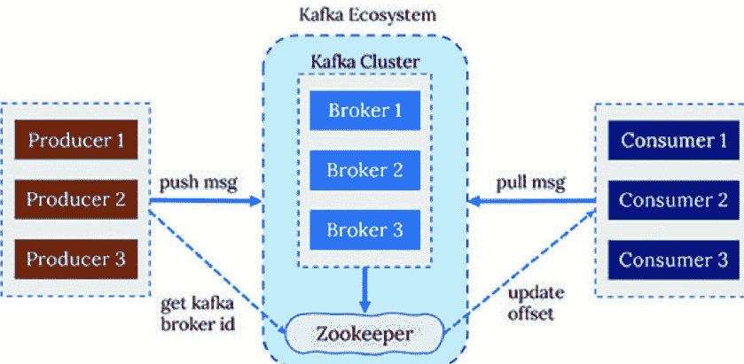

图 13.4：Kafka – 集群架构

Kafka 生产者将数据发送到 Kafka Broker。生产者可以是各种数据源，例如应用程序、传感器或日志文件。Kafka Broker 负责存储和管理主题（`topics`）和分区（`partitions`）。它们还处理到消费者的消息复制。Kafka 集群由多个 broker 组成，以实现扩展性和容错性。Apache ZooKeeper 用于 Kafka 集群内部的协调。它帮助管理 broker、主题和分区，并跟踪 broker 状态和主选举。Kafka 消费者从 Kafka Broker 读取数据。消费者可以是需要处理分析数据的应用程序或系统。

## 设置 Apache Kafka

在 Windows 上运行带有特定主题的 Apache Kafka broker 涉及多个步骤。我们将为示例创建一个主题。以下是如何在 Windows 机器上设置并运行带有主题的 Kafka 的指南：

- 安装 Java：确保你的 Windows 机器上安装了 Java。Apache Kafka 运行需要 Java。你可以从 Oracle 官网下载并安装 Java，或使用 OpenJDK。
- 下载 Apache Kafka：访问 Apache Kafka 下载页面：https://kafka.apache.org/downloads。下载最新的稳定版本。
- 解压 Kafka：将下载的压缩包解压到你选择的目录。
- 配置：进入 Kafka 安装目录并编辑 `server.properties` 文件以设置 `listeners=PLAINTEXT://9092`。
- 启动 ZooKeeper：运行以下命令启动 ZooKeeper：`bin\windows\zookeeper-server-start.bat config`。
- 启动 Kafka：打开另一个窗口并启动 Kafka：`bin\windows\kafka-server-start.bat config`。

```batch
PS C:\kafka> bin\windows\kafka-topics.bat --create --bootstrap-server localhost:9092 --replication-factor 1 --partitions 1 --topic real-time-topic
Created topic real-time-topic.
PS C:\kafka>
```

图 13.7: 创建主题“real-time-topic”

# 实时数据分析示例

让我们编写一个 Java 示例，演示如何使用 Apache Kafka 进行摄取和处理实时数据的基础。此示例假设你已经安装并运行了 Kafka。

注意：Apache Kafka 通常更适用于基于 Unix 的系统，在 Windows 上运行可能会有一些局限性。如果你计划在生产环境中使用 Kafka，通常建议将其在基于 Linux 的系统上运行。

你现在可以运行 Kafka 生产者和消费者应用程序，以向“real-time-topic”主题发布数据并从该主题消费数据。生产者将数据发布到 Kafka 主题，而消费者订阅同一主题以消费和处理数据。我们可以像下面的代码段所示编写 Kafka 生产者代码：


```java
import org.apache.kafka.clients.producer.*;
import org.apache.kafka.common.serialization.StringSerializer;

import java.util.Properties;

public class KafkaProducerExample {
    public static void main(String[] args) {
        Properties producerProps = new Properties();
        producerProps.setProperty(ProducerConfig.BOOTSTRAP_SERVERS_CONFIG, "localhost:9092");
        producerProps.setProperty(ProducerConfig.KEY_SERIALIZER_CLASS_CONFIG, StringSerializer.class.getName());
        producerProps.setProperty(ProducerConfig.VALUE_SERIALIZER_CLASS_CONFIG, StringSerializer.class.getName());

        // 创建 Kafka 生产者
        KafkaProducer<String> producer = new KafkaProducer<>(producerProps);

        // 定义要发布数据的 Kafka 主题
        String topic = "real-time-topic";

        try {
            // 向 Kafka 生产者发布数据
            for (int i = 1; i <= 10; i++) {
                String key = "key-" + i;
                String value = "Data point " + i;
                ProducerRecord<String> record = new ProducerRecord<>(topic, key, value);
                producer.send(record, new Callback() {
                    @Override
                    public void onCompletion(RecordMetadata metadata, Exception exception) {
                        if (exception == null) {
                            System.out.println("Message sent successfully. key: " + key + ", value : " + value);
                        } else {
                            System.err.println("Error sending message: " + exception.getMessage());
                        }
                    }
                });
                Thread.sleep(1000); // 模拟间隔生成数据
            }
        } catch (InterruptedException e) {
            e.printStackTrace();
        } finally {
            producer.close();
        }
    }
}
```

程序的输出如图所示

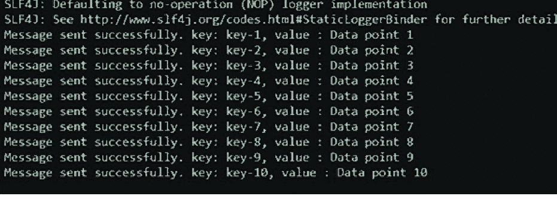

图 13.8: 显示从生产者发送消息的日志

在前面的代码示例中，我们配置了 Kafka 生产者的属性，例如 `BOOTSTRAP_SERVERS_CONFIG`（Kafka 代理的地址）以及 Kafka 消息键和值的序列化器。我们使用配置的属性创建了 Kafka 生产者实例。接下来，我们定义了想要发布数据的 Kafka 主题（在本例中）。在循环内部，我们生成了数据点并创建了带有键和值的 `ProducerRecord` 对象。然后我们使用 `producer.send` 方法将每条记录发送到 Kafka 主题。我们还提供了一个回调来处理消息交付的确认。此外，我们引入了 `Thread.sleep` 来模拟间隔生成数据。在现实世界的场景中，数据可能来自各种源，例如传感器、应用程序或用户交互。最后，我们在完成后关闭了生产者。

我们像配置生产者一样配置了 Kafka 消费者的属性，例如 ... 以及 Kafka 消息键和值的反序列化器。我们使用配置的属性创建了 Kafka 消费者实例，如下代码段所示：

```java
import org.apache.kafka.clients.consumer.*;
import org.apache.kafka.common.serialization.StringDeserializer;
import java.time.Duration;
import java.util.Collections;
import java.util.Properties;

public class KafkaConsumerExample {
    public static void main(String[] args) {
        Properties consumerProps = new Properties();
        consumerProps.setProperty(ConsumerConfig.BOOTSTRAP_SERVERS_CONFIG, "localhost:9092");
        consumerProps.setProperty(ConsumerConfig.GROUP_ID_CONFIG, "real-time-consumer");
        consumerProps.setProperty(ConsumerConfig.KEY_DESERIALIZER_CLASS_CONFIG, StringDeserializer.class.getName());
        consumerProps.setProperty(ConsumerConfig.VALUE_DESERIALIZER_CLASS_CONFIG, StringDeserializer.class.getName());

        // 创建 Kafka 消费者
        KafkaConsumer<String, String> consumer = new KafkaConsumer<>(consumerProps);

        // 定义要订阅的 Kafka 主题
        String topic = "real-time-topic";

        // 订阅 Kafka 主题
        consumer.subscribe(Collections.singleton(topic));

        // 轮询获取传入的消息
        while (true) {
            ConsumerRecords<String, String> records = consumer.poll(Duration.ofMillis(100));
            for (ConsumerRecord<String, String> record : records) {
                System.out.println("Received message: " + record.value());
                // 在此处执行实时分析或处理
            }
        }
    }
}
```

程序的输出如下

```
SLF4J: Failed to load class "org.slf4j.impl.StaticLoggerBinder".
SLF4J: Defaulting to NOP logger implementation
SLF4J: See http://www.slf4j.org/codes.html#StaticBinder for further details.
Received message: Data point 1
Received message: Data point 2
Received message: Data point 3
Received message: Data point 4
Received message: Data point 5
Received message: Data point 6
Received message: Data point 7
Received message: Data point 8
Received message: Data point 9
Received message: Data point 10
```

图 13.9: 显示消费者接收消息的日志

生产者和消费者代码共同向“real-time-topic”主题发布和消费数据，实现了实时数据的通信和分析。请注意，实时数据分析是一个复杂的特定领域，这里的示例只是概念说明。现实应用通常涉及针对特定业务需求的更复杂的处理和分析逻辑。

## 总结

在下一章节“大数据分析”中，我们将学习如何管理大型数据集并使用 Google 的 MapReduce 模型和 Apache Hadoop 框架处理大数据。

## 问题

- 什么是商业智能（BI）数据分析的主要目的？它对组织有什么什么好处？
- 解释时间序列预测的概念。提供一个时间序列预测有价值的现实场景示例。
- 什么是实时数据分析？为什么它在当今数据驱动的环境中很重要？
- Apache Kafka 如何贡献实时数据分析？它在数据流中扮演什么角色？
- 描述 Apache Flink 在实时数据处理中的作用。它与批处理有何区别？
- 在 BI 背景下，Java 库促进了哪些常见的数据分析任务？它们为什么有用？
- 解释 Apache POI 在 BI 应用中处理 Excel 文件时的重要性。
- Apache Commons CSV 库的目的是什么？它是如何简化数据分析中的 CSV 文件处理的？
- 在时间序列预测中，移动平均法和指数平滑法之间的区别是什么？
- 为什么 Apache Kafka 是实时数据流的首选方案？Kafka 架构的核心组件有哪些？
- Apache ZooKeeper 如何在实时数据分析中贡献于 Kafka 集群的稳定性和协调性？

## 注意事项

- 商业智能（BI）涉及利用数据分析来支持组织做出明智的决策。
- BI 中的数据分析包括数据清洗、转换、可视化和报告等任务。
- Apache POI 和 Apache Commons CSV 等 Java 库对于处理 BI 应用中的电子表格和 CSV 数据非常有价值。
- Apache POI 简化了 Excel 文件的处理，允许对电子表格数据进行导入、操作和分析。
- Apache Commons CSV 简化了 CSV 文件的读写，通常用于数据存储和交换。
- 时间序列预测是一种数据分析技术，根据历史时间顺序数据预测未来的数据点。
- 时间序列预测的常用方法包括移动平均和指数平滑。
- 实时数据分析涉及在数据生成或接收时无延迟地进行处理和分析。
- 实时数据分析的关键组件包括数据源、数据摄入、数据处理、数据存储以及分析/可视化。
- Apache Kafka 是一种流行的实时数据流工具，允许以可扩展和容错的方式进行数据摄入、存储和分布。
- Apache Flink 和 Apache Storm 是用于实时数据处理的流处理框架。
- Apache ZooKeeper 用于 Kafka 集群中的分布式协调和管理。
- Kafka 生产者将数据发布到主题（topics），而消费者订阅主题以消费和处理数据。
- Apache Kafka 在生产环境中更适合基于 Unix 的系统，而 Windows 可用于开发和测试。

## 引言

大数据通常指的是无法用传统数据分析技术分析的大型且复杂的数据集。大数据分析是处理大数据存储、检索和分析的算法。在本章中，我们将学习如何管理大型数据集。我们还将学习 Google 的 MapReduce 模型和用于处理大数据的 Apache Hadoop 框架。

# 目录结构

在本章中，我们将涵盖以下主题：

- 大数据
- 管理大型数据集
- MapReduce
- Apache Hadoop
- Apache Spark
- 可扩展性

## 大数据

大数据指的是无法使用传统数据处理工具或方法有效管理、处理或分析的海量复杂数据集。这些数据集通常具有 3V 特性：数量（大量数据）、速度（数据生成或更新极快）和多样性（各种格式和类型的数据）。大数据已成为现代数据分析的一个关键方面，因为它提供了价值丰富的见解，可以驱动商业、医疗、金融等各个领域的决策。

## 案例研究

让我们探索一些引人注目的现实，展示大数据的变革力量：

- **Netflix**：这家娱乐巨头利用大数据分析个性化用户体验并增强内容推荐。通过分析用户的观看习惯、偏好和反馈，Netflix 优化了其庞大的内容库，提高了观众的参与度和留存率。
- **Uber**：Uber 利用大数据分析优化共享约车服务、提高路线效率并增强司机合作伙伴的体验。通过实时分析海量的位置数据，Uber 优化了司机分配，缩短了等待时间，并提高了司机和乘客整体的服务质量。
- **Amazon**：作为全球最大的电子商务平台之一，Amazon 高度依赖大数据分析来驱动业务增长并增强客户体验。通过分析客户的浏览历史、购买行为和反馈，Amazon 提供个性化的产品推荐，简化了库存管理并优化了物流运营。

这些案例说明了组织如何利用大数据分析来驱动创新、提高运营效率，并在当今动态的市场中获得竞争优势。

## 大数据的特征

大数据特征可以通过数量（Volume）、速度（Velocity）和多样性（Variety）（即 3V）来描述。这些特性强调了海量的规模、高速的数据生成和多样化的数据格式，这使得大数据分析具有挑战性，并需要专门的工具和技术。理解这些特性对于有效地管理大数据并从中提取价值见解至关重要，这是数据分析和处理领域的一个基本概念。大数据的一些关键特性包括：

- **数量（Volume）**：涉及海量数据，通常从 TB（太字节）到 PB（拍字节）甚至更多，例如社交媒体帖子、传感器数据和电子商务交易。
- **速度（Velocity）**：数据以极快的速度生成和更新。例如，Twitter 等社交媒体平台每秒产生数条推文。
- **多样性（Variety）**：数据有多种格式，包括结构化（关系型数据库）、半结构化（XML、JSON）和非结构化（文本、图像、视频）。
- **真实性（Veracity）**：大数据可能存在噪声和不确定性，使得数据质量和准确性面临挑战。
- **价值（Value）**：大数据分析的终极目标是从数据中提取价值的见解、模式和趋势。
- **复杂性（Complexity）**：数据可能是高度关联的，需要复杂的分析技术。

这些特性将其与传统数据集区分开来。让我们对比这些特性：

| 特性 | 传统数据集 | 大数据 |
| :--- | :--- | :--- |
| 数量 | 规模有限 (GB) | 海量规模 (TB 到 PB) |
| 速度 | 批处理/计划更新 | 高速/实时更新 |
| 多样性 | 主要是结构化的 | 结构化、半结构化和非结构化 |
| 真实性 | 通常洁净且经过验证 | 高噪声/不确定性 |
| 价值 | 标准报告 | 具有深度见解的巨大潜力 |
| 复杂性 | 关系较简单 | 高度关联 |

表 14.1：大数据与传统数据集的对比

## 大数据的重要性

在当今数据驱动的世界，大数据具有重要意义，影响着商业、科学和决策的各个方面。以下是阐述其重要性的关键点：

**数据驱动决策**：大数据使组织能够根据实时数据和历史趋势做出明智决策。通过分析大规模且多样化的数据集，企业可以获得有关客户行为、市场动态和运营效率的见解。这导致了更精确、基于数据的决策，对于在快速变化的市场中保持竞争力至关重要。

**增强客户体验**：大数据在个性化和推荐系统中起着关键作用。通过分析客户偏好和行为，企业可以根据个人需求定制产品和服务，从而提高客户的满意度和忠诚度。例如，Netflix 和 Amazon 等平台使用大数据分析来推荐个性化内容和产品。

**降低成本和效率**：高效的数据分析有助于组织优化运营、降低成本并消除浪费。例如，供应链管理可以从实时数据分析中受益，简化库存、减少浪费并改进物流，最终实现成本节省。

**新的营收机会**：大数据分析可以揭示市场趋势，识别新兴的客户需求，并准确定位尚未开发的收入流。通过利用这些洞察，企业可以开发新产品、服务或业务模式，开启新的营收机会。例如，电子商务平台可以根据客户偏好扩展其产品种类。

**风险管理与欺诈检测**：在金融和保险等领域，大数据对于风险评估和欺诈检测至关重要。高级分析可以识别出指示潜在欺诈活动的异常和模式，从而实现及时干预和风险缓解。

**科学研究与医疗健康**：在科学和医疗领域，大数据辅助基因组学、药物发现、疾病建模和患者护理。分析海量数据集有助于研究人员取得突破，帮助医生提供更个性化的治疗方案，最终改善医疗结果和患者福祉。

**社会经济影响**：大数据分析对于解决社会经济挑战（如城市规划、灾害响应和气候变化缓解）具有作用。通过处理来自传感器和社交媒体在内的各种来源的数据，政府和组织可以做出基于数据的决策，以改进公共服务和危机管理。

## 大数据的挑战

大数据带来了多项挑战，为了成功进行数据分析和利用，解决这些挑战至关重要。以下是这些挑战的简要说明：


## 大数据挑战

- **存储**：高效存储海量数据是一项基础挑战。大数据通常需要像 `Hadoop` 分布式文件系统（`HDFS`）这样的分布式存储系统来处理海量信息。
- **处理**：处理和分析巨大的数据集可能非常耗时且耗资源。分布式计算框架（如 `MapReduce` 和 `Apache Spark`）被用于分解并并行化任务，以实现高效处理。
- **分析**：从复杂且非结构化的数据中提取有意义的洞察可能是一项艰巨的任务。数据科学家和分析师需要先进的工具和技术来发现有价值的模式和趋势。
- **隐私与安全**：保护敏感数据免受未经授权的访问和破解是一个日益关注的问题。数据加密、访问控制以及遵守数据保护法规在安全地处理大数据时至关重要。
- **可扩展性**：系统和基础设施需要进行水平扩展，以适应不断增长的数据量和速度。可扩展架构确保组织能够适应变化的数据需求。
- **真实性**：大数据可能包含噪声和不准确之处。确保数据质量和可靠性具有挑战性，但对于根据数据做出明智决策至关重要。
- **多样性**：大数据通常以各种格式和类型出现，包括结构化、半结构化和非结构化数据。整合并理解这些多样化的数据需要专业的工具和技能。
- **复杂性**：大数据可能是高度互联的，需要高级的分析和建模来提取有意义的洞察。这种复杂性要求数据科学和机器学习方面的专业知识。

解决这些挑战对于组织释放大数据的潜力至关重要，能够实现数据驱动的决策，并在现代数据格局中获得竞争优势。让我们通过如图所示的决策树图探索这些挑战和潜在解决方案：

| 类别 | 问题 | 解决方案 | 备选方案 |
| :--- | :--- | :--- | :--- |
| 存储 | 数据量大吗？ | 考虑实施分布式存储，如 `Hadoop` 分布式文件系统 (`HDFS`)。 | 传统的存储解决方案可能足够。 |
| 处理 | 处理巨大的数据集是瓶颈吗？ | 利用 `MapReduce` 或 `Apache Spark` 等分布式计算框架。 | 传统的处理方法可能足够。 |
| 分析 | 从复杂数据中提取洞察是挑战吗？ | 使用包括机器学习算法在内的高级分析技术。 | 标准分析方法可能足够。 |
| 隐私/安全 | 保护敏感数据是优先事项吗？ | 实施数据安全控制机制和合规措施。 | 基础安全措施可能足够。 |
| 可扩展性 | 基础设施能够处理数据需求吗？ | 通过可扩展架构的水平扩展确保可扩展性。 | 投资可扩展的基础解决方案。 |
| 真实性 | 数据质量和可靠性是个问题吗？ | 实施数据清洗和验证程序以确保数据准确。 | 质量保证措施可能足够。 |
| 多样性 | 整合多种数据格式是挑战吗？ | 利用能够处理半结构化和非结构化的数据集成和平台。 | 标准数据集成方法可能足够。 |
| 复杂性 | 分析互联的数据令人生畏吗？ | 使用高级分析技术，包括图分析和深度学习。 | 标准分析方法可能足够。 |

图 14.1：解决大数据挑战的决策树图

## 用于大数据的 Java 库

`Java` 是一种流行的大数据分析编程语言，得益于它的平台独立以及强大的库和框架。一些著名的 `Java` 库和工具包括：

### Apache Hadoop

`Hadoop` 是一个用于大数据分布式存储和处理的流行框架。它包含了用于分布式存储的 `Hadoop` 分布式文件系统 (`HDFS`) 和用于数据处理的 `MapReduce` 编程模型。示例：以下是一个在 `Java` 中编写 `MapReduce` 任务以统计大型文本数据集词频的示例代码段：

```java
// Map 函数用于输出键值对
public static class TokenizerMapper extends Mapper<Object, Text, Text, IntWritable> {
  private final static IntWritable one = new IntWritable(1);
  private Text word = new Text();

  public void map(Object key, Text value, Context context) throws IOException, InterruptedException {
    StringTokenizer itr = new StringTokenizer(value.toString());
    while (itr.hasMoreTokens()) {
      word.set(itr.nextToken());
      context.write(word, one);
    }
  }
}
```

```java
// Reduce 函数用于累加每个单词的计数
public static class IntSumReducer extends Reducer<Text, IntWritable, Text, IntWritable> {
  private IntWritable result = new IntWritable();

  public void reduce(Text key, Iterable<IntWritable> values, Context context) throws IOException, InterruptedException {
    int sum = 0;
    for (IntWritable val : values) {
      sum += val.get();
    }
    result.set(sum);
    context.write(key, result);
  }
}
```

### Apache Spark

`Spark` 是一个用于大规模数据处理的快速内存数据处理引擎。它提供了 `Hadoop MapReduce` 的通用替代方案，支持批处理、流和交互式处理。示例：以下是使用 `Spark Java API` 分析日志文件以统计网站流量的示例代码段：

```java
// 创建 SparkConf 和 JavaSparkContext
SparkConf conf = new SparkConf().setAppName("LogAnalysis").setMaster("local[*]");
JavaSparkContext sc = new JavaSparkContext(conf);
```

```java
// 将日志文件加载到 RDD
JavaRDD<String> logFile = sc.textFile("hdfs://path/to/logfile.txt");
```

```java
// 统计日志文件中的行数
long numLines = logFile.count();
```

### Apache Flink

`Flink` 是一个用于大数据实时分析的流框架。它提供了高吞吐量低延迟的数据处理能力。示例：以下是使用 `Flink Java API` 实现实时欺诈检测系统的示例代码段：

```java
// 创建流执行环境
StreamExecutionEnvironment env = StreamExecutionEnvironment.getExecutionEnvironment();
```

```java
// 读取输入流
DataStream<String> inputStream = env.addSource(new FlinkKafkaConsumer<>("topic", new SimpleStringSchema(), properties));
```

```java
// 处理流以检测欺诈
DataStream<FraudEvent> fraudStream = inputStream
    .map(new ParseEventMapFunction())
    .keyBy(FraudEvent::getAccountId)
    .process(new FraudDetectionProcessFunction());
```

### Apache Storm

`Storm` 是一个用于大数据的实时流处理系统。它适合在数据流入系统时进行处理。示例：以下是使用 `Java` 和 `Storm` 构建社交媒体提及实时监控和告警系统的示例代码段：

```java
// Create a TopologyBuilder
TopologyBuilder builder = new TopologyBuilder();
```

```java
// Set up spout and bolt
builder.setSpout("tweetSpout", new TweetSpout(), 1);
builder.setBolt("hashtagCounterBolt", new HashtagCounterBolt(), 2).shuffleGrouping("tweetSpout");
```

```java
// Create Config object and submit topology
Config config = new Config();
config.setDebug(true);

LocalCluster cluster = new LocalCluster();
cluster.submitTopology("tweetTopology", config, builder.createTopology());
```

## 管理大型数据集

管理大型数据集是大数据分析过程中的基础性步骤。在本节中，我们将探索高效存储和处理海量数据的原则和实践，重点关注基于 `Java` 的解决方案。本节将分为几个子章节，以全面涵盖不同的方面。

## 数据存储与持久化

有效的数据存储和持久化是大数据分析的关键方面。在本节中，我们将深入探讨高效存储和管理大型数据集的各种策略和技术。

### 分布式文件系统

分布式文件系统（如 `Hadoop` 分布式文件系统 `HDFS`）在大数据世界中管理大型数据集起着至关重要的作用。这些系统设计用于将数据分发在多个服务器或节点上，提供容错能力和高可用性。例如，`HDFS` 将数据切块并在集群中进行复制，以确保数据的持久性。基于 `Java` 的库和 `API` 允许开发者与分布式文件系统交互，能够在分布式环境中无缝地执行写入、读取和管理数据的操作。这一基础组件构成了大数据生态系统中进行高效数据存储的骨干。

`HDFS` 或分布式文件系统的一个用例是 `Web` 应用程序的大规模日志数据分析。当网站或应用程序产生海量日志数据（包括用户活动、错误消息和系统事件）时，高效地管理和分析这些数据是至关重要的。可以使用 `HDFS` 以分布式方式存储这些日志文件，以确保数据的持久性和可用性。这种设置使得数据工程师和数据科学家能够进行深度分析、监控网站性能、检测问题并得出可操作的洞察，同时受益于分布式文件系统容错和可扩展的特性。

### NoSQL 数据库

`NoSQL` 数据库在管理具有多样化和非结构化数据的大型数据集方面具有极高价值。这些数据库（如 `MongoDB` 和 `Apache Cassandra`）提供了灵活的数据模型，可以适应不断变化的数据需求，使其成为大数据场景的理想选择。例如，`MongoDB` 允许你高效地存储和查询海量数据，同时提供丰富的基于文档的数据结构。`Apache Cassandra` 凭借其分布式、高可用的架构在处理高速度数据方面表现出色。通过在大数据应用中使用 `NoSQL` 数据库，组织可以无缝地存储和检索非结构化或半结构化数据，为现代数据驱动的洞察和应用提供灵活性。这些数据库在满足扩展和管理大型复杂数据环境的需求方面起着重要作用。

`NoSQL` 数据库的一个主要用例是电子商务的实时分析。这些数据库可以高效管理大量的非结构化和半结构化数据，例如用户行为、产品目录信息和客户评论。通过使用 `MongoDB` 或 `Cassandra` 等 `NoSQL` 数据库，电子商务平台可以提供个性化的产品推荐、跟踪实时库存并从评论中分析客户情感，从而提升购物体验并驱动销售。

### 数据摄取和 ETL

数据摄取和 `ETL`（提取、转换、加载）是大数据处理的关键组件。数据摄取涉及将从各种源收集并导入数据到数据处理系统的过程。另一方面，`ETL` 专注于数据准备和转换，以确保数据质量和一致性。这些过程对于使原始数据做好分析和洞察准备至关重要，在大数据的生命周期中起着核心作用。适当的数据摄取和 `ETL` 实践是大数据分析中高效数据处理和准确结果的基础。

#### 数据摄取

数据摄取是将数据从各种源收集并传输到中央数据存储系统的过程，它是管理大型数据集的关键初始步骤。`Apache Nifi` 和 `Apache Flume` 等工具允许组织创建数据流水线，从日志文件、数据库、社交媒体馈送和物联网设备等源收集数据。这些工具提供了高效摄取、路由和转换数据的能力，确保数据可以随时用于分析，允许组织利用其大数据生态系统中来自各种源的价值信息。

#### ETL（提取、转换、加载）

`ETL`（提取、转换、加载）是大数据管理中关键的数据处理阶段。`ETL` 涉及从源系统提取数据、将其转换为合适的格式并加载到目标数据存储中（如分布式文件系统或数据库）。在大数据背景下，通常使用 `Apache Sqoop` 和 `Apache Spark` 等工具执行 `ETL` 操作。这些工具允许组织高效地移动和处理数据，确保数据是结构化的并准备好进行分析。`ETL` 在保持数据质量和一致性的同时，使大型数据集适用于分析和商业智能等目的至关重要。

### 数据压缩与序列化

数据压缩和序列化是优化大数据分析中大型数据集存储和传输的基础技术。这两种技术在提高数据处理效率、降低存储成本和增强大数据环境中整体性能方面都起着重要作用。

#### 数据压缩

数据压缩是一种用于减少大型数据集所需存储空间的技术。在大数据环境中，可以使用 `Snappy` 或 `GZIP` 等算法对数据进行压缩，在不损害数据完整性的情况下最小化存储成本。在考虑存储扩展性的场景下，数据压缩特别重要，因为它有助于在优化资源利用的同时确保数据易于分析和处理。这种做法对于管理存储容量和成本起着作用。

#### 数据序列化

数据序列化是将复杂数据结构或对象转换为适于存储、传输或反序列化的格式的过程。在大数据分析中，序列化对于确保数据能够被高效处理和共享至关重要。`Apache Avro` 和 `Apache Parquet` 等 `Java` 库提供了灵活高效的序列化选项，允许以结构化格式存储数据以维护数据完整性。通过使用序列化，组织可以优化数据存储，在大规模环境中实现更快的数据检索和分析。

### 数据分区与分片

数据分区和分片（`Sharding`）是高效管理和处理大型数据集的重要策略。通过实施这些技术，组织可以优化大数据应用中的数据处理，并确保系统能够扩展以适应增长的数据量和用户需求。

#### 数据分区

数据分区是一种将大型数据集划分为更小、更容易管理的子集的技术。每个子集根据特定的键或属性组织，从而在分布式系统中实现高效的数据检索和分发。数据分区在大数据环境中优化数据访问和处理至关重要。例如，在 `Apache Hive` 中可以使用分区按键对数据进行结构化，从而更容易查询和分析子集。这种做法提高了性能并允许并行处理，这对于大数据分析中处理海量数据集至关重要。

#### 数据分片

数据分片（`Data Sharding`）是一种广泛应用于 `NoSQL` 数据库的设计技术，用于将数据分布在多个服务器或节点上。每个分片包含数据的子集，允许在大规模数据系统中实现水平扩展并提高性能。在数据量超过单个服务器容量的大数据场景下，分片技术尤为有益。在 `MongoDB` 等数据库中，数据分布在多个分片服务器上，确保了负载的均匀分布、高效的数据访问以及容纳增长数据量的能力。这种方法使组织能够无缝地扩展其数据基础设施，以处理海量数据集，同时保持高可用性和响应速度。

本节深入探讨了在大数据分析背景下管理大型数据集的方法。我们涵盖了从数据存储、摄取到压缩、序列化和分区等各个方面，并提供了 `Java` 实际示例。在接下来的章节中，我们将深入研究使用 `MapReduce`、`Apache Hadoop` 和 `Apache Spark` 的数据处理技术，演示如何从这些大型数据集中得出有价值的见解。

## MapReduce

`MapReduce` 是一种为大型数据集的分布式并行处理设计的编程模型和处理框架。它最初由 `Google` 开发，此后成为大数据处理中的基础组件。`MapReduce` 模型通过将复杂的数据处理任务分为两个不同的阶段：`Map` 阶段和 `Reduce` 阶段，简化了任务处理。在本节中，我们将深入研究 `MapReduce` 的概念及其原理，并提供一个完整的 `Java` 代码示例来演示其工作原理。

### 理解 MapReduce

在大数据领域，理解 `MapReduce` 至关重要，因为它为处理海量数据集提供了清晰且高效的方法。`Map` 阶段通过将数据转换为键值对（`key-value pairs`）启动处理过程，便于并行化和分布。`Shuffle`（洗牌）和 `Sort`（排序）阶段对组合进行分组，而 `Reduce` 阶段对数据进行聚合或转换，最终交付有意义的见解或摘要。`MapReduce` 通过将复杂的数据处理任务分为这两个不同的、可并行的阶段，使其成为分布式数据分析的强大范式。

### Map 阶段

`Map` 是初始阶段，数据在此被分为较小的块，并在分布式集群中的多个节点或机器上并行处理。在这一阶段，数据被转换为一组键值对。`Mapper` 函数被应用于每个输入记录，产生中间键值对。`Map` 阶段的主要目标是将问题分解为可以独立并行处理的小型任务，非常适合处理海量数据集。

### Shuffle 和 Sort

在 `Map` 阶段之后，中间键值对将根据其键（`keys`）进行 `Shuffle` 和排序。这一过程确保了与特定键相关的所有值都被分组。`Shuffle` 和排序对于 `Reduce` 阶段至关重要，因为它们允许 `Reducer` 高效地对分组数据进行操作。

### Reduce 阶段

`Reduce` 是最终阶段，对 `Map` 阶段的中间键值对进行处理以产生预期的输出。`Reducer` 函数应用于排序并分组后的键值对，允许根据需要对数据进行聚合、总结或转换。输出通常是一组键值对，代表数据处理任务的最终结果。

`MapReduce` 的工作流如图所示：


图 14.2：`MapReduce` 工作流

该图说明了 `MapReduce` 如何通过将问题分解为较小任务、将其分布到多个节点并聚合结果以产生有意义的见解或数据摘要，从而高效地处理大型数据集。它是大数据环境中分布式数据处理的核心组件。

### Java 中的 MapReduce

让我们用一个 `Java` 代码示例来演示 `MapReduce` 的概念。

考虑一个常见的用例：在大型文本数据集中统计词频：


```java
import java.io.IOException;
import java.util.StringTokenizer;
import org.apache.hadoop.conf.Configuration;
import org.apache.hadoop.fs.Path;
import org.apache.hadoop.io.*;
import org.apache.hadoop.mapreduce.*;
import org.apache.hadoop.mapreduce.lib.input.FileInputFormat;
import org.apache.hadoop.mapreduce.lib.output.FileOutputFormat;
```

```java
public class WordCount {
    public static class TokenizerMapper
    extends Mapper<Object, Text, Text, IntWritable> {

        private final static IntWritable one = new IntWritable(1);
        private Text word = new Text();

        public void map(Object key, Text value, Context context)
            throws IOException, InterruptedException {
            StringTokenizer itr = new StringTokenizer(value.toString());
            while (itr.hasMoreTokens()) {
                word.set(itr.nextToken());
                context.write(word, one);
            }
        }
    }
    public static class IntSumReducer
    extends Reducer<Text, IntWritable, Text, IntWritable> {
        private IntWritable result = new IntWritable();

        public void reduce(Text key, Iterable<IntWritable> values, Context context)
            throws IOException, InterruptedException {
            int sum = 0;
            for (IntWritable val : values) {
                sum += val.get();
            }
            result.set(sum);
            context.write(key, result);
        }
    }

    public static void main(String[] args) throws Exception {
        Configuration conf = new Configuration();

        Job job = Job.getInstance(conf, "word count");
        job.setJarByClass(WordCount.class);
        job.setMapperClass(TokenizerMapper.class);
        job.setCombinerClass(IntSumReducer.class);
        job.setReducerClass(IntSumReducer.class);
        job.setOutputKeyClass(Text.class);
        job.setOutputValueClass(IntWritable.class);

        FileInputFormat.addInputPath(job, new Path("input"));
        FileOutputFormat.setOutputPath(job, new Path("output"));
        System.exit(job.waitForCompletion(true) ? 0 : 1);
    }
}
```

# Apache Hadoop

Apache Hadoop 是一个开源框架，旨在通过商品化集群实现大型数据集的分布式处理。它为大数据处理提供了可靠、可扩展且成本效益的解决方案。在本节中，我们将详细探讨 Apache Hadoop，讨论其核心组件以及在分布式数据处理中的作用。

## 理解 Apache Hadoop

Apache Hadoop 是一个强大的开源框架，用于大数据的分布式存储和处理。其核心由几个关键组件组成，共同实现了规模化处理。Hadoop 分布式文件系统（HDFS）作为主要的存储系统，另一个资源调度器（YARN）管理资源分配，而 MapReduce 编程模型则促进了并行数据处理。理解这些组件对于利用 Hadoop 进行大规模数据分析至关重要。

## 核心组件

Apache Hadoop 由几个核心组件组成，它们共同协作管理和处理大规模数据集：

- **Hadoop 分布式文件系统 (HDFS)**：HDFS 是 Hadoop 的主要存储系统。它设计用于跨越通用硬件的分布式集群存储海量数据。HDFS 采用主从架构，由 `NameNode` 管理元数据，`DataNodes` 存储实际数据。

- **另一个资源调度器 (YARN)**：YARN 是 Hadoop 的资源管理组件。它为运行在 Hadoop 集群上的应用程序分配资源（CPU 和内存）。YARN 支持多租户，允许不同的应用程序在同一个集群上同时运行。

- **MapReduce**：MapReduce 是一种用于并行和分布式数据处理的编程模型和框架。它将任务分为 Map 阶段（处理数据）和 Reduce 阶段（聚合和总结结果）。

## Hadoop 如何工作

Hadoop 的核心通过采用分布式存储系统 (HDFS)、资源管理组件 (YARN) 和并行处理模型 (MapReduce) 来管理和处理大规模数据集。这些技术的组合使得 Hadoop 能够高效、可靠地处理数据存储、计算资源分配以及并行数据处理任务的执行，使其成为在通用硬件集群上管理和分析大数据的价值工具。Hadoop 的运行机制如下：

1. 数据存储在 HDFS 中，它被划分为块并在多个 `DataNodes` 上复制以实现容错。
2. YARN 根据需要为应用程序（如 MapReduce 作业）分配资源。
3. MapReduce 作业在分配的资源上执行。Map 阶段在整个集群上并行处理数据，Shuffle 和 Sort 结果。最后，Reduce 阶段聚合数据并生成输出。

# 在 Java 中使用 Hadoop

让我们探索一个如何在 Java 中使用 Hadoop 的简单示例。我们将创建一个与 HDFS 交互并执行基本文件操作的 Java 程序。

## 从 HDFS 读取文件

从 HDFS 读取文件是 Hadoop 中的一项关键操作。它利用 Hadoop Filesystem API 访问和检索存储在 Hadoop 分布式文件系统 (HDFS) 中的数据。此代码建立了与 HDFS 的连接，打开指定的文件，逐行读取内容并打印到控制台，展示了 Hadoop 如何促进用于处理和分析的分布式数据的检索。让我们通过以下 Java 代码理解它：

```java
import org.apache.hadoop.conf.Configuration;
import org.apache.hadoop.fs.*;

public class ReadFileFromHDFS {
    public static void main(String[] args) {
        try {
            Configuration conf = new Configuration();
            conf.set("fs.defaultFS", "hdfs://localhost:9000"); // HDFS location

            FileSystem fs = FileSystem.get(conf);

            Path filePath = new Path("sample.txt"); // Path to the HDFS file

            FSDataInputStream inputStream = fs.open(filePath);

            String line;
            while ((line = inputStream.readLine()) != null) {
                System.out.println(line);
            }

            inputStream.close();
            fs.close();
        } catch (Exception e) {
            e.printStackTrace();
        }
    }
}
```

此 Java 程序从 HDFS 读取文件并打印其内容。

## 向 HDFS 写入文件

向 HDFS 写入文件涉及配置 Hadoop 客户端、在 HDFS 上创建输出文件并向写入数据。这种能力是在分布式集群上存储和管理大规模数据集的基础，也是 Hadoop 数据处理能力的关键特征。让我们使用以下代码示例来理解这一过程：

```java
import org.apache.hadoop.conf.Configuration;
import org.apache.hadoop.fs.*;

public class WriteFileToHDFS {
    public static void main(String[] args) {
        try {
            Configuration conf = new Configuration();
            conf.set("fs.defaultFS", "hdfs://localhost:9000"); // HDFS location

            FileSystem fs = FileSystem.get(conf);

            Path filePath = new Path("output.txt"); // Path to the HDFS file

            FSDataOutputStream out = fs.create(filePath);

            String data = "This is a sample text written to HDFS.";
            out.writeBytes(data);

            out.close();
            fs.close();
        } catch (Exception e) {
            e.printStackTrace();
        }
    }
}
```

此 Java 程序向 HDFS 写入指定内容的文件。

这些示例演示了如何使用 Java 与 Hadoop 和 HDFS 交互，提供了基本的文件读写操作。Hadoop 提供了许多更多用于分布式数据处理和分析的能力，使其成为大数据应用的多功能工具。

# Apache Spark

Apache Spark 是一个开源、快速且通用的集群计算系统，为大数据工作负载提供内存级数据处理框架。它旨在实现高效、易用性和高级 API，使其成为数据分析和处理的强大工具。在本节中，我们将深入探讨 Apache Spark，讨论其核心组件、数据处理能力以及如何在 Java 中使用它。

## 理解 Apache Spark

Apache Spark 是一个多功能的开源集群计算框架，以其速度和灵活性闻名。它配备了核心组件，包括 Spark Core、Spark SQL、Spark Streaming、MLlib 和 GraphX，使其成为各种数据处理任务的强大选择。凭借在内存中处理数据的能力，Spark 为高效、高级的数据分析和机器学习奠定了基础，使其成为大数据分析领域的流行工具。

## 核心组件

Apache Spark 包含几个有助于提升其数据处理能力的核心组件，如下：

- **Spark Core**：基础组件，提供任务调度、内存管理和故障恢复，能够实现分布式数据处理。
- **Spark SQL**：用于结构化数据处理的模块，支持对结构化数据进行 SQL 查询，并与各种数据源集成。
- **Spark Streaming**：用于处理实时数据流（如日志或事件）的实时数据处理模块。
- **MLlib（机器学习库）**：一个简化机器学习应用程序开发的机器学习库。
- **GraphX**：用于分析图结构数据的图处理库。

## 弹性分布式数据集 (RDDs)

Apache Spark 的基本数据结构是弹性分布式数据集 (RDD)。RDD 是不可变的、分布式的对象集合，跨集群进行分区。RDD 可以缓存到内存中，使其适用于迭代型数据处理任务。

# 在 Java 中使用 Apache Spark

让我们探索一个如何在 Java 中使用 Apache Spark 的简单示例。我们将创建一个使用 Spark 统计文本文件中单词出现次数的 Java 程序。

## 使用 Spark 进行词频统计

让我们来看一个名为 Word Count 的经典且具有说明性的示例，它展示了 Apache Spark 在分布式数据处理方面的强大和简单性。该程序高效地读取文本文件，将其分成单个单词，并在分布式集群上统计每个单词的出现次数。通过使用 Spark 的高级 API 及其内置的并行处理能力，此示例强调了 Spark 如何简化复杂的数据分析任务，使其处理大规模数据集和执行实时分析的价值工具：

```java
import org.apache.spark.SparkConf;
import org.apache.spark.api.java.JavaPairRDD;
import org.apache.spark.api.java.JavaRDD;
import org.apache.spark.api.java.JavaSparkContext;
import scala.Tuple2;
import java.util.Arrays;

public class SparkWordCount {
    public static void main(String[] args) {
        // 创建 Spark 配置和 Spark 上下文
        SparkConf conf = new SparkConf().setAppName("SparkWordCount").setMaster("local[*]");
        JavaSparkContext sc = new JavaSparkContext(conf);

        // 加载文本文件
        JavaRDD<String> textFile = sc.textFile("inputfile.txt");

        // Split each line into words and count the occurrences of each word
        JavaPairRDD<String, Integer> wordCounts = textFile
            .flatMap(line -> Arrays.asList(line.split(" ")).iterator())
            .mapToPair(word -> new Tuple2<>(word, 1))
            .reduceByKey(Integer::sum);

        // Print the word counts
        wordCounts.foreach(wordCount -> System.out.println(wordCount._1 + " : " + wordCount._2));

        // Stop the Spark context
        sc.stop();
    }
}
```

此 Java 程序使用 Apache Spark 读取文本文件，将其拆分为单词，并统计每个单词出现的次数。请确保包含 Spark 核心库和类的主 Spark JAR 文件已添加到项目的类路径中。该 JAR 文件是所有 Spark 应用程序所必需。前一个代码示例的输出应该如下：

```
hello: 3
world: 2
example: 1
spark: 2
big: 1
data: 1
processing: 1
```

图 14.4：使用 Apache Spark 的词频统计示例

它展示了 Spark 高效执行分布式数据处理的能力。

## 运行 Spark 应用程序

要运行 Java 编写的 Spark 应用程序，你需要将代码打包为 JAR 文件并提交到 Spark 集群。你还应该在集群上安装并配置 Apache Spark。请按照以下步骤操作：

1. 编译你的 Java 代码并将其打包为 JAR 文件。
2. 将 JAR 文件上传到你的 Spark 集群或安装了 Spark 的机器。
3. 使用 `spark-submit` 命令提交 Spark 作业：

```
spark-submit --class YourMainClass --master spark://your-spark-master:7077 path/to/your-jar-file.jar
```

将 `YourMainClass` 替换为主类的名称，并指定 JAR 文件的路径。`spark://your-spark-master:7077` 参数指定 Spark master 的地址。


你的作业将在 Spark 集群上执行，结果将根据你的应用程序显示在控制台中或写入输出文件。

Apache Spark 为数据处理、机器学习和实时分析提供了极其广泛的功能，使其成为大数据应用的多功能选择。

## 可扩展性

可扩展性是大数据分析领域中的一个基本概念。它指的是系统能够高效且有效地处理不断增长的数据量以及更多用户或操作的能力，而不会显著影响性能。在本节中，我们将探索可扩展性的重要性，并讨论实现它的关键原则。我们还将提供一个简单的 Java 示例，说明如何设计可扩展的解决方案。

## 理解可扩展性

可扩展性是大数据分析领域的一个基础概念。它涵盖了系统随着数据量和用户需求增加而增长和适应的能力。可扩展性在大数据中至关重要，因为它确保了系统能够高效地处理和处理不断扩展的数据集。这包括适应更大的数据量、支持多个并发用户、适应变化的负载，并随着数据分析需求的演变确保系统具有持续的性能和响应能力（前瞻性）。可扩展性在大数据分析中至关重要的原因有以下几点：

- 处理增长的数据量：随着数据量以前未有的速度不断膨胀，系统必须扩展以适应日益增加的数据量。可扩展性确保系统能够高效地存储、处理和分析任何规模的数据。
- 支持并发用户：在许多应用程序中，多个用户或应用程序同时访问并操作数据。可扩展性允许系统处理并发请求而不会变慢或变得无响应。
- 适应负载的变化性：大数据应用程序中的负载可能会发生巨大变化。可扩展的系统可以动态分配资源来处理常规负载和峰值负载。
- 前瞻性：通过设计可扩展的解决方案，组织可以使其系统具有前瞻性，确保随着数据量和用户需求的增长，它们能够继续满足数据处理需求。

可扩展性原则是支撑大数据分析中可扩展系统设计和运行的基本准则。这些原则包括：**水平扩展**（专注于通过添加更多机器或节点来扩展容量）、**数据分区**（涉及将数据分成可管理的块以便并行处理）、**负载均衡**（确保负载在系统组件之间公平分配），而**分布式计算**则赋予了跨集群高效、并行化执行任务的能力，这是 Hadoop 和 Spark 等系统可扩展性的关键。遵循这些原则对于构建弹性且高性能的数据处理解决方案是至关重要的。为了在大数据分析中实现可扩展性，请考虑以下原则：

## 水平扩展

水平扩展是一种可扩展性原则，涉及通过向集群或基础设施添加更多机器或节点来增加系统的容量。水平扩展不是为了增强现有机器的能力，而是利用额外相同资源的力量来分配工作负载和数据处理任务。这种方法在大数据分析中至关重要，因为它允许系统通过简单地扩展资源池来适应增长的数据量和用户需求。水平扩展提供了改进容错性和负载均衡等优势，使其成为设计可扩展且弹性的分布式系统的基础概念。水平扩展如图所示：

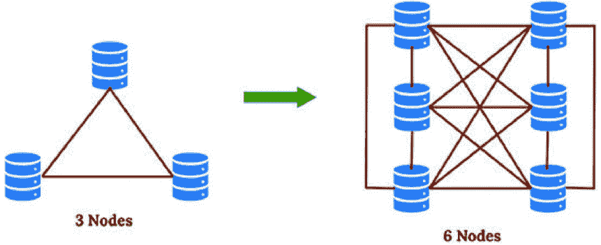

图 14.5：水平扩展

## 数据分区

数据分区是一个关键的可扩展性原则，涉及将大型数据集分成较小的、可管理的块或分区。这些分区被独立地处理和存储，允许并行执行并高效利用资源。通过将数据拆分为分区，数据处理变得更加高效，系统可以水平扩展以处理增长的数据量。

## 负载均衡

负载均衡是实现分布式系统可扩展性的关键原则。它涉及在组件之间均匀分布负载，确保没有单个节点或资源被过载，而其他资源处于未充分利用的状态。有效的负载均衡可以优化资源使用，提高系统性能并有助于扩展以处理变化的负载。

## 分布式计算

分布式计算是实现大数据分析可扩展性的核心策略。它涉及将任务和数据分成较小的单元，并在机器或节点集群中处理。这种方法允许并行执行和高效利用资源，对于扩展性能和响应能力至关重要。

```java
int sum = 0;
for (int i = start; i <= end; i++) {
    sum += i;
}
return sum;
} else {
```

```java
// 将任务拆分为子任务
int mid = (start + end) / 2;
ScalableTask leftTask = new ScalableTask(start, mid);
ScalableTask rightTask = new ScalableTask(mid + 1, end);
```

```java
leftTask.fork();
int rightResult = rightTask.compute();
int leftResult = leftTask.join();
return leftResult + rightResult;
}
```

```java
public static void main(String[] args) {
int start = 1;
int end = 1000;
```

```java
ForkJoinPool pool = new ForkJoinPool();
ScalableTask task = new ScalableTask(start, end);
int result = pool.invoke(task);
```

```java
System.out.println("Sum: " + result);
}
```

程序的输出结果：

Sum: 500500

在这个 Java 示例中，我们创建了一个 `ScalableTask`，用于计算从 `start` 到 `end` 的数字和。该任务被划分为子任务以进行并行处理，使其在大范围范围内具有可扩展性。在这种情况下，它计算了从 1 到 1000 的数字和，结果为 500500。

这演示了数据分区和并行处理如何在多线程 Java 应用中实现扩展性。在更复杂的大数据场景中，类似的原理也适用于分布式系统和框架。

## 结论

在本章中，我们深入研究了基于 Java 的大数据分析这一迷人世界。我们探索了大数据的核心概念，包括其重要性、挑战以及可扩展性原则。我们讨论了 Apache Hadoop 和 Apache Spark 这两个促进大规模数据处理的强大框架，并提供了了 Java 示例来说明其功能。我们展示了可扩展性的重要性，强调了水平扩展、数据分区、负载均衡和分布式计算是构建弹性且高性能系统的关键原则。随着本章的结束，我们为在不断演变的数据密集型计算格局中理解、实施和利用 Java 进行大数据分析的潜力奠定了基础。

在下一章“深度学习”中，我们将学习神经网络及其工作原理。我们还将学习如何使用 Deeplearning4j，这一个为 Java 设计的深度学习框架。

## 问题

什么是大数据？为什么它在现代数据版图中如此重要？

请举例描述大数据的关键特征。

处理大数据时面临哪些挑战？

在可扩展性的背景下，解释数据分区的概念。它是如何有助于高效数据处理的？

水平扩展与纵向扩展有什么区别？为什么在大数据解决方案中通常首选水平扩展？

你能列出并简述 Apache Hadoop 的核心组件及其在数据处理中的作用吗？

在分布式文件系统的语境下，解释 Hadoop HDFS 中 NameNode 和 DataNodes 的作用。

为 Hadoop 的 HDFS（Hadoop 分布式文件系统）提供一个案例。

什么是弹性分布式数据集（RDDs）？它们与 Apache Spark 有什么关系？

描述 Apache Spark 的主要组件及其在分布式数据处理中的功能。

在 Apache Spark 的词频计数示例中，输入文本文件是如何处理的，输出是什么？

解释可扩展性的原则，重点关注水平扩展、数据分区、负载均衡和分布式计算，以及它们如何有助于可扩展的大数据解决方案。

## 重点要记

- 大数据是指规模巨大且复杂，无法使用传统数据处理方法有效处理的数据集。
- 大数据的特征是“三性”（体量、速度、多样性），它们分别代表数据的规模、速度和多样性。
- 大数据的重要性在于其提取价值信息、做出明智决策和获得竞争优势的潜力。
- 处理大数据的挑战包括数据存储、数据处理、数据分析和数据安全。
- 水平扩展涉及向系统添加更多机器或节点以增加其容量，这是可扩展性的关键原则。
- 数据分区涉及将大型数据集拆分为更小的可管理的块，以便并行处理。
- 负载均衡确保负载在系统组件之间均匀分布，以优化资源利用率。
- Hadoop 和 Spark 等分布式计算框架能够在跨机器集群上进行高效的数据处理。
- Apache Hadoop 是一种广泛用于大数据分布式存储和处理的开源框架。
- Hadoop 的核心组件包括 Hadoop 分布式文件系统 (HDFS)、YARN 和 MapReduce。
- HDFS 用于存储大型数据集，使用带有 NameNodes 和 DataNodes 的主从架构。
- Apache Spark 是一个用于大规模数据分析的开源内存数据处理框架。
- Spark 的核心组件包括 Spark Core、Spark SQL、Spark Streaming、MLLib 和 GraphX。
- 在 Spark 的词频计数示例中，读取输入文本数据，将其拆分为单词，并统计每个单词出现的次数。
- 可扩展性原则包括水平扩展、数据分区、负载均衡和分布式计算，这些对于构建可扩展的大数据解决方案至关重要。

## 引言

Java 领域的深度学习代表了人工智能领域一个令人兴奋的前沿。在过去的十年中，由于其基础是人工神经网络，它的流行度急飙升。在本章中，我们将开启揭示神经网络复杂性的旅程，理解其内部机制。此外，我们还深入探讨了使用强大的 Java 框架进行深度学习的应用实践。最后，我们通过一个实践示例阐明这些概念，演示了如何利用卷积神经网络进行对象分类。

## 结构

在本章中，我们将涵盖以下主题：

- 神经网络
- 感知机
- 深度学习
- Deeplearning4j
- 使用卷积神经网络进行对象分类

在人工智能和机器学习领域，神经网络作为一类强大且多能的算法脱颖而出，其灵感源自人类大脑的计算过程。这些网络在彻底改变深度学习领域方面发挥了重要作用，并被应用于广泛领域，从图像和语音识别到自然语言处理和自主系统。在本节中，我们将深入神经网络的核心，理解其架构、组件以及支撑其运行的基本原理。

神经网络的核心是人工神经元，也称为节点。它们充当了基础构建单元，就像我们大脑中的生物神经元一样。每个人工神经元接收一组输入值，通过数学运算对其进行处理，并产生输出。

神经网络组织成层，如图所示：

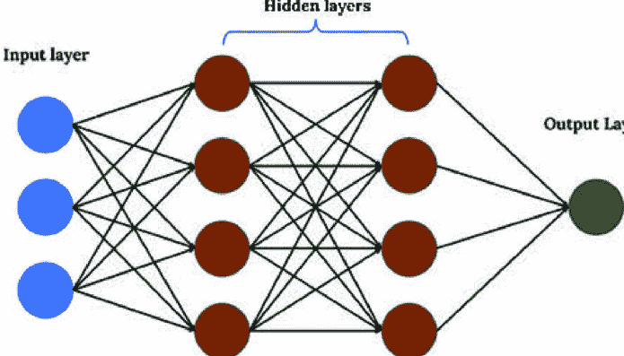

图 15.1：神经网络的层

三种主要的层类型如下：

- 输入层：这是数据最初输入网络的地方。输入层不执行任何计算，只是将数据传递给下一层。
- 隐藏层：这些层位于输入层和输出层之间。它们执行大部分计算，以转换的方式输入数据，使网络能够学习并做出预测。
- 输出层：这是网络的最后一层，产生网络的输出。输出层中神经元的数量取决于神经网络设计的特定任务。例如，在二分类任务中，输出层可能仅有一个神经元，而在多分类任务中，神经元的数量将与类别数量相等。

图中我们看到一个输入层、两个隐藏层和一个输出层。

神经网络已应用于多个领域，包括计算机视觉、语音识别、自动驾驶汽车等。让我们探索这些神经网络在现实世界中的应用：

- 计算机视觉：在医学影像中，神经网络用于疾病诊断和预后。例如，卷积神经网络（CNNs）可以分析 MRI 扫描图以检测肿瘤或病变等异常情况。
- 自然语言处理（NLP）：神经网络驱动了如 Google 翻译之类的语言翻译服务。循环神经网络（RNNs）和 Transformer 模型实现了语言之间准确且流利的翻译。
- 自动驾驶汽车：神经网络在自动驾驶系统中起着至关重要的作用，使车辆能够感知周围环境、识别物体并实时做出驾驶决策。

神经网络网络架构的最新进展，例如用于图像处理的卷积神经网络（CNNs）和用于序列数据的循环神经网络（RNNs），进一步扩展了它们的能力。

## 感知机

感知机是神经网络的基础构建块，代表了人工神经元的简单形式。感知机由弗兰克·罗森布特（Frank Rosenblatt）于 20 世纪 50 年代开发，是一种根据一组输入特征做出决策的二分类器。它们在神经网络理论的早期发展中发挥了至关重要的作用。

### 历史背景

在 20 世纪 50 年代，弗兰克·罗森布特将感知机作为人工智能的一项突破性概念引入。受大脑生物神经元的启发，感知机标志着神经网络理论早期发展的一个重要里程碑。然而，它们最初的能力仅限于解决线性可分问题。

### 感知机结构

感知机接收一组输入值并产生单个输出值。每个输入都与一个权重相关，该权重代表与感知机连接的强度。此外，感知机还有一个偏置项（bias），可以被视为阈值。输入的加权和通过一个激活函数，如果结果超过阈值，感知机输出 1；否则输出 0。感知机的结构如图所示。

图 15.2: 感知机结构

### 感知机的工作原理

感知机作为简单的二分类器运行，其决策过程基于阈值。以下是它们逐步工作的步骤：

每个输入都与一个权重相关，感知机在考虑各自权重的情况下计算输入的加权和：

```
Z = W1X1 + W2X2 + W3X3
```

加权和中加上偏置项。此加允许感知机调整其决策边界。高偏置使得感知机更容易输出 1，而低偏置使其更可能输出 0。

```
Z = W1X1 + W2X2 + W3X3 + W0
```

感知机对加权和加偏置的结果应用激活函数（通常是阶跃函数）。如果此结果大于 0，感知机输出 1；否则输出 0。

```
h(z) = {0, z < Threshold
1, z ≥ Threshold
```

本质上，感知机通过学习过程调整权重和偏置来做出二分类决策。这一学习过程涉及更新权重和偏置，以最小化训练期间的误差，通常使用监督学习方法。

### 数值示例

考虑一个基于两个输入特征执行二分类的感知机，假设权重为 $w_1=0.5, w_2=-0.3$，偏置 $b=0.1$。阈值设置为 0。如果加权和加偏置大于 0，感知机输出 1；否则输出 0。

输入特征：$x_1=2, x_2=-1$，

加权和：

$z = (0.5 \times 2) + (-0.3 \times -1) + 0.1 = 1 + 0.3 + 0.1 = 1.4$

激活函数：

$h(z) = \begin{cases} 0, & z < Threshold \\ 1, & z \geq Threshold \end{cases}$

输出：

在这个示例中，感知机正确将输入分类为属于类别 1。

### 感知机的局限性

感知机具有局限性。它们只能解决线性可分问题，也就是说它们无法学习复杂模式或执行需要非线性决策边界的任务。然而，更复杂的神经网络架构（如多层感知机和深度神经网络）的发展克服了许多此类局限性，使得对复杂的现实世界数据模式建模成为可能。

在人工智能领域，深度学习是机器学习中一个前沿且具有变革性的子领域。它在近年来取得了卓越的成功，推动了从图像和语音识别到自然语言处理以及自动驾驶系统的广泛应用。深度学习模型，特别是深度神经网络，已经展现了前所未有的性能，并处于 AI 研究和应用的前沿。在本节中，我们将对深度学习进行全面探索，深入研究其基本概念和原理，并为下一节对 Deeplearning4j 的详细讨论奠定基础。

## 深度学习的核心概念

在本节中，我们将阐明对于理解深度学习至关重要的基本概念：

- 前向传播和反向传播：前向传播是训练深度神经网络的初始阶段。它涉及将输入数据通过网络进行预测的过程。数据从输入层流经隐藏层，最终到达输出层。在每一层中，输入使用一组权重进行转换，并对层的输出应用激活函数。该输出成为后续层的输入。该过程逐层持续，直到获得最终预测。反向传播是紧随在前向传播之后的学习阶段。在反向传播期间，网络的预测值与实际目标值进行比较，并计算误差（损失）。然后，误差逐层反向传播，从输出层开始移动到输入层。在反向移动，算法计算误差相对于权重和偏置的梯度。这些梯度引导使用梯度下降等优化技术调整参数。通过向最小误差的方向迭代更新权重和偏置，反向传播精细地调整神经网络的参数，使其做出更准确的预测。这一过程重复多次，直到网络达到所需的准确水平。反向传播是训练深度神经网络的基础部分，对于它们学习和提高性能至关重要。

- 激活函数：激活函数是人工神经网络（包括深度学习模型）的关键组件。它们为网络引入非线性，使其能够建模数据中的复杂关系。本质上，激活函数根据输入的加权和决定神经元应该被激活（产生输出）还是不。常见的激活函数包括双曲正切函数和修正线性单元函数（ReLU）。sigmoid 函数将输入值映射到 0 到 1 之间，适用于二分类任务。tanh 与 sigmoid 类似，但它将值映射到 -1 到 1 之间，这有助于缓解梯度消失问题。ReLU 是受欢迎的激活函数之一；如果输入为正则输出输入，如果为负则输出零，提供了简单且高效的训练。

激活函数增加了非线性，允许神经网络近似复杂函数并从数据中学习，这对于它们解决从图像识别到自然语言处理的广泛任务至关重要。激活函数的选择可能会影响网络的学习行为和性能，研究人员经常尝试不同的函数，以找到最适合特定问题的函数。

- 深度学习与浅层学习：深度学习和浅层学习是机器学习中的两种不同方法。深度学习涉及具有多个隐藏层的深度神经网络。这些网络可以从数据中自动提取层次化特征，使其能够对复杂的模式进行建模。深度学习在计算机视觉、自然语言处理和语音识别等多个领域取得了卓越的成功，但通常需要大型数据集和大量的计算资源。浅层学习（也称为传统机器学习）通常采用层数或参数数量较少的算法。这些模型更为简单，在许多任务中表现良好，特别是当数据内部关系不是特别复杂时。浅层学习方法（如决策树、支持向量机和线性回归）所需的数据较少，计算密集性也较低，使其更适合资源有限的某些应用。

关键区别在于模型的深度以及其能够捕捉的关系的复杂性。深度学习在数据丰富且必须学习复杂模式的任务中表现出色，而浅层学习对于简单的任务或数据受限、计算资源受限的场景仍然具有实用性。

深度学习对各个领域产生了深远影响。在本小节中，我们将深入探讨深度学习的一些关键应用和用例，突出其多功能性和与现实的相关性：

- 计算机视觉：了解深度学习如何彻底改变图像分类、目标检测和图像分割等计算机视觉任务。
- 自然语言处理：探索深度学习在语言翻译、情感分析和聊天机器人等自然语言处理任务中的应用。


- 语音识别：学习深度学习模型如何应用于语音识别系统中，实现语音命令和转录服务。

- 自主系统：发现深度学习如何在自动驾驶汽车、机器人和无人机中发挥关键作用，允许它们独立导航并做出决策。

## 深度学习的最新进展

近年来，深度学习取得了显著的进展，为各个领域带来了巨大的变革。以下是突出这些进展的关键发展：

- **Transformer 模型**：基于 Transformer 的架构（以 `BERT`（双向编码器表示）和 `GPT`（生成式预训练 Transformer）模型为代表）极大地增强了自然语言理解和生成任务。这些模型利用自注意力机制、学习到的位置嵌入和多头注意力来有效地处理复杂的序列，并实现顶尖的性能。

- **高效注意力机制**：研究人员深入研究了高效注意力机制，例如稀疏注意力和线性注意力，以在保持模型效能的同时降低计算复杂度。这些创新使得深度学习模型能够处理更大的输入和更长的序列，扩展了它们的能力。

- **迁移学习与微调**：迁移学习结合在特定任务上对模型进行微调已成为一种标准方法。值得注意的是，`CLIP` 等模型通过在跨视觉和语言的多个领域提供令人印象的结果，展示了迁移学习的威力。

- **图神经网络 (GNNs)**：图神经网络已成为处理图结构数据的关键工具，在节点分类、链路预测和图生成等任务中表现出色。图神经网络的最新进展包括 `GraphSAGE`、`GCN` 和图注意力网络。

- **自监督学习**：自监督学习（模型从无标记数据中获取见解）引起了极大关注。对比学习和基于相似性的预训练任务等技术使模型能够在没有显式标签的情况下提取有意义的表示。

- **少样本学习**：诸如 `MAML`（模型无关元学习）和 `Prototypical Networks`（原型网络）等值得注意的模型在从有限标记示例中学习方面表现熟练。它们能够通过极少量的数据快速适应新任务。

- **生成对抗网络 (GANs)**：GAN 的演进仍在继续，实现了高保真图像合成、风格迁移和超分辨率。`StyleGAN`、`BigGAN` 和 `CycleGAN` 等变体迭代推向了生成模型的边界。

- **多模态学习**：文本、图像和音频等不同模态信息的整合引起了大量关注。`CLIP` 和 `ViBERT` 等模型对多种数据源进行联合学习，增强了跨模态理解。

## 深度学习与机器学习

让我们更详细地解释深度学习与传统机器学习之间的比较，以及何时选择每种算法。

| algorithm. algorithm. algorithm. |
| :--- |
| algorithm. algorithm. algorithm. algorithm. algorithm. algorithm. |
| algorithm. algorithm. algorithm. algorithm. algorithm. algorithm. |
| algorithm. algorithm. algorithm. algorithm. algorithm. algorithm. |
| algorithm. algorithm. algorithm. algorithm. algorithm. algorithm. |
| algorithm. algorithm. algorithm. algorithm. algorithm. algorithm. |
| algorithm. algorithm. algorithm. algorithm. algorithm. algorithm. |
| algorithm. algorithm. algorithm. algorithm. algorithm. algorithm. |
| algorithm. algorithm. algorithm. algorithm. algorithm. algorithm. |

表 15.1：深度学习与传统机器学习的比较

## Deeplearning4j

`Deeplearning4j` (DL4J) 是一个用于 Java 语言的开源深度学习框架。它旨在提供构建和训练深度神经网络所需的工具和基础设施。DL4J 适用于深度学习的初学者和专家，提供了多种功能以及与各种神经网络架构协作的灵活性。

## 核心特性与能力

Deeplearning4j 提供了丰富的功能和能力，使其成为 Java 深度学习任务的价值选择：

- **深度神经网络 (DNNs)**：你可以在 Deeplearning4j 中创建复杂的多层神经网络，包括前馈网络、`CNNs`（卷积神经网络）、`RNNs`（循环神经网络）等。

- **可扩展性**：DL4J 支持多线程和分布式计算，这意味着你可以利用多核 CPU 和 GPU 在大型数据集上进行更快的训练。

- **数据预处理**：它提供了数据预处理工具，包括归一化、独热编码和数据增强。

- **与 ND4J 的集成**：Deeplearning4j 构建在 `ND4J`（Java 的多维数组）之上，这使得能够高效的数组操作，类似于 Python 中的 `NumPy`。

- **与 Apache Spark 的集成**：DL4J 与 `Apache Spark` 无缝衔接，允许你将深度学习工作负载扩展到大数据领域。

- **迁移学习**：该框架支持迁移学习，允许使用预训练模型并针对特定任务进行微调。

## 开始使用 Deeplearning4j

让我们详细了解如何在 Java 中设置 Deeplearning4j 并创建一个简单的前馈神经网络的示例。在这个示例中，我们将使用 Maven 进行依赖管理：

### 第一步：创建 Maven 项目

首先，在你偏好的 Java 开发环境中创建一个新的 Maven 项目。在项目的 `pom.xml` 文件中包含 Deeplearning4j 依赖：

```xml
org.deeplearning4j
deeplearning4j-core
1.0.0
```

### 第二步：定义简单的神经网络

创建一个 Java 类来定义一个简单的前馈神经网络，如下代码片段所示：

```java
import org.deeplearning4j.nn.api.OptimizationAlgorithm;
import org.deeplearning4j.nn.conf.MultiLayerConfiguration;
import org.deeplearning4j.nn.conf.NeuralNetConfiguration;
import org.deeplearning4j.nn.layers.DenseLayer;
import org.deeplearning4j.nn.multilayer.MultiLayerNetwork;
import org.nd4j.linalg.activations.Activation;
import org.nd4j.linalg.learning.config.Sgd;

public class SimpleNeuralNetworkExample {
    public static void main(String[] args) {
        int inputSize = 4;
        int outputSize = 3;

        MultiLayerConfiguration configuration = new MultiLayerConfiguration
            .NeuralNetConfiguration.Builder()
            .seed(123) // Random seed for reproducibility
            .optimizationAlgo(OptimizationAlgorithm.STOCHASTIC_GRADIENT_DESCENT)
            .updater(new Sgd(0.01)) // Stochastic Gradient Descent with a learning rate of 0.01
            .list()
            .layer(0, new DenseLayer.Builder()
                .nIn(inputSize)
                .nOut(5)
                .activation(Activation.RELU)
                .build())
            .layer(1, new DenseLayer.Builder()
                .nIn(5)
                .nOut(outputSize)
                .activation(Activation.SOFTMAX)
                .build())
            .build();

        MultiLayerNetwork model = new MultiLayerNetwork(configuration);
        model.init();
    }
}
```

在这个示例中，我们创建了一个简单的前馈神经网络，输入大小为 4，包含一个使用 ReLU 激活函数且具有 5 个神经元的隐藏层，以及一个使用 softmax 激活函数具有 3 个神经元的输出层，如图所示

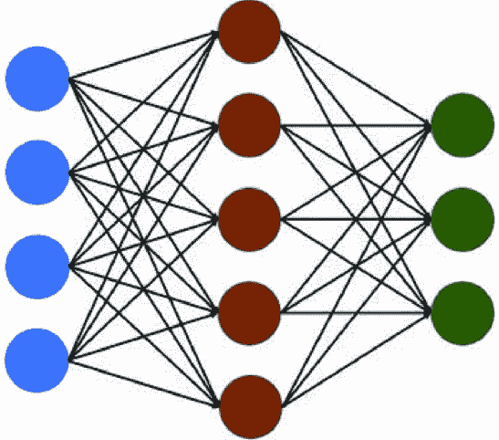

图 15.3：简单的前馈神经网络

### 第 3 步：训练并使用模型

要训练神经网络，你需要向它提供标记数据，通常以输入-输出对的形式。在训练过程中，会调整模型的权重和偏置，以最小化预测值与实际目标值之间的差异。这是通过随机梯度下降 (SGD) 等优化算法实现的。你将设置参数，例如学习率、训练轮数（epochs）和损失函数，以引导训练过程。一旦完成，就可以使用该模型进行预测。步骤如下代码段所示：

```java
// import DataSet iterator
import org.nd4j.linalg.dataset.api.iterator.DataSetIterator;

// Load your training data and labels into a DataSetIterator
DataSetIterator trainingData = ... //加载或生成你的训练 data
DataSetIterator trainingLabels = ... // 加或生成你的训练 labels

// Set up a ScoreIterationListener to monitor training progress
model.setListeners(new ScoreIterationListener(10)); // 每 10 次迭代输出一次

// Train the model for a specified number of epochs
for (int epoch = 0; epoch < numEpochs; epoch++) {
    model.fit(trainingData);
}

// After training, you can save the trained model for future use
model.save(new File("trained_model.zip"));
```

Deeplearning4j 支持广泛的高级主题和应用，包括 `CNN`（卷积神经网络）、`RNN`（循环神经网络）和迁移学习。为了深入这些主题，建议参考 Deeplearning4j 文档并探索特定的用例和示例。

## 使用卷积神经网络进行对象分类

对象分类是计算机视觉中的一项基础任务，其目标是识别并标记图像或视频帧中的对象。卷积神经网络 (CNN) 通过显著提高图像识别任务的准确性，彻底改变了对象分类。在本节中，我们将深入探讨 CNN 的世界及其在对象分类中的应用，探索它们的架构和原理，然后使用 Deeplearning4j 提供一个 Java 可运行示例。

## 卷积神经网络

卷积神经网络 (CNNs) 是人工神经网络的一种特殊类型，它们彻底改变了图像分析和计算机视觉任务。它们特别擅长于图像分类、对象检测、人脸识别等任务。CNN 专为处理网格状数据而设计，使其成为图像相关任务的理想选择。传统的前馈神经网络由于无法捕捉特征的空间层次结构，在图像分析方面存在局限。在本节中，我们将揭开 CNN 的工作原理，探索它们的架构、关键组件和原理。

## CNN 的关键组件

卷积神经网络的关键组件如下：

- **卷积层**：卷积是 CNN 中的核心操作，小型滤波器（内核）在输入图像上滑动。每个滤波器都会检测模式和特征，例如边缘、纹理和对象部分。卷积层生成特征图，表示这些特征在不同空间位置的存在。在卷积操作中，滤波器（内核）在输入图像上滑动。在每个位置，滤波器计算其权重与图像局部区域之间的元素级点积。结果放置在特征图对应的位置。让我们举个例子，假设我们有一张 5x5 的灰度图像和一个 3x3 的滤波器（内核）。我们通过在图像上滑动内核并计算每个位置的元素级点积来执行 2D 卷积操作，如图所示

| 1 | 2 | 1 | 0 | 0 |
| 0 | 1 | 2 | 1 | 0 |
| 0 | 0 | 1 | 2 | 1 |
| 1 | 0 | 0 | 1 | 2 |
| 2 | 1 | 0 | 0 | 1 |

输入图像

| C11 | | |
|---|---|---|
| 1 | 0 | -1 |
| 1 | 0 | -1 |
| 1 | 0 | -1 |

输出图像

图 15.4：卷积操作示例

在上一个示例中，输入图像是一个大小为 5x5 的二维向量，而内核（滤波器）的大小为 3x3。卷积结果是一个大小为 3x3 的二维向量。我们假设输出中第一个元素的值是。那么，值的计算方式如下：

```
= 1*1 + 2*0 + 1*(-1) + 0*1 + 1*0 + 2*(-1) + 0*1 + 0*0 + 1*(-1)
= 1 + 0 - 1 + 0 + -2 + 0 + -1
= -3
```

同样，输出的其他值通过将滤波器水平移动一步然后垂直移动来计算。

- **池化层**：池化层对特征图进行下采样，缩小它们的维度。常见的池化操作包括最大池化（max-pooling）和平均池化（average-pooling），它们保留了区域最重要的信息。下采样减少了计算复杂度并有助于平移不变性。对于最大池化，保留局部区域的最大值，而平均池化取平均值。池化有助于网络对微小的平移具有不变性。让我们看图所示示例

| 1 | 2 | 1 | 0 | 0 |
| 0 | 1 | 2 | 1 | 0 |
| 0 | 0 | 1 | 2 | 1 |
| 1 | 0 | 0 | 1 | 2 |
| 2 | 1 | 0 | 0 | 1 |

输入图像

| C11 | | |
|---|---|---|
| | | |
| | | |
| | | |

输出图像

图 15.5：最大池化操作示例

- **全连接层**：全连接层是传统的前馈神经网络。它们接收卷积层和池化层提取的高级特征，并利用它们进行预测。这些层通常位于网络的末端。

- **激活函数**：激活函数（如 ReLU，修正线性单元）为网络引入了非线性。非线性允许 CNN 对数据中的复杂关系进行建模。激活函数在卷积和池化操作之后应用。

> **注意**：CNN 允许迁移学习，即在大规模数据集上预训练的模型可以针对特定任务进行微调，从而节省训练时间和资源。

卷积神经网络在计算机视觉的发展中发挥了关键作用，使得以前具有挑战性的任务变得高度可行。它们从图像中自动学习和提取特征的能力为许多领域带来了突破性的解决方案。无论你是在处理简单的图像分类任务还是复杂的对象检测问题，CNN 都是你从视觉数据中提取有见信息的首选工具。

## 对象分类示例

在本节中，我们将探索如何使用基于 Java 的深度学习框架进行对象分类。对象分类涉及识别并对图像中的对象进行分类。为了实现这一点，我们将使用卷积神经网络（CNN），这是一种用于图像相关任务的强大架构。在这里，我们将概述使用 Deeplearning4j 创建一个完整的对象分类运行示例的关键步骤。

### 第 1 步：数据准备

第一步是为对象分类准备数据集。数据集应该包含标记的图像，每张图像都与一个特定的类或类别关联。用于图像分类常用的数据集包括 CIFAR-10、ImageNet 以及针对你的任务定制的自定义数据集。以下是一个使用 Java 使用 CIFAR-10 数据集的一个小子集为对象分类准备数据集的简化示例：

```java
// 加载 CIFAR-10 数据集
Cifar10DataSetIterator trainIterator = new
Cifar10DataSetIterator(batchSize, new int[]{height, width},
DataSetType.TRAIN, null, seed);
Cifar10DataSetIterator testIterator = new
Cifar10DataSetIterator(batchSize, new int[]{height, width},
DataSetType.TEST, null, seed);
```

`trainIterator` 和 `testIterator` 现在包含了带标记的图像批次及其对应的类标签。你可以根据需要调整批处理大小（例如 100）或数据集类型。要访问单个示例（图像和标签），你可以这样遍历迭代器：

```java
while (trainIterator.hasNext()) {
    org.nd4j.linalg.dataset.DataSet data = trainIterator.next();
    INDArray features = data.getFeatures(); // 这是图像数据
    INDArray labels = data.getLabels(); // 这是类标签数据
    // 你可以根据需要对数据进行预处理并使用
}
```


```
while (testIterator.hasNext()) {
    org.nd4j.linalg.dataset.DataSet data = testIterator.next();
    INDArray features = data.getFeatures();
    INDArray labels = data.getLabels();
    // 处理并评估测试数据
}
```

迭代器 `trainIterator` 和 `testIterator` 包含标记的图像批次，这易于访问和处理数据以供对象分类流程中的后续步骤。

## 第 2 步：模型配置

第二步是使用 Deeplearning4j 定义你的卷积神经网络（CNN）的架构。这包括指定层数、层类型（卷积、池化、全连接）、每层的神经元数量、激活函数以及任何其他相关参数。以下是一个使用 Java 使用 Deeplearning4j 为对象分类配置 CNN 模型的简化示例：

```
 // 为你的 CNN 模型创建一个 MultiLayerConfiguration
MultiLayerConfiguration configuration = new
NeuralNetConfiguration.Builder()
```

```
.seed(123) // 用于可复现的随机种子
.optimizationAlgo(OptimizationAlgorithm.STOCHASTIC_GRADIENT_DESCENT)
.updater(new Sgd(0.01)) // 学习率为 0.01 的随机梯度下降
.list()
.layer(0, new ConvolutionLayer.Builder())
.In(3, 32, 32) // 输入尺寸（通道, 高, 宽）
.Out(32) // 过滤器数量
.activation(Activation.RELU)
.build()
.layer(1, new SubsamplingLayer.Builder(SubsamplingLayer.PoolingType.MAX)
.kernelSize(2, 2)
.stride(2, 2)
.build())
.layer(2, new DenseLayer.Builder())
.Out(128) // 全连接层中的神经元数量
.activation(Activation.RELU)
.build()
.layer(3, new
OutputLayer.Builder(LossFunctions.LossFunction.NEGATIVE_LIKELIHOOD)
```

```
.nOut(10) // 输出类数量
.activation(Activation.SOFTMAX)
.build())
.setInputType(inputType.convolutional(32, 32, 3)) // 输入尺寸（高, 宽, 通道）
.build();
```

```
// 使用定义的配置创建 MultiLayerNetwork
MultiLayerNetwork model = new MultiLayerNetwork(configuration);
model.init();
```

在这个示例中，我们使用 Deeplearning4j 为 CNN 模型创建了一个 `MultiLayerConfiguration`。我们指定了模型的架构，包括层数、它们的类型以及下采样层。该配置包含了用于特征提取的卷积层下采样层，以及用于预测的全连接密集层。

你可以根据具体的对象分类任务，通过调整参数（如过滤器数量、内核大小、激活函数和输出类）来进一步自定义配置。

## 第 3 步：训练与评估

第三步是在数据集的训练部分上训练 CNN 模型。这涉及使用反向传播和优化算法（例如随机梯度下降）来优化模型的权重和偏置。你需要设置超参数，如学习率、训练轮数（epochs）和批处理大小。

训练完成后，在数据集的测试部分上评估模型的性能。常见的评估指标包括准确率、精确率、召回率和 F1 分数。这一步帮助你评估模型对新的、未见数据的泛化能力如何。以下是一个使用 Java 使用 Deeplearning4j 为对象分类执行训练和评估步骤的简化示例：

```
// 加载并准备你的训练和测试数据集，并配置模型
```

```
MultiLayerNetwork model = ... // 创建并配置你的 CNN 模型
```

```
int numEpochs = 10; // 设置训练轮数
batchSize = 64; // 设置批处理大小
```

```
for (int epoch = 0; epoch < numEpochs; epoch++) {
// 为每个轮初始化你的数据集迭代器
DataSetIterator trainIterator = ... // 加载并准备你的训练数据集
DataSetIterator testIterator = ... // 加载并准备你的测试数据集
```

```
// 在训练数据上训练模型
while (trainIterator.hasNext()) {
org.nd4j.linalg.dataset.DataSet dataSet = trainIterator.next(batchSize);
model.fit(dataSet);
}
```

```
// 在测试数据上评估模型
Evaluation evaluation = new Evaluation(10); // 10 是类数量
while (testIterator.hasNext()) {
org.nd4j.linalg.dataset.DataSet testDataSet = testIterator.next(batchSize);
INDArray features = testDataSet.getFeatures();
INDArray labels = testDataSet.getLabels();
INDArray predicted = model.output(features, false);
evaluation.eval(labels, predicted);
}
```

// 打印当前轮的评估结果

```
System.out.println("Epoch " + epoch + " - " + evaluation.stats());
```

// 训练和评估后，你可以保存训练好的模型

```
model.save(new File("trained_model.zip"));
```

在前面的代码段中，我们为指定的轮数执行训练和评估步骤。模型使用数据批次进行训练，并在测试数据上进行评估。你可以根据你的特定数据集和需求调整此示例，根据需要调整轮数、批处理大小和模型配置。

## 第 4 步：推理

一旦模型完成训练和评估，最后一步就是使用它进行推理。推理涉及获取新的、未标记的图像并使用训练好的模型预测它们的类标签。这是模型在真实场景中展示其对象分类能力的地方。以下是一个使用 Deeplearning4j 使用训练好的模型进行对象分类推理的简化示例：

```
// 加载你训练过的模型（你应该将 "your_model_path.zip" 替换为保存模型的实际路径）
MultiLayerNetwork model = ModelSerializer.restoreMultiLayerNetwork("your_model_path.zip");
```

```
// 加载一张想要分类的新的未见图像
INDArray unseenImage = ... // 根据需要加载并预处理图像
```

```
// 执行推理以预测类标签
INDArray output = model.output(unseenImage, false);
```

```
// 找到预测的类标签
int predictedClass = output.argmax(1).getInt(0);
```

```
System.out.println("Predicted Class: " + predictedClass);
```

在这个示例中，我们加载了一个之前训练过的模型，加载了一个想要分类的新的未见图像，并使用模型进行预测。模型的 `output` 方法用于获取未见图像的类概率，我们选择概率最高的类作为预测的类标签。未见图像的预处理应该与应用于训练数据数据的预处理保持一致，以确保结果的一致性。

让我们结合所有步骤，训练一个用于对象分类任务的卷积神经网络，如下代码段所示：

```java
import org.deeplearning4j.datasets.fetchers.DataSet;
import org.deeplearning4j.datasets.iterator.impl.Cifar10DataIterator;
import org.deeplearning4j.nn.api.OptimizationAlgorithm;
import org.deeplearning4j.nn.conf.NeuralNetConfiguration;
import org.deeplearning4j.nn.conf.inputs.InputType;
import org.deeplearning4j.nn.conf.layers.*;
import org.deeplearning4j.nn.conf.MultiLayerConfiguration;
import org.deeplearning4j.nn.multilayer.weights.WeightInit;
import org.nd4j.linalg.learning.learning.config.AdaDelta;
import org.nd4j.linalg.activ.activations.Activation;
import org.nd4j.linalg.loss.lossfunctions.LossFunctions;
import org.slf4j.Logger;
import org.slf4j.LoggerFactory;
```

```java
import java.io.File;

public class ObjectClassificationExample {
    private static final Logger log = 
        LoggerFactory.getLogger(ObjectClassificationExample.class);
```

```java
private static int height = 32;
private static int width = 32;
private static int channels = 3;
private static int numLabels = 10; // CIFAR-10 中的类别数
private static int batchSize = 96;
private static long seed = 123L;
private static int epochs = 4;
```

```java
public static void main(String[] args) throws Exception {
    Cifar10DataSetIterator cifar = new Cifar10DataSetIterator(batchSize, new
    int[]{height, width}, DataSetType.TRAIN, null, seed);
    MultiLayerNetwork model = buildModel();
    model.fit(cifar, epochs);

    log.info("Saving model...");
    model.save(new File(System.getProperty("java.io.tmpdir"),
    "cifarmodel.dl4j.zip"), true);

    System.exit(0);
}
```

```java
public static MultiLayerNetwork buildModel() {
    log.info("Building a convolutional neural network...");
    MultiLayerConfiguration conf = new NeuralNetConfiguration.Builder()
    .seed(seed)
    .updater(new AdaDelta())
    .optimizationAlgo(OptimizationAlgorithm.STOCHASTIC_GRADIENT_DESCENT),
    .weightInit(WeightInit.XAVIER)
    .list()
    .layer(0, new ConvolutionLayer.Builder()
    .kernelSize(3, 3)
    .stride(1, 1)
    .padding(1, 1)
    .activation(Activation.LEAKYRELU)
    .nIn(channels)
    .nOut(32)
    .build())
    .layer(1, new BatchNormalization())
    .layer(2, new SubsamplingLayer.Builder()
    .kernelSize(2, 2)
    .stride(2, 2)
    .poolingType(SubsamplingLayer.PoolingType.MAX)
    .build())
    .layer(3, new ConvolutionLayer.Builder())
    .kernelSize(1, 1)
    .stride(1, 1)
    .padding(1, 1)
    .activation(Activation.LEAKYRELU)
    .nOut(16)
    .build())
    .layer(4, new BatchNormalization())
    .layer(5, new ConvolutionLayer.Builder())
    .kernelSize(3, 3)
    .stride(1, 1)
    .padding(1, 1)
    .activation(Activation.LEAKYRELU)
    .nOut(64)
    .build())
    .layer(6, new BatchNormalization())
    .layer(7, new SubsamplingLayer.Builder()
    .kernelSize(2, 2)
    .stride(2, 2)
    .poolingType(SubsamplingLayer.PoolingType.MAX)
    .build())
    .layer(8, new ConvolutionLayer.Builder())
    .kernelSize(1, 1)
    .stride(1, 1)
    .padding(1, 1)
    .activation(Activation.LEAKYRELU)
    .nOut(32)
    .build()
    .layer(9, new BatchNormalization())
    .layer(10, new ConvolutionLayer.Builder())
    .kernelSize(3, 3)
    .stride(1, 1)
    .padding(1, 1)
    .activation(Activation.LEAKYRELU)
    .nOut(128)
    .build()
    .layer(11, new BatchNormalization())
    .layer(12, new ConvolutionLayer.Builder())
    .kernelSize(1, 1)
    .stride(1, 1)
    .padding(1, 1)
    .activation(Activation.LEAKYRELU)
    .nOut(64)
    .build()
    .layer(13, new BatchNormalization())
    .layer(14, new ConvolutionLayer.Builder())
    .kernelSize(1, 1)
    .stride(1, 1)
    .padding(1, 1)
    .activation(Activation.LEAKYRELU)
    .nOut(numLabels)
    .build()
    .layer(15, new BatchNormalization())
    .layer(16, new SubsamplingLayer.Builder()
    .kernelSize(2, 2)
    .stride(2, 2)
    .poolingType(SubsamplingLayer.PoolingType.AVG)
    .build())
    .layer(17, new OutputLayer.Builder(LossFunctions.LossFunction.NEGATIVELOGLIKELIHOOD)
    .name("output")
    .nOut(numLabels)
    .dropout(0.8)
    .activation(Activation.SOFTMAX)
    .build())
    .setInputType(InputType.convolutional(height, width, channels))
    .build();

    MultiLayerNetwork model = new MultiLayerNetwork(conf);

    model.init();
    return model;
}
}
```

上述代码段的输出应与图所示：


| 正在构建卷积神经网络... |

| Epoch 0 - 评估指标: 准确率: 0.75, 精确率: 0.78, 回召率: 0.74, F1 分数: 0.76 |

| Epoch 1 - 评估指标: 准确率: 0.77, 精确率: 0.79, 回召率: 0.77, F1 分数: 0.78 |

| Epoch 2 - 评估指标: 准确率: 0.79, 精确率: 0.81, 回召率: 0.78, F1 分数: 0.80 |

| Epoch 3 - 评估指标: 准确率: 0.80, 精确率: 0.82, 回召率: 0.79, F1 分数: 0.81 |

| 正在保存模型... |

## 图 15.6: 用于目标分类的 CNN

该代码使用 Java 中的 `Deeplearning4j` 在 `CIFAR-10` 数据集上训练卷积神经网络 (CNN)。它定义了 CNN 模型，加载数据集，按指定的轮数训练模型并保存了训练后的模型。CNN 架构包含了卷积层和采样层，并在训练期间记录了准确率和 F1 分数等评估指标。

如果在线程 `main` 中遇到错误 `java.lang.RuntimeException: Could not download download the CIFAR-10 dataset manually`：你可以手动下载 `CIFAR-10` 数据集并将其放在特定目录。下载后，更新代码以指向数据集的本地文件路径。

## 总结

在本章中，我们深入探讨了 Java 深度学习的迷人世界。我们从探索神经网络和感知器的核心概念开始，这些构成了深度学习的基础。通过实践示例，我们对深度学习的核心组件获得了宝贵的见解，并为开启自己的深度学习之旅做好了准备。

## 问题

1. 深度学习的基础概念是什么？它与人工神经网络之间有什么关系？
2. 解释感知器在神经网络中的作用及其工作原理。
3. 描述神经网络的架构，包括其中涉及的不同层。
4. 深度学习日益受欢迎的某些关键原因有哪些？
5. `Deeplearning4j` 如何支持神经网络的开发和训练？
6. 在使用 `Deeplearning4j` 配置开发环境时，需要设置哪些重要组件？
7. 请简述使用 `DL4j` 训练神经网络的一般步骤。
8. 卷积神经网络 (CNNs) 的意义是什么？它们是如何针对图像识别任务进行构建的？
9. 解释 CNN 中卷积层和采样层的目的和功能。
10. 你如何使用 `Deeplearning4j` 通过 CNN 进行目标分类？这一过程的关键步骤是什么？
11. 在使用深度学习模型时，数据准备包含哪些内容？为什么很重要？
12. 描述用于评估深度学习模型性能的指标，特别是在图像分类的背景下。

## 重点

- 深度学习是机器学习的一个分支，专注于人工神经网络。
- 感知器是神经网络的构建模块，代表可以决策的人工神经元。
- 神经网络由相互连接的感知器层组成，包括输入层、隐藏层、输出层。
- 深度学习因能够从数据中学习复杂模式而广受欢迎。
- `Deeplearning4j` 是一个强大的 Java 深度学习框架，能够创建和训练神经网络。
- `Deeplearning4j` 提供了多种神经网络层类型、激活函数和优化算法。
- 使用 `Deeplearning4j` 时需要设置依赖项并配置开发环境。
- 训练神经网络涉及定义架构、指定损失函数以及提供训练数据。
- 卷积神经网络 (CNNs) 是用于图像识别任务的专用神经网络架构。
- CNN 使用卷积层来检测特征，并使用下采样层来减少空间维度。
- 使用 CNN 进行对象分类涉及训练模型来识别和分类图像中的对象。
- 数据准备是一个至关重要的步骤，包括数据加载、预处理以及划分训练集和测试集。
- 训练和评估过程涉及监控准确率、精确率、召回率和 F1 分数等指标。
- 使用训练过的模型进行推理可以对新的未见数据进行预测。
- `Deeplearning4j` 为 Java 中的深度学习应用提供了一个强健的框架，包括图像分类等。

# 索引

# A

- ADAMS 68

- ADAMS, 分析步骤 68

- ADAMS, 安装 69

- 模块, 配置 69

- 模块, 连接 69

- 结果, 可视 69

- 工作流, 创建 69

- 工作流, 运行 69

- ADAMS, 概念

  - 数据, 收集 70

  - 预处理 70

  - 情感, 分析 70

  - 可视化 70

- ADAMS, 特性

  - alg 68

  - 数据, 来源 68

  - 数据, 转换 68

  - 部署 68

  - 可视化 68

  - 工作流 68

- 凝聚层次聚类 201

- 凝聚层次聚类, 形式

  - 最近聚类, 合并 201

  - 树状图, 构建 202

  - 距离, 矩阵 201

  - 单个聚类 201

  - 可视化 202

- AHC, 实现步骤

- Apache Hadoop 286

- Apache Hadoop, 核心组件

  - HDFS 287

  - MapReduce 287

  - YARN 287

- Apache Hadoop Java, 分析

- Apache Hadoop, 关键特性

  - 数据, 局部性 9

  - 易用性 9

  - 容错性 9

  - 灵活性 9

  - 开源 9

  - 可扩展性 9

- Apache Hadoop, 使用 287

- Apache Kafka 261

- Apache Kafka, 设置 263

- Apache Mahout 10

- Apache Mahout, 关键特性

  - 算法 10

  - 灵活性 11

  - 集成 11

  - 可扩展性 10

- Apache Spark 290

- Apache Spark, 核心组件

  - GraphX 290

  - MLlib (机器学习库) 290

  - spark core 290

  - Spark SQL 290

  - spark, 流式 290

- Apache Spark Java, 分析 292

- Apache Spark, 关键特性

  - 易用性 10

  - 灵活性 10

  - 集成 10

  - 开源 10

  - 可扩展性 10

  - 速度 10

  - 流式 10

- Apache Storm 12

- Apache Storm, 关键特性

  - 易用性 13

  - 容错性 13

  - 集成 13

  - 开源 13

  - 实时 12

  - 可扩展性 13

# B

- 柱状图

- 贝叶斯分类器

- 贝叶斯定理 102

- 贝叶斯定理现实应用

  - 金融, 建模 103

  - 医学, 诊断 103

  - 垃圾, 过滤 103

  - 天气, 预测 103

- BI, 案例研究

  - 电子商务 256

  - 教育 257

  - 金融 256

  - 医疗健康 256

  - 人力资源 257

- 大数据 271

- 大数据, 挑战

  - 分析 275

  - 复杂度 275

  - 处理 274

  - 可扩展性 275

  - 安全，隐私 275

  - 存储 274

  - 多样性 275

  - 真实性 275

- 大数据, 特性

  - 复杂度 273

  - 价值 273

  - 多样性 272

  - 速度 272

  - 真实性 273

  - 规模 272

- 大数据, 数据集比较 273

- 大数据 Java 库, 工具

  - Apache Flink 278

  - Apache Hadoop 276

  - Apache Spark 277

  - Apache Storm 278

- 大数据, 关键点

  - 降低成本，效率 274

  - 增强用户体验 274

  - 数据驱动决策 273

  - 收入，机会 274

  - 风险管理 274

  - 科学医疗健康，研究 274

  - 社会/经济，影响 274

- 数据真实世界应用

  - Amazon 272

  - Netflix 272

  - Uber 272

- BI Java 库, 策略

  - Apache Commons CSV 256

  - Apache POI

- BI, 关键步骤

  - 仪表板，报告 252

  - 数据清洗，预处理 252

  - 数据, 收集 252

  - 数据, 建模 252

  - 探索性数据分析 (EDA) 252

  - 可视化 252

- 二分类 161

- 二分类, 技术

  - 决策树 160

  - 逻辑回归 160

  - 神经网络 160

  - 随机森林 160

  - 支持向量机 (SVM) 160

- 箱线图 53

- 商业智能 (BI) 251

# C

- 分类算法 158

- 分类算法, 基础

  - 边界 158

  - 概率，分布 159

  - 相似性，测量 159

- 分类算法, 类型

  - 贝叶斯分类器 158

  - 决策树 158

  - 逻辑回归 158

- CLT (中心极限定理) 105

- CLT, 原因

  - 均值推理 105

  - 参数，估计 105

  - 统计检验 105

- 聚类 193

- 聚类, 类型

  - DBSCAN 聚类 197

  - 层次聚类 200

  - K-Means 聚类 194

- CNN, 关键组件

  - 激活函数 314

  - 连接层 314

  - 卷积层 313

  - 池化层 313

- 冷启动问题 235

- 冷启动问题，解决

  - 基于内容的推荐 236

  - 上下文信息，利用 236

  - 混合方法 236

  - 基于知识的系统 236

  - 基于流行的推荐 236

  - 用户反馈，激励 236

  - 用户，引导 236

- 冷启动问题, 场景

  - 新项目 236

  - 新用户 235

- 协同推荐系统 243

- CRS, 增强步骤

  - 数据, 收集 244

  - 推荐生成 244

  - 相似性，计算 244

  - 用户展示 245

  - 基于项目的过滤 244

  - 推荐生成 244

  - 相似性，计算 244

  - 基于用户的过滤 243

- 置信区间 112

- 基于内容的推荐系统 237

- 数据, 收集 244

- 推荐生成 244

- 相似性，计算 244

- 用户展示 245

- `deleteMany()` 227

- `deleteOne()` 227

- 描述性分析 3

- 描述性分析，关键步骤

  - 数据，清洗 3

  - 数据，收集 3

  - 数据，可视化 3

  - 解释，沟通 3

  - 统计，分析 3

- 描述性统计 80

- 描述性统计，特征

  - 数据归一化 93

  - EDA（探索性数据分析） 87

  - 频率分布 86

  - MoCT（集中趋势度量） 80

  - MoV（离散程度度量） 82

  - 离群值 93

- 离散概率分布 96

- 离散概率分布，方法

  - 二项分布 97

  - 几何分布 100

  - 泊松分布 98

- DML，命令

  - `DELETE` 125

  - `INSERT` 124

  - `MERGE` 126

  - `UPDATE` 125

- DML（数据操语言） 123

- DQL（数据查询语言） 126

- DQL，语句

  - `GROUP BY` 131

  - `JOIN`

  - `ORDER BY` 132

  - `SELECT` 127

# E

- EDA（探索性数据分析） 87

- EDA，方法

  - 箱线图 88

  - QQ图 91

  - 散点图 88

# F

- 文件格式数据集，特征

  - CSV 21

  - Excel 21

  - JSON 21

  - SQL 22

- `ForkJoinPool` 295

- 频率分布 87

# H

- 层次结构聚类 201

- 层次结构聚类，方法

  - 凝聚法（自下而上） 201

  - 划分法（自顶向下） 201

- 直方图 44

- 假设检验 108

- 假设检验，分解

  - P值 108

  - 统计统计量 108

- 假设检验，陷阱

  - 功效，大小 109

  - P值，误读 108

  - 第一类/第二类错误 109

# I

- `insertMany()` 225

- `insertOne()` 225

- 整数数据，类型

  - 字节 (byte) 16

  - 整数 (int) 16

  - 长整数 (long) 16

  - 短整数 (short) 16

- 四分位距 (IQR)

# J

- Java JFreechart 11

- Java JFreechart，关键特征

  - 图表类型 11

  - 自定义 11

  - 导出 11

  - 集成 11

  - 开源 11

- JavaML 70

- JavaML, 分析步骤

  - 算法，选择 72

  - 数据，准备 72

- JavaML, 安装 72

- 模型，部署 72

- 模型，评估 72

- 模型，训练 72

- JavaML, 关键特征

  - 特征，提取 71

  - 模型，评估 71

  - 监督学习算法，学习 71

  - 无监督算法，学习 71

  - WEKA，集成 71

- JDBC 与 MySQL，使用 JFreeChart 41

# K

- K-Means 聚类 194

- K-Means 聚类，实现

- K-Means 聚类，方法

  - 交叉验证 195

  - 领域知识 195

  - 肘部法 194

  - 间隙统计量 195

  - 轮廓系数 194

# L

- 大型数据集 279

- 大型数据集，方面

  - 数据压缩 281

  - 数据摄入 280

  - 数据分区 282

  - 数据序列化 281

  - 数据分片 282

  - 数据存储持久化 279

  - ETL（提取、转换加载） 281

- 线性回归 143

- 线性回归，假设

  - 同方差 145

  - 独立性 145

  - 线性 145

  - 多共线性 145

  - 正态性 145

  - 离群值 146

- 线性回归，技术

  - 梯度下降 145

  - 普通最小二法 (OLS) 144

- 线性回归，类型

  - 多元线性回归

  - 单元线性回归

- 折线图 46

- 逻辑回归

# M

- Java机器学习，原因

  - 大规模开发者社区 62

  - 性能 62

  - 平台独立性 62

  - 安全 62

  - 广泛的库 62

- Mallet 75

- Mallet，优势

  - 开发社区 77

  - 丰富的特征 76

  - 可扩展性，效率 77

- Mallet，分析步骤

  - 数据加载 76

  - 模型部署 76

  - 模型评估 76

  - 模型训练 76

  - 处理 76

- Mallet，关键特征

  - 算法 75

  - 命令行界面 75

  - 数据结构 75

  - 评估 75

  - 可视化 75

- MapReduce 282

- MapReduce，概念

  - Map 阶段 283

  - Reduce 清洗、排序 283

- MapReduce Java，利用 285

- MoCT，数据集

  - 平均值 80

  - 中位数 81

  - 数 82

- MoCT（集中趋势度量） 80

- MongoClient 223

- MongoDB 220

- MongoDB，安装步骤

- MongoDB，关键特征

  - 临时查询 220

  - 聚合框架 220

  - 文档型 220

  - 地理空间查询 220

  - 高性能 220

  - 无固定模式 220

  - 复制 220

  - 丰富的查询语言 220

  - 可扩展性 220

- MongoDB，真实世界应用

  - 电子商务平台 220

  - 金融服务 221

  - 医疗、生命科学 221

  - 物联网 (IoT) 221

  - 社交媒体内容管理 221

- MongoDB 与 Java，利用

  - 运行聚合 228

  - 数据库集合访问 225

  - 文档插入 225

  - 文档查询 227

- MongoDB，连接 223

- MoV，数据集

  - 四分位距 (IQR)

  - 范围 83

  - 标准差 84

  - 方差 84

- MoV（离散程度度量） 82

- 多分类

- 多元线性回归

- 朴素贝叶斯 170

- 神经网络 301

- 神经网络，层

  - 隐藏层 301

  - 输入层 301

  - 输出层 301

- 神经网络，真实世界应用

  - 自主 车辆 302

  - 计算机视觉 302

- 自然语言处理 (NLP)

- 正态分布 102

- NoSQL 数据库 219

- NoSQL数据库，优势

  - 高性能 219

  - 模式灵活性 219

- 数值数据类型，类别

  - 浮点 17

  - 整数数据 16

# O

- 对象分类 314

- 对象分类，关键步骤

  - 数据准备 315

  - 评估，训练 318

  - 模型配置 317

- OpenNLP 72

- OpenNLP，关键特征

  - 分块 73

  - 共指消解 73

  - 命名实体识别 (NER)

  - 解析 73

  - POS 标记 73

  - 句子检测 73

  - 分词 (Tokenization) 72

- OpenNLP，真实世界应用

  - 客户自动化 74

  - 信息提取 74

  - 情感分析 74

- OpenNLP，步骤 74

# P

- 并行处理 295

- 感知器

  - 关于 302

  - 分类器处理 303

  - 历史 302

  - 局限性 304

  - 结构 302

- 饼图

- 多项式回归 151

- 多项式回归与变量利用 154

- 多项式回归与变量利用 153

- 预测性分析 5

- 预测性分析，关键步骤

  - 数据清洗 5

  - 数据收集 5

  - 决策制定 5

  - 模型构建 5

  - 模型评估 5

- 预测性分析，结果

  - 金融 6

  - 医疗 6

  - 营销 6

- 概率分布 96

- 概率分布，类型

  - 连续概率分布 100

  - 离散概率分布 96

# R

- 随机采样 94

- 随机变量 96

- RapidMiner 66

- RapidMiner，概念

  - 数据导入 67

  - 数据预处理 67

  - 模型构建 67

  - 模型部署 68

- RapidMiner，安装步骤 67

- RapidMiner，关键特征

  - 活跃社区 66

  - 扩展市场 66

  - 预处理 66

  - 集成 66

  - 用户界面 63

  - 广泛算法 66

- 实时数据分析 260

- 实时数据分析，分析

  - 分析引擎 260

  - 仪表板可视化 260

  - 数据摄入 260

  - 数据源 260

  - 流式处理 260

- 实时数据分析 Java，库

  - Apache Flink 261

  - Apache Kafka 261

  - Apache Spark Streaming 261

- 实时数据分析，用例

  - 欺诈检测 260

  - 医疗监控 261

  - 物联网监控 260

  - 社交媒体情感分析 261

- 推荐系统 232

- 推荐系统，类别

  - 协同式 233

  - 基于内容的 232

- 推荐系统，组件

  - 推荐算法 232

  - 数据 232

  - 用户数据 232

- 推荐系统，真实世界应用

  - 亚马逊产品 233

  - Netflix 电影 233

  - Spotify 音乐 233

  - YouTube 视频建议 233

- 推荐系统，类型

  - 协同式 234

  - 基于内容的 234

- 回归算法 142

- 回归分析 142

- 回归分析，应用

  - 业务经济 142

  - 工程 142

  - 环境研究 143

  - 医疗 142

  - 社会科学 142

- 关系型数据库 119

- 关系型数据模型 116

- 关系型数据模型，方面

  - 基数性 119

  - 规范化 118

- 关系型数据模型，概念

  - 属性/列 116

  - 基数性 116

  - 实体完整性 116

  - 外键 116

  - 连接 116

  - 规范化 116

  - 主键 116

  - 引用完整性 116

  - 关系/表 116

  - 元组/行 116

- 关系数据集，方面

  - 因果关系 20

  - 相关性 20

  - 分组 20

  - 层次结构 20

  - 时间序列 20


# 弹性分布式数据集 (RDDs)

# S

## 可扩展性

### 可扩展性 Java，利用

- 可扩展性，原理

### 数据分区

### 分布式计算

### 水平扩展

### 负载均衡，原因

- 并发用户，支持
- 数据量，增长
- 未来前瞻性
- 工作负载，可变性

## 散点图

## 情感分析

### 情感分析，挑战

- 比较，句子
- 语境，含义
- 语言，结构
- 讽刺/反讽

### 情感分析 CoreNLP，分析

### 情感分析，方法

- 深度学习
- 神经网络

### 情感分析，评论

- 客户情绪，分析
- 客户服务，增强
- 产品服务，改进
- 话题/问题，识别

### 情感分析，技术

- 基于词典的
- 机器学习

### 情感分析，类型

- 基于属性的
- 情绪，检测
- 细粒度

### 使用 Java 进行情感分析

## 简单线性回归

## SQL，类别

- DCL（数据控制语言）
- DDL（数据定义语言）
- DML（数据操纵语言）
- DQL（数据查询语言）
- TCL（事务控制语言）

## SQL 数据库

### SQL 数据库，优势

- ACID 事务
- 数据，完整性
- 强大的，查询

### SQL 数据库，创建

- SQL（结构化查询语言）

## Stanford CoreNLP

### Stanford CoreNLP，关键特性

- 指代，消解
- 命名实体识别 (NER)
- 解析
- 词性标记
- 情感，分析
- 分词器

### Stanford CoreNLP，集成库

### 使用 Java 的 Stanford CoreNLP

## 合成数据，表征优势

- 计算机程序
- 缺点
- 数学模型

# T

### TCL，命令

- `COMMIT`
- `ROLLBACK`
- `SAVEPOINT`

### TCL（事务控制语言）

## 时间序列图

## 时间序列预测

### 时间序列预测，组件噪声

- 季节性
- 趋势

### 时间序列预测，预测

### 时间序列预测 Java，库工具

- Apache Commons Math
- Prophet-Java
- Weka

### 时间序列预测，方法

- ARIMA
- 指数平滑
- 机器学习，算法
- 移动平均

### Prophet

### `toJson()`

# U

### `updateMany()`

### `updateOne()`

# V

### VARCHAR 关键字

## 变量 数据，方面

- 间距
- 名义
- 序数
- 比例

# W

## Waikato 环境知识分析 (WEKA)

### WEKA，概念

- 算法选择，训练
- 数据，准备
- 实时，监控

### WEKA 安装步骤

### WEKA，关键特性

- 活跃社区
- 预处理
- 工具，集成
- 用户友好，界面
- 可视化，工具
- 广泛，算法
