# Ultimate Selenium WebDriver 测试自动化指南：使用 Java、Selenium WebDriver 和 Selenium Grid 为电子商务、医疗、教育科技、银行和 SAAS 构建自动化 Web 测试框架（英文版）


# 献给

*我的两个家庭：*

*父母（已故 VijayLaxmi Gupta 女士、Rakesh Kumar Gupta 先生）、妻子（Sneha Singh）、女儿（Natasha Gupta）以及兄弟姐妹的家庭*

*Selenium 开源社区*

# 前言

在某些方面，你可以将编写代码视为一种协作艺术。就像没有两个人在被要求描述日出时会说相同的话一样，即使目标相同，这些同样的人也会以不同的方式编写代码。将我们想要做的事情的描述转换为代码是一个创造性的过程。虽然我们可能作为爱好自己编写代码，但在专业环境中，我们是团队工作，团队中的每个人都负责其所擅长的应用织锦中的某部分。这个过程不仅是艺术性的，而且是协作性的。

“如果你唯一的工具是锤子，那么一切看起来都像是一个钉子”这种表达在软件开发领域被频繁使用。这是因为，正如任何艺术创作一样，要熟练地开发稳定的软件，人们需要学习使用的工具以及可以应用的技术。仅仅知道如何使用工具是不够的，我们还需要知道*何时*使用它。所以，软件开发不仅是一项协作的艺术创作，而且是我们需要了解工具和技术以高效工作的工作。

但存在一个问题。我们如何学习新工具或新技术？我们如何开始理解何时以及何地使用它？毕竟，我们编写软件已经很久了，所以一定有大量的工具和技术可以借鉴。

让我们以编写 Web 应用领域为例。Tim Berners-Lee 在 1990 年 12 月在欧洲核子研究中心（CERN）工作时发布了第一个网站。最初，网页是静态且简单的。当 Netscape 向世界引入 Javascript 时，这些简单的静态页面变得稍微有趣了。当微软引入 XmlHTTPRequest 时，页面可以在不需要重新加载的情况下从 Web 服务器请求信息。1999 年，Darci DiNucci 向世界引入了“Web 2.0”这一术语，但它直到 2000 年初才成为一个广为人知的术语。

在 2000 年初，我们看到了 Web 上创造力的爆发。网站突然从相对静态变得极其动态。驱动 Web 2.0 的技术让像 Google Maps 这样的网站得以存在。这种力的爆发持续到今天，网站变得越来越复杂、动态且功能强大。

随着 Web 的增长，工具也之增长。

2004 年，Jason Huggins 启动了 Selenium 项目。2011 年，我们发布了 Selenium 2，Selenium 3 则于 2016 年继推出。最近，Selenium 4 于 2021 年发布，这距离世界接触 WebDriver APIs 已经整整十年。在这些多年里，该工具不断成长并适应周围不断变化的世界，社区积累了丰富的知识和经验，不仅关于 Selenium，还关于如何使用它以及如何充分利用它。

这引我想到了这本书。

你手里拿着一本表面上是关于 Selenium 的书。但它的内容远于此。你看，在书中，Robin 带领我们经历了一段从新手到测试大师的旅程，不仅向我们介绍了 Selenium 这个工具，还向我们介绍了可以使用它的背景环境。这本书提供了许多团队在使用 Selenium（特别是 Java 绑定）时采用的许多当前“最佳实践”的精炼。这些实践经过了多年的演变，并已被证明是有效的。

正如画笔在有画布和颜料时才有用，Selenium 在配合测试框架、设计模式和日志记录时才有用。在这个比喻中，Robin 是艺术老师，他从入门开始，通过 IDE 介绍 Selenium，然后逐章深入。在每一步中都提供了支持的信息和概念。

因此，即使这本书是关于 Selenium 测试自动化的，当你读完后，你将熟悉各种测试、通用测试、设计模式以及可以与 Selenium 使用的其他工具和框架。

当你读完后，你将能够更好地参与到我们被称为软件开发的奇妙协作艺术项目中，而这是一件很棒的事情。

*Simon Mavi Stewart*

*WebDriver 的创建者*

*2009-2021 年 Selenium 项目负责人*

*WebDriver 和 WebDriver Bidi W3C 共同编辑*

*伦敦，2024 年 1 月*

# 关于作者

**Robin 是一位多才的工程负责人，在初创公司、规模化企业和大型企业拥有 15 年以上的软件交付经验。通过数据驱动的方法，他提升了开发/测试/DevOps 团队的工程成熟度，涵盖了金融服务、教育技术、零售和开发者体验等多个领域。Robin 精通多种技术栈，其实战型的领导风格取得了成效。在工作之余，他在 ADPList 和 Plato 担任导师，贡献了 Selenium 等开源项目，创建了 TestZeus（唯一针对 Salesforce 的开源测试自动化框架），并编写了课程。他还是 Dreamforce（由 Salesforce 主）和 Selenium Conference 等国际会议的演讲者。在平衡家里父亲的责任和办公室经理的经理（M.O.M.）的角色时，Robin 在个人和职业领域都表现出色。**

欲了解更多信息，请访问 **[www.robin-gupta.com](http://www.robin-gupta.com)**。

# 关于技术评审员

`Shreya Singh Patel` 在自动化领域已经深耕了近十年，她像技术架构师构筑防御 Bug 的堡垒一样，使用 `Selenium` 和 `Java` 构建了坚不可摧的测试框架。但她的技能远不止于此！她还致力于 API 自动化、移动自动化、数据库以及负载测试。她掌握的每项技术都为她不断扩展的技能树增添了又充满活力的线条。

她在 IT 行业工作了 7 多年，参与了多个自动化项目，也见证了各行业对自动化需求的增长，而不仅仅是 IT 行业。

但她不仅仅是为了征服 Bug，更是为了他人指明方向。目睹她指导的手工测试员蜕变为自动化英雄时那种“恍然大悟”的，比解决任何超级 Bug 都能激发她的激情。目前，她正在指导同事，引导他们学习代码和框架，直到他们创造出自己的自动化胜利。

她积极担任初创公司 `Internity Foundation` 夏季和冬季实习的实习运营负责人。她对导师工作的热情在指导实习生时闪放异芒，通过分享知识并赋予他们在充满兴奋的自动化世界中开创职业生涯的能力。

这就是为什么这次书评机会感觉就像是命中注定。这是她分享来之不易的知识的机会，作为一个友好的翻译者，为渴望学习的初学者翻译有时令人困惑的 `Selenium` 世界。想象她像一座桥梁，将复杂的代码与充满好奇的心灵连接起来，并授权他们开启自己的测试之旅。

# 致谢

首先，我想向 `Orange AVA` 团队表示感谢。没有他们的帮助和支持，这本书的出版就不可能实现。我也想感谢 `Shreya Singh Patel`，她负责技术评审，而且矛盾的是，她还担任了本关于测试自动化书籍的测试员。

`Andrew Knight`（被热情地称为“自动化熊猫”）和 `Ivan Harris`（`Provar` 的 CPTO）耐心地回答了我关于写书的问题——感谢你们，各位。特别感谢 `Tristan Lombard`（又名 Stage Mom）在写作过程中保持我不偏离轨道，并引导我去做正确的事，而不是容易的事。

这本书的章节中都隐藏着许多宝藏，形式为行业领袖和开源贡献者的引言。感谢这些杰人士分享了这些智慧之珠。

非常感谢 `Simon Stewart`（`WebDriver` 的创建者）为本书撰写序言，为像我这样的工程师指明了道路。

2023 年对我来说是艰难的一年，因此我想感谢我的妻子在写作旅程的每一个阶段给予我的支持。

# 前言

从前，在一个不远的地方，我正和朋友聊天我参加过的一个测试自动化工具的认证考试。他向我介绍了一种新叫做 `Selenium` 的新事物。我当时对这种全新的开源技术完全表示怀疑，认为它注定会消失的时尚。结果你所看到的，`Selenium` 不仅扭转了我的观点，还提高了浏览器自动化的标杆。自从从 2004 年诞生以来，`Selenium` 在趋势每六个月就更替一次的科技领域中屹立不倒。

`Selenium` 是一个强大的工具，允许你自动化网络浏览器交互，本质上是教你的计算机像机器人一样工作。它就像拥有你自己的私人小随来执行任务（包括软件测试），让你能够专注于软件交付中更具创意和战略性的方面。

无论你是资深测试员，还是刚刚开始接触浏览器自动化世界，请系好安全带，准备迎接冒险。在书中，我们将探索使用 `Selenium` 进行测试自动化的各种奥秘。本书分为 11 章，概述如下：

# 下载代码包和图片

请点击链接或扫描二维码下载本书的`代码包和图片`：

# [`github.com/ava-orange-education/Ultimate-Selenium-WebDriver-for-Test-Automation`](https://github.com/ava-orange-education/Ultimate-Selenium-WebDriver-for-Test-Automation)


如果代码有更新，将在现有的 GitHub 仓库中进行更新。

# 勘误说明

我们对 `Orange Education Pvt Ltd` 的工作感到非常自豪，并遵循最佳实践以确保内容的准确性，为我们的订阅者提供沉浸式的阅读体验。读者是我们的镜子，我们利用他们的反馈来反映并改进在出版过程中可能出现的人为错误（如果有的话）。为了让我们保持质量，并帮助我们联系可能因任何不可预见的错误而遇到困难的读者，请通过电子邮件与我们联系：errata@orangeava.com

非常感谢您的支持、建议和反馈。

# 你知道吗

你是否知道 Orange Education Pvt Ltd 为出版的每本书都提供了电子书版本，并提供 PDF 和 ePub 文件？您可以在 [www.orangeava.com](http://www.orangeava.com) 升级到电子书版本，作为纸质书客户，您有权享受电子书购买折扣。有关更多信息，请联系我们：info@orangeava.com。

在 [www.orangeava.com](http://www.orangeava.com)，您还可以阅读免费技术文章集、订阅一系列免费时事通讯，并获得 AVA™ 书籍和电子书的专属折扣和优惠。

# 盗版

如果您在互联网上遇到任何形式的我们作品的非法副本，如果您能提供地址或网站名称，我们将不胜感激。请通过 info@orangeava.com 联系我们并提供材料链接。

# 您感兴趣与我们一起创作吗？

如果您有擅长的领域，并且对编写或为书籍贡献内容感兴趣，请向 business@orangeava.com 写信。我们正致力于帮助开发者和技术专业人员洞全球范围内发生的技术进步和创新，并建立一个相信“知识通过与他人分享和学习最好”的社区。请联系我们以了解我们读者的需求以及您如何参与这场教育改革。我们也欢迎技术专家的想法，并帮助他们为其领域构建学习和开发内容。

# 评论

请留下评价。在您阅读并使用这本书后，为什么不在您购买的网站上留个评价呢？潜在读者可以查看并利用您的中肯意见做出购买决策。我们 Orange Education 非常想知道您对我们产品的看法，我们的作者也可以从您的反馈中学习。谢谢！

欲了解更多关于 Orange Education 的信息，请访问 [www.orangeava.com](http://www.orangeava.com)。

# 第 1 章

# Selenium 自动化测试简介

# 引言

截至 2023 年，全球网上约有 15 亿个网站，其中约 2 亿个非常活跃。在这一庞大且不断扩张的数字领域，Selenium 自动化测试已成为 Web 应用自动化领域中日益流行且不可或缺的工具。随着技术的不断演进以及对高效、可靠软件的需求日益增加，Selenium 成为开发者和质量保证人员的关键资源。本章将作为您的门户，帮助您理解 Selenium 如何改变您的测试方法，从而提高速度、准确性和多功能性。

我们的旅程从介绍 Selenium 开始，强调它的重要性以及为什么它成为医疗保健、教育和金融等不同领域自动化测试的首选。Selenium 的真正优雅在于它能够以原生方式模拟人类交互。

然后我们将详细讨论 Selenium IDE，这是一种浏览器扩展，允许用户在不编写任何代码的情况下记录、编辑和重放测试。通过这种方式，我们可以对 Selenium 有初步了解，而无需进入过多细节。我们将检查它的局限性及其优势，并将其与 Selenium WebDriver 进行比较。

在本章结束时，您将建立 Selenium 自动化测试的基础，并掌握开启您的旅程所需的知识。现在，让我们一起开启这段兴奋的旅程，发现 Selenium 如何彻底改变您处理软件测试自动化的方式。

**注意：本节开头的统计数据灵感来自 [`www.internetlivestats.com/total-number-of-websites/`](https://www.internetlivestats.com/total-number-of-websites/)。

# 结构

在本章中，我们将讨论以下主题：

*   Selenium 简介

*   Selenium 的优势

*   开始使用 Selenium

*   Selenium IDE

# Selenium 简介

Selenium 是一种浏览器自动化工具，可以帮助自动化各种重复性任务，如网络爬虫、数据抓取、门户管理，最重要的是软件测试。Selenium 工具家族由三个部分组成：

*   `Selenium WebDriver`：Selenium WebDriver 指的是语言绑定以及单个浏览器控制代码的实现。这通常被称为 WebDriver。Selenium WebDriver 使用 `WebDriver` 接口通过特定语言的绑定（如 `Java`、`Python` 和 `.NET`）与浏览器交互。该接口定义了一组方法，用于在页面之间导航、与页面元素（如点击按钮或填充文本字段）交互以及执行其他任务。使用 Selenium WebDriver 的主要优势之一是它允许您以非常类似于人类用户与网站交互的方式编写测试。这使得编写准确模拟真实使用场景的测试变得更容易。总体而言，Selenium WebDriver 是一个自动化 Web 应用测试的强大工具，为开发者和测试人员提供了广泛的功能和灵活性。我们将在第 3 章：Selenium WebDriver 基础中详细介绍 WebDriver。

*   `Selenium IDE`：Selenium IDE（集成开发环境）是一种基于浏览器的工具，允许您创建、记录和回放 Web 应用的自动化测试。它是一个开源项目，以 Firefox 插件和 Chrome 扩展的形式提供。

    Selenium IDE 提供了一个友好的界面，允许用户记录与 Web 应用的交互并将其转换为自动化测试。这是通过记录用户交互（如点击和击键）并生成格式为 JSON 的测试脚本来实现的。

    Selenium IDE 有许多功能使其成为自动化测试的有用工具。例如，它允许您在测试中添加断言，以验证网页上的特定元素是否存在或具有某些属性。它还允许您定义变量并使用控制语句，使得编写复杂的测试成为可能。

    使用 Selenium IDE 的优势之一是它允许非技术用户无需编写代码即可创建自动化测试。然而，它也提供了将记录的测试脚本导出到不同编程语言（如 `Java` 或 `Python`）的选项，以便技术人员根据需要进行自定义和扩展。

    总体而言，Selenium IDE 是创建 Web 应用自动化测试的有用工具。虽然它可能没有 Selenium WebDriver 那样的功能和灵活性，但对于刚刚开始自动化测试的团队或需要快速轻松地创建和运行测试的非技术用户来说，它仍然是一个非常有价值的工具。

*   `Selenium GRID`：Selenium Grid 是一种允许你在多台机器和浏览器上并行运行 Selenium 测试的工具。它是一个服务器，允许你将测试分布到不同的机器上，从而缩短运行测试所需的时间并提高测试过程的效率。Selenium Grid 的工作原理是创建一个中心纽（hub），用于管理向多个节点（nodes）的测试。每个节点都是具有特定配置的机器，例如特定的操作系统、浏览器版本或屏幕分辨率。通过向网格添加具有不同配置的节点，你可以在多个环境中对 Web 应用进行测试，确保它在所有环境中都能正常运行。当在 Selenium Grid 上执行测试时，它会被发送到中心纽，中心纽将其转发给符合所需配置的可用节点。然后该节点运行测试并将结果传回中心纽。此过程可以在多个节点上重复，允许你并行运行测试并显著减少完成测试过程所需的时间。Selenium Grid 支持 Java、Python、Ruby 和 C# 等多种编程语言。它还支持包括 Google Chrome、Mozilla Firefox、Safari 和 Edge 在不同的浏览器。如果你希望通过在几台机器上分发和运行测试来扩展规模，并从中心点管理多个环境，从而轻松地针对大量的浏览器/操作系统组合运行测试，那么你就想要使用 Selenium Grid。我们将在 *第 6 章：分布式测试自动化* 中详细介绍 GRID。

## Selenium：起源故事

2004 年，Jason Huggins 和他的团队被要求为组织填写工时表。这个工时表门户有一个缺陷：每当添加新行时，Web 应用程序就会进行服务器调用，增加用户的等待时间。Jason 观察到这项任务是重复且耗时的，因此考虑使用 JavaScript 将该应用程序自动化。他编写了一个小型实用程序来完成这项任务，由于它简单易用且能够轻松节省用户使用工时表程序的时间和精力，在团队内变得流行。随着这个实用工具的势头越来越大，Jason 开了一个玩笑，嘲侃某个竞争对手，说服用硒补充剂可以治疗汞中毒。收到邮件的其他人接受了这个称呼并流传开。从那时起，该项目一直被称为 Selenium。


Selenium 已使用了 20 多年，基于行业标准，并得到了微软、谷歌、苹果和 Mozilla 的支持。丰富的经验使 Selenium 开发出健壮且灵活的工具，能够处理现代 Web 的复杂性。这种灵活性允许开发者编写健壮的测试，以处理现代 Web 的高级功能。Selenium 还是开源的，这意味着它是免费的，并且可以定制以满足用户的特定需求。

- Diego Molina，Selenium 项目技术负责人，Sauce Labs 软件工程师。

### Selenium 的优势

Selenium 测试自动化已成为软件开发公司的基础性工具，因为它与传统的手动测试方法相比具有多个优势。在本节中，我们将讨论 Selenium 测试自动化的优势，并探索它如何提高你软件测试过程的效率和效果。

- **更快的测试执行**：Selenium 测试自动化的最显著优势之一是测试执行更快。自动化测试的运行比手动测试快，节省了时间并提高了测试过程的效率。通过 Selenium，你可以并行执行多个测试，缩短完成测试所需的时间。例如，一个手动测试团队可能需要几天时间来完成系列测试，而使用 Selenium 同样的测试可以在几小时内完成。

- **提高测试覆盖率**：Selenium 测试自动化的另一个优势是提高了测试覆盖率。自动化测试可以比手动测试覆盖更广泛的场景和测试用例，有助于发现更多的 Bug 和问题。自动化测试还可以反复运行而不会产生额外费用，这意味着你可以在不超出测试预算的情况下彻底测试你的应用程序。这确保了你的应用程序在投放市场之前经过了充分测试。

- **增加准确性**：手动测试容易出错，但使用 Selenium 进行自动化测试是非常准确的。自动化测试被程序化为每次都以相同的方式执行，确保遵循相同的步骤并输入相同的数据。这意味着自动化测试的结果非常可靠，可以以很高的置信度识别问题。

- **节省成本**：Selenium 测试自动化还可以通过减少对手动测试人员的需求来节省资金。自动化测试可以在任何时间运行，这意味着可以在正常工作时间之外进行测试。这将导致显著的成本节省，因为手动测试人员需要支付加班费或额外工资。自动化测试还可以反复运行而不会产生额外费用，这意味着你可以在不超出测试预算的情况下彻底测试你的应用程序。

- **灵活性**：Selenium 测试自动化具有高度的灵活性，可以定制以满足你软件开发过程的特定需求。Selenium 支持广泛的编程语言和工具，这意味着它可以无缝集成到你现有的软件开发流程中。它还可以被用于测试各种 Web 应用程序，从简单的网站到复杂的企业级应用程序。

为了说明 Selenium 测试自动化的优势，让我们考虑一个假设的情景。想象你正在开发一个电子商务网站，它在投放市场之前需要经过彻底测试。你有两个选择：手动测试或 Selenium 测试自动化。

手动测试将需要一个测试团队手动在网站上执行测试。这将是耗时且昂贵的，因为团队需要为他们的时间支付费用。此外，手动测试容易出错，这意味着结果可能不可靠。

相比之下，Selenium 测试自动化将允许你快速、准确地执行测试。你可以创建涵盖广泛场景和测试用例的自动化测试，确保网站在投放市场之前经过了彻底测试。自动化测试可以反复执行，确保在网站发布之前识别并修复任何问题。

- **一致性与可靠性**：Selenium 自动化测试的主要优势之一是一致性和可靠性。例如，在医疗领域，测试医疗软件至关重要，因为微小的错误可能会导致严重后果。自动化测试为医疗软件的测试提供了一种一致且可靠的方法。可以编写自动化测试来模拟各种范围的用户交互，确保所有可能的场景都得到测试。

- **符合法规要求**：医疗、教育科技（Edtech）和 BFSI（银行、金融服务和保险）领域必须遵守各种法规，而测试是这一过程中不可或缺的一部分。Selenium 自动化测试可以通过提供一致可靠的测试来帮助确保合规。例如，在 BFSI 领域，测试处理金融交易的软件至关重要。自动化测试可以模拟不同的金融交易，如在线转账、信用卡支付和股票交易，以确保软件符合行业法规。

- **更快的测试**：Selenium 自动化测试有助于加速这三个领域的测试过程。例如，在教育科技领域，自动化测试可以帮助测试用于在线课程的学习管理系统。自动化测试可以模拟不同的学生交互，如参加测验和提交作业。通过自动化这些测试，测试过程可以更快、更高效地完成。

- **增加测试覆盖率**：Selenium 自动化测试有助于增加医疗、教育科技和 BFSI 领域的测试覆盖率。例如，在医疗领域，自动化测试可以模拟不同的医疗场景，如患者数据输入和医疗记录维护。通过自动化这些测试，测试人员可以确保测试所有可能的场景，从而提高整体测试覆盖率。

- **节省成本**：Selenium 自动化测试有助于这三个领域节省成本。例如，在 BFSI 领域，对金融交易进行自动化测试可以减少与手动测试相关的成本。自动化测试可以重复执行而不会产生额外费用，确保测试过程不超过测试预算。同样，在教育科技领域，自动化测试可以减少对大型测试团队的需求，从而节省大量成本。

- **提高测试准确性**：Selenium 自动化测试有助于提高这三个领域的测试准确性。例如，在教育科技领域，自动化测试可以帮助确保在线课程运行正常，学生获得准确的评估。可以编写自动化测试来模拟不同的学生交互，如参加测验和提交作业，确保课程内容运行正常。

总之，Selenium 自动化测试在医疗、教育科技和 BFSI 领域提供了许多优势。它有助于确保一致性与可靠性、符合法规要求、更快的测试、增加测试覆盖率、节省成本以及提高测试准确性。通过自动化测试，测试人员可以确保所有可能的场景都得到测试，从而产生可靠、高效且符合行业标准的软件。

## 开始使用 Selenium

开始使用 Selenium 可能简单也可能非常简单，这取决于你问谁。对于我们的情况，我们将通过一些 Selenium IDE 的实际操作经验来逐步引入该主题，然后在[第 3 章：Selenium WebDriver 基础]中切换内容。

如前所述，Selenium 是一个包含三个组件的顶层项目：

- Selenium WebDriver
- Selenium GRID
- Selenium IDE

我们将介绍如何使用 Selenium IDE 以低代码的方法入门 Selenium 和自动化测试，以便你可以轻松创建和运行测试。之后，我们将讨论 Selenium WebDriver 的基础知识以及如何使用它与 Web 元素交互。你将学习如何使用 ID、name、class 和 XPath 等多种方法定位元素。我们还将涵盖处理不同类型的 Web 元素，如文本框、下拉列表、复选框和单选按钮。此外，我们将深入高级主题，如如何处理框架（frames）、警告框（alerts）和窗口（windows）。最后，我们将介绍 Selenium 自动化测试的最佳实践。这将允许我们编写有效且可维护的测试，并将其集成到持续集成流水线中。

### Selenium IDE

Selenium IDE 是一个浏览器扩展程序，允许你在不编写任何代码的情况下录制、编辑和重放测试。对于想要快速上手 Selenium 的初学者来说，这是一个极佳的工具。要开始使用，你需要在浏览器中安装 Selenium IDE。

**注意**：从现在开始，我们将运行各种实际练习和代码示例。请务必执行每一个项目，因为自动化和编程只有通过亲身实践来学习。

一旦安装完成，你就可以打开它并开始录制测试。这够简单吗？让我们开始吧！

### 前提条件

在开始之前，你需要以下条件：

- 一台运行 Windows、macOS 或 Linux 的计算机
- 电脑上安装了 Google Chrome 浏览器

开始使用 Selenium IDE 的第一步是在 Chrome 浏览器中安装该扩展程序。请按照以下步骤操作：

1. 打开 Chrome 浏览器并进入 Chrome 应用商店。URL 应该是：`https://chrome.google.com/webstore/category/extensions`

   **注意**：请仅从可靠来源下载 Chrome 扩展。Selenium IDE Chrome 扩展应来自 `seleniumhq.org`。

2. 在搜索栏中搜索 `Selenium IDE` 并按 `Enter`。

   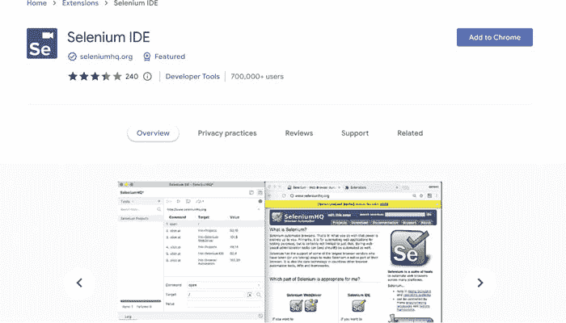

   **图 1.1：** Chrome 商店上的 Selenium IDE 插件页面

3. 点击“添加至 Chrome”按钮并点击“添加扩展程序”确认安装。

   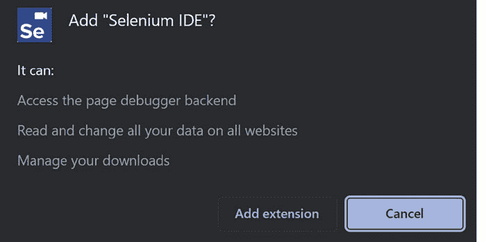

   **图 1.2：** 确认插件安装的弹出窗口

4. 等待扩展程序下载并安装。

5. 你现在应该可以在 Chrome 工具栏中看到 Selenium IDE 图标。

   **注意**：如果在安装过程中遇到任何问题，请尝试重启浏览器或清除缓存。

### 使用 IDE 进行自动化测试

现在我们已经设置好了 Selenium IDE，让我们来自动化一个简单的用例：

1. 导航到 `https://www.google.com` 并等待时事弹窗出现。
2. 输入 `First Name`（名）作为你的名字。
3. 输入 `Last Name`（姓）作为你的姓。
4. 输入 `Email address`（邮箱地址）作为你的邮箱地址。
5. 点击 `Submit`（提交）按钮。

为了实现上述自动化，让我们遵循以下步骤：

1. 点击 `Selenium IDE` 插件图标。

   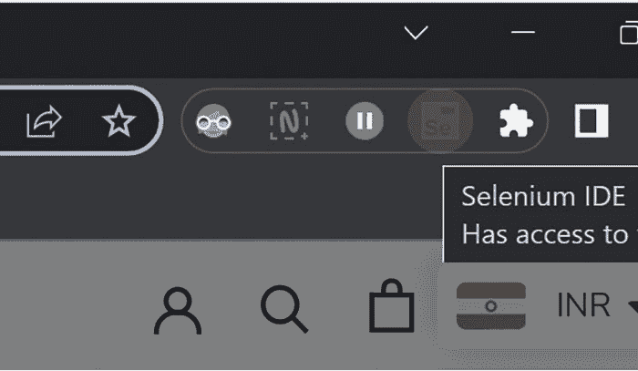

   **图 1.3：** Chrome 扩展面板中显示的 Selenium IDE

2. 在弹出的窗口中点击 `Record a new test in a new project`（在新项目中录制新测试）。

   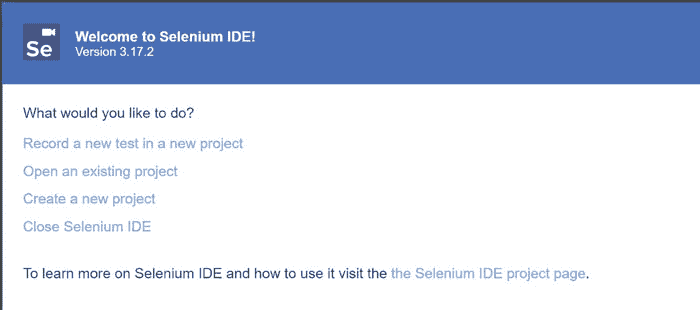

   **图 1.4：** Selenium IDE 欢迎界面

3. 在结果屏幕中输入项目名称 `Chapter_1` 并按 `OK`。

   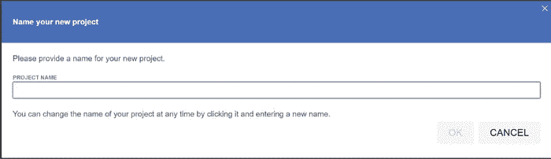

   **图 1.5：** 新建项目界面

4. 输入项目名称后，我们需要为被测试应用程序设置基础 URL。根据我们上面的测试用例，下一个文本框中应输入 `https://orangeava.com/`。输入基础 URL 后，点击 `START RECORDING`（开始录制）按钮。

   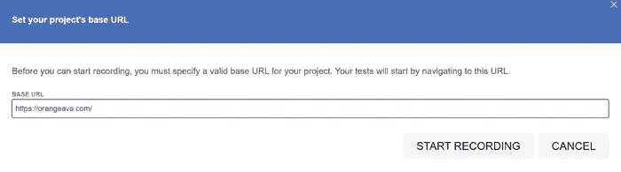

   **图 1.6：** 基础 URL 设置界面

5. 点击 `START RECORDING` 按钮，将打开一个新的浏览器窗口并加载 Orange AVA 出版的网页。请注意底部的 `Selenium IDE is recording…` 覆盖层，这表示用户在该浏览器屏幕上的所有操作正在被 Selenium IDE 录制。填写 `First Name`（名）、`Last Name`（姓）、`Email`（电子邮件）字段并点击 `Submit` 按钮。

   

   **图 1.7：** 在 Orange AVA 首页录制表单输入步骤

6. 回到 Selenium IDE 窗口，点击右上角的 `Stop Recording` 按钮。

   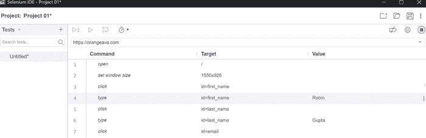

   **图 1.8：** 用于停止录制的 Selenium IDE 窗口

7. 将测试名称输入为 `Form Entry Test` 并点击 `OK`。

   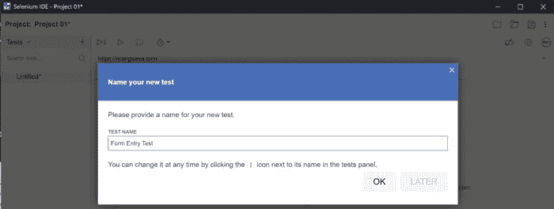

   **图 1.9：** 新测试命名界面

8. 在 Selenium IDE 应用中点击顶部菜单栏上的 `Run current test` 按钮。

   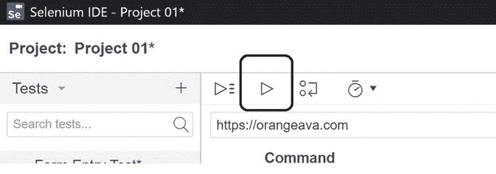

   **图 1.10：** 使用 Run current test 按钮执行测试

一旦你点击 `Run current test` 按钮，Selenium IDE 将打开 Chrome 浏览器并重放上述记录的所有步骤。

恭喜！你刚刚自动化并执行了你的第一个测试用例。

**注意**：如果你的测试执行失败，请不要灰心，因为我们将很快回顾网络测试的常见陷阱、调试方法和局限性。

### IDE 导览

让我们探索 `Selenium IDE` 应用的一些选项和细节。

应用程序窗口可以分为三个逻辑部分：

- **测试管理（Test management）**：左侧部分可用于创建测试套件以组织测试、创建更多测试或执行单个或一组测试用例。

  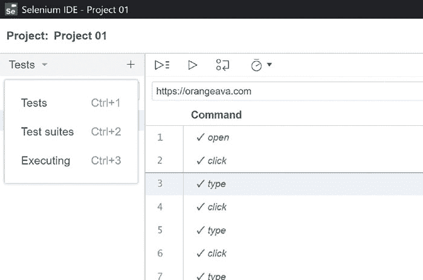

  **图 1.11：** Selenium IDE 中的测试管理选项

- **测试执行（Test Execution）**：用户可以在此处使用多种选项执行测试步骤，包括执行速度、发生异常时暂停以及更改命令或值，如下：

  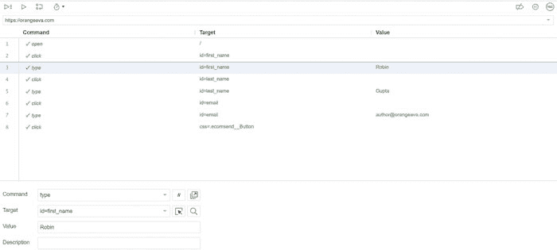

  **图 1.12：** Selenium IDE 中的测试执行选项

- **日志和引用（Logs and references）**：Selenium IDE 为用户的步骤提供了详细的执行日志，包括执行的命令、时间戳和遇到的任何错误。用户还可以导航到 `Reference` 标签并找到所选命令的详细解释。

  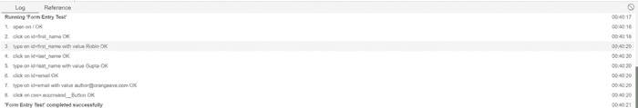

  **图 1.13：** Selenium IDE 日志部分

  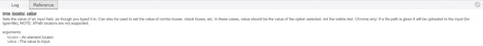

  **图 1.14：** Selenium IDE 引用部分

### 调试选项

Selenium IDE 带有一系列调试选项，帮助你识别和修复缺陷。内置调试功能（如断点和逐步执行）帮助用户识别问题并提高测试过程的效率。让我们探索其中一些选项：

1. **断点（Breakpoints）** 允许你在特定的代码行处停止测试脚本。如果你有一个失败的长测试脚本，这非常有用，特别是当故障发生在脚本接近末尾时。当命中断点时，测试脚本将停止运行，你能够检查应用程序的状态。然后你可以使用 `Step` 选项逐行执行代码，这可以帮助你确定错误源。断点是一个强大的调试工具，可用于发现和修复测试脚本中的错误。你可以通过点击命令旁边的数字来在测试脚本中放置断点，如下：

   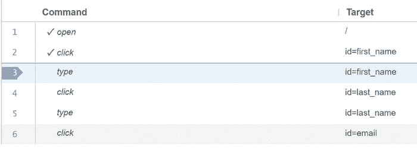

   **图 1.15：** Selenium IDE 引用部分

   放置断点后，运行测试，Selenium IDE 将停在断点步骤，以便用户检查 Web 应用的状态并对测试脚本进行纠正措施。这对于处理超时、弹出窗口和框架（frames）特别有用。

2. **跳过当前命令（Step over current command）** 选项允许你一次运行一个命令的测试用例。这对于调试非常有帮助，因为它允许你确切查看测试中每个点正在发生什么。这对于寻找难以复现的 bug 非常有用。

3. Selenium IDE 还有**异常时暂停（Pause on Exception）** 选项。当启用此选项时，调试器将在控制台或日志出现红色消息之前暂停。这允许你检查在出现问题后发生了什么。

除了上述内容外，Selenium IDE 还包含了一些其他调试选项，可以通过点击任何命令右侧的三个点图标进行探索，如下：

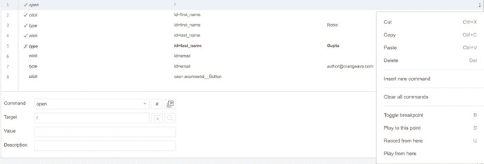

**图 1.16：** 额外的调试和命令级选项

1. **运行到此点（Play to this point）**：此选项在新浏览器中启动测试用例的执行，然后在调用此选项的命令处暂停执行。此选项可以被视为放置断点然后启动测试用例执行的结合。

2. **从此处录制（Record from here）**：假设由于流程变化，你想在第 11 步编辑长测试用例，因此与其重新录制整个流程，你可以激活 `Record from here` 选项，这样 Selenium IDE 可以执行到示例中的第 10 步，然后你可以继续录制更新后的流程。

3. **从此处播放（Play from here）**：此选项在新浏览器窗口中启动执行，旨在从调用选项的命令处执行测试用例。

### 命令面板

Selenium IDE 包含 90 多个命令，如 `Click`、`Set`、`Select` 和 `Send Keys`，用于模拟 Web 上的常用操作。这些命令可以通过下拉菜单或在下拉菜单中输入来实现，如下：

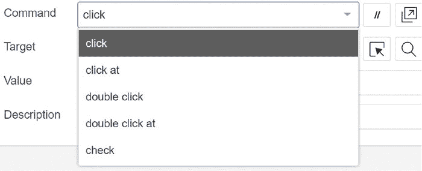

**图 1.17：** Selenium 中的命令选择

用户可以通过点击命令下拉菜单旁的 `//` 选项来启用/禁用命令。此外，`Add window configuration`（添加新窗口配置）可用于模拟与新窗口的交互。

### Target 与元素

`Target` 选项帮助我们选择 Web 应用中的元素。

Web 元素是网页上任何可以交互的可见或不可见部分。对于文本框、按钮、链接、图像和下拉菜单。编写 Selenium IDE 测试时，你经常需要与元素交互。例如，你可能需要在文本框中输入文本、点击按钮或从下拉菜单中选择项目。为了实现这一点，你需要使用 `Target` 来识别元素。

有多种方法可以识别元素。你可以使用元素的 ID、名称、类或其他属性。你也可以使用 XPath 或 CSS 选择器来识别元素。

一旦识别了元素，你就可以对它执行各种操作。你可以向它发送按键、点击它或选择它。你还可以获取元素的值，或检查它是否启用。

Web 元素是 Selenium 测试的重要部分。通过了解如何识别和与元素交互，你可以编写更有效、更可靠的测试。

这里是一些 Web 元素的示例：

- 文本框允许用户输入文本。
- 按钮在点击时执行操作。
- 链接在点击时跳转到新页面。
- 图像显示图片。
- 下拉菜单允许用户从列表中进行选择。

当用户录制 Selenium IDE 测试时，它会自动捕获元素的标识符，或者用户有以下选项来切换或更新标识符：

1. 点击 `Target` 下拉菜单，将为你提供一组网页元素标识符列表，可以使用这些标识符与目标网页元素进行交互：

   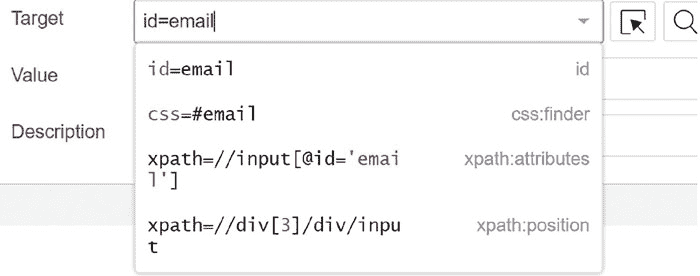

   **图 1.18：** Selenium IDE 中的目标选择


通常，`id` 定位器提供了最稳健的目标选择策略，并且不容易出现重复或更改。我们将在第 3 章：Selenium WebDriver 基础中详细地探索 CSS 和 Xpath 等目标定位策略。

用户可以点击 `Select target in page` 打开 Web 应用程序并选择用于交互的网页元素。最后，但同样重要的是，用户还可以点击 `Find target in page` 来在网页上查找并高亮网页元素，以便进行更仔细的检查和调试。

**注意**：在使用 Selenium IDE 录制测试脚本时，用户可以右键点击网页元素并导航到 `Selenium IDE` 子菜单项，以打开上下文操作，如 Assert（断言）、Store（存储）、Verify（验证）和 Wait For（等待）。

### 其他选项

Selenium IDE 有两个额外的控件，用于精调测试设计和执行。

1. **Description field（描述字段）**：此字段用于在命令列表中显示人类可读的格式，如下：

   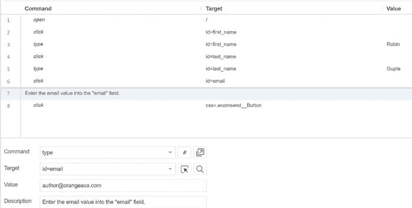

   **图 1.19：** 在 Selenium IDE 中设置命令描述

2. **Value field（值字段）**：此字段用于向目标网页元素输入值，例如 `First Name`（名）、`Last Name`（姓）或 `Email`（电子邮件）。用户可以手动输入值，也可以使用 `store` 命令通过设置值。例如，如果你在 type 命令中使用变量，请按照以下步骤操作：

   1. 创建一个 `store` 命令在 Selenium IDE 中存储一个变量。

   2. 右键点击 type 命令所在的行，并选择 `Insert new command`（插入新命令）。

   3. 点击插入的新行，并从命令列表中选择 `store`。

   4. 在 `Value` 字段中设置你需要的变量名，例如 `username`。

   5. 将 `Target` 字段留空或保留默认值。

   6. 再次点击 type 命令所在的行，根据你上一步中设置的变量名更改 `Value` 字段。

   7. 将变量名括在大括号 (`{}`) 中，并在其前面加上美元符号 `$`。示例如图 1.20 所示：

      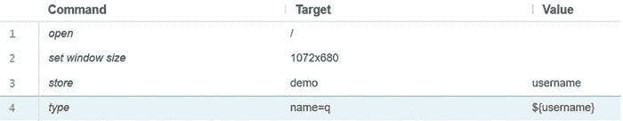

      **图 1.20：** 在 Selenium IDE 中为值字段使用变量

### 条件逻辑

在 Selenium 测试自动化过程中，经常会遇到只有在满足特定条件时才执行一组命令的情况。例如，用户可能在继续测试之前需要同意使用 cookie，或者可能需要确认新闻邮件订阅。

Selenium IDE 通过条件分支支持条件逻辑（或控制流），这允许测试行为发生变化。它还支持循环执行测试。一些有助于条件分支和循环的常用控制流命令包括：

* `if`：命令允许你指定一个代码块，只有当条件为真时才执行。

* `else if`：命令允许你指定一个代码块，只有在前一个条件为假时才执行。

* `else`：命令允许你指定一个代码块，当所有之前的条件都为假时执行。

* `end`：命令终止条件块。

* `times`：命令允许你按指定的次数执行一个代码块。

* `do`：命令允许你执行一个代码块，直到满足指定的条件。

* `repeat if`：命令允许在表达式返回真时重复代码。

* `while`：命令允许在条件满足时执行代码。

* `forEach`：命令允许你遍历一个集合。

通过使用这些控制流命令，你可以为测试增加更多复杂性。**注意**：在使用 Selenium IDE 录制测试脚本时，用户可以右键点击网页元素并导航到 `Selenium IDE` 子菜单项，以打开上下文操作，如 Assert、Store、Verify 和 Wait For。这允许用户通过与目标网页元素交互来模拟真实用户的用行为。如果需要，`Target` 字段可以留空或保留默认值。

### 导出代码

用户可以通过右键点击 `Export`（导出）、选择你的语言并点击 `Export` 来导出单个测试或套件。目前，Selenium IDE 支持以下语言/框架的导出：

* C# NUnit

* C# xUnit

* Java Junit

* JavaScript Mocha

* Python pytest

* Ruby RSpec

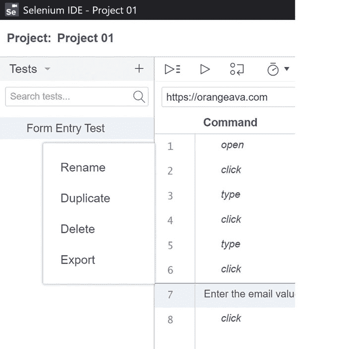

**图 1.21：** 从 Selenium IDE 导出代码

在图 1.22 中，用户有以下选项：

1. **Include origin code comments（包含原始注释）**：此选项将在导出文件中放置内联注释，包含有关测试步骤的详细信息。示例如下：

   ```
   // Test name: Form Entry Test
   // Step # | name | target | value
   // 1 | open | / |
   driver.get("https://orangeava.com/");
   // 2 | click | id=first_name |
   driver.findElement(By.id("first_name")).click();
   ```

2. **Include step description as a separate comment（步骤描述作为单独注释）**：此选项将 `Description` 作为注释行放在输出文件中，如下：

   ```
   // Enter the email value into the "email" field.
   driver.findElement(By.id("email")).sendKeys("author@orangeava.com");
   ```

3. **Export for use on Selenium Grid（导出供 Selenium Grid 使用）**：此选项允许用户在 Grid URL（如 `http://localhost:4444/wd/hub`）上运行 Selenium 测试。并放置 RemoteWebDriver 配置：

   ```
   driver = new RemoteWebDriver(new URL("http://localhost:4444/wd/hub"), DesiredCapabilities.chrome());
   ```

以下是引用的 JAVA 导出代码片段：

```java
public class FormEntryTest {
    private WebDriver driver;
    private Map<String, Object> vars;
    JavascriptExecutor js;

    @Before
    public void setUp() throws MalformedURLException {
        driver = new RemoteWebDriver(new URL("http://localhost:4444/wd/hub"), DesiredCapabilities.chrome());
        js = (JavascriptExecutor) driver;
        vars = new HashMap<String, Object>();
    }

    @After
    public void tearDown() {
        driver.quit();
    }

    @Test
    public void formEntryTest() {
        // Test name: Form Entry Test
        // Step # | name | target | value
        // 1 | open | / |
        driver.get("https://orangeava.com/");
        // 2 | click | id=first_name |
        driver.findElement(By.id("first_name")).click();
        // 3 | type | id=first_name | Robin
    }
}
```

```
driver.findElement(By.id("first_name")).sendKeys("Robin");

// 4 | click | id=last_name |

driver.findElement(By.id("last_name")).click();

// 5 | type | id=last_name | Gupta

driver.findElement(By.id("last_name")).sendKeys("Gupta");

// 6 | click | id=email |

driver.findElement(By.id("email")).click();

// 7 | type | id=email | author@orangeava.com

// Enter the email value into the "email" field.

driver.findElement(By.id("email")).sendKeys("author@orangeava.com");

// 8 | click | css=.ecomsend__Button |

driver.findElement(By.cssSelector(".ecomsend__Button")).click();

}
```

### 在 CLI 上运行

Selenium IDE 可以通过命令行界面运行测试，并作为构建过程的一部分。该功能可以用于以最小的配置并行运行并在 Grid 上运行测试。以下是使用 Selenium IDE 配合命令行运行器和 Grid 的一些额外优势：

1. **提高测试速度**：并行运行测试并在 Grid 上运行可以显著提高你的测试套件的速度。

2. **提高测试覆盖率**：通过在不同的浏览器和设备上运行测试，你可以提高测试套件的覆盖率。

3. **减少维护成本**：命令行运行器和 Grid 可以帮助减少你测试套件的维护成本。

为了运行 Selenium IDE 测试，我们需要安装以下前提条件：

1. **node**：Node.js 编程语言（8 版本或更高版本）

2. **npm**：NodeJS 包管理器，通常随 `node` 一起安装。

3. **selenium-side-runner**：Selenium IDE 命令行运行器。一旦安装了 `node`，你可以在终端窗口中使用以下命令安装 `selenium-side-runner`：

   `npm install -g selenium-side-runner`

4. **浏览器驱动 (Browser Driver)**：Selenium 通过一个名为浏览器驱动的小型二进制应用程序与每个浏览器通信。每个浏览器都有自己的浏览器驱动，你可以手动下载并将其添加到系统路径中，或者使用包管理器安装最新版本的浏览器驱动（推荐）。浏览器驱动是一个允许 Selenium 控制特定网络浏览器的软件程序。浏览器驱动通过远程协议（如 HTTP 或 HTTPS）与浏览器通信。这允许 Selenium 向浏览器发送命令并从浏览器接收信息，例如当前页面 URL、Web 元素的文本以及 Web 元素的状态。

Selenium 支持广泛的浏览器驱动，包括 Chrome、Firefox、Edge、Safari 和 Internet Explorer 的驱动。你可以从 Selenium 网站下载每个浏览器驱动的最新版本。

如果你正在使用包管理器（如 `npm` 或 `pip`），你可以使用包管理器为你的浏览器安装最新版本的浏览器驱动。

1. 对于 Chrome，你可以在终端中使用以下命令下载 Chromedriver：

   `npm install -g chromedriver`

2. 对于 Windows PC 上的 Microsoft Edge，你可以在终端中使用以下命令下载 EdgeDriver：

   `npm install -g edgedriver`

3. 对于 Firefox，你可以在终端中使用以下命令下载 geckoDriver：

   `npm install -g geckodriver`

一旦你设置了上述章节中详细列出的前提条件，就可以通过命令行调用 `selenium-side-runner` 并指定从 Selenium IDE 导出的 `.side` 项目来运行 Selenium IDE 测试。这可以通过运行以下命令来实现：

`selenium-side-runner /path/to/your-project.side`

这将通过打开 Chrome 浏览器运行你的测试，并提供如下输出：

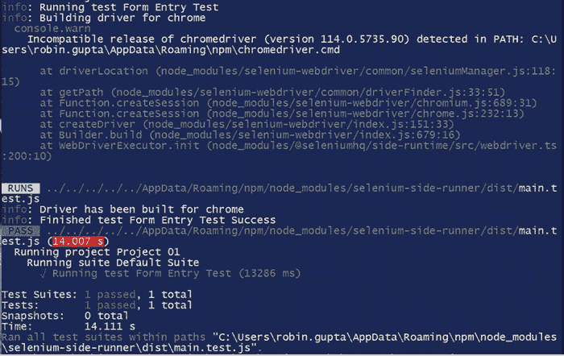

**图 1.23:** 来自 Selenium IDE Runner 的命令行执行结果

### 配置浏览器

为了将浏览器更改为 Chrome、Edge 或 Firefox，你可以利用以下命令行选项：

`selenium-side-runner -c "browserName=chrome"`

`selenium-side-runner -c "browserName=edge"`

`selenium-side-runner -c "browserName=firefox"`

### 配置基础 URL

通过指定不同的基础 URL，你可以轻松地将测试指向不同的环境（例如：本地开发、测试、预发布、生产）。以下是你在测试用例中使用不同 base URL 的示例：

* **本地开发**：你可能使用本地开发服务器来开发和测试你的 Web 应用程序。在这种情况下，你会将本地开发服务器的 URL 指定为测试用例的 base URL。

* **测试**：你可能使用测试服务器在发布到发布环境之前测试你的 Web 应用程序。在这种情况下，你会将测试服务器的 URL 指定为测试用例的 base URL。

* **预发布 (Staging)**：你可能使用预发布服务器在发布到生产环境之前测试你的 Web 应用程序。在这种情况下，你会将预发布服务器的 URL 指定为测试用例的 base URL。

* **生产 (Production)**：你可能使用生产服务器向公众发布你的 Web 应用程序。在这种情况下，你会将生产服务器的 URL 指定为测试用例的 base URL。

`base URL` 可以通过命令行运行器进行如下更改：

`selenium-side-runner --base-url https://localhost`

### 将测试结果写入文件

Selenium IDE 用户可以使用命令行界面执行测试，并将详细的测试结果写入兼容文本的格式中。可以使用以下选项来输出测试结果：

1. `--output-directory`：此标志表示存储结果的目标位置。这可以是绝对路径也可以是相对路径。

2. `--output-format`：此标志表示输出文件的格式。可以是：

   * `jest`：用于 JSON 输出。这也是默认格式。可以通过以下用法方法激活此选项：

     `selenium-side-runner --output-directory=resultsfolder`

   * `junit`：用于 XML 输出。可以通过以下用法方法激活此选项：

     `selenium-side-runner --output-directory=results --output-format=junit`

## 主要局限性与未来方向

Selenium IDE 无疑是一种用于测试 Web 应用程序的流行自动化工具。然而，它也有局限性，我们将在后续章节中详细讨论。

Selenium IDE 的一个重要局限是无法处理动态 Web 元素。这是因为它高度依赖录制回放功能，该功能无法处理网页中动态元素的更改。因此，当 Web 元素发生变化时，测试脚本可能会失败，导致误报或漏报。

另一个局限性是缺乏编程支持，这对于专业测试人员来说是一个致命缺点。该工具旨在用于不需要编程技能的情况下创建测试，当需要扩展脚本功能时，就会变得具有挑战性。

Selenium IDE 在处理涉及数据驱动测试、参数化或与数据库或 API 交互的复杂测试场景时可能会遇到困难。

使用断言和验证是有效使用 `Selenium IDE` 的另一个重要部分。这些工具允许你检查测试是否输出了预期结果，并帮助你快速识别问题出现的地方。最后，创建高效的测试用例流至关重要。这意味着对你的测试进行组织和排序，并确保一切运行得尽可能顺畅。

总之，虽然 `Selenium IDE` 是一个强大的自动化测试工具，但它确实存在一些局限性。通过使用编程语言配合 `Selenium WebDriver`、测试框架和调试器，你可以克服这些局限，并创建更强大且易维护的测试。


`Selenium IDE`的每一次迭代都应该更接近真实地反映用户在 CI 系统中测试的内容。版本 2 仅支持 Firefox，并使用模拟 JS 和一些不稳定的内部桥补丁。版本 3 支持 Chrome 和 Firefox，并使用了浏览器扩展 manifest 2 规范，但仍然使用模拟 JS。这要好，因为它支持更多驱动程序的本地播放，但两者都遭受了本地播放使用 JS 而远程播放使用`webdriver`的困扰。版本 4 在本地使用`webdriver`播放，并将`Electron`作为二进制文件，这意味着它内置了驱动程序。这已经接近完美，但由于`electron-chromedriver`缺少几个重要的 API（`setWindowSize`且不支持`window.prompt`），仍然存在一些小缺陷。通过切换到`bidi`，我们将`Electron`特定的消息 API 交换为基于`Bidi`的协议，这意味着我们可以运行任何支持`Bidi`本地播放和录制的驱动程序，从而支持所有驱动程序原语和窗口内置功能。这是第一个目标，因为这意味着本地播放的共享运行时可以精确镜像 CI 播放的共享运行时，这对于这些工具极其重要。之后，目标将添加钩子（hooks），让 IDE 通过退出码、持久化会话和本地执行来消耗自身的导出格式。现有的共享运行时比之前的模拟 JS 要好得多，但在我们将导出格式设为 IDE 的首要任务之前，我们基本上是在消减生态系统的积极性。我们希望我们的运行时支持程度不低于`java`绑定或`puppeteer`格式（即使有人想写这些格式）。最终，IDE 的存在是作为构建 e2e 测试的工具，这些测试稍将在远程运行，我们为允许工具摄纳并支持这些元素所迈出的每一步（无论是驱动程序和功能还是测试框架本身），都将决定其未来的相关性。

- Todd Tarsi，开源贡献者，`Selenium IDE`项目维护者。

## 结论

当我们结束关于 Selenium 测试自动化的这一章节时，我们深入探讨了为什么`Selenium`成为一个如此网站测试如此实用的工具。它就像是开发者和测试人员的瑞士军刀，配备了各种功能，如`Selenium WebDriver`、`Selenium IDE`和`Selenium Grid`。这些中的每一个工具都有其特殊作用，从驱动你浏览器的`WebDriver`到让你能够轻松录制和回放测试的`IDE`。我们已经看到`Selenium`不仅强大，而且非常灵活，可以跨不同的浏览器工作并支持多种编程语言。

我们还探索了`Selenium`如何融入现实场景。这不仅仅是理论；`Selenium`已经处于实战前线，在医疗保健、教育和金融等行业发挥作用。我们可以使用`Selenium IDE`快速验证自动化场景，并掌握 Web 应用程序自动化。

在下一个关于测试自动化的章节中，我们将深入探讨软件测试及其自动化过程的核心方面。从介绍软件测试开始，我们探索了确保软件质量的基础和重要性。该章节将转向测试自动化，讨论了它的优势以及用于简化测试流程的工具。我们还涵盖了测试计划，这涉及为有效测试定义目标、范围和策略。接下来，我们将检查测试设计，重点关注创建与软件需求一致的全面测试用例和场景。该章节将讨论测试执行和日志记录，强调了跟踪测试结果和识别问题的重要性。最后，我们处理测试报告，强调了向利益相关者传递测试发现和见解的重要性，以便做出明智的决策并持续改进。

## 练习

你好，冠军，恭喜你完成了第一章，我们才刚刚开始。让我们通过一个实操练习来加深理解。

你需要使用`Selenium IDE`自动化以下场景：

1. 导航到`https://orangeava.com/`

2. 点击`X`按钮跳过主页的注册弹窗。

3. 点击`New Release`（新发布）部分下的第一本书。

4. 验证页面顶部的`AVA` Logo 对应的主页 URL 是否为`https://orangeava.com/`。

5. 执行后，结果应通过 CLI 执行存储在 JSON 文件中。

# 第 2 章

## 测试自动化的基础

## 引言

欢迎来到软件测试的世界，在这里我们确保软件产品无错误、满足用户需求并提供无缝的用户体验。软件测试是评估软件应用程序或系统组件以获取反馈和发现漏洞的过程。没有它，我们的软件就像一个未成熟的香蕉——在咬下去之前，你不知道得到的是什么。

想象一下：你刚刚花了几个月开发了一款突破性的新软件应用程序。你兴奋地想向世界发布它，但有一个关键步骤是你无法跳过的：软件测试和自动化。它是科技世界中无名的英雄，确保你的杰作准备好进入主舞台。在本章中，我们将深入软件测试的世界，探索测试计划、测量和管理。因此，无论你是质量专业人员、软件工程师还是好奇的学习者，请系好带，准备学习软件质量和自动化的基础！

## 结构

在本章中，我们将讨论以下主题：

* 质量简介

* 通过自动化助力你的质量之旅

* 测试自动化策略

* 面向自动化的测试设计

* 测试执行与日志

* 报告与测量

## 质量简介

美国国家标准协会（`ANSI`）和美国质量协会（`ASQ`）对质量的定义如下：

> 产品或服务中能够满足需求的全部特征和特性。

让我们将其拆解开来。假设你加入了一份新工作。在工作的第一天，你看到你的新老板使用手机闪闪昂贵的手机。从那天起，你渴望购买昂贵的手机。一年后，你用积蓄买了一部昂贵的手机。第二天，你的手机就开始卡顿和死机。在这一刻，你的想法是什么？“如果手机制造商能给出一个质量好的手机就好了。”

在继续之前，请花一点时间完成以下陈述：

对我来说，质量意味着 -___________________________________________

正如你所观察到的，质量可以是：

* 容易观察但难以测量。

* 受观察者自身偏见和观点的影响。

软件质量是指软件产品或系统满足特定需求并满足用户需求和期望的程度。它涵盖了有助于软件整体卓越性的各种属性和特征，确保其可靠性、可用性、可维护性和效率。实现高软件质量对于交付按预期运行并提供满意用户体验的产品至关重要。

你可以将软件测试人员比作`航天员`，他们都望向广阔的空间，寻找寻常，揭示风险，同时不懈地努力提高我们的生活“质量”。

在快速迭代的软件世界中，在没有经过适当测试的情况下部署软件会对你的产品、业务和声誉产生损害。因此，软件测试已成为软件开发周期中的关键步骤。仅仅草率开发功能或发布软件产品是不够的；我们需要确保它们是高质量且没有问题的。

有几个有助于提高软件质量的关键方面，包括：

* **功能性**：软件应该提供用户所需的功能和能力。

* **可靠性**：软件在各种条件下都能持续一致且准确地运行。

* **可用性**：软件应该易于学习、使用和理解。

* **效率**：软件应该优化利用系统资源，如内存和处理能力。

* **可维护性**：软件应该根据需要易于修改和更新。

* **移植性**：软件能够在不同的平台和环境中运行。

这些只是软件质量属性的几个例子，实现高水平的质量需要根据软件项目的特定背景和需求考虑并平衡其他各种因素。通过优先考虑软件质量，组织可以增强用户满意度，降低维护成本并提高其软件产品的整体成功率。

目前已提出了几种模型来帮助软件工程师理解和衡量软件质量。一些最常用的模型包括：

* **ISO/IEC 25010:2011 软件质量模型**：`ISO/IEC 25010:2011 Software Quality Model`是一项国际标准，定义了软件产品的一系列质量特征和子特征。该模型的基础是，软件质量可以通过评估产品满足用户需求的能力以及其对特定要求的遵循情况来衡量。

* **McCall 质量模型**：`McCall’s Quality Model`由 James McCall 在 20 世纪 70 年代提出，是最的软件质量模型之一。它识别了 11 个有助于软件质量的因素，包括正确性、可靠性、效率、完整性、可用性、可维护性、活性、可测试性、移植性、可重用性和互操作性。

* **Boehm 质量模型**：`Boehm’s Quality Model`由 Barry Boehm 在 20 世纪 80 年代开发，另一个广泛使用的软件质量模型。它关注软件质量的三个主要方面：产品运行、产品修订和产品转换。每个方面进一步分为子因素，如正确性、可靠性、效率、可维护性和移植性。

* **Dromey 质量模型**：`Dromey’s Quality Model`由 R. Geoff Dromey 在 20 世纪 90 年代提出，是一种较新的软件质量方法。它强调理解软件质量属性与底层组件之间关系的重要性。该模型帮助软件工程师在组件级别识别并解决潜在的质量问题，从而提高整体软件质量。

质量具有高度的相关性，团队即使遵循上述所有模型，仍可能出现终端用户期望偏差，导致生产环境 Bug。

质量对于企业和消费者都很重要。对于企业来说，质量可以增加销售额、利润和市场份额。它还可以帮助企业建立客户忠诚度并提高声誉。对于消费者来说，质量可以带来满意、安全和安心。质量也不是绝对的，而是一个持续的过程，伴随着反馈循环和意识的设计决策。正如亚里士多德所说：

*质量不是一种行为，而是一种习惯。*

### 软件测试

软件测试是软件开发周期中的关键过程，涉及评估和验证软件应用程序的功能、质量和性能。执行它的目的是识别风险、缺陷、错误或预期结果与实际结果之间的差异。软件测试的主要目标是确保软件满足特定需求并为终端用户顺畅运行。

软件测试有多种类型和技术，包括：

* **单元测试**：涉及对软件单个单元或组件进行测试，以确保它们在孤立状态下正常运行。它侧重于验证软件最小的可测试部分，例如`functions`或`methods`。

  * **示例**：通过提供不同的输入来测试计算两个数字之和的`function`，并验证输出是否与预期结果。

* **集成测试**：验证不同软件组件之间的交互，以确保它们能够正确工作。其目的是检测由于各种模块或子系统的集成而可能产生的缺陷。

  * **示例**：测试`payment module`和`inventory management module`之间的交互，确保在付款时订单正确从库存中扣除。

* **系统测试**：从整体评估整个软件系统的行为和性能。它验证系统是否满足特定需求，并在不同场景下是否按预期运行。

  * **示例**：通过模拟用户交互（如浏览产品、将商品加入购物车和完成结账流程）对电子商务网站进行测试，以确保所有功能无缝工作。

* **验收测试**：执行此类目的是确定软件是否符合终端用户或利益相关者的期望和要求。它验证软件是否已准备好在真实环境中部署和使用。

  * **示例**：通过让一组目标终端用户对新开发的移动应用程序进行用户验收测试，确保其符合他们的需求和偏好。

* **性能测试**：侧重于评估软件在不同负载和条件下的响应能力、扩展性和稳定性。其目的是识别性能瓶颈并确保软件能够处理预期的用户负载。

  * **示例**：通过模拟大量并发用户请求对 Web 服务器进行压力测试，以评估其性能并确定其是否可以在不崩溃或减慢的情况下处理预期的流量。

这些只是软件测试类型的几个例子，还有其他类型，例如回归测试、安全性测试、可用性测试等。测试技术和方法的选择取决于软件开发项目的特定需求、约束和目标。

软件测试至关重要，因为它能节省时间、金钱并减少开发者和终端用户的挫败感。它就像一种风险检查——没有人想为不合格的产品买单。通过测试软件，我们可以确保它能够处理用户输入、符合业务需求，并在执行所需任务时不发生崩溃。即使是最微小的漏洞也可能导致严重问题，因此在部署之前进行软件测试至关重要。

在节奏快速的软件世界中，在没有适当测试的情况下部署软件会对您的产品、业务和声誉产生不利。因此，软件测试已成为软件开发生命周期中的一个关键步骤。仅仅草率地开发功能或发布软件产品是不够的；我们需要确保它们具有高质量且没有问题。

# 通过自动化助力您的质量质量之旅

传统上，软件测试是一个枯燥、耗时且昂贵的过程，需要大量的投入。手动测试方法可能会导致人为错误、测试不一致以及上市时间过长。因此，自动化软件测试已成为软件开发领域的一个必要选择。

测试自动化使企业能够比传统方法更快速、更高效、更准确地测试软件。自动化还有助于节省成本、提高质量保证并增加测试覆盖范围，使其成为手动测试流程的明显优者。

将测试自动化与敏捷软件开发方法相结合，可以确保软件开发过程中更高的透明度，并尽早发现漏洞，从而更快解决。凭借用户友好的工具、简化的维护和提供的培训，这是企业一个易于采用的解决方案。

总而言，在这个创新驱动增长的不断变化的数字世界中，自动化软件测试正成为一种必然。通过拥抱自动化软件测试，保持竞争领先地位，并获得更精简更快速的测试周期、更高的部署频率以及更强的创新能力带来的收益。

让我们来看一个例子：您是一家大型软件公司的首席执行官。您的团队开发了一个典范网站，用于在线销售关于测试自动化的书籍。在这种情况下，该网站的主要用例是用户能够搜索标题、加入购物车并完成结账用例。这听起来很简单对吧？您的工程师验证这只需要 5 分钟。现在，这个过程需要在网站的所有部分重复。请记住，该网站应该在`Google Chrome`和`Firefox`等主流浏览器上运行良好。在网站首次成功发布后，您的团队需要确保结账、用户注册、搜索和列表等基础冒烟场景在各种网络条件、地理位置、浏览器和移动视图设备上运行良好。组合场景随着每个功能的增加而呈指数级增长，也很快让您作为 CEO 的心跳加速。这就是测试自动化可以帮助您实现规模化质量，并匹配开发速度的地方，通过对回归功能进行自动化检查，以平衡敏捷性与质量。

测试自动化带来了以下的一系列优势：

- **增强测试覆盖范围**：让我们面对现实吧——传统测试方法可能是枯燥且耗时的。更不用说，手动测试容易产生主观错误。测试自动化允许增强测试覆盖范围，包括重复测试、改进的回归测试和更广泛的设备覆盖。通过能够持续和并行运行测试的能力，您可以在开发过程早期识别漏洞并避免昂贵的延迟。想象一下能够在各种设备、操作系统和浏览器上进行交叉测试的能力——这就是测试自动化带来的力量。通过自动化您的测试，您可以确保您的产品在所有平台和配置上无缝运行。而且不要忘记节省的时间！自动化测试运行速度比手动测试快得多，允许您在更短的时间内覆盖更多内容。此外，能够在不需要额外人力资源的情况下更频繁地运行测试，您的测试过程将变得高效得多。测试自动化是可靠、一致的，最重要的是它为您节省了时间和金钱。通过加速测试、提高测试覆盖范围并提高产品质量，测试自动化可以帮助您的业务保持竞争领先。

- **及早发现漏洞**：没有人喜欢漏洞，也许昆虫学家除外。但对我们其他人来说，漏洞是威胁。传统的测试方法是手动的，因此容易出现人为错误。漏洞可能未被发现几天、几周、几个月，在某些情况下甚至是几年。想知道比发现漏洞更糟糕的是什么？发现多个漏洞。想知道更糟糕的吗？在开发后期发现多个漏洞。这就是您需要测试自动化的原因。它有助于尽早发现漏洞，这意味着更快的故障排除、更全面的测试和改进的反馈循环。漏洞无法逃过自动化测试工具，它们忠实伙伴小故障也不行。

自动化测试工具可以同时运行多个测试，更容易在开发过程中早期检测漏洞。这种测试和尽早发现对于生产优质产品至关重要。想象一下发布了一个新应用，结果用户写道评论说：“App 一直在崩溃。不推荐。”真糟糕。通过测试自动化，您可以避免这一切。您可以在漏洞和小故障演变成更大的问题之前发现它们，这意味着为您的客户提供了更稳定、可靠且值得信赖的产品。

> 在其 20 年的存在中，Selenium 一直是使测试自动化成为持续记录我们意图的现实方式的先驱。虽然 Selenium 驱动浏览器并由各种测试库和框架扩展，但它还创建了一种通过一个库和一个 API 逐步学习编程的方法，在主语言中无限制地成长。

> 测试自动化帮助我们跟踪那些必须保留的内容；它还帮助我们模拟未来更复杂的场景。它将测试中的人工和非人工任务结合在一起，并作为人们离开后留下的资产。只要我们让它变得值得。

— Maaret Pyhäjärvi，Vaisala 测试专家和开发经理。Selenium 项目项目领导委员会成员。

测试自动化的优势不仅限于及早发现漏洞。与手动测试相比，自动化测试节省了大量的时间精力。毕竟，手动测试是一项枯燥的任务，人类容易因疲劳或注意力集中而忽略或遗漏漏洞。另一方面，自动化确保了更彻底、更准确的测试过程。

测试自动化不仅加速了漏洞检测过程，还简化了工程师的工作。手动测试应用程序的每个功能和特性是一项艰巨的任务，但自动化测试让工程师更容易验证和确认代码更改。此外，通过自动化测试，工程师可以更频繁地执行测试，确保新增的功能不会对应用程序的现有功能产生负面影响。

总之，测试自动化确保了漏洞的准确及时，简化了工程师的工作，节省了时间和精力，并帮助生产优质产品。因此，如果您希望您的应用程序稳定、可靠且无漏洞，请考虑投资测试自动化工具和策略。

### 与开发流程集成

将测试自动化与开发流程集成是提高软件测试效率和准确性的关键步骤。如果执行得当，这种集成可以实现开发团队与测试团队之间的无缝协作，从而确保项目的成功。

测试自动化的优势之一是它能够与敏捷开发方法相结合，使得在整个开发阶段执行测试变得简单。通过这种集成，开发和测试团队之间的协作得到了加强，确保软件符合预期的质量标准。

除了加强协作外，这种集成还为开发过程带来了更高的透明度。团队可以跟踪和监控测试进度，并提前识别潜在的障碍。这使得故障排除速度更快，并最终能够更快速地交付高质量软件。

总而言之，将测试自动化与开发流程集成对于软件开发的成功至关重要。它允许团队之间进行无缝协作，带来了更高的透明度，并最终提高了测试过程的准确性和效率。

### 可靠性

我们都听过“人为错误”这个说法。不可否认，手动测试很容易受到此类错误的影响。通过将测试自动化引入企业的测试流程中，你可以减少重复性任务中的错误因素，并创建一个更可靠的测试环境。自动化测试能够一次又一次地提供一致的结果，这意味着差异和错误会更少。它还极大降低了测试失败的可能性，任何企业或开发者无疑都会认同，这是一个巨大的胜利。当你为自动化投入时间、精力和资源时，你的企业、你的团队和客户都会感谢你。

### 领先对手

想超越竞争对手吗？测试自动化是必经之路。你将享受更精简更快速的测试周期，更频繁的部署以及更快的创新。自动化工具执行任务更快且错误更少。因此，你将缩短测试时间，并迅速将产品交付给客户。


总而言之，测试自动化是提高效率、改进质量保证、降低成本和缩短上市时间（GTM 时间）的关键。通过增强测试范围、早期发现漏洞以及与开发流程的无缝集成，企业可以保持领先地位。此外，通过如`Selenium`这样易于使用的工具、简化的维护和可靠性，企业可以享受一致性和更低的失败率。最重要的是，测试自动化已成为一项关键组件，通过简化测试程序同时缩短部署时间，帮助企业进行创新。这就是为什么企业需要将测试自动化纳入其系统中，并在确保持续测试的同时不断跟上新技术和进展，使自动化成为其软件开发周期中不可或缺的一部分。

## 测试自动化策略

在当今快速迭代的软件开发领域，测试自动化已成为确保质量和效率的关键组件。一个定义良好的测试自动化策略可以帮助组织简化测试工作、增加测试范围、缩短上市时间并提高软件的整体可靠性。本节将深入探讨强大的测试自动化策略的关键要素，包括测试数据管理、测试范围、可重用资产、资源、时间表和风险。我们将详细探讨每个主题并提供示例说明其重要性。

## 测试数据管理

测试数据管理 (TDM) 是测试自动化策略的一个重要方面，因为它确保在正确的时间有正确的数据用于测试。TDM 涉及测试数据的创建、存储和维护，这些数据可验证软件的功能、性能和安全性。

### 数据生成

可以使用多种方法生成测试数据，例如手动数据输入、数据掩码、合成数据生成和数据子集。每种方法都有其优缺点，因此根据项目的特定需求选择最合适的方法至关重要。

**示例**：在银行应用程序中，可以使用合成数据生成来创建真实的客户配置、交易历史和账户余额，而不会暴露敏感的客户信息。

### 数据存储

测试数据应该存储在中央存储库中，所有参与测试过程的团队成员都可以访问。这确保了一致性并降低了数据重复或损坏的风险。

**示例**：可以使用云存储解决方案来存储测试数据，允许测试人员随时随地从任何地方访问数据。

### 数据维护

定期维护测试数据对于确保其准确性和相关性至关重要。这包括更新数据以反映应用程序的变化、删除过时数据以及确保数据完整性。

**示例**：在电子商务应用程序中，应定期更新测试数据，以包含新产品、价格变化和促销活动。

## 测试范围

定义测试范围是开发测试自动化策略的关键步骤。它涉及识别将测试的应用程序区域、要执行的测试类型，以及将使用的测试自动化工具和框架。

### 测试覆盖

测试覆盖指的是应用被测试的程度。在详尽测试和资源高效利用之间取得平衡至关重要。可以使用基于风险的方法来优先对应用程序的关键功能和高风险区域进行测试。

**示例**：在医疗健康应用程序中，与患者数据管理和治疗计划相关的功能应优先测试，因为这些区域的任何错误都可能导致严重后果。

### 测试类型

各种类型的测试都可以实现自动化，例如功能测试、性能测试、安全测试和回归测试。测试类型的选择取决于项目的特定需求和可用资源。

**示例**：在移动应用程序中，可以自动化功能测试以验证用户界面和导航，同时可以自动化性能测试以衡量应用程序的响应时间和资源占用。

### 测试自动化工具和框架

选择测试自动化工具和框架是测试自动化策略成功的关键因素。在选择工具或框架时需要考虑的因素包括易用性、与应用程序技术栈的兼容性，以及支持和文档的可用性。

**示例**：`Selenium`是一种流行的 Web 测试自动化工具，而`Appium`广泛用于移动应用程序测试。

### 可重用资产

可重用资产是测试自动化过程中的组件，可以用于多个项目或测试场景。这些资产有助于减少开发和维护测试脚本所需的时间精力，从而提高测试自动化过程的效率。

### 测试脚本

测试脚本是驱动测试自动化过程的代码。通过创建模块化和可重用的测试脚本，测试人员可以减少开发新测试用例和更新现有用例所需的时间精力。

**示例**：在内容管理系统中，可以创建一个可重用的测试脚本来验证登录流程的功能，该脚本可以在多个测试用例中重复使用。

- **测试数据**：如前所述，测试数据应存储在中央存储库中，以便在不同的测试用例和项目之间复用。
- **测试自动化框架**：测试自动化框架提供了一种结构化的测试自动化方法，使得测试脚本更容易开发、维护和重用。流行的测试自动化框架包括数据驱动、关键字驱动和混合框架。
- **示例**：可以使用数据驱动框架来测试电子商务应用程序，允许测试人员轻松地更新测试数据，并使用不同的输入值运行多个测试用例。

## 资源

成功的测试自动化策略需要合适的资源组合，包括高技能的人员、硬件和软件。

- **人员**：测试自动化需要精通编程语言、测试自动化工具和测试方法的熟练专业人士。投资培训和提升团队成员技能至关重要，以确保他们拥有必要的技能来执行测试自动化策略。
- **示例**：精通`Java`和`Selenium`的测试团队可以接受培训，实现 Web 应用程序的自动化测试。
- **硬件**：测试自动化可能需要额外的硬件资源，如测试服务器、存储设备和网络设备。对这些资源进行规划并确保在需要时可用是非常重要的。
- **示例**：性能测试项目可能需要专门的测试服务器来模拟高水平的用户流量并测量应用程序响应时间。
- **软件**：除了测试自动化工具和框架外，可能还需要其他软件资源，如版本控制系统、持续集成工具和测试管理工具。
- **示例**：可以使用测试管理工具来管理测试用例、跟踪测试执行并生成测试报告。

## 时间线

测试自动化可以帮助缩短整体测试周期，但为测试自动化过程的每个阶段规划并分配足够的时间至关重要。

- **测试规划**：测试规划阶段涉及定义测试范围、选择测试自动化工具和框架以及识别项目所需的资源。此阶段应在测试自动化开始之前完成，以确保执行的顺利高效。
- **测试开发**：测试开发阶段涉及创建测试脚本、测试数据和其他测试资产。此阶段所需的时间取决于应用的复杂性和测试自动化团队的技能。
- **测试执行**：测试执行阶段涉及运行自动化测试脚本并分析测试结果。此阶段所需的时间取决于测试用例的数量、测试自动化工具的性能以及硬件资源的可用性。
- **测试维护**：测试维护阶段涉及更新测试脚本和测试数据以反映应用程序的变化，并解决测试执行阶段识别的任何问题。此阶段是持续的，应纳入整体测试自动化时间表中。

## 风险

测试自动化可以帮助提高软件质量，但也引入了需要有效管理的新风险。

- **过度依赖自动化**：测试自动化应该是手动测试的补充，而不是完全取代它。在自动化测试和手动测试之间取得平衡至关重要，以确保全面的测试覆盖。
- **测试覆盖不足**：测试自动化有时会导致测试覆盖不足，特别是如果重点是自动化大量的测试用例，而不是优先考虑关键功能和高风险区域。
- **测试脚本维护**：测试脚本需要定期更新以反映应用程序的变化，这可能是耗时且耗资源的。规划测试脚本维护并为此任务分配足够的资源至关重要。
- **工具和框架的局限性**：测试自动化工具和框架可能存在影响测试自动化过程有效的局限性。意识到这些局限性并开发减轻其影响的策略至关重要。

对于任何软件开发项目成功实施测试自动化，定义良好的测试自动化策略都是至关重要的。通过仔细考虑本文中讨论的关键组件，组织可以开发出全面的测试自动化策略，在提高软件质量、缩短测试周期和高效利用资源方面带来切实收益。

# 面向自动化测试设计

测试用例设计是软件测试的一个关键方面，确保系统按预期运行并满足用户期望。为了创建有效的测试用例，必须考虑有助于其质量和完备性的各种特征。在本节中，我们介绍了一个助记词“TEST CASE”，它封装了设计测试用例时需要记住的关键特征。每个字母代表一个特征，并配有实际示例来说明其重要性。

### T 彻底性 (Thoroughness)

在设计测试用例时，涵盖所有可能的场景和条件至关重要。考虑一个可以执行交易的银行应用程序。一个彻底的测试用例将检查正常转账、失败、资金不足和并发交易等场景，以确保系统正确处理每种情况。简而言之，测试应该覆盖正反两种场景。

### E 有效性 (Effectiveness)

测试用例应有效评估系统的预期功能或行为。例如，在电子商务网站中，一个有效的测试用例可能涉及验证结账流程是否成功完成，包括将商品加入购物车、应用折扣、选择运输选项和处理支付且无任何错误。无效的测试用例不会关注被测应用程序的核心业务问题。

### S 特异性 (Specificity)

为了实现清晰和精确，每个测试用例都应该关注系统的某个特定方面或功能。例如，在社交媒体应用程序中，一个特定的测试用例可以针对发布状态更新的功能，涵盖字符限制、可见性设置和多媒体附件等元素。这一方面也突显了测试用例应该是原子化的事实。因此，一个测试用例应只针对应用程序的一个区域，并且应该尽可能模块化。

### T 可追溯性 (Traceability)

测试用例应与需求或用户故事相关联，以维护整个测试过程的可追溯性。通过建立可追溯性，测试人员可以轻松跟踪其测试工作的进度和覆盖范围。例如，如果需求规定银行应用程序允许用户设置定期账单支付，应创建一个测试用例来验证这一需求。

### C 清晰度 (Clarity)

在设计测试用例时，清晰度至关重要。测试人员应努力创建任何执行者的人都能清晰看到且易于理解的测试用例。这种清晰度有助于防止混淆并确保测试过程的一致性。例如，文件管理系统的清晰测试用例应指明创建新文件夹的步骤、验证其是否出现在目录中，并确认文件可以成功移动到文件夹中。

## 准确性

准确的测试用例对于可靠测试至关重要。测试人员需要确保预期结果与实际结果精确对齐。例如，在测试搜索引擎时，一个准确的测试用例涉及输入特定关键词，并验证搜索结果是否根据相关性排名显示相关页面。

## 可持续性

可持续的测试用例可以随时间推移维护并重复使用。这很重要，因为从长期来看，它可以帮助节省金钱。简单来说，测试用例应该是可重复的，这样其自动化就能带来扩展性的收益。我们最初关于书籍结账流程示例就是一个可持续测试用例的例子。

## 效率

效率是测试用例设计的关键方面，确保时间和资源的最优利用。测试用例的设计应能够及时执行。例如，在搜索引擎应用程序中，高效的测试用例将侧重于验证跨设备和浏览器的搜索功能，而不进行不必要的步骤重复或冗验证。

这里有一个记忆测试用例特征的创意记忆法：

- T - **彻底性 (Thoroughness)**：确保测试用例覆盖了所有可能的场景和条件。
- E - **有效性 (Effectiveness)**：测试用例应准确评估所需的功能或行为。
- S - **特定性 (Specificity)**：每个测试用例应关注系统的特定方面或功能。
- T - **可追溯性 (Traceability)**：测试用例应与需求或用户故事关联，以便跟踪。
- C - **清晰性 (Clarity)**：测试用例应该是清晰的，让任何执行它的人都能易于理解。
- A - **准确性 (Accuracy)**：预期结果与实际结果应精确匹配。
- S - **可持续性 (Sustainability)**：考虑测试用例处理不同数据负载或系统规模的能力。
- E - **效率 (Efficiency)**：测试用例的设计应能够及时执行。

识别自动化测试的场景是自动化测试设计过程中的另一个关键步骤。应根据场景的严重性、测试频率以及手动执行所需的时间来选择测试场景。通过对频繁执行和关键测试场景进行自动化，可以使测试过程变得更加高效可靠。

为了设计出有效的测试用例，记住一些**高效测试用例设计技巧 (Tips for Effective Test Case Design)** 非常重要。首先，测试用例的设计方式应确保最大的代码覆盖率。其次，测试设计应当是相互独立的。第三，测试步骤应该易于理解和实现。最后，测试用例的设计应能够在长期内易于维护。

## 测试设计方法论

设计测试有很多方法，正如之前提到的，在软件测试中，业务应用的上下文比其他任何事情都重要。测试设计方法可以根据应用层进行划分，例如黑盒测试、白盒测试和灰盒测试。也可以采用领域级的设计，如配对测试（Pair wise testing）或基于风险的测试。此外，还可以结合多种设计方法对被测应用程序进行深度覆盖。

## 基于风险的测试

基于风险的测试（Risk-Based Testing, RBT）是一种通过识别潜在风险、为每个识别出的风险分配严重程度并据此对测试用例排序，来减少与项目或产品相关风险的方法。这种排序确保了在满足需求的同时解决严重缺陷。RBT 允许组织将测试精力放在关键领域，对资源分配做出明智决策，并提高整体水平。

### RBT 的优势

- **高效分配**：通过根据风险对测试用例进行优先级排序，RBT 优化了时间和精力。
- **早期识别和解决**：RBT 通过关注高风险区域促进了问题的早期识别和解决。
- **团队成员协作**：RBT 鼓励不同角色之间的协作，以实现共同目标。

### RBT 的局限性

- **准确的风险评估**：RBT 的有效性严重依赖于准确的风险评估，这具有挑战性。
- **风险模型的前期工作**：实施 RBT 需要建立清晰且全面的风险模型。
- **流程和工具集的变更**：采用 RBT 可能需要对现有流程和工具集进行重大更改。

尽管有这些考虑，RBT 对于寻求改进其软件开发周期的组织来说仍然是一种非常有价值的方法。通过主动处理高风险区域，组织可以减少缺陷的影响并交付更好的产品。

以下是在风险测试方法计算风险的方法：

1. 识别风险。可以通过与开发团队、利益相关者和测试人员进行头脑风暴来完成。
2. 评估每个风险的概率和影响。风险的概率是其发生的可能性。风险的影响取决于如果发生，后果的严重程度。
3. 计算风险分。风险分是风险概率和影响的乘积。
4. 对风险进行排序。风险分最高的风险应优先进行测试。

以下是计算某个风险风险分的示例：

- 概率：风险可能会发生。
- 影响：风险的影响是严重的。
- 风险分：`Likelihood * Impact = 10`

**注意**：建议使用 1 到 10 的相对分来启动对话，因为协作和团队工作是这些讨论的核心。

下表显示了几个不同风险的风险分：

| **风险 (Risk)** | **概率 (Likelihood)** | **影响 (Impact)** | **风险分 (Risk Score)** |
| :--- | :--- | :--- | :--- |
| 用户输入验证 | 可能 (Likely) | 严重 (Severe) | 10 |
| 数据损坏 | 可能 (Possible) | 中等 (Moderate) | 6 |
| 安全漏洞 | 不太可能 (Unlikely) | 轻微 (Mild) | 2 |

**表 2.1:** 风险计算示例

如你所见，用户输入验证风险的得分最高。这意味着该风险应该优先考虑测试。

需要注意的是，基于风险的测试方法并非一劳永逸的解决方案。过程中涉及的具体步骤可能会根据特定项目和涉及的团队而异。然而，上述的通用原则可以适用于任何项目。

以下是在基于风险的测试方法中计算风险的一些额外建议：

- 在评估风险发生的概率和影响时，考虑开发团队和测试人员的经验。
- 使用历史数据帮助你评估风险发生的概率。
- 在确定风险优先级时，考虑测试成本。
- 保持灵活，并愿意根据项目的进展调整风险评估。

## 成对测试 (Pair-wise Testing)

让我们来看一个看似简单的例子：一个受测试的制造自动化系统具有 20 个控制单元，每个单元有 10 种可能的设置，总共产生 $10^{20}$（100,000,000,000,000,000,000）种组合，这远超软件测试人员在一生中能测试的数量。惊讶的是，如果使用成对设计原则进行仔细构建，我们只需要 180 次测试就能检查这些值的所有配对。这种工具虽然强大且难以捉摸，但如果实施准确，它可以防止最复杂的受测系统陷入质量分析的瘫痪状态。

假设我们想证明一个新的软件应用程序在运行 Windows 或 Linux 操作系统、Intel 或 AMD 处理器以及 IPv4 或 IPv6 协议的 PC 上运行正常。这总共有 $2 \times 2 \times 2 = 8$ 种可能性，但如下表所示，只需要四次测试就能让每个组件至少与其他每个组件交互一次。在被称为“成对测试”这种最基本的组合方法中，四次测试中至少有一个测试覆盖了三个参数之间所有可能的取值对（`t = 2`）。注意，虽然这四个测试用例测试了所有可能值的配对——例如，`OS = Linux`和`protocol = IPv4`——但三个特定值的组合并未被测试——例如，`OS = Windows`、`CPU = Intel`和`protocol = IPv6`。尽管成对测试不是详尽的，但它是很有用的，因为可以用相对少的测试检查出简单的、潜在的问题的交互。

| 测试用例 | OS | CPU | Protocol |
| :--- | :--- | :--- | :--- |
| 1 | Windows | Intel | IPv4 |
| 2 | Windows | AMD | IPv6 |
| 3 | Linux | Intel | IPv6 |
| 4 | Linux | AMD | IPv4 |

**表 2.2:** 使用成对原则的测试组合

`[Table 2.2]`中所示测试集规模从八减到四并不令人印象深刻，但考虑一个更大的例子：一个制造自动化系统具有 20 个控制单元，每个单元有 10 种可能的设置——总共 $10^{20}$ 种组合，这远超软件测试人员一生能测试的数量。惊讶的是，如果经过仔细构建，我们只需要 180 次测试就能检查这些值的所有配对。

每当讨论成对测试时，顺便介绍一下正交设计模式（Orthogonal test design patterns）也是明智的。新手测试设计人员可能会说这是同一枚硬币的两面，但真正的资深大师理解区别，并能采用正确的方法作为解决幻觉测试设计困境的良药。

正交类测试的关键要素是覆盖数组（covering array），这是一种数学对象，至少覆盖一次参数值的所有`t-way`组合。对于`[Table 2.2]`中的成对测试示例，`t = 2`，相对很容易生成覆盖所有参数值对的测试。为复杂交互生成覆盖数组要困难得多，但新算法使得比以前算法快几个数量级生成覆盖数组成为可能，使得六路覆盖数组在许多应用中可行。`[Figure 2.1]`显示了针对 10 个二进制参数的三向交互的覆盖数组，仅需 13 次测试。注意，以任何顺序选择的任意三列都包含三个参数的所有八种可能值：`000, 001, 010, 011, 100, 101, 110, 111`。


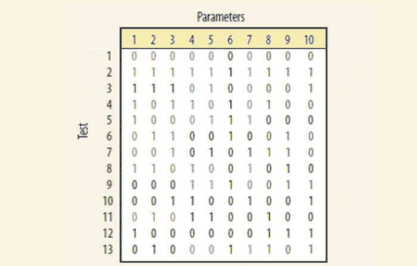

**图 2.1:** 针对 10 个每个两个值的参数的三向覆盖数组

在真实的软件测试项目中，能够在 13 个测试用例中实现 100% 的三向覆盖具有什么实际意义？假设这个假设的应用程序中有 10 个缺陷，其中 9 个通过上述 13 次测试识别，那么测试这 13 个用例每个用例发现的缺陷将比详尽测试并发现所有 10 个缺陷多出 71 倍 `[(9/13)/(10/1,024)]`。

有多个开源和免费工具可用于和进一步探索组合测试：

- 来自 NIST 的 ACT: [`csrc.nist.gov/projects/automated-combinatorial-testing-for-software`](https://csrc.nist.gov/projects/automated-combinatorial-testing-for-software)
- 微软的 PICT: [`github.com/microsoft/pict`](https://github.com/microsoft/pict)

在书中，我们将专注于黑盒功能测试自动化，假设读者已经优先选择了正确的自动化测试集。

# 测试执行与日志 (Test Execution and Logging)

执行和日志是任何成功的软件开发项目的关键组成部分。然而，许多团队在有效执行测试和准确记录结果方面挣扎。在本节中，我们将探索测试执行和日志包含什么、它们为什么重要，以及在自己的项目中实现它们的最佳实践。首先，——当我们谈论“测试执行”时，是什么意思？简单来说，它是针对软件应用程序运行测试用例以识别缺陷并确保功能的过程。这可以通过手动（由人类测试人员）完成，也可以使用 `Selenium` 等工具自动完成。无论你采用何种测试方法，目标都是相同的——尽早发现 Bug 并提高整体产品质量。但为什么测试执行很重要？代码审查难道不足以在发布前捕获错误吗？虽然代码审查确实很重要，但它们本身不能替代自动化测试的严谨性。测试有助于发现手动检查期间可能无法立即发现的问题，例如应用程序不同部分之间复杂的交互。通过尽早发现这些问题，开发团队可以节省未来的金钱，避免客户的负面反馈，并减少昂贵的召回或声誉损害的风险。现在我们已经理解了为什么测试执行很重要，让我们开始接触一些最佳实践。为了解释测试执行的概念，让我们考虑一个如下具有多个层级的汉堡：

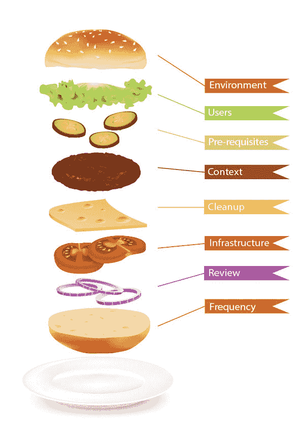

**图 2.2:** 测试执行组件的可视化

## 环境

在软件测试中，使用不同的环境是为了为测试活动创建独特且受控的设置。每个环境都有特定的目的，旨在满足软件开发生命周期不同阶段的需求。最常见的环境包括本地环境、开发环境 (`dev`）、预发布环境（staging）和生产环境。本地环境是开发和测试人员进行初始开发和测试活动的地方，通常设置在个人的本地机器或工作站上。开发环境（通常称为 `dev` 环境）是一个共享环境，开发团队通过它将个人的更改集成到一个连贯的系统中。预发布环境是生产环境的副本，与生产配置高度相似，它用于在软件部署到生产环境之前进行全面测试。预发布环境允许测试人员模拟真实场景并执行端到端测试，包括用户验收测试 (UAT)、性能测试和安全测试。生产环境是软件部署并供终端用户使用的运行环境。它是为真实用户提供服务的实际工作环境。生产环境中的测试活动限于监控和收集反馈，以确保软件运行良好并及时处理任何关键问题。

## 测试用户

测试用户（也称为测试账户或测试画像）是专门为测试目的而创建的用户配置文件。测试用户模拟真实的终端用户，并用于模拟软件系统中的不同场景、交互和角色。通过使用测试用户，测试人员可以在不同的用户角色和权限下评估应用程序的功能、安全性和用户体验。例如：在电子商务应用程序中，可以创建测试用户来代表不同类型的客户，例如普通用户、VIP 用户和管理员用户。然后，可以使用这些测试用户从不同的用户视角验证产品浏览、购物车管理、结账流程和订单跟踪等功能的功能。

## 前提条件和数据设置

前提条件和数据设置是指在执行测试之前需要准备的必要条件和数据。这包括配置系统、设置测试数据以及确保满足任何所需的依赖或先决条件。适当的前提条件和数据设置对于确保准确且有意义的测试结果至关重要。例如：假设你正在测试银行应用程序的转账功能。前提条件可能包括创建两个测试账户（每个账户都有足够的余额），并建立与测试数据库的连接。此外，测试数据设置可能涉及向测试数据库填充示例交易并验证初始账户余额。

## 上下文

在软件测试中，上下文是指执行测试的具体条件、配置和场景。它包含了对系统目的、预期用户、业务规则、限制以及任何影响测试过程的外部因素的理解。考虑上下文有助于测试人员量定制测试方法并有效地优先分配精力。例如：测试在线学习平台的上下文与测试金融交易系统的上下文不同。在线学习平台可能需要强调易用性、课程选课和评估功能。另一方面，金融交易系统将侧重于实时数据更新、交易处理以及交易执行和订单验证等安全方面。

## 清理和清理

净化和清理是指移除测试过程中生成的任何残留产物、临时文件或测试数据的过程。它确保测试环境保持整洁、无杂物，并为后续测试周期做好准备。适当的净化和清理可以防止不同测试运行之间的干扰，并最大限度地减少假阳性或假阴性的风险。例如：在 Web 应用程序上执行测试套件后，净化和清理过程可能包括删除临时文件、清除浏览器缓存并将应用程序数据库重置为初始状态。这确保了在上一次测试运行期间生成的任何产物或数据都不会影响后续测试。

## 基础设施和工具

基础设施和工具是指有效执行测试活动所需的硬件、软件和工具。这包括测试管理工具、测试自动化框架、虚拟机、物理设备以及支持测试过程所需的任何其他资源。健壮且配置良好的基础设施，适当的工具，能够实现高效且可扩展的测试。例如：对于移动应用程序测试，基础设施和工具可能涉及访问一系列物理设备或使用云端移动设备测试平台。此外，使用 `Jira`、`TestRail` 或 `Azure DevOps` 等测试管理工具可以简化测试计划、执行和报告活动。

## 更新和评审

更新和评审是对测试产物（包括测试用例、测试计划和测试脚本）的定期评估和完善。更新测试产物以适应不断变化的需求、错误修复以及被测软件的变化非常重要。定期评审测试产物可以确保它们在实现测试目标方面的准确性、完整性和有效性。例如：假设软件应用程序经历了重大更新，包括增加新功能和对现有功能的修改。在这种情况下，需要更新或评审测试用例等测试产物以充分覆盖更改。这有助于确保测试保持相关性，并对更新后的应用程序提供可靠的覆盖。

## 频率

频率是指执行测试活动的定期性或频率。测试频率取决于项目时间表、软件开发方法（例如敏捷开发、瀑布模型）以及系统的关键性。确定适当的测试频率可以及时发现缺陷，并有助于在整个开发生命周期内维护产品质量。例如：在敏捷开发环境中，测试活动通常在短迭代或冲刺（sprints）中进行，对软件的每个增量进行频繁的测试周期。另一方面，在瀑布模型中，测试活动通常集中在开发后期，迭代较少，测试周期之间的间隔较长。频率也取决于应用程序的上下文，例如，电子商务网站可能需要执行每日自动检查以验证库存和订单的状态。

## 日志

在软件测试自动化背景下，日志是指在自动化测试执行期间捕获并记录相关信息、事件和消息的过程。日志在提供执行流可见性、识别问题或失败以及协助故障排除和调试方面起着至关重要的作用。它使测试人员和人员能够分析测试结果、跟踪事件序列并理解测试系统的行为。

### 日志的重要性

日志在测试自动化中至关重要，因为它通过以下方式提供帮助：

- **调试与故障排除**：日志提供了执行流的宝贵见解，允许测试人员识别测试运行期间失败或异常行为的根源。它通过提供上下文信息来帮助缩小问题范围。
- **测试执行分析**：日志记录了测试执行过程的细节，包括时间戳、测试用例状态、输入数据和中间输出。它帮助测试人员分析结果、跟踪测试进度并评估整体测试覆盖率。
- **故障重现**：当测试失败时，日志可以提供导致失败步骤的详细说明。测试人员可以使用这些信息来重现失败场景，调查底层原因并促进漏洞修复。
- **审计与合规性**：日志通常用于满足满足监管或合规性标准。它通过记录测试过程中的重要事件、操作和结果，帮助维护审计轨迹。

让我们考虑这样一个场景：正在使用测试自动化框架对 Web 应用程序的登录功能进行测试。以下是使用日志的一个示例：

```python
### Verify login success
if login_successful:
    logger.info("Login successful")
else:
    logger.error("Login failed")
logger.info("Test case completed: login success")
```

如我们所见，日志可以在 `error` 或 `info` 等多个级别启用。我们将在 `第 5 章：测试自动化框架` 中涵盖有关日志工具的更多细节以及在框架中的应用。此外，不要犹豫向其他开发者或质量保证专家寻求建议，了解如何改进您的测试执行过程。软件社区庞大且博学，所以不要害怕提问！总之，测试执行和日志记录是现代软件开发中的关键组成部分。通过遵循这些最佳实践，你可以帮助确保应用程序经过充分测试并充满信心地发布。因此，请花时间深思地执行测试，准确记录结果，并在过程中与他人协作。你会发现这样做是正确的！

## 报告与衡量

理解测试报告和衡量的重要性是软件质量保证的一个关键方面。准确且具有操作性的结果允许利益相关者做出明智决策、优先处理问题并规划他们的发布周期。然而，收集、分析和展示数据可能是一项复杂的任务。它需要周密的规划、对细节的关注以及一组定义良好的关键指标。在本节中，我们将学习与成功的测试报告和衡量相关的各种最佳实践、技术和挑战。让我们立即开始吧！

- **定义清晰的目标**：有效测试报告的第一步是定义清晰的目标，这些目标应该与项目的整体目标一致。这有助于避免不必要的信息，并确保获得的结果具有操作性。例如，定义目标为“测试各种设备上的网站加载速度和页面性能”与“测试网站性能”对产生的数据有显著差异。
- **选择合适的工具**：用于报告的工具应该适用于项目的范围和目标。工具的不兼容会导致数据不准确，从而浪费时间和资源。恰当的工具应该提供准确且全面的数据，支持数据分析和表示。报告工具的范围可以从日志文件到 Tableau 等商业软件不等。
- **自动化报告**：自动化测试报告可以节省时间和资源，同时确保一致性和准确性。这是因为最小地减少了人为错误的可能性，并确保生成的信息与测试标准一致。自动化还可以生成实时报告，便于跟踪进度并在必要时实施纠正措施。在随后的章节中，我们将通过如 `JENKINS` 等构建管理工具探索自动化报告。
- **保持一致性**：在整个测试周期中保持一致性可确保获得的结果是可靠的，并用于进一步分析。例如，重复使用相同的测试用例可以节省时间和资源，并提供比较的基准。此外，一致性使团队能够跟踪软件性能的重要变化，并对纠正措施的有效性提供见解。
- **趋势分析**：跟踪趋势是测试报告和衡量的关键方面。它有助于识别模式并尽早异常。理解趋势的意义至关重要，因为它指示了测试工作方向。这对于正向和负向趋势都是如此。趋势分析的处处多处；它使利益相关者能够识别改进领域，并对测试过程的有效性提供见解。

通常跟踪的趋势可能包括缺陷密度、通过率和测试覆盖率等指标。这些指标不仅有助于衡量当前的测试状态，还能为未来所需的测试工作提供思路。对趋势的适当跟踪可以尽早发现偏差，从而降低成本和进度超支的风险。

- **数据可视化**：你是否尝试过读一页充满枯燥、复杂数据的报告？这并不是一种愉快的体验。它不仅难以理解，而且很容易错过重要的趋势和模式。这正是数据可视化大显异场。

数据可视化是以图形或图像形式展示大量数据的实践。它有助于以更易于消化和理解的形式呈现复杂数据。如果我们能把所有那些枯燥的数据转换为具有视觉吸引力的东西，让趋势和模式更加明显，那不是太好了吗？

用于数据展示的可视化有多种。常见的可视化类型包括柱图、折线图、饼图、散点图、热力图等。选择正确的可视化方法对于向你的观众有效传达数据信息至关重要。以下是一个来自免费许可工具（ReportPortal）的可视化示例：

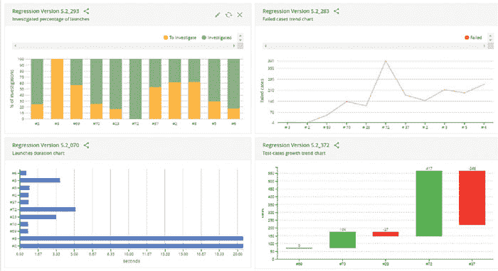

图 2.3：ReportPortal 工具的数据可视化示例

*“测试自动化中的报告与测试本身一样重要。如果没有人分析这些结果，自动化就像是空剧院里的表演。它不仅关乎运行测试，更关乎理解并采取结果。”*

*“要真正衡量测试自动化的有效性，必须衡量它的结果。从测试失败中获得的见解是量化进展并指导未来道路的指标。在自动化世界中，衡量是精通的关键。”*

*“测试自动化的力量在于执行测试，更在于报告所讲述的故事。如果没有人看结果，你就会错过了软件性能的叙述以及改进它的机会。”*

- Dmitriy (Dzmitry Humianiuk) – ReportPortal.io 首席

选择合适的自动化测试指标取决于业务和团队的具体目标。在首次实施自动化测试时，选择一个能够准确衡量自动化价值的指标至关重要的。在选择自动化测试指标时，请考虑以下关键因素：

- **与公司目标一致**：所选自动化指标应与组织的主要目标一致。例如，如果公司优先考虑软件的及时交付，那么选择跟踪相对于预设成功标准的测试进度指标将大有益。
- **QA 团队性能的渐进式改进**：所选指标应能让组织识别低效领域，并随着时间的推移逐渐改进。为了评估进度，建立基准并以此进行衡量至关重要。这允许团队跟踪自己的进展并进行渐进式的改进。
- **易于执行**：拥有如`“测试相关性”`这样复杂的指标在实施和解释方面可能会令人困惑。创建直观且易于总结的小指标，通过汇总来解释大局，可能会更简单。

## 测试自动化覆盖率

测试自动化覆盖率是一种用于衡量测试自动化工作的样本测试指标。它衡量了测试套件相对于整体测试范围的自动化程度。它评估了自动化测试用例或功能占总测试用例或功能数的百分比。

假设一个项目有 100 个测试用例，其中 80 个是自动化的。那么测试自动化覆盖率就是 80%。

### 优势

- **提高测试效率**：测试自动化覆盖率有助于识别自动化测试用例的比例，允许团队评估自动化效率。覆盖率越高，意味着执行的测试用例越多，缩短了测试时间。
- **增加测试覆盖范围**：自动化覆盖率突出了自动化测试覆盖的区域，使团队能够确保不同功能之间的全面测试，降低关键漏洞遗漏的风险。
- **可扩展性和可重用性**：通过跟踪自动化覆盖率，团队可以识别覆盖率低的区域并专注于自动化这些测试用例。随着覆盖率的提高，测试套件变得更具扩展性和重用性，允许团队高效处理未来的发布和迭代。

### 局限性

- **偏向高风险区域**：测试自动化覆盖率可能倾向于关注高风险或关键区域，可能导致不重要的功能覆盖率较低。这需要对应用程序进行仔细评估，以确保所有领域的全面覆盖。
- **维护挑战**：随着测试自动化覆盖率的扩大，与自动化测试相关的维护工作也随之增加。团队需要投入时间和资源维护和更新测试脚本，以跟应用程序的变化。

测试报告和测量是软件测试过程中的关键方面，能够实现有效的沟通、数据驱动的决策和持续改进。通过理解其重要性、遵循最佳实践、在适当间隔生成报告并通过合适的渠道共享它们，你可以增强协作、跟踪进度并确保交付高质量的软件项目。记住，一份良好的测试报告是传达信息和促进测试过程透明的有力工具。

## 结论

我们对为成功测试自动化奠定基础的重要主题进行了全面探讨。我们从理解质量的重要性以及自动化如何极大地加速实现这一目标的旅程开始。随后，我们深入研究了测试自动化策略的复杂性，强调了仔细规划和考虑各种因素的意义性。

本章进一步启示了我们关于自动化测试设计的艺术，强调了创建有效高效的自动化测试的最佳实践和技术。我们探索了测试执行和日志记录的关键方面，理解了如何无缝地执行自动化测试并为分析和调试目的捕获相关信息。

此外，我们讨论了测试自动化中报告和测量的重要性，认识到它们在为被测软件质量提供有价值见解的作用。通过利用全面的报告和准确的测量，我们可以做出数据驱动的决策，进一步增强我们的测试流程并提高整体软件质量。

掌握了这些知识，你现在已经准备好在坚实的基础上开启测试自动化之旅。记住，质量是一项持续的努力，而测试自动化是一个强大的助手，使我们能够实现更高水平的效率、准确的效果。通过应用本章涵盖的原则和技术，你可以提升你的测试实践并为卓越软件产品的开发贡献力量。

在接下来的章节中，我们将继续测试自动化之旅，学习 Selenium 基础、其架构、定位策略和常见的交互模式（例如点击按钮或向网页上的文本框发送输入）。我们还将查看与网页交互的不同方式以及 `Selenium WebDriver` 的一些故障排除技术，为 selenium 测试自动化奠奠下坚实基础。

## 练习

在对软件质量和测试自动化基础有了良好的理解后，是时候测试你的知识了。这里提供了几个练习题，旨在帮助你巩学习：

- 在 Google Maps 应用（或类似应用）中记录五种自动化检查优于手动测试的场景。
- 计算测试具有五个下拉框的表单字段（每个下拉框有两个可能的值）的所有可能场景数量。提示：使用组合测试的概念。
- 在设计自动化测试时，应该考虑哪些因素以确保自动化测试脚本的可靠性和可维护性？
- 软件测试中应该包含哪些指标和测量？它们如何帮助你评估产品质量？
- 持续集成和持续测试实践如何有助于实现更高水平的软件质量？

# 第 3 章

## Selenium WebDriver 基础

## 引言

在这一综合章节中，我们开启了一段使用 `WebDriver` 主 Web 自动化的精彩之旅。作为浏览器自动化的关键工具，`WebDriver` 特定语言的绑定，以实现精确高效的 Web 交互。我们首先探索 `WebDriver` 的架构，学习它如何作为编程语言与 `Chrome` 和 `Firefox` 等浏览器之间的桥梁。在我们深入研究 `WebDriver` 的功能（包括点击元素、填充表单和导航网页）时，这种理解至关重要。我们的旅程涵盖了设置 `WebDriver` 的基础，以及基本 Web 任务的实践。


随着内容的推进，章节介绍了管理多个浏览器窗口和框架的挑战，这种技能类似于在复杂建筑中导航不同的房间。掌握`WebDriver`的这方面可以确保 Web 应用程序内无缝切换和交互。此外，我们关注常见的 HTML 元素——网页的基础组件。你将学习与按钮、下拉列表和表单等各种元素的交互自动化。这包括处理表单提交和文件上传，以自动的方式复制用户操作。

为了巩固学习成果，本章提供了实用的练习，例如实现网站上购物车流程的自动化。这些现实场景增强了你对`WebDriver`在标准测试之外应用的理解，为你应对各种自动化挑战做好了准备。在本章结束时，你将掌握高效自动化复杂 Web 任务的知识和技能，为后续章节中的高级 Web 自动化技术开启大门。

## Structure

在本章中，我们将讨论以下主题：

* WebDriver 架构
* 设置与基础交互
* 定位器与 Web 元素
* 不同的定位策略
* 与 Web 元素的交互
* 句处理 Frame 和窗口
* 常见的 HTML 元素
* 表单提交与文件上传

## WebDriver 架构

让我们一起通过`Selenium WebDriver` API 进入 Web 浏览器自动化的核心。`Selenium WebDriver`提供了一套全面的特定语言绑定，使你能够按照其预期功能，精确且高效地控制 Web 浏览器。

通过利用`Selenium WebDriver`，你获得了以编程方式与 Web 浏览器交互的能力，从而实现基于浏览器的任务和测试的无缝自动化。`Selenium WebDriver`提供的特定语言绑定集合确保了与各种编程语言（如`Java`、`Python`、`C#`等）的兼容性，让你能够使用最熟悉、最精通的语言进行工作。

`Selenium WebDriver`是你选择的语言与底层浏览器驱动程序之间的桥梁。浏览器驱动程序（如`ChromeDriver`、`GeckoDriver`和`SafariDriver`）作为中间，促进`Selenium WebDriver`与浏览器本身之间的通信。这种架构允许你充分利用`Selenium WebDriver`的潜力，因为它为跨平台的浏览器自动化提供了标准化且一致的接口。

通过`Selenium WebDriver`，你可以轻松地创建并执行测试脚本，执行各种操作，包括点击元素、填写表单、在网页间导航以及验证预期行为。`WebDriver API`是`Selenium WebDriver`的核心组件，提供了一丰富的方法和接口，用于定位 Web 元素、对它们执行操作以及与浏览器状态同步。这确保了你的测试脚本能够准确可靠地与 Web 元素交互。

`Selenium WebDriver`既指语言绑定，也指单个浏览器控制代码的实现。这通常简称为`WebDriver`。

你是否想过是谁决定了创建 Web 浏览器以及`HTML`、`CSS`等许多其他 Web 技术的标准？万维网联盟（`W3C`）负责国际 Web 标准。`W3C`的 Web 标准被称为`W3C Recommendations`，浏览器厂商遵循这些标准来实现可访问性、文本视频描述和用户代理等功能。此外，这些可能包括浏览器、浏览器扩展、媒体播放器、阅读器和其他渲染 Web 内容的应用程序。

最新版本的`Selenium WebDriver`架构基于`W3C`（万维网联盟）`WebDriver`协议，因此与所有主流 Web 浏览器集成良好（因为它们也遵循`W3C`标准）。

现在，让我们理解`Selenium WebDriver`如何与浏览器通信并执行交互：

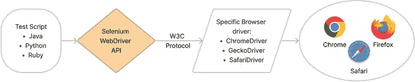

图 3.1：使用 Selenium 测试脚本与 Web 浏览器之间的通信

在 Selenium 4 中，架构涉及三个协同工作以实现浏览器自动化的主要组件。让我们以简单而详细的方式拆解这些组件：

* **Selenium Client 和 WebDriver 语言绑定**：`Selenium`是一个提供自动化浏览器命令的`API`（应用程序编程接口）。`Selenium Client`是一个独立部分，允许我们与`Selenium API`交互。`WebDriver Language Bindings`针对不同的编程语言（`Java`、`C#`、`Python`、`Ruby`和`JavaScript`），在每种语言中提供相同的`Selenium`命令。

* **Browser Drivers**：浏览器驱动程序作为`Selenium Client`、`WebDriver 语言绑定`与 Web 浏览器之间的中间媒介。浏览器驱动程序的第一个功能是接收来自`Selenium Client`和`WebDriver 语言绑定`的请求，并将其传递给浏览器。浏览器驱动负责控制浏览器，作为通信代理。浏览器驱动程序的第二个功能是接收浏览器的响应并将其传回给`Selenium Client`和`WebDriver 语言绑定`。驱动利用`W3C WebDriver Protocol`，大部分由相应的浏览器厂商开发。

* **Web Browsers**：在我们的测试脚本中，可以使用各种浏览器，如`Chrome`、`Firefox`、`Safari`和`Edge`。这些浏览器是执行所有`Selenium`命令的地方，执行预期的操作和交互。

当请求从浏览器驱动发送到浏览器时，浏览器处理该命令并向驱动程序返回响应。

整个过程涉及`Selenium Client`和`WebDriver 语言绑定`向`Browser Drivers`发送命令，然后由它们将其传递给 Web 浏览器。浏览器执行命令并向`Browser Drivers`返回响应，驱动程序随后将其交付给`Selenium Client`和`WebDriver 语言绑定`。

说得够，让我们来看一些技术示例并巩固我们的理解。

## Prerequisites

请确保你的计算机上已存在以下先决条件：

1. 从[`chromedriver.chromium.org/home`](https://chromedriver.chromium.org/home)下载最新的`ChromeDriver`。
2. 解压缩下载包中的文件。
3. 通过执行以下命令启动`ChromeDriver`会话，假设可执行文件位于当前目录：
   1. 对于 Mac，打开终端窗口并运行`./chromedriver`
   2. 对于 Windows，运行`chromedriver.bat`

这将产生如下所示的窗口：

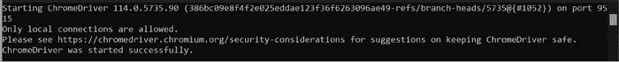

图 3.2：ChromeDriver 在端口 9515 上启动

现在在同一目录下（即你解压并运行 ChromeDriver 的地方），打开终端窗口并运行以下 CURL 请求：

```bash
curl -XPOST http://localhost:9515/session -d '{"desiredCapabilities":{"browserName":"chrome"}}'
```

漂亮！ChromeDriver 应该已经打开了一个 Chrome 窗口。这不神奇吗？

让我们拆解一下刚才发生了什么：

1. `curl`：用于发送 HTTP 请求的命令行工具。
2. `-XPOST`：此选项指定请求的 HTTP 方法，在此情况下为 POST 请求。POST 用于向服务器发送数据。
3. `http://localhost:9515/session`：请求发送到的 URL。在此情况下，它是 http://localhost:9515/session，表示请求正在发送到运行在端口 9515 的本地服务器。
4. `-d`：此选项用于指定包含在请求中的数据。数据以单引号包裹的字符串形式提供。在此情况下，发送的数据是`{"desiredCapabilities":{"browserName":"chrome"}}`，这是一个 JSON 对象。
5. `{"desiredCapabilities":{"browserName":"chrome"}}`：这是请求的 JSON 负载。它指定了将在服务器上创建会话所需的配置。在此情况下，它指定了所需的浏览器为 Google Chrome (`"browserName":"chrome"`)。

总的来说，此`CURL`请求用于在运行端口 9515 的本地服务器上创建一个新会话，并指定该会话所需的浏览器为 Google Chrome。

这里需要注意的重要点是，我们只是模拟向`ChromeDriver`调用了 API，并请求它启动一个浏览器会话。Selenium 通过相同的机制与`ChromeDriver`通信，并模拟用户行为，如打开浏览器、查找按钮和链接等网页元素，以及执行点击、输入和拖拽等网页操作。

Chrome 浏览器中的空白新页有什么用呢？让我们继续深入示例，尝试打开一个网页。在运行之前的`CURL`命令后，你会看到如下命令行窗口：

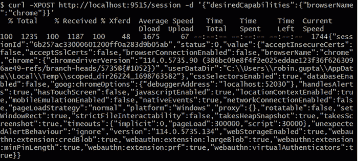

**图 3.3:** `CURL`的命令输出

在前面的输出中，记下 Session ID 为`6b257ac33000601200ff0a283d9b05ab`。

这就是我们创建的浏览器会话对应的 session ID。

在上方相同的 shell 窗口中运行以下命令，并用你命令行输出中的 session ID 替换它：

```
curl http://localhost:9515/session/6b257ac33000601200ff0a283d9b05ab/url -d '{"url":"http://google.com/"}'
```

将在上一个命令打开的浏览器中打开 Google 首页。这就是我们如何指示`ChromeDriver`导航到任何网站的方法。

如果不需要运行这些晦涩的`CURL`命令来完成打开浏览器和导航到 URL 等简单操作就好了。这正是 Selenium 出现的地方。

正如你观察到的，我们可以通过简单的 REST API 调用通过浏览器驱动（在我们示例中为 ChromeDriver）与网页浏览器通信。`ChromeDriver`遵循 W3C WebDriver 规范。你可以用它做很多事情，但如果没有像 Selenium WebDriver 这样的工具，执行更高级的任务将非常困难。

现在，让我们使用 Selenium WebDriver 执行相同的打开浏览器并导航到网站的示例。

## 设置与基础交互

在我们深入研究 Selenium 之前，请确保你的电脑上存在以下先决条件：

1. Eclipse（或类似的集成开发环境）。可以从[`www.eclipse.org/downloads/`](https://www.eclipse.org/downloads/)下载。此外应安装以下插件：
   * Maven : [`www.eclipse.org/m2e/`](https://www.eclipse.org/m2e/)
   * TestNG : [`testng.org/doc/eclipse.html`](https://testng.org/doc/eclipse.html)
   * EGit 插件 : [`eclipse.dev/egit/download/`](https://eclipse.dev/egit/download/)
2. Apache Maven。可以从[`maven.apache.org/download.cgi`](https://maven.apache.org/download.cgi)下载。同时，确保你的电脑设置了环境变量。
3. JAVA JDK（版本 11 或更高）。你可以从这里下载 Amazon Corretto 17，即 Amazon 版本的 OpenJDK：[`docs.aws.amazon.com/corretto/index.html`](https://docs.aws.amazon.com/corretto/index.html)

现在，从以下 GitHub 位置导入所有章节的代码：

[`github.com/ava-orange-education/Ultimate-Selenium-WebDriver-for-Test-Automation`](https://github.com/ava-orange-education/Ultimate-Selenium-WebDriver-for-Test-Automation)

我们将在第 11 章：展望中介绍 Git 基础。

`TestNG`是一个对新手友好的 Java 测试框架，帮助开发者和测试人员轻松创建和管理自动化测试。它提供了测试并行化、测试分组和测试依赖关系等强大功能，使测试执行更高效、更有组织。通过 TestNG，你可以使用简单的注解（如`@Test`）来编写测试方法，并将它们标记为测试用例。它还支持数据驱动测试，你可以使用不同的数据集运行相同的测试。TestNG 会生成详细的测试报告，使你能够轻松识别测试失败并跟踪整体测试状态。其易于使用的方法以及与 Maven 和 Gradle 等构建工具的集成，使 TestNG 成为 Java 项目测试的流行选择。无论你是测试新手还是资深专业人士，TestNG 都提供了一个直观而强大的框架，用于可靠且易于维护的自动化测试。

`Maven`是一个易于理解的 Java 项目构建自动化和项目管理工具。它简化了构建、管理依赖和组织代码的过程。通过 Maven，你可以在一个名为`pom.xml`的简单 XML 文件中定义项目配置。该文件包含了关于你的项目、依赖关系以及如何构建项目的信息。当你运行 Maven 时，它会自动下载所需的库并编译你的代码，创建结构化的输出。Maven 还支持各种插件，允许你轻松地运行测试、打包应用程序并将其部署到服务器。其易于使用的方法和标准化的项目结构使得 Maven 成为 Java 开发者广泛使用的工具，因为它节省时间并确保了不同环境之间的一致性。

**注意**：我们将在第 5 章：测试自动化框架中更详细地探讨 TestNG 和 Maven。

一旦你下载了上述代码，导航到`src/test/java/chapter3`位置下的`Chapter03_3.java`：

```java
package testscripts;

import org.openqa.selenium.WebDriver;
import org.openqa.selenium.chrome.ChromeDriver;

public class Chapter03_3 {
    public static void main(String[] args) throws Exception {
        // 创建 webdriver 实例
        WebDriver driver = new ChromeDriver();
        // 导航到 Google 首页
        driver.get("https://www.google.com");
        driver.quit();
    }
}
```

现在右键点击该程序打开菜单；并选择`Run as Java Application`。

这将运行程序并在 Chrome 浏览器中打开 google.com 网页。恭喜！你创建并运行了第一个 Selenium 测试自动化脚本。

就是这样！此程序设置了`ChromeDriver`，打开了 Chrome 浏览器窗口，并使用`Selenium WebDriver`导航到 Google 首页。

让我们详细查看第 5 步：

```
WebDriver driver = new ChromeDriver()
```

在上述代码中，我们创建了`ChromeDriver`实例并将其赋值给`driver`变量，这实际上在`WebDriver`接口和 Chrome 浏览器之间建立了连接。

这就是运行时多态发挥作用的地方。`WebDriver`接口充当蓝图或合同的角色，定义了一组用于控制任何网络浏览器的方法。通过将`ChromeDriver`对象（它实现了`WebDriver`接口）赋值给类型为`WebDriver`的变量`driver`，我们正在使用运行时多态来创建一个`ChromeDriver`类型的对象，该对象可用于与 Selenium 打开的浏览器进行交互。

最后，我们调用`driver.quit()`来退出所有的`WebDriver`实例（包括任何打开的子窗口）。

**注意**：`driver.close()`用于关闭当前浏览器窗口，而`driver.quit()`用于终止`WebDriver`并关闭与`WebDriver`会话相关的所有浏览器窗口。如果你想完全结束`WebDriver`会话，建议使用`driver.quit()`以确保所有浏览器窗口都正确关闭并释放资源。

如果你在 IDE 中输入“driver.”并浏览自动补全建议，你可以发现所有与浏览器交互的方法都在这里，如下：

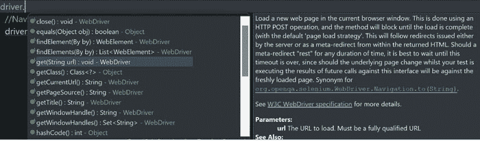

**图 3.4：** `ChromeDriver`为`WebDriver`接口实现的方法

**注意**：为了本书中的设置和引用，我们将参考 Selenium WebDriver API for JAVA（稳定版本 4.11.0）。

在 Selenium 的旧版本中，我们必须使用系统属性设置到`Chromedriver`（以及类似的程序）的路径。从 Selenium 4.6.0 版本开始，`Selenium Manager`与其绑定包一起发布，它会在后台自动下载并设置浏览器驱动程序。这样自动化工程师就不必苦于浏览器驱动程序版本。


`Selenium Manager` 是一个用 Rust 实现的命令行工具，为 Selenium 提供自动化的驱动程序和浏览器管理。它与每个版本的 Selenium 语言绑定包（即 Java、JavaScript、Python、Ruby 和 C#）一起发布并完全集成。这样，在 Selenium 会话启动之前，当这些驱动程序不可用时，`Selenium Manager` 会自动发现、下载并缓存 Selenium 需要的驱动程序（例如 `chromedriver`、`geckodriver`、`msedgedriver` 等）。此外，当本地系统未安装这些浏览器时，`Selenium Manager` 会自动发现、下载并缓存 Selenium 会话可使用的主要浏览器，即 Chrome（使用 Chrome-for-Testing - CfT）、Firefox 和 Edge。

- Boni Garcia，Selenium 项目开源提交者，及其生态系统中多个项目的创建者维护者，例如 `WebDriverManager`、`Selenium-Jupiter` 和 `BrowserWatcher`。

## 定位器与 Web 元素

那么，什么是 Selenium 定位器（Locators）？嗯，我好奇的朋友，Selenium 定位器就像 GPS 坐标，帮助我们定位并与网页上的特定元素交互。没有它们，在 Web 测试领域穿梭就像大海捞针。让我们来看下面这个简单的网页示例：

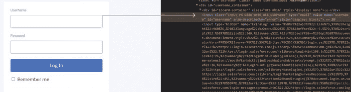

**图 3.5：** 网页上输入字段的 HTML 表达

左侧的 `Username` 字段由右侧的 HTML 代码组成。现在，虽然我们可以读取网页并识别 `Username` 字段并进行填充；但想一想软件（如 Selenium）将如何查看并与此类 Web 元素交互？

是的，你猜对了：通过利用定位器的力量。定位器赋予你填充表单、点击按钮以及访问网页上任何 Web 元素的能力。

**注意**：你可以通过右键点击网页上的任何 Web 元素（如链接或按钮），并在上下文菜单中选择“检查元素”（Inspect element）来查看其源代码。或者，你也可以按键盘上的 F12 键调出 Chrome 开发者工具。

那么定位器是如何工作的？为了理解作为 GPS（全球定位系统）坐标的定位器概念，我们需要将 HTML 可视化为一张地图。


**图 3.6：** 文档对象模型、WebDriver 和定位器的表示

想象你正在进行一次公路旅行，想要找到一个特定的位置。为了实现这一点，你使用 GPS（全球定位系统），它提供坐标（纬度和经度）以便你准确到达目的地。同样，在 Web 开发和测试中，我们有被称为“定位器”的东西，它们的作用就像 GPS 坐标，但是用于寻找网页上的特定元素。

当我们把网页看作地图时，就像地图有具有唯一地址的位置一样，网页也有按钮、文本字段、图像等元素。这些元素中的每一个都有其唯一的地址，被称为“定位器”。

当我们使用自动化工具（如 Selenium）与网页交互时，我们需要告诉工具如何准确地找到这些元素。这就是定位器大显身场的地方。它们提供了特定的指令来定位网页上的元素。

定位器有多种类型，例如：

- `ID`：它就像地图上建筑的唯一 ID 编号。
- `Name`：像街道名一样，元素可以有名称。
- `XPath`：把它看作在地图上绘制的精确路径。
- `CSS Selector`：它就像使用某些模式或样式来定位地图上的元素。

通过使用这些定位器，自动化工具可以在网页上导航、点击按钮、填充表单并执行各种操作，就像 GPS 在你的公路旅行中引导你一样。

因此，定位器的概念充当了网页的虚拟 GPS，使测试和开发更加高效准确。

上面提到的另一个关键概念是文档对象模型（DOM）。DOM 是一个跨平台接口，允许以树形结构表示类似 XML 的文档（例如网页）。想象一个带有不同部分的小网页，如标题、头部、链接等。DOM 创建了一棵树，网页的每个部分都表示为树中的一个“节点”或“元素”。例如，页面的标题将是一个节点，头部将是一个节点，链接也是节点。

网页中的每个元素，如你在 HTML 中看到的标签（`<html>`、`<head>`、`<body>`、`<a>` 等）都成为 DOM 树中的节点。每个重要的细节（如 `charset` 或 `href`）都成为该节点的属性。此外，你在这些标签内部看到的内容也存储在树中。因此，你在网页上读到的文本也是 DOM 树的一部分。

考虑以下 HTML 文件：

```
<!DOCTYPE html>
<html lang="en">
<head>
<meta charset="UTF-8" />
<meta name="viewport" content="width=device-width, initial-scale=1.0" />
<link rel="stylesheet" href="style.css" />
<title>Browser</title>
</head>
<body>

<h1>Selenium</h1>
<p>Best Tool Ever</p>
</body>
</html>
```

它的 DOM 呈现形式可以可视化所示：

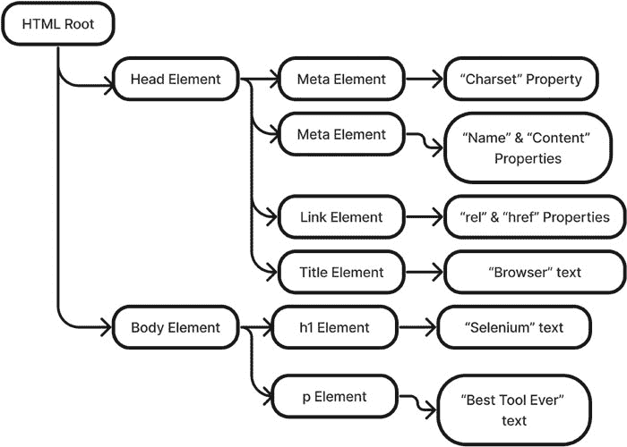

**图 3.7：** 文档对象模型的视觉表示

### WebElement

Selenium WebDriver 提供了两个关键方法来在 HTML 页面上定位 `WebElement`（各种元素的抽象，如链接、按钮、输入框、下拉列表等）。

- `findElement()`: 此方法用于根据特定标准在网页上定位单个元素。它会遍历文档对象模型（DOM），DOM 就像一个表示网页结构的树形结构。当你带有特定的 `By` 参数（定位策略）调用此方法时，它会寻找匹配该标准的第一个出现的元素。

  例如，你可以使用 `By.id` 查找具有特定 ID 属性的元素，或使用 `By.name` 根据其 name 属性定位元素。

  如果该方法找到了匹配项，它将返回该元素，以便你通过自动化代码对其进行交互。然而，如果未找到该元素，根据实现方式的不同，它可能会抛出异常（如 `NoSuchElementException`）或返回空值。

- `findElements()`: 此方法与上一个方法类似，但它返回的是元素列表而不是单个元素。因此，如果你想找到多个符合特定标准的元素，可以使用此方法。例如，如果你想找到页面上所有的链接，可以使用 `By.tagName(‘a’)` 作为 `By` 参数，它将返回一个包含页面上所有链接元素的列表。

使用 `findElement` 和如 `id`、`class` 或 `XPath` 等定位策略，我们可以定位并操作网页上的元素。让我们探索几个示例来巩固我们的理解：

### 使用定位器的示例：

从之前下载的代码库中打开 `Chapter03_id_Locator.java` 并关注给定的行：

```
WebElement inputfield = driver.findElement(By.id(“username”));
```

我们声明了一个名为 `inputfield` 的新变量，用于存储网页上特定元素的信息。它使用 `driver` 在网页上搜索具有唯一 `id` 属性且等于 `username` 的元素。当找到该元素时，它会将该信息分配给 `inputfield` 变量，这样你就可以在代码的后续部分与其交互或对其执行操作。

正如我们在这个 Java 类中看到的，这里没有 `public static void main(String[] args)` 语句，因为该类通过使用 `@Test(priority = 1)` 语句被建模为一个 TestNG 测试用例。`@Test` 注解告诉 TestNG，我们正在将 Java 类设置为 TestNG 测试。

**注意**：要运行 TestNG 测试，你可以右键点击编辑器窗口并点击 `Run As > TestNG Test` 选项。或者，你可以从键盘按下 `Alt+Shift+X`、`N`。

我们将 `Chapter03_id_Locator.java` 中的代码示例作为 TestNG 测试运行时；屏幕上网页元素的位置会被打印出来。以下是示例控制台输出：

```
[RemoteTestNG] detected TestNG version 7.4.0
Jul 30, 2023 6:26:05 PM org.openqa.selenium.remote.service.DriverService$Builder getLogOutput
INFO: Driver logs no longer sent to console by default; https://www.selenium.dev/documentation/webdriver/drivers/service/#setting-log-output
SLF4J: Failed to load class “org.slf4j.impl.StaticLoggerBinder”.
SLF4J: Defaulting to no-operation (NOP) logger implementation
SLF4J: See http://www.slf4j.com/codes.html#StaticLoggerBinder for further details.
Jul 30, 2023 6:26:07 PM org.openqa.selenium.devtools.CdpVersionFinder findNearestMatch
WARNING: Unable to find an exact match for CDP version 115, so returning the closest version found: 114
Location of the input field on screen is(90, 281)
PASSED: idLocatorExample
===============================================
Default test
Tests run: 1, Failures: 0, Skips: 0
===============================================
===============================================
Default suite
Total tests run: 1, Passes: 1, Failures: 0, Skips: 0
===============================================
```

**注意**：如果你观察到错误和测试失败，请在这一基础测试通过之前不要继续。此阶段的常见问题可能是网络连接或 `ChromeDriver` 的位置未正确设置。关于调试自动化测试的更多细节，可以在第 11 章：展望 中找到。

以下是其他定位器的示例供你参考：

- `Name`: 我们可以使用网页元素中提供的 `NAME` 属性来定位它。通常，网页上元素的 `NAME` 属性应该是唯一的。可以在 `Chapter03_name_Locator.java` 文件找到此示例。

```
WebElement inputfield = driver.findElement(By.name(“username”));
```

- `linkText`: 当我们想要查找网页上的链接时，可以使用链接文本定位器。链接文本就是你在链接上看到的文本。所以，如果网页上有一个链接，我们可以使用链接文本来识别它。

  例如，假设网页上有如下所示的 HTML 片段：

```html
<a class=”button secondary” id=”signup_link” href=”https://www.salesforce.com/form/trial/freetrial.jsp?d=70130000000”>Try for Free</a>
```

  使用链接文本来定位该链接：

```
WebElement tryfreelink = driver.findElement(By.linkText(“Try for Free”));
```

  一旦我们获得了链接元素，就可以与其进行交互。在这个示例中，我们在页面上获取了“Try for Free”链接。

- `partialLinkText`: 我们可以使用 `partialLinkText` 通过链接中的部分文本来定位元素，如下所示：

```
WebElement tryfreelink = driver.findElement(By.partialLinkText(“Free”));
```

让我们回顾一下之前在 (">Figure 3.6*) 中看到的 Maps 示例，其中 WebDriver 被表示为小汽车，HTML 表示为地图，而定位器（locator）则是定位针。在这张地图上，每栋建筑都由一个唯一的定位针（定位器）表示。你的任务是找到相对于地图上任何位置的所有建筑。现在，XPath 将作为你这张独特地图的 GPS 来救之急！你可以使用 `//` 运算符在地图上的任何地方搜索建筑（元素），无论它们的位置如何。这就像是从高处俯瞰整个城市的魔法鸟瞰视角，让你能够发现所有的建筑，即使它们隐藏在其他结构之后。

例如，使用 `//building` 作为 XPath 表达式，你本质上是在告诉你的 GPS (XPath) 在地图上的任何地方查找标签为 `building` 的元素。在 XPath 定位器中，`//` 运算符称为双正斜杠，它用于从当前节点选择文档中的元素，无论它们在 HTML 或 XML 结构中的位置。它允许你在整个文档中搜索节点，而不仅仅是在特定路径内。

*自动化脚本中的定位器就像汽车的轮子一样重要。*

*无论你的汽车发动机或设计有多好，如果轮胎破了，它就无法运行。同样，无论你编写的脚本有多好，如果任何定位器发生变化，脚本就会失败。因此，掌握定位器并编写稳定的定位器是非常重要的。*

- Sanjay Kumar，SelectorsHub 的创建者。

从 GitHub 下载的代码库的 `src/main/resources` 目录下在 Chrome 浏览器中打开 `Example1.HTML` 文件。右键点击打开的网页，并点击 `Inspect`（检查）打开 Chrome 开发者工具。按 `Ctrl+f` 像之前一样打开搜索窗以搜索 XPath。并按照以下示例操作。这里是供你参考的 HTML 文件：

```html
<html>
<body>
<div id = ‘1461’>
<p>Hello, World!</p>
</div>
<div>
<p>Another paragraph.</p>
</</div>>
</body>
</html>
```

现在，假设你想选择文档中所有的 `p` 元素。你可以这样在 XPath 表达式中使用 `//` 运算符：

```xpath
//p
```

然而，很多时候你需要的元素会隐藏在复杂的子结构中，你可能需要使用不仅仅是 `//` 运算符。这里有更多工具和示例可以帮助：

### 属性 (Attributes)

属性与 HTML 元素关联的额外信息。在 XPath 中，你可以使用属性来唯一标识元素或根据特定标准过滤元素。

**示例**：在 DOM 中通过 ID 属性选择元素。

要选择 `id` 属性等于 `‘1461’` 的第一个 `div` 元素，可以使用以下 XPath 表达式：`//div[@id=’1461’]`

### 轴 (Axes)

轴定义了文档中元素的关系，允许你在 HTML 树的不同部分之间导航。它们帮助你根据元素与其他元素的元素选择元素。

示例：使用 `ancestor` 轴选择 `p` 元素的祖先 `div`。

要选择文本为 `Hello, World!` 的 `p` 元素的祖先 `div` 元素，可以使用以下 XPath 表达式：`//p[text()=’Hello, World']/ancestor::div`

该表达式解释为：“选择文本为‘`Hello, World!`’的 `p` 元素的祖先 `div` 元素。”

### 运算符 (Operators)

XPath 还支持各种运算符，用于组合表达式或比较值。

示例：使用 `and` 运算符组合多个条件。

要选择 `id` 属性等于 `‘1461’` 且包含文本 `Hello, World!` 的 `div` 元素，可以使用以下 XPath 表达式：

```xpath
//div[@id=’1461’ and p[text()=’Hello, World!’]]
```

该表达式解释为：“选择 `id` 属性等于`‘1461’` 且包含一个文本为‘`Hello, World!`’的 `p` 元素的 `div` 元素。”

让我们探索更多使用轴、参数、运算符和谓词组合的示例。从 GitHub 下载的代码库的 `src/main/resources` 目录下在 Chrome 浏览器中打开 `Example2.HTML` 文件。

右键点击打开的网页，并点击 `Inspect`（检查）打开 Chrome 开发者工具。按 `Ctrl+f` 像之前一样打开搜索窗以搜索 XPath。并按照以下示例操作。这里是供你参考的 HTML 文件：

```html
<html>
<body>
<div id=’1461’>
<p>Hello, World!</p>
<p>Another paragraph.</p>
</div>
<div>
<p>Hello, XPath!</p>
<span>Some text in a span.</span>
</div>
<div class='special'>
<p>Special paragraph.</p>
</div>
</body>
</html>
```

**结合轴和谓词**

使用 `descendant` 轴配合谓词选择 ID 等于 `‘1461’` 的 `div` 元素内部所有的 `p` 元素：

```xpath
//div[@id='1461']/descendant::p
```

**使用运算符和谓词**

使用 `or` 运算符选择包含 `Hello` 或 `XPath` 的 `p` 元素：


# XPath 定位器

## 结合轴、运算符和谓词

使用 `descendant` 轴、`contains` 函数和 `not` 运算符选择不包含单词 `paragraph` 的 `p` 元素：

```xpath
//div[@id='1461']/descendant::p[not(contains(text(),'paragraph')]
```

## 使用属性、轴和谓词

使用 `following-sibling` 轴配合 `id` 属性和谓词，选择位于 ID 属性等于 `'1461'` 的 `div` 之后的 `div` 元素：

```xpath
//div[@id='1461']/following-sibling::div[1]
```

现在你已经成为一名 XPath 武士，可以在 HTML 中游刃有余。让我们使用这些概念通过 Selenium 寻找几个网页元素。

按照如下方式打开 `Chapter03_xpathlocator.java` 文件并作为 TestNG 测试运行它：

```java
package testscripts;

import java.util.List;
import org.openqa.selenium.By;
import org.openqa.selenium.WebDriver;
import org.openqa.selenium.WebElement;
import org.openqa.selenium.chrome.ChromeDriver;
import org.testng.annotations.Test;

public class Chapter03_xpathlocator {

    @Test(priority = 1)
    public void XPathLocatorExample() throws Exception {
        // 创建 webdriver 实例
        WebDriver driver = new ChromeDriver();
        // 导航到 Salesforce 登录页面
        driver.get("https://login.salesforce.com/");
        WebElement inputfield = driver.findElement(By.XPath("//input[@id='username']")); 
    }
}
```

```java
System.out.println("Location of the input field on screen is " + inputfield.getLocation());
List<WebElement> links = driver.findElements(By.XPath("//a"));
System.out.println("Count of all the links is " + links.size());
driver.quit();
```

在前面的 Java 类中，以下行代码对于理解如何使用 XPath 定位网页元素非常重要：

```java
WebElement inputfield = driver.findElement(By.XPath("//input[@id='username']"));
System.out.println("Location of the input field on screen is " + inputfield.getLocation());
```

在这些行代码中，我们正在使用 Selenium WebDriver 配合 XPath 表达式来查找网页上的元素。这里处使用的 XPath 表达式是 `//input[@id='username']`。这意味着我们正在寻找一个具有 `id` 属性且值为 `username` 的 `input` 元素。`driver.findElement` 方法根据 XPath 表达式定位网页上的第一个匹配元素，并将其存储在类型为 `WebElement` 的变量 `inputfield` 中。这允许我们打印它在屏幕上的位置。

```java
List<WebElement> links = driver.findElements(By.XPath("//a"));
System.out.println("Count of all the links is " + links.size());
```

在这些行代码中，我们正在使用 Selenium WebDriver 配合 XPath 表达式来查找网页上的多个元素。这里处使用的 XPath 表达式是 `//a`。这意味着我们正在寻找网页上所有的 `a` 元素（超链接）。`driver.findElements` 方法根据 XPath 表达式定位所有匹配元素，并将它们存储在一个名为 `links` 的 `WebElement` 对象列表中。`links.size()` 方法返回 `links` 列表中存在的元素数量，这对应于页面上找到的超链接数量。

# CSS 定位器

CSS 代表层叠样式表（Cascading Style Sheets），它可以成为任何定位策略的核心。CSS 定位器使用类似于 CSS（层叠样式表）的简洁且丰富的语法，根据元素的属性、类、ID 或在文档树中的位置来识别元素。就像在 CSS 中一样，你可以使用不同类型的选择器来定位特定元素，从而简单高效地访问所需的元素。

有多种类型的 CSS 定位器，包括：

1. **元素选择器 (Element Selector)**：根据标签名定位元素（例如，`div`、`p`、`a`）。

2. **类选择器 (Class Selector)**：根据类属性定位元素（例如，`.classname`）。

3. **ID 选择器 (ID Selector)**：根据 ID 属性定位元素（例如，`#elementID`）。

4. **属性选择器 (Attribute Selector)**：根据任何属性及其值定位元素（例如，`[attribute='value']`）。

5. **后代选择器 (Descendant Selector)**：定位特定父元素的后代（例如，`parent descendant`）。

6. **子级选择器 (Child Selector)**：定位特定父元素的直接子元素（例如，`parent > child`）。

让我们结合 HTML 代码段探索一些 CSS 定位器的常用格式。

创建以下 HTML 文件，或从你下载的源码中的 `Example3.HTML` 打开它：

```html
<html>
<body>
  <div class="container">
    <h1>Welcome to CSS Locators</h1>
    <p class="highlight">This is a paragraph.</p>
    <p>This is another paragraph.</p>
    <ul>
      <li>Item 1</li>
      <li>Item 2</li>
    </ul>
  </div>
</body>
</html>
```

现在按照以下步骤在控制台中检查 CSS 定位器：

1. 按 `F12` 打开 Chrome 开发者工具。

2. 切换到 Console（控制台）面板。

3. 输入类似 `$$("h1")` 的 CSS 选择器进行评估和验证。

4. 检查控制台执行返回的结果 - 如果匹配到元素，它们将以列表形式返回。否则，将显示空列表 `[]`。

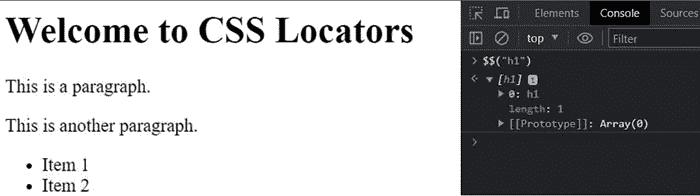

**图 3.9:** 在 Chrome 控制台中查找 CSS 定位器

尝试以下 CSS 选择器示例：

**元素选择器**：元素选择器根据标签名定位元素。

- **示例**：选择 `h1` 元素。

- CSS 定位器：`h1`

- **解释**：此 CSS 定位器将选择 `h1` 元素，内容为 `Welcome to CSS Locators`。

**类选择器**：类选择器根据类属性定位元素。

- **示例**：选择类名为 `highlight` 的元素。

- CSS 定位器：`.highlight`

- **解释**：此 CSS 定位器将选择带有类 `highlight` 的 `p` 元素，内容为 `This is a paragraph`。

**后代选择器**：后代选择器选择特定父元素的后代。

- **示例 4**：选择 `ul` 元素内部所有的 `li` 元素。

- CSS 定位器：`ul li`

- **解释**：此 CSS 定位器将选择两个 `li` 元素，`Item 1` 和 `Item 2`，它们都是 `ul` 元素的后代。

**子级选择器**：子级选择器选择特定父元素的直接子元素。

- **示例 5**：选择 `ul` 元素的所有直接子 `li` 元素。

- CSS 定位器：`ul > li`

- **解释**：此 CSS 定位器将选择两个 `li` 元素，`Item 1` 和 `Item 2`，它们都是 `ul` 元素的直接子元素。

**属性选择器**：属性选择器根据其属性定位元素。

- **示例 6**：选择所有带有 `class` 属性的元素。

- CSS 定位器：`[class]`

- **解释**：此 CSS 定位器将选择 `div` 和 `p` 元素，因为它们都有 `class` 属性。

没有实践的理论是什么？让我们使用围绕 CSS 定位器的概念使用 Selenium 查找几个网页元素。

按照如下方式打开 `Chapter03_CSSlocator.java` 文件并作为 TestNG 测试运行：

```java
package testscripts;
import org.openqa.selenium.By;
import org.openqa.selenium.WebDriver;
import org.openqa.selenium.WebElement;
import org.openqa.selenium.chrome.ChromeDriver;
import org.testng.annotations.Test;

public class Chapter03_CSSlocator {
  @Test(priority = 1)
  public void CSSPathExample() throws Exception {
    // 创建 webdriver 实例
    WebDriver driver = new ChromeDriver();
    // 导航到 Salesforce 登录页面
    driver.get("https://login.salesforce.com/");
    WebElement inputfield = driver.findElement(By.cssSelector("input.r4.wide.mb16.mt8.username"));
    System.out.println("Location of the input field on screen is " + inputfield.getLocation());
    driver.quit();
  }
}
```

就像使用可靠的车辆进行地图导航一样，我们已经学习了如何使用强大的 `WebDriver` 导航 HTML，并使用各种定位策略来定位网页元素。现在，是时候让我们的之旅提升到新的高度，学习如何对这些网页元素执行点击等操作了。

请系好安全带，我们将探索与网页元素的各种交互，例如点击、拖放、输入和网页导航。

要探索网页元素上可用的所有选项，我们可以按照如下方法在 IDE 中尝试自动完成：

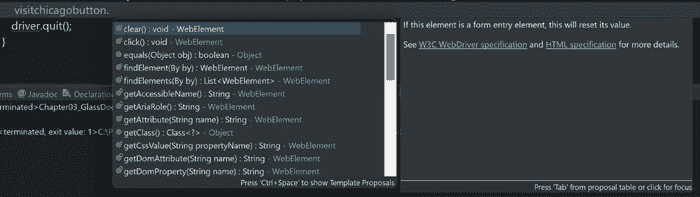

**图 3.10：** 网页元素的可用方法

让我们仔细观察网页元素级别可提供的各种方法和操作。

## click

`click()` 方法用于点击元素。如果此操作导致新页面的加载，您应该丢弃对该元素的所有引用，对该元素执行的任何后续操作将抛出 `StaleElementReferenceException`。元素被点击需要一些前提条件：元素必须是可见的，且高度和宽度必须大于 0。

按照如下方式在下载的仓库中打开 `Chapter03_ButtonClick.java` 类：

```java
WebDriver driver = new ChromeDriver();
//导航到 Salesforce 登录页面
driver.get("https://login.salesforce.com/");
WebElement loginbutton = driver.findElement(By.xpath("//input[@id='Login']"));
//尝试点击按钮
loginbutton.click();
driver.quit();
```

在提供的 Java Selenium 代码中，我们首先初始化一个 `ChromeDriver` 会话来启动浏览器。然后，使用 `get()` 方法和 URL `https://login.salesforce.com/` 导航到 Salesforce 登录页面。接下来，使用 `findElement()` 方法和 XPath 表达式在页面上定位登录按钮。找到按钮后，尝试使用 `click()` 方法点击它。最后，在完成交互后，退出 `WebDriver`，关闭浏览器并结束自动化会话。总结来说，该代码自动化了访问 Salesforce 登录页面、定位登录按钮并在结束浏览器会话之前尝试点击它的过程。

## isDisplayed

`isDisplayed()` 方法用于检查网页元素是否在网页上可见。它返回一个布尔值：如果元素可见则返回 `true`，如果元素隐藏或在 DOM 中不存在则返回 `false`。

按照如下方式在下载的仓库中打开 `Chapter03_IsDisplayed.java` 类：

```java
WebDriver driver = new ChromeDriver();
//导航到 Salesforce 登录页面
driver.get("https://login.salesforce.com/");
WebElement loginbutton = driver.findElement(By.xpath("//input[@id='Login']"));
//检查元素是否显示
System.out.println("Is the button displayed ? " + loginbutton.isDisplayed());
driver.quit();
```

这里的打印语句显示 `"Is the button displayed ? true"`，说明按钮是显示的。

## isEnabled

`isEnabled()` 方法用于检查网页元素是否启用供用户交互。它返回一个布尔值：如果元素已启用则返回 `true`，如果已禁用则返回 `false`。

按照如下方式在下载的仓库中打开 `Chapter03_IsEnabled.java` 类：

```java
WebDriver driver = new ChromeDriver();
//导航到 Salesforce 登录页面
driver.get("https://login.salesforce.com/");
WebElement loginbutton = driver.findElement(By.xpath("//input[@id='Login']"));
//检查元素是否启用
System.out.println("Is the button enabled ? " + loginbutton.isEnabled());
driver.quit();
```

这里的打印语句显示 `"Is the button enabled ? true"`，说明按钮是启用的。

**注意**：`isEnabled()` 和 `isDisplayed()` 是检查网页元素是否可以进行点击等交互的极佳组合。将其想象为在进入商店购物之前，先检查商店是否在街道上显示并处于营业状态。

## getAttribute

`getAttribute()` 方法用于获取网页元素指定属性的值。它通常用于从元素中提取信息，例如获取输入字段的值、链接的 `"href"` 或图像的 `"src"`。

按照如下方式在下载的仓库中打开并运行 `Chapter03_getAttribute.java` 类：

```java
//导航到 Salesforce 登录页面
driver.get("https://login.salesforce.com/");
WebElement loginbutton = driver.findElement(By.xpath("//input[@id='Login']"));
//获取 name 属性
System.out.println("Value of the name attribute is : " + loginbutton.getAttribute("name"));
driver.quit();
```

这里的打印语句显示 `"Value of the name attribute is : Login"`，显示了 `name` 属性。登录按钮的参考 HTML 如下：

`<input class="button primary" type="submit" id="Login" name="Login" value="Log In">`

## getText

`getText()` 方法用于获取元素的可见文本（由 CSS 渲染）。它通常用于提取标题、段落或标签的内容。

按照如下方式在下载的仓库中打开并运行 `Chapter03_getText.java` 类：


```java
//导航到 Salesforce 登录页面
driver.get("https://login.salesforce.com/");
WebElement tryfreebutton = driver.findElement(By.xpath("//a[@id='signup_link']"));
//获取文本
System.out.println("Value of the text is : " + tryfreebutton.getText());
driver.quit();
```

这里的打印语句显示 `"Value of the text is : Try for Free"`，显示了注册按钮的文本。其 HTML 如下：

```html
<a class="button secondary" id="signup_link" href="https://www.salesforce.com/form/trial.jsp?d=7013000000En">Try for Free</a>
```

## sendKeys

`sendKeys()` 方法用于向文本字段模拟键盘输入。它通常用于输入文本、执行快捷键或与输入字段交互。

按照如下方式在下载的仓库中打开并运行 `Chapter03_sendKeys.java` 类：

```java
WebDriver driver = new ChromeDriver();
//导航到 Salesforce 登录页面
driver.get("https://login.salesforce.com/");
WebElement usernameinput = driver.findElement(By.xpath("//input[@id='username']"));
//设置文本值
usernameinput.sendKeys("reader@orangeava.com");
thread.sleep(3000);
driver.quit();
```

`sendKeys()` 命令本质上是告诉 Selenium WebDriver 找到 `usernameinput` 代表的输入字段，并模拟输入 `reader@orangeava.com` 的动作。这是 Web 自动化中常见的操作，通常用于测试期间填写登录表单或输入字段。

这里需要注意的另一个命令是 `thread.sleep(3000)`。

在 Java Selenium 自动化中，`Thread.sleep()` 命令用于在测试脚本引入指定的暂停或等待。时间以毫秒为单位。在本例中，该命令使脚本暂停 3000 毫秒，等同于 3 秒。

`Thread.sleep()` 方法是 Java 语言的一部分，它会暂停当前线程的执行，在此期间允许其他任务运行。它通常用于测试自动化引入延迟或等待特定场景，例如等待页面加载、等待元素可见或在测试步骤之间添加一些时间缓冲。

然而，必须谨慎使用 `Thread.sleep()`。虽然它在某些情况下很有用，但它并不是 Selenium 测试自动化中处理等待的推荐方法。使用 Selenium 的 `WebDriverWait` 类或 `ExpectedConditions` 提供的显式等待是更可靠、更高效的方法，因为它允许测试等待特定条件的满足，而不仅仅是等待固定的时长。我们将在下一章中详细探讨等待策略。

过度使用 `Thread.sleep()` 会不必要地减慢测试执行，并降低测试脚本的可维护性。在 Web 应用响应时间出现延迟或波动的情况下，它可能会导致测试执行时间过长并产生误报。

在我们的示例中，`Thread.sleep(3000)` 是用于在测试自动化脚本中引入特定持续暂停的命令。然而，通常建议使用 Selenium WebDriver 提供的显式等待来更有效有效地处理等待和同步。我们使用 `Thread.sleep()` 是为了减慢测试脚本，以便观察文本是如何输入到登录字段中的。

## clear()

`clear()` 方法用于清除输入字段中的文本或重置输入字段的值。它通常在向字段中输入新数据之前使用。如果该元素是一个表单输入元素，此操作将重置其值。

按照如下方式打开并运行下载仓库中的 `Chapter03_clear.java` 类：

```java
//导航到 Salesforce 登录页面
driver.get("https://login.salesforce.com/")
WebElement usernameinput = driver.findElement(By.xpath("//input[@id='username']"));
//设置文本值
usernameinput.sendKeys("reader@orangeava.com");
Thread.sleep(3000);
usernameinput.clear();
Thread.sleep(3000);
driver.quit();
```

给定的命令用于与登录输入 Web 元素交互、输入文本、清除输入字段并在测试脚本中引入暂停，以便我们观察交互过程。

以下是关键 Web 交互的表格格式总结，供参考：

| 方法 | 说明 |
| :--- | :--- |
| `clear()` | 清除输入字段的文本或重置其值。 |
| `click()` | 对 Web 元素（如按钮或链接）模拟点击操作。 |
| `findElement(By by)` | 查找并返回第一个与给定定位策略 (`By`) 匹配的 Web 元素。 |
| `findElements(By by)` | 查找并返回所有与给定定位策略 (`By`) 匹配的 Web 元素列表。 |
| `getAccessibleName()` | 获取 Web 元素的可访问名称属性值，对无障碍测试有用。 |
| `getAriaRole()` | 获取 Web 元素的 ARIA 角色属性值，有助于与无障碍相关的测试。 |
| `getAttribute(String name)` | 获取 Web 元素的指定属性的值，如 `href` 或 `value`。 |
| `getCssValue(String property)` | 获取 Web 元素的指定 CSS 属性的计算值，如 `color` 或 `font-size`。 |
| `getDomAttribute(String name)` | 获取 Web 元素的 DOM 属性值，如 `class` 或 `id`。 |
| `getDomProperty(String name)` | 获取 Web 元素的 DOM 属性的值，如 `textContent` 或 `innerText`。 |
| `getLocation()` | 获取 Web 元素页面左上角的坐标。 |
| `getRect()` | 以矩形形式获取 Web 元素的大小和位置。 |
| `getShadowRoot()` | 如果可用，获取使用 shadow DOM 的 Web 元素的影子根。 |
| `getSize()` | 获取 Web 元素的大小（宽度和高度）。 |
| `getTagName()` | 获取 Web 元素的 HTML 标签名，如 `div` 或 `input`。 |
| `getText()` | 获取 Web 元素的可见文本，如标题或段落的内容。 |
| `isDisplayed()` | 检查 Web 元素在页面上是否可见。 |
| `isEnabled()` | 检查 Web 元素是否允许用户交互。 |
| `isSelected()` | 检查 Web 元素是否被选中，通常用于复选框或单选按钮。 |
| `sendKeys(CharSequence… key)` | 向输入字段或 Web 元素模拟输入或发送键盘输入。 |
| `submit()` | 提交表单，通常用于表单内的输入元素。 |

**表 3.1：** Web 元素方法总结

## 处理框架和窗口

在 Selenium 测试自动化领域，浏览器窗口和框架（frames）为我们的旅程增加了复杂性。浏览器窗口就像通往 Web 不同部分的门户，而框架就像是这些门户内部复杂的画作。作为测试人员，我们必须熟练地在多个窗口和框架之间导航，无缝切换上下文以与所需内容交互。无论是处理弹出窗口、iFrames 还是 framesets，理解窗口管理的艺术都能确保我们能够有效地在这些数字画布上操作和验证元素。这项技能赋予了我们力量。

## iframes

在 HTML 中，`iframe`（inline frame 内联框架的缩写）是一种允许您在当前文档中嵌入另一个元素的元素。它们通常用于视频、地图或其他内容。

示例：

```html
<iframe src="https://www.youtube.com/embed/video-id"></iframe>
```

访问 [`www.w3schools.com/tags/tryit.asp?filename=tryhtml_test`](https://www.w3schools.com/tags/tryit.asp?filename=tryhtml_test) 并尝试使用 Chrome 开发者工具检查表格。

观察下面的图片，显示的表格在一个 iframe 内部，我们无法通过肉眼定位或识别它。因此，当我们右键点击表格时，可以看到额外的选项，如 `View frame source`（查看帧源）或 `Reload frame`（重新帧）。


**图 3.11：** iframes 的上下文菜单

使用 Java 在 Selenium 中与 iframe 交互涉及将 WebDriver 的焦点切换到 iframe，以便你可以与其内部的元素交互。处理 iframes 有三种方法，包括：

- **By Index**：你可以通过索引数字切换到 iframe。索引从 0 开始，页面上存在的每个 iframe 都会递增。这种方法在存在单个 iframe 或具有具有一致顺序的 iframe 时非常有用。打开并运行 `Chapter03_iframeInteraction.java` 文件并观察以下代码行：

```java
driver.get("https://www.w3schools.com/tags/tryit.asp?filename=tryhtml_test");
driver.switchTo().frame(0);
Thread.sleep(10000);
WebElement columnheader1 = driver.findElement(By.xpath("//th[normalize-space()='Month']"));
//获取文本值
System.out.println("First Column header is " + columnheader1.getText());
//切换回主页面
driver.switchTo().defaultContent();
```

在这里，我们使用 `driver.switchTo().frame(0)` 命令切换到第一个 iframe，然后从内部获取列头的 Web 元素。xpath `(//th[normalize-space()='Month'])` 用于定位文本内容为 `Month` 的 `<th>`（表头）元素，并去除了首尾空格。一旦获取了 Web 元素的文本，可以使用 `driver.switchTo().defaultContent()` 切换回默认内容。

- **通过名称或 ID**：你可以通过 iframe 的 name 或 ID 属性切换到该 iframe。具有唯一名称或 ID 的 iframe 可以通过这种方法轻松地定位。

示例：

```java
WebDriver driver = new ChromeDriver();
driver.get("https://example.com");
// 使用名称或 ID 切换到 iframe
driver.switchTo().frame("frameNameOrId");
// 在 iframe 内部执行操作
WebElement elementInsideiframe = driver.findElement(By.id("elementId"));
elementInsideiframe.sendKeys("Hello, iframe!");
// 切回主页面
driver.switchTo().defaultContent();
```

- **通过 Web 元素**：如果你已经使用 `findElement()` 或其他方法定位了 iframe 元素，你可以直接使用 `switchTo().frame()` 方法配合 `WebElement` 切换到它上。

示例：

```java
WebDriver driver = new ChromeDriver();
driver.get("https://example.com");
// 定位 iframe 元素
WebElement iframeElement = driver.findElement(By.id("iframeId"));
// 使用 WebElement 切换到 iframe
driver.switchTo().frame(iframeElement);
// 在 iframe 内部执行操作
WebElement elementInsideiframe = driver.findElement(By.id("elementId"));
elementInsideiframe.click();
// 切回主页面
driver.switchTo().defaultContent();
```

**注意**：在 iframe 内部执行操作后，必须使用 `driver.switchTo().defaultContent()` 切回主页面，以便与 iframe 之外的元素交互。此外，确保在切换到 iframe 之前其已加载（通过使用等待策略或 `Thread.sleep()`），否则可能会抛出 `NoSuchFrameException`。

## 窗口管理

Selenium 测试自动化中的窗口管理是指处理执行期间可能打开的多个浏览器窗口或标签页的过程。在与 Web 应用交互时，点击链接、按钮或打开新页面等操作会导致新窗口或标签页的打开。在这些窗口之间切换以与其交互至关重要。

Selenium 提供了有效管理窗口和标签页的方法。窗口管理的主要方法有 `getWindowHandles()`、`switchTo().window()` 和 `close()`。

让我们通过 Java 和 Selenium 以及真实网站的示例来探索窗口管理。考虑一种场景：点击一个打开新标签页的按钮，我们需要在原始标签页和新标签页之间进行切换。

打开并运行 `Chapter03_newTabInteraction.java` 文件并观察以下代码：

```java
// 导航到 W3 网站
driver.get("https://www.w3schools.com/tags/tryit.asp?filename=tryhtml_a_target");
driver.switchTo().frame(0);
Thread.sleep(10000);
WebElement tablink = driver.findElement(By.xpath("//a[normalize-space()='Visit W3Schools!']"));
tablink.click();
// 获取所有打开的标签页的句柄
String parentTabHandle = driver.getWindowHandle();
System.out.println("父标签句柄是：" + parentTabHandle);
for (String tabHandle : driver.getWindowHandles()) {
    if (!tabHandle.equals(parentTabHandle)) {
        driver.switchTo().window(tabHandle);
        Thread.sleep(5000);
        break;
    }
}
// 在新标签页中执行操作
System.out.println("新标签句柄是：" + parentTabHandle);
System.out.println("新标签页的标题: " + driver.getTitle());
// 切回父标签页
driver.switchTo().window(parentTabHandle);
Thread.sleep(5000);
// 在父标签页中执行操作
System.out.println("父标签页的标题: " + driver.getTitle());
```

在示例中，我们首先使用 `driver.getWindowHandle()` 获取当前窗口句柄。当新窗口或标签页打开时，我们使用 `driver.getWindowHandles()` 获取所有打开的窗口或标签页的句柄。然后我们遍历这些句柄以找到新窗口或标签页。一旦定位，我们使用 `driver.switchTo().window(windowHandle)` 将焦点切换到新窗口或标签页。在新窗口或标签页中执行操作后，可以使用 `driver.close()` 将其关闭，并使用 `driver.switchTo().window(parentWindowHandle)` 切回父窗口或标签页。

切换浏览器中的窗口也可以遵循相同的方法。

考虑一种点击链接打开新窗口的场景，我们需要与原始窗口和新窗口中的元素进行交互。我们可以通过以下代码实现相同的功能：


```java
driver.get("https://www.example.com");
// 点击打开新窗口的链接
driver.findElement(By.linkText("Open New Window")).click();
// 获取所有打开的窗口的句柄
String parentWindowHandle = driver.getWindowHandle();
for (String windowHandle : driver.getWindowHandles()) {
    if (!windowHandle.equals(parentWindowHandle)) {
        driver.switchTo().window(windowHandle);
        // 在新窗口中执行操作
        System.out.println("新窗口标题: " + driver.getTitle());
        // 切回父窗口
        driver.close();
        driver.switchTo().window(parentWindowHandle);
        break;
    }
}
```

## Common HTML 元素

常见的 HTML 元素是网页的构建组件。对于任何参与 Web 开发、设计或测试自动化的人来说，掌握这些元素都是至关重要的。它们允许开发者以意义的方式结构并展示内容。

一些常见的 HTML 元素包括 `<h1>` 到 `<h6>`、`<p>`、`<a>`、``、`<ul>`、`<ol>`、`<li>`、`<table>`、`<tr>`、`<th>`、`<td>`、`<form>`、`<input>`、`<textarea>` 和 `<button>`。

## Table

我们在上一节中简要观察了与表格的交互。让我们深入探讨一下与 HTML 表格交互的主题。HTML 表格用于按列组织数据。

示例 HTML：

```html
<!DOCTYPE html>
<html>
<head>
<style>
table, th, td {
border: 1px solid black;
}
</style>
</head>
<body>
<h1>表格元素</h1>
<table>
<tr>
<th>Month</th>
<th>Savings</th>
</tr>
<tr>
<td>January</td>
<td>$100</td>
</tr>
<tr>
<td>February</td>
<td>$80</td>
</tr>
</table>
</body>
</html>
```

在下例示例中，我们看到如何使用 Selenium 与表格交互。

打开并运行 `Chapter03_TableInteraction.java` 文件并观察以下代码：

```java
WebDriver driver = new ChromeDriver();
driver.get("https://www.w3schools.com/tags/tryit.asp?filename=tryhtml_table_test");
driver.switchTo().frame(0);
Thread.sleep(10000);
// 定位表格元素
WebElement tableElement = driver.findElement(By.xpath("//table"));
// 获取表格中所有的行
List<WebElement> rows = tableElement.findElements(By.tagName("tr"));
// 遍历行并访问单元格（列）
for (WebElement row : rows) {
    List<WebElement> cells = row.findElements(By.tagName("td"));
    // 获取每个单元格的数据并打印
    for (WebElement cell : cells) {
        System.out.println(cell.getText());
    }
}
driver.quit();
```

```java
System.out.print(cell.getText() + "\t");
}
System.out.println(); // 到下一行
}
driver.quit();
}
```

在这个示例中，我们使用 xpath `//table` 通过 `driver.findElement(By.xpath("//table"));` 定位表格。然后，我们分别使用 `findElements(By.tagName("tr"))` 和 `findElements(By.tagName("td")),` 访问表格的行和单元格。最后，我们使用 `getText()` 从每个单元格中提取数据并将其打印到控制台。

通过这种方式，你可以实现 HTML 表格的自动化，并根据你的测试需求执行各种操作，例如数据验证、过滤或与特定单元格进行交互。

## 选择框

HTML 中的 `<select>` 元素用于创建下拉列表，也称为选择下拉列表。它允许用户从预定义的选项列表中选择一个选项。下拉列表包含一个或多个代表可选项项目的 `<option>` 元素。可以使用 `<option>` 标签中的 `selected` 属性来识别被选中的选项。

示例 HTML：

```html
<label for="cars">Choose a car:</label>
<select name="cars" id="cars">
  <option value="volvo">Volvo</option>
  <option value="saab">Saab</option>
  <option value="opel">Opel</option>
  <option value="audi">Audi</option>
</select>
```

打开 `Chapter03_SelectInteraction.java` 文件并观察以下代码：

```java
//导航到 W3 网站
driver.get("https://www.w3schools.com/tags/tryit.asp?filename=tryhtml_select");
driver.switchTo().frame(0);
Thread.sleep(10000);
// 通过 ID 定位 <select> 元素
WebElement selectElement = driver.findElement(By.id("cars"));
// 使用 <select> 元素创建 Select 对象
Select select = new Select(selectElement);
// 1. 通过可见文本选择选项
select.selectByVisibleText("Volvo");
// 2. 通过值选择选项
// select.selectByValue("saab");
// 3. 通过索引选择选项（从 0 开始的索引）
// select.selectByIndex(2);
// 如果需要，执行其他操作
// 例如，获取所选选项的文本：
String selectedOption = select.getFirstSelectedOption().getText();
System.out.println("Selected option: " + selectedOption);
// 关闭浏览器
driver.quit();
```

在这个示例中，我们使用 `findElement()` 方法通过 ID `cars` 定位 `<select>` 元素。然后，我们使用 `<select>` 元素创建一个 `Select` 对象。你可以使用 `Select` 类提供的三种方法之一从下拉列表中选择选项：`selectByVisibleText()`、`selectByValue()` 或 `selectByIndex()`。你只需根据你想要选择选项的方式，取消所需方法的注释并注释掉其他方法即可。

## 单选按钮 (Radio button)

单选按钮用于向用户提供一组互斥的选项。组内只能选择一个选项。单选按钮使用带有 `type="radio"` 属性的 `<input>` 元素创建。每个单选按钮都应该有一个唯一的 `name` 属性以便将其分组。

打开并运行 `Chapter03_RadioInteraction.java` 文件并观察以下代码：

```java
//导航到 W3 网站
driver.get("https://www.w3schools.com/tags/tryit.asp?filename=tryhtml5_input_type_radio");
driver.switchTo().frame(0);
Thread.sleep(10000);
// 通过 ID 定位单选按钮
WebElement htmlRadio = driver.findElement(By.id("html"));
WebElement cssRadio = driver.findElement(By.id("css"));
WebElement javascriptRadio = driver.findElement(By.id("javascript"));
// 点击单选按钮进行选择
cssRadio.click();
// 如果需要，执行其他操作
// 例如，检查单选按钮是否被选中：
boolean isHtmlSelected = htmlRadio.isSelected();
System.out.println("Is HTML radio button selected? " + isHtmlSelected);
// 关闭浏览器
driver.quit();
```

在这个示例中，我们使用 `findElement()` 方法通过它们的 ID `("html", "css", 和 "javascript")` 定位单选按钮。你也可以根据具体的 HTML 结构使用 `name` 或 `value` 等其他属性来定位它们。然后，我们使用 `click()` 方法选择单选按钮 `CSS`。你可以通过对相应的 `WebElement` 调用 `click()` 将选择更改为任何其他单选按钮。

## 拖放

拖放是 Web 应用中常见的用户交互，用户点击并按住一个元素，将其拖到新位置，然后释放。使用 Selenium 自动化拖放交互涉及使用 `WebDriver` 提供的 `Actions` 类中的特殊操作。

打开 `Chapter03_DragAndDrop.java` 文件并观察以下代码：

```java
//导航到 W3 网站
driver.get("https://www.w3schools.com/tags/tryit.asp?filename=html5_dragdrop");
Thread.sleep(5000);
// 定位源元素和目标元素
WebElement sourceElement = driver.findElement(By.xpath("//div[@id='drag1']"));
WebElement targetElement = driver.findElement(By.id("div2"));
// 创建 Actions 对象来构建操作
Actions builder = new Actions(driver);
// 执行拖放
builder.dragAndDrop(sourceElement, targetElement).build().perform();
```

`dragAndDrop()` 方法是 `Actions` 类的一部分，用于执行拖放。它接受两个参数：

- `sourceElement`：我们要拖动移动的元素。

- `targetElement`：我们想要放置的元素。

`build()` 方法用于将 `Actions` 类创建的所有操作编译为单个复合操作。最后，调用 `perform()` 方法执行该操作。

## 日历

日历通常用于应用程序中的日期选择。它们允许用户从日历视图中选择日期。许多 JavaScript 库和插件可以创建交互式的日历。

打开并运行 `Chapter03_CalendarInteraction.java` 文件并观察以下代码：

```java
// 使用 XPath 定位日期元素（用相应的定位策略替换）
WebElement dateinputelement = driver.findElement(By.xpath("//input[@id='datepicker']"));
dateinputelement.click();
Thread.sleep(3000);
// 从日历中选择日期
WebElement dateElement = driver.findElement(By.xpath("//a[@data-date='5']"));
// 点击日期元素以选择日期
dateElement.click();
Thread.sleep(3000);
// 可选，你可以通过获取元素的文本来验证所选的日期
String selectedDate = dateElement.getText();
System.out.println("Selected Date: " + selectedDate);
```

在此处，我们首先点击日期输入元素以弹出日历组件，然后使用以下代码选择日期 `5`：

```java
WebElement dateElement = driver.findElement(By.xpath("//a[@data-date='5']"));
dateElement.click();
```

根据网页和实际用例的情况，你可能需要调整 XPath 表达式以正确定位元素。

输入必要数据后，可以在表单元素上使用 `submit()` 方法来触发表单提交过程。此操作类似于点击网页上的 `Submit` 按钮，它会将数据发送到服务器进行处理。妥善处理表单提交可以确保在测试场景中准确地实现用户交互和数据提交自动化。

打开并运行 `Chapter03_FormSubmission.java` 文件，并观察以下代码：

```java
//Navigating to OrangeHRM demo login page
driver.get("https://opensource-demo.orangehrmlive.com/web/index.php/auth/login");
Thread.sleep(3000);
WebElement username = driver.findElement(By.xpath("//input[@placeholder='Username']"));
username.sendKeys("Admin");
WebElement password = driver.findElement(By.xpath("//input[@placeholder='Password']"));
password.sendKeys("admin123");
WebElement loginbutton = driver.findElement(By.xpath("//button[@type='submit']"));
loginbutton.submit();
Thread.sleep(3000);
//Checking if the home page is displayed
System.out.println( "URL of the dashboard is "+driver.getCurrentUrl());
```

此处代码自动化了 OrangeHRM 演示应用程序的登录过程，输入用户名和密码，点击登录按钮，然后通过打印其 URL 来验证仪表板页面是否显示。使用用户名、密码并提交登录表单导航到演示站首页仪表板。

文件上传功能是 Web 程序的另一个关键方面，允许用户上传图片或文档的文件。Selenium 使用 `sendKeys()` 方法支持文件上传，该方法允许指定要上传的文件路径。此方法适用于 `<input type="file">` 元素，使测试自动化能够模拟选择和上传文件时的用户交互。健壮的文件上传处理可以确保应用程序在自动化测试期间有效地处理各种文件格式和用户输入。

示例 HTML：

```html
<html>
<body>
<h1>File upload</h1>
<p>Show a file-select field which allows a file to be chosen for upload:</p>
<form action="/action_page.php">
<label for="myfile">Select a file:</label>
<input type="file" id="myfile" name="myfile"><br><br>
<input type="submit" value="Submit">
</form>
</body>
</html>
```

我们可以通过 `Chapter03_FileUpload.java` 文件中的 Selenium 代码向引引的 HTML 上传文件：


```java
//Navigating to W3 website
driver.get(“https://www.w3schools.com/html/tryit.asp?filename=tryhtml_input_file”);
driver.switchTo().frame(0);
Thread.sleep(10000);
// Locate the upload input button
WebElement uploadinput = driver.findElement(By.xpathıştır//input[@id=’myfile’]”));
WebElement submitbutton = driver.findElement(By.xpath(“//input[@value=’Submit’]”));
// Here we provide the file path
String filePath = “C:\\Users\\username\\Desktop\\test.txt”;
uploadinput.sendKeys(filePath);
submitbutton.click();
```

欢迎来到一个激动人心的章节，我们将深入探讨高级 Selenium 技术的核心！想象一下，你正踏上一场广阔且不断变化的 Web 自动化世界的之旅。本章将是你可靠的地图，引导你穿过动态网页元素和复杂用户交互的迷宫。

首先，我们将进入**同步与等待策略（Synchronization and Wait Strategies）**领域。正如熟练的指挥家确保管弦乐团中的每位音乐家和谐演奏一样，这些策略帮助你的自动化脚本在 Web 应用不可预测的节奏中完美运行。学习将测试与动态网页行为无缝同步的艺术，采用隐式等待和显式等待，并自定义策略以实现无缝执行。

我们的探索将继续到强大的**页面对象模型（POM）**，它让你能够优雅地组织脚本并增强可维护性。最后，拥抱创新的**剧本模式（Screenplay Pattern）**，在这里测试变成了故事，演员执行动作，你的测试之旅将变得更具可读性、重用性和可扩展性。

准备好通过深入这些高级技术来提升你的 Selenium 水平。从征服动态定位器到精通同步，从 POM 的结构化优雅到剧本模式的魔法，本章将为你提供工具，让你以自信和专业知识应对复杂的测试格局。

## 结构

在本章中，我们将讨论以下主题：

* 同步与等待策略
* Shadow DOM
* 动画与移动元素
* JavaScript Executor
* 页面对象模型
* 剧本模式

## 同步与等待策略

在不断演变的 Web 应用领域，元素的立即加载并不总是有保证。许多因素可能导致元素可用性延迟，为自动化带来潜在挑战。这些加载问题源于多种原因，每种原因都需要独特的解决方案来确保可靠且准确的自动化测试。

* **渲染延迟（Delay in Rendering）**：网页可能包含复杂的结构、复杂的设计和动态内容。这些因素可能导致元素渲染延迟，导致它们在一段时间后才出现在页面上。

* **AJAX 请求**：异步 JavaScript 和 XML (AJAX) 请求用于在不重新加载整个网页的情况下从服务器获取数据。依赖于这些请求的元素可能需要时间加载，因为数据是在后台获取的。

* **动画（Animations）**：现代网站通常带有动态效果的动画。与动画相关的元素可能在动画完成后才变得可交互。这类似于网页上过多的 Flash（一种 Adobe 的旧技术）内容。

* **动态内容加载（Dynamic Content Loading）**：内容（特别是图像或广告）可能会在初始页面加载后动态加载。这可能导致某些元素的可用性延迟。

* **网络延迟（Network Latency）**：网络速度的变化会导致不同用户和环境之间元素加载时间的不一致。

* **JavaScript 执行时间（JavaScript Execution Time）**：密集的 JavaScript 使用会导致操作执行时间增加。如果自动化程序在 JavaScript 执行完成之前尝试与元素交互，该元素可能尚未准备好进行交互。

* **后端处理（Backend Processing）**：某些元素可能依赖于后端处理或数据检索，导致其可用性延迟。编码标准的差、后端代码的复杂性和密度可能会加剧这一点。

* **服务器性能和位置（Server performance and location）**：有时后端服务器可能会被请求堵塞，就像电子商务应用在销售期间运行缓慢一样。或者服务器可能位于距离请求者所在地很远的地方。

* **缺乏缓存（Lack of caching）**：大多数现代 Web 应用都受到缓存技术不足的影响，例如客户端缓存或数据库缓存。这可能导致浏览体验下降。

同步是解决这些加载问题的关键。这是一种实践，即自动化代码被设计为在继续下一步操作之前等待特定条件的满足。通过使用同步，你可以减少由于与未完全加载的元素交互而产生错误的风险。这确保了你的自动化脚本的稳定和可靠，特别是在面对动态网页元素和不同加载时间带来的挑战时。

想象一组杂技演员正在表演一场惊为叹止的空中节目。每位演员都以完美的时机秋千、翻滚和抓接，创造出无缝且迷人的奇观。这种协调就像我们在 Selenium 自动化中实现的同步。


**图 4.1：**同步的视觉化呈现

在 Web 自动化背景下，考虑这样一个场景：你正在自动化一个动态网页，其中各种元素由于动画、AJAX 请求或其他延迟在不同的时间加载。这就像杂技演员准备表演他们的空中节目，但并非所有人已到位。如果你在不等待元素完全加载的情况下就命令执行操作，你的自动化脚本可能会失败，就像杂技演员在伙伴准备好之前尝试抓接一样。

Selenium 中的同步就像一位编舞，确保每个杂技演员在节目进展之前处于正确的位置。你使用隐式等待、显式等待、轮询和自定义条件等技术，确保自动化脚本在所需元素完全加载并准备好交互之前不继续。这种同步防止了错误并在你的自动化中创建了流畅的流程，就像杂技演员的协调创造了完美的空中表演。

所以，就像杂技演员为了精彩的节目而同步动作一样，Selenium 的同步技术确保你的自动化脚本能够无缝流过 Web 元素的动态格局，保证准确且可靠的交互。

用技术术语来说，如果你尝试点击一个按钮而网络可能很慢，该按钮可能没有在网页上完全显示。在 Selenium 中，这将弹出一个错误消息，提示按钮不可见。这类似于杂技演员在另一个人准备好接住之前尝试跳跃。

在浏览器自动化的背景下，一个重大挑战在于确保 Web 应用处于正确的状态，以有效地执行特定的 Selenium 命令。这通常会导致浏览器进入所需状态与 Selenium 代码执行之间存在竞争。

有时浏览器赢了，一切都按计划运行；其他时候，Selenium 代码更快，导致意料之外的行为。这种动态互动是测试不可靠的主要原因，通常被称为“不稳定测试（flaky tests）”。

**注意**：测试自动化中的“测试不稳定（test flakiness）”是指测试脚本的不一致行为。它导致在不同的执行之间产生不可预测的通过或失败结果，通常由于计时问题、糟糕的定位器策略或环境差异。不稳定测试损害了测试结果的可靠性，并导致假阳性或假阴性。

以下是 WebDriver 的其他异常，用于解释测试执行同步的潜在问题或糟糕的定位器策略：

* `NoSuchElementException:` 当自动化脚本尝试定位 DOM 中不存在的元素时，会抛出此异常。当尝试在元素完全加载之前与其交互时，也可能发生这种情况。

* `StaleElementReferenceException:` 此异常在元素不再连接到 DOM 时发生，这通常是由于页面刷新或导航导致的。当尝试与一个已经失效（stale）的元素交互时，就会发生。

* `ElementNotInteractableException:` 当元素存在于 DOM 中但处于不可交互的状态（例如不可见或已禁用）时，会发生此异常。这在尝试对未准备好交互的元素进行点击或发送按键时常见。

* `ElementClickInterceptedException:` 如果在点击操作期间另一个元素覆盖了目标元素，将抛出此异常。这发生在动态元素重叠或动画正在进行时。

因此，大问题在于我们如何处理同步问题？

Selenium 以等待策略的形式提供了一个答案，以解决大多数（如果不是所有）同步问题。这些策略有三种形式：

* 隐式 (Implicit)
* 显式 (Explicit)
* 流式 (Fluent)

让我们来看一个例子。导航到网页地址：

`https://ava-orange-education.github.io/Ultimate-Selenium-WebDriver-for-Test-Automation/docs/Chapter3_Waits.html`

点击 `Wait 1 second to get an input box` 按钮，在 UI（用户界面）上显示一个输入框。然而，你是否注意到在你点击按钮时，输入框并没有立即出现？它需要一段时间（一秒钟）才能显示。

如果我们必须自动化此点击操作并检查输入框的存在，我们的定位器和网络元素可能会陷入之前解释过的“秋千般的困境”，并导致 `NoSuchElementException` 或类似的错误。那么，我们如何自动化此类场景呢？我们可以使用 `Thread.sleep()` 方法吗？因为我们知道在点击按钮后 1 秒输入框就会变得可见。是的，我们可以添加 `Thread.sleep()` 方法，然而，由于几个原因，这些方法在测试自动化中通常被视为代码气味。首先，它们在你的代码中引入了不必要的暂停，使得你的自动化比所需的慢。例如，假设你正在自动化登录过程。如果你在输入用户名后放置一个 `Thread.sleep(5000)`，在输入密码后又放置一个，你就添加了 10 秒的延迟，即使浏览器可能已经移动到了下一步。这就像是在交通路口已经是绿灯时还在等绿灯！

由于 `Thread.sleep()` 并不智能，它会等待固定时间，但如果你等待的元素加载比预期的快或慢呢？如果你设置了睡眠 5 秒，但元素仅需 2 秒就加载了，你就浪费了 3 秒宝贵的测试执行时间。另一方面，如果超过了 5 秒，你的测试将失败。

此外，使用 `Thread.sleep()` 会让你的测试更容易出现不稳定（flakiness）。想象一下在不同的机器或不同的网络条件下运行相同的测试。如果元素在某一台机器上加载很快，但在另一台机器上加载很慢，你的测试可能在某一台上通过而在另一台上失败，即使应用程序运行正常。

## 等待策略

Selenium 中的等待策略是自动化 Web 应用程序时处理计时和同步问题的关键技术。这些策略确保你的自动化代码只在元素完全加载并准备好交互时才与其进行交互。等待机制防止了由于元素在交互时不可用或不可见而导致的错误和不稳定。

等待策略对于处理真实世界的场景至关重要，由于网络延迟或动态页面渲染，Web 可能会以不同的速度加载。通过采用有效的等待策略，你增强了测试自动化脚本的可靠性和稳定性，减少了遇到计时相关错误的概率，并确保了测试结果的成功。

## 隐式等待

Selenium 中的隐式等待是管理测试执行时机的一种方式。它就像给 Selenium 一些“耐心”，在与其交互之前等待元素出现。当你设置了隐式等待时，如果立即找到元素，Selenium 将在抛出异常之前等待指定的时间。这种等待全局应用于测试会话中的所有元素，使其成为处理同步问题的一种简单方法。

隐式等待的默认值为 `0`，一旦定位到元素，驱动程序将返回元素引用，代码将继续执行，因此较大的隐式等待值并不一定会增加会话的持续。以下是你如何在 Java 中结合 Selenium 使用隐式等待：

```
// 设置 10 秒的隐式等待
driver.manage().timeouts().implicitlyWait(10, TimeUnit.SECONDS);
```

**注意**：隐式等待的轮询时间为 500 毫秒，计算到作为参数提供的超时时间为止。

打开 `chapter4` 包中的 `Chapter04_ImplicitWaits.java` 类并关注以下几行：

```java
// 导航到示例页面
driver.get("https://ava-orange-education.github.io/Ultimate-Selenium-WebDriver-for-Test-Automation/docs/Chapter3_Waits.html");

// 设置隐式等待
driver.manage().timeouts().implicitlyWait(Duration.ofSeconds(3));

WebElement inputboxbutton = driver.findElement(By.id("implicitbutton"));

inputboxbutton.click();

WebElement inputbox = driver.findElement(By.id("inputbox"));

System.out.println("屏幕上显示的框的标签名为 " + inputbox.getTagName());

inputbox.sendKeys("Input value in the box");
```

在给定的 Selenium 代码中，建立了 3 秒的隐式等待（针对整个会话），以便让 WebDriver 有时间等待元素加载后再抛错误。脚本开始时定位并点击 ID 为 `implicitbutton` 的按钮元素。在点击按钮后，它识别 ID 为 `inputbox` 的输入元素并获取其标签名以指示类型。随后，代码在框中输入 `Input value in the box`。通过这些步骤，隐式等待通过确保元素在交互前有足够的时间加载，增强了测试的稳定性。

隐式等待可以在一定程度上帮助我们解决同步问题，然而，它们也有一些局限性，例如：

* **适用性有限**：隐式等待的设计是全局的。其他的同步需求，例如等待特定条件或元素的特定状态，无法通过隐式等待有效解决。

* **二元结果**：隐式等待的结果是二元的——在指定的超时时间内找到返回元素，未找到则报错。这没有提供关于元素状态或等待期间任何中间条件的额外信息。

* **范围**：隐式等待缺乏灵活性，因为它们只能设置为整个会话的全局超时。这种限制阻止了对不同元素或场景等待时间的精细控制，而这对于优化测试执行是必要的。

## 显式等待

显式等待是一种同步策略，它暂停代码的执行直到满足某些预期的条件。这些条件可以是元素的可见性、可点击性、存在性或特定的属性值。显式等待在处理动态 Web 应用程序、基于 AJAX 的内容加载以及元素在特定用户操作后出现或更改状态的场景时特别有用。

让我们回到“空中飞丝”的例子观察一会儿。想象一下，如果我们必须为空中飞丝演员跳跃并在空中被伙伴接住的动作编写伪算法，它将涉及一系列模拟测试自动化中所面临的同步挑战的步骤。例如：

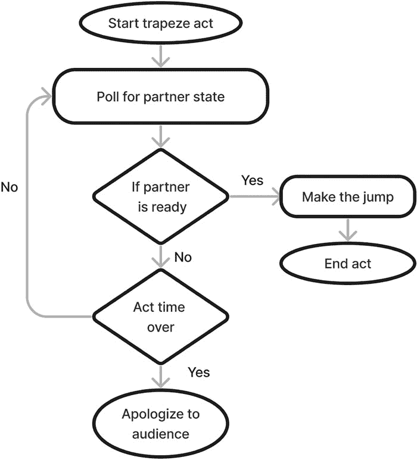

**图 4.2:** 空中飞丝表演的伪算法

显式等待（Explicit waits）的工作原理相同，`WebDriver` 会轮询特定条件是否成功，并等待其完成或超时，以便继续执行或抛出异常。

让我们深入代码以获得对显式等待策略的实际理解。从下载的代码库中打开 `Chapter04_ExplicitWait.java`，并关注以下行：

```java
// Navigating to sample page
driver.get(“https://ava-orange-education.github.io/Ultimate-Selenium-WebDriver-for-Test-Automation/docs/Chapter3_Waits.html”);
WebElement yellowcirclebutton = driver.findElement(By.id(“explicitbutton”));
yellowcirclebutton.click();
// Setting up Explicit wait
Wait<WebDriver> wait = new WebDriverWait(driver, Duration.ofSeconds(10));
wait.until(ExpectedConditions.visibilityOfElementLocated(By.cssSelector(".circle”)));
WebElement yellowcircle = driver.findElement(By.cssSelector(".circle”));
// Asserting if the yellow circle is displayed on screen
Assert.assertTrue(yellowcircle.isDisplayed(), “Yellow circle is not displayed”);
driver.quit();
```

显式等待是通过使用 `WebDriverWait` 类设置的，使脚本等待特定条件的满足。这种等待的目的是确保脚本在条件满足之前不会继续执行。在这种情况下，预期条件是使用 `ExpectedConditions.visibilityOfElementLocated()` 方法定义的。该方法接受一个定位器（在此例中为 CSS 选择器）作为参数，并返回一个条件，等待由定位器识别的元素变得可见。`WebDriverWait` 类提供了 WebDriver 实例（`driver`）和等待条件满足的最长时间（超时）。在这里，使用 `Duration.ofSeconds(10).` 指定了 10 秒的超时。

**注意**：`Assert.assertTrue(…)` 是 TestNG 的 Assert 类提供的方法。它用于断言给定的条件是否为真。如果条件为真，测试继续执行。如果条件为假，测试被标记为失败，并显示指定的失败信息。我们将在下一章中介绍 TestNG 库的更多细节。

在前面的代码中，`Assert.assertTrue(yellowcircle.isDisplayed(), “Yellow circle is not displayed”)` 这一行是一个验证步骤，使用 TestNG 的断言机制来检查特定条件是否为真。此断言用于验证网页上的黄色圆形元素是否显示。


以下是 TestNG Assert 语句的控制台示例输出：

```text
PASSED: explicitWaitExample
===============================================
Default test
Tests run: 1, Failures: 0, Skips: 0
===============================================
===============================================
Default suite
Total tests run: 1, Passes: 1, Failures: 0, Skips: 0
===============================================
```

显式等待是 Selenium 测试自动化非常有用的工具。它们提供了确保可靠测试脚本所需的精确性和控制，特别是在动态 Web 环境中。然而，仔细考虑条件和超时对于可靠性和效率之间取得平衡至关重要。

显式等待提供了几个关键优势：

* **精确性**：与隐式等待（`implicit waits`）不同，显式等待仅适用于针对特定元素的特定条件。这允许对同步进行更细粒度的控制。

* **动态超时**：你可以为不同的元素、场景或操作定义不同的超时持续时间，确保在不产生不延迟的情况下实现最佳同步。

* **可定制的预期条件**：`ExpectedConditions` 类提供了一系列内置条件（例如 `visibilityOf`、`elementToBeClickable`）供你使用，你也可以创建自定义的条件。

**注意**：不建议在同一个脚本或会话中同时使用隐式和显式等待。由于显式等待更可靠且可定制，实际上大多数标准测试自动化框架都将其作为一条经验法则包含在内。

## 灵活等待 (Fluent Waits)

灵活等待（`Fluent waits`）通过扩展显式等待的概念，为用户提供了自定义等待策略各种属性的选项，例如轮询时间、异常处理和预期条件。灵活等待使得执行流更加顺畅，特别是在元素可能会发生动态变化的场景下。

在显式等待的情况下，这种轮询频率默认为 500 毫秒。使用灵活等待，你可以根据需要更改此轮询频率，即你可以告诉脚本在每隔‘x’ 秒后继续检查某个元素。

让我们深入代码以获得对灵活等待策略的实际理解。从下载的代码库中打开 `Chapter04_FluentWait.java`，并关注以下行：

```java
// Setting up Fluent wait
Wait<WebDriver> wait = new FluentWait<>(driver).withTimeout(Duration.ofSeconds(10))
    .pollingEvery(Duration.ofMillis(250)).ignoring(NoSuchElementException.class);
wait.until(ExpectedConditions.visibilityOfElementLocated(By.cssSelector(".circle")));
```

在给定的代码行中，为 `WebDriver` 实例建立了一个灵活等待。灵活等待提供了动态同步策略，在这里，它配置为最多等待 10 秒。在此期间，它将轮询由 CSS 选择器 `".circle"` 定义的特定 Web 元素。轮询间隔设置为 250 毫秒，这意味着等待将每隔 250 毫秒检查一次元素是否存在。`ignoring` 方法用于指定等待应该忽略 `NoSuchElementException` 异常，这种异常通常在找不到元素时发生。`until` 方法随后等待直到指定的条件满足，在这种情况下，是由 CSS 选择器定位的元素的可见性。一旦条件满足或达到超时，代码执行将继续。

这种设置确保脚本只有在所需元素在指定时间范围内变得可见时才进行，增强了测试自动化过程的可靠性和稳定性。

灵活等待提供了额外的自定义功能，例如：

* **可定制的轮询间隔**：灵活等待的一个主要优势是更改代码评估频率的能力。这在元素以不同间隔出现的场景中可能至关重要。

* **处理特定异常**：你可以指定在轮询期间应自动处理哪些异常。这增强了脚本的韧性，使其更能适应不断变化的条件。

灵活等待为测试人员提供了一个强大的工具，用于处理 Selenium 测试自动化中的同步问题。其可定制性结合实现回退机制的能力，使测试人员能够构建健壮且可靠的自动化脚本，优雅地处理动态 Web 元素。虽然它们也有局限性，但只要使用合理，灵活等待可以增强测试过程的鲁棒性和稳定性。

## Shadow DOM

Shadow DOM 是一种 Web 技术，允许将 HTML 元素及其样式、脚本和标记封装在一个名为“影子根（`shadow root`）”的边界内。它能够在 Web 页面的主 DOM 内部创建隔离的 DOM 子树，在主页面组件与封装在 Shadow DOM 中的组件之间提供了一种程度的隔离和分离。

这对于构建复杂的 Web 组件特别有用，这些组件拥有自己的样式和行为，而不会与页面的其他元素冲突。

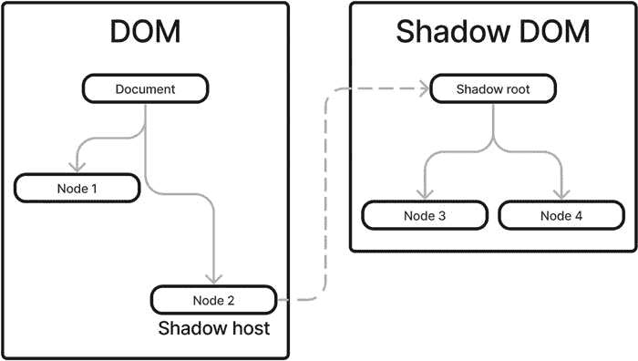

**图 4.3：** Shadow DOM 的可视化表示

让我们通过一个技术示例来理解上一个例子。访问 [`ava-orange-education.github.io/Ultimate-Selenium-WebDriver-for-Test-Automation/docs/Chapter4_ShadowDOM.html`](https://ava-orange-education.github.io/Ultimate-Selenium-WebDriver-for-Test-Automation/docs/Chapter4_ShadowDOM.html)。

在这里，尝试检查输入框。发现什么新奇了吗？输入框被设置在 Shadow DOM 内部。因此，如果我们尝试按照以下代码输入值，将会得到 `NoSuchElementException`。

```
// 导航到示例页面
driver.get("https://ava-orange-education.github.io/Ultimate-Selenium-WebDriver-for-Test-Automation/docs/Chapter4_ShadowDOM.html");
// 错误的导航
WebElement inputfield = driver.findElement(By.id("shadowinput"));
inputfield.sendKeys("Test input value");
```

那么我们如何自动化 Shadow 根呢？随着 Selenium WebDriver 4.0.0 及以上版本的发布，引入了 `getShadowRoot()` 方法，它帮助定位 Shadow 根元素。根据文档，`getShadowRoot()` 方法返回元素影子根的表示，用于访问 Web 组件的 Shadow DOM。如果未找到影子根，它将抛出 `NoSuchShadowRootException`。

在下载的代码库中打开并运行 `Chapter04_ShadowDOM.java` 类。关注以下几行：

```
WebElement shadowHost = driver.findElement(By.id("shadow_host"));
SearchContext shadowRoot = shadowHost.getShadowRoot();
WebElement inputfield = shadowRoot.findElement(By.cssSelector(".shadowinput"));
inputfield.sendKeys("Test input value");
```

第一步涉及定位 id 为 `shadow_host` 的 Web 元素，该元素是 Shadow DOM 的宿元素。该元素通过 `findElement` 方法获取。

一旦定位了宿元素，就会对其调用 `getShadowRoot` 方法。该方法用于访问宿元素的 Shadow DOM，返回一个表示 Shadow DOM 子树根的 `SearchContext` 对象。这使得与封装在 Shadow DOM 中的元素交互成为可能。

随后，在 Shadow DOM 上下文中，使用 `findElement` 方法和 CSS 选择器 `.shadowinput` 定位另一个 Web 元素。最后，将 `sendKeys` 方法应用到此输入字段，模拟输入文本“Test input value”的操作。

## 动画与移动元素

在 Web 应用的动态格局中，动画和移动元素已变得常见，为用户界面增添了视觉上的吸引力。

然而，由于这些效果的异步性质，自动化涉及动画和移动元素的测试可能会有些棘手。在本节中，我们将深入探讨动画和移动元素给测试自动化带来的挑战，并探索使用 Selenium WebDriver 和 Java 有效自动化此类场景的策略。

动画和移动元素为元素可见性和交互的时间引入了不可预测性。这可能导致测试不稳定（`flakiness`）和假阴性，即测试由于时间错位而间歇性失败。此外，动画可能会导致元素在页面上移动，导致定位器错误和意外的元素状态。处理这些挑战需要同步技术和智能定位策略的结合。

让我们通过一个场景来理解移动元素的自动化，这个场景可能会让自动化工程师感到心里没底。访问 Web URL [`ava-orange-education.github.io/Ultimate-Selenium-WebDriver-for-Test-Automation/docs/Chapter4_Butterfly.html`](https://ava-orange-education.github.io/Ultimate-Selenium-WebDriver-for-Test-Automation/docs/Chapter4_Butterfly.html)。

看着这里的蝴蝶非常美，不是吗？此外，它们还以一种迷人的效果向鼠标位置聚拢。如果你点击屏幕，它们会散开开，然后重新对齐以跟随鼠标指针。

当我们右键点击并尝试检查这些小昆虫时，我们才看到了这个动画真正的美感（或魔性之处）：

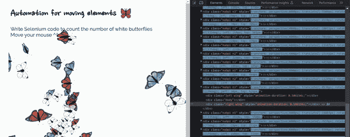

**图 4.4：** Chapter4_Butterfly Web 页面的 HTML 视图。

假设当前任务是编写一个 Selenium 脚本，用于计算万花筒中白色蝴蝶的数量（这是一群蝴蝶的正式术语）。

正如我们观察到的，自动化当前场景面临着一些挑战：

* 蝴蝶动画的加载时间取决于网络速度和宿主机。

* 蝴蝶本身不是静态的，因此检查它们的属性（用于定位器）可能非常繁琐。

* 蝴蝶组件的样式属性根据其动画属性不断变化。

就像处理任何复杂的编程问题一样，让我们将前面的挑战分解为离散步骤：

1. 使用显式等待（`explicit waits`）在页面加载后动态等待蝴蝶出现。

2. 暂停蝴蝶的动画。

3. 理解 DOM 中的模式，以编写动态定位器。

由于我们已经在之前的章节中详细介绍了第一步（关于显式等待），我们将直接关注解决方案的第二步，即暂停动画。

我们可以使用元素上的特殊调试器来暂停动画。步骤如下：

1. 右键点击元素。

2. 选择 `Inspect`（检查将打开 Elements 选项卡并高亮该元素）。

3. 右键点击高亮的 HTML。

4. 转到 `Break on`（在此处暂停）并选择断点类型。

   * 子树修改断点（`Subtree modification breakpoints`）每当所选节点的子元素被修改时都会中断执行。修改可以是删除、添加或更改子内容。

   * 节点删除断点（`Node Removal Breakpoints`）在元素从 DOM 树中删除时触发。

   * 属性修改断点（`Attribute modification breakpoints`）用于调试属性的变化。它们在属性被更改、添加或删除时触发。

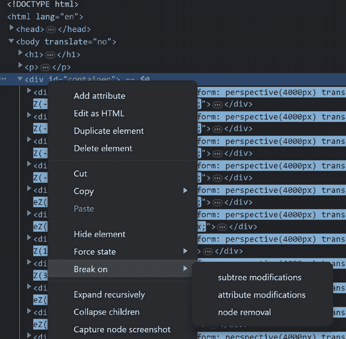

**图 4.5：** 在 DOM 节点上添加断点

我们将使用 `Attribute modification Breakpoint` 选项暂停蝴蝶动画，因为我们可以观察到样式属性正在动态变化。

一旦动画被暂停，我们可以冷静地检查 Web 元素，理解模式，并为白色蝴蝶编写动态定位器。

在下载的代码库中打开 `Chapter04_AnimationAutomation.java` 并执行该文件以获得实践学习体验。关注以下几行以深入理解 Web 页面动画自动化：

```
// 动态等待蝴蝶动画出现
Wait<WebDriver> wait = new WebDriverWait(driver, Duration.ofSeconds(5));
wait.until(ExpectedConditions.visibilityOfElementLocated(By.xpath("//div[@class=\"nabpi n1\"]")));
// 获取列表中所有白色蝴蝶的数量
List<WebElement> whitebutterflylist = driver.findElements(By.xpath("//div[@class=\"nabpi n1\"]"));
System.out.println("Count of white butterflies is : " + whitebutterflylist.size());
```

在这段 Selenium 代码中，我们正在使用动态等待来确保网页上出现蝴蝶动画。我们初始化了一个超时时间为 5 秒的 `WebDriverWait`，并指定正在等待一个具有特定 XPath 特征的元素变为可见。`ExpectedConditions.visibilityOfElementLocated` 确保动画元素在继续执行之前变得可见。一旦动画可见，我们继续获取所有具有特定类名（代表白色蝴蝶）的动画元素实例，并将它们存储在一个名为 `whitebutterflylist` 的列表中。通过使用带有相应 XPath 的 `driver.findElements`，我们累积了动画元素的所有出现处。最后，我们通过 `whitebutterflylist` 的大小（`size`）来打印网页上白色蝴蝶的数量。

**注意**：虽然这些策略可以帮助缓解挑战，但需要注意的是，某些动画可能过于复杂，无法通过自动化可靠地处理。在这种情况下，可能需要进行手动测试或与开发人员协作。

## JavaScript Executor

JavaScript Executor 是 Selenium 中一个强大的功能，它允许在网页的上下文中执行 JavaScript 代码。它弥补了 Selenium 自动化能力与现代 Web 应用程序动态特性之间的鸿沟。通过提供直接访问浏览器 JavaScript 引擎的权限，JavaScript Executor 允许测试人员和开发人员执行仅使用标准 Selenium 方法可能具有挑战或无法实现的操作。

现代 Web 应用程序通常严重依赖 JavaScript 来创建动态用户界面、在不刷新页面的情况下更新内容以及处理异步操作。虽然 Selenium 提供了一套用于交互 HTML 元素的强大方法，但由于 Web 的动态性，某些情况下这些方法力不从心。这就是 JavaScript Executor 发挥作用的地方。

通过 JavaScript Executor，你可以直接操作文档对象模型 (DOM)、触发事件、修改样式，甚至检索可能无法通过 Selenium API 暴露的值。这种能力在处理隐藏元素、实现滚动行为、与复杂的下拉列表交互、验证内容更新等情况下特别有用。以下是几个我们可以考虑的实际用例：

* **滚动**：你可以滚动网页将特定元素带入视野。这在处理长页面或懒加载内容时特别有价值。

* **处理隐藏元素**：Selenium 无法直接访问的隐藏元素可以使用 JavaScript Executor 进行交互。

* **更改样式**：你可以动态更改元素的 CSS 样式，以模拟用户交互或操作页的视觉效果。

* **验证**：通过执行 JavaScript 代码来验证特定内容或元素的存在，你可以提高测试的准确性。

打开 `Chapter04_JSExecutor.java` 类并关注以下几行，关于 JavaScript Executor 的代码示例：

```javascript
// 导航到示例页面
driver.get("https://googlechromelabs.github.io/chrome-for-testing/");

// 利用 JavaScript Executor 滚动到 Chrome 测试页面上的 Canary 头部
WebElement canaryheader = driver.findElement(By.xpath("//h2[text()='Canary']"));
((JavascriptExecutor) driver).executeScript("arguments[0].scrollIntoView(true);", canaryheader);

// 添加 Thread sleep 仅供
// 读者参考和验证上述
// 操作
Thread.sleep(2000);

// 利用 JavaScript Executor 为上述标识的头部添加边框
((JavascriptExecutor) driver).executeScript("arguments[0].style.border='15px solid red';", canaryheader);

// 添加 Thread sleep 仅供读者参考和验证上述操作
Thread.sleep(5000);

driver.quit();
```


所提供的代码导航到一个网页，并利用 Selenium 的 JavaScript Executor 功能对元素执行操作。起初，代码使用`driver.get()`方法打开网页。接着，它在页面上找到“Canary”头部元素，并使用`scrollIntoView()` JavaScript 方法将其带入视野。在短暂暂停供读者验证后，代码进一步采用 JavaScript Executor 为头部元素添加了 15 像素的红色边框。在用`driver.quit()`关闭浏览器窗口之前，又添加了暂停用于验证。这段代码展示了如何使用 JavaScript Executor 与 Web 元素交互并操作它们在浏览器中的显示效果。

虽然 JavaScript Executor 提供了巨大的灵活性，但在使用时必须保持谨慎。过度使用 JavaScript Executor 会导致代码的可维护性和可读性降低。此外，基于 JavaScript 的交互在所有浏览器中的工作可能并不一致，因为不同的浏览器对 JavaScript 的支持水平和行为各异。

JavaScript Executor 是 Selenium 工具箱中非常有价值的工具，使测试人员能够克服动态 Web 应用程序带来的挑战。通过智能地利用其功能，你可以增强测试脚本的准确性和完整性，为复杂场景实现更有效、更健壮的测试自动化。

## Page Objects

Page Object（页面对象）本质上是一种设计模式，帮助你将应用程序的每个网页表示为测试自动化框架中一个独立的类。该类封装了与特定页面相关的所有元素、操作和交互。通过这样做，你可以在测试脚本和 Web 应用程序的底层结构之间建立清晰的分离。

在进入实现细节之前，让我们稍稍探讨一下问题领域。这里是之前见过的登录页面的示例代码片段：

```javascript
WebElement loginbutton = driver.findElement(By.xpath(“//input[@id=’Login’]”));
// 尝试点击按钮
loginbutton.click();
```

你能列出当将上述类型的代码扩展到数千个测试用例时会遇到哪些问题吗？

例如，如果我们为一千个测试用例编写上述登录代码，我们就必须为所有用例重复编写相同的定位器和相应的交互代码。如果 Web 元素的`id`从`Login`变为`Signin`，我们就必须更新一千个测试用例中的定位器。此外，不同的工程师可能会对同一个元素使用略有不同的定位器或交互方法。这种不一致性会使测试脚本变得混乱、不可靠且难以理解。随着测试套件的扩大，这些缺点会变得更加明显。

为了解决上述问题，利用页面对象设计模式为可重用的 Web 元素和相应的交互提供抽象层和集中管理。以下是页面对象设计模式的其他优势：

* **模块化和可复用**：通过页面对象，你将每个页面的元素和交互封装在单独类中。这种模块化允许在不同的测试甚至项目之间复用代码，减少了冗余并增强了可维护性。

* **抽象**：页面对象抽象了底层 HTML 结构的复杂性。测试脚本通过简单且意义明确的方法与这些页面对象交互，使得脚本更具可读性，对技术细节的依赖较低。

* **维护**：当应用程序的 UI 发生变化时，你只需要更新对应的页面对象类。更改是局部的，确保了测试脚本不受影响，减少了维护工作并节省了时间。

有趣的是，Page Object 设计模式遵循了“DRY”原则。“不要重复自己”（Don’t Repeat Yourself, DRY）设计原则是软件工程中的一个基本概念，旨在提高代码的可重用性和维护性。DRY 原则的精髓可以总结为：“系统中的每个知识或逻辑都应该有一个唯一的、无歧的表示。”

简单来说，DRY 原则鼓励开发者避免在整个代码库中重复代码或逻辑。与其在多个处编写相同的代码，其核心思想是为特定功能创建一个单一的真理来源，并在需要时引用或重用它。

让我们通过一个简单的 Java 示例来了解创建 Page Object 的过程。

1. **创建一个新类**：为每个想要自动化的 Web 页面创建一个新类。根据页面的目的命名该类，例如`LoginPage`或`HomePage`。

2. **定位器和元素**：在 Page Object 类内部，使用 ID、XPath 或 CSS 选择器等各种定位器定义 Web 元素。使用`@FindBy`等注解将这些元素与 HTML 中的实际 Web 元素关联。

3. **方法**：创建在页面上执行操作和交互的方法。例如，`LoginPage`可能拥有如`enterUsername`、`enterPassword`和`clickLoginButton`等方法。

4. **返回类型**：Page Object 中的方法可以返回后续页面或操作的确认。这促进了流且直观的脚本结构。

5. **在脚本中实例化**：在你的测试脚本中实例化 Page Object 类。使用类中定义的方法与页面进行交互。这种关注点分离使得脚本变得简洁并专注于实际的测试逻辑。

让我们通过代码详细检查上述概念。首先，打开位于下载的代码库中`src/main/java/pageobjects`路径下的`OrangeHRMLoginPage.java`文件。以下是登录页对象的代码：

```java
public class OrangeHRMLoginPage {
    protected WebDriver driver;
    private By usernamelocator = By.xpath(“//input[@placeholder=’Username’]”);
    private By passwordlocator = By.xpath(“//input[@placeholder=’Password’]”);
    private By loginlocator = By.xpath(“//button[@type=’submit’]”);
    public OrangeHRMLoginPage(WebDriver driver) {
        this.driver = driver;
        if (!driver.getTitle().equals(“OrangeHRM”)) {
            throw new IllegalStateException(“This is the right Page,” + “ current page is: “ + driver.getCurrentUrl());
        }
    }
    public OrangeHRMHomePage login(String userid, String passwordtext) {
        // Setting up Explicit wait
        Wait<WebDriver> wait = new WebDriverWait(driver, Duration.ofSeconds(20));
        wait.until(ExpectedConditions.visibilityOfElementLocated(usernamelocator));
        // Typing the username
        driver.findElement(usernamelocator).sendKeys(userid);
        // Typing the password
        driver.findElement(passwordlocator).sendKeys(passwordtext);
        // Pressing the Login button
        driver.findElement(loginlocator).click();
        // Returning the instance of Homepage for fluent style of programming
        return new OrangeHRMHomePage(driver);
    }
}
```

我们可以观察到`OrangeHRMLoginPage`类由三个不同的部分组成，每个部分在保持测试基的“DRY”方面起着关键作用：

* **Web Elements**：此部分作为登录过程中至关重要的所有 Web 元素的存储库。在这里，我们将定位器存储在`By`类型的变量中。这之后可以在方法`driver.findElement(By.....)`中用于与 Web 元素进行交互。

* **Constructor**：类中的一个重要片段，构造函数在初始化类方面起着重要作用。它需要一个基本参数——`WebDriver`实例。该`WebDriver`实例是与浏览器交互的后的驱动力。此部分采用验证机制，检查正在访问的页面标题。这是 Page 对象类通常拥有的验证。注意：Page 对象类不应包含任何测试或断言，所有与业务场景相关的测试都应该是 Test 类的一部分，以符合 SOLID 编程原则。

* **Page Specific Methods**：在前面的案例中，`login`方法封装了使用提供的用户名和密码登录所需的操作，并使用显式等待确保在交互之前必要的元素是可用的。然后它返回下一个面的实例以进行后续测试步骤。该方法通过将登录相关的操作封装在单个方法中，有助于保持测试代码组织良好、可读且可维护。

为了巩固理解，让我们看看另一个页面对象类。打开`OrangeHRMHomePage.java`类并观察以下代码：

```java
public class OrangeHRMHomePage {
    protected WebDriver driver;
    private By profilebutton = By.xpath(“//span[@class=’oxd-userdropdown-tab’]”);
    public OrangeHRMHomePage(WebDriver driver) {
        this.driver = driver;
    }
    public void clickProfileButton() {
        // Setting up Explicit wait for the profile button
        Wait<WebDriver> wait = new WebDriverWait(driver, Duration.ofSeconds(20));
        wait.until(ExpectedConditions.visibilityOfElementLocated(profilebutton));
        driver.findElement(profilebutton).click();
    }
}
```

你再次观察到页面对象类的这三个组件了吗？它就是定位器（带有`By`机制）、构造函数以及与所考虑的页面相关的方法（带有适当的等待机制）。`OrangeHRMHomePage`类封装了 OrangeHRM 应用主页的行为。它包含了与页面元素交互以及执行点击个人按钮等操作的方法。使用显式等待确保了在交互之前必要的元素已就绪，从而促进了稳定可靠的测试自动化。

注意：SOLID 设计原则是创建更具维护性和灵活性的软件的一系列指南。SOLID 中的每个字母都代表一个不同的原则：

* **S** (单一职责原则)：类应该只有一个改变的原因，意味着它应该有一个单一的、定义良好的目的。

* **O** (开闭原则)：软件实体（类、模块等）应该对扩展开放，但对修改关闭。这鼓励了在不改变现有代码的情况下添加新功能。

* **L** (里氏夫替换原则)：子类型应该能够替换其基类型而不影响程序的正确性。简单来说，派生类应该替换基类而不会引起意外行为。

* **I** (接口隔离原则)：客户端不应被强制依赖于它们不使用的接口。该原则促进了更小、特定的接口，而不是大型、通用的接口。

* **D** (依赖倒置原则)：高层模块不应该依赖于低层模块；两者都应该依赖抽象。此外，抽象不应该依赖于细节；细节应该依赖抽象。这鼓励了更灵活和解耦的架构。

这些原则帮助开发者创建更容易理解、维护和随时间推移适应的代码，从而有助于更好的软件设计和开发实践。

## Page Factory

Selenium 在 Java 中提供了 Page factory 的默认实现。将其视为符合工厂设计模式的 Page 对象模型。以下是使用 Selenium 提供的 page factory 方法初始化 Web 元素的方式：

```java
@FindBy(id = “username”)
private WebElement usernameField;
@FindBy(id = “password”)
private WebElement passwordField;
```

`@FindBy(id = “submit”)`

`private WebElement submitButton;`

注意 Selenium 提供的`@FindBy`注解，它可以简化元素的声明过程。

页面工厂类（page factory class）的第二个组件是构造函数，使用`PageFactory.initElements()`方法对带注解的元素进行初始化，如下：

```java
public LoginPage(WebDriver driver) {
    this.driver = driver;
    PageFactory.initElements(driver, this);
}
```

类的第三个组件是特定页面的方法，例如使用定义的元素登录应用程序：

```java
public void login(String userid, String passwordtext) {
    username.sendKeys(userid);
    password.sendKeys(passwordtext);
    submitButton.click();
}
```

**注意**：对于刚开始接触测试自动化的团队，通常不建议使用页面工厂设计模式。此外，Page Factory 方法在某些语言绑定（如 C#）中已被弃用，这是由于代码中复杂的代理机制和反射引起。

因此，页面对象设计模式（page object design pattern）被广泛应用于测试自动化框架；但在某些情况下，根据测试自动化团队的背景和成熟度，也可以使用页面工厂设计模式。

## Page Object 的局限性

与其他任何事物一样，即使是页面对象模型（Page Object Model）在推向极端时也有缺点。虽然这种模型对于使测试自动化代码有序且易于管理非常棒，但重要的是记住它也有缺点。尽管在代码结构化和可维护方面具有优势，但仍有一些需要注意。考虑以下航班预订网站的截图：

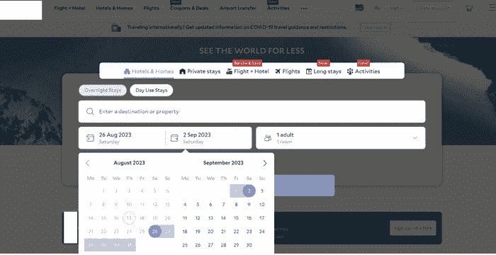

**图 4.6**：复杂的网页表示。

如果我们必须将前面的首页建模为一个页面对象类，它将包含几十个定位器（范围从目的地的链接到日期选择器），以及数百种组合方法，如登录、注册、预订机票、酒店、两者或活动。

随着测试套件的增长，我们可以想象`home page`页面对象类将呈指数级增长，从长期来看可能会成为技术债的来源。

那么，我们应该做什么？就像任何代码库一样，我们应该将`home page`页面对象类拆分为更细的部分，如 Header – `HeaderPageObject.java`、Footer – `FooterPageObject.java`、Flights – `FlightsPageObject.java`等，以确保在正确的层级实现关注分离，同时维护 DRY（不要重复）原则。

例如，我们可以这样对首页建模：

```java
public class HomePage {
    protected WebDriver driver;
    private By brandicon = By.xpath(“//img[@id=’branicon.jpg’]”);
    public HomePage(WebDriver driver) {
        this.driver = driver;
    }
    public void clickBrandIcon() {
        driver.findElement(brandicon).click();
    }
}
```

这个 HomePage 页面对象类可以通过首页的各个部分进行扩展。例如，我们可以这样对头部组件建模：

```java
public class HeaderComponent {
    protected WebDriver driver;
    private By flightslink = By.xpath(“//a[@id=’https://www.bookingsite.com/flights’]”);
    public HeaderComponent (WebDriver driver) {
        this.driver = driver;
    }
    public void clickFlightsLink() {
        driver.findElement(flightslink).click();
    }
}
```

通过这种方式，我们可以将代码库模块化，以减少冗余并提高可维护性。

虽然 Page Objects 巨大的优势，但承认它们的局限性也是重要的。创建和维护 Page Objects 需要额外的前期工作。如果管理不当，大量的 Page Objects 会导致代码重复和代码库膨胀。同样，在另一个极端，页面对象模型对于小型项目并不理想。在较小项目或概念验证场景中，页面对象模型的实现可能多此一举。它可能会引入不必要的复杂性和开销，使得使用更简单的方法更高效。

结论，Page Objects 是 Selenium 测试自动化中的一个核心概念。

它们让你能够创建模块化、可维护且高效的自动化脚本，提升你的测试工作质量。通过投入时间设计和实现健壮的 Page Objects，你为构建可持续且可扩展的自动化框架铺平了道路，这将有效地满足你的测试需求。

## ScreenPlay 模式


Screenplay 模式是一种强大的架构设计，用于以结构化和模块化的方式组织 Selenium 测试自动化代码。与将自动化逻辑分散在测试用例中的传统方法不同，Screenplay 模式强调通过将测试拆分为不同的屏幕（screens）、动作（actions）和任务（tasks）来实现关注点分离。该模式促进了团队成员之间更好的可读性、可维护性和协作。通过定义可重用的任务和交互，它鼓励代码重用并减少了代码重复。此外，它提高了抽象层次，使得测试用例对于非技术利益相关者也更容易理解。

此外，Screenplay 模式是一种基于单一职责原则和开闭原则等良好软件工程原则来编写高质量自动化验收测试的方法。这是一种编写高质量自动化验收测试的创新方法，它驱动了抽象的有效使用，帮助你的测试场景捕捉业务场景，并鼓励你的团队养成良好的软件工程习惯。

**注意**：单一职责原则（SRP）规定一个类应该有一个单一职责，因此只有一个更改原因。这意味着程序中的每个类、模块或函数在程序中应该有一个职责/目的。开闭原则（OCP）规定软件实体（类、模块、函数等）应该对扩展开放，对修改关闭。这意味着你应该能够在不修改类的情况下扩展其行为。

在进一步研究 Screenplay 模式之前，让我们检查一下页面对象模式的缺点：

你注意到前面的登录页面对象有任何问题吗？

**提示**：它与单一职责原则的概念有关。

前面的页面对象类通过包含以下两个职责违反了单一职责原则：

1. 声明元素
2. 设置与元素之间的交互

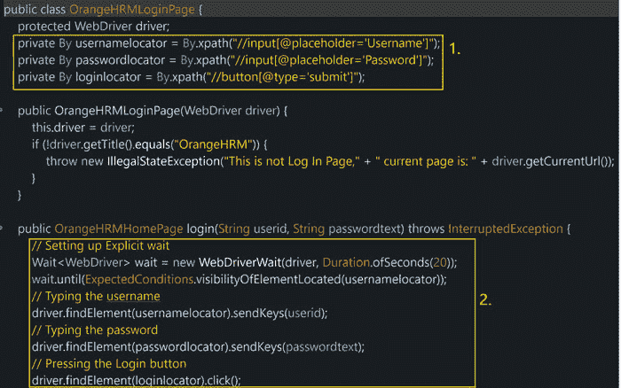

**图 4.7**：页面对象类违反单一职责原则

Screenplay 模式在页面对象的基础上通过关注分离进行了增强，并通过屏幕 UI、任务和动作进一步拆分了职责。

*作为 Screenplay 模式的一部分，所有测试都被构想为演员（Actors）在屏幕上使用动作（Actions）执行任务（Tasks）。*


**图 4.8**：Screenplay 模式的可视化

在前面的可视化图中，“演员”可以是人类用户（如你或我）或系统用户（对被测系统的外部 API 调用）。“动作”范围可以从登录 Web 应用程序（包括填写用户名/密码和点击登录按钮等“任务”）到通过应用程序发送电子邮件。“屏幕”可以是 Web 页面、移动设备屏幕或桌面应用程序。

*在对任何类型的软件产品进行自动化测试时，我们不可避免地必须与软件进行交互。作为人类，我们用通俗的语言思考交互，例如“填写表单”、“导航到此页面”或“查找此记录”。当我们编写代码来实现交互时，我们往往会丢失其背后的意图。例如，填写表单很快就会变成一系列底层 Selenium 调用的发送按键、点击和等待。*

页面对象（Page objects）可以提供一些结构来帮助定位元素的定位器（locators）和交互方法。然而，将结构与交互耦合迫使我们更多地关注页面本身而不是行为，难以建模复杂的工作流。此外，页面对象往往包含大量的重复代码，例如每个按钮的点击方法。这种设计是随意的，因此在项目之间切换时很难理解。

Screenplay 模式（Screenplay Pattern）是建模交互更好的方式。在 Screenplay 中，演员（Actors）使用能力（Abilities）来执行操作。演员发起交互就像人类一样。能力是如 Selenium WebDriver 之类的自动化工具。软件中的交互可以是低层级的，例如点击元素或输入文本，它们也可以组合成更大型的工作流。例如，我们可以创建一个名为“表单”的交互，它内部调用点击和按键的操作。Screenplay 最大化了重用性，它强调的是行为意图，而不是硬化的页面结构。

如果你想使用 Screenplay 模式，可以查看 Serenity BDD (Java)、Serenity/JS (JavaScript) 以及 .NET (C#)。这些项目提供了该模式的 SOLID 实现，可以了解更多信息。Andrew Knight 是 Cycle Labs 的开源贡献者。

### 页面对象（Page Objects）

首先，打开`uiscreens`包下的`LoginUI.java`类。如下：

```java
public class LoginUI {
    public static By usernamefield = By.xpath("//input[@placeholder='Username']");
    public static By passwordfield = By.xpath("//input[@placeholder='Password']");
    public static By submitbutton = By.xpath("//button[@type='submit']");
}
```

你可以观察到，这个类包含了登录页相关的定位器。**注意**：静态变量和方法在整个 Screenplay 模式代码段中使用，以便方便使用。

同样，打开`uiscreens`包下的`HomePageUI.java`类：

```java
public class HomePageUI {
    public static By searchfield = By.xpath("//input[@placeholder='Search']");
}
```

再次，它只包含主页相关的定位器。我们可以看到，在 Screenplay 设计模式下，页面对象只包含定位器。

### 动作与任务（Actions and Tasks）

那么我们将交互放在哪里？答案就在动作（Actions）和任务（Tasks）中。

例如，演员或用户可以使用交互组合来登录 Web 应用程序，例如输入用户名、输入密码和点击登录或提交按钮。这就是我们将交互建模为页面对象类的方式。

这里有一个关键区别，“任务”被拆分为“动作”。例如，点击按钮、等待 Web 元素或向输入框输入文本可以是离散的动作，它们封装成了`Login`任务。让我们打开`screenplayactions`包下的`Click.java`类，详细理解“动作”级别的抽象：

```java
public class Click {
    public static void On(WebDriver driver, By locator) {
        driver.findElement(locator).click();
    }
}
```

只需传入`WebDriver`实例和定位器即可执行 Web 元素的点击。这个动作可以点击 UI 上的任何 Web 元素，并在任务和测试用例之间复用。同样，这里是下载代码库中的其他动作示例：向输入框输入文本的动作：

```java
public class Enter {
    public static void Text(WebDriver driver, By locator, String text) {
        driver.findElement(locator).sendKeys(text);
    }
}
```

显式等待 Web 元素的动作：

```java
public class ExplicitWait {
    public static void forElement(WebDriver driver, By locator, int time) {
        Wait<WebDriver> wait = new WebDriverWait(driver, Duration.ofSeconds(time));
        wait.until(ExpectedConditions.visibilityOfElementLocated(locator));
    }
}
```

打开 Web URL 的动作：

```java
public class With {
    public static void URL(WebDriver driver, String URL) {
        driver.get(URL);
    }
}
```

支持 Web 元素断言的动作：

```java
public class Assertion {
    public static boolean forSearch(WebDriver driver) {
        ExplicitWait.forElement(driver, HomePageUI.searchfield, 15);
        return driver.findElement(HomePageUI.searchfield).isDisplayed();
    }
}
```

这些动作可以封装成任务，供演员在屏幕上（在本例中为网页）执行。让我们打开下载代码库中`tasks`包下的`Login.java`类，如下：

```java
public class Login {
    public static void As(WebDriver driver, String userid, String passwordtext) throws InterruptedException {
        // 等待主页加载
        ExplicitWait.forElement(driver, LoginUI.usernamefield, 15);
        // 输入用户名
        Enter.Text(driver, LoginUI.usernamefield, userid);
        // 输入密码
        Enter.Text(driver, LoginUI.passwordfield, passwordtext);
        // 点击登录按钮
        Click.On(driver, LoginUI.submitbutton);
    }
}
```

这段代码代表一个`login`任务。它等待页面加载，在相应字段中输入用户名和密码，并点击登录按钮执行登录操作。它使用了如`ExplicitWait.forElement`、`Enter.Text`和`Click.On`等自定义任务，使代码更有组织、更易读。

基于同样的原理，让我们探索打开浏览器并导航到 URL 的任务。这可以在`OpenBrowser.java`类中找到，如下：

```java
public class OpenBrowser {
    public static void navigate(WebDriver driver, String URL) {
        With.URL(driver, URL);
    }
}
```

我们可以观察到，前面的代码接收一个 WebDriver 实例和 URL 字符串，使用`With.URL`任务导航到它。

### 测试执行（Test Execution）

现在让我们把前面的任务总结成一个测试，打开 OrangeHRM 沙箱应用程序，登录并验证主页上的`search`按钮。

打开并运行下载代码库中的`Chapter04_OrangeHRMLoginTest_Screenplay.java`，如下：

```java
public class Chapter04_OrangeHRMLoginTest_Screenplay {
    @Test(priority = 1)
    public void loginTest() throws Exception {
        // 创建 webdriver 实例
        WebDriver driver = new ChromeDriver();
        // 尝试登录动作
        OpenBrowser.navigate(driver, "https://opensource-demo.orangehrmlive.com/web/index.php/auth/login");
        Login.As(driver, "Admin", "admin123");
        Assert.assertTrue(Assertion.forSearch(driver));
        // 为了演示添加了线程睡眠，以便用户可以看到主页是否显示
        Thread.sleep(5000);
        driver.quit();
    }
}
```

在提供的代码段中，使用了 Screenplay（剧本）模式来组织一个登录 OrangeHRM 应用程序的测试用例。在`loginTest`方法内部，使用`ChromeDriver`创建了一个`WebDriver`实例，并遵循 Screenplay 模式执行登录操作。`OpenBrowser.navigate`方法将浏览器引导至指定的 URL，然后`Login.As`方法使用预定义的凭据执行登录。来自`Assertion.forSearch`方法的断言验证了登录是否成功。虽然为了演示添加了`Thread.sleep`暂停，但需要注意的是，真实的测试自动化会采用更好的同步方法。最后，使用`driver.quit()`关闭浏览器。Screenplay 模式对动作和交互的组织增强了测试的可读性和可维护性，符合测试自动化设计的最佳实践。

Screenplay 模式是一种创新的、以用户为中心的方法，用于编写高质量的自动化验收测试。它引导你的团队有效使用分层抽象，帮助你的测试场景用例捕获所属领域的业务词汇，并鼓励良好的测试和软件工程习惯。关注参与者（actors）及其目标，并将领域语言整合到测试用例中，可以提高团队协作和一致性，使技术和业务利益相关者能够理解并乐于参与测试自动化过程。

Serenity/JS 对 Screenplay 模式的实现允许开发者轻松将这种设计方法引入现有测试自动化项目中。此外，该框架提供了集成库以方便各种类型的测试自动化，包括端到端、组件、移动端和 API 测试，使其成为不同需求的灵活选择。Serenity/JS 还提供了报告工具和代码复用模式，便于跨项目和团队共享测试代码并降低维护成本。参考自：[`serenity-js.org/handbook/design/screenplay-pattern/`](https://serenity-js.org/handbook/design/screenplay-pattern/)

- Jan Molak，smartcode Ltd. 首席顾问，以及 Serenity/JS 的开源贡献者和作者

为了巩固我们对 Screenplay 模式的理解，这里有一个可视化图：

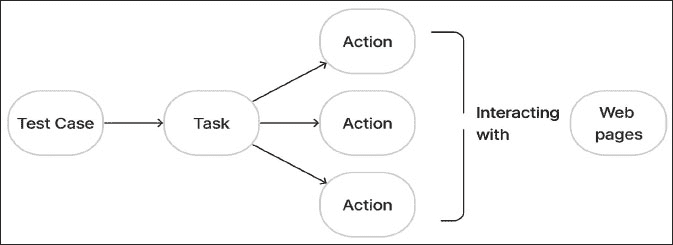

**图 4.9：** 根据 Screenplay 模式可视化的测试用例。

**注意**：Serenity BDD 是一个 JAVA 框架，用于通过内置方法和配置实现 Screenplay 模式。

## Screenplay 与 Page Object 设计模式的比较

Screenplay 和 Page Object 设计模式的对比并非同等比较。我们可以将其类比为电脑屏幕的亮度设置，在相对抽象性和对 SOLID 设计原则的对齐方面，原始的 WebDriver 调用位于最左侧，而 Screenplay 位于最右侧。

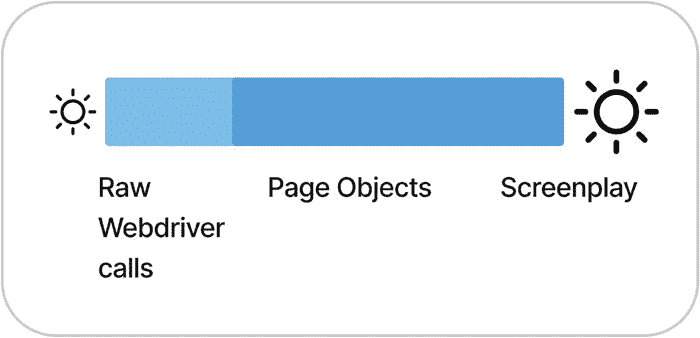

**图 4.10：** Selenium 中各种设计模式的理念对比

因此，最适合你用例的设计模式取决于团队的业务背景、流程和技术栈。为了做出更好的决策，这里是一些需要考虑的关键参数。

* **应用复杂度**：对于简单的应用程序，Page Object 模式提供了简单性。对于具有复杂用户交互的复杂应用程序，Screenplay 模式的模块化可能大有益。

* **团队专业知识**：Page Object 模式适用于新接触测试自动化的团队，而经验团队可能会选择 Screenplay 模式的扩展性。

* **长期目标**：如果 UI 变化频繁，或预计应用程序复杂度将增加，Screenplay 提供了适应性。UI 变化极小的稳定应用程序可能更青睐 Page Objects。

* **非技术沟通**：在与非技术利益相关者分享自动化测试时，剧本式的叙述风格可能非常有价值。

此处列出了 Page Object 模式和 Screenplay 模式的一些优缺点，以帮助进行详细分析。

## Page Object 模式

### 优点：

* **简单易用**：Page Object 模式将网页视为对象，提供了一种表示 UI 元素和交互的简单直观的方法。

* **代码可复用性**：Page Object 类可以在多个测试中复用，减少代码重复和维护工作。

* **可维护性**：UI 变化仅需在一个地方进行更新，确保更改是集中且易于管理的。

* **行业认可**：Page Object 模式被广泛采用和认可，为新团队成员提供了丰富的资源和先验经验。

* **工具支持**：许多自动化工具对 Page Object 模式提供内置支持。

### 缺点：

* **扩展复杂性**：对于复杂的应用程序，Page Objects 的数量可能会大幅增加，导致维护挑战。

* **脆弱性**：频繁的 UI 变化会导致维护 Page Objects 的巨大开销。

* **测试重复**：管理不当的 Page Objects 可能导致测试之间出现重复的代码序列。

## Screenplay 模式

### 优点：

* **以用户为中心**：Screenplay 模式将焦点从系统转移到用户交互，能够更直观地表示用户路径。

* **模块化**：该模式鼓励创建小型的可复用任务和交互，导致模块化且易于维护的测试代码。

* **表现力**：使用 Screenplay 编写的测试读起来像叙事故事，更容易让非技术利益相关者理解和交流。

* **可扩展性**：该模式扩展良好，允许组合任务以创建复杂的交互。

### 缺点：

* **学习曲线**：Screenplay 模式比 Page Object 模式更复杂，需要更长的学习曲线。

* **简单性的开销**：对于简单的应用程序或测试，Screenplay 模式可能会引入不必要的复杂。

* **采用率有限**：与 Page Object 模式相比，Screenplay 模式的采用并不广泛，导致用于学习和故障排除所需的资源较少。


`Page Object` 和 `Screenplay` 模式各有优劣。选择取决于应用复杂度、团队专业知识和长期项目目标。实施的有效性是关键，因此专注于用好所选模式。最终，无论选择何种模式，我们的目标都应该是增强代码的可读性、可维护性和复用性。

## 结论

在本章中，我们探索了显著提升自动化技能的高级 `Selenium` 技术。章节涵盖了同步和等待策略，有助于平滑地管理动态网页。在自动化方面，耐心确实是一种美德，采用这些技术将使你的脚本更加可靠和稳定。

我们学习了操作 `Shadow DOM` 内的元素以处理现代 `Web` 应用程序。还讨论了元素动画、利用 `JavaScript Executor` 执行自定义脚本，以及采用 `Page Object` 模型进行组织化自动化。`Screenplay` 模式强调了可复用组件作为动作和任务对于全面测试的重要性。这些概念共同使我们能够有心地应对复杂的自动化场景，为测试之旅做出有效贡献。

在我们即将开始的旅程中，我们将探索如何构建一个测试自动化框架。首先，我们将深入探讨什么是测试框架，以及它们如何帮助我们在测试各种不同用例时保持一致性。接着，我们将深入研究 `Selenium` 如何与 `TestNG` 和 `Maven` 协作工作，这三者的工具组合让创建、管理和运行测试变得极其顺畅。`JENKINS` 将成为我们的助手，在软件测试和部署方面，它承担了大量的繁重工作。随着学习的进行，我们将了解为什么清晰详细的测试报告至关重要，因为这不仅仅是一个总结——它是利益相关者至关重要的通信工具。无论你是初学者还是已经深耕测试领域的老兵，请戴上你们的钻研帽，精彩内容正要开始了。

## 练习

在我们准备构建一个全自动化测试框架之前，让我们利用本章的概念，在一个电子商务网站上处理一个端到端的流程。

请按照以下步骤自动化流程：

1. 导航到 [`orangeava.com/`](https://orangeava.com/)。

2. 点击 `New Release`（新品发布）区域下的第一本书。

3. 在书籍详情页上捕获书籍价格。

4. 点击 `ADD TO CART`（加入购物车）按钮。

5. 验证 `Cart`（购物车）区域显示的书籍价格与步骤 3 中捕获的值相同。

6. 测试用例应与以下对象交互：

   - `Homepage Page`（首页页面）

   - `BookDetail Page`（书籍详情页）

   - `Cart Page`（购物车页面）

7. 所有使用的 `Selenium` 等待在本质上应是“显式的”。

8. 测试用例应利用 `TestNG` 库中的 `Assert.assertTrue` 方法对书籍价格进行验证。

# 第 5 章：测试自动化框架

## 引言

欢迎来到测试自动化的世界，我们将烘焙一个框架！在本章中，我们将结合 `Selenium WebDriver`、定位器、同步机制、页面对象模型（`Page Object Model`）以及软件设计模式的力量，来搭建一个测试自动化框架。结构良好的框架是成功测试自动化的基石，因为它不仅简化了测试过程，还增强了可维护性和扩展性。在本章中，我们将探索从零开始创建一个美味测试框架的配方和步骤。就像蛋糕一样，拥有一个坚实的基础至关重要，因此我们将从框架基础开始——把它想象成准备烘焙模具。但没有特殊配方的蛋糕算什么呢？我们将深入研究设计模式——这些就像秘密配方，能让你的测试变得健壮且易于扩展，就像在你的蛋糕糊中撒入一撮魔法一样。为了让我们的烘焙之旅更加有趣，我们引入了 `Maven`，这像一个魔法烤箱，可以帮助轻松地管理所有原料（依赖项）。`TestNG` 是我们可靠的试味员，将指导我们创建和组织蛋糕层（测试用例）。没有顶部的糖，蛋糕又算什么？我们还将学习如何创建精美的报告，讲述我们烘焙之旅的故事。但不要忘记在烘烤时留意蛋糕！我们将探索日志的概念——它就像烤箱计时器，确保没有任何东西被烤过。所以，系上围裙，拿起打蛋器，让我们开始这段从零烘焙测试自动化蛋糕的有趣且令人垂涎的冒险吧。到本章结束，你不仅将拥有自己的美味框架，还将运行你的第一个自动化测试。让我们开始烘焙吧！

## 结构

在本章中，我们将讨论以下主题：

* 框架基础

* 设计模式

* `Maven`

* `TestNG`

* 测试报告

* 日志

* 构建框架

* 创建自动化测试

* 持续集成/持续交付

## 框架基础

如果你曾经烘过蛋糕、尝试写过文章或学习过开车，请举手。

嗯，虽然我看不见你们，但这些技能中的每项都需要以可重复的方式理解几个基本步骤来实现目标。这与理解什么是框架是类似的。所以，在进入框架的构建模块之前，让我们先理解什么是框架。

想象你正准备第一次烘焙蛋糕。你的厨房里充满了原料，但如果没有配方，你不确定用量、顺序，甚至要使用的技巧。现在，把配方比作烘焙的`框架`。它提供了一种结构化的方法，详细说明了你需要的原料、用量、步骤顺序甚至是要采用的技术（如搅拌或折叠）。通过遵循这个框架，你可以持续地生产美味的蛋糕，即使你决定调整口味或添加一些个人特色。

同样，当你被赋予写文章的任务时，你可能有很多想法、论点和参考文献。然而，如果没有正确的结构或指南，你的文章看起来可能是一堆杂乱的想法集合。在这里，经典的文章结构——引言、正文和结论——充当了`框架`。它引导你如何介绍主题、陈述论点并总结想法。通过遵循这种结构，你的文章将变得连贯、有说服力且吸引人，即使主题或论点发生变化。

测试自动化框架就像烹饪食谱，我们在其中引入不同的工具和库以可重复的方式实现共同目标。在我们的案例中，共同目标是以可扩展的方式自动化测试用例。

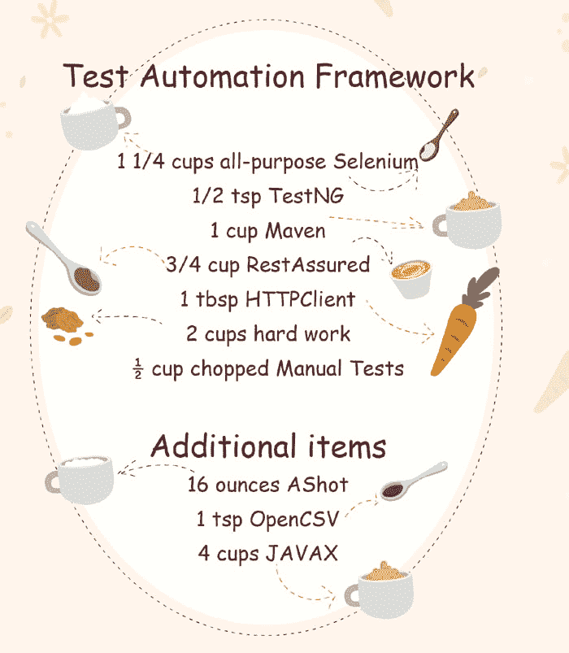

**图 5.1:** 框架的可视化

在以可扩展的测试自动化为目标时，有几个强力的理由考虑构建框架：

* **代码的可重用性**：使用框架的主要原因之一是避免重复。通过使用框架，你可以在不同的测试用例之间复用代码和组件，从而减少开发和维护测试脚本所需的时间和精力。

**模型**：想象有一组常用的操作，如登录、注销或导航，需要在应用程序的不同部分频繁测试。如果没有框架，你将反复为这些操作编写相同的代码。有了框架，你可以编写一次代码并在需要的地方复用。如下所示实例化 `WebDriver` 也是如此：

```
WebDriver driver = new ChromeDriver();
```

假设我们有 1000 个测试用例，那么我们需要实例化 `driver`，或者编写一千次复杂的垃圾回收代码。这难道对于编译器和我们来说不是很痛苦吗？这个例子引出了下一个因素：

* **可扩展性**：自动化测试可能开始很小，但它们会随着项目而增长。设计良好的框架允许你无缝地扩展测试工作。

**模型**：考虑一家最初发布一个产品但后来扩大产品范围的初创公司。如果他们已经有一个健壮的测试自动化框架，就可以轻松地扩展测试脚本以覆盖新产品，而无需重新发明轮子。

* **可维护性**：随着应用程序的演进，测试也会随之演进。自动化框架可以让更新测试脚本变得更容易，使维护不再那么困难。

**模型**：假设一个 `Web` 应用程序经历了设计变更，某个按钮的定位器发生了变化。如果没有框架构建测试，每个引用该按钮的测试用例都需要更新。在结构化框架中，此更改只需要在一个处进行，有利于所有相关的测试用例。这让我们想起了 `SOLID` 设计原则和页面对象设计模式，对吧？

- **一致性**：框架确保了测试脚本创建、执行和报告的一致性。这使得团队能够更容易地理解、编写和审查测试用例。

**心理模型**：假设有两个开发者，我和你。如果没有框架，我可能会将一个测试命名为 `testLoginFunction`，而你可能会将其命名为 `verifyUserLogin`。在有了标准方法后，命名规范和其他流程将保持一致，避免了这种差异。这为我们解决了冲突问题，干得好！

- **改进报告机制**：大多数框架都提供了生成日志和报告的方法，为理解测试结果提供了一种结构化的方式。

**心理模型**：在执行了一组包含 100 个测试用例的套件后，测试人员想要了解哪些失败了以及为什么。与其手动筛选结果，不如让框架生成清晰的报告并突出显示失败之处，从而更容易定位问题。

- **协作**：框架可以增强质量保证（`QA`）、开发人员和非技术利益相关者之间的协作。标准化的测试脚本结合共享的工具和实践，使得团队更容易共同工作。

**心理模型**：非技术的产品经理 Jane 想要了解测试进度。一个标准化的框架可以为她提供清晰的报告和仪表板，即使她不需要深入实际代码。

## 框架构建简介

现在我们已经理解了什么是测试自动化框架及其优势，让我们开始构建一个吧。就像每份食谱都不同，针对特定的口味一样；每个测试自动化框架都是为特定的团队/应用程序/软件定制创建的。例如，如果我们只针对集成测试和端到端 `UI` 测试，我们的测试自动化框架将包含与 `API` 和 `Selenium` 测试脚本相关的组件。

## 构建框架

因此，为了构建一个框架（或者任何软件），让我们从捕获一些需求开始。

### 框架需求

假设我们的测试自动化框架将被一家大型跨国组织用于测试用例的自动化。这是一个很好的起点，但让我们进一步了解构建此框架的一些细微差别。因此，这里有一些供我们考虑的更多需求：

1. 我们应该能够自动化手动测试场景，例如登录应用程序、创建记录、验证记录创建以及注销。

2. 我们的框架应该能够代码复用并遵循 `SOLID` 原则。

   例如：

   1. `WebDriver` 管理（设置、初始化和销毁）

   2. 相关对象和“静态”方法的运用

3. 我们应该能够并行运行测试。

4. 测试执行应以用户友好的方式报告。

5. 测试逻辑应与测试数据分离。

6. 测试逻辑应与应用程序交互细节保持松耦合。

7. 我们的框架应该具有高度的可维护性。

8. 框架在设计上应该是可扩展的。例如，我们可以根据需要加载插件库。

9. 我们应该能够以最小努力对测试进行分组。例如，我们可以围绕烟雾测试分组以便一起运行。

10. 可追踪性。例如，我们应该能够在失败时捕屏。

现在在我们移动到下一节之前，花几分钟（或很多分钟），尝试用你目前所学的知识来解决前面的谜题。这里有一个提示：尝试将问题分解成更小的部分，看看你如何单独解决它们。

记住，系统设计和框架构建技能只有通过练习才能提高。

带着这份动力，让我们继续手头的问题：设计一个可扩展、可维护且易扩展的测试自动化框架。

## 设计策略

任何系统设计问题都从对需求进行分类开始，以便我们应用工具、库和设计模式来解决问题的每个部分。

记住，你只能分片吃披萨，所以让我们把问题切分处理，并将其与我们之前探索的一些概念以及新概念联系起来。

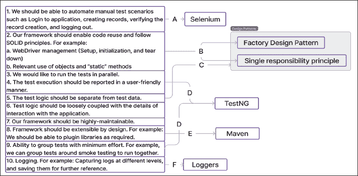

**图 5.2**：收集测试自动化框架的材料

再花一点时间，尝试将前面的解决方案与你按照草拟的方案进行匹配。如果你脑中（或笔记本上）的解决方案与上方不匹配，请不要担心，因为在框架设计领域有一条金律：“没有方案是完美的”。虽然你的解决方案可能有缺陷，我们根据上述内容设计的也可能存在缺陷。只要它能达到教我们框架设计基础的目的，我们就是成功的。此外，不要被 `Figure 5.2` 中的箭头和方框吓到，我们将深入每一个细节。

## 案例研究

从简单的点开始，让我们评估需求 1 和箭头 A。

为了模拟框架的真实用例，我们的示例测试用例将如下：

1. 导航到 `OrangeHRM` 演示应用的登录页面：[`opensource-demo.orangehrmlive.com/web/index.php/auth/login`](https://opensource-demo.orangehrmlive.com/web/index.php/auth/login)

2. 输入用户 `ID` 和密码并登录应用程序。

3. 点击 `Profile` 按钮。

4. 验证主页上是否存在 `Search` 字段。

为了自动化上述测试用例，我们可以使用 `Selenium`。一个使用页面对象（`Page objects`）针对该场景的简单自动化脚本如下。正如我们之前注意的，页面对象模型帮助我们集中管理针对特定网页或 `Web` 应用程序组件的重复代码（如定位器和方法）。以下是下载代码库中 `BadExample.java` 的引用：

```java
public class BadExample {
    @Test(priority = 1)
    public void loginTest() throws Exception {
        // 创建 webdriver 实例
        WebDriver driver = new ChromeDriver();
        // 导航到示例页面
        driver.get("https://opensource-demo.orangehrmlive.com/web/index.php/auth/login");
        // 实例化登录页和主页对象
        OrangeHRMLoginPage loginpage = new OrangeHRMLoginPage(driver);
        OrangeHRMHomePage homepage = new OrangeHRMHomePage(driver);
        // 测试步骤
        loginpage.login("Admin", "admin123");
        homepage.clickProfileButton();
        String homepageURL = driver.getCurrentUrl();
        Assert.assertTrue(homepageURL.contains("dashboard"));
        driver.quit();
    }
}
```

**注意**：如果你使用的是旧版本的 `Selenium`，在实例化 `WebDriver` 之前可能需要设置 `ChromeDriver` 的路径。由于我们使用的是 `Selenium` `v4.11`，`ChromeDriver` 也由 `Selenium Manager` 管理。

以下是 `OrangeHRMLoginPage` 的引用代码，可以在 `src/main/java/pageobjects` 包中找到：

```java
public class OrangeHRMLoginPage {
    protected WebDriver driver;
    private By usamelocator = By.xpath("//input[@placeholder='Username']");
    private By passwordlocator = By.xpath("//input[@placeholder='Password']");
    private By loginlocator = By.xpath("//button[@type='submit']");

    public OrangeHRMLoginPage(WebDriver driver) throws InterruptedException {
        this.driver = driver;
        // 页面验证
        Thread.sleep(5000);
        if (!driver.getTitle().equals("OrangeHRM")) {
            throw new IllegalStateException("这不是登录页面，" + " 当前页面是：" + driver.getCurrentUrl());
        }
    }

    public OrangeHRMHomePage login(String userid, String passwordtext) throws InterruptedException {
        // 设置显式等待
        Wait<WebDriver> wait = new WebDriverWait(driver, Duration.ofSeconds(20));
        wait.until(ExpectedConditions.visibilityOfElementLocated(usernamelocator));
        // 输入用户名
        driver.findElement(usernamelocator).sendKeys(userid);
        // 输入密码
        driver.findElement(passwordlocator).sendKeys(passwordtext);
        // 点击登录按钮
    }
}
```

```java
driver.findElement(loginlocator).click();

// Returning the instance of Homepage for fluent style of programming

return new OrangeHRMHomePage(driver);

}

}
```

这里是 `OrangeHRMHomePage` 的代码，可以在 `src/main/java/pageobjects` 包中找到：


```java
public class OrangeHRMHomePage {
    protected WebDriver driver;
    private By profilebutton = By.xpath(“//span@class=’oxd-userdropdown-tab’”);
    public OrangeHRMHomePage(WebDriver driver) {
        this.driver = driver;
    }
    public void clickProfileButton() {
        // Setting up Explicit wait for the profile button
        Wait<WebDriver> wait = new WebDriverWait(driver, Duration.ofSeconds(20));
        wait.until(ExpectedConditions.visibilityOfElementLocated(profilebutton));
        driver.findElement(profilebutton).click();
    }
}
```

虽然这段代码满足了 [>Figure 5.2 中的要求 1 和要求 2 的部分，但它违反了其他要求，或者并不太合适。例如：

1. `ChromeDriver` 的实例化是作为测试类的一部分完成的。如果我们能有一种更动态的方式来完成它，不是更好吗？

2. URL 和其他测试数据被“硬编码”在测试中。如果我们更改它们会发生什么呢？我们必须更新所有的测试类。

3. 页面对象（Page objects）是在测试中实例化的，这违反了单一责任原则，并使得跨测试用例的对象管理变得困难。

我们该如何解决这些局限性呢？答案在于设计模式、依赖管理和良好的编码实践。

## 设计模式

编程中的设计模式是解决常见问题的通用重用解决方案。在用 Selenium 和 Java 进行自动化测试时，采用设计模式可以显著提高代码的可维护性、可重用性和可读性。作为我们核心要求 2 以及 [>Figure 5.2 中箭头 B 的一部分，以下是对于我们的语境至关重要的设计模式：

### 工厂设计模式

工厂模式用于创建对象，而不指定将创建的对象的确切类。这在 Selenium 中非常有用，当你有不同的浏览器需要测试时，并希望为多个测试用例相应地创建 `WebDriver` 实例。与其在代码中直接创建对象，不如你告诉“工厂”你需要什么类型的对象，它会生成并给你那个对象。这就像点披萨一样——你选择配料（对象类型），披萨店（工厂）就专门为你制作披萨（对象）。这种模式使得你的代码更加灵活且易于维护，因为你可以在一个地方（工厂）中更改对象的创建过程，而不影响代码的其他部分。以下是 `WebDriver` 实例工厂的示例代码：

```java
public class WebDriverFactory {
    public static WebDriver createDriver(String browserType) {
        WebDriver driver = null;
        switch (browserType.toLowerCase()) {
            case “chrome”:
                driver = new ChromeDriver();
                break;
            case “firefox”:
                driver = new FirefoxDriver();
                break;
            // … other browsers
        }
        return driver;
    }
}
```

现在，你不再需要直接创建驱动实例，而是可以使用工厂：

```java
WebDriver driver = WebDriverFactory.createDriver(“chrome”);
```

通过这种方式，创建 `WebDriver` 实例变得无缝且标准化。

从我们的 `Chapter05_BadExample.java` 类中，我们可以很容易观察到，我们应该将 `WebDriver` 的创建分离到 `WebDriverFactory` 中，此外，我们还可以将页面对象的初始化提取到 `PageObjectFactory`。在“框架构建块”部分，我们将更详细地探讨这一概念。

### 单一责任原则 (SRP)

单一责任原则规定一个类应该只有一个更改的原因，这意味着它应该只有一个责任。在 Selenium 中，这通常体现为页面对象、测试数据、测试逻辑之间的关注点分离，或者将常用方法提取到工具类中。

例如，登录页面对象（Login Page Object）可能像我们之前看到的代码所示：

```java
public class LoginPage {
    private WebDriver driver;
    private By usernameField = By.id(“username”);
    private By passwordField = By.id(“password”);
    private By loginButton = By.id(“login”);
    public LoginPage(WebDriver driver) {
        this.driver = driver;
    }
    public void enterUsername(String username) {
        driver.findElement(usernameField).sendKeys(username);
    }
    public void enterPassword(String password) {
        driver.findElement(passwordField).sendKeys(password);
    }
    public void clickLogin() {
        driver.findElement(loginButton).click();
    }
}
```

在这个类中，所有方法都专门专注于与登录页面交互，遵循了单一责任原则（SRP）。

如果我们检查之前提到的 `BadExample` Java 类，可能会注意到测试类承担了实例化 `WebDriver`、页面对象、测试逻辑、页面交互逻辑的责任，并包含了硬编码数据。

理想情况下，我们应该将这些责任分解到不同的类中，以便于维护和代码重用。

### Java 反射

反射是 Java 的一种特性，允许在运行时检查和操纵类、接口、构造函数、方法和字段。这在 Selenium 中动态加载页面对象时非常有用。

想象一下你正站在镜子前。你看到的是自己的反射。就像你可以看到自己的脸部细节、衣服，甚至是斑点一样，同样，Java 的反射特性允许程序检查自身。

通过反射，你可以动态创建类的实例，使你的框架更加灵活和具有适应性：

```java
Class<?> arrayListClass = ArrayList.class;
List<?> myList = (List<?>) arrayListClass.getDeclaredConstructor().newInstance();
```

让我们更详细地理解前面的代码，因为它对于帮助我们动态创建页面对象至关重要。

在我们的软件开发世界，系统通常依赖于第三方库或模块。这些外部库被称为“依赖项”，它们通过提供无需从零开始构建的功能，赋予开发者强大的能力。依赖管理是控制、组织和维护这些第三方库的实践。可以将其想象为代码库的管理员，确保正确的书籍（库）版本在书架上是可用且摆放整齐的。

例如，考虑一个现实世界的类比：烘焙蛋糕。配方可能需要各种原料，如面粉、糖和鸡蛋。想象一下，如果这些原料不断变化——使用不同类型的糖或独特的面粉混合物。

如果没有某种形式的管理，要获得一致的结果将具有挑战性。在软件术语中，这些原料类似于库，而依赖管理确保了始终以正确的数量提供正确的原料。

有效的依赖管理对于软件项目的稳定和可靠至关重要。随着软件的演进，依赖项的新版本发布是常有的，这些版本可能包含关键的修复或额外功能。然而，它们也可能引入破坏性变更（breaking changes），从而在无意中引入 Bug 或错误。依赖管理有助于确保：

* 所有所需的库都已存在。

* 库版本之间的冲突已解决。

* 使用了正确版本的库。

* 向新版本的升级是顺利且受控的。

让我们回顾 `">Figure 5.2` 中列出的需求，框架扩展性是点 8 和箭头 E 的核心需求。因此，依赖管理变得尤为重要。Selenium 本身有许多版本，并与各种浏览器驱动程序和测试框架集成。保持同步对于自动化脚本的稳定性至关重要。

Apache Maven 通常称为 Maven，是一种广泛用于 Java 生态系统的强大构建和依赖管理工具。通过 Maven，定义和检索依赖项变成了一个标准化过程。

#### POM 文件

依赖项在“项目对象模型”或 POM 文件（`pom.xml`）中指定。当 Maven 命令运行时，它读取此文件，从仓库（存储库的集中位置）获取所需的依赖项，并让它们供项目使用。

```xml
<dependency>
  <groupId>org.seleniumhq.selenium</groupId>
  <artifactId>selenium-java</artifactId>
  <version>3.141.59</version>
</dependency>
```

上述来自 `pom.xml` 的片段告诉 Maven 获取版本 3.141.59 的 Java Selenium 库。

**冷知识**：Selenium 项目曾维护了一段时间的版本号，使用 22/7 比例的数字（通常称为 Pi 值）。

`pom.xml` 是 Maven 项目的核心。它包含了配置细节、项目元数据，最重要的是依赖项列表（类似于配方中的原料）。

以下是基础结构：

```xml
<project>
  <modelVersion>4.0.0</modelVersion>
  <groupId>com.example</groupId>
  <artifactId>sample-project</artifactId>
  <version>1.0</version>
  <dependencies>
    <!-- 依赖项列表列在此处 -->
  </dependencies>
</project>
```

关键组件如下：

* `groupId`、`artifactId` 和 `version` 定义了项目的唯一标识符。

* `<dependencies>` 是列出所有项目依赖的地方。

请导航到下载的代码库中的 `pom.xml` 文件，并观察内容和项目的依赖项。依赖项列出如下：

对版本进行参数化，然后将所有版本号汇总在一个处如下所示：

```xml
<properties>
  <testng.version>7.6.0</testng.version>
</properties>

<dependency>
  <groupId>org.testng</groupId>
  <artifactId>testng</artifactId>
  <version>${testng.version}</version>
</dependency>
```

或者我们可以直接在 XML 节点中说明依赖项的版本，如下：

```xml
<dependency>
  <groupId>com.jayway.jsonpath</groupId>
  <artifactId>json-path</artifactId>
  <version>2.4.0</version>
</dependency>
```

让我们放大查看 `pom.xml` 文件的以下部分：

```xml
<profiles>
  <profile>
    <id>all-tests</id>
    <activation>
      <activeByDefault>true</activeByDefault>
    </activation>
    <build>
      <plugins>
        <plugin>
          <groupId>org.apache.maven.plugins</groupId>
          <artifactId>maven-compiler-plugin</artifactId>
          <version>3.3</version>
        </plugin>
        <plugin>
          <groupId>org.apache.maven.plugins</groupId>
          <artifactId>maven-surefire-plugin</artifactId>
          <version>2.19</version>
          <configuration>
            <suiteXmlFiles> <!-- 在此处指定你想运行的 TestNG XML 文件 -->
              <suiteXmlFile>src/test/java/chapter5/testng.xml</suiteXmlFile>
            </suiteXmlFiles>
          </configuration>
        </plugin>
      </plugins>
    </build>
  </profile>
</profiles>
```

此 XML 片段设置了一个名为 `all-tests` 的默认配置。当此配置激活时，它告诉 Maven 如何处理 Java 代码编译以及如何运行测试。它使用了两个工具：用于代码编译的 Maven Compiler Plugin 和用于运行测试的 Maven Surefire Plugin。代码指向特定的配置。

#### Maven 项目的目录结构

Maven 项目遵循标准的目录结构，有助于组织：

```
sample-project
├── src
│   ├── main
│   │   └── java (包含源代码)
│   └── test
│       └── java (包含测试代码)
├── target (编译后的字节码和 JAR 包将在这里)
└── pom.xml
```

#### Maven 命令

Apache Maven 通过一系列命令运行，每个命令都旨在执行构建生命周期中的特定任务或一系列任务。这些命令通常称为目标（goals），决定了 Maven 在不同阶段的行为。让我们深入研究一些最常用的命令：

* `mvn clean`：`mvn clean` 命令类似于房屋的大扫除。随着时间的推移，当你反复编译和构建项目时，Maven 会积累生成的文件——以 `.class` 文件形式存在的编译字节码或打包的 JAR 包。这些文件位于 `target/` 目录。

执行 `mvn clean` 会清除 `target/` 目录，删除之前的构建，并确保后续构建从全新的开始。

* `mvn install`：`mvn install` 命令是一个多功能工具。它的主要目标是：

    * 编译源代码。

    * 执行单元测试。

    * 将编译后的代码打包成产物（例如 JAR）。

    * 将打包好的产物安装到本地 Maven 仓库中。

“`install`”目标通过将项目产物放入该仓库，使得同一台机器上的其他 Maven 项目可以调用。

- `mvn test`: 软件开发周期中的基石，测试确保了代码的健壮性和可靠性。`mvn test` 命令是 Maven 进入这一关键阶段的入口。当你运行此命令时：

    * 源代码被编译。

    * 执行单元测试（通常使用 `JUnit` 或 `TestNG` 等框架编写）。

    * 生成测试报告，详细列出成功和失败的情况。

至关重要的一点是，`mvn test` 只运行单元测试，不会对项目产物进行打包或安装。它的主要目标是在开发过程中提供快速反馈。如果测试失败，Maven 构建生命周期将在此阶段停止，防止可能存在 Bug 的代码进入打包或部署阶段。

Maven 的命令构成了其功能的骨干，引导构建生命周期从原始代码到可部署产物的演变。通过理解并有效利用这些命令，我们可以实现精简且高效的构建过程，确保高质量软件的交付。

**Note**：我们也可以链式调用多个命令，例如 `mvn clean install test`，以实现多个目标。

要运行这些命令，我们可以通过 GUI 激活上下文菜单（在 Eclipse IDE 中右键点击 `pom.xml` 文件并选择“Run As”），或者导航到 `pom.xml` 所在的位置并通过终端窗口（命令提示符或 shell）如下触发命令：

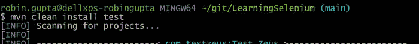

**Figure 5.3:** 从终端执行 Maven 命令

**Note**：通过 Maven 尝试并使用多个依赖可能非常有吸引力；然而，我们必须确保在 `pom.xml` 中添加的依赖是安全的，且符合框架的需求。

### TestNG

假设我们必须举办一场家庭派对。作为举办者，我们的活动应该按照特定的顺序进行计划和执行。是的，举办晚宴和编写测试自动化似乎是两个不同的世界，但它们共享一个底层原理：**组织结构**。想象你正在举办这场晚宴：你首先会发送邀请（初始设置），然后清理和整理场地（测试前准备），上主菜和甜点（主事件的执行），最后结束夜晚，感谢客人们并清理现场（测试后活动）。TestNG 是一个基于 Java 的测试框架，它帮助你以类似的方式组织测试自动化活动，从而成功实现我们的效率目标。


TestNG 是“Test Next Generation”（下一代测试）的缩写，是一个为了克服另一个流行的 Java 测试框架 `JUnit` 的局限性而演变的测试框架。凭借其灵活性、强大的功能和集成能力，TestNG 迅速成为 Java 专业人员的喜爱。

在上下文中，TestNG 将帮助我们解决图 5.2 中编号为 3、4、9 以及 5 的部分需求，我们将在后续章节中观察。

## 安装

在你开始烹饪之前，你需要准备好厨房。同样，安装 TestNG 可以通过向 `pom.xml` 中添加以下依赖来实现：

```xml
<dependency>
  <groupId>org.testng</groupId>
  <artifactId>testng</artifactId>
  <version>7.6.0</version>
  <scope>test</scope>
</dependency>
```

如果我们导航到作为项目一部分下载的 `pom.xml`，可以发现它已经包含了如下的 TestNG 条目：

```xml
<testng.version>7.6.0</testng.version>
```

**Note**：对于 Eclipse IDE 用户：导航到 `Eclipse Marketplace`，搜索 `TestNG,` 并安装该插件。这将提供额外的功能，例如从 Eclipse 的 GUI 运行测试。IntelliJ 和其他 IDE 也可以安装类似的插件。

# 注解及其执行顺序

TestNG 中的注解用作标记，引导执行流。让我们通过一个故事来学习它们的顺序。

想象你正在为一场盛大的晚餐做准备。以下是你的步骤，映射到 TestNG 注解：

- `@BeforeSuite`：在套件中所有测试之前运行。想象在任何准备开始之前清理整个房子。或者在我们的案例中，是实例化 `WebDriver` 实例。

```java
@BeforeSuite
public void cleanHouse() {
    System.out.println("House cleaned!");
}
```

- `@BeforeTest`：在 `testng.xml` 的 `<test>` 标签内可用类的任何测试方法之前执行。例如：确保厨房已就绪，即使你忘记了清理房子。或者在测试自动化的情况下，确保在执行任何新测试之前删除所有 cookie。此外，在下面的示例中，当我们希望即使方法所依赖的参数失败，该方法也始终运行时，使用了 `alwaysRun = true`。

```java
@BeforeTest(alwaysRun = true)
public void prepKitchen() {
    System.out.println("Kitchen ready!");
}
```

- `@BeforeClass`：在当前类中的第一个检查方法之前执行。将其想象为为特定菜肴准备所有食材。或者在我们的案例中，实例化页面对象（page objects）。

```java
@BeforeClass
public void getIngredients() {
    System.out.println("Ingredients fetched for the dish.");
}
```

- `@BeforeMethod`：在每个 `@Test` 方法之前执行。在我们的晚餐安排中，这就像在烹饪菜的每一部分之前摆放厨具。

```java
@BeforeMethod
public void layTools() {
    System.out.println("Tools ready.");
}
```

- `@AfterMethod`：在每个 `@Test` 方法之后执行。在我们的晚餐安排中，这就像在烹完菜的每一部分之后清理工具。

```java
@AfterMethod
public void cleanTools() {
    System.out.println("Tools.");
}
```

- `@AfterClass`：在当前类中的所有测试方法之后执行。这就像是在菜准备好后将其上桌子。

```java
@AfterClass
public void placeDish() {
    System.out.println("Dish on table.");
}
```

- `@AfterSuite`：在套件中的所有测试之后执行。在我们的例子中，这将是收拾房子并休息。

```java
@AfterSuite
public void lockUp() {
    System.out.println("House locked. Good night!");
}
```

简而言之，这里 TestNG 的执行序列：

**TestNG 注解执行序列**

1. `@BeforeSuite`

2. `@BeforeTest`

3. `@BeforeClass`

4. `@BeforeMethod`

5. `@Test`

6. `@AfterMethod`

7. `@AfterClass`

8. `@AfterTest`

9. `@AfterSuite`

这种执行顺序至关重要。正如你不能在准备好之前上菜一样，你也不能在 TestNG 中跳过执行顺序。

让我们查看 `TestNG_ExecutionOrder` 类（位于 `src/test/java/chapter5/TESTNG_ExecutionOrder.java`）来体验事件的顺序：

```java
public class TestNG_ExecutionOrder {

    @BeforeSuite
    public void beforeSuite() {
        System.out.println("BeforeSuite: Clean the entire house.");
    }

    @BeforeTest(alwaysRun = true)
    public void beforeTest() {
        System.out.println("BeforeTest: Ensure the kitchen is ready.");
    }

    @BeforeClass
    public void beforeClass() {
        System.out.println("BeforeClass: Get all the ingredients for the dish.");
    }

    @BeforeMethod
    public void beforeMethod() {
        System.out.println("BeforeMethod: Lay out the cooking tools.");
    }

    @Test(groups = "starters")
    public void serveSalad() {
        System.out.println("Test: Serving salad as a starter.");
    }

    @Test(groups = "mains")
    public void servePasta() {
        System.out.println("Test: Serving pasta as a main course.");
    }

    @Test(groups = "desserts")
    public void serveIceCream() {
        System.out.println("Test: Serving ice cream for dessert.");
    }

    @AfterMethod
    public void afterMethod() {
        System.out.println("AfterMethod: Clean the cooking tools.");
    }

    @AfterClass
    public void afterClass() {
        System.out.println("AfterClass: Dish placed on table.");
    }

    @AfterSuite
    public void afterSuite() {
        System.out.println("AfterSuite: House locked. Good night!");
    }
}
```

```java
System.out.println("AfterClass: Place the dish on the dining table.");
}

@AfterTest
public void afterTest() {
    System.out.println("AfterTest: Turn off the kitchen lights.");
}

@AfterSuite
public void afterSuite() {
    System.out.println("AfterSuite: Lock up the house and retire for the night.");
}

public static void main(String[] args) {
    // This is just a placeholder. Typically, TestNG tests are not run via a main
    // method.
    // Instead, you'd run this using a TestNG runner (via testng.xml or directly
    // through your IDE's TestNG plugin).
    System.out.println("Run the test through TestNG runner.");
}
}
```

# 运行和调试 TestNG 测试

TestNG 是一个强大的 Java 测试框架，而 Eclipse IDE 为运行和调试这些测试提供了一个直观的环境。以下是在 Eclipse 中高效地运行和调试 TestNG 测试的方法。

## 运行 TestNG 测试

**运行测试**：Eclipse 让运行 TestNG 测试变得非常简单。要执行您的测试，请在 Project Explorer 中右键点击测试类或特定的测试方法，然后选择 `Run As > TestNG Test`。此操作将启动测试的执行。

**查看结果**：运行测试后，Eclipse 会在'TestNG'视图中显示结果。该部分提供了所有已执行测试的详细报告，将其分类为通过（passed）、失败（failed）和跳过（skipped）。您可以点击每个测试以查看更多详情，例如失败测试的堆栈跟踪，这对于初始排错至关重要。

## 调试 TestNG 测试

**设置断点**：在 Eclipse 中调试从设置断点开始。断点是您在希望暂停执行的代码行上设置的标记。要设置断点，请双击测试类中对应代码行左侧的左边距。蓝点表示已设置了断点。

**启动调试模式**：要开始调试，请右键点击测试类或方法并选择 `Debug As > TestNG Test`。此操作将以调试模式启动测试，执行将在您设置的断点处暂停。

**使用调试工具**：当执行在断点处暂停时，Eclipse 会打开 ` `` 视角视图。此视图提供了几个强大的工具：

*   **单步控制**：Eclipse 顶部菜单栏中的这些按钮允许您单步执行下一行代码、进入方法查看内部情况，或在完成后跳出。

*   **变量视图 (Variables View)**：显示显示执行暂停处作用域内变量的当前值。

*   **表达式求值**：您可以随时编写并评估表达式，这对于检查代码更改如何影响执行非常有用。

*   **识别和解决问题**：在单步执行代码时，请注意'Variables'视图中的值和'Console'控制台）中的响应。这些线索可以帮助您理解为什么测试可能会失败，并引导您找到解决方案。

在 Eclipse 中运行和调试 TestNG 测试是一个高效的过程，能够增强您的测试工作流。通过利用 Eclipse 的功能，您可以优化您的测试流程。

## Factory 和 DataProvider 注解

`@Factory` 和 `@DataProvider` 注解提供了实现测试灵活性和可重用性的强大机制。当与 Selenium 使用时，它们允许测试人员处理不同的场景和配置。

假设您有一个电子商务网站，并且想要自动化登录功能。与其为每个账户编写单独的测试，不如使用以下方法：

```java
public class LoginTest {
    private String browser;

    public LoginTest(String browser) {
        this.browser = browser;
    }

    @Test(dataProvider = "credentialsProvider")
    public void testLogin(String username, String password) {
        WebDriver driver = new ChromeDriver();
        driver.get("https://www.example-site.com/login");
        WebElement usernameField = driver.findElement(By.id("username"));
        WebElement passwordField = driver.findElement(By.id("password"));
        WebElement loginButton = driver.findElement(By.id("loginButton"));
        usernameField.sendKeys(username);
        passwordField.sendKeys(password);
        loginButton.click();
        driver.quit();
    }

    @DataProvider(name = "credentialsProvider")
    public Object[][] provideCredentials() {
        return new Object[][]{
            {"user1", "password1"},
            {"user2", "password2"},
            {"user3", "password3"}
        };
    }
}
```

在上述示例中，`testLogin` 方法将运行三次，对应 `credentialsProvider` 提供的每组凭据。

## testng.xml 和并行执行

`testng.xml` 是一个 XML 配置文件，提供了定义测试套件和测试的集中位置。它提供了各种配置选项，可以根据需求进行定制。当与 Selenium 使用时，由于以下原因变得特别有用：

*   **不同的浏览器和环境**：您可以在不同的浏览器或环境中定义不同的测试或套件。

*   **回归测试和烟测试**：可以将测试分组为回归、烟等，并选择要运行的组。

*   **并行执行**：如果您在 Selenium Grid 或本地运行测试，可以在不同的会话中并行执行测试以加快执行速度。

以下是您可能如何设置 `testng.xml`：

```xml
<?xml version="1.0" encoding="UTF-8"?>
```

```xml
<!DOCTYPE suite SYSTEM "https://testng.org/testng-1.0.dtd">
<suite name="Suite1" parallel="tests" thread-count="2">
  <test name="test on firefox">
    <parameter name="browser" value="firefox"></parameter>
    <classes>
      <class name="chapter5.Chapter05_LoginExample"/>
    </classes>
  </test> <!-- Test1 -->
  <test name="test on chrome">
    <parameter name="browser" value="chrome"></parameter>
    <classes>
      <class name="chapter5.Chapter05_LoginExample"/>
    </classes>
  </test> <!-- Test1 -->
</suite> <!-- Suite1 -->
```

`testng.xml` 文件定义了一个名为 `Suite1` 的测试套件，并指定了套件内的测试应并行运行。`parallel="tests"` 属性表示 `<test>` 元素应该并发运行，而 `thread-count="2"` 属性意味着将分配两个线程用于此并行执行。

在该套件内部，定义了两个 `<test>` 元素：

* `test on firefox`：这设置了一个名为 `browser` 的参数，值为 `firefox`，并表示应使用该参数执行 `LoginExample` 类。

* `test on chrome`：同样，它设置了一个名为 `browser` 的参数，值为 `chrome`，并表示应执行相同的 `Chapter05_LoginExample` 类。

由于并行执行配置，这两个测试都将并发运行，每个测试在它们自己的线程中运行。

`@Parameters` 注解简化了不修改测试代码的情况下配置测试在不同条件下运行的过程。参数值从 `testng.xml` 文件传递到测试类中的 `@Parameters` 注解。


这在 Selenium 测试自动化中变得特别强大，因为测试通常需要针对不同的浏览器、环境或配置进行执行。通过`testng.xml`使用外部化参数可以确保你的测试代码保持整洁、可重用且易于维护。

Selenium 测试自动化的另一个常见用例是需要在不同的环境或 URL 上运行测试。假设你的应用程序有开发环境、测试环境和生产环境。与其硬编码环境 URL 或为每个环境创建单独的测试方法，不如利用`@Parameters`动态地传递环境 URL。

现在，让我们创建测试类，在其中我们可以如下所示并行触发 Chrome 浏览器和 Firefox 浏览器测试（参考代码位于`src/test/java/chapter5/LoginExample.java`）：

```java
public class LoginExample {
  WebDriver driver = null;
  @Parameters("browser")
  @BeforeTest
  public void setUp(String browser) {
    if (browser.equalsIgnoreCase("chrome")) {
      // 初始化并启动 Chromebrowser
      driver = new ChromeDriver();
    } else if (browser.equalsIgnoreCase("firefox")) {
      // 初始化并启动 Firefoxbrowser
      driver = new FirefoxDriver();
    }
  }
  @Test(groups = { "regression" })
  public void test1() throws InterruptedException {
    System.out.println("Execution for Chrome browser");
    driver.get("https://orangeava.com/");
    Thread.sleep(3000);
  }
  @Test(groups = { "smoke" })
  public void test2() throws InterruptedException {
    System.out.println("Execution for Firefox browser");
    driver.get("https://orangeava.com/");
    Thread.sleep(3000);
  }
  @AfterTest
  public void tearDown() {
    driver.quit();
  }
}
```

现在，当你导航到 IDE 并作为“Test Suite”运行`testng.xml`文件时（在 IDE 的右键菜单中右键点击并选择`Run as TestNG Suite`，或在 Eclipse 中使用快捷键`Alt+Shift+X, G`），我们可以观察到：

* 将分配两个线程用于并行执行。

* 在其中一个线程中，`LoginExample`类的方法将在`browser`参数被设置为`firefox`的情况下执行。Firefox 浏览器将启动，`test1`和`test2`方法将顺序执行，每个方法都会打开指定的 URL。

* 与此同时，在第二个线程中，`LoginExample`类的方法将在`browser`参数被设置为`chrome`的情况下执行。Chrome 浏览器将启动，`test1`和`test2`方法将以类似的方式执行。

**注意**：TestNG 按字母顺序执行不同的测试。默认情况下，`test1`将首先运行，之后是`test2`，最后是`test3`。

通过这种方式，我们可以使用 TestNG 注解并行化或协调我们库中的各种测试。

## 断言 (Assertions)

在测试自动化世界中，断言的作用类似于一个警觉的门卫。断言对应用程序的预期行为进行严格检查，确保软件输出与预期一致。TestNG 提供了一个专门的`Assert`类来实现这一目标。该类包含了一系列为各种验证需求定制的静态方法。当与 Selenium 时，这些断言变成了验证网页状态、内容和交互的强大工具，从而巩固了应用程序的可靠性。让我们来看 TestNG 库提供的各种方法，以断言应用程序按预期运行。

### assertEquals

此方法用于比较预期值和实际值。如果有任何不匹配，测试将失败。

示例如下：

```java
String expectedTitle = "Welcome to XYZ";
String actualTitle = driver.getTitle();
Assert.assertEquals(actualTitle, expectedTitle, "Page title doesn’t match");
```

### assertNotEquals

此方法用于确保预期值和实际值不相等。虽然这个方法看起来很简单，但在默认占位符被实际内容替换的情况下，它特别有用。

示例如下：

```java
String defaultText = "Default";
String buttonText = driver.findElement(By.id("button")).getText();
Assert.assertNotEquals(buttonText, defaultText, "Button text shouldn’t be default");
```

### assertTrue

此方法用于验证特定条件为真。这是常用的方法之一，用于确保预期条件确实为真。

示例如下：

```java
WebElement menu = driver.findElement(By.id("menu"));
boolean isMenuExpanded = menu.getAttribute("expanded").equals("true");
Assert.assertTrue(isMenuExpanded, "Menu should be in expanded state");
```

例如，此断言可以检查元素的状态，例如在用户操作后下拉菜单是否展开。

### assertFalse

此方法用于确保条件结果为假。对于预期某些元素不可见的情况（特别是在成功操作后），这是一个方便的断言。

示例如下：

```java
WebElement errorNotification = driver.findElement(By.id("errorNotification"));
boolean isNotificationVisible = errorNotification.isDisplayed();
Assert.assertFalse(isNotificationVisible, "Error notification should not be visible on a successful action");
```

## 测试报告 (Test Reporting)

测试报告是以结构化格式汇总并呈现测试执行结果的过程。

它封装了被测试应用的健康状况，详细说明了哪些测试通过了，哪些失败了以及原因，从而提供了应用程序质量的清晰图谱。

想象一下正在烤蛋糕并上菜，却没有检查核心是否已经完全烤熟。测试报告不仅仅是展示结果，它还是利益相关者的指南针。它引导开发者发现缺陷，帮助管理层进行决策，并为测试人员提供改进和进一步检查区域的洞察。此外，当测试套件随着应用程序的演进而增长时，随时间的进度和陷阱追踪变得至关重要。报告作为历史文档，记录了应用程序质量随时间演变的历程。

有一些非常棒的工具，如`ReportPortal`，它可以被集成到测试自动化框架中以生成世界级的报告。在我们的案例中，为了保持简单，我们将使用`TestNG`的内置功能从我们的自动化测试执行生成报告。在每次测试运行后，`TestNG`会自动生成一份详细的 HTML 报告。这些报告非常直观，提供了整个测试执行的俯视图，并深入深入每个测试用例，揭示每次成功或失败的细节。

让我们通过位于`src/test/java/chapter5`的简单示例测试类`Chapter05_TestNGReportExample`来学习：

```java
@Test
public void sampleTest() {
    Assert.assertEquals(5, 5, “Sample test for demonstration.”);
}
```

使用`TestNG`执行此测试后，执行结束后将生成一个 HTML 报告。找到`TestNG`的报告非常简单。使用`TestNG`执行你的测试套件后，导航到项目根目录。在里面，你会找到一个名为`test-output`的目录。打开这个目录，你会看到一个`index.html`文件。这个文件是你测试报告的门径。在网络浏览器中打开它，将呈现测试执行的全面概述。

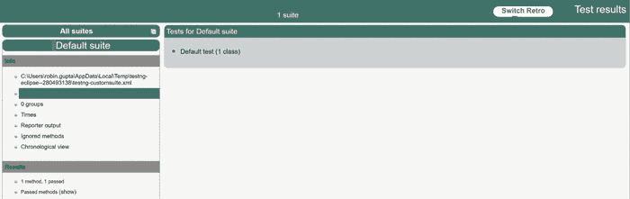

**图 5.4：**`TestNG`的示例报告

正如我们观察到的，报告提供了所有`Test`方法以及通过方法的详细信息。如果我们点击像“Times”（时间）这样的标签，我们还可以观察执行测试用例所需的时间。这些数据对于测试的性能调优可能至关重要。在大多数实际用例中，你可以使用`emailable-report.html`将细节与团队中相关的利益相关者共享，如下：

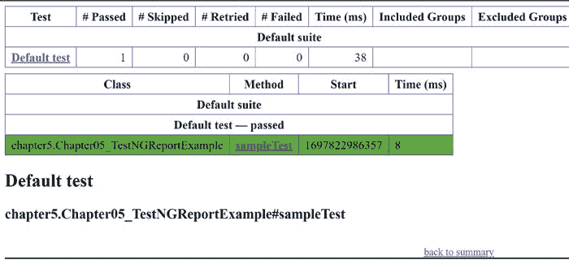

**图 5.5：**`emailable-report.html`的示例视图

执行的每个测试方法都有自己的部分，详细列出了参数、开始时间、结束时间和持续时间。在失败的情况下，`TestNG`会贴心地捕获异常并显示堆栈跟踪，从而简化了调试过程。

测试报告是照亮软件质量保证之路的灯塔。虽然`TestNG`提供了稳健的默认报告机制，但对全面报告的追求可能会团队集成额外的工具。尽管如此，对于那些从`TestNG`开始自动化之旅的人来说，它的内置报告提供了一个坚实的基础。记住，报告的核心不仅仅是数字和图表，更在于清晰度、洞察力和明智的决策，引导软件迈向卓越。

## 日志记录 (Logging)

日志记录就像在商店里安装了监控摄像头；它记录发生的一切，使得在发生事故时更容易找出哪里出了问题。它可以帮助开发者识别错误、监控系统性能并确保一切都按预期运行。通过日志记录，你拥有了系统活动历史，这对于故障排除和性能优化可能是无价的。

此外，日志记录充当了文档的形式。它创建了事件轨迹，这对于安全审计和合规性至关重要。在某种程度上，它是系统讲述故事的方式，提供了可以帮助改进未来操作的洞察。

到目前为止，在示例中，我们一直使用`System.out.println()`语句向控制台打印关键信息，以验证程序的执行。虽然这种方法很好，但在几个地方它失效了：

1. **数据持久化**：一旦程序重新运行或运行另一个程序，控制台就会清空，我们失去了对之前执行的追踪。

2. **清晰度低**：由于缺乏时间戳且有多个运行线程的输出，控制台会变得混乱。

为了确保我们能够解决上述问题并创建一个企业级框架，我们可以使用外部库如`Log4J`用于我们的日志记录目的。

将其想象成软件的一本精密的数字日记。最新版本`Log4j2`就像一本增加了书签和颜色编码页等功能的日记，使其在日志中导航更加容易。它帮助组织日志消息，让开发者更简单、更快速地找到他们需要的信息。

### 安装 (Installation)

这里是如何向你的 Maven 项目添加`Log4j`的代码片段。在我们的案例中，这已经添加到下载的代码库的`pom.xml`文件中：

```xml
<dependency>
    <groupId>org.apache.logging.log4j</groupId>
    <artifactId>log4j-api</artifactId>
    <version>2.16.0</version>
</dependency>
<dependency>
    <groupId>org.apache.logging.log4j</groupId>
    <artifactId>log4j-core</artifactId>
    <version>2.16.0</version>
</dependency>
```

### 配置 (Configuration)

开始使用`Log4j`就像设置一本新日记。我们需要获取日记，决定条目的格式，并开始记记录。在技术术语中，我们向项目添加`Log4j`库，然后通过 XML 文件对它进行配置，如下之前所示：

```xml
<?xml version="1.0" encoding="UTF-8"?>
<Configuration status="INFO">
    <Appenders>
        <File name="file" fileName="logs/app.log">
            <PatternLayout pattern="%d{yyyy-MM-dd HH:mm:ss.SSS} [%t] %-5level %logger{36} - %msg%n" />
        </File>
    </Appenders>
    <Loggers>
        <Root level="info">
            <AppenderRef ref="file" />
        </Root>
    </Loggers>
</Configuration>
```

相同的配置 XML 位于下载的代码库`src/main/resources/log4j2.xml`。此 XML 代码是 Log4j 的设置指南，指导它如何在 Java 中处理日志。它指定`Log4j`应记录“INFO”级别或更高级的消息。它指定了一个名为`logs/app.log`的文件，所有日志将记录在那里。每条日志将具有特定的格式，显示日期、时间、线程名称、日志级别、记录器名称和实际消息。配置将一切连接在一起，确保任何“INFO”级别或以上的重要信息都按指定的格式记录在文件中，使工程师更容易回顾应用程序运行期间的情况。让我们仔细查看`PatternLayout`节点，不要被它吓到：

* **`PatternLayout:`**：此元素定义了日志消息的格式。`pattern`属性指定了如何格式化日志。

* **`%d{yyyy-MM-dd HH:mm:ss.SSS}`**：部分格式化日志消息的日期和时间。

* **`[%t]`**：部分记录生成日志的线程名称。

* **`%-5level:`**：部分记录日志级别（例如 INFO、ERROR）并填充为 5 个字符。

* **`%logger{36}`**：部分记录生成日志的记录器名称，截断为 36 个字符。

* **`%msg`**：部分记录实际的日志消息。

* **`%n`**：部分在每条日志消息后写入换行符，确保每条消息都在新行显示。

### 日志级别 (Log Levels)

此时会产生一个很自然的问题：如果我们在上一节中是以`INFO`级别记录信息的，那么其他级别又是什么呢？Log4j 默认提供六种日志级别，每个级别都关联一个整数值：

* `TRACE (600):` 此级别用于记录非常详细的信息，例如当你在进入或退出函数，或者检查代码中变量的值时。它就像用放大放大镜来观察程序运行的每一个微小细节。

* `DEBUG (500):` 此级别用于在你构建或测试程序时。它提供的消息可以帮助你检查程序的某些部分是否运行正常。

* `INFO (400):` 此级别记录程序在正常运行期间的通用事件，例如用户登录或程序与数据库通信时。它就像是程序所执行的主要动作的日志。

* `WARN (300):` 此级别标记可能没有错误但可能变成问题的情况。它就像是一个提醒，让你检查程序中的某些区域。

* `ERROR (200):` 当程序运行期间发生意外错误时，此级别记录日志。它用于记录意外的小插状况。

* `FATAL (100):` 此级别用于重大警报，表示发生了非常严重且需要紧急修复的问题。它就像一个响亮的警报，信号着程序核心部分出现了严重问题。

例如，上述日志级别可以如下所示实现在一个电子商务系统中：

```
logger.trace(“Entering method processOrder().”);
logger.debug(“Received order with ID 12345.”);
logger.info(“Order shipped successfully.”);
logger.warn(“Potential security vulnerability detected in user input: ‘…’”);
logger.error(“Failed to process order. Error: {. ..}”);
logger.fatal(“System crashed. Shutting down…”);
```

让我们通过一个动手示例来巩固理解。它实现在`src/test/java/chapter5`的`Chapter05_LogExample`类中，如下：


```java
public class Chapter05_LogExample {
    @Test(priority = 1)
    public void loggerTest() throws Exception {
        final Logger Logger = LogManager.getLogger();
        logger.trace(“Entering method processOrder().”);
        logger.debug(“Received order with ID 12345.”);
        logger.info(“Order shipped successfully.”);
        logger.warn(“Potential security vulnerability detected in user input: ‘…’”);
        logger.error(“Failed to process order. Error: {. ..}”);
        logger.fatal(“System crashed. Shutting down…”);
    }
}
```

当我们将上述内容作为 TestNG 测试运行时，可以在 `logs` 文件夹下的 `app.log` 文件中观察到如下日志：

```
2023-10-21 22:57:19.723 [main] INFO chapter5.Chapter05_LogExample - Order shipped successfully.
2023-10-21 22:57:19.725 [main] WARN chapter5.Chapter05_LogExample - Potential security vulnerability detected in user input: ‘…’
2023-10-21 22:57:19.725 [main] ERROR chapter5.Chapter05_LogExample - Failed to process order. Error: {. ..}
2023-10-21 22:57:19.725 [main] FATAL chapter5.Chapter05_LogExample - System crashed. Shutting down…
```

你是否注意到我们在 Java 类中针对各种日志级别编写了六条命令，但日志文件中只注册了其中的四个？是的，这是由于日志级别被配置为 `INFO`，正如我们之前在 `log4j2.xml` 配置文件中设置的那样。因此，我们的日志记录器只显示高于 `INFO` 级别以上的信息。

**注意**：花几分钟尝试将日志级别更改为 `Debug` 或 `Error`，再次运行测试并观察结果。记住，卓越的软件工程技能源于好奇心和实验。

## 构建框架

现在我们已经组成了框架的模块，让我们把它们整合在一起，使我们的整体大于部分之和。如果我们把自动化测试之旅比作烘焙蛋糕，那么框架就是我们的食谱，详细说明了每一步、每种原料以及最终目标——一个美味、无错的软件（或蛋糕）！

### 文件夹结构

在开始烘焙（或者在我们的案例中，制作测试自动化框架）之前，让我们通过遍历下载的代码库文件夹结构来了解“厨房”。

正如我们观察到的，文件夹结构遵循标准的 Maven 文件夹结构。以下是主要组件的说明：

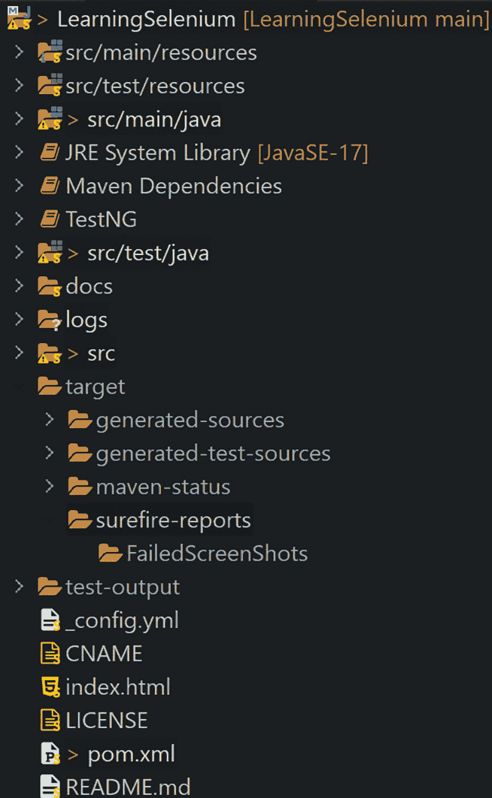

**图 5.6:** 框架的文件夹结构

- **LearningSelenium**: 这是我们项目的根目录。它是最初提供的名称。
- **src/main/java**: 此目录包含主代码。但在我们的上下文中，它将包含基类、页面对象（page objects）。
- **src/main/resources**: 这是我们放置配置文件的地方。
- **src/test/java**: 此目录将存放我们的测试用例。
- **src/test/resources**: 专门用于测试的资源，例如测试数据。
- **JRE System Library [JavaSE-17]**: 这显示项目在使用 Java 17。
- **Maven Dependencies**: 由 Maven 管理的库和依赖。这些包括 Selenium 库、TestNG 等测试框架。
- **docs**: 包含演示文件的文件夹。
- **logs**: 如名所示，此目录用于存储执行期间生成的日志文件。
- **target**: 这是标准的 Maven 目录，用于放置编译后的字节码（`.class` 文件）和打包构建（如 `.jar` 或 `.war` 文件）。
  - `generated-sources` 和 `generated-test-sources`: 构建过程中生成的源代码的文件夹。
  - `maven-status`: 包含与 Maven 构建状态的信息。
  - `surefire-reports`: Surefire 是用于运行测试的 Maven 插件。此目录包含 Surefire 生成的报告。
  - `FailedShhots`: 存储失败测试用例截图的自定义目录。
- **test-output**: 包含 TestNG 执行输出的目录。
- **README.md**: 一个 Markdown 文件，通常提供关于项目、如何设置、运行测试等信息。
- 使用设计模式将这些元素整合起来，以构建可扩展的测试自动化框架。

现在，就像烤蛋糕一样，在烘焙之前加入糖霜或在烘焙面团后混合糖是没有用的，因此，即使有了我们的工具和库，这些库和工具的分层对于创建框架的艺术也至关重要。

### 代码味道 (Code smells)

代码气味是指软件代码中暗示潜在问题的模式，表明代码可能需要重构的区域。它们并不意味着代码是错误的，但可能会让代码更难以维护或理解。识别代码味道有助于开发者保持代码整洁和高效。

让我们探测以下代码 `Chapter05_BadExample` 类，并查看一些代码味道或探测问题：

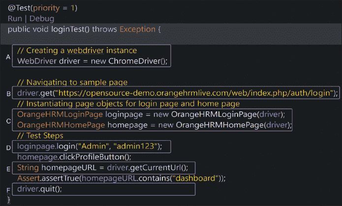

**图 5.7:** 带有代码气味的示例测试类

1. 我们是否可以使用工厂设计模式，在中心位置实例化 `WebDriver`，并为所有页面对象和测试脚本提供 `WebDriver`？我们是否可以进一步改进，使用 `TestNG` 注解在任何测试类运行之前动态进行设置？
2. 我们是否应该为 `driver.get` 等常用方法建立中心机制？这样就可以方便地添加自定义实现和等待？
3. 我们是否可以使用工厂设计模式实例化页面对象？这样就可以减少重复代码？
4. 我们是否应该将测试数据和相关元数据集中到如 `JSON` 或其他文件格式的标准结构中？
5. 与其暴露原始的 `WebDriver` 实例，我们是否可以从父类传递它们？
6. 就像上面的点“A”一样，我们是否可以在所有测试运行后退出 `WebDriver` 来改进流程？

思考这些问题，并将它们与我们在本章中探索的概念联系起来，并结合一点 OOPS（面向对象编程结构）。

为了解决这些代码味道，我们将尝试构建框架的可扩展组件，然后将它们连接起来，以构建一个可扩展、可维护且稳定的测试自动化框架。

### 框架的构建模块 (Building blocks of framework)

好了，让我们开始吧。我们将从以下基本组件开始。随着我们的进行，我们将仔细评估这些元素是否符合我们的需求和要求，并确保我们处于正确的轨道上。因此，让我们开始执行以下模块：

1. 设置一个 `Base` 类，它可以作为所有测试类的父类。它可以涵盖 `TestNG`、测试数据管理和日志记录的核心方法。这可以帮助我们根据 OOPS 概念最大化代码的重用。
2. 使用工厂设计模式创建 `WebDriver` 和页面对象实例的工厂。这可以确保框架的可扩展性和低维护性。
3. 一个 `Utility` 类，用于集中管理常用方法，如日期/时间、与框架的交互或 Shadow DOM。这可以减少页面对象之间代码的重复。

上述三部分设计也有助于我们实现关注点分离（separation of concerns），其中 `Test` 类负责断言功能区域，而页面对象负责与被测试应用程序进行交互。

我们可以按照下面的框架图安排这些构建模块：

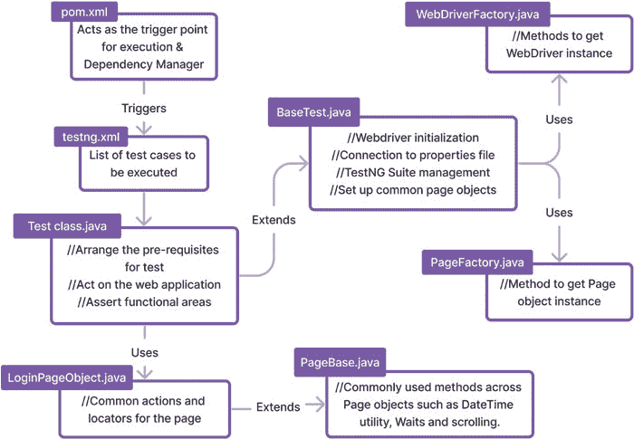

**图 5.8:** 测试自动化框架的可视化展示

现在，让我们详细探索这些模块。

### WebDriver 工厂类 (WebDriver Factory Class)

我们可以通过实现工厂设计模式来标准化 `WebDriver` 的实例化，开始设计框架。这个 `WebDriverFactory` Java 类的想法是根据指定的模板创建 `WebDriver` 实例。

例如，我们可以根据测试用例的要求为 Chrome 创建 `WebDriver` 实例，为 Edge 创建另一个。

为了深入理解这一概念，打开下载的代码库中 `src/main/java/base/WebDriverFactory.java` 对应的 `WebDriverFactory` 类。

这里的第一个主方法是 `createInstance` 方法，负责创建在测试用例使用的 `WebDriver` 实例，如下：

```
public static WebDriver createInstance(URL hubUrl, String browserName) throws IOException {
    WebDriver driver = null;
    try {
        if (browserName.equalsIgnoreCase("firefox")) {
            driver = new FirefoxDriver(createFirefoxProfile());
        } else if (browserName.equalsIgnoreCase("chrome")) {
            driver = new ChromeDriver();
        } else if (browserName.equalsIgnoreCase("edge")) {
            driver = new EdgeDriver();
        } else if (browserName.equalsIgnoreCase("safari") && isSafariSupportedPlatform()) {
            driver = new SafariDriver();
        }
    }
    catch (Exception e) {
        System.out.println("Error creating browser session --" + e.getLocalizedMessage());
    }
    log.info("WebDriverFactory created an instance of WebDriver for: " + browserName);
    return driver;
}
```

这是核心工厂方法。该方法根据提供的浏览器名称（`browserName`）决定创建哪个 `WebDriver` 实例（`ChromeDriver`、`FirefoxDriver`、`EdgeDriver` 或 `SafariDriver`）。该决策是通过一系列 if-else 语句做出的。工厂方法抽象化了对象创建的细节，并在需要时提供了单一的更改点。

该类的其他关键方面如下：

- `static Logger log = LogManager.getLogger(WebDriverFactory.class);`

  此行初始化了一个日志记录器实例，用于记录来自此类的消息。

- `static boolean isSafariSupportedPlatform() { … }`

  该方法检查当前平台是否支持 Safari。Safari 主要在 MAC OS 上支持。

- `static FirefoxOptions createFirefoxProfile() { … }`

  该方法为 Selenium 建立一个自定义的 Firefox 配置文件，指定浏览器的行为方式。它限制了某些行为，如弹出窗口显示、设置最大脚本时间、处理 SSL 证书验证等。同样，在 Selenium 中，可以使用 `ChromeOptions` 来配置 Chrome 特有的行为，例如设置二进制路径、禁用扩展或以无头模式运行。对于更与浏览器无关的方法，可以使用 `DesiredCapabilities` 来指定浏览器设置，如代理配置或启用 JavaScript。`ChromeOptions` 和 `DesiredCapabilities` 确保了在不同浏览器之间测试执行环境的一致性和受控，增强了自动化测试的可靠性。

以下是设置 Chrome 和所需能力的示例：

```
ChromeOptions options = new ChromeOptions();
options.addArgument("start-maximized");
ChromeDriver driver = new ChromeDriver(options);
```

这将以最大化模式启动 Chrome 浏览器。

**注意**：我们将在下一章中详细介绍 `ChromeOptions`。

在此背景下使用工厂设计模式的优势如下：

- 在客户端和 `WebDriver` 类之间提供了抽象。
- 将 `WebDriver` 对象的创建集中在一个地方，使代码更具可维护性。
- 未来更容易添加对新浏览器的支持，而不影响现有代码。

**注意**：工厂方法不仅限于 `createInstance` 方法；`createFirefoxProfile` 也可以被视为根据预定义设置创建 `FirefoxOptions` 实例的特殊工厂方法。

### PageFactory 类 (PageFactory Class)

既然我们已经成为工厂设计模式的专家，让我们在设置页面对象工厂时使用相同的概念。导航到位于 `src/main/java/base/PageFactory.java` 的 `PageFactory` 类如下：

```
public class PageFactory {
    private WebDriver webDriver;

    public PageFactory(WebDriver webDriver) {
        this.webDriver = webDriver;
    }

    public Object getPageObject(String pageobject) {
        try {
```

```java
Constructor<?> c = Class.forName(pageobject).getConstructor(WebDriver.class);

return c.newInstance(webDriver);

} catch (NoSuchMethodException e) {
    BaseTest.logger.error(“No such method exception in PageFactory”);
    e.printStackTrace();
} catch (SecurityException e) {
    BaseTest.logger.error(“Security exception in PageFactory”);
    e.printStackTrace();
} catch (ClassNotFoundException e) {
    BaseTest.logger.error(“Class not found exception in PageFactory”);
    e.printStackTrace();
} catch (InstantiationException e) {
    BaseTest.logger.error(“Instantiation exception in PageFactory”);
    e.printStackTrace();
} catch (IllegalAccessException e) {
    BaseTest.logger.error(“Illegal Access exception in PageFactory”);
    e.printStackTrace();
} catch (IllegalArgumentException e) {
    BaseTest.logger.error(“Illegal argument exception in PageFactory”);
    e.printStackTrace();
} catch (InvocationTargetException e) {
    BaseTest.logger.error(“Invocation Target exception in PageFactory”);
    e.printStackTrace();
}

return null;
}
}
```

上述代码使用 Java 反射来创建由 `pageobject` 字符串指定的类的新实例。如前所述，Java 反射是一种允许我们在运行时检查和修改 Java 程序的结构的机制。它可以被用于获取有关类、其字段和方法的信息，并调用这些方法和构造函数。

在上述代码中，使用 `Class.forName()` 方法来获取由 `pageobject` 字符串指定的类的 `Class` 对象。随后，使用 `Class` 对象上的 `getConstructor()` 方法来获取具有指定参数列表的构造函数的 `Constructor` 对象。在这种情况下，参数列表为 `WebDriver.class`，这意味着该构造函数接受一个 `WebDriver` 对象作为参数。


最后，使用`Constructor`对象上的`newInstance()`方法创建该类的新实例，并将`webDriver`对象传递给构造函数。

因此，这段代码的整体效果是创建一个由`pageobject`字符串指定的类的新实例，同时将`webDriver`对象传递给构造函数。这对于创建页面对象类（page object classes）非常有用，这些类代表网页并提供了与这些网页交互的方法。

## BaseTest 类

我们可以使用`WebDriverFactory`类为测试用例实例化 WebDrivers，但如何进一步扩展它并最大化代码的重用性呢？为测试用例设置一个基类如何？它可以作为集中管理 WebDriver 实例化（来自前面提到的工厂类）活动的“基（Base）”。可能还可以为它增加额外的功能，例如使用 TestNG 进行测试数据创建/清理以及测试执行的排序。这样，所有的测试类都可以从`BaseTest`继承这些能力，允许我们通过面向对象编程来实现代码重用性的最大化。

请在下载好的代码中打开`BaseTest`类（位于`src/main/java/base`），并在探索以下详细信息时积极参考它。这是一个大章节，但我们将像切披萨一样，逐块地进行分析。

让我们来看该类的第一个主要组件：

```java
@BeforeSuite(alwaysRun = true)

@Parameters({ “browserType” })
public void setupWebDriver(@Optional(“chrome”) String browserType) throws IOException {
    // 下面行可以取消注释，以便在调试 Selenium WebDriver 时提供细粒度的日志级别
    //SeleniumLogger seleniumLogger = new SeleniumLogger();
    //seleniumLogger.setLevel(Level.FINE);
    if ((driver == null)) {
        logger.info(“setupWebDriver()”);
        driver = WebDriverFactory.createInstance(huburl, browserType);
        action = new Actions(driver);
        pageFactory = new PageFactory(driver);
        driver.manage().window().maximize();
        logger.info(“Window width: “ +
        driver.manage().window().getSize().getWidth());
        logger.info(“Window height: “ +
        driver.manage().window().getSize().getHeight());
    }
}
```

上述代码行利用`WebDriverFactory`类中的`createInstance`，根据运行时传递的`@Optional(“chrome”)`参数创建 WebDriver 实例。不要担心 “huburl”，因为我们很快会在下一章中围绕 Selenium GRID 的概念对其进行探索。

`setupWebDriver`方法还执行了以下几个有趣的事情：

1. 设置一个`action`对象的实例，子对象（测试类）可以使用它来利用 WebDriver 的 Actions 类并与 Web 元素进行交互。
2. 实例化一个`pageFactory`对象，稍后在`BaseTest`类中使用工厂设计模式对 Page 对象进行运行时初始化。
3. 最大化新打开的浏览器窗口并捕获屏幕尺寸以便于报告。

下一部分代码帮助我们在每次测试之前删除 Cookie，以确保在开始测试过程之前处于清洁状态：

```java
@BeforeTest(alwaysRun = true)
public void cleanTestSetup() {
    driver.manage().deleteAllCookies();
}
```

接下来的部分代码执行了大量工作：

```java
@BeforeClass(alwaysRun = true)
protected void setUp() throws MessagingException {
    // 使用反射概念设置通用页面对象
    loginpage = (OrangeLoginPage) pageFactory.getPageObject(OrangeLoginPage.class.getName());
    homepage = (OrangeHRMHomePage) pageFactory.getPageObject(OrangeHRMHomePage.class.getName());
    // 下面是作为属性文件中读取通用数据的代码
    // 请注意，非通用数据应在特定的测试类中读取
    orangehrmurl = (String) getStaticData().get(“orangehrmloginurl”);
    orangehrmuserid = (String) getStaticData().get(“orangehrmuserid”);
    orangehrmpassword = (String) getStaticData().get(“orangehrmpassword”);
    // 设置邮件工具对象
    // EmailUtils emu = new EmailUtils();
}
```

此代码段定义了一个设置方法，旨在在测试类运行之前执行，如`@BeforeClass(alwaysRun = true)`注解所示。在该方法内部：

* **使用反射设置页面对象**：它使用反射概念分别从`OrangeLoginPage`和`OrangeHRMHomePage`类初始化两个页面对象`loginpage`和`homepage`。`pageFactory.getPageObject`方法根据它们的类名创建这些页面对象的实例。
* **从属性文件中读取数据**：该方法从属性文件中提取 OrangeHRM 的通用登录数据。具体而言，它获取了登录 URL、用户 ID 和密码。

本质上，该方法在对 OrangeHRM 应用程序运行一组测试之前，设置了必要的前提条件和初始数据。

下部分代码帮助我们捕获失败测试的截图：

```java
@AfterMethod(alwaysRun = true)
public void tearDownandCaptureScreenShot(Method method, ITestResult result) {
    // 测试用例失败时截图的方法
    if (ITestResult.FAILURE == result.getStatus()) {
        try {
            SimpleDateFormat simpleDateFormat = new SimpleDateFormat(“yyyyMMddhhmmss”);
            String currentdatetime = simpleDateFormat.format(new Date());
            File source = captureScreenShot();
            FileUtils.copyFile(source, new File(System.getProperty(“user.dir”)
            + “/target/surefire-reports/FailedScreenShots/” + result.getName() + currentdatetime + “.png”));
            logger.info(“Screenshot taken”);
        } catch (Exception e) {
            logger.info(“截屏时出现异常 “ + e.getMessage());
        }
    }
    logger.info(“*************”);
    logger.info(“Ending Test ---->” + method.getName());
}
```

此代码定义了一个名为`tearDownandCaptureScreenShot`的方法，其意在每个测试方法完成后执行，如`@AfterMethod(alwaysRun = true)`注释所示。该方法的主要作用是在测试用例失败时截屏。这对于调试和记录错误发生时的应用程序状态非常有用。条件`if (ITestResult.FAILURE == result.getStatus())`用于检查刚刚运行的测试是否导致了失败。我们的代码如下所示捕获失败时的截图：

- 创建一个`SimpleDateFormat`对象，按照`yyyyMMddhhmmss`（年月日时分秒）的格式对当前日期和时间进行格式化。
- 然后获取当前日期和时间并使用该格式进行格式化，生成一个唯一的字符串`currentdatetime`。
- 调用`captureScreenShot()`方法进行截图，并将生成的文件保存为`source`。
- 使用`FileUtils.copyFile`方法将此截图的副本保存到项目中的特定目录，并根据失败测试方法的名称和当前日期时间进行命名，扩展名为`.png`。这确保了不同失败测试的截图不会互相覆盖。
- 如果成功，则记录日志条目“Screenshot taken”。

在拍摄或保存截图期间发生任何异常，catch 块将记录关于该异常的适当消息。无论测试通过还是失败，该方法都会使用测试方法的名称记录测试的结束。

因此，该方法是一个清理程序，如果测试失败，它会捕获并保存截图，提供故障时应用程序状态的视觉证据，并始终记录测试执行的结束。

遵循上述操作，我们的下一个代码片段有助于清除会话 Cookie 并关闭任何额外的浏览器窗口：

```java
@AfterClass(alwaysRun = true)
public void deleteAllCookies() {
    // 处理从 Suite 执行每个类执行后的窗口
    try {
        String originalHandle = driver.getWindowHandle();
        for (String handle : driver.getWindowHandles()) {
            if (!handle.equals(originalHandle)) {
                driver.switchTo().window(handle);
                driver.close();
            }
        }
        driver.switchTo().window(originalHandle);
    } catch (Exception e) {
        logger.info(“Error while closing child windows” + e.getMessage());
    }
    logger.info(“Clearing all browser cookies…”);
    driver.manage().deleteAllCookies();
}
```

该代码定义了一个`deleteAllCookies`方法，它在类中的所有测试方法之后运行。它首先关闭测试期间打开的任何额外浏览器窗口，确保只保留原始窗口打开。如果在关闭这些窗口时发生任何错误，将会被记录。最后，该方法清除所有浏览器 Cookie 为随后的任何测试做准备，确保一致的启动环境。

一旦我们管理了窗口和 Cookie，我们可以向上跳一级并清除 WebDriver 实例以整洁地退出测试，代码如下：

```java
@AfterSuite(alwaysRun = true)
public void quitWebDrivers() {
    logger.info(“terminateWebDrivers()”);
    try {
        driver.close();
        driver.quit();
        // 将 driver 设置为 null 以停止跨浏览器的
        // 持续使用 driver
        driver = null;
    } catch (Exception e) {
        // 有时候 driver.quit() 会导致异常且未将 driver
        // 对象置空。这会阻止下次成功的浏览器启动
        driver = null;
        logger.error(“Error quitting driver”);
        e.printStackTrace();
    }
}
```

前面的代码描述了一个方法`quitWebDrivers`，设置为在所有测试套件之后执行。其目的是优雅地终止激活的浏览器会话。它首先尝试关闭当前浏览器窗口，然后退出浏览器驱动。为了避免在随后的测试中无意使用同一个浏览器会话，将 driver 设置为 null。如果在关闭或退出过程中发生任何问题，driver 仍会被置空，并记录错误日志以记录异常。

`BaseTest`也可以用于存放常用方法，如下所示的`captureScreenShot()`。

我们将在接下来的关于`PageBase`类的章节中深入深入查看此方法：

```java
public File captureScreenShot() {
    return new PageBase(driver).takeScreenshot();
}
```

作为`BaseTest`的一部分，我们还实现了从属性文件中读取数据的方法，如下：

```java
@Override
public Properties getStaticData() { // 从静态数据属性文件读取数据的方法
    if (staticData == null) {
        staticData = new Properties();
        InputStream input = null;
        try {
            String filename = “staticdata.properties”;
            input = BaseTest.class.getClassLoader().getResourceAsStream(filename);
            if (input != null) {
                // 在静态方法内部从类路径加载属性文件
                staticData.load(input);
                logger.info(“staticdata.properties loaded successfully”);
            }
        } catch (IOException ex) {
            logger.info：“error loading staticdata.properties” + ex.getMessage());
        } finally {
            if (input != null) {
                try {
                    input.close();
                    logger.info(“staticdata.properties closed successfully”);
                } catch (IOException e) {
                    logger.info((“error loading staticdata.properties”) + e.getMessage());
                }
            }
        }
    }
    return staticData;
}
```

`getStaticData`方法设计用于从名为`staticdata.properties`的属性文件中读取数据。如果`staticData`未初始化（即为 null），则创建一个新的`Properties`对象。该方法尝试使用`BaseTest`类的加载器加载该文件。如果成功找到文件，将其加载到`staticData`对象中，并记录成功消息。如果读取文件出现问题，将记录错误信息。最后，无论加载文件成功与否，该方法都会尝试关闭`InputStream`以释放资源并记录操作状态。如果在关闭期间发生任何异常，也将被记录。该方法随后返回`staticData`对象，如果发生错误，该对象将未初始化。

`BaseTest`类结构良好，支持稳健的自动化测试框架。它封装了所有测试类共享的常用设置、清理和实用函数。

## PageBase 类

我们已经为测试类探索了一个父类（`BaseTest`），以便将常用代码放在一起。但是，我们的页面对象呢？例如，多个页面对象可能需要如下自定义方法来选择值：

```java
public void selectValue(WebElement ele, String value) {
    Select select = new Select(ele);
    select.selectByValue(value);
    logger.info(“Selected value : “ + value);
}
```


虽然我们可以在每个页面对象上设置此类交互方法，但从长远来看会导致维护问题。因此，作为我们自动化测试框架的一部分，我们将设置一个`PageBase`类，作为常用交互方法的父级工具类，例如选择值、等待、滚动甚至日期/时间工具。由于我们的页面对象继承了`PageBase`，所有这些方法都可以在页面级别轻松调用。请导航到`src/main/java/base`中的`PageBase.java`类，让我们查看这里的几个实用方法：

获取当前日期的代码：

```java
public String getCurrentDate() {
    SimpleDateFormat simpleDateFormat = new SimpleDateFormat(“yyyy-MM-dd”);
    String currentdatetime = simpleDateFormat.format(new Date());
    return currentdatetime;
}
```

刷新网页面的代码：

```java
public void refreshPage() {
    driver.navigate().refresh();
}
```

```java
logger.info(“Page Refreshed”);
}
```

等待并点击元素的代码：

```java
public void waitAndClick(WebElement element) {
    // 在点击之前等待 web 元素
    Wait<WebDriver> wait = new WebDriverWait(driver, Duration.ofSeconds(10));
    wait.until(ExpectedConditions.elementToBeClickable(element));
    // 在充分等待后验证元素
    if (element.isDisplayed()) {
        logger.info(“Element found and clicked”);
        element.click();
    } else {
        logger.info(“Element Not Displayed “ + element.getText());
    }
}
```

截取屏幕的代码：

```java
public File takeScreenshot() {
    WebDriver augment = new Augmenter().augment(driver);
    return ((TakesScreenshot) augment).getScreenshotAs(OutputType.FILE);
}
```

## 创建自动化测试

现在我们已经了解了框架的构建模块以及它们是如何相互配合的，让我们使用提供的设计来创建可扩展且易于维护的自动化测试。在高级层上，步骤非常简单：

1. 创建测试类（它应该继承自`BaseTest`类）。

2. 使用现有的或创建新的页面对象（它们应该继承自`PageBase`类）。

3. 如果需要，在属性文件中添加测试数据。

4. 如果需要套件级（suite-level）执行，将测试类包含在`testng.xml`中。

是卷起袖子基于框架创建一个自动化测试了。请按照如下方式打开`Chapter05_LoginTest.java`测试类：

```java
public class Chapter05_LoginTest extends BaseTest {
    @Test(priority = 1)
    public void loginTest() throws Exception {
        // 导航到示例页面
        loginpage.openHomepage(orangehrmurl);
        // 测试步骤
        loginpage.login(“Admin”, “admin123”);
        homepage.clickProfileButton();
        String homepageURL = loginpage.getCurrentURL();
        Assert.assertTrue(homepageURL.contains(“dashboard”));
    }
}
```

这不是不是简单又优雅吗？让我们来逐步解析这个类。首先，测试类继承了`BaseTest`类，这样它就可以继承设置和清理方法的 Before/After 排序、通用测试数据、页面对象以及日志功能。

下一行代码使用了`LoginPage`页面对象，并使用继承自`PageBase`类的`openHomepage`方法打开登录页面。URL 的值来自`BaseTest`，作为通用测试数据的一部分。

```java
loginpage.openHomepage(orangehrmurl);
```

下一行代码使用页面对象方法执行登录操作。

```java
loginpage.login(“Admin”, “admin123”);
```

同样，我们使用页面对象方法执行对“profile”按钮的点击。这样，我们将测试应用程序的关注与测试类与页面对象类之间的网页交互分离开了：

```java
homepage.clickProfileButton();
```

我们可以使用`PageBase`中的`getCurrentURL()`方法来获取 URL。由于我们在`Pagebase`中集中化了此类方法，我们所有的页面对象类都可以从一个中心位置继承这些能力。

```java
String homepageURL = loginpage.getCurrentURL();
```

最后，但同样重要的，我们这里有一个断言：

```java
Assert.assertTrue(homepageURL.contains(“dashboard”));
```

通过这种方式，更新测试类将不会影响网页交互的方法和类。

为了补充测试类，我们注意到我们需要一个页面对象类，因此快速查看该区域是有的。请打开位于`src/main/java/pageobjects`的`OrangeLoginPage` java 类：

```java
public class OrangeLoginPage extends PageBase {
    protected WebDriver driver;
    private By usernamelocator = By.xpath(“//input[@placeholder=’Username’]”);
    private By passwordlocator = By.xpath(“//input[@placeholder=’Password’]”);
    private By loginlocator = By.xpath(“//button[@type=’submit’]”);
    public OrangeLoginPage(WebDriver webDriver) {
        super(webDriver);
        this.driver = webDriver;
    }
    public OrangeHRMHomePage login(String userid, String passwordtext) throws InterruptedException {
        explicitWait(usernamelocator, 10);
        // 我们可以在这里直接调用 driver 方法，或者可选地使用
        // 来自 PageBase 的通用方法
        driver.findElement(usernamelocator).sendKeys(userid);
        driver.findElement(passwordlocator).sendKeys(passwordtext);
        safeClick(loginlocator);
        // 返回 Homepage 的实例以实现流式编程风格
        return new OrangeHRMHomePage(driver);
    }
}
```

这段代码定义了名为`OrangeLoginPage`的页面对象，它代表应用程序的登录页面。该类继承了我们的基类`PageBase`。内部有定位器通过通过 XPath 识别网页上的用户名、密码字段和登录按钮。类构造函数初始化 web driver，它控制浏览器操作。提供了一个`login`方法，它首先等待用户名字段可用，然后输入提供的用户名和密码，点击登录按钮，随后导航到主页。该方法返回一个`OrangeHRMHomePage`实例。

为了实例化页面对象，我们在`BaseTest`中添加了以下行：

```java
protected OrangeLoginPage loginpage;
```

```xml
</plugin>
```

这段来自我们 Maven `pom.xml`文件的片段配置了 Maven Surefire 插件，它主要用于运行单元测试。`groupId` (`org.apache.maven.plugins`) 和 `artifactId` (`maven-surefire-plugin`) 在 Maven 生态系统中标识了该插件。`version`标签指定了插件的版本，在本例中为 2.19。

配置部分是定义插件特定设置的地方。在这里，包含了`suiteXmlFiles`，它指向描述要运行测试的 TestNG XML 文件。在示例中，指定了位于`src/test/java/chapter6`目录下的`chapter6_testng.xml`文件。这意味着当 Maven 在构建过程中运行 Surefire 插件时，它将执行`chapter6_testng.xml`文件中定义的测试。被注释掉的行 `(<!-- -->)` 是一个如何指定不同 TestNG 配置文件的示例，但在这种情况下，它是未激活的，因为被注释注释了。

通过遵循上述的几个简单步骤（例如创建测试类和使用页面对象），我们可以构建易于更新和维护的测试。向 TestNG 中添加测试或通过 Maven 运行测试有助于测试整齐地融入到我们的整体项目中，确保一切运行顺畅。简而言之，这种方法是为了在我们测试软件时让生活变得更轻松，确保一切都能良好运行而没有许多麻烦。

## 持续集成/持续交付

持续集成和持续交付（CI/CD）是开发与运维（DevOps）的关键实践，实现了软件构建、测试和部署的自动化。在本节中，我们将学习 CI/CD 如何实现每次代码更改自动执行 Selenium 测试，以便尽早发现问题。

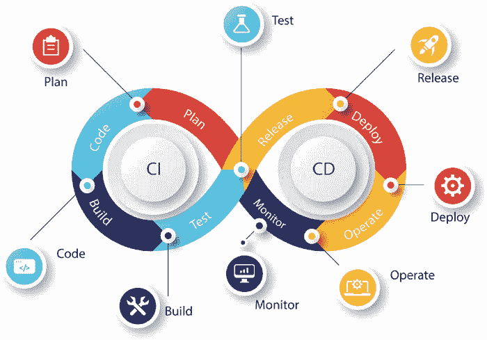

**图 5.9:** CI/CD 生命周期

持续集成意味着通过将不同开发者的代码更改合并到共享代码库中频繁进行集成。通过 CI，开发者每天多次将代码提交到主分支。每次提交都会触发自动化构建和测试过程，以提供快速反馈。例如，当开发者提交代码时，自动化测试会在像 Jenkins 这样的 CI 服务器上针对更改运行。如果任何测试失败，团队将收到通知并立即修复。这种紧密的反馈循环可以在缺陷成倍之前尽早发现它们。

持续交付在 CI 的基础上通过自动化发布过程进行构建。除了构建和测试之外，CD 流水线还实现了到测试环境和生产环境的部署。例如，在测试之后，代码会自动部署到测试环境进行进一步测试。交付流水线以可持续的方式编排直到生产环境的代码部署。

CI 和 CD 共同构成了一个自动化软件流水线，提高了质量和速度。

# CI/CD 的优势

以下是实现 CI/CD 流水线的一些益处：

* 每次提交都会触发自动化测试执行

* 在几分钟内获得快速反馈

* 工程师立即修复问题

* 使用容器保持测试环境的一致性

* 在跨分布式测试基础设施上进行扩展

* 有信心地部署到测试环境（生产环境）

CI/CD 流水线能够自动执行所有 Selenium 测试，而不是零星的人工测试。开发者通过测试结果获取代码更改的快速反馈。这可以尽早发现缺陷并提高质量。

# 工具与用法

让我们来看一些用于构建 CI/CD 流水线的流行工具：

* **Jenkins**: 事实上的 CI/CD 服务器。Jenkins 提供了分布式测试执行、调度以及与 Selenium 的集成。Selenium 插件允许触发 Selenium Grid 测试。

* **Docker**: 像 Docker 这样的容器技术提供了隔离、一致的环境来可靠地运行测试。不再有“但在我的机器上运行是好的！”这种借口。

* **云基础设施**: AWS 等云提供者可以根据需要轻松扩展测试基础设施。云实例可以编写脚本根据负载自动扩展或收缩。

* **TravisCI, CircleCI, GitLab**: 有托管的 CI/CD 平台提供无需维护基础设施的流水线。这些可以与 GitHub 集成以实现提交驱动的测试。

通过利用 CI/CD 流水线，团队可以扩展自动化测试并显著提高软件质量。CI/CD 结合 Selenium 测试自动化框架释放了产品质量和团队能力的巨大优势。逐渐演进你的自动化和工作流将使你能够利用其益处。

*自动化框架已经达到了某种商品化的水平。就像买汽车或自行车一样，人们可以从开源世界采用一个自动化框架并使用它。但人们应该花时间和精力“打开引擎盖”，看看自动化框架是如何工作的。*

*对于 TestNG，我将其视为我学习 Java 并发的第一本福音。我认为我在互联网上找到的这句引用总结了一切：“线程并不难，锁定才难”。*

- Krishnan Mahadevan，TestNG、Selenium、Simple-SSH 和 SeLion 等项目的开源贡献者。

## 结论

在本章中，我们到达了框架设计和测试自动化之旅的巅峰之一。如果你已经走了这里，并且所有代码示例都能正常运行，你值得来咖啡、一次拍背鼓励，可能还有块蛋糕。由于大多数测试自动化任务将基于这些围绕 TestNG、Maven、页面对象、SOLID 原则和设计模式的核心概念，因此值得回顾图 5.2*、*5.7* 和 *5.8*，以建立思维联系，并在继续前进之前获取问题陈述和解决方案的整体蓝图。

一个健壮的框架对于高效的测试自动化至关重要，它确保了更简单的测试、更好的可维护性和扩展性。虽然我们详细探讨了这些概念，但在下一章中，我们将跨浏览器自动化作为下一个挑战，并使用 Selenium GRID 来克服它。

现在，是时候卷起袖子，动脑筋解决下面的练习了。

## 练习题

你好，有志的框架设计师，请按照以下步骤自动化测试用例：

1. 导航到`https://orangeava.com/`

2. 点击`New Release`区域下的第一本书。

3. 在书籍详情页上获取书籍价格。

4. 点击`ADD TO CART`按钮。

5. 验证`Cart`显示的书籍价格与上述第 3 步获取的值相同。

6. 测试用例应利用 TestNG 库中的`Assert.assertTrue`方法对书籍价格进行验证。

7. 确保：

    1. 测试类继承`BaseTest`

    2. 页面对象继承`PageBase`

    3. 7.a 中的测试类执行应通过使用`testng.xml`文件从 Maven 触发。

Google Chrome、Firefox 和 Microsoft Edge 有不同的发布周期。根据现有的公开信息，Google Chrome 每四周发布一次稳定版本，每年至少有 10 到 12 次发布。Firefox 一直遵循快速发布周期，每四周发布一次新大版本，而 Microsoft Edge 则每 6-8 周发布一次新大版本，并为企业客户提供扩展稳定版（Extended Stable）发布周期选项，每年大约有 6-9 次大版本发布。因此，确保您的 Web 应用在不同的浏览器和浏览器版本上都能正常运行是一项重大挑战。每个浏览器都有独特的特性和行为，这使得跨浏览器兼容性测试至关重要。随着 Web 应用变得越来越庞大和复杂，跨浏览器进行手动测试可能会变得极其耗时且耗资源。

这就是扩展自动化测试概念用用场。扩展自动的目标是通过并行利用多个资源来提高测试的速度、效率和覆盖率。扩展自动化测试的关键方法包括将测试分布到多台机器上、并发执行测试以及在开发周期的早期集成测试。

分布式执行涉及将大型测试用例集拆分并在多台机器或环境中同时运行不同的部分。这种并行执行极大地缩短了运行所有测试所需的总时间。分布式测试还允许您通过并行跨浏览器测试覆盖更多的测试配置和浏览器。

Selenium Grid 是一个强大的工具，有助于实现分布式并行测试执行。它允许您将测试用例集分布在多台机器上并并发运行。Selenium Grid 管理测试的分布以及来自这些远程机器的结果聚合。这使得扩展自动化测试变得简单得多。

在本章中，我们将探索使用 Selenium Grid 进行的分布式测试，涵盖跨浏览器兼容性行为，并深入了解扩展自动的世界。

## 结构

在本章中，我们将讨论以下主题：

* 跨浏览器兼容性

* 处理特定浏览器行为

* Selenium Grid

    * 设置与安装

    * Grid 架构

    * 角色

    * 安全

## 跨浏览器兼容性

假设您开发了一个 Web 应用，它在您喜爱的浏览器上运行完美。但当您另一个浏览器上打开它时，情况完全是另一回事。元素未对齐，按钮不起作用，您的应用程序一团糟。这就是跨浏览器兼容性挑战的本质。

跨浏览器兼容性确保您的 Web 应用在各种 Web 浏览器（如 Chrome、Firefox、Safari 和 Edge）中保持一致且正确运行的艺术。每个浏览器解释 Web 内容的方式都不同，这会导致视觉差异和功能问题。

让我们通过一个例子来联系这些内容。请分别在 Chrome 和 Firefox 浏览器中打开下载的代码库中`src/test/java/chapter6`下的`DifferentlyRenders.html`文件。你“注意到”到任何差异了吗？开玩笑不提，在这里我们可以注意到两个不同浏览器渲染同一个网页的差异。

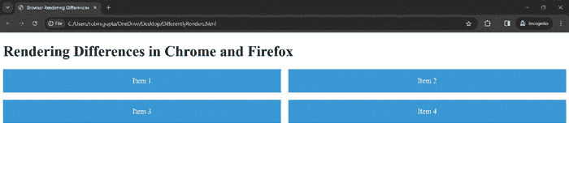


**图 6.1:** Chrome 中的网页渲染。


**图 6.2:** Firefox 中的网页渲染

如果我们深入探究该文件的 HTML 内容，可以观察到以下几行导致了这种诡异的行为差异：

```css
/* Firefox-specific CSS */
@-moz-document url-prefix() {
.container {
grid-template-columns: repeat(var(--grid-columns), minmax(1000px, 1fr));
}
}
```

在这个示例中，我们定义了一个 CSS 变量 `--grid-columns`，它决定了网格列数。在 Chrome 中，它渲染为 2 列网格，而在 Firefox 中，它以 1000px 的最小列宽进行渲染。这展示了两个浏览器之间渲染行为的差异，强调了它们的渲染引擎如何不同地处理 CSS 网格和变量。

Web 浏览器是复杂的软件，在为用户渲染 Web 内容方面起着至关重要的作用。它们遵循多步骤流程来加载和显示网页。为了理解跨浏览器兼容性，让我们通过执行以下过程来了解浏览器是如何加载网页的：

1. **URL 解析**：当用户在地址栏中输入 URL 或点击链接时，浏览器开始解析 URL 以识别协议（例如 HTTP 或 HTTPS）、域名和特定的网页路径。然后它向托管网页的服务器发送 HTTP 请求。

2. **服务器响应**：服务器用 HTML、CSS、JavaScript 和其他构成网页的资源响应浏览器的请求。此响应可能还包含响应头（response headers）等元数据。

3. **渲染**：浏览器的渲染引擎接管，解析 HTML 以创建文档对象模型 (DOM) 并处理 CSS 以构建 CSS 对象模型 (CSSOM)。这两个模型用于生成渲染树，渲染树代表网页的布局和内容。

4. **绘制**：浏览器将内容渲染到屏幕上，根据计算出的样式和布局信息绘制像素。

每个浏览器都遵循相同的流程来渲染网页。那么问题是，如果每个浏览器都遵循相同的流程，为什么网页在不同浏览器上看起来和运行起来却是不一样的呢？

是的，答案的大部分在于渲染过程。

Web 浏览器使用渲染引擎来解释和显示 Web 内容。

让我们考虑 Firefox 和 Chrome 渲染引擎的差异。

Firefox 和 Chrome 采用不同的渲染引擎：分别为 `Gecko` 和 `Blink`。这些引擎独立演进，导致它们在渲染行为和对 Web 标准的支持上存在差异。

* **Gecko (Firefox)**：Firefox 使用 `Gecko` 渲染引擎，以其开源特性著称。`Gecko` 的设计是模块化且高度可定制的，使其成为 Firefox 这样关注隐私的浏览器的首选。它通常以保守的速度实现新的 Web 标准，优先考虑隐私、稳定性和兼容性。

* **Blink (Chrome)**：Chrome 利用 `Blink` 渲染引擎，该引擎最初是 `WebKit` 引擎的分支。`Blink` 设计初是为了速度和效率，旨在最大限度地减少页面加载时间并提高响应速度。Google 积极贡献 `Blink`，导致了新 Web 标准和实验性功能的快速采用。

理解浏览器如何加载网页以及渲染引擎的差异对工程师来说至关重要。这有助于确保跨浏览器提供一致且优越的用户体验。正如我们所看到的，Firefox 的 `Gecko` 引擎优先考虑性和兼容性，而 Chrome 的 `Blink` 引擎强调速度和性能。提供的示例是这些差异的实际说明，强调了在多个浏览器中测试 Web 内容以确保跨浏览器兼容性的重要性。

# 处理特定浏览器行为

使用 `Selenium` 进行浏览器测试由于快速的发布周期和不断的变化而面临着独特的挑战。每个浏览器都有自己的特性和实现差异，如果处理不当，可能会导致测试随机性失败（flaky test failures）。此外，随着 `Chrome for Testing` 的出现和浏览器的自动更新，要确保 Web 应用程序的持续质量变得所周知的困难。在本节中，我们将深入探讨 Selenium 测试中遇到的最常见的浏览器特定问题，并通过 Java 详细示例介绍如何解决这些问题。

让我们探索一些需要显式处理的典型浏览器特定问题：

* **JavaScript 错误**：浏览器使用不同的 JS 引擎，如 `V8`（Chrome）和 `SpiderMonkey`（Firefox）。某些深度依赖 JavaScript 的网站可能在一个浏览器上运行，但在另一个浏览器上抛错误。

* **弹出窗口**：窗口打开 API 在不同浏览器之间是不一致的。文件上传框、警告框和权限弹窗需要为每个浏览器编写特殊的处理代码。

* **浏览器崩溃**：每个浏览器处理内存和资源的方式不同。某些网站或操作可能会由于高内存占用或 Bug 导致特定浏览器崩溃。

* **渲染问题**：浏览器在默认 CSS 样式、标准遵循情况和布局引擎方面存在差异。某些 UI 在浏览器上可能渲染不正确。

* **证书错误**：浏览器对无效 SSL 证书的处理各异。某些浏览器可能会显示验证弹窗，需要进行程序化处理。

* **浏览器对话框**：浏览器对于位置、通知、麦克风访问等有不同的权限弹窗。这些需要被处理以避免阻塞执行。

* **性能**：浏览器对性能的优化和优先考虑方式不同。某些旧版本明显落后于新版本。

* **旧版本支持**：支持过时的浏览器需要考虑缺失或行为不一致的遗留功能。

# 使用 Selenium 处理 Chrome 浏览器问题

在使用 `Selenium` 在 Chrome 中进行自动化测试时，你可能会遇到需要解决的常见浏览器特定问题。Chrome 提供了一系列可自定义的选项和配置来应对这些挑战。让我们详细探索这些选项，以确保更流畅、更可靠的自动化体验。请打开 `src/test/java/chapter6` 路径下的 `Chapter6_ChromeOptions` Java 类，并逐一运行以下示例，以深入理解该主题。

**注意**：如果你安装了 `TestNG` 的 Eclipse IDE 插件，可以通过 `@Test` 注解下方的 `Run` 按钮运行单个测试。同样，你可以在 VS Code IDE 的 Test Explorer 中通过右键点击代码编辑器中的测试并选择 `Run test`，或使用 Visual Studio IDE 中默认的 Test Explorer 快捷键运行测试。某些快捷键基于上下文的，这意味着它们根据你光标在代码编辑器中的位置来运行或调试测试。

## ChromeOptions

`ChromeOptions` 类是你配置 Chrome 进行自动化测试的门径。它允许你在初始化 `WebDriver` 期间设置各种偏好、参数和浏览器配置。以下是使用方法：

```java
// 创建 ChromeOptions 实例
ChromeOptions options = new ChromeOptions();

// 添加偏好和参数
options.addArguments("--start-maximized” // 最大化浏览器窗口
options.addArguments("--disable-extensions” // 禁用 Chrome 扩展
options.addArguments("--incognito” // 在隐身模式下启动 Chrome

// 使用 ChromeOptions 初始化 WebDriver
WebDriver driver = new ChromeDriver(options);
```

## ChromeDriverService

`ChromeDriverService` 类允许你对 `ChromeDriver` 实例进行更多控制。你可以管理诸如 `ChromeDriver` 运行端口、额外的命令行参数、日志和能力等设置。它提供了一种精细调整 Chrome 自动化设置的方法。

```java
// 设置 ChromeDriver 日志的位置，使用你指定的目录
System.setProperty("webdriver.chrome.logfile”, “C:\\Users\\robin.gupta\\git\\LearningSelenium\\logs\\chromedriver.log”); // 创建 ChromeDriverService 实例
ChromeDriverService service = new ChromeDriverService.Builder()
    .usingPort(9515) // 指定 ChromeDriver 的端口
    .withVerbose(true) // 启用详细日志
    .build();

// 使用服务初始化 ChromeDriver
WebDriver driver = new ChromeDriver(service);
```

一旦我们打开 `chromedriver.log` 文件，可以如下观察日志：

```text
[Starting ChromeDriver 118.0.5993.70 (e52f33f30b91b4ddfad649acddc39ab570473b86-refs/branch-heads/5993@{#1216}) on port 9515
Only local connections are allowed.
Please see https://chromedriver.chromium.org/security-considerations for suggestions on keeping ChromeDriver safe.
ChromeDriver[1698904712.337][INFO]: [bcc284602eea9fe9997ea575987454a6] COMMAND InitSession {
  “capabilities”: {
    “firstMatch”: [ {
      “browserName”: “chrome”,
      “goog:chromeOptions”: {
        “args”: [ “--remote-allow-origins=*” ],
        “binary”: “C:\\Program Files\\Google\\Chrome\\Application\\chrome.exe”,
        “extensions”: [ ]
      }
    } ]
  }
}
```

```java
options.addArguments("--disable-gpu"); // Necessary for some platforms

// Initialize WebDriver with ChromeOptions

WebDriver driver = new ChromeDriver(options);
```

**注意**：将此功能与之前讨论的日志功能相结合将有所帮助，以确保在后台执行了所需的浏览器级操作。

# 移动仿真 (Mobile Emulation)

对于移动测试，您可以通过设置屏幕大小、用户代理（user agent）和其他特性来模拟各种移动设备。这有助于测试 应用程序在不同移动设备上的性能。

```java
// Emulate Pixel 2
ChromeOptions options = new ChromeOptions();
Map<String, String> mobileEmulation = new HashMap<>();
mobileEmulation.put("deviceName", "Pixel 2");
options.setExperimentalOption("mobileEmulation", mobileEmulation);

// Initialize WebDriver with ChromeOptions
WebDriver driver = new ChromeDriver(options);
```

当我们运行这段代码段时，可以观察到浏览器打开了移动视图，然后加载被测试的 应用程序。这对于执行响应式测试非常有帮助。

**注意**：响应式测试是评估网站或 应用程序适应各种屏幕尺寸和设备（如桌面电脑、平板电脑和智能手机）能力的过程。它确保网站的内容和布局能够有效响应不同的维度，无论使用何种设备都能提供优的用户体验。

## 本地化 (Localization)

要测试 Web 应用程序的本地化情况，您可以使用 `ChromeOptions` 中的 `addArguments()` 设置浏览器语言。这对于确保您的应用程序能够正确以不同语言显示内容很有用。

```java
// Set French browser language
ChromeOptions options = new ChromeOptions();
options.addArguments("--lang=fr");

// Initialize WebDriver with ChromeOptions
WebDriver driver = new ChromeDriver(options);
```

此功能可以帮助 Web 应用程序的本地化测试。

**注意**：本地化测试是验证软件应用程序或网站在适应不同的语言、文化和地区时能够正常运行的过程。它确保内容、日期格式、货币符号和其他元素符合文化习惯，并为目标受众准确地显示。

## 提高加载时间

您可以通过禁用资源密集型功能（如图像、JavaScript 和 CSS）来微调 Chrome 选项，以提高测试性能。这有助于加速您的测试执行并使其更高效。

```java
// Disable images and JavaScript
ChromeOptions options = new ChromeOptions();
options.addArguments("--disable-javascript");
options.addArguments("--blink-settings=imagesEnabled=false");

// Initialize WebDriver with ChromeOptions
WebDriver driver = new ChromeDriver(options);
```

**注意**：此选项非常适用于阶段环境或 UAT（用户验收）环境，因为禁用 JavaScript 和图像可能会禁用 Web 应用程序的一些功能。

通过使用这些功能和技术，您可以对 Chrome 自动化进行更多控制，解决特定问题，并确保测试在 Chrome 浏览器中顺畅运行。

您能猜到应该在哪里设置这些功能和选项吗？

是的，答案在 WebDriver 工厂中。根据我们的需求，我们可以在 `src/main/base` 路径下的 `WebDriverFactory` Java 类中设置这些内容，正如上一节中讨论的那样。

在本节中，我们探索了 Selenium 中常见的 Chrome 特有问题以及如何通过 `ChromeOptions`、`ChromeDriverService` 和针对性的解决方案来缓解这些问题。Firefox、Edge 以及其他浏览器也存在类似的选项类。

现在在引入可扩展解决方案之前，让我们扩大问题规模。假设您必须经营一家在线商店来销售运动鞋。您的客户将使用各种不同的设备和 Web 浏览器，而且每个浏览器都有自己的版本。手动在所有浏览器上检查您的网站将完全是一场噩梦。

让我们来看一个具体的需求以更好地理解问题。假设，您希望您的在线运动鞋商店在最新的浏览器版本以及 Chrome、Firefox 和 Edge 的三个最新版本上完美运行。它应该在使用 Windows、Linux 和 Mac OS 的设备上顺畅运行。此外，您有 50 个自动化测试要确保在所有这些系统上都运行正常。

- 需要运行的自动化测试数量：50

- 需要支持的浏览器数量：3 × 4 = 12（3 个浏览器，每个浏览器 4 个版本，包括最新和前三个版本）

- 需要支持的操作系统数量：3

- 浏览器和操作系统的组合数：12 × 3 = 36

因此，每个周期需要管理的总测试执行次数是自动化测试数量乘以操作系统/浏览器组合数：50 × 36 = 1800 次！

现在，虽然我们从上一节获得了一个可扩展的框架，但我们如何确保我们的自动化测试执行以简单的方式管理呢？在单台机器上顺序运行所有 1800 次测试将花费极长时间。而且在本地维护 36 个不同的环境会让任何人都做噩梦！

这就是分布式我们的测试执行大显身手的地方。如果我们能将这 1800 次测试分配到 10 台运行不同浏览器和平台的机器上将会怎样？

通过将负载分配到许多并行资源上，我们可以大幅缩短整体执行时间。然而，手动设置和管理这样一个复杂的机器网格将极具挑战性。我们需要在几十台独立的机器上安装浏览器、配置测试、分配负载、汇总结果并处理失败。可靠地完成这些需要一个智能平台来协调一切。

这就是 Selenium Grid 的完美所在！它可以帮助我们轻松地建立一个机器网格，用于分布式、并行且可扩展的测试执行。

## Selenium Grid

想象一家每天需要数千个杯蛋糕的面包店。起初烘焙师试图在一个小厨房里独自完成。他每小时只能烤几个！按照这个速度，他需要几周才能烤完所需的数量。

烘焙师意识到他无法独自扩大规模。于是他制定了一个计划——他在城市各处开了几家厨房并聘佣了更多烘焙师。现在，不再是他一个人，而是有五个烘焙师可以在五个厨房里并行制作杯蛋糕。

通过分配工作负载，团队现在每小时可以制作数百个杯蛋糕！烘焙师不再需要花费几周时间独自烘烤。通过多种资源扩大业务规模允许他们大大提高生产力。

在软件测试领域，自动化的扩展工作原理与烘焙师扩大杯蛋糕生产规模非常相似。不同的测试可以分配到多台机器上并行执行。这允许您扩展测试覆盖范围和速度。

然而，手动高效地运行这些分布式测试可能会非常复杂。这时，Selenium Grid 像救星一样出现了——它几乎像变魔法一样在多台机器上协调并分发测试！

在本节中，我们将学习 Selenium Grid 如何通过分布式、并行执行来在大规模范围内“烘焙”测试自动化，正如在上一个例子中更多的厨房和烘焙师如何帮助我们的烘焙师一样。Selenium Grid 是一种允许跨多个浏览器和平台并行执行测试的工具。这个机器网格由物理机或虚拟机组成，但分布式测试自动化的原理保持不变。


让我们来看看安装和设置 Selenium Grid 的方法。可以通过从 Selenium 的 GitHub 仓库下载 JAR 文件来实现。最新的 Selenium Server jar 文件可以从 [`github.com/SeleniumHQ/selenium/releases/latest`](https://github.com/SeleniumHQ/selenium/releases/latest) 下载。由于我们正在使用 `selenium-4.11.0`，因此可以使用以下链接下载相应的 Selenium Server JAR 文件：[`github.com/SeleniumHQ/selenium/releases/download/selenium-4.11.0/selenium-server-4.11.0.jar`](https://github.com/SeleniumHQ/selenium/releases/download/selenium-4.11.0/selenium-server-4.11.0.jar)

下载 JAR 文件后，在下载 JAR 文件的文件夹中打开命令行（或 bash 界面），并运行以下命令：

```
java -jar selenium-server-4.11.0.jar --help
```

这将输出 Selenium Grid 可用的命令，每个命令都可以通过 `--help` 标志进行进一步探索。

## Grid 架构

Selenium Grid 4 由以下组件组成：

* **Node (节点)**：它是 Selenium Grid 中最重要的组件，因为 WebDriver 会话在此处运行。每个节点都有一组能力（capabilities），这些能力定义了它可以支持的浏览器和操作系统。例如，一个节点可能具有以下能力：`browserName: Chrome, version: 103, platform: Windows 10`。

* **Router (路由器)**：Grid 中的 Router 充当所有外部请求的中央枢纽，将它们引导到相应的目的地。当新会话请求到达时，它会被发送到 `Session Queue`（会话队列），对于与现有会话请求，Router 查询 `Session Map`（会话映射）以识别活动 `Node` 进行直接路由。这种策略性的负载均衡确保了请求被高效地分配到最合适的组件，避免了必要的组件过载，从而优化系统性能。

* **Session Map (会话映射)**：Session Map 像一个数据库，记录哪个会话运行在哪个 `Node` 上。当 Router 需要将请求发送到正确的节点时，它只需检查 `Session Map` 以找到该会话所在地。它就像一张帮助 Router 将请求递送到正确目的地的地图。

* **Session Queue (会话队列)**：Session Queue 像是新会话请求的等待室，并按照先来服务的顺序处理它们。它具有设置，用于管理请求可以等待多久以及系统检查它们是否等待过久的频率。当新会话请求到达时，Router 将其放入队列并等待响应。另一方面，`Distributor`（分发器）会密切关注用于运行新会话的空闲位。如果空位可用，它会检查队列中是最旧的匹配请求，并尝试创建一个新会话。如果请求与空闲位的能力匹配，则会被分配；否则，它将返回队列。如果请求在重试期间超时，则会被拒绝。一旦成功创建会话，`Distributor` 将会话详情共享给 `Session Queue`，然后由其将其回传给 Router，最后传给客户端，确保从请求到会话启动的整个过程顺畅。

* **Distributor (分发器)**：Distributor 在系统中扮演着两个重要角色。首先，它注册并监控网络中的所有 `Nodes`，确认它们的存在和能力。其次，它定期检查 `Session Queue` 中任何待处理的新会话请求，找到创建会话的正确 `Node`，并通过 `Session Map` 跟踪哪个 `Node` 正在运行该会话。简单来说，它确保所有机器都在范围内，并将新任务与正确的机器匹配。

* **Event Bus (事件总线)**：Event Bus 充当连接所有 Grid 组件（如 `Nodes`、`Distributors`、`Session Queues` 等）的信使，促进 Grid 内部的通信。

## Selenium Grid 的角色

Selenium Grid 允许你在多个机器上同时运行测试。这显著加快测试执行时间，特别是对于大型测试套件。Selenium Grid 通过以下三种角色帮助我们管理分布式测试自动化：

* **Standalone (独立模式)**：单台机器上的所有组件。

* **Hub and Node (中心与节点)**：在单台或多台机器上分组组件。

* **Fully distributed (完全分布式)**：每个组件都在独立的机器上。

让我们详细探索其中的每一个。

## Standalone (独立模式)

顾顾名，Standalone 模式将 Selenium Grid 的所有组件封装在单个进程中。这使其成为最直接的设置，适用于在单台机器上进行快速方便的测试。只需一个命令，你就可以启动一个功能完整的 Selenium Grid，准备好处理你的测试需求。这是容易设置和使用的模式，但它不具备扩展性。

Grid 的所有组件和节点（负责运行测试）都在同一个进程中运行。此模式适用于在本地开发或调试测试，或者在 CI/CD 工具中检查设置以实验。


**图 6.3：** 独立模式下的 Grid 组件

要在 Standalone 模式下启动 Grid，请在下载 Grid JAR 文件的命令行（或 bash 终端）中运行以下命令：

```
java -jar selenium-server-4.11.0.jar standalone --selenium-manager true
```

一旦运行上述命令，默认情况下，Grid 服务器将在 `http://localhost:4444` 上监听 `RemoteWebDriver` 请求。默认情况下，服务器将从 `System PATH` 中检测它可以使用的可用驱动程序。`--selenium-manager true` 标志帮助我们在构建路径中自动配置驱动程序。现在，如果你在浏览器中导航到 URL `http://localhost:4444`，我们可以观察到以下屏幕神奇地欢迎了你：


**图 6.4：** Selenium Grid UI 界面

这是可视化和管理 Grid 进程及会话的 UI 界面。如果我们仔细观察浏览器图标上的数字（例如 图 6.4] 中 chrome 图标旁 12），我们可以发现在此 Grid 设置中每个浏览器和操作系统组合可以运行的最大并发会话数。

**注意**：默认情况下，`Node` 能处理的最大并发会话数受限于可用 CPU 的数量。例如，在具有 12 个 CPU 的 `Node` 上，它可以同时运行最多 12 个浏览器会话，但 Safari 限制为一个会话。

如果我们导航到 `Sessions` 标签页，我们可以看到类似 `No running or queued sessions at the moment.`（目前没有正在运行或队列中的会话）的消息。那么我们如何让会话在这个 Standalone 节点上运行呢？这非常简单，我们只需要将测试指向 `http://localhost:4444`。让我们详细探索这一过程。打开 `src/mainjava/base` 目录下的 `WebDriverFactory` 类，并取消以下代码的注释：

```
else if (browserName.equalsIgnoreCase("chrome") && hubUrl != null) {
    DesiredCapabilities capabilities = new DesiredCapabilities();
    capabilities.setCapability("browserName", "chrome");
    driver = new RemoteWebDriver(hubUrl, capabilities);
}
```

在这段代码中，我们正在告诉 Selenium Grid 我们自动化测试需要什么。

我们创建了一组“能力”（capabilities），这类似于需求列表。在这种情况下，我们说想使用“chrome”浏览器。然后，我们使用 `hubUrl` 连接 Selenium Grid 并让它设置一个远程 WebDriver，这就像一个运行我们测试的远程浏览器。我们之前定义的 `capabilities` 告诉远程 WebDriver 我们想使用什么类型的浏览器。所以，这就像是给 Grid 下指令为我们的测试启动 Chrome 浏览器。

同样，导航到 `src/mainjava/base` 目录下的 `BaseTest` 类并取消以下代码的注释：

```java
try {
    huburl = new URI("http://localhost:4444").toURL();
}
```

```java
// 在此处设置 GRID URL 或从属性中获取

} catch (MalformedURLException ex) {
    logger.error“Received error in converting URI to URL for Grid as “ + ex.getMessage());
}
```

在这里，我们正在为 `BaseTest` 类中的后续行代码设置 Grid URL：

```java
driver = WebDriverFactory.createInstance(huburl, browserType);
```

一旦像前文提到的那样，取消了 `WebDriverFactory` 和 `BaseTest` 中相关部分的注释，我们就可以在 `src/test/java/chapter6` 路径运行 `Chapter6_LoginTest` Java 类作为 TestNG 测试，并观察到为我们完成的独立模式（Standalone Grid）设置创建一个会话：


**图 6.5：** 在 Selenium Grid UI 上运行会话视图

运行 Selenium Grid 的另一种方法是在我们的 `pom.xml` 文件中添加 Maven 依赖，并在 Java 类中调用相应的方法。Maven 依赖可以配置如下：

```xml
<dependency>
    <groupId>org.seleniumhq.selenium</groupId>
    <artifactId>selenium-grid</artifactId>
    <version>4.11.0</version>
</dependency>
```

通过这样，我们就不需要按照前面的步骤从命令行或终端触发 JAR 文件了。根据 `src/test/java/chapter6` 路径下的 `Chapter6_StandAloneGridTest` 类，可以直接从我们的 Java 代码调用 Grid：

```java
final URL gridServerUrl;
int port = PortProber.findFreePort();
Main.main(new String[] { “standalone”, “--port”, String.valueOf(port) });
gridServerUrl = new URL(String.format(“http://localhost:%d/”, port));
RemoteWebDriver driver = new RemoteWebDriver(gridServerUrl, new ChromeOptions());
// 导航到示例页面
driver.get(“https://google.com”);
```

在此代码代码中，我们通过查找可用端口号，在空闲端口上设置了一个独立的 Grid 服务器。然后，我们在所选端口的“localhost”上为该服务器创建一个 URL。我们启动了一个 `RemoteWebDriver`，使用 Chrome 作为浏览器选择连接到该服务器。之后，我们让 `WebDriver` 导航到 Google 网站。因此，这段代码本质上设置了一个本地 Selenium Grid 服务器，用 Chrome 浏览器连接它，并打开 Google 网站进行自动化测试。

## Hub 和 Node

Hub 和 Node 架构引入了分布式测试环境，其中 `Hub` 作为中心协调器，而 `Nodes` 是执行机器。`Hub` 接收测试请求并根据节点的能力智能地将它们分配到可用的 `Nodes`。想象一个正在处理复杂 Web 程序的测试团队。通过 Hub 和 Node 模式，他们可以将测试分布在多台机器（物理或虚拟）上，显著缩短执行时间并提高效率。


**图 6.6：** Hub 和 Node 模式下的 Grid 组件

如图 6.6 所示，Hub 和 Node 模型帮助我们通过操作系统和浏览器的组合在多个节点上扩展测试。

如果给予足够的资源，理论上该模型可以水平扩展，以支持我们任意数量的节点。该模型通常被全球范围内的团队用于创建可扩展的测试基础设施。

与独立模式一样，我们可以使用 Selenium Grid JAR 从命令行启动此模式。最初，我们在一台计算机上启动了 hub。之后，我们可以在同一台或不同的计算机上添加一个或多个节点。关键在于设置 hub 然后连接节点，让它们协同工作。

要启动 Hub 会话，请在终端窗口中运行以下命令：

```bash
java -jar selenium-server-4.11.0.jar hub
```

这将以 Hub 模式启动 Grid 服务器。现在打开第二个终端窗口并运行以下命令：

```bash
java -jar selenium-server-4.11.0.jar node
```

此命令指示 Grid 使用默认端口 (5555) 启动节点。

现在，打开第三个终端窗口并运行以下命令：

```bash
java -jar selenium-server-4.11.0.jar node --port 6666
```

在这里我们指示 Grid 使用特定端口 (6666) 启动节点。因此，当我们打开 http://localhost:4444/ui# 时，可以观察到我们创建了如下两个节点：


**图 6.7：** Grid 上的并发节点会话。

现在，如何在这些新创建的节点上运行测试？就像我们在上一节中所的那样，通过针对 Hub URL 实例化 `RemoteWebDriver` 。请打开 `src/test/java/chapter6` 路径下的 `chromeGridTest` 类并按照如下运行测试以加深理解：

```java
@Test(priority = 1)
public void chromeGridTest() throws Exception {
    WebDriver driver_chrome = new RemoteWebDriver(new URL(“http://192.168.0.103:4444”), new ChromeOptions());
    // 导航到示例页面
    driver_chrome.get(“https://google.com”);
    Thread.sleep(3000);
    driver_chrome.quit();
}

@Test(priority = 1)
public void firefoxGridTest() throws Exception {
    FirefoxOptions options = new FirefoxOptions();
    WebDriver driver_firefox = new RemoteWebDriver(new URL(“http://192.168.0.103:4444”), options);
    // 导航到示例页面
    driver_firefox.get(“https://google.com”);
    Thread.sleep(3000);
    driver_firefox.quit();
}
```

- **Router (路由器)**：将请求路由到会话队列（Session Queue）、节点（Nodes）或会话映射（Session map）。这是 Grid 的单一入口。

- **Nodes (节点)**：执行浏览器测试

每个组件都需要单独启动并暴露正确的端口以便连接。在示例中，我们将在同一机器机器不同的终端窗口运行所有命令，但在理想情况下，在完全分布模式下，所有组件都运行在不同的机器上，以提供稳定性和扩展性。

让我们详细查看启动每个组件：

- **Event Bus (事件总线)**：事件总线促进 Selenium Grid 内部组件之间的通信。我们需要首先在中央服务器上启动它。它使用端口 `4442`、`5557` 和 `4443` 来发布和订阅事件。主事件总线进程运行在端口 `5557`。可以通过在终端中运行以下命令来启动：

```bash
java -jar selenium-server-4.11.0.jar event-bus
```

- **Session Map (会话映射)**：会话映射组件将活跃的测试会话映射到节点。它跟踪哪些节点正在运行哪些会话。它运行在端口 `5556`，并与事件总线交互以通知。可以使用以下终端命令启动它：

```bash
java -jar selenium-server-4.11.0.jar sessions
```

- **Session Queue (会话队列)**：会话队列持有所有新进入的测试会话请求。调度器通过查询它来分配会话。它默认运行在端口 `5559` 上。我们可以使用以下终端命令：


```bash
java -jar selenium-server-4.11.0.jar sessionqueue
```

- **Distributor (调度器)**：调度器是 Grid 的大脑。它查询会话队列并根据能力和负载将传入的会话分配给节点。它运行在端口 `5553` 上，并与所有其他组件交互。可以使用以下命令启动此组件：

```bash
java -jar selenium-server-4.11.0.jar distributor --sessions http://localhost:5556 --sessionqueue http://localhost:5559 --bind-bus false
```

**注意**：我们在 `http://localhost:5556` 等 URL 中使用 `localhost`，是因为我们在同一台机器上运行所有组件。但在实际场景中，这将更改为运行相应组件的机器的 URL。

- **Router (路由器)**：路由器路由所有会话请求——新请求发送到会话队列，现有请求发送到节点。可以将其视为 Grid 系统的核心，作为 Grid 的入口，并控制所有的血流。它默认使用端口 `4444`。我们可以使用以下终端命令启动它：

```bash
java -jar selenium-server-4.11.0.jar router --sessions http://localhost:5556 --distributor http://localhost:5553 --sessionqueue http://localhost:5559
```

- **Nodes (节点)**：最后，我们启动执行浏览器测试的节点机器。

节点默认运行在端口 `5555` 上，并向调度器注册，类似于 Hub-Node 网。我们可以使用以下终端命令在多台机器上启动它们：

```bash
java -jar selenium-server-4.11.0.jar node --selenium-manager true
```

**注意**：节点可以使用 `max-sessions`、`log-level`、`--heartbeat-period`、`--session-timeout`、`--no-vnc-port` 等标志进一步自定义。

一旦我们在一台机器上启动了分布式 Grid 的所有组件，这六个终端窗口将如下：


**图 6.10**：分布式 Grid 模式下组件的终端窗口。

因此，本节涵盖了在单独机器上启动带有所有关键组件的完全分布式 Selenium Grid 设置的知识。分布式架构为大规模测试自动化提供了最大的可扩展性和可靠性。

*在 Selenium 和跨浏览器测试领域，Selenium Grid 跃成为一个基石，无缝地编排了各种浏览器交互的复杂性。当我们迈向广大的质量保证领域时，可观测性的集成成为我们的指南针，引导我们走向无与伦比的精确卓越。在 Selenium Grid 的世界中，跨浏览器测试不仅符合行业标准，更开启了一个可观测性设定测试复杂性和可靠性金标准的未来。*

- Manoj Kumar Kumar，LambdaTest 开发者关系副总裁。

**注意**：一旦你掌握了在各种模式下运行 Grid 的概念，并完成了本章末尾的练习；请注释掉 `WebDriverFactory` 和 `BaseTest` 中与 Grid 相关的代码行，这样我们在剩余章节中就不需要运行 Grid 组件。

# 安全

你是否注意到 Selenium Grid 如何轻松地让你同时在多台机器上运行测试？一方面，这可以显著缩短执行时间，但另一方面，我们必须不惜代价确保 Grid 基础设施的安全。例如，这里是我们应该考虑的一些安全风险：

- **可访问的 Hub 控制台**：`http://localhost:4444/grid/console` 的 hub 控制台默认不需要任何验证即可访问。这允许任何人访问并篡改 Grid。

- **未加密的流量**：hub、节点和测试之间的所有流量默认都是未加密的。这允许恶意攻击者嗅探测试详情或操纵流量。

- **不安全的 Hub 端口**：默认 hub 端口 `4444` 经常是攻击目标。保持开启状态会邀请攻击者发现并访问 hub。

- **浏览器漏洞**：Grid 节点上过时或配置错误的浏览器版本可能包含将恶意软件注入测试的漏洞。

- **节点被破解**：访问单个不安全的节点可以从网络内部攻击其他 Grid 组件的脚点。

以下是针对上述风险的一些缓解策略：

- **密码保护 Hub**：要求使用用户名/密码才能访问 hub 控制台。

- **启用 TLS**：使用带有有效证书的 `HTTPS` 对 Grid 组件之间的流量进行加密。

- **更改默认端口**：避免使用 hub 的 `4444`、节点的 `5555` 等经常被攻击的默认端口。

- **加固节点**：节点应只运行浏览器和 Selenium 服务器。不应允许节点上运行其他应用程序或服务，以 own 攻击面最小化。

- **隔离 Grid**：在独立的虚拟私有云 (VPC) 中部署 grid，仅限测试机器访问。不要将其直接连接到公司网络。

- **监控活动**：通过日志寻找利用的迹象，如流量激增、异常的浏览器版本等。

- **定期扫描**：对 grid 进行定期渗透测试，在攻击者之前发现弱点。

通过主动保护你的 grid 基础设施、使用身份验证保护访问并监控可疑活动，可以显著降低漏洞风险。

## 结论

在本章中，我们学习了跨浏览器测试的挑战以及如何使用 Selenium 处理特定浏览器的问题。一个关键结论是，在多个浏览器上进行手动测试是非常耗时的。随着我们的 Web 应用程序变得越来越大，我们需要智能解决方案来扩展浏览器测试。无论我们想以自动化方式运行 1800 次测试还是 18000 次测试，Selenium Grid 都能帮助我们以易用的方式扩展自动化测试。通过将测试分布在多台机器上，Selenium Grid 让跨浏览器测试变得更快更简单。我们不再需要在单台机器上运行所有测试了！而且还是手动运行！

在下一章中，我们将探索另一个重要的自动化领域——软件即服务（SaaS）应用的测试。SaaS 应用具有多租户（multi-tenancy）等独特属性，需要特殊的测试技术。我们将学习如何使用正确的工具和框架为现代 SaaS 应用制定策略并扩展测试自动化。

## 练习

请搭建一个微型网格以观察分布式测试的运行：

1. 使用 `Hub-Node` 模型，通过 `Selenium server JAR` 在你的本地机器上启动一个 `Hub`。记下 `Hub URL`。

2. 在 `Hub` 上注册 3 台 `Node` 机器。这些机器可以位于你的 `localhost` 并使用不同的端口。

3. 验证节点已在 `Hub` 控制台中注册成功。

4. 编写一个简单的 `Selenium` 测试，用于导航到 `https://google.com`。

5. 并行运行 6 份该测试。它们应该均匀地分布在各个节点上并行运行。

尝试添加更多节点并运行更多并行测试。注意 `Hub` 如何分配负载。这将让你感受到 `Selenium Grid` 如何实现大规模的分布式、跨浏览器测试。

# 第 7 章：SAAS 与非功能测试自动化

## 引言

随着软件吞噬世界，显而易见，容易出错或缓慢的软件应用已没有立足之地。随着这种演进，我们也发现 SaaS（软件即服务）应用正在吞噬软件世界。

以 `Salesforce`、`Workday` 和 `Office 365` 等行业巨头为代表的 SaaS 应用已迅速织入现代企业的肌理。它们提供了便利性、可用性和扩展性，这些传统软件模型难以企及的。然而，随着组织日益采用 SaaS 解决方案，软件测试领域出现了一系列新挑战。

在本章中，我们将开启之旅，利用 `Selenium` 和 `Java` 的强大组合来探索有效测试 SaaS 应用的细节。我们的探索涵盖了广泛的话题，包括理解 SaaS 应用架构，深入研究性能和安全测试等关键领域。

但我们的探索并不止于此。我们将超越基础，使自己掌握持续测试的最佳实践知识，确保我们的测试流程在不断演变的软件格局面前保持健壮和适应性。通过正确的方法，我们不仅可以克服 SaaS 应用测试的独特挑战，还能提升现代软件的可靠性。因此，让我们开启这段旅程，旨在为现代应用世界交付无挑剔的测试自动化。别忘记带上水壶，因为这次探险可能会有点热！

## 结构

在本章中，我们将讨论以下主题：

* SAAS 应用的基础

* 析 Web 应用层

* SAAS 测试自动化

* 性能分析

* 安全测试

## SAAS 应用的基础

软件即服务（SAAS）代表了一种云计算模型，通过互联网以订阅的方式交付各种软件应用程序。它允许用户访问由提供商托管和维护的软件，赋予了可用性、扩展性和成本效益的优势。

`SAAS` 的一个显著特征是其订阅模型，用户定期支付费用，从而消除了对巨额前期投入的需求。此外，`SAAS` 提供者承担软件更新的责任，确保用户持续享受最新功能和安全增强。

`SAAS` 应用的固有可用性同样值得关注，用户可以在任何连接互联网的地点访问它们，促进了灵活性和便利。以下是任何 `SAAS` 应用的一些核心原则：

* **共享即关怀：多租户**：想象你和朋友共享一个游乐场。在 `SAAS` 中，也是如此；许多人可以使用相同的软件，这既高效又具成本效益。这种模型优化了资源利用并确保了高效运行。

* **按需付费：订阅模式**：在 `SAAS` 世界中，积累大量资金购买软件的传统做法被更方便的订阅模型所取代。用户定期付款，类似于订阅杂志或数字流媒体服务，从而减轻了前期财务负担。

* **始终更新：自动更新**：`SAAS` 提供者编排软件更新管理，使软件永远保持最新，就像喜爱的视频游戏通过新关卡和漏洞修复进行无缝进化一样。

* **随时随地：可用性**：`SAAS` 应用的一个不可或的方面是它们的无处不在。用户可以从各种设备和地点访问 `SAAS` 应用，就像将喜爱的爱好带到不同的场所。大多数情况下，这种可用性是由 Web 应用提供的。

在不断演变的技术格局中，软件即服务（`SAAS`）行业是一股强大的力量，截至 2023 年，其价值超过了惊人的 1950 亿美元。`SaaS` 部门的增长非凡，在过去的七年里增长了近 500%。

**注**：上述数据收集自 `https://explodingtopics.com/blog/saas-statistics`。

`SaaS` 被认为是商业世界成功的关键，被誉为最重要的技术。在该领域，美国是一个突出的者，其 `SaaS` 公司数量大约是其他国家的八倍。


**图 7.1：** 主要企业 SAAS 应用

以下是一些主要的企业级 SaaS 应用列表：

* **Salesforce**：`Salesforce` 以其客户关系管理（`CRM`）软件闻名。他们的主产品是 `Salesforce CRM`。它帮助企业管理客户关系、销售流程和营销活动。`Salesforce CRM` 还提供了用于分析、自动化协作的广泛工具。

* **SAP**：`SAP` 提供一套企业软件解决方案。他们的主产品是 `SAP Business Suite`。该套件包含了用于企业资源计划（`ERP`）、客户关系管理（`CRM`）、供应链管理等应用程序。它帮助企业简化运营并做出数据驱动的决策。

* **Oracle**：`Oracle` 提供多种云服务，但其主要产品之一是 `Oracle Cloud Applications`。这些应用涵盖了财务、人力资源、供应链和客户体验等领域。`Oracle Cloud Applications` 帮助组织高效安全地运行业务流程。

* **Microsoft Dynamics**：`Microsoft Dynamics` 提供一系列业务应用，其中 `Microsoft Dynamics 365` 是其主产品。该产品包括销售、客户服务、营销等多个模块。它使企业能够管理客户交互、自动化流程并从数据中获取洞察。

* **Workday**：`Workday` 专注于云端人力资本管理（`HCM`）和财务管理软件。他们的主产品是 `Workday HCM`。它帮助组织处理人力资源、薪资、劳动力规划和财务管理等任务，且均在一个平台上完成。`Workday` 的解决方案旨在简化企业的 HR 和财务流程。

对于任何应用程序而言，质量都不应是事后考虑的问题，对于 SaaS 应用更是如此。最成功的 SaaS 应用是那些能够从根本上解决问题、经过良好测试、高性能且易于使用的程序。你可以拥有下一个十亿美元的点子并围绕它构建 SaaS 应用，但如果质量低劣，它将一文不值——质量至关重要，而像 Selenium 这样的自动化工具正是这一拼图中不可或的一部分。

- - Gaurav Kheterpal，Salesforce MVP 荣誉堂、Mulesoft 大使、GDG Cloud Leader 以及 Vanshiv Technologies 的 CEO。

许多工程团队并没有意识到，当我们处理 SaaS 应用时，比手头技术更重要的一点是它所所属的领域。因此，工程人员应该关注所处的领域及其相关的配套设施，以定义正确的测试和自动化水平。

大多数 SaaS 应用都服务于一个或多个行业领域。

| 行业 | 详细信息 |

| :--- | :--- |

| 银行与金融服务 | 核心银行系统、支付处理系统和其他金融应用程序。 |

| 医疗健康 | 电子健康记录 (EHR) 系统、患者门户和其他医疗应用程序。 |

| 制造业 | 制造执行系统 (MES)、企业资源计划 (ERP) 系统和其他制造应用程序。 |

| 零售业 | 电子商务平台、销售点 (POS) 系统和其他零售应用程序。 |

| 电信业 | 客户关系管理 (CRM) 系统和其他电信应用程序。 |

| 教育 | 学习管理系统 (LMS)、学生信息系统 (SIS) 和其他教育应用程序。 |

| 保险 | 保单管理系统、理赔管理系统和其他保险应用程序。 |

| 物流与运输 | 运输管理系统 (MS)、仓库管理系统 (WMS) 以及物流与运输应用程序。 |

| 媒体与娱乐 | 内容管理系统 (CMS)、视频流媒体平台和其他媒体娱乐应用程序。 |

| 公共部门 | 政府网站、报税系统和其他公共部门应用程序。 |

| 公用事业 | 公用事业计费系统、客户关系管理 (CRM) 系统和其他事业应用程序。 |

**表 7.1：** 使用 SaaS 应用的主要行业

# 剖析 Web 应用层

作为一名质量工程师，你可能会想——为什么我应该关心应用程序的内部结构、架构或它所属的领域？难道我不能直接对用户工作流进行自动化，而不必担心底层代码结构吗？虽然这种方法对于简单应用可能有效，但随着应用程序变得越来越大、复杂，它就力不从心了。如果不了解内部原理或它在为谁服务，你的测试自动化将导致巨大的盲点，并且对应用程序的真实行为缺乏可见性。这就像蒙着眼睛在迷宫中导航；你可能会幸运找到路，但很有可能会撞到墙、错过隐藏的门，并最终在意料之外的客户问题迷宫中迷失。

通过深入研究应用程序的内部和架构，你获得了一幅应用程序结构的地图。你理解了数据如何流动、组件如何相互作用，以及哪里可能存在瓶颈或漏洞。这些知识让你能够设计出更健壮、更有针对性的测试用例，确保你的测试自动化不仅是为了勾选用户工作流，还能发现可能影响用户体验的深层次问题。

考虑这样一个场景：你正在为一个像 `Magento` 这样的 SaaS 电子商务平台自动化测试。如果不理解应用程序的架构，你可能只关注常见的用户路径，如选择产品、将商品加入购物车和结算。然而，通过理解架构，你意识到彻底测试支付处理模块、数据安全层和数据库事务的重要性。这种洞察力防止了可能导致订单丢失、安全漏洞或数据损坏的潜在问题，最终维护了用户的信任。

此外，随着 SaaS 应用的演进，它们可能会采用不同的架构模式或迁移到云端基础设施。了解这些变化以及它们如何影响应用程序，对于有效测试至关重要。例如，如果电子商务平台决定迁移到微服务架构，你对迁移的了解可以指导你的测试自动化策略，将其重点放在微服务之间的集成点，确保它们无缝协作，并希望尽可能将一些用户界面 (UI) 测试转到应用程序编程接口 (API) 层。

利用分层实现更好测试自动化的步骤是：

1. **解构架构**：识别组件和层。

2. **分析依赖关系**：层与层之间如何交互和通信。

3. **定义测试重点领域**：每层执行什么类型的测试。

4. **实施分层测试套件**：每层进行自动化检查。

5. **结合测试类型以实现覆盖**：API、UI、单元测试等。

虽然前期需要投入努力，但从长期来看，这种方法防止了支离破碎、无效的测试自动化。

## 让我们开始剖析吧！

SaaS 应用通常结构分为若干层，每层在软件功能中都有特定的用途。让我们探索 Web 应用的三大主要层：表示层、应用层和数据层，并结合示例：

* **表示层 (Presentation Layer)**：表示层是用户与 Web 应用交互的前。它包括用户界面、图形元素以及实现用户交互的功能。

考虑像 `Trello` 这样的 SaaS 项目管理工具。`Trello` 画板界面、卡片布局和拖放功能代表了表示层。用户通过与此层交互来管理他们的项目和任务。

表示层对用户体验至关重要。测试应侧重于用户界面元素、响应性和易用性。潜在 Bug 包括布局问题、断开的链接以及阻碍用户体验的用户界面故障。

* **应用层 (Application Layer)**：应用层是 Web 核心逻辑所在的地方。它处理数据处理、业务规则和应用程序的功能。

在像 `QuickBooks` 这样的 SaaS 会计软件中，应用层负责账目计算、税务计算和财务报告等功能。它确保了所有财务操作的准确性和合规。

应用层测试涉及检查数据处理、计算和整体功能的正确性。该层中的 Bug 可能会导致计算错误、交易失败或其他严重的财务错误。

* **数据层 (Data Layer)**：数据层处理数据的存储、检索和管理。它包含了数据库、数据仓库和其他用于存储和访问数据的数据源。

`Salesforce` 作为一种 SaaS 客户关系管理 (CRM) 应用使用数据层来存储和管理客户数据、销售线索和其他业务信息。它确保用户数据被安全存储并在需要时可以访问。


数据层测试涉及验证数据完整性、数据存储和数据检索。该层的潜在 Bug 包括数据损坏、数据丢失或与数据访问和存储相关的问题，这会导致错误或不完整的信息。

## SAAS 测试自动化

凡事好事往往伴随着一些不完美之处。记住，每一朵玫瑰都有刺，SAAS 应用在测试和自动化方面可能存在一些棘手的问题。以下是 SAAS 应用的一些优点，每种优点都关联着相应的测试风险。

## 高可配置性

SaaS 应用倾向于高度定制，以满足多样化的客户需求——自定义字段、规则、品牌标识等。测试每一个独特的配置都可能具有挑战性。

例如，像`Workday`这样的 ERP 系统允许客户配置复杂的审批规则。所有的业务场景必须通过自动化测试覆盖。

## 丰富的集成生态系统

SaaS 应用具有广泛的 API 和集成能力，可以与其他系统连接。需要进行严格的 API 测试以确保集成的健壮性。

例如，`Office 365`提供了用于扩展和集成的`REST APIs`。必须验证不同场景和负载下的 API 行为。

## 基于浏览器的访问

大多数 SaaS 应用通过 Web 浏览器访问。这需要在不同的浏览器、设备和版本上进行标准的 Web 测试。

例如，`Salesforce`严重依赖浏览器的访问。跨浏览器测试必须在所有支持的`Firefox`、`Chrome`和`Safari`版本上运行。

结合上述说明和 SAAS 应用的不同层级（UI、API、数据库）；为 SAAS 应用的自动化测试制定测试策略可能会变得异常困难。

*优先考虑质量的 SaaS 应用领先于那些不重视的应用。让你的应用程序具有可预测的行为、及早发现问题并确保合并更改不会破坏现有功能，都是无价的。今天在确保质量上投入时间，意味着未来可以节省 100 倍的时间。每个人都应该优先考虑。*

- Alba Rivas，Salesforce Principal 开发者倡员

# 测试金字塔


**图 7.2**：软件测试金字塔。

启动现代 Web 应用（包括 SAAS 应用）测试策略的方法之一可以通过`> 7.2`所示的测试金字塔来理解。

软件测试金字塔可以作为指导原则，确定应用程序每层合适的测试数量（如 UI、系统或单元测试）。

### 单元测试

单元测试关注于隔离的单个组件或函数。这些测试的设计具有内聚性，专注于一个特定的功能部分。这些测试是在代码库的方法级或类级别设计的。

它们与应用程序的其他部分隔离，确保单个单元的行为被彻底测试。单元测试速度快，运行迅速，并能提供近乎实时的反馈。这种速度使其成为开发期间频繁执行的理想选择。因此，它们是金字塔的底部，应该代表测试的大部分。

单元测试通常很稳固且不易损坏。它们与被测试的代码紧密耦合，这可能是一个优势，但如果代码频繁变化，也可能使其变得脆弱。单元测试的创建和维护通常成本较低。由于它们关注微小的、隔离的代码片段，因此所需的精力和资源很少。

**注意**：某些 SAAS 平台如`Salesforce`强制要求特定的单元测试百分比，“要部署`Apex`或为`Salesforce AppExchange`打包，单元测试必须覆盖至少 75% 的`Apex`代码，且这些测试必须通过”。

### 集成测试

集成测试验证不同组件或服务之间如何协同工作。它们在意义上是内聚的，因为它们确保了多个单元之间的集成和交互。考虑这一层级的`APIs`及其测试。在 SAAS 应用的范围内，这可能涉及与其他应用程序的集成，例如`Salesforce-JIRA`集成。然而，它们并不是完全隔离的，因为它们需要更广泛范围。集成测试通常比单元测试慢。它们可能涉及复杂的模拟（mock）、存根（stub）以及组件之间的交互，这会影响执行速度。集成测试可能更加脆弱，因为它们对组件之间交互的变化敏感。维护集成测试的稳定性可能需要更多精力。由于范围范围，集成测试比单元测试更消耗资源。然而，它们的成本仍然低于端到端测试。

### 端到端测试

端到端测试从用户的角度验证整个应用程序。它们在意义上是内聚的，因为它们确保整个工作流按预期运行，但它们不是隔离的，因为它们涵盖了广泛的功能。以 UI 测试为例，例如在`Salesforce CRM`中创建一个`Account`（账户）或对产品进行结账；从主页开始。

端到端测试非常慢，因为它们模拟了真实的用户交互并涉及整个应用程序栈。它们通常不适合在开发期间频繁执行。端到端测试可能是脆弱的，特别是当它们依赖于经常变化的 UI 元素时。正如我们在前面的章节中所学到的，维护它们的稳定性需要尽的努力。

由于其全面的范围以及对大量测试环境的需求，端到端测试的创建和维护最高。

**注意**：SAAS 应用内置即可提供许多 UI 功能，如`Search`（搜索）、`Column sorting`（列排序）、`Rich Text format`（富文本格式）等，因此这些领域可能不需要 UI 测试自动化。

## 非功能测试的作用

噢，我们忘记了`> 7.2`高峰顶部的云图标了吗？完全没有！

除了测试金字塔的三大主要层之外，考虑非功能测试方面也关重要，例如性能测试、安全测试和可用性测试。

这些测试确保你的应用程序不仅运行正常，而且符合性能预期、安全并提供友好的用户体验。

## 局限性与展望

测试金字塔是结构化测试工作的宝贵指南，但它并不是万能解决方案。金字塔的结构可能需要根据应用程序的特性进行调整。

为了向前迈进，请考虑项目的独特需求。平衡金字塔与非功能测试，并调整层级之间的比例以匹配应用程序的特定要求。一个成功的测试自动化策略会在覆盖范围和效率之间找到正确的平衡，最终交付高质量、可靠的软件产品。

让我们考虑一些例子并“测试”一下测试金字塔：

* **电子商务**：在 SAAS 电商平台的情况下，仅仅依赖传统的金字塔结构可能会忽略非功能方面的因素。例如，性能测试对于确保系统在购物旺季期间处理高流量至关重要。为了解决这一局限性，你应该将非功能测试纳入你的策略中。我们可以实现诸如`JMeter`的负载测试工具来评估应用程序在重负载下的性能，确保其在流量激增期间保持响应和可靠。

* **CRM**：像`Salesforce`这样的 SAAS `CRM`（客户关系管理）应用涉及广泛的用户交互，从线索管理到客户支持。仅通过端到端测试来测试整个用户流可能会非常耗时且繁琐。最大化单元测试并对第三方集成使用集成测试在许多场景中可能是关重要的。这可能导致测试金字塔被重构为长方体。

* **项目管理**：如果你在像`JIRA`这样的 SaaS 产品之上构建第三方应用程序（例如，时间管理应用），那么集成测试可能是最关键的。

虽然测试金字塔为测试规划提供了稳健的结构，但必须认识到 SaaS 应用往往面临着独特的挑战。正如熟练的医生会根据每位患者的独特需求量身定制治疗方案一样，针对 SaaS 的全面测试策略也应该考虑性能测试和安全测试。这些关键环节不仅有助于确保功能性**，还能确保速度、稳定性以及对潜在漏洞的防护。正如你会开具专业的治疗方案一样，实施与每个 Web 应用程序独特需求匹配的性能和安全测试方法至关重要。这样我们的 Web 应用程序不仅运行良好，而且在任何场景下都能良好运行。

在测试 SaaS 应用的性能时，不仅仅是处理大量用户和分布式服务。我们还需要确保它是安全的。因此，我们进行安全测试以检查它是否保护了数据并防止恶意行为。此外，某些行业拥有法规（如`GDPR`或`HIPAA`），因此我们进行合规性测试，以确保应用遵循这些规则且不让任何人陷入麻烦。应用程序还需要具有灵活性，能够在需要时处理更多用户，并在业务空淡时缩小规模。这就是弹性测试的作用。而且由于许多人使用手机运行应用，我们还通过移动端测试检查应用在不同设备上的运行情况。在测试中结合所有这些因素，可以确保应用不仅速度快，而且安全、合规、扩展性良好，并在移动端上表现出色。根据应用程序的上下文，我们可以考虑部分或全部上述测试类型，以确保我们的系统为消费者交付预期的结果。

在接下来的章节中，我们将探索如何使用`Selenium WebDriver`来增强性能和安全测试。

## 性能分析

随着 SaaS 应用采用的加速，性能是影响用户体验和满意度的关键因素。缓慢或不可靠的 SaaS 应用会迅速让用户沮丧并损害业务指标。

想象一个费用管理 SaaS 应用，提交一份费用报表需要超过 3 分钟。用户难以使用它并抱怨生产力损失。企业最终向竞争对手的应用流失了 20% 的客户，并面临失去更多客户的风险。

这说明了 SaaS 性能糟糕的影响。一些关键指标包括：

* **响应时间**：加载页面或完成请求的时间

* **吞吐量**：每秒处理的请求数

* **资源占用**：内存、CPU、网络带宽

抛开技术方面不谈，你愿意在一个页面加载需要超过十秒的网站上购买你的下一双运动鞋吗？

回到技术方面，响应时间慢、吞吐量低和资源占用高等性能问题会导致以下问题：

* 高负载下的宕机

* 数据丢失和不一致

* 缺乏可用性和可靠性

* 糟糕的用户体验会损害采用率

有效的性能测试能够在客户遇到这些问题之前识别出这些瓶颈。以下是测试 SaaS 性能的一些独特考虑因素：

* **多租户负载**：SaaS 应用从同一个应用程序实例为多个客户组织（租户）提供服务。当一个租户承受重负载时，可能会降低其他租户的性能。

* **互联网级需求**：为互联网级使用设计的 SaaS 应用必须能够处理极高的并发用户和流量。。负载水平远高于传统的本地部署企业软件。测试必须生成数千甚至数百万个并发虚拟用户的高负载。因此，在发布之前进行规模化测试至关重要，以确保系统能够处理预期的增长。

* **分布式组件**：SaaS 应用依赖于许多分布式第三方和服务网络。例如——`CDNs`、支付网关、数据/API 服务和云基础设施。

依赖项的网络延迟和故障可能会影响系统的整体性能。因此，测试应该涵盖不同类型的负载、部署架构和故障场景。

**注意**：租户是 SaaS 环境中最基础的构建单元。作为一个构建应用程序的 SaaS 提供商，你正在将此应用程序提供给你的客户。任何注册使用你的 SaaS 环境的客户都是你系统的租户之一。

针对 SaaS 应用或其他应用的有效性能测试能够在客户遇到这些问题之前识别出这些瓶颈。为了全面测试这些场景，我们可以采用各种类型的性能测试：

* **负载测试**：该方法涉及逐渐增加用户数量和系统负载，以评估其在典型使用情况下的性能。负载测试允许我们衡量 SaaS 应用如何处理增加的流量，帮助我们识别性能瓶颈，并确保在用户数量增长时保持响应能力。我们可以在 API 层使用`JMeter`执行负载测试，模拟大量的 API 请求，或者在 UI 层使用`Selenium`模拟真实用户的交互。

* **压力测试**：压力测试通过在峰值容量阈值下进行测试，将系统推向极限。它评估了 SaaS 应用在极端条件下的稳定可靠性，确定其崩溃点。压力测试有助于识别应用程序中的缺陷和任何潜在故障点。和负载测试一样，压力测试可以在 API 层使用`JMeter`进行，也可以在 UI 层使用`Selenium`进行。

* **激峰测试**：这种测试模拟流量的突然激增，例如在营销活动、产品发布或其他驱动用户活动快速增加的事件期间的流量。激峰测试有助于评估应用扩展以满足突然需求的能力。通过结合 API 和激峰测试，我们获得了 SaaS 应用处理不可预测流量激峰的全面视图。

* **耐久性测试（稳定性测试）**：压力测试专注于评估 SaaS 应用在持续且预期负载下长时间运行的性能。通过在长时间内保持稳定的用户和活动水平，压力测试有助于发现资源泄漏、内存使用和系统稳定性相关的问题。这确保了应用程序随时间推移保持可靠和响应，解决了持续使用期间可能出现的问题。

* **可扩展性测试**：可扩展性测试评估 SaaS 应用在响应增加的负载或需求时进行垂直和水平扩展的能力。垂直扩展涉及向单个服务器添加资源，而水平扩展涉及将负载分配到多个服务器上。这种测试确保了应用程序可以有效增长以容纳更大的用户群，而不牺牲性能。可扩展性测试可以在 API 层和 UI 层进行，以全面评估应用程序在不同方面的可扩展性。

* **压力测试**：压力测试涉及对 SAAS 应用进行大量数据处理，以评估其在大规模数据量下的性能和稳定性。这种测试有助于识别随着数据数据的增加，应用程序是如何处理数据存储、检索和处理的。通过在 API 层和 UI 层进行压力测试，我们可以深入了解应用程序管理大量数据负载的能力，确保即使在面对大量数据集时也能保持最佳性能。

在多个层级进行这些性能测试（包括使用 JMeter 的 API 层和使用 Selenium 的 UI 层），使我们能够对 SAAS 应用在各种条件下的性能获得全面的视角。这确保了后端逻辑和前端用户界面都能以最佳状态运行，即使在具有挑战性的场景下，也能为用户提供无缝且响应迅速的体验。

## 安装

让我们通过使用 JMeter 和 Selenium 自动化负载测试场景来深入探讨这一主题。是时候再次卷起袖子，准备各项工作了：

1. 下载并解压 JMeter：从下载 Apache JMeter 开始，这是一个开源性能测试工具。你可以从官方网站获取它：[`jmeter.apache.org/download_jmeter.cgi.`](https://jmeter.apache.org/download_jmeter.cgi.)

2. 到`/bin`文件夹。

3. 在 Windows 上运行`jmeter.bat`或在 Linux/macOS 上运行`Jmeter`以启动 JMeter。

4. 接下来，我们应该使用 JMeter 插件管理器安装`Selenium/WebDriver`插件。

5. 在系统中下载`Gecko driver/Chrome driver`二进制文件。

上述步骤将得到如下所示的 JMeter 首页：


**图 7.3:** JMeter 首页

现在你已进入 JMeter UI，让我们来看看基础 JMeter 组件：

* **测试计划 (Test Plan)**：包含测试定义的根元素

* **线程组 (Thread Groups)**：用于模拟用户和负载模式

* **采样器 (Samplers)**：添加如 HTTP 请求之类的请求来模拟负载

* **监听器 (Listeners)**：显示测试运行的指标和图表

## 测试编写与执行

我们将尝试模拟的功能性场景是导航到 [`orangeava.com/`](https://orangeava.com/)，并在负载增加的情况下记录页面加载时间。

现在，让我们创建一个 JMeter 项目来配置和测试它。我们将创建一个包含 Selenium Web Driver 采样器实例的线程组。我们在这个采样器中包含一个 Selenium 脚本并执行它。首先，通过点击`Test Plan`并从`Add`菜单中选择`Thread Group`添加一个简单的`Thread Group`，如下：


**图 7.4:** 添加线程组

然后，如如下所示添加 ChromeDriver 配置，并添加`Path to Chrome Driver`，指向`chromedriver`文件的位置：


**图 7.5:** 添加 Chrome Driver 配置

**注意**：如果你发现 Chrome Driver 配置不可用，请确保 WebDriver 插件已正确安装。

此外，确保 Chrome 浏览器的版本与`Chromedrive.exe`的版本一致对于脚本无故障执行至关重要。

在`Options`选项卡下的`Additional arguments`中添加`--remote-allow-origins=*`。随后，我们应该在线程组中包含 web 驱动采样器`jp@gc-WebDriver Sampler`：


**图 7.6:** 在线程组中添加 WebDriver 采样器

在这里我们可以添加想要作为负载测试一部分运行的 WebDriver 脚本：

```
WDS.sampleResult.sampleStart()
WDS.browser.get(‘https://orangeava.com/’)
WDS.sampleResult.sampleEnd()
```

将`Script Language`改为`groovy`，然后它应该如下所示：


**图 7.7:** groovy 编写的采样器代码

最后，为线程组添加一个`View Results Tree`（查看结果树）监听器，这样我们就可以查看脚本执行的结果。

现在点击顶部工具栏上的播放按钮执行测试。这将执行测试，如果我们导航到`View Results Tree`节点，就可以如下所示观察结果：


**图 7.8:** 测试执行的 JMeter 结果

正如我们观察到的，加载时间为 2030 毫秒，正文发送了 345534 字节。让我们增加测试，运行 10 个浏览器，且之间的启动时间（ramp-up time）为 1 秒。这可以通过线程组配置实现，如下：


**图 7.9:** 模拟 10 个用户的配置。

使用同样的类比，我们可以根据负载测试场景将用户数扩大到 100 个甚至 1000 个。在理论上，利用我们在上一节中学到的 GRID 概念，这种设置可以无限扩展。

用户还可以为上述的`src/test/java/chapter7OrangeAvaTestPlan.jmx`导入`jmx`文件。

**注意**：不建议使用 Selenium 进行 UI 交互的性能测试。

## 安全测试

在我们日益数字化的世界中，Web 应用已成为我们生活中不可或缺的一部分。从在线购物、社交媒体到在线银行和在线学习，我们依赖于 Web 应用。但正如物理世界一样，安全在数字领域也至关重要。Web 应用安全是保护我们在线体验并确保数据安全的屏障。

Web 应用安全涉及保护应用程序免受各种威胁，包括数据泄露、黑客和钓鱼攻击。确保 Web 应用的安全对于信任它们的个人信息的用户，以及对于创建和维护这些的开发者和组织来说都是至关重要的。


在进行安全测试之前，了解应用程序面临的常见威胁是必要的。这些威胁是安全措施试图阻止的对手。例如，数据泄露发生在未经授权的人访问敏感用户信息时。这可能导致财务损失和声誉损害。黑客攻击是另一种常见威胁，涉及利用代码漏洞获取未经授权的访问或控制。相比之下，钓鱼攻击通过欺骗用户泄露机密。

为了直观理解这些威胁，请考虑一个真实案例：2017 年的 Equifax 数据泄露。在这次事件中，1.4 亿人的个人信息被泄露，显示了安全漏洞的影响力。作为一家主要的信誉报告机构，Equifax 遭受了严重的声誉打击并面临法律责任。这一案例强调了稳健的 Web 应用安全措施的重要性。

## OWASP 和 ZAP

开放 Web 应用安全项目（OWASP）在增强 Web 应用安全方面发挥着关键作用。OWASP 不仅仅是一个组织，更是一个安全社区，致力于协作使互联网更加安全。

他们的工作围绕着推广透明、开源的安全审计方法展开。这些审计涉及对项目进行定期检查，以识别并缓解漏洞和错误，从而加强 Web 应用安全。OWASP 就像数字世界的守卫者，而它最宝贵的工具之一就是 OWASP ZAP 或 Zed Attack Proxy。

ZAP 帮助识别并修复 Web 中的安全问题。它就像一个警觉的哨兵，不知疲倦地扫描并守护着我们在线世界的数字堡垒。

在技术是一把双刃剑的时代——既承诺了创新，也带来了风险——OWASP 的工作至关重要。根据世界经济论坛的《2023 年全球风险报告》，技术在未来 10 年内将“加剧不平等”，而“网络安全风险将一直是一个持续关注的问题”。

**注意**：可以在此处找到《2023 年全球风险报告》：[`www3.weforum.org/docs/WEF_Global_Risks_Report_2023.pdf`](https://www3.weforum.org/docs/WEF_Global_Risks_Report_2023.pdf)

在拥有 Web 应用安全的基础上，是时候探索安全测试的世界了。安全测试是评估 Web 应用程序以识别可能被恶意攻击者利用的漏洞和弱点的。它就像一套安全演习，检查锁和门，以确保你的堡垒得到良好的保护。

安全测试有不同的类型，每种都有其特定的关注点目的。这些包括渗透测试、漏洞扫描和代码审查等。渗透测试（通常被称为道德黑客攻击）通过模拟攻击，在攻击者利用漏洞之前发现并修复它们。漏洞扫描涉及使用工具扫描应用程序的已知漏洞，就像扫描堡垒墙寻找弱点一样。代码审查则检查应用程序的源代码，以发现可能被利用的潜在安全问题。每种安全测试都作为不同的防线，共同工作确保全面的安全性。

要开始安全测试，你需要正确的工具和清晰的计划。可以使用各种工具和资源来进行安全测试，例如 OWASP ZAP、Burp Suite 和 Nmap。

这些工具可以帮助你分析 Web 应用并检测潜在的安全问题。这就像拥有一套特殊仪器来检查你堡垒的隐藏漏洞。安全测试的过程通常涉及以下步骤：

1. **规划**：定义安全测试的范围和目标。确定将测试 Web 应用程序的哪些方面以及关注哪些类型的安全漏洞。

2. **扫描与测试**：使用安全测试工具扫描 Web 应用程序的漏洞。这可能涉及渗透测试、扫描已知漏洞以及审查源代码。

3. **分析**：检查安全测试的结果以识别漏洞和潜在风险。

4. **报告**：创建一个全面的报告，记录发现的结果，包括已识别的漏洞和修复建议。

5. **修复**：与开发者合作修复识别出的漏洞，并提高 Web 应用程序的安全性。

让我们通过使用 Selenium 配合 OWASP ZAP 进行基础安全扫描，以巩固我们的理解。

# ZAP 和 Selenium

ZAP 是世界上最广泛使用的 Web 扫描器。它不仅免费开源，而且由一个专业的国际志愿者团队积极维护。ZAP 创建了一个中间人代理服务器，并让我们的网站流量通过该服务器。它包含了自动扫描器，帮助我们识别被测试应用程序中的漏洞。


**图 7.10：** 使用 ZAP 和 Selenium 进行测试自动化

ZAP 可以按以下三种模式之一运行：

* **爬虫 (Spider)**：用于自动发现 Web 应用上的新资源（URL）。爬虫访问这些 URL 以识别页面上所有的链接，并将它们添加到待访问的 URL 列表中，该过程递归持续直到发现新资源。

* **被动扫描 (Passive scan)**：检查发送到 Web 应用的请求和响应，并对检测到的漏洞创建告警。被动扫描只检查 HTTP 请求和响应，因此擅长发现如缺失安全头或缺少反 CSRF 令牌等漏洞。

* **主动扫描 (Active scan)**：主动修改记录的请求和响应以确定进一步的漏洞。这有助于我们发现如 SQL 注入和 XSS（跨站脚本）等漏洞。

# 设置与前提条件

我们可以使用以下 Maven 依赖将 OWASP ZAP 添加到我们的框架中：

```xml
<dependency>
<groupId>org.zaproxy</groupId>
<artifactId>zap-clientapi</artifactId>
<version>1.12.0</version>
</dependency>
```

在`proxySetup`方法中，配置了一个代理服务器来拦截并转发 HTTP 和 HTTPS 流量到运行在本地机器端口 8081 上的 OWASP ZAP。Chrome WebDriver 被配置为使用此代理。此外，脚本将`AcceptInsecureCerts`设置为`true`，以允许 WebDriver 接受自签名 SSL 证书。这在测试带有自签名证书的应用时特别有用。通过使用这种配置，由 WebDriver 发出的任何网络流量（例如导航到网站）都将通过 ZAP 代理进行安全分析。

在`seleniumSecurityTest`方法中，脚本导航到 Selenium 官方网站（[`www.selenium.dev/`](https://www.selenium.dev/)）。在这一导航过程中，所有网络流量都会通过 ZAP 代理，该代理会检查流量中是否存在安全问题。

在`TearDown`方法（在测试后执行）中，脚本使用 OWASP ZAP 的 API 生成安全测试报告。它指定了报告详情，例如标题、报告模板和描述。随后生成报告并将其保存为 HTML 文件，并在控制台中打印出报告文件的位置。最后，使用`driver.quit()`关闭 WebDriver。

此脚本自动化了使用 Selenium 和 OWASP ZAP 搭建安全测试环境、导航到 Web 应用以及生成安全测试报告进行分析的过程。它是关于如何使用 Selenium 在测试框架内执行安全测试的实用示例。

噢，你是不是在想，报告在哪里？它们看起来像什么样？

可以在以下代码中的指定位置找到报告：


**图 7.13：** 用于 Selenium 官方网站的 ZAP 报告。

除了颜色之外，这些报告值得我们欣赏的还有：

* 带有告警风险等级的快速摘要

* 每个风险的超链接名称

* 用于基准测试和修复问题的完整有效负载和攻击向量细节

这份报告就像是一张宝藏地图，指出了隐藏危险所在的位置。掌握了这些知识，开发者和安全专家可以加强他们的应用程序，确保它们像坚固的城堡一样无懈可击。通过这对“黄金档”自动化安全测试，整个过程不仅变得更快，而且更加智能。测试人员可以迅速发现安全漏洞，这就像早早发现堡垒防御中的弱点。这种主动的方法不仅节省了精力和资源，还确保了应用程序的稳健安全。

正如我们观察到的，将 Selenium 与 OWASP ZAP 集成是一个简单的过程，就像将两块拼图组合在一起一样。它不需要复杂的杂技，让不同背景的测试人员都能轻松上手。一旦结合，这些工具就成了一对组合，使测试人员能够将安全检查织入他们的 Web 应用测试流程中，就像为他们的数字堡垒增添了一层盔甲。

**注意**：我们还可以使用“无头”选项进行安全测试，以加快测试执行。这有助于 UI、性能和安全测试之间的关注点分离。

## 结论

总之，我们通过 JMeter 和 OWASP ZAP 的强力组合探索软件即服务（SaaS）应用测试之旅，揭示了确保现代软件质量和可靠性的关键方面。随着我们探索了 SaaS 应用架构的复杂性、剖析了各种 Web 应用层并深入研究了 SaaS 测试自动化的细微差别，我们已经掌握了应对这一不断变化的软件格局中挑战所需的知识和工具。

现代 Web 应用（如 SaaS 系统）无疑改变了业务运营的方式，提供了无与伦比的便利性、可扩展性和访问性。然而，这种转变也引入了一系列新挑战，特别是在性能和安全测试领域。通过这次旅程，我们不仅发现了这些挑战，还对测试和自动化的最佳实践有了深入理解，确保了我们的“金字塔模型”在不断变化的软件生态系统中依然能够保持平衡。

但猜猜怎么着？我们的冒险并没有于此结束！一个新的篇章就在前方等着我们。在接下来的、标题为“带有 Selenium 的 BDD”的章节中，我们将深入行为驱动开发（BDD）的世界。我们将学习如何充分利用 Cucumber 这一巧妙的 BDD 工具并将其与 Selenium 结合。我们共同发现如何创建功能丰富且易读的测试脚本。

系好安全带，因为这段旅程就像一次夏季公路旅行——虽然外面会很热，但我们目的地的风景将令人火热，而我们的测试将像黄瓜一样冷静（cool as cucumber）。

## 练习

在本次实操练习中，你将应用本章讨论的概念来对 SaaS 应用的性能和安全测试进行自动化。

1. **负载测试**：

   1. 自动化导航到 OrangeAva 首页：[`orangeava.com/`](https://orangeava.com/)。

   2. 通过 JMeter 运行此自动化测试，在线程组中设置 1 个用户以记录基础负载时间。

   3. 使用 10 个用户运行相同的自动化测试，启动时间（ramp-up period）为 0 秒，循环次数（Loop Count）为 10。

   4. 记录时间和数据交换量等数据点，并与步骤 1.a 的基础数据进行比较。

2. **安全测试**：

   1. 使用 OWASP ZAP 对以下场景进行安全审计的自动化：

      1. 登录 OrangeHRM：[`opensource-demo.orangehrmlive.com/web/index.php/auth/login`](https://opensource-demo.orangehrmlive.com/web/index.php/auth/login)

      2. 点击左侧导航面板上的`Admin`按钮。

   2. 运行此自动化测试并生成报告。

   3. 分析高、中、低风险结果。

# 第 8 章

# 带有 Selenium 的 BDD

## 引言

例如，想象你正在为某个网站开发登录功能。与其编写技术性的代码测试（例如“密码字段应接受至少 8 个字符”），你将使用简单的语言编写如下所示的测试用例：

“用户应该能够使用有效的用户名和密码登录。当用户输入的密码少于 8 个字符时，他们应该看到错误信息。”

这个测试用例读起来像一份规格说明或用户故事。它描述了预期的行为，而没有使用技术术语。开发团队随后可以编写代码使这个测试用例通过。这里的神奇之处在于，从开发人员到非技术利益相关者，参与的每个人都能理解这个场景。BDD 充当了通用翻译官的角色，确保你的软件故事清晰可见。现在，为什么我们在开发中需要这种讲故事的方法呢？嗯，它是协作的规则改变者。BDD 弥合了技术团队与非技术团队之间的差距，让所有人都在共享的叙事上达成一致。它让关注点留在最终用户，创建不仅可用而且符合与与之交互的人员真实需求的软件。它还可以作为软件行为的活文档。

关键在于编写关注用户视角和业务价值的规格说明和测试用例，而不是技术细节。这有助于确保软件满足实际的用户需求。

BDD 使用一种名为`Gherkin`的简单自然语言来编写测试用例，使技术和非技术利益相关者都能理解。它还有助于桥接开发人员、测试人员和业务分析师之间的沟通鸿沟。

BDD 源于测试驱动开发（TDD），这是一种依赖在编写实际代码之前编写自动化测试的软件开发过程。TDD 确保代码符合需求和设计规范，并便于重构和维护。然而，TDD 也有一些局限性，例如：

- `TDD`测试通常用非开发人员理解的技术语言编写。

- `TDD`测试关注代码的实现细节，而不是业务价值和用户需求。

- `TDD`测试可能会随着代码的演变和变化而过时或变得无关，因此维护工作可能会成为交付流水线的瓶颈。

- `TDD`要求对自动化框架和团队的交付流程进行前期的设计和实现。

- `TDD`方法论具有陡峭的学习曲线，对于团队和管理层来说可能是一种思维的转变。

- 重构较大的`TDD`项目可能会在代码覆盖率上产生潜在瓶颈，因为对代码的修改可能会引入缺乏相应测试的新代码。

BDD 通过将关注点从测试转向行为来解决这些局限性。BDD 测试用业务可读的语言编写，描述了系统预期的结果和场景。

此外，BDD 测试与用户故事和验收标准对齐，这些是敏捷软件开发的主要产物。这些测试既可以作为系统的活文档，也可以作为验证工具。

BDD 由 Dan North 在 2006 年首次引入，他是一名 Java 开发人员，也是敏捷团队的教练。他注意到他的学生在学习和应用`TDD`方面存在困难，特别是在测试的命名和结构方面。他还观察到，“测试”一词对某些人具有负面含义，他们将其与失败和压力联系在一起。因此，他决定尝试一种不同的方法，将“测试”替换为“行为”，并使用简单的模板来编写测试用例。他将这种方法称为“行为驱动开发”（BDD），并在 2006 年发表了一篇关于它的文章。

BDD 基于其他软件开发方法论的一些原则和实践，例如：

- `领域驱动设计 (DDD)`：这是一种软件设计方法，强调使用通用语言和模型来表示系统的领域和业务逻辑。

- `验收测试驱动开发 (ATDD)`：这是一种软件开发过程，涉及在编写代码之前编写验收测试，并与客户和利益相关者协作以定义系统的需求和期望。

- `基于示例的规格 (SBE)`：这是一种软件开发技术，使用具体的示例和场景来说明和验证系统的行为和功能。

BDD 有各种工具和框架的支持，这些工具允许执行用`Gherkin`编写的测试用例。一些流行的工具如下：

- `Cucumber`：它是一个跨平台工具，可以与各种编程语言和测试框架集成，如`Java`、`Ruby`、`Python`、`C#`、`Selenium`等。

- `SpecFlow`：适用于`.NET`平台的工具，可以与 Visual Studio 以及`NUnit`、`MSTest`或`xUnit`测试框架配合使用。

- `Jbehave`：适用于`Java`平台的工具，可以与`JUnit`、`TestNG`或`Maven`测试框架配合使用。

BDD 对软件开发团队有很多益处，例如：

- 通过使用通用语言和格式来描述系统行为，改进团队成员和利益相关者之间的协作与通信。

- 通过确保代码符合用户需求和业务目标，并在开发周期早期检测和防止缺陷，提高软件的质量和可靠性。

- 通过拥有系统行为和需求的单一事实来源，并保持测试用例的更新和相关性，降低维护和文档成本。

行为驱动开发（BDD）是一种通过从用户视角描述软件应该如何工作来测试软件应用程序的方法。让我们来看一些 BDD 测试的例子：

## 电子商务网站

- **用户注册**：此测试检查新用户是否可以通过输入姓名、电子邮件地址和密码等详细信息在网站上创建账户。他们输入的密码至少应为 8 个字符长。

- **搜索**：此测试验证用户可以通过关键词、产品类别或应用价格范围、平均评分等过滤器在网站上搜索产品。如果用户搜索了不存在的内容，他们应该看到“未找到结果”的消息。

- **结算**：此测试验证用户必须登录账户后才能进行结算。在结算时，他们应该能够填写收货地址、账单信息、选择配送方式并进行支付。如果输入了无效的优惠码，系统应显示错误。

## 银行应用程序

- **登录**：此测试检查用户是否能够通过有效的用户名和密码登录银行账户。如果输入了错误的凭据，应显示相应的错误信息。

- **转账**：此测试验证登录用户是否可以在自己的两个账户之间进行转账。源账户应有足够的余额完成转账。如果余额不足，应显示警报。

- **账户账单**：此测试检查用户是否可以生成月度账单，显示所有交易和当前账户余额。

如上所述，BDD 测试从终端用户的角度解释预期行为，而不使用技术术语。这有助于软件团队构建满足真实业务和用户需求的应用程序。

我相信使用 Cucumber 和 SpecFlow 等工具进行自动化检查并不等同于实践 BDD。这些工具虽然很有帮助，但往往被误用，导致测试场景不清晰，并且无法促进预期的协作。我注意到一种趋势，人们仅仅因为其认为的可读性或人气而使用这些工具，但这忽略了它们的真实初衷。我主张审慎地使用这些工具，确保测试场景清晰且有意义。如果误用，你最终会得到更多的代码，这些代码需要维护，更不用说代码复杂性的增加了。如果场景适用，可以使用这些工具；否则，请确保它们在国内外为你的解决方案增加价值。

- Richard Bradshaw，Slalom Build 高级架构师及社区建设者。

然而，玫瑰亦带刺，同样，BDD 的成功应用也面临着一系列挑战和考虑因素，如下：

- **文化和心态的转变**：对于许多习惯于传统瀑布流开发的团队来说，采用 BDD 需要重大的文化变革。开发者和测试人员必须转变心态，从编写技术代码测试转向描述用户行为。

  例如，在一家虚拟公司中，QA 团队习惯在电子表格模板中创建详细的测试用例，包括输入、预期结果、实际结果等。通过 BDD，他们必须学习用关注用户需求的纯英语编写测试。这种变化在起初是令人不适的，团队需要磨合期和教育来做出正确的决策。同样，产品经理也必须放弃大型需求文档，拥抱敏捷的用户故事（User Stories）。通过教练和管理指导，团队最终能够采纳协作式的 BDD 方法。


- **找到合适的细节粒度**：编写既不模糊又不过具体的 BDD 场景是一门需要实践的艺术。如果场景太模糊，它们就缺乏开发和测试时所需的细节。另一方面，如果场景太详细，它们就会失去业务重心，读起来像传统的测试用例。例如，像“用户应该能够登录”这样的场景是不完整的。一个更详细的场景，如“系统应该验证用户 ID 和密码，检查用户状态和权限，记录所有成功和失败的尝试”，则丢失了用户视角。合适的程度可能是“用户应该能够有效凭据登录。无效的用户 ID 或密码应显示适当的错误”。我们为什么说“可能是”呢？因为合适的程度取决于团队和项目的阶段，以便敲定细节。

- **工具集成挑战**：BDD 工具如`Cucumber`必须与`Selenium`等测试框架以及`Java`和`Ruby`等编程语言集成，才能赋予所谓的“灵魂”以实体。在具有复杂系统的大型企业中，这些这些并让工具良好协同工作可能需要巨大的精力。

总结，虽然 BDD 有许多优点，但采纳它需要团队在文化、视角和工具上做出改变。在管理指导和投入下，团队可以克服这些挑战。

## Gherkin 和 Cucumber

行为驱动开发 (BDD) 是一种敏捷软件开发方法，旨在通过让团队使用一种名为 Gherkin 的简单通用语言协作描述系统的预期行为，从而弥补技术团队与非技术团队之间的沟通鸿沟。Gherkin 使用如`Feature`、`Scenario`、`Given`、`When`和`Then`等关键字，用所有利益相关者都能理解的纯英语来定义验收标准和场景。这些场景作为使用`Cucumber`框架运行的自动化测试，该框架将 Gherkin 中的步骤映射到用`Java`和`Ruby`等语言编写的代码，并与`Selenium`和`JUnit`等测试框架集成。这使得活文档具有可执行性，确保系统行为符合业务需求。

## Gherkin

Gherkin 是由流行的 BDD 框架`Cucumber`的开发者创建的。它的名字来源于“gherkins”（小黄瓜，用于腌黄），与`Cucumber`工具相对应。Gherkin 的出现是因为传统的需求文档往往具有很的技术性且可读性不高。测试用例最终也变得过于详细且专注于代码。Gherkin 变成了一种用纯语言描述行为的方式，让所有人都能理解。它允许非技术的业务专家参与定义产品行为。

Gherkin 使用以下关键字来构建预期行为：

- **Feature**: 功能的高层级描述。

- **Scenario**: 该功能的具体示例和测试用例。

- **Given/When/Then**: 场景的前提条件、事件、结果。

- **Background**: 跨场景共享的背景。

- **And/But**: 步骤之间的逻辑连接。

好了，现在我们已经知道了这些关键字，让我们通过制作咖啡的例子来扩展理解：

- **Feature**: 想象你正在写一份食谱或一个电影剧本。`Feature`就像是故事的标题或主旨。在我们的咖啡例子中，这个功能可以是`冲泡一杯完美的咖啡`。

- **Scenario**: 现在，把`Scenario`想象成故事中的一个特定场景或情况。在我们的咖啡剧本中，一个场景可以是`制作早咖啡`。它是一个具体的例子，就像你电影中的一个场景。

- **Given/When/Then**: 这些就像是每个场景的剧本指令。

    - **Given**: 这设定了舞台，提供了初始条件。对于咖啡，可以是`Given 一袋新鲜现磨的咖啡豆`。

    - **When**: 这是动作或事件。在我们的咖啡剧本中，可能是`When 将热水倒入咖啡豆上`。

    - **Then**: 这是预期的结果或输出。对于我们的咖啡场景，可以是`Then 泡出了一杯香的咖啡`。

- **Background**: 把“Background”认为是适用于故事中所有场景的通用设置或背景。在咖啡剧本中，背景可以是`Background: 每天早上你有一台干净的咖啡机和新鲜的水`。

- **And/But**: 现在，有时在你的故事中，你需要连接想法。

    - **And**: 这是逻辑上接在上一个步骤之后的额外步骤。在制作咖啡时，可以是`And 加入一茶匙糖`。

    - **But**: 它引入了一个对比性的步骤。例如，“But 没有加入牛奶。”

所以，将所有内容整合在一起，你在 Gherkin 中的咖啡制作剧本可能像这样：

```gherkin
Feature: Brewing a Perfect Cup of Coffee
Background: Every morning, you have a clean coffee maker and fresh water.

Scenario: Making Morning Coffee
Given a bag of freshly ground coffee
When hot water is poured over the coffee grounds
And a teaspoon of sugar is added
Then a fragrant cup of coffee is brewed.

Scenario: Trying Something Different
Given a bag of freshly ground flavored coffee
When hot water is poured over the coffee grounds
And no milk is added
Then a unique and aromatic cup of coffee is brewed.
```

这个 Gherkin 脚本就像是你的咖啡制作电影剧本，将过程分解为带有特定指令（Given/When/Then）的场景（scenarios）、共享设置（Background）以及逻辑连接（And/But）。如果你不是咖啡爱好者，别担心，这里有一个来自 Web 开发领域的 Gherkin 句法示例：

```gherkin
Feature: Login
Background:
Given the user is on the website

Scenario: Successful Login
When the user enters valid username and password
Then they should be logged in.

Scenario: Failed Login
When the user enters invalid password
Then they should see an error message.
```

让我们深入探讨一些技巧，以便编写易于理解且有效的 Gherkin 场景（scenario）。

- **从用户故事（User Stories）和验收标准开始**：将“用户故事”想象成从用户角度出发的简短叙述。它就像在告诉朋友你希望软件做什么。验收标准是完成该用户故事所需要满足的条件。因此，在开始编写 Gherkin 场景之前，请清楚地知道你想从用户的角度让软件实现什么目标。

- **关注主要的快乐路径（Happy Paths）和不快乐路径（Unh Paths）**：将你的场景想象成一场旅程。“快乐路径”是顺畅且预期的路线，例如在没有任何阻碍的情况下完成在线购买。“不快乐路径”则是道路上的弯路或颠簸，例如在结账期间遇到错误。通过关注这些主要路径，你可以确保你的场景涵盖了软件最关键的。

- **保持场景短小且每次只测试一个点**：将你的场景想象成食谱中的单个步骤。你不会在同一个步骤中既混合蛋糕原料又烤鸡肉，对吧？同样，保持你的场景短小且聚焦。一次测试一件事，使其更容易理解、维护和识别问题。

- **使用口语化语言和主动语态**：Gherkin 就像是你与软件之间的友好聊天。使用日常语言和主动语态，仿佛你直接对系统说话一样。不要说“系统应该这样做”，而要说“当我这样做时，系统像那样响应”。这让你的场景更具吸引力且更容易引起共鸣。这也促进了在用户画像（user personas）的影响下编写验收故事。

- **避免技术术语和实现细节**：想象你正在向一个不通技术的朋友解释你的场景。这就是你的目标。跳过复杂的科技术语和细节。例如，与其说“系统发送了一个 POST 请求”，不如说“系统提交了表单”。这确保了无论技术背景如何，每个人理解发生了什么。

- **使用清晰、富有表现力的场景名称**：你的场景名称就像书中的章节标题。使其清晰且富有表现力，让任何人一眼看上去就能明白正在测试什么。如果你的场景名称像电影预告片一样，既吸引人又提供信息，它就为即将发生的事情铺好了舞台。

通过遵循这些技巧，你实际上是在为你的软件创建一个友好、易于遵循的脚本，确保参与的每个人都能理解你试图讲述的故事。编写良好的 Gherkin 是极佳的文档，即使是新手也能读懂。

简而言之，Gherkin 就像一个友好的翻译官，帮助团队中的每个人说同一种语言。它是一个确保开发者、测试人员甚至非技术人员都能轻松理解软件运行内容的工具。当你使用 Gherkin 编写非常好的场景时，它不仅仅是一堆规则；它就像是创建一本关于你产品的故事书。

将你的场景想象成活生的文档。它们不是被埋的纸质文件，而是像生动描述你的软件应该如何运行的故章节。因此，Gherkin 不仅仅是一种代码语言；它是一个让所有人保持一致的讲故事者，将你的软件开发之旅转变为一场协作冒险。

## Cucumber

在上一节中，我们介绍了 Gherkin 作为定义预期软件行为的语言。现在，让我们转向实践方面，探索 Cucumber 在针对实际系统执行 Gherkin 场景方面的作用。

Cucumber 作为一个测试自动化框架，简化了 Gherkin 场景自动化的过程。把它想象成驱动测试的引擎。在这一节中，我们将深入探讨技术方面，理解 Cucumber 如何工作以自动化你定义的场景。

为了让 Gherkin 场景可执行，我们需要将它们映射到代码。这个过程涉及将人类可读的 Gherkin 语法翻译成机器可理解的指令。

Cucumber 作为开源测试自动化框架脱颖而出，使得基于纯文本 Gherkin 场景运行自动化测试成为可能。它的通用性扩展到 Java、Ruby、Python 等多种编程语言。

以下是 Cucumber 原理的分解：

1. **编写 Gherkin 场景**：将 Gherkin 场景想象成为软件编写故事或脚本。它在特性文件（feature files）中编写，让每个人（即使是非技术专家）都能轻松理解软件应该做什么。

2. **创建步骤定义（Step Definitions）**：现在，想象你正在告诉计算机如何执行故事的每个部分。这是通过在编程语言（如带有`Selenium`的`Java`）中编写步骤定义来实现的。这就像为每一步提供幕后指令，告诉计算机具体要做什么。

3. **匹配步骤与定义**：Cucumber 充当导演，将场景中的每个步骤与其对应的步骤定义相匹配。这就像确保脚本与你在后台设置的指令保持一致。

4. **在测试系统上执行代码**：与每个步骤定义链接的代码在测试系统上执行。这是你的脚本变为现实的地方，软件执行指定的动作。把它想象成演员在戏剧期间遵循导演的指令。

5. **以 Gherkin 格式报告结果**：脚本执行完成后，Cucumber 以 Gherkin 格式回报结果。此报告就像是演出后的评论和反馈，对软件遵循指定行为的良好程度提供了清晰且标准化的概览。

从本质上说，Cucumber 充当指挥家的角色，协调整个测试过程，并确保你的 Gherkin 场景无缝转换为具有有意义结果的可执行测试。这使得自动化且始终更新的活文档成为可能！这个概念可以使用以下图进行总结：


**图 8.1:** 连接 Gherkin 到系统级操作

Cucumber 识别场景中的步骤并调用匹配步骤定义方法进行执行。这些方法包含了自动化代码。正如我们之前学过的，自动化代码操作系统或 Web 应用。

噢，过完所有概念让时间飞逝，我们忘记现在是什么时候了吗？现在是“卷起袖子写代码”的时间了。所以，让我们通过向我们的测试自动化框架添加 Cucumber 能力来深化。

# 先决条件和安装

我们可以通过向我们的 Maven `pom.xml` 中添加 Cucumber 来构建基于 Cucumber 的测试：

```xml
<!-- https://mvnrepository.com/artifact/io.cucumber/cucumber-java -->
<dependency>
  <groupId>io.cucumber</groupId>
  <artifactId>cucumber-java</artifactId>
  <version>7.14.0</version>
</dependency>

<!-- https://mvnrepository.com/artifact/io.cucumber/cucumber-testng -->
<dependency>
  <groupId>io.cucumber</groupId>
  <artifactId>cucumber-testng</artifactId>
  <version>7.14.0</version>
</dependency>
```

为了方便起见，这些依赖已经添加在我们下载的代码库的`pom.xml`文件中。

**注意**：可选，你还可以从 Eclipse 市场或你 IDE 的插件市场添加 Cucumber 插件。这将使 IDE 能够原生理解 Cucumber 关键字，如`Given`、`When`、`Then`等。

# Feature file

在 Cucumber 中，特性文件（feature file）起着至关重要的作用，它是一个用户可读的文档，概述了软件功能的预期行为。让我们拆解它的作用和格式。特性文件促进了团队成员之间的协作。它们提供了一个共享空间，每个人都可以参与定义和理解软件功能的行为。可以将其视为进行有效通信和高效测试自动化的共同基础。虽然它是一份人类可以阅读的文档，但特性文件同时也作为可执行的文档。特性文件中概述的场景（scenarios）可以自动化，以验证软件的行为与描述一致。这带来了具有活的、最新的文档的优势，反映了软件当前的状态。

请按照如下路径打开`src/test/java/chapter8`下的`OrangeHRMLogin.feature`文件：

```gher
Feature: Login to HRM Application
#Background:
#Given User is on HRMLogin page “https://opensource-demo.orangehrmlive.com/”

@ValidCredentials
Scenario: Login with valid credentials
Given User is on HRMLogin page “https://opensource-demo.orangehrmlive.com/”
When User enters username as “Admin” and password as “admin123”
Then User should be able to login successfully and land on home page

@InvalidCredentials
Scenario Outline: Login with invalid credentials
Given User is on HRMLogin page “https://opensource-demo.orangehrmlive.com/”
When User enters username as “<username>” and password as “<password>”
Then User should be able to see error message “<errorMessage>”
Examples:
| username | password  | errorMessage      |
| Admin    | admin12$$ | Invalid credentials |
| admin$$  | admin123  | Invalid credentials |
| abc123   | xyz$$     | Invalid credentials |
```

你可以用 Gherkin 语法阅读并轻松理解这个特性文件，这里的目标是验证 OrangeHRM 应用程序登录功能。该特性文件可以分为以下三个部分：

1. **Feature/Background**：此部分概述了特性的目的，即登录 OrangeHRM 应用程序。它还包含一个注释掉的 Background 部分，如果激活，它将为所有场景设置一个共同的起点。然而，在这种情况下，它目前没有使用。

2. **第一个场景（First scenario）**：第一个场景测试有效的登录据，并断言用户应该进入主页。每个特性文件包含一个或多个场景，每个场景都以`Scenario:`关键字开头。场景是一个探索特性特定方面的特定测试用例或示例。

3. **第二个场景（Second scenario）**：对于具有多组数据的场景，你可以使用`Scenario Outline`关键字。它像一个模板，用于使用不同的输入运行相同的场景。`Examples`表为概述的场景提供了用户名、密码和预期错误消息的特定组合。在这里，`<username>`、`<password>`和`<errorMessage>`的各种值将从表中动态获取，以便对登录页面执行一系列测试。

现在，我们如何为我们的特性文件实现 Selenium WebDriver 方法和 TestNG 断言呢？

感谢你的好奇心，答案就在 Hooks 和 步定义定义（Step Definitions）中。

**注意**：你可以使用带有 @ 符号开头的关键字对场景或特性进行标记，例如`@ValidCredentials`。标签用于组织和运行特定的场景子集。

# Hooks


在 Cucumber 中，hooks 是重要的组件，它们能够在测试执行生命周期中的特定点允许执行设置和清理任务。这些任务被封装在带有 `@Before` 和 `@After` 注解的方法中，允许你在每个场景、步骤甚至根据特定标签在之前和之后定义操作。例如，`@Before` 通常用于场景前的设置，而 `@After` 则用于场景后的清理。钩子的执行顺序遵循带有 hook 注解的类中的方法顺序，为自定义排序提供了灵活性。此外，hooks 支持标记机制，允许根据场景或特性标签选择性地执行设置和清理程序。钩子和步定义之间的状态共享通过 Cucumber 的场景上下文（Scenario Context）得以实现，从而允许在测试执行过程中进行无缝信息传输。

**注意**：在 TestNG 的上下文中，`@BeforeClass` 和 `@AfterClass` 的概念与 Cucumber hooks 有相似之处。

请按照如下路径打开 `src/test/java/chapter8` 下的 `Hooks.java` 类：

```java
public class Hooks {
    public static WebDriver driver;
    public static OrangeLoginPage loginpage;

    @Before
    public void setUpClass() throws Exception {
        driver = new ChromeDriver();
        loginpage = new OrangeLoginPage(driver);
    }

    @After
    public static void tearDown(Scenario scenario) {
        driver.quit();
    }
}
```

`Hooks` Java 类使用 Cucumber hooks 来使用 Selenium WebDriver 管理 Web 应用程序测试套件的设置和清理。它在每个场景之前使用 `@Before` 注解初始化静态的 `WebDriver` 和 `OrangeHRM` 登录页的页面对象。设置确保了测试的洁净状态。在每个场景之后，将执行带有 `@After` 注解的静态方法，退出 WebDriver 会话并关闭浏览器。这种系统化的方法有助于维护一致且可靠的测试环境，提高了自动化测试的效率稳定性。

以下是 Cucumber hooks 的一些用例：

- **设置测试数据**：Hooks 对于在场景运行之前初始化或重置测试数据非常有用。
- **打开和关闭资源**：Hooks 可以管理数据库、浏览器或网络连接等资源的打开和关闭。
- **日志和报告**：Hooks 可以在测试执行的不同阶段记录信息或执行报告操作。

总之，Cucumber 中的 hooks 提供了一种在测试生命周期特定点执行设置和清理任务的方法。它们通过允许你在场景、步骤甚至根据特定标签之前之后定义操作，增强了测试代码的模块性和维护性。

现在，既然我们已经有了 WebDriver 实例和页面对象实例，让我们深入步定义（Step Definition）并理解特性文件与步定义之间的联系。

# Step Definition (步定义)

在 Cucumber 中，步定义文件是人类可读场景与计算机语言之间的翻译器。它包含了用英语（Gherkin）编写的场景中每个步骤的指令。该文件是你放置实际代码使其操作的地方，例如打开网页或输入数据。它就像一本食谱，你根据场景概述的步骤定义如何执行操作。这种设置不仅使自动化逻辑可重用且组织良好，还允许你在步骤之间传递信息。因此，虽然 Gherkin 场景描述了软件应该做什么，但步定义文件告诉计算机具体怎么做，确保了人类机器之间的清晰通信。

请按照如下路径打开 `src/test/java/chatper8` 下的 `LoginPageDefinitions.java` 文件：

```java
public class LoginPageDefinitions {
    @Given("User is on HRMLogin page {string}")
    public void loginTest(String url) {
        Hooks.driver.get(url);
    }

    @When("User enters username as {string} and password as {string}")
    public void login(String userName, String passWord) throws InterruptedException {
        // login to application
        Hooks.loginpage.login(userName, passWord);
    }

    @Then("User should be able to login successfully and land on home page")
    public void verifyLogin() {
        // Verify home page
    }
}
```

```java
String homepageURL = Hooks.driver.getCurrentUrl();

Assert.assertTrue(homepageURL.contains("dashboard"));

}

@Then("User should be able to see error message {string}")
public void verifyError(String errormessagetext) throws InterruptedException {
    String expectederror = errormessagetext;
    String actualerror = Hooks.loginpage.getErrorMessage();
    Assert.assertEquals(actualerror, expectederror);
}

}
```

让我们来拆解关键组件：

- **Given – `loginTest` 方法**：该方法带有 `@Given` 注解，代表用户处于 HRMLogin 页面的初始状态。登录页的 URL 作为参数传递。该方法使用 `Hooks` 类中的 WebDriver 实例导航到指定的 URL。
- **When – `login` 方法**：带有 `@When` 注解的方法名为 `login`，对应于用户输入用户名和密码的步骤。该方法使用页面对象 `Hooks.loginpage`，通过调用 `login` 方法并传递提供的用户名和密码来执行登录操作。
- **Then – `verifyLogin` 方法**：带有 `@Then` 注解的方法名为 `verifyLogin`，代表验证步骤，检查用户是否已成功登录并进入主页。它使用 WebDriver 获取当前 URL，并断言它包含预期的 URL 组件（"dashboard"）。
- **Then – `verifyError` 方法**：另一个带有 `@Then` 注解的方法名为 `verifyError`，处理用户应该看到错误信息的情况。它将预期的错误信息（作为参数传递）与从页面对象获取的实际错误信息进行比较，断言两者相等。
- **使用 TestNG 进行断言**：在验证方法（`verifyLogin` 和 `verifyError`）中都使用了 TestNG 的 `Assert` 类进行断言，以根据实际结果验证预期结果。
- **与 Hooks 集成**：该类依赖于 `Hooks` 类，该类可能包含了 WebDriver 实例 `driver` 和页面对象 `loginpage`。这些用于在测试期间与 Web 应用程序进行交互。

总之，这个步骤定义（Step Definition）文件包含了定义与登录场景相关的 Gherkin 步骤自动化逻辑的方法。它使用 TestNG 断言进行验证，并与 `Hooks` 类集成，以访问 WebDriver 和页面对象从而与应用程序交互。

太棒了！现在我们已经有了特性文件（Feature file）、Hooks 和步骤定义，下一个问题是我们如何运行它？答案是我们在下一节中解释的运行类（runner class）。

# Runner

在 Cucumber 中，运行类是运行你的 Cucumber 场景的起点。它像一个连接你的特性文件与实际自动化代码的中心枢纽。该类通过注解让 Cucumber 知道它是运行器，并持有关键配置。它指定了从哪里查找特性文件和步骤定义（胶水代码），并可以包含额外的设置，例如用于生成报告的插件。运行类触发 Cucumber 测试的执行，读取场景，将它们与步骤定义进行匹配，并确保一切运行顺畅。它是设置和启动 Cucumber 测试必不可少的组成，使过程变得有序且高效。

请按照如下路径打开 `src/test/java/chatper8` 路径 `Chapter08_CucumberRunnerTest`：

```java
@CucumberOptions(plugin = { "pretty",
"html:target/cucumber" }, features = "src\\test\\java\\chapter8\\OrangeHRMLogin.feature", glue = "chapter8")
@Test
public class Chapter08_CucumberRunnerTest extends AbstractTestNGCucumberTests {
}
```

现在，这不是很简短实用吗？让我们理解一下它的内容：

- `@CucumberOptions` 注解用于为 Cucumber 提供各种配置。
- `plugin` 指定了在测试执行期间使用的格式化程序或插件。在这种情况下，它包含了 `pretty` 和 `html` 插件。`pretty` 插件生成人类可读的控制输出，而 `html` 插件生成基于 HTML 的报告。报告存储在 `target/cucumber` 目录中。
- `features` 指向你的 Gherkin 特性文件所在的目录或文件。在此示例中，它指定了 `OrangeHRMLogin.feature` 文件的路径。
- `glue` 指明 Cucumber 应该在哪个包中查找步骤定义（胶水代码）。在这里，它被设置为 `chapter8` 包。
- 运行类扩展了 `AbstractTestNGCucumberTests`，这是一个将 Cucumber 与 TestNG 集成的 Cucumber 类。这是在使用 TestNG 时的标准做法。

现在，通过将此文件作为 TestNG 测试来运行，我们可以观察到特性文件中列出的测试正在运行，以探索有效和无效登录场景的组合。

噢！你注意到控制台中有一个奇怪的条目了吗？它如下：


**图 8.2：**带有报告条目的控制日志

是的，Cucumber 也可以帮助我们发布报告，正如我们将在接下来的章节中探索的那样。

# Cucumber 属性文件和报告

Cucumber 属性文件通常命名为 `cucumber.properties`，为 Cucumber 测试执行提供配置各种设置和参数的方法。这些文件用于自定义 Cucumber 测试的行为，可能包含报告、输出格式、并行执行或其他 Cucumber 特有选项相关的设置。

请按照如下路径打开 `src/test/resources` 路径的 `cucumber.properties` 文件：

```properties
cucumber.publish.enabled = true
cucumber.publish.quiet = true
```

文件中提供的属性建议了使用 Cucumber Publish 功能进行 Cucumber 报告的配置。让我们拆解每个属性：

- `cucumber.publish.enabled = true`：此属性表示是否启用（true）或禁用（false）Cucumber 发布。当设置为 `true` 时，Cucumber 将使用 Cucumber Publish 生成并发布报告。Cucumber Publish 是一个云端服务，允许你存储和共享 Cucumber 测试结果。
- `cucumber.publish.quiet = true`：此属性设置为 `true` 时，表示 Cucumber 发布功能应以静默（`quiet`）模式运行。在静默模式下，发布过程将在极少控制台输出或日志的情况下进行。这在你希望在没有大量日志的情况下简化执行过程时非常有用。

这些设置提供了根据项目需求定制报告行为的灵活性。因此，如果我们根据控制日志导航到 URL，我们可以看到如下 Cucumber 报告：


**图 8.3：**在线报告

报告还显示了 Cucumber 测试的详情，如图 8.4 所示：


**图 8.4：**详细在线报告

## Cucumber 技巧

这里是一些针对 Cucumber 测试自动化的技巧以及简单示例：

- **使用描述性的场景标题**：为你的场景编写清晰且描述性的标题。这有助于理解每个场景的目的。例如：

  ```gherkin
  Scenario: 用户将产品添加到购物车
  ```

- **创建丰富的 Gherkin 场景**：编写读起来像普通英语的 Gherkin 场景，关注用户行为。这增强了协作并使你的场景更具可读性。例如：

  ```gherkin
  Given 用户在产品页面
  When 用户将一件衬衫添加到购物车
  那么购物车应该显示一件商品
  ```

- **使用标签组织步骤定义**：使用标签来组织和分类您的步骤定义。这有助于在测试运行期间管理场景并执行特定的组组。例如：

  ```
  @ProductPage
  ```

  ```
  Scenario: User views product details
  @Given("the user is on the product page")
  public void userIsOnProductPage() {
    // Step definition logic
  }
  ```

- **通过场景大纲复用步骤定义**：利用 `Scenario Outline` 对场景进行参数化，并通过不同的输入值复用步骤定义。例如：

  ```
  Scenario Outline: User logs in with valid credentials
  Given the user is on the login page
  When the user enters username "<username>" and password "<password>"
  Then the user should be logged in successfully
  Examples:
  | username | password |
  | johnDoe   | secret123 |
  | alice    | pass456   |
  ```

- **利用 Background 处理共同前提条件**：使用 `Background` 关键字定义跨场景共享的共同前提条件，减少冗余。例如：

  ```
  Background:
  Given the user is on the homepage
  Scenario: User navigates to the products page
  When the user clicks on the products link
  Then the products page should be displayed
  Scenario: User searches for a product
  When the user enters "laptop" in the search bar
  Then the search results should be displayed
  ```

- **使用正则表达式实现灵活步骤定义**：利用正则表达式创建可以匹配各种输入的灵活步骤定义。这允许您处理场景中的动态内容。例如：

  ```
  #GherkinScenario: User searches for a product
  When the user enters "<product>" in the search bar
  Then the search results should be displayed
  ```

  这可以通过以下步骤定义实现：

  ```
  @When("the user enters "(.*)"" in the search bar")
  public void userEntersProductInSearchBar(String product) {
    // Step definition logic using the dynamic product value
  }
  ```

  在这里，正则表达式 `"(.*)"` 捕捉双引号内的任何文本，为不同的产品名称提供了灵活性。

  在步骤定义中使用正则表达式允许您使用单一的、适应性强的步骤定义处理各种场景，增强了您的 Cucumber 测试自动化的扩展性和维护性。

  这些提示旨在提高您的 Cucumber 测试自动化的可读性、维护性和效率，使团队之间的协作更加顺畅，测试场景更具表现力。

## 结论

将 Cucumber 想象成您软件歌剧的指挥。写在 Gherkin 特性文件中的谱列出了每场演出的音符和歌词。乐团（即您的步骤定义）在排练期间将这些音符转化为优美的音乐。

在宏大的歌剧之前，有热身和后台准备——这就是钩子（hooks），负责搭建舞台。执行器就像指挥的进度表，确保每个咏叹调和二重唱都无缝地展开。


那么配置文件呢？它是指挥的笔记，决定了歌剧应该被录制、安静地欣赏，还是与更广泛的观众分享。在 Cucumber 指指挥乐响团，您的软件歌剧将达到每一个高音，让观众对这场和谐的表演赞叹不已！

BDD 允许以 Gherkin 场景形式存在的活的文档通过 Cucumber 和 Selenium 等框架实现自动化。这驱动了能够满足客户需求并按时通过验收标准的软件开发，且次次如此。

我们的下一章专门介绍 Selenium 4 的新功能。它在功能方面相比 Selenium 3 有了里程碑式的飞跃，我们将关注一些显眼的特性，例如相对定位器、Chrome 开发工具协议、网络和地理位置仿真，以及非常重要的——对 Bidi 协议的遵循。

是时候喝点水，也许再吃点真正的黄瓜来补充我们的身心能量了。

## 练习

让我们执行一个简单的练习，在电子商务网站结账流程的范围内练习之前探索的概念。

1. 创建一个 Feature 文件来涵盖导航到 `https://orangeava.com/` 的第一个场景。

2. 第二个场景应该是将一本书添加到购物车。

3. 第三个场景应该是导航到购物车页面。

4. 为上述概述任务编写具有表现力的 Gherkin 场景。确保它们读起来像通用的英语并关注用户行为。

5. 使用 `Background` 避免重复代码。

6. 使用标签组织您的步骤定义。例如，将与结算过程相关的步骤标记在 `@Checkout` 标签下。

运行场景并观察结果文件，以获取执行过程中通过或失败场景的详细信息。

# 第 9 章

# Selenium 4 的新功能

## 引言

嘿！早上好。噢，如果你在阅读这一章时不是早上，请不要担心。我祝你有个好心情，因为这一章完全关于 Selenium 4 为我们带来的新早晨，带有新的核心架构和闪眼的功能。自 2004 年作为 ThoughtWorks 的内部测试工具诞生以来，Selenium 已经走了很远的路。第一个大版本 Selenium 1 引入了基本的 Web 应用测试能力，如导航到 URL 和验证页面文本。Selenium 2 是一次重大升级，转向 `WebDriver` API，让测试人员对浏览器有了更多的控制权。Selenium 3 专注于跟上异步 JavaScript 和无头浏览器等不断变化的 Web 技术步伐。

现在，Selenium 4 代表了下一次演进，具有架构改进和创新的新功能。它基于 15 多年 Selenium 版本的学习和经验。重大的重构旨在提供更好的稳定性、性能和扩展性。Selenium 4 还引入了备受期待的功能，如相对定位器和网络仿真，以帮助测试人员跟上趋势。

Selenium 从 2004 年诞生到发布 Selenium 4 的历程封装了一个持续创新和适应的叙事。这种演进反映了 Selenium 对于不断变化的 Web 应用测试格局的承诺，使 Selenium 4 成为现代开发挑战的强大、高效且多功能的工具。

## 结构

在本章中，我们将讨论以下主题：

- Selenium 的历史（再次）

- 对 BiDi 和 CDP 的支持

- DOM 变更

- 浏览器上下文

- 控制台日志

- 网络拦截

- 网站性能指标

- 相对定位器

- 地理位置仿真

- 关键更新

## Selenium 的历史（再次）

“从前，有一位名叫 Jason 的工程师；他想自动化工作中无聊的部分……。”是的，我知道我们在之前的章节中听过关于 Selenium 起源的传奇故事。所以，按照故事的传统；在我们深入研究它的新功能和未来方面之前，让我们回顾一下 Selenium 的历史。

Jason Huggins 在 2004 年于 ThoughtWorks 时启动了 Selenium，为内部的时间和费用应用构建了名为 `JavaScriptTestRunner` 的核心模式。它最初只是供他们使用的工具，但他们决定将其分享给世界。Paul Hammant 加入了团队，并在开发我们现在所知的 Selenium Remote Control (RC) 发挥了关键作用。日本的 Shinya Kasatani 对 Selenium 感兴趣，并意识到可以将核心代码封装到 Firefox 浏览器的 IDE 模块中，并在同一个插件中录制和回放测试。看，Selenium IDE 就这样从努力中诞生了。

回到 2007 年，Huggins 进入了 Google 工作，与 Jennifer Bevan 等人合作增强 Selenium RC。与此同时，同样来自 ThoughtWorks 的 Simon Stewart 正在开发 WebDriver，另一种浏览器自动化工具。命运使然，2009 年，Selenium 和 WebDriver 团队会面并决定合并力量，创建了 Selenium WebDriver，也称为 Selenium 2.0。

同时，Pat Lightbody 和 Jennifer Bevan 贡献了 Selenium Grid 第一版本的创建。这个巧妙的工具允许在不同的机器上同时运行多个 Selenium 测试，加速了整个过程。这是一项具有创性的改变，就像 Google 在内部对 Selenium RC 所做的那样。

在为各种工具进行浏览器自动化功能工作时，Selenium 团队意识到 Web 浏览器自动化应该有一个标准。这一想法最终变成了 W3C 的 WebDriver 标准，确保了跨浏览器的一致性。回到 2018 年，Selenium 3.0 发布，重点关注 WebDriver API 并废弃了 RC。两年后，Selenium 4 Alpha 发布，带有更稳定的 Grid 以及对现代网络技术的支持。


**图 9.1:** Selenium 的历史

在 Selenium 3 之前，Selenium 在与浏览器驱动程序通信的大部分主要使用 JSON wire 协议。你可以将 JSON wire 协议想象成一条单行道，你的 Selenium 命令传输到浏览器，但浏览器无法反馈。你发送命令；浏览器执行命令，对话此结束。它很直观，但有些局限性。

双向通信（BiDi）的登场是 Selenium 4 包含的一项颠覆性改变。将 BiDi 想象成一条繁忙的双向道吧，信息在你的测试和浏览器之间往来流动。这就像与浏览器进行对话，你不仅可以发送命令，还可以实时听它内部发生了什么。这种双向通信为更具响应能力和洞察力的测试开启了新的可能性。把它想象成给朋友打电话讨论正在处理的一项任务，进行自由的来回交流。

Selenium 4 中的 BiDi 带来了多项彻底改变网络测试的优势。首先，它允许对浏览器事件进行实时监控，能够立即了解网页响应不同刺激的方式。这导致了更准确、更高效的调试。其次，BiDi 增强了 Selenium 的自动化能力，允许测试人员以更复杂的方式与浏览器交互，例如捕获控制台日志或网络请求。这使得更全面的测试场景成为可能，紧密模拟用户交互并带来更高质量的 Web 应用。本质上，BiDi 为测试人员提供了更深层次洞察和控制，提升了整体测试策略。

而且 BiDi 不是 Selenium 4 唯一的进步。Selenium IDE、Grid 及其 UI、WebDriver 的监控功能、Selenium 项目的文档以及定位策略也都经历了重大升级。

# 支持 BiDI 和 CDP

想象这样一个场景：一个团队被分配为一个复杂的 SAAS 进行自动化测试。起初，一切看起来都很顺利。然而，随着他们深入研究，他们遇到了一个独特的挑战：在测试期间，点击应用程序中的按钮会导致新元素动态地出现在页面上。问题是，他们的自动化脚本没有预料这种变化，继续像页面处于原始状态一样与其交互，导致了失败。

为了解决这个问题，团队决定探索 Selenium 与网络浏览器交互的内部机制。通过调查，他们发现旧版本的 Selenium 使用过时的 JSON wire 协议，仅允许单向通信。这意味着他们的脚本可以向浏览器发送命令，但无法接收关于页面变化的实时更新。这一发现是解决他们在测试自动化过程中面临临挑战的转折点。深入研究 Selenium 架构，我们发现了双向（BiDi）协议，即 Selenium 4 新的双向通信协议。现在，我们的测试不仅发送命令，还可以使用 JavaScript 回调为浏览器事件注册监听器。

简而言之，双向通信（通常称为 BiDi）是 Selenium 能力的一项突破。它就像与你的网络浏览器进行双向对话。你可以实时提问（发送命令）并听（接收事件）。此功能克服了旧版本传统单向 Selenium 命令的局限性。


**图 9.2:** WebDriver Bidi 背后的愿景

**注意**：编程中的 `WebSockets` 就像网络浏览器和服务器之间的双向对讲机连接。通常，网页必须请求服务器发送新信息，这可能是缓慢且低效的。有了 `WebSockets`，一旦建立连接，服务器和浏览器就可以直接、立即相互发送信息。

这对于在线游戏、聊天应用程序或体育赛事直播等实时应用非常有用，在这些应用中，你希望无需不断询问服务器获取新信息。本质上，`WebSockets` 保持通信链路开启，以便进行实时且持续的数据交换。

*W3C BiDi 协议的集成对 Selenium 至关重要。通过利用 `WebSockets`，BiDi 建立了一条双向、高效的通信链路。这允许包含浏览器的事件驱动特性，开放细粒度的浏览器功能，从自动化的角度让用户对浏览器行为拥有广泛控制。随着 BiDi 逐渐整合 W3C WebDriver Classic API 的完整范围，它将不再是一个扩展，而是 Selenium 中的主要实现方法。W3C BiDi 为 Selenium 的未来奠定了基础，未来的测试将围绕适应标准、提高性能和全面的浏览器控制。*

- Puja Jagani，Selenium 项目开源贡献者，Browserstack 负责人。

BiDi 进入 Selenium 4 为有效测试 Web 应用开启了大量可能性。以下是你可以的操作：

*   **检查浏览器控制台日志**：想象你正在测试一个 Web 应用并想知道内部发生了什么。通过 BiDi，你可以轻松访问浏览器的控制台日志，允许你理解并断言测试期间应用的行为。

*   **拦截和检查网络请求**：BiDi 允许你充当交通调度员，观察甚至修改网络请求。这对于模拟后端或模拟不同的网络条件具有极价值。

*   **突变观察（Mutation Observation）**：将此视为你 DOM 的守护者。以前，你可能需要不断轮询元素以查看它是否变化。现在，BiDi 允许你观察 DOM 的变化并在变化发生时做出反应，使你的测试更高效且不易出错。这回到了前面提到的个人轶事。

*   **处理身份验证**：有了 BiDi，绕过身份验证提示变得更加顺畅。你可以程序化地提供凭据，简化针对需要登录网站的测试流程。

上述能力可能会引发一个好奇的问题：谁负责构建 BiDi 协议？

BiDi 协议正在根据万维网联盟（W3C）WebDriver 标准进行构建。现在根据该标准，浏览器正在实现 WebDriver 标准，而 Selenium 团队正在根据协议实现功能。

WebDriver BiDi（双向）协议正在开发中，它是浏览器自动化的一次重大升级，旨在整合经典 WebDriver 和 Chrome DevTools 协议（CDP）的最佳特性。它促进了双向通信，能够实现更快速、控制更密集型的操作。作为 W3C 的一部分，WebDriver BiDi 工作组正在监督其开发。该小组由来自不同浏览器厂商、开源浏览器自动化项目以及提供浏览器自动化解决方案的公司组成。这种协作确保了浏览器自动化领域充满前景的未来。


**图 9.3:** WebDriver BiDi 工作组

## Chrome DevTools 协议

DevTools 是现代浏览器中的集成工具，协助开发者调试 Web 应用程序并分析页面性能。对于任何想要理解和改进网站行为的人来说，它们就像一把瑞士军刀。在 Google Chrome 的 DevTools 中，有一种名为 Chrome DevTools Protocol（`CDP`）的特殊通信方法。

它是一组规则和指南，允许 Chrome 与 Web 应用程序交互，执行检查网络活动或操作页面元素等任务。然而，`CDP` 是 Chrome 特有的，并且随着每个浏览器版本的更新而变化，这使得它有时会根据浏览器版本显得有些僵化。

WebDriver BiDirectional 协议是 W3C WebDriver 协议的下一代，旨在提供一个由所有浏览器实现的稳定 API，但它尚未完成。

在它完成之前，Selenium 为实现该协议的浏览器（如 Google Chrome、Microsoft Edge 和 Firefox）提供了访问 `CDP` 的接口，允许你以有趣的方式增强测试。

通过 Selenium 与 Chrome DevTools 交互主要有三种方式：

*   **使用 CDP 端点**：这种方法简单但有局限性。它适用于简单任务，例如修改浏览器设置或获取基本信息。然而，它要求熟悉特定的命令字符串，而这些字符串可能非常复杂。

*   **采用 CDP API**：这种方法是直接使用端点的升级。它允许异步操作，并提供了一种更符合用户习惯的方式访问 Chrome 的 DevTools 功能。虽然这种方法比 CDP 端点提供了更多控制，但它在 Selenium 中仍然是一个临时解决方案。

*   **选择 BiDi API**：这是最面向未来的方法。BiDi API 抽象了 `CDP` 的复杂性，并设计为与即将推出的 WebDriver-BiDi 兼容。这使其成为长期项目最推荐的方法。

以下是 `CDP` 的一些用例：

*   为位置感知测试设置地理位置

*   捕捉页面加载时间等性能指标

*   拦截并模拟网络调用

*   覆盖设备显示参数（如 user-agent 字符串）

Chrome DevTools 协议（`CDP`）为 Selenium 与 浏览器交互提供了一种强大的方式，为测试提供了高级能力。然而，理解它的细微差别以及通过 Selenium 访问它的不同方式对于有效利用至关重要。虽然某些功能可能有局限性，但 `CDP` 仍然是 Web 测试人员和开发者工具箱中的价值工具。

**注意**：虽然 `CDP` 为测试开启了各种可能性，但某些用途具有实际局限。例如，模拟地理位置可能并不总是产生准确的结果，因为许多网站使用 IP 地址来确定位置。同样，尝试模拟移动设备可以通过 Chrome 内置的移动模拟选项更有效地实现，而不是使用 `CDP`。

在接下来的章节中，我们将探索由新版本的 Selenium 利用现代 Web 协议（Bidi 和 `CDP`）所开启的一些额外能力。

## DOM 变异

现代 Web 应用程序的一个常见难题是，文档对象模型（DOM）经常在后台更新，导致自动化脚本不同步。

随着 Web 应用程序不断演进并增加复杂功能，测试自动化的挑战也随之增长。现代前端框架严重依赖动态 JavaScript 异步更新页面内容，而无需重新加载页面。此类单页应用程序打破了传统的网站测试方法。

Selenium 4 中的变异观察（Mutation observation）允许监控 页面文档对象模型（DOM）的此类变化。以前，人们会反复查询 DOM 来检测变化，这是无效的。Selenium 4 引入了使用 BiDi 的更动态的方法。

要考虑观察 DOM 变异的实践代码示例，请在浏览器中打开 [`ava-orange-education.github.io/Ultimate-Selenium-WebDriver-for-Test-Automation/docs/Chapter3_Waits.html`](https://ava-orange-education.github.io/Ultimate-Selenium-WebDriver-for-Test-Automation/docs/Chapter3_Waits.html) 中的 *第 3 章*，并点击 `Wait 1 second to get an input box` 按钮。这是一个 DOM 变异的简单示例，用户输入会导致 DOM 发生变化。

现在打开 `src/test/java/chapter9` 下的 `Chapter09_DOMMutationObserver.java` 类中的 DOM 变异观察代码并运行它：

```java
public class Chapter09_DOMMutationObserver {
    public static void main(String[] args) throws Exception {
        WebDriver driver = new ChromeDriver();
        WebDriverWait wait = new WebDriverWait(driver, Duration.ofSeconds(10));
        driver.get("https://ava-orange-education.github.io/Ultimate-Selenium-WebDriver-for-Test-Automation/docs/Chapter3_Waits.html");
        CopyOnWriteArrayList<WebElement> mutations = new CopyOnWriteArrayList<>();
        ((HasLogEvents) driver).onLogEvent(domMutation(e -> mutations.add(e.getElement())));
        driver.findElement(By.id("implicitbutton")).click();
        wait.until(_d -> !mutations.isEmpty());
        System.out.println("Number of DOM mutations observed is " + mutations.size());
        driver.quit();
    }
}
```


`WebDriver` 实例通过 `HasLogEvents` 接口启用日志事件处理。我们通过 `onLogEvent(domMutation(...))` 注册了一个变异观察回调。每当发生 DOM 变异时，该回调就会触发，并将更改的元素添加到 `mutations` 列表中。当我们点击 ID 为 `implicitbutton` 的按钮时，它会异步向页面添加新元素。但我们之前的变异观察器检测到这些新元素的添加并将其存储在列表中。我们等待至少观察到一个变异后继续，这表明异步 DOM 更新完成。最后，我们打印检测到的 DOM 变化数量以确认变异回调按预期工作。本质上，变异观察充当了动态页面更新的自动同步点。这防止了假设静态内容的脆弱且损坏的测试。

**注意**：编程中的回调（callback）就像给某人一个电话号码，让他们在完成任务后回给你。在代码世界中，回调是你作为参数提供给另一个函数的函数。在第二个函数完成任务后，它会通过执行你的函数来“回拨”。这在异步操作中特别有用，例如当你正在等待文件下载或数据库查询完成时。与其坐在那里等待，你可以继续其他任务，一旦操作完成，回调函数就会被激活，允许你处理结果或后续。

# 浏览上下文

浏览上下文（Browsing context）是浏览器显示文档的环境。在现代浏览器中，它通常是一个标签页，也可以是窗口甚至是页面的部分，例如帧或 `iframe`。每个浏览上下文都有一个源（活动文档的源）和一个以前显示过的文档的有序历史。

想象你正在使用一个网络浏览器，并且打开了多个标签页。每个标签页都代表一个独立的浏览上下文。假设在其中一个标签页，你登录了一个社交媒体网站，而在另一个标签页中，你正在阅读一篇新闻文章。

这两个标签页（浏览上下文）是相互独立的。你在一个标签页中执行的操作（如滚动你的社交媒体动态）不会影响另一个标签页中发生的情况（新闻文章将保持静态）。每个标签页都有自己的文档（网页）、历史记录和会话。我们的用例是自动化测试从新闻网站实时发布项目到社交媒体网站的测试。在这种情况下，我们可以使用浏览上下文打开两个会话，并自动化完成当前的端到端测试。

然而，上述用例只是一个人工的示例，也可以通过其他方法解决。浏览上下文在隔离浏览器会话方面非常有作用。

请按照以下方式打开 `src/test/java/chapter9` 下的 `Chapter09_BrowsingContextTest.java` 类进行动手实践：

```java
public class Chapter09_BrowsingContextTest {
    public static void main(String[] args) {
        FirefoxOptions options = new FirefoxOptions();
        // 注意这里我们将 WebSocket 能力设置为 true 
        options.setCapability("webSocketUrl", true);
        WebDriver driver = new FirefoxDriver(options);
        String id = driver.getWindowHandle();
        // 创建一个新的浏览上下文
        BrowsingContext browsingContext = new BrowsingContext(driver, id);
        System.out.println("ID for the browsing context is " + browsingContext.getId());
        // 使用 BrowsingContext 创建一个新标签页
        BrowsingContext tabBrowsingContext = new BrowsingContext(driver, WindowType.TAB);
        System.out.println("ID for the new tab is " + tabBrowsingContext.getId());
    }
}
```

在提供的 Java 代码中，过程首先通过使用 Selenium WebDriver 配置 Firefox 浏览器进行自动化。它通过设置 `FirefoxOptions` 并启用对于双向交互（BiDirectional interactions）至关重要的能力 `webSocketUrl` 开始。随后，使用这些选项实例化 `FirefoxDriver`，代表自动化的浏览器。代码然后获取当前浏览器窗口的标识符，即窗口句柄（window handle）。利用该标识符为当前窗口创建一个 `BrowsingContext`。此外，它还演示了如何通过创建一个带有特定标签页参数的另一个 `BrowsingContext` 来打开新标签页。最后，代码打印了原始标签页和新标签页浏览上下文的标识符，展示了如何在 Selenium 中编程地管理和引用多个浏览器标签页，这是自动化 Web 测试中涉及多浏览器交互的关键方面。

## 控制台日志 (Console logs)

捕获应用程序中的控制台日志和错误是调试和质量保证的一个重要方面。Selenium 4 提供了高级功能来高效捕获这些日志。此功能对于识别自动化测试执行期间发生的 JavaScript 错误、网络问题以及其他浏览器相关事件特别有用。

考虑一个偶尔无法加载产品详情的电子商务 Web 应用。这种间歇性问题很难手动复制。通过利用 Selenium 4 捕获控制台日志，测试人员可以自动化浏览过程并在故障时刻收集日志。这些日志可能会揭示仅在特定条件下发生的 JavaScript 错误或网络问题，而手动测试可能会漏掉。这种捕获和分析控制台输出的能力使得更具针对性的调试方法成为可能，从而解决此类难以捉摸的问题。

首先，让我们探索一个示例 HTML 文件，它可以帮助我们模拟控制台错误和日志。导航到 URL `https://ava-orange-education.github.io/Ultimate-Selenium-WebDriver-for-Test-Automation/docs/Chapter9_ConsoleLogs.html` 并打开 Chrome 开发者控制台。现在点击 `Click me for generating a console log`（点击生成控制台日志）按钮和 `Click me for generating a console error`（点击生成控制台错误）按钮。这将产生如下控制台日志：


**图 9.4:** 控制台日志示例

现在请按照以下方式打开并运行 `src/test/java/chapter9` 下的 `Chapter09_ConsoleLogTest.java` 类示例：

```java
public class Chapter09_ConsoleLogTest {
    public static void main(String[] args) throws InterruptedException, ExecutionException, TimeoutException {
        WebDriver driver = new ChromeDriver();
        driver.get("https://ava-orange-education.github.io/Ultimate-Selenium-WebDriver-for-Test-Automation/docs/Chapter9_ConsoleLogs.html");
        driver.findElement(By.id("consoleLog")).click();
        driver.findElement(By.id("consoleError")).click();
        LogEntries logEntries = driver.manage().logs().get("browser");
        for (org.openqa.selenium.logging.LogEntry entry : logEntries) {
            System.out.println(new Date(entry.getTimestamp()) + " " + entry.getLevel() + " " + entry.getMessage());
            String errorLogType = entry.getLevel().toString();
            String errorLog = entry.getMessage().toString();
            System.out.println("Error LogType: " + errorLogType + " Error Log message: " + errorLog);
        }
        driver.quit();
    }
}
```

该 Java 程序利用 Selenium WebDriver 捕获并分析网页的日志。它从初始化 Chrome 会话并导航到指定的 URL 开始。`driver.manage().logs().get("browser")` 获取浏览器所有的控制台日志。程序随后通过点击特定标识的元素来模拟用户交互，这些元素可能会触发控制台日志和错误。`for` 循环遍历 `logEntries` 中的每个 `LogEntry` 对象。

对于每个条目，程序提取并打印时间戳、级别和消息。此外，它还会分类并打印每个日志的级别和内容，为调试提供了详细的见解。

当我们运行上述示例时，可以观察到类似 Chrome 开发者控制台的日志如下打印在 IDE 控制台中：


**图 9.5:** Selenium 记录的控制台日志

使用 Selenium 4 捕获控制台日志和错误使得对测试 Web 应用有更深入的理解。它让测试人员能够超越表面测试，深入挖掘 UI 故障、JavaScript 错误和其他问题的根本原因。此功能不仅是调试工具，更是整体质量保证策略的强大增强，确保了 Web 应用的稳定可靠。

## 网络拦截 (Network interception)

在现代 Web 开发中，分析网络响应是理解 Web 应用如何与服务器通信的关键。随着越来越多的应用程序向服务架构迁移，Selenium 4 引入了高级功能，直接在自动化测试中捕获这些网络通信。

此功能对于调试 API 调用、检查返回的数据以及确保 Web 应用与后端服务的正确交互具有极高价值。

Selenium 4 提供的这种增强能力在某些场景下特别有用，网络请求和响应的往返回是确保 Web 应用功能和可靠性的关键。

请如下所示打开并运行 `src/test/java/chapter9` 路径下的 `Chapter09_CaptureResponseTest.java` 类：

```java
public class Chapter09_CaptureResponseTest {
    public static void main(String[] args) {
        WebDriver driver = new ChromeDriver();
        DevTools devTools = ((ChromeDriver) driver).getDevTools();
        devTools.createSession();
        // 请确保导入的 Devtools 版本与您的浏览器
        // 版本保持匹配，以便正确使用 Network 库
        devTools.send(Network.enable(Optional.empty(), Optional.empty(), Optional.empty()));
        devTools.addListener(Network.responseReceived(), responseReceieved -> {
            System.out.println("Response Url => " + responseReceieved.getResponse().getUrl());
            System.out.println("Response Status => " + responseReceieved.getResponse().getStatus());
            System.out.println("Response Headers => " + responseReceieved.getResponse().getHeaders().toString());
            System.out.println("Response MIME Type => " + responseReceieved.getResponse().getMimeType().toString());
            System.out.println("------------------------------------------------------");
        });
        driver.get("http://google.com");
        driver.close();
    }
}
```

在提供的 Java 代码中，Selenium WebDriver 结合 Chrome 的 `DevTools` 来捕获网络响应。代码初始化了一个 `ChromeDriver` 并创建了一个 `DevTools` 会话。然后它使用 `Network.enable` 方法启用网络监控。关键部分是传递给 `devTools.addListener` 的 lambda 函数，它会在每次网络响应时被触发。该函数提取并打印每个响应的详细信息，如 URL、状态、头部和 MIME 类型。这种设置对于监控和分析所跳转的网页（在本例中为 `http://google.com`）的网络交互特别有效。

在这里使用 lambda 函数简化了定义响应处理程序的过程，使得代码更加整洁、易读。该脚本对于检查 Web 应用生成的网络流量特别有用，可以为服务器与客户端之间的交互提供见解。

**注意**：`Network.enable()` 方法由 `import org.openqa.selenium.devtools.v115.network.Network` 提供，请根据您的浏览器和 `chromedriver` 版本更新导入包的版本。

如果您不确定术语（例如 `Headers` 和 `MIME Type`），不用担心，我们已经准备好了：

*   **URL (统一资源定位符)：** 它就像互联网上某个位置的地址。就像您访问某人的家需要地址一样，访问特定的网页也需要 `URL`。

*   **Status (状态)：** 这就像网站返回的响应码。它告诉您访问网页的请求是否成功、是否发生错误，或者页面是否移动到了其他地方。

*   **Headers (头部)：** 这些类似于随网页一起的附加信息或指令。它们可以告诉浏览器如何显示内容，或提供其他细节，例如页面最后更新的时间。

*   **MIME Type (多用途互联网邮件扩展类型)：** 这是一种标记文件包含内容类型的方法。它可以帮助浏览器理解如何处理和显示文件，无论它是图像、视频、PDF 还是网页。

在 Selenium 4 中捕获网络响应是 Web 应用测试的强大工具。它允许测试人员和人员深入了解 Web 应用如何与服务器交互，并有助于识别数据传输或 API 集成中的潜在问题。这种详细程度对于复杂 Web 应用的彻底测试和高效调试至关重要。

# 网站性能指标

随着高速互联网和即时满足的出现，网站性能是用户满意度和商业成功的关键因素。衡量网站性能指标已成为 Web 开发和测试中不可或缺的一部分。Selenium 4 提供了捕获这些指标的原生功能，有助于评估加载时间、响应和资源使用等各个方面。

以下是我们可以使用 Selenium 4 功能捕获的一些关键网站性能指标：

*   **首次字节时间 (TTFB)：** `TTFB` 测量从页面加载开始到从服务器接收第一块数据的时间。对于理解服务器的响应能力至关重要。长时间 `TTFB` 表示服务器延迟，可能是由于服务器处理速度慢或网络问题导致的。

*   **首次内容绘制 (FCP)：** `FCP` 标记页面加载期间第一个文本或图像在屏幕上绘制完成的时间。它是用户感知的关键指标，因为它指示了内容何时开始对用户可见。

*   **最大内容绘制 (LCP)：** `LCP` 测量页面上最大的内容元素（如图像或文本块）完全渲染所需的时间。该指标是感知加载体验的良好指标，因为最大的元素通常会吸引用户的注意力。

*   **首次输入延迟 (FID)：** `FID` 量化了从用户首次与页面交互（如点击链接）到浏览器能够响应该交互之间的时间。它有助于理解页面的真实交互性。

*   **可交互时间 (TTI)：** `TTI` 是页面变得完全可交互所需的时间。它包含了元素的显示以及页面对用户交互的响应。对于理解页面的可用性至关重要。

*   **总阻塞时间 (TBT)：** `TBT` 测量 `FCP` 和 `TTI` 之间主线程被阻塞、阻止用户输入的总时间。高 `TBT` 值可能意味着用户体验很挫败，因为页面看起来已经加载完成，但实际上并未就绪。

*   **累计布局偏移 (CLS)：** `CLS` 量化了页面整个生命周期内每次意外布局偏移的所有布局偏移分总和。它被用于衡量页面的视觉稳定性，高 `CLS` 表示在查看页面时内容发生偏移的很高。请如下所示打开并运行 `src/test/java/chapter9` 路径下的 `Chapter09_DevToolsPerformanceTest.java` 类：


```java
public class Chapter09_DevToolsPerformanceTest {
    public static void main(String[] args) {
        ChromeDriver driver = new ChromeDriver();
        DevTools devTools = driver.getDevTools();
        devTools.createSession();
        devTools.send(Performance.enable(Optional.empty()));
        driver.get("https://www.google.org");
        List<Metric> metrics = devTools.send(Performance.getMetrics());
        List<String> metricNames = metrics.stream().map(o -> o.getName()).collect(Collectors.toList());
        devTools.send(Performance.disable());
        List<String> metricsToCheck = Arrays.asList("Timestamp", "Documents", "Frames", "JSEventListeners",
        "LayoutObjects", "MediaKeySessions", "Nodes", "Resources", "DomContentLoaded", "NavigationStart");
        metricsToCheck.forEach(
        metric -> System.out.println(metric + " is : " + metrics.get(metricNames.indexOf(metric)).getValue()));
        driver.close();
    }
}
```

这段代码使用 Chrome 开发者工具获取网页加载的性能数据。具体来说，它想知道 DOM 内容完全加载所需的时间。当你首次打开一个网页时，浏览器会在后台执行大量工作。它必须发出网络请求来获取 HTML、CSS、JavaScript 等所有资源。然后它必须构建 DOM 树并渲染页面。

我们想要测量仅 DOM 构建所花费的时间。因为这告诉我们主内容何时加载完成并对用户可见。因此，代码首先使用 `Selenium` 为 Chrome 开启一个特殊的开发者工具连接。这允许我们能够访问通常只在 Chrome 开发者控制台中可见的性能数据。现在当我们加载新页面时，Chrome 会在后台自动跟踪各种指标。例如：

- 页面加载开始的时间戳
- DOM 构建完成的时间
- 加载的 CSS 资源数量
- JS 事件监听器的计数等

代码使用 Java 的 `Stream API` 将指标列表转换为 `metricNames`。`map()` 函数配合 Lambda 表达式 `o -> o.getName()` 提取每个指标的名称。在页面加载完成后，代码将所有在后台跟踪的性能指标检索到一个列表中。它专门查找 `DomContentLoaded` 条目。这是一个时间戳指标，可以准确告诉我们 DOM 何时完全构建完成。代码定义了一个所需的指标列表 `metricsToCheck`，包含 `DomContentLoaded`。代码使用 `forEach`（另一个 Lambda 函数）来遍历 `metricsToCheck`。对于每个指标，它会打印其名称和值。

每个指标的值通过 `metrics.get(metricNames.indexOf(metric)).getValue()` 来检索。

这从 `metricNames` 中获取指标的索引，然后用它从 `metrics` 中获取对应的指标值。最后，我们打印此时间戳，以查看 DOM 加载了多长时间。通过在多次测试运行中监控这个数字，我们可以发现页面加载效率的任何回归。因此，本质上，它允许我们在自动化测试中使用 Chrome 内置工具来提取关键的网页性能数据。

**注意**：通常不建议使用 `Selenium` 对应用程序进行深度性能分析。我们应该使用 `Selenium` 增强 `JMeter` 等工具，以完成对应用程序的性能分析。

## 相对定位

Selenium 4 引入了相对定位（relative locators），这是一个创新功能，允许根据元素与其他元素的空间关系来定位网页元素。这些定位器提供了一种更直观的元素识别方法，模拟了人类视觉上与网页交互的方式。

传统的，像 `CSS Selector`、`XPath`、`ID` 等定位器被用于与单选按钮、文本框和下拉菜单等各种网页元素交互。然而，在动态网页环境中，这些方法有时会力不从心，因为元素的位置不是固定的，但它们的空间关系保持一致。Selenium 4 通过引入相对定位填了这一空白，允许根据元素相对于文档对象模型（DOM）中其他元素的视觉位置来定位元素。

Selenium 4 的相对定位方法设计用于根据元素相对于指定元素的空间关系来识别元素，包括：

* `above`：查找位于固定元素上方的元素。
* `below`：识别位于固定元素下方的元素。
* `toLeftOf`：定位固定元素左侧的元素。
* `toRightOf`：识别固定元素右侧的元素。
* `near`：查找指定元素 500 像素内的元素。

使用相对定位的一些实用示例可以是：

**检查元素的位置**：一个典型的用例涉及对图标或按钮相对于屏幕上另一个网页元素的位置进行回归测试。例如，定位位于另一个网页元素右侧的购物车图标。

```java
import org.openqa.selenium.By;
import org.openqa.selenium.WebDriver;
import org.openqa.selenium.WebElement;
import org.openqa.selenium.chrome.ChromeDriver;
import org.openqa.selenium.support.relative.*;
import static org.openqa.selenium.support.relative.RelativeLocators.*;

public class RelativeLocators {
    public static void main(String[] args) {
        WebDriver driver = new ChromeDriver();
        driver.get("https://www.example.com");

        // 检查元素的位置
        WebElement cartIcon = driver.findElement(By.id("cart-id"));
        WebElement rightElement = driver.findElement(toRightOf(cartIcon));
        
        WebElement searchBox = driver.findElement(By.id("search-id"));
        WebElement aboveElement = driver.findElement(above(searchBox));
        
        WebElement footer = driver.findElement(By.id("footer-id"));
        WebElement belowElement = driver.findElement(below(footer));
        
        WebElement sidebar = driver.findElement(By.id("sidebar-id"));
        WebElement leftElement = driver.findElement(toLeftOf(sidebar));
        
        WebElement target = driver.findElement(By.id("target-id"));
        WebElement nearElement = driver.findElement(near(target, 50));

        driver.quit();
    }
}
```

地理位置测试在当今多样化的数字环境中具有极高的价值。许多应用程序，包括提供特定区域优惠的电子商务平台、提供本地化预报的天气应用以及具有区域性洞察的旅游应用，都高度依赖地理位置数据。Selenium 4 意识到这一需求，为模拟地理位置引入了强有力的支持，允许开发者和测试人员模拟各种地理位置。这一功能对于验证依赖地理位置的功能在不同地区都能完美运行至关重要。

在 Selenium 4 中模拟地理位置有益于：

* 电子商务网站可以测试基于位置的产品推荐。
* 天气应用可以验证不同地区的本地天气更新。
* 旅游应用可以确保准确的导航和本地化服务的提供。
* 测试社交媒体平台的定位标记功能。

请如下所示打开并运行 `src/test/java/chapter9` 路径下的 `Chapter09_GeolocationTest.java` 类，以获得地理位置测试的实践经验：

```java
public class Chapter09_GeolocationTest {
    @Test
    public void locationSettingTest() {
        WebDriver driver = new ChromeDriver();
        DevTools devTools = ((ChromeDriver) driver).getDevTools();
        devTools.createSession();
        Map<String, Object> coordinates = new HashMap<>();
        coordinates.put("latitude", 48.858093);
        coordinates.put("longitude", 2.2945);
        coordinates.put("accuracy", 100);
        ((ChromeDriver) driver).executeCdpCommand("Emulation.setGeolocationOverride", coordinates);
        driver.get("https://whatmylocation.com/");
        WebElement shareablelocation = driver.findElement(By.id("latitude"));
        Assert.assertTrue(shareablelocation.getText().contains("48.858093"));
        driver.close();
    }
}
```

在提供的 Java 代码中，`locationSettingTest()` 方法演示了如何使用 Chrome DevTools Protocol (CDP) 命令在 Selenium 测试中模拟特定的地理位置。在初始化 `ChromeDriver` 实例并创建 `DevTools` 会话后，创建了一个名为 `coordinates` 的 `HashMap`，并填充了代表位置的纬度、经度和精度值。关键行 `driver.executeCdpCommand("Emulation.setGeolocationOverride", coordinates)` 向浏览器发送命令，用指定的坐标覆盖其默认的地理位置设置。此功能用于测试网站（在此例中为 `https://whatmylocation.com/`）如何响应模拟的位置。代码随后验证了网站是否正确反映了通过地理位置模拟设置的纬度值，从而展示了对用户物理位置的有效模拟。

**注意**：许多网站使用 IP 地址来确定物理位置，因此设置模拟地理位置可能无法达到预期效果。

# 重要更新

Selenium 4 标志着 Web 自动化进化的一个重要里程碑，带来了一系列新功能和改进。然而，随着这些进步，某些 API 已经被弃用或修改，以适应现代测试需求并增强框架的效率。理解这些变化对于开发者和测试人员从 Selenium 3 平滑过渡到 Selenium 4 至关重要。

* **DesiredCapabilities 的弃用**：Selenium 4 标记了 `DesiredCapabilities` 类的弃用。该类曾在 `RemoteWebDriver` 中被广泛使用，现在被特定浏览器的 `Options` 对象取代，例如 `ChromeOptions`、`FirefoxOptions`、`InternetExplorerOptions`、`SafariOptions` 和 `EdgeOptions`。这些选项用于设置浏览器能力，并直接传递给 Driver 构造函数。

* **Actions 类的变化**：用于鼠标移动和键盘操作等复杂用户手势的 `Actions` 类新增了方法。这些包括 `click(WebElement)`、`clickAndHold(WebElement)`、`contextClick(WebElement)`、`doubleClick(WebElement)` 和 `release()`。这些方法简化并优化了在 Web 元素上模拟用户操作的过程。

* **FluentWait 的修改**：`FluentWait` 类在 Selenium 4 中发生了变化。`withTimeout()` 和 `pollingEvery()` 方法现在接受单个 `java.time.Duration` 参数，替换了之前的双参数方法（整数和 `TimeUnit`）。这种变化使得等待功能的实现更加直观和灵活。

* **Driver 构造函数的修改**：以前接受 `Capabilities` 对象的 Driver 构造函数已被弃用，取而代之的是接受 `Options` 的版本。这需要为每个驱动类创建特定的 Options `objects` 并将这些对象传递给驱动构造函数。此修改适用于 `ChromeDriver`、`FirefoxDriver`、`EdgeDriver`、`SafariDriver` 和 `InternetExplorerDriver`。

* **FindsBy 接口的弃用**：作为 `org.openqa.selenium.internal` 包一部分的 `FindsBy` 接口在 Selenium 4 中被弃用。尽管是内部接口，但对于那些基于 Selenium API 开发工具或产品的人来说是有重要意义的。然而，标准的 `findElement(By)` 和 `findElements(By)` 方法对终端用户可用。

Selenium 4 中引入的弃用和变化反映了在十多年专注投入下对简化和现代化 Selenium 框架的承诺。这些更新旨在提高工具的整体效率和适应性，使其更符合当前 Web 自动化的趋势和需求。对于开发者和测试人员来说，理解这些变化对于在自动化项目中充分利用 Selenium 4 的潜力至关重要。

此外，感谢全球开源贡献者，Selenium IDE、Grid 及其 UI、WebDriver 的监控功能以及项目文档都经历了重大升级。

## 结论

当我们结束关于 Selenium 4 的章节时，我们回顾了 Web 自动化领域取得的巨大进展。Selenium 4 标志着 Selenium 之旅中的一个关键演变，引入了满足现代 Web 应用测试需求的卓越功能和架构改进。这一版本不仅仅是更新；它证明了 Selenium 在快速发展的 Web 开发世界中创新和适应的承诺。

诸如双向通信 (BiDi)、Chrome DevTools Protocol (CDP)、增强的网络拦截以及相对定位器等功能的引入，凸显了 Selenium 4 专注于提供更具响应性、洞察力和直观的测试体验。

这些功能弥补了传统自动化局限与现代 Web 应用复杂性之间的差距，为测试人员提供了更多的控制和效率。

此外，Selenium 4 支持模拟地理位置和捕获网站性能指标增加了多功能性，使测试人员能够模拟各种用户场景和交互。这使得 Selenium 与真实的网页体验更加一致，确保 Web 应用程序是健壮、高效且易于使用的。

随着 Selenium 继续演进，它仍然是测试人员和开发者的关键工具，适应不断变化的技术和用户预期。总之，Selenium 4 不仅仅升级，它是向更复杂、更可靠且以用户为核心的 Web 应用测试迈出的一大步。Selenium 的未来前景良好，将继续关注 Web 自动化的创新和卓越。

接下来，我们将深入探索测试维护、数据驱动和关键字驱动框架的迷人世界。将其想象为一场宏大的冒险，每个框架都是你军火库中的一种武器，赋予你征服网页测试宇宙的能力！

等一下，还有更多内容！我们不仅停留在网页测试。我们还将把超能力扩展到电子邮件和 Excel，确保不遗留任何角落。我们将对电子邮件和电子表格施展魔术，实现浏览器之外的检查、平衡和任务的自动化。

在最后的高潮部分，我们将探索测试自动化如何与人工智能（AI）联手，创造出像蝙蝠侠和罗宾这样的黄金搭档！

## 练习

对于本章的练习，我们将自动化一个端到端的场景，同时涵盖以下多个概念：

1. 设置 `ChromeDriver` 的坐标纬度为 `20.593683`，经度为 `78.962883`。

2. 为新窗口设置浏览器上下文并导航到 `https://orangeava.com/products/ultimate-chatgpt-handbook-for-enterprises`。

3. 使用相对定位器的概念，点击 `Buy with` `PayPal` 按钮上方 `ADD TO CART` 按钮。

4. 根据本章中的代码创建一个 DOM 突变观察者，并记录由于上一步操作引起的 `DOM` 变化。


5. 拦截网络流量并将其写入文本文件。

6. 根据本章提供的代码，记录每个页面导航的网站性能。

7. 记录整个测试过程的所有控制台日志并写入文本文件。

# 第 10 章

## 结论

## 引言

我们从`第 1 章：Selenium 测试自动化简介`开始一起开启了这段旅程，只有你和我，就像两个站在林间起点向深处指指的陌生人。从精通定位器到操纵复杂的 AJAX 调用，在利用`Selenium`进行测试自动化方面，我们已经涵盖了大量领域。现在我们站在小径的尽头，俯瞰着我们穿过的山谷。花点时间沉浸在这一切。享受这种成就感，就像长途远足后的一阵凉风。让它让你重新充满活力。

但仅仅因为我们结束了这条小径，并不意味着冒险结束了！恰恰相反。将最后一章看作一个舒适的大营，从那里延伸出许多令人兴奋的新路径，去探索如测试维护最佳实践、计算至关重要的自动化投资回报率（ROI）、通过 Excel 自动化等酷炫工具推边界、数据驱动和关键字驱动方法等更稳健的框架，以及对`Selenium HQ`的魔法师们在未来版本中为我们准备什么的空想幻想。

所以，放下你的背包休息一下，拿一把路粮吃。随着我们旅程的继续，这一章正等着我们，我的朋友！不需要独自奋战——我们将一起开辟 Selenium 的小径，以团队的形式征服每一步。勇往直前！

## 结构

在本章中，我们将讨论以下主题：

* 测试维护

* 测试自动化的投资回报率 (ROI)

* 使用 Excel 扩展`Selenium`

* 数据驱动框架

* 关键字驱动框架

* 混合框架

* `Selenium`路线图

## 测试维护

当我们翻到`Selenium 测试自动化`旅程的最后几页时，让我们停顿一下。想象一下：你一直在勤奋地构建和完善你的测试套件，就像一个正在完善景观的园艺师。但正如任何伟大的艺术一样，美不仅在于创造，更在于维护。将这些测试想象成你的花园；它们需要定期的照料，否则过时的杂草将接管一切。这不仅仅是为了让它运行，更是为了让它持续运行，并且运行得优美。

让我们举个例子。`Salesforce`是一个`SAAS`（软件即服务）`CRM`（客户关系管理）产品，每年对其软件平台进行三次更新。虽然这些更新为产品的各个功能带来了关键更新，让终端用户体验更好，但这些变化通常也会改变`UI`元素；导致`UI`测试自动化脚本崩溃。


**图 10.1：** Salesforce 的 DOM 示例

在`图 10.1`中，我们看到了`Salesforce`的搜索字段。有趣的是，随着前端技术的进步，此搜索字段已通过上下文结果和人工智能（AI）相关功能实现了现代化。这意味着用户搜索起来更加容易。

另一方面，这些搜索功能`UI`特的进步也意味着整个页面结构中`DOM`相关的更新。如果我们的定位器和同步技术不够，这些变化就会导致我们的`UI`自动化测试崩溃。例如：如果我们搜索框的定位器与属性`aria-errormessage=”help-message-167"`过于整合，那么当数字标识符在版本之间或页面之间变化时，我们的自动化脚本可能会崩溃。


**图 10.2：** 电子商务网站 DOM 示例 – `https://in.puma.com/in/en`

这是另一个来自与时尚行业的电子商务网站的例子。时尚通常分为四个季节：春季/夏季、秋季、度假装和早秋装。然而，两个主要季节是春夏季和秋季，并且总是在伦敦、米兰、纽约和巴黎的时装周上展示。春夏季从 1 月开始持续到 6 月。每个季节，电子商务网站都会策划一份新目录，并可能有新的视觉布局。这将导致全年内的多次变化。此外，如果我们仔细观察之前的`图 10.2`截图，可以观察到该电子商务零售商正在进行限时优惠。全球范围内的时尚零售商全年会在各种场合举行类似的活动，如感恩节、圣诞节、排灯节、新年和开斋节。虽然这些功能性变化对企业和客户有利，但它们可能会导致测试自动化代码库的回归循环。

类似的例子可以在医疗行业（合规性变化）、教育技术 Ed-Tech（新学习模块和格式的出现）和其他行业中找到。

因此得出结论，业务不断演变的维度会导致应用变化，而这对于自动化代码库可能并不有利。

让我们面对现实，维护并不是测试自动化中最光彩的部分。你可能梦想过脚本编写之旅能有一个圆满的终点，在辉煌的夕阳中远去。但现实往往是骨感的。软件更新接踵而来，给工作制造了变数。我们都经历过这种时刻，对吧？但别担心！这就像每天刷两次牙，为了保持牙齿洁净如初，让你还能吃糖果——希望在许多多年后每天都能吃两次。

通过一些老式的精心维护和智能策略，你的测试套件不仅可以在这些不断的变化中生存下来，还能蓬勃发展。让我们深入探讨一些实用技巧，让你的测试自动化框架保持敏捷且健壮。

### 避免阻塞睡眠调用

在测试自动化中，使用阻塞睡眠调用（如 Java 中的`Thread.sleep`）是一种常见但低效的做法。这些命令强制整个测试暂停指定的持续，无论页面或元素是否已就绪。这就像在等一辆可能早到也可能晚到的公交；你本质上是在猜测需要等多久。

相反，Selenium 提供了更智能的等待机制，即隐式等待（Implicit waits）和显式等待（Explicit waits）。隐式等待允许脚本暂停定义的时间，但一旦定位到元素就会继续执行。显式等待更为高级；它会等待特定条件满足（例如元素变得可点击）后才继续执行。这好比有一个智能助手替你盯着公交，并在其到达的一刻刻通知你，从而让你免受无谓的等待。

实现这些等待需要理解你 Web 应用程序典型的加载时间和行为，并设置反映这些特性的等待。这不仅让你的测试运行更快，而且让它们更可靠，因为它们能够动态适应 Web 程序的实际性能。

### 恰当命名测试用例和套件

在测试自动化中，命名不仅仅是形式主义；它是保持可维护性和清晰度的关键实践。命名良好的测试用例或套件能立即传达其目的和功能，就像一本书名良好的书让你对内容心中有数一样。在多个团队成员可能工作或审查同一测试的协作环境中，这一点尤为宝贵。

关键在于要描述性且简洁。例如，登录函数的测试可以命名为`testLoginWithValidCredentials`，而不仅仅是`testLogin`。这种特定的命名有助于快速识别测试的意，特别是在扫描长测试列表时。命名规范在故障排除和调试期间也有很大帮助。当测试失败时，它的名称应该清晰地指示哪个功能可能出了问题。这对于实践持续集成/持续部署（CI/CD）的团队特别有用，因为测试结果直接影响部署流水线。

### 选择最合适的 Web 定位器

Web 定位器是 Selenium 测试的指南，引导脚本找到正确的 Web 元素。定位器的选择会极大影响测试的健壮性和维护性。常见的定位器包括 ID、Name、Link text、XPath 和 CSS Selector。它们各有优劣，关键在于选择一个能提供稳定性并抵抗 UI 变化的定位器。

例如，虽然 XPath 提供了强大灵活的元素定位方式，但如果不小心使用，它可能会脆弱。页面结构的微小变化可能会导致 XPath 定位器失效。相反，ID 和 Class 在一致使用时，提供了一种更稳定的元素定位方式，因为它们不太随 UI 更新而改变。

这里的最佳实践是理解 Web 应用程序的结构和设计，并选择与其匹配的定位器。例如，如果你的应用程序使用动态内容，CSS Selector 或相对 XPath 可能比静态 ID 更合适。

### 链式调用 findElement

在 Selenium WebDriver 中，链式调用`findElement`是在一个 Web 元素内定位另一个元素的强大技术。当处理复杂页面结构或你想将搜索范围缩小到网页特定部分时，这种方法特别有用。

这里有一个 Java 示例演示了如何使用这种技术：

```java
// 定位父元素
WebElement parentElement = driver.findElement(By.id("searchBoxId"));

// 现在链式调用 findElement 在父元素内定位子元素
WebElement childElement = parentElement.findElement(By.id("magnifierIconID"));

// 与子元素交互，例如点击、文本等
childElement.click();

// … 额外的操作或验证 …
```

### 在 TestNG 中使用硬断言和软断言

在测试自动化中，断言条件对于验证被测应用程序的正确性至关重要。然而，测试对失败断言的响应会显著影响测试流程。TestNG 提供了一个解决方案来缓解硬断言（Hard asserts）和软断言（Soft asserts）带来的维护问题，如下：

- **硬断言 (Hard Asserts)**：在硬断言的情况下，如果`Assert`中提供的条件不满足，测试执行将失败并结束。当失败指示关键问题，且后续测试步骤无关或可能导致误导性结果时，请使用硬断言。

- **软断言 (Soft Asserts)**：在软断言的情况下，如果`Assert`子句中提供的条件不满足，它会被记录为失败，测试执行将持续到结束。在执行完整测试后，所有这些通过/失败结果将被汇总并在控制台和报告中显示。在必须运行完整个测试以收集多个失败信息的场景下，请使用软断言。

到目前为止，我们已经在示例中使用过硬断言，例如`Assert.assertEquals(actualTitle, expectedTitle, "Title mismatch").`。

TestNG 还为我们提供了软断言，以维持测试执行的流程并减少维护工作。考虑一个我们正在测试电子网站网站的场景。我们需要验证产品页面上的多个元素，如产品标题、价格、描述和评论。使用软断言允许我们在单次测试执行中检查所有这些元素，即使其中一个或多个失败。

请如下打开并运行`src/test/java/chapter10`包下的`Chapter10_SoftTest.java`类：

```java
public void testGoogleSearch() throws InterruptedException {
    WebDriver driver = new ChromeDriver();
    SoftAssert softAssert = new SoftAssert();
    driver.get("https://www.google.com");

    // 检查搜索框是否存在
    WebElement searchBar = driver.findElement(By.name("q"));
    softAssert.assertNotNull(searchBar, "搜索框不存在");

    // 检查 Google 搜索按钮是否存在
    WebElement searchButton = driver.findElement(By.name("btnK"));
    softAssert.assertNotNull(searchButton, "搜索按钮不存在");

    // 执行搜索操作
    searchBar.sendKeys("Selenium WebDriver");

    // 模拟按下回车键触发搜索
    searchBar.sendKeys(Keys.ENTER);
    // searchButton.click();

    // 验证第一个搜索结果是否相关
    Thread.sleep(3000);
    WebElement searchResult = driver.findElement(By.id("search"));
    String expectedTextInFirstResult = "WebDriver";
    softAssert.assertTrue(searchResult.getAttribute("innerHTML").contains(expectedTextInFirstResult), "第一个搜索结果不相关");

    // 使用 assertAll 完成测试以报告所有软断言失败
    softAssert.assertAll();
}
```

提供的 Java 代码演示了在 Selenium WebDriver 的 Web 测试场景中使用`SoftAssert`的用法，特别是用于测试 Google 的搜索功能。该过程从初始化`WebDriver`实例以与 Chrome 浏览器交互开始，随后创建一个`SoftAssert`实例以执行非中断性断言。驱动程序导航到 Google 首页，代码包含使用`SoftAssert.`的`assertNotNull`方法进行检查，确保搜索栏和 Google 搜索按钮等关键元素存在。这些软断言（soft assertions）会验证这些元素的存在，而不会在失败时停止测试执行。测试随后通过向搜索栏发送按键并模拟按下`Enter`键来执行搜索操作。

在简短暂停允许搜索结果加载后，代码验证了第一个搜索结果的相关性，检查它是否包含指定的文本。这是通过`assertTrue`方法实现的，这同样是一个软断言，确保即使此检查失败，测试也会继续。这段代码的关键方面是使用了`SoftAssert`，它允许整个测试运行完成，而不论单个断言是否失败。在最后调用的`assertAll`方法至关重要，因为它汇总并报告了整个测试过程中产生的所有软断言失败。这种方法在以下场景中特别有利：从测试中收集全面的失败数据比在出现第一个问题时停止测试更有价值。

在 Selenium 自动化中使用 TestNG 中选择硬断言（hard asserts）还是软断言（soft asserts）取决于每个测试场景的具体需求。硬断言适用于关键检查，而软断言适用于需要捕获多个失败的综合性测试。通过明智地使用这两类断言，测试人员可以增强其测试脚本的有效性和可靠性。

正如我们看到的，测试维护就像打理花园。是的，它需要付出，但就像每一座维护良好的花园一样，它提供了优质的空气，在我们的情况下，就是“质量”的空气。

在进入下一节之前，这里有一个维护测试套件最大的秘诀：**与你的业务利益相关者同步步**。这就像在一个乐队中，业务人员是词曲作者，设定了整体方向和目标。你在技术团队的工作是将他们的愿景变为现实，就像音乐家演奏曲律。确保与业务部门定期聊天，了解他们的优先事项和即将到来的变化。这样，你就可以将测试精力放在对业务真正重要的事情上。通过将你的技术工作与业务目标对齐，你确保了测试不仅在技术上运行良好，还为公司增加了真实的价值。所以，保持沟通畅通；这会让维护你的测试套件变得简单得多且有效得多。

# 测试自动化的投资回报率 (ROI)

在我多年的行业经验中，认为如果我们必须为测试自动化领域颁发“争议最大”的指标，那将是测试自动化的投资回报率（ROI）。让我们来看一个例子。假设我们对某个应用程序有 20 个冒烟测试场景。这些场景需要每周运行一次，每次运行需要一个人花费 4 小时。如果我们对这些场景进行自动化，那么测试自动化的 ROI 是多少？如果我们做简单的数学计算，我们将节省 160 小时的手动执行时间。因此，160 小时 x 52 周 = 平均每年节省 8320 小时。到目前为止一切都很好，但有些人已经开始在这里走错路了。他们开始将浅层的自动化检查与实际人类能够完成的深度测试等同起来。有些人还会为节省的小时分配美元价值，并可能得出一个“测试中节省的金额”。虽然这些方法在数学上是正确的，但它们提出了一个问题：我们是否正确地衡量了交付给客户的价值？

测试自动化通过自动化脚本取代重复的手工测试任务，在速度、准确性和成本效益方面提供了显著收益。然而，理解并量化其 ROI 是复杂的，因为它取决于团队的阶段、测试成熟度以及对客户价值的定义。例如，即使我们节省了一百万小时的手动测试执行时间，但未能交付客户期望的价值，那么我们未能履行作为工程团队的角色。

要衡量测试自动化的 ROI，请考虑以下因素，如手动验证小时减少、到达生产环境的减少以及软件质量的整体提高。例如，如果一个手动测试过程需要 10 小时且容易出现人为错误，自动化此过程可能会将其减少到 1 小时，且错误显著减少。这种时间的节省直接转化为成本的节省，以及间接收益，例如由于产品质量提高而客户满意度的增加。

此外，测试自动化的扩展性允许团队在更短的时间内覆盖更多范围，这在敏捷和持续部署环境中特别有利。在这种情况下，ROI 可以通过部署次数的增加或功能更快交付到市场来衡量。

另一个需要考虑的方面是新功能或产品上市时间的缩短。自动化测试可以显著缩短开发周期，允许公司更快地发布更新或新产品，从而在市场上获得竞争优势。

*有效的自动化应该对软件质量提供快速反馈，同时减轻对重复性手动测试的需求。如果你的指标未能阐明当前的质量状况，或未能指出潜在的挑战、瓶颈和效率低下，这可能表明你的自动化策略出现了失误。至关重要的是理解，从指标中获得的洞察对不同角色具有不同的意义。因此，选择与每个角色的需求所需的指标至关重要，这为持续改进计划提供了快速且明智的决策。*

- Anand Bagmar, Applitools 质量传播官兼解决方案架构师。

结论是测试自动化的 ROI 是多维的，不仅包括直接的成本节省，还包括产品质量、客户满意度和市场响应能力的提高。虽然建立自动化测试的初始可能是巨大的，但在效率、扩展性和速度方面的长期收益提供了极具说服力的采用理由。另一个值得考虑的因素是维护和更新测试自动化脚本花费的精力。测试自动化代码库像任何其他代码库一样积累技术债，因此我们必须注意正确构建它并衡量其影响。这种兼顾技术和业务视角的全面观点，巩固了投资测试自动化作为软件开发成功战略工具的理由。

# 使用 Excel 扩展 Selenium

测试自动化是快速、企业级交付高质量软件的关键部分。Selenium 由于其灵活性和跨浏览器支持已成为 Web 自动事实标准。然而，当测试需要复杂数据集或验证 Excel 文件（企业中常用）中的数据时，Selenium 本身是不够的。测试通常需要：

* 从 Excel 中读取定价数据以验证网站上的定价计算

* 根据 Excel 中的参数在每次迭代中导入新的测试数据集

* 从应用程序中提取报告并根据 Excel 验证数据

这些用例使用原生 Selenium 实现非常困难，需要复杂的变通方法。Excel 集成弥补了这一空白，让你能够优雅地在自动化框架中引入电子表格数据。


虽然有很多方法可以为测试自动化框架添加 Excel 能力，但 `Apache POI` 是 Java 中将 `Selenium` 与 `Excel` 集成最著名的库。该库高效地处理 `XLS` 和 `XLSX` 文件格式。除了 `Apache POI`，`JExcel` 和 `Fastexcel` 等库也提供了在 Java 应用中处理 Excel 电子表格的功能。

`Apache POI` 是一个开源 Java 库，通常用于创建和处理基于 Microsoft Office 的文件。用户可以利用 `POI` 对特定的文件格式（Excel 文件就是之一）执行各种操作（修改、创建、显示、读取）。

`Apache POI` 可以从多个外部资源读取或向其写入数据。其中一些如下：

- `POIFS`（性能拙劣的混淆实现文件系统）：该组件用于读取和写入 Microsoft 的 `OLE 2` 复合文档格式。由于所有 Microsoft Office 文件都是 `OLE 2` 文件，该组件是所有其他 `POI` 元素的基础构建块。

- `HSSF`（糟糕的电子表格格式）：读取和写入 Microsoft Excel (`XLS`) 格式的文件。它可以读取 Excel 97 及更高版本写入的文件；这种文件格式被称为 `BIFF 8` 格式。由于 Excel 文件格式复杂且包含许多复杂的特性，某些高级功能无法被读取。

- `XSSF`（XML 电子表格格式）：读取和写入 Office Open XML (`XLSX`) 格式的文件。功能集与 `HSSF` 类似，但针对的是 Office Open XML 文件。

`Apache POI` 最初是“Poor Obfuscation Implementation”（性能拙劣的混淆实现）的缩写，幽默地指的是这些文件格式似乎被故意混淆了，但混淆得很糟糕，因为它们被成功地逆向工程。这一解释——以及各个子项目的类似名称解释——后来从官方网页中删除，以便更好地向不认为这种幽默恰当的企业推销这些工具。

为了创建或维护 Excel 工作簿，`Apache POI` 提供了一个 `Workbook` 作为所有类的超接口。它属于 `org.apache.poi.ss.usermodel` 包。它使用 `WorkbookFactory` 类来创建适当的工作簿（即 `HSSFWorkbook` 或 `XSSFWorkbook`）。实现 `Workbook` 接口的两个类如下：

- `HSSFWorkbook`：该类的方法用于读取或写入 `.xls` 格式的 Microsoft Excel 文件。

- `XSSFWorkbook`：该类的方法用于读取/写入 `.xls` 或 `.xlsx` 格式的 Microsoft Excel 和 OpenOffice XML 文件。

## Apache POI 安装

`Apache POI` 可以作为 JAR 包下载并添加到项目的构建路径中，也可以作为 `Maven` 依赖项添加到项目中。我们已如下所示将 `Apache POI` 添加到 `pom.xml`：

```xml
<!-- https://mvnrepository.com/artifact/org.apache.poi/poi -->
<dependency>
<groupId>org.apache.poi</groupId>
<artifactId>poi</artifactId>
<version>5.2.3</version>
</dependency>
<dependency>
<groupId>org.apache.poi</groupId>
<artifactId>poi-ooxml</artifactId>
<version>5.2.3</version>
</dependency>
```

**注意**：我们需要 `commons-io` 库来运行 `Apache POI`，因此也已将其添加到 `pom.xml` 中。

## 从 Excel 中读取值

现在我们已经设置了依赖项，可以在 `BaseTest.java` 类中创建如下方法，用于从 Excel 表格中读取值。

```java
public static String excelValueReader(int row, int column) throws FileNotFoundException {
    // Excel 文件的路径
    FileInputStream fs = new FileInputStream("src\main\resources\ExcelDemoFile.xlsx");
    try (// 创建工作簿
    XSSFWorkbook workbook = new XSSFWorkbook(fs)) {
        XSSFSheet sheet = workbook.getSheetAt(0);
        Row excelrow = sheet.getRow(row);
        Cell cell = excelrow.getCell(column);
        String cellval = cell.getStringCellValue();
        return cellval;
    } catch (IOException e) {
        // TODO 如果需要替换为日志
        System.out.println("Exception occured in excelValueReader" + e.getMessage());
        return null;
    }
}
```

提供的 Java 方法 `excelValueReader` 设计用于从 Excel 文件中读取特定的单元格值。它接受两个参数：`row` 和 `column`，用于指定单元格在 Excel 表格中的位置。该方法首先通过创建一个 `FileInputStream` 来读取位于 `src\main\resources\ExcelDemoFile.xlsx` 的指定 Excel 文件。然后它使用该流来创建一个 `XSSFWorkbook` 对象，代表整个 Excel 工作簿。

在 `try` 块中，方法访问工作簿的第一个工作表 `getSheetAt(0)` 并检索指定的行 `getRow(row)`。从该行中，它再获取指定列的单元格 `getCell(column)`。该单元格的值使用 `getStringCellValue()` 提取为字符串，并由方法返回该值。

如果在此过程中发生 `IOException`，则将执行 `catch` 块，打印带有异常详情的错误信息。在这种情况下，方法返回 `null`，表示无法读取单元格值。这种异常处理确保了程序不会崩溃，并提供了有关错误发生的信息，这对于调试很有用。

### 将值写入 Excel

使用 `Apache POI` 从 Excel 中读取值不是太简单了吗？现在，让我们来看看如何将值写入 Excel 单元格。这就像读取多了几个额外的步骤。以下是我们在 `BaseTest.java` 文件中实现的向 Excel 写入值的方法：

```java
public static void excelValueWriter(int row, int column, String value) throws FileNotFoundException {
    String path = "src\main\resources\ExcelDemoFile.xlsx";
    FileInputStream fs = new FileInputStream(path);
    try (// 创建工作簿
    XSSFWorkbook workbook = new XSSFWorkbook(fs)) {
        XSSFSheet sheet = workbook.getSheetAt(0);
        Row excelrow = sheet.getRow(row);
        Cell cell = excelrow.getCell(column);
        cell.setCellValue(value);
        FileOutputStream fos = new FileOutputStream(path);
        workbook.write(fos);
        fos.close();
    } catch (IOException e) {
        // TODO 如果需要替换为日志
        System.out.println("Exception occured in excelValueReader" + e.getMessage());
    }
}
```

Java 方法 `excelValueWriter` 设计用于将指定值写入 Excel 文件的单元格中。它接受三个参数：`row` 和 `column` 用于指定目标单元格，`value` 是要写入该单元格的字符串。该过程始于方法指定 Excel 文件路径并创建一个 `FileInputStream` 来读取该文件。

在 `try` 块内部，使用文件流实例化 `XSSFWorkbook` 对象，代表该工作簿。方法随后使用 `getSheetAt(0)` 访问工作簿的第一个工作表。它从工作表中检索指定的行 `getRow(row)`。从该行中，获取目标单元格 `getCell(column)`。作为参数提供的值随后使用 `setCellValue(value)` 设置到该单元格中。

在修改单元格后，方法创建一个 `FileOutputStream` 以写回 Excel 文件。它使用 `workbook.write(fos)` 将更新的工作簿写入文件。随后关闭文件输出流以确保资源不泄露。

如果在此过程中发生 `IOException`，`catch` 块将捕获异常并打印包含异常详情的错误信息。这有助于诊断文件写入过程中发生了什么问题。

理想情况下，简单的打印语句应该替换为更健壮的日志记录，以便在生产环境中进行更好的错误处理和跟踪。

### 示例用例

我们在 `src/test/java` 路径下的 `Chapter10_ExcelTest.java` 类中使用了上述两种方法，参考下所示：

```java
public class Chapter10_ExcelTest extends BaseTest {

  @Test
  public void excelReadTest() throws InterruptedException, FileNotFoundException {
    System.out.println(“Value from specified file is “ + excelValueReader(0, 0));
  }

  @Test
  public void excelWriteTest() throws InterruptedException, FileNotFoundException {
    String testdata1 = String.valueOf(Math.random());
    System.out.println(“Value written is “ + testdata1);
    excelValueWriter(0, 0, testdata1);
  }
}
```

我们可以运行测试并验证是否从提供的 Excel 文件的第一行第一列写入并读取了数学随机值。

此外，稍微放大一下上一节的内容，我们将 `Selenium` 的 Web 自动化能力与 Excel 自动化集成在了一起。作为专家级自动化工程师，我们可能经常需要这种能力，通过与各种库（如 `Appium`、`光学字符识别 (OCR)`、数据库和电子邮件）集成，扩大我们测试自动化项目的范围。有了 `Maven` 这一强大工具的支持，这与添加相关的 `Maven` 依赖并利用相应库的力量并没有区别。

### 数据驱动框架

作为 `Selenium WebDriver` 用户，你一定知道要跟上大量数据组合的测试自动化快节奏所面临的挑战。这正是数据驱动测试（`DDT`）魔力所在。它就像拥有一把秘密武器，简化了你的测试生活。想象一下，每当测试数据发生细微变化时，你再也不需要调整测试脚本。

或者运行包含数百种有效和无效用户名及密码组合的登录测试用例。这就是 `DDT` 的作用——它将测试数据从脚本中外部化。

将其想象为将所有的测试成分（数据）保存在独立的、易于访问的瓶子里（如 `Excel`、`CSV` 或 `XML` 文件），并远离你的烹饪食谱（测试脚本）。这意味着你可以根据需要更改成分，而无需重写食谱！这是一个游戏规则的改变者，特别是在处理需要多种输入场景的应用时。在 `Selenium WebDriver` 中使用 `DDT`，你不仅是在高效地测试，而且是在智能地测试，能够快速适应不同的数据需求，而不会陷入代码调整的泥潭。

假设我们必须对一个登录页面的有效和无效用户凭据组合进行自动化测试。并且这个测试需要在 Chrome、Firefox 和 Edge 浏览器上执行。以下是我们如何为测试用例设计 Excel 数据表的：

| 用户 ID | 密码 | 浏览器 |
| :--- | :--- | :--- |
| 有效 | 无效 | Chrome |
| 无效 | 有效 | Firefox |
| 有效 | 有效 | Edge |

**表 10.1：** 数据驱动框架示例数据集

虽然这只是可能组合的一个小子集，但这里的思想是利用 `Apache POI` 的原理，我们可以轻松将测试数据从测试脚本中外部化，并扩展测试自动化。

另一个例子是在电子商务平台，`DDT` 能够高效地测试具有不同支付方式和用户信息的各种用户交易。

采用数据驱动框架的核心在于智能管理和远见。当测试数据简单且不需要多个数据集时，数据驱动框架可能不是最佳选择。将其想象为经营一个花园，你的测试数据文件是需要定期维护的植物。保持它们整洁并更新，不要忘记备份它们——这就像是防止不可预见的数字灾难的保险。妥当的文档是你的路线图，引导你和你的团队顺利地通过框架设置和使用的复杂过程，让每个人的生活变得更轻松。

避免捷径（如硬编码文件路径或忽略测试脚本中的错误处理）至关重要。这些方法最初看起来可能节省时间，但可能会导致未来的问题。`Selenium` 中的数据驱动框架就像在不断演变的测试自动化格局中可靠的多功能工具——适应性强、可靠且功能极其丰富。它们可能会有自己的挑战，但它们所提供的灵活性、可维护性和效率方面的优势是不可否疑的，这使得它们在适应新的测试趋势和技术时变得不可或缺。

### 关键字驱动框架

关键字驱动框架是一种测试自动化方法，将测试脚本逻辑与实际测试步骤和数据分离。这种分离通过使用关键字来实现，关键字是人类可读的单词或短语，代表了在被测应用程序上执行的操作。例如，`navigate`（导航）、`click`（点击）或 `enter text`（输入文本）都是典型的关键字。这种方法不仅提高了测试脚本的可读性，还简化了维护和更新。

听起来熟悉吗？是的，我们在围绕 `BDD` 和 Screenplay 模式的章节中涵盖了其中一些方法。

在关键字驱动框架中，关键字代表操作。每个关键字对应于特定的操作，如点击按钮或在字段中输入文本。然后将这些关键字映射到执行这些操作的实际 `Selenium` 命令。以下是从我们的 `BDD` 章节对此概念的快速回顾：


**图 10.3：** 使用 BDD 的关键字驱动测试用例

关键字驱动测试自动化脚本帮助你编写清晰、可重用的测试，而不需要成为编程高手。它通过将技术内容与测试步骤分离，并使用人类友好的关键字，如 `User enters username`（用户输入用户名）和 `User should see error message`（用户应该看到错误信息）。这使得测试更容易编写、理解和维护，即使对于不会代码的人也是如此。此外，通过插入不同的数据（如不同的用户名和密码）来轻松测试不同的场景。虽然设置需要花费精力，但更易维护和更清晰测试的长期利益是值得的。

凡事都有其局限性。软件测试中的关键字驱动框架也有几个缺点。首先，由于需要开发和维护一套完整的关键字和相关脚本，可能会导致初始成本和精力投入。这种复杂性可能使其不适用于小型项目或资源有限的团队。其次，该框架通常需要大量的技能和对底层自动化工具的理解，这对于非程序员团队成员来说是一个障碍。

第三，关键字创建的抽象层有时会掩盖正在测试的实际功能，导致难以诊断和修复测试脚本或被测应用程序中的问题。

## 混合测试自动化框架

混合测试自动化框架是一种软件测试中的方法论，它结合了各种成熟框架的优秀特性，例如关键字驱动、数据驱动和模块化框架。这种集成方法允许测试人员利用每种类型框架的优势，增强了自动化测试的灵活性、可扩展性和效率。在混合框架中，测试人员可以使用数据驱动的方法来管理测试数据，采用关键字驱动技术来提高测试脚本的可读性和可维护性，并使用模块化结构将被测应用程序拆分为逻辑清晰且易于管理的区块。这种融合使得测试人员能够根据项目的特定需求定制其测试策略，从而更易于维护、提高代码的复用性，并更有效地处理复杂的测试用例。混合框架在大型项目中特别有用，因为应用程序的不同部分可能需要不同的测试方法。因此，许多现代工程团队更倾向于使用 `Selenium` 配合混合框架进行测试自动化。

想象你正在盖一房子。你需要不同的工具和材料，对吧？混合测试自动化框架的工作原理也类似。以下是其核心组件分解：

- **驱动脚本 (The Driver Script)**：这就像你的工头，监督整个施工过程。它从蓝图（外部文件）中读取指令（测试数据和关键字），并告诉其他工人（关键字）做什么。它还会检查一切是否都按照计划建造（验证结果）。

- **对象库 (Object Repository)**：这是你的工具箱，存放了所有与房屋元素（UI 元素）交互所需的工具（定位器）。每个工具都有一个标签以便识别（定位器存储集中存储）。这样，工人（关键字）就确切知道该使用哪种工具，而无需处处寻找。

- **关键字库 (Keyword Library)**：把这看作是一个执行特定任务的熟练工人（函数）集合。他们可以刷墙（用户输入用户名）、安装门（用户点击按钮）以及更多（不同的用户操作和断言）。这个库有助于避免重复工作，就像熟练的工人在工作中节省时间一样。


# 混合测试自动化框架

## 核心组件

* **测试数据 (Test Data)**：这是你的蓝图，包含了房屋的规格和细节（测试用例）。它包括用户名、密码和预期结果（针对不同测试场景的数据集）。这幅蓝图允许你构建房屋的不同版本（使用不同数据运行测试）。

* **被测应用程序 (Application Under Test (AUT))**：这就是房屋本身，即正在测试的软件。工人（关键字）使用提供的工具（定位器）和指令（关键字）与房屋的特性（UI 元素）交互。

## 额外组件

* **函数库 (Function Library)**：这像是用于重复性任务的专用工具箱，例如钉钉子（常用操作）。

* **测试用例模板设计 (Test Case Template Design)**：这是蓝图的预定义布局，确保指令（测试用例）的一致性和清晰度。

* **带关键字的 Excel 表 (Excel Sheet with Keywords)**：这是关键字库的替代方案，直接将工人指令（关键字）存储在蓝图（测试数据表格）中。

总之，工头（驱动脚本）读取蓝图（测试数据）并告诉工人（关键字）做什么（调用函数）。每个工人从工具箱（对象库）中使用正确的工具（定位器）来执行指令。然后，工头检查房屋是否建造正确。

## 混合框架的优势

与 DDT 或关键字驱动框架相比，混合框架显然具有以下优势：

* **复用有效之处**：工具和指令可以重复使用，使测试更快更简单。

* **易于维护**：如果某些地方需要修复，你只需要调整指令或工具，而无需重建整个房子。

* **理解清晰**：指令中的简单语言让每个人（即使是非专家）都能轻松理解施工过程。

* **测试灵活性**：不同的蓝图允许你轻松地测试各种房屋变体。

* **团队合作成就梦想**：技术人员和非技术人员都可以为盖房子（测试自动化）做出贡献。

混合测试自动化框架是敏捷软件开发中迭代内自动化（in-sprint automation）的规则改变者。它结合了数据驱动、关键字驱动和模块化框架的混合方法使其具有极强的适应性。这种灵活性在冲刺（sprints）期间是巨大的优势，允许测试用例随开发的演进快速调整或扩展。此外，其带有关键字库等可复用组件的模块化设置意味着设置新测试变得轻而易举，跟得上快速开发的节奏。

开发者与测试人员之间的协作通过混合框架得到了极大提升。其结构化、易于理解的测试脚本使双方更容易高效地工作。这在迭代中至关重要，因为团队合作是快速处理和测试新功能或更改的关键。此外，框架的分层设计意味着适应这些更改非常快，不需要重做整个测试套件。

最后，混合框架与 `Selenium` 等流行工具良好兼容的能力是迭代内自动化的真正资产。它无缝地集成到持续集成/持续部署流水线中，使测试与冲刺的开发和部署节奏保持一致。这种集成确保了在敏捷冲刺紧张的时间范围内进行彻底且稳健的测试，使框架成为在保持快速开发的同时维护质量的可靠伙伴。

# Selenium 路线图

`Selenium` 在不断进化，每个版本都带来了新功能和改进。传统的关注领域包括增强浏览器自动化能力、支持新的 Web 技术，以及提高自动化过程的易用性和效率。

`Selenium` 是一个开源项目，因此其贡献者是一个全球化的开发者和测试人员社区，他们自愿投入时间和技能来开发和增强其功能。由于 `Selenium` 是开源项目，要确定 `Selenium 5` 或 `6` 将发布的具体功能非常困难，因此我们将列出 `Selenium` 项目在未来版本中的战略和战术目标。

首先，让我们关注 Selenium 最近最大的变化之一：`Selenium Manager`。早期的 `Selenium` 用户必须下载 `ChromeDriver` 或其他浏览器驱动程序，并将它们配置为构建路径的一部分以便与浏览器交互。在当前的 `Selenium` 版本（4.6 及以后）中；我们只需要安装浏览器，`Selenium Manager` 就会处理浏览器驱动的管理。这是 `Selenium` 用户长期以来的一个问题，在开源社区的帮助下，这一功能实现了。随着 `Selenium` 的演进，`Selenium Manager` 将更深入地集成到框架中，成为用户的默认选项，并使浏览器驱动的管理变得更加简单。

另一个关键变化是，Selenium 项目正在推动其越来越多的 API 转向 BiDi 实现。Selenium 正在通过减少对 Chrome DevTools 协议（`CDP`）的过度依赖来改进其浏览器交互方法。虽然 `CDP` 是一个强大的调试协议，但它与特定的浏览器版本紧密绑定，而且由于其调试工具的本质，可能会非常冗长。Selenium 旨在通过与 `CDP` 版本和浏览器版本的解耦来增强测试体验，从而提供一个更稳定且独立于版本的测试环境。

双向（BiDi）通信是现代 Selenium 的重要组成部分。目前，Java、JavaScript 和 Ruby 绑定对 BiDi 已经有了大量的覆盖，现在的重点已转向将其扩展到 .NET 和 Python。该实现将包含全面的 API 和事件驱动设计，向跨所有绑定的统一 BiDi 方法迈进。

在 Selenium 4 中，网络拦截能力基于 `CDP`。未来的更新将用 BiDi 替换这一依赖，以符合减少对 `CDP` 依赖的广泛目标。这一变化承诺为 Web 应用测试中的网络拦截提供更一致且与浏览器无关的方法。

Selenium 计划推广生态系统中的其他开源框架。此举表明了对支持 Selenium 生态系统中更广泛工具的承诺，满足开发者和测试人员的各种需求和偏好。

考虑到易访问且全面的文档的重要性，目前正在努力改进 Selenium 的文档。这一增强将造福新用户和现有用户，提供更清晰的指导和支持，并最终带来更友好的体验。

Selenium 项目还关注其构建过程的改进。一些关键任务包括让测试在 Windows 上可运行、采用新的构建工具以及为 .NET 添加源码生成器支持。努力还集中在创建脚本以在 Windows 上设置完整的开发环境、创建 `Bazel` 文件以更好地管理构建系统，以及通过单命令更新简化发布流程。此外，还重点改进适用于 Windows 的 Rust `Selenium Manager` 以及用于持续集成的 `Selenium Manager` 二进制文件。这些改进反映了简化开发流程并保持项目与不断进步的技术兼容性的广泛倡议。

Selenium 项目的未来以一系列创新变化和增强为标志，旨在提高效率、扩展功能并确保与不断演变的 Web 技术保持兼容。

## 结论

当我们到达 Selenium 冒险的这一章节结束时，感觉就像我们站在山顶，回望我们走过的路。我们不仅学习了 Selenium 的门，还深入研究了培养和演进测试套件的艺术，就像一位用心照料植物的园丁。

还记得我们如何将维护测试自动化比作园艺吗？因为这确实是一个持续的过程。想想 `Salesforce` 等应用程序的频繁更新或电子商务网站的季节性变化。它们真的会扰乱我们的测试环境。但不要担心！我们讨论了如智能等待、有意义的命名规范以及避免硬编码值的魔法等策略，以保持测试运行顺利。

当提到测试自动投资回报率（ROI）时，它有点像剥洋葱——有很多层次。当然，有显而易见的时间成本节省，但远不止此。它关乎我们交付的软件质量以及用户的满意度。我们还学会了将自动化检查等同于人工测试的深度是不行的。这关乎更广泛的影响。

谁能想到 Selenium 和 Excel 可以配合得如此完美呢？通过使用 `Apache POI` 等库，我们探索了如何在 Excel 中读写数据。

这种集成显著增强了 Selenium 的能力，特别是在处理复杂数据集时。我们深入研究了数据驱动测试，将测试数据与脚本分离。这就像有一个组织良好的储藏室，一切都触手可及但又不会弄乱厨房。然后是关键字驱动方法，使我们的测试更易读且易于维护，尽管它也有许多自己的挑战。对于那些想要兼得两者的点，我们查看了混合框架。这些就像瑞士军刀，功能多且能适应各种测试场景，特别是在复杂项目中。

我们花时间观察了 Selenium 未来的水晶球。即将推出的 Selenium 版本听起来令人兴奋，具有如 `Selenium Manager` 等功能（让浏览器驱动管理变得轻而易举），并转向双向通信。还关注让 Selenium 文档更加用户友好并改进整个构建过程。

当我们结束这一章时，这不是结束，而是新的开始。随着基础的奠定和技能的磨炼，Selenium 测试自动化的世界由我们探索和征服。所以，为了未来更多的学习、测试和自动化！

## 练习

是时候再次卷起袖子，戴上你的编程帽了。在这次练习中，我们将整合本章学到的以及之前几章的一些课程，以真正巩固学习体验。

我们需要自动化从 `OrangeAVA` 网站订购书籍的场景。我们的任务是自动化以下两个测试场景：

1. 获取所有书籍列表

   1. 导航到 [`https://orangeava.com/collections/new-release`](https://orangeava.com/collections/new-release)。

   2. 获取所有书籍的标题并将它们写入名为 `Booklist.xlsx` 的 Excel 表格的第一列。

   3. 获取所有书籍的价格并将它们写入 `Booklist.xlsx` 的第二列。

2. 验证结账流程

   1. 导航到 [`https://orangeava.com/collections/new-release`](https://orangeava.com/collections/new-release)。

   2. 进入书籍列表。

   3. 在框架中定义一个名为 `Bookbuyer()` 的方法。该方法将书籍标题作为输入，执行导航到其页面并将其添加到购物车的操作。在书籍添加到购物车后，方法返回到 [`https://orangeava.com/collections/new-release`](https://orangeava.com/collections/new-release)。

   4. 遍历 `Booklist.xlsx` 中从第 1.c 步骤开始的所有书籍，并使用之前定义的 `Bookbuyer()` 方法将它们添加到购物车。

   5. 导航到购物车页面。

   6. 验证购物车总额等于每本书价格之和。

欢迎来到我们 Selenium 测试自动化奇妙世界之旅的最后一章！当我们到达这本书的终点时，这不仅仅是结束一个章节——更是为了在不断演变的测试自动化领域开启通往新可能性和新冒险的大门。将这一章想象成你的个人工具箱，里面装满了最新的趋势、工具和技术，这些不仅能让你在竞争中保持领先，还能点燃你学习更多的热情。首先，我们将通过探索 AI 与测试自动化之间令人兴奋的交汇来一窥未来，特别关注 `ChatGPT` 等工具如何改变游戏规则。为了加速你的学习，我们还将介绍提示工程（prompt engineering），以便你能够熟练地运用大语言模型。接下来，我们将深入探讨 `GIT` 基础的细节，确保你有能力像专业人士一样处理代码。当然，我们不能忘记 Selenium 活力充满活力的开源社区，它是其成功的核心。这个充满活力的社区是来自世界各地软件开发人员、测试人员和爱好者的熔炉，每个人都贡献了独特的技能和观点。他们协作开发、完善和增强 Selenium，确保其不仅保持相关性，而且处于 Web 测试技术的前沿。通过成为其中的一员，你可以实现技能和人脉的共生。

所以，拿起你最喜欢的饮料，找一个舒服的地方，打开电脑，让我们一起开启这段旅程的最后一段。无论你是资深专家还是初学者，这里都有适合每个人的内容。让我们让这次学习体验不仅充满信息量，而且具有启发性。为我们未来更多的代码行、测试和创新干杯！

## 结构

在本章中，我们将讨论以下主题：

* AI 在测试自动化中的应用

* `GIT` 基础

* Selenium 开源社区

# AI 在测试自动化中的应用

人工智能（AI）的兴起正在改变许多行业，包括软件测试和测试自动化。AI 承诺通过协助人类测试人员，使测试自动化更快、更简单、更强大。让我们探索像 `ChatGPT` 等 AI 如何增强测试自动化流程。传统的测试自动化依赖于人类测试人员编写的测试脚本，试图模拟用户行为，这是耗时耗力的。人工智能（AI）集成到测试自动化中就像打开了一个可能的宝库。AI 不仅在改变我们的工具，还在重塑我们对测试的思维和方法。总体而言，AI 通过机器学习和自然语言处理实现了传统测试限制的创造性破坏。人类可以更多地关注高价值的探索性测试，而 AI 处理重复的测试用例执行。

测试自动化中的一些关键 AI 应用包括：

* **自然语言测试用例推荐**：想象一下用简单的英语写下你想要的测试场景，砰哒！AI 就会生成一份详细的测试计划，指出你可能错过的潜在问题和边缘情况。这种能力不仅节省了大量时间，还让没有深厚专业知识的人也能更容易生成测试用例。AI 算法可以分析自然语言输入，理解底层需求，然后推荐涵盖功能各个方面的全面测试用例。这种方法确保测试用例与真实的使用场景一致，增强了测试工作的有效性。

* **自动测试代码生成**：自动测试代码生成是减少测试过程中手动工作的突破。AI 工具现在可以从高层描述或现有测试用例生成可执行的测试脚本。这种自动化显著加快了测试开发过程，并减少了人为错误的概率。AI 生成代码的能力还标准化了测试脚本，确保了一致性并遵循最佳实践。测试人员可以更多地关注复杂的测试场景，将例行编码任务留给 AI，从而提高整体生产效率。

* **测试套件增强与优化**：通过应用 AI 分析代码覆盖率、冗余、相关性或其他指标，可以优化现有的测试套件，识别需要新测试用例的空白或需要删除的无效测试用例。AI 还可以变异现有测试用例以生成额外的相关用例，提供更好的测试套件覆盖率和有效性。

* **基于历史数据的缺陷预测**：利用历史数据进行缺陷预测是 AI 在测试自动化预测能力的典型示例。通过分析过去的测试结果和项目数据，AI 工具可以识别模式并预测缺陷可能发生的潜在区域。这种预见性使团队能够主动将测试重点集中在高风险区域，可能减少进入生产环境的缺陷数量。此类预测分析不仅简化了流程，还有助于提高软件质量。

* **智能测试数据管理**：AI 可以通过理解模式和需求帮助创建和管理测试数据，确保数据的高效使用。这在无法使用敏感数据（如个人信息）的情况下特别有用。合成数据生成在确保合规性的同时提供了稳健的数据集。

正如我们所看到的，AI 可以从多个方面帮助质量工程。所以，逻辑上的下一个问题是：“我们如何在日常工作中利用 AI？”

以下是一些在软件测试工作中非常有用的关键 AI 应用：

* **ChatGPT**：由 `OpenAI` 创建，`ChatGPT` 是一个能力惊人的对话 AI 聊天机器人，可以回答问题、解释概念、总结文本等。它展示了强大的语言能力，但在准确性和客观性方面存在一些局限性。

* **Google Bard**：`Bard` 旨在作为集成到 Google 搜索引擎中的对话 AI 服务。早期演示面临批评，但 `Bard` 承诺基于事实并提供透明的来源。

* **Anthropic Claude**：`Claude` 专注于乐助、无害和诚实。由 AI 安全公司 `Anthropic` 创建作为助手，`Claude` 具有防止潜在伤害的限制。它的模型强调宪法 AI 原则，为用户提供可靠可信的支持。


**图 11.1:** 各种 AI 产品

图 11.1 所示的所有 AI 产品都是基于大语言模型 (LLM) 的 AI 产品，可以帮助我们高效地完成日常任务。

*Selenium 是全球软件测试人员和工程师的金标准工具，锚定了庞大的资源、知识和基础设施生态系统。随着 AI 塑造测试自动化的下一个前沿，Selenium 的开放性确保了它保持适应性和面向未来。这种适应性结合其与新兴技术无缝融合的灵活性，巩固了它在未来创新中的地位。*

- Jason Arbon. (`Checkie.ai` 首席官。)

## 提示工程

在 AI 和软件测试不断演变的版图中，“提示词工程”（Prompt Engineering）正成为一项关键技能。但提示词工程究竟是什么？为什么软件测试人员应该关注它呢？让我们深入探讨，探索这一概念，并理解它如何成为你测试策略的游戏规则改变者。

提示词工程是通过构建输入（`prompts`）来与 `ChatGPT` 或代码生成工具等 AI 模型进行有效通信的艺术与科学。它关于如何提出正确的问题或提供精确的指令，以获得最有用且准确的响应。在软件测试 AI 应用的背景下，提示词工程成为从 AI 中提取最大价值的工具，无论是生成测试用例、调试代码还是自动化常规任务。

提示词的质量决定了 AI 输出的优劣。一个设计良好的提示词会带来更准确、更相关且更有用的响应，而框架糟糕的提示词可能导致模糊、错误或无帮助的答案。这不仅关乎你问了什么，更关乎你如何问。正确的提示词可以决定 AI 工具是提供价值的见解，还是偏离主题。

让我们通过两个例子来更好地理解这一点，你可以在 `ChatGPT`、`Bard` 或 `Claude` 上尝试以下内容并观察差异：

* 糟糕的提示词：“Web 应用程序的 Selenium 测试。”

  这个提示词太模糊了。AI 可能不理解你是想创建一个 `Selenium` 测试、排查现有测试的故障，还是通俗地学习 `Selenium` 测试。

* 优的提示词：“为包含包含用户名、密码字段和提交按钮的登录页面生成一个 Selenium 测试脚本。”

  这个提示词清晰、具体且具有可操作性。AI 准确理解了需求，并能生成相关的测试脚本。

* 糟糕的提示词：“为 App 编写测试用例。”

  再次，这太宽泛了且缺乏上下文。AI 不知道是哪种 App 或应该关注哪些功能。

* 优的提示词：“为移动购物 App 创建详细的测试用例，重点关注结账流程，包括对无效支付方式的错误处理。”

  这个提示词提供了关于应用类型、待测试功能的具体细节，甚至包含了一个特定的场景（错误处理），从而产生更具针对性和更有用的测试用例。

为了巩固我们的理解，这里是为任何基于大语言模型（LLM）的应用编写更好提示词的指南：

* **具体**：明确定义你的需求。包括应用类型、特定功能或你正在解决的特定问题等细节。

* **提供上下文**：上下文有助于 AI 更好地理解场景。如果你正在开发 Web 应用，请提到它。如果你需要特定功能的测试用例，请指定。

* **使用清晰简洁的语言**：避免模糊或过于复杂的措辞。目标是尽可能直接地表达你的需求。


**设定范围**：定义你提问的限制。如果你需要针对特定浏览器的脚本或特定环境的测试，请提及。

**迭代与优化**：如果第一次响应并不完美，将其视为学习机会。优化你的提示词并再次尝试。

让我们用为软件测试人员定制的示例来付诸提示词工程技能：

- “为一个跨平台移动应用起草一份全面的测试计划，包括功能性和非功能性测试元素。”
- “提供一个使用`Jenkins`和`Selenium`在 CI/CD 流水线中自动化 Web 应用回归测试的步骤指南。”
- “建议一种对云端微服务架构进行负载测试的策略，重点关注峰值流量处理和响应时间优化。”

在与 AI 的交互中结合这些示例和提示词工程技术，不仅可以提高结果质量，还能节省时间和精力，使你的测试过程更加高效有效。随着 AI 继续集成到软件测试的各个方面，掌握提示词工程将无疑成为每位软件测试人员的必备技能。

**注意**：可以在此处找到更多提示词工程策略：[`platform.openai.com/docs/guides/prompt-engineering/six-strategies-for-getting-better-results`](https://platform.openai.com/docs/guides/prompt-engineering/six-strategies-for-getting-better-results)。

# AI 在自动化测试领域的影响

19 世纪 70 年代初，沿着 Greenbrier 和 New Rivers 建造的切萨皮克和俄亥俄铁路雇用了数千名工人。1870 年代建造隧道是一项缓慢而困难的工作。人们使用手钻和锤子在岩层中钻孔。然后在孔中填充火药并进行爆破，使岩石破碎到足以从隧道中移除。钻头由一个“摇动者”拿着，每敲击一次后轻微旋转并摇动它，将岩粉震出孔外。“钢钻工”尽可能用力、尽可能频繁地挥动锤子，将钻头敲入岩石。

根据传说，约翰·亨利（John Henry）被聘为该铁路的钢钻工。后来，铁路公司引入了蒸汽钻机以加快隧道进度。据说蒸汽钻钻孔的速度比任何人都要快。挑战开始了：“人战机器”。约翰·亨利以铁路线上最强壮、最快、最有力量的人而闻名。他与蒸汽钻对决，以证明黑人工人钻岩石孔的深度和速度可以比钻机更远、更快。

他两手各拿一把 10 磅重的锤子，敲击钻头的速度之快、力度之大，在岩石中钻出了一个 14 英尺深的孔。传说蒸汽钻只能钻 9 英尺。约翰·亨利战胜了蒸汽钻，并后因力竭而去世。

这个故事的寓意是，我们不应该将 AI 的进步看作是“人战”。想象一下，“人与机器”结合的输出将会怎样？这不正是自动化测试用例的叙事吗？人类测试人员检查详细功能，并使用机器（在我们的案例中是`Selenium`）来自动化枯燥的重复工作。

3. 预测性分析：AI 将预测软件中的潜在缺陷和高风险区域，指导测试人员将精力集中在何。
4. 增强调试：AI 将帮助更快地识别缺陷的根源，改进调试过程。
5. 自动化测试执行分析：AI 将分析测试结果，为改进提供见解和建议。

为了应对这些变化做好准备：

- 提升 AI 和机器学习技能：获取 AI 和机器学习技能，以便在测试自动化中理解并利用这些技术。
- 采用敏捷和持续测试实践：拥抱敏捷方法论和持续测试，将 AI 驱动的测试无缝集成到开发过程中。
- 投资 AI 驱动的测试工具：探索并投资 AI 驱动的测试工具，以保持领先。
- 与 AI 专家合作：与 AI 专家合作，根据特定的测试需求定制 AI 解决方案。
- 保持信息灵通：通过持续学习和社区参与，关注 AI 和测试自动化的最新进展。
- Nikolay Advolodkin，UltimateQA 创始人，Sauce Labs 高级开发者倡导

## Git 基础

在我们的数字时代，代码是技术的支柱，Git 是软件开发中的一项基础工具。作为一种分布式版本控制系统，Git 对于管理和跟踪跨版本、项目的代码更改至关重要，能够简化协作并提高效率。

Git 由 Linus Torvalds 于 2005 年创建，其分布式特性和高效率彻底改变了版本控制。Git 最初设计为管理 Linux 内核而设计的，它允许每位开发人员都拥有完整的代码历史，促进了速度和灵活的工作流管理，实现了从 SVN 等集中式系统的跨越。

Git 与 CI/CD 流水线的集成以及它在协作和开源项目中的作用，凸显了它的现代意义。它在各种编程环境中的适应性，以及通过分支和合并对非线性开发的支持，使其成为当今软件开发不可或缺的。

## Git 核心概念

Git 的核心概念如下：

- **仓库 (Repository)**：Git 的核心，仓库（或`repo`）存储项目文件及其历史的地方。仓库可以是本地的（在开发者计算机上）或远程的（在服务器或 GitHub 等平台上）。
- **提交 (Commit)**：提交是仓库在特定点的快照。它们是检查点，如果需要，你可以恢复到这些。
- **分支 (Branch)**：分支允许开发人员从主代码库分叉，以开发新功能或修复，而不影响主项目。
- **合并 (Merge)**：合并将更改从一个分支（如特性分支）引入另一个分支（通常是主分支），整合不同的开发路径。
- **拉取请求 (Pull Requests)** 和代码审查：在协作环境中，拉取请求是将一个分支合并到另一个分支的，通常与代码审查一起使用以确保质量和一致性。

# Git 命令及用法

一些基本的 Git 命令及其用法如下：

- `git init`：此命令初始化一个新的 Git 仓库。这是在 Git 版本控制下创建新项目的第一步。
- `git clone [url]`：要开始使用现有的仓库，请使用`git clone`后跟仓库的 URL。此命令会在你的机器上创建该仓库的本地副本。
- `git add`：此命令将文件更改添加到暂存区（staging area）。
- `git commit -m "message"`：此命令带有描述性消息记录暂存区的快照。
- `git push`：此命令将你的仓库提交推送到远程仓库。
- `git pull`：此命令从远程仓库获取更改并将其合并到你的本地分支。
- `git branch`：此命令用于创建、列出或删除分支。
- `git merge`：此命令将一个分支合并到另一个分支。
- `git log`：此命令显示当前分支的提交历史。

Selenium 社区是一个由开发者、测试人员和爱好者组成的多元且包容的群体。在项目领导委员会（Project Leadership Committee）和技术领导委员会（Technical Leadership Committee）的结构管理下，该项目确保了公平开放的参与，欢迎任何对增强 Web 自动化感兴趣的人做出贡献。

无论是报告 Bug、建议新功能、完善文档还是贡献代码，Selenium 项目中每个人都有一席之地。社区重视每种形式的贡献，从微小的文档更新到重大的代码增强。通过论坛和讨论参与社区不仅能加强项目，还能拓展你在软件工程领域的眼界。加入 Selenium 社区非常简单。首先，通过聊天频道和论坛与其他贡献者建立联系，了解项目的当前重点。探索`GitHub`仓库，寻找与你的技能和兴趣匹配的领域，不要犹豫从小处做起——每一份贡献，无论大小，都是向 Web 自动化集体进步迈出的一步。

“我坚信，参与开源不仅对软件创新和社区有益，还能产生良好的因果。作为一名最终将为开发者和自动化工程师构建社区计划的前社会工作者，我参加第一次开源聚会时，认为大家都理解构建高质量软件的价值。大家齐心协力。多年来（哀奠 Selenium IDE），直到运营旧金山 Selenium 聚会小组，我比任何时候都相信，每个人都能从贡献开源中受益，无论是开启 issue、进行微小的代码更改、赞助项目、改进文档、扩大开源项目影响力，还是甚至是举办活动，你只需要通过参与开源就能在个人和职业上获得收获。”

—— Tristan Lombard，软件质量倡导者和社区建设者

# 技术贡献

如果你倾向于技术工作，可以考虑贡献代码。从简单的开始——你不需要从一开始就设计出一个新功能。改进文档是一个极佳的切入点。我们许多人就是这样开启开源之旅的。

文档是引导用户了解软件复杂之处的路线图，确保其清晰性和准确性是一项贵的贡献。

准备好尝试更多了吗？主动提交一个包含你改进的 Pull Request (PR)。也许你在开发自己的项目时发现了 Bug；这就是你从用户角色切换为贡献者的信号。深入研究该问题，提出修复方案并提交你的 PR。你的积极态度不仅会增强工具，还能精炼你作为开发者的技能。

测试已报告的问题是技术贡献者大放异彩的另一个关键领域。验证 Bug、探索边界情况，并与其他其他人共同加固 Selenium 的可靠性。每一个修复的 Bug 都是为所有人向更健壮的工具迈出一步。

这些贡献可以在此处进行：`https://github.com/SeleniumHQ`

# 技术之外：通过多元方式丰富社区

Selenium 的强大不仅在于其代码，还在于其充满活力的社区。Selenium 开放空间会议（Open Space Conference）证明了这一点，人们在开放、非正式的环境下交流思想和经验。它是视角的熔炉，你的声音在这里非常重要。分享你的经验，向他人学习，并见证项目通过集体知识不断成长。如果你更倾向于面对面的交流，Selenium 项目在全球范围内举办区域性会议，欢迎你作为演讲者或观众参与贡献。关于这些活动的更多细节可以在此处找到：`https://www.selenium.dev/blog/`

对于那些偏好文字的人来说，Selenium`Slack`小组是一个繁忙的数字空间，用户和贡献者在此汇聚。在这里回答问题和提供指导，其影响力可能与提交代码相当。你的见解可以帮助用户克服障碍，平通他们成功的之路。你可以点击以下链接加入小组：`https://www.selenium.dev/support/`

资金贡献同样重要。开源项目依赖用户的支持才能繁荣，Selenium 也不例外。通过捐赠，你不仅是在为软件提供资金，更是在投资一种赋能全球个人和组织的工具。你可以在此处为项目提供资金支持：`https://opencollective.com/selenium`

贡献 Selenium 意味着培养一个对技术行业至关重要的项目。无论是通过编码、社区参与还是财务支持，你的投入都在推向开源世界可能性的边界。记住，每一份贡献，无论大小，都编织进了 Selenium 成功的宏大蓝图中。所以，迈出那第一步，成为变革性事业的一部分。

## 结语

当我们结束 Selenium 测试自动化的篇章时，让我们敞开心胸，迎接等待着我们的无数机会。这不仅仅是一个章节的结束；更是动态测试世界中一段惊险冒险的开始。配备了最新的工具和知识，从精通 Selenium 的细微功能到掌握`GIT`的要点，或使用`AI`；你现在准备好提升你的测试脚本，并像老手一样管理你的代码了。

我们从 Selenium IDE 及其为测试自动化带来的优势开始。随着后续每一个章节，就像拼图一样，我们加深了理解。`WebDriver`基础奠定了基石，而高级技术为我们的自动化技能增添了技巧。对框架的探索让我们展示了如何构建健壮、可扩展的系统。当我们深入分布式测试自动化和`SaaS`应用的微妙差别时，我们体会了 Selenium 处理多样化测试场景的多功能性。

对行为驱动开发（BDD）的探索通过其人类可读的方法，不仅展示了向更协作性测试的转变，也呼应了团队工作的本质——让复杂的概念变得易懂且可行。

Selenium 在第四版本中引入的最新功能标志着巨大的飞跃，凸显了该工具不断演进以跟上不断变化的 Web 开发格局。

但在结语章节中，我们的旅程发生了真正令人兴奋的转折。关于`AI`集成到测试自动化中的讨论开启了一个窗口，未来测试的效率、准确性和范围将呈指数级增长。

而对 Selenium 开源社区的强调，体现了一个持续学习、分享和创新的世界。

当我们展望未来时，道路充满了增长、协作和发现的机会。无论你是初次尝试自动化项目的新手，还是希望保持领先的资深专业人士，Selenium 测试自动化都是你通往一个世界的门户——在那里，你的技能不仅可以蓬勃发展，还能对软件质量产生切实的影响。

## 目录

- 关于 335
- 类 336
- Excel 数值，读取 336-339
- 安装 336
- 资源 335

## 应用层

- 应用层 252
- 人工智能 (AI) 350
- 人工智能，应用
- Anthropic Claude 351
- ChatGPT 351
- Google Bard 351

## 自动化测试

- 创建 210-213
- 自动化测试，用例
- 单个测试用例，运行 214
- Maven 构建，运行 214, 215
- TestNG 套件，运行 214
- 自动化框架 217
- 自动化，用例
- 植物养护器 112
- 价格跟踪器 112
- 网页爬虫 111

# B

## 银行应用

- 账户对单 279
- 登录 279
- 金钱，转账 279

## BDD, 方法方法

- 关于 280
- Cucumber 284
- Gherkin 281, 282

## BDD, 挑战

- 文化，心态转变 279, 280
- 适的细节程度，寻找 280
- 工具，集成 280

## BDD, 方法论

- 验收测试驱动开发 (ATDD) 277
- 领域驱动设计 (DDD) 277
- 示例说明规格 (SBE) 277

## BDD, 工具

- Cucumber 278
- 拥有 278
- SpecFlow 278

## 行为驱动开发 (BDD)

- 关于 276
- 收益 278
- 使用 276

## BiDi

- CDP，支持 302-304
- 可能性 304
- oni Garcia 73
- 浏览器特定，处理 223
- 浏览器特定，问题 223
- 浏览器对话框 223
- 证书错误 223
- JavaScript 错误 223
- 遗留支持 224
- 性能 223
- 弹出窗口 223
- 渲染问题 223
- 浏览器上下文 308, 309

# C

## Chrome 浏览器问题

- 证书 226
- ChromeDriverService 225, 226
- ChromeOptions 224
- 无头模式 227
- 加载次数，改进 228-230
- 本地化 228
- 移动，模拟 227
- 弹出窗口 226
- Selenium 使用 224

## Chrome DevTools

- 运行 305, 306
- 用例 306

## ChromeDriver

- 链接 66

## CI/CD

- 关于 215
- 收益 216

## CI/CD, 工具

- 云基础设施 217
- Docker 217
- Jenkins 217
- Travis, Circle 217

## 常用 HTML 元素

- 关于 102
- 日历 108, 109
- `dragAndDrop()` 107
- 单选按钮 106, 107
- 选择 105
- 表格 103-105
- 控制台日志 309-311
- 持续交付 216
- 持续集成 216
- 跨浏览器兼容性 220, 221

## 跨浏览器兼容性，引擎

- Blink (Chrome) 222, 223
- Gecko (Firefox) 222

## 跨浏览器兼容性，网页

- 绘制绘 222
- 渲染 222
- 服务器响应 222
- URL 解析 222

## CSS 选择器

- 关于 86
- 控制台步骤 87
- 示例 87-89

## CSS 选择器，类型

- 属性选择器 86
- 子元素选择器 86
- 类选择器 86
- 后代选择器 86
- 元素选择器 86
- ID 选择器 86

## Cucumber

- 关于 284
- 特性文件 286, 287
- Hooks 288, 289
- 前提条件，安装 286
- 报告，属性 293, 294
- 运行器 292, 293
- 步骤定义 290
- 提示 295-297

## Cucumber 特性文件，章节

- Feature/背景 287
- 第一个场景 288
- 第二一个场景 289

## Cucumber Hooks，用例

- 报告 289
- 资源 289
- 设置 289

## Cucumber, 操作

- 执行 216
- 匹配 216
- Gherkin 结果 216
- Gherkin 编写 216
- 步骤创建 210

## Cucumber 步骤定义

- 集成 292
- `login` 293
- `test` 293
- 断言 292
- `error` 291
- `URL` 67

# D

- 数据驱动 340, 341
- 数据层 252
- 数据 58

## 设计模式

- 关于 162
- 工厂模式 162, 163
- Java 反射 164, 165
- DOM 对象模型 (DOM) 306, 308
- 不要重复自己 (DRY) 133

## DRY, 部分

- 构造函数 135
- 特定方法 136
- 元素 135

## DRY, 原则

- 依赖倒置 137
- 接口隔离 137
- Liskov 替换 137
- 开闭原则 137
- 单一职责 137

# E

## 电子商务网站

- 结算 278
- 搜索 278
- 用户注册 278
- 显式等待 121-123
- 显式等待，条件 123
- 动态超时 123
- 精确性 123

# F

- `findElement()` 90
- `FirefoxDriver` 309
- 显式等待 124
- 显式等待，异常处理 125
- 轮询间隔 125

## Framework

- 关于 154
- 构建块 196, 197
- 构建 192
- 代码气味 195, 196
- 组件 193, 194

# 目录结构 192

## 需求

- 需求 157-162

## 框架块、类型

- `BaseTest` 类 201-209
- `PageBase` 类 209, 210


# 框架，目标

- 代码复用性 155
- 协作 156
- 一致性 156
- 可维护性 156
- 报告、改进 156
- 可扩展性 156

# 框架，层

- 数据 194
- 辅助类 194
- 页面对象 194
- 测试类 194

# G

## 地理定位

- 优势 320
- 模拟 320, 321
- `get()` 90

## Gherkin

- 介绍 281, 282
- 场景 283, 284

## Gherkin，关键字

- And/But 282
- 背景 (background) 281
- 特性 (feature) 281
- Given/When/Then 281
- 场景 (scenario) 281

## Git

- 介绍 356
- 命令，使用 357
- 工作流 358, 359

## Git，核心概念

- 分支 (Branching) 357
- 提交 (Commits) 357
- 合并 (Merging) 357
- 拉取请求 (pull request)，代码审查 357
- 仓库 (repository) 357

## Grid 3

# H

## 混合框架

- 介绍 342
- 附加组件 343, 344

## 混合框架，组件

- 被测应用 (AUT) 343
- 驱动脚本 343
- 关键字库 343
- 对象仓库 343
- 测试数据 343

# I

## IDE (集成开发环境) 2, 3

- 隐式等待 (Implicit waits) 119, 120
- 隐式等待，二元结果 121
- 适用性限制 121
- 范围 (scope) 121

# J

## JavaScript Executor 130, 132

- JavaScript Executor，用例
  - 隐藏元素，处理 131
  - 滚动 131
  - 样式 131
  - 验证 131

## JMeter

- 监听器 (listeners) 261
- 采样器 (samplers) 261
- 测试计划 (test plan) 261
- 线程组 (Thread Groups) 261

# K

## 关键字驱动框架 341, 342

# L

## 本地化 (Localization) 228

- 定位策略 79
  - CSS 定位器 86
  - XPath 定位器 80

## 日志 (Logging)

- 介绍 188
- 配置 189
- 安装 188
- 日志级别 190-192
- 日志，重要性 56
  - 失败，复现 56
  - 测试执行分析 56
  - 故障，调试 56

## 日志级别

- `DEBUG` 190
- `ERROR` 191
- `FATAL` 191
- `INFO` 190
- `TRACE` 190
- `WARN` 190

# M

## Maven 70

- 介绍 165, 166
- 命令 170
- 目录结构 169
- 项目对象模型 (POM) 166-169

## Maven 命令

- `mvn clean` 170
- `mvn install` 170
- `mvn test` 170, 171

# N

## 网络，拦截 312-314

## 网络，术语

- 请求头 (Headers) 314
- MIME 类型 314
- 状态 (status) 314
- URL 313

# O

## 开源社区

- Selenium，使用 359, 360
- 技术超越 362
- 技术，贡献 361
- 橙色参考链接 11

# P

## 页面对象 (Page Object)

- 介绍 132
- 限制 138-140
- 页面工厂 137, 138

## 页面对象，优势

- 抽象 133
- 维护 133
- 模块化，复用性 133

## 页面对象，示例

- 元素，定位器 134
- 方法 134
- 新类，创建 134
- 返回类型 134
- 脚本实例化 134

## 页面对象模式，优点

- 代码复用性 150
- 识别 150
- 可维护性 150
- 简单性 150
- 支持 150

## 页面对象模式，缺点

- 脆弱性 150
- 复杂性 150
- 重复 150
- `perform()` 108

## 层 252

# Q

## 质量 (Quality)

- 介绍 33, 34

## 质量，关键方面

- 效率 34
- 功能性 34
- 可维护性 34
- 可移植性 34
- 可靠性 34
- 可用性 34

## 质量，模型

- Boehm 34
- Dromey 35
- ISO/IEC 5010 34
- McCall 34

# R

## RBT，优势

- 解决解决 48
- 资源分配 48
- 团队成员，协作 48

## RBT，局限性

- 工具切换 48

## RBT (基于风险测试)

- 介绍 48, 49
- 风险评估 48
- 风险模型建立 48

## 相对定位器

- 介绍 317
- 元素 317

## 相对定位器，示例

- 元素位置 317, 318
- 多个定位器稳定 318, 319

## 资源 (Resources)

- 硬件 43
- 人员 43
- 软件 43

## 可复用资产 (Reusable Assets)

- 测试自动化框架 43
- 测试数据 43
- 测试脚本 43

## 风险

- 过度依赖 44
- 脚本维护 44
- 测试覆盖不足 44

## 风险

- 工具、框架限制 45

# 运行当前测试 13

# S

## SAAS，企业级

- Microsoft Dynamics 249
- Oracle 249
- Salesforce 248
- SAP 249
- Workday 249

## SAAS，核心准则

- 可访问性 248
- 自动更新 248
- 多租户 247
- 订阅模型 247

## SAAS 性能

- 分析 257-259
- 执行、测试脚本编写 261-264
- 安装 260
- 问题 258
- 关键指标 257

## SAAS 性能，考虑因素

- 组件，分发 258
- 互联网级 258
- 多租户工作负载 258

## SAAS 性能，类型

- 耐久性测试 259
- 负载测试 258
- 可扩展性测试 259
- 峰值测试 259
- 压力测试 259
- 容量测试 259

# 范围测试

- 范围测试 42

## 范围测试，功能性

- 框架、自动化工具 42
- 测试覆盖率 42
- 测试类型 42

## ScreenPlay 模式

- 简介 141-148
- 页面对象设计，比较 149

## ScreenPlay 模式，关键参数

- 应用程序复杂度 150
- 长期目标 150
- 非技术 150
- 团队专业知识 150

## ScreenPlay 模式，优势

- 表达力 151
- 模块化 151
- 可扩展性 151
- 以用户为中心的方法 151

## ScreenPlay 模式，劣势

- 学习曲线 151
- 采用率有限 151
- 简单性开销 151

## 安全测试

- 简介 264, 265
- 开源 Web 应用安全项目 (OWASP) 265
- ZAP 267

## 安全测试，步骤

- 分析 266
- 规划 266
- 修复 267
- 报告 267
- 扫描、测试 266

# Selenium

- 简介 2
- 关键更新 322, 323
- Excel，扩展 334, 335
- 文件，上传 110, 111
- 表单，使用 109, 110
- 历史 300-302
- 起源 4
- 路线图 345
- 开始，获取 8

## Selenium，优势

- 准确性，提高 5
- 成本，节省 5
- 更快的测试执行 5
- 灵活性 5
- 测试覆盖率，提高 5

## Selenium，组件

- Grid 3
- IDE（集成开发环境） 2, 3
- WebDriver 2

## Selenium Grid

- 简介 231
- 全布布式 240-243
- Hub，节点 236-240
- 角色 232
- 安全 243
- 安装 231
- 独立模式 233-236

## Selenium Grid，组件

- 分发器 232
- 事件总线 232
- 节点 231
- 路由器 231
- 会话映射 231
- 会话队列 232

## Selenium Grid，风险

- 浏览器漏洞 243
- 控制台可访问 243
- Hub 端口不安全 243
- 节点受损 243
- 流量未加密 243

## Selenium Grid，策略

- 活动监控 244
- Grid 隔离 244
- Hub 保护 243
- 节点加固 243
- 端口更改 243
- 启用 TLS 243

### Selenium IDE

- 简介 8
- 浏览器配置 27, 28
- 浏览器配置 25, 26
- 代码导出 22, 24
- 命令 17, 21
- 流程 15, 16
- 安装 9, 30
- 关键 8, 10
- 本地 18, 19
- 描述 20
- 价值 20
- 维护 25
- 测试覆盖率 25
- 测试速度 25
- 此 17, 17
- 记录 17
- 执行 14
- 管理 14
- 前提条件 26
- Selenium 端 26
- 生产环境 27
- 阶段环境 27
- 测试 27
- Web 应用 97-100
- 窗口管理 100, 102
- 架构 64, 65
- 前提条件 66-68
- 浏览器驱动程序 65, 66
- 客户端语言绑定 65
- 浏览器 66
- Apache Maven 69
- Eclipse 69
- JAVA JDK 69
- `findElement()` 77
- `findElements()` 77

# Shadow DOM (Shadow DOM) 125, 126

# 单责任原则 (SRP)

- 关于 141
- 原则 142

# 软件服务 (SAAS)

- 关于 247
- 行业领域 249

# 软件测试 35, 36

## 软件测试、技术

- 验收测试 36
- 集成测试 36
- 性能测试 36
- 系统测试 36
- 单元测试 35

# 同步

- 关于 116, 117
- 处理 118, 119
- 问题 118
- 等待策略 119

# T

## TDM，功能

- 数据生成 41
- 数据维护 41
- 数据存储 41
- TDM (测试数据管理) 41

# 自动化测试

- SAAS，使用 253
- 测试金字塔 254

## 自动化测试

- 关于 37
- 动画 127-130
- 设计 45, 47
- 测量 57
- ROI 333, 334
- 策略 41

## 自动化测试、AI 应用

- 增强、优化 351
- 历史数据、预测 351
- 自然语言 350
- 测试代码、生成 350
- 测试数据管理 351

## 自动化测试 AI，使用

- 关于 350-352
- 领域、影响 354-356
- 提示词工程 352-354

## 自动化测试、优势

- 领先竞争 40
- 缺陷、检测 38, 39
- 开发过程、集成 39, 40
- 可靠性 40
- 测试覆盖率、提高 38

## 自动化测试、覆盖率

- 关于 60
- 优势 60
- 局限性 61

# 自动化测试框架 155

## 自动化测试、问题

- AJAX 请求 115
- 动画 115
- 后端、处理 116
- 动态内容、加载 115
- JavaScript 执行、时机 115
- 缺乏、缓存 116
- 位置、性能 116
- 网络延迟 115
- 渲染延迟 115

## 自动化测试、关键因素

- 企业目标、对齐 60
- 可执行 60
- 性能 60

## 自动化测试报告、挑战

- 自动化、报告 58
- 清晰的目标 57
- 一致性、维护 58
- 数据、可视化 58, 60
- 合适的工具、选择 58
- 趋势分析 58

## 自动化测试策略、类型

- 资源 43
- 可复用资产 42
- 风险 44
- 测试范围 42
- TDM 41
- 时间线 44

## 测试设计、类型

- 准确性 46
- 清晰度 46
- 有效性 45
- 效率 46
- 特殊性 45
- 可持续性 46
- 可追踪性 46

## 测试方法

- 关于 47
- 成对测试 50-52
- 基于风险的测试 48

# 测试驱动开发 (TDD)

- 关于 276
- 迭代 276

# 测试执行

- 关于 52, 56

## 测试执行、概念

- 清理 54
- 环境 53, 55
- 频率 55
- 基础设施 55
- 用户 54
- 更新 54

## 测试维护

- 引起 328, 329
- 测试用例 327, 328
- 自动化 327

## TestNG 注解、参数

- `@AfterClass` 174
- `@AfterMethod` 173
- `@AfterSuite` 174
- `@BeforeClass` 173
- `@BeforeMethod` 173

## TestNG 断言、方法

- `assertEquals` 184
- `assertFalse` 185
- `assertNotEquals` 184
- `assertTrue` 185

## TestNG 调试、工具

- 控制 177
- 表达式 177
- 解决方案、问题识别 177
- 变量、查看 177

# TestNG (下一代测试)

- 关于 172
- 注解 172
- 断言 184
- 断点、设置 177
- `@DataProvider` 179, 180
- 调试模式、启动 177
- 执行流 331, 332
- 执行序列 172
- 硬断言 330
- 安装 177
- 结果、查看 177
- 软断言 330
- `testng.xml` 180-184
- 测试、运行 180
- 并行执行 180
- 烟雾测试 180
- `testng.xml` 180

# Web 元素

- 关于 18, 19
- 示例 19

# Web 元素

- `clear()` 94
- `click()` 90
- `getAttribute()` 92
- `getText()` 92
- 交互 89
- `isDisplayed()` 91
- `isEnabled()` 91
- `sendKeys()` 93, 94

# 网站性能指标

- 关于 314, 316
- Selenium 能力 314, 315

# X

## XPath 定位器

- 关于 80
- 属性 82
- 轴 82
- 概念，使用 80-82
- 运算符 82-85

# Z

## ZAP

- 关于 267
- 模式 267
- 先决条件，设置 268-273
