# UML 图建模 - 案例研究方法


献给我亲爱的祖父 S. Shanmugavelayutham 先生（电信员工），他教了我在家庭中教育女儿是多么重要。

怀念我已故的外祖母 A. Shenbagalakshmi 夫人（教师）和已去的祖母 S. Sethulakshmi 夫人（家庭主妇），她们都教导我，职场母亲的生活实际上是战士的生活。

献给我的父亲 S. Sundaramoorthy 先生（邮政员工），他一直对我充满信心、爱意和希望，并坚信他已经给了女儿足够的教育，让她为自己创造更美好的明天。

献给我的母亲 R. J. Shanti 夫人（BSNL 员工），她总是激励我克服所有障碍。

献给我亲爱的女儿 Shriya 和 Sana Dheepthi。

献给我的支持者和导师：V. C. S. Immanuel 博士、S. P. Shantharaj 博士和 Ganesh Natrajan 先生。

献给所有亲爱的学生，是让我每次都不断学习，特别是印度哥培培尔 PSG 科技学院 2015–2019、2016–2020、2017–2021 以及 2018–2022 级的学生，他们在这方面为我提供了帮助。

最后，我要感谢伟大的上主，赐予我周围这些奇妙的超级英雄。


### 37.3 UML 图表......................................................................................................378

### 38.2 UML 图表......................................................................................................389

### 39.2 UML 图表......................................................................................................397

### 40.2 UML 图表......................................................................................................405

索引 ................................................................................415

# 前言

《UML 建模：案例研究方法》是发挥 UML 图表在揭示任何创新想法需求方面作用的成果。全书涵盖了 40 章，侧重于开发 UML 图表以暴露需求，以便更好地理解底层服务。书中讨论的各种案例包括：WEBMED – 医疗服务系统、库存管理系统、业务外包 (BPO) 管理服务、公交电子票务、天气监测系统、电子省份、DigiDocLocker、在线市场、产品推荐系统、律师日记、我的助手、COVID-19 管理系统、汽车护理、E-Ranship、纺织管理系统、国家健康 ID 2020、设备分发系统、在线学院杂志系统、犯罪调查局、智能交通管理系统、求职者门户系统、AAROGYA SETU – 健康应用、在线药店辅助工具、饮食护理、EQUIPHEALTH、基于 OTT 的系统 – MINI REEL、E-Med 医疗援助工具、学生咨询管理系统、视频建议系统、电子签证处理与跟踪系统、实习自动化系统、农场管理系统、绿色出行、艺术画馆管理系统、GUIDE – 代发网站、在线测验系统、书库管理系统、网站开发、创业聚会和视频建议系统。


# 作者


Suriya Sundaramoorthy 博士于 2004 年获得计算机科学与工程领域的学士学位，在安纳大学（Anna University）下所有自资助工程学院中排名第 31 名。她是 2007 年 GATE 考试的得分者。2008 年，她获得安纳大学下属哥印巴特尔 PSG 技术学院工程硕士（计算机科学方向）的金牌获得主。她曾获得 ME CSE 专业的“最佳项目奖”，并荣获该届“最佳全能学生奖”。随后，她于 2015 年在安纳大学获得信息与通信工程领域的博士学位。目前，她在安纳大学指导博士生。她拥有 10 年教学经验。在网格调度、数据挖掘、云计算、人工智能和计算智能领域发表了 50 多篇期刊和会议论文。在 CRC Press、Springer 和 Elsevier 出版的近 10 部书籍章节。


# 第 1 章

# UML 图介绍及其组件

## 1.1 UP 阶段

帮助用户构建、部署和维护软件的方法称为软件开发过程。用于构建面向对象系统所需的软件开发过程被称为“统一过程”（Unified Process）。Craig Larman 将统一过程定义为：“统一过程（UP）将广泛接受的最佳实践（如迭代生命周期和风险驱动开发）整合成一个凝聚且文档良好的描述/过程”。统一过程包含四个阶段，即：启动（Inception）、细化（Elaboration）、构建（Construction）和过渡（Transition）。启动阶段接收客户输入的问题陈述。它通过追踪以下几个问题的答案来生成报告，以决定开发软件的可行性（图 1.1）。

细化阶段以启动阶段生成的报告作为输入进行处理。它涉及三项主要活动：开发系统核心架构、制定项目进度计划，以及最后绘制统一建模语言（UML）用例图（图 1.2）。

构建阶段涉及三项活动：命名、编码、测试和反馈。值得注意的是，构建阶段涉及 Alpha 测试，即在开发者所在处进行软件测试（图 1.3）。

| (1) 愿景 | (2) 是否可行？ | (3) 该项目的好处是什么？ |
|---|---|---|
| (7) 涉及的风险 | 问题陈述 | (4) 成本/预算 |
| (6) 组织为什么要参与此项目？ | (5) 进度 | |


## 2 UML 建模

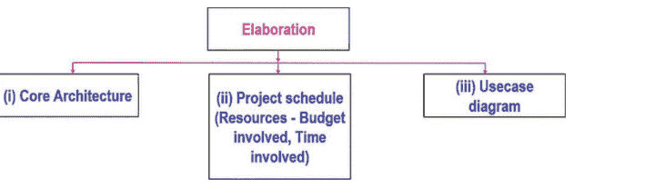

图 1.2 细化阶段。

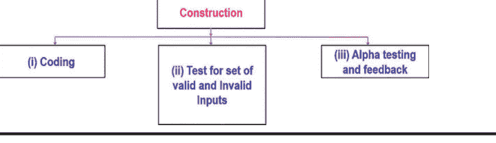

图 1.3 构建阶段。

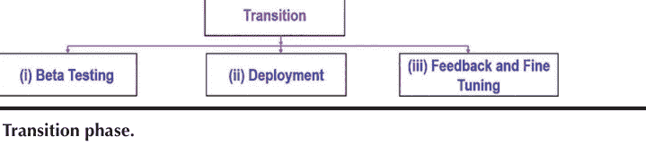

图 1.4 过渡阶段。

过渡阶段涉及 Beta 测试，即在没有开发者支持的情况下在客户处进行软件测试，随后进行部署，最后根据客户侧的反馈进行微调（图 1.4）。

### 1.1.1 UML

它是一种用于设计的标准图化工具。它是一种用于规范、视觉化构建和记录软件系统产物的图形化语言。它有助于开发者和客户更好地理解要开发的软件或系统。UML 图包括主要的重要的图表，如 UML 用例图、UML 活动图、UML 类图、UML 序序图、UML 协作图或 UML 通信图、UML 状态机图、UML 组件图和 UML 部署图（图 1.5 和表 1.1）。

# UML 图及其组件 ■ 3

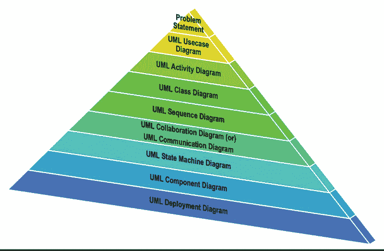

图 1.5 UML 图金字塔。

## 表 1.1 UML 图列表

| 序号 | UML 图 | UML 图的用途 |
|---|---|---|
| 1 | UML 用例图 | 关注于识别所考虑系统的功能性需求。 |
| 2 | UML 活动图 | 关注于系统每个功能需求涉及的顺序和并行活动。 |
| 3 | UML 类图 | 从类和对象的角度描述系统的结构。 |
| 4 | UML 序图 | 描绘参与场景的对象以及为了实现功能而交换的消息序列。 |
| 5 | UML 协作图或 UML 通信图 | 使用顺序消息显示对象之间的交互。 |
| 6 | UML 状态机图 | 使用三个主要元素描述对象的生命周期：状态、状态转换以及触发转换的事件。 |

（续）

# 4 UML 建模

表 1.1（续）UML 图列表

| 序号 | UML 图 | 图的用途 |
|---|---|---|
| 7 | 组件图 | 组件图的作用是显示系统中不同组件之间的关系。 |
| 8 | 部署图 | 部署图用于描述部署软件组件的硬件组件。部署图的用途可以描述为：
- 可视化系统的拓扑结构。
- 描述部署软件组件的硬件组件。
- 描述运行时处理节点。 |

## 1.1.2 UML 用例图

表 1.2 包含了 UML 用例图组件的细节。表 1.3 包含了用例关系。

表 1.2 UML 用例图组件

| 序号 | 组件名称 | UML 符号 | 用途 |
|---|---|---|---|
| 1 | 系统边界 |  | 代表系统的范围。
- 它封装了系统的完整功能。 |
| 2 | 参与者 |  | 与系统交互的用户。用户可以是人、组织或与应用程序交互的外部系统。
- 参与者在用例中进行交互。
- 哪些参与者对他们想要建模的功能产生影响取决于开发者的考虑。 |
| 3 | 用例 |  | 系统中特定业务 old的视觉化表示。
- 它确保业务流程是离散的。
- 列出给定问题陈述中离散的业务功能。
- 识别用例是一种发现过程。 |

## 表 1.3 用例关系

| 序号 | 用例关系 | UML 符号及其功能 |
|---|---|---|
| 1 | 关联 (Association) |  <br>* 关联表示参与者（actor）与用例（usecase）之间的关系。 |
| 2 | 有向关联 (Directed Association) |  <br>* 有向关联表示单向关系，参与参与承担了影响用例的责任。 |
| 3 | 包含 (Include) |  <br>* 包含关系表示一个用例包含了另一个用例的功能。 |
| 4 | 扩展 (Extend) |  <br>* 两个用例之间的扩展关系意味着一种意义关系，即被扩展的用例为基用例的现有功能增加了额外的行为。 |

## 表 1.3（续）用例关系

| 序号 | 用例关系 | UML 符号及其功能 |
|---|---|---|
| 5 | 泛化 (Generalization) |  <br>* 泛化是父用例与一个或多个子用例之间的关系。 |
| 6 | 依赖 (Dependency) |  <br>* 依赖定义了一种关系，其中一个用例的存在取决于另一个用例的存在。 |

### 1.1.2.1 用例模板

每个用例都通过一个名为用例模板的标准模板进行详细说明。

| 描述 |
|---|
| 用例 ID (Usecase ID) – 代表用例的唯一标识符。 |
| 用例名称 (Usecase Name) – 代表用例的有意义名称。 |
| 涉及参与者 (Actors Involved) – 与用例交互的参与者。 |
| 描述 (Description) – 用例功能的简要说明。 |
| 前提条件 (Preconditions) – 在执行该用例此功能之前的系统状态。 |
| 主流程 (Main Flow) – 功能如何实现的描述。 |
| 后置条件 (Post Conditions) – 执行该用例此功能之后的系统状态。 |
| 备用流程 (Alternate Flow) – 其他可能性。 |

### 1.1.3 UML 活动图

表 1.4 包含了 UML 活动图组件的详细信息。

### 表 1.4 UML 活动图的组件

| 序号 | 组件名称 | UML 符号及组件目的 |
|---|---|---|
| 1 | 初始状态 (Initial state) | * 它表示所考虑的系统的起始状态。 |
| 2 | 结束状态 (Final state) | * 它表示所考虑的系统的终止状态。 |
| 3 | 泳道 (Swimlanes) | * 泳道包含两个分区，即顶部的分区表示参与者/用例/类等实体，第二个分区则侧重于所涉及的活动集合。<br>* 泳道有两种类型，即垂直泳道和水平泳道。<br>* 垂直泳道 – 代表所考虑的系统某一特定场景的并行活动。<br>* 水平泳道 – 代表所考虑的系统某一特定场景的顺序活动。 |
| 4 | 动作状态 (Action state) | * 动作状态表示一个操作、业务活动或过程。 |

### 表 1.4（续）UML 活动图的组件

| 序号 | 组件名称 | UML 符号及组件目的 |
|---|---|---|
| 5 | 对象 (Object) | • 在任意两个动作状态之间传递数据的实体。<br>![Object] |
| 6 | 同步 (Synchronization) | • 同步表示两个或多个活动同时或以相同的速率发生。<br>• 它有两种类型：分叉 (Fork) – 将单个活动流分为两个或多个并发活动；合并 (Join) – 通过确保一次只有一个活动在进行，将两个或多个并发活动合并为单一流。<br> |
| 7 | 决策 (Decision) | • 决策节点有一个输入或两个多个输出，取决于其设计条件。<br>• 每个输出都附带一个条件。<br>• 如果满足某个条件，流将沿着相应的输出进行。<br>• 如果没有满足其他条件，则可以沿着“else”输出进行。<br> |

### 表 1.4（续）UML 活动图的组件

| 序号 | 组件名称 | UML 符号及组件目的 |
|---|---|---|
| 8 | 合并 (Merge) | - 用于合并输入流。<br>- 输入不同同步；当流到达此类节点时，无需等待其他流即可从输出通过。<br> |
| 9 | 流结束 (Flow Final) | - 它表示活动图中路径的异常终止，不被视为系统的一部分。 |
| 10 | 转换 (Transition) | - 转换箭头表示从源活动状态到目标活动状态的移动，由源活动状态的完成触发。<br><br> |
| 11 | 自转换 (Self-Transition) | - 它表示到动作状态自身的内部转换。<br><br> |
| 12 | 信号发送状态 (Signal Send State) | - 信号表示活动如何受系统的外部影响。<br>- 它们通常以发送和接收信号对出现。<br>- 信号发送状态表示活动外的发送操作。<br>- 信号发送状态不等待信号接收者的任何响应。<br>- 它结束自身并将执行传递给下一个动作。<br>- 信号发送状态的符号为五边形。<br><br> |

### 表 1.4（续）UML 活动图的组件

| 序号 | 组件名称 | UML 符号及组件目的 |
|---|---|---|
| 13 | 信号接收状态 (Signal Accept State) | - 触发器为信号事件的状态非正式称为信号接收状态。<br>- 它与发送状态对应。<br>- 有入边的信号接收状态意味着该动作在前一个活动状态完成后开始。<br>- 无入边的信号接收状态在接受事件后仍保持开启状态。<br>- 它在接受事件并输出值后不会终止，而是继续等待其他事件。 |
| 14 | 子活动 (Subactivity) | - 子活动是可以未来成为另一个主要活动场景的动作状态。 |

# UML 图表及其组件 ■ 11

### 表 1.5（续）UML 时序图组件

| 序号 | 组件名称 | UML 符号及组件用途 |
|---|---|---|
| 2 | 消息及其类型 | - 任何场景下对象之间的通信是通过转换组件的帮助，通过消息传递的概念完成的。<br>- 消息在转换箭头上进行编号。<br>- 消息的语法为 `Message_no: Message()`<br>- 有五种类型的消息适用于时序图中任意两个对象之间的任何转换。 |


# UML 图表绘制

## 表 1.5（续）UML 时序图组件

| 序号 | 组件名称 | UML 符号及组件用途 |
|---|---|---|
| 2.1 | 同步消息 | - 从发送者发送的消息基于等待语义。<br>- 等待语义是指发送者在传输下一条连续消息之前，需要接收者对每条消息进行确认。<br>- 同步消息的符号是带实心箭头箭头的实线。<br><br>![Object a : Class A, Object b : Class B, 1 : Synchronous Message()] |
| 2.2 | 返回消息 | - 它代表对同步消息的回复。<br><br>![Object a : Class A, Object b : Class B, 1 : Synchronous Message(), 2 : Reply Message] |
| 2.3 | 异步消息 | - 此类消息由发送者发送给接收者，不需要接收者的确认。<br>- 该功能允许发送者向接收者发送任意数量的消息。<br><br>![Object a : Class A, Object b : Class B, 1 : Asynchronous_Message_1, 2 : Asynchronous_Message_2, 3 : Asynchronous Message_3] |
| 2.4 | 创建消息 | • 创建消息代表场景中对象的实例化。<br>• 它包含一个名为 `<<create>>` 的刻线。<br><br> |
| 2.5 | 销毁消息 | • 销毁消息代表场景中对象生命周结束。<br>• 它包含一个名为 `<<destroy>>` 的刻线。<br>• 销毁在视觉上用一个指向对象生命末尾的大 X 来表示。<br><br> |
| 3 | 片段 (Fragments) | • 片段代表场景中的一组条件消息或循环消息。<br>• 最关键的片段是 `opt`、`alt`、`loop`。<br>• 每个片段都由一个矩形框表示，该框封装了这些消息，左上角的标签代表片段的类型。 |
| 3.1 | Opt | • 此片段代表一个简单的 IF 场景。<br>• 只有当 `opt` 片段中定义的条件保持为真时，才会执行消息。<br>• 条件不满足的情况下，控制将跳出片段。<br>• 条件技术上称为守卫（Guard）。<br><br>![opt [Condition] 1: Message_1 2: Message_2](https://example.com/image3) |

### 表 1.5（续）UML 时序图组件

| 序号 | 组件名称 | UML 符号及组件用途 |
|---|---|---|
| 3.2 | Alt | • 此片段代表 IF ELSE 场景。<br>• 此片段在矩形区域内有两个分区。<br>• 当 `alt` 第一个分区定义的条件保持为真时，第一个分区中的消息才会被执行。<br>• 否则，执行 `alt` 片段第二个分区中的消息。 |
| 3.3 | Loop | • 此片段代表一组重复执行的消息，直到 `loop` 片段中定义的条件不再保持为真。<br>• 此片段在矩形区域内有两个分区。<br>• 只有当 `alt` 片段中第一个分区定义的条件保持为真时，第一个分区中的消息才会被执行。 |
| 4 | 片段嵌套 | 根据对多个条件验证或对嵌套条件集重复执行的需求，这种嵌套概念可以应用于不同类型的片段。 |

## 1.1.5 UML 协作图

大多数组件在 UML 时序图和 UML 协作图之间是通用的。表 1.6 包含了 UML 协作图唯一组件的细节。

### 表 1.6 UML 协作图的唯一组件

| 序号 | 组件名称 | UML 符号及组件用途 |
|---|---|---|
| 1 | 对象 | • 它代表系统的实体，实体通过消息与系统的其他实体进行交互。<br>• 在 UML 协作图中，对象没有生命线或控制焦点。 |
| 2 | 连 (Link) | • 连接允许任意两个对象之间的通信。<br>• 它表示为不带箭头的实线，因此它代表双向通信。 |
| 3 | 自连接 (Self Link) | • 自连接连接到自身。 |
| 4 | 正向刺激 (Forward stimulus) | • 它代表从发送者（第一个对象）到接收者（第二个对象）的移动。<br>• 可以是时序图中讨论的五种消息类型之一。 |
| 5 | 反向刺激 (Reverse stimulus) | • 它代表从接收者（第二个对象）到发送者（第一个对象）的响应。<br>• 它可以是时序图中讨论的五种消息类型之一。 |

## 1.1.6 状态图

表 1.7 包含了状态机组件的细节。

### 表 1.7 状态机组件

| 序号 | 组件名称 | UML 符号及组件用途 |
|---|---|---|
| 1 | 初始状态 | 它代表系统的开始状态。 |
| 2 | 结束状态 | 它代表系统的结束状态。 |
| 3 | 流结束 | 它代表状态机路径的异常终止，不视为系统的一部分。 |
| 4 | 状态 (State) | 它代表被考虑对象的状态。<br>使用以下属性描述：<br>i. Name – 名称。<br>ii. Entry – 进入系统前执行的动作。<br>iii. Do – 在状态内执行的动作。<br>iv. Exit – 退出系统所需的动作。 |
| 5 | 转换 (Transition) | 箭头表示从一个状态到另一个状态的移动，由源状态的完成触发。 |
| 6 | 自转换 | 它代表状态内部转换。 |
| 7 | 汇合点 (Junction Point) | • 其目的是合并不同状态的输入流。<br>输入不是同步的；如果流到达状态，它将继续，无需等待来自其他状态的流。 |

### 表 1.7（续）状态机组件

| 序号 | 组件名称 | UML 符号及组件用途 |
|---|---|---|
| | |  |
| 8 | 选择点 (Choice Point) | - 选择点根据其设计具有一个输入或多个输出。<br>- 每个输出流都附加了一个条件。<br>如果满足条件，流将沿着相应的输出进行。 |
| 9 | 浅历史 (Shallow History) | - 状态的浅历史指向同一层级结构上最近访问的状态。 |
| 10 | 深历史 (Deep History) | - 状态的深历史指向最近访问的简单状态。 |
| 11 | 子状态机状态 (Submachine state) | - 子机状态是一个未来可能作为另一个状态图场景的状态。 |

## 1.1.7 UML 类图

表 1.8 包含了 UML 类图组件的详细信息。

### 表 1.8 UML 类图的组件

| 序号 | 组件名称 | UML 符号及组件的作用 |
| --- | --- | --- |
| 1 | 类 (Class) | • 每个类都有三个部分，即：<br>i. 顶部部分表示类的名称，<br>ii. 中间部分表示类的结构（属性），以及<br>iii. 底部部分表示类的行为（操作）<br><br><br><br>• 属性（Attribute）表示描述对象状态的属性。<br>• 语法：可见性 属性名 : 数据类型<br>• 数据类型示例有：`Int`, `Char`, `Float`, `String`, `Date`, `Time`, `Money`, `Dollars`, `Colour`, `Country`, `Postal Code`, `Address`, 等。 |
| | 可见性符号 | 访问修饰符 |
| | `+` | 公有 (Public) |
| | `#` | 保护 (Protected) |
| | `-` | 私有 (Private) |
| | | 衍生属性是通过其他属性计算或得出的属性，在名称前用斜杠 (`/`) 表示。<br>• 语法：`/可见性 属性名:数据类型`<br>• 可见性 操作名 (输入参数) 表示类可以执行的操作或函数。<br>• 输入参数采用与属性相同的语法。<br>• 不返回值的方法（即 `void` 方法）应给出一个返回类型 `void`。 |
| 2 | 类关系 (Class Relationships) | 类关系有七种类型，即关联、单向关联、依赖、聚合、组合、泛化、实现。 |
| 2.1 | 关联 (Association) | 当两个类之间相互通信时，使用关联来连接这两个类。<br><br> |

### 表 1.8（续） UML 类图的组件

| 序号 | 组件名称 | UML 符号及组件的作用 |
| --- | --- | --- |
| 2.2 | 单向关联 (Directed Association) | • 当两个类通过优先考虑单向通信的方式连接时，它们通过单向关联连接。<br><br>![Class1, Class 2, +Attribute, 关联名称, +Attribute, +Operation(), +Operation()] |
| 2.3 | 依赖 (Dependency) | • 当一个类的存在依赖于另一个类的存在时，它们使用依赖连接。<br><br>![Class1, Class 2, +Attribute, +Attribute, +Operation(), +Operation()] |
| 2.4 | 聚合 (Aggregation) | • 它表示一种“部分”关系。<br>• `Class1` 的多个实例可以与 `Class2` 关联。<br>• 聚合意味着一种子类可以独立于父类存在的关系。<br><br>![Class1, Class 2, +Attribute, +Attribute, +Operation(), +Operation()] |
| 2.5 | 组合 (Composition) | • 它表示一种“整体”关系。<br>• 组合意味着子类无法独立于父类存在的关系。<br><br>![Class1, Class 2, +Attribute, +Attribute, +Operation(), +Operation()] |
| 2.6 | 泛化 (Generalization) | • 泛化代表了继承的概念。<br>• 它表示父类与其子类之间的关系。<br><br>![父类, +Attribute, +Operation(), 子类 1, 子类 2, +Attribute, +Attribute, +Operation(), +Operation()] |

### 表 1.8（续） UML 类图的组件

| 序号 | 组件名称 | UML 符号及组件的作用 |
|---|---|---|
| 2.7 | 接口与实现角色 (Interface & role of Realization) | * 接口有两种类型：提供接口和依赖接口。<br>* 提供接口是类提供的功能。<br>* 依赖接口是另一个类所需的功能。<br>* 实现是由类实现的接口。<br>* 可见性 属性名:数据类型<br>* 操作名 (输入参数) 表示类可以执行的操作或函数。<br>* 输入参数采用与属性相同的语法。<br>* 方法不返回值的方法（即 `void` 方法）应给出一个返回类型 `void`。<br> |
| 3 | 实现 (Realization) | * 接口有两种类型：提供接口和依赖接口。<br>* 提供接口是类提供的功能。<br>* 依赖接口是另一个类所需的功能。<br>* 实现是由类实现的接口。<br>* 可见性 属性名:数据类型<br>* 操作名 (输入参数) 表示类可以执行的操作或函数。<br>* 输入参数采用与属性相同的语法。<br>* 方法不返回值的方法（即 `void` 方法）应给出一个返回类型 `void`。<br> |

## 1.1.8 UML 组件图

表 1.9 包含了 UML 组件图组件的详细信息。

### 表 1.9 组件图的组件

| 序号 | 组件名称 | UML 符号及组件的作用 |
| --- | --- | --- |
| 1 | 组件 (Component) | 组件是系统中的模块化部分。<br>* 它封装了其内部实现。<br>* 它们是可替换的。 |
| 2 | 接口 (Interface) | * 接口有两种类型：提供接口和依赖接口。<br>* 提供接口是类提供的功能。<br>* 依赖接口是另一个类所需的功能。<br>* 实现是由类实现的接口。<br>* 可见性 属性名:数据类型<br>* 操作名 (输入参数) 表示类可以执行的操作或函数。<br>* 输入参数采用与属性相同的语法。<br>* 方法不返回值的方法（即 `void` 方法）应给出一个返回类型 `void`。<br> |
| 3 | 实现 (Realization) | * 接口有两种类型：提供接口和依赖接口。<br>* 提供接口是类提供的功能。<br>* 依赖接口是另一个类所需的功能。<br>* 实现是由类实现的接口。<br> |

### 1.1.9 UML 部署图

表 1.10 包含了 UML 部署图组件的详细信息。

### 表 1.10 部署图的组件

| 序号 | 组件名称 | UML 符号及组件的作用 |
| ------ | --- | --- |
| 1 | 节点 (Node) | 具有内存和处理能力的计算资源。<br>- 节点有两种类型：设备节点和执行环境节点。<br>- 设备节点代表应用服务器、工作站、移动设备、嵌入式设备等。<br>- 执行环境节点代表操作系统、工作流引擎、浏览器、容器、Web 服务器、数据库系统等。 |
| 2 | 制件 (Artifact) | |
| 3 | 端口 (Port) | - 端口允许设备节点与执行环境节点之间的通信。<br>- 它也允许节点与外部环境之间的通信。 |

### 表 1.10（续） UML 部署图的组件

| 序号 | 组件名称 | UML 符号及组件的作用 |
|---|---|---|
| 4 | 关联 (Association) | • 它表示两个参与关系的类之间的双向通信。<br><br>![Component, Association Name, Component 1] |
| 5 | 单向关联 (Directed Association) | • 它表示两个参与关系的类之间的单向通信。<br><br>![Directed Association] |
| 6 | 依赖 (Dependency) | • 它表示一个节点的存在是否依赖于另一个节点。<br><br>![Dependency] |

# 第 2 章

## Webmed 医疗服务系统的 UML 图设计

医疗服务如今需求巨大，因为它确实有助于管理医院或诊所。医疗服务系统的范围每天都在扩大，在全球范围内都是如此。这些解决方案之一包括提高对医疗服务和健康政策的意识。该系统的目标是通过技术帮助即时提供医疗援助。

## 2.2 主要功能及其描述

该系统的主要功能及其描述如下：

- 注册（Register）—— 此功能作为一种会员功能，允许用户（患者或护理人员）在网站上注册，以访问所有资源。
- 登录（Login）—— 此功能验证用户身份以提供访问权限。
- 设施（Facilities）—— 此功能允许我们访问网站上提供的所有选项。
- 注销（Logout）—— 这允许我们购买保险，或为消耗的医疗服务付费。
- 财务（Finance）—— 健康 A–Z：此功能提供所有疾病的详细信息。
- 资源（Resources）—— 此功能包含子功能，即症状检查、健康计算器、寻找医生、保险指南和救护车服务。
- 药物和补充剂（Drugs and supplements）—— 此功能提供药品在线配送。该功能根据医生的处方和患者的在线购买意愿发放药物。
- 新闻与专家（News and experts）—— 此功能提供健康意识和当前的健康威胁。
- 支付（Payment）—— 此功能处理所消耗服务的费用。该功能分为两个子功能，即针对已发布服务的支付以及针对在线药品配送的支付。
- 反馈（Feedback）—— 此功能收集用户对本网站的评论。


# 系统架构

系统架构是定义系统结构、行为等方面视图的概念模型。架构描述是对系统的正式描述和表示，其组织方式支持对系统的结构和行为进行推理。图 2.1 所示的架构图根据这些功能的发生顺序，按顺序包含了系统的所有功能。它代表了完整的数据流，从用户可以访问系统的注册功能开始，一直到结束访问的注销功能。

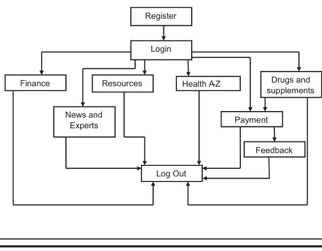

图 2.1 系统架构。

最初，用户必须在系统上注册。注册后，用户即可登录系统并访问提供的所有服务——财务、新闻与专家、资源（包括寻找医生）、健康 A–Z（包括健康计算器和健身计算器）、药物和补充剂、支付和反馈。支付通过针对消耗服务的保险来完成。在消耗服务后，用户可以注销系统。

## 2.3 数据流图

数据流图（DFD）是表示过程或系统数据流的一种。DFD 提供有关每个实体的输入输出以及过程本身的信息。DFD 没有控制流；没有决策规则和循环。DFD 可以通过层级和层次逐渐深入到更详细的。DFD 层级标记为 0、1 和 2。

DFD 0 级也称为上下文图（Context Diagram）。它是对正在分析或建模的整个系统或过程的基本概述。它旨在提供一目了然的视图，将系统视为单个高级过程，并显示其与外部实体的关系。图 2.2 所示的 0 级 DFD 图由医疗服务系统——Webmed 以及影响这些系统的参与者——患者和负责系统维护的服务提供者组成。这是一个广大读者可以轻松理解的基础图表。图 2.3 所示的 1 级 DFD 提供了上下文图组成部分的更详细的拆分。当你将上下文图的高级过程拆分为子过程时，我们将突出显示系统执行的主要功能。

这些系统具有相同的外部实体——需要服务的患者和通过系统提供服务的服务提供者。Webmed 系统被拆分为多个子过程。这些子过程代表系统的功能——注册、登录、财务、健康 A–Z、资源、药物和补充剂、新闻与专家、支付、反馈和注销。支付用于寻找医生以及提供的药物和补充剂。用户还可以对可用服务提供反馈。表 2.1 描述了现有系统与建议系统之间的比较。

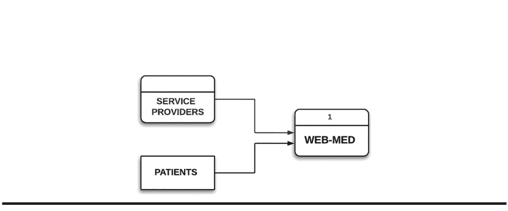

图 2.2 0 级 DFD。

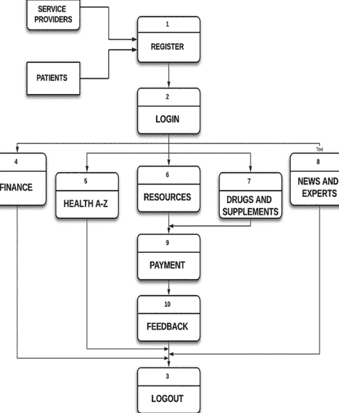

图 2.3 1 级 DFD。

## 表 2.1 现有系统与建议系统的比较

| 现有系统 | 建议系统 |
| :--- | :--- |
| 注册 | 相同 |
| 登录 | 相同 |
| 注销 | 相同 |
| 财务 | 相同 |
| 健康 A-Z | 相同 |
| 资源 | 相同 |
| 药物和补充剂 | 相同 |
| 新闻与专家 | 相同 |
| 支付 | 相同 |
| 反馈 | 相同 |

# Webmed 的 UML 图设计

## 2.4 建议 – UML 图

### 参与者规范 (Actor Specification)

- **患者 (Patient)**：该参与者扮演可以在网站上注册的患者。
- **服务提供者 (Service Provider)**：该参与者维护系统并提供服务。它接收患者的反馈。

## 用例规范 (Usecase Specification)

### 1. 药物和补充剂

描述：此功能提供药品在线配送。

基本流：允许用户搜索并购买绷带、敷料等医疗用品。

替代流：此用例的替代流为：健康 A–Z、资源、财务、新闻与专家。

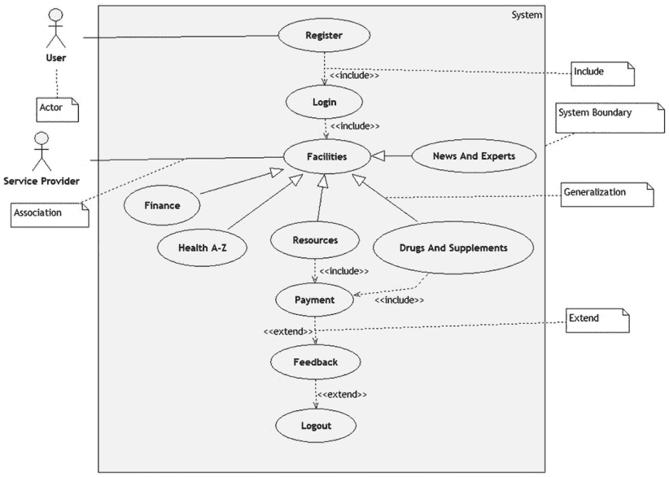

图 2.4。

### 2. 设施

描述：服务提供者控制网站上所有的设施，用户可以使用这些设施。

基本流：用户可以获得健康 A–Z、资源、药物和补充剂、新闻和专家等服务。

替代流：用户可以为网站的改进提供反馈。

### 3. 反馈

描述：反馈部分帮助用户对已提供的服务质量给出诚实的意见。它还帮助他们为进一步的改进提供建议。

基本流：验证是否提交了反馈。

替代流：注销（LOGOUT）。

### 4. 财务

描述：对财务状况进行谈判，检查保险资格并发放合适的方案。

基本流：检查用户是否已为健康购买了保险，如果没有，则检查保险的可用性。

### 5. 健康 A-Z

描述：此功能作为疾病字典，包含其症状和可以服用的药物。

基本流：提供所有疾病及其症状的目录。

### 6. 资源

描述：此功能允许用户访问网站上提供的所有资源。

事件流程

基本流程：允许用户访问网站上提供的所有资源。

替代流程：执行完此用例后，控制将流向以下任何一个用例：财务、健康 A-Z、资源、药物和补充剂、新闻和专家。

前置条件：用户应已在网站上注册。

后置条件：用户获得访问网站上所有可用资源的完整权限。

### 7. 登录

描述：此功能结束对网站的访问。因此，用户必须重新登录才能访问所有资源。

事件流程

基本流程：结束用户对资源的访问。

替代流程：无替代流程。

前置条件：用户应已登录网站。

后置条件：一旦执行此用例，用户将被拒绝访问本网站提供的资源。

### 8. 新闻与专家

描述：将公开显示有关环境内最新日期的新闻公告、针对传染病和非传染性疾病的专家建议，以及关于疾病的知识普及。

事件流程

基本流程：用户接收有关疾病的最新动态。

替代流程：可以执行以下用例而非此用例：健康 A-Z、资源、药物和补充剂以及财务。

前置条件：用户应已登录。

后置条件：用户对流行疾病有了了解。

### 9. 支付

描述：此功能处理对所消费服务的支付。

事件流程

基本流程：此功能涉及对医生提供的服务进行支付。

替代流程：执行此用例后，控制移动到反馈用例。

前置条件：用户应已消费医生提供的服务或已在线购买了药物。

后置条件：执行此用例后，用户已完成购买支付，或服务提供者已向医生支付款项。

### 10. 注册

描述：作为会员功能，允许患者或护理人员注册到本网站以访问所有资源。

事件流程

基本流程：允许用户在网站上注册。

替代流程：执行注册用例后，可以执行的用例：登录功能。

前置条件：无前置条件，因为注册是第一个执行的用例。

后置条件：执行注册用例后，用户将获得 Webmed 会员身份。

### 11. 注销

描述：此功能结束对网站的访问。因此，用户必须重新登录才能访问所有资源。

事件流程

基本流程：结束用户对资源的访问。

替代流程：无替代流程。

前置条件：用户应已登录网站。

后置条件：一旦执行此用例，用户将被拒绝访问本网站提供的资源。

### 12. 资源

描述：在此章节中展示了健康计算器、救护车服务、症状检查、寻找医生和保险指南等资源。

事件流程

基本流程：用户借此收集资源。

替代流程：可以执行以下用例而非此用例：健康 A–Z、新闻与专家、药物和补充剂以及财务。

前置条件：应确保资源的可用性。

后置条件：用户拥有访问资源的权限（图 2.5）。

两个参与者——用户和服务提供者可以访问网站上的资源。设施类由新闻与专家、健康 A-Z 和健康计算器功能组成。财务类检查用户是否拥有健康保险，并提醒为用户购买保险的服务提供者。使用实现关系将用户、服务提供者与财务类连接起来。支付类涉及用户对药物和其他补充剂的支付。支付可以是在线支付，也可以是货到付款。因此，使用泛化关系来表示支付类的现金支付和在线支付。支付类与用户类关系松散，但与服务提供者关系很紧密，因为服务提供者负责所有的支付程序。寻找医生（建议专门针对某种疾病的医生）以及购买药物和补充剂是需要支付的资源。因此，这些资源是设施类和支付类共有的。因此，这些资源保留在一个名为“使用”的关联类中（图 2.6）。

活动图表示了通过系统的数据流。它表示了从用户注册，到使用用户名和密码登录的数据流。一旦用户登录系统，用户就可以访问所有资源，并反复导航资源，直到用户想要注销系统。用户需要为他们获得的服务付费。如果用户选择的话，用户也可以为系统提供反馈（图 2.7）。

在这张活动图中，“注册”是一个子活动。注册有其单独的控制流，允许用户加入系统。上面的活动图说明了在注册功能中发生的流程。服务提供者生成随机 ID，从用户处接收密码并确认密码。如果密码和确认密码相同，则用户注册到系统，系统会提示仅在确认密码字段中输入文本（图 2.8 和 2.9）。

系统首先检查用户是否为注册用户，如果是，则提示用户进入登录状态；否则，要求用户注册系统并提示进入注册状态。登录系统后，用户可以根据自己的选择访问设施。根据用户的选择，用户将被提示到所需状态。在此图中，登录是一个由许多不交状态组成的子状态机。如果用户需要寻找医生或购买药物，则会检查其保险可用性。如果系统未购买保险，用户将被拒绝访问本网站提供的资源。一旦执行此用例，用户将被拒绝访问本网站提供的资源。

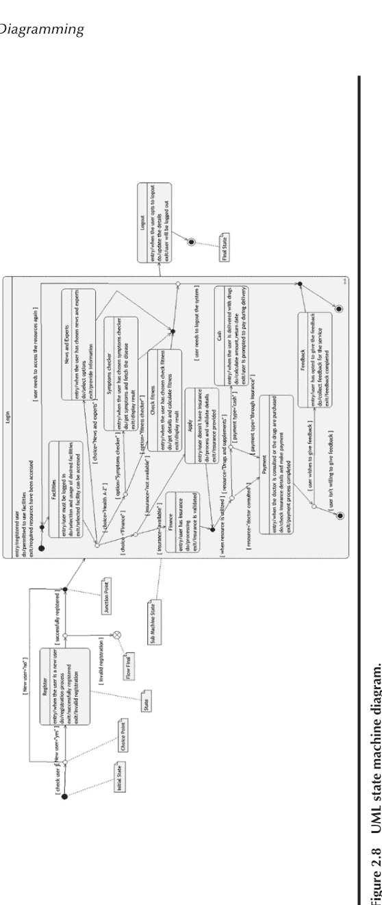

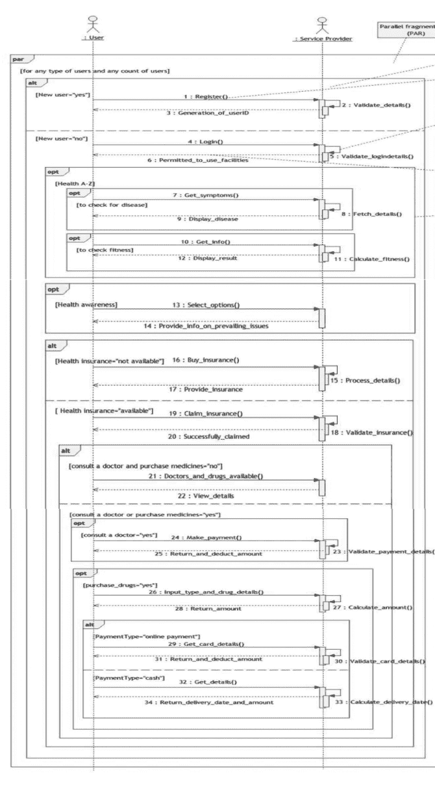

图 2.9 UML 序图。

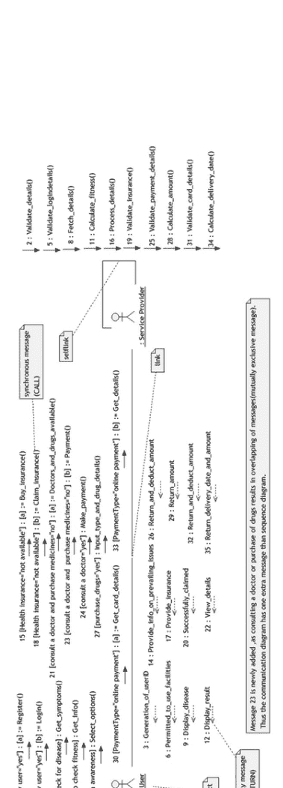

图 2.10 UML 通信图。

节点和执行环境节点（Execution Environment Node）用于表示操作系统、数据库和 Web 浏览器。属性和操作使用类似于组件图中的部分（parts）来表示。数据库维护在服务提供商处，因为在注册、寻找医生和支付时需要搜索患者的详细信息。药品供应商节点用于说明涉及药品订单和购买的属性和操作。用户与服务提供商之间使用的协议是安全且可审计的代理通信协议（SAACP）。大多数医院经常使用 SAACP 来安全地维护患者详细信息。每个节点都有表示其可以调用的属性和操作的部分。

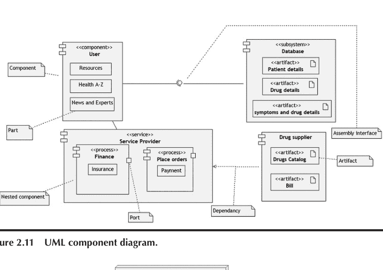

2.11 UML 组件图。

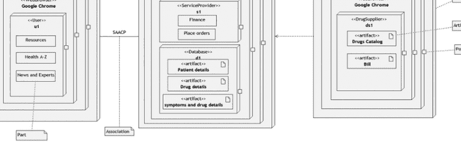

2.12 UML 部署图。


# 第 3 章 库存管理系统的 UML 图设计

## 3.1 问题描述

本章旨在创建一个库存管理系统，以便高效管理货物。性能将通过对每个功能单元不断追求完美并遵循清晰简洁的战略实践来指导。目前的系统使用手动方法跟踪商店的记录，但由于产品搜索和检索困难、材料成本问题、人为错误、数据完整性低以及记录丢失和文件检索的风险，导致当前系统难以维护。因此，通过开发这样的系统，我们建议通过创建完整的库存记录、商店买卖双方详细信息来增加销售额，并方便销售人员和库存经理。不断增长的人口创造了高需求。因此，准时交货的责任在于有效的库存管理系统手中。库存管理系统将同时安装在仓库和收银台，使销售人员和库存经理能够即时信息并按需使用。客户结账流程将在主柜台进行，而库存管理将在仓库后台进行。

## 3.2 软件需求说明

当前的库存系统由于产品搜索和检索困难、材料成本问题、人为错误、数据完整性低以及记录丢失和文件检索的风险，而难以维护。因此，需要创建一个稳健的库存管理软件，以减少客户投诉并降低库存成本。对商品的需求源于人口增长。为了满足这些需求，库存经理和销售人员需要一个可以按需检索和更新信息的应用程序。在仓库，该应用程序将管理可用货物和资源。在收银台，该应用程序将具备创建账单并进行适当折扣和税收评估的能力。

DOI: 10.1201/9781003287124-3

## 3.3 功能性需求

- 身份验证 - 登录：这将允许库存经理和销售人员登录系统。
- 修改密码：这将允许库存经理和销售人员修改密码。
- 添加商品：这将向当前库存添加商品及其详细信息。
- 移除商品：这将从当前库存中移除商品。
- 下单：这将向供应商下批发订单。
- 生成发票：这将为供应商订单生成发票。
- 搜索商品：这将搜索当前库存。
- 生成收据：这将为客户选择的商品生成收据。
- 折扣和税生成：这将根据客户选择的数量计算折扣和税。
- 替换商品：这将替换当前库存中的商品。
- 取消收据：这将取消生成的收据。
- 更新：这将更新相应商品的价格。
- 客户请求：这将记录客户请求。
- 查看摘要报告：这将为所有交易生成摘要报告。
- 过期商品：这将通知当前库存中商品的移除。

## 3.4 设计与约束

约束是在下单或使用界面时，屏幕上不显示过多信息。通过极简界面，我们能够提供提升的用户体验（图 3.1–11）。

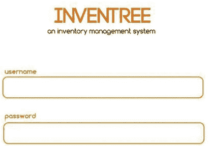

图 3.1 登录。

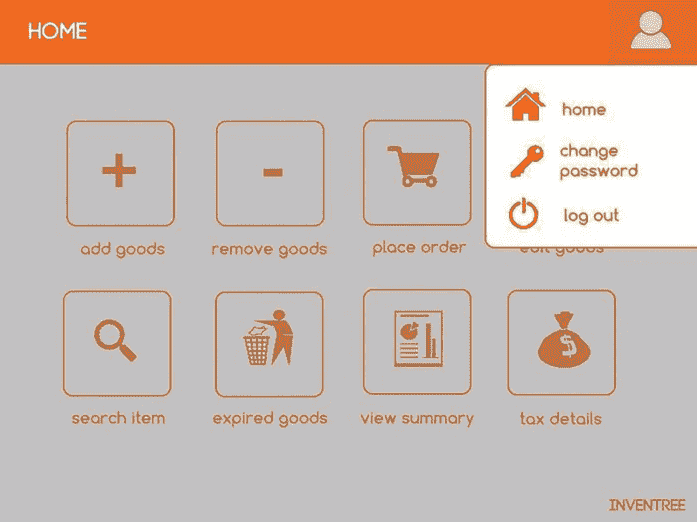

图 3.2 仪表盘。


图 3.3 修改密码。

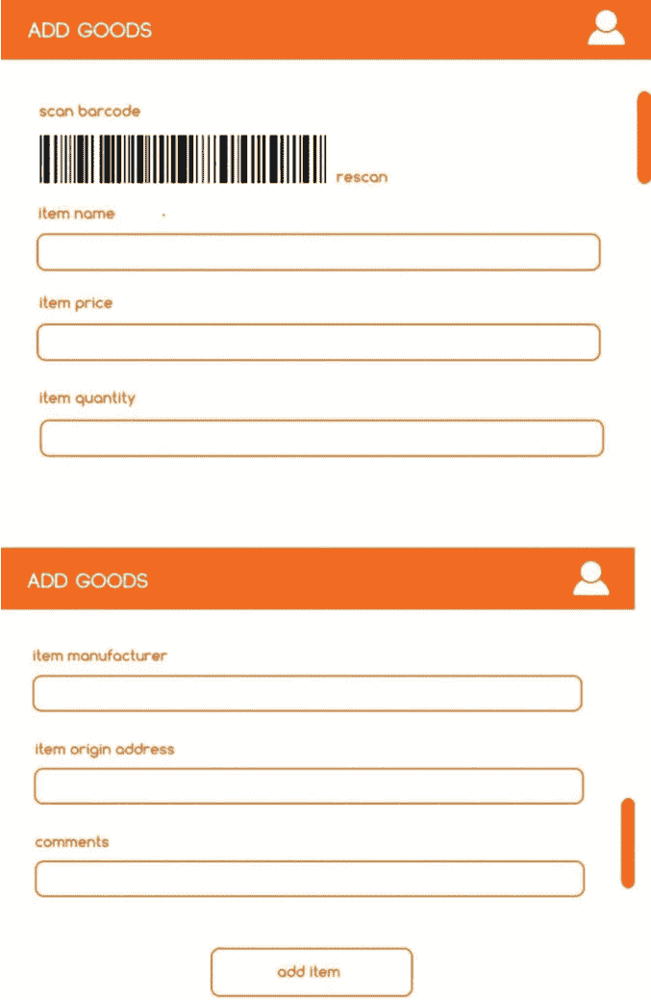

图 3.4 添加商品。

## 移除商品


图 3.5 移除商品。

## 查看摘要

| 商品名称 | 商品 ID | 添加 | 移除 |
|---|---|---|---|
| asof | 12 | 27 | 24 |
| asda | 19 | 24 | 23 |
| asf | 32 | 35 | 34 |
| asf | 34 | 34 | 33 |
| asf | 45 | 45 | 42 |
| asf | 87 | 89 | 88 |
| asf | 87 | 87 | 86 |
| asf | 09 | 09 | 08 |
| asf | 98 | 98 | 97 |

图 3.6 查看摘要。

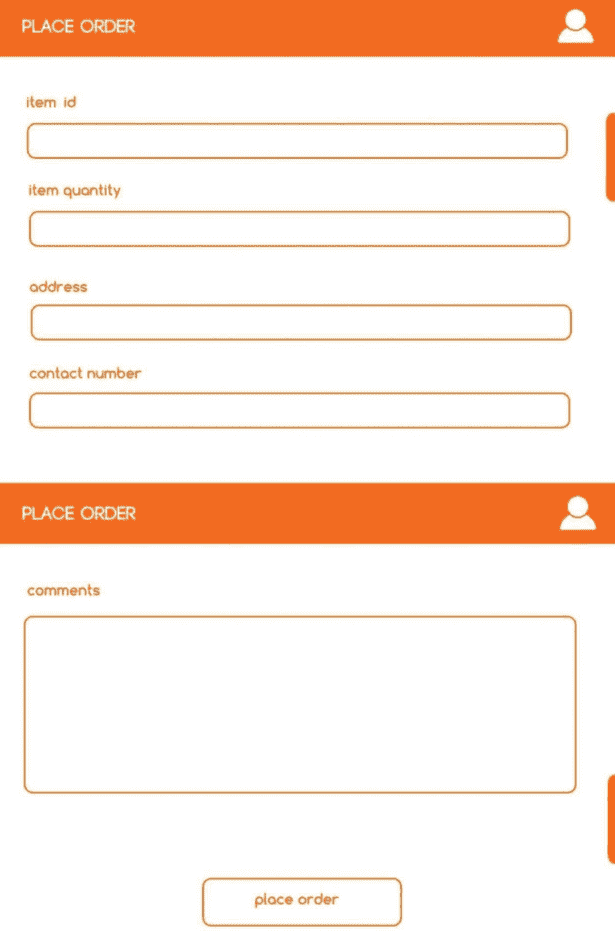

图 3.7 下单。

## 税收详情

图 3.8 税收详情。

## 搜索商品

图 3.9 搜索商品。

## 过期商品

| 商品名称 | 商品数量 | 过期日期 |
|---|---|---|
| sdfof | 10 | 2017年6月27日 |
| askg | 19 | 2017年6月24日 |

图 3.10 过期商品。

## 收银台

| 商品 ID | 名称 | 数量 | 折扣 % | 价格 |
|---|---|---|---|---|
| 1 | fdofas | 100 | 10 | 900 |

总价：900

税率：12.5

净价：1000

图 3.11 收银台。

## 3.5 UML 图

用例图（Usecase diagram）的目的是列出系统所有的功能性需求。在下面的图中，库存的功能性需求以图的形式表示（图 3.12）。

### 参与者说明

1. **管理员**：该参与者的功能是验证注册系统的用户。更重要的是，如果库存发生了变化（如更新价格、移除过期商品），这些更改随后由管理员执行。
2. **库存经理**：该参与者负责库存、相关商品以及库存内发生的交易。
3. **商店经理**：商店经理将有效管理从供应商获取的存储商品并在请求时进行配送。
4. **供应商**：该参与者的工作是供应商店请求的商品，随后对定期请求做出响应。

## 用例说明

### 1. 登录

描述：此用例允许参与者使用凭据登录系统。

事件流

基本流程：参与者输入用户名和密码并点击登录按钮。

替代流程：参与者可能忘记了密码并点击“忘记密码”按钮。

前置条件：参与者应该已经注册并准备好了他们的凭据。

后置条件：将检查所输入的凭据，如果条目正确，则允许参与者进入。

### 2. 修改密码

描述：这允许用户将已设置的密码更改新密码。

事件流程

基本流程：用户输入旧密码、新密码并再次输入新密码进行确认。

备选流程：用户可能不想更改密码并返回。

前置条件：用户应该拥有用户账户和现有的密码。

后置条件：在数据库中验证旧密码，如果正确，则检查新密码与重复输入的密码是否一致，并设置新密码。

### 3. 添加商品

描述：此用例允许参与者向库存中添加商品。

事件流程

基本流程：参与者输入特定商品的所有详情，包括名称、价格和添加数量。

备选流程：没有商品从供应商处到达，参与者返回。

前置条件：商品应该已经到达，且参与者应该了解商品的所有细节。

后置条件：输入的特定商品详情将存储在库存中。

### 4. 移除商品

描述：此用例允许参与者从库存中移除一个或多个商品。

事件流程

基本流程：参与者输入物品 ID 或物品名称以及要移除的数量。

备选流程：参与者可能不想移除商品，或者不知道要移除的商品数量并返回。

前置条件：参与者应该知道他要移除哪个物品以及要移除的数量。

后置条件：在库存中搜索该物品的 ID 或名称，并移除指定的数量。

### 5. 过期商品

描述：此用例允许参与者查看所有过期商品，并允许他们从库存中移除这些商品。

事件流程

基本流程：显示过期商品，参与者点击移除按钮将其删除。

备选流程：显示了过期商品，但参与者决定将其保留在库存中并返回。

前置条件：此用例的运行需要至少有一个过期商品。

后置条件：过期商品已从库存中移除。

### 6. 下单

描述：此用例允许参与者从库存中下订单。

事件流程

基本流程：参与者选择想要购买的物品，指定数量，提供地址和联系详情，并点击下单。

备选流程：参与者可能决定当时不购买任何东西并返回。

前置条件：参与者仅允许选择库存中有的物品。

后置条件：记录请求的物品和数量，并将物品送达至指定的地址。

### 7. 生成发票

描述：此用例为从供应商处购买的物品生成发票。

事件流程

基本流程：获取物品名称、价格和数量，并计算总金额。

备选流程：可能缺少所需的细节，因此不生成发票。

前置条件：库存经理请求的物品供应商处应有货。

后置条件：生成并接收发票。

### 8. 搜索物品

描述：此用例允许参与者搜索库存中的物品。

事件流程

基本流程：参与者输入物品 ID 或物品名称并点击搜索按钮。

备选流程：参与者可能不知道想要搜索哪种物品并返回。

前置条件：要搜索的物品必须存在于库存中。

后置条件：搜索并显示输入的物品。

### 9. 编辑商品

描述：此用例允许参与者编辑已输入的商品详情。

事件流程


## 10. 客户请求

描述：此用例允许参与者对物品提出请求。

事件流程

基本流程：参与者输入所需的物品和数量。

备选流程：参与者可能不清楚想要什么并返回。

前置条件：请求的物品应存在于库存中。

后置条件：物品已以订单形式存储。

## 11. 生成收据

描述：此用例为客户购买的物品生成收据。

事件流程

基本流程：输入客户购买的物品、数量并计算金额。

备选流程：客户可能不购买任何物品。

前置条件：物品应存在于库存中。

后置条件：生成金额并通知客户。

## 12. 折扣与税费生成

描述：此用例计算总金额的折扣和税。

事件流程

基本流程：获取净金额并计算相应的折扣和税以获得总额。

备选流程：可能没有折扣。

前置条件：应为物品计算净金额。

后置条件：计算总额并通知客户。

## 13. 取消收据

描述：这允许参与者取消已生成的收据。

事件流程

基本流程：参与者输入收据号并点击取消按钮。

备选流程：收据未取消且是正确的。

前置条件：需要取消的收据应已生成。

后置条件：收据已取消，相应的物品已添加到库存。

## 14. 替换物品

描述：此用例允许参与者从库存中替换物品。

事件流程

基本流程：参与者输入要替换的物品。

备选流程：参与者不想替换并返回。

前置条件：要替换的物品必须预先购买。

后置条件：指定的物品已被库存中的其他物品替换。

## 15. 查看汇总报告

描述：此用例允许参与者查看所有交易的汇总报告。

事件流程

基本流程：参与者查看生成的汇总报告。

备选流程：参与者不查看直接返回。

前置条件：必须发生过某些交易。

后置条件：生成并由参与者查看报告。

- UML 类图：它关注类之间各种属性的关系以及与每个类相关的操作（图 13）。
- UML 活动图：活动图的目的是对系统中的事件流进行可视化描述（图 14）。
- UML 状态图：状态机图的目的是设计和理解时间敏感型系统。它有助于理解系统的行为，并用一系列步骤、触发事件和可能发生的动作来表达这种行为（图 15）。
- UML 时序图：此图的目的是使用时序和活动图对早期识别的事件进行排序。它还用于追踪问题领域的执行情况（图 16）。
- UML 通信图：该图关注对象之间如何通过消息进行通信（图 17）。
- UML 组件图：它关注每个组件如何通过可用接口与其他组件协作，以提供系统的主要功能（图 18）。

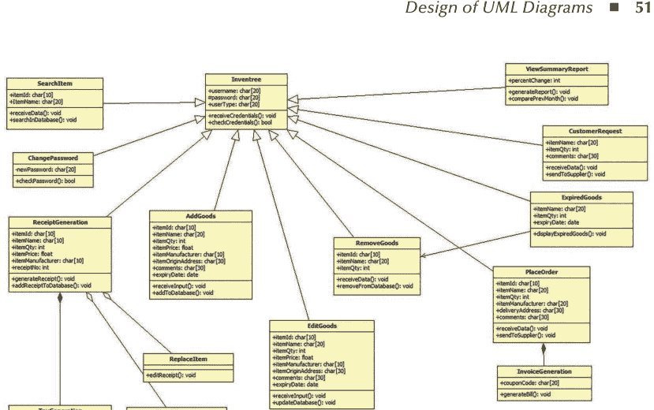

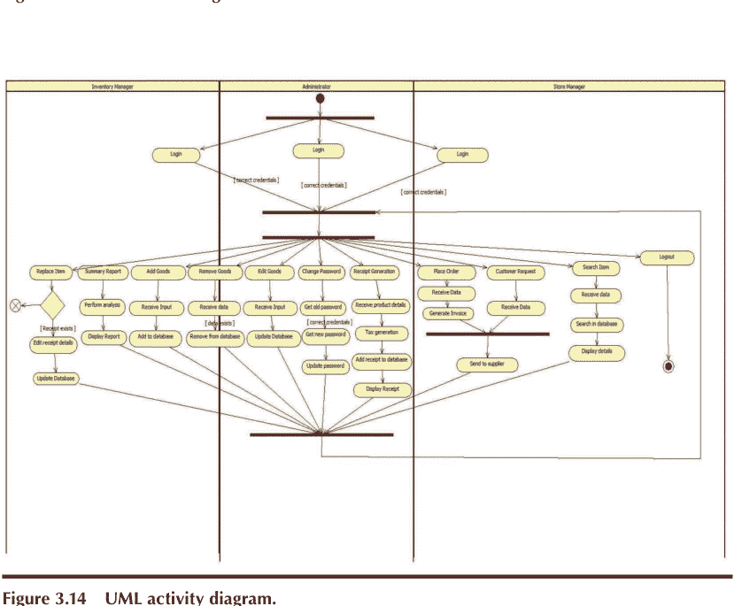

# 52 UML 图建模

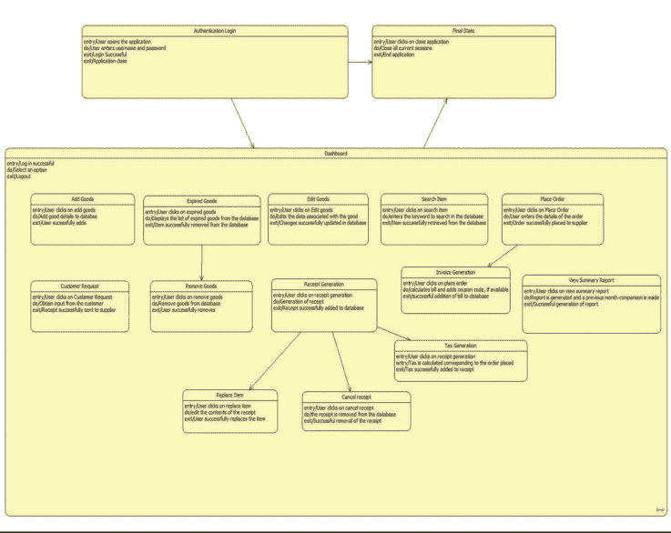

图 3.15 UML 状态图。

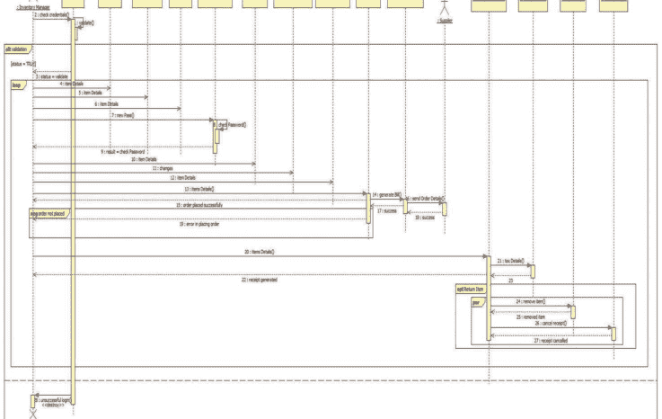

图 3.16 UML 时序图。

# UML 图的设计

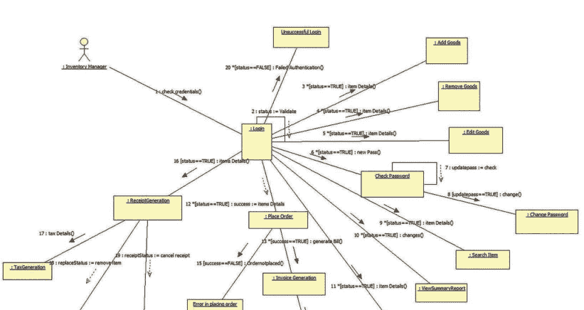

图 3.17 UML 通信图。

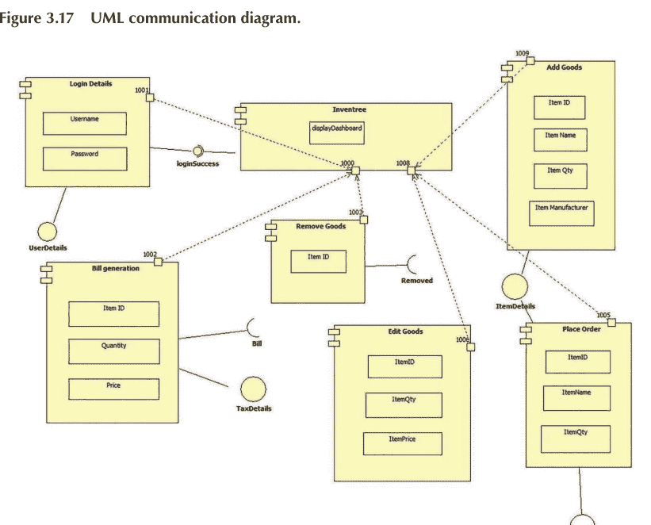

图 3.18 UML 组件图。

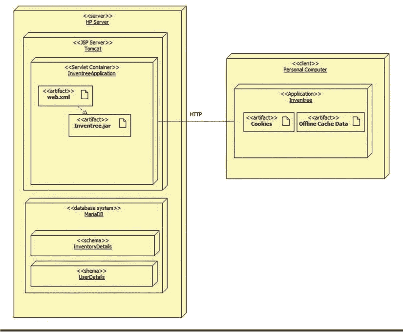

**图 3.19** UML 部署图。

UML 部署图：它高度关注软件元素到物理架构的映射，并表示了所有物理元素之间的通信（图 3.19）。

## 3.6 生成的代码

### 3.6.1 Inventree.java

```java
package Inventree; import java.sql.*; import java.io.*;
import java.util.Scanner;
public class Inventree {
    public String username; protected String password; public String
    userType; public int flag;
    public void receiveCredentials() {
        Scanner scuser=new Scanner (System.in); System.out.
        println("Enter username");
        username = scuser.next(); System.out.println("Enter
        password"); password =
        scuser.next();
    }

    public boolean checkCredentials() {
        //System.out.println("Comes here"); receiveCredentials();
        if (username.equals("admin")&&password.equals("admin"))
            return true;
        else
            return false;
    }
}
```

### 3.6.2 AddGoods.java

```java
import java.sql.*; import java.io.*;
import java.util.Scanner; import Inventree.Inventree; import java.
util.*;
public class AddGoods extends Inventree { public String itemName; public int itemQty; public double itemPrice;
public String itemManufacturer; public String comments
itemOriginAddress; public String comments2;
public Date expiryDate;
public void receiveInput() { if (checkCredentials()) {
    Scanner sc = new Scanner(System.in);
    System.out.print(String.format("%40s", "Add Goods\n"));
    System.out.println("\n\n");
    System.out.println("Enter the item ID"); itemId =
    sc.next();
    System.out.println("Enter the item Name"); itemName =
    sc.next();
    System.out.println("Enter the item Qty"); itemQty =
    sc.nextInt();
    System.out.println("Enter the item Price"); itemPrice
    = sc.nextDouble();
    System.out.println("Enter the Manufacturer");
itemManufacturer =
    sc.next(); System.out.println("Enter the item Origin
Address");
itemOriginAddress = sc.next();
    System.out.println("Enter the item comments");
comments = sc.next();
}
}
public void addToDatabase() {
}
public static void main(String[] args) { int choice;
Scanner sc=new Scanner(System.in); AddGoods obj=new
AddGoods();
do {
    System.out.println("\n\n"); System.out.print(String.
format("%40s", "Inventree\n")); System.out.print(String.
format("%40s", "Inventory Management"));
    System.out.println("Choose an option!"); System.out.print(String.
format("%15s%40s", "1", "Login\n")); System.out.print(String.
format("%15s%40s", "2", "About\n")); System.out.print(String.
format("%15s%40s", "3", "EXIT\n"));
    choice = sc.nextInt();
    switch(choice) {
        case 1: obj.receiveInput(); break;
        case 2: System.out.println("Developed by TEAM"); break;
        case 3: break;
        default: System.out.println("Enter a correct option");
    }
} while(choice!=3) {}
```

### 3.6.3 项目截图

见图 3.20–22

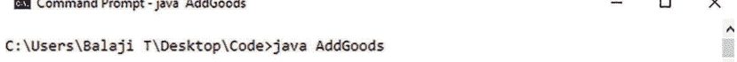

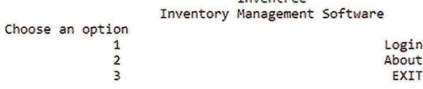

图 3.20 例 1。

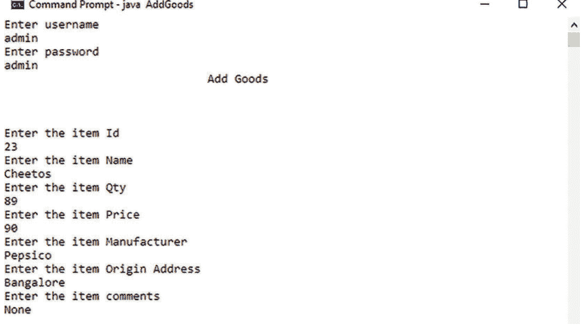

图 3.21 例 2。

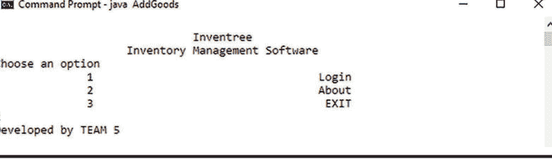

图 3.22 例 3。


# 第 4 章：业务流程外包 (BPO) 管理系统的 UML 图设计

所提的软件将是用户友好，以便 BPO（业务外包）组织与客户之间的所有交互都可以通过软件完成。所需的源文档可以轻松上传并发送给 BPO 组织，反之亦然。问题之一是客户与 BPO 组织之间的通信仅限于面对面的互动，这既昂贵又耗时。由于打印和文档安全性会产生成本，而这些是可以预防的。UML 部署图：它高度关注软件元素到物理架构的映射，并表示所有物理元素之间的通信（图 3.19）。


### 3.6.3 项目截图

见图 3.20–22


图 3.20 例 1。


图 3.21 例 2。


图 3.22 例 3。


# 第 4 章：业务流程外包 (BPO) 管理系统的 UML 图设计

所提的软件将是用户友好，以便 BPO（业务外包）组织与客户之间的所有交互都可以通过软件完成。所需的源文档可以轻松上传并发送给 BPO 组织，反之亦然。问题之一是客户与 BPO 组织之间的通信仅限于面对面的互动，这既昂贵又耗时。由于打印和文档安全性会产生成本，而这些是可以预防的。UML 部署图：它高度关注软件元素到物理架构的映射，并表示了所有物理元素之间的通信（图 3.19）。

## 3.6 生成的代码

（此处省略重复的代码块翻译，与前文一致）

## 4.1 问题声明

## 4.2 功能需求

- 登录——提供用户账户的安全性。
- 个人资料更改——用户可以修改密码。
- 发布请求——BPO 组织可以提交请求。
- 搜索——BPO 组织可以搜索请求。
- 上传文档——BPO 组织可以上传文档。
- 检查进度——客户可以持续更新进度。
- 质量检查——客户可以检查其产品并进行任何修改。
- 上传产品/服务——BPO 组织需要上传产品/服务。
- 支付——客户向 BPO 组织支付费用。
- 发货——产品/服务交付给客户。
- 评分——客户对 BPO 组织提供的服务进行评分（图 4.1–4.19）。

## 4.3 设计与设计约束

# 用例规范

#### 接受请求

描述：允许 BPO 组织接受请求。

事件流

基本流程：BPO 组织接受请求并因此启动交易。

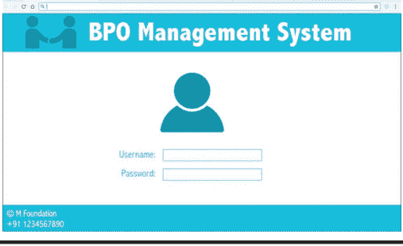

图 4.1 登录页面。

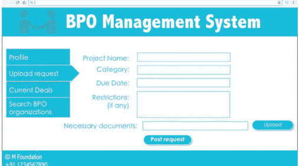

图 4.2 客户资料——接受请求。

#### 卡支付

描述：支付的子用例，当客户希望用银行卡支付时，可以选择此方法。

事件流

基本流程：显示最终金额，一旦支付，BPO 组织将验证协议状态为“已支付”。

# BPO 管理系统 UML 图表 63

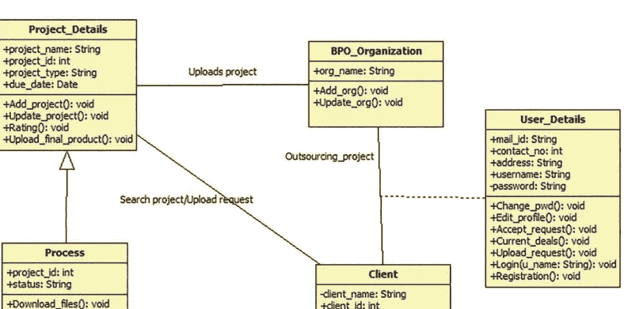

图 4.6 UML 类图。

## 4. 修改密码

描述：这允许您更改密码。

事件流

- 基础流程：用户可以出于安全考虑更改密码。
- 备用流程：他们可以继续使用旧密码。
- 前置条件：他们应该进入个人资料页面。
- 后置条件：更改应成功更新到数据库中。

## 5. 联系用户

描述：这提供了用户之间的通信方式。

事件流

- 基础流程：允许用户之间进行通信。
- 备用流程：尝试其他联系方式。
- 前置条件：用户应有可用的联系详情。
- 后置条件：无。

## 6. 当前交易

描述：允许用户查看所有的交易。

事件流

- 基础流程：用户可以查看他们的待处理和已完成的交易。
- 备用流程：他们可以联系参与交易的另一个用户。
- 前置条件：用户至少应有一个交易可以查看。
- 后置条件：他们可以跟踪待处理交易的进度。

## 7. 编辑个人资料

描述：允许用户编辑他们的个人资料。

事件流

- 基础流程：用户可以编辑其个人资料并保存更改。

# 64 UML 绘图

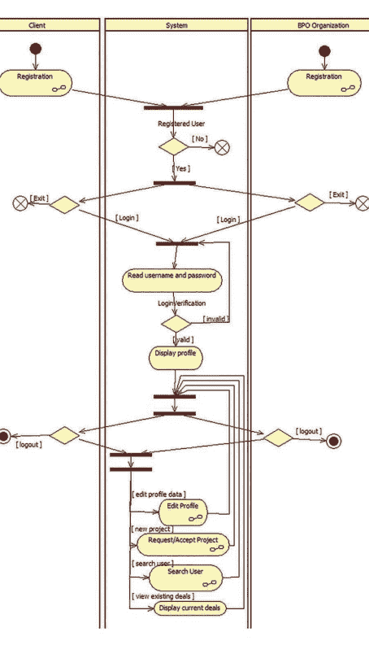

图 4.7 UML 活动图（部分 1）。

- 备用流程：他们可以仅查看资料。
- 前置条件：他们应该进入个人资料页面。
- 后置条件：更改应成功更新到数据库中。

### 8. 按类别筛选

描述：这是搜索用户的子用用例，用户可以按类别（财务等）对用户进行过滤。

事件流

- 基础流程：用户应指定类别类型，该类别将与数据库进行比较以检索所需用户。
- 备用流程：用户可以按评分过滤，或查看无任何过滤的所有用户。
- 前置条件：用户应通过在系统中注册拥有已验证的个人资料以搜索其他资料。
- 后置条件：用户可以联系任何其他用户。

# BPO 管理系统 UML 图表

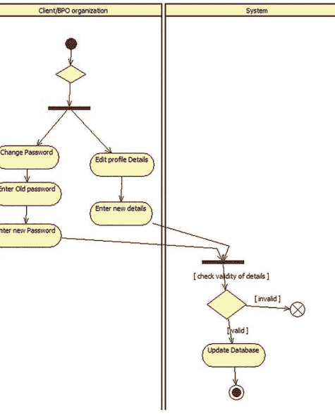

图 4.8 UML 活动图（部分 2）。

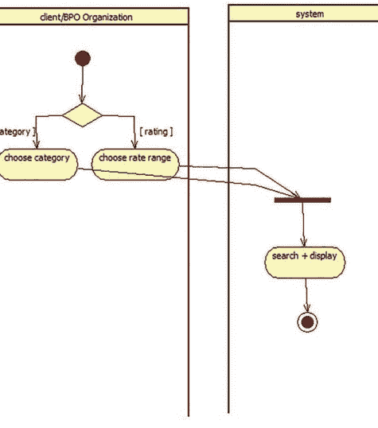

图 4.9 UML 活动图（部分 3）。

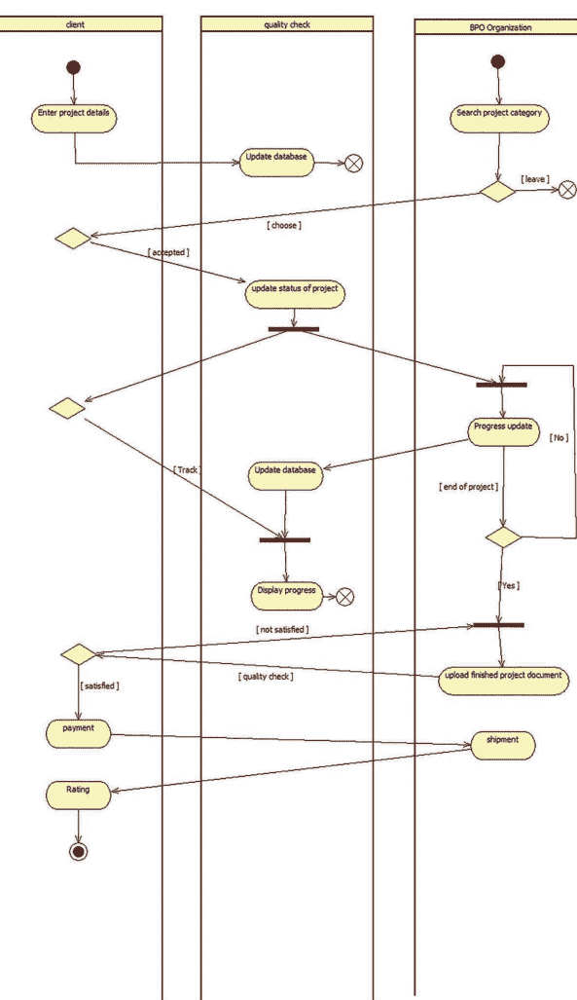

图 4.10 UML 活动图（部分 4）。

## 9. 按评分筛选

描述：这是搜索用户的子用例，用户可以按评分值过滤用户，范围在 0 到 5 星之间。

事件流

# BPO 管理系统 UML 图表 67

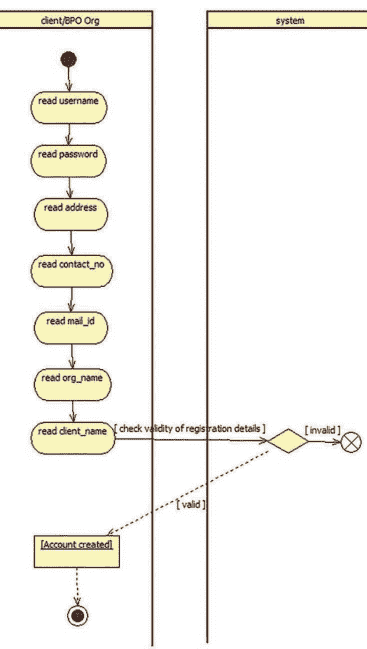

图 4.11 UML 活动图（部分 5）。

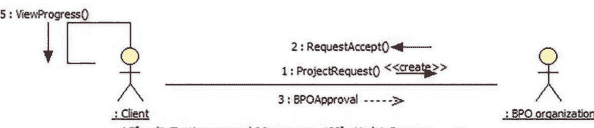

图 4.12 UML 协作图。

- 基础流程：用户应指定评分，该评分范围将与数据库进行比较以检索用户。
- 备用流程：用户可以按类别过滤，或查看无任何过滤的所有用户。
- 前置条件：用户应通过在系统中注册拥有已验证的个人资料以搜索其他资料。
- 后置条件：用户可以联系任何其他用户。

## 68 UML 绘图

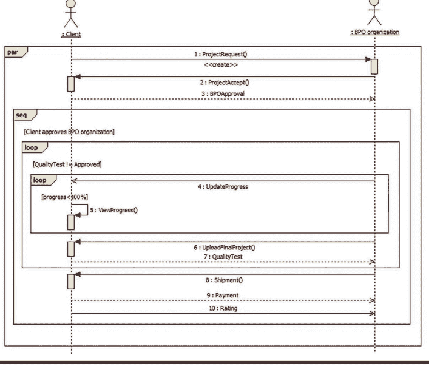

图 4.13 UML 时序图。

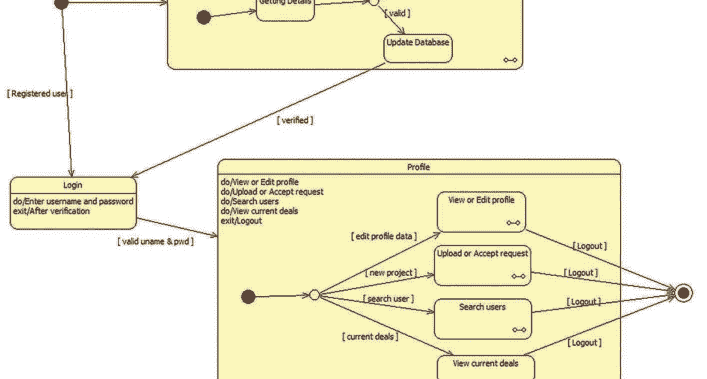

图 4.14 UML 状态机图（部分 1）。

# BPO 管理系统 UML 图表 69

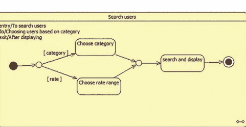

图 4.15 UML 状态机图（部分 2）。

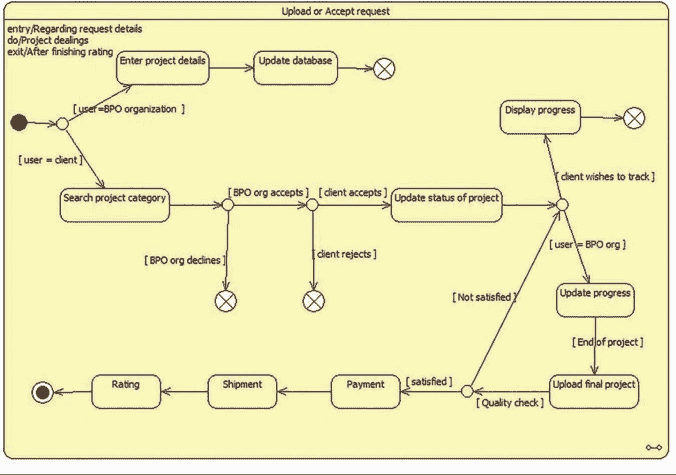

图 4.16 UML 状态机图（部分 3）。

## 10. 登录

描述：允许用户登录。

事件流

- 基础流程：用户登录系统。
- 备用流程：他们可以重置密码。
- 前置条件：用户应有一个账户。
- 后置条件：用户已登录。

## 11. 支付

描述：允许用户支付。

事件流

- 基础流程：用户选择支付方式并完成。
- 备用流程：用户可以稍后支付。
- 前置条件：用户应有一个待处理订单。
- 后置条件：状态已更新。

# 70 UML 绘图

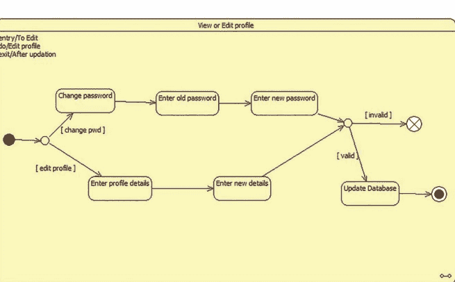

图 4.17 UML 状态机图（部分 4）。

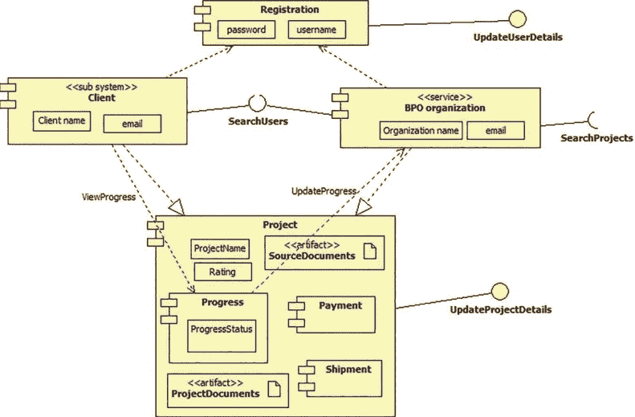

图 4.18 组件图。

## 12. 个人资料

描述：允许用户管理个人资料。

事件流

- 基础流程：用户查看个人资料。
- 备用流程：用户可以编辑个人资料。
- 前置条件：用户已登录。
- 后置条件：更改已保存到数据库。

## 13. 质量检查

描述：用户检查提供的服务。

事件流

- 基础流程：用户查看服务并标记为满意。
- 备用流程：用户可以报告问题。
- 前置条件：服务已交付。
- 后置条件：质量报告已记录。

## 14. 评分

描述：用户根据体验提供评分。

事件流

- 基础流程：用户选择星级并留下评论。
- 备用流程：用户可以跳过评分流程。
- 前置条件：服务已完成。
- 后置条件：评分已存储在数据库中。

# 72 UML 绘图

## 15. 注册

描述：用户可以在系统中创建账户。

事件流

- 基础流程：用户填写详情并验证电子邮件。
- 备用流程：用户可以使用社交媒体账号注册。
- 前置条件：用户不应已有账户。
- 后置条件：创建了新的用户账户。

## 16. 搜索用户

描述：用户根据特定标准搜索用户。

事件流

- 基础流程：用户输入搜索词并查看用户列表。
- 备用流程：用户可以按类别过滤搜索结果。
- 前置条件：用户已登录。
- 后置条件：显示搜索结果。

## 17. 发货

描述：BPO 组织向客户发货。

事件流

- 基础流程：BPO 组织发送物品并提供跟踪单号。
- 备用流程：发货可能会延迟或取消。
- 前置条件：支付已确认。
- 后置条件：发货状态更新为“已发货”。

## 18. 跟踪进度

描述：客户可以跟踪订单状态。

事件流

- 基础流程：客户查看待处理订单的当前状态。
- 备用流程：客户可以接收状态更改的通知。
- 前置条件：存在活跃订单。
- 后置条件：客户看到最新更新。

## 19. 上传请求

描述：这允许客户发布新的服务请求。

事件流

- 基础流程：客户填写请求表单并上传必要文档。
- 备用流程：客户可以保存草稿稍后提交。
- 前置条件：客户应已登录。
- 后置条件：请求已提交给 BPO 组织。

## 20. 上传最终产品

描述：它允许 BPO 组织上传其最终产品/服务，以便进行后续流程（质量检查、付款、发货）。

事件流程

基本流程：BPO 组织可以上传必要的文档。

备选流程：联系客户并延长上传最终产品的截止日期。

前提条件：BPO 组织和客户应对该请求达成一致。

后置条件：文档将存储在数据库中。


# 第 5 章

## 巴士电子票系统的 UML 图设计

## 5.1 问题描述

在该案例研究中，通过软件维护与开发中心 (SMDC) 旅行社制作了一个软件包，用于自动处理手动预订巴士票程序。具体而言，该案例研究的目标包括提供一个基于 Web 的巴士票预订功能，客户可以通过在线系统购买巴士票，而无需在柜台排队购买，使客户能够在线查看巴士的可用性和类型。客户可以通过系统查询每个印度游客中心 (ITC) 巴士的出发时间，通过向各个指定银行付款后获取银行码来简化巴士票付款、客户取消订单的能力，以及管理员用户在更新和取消付款、路线和车辆记录方面的权限（图 5.1–11）。

## 5.2 UML 图

76 UML 图绘制

图 5.1 UML 用例图。

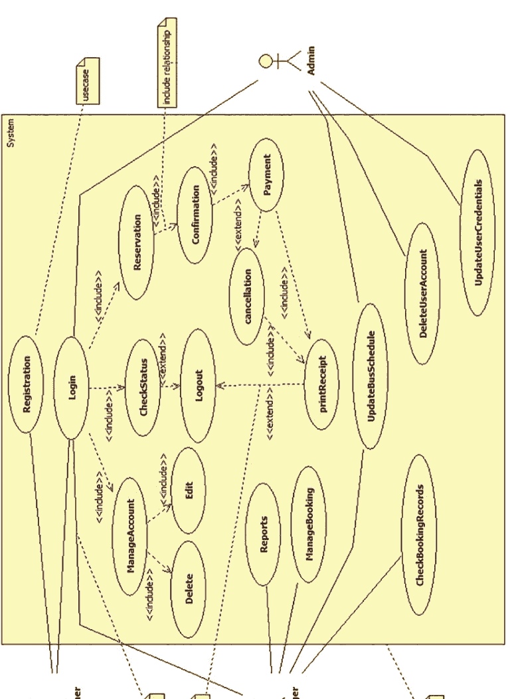

巴士电子票系统的 UML 图 77

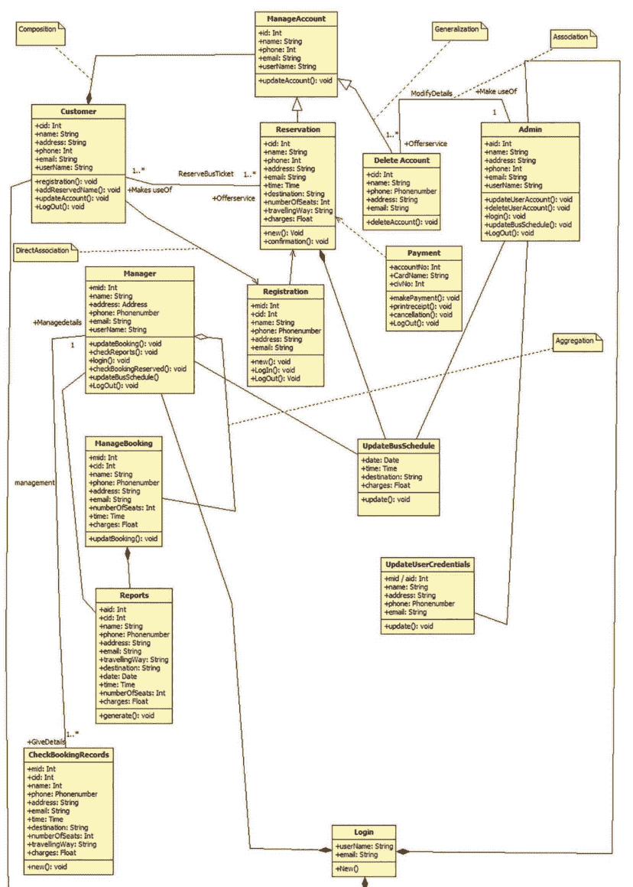

图 5.2 UML 类图。

78 UML 图绘制

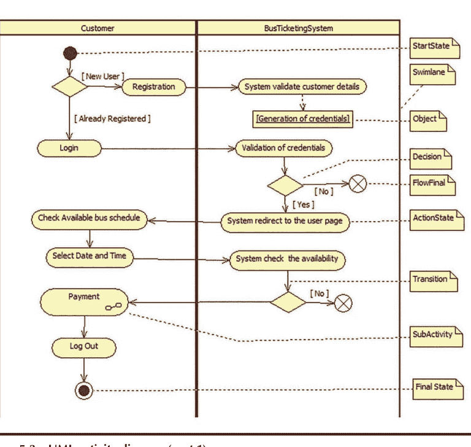

图 5.3 UML 活动图（部分 1）。

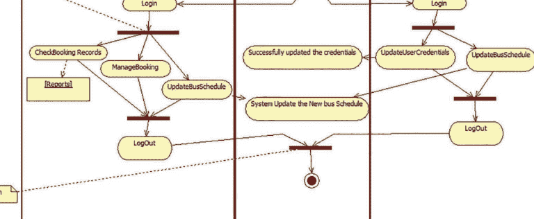

图 5.4 UML 活动图（部分 2）。

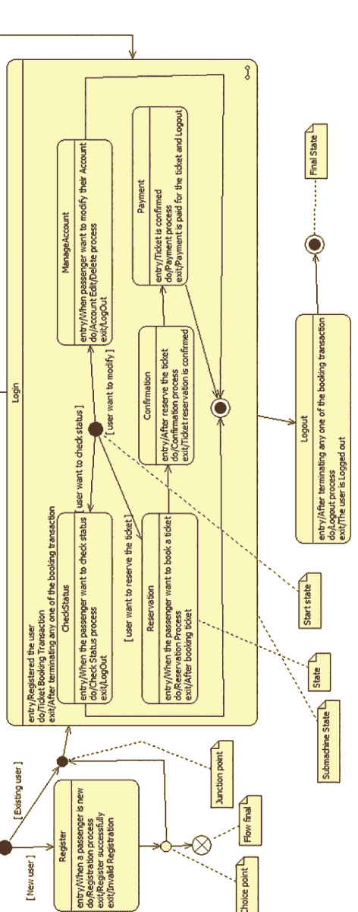

图 5.5 UML 状态机图。

80 UML 图绘制

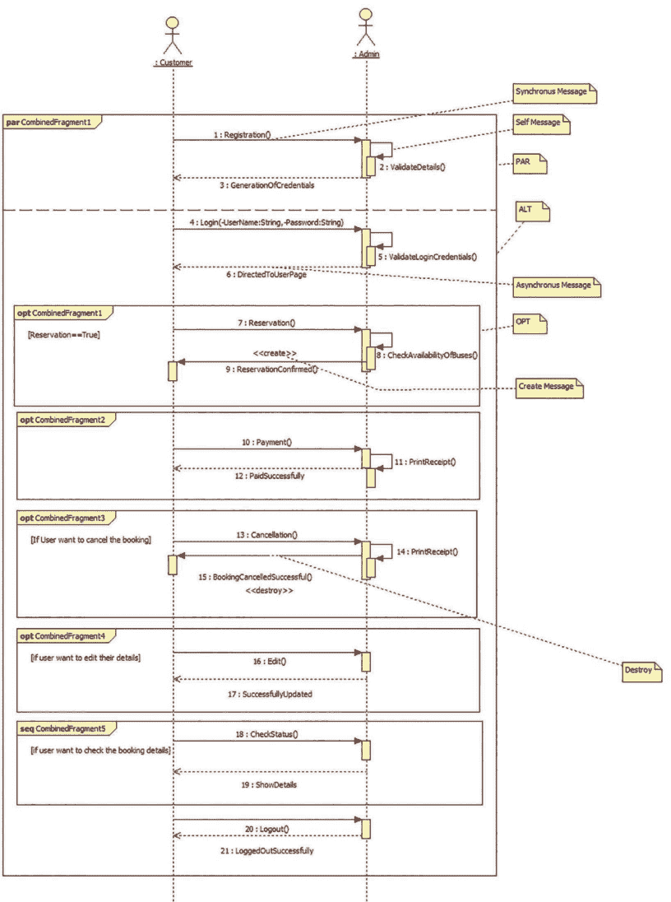

图 5.6 UML 序序图（部分 1）。

巴士电子票系统的 UML 图 ■ 81

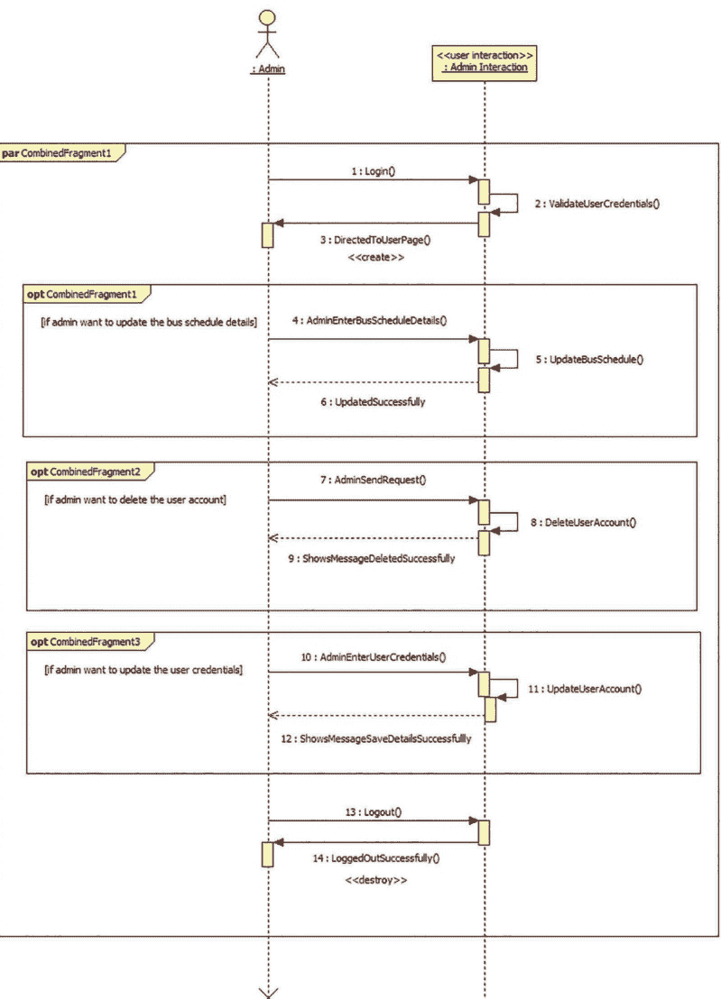


```mermaid
sequenceDiagram
    participant Admin
    participant <<user interaction>> as Admin Interaction

    par CombinedFragment1
        Admin->>AdminInteraction: 1: Login
        AdminInteraction-->>Admin: 2: ValidateUserCredentials()
        Admin->>AdminInteraction: 3: DirectedToUserPage()
        AdminInteraction-->>Admin: <<create>>

        opt CombinedFragment1
            Admin->>AdminInteraction: 4: AdminEnterBusScheduleDetails()
            AdminInteraction-->>Admin: 5: UpdateBusSchedule()
            AdminInteraction-->>Admin: 6: UpdatedSuccessfully
        end

        opt CombinedFragment2
            Admin->>AdminInteraction: 7: AdminSendRequest()
            AdminInteraction-->>Admin: 8: DeleteUserAccount()
            AdminInteraction-->>Admin: 9: ShowMessageDeletedSuccessfully
        end

        opt CombinedFragment3
            Admin->>AdminInteraction: 10: AdminEnterUserCredentials()
            AdminInteraction-->>Admin: 11: UpdateUserAccount()
            AdminInteraction-->>Admin: 12: ShowMessageSaveDetailsSuccessfully
        end

        Admin->>AdminInteraction: 13: Logout()
        AdminInteraction-->>Admin: 14: LoggedOutSuccessfully()
        AdminInteraction-->>Admin: <<destroy>>
```

图 5.7 UML 序序图（部分 2）。

82 UML 图绘制


图 5.8 UML 协作图（部分 1）。


图 5.9 UML 协作图（部分 2）。

图 5.11 UML 部署图。


# 第 6 章

## 天气监控系统的 UML 图设计

## 6.1 问题描述

该天气监控案例研究允许人们直接在线查看天气状态。功能包括天气状态、实时更新、警报、图形表示、未来预测和每周报告。

- **天气状态** – 通过此功能，使用传感器测量温度、湿度、降水量和露点。
- **实时更新** – 数据更新供用户查看。
- **警报** – 该功能提供针对某些天气状况的提示。
- **图形表示** – 基于变化绘制图表。
- **未来预测** – 该功能有助于预测未来几天的天气。
- **每周** – 显示每周的平均和最低温度。

最终目标是根据用户的位置提供详细的天气状况（图 6.1 和 6.2）。

## 6.2 数据流图

功能包括：

1. **天气状态** – 使用传感器测量温度、湿度、降水量和露点。
2. **实时更新** – 数据更新供用户查看。
3. **警报** – 该功能提供针对某些天气状况的提示。
4. **图形表示** – 基于变化绘制图表。
5. **未来预测** – 该功能有助于预测未来几天的天气。
6. **每周** – 显示每周的平均和最低温度。


图 6.1 DFD。

86 UML 图绘制


图 6.2 DFD。

最后，该案例研究旨在根据用户的位置提供详细的天气状况（图 6.3–10）。

巴士电子票系统的 UML 图 ■ 87

## 6.3 UML 图


图 6.3 用例图。


天气监控系统的 UML 图


巴士电子票系统的 UML 图 ■ 92


图 6.7 序序图。


图 6.8 协作图。


图 6.9 组件图。


# 98 UML 图建模


图 7.3 UML 序图。

# E-Province 99 的 UML 图设计


# e-Province 的 UML 图设计


图 7.6 UML 类图。


图 7.7 UML 组件图。


图 7.8 UML 部署图。

## 7.2 UML 图

用例规范

### 1. 注册流程

**描述**：此过程允许新用户在线在 e-Province 网站注册，并在用户通过验证后对账户进行验证。

**事件流**

**基本流**：在 e-Province 注册并创建唯一的 ID，数据存储在 e-Province 数据库中。

**前置条件**：用户应拥有注册所需的先决条件（例如选民 ID 和 Aadhaar 卡）。

**后置条件**：详情已上传到数据库，并为用户提供一个唯一的 ID。

### 2. 登录流程

**描述**：此过程允许授权用户使用其唯一 ID 登录网站。

**事件流**

**基本流**：使用验证过的唯一 ID 登录。

**备流**：如果数据库中不存在该 ID，则显示错误信息。

**前置条件**：用户应拥有唯一 ID。

**后置条件**：登录成功。

### 3. 证书注册流程

**描述**：此过程为用户请求所需的证书创建表单，当用户用有效的先决条件填写详情后，证书注册流程完成。

**事件流**

**基本流**：用户可以提供其请求的证书详情，数据存储在 e-Province 数据库中以供后续处理。

**备流**：如果提供的详情不正确，则会显示错误信息。

**前置条件**：用户应拥有表单要求填写的详情（例如 Aadhaar 卡、选民 ID）。

**后置条件**：表单已填写所需详情，且用户向颁发者申请证书。

### 4. 证书颁发流程

**描述**：此过程验证表单详情，并在获得批准后颁发证书。

**事件流**

**基本流**：机构验证用户提供的详情并颁发所需的证书。

**备流**：无。

**前置条件**：无。

**后置条件**：证书已颁发给用户。

### 5. 用户资料查看流程

**描述**：此过程允许用户在需要时查看其个人资料，当证书被批准时，也会进行更新。

**事件流**

**基本流**：用户可以随时查看其个人资料，如果收到证书，门户网站会通知他。

**备流**：无。

**前置条件**：用户已上传文档以更新资料。

**后置条件**：门户网站中显示完整的用户个人资料。


# 第 8 章

# DigiDocLocker 的 UML 图设计

## 8.1 问题描述

在单一位置物理地维护真实文档被认为是一项挑战性任务。因此，文档数字化使得所有物理文档能够集中存储，从而能够随时随地从任何地方进行检索。它还可以防止由任何此类物理证书带来的麻烦。这可以通过 DigiDocLocker 实现，它是一个用于数字格式颁发和验证文档及证书的平台，从而消除对物理文档的使用。DigiDocLocker 的目标是通过让公民能够从这些证书的原始颁发处以数字格式访问驾照、车辆登记和学术成绩单等真实文档/证书来受益。DigiDocLocker 具有以下功能：

- i. 注册模块允许用户注册，登录模块允许授权用户登录。
- ii. 上传模块允许用户以各种文件格式上传驾照、车辆登记、学术成绩单和其他相关文档。
- iii. 资料模块显示用户的完整个人资料。
- iv. 颁发模块向颁发者显示证书。
- v. 请求模块向请求者显示文档。
- vi. 验证模块允许对文档进行验证。

## 8.2 UML 图

# 106 图建模


图 8.1 UML 用例图。

用例规范

### 1. 注册流程

**描述**：此过程允许新用户在 DigiDocLocker 系统中注册，并在用户通过验证后对账户进行验证。

**事件流**

**基本流**：成功注册 DigiDocLocker。

**备流**：如果注册详情无效，则显示错误信息。

**前置条件**：用户应持有有效的身份证明文件。

**后置条件**：用户已注册并反映在系统中。

### 2. 登录流程

**描述**：此过程允许授权用户登录 DigiDocLocker 系统。

**事件流**

**基本流**：登录 DigiDocLocker。

**备流**：如果凭据无效，则显示错误信息。

**前置条件**：用户已注册。

**后置条件**：用户已成功登录系统。

# DigiDocLocker 的 UML 图设计 #107


图 8.2 类图。

### 3. 请求流程

**描述**：此过程使请求者能够在线请求真实文档/证书。

**事件流**

**基本流**：请求证书。

**备流**：请求另一个证书。

**前置条件**：用户已上传请求的证书。

**后置条件**：请求的证书已显示给请求者。

# 108 图建模


图 8.3 UML 序图。

# DigiDocLocker 的 UML 图设计 #109


图 8.4 UML 协作图。


图 8.5 UML 状态机图。

# 110 图建模


图 8.6 UML 类图。

### 4. 文档上传流程

**描述**：此过程允许用户在线以各种文件格式上传驾照、车辆登记、学术成绩单和其他相关文档等真实文档/证书。

**事件流**

**基本流**：成功上传文档并更新用户数据库。

**备流**：上传另一个真实文档/证书。

**前置条件**：用户应持有可接受格式的有效文档和证书。

**后置条件**：文档已上传到用户数据库。


图 8.8 UML 部署图。

### 5. 个人资料查看流程

**描述**：此流程允许用户查看数据库中提供的完整个人资料。

**事件流**

**基本流程**：显示用户的完整个人资料。

**备用流程**：如果用户资料中没有可用文档或为空，则显示错误消息。

**前置条件**：用户应预先上传文档。

**后置条件**：显示用户的完整个人资料。

### 6. 文档签流程

**描述**：此流程允许公民在线申请各种认证文件，这些文件将由发行机构（例如税务部门）提供。

**事件流**

**基本流程**：向相应的机构申请证书。

**备用流程**：申请另一份证书或无。

**前置条件**：用户必须持有必备文件（例如 Aadhaar 卡）以申请特定的证书。

**后置条件**：证书申请过程成功完成。


# 第 9 章

## 在线市场平台的 UML 图设计

## 9.1 问题描述

各种新的中小型规模卖家在接触客户以及与市场上的其他竞争产品共同销售方面面临着困难。这增加了他们的总成本，从而减少了利润甚至导致亏损。E-Retail 是一个在线市场应用案例研究，中小型卖家可以在无需实体店的情况下直接向客户列出、展示、广告和销售他们的产品。E-Retail 的目标是为所有中小型卖家提供一个动态平台，使其能够以竞争性的价格直接向所有范围的客户销售其产品，而不需要任何实体店。这使得卖家能够消除实体店的租金或维护成本，并尽可能地减少其他相关成本。它旨在促进卖家与客户之间的直接沟通，从而在他们之间建立信任关系。新卖家可以轻松验证并注册门户，并在门户中销售他们的产品。该应用程序为卖家和客户提供了单独的登录，卖家和客户可以查看来自各种卖家的所有产品并购买这些产品。它还为购买产品提供了在线支付便利。客户可以对产品和卖家进行评分或评价。如果交付过程中出现任何违规行为或产品不符合指定要求，客户也可以举报卖家。客户在购买产品之前还可以查看卖家的联系信息和评分（图 9.1–9）。


**图 9.1** UML 用例图。

## 9.2 UML 图

参与者规范

1. **管理员 (Admin)** – 管理员验证登录系统的新客户，并验证注册到系统的新卖家。管理员还验证客户针对卖家发布的报告。
2. **客户 (Customers)** – 客户是登录系统的用户，用于查看和购买应用程序中卖家销售的产品。
3. **支付服务提供商 (Payment Service Provider)** – 支付服务提供商充当商家、卡组织网络和其他金融机构之间的调解，处理应用程序中的电子交易。
4. **卖家 (Sellers)** – 卖家是中小型企业，可以使用应用程序直接向潜在客户销售产品。

用例规范

### 1. 客户登录

**描述**：每个客户都必须使用应用程序的用户名和密码登录系统。

**事件流**

**基本流程**：验证用户并授予系统访问权限。

**备用流程**：用户名和密码无效，尝试正确的用户名和密码。

**前置条件**：有效的用户名和密码。

**后置条件**：无。


图 9.2 UML 活动图（部分1）。

### 3. 卖家验证

- **描述**：卖家在销售之前必须经过验证。
- **事件流**
- **基本流程**：卖家通过验证并可以销售产品。
- **备用流程**：卖家验证失败，无法销售产品。
- **前置条件**：卖家已注册。
- **后置条件**：无。


图 9.3 付活动图。

### 4. 销售产品

**描述**：经过验证的卖家可以展示待售的产品。

**事件流**

**基本流程**：卖家列出带有描述和价格的产品。

**备用流程**：卖家无法销售产品。

**前置条件**：卖家在列出产品之前经过验证。

**后置条件**：无。

### 5. 推广产品

**描述**：卖家可以推广其待售的产品。

**事件流**

**基本流程**：卖家推广其待售的产品。

**备用流程**：卖家无法销售产品。

**前置条件**：卖家在列出产品之前经过验证。

**后置条件**：无。

### 6. 查看产品

**描述**：客户可以查看来自各种卖家的可用产品。

**事件流**

**基本流程**：客户查看产品。

**备用流程**：产品不可用。

**前置条件**：客户已登录。

**后置条件**：客户可以选择购买的产品。


图 9.4 时序图。


图 9.5 协作图。


图 9.6 状态机图。


图 9.7 UML 类图。

# UML 图图


图 9.8 UML 组件图。

### 7. 搜索产品

**描述**：客户可以使用关键词搜索产品。

**事件流**

- **基础流程**：显示与搜索关键词相关的可用产品列表。
- **备用流程**：关键词无可用产品。
- **前置条件**：客户必须登录。
- **后置条件**：可以选择搜索到的产品进行查看和购买。


## 8. 购买产品

描述：客户可以购买可用的产品。

事件流

- 基础流程：结账并购买产品。
- 备用流程：产品无售卖。
- 前置条件：客户必须登录。
- 后置条件：要求客户付款以购买产品。

## 9. 支付

描述：客户在结账后会被要求选择支付方式。

事件流

- 基础流程：如果是数字支付，将为客户所选的支付选项提供相应的支付网关。如果是货到付款，将要求客户提供送货地址。
- 备用流程：所选支付选项不可用。
- 前置条件：客户必须选择购买产品。
- 后置条件：更新产品购买并将订单详情发送给客户。

# 在线市场的 UML 图


图 9.9 UML 部署图。

## 10. 信用卡/借记卡

描述：可以使用信用卡/借记卡购买产品。

事件流

- 基础流程：信用卡/借记卡支付成功。
- 备用流程：信用卡/借记卡支付失败。
- 前置条件：客户必须选择通过信用卡/借记卡支付。
- 后置条件：更新支付详情。

## 11. 网银

描述：可以使用网银购买产品。

事件流

- 基础流程：网银支付成功。
- 备用流程：网银支付失败。
- 前置条件：客户必须选择通过网银支付。
- 后置条件：更新支付详情。

## 12. 货到付款

描述：客户可以在送货时付款。

事件流

- 基础流程：选择送货地址并继续。
- 备用流程：不支持货到付款。
- 前置条件：客户必须有送货地址并选择货到付款选项。
- 后置条件：在送货付款后更新支付详情。

## 13. 评分与评论

描述：客户可以对购买的产品分享评价和评分。

事件流

- 基础流程：客户对产品进行评分和评价。
- 备用流程：客户跳过对产品的评分和评价。
- 前置条件：客户必须已购买产品。
- 后置条件：更新产品的评分和评价。

## 14. 聊天

描述：客户可以与卖家聊天以咨询产品。

事件流

- 基础流程：客户向卖家发送消息，卖家回复消息。
- 备用流程：无。
- 前置条件：客户必须登录且卖家必须是经过验证的卖家。
- 后置条件：无。

## 15. 举报卖家

描述：如果销售的产品不符合要求，客户可以举报卖家。

事件流

- 基础流程：客户带描述举报卖家。
- 备用流程：无。
- 前置条件：客户必须从被举报的卖家处购买过产品。
- 后置条件：报告将发送给相应的卖家进行解释。针对特定卖家的频繁举报可能会将其从平台移除。

# 第 10 章

# 产品推荐系统的 UML 图设计

## 10.1 问题描述

本案例研究侧重于使用网络爬虫进行跨网站的产品比较，以减少寻找和比较产品所需的时间和精力。旨在帮助并让购物爱好者能够轻松地购买产品（图 10.1–10.8）。

## 10.2 UML 图

用例规范

### 1. 注册

描述：允许用户注册/登录以使用系统。

事件流

- 基础流程：进入系统。
- 备用流程：重试登录。
- 前置条件：无。
- 后置条件：进入搜索产品页面。

### 2. 搜索产品

描述：允许用户搜索他们选择的产品，如药品、衣服和机械设备。

事件流

- 基础流程：显示产品的搜索结果。
- 备用流程：无。
- 前置条件：用户必须已登录。
- 后置条件：无。

124 UML 图


图 10.1 UML 用例图。


图 10.2 UML 活动图。

### 3. 搜索筛选

描述：这允许用户指定搜索产品的网站。例如：在亚马逊上搜索。

事件流

- 主流程：显示更多符合预期且用户特定的搜索结果。

# 产品推荐系统 ■ 125


图 10.3 UML 协作图。

- 备用流程：无。
- 前置条件：搜索产品。
- 后置条件：无。

### 4. 产品筛选

描述：根据用户的选择（如评分、评论和购买次数）过滤产品结果。

事件流

- 基础流程：显示更多符合预期且用户特定的搜索结果。
- 备用流程：无。
- 前置条件：搜索产品。
- 后置条件：无。

### 5. 获取产品

描述：将用户重定向到用户选择的产品网站。然后，用户可以购买产品。

事件流

- 基础流程：允许用户购买产品。
- 备用流程：无。
- 前置条件：搜索产品。
- 后置条件：无。

126 ■ UML


图 10.4 UML 时序图。

## 10.5 状态图


## 10.6 类图


128 ■ UML


图 10.7 组件图。


图 10.8 UML 部署图。

# 第 11 章

# 律师日志的 UML 图设计

## 11.1 问题描述

在像印度这样人口众多的国家，法律执行的需求。律师在维护大部分数据方面起着重要作用。该项目主要旨在让律师的工作变得简单高效。这是一个响应式应用程序，将为律师提供各种服务（图 11.1–18）。

## 11.2 UML 图

用例规范

### 1. 注册

描述：允许新律师创建账户。

事件流

- 基础流程：用户输入正确的凭据。
- 备用流程：输入了不正确的凭据。
- 前置条件：无。
- 后置条件：输入的数据保存到数据库。允许用户登录。

### 2. 登录

描述：允许有效用户登录页面。

事件流

- 基础流程：输入用户 ID 和密码。

130 UML 图


图 11.1 UML 用例图。

- 备用流程：无效 ID 或密码导致登录失败。
- 前置条件：用户应该已经注册。
- 后置条件：无。

### 3. 查看案件详情和日志

描述：结合日历显示现有和已完成案件详情。

事件流

- 基础流程：允许用户查看和编辑详情。
- 备用流程：无。
- 前置条件：无。
- 后置条件：如果编辑过，提醒将实现在日历中。

### 4. 添加案件

描述：允许用户添加新案件。

事件流

- 基础流程：用户可以添加新案件的详情。
- 备用流程：用户可能未添加详情。
- 前置条件：无。
- 后置条件：无。

### 5. 更新详情

描述：允许用户输入案件的具体详情。

事件流

- 基础流程：用户输入正确的详情。
- 备用流程：用户可能输入错误的详情。
- 前置条件：用户必须拥有案件详情。
- 后置条件：详情反映在视图表中。

# 律师日记 UML 图表设计 ■ 131


图 11.2 UML 活动图。

### 6. 刑事案件

描述：指定该案件是否为刑事案件。

事件流

- 基本流程：如果是刑事案件，用户将选择该项。
- 分支流程：如果不是刑事案件，用户将不选择该项。
- 前置条件：无。
- 后置条件：信息将反映在视图表中。

### 7. 民事案件

描述：指定该案件是否为民事案件。

事件流

- 基本流程：如果是民事案件，用户将选择该项。
- 分支流程：如果不是民事案件，用户将不选择该项。

# 132 UML 绘图


图 11.3 UML 序图。

# 律师日记 UML 图表设计 ■ 133


图 11.4 UML 协作图。

- 前置条件：无。
- 后置条件：信息将反映在视图表中。

### 8. 更新日志

描述：使用提供的数据更新视图表。

事件流

- 基本流程：提供的数据被添加到视图表中。
- 分支流程：无。
- 前置条件：应由用户输入详情。
- 后置条件：无。

### 9. 设置提醒

描述：允许用户为案件添加日期和时间详情。

事件流

- 基本流程：用户输入日期，系统将保留时间。
- 分支流程：用户可能不输入日期和时间。
- 前置条件：用户应该已输入案件详情。
- 后置条件：提醒将反映在视图和日历表中。

# 134 UML 绘图


图 11.5 UML 状态图。

### 10. 更新日历

描述：此功能通过提醒事项更新日历。

事件流

- 基本流程：使用提醒事项更新日历。

# 律师日记 UML 图表设计 ■ 135


图 11.6 UML 类图。


图 11.7 UML 组件图。

- 分支流程：无。
- 前置条件：用户应该已设置提醒。
- 后置条件：无。

### 11. 上传文档

描述：用户可以上传与案件相关的文档。

事件流

- 基本流程：用户上传文档。
- 分支流程：用户可能不上传文档。
- 前置条件：必须输入案件详情。
- 后置条件：文档保存在驱动器中。

# 136 ■ UML 绘图


图 11.8 UML 部署图。

### 12. 在线提交

描述：用于在线提交案件或任何其他在线法律备案。

事件流

- 基本流程：显示各种类型的在线法律服务。
- 分支流程：无。
- 前置条件：无。
- 后置条件：无。

### 13. 显示链接

描述：显示指向各种在线提交的链接。

事件流

- 基本流程：根据所需的服务类型显示链接。
- 分支流程：无。
- 前置条件：用户应该选择一种类型。
- 后置条件：跳转到相应的页面。

### 14. 重定向到相应页面

描述：重定向到所选的链接。

事件流

- 基本流程：显示为在线提交所选的链接页面。
- 分支流程：无。
- 前置条件：应该点击一个链接。
- 后置条件：无。

### 15. 下载模型表格

描述：允许用户下载表格。

事件流

- 基本流程：显示不同类型的案件。
- 分支流程：无。
- 前置条件：无。
- 后置条件：无。

# 律师日记 UML 图表设计 ■ 137

### 16. 显示表格

描述：在所选类别下显示各种表格。

事件流

- 基本流程：用户可以选择任何表格进行下载。
- 分支流程：无。
- 前置条件：必须选择一个类别。
- 后置条件：无。

### 17. 下载

描述：允许用户下载表格。

事件流

- 基本流程：显示查看和下载表格的选项。
- 分支流程：无。
- 前置条件：必须选择要下载的表格。
- 后置条件：下载的文档将就绪。

### 18. 参考

描述：显示参考信息。

事件流

- 基本流程：显示参考书籍。
- 分支流程：无。
- 前置条件：用户应该选择类型。
- 后置条件：无。

### 19. 快速参考

描述：显示关于常见案件的信息。

事件流

- 基本流程：显示常见案件。
- 分支流程：无。
- 前置条件：无。
- 后置条件：无。

### 20. 书籍

描述：通过书籍帮助获取信息。

事件流

- 基本流程：显示书籍标题。
- 分支流程：无。
- 前置条件：无。
- 后置条件：无。

### 21. 反馈

描述：允许用户添加反馈。

事件流

- 基本流程：用户可以添加反馈。
- 分支流程：无。
- 前置条件：无。
- 后置条件：无。

### 22. 添加反馈

描述：允许用户输入并发送反馈。

事件流

- 基本流程：用户发送反馈。
- 分支流程：无。
- 前置条件：无。
- 后置条件：任何问题将由开发者修复。

### 23. 查看博客和更新

描述：允许用户查看博客和更新。

事件流

- 基本流程：注册和未注册的用户都可以查看法律活动的博客和更新。
- 分支流程：无。
- 前置条件：无。
- 后置条件：无。

# 第 12 章

# 律师日记的 UML 图设计

## 12.1 问题描述

本案例研究有助于那些在忙碌的日常生活中忘记手机的人。快节奏生活中，追踪必需品变得非常有挑战性。人们有时会将手机忘在家里。我们需要打一个重要的电话却不记得号码怎么办？手机处于静音模式时是最可怕的。当手机不在身边时，我们有时想锁定手机。这时就需要“律师日记”用场了。如果你在手机上预装了“律师日记”应用程序并完成了设置，上述所有问题都可以轻松快速地解决。你只需要从任何可以使用的手机发送短信……问题就解决了。该系统的范围在全球范围内日益扩大，那里的一切都像F1赛车一样快。该系统的目标是通过先进技术为面临这些问题的人提供即时帮助。该系统的吸引人功能是不联网远程访问。无需验证码和密码，短信即可帮助你在没有网络的情况下更改手机设置（从静音切换为正常）。该系统用户友好，该应用程序适用于基础智能手机（图 12.1-12.8）。

# 140 UML 绘图


图 12.1 UML 用例图。


图 12.2 UML 活动图。

## 12.2 UML 图表

# 用例规范

### 1. 登录

描述：此用例允许用户开始使用系统。

事件流

- 基本流程：输入有效详情以开始系统。
- 分支流程：如果输入无效详情，用户将被重定向以正确填写。
- 前置条件：无。
- 后置条件：用户成功注册，用户数据被存储到数据库。

## 142 UML 图绘制


图 12.4 UML 协作图。


图 12.5 UML 状态机图。

### 2. 设置密码

描述：允许用户设置一个强密码以供日后使用。

事件流

- 基本流程：设置强密码（例如：使用数字、特殊字符、小写和大写字母）。

## My Helper 的 UML 图设计


图 12.6 UML 类图。


图 12.7 UML 组件图。

## 144 UML 图绘制


图 12.8 UML 部署图。

- 备选流程：如果密码太弱，用户将被重定向输入强密码。
- 前提条件：用户在设置密码之前必须输入电子邮件地址、电话号码和用户名。

### 3. 发送短信

描述：此用例允许用户从任何其他手机向其手机号码发送短信。

事件流

- 基本流程：成功发送短信。
- 备选流程：如果由于任何问题短信发送失败，用户应重新发送短信。
- 前置条件：用户必须在手机上完成“MY HELPER”系统的配置。
- 后置条件：短信已成功发送。

### 4. 读取短信

描述：此用例关于“My Helper”应用程序读取发送到手机的短信。

事件流

- 基本流程：系统读取短信，检查用户设置的密码。
- 备选流程：如果短信中的密码与用户设置的密码不匹配，My Helper 将返回一条显示详情无效的短信。
- 前提条件：短信已收到，且用户已授予“My Helper”读取消息的权限。
- 后置条件：短信已成功读取，“My Helper”现在开始检查需求详情。

### 5. 检查需求

描述：检查需求是否有效。

事件流

- 基本流程：如果是有效需求，“My Helper”现在开始处理该需求。
- 备选选择流程：如果需求无效，My Helper 将返回一条显示详情无效的短信。
- 前提条件：短信已收到并成功读取。
- 后置条件：需求履行过程开始。

## My Helper 的 UML 图设计 ■ 145

### 6. 错误

描述：如果短信发送失败，将导致一个错误。

事件流

- 基本流程：发送过程中出错。
- 备选流程：发送另一条短信或无。
- 前提条件：无。
- 后置条件：再次发送短信（或）不发送短信。

### 7. 履行需求

描述：执行操作并满足用户需求。

事件流

- 基本流程：扫描需求后，开始处理该需求。
- 备选流程：需求处理失败，请求另一个需求。
- 前提条件：需求应已读取且有效。
- 后置条件：获取需求后，将请求的详情发送给用户。

### 8. 需求错误

描述：如果“My helper”无法满足该需求，将导致一个错误。

事件流

- 基本流程：需求已读取，并导致了错误。
- 备选流程：请求另一个需求，或如果需求有效则满足该需求。
- 前提条件：无。
- 后置条件：发送另一个需求或无。

### 9. 发送请求的详情

描述：获取用户需求并以短信的形式发送给用户。

事件流

- 基本流程：需求详情已完全获取并发送给用户。
- 备选流程：请求的详情获取失败或无。
- 前提条件：应已获取需求详情。
- 后置条件：无。

### 10. 验证密码

描述：验证短信中发送的密码是否与用户设置的密码匹配。

事件流

- 基本流程：验证密码。
- 备选流程：密码错误。
- 前提条件：应收到短信。
- 后置条件：密码已成功验证。


# 第 13 章

# COVID-19 管理系统的 UML 图设计

## 13.1 问题描述


COVID-19 管理系统通过数字化简化了减少社区病毒载量的整个过程。它包括跟踪和治疗 COVID-19 患者以及监控病毒的传播。其旨在协助医疗机构和政府评估风险状况，并通过将他们接入虚拟护理能力为普通民众提供意识。根据当前的 COVID-19 流行病情况，COVID-19 管理系统通过数字化简化了减少社区病毒载量的整个过程。它包括跟踪和治疗 COVID-19 患者以及监控病毒的传播。其旨在协助医疗机构和政府评估风险状况，通过将他们接入虚拟护理能力为普通民众提供意识。

### 13.2 UML 图

- 1. 监控血氧饱和度、血压、症状等

描述：监控注册患者的血氧饱和度、血压、温度和用药情况。

- 2. 医疗专业人员（医生/护士）

可以监控血氧饱和度、血压、温度和用药情况。

- 3. 普通民众

检查症状和无症状死亡人数。

- 4. COVID-19 必需品

可以储备口罩和手套。

- 5. 机构

定期更新感染状态。

- 6. 管理员

更新当前感染人数。


图 13.1 用例图。


### 13.3 用例规范

## 2. 从筛选查看患者信息

描述：允许专业人员查看从筛选到出院的所有患者记录。

事件流

基本流程：必须输入日期和时间以查看该期间的患者记录。

备选流程：无。

前提条件：所有患者必须注册，并且必须真实输入个人详情和健康状况。

后置条件：根据需要，医疗专业人员可以开药。


图 13.4 UML 序列图。


图 13.5 UML 协作图。


图 13.6 UML 状态机图。

## 152 UML 图绘制


图 13.7 类图。


图 13.8 组件图。

## COVID-19 管理系统的 UML 图设计 ■ 153


图 13.9 UML 部署图。

### 3. 开药

描述：允许医生为特定患者开处药物。

事件流

基本流程：为患者输入合适的药物和剂量。

备选流程：无。

前提条件：医生必须已查看患者的健康状况。

后置条件：无。

### 4. 居家隔离患者更新数据

描述：允许居家隔离患者更新他们的健康状况。

事件流

基本流程：输入温度、血氧饱和度和其他症状。

备选流程：无。

前提条件：患者必须通过真实凭证注册。

后置条件：无。

### 5. 查看医生共享的数据

描述：允许患者查看医生的处方和其他备注。

事件流

基本流程：收到通知后查看医生共享的数据。

备选流程：无。

前提条件：无。

后置条件：无。

# UML 图图

+ 6. 购买药品

描述：允许患者查看其所在当地的药店列表。

事件流

基本流程：根据患者所在的位置显示其药店列表。

备选流：无。

前置条件：所有可用的药店必须已列出或由 COVID 必需品商店进行更新。

后置条件：无。

+ 7. 阅读康复患者的博客

描述：允许用户阅读康复患者的博客。

事件流

基本流程：查看多位康复患者上传的所有博客。

备选流：无。

前置条件：无。

后置条件：无。

+ 8. 查看区域死亡人数

描述：允许用户查看某地区的死亡人数。

事件流

基本流程：显示某地区的总死亡人数。

备选流：无。

前置条件：无。

后置条件：无。

+ 9. 查看区域感染人数

描述：允许用户查看其所在地区感染的确切人数。

事件流

基本流程：显示特定地区感染的确切人数。

备选流：无。

前置条件：无。

后置条件：无。

+ 10. 列出区域所有药店

描述：允许 COVID 必需品管理人员列出该区域的所有药店。

事件流

基本流程：输入并列出区域内所有可用的药店。

备选流：无。

前置条件：COVID 必需品管理人员应注册。

后置条件：供想要买药的患者查看。

+ 11. 更新清洁状态

描述：允许修正人员在特定区域完成消毒后更新清洁状态。

事件流

基本流程：更新清洁状态，如：已清洁/未清洁/进行中。

备选流：无。

前置条件：正在检查该区域的感染人数。

后置条件：分配工作人员对特定区域进行消毒。

+ 12. 分配人员进行区域消毒

描述：根据区域的感染率分配工作人员。

事件流

基本流程：在分配人员后，由公司负责人将状态更改为“已分配人员”。

备选流：无。

前置条件：负责人必须定期查看区域内的感染人数。

后置条件：更新清洁状态。

+ 注册

描述：除普通公众外的所有用户都必须注册，以确保其在 COVID-19 管理系统的访问控制和对不同功能的使用。

事件流

基本流程：提交前必须正确填写所有详细信息。

备选流：凭据无效导致注册失败。

前置条件：无。

后置条件：执行身份验证以确保访问控制列表的正常运行。

+ 用户身份验证

描述：检查用户在该系统中的访问控制权限。

事件流

基本流程：检查用户配置并分别赋予不同的功能。

备选流：若身份验证失败，用户将无法使用该系统。

前置条件：注册。

后置条件：无。

+ 更新当前感染人数

描述：允许管理员频繁更新某地感染的确切人数。

事件流

基本流程：输入感染人数及其所在地。

备选流：无。

前置条件：管理员必须注册以获得更新感染人数的行政权限。

后置条件：无。

+ 储备口罩和手套

描述：允许 COVID 必需品管理人员显示其口罩、手套、洗手消毒液和其他消毒剂等必需品的更新库存。

事件流

基本流程：更新/增加必需品的库存。

备选流：无。

前置条件：查看口罩需求。

后置条件：无。

+ 查看口罩需求

描述：允许 COVID 必需品管理人员查看其所在地区的口罩需求。

事件流

基本流程：根据该地区的感染人数查看口罩需求。

备选流：无。

前置条件：无。

后置条件：储备必需品。

## 160 UML 图图


图 14.3 UML 序图。

## 汽车保养的 UML 图图设计


图 14.4 UML 协作图。


图 14.5 UML 状态机图。

### 事件流

基本流程：用户了解汽车部件的状态。

替代流程：无。

前置条件：需要注册和登录。

后置条件：无。

### 5. 输入并修改汽车部件信息

描述：服务中心员工在每次服务后修改汽车部件信息。

### 事件流

基本流程：服务中心员工在每次服务后更新车辆信息系统中的信息，这对于后续服务很有帮助。

## 162 UML 图图


图 4.6 UML 类图。


图 4.7 UML 组件图。无。

替代流程：

前置条件：需要服务中心进行注册和登录。

后置条件：服务中心员工更新的信息将用于即将到来的服务的过期通知。

## 6. 车辆部件过期通知

描述：过期通知将发送给车主和服务中心，以便对进行保养。

## 汽车保养的 UML 图图设计 163


图 14.8 UML 部署图。

### 事件流

基本流程：一旦收到过期通知，服务中心员工将联系车主并请求保养。

替代流程：无。

前置条件：车辆信息系统中应存在车辆信息。

后置条件：服务中心员工联系车主并请求保养。

## 7. 服务接受

描述：车主可能接受也可能不接受来自服务中心的服务请求。

### 事件流

基本流程：如果车主接受服务，则执行后续的保养步骤。

替代流程：车主拒绝服务请求。

前置条件：需要来自服务中心的服务请求。

后置条件：无。

# UML 图图

## 8. 所有损坏部件的服务成本估算

描述：一旦车主接受服务请求，将对所有损坏的部件进行服务成本估算。

### 事件流

基本流程：一旦接受服务请求，服务中心员工检查汽车和受损部件列表并在 App 中更新。

替代流程：无。

前置条件：服务接受。

后置条件：部件选择和服务确认。

## 9. 部件选择和服务确认

描述：一旦服务人员更新了 App 中的受损部件列表，车主就可以选择所需的服务的部件。

### 事件流

基本流程：车主选择所需的服务的部件并确认服务。

替代流程：也可以取消服务。

前置条件：员工必须在 App 中更新选择列表。

后置条件：更改的部件列表必须在车辆信息系统中更新。

## 10. 更新部件信息

描述：一旦服务人员更新了 App 中的受损部件列表，车主就可以选择所需的服务的部件。

### 事件流

基本流程：员工在更换部件后更新车辆信息系统。

替代流程：无。

前置条件：服务接受。

后置条件：服务进行。

## 11. 在线支付

描述：向车主和服务中心发送过期通知，以便对汽车进行保养。

### 事件流

基本流程：服务中心员工进行在线支付。

替代流程：无。

后置条件：所有服务流程已完成。

## 12. 网上银行

描述：服务提供者提供网上银行功能。

### 事件流

基本流程：车主可以使用网上银行进行支付。

替代流程：车主可以选择其他方法。

前置条件：所有服务流程已完成。

后置条件：向管理员报告。

## 13. UPI

描述：服务提供者提供 UPI（统一支付接口）功能。

### 事件流

基本流程：车主可以使用 UPI 进行支付。

替代流程：车主可以选择其他支付方法。

前置条件：所有服务流程已完成。

后置条件：向管理员报告。

## 14. 报告

描述：服务中心员工向管理员报告服务。

### 事件流

基本流程：车主向管理员报告，以便采取必要的行动。

替代流程：车主也可以提供积极反馈。

前置条件：所有服务和支付流程已完成。

后置条件：无。


## 第15 章

## 网上商店的 UML 图图设计

## 15.1 问题描述

公共配销系统（PDS）是一项粮食安全系统。它由印度消费者事务、食品和公共配销部建立并与州政府共同管理。传统的 PDS 用于向有效的粮票持有者分发食品。粮票的有效性和分配由州政府监控。根据 PDS 的标准，粮票持有者应获得 35kg 粮食。然而，配送流程的效率存在担忧。为了提高效率并改进目前的 PDS 系统，我们正在实施网上商店。在这里，我们将创建一个购物网站。粮票持有者可以通过该网站在线订购食品。使用该网站的主要目的是使该过程流程化，消除目前基于粮票发放产品的缺点。PDS 的主要缺点因其偏见未能有效服务贫困群体而受到批评。此外，许多店主在公开市场上出售大量粮食。许多 PDS 经销商由于获取而采取违规行为，通过此项目正在解决这个问题。大多数情况下，用户无法获得权利。为了避免这些缺点，建议案例的各种意义在于：每个商店的地理位置将标记在地图上、关于店主和地区的所有信息、营业时间、分类库存、零售商可以添加、编辑、删除和更新商店的其他商品、零售商可以宣传自己的商店、定期通知库存情况、产品交付功能、用户投诉表、通过 PayTM、COD 等便捷支付系统、针对政府和店主的管理员功能，以及通过 Aadhaar 号和一次性密码（OTP）的身份验证系统（图 15.1–15.8）。

## 15.2 UML 图图


图 15.1 UML 用例图。

# 用例规范

### 1. 邮件通知

描述：商店的营业时间和其他详细信息将通过邮件发送给客户。

### 事件流

基本流程：发送邮件。

替代流程：无。

前置条件：应从数据库检索用户的电子邮件地址。

后置条件：用户可以从我们作为附件发送的链接进行购买。

# 电子配给店的 UML 图设计 ■ 169


图 15.2 UML 活动图。

## 2. 通过 Aadhaar 和 OTP 验证

描述：基于一次性密码的身份验证：具有有限时间有效的 OTP 会被发送至在机构注册的 Aadhaar 号持有者的手机号码和/或电子邮件地址，或通过其他适当手段生成。Aadhaar 号持有者在身份验证时应提供此 OTP 及其 Aadhaar 号，并将其与机构生成的 OTP 进行匹配。

事件流

基本流程：访问网站，通过手机请求 OTP。

备选流程：不请求 OTP 可以直接退出，或者用户可以打开网站、通过手机请求 OTP、OTP 无、退出。


图 15.3 UML 序图。

# 电子配给店的 UML 图设计 ■ 171


图 15.4 UML 协作图。


图 15.5 UML 状态机图。

置条件：机构应向客户注册的手机号生成 OTP。

后条件：如果 OTP 与机构生成的 OTP 匹配，则可以查看商品。

# 172 ■ UML 图绘制


图 15.6 UML 类图。


图 15.7 UML 组件图。

# 电子配给店的 UML 图设计 ■ 173


图 15.8 UML 部署图。

### 3. 根据类别查看商品

描述：客户可以根据类别查看商品详情。

事件流

基本流程：访问网站，通过 Aadhaar 和 OTP 验证，查看商品详情。

备选流程：无。

置条件：查看商品详情。

后条件：如果需要，可以进行购买。

### 4. 购买商品

描述：客户可以选择所需的商品并进行购买。

事件流

基本流程：访问网站，通过 Aadhaar 和 OTP 验证，选择商品。

备选流程：用户可以打开网站、通过 Aadhaar 和 OTP 验证、查看商品详情、退出。

置条件：在根据类别显示的列表中选择产品。

后条件：客户可以通过两种方式进行购买。

### 5. 货到付款 (COD)


# 描述

客户应通过现金方式支付。

## 事件流

**基本流程**：访问网站，通过 Aadhaar 和 OTP 验证，选择商品并支付。

**备选流程**：用户可以打开网站、通过 Aadhaar 和 OTP 验证、选择商品并通过在线支付进行支付。

**前置条件**：客户应选择商品并请求支付。

**后置条件**：支付成功完成。

## 6. 在线支付

**描述**：客户可以通过在线系统进行支付。

**事件流**

**基本流程**：访问网站，通过 Aadhaar 和 OTP 验证，选择商品并支付。

**备选流程**：用户可以打开网站、通过 Aadhaar 和 OTP 验证、选择商品并通过在线支付进行支付。

**前置条件**：客户应选择商品并请求支付。

**后置条件**：支付成功完成。

## 7. 交付

**描述**：产品应当被交付。

**事件流**

**基本流程**：访问网站，通过 Aadhaar 和 OTP 验证，选择商品并支付。

**备选流程**：用户可以打开网站、通过 Aadhaar 和 OTP 验证、查看商品详情、退出。

**前置条件**：在根据类别显示的列表中选择产品。

**后置条件**：客户可以通过两种方式进行购买。

## 8. 好评

**描述**：客户可以提交好评。

**事件流**

**基本流程**：访问网站，通过 Aadhaar 和 OTP 验证，查看商品详情。

**备选流程**：无。

**前置条件**：查看商品详情。

**后置条件**：如果需要，可以进行购买。

## 9. 库存

**描述**：应当检查库存。

**事件流**

**基本流程**：访问网站，通过 Aadhaar 和 OTP 验证，选择商品。

**备选流程**：用户可以打开网站、通过 Aadhaar 和 OTP 验证、查看商品详情、退出。

**前置条件**：在根据类别显示的列表中选择产品。

**后置条件**：客户可以通过两种方式进行购买。

## 10. 更新

**描述**：应当更新库存。

**事件流**

**基本流程**：访问网站，通过 Aadhaar 和 OTP 验证，选择商品并支付。

**备选流程**：用户可以打开网站、通过 Aadhaar 和 OTP 验证、选择商品并通过在线支付进行支付。

**前置条件**：客户应选择商品并请求支付。

**后置条件**：支付成功完成。

# 178 ■ UML 图绘制


图 16.1 UML 用图。


图 16.2 UML 活动图。

## 16.1 问题描述

纺织管理系统旨在监控行业。主要功能包括客户注册、库存检查、原材料采购和服装生产（图 16.1–16.8）。

## 16.2 用例

### 1. 客户注册

**描述**：允许在系统中注册。

**事件流**

**基本流程**：完成注册前填写详情。

**备选流程**：无。

**前置条件**：访问注册。

**后置条件**：客户可以下单。

### 2. 订单服装

**描述**：允许注册客户下单。

**事件流**

**基本流程**：提交特定订单并生成订单 ID。

### 3. 抽样

**描述**：允许客户发送样品。

**事件流**

**基本流程**：作为下单的一部分，为客户提供提供品的选项。

**备选流程**：如果没有抽样，则进入库存检查环节。

**前置条件**：客户注册。

**后置条件**：客户也可以发送样品。

### 4. 库存检查

**描述**：启用检查订单商品可用性的流程。

**事件流**

**基本流程**：验证订单服装的可用性。

**备选流程**：无。

**前置条件**：服装已下单。

**后置条件**：原材料的采购/处理。

# 179 ■ 纺织管理系统的 UML 图


图 16.3 UML 序图。


图 16.4 UML 协作图。

# 194 ■ UML 图绘制


图 16.5 UML 状态机图。

# 纺织管理系统的 UML 图表 ■ 181


图 16.7 UML 组件图。


图 16.8 UML 部署图。

## 5. 原材料采购

**描述**：为服装生产购买原材料。

**事件流**

**基本流**：在无库存的情况下，购买原材料。

**替代流**：对原材料进行处理。

**前置条件**：应检查库存。

**后置条件**：开始服装生产。

## 6. 原材料处理

**描述**：在开始服装制造之前，对原材料进行的一系列程序。

**事件流**

**基本流**：采购后对所需的原材料进行处理。

**替代流**：无。

**前置条件**：检查预处理原材料的可用性。

**后置条件**：开始生产。

## 7. 服装生产

**描述**：服装的制造。

**事件流**

**基本流**：执行设计、缝纫、染色等所有过程。

**替代流**：无。

**前置条件**：原材料应经过处理。

**后置条件**：产品清关。

## 8. 产品检查

**描述**：在发货前对制造好的服装进行检查的步骤。

**事件流**

**基本流**：检查成品损坏并允许产品发货。

**替代流**：无。

**前置条件**：服装应已制造。

**后置条件**：无。

## 9. 发货

**描述**：将订单交付给客户的过程。

**事件流**

**基本流**：发出订购的服装，并准备从工厂交付给客户。

**替代流**：无。

**前置条件**：成品应连同订单和付款详情一起打包。

**后置条件**：无。

## 10. 账单结算

**描述**：为客户准备并发送发票的过程。

**事件流**

**基本流**：生成订购商品的账单。

**替代流**：无。

**前置条件**：制造过程中所有步骤的成本是必需的。

**后置条件**：无。

## 11. 报告生成

**描述**：生成与订单相关的查询和反馈。

**事件流**

**基本流**：在此最后步骤中维护评分、建议和反馈。

**替代流**：无。

**前置条件**：产品应已交付且付款过程已完成。

**后置条件**：无。


# 第 17 章 国家健康 ID 2020 的 UML 图设计

## 17.1 问题描述

印度总理于 2020 年 8 月 15 日宣布了一项新的国家健康 ID 计划。根据这项建议，每位印度人都将根据其手机号码或 Aadhaar 号获得一个唯一的健康 ID。国家健康 ID 将成为一个人所有健康信息的存储库。根据国家健康管理局 (NHA) 的规定，每个希望以数字形式获取健康记录的患者必须从创建健康 ID 开始。每个健康 ID 将与健康数据同意管理器关联——例如国家数字健康使命 (NDHM)，它将用于征求患者的同意，并允许信息从个人健康记录模块进行无缝流动。该健康 ID 防止了多家健康机构、医院（包括医生和患者）实施的保险欺诈。这将减少纸质工作并帮助患者轻松地维护其健康记录。它可以用于进一步诊断。在国家健康 ID 实施后出生的儿童将记录其所有的药物，包括疫苗等（图 17.1–17.8）。

## 17.2 UML 图表

### 用例规范

#### 1. 验证

**描述**：通过 Aadhaar 卡或选民证等个人身份对印度公民身份进行验证。

**事件流**

**基本流**：收集数据。

**前置条件**：拥有 Aadhaar 卡或选民证。

**后置条件**：没有唯一身份的人将被拒绝。


图 17.1 UML 用例图。


图 17.2 UML 活动图。

# 国家健康 ID 2020 的 UML 图


图 17.3 UML 序列图。


图 17.4 UML 协作图。


图 17.5 UML 状态机图。


图 17.6 UML 类图。


图 17.7 UML 组件图。


图 17.8 UML 部署图。

#### 2. 注册

**描述**：为每个人在 NHD 中注册。

**事件流**

**基本流**：通过 Aadhaar 注册。

**替代流**：也可以通过手机号码注册。

**前置条件**：印度公民。

**后置条件**：激活。

#### 3. 激活

**描述**：每个人都通过健康 ID 激活账户。

**事件流**

**基本流**：已创建账户。

**前置条件**：拥有唯一 ID。

**后置条件**：使用。

#### 4. 添加记录

**描述**：只有在激活后才开始记录，旧记录可以添加到存储库。

**事件流**

**基本流**：纸质版。

**替代流**：如果他们想要，可以跳过此过程。

**前置条件**：拥有旧记录。

#### 5. 权限

**描述**：人员可以向特定医生或机构授予权限。

**事件流**

**基本流**：授予医疗工作人员。

**替代流**：账户必须激活。

**后置条件**：医生可以访问存储库。

#### 6. 健康存储库

**描述**：NHD 在此存储库中维护人员记录。

**事件流**

**基本流**：存储的地方。

**前置条件**：账户必须激活。

**后置条件**：激活后的所有医疗交易将存储在存储库中。

# 第 18 章 设备分发系统的 UML 图设计

## 18.1 问题描述

在疫情期间，学生通过智能手机和其他类似设备在在线平台上接受教育。许多贫困儿童无法获得此类设备。此外，由于封锁，愿意帮助的人无法接触需要的人。该系统的最终目标是通过从愿意帮助的人那里收集设备来帮助这些儿童。系统请求捐赠者输入他们愿意捐赠的设备详情。还请求捐赠者的地址以便联系。在成功输入这些详情后，用户必须等待设备的批准。管理员必须验证设备详情并分配给执行人员进行收集。该系统还允许志愿者加入团队，以便他们通过在当地收集设备来提供帮助（图 18.1–18.12）。

## 18.2 UML 图表

### 用例规范

#### 1. 新捐赠者

**描述**：案例中的新捐赠者提供其个人详情。

**事件流**

**基本流**：在系统中注册。

**替代流**：已注册的作为旧捐赠者继续操作。

#### 2. 联系详情

**描述**：作为系统新用户，已提供个人详情，继续收集捐赠者的联系详情。

**事件流**

**基本流**：在系统中注册。

**前置条件**：已提供个人详情。

# 192 ■ UML 图图


图 18.1 UML 用例图。


图 18.2 UML 活动图（部分 1）。

# 设备捐赠系统的 UML 图图 ■ 193


图 18.3 UML 活动图（部分 2）。


图 18.4 UML 活动图（部分 3）。

#### 3. 设备详情

**描述**：提供捐赠者捐赠的设备详情和模型。

**事件流**

**基本流**：捐赠设备。

**前置条件**：已在系统中注册。


图 18.5 UML 时序图（部分 1）。

设备捐赠系统的 UML 图图 ■ 195


图 18.6 UML 时序图（部分 2）。


图 18.7 UML 时序图（部分 3）。

# 196 ■ UML 图图


图 18.8 UML 协作图。


图 18.9 UML 状态机图。

#### 4. 老捐赠者

**描述**：已经捐赠过设备的人可以使用给定的凭据再次捐赠。

**事件流**

**基本流**：使用注册时提供的凭据登录。

**前置条件**：必须是预捐赠过的用户。

设备捐赠系统的 UML 图图 ■ 197


图 18.10 UML 类图。


图 18.11 UML 组件图。

# 198 ■ UML 图图


图 18.12 UML 部署图。

#### 5. 个人信息

**描述**：希望加入团队的志愿者通过提供其个人详情继续。

**事件流**

**基本流**：接收人员的基本信息。

#### 6. 加入团队

**描述**：这允许注册用户或志愿者加入执行团队。

**前置条件**：已作为用户或志愿者提供了详情。

#### 7. 批准

**描述**：指定加入团队的请求已批准。

**事件流**

**基本流**：批准加入团队。

**分支流**：拒绝加入。

**前置条件**：已提供所有请求的个人详情。

#### 8. 拒绝

**描述**：指定加入团队的请求被拒绝。

**前置条件**：该人员以志愿者身份请求加入并提供了个人详情。

# 第 19 章 在线大学杂志系统 UML 图的设计

## 19.1 问题描述

大学杂志为学生群体提供了一个权威、可辨认且具有艺术性的表达平台。然而，纸质版大学杂志限制了更广泛受众范围，并且浪费了纸张等重要资源，尤其是当杂志每年按季印刷时。因此，许多学生可能无法获得大学的纸质媒体。为了克服这些缺点，可以开发一个在线杂志系统。该系统将使大学学生能够自由生成关于大学的内容。世界上任何地方的人都可以阅读并评价在线杂志上发布的文章。资源消耗要少得多，体验与纸质杂志一样高效。通过该软件的帮助，他们能够阅读、编写、起草、编辑和发布所有形式的内容，如文章、论文、评论、摄影、诗歌等。选学生和教师可以定期为杂志编写并发布文章。贡献者（如校友）可以偶尔为杂志撰稿。游客或读者可以阅读并对文章发表评论。游客还可以担任审核员，在发布前审核文章以决定内容的相关性。文章将根据适合大学的类别进行组织。因此，该系统的实施将通过提供校园新闻造福所有成员，并提高为杂志写作的学生的文学和技术见解（图 19.1–19.8）。

# 200 UML 图


图 19.1 UML 用例图。


图 19.2 UML 活动图。

# 201 在线大学杂志系统


图 19.3 UML 时序图。

# 202 UML 图图


图 19.4 UML 协作图。


图 19.5 UML 状态机图。

# 203 在线大学杂志系统

| Article | | Readers | | Feedbacks | | Moderator | | WriterController | | DBCommunication |
| :--- | :--- | :--- | :--- | :--- | :--- | :--- | :--- | :--- | :--- |
| title: String | | name: String | | rating: Number(5) | | name: String | | user_id: Number | | query: String |
| category: String | | email: String | | comment: String | | user_id: Number | | user_pwd: Password | | insert: String |
| publishDate: Date | | phone: Number(10) | | feedbackString: String | | password: String | | getProfile() | | update: String |
| pictures: Image | | getFeedback() | | getFeedback() | | articleStatus: Boolean | | submitArticle() | | delete: String |
| content: String | | getRating() | | getRating() | | addArticle() | | getApprovalStatus() | | getString() |
| tags: String | | addFeedback() | | addFeedback() | | editArticle() | | | | |
| author: String | | | | | | setArticleStatus() | | | | |
| readerNumber: Number | | | | | | removeArticle() | | | | |
| getTitle() | | | | | | getArticleList() | | | | |
| getDate() | | | | | | publishArticle() | | | | |
| getShares() | | | | | | | | | | |


# 204 UML 图图

## 19.2 UML 图

### 参与者规范

1. **审核员/管理员** – 审核员或管理员负责杂志系统及发布内容的管理。
2. **编辑** – 编辑使用系统对作者和贡献者写的文章进行必要的修改，然后发送给审核员审批。
3. **作者** – 作者是系统的永久用户（团队成员），他们定期为杂志编写文章并发送给编辑进行编辑。
4. **贡献者** – 贡献者是系统的临时用户（非团队成员——校友），偶尔通过写作为杂志做贡献。
5. **学生** – 大学学生使用系统阅读杂志发布的内容。
6. **教师** – 大学教师使用系统阅读杂志发布的内容。
7. **游客** – 游客是大学外的任何人，使用系统阅读大学杂志发布的内容。

### 用例规范

1. **注册**

   描述：功能涉及使用相关详情注册到系统。

   事件流

   - 基本流：使用姓名、邮箱 ID、电话等详情注册到系统。
   - 分支流：无。

   前提条件：注册候选必须是学生、教师或校友。

   后置条件：注册请求发送给审核员/管理员。

2. **验证注册**

   描述：功能涉及管理员在确认合法性后对注册请求进行验证。

   事件流

   - 基本流：如果注册来自杂志作者、编辑或校友，管理员验证注册。
   - 分支流：如果注册不是合法用户，管理员不验证注册。

   前提条件：申请的用户必须是团队的学生、教师或校友。

   后置条件：验证后，成功创建用户配置。

3. **登录**

   描述：修改系统中的现有信息以修复错误或增强功能，删除过时信息并将新数据更新到系统。

   事件流

   - 基本流：根据各种标准修改数据库。

   前提条件：每个公司/申请者的状态。

   后置条件：根据收到的招聘者/申请者反馈。

4. **管理文章**

   描述：功能涉及审核员/管理员在系统数据库中组织已批准的文章、添加和删除文章。

   事件流

   - 基本流：审核员/管理员批准的文章添加到相应的类别下。
   - 分支流：可以修改或删除文章。

   前提条件：文章必须批准。

   后置条件：文章可以发布。

5. **登录（续）**

   前置条件：注册的配置必须由管理员验证。

   后置条件：该配置获得系统的相应访问权限。

6. **写文章**

   描述：功能涉及作者和贡献者在系统中撰写文章。

   事件流

   - 基本流：作者在系统中撰写一篇文章。

   前置条件：作者必须已登录系统。

   后置条件：文章被发送给编辑进行编辑。

7. **编辑文章**

   描述：功能涉及编辑在系统内编辑文章。

   事件流

   - 基本流：编辑编辑作者或贡献者撰写的文章。
   - 备用流：文章被发回作者处重写。

   前置条件：编辑必须已登录系统。

   后置条件：编辑后的文章发送给管理员/审核员审批。

8. **审核文章**

   描述：功能涉及审核员在编辑完成后审核批准文章。

   事件流

   - 基本流：管理员/审核员阅读并批准编辑后的文章。
   - 备用流：文章被发回编辑重新编辑。

   前置条件：文章必须至少编辑过一次。

   后置条件：通过的文章被添加到数据库。

9. **发布**

   描述：功能涉及审核员在批准后在杂志中发布文章。

   事件流

   - 基本流：通过的文章在杂志中发布。
   - 备用流：无。

   前置条件：文章必须经过管理员批准。

   后置条件：文章可以在社交媒体上分享。

10. **分享**

    描述：功能涉及将杂志中发布的文章分享给社交订阅者。

    事件流

    - 基本流：已发布的文章通过邮件、Instagram、Facebook 和其他社交媒体平台分享。
    - 备用流：已发布的文章仅在校内分享。

    前置条件：文章必须已发布。

    后置条件：无。

11. **阅读**

    描述：功能涉及学生、教职员工和客座阅读发布的文章。

    事件流

    - 基本流：学生、教师和客人阅读已发布的文章。
    - 备用流：无。

    前置条件：文章必须已发布和已分享。

    后置条件：文章可以接收读者的反馈，或读者可以在系统中搜索更多文章。

12. **搜索**

    描述：功能涉及读者在杂志系统中搜索特定的文章。

    事件流

    - 基本流：读者在系统中搜索特定的文章或某类文章。
    - 备用流：无。

    前置条件：搜索的文章必须已在系统中发布。

    后置条件：搜索的文章可以被阅读和分享。

13. **反馈**

    描述：功能涉及读者对他们在杂志系统中阅读的文章提供反馈。

    事件流

    - 基本流：读者选择对其阅读的文章提供反馈。
    - 备用流：读者在系统中搜索新文章。

    前置条件：读者阅读了文章。

    后置条件：反馈被发送给作者、编辑和审核员。

14. **评论**

    描述：功能涉及读者以评论形式提供反馈。

    事件流

    - 基本流：读者对其阅读的文章撰写评论。
    - 备用流：无。

    前置条件：读者阅读了文章。

    后置条件：作者、编辑或管理员可以回复该评论。

15. **评分**

    描述：功能涉及读者以星级评分的形式提供反馈。

    事件流

    - 基本流：读者可以对其阅读的文章进行 5 星评分。
    - 备用流：无。

    前置条件：读者阅读了文章。

    后置条件：评分被记录在数据库中。

---

# 第 20 章 刑事局 UML 图设计

## 20.1 问题描述

规则和制度对生活的各个方面都至关重要。某些支持者断言，犯罪是对社会法律的违反，是人性的本质，因此社会永远无法完全脱离犯罪。在现有系统中，所有工作都在纸质上完成，因此很难确保犯罪报告数据。该系统需要更多的人力来追踪罪犯和外部威胁的记录。现代社会的特点是内部和外部安全威胁带来的风险水平不断增加。这使得开发一个自动化犯罪管理系统变得重要，以记录犯罪和涉及的犯罪分子。拟议的刑事局是一个数据库系统，警察在其中记录已捕、待捕或逃犯的罪犯记录或投诉记录。这将有助于警察部门加强信息管理。流程中的主要实体包括：申请人（提交初次事故报告表 (FIR) 的人）、受害者、被告或罪犯、案件和侦查官。拟议的犯罪记录管理系统可以克服现有系统的所有局限性。该系统提供了适当的安全并减少了人工工作。该项目有助于维护数据库，通过该数据库可以监控全州的犯罪活动（图 20.1–28）。

## 20.2 UML 图

### 用例规范

1. **登录**

   - 描述：为官员提供用户名和密码，通过他们登录刑事局。
   - 事件流
     - 基本流：打开刑事局网站。
     - 备用流：无。

   前置条件：官员应拥有用户名和密码。

   后置条件：用户名和密码必须正确以访问刑事局。

2. **派出所详情**

   描述：保存有关该州内所有警察局的信息。

   事件流

   - 基本流：可以添加、修改和删除派出所详情。
   - 备用流：可以查看或搜索派出所详情。

   前置条件：用户名和密码必须有效且正确。

   后置条件：所有执行的更新必须保存。

3. **犯罪**

   描述：列出所有可以提交 FIR 或投诉的犯罪活动。

   事件流

   - 基本流：可以添加、更新或修改犯罪详情。
   - 备用流：可以查看和搜索犯罪详情。

   前置条件：官员的用户名和密码必须正确。

   后置条件：所有执行的更新必须保存。

4. **警察登录**

   描述：为官员提供用户名和密码，通过他们登录刑事局。

   事件流

   - 基本流：打开刑事局网站。
   - 备用流：无。

   前置条件：警察应拥有有效的用户名并已登录。

   后置条件：用户名和密码必须正确以访问刑事局。

5. **添加警察**

   描述：持有所有警察的记录。

   事件流

   - 基本流：可以添加、更新和删除警察详情。
   - 备用流：可以查看和搜索警察详情。

   前置条件：尝试访问刑事局的用户名和密码必须有效且正确。

   后置条件：所有执行的更新必须保存。

6. **添加用户**

   描述：存储所有提交过报案（FIR）或投诉的用户记录。

   事件流

   - 基础流程：可以添加、更新和删除用户详情。
   - 备用流程：可以查看和搜索用户详情。

   前置条件：尝试访问犯罪分局的用户名和密码必须有效且正确。

   后置条件：所有更新必须已保存。

7. **报案 (FIR)**

   描述：存储所有人员提交的报案。

   事件流

   - 基础流程：可以添加和更新报案。
   - 备用流程：可以查看和搜索报案。

   前置条件：尝试访问犯罪分局的用户名和密码必须有效且正确。

   后置条件：所有更新必须已保存。

8. **投诉**

   描述：存储所有人员提交的投诉。

   事件流

   - 基础流程：可以添加和更新投诉。
   - 备用流程：可以查看和搜索投诉。

   前置条件：尝试访问犯罪分局的用户名和密码必须有效且正确。

   后置条件：所有更新必须已保存。

9. **起诉书**

   描述：存储所有人员提交的起诉书。

   事件流

   - 基础流程：可以添加和更新投诉。
   - 备用流程：可以查看和搜索投诉。

   前置条件：尝试访问犯罪分局的用户名和密码必须有效且正确。

   后置条件：所有更新必须已保存。

10. **囚犯列表**

    描述：存储所有囚犯的列表。

    事件流

    - 基础流程：可以添加、更新或删除囚犯。
    - 备用流程：可以查看和搜索囚犯。

    前置条件：尝试访问犯罪分局的用户名和密码必须有效且正确。

    后置条件：所有更新必须已保存。

11. **罪犯**

    描述：存储所有罪犯列表。

    事件流

    - 基础流程：可以添加、更新或删除罪犯。
    - 备用流程：可以查看和搜索罪犯。

    前置条件：尝试访问犯罪分局的用户名和密码必须有效且正确。

    后置条件：所有更新必须已保存。

12. **通缉人员**

    描述：存储通缉人员列表。

    事件流

    - 基础流程：可以添加、更新或删除通缉人员。
    - 备用流程：可以查看和搜索通缉人员。

    前置条件：尝试访问犯罪分局的用户名和密码必须有效且正确。

    后置条件：所有进行的更新必须已保存。

13. **失踪人员**

    描述：存储失踪人员列表。

    事件流

    - 基础流程：可以添加、更新或删除失踪人员。
    - 备用流程：可以查看和搜索失踪人员。

    前置条件：尝试访问犯罪分局的用户名和密码必须有效且正确。

    后置条件：所有进行的更新必须已保存。

14. **用户登录**

    描述：用户的登录页面

    事件流

    - 基础流程：打开犯罪分局网站。
    - 备用流程：无。

    前置条件：用户必须拥有警察颁发的有效用户名和密码。

    后置条件：用户名和密码必须有效且正确。

---

# 第 21 章 智能交通管理系统 UML 图设计

## 21.1 问题描述

在我们的现代大都市中，人们并不遵守交通规则。其结果是不幸性的。在印度，总死亡人数的 64.4% 归于交通事故。随着汽车的革命化，车辆数量不断增加。传统的交通信号既高效也不智能。智能交通系统旨在通过对违反交通规则的人采取预防性措施来减少事故风险。摄像头监控高流量道路以辅助交通信号。使用图像处理进行头盔和安全带检测以警告驾驶员。当驾驶员违反法律超过两次时，通过摄像头捕获的车牌将驾驶员详情提交给交通警察。路灯根据夜间道路的人口密度进行操作，从而节省电力。如果违反法律，将注销执照作为处罚。由于超速，驾驶员详情将传递给后续信号灯。自动交通灯调节交通流以避免拥堵（图 21.1–28）。

## 21.2 UML 图

### 执行者规范

- **驾驶员**：驾驶员指所有驾驶任何类型车辆且不遵守交通规则的公民。
- **RTO 服务器**：RTO 服务器是存储所有注册车辆信息（地址、车辆详情）的数据库，监控交通信号。
- **交通警察**：在现场调节交通的警察、巡逻车和道路安全员。

### 用例规范

1. **事故**

   描述：监控事故。

   事件流

   - 基础流程：设置红灯。
   - 备用流程：无。

   前置条件：发生事故。

   后置条件：处罚驾驶员。

2. **急救**

   描述：针对受伤人员的紧急服务。

   事件流

   - 基础流程：提供救护。
   - 备用流程：无。

   前置条件：紧急事件。

   后置条件：无。

3. **分析交通**

   描述：基于人口密度的智能交通。

   事件流

   - 基础流程：设置绿灯。
   - 备用流程：无。

   前置条件：人口密度已更新。

   后置条件：无。

4. **行人**

   描述：检测正在过马路的行人。

   事件流

   - 基础流程：设置行人信号灯。
   - 备用流程：无。

   前置条件：等待过马。

   后置条件：无。

5. **头盔违规**

   描述：检查未戴头盔的驾驶员。

   事件流

   - 基础流程：识别头盔违规。
   - 备用流程：无。

   前置条件：未戴头盔。

   后置条件：处罚驾驶员。

6. **车牌**

   描述：从 RTO 服务器读取车牌。

   事件流

   - 基础流程：提供车辆信息。
   - 备用流程：无。

   前置条件：车牌可见。

   后置条件：无。

7. **处罚检查**

   描述：检查违反法律超过三次的情况。

   事件流

   - 基础流程：将信息提交给交通警察。
   - 备用流程：无。

   前置条件：收集车牌。

   后置条件：无。

8. **安全带违规**

   描述：使用摄像头检查驾驶员是否佩戴安全带。

   事件流

   - 基础流程：识别安全带违规。
   - 备用流程：无。

   前置条件：未佩戴安全带。

   后置条件：处罚驾驶员。

9. **设置信号灯（红、黄、绿）**

   描述：根据密度操作的交通灯。

   事件流

   - 基础流程：针对行人设置红灯，针对高流量设置绿灯。
   - 备用流程：分析交通。

   前置条件：人口密度已更新。

   后置条件：检测车牌。

10. **智能灯**

    描述：根据密度开启/关闭路灯。

    事件流

    - 基础流程：早晨 6 点后关掉路灯。
    - 备用流程：无。

    前置条件：人口密度已更新。

    后置条件：无。

11. **超速违规**

    描述：捕捉超速驾驶员的图像。

    事件流

    - 基础流程：拍摄带有车牌的车辆快照。
    - 备用流程：无。

    前置条件：超速。

    后置条件：处罚驾驶员。

---

# 第 22 章 求职者门户系统的 UML 图设计

## 22.1 问题描述

求职者努力获得正确的技能和知识，以便在他们寻求的职位中比他人更具优势。然而，有时尽管他们付出了最大努力，人们仍可能发现很难向向往的工作更近一步。因此，需要一个不分领域的、列出可用职位的平台。此外，招聘网站具有双重目的：一方面，它向候选人列出可用职位；另一方面，它作为注册候选人个人信息的数据库，供公司进行筛选。该目标是开发一种软件解决方案，根据位置、行业、薪资包、平台、兴趣和资质预测职位的可用性。由于在求职期间保持候选者的参与度至关重要，因此提供上述标准的多个维度以便他们将范围缩小到心仪的工作也是非常重要的（图 22.1–22.8）。

## 22.2 UML 图

### 角色规范

- **管理员** – 验证公司/求职者并维护系统。
- **招聘人员** – 发布职位空缺及其要求。
- **求职者** – 可以申请职位发布。

### 用例规范

1. **审核新公司**

   - 描述：检查公司的信誉并将公司准纳入系统。
   - 事件流
     - 基础流：验证公司信息。
     - 前置条件：检查已提交的证明材料。
     - 后置条件：进行背景调查。


DOI: 10.1201/9781003287124-22


图 22.1 UML 用例图。


图 22.2 UML 活动图。


图 22.3 UML 时序图。


图 22.4 UML 协作图。


图 22.5 UML 状态机图。

| User |
| :--- |
| -firstName: String |
| -lastName: String |
| -email: String |
| -phoneNumber: String |
| -password: String |
| +updateUsername(username: String): Void |
| +updatePhone(phone: Int): Void |
| +updateEmail(email: String): Void |

| Admin |
| :--- |
| -id: String |
| +approveHiring(employeeName: String): Boolean |
| +rejectHiring(employeeName: String): Void |
| +updateEmployee(id: Int): Void |
| +addEmployee(employee: String): Boolean |
| +removeEmployee(id: String): Void |

| HotelEmployee |
| :--- |
| -id: String |
| -registrationNumber: String |
| -employeeId: Int |
| -address: Address |
| -hotelName: String |
| +addEmployee(employee: String): Boolean |
| +removeEmployee(employee: String): Void |

| Customer |
| :--- |
| -address: Address |
| -alternateHotel: Int |
| +updateAddress(address: Address): Void |
| +orderOrderItem(itemId: String): Void |
| +makePayment(Int): Void |

| Order |
| :--- |
| -id: String |
| -orderDate: Date |
| -price: Money |
| -totalChange: Money |
| -quantity: Number |

| FoodItem |
| :--- |
| -productCode: String |
| -itemName: String |
| -type: String |
| -description: String |
| -price: Money |

图 22.6 UML 类图。


图 22.7 UML 组件图。


图 22.8 UML 部署图。

## 用例规范

### 2. 删除欺诈公司

- **描述**：如果公司被证明为虚假/欺诈公司，管理员可以从系统中删除该公司。
- **事件流**
  - **基础流**：从系统中删除公司。
  - **前置条件**：重新检查已提交的证明材料。
  - **后置条件**：来自求职者的反馈。

### 3. 维护/更新

- **描述**：指更改系统中的信息以修复错误或增强功能，并删除过时信息并将新数据更新到系统中。
- **事件流**
  - **基础流**：根据各种标准对数据库进行修改更新。
  - **前置条件**：每家公司/求职者的状态。
  - **后置条件**：来自求职者的反馈。

### 4. 反馈

- **描述**：如果公司被证明为虚假/欺诈公司，管理员可以从系统中删除该公司。
- **事件流**
  - **基础流**：从系统中删除公司。
  - **前置条件**：重新检查已提交的证明材料。
  - **后置条件**：来自求职者的反馈。

### 5. 注册

- **描述**：如果公司被证明为虚假/欺诈公司，管理员可以从系统中删除该公司。
- **事件流**
  - **基础流**：从系统中删除公司。
  - **前置条件**：重新检查已提交的证明材料。
  - **后置条件**：来自求职者的反馈。

### 6. 个人资料

- **描述**：如果公司被证明为虚假/欺诈公司，管理员可以从系统中删除该公司。
- **事件流**
  - **基础流**：从系统中删除公司。
  - **前置条件**：重新检查已提交的证明材料。
  - **后置条件**：来自求职者的反馈。

### 7. 招聘人员登录

- **描述**：如果公司被证明为虚假/欺诈公司，管理员可以从系统中删除该公司。
- **事件流**
  - **基础流**：从系统中删除公司。
  - **前置条件**：重新检查已提交的证明材料。
  - **后置条件**：来自求职者的反馈。

### 8. 管理个人资料

- **描述**：如果公司被证明为虚假/欺诈公司，管理员可以从系统中删除该公司。
- **事件流**
  - **基础流**：从系统中删除公司。
  - **前置条件**：重新检查已提交的证明材料。
  - **后置条件**：来自求职者的反馈。

### 9. 发布职位

- **描述**：如果公司被证明为虚假/欺诈公司，管理员可以从系统中删除该公司。
- **事件流**
  - **基础流**：从系统中删除公司。
  - **前置条件**：重新检查已提交的证明材料。
  - **后置条件**：来自求职者的反馈。

### 10. 职位要求

- **描述**：如果公司被证明为虚假/欺诈公司，管理员可以从系统中删除该公司。
- **事件流**
  - **基础流**：从系统中删除公司。
  - **前置条件**：重新检查已提交的证明材料。
  - **后置条件**：来自求职者的反馈。

### 11. 删除职位空

- **描述**：如果公司被证明为虚假/欺诈公司，管理员可以从系统中删除该公司。
- **事件流**
  - **基础流**：从系统中删除公司。
  - **前置条件**：重新检查已提交的证明材料。
  - **后置条件**：来自求职者的反馈。

### 12. 与求职者沟通

- **描述**：如果公司被证明为虚假/欺诈公司，管理员可以从系统中删除该公司。
- **事件流**
  - **基础流**：从系统中删除公司。
  - **前置条件**：重新检查已提交的证明材料。
  - **后置条件**：来自求职者的反馈。

### 13. 管理账户

- **描述**：如果公司被证明为虚假/欺诈公司，管理员可以从系统中删除该公司。
- **事件流**
  - **基础流**：从系统中删除公司。
  - **前置条件**：重新检查已提交的证明材料。
  - **后置条件**：来自求职者的反馈。

### 14. 求职者登录

- **描述**：如果公司被证明为虚假/欺诈公司，管理员可以从系统中删除该公司。
- **事件流**
  - **基础流**：从系统中删除公司。
  - **前置条件**：重新检查已提交的证明材料。
  - **后置条件**：来自求职者的反馈。

### 15. 管理个人资料/求职者详情

- **描述**：如果公司被证明为虚假/欺诈公司，管理员可以从系统中删除该公司。
- **事件流**
  - **基础流**：从系统中删除公司。
  - **前置条件**：重新检查已提交的证明材料。
  - **后置条件**：来自求职者的反馈。

### 16. 上传/更新简历

- **描述**：如果公司被证明为虚假/欺诈公司，管理员可以从系统中删除该公司。
- **事件流**
  - **基础流**：从系统中删除公司。
  - **前置条件**：重新检查已提交的证明材料。
  - **后置条件**：来自求职者的反馈。

### 17. 浏览职位空缺

- **基本流程**：浏览职位空缺。
- **备用流程**：无。
- **前提条件**：必须是注册用户。
- **后置条件**：无。

### 18. 申请职位空缺

- **描述**：求职者如果对某个职位发布感兴趣，可以申请该职位。
- **事件流**
  - **基本流程**：申请职位空缺。
  - **备用流程**：无。
  - **前提条件**：应当满足职位发布要求的各项要求。
  - **后置条件**：上传简历。

### 19. 修改账户

- **描述**：此详细操作包括更改/更新用户名和密码，以及删除求职者的账户。
- **事件流**
  - **基本流程**：账户修改/更新。
  - **备用流程**：无。
  - **前提条件**：必须是注册用户。
  - **后置条件**：无。


# 第 23 章

# AAROGYA SETU – 健康类应用的 UML 图表设计

## 23.1 问题描述

新冠病毒肺炎正在大规模传播。专家建议，社交距离长期以来一直是减少疾病峰发和传染性疾病的方法之一。仅在印度，过去两周的病例就急剧增加，导致了更严厉措施的实施。通过识别“热点地区”，必要的地图绘制有助于处理社区传播问题，即病例开始在人群中扩散，导致人们不知道自己是如何接触病毒的。这被称为爆发的“第 3 阶段”。Aarogya Setu 应用是一种冠状病毒追踪器，它基于接触者追踪原理工作，可以帮助用户识别其周围的冠状病毒“热点”。它可以帮助人们保持安全，并在病例发生地区采取必要的预防措施，从而在一定程度上帮助停止或防止传播。基于地理标记，它还可以向特定用户提醒其与附近感染病例或热点的距离。该应用还帮助用户进行风险自测并监测其健康状况，考虑到在某些时期出门访问健康诊所可能很困难（最重要的是，出门访问是不特别安全的）。

Aarogya Setu 应用还帮助人们识别症状，提醒他们最佳的安全预防措施以及有关 COVID-19 传播的相关信息。虽然这是一项高尚的举措，但该应用还为被归为“高风险”类别的人列出了基本的隔离措施。它还可以帮助有旅行史的人进行自我隔离，并防止任何传播风险（图 23.1–23.8）。

# 238 ■ UML 制图


图 23.1 UML 用例图。


图 23.2 UML 活动图。

## 23.2 UML 图表

### 参与者规范

- 1. **用户** – 用户必须通过提供个人详情并通过验证过程进行注册。
- 2. **管理员** – 管理员通过验证过程向用户提供授权。

# AAROGYA SETU 的 UML 图表 ■ 239


图 23.3 UML 时序图。

# 240 ■ UML 制图


图 23.4 UML 协作图。


图 23.5 UML 状态机图。

# AAROGYA SETU 的 UML 图表 ■ 241


图 23.6 UML 类图。


图 23.7 UML 组件图。

# 242 UML 制图


图 23.8 UML 部署图。

## 用例规范

### 1. 注册

- **描述**：用户应注册以获取应用程序的权限。
- **事件流**
  - **基本流程**：允许用户进行验证过程。
  - **前提条件**：用户应当是印度公民。
  - **后置条件**：提供详情和验证过程。

### 2. 验证 OTP 码

- **描述**：用户应输入系统提供的 OTP 码进行验证过程。
- **事件流**
  - **基本流程**：管理员授权后允许用户进入系统。
  - **备用流程**：如果用户输入了 OTP 码，则显示错误消息（注：此处原文逻辑可能有误，通常指输入错误）。
  - **前提条件**：无。
  - **后置条件**：无。

### 3. 访问设备位置

- **描述**：用户必须开启设备位置并接受应用程序。
- **事件流**
  - **基本流程**：管理员授权后允许用户进入系统。
  - **备用流程**：如果用户输入了 OTP 码，则显示错误消息（注：此处原文逻辑可能存在误）。
  - **前提条件**：无。
  - **后置条件**：无。

### 4. 个人详情

- **描述**：用户应当提供系统要求的详情。
- **事件流**
  - **基本流程**：管理员授权后允许用户进入系统。
  - **备用流程**：如果提供的详情错误，则显示错误消息。
  - **前提条件**：用户应当位于印度。
  - **后置条件**：无。

### 5. 错误消息

- **描述**：如果用户的 OTP 码是错误的。
- **事件流**
  - **基本流程**：退出系统。
  - **备用流程**：无。
  - **前提条件**：用户应当输入 OTP 码。
  - **后置条件**：无。

### 6. 授权

- **描述**：管理员通过验证过程授权用户。
- **事件流**
  - **基本流程**：允许用户进入系统。
  - **备用流程**：如果验证过程失败，则显示错误消息。
  - **前提条件**：用户应当正确完成验证。
  - **后置条件**：无。

### 7. 再次错误消息

- **描述**：如果管理员未授权用户，用户重试。
- **事件流**
  - **基本流程**：退出系统。
  - **备用流程**：无。
  - **前提条件**：应当妥完成授权。
  - **后置条件**：无。

### 8. 用户状态

- **描述**：检查用户的健康状况。
- **事件流**
  - **基本流程**：允许用户进行自测。
  - **备用流程**：无。
  - **前提条件**：管理员应当授权用户。
  - **后置条件**：用户应当正确回答健康问题。

### 9. 媒体

- **描述**：系统为用户提供建议、健康提示和趋势视频。
- **事件流**
  - **基本流程**：允许查看系统提供的视频类别。
  - **备用流程**：无。
  - **前提条件**：管理员应当授权用户。
  - **后置条件**：无。

### 10. 新冠更新

- **描述**：系统为用户提供每日病例数。
- **事件流**
  - **基本流程**：允许用户了解周围地区的病例数。
  - **备用流程**：无。
  - **前提条件**：管理员应当授权用户。
  - **后置条件**：无。

### 11. 健康相关问题

- **描述**：用户应当回答健康问题以检查其健康状况。
- **事件流**
  - **基本流程**：根据情况将用户分为良好和不良好状态。
  - **备用流程**：无。
  - **前提条件**：管理员应当授权用户。
  - **后置条件**：如果用户身体不适，他们应该咨询医生。

### 12. 状态良好

- **描述**：系统为用户提供自测结果，显示状态良好。
- **事件流**
  - **基本流程**：无。
  - **备用流程**：无。
  - **前提条件**：用户必须完成自测。
  - **后置条件**：无。

### 13. 状态不佳

- **描述**：系统为用户提供自测结果，显示状态良好（注：原文可能有误）。
- **事件流**
  - **基本流程**：建议用户咨询医生。
  - **备用流程**：无。
  - **前提条件**：用户必须完成自测。
  - **后置条件**：无。

### 14. 咨询医生

- **描述**：如果用户身体不适，系统建议他们咨询医生。
- **事件流**
  - **基本流程**：建议用户联系医疗服务人员。
  - **备用流程**：无。
  - **前提条件**：用户必须完成自测。
  - **后置条件**：无。

### 15. 拨打热线

- **描述**：在用户身体不适的情况下，系统建议他们拨打热线。
- **事件流**
  - **基本流程**：无。
  - **备用流程**：无。
  - **前提条件**：用户必须完成自测。
  - **后置条件**：无。

### 16. 医生建议

- **描述**：系统为用户提供许多医生建议视频。
- **事件流**
  - **基本流**：系统向用户提供许多健康相关的视频。
  - **备用流**：无。
  - **前提条件**：管理员必须授权用户。
  - **后条件**：无。

### 17. 增强免疫力贴士

- **描述**：系统为用户提供许多增强免疫力的贴士。
- **事件流**
  - **基本流**：无。
  - **备用流**：无。
  - **前提条件**：管理员必须授权用户。
  - **后条件**：无。

### 18. 用户周围的阳性病例

- **描述**：系统提供用户区域周围的阳性病例数量。
- **事件流**
  - **基本流**：无。
  - **备用流**：无。
  - **前提条件**：管理员应授权用户。
  - **后条件**：无。


# 第 24 章

# 药管理系统的 UML 图设计

## 24.1 问题描述

客户去商店购买所需的药物。这浪费了大量时间并让人感到疲累。如果他想更换产品，则必须再次去商店进行更换。整个过程取决于物理交互。在线药店（Online Pharmacy）易于使用和订购。客户选择所需的药物并点击一下即可下单。在此之前，客户需要创建登录账户并填写姓名、地址、任何 ID 号等所有详情。客户可以查看药物的状态。应用程序的业务目标是为所有人提供药物，管理员将提供供应商详情（图 24.1–24.20）。

## 24.2 UML 图

### 参与者规范

- 1. **客户** – 他/她可以创建账户在线订购/查看药物。
- 2. **管理员** – 他/她可以根据需要查看、更新药物可用性。他/她查看客户详情并可以更新快递员的考勤情况。
- 3. **快递员** – 他可以查看配送地址，可以更新/查看自己的个人资料考勤。

## 用例规范

### 1. 登录

- **描述**：允许客户登录页面。
- **事件流**


图 24.1 UML 用例图。

  - **基本流**：登录页面。
  - **备用流**：为新客户创建登录账户的请求。
  - **前提条件**：客户应该已经有一个账户可以登录。
  - **后条件**：跳转到主页。

### 2. 注册

- **描述**：允许客户创建账户。
- **事件流**
  - **基本流**：创建账户。
  - **备用流**：已注册的客户可以直接登录。
  - **前提条件**：创建账户时应填写所有所需的详情。
  - **后条件**：注册后，跳转到登录页面。

### 3. 账户/个人信息

- **描述**：客户可以编辑自己的信息。
- **事件流**


图 24.2 UML 活动图 – 用户。


图 24.3 UML 活动图 – 管理员。

基本流：可以编辑/更新信息。

备用流：可以查看信息。

前提条件：客户必须填写有效信息。

后条件：跳转到主页。

### 4. 查看订单

描述：客户可以查看他们所选择的订单。

事件流

基本流：客户可以添加/删除产品。

备用流：跳转到主页。

前提条件：显示已添加的订单数量。

后条件：跳转到愿望清单页面或购物车。

### 5. 加入愿望清单

描述：客户可以将其选择的产品加入愿望清单。

事件流

基本流：将客户选择的产品加入愿望清单。

备用流：跳转到主页。

前提条件：显示客户选择的愿望清单产品。

后条件：跳转到主页。

### 6. 加入购物车

描述：显示客户添加到购物车的商品。

事件流

基本流：显示购物车中的产品。

备用流：跳转到查看订单页面。

前提条件：必须将商品添加到购物车才能订购。

后条件：跳转到查看订单页面或订单确认/取消选项。


图 24.4 UML 活动图 – 快递员。


图 24.5 UML 时序图 – 客户。

### 7. 订单确认

描述：显示客户确认的订单。

事件流

基本流：显示已确认的订单。

备用流：跳转到主页。

前提条件：至少有一个订单可以确认。

后条件：跳转到主页。

### 8. 订单取消

描述：提供取消客户确认的订单的功能。

事件流

基本流：取消订单。

备用流：跳转到主页。

前提条件：至少有一个订单可以取消。

后条件：跳转到主页。


图 24.6 UML 时序图 – 管理员。


图 24.7 UML 时序图 – 快递员。

### 9. 更新信息

描述：客户可以更新地址。

事件流

基本流：更新配送信息。

备用流：跳转到支付页面。

前提条件：需要支付信息进行更新。

后条件：跳转到支付页面。


图 24.8 UML 协作图 – 客户。


图 24.9 UML 协作图 – 管理员。

### 10. 跟踪订单

描述：此页面允许客户跟踪他们的订单。

事件流

基本流：需要订单显示跟踪选项。

备用流：跳转到更新信息页面。

前提条件：需要订单进行跟踪。

后条件：跳转到更新信息页面。


图 24.11 UML 协作图 – 客户。


图 24.12 UML 状态图 – 管理员。


图 24.13 UML 状态图 – 快递员。

| USER |

| :--- |

| name |

| password |

| location |

| login() |

| register() |

| Order() |

| ACCOUNT |

| name |

| billing order |

| change profile |

| record() |

| update record() |

| PAYMENT |

| Payment id |

| paid date |

| configuration() |

| ORDER |

| Shipping number |

| product name |

| order quantity() |

| order price() |

| ORDER STATUS |

| Track delivery |

| Display location() |

| PRODUCT |

| product name |

| description |

| detail |

| ADMIN |

| name |

| password |

| id |

| view/update delivery man info() |

| update product() |

| view shipping details() |

| UPDATE ORDER |

| Order name |

| order id |

| order quantity() |

| order price() |

| new order() |

| delete order() |

| ORDER DETAILS |

| shipping address |

| order name |

| customer name |

| UPDATE DELIVERY MAN INFO |

| update delivery |

| update salary |


图 24.14 UML 类图 – 客户。


图 24.15 UML 类图 – 管理员。

图 24.16 UML 类图 – 快递员。

图 24.17 UML 组件图 – 客户。

260 ■ UML 图图


图 24.18 UML 组件图 – 管理员。


图 24.19 UML 组件图 – 快递员。

### 12. 网上银行

描述：允许更新支付的银行详情。

事件流

基本流：需要银行详情。

分支流：跳转到支付页面。

前提条件：需要银行详情。

后置条件：一旦支付成功，将跳转到首页。

### 13. COD（货到付款）

描述：为客户提供在送货时付款的选项。

事件流

基本流：提供货到付款的选项。

分支流：跳转到支付页面。

前提条件：需要确认订单以进行货到付款。

后置条件：跳转到支付页面。


图 24.20 UML 部署图。

## 14. 查看用户

描述：管理员可以查看登录页面的用户。

事件流

基本流：允许查看当前登录系统的用户。

分支流：跳转到首页。

前提条件：他/她必须是管理员才能查看用户。

后置条件：跳转到首页。

## 15. 更新药物

描述：管理员可以查看可用药物数量并在网站上更新它们。

事件流

基本流：允许更新药物。

分支流：跳转到首页。

前提条件：更新药物。

后置条件：跳转到首页。

## 16. 添加/删除药物

描述：允许管理员根据可用数量添加/删除药物。

事件流

基本流：添加/删除药物。

分支流：重到更新药物页面。

前提条件：添加/删除药物。

后置条件：重到更新药物页面。

## 17. 维护订单

描述：允许管理员维护订单。

事件流

基本流：管理员维护客户订的订单。

分支流：重到首页。

前提条件：必须有订单可供维护。

后置条件：重到首页。

262 ■ UML 图图

### 18. 查看送货地址

描述：允许管理员查看客户的地址。

事件流

基本流：查看客户的地址。

分支流：重到首页。

前提条件：管理员可以查看地址。

后置条件：重到首页。

### 19. 查看快递员信息

描述：允许管理员查看快递员信息。

事件流

基本流：查看快递员信息。

分支流：重到首页。

前提条件：必须包含快递员信息才能查看。

后置条件：重到首页。

### 20. 更新薪资

描述：允许管理员更新快递员的薪资。

事件流

基本流：更新快递员的薪资。

分支流：重到查看快递员信息页面。

前提条件：必须有快递员信息才能更新其薪资。

后置条件：重到查看快递员信息页面。

### 21. 维护考勤

描述：允许管理员维护快递员的考勤。

事件流

基本流：根据其工作日维护考勤。

分支流：重到查看快递员信息页面。

前提条件：必须有快递员信息才能维护其考勤。

后置条件：重到查看快递员信息页面。

### 22. 检查订单

描述：允许快递员检查订单以便送货。

事件流

基本流：允许快递员检查订单。

分支流：重到首页。

前提条件：必须有订单可检查。

后置条件：重到首页。

### 23. 联系地址

描述：允许快递员联系客户的地址。

事件流

基本流：允许快递员检查订单。

分支流：重到首页。

前提条件：管理员可以查看地址。

后置条件：重到首页。

### 24. 已送达

描述：允许订单已送达的状态。

事件流

基本流：允许快递员检查订单。

分支流：重到联系地址页面。

前提条件：订单必须送达。

后置条件：重到首页。

263 ■ UML 图图

### 25. 未送达

描述：允许快递员更新未送达的状态。

事件流

基本流：允许快递员更新状态。

分支流：重到联系地址页面。

前提条件：必须有订单可更新。

后置条件：重到联系地址页面。

### 26. 未送达原因

描述：允许快递员说明未送达的原因。

事件流

基本流：允许快递员说明原因。

分支流：重到未送达页面。

前提条件：必须有订单可更新。

后置条件：重到未送达页面。

### 27. 更新/查看个人信息

描述：允许快递员编辑/查看个人信息。

事件流

基本流：允许快递员编辑个人信息。

分支流：重到首页。

前提条件：必须有个人信息可编辑。

后置条件：重到首页。

### 28. 查看考勤

描述：允许快递员查看考勤。

事件流

基本流：允许快递员查看考勤。

分支流：重到更新/查看个人信息页面。

前提条件：必须有考勤信息可查看。

后置条件：重到更新/查看个人信息页面。


## UML 图绘制

功能说明：

-   注册：应用程序的用户通过唯一凭据进行注册，并被归类为患者、医疗工作人员或政府机构。

-   登录：登录部分供用户使用注册阶段提供的唯一凭据登录应用程序。

-   退出：用户界面中包含退出选项，允许用户在任何需要的时候登出应用程序。

-   数据录入：一个用于输入所有医疗细节以及各种社会和经济细节、患者用户的唯一身份识别详细信息，以及医疗工作人员的注册身份详细信息的章节。

-   医疗数据验证：患者输入的细节将通过其所属医院医疗记录中提供的细节进行核实。

-   患者仪表板：为每位患者用户定制的仪表板，通过分析患者的医疗记录，获取与患者当前健康状况以及患者可能易感的疾病相关的文章。它还包含一个搜索栏，用于搜索特定医疗术语相关的文章。

-   医疗工作人员仪表板：为每个注册医疗机构的医疗工作人员提供的仪表板，提供与其其专业领域相关的资讯文章。

-   健康追踪：该章节通过分析患者及医疗机构提供的个人健康记录提供健康追踪功能，并同步用户设备中其他健康监测应用的数据并纳入健康追踪。

-   警报：为所有用户安排警报。当有活动到期（如体检或医疗营）时，警报将发送给患者，并发送给医疗工作人员以跟进计划活动。

-   活动调度：根据患者的需求，基于各种医疗和社会因素对医疗工作人员的活动进行调度，并可以跟踪这些计划活动的进度。

-   分析：进入应用程序的所有详尽数据都将被分析，根据家庭和社区问题以及社会经济决定因素寻找医疗差异的模式，并将这些数据的综合报告呈现在由授权的政府机构可访问的仪表板中，以实现相应的健康水平。

-   健康融资：利用应用程序的分析数据，政府应能够通过应用程序中的授权章节与各种州级机构启动健康融资计划，从而为所有受影响的带来健康公平（图 25.1–25.12）。

## 25.2 系统架构


图 25.1 系统架构。


图 25.2 DFD – 0 级。


图 25.3 DFD – 1 级。

## 25.3 UML 图

### 者规范

-   1. 政府 – 政府接收基于地区、位置、历史、经济和记录的任何差异或异常的完整分析报告。政府在接收数据后将采取适当措施来克服这些差异。

-   2. 医疗工作人员 – 医疗工作人员属于特定的医疗机构。医疗工作人员的工作是将患者提供的数据与医院记录进行核对。这些验证后的数据被发送到云端，对数据进行分析。分析基于地区、位置、历史、经济和记录。医疗工作人员还可以访问患者的健康状况。这种健康追踪有助于医疗工作人员根据健康状况组织例行检查。

-   3. 患者 – 患者是该项目最重要的部分。患者提供其医疗数据。这些数据随后由医疗工作人员进行验证。患者将在患者仪表板中获得有关其健康的详细描述。患者仪表板追踪每位患者的健康状况。健康追踪使软件能够在任何医疗更新时向患者发送警报。

-   4. 州机构 – 政府分析报告后，将寻求州机构的帮助来解决这些医疗差异。州机构可以访问健康融资数据，以及政府希望他们提供帮助的详细说明。州机构无法访问患者的私有数据。


图 25.4 UML 用例图。

# 用例规范

### 1. 活动调度

描述：根据分析后的信息为医疗工作人员安排活动，以消除差异。

事件流

基本流程：活动调度用例来自分析用例的数据，并据此生成医疗工作人员日程。

前置条件：应已调用数据录入和分析用例。

后置条件：活动显示在医疗工作人员仪表板上。

### 2. 警报

描述：警报为所有用户安排，当有活动到期（如体检或医疗营）时发送给患者，并发送给医疗工作人员以跟进计划活动。

事件流

基本流程：根据活动进度和数据分析，向用户发送恰当的警报。

前置条件：必须调用活动调度和分析用例。

后置条件：警报显示在医疗工作人员仪表板上。


图 25.5 UML 活动图 – 部分 1。


图 25.6 UML 活动图 – 部分 2。

### 3. 分析

描述：进入应用程序的所有详尽数据都将根据家庭和社区问题以及社会经济决定因素分析医疗差异模式。

事件流

基本流程：输入应用程序的数据将根据严重因素进行分析和分类，发送到其他用例，并汇总这些用例的结果以获得综合报告。

备选流程：数据根据经济、位置、历史和记录分类进行分类。

前置条件：必须调用数据录入和健康追踪用例。

后置条件：分析数据的报告用于活动调度和健康融资警报，报告详情显示在政府仪表板上。

### 4. 数据录入

描述：一个用于输入所有医疗细节以及各种社会和经济细节、包括患者用户的唯一身份详细信息以及医疗工作人员注册身份详细信息的章节。

事件流

基本流程：提供各种字段供用户向应用程序输入医疗数据。

前置条件：必须调用登录和注册用例。

后置条件：从患者处收集的数据被发送进行验证，验证后将数据提供给健康追踪和分析用例。


图 25.7 UML 时序图。

# EQUIHEALTH UML 图表设计 ■ 273


图 25.8 UML 协作图。

### 6. 健康融资

描述：利用应用程序的分析数据，政府应该能够通过应用程序中的授权部分，与各种州级机构启动健康融资方案，从而实施重大方案，为所有受影响的个人实现健康公平。

事件流

基本流程：为政府提供与州机构合作实施健康融资方案的选项。

前置条件：必须调用“数据录入”和“分析”用例。

后置条件：各种健康融资需求将显示在政府仪表板中。

### 7. 健康追踪

描述：该章节通过对患者提供的个人健康记录以及患者接受积极治疗的医疗机构所提供的记录进行详细分析，提供了一种健康追踪功能。

# 274 UML 制图


图 25.9 UML 状态机图。


图 25.10 UML 类图。

# EQUIHEALTH UML 图表设计 275


图 25.11 UML 组件图。


图 25.12 UML 部署图。

# 276 ■ UML 制图

事件流

基本流程：对患者的医疗数据进行持续追踪，并向患者和相关的健康人员提供此类追踪的洞察。

前置条件：必须调用“数据录入”用例。

后置条件：健康追踪数据将显示在患者的仪表板中，并发送用于分析。

### 8. 健康人员仪表板

描述：为每个注册医疗机构的每位健康人员提供的仪表板，提供与其个人专业领域相关的资讯性文章。

事件流

基本流程：收集有关活动安排和相关患者的各种数据进行验证，并向健康人员显示。

前置条件：必须调用“健康追踪”和“活动调度”用例。

### 9. 登录


# 登录

描述：登录部分供用户使用注册阶段提供的唯一凭据登录应用程序。

## 事件流

**基本流程**：验证身份并允许注册用户访问应用程序的设施。

**备用流程**：用户被重定向至患者仪表板、健康人员仪表板或政府仪表板。

**前置条件**：必须调用“注册”用例。

**后置条件**：用户能够进入应用程序。

# 10. 注销

描述：用户用户界面中包含注销选项，允许用户在任何需要的时候退出应用程序。

## 事件流

**基本流程**：允许已登录的用户安全地退出应用程序。

**备用流程**：无。

**前置条件**：必须调用“登录”用例。

**后置条件**：用户退出应用程序。

# 11. 患者仪表板

描述：为每个患者用户提供的定制化仪表板，通过分析患者的医疗记录，获取与患者当前医疗状况以及患者可能易患的疾病相关的文章。

## 事件流

**基本流程**：收集与特定患者相关的各种数据（如健康追踪记录和医疗文章）并将其显示给患者。

**备用流程**：无。

**前置条件**：必须调用“注册”和“登录”用例。

**后置条件**：无。

# 12. 注册

描述：应用程序用户使用唯一凭据进行注册，并被归类为患者、健康人员或政府机构。

## 事件流

**基本流程**：允许新用户使用新凭据注册应用程序。

**备用流程**：无。

**前置条件**：需要网络连接。

**后置条件**：用户被重定向至登录页面。

# 13. 医疗数据验证

描述：患者输入的详细信息将通过患者相应医院医疗记录提供的详细信息进行核实。

## 事件流

**基本流程**：健康人员利用患者的医疗记录验证从患者处获得的数据。

**备用流程**：无。

**前置条件**：必须调用“数据录入”用例。

**后置条件**：验证过的医疗数据将发送到分析和健康追踪模块。

# 14. 基于经济的

描述：此用例用于根据用户提供的经济数据进行深度数据分析。

## 事件流

**基本流程**：在这里，根据用户的年收入、此前在医疗治疗上的花费以及父母的收入对数据进行分类。

**备用流程**：无。

**前置条件**：必须调用“数据录入”用例。

**后置条件**：报告发送至分析模块。

# 15. 基于历史的

描述：此用例根据患者的病史进行数据分析。

## 事件流

**基本流程**：在这里，根据患者的医疗数据及其家庭成员的数据进行分析。

**备用流程**：无。

**前置条件**：必须调用“数据录入”用例。

**后置条件**：报告发送至分析模块。

# 16. 基于位置的

描述：此用例根据患者的地理位置进行数据分析。

## 事件流

**基本流程**：在这里，根据患者的人口统计细节进行详细分析。

**备用流程**：无。

**前置条件**：必须调用“数据录入”用例。

**后置条件**：报告发送至分析模块。

# 17. 基于记录的

描述：此用例根据患者当前的医疗数据进行数据分析。

## 事件流

**基本流程**：在这里，根据患者的当前医疗数据进行集体分析。

**备用流程**：无。

**前置条件**：必须调用“数据录入”用例。

**后置条件**：报告发送至分析模块。


# UML 图建模


图 26.1 UML 用例图。

## 26.2 UML 图表

### 角色规范

- **1. 管理员 (Administrator)** – 负责所有节目和电影的更新以及数据库维护。
- **2. 普通用户 (Normal User)** – 创建账户并支付指定金额后观看流式节目和电影。
- **3. 试用用户 (Trial User)** – 无需创建账户即可观看节目和电影，并使用试用服务一个月。
- **4. 高级用户 (Premium User)** – 创建账户并支付高于普通用户的费用观看流式节目和电影。
- **5. 用户 (User)** – 高级用户、试用用户和普通用户泛化为可以观看电影、节目并使用聊天室的用户。

### 用例规范

#### 1. 维护数据库并按时间表安排计划

描述：维护合适的数据库并安排节目、电影等的更新计划。

**事件流**

**基本流**：维护数据库。

**备选流**：无。

**前置条件**：无。

**后置条件**：根据数据库更新节目和电影。

#### 2. 讨论室

描述：聊天室，只有高级用户可以直接向管理员提供建议或投诉。

**事件流**

**基本流**：讨论室。


图 26.2 UML 活动图。

**备选流**：无。

**前置条件**：创建高级账户。

**后置条件**：无。

#### 3. 更新节目、电影、直播和最新新闻

描述：根据维护的计划更新节目、电影或新闻，以便用户观看。

**事件流**

**基本流**：更新节目和电影。

# 282 ■ UML 图建模


图 26.3 UML 序图。

# 基于 OTT 的系统 – MINI REEL 283


图 26.4 UML 协作图。


图 26.5 UML 状态图。

**备选流**：无。

**前置条件**：维护合适的数据库并安排更新。

**后置条件**：用户观看更新后的节目、电影、新闻等。

#### 4. 为每个用户维护“喜欢”列表并根据此上传视频

描述：为每个用户维护“喜欢”列表并根据此上传视频，以引起用户。

**事件流**

**基本流**：维护“喜欢”列表。

**备选流**：节目、电影等的正常更新。

**前置条件**：用户将视频保存到“喜欢”列表中。

**后置条件**：视频更新。

# UML 图建模


图 26.6 UML 类图。


图 26.7 UML 组件图。

#### 5. 账户创建

描述：普通和高级用户通过支付指定金额创建账户并享受服务。

**事件流**

**基本流**：创建账户。

**备选流**：1 个月内不需要创建账户。用户可以使用试用版。

**前置条件**：无。

**后置条件**：用户可以观看视频并使用聊天室。

# 基于 OTT 的系统 – MINI REEL ■ 285


图 26.8 UML 部署图。

#### 6. 高级账户创建

描述：通过支付高于普通用户的费用为高级用户创建账户。

**事件流**

**基本流**：创建高级账户。

**备选流**：无。

**前置条件**：无。

**后置条件**：观看视频并可以使用讨论室，可以在那里讨论建议和投诉。

#### 7. 普通账户创建

描述：通过支付指定金额为普通用户创建账户。

**事件流**

**基本流**：普通账户创建。

**备选流**：无。

**前置条件**：无。

**后置条件**：观看视频并使用聊天室与其他用户聊天。

#### 8. 聊天室

描述：用户可以在其中相互聊聊的房间。

**事件流**

**基本流**：聊天室。

**备选流**：无。

**前置条件**：无。

**后置条件**：创建账户。试用用户只能享受一个月。

#### 9. 将视频保存到“喜欢”

描述：将视频、节目或电影保存到“喜欢”列表中并稍后观看。

**事件流**

**基本流**：将视频保存到“喜欢”列表中。

**备选流**：无。

**前置条件**：创建账户。试用用户可以使用一个月。

**后置条件**：获取与相关的视频。

#### 10. 观看节目、电影、直播和新闻

描述：观看由管理员更新的节目、电影和新闻。

**事件流**

**基本流**：观看。

**备选流**：无。

**前置条件**：创建账户。试用用户可以使用一个月。

**后置条件**：保存视频到“喜欢”列表中并稍后观看。

# 第 27 章 UML 设计

用于 e-Med 工具

## 27.1 问题陈述

e-Med 是你完美的医疗朋友。我们经常看到祖父母忘记吃药或在药品用尽时感到紧张。在这个节奏快、生活不健康的世界中，许多……

## 27.2 UML 图

### 角色规范

- **客户/用户** – 该工具的用户是需要定期用药以保持健康的各年龄段人士。用户必须根据需要记录病史。他们可以与医生预约。在紧急情况下按下紧急按钮。他们还可以编写并更新备注。

# 288 UML 图建模


图 7.1 UML 用例图。


图 7.2 UML 活动图。

- **2. 管理员 (数据库)** – 数据库存储所有关于用户、病史、备注等信息。在用户需要用药或补药时启动发送通知等操作。它还会向接待员发送消息安排预约，并在按下紧急按钮后拨打紧急联系人。

# 用于 e-Med 医疗工具的图 ■ 289


图 27.3 UML 序图。

# 290 UML 图建模


图 27.4 UML 协作图。


图 27.5 UML 状态图。

### 用例规范

#### 1. 填写个人病史

描述：用户可以填写用药频率、多种药品库存、用于定期预约的医生/接待员联系电话以及近亲和邻居的紧急联系电话。

**事件流**

**基本流**：要求用户填写病史。

**备选流**：无。

**前置条件**：无。

**后置条件**：用户输入的细节必须经过验证。

# e-Med 医疗辅助工具图表 ■ 291


```
药品
+MedName: String
+MedStock: Number
+每日用量: Number
+CheckStock(UserID, String): 1..*
+UpdateStock(UserID, String): void

用户
+UserID: String
+Name: String
+Mobile: Number
+停药时间: Time
+偏好: String
+Address: Number
+Notification(MedID): String
+ViewDetails(ID): void
+ViewNotes(ID): void
+BookAppointment(ID): Appointment
- 采取 1..*
- 预约预约 0..*
- 保存（当按下“紧急情况（emergency）”按钮时调用） 1..*
- 紧急联系人
+Name: String
+ContactNo: Number
+Role: String
+CallContacts: String
```

图 27.6 UML 类图。


```
管理员（数据库）
客户/用户
<<artifact>>
药品库存
<<artifact>>
服药时间
+User
+通信 1..*
+服务提供者 1
<<artifact>>
紧急联系人
<<artifact>>
预约详情
<<artifact>>
用户详情
<<artifact>>
医疗备注
选择与用户 ID 对应的正确数据
用户 ID
```

图 27.7 UML 组件图。

#### 2. 验证与存储

描述：对用户的个人病史进行验证并存储在数据库中。

**事件流**

**基本流程**：用户在个人病史中输入的详情将经过验证并存储在数据库中。

**替代流程**：如果详情错误，用户必须在包含错误数据的字段中重新输入数据。

**预置条件**：在存储到数据库之前，必须填写并验证所有所需的详细信息。

**后置条件**：无。

## 292 ■ UML 图图


图 27.8 UML 部署图。

#### 3. 查看病史

描述：这允许用户查看其本人输入的医疗数据。

**事件流**

**基本流程**：用户可以查看其在病史中填写的详情。

**替代流程**：无。

**预置条件**：所有详情必须已填写并存储在数据库中。

**后置条件**：无。

#### 4. 更新病史

描述：当药物剂量或频率发生变化时，用户应更新病史。

**事件流**

**基本流程**：每当用户更改表单中的任何字段时，个人病史中的数据就会随之更新。

**替代流程**：无。

**预置条件**：所有详情必须已填写并存储在数据库中。

**后置条件**：详情必须在数据库中更新。

#### 5. 定时用药提醒

描述：该应用为及时用药提供通知。

**事件流**

**基本流程**：提醒用户准时用药。

**替代流程**：无。

**预置条件**：用户必须在其个人病史中拥有关于服药计划的详情。

**后置条件**：无。

#### 6. 缺货时购药提醒

描述：该应用跟踪药品库存，并提醒用户补货无法维持超过几天的药品。

**事件流**

**基本流程**：当药品缺货时，提醒用户购买药品。

**替代流程**：无。

**预置条件**：用户必须在个人病史中填写了当前药品库存的详情，以及他们每天服用的药品数量。

**后置条件**：无。

## e-Med 医疗辅助工具图表 ■ 293

#### 7. 定期安排预约

描述：e-Med 定期与医生预约。

**事件流**

**基本流程**：应用在固定时间段后，通过向医生/前台发送消息来安排预约。

**替代流程**：无。

**预置条件**：必须存储每年与医生的预约次数（例如每 6 个月一次、每月一次等）。

**后置条件**：应向医生/前台发送消息以进行预约。

#### 8. 向前台发送消息

描述：定期向前台发送消息以预约预约。

**事件流**

**基本流程**：应用向前台/医生发送消息以预约预约。

**替代流程**：无。

**预置条件**：应用中必须保存前台/医生的联系电话。

**后置条件**：无。

#### 9. 按下紧急按钮

描述：用户在病情严重时可以按下紧急按钮。

**事件流**

**基本流程**：当出现紧急情况时，用户可以按下紧急按钮。

**替代流程**：无。

**预置条件**：无。

**后置条件**：按下紧急按钮后应发送消息。

#### 10. 拨打紧急联系人

描述：按下紧急按钮后，应用拨打紧急联系人。

**事件流**

**基本流程**：按下紧急按钮后，拨打紧急联系人。

**替代流程**：无。

**预置条件**：无。

**后置条件**：无。

#### 11. 记录医疗备注

描述：应用允许用户记录有关健康的备注。

**事件流**

**基本流程**：用户记录有关健康的状况。

**替代流程**：无。

**预置条件**：无。

**后置条件**：备注已存储。

## 294 ■ UML

#### 12. 查看病史

描述：用户可以查看其本人输入的医疗数据。

**事件流**

**基本流程**：用户可以查看其在病史中填写的详情。

**替代流程**：无。

**预置条件**：所有详情必须已填写并存储在数据库中。

**后置条件**：无。

#### 13. 更新病史

描述：当药物剂量或频率发生变化时，用户应更新病史。

**事件流**

**基本流程**：每当用户更改表单中的任何字段时，个人病史中的数据就会随之更新。

**替代流程**：无。

**预置条件**：所有详情必须已填写并存储在数据库中。

**后置条件**：详情必须在数据库中更新。

# 第 28 章 健康饮食 UML 设计

## 28.1 问题陈述

健康是财富。健康在每个人身上都起着重要作用。人们消耗不健康食物损害健康。该应用提供营养以改善健康。根据健康状况提供建议由训练模型提供（图 28.1）。

## 28.2 UML 图

1. **数据库**——维护数据的系统。
2. **营养师**——营养学专家，可以解决问题。
3. **系统**——接受用户请求并提供结果的接口。
4. **训练模型**——可以建议健康饮食的机器学习模型。
5. **用户**——使用此应用的人。

### 用例规范

#### 1. 分析

描述：从用户数据中发现不良或缺乏。

**事件流**

**基本流程**：扫描用户输入并发现不良或任何疾病名称。

## 296 UML 图图


图 28.1 UML 用例图。


图 28.2 UML 活动图——场景 1。

**替代流程**：无。

**预置条件**：必须存在有效的用户数据。

**后置条件**：分析数据并发现不良或缺乏术语。

#### 2. 咨询营养师

描述：了解更多营养相关话题。

**事件流**

**基本流程**：用户可以通过用户 ID 联系任何专业人士。

**替代流程**：无。

**预置条件**：用户已注册，且专业人士必须空闲。

**后置条件**：用户可以评分/感谢专业人士。

#### 3. 日常饮食

描述：用户的日常饮食。

**事件流**

**基本流程**：用户输入其日常饮食。

**替代流程**：无。

**预置条件**：无。

**后置条件**：数据正在进行处理。

#### 4. 疾病名称

描述：为任何药物提供疾病名称。

**事件流**

**基本流程**：输入疾病名称。


图 28.4 UML 序图 – 场景 1。


图 28.5 UML 序图 – 场景 2。


图 28.6 UML 协作图。

**替代流**：无。

**前条件**：无。

**后条件**：数据已进行分析处理。

#### 5. 查找疾病/缺乏

描述：从用户分析的数据中查找疾病/缺乏名称。

**事件流**

**基本流**：从用户分析的数据中查找疾病/缺乏名称。

**替代流**：无。

**前条件**：用户数据必须经过分析，且应存在疾病/缺乏。

**后条件**：建议健康饮食。


图 28.7 UML 状态图。

| User | System | Trained Model |
| --- | --- | --- |
| -Username: String | -Available: Boolean | -ModelType: String |
| -FirstName: String | +Validation: Boolean | -trainedLevel: Double |


| `-InputData: File` | `+CallDataAnalysis(): Void` | `+Train(): Void` |

| `+Login(): Boolean` | `+CallConsultancy(): Void` | `+SuggestionUser(): Void` |

| `+Logout(): Void` | | `+FindSearchData(): String` |

| `+HealthyDiet: String` | | `+FindHealthyFood(): String` |

| `+isAnalyzingDiet(): Boolean` | | |

| `+isConsulting(): Boolean` | | |

## 28.8 UML 类图

## 6. 查找健康食品

描述：查找能对抗对应疾病或缺乏的健康食品。

事件流

基本流：搜索具有特定营养以对抗该疾病/缺乏的食物。

替代流：无。


图 28.9 UML 组件图。


图 28.10 UML 部署图。

前条件：存在疾病、缺乏或不健康饮食。

后条件：建议给用户。

- 登录

  - 描述：用户识别。

  - 事件流

  - 基本流：用户输入其凭据。

  - 替代流：注册用户。

  - 前条件：无。

  - 后条件：用户被分配身份标识。

## 8. 医疗报告

描述：用户的健康/药物数据。

事件流

基本流：用户提供其医疗报告进行分析。

替代流：无。

前条件：无。

后条件：医疗报告已完成分析。

## 9. 提供数据

描述：用户提供与健康/饮食相关的数据。

事件流

基本流：从用户处获取分析数据。

替代流：无。

前条件：无。

后条件：数据已完成分析。

## 10. 建议健康饮食

描述：建议对抗给定疾病或具有营养的食物。

事件流

基本流：识别针对已识别疾病的营养食物，或寻找任何健康食品替代不良食物。

替代流：无。

前条件：已识别疾病/缺乏，存在不良食物。

后条件：无。

## 11. 不健康饮食

描述：用户日常饮食中的不良食物。

事件流

基本流：从分析的数据中查找不良食物。

替代流：无。

前条件：用户数据已完成分析，存在不健康饮食。

后条件：给出健康饮食建议。

## 12. 验证用户

描述：验证用户是否输入了凭据。

事件流

基本流：检查注册用户的详情。

替代流：无。

前条件：用户已注册。

后条件：用户可以获得建议或与专业人士互动。

## 第 29 章 学生咨询系统的 UML 设计

### 29.1 问题陈述

人的生活阶段主要受教育和培训限制。因此，咨询对学生来说是一个重要方面，咨询师可能与所有学生保持联系。学生咨询系统将简化流程并减少手工工作，用于面对问题的咨询师。学生咨询系统的主要目标是实现大学课程的自动化录取。通过该系统，如果学生符合条件，将可以注册咨询。他们将获得有关大学的信息。主要功能包括在线录取、基于成绩的报告生成、跟踪进度以及最后发布结果。学生还可以了解机构中有多少空额（图 29.1–29.8）。

### 29.2 UML Actor 说明

- **学生 (Student)**：通过注册和填写选择启动流程。

- **管理团队 (Admin Team)**：响应学生提交的表格和选择表，并负责分配座位。

- **学院 (College)**：从管理团队收集并决定是否接收学生。


图 29.1 UML 用例图。


图 29.2 UML 活动图。


图 29.3 UML 序图。


图 29.4 UML 协作图。

## 用例说明

1. 登录

   - 描述：学生登录我们的网站。

   - 事件流

   - 替代流：无。

   - 前条件：已通过高中考试。

   - 后条件：无。

2. 密码验证

   - 描述：验证学生输入的用户名和密码。

   - 事件流

   - 替代流：无。

   - 前条件：输入密码以验证。

   - 后条件：无。

3. 显示登录错误

   - 描述：如果用户名或密码不匹配，则抛错误。

   - 事件流

   - 替代流：无。

   - 前条件：无。

   - 后条件：提示学生再次输入用户名和密码。

4. 注册表

   - 描述：填写注册表。

   - 事件流

   - 替代流：无。

   - 前条件：无。

   - 后条件：必须填写注册表中所有详情。


图 29.5 UML 状态图。


图 29.6 UML 类图。


图 29.7 UML 组件图。

## 5. 注册费

描述：填写表格并同意预付注册费。

事件流

替代流：无。

前条件：学生在银行有账户。

后条件：无。


图 29.8 UML 部署图。

- 支付

  - 描述：为注册和入学表支付。

  - 事件流

  - 替代流：如果支付失败，请再次支付。

  - 前条件：无。

  - 后条件：学生有资格填写选择表。

- 通过借记卡支付

  - 描述：通过借记卡支付注册和入学费。

  - 事件流

  - 替代流：如果学生不想选此，可以选择网银。

  - 前条件：学生必须正确指定借记卡详情。

  - 后条件：无。

## 8. 网上银行

描述：功能涉及通过 UPI 在线支付注册费和入学费。

事件流

替代流：如果学生不想选择此选项，可以选择借记卡选项进行支付。

前置条件：学生应拥有一个 UPI 账户。

后置条件：无。

## 9. 注册表单验证

描述：功能涉及验证学生注册表。

事件流

替代流：无。

前置条件：无。

后置条件：学生被允许进入大学。

## 10. 证书验证

描述：功能涉及验证学生提交的证书。

事件流

替代流：无。

前置条件：无。

后置条件：学生被允许进入大学。

## 11. 根据分数的排名公布

描述：功能涉及公布所有学生的排名。

事件流

替代流：无。

前置条件：学生应已提交正确的证书。

后置条件：无。

## 12. 志愿填写与锁定

描述：功能涉及填写心仪大学的志愿。

事件流

替代流：如果学生不感兴趣，则无法选择填写志愿。

前置条件：学生应已缴纳入学费。

后置条件：无。

## 13. 根据排名和志愿分配录取

描述：功能涉及根据志愿和排名为学生分配大学名额。

事件流

替代流：如果学生没有填写志愿表，则不分配录取。

前置条件：学生应已缴纳入学费。

后置条件：无。

## 14. 录取信生成

描述：功能涉及为学生生成录取信。

事件流

替代流：无。

前置条件：无。

后置条件：录取信将传递给相应的大学。

## 15. 录取信验证

描述：功能涉及验证管理团队提供的录取信。

事件流

替代流：无。

前置条件：无。

后置条件：学生必须持生成的录取信前往大学。

## 16. 证明验证

描述：功能涉及验证学生提交的证明。

事件流

替代流：无。

前置条件：无。

后置条件：学生可以接受或拒绝大学的录取。

## 17. 接受/拒绝

描述：功能涉及从大学方面接受/拒绝学生申请。

事件流

替代流：无。

前置条件：学生应已通过所有资格标准。

后置条件：无。


# 第 30 章 签证处理与后续系统的 UML 图设计

## 30.1 问题描述

签证是国家签发的一种文件，允许特定个人在规定时间内为了特定目的进入该国。它是在离线模式通过多次验证后获得的。这要求申请人前往护照验证中心进行文件验证。有时获取签证的成本会很高，因为其中可能涉及中间人。如果通过离线模式申请，获取签证需要两到两个月。使用在线签证处理系统，获取签证的中间环节会减少，签证申请过程变得更加简单。系统的总体目标是让申请人可以随时随地申请签证。申请人在线申请并提交签证申请。申请人可以申请某些类型的签证，例如工作签证、学习签证、居住签证、H1 签证、商务签证等。申请签证或工作、教育等的人将从该系统中受益良浅。申请人应通过有效的电子邮箱和密码进行注册。申请人必须登录以申请签证。检查凭据的正确性并申请人登录。一旦申请人登录，将向显示申请表，要求申请人提供必要的细节，他还可以查看每个国家的签证费用详情。申请人可以查看、修改和删除已申请签证的详情。系统将为管理员提供查看申请人所需各类型签证详情的功能。管理员还可以更新和删除申请人的详情。管理员将有功能交互申请人提交的证明文件（有效护照、签证费草案、I-20 表格、录取通知、资助信等），并能够查看申请签证的目的。他/她有权接受/拒绝申请人提交的签证申请。

DOI: 10.1201/9781003287124-30


图 30.1 用例图


图 30.2 类图


图 30.3 序列图


图 30.4 状态图


图 30.5 协作图


图 30.6 部署图


图 30.7 组件图

图 30.8 活动图

图 30.9 包图

## 30.2 UML 图

### 角色说明

- 1. 管理员 – 可以查看详情、接受申请并更新状态。

- 2. 申请人 – 可以申请签证、查看详情、取消申请、检查状态并提供反馈（可选）。

- 3. 签证官 – 查看申请目的、验证证明并接受或拒绝签证。

## 用例说明

## 1. 接受申请

描述：允许管理员接受申请人的的申请。

事件流

基本流：在线提交表单并支付后，申请被接受。

替代流：无。

前置条件：表单详情应填写正确并已缴纳签证处理费。

后置条件：无。

## 2. 接受签证

描述：允许签证官接受（批准）学生的签证。

事件流

基本流：验证文件正确后，签证官接受签证。

替代流：无。

前置条件：附了有效的证明文件。

后置条件：无。

## 3. 申请签证

描述：帮助申请人通过在线填写申请表申请签证。

事件流

基本流：在提交表单前应正确填写一组细节。

替代流：无。

前置条件：申请人已注册。

后置条件：申请人填写的细节应正确。

## 4. 批准签证

描述：允许签证官接受或拒绝签证申请。

事件流

基本流：签证官在验证提交的证明文件后接受或拒绝签证。

替代流：无。

前置条件：应检查证明文件的正确性。

后置条件：如果验证文件正确，则接受签证；否则拒绝。

## 5. 身份验证

描述：用于在登录时验证凭据。

事件流

基本流：要求用户输入有效的用户名和密码。

替代流：用户重定向到登录页面。

前置条件：用户应拥有有效的凭据。

后置条件：凭据应正确。

## 6. 取消申请

描述：允许用户取消其申请。

事件流

基本流：如果申请人不再需要申请签证，则提供取消申请的选项。

替代流：无。

前置条件：申请单应提前提交。

后置条件：无。

### 7. 检查状态

描述：允许申请人检查其申请状态。

事件流

基本流：申请人可以检查申请状态（处理中、已批准、已拒绝）。

替代流：无。

前置条件：无。

后置条件：申请单已提交。

### 8. 提供反馈

描述：允许用户对正在处理的签证提供反馈。

事件流

基本流：在检查状态后，申请人可以提供可选反馈。

替代流：无。

前置条件：应已检查状态。

后置条件：无。

## 9. 登录

描述：允许所有参与者退出系统。

事件流

基本流：在执行完用户想要的所有操作后，他可以退出系统。

替代流：无。

前置条件：用户已登录。

后置条件：无。

### 10. 支付

描述：允许申请人进行支付。

事件流

基本流：申请人将支付签证处理费用。

替代流：申请人将被重定向到主页。

前置条件：申请单已提交。

后置条件：支付金额已通过检查。

### 11. 修改细节

描述：允许申请人修改申请单中提供的详细信息。

事件流

基本流：如果申请人认为提供的详细信息错误，他可以修改这些信息。

替代流：无。

前置条件：申请单已提交。

后置条件：修改将在数据库中完成。

### 12. 注册

描述：允许用户在系统中注册。

事件流

基本流：参与者通过输入用户名和密码注册系统。

替代流：无。

前置条件：无。

后置条件：用户应输入有效的凭据（邮箱和密码）。

### 13. 拒绝签证

描述：允许签证顾问官员拒绝签证。

事件流

基本流：如果提交的证明文件未经验实正确，签证顾问将拒绝签证。

替代流：向申请人显示其下次可以申请的日期。

前置条件：提交的证明文件无效。

后置条件：无。

### 14. 更新状态

描述：根据执行的流程更新签证状态。

事件流

基本流：管理员在每个阶段完成后更新申请人签证的状态。

替代流：无。

前置条件：申请单已提交。

后置条件：无。

### 15. 验证证明文件

描述：由签证顾问官员对申请人提交的证明文件进行正确性验证。

事件流

基本流：签证顾问验证提交的证明文件是否有效且正确。

替代流：无。

前置条件：申请已由签证顾问官员检查。

后置条件：提交的证明文件无效。

### 16. 查看详情

描述：允许申请人查看其在表单提供的细节。

事件流

基本流：申请人可以查看他在申请单中提供的细节。

替代流：无。

前置条件：表单已提交。

后置条件：无。

### 17. 查看申请详情

描述：允许管理员查看申请人提供的细节。

事件流

基本流：管理员查看申请人的详情。

替代流：无。

前置条件：申请已被接受。

后置条件：检查申请人是否提供了所有细节。

### 18. 查看申请目的

描述：签证顾问官员可以查看签证申请目的（旅游签证、学习签证等）。

事件流

基本流：签证顾问官员查看申请目的以检查文件。

替代流：无。

前置条件：申请已被管理员接受。

后置条件：检查获取特定类型签证所需的文档。

### 19. 查看状态

描述：允许管理员查看申请人的签证状态。

事件流

基本流：管理员查看所有申请的状态。

替代流：无。

前置条件：申请已被管理员接受。

后置条件：如果签证处理移动到下一个状态，则应更新状态。


# 第 31 章 实习自动化系统的 UML 图设计

## 31.1 问题描述

实习为学生提供了获得特定学科技能以及真实就业能力的机会。实习办公室在为学生提供必要的培训和各种机会方面发挥着关键作用，这些机会让学生能够在简历中有效证明自己的技能和能力。因此，实习办公室的自动化为公司和学生提供了更顺畅的实习流程。该系统主要关注公司活动、注册、简历、用户、技能及其培训之间的流程。因此，系统包含五个模块，即：用户模块、公司模块、管理员模块、注册模块和培训模块。

功能：

- 添加新公司

- 删除/更新公司

- 跟踪对实习感兴趣的学生

- 为学生添加新培训（针对许多公司的需求）

- 更新/删除培训（针对需求要求的培训），等

用户（求职学生）可以：

- 注册特定职位

- 注册特定公司

- 培训

- 提交简历

- 更新简历，等

公司可以：

- 在实习办公室注册

- 查看学生简历

- 招聘简历良好的学生

- 招聘接受过特定领域培训的学生，等（图 31.1–31.8）。

## 31.2 UML 图

1. 管理员 – 控制新公司、学生和培训的添加/删除/更新。

2. 公司招聘人员 – 根据职位要求以及简历和技能招聘合格的学生。

3. 实习经理 – 通过管理公司的职位机会和学生的职位申请，当学生与公司之间的连接桥梁。

4. 学生 – 求职学生是系统的最终用户，他们可以在这里参加培训、通过提交简历申请职位等。

# 用例规范

### 1. 添加新培训

描述：此用例允许管理员向实习系统中添加一项供学生使用的新培训。

事件流

基本流：学生可以参加新培训。


参与者规范

替代流：无。

前置条件：管理员登录后才能添加新培训。

后置条件：无。

### 2. 讨论室

描述：一个聊天室，只有高级用户可以直接向管理员提供建议或投诉。

事件流


图 31.6 UML 类图。


图 31.7 UML 组件图。

## 4. 为每个用户维护 LIKES 列表并根据此上传视频


# 视频流媒体系统 UML 图设计

## 用例规范

### 1. 维护 LIKES 列表

**描述**：为每个用户维护一个 `LIKES` 列表，并根据该列表上传用户感兴趣的视频。

**事件流**

- **基本流**：维护 `LIKES` 列表。
- **备用流**：节目、电影等的正常更新。

**前置条件**：在 `LIKES` 列表中保存视频。

**后置条件**：更新视频。

# 放置自动化系统图表 ■ 331


图 31.8 UML 部署图。

### 2. 创建账户

**描述**：普通和高级用户通过支付指定金额创建账户并享受服务。

**事件流**

- **基本流**：创建账户。
- **备用流**：1 个月内不需要创建账户。用户可以使用试用版。

**前置条件**：无。

**后置条件**：用户可以观看视频并使用聊天室。

### 3. 高级账户创建

**描述**：通过支付比普通用户更高的金额为高级用户创建账户。

**事件流**

- **基本流**：创建高级账户。
- **备用流**：无。

**前置条件**：无。

**后置条件**：观看视频并可以使用讨论室，可以在讨论室中讨论建议和投诉。

### 4. 普通账户创建

**描述**：通过支付指定金额为普通用户创建账户。

**事件流**

- **基本流**：普通账户创建。
- **备用流**：无。

**前置条件**：无。

**后置条件**：观看视频并使用聊天室与其他用户聊天。

# 332 ■ UML 图

### 5. 聊天室

**描述**：用户可以在其中互相聊天的房间。

**事件流**

- **基本流**：聊天室。
- **备用流**：无。

**前置条件**：无。

**后置条件**：创建账户。试用用户只能享受一个月。

### 6. 将视频保存到 LIKES

**描述**：将视频、节目或电影保存到 `LIKES` 列表中并稍后观看。

**事件流**

- **基本流**：将视频保存到 `LIKES` 列表中。
- **备用流**：无。

**前置条件**：创建账户。试用用户只能使用一个月。

**后置条件**：获取与这些点赞视频相关的视频。

### 7. 观看节目、电影、直播秀和新闻更新

**描述**：观看管理员更新的节目、电影、新闻。

**事件流**

- **基本流**：观看视频。
- **备用流**：无。

**前置条件**：创建账户。试用用户只能使用一个月。

**后置条件**：将视频保存到 `LIKES` 列表中并稍后观看。

# 第 32 章

# 农场管理系统 UML 图设计

## 32.1 问题描述

在印度，每四个农民中就有一位人拥有智能手机。但他们并没有利用它来根据实时数据（如天气、土壤状况、市场状况、劳动力可用性等）获取农业见解，而这些数据可以帮助他们做出数据驱动的决策以获得最佳结果。目前解决此类问题的技术要么是付费服务，要么是不准确。它们往往更加复杂，使得任何人都难以理解和解释。如果开发一个应用程序，其主要目标应该是降低风险、降低成本、提高产量，最重要的是让任何人都能易于解释（图 32.1–32.8）。

## 32.2 UML 图

### 参与者规范

1. **管理员** – 管理员控制整个系统。他/她能够查看、编辑和删除数据库中的记录，还可以更改用户所选查询的结果。还负责用户特定细节/结果的身份验证。

2. **用户** – 用户创建账户并使用应用的功能帮助他们做出数据驱动的决策。

### 用例规范

#### 1. 创建账户

**描述**：用户可以为自己创建一个账户。管理员也可以为任何人创建账户。

**事件流**

- **基本流**：选择账户选项并输入相关细节。

# 334 ■ UML 图


图 32.1 UML 用例图。

- **备用流**：用户也可以使用其邮箱创建账户。

**前置条件**：数据库中不存在具有当前细节的账户。

**后置条件**：无。

#### 2. 删除账户

**描述**：用户可以从系统中删除自己的账户。管理员可以从系统数据库中删除任何账户。

**事件流**

- **基本流**：管理员/用户选择删除账户选项并删除账户。
- **备用流**：无。

**前置条件**：账户必须存在。

**后置条件**：不使用的账户被删除。由用户或管理员（在特定时间后）删除。

#### 3. 登录

**描述**：用户登录系统。

**事件流**

- **基本流**：验证用户身份并授予访问系统的权限。
- **备用流**：细节无效，输入正确的细节。

**前置条件**：账户必须存在。

**后置条件**：无。

#### 4. 注销

**描述**：用户退出系统。

**事件流**

# 农场管理系统 UML 图 ■ 335


图 32.2 活动图。

- **基本流**：用户点击注销选项，账户被终止。
- **备用流**：无。

**前置条件**：已登录。

**后置条件**：无。

#### 5. 更新细节

**描述**：更新/修改账户的细节。

**事件流**

- **基本流**：所有细节均可用。
- **备用流**：无。

**前置条件**：已登录。

**后置条件**：细节已更新。

# 336 ■ UML 图


图 32.3 序图。

# 农场管理系统 UML 图 ■ 337


图 32.4 协作图。


图 32.5 状态图。

| 管理员 |
| :--- |
| #admin_ID: String |
| #admin_Name: String |
| #admin_Password: String |
| +get_Records(): String |
| +Delete_Records(): Boolean |
| +Update_Record(): Boolean |

| 用户 |
| :--- |
| #user_ID: String |
| #user_name: String |
| #user_password: String |
| +log_Up(): Boolean |
| +log_In(): Boolean |
| +log_Out(): Boolean |
| +suitable_crop(String): Boolean |
| +weather_report(Location: String): Boolean |
| +market_condition(String): Boolean |
| +labor_Availability(Location, String): Boolean |
| +Pest_Control(Image: Long Long): Boolean |

| 农场管理 |
| :--- |
| #Location: String |
| #Image: Long Long |
| #ID: String |
| +Analyze_crop(Data: String): String |
| +Analyze_weather(Location: String): String |
| +Analyze_Market(): String |
| +Analyze_Pest(Image: Long Long): String |
| +Analyze_Availability(Location, String): String |
| +Authenticate(ID, String, Password): Boolean |

与处理单元工作以给出最准确的结果。图像转换为二进制并存储在 `Long Long` 中。

图 32.6 类图。

# 338 ■ UML 图


图 32.7 组件图。


图 32.8 部署图。

# 农场管理系统 UML 图 ■ 339

#### 6. 根据土壤状况的作物

**描述**：根据输入的土壤数据建议合适的作物。

**事件流**

- **基本流**：基于输入的土壤数据的土壤分析。
- **备用流**：无法找到任何合适的作物。

**前置条件**：用户必须提供土壤数据以获取此查询的结果。

**后置条件**：无。

#### 7. 基于输入数据的土壤分析

**描述**：分析土壤数据以提供有意义的见解。

**事件流**

- **基本流**：土壤分析的见解。
- **备用流**：如果没有提供数据，则不提供结果。

**前置条件**：必须作为输入土壤数据。

**后置条件**：用户使用这些见解做出有意义的决策。

#### 8. 病虫防治

**描述**：根据害虫类型建议控虫技术。

**事件流**

- **基本流**：用户上传害虫照片。
- **备用流**：未上传照片，上传有效的照片/图像。

**前置条件**：必须包含害虫照片。

**后置条件**：向用户建议控虫技术。

#### 9. 农作物合适作物建议

**描述**：建议适合农业的作物。

**事件流**

- **基本流**：根据土壤分析，建议适合农业的作物。
- **备用流**：当前土壤状况没有合适的作物。

**前置条件**：需要土壤分析。

**后置条件**：用户有多种适合当前土壤状况的作物选择。

#### 10. 天气见解

**描述**：基于天气数据分析的见解。

**事件流**

- **基本流**：根据输入的天气数据进行分析。
- **备用流**：必须填写相关细节以提供准确的结果。

**前置条件**：必须提供天气数据以进行分析。

**后置条件**：无。

#### 11. 市场状况报告

**描述**：用户可以检查当前的市场状况。

**事件流**

- **基本流**：显示当前市场状况报告。
- **备用流**：无。

**前置条件**：必须指定位置。

**后置条件**：系统根据实时市场分析给出建议。

#### 12. 劳动力可用性

**描述**：检查劳动力可用性。

**事件流**

- **基本流**：用户需要指定位置以获得准确的结果。
- **备选流程**：用户未指定位置，显示劳动可用性的显著结果及其位置。

**前置条件**：无。

**后置条件**：无。

#### 13. 识别害虫并显示相关的害虫控制技术

**描述**：根据上传的照片，系统识别害虫并显示相关的害虫控制技术。

**事件流**

- **基本流程**：向用户显示害虫控制技术。
- **备选流程**：当无法识别害虫时，系统不向用户提供建议。

**前置条件**：必须上传害虫照片。

**后置条件**：必须将相关技术作为建议给用户。

#### 14. 实时市场分析

**描述**：执行市场分析。

**事件流**

- **基本流程**：根据当前位置和市场趋势，系统提供建议/推荐。
- **备选流程**：如果未指定，则显示全球报告。

**前置条件**：需要指定位置。

**后置条件**：无。

#### 15. 对可用天气数据进行分析

**描述**：对可用天气数据进行分析。

**事件流**

- **基本流程**：用户看到基于分析的洞察。
- **备选流程**：无。

**前置条件**：用户必须指定位置。

**后置条件**：无。

#### 16. 根据市场状况建议最佳可用选项

**描述**：根据市场分析结果，系统向用户提供建议。

**事件流**

- **基本流程**：向用户建议最佳可用选项。
- **备选流程**：无。

**前置条件**：必须指定位置/区域。

**后置条件**：无。

#### 17. 基于区域的劳动可用性

**描述**：根据用户位置显示劳动可用性。

**事件流**

- **基本流程**：用户必须请求检查基于区域的劳动可用性。
- **备选流程**：指定区域没有可用。

**前置条件**：用户必须通过指定位置检查劳动可用性。

**后置条件**：无。

# 第 33 章

# Green Rides UML 图设计

## 33.1 问题描述

该系统在道路运输和公路领域（交通运输和公路部）非常有用。Green Rides 是一种面向普通公众的技术解决方案，引导他们在旅行时选择污染较少的路径，了解交通拥堵、识别事故多发点、送餐服务（meals-on-wheel）以及驾驶模式应用的建立。该应用程序主屏幕上包含 Google 地图视图。用户可以选择起点到终点的路径，该路径将经过处理，给出到达终点的若干路线，以及该路径上各个位置的流量情况和该路线当前的污染状态（随时间更新）。如果发生交通堵塞，用户可以向特定半径内的所有用户鸣笛。根据其当前位置，以小通知的形式显示给特定半径内的人员。特定地点发生的事故将由用户报告给相关机构，机构将进行救援行动，从而让用户在特定地点行驶时缓慢且安全（针对事故多发区域）。道路管理局统计发生的事故数量，系统经常弹出通知。送餐服务提供所选路线上的可用酒店和餐厅的信息，以便用户可以根据特定用餐时间段的可用菜单进行下单，无需在餐厅等待点餐。驾驶模式有助于减少驾驶期间接听手机引发的事故风险。当地理坐标显示驾驶员模式切换低于某些指定的速度限制（例如 20 km）时，此模块将向拨电者发送短信，告知该人员正在驾驶。在行程开始之前，可以开启此模块。反馈功能允许用户对给定区域的准确性和污染水平提供反馈（图 33.1–33.8）。

# 342 ■ UML 制图


图 33.1 UML 用例图。

## 33.2 UML 图

### 执行者规范

1. **道路管理局管理员** – 更新所有报告内容的详细信息并处理问题。

2. **酒店管理员** – 更新菜单并接收订单。

3. **医疗保健管理员** – 注意到事故并尽快提供帮助。

4. **用户** – 用户可以了解详情，可以通知各种活动，可以安全驾驶并订购食物。

### 用例规范

#### 1. 起点和终点

**描述**：用于选择行程的起点和终点。

**事件流**

- **基本流程**：选择起点和终点，如果感兴趣可以提供反馈。
- **备选流程**：无。

**前置条件**：用户应登录相应的账户。

**后置条件**：选择完成后，用户可以获取交通污染详情和最佳路线。

#### 2. 详情

**描述**：管理员经常更新详情，其中包含所有必要的细节。

**事件流**

- **基本流程**：用户收集详情并在感兴趣时提供反馈。
- **备选流程**：无。


图 33.2 UML 活动图。

**前置条件**：应选择起点和终点。

**后置条件**：可以就详情的正确性提供反馈。

#### 3. 反馈

**描述**：收集反馈。

**事件流**

- **基本流程**：作为最后一步收集反馈。
- **备选流程**：无。

# 344 ■ UML 制图


图 33.3 UML 时序图。

**前置条件**：应查看详情并相应地提供反馈。

**后置条件**：无。

#### 4. 订单

**描述**：用户订购食物，酒店管理员收集订单。

**事件流**

- **基本流程**：浏览菜单并进行适当选择。
- **备选流程**：如果所选项目不可用，则选择其他或无。

**前置条件**：应已登录并处于驾驶状态。

**后置条件**：到达所选酒店并午餐。

# Green Rides UML 图设计 ■ 345


图 33.4 UML 协作图。


图 33.5 UML 状态图。

#### 5. 菜单

**描述**：供用户从中选择的项目。

**事件流**

- **基本流程**：从菜单选择。
- **备选流程**：无。

# UML 制图

| 道路管理局管理员 |
| :--- |
| +name: String |
| +from: String |
| +to: String |
| +location: String |
| +list_of_Activities: String |
| +provide_details(details: String): String |

| 用户 |
| :--- |
| +name: String |
| +address: String |
| +phone: Int |
| +password: String |
| +login(name: String, password: String): Boolean |
| +selection(from, to): String |
| +notify() |
| +report_accidents(area: String): Boolean |
| +logout() |
| +enable_drive_mode() |

| 提供 |
| :--- |
| details |

| 请求 |
| :--- |


| 酒店管理员 |
| :--- |
| +hotel_name: String |
| +menu: String |
| +address: String |
| +mobile: Int |
| +accept_order(menu: String): Boolean |

| 关联类 |
| :--- |
| +order_id: String |
| +complaints: String |
| +menu: String |
| +validate_register(): Boolean |

| 医疗管理员 |
| :--- |
| +hospital: String |
| +address: String |
| +phone: Int |
| +collect_accident_reports() |

图 33.6 UML 类图。


图 33.7 UML 组件图。


图 33.8 UML 部署图。

**前置条件**：应处于驾驶中且酒店在路上。

**后置条件**：根据要求对酒店进行评分。

#### 6. 事故

**描述**：用户更新事故，如果发生了的话。

**事件流**

- **基本流程**：事故模块收集详情，道路管理局管理员更新详情模块，医疗保健管理员提供即时帮助。
- **备选流程**：用户注意到事故并避开路线以防止拥堵。

**前置条件**：用户应站出来通知。

**后置条件**：事故发生后，用户可以再次通知后置条件。

#### 7. 通知 (Notify)

**描述**：用作通知道路状况的工具。

**事件流程**

- **基本流程**：如果发生交通拥堵，人员可以虚拟鸣笛而不是实际鸣笛，以避免不必要的噪音。如果发生事故，用户可以通知其他人员。在启用驾驶模式时，用户可以通知呼叫者自己正在驾驶。
- **备选流程**：用户有时可能不通知。

**前置条件**：用户必须正在旅行或目击现场。

**后置条件**：用户和管理员可以采取必要操作以确保运行顺畅。

#### 8. 驾驶模式 (Drive Mode)

**描述**：开启后，拨打用户电话会在收到相关通知后得知驾驶员正在驾驶。

**事件流程**

- **基本流程**：在驾驶前开启驾驶模式。
- **备选流程**：可以在不开启模式的情况下驾驶，但由于粗心大意和通话存在事故风险。

**前置条件**：无。


后置条件：到达目的地后驾驶模式关闭。

# 第 34 章

# 画廊管理系统的 UML 图设计

## 34.1 问题描述

提供一个在线平台来管理由创作者/其他平台或拍卖提供的艺术创作的购买、销售和存储，并组织展示这些产品的活动。该系统是一个画廊，拥有带有描述、价格和其他信息的画品，以及订单活动、支付活动、更新订单活动等。其目标是提供一个在线平台，使博物馆和画廊在街头画廊无法使用时能够展示它们的收藏品。例如在大流行期间，人们不需要去博物馆或艺术画廊，而是进行在线购物和艺术展。系统应能够防止任何艺术品和设计被误用或未经授权复制的可能。将有两类用户访问系统：管理员（所展示艺术品的创作者/权限机构）和客户（想要购买艺术的人）。为管理员提供的主要功能是：他们将能够更新、添加、删除、输入艺术品的价格、描述和信息（库存可用性）、生成画廊报告；为客户提供的是：他们能够下单（支付）、删除订单、查看面向用户投影的艺术品详情（图 34.1–34.8）。

## 34.2 UML 图

参与者规范

- 1. **管理员 (Admin)** – 拥有系统权限并负责系统所有活动的人。
- 2. **客户 (Customer)** – 使用系统进行购买或参考的人。
- 3. **快递员 (Delivery Person)** – 将客户订单送达他们手中的人。
- 4. **系统用户 (System User)** – 负责艺术品放入系统的人。

# UML 图建模


图 34.1 UML 用例图。


图 34.2 UML 活动图。

## 用例规范 (Usecase Specification)

## 1. 购买艺术品 (Buy Art)

描述：引导客户进入购买所需艺术品的过程。

事件流程

备选流程：用户可以使用系统查看画廊中的物品，而不一定购买任何东西。

前置条件：用户应已正确登录并检查了库存可用性。

后置条件：无。


图 34.3 UML 序列图。

# 352 UML 图建模


图 34.4 UML 协作图。


图 34.5 UML 状态图。

# 画廊管理系统的图


图 34.6 UML 类图。


图 34.7 UML 组件图。

## 2. 货到付款 (Cash on Delivery)

描述：系统的最终阶段。

事件流程

备选流程：可以使用任何在线支付模式。

前置条件：人员应已订单了物品配送。

后置条件：无。


**图 34.8** UML 部署图。

## 3. 修改信息 (Change Info)

描述：允许用户维护更新个人资料。

事件流程

备选流程：可以保持信息不变。

前置条件：之前应已创建账户。

后置条件：无。

## 4. 显示登录错误 (Display Login Error)

描述：检查用户登录时输入的登录详情，如果错误则显示。

事件流程

备选流程：用户可能正确输入了详情。

前置条件：用户应已输入登录详情。

后置条件：无。

## 5. 登录与注销 (Login & Logout)

描述：允许用户登录和注销系统。

事件流程

备选流程：可以创建账户。

前置条件：这是使用系统的第一步。用户应有账户以登录和注销系统。

后置条件：无。

## 6. 维护个人资料信息 (Maintain Profile Info)

描述：允许用户维护个人资料。

事件流程

备选流程：可以保持信息不变。

前置条件：之前应已创建账户。

后置条件：无。

# 画廊管理系统的图

## 7. 支付 (Make Payment)

描述：为了购买物品而进行支付。

事件流程

备选流程：可以选择货到付款或在线支付。

前置条件：用户应已从系统中选择了物品。

后置条件：无。

## 8. 管理艺术品库存 (Manage Art Stock)

描述：更新系统中的库存。

事件流程

备选流程：无。

前置条件：应是可供展示的。

后置条件：无。

## 9. 管理艺术品 (Manage Arts)

描述：更新系统中的艺术品（如可用性、交付时间等）。

事件流程

备选流程：无。

前置条件：应已存在系统中。

后置条件：无。

## 10. 管理客户 (Manage Customers)

描述：维护客户记录。

事件流程

备选流程：无。

前置条件：用户应至少登录过一次。

后置条件：无。

## 11. 管理交付 (Manage Deliver)

描述：确保订单送达给正确的客户。

事件流程

备选流程：无。

前置条件：用户应已订购了。

后置条件：无。

## 12. 管理订单 (Manage Order)

描述：能够满足或完成订单。

事件流程

备选流程：无。

前置条件：艺术品应有数值。

后置条件：无。

## 13. 更新订单 (Manage Order Update)

描述：更新订单跟踪。

事件流程

备选流程：订单应被适当取消。

前置条件：订单应已出库。

后置条件：无。

## 14. 管理用户和全系统 (Manage Users and Full System)

描述：从端到端维护系统。

事件流程

备选流程：无。

前置条件：应被授予权限。

后置条件：无。

## 15. 在线支付 (Net Payment)

描述：允许客户在线支付。

事件流程

备选流程：可以选择货到付款。

前置条件：客户应选择了要购买的物品。

后置条件：无。

## 16. 订单验证 (Verification of Order)

描述：确保订单送达给正确的客户。

事件流程

备选流程：无。

前置条件：某人已下单。

后置条件：无。

## 17. 查看地址 (View Address)

描述：确保订单送达给正确的客户。

事件流程

备选流程：无。

前置条件：某人已下单。

后置条件：无。

## 18. 查看客户资料 (View Customer Profile)

描述：允许快递员查看客户资料以供任何参考。

事件流程

备选流程：无。

前置条件：某人已下单。

后置条件：无。

## 19. 查看产品 (View Product)

描述：允许用户查看系统中的任何产品。

事件流程

备选流程：无。

前置条件：用户应已登录。

后置条件：无。

# 第 35 章

# GUIDE – 直代网站的 UML 图设计

## 35.1 问题描述

我们学院的学生有很多闲置的用物品，而许多其他人可能需要这些物品。因此，我提议建立一个网站，用于与需要这些物品的人进行销售或交易。这在学生和教职员工之间买卖二手书籍或学习材料的情况下，被证明是极其用的。

最初，该网站仅供 PSG Tech 大学校区内的学生访问。以后，如果达到预期，将将其扩展到其他学院。卖家将获得特殊账户，根据其之前的记录对其进行评分，买家可以据此选择卖家。

## 功能：

- 1. 买家可以选择由其控制风险的支付选项。
- 2. 用户友好的网站布局。
- 3. 买家可以在卖家面前检查产品，以确保客户的满意度（图 35.1-35.8）。

## 35.2 UML 图

## 参与者规范

- 1. 管理员 – 管理员控制产品的组织，并报告有关产品和货物流动的统计数据。
- 2. 客户 – 客户可以查看产品，并在愿意时购买产品。在成功购买后，他们将被要求对产品进行评分。

DOI: 10.1201/9781003287124-35


图 35.1 UML 用例图。


图 35.2 UML 活动图。

- 3. 卖家 — 卖家可以添加或删除他发布的产品。这并不阻止他使用同一账户从其他卖家处购买产品。


图 35.3 UML 时序图。


图 35.4 UML 协作图。

# 用例规范

### 1. 登录

描述：买家有自己的用户名和密码。通过这些信息，他必须登录系统。

事件流

基本流：允许进入系统。

替代流：抛出错误消息。

前置条件：用户名和密码应正确。

后置条件：无。

### 2. 注册

描述：买家和卖家可以注册新账户。

事件流

基本流：为用户添加新账户。

替代流：可以出于任何实际原因取消注册。

前置条件：用户名和密码应符合开发者设置的规则和条件。

后置条件：无。

### 3. 消息

描述：买家和卖家可以通过聊天功能相互联系。

事件流

基本流：允许用户之间交换消息。


图 35.5 UML 状态图。


图 35.6 UML 类图。

### 4. 查看产品

描述：买家可以查看他们想要的产品。

事件流

基本流：允许访问产品。

替代流：卖家拒绝。

前置条件：产品可用。

后置条件：无。

### 5. 验证登录

描述：在数据库中验证用户提供的详细信息。

事件流

基本流：登录成功。

替代流：显示错误消息。

前置条件：信息正确。

后置条件：无。

### 6. 错误

描述：用户提供的信息与数据库不匹配。

事件流

基本流：抛出错误消息。

替代流：无。

前置条件：信息不正确。

后置条件：无。

### 7. 帮助

描述：卖家可以向买家提供信息。

事件流

基本流：提供信息。

替代流：无。

前置条件：卖家处于活跃。

后置条件：无。

### 8. 删除产品

描述：卖家可以删除他们列表的产品。

事件流

基本流：产品从系统中移除。

替代流：无。

前置条件：产品存在。

后置条件：无。

### 9. 添加产品

描述：卖家可以添加新产品。

事件流

基本流：产品已添加。

替代流：无。

前置条件：卖家已登录。

后置条件：无。

### 10. 购买产品

描述：买家可以支付产品。

事件流

基本流：处理支付。

替代流：无。

前置条件：买家有资金。

后置条件：无。

### 11. 评分

描述：买家可以根据经验对产品进行评分。

事件流

基本流：记录评分。

替代流：无。

前置条件：买家已购买产品。

后置条件：无。

### 12. 资金交易

描述：客户通过应用程序向卖家付款。

事件流

基本流：完成交易。

替代流：无。

前置条件：支付有效。

后置条件：无。

### 13. 分类

描述：管理员在不同类别之间移动产品。

事件流

基本流：产品已移动。

替代流：无。

前置条件：类别存在。

后置条件：无。

### 14. 报告统计数据

描述：管理员根据标准准备统计数据。

事件流

基本流：生成统计数据。

替代流：无。

前置条件：已收集数据。

- 15. 消息


图 35.7 组件图。


图 35.8 部署图。


# 368 ■ UML 图图


图 36.1 UML 用例图


图 36.2 UML 活动图 – 场景 1。


图 36.3 UML 活动图 – 场景 2。

# 在线测验系统的 UML 图图 ■ 369


图 36.4 UML 序序图 – 场景 1。

# 370 UML 图图


图 36.5 UML 序序图 – 场景 2。

# 在线测验系统的 UML 图图 ■ 371


图 36.6 UML 协作图。


图 36.7 UML 状态图。

前置条件：无。

后置条件：无。

## 2. 以教师身份登录

描述：教师登录其个人资料并准备一份分析测验。

事件流

基本流：允许进入系统。

备流：使用有效数据重试。

前置条件：教师在登录前应已注册。

后置条件：无。

# 372 ■ UML 图图


36.8 UML 类图。

## 3. 创建测验

描述：准备测验题目和测试计划。

事件流

基本流：允许创建测试。

备流：可以删除测试。

前置条件：教师应已注册到系统中。

后置条件：无。

## 4. 输入测验题目

描述：教师在创建测验时可以输入测验题目。

事件流

基本流：允许为测试创建题目。

备流：可以删除题目。

前置条件：无。

后置条件：无。

# 在线测验系统的 UML 图图 ■ 373


图 36.9 UML 组件图。


图 36.10 UML 部署图。

## 5. 输入测验答案

描述：输入对应题目的测验答案以便自动批改。

事件流

基本流：允许输入对应问题的答案。

备流：可以删除答案并重试。

前置条件：无。

后置条件：无。

# 374 ■ UML 图图

## 6. 设置测验答案

描述：安排测试开始时间、结束时间以及每个道题的时间。

事件流

基本流：允许设置测试时间。

备流：使用有效的时间和格式重试。

前置条件：在安排时间之前，应创建一个测验。

后置条件：无。

## 7. 编辑测验

描述：修改测验题目、答案和计划时间。

事件流

基本流：允许编辑已创建的测验。

备流：无。

前置条件：至少应创建一个测验。

后置条件：无。

## 8. 查看测验结果和反馈

描述：此选项允许教师查看测验结果和反馈。

事件流

基本流：允许查看和分析测试。

备流：重试并选择已回答的测验。

前置条件：测验应已被学生回答。

后置条件：无。

## 9. 以学生身份登录

描述：学生通过输入 ID 和密码进入其个人资料。

事件流

基本流：允许进入系统。

备流：无。

前置条件：学生应由管理员注册。

后置条件：无。

## 10. 选择测验

描述：学生在回答之前选择课程和测验。

事件流

基本流：允许进入测验。

备流：重试并选择一个有效的测验。

前置条件：学生必须已选读该课程。

后置条件：无。

## 11. 回答测验

描述：选择测验后，学生开始回答。

事件流

基本流：允许回答问题。

备流：联系教师。

前置条件：学生仅在规定的时间内开始回答测验。

后置条件：学生完成测验。

## 12. 提交

描述：在回答测验或计划时间结束后，答案将提交以进行评估。

事件流

基本流：允许提交并离开测验。

备流：无。

前置条件：无。

后置条件：无。

## 13. 自动提交

描述：时间结束后，测验答案将自动提交。

事件流

基本流：允许离开测验。

备流：无。

前置条件：仅在时间结束后。

后置条件：无。

## 14. 手动提交

描述：学生可以在结束时间前手动提交答案。

事件流

基本流：允许离开测验。

备流：无。

前置条件：学生应回答所有问题。

后置条件：无。

## 15. 反馈

描述：提交测验后，学生可以发布关于测试的提问。

事件流

基本流：允许向教师发送查询。

备流：反馈。

前置条件：无。

后置条件：无。

## 16. 查看结果

描述：学生可以查看自己的表现和正确答案。

事件流


基本流：允许查看结果和表现。

备流：重试或未参加测试。

前置条件：测验应已结束。

后置条件：无。


# 第 37 章 书籍管理系统 UML 图设计

## 37.1 问题描述

书籍管理是一个软件，成员可以在其中注册，然后可以从银行借阅书籍，或者成员可以从银行购买书籍。图书银行向系统中注册的成员借出书籍和杂志。它主要关注仅为授权的成员提供书籍。成员可以预订银行目前没有的书籍或杂志，当其被归还或被银行购买时，这些人将收到通知。图书银行可以轻松创建、删除关于标题、成员和预订的信息。系统的主要问题是只有注册的成员才能从银行借阅书籍。在借阅的情况下，我们需要维护状态的数据库，并且必须计算罚金金额。

## 37.2 文献综述

现有系统：书籍管理是一个软件，成员可以在其中注册，然后可以从银行借阅书籍，或者成员可以从银行购买书籍。图书银行向系统中注册的成员借出书籍和杂志。它主要关注仅为授权的成员提供书籍。成员可以预订银行目前没有的书籍或杂志，当其被归还或被银行购买时，这些人将收到通知。图书银行可以轻松创建、删除关于标题、成员和预订的信息。系统的主要问题是只有注册的成员才能从银行借阅书籍。在借阅的情况下，我们需要维护状态的数据库，并且必须计算罚金金额。

提议系统：在我们提议的系统中，用户可以注册系统并完成所有流程……（注：原文此处存在大量重复描述，翻译时已根据逻辑进行清理并保持核心含义）。


图 37.1 UML 用例图。


图 37.2 UML 活动图。

## 2. 借书详情

描述：此用例功能处理待借出书籍的详细信息。

事件流

- 基本流程：正常流程是书籍已成功借出并显示。

- 备选流程：替代流程是书籍不可用，正在等待归还或管理员添加。

前置条件：此用例的条件是书籍应该是可用的。

后置条件：条件是书籍一旦归还，应在此用例中进行更新。

## 3. 图籍订购

描述：此用例功能用于下订单购买书籍。

事件流

- 基本流程：正常流程是书籍已成功订购。

- 备选流程：替代流程是由于任何问题书籍未订购。

前置条件：条件是用户必须是成员且已选择所需的书籍。

后置条件：条件是书籍应在指定时间内归还。


图 37.3 UML 时序图。


图 37.4 UML 协作图。

## 4. 订购详情

描述：此用例功能显示已订购书籍详情，例如订购人、价格影响等。

事件流

- 基本流程：正常形式是书籍已成功订购并详情。

- 备选流程：替代方式是请求的书籍不可用，则订购并列出替代书籍。

前置条件：条件是人员必须是成员并已选择所需的书籍。

后置条件：条件是书籍一旦订购完成，详情应被移除。

## 5. 还书

描述：此用例功能用于在人员归还书籍时更新。

事件流

- 基本流程：正常形式是成员归还了借的书。

- 备选流程：替代流程是书籍未归还时，计算相应的罚金金额。

前置条件：条件是书籍应来自图书馆或系统。

后置条件：条件是借出的书籍应按时归还。


图 37.6 UML 类图。

## 6. 分类

描述：此用例功能显示每个类别下的书籍，以便快速搜索和易检索。

事件流

- 基本流程：正常流程是书籍已进行相应的分类。

- 备选流程：替代流程是书籍不属于任何类别。

前置条件：条件是书籍应属于某个特定类别。

后置条件：条件是从某个类别中选择了书籍。


图 37.7 UML 组件图。


图 37.8 UML 部署图。

## 7. 逾期罚金详情

描述：此用例功能显示超过归还日期的成员详情，并显示相应的罚金金额。

事件流

- 基本流程：正常流程是显示符合条件的的数量。

- 备选流程：替代流程是成员尚未结清欠款。

前置条件：条件是成员必须从系统借过书籍。

后置条件：条件是一旦结清欠款，即可从列表中移除。

## 8. 首页

描述：此用例功能是用户成功登录后系统的第一个屏幕。

事件流

- 基本流程：正常流程是成员登录后显示书籍。

- 备选流程：替代流程是用户可以作为访客进入。

前置条件：必须提供用户名和密码等凭据以查看首页。

后置条件：条件是成员在首页后可以搜索其书籍。

## 9. 登录

描述：此用例功能作为用户进入系统的前提。

事件流

- 基本流程：正常流程是成员登录后显示书籍。

- 备选流程：替代流程是用户可以以访客身份进入。

前置条件：必须提供用户名和密码以登录。

后置条件：条件是成员在登录后可以搜索书籍。

## 10. 退出

描述：此用例功能用于用户点击按钮后退出系统。

事件流

- 基本流程：正常形式是成员成功注销。

- 备选流程：替代流程是发生网络故障。

前置条件：条件是用户必须已登录系统。

后置条件：条件是用户可以随时登录。

## 11. 支付

描述：此用例功能用于通过支付购买书籍。

事件流

- 基本流程：正常流程是书籍已成功下单。

- 备选流程：替代流程是书籍未购买。

前置条件：条件是书籍必须来自系统。

后置条件：条件是书籍已被成员购买。

## 12. 搜索书籍

描述：此用例功能用于根据作者名、ID 等搜索书籍。

事件流

- 基本流程：正常流程是显示搜索书籍的结果。

- 备选流程：替代流程是通过各种类别浏览书籍。

前置条件：条件是搜索条件必须有效。

后置条件：条件是书籍可以转为购买。

## 13. 注册

描述：此用例用于用户在图书馆创建会员身份。

事件流

- 基本流程：要求用户输入用户名、密码和邮箱。

- 备选流程：如果用户提供的信息不正确，可以作为访客访问系统。

前置条件：用户必须拥有唯一的用户名、密码和邮箱。

后置条件：用户可以作为成员进入系统。

## 14. 用户详情

描述：此功能处理用户详情。描述了正在访问系统的总用户。

事件流

- 基本流程：当给出用户详情后，用户被带到可以访问书籍的首页。

- 备选流程：当用户未注册时可以作为访客访问系统。

前置条件：用户必须是成员并提供完美的详情。

后置条件：每当用户登录首页，就可以访问书籍。

## 15. 有罚金

描述：此功能说明当用户未按时归还书籍时，必须支付罚金。

事件流

- 基本流程：显示超过归还日期的成员及其罚金金额。

- 备选流程：显示无罚金的成员。

前置条件：当用户超过截止日期时，必须带罚金归还书籍。

后置条件：用户必须支付罚金才能访问书籍。

## 16. 无罚金

描述：此功能说明用户归还书籍时无罚金。

事件流

- 基本流程：系统不显示任何关于用户的罚金详细信息。

- 备选流程：如果用户未按时间归还书籍，则显示罚金金额。

前置条件：书籍必须属于系统，且应在规定时间内归还。

后置条件：成员可以使用该书籍直到截止日期。


# 第 38 章 网站开发的 UML 图设计

## 38.1 问题描述

Mega Associates 是一家不断发展的建筑设计事务所，正面临着激烈的竞争。竞争对手拥有现代化且制作良好的网站，这正在将该公司的部分客户引向他们。为了避免这种情况发生并留住公司的所有客户同时吸引新客户，需要一个与目新的网站。该公司的网站应该包括公司的主要项目、所有可用部门和合作的简要、关于公司的最新新闻、公司的见解、公司历史、邮件或聊天功能，以及有关该公司的职业机会（图 38.1–38.8）。

## 38.2 UML 图

### 参与者规范

- 1. 客户 – 访问网站以了解/联系该公司的客户。
- 2. 员工候选人 – 任何寻找公司工作机会的大学毕业生或其他建筑师。
- 3. 公司员工 – 他/她是负责公司相关更新工作的的员工。

### 用例规范

#### 1. 显示项目

描述：该功能涉及显示公司完成的所有主要项目。

事件流

基本流：显示公司的项目。

替代流：无。

前置条件：无。

后置条件：无。


图 38.1 UML 用例图。

#### 2. 合作

描述：此功能介绍了公司与其他公司/机构的各种合作情况。

事件流

基本流：解释公司的各种合作情况。

替代流：无。

前置条件：无。

后置条件：如果客户想就合作联系公司，可以使用联系功能提供的详细信息中的公司联系方式。

#### 3. 可用部门

描述：此功能介绍了公司内部可用的部门以及它们可以提供的服务。

事件流

基本流：显示公司提供的部门和服务。

替代流：无。

前置条件：无。

后置条件：如果客户想就项目联系公司，可以使用联系功能提供的详细信息中的公司联系方式。

#### 4. 公司历史

描述：此功能显示公司的历史。

事件流

基本流：显示公司的历史。

替代流：无。

前置条件：无。

后置条件：无。


图 38.2 UML 活动图。

#### 5. 新闻/博客

描述：此功能提供了关于公司的最新新闻。

事件流

基本流：显示关于公司的最新新闻。

替代流：无。

前置条件：无。

后置条件：通过更新功能定期更新。

#### 6. 职业机会

描述：此功能显示了公司所有的可用工作机会。

事件流

基本流：显示职业机会。

替代流：无。

前置条件：无。

后置条件：通过更新功能定期更新。

#### 7. 照片

描述：此功能以照片的形式展示公司的项目。

事件流

基本流：显示项目照片。


图 38.3 UML 序图。

### UML 开发

27: 详情

25: 联系公司

11: 公司历史

9: 可用部门

7: 创建项目

14: 项目

6: 首页

10: 公司历史

20: 联系信息

22: 详情

1: 首页

9: 可用部门


图 38.4 UML 协作图。


图 38.5 UML 状态图。


图 38.6 UML 类图。


图 38.7 UML 组件图。


图 38.8 UML 部署图。

#### 8. 演示

描述：此功能展示了项目的演示（关于待建筑的 3D 视频）。

事件流

基本流：显示项目的演示。

替代流：显示项目照片。

前置条件：无。

后置条件：无。

#### 9. 联系信息

描述：此功能提供了关于公司的各种联系方式/信息。

事件流

基本流：通过邮件/手机/地址联系。

替代流：使用在线聊天选项联系。

前置条件：无。

后置条件：无。

#### 10. 定期更新

描述：此功能有助于更新关于公司的最新新闻和职业机会。

事件流

基本流：更新将反映在新闻和职业机会中。

替代流：无。

前置条件：无。

后置条件：更新将反映在新闻和职业机会中。

#### 11. 入职/实习申请表

描述：此功能显示了入职/实习申请表。

事件流

基本流：一旦表单填写正确，将进入资质验证部分。

替代流：如果某些标记的字段未填写，将会弹出窗口要求用户重新填写。

前置条件：无。

后置条件：无。

#### 12. 资质验证

描述：此功能检查申请人表中的所有必要要求。

事件流

基本流：如果不符合要求，将向申请人发送邮件，告知其不符合该职位。

前置条件：无。

后置条件：无。

# 第 39 章 STARTUP MEET 的 UML 图设计

## 39.1 问题描述

创业的政策和指南因州而异。此外，特定领域的创业项目在特定地区受到重视。具有不同阶段创业想法的人必须接触他们最近业务圈内的不同公司或个人，即使他们不在同一个州。这些都会对创业机会产生负面影响。Startup Meet 是一个平台，让人们可以私下就其在不同阶段的创业想法寻求融资和指导。此外，还可以了解并申请不同的政府政策和贷款计划。因此，Startup Meet 是针对创业者的综合平台（图 39.1–39.8）。

## 39.2 UML 规范

### 参与者

- 1. 投资者 – 投资者将检查创业想法并决定投资或拒绝。
- 2. 导师/顾问 – 导师根据创业想法接受或不接受指导。
- 3. 创业者 – 他向投资者推销想法以获取投资，向导师推销以获取指导。
- 4. 管理员 – 他维护所有应用程序用户及其凭据。

### 用例规范

#### 1. 接受指导

描述：如果导师喜欢这个创业想法，他将接受指导。

事件流

基本流：接受提供指导。

分支流：之后拒绝指导。

前置条件：创业想法应当具有说服力。

后置条件：无。

#### 2. 接受请求

描述：投资者接受查看创业想法的请求。

事件流

基本流：查看创业想法。

分支流：拒绝请求。

前置条件：登录账户。

后置条件：必须查看想法。

#### 3. 接受查看想法请求

描述：导师接受查看想法的请求。

事件流

基本流：查看创业想法。

分支流：拒绝请求。

前置条件：登录账户。

后置条件：查看想法。

#### 4. 交易

描述：投资者接受投资该风险项目。

事件流

基本流：提供投资。

分支流：未达成交易。


图 39.2 UML 活动图。

前置条件：想法的展示必须具有说服力。

后置条件：无。

#### 5. 拒绝指导

描述：导师拒绝提供指导。

事件流

基本流：不提供指导。

分支流：接受指导。

前置条件：不喜欢创业想法。

后置条件：无。

#### 6. 登录创业者账户

描述：创业者使用用户名和密码登录其账户。

事件流

基本流：提供账户访问权限。

分支流：使用正确的用户名/密码重试。

前置条件：用户应该拥有账户。

后置条件：无。

#### 7. 登录导师账户

描述：导师使用其用户名和密码登录账户。

事件流

基本流：提供账户访问权限。

分支流：使用正确的用户名/密码尝试。

前置条件：该用户应该拥有账户。

后置条件：无。


图 39.3 UML 序列图。


图 39.4 UML 协作图。


图 39.5 UML 状态图。

#### 8. 登录投资者账户

描述：投资者使用用户名和密码登录其账户。

事件流

基本流：提供账户访问权限。

分支流：使用正确的用户名/密码尝试。

前置条件：用户应该拥有账户。

后置条件：无。

#### 9. 未达成交易

描述：投资者拒绝投资该风险项目。

事件流

基本流：不提供投资。

分支流：达成交易。

前置条件：不喜欢演示。

后置条件：无。


图 39.6 UML 类图。


图 39.7 UML 组件图。

#### 10. 展示创业想法

描述：创业者向投资者讲述关于创业的一切信息。

事件流

基本流：展示想法并达成交易。

分支流：展示想法但未达成交易。

前置条件：投资者应该喜欢该想法以允许演示。

后置条件：投资者应该喜欢演示以提供投资。


图 39.8 UML 部署图。

#### 11. 提交想法请求

描述：创业者请求向投资者/导师提交其创业想法。

事件流

基本流：如果请求接受，将向投资者/导师展示想法。

分支流：请求未被接受。

前置条件：创业者应该登录其账户。

后置条件：无。

#### 12. 查看不同的创业政策

描述：创业者可以查看不同州的的创业政策。

事件流

基本流：可以分析并选择不同的政策。

前置条件：创业者应该登录其账户。

后置条件：无。

#### 13. 查看不同的创业政策（续）

描述：创业者可以查看不同状态的创业政策。

事件流

基本流：可以分析并选择不同的政策。

前置条件：创业者应该登录其账户。

后置条件：无。

#### 14. 查看创业想法

描述：投资者可以查看创业想法。

事件流

基本流：想法随后会被查看。

前置条件：投资者应该喜欢该演示以提供投资。

后置条件：无。


# 408 UML 图图


图 40.6 UML 活动图 – 相似标签视频场景。


图 40.7 UML 活动图 – 热门视频场景。


图 40.8 UML 活动图 – 视频属性场景。

- 备用流：无（NIL）。

前置条件：获取当前用户的位置作为输入。

后置条件：返回热门视频的 ID。

## 4. 获取当前用户历史

- 描述：此函数获取当前用户的历史详情。

事件流

- 基础流：它获取给定用户的近期历史。

备用流：无（NIL）。

# 视频推荐系统的 UML 图 ■ 409


**图 40.9** UML 时序图。


**图 40.10** UML 协作图。

前置条件：检查数据库连接并获取读取用户历史的权限。

后置条件：返回近期历史的视频 ID。

## 5. 历史中的常见类型

描述：此函数返回用户历史中的常见类型。

事件流

- 基础流：它从用户历史中提取常见类型。

备用流：无（NIL）。

前置条件：学生应在银行拥有一个账户。

后置条件：无（NIL）。

## 6. 给定类型的高播放视频

描述：此函数返回给定类型的高播放量视频。

事件流

- 基础流：它获取给定类型的高播放量视频。

备用流：无（NIL）。

# 410 UML 图图


图 40.11 UML 状态图。


图 40.12 UML 类图。


图 40.13 UML 组件图。

- 前置条件：获取数据库中视频及其属性的读取权限，并接收类型作为输入。

后置条件：返回给定类型的高播放视频 ID。

## 7. 针对目标用户的付费推广视频

描述：此函数返回管理员特别推广的视频 ID。

事件流

- 基础流：检查目标属性是否与当前用户（如位置和性别）匹配，如果匹配，则将视频传递给推荐系统。

备用流：无（NIL）。

前置条件：检查管理员是否发布了推广视频。

后置条件：返回推广视频的视频 ID。

## 8. 历史中的常见标签

描述：此函数根据用户的近期历史返回常见标签。

事件流

- 基础流：它从用户历史中提取常见标签。

备用流：无（NIL）。

前置条件：从用户历史获取输入。

后置条件：返回常见标签列表。

## 9. 给定标签的高播放视频

描述：此函数返回给定标签的高播放量视频。

事件流

- 基础流：它获取给定标签当前的高播放量视频。

备用流：无（NIL）。

# 412 UML 图图


图 40.14 部署图。

前置条件：获取数据库中视频及其属性的读取权限，并接收标签作为输入。

后置条件：返回给定标签的视频 ID。

## 10. 获取其他用户

描述：此函数从数据库中检索其他用户的历史。

事件流

- 基础流：它根据用户历史从数据库获取视频。

备用流：无（NIL）。

前置条件：检查数据库并获取读取常用用户的权限。

后置条件：返回其他用户的视频。

## 11. 观看相似视频的用户的其他视频

描述：此函数利用其他用户的历史返回相似播放的视频。

事件流

- 基础流：它将当前用户历史与其他历史进行匹配，并检索其他用户观看的视频。

备用流：无（NIL）。

前置条件：获取当前用户历史和其他用户的历史作为输入。

后置条件：返回相似播放的视频。

## 12. 视频推荐

描述：此函数使用视频 ID 作为输入，推荐具有缩略图、上传时间、播放等相关属性的视频。

事件流

- 基础流：它优先处理接收到的视频 ds 并发送视频及其相关属性进行推荐。

备用流：无（NIL）。

前置条件：获取数据库中视频及相关属性的读取权限。

后置条件：返回视频及相关属性。


# 扩展

操作 7 激活 10

活动图 2, 6, 32–33, 51, 64–67, 78, 89, 97, 107, 115–116, 124, 131, 140, 149, 159, 178, 186, 192–193, 200, 211, 220, 238, 249–251, 270–271, 281, 288, 296–297, 304, 315, 327, 335, 340, 358, 368–369, 380, 391, 399, 406–408

参与 4 参与

聚合, 18

Alpha 测试 1

alt 组合 13

alt 流 6

关联 5, 17, 20, 22

关联 19

异步消息 11

属性 17

Beta 测试 2

业务函数 4

业务过程 4

选择点 16

类 3, 17

类图 2, 17, 31, 51, 63, 77, 88, 101, 110, 119, 127, 135, 143, 153, 162, 172, 180, 188, 197, 203, 213, 223, 231, 241, 259–254, 274, 284, 291, 300, 308, 318, 330, 347, 356, 362, 372, 383, 384, 394, 402

协作/图 2, 13, 36, 53, 67, 82, 92, 109, 118, 125, 133, 142, 151, 161, 171, 179, 187, 196, 202, 212, 222, 230, 240, 253, 275, 283, 290, 209, 316, 317, 329, 336, 345, 352, 360, 371, 382, 393, 409

组件 4, 20

组件图 2, 20, 37, 53, 70, 83, 92, 110, 120, 128, 135, 143, 153, 162, 172, 181, 189, 197, 203, 214, 224, 231, 249–256, 275, 284, 291, 308, 318, 330, 338, 346, 353, 363, 378, 385, 394, 402

组合 17, 18

条件消息 12

构造 1

上下文图 24

数据流 24, 85, 267

决策 8

深度历史 16, 17, 22

部署图 2, 21, 37, 54, 71, 83, 93, 101, 111, 121, 128, 136, 144, 154, 163, 173, 181, 189, 198, 204, 215, 225, 232, 242, 261, 275, 285, 292, 301, 309, 319, 331, 338, 347, 354, 364, 373, 385, 395, 403, 412

派生关联 17

销毁消息 12

破坏 12

设备 22

有向关联 5, 17, 22

结束状态 15

进入动作 15

事件 3

执行环境 21

退出动作 15

最终状态 7

控制流 10

分支 8

正向刺激 14

片段 12

功能性需求 3

泛化 16, 18

保护 12

医疗服务 23

水平泳道 7

# 416 索引

起始 1

包含 5

初始状态 7, 15

接口 19, 20

连接 8

连接点 15

生命线 10

链接 14

循环片段 13

循环消息 12

主流 6

合并 9

消息类型 11

方法 17

片段嵌套 13

节点 21

对象 3, 8, 10, 14

操作 17

opt 片段 12

并行活动 3

端口 20, 21

后置条件 6

前置条件 6

过程 7

提供者接口 19, 20

实现 17, 19

回复消息 11

需求接口 19, 20

返回消息 11

反向刺激 14

作用域 4

自链接 14

自转换 9, 15

时序图 2, 10, 35, 52, 68, 80–81, 91, 108, 117, 126, 132, 141, 150, 160, 179, 187, 194–195, 201, 211, 221, 229, 239, 252–253, 272, 282, 289–299, 305, 316, 328, 336, 344, 351, 359, 369–370, 381, 392, 400, 409

顺序活动 3

浅历史 16

信号接收状态 10

信号发送 9

软件开发过程 1

状态开始 5

状态 3, 15

状态图/状态机 2, 14, 34, 52, 68–70, 79, 90, 100, 109, 118, 127, 132, 141, 150, 160, 179, 187, 194–195, 201, 211, 221, 229, 239, 252–253, 272, 282, 289–299, 305, 316, 328, 336, 344, 351, 359, 369–370, 381, 392, 400, 409

组件 4, 20

组件图 2, 20, 37, 53, 70, 83, 92, 110, 120, 128, 135, 143, 153, 162, 172, 181, 189, 197, 203, 214, 224, 231, 249–256, 275, 284, 291, 308, 318, 330, 338, 346, 353, 363, 378, 385, 394, 402
