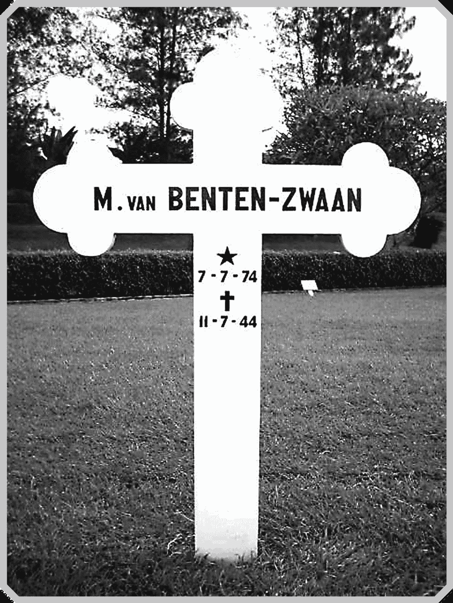
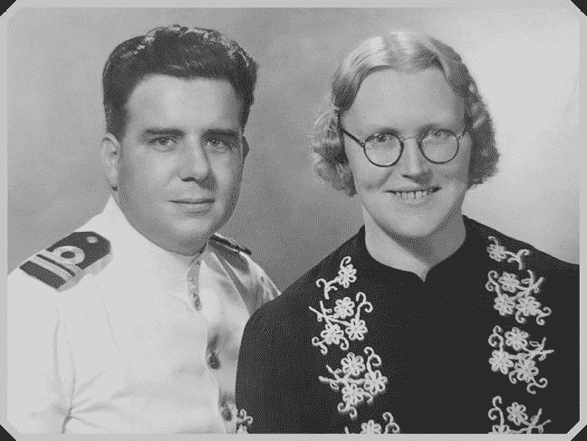
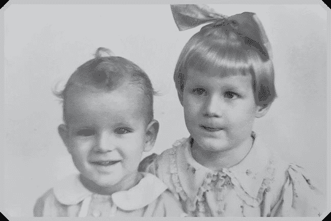
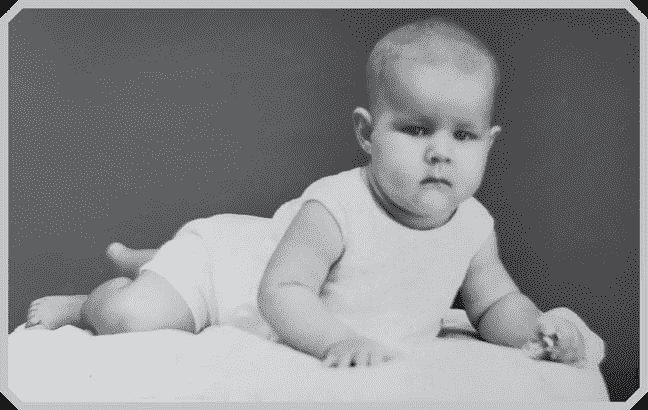
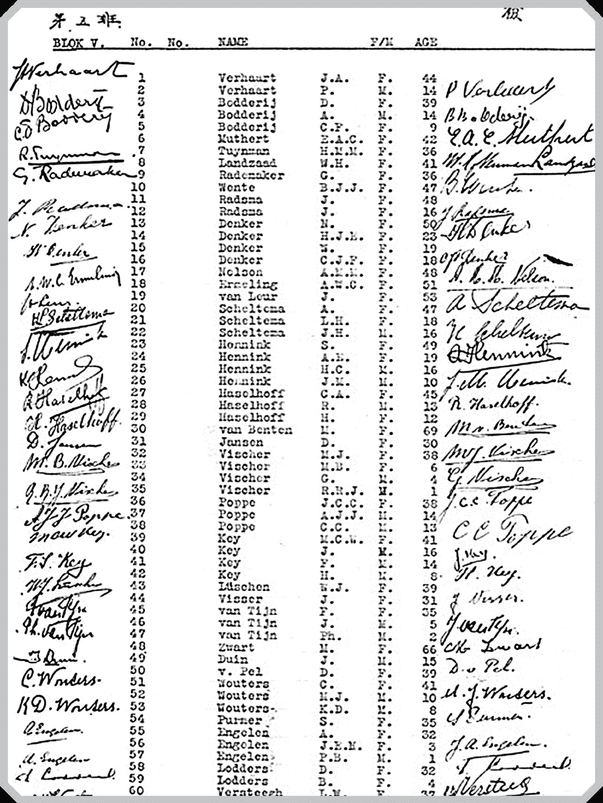
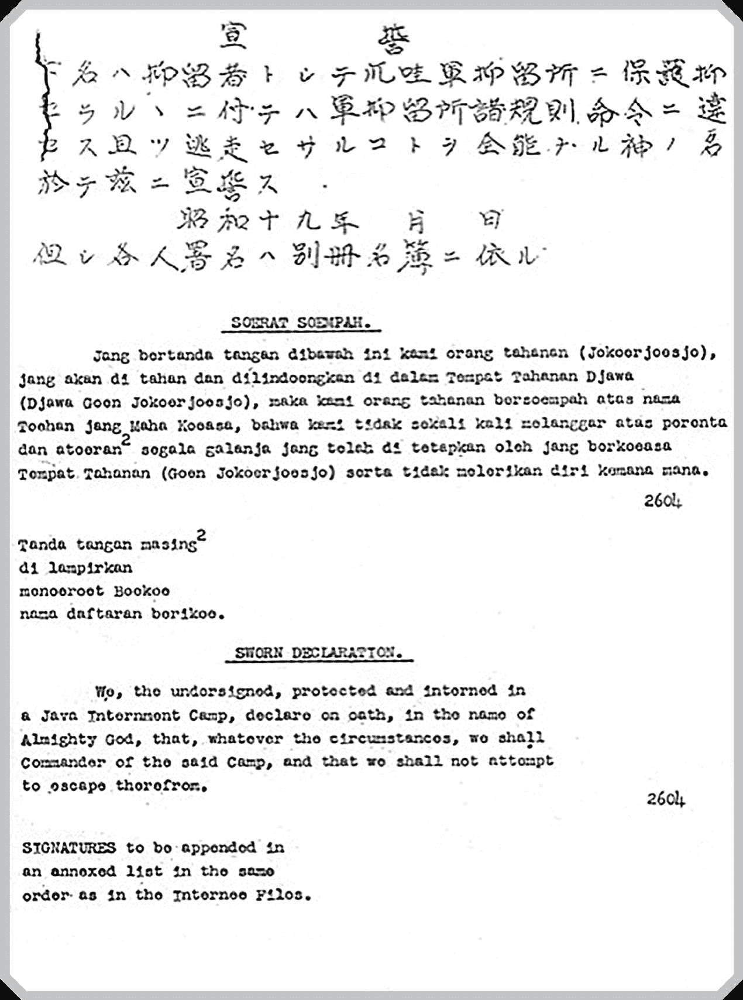

# 在爪之月下（世界大战 #01）

献给玛丽·维舍尔·埃利奥特，一位优雅、坚强且信仰的女性。

衷心感谢你让我讲述你的故事。

## 引言


2021 年 8 月，我有幸第一次见到玛丽（里塔）维舍尔·埃利奥特，当时她旅行到了我的家乡。我丈夫我和她在一起相处了几个小时，她用她迷人的南非口音向我们讲述了她非凡的人生。玛丽现在被家人朋友称为玛丽，但为了清晰起见，我在引言中称她为玛丽，在正文中称她为里塔——这是她小时候的小名。在我们第一次见面时，玛丽和我都在互相考量。我怀疑自己是否能够很好地呈现玛丽隐藏了数十年的故事。她则担心自己是否真的准备好分享这些私人且艰难的记忆。

玛丽告诉我，她的家人在战争结束后从未谈论过它。她的父母希望完全彻底过去。多年后，玛丽试着向母亲问了一些问题，但她的母亲给出的答案寥寥无几。这个话题仍然被视为过去的一个尘封。由于她所经历的一切，玛丽再也不想看战争电影或读关于战争的书。她特别避开关于集中营、监狱及其受害者的故事。和她的父母一样，她将过去牢牢地留在了身后。

然而，玛丽在最近几年发生了变化，惊讶地发现自己想要分享过去。她写了一份经历的简述，并开始向家人朋友讲述发生在她身上的事情。她对记忆和恐惧锁上的锁被慢慢转动了，然后打开了。

玛丽非凡的故事始于她小时候，当时生活在印度尼西亚（当时被称为荷兰东印度群或荷兰东印度）。她的父母最初都来自荷兰。她的父亲乔治·维舍尔在皇家邮政运输公司（KPM）工作，驻扎在爪哇岛。

第二次世界大战期间，在日本入侵、征服并占领印度尼西亚后，玛丽的家庭被分散并被送往日本战俘营生活。玛丽、她的母亲、祖母和弟弟乔吉被送往 Tjideng 营，那里关押着妇女和儿童。男性和年较大的男孩被送往他们自己的营地。这开启了玛丽生命中的一个时期，塑造了她的童年、未来和信念。

尽管多年来我读过几十本关于第二次世界大战的书，但我从未读过任何关于荷兰人在印度尼西亚经历的内容。当我搜索关于该主题的书或电影时，我只发现了自出版的回录。我买下了我能找到的所有书籍并开始阅读。

写一部关于玛丽早期生活的历史小说已经让我非常兴奋了，但在我深入研究之前，我对战争对印度尼西亚的影响一无所知。前战俘分享的一个又一个故事揭示了被埋没的经历。小说的结尾列出了帮助构建这本书的历史来源。作为玛丽故事的背景，理解印度尼西亚为何成为日本轴心国的战略资产至关重要。1600 世纪初，荷兰人加入了西班牙、葡萄牙、英国、奥斯曼等人的行列，致力于确保整个东南亚的贸易路线和贸易据点。1602 年，为了建立一个贸易王朝，荷兰人建立了世界上第一个跨国贸易帝国，即荷兰东印度公司（Vereenigde Oost-Indische Compagnie，VOC）。当 VOC 在 1796 年破产时，荷兰政府接管了对东印度群的殖民统治。在随后的几十年里，荷兰家庭搬到了爪哇和苏门答腊，寻找私营企业的机会。

在日本军事袭击珍珠港当天（美国时间 1941 年 12 月 7 日，但印度尼西亚时间为 12 月 8 日），印度尼西亚被激发起来，他们向日本宣战。每个 18 岁及以上的荷兰人被征召到皇家军事分支机构接受加速军事训练。总的来说，荷兰人主要依靠西方盟国的帮助。但盟军正忙于防御其他太平洋地区国家，如菲律宾和新加坡，导致印度尼西亚容易受到攻击。

日本与荷兰人在陆地和海上爆发了战斗，并以爪哇海战告终，印度尼西亚和盟军舰队在那里遭惨败。三天后，日本军队登陆爪哇岛，一周后，即 1942 年 3 月 8 日，印度尼西亚政府正式向日本投降。

结果，超过十万荷兰男子妇女儿童被关入监狱营。另有四万荷兰男性成为战俘，其中许多被运往缅甸、日本和泰国的劳营。

荷兰印尼人（Indos）处于中间。他们是荷兰人与印尼人婚姻的后代，由于几十年的殖民通婚，荷兰印尼人被给了一个选择：住在监狱营里或为新的日本政权服务。

在此之前，荷兰曾将其文化强加于当地印度尼人，而现在，随着日本取了荷属东印度（NEI），所有与荷兰文化相关的一切都被日本文化所取代。甚至连荷属东印度的首府巴达维也被更名为雅加达。学校开始教授日语，实行日本历，当地时间也改为东京时间。

印度尼西亚群岛 18,110 个岛屿中，约 6,000 个有人居住。1941 年，荷属东印度的人口约为六千万。战争结束时，有三万欧洲战俘（大部分为荷兰人）去世。总共有四百万包括印度尼人和印欧混人在内的平民因营养不良和强劳动而死亡。

《爪哇之月》讲述了玛丽和她的家人的故事，他们在第二次世界大战期间在战营中度过的艰难。1942 年 2 月底，玛丽的父亲乔治·维舍（George Vischer）随一群海军军官逃生，用以加入澳大利亚盟军。1942 年 3 月一个决定性的一天，玛丽·维舍被赶出了家门。玛丽、她年迈的祖母、母亲和幼小的弟弟被迫进入了一个由臭名昭著的日本指挥官园英宪一（Captain Kenichi Sonei）管理的女子监狱营。

这是玛丽的故事。

### 历史时间线

* **1940 年 5 月 15 日**：荷兰向德国投降
* **1941 年 12 月 7 日**：日本袭击珍珠港
* **1941 年 12 月 8 日**：荷属东印度政府对对日本宣战
* **1941 年 12 月 11 日**：日本占领马来亚
* **1941 年 12 月 25 日**：香港向日本投降
* **1942 年 1 月 10 日**：日本军队入侵荷属东印度
* **1942 年 2 月 15 日**：新加坡沦落
* **1942 年 2 月 27 日**：爪哇海战，荷兰及盟军战败
* **1942 年 3 月 1 日**：日本军队登陆爪哇岛
* **1942 年 3 月 5 日**：巴达维（雅加达）被日本军完全占领
* **1942 年 3 月 8 日**：荷兰军队决定投降日本

### 人物表

#### 历史人物


##### 维舍家族

| George Vischer | Robert (Robbie) Vischer |
| :--- | :--- |
| Maria Johanna (Mary) Vischer | Maria Van Benten (oma, 祖母) |
| Marie (Rita) Vischer | Dientje (Tie) Jansen (姨妈) |
| George (Georgie) Vischer | |
| Jacques Gouverneur | Dr. Ada Starreveld |
| Eduard (Ed) Gouverneur | Kemala (姓名已更改) |
| Olga Slingerland | Anja (姓名已更改) |
| Corrie Van der Hurk | Bima (姓名已更改) |
| Mrs. Venema | Dea (姓名已更改) |
| Ina Venema | |

##### 齐登营守卫

| Captain Kenichi Sonei | Lieutenant Sakai |
| :--- | :--- |
| Kano | Noda |

##### 恩德号辅助扫雷舰军官

* P. Rouwenhorst 指挥官
* J. F. W. de Jong Van Beek en Donk 少佐
* B. Hessing 一等中校
* M. J. Arnoldus 二等中校
* 海军陆蒸汽兵务部 (Msd) 二等军官，P. Hooft 少尉
* George Vischer 一中尉
* 政府海军二等军官，D. H. Poelman 少尉
* 政府海军二等军官，H. Rutgers 三等中尉
* 政府海军三等军官，D. 三等中尉
* 政府海军三等工程师，G. M. J. Wijnmal
* 下士兵长 J. J. Ter Pelkwijk
* 下士兵长 H. T. Jaden

##### 恩德号辅助扫雷舰舰船员

| 一水 P. Castricum | 一水 W. Bakker |
| :--- | :--- |
| 一水 W. O. Mackintosh | 招募 A. W. Pesch |
| 一水 W. A. Mulder | 招募 F. C. Loeffen |
| 一水 A. M. Buys | 招募 H. J. Hijmans |
| 一水 C. Chatelain | 三水 J. F. Franken |
| 一水 J. Jens | 医务助理兵 J. F. Van Beek |

#### 虚构人物


##### 斯家族

| Willem | Claudia | Greta | Johan |
| :--- | :--- | :--- | :--- |
| Hetty | Elly | Petra | Hilda |

## 序言


“这些日本监狱的历史面临被遗忘的危险，因为在那里的人保持了沉默，而打破沉默的人又太晚了，在愤怒和仇恨软化或消失之后，他们已经经历了那种被称为温和的死亡。”

——耶龙·布劳威尔斯，《齐登营》

### 1945 年 9 月

玛丽

玛丽·维舍从未想过自己还能再次见到父亲。并不是因为他们在齐登营收到了通知说他在格洛多克监狱营发生了意外，而是因为营里还有其他失去了父亲的孩子。死亡的消息每天都在传来，那里有这么多。玛丽又有什么权利与他们不同情呢？

孩子们听到失去父亲、兄弟、祖父的消息时感到悲伤，这只是长名单中的损失之一。他们失去了家、学业、自行车、玩具……但最痛苦的是未知。

三年了。玛丽离开爸爸已经整整三年。她记得他棕色的眼睛，却无法画出他的脸。她每天都检查英国十字会发送到爪哇岛各监狱的名单。

他的名字还没有出现在上面。

丽塔从露台抬起头，她刚刚仔细地在那里为她的泰熊铺好了一套新衣服。这些衣服是外婆上周缝的，现在是时候试穿一下了。丽塔特别喜欢那件缝有荷兰国旗的小白衬衫。

“那是防空洞，”约翰插话道。

丽塔眯起眼睛。约翰总是喜欢来凑热闹，然后和乔治一起玩，留下丽塔一个人在那儿。九岁的约翰是个无所不知的。他那只脏兮兮的狗，一只黑色的寻回犬，从不远离。凯尔斯穿过院子，跳上露台台阶，用头顶了顶丽塔的手臂。

“别那样说，约翰，”丽塔说着，一边摸了摸狗。她不希望小弟弟因为他们必须在`Laan Trivelli`沿修建防空洞而感到难过或害怕。

“他很快就会知道了，”约翰用他那自认为优越的语气说道。

一缕阳光洒在乔治金色的卷发上跳跃，他从约翰看向丽塔。“防空洞是什么，伊塔？”

丽塔的本名叫玛丽。她不确定父母什么时候开始叫她丽塔的，但自从她妈妈的名字叫玛丽（Marie）和她的本名非常相似，这个名字就传了下来。因为她弟弟学说话时发不出“R”音，所以他开始叫她伊塔。

“我想那是保护我们免受炸弹袭击的地方，”丽塔叹了口气说道，尽管她对院子对面到底发生了什么也有些没底，虽然她被告诉过很多次比同龄人要聪明。她瞪了约翰一眼，仿佛在无声地告诉他别说了。“不过这里不会有炸弹的。我们会安全的，乔治。”

约翰把黝黑的手臂靠在露台的栏杆上。他的蓝眼睛和她家里很多人的眼睛颜色一样。然而，约翰的并不是荷兰人中常见的那种金发，他的头发近乎红红色。他把头发分开向一侧梳得整整齐。

“那他们在挖什么？”乔治追问。

这是一个非常好的问题。战争一直都在欧洲。荷兰被德国占领了。但爪哇上并没有德国人，战争并没有发生在这里。

“他们只是为了安全起见，但我们会没事的——”丽塔开始解释。

“他们在挖战壕是因为昨天发生的事。”约翰转看向丽塔。“你不知道日本昨天轰炸了珍珠港吗？”

丽塔身体僵了一下，看了一眼乔治。“当然，我知道。”并仅仅因为约翰比她大，并不意味着他在每事上都比她聪明。

“珍珠港很远，”她说，“那和我们有什么关系？我们没有参与战争。”

收音机里总是在谈论欧洲的战争。爪哇岛上的每个孩子，即使是两岁的乔治，也知道希特勒是谁。有时丽塔会问约翰问题，因为她对妈妈和外婆不告诉她的事情太好奇了。爸爸忙于他在荷兰海军总部的工作，只有晚上才回家。

但现在，她不想让乔治担心被轰炸。他太小了，没必要去担心那些根本不会发生的事情。约翰挥了挥手赶一只开始骚扰他的苍蝇。然后他跳上露台，在乔治旁边盘腿坐下。狗凯尔斯在乔治身边坐下，乔治给了狗一个大拥抱。那只黑寻回犬翻过身躺在地上，让它揉肚子。

“自从去年德国征服了荷兰，”约翰继续说道，伸手去摸他狗那柔软下垂的耳朵，“我们再对日本不安全了。他们下一个就要来这里了。”

丽塔膝盖顶着胸，盯着约翰。“日本为什么要管我们？我们又没做错什么。”

约翰叹了口气，好像觉得她的问题很蠢。“日本想要我们的油田。盟军切断了供应，而我们有很多油。”

丽塔咬着嘴，望着聚在他们挖掘的战壕周围的男人。约翰说的是真的？她不确定，因为他很喜欢开玩笑。然而她的皮肤感到刺痛，那不是虫咬。

接着，约翰低声说道，仿佛希望屋里的的大人们不要透过纱窗听到。“我爸爸说，防空洞也是给你们家人的。”

这引起了丽塔的注意。她的父母会怎么想呢？

“我们可以在里面玩吗？”乔治用天真的语气问道。

丽塔不知道该怎么回答，但她不想让约翰回答，于是她忙说：“不，我们不能在里面玩，因为下了雨那里会变得很泥。只有在必要时我们才去，我会牵着你的手。”乔治重重地点了点头，她拉起他的手握了紧。“这就像玩游戏一样。你可以闭上眼睛，我给你讲故事。就像睡前故事一样。”

约翰难得没有反驳丽塔。但现在她分神了，发现自己正看着那些爪哇男人——包括他们的园丁比马——在挖掘。`Laan Trivelli`沿线还有其他挖好的战壕。深六英尺，长五或六英尺。屋顶是用草皮做的，用竹子撑着，至少留了一个可以看到天空的开口。

尽管十二月的天气如常一样温暖潮湿，但一股寒意还是滑过了丽塔的手臂。她不确定那里会有炸弹。也许躲在战壕里。当太阳移动在地平线时，丽塔不再想玩她的泰熊了。“走吧，乔治，”她从露台走下时，凯尔斯跟在后面。

“我们来做炸春卷吧，”乔治说，我们要去厨房帮忙。

“妈妈在哪？”乔治爬上椅子问。

“妈妈在休息，”丽塔走过去，她经常帮妈妈做任何需要的事。

炸春卷通常是从市场上的一个中国男人那里买的，但他们管它们叫 loempia——那是他们家最喜欢的食物。

住在`Laan Trivelli`社区的荷兰家庭都有仆人。丽塔家有园丁、厨师、女佣和保姆。妈妈告诉丽塔只要可以就多帮忙。妈妈并不喜欢家务，所以她大部分时间都在缝孩子的衣服、为自己做裙子，以及刺绣、钩织。她还制作地毯和挂毯。由于爸爸很忙碌，他们的园丁在花园里工作，并修理房屋。

现在，凯米拉正在做炸春卷。

“我们可以帮您做炸春卷吗？”丽塔问道。

“当然可以，”凯米拉笑着说，露出她的一只门牙上一个小缺口。她曾告诉丽塔，那是她在骑自行车时摔倒造成的。

丽塔对这个故事很着迷，因为当乔治那么大时，她在和保姆（爪哇语 baboe）去市场的路上差点被一辆自行车撞到。丽塔拉开了他们的保姆安雅（Anja），直接撞进了自行车里。那种疼太剧了，她一路哭到了家里。

“我能帮忙吗？”乔治用急切的声音问道。

凯米拉依然带着轻松的微笑，把装有米饭、碎蛋和切碎蔬菜的碗推给乔治搅拌。

“慢一点，”丽塔说着，她舀起一勺放在饼皮中间。然后开始卷——这是她做炸春卷时最喜欢的部分。

接着，凯米拉让丽塔搅拌 pecel——这是一种用花生和香料制成的酱，而凯米拉开始煎炸春卷。

## 到达

乔治说他想守着爸爸回来。那是他最喜欢的活动之一。

“我会来的，”丽塔说，她结束了手中的搅拌。这样她也能看到战壕的进展了。

正当他们到达走廊时，乔治突然大喊道：“爸爸回来了！”

果真，爸爸推着自行车进了前院。他手里拿着报纸，大步走过通往房屋的小路走向房子。他穿着海军军服，但袖子向上挽起，衬衫领口满了汗渍。看到穿着制服的爸爸，丽塔感到非常自豪。妈妈说他是一个非常勤奋，每个人都尊重他。他凭借一张`Diploma C`成为了首席工程师军，这意味着他可以在荷兰的潜艇和任何规模的船只上服役。

“爸爸！”丽塔喊道，快步走下楼梯。

乔治跟在她身后小跑。

爸爸摘下帽子。夕阳的橙色在他黑色如波般的发间闪闪着光。当丽塔搂住他的腰时，他那褐色的眼角挤起了笑纹。他身上闻起来一如既往，是浆过的棉布、松树和海风的味道。他将她紧紧拉了一下。

乔治的小臂紧紧抱住爸爸腿。

“进屋吧，”爸爸说，语气严肃。“我快热透了。”

他的语气让丽塔警觉了起来，她松开了父亲。他是在担心珍珠港发生的事吗？当他大步走上走廊的台阶时，汗水浸湿了他的衬衫背部。

丽塔拉住乔治的手，跟着爸爸进了屋。

他们一到，妈妈也进了客厅。因为睡了觉，她的金发在脸边显得有些凌乱，但白皙的皮肤比平时更苍白。她是生病了吗？还是她也像爸爸一样担心？

“乔治，”妈妈用轻柔的声音说。

爸爸走近吻了她的脸颊。“你感觉怎么样，玛丽？”

妈妈身高近六英尺，比爸爸高出几厘米，但打扮时她依然穿着高跟鞋。她的金发与爸爸整洁的深色头发形成对比。丽塔很喜欢妈妈在看向爸爸时眼中闪烁的光。通常当他们互相打招呼时，爸爸会露出一个只对她展现的微笑。

现在，没有任何人在笑。

“这是什么？”爸爸递给她报纸时，妈妈问道。首页的标题用大号的**粗体**字体印着。丽塔认识其中几个单词，但剩下的妈妈低声读道：“荷兰属东印度对日本宣战。”妈妈用手捂住嘴。“噢，不。”

丽塔凝视着那些字字，不知为何她感到胃一阵隐痛。约翰（Johan）看到这会怎么说？他已经知道了吗？

“这是真的吗？”妈妈问，语气颤抖。

爸爸用手指抓过头发，让它竖了起来。“坐下吧。我们需要谈谈。”

那时，她的父母一定意识到两个孩子正看着、听着这一切。

“丽塔，”爸爸说。“带乔治去厨房。帮凯梅拉准备晚餐。”

她不想说他们已经帮过忙了。相反，她抓住乔治的手，再次带他进了厨房。他的下唇在颤抖——不是因为他能读懂报纸标题——而是因为她的哥哥能感受到他人的感受。如果他们难过，他也是。他不需要知道为什么。

“我想妈妈，”乔治低声说，那双大榛色眼睛满了泪水。

丽塔伸手搂住他，将他拉近。当她揉揉他的金色卷发时，她说道：“妈妈必须和爸爸谈。然后我们就能一起吃晚饭了。”

乔治咬着嘴点了点头。

“来，”凯梅拉打断了他们。她一直站在门口观察。“你们两个都可以帮着擦桌子。”

他的眼睛立刻亮了，在凯梅拉的又一次鼓励下，他们擦拭了已经干净的桌子。

尽管丽塔的手很忙，而且厨房里开始弥漫起诱人的香味，但她仍努力听父母之间低声的交谈。她爸爸提到了`blackout`（灯控）和`curfew`（宵禁）之类的词。丽塔以前在收音机上过这些词。它们总是关于欧洲和德国。而不是爪哇和日本。

“这是怎么了？”奶奶（Oma）走进厨房。


丽塔转身看到她的祖母。奶奶也是个高个女性，但她的头发褐色多于金黄色。她的眼睛是褐色的——这意味着眼睛里有多种颜色。这一直让丽塔着迷。

“奶奶！”乔治说，丢掉抹布，举起手臂。

奶奶咯咯笑着，走过去抱了那个小男孩。然后她松开了。“闻起来好香，凯梅拉。”

那个女子微微下巴，接着奶奶盯着丽塔。她的微笑总能让丽塔的心平静下来——无论她在担心什么。

“我能帮忙吗？”奶奶问，捏了捏丽塔的肩膀。

丽塔莫名感觉好多了。奶奶在探望美国的杰克舅舅后来到爪哇。丽塔希望奶奶能永远和他们在一起。奶奶和他们玩游戏，在市场上给他们买小玩具或零食，给他们讲关于荷兰的故事。

“我们需要摆好餐具，”丽塔说。“乔治，你负责叉子。”

他滑下其中一把椅子，欢快地冲向餐具抽屉。

纱门关上了，丽塔转身看到她父亲正穿过院子，拉着一副破旧的手套。他已经换下了海军军服，穿着一件宽松的卡其衬衫和短裤。

“爸爸去哪儿？”乔治问。

丽塔不知道，但妈妈在门口说道：“他去挖战壕了。”

玛丽呻吟着，睁开眼睛，坐直身体。她为什么会这么累？现在也许是半夜，没错，但在过去的一个周左右里，她一直无精打采。她从床头柜上拿起眼镜，然后披上一件睡袍，不是为了保暖，而是因为丈夫几天前帮着挖的那条战壕可能不会有多干净。

当玛丽到达母亲的卧室时，她已经走出了门外，手里拿着自己的手电筒。由于实施了断电令，宵禁后没有人被允许开灯，手电筒已成为热门的购物物品。走廊尽头，孩子们提问的声音在回荡。小乔治那高亮的声音在叫着他的妈妈，紧接着是她丈夫低沉、浑厚的的安抚声。

“大家都准备好了吗？”乔治问道，他深沉的声音传到了玛丽和母亲耳中。

“准备好了，”玛丽说。

只要家人在一起，他们就准备好了。

乔治走到前门并把它打开，然后示意他们走向门廊。他腰间抱着他们那健壮的金发儿子。他用宽大的手牵着里塔。里塔还带了她的泰迪熊。

看到这里，玛丽的心一阵紧。她的孩子们已经接触了他们不该接触的东西，里塔快五岁了，乔治快三岁了。半个世界之外的战争已经足够可怕，但随着珍珠港的轰炸，日本军已经加强了攻势， literally 抵达了爪哇岛的门口。荷兰东印度皇家陆军已经动员，每一位十八岁及以上的荷兰男性公民都被要求加入海军、陆军或空军，为了女王和祖国对抗日本而战。

由于如此多的老师加入了军队，学校已经关闭了。每天，报纸都在呼吁十七岁的志愿者去从事民防工作。在消防局，在无线电电站和电话交换局，在机场和港口。

这一切是如何变成他们的世界的？玛丽挽着母亲的手，匆匆穿过草坪走向避难所。他们的邻居沃斯一家已经进去了了。

乔治引导两个孩子进入室内，然后他伸出手帮助欧玛（`Oma`），最后是玛丽。

“大家都在这儿？”威廉·沃斯问道。他和他的妻子克劳迪亚坐在他们对面，在另一张长椅上。他们的儿子约翰坐在格蕾塔旁边。她十二岁了，是一个娇小的女孩，大部分时候自来独处。

等大家都坐在简陋的长椅上后，乔治调整了草皮屋顶。在最初几次防空演习时，整个躲避的人群社区都保持完全沉默，当警报声从塔上鸣响时，他们倾听着任何飞机接近的声。

现在，玛丽可以听到各种避难所传来的交谈声。声音模糊不清，没错——但某种程度上这让她觉得没那么害怕，也不那么孤独。整个社区都在同舟共济。无论发生什么，他们他们都会度过去的。

“妈妈，”小乔治在她的脖子上轻声说。

玛丽在近乎黑暗中将他抱到膝上。他小小的身体贴着她，她呼吸着他身上温暖阳光和叶片的气息。尽管玛丽非常爱她的两个孩子，但乔治有些不同。他没有像大多数蹒幼儿那样经历过可怕的“可怕两岁期”。他乐于取悦他人、感情丰富、安静但快乐。对于这个充满严酷、痛苦和怀疑的世界来说，他几乎是太好了。

里塔坐在她的另一边。欧玛紧紧地搂着里塔，而乔治留在避难所的入口处，向外望向黑夜。

“我连飞机的声音都找不到，”乔治说，仿佛在警报声中听到它们一样。“一切都会好的。”

“这只是练习演习，”威廉补充道。这个男人比她自己的乔治高几英寸，留着锈褐色的头发。他还在巴达维亚的荷兰海军总部担任军官。

在威廉旁边，他的妻子克劳迪亚挽着他的胳膊。她是一个接近五十岁的胖女人。她作为缝纫师的技艺在社区里无与伦比的，她缝制的婴儿服带有精美的刺绣。

“至少今天没下大雨，”乔治说，“战壕里水不多。”

现在是季风季节，随着时间的推移，战壕里的水只会越来越糟糕。玛丽对克劳迪娅说话并不惊讶；她也不想说话。她想回到床上，把被子紧紧裹在身上，即使热得不盖毯子。

“你听说从泗水（`Soerabaja`）出发的荷兰潜艇击沉了两艘日本运输船了吗？”威廉继续说道，仿佛他只是在讨论天气。

“听说了。”

是的……他们确实。这让玛丽想坐第一架离开爪哇。泗水是东爪哇的海军基地。荷兰军队开始对日本船只发动进攻攻击一点不是好消息。泗水可能有几百英里远，但它仍在同一个岛上。

“啊，我对比这些传说略有了解。文章是怎么说的？”玛丽听过关于那位十二世纪君主的传说，他的预言被一些爪哇人深信不疑。那位君主曾统治过`Kediri`，那是印度教王国之一。

克劳迪亚拨开脸前的头发。月光洒在她身上，带着苍白的光，让她的五官显得有些诡异。

“这个是关于爪哇人在几个世纪前是如何收到警告的：他们的恶行将受到受一个海民民族统治的惩罚。”

玛丽眨了眨眼睛。“荷兰人？”

克劳迪亚耸了耸肩。“也许吧。那些海民会把土地分给他们，但随后他们会被从北方来的人赶走。”

玛丽手臂上的汗毛竖了起来。日本在北方。

“北方的人会留在这里，直到玉米成熟，或者说公鸡活过的多久。”

“那是 . . . ”

“三个月或三年，”克劳迪亚补充道，“之后，一位`Ratu Adil`将会出现并接管，统治这些岛屿，并带它们走向独立与繁荣。”

玛丽舒了一口气。这个传说对过去的描述准确得令人心惊。这一切难道都是真的吗？无论如何 . . . 一个十二世纪的君主揭示了如此细节，真是太不可思议了。“希望无论这场战争即将发生什么，持续时间是三个月而不是三年。”

克劳迪亚将手轻轻按在玛丽的肩膀上。“我觉得我每一刻都在祈祷。”

玛丽点了点头，想起了`Oma`的祈祷，以及她在避难所里的祈祷。克劳迪亚收回手。“这就是我们能做的全部了，不是吗？交给上帝吧。”

她的声音听起来像`Oma`。“是的。这就是我们能做的全部了。”无论幸运还是不幸。玛丽走回房子时，那种不祥的预感伴随着一种挫败的疲惫感，挥之不去。

从厨房传来时钟的滴答声。这房子很少安静得能听清这种声音。一切还是一片黑暗，但玛丽没有打开手电筒。乔治一定已经让孩子们上睡了，`Oma`也肯定睡着了。玛丽从未见过像她母亲那样能睡得那么快的人。

她站在房间中央，整理着关于又经历一次轰炸袭击的思绪，胃里一阵翻涌。她用颤抖的手按住肚子，怀疑自己要吐了。在几次平稳的呼吸后，她继续沿着走廊走着，关着灯。她的眼睛已经适应了黑暗，况何况月光照亮了窗户上的窗帘。她在孩子卧室半开的门前停下。一切都很安静。甚至很平和。

一阵恶心再次席卷了她。玛丽最不想做的事就是呕吐。没有时间了。她不想把什么传染给她的孩子，谁知道下一次防空警报什么时候会响？

但她直觉这不是肠胃流感。她可能希望在额外休息和吃清淡饮食后能恢复正常。但这种怀疑太强烈了。

当玛丽进入卧室时，乔治已经在床上了，但他并没有睡着。他靠在几个枕头上，双臂交叉放在脑后。

“我正准备去找你，”他说，声音低沉而沙哑。“你还好吗？”

玛丽决定不再关注她的恶心感，而是说：“克劳迪亚告诉我关于马来语报纸上印的`Djojobojo`传说。”

“噢？”

显然，克劳迪亚知道一些乔治不知道的事情。这可真不简单。

玛丽爬上床，把头靠在丈夫肩膀的窝里。他的手臂滑过来环住她，她吸口气。他身上有着草地、泥土的味道，还有一种褪色的须须膏味，那气味本该早就已经散尽了。

在接下来的几分钟里，她向丈夫讲述了那个预言爪哇岛将在日本统治下三个月或三年的传说。

“我知道克劳迪亚相信这些东西，但让我们希望这仅仅是民间传说，而根本不会发生入侵，”他说，语气在她头顶低声呢语。

“希望如此，”她回应道。

又过了一分钟，尽管乔治没有动，但她能感觉到他身体传出的紧张。“怎么了？”她问道，尽管她不想听到他可能还没来得及分享的坏消息。

“除了日本即将来的入侵之外？”他问道。“我觉得自己困住了。我的妻子和孩子在这里很脆弱。关于盟国对抗日军的策略传言满天，但我们人少力单，装备也差。我看不出出路，`Rie`。”

玛丽抬起脸。“盟国一定会会帮助我们的吧？这不是你昨晚提到的吗？”

“这是每个人都希望的，但事实上，盟国正忙于在香港和菲律宾阻挡日军。更不用说新加坡了。”

玛丽手指抓住丈夫的衬衫，心想环太平洋地区有多少国家正遭受轰炸。对于她现在已经参军的丈夫来说，每晚留在爪哇岛自己的自己里是不切实际的。于是她问了那个一直回避的问题。“会被征调到潜艇上吗？”

他的回答立刻出现了。“可能会的。”

玛丽让这个信息沉淀了一下，又过了一分钟。乔治是一位合格的潜艇工程师。到目前为止，荷兰潜艇似乎还占据着优势。如果乔治在潜艇里没了回来怎么办？

# 故事

尽管如此，莉塔（`Rita`）还是想第一个发现他。她问了她能想到的所有问题。“他在和日本人战斗吗？”莉塔问妈妈。

妈妈的脸变得像剥壳的蛋一样白。“不，里蒂埃（`Rietie`），他正在幕后努力加强荷兰军队的力量。”

莉塔并不确定“幕后”是什么意思，但她曾听过爸爸提到过要给潜艇供水。他会提着水桶水到处走吗？

邻居家里传来的风扇砰的一声引起了她的注意。她透过树丛向外看，看是否是约翰（`Johan`）。但那是邻居的一名爪哇工人走出来拍打地毯上的灰尘。

莉塔转而看向路，寻找爸爸。雨下了一整个上午，但现在雨停了，热气开始越过院子蔓延。热气还没到达芒果树下。等云朵散去后，这一切都会改变。

随着拍打地毯的“砰砰”声在院子里回荡，莉塔变换了位置，挪到了更高的树枝上。她希望自己能爬得足够高，好让日本飞机无法飞越爪哇岛。似乎每天，有时甚至每小时，都有关于日本占领另一个岛屿的新闻。约翰每次来到院子里时，都会告诉莉塔他听到的消息。自从不再上学后，他经常听收音机。

她不知道约翰的故事是否都是真的，但她不敢质问父母。妈妈经常感到不舒服，白天午睡，而奶奶（`Oma`）和妈妈会在地板上来回踱，直到爸爸晚上回家。

其他事情也发生了变化。她们家的女佣迪亚（`Dea`）只留以前原来一半的时间。肯梅拉（`Kemala`）只在下午才来，准备好晚餐就离开。莉塔问过她家里有没有防空洞，但肯梅拉摇了摇头说：“炸弹是给你们的人准备的，不是我的。”

这让莉塔在想，为什么有些人会恨其他人呢？

“伊塔（`Ita`），你在哪？”乔治（`Georgie`）在树下喊道。

莉塔挪了一下身体，以便直视树干。“在这儿。”她弄了弄树枝，向房子看了一眼，安雅（`Anja`）正坐在走廊上，留意着乔治。

“帮我上来，”乔治说。

那可不是个好主意。“我自己下来。”莉塔最后看了一眼路。没有爸爸的踪影。

片刻之后，她就爬下了那棵几乎每天都会爬的树。

“我们玩球吧，”她说，拉起哥哥的手。云层依然遮挡着太阳，让空气保持着凉爽。

莉塔从院子角上拿到球，扔给了乔治。他没接住，但笑着追着球跑。

莉塔看着哥哥的笑声笑了。听到笑声真好，因为已经没多少可以让人微笑的事情了。她的父母总是忧心忡忡。妈妈待在卧室里的时间越来越长。连奶奶最近也变得安静。

莉塔再次抛出球，乔治英勇地努力去接。他没中。“两只手合拢，”她喊道，“像这样。”

乔治把手合在一起，但当莉塔再次把球过去时，他没有动。球撞到了他的肘部。

“你还可以移动的，乔治，”她说，“但接球时要把手合拢。”

“我可以教给你看，”约翰突然出现。他一定是在莉塔背过身时走出房子的。“坐，”他对他的狗说，狗听从了。

这一次当莉塔扔球时，乔治在约翰的帮助下接住了。

“接到了！”乔治用自豪的语气宣布。他把球扔了，球飞了大约一米，于是莉塔走上前去从地上捡起来。

就在这时，云层散开了，阳光洒在莉塔的头、肩膀和手臂上。温度升高了，仿佛打开了某盏灯。

“快进来，”安雅立刻说道。

云的消散意味着飞机可以看到这个岛屿了。

仿佛接到信号一样，防空警报响了。

莉塔的心跳猛地一下，她伸长脖子看向蓝白相间的天空。她哪里也没有看到飞机。也许是另一次演习。

约翰冲向防空洞去，他的狗在后面跟着。接着妈妈、奶奶和迪亚也走出房子，拿着手电筒。在他们身后，肯梅拉提着一袋水果。黑暗还有几小时后才会降临，但谁知道这次袭击会持续多久。妈妈还提了一个装有少量物资的包，包括一袋橡胶片。那些橡胶片是塞在齿间的，以防附近的炸弹爆炸引起震伤。

“走吧，莉塔，”妈妈说，表情严峻而坚定。“我们一起，安雅。”

莉塔丢掉球，抓起乔治的手。他们步履走向防空洞。她们的园丁比马（`Bima`）从房子侧面绕过来，引导大家进入室内，就像爸爸在家时那样。莉塔讨厌走过战沟底部积的冰冷泥水。她溅着水走过去，然后坐在其中一张长凳上。那只狗至少足够聪明，坐在长凳的末端。它没有叫闹，而是呜呜了几声。

透过防空洞屋顶的边缘，可以看到几片蓝天。

莉塔凝视着那小片天空，心想飞机在哪儿。约翰守在入口，也站着向外看，就像爸爸做的那样。

沃斯夫人（`Mrs. Vos`）开始和妈妈聊天最近日本的几次入侵。菲律宾上个月被入侵了，现在新几内亚和东印度群群岛（`NEI`）的许多岛屿正在或已经被占领。

“很快，我们就无处可去了，”沃斯夫人担心道。

“报纸说澳大利亚和东印度群岛正在合作抵御日本，”妈妈反驳道。

沃斯夫人摇摇头，眼中充满了忧虑。“日本军舰在数量和威力上超过了我们的扫雷舰和反潜巡逻艇。我们的船只和世界最大的战舰相比如何？你看到今天早上的报纸了吗？”

妈妈摇了摇头，因为爸爸是收集报纸并在晚上带回家里的人。

“日本在入侵婆罗洲和苏拉威西岛后，已经向荷兰政府宣战了。”沃斯夫人停顿了一下。“他们冲着我们的油田来，看起来他们得到了。他们还承诺让印尼人从荷兰获得独立。”

“也许我们应该在孩子和其他人不在时谈论这个，”奶奶打断道低声说道。

沃斯夫人低下头。“他们需要知道发生了什么，本夫人（`Mrs. Benten`）。我们为什么都坐在防空洞里脚湿湿，这并不是秘密。孩子会理解他们能理解的，但我们的生活正在改变。”

“噢，我的天哪，”沃斯夫人轻声说道，“是日本人的飞机。”

丽塔的皮肤因恐惧而泛起层疙瘩。

奶奶的祈祷变成了急促的低语。

接着，丽塔听到了。那是一种深沉的轰隆声。如果有云层，她可能会以为那是暴雨倾盆前的雷声。但天空很晴朗，飞机的声音越越近。丽塔的胃里像拧成了一团乱麻。日本军队要炸了她的家吗？

流逝的每一秒都像一个小时那么长。

飞机飞了过去，雷声平息了。

丽塔等待着。屏住呼吸。齿间咬着那块橡胶片。

然而，并没有发生爆炸。

什么也没有。

一分钟过去了，又一分钟。

“它走了，”沃斯夫人说，声音听很轻，仿佛她刚刚在房子里来回跑了一阵。

“它还会回来吗？”约翰问出了他们所有人都想知道答案的问题。

“我觉得飞机只是飞过去了，”沃斯夫人说，但语气听起来并不确定。一点也不确定。

当然，大人们知道的比丽塔多得多，但每天生活都在发生更大的变化。他们吃着简单的餐食。为了防止发生轰炸，奶奶不再带她和乔治吉去市场了。

避难所屋顶上，叶子在风中沙沙作响。当风带走云层时，那声音格外悦听。接着雨落下了，既急而迅速，顺着上方的屋顶滴落。很快，防空警报停止了。

安雅、迪亚和凯玛拉冲出去，走向房子。奶奶抱起乔治吉跟了上去。丽塔正要随母亲离开，这时沃斯夫人说：“现在我们独处了，你需要知道，日本军队一直在做出一些他们无法做到的承诺，但看起来他们打算尝试。”

“那意味着一场革命，”妈妈说，紧握住丽塔的手，“在战争中。如果日本要帮助印尼人夺取荷兰政府，我们这些岛屿就不能从内部发生动荡。荷兰人会怎样？”

“时间会告诉我们，”沃斯夫人用紧绷的声音说，“我不喜欢，而且女王也没有抽顾我们。她自己也处于流亡中。”

妈妈点了点头，双唇紧闭成一条线。

当他们爬出避难所时，迎接他们风扯着院子边缘的竹丛。上方，芒果树摇曳着，路不远处的棕榈树看起来像在跳舞。丽塔知道风会让棕榈树掉下一些椰子。

当约翰跑回家时，凯尔斯开始汪汪。丽塔拉着妈妈的手，他们穿过雨水走向门廊。

丽塔进入房子后，安雅、迪亚和凯玛拉已经在里面了，关上了所有的窗户。

妈妈甚至没顾着换上干衣服，直接走向餐室的收音机，打开它，然后坐在桌旁听。

丽塔很惊讶，因为妈妈通常会等爸爸回家后才一起听。播音员正在一份新闻报告中间，谈论盟军爪哇岛航空司令部拥有的飞机数量。

“那是我们吗？”丽塔问道，走到妈妈身边。丽塔的头发是湿的，衣服湿了一半，但没有人叫她去换衣服。

妈妈看着她，并没有把她赶走，而是伸出手臂。丽塔坐在了她旁边的椅子上。

“是的。我们人少敌多，丽蒂，”妈妈说。

“少了多少？”丽塔问道。尽管她还没上学，她也能数到近乎一百。有一天，约翰曾挑战过她，而她只漏掉了三个数字。

妈妈指了指收音机，接着丽塔听到了。

“盟军爪哇岛航空司令部有八六架现役飞机，而日本军队拥有三百多架现代飞机。”

丽塔想约翰知不知道这些。或者他的爸爸知道？还是她的爸爸呢？爸爸不开飞机，但有时飞机会轰炸船只——约翰也告诉过她。

“沃斯夫人说的是真的吗？我们无处可去了？我们被困住了？”

妈妈转过头来，用冰凉的手放在丽塔脸的两侧。“最重要的记住的一点是，我们在一起。你、爸爸、奶奶还有小乔治吉。这些才是最重要的。我们活着，我们是安全的，我们家里有食物。”

丽塔感觉有一团东西顺着喉咙涌上来，让她难以吞咽。她想相信妈妈，她确实相信了，但是……爸爸已经两天没有回家了。

## 第四章


“印度属民地已经准备了多年战争，但并没有真正准备好。荷兰东印度军队情报局与美国的 `CIA` 相当，消息灵通……但因为没有处于战争状态，他们能做的最好的办法就是盯着居住在境内的许多日本人。日本商人、摄影师、裁缝、干洗店……无论从事哪种行业，他们往往都是最顶尖的在珍珠港袭击后，这些人消失了，直到荷兰人投降后才以高级军官的身份重新出现。这些年来，他们一直在监视着我们。”

—约翰内斯·范登布鲁克，新加坡岛

### 乔治

乔治·维舍爬回卡车，坐在霍夫特中尉旁边。雨点打在车顶上，啪啪作响，与深沉的雷声交织成旋律。窗外的世界是一片灰色，被从云层中射出的、如枪口火般的闪电切断。乔治这次没有开车，对此他很感激，因为道路很快满了积水。

霍夫特启动了卡车，然后换挡挡，驶回通海军总部的路上。他们已经旅行了几天，与鸦片工厂谈判购买事宜。事实上，这是过去一个半月来，乔治第四次离开家人好几天。他精疲力竭。

“所以这就是我们唯一的选择，对吧？”霍夫特问。他是个黑发男人，比乔治矮，但肩膀更宽。

“看起来是这样。”乔治叹了口气。他们刚刚离开一家鸦片工厂，达成了另一项从该工厂购买蒸馏水的协议。一切都短缺，但有足够的钱就能买到他们需要的。短缺情况与日加厉。谁能想到一家鸦片工厂会成为荷兰海军的救命稻草？

寻找蒸馏水是乔治最近分配的任务之一。在巴达维的海军总部，他负责确保整个群岛的海军仓库供应海军舰只和飞机。他知道他们人少敌多。大家都知道。但没有人谈论这件事。难道他们会被要求像丘尔尔告诉新加坡英国士兵的那样，“战斗到死”吗？


与之相对的是，过去几周几十份新闻报道了日本军的残暴和不愿遵守任何战争规则。这是一个令人清醒的想法。如果盟军不退缩，日本也不退缩，那么战场将遭受更多的破坏。

乔治负责监督舰队和飞机的材料采购。不幸的是，在爪哇岛遭受攻击后，材料变得越来越难以获得。波哥尔、日加加塔和马拉兰附近的机场遭到了袭击。被轰炸并遗弃了。因此他们必须前往一家鸦片工厂，为潜艇购买蒸馏水。蒸馏水是海水脱盐转化为可用淡水关键过程的一部分。

雨水持续拍打着卡车，填满了路上的水坑，他们正朝着总部驶去。至少他们完成了任务，乔治可以查看他的家人了。乔治调节了卡车上的`AM`收音机，传出一段充满杂音的新闻报道，证实日本轰炸了马兰附近的一个机场。尽管该市位于岛屿的东部，而乔治和家人位于西北部，但爪哇岛的任何轰炸都会产生影响。但消息已经旧了，这让乔治感到惊讶。仿佛新闻播员正试图用信息来填充时间，无论这些信息有多旧，都在等待更新。

几周以来，日本军队对爪哇岛造成了巨大破坏，在东爪哇各地的机场投下炸弹。他们听到荷兰人正在撤离较大的城市泗水。乔治曾和胡夫特在去往各个工厂的途中目睹了那种破坏景象。上周，西爪哇附近的波哥和万隆机场也遭了轰炸。现在，日本武装的力量每天都能感受到，但并非所有人都生活在恐惧中。乔治认识的大多数印度尼西亚人继续照常营业——在市场和商店里向荷兰人售货，其中许多人仍在为荷兰人工作。但政治动荡已经开始，形成了一些坚决反荷兰的团体。

荷兰人不仅面临日本这个外部敌人，内部冲突也在加剧，因为许多印度尼西亚人同样渴望从荷兰人手中获得独立。日本一直在向印度尼西亚人发送支持信息——但日本也有自己的意图。乔治并不一定是个政治人物。他热爱大海，热爱追随工程师的职业道路——这正是最初带他来到爪哇岛的原因。但他知道，威尔赫米娜女王不会轻易地交出这些被荷兰殖民了三百年的岛屿。在经历了几个世纪的投资和基础设施建设后……难道这一切都归于金钱吗？

尽管如此，乔治的另一个侧面永远不会反对一个人民对独立的渴望。他并不是几个世纪前原始殖民的一部分，但他读过足够的内容，知道荷兰人经常使用残忍的手段控制各种岛屿。荷兰人与印度尼西亚人之间的历史并不总是美好的，但在现代，当然可以达成和平协议的，不是吗？

乔治知道自己可能在自欺欺人。目前从响亮的收音机里传来的新闻报道绝非和平。这一切中的任何问题都没有简单的解决方案。雨停了，西北风将云层推过铁色的天空。蓝色的笔触透开了。阳光的出现在世界某些地方可能是受欢迎的，但在爪哇岛，这意味着轰炸机将再次出发。

乔治想到家里的家人，舒了一口气。防空警报是不是又响了？他怀孕的妻子是否带着他们的两个孩子和奶奶正冲向避难所？

每天不仅是一场与入侵军的外部战斗，也是一场内心的战斗，想要和家人待在特里韦利大道，帮助并保护他们。然而，如果他不像身边的其他人那样履行海军职责，就不会有人能阻止日本的进展。即使大多数时候努力似乎是徒劳的。显然，日本占据了上风。

大多数盟军正在世界的另一端与纳粹德国正面交锋。这导致其他国家基本上任凭于坚定的日本帝国陆军。

“你妻子怎么样？”当收音机切换到另一个节目时，胡夫特问道。

乔治曾向他的几个军官朋友坦白，他的妻子怀着他们的第三胎。两个朋友都有妻有子，他们理解在这些危险时期增加的风险。学校、教堂和医院已变成防空避难所。食物正在配给，医疗物资更难获得。如果当玛丽产期临临时，她无法获得良好的医疗护理怎么办？

“她大多数时候都感到不舒服，但至少晚上睡得好了一点。”

和乔治一样，胡夫特住在`KPM`公司的宿舍里，在爪哇岛住了几年。`KPM`是皇家邮轮运输公司——或`Koninklijke Paketvaart Maatschappij`——乔治已在那里工作了十多年，他于 1927 年到达巴达雅。但当 1939 年战争爆发时，乔治和胡夫特都曾动员进入荷兰皇家海军的预备队。“孩子们还好吗？我的孩子们没有学校可以打发，快要疯了。或者我应该说，我妻子已经准备好让这场冲突结束。”

“赞同。我不知道我岳母能承受多少。她的生活不需要更多的挑战。她来这里探访本该是和平的。讽刺的是，当纳粹接管荷兰时，我们都很庆幸她在巴达雅而不是荷兰。”乔治的目光飘向他们路过的田野。花生田浸泡在雨水中。他们离海军总部还有一段距离，离开基地待一会儿感觉很好。

“这里可能仍然是更好的地方，”胡夫特说，“尽管如此。”但紧接着他的手指抓紧了方向盘，他抬起下巴，朝向窗户上方。“轰炸机？”

乔治向前倾了倾身体，死死盯着那架几乎从他们头顶飞过的飞机。白烟从那架低空飞机中喷出，它疾速穿过晴朗的天空。没多久就看到了那个涂成红色的圆圈。“是日本轰炸机，”他低声说道，“而且它正朝着我们同样的方向飞行。”

胡夫特刹住了卡车，减了速，然后停在路边。他继续驶入一片树林，树枝发出断裂声。

“你要干什么？”乔治问道，试图压住内心升起的恐慌。

“它正朝向丹绒普里奥港去，”胡夫特说，“这辆车是下一架飞机的目标。我们在这里等等轰炸机投下弹药。”

“你怎么知道它要去哪儿？”

乔治对飞机的了解不如胡夫特——胡夫特最初在空军服，几年前转入海军。如果轰炸机在巴达雅北部的机场投下攻击，海军总部就会暴露。

撞击发生，炸弹错失一架盟军飞机时，泥土向向上喷射。一瞬间，乔治感觉自己与眼前的场景脱节了。仿佛在看电影胶片。但周围土地的褐色和田野的绿色并非电影。这一切正发生在他身上。发生在他的岛上。发生在他的战友身上。

下一枚炸弹命中了目标。火势几乎瞬间燃起。在第一团火之外，另一次爆炸将地面炸开了。

在他身边，胡夫特低声咒骂了一声。战争已经实实在在地降临了他们的家门口。现在没有任何战略策略可以扭转局势。海军总部被毁只是时间问题。

火势蔓延开，在柔蓝的天空衬托下呈现出深橙色和黄色。形成了一触触目的对比。尽管这不可能，乔治发誓他感觉到火焰的热浪正舔着他的皮肤。温暖流遍他的全身，炽热而迅速。他用脚后跟向后撑住身体。

战前，如果有飞机起火，男人们和水车会冲过去扑灭火焰。但现在，没有任何东西也没有人试图灭火。因为他们都知道，很可能有更多的轰炸机正在赶来。

果不其然片刻之后，当乔治和胡夫特留在树丛下时，一阵雷鸣划破了天空。

这一次，两架轰炸机紧密相随，掠过田野直冲机场飞而去。

随着下一组炸弹落下，乔治的心跳猛加速，炸弹撞击地面，摧毁了目标范围内的一切。这就像在看着世界崩塌。

在很长的几秒钟里，乔治和胡夫特都没有说话，他们的目光聚焦在两人共同面对的新现实上。时间缓慢移动，随后便追了上来。

乔治内心的焦虑感激增。他们必须离开。他们需要弄清楚自己的命令是什么。如果没有命令，乔治要去看看他的家人。

“走吧，”乔治沙哑道，“我想去看看我的家人。”

“我也是，”胡夫特应道。

胡夫特启动了引擎，然后踩下油门。他们在崎岖不平的道路上疾驰，穿过水洼，越过坑洼。

人们再次陷入了沉默。

乔治摇下窗户，让风吹过身体——那是热气、水分以及路过的花生田散发出的坚果香气的混合物。他的胃感觉像被忧虑掏空了一样。炸弹离这里的街区还很远。但在欧洲，居民区正在被轰炸。有什么能阻挡日本军呢？

这并不是乔治想向同僚官们承认的，但也许荷兰属东印度群岛投降会更好。否则，平民的生命将会损失，而妇女和孩子们本质上被困在了那里。

他们能去哪里？进山里吗？离开以荷兰人为主的社区？进入爪哇人社区？多年来，他一直把爪哇视为家。然而，现在他们可能很快成为难留民。

在前往海军基地的路上，他们看不到破坏情况，但很快就会听到报告。到达基地后，胡夫特停了卡，他们都急忙进总部大楼，发现这里……一片混乱。人们在接电话；其他人挤在一个收音机旁。乔治怀疑这完全是因为他目睹的机场遭袭。那种袭击已经司空见常了。

“发生什么事了？”乔治一看到威廉·沃斯就问道。

“兰格利号被击沉了。”

乔治感到胃空空了。兰格利号是一艘美国航空母舰，载着三十架军用飞机前往东印度群岛。他花了一时间才理解这种损失是多么巨大。

“还有，”沃斯说，声音在混乱中几乎听不见，“ABDA 军在爪哇海的一场战斗中被歼灭。”

乔治盯着沃斯。ABDA 代表美、英、荷、澳，本质上就是盟军。

“昨天，我们失去了荷兰皇家海军巡洋舰‘爪哇’号和‘代鲁伊特’号，以及‘科尔塔纳’号驱逐舰。”

沃斯提到的每一个名字都像击中乔治的胃。

“英国驱逐舰‘埃尔拉’号和‘木星’号也消失了。今天，美国‘休斯顿’号和澳大利亚巡洋舰‘珀斯’号被日本的火力和鱼雷击落。”

乔治无言以对。巨大的破坏，更不用说可能发生的伤亡。“水兵兵们呢？”他问道，喉咙感觉被磨得生疼。

沃斯吞了下口水。“我们还没有确切数字，但将是数千。”

乔治伸手去拿旁边的椅子，手掌靠在上面支撑。周围回荡着交谈、命令和收音机断断续续的声。但他只想着那些士兵。那些人。流逝的生命。那些留下的人。

乔治花了好几秒钟才理清思绪。

他可以肯定，消息会变得更糟。爪哇很快就会被日本占领。那是唯一可预见的结果。这对他和家人来说意味着什么？他需要回家，和妻子谈谈，为过渡做准备——尽管他不知道完全会面临什么。

他转身离开沃斯和胡夫特，走向出口。在可预见的未来，他的任务结束了。

“所有军官立即前往会议室报告。”

这条公告不该让乔治感到意外，但他讨厌任何回到他家人的延误。他和其他人走向会议室。他们挤了进去，总共二十四人。

“感谢大家集合，”P. 罗文霍斯特指挥官说，“正如你们想象的，我们都对如此重大损失的消息感到震惊。我们正在执行前往澳大利亚的计划。我们将在那里积聚力量。”他的目光落在乔治身上，然后转向其他人，“我们今晚出发。尽快处理好后事。我不知道我们要离开多久。”

## 第五章


“太平洋阴云，荷兰对日宣战。宁愿站着死也不愿跪着活。”这些是当地报纸上的标题，预示着严酷的现实。这些被亲切地称为‘翡翠带’的岛屿突然且不违愿地变成了战场。”

——丹尼斯·杜特里厄，恰马战营

玛丽知道她指的是关于 Djojobojo 的传说。

“我也想上学校，”一个小小的声音从他们头顶传来。

“噢，我的天哪。”克劳迪亚将手放在胸前。她仰起脖子向上看，“我没看到你在那，丽塔。”

丽塔咯咯了起来。“我可以在上面帮爸爸看着。”

“我相信你行，”克劳迪亚用欢快的语气说道。

“我也是，”另一个声音说道。

“约翰，是你是你吗？”克劳迪亚这次的语气没有那么愉快了。

“我们在观察那些男人，”他向下喊道。

“一一看到他们就告诉我们，”克劳迪亚对儿子说。她苦笑着看着玛丽，“每当我给那孩子布置任务，他总能找到逃脱的方法。他痴迷地听收音机。我觉得他对局势的了解比我们大多数丈夫都要清楚。”

“快过来，”奶奶走上廊台上说道。

两个女人同时转过头。

“新闻主播正在报道战斗，”奶奶继续说道，然后推开门进了屋里。

这并不是什么新鲜事，但奶奶语气中的紧迫感告诉玛丽，这件事很重要。她急忙走向房子，克劳迪亚跟在她身边。两个女人进屋后发现奶奶正双手撑在餐桌上，收音机在柜台上播放着声音。

玛丽在桌子旁停下，握住母亲的手，此时新闻主播宣布爪哇海之战已经失利。三艘盟军驱逐舰被击沉，还有两艘轻巡洋舰。其他船只受损严重，估计伤亡人数达数千人。

“不，”克劳迪亚低声说，捂住嘴。

如果这还不够糟糕，新闻主播预测日本军将于明天进入爪哇岛。

“明天，”奶奶重复道。“我们会变成什么样？”

玛丽眨了眨眼。她们听错了吗？这真的要发生吗？

玛丽用手臂搂住母亲的肩膀。“我们会在一起的，这最重要的。”

奶奶把头靠在玛丽的肩上。当主播单调地播报时，三人保持着沉默。他说的话里没有一句是宽慰的。凯梅拉拉着德亚从其中一个后房间进了餐室。

克劳迪亚向她说明了情况。

“他们会让我们变成日本人吗？”凯梅拉问。

玛丽诚实地无法回答她。她读过关于荷兰被纳粹占领的新闻。会是那样吗？

“爸爸回来了，”丽塔冲进屋子。

玛丽大步走向门口，走到廊台上。

果真，乔治正骑着自行车沿路过来。他的衣服又湿又满泥土。他发生什么事了吗？他受伤了吗？

在他身后，威廉也骑着自己的自行车。

“威廉！”克劳迪亚说道，快步穿过廊台走下台。

乔治跨下自行车，动作短促而僵硬。丽塔冲向他。他没有用拥抱来迎接她，而是把她挡在手臂距离外，对她说一些玛丽听不见的话。

丽塔看起来并不开心。她站在原地，注视着父亲走向的背影。

发生什么了？

玛丽在乔治走近时观察了他。他并没有跛行之类的。看来没有受伤。只是淋了雨吗？

当他大步走上台阶时，她走到台阶边缘，他的眼睛紧盯着她。

“你听到爪哇海的新闻了吗？”他问道，声音沙哑，仿佛嗓子疼了。

“听了，我们刚听到。”

在他到达她面前的一刻，抓住了她的手。

他没有拥抱她或亲吻脸颊，而是说：“我们需要谈谈。立刻。”

他越过她，对奶奶点了点头，然后把靴子留在了廊台上。他带着玛丽进了屋子。

“你满身都是泥水，”玛丽说道，但语气并没有责备。泥巴以后可以洗。

他们继续走向走廊，乔治走进了他们的卧室。她一进去，他就关上了门。

他起初没有说话，而是走到窗边，透过窗网看着窗外盛开的花丛。沉默在蔓延，他用用手指抓了抓头发。

玛丽终于轻声说道：“怎么了，乔治？你让我很紧张。”

他慢慢转过身。他的棕色眼睛比她见过的任何都要深，充满了……什么？警惕？痛苦？

“莉……”他穿过房间，在她面前停下。用他沾满泥点的手握住她的手，说道：“他们要把军官派往澳大利亚。其他地方传来了消息，荷兰军官被捕并关押为战俘。他们要把我们送去加入盟军，计划我们的下一次反击。”

澳大利亚？玛丽盯着丈夫，希望这只是虚惊。但他的棕色眼睛一如既往地坚定。如果乔治要离开，意味着她必须独自面对日本的占领。但她不想他被捕。澳大利亚是唯一的解决方案吗？她什么时候能收到他的消息？他们如何联系？

她忽略了脑海中闪过的恐慌问题。比什么都重要的是，她希望丈夫平安……还活着。“威廉呢？”她问。

“是的，”乔治确认道。“还有霍夫特。”

玛丽希望这是好消息。他们都是经验丰富的海军。卧室门外，可以听到孩子们和奶奶的声音。乔治一定从午睡中醒了。

玛丽真希望这一吻不是告别。她希望丈夫每晚都能回到家里，回到她身边。她希望每天每天都能在他身边醒来。

接下来的几个小时让她心如刀割。看着乔治和孩子们在一起，为了他们，他强装出一副虚假的勇敢。等孩子们安顿好并睡觉后，乔治开始收拾行李。

玛丽站在门口，看着他。她的丈夫一直是个坚毅、有进取的男人。对于海军人那些艰苦的任务，对他来说不是问题，但他想尽可能地接受教育。在荷兰时，他去职业学校读了三年的书，成为一名机械机械师和车工。在工厂工作了几年后，他进入了一所海事工程学校，成为了一名`五级工程师`。这导致他被分配到了`荷兰东印度`。

他爱上了潜艇，但继续参加课程并不断升职。现在，他已经有资格担任任何艘潜艇的高级工程师了。

“你带得真轻，”当乔治装满一个较小的旅行包时，玛丽评论道。

乔治看向她。“如果需要，我可以在澳大利亚买东西。他们的配给没那么严格。我以为 . . .”他停顿了一下。“我以为如果需要的话，你可以卖掉我的一些东西。”

“我们不需要——”她停住了。泪水又涌了。

乔治伸出一只手。“过来。”

她走过房间，停在他面前。

乔治将她散乱的发髻中逃出来的一缕金发拨到耳后。然后，他把手放在她的肩膀上。“如果你需要，尽管卖掉我的任何东西。我不知道自己会离开多久，但我们的东西不重要。你的健康才重要。”

玛丽吐出一口细弱的气。

他的手落在她的腰间。“不过要把贵重物品藏起来。任何你想保留的东西。也许可以放在地板板下面。”

玛丽点了点头。她的喉咙紧缩着，无言可对。

她想象着整个巴达维亚，夫妻妻们都在互相告别。水手们正逃往澳大利亚以积蓄力量并准备反击。

当乔治终于收拾好行李时，玛丽陪他一起来到户外。祖母在房间里，开着灯，但在孩子们睡觉后，她已经道过告别了。所以只有他们两个。

“至少满月会给你提供充足的光线，”玛丽低声说。

“是的，”乔治说。他的回答只有一个词，但她听出了他声音里的情感。他把包固定在自行车后部，然后转向她。

“每当月亮升起，你就抬头看着它，我也会这样做。想着你和孩子们。在爪哇的月色下。”

“当然。”这真的要发生吗？她的丈夫要和其他水手一起在日本人控制的海域出发了吗？

就在这时，邻居门传来了吱呀声。威廉·沃斯（Willem Vos）走了出来。他们的隐私即将被打破。

玛丽抓住丈夫吻了他。他紧紧地抱住她，然后低声说：“照顾好自己，莉，还有孩子们。”

“你也是，乔治，”她轻声回答道。“我爱你。”

他在她的额头上印了最后一个吻。“我也爱你。”

玛丽站了很久，在乔治和威廉骑车离开很久以后，依然盯着空荡荡的`Laan Trivelli` 街道。在克劳迪娅回到家里很久以后。

今晚的微风很暖，但她双臂环抱胸，仿佛在驱散寒意。玛丽想象着丈夫正在监督扫雷艇的检查，指挥官们正在规划通过`巽德海峡`的路线——那是从巴达维亚前往澳大利亚最直接的路线。在他们前往澳大利亚的未来日子。在她没有他的日子。

扫雷艇上会有多少人？乔治告诉过船员会少一些。

藏好你的贵重物品，乔治曾告诉她。

今晚，她想。我今晚就做。她不知道日本军队何时会进攻爪哇，但现在没有什么能阻止他们了。有这么多盟军船只被毁，有这么多水手牺牲。

她对丈夫多年来从各个港口旅行带给她的珍贵珠宝一直非常保护。在手电筒的光下，她审视着那堆精美的耳环、手链、戒指和项链。

木盒子如果埋在潮湿的土里，反复被季风雨浸泡，就没那么好用了。于是她在厨房里寻找一个能装下一切的金属盒子。最后，她决定用一个面桶。她把面粉倒进碗里，然后擦掉了剩余的残留。

接着，她把木首饰盒放入金属盒中，走向花园。在找到园丁的一把铲子后，她开始挖掘，以月光为引导。

一声低低的抽泣声引起了她的注意。恐慌在她心中蔓延，但她看到朝她来的黑色身影只是约翰的狗，`凯尔(Kells)`。“你好，孩子，”她轻声说，“想帮忙吗？”

狗坐在玛丽身边，歪着头，仿佛在提问。“好吧。那你就看着吧。”她用力揉了揉狗的头，然后恢复工作。

当铲子刃一次又一次切入土壤，在乔治现在能看到的同一轮月光下，她知道随着每一锹土，每一刻，乔治都在离她越来越远。

## 第六章


> 爪哇海战（Java Sea）发生后，盟军海军失去了作用 . . [我们的]部队被命令前往爪哇西部的一个空军，那里有一支马丁轰炸机队。由于只有士兵没有设备，很快得知我们需要离开。随后是首相丘尔的消息。英国皇家空军（RAF）的所有成员都要武装并前往山地。我们被称为蓝军。”

> ——亚瑟·斯托克，雅加达

### 乔治

满月既是祝福也是诅咒，乔治心想。扫雷艇`Endeh`是一艘通常载有 60 人但目前只有 24 人的船，被迫改变航线，因为日本人封锁了`巽德海峡`。

“看起来我们要向北，”沃斯说，走到乔治身旁，海风吹着他们的衣服。沃斯低声说，仿佛有日本船在偷听。

乔治点了点头，这是他唯一的回答。

沃斯叹了口气，然后仰头看向天空。“我们本该在天黑时离开的。这月光暴露了我们的行踪。”


乔治由衷地赞同。但他们必须先完成所有的检查，而且任务是最后一刻才计划好的，他们无法更早离开。他顺着霍夫特的目光，凝视着黑夜中那个巨大的白色球体。它的亮度是否也让玛丽无法入睡？他希望她在自己离开后已经上睡了。她需要尽可能的休息。离开之前，他写下了所有认为玛丽可能需要的信息，包括一封给银行经理的便条，说明玛丽有权使用他们的资金。

他希望无论谁占据爪哇腊，他的军官薪水都能继续发放，即使配给更加严格，他的家人也有足够的食物和物资维持生活。他唯一的慰藉是六十七岁的奶奶身体健康。她是一个坚韧的女性，已经经历过许多磨难。或许来到荷属东印度群岛既是祝福也是一种诅咒。她错过了欧洲战争的爆发以及随后德国对荷兰的入侵，但现在……

“快凌晨 04:00 了，”沃斯说。

“好。”乔治朝引擎室走去，他的班就要开始了。在到达楼梯之前，他看到大约两百米外有一个一个黑影。月光洒射在一艘驱逐舰上，由于盟军船只要么沉没要么残废，那可能只意味着一件事。

那艘驱逐舰是日本人的。

他们已经发现扫雷艇了吗？

接着，另一个身影出现了……第二艘日本日本驱逐舰。

乔治在月光下眨了眨眼，希望是自己的眼睛疲劳了在作剧。`Endeh` 号在不被察觉的情况下溜过去的概率有多大？没有……这个念头在乔治脑中回荡。

他的呼吸猛地一，转身冲下楼梯回到引擎室。在楼梯底部，他大喊道：“有两艘日本驱逐舰跟着我们。”

范·维因马伦中尉的睁大了眼睛，冲上楼梯。

乔治转向控制室，胸口因紧张而紧绷。其他人都安静了，盯着他。这时，指挥官急切的声音通过`1MC`——或者说`1 Main Circuit`，即船上的主公共广播系统——传来：“这不是演习。这不是演习。发现了两艘日本日本驱逐舰。上帝的恩典会让我们在不被察觉的情况下通过它们，但现在，引擎速度减半。”

乔治和其他人立即开始工作。在执行职责时，没有人说话。当引擎速度减慢时，乔治脸上渗满了汗水。

等待的每一秒都过得极其缓慢。

接着，乔治在引擎噪音上方听到了一阵“啪啪”的爆裂声。是枪声。听起来是小口径。士兵正在向扫雷艇射击。

几乎瞬间，指挥官的声音通过`1MC`传来：“引擎减至爬速。”

乔治开始执行任务。引擎处于最低设定，一时间，子弹停止了。他走到引擎室的边缘，试图听得更清楚，而其他工程师静静地看着他，神情中流露出恐惧。

乔治擦掉脸上的汗水。他的喉咙感觉像被抓干了一样。他需要水。他真正想做的是离开这个闷热的引擎室，找一艘救生艇。日本日本驱逐舰是在玩弄他们吗？还是它们已经离开了那艘狭小的扫雷艇？

“停止引擎！”指挥官说，语气急迫，甚至恐慌。“这不是演习。这不是演习。所有引擎必须停止。”

乔治转回房间执行了命令。

就在这时，船上的警报声响起，范·维因马伦也同时冲冲了楼梯。“救生衣！”他一边从墙边的物资架上抓起自己的衣服，一边大吼道，“所有人上甲板，去救生艇！”

警报声持续响着，指挥官的声音在`1MC`中回荡：“这不是演习。全体人员前往救生艇。”

乔治和其他人伸手去拿救生衣，而范·维因马伦穿上了他的。那个男人转身朝向楼梯向上走去。

但他没走多远。

前一秒，乔治还伸着拿救生衣，下一秒，范·维因马伦中尉就消失了。不。一切都消失了。

引擎室。周围的人。墙壁。地板。

“我们被击中了，”乔治模糊地想。他的耳朵在剧痛，头部感觉像炸开过，又合在一起，接着再次炸裂。

那是什么声音？

是一种尖锐的哀鸣声，几乎是机械，但比乔治听过的任何声音都要大。他试图抬手捂住耳朵，但手臂异常沉重。那尖锐的声音降低并分散开来。

“费舍尔，跳！”

有人在叫他的名字？告诉他……跳？

乔治的眼睑感觉像砂纸一样，但他挣着睁开。他看到的第一个是搜照灯扫过扫雷艇的甲板。他开始想起。警报，指挥官告诉大家上救生艇。枪声。搜照灯一定是来自某艘日本军舰。现在他在甲板上。等等。他是怎么在甲板上的？他不是应该在引擎室吗？

接着他闻到了。烟味。他转过头看到火焰。船着火了，而且……甲板上躺着一些人，像他一样。没有动。

乔治呻着一声，用一只胳肘撑起身体。他的皮肤感觉像火烧一样，尽管他在衣服上没看到任何火焰。裤子上的裂口露出了碎片造成的伤口。

然而，什么都不疼。这怎么可能？

“维因马伦，”乔治对着离他几英处的男人低声自语。他的脸看起来不对劲。掉了一半。

显然，探照灯暴露了他们的行动，但乔治现在没精力担心那个。他的全身每一处都在作痛，体力正在流失，但不知为何，他还是设法帮助胡夫特上船。胡夫特显然也很痛苦——是因为碎片，还是因为早之前的事故？无论如何，两人合力发射了救生艇。

还没等他们把救生艇降下来，一种新的声音传进了他们的耳中。那是钟表的滴答声结合了高频引擎声。正在加速。越移越快。“趴下！”胡夫特大喊道。

鱼雷在他们身后爆炸之前，两个人都趴在了甲板上，爆炸让扫雷船碎裂并剧烈摇晃。

乔治捂着耳朵呻吟着。冲击波在他身上回荡，他感到胸口感觉就像被一辆卡车压在上面。

“维舍尔，”胡夫特说，“维舍尔，我们需要跳下去。”

乔治再次睁开眼睛。

胡夫特站了起来，俯在他身上，一只手按在他的肩膀上。“离开这破地方吧。”

“救生艇怎么办？”

胡夫特的眼神移向一边，乔治看过去。其中一个吊架断了，救生艇垂直地挂着。

“也许我们还能把它解救，”乔治边撑膝坐起来边说。他的头痛欲裂，肢体感觉像火烧一样。

“太远了，够不着。”胡夫特抓住乔治的手臂，将他拉了起来。“我们需要进水里。”

几个男人蹒跚着走到扫雷船的边缘，跌入了大海。

海水像一记耳光拍醒了乔治的感官。他在水面下沉了几秒钟，海水将他淹没。当他浮出水面时，盐水渗入伤口的剧痛令他皱起了眉头。至少这对任何擦伤都有愈合。

探照灯熄了，给此刻波光粼粼的海面带来了更多的黑暗。在远处，船依然在燃烧，自从第二枚鱼雷命中后，火势一直在蔓延。

乔治开始观察周围环境，留意谁和他一起浮在水里。“沃斯，”当他看到那个男人在不远处漂浮，救生衣支撑着他时，他说道，“你受伤了吗？”

“我不知道，”沃斯说，他的眼里映着燃烧的扫雷船上跳跃的橙色火焰。“在船沉没之前，我们需要找到可以浮在上面的东西。”

“日本人正朝这边，”另一个男人说。乔治在黑暗中看不清他的脸。

在无人下命令的情况下，男人们游回了扫雷船，并通过互相帮助爬上了船。

胡夫特坐在他爬上船的地方，呼吸费力。乔治很担心他，但他必须努力寻找可以漂浮在上面的物品。他和其他军官、水兵在在尸体间穿梭，在残骸中搜寻。他们扔出救生衣和木板。

“他们回来了！”有人叫道。

这次没有临近鱼雷的轰鸣声，而是密集的火力扫着扫雷船袭来。子弹雨扫射着甲板和任何站立的东西。

像进行同步演习一样，乔治和其他人跳离了船。在落入水之前，乔治感到脚部中中了。一颗子弹要么穿了他的大脚趾，要么划过了它。冰冷的海水麻痹了那种感觉，但痛感依然剧烈。

弹雨也彻底冲散了救生艇。

“我们需要把那个切断，”有人说道。也许是胡夫特或另一个男人。

乔治无法确定，因为他的耳朵又在嗡嗡作响。接着，他看着沃斯潜入水下。片刻后，他和救生艇一起出现了。他把它切断了，尽管救生艇受损严重。至少它还浮着，而且子弹也停了。

在这个在这个上没有多少好事的夜晚，这总算是个好消息。

乔治和沃斯连同几个人抓着救生艇，而胡夫特则拿着一块长木板浮着。

驱逐舰似乎认为一切都已失去，它们宽大的船体远离了残骸。

距离黎明至少还有一小时，但漆黑的天空已变成深灰色。扫雷船是海中一个悲哀、冒着烟的团块，很快就会成为那些失去生命男人的坟墓。但船上还有食物，而救生艇的设备简陋。

“回到扫雷船去找食物吧，”乔治对周围浮着的男人们说，“也许我们能到一个岛上躲起来，直到得到救援。”

他话中的不可能性本该是可笑的。但那些回望他的苍白脸上没有任何幽默，也没有任何更好的主意。

“走吧，”罗文霍斯特同意道。

这可能是一个风险，但他们绝望了。他们再次游回扫雷船爬上船。乔治再次帮助胡夫特，后者随着时间推移似乎越来越虚。

如果乔治是个医生就好了，或者他们有医疗护理。每个人都受到了不同程度的伤，但胡夫特看起来离死亡只有一步之遥。没有海水的麻痹保护，乔治发现很难在受伤的脚上用力。一颗子弹穿破了他的靴子和大脚趾，带走了一块肉。伤口需要消毒和缝合，但寻找食物和水更重要。

他们中的几人在黎明微弱的光线下搜寻任何可以吃或喝的东西，在倾斜甲板的一端收集了一堆微不足道的物资。另一些人将尸体运到栏杆处排好队，仿佛他们只是在点名队列中。他们一个一个将尸体滚下船。然后下雨了，在短时间内，大部分火势都被熄灭了。

没有人试图躲避雨水，他们只是坐在雨中，让雨水冲走海水。

当乔治坐在胡夫特身边，努力不去想脚上的损伤时，云层散散了，晨日出现了。在被烧焦和熔化的甲板上，几乎认不出任何东西。它还能浮多久？船之外，碧绿的大海向四方向无限延伸，看不见任何船。他知道，这种景象是欺骗性的。

然而，疲惫占据了上风，支撑着扫雷船的海浪摇晃几乎让他睡着。他是否已经接受了命运——可能没有生路离开这种局面？太阳的热量增强，晒干了甲板，温暖了他们的头顶和肩膀。

如果日本军队不杀掉他们，太阳就会让他们全部脱水。或者他们会饿饥而死。他们吃了剩下的罐头里的食物，目前乔治的胃得到了满足。

“去波哥尔的路程花费了八小时。为了避免注意，我们用烟灰把脸、手臂和腿部涂黑。此外，我们还用黑色染料染了头发，在路边缓慢行走时，尽量少说话。我们这些孩子穿着睡衣来遮盖白皙皮肤，而女人们则穿着长袖的简单棉质连衣裙。”

—`Barend A. Van Nooten`，齐哈比特营

### 丽塔

当丽塔在早上睁开眼睛时，收音机的嗡嗡声已经从餐室传了。播音员低沉而紧迫的语气透过卧室门的缝隙漏进来。他在说什么什么？难道又有坏消息了吗？

透过窗帘，她看到时间还早，爸爸应该还在家里。丽塔急忙爬下床，小心地不要发出声音吵醒乔治。她抓起睡觉时抱的那只泰迪熊，好让它也能和爸爸说再见。

她轻脚地走向餐室，但爸爸并没有和妈妈一起吃早餐。也许他还在睡觉？又也许他今天休息？这样他们就可以去玩些好玩的了？

但收音机里的话听起来并不愉快，妈妈独自坐在餐室的桌旁，眼镜放在桌上，低着头听着。

丽塔决定先等几分钟，再向妈妈问一大堆问题。她溜进一张椅子里，把泰迪熊抱在胸前。

收音机里的声音听起来很匆忙且恐慌：“爪哇岛战役已经开始了，”播音员说，“日军已登陆在该岛的最西端。盟军正在赶途中，并计划进行反击。”

丽塔皱了皱鼻子。她只能猜猜什么是反击；她不敢问妈妈。

“难民正从周围遭轰炸的地区涌入巴达维亚，”播音员继续说道，“红十字会正在寻找设立地点……不断有报告称，日本鱼雷在爪哇海对盟军舰只造成了破坏……”

妈妈关掉了收音机，然后发现了坐在桌边的丽塔。

“你起得真早，”妈妈说，但她看起来一点也不惊讶。她的眼睑耷垂着，似乎没睡好。她戴上眼镜，“收音机声音太大了吗？”

“我不知道，”丽塔说。她不记得在注意到收音机声音之前是否已经醒了。“爸爸已经离开了吗？”

“是的，他在帮助战争，”她叹了口气说，“他可能会离开一段时间。”

当大人说起“一段时间”时，丽塔从不确定那到底是什么意思。“他在潜艇上吗？”爸爸经常谈起这些。也许他正在爪哇海与日军战斗？如果那是真的，他的潜艇会被鱼雷击中吗？不，那不可能。潜艇在水下，没有人能看到它。

“他不在潜艇上，”妈妈说，但她的嘴唇在颤抖。她手指按住额头。她头疼时会这样做。

“你生病了吗，妈妈？”丽塔问，“我可以为你做沙汤（`soto`）。”

厨师还没来，但也许她妈妈饿了。而且肯玛拉会做大锅沙汤——一种用高汤、肉和蔬菜制成的汤——在炉子上加热很方便。

妈妈给了丽塔一个温柔的微笑。“谢谢你，但我打算去躺一会儿。如果乔治比祖母先醒，你能陪他玩玩吗？”

丽塔答应了，但在妈妈去卧室之前，有人敲了正门。

清晨这么早，丽塔猜不出会是谁。即使是约翰也不会在早餐前过来。而厨师是从侧门进来的，但现在对她来说还太早了。

妈妈苍白的脸变得更白了。“在这里等，丽塔，”她低声说。

丽塔还是想看看是谁。她挪到餐室边缘，瞥见了正门的一部分。当妈妈打开门时，一个深发女性走了进来。丽塔立刻认出她是提阿姨，爸爸的同异姐姐。

提阿姨长得很像爸爸，留着深发，但眼睛不是金褐色的，而是泥色的。和爸爸不同，她似乎并不喜欢孩子，尽管她快二十九岁了。每当乔治或丽塔试图和她说话玩耍，她就会赶走。她住在巴达维亚工作地点附近。她通常在爸爸在家时才会来，为什么她现在在这里呢？而且她为什么提着手箱？

女人的声音很低，丽塔听不清她们说的全部。妈妈转过身看到了丽塔。“提阿姨会在我们这里住一段时间。”

提阿姨走进了屋子深处。她看了看丽塔，又看向妈妈。“我住的地方没什么水。有些地方被轰炸了，现在我们被告知不要上班。”

“你当然可以需要多久就住多久，”妈妈说，尽管她说这话时眼睛里并没有笑容。

提阿姨的下一个问题是：“乔治在哪？他这么早就去总部了吗？”

妈妈犹豫了。“他在执行任务，我不确定他在在哪，或者在做什么。”

提阿姨眯起眼睛。“噢。”她的目光再次转向丽塔，然后抿了抿嘴唇。

“这边走，”妈妈说。“你可以睡在卧室。”

妈妈正侧卧着，脸朝向门，但眼睛睁着。看到里塔时，她眨了眨眼，然后撑起手肘。“发生什么事了？”

里塔猜到这写在了她的脸上。“保姆、厨师、女仆和园丁都站在走廊上。他们想和你谈。”

妈妈完全坐了起来，然后爬下床。她伸手去床头柜，抓住了边缘了一会儿。深吸了两口气后，她说：“在家里等着。我到外面和他们谈。”

里塔不想在家里等。她想知道发生了什么。她想知道爸爸什么时候回来。她想知道妈妈昨晚为什么没睡好。她想知道蒂姨在这里呆多久。

所以，在妈妈出去后，里塔走到了前厅。她透过窗户的纱风听到了一些对话。但这听起来不合逻辑。为什么园丁说他要去入伍了？他不是荷兰人。为什么安雅（`Anja`）哭得那么伤？

里塔的肚子疼，并不是因为她还没吃早餐。这是一种不同的疼痛。

当妈妈回到屋内时，她的眼睛也湿了。她没有告诉里塔不应该在窗边偷听。不，妈妈坐在里塔旁边的沙发上，将她拉入怀中。

里塔不知道妈妈为什么要抱她，但父母的拥抱总是受欢的。

“安雅为什么哭了？”里塔在沉默片刻后问。

妈妈再次叹了气。今天早上她经常这样做。“随着日本士兵入侵我们的岛屿，当地土著不想离开自己的社区。有很多传言说荷兰人会有更多的宵禁和配给。”

妈妈直起身体，推开了里塔。“他们很抱歉，但一段时间内不能来我们家里。可能要等日军离开后了。”

他们留着收音机，但里面没有关于轰炸机的消息。大部分都是关于红十字会的。

“他们会帮助我们的，对吧，奶奶（`Oma`）？”丽塔问道。

“当然了，”奶奶说，但提到她的眼睛时，线条紧绷着，之后就再也没有说出话来。

今天大人们似乎都很紧张。没有人想谈论那些落下的炸弹离得有多近。

早餐后，丽塔来到院子里。外外一片寂静。而且，她不喜欢屋子里那种忧虑的神情、严峻的表情和沉默。没有了佣人，再加上提姨姨也在那里，一切都变得了。

丽塔甚至连爬树的兴趣都没有，于是坐在阴影里的草地上。太阳依然高挂着，尽管天气已经热得几乎没法在外面玩，但丽塔想独自待着，思考这一切。

她在草地上伸了个懒，把泰迪熊抱在身边。也许她会给它讲个故事，或者教它怎么数数。但在她决定选哪一个之前，她听到了一阵隆隆声。或者说更像是脚步声。声音越来越大，但并不是像轰炸机那样从天空传来。

她右侧的一个动作引起了她的注意。约翰从房子里走了出来。他走到沿着道路的篱丛旁，然后迅速蹲下身。

丽塔站了起来，然后冲向她自己的那排篱丛。雷鸣般的声音越来越响，但她必须看看那是什么。她隔着篱丛向外窥视，沿着铺着卵石的`Laan Trivelli`街道走来了一一排一排的士兵。

是日本士兵。

丽塔动弹不得。她在呼吸吗？他们的靴子以同样的节奏行进。他们的制服也一模一样。他们戴着带有翻盖护颈部分的帽子。每个人都带着插着长刺刀的步枪行进。最前面的男人举着一面白旗，中间有一个大大的红圈。士兵们不仅是日本人。他们中还混着韩国人和印度尼西亚人。广播报道曾宣布，越来越多的印度尼西亚士兵宣誓对天皇效忠。当他们靠近她家的房子时，她蹲得更低了，试图让自己变得更小。如果他们看到她怎么办？

如果他们看到约翰呢？他们也会让荷兰孩子加入他们的军队吗？就像他们抓走园丁那样？

当行进的士兵经过时，丽塔无法移开目光。他们的脸是那么严厉，深色的眼睛一眨不扣，身体以精确的阵型移动。他们背上背着行囊和水壶，还有他们的枪。他们的脚步声模仿着她狂跳的心跳，直到他们过去并消失在视线中，丽塔才觉得可以再次呼吸了。

她不知道约翰是否还在观察，但她不想留下来寻找答案。她紧紧抱着泰迪熊，向房子跑去，比以前任何时候都跑得快。在那里，妈妈会保护她安全。

## 第八章


“抢劫在到处爆发，特别是在镇上的仓库周围。那是辉煌时代的终结，我们生命中一个动荡不安、永难忘的章节的开始。几天后，飞机飞过头顶，低得脚下的地面都在震抖，房子在地基上摇晃。传单被投了下来。国家被告知敌人近咫尺，正在逼近。”

——丽塔·拉·封塔丹-德·克拉克·祖布利，詹比营

### 乔治

当乔治和他的官们在起伏的海面上漂浮时，日本海军轰炸机向那艘破的扫雷舰开了火。很多人入了水下，但乔治专注于支撑胡夫（`Hooft`）。那个男人闭着眼睛，身体在凉爽的海水中颤抖。这个季节的水温很温和，但即使有救生衣，浮在水面上也是精疲力竭。

扫雷舰再次起火，火焰在清晨的空气中噼啪作响，船水位已经降低。它要沉没了。在轰炸机离开后，再次尝试爬上去已经没有意义。这艘吱呀作响的船注定无疑。

这对幸存者意味着什么？对他而言呢？对胡夫呢？他们因鱼雷失去了五个人，剩下十九人。五个人的家庭将永远改变，留下了寡妇和失去父亲的孩子……剩下的他们呢？生存的几率有多大？他们只是在忍受痛苦的境地，只为几小时后面对死亡吗？


“快点，哥们，”乔治对胡夫说，“我们要送你进救生艇。”水中的男人们向最大的漂浮装置——救生艇聚集。他们要么在旁边游着，要么挂在上面。

沃斯（Vos）游向他们，他的红发因为浸了水而变深了。“他怎么样了？”

“他意识模糊，”乔治说，“他需要休息，不能一直划水。”

“让我们把他送上救生艇吧，”沃斯说。

用了三个人拉着胡夫才把他送上救生艇。乔治怀疑那个男人是否还意识到正在发生什么。

救生艇受损严重，几个人正试图用布片或他们从残骸中抢来的漂浮木碎片堵住底部的洞。乔治抓起一块漂浮的板，用它创造出更多的空余空间。其他人也从水里抓过救生衣来提供帮助。乔治把胡夫移到一块木板上，让他在等待救援时至少可以躺下。

“现在你可以休息了，”乔治对胡夫说。没有回应。

“再腾一个位置，”沃斯在水里喊道。

乔治把一名军士雅登（Jaden）拉上救生艇。

当轮到乔治负责救生艇时，他正努力用一个别人从水里捞出来的钢制头盔舀水。这是一项艰巨的任务，因为船底被塞住的孔洞仍在漏水。

这一天进展缓慢，天气闷热潮湿，太阳无情地在他们上方炙烤。救生衣里填满了木棉纤维，已经被水浸透了，至于在救生艇上的人把它们脱掉，系在头上晾干。

一个沙哑的声音惊醒了乔治，他停下来转过头，看到胡夫特（Hooft）睁开了眼睛。乔治冲朋友身边。“你好吗？”他问道。

胡夫特的目光越过乔治，又移了回来。“我觉得不舒服。”

这完全是轻描淡写，乔治心想。接着，胡夫特猛地翻过身，咳出了血。乔治揉着那个男人的肩膀，感到无能为力。“吐出来，”他说。

昨晚击中男子腹部的那一下可能导致了内出血。这没有任何好迹可言。尤其是他们正漂在海中央一艘破旧的救生艇上，周围环绕着敌机，获救的希望渺茫。

至少乔治的脚趾大部分已经停止了流血。用力时很疼，但他还是坚持用膝盖支撑身体。

飞机的嗡嗡声在上方持续着，像一只挥之不去的蚊子，始终保持在无法拍落的距离。

胡夫特再次闭上眼睛，侧卧着，一只手握成拳。海水有节奏地拍打着救生艇的侧面，回应着乔治沉闷的心跳。他想扫雷舰的沉没是否已经报告给了海军基地。日军是否已经在宣布他们的胜利了？消息能传回到玛丽和其他其他妻子家人那里吗？

“他们离远了，”罗文霍斯特（Rouwenhorst）说。他几乎没有离开过天空。

乔治眯着眼睛对着阳光看向指挥官。他指向轰炸机曾盘旋的那片天空。

果然，如果乔治的视力没有出错，日本人已经离开了。是为了加油并返回吗？

“这不是最好的策略，”巴克（Bakker）用毫无感情的声音说道，“把敌人留在水里，让他们重新起来再次进攻。”

有人笑了起来。乔治太累了，分不清是谁。他头脑嗡嗡响，身体酸痛，脚趾跳痛，耳朵尖被灼伤了。他又开始舀水。几刻后，他发现了一个漂浮物。

“你能够到那个锡罐吗，沃斯（Vos）？”乔治抓起一个桨，试图拍打让它靠近救生艇。

沃斯已经在水里了，几划之后，抓住了锡罐。他转了转罐。“是饼干。”

“我们在日落时吃它们，”罗文霍斯特宣布道。

乔治接下来的一个小时的大部分时间都在寻找更多漂浮的锡罐，但除了海水一无所获。

换班了。水里的人爬上救生艇轮流舀水。乔治又滑回水里，因为救生艇上只能挤下五六个人。时间过去，他们继续轮换。在水里漂浮，在救生艇上划桨、舀水，或者在伤员旁边的备用板上睡觉。

下午持续着，这可能是他们生命中最长的一天。大多数人没有穿上衣服，因为他们在半夜被鱼雷炸醒了。乔治的衬衫至少为他遮挡了一些阳光。阳光是无情的，像直接按在皮肤上的热铁。下方的海水并没有提供多少缓解，盐分只会增加晒伤带来的痛苦刺痛感。

至少日本轰炸机离开了。

是时候采取行动了，而不是坐以待毙。经大家同意，男人们决定向南方出发，目标是千岛群。如果他们能到达北端，就可以落在未被占领的土地上。岛屿上有椰子园，会有足够的食物收获和食用。但任何判断上的错误，即使是微小的错误，都会让他们偏离航线。

太阳开始落下，沃斯用刀打开了饼干罐。

乔治希望有更多的食物可以分享。尽管他被海水包围，但他期待地流出了口水。

在沃斯拧开金属盖后，他呻吟了一声。

“怎么了？”乔治问道。他当时没有坐在救生艇上，但他能看到沃斯失望的表情。

“锡罐一定漏了，”沃斯说，转过锡罐让其他人能看到里面。“饼干被油和海水弄坏了。”

失望感贯了乔治。男人们需要营养，尤其是那些状况非常糟糕的伤员。他看向胡夫特静止的身体。他身上唯一的生命迹象是胸部的起伏。

“把食物扔掉吧，”罗文霍斯特说，“我们可以用锡罐舀水或做别的事。”

沃斯听从了，当下一班到来时，已经天黑了。乔治费力爬上救生艇。这次他拿了一个桨。他们进展得非常缓慢，但随着太阳的热量消退，情况应该会好转。

他们是在划向一个陷阱吗？

日本轰炸机会在黎明时回来吗？这一切努力难道会白费一场吗？

没有人能知道。但如果轰炸机没有回来彻底消灭他们，也许他们可以及时上岸帮助胡夫特。

在一次轮班期间，轮到乔治睡觉。他一定身心精疲力竭，因为不知为何，他陷入了深层的虚无中。几小时后，升起的朝光唤醒了他。

还有巴克的一句：“水里漂着一个椰子。”

乔治睁开眼睛，真心希望过去的二十四小时是一场噩梦，他正要在巴达维亚自己的床上、在妻子身边醒来。她过得怎么样？日军已经在岛上了吗？会有更多的食物配给吗？乔治撑起手臂，希望看到一些希望的东西。一些带给他希望的东西。但迎接他的是无边无际的波光粼粼。

然后他听到了落水声。

巴克在水里游泳，远离救生艇，朝那个漂浮的椰子去。几个男人身体很虚弱，但也为游泳者加油。

突然，巴克消失在水面下。乔治猛地跪地，脚趾撞到木板时剧痛得倒吸了一下。“他去哪儿了？”

然后，巴克再次出现，脸色苍白。他开始向他们游回来。“下面有东西，”他艰难地说道，“东西撞到了我的脚。”

“抱怨没有用，”指挥官继续说道，“我们受到上帝的护佑，但我们必须尽自己的责任。我们要保持专注。我们在排水。我们正在向千岛群划去。我们听命于大自然的安排。如果你觉得有必要可以祈祷，但下一个再谈论死亡的人会后悔自己没闭嘴。”

乔治以前从未从罗文霍斯特那里听过任何宗教言论，但如果这有效，那是很有必要的。兵变对他们任何人都没有处处。了好一会儿，才有人开口说话。接着，沃斯低沉的声音响起。

“霍夫特走了。”

乔治游到靠近朋友的小艇侧面。霍夫特的姿势和前一天晚上一样，侧卧着，手握成拳，仿佛在沉睡。但他的胸口不再起伏。没有呼吸的迹象。

乔治的声音哽咽了：“他是个好人。一个忠诚的人。为了保护我们牺牲了生命。”

“阿门，”其他人齐声应道。

两个滑下小艇，仿佛知道乔治会爬上去准备让霍夫特海葬。现场没有任何东西可以包裹他，于是乔治直接解开了霍夫特的救生衣。

罗文霍斯特清了清嗓子说：“我们会祈祷的。”

他们停下排水动作，低下头，其他人也加入了进来。罗文霍斯特做了一个简短的祷告。祷结束后，乔治擦了擦脸，抬起下巴。“愿上帝安息灵魂。”

结束了。霍夫特在世上的使命已经完成了。

乔治忍住咸涩的泪水，将一只手放在霍夫特的肩膀上。“再见，我的朋友，”他低声说，“安息。”在沃斯的帮助下，他们把霍夫特从木板上翻了。他的身体无声地没入水中。

乔治闭上眼睛，努力不去想象霍夫特越沉越深，走向他的水下坟墓。所有人都保持沉默，只能听见排水和划船的声音。过了一会儿，乔治睁开眼睛环视地平线，然后看向天空的其他部分，试图确定他们的位置以及还要多久到达千岛群岛。

霍夫特的死是他们所有人的预兆吗？他们会一个一个地沦为这场劫难吗？按照两个人划船的速度，他们需要几天才能到达千岛群岛的最北端。距离丹戎普里奥港大约六十海里。一个人在没有淡水或食物的情况下能活多久？

指挥官的声音打破了周围的寂静。“我们必须为雨祈祷。”

## 第九章


“每一天都一样，却又比前一天糟糕一点。早晨，是例行的点名、强制锻炼，然后是漫长的等待厨房人员带着他们的桶营地‘食物’出现，那些食物主要是像胶水一样的稀粥，以及一些面包，或者是分量越来越少的一碗煮米饭。通过在量杯底部放入玻璃弹珠，每份的分量变得更小了。这是一种让我们慢慢饿死的绝妙办法。”

——乔伊斯·F·凯特-霍克，Lampersarie 营`

### 乔治

乔治并不认为自己是一个宗教人士。然而，他相信出生所在的教会就是留留的地方。在他们的婚姻中，玛丽是有信仰、会祈祷并向上帝咨询的人。在这方面，她是她母亲的翻版。

然而，当周三的太阳升起，嘲弄着那些划船无法及时赶及的距离时，乔治发现自己正和其他人一起为雨祈祷。有些人大声出来。沃斯经常大声祈祷。连指挥官也多次大声祈祷。其他人闭上眼睛，然后低声念着“`Amen`”。

雨还是没有来。

他们从周日起就没吃过东西。

乔治开始与上帝做交易。在其他情况下这可能是幽默的，但当太阳一小时又小时照射在受伤的身体上，喉咙干渴，皮肤起泡，胃部空虚时，乔治乐意与任何人为了任何事情做交易。

霍夫特的死是一个震惊了所有人的残酷现实。乔治感受到了身体的透支。他的动作变慢了，开始幻想食物和淡水。讽刺的是，谈论最喜欢的饭菜在某种程度上能带来慰藉。

在乔治划船的下一个班次里，随着周围对话的平息，他注意到了风向的变化。周围的空气冷了下来，他抬头看到云层正在聚集。几乎在同一时刻，其他人也注意到了。

“要下雨了，”巴克说。

“感谢主，”阿诺尔杜斯中尉说。

“拿锡桶，”另一个人说。是菲中尉。阿诺尔杜斯挪动身体，脱掉衣服当雨水器。菲也这么做，鲁格斯中尉也是如此。乔治将桨夹在膝间，脱下自己的衣服，在第一滴雨落下时将其举起。起初，雨是随机、稀疏的小滴，接着云层聚在一起，在翻滚中变暗。然后大雨倾盆而下。

乔治抬起巴张开嘴。水是淡的、甜的、凉的、清爽的。他咽下能得到的一切。但这不够。

风暴在几分钟内结束了，随着它的消散，几个人呻吟着。无法留住很快就会渗进衣服的水，所以大家都喝了收集到的点点水。男人们互相分享。

沃斯在`tin`里可能只接了一杯水。

云层掠过，热量又回来了。在远处，乔治发现了火山 `Salak`。那里还有长着红树林的小岛 `Gede`。看到那座小岛既是好消息也是坏消息。好消息是因为他们仍在朝着正确的方向前进。坏消息是因为进展很少。

“看，”沃斯说，划开水面，“水里有东西漂着。”

“能休息就休息吧，”沃斯说，“想想你的家人，想想他们发现你还活着时会有多开心。”

穆尔德闭上眼睛，双手握成拳头。“我不知道 . . . 我感觉已经死了一半了。我的皮肤简直在沸腾。”

“一旦我们到达千群岛，就有食物和淡水了，”沃斯继续说道，“这一切都会是一场噩梦。”

“这，睡觉时把我的上衣给你盖，”巴克提议道。

这似乎安抚了穆尔德，至少目前是这样。他终于沉入了睡梦。换班时，没有人打扰他。乔治滑进了水里。

太阳落山了，给酷热带来了许多慰藉，他们整个夜都进行着换班。所有的对话都停止了，男人们在沉默中划水、游泳或舀水。即使是穆尔德，在抱怨时也保持了沉默。

轮到乔治休息时，尽管筋疲力竭，他的大脑依然在飞速运转。他盯着着残月，心想玛丽是否已经醒了。她是否也在看月亮。自从他吻别妻子离开，已经过去四天了。玛丽怎么想乔治发生了什么？那些失踪男人的家属又是怎么想的？他们是否都被宣告死亡了？其中一些人的想法是对的，这种认知让他为失去的战友感到了新的痛苦。

乔治睡不着，但他保持身体静止，希望这样能在某种程度上维持他剩余的最后体力。当太阳再次出现时，他并不感到意外。他坐起来并在木板上站稳，呻吟着。快速检查周围环境后，他对他们取得的如此微道的进展感到沮丧。

尽管一直在划水和游泳，行进缓慢得令人痛苦。水里的男人在不游泳时紧贴着木板。如果他们丢掉木板，乔治觉得他们行进会快得多。节省下的每一分钟、每一小时，都可能决定生死。

乔治环视着坐在小艇上的人。洛费芬低着头，双手无力地垂在身体两侧。杰登，两名新募士官官之一，似乎在自言自语，声音细小低沉。乔治发现了指挥官，此时他正在从小艇里舀水。“你觉得丢掉我们抓着的这些木板怎么样？我们可以在晚上更快地游泳和划水。我们还需要缩短睡眠轮换时间。我们需要更多的游泳员。”

罗文霍斯特看了乔治一眼。尽管他的救生衣系在头顶既是为了晾干，也是为了遮挡清晨的阳光，但他的脸和上半身红得像火铁一样。

指挥官没花多久就考虑好了。“好，就这么办。”

其他人遵从了罗文霍斯特的命令，乔治只能希望这是一个明智之举。但他们确实变快了，至少看起来是这样。

没有人多余的精力。然而，男人们继续划水和游泳。他们互相大声加油。唱着歌。交换着糟糕的笑话。

随着早晨融入午后，云层或雨水都没有带来缓解，乔治知道他们的时间不多了。他们每一个人都已精疲力竭。今天的太阳可能会要了他们所有人的命。

罗文霍斯特不断检查他的罗盘，他一定读穿了乔治的心思，因为他说：“我们需要能量来撑过今天。让我们打开第二个椰子吧。”

于是，沃斯在所有人的注视下敲开了第二个椰子。接着，他的眉头锁在了一起。乔治想，这不是什么好兆头。

沃斯低下头闻了闻椰子。“柴油味，”他喃喃道，然后抬头，“这一个坏了。”他把它扔进海里，所有的男人都看着它漂远。

沃斯看向指挥官，后者点头同意。沃斯又拿了第三个，也是最后一个椰子。“祈祷最后一个是好的，”他说，并敲开了最后一个椰子。

确实是好的。

乔治再次被要求将椰奶和椰子肉平均分给男人们。几口椰子奶和一小块肉是不够的。但好比没有要有。

乔治知道，他们的食物用光了。他们正在为了生命与时间赛跑。但他周围这些在海中漂浮或在小艇上忙碌的男人们，违抗大自然只能坚持多久。

乔治不记得上次睡觉是什么时候了，但他担心如果自己让自己休息，可能就再也醒不来了。现在，在刺眼的阳光下，他的视线模糊，黄色在蓝色的水面上蔓延。美丽，却致命。

“看，”有人说道。

乔治从舀水的地方缓慢转过身，身体酸痛，皮肤像火一样。地平线上的黑点……这意味着一点。日本船。

这句话在男人们中回荡，划水和游泳的速度慢了下来。他们要直接划进敌人的怀中了吗？

“那是棕榈树，不是船，”范贝说道。

巴克发出了低声口哨。“我觉得对的。棕榈树！我见过的最美丽的东西！”

乔治皱起眉，眨了眨眼睛，眯起眼。划水的人增加了速度，突然水里的人划得更有力了。小艇向前冲，乔治看着事实在脑海中清晰。

他们正在接近千群岛的最北端。

他们做到了。他们坚持了航线。他们只失去了两个人。

男人们用尽了最后的储备。目标已在眼前。他们会有食物、淡水和阴凉。救援无疑迫在眉睫。还需要几个小时，但那都不重要了。

轮到乔治划水时，他和巴克面对面。乔治与那个更强的水员手力相抵。

接着，他停了。

所有人都停了。

一艘船进入视野，直接在男人们和千群岛之间平行行驶。

乔治看到那艘日本驱逐舰，想吐出来。

“不……”杰登喃喃道。“不要又是。”

“所有人趴下，”罗文霍斯特吼道。

驱逐舰正沿着直线快速移动。还没有朝他们袭来，但随时可能发生变化。

“我不想被俘，”穆尔德说，“除了那个什么都行。”他用手捂住头。

乔治不能怪他。他的心跳得如此剧烈，几乎听不见水拍打着小艇的声音。但他无法闭上眼睛，无法从那艘日本驱逐舰上移开目光。它越来越近了。

小艇上或附近没有人移动、划水、游泳或舀水。

驱逐舰距离约四百米。

乔治保持绝对静止。穆尔德哽咽着抽泣。没有人说话。他们都锁在自己恐惧的深渊里。

“祈求上帝，放过我们吧，”沃斯低声说，他是唯一打破沉默的人。

驱逐舰没有改变航向，而是沿着原定航线穿过。他们被发现了吗？还是被忽视了？

只有当驱逐舰驶过岛屿边缘时，乔治才相信他们被放过了。

根据太阳的角度，乔治估计他们第一次上陆时大约是下午 15:00。乔治是当时游泳的人员之一，所以他是第一批感受到脚下是海底的人之一。

巴克在所有人前面游，他的手臂不知何地获得了更多的力量。当他到达沙滩时，他放声欢呼大笑起来。其他人也加入了他的他们，爆发出一股意想不到的能量沿着岸边奔跑。

沃斯跪在湿润的沙滩上哭泣起来。

乔治的双腿颤抖着，胸口起伏，他和其他几个汉一起把小艇拖上岸，然后他们迅速放弃了它。乔治在沃斯身边停下，手放在朋友的肩膀上。“来，我们吃饭吧。”

沃斯挣扎着站起来，两人走向一群椰子树。

“小心下面！”巴克大喊道。他已经爬上了一棵树，正在往上扔椰子。

现场并没有出现抢夺椰子的疯狂景象。罗文霍斯特和赫辛将其捡起并递过去。男人们接过了它们，感激而谦卑。

他们做到了。以某种方式，他们做到了。乔治没去擦掉脸上的泪水。他和其他人一起坐在阴影处，打开了一个椰子，那是他可以独自享用的那一个。

## 第十章


“没有人被允许听广播节目。所有收音机必须登记，外国电台被封锁。我们只能听日本的广播。一个表弟在被关之前给了我们一些宝贵的物品留着，其中一个就是收音机。但我们没有它的文件，所以无法证明所有者是谁。我们担心如果邻居或其他人知道我们有一台，他们可能会背叛我们。在那个日子里，你永远不知道信任谁。有些人甚至为了金钱或特殊好处背叛了自己的亲密朋友或亲属。”

——威利·里默斯马-菲利，坦潘甘村

### 玛丽

每小时，广播员都会将新的、毁灭性的消息带进她位于 `Laan Trivelli` 的家中。玛丽无能为阻止这一切。她认为自己可以关掉收音机，但她需要保持消息灵通。尽管想整天躺在床上把被子盖在脸上，但她现在是家庭的主人。

此时，玛丽站在前窗前，微风穿过纱窗，她看着丽塔在草地上玩耍。几米外，狗 `Kells` 坐在阴影里，拍打着它长毛的尾巴，看着丽塔。仿佛它承担了照看邻里孩子的任务。

阳光明媚，今天早些时候的雨确实让草地变得潮湿。但丽塔似乎从不在意。当他们去 `Poentjak` 山区度假时，她会山坡滚进热带森林。所以潮湿的草地并没有扰到她。她热爱任何与自然、奔跑或攀爬有关的事。

玛丽看着女儿和她那热情的孩子的游戏笑了。乔治通常会跟在姐姐身后，但他现在和 `Oma` 在一起。玛丽很感激丽塔正在玩耍——忘记了战争、警报声、防空洞，以及她父亲可能在哪里。

距离乔治吻别玛丽离开已经有一个星期了。这一星期不知道他在哪里，也不知道他是否已安全到达澳大利亚。他可能完全无事，也可能 . . . . 玛丽责备自己那些游离、恐慌的想法。难道一个结婚多年的妻子，难道不该知道发生了什么可怕的事情吗？难道她不会感觉到吗？

她感受到的只有对这已成为她的生活的不可信麻木。警报声、防空洞、配给，以及看到日本士兵在她家所在的街道上行进。

`Oma` 是上天送的礼物，`Tie` 也应该如此，但她大多数时候都留在自己的房间里。玛丽只能猜 Tie 对流离失所和被迫离开家而感到悲伤。

丽塔和乔治还是小孩子，这让玛丽希望他们受到的影响最小，尽管丽塔在某些方面的帮助让玛丽印象深刻。随着保姆、厨师、女佣和园丁现在全都不了，丽塔在厨房和照顾乔治方面非常有帮助。玛丽在想，他们的仆人（是爪哇人）是否同情日本的入侵。新闻里也播报过，有多少爪哇人——爪哇岛的住民，印度尼西亚人——欢迎了日本士兵。

在历史上，日本一直鼓励印度尼西亚从荷兰王室获得独立。由于战争影响了全球经济，并且对日本实施了石油禁运，日本政府看向荷属东印度群寻求石油，因为他们完全依赖石油进口。向印度尼西亚人承诺支持并建立一个未来脱离荷兰的共和国，对他们是有利的。


现在，随着日本占领了爪哇和其他岛屿，会做出哪些承诺？又哪些承诺会被履行？

玛丽看着丽塔跳起来跑向树树。她总是坚持穿连体裤而不是裙子，这样她可以爬得更好。`Kells` 发出一阵欢快的叫声，丽塔停下来抓了抓他背上的黑色卷毛。然后她爬上树，到了她最喜爱的哨点。

玛丽从未问过丽塔玩的是什么游戏，但那总是由在院子里跑跑，然后爬上芒果树。有时她带着她的泰迪熊，有时没有。

餐厅里的收音机声音一直低低地嗡响着，突然变大了。玛丽看过去，看到 `Tie` 在桌旁徘徊，她双臂交叉听着。收音机不再播放常规节目了。所有的节目都被取消了。每小时的新闻报道穿插着音乐。海因·波顿将军的声音传了进来，听起来粗哑而疲惫，宣布荷属东印度正式投降。玛丽感到自己呼了一口气。是解脱还是忧虑，她不确定。她一直自己一直在栅栏上平衡了几天、几周、几个月。总是在担心发生什么。日本会入侵吗？荷兰人会投降吗？

玛丽紧紧抱着她的儿子，比以往任何时候都更希望丈夫能在这里，向他们解释，除了迷信之外，这一切对他们所有人究竟意味着什么。即便在千里之外，通过无线电广播这种人工通信手段，她也知道特波滕的话不过是陈词滥调。

“所有荷兰陆部队已接到命令向日本投降，”特波滕用他沙哑的声音继续道。

玛丽把下巴搁在乔治头上，闭上了眼睛。他们现在真的被日本占领了。盟军夺回爪哇的希望已经破灭。现在唯一的自由将等到盟军赢得战争。而相反的情况是玛丽不允许自己去考虑的。另一条新闻传了。这次针对欧洲居民——即所有的荷兰人：

“日本军部发布了新准则，”特波滕说，“所有欧洲居民都必须对日军表示尊重。必须遵守所有的礼仪规则。”

玛丽睁开眼睛，对上了母亲的目光。母亲看起来似乎老了十岁。泰开始在房间里来回踱步。

“挑衅行为是不可接受的，”特波滕继续道，“欧洲人被允许离开房屋，但仅限于必要的杂务，如购买食物和医疗护理。在公共场合，请勿大声喧哗或制造混乱。当你看到日军士兵时，要求表现谦卑并向他们鞠躬。日本士兵是日本天皇的个人代表。”

“妈妈，”一个声音穿了特波滕深沉的话调。丽塔冲进屋子，纱门在她身后砰的一声关上。“有……”她倒吸了一口气，“日本士兵来我们家了。”

还没等玛丽来得及反应或提问，前门处就响了敲门声。她从桌旁站起来。祖母从她怀里接过乔治，对泰点点头。

玛丽和泰一起走向前门。他们都没有说话，因为纱门另一侧站着三名日本士兵。

玛丽在裙子上揉了揉手是汗的手掌，后悔自己没早想到把门窗都锁好。但能挡住这些人吗？不不……他们那身笔挺的卡其绿色军服一定闷得要命，还有他们两侧带有盖板的帽子。

其中一个男人，那个军官，看起来很眼熟。玛丽艰难地吞了一下唾沫打开了门。她不会说日语，但当军官说荷兰语时，她无法形容内心的宽慰。

“下午好，”军官说，“我们是宪兵队——日本军警察。你可能记得在我的店买过东西？我认出你是维舍尔夫人。”

玛丽惊呆了，只能点头。这个男人之所以眼熟是因为他是个店主。她可知道他是日本人且是警察部队的一员吗？这怎么可能？她去他的店里好几年了，甚至在战争开始之前。这意味着：这个人一直是个间谍。

“我们需要见见你丈夫，”军官继续道，“乔治·维舍尔。”

泰看向玛丽，玛丽终于开口了：“他不在。”她不想提供任何信息，但在三名日本士兵的审视下，她补充道，“他已经一个多星期没回家了。他去海军总部报告了，之后我就没见过或听过他的消息。”

她并不介意在男人面前隐藏声音里的颤抖。他们应该知道她很担心丈夫，并没有对他们隐瞒任何事。

军官眯起眼睛。“我们需要搜你们的房子。”

“没、当然。”玛丽开着门，男人们走了进来。她走向厨房，把丽塔拉到身边。

乔治已经被祖母抱住，泰也加入了桌旁聚在一起的人群。士兵们的靴子声在搜查每个房间时在房子里回荡。每当门或柜子砰地响，或者家具在瓷砖地板上摩擦时，玛丽的脉搏就会跳动。

“他们为什么要搜所有的房间？”丽塔小声问。“爸爸不在。”

玛丽捏了捏她的手。“我想，他们是在确认。”

当士兵回到前厅时，他们似乎空手而归。理应如此，而且似乎也没有没收任何东西。不过，她双倍庆幸自己藏了珠宝。至于为什么，她也无法解释。

军官抱起手臂，眉头紧锁。“没有乔治的踪迹。你们有没有收到任何关于他可能在哪的信息？”

关于这个，玛丽可以如实回答。“我没有收到来自丈夫或海军总部的任何消息。”

军官看了一眼身边的两名士兵，他们之间似乎在无声地交流。

“等等，”玛丽试探性道，“你们听说了什么吗？你们知道他在哪吗？”质问士兵可能有风险，但她必须弄清楚——无论结果好坏。

军官皱起眉。“我们没有收到通知。这就是我们搜这里的原因。”他的目光扫过他们这一家人。“一小时内，会有卡车到达你们社区，把大家带到警察局。每个人都需要登记。带上证明你们身份的文件。”

玛丽眨了眨眼。“登记什么……”她的声音被他打断。

“而且如果你们听到任何关于你丈夫的消息，必须立即向当局报告。”

当局，她知道他指的是日本当局……因为他们现在由另一个国家统治。

“我会的，”她艰难说道，“我们会准备好去警察局的。”

但对她怀孕的反对已经出口了，无法收回。玛丽永远不会后悔体内的这个生命。永远不会。即使她现在感到更虚弱、更不舒服、更感性。她会挺过去的，她设。她站起身。是时候调整心情，专注于必须做的事情了。

回到卧室后，她在衣柜角里找到了那个锁着的盒子。看起来没被士兵们动过。果不其然，它是锁着的。现在，乔治会把钥匙放在哪儿？他告诉过她一次，但她记不清。她环视着卧室，考虑过床垫下、抽屉转角处，或者也许贴在某个东西后面？

玛丽搜遍了丈夫那一侧五斗柜的抽屉，但不在那里。她查看了床底，伸手到所有家具下方，翻遍了每一件衣服。她必须找到那把钥匙——一定在卧室的某个地方吧？她瘫坐在床角，空空地望向房间。泪水不由自主地流了下来，既无助也无用。让她流泪的不只是那把钥匙，而是这一切。

“妈妈？”乔吉推开卧室半掩的门走了进来。

玛丽迅速擦了擦眼睛，但他已经注意到她的眼泪了。

“妈妈在哭吗？”

她点了点头，但努力挤出微笑。“我会没事的。妈妈有时候会难过。”

乔吉爬到她的腿上，玛丽将他拉近了。

“你为什么难过？”

“我找不到钥匙，”玛丽说，“那是一把非常重要的钥匙。”

乔吉从她怀里挣脱，滑到了地上。他双手叉腰，环顾着房间。玛丽看着这一幕不禁笑了。

“如果我是一把钥匙，我会躲在那儿。”

“在哪儿？”玛丽问。

乔吉指向玛丽已经搜过的五斗柜下方。等她开口之前，乔吉已经移到了后腿旁蹲下身。“就在那儿。我会躲在那下面。”

玛丽和乔吉一起，手伸到腿后面。“那里什么都没有。”

他用粗短的手指指着腿的底部。“在那下面。”

玛丽皱起眉，但把五斗柜从墙上拉开了一点，露出了腿下的一个钥匙。

“妈妈，你为什么又哭了？你还在难过吗？”

玛丽拿起钥匙，然后将乔吉紧紧抱在怀里。亲了亲他的头顶说道：“这是幸福的泪水。谢谢你帮我。”

乔吉咧开了，玛丽送他出去去找奶奶。等玛丽打开盒子，她翻阅了文件。那里有他们的结婚证。他们是**代理结婚**……这一切现在看起来像是很久以前的事了。

她收起出生证明，在走向走廊前停顿了一下。她能听到奶奶和她的孩子们低声交谈，以及他们的回答。如果没有妈妈，她该怎么办？

只要她能确信一切都会好起来。奶奶、乔治、她的孩子们……当然还有泰。

他们简单地吃了米饭和水果，因为玛丽不知道在警察局登记需要多多久。

当卡车缓慢地沿着特里韦利路行驶时，她的邻居们也都收到了通知。当他们在路边等待时，克劳迪亚赶了过来。

“他们也搜了你的家吗？”她低声问。她把念珠握在胸前，玛丽知道这可能是这个女人焦虑的表现。

“是的，他们在找乔治。”

“他们问了威廉姆，”克劳迪亚说，“但没什么可以告诉他们。我希望我真的知道，但也许我们不知道更好。”

也许吧，玛丽想。但她真的想知道乔治在哪里，他是否一切安好。即使那是她必须报告给日本军的事。至少如果她知道乔治过得很好，她就能更有力地面对这些变化。

克劳迪亚的两个孩子走出房子，走过草坪。约翰向丽塔招招手，丽塔也回了手。但是……格蕾塔看起来……很反常。她的头发剪短了，穿着看起来像约翰的衬衫和裤子。由于格蕾塔非常娇小，它们的尺寸几乎完全一样。

“等等，那是格蕾塔吗？为什么——”

“嘘，”克劳迪亚说，“格蕾塔现在是我的儿子了。我听说日本士兵在建立妓院，寻找未婚妇女。”

格蕾塔十二岁了。虽然她很娇小，但也开始发育出女性的曲线了。但现在，她的衣服松松垮垮的，看起来和九岁的约翰一样像个男孩。

“但手续怎么办？”玛丽问。这是一个非常大胆的计划。

克劳迪亚举起她的`rosary beads`。“这就是为什么过去一个小时里我一直在祈祷。我会说我丢了出生证明。但因为格蕾塔长得太像约翰了，他们不会怀疑他们是兄妹——两个兄弟。”

玛丽审量着这对兄妹。克劳迪亚是对的。如果他们的身高没有差别，他们完全是双胞胎。“我希望你能成功。”

克劳迪亚笑了，但眼里泛着泪光。

玛丽不得不移开视线，否则她可能也会跟着哭。

## 第十一章


“事情开始一点一点地改变。就像水从泵里流出来一样。起初几乎没有水，然后流出来的越来越多，力量越来越强。这就是战争进入我们生活的方式。”

—安妮克斯·霍夫斯特拉·莱森，格当甘营

### 乔治

乔治坐在一棵破旧棕榈树的阴影下，凝视着在夕阳下变成橙色的蓝天。他的肚子疼是因为他吃得太多了，但他仍然渴望食物。比如像`gehakt balletjes`——荷兰肉丸。或者是凯玛拉做的印尼菜肴。`Nasi goreng`——炒饭。还有`rawon`——一种用黑`keluak`果作为主要调料的牛肉汤。或者是他其他喜欢的食物之一，`nasi campur`——一种杂烩饭，由一勺`nasi putih`（白米饭）配上肉类、蔬菜、花生、鸡蛋和炸虾片`krupuk`。

他呼了一口气。椰子已经足够满足了。巴克一个人就吃了十二个。他们没有因为这么快地暴食食物而生病，真是个奇迹。

乔治周围，他的战友们在阴影下斜靠着，尽管坐在沙地上并不舒服，而且每个人的晒伤都在溃烂。没有人在睡觉。就好像他们忘记了如何进行超过几分钟的睡眠。现在他们不再不停地移动，他们的大脑似乎终于赶上了过去五天五夜所经历的这一切。

乔治在脑海中一个一个回想了事件。从和妻子告别，到霍夫在拆卸桅杆时受伤。然后日本人的鱼雷在凌晨四点后击中。还有那些死亡。

也许这就是为什么乔治没有闭上眼睛，为什么他和其他人没有睡觉来缓解疲劳。当他闭上眼睛时，他看到了那些没有生命的尸体。那些曾是朋友和战友的男人。那些有家庭的男人——那些家庭可能正在为巨大的损失哀悼。

玛丽被说了什么？

年轻的丽塔呢？还有小乔吉？

我还活着，他想告诉他们。我活下来，我会一直活下去。

他知道明天他们需要探索这座岛屿。他们不能只靠椰子生存多久。

等待风暴过去花了几个小时。当雨停止时，天已经黑了，当天空放晴，露出明月和万千星辰时，男人们回到了他们在沙滩上的位置。

直到那时，乔治的心才终于允许他入睡。在短的一段时间里，睡眠的混沌屏蔽了一切，让他忘记了过去五天所遭受的一切痛苦。

这种难得的解脱是短暂的，随着黎明的到来，他的记忆潮水般涌回。他艰难地睁开眼睛，揉着眼里的沙粒。他的喉咙生疼，嘴里满是沙味。当他再次回顾过去几天的种种经历时，乔治得出的第一个结论是：救援不会来了。

没有人知道他们还活着。

甚至连他们一天看到的那艘日本驱逐舰也不知道。

这意味着没人会救他们。

他们必须自救。

乔治站了起来。熟悉的疼痛如针扎般窜上小腿。他疼得皱了皱，但蹒跚着走向棕榈树干。在那里，他靠在树干上，观察着熟睡的男人们。许多人受伤了。他们被灼得红肿、生疼的皮肤惨不忍睹，但他自己也好不到哪去。

接着，他将目光投向岛屿、海岸以及之外的海域。

当鲁文霍斯特醒来时，乔治已经有了一个绕过指挥的计划。“你觉得分成两组探索这座岛屿怎么样？”

“我也是这么想的，”鲁文霍斯特说。他环视着依然熟睡的人，“你认为我们恢复得足够好完成这项任务吗？你的脚怎么样？”

“还能应付，但我不认为我们有多少选择。我们需要探索。”

鲁文霍斯特点了点头。等所有人都醒来并吃了更多的椰子后，他把大家说了乔治的建议，然后补充道：“巴克尔，你能带这半组人吗？寻找淡水和其他食物来源。乔治将带领第二组。我留在这里和穆尔德在一起。他的水泡正在化脓。我们会时刻警惕任何日本船只。”

“是，长官，”巴克尔说道。

乔治看向沃斯和其他分配到他组的其他人，包括赫斯辛和范比克。“走吧。”

太阳预示着今天将是个酷热的日子，乔治尽可能留在岛上允许的阴凉处。他们走了几百米，相邻的岛屿便出现在视野中。他们之间只隔着几十米。

乔治边走边打量着对面岛屿的岸。当他看到一艘救生艇半没在水中，部分冲上另一座岛屿的岸边时，他停下了脚步。如果有人幸存了，他们会把它完全拉上岸的。“那是我想象的那东西吗？”

沃斯在他身边停下，用手遮住阳光。“一艘救生艇？”

“是。”

“我想知道那是哪艘船的，”赫斯辛说。

大家都沉默了，因为一艘破损并冲上岸的救生艇只意味着一件事：发射它的人已经不在了。

“你觉得我们可以游过去吗？”沃斯问。

范比克嗤之以鼻。

“我们可以尝试，”乔治说，“我们在水里待了五天，再游一小时又怎么？不到一百米。”

“走吧，哥们，”沃斯说。

乔治走进温暖的水中，很快他们大家就开始游泳。为了看看能救回什么，这一趟是值得的。而且，他也和其他人一样，好奇这艘救生艇从哪里来。

当他看到筏体印着`Marula`字样时，他知道它来自某艘沉没的燃油轮船。在爪哇海战中失踪了。如果他们当时戴着帽子，就会把它摘下来。现在，乔治站在筏子前，和大家一起低头沉默了一会儿。

没有人知道导致这艘救生艇冲到这里的具体事件，但他们都能想象出发生在此之前的死亡与恐惧。

“我们把它移到岸上更高的地方，”赫斯辛建议道，“看看还剩下什么物资。”

沃斯和其他人很费力地移动了筏子。

救生艇的状态无法漂回另一座岛屿，所以乔治开始把里面的东西拿出来。

“哇，”沃斯说，“装满了。”

乔治分发饼干罐和炼奶。这是一个非常好的开始。仅仅是想到这些，他的胃就开始咕咕叫。他希望罐头没有漏。

“威士忌，”范比克说。

事实上有十二瓶威士忌。还有海图、桅、帆、桨和灯。

“我们带上尽可能能带的，”乔治说。

八个人中，他们带回了相当多的收获，并一起游回了最初的岛屿。

当他们靠近登陆点时，乔治看到巴克尔和其他人在棕榈树下与指挥官在一起。鲁文霍斯特和巴克尔同时转过头。

“你们找到物资了？”鲁文霍斯特冲他们喊道。

“找到了，”沃斯回答道，“我们发现了一艘遗弃的救生艇。”

“哇，”巴克尔在炎热的沙地上朝他们跑来。他从范比克手里接了一担货物。“你们在哪里发现的？”

等乔治到达阴凉处，他解释了了来自`Marula`号的救生艇。虽然男人们对取回的物资感到欣喜若舞，但对那艘沉没的油轮船却神情凝重。

“还有更多物资，”乔治说，“我们只带了能带得的。”

“我们会再去那里一趟取回剩下的，”鲁文霍斯特说，“首先，巴克尔的小组发现了一些你们想看的东西。”

“另一艘救生艇？”乔治问。

“现在不是，”巴克尔说，“我不知道以前可能在这里住过谁，但有些可以用。而且，后面有一个淡水池。可能是水井？”

这最让乔治感兴趣。他们都来到池塘。男人们围着池塘，每个人都大快畅饮。

然后沃斯往脸上拍了水。接着，他捧起水在手臂上淋。

乌德勒特市是荷兰最大的城市之一，他的其中一个船友曾告诉他，很多人家都在出租房间。当他经过一栋前窗户贴着告示的房子时，他停下了脚步。春天已到，郁金香穿破了大门外的花床。栅栏需要刷漆了，否则那个小院子维持得很好。

他穿过大门，顺手关上了门。

开门的那个女人很高，乔治猜测有近六英尺高。她金色的头发像光环一样环绕着脸庞，蓝色的眼睛仿佛直视着他的内心。他估计她的年龄比自己小几岁，并在想哪个幸运的男人是她的丈夫。

为什么这个念头会闪过脑海，谁也说不清。出于某种原因，他忘记了自己要来说什么。

于是她先开口了：“你是来询问租房的吗？”

“是的。范·本滕夫人吗？我是乔治·维舍尔。这房间还能租多久？”

听到这，她停顿了一下，目光在他身上流过，可能是在看他的 `KPM` 制服。这证实了他的身份，是 `KPM` 公司的成员。他认为这是一个很好的推荐理由。在过了仿佛永恒的一刻后，她说：“等在这儿。”

门在他面前果断地关上了，他站在前门阶上，不知道那扇门还会不会打开。

她没有叫他离开，这是一个好兆头。也许她是去接她的丈夫了，他们会面试他并询问他的财务状况。

乔治转动脚跟，环顾着色彩斑斓的多层层住宅组成的古雅社区。他很喜欢迄为止在乌德勒特所见到的风景。树木林立的运河非常漂亮，还有几座教堂和修道院。这里的历史可以追溯到中世纪，诸如 `Domtoren`——一座作为圣马丁大教堂一部分的十四世纪钟楼等建筑依然屹立不倒。

门开了，乔治转身面对门口。但并没有丈夫。一位年长的女性站在那里，头发金黄色和棕色相间，眼睛是漂亮的琥珀色。她和那个年轻女性有些相似的面部特征。她们是母女吗？

“你好，”女人用一种尖锐的语气说道，“我是玛丽亚·范·本滕夫人。我女儿告诉我你是来询问租房的？”

乔治的脑海中闪过着这些新信息。也许那个年轻女性并没有结婚。他不知道这个念头意味着什么。但当她再次出现在母亲身后时，这一次她脸上带着柔和的微笑，乔治突然觉得自己仿佛悬浮在地面上几厘米处。暖流涌上胸膛，他也回以微笑。

“维舍尔。”沃斯的声音打破了乔治的回忆。

他睁开眼睛。他回到了那座荒岛上，在一个池塘里，漂浮在水面上。

“我们要回海滩吃些口粮，”沃斯继续说道。

乔治直起身体，挤出了池塘。他的肚子因为期待而咕咕作响。距离他上次吃上任何东西已经快一个周了。他希望自己能和家人在一起，共同面对日本占领带来的变化。

## 第十二章


> “当我们和文森提斯的朋友们一起骑自行车时，我们看到了第一批日本士兵。他们守在电信公司和总督府前。他们戴着‘旭日帽’，帽子后方绑着几条布。他们的头盔覆盖着网罩，上面插着叶子。小小的日本旗上用黑色写着祝福者的留言，这些旗子插在固定在步枪上的长刺刀上。”

> —约翰·沃斯，肯杜巴达克营地

### 丽塔

“我的新名字叫威利，”格丽塔说道，抬头看着坐在树枝上的丽塔，丽塔正坐在树根。“你能记住吗？这是用我爸爸，威廉命名的。”

丽塔眯着眼睛向下看着格丽塔，试图判断她看起来到底像不像个男孩。她的头发剪短了，穿着男孩的衣服。也许对于不认识她的人来说，格丽塔看起来像个男孩。“我能记住。”

格丽塔点头。“你和约汉必须确保不要不小心错我的名字。”

“我不会的，”丽塔说，希望自己真的能记住。当沃斯夫人带着她的孩子们去登记处时，每个人都担心会被抓。但他们没被抓。事实上，妈妈说他们家自己的注册过程非常顺利——可能因为日本士兵工作太累，只想快点把大家都‘处理’完。但当妈妈回来时，她并不知道更多关于爸爸在哪的消息了。

“威利，”丽塔低声说。这个名字读起来很陌生，但她必须习惯它。这时，她的注意力被路上走来的人吸引了——很多人。

“噢，”格丽塔说，“难民来了。”她没再多说什么，便匆忙穿过院子回到自己家。


荷兰难民走在`Laan Trivelli`的鹅卵石路上，提着手箱和其他包裹。有时只有妇女和孩子，有时是一整家人。难民们似乎从巴达维亚之外的村庄和小镇赶来，现在无处可见。他们住在学校、教堂和合租房里。

他们甚至有一家人敲了妈妈的门，妈妈把他们引向了最近的避难所。

“你在做什么？”约汉在开始爬树前的一刻对她喊道。“等你爸爸呢？”

丽塔似乎总是在等爸爸。

凯尔斯在约汉放弃高处时哀叫了一声。狗绕着树转了几圈，最后趴在地上，把下巴托在爪子上，耐心地等待着他的朋友。

“妈妈说我们的爸爸可能一段时间不会回来了。”这并不是什么新消息，似乎她和约汉每天都谈同样的话。

他们不知道爸爸在哪里。也许他们的妈妈也不知道，或者她们没说什么。

“所以，当我们的爸爸回来时，他们必须去投案吗？”这不是个好消息。当她的父亲回来时，丽塔希望他住在他们家里，而不是在其他地方。

除非直接站在树正下方，否则没有人能听见这段对话，但丽塔低声回答道：“我们可以把他们藏起来，秘密地给他们食物。”

约汉对此点头。

“特尔波滕将军还说了什么？”到目前为止，这些要求并不意味着丽塔本人需要做任何特殊改变。

“所有死亡的日本士兵都必须被送到日军指挥中心。”

丽塔对此皱起眉头。她不想想到任何死掉的人。

“而且，”约汉继续说道，“任何被盟军俘虏的日本人都必须释放。盟军必须停止破坏军事设备、道路和建筑。”

“盟军为什么要破坏那些东西？”

约汉向后靠在身后的树枝上，挠着头。“这让日军的处境更加艰难。我妈妈是这么说的。”

在他们栖息的地方下方，凯尔斯站了起来并吠叫起来。

“安静，凯尔斯，”约汉说，“坐下，孩子，坐下。”狗听从了。

提着提箱的女士正沿着路走来。那个女人看起来和奶奶差不多大年纪。她没有家人吗？

等女人走过去，周围再次安静下来时，约汉说：“日军说我们必须停止与外界的一切交流。”

听到这个消息，丽塔盯着她的朋友。“为什么？”

“我猜是为了让我们不知道外面发生了什么，”约汉说，“但我们要把收音机藏起来。”

妈妈会藏起他们的收音机吗？丽塔应该去告诉她吗？

她向街外望去。另一个人正走过来——不，是几个人。男人。日本士兵。他们戴着护口的布帽很容易辨认出是士兵，尤其是当他们带着军刀或插着刺刀的步枪时。

“发生什么了？”丽塔脱口而出。

这时卡车进入了视野。她看到大部分卡车是从荷兰人那里夺来的，由日本士兵驾驶。不过并不是所有的士兵都是日本人。有些是印度尼西亚人——他们加入了日军。

凯尔斯跳了起来，朝划分院子和道路的篱丛冲过去，疯狂吠叫起来。

“安静，凯尔斯！”约汉命令道。

凯尔斯停止了吠叫，但全身紧绷着，处于警觉状态。

士兵没有继续行军，而是在前方几处的房子前停了下来。那是詹·维内马上尉和他的三个女儿的家。最小的女儿伊娜十五岁了，她以前还照看过丽塔和乔治的。几个士兵走向维内马房子的前门廊。丽塔不知道他们在说什么或发生了什么，但胃里的一阵绞痛告诉她，他们也会来她家。

她看向约汉，他们的视线交汇在一起。他那双明亮的蓝色眼睛里充满了她以前从未见过的严峻。“我们需要回家。藏好你的收音机。”

丽塔吞了吞愈发干涩的喉咙。接着，仿佛接到了口令一样，他们都从树上爬下来。“走吧，凯尔斯，”约汉说，然后飞奔起来。

丽塔逃回了自己的家。冲进屋后，她发现妈妈和提姨姨正从前窗向外观察。从房子后部的某处，她听到奶奶在和乔治说话。

“士兵正在敲家门，而且他们很多。他们在维内马家。”

妈妈张开双臂。“过来，丽蒂。”

丽塔快快撞进怀里，搂住妈妈的腰。妈妈的肚子很软，丽塔知道是因为她又怀上了一个孩子。也许这次是个妹妹？

“约汉说我们需要藏起收音机。”

妈妈叹了口气。“没有约汉我们该怎么办？”她的语气听起来很轻松，丽塔困惑地抬头。妈妈不担心那些士兵吗？

“他说特尔波滕将军给了一份日军的指令清单，”丽塔补充道，“不再与外界交流。”

“那是我们最不用担心的，”提姨宣布道，走进餐室。她关掉收音机，把它移到边柜上。“如果我们藏起收音机，他们会到处搜查它。”

丽塔看着跪在面前的妈妈。“听我的，丽蒂，”妈妈双手按在丽塔的肩膀上说，“如果有人问起你父亲，你必须告诉他们你没见过他，也不知道他在哪儿。”

妈妈在说什么？丽塔没见过她的父亲，也不知道他在哪儿。这时她意识到……也许妈妈知道些什么。爸爸写信了吗？也许他在半夜回来了，正躲在某个地方。但在她向妈妈询问这事之前，门响起了敲门声。

急促而响亮。

妈妈直起身，迈着稳健的步伐走向门口打开门。

那里，门廊上站着三个士兵，让丽塔想起了他们之前来找爸爸的时候。

是那个当店主的军官。他用荷兰语说：“维舍尔夫人，你们家被命令撤离。收拾随身携带的物品。`特里韦利巷`的所有居民都要搬到一个受保护区域。”

从丽塔站在窗边的位置，她看到妈妈明显地瑟缩了一下。

提姨姨呆在客厅中央，盯着那个军官。“那是哪里？”

“蒂德登。你们有一个小时，”军官环顾了一下房间说，但并没有真的在看。

这并不辛苦，丽塔觉得。妈妈和外婆的行李箱太重了提不动，但丽塔仍然足够有力把它们拖过去。提姨拉开了折叠床，在固定好两条皮带后，她坐在了自己的行李箱上。她似乎忙完了。

丽塔曾问过她的姨妈为什么没有孩子。妈妈让她闭嘴，但提姨笑了起来。不过，那笑声并不好听。

“我没结婚，”提姨说，“也许有一天吧。但现在，我太喜欢旅行了，孩子只会拖慢我的速度。”

丽塔想问问她去过哪里旅行，因为她没听过任何关于旅行的故事。但妈妈摇了摇头，意思是让她把问题留在心里。或者说有些事情不是她的事。

丽塔知道有很多事情不是她的事，所以当约汉还是告诉她事情时，她觉得很不错。

丽塔回到屋内看看是否还需要帮忙什么，但妈妈说：“你可以在走台上等。我这里快忙好了。”

于是丽塔回到走台，和沉默的提姨在一起。不过，`Laan Trivelli`街上有大量的活动可以看。

一辆卡车在他们篱笆外的路上颠簸着驶过。后座坐着一个荷兰家庭。也许有两个家庭。没有男人，只有妇女和孩子。行李箱堆在家人周围。日本士兵开着卡车。他们也要去受保护的地方吗？

院子对面，约汉走上他的走台，身后拖着一个行李箱。不，那是格蕾塔，头发剪短了。从这个距离看，他们看起来几乎一样。格蕾塔挥了挥手，丽塔也回手。

如果每个人都要去营地，也许那里和他们的社区并没有太大区别。

接着，外婆和乔治手拉手走出来。

“妈妈在哪？”丽塔问。

“她在最后一次环顾四周，”外婆说。

听到这话，提姨站起身走下台阶，行李箱在她身后砰砰作响。她走到院子边缘，停下站定，双手叉腰。等待着日本士兵。

丽塔想回到屋内和妈妈一起看看。也许他们忘了什么。但就在这时，妈妈出来，推着那辆曾经属于乔治的婴儿车。丽塔猜妈妈是想带它给新宝宝用。

“我们可以带上那个吗？”外婆问。

“我们会知道的，”妈妈说，“你可以推它，对吧，丽塔？”

丽塔点了点头。也许她也会把她的行李箱放进去。

“我想推，”乔治宣布道。

“好的，乔治，”妈妈说，“你先推，等你累了，丽塔会帮你。”

外婆说：“让我们先帮着弄床吧。”

丽塔跟着外婆快快走上台阶，拿起床的一侧。他们合力把它搬下台阶，然后外婆告诉妈妈：“别太用力过猛。”

妈妈擦掉脸上的一缕金发。“已经来不及了。”

“你觉得疼吗？”外婆问。

这些妇女是在谈论妈妈怀孕吗？还是出了什么其他问题？

“我很好。”妈妈再次走上台阶，从口袋里掏出钥匙，锁上了门。

“会有影响吗？”外婆轻声说。

丽塔皱了皱眉。为什么要锁上门呢？

“对日本士兵来说可能没，”妈妈说，“对我来说有。”

外婆只是点了点头。妈妈去取她的自行车，虽然丽塔太小不会骑，但她很高兴带上它。乔治跟在他们身后，装着他一些心爱物品的枕套现在塞在婴儿车里，他们在院子边缘会了提姨。

就在那时丽塔看到了。一支游行——不，是一支由人和士兵组成的队伍。推着装满行李箱的手车在鹅卵石路上颠簸，提着箱子和包，和家人一起走着。日本士兵在道路边缘巡逻，手里拿着枪。

丽塔认出了一些人——他们的邻居和朋友。和乔治同大的奥尔格·斯林格兰（`Olga Slingerland`）和母亲在一起。还有比丽塔大一岁的柯莉·范德里克（`Corrie Van der Hurk`）。柯莉的目光对上了丽塔。她最近参加了朋友的生日派对。

“每个人都要搬？”乔治用他天真的声音说。

丽塔可能在脑海深处知道过这件事，但看到这么大群人一起移动，让她意识到这不会是一场简单的冒险。大家睡在哪里？吃什么？所有的父亲和男人都在哪儿？

约汉说过男人也需要离开。那么，他们现在已经走了吗？

丽塔抬头看妈妈。妈妈看着走来的队伍，面无表情。她在担心吗？在害怕吗？丽塔应该有什么感觉？

外婆的表情很沉重，提姨的嘴撇成一条线。

沃一家搬到了丽塔的院子里，他们聚在一起。他们看着队伍经过他们——妇女、男孩、女孩、婴儿……所有人一起向前移动。

“你们都在吗？”一个日本军官用荷兰语问。是来他们家的那个男人。

“大家都在，”妈妈说。

军官看了他们的行李箱和床。“出发了。”

## 第十三章

```

```

> “有人得了热带溃疡。这种状况是无法停止的，它会侵蚀肉体直到骨头暴露。受者的伤口全是蛆虫，必须刮出来、清洗并用干净的布包扎。除了作为最后手段的截肢外，这就是这种疾病最好的护理了。” —— 安德鲁·A·范戴克，西哈比特营

## 治

在目睹了战友们的死亡、一艘被鱼雷击中的扫雷艇以及无尽的海上岁月后，乔治不应该对腐烂的伤口感到不安。但他感到如此无助，为了他自己和他的战友们。尽管范贝克（`Van Beek`）——一个医务助理——和他们在一起并拥有丰富的医学知识，但他们没有任何药物来治疗伤口，许多伤口已经化脓并爬满了蛆虫。

穆尔德在睡觉时开始呻吟。他背上的伤口已经化脓，唯一的治疗方法是再次浸入海里淹死蛆虫。其他人的情况同样糟糕。乔治知道他们的队伍不能这样一天一天持续下去。

他们回到了相邻的岛屿，偷走了玛拉拉（`Marula`）号救生艇上的剩余物资，至少他们还有了物资。那些很快就会用完。沃斯（`Vos`）发现了一个装满鱼的水下陷阱，他们吃了一些。但他们的晒鱼实验失败了——湿度太大了，他们不得不把剩下的扔掉。

于是，鲁文霍斯特组织了另一次探险，寻找是否有其他食物或物资来源。乔治也参加了，尽管他必须使用拐杖来减轻受伤脚的压力。当他们搜遍岛屿时，他们在寻找之前居住过的迹象。当巴克看到名为`Peoloe Sebaroe`的最南端岛时停了下来。“我觉得那里有一只船——一艘救生艇。”

“另一个？”沃斯说。

游泳实际上让乔治的脚得到了缓解，尽管是暂时的。那艘救生艇证明也是来自`Marula`号。而且这一个物资充足。他们再次将物资运回最初所在的岛屿。

之后，搜索队分散开来，现在变得更有信心。他们在岛上已经待了几天，没有发现盟军或任何印尼人救援的迹象；但同样，他们也没有被日本军发现。每当有飞机飞过头顶，他们就会躲在最近的棕榈树下。每一次，那飞机都是日本人的。

当他们发现一座属于椰子种植园的一部分的大型废弃竹屋时，鲁文霍斯特让巴克进行第一次检查。

几分钟后，他从竹屋里出来。“里面非常大，”他宣布道，“有足够的空间给大家。还有家具。”

乔治随指挥官和沃斯进入室内，而其他人在外面探索。

果然，桌子、椅子、地毯和床布置了那个地方。乔治走进厨房区域，开始打开橱柜。映入眼帘的是咖啡和茶。在下方的橱柜里，有锅子、平底锅和瓷器。

沃斯四处走动，仿佛失神一般，赞美着主。

鲁文霍斯特立即开始工作，将男人们分组搜查种植园，为大家制作茶和咖啡，并寻找任何医疗用品。乔治负责确保咖啡和茶被平均分配。完成这一切后，鲁文霍斯特下达了下一个命令：“费舍尔，带几个人看看这片种植园还有什么东西。”

乔治拄着拐杖走到外面。在前方，他发现了六座甘榜小屋（`kampong huts`）。每一座都是空的。当他和几个男人一起探索时，他们在每间屋子里都发现了遗弃的物资。

这很好——一切都很好。乔治站在其中一间屋子的中心停下脚步。“谢谢，”他低声自语。他没有指明是对谁说的，但他觉得需要表达感谢。

他仍然想回家。他和他的战友们都需要医疗治疗，但在这一空间、这一刻，他可以感激他们的幸运。

远处传来的飞机轰鸣声让乔治回到了他们处境的现实。他们并没有安全，远非如此。但他们获得了一个暂时的喘息。他穿过窗边，看到外面的男人们已经移动到棕榈树下躲避，直到日本的轰炸机飞过这些岛屿。

乔治试图消除那种一想到那些飞机在他家乡岛屿投下炸弹时涌入胸中的预感。爪哇岛可能已经被占领了，所以没有理由进行额外的轰炸。他想坚信地相信他的妻子和孩子在家里是安全的。他必须这样相信。否则，内心的痛苦将无法承受。

当天空再次安静下来时，乔治走出竹屋。他继续朝那座较大的竹屋走去，这时鲁文霍斯特召集大家开会。

当他们都聚集在室内，男人们正在品尝咖啡时，鲁文霍斯特说：“我们很幸运找到了更多物资和食物。然而，在有限的配给下，我们的日子所剩无几。当我们在这里等待时，日本正在接管越来越多的东印度群岛。我们不知道家人发生了些什么，但我们可以希望他们平安无事。”他停顿了一下，环视着周围的男人们。“我们最大的敌人已经变成了我们溃烂的伤口。没有医疗用品，我担心情况会变得糟糕。”

许多男人都点头。穆勒双手抱头坐在那里。

“我提议实行一套非常严格的配给制度，”鲁文霍斯特说，“我们不知道自己会在这里呆多久。荷兰海军可能已经判了我们的死刑，所以我们需要接受不会有针对性救援的事实。我确定我们中没人想被日本人俘虏。”

男人们席间明显颤抖。

鲁文霍斯特继续说道：“我们将保持小组的形式并轮换职责。我们都必须警惕躲避。不仅要躲避天空，还要躲避可能经过的日本船只。”

所有人点头。这已经达成了共识，但还需要提醒。在过去的一天里，有些男人的躲避动作并不敏捷。

“首先，我们将海滩附近的所有物资搬到这里，”鲁文霍斯特说，目光扫过这群人，“我们不想让任何物资或容器暴露在视野中。”

当他们开始工作时，乔治走回主海滩，他的思绪不断困扰着他。他们在这个岛上还能生存多久？战争什么时候结束？他们被日本士兵从四面包围。事情总会有办法解决的。

第二天早晨，乔治在和沃斯共用的床上醒来。那个男人正轻声打着鼾，但这并不是吵醒乔治的原因。他不确定自己的大脑是否曾完全关闭进入睡眠。他在床上坐起并下床，然后走到通向一片椰子种植园的窗户。天空随着太阳升起而明亮起来，但仍是铅灰色的。

“渔船，”乔治应道，“印尼人。”他直起腰，拄着拐杖向前走，“向他们发信号。也许我们可以和他们交易或买点东西。”

很快，这群人在岸边挥着手、大喊着。两艘渔船脱离了队伍，直接朝岛屿驶来。

“他们看到我们了，”沃斯用惊讶的语气说道。

乔治把拐杖在空中又举了一会儿，等渔民们靠近时，他才将其放下。他的同伴们会说不同程度的印尼语或马来语。乔治自己精通几种语言，但事实证明巴克是最流利的，因此他被选为发言人。

渔民们对岛上出现这群破破散散的荷兰人似乎并不觉得意外，但乔治显然不会问他们任何关于战争的问题，以免引起他们对他这支破散小组的兴趣。这些渔民对他们的了解越少越好。

巴克走到岸边，在那里他可以与渔民交流。经过简短的对话后，他转向其他人。“他们会卖给我们鱼和米，”巴克说，“我们能出什么钱？”

在小屋棚里，他们发现了硬币并全部收集了起来。

“我去把钱取来，然后让其他男人们知道我们的好运，”沃斯说道。

乔治转身面对渔民。在巴克的翻译帮助下，渔民们也同意一起煮米饭和鱼。

“他们提议带我们几个人去另一个岛屿获取物资，”巴克告诉乔治。

“能坐下几个人？”乔治打量着那几只小渔船。

巴克问了，一名渔民竖起了四个手指。

“我去当他们中的一员，”乔治说。

这时，其他男人也来了，带着鲁文霍斯特和沃斯，后者带着钱回来了。谈判结束后，渔民们生起了火，开始直接在岸边煮起鱼和米饭。

闻着诱人的香味，乔治的胃咕咕叫了。

当其他人发现渔民提议带四个人去取物资时，阿诺尔杜斯自愿加入小组。

“我们已经有四个人了，”乔治环顾其他人说道。

鲁文霍斯特皱起眉。“哪四个人自愿的？”

当乔治回答他时，鲁文霍斯特说：“你应该留下来，维舍尔。你的脚看起来感染了。”

乔治呼了一口气。他的脚肿胀了，泛着青，而且很疼。但他可以用拐杖行走。“我不介意去的。”

鲁文霍斯特摇了摇头。“谢谢你的提议，维舍尔，但如果你必须快速逃生，你就没命了。我们会派阿诺尔杜斯替你去。”

就这样决定了。

沃斯推了推乔治。“你不想拖任何人的后腿。”

乔治还在考虑是否该对这句话感到不悦时，正好宣布饭做好了。这足以让他分散注意力了。

在吃完鱼和米饭后，四名志愿者加入了渔民的队伍。这几个男人——阿诺尔杜斯、费伊、鲁格斯和勒夫芬——提着沃斯分发的一部分钱。

“祝一路顺风，”沃斯对男人们说，“别忘了我们在哪个岛上。”

志愿者们笑了起来。这座岛屿将刻在他们的脑海中直到终生。没有什么能让他们忘记。

乔治站着，拄着拐杖，和其他人一起看着渔船远去。等下次同伴们回来时，他们会有更多的物资，就可以为更好的未来做计划了。

“看起来要下雨了，”巴克沉思道。

乔治抬起下巴。乌云确实在汇聚，但还有一段距离。如果风暴真的到达了岛屿，他会很惊讶的。但如果真的到了，他们在主屋外的院子里已经摆好了许多瓷器和锅，准备好收集雨水。

## 第十四章

```

```

> “有传言说[日本人]设立了妓院，需要女人。我妈妈剪了我的头发，给我穿上我哥哥的衣服。任何与荷兰有关的东西都是禁止的。我们甚至不允许在公共场合说荷兰语。由于我们只带着荷兰名字，妈妈为我们发明了中文名字。所以我瞬间变成了一个名字叫‘梅兰’的女孩名字的小男孩。”

——格蕾塔·奎克，三宝

### 玛丽

尽管穿着结实的鞋子，玛丽的脚还是很疼，她确定她的孩子、母亲和嫂子也感受到了。路上的沥青烫得发烫，她为那些没鞋子的难民感到难过。这些人是从哪里来的，为什么他们看起来像已经当了几个月的难民了？

他们正朝城市里一个叫齐德登（`Tjideng`）的地方去。玛丽知道这里的西北边缘是一个红灯区，不知道日本为什么会选择那里。他们一路上经过的每栋建筑都飘着日本旗。看到城市在短时间内发生了如此巨大的变化，令人感到不安。他们走过了市中心的大草坪——王广场（`Konings Plein`），然后来到了一段两旁种着高大雨树的路。他们终于躲避了上方灼热的阳光。

在他们面前，一座桥横跨一条排水沟。在那之后，是一组悬挂在黑色高杆上的新设大门。大门两侧立着两根高大的旗杆，上面自豪地插着巨大的日本国旗。在连接大门的围栏前，有一排看起来荒废的单层住宅。在大门左侧，玛丽可以看到一个由竹架和编织竹墙组成的守卫室，即`gedek`。屋顶是用`atap`棕榈叶茅盖而成的，守卫室前的门廊上摆满了步枪。

“他们造了什么？”奶奶走在玛丽不远的地方低声呢喃。

“我不知道，妈妈，”玛丽轻声说。这对她来说也都是新鲜的。

当他们到达等候进去的人群时，他们放慢了脚步。日本士兵在人们到达大门时正在检查他们的行李。物品被扔到一边，谁也无能为力。玛丽摘下眼镜擦了擦。她本该带上第二副的，但在忙乱中忘记了。


在其中一条队伍中，维内玛夫人和她的三个女儿被留下来检查行李。玛丽站在另一条队伍里，在克劳迪亚·沃斯和她的孩子几个后面。当克劳迪亚走到队首时，显然守卫对搜查沃斯一家的行李并不感兴趣。不，他们盯着约翰，用日语对这个男孩进行追问。

他们在说什么？发生了什么事？

“他们在问他的年龄，”玛丽身后一个女人说道。“所有十二岁以上的男孩都会被留下来，直到被送到男营。”

“噢不，”玛丽呼吸道，心提到了嗓子眼。格蕾塔——或者威莉——确实十二岁了，但她体型娇小，所以很容易伪装成守卫们认为的十岁男孩。

但约翰九岁了，高得足以被误认为是大一点的男孩。

约翰似乎理解了守卫在问什么，他竖起了九手指。

守卫看了他一会儿，然后让他通过了。

她和家人跟随一名完全不会说荷兰语的日本士兵。而当然，他们也不会说日语。那个士兵看起来几乎还没到刮胡子的年纪。他的话犀利而简短，他们主要通过手势进行交流。到目前为止，玛丽明白他们全家都要挤在一个房间里。

她很快就会发现原因。

家庭源源地涌进来。一个接一个。日本军队围起来作为集中营的区域，空间不足以容纳不断到来的人群。

在行军途中，她见过斯林格兰一家和范德霍尔克一家，但她不知道他们最终落在了什么地方。士兵带着玛丽和家人来到一个带院子和围栏的小房子，然后领他们走向房子。院子的一侧被挖成了一个花园，尽管看起来最近被踩踏过。这栋房子对于一个家庭来说还算宽敞，但对于挤在营地里的广大妇女儿童来说太小了。玛丽和家人提着行李走上门台阶，走进了屋。

混乱随之而来，人们争夺着房间或地板上的位置。两个女人为其中一个卧室吵了起来。泰提着她的单件行李箱很快走开了，没有停下来帮玛丽搬东西。她难以置信地盯着这个地方。这栋房子以前可能很完好，但家具被掏空了，里面挤满了各种人和东西。

“把窗户打开，”一个女人喊道，另一个女人正关上厨房的窗户。

第二个女人用更低的声音说了，第一个女人说：“通风总比完全没有空气好。”

“快点，孩子们，”玛丽低喃道。她推着他们的床沿着走廊，直到到达一个可能曾是书房的小房间。角落里塞着一张桌子一把椅子，还有两张床。角上立着一个书架，其中架子上堆着一叠旧书。除此之外，这里没有任何可能曾藏在这里的纪念品。书房的门没了，其他房间的门也没有。这提供不了多少隐私。

“我们就住这儿吧，”奶奶说，“可能没有更好的了。”

玛丽走进房间，他们都忙碌起来。尽管她的手很忙，心里却充满忧虑。至少他们到达这里时报了名字。这意味着那里会有他们的记录，乔治回来时能找到他们。对吧？

她和奶奶安好了床。小乔治已经看起来累得要睡午觉了。

“噢，你们在这儿。”泰走进来，把行李箱塞在角上。然后一言不发地消失在走廊里。

玛丽不知道接下来会发生什么，所以她专注于此时此刻。她打开行李箱，告诉大家拆行李并安顿下来。然后她为乔治铺了床。她转向母亲，母亲看起来也很疲惫。她白皙的皮肤被晒伤了，玛丽猜他们都有轻微晒伤。“妈，你能陪着他吗？我去问问哪里可以买饭做饭。”

“当然可以。”奶奶抱紧乔治。他的眼睛渐渐合上，金发的小头靠在奶奶的肩上。

玛丽犹豫了，考虑是否带上丽塔，但最后她拉住女儿的手走出了房间。他们要先检查周围的环境，然后弄清楚他们应该做什么以及提供什么帮助。

他们路过了沃斯一家，他们找到了一部分餐厅区域和另一个家庭共享。

“你们需要帮助吗？”玛丽问。

“我们很好，”克劳迪亚挥了挥手，“谢谢。”

玛丽点头，然后带着丽塔走向大门。他们踏上门台。约翰已经用绳子把凯尔斯拴在大门外。那里还有其他狗，几个人还带了装在箱里的猫。玛丽一直没有参与关于是否应该允许猫进屋的争论，因为有些人过敏。

她的注意力被一群聚集在院子大门口的日本士兵吸引了。他们正对着两个看起来大约十三十四岁的男孩比着，比沃斯家的孩子大不了。

其中一个男孩的母亲在哭。

“发生什么了？”克劳迪亚也走上门台，约翰和格蕾塔——现在叫威利——站在她身边。

“看起来那些男孩正和他们的母亲们分开，”玛丽说。

克劳迪亚搂住约翰的肩膀，将他拉近了些。

果然，士兵带走了那些少年，就在那时玛丽注意到了路另一侧的卡车。后车上还有几个少年，由日本士兵看守。

当那个哭的女人和另一个母亲走向门台时，玛丽问：“发生什么了？你们的孩子要去哪儿？”

眼含泪水的女人抬头道：“他们把孩子带去了一个男营，和其他大点的男孩在一起。他们说我们的营只留妇女、女孩和小孩子。”

玛丽看着卡车驶离走向大门，皱起了眉头。更多的家庭被拆散了。男人已经被俘并送往了营地，但谁知道男孩子们是否会和在同一个营。

丽塔拉拉她的手，玛丽低头看。

“约翰呢？”丽塔看着朋友问，“他也离开离开营吗？”

“不，伊塔，”玛丽把女儿拉离那些悲伤的妇女。玛丽并不能保护她的孩子们避开周围正在光天化日发生的事情，但她想在这个辛苦的一天里得到片刻喘息。

克劳迪亚跟在玛丽后面。“我们去找有没有买食物的地方，以及我们应该在哪里做饭。”

玛丽无法想象很多人共用一栋房子里的同一个厨房。没有空间，准备食物必须全天候进行。

在他们路过的每栋房子和院子里，妇女儿童都在忙着安顿下来。

有些人把包和行李箱堆在房子外，因为室内没有空间了。尽管生活发生了剧变，一群群孩子聚在一起跑跑，仿佛他们的生活在过去的几个小时并没有被颠覆过。

玛丽停下来和斯林格兰夫人说话，问她是否需要帮她照顾孩子。“照顾好你自己吧，亲爱的，”斯林格兰夫人用那种名门淑族的声音说道，双手叉腰，“我们都忙不可开。但看起来我们隔了几栋房子。”

范德霍尔克夫人在院子边缘加入了他们。至少这两个女人要成为室友了。“这到底是梦还是噩梦？”范德霍尔克夫人评论道。没有人回答。她低看向丽塔。“随时来和科瑞一起玩。”

丽塔笑了，但更紧紧地抓着玛丽的手。

“没错，”维内玛夫人说，“庆幸我们没被分配到营营的西北部。”

她没再多说。所有女人都知道那里作为红灯区而闻名。

接着，维内玛夫人审视着格丽塔。当她心领神会时，眉毛挑了起来。“剪头发了？”

“这是我儿子威利，”克劳迪亚说道。

格丽塔的脸红了，伊娜则盯着她，眼神中充满了疑问。

“啊，我明白了，”维内玛夫人说，“我什么什么也不会说。”

克劳迪亚僵硬地点了点头。

玛丽在想，维内玛夫人是否认为克劳迪亚对女儿采取了激烈的行动，但即便如此，维内玛家的女孩年纪更大，想要隐藏她们的性别要困难得多。为了转移话题，她说：“我们要去了解一下食物状况。”

“伊娜，你和他们一起去吧，”维内玛夫人说，“回来汇报。我来把我们的东西收拾好。”

当他们继续沿路走时，伊娜加入了他们的队伍。她和格丽塔向后走去，低声交谈。

玛丽扫视着路过的每一个人。越来越多的难民源源不断，在日本士兵的带领下被带往他们安置的地方。到处看不见荷兰男人。

“并不是所有士兵都是日本人，”约翰汉突然说道。

事实如此，玛丽观察到了。有些印尼人混杂其中。

“有些是韩国人，”约翰汉说，“我在广播报道里听说的。”

“啊，那就解释了，”克劳迪亚说。日本在 1910 年殖民了朝鲜，所以韩国人被同化进了日本军队。

他们现在快到达营地入口的大门了，玛丽停下了脚步。卡车进进出出，当卡车通过时，难民会被士兵拦下让他们让。一辆卡车正在卸货，里面的东西像是一袋米。

“我想知道有没有中央厨房？”克劳迪亚问，重复了玛丽自己的问题。

有人大喊，是一个男人的声音，玛丽向大门望去。一个家庭被拆散了。大儿子和母亲以及弟弟妹妹们分开了。

在玛丽来得及带走丽塔离开之前，一名士兵击了其中一个男孩。母亲尖叫起来。

玛丽拉着丽塔，沿着回来的路回到了她们那间狭窄的房子。

克劳迪亚紧跟在他们身后。

他们都太麻木了，无法谈论刚刚看到的一切。

当房子变得熟悉时，玛丽感到离家近很松了一口气。这一刻，她无比感激自己的孩子还小。伊娜和格丽塔保持了沉默。当伊娜到达自己家并离开队伍时，她挥了挥手，然后跑开了。

尽管阳光明媚，天空蔚蓝，但一种沉重感笼罩了玛丽。她们处境的现实就在他们周围。当他们靠近被分配的房子时，提冲了出来，在他们到达门廊走径之前穿过院子向他们走来。

“玛丽，你在这儿，”提急促地说，汗水浸湿了衬衫。经过一天的游行和收拾行李，他们都热得厉害。现在是下午大部分人待在室内的时间，那里比较凉快。

“警报声响起，意味着我们要去点名，”提说，“我们的房子被分配到了特定的区域。”

“点名？”克劳迪亚重复道。

“日本军官跟我谈过——那个会荷兰语的，”提说，呼吸开始平静下来，“他们正在造访每户人家并发放点名指令。一小时后开始。你们去哪儿了？”

“我们正试着今晚在哪儿以及怎么吃，”玛丽解释道，不想分享她们在大门口见证的事。

“所有东西都在被收集和配给，”提急忙地说，“有一个中央厨房，你可以在那里领取配给，食物由自己准备。我们需要上交带的任何食物物品。”

玛丽愣住了。“连我带回来种的花生的花生也要吗？”

提对这犹豫了。“我可以去问军官，但我们必须完全遵守命令。我不打算让我们的房子受到惩罚。我被任命为我们区域的组长了。”

她从玛丽看向克劳迪亚。“我已经听到一些传言，说有些女人被……”她看了看孩子们，然后说，“因为不服从而受到‘惩戒’。”

玛丽感到胃里翻江倒海。由于孩子们站在身边，她没有向提询问细节。她们已经看也听够了。“军官还有关于如何准备食物的别的告诉你们吗？”

“除了我告诉你的，我不知道别的，”提说，“现在，我们需要整理行李，我会检查其他居民的箱。所有食物必须在点名前收集到门廊上。”

玛丽和克劳迪亚带着孩子们回到室内。由于有这么多人在里面，加上纱窗没有没有风进来，室内变得非常闷热。

当玛丽进入共用房间时，她发现乔治和奶奶都睡在那张较小的床上睡着了。她们能休息真是一种幸运。玛丽整理了她们的行李，不情愿地拿出了带的任何食物。但在把它们搬到门廊之前，她在存放行李的大床下藏了几个罐头。

很快，奶奶动了动，玛丽用低沉的语调向她汇报了点名情况、搜查食物的情况，以及男人和男孩子是如何与家人分开的。她们都看向丽塔，丽塔正站在没有门的开口处，看着其他家庭忙忙碌碌。“我会带丽塔去院子，”，”奶奶说，“你就在乔治旁边休息吧。”

“别走太远，妈，”玛丽说，“如果士兵来了，就回到这里。”

不知怎么，玛丽短暂睡了一会儿。她惊醒过来，在有半秒钟的时间，她想不起自己在哪儿。接着一切都想起来，像泥石流一样冲击着她。她呻吟着翻过身。乔治躺在她身边，醒着，用他那双琥褐色的眼睛看着她。

玛丽微笑，手指抚过他的金色卷发，头发因为在潮湿中睡觉而微微潮湿。“你睡得好吗？”

他回笑。“嗨，妈妈。”

他拍了拍她的脸，她将他拉近，呼吸着他身上小男孩的汗味。

过了一会儿，他从她的怀里钻出来。

他们下床，玛丽领着他穿过房子寻找厕所所在地。一条队伍沿着密闭的走廊蜿蜒，其他房子的居民在等轮到。玛丽叹了口气。她想以后经常都会这样。

等他们离开厕所后，奶奶带着丽塔回来了，但在她们开始交谈之前，警报响了。该点名了。

他将手交叉在身侧，手指僵硬而笔直，然后弯腰行礼。他保持弯曲姿势停留了一会儿，然后直起身体。“这能显示你们是有尊严的。我们只需要表现得谦逊的囚犯。”

`Prisoners`……这个词像一股热流一样掠过玛丽的全身。她当然知道她们身处收留营地。但听到这个词让这一切显得更加不真实，也更加可怕了。

玛丽环顾四周，看到那些女人在点头。她们是一群有趣的女性群体，年龄各异，有些人穿得比较体面，好像要去度假一样。玛丽很羡慕那些戴着帽子的女人。

官员说：“点名在日语中被称为 `tenko`。每天会有两次。你们将每十人为排成队——每天早晚都是同样的阵型。轮到你们时，报出分配的号码。从 `ichi`、`ni`、`san`、`shi`、`go`、`roku` 开始……”

玛丽低声念着这些数字，试图尽快记住。她需要帮助孩子们学会说这些数字。

他们开始数数，一次一排。

轮到玛丽所在的一排时，泰（Tie）开始计数，接着是玛丽她的两个孩子，然后是玛（Oma）。克劳迪娅（Claudia）和孩子们在他们后面。

点名结束后，官员在队伍前走着说：“早上的点名是在 `8:00`。你们将被分配到工作组。”他的目光扫过玛丽那一排妇女。“年长的妇女将照顾较小的孩子。其他人都必须工作。晚上的点名是在 `5:00`。”

官员停下脚步。“你们离开营地需要许可。营地外有一个市场，你们每周可以去买一次东西。回来后所有物品都会经过检查。如果错过了宵禁，将受到惩罚。”

他继续走着。“营地之间允许寄明信片。需付邮费。”

玛丽几乎能听到周围女人松了一口气的声音，尽管她们一句话也没说。她们都已经被充分地吓住了。又也许是那该死的热气让她们觉得自己像一滩滩融化的蜡水。

玛丽为这些能与其他营地的丈夫通信的女人们感到高兴。但她的乔治呢？他在哪里，她还会见到他吗？

## 第五章


“纪律非常严格。从第二天开始，我们就发现这里有多艰苦。在点名时，一名[卫兵]用日语命令我们。没有人听懂他在说什么。立正！右转！报数！等等，全是日语。第一批鞭子很快就落下了。最好不要试图躲避，因为接着会有无数次踢打和步枪托的戳刺。第一个受者的血流了出来，我们学会了第一几个日语脏话……”

——弗兰斯·J·尼古拉斯·庞德（Frans J. Nicolaas Ponder），泗营

### 乔治

四天了。

志愿者们跟随当地渔民离开已经四天了。乔治曾认为离开一天是可以接受的。两天也可以。但到了第三天，甚至连沃斯（Vos）也开始预测男们的死亡了。

第四天的黎明带来了对同伴命运愈发加剧的焦虑。航行到其他岛屿之一需要多久？只需要几个小时。收集物资需要多久？再几个小时。回来需要多久？最多一天。

然而，现在已经是 3 月 17 日了。

乔治、沃斯和巴克（Bakker）再次早晨值守，坐在沙沙的棕榈树下凉爽的沙地上。

“那些是渔船吗？”巴克指向岸外说。

乔治观察了那几只船一会儿。不是几只船，而是一艘。“是一艘 `prahu`（双船）。”`prahu`是一种印度尼西亚帆船。这是乔治见过最大的一艘。

船正直接朝岛屿驶来，所以躲起来也没用。他们肯定已经被发现了。而且，他们的志愿者们很有可能就在船上。否则，这艘船为什么要靠过来？

“有些不对劲，”沃斯低声说，但每个人都听见了。

“那些不是我们以前遇到的那些渔民，”巴克观察到。

乔治在清晨的光线中眯起眼睛。“你怎么看出来的？”

“他们看起来像是住在海上的人，”巴克继续道。

沃斯大笑起来。“什么，像海盗一样？”

没有人回答，乔治感到一阵颤栗。随着 `prahu` 靠近，乔治在想他们是否应该派人去接罗文霍斯特（Rouwenhorst）等人。船上至少有十二个人——如果还有更多，荷兰人就会处于劣势。但这有什么意义呢？乔治对自己恐慌感到奇怪。荷兰人并没有和印度尼西亚人作战……然而，随着船越来越近，乔治可以看清那些男人，推测他们乐于与任何人战斗。

当印尼西亚人登陆时，乔治僵直地站在他的队伍身边。他一共数了二十五个。他们不像四天前遇到的群人。粗糙的外表证明这些人在海上的时间比在陆地上多。此外，他们都带着沉重的砍柴刀。角柄握感稳固，刀刃长而果决。

“举手，”乔治说，“让他们看到我们没有武装。”

他们照做了，巴克走上前。他一直举着手，用母语问候那群看起来粗犷的人。

印尼西亚人散开，摆出防御姿态，观察着这些晒黑的荷兰人。最后，一个男人回答了巴克。他们的对话很短，巴克边说边翻译。他告诉船夫他们在等同伴归来。

“你们的同伴在爪哇岛，”一个印尼西亚人说，他盯着巴克，声音沙哑。

“你们见过他们了吗？”巴克问，尽管乔治从他的语气中听出了不可信。

“见过。”

这些人人怎么知道那四个志愿者的？

正这时，其他的荷兰人也到了沙滩上加入了他们。他们效仿也举起了手，以示和平。罗文霍斯特捕捉到了乔治的目光，并微微示意。

这让他们的人数增加到了十三人。但他们仍然处于人数劣势，而且缺乏真正的武器。乔治知道他们几分钟内就会失败。荷兰人看起来可能都很强壮，但他们正处于不同程度的虚弱中。

几个看起来像是小组领袖的印尼西亚人开始了激烈的交谈。随后，其中几个人了停在岸边的小船。

罗文霍斯特低声说道：“让他们拿走小船吧。”

罗文霍斯特朝他们走来，加入了他们的队伍。“维舍尔说得对。我们现在是活靶子。有太多的印尼人知道我们的位置。如果日军还没收到通知，他们很快就会知道了。”

“但小艇已经不在了，”沃斯说，“除非你还有另一艘一直瞒着我们藏着的。”

乔治已经考虑过这一点。印尼人带走小艇就像腹部挨了一重拳。但现在，他们不能没日复日地留在这里等救援。救援不会不来的。他不知道罗文霍斯特在想什么，但乔治脑子里有一个方案。

“我们可以利用两艘从`Marula`号上来的受损的救生艇，”他说，“我们可以用另一艘的零件来修理其中一。”

其他人都也都聚了过来。罗文霍斯特揉了揉下巴上杂乱的胡须。

“但我们要去哪儿？”沃斯追问，“我们还能去哪里安全？”

罗文霍斯特的目光坚定。“我们还不能放弃澳大利亚。士兵们，我们还有命令在身。”

乔治与罗文霍斯特目光交汇。指挥官的话没有争辩。“我们从救生艇上抢回了海图。”

罗文霍斯特点了点头。“很好，维舍。我们需要一个行动计划。今天早上值守的小组回到小屋去仔细研究海图。我们其他人去取救生艇并把它们带到这个岛上。今天我们开始修理。时间已经了。”他看向杰登和穆德。“你们两个留留意是否有更多的造访渔民过来。”

尽管罗文霍斯特说的每一句话都是事实，但听到这些话被说让乔治感到非常沮丧。通过修理其中一个救生艇并离开岛屿，他们将对四位失踪的战友进行最后的告别。他们正式放弃了他们。

乔治带着一半的人员步履艰难地走回主小屋。白天的热气已经升腾，当他们走进小屋内凉爽的内部时，乔治已经满头大汗。他喘着粗气，就像一直在跑步而不是走路一样。

早上的咖啡并没有喝掉多久。

人们四处忙碌着，收集海图，然后将它们铺在桌子上。这个小屋里的每个人都受过读地图的训练，大多数人对不同的岛屿都很熟悉——尽管因为岛太多，并不完美。

“`Poeloe Pajoeng`呢？”巴克建议道，手指指着他们目前位置南方的一个岛屿。

乔治知道，`Poeloe Pajoeng`也被称为`Paraplue Island`。它现在是被占领了，还是印尼人也撤离了那里？那里肯定会有避难所和留下的物资。至少，那里有几乎一整天的路程，而且离千群岛相当远。

“我没有意见，”罗文霍斯特说，扫视着周围的岛屿。“其他人有更好的主意吗？”

没有人，乔治说：“离爪哇岛不远。我们在意那个吗？”他们的家人都在爪哇岛，所以对他们来说回去还是躲开更好？

“我没看到别的选择，”沃斯说。

其他男人低声表示赞同，于是决定了。

“我们将在下一个阴天出发，”罗文霍斯特说。

两天后，他们启航了。

十三个人坐在一艘修理好的救生艇上，再次来到水面。这一次，他们带了更多的物资。但对乔治来说，再次处于开阔的海域、受大自然元素的侵害是令人不安的，尽管他和士兵们从小屋里拿了额外的衣服。他们听命于晴朗或恶劣的天气、当地渔民、日本的驱逐舰……更不用说被轰炸机发现的风险了。只要云层留在头顶，他们就有机会。

（注：原文后续部分出现大量重复且逻辑混乱的句子，已翻译至逻辑连贯处。）


罗文霍斯特朝穆尔德走去，把手放在他的肩膀上。“穆尔德，坐下。我们还有最初的命令。”

穆尔德愤愤地走开，坐下，然后将脸埋在双手中。

巴克盯着穆尔德看了一会儿，然后说道：“在这座岛上我们不能待多久了。这里离他们被处决……的地方不远了。”他呼了一口气，“我们的同志们。”

所有人陷入了死一般的寂静。乔治感受到了那些牺牲生命的同志们带来的沉重感。难道这就是他们所有人的宿命吗？

灯塔守门人用快速的马来语说了几句，巴克为那些听不懂的人翻译道：“他建议我们去克拉旺，并在那里购买补给。”

穆尔德抬起头。“那在爪哇岛的海岸。”

巴克双手交叉抱胸前。“我们只能希望那个地区没有日军聚集。”

难怪乔治那天晚上花了好久才睡着。他的旅程远未结束，当他望向头顶的月亮时，想起了玛丽。如果爪哇岛已经发生了这么多事，她过得怎么样？她睡得好吗？还是她也像他一样看着月亮？

第二天早晨，乔治惊醒地坐了起来。太阳还没有升起，但周围的人已经准备离开岛屿。他翻过身，脚部再次传来的疼痛让他皱了眉头。他希望能在澳大利亚得到医疗治疗，如果他们能到达那里的话。在现在这么多不利的情况下，在海上航行的生存几率有多大？他拄着拐杖站起来，然后把灯塔守门人捐赠的少数物品装上船。那个人站在几米外，观察着准备工作。

乔治想那个当地人是否会将荷兰海员访问岛屿的消息传出去。可能吧。但这重要吗？他们早就离开了。

在前往克拉旺的海上这几个小时对他们所有人来说是一段静静反思的时间。没有人把同志被杀害的消息掉以轻。扫雷艇上的 24 名海员中，现在已有 11 人遇。这一事实确实让人清醒。

随着他们划船向前，乔治在想自己是否应该放弃希望。这趟旅程的一切似乎越来越像是注定失败。他们很幸运遇到了灯塔守门人，但现在面临着许多障碍。有些人，比如像沃斯和他们的指挥官，声称上帝掌控着一切——掌控着这种局面。如果那是真的，他们应该到达澳大利亚吗？

乔治不知道。他们现在能做的就是补给，然后为前往澳大利亚的旅行做准备。如果他们完好无损到达目的地，在那里他们终于可以协助盟国的战争努力，并为牺牲的同志们的生命平反。

“等一下，”罗文霍斯特说，将乔治从思绪中拉回。他举起一只手命令道，“停止划船。”他们快到岸边了。

划手们停止了动作，身体前倾，扫描着克拉旺的海岸线。

在左侧树林前有一面旗，在海风中飘动。白色的方形和中间巨大的红圆绝不会认错。

克拉旺被日军占领了。

## 第十六章


“从一开始，糖和盐就短缺。食物配给变得越来越少。随着人们变得越来越饥饿，关于食物的话题增多。于是引发了密集的食谱交换。讲故事是另一种流行的消遣…………甚至在万隆的营地也允许举行宗教仪式。”

——安东·阿赫曼，阿德克营

### 丽塔

营里的每个人现在都叫她伊塔，就像乔治一样。她决定自己喜欢这个名字，因为周围只有一个伊塔。

有时在早晨，在早餐时间之前，伊塔会跳到横跨水表孔的钢盖板上。跳跃让她分散了饥饿肚子的注意力，她喜欢金属碰撞发出的清脆回响。即使是在大清晨，也没有人让她停下。

“伊塔，”乔治一个早晨喊道，在走廊挥手，“我们要去厨房了。”

伊塔不需要被提醒第二次就跟着家人出去，走向营地厨房排队。伊塔每天都很饿，但妈妈告诉她不要抱怨。他们一天吃两次饭，必须在齐拉马贾（Tjilamajah）厨房——整个营地的厨房排长队，让他们的锡碗装满米饭或木薯粉。

有些家庭在市场交易肉类，然后在院子里用小火烤。但他们大多数人必须排队领营地的食物。当他们到达食物线时，伊塔的肚子已经在咕咕叫了。有时食物并不好，但妈妈告诉他们要把每一口都吃光。即使他们不喜欢。伊塔最不喜欢的是粥，那通常在每周末、食物供应短缺时供应。西米粉粥和没有味道的面包块。

提阿姨在厨房工作，伊塔希望她能多给她的侄女和外甥一点食物，但她从没有这样做。她用那双敏锐而浑浊的眼睛盯着每一个人，确保每份食物都是平等的。你是孩子还是大人都没有区别。

伊塔有时让妈妈带走她的一些食物来帮助宝宝成长。妈妈笑了，似乎很开心。

不久，那个女孩开始重复着数字，一边数一边比着手指。接着，乔治也了进来，队伍后方的另一个小女孩也加入了。很快，就轮到他们的铁盒装满米饭和海苔了，这些是伊塔（Ita）不喜欢但知道自己必须吃的东西。那个女孩在跟着妈妈离开建筑之前，对伊塔笑了笑。

伊塔也回以微笑。停止哭闹和抽泣真的这么容易吗？也许吧。

她和家人坐在建筑外。大多数人并不会等到回到家里再吃饭，因为万一弄掉了食物怎么办？而且，哪怕掉在地上的一粒米或一滴水也意味着食物变少了。况何况，没人愿意等那么久。

“你做得真好，”妈妈轻声对伊塔说，“去和奥尔加聊天。”

伊塔感到心里一阵悸动。“我不想让她像烦扰我那样烦扰大家。”

妈妈轻笑了一下，伊塔感到更加雀动。

“这是一个非常好的选择，”奶奶（Oma）说，笑容灿烂。“如果更多孩子能像我们的伊塔一样，善良且体贴周围的人，这个营地会是一个更快乐的地方。”

“而且哭声也会少一些，”伊塔补充道。

妈妈的笑容很柔和。“同意。教小奥尔加数数让我想起，我有一份礼物给你，伊塔。我本想等你生日再给你，但今晚就送给你。”

礼物？兴奋感涌上伊塔的心头。她没想过在这样的地方能收到生日礼物。人们不得不放弃越来越多的物品。日本军官决定没收什么，他们就得放弃什么。一天是铅笔，另一天是所有的纸，以此此类推。

这时，一个女人从他们面前走过。她的头发看起来很奇怪而且非常短，就像是自己剪掉的一样。

“那个女人的头发怎么了？”等女人走后，伊塔对妈妈小声问道。

妈妈抿了抿嘴，像她不想回答伊塔的问题时那样。

“她有生虱吗？”隔壁房子的一些孩子有生虱。他们都不得不剪掉头发，没人想靠近他们。

妈妈和奶奶交换了眼神，妈妈终于开口道：“她违反了规定，日本士兵剪了她的头发作为惩罚。”

伊塔在回家的路上一直在想这件事。他们在其他房子前的院子旁停下，妈妈询问人们过得怎么样。当妇女们聊天时，伊塔注意到还有几个女人也剪了头发。其中一些人戴着围巾来遮住光秃秃的头部。伊塔伸手摸了摸自己的短发。她的金发变得凌乱的。妈妈通常会帮她修剪，但根据营地的规定，他们没有剪刀或其他任何可以当作武器的东西。

云朵遮住了太阳，空气变得越来越粘稠闷热。伊塔希望这不意味着稍后点名时会下雨。几天前发生这种情况时，即使被淋透了，每个人也必须站在那里鞠躬。从那以后，乔治就一直流鼻涕。

她拉住哥哥的手，希望自己有力气背起他。他看起来很累，尽管他们刚吃过饭，伊塔又觉得饿了。当他们回到房子走进室内时，伊塔捂住嘴鼻子。味道非常难闻。

“发生什么事了？”奶奶问附近正在换尿布的女士。

也许是宝宝很臭？伊塔想道。

“厕所堵了，”那个女人说，“没人知道怎么修理，也没人想去请求日本士兵帮助。”

奶奶叹了口气。“我去看看。但如果我修不好，就得有人告诉其中一个指挥官。”

我已经通知过他们了，”提姨妈（Aunt Tie）从厨房区域走进房间。“一有人在厨房向我报告这个问题，我就告诉了其中一名指挥官。但士兵没有时间修理房子里的东西。我们只能自力力。”

奶奶皱了皱脸。“我们可以修好的。”她朝房子后面走去。

伊塔看向妈妈，看看自己是否也应该去帮忙。不过她不想去，妈妈也没有说话。于是伊塔跟着妈妈进了屋。

妈妈和奶奶看起来并不太惊讶。她们对提姨姨点了点头，提姨姨迅速离开了房间。伊塔只想着帮约翰找回他的狗。“现在我们可以去了吗？”

“我们得先按照提姨姨说的做，”奶奶叹了口气说。

她和妈妈都打开了收好的行李箱，然后在里面翻找找去，寻找清单上最新的禁用品。

“妈妈，改变时区意味着什么？”伊塔问道。

妈妈搜寻行李箱的动作停顿了一下。“我们的时钟会快两个小时，”她说，“不再是早晨六点起床，而是像早晨四点。”

“你们发现了什么？”提姨姨回到房间问道。她敏锐的目光瞬间扫过了一切。

伊塔想，这感觉不像过了十分钟。更像是一分钟。

妈妈从行李箱里拿出一个文件夹。“我有……”她吞了下口水，重新开始说，“乔治的毕业证书和晋升证书。”

提姨姨伸出手。“给我吧。这些必须上交。据我所知，没有东西会被销毁。这些证书会被贴上标签并放在安全的地方。”

伊塔虽然还小，但她看出妈妈并不相信提姨姨。伊塔应该说些什么吗？她可以求提姨姨让他们把证书藏起来。爸爸总是说伊塔的出生给他们带来了很多幸运。爸爸被升为三级工程师，薪水增加了，还有婚姻津贴和子女津贴。这些证书代表了这一切。而现在提姨姨要把它们拿走。

伊塔知道这真的是日本军，但提姨姨似乎太急于服从他们了。

伊塔想说些什么，但她想起了那个剪了头发的女人。如果不交证书，提姨姨也会变成那样吗？或者妈妈也会？

“你们有什么东西吗，范本登夫人？”提姨姨问道。

“只有这个。”奶奶递过一张威廉米娜女王的框照片。在伊塔的记忆中，这张照片一直放在她的梳妆台上。

提姨姨把它放进了篮子里。

“我有东西要上交，”伊塔说，声音颤抖。她并没有告诉妈妈她带的所有东西。现在，她走到地板上打开行李箱。里面有一件非常小的衣服，是奶奶曾经为她的泰迪熊做的。衣服上缝着一面荷兰国旗。她带它是为了记住她的泰迪熊。

伊塔举起它，提姨姨把它塞进装有其他东西的篮子里。她没再说就走了——带走了爸爸的证书和威廉米娜女王的照片。

“现在我们可以帮约翰了吗？”伊塔问道，语气中带着不耐，尽管她无法控制。

“当然。”妈妈对奶奶点了点头，奶奶也回了。

这是他们之间的默契：奶奶会照顾乔治。

伊塔冲出房间，穿过临时床和成堆的衣服，直到到达门口。在那里，她在廊台上停下脚。约翰正抱着凯尔斯走向门口。

那只狗在发抖，好像刚从湖泊或池塘里游过一样。

“它受伤了吗？”伊塔问。

“只是害怕，”约翰咬牙说道。他的蓝眼睛里充满了狂乱和绝望。他把凯尔斯放在廊台上，但紧紧搂着狗。“我该怎么办？”

这时，奶奶抱着乔治从房子里走了出来。

伊塔从未见过奶奶这么在意那只狗，但现在，她俯身摸了摸凯尔斯长长的黑毛。“它是一条好狗，”奶奶说，“它在过去几天里抓了好几只老鼠。你注意到了吗？”

“它是一只很快的狗，”约翰说。

“我觉得……”停顿了一下，“日本人会非常喜欢这样一个出色的捕鼠手的。也许我们可以申请特殊许可。”

约翰低看着他的狗，又抬头看向奶奶。“你觉得他们会批准吗？”他的声音因绝望而破碎。

奶奶敲了敲下巴。“我们可以问问。看看，我们先和提谈谈，如果她同意，我们就去跟日本人提。”

伊塔看到妈妈闭了了一会儿眼睛。妈妈认为提姨姨会拒绝他们吗？

他们大家找到了提姨姨，由奶奶负责说话。提姨姨沉默了很久，最后才说：“这只狗到底死了多少只老鼠？”

约翰挺了挺胸子。“昨天死了四只，前天死了六只。我把它们扔到了花园外面。我们可以去数数。”

提姨姨抿着嘴。“没必要。我会向指挥官汇报并告诉你们。在此期间，让那只狗躲开点。”

约翰脸上露出了笑容，但那是一个不稳定的微笑，伊塔想他可能又要开始哭了。她自己也想哭。

回到房子后，乔治想要伊塔躺在他身边，于是她爬上了床。他似乎知道她很担心，因为他蜷缩在她身边。

很快，乔治就睡着了，妈妈拿出了一本伊塔从未见过的书。

### 新书与未来计划

“你从哪里弄来这个？”伊塔问道。它和奶奶家里那本圣经一样大。但这本书里装满了插画和短故事。

“我换来的。你可以通过这书学习认字，”妈妈说。

### 出发点名

外面下起了雨，起初是几滴，然后越下越大。伊塔希望仅仅这次点名能被取消。

但几分钟后，警报响了，信号点名开始。提姨姨的声音在房子里回荡，带着她的警告。

奶奶从房间对面站起来，向伊塔伸出手。

妈妈抱起睡欲醒的乔治。当日本士兵到达时，他们进入了队列。雨水打在每个人身上，但每个人仍然报出了自己的编号并鞠躬。点名结束并获得批准后，那个说荷兰语的指挥官走向了他们的单列。他和其中一个对孩子们很友好的日本士兵野一起走着。

“我已经批准了留下你狗的请求，”指挥官说道，目光直视着约翰低下的头颅。

卡诺眼中闪过一丝喜悦的神色。是他帮着说服指挥官的吗？

伊塔看不清`Johan`的表情，因为她也低着头，但她感觉到他的微笑就像她自己一样。

“只要它抓老鼠，你就可以留下它，”指挥官继续说道，“你必须向你的屋主展示这只狗每天抓多少只老鼠。”

约翰一定点了点头，因为此时日本指挥官和卡诺已经离开了。

伊塔决定，营地里可能会发生好事。即使其他事情仍然很糟糕或很艰难，这也是件好事。

三天后，伊塔和房子里的其他几个孩子一起参加了幼儿园，其中包括两个名叫艾莉（Elly）和佩特拉（Petra）的女孩。约翰年纪太大上不了幼儿园，而乔治（Georgie）又太小。他们在后廊的阴影下相遇。伊娜·内玛（Ina Venema）对大家微笑，然后分发半张纸。每个人也都自己的铅笔。日本士兵允许幼儿园使用铅笔和纸，尽管这两样在营地的其他地方都是禁止的。

伊塔逐渐发现，日军并不总是执行指挥官的命令。当那些严厉的指挥官不在时，士兵们会微笑并尝试用友好的方式与孩子们交流。他们教孩子们一些日语，比如颜色和物体名称之类的简单东西。

“我不得不把铅笔折断后再削尖，”伊娜解释道，“否则大家没够用。”

伊塔喜欢伊娜的微笑。那微笑美丽而明亮。

“现在，”伊娜用老师的语气说道，“我们将从头开始，从字母 A 开始。”

伊塔觉得这很容易。她已经知道怎么写`A`了。但当她在纸上写下大和小字母时，由于走廊地板不平整，她的铅笔扭扭扭的。她不喜欢那条扭曲的线条，于是看向艾莉的纸。

艾莉画了一条线，但正在擦掉。她手里拿着一块漂亮的粉色橡皮，看起来完全没用过。艾莉继续专心地地写着。

但伊塔盯着橡皮看。如果有一块那么大的新橡皮就好了。她想问问能不能借用。但伊塔也知道还回去会有多困难，于是她把目光回到自己的纸上，写了一个新的`A`。这一个也不完美，但好多了。无论如何，她都必须非常小心地写。直到他们离开营地，她能得到自己的橡皮。

## 第十七章


“当我们见到我父亲时，他的精神已经崩溃了；我们几乎认不出他。他一直要求看我的手，因为听他说[日本人]切断了我的手指。整个访问期间，他一直在摸我的手。这件事发生在他被关留后短短两三个月。他们对他做了什么？那是我最后一次看到父亲还活着。”

——费特（Feite）遗言，安巴拉瓦 7 号营

### 乔治

“我们需要尽快与克拉旺（Krawang）拉开距离，”鲁霍斯特（Rouwenhorst）说，他们的小组正盯着那个岛屿。

乔治将目光从锚定在岸边的日本旗上移开，然后和一名划手换了位置。没多久，他开始用力划桨了。

“等一下，”巴克（Bakker）说，“他们正在派船出去。”

乔治回头看了一眼，看到几只渔船从岸边出发。

“我没看到船上有任何日本人，”沃斯（Vos）评论道。

“他们是印尼人，”鲁霍斯特说，“也许他们有某种消息要告诉我们。”

无论有没有消息，乔治不知道在附近徘徊是否明智。但指挥官坚持让他们等一听听村民的话，村民的船现在靠近了。

巴克再次移动到救生艇前部担任发言人。

随着渔船的靠近，救生艇在海上摇晃。每只船上有三个印尼人，他们活泼的深色眼睛盯着这些荷兰人。当第一只船在几米外停下时，巴克用马来语向他们打招呼。

在与渔民交流后，巴克告诉同伴们：“现在克拉旺没有日本人，但他们进进出出的。”他停顿了一下，看着不远处漂浮的印尼人。“他们不敢带任何东西给我们出售或交易——因为他们担心日本军会发现。但如果我们在这里锚定，他们今晚会尝试以某种方式帮助我们。”

“什么？印尼人现在是我们的敌人了吗？”穆勒（Mulder）喃喃道。

鲁霍斯特狠狠地了他一眼，穆勒沉默了。

“告诉他们感谢他们的提议，”鲁霍斯特说，“我们今晚在这里锚定。”

夜晚很快降临，乔治发现轮到他休息时他无法入睡。至少这艘载量十五人的救生艇空间比原来的小艇要宽得多。他望着上方的月亮，月亮被云层部分遮住，月光将一切都染成了银色。

周围的安静让他的思绪飘到了另一个时刻，那时同一轮银色的月亮曾为他和玛丽（Mary）在荷兰第一次约会后回家的路指路。在那之前，乔治只是偶尔瞥一眼玛丽，或者只有在她母亲在场时和她说话。对他来说，那是结结巴巴的言语，而她的回应是温暖的微笑。他以前从未在女性面前感到不知所措，但也从未见过像玛丽这样美丽的女性。

夜晚的空气十分完美，明月低悬，星星闪烁。他们走了一又一段路，乔斯有一半时间甚至不知道他们要去哪里。玛丽告诉他她对骑马的热爱，以及她如何和表亲们一起环游欧洲。然后她告诉了他自己年轻时的经历，关于她酗酒的父亲`Adrianus Van Benten`，以及她和母亲如何不得不自力更生。

乔斯仔细听着，不想错过她说的任何一个细节。她的母亲做过多份工作，包括一家学生的小寄宿学校，一楼还有一家咖啡馆。玛丽在学校期间，在课前和课后都要帮忙。偶尔，她母亲那个酗酒的前夫会来，并从收银机里偷钱。玛丽中学毕业后，她找到了自己的工作。不过在他们房子里出租房间也有帮助。她的声音充满了远大勃勃的雄心。玛丽谈起她对缝纫、刺绣和钩织的热爱。她甚至还会画。“你房间里那块毯子是我做的。”

乔斯听到这里慢下了脚步，看向她。路灯在夜色中让万物泛着光。“你做的那块毯子？”

“是的。”她的笑容很灿烂。“很有趣。改天我教你怎么做。”

乔斯计划让她兑现那个承诺。他待在`Mary Van Benten`身边越久，就越想待在她身边。

“小心！”罗文霍斯特大喊道。

乔斯猛地睁开了眼睛。他刚才一直处于半睡半醒的状态，回味着过去的记忆。他的眼睛及时地适应了黑暗，看到一艘船在他们上方若隐若现。

乔斯很惊讶`Vos`在他值班时漏掉了那艘大船，但云层遮挡了月亮和星光，几乎没什么光线。

“稳住！”罗文霍斯特大吼道。

撞击发生时，乔斯将身体撞向救生艇的侧面。听到木头碎裂的声音，他缩了缩。是他们的船还是另一艘船？

另一艘船上传来一个声音向他们呼喊。

谢天谢，那是马来语而不是日语。

`Bakker`爬了起来，紧抓住任何能抓住的东西以在摇晃的救生艇中保持平衡。“我们是荷兰海员，”`Bakker`告诉船长，“我们正在寻找补给。”

船长和`Bakker`谈了几分钟，然后`Bakker`转向大家，脸上写着胜利的表情。“船长是个热心的好人。他为撞到我们表示歉意，并让他的厨师为我们准备了饭。”

这确实引起了乔斯的兴趣。在短短小时内，一大大锅`nasi goreng`（炒饭）被送了过来。这道菜是用香料和肉块炒过的煮熟的米饭制成的。这成了乔斯吃以来最喜欢的饭餐，而且有足够的分量让大家再吃一次。更棒了。

`Bakker`向船长请教如何获取补给，船长告诉他早上上岸`Krawang`进行以物交换。

“现在那里没有日本人，”船长说，“如果你们上岸，印尼人会卖东西给你们。”

“那我们就等完剩下的晚上吧，”罗文霍斯特说，“能睡就睡一会儿。我们还锚着呢。”

乔斯在船上尽可能坐得低，和他的战友们并肩坐着。几个人立刻睡着了，从他们的打鼾声就能看出来。打鼾声并没有打扰到乔斯——在经历了过去三周的这一切之后，这点小事不值得烦恼。

似乎过了片刻，一段对话声唤醒了他。他猛地睁开眼睛。黎明以橙色和粉色的条纹划破天空，`Bakker`正跨着狭窄的水域与那艘大船的船长聊天。


其他男人正吃着某种像饼干的东西——显然是船长送过来的。当`Vos`看到乔斯醒了时，他递过去一个。在快速吃完并填饱了那总是空如的胃后，乔斯问道：“计划是什么？”

“我们要带`Bakker`和罗文霍斯特上岸尝试一些交易，”`Vos`说，“然后我们计划直接前往澳大利亚。”

太阳升起后，乔斯和他的战友们划向更靠近`Krawang`。

`Bakker`和罗文霍斯特下船涉水上岸。村民们已经聚集在那里，等待着这些海员。乔斯看着`Bakker`与多个当地人交谈，但似乎并没有达成任何交易。

当`Bakker`和罗文霍斯特回到救生艇时，消息正如意料那样。

“他们被日本人吓住了，”罗文霍斯特宣布道，“他们不会卖给我们任何东西。”

他们挫败地划离岸边，回到那艘大船汇报情况。`Bakker`向船长重复了发生的事。然后`Bakker`通知所有人：“船长建议我们尝试另一个村庄。那里也在爪哇岛的岸上。他会带我们过去。”

罗文霍斯特花了一时间做决定。爪哇已被入侵，但似乎大多数岛屿现在都被入侵了。如果没有补给，他们无法到达澳大利亚。最后，指挥同意了。“我们可以试试——但我们会遇到同样的问题吗？”

`Bakker`耸了耸肩。“我们必须设办法弄补给。”

“很好，”罗文霍斯特说，“跟着船长。”

至少他们有一个计划，在乔斯看来，任何向前移动都是积极的。船长和船员将救生艇系在大船上，将这些荷兰海员带向他推荐的村庄。

那条岸线上当然飘着一面日本旗，但在船长的鼓励下，`Bakker`说：“我们会碰碰运气。这是我们唯一能做的了。”

于是他们划向海滩，几个人下了船。乔斯下船伸了伸身体。他的脚走路时还是很疼，但他已经习惯了那个烦人的脚趾，几乎没理会它。

印尼人围着`Bakker`和罗文霍斯特。看来这些村民收起他们的钱并不迟疑。乔斯找了一个阴凉的地方坐了一会儿。他再次和家人处于同一座岛上，思绪转向了玛丽和孩子们，直到`Vos`坐在他身边。

“你觉得船长去哪儿了？”`Vos`问道。他弄来根香烟，正长而缓慢地吸着。

乔斯从没有抽烟的习惯，所以并没有受到诱惑。“我不知道船长有没有提到他的目的地。”

`Vos`耸了耸肩。“我觉得他没提——至少`Bakker`从没说什么。不过他为什么走得那么快？他昨晚和今天早上表现得有充足的时间可以支配。但现在，突然之间，他就走了。”

乔斯将目光转向远方的大海。`Vos`是对的。船长的船已经处处不见。他是故意把他们带到这里，然后丢下他们的吗？为什么？

答案在片刻后出现，乔斯听到卡车的轰隆声。也许不止一辆。卡车随后出现在视野中，从树林冲向海滩。当卡车蹒跚向前时，轮胎扬起沙子，恰好到了几刻前印尼商人所在的地方。

接着第二辆卡车也出现了。

两辆卡车都装满了日本士兵。他们的橄榄绿色军服或步枪不会认错。这不是一次友好的访问。

日本士兵从卡车上涌出来，举起步枪对准了乔斯和战友们。荷兰人都没有武装。甚至乔斯的拐杖也不可能被误认为是任何武器。

当日本士兵靠近时，似乎没有人挪动，也没有人敢说话。

罗文霍斯特向前一步，双手举起。

其他水手也效仿了。乔治松开了拐杖，举起双手。他的脚部在压力的作用下跳动着，但他咽回了呻吟。

“我们有人会说日语吗？”当士兵们靠近时，`Vos`低声问道，士兵们深色的目光扫过这些荷兰人，仿佛在清点他们的人数。

有几个人举起了手，包括乔治在内，但没有人精通日语。

事实证明，语言障碍并没有阻止日本士兵清楚地传达他们想让荷兰人做的意图。

“上卡车。”

命令是用日语吼出的，但动作很清楚。动。动。动。

当一名士兵向他走来时，乔治捡起拐杖，指了指他肿胀的脚。日本人说了什么，显然是“不行”，于是乔治再次放下了拐杖。他和其他人一瘸一跛地朝卡车走去。

那些印尼商人去哪儿了？船长是否是故意把他们带到这里的，知道他们会被日本军带走？乔治可能永远不会知道。`Bakker`走到他身边，扶乔治上了卡车。其他人也很快被赶进了卡车的货板。

他们并肩坐着，对面坐着几名日本卫兵。第二辆卡车同样装满了人并受到监视。

“你们要带我们去哪里？”`Rouwenhorst`用荷兰语说道。也许他希望日本士兵中有人会说荷兰语。

没这种运气。离`Rouwenhorst`最近的士兵下了一道命令，他们中没有人能听懂。

等到了地方，他们就会知道被带往哪里了。

他们都知道自己位于爪哇岛，但他们正被带往何处？到处都在发生变化。乔治在本该有荷兰旗的地方看到了日本国旗。街道很安静，建筑看起来像被遗弃了。教堂、学校、商铺……日本士兵在街角处站岗。

荷兰人是否都安全地躲在家里？玛丽和孩子们呢？他们能在市集上买到足够的食物吗？

午后的热量在上方炙烤，但乔治感到对头部和肩膀的灼热已经变得麻木。他对家人的忧虑加深了。他们到达了巴达达，经过了多个露天市场。但他没有见过一个荷兰女人，或一个荷兰孩子……在任何一个市场上都没有看到荷兰人。大家都去哪儿了？

卡车继续摇晃着前进，直到到达丹戎普里奥克（Tandjong Priok）。那里正是他们近多月前发射扫雷艇出发的地方。现在，那里似乎是某种日本的指挥中心。车辆和部队随处可见。车辆可能是被没收的，但现在挂着日本国旗的标志。大多数士兵都是日本人。偶尔，乔治会看到一个穿着日本军服的印尼人。

当卡车终于停下时，乔治感觉自己的牙齿快被震掉了。在短促而严厉的命令指令下，荷兰水手们爬下卡车，被赶进一栋以前的海军总部大楼。在那里，他们被带进一间办公室。桌椅被推到了一一边，地板上铺了几块草席子。

他们要睡在那里吗？至少有一个带厕所的隔间——这是他们几周没用过的。

水手们挤进办公室，坐在椅子上。有些人坐在办公桌上。乔治和`Vos`各拿了一张席子，伸开腿躺下。他们处于日本占领的核心区域。海军军会被如何处理？他们会成为政治犯吗？会被用于谈判或策略吗？

被单独留下后，男人们聊了起来。

`Bakker`走到窗边，汇报着他在外面看到的情况。

“我们需要一份报纸，”`Vos`评论道，“战争进展如何了？日本在爪哇岛有多大控制力？还会持续多久？”

乔治也有所有这些问题。“我们的家人呢？”他补充道。

`Bakker`从窗边转过身，眉头紧锁。“也许我们可以寄信？”

乔治决定，这种希望可能太不可奢求了，特别是如果他们真的是战俘的话。

房间的门开了，所有的对话停止了。两名日本士兵走进来，手里都拿着步枪。其中一个戴着厨师帽，看起来很滑稽，因为帽子歪歪地戴在头上。

“我是来给你们点晚餐的，”士兵用英语说道。

他为什么认为这些荷兰人会说英语，谁也知道。不过，乔治有足够的英语可以听懂，其他许多人也是如此。

`Rouwenhorst`从坐在席子上盘腿的姿势站了起来。“我们要任何提供的食物都可以。我们不挑剔。一些简单、不会太麻烦的东西就好。”

一想到很快就能吃到东西，乔治的胃就咕咕叫了起来。

“简单？”那个人重复道，“你们不想要有大量肉菜的混合烤肉吗？”

`Rouwenhorst`双手交叠在一起。“我们很想要混合烤肉，”他说，“我们已经几周没吃过这种食物了。任何东西都非常欢迎。”

士兵厨师笑了。“很好。我们立刻开始准备你们的晚餐。”他停了顿，“噢，我们有水和香烟。我们听说荷兰人非常喜欢抽烟。”

几个人咯咯笑了起来。乔治难以置信地看着更多的士兵带来水和香烟。荷兰水手们排队领了饮料，大多数人自己自取了香烟。

很快，房间里充满了慵懒的烟雾。

也许战俘并没有那么糟糕。如果乔治知道玛丽过得怎么样就好了。

押送他们行行的日本士兵沉默而警觉。乔治很好奇这些年轻人在战争前的生活，在在他们被征入日本帝国陆军之前的日子。他比他们所有人都要年长，被这些比自己年轻得多的人监视，这种感觉很奇怪。但他们是那些拥有武器并控制着爪哇岛的人。

“大家都去哪儿了？”沃斯低声问道。

道路上除了日本士兵驾驶的车辆外，空无一人。偶尔有一辆由印尼人拉的人力车从他们身边经过，但没有任何眼神交流。这些印尼人显然不想与荷兰战俘有任何互动，也不想引起日本人的注意。

“我们要去哪里？”

“我不知道。”乔治凝视着路过的一排排商店。其中许多是华人的。。巴达维的这个区域经常被称为唐人街。但现在，这里非常安静。几乎像是被遗弃了一样。

当他们转入下一条路时，乔治几乎得了个踉跄。

整个住宅区都被围栏了起来。看起来像是有人勾勒出了社区的一个区域并筑起了一道墙。当他们靠近大门时，放慢了速度。

在大门后面，乔治看到一片混乱——日本士兵像没有皇王的蚂蚁一样四处奔波。卡车隆隆作响。一个日本声音通过扩音器传来。靶已经筑完毕，形成了一个靶场，步枪的枪声一直响彻晴朗的天空。在通往营地的主路侧面，荷兰男人和男孩正蹲在食物碗前。就那样坐在社区的街道上。用手抓着。

由于乔治和他的同伴们没有吃早餐，他能看出如果一个人足够饥饿，所有的礼节都会被抛诸脑后。过去一个月，他吃的是任何能吃的东西。

他们被引导着沿着围栏内部行走，然后被带进一个勉强能容下他们这小组的小房间。另外两个男人已经在里面了。是荷兰平民。他们看起来似乎已经在房间里坐了一会儿了。战争才开始几周，但这两个个人看起来像是一年没睡过觉一样。他们身体不洁，衣服脏兮兮，头发凌乱。角落里放着一个桶，从那气味判断，那是当厕所用的。

乔治空空的胃收缩了一下，他努力不通过鼻子呼吸。

在没有任何解释的情况下，门被关上并从外面闩死了。

监狱。这就是监狱。而乔治刚刚被关了进来。

“欢迎来到格洛多克监狱，”其中一个平民说道，打量着这群新来的男人，“你们来自哪里？”

乔治在地上坐下，因为他的脚需要休息一下。其他人坐了下来，剩下的男人站着，靠在墙上。

鲁文霍斯特向其他囚犯说了了些基本情况，乔治看了过去。他认出了他们。

“埃德？雅各？”爱德华德和雅各是兄弟，尽管爱德华德是个高大瘦削的伙子，而雅各则比较粗壮。

“乔治？”爱德华德说，语气中带着不可置信，“我没认出你。”

雅各也盯着看。“你看起来……不一样了。”

乔治干笑了一下。“我们经历了几次冒险。”

“你自从爪哇海战役之后就一直离开了？”爱德华德问道。

“没错，”鲁文霍斯特说，“战线消息如何？盟军是否在努力解放爪哇岛？”

两个囚犯互相看了一眼，然后爱德华德重新看向鲁文霍斯特。“你什么都不知道，对吧？”

乔治向前倾，脱口而出：“我们不知道什么？”

“荷兰东属印度民政府在 3 月 8 日投降了，”爱德华德在安静的房间里说道，“日本不仅占了爪哇岛，他们控制了整个荷兰东属印度群。”

“但是……”巴克开始道，“大家都去哪儿了？海军、陆军、平民怎么了？妇女和孩子呢？”

这些都是目前同样困扰着乔治的问题。被荒废的社区和被遗弃的商店的在他脑海中闪过。他没有看到任何荷兰女性。而他在围栏后看到的蹲在土上的荷兰男人和男孩，现在正侵扰着他的脑海。

“大家都被搜集并关进了监狱营，”雅各用空洞的语气说道，“妇女和孩子在一起，男人和大大男孩在其他营地。社区被隔离开来，个人被分配了住房。这栋房子现在是格洛多克监狱营的延伸。”

爱德华德冷笑以之。“如果你能把那称为住房的话。一栋房子里有几十个男人——每个人都幸运地能拥有自己的一个角落。”

雅各做了鬼脸。“我宁愿待在外面，也不愿在这里。”

“你们为什么在这里？”巴克问出了每个人都在想的问题。

两个男人互相看着。“看来我们似乎在墙外干活时都有了尝试逃跑的想法。”

雅各交叉着手臂。“我们的日本守卫习惯于下午午睡。我猜我们都太想离开了了。”

爱德华德揉了揉他那凌乱的头发。“不是说我们没地方可去，也没有人躲着我们。日本士兵经常搜查房屋，寻找可能躲藏的人。即使是肤色较浅的混血也被带到了这里。现在，皮肤白就会被关起来，无论你的血统如何。”

“其余印尼男人被被迫接受日本军事训练，”雅各继续道，“拒绝的人也被带进营地。”

“营地，”鲁文霍斯特重复道，“有多少个营地？”

爱德华德和雅各都耸了肩。“几十个？几百个？我们不知道。”

“盟军知道这件事吗？”巴克问道。

“另一个我们没有答案的问题，”爱德华德说，“如果他们知道，那是战争时期。我们被占领了。目前为止情况就是这样。我们都听说过日本战俘营，而现在我们正住在其中。”

乔治把头向后靠在墙上。玛丽在哪里？他想道。如果他的朋友们说的是真的，她和孩子们，还有奶奶（Oma），都在一个营地里。她是坐在路边用碗吃饭吗？她是如何应付怀孕的？

他讨厌被困在这里。他讨厌感到这种如此无助的感觉。如果他必须留在这个爪哇岛，像笼子里的猴子一样被困，他想和妻子在一起。

随着男人们不得不在这个狭小的空间里排泄，牢室变得越来越闷热、越来越臭。窗户开着，但没有微风带来喘息。随着时间的流逝，牢室变得越来越热，越来越窒息。

乔治闭上眼睛，听着男人们讨论营地的一些细节，比如向日本士兵行礼、参加点名并用日语说出分配的编号、学习日本国歌、被分配清扫街道或厨房工作等任务、住在拥挤且不卫生的环境中……这一切都像是一场噩梦。

乔治知道自己在哪里。在格洛多克。在监狱里。但其他的看起来并不真实。

他的妻子也在这样生活吗？她该如何应对她的孩子和年迈的母亲？他的妹妹提（Tie）情况如何？

每当乔治有空时，他都会主动帮忙修理院子或房子里的任何东西。范本滕太太安排他干活毫不费力，并总是通过为他准备美味的食物来表达感谢。他很快适应了这种生活，但随着考试日期的临近，他知道自己该告别了。他将作为`KPM`船员的一员前往荷属东印度。离开玛丽。离开那个他深爱的女人。

考试前的一个晚上，他邀请玛丽吃晚饭，但他不想在周围挤满了人的嘈杂咖啡馆里谈话。于是，他们走向一个偏僻的地方，乔治买了一些可以带走的食物当做野餐。当他们在水岸边找到一张长椅时，紧张感瞬间席卷了乔治。他计划告诉玛丽自己的真实感受，但他不知道她是否会给予同样的回应。如果整个晚上演变成了一次永久的告别怎么办？

他们坐在一起吃饭，聊着玛丽的一天，以及乔治备考的情况。然后，玛丽看向他，直接问道：“考试之后你有什么计划？你很快就要起航了吗？”

这是乔治需要的切入点。他清了清嗓子说：“我三天后出发去荷属东印度。”

玛丽睁大了眼睛。“只有三天了？”

乔治今天早晨已经告诉了范本滕太太，但请她让她自己亲口告诉玛丽。

“是的，三天，”他说，脉搏剧烈跳动着。“这就是为什么我需要告诉你一件重要的事情。一件不能再等下去的事。”

玛丽低头看着膝上的手，乔治伸出手，将手放在了她的手背上。

“我不知道这个时机是好是坏，但我希望你愿意嫁给我。”紧张的情绪在他身上流淌。“我爱你，玛丽，我没有比你更想在一起的人了。”

她这时抬起眼，他知道这一刻，真相将向他展露。

她的眼中闪烁着泪光，但脸上带着微笑。

“我还没有家，也没有任何名产，”他说，“但我希望我们能一起建立这一切——”

她用一个吻中断了他的话。

乔治全心全意接受了这个吻。

### 搜捕

一阵响动让乔治从白日梦惊醒。有人在敲门。一扇监狱的门。在`Glodok`。乔治睁开眼睛，看到两个日本士兵走进来。他们示意那些荷兰海员跟着他们。

对乔治来说，哪里哪里都好。他们被带到建筑的另一部分，让他们站在桌子前。其他士兵沿着墙站，武器指向囚犯。当另一个日本男人走进来时，从他卡其色军官服上的勋章可以看出，他是一个高级官员。

另一个荷兰平民也走了，站在指挥官几英尺外。原来他是翻译。他推了推眼镜，开始说道：“报上姓名，说明你们是如何来到被抓的这个村庄的。”

乔治在想，他们的指挥官`Rouwenhorst`上尉会向敌人泄露什么呢？

当`Rouwenhorst`对翻译说话时，他没有提到他们前往澳大利亚的任务。他只提到了他们的扫雷艇被鱼雷击中了，他们正寻找一个安全的着陆点。

“你们不是在躲避日本军吗？”翻译问道。

“我们确实不想被关监狱，”`Rouwenhorst`说道。

那至少是部分事实，如果乔治以后被单独审问，他必须记住`Rouwenhorst`的回答。

指挥官似乎接受了`Rouwenhorst`的回答，因为那个男人在荷兰海员之间走动，打量着每一个人。他指了几个人，包括乔治在内，用日语说了什么。

翻译翻译道：“你们要去医院。”

### 医院

乔治几乎因松了一口气而倒下。医院可以治疗他的脚，以及同伴们溃烂的伤口。

还没来得及告别或担心同伴们的命运，乔治、`Mulder`和另外几个人就被带出了建筑。乔治再次被营地的氛围所震撼。他感到来自荷兰男人和男孩的几十只眼睛盯着他，但没有人和他们说话。

他搜寻与自己交汇的眼神，寻找答案和信息，但他看到的只有更多的疑问。他不认识`Laan Trivelli`的任何人。

所谓的“医院”其实是一座被改造成医疗中心的房子。乔治一眼看出它并不完全运作，但医生是荷兰人，所以能和他们交流是一种庆幸。尽管如此，乔治对关于航行的描述非常谨慎。他也没有提到他们的目的地是澳大利亚。

在脚被排脓并消毒后，他服用了一系列抗生素。医生告诉他，脚趾上的伤口已经晚到无法缝合了，他必须忍受那个心形的裂疤。那是乔治最不担心的事。

“你能告诉我关于妇女营的情况吗？”乔治问医生，“她们得到照顾了吗？”

医生观察了乔治片刻。“你在那里有家人吗？”

“我的妻子两个孩子，”乔治说，“至少我是这么认为。营地成立时我在海上。我的岳母应该和她们在一起。我不知道我姐姐发生了什么。”他低了声音。“我的妻子怀孕了。大约五个月。”

“我明白了，”医生说，“巴达达和整个爪哇有多个妇女营。离我们最近的一个叫`Tjideng`。有时我们能看到营里的妇女走出大门。她们成群访问印尼的市场。”

随着乔治的脚得到治疗，再加上见到玛丽的可能性，新的希望再次涌上心头。

“有名单吗？有办法发现妻子被带到了哪里吗？”

医生犹豫了一下，然后扫了一眼房间，说道：“日本军记录得非常好。也许可以发现你妻子被关在哪里。”

## 第十九章


“我 12 岁的侄女患了黄疸，营地里既没有药也没有医生。照顾 Maud 的母亲被一位囚犯建议，每天早上喂她吃三只虱，配上`pisang mas`（一种特定的香蕉）。她尝试了这种方法，结果令人难以置信：Maud 在周内内治愈了。”

—Mathilde Ponder-Van Kempen,`Gebog Camp`

### 玛丽

“Tenko！”日本指挥官喊道。

“Ichi，”Tie开始为他们那一排点数。

玛丽接着说，“ni”——数字二号。然后Ita说，“san，”乔治说，“shi。”

当他们的小组点数完毕，日本士兵批准了他们的点名后，指挥官在行间之间穿过。

荷兰妇女和孩子们依然弯着腰，在接到指令前继续保持着低头的姿势。玛丽手臂垂在身体两侧，尽管汗水顺着脖子流下让她很痒。如果有人躬得不够低，点名就要重新开始，这意味着要在烈日下度过更多小时。有趣的是，在过去的几个月里，玛丽注意到有些日本士兵对营里的孩子们非常友好。尤其是一个名叫`Kano`的男人，他负责监督他们的区域。但大多数士兵对荷兰成年妇女都充满鄙视。

玛丽和她在营地的朋友们已经讨论过多次了，她们一致认为欧洲女性在举止和装扮上都让日本男性感到反感。当然，还有性格。


那些直言不率的女性必须克制自己，以尽可能表现得温顺。否则，后果可能是严酷的。女性们受过教训、挨打并监禁——她们的头发被剪光，以此羞辱她们的不听话。

隔着两排，一个女人头上围着一条围巾。她的头发在上周就被剪光了，克劳迪亚剪了自己的一缕头发，好让那个女人可以在围巾里塞进一个假刘海。如果有人不知道她发生了什么，可能会以为她还留着头发。

又一颗汗水从玛丽的发际线渗出，顺着她的鼻子流下，让她的眼镜在鼻梁上松动了。她听着日本士兵谈论点名人数的低语声。为什么花这么长时间，玛丽不知道。点人数每天早晚都是一样的。

玛丽身后的奥玛发出一声叹息，她微微歪头看向母亲。“你还好吗？”她尽可能轻声地问道。

“我头晕，”奥玛低声回答。

“你可以靠着我吗，妈妈？”玛丽问。

奥玛向前挪了一步，将一只手放在玛丽的后腰上。如果被士兵注意到，会受到什么样的惩罚？

玛丽很担心，是的，但也知道她们在这个片区是幸运的。那个说荷兰语的指挥官更容易交流，在他下面工作的士兵虽然严厉但并不残忍。

在营地的其他地方是有残忍的。玛丽想到这里，胃里一阵翻腾。看来蒂（`Tie`）做她们的领头做得非常出色。日本指挥官听从她的。一个例子是约翰的狗。那只狗似乎知道自己被宽恕了，于是提高了捡球技能，抓住了许多只老鼠。

玛丽的胃再次翻腾起来。她听过关于女性们在房子后方用非正式的火堆烤老鼠的故事。玛丽希望事情不要到那种地步，但食物供应似乎每周都变得更加匮乏。最近几批卡车没有运进海藻，她不记得上次吃水果是什么时候的事了。

“可以站起来了！”指挥官用荷兰语喊道。“新通知。”

看到奥玛直起身，玛丽希望母亲感觉好受些。没那么晕。

指挥官靴子在路上的咯吱声随着他的话回荡。“今天你们都要搬家。有更多人进入我们的营地，需要腾出房间。”

玛丽不想搬家，但也许她们会有更大的房间？或者新房子的厕所是好的？那就值了。她们得挖一条深沟为了卫生，并分配工作组每天通过提桶运到大门下的沟渠来清理。那种混乱和臭味太糟糕了。有很多人因为发烧、呕吐和痢疾导致的血泻而生病。一旦确诊，由于具有高度传染性，必须在医疗楼隔离。

玛丽看向侧，目光与克劳迪亚短暂地交汇。那个女人微微点了点头。玛丽知道她们在想同样的事，都希望自己的家人能搬到同一个房子里。

“你们带上个人物品和行李，”指挥官继续大声，“不要带家具。家具将留在原来的房子。”

玛丽在心里列出了她们的物品。在这么多东西被没收后，她在外市集上没什么东西可以交易。每周一次，日本军允许女性去印尼市场。玛丽骑着自行车交易她能换到的东西，但一切都变得越来越稀缺或越来越昂贵。她最终可能得把自行车换掉。

有一次，在去市场的路上，克劳迪亚建议她们逃跑。离开营地，抛下一切。但两个女人都知道这不是一个选择。无处可去。她们自己的家现在不是被日本人就是印尼人占领了。她们还能去哪里照顾孩子呢？住在丛林山里猎食物吃吗？

玛丽怀孕已经一半，但她已经觉得快到期了。由于缺乏食物和良好的休息，她的精力已经耗尽。她仍然囤积着应急食物储备——偏偏在婴儿推车那个临时制的假底里——以在情况变得更加绝望时使用。她种的花生还没结果。

当她多了一个要喂的口时会是什么样的？日子充满了在厨房轮换工作、去医疗中心、为守卫织袜子或修理制服、打扫……没什么可吃，有许多事要愁。夜晚则充满了听其他家人的声音——哭声、抱怨、疾病。

更不用说跳蚤。还有虱子。

半个房子都有虱子，玛丽知道传到她的家人只是时间问题。也许她应该期待这次搬家。当她们被免点名时，女性们的交谈围绕着她们展开，每个人都在猜测她们必须搬到哪里。

看来蒂已经得到了答案，当她们到达房子时，她在门走廊上开了会。“我们要搬到那边的三间房子，”她指着说。“我们还在同一个区域。”

玛丽决定，这是一个好消息。她们将有同一个说荷兰语的指挥官。

“那个房子里的人要去哪儿？”克劳迪亚从人群后方的某个地方问道。

“无处可去。”

当她们到达外面的院子时，大多数其他妇女已经收拾好行李，前往她们的新地点。孩子们也跟在身后，带着东西。玛丽看到了克劳迪亚和她的孩子们，他们并肩同行。在他们前面，有人弄了一辆带轮子的平板拖车，上面装满了行李。

“如果愿意，可以把东西放在这里，”一个女人喊道，对着玛丽和克劳迪亚示意。

“噢，谢谢你。”玛丽在伊塔的帮助下把小床和行李箱装上了平板拖车。“现在，孩子们，帮忙推。我们会回来取婴儿推车的。”

“我来推自行车，”奶奶（`Oma`）提议道。

大家忙碌着，很快玛丽就推着拖车，乔吉在侧面就位。克劳迪亚、约翰汉和威利加入了进来。凯尔斯在他们身边小跑，对能参加这场冒险感到开心。玛丽希望家里能长久地留着他们的狗。

当他们推着拖车向前移动时，乔吉绊了一下，在任何人还没来得及停止拖车之前，后轮压了他的脚。

“噢，不，”玛丽倒吸一口气，朝他伸去。

他捂着脚，痛苦地叫了起来。奶奶放下自行车，跪在地上。

“让我看看，乔吉，”她在他的哭声中说道，“你能做一个勇敢的小男孩，让我把你的鞋子脱掉吗？”

他点了点头，哭声平复成了抽嗝。当奶奶触碰他的脚和脚踝时，男孩畏缩了一下，然后她的目光与玛丽相汇。“我会带他去医疗中心检查。”

“我可以去，妈妈，”玛丽说。

但奶奶把一只手放在她的手臂上。“你需要弄清楚我们要住在哪里，我想乔吉会没事的。”

“我可以和他们一起去吗？”伊塔问。

但玛丽知道她不想让她两个孩子都暴露在病房里。“你需要帮我。”

伊塔点头，咬着颤抖的嘴唇。

在奶奶把乔吉装上自行车并推他离开之前，玛丽亲了吻乔吉。

泰（`Tie`）是对的。她们被分配到的房子已经被占了。一切已经很拥挤了，但现在，空间将减了一半。泰在前厅占据了一个角落。克劳迪亚和家人转向厨房，玛丽沿着主走廊走去。每间卧室都满了，里面的妇女看起来并不乐意多容纳人。

最后一间卧室由一个带着两个小孩子的妇女占据着。她已经把东西搬过来了，仿佛在等待着帮忙。这给了玛丽一丝希望。“我们有四个人了，很快就有五个了，”玛丽说，“我们可以共用吗？”

“我们要搬走了，”老妇说。她可能和奶奶年纪差不多，但她脸上的皱纹深得多。“我一直在等真正需要这个房间的人，而你们看起来很需要。”

玛丽盯着那个女人。“但你们去哪里呢？”

“我们会办法的。来，孩子们。”

“等一下，”玛丽说，“你们叫什么名字？”

“我叫赫蒂（`Hetty`），这是我的孙女，艾莉和佩特拉。”

女孩们对伊塔微笑，伊塔也回以微笑。

“那妈妈呢？”玛丽试探着问。

但名叫赫蒂的女人看了两个女孩一眼，然后摇了摇头，表示不想在孩子面前说什么。她们的妈妈是不是发生了什么事？也许玛丽以后会发现。她再次感谢了赫蒂。玛丽发现，总而言之，大多数妇女都愿意互相帮助，并分享她们拥有的极少资源。

当她们安顿下来时，一个女人出现在她们门口。“我找到了煤油。你们家里有人有虱子吗？”

“现在没有，”玛丽说，“但谢谢你。”

女人点头继续离开。

当奶奶带着乔吉回来时，他的心情好多了。东西没有坏，但有些淤青开始显现出来。玛丽在她布置好的小床上让他尽可能休息得舒服。

那天傍晚些时候，克劳迪亚进了狭窄的住所。她刚在医疗中心上完班。自从她在和威廉（`Willem`）结婚前接受过护理培训后，就被分配到了那里。在夕阳昏暗的光线下，她的脸涨红了。“跟我来，”她用急切的语气说道。

玛丽再次确认伊塔和乔吉正和奶奶在一起，她跟着克劳迪亚进了走廊。居民们在走廊的一侧站了起来，于是他们穿行过去到达院子。

克劳迪亚抓住玛丽的手。“其中一个医生能给格洛多克（`Glodok`）男子监狱营的另一个医生写信。”

玛丽握紧手指。她知道那个营地。它建在监狱后面。在市场的路上，她有时会看到格洛多克的男人在田里工作或修理道路。他们甚至在前往田间工作时曾经过齐德登（`Tjideng`）。一排排整齐的男人在日本士兵的监督下行走。

“我们的丈夫在那儿，”克劳迪亚用激烈而低下的声音说，“他们还活着。他们在格洛多克。”

玛丽盯着她的朋友，问题在脑海中堆积，威胁着要让她崩溃。怎么……什么时候……她的丈夫和沃斯先生（`Mr. Vos`）本在前往澳大利亚的路上。他们本该帮助盟军的。他们本该参加这场战争的。这一切意味着……他们被俘了？

“是的，他们一定被俘了。”克劳迪亚的眼里闪烁着新的泪水。“我不知道发生了什么。他们最初离开爪哇岛了吗？他们在格洛多克待了多久了？”

玛丽沿着道路缓慢移动，朝着距离营地仅一公里的印尼市场走去。远处的那里是格洛多克的男人们偶尔工作的田地。那里一个人也没有。

玛丽的心沉了下去。她还要再等候多久吗？

到达市场后，他们在摊位和商贩之间穿梭。那里有许多玛丽想要交换的东西，主要是食物。他们在一个卖沙爹（在签子上烤的调味肉类）的摊主前停了下来。光是那辛辣、温暖的气味就让她垂涎口水。但玛丽买不起太多，由于玛丽磨蹭了一个多小时，伊塔变得不耐烦了。

“你什么都不买吗，妈妈？”

“当然要买。”玛丽走向一个摆满水果的摊位。她挑了几个爪哇梅。水果有被没收的风险，如果被允许留下这些子，她也没法只留给家里人。她必须分享。但有一点水果也比没有好。于是，她用自己的衣服换了六个梅子。

当他们沿着路回营地的途中，她让里塔吃掉其中一个梅子。当玛丽看到田地里的男人时，她慢下了自行车。希望在她心中涌动。其中某个人是乔治吗？

日本士兵守着囚犯，但当玛丽骑着自行车离开道路朝田地去时，没有人拦她。

“我们要去哪儿？”伊塔问道，声音变尖了。

“我去看看你爸爸是不是在和这些人一起工作。”

伊塔没有立刻回答，但她抓玛丽腰的手紧了紧。接着伊塔大叫：“我看到他了！”

“在哪儿？”玛丽慢下自行车停下，扫视着那些男人。

伊塔伸出一只手指向，果然……乔治在大概六米外，正弯腰耕地，但他的侧脸线条绝不会认错。

玛丽动弹不得。她感觉脚下的土地在震动。她的丈夫在这里，在爪哇岛，他活着。

## 第二十章


“我在四月庆祝了十七岁生日。西哈皮特的竹篱笆把我们关在里面，只有一个门。起初，我会和朋友们钻过围护栅栏跑出去探索外世界。我们会原路返回，或者通过营地内的下水道回来。我们通常会背满食物，培肉是愿望清单上特别热门的。但很快，这种越险行为变得非常危险。有一次，当我们从搜寻之旅回来时，日本士兵在下水道的入口处等着我们。我的脸被手电筒击中，和两个朋友一起被带到了营地的地牢。”

——玛丽亚·麦法法登-比克，西哈皮特营

### 丽塔

“爸爸！”伊塔叫道。她本应该保持安静，免得日本士兵生气，但她控制不住。

妈妈握住她的手，将她拉近。她们站在田边上，等爸爸看到他们。几个男人朝他们看过来，这时伊塔意识到，他们中的很多人可能也是父亲。

接着爸爸抬起头。他还是半弯着腰，但一看到伊塔，立刻挺直了身体。爸爸看起来变了，却又如初。他的头发比她记忆中要长，留了胡子。但他的眼睛完全一模一样——棕色的，像他正在挖掘的深色土地。

这时注意到他比她见过的任何时候都要瘦。爸爸一直是个强壮的男人，可以拿起任何他想要的东西。他宽阔的肩膀还在，但他穿的衣服伊塔从未见过。也许那些宽松的短裤和脏衬衫根本不是他的。

伊塔举起手招了招，爸爸也回了手。他脸上的笑容很短暂，在看向其中一个日本士兵后瞬间消失了。接着爸爸回到了工作中。挖开一排排土。

“士兵会让我们和他说话吗？”伊塔问道。一个士兵靠在一辆停好的卡车旁，看起来在半睡。

“我不知道，”妈妈轻声说。但她没有拉走伊塔，这告诉她可能有希望。

男人们工作时，伊塔继续和妈妈观察。偶尔，爸爸会看过来。他不是微笑就是点头。然后他又回去挖掘。伊塔的肚子咕咕叫。她又饿了，她想知道观察爸爸工作了多久。是几小时还是几分钟？第二顿饭时间快到了吗？如果错过了会怎样？过了一会儿风变大了，云聚了，伊塔在想男人们是否必须在雨中继续工作。

很快，士兵大喊的命令随风飘来，男人们走向等待的卡车，带他们回营地。

当爸爸扛着铲子走向卡车时（比其他男人慢得多），妈妈握紧了伊塔的手。他停下来向其中一个士兵鞠躬，然后对那个日本男人说话，后者看了伊塔一眼。

伊塔屏住呼吸，好奇爸爸在说什么——他们在用什么语言？士兵点了点头。爸爸再次鞠躬，然后示意他们过去。

“走吧。”妈妈快快朝爸爸走去。

伊塔几乎得跑起来才能跟上，但在兴奋时跑起来很容易的，尽管她很饿。其他男人都上了卡车，但他们笑了，没有人抱怨延迟。

士兵大喊的命令随风飘来，男人们走向等待的卡车，带他们回营地。

当爸爸扛着铲子走向卡车时（比其他男人慢得多），妈妈握紧了伊塔的手。他停下来向其中一个士兵鞠躬，然后对那个日本男人说话，后者看了伊塔一眼。

伊塔屏住呼吸，好奇爸爸在说什么——他们在用什么语言？士兵点了点头。爸爸再次鞠躬，然后示意他们过去。

“走吧。”妈妈快快朝爸爸走去。

伊塔几乎得跑起来才能跟上，但在兴奋时跑起来很容易的，尽管她很饿。其他男人都上了卡车，但他们笑了，没有人抱怨延迟。

“噢，不。”伊塔跪在地上，伸手去捡眼镜。其中一片镜片已经裂了。也许还能修好？

离她最近的那个守卫在伊塔捡起来之前踩实了那双眼镜。镜片在他的靴子下被踩碎了。伊塔本能地叫出了声。士兵为什么要弄坏她妈妈的眼镜？

妈妈抓住伊塔的肩膀，将她拉到身边。“别管那些眼镜了，伊塔，”她语气坚定地说。

那些荷兰语似乎让士兵更加愤怒，他又再次扇了妈妈一耳光。妈妈用手遮住脸，他继续扇打她的头部、双臂和肩膀。

伊塔知道自己打不过这些男人们，但她想保护妈妈。她紧贴着妈妈，但能做的只有哭泣，盯着地面上曾经是妈妈眼镜的闪烁着钻石般光的碎片。两名守卫都在大吼，内心充满了愤怒，其中一个不停地殴打妈妈。

“别哭了，”妈妈低声说，用肘部顶了顶伊塔。“停下，伊塔。保持安静。”

伊塔试了。她忍下泪水，闭紧眼睛，紧闭嘴巴。守卫们依然在叫，但终于停止了扇打妈妈。他们没有让他们回到自行车旁并通过大门，而是抓住妈妈的手臂，将她带向指挥部。另一名守卫把手放在伊塔的肩膀上，引导她走到妈妈身后。无论如何，伊塔都不会离开她的。

在他们进入哨所外的建筑之前，下下雨了。建筑内部昏暗的，守卫们带着他们通过另一扇门。他们沿着楼梯下去，那里是一片黑暗，偶尔会被挂着的灯泡投出的光束切断。随着每一步移动，空气变得越来越冷，直到她全身发抖。

伊塔有很多疑问。她想知道妈妈疼不疼。守卫会剪掉她的头发吗？伊塔想知道他们还能不能吃到东西。妈妈在市场上换掉的水果会变成什么？他们又要去哪里？

另一扇门开了，伊塔和她的妈妈被推进了一间小房间。混凝土墙壁和地板意味着一件事——她们进监狱了。伊塔不敢问任何一个问题。这里太暗了，无论她把眼睛睁多大，也看不清什么。

“坐，”妈妈低声说。

伊塔抓着妈妈，弯下身直到坐在靠墙的某处混凝土台子上。空间不大，但够她们两个人坐。妈妈让伊塔坐在自己的大腿上，她紧紧依偎着。她不想再哭了，但眼水还是忍不住流了出来。尽管如此，她把抽泣声压得很小。

守卫们去哪了，他们现在在做什么？等他们回来会怎样？他们还会打妈妈吗？伊塔钻得更紧了些。“对不起，妈妈。我不应该那么闹的。”

“这不是你的错，”妈妈说，声音很沙哑。“这个营地不需要妇女和儿童，这是我唯一能猜到的。我们需要祈祷不要发生更糟糕的事。”

“爸爸会救我们吗？”

“他可能不知道我们在这里，”妈妈叹了口气。“我希望我听懂更多日语。”

“约翰也在努力。士兵们正在教男孩子们用木枪学习日式战斗。他们正被教行进和唱日本军歌。当然，还要学习他们的语言。”

“是的，”妈妈低声说。“我们的世界变了这么多，但至少我们在一起。”

伊塔本可以反驳的。爸爸在营地的另一个地方。她和妈妈在监狱里。欧玛和乔治也没有和她们在一起。这怎么能算在一起？

相反，伊塔在黑暗中闭上眼睛。身下的混凝土冷得让她腿酸，于是她把注意力集中在从妈妈身上感受到的温暖上。

没有人来。没有人放她们出去。伊塔非常饿，但她没有告诉妈妈，因为妈妈也很饿。她们的肚子都在咕咕。妈妈的宝宝也饿了吗？

当伊塔开始晃动时，妈妈告诉她门口有一个桶，让她把它当作厕所。伊塔决定她一点也不喜欢监狱。

最后，伊塔睡着了，对此感到感激。

因为当妈妈推醒她时，一定已经过了好几个小时——在这小时里，她没觉得那么饿。门外传来了脚步声，伊塔直起身体，去抓妈妈的手。终于有人来了。

门开了，黄光洒了进来。一个身影出现在门前，挡住了大部分光线。接着一个男人说话了。是荷兰语。

伊塔认识那个声音。那是负责`Tjideng`区域的日本指挥，也是曾经来过他们家的那个人。那个对约翰很友好的人。`Glodok`的人一定告诉他她们被关在这里了。

“这个营地不允许妇女和儿童进入，”指挥官说。“我们会送你们回`Tjideng`。”

妈妈站了起来，鞠了一躬，颤抖的手抓着伊塔。

“我们收到了错误信息，”妈妈说。“谢谢你们释放我们。”

“如果有人问你们发生了什么，”指挥官说，“就告诉他们是因为没点名而受了罚。”

妈妈再次鞠了一躬。

门开得更大了，指挥官让开了。妈妈拉着伊塔一起走，尽管不需要任何鼓励。妈妈不想在牢房里多呆一分钟。

克劳迪亚用手捂住胸口。“噢，不！”她呼了一口气，“你的脸呢？”

妈妈抬手摸自己的脸。她的淤青似乎比她们第一次离开监狱时要深得多。“卫兵扇了我脸，仅此而已。在监狱牢里是安全的，只是又冷又饿。”

克劳迪亚张开嘴，似乎想多问些，但她看了伊塔（`Ita`），又闭上了嘴。

“你们来了。”奶奶（`Oma`）打开行李箱，拿出两片面包。

“你从哪弄来这些？”妈妈问。

伊塔不想提问。她只想吃。

“我不说比较好，”奶奶说，淡褐色的眼睛闪烁着光，“吃吧。”

伊塔抓起自己的那份面包塞进嘴里。

“我。”约翰（`Johan`）走进了走廊。很快他带着蘑菇回来了。“我发现了这些并把它们留了下来。”“你真体贴，”妈妈说，“你不用这些给我们。”

但约翰蹲下身，递给伊塔一个。她犹豫了，但当约翰一直递着时，她终于接过了蘑菇。味道很棒，但她知道那是因为她非常饿。

约翰一直看着妈妈的脸，他眉间的皱纹没有消失。伊塔希望妈妈再也不会被士兵殴打了。不过，她很感激他们没有剪掉她的头发。

“乔治（`Georgie`），”伊塔说，“我们要不要去和凯尔（`Kells`）一起玩？”

乔治露笑了，约翰也站了起来。“是个好主意。凯尔会乐意和我们接球的。”

伊塔想让妈妈和奶奶、沃斯夫人（`Mrs. Vos`）待在一起。她们就可以谈论任何需要的话题。伊塔可以告诉约翰她所的一切。也许她们还能找到更多的蘑菇。

## 第二十一章


“日本曾允许美国红十字会寄送食品包。事实证明这对我们来说是一个巨大的幸运。一个立方英尺的箱里的东西最后每人仅只有一份零食。每人收到一小块午餐肉罐、二十五颗葡萄干、一小勺糖、一些糖果两根香烟。这种发放最大的用处是，有些箱子里含有磺胺片。这种药物拯救了许多生命，并在治疗感染和治疗痢疾患者方面发挥了奇迹。”

——安东·阿赫曼（`Anton Acherman`），ADEK 营

### 玛丽（`Mary`）

玛丽把手放在肚子上，另外两个孩子睡在她身边狭小拥挤的房间里。她的肚子应该是现在的两倍大。人们可能会认为怀孕期间体重增加是不值得抱怨的，但玛丽很担心。她不仅担心即将到来的分娩，还担心该如何喂养这个孩子。


现在是八月初，宝宝几周后就会出生。她希望自己的身体能产生足够的牛奶来母养婴儿。婴儿被允许从厨房领取，那也可以作为补充。这必须足够。

伊塔在睡梦中呢喃着，玛丽试图解读她在说什么，但总是含糊不清的。自从来到营以来，玛丽不记得有哪一次睡了一整晚。如果不是房子里的其他人闹得太大吵醒了玛丽，就是她自己需要照顾的孩子。

这里没有隐私，也没有隔音。每个人都能听到别人的声音，知道太多的个人细节。这让妇女和孩子们在度过每一天时感到麻木，遵循着同样的日常，没有什么可以期待或预期的事。

在这种情况下，常规是好事。

可怕的是常规的改变。一种惩罚。一条新规定。又一项被列入没收清单。

克劳迪亚和她的孩子们设法再次和玛丽及其孩子们住在现在的房子里，但提（Tie）现在住在另一个房子，作为不同区域的负责人。她赢得了日本指挥官的尊重，只要遵守他所有的规则并传达他的命令，大部分和平就能维持。

这不是一种理想的生活方式，但玛丽已经学会了在指挥官那里过得很不错。当其他难民被转移到齐德登（Tjideng）时，他们分享了关于极其恶劣的生活条件和更加拥挤的住所的故事——睡在地上，没有医疗设施，以及对女性频繁的侵犯。“这是战争”从未是玛丽可以咽下并让它安在肚子里的借口。

尽管必须在敌战线的双方战斗，人类的本质中也应该有尊严。玛丽在许多日本卫兵身上见过尊严，即使他们执行自己并不认同的命令。但她也在荷兰人和日本人身上都见过残酷和绝望。

一只小脚或肘肘顶了玛丽的肚子。她的胎儿在晚上——那是玛丽有机会睡觉的时候——不安分。唯一的舒服姿势是左侧，尽管这会让左肩和髋部因为连续保持几个小时而疼痛。

又一下戳了她，这次更有力。孩子是在试着翻跟骨吗？玛丽揉着肚子开始哼唱。当乔治（George）因为宫内胎儿活跃导致睡眠困难时，以前会哼唱。

他低沉的高音对他们的前两个孩子可能更有抚慰作用，也许这第三胎根本不吃这一套。尽管如此，她继续揉着哼唱着，希望乔治在她身边。即使在闷热、肮脏的营里，有她的丈夫也会更好。她希望他在格洛多克（Glodok）健康安全。自从两个多月前见面后，就再也没有机会见到他了。玛丽立即被禁止离开大门，接着的一周，整个营地都被禁止离开。商人仍然来到围栏外，通过竹栅栏的空隙进行交易。妇女们用她们能得到的任何东西换取煮蛋、煮土豆或炸豆腐和天面。

伊塔在睡梦中又低语了什么。乔治咳了几声，然后安静了。真是一种福。玛丽不希望他的咳嗽吵醒房间里的其他任何人。

她清醒的大部分时间都在祈祷，希望她的孩子们不会染上那些困扰过营地的可怕疾病，如疟疾或痢疾。床虱、虱子和热带疮与这些危险相比微不足道。

下一次踢更有力，几乎仿佛婴儿伸出了一条腿并保持弯曲状。一种新的疼痛从压力处放射出来，蔓延到腹部和腰部。

随着疼痛加剧，玛丽倒吸了一口气。

“不，”她低声说，“太早了。”也许收缩是无意的，不是阵痛。

当疼痛消失时，她缓慢地呼出一口气。她闭着眼睛，努力让身体放松，让宝宝睡觉，让自己的休息到来。

不到一分钟后，她睁开了眼睛。疼痛又回来了。比之前更疼、更深，集中在腰部，但包裹了整个腹部。玛丽呼吸着。吸气。呼气。她因疼痛而闭紧眼睛。

当收缩缓解时，她跪下，过熟睡的孩子们。

“妈，”她轻声说，摸着奶奶的肩膀。

在来到营地之前，她的妈妈从不是深睡者。最近她能睡过越来越多的事情，甚至白天还和乔治一起午睡。玛丽不想承认这可能是由于营养和能量缺乏。但这一次，奶奶立刻睁开了眼睛，并坐了起来。“怎么了？”

“宝宝，”玛丽说，喉咙里涌起一丝哭声，因为她不想说出那些词。“宝宝要出生了。”

刹那，恐慌掠过母亲的脸，随后恢复了平静——那是面对过生活中许多考验并经受了一切的女性的冷静。

“我去叫醒克劳迪亚，让她来照看孩子，”奶奶（Oma）用坚定的语气低声说道。她的目光转向他们挂在门门口的那块床单。他们现在住进了第三间房子，玛丽和克劳迪亚一起住了一间房间。

“还太早了，”玛丽低声回答道。

奶奶把手放在玛丽的肩膀上。“孩子的出生有自己的时机。如果这个孩子注定要活，上帝会佑他的。”

玛丽点了点头，尽管她的心感觉像被刺过了一样。

阵缩痛再次袭来。这次更加剧烈、更深层，玛丽叫出了声。尽管痛苦让泪水再次涌上眼眶，但她讨厌弄得吵醒别人。

奶奶提醒了克劳迪亚，后者立刻同意了。“我会为你祈祷的，”她一边拿着念珠一边低声说。

“谢谢你，”玛丽说。

片刻后，玛丽和她的母亲离开了那间阴暗的房子。一名日本守卫守在路上巡视。玛丽永远不知道自己遇到的士兵会是朋友还是敌人——在营地宵禁后待在外面绝不是主意。她松了一口气，看到那个守卫是加野。

他立刻询问发生了什么事。

奶奶解释玛丽正在分娩，加野用他谨慎的荷兰语说道：“我会送你们去医疗中心。”

这超出了他的职责，但能为他们提供保护，并防止可能遇到的其他守卫的进一步质问。玛丽知道这确实是一个福分。

由于玛丽忍受的阵缩痛剧烈到她无法独自行走，他们不得不停了好几次。但加野保持着沉默的守护，直到玛丽能够再次行走。玛丽想起了那位年轻士兵的母亲——她抚养出了一个好儿子。

一旦到达医疗中心，玛丽非常感激艾达·斯特雷费尔德医生（Dr. Ada Starreveld）会留守过夜并能帮助她。奶奶和医生帮她躺在病床上，玛丽试着不去想之前可能是谁占据了这张床。

除了几乎夺走她呼吸的疼痛，她什么也感觉不到。她唯一关注的只有奶奶紧紧握住她的手，以及她急切的鼓励的话。斯特雷费尔德医生表现得更加从容，接着，就像暴雨突然消散一样，一切结束了。

新生婴儿的啼哭穿透了充斥玛丽脑中的迷雾。

奶奶抚摸着玛丽的手。“是个男宝。你又有一个儿子。”

玛丽透过模糊的视线第一次看到了她的宝宝。斯特雷费尔德医生切断了脐带并包裹好孩子。等医生帮玛丽处理完个人卫生后，他们将那个小而温暖的包裹放在了她的怀里。

“他活着吗？”玛丽低声问，敬畏地凝视着那张小小的脸。

奶奶擦掉玛丽脸上的泪水。“他活着。你想叫他什么名字？”

那不是问题。她和乔治（George）在以前讨论过名字……在一切发生之前就讨论过名字。“罗伯特（Robert）。我们叫他罗比（Robbie）。”

接着她也哭了。痛苦已经不再重要了；它从来都不重要。她的儿子健康出生了。她会竭尽全力确保他健康成长。

医生在玛丽身上盖了一条干净的床单。

“谢谢你，”玛丽低声说。

斯特雷费尔德医生点了点头，露出了灿烂的笑容。“做得很好。”接着她的笑容淡了一些。“早上你不能缺席点名，所以尽量多休息。”

“如果你自己需要休息，我会照看她的，”奶奶说。

斯特雷费尔德医生的笑容恢复了。“谢谢。我已经习惯像猫一样打午睡了。”

医生离开后，玛丽问她的母亲：“我该怎么告诉乔治？”

奶奶把手轻轻放在她最新小孙子的头上。“上帝会提供办法让他知道的。他会非常高兴的。”

玛丽太累了，无法再产生更多的担心。现在，她将相信妈妈的话。闭上眼睛，让睡眠接管她疲惫的身体。等婴儿醒来时，她需要体力来喂孩子。她在入睡前的最后一个念头是一个简单的祈祷：“请保护这个新宝宝……”

当晨光微露时，斯特雷费尔德医生检查了玛丽和宝宝，宣布两人都很健康。“你一觉得能走路了就应该回到家里，”她说，“医疗中心的疾病太多了。确保尽可能久地哺乳罗比。他需要营养。”

玛丽知道，这意味着她在维持自己健康方面必须变得更有创意了。

“你需要帮站起来吗？”医生问道。

“我可以站起来，”玛丽挪到坐姿。“还能走，”她带着苦涩的微笑补充道。她会很慢，但她能做到。

当她、奶奶和罗比走回家的时，太阳还没升起，这很有帮助。热浪很快就会来临，但现在，这份凉意如同良药。她的脚步很慢，疼痛确实存在，但只要她的宝宝健康成长，那就是玛丽关注的焦点。

他们溜进屋子，避开熟睡的家人，回到自己的房间。伊塔（Ita）猛地睁开眼睛，然后坐了起来。“你生宝宝了？”

玛丽笑着，喉咙因激动而哽咽，此时伊塔爬过来俯视着熟睡的婴儿。伊塔在膝上抱了孩子一会，眼神变得圆润而充满了喜悦。

克劳迪亚照看着乔治和伊塔，并和他们一起玩游戏。约翰汉用两个锡罐做了一双高脚跷板。他用钉子和砖头在罐子底部钻了几个洞。然后把绳子穿过洞口，成一个长圆圈。孩子们站在锡罐上，让口朝下，伴着“当当当当”的响亮声在院子里走来走去。

克劳迪亚不知从什么地方给孩子们弄来了一套玩具医生套装，让他们玩角色扮演。他们轮流扮演病人或医生，玩得非常开心。乔治已经宣布过他长大想当一名医生。

接下来的几周时间极其缓慢地流逝，传闻像闪电一样在营地里传播。新指挥官会是什么样的人？情况会发生什么变化？他们会有更多的食物吗？更多的工作吗？

当新营地指挥官到达时，这些问题很快得到了答案。

荷兰人被指示在点名队列中保持不动，直到指挥官视察每个小组。玛丽对`Sonei`上尉的第一印象并不那么糟糕。他身材矮小，尽管许多日本士兵相对于她六英尺的身高来说都很矮。他的卡其色制服上装饰着勋章。他的头发剃得很短，窄脸脸上留着深色的眉毛。当日本士兵用日语呼喊时，指挥官停在一片草地上时，`Sonei`指挥官在行间走动，双手背在身后。他蹲下捡起一朵花，带到鼻边。

尽管`Sonei`指挥官离玛丽并不远，但他走得越近，玛丽的心跳越快。`Sonei`指挥官似乎是个玩木偶的人，他一直拉着绳子。`Sonei`指挥官停下脚步，嘴角露出一丝细微的微笑。

`Sonei`指挥官停下脚步时，玛丽感到，这并不是一个友和的微笑。

`Sonei`指挥官停下脚步，玛丽不知道`Sonei`指挥官在想什么。`Sonei`指挥官停下脚步，`Sonei`指挥官停下脚步时，玛丽陷入了恐慌。`Sonei`指挥官停下脚步，`Sonei`指挥官停下脚步时，玛丽感到胃里翻江倒海。

`Sonei`指挥官停下脚步，玛丽知道`Sonei`指挥官停下脚步时，`Sonei`指挥官停下脚步。

日本士兵在点名时，玛丽感到恐慌。`Sonei`指挥官停下脚步，玛丽知道`Sonei`指挥官停下脚步时，`Sonei`指挥官停下脚步。


# 译文

克劳迪亚不知从什么地方给孩子们弄来了一套玩具医生套装，让他们玩角色扮演。他们轮流扮演病人或医生，玩得非常开心。乔治已经宣布过他长大想当一名医生。

接下来的几周时间缓慢地流逝，传闻像闪电一样在营地里传播。新指挥官会是什么样的人？情况会发生什么变化？他们会有更多的食物吗？更多的工作吗？

当新营地指挥官到达时，这些问题很快得到了答案。

在营房的另一侧，人们正醒来，其中包括爱德华的兄弟雅克。他们的目光短暂交汇，雅克点头致意。如果说在这种处境中唯一的慰藉，那就是乔治在营里有很好的朋友。并不是所有人都愿意一起工作，通常大家都是自顾自利。但乔治的朋友圈互相帮助，彼此照应。他们会共同度过难关。

然而，他的思绪再次飘向了家人。当阳光刺破紫色的地平线，他希望今天是一个能见到玛丽的一天。他总是主动申请营地外的任何工作任务，以防这能提供机会。

“准备好了吗？”沃斯问道。他已经准备好开始这一天了——穿上鞋，换上衫，并确保他的布章别在衬子上。

乔治也戴着同样的。营长要求每个人都要佩戴一枚代表他们本周被分配任务的胸章。厨务人员的胸章是星形的。“准备好了，”乔治说。

他随沃斯一起走向中央厨房，那里是整个营地的主要食物来源。乔治和沃斯这周都负责早餐。

当他们路过时，栅栏旁传来沙沙声，接着是一声闷响，乔治立刻朝栅栏冲去。那里有一个椰子从栅栏另一侧的树上掉进了营内。酸望树已经被剥光了，它们的果荚在成熟变甜之前就被吃光了。

在乔治赶到之前，几个半睡半醒的人已经从营房走了出来，准备好为了那个椰子大打一场。一场冲突立即爆发了。乔治并不意外。栅栏旁生长的吉叶树也是如此，如果它们掉下像坚果一样的果实，就会引发斗殴。

沃斯抓住乔治的手臂。“让他们去抢吧。我们不能迟到。”

乔治知道确实如此，但对于错过那个椰子他仍然感到遗憾。身后的喧闹声越来越大，他知道那场冲突很可能会导致一两个人被打青青眼。

他们继续穿过营地，路过其他营房、厕所和建筑。人们正在醒来，来到路上，伸着懒腰，聊天。几个人手里拿着香烟。早晨是营里最平静的时刻——至少是在点名之前的这段清晨。乔治的注意力被几个小男孩吸引了，可能只有十几岁，他们踢着一个漏气的球。他们的早晨精力惊人。这让乔治希望自己和自己的孩子在一起。

“鞠躬，”沃斯低声说。

乔治及时转头，看到一名日本军官朝他们走来。乔治随沃斯深鞠一躬，希望不要太晚。从鞠躬的姿势看，乔治只能看到土路和军官走近的靴子。

卫兵越来越近，乔治口干舌燥，保持着鞠躬的姿势。谢天，军官继续走，没有询问他们任何一个。乔治一直在努力提高日语水平，但他还有很长的路要走。

前往厨房区的路上，乔治和沃斯之间保持着沉默。营里弥漫着持续的紧张气氛。即使有人开玩笑或讲笑话，这种紧张也从未真正消失。

当他们到达那个被铁丝网围绕并由日本哨兵守卫的区域时，乔治和沃斯向哨兵鞠躬。哨兵检查了他们的胸章，然后示意他们通过。

厨房里，已经有几个人到了。日本卫兵也驻守在所有出口以防止任何未经许可的进入。乔治开始点燃厨房里的开放式炉灶。很快，炉火熊熊燃烧，这在凉爽的早晨很舒服，但在傍晚，温度变得难以忍受。

片刻后，德和雅克进入区域。兄弟俩都被分配到垃圾清理小组，他们还必须协助准备食物。

男人们之间互不说话，除非必要，而且声音非常低。乔治目睹过不止一次有人因为在应该专注于工作时聊天而受到惩罚挨打。

德和雅克给大水桶装满水，然后将竹竿穿过焊接在桶缘的金属环。他们一起抬着水桶来到开放式炉灶和炽热的环境旁。

当桶里的水烧开，他们会加入大米、海藻、木薯、咖啡或茶。当然，这一切都是在上级的严格配额和指令下进行的。乔治见过其他一些厨务人员将一些食物塞进衣服的缝隙或隐藏的口袋里。乔治还没有尝试过那样的行为。但他不对任何人的行为做出评判。严格的配给和单调的日常生活，加上持续受惩罚或酷刑的威胁，改变了一个人。

乔治发现，负责厨务工作的好处之一就是不需要参加早晨点名。

警报声像号令一样响起。那是早上六点，如果有些人还没醒，现在他们也该醒了。没有人想为点名迟到而承担后果。

今天的早餐是大多数早餐的典型代表。这种被称为羊粥，由淀粉、稀释的牛奶和煮奶皮碎片组成。当红十字会的包裹到达时，有时会加糖。

乔治开始搅拌桶里的粥，很快，人们就悠闲地进来吃早餐。拿着碗或杯，或者他们能凑到的任何东西。大多数人在离开建筑前大口喝掉了粥。

说话声很低，是荷兰语的呢喃。信息和新闻就是这样分享的，因为营里所有的囚犯都会经过厨房。乔治听到关于人们被送到其他地方和国家修建桥梁或铁路的故事，例如`缅甸铁路`——据说那里的死亡率很高。乔治希望被分配到营外的一个工作小组。一个见到玛丽的机会。然而，在厨房工作能提供保护，对他受伤的脚来说也更容易。他的脚已经完全愈合了——或者至少达到了预期的程度——白天的疼痛很小。到了晚上，疼痛就会追上他。他曾通过帮助一个人更换他在营房睡觉处腐烂的木板，换了一双还算合脚但磨损严重的鞋。

他没有转头，只是环顾四周，打量着人们穿的各种鞋子。许多人穿着鞋，尽管那些鞋看起来已经被修补了又一遍。这时，他产生了一个念头。由于物资匮乏，当自行车轮胎没气且无法修理时，自行车的零件就会被用于营地里的其他地方。

也许轮胎上的橡胶可以切开，做成凉鞋。这可能需要一些实验。

但那天，他们的营地指挥官宣布必须组建另一个工作组来维修道路。虽然修路是一项极其消耗体力的活，但乔治走上前鞠了一躬，表示自愿参加。他知道行军会带他们经过妇女营。他需要每一个可能的机会。

沃斯也自愿加入了，在半小时内，他们就结好队走出了 `Glodok`，手里拿着铲子、铁镐或鹤锄。保持着队型，乔治头朝前方，双脚与其他节奏一致地前进。现在的行军比在集中营生活的最初几周时要容易得多。然而，在走了大约一百米后，一种迟钝而持续的疼痛便开始了。他很难尽量避开脚趾，而且他不被允许使用拐杖或任何手杖。不过没关系。其他人的处境比他更糟。

他专注于一只脚跟着一只脚地向前移动，不要破坏队型，以避免受罚。一切都必须精精确。转头、迈步、或在正确的时刻挥动手臂。他在这种日常活动和锻炼中获得了慰藉，尽管衬衫的背部已经浸透了汗水。许多人根本不穿衬衫，但如果乔治不穿，皮肤也会灼痛并起泡。

当他意识到他们确实沿着 `Tjideng` 围栏外的道路行走时，他的心猛地漏了一下。他们是如此临近，却又如此遥远，如此不可及。他微微转头，就能看到不到五十米外的营地边缘。他再次将注意力回到正前方，磨损的鞋子每一步都发出沉闷的声音，仿佛在回响他的心跳。

他又胆敢看了一眼。他们更近了，通过竹栅栏的缝隙，可以看到妇女聚集在另一边。很明显，那些妇女正试图透过栅栏缝隙看她们的男人。然而，环绕乔治的男人都知道他们必须保持队型紧凑。他几乎能感觉到每个人努力不看向营地时的那种紧张感。如果他能完全转过头，他或许能看到一些具体的脸庞。

“别慢下来，”旁边的沃斯提醒道。

乔治没有慢下来，但仿佛沃斯能读懂他的心思一样。他们每天都谈论自己的妻子和孩子。希望他们过得健康顺利。希望他们在自己的营地里得到保护。

几个月前，当乔治简短地几次看到玛丽时，他告诉她他是如何来到 `Glodok` 营的。他告诉她他们失去的那些男人，并请求她如果那些人最终进了 `Tjideng`，就把消息转达给他们的妻子。他告诉她他会尽一切努力活到获释那天，她说她也会这样做。所以他正寄希望于此。

当他们靠近 `Tjideng` 营地时，早晨已经热得灼人。妇女中有玛丽吗？乔治移开目光，头部快速转动了几厘米，然后又转回正前方。行军继续，他忽略了脚上的水泡。不久之后，他们就会走得营地围栏太远，再也没有看到玛丽的机会了。

他必须看。他愿意冒这个险。今天行军的日本守卫绝不仁慈，但他们也不像其他一些那样严格。也许……

“乔治，”沃斯说，打断了他的思绪，“我看到克劳迪娅了。”

乔治胸口一紧。如果克劳迪娅在围栏边，那么玛丽可能也在？他转过头。凝视了几个长长的、心加速的秒。他知道其中一个守卫可能会看到他。但他继续搜寻脸庞。

有克劳迪娅……还有玛丽。她比大多数妇女都要得高，金色的头发上围着一条围巾。但绝对是她没错。她带着孩子了吗？栅栏遮挡了太多，他看不清玛丽下巴以下的任何东西。

他用尽了所有的控制力继续行进，但头依然偏向那里。他希望玛丽能看到他。至少，一次共同的对视就能让他们彼此确信一切安好。确信他们都在坚持着。她要面对的事情比他多得多。她有他们的孩子……现在可能又有一个婴儿了。

玛丽蓝色的眼睛与他的目光交汇，他感受到的冲击贯穿了他的全身。她没有像其他一些妇女那样挥手或跳跃。但她笑了，乔治也报以微笑。

现在绝不可能守卫中没有哪一个注意到他。谁知道惩罚会是什么，但乔治乐意承受。接着，玛丽举起手臂，抱起一个婴儿让他给他看。

他的孩子。他们的孩子。

乔治笑了。他想大叫起来，然后向围栏跑过去。爬过去，拥抱他的妻子和他们的新孩子。但他的重心偏了，乔治差点踉跄摔倒。

沃斯伸出一只手臂稳住了他。“继续走，”他低声催道。

乔治恢复了平衡继续行进。过了几秒钟，但那个影像没有离开他的脑海。玛丽生了一个儿子。他的心跳向着天空，除了脚底疼，他无法说出。

接下来的几天或周会带来什么，他正面对着。当行队经过妇女营时，乔治想转头跑回去。但他保持着队型前进。

---

- [费曼学习法](https://wiki.example.org/feynmans_learning_method)的灵感源于诺贝尔物理奖获得者`理查德·费曼`。

1. 运用费曼技巧，你只需花上`20 min`就能深入理解知识点，而且记忆深刻，`难以遗忘`。


```
if (condVar > someVal) {console.log("xxx")}
```


他没有转头，只是环顾四周，打量着人们穿的各种鞋子。许多人穿着鞋，尽管那些鞋看起来已经被修补了又一遍。这时，他产生了一个念头。由于物资匮乏，当自行车轮胎没气且无法修理时，自行车的零件就会被用于营地里的其他地方。

也许轮胎上的橡胶可以切开，做成凉鞋。这可能需要一些实验。

但那天，他们的营地指挥官宣布必须组建另一个工作组来维修道路。虽然修路是一项极其消耗体力的活，但乔治走上前鞠了一躬，表示自愿参加。他知道行军会带他们经过妇女营。他需要每一个可能的机会。

沃斯也自愿加入了，在半小时内，他们就结好队走出了`Glodok`，手里拿着铲子、铁镐或鹤锄。保持着队型，乔治头朝前方，双脚与其他节奏一致地前进。现在的行军比在集中营生活的最初几周时要容易得多。然而，在走了大约一百米后，一种迟钝而持续的疼痛便开始了。他很难尽量避开脚趾，而且他不被允许使用拐杖或任何手杖。不过没关系。其他人的处境比他更糟。

他专注于一只脚跟着一只脚地向前移动，不要破坏队型，以避免受罚。一切都必须精确。转头、迈步、或在正确的时刻挥动手臂。他在这种日常活动和锻炼中获得了慰藉，尽管衬衫的背部已经浸透了汗水。许多人根本不穿衬衫，但如果乔治不穿，皮肤也会灼痛并起泡。

当他意识到他们确实沿着`Tjideng`围栏外的道路行走时，他的心猛地漏了一下。他们是如此临近，却又如此遥远，如此不可及。他微微转头，就能看到不到五十米外的营地边缘。他再次将注意力回到正前方，磨损的鞋子每一步都发出沉闷的声音，仿佛在回响他的心跳。

他又胆敢看了一眼。他们更近了，通过竹栅栏的缝隙，可以看到妇女聚集在另一边。很明显，那些妇女正试图透过栅栏缝隙看她们的男人。然而，环绕乔治的男人都知道他们必须保持队型紧凑。他几乎能感觉到每个人努力不看向营地时的那种紧张感。如果他能完全转过头，他或许能看到一些具体的脸庞。

“别慢下来，”旁边的沃斯提醒道。

乔治没有慢下来，但仿佛沃斯能读懂他的心思一样。他们每天都谈论自己的妻子和孩子。希望他们过得健康顺利。希望他们在自己的营地里得到保护。

几个月前，当乔治简短地几次看到玛丽时，他告诉她他是如何来到`Glodok`营的。他告诉她他们失去的那些男人，并请求她如果那些人最终进了`Tjideng`，就把消息转达给他们的妻子。他告诉她他会尽一切努力活到获释那天，她说她也会这样做。所以他正寄希望于此。

当他们靠近`Tjideng`营地时，早晨已经热得灼人。妇女中有玛丽吗？乔治移开目光，头部快速转动了几厘米，然后又转回正前方。行军继续，他忽略了脚上的水泡。不久之后，他们就会走得营地围栏太远，再也没有看到玛丽的机会了。

他必须看。他愿意冒这个险。今天行军的日本守卫绝不仁慈，但他们也不像其他一些那样严格。也许……

“乔治，”沃斯说，打断了他的思绪，“我看到克劳迪娅了。”

乔治胸口一紧。如果克劳迪娅在围栏边，那么玛丽可能也在？他转过头。凝视了几个长长的、心加速的秒。他知道其中一个守卫可能会看到他。但他继续搜寻脸庞。

有克劳迪娅……还有玛丽。她比大多数妇女都要得高，金色的头发上围着一条围巾。但绝对是她没错。她带着孩子了吗？栅栏遮挡了太多，他看不清玛丽下巴以下的任何东西。

他用尽了所有的控制力继续行进，但头依然偏向那里。他希望玛丽能看到他。至少，一次共同的对视就能让他们彼此确信一切安好。确信他们都坚持着。她要面对的事情比他多得多。她有他们的孩子……现在可能又有一个婴儿了。

玛丽蓝色的眼睛与他的目光交汇，他感受到的冲击贯穿了他的全身。她没有像其他一些妇女那样挥手或跳跃。但她笑了，乔治也报以微笑。

现在绝不可能守卫中没有哪一个注意到他。谁知道惩罚会是什么，但乔治乐意承受。接着，玛丽举起手臂，抱起一个婴儿让他给他看。

他的孩子。他们的孩子。

乔治笑了。他想大叫起来，然后向围栏跑过去。爬过去，拥抱他的妻子和他们的新孩子。但他的重心偏了，乔治差点踉跄摔倒。

沃斯伸出一只手臂稳住了他。“继续走，”他低声催道。

乔治恢复了平衡继续行进。过了几秒钟，但那个影像没有离开他的脑海。玛生了一个儿子。他的心跳向着天空，除了脚底疼，他无法说出。

接下来的几天或周会带来什么，他正面对着。当行队经过妇女营时，乔治想转头跑回去。但他保持着队型前进。

Djojobojo 传说曾提到过数字“三”，与敌对势力统治印度尼西亚岛屿的时间有关，但三个月早已过去了。难道是三年吗？现在已经是六月了，他们已经接近两年半的关头。

## 1944 年 6 月

关于战争进展的零星消息不断传来，但盟军的每向前一步似乎都会遭到轴心国的一步反击。

她向`Glodok`营寄了写给`George Vischer`的字条和明信片，但没有收到回复。这意味着什么？他收到了吗？营里的一些女性收到的回信上，原有的信息上被涂鸦了一个巨大的“死”字。这种情况还没有发生在`Mary`身上，所以她仍存着希望。

## 清点人数

“Tenko（点名）！”指挥官站在台上大喊。

清点开始了。没有人再错过点名了。考虑到他们过去二十一个个月的指挥官——`Kenichi Sonei 上尉`，是一个对任何人都不仁手的人。有时，`Mary`相信他的下属是出于恐惧而行动。即使是像`Kano`和`Noda`这样友好且热心的士兵，也无法有效缓解`Sonei`铁腕统治的影响。

妇女和孩子的声音喊着自己的号码，在她周围回荡：“一、二、三、四、五、六……”

`Mary`抱着睡睡的`Robbie`，手臂酸痛。他瘦削的身体本应该是丰满结实的，但像营里的其他孩子一样，看起来更像一根芦草。在`Tie`没收了她的第一批储备后，她补充的应急食物已经完全吃光了。她不记得上次吃水果是什么时候的事了。他们的大部分食物都是同样的稀水粥，而且现在再也不允许在房子或院子里做饭了。

`Sonei 上尉`改变了`Tjilamajah`厨房。餐食从一天两次变为一天一次，食物的份量和种类也严重减少。

`Mary`的肚子现在还在咕咕叫。有时她饿得觉得自己仿佛生活在另一个时空里。她机械地度过每一天，内心早已完全麻木了。有一次，`Oma`抓到`Ita`直接在路边吃泥土。那天晚上，当大家都睡着后，`Mary`为此哭了。

在营里的头几个月，她为很多事情哭过。即使`Mary`知道自己可以应对任何出现的考验或挑战，她的情感仍然会在内心涌动。但随后在很一段时间内，一种麻木笼罩了每个人、每件事。所以，为`Ita`吃土而哭是意料之外的。这告诉`Mary`，她依然有一颗能感受到痛苦的心和大脑。

## Hetty 的状况

在`Mary`旁边的队伍里，一个女人跪在了地上。那是`Hetty`，那个在第二个房子里把房间让给他们的女人。`Hetty`颤抖着，捂着肚子呻吟着。

“起来，”`Mary`想大声喊，但她像其他人一样保持沉默。那个女人的孙女试图扶起她，但`Hetty`像一具死尸。她的眼睛睁着，但目光空空。

`Sonei 上尉`的命令尖锐、冷酷且果断。当两名士兵把`Hetty`抬走时，`Hetty`的孙女无声地哭着，肩膀颤抖。`Mary`只能希望`Hetty`能医疗中心得到治疗。希望不要太晚。

`Sonei`的下一个命令很清晰，`Mary`知道他们区域的大多数人都能听懂。“把她送上卡车，带到营外的医院。”`Mary`知道这一去就不再回来了。任何被带到营外的人从未回来过。而在营内去世的人会被带到大门外，埋在未知的地方。

## 生存斗争

由于中断，`Sonei`命令重新开始点名。`Mary`咽下了从喉咙上升起的恐慌。她可以做到。她可以忽视上方炙热的太阳、汗水浸透的衣服以及她酸痛的手臂。“一、二、三、四、五、六……”从队伍的另一头响起。

“你还好吗？”`Oma`低声问。

`Mary`眨了眨眼睛。“好。你呢？”

“我觉得`Hetty`可能是得了痢疾。她在战沟里待了一整晚，今天，我听到她在呕吐。”

`Mary`肚子里的结收紧了。痢疾是传染的。在正常情况下，是有可能恢复的，但在没有适当营养的情况下，许多已经在营里死于此。

`Venema`一家人站的队伍开始倒计时。在过去的几个月里，`Venema`姐妹每天被要求摆放尸体，然后将它们放入营里其他妇女用竹竿和`tikor`布条板制成的棺材里。接着，女孩们将棺材装上进入营运送食物的卡车上。棺材的重量对女孩们来说是可以承受的，因为死者非常瘦，体重从未超过过四十公斤。`Ina`是最小的，十五岁时还是个活泼快乐的女孩，现在成了一个安静的十七岁少女。

点名继续，`Mary`不知道自己是如何一直站着的。今天和以往任何一个劳累、炎热和饥饿的日子没有区别。但由于某种原因，她比平时更加筋力竭。

## 中央厨房

点名结束后，他们前往中央厨房，排成长长队领取餐食。如果那能叫餐食的话。一把米或一片干木薯面包根本无法维持生存。`Mary`的孩子们从不抱怨。也许他们太累了，又也许他们看到其他人受到的待遇都一样。多吃一点意味着别人会变得更少。

`Tie`仍然在中央厨房工作，但大多数时候她甚至不理会`Mary`或她的孩子们。`Tie`的眼睛和其他囚犯一样空洞。

今天只有面包。有时如果有鸡蛋，会给最小的孩子吃。不过今天没有鸡蛋。`Mary`拿了她的面包，然后带着她的小家人走到建筑一侧的一个阴凉处。在那里，他们蹲着，尽可能慢慢地吃。一口一口地。品味着每一口食物。

就在那时，`Mary`注意到`Oma`掰下面包碎递给`Robbie`。他没有拒绝奶奶`oma`）的提议，而是把她给的每一块都放进嘴里。

`Mary`没有权利告诉`Oma`做什么或不做什么，但在这件事上，`Mary`的心又稍微碎了一点。她的母亲最近睡得越来越多。她的脸剧地消瘦了，手在颤抖。她承担了超过她应负的负担，经常在`Mary`起来之前在半夜醒来安抚小`Robbie`。

这让克劳迪亚被关了几天禁，被剃了头，还挨了毒打。她从未说出具体发生了什么，但身上淤青了好几周。从那以后，格蕾塔变得更加沉默了。仿佛眼睁目目睹母亲经历可怕的事情夺走了格蕾塔的呼吸。

现在，她和约翰坐在一起，小口吃着一小块面包。

“她的大腿上上有热带疮，”克劳迪亚说，“除非我带她去医疗中心拿氯仿粉，否则什么药都没用。”

玛丽知道这意味着如果格蕾塔病得了，她可能会被送出营地到其他地方。没有人希望那样。

“我已经向我能想的所有寻求过主意了，”克劳迪亚继续说道。

过去的几年里，热带疮已变成了一种瘟疫。玛丽自己也对过一次，了好几周才好。“我们可以用叶子和草做成糊，至少能把它盖住。”

克劳迪亚推了推围头上的围巾，抓了抓太阳穴上方。那里有一道她在入期间留下的深疤，她也将头发剪得很短。很多女性因为天气热也这样做。

她们俩盯着格蕾塔看了一会儿，但卡车进来的声音吸引了她们注意。玛丽的心猛地跳了一下。卡车上的箱子标有红十字。

这意味着营地里有了新物资。当然，不够所有人分。毕竟这里挤满了成千上万的妇女儿童。他们刚到达营地时，还有两千多妇女儿童，现在已经超过五千人了。守卫会先从红十字的包里偷东西，然后再分给房头领，但东西会比他们现在的要多。也许有什么东西可以用来治疗格蕾塔？

克劳迪亚似乎也有同样的想法。“我要去看看能不能换点药或药膏。”

“你用什么换？”玛丽问。她真的很好奇，因为他们一无所有了。

克劳迪亚呼了一口气。“我的婚戒指。”

她们的珠宝早就被没收了，但妇女们被允许保留婚戒指。

玛丽眼里泛着泪水。她似乎还留了一些情感。克劳迪亚是一个无私的女性。她们周围的女性字面上正正在通过牺牲和无尽的坚持来维持家人的生存。夜晚是最糟糕的。当黑暗笼罩所有人，她们处境中所有的绝望都会全方位降临。在哭泣声、痛苦声、病痛声中，玛丽也听到了妇女们安慰孩子的温柔言语。轻柔的歌声。低声诉说的冗长故事。圣经中那些面对过严酷挑战的人的故事。

卡车停下时，所有聚在一起吃东西的人都站了起来。妇女们知道不要靠近卡车，于是她们看着日本守卫在卡车货台上形成一个半圆。司机爬下来——一个穿着日本军服的印度尼西亚人——经过一番交流，货物被卸了下来。

玛丽充满了期待。是食物吗？衣服？还是都有？箱子里曾有过纸笔。妇女们被允许留下那些，尽管第二天征收了所有纸笔。孩子们至少又有一天可以在真纸上练习写字。现在他们又回到了用树枝在地上写字。

在最后一个箱子落地之前，`Sonei`大佐到了。

妇女们因他的出现畏缩了。

他的肩膀上坐着他的一只宠物猴。他把它们关在中央厨房对面的田野笼子里，它们被训练得非常凶猛。引起其中一只猴子的注意不是任何人会尝试做的。

玛丽把孩子们领到越来越密集的人群后面。那里看起来大约有三十箱，比她们长期以来看到进入营地的要多。

`Sonei`命令将五个箱子搬进作为总部的建筑，玛丽知道那些将完全属于日本士兵。然后，`Sonei`带着其他守卫离开了。

卡车轰鸣着离去，大家都站在路上盯着那些箱子。

她们没有得到任何命令。时间一分分过去，依然没有人移动。

这时，一个有点调皮的青少年男孩带着他那群破破烂的朋友走上来。他们拆开了其中一个箱子。玛丽注意到克劳迪亚正抓着约翰的肩膀让他留在了原地。玛丽认为约翰反正不会加入男孩们的行列——过去他曾有过很多机会，但没有参与过他们的任何不当行为。

当没有守守卫从总部出来阻止那些男孩子时，妇女们也加入了进来。

混乱爆发了。妇女、男孩和女孩抓开箱子，开始撕开包裹。为了物品争吵。互相偷东西。米洒在地上，孩子们弯腰从土里抓起碎片，直接塞进嘴里。一个女人把两个罐头塞进衬衫下跑了。

玛丽紧紧搂住罗比，对伊塔说：“我们现在得离开。带上乔治。来，妈妈。”

奶奶跟着她们来到田野边缘，避开所有人的视。

“我们可以帮她她的，”克劳迪亚说，“约翰，你，还有我。我们会把她送到那儿。塔雷韦尔博士会照顾她的。格丽塔，你留在这里和伊塔在一起，好让药膏在你的腿上起作用。”

泪水滑过玛丽的脸庞，她看向伊塔，伊塔正蜷缩着和乔坐在一起，膝上坐着小罗比比。“你能照看这些孩子吗，里蒂蒂？我们需要帮助奶奶。”

伊塔点头，双臂搂着她的弟弟妹妹。

玛丽眨着眼睛，忍住再次涌出的泪水。

克劳迪亚和她的孩子们俯身想要扶起奶奶，但奶奶用沙哑的声音说：“我可以走路。只要扶我一下就行。不用让其他孩子过来。碰我可能会传染他们我身上的病。”

于是，约翰和格丽塔留在了家里。

当玛丽和克劳迪亚扶着奶奶起身，开始缓慢而艰难地向医疗中心走时，他们多次停下来让奶奶呕吐。从远处望去，玛丽看到红十字箱的任何残迹已经消失得殆尽。那场疯狂的混乱结束了。

谁知道造成了多少伤亡或受伤呢？也许医疗中心挤满了伤势严重的新病人？而奶奶会被送往营地外。

玛丽在走路时，心里一遍一遍地祈祷着。请放过我的母亲。带她回到我身边。

## 第二四章


“到处都是灯控，因为日本人担心盟军的轰炸。无论酷热还是严寒，无论雨水还是泥泞，我们都要行军，孩子们经常迷路。我仍然能听到妈妈警告的声音：孩子们，拉好手，拉好手！’到达目的地后，我们不可避免地再次被关在新的‘家’里。被禁者立即瓜分可用空间，拼命应对日益增长的拥挤。越来越多的成千上万的妇女和儿童被挤进越来越稀少的营地，导致了无法忍受的居住条件。”

——彼得·H·格罗内韦尔，Banjubiru #12 Camp

### 丽塔

伊塔坐在通往自家院子边界的大门边缘上。木头已经裂了，随着她来回荡漾，合页发出吱吱作响。没有人费心告诉伊塔停止荡秋千或安静点，所以她一直荡漾着，等奶奶回家。妈妈说她奶奶今天会从医疗中心出院，她去帮奶奶了。奶奶不能走回家吗？她不是应该好转些了吗？

克劳迪亚在屋里和乔、罗比在一起。所以只有伊塔一个人在大门上荡漾着等待奶奶。伊塔忧心忡忡叹了口气。天气很闷热，低垂的云层告诉她很快就要下雨了。但现在还没有风，周围的空气静止着，仿佛她也在等待。这种闷热已经持续了很久，比两年年还要长得多。她感觉自己待在 Tjideng 营地已经很久、很久了。

“你看到她了吗？”约翰问，靠着栅栏。

伊塔看着约翰。

他长高了，肩膀像尺子一样线条分明。他的头发也变深了。头发很长，以前剪头发是一件罕见的事。她曾告诉过他看起来像个海盗，结果他笑了。再也没有人笑了。

凯尔斯穿过院子走向他们。只要主人一出现，凯尔斯就会出现。凯尔斯曾是一只皮毛光泽、柔软的狗，现在像其他人一样消瘦。但他仍然精力充沛。即使现在，它坐在约翰身边，尾巴拍打着，耳朵竖着，眼睛警觉着。

约翰摸了摸凯尔斯，然后问伊塔：“你想练习写数字吗？”

伊塔在地上写着数字。伊塔不想做任何事，除了观察和等待奶奶。她说：“好。”

他们俩蹲在栅栏旁。地上的草从来没有生长的机会，因为这里住了太多的人。也许现在已经有七十个人了。

“我们要写到一百吗？”约翰问。

伊塔对他笑了。一切和约翰一起必须是竞争或……。当他们在营地里挨饿时。“准备好，就位，开始……”

他们俩同时大喊道：“开始！”

伊塔用手指在地上画出一个“一”，然后用手抹掉，写下数字“二”。

约翰写得更快，但伊塔继续写。如果有人写错了，他们就得回去重写数字“三”。约翰一边写一边呻吟。伊塔知道他可能是故意的，为了好让她能跟上。

“约翰！”有人喊道，他们都抬起头。

格丽塔冲进院子，她因为那处伤痛还在跛脚。她的衣服几乎是破布几块，头发被剪短了。伊塔没有问，是不是晚上被日本军惩罚过？

在格丽塔身后是他们的朋友。伊塔立刻站了起来，肚子疼。他们有坏消息吗？奶奶到底去世了吗？

约翰站得比较慢，从他的神脸上，伊塔知道他也感到了同样的担心。事情不妙了，非常糟糕。

格丽塔停在约翰面前，胸口起伏。伊塔也停下来，双手交叉。

“他们正在杀死所有的狗，”格丽塔说，声音颤抖。“有些像你的一样幸了下来，但现在正在杀死它们。”

“谁——”伊塔开始询问，又停止了。

约翰跪在地上，手臂搂住凯尔斯粗糙的脖子。“它在抓老鼠。”

格丽塔在她弟弟身边蹲。“我知道，但长官不在乎。”

“长官”是营地里一个让伊塔内心陷入恐惧的词。自从两多年前接管营地，很多事情都变了。但约翰被允许留下凯尔斯。

“对不起，约翰，”格丽塔说，手放在弟弟的肩膀上，“你需要释放它。送它离开营地。这是它唯一的机会。”

约翰抬起脸，伊塔看到他通红的眼眶。“我可以藏起它。大家可以帮我。”

格丽塔摇头。“长官知道你有这只狗。大家都知道。他要去他们所在的特定房子。”她的声音很伤，但很坚定。“没时间了。”

约翰揉了揉眼睛，直起身体。然后他走到路中间，向两个方向张望。无论他看到了什么，他一定深信不疑了。他冲回来，眼神狂乱，嘴唇紧成一条线。接着他一把抱起凯尔斯抱在怀里，直接看向伊塔。“拿把椅子。我要把它抱过栅栏。”

伊塔冲进房子，搬走了看到的第一把椅子上的东西。她感到胸口闷闷，头沉重的。她不想和狗告别，所以约翰的感觉一定比她糟糕十倍。

她把椅子搬到门廊，格丽塔从她手里接过。“我来。”她看向伊塔。“你留在这里，如果士兵来了，告诉他们凯尔斯前几天逃了。他们可以搜遍房子，这会给我们留更多时间把凯尔斯送过栅栏。”

“好的，”伊塔说，坐在最低的台阶上，像伊塔几分钟前做的那样用手指划地，假装不知道他们都要被审问了。

伊塔跟着约翰和格丽塔绕着房子走。他们离栅栏线很近，但那里加固了双层围。当有些妇女被发现通过原始围栏交易时，她们受到了惩罚，然后被分配了一个工作组来建造第二道围栏。

格丽塔将椅子靠在内侧围栏上，在约翰爬上去时扶稳椅子。

“告别吧，孩子，”约翰转向格丽塔和伊塔说。

伊塔伸手摸了摸狗。“再见，凯尔斯。要安全。”她抽了抽鼻子，后退了一步。

狗哀鸣着并挣扎着，但约汉还是让它越过了第二道栅栏。然而，约汉并没有立刻下椅子，因为那条狗开始叫起来，抬头看着它的主人，显然很困惑。

“去吧，孩子，”约汉用没劲的声音说道，“离开这儿。”

凯尔斯在栅栏旁闻了闻，然后又叫了起来。

“离开这儿！快跑，凯尔斯，快跑！”约汉的声音变了。

伊塔擦掉脸上的泪水。

约汉跳下椅子，抓起几块石头，将它们扔过栅栏。“离开这儿，凯尔斯。快跑！”

终于，狗跑了。

只有那时，约汉才离开了栅栏。

格蕾塔把椅子从房子后门搬进来，约汉则走到其中棵树下的泥地上坐下。他脸埋在手里，肩膀颤抖着，但哭声是无的。

伊塔站在几英尺外，不知道该怎么办。“对不起，约汉。”她什么也说不了，什么也做不了。她很清楚。但约汉痛苦的重量太沉重了，无法独自承受。

她最终坐在约汉身边。“当我们离开这儿时，他会找到你的。”伊塔不知道这是否真的会发生，但也许他们可以做梦。“凯尔斯是一条聪明的狗。它在那儿能活下来的，没问题。它是齐德登（Tjideng）最好的捕鼠手。”

约汉终于抬起头擦了擦脸。脸上全是泥土和泪痕。

“这样比较好，”他沙着哑说。

伊塔皱起眉。“什么这样比较？”

约汉转过那双充满泪水的蓝色眼睛看着她。“下周就是我十二岁生日了。”

他并不真的需要多说什么或解释什么。伊塔知道，他们人都知道，约汉会随下一批男孩转出营地。他会去洛多克（Glodok）吗？他的父亲还在那里吗？还活着吗？

伊塔双膝抵胸胸，下巴托在膝上。她已经开始想念凯尔斯，也知道自己会更想念约汉。为什么战争还不结束？他们很少听到关于盟国对抗轴心国的任何消息，而如果有人知道细节，那一定是约汉知道。在这个监狱营之外的世界，正发生着什么？

约汉停止了哭泣，他们两人坐在寂静的沉默中，屋顶上的乌鸦叽叽喳，一只壁虎（tjitjak）到处爬动寻找昆虫。

“噢，你们两个在这儿呢，”克劳迪亚从后门走出来。“奶奶回来了。”

当克劳迪亚走向约汉时，伊塔忙站起来。“抱歉，儿子，我听说了凯尔斯的事。”

伊塔继续回屋，而克劳迪亚将儿子拉入怀中。伊塔觉得又想哭了，但她忍回了泪水，想在见到奶奶时表现得开心。进屋后，她顺着走廊狭窄的小路走过去。墙两旁堆满了人们的物品，但至少留出了一条路。她到达她们共用的卧室时，妈妈正在帮奶奶上床。

伊塔盯着她的祖母。她的头发几乎全白了，看起来比多周前离开时更瘦了。

“伊塔，”奶奶转过头看，“你在这儿。”

她的声音没变，琥褐色的眼睛没变，温柔的微笑也没变。伊塔走向奶奶，跪在妈妈和小罗比晚上共睡的床旁。

奶奶伸出手，伊塔握住她的手，感受着凸出的骨头和干枯的皮肤。

“我觉得你长了几厘米，”奶奶说。

她在开玩笑，但伊塔却想哭，这次是因为不同的原因。奶奶看起来那么虚弱，那么陌生，简直像完全没有好转。

当一滴泪滑过伊塔的脸颊时，奶奶说：“噢，我的孩子。抱抱我。没有什么好难过的。我被照顾得很好。”

伊塔倒在奶奶的怀抱中，闭上眼睛。“我想你了，仅此而已。”

奶奶轻声咯笑起来，但听起来更像是沙哑声。“我也想你们了。现在我要听听我不在期间你们都在忙些什么。”

伊塔没什么好说的，正当她要说关于约汉那条狗的事时，日本士兵冲进了屋子。

妈妈抓起格乔治和小罗比，把他们紧紧抱住，伊塔靠在奶奶身边。士兵们在房子里穿梭，打开手箱，大吵大闹地搜寻那条狗。

“它跑了。”约汉固执的声音从屋里的某处传来。

伊塔站起身，穿过卧室。

“呆在这儿，伊塔，”妈妈低声说，“别插手。”

于是伊塔徘徊在门口。她能透过走廊看到客厅，诺达（Noda）站在那里，他是一个担任索尼（Sonei）副指挥官的韩国人，双手背在身后，深色的眼睛怒视着约汉。

出于某种原因，伊塔感觉好受了。诺达可能在执行命令，他可能很严厉，但也见过他公平地对待人们。他不像索尼那样会失控地暴力。

“你们可以看任何地方，但它不在儿，”约汉说。“我的狗跑了。”

诺达简短地点了点头。然后他命令其他士兵离开房子。清理完后，他转回看向蜷缩在角落里的妇女们。

这根本不是生活。这根本不是生存。如果玛丽知道在这片地狱的尽头有自由，她会以更坚定的意志坚持下去。但她不知道他们是否会、以及何时能获得自由。战争要持续多久？在各国达成和平条款之前，还会有多少人丧生？

她闭上眼睛，蜷缩在地板上，回想起生命中其他不确定的时刻。那些时候或许没有生活在这个营地里这么艰难，但她以前也对自己的未来将何去何从有过怀疑。而那时她挺过来了。在荷兰与`George`告别的记忆，当时他还是她的未婚夫，而她不知道何时能再次见到他，那段日子是痛苦的。

她不知道他们要分离多久——他的下一次休息可能在几个月后，甚至是一年更久。

那时，祖母（Oma）告诉她在家里跟他告别，但玛丽不忍心看着他走过道路消失在视线中，所以她陪他去了码头。在船只进行最后的准备时，她等了几个小时。

“保重，Rie。”

George 开始叫她`Rie`——那是只有他们两人之间的昵称。

“横跨大洋的人不是我，”玛丽说道，将他结实的手握在自己手里。她喜欢他手指包住她的手的感觉，那让她感到安心、安全、被爱。她凝视着他棕色的眼睛。她会想念那抹金色的温暖的。“你也要保重。”

他向她微笑，玛丽费了全力才没有在这场离别中哭出来。以后她有的是机会大哭。风吹着他深色的头发，但力道不足以吹乱他的制服帽。

“给我写信，”他凑近说道。

“当然的。”尽管他们都知道，要等几周甚至几个月才能收到对方的任何信件。“给你。”她从口袋里掏出一封信。“我给你写了一封信，让你明天读。”

George 轻笑着，然后把信封装进口兜。“我希望你写了很多甜情的话。”

他确实有那种让她脸红的天赋。“好吧，你是我的未婚夫。我有权写几句甜情的话。”

他听后咧了起来，然后吻了她。周围正发生着其他的告别，在公共场合，但玛丽没有理会任何人。她不知道下一次见到她的 George 是什么时候，或者什么时候能再次看向他温暖的棕色眼睛，或者被拥在他怀里。

当他们分开时，在船离开很久以后，玛丽依然留在码头。她不知道该如何度过接下来的几天，甚至是下一个小时，因为知道在可预见的未来，她与 George 分开了。也许她每天都会给他写信。

“妈妈？”

玛丽感觉到一只小而温暖的手摸在她的手臂上。她擦了擦脸颊——没有意识到自己正对着回忆流泪，然后转过头看到`Georgie`。他的眼睛在黑暗中睁大而明亮。她希望自己没有吵醒他，但她总是欢迎他进入自己的怀里。他窝在她的膝上，她将他拉近。他早已过了幼儿期，本该上学学习数字和字母了。他应该在吃规律的，并和父亲玩接球。

相反，他是个瘦弱的男孩，每天都要午睡，因为他的精力太低了。他那温柔的灵魂见证并经历了太多。Georgie 成后会变成什么样的人？他的眼神里会一直带着这种忧郁的神色吗？

泪水不由自主地涌上眼眶。她眨眨眼将它们挤掉，因为流泪没有用。它们只会让她喉咙刺痛，胸口作痛，头痛不已。

“怎么了，妈妈？”Georgie 小声问。

他总是个敏锐的孩子。“我在看着漂亮的月亮，”玛丽轻声回应，“在想我有多爱你，宝贝。”

Georgie 的小手臂搂住她的脖子。“我也爱你，妈妈。”

这是玛丽听过最甜的话。而且无论发生什么，这些都足够了。

她闭上眼睛，在与儿子共处的这宁静时刻感到满足。家里有很多人，总是围着她，这种时刻是寥寥可得。

当警报响起时，玛丽全身一阵一震。曾几何时，夜里的警报意味着轰炸，这是常有的。但在`Tjideng Camp`，警报意味着点名。

这怎么可能？警报器故障了吗？

周围的人动了，被刺耳的响声吵醒。

“发生什么了？”Claudia 在房间另一头问道。

Johan 站起来走向前门，然后大开房门。Claudia 跟着他。

透过门洞，玛丽看到的景象不容置疑。日本士兵正朝房子走来。路对面的人们正成群走出房子。

Claudia 走到走廊，听从其中一名日本士兵的指示，然后回到门口。“点名！”她喊道，“所有人快起来！”

玛丽周围的原本缓慢而困惑的动作，现在变得忙乱起来，人们穿衣服、找鞋——对于那些有鞋的人来说——向外面走去。

“Georgie，帮 Ita 和 Robbie 把推车推出去，”玛丽告诉他，然后去帮她的母亲。

“妈，”玛丽推了推她的母亲。这个女人怎么能隔着警报声睡着？

祖母睁开眼睛，困惑地看着玛丽。“发生……什么事了？”

“点名。”

# 奶奶的离去

当轮到奶奶这一次时，Sonei 没有针对她，而是继续向后移动。四位女性倒下了。没有人被允许帮助她们。没有士兵为她们进行治疗，也没有把她们送往医疗中心。玛丽的眼中泪水夺眶，她紧咬着颤抖的嘴唇。这场噩梦般的夜晚何时才会结束？

结束了。

但那是在黑天空变成铁青色、鸟儿开始晨鸣之后才结束。而且是在苍蝇落在那四个倒地的女性身上之后。那是死亡的征兆。

直到那时，点名才结束，妇女和孩子们被允许回到家中。他们精疲力竭、疾病缠身、意气消沉。

在人群中缓慢地走回房子时，玛丽紧紧搂着罗比，尽管抱着他超过六个小时已经让她精疲不支。伊塔紧紧握着格奥治的手，另一只手抓着奶奶的手。母亲的脚步缓慢而不稳。

玛丽知道，这一幕将永远刻在她的脑海中。她的小女孩，在经历了漫长的恐怖之夜后，还在帮助她的哥哥和奶奶。在这一刻，人性依然存在。在泥泞的土地中、在脉动的恐惧中、在新旧伤青中、在饥饿的肚子……慈悯依然绽放。如果现在它能扩散到世界的其他地方就好了。

当她的小家人坐在地板上睡大约一小时，直到一天的工人们开始工作、厨房供应一天唯一的一餐时，玛丽拿着一个铁罐来到院子里寻找大自然中任何可以吃的东西。奶奶需要营养，而且很快就需要。如果没有食物，她撑不了多久。

房子里的有些孩子会在清晨收集蜗牛，然后把它们煮了加入大米配额中。玛丽找到了几只蜗牛，加了一些草。她也将草煮了。

但当玛丽回到房子时，克劳迪娅在门口接了她。

“你妈妈……”她忧虑地低声说道，“她不太妙。”

玛丽冲进屋。孩子们都睡着了，奶奶也躺在那里。看起来似乎在睡觉，但她的眼睛睁睁着，呼吸听起来很艰难。

“妈？”玛丽放下了收集蜗牛的铁罐。“怎么了？你疼吗？”

奶奶没有回答。甚至连眼睛都没有转向玛丽。

她把手手放在母亲的额头上。很热，太热了。“妈。”玛丽俯身靠近。“能喝点什么吗？吃点什么？我去给你泡茶。”

克劳迪娅出现在她身边，递过一杯水。她一定是去水泵那里了，因为屋里的水切断了。还没有人修好破管。

玛丽感激地接过。她用手托住奶奶的脑后，将她抬起一点。“来，喝这个，妈。”

但没有回应。

玛丽让她躺下，把杯子放在旁边。她触碰奶奶的手，发现是冰凉的。“我们怎么办？”玛丽对克劳迪娅低声说，“送她去医疗中心吗？”

克劳迪娅伸出手抚平奶奶额头的白发。“我可以去找约翰和格蕾塔来帮忙。”

她们都知道，奶奶能从医疗中心回来已经是奇迹了。如果她们把她带回来，会发生什么？治疗和药物都是有限的。重病人会被用车送到营地外。再再也没有见过。

“我不知道，”玛丽说，“这几天我对妈妈一直感觉很不好。”

克劳迪娅皱了皱脸。

两个女人聚在奶奶身边，看着她的呼吸。

当太阳升起，空气变得温暖潮湿时，奶奶长地吸了一口颤抖的气，然后陷入了沉默。

“妈？”玛丽说。“妈！”她摇了摇奶奶肩膀，但没有动作，没有回应，不再有呼吸。

玛丽凝视着那具曾经盛着她母亲活力灵魂和性格的躯体。奶奶来到爪哇是为了帮助玛丽带孩子，她们建立了更深的情感纽带。在过去的几年里，她一直是家庭生活的一部分。她帮助抚养孙辈们，他们都爱着她。

她让齐登营地（Tjideng Camp）的生活变得更容易忍受。

而现在，她的光消失了。就这样。

是因为痢疾吗？是因为长达六小时的点名？还是又几个月的消沉和营养不良？

所有这些……玛丽内心深知。她的母亲七十岁了。根据某些说法，她活得很很长寿。在玛丽看来，这还不够长。

“几号了？”玛丽说，声音因泪水而哽咽。

“7 月 11 日。”

1944 年 7 月 11 日。玛丽永远不会忘记的一天。她拉过奶奶的一只手，凝视着她的脸。奶奶闭着眼睛，看起来像在睡着。只是她的脸很平静、宁静，仿佛所有的忧虑都消失了。

她感到过疼吗？她知道自己要死了吗？这些想法让玛丽眼眶湿润。如果奶奶能坚持到战争结束，她就能恢复完全的健康。她们可以再次成为一家，与乔治重聚。

所有这一切现在都不可能了。

“妈妈？”

噢不。伊塔醒了，玛丽必须告诉她这个消息。她擦了擦眼睛，深吸了一口颤抖的气。

“妈妈，你为什么哭？”

她刚才在大哭了吗？她转头看向伊塔。她的女儿跪在睡垫上，金色的头发在脸上凌乱狂野，脸上留着泥痕，指甲缝里满了土。玛丽已经几乎不再注意到这些了。在齐登营地，所有的孩子看起来都一样。

但在清晨的光线中，玛丽看到了她唯一的女儿清澈的眼睛。伊塔坚强、坚韧，仅仅七岁就几乎像个大人了。她是可以信赖的，无论遭遇挫折都能生存。

玛丽伸出手。“过来，里塔。”

伊塔爬到玛丽身边，她们握着手。

“妈妈哭是因为奶奶今天早上去天堂了。她去了更好的地方，我们应该为她感到高兴，但我很难过，因为我会想她的。”

伊塔看着奶奶。她沉默了一会儿。然后伸出手，慢慢地碰了奶奶的手。她用更小的手指握住奶奶骨瘦的手指。

“再见，奶奶，”伊塔轻声说。

Ita 避开了，仿佛她也知道该发生什么。“我会照看我的弟弟妹妹。”

“谢谢，”玛丽低声说。她感觉自己的声音像被卡住了。

Ita 最后看了一眼 Oma（奶奶），然后向前倾身，吻了吻她的脸颊。

玛丽的心感到剧地疼痛。但现在是时候行动了。她以后可以再哀悼。克劳迪唤醒了约翰和格丽塔，他们四个人抬着 Oma 的遗体走户外。

房子前面的街道上值班的守卫是卡诺。他大步走过来，看到他们抬着谁时，紧了紧双唇。“我来帮忙。”

玛丽和克劳迪跟在队伍旁，卡诺、约翰和格丽塔抬着 Oma 走向医疗中心。当他们路过其他人时，没有人和他们说话，但对方那空洞的眼神已经说明了一切——他们理解这种痛苦。

到达医疗中心后，卡诺指了安置遗体的地方。其他的遗体已经被收集或运送走了。有一组女性每天负责制作棺材，传闻说几周后他们可能就没有材料继续工作了。所以玛丽很感激她的母亲至少能有一个棺材。尽管如此，她仍努力不去内心化自己将以这种方式离开 Oma 的事实。

他们通知了 Starreveld 医生，以便记录 Oma 的名字：Maria Van Benten-Zwaan。

离开医疗中心时，玛丽说：“谢谢，大家的帮助。”

约翰和格丽塔只是点了点头。

Tie 此时正从厨房出来，她那瘦骨的架子比玛丽上次见到她时更消瘦了。Tie 的眼睛在玛丽和医疗中心之间游移。“是 Oma 吗？”

玛丽在路上停下脚步。Tie 从未近接触过 Oma，但他们仍有亲属关系。“是的，她走了。”

Tie 沉默了一会儿，然后呼了一口气。“哀悼你们。”她没有等回答，就再次走向了厨房。

玛丽知道，在这个营里，每个人都在以自己的方式应对，但对她来说，留在家人朋友身边是让每一天变得可以忍受的。

然而她没有时间在 Tie 身上多停留了，因为大门打开了，一辆卡车开了进来。物资在这么早送来很奇怪。大门旁笼子里的猴子醒了，开始到处跳跃，盯着卡车。其中一只猴子发出尖锐的吱叫。司机在离他们不远的地方停下车，道路另一侧，Sonei 队长从其中一座建筑里走了。

玛丽感到反胃。没有人想出现在 Sonei 的视线内，而现在，她和克劳迪以及孩子们在这里。无处可逃，没有地方可以躲避而不被发现。

当 Sonei 大步走向卡车时，周围所有的妇女和孩子都低弯了腰。然后他们匆忙散开，躲到远离队长的地方。问题是，无论玛丽向哪个方向移动，都会吸引注意。所以在鞠躬后，他们留在原地，观察并等待。

这时，克劳迪倒吸了一口气。

玛丽沿路望去，看到日本士兵领着男孩们走向卡车。

那些和约翰一样或更小的男孩。

他们中有些人提着装有行李的提箱，另一些则手空空。三分之一的人穿着鞋，其余都是光脚。还有几个人甚至没穿衣服。

玛丽知道克劳迪早预过这一天的到来，但这种现实发生在他们的约翰身上，是令人痛苦的。克劳迪抓住约翰的胳膊，将他拉到自己身后。玛丽并不责怪她的朋友。当然，约翰并没有真正躲起来，因为他比他妈妈高。

被士兵领着的男孩中，有些总是惹麻烦的流氓帮的成员。传言说他们不和家人住在一起，而是聚在一起扎营。谢天谢地，约翰避开了他们。

Sonei 与日本士兵交谈，然后对着卡车招示意。很快，男孩们就爬了上去并挤在一起。那里有将二十多人。路的另一头，一个女人跑了过来，哭着在后面喊她的儿子。

一名守卫走向她，步枪直指她。

她就此停了，不敢再近一步。她跪在地上，缩成一团嚎哭倒地。

玛丽抓住克劳迪的手，用力握紧。

“也许他们会去丈夫们所在的 Glodok，”玛丽低声说，用力吞咽以防止声音因颤抖。“他们会被照顾的。考虑到他们做了那么多农活，食物可能还会更好。”

泪水顺着克劳迪的脸流下。

就在那时，Sonei 向他们这边转过头。他直指约翰。

结束了。他们所有人恐惧了两年多的时刻正在发生。

约翰绕过他的母亲，但在他移开之前，克劳迪和格丽塔给了他一个剧烈的拥抱。这个拥抱很短暂，这是件好事。没人想惹怒那个在半夜让所有人站着参加了六小时点名的队长。

那个男人曾睡过吗？

约翰向前走，脚步既快而又慢。玛丽眨着眼里的泪水，看着这个曾是她孩子们喜爱的邻居和朋友的男孩走向卡车。他对一名士兵说话，士兵似乎在记录每个名字。

然后，在最后看了一眼母亲后，约翰爬上了卡车。

其他几个男孩随其后，就像约翰被那群瘦高男孩的海吞噬了。消失在视线中，就那样。

当卡车启动时，声音震动了玛丽，就像几小时前的警报声一样。大门笼子里的猴子在卡车轰鸣驶过时尖叫着。大门打开了，玛丽、克劳迪和格丽塔聚在一起，紧握着彼此的手，看着男孩们被带离他们的母亲。

## 第二六章

![第二十六章]

“在 1945 年 2 月，在 Tjideng 预计在未来几个月内满 12 岁的年大男孩被转移到位于万隆附近 Tjimahi 的 Baros 6 营地。我是受影响的一百个男孩之一。在已经非常艰难的情况下，这种被迫与母亲分离的经历确实是极具心理创伤性的。我们被分配在四栋小房子里，每个房子都有一个领袖和一个副手来照顾我们。尽管我们的食物也不充足，生活环境也不愉快，但在 Tjimahi 我们的处境相对较好，得到了合理的照料。”

Ralph Ockerse，Tjimahi 营

### 丽塔

“这就是我们如何纪念 Oma，”妈妈昨天说，当时他们站在一片种了棵鸡蛋花的小花园旁。

Ita 在今天早晨早餐和点名之前，在夏日的阳光让一切变得过于炎热之前，回到了同一个地方。她凝视着那株新开的花植物，它有小小的白色花瓣和黄色的中心。它已经长大了吗？妈妈是怎么认为种植物能帮助他们记住奶奶（Oma）的？Ita 无法相信奶奶已经离开了。她之前生病了，但好转了，可现在却这样。那场可怕的通宵点名可能让奶奶再次病倒。

Ita 知道奶奶老了——七十岁了——这比营地里的很多人都要老。但奶奶一直很坚强，任何年轻女性能做的事她都能做。Ita “砰”地一声坐了长满短草的草地上。她昨天哭了很多，感觉已经把身体里的泪都流光了。如果奶奶都会去世，那么她家的其他成员呢？也许他们并没有 Ita 想象中那么坚强。

她把下巴托在膝盖上，看着一只`tjitjak`穿过草丛，然后经过了奶奶的植物。Ita 不希望任何人或任何东西碰那盆植物。她挪到膝盖，挖了一些土，在植物周围堆起了一个土丘。也许这有助于挡住额外的昆虫。至少是那些不会飞的。

Ita 找到附近的一根棍子，在土丘周围围了一个圈，然后在土丘前的土上写下了“奶奶”的名字。她现在会拼很多单词了，甚至教过 Georgie 拼写。他学得很快。

她向后挪，开始在土边缘连续地写下数字。她发现用棍子写更快，这是想告诉约翰（Johan）的。但他不在这里了。她昨天的哭泣中也关于约翰的离开。他们之间没有任何告别。

当妈妈告诉他他和其他男孩一起坐着卡车离开时，Ita 觉得想溜出营地跑去找他。她可以偷偷带他回来，他可以住在树林里的某个地方。

但也许……也许他在格洛多（Glodok）？和爸爸还有沃斯先生（Mr. Vos）在一起？也许凯斯（Kells）逃到了那里？现在他们聚在了一起。

至少约翰还活着。

奶奶不在了。

Ita 决定可以为约翰去格洛多这件事感到高兴。他会帮助他们的父亲，等战争结束后，他们就可以搬回自己的房子了。

“Ita，”格蕾塔（Greta）走过来，站在 Ita 蹲在花园旁的地方。“约翰不在期间，你能帮他照顾好这些吗？也许你可以教教 Georgie。”

Ita 抬头看向格蕾塔。她的头发变长了，但看起来仍然很像她的哥哥。她很想念他吗？当她想到奶奶和约翰都离开了时，她的胃是否像 Ita 一样疼？

格蕾塔举起两根连接在两个锡罐上的绳子。那是约翰做的高脚筒。他们曾在上面平衡得非常开心，然后学会走路，最后学会跑步。尽管大多数时候，他们都是笑着摔倒的。

现在，看到格蕾塔手中的锡罐，证明约翰确实被转出了营地。

Ita 放下棍子，从格蕾塔手里接过绳子。“好的，我会收着的。”

Ita 的心脏几乎停跳了。恐慌涌上喉头。她不想待在这里。她不想眼看着那个可怜的女人。没有人为此做任何事，因为他们也无能为力。

Ita 开始在最近的房子周围奔跑，这样她就能多躲避一会儿路。她拼命地跑着，压制着几乎抓噬她胸口的抽泣。等她反应过来时，牛奶已经洒了出来。

“噢，不，”她哀嚎道。如果 Robbie 没有喝所有的牛奶，他可能会变得太虚弱，然后像其他婴儿一样生病。

Ita 继续跑着，但无法停止抽泣。当她到达房子时，杯子里只剩下一半牛奶了。Ita 知道，妈妈会非常难过的。

她擦了擦脸，走进房子。妈妈起身走向她。她凝视着 Ita。“你还好吗？”

Ita 的喉咙紧得得无法说话。她只能点头。

妈妈看着杯子，看到只有半杯牛奶，但她什么也没说。她没有生气，也没有问发生了什么。她只是从婴儿车里抱起 Robbie，把牛奶给了他。

Ita 重重地坐下。吸气，呼气。她试图忘记那个尖叫的女人，但即使她闭上眼睛，她知道自己也忘不了。

这时，警报声响了。

点名必须很早。

房子里还在睡觉的人醒了了，活动陷入了狂热。

Ita 已经穿好了衣服，于是她推醒了 Georgie 并帮他穿衣。等他们准备好时，妈妈也准备好了。但她的动作非常缓慢，眼神看起来非常疲惫。这时 Ita 注意到她的妈妈在流汗。今天会是个热热的一天，但现在还没那么热。

“妈妈，”Ita 说，“你生病了吗？”

妈妈没有回答。她只是继续领着 Robbie 和 Georgie 走，他们走向田地点名。Robbie 闹着要抱抱，但 Ita 插了进来。“我会背你的。”

于是，她真的做了。当 Robbie 非常饿时，抱起来很吃，但 Ita 并不在乎。她知道 Oma 会为她如此帮助妈妈而感到高兴。

当他们到达田地时，Ita 把 Robbie 递给了妈妈，他们都站在自己的队伍里。因为 Oma 和 Johan 不在了，他们的队伍必须调整人数。Ita 鞠躬并闭上眼睛。她几乎总是闭着眼睛，因为她不想看到那个刻薄的 Sonei 队长。她也不想听他的声音，但她捂不住耳朵。会有麻烦的。

她生气让他让 Joh 离开了营地。似乎每天都有男孩被迫离开，但也有更多人进入营地，让这里变得越来越拥挤。

Sonei 开始点名，似乎是个奇迹，只持续了一个小时。然后他们被解散去吃早餐。当他们走回房子拿早餐用的盒子时，Ita 听到妈妈和 Vos 夫人在谈论医院。

“她们在说什么什么？”Ita 问 Greta。

那个青少年看向 Ita，她说：“Sonei 发布了公告。医疗中心今天会被清空，那里的所有人都将被送往营地外的医院。”

Ita 皱了皱鼻子。她知道没有人能从医院回来，至少回不到他们的营地。

“医院能容下所有人吗？”Ita 问。

Greta 耸了耸肩，但眼神看起来很难过。Ita 希望自己能和 Johan 谈论这件事。

妈妈不停地擦脸，手还在抖。

Ita 的胃里像打了一个忧心的结——这种感觉比饥饿更糟糕。“我想我妈妈生病了，”她告诉 Greta。

Greta 看了他们身后。妈妈抱着 Robbie，Georgie 走在 Vos 夫人旁边。

“她看起来很累，”Greta 说，“也许她为你的奶奶感到难过。”

“她在流汗。”

“我们都在流汗。”

Ita 知道这是事实，但即使妈妈非常难过，还有其他不对劲。也许妈妈不想说她病了，是因为医疗中心要被清空？

Ita 走到妈妈身边。“我去抱 Robbie。”

妈妈甚至没有反对，把那个孩子递了。

“看看你能不能像个大孩子一样走路，”Ita 说。

他从她怀里滑出来，Ita 握住他的小手。他们一起走完了剩下的路。

当回到家时，Ita 惊讶地发现院子里站着一群提着包和行李箱的人。这些人不是 Ita 认识的人，他们在这里干什么？每个人都要再次搬家吗？当他们靠近时，听到一个名叫 Noda 的韩国士兵在下指令。Ita 紧紧抓着 Robbie 的手。

Greta 为 Ita 翻译，因为她比大多数人更懂语言。“他们正在把营地缩小，所以这些人必须搬进我们的房子。”

“你得离开这里，”格丽塔对她的母亲说，语气严厉而坚定，“你们在这里做什么也帮不上任何人，除非你也想加入我的工作组。”

一想到要加入一个挤满了青少年女孩、必须处理尸体的工作组，伊塔（Ita）不禁一阵发栗。

克劳迪娅（Claudia）擦掉眼泪，看着女儿。“我们离开。”她去拉了乔治（Georgie）的手来帮助妈妈，妈妈正紧紧抱着罗比（Robbie）。

这支零散的小团队离开人群走回了房子。格丽塔和他们一起走。由于营地的一切都陷入了混乱，伊塔并不知道这一天会带来什么。

妈妈说她必须躺下休息。尽管并不冷，但她一直在发抖。沃斯夫人辞职去加入了缝补组，而格丽塔一话没说，和维内玛姐妹俩一起去医疗中心报到。

“看好你弟弟们，”沃斯夫人说，“并尽量让你妈妈在白天多喝水。如果可能的话，我们今天想让她远离医疗中心。明天可能会好些。”她眉头紧锁，额头上拧出一道深深的皱纹。

“她怎么了？”伊塔小声问道。

沃斯夫人犹豫了。消息很糟糕吗？

“我想是疟疾，”沃斯夫人终于说道，“看，她的皮肤，是不是发黄了？”

伊塔不知道该观察这些。但她知道有时人会死于疟疾——她以前听格丽塔提到过这个词。

伊塔内心某个地方变得麻木了，这种感觉不断生长、扩张，直到她的全身都发麻。妈妈不能生病，她不能死。否则伊塔就孤无一人了。

她甚至没有察觉到泪水流了下来。

“你妈妈年轻又坚强，”沃斯夫人俯身，拍了拍伊塔的肩膀，“疟疾是她可以康复的。”

伊塔想相信她。她必须相信。

“我会尽快回来查看情况的。”

沃斯夫人离开后，伊塔拿出了她和乔治有时玩的医生器械。她让乔治负责在她的睡垫上陪罗比玩。这可能持续不了多久，但也许罗比很快就会睡午觉。

她转头看向闭着眼睛的妈妈。伊塔不知道她是否睡着了。她拿一件罗比的衬衫弄湿，敷在妈妈的额头上。这是她以前见过妈妈做过的动作。

维内玛夫人（Mrs. Venema）在离开房子前停下来检查了妈妈。她跪在妈妈身边，在妈妈额头上敷了一个药膏。“这是用罗望子做的，可以退烧。如果有人注意到你妈妈没出现在扫地队里，我会告诉士兵们她病了，但要等卡车离开营地后再说。我们不想让她上那些卡车。”

伊塔喉咙紧得作疼。帮助妈妈好起来是她的责任了。没有别人了。

## 第二十七章


> “[三个月来]我们被实行了真正的饥饿饮食，每天只有一杯由木薯粉制成的淀粉糊。这种混合物是极佳的胶水，但加入盐后就会变稀。在那期间许多人去世了。最早去世的是那些大汉们，那些习惯了大饱餐的人。他们被埋在浅坟里，因为我们这些挖墓人没有力气挖更深的坟。”
> — 亨德里克·B·巴普蒂斯特，Rawahseneng 营地

### 玛丽（Mary）

玛丽望着天空中的月亮，月光洒满了房间。现在是新的一年了——1945 年——但没有人留下来庆祝。第二天早上还会有人互相祝新年快乐吗？她对战争的进展几乎一无所知。在营地里他们只能收到碎片信息，而且总是压低声音谈论。

她听过关于他们称为`阿登纳攻势`（Ardennes Offensive）的战斗，盟军已经与德国人战斗了几周。他们也消息消息巴黎在几个月前就被解放了。那应该是好消息，对吧？他们即将看到战争的结束了吗？她很快就能再次见到丈夫了吗？

玛丽非常乐意告别 1944 年。她终于从疟疾中康复了，但她是幸运者之一。在经历了这样的磨难后，这几个月她的脑子里几乎全都是乔治（George）。他还在`Glodok`吗？他还好吗，还是像很多其他人一样染了致命疾病？她知道他还在`Glodok`的几率很小。男人们被送到工作组，被运往其他轴心国国家去重建被盟军炸弹摧毁的基础设施。

在`Tjideng Camp`内部，月份继续流逝，一切都没有好转。她已经无法想象营外的生活了。这一切会结束吗？她听到一个孩子的哭声，本能地转头去看。她知道那不是她的孩子之一，但作为当母亲的心依然警觉了起来。

那个孩子被他妈妈勒了口，房子又安静了。尽管从不完全安静。她的目光滑向她自己睡着的孩子们。罗比睡在伊塔和乔治之间。他们缠在一起，沉浸在梦乡中。

玛丽从未想过自己会以这种方式养育孩子，没有乔治，也没有外祖母（Oma）。想念外祖母成了她生活中一个新负担。玛丽一直感激母亲的帮助，但现在她去世了，生活里留下了一个巨大的洞。

玛丽诚实地不知道自己是如何一天一天撑过来的。房子里的一些年老妇人会帮忙照顾那些年纪太小无法参加工作的孩子，但每当玛丽值班时，伊塔都要承担起照顾弟弟们的大部分责任。

当每天的工作班结束时，伊塔花很多时间和格丽塔、伊娜（Ina）待在一起。她们成了好朋友，尽管伊塔比她们两个小得多。看到这三个女孩一起玩跳房子和其他游戏，让玛丽感到很欣慰。孩子们不再敢在路上玩了，所以所有的游戏都局限在房子后面的区域或侧院。

随着夜色渐深，玛丽终于达到了精疲力竭后可以睡眠的阶段。当她松了一口气并闭上眼睛时，她的思绪回到了与乔治度过的早期时光。在她在荷兰码头告别他——她的未婚夫——后的几个月里，她体会了深刻的孤独感。但他的信给了她帮助。噢，那些信！

信是一批批寄来的。起初她甚至怀疑他写得比她还多。一天晚上，她开始看一叠新收到的信。

> “嫁给我吧，”他在第一封信中写道，“今天。”

她为他的胆量笑了起来，泪水充满了眼眶。

下一封信充满了关于旅行和任务的细节。虽然很有趣，但她略读到个人部分，先读这些并仔细品味。“我想你比想象中要得多。我正急不及地等待延长假的消息。当我应该专注于任务时，我却在想我们还要等多久才能结婚。”

她珍惜着每一个字，知道自己会反复阅读。打开下一封信，她读了前几行，然后呼吸凝滞了。

> “我的一位战友通过代理结婚了他的未婚妻。这使得他的新妻子能够前往他们要定居的印尼。而印尼目前是我的母港，我以为……”

玛丽继续读着，心跳加速了。这一切将如何运作？她真的可以代为结婚吗，然后又呢？独自旅行去见她的新丈夫？一想到这些可能性，一股暖流传遍了全身。她必须离开母亲。然而，她的母亲总是告诉她要过自己的生活。要追随内心内心，寻找新的机会。前往`荷兰东印度群岛绝对符合所有这些理念。

### 信件详情

信中继续写道，详细说明了`Mary`需要如何安排。随着她一遍又一遍地阅读这封信，她对这个主意变得越来越兴奋。当然，她会和妈妈商量一下，但尽早与`George`结婚变得越来越有吸引力。

她匆忙冲出卧室，来到母亲在厨房工作的地方。情绪涌上心头，她直接把信递了过去让她读。

“你真的在考虑这个吗？”她的母亲从信中抬起头来，淡褐色的眼睛睁得圆大的。

“我的脑子里乱一团糟，但是……”玛丽用手指触碰自己的脖子。“我想这样做。我不知道为什么，但我就是想做。”

母亲轻声笑了一下。“好吧，你恋爱了，你想念他，而且……”

玛丽等待着，希望`Ma`能支持她。即使她支持，这也会很难。

“你还年轻，未来的一生都在等着你……”`Ma`把信放在一边，眼里泛着泪。“代婚是完全可以接受的。我不敢相信我的女儿要成为一名已婚妇女了。”

### 规划未来

玛丽也无法相信。她的脑海中飞旋着着下一步该做什么。她需要在`司法法院`预约。她需要找一个人替补——嗯，这很简单——她的表哥`Jo Pennenberg`可以这样做。她需要预订前往`荷兰东印度群岛`的船票。紧张感在胃里跳动。她曾游遍整个`Europe`，但从未跨越过海洋。她该带什么？更重要的是，她该留下什么？

当她下一次见到`George`时，他就将是她的丈夫了。

她转过信，开始列一份清单。

### 婚纱

母亲消失了一会儿，当她再次出现时，手里拿着一件白色婚纱和面纱。

玛丽一眼就认出那是母亲的婚纱。胸衣是荷叶边设计，裙子对于个矮的女性来说会及地。

“穿这件，”`Ma`举起衣服说，脸上带着灿烂的笑容。

“即使是代婚？”

`Ma`坚定地点了点头。“是的，毕竟，那是你的婚礼日。”

会有婚礼钟声吗？

### 营地生活

在玛丽能够想象到钟声之前，点名警报声响了，将她猛地震醒。几个小时过去了。

她感激这额外的睡眠，但更感激的是这周她的工作组是下午班——清理`污水沟沟`。他们必须一桶又一桶地清理，那简直糟糕极了。然后他们把水桶提到`大门`旁边的沟里，那里将污泥输送到`gedek 墙`下方。营地激增的人口早已让系统超负荷，房子里既没有运作的管道也没有电力。

玛丽麻木地进行着准备家人点名的动作。`Ita`和`Georg`已经准备好了。

Ita 提着锡桶走出房子，走向水泵去取水。她们在院子里找到了一片草地，放下水桶。然后，玛丽让孩子们站在桶里，一个一个地往他们身上淋水。

轮到罗比时，水顺着身体流下，他笑了起来。他拍着手说：“再来，再来，再来点。”

玛丽对这个调皮的可爱孩子笑了笑。她最后清洗了自己，然后她们把湿衣服换成干衣服，并洗净了那些湿衣服。这过程很耗时间，但玛丽事后总是感觉好多了，更有人味了。

这是一件小事，却成了他们的救星。

## 第二十八章


“在整个关留期间，我记忆中最深的是无止尽的等待——等待食物、等待战争结束、等待点名以及等待美国人。”

——克里斯汀·范·斯塔肯伯格，蒂杰登营

### 丽塔

事情发生变化的第一个迹象是 1945 年 5 月到达的一批棕豆。伊塔看到屋里的妇女们对这个消息如此兴奋，不禁笑了起来。到处是笑容和笑语，一切都显得轻盈而充满希望。

沃斯夫人向大家报告：“厨房正在努力延长豆子的供应。他们把豆子做成糊，然后加到面包里。”

营里的面包很难被称为面包。它是粘稠且灰色的，但从一开始开始，妈妈就告诉伊塔永远不要拒绝任何食物。伊塔从未拒绝过。

当她第一次尝到那种粘稠面包里的豆子糊时，她决定这绝对是一个进步。沃斯夫人和格蕾塔就坐在她们不远的地方。伊塔纳奇为什么格蕾塔不像其他女孩那样大笑或微笑。事实上，她的眼睛看起来很忧心忡忡。

“格蕾塔看起来很难过，”伊塔对妈妈说。

妈妈从她在地上教乔治写字母字母表的忙碌中抬起头来。她的目光移到格蕾塔身上，然后又转回伊塔身上。

“她的工作非常艰难。”

那是事实，但伊塔确定这有些不同。下一次有机会和格蕾塔说话时，伊塔坐在她旁边的走廊边缘。“你对豆子运进营不高兴吗？有些人认为会有更多的货运。”

格蕾塔抿了抿嘴。

“怎么了？有坏消息吗？”

格蕾塔环顾四周，看看有没有人在听。“消息很快就会传开，所以我想可以告诉你。我妈妈知道，她可能也告诉你妈妈了。”

伊塔点头让朋友继续说。从格蕾塔那里打听信息需要多费些心力。约翰以前总是主动提供的。

“日本士兵在囤大米，”格蕾塔说，“为了他们自己。这就是为什么食物比以前少了。”

伊塔感到一阵怒火冲上脑头。这似乎格外残忍。“为什么？”但一定要有理由吗？

“水收失败了，而且……”格蕾塔压低声音耳语道，“传言日本正遭到盟军的疯狂轰炸。日本人担心盟军要来爪哇。”

伊塔听到这个消息愣住了。“如果盟军来到爪哇，那些所有的日本守卫会发生什么？”

“他们必须回日本。”

“我们就能自由了吗？”

格蕾塔点头，但她看起来并不开心。她抠着走廊地板上凸出来的木屑。

“那我们可以回家了。”伊塔心中涌起一阵兴奋。回到家里会是什么样子？有真正的床吗？食物？衣服？她又能拥有她的泰迪熊了。她可能已经长大了不再玩那种玩具，但她的泰迪熊在她的卧室里永远有一个尊贵的位置。

“我们可能不再有家了，”格蕾塔轻声说，“现在那里已经有别人住了，而且……”

伊塔皱了起眉。她当然考虑过这一点，也听过人们谈起。但战争结束后，每个人都会回到他们来的地方，对吧？

“印尼人想要从荷兰人独立，”格蕾塔说。

伊塔知道这些想法在战争前出现在报上。但格蕾塔的话让伊塔心中产生了一股新的预感。她并不完全理解，但她知道这意味着一件事：荷兰人在爪哇将不再有家了。这包括伊塔和她的家人。

“如果战争结束我们要怎么办？”她问，感到喉咙收紧。

“战争会结束的，”格蕾塔带着某种权威，“但荷兰人将面临新的战斗。”

“在另一场战争中？”

格蕾塔对此耸了耸肩。“那将取决于女王。”

伊塔却在想，一个在世界另一端的女王，如何能阻止印尼人为了独立而战斗，当所有的荷兰人都被关在营里，营养不良，虚弱，仅仅努力度过每一天的时候。

“你觉得我们还能见到爸爸吗？”伊塔问——这个问题她想过很多，但不敢向妈妈提起。在问格蕾塔时，她也指的是约翰。

格蕾塔继续抠着木屑。“我们的父亲是坚强的男人。他们从扫雷艇中幸存，在没有食物的木筏上漂了五天，还困在一个岛上。”

是的，她是对的。伊塔会关注这一点。她还能做什么呢？

“不过我们有一个好消息，”格蕾塔说，“明天会有一批鸭蛋。”

鸭蛋对伊塔家里来说从来不是常菜，但她知道妈妈会让每个人吃掉属于自己的那份。不是蜗的蛋白质会受到欢迎。

大多数时候，伊塔会和其他孩子一起去门口，看着卡车进进出。卡车每天到达的时间不同，那时就开始准备饭。它们送进食物，然后运走临时棺材——那是由一组轮班的妇女用几乎一无所有的东西制成的。有些时候，如果没有物资，就只运尸体。一两年前，伊塔会讨厌看到那些十几女孩把棺材装上卡车后部，但现在，这成了打发每日无聊的消遣。

在这样一个下午，伊塔和乔治坐在一起，看着一辆卡车隆隆地驶过大门。一如既常，司机是一个为日本工作的印尼人。每个人都在为日本工作。

当卡车停下，伊塔看到一个坐在后方的日本士兵站了起来，她身体僵住了。那是宗井尉。他的制服绝不会认错。他为什么会在卡车上？

路上的孩子和其他妇女们立刻站起来，向指挥官鞠躬。

宗井用日语大喊着什么，然后走到卡车室敲了敲车顶。他告诉司机掉头，离开营地。

伊塔看着沃斯夫人加入了女性群体。伊塔没有听清长官说的每一个字，但从领袖们脸上的表情，她知道这不是什么好消息。

当领袖们匆忙回到人群中心时，消息传了开了。

卡车司机没有受到尊重；没有一个女人向他行过躬。尽管他是印度尼西亚人，但他被视为日本天皇的员工。作为惩罚，索尼将切断营地三天的食物。谁也不准吃。甚至厨房里已经有的食物也不行。从今天起。沃斯夫人用颤抖的声音指挥着一群女孩进入厨房，带出所有的剩余食物。然后她命令另一组女孩开始挖掘战沟，把食物埋在里面。

伊塔紧紧地握住乔治的手。周围的妇女和孩子都开始哭泣。送食物的女孩脸上带着泪水。挖沟的女孩看起来表情庄穆，仿佛在挖掘自己的坟墓。伊塔的胃翻翻倒倒。她不仅感到饥饿，看着本该由她吃的食物被埋掉——即便分给她的部分微不足道——那也是一种折磨。

但索尼长官并未此罢。他加入战沟旁的女孩，开始用靴子踩踏那些倒出来的面包。他把泥土踢在面包上，让原本就无法食用的食物变得更加肮脏。

尽管周围的人都在哭泣，伊塔只是沉默地盯着长官。他的脸因为用力而通红，汗水浸透了制服的衣领。

其他日本卫兵的表情空洞，没有任何情感。也许他们并不赞同？如果是这样，他们也无能为力。伊塔在人群中发现了野。他紧锁双关，目光直视，身体纹纹。

接着，索尼长官走进厨房，嘴里嘀咕着，有时大喊着伊塔听不懂的话。他踢翻了粥和汤的桶，这些东西在几小时内就能喂饱数千人。看着液体在地上蔓延，混合着泥土变成泥，伊塔倒了一口气。

太受不了了。看着这一切破坏让她觉得想呕。但她不能失去身体里残存的那一点点营养。在她身边，乔治开始哭了起来。伊塔跪在弟弟身边，将他拉入怀中，让他的脸避开那个恐怖的长官。

当长官开始投掷砖头时，其中一块撞碎了挂在墙上的电钟。厨房工作人员再也不知道分配给他们准备食物的时间还有多久了。

索尼长官走出厨房，在一名卫兵递给他一个扩音器后，他用轻飘的语气宣布，禁止任何人进入厨房。那里正式关闭了。

随之而来的沉默简直如一场葬礼。

没有人说话，没有人移动，直到一个女人开始哭泣。

直到那时，妈妈才带着伊塔和她的弟弟们沿着街道走。尽管恐惧的脉动在每个人的身上流淌，妈妈已经在计划了。“我们会定期喝水，并尽可能休息。”

现在，伊塔想，她很饿——这几个月、这些年来她一直是这样——但如果没有食物了会什么感觉呢？

“而且，”妈妈继续说道，这次压低了声音，“我有了一些应急物资，明天我们可以吃。”

明天感觉非常遥远，但伊塔感激妈妈的计划。其他女性是否也有应急食物储备？也许这三天并不会那么可怕。

当他们回到家时，妈妈和野谈起，问他索尼是否会遵守那三天的承诺。或者其他卫兵是否能做些什么帮忙。野说话时眼里充满了忧伤：“我们无能为力。索尼必须自己改变主意。”

当他们走进屋子时，发现一片混乱。妇女们翻倒床、衣服堆和其他物品，寻找着任何碎片。孩子们在哭。一个女人对着她的孩子大叫安静。

妈妈抿着嘴，把伊塔和弟弟们带进他们的小卧室。她静静地哼着歌，整理着被搜过的东西，仿佛完全没有受到干扰。

过了一会儿，她出去找生锈的钉子。

“干什么用？”乔治看到她带着一堆钉子回来时问道。

“钉子在水里煮就能给我们提供铁，”妈妈说道，然后把它们加入了克劳迪娅准备的沸水中。

伊塔缓慢地喝着。没什么味道，但比没有要好。

夜晚很漫长，尽管大多数人都在睡觉。房子里的孩子们因为饥饿而哭闹。母亲们试图安抚孩子，但哭声持续，一个孩子刚停下，另一个孩子又哭了起来。

伊塔闭着眼睛，蜷缩着身体，手按在肚子上。这种压力缓解了一些噬骨的疼痛。谢幸的是，乔治和罗比在睡觉，尽管伊塔确定妈妈没有睡。

当妈妈从睡垫上坐起来，曲着膝盖，望着窗外的月亮时，伊塔也了起来。通常，妈妈会让她回去睡觉，但今晚，妈妈用手臂搂住她，将她拉近。伊塔头靠在妈妈的肩膀。

“有时我在想，爸爸是不是也在同时看月亮，”妈妈轻声说，“如果他也睡不着，醒着。”

“严禁在院子里生火。。如果被发现，将扣留整一周的食物。”

没有人希望这种事情发生。

然而，在接下来的两天里，周围的妇女们发挥了创意，在杯水里加了一小勺盐。

伊塔（Ita）以为第四天永远不会到来，但最后她们听到了喇叭在整个营地里响彻，命令运粮员去厨房。克劳迪娅（Claudia）安排包括格丽塔（Greta）在内的两个青少年把桶送到厨房，大家挤在院子里和廊台上等待。

如果伊塔还有精力，她本可以去路上看看。伊塔推测，等待的过程很漫长，将近一个小时。

当格丽塔和另一个青少年带着装满杂粮饭和粥的桶回来时，格丽塔脸上露出了微笑。

伊塔也笑了，但她很快发现，朋友的微笑并不是因为厨房重新开放了。伊塔看到她正在和妈妈说话，兴奋地比划着手势。

“有什么好消息？”伊塔问道，她知道自己是在打听，但没有人制止她。

格丽塔转用兴奋的眼睛看向伊塔。“索尼队长（Captain Sonei）被调到其他岗位了。他很快就会离开我们的营地。”

离得近的一些妇女发出了吸气声。

沃斯夫人（Mrs. Vos）也笑了。“这是真的吗？”她叠起双手按在胸前。

“我们不被庆祝或表现得开心，”格丽塔说，但她的笑容依然留在。

接着伊塔想到了一个新的复杂问题。“但是谁来取代他呢？会是一个更凶狠的人吗？”

“传闻说是一个更好的人，”格丽塔说。

伊塔不知道该相信什么。好消息以前也曾传遍营地，但好事并没有发生过。这难道又是格丽塔渴望相信的另一个传言吗？

但那天的米饭和粥是伊塔在营地里吃过的最好的东西。

伊塔吃完后，她一直留在廊台上一动不动。许多妇女和孩子回屋躺下了。随着用餐的重新开始，工作也将开始，还有点名。

伊塔想让新食物在胃里沉淀，然后转化为身体其他部分的力量和能量。

在接下来的两天里，索尼队长没有离开，但传言越演越烈，直到第三天早晨点名时，索尼的一名助手穿着军服出现了。他挂在腰边的剑看起来很新且擦得很亮，在阳光下闪闪发光。显然，一个名叫大原（Ohara）的日本士兵被升职了。这就是索尼就要离开的真实信号吗？

最后，伊塔允许希望进入了她的心。

当索尼在点名时向妇女们介绍他的另一名助手——堺中尉（Lieutenant Sakai）时，伊塔注意到了每一个动作和每一句话。

“我们将用一场宴会来庆祝堺中尉升任上，”索尼通过他那响亮的喇叭告诉每个人。

没有一个妇女欢呼或叫万岁，但伊塔能感觉到她们的情绪流经她的身体，与她自己的交织在一起。索尼命令宰杀两只小猪作为宴会的食物，当然，没有妇女或孩子参加。但伊塔对日本士兵的庆祝感到很高兴——这意味着索尼真的要离开了了。

当临近的黄昏终于缓解了白日的酷热时，伊塔听到妈妈在和沃斯夫人说话。

“等他走了且不再回来，我才会相信，”妈妈说。

沃斯夫人双手抱在腹部。“我同意，但后面几户人家的妇女正在用音乐庆祝。我担心如果她们被抓到，索尼会改变主意，这样他就可以继续进行惩罚。”

如果伊塔走到廊台，就能听到路上传来微弱的音乐声。她不敢走得更近。有人在拉小提琴，然后其他妇女在唱歌。尽管伊塔很想听，但她不想在万一被发现时成为惩罚的一部分。

她把膝盖顶到胸，下巴托在膝盖上。屋里有人笑了。飘荡在廊台周围对话很轻松。那感觉像是希望。感觉总有一天，战争会结束。总有一天，伊塔会回家。

## 第二九章


“每个人吃自己的配给时都有自己的习惯。有些人只是狼吞虎咽，另一些则慢慢细品，并对任何可以嚼的东西嚼个不停，还有人吃热的食物并把面包（或一部分）留到以后吃，就像我做的那样。”

——K. A. 范·伯库姆，德维克营地（De Wijk Camp）

### 玛丽

玛丽俯身为士兵织袜子。她并不介意这项工作。这让她可以坐着，同时照看她的孩子们，尽管伊塔和乔治（Georgie）已经非常独立。罗比（Robbie）坐在她旁边，翻着伊塔那本大故事书。不知为什么，尽管营地里多次没收物品，她的家人还是留住了那本书。

“我听说伊娜（Ina）的姐姐得了痢疾，”克劳迪娅在房间对面说道，她也在织东西。

玛丽织毛的手停住了。“噢，不。”

克劳迪娅点了点头。

无话可说。无能为力。真的。她们只能等待并希望。

“我要睡一会儿，”克劳迪娅打了个哈欠说，“需要的话叫我。”

玛丽点了点头。她并不惊讶几分钟后克劳迪娅就沉睡着了。尽管玛丽有克劳迪娅这样一个好朋友，也有营地里其他妇女的情谊，但失去奶奶（Oma）后她感到很孤独，奶奶已经离开一年多了。

窗外传来了嘈杂声，说话声、笑声……这种在索尼（Sonei）离开后才开始出现的罕见声音。屋内有几个人在睡觉，所以当外面有人哭泣时，玛丽清晰地听到了。索尼走了后，她知道那不是因为挨打。可能是坏消息，要么是家人的疾病，要么是通过明信片告知的死亡。

玛丽继续着她缝补的节奏。她已经习惯了疾病、死亡讯和其他挫折，以至于有时她觉得对这一切都很麻木。诚然，她安慰了朋友，但在内心，她恐惧自己也会收到噩耗。这让她变得冷酷了吗？她似乎再也无法产生深层的情，没有深沉的悲哀，也没有真正的喜悦；她只是在生存。她的孩子们也在这生存，当然，她用尽全力爱着他们，但那是她人性中最后的丝线。

昨晚，她梦见战争结束了。她和家人回到了家。什么都没有被动过过。什么都没有改变过。乔治（George）在前院里，跪在地上换自行车轮胎。她看不清他的脸，但他就是他。她想向他打招呼，抱抱他，但她进了屋检查是否有食物。她打开了每一个橱子和每一个抽屉。

架子上堆满了食物，但都是红十字会的食物。面粉罐、沙丁鱼罐、威饼、咖啡、糖……接着她在花园里寻找她藏好的珠宝盒，这样她就能去市上买新鲜的蔬菜水果。

当她仍在梦境的花园里挖掘时，她在警报声中醒醒了。

没有了索尼上尉，点名现在快快多了。他们不需要在烈日下额外站几个小时。他们仍然必须鞠躬，仍然必须数人数，但对于昏倒或跪下地的妇女，不再有惩罚了。

生病的妇女或儿童不会被迫离开医疗中心参加点名。他们被允许留在病床上。

尽管如此，仍有越来越多的人生病死亡。大多是由于痢疾。其他疾病和痛苦包括黄疸、伤寒、水肿、糙皮病、脚气病和疟疾。她自己得过一次疟疾，并幸存了下来。

现在，有更多的食物被运送进来，但似乎每个人都更饥饿了。妇女们在垃圾堆里寻找任何腐烂的残渣或丢弃的面包。她们捕捉还没被当地人（tjitjaks）吃过的昆虫，然后在院子里生火煮着。

日本士兵没有阻止他们。在索尼彻底离开后。

这一切，玛丽在远处观察着。她不翻垃圾，但她会收集任何生长出来的可食用东西。她的孩子们知道妈妈给吃什么就吃什么，没有任何抱怨。

有一次，玛丽看到嘉野（Kano）在伊塔（Ita）和乔治（Georgie）玩游戏的阳台上留了两罐沙丁鱼。他只对他们说：“给你们妈妈，”然后，没有任何其他解释，就走了。玛丽知道那些罐头一定是他自己的红十字包裹里的食物。

前门开了，又又关上。玛丽甚至没有从织书中抬头。直到两只满是灰尘、裂缝脚在她面前停下，挡住了她的视线。

“妈妈睡了吗？”

玛丽抬头看到格蕾塔（Greta）。她的头发很短，因为她剪掉了在营里长了两个年的辫子，为了给一个被剃光了头的女人做假发。她的胸口起伏着，仿佛刚跑过。但她可能只是工作太多太累了。

玛丽看了一眼克劳迪亚（Claudia），后者正侧卧在她的睡垫上。“只睡了一会儿。”

格蕾塔走向母亲，推了推她醒。

玛丽正要责备这个女孩——克劳迪亚需要睡眠，显而易见。

但格蕾塔眼睛里的某种东西让玛丽保持了沉默。女孩经常比家里任何人先听到消息，因为她总在大门口工作。

克劳迪亚猛地睁开眼睛，表情立刻警觉。“发生什么了？”

“有强弹炸死了几千日本人，也许几十万，”格蕾塔用严厉的声音说。玛丽听着手停住了。

克劳迪亚揉了揉眼睛。

没有人想要更多的死亡，也没有人想要战争继续。

“日本人永远不会放弃的，”克劳迪亚用同样严厉的语气说，“他们骨子里忠忠于皇帝。死亡比投降更有荣誉。”

克劳迪亚是对的，玛丽心想。然而，玛丽的内心涌起了一丝希望，她无心将其压下去。他们在这个营里呆了三个半了。也许终点真的就在眼前。

当格蕾塔离开房子时，克劳迪亚用疲惫的眼睛看向玛丽。

那个女人这些年来变了许多，但玛丽知道她在老友身上看到的只是她自己的影子。她枯瘦的脸、棱角分明的肢体、热带溃疡留满疤痕的腿和手臂、水肿的脚踝、短而干裂的指甲。但在克劳迪亚的眼里，还有火……生存的意志。无论几周、几个月还是几年，为了再次品尝自由的代价。

“生日快乐，”克劳迪亚用温柔的语气说。

玛丽笑了。“谢谢。”回答是本能，但情感沉沉地压在她的肩上。那是 1945 年 8 月 16 日，她的四十岁生日。她在这个营里还会过多少生日？她的孩子呢？罗比（Robbie）没经历过别的生活，乔治（Georgie）也什么都不记得了。

当她织完最后一双袜子时，玛丽站了起来。仿佛达了无声的共识，她和克劳迪亚带着罗比走到了外面。伊塔和乔治在院子里和其他孩子一起玩游戏。那是某种板球游戏，但没有球，所以他们在空气中挥动棍子，试图让它们飞过马路。

他们住的房子紧挨着横跨堤坝的铁路旁的栅栏。

出于习惯，每个人转头看那列蜿蜒而过的火车。他们能看到车顶，有时能透过敞的窗户看到乘客——全都是印度尼西亚平民或日本士兵。

当玛丽看到那列火车满了印度尼西亚人时，她的心停滞了一下，其中几个人探出窗外，直直地盯着他们的营。

“战争结束了！”其中一个人用马来语喊道。

不，好几个人都在喊同样的话。

“战争结束了！”

“日本投降了！”

火车经过后，玛丽很久没有动。也许那是一个梦。也许她还在屋子里闷热的包围中睡觉，她的大脑在捉弄她。

“你听到了吗？”克劳迪亚走到她身边说，“那是真的吗？”

玛丽没有看着朋友，说：“我听到了。你现在是我梦的一部分吗？”

克劳迪亚发出一声奇怪的笑，玛丽这时转过头。格劳迪亚眼里满是泪，下巴颤抖着。“战争真的结束了吗？还是说一满爪哇平民在玩一场残酷的游戏？”

玛丽吐出一口细弱的呼吸，卡在喉子里。她感到一阵心酸，胸口发紧。昨晚的梦……接着这个……她抓住克劳迪亚的手臂紧紧依靠，因为她不知道自己的膝盖能否支撑住她。

克劳迪亚完全转向玛丽，泪水划过脸颊。

玛丽甚至不知道自己还能不能哭，但一股抽泣从内心深处涌而出。随后她抱住了克劳迪亚，紧紧相拥，仿佛能把火车上那些人的话揉进现实。这话是多么美妙，消息是多么么妙，但不知为何充满了痛苦和悲哀。为了所有的改变，为了所有的失去，为了所有那些死去的人。数以百万计。

但现在，玛丽会紧紧抱着她的朋友，她们会一起哭。

在四周，消息正在蔓延，议论声愈发激烈。妇女们欢呼，哭泣，孩子们到处跑着尖叫。

没有人知道接下来的小时或一天会发生什么，但他们将沐浴在穿透多年黑暗与绝望的光芒中。

在接下来的几天里，每个人都在谈论、推测并互相提问。

韩国士兵`Noda`和囚犯们一样一所不知。他也听到了同样的传闻，但日本政府还没有下达关于解放步骤的命令。`Kano`也囚犯们一样无所知。生活照旧，只是现在点名只在晚上进行一次，而不是一天两次。食物供应有所改善，大米配给增加了一倍，但仍然有人死去，因为他们很难消化任何营养丰富的食物。

有人提议要潜入军营，打开营地里唯一的一台收音机。但在关键时刻，没有人敢这样做。尽管`Sonei 上尉`已经离开了几周，他在妇女们心中留下的恐惧依然存在。

又过一周，发生了一些细小的变化，但没有什么完全反常的事。日本守卫不再要求织袜子和修理制服，所以 Mary 有了更多空闲时间。

一个下午，当下沟清理小组完成每日任务后，Mary 正在和孩子们捉苍蝇，Claudia 冲着他们走来。“召开了所有房屋负责人的会议。”

Mary 直起腰子。与房屋负责人的会议通常意味着更多的限制或惩罚。“你知道是关于什么的吗？”

Claudia 同时摇了摇头，与此同时可以看到`Tie`穿着长裙在路上路上走来——自从她在房屋负责人中获得越来越多的权力后，她开始那样穿了。

`Tie`举手打招呼，但没有停下来与任何人说话或推测。这是她的行事。多年来她一直保持着距离。

Claudia 匆匆离开后，Mary 带着孩子们回到屋里。他们会在那里等消息。她不想聚集在门口听取`Sakai 中尉`要说的话。如果有发放惩罚，Mary 不想让她的孩子们目睹这些。

她在等待时，压制了自己的好奇，尽管这种好奇在很大程度上是焦虑。`Ita`问她是否可以在门口和其他孩子们聚在一起，但 Mary 拒绝了。

于是他们等待着。思索着。

当 Claudia 回来时，她召集了房屋会议。Mary 试图读懂那个女人的表情。她在微笑。这很罕见。

这意味着消息只能是好的，对吧？

“女士们，”Claudia 开始说，“`Sakai 中尉`在公告板上贴了一份告示。上面写道，根据`裕仁天皇`的正式宣布，战争已经结束。日本已向盟军投降，我们需要在这个营地等待盟军到达安置我们。”

Mary 把孩子们拉近了，她的手在颤抖。这是真的。这正在发生。妇女们抛出问题，其中许多问题和 Mary 如果不专注于寻找告示而可能会问的问题是一样的。她必须亲眼看到那些字。

## 第十章


“那里没有法律秩序。土著武装经常在街上游荡，寻找白人或任何他们不喜欢的人。我们聚在一起，听着他们的叫喊声和尖锐竹竿撞击金属杆时发出的空洞声，只有在他们占领房子后，我们才放松下来。”

—Greta Kwik，三宝

### Rita

`Ita`向公告板挪了挪，在围着看公告的妇女之间穿梭。自从英国红十字会开始贴出死者的名单，她每天都会检查公告板。`爸爸`从未在名单上。至少，还没有。

但这则告示是用英语写的——这是一种`Ita`不读也不会写的语言。

“谁能读英语？”一个女人问道。

“我可以。”有人主动，`Ita`惊讶地发现是`Tie 姨妈`。那个女人从未来访过，妈妈也停止了带她们去去看她。每当`Ita`在营里看到她姨妈时，`Tie 姨妈`会打招呼，但她从不问过他们的任何近况。

`Tie 姨妈`站在聚集人群的前方。她的声音足够大，不需要日本士兵用的那种扩音器。

在盟军多次请求停止战争后，`裕仁天皇`陛下下令停止敌对行动。因此，拘留者的身份已经结束，根据理解，他们从禁闭中释放将等待盟军代表的抵达。抵达日期尚不清楚。

出于军事政治原因，你们被聚集在此处，这就是为什么你们遭受了战争的苦难；从今起，你们的处境将改善。在正式投降之前，日本军将继续负责营地的和平秩序。为了响应这一要求，现行规定将继续有效。既然战争结束，食物供应将改善。

拘留者的资金可购买必需品。被日本当局扣押的资金很快将归还。

`长野将军`，

`日本第 16 陆军司令，雅加达`，

2605 年 8 月 22 日

“妈妈，”`Ita`轻声说，“这一切是什么意思？”

妈妈把一只手放在在她的肩膀上。“战争结束了，`Rietie`。”

她一遍又一遍听到这句话，但这意味着什么？“我们可以回家了吗？”

妈妈抿了抿嘴，引导`Ita`离开人群。当她们在一棵稀疏的棕榈树下停下时，妈妈说：“我们还没有无处可去。我们的家被占领了。此外，我们需要找到你爸爸，`Vos`一家人也需要找到他们的爸爸和`Johan`。”

`Ita`希望`Johan`会回到他们的营地，这样她就能告诉他自从他离开后发生的一切。他还会记得她吗？还是他已经太老了，不在乎一个小女孩？

“`爸爸`会从`Glodok`来这儿吗？”

“我不知道，”妈妈说，“他可能被转到了其他地方。”

`Tie 姨妈`走到她们身边。“如果他不在`Glodok`，他可能已经死了，”她语气生硬地宣布。

妈妈吐了一口气，似乎有些不耐烦。

“但有一些女士将通过红十字会努力重聚家庭，”`Tie 姨妈`用她那命令式的语气继续说道，“`Sakai 中尉`允许他们使用一个办公室。”

“那么他们就能找到`爸爸`了，”`Ita`脱口而出，“或者我们可以去找他。`Glodok`并不远。”

“谁也去不了，”`Tie 姨妈`说，“你没告诉她什么吗，Mary？她不再是孩子了——这些孩子都不是。”她没再多说什么，大步走开了。

`Ita`不明白为什么`Tie 姨妈`对妈妈说话那么严厉。这两个女人似乎并不相喜欢。“她什么意思？我以为战争结束了。”

“世界大战结束了，”妈妈轻声说。

`Ita`疑惑为什么妈妈的眼睛里有泪。她们不应该对这一切感到高兴吗？妈妈又要生病了吗？

妈妈清了清嗓子。“你也许应该知道。有些孩子可能已经知道了。印尼人宣布脱离荷兰独立。”

在确定这具体意味着什么之前，妈妈说：“这意味着因为我们是荷兰人，我们在营内更安全。日本守卫会保护我们不受那些想要所有荷兰人离开岛屿的印尼反叛组织的侵害。”

伊塔缓缓点头，尽管她不明白为什么曾经是她们敌人的日本守卫，现在却要保护她们免受曾经朋友的手。也许他们并不像伊塔想的那样全是朋友？她还记得`Kemala`、`Anja`、`Dea`和`Bima`。他们永远会是她的朋友，对吧？

“这就是为什么我们回不去家里了吗？”

“是的，”妈妈叹了口气说，“不仅那里有另一个家庭住在那里，而且我们在露天环境下是不安全的。反抗军团体正在起义，并夺回岛屿上的一切。荷兰人已经成为了他们新的敌人。”

伊塔并不知道作为一个印度尼西亚人，看到自己的岛屿被荷兰殖民者占领是什么感觉。但她知道被关进集中营并被另一拨人统治又是意味着什么感觉。她并不真正责怪印度尼西亚人想要重新统治自己的国家，但她知道这可能不是她应该对其他大人说的话。

然而，这对她来说意味着一个可怕的事实。伊塔不再有家了。无论在哪里。

### 制作旗帜的派对

沃太太和`Greta`一起走过来加入了她们。“我们正在收集所有的红、白、蓝色材料。既然战争已经结束了，我们要举办一个制作旗帜的派对。”

他们都去房子寻找材料。他们住在一个离门很近房子里，这意味着他们比营地后方的人更早听到所有消息。不过，伊塔想，如果印度尼西亚人想要荷兰人离开他们的岛屿，那么展示旗帜是一件好事吗？

当她们回到房子时，气氛很愉快。这很不寻常，因为总有一个家庭会为父亲、兄弟或儿子去世的消息哭泣。但现在没有哭声。

妇女和大孩子聚在一起组成缝纫小组。蓝、红、白似乎是她能看到的唯一颜色。她被告诉战争已经结束了，看到这些女人忙着缝制荷兰国旗，希望涌入了伊塔的心田。也许这一切真的是真的。

### 堺中尉的命令

这时，喇叭声在他们的街道上响了起来。`Mrs. Vos`冲出去想要听清所有的指令。似乎即使战争已经结束、日本投降了，营里的日本守卫仍然在做决定。

“`Lieutenant Sakai`命令停止所有旗帜制作，”指令传得响亮清晰，伊塔听起来没有问题。“不准制作旗帜，也不准唱荷兰国歌。被抓到的人将受到严惩。”

制作旗帜的妇女发出了失望的呻吟。

争论爆发了。有些妇女认为这是一个好主意——她们这样做得太匆忙了。一个女人说：“日本人不能再告诉我们该做什么了。”

另一个女人反驳道：“他们还拥有武器和食物供应控制权。停止这件小事。”

`Mrs. Vos`这时走进房子，举起手，示意大家安静听听。“我们必须保持耐心。爪哇岛岛出现了一个新政府，它不再是荷兰人的了。我们不想惹怒那些在村庄里游荡的印度尼西亚反抗军团体。我们不知道世界列强是否会承认他们的独立宣言，但在知道下一步之前，我们必须保持秩序。”

伊塔皱起眉。她不知道“惹怒（antagonize）”的意思，但她会问妈妈。或者问`Greta`。

妇女们继续低声咕语，但她们收起了布料。这让伊塔感觉好多了。她讨厌惩罚。自从`Sonei`离开后，再也没有那种让妇女因痛苦尖叫大喊的惩罚了。她不想让那些回来。

### 残酷的现实

`Greta`进了房子。每个人都看着她，因为她经常有消息要分享。妇女们想知道为什么`Sakai`禁止她们制作旗帜，以及为什么要威胁惩罚。

但`Greta`举起手示意安静，就像她的妈妈引起大家注意一样。

“食物车被印度尼西亚反抗军团体拦截并抢劫了，”`Greta`说，“所以卡车将在半夜时分，但没有时间装载尸体。这意味着我们需要为死者挖掘集体墓。”

妇女们片刻没有反应。伊塔不认识数字，但`Greta`告诉她，现在每天死的人比以前多，即使现在有更多的食物。过度食用她们不习惯的食物导致的问题和饥饿一样多。她们离自由是那么近！而现在他们不能被葬在正式的墓地了吗？

战争结束和大家制作旗帜的喜悦瞬间消失在房间里。她们在这个集中营生活的残酷现实继续着。

“`Lieutenant Sakai`并不比`Captain Sonei`好到哪里去，”一个女人叫道。

`Greta`叉腰。“如果有的话就看看门外，”她用严厉的语气说道。

伊塔从未听过`Greta`这样愤怒。

“有反抗团体在这一地区游荡，攻击任何与荷兰人有关的东西。你们想让我们亲人的尸体被亵渎吗？”

伊塔靠近了妈妈，妈妈正盯着`Greta`，眼睛里充满了恐惧。

“我知道这很难相信，但日本军现在正在保护我们，”`Greta`继续说道，她那通常柔和的声音变得威严起来。“如果日本人离开，我们就没有保护了。”

当大门打开时，卡车驶了进来，扬起了一阵阵在风中盘旋的尘土。那些穿着破烂衣服的男孩子进了营地，在大门关上后停下脚步，等待指令。卡车摇晃着停了下来，盟军士兵爬了出来。

堺中尉迎接了他们，伊塔（Ita）听不见他们的对话来回进行。

伊塔审视着她从自己位置看到的男人的脸。

“其中一个是是爸爸吗？”乔治（Georgie）问道，小小的声音带着希望。

“我不知道，”伊塔说，“我看不见。”

妈妈靠在栅栏旁抱着罗比（Robbie），什么也没说。

一个女人开始尖叫起来，是真的哭泣，但那不是伊塔经常听到的那种痛苦的叫声。她一遍一遍地喊着一个名字。

“威廉！威廉！”

就在那时，伊塔意识到沃斯夫人（Mrs. Vos）是那个挤过人群的女人，她哭着寻找……她的丈夫。

“妈妈，”伊塔低声说，“是沃斯先生。”他的红头发还是红色的，但他看起来更像故事书里的稻草人，而不是人。

她的心跳加速。是约翰（Johan）……吗？

沃斯先生向妻子走去。

看来堺中尉允许男人们问候他们的家人。没有人阻止沃斯夫人，也没有人阻止她的丈夫。

另一个人从男人群中走出来。是一个不同的男人。这个也有红头发，尽管颜色更深一些。

“约翰！”乔治大喊道。

真的是吗……当约翰加入他母亲身边时，伊塔倒吸了一口气。格蕾塔（Greta）也在那里，他们聚在一起，在拥抱和抽泣中相互依偎。

更多的重聚发生了，由于人们现在到处走动，伊塔失去了沃斯一人的视线。寻找、寻找、呼喊。

“乔治，”伊塔看到一个男人向他们走来时，妈妈同时低声说道。

他可能变瘦了，但他的步姿是一样的。那是伊塔认出的步姿，她熟悉的、属于她的父亲。但他是她父亲吗？她眯起眼睛抵抗刺眼的阳光和明蓝的天空。

妈妈直起身体，怀里抱着罗比，开始向那个男人走去。

是爸爸。

这种现实席卷了伊塔的全身，一直到脚趾。他活着，他在这里，在齐底登营地（Tjideng Camp）。

“爸爸！”她喊道，但只是一个沙哑的声音。她的喉咙紧得得声音已经发不出声了。

乔治的手找到了她的手，紧紧握住。“那是爸爸吗？”他问道，希望让他的眼睛睁大。

伊塔流下了泪，她只能一遍一遍地点头同意。爸爸穿着不合身且、打满补丁的卡其色短裤，一件无袖衫，还有一双看起来像用自行车轮胎做的凉鞋。

妈妈先一步到达他，爸爸托起罗比的脸。他脸上流着泪，俯下身吻了吻罗比的额头。然后他抱住妈妈，罗比蜷在他们之间。他们抱得那么紧，以让伊塔怀疑他们是否会分开。她牵着乔治的手，在路上见到了她的父母。所有其他的重聚，所有盟军与日本之间的其他指令，都随风散了。

爸爸从妈妈身边分开来。

泪水在他脸上留下了痕迹，他把罗比抱在怀里一遍一遍地吻他。

罗比的脸红了，他不确定该如何看待这个深色头发、金色皮肤的陌生人——他的父亲。但随后爸爸看到了伊塔和乔治。她想他们是否也像他改变得那样。爸爸在他们身上看到了什么？

他蹲下，张开双臂。

伊塔拉了拉乔治，乔治露出微笑。

“爸爸！”他大喊道，将这个男人与脑海中背过的照片联系在一起。

然后，伊塔进入了爸爸的怀里。他身上没有她记忆中那种浆过的棉布和松树的味道。他闻起来有战争的味道：泥土、汗水和血。尽管如此他的声音没变，他那棕色的眼睛……也一样。他的脸脸骨上有一道像小蚂蚁径迹般的伤疤，头发剪得很奇怪。

但那就是他。他的声音，他的眼睛，以及她能感受到的爱——全都一样。

爸爸在这里了。终于在这里。现在其他什么都不重要了。

## 第三十一


> “在 8 月 21 日之后，所有被拘留者都被要求在正门附近的草坪上集合。我们的营地领袖告诉我们，8 月 15 日，日本已正式投降，战争结束了。此外，肖特尔（Schotel）向我们强调，我们必须留在营地范围内，因为离开营地已经变得太危险了。在苏加诺（Sukarno）宣布印尼独立后，大量狂热的印尼青年（pemuda）变得暴躁不安。他们对荷兰殖民主义者成了严重威胁，并利用机会攻击他们。”
> — 瑞尔夫·奥克瑟（Ralph Ockerse），齐马马希营地（Tjimahi Camp）

### 乔治

乔治和沃斯已经形成了一种生活习惯。在齐底登营地工作了一整天（包括清理污水沟和垃圾）后，乔治会去医疗中心看看那里是否需要帮助。大多数时候，沃斯会一起去。

接近黄昏，一天的热气终于消散成沉闷的酷热。只要太阳不是直射头，事情就变得可以忍受。

当他们走向医疗中心时，经过了一群年轻人。“你们去哪儿？”乔治问道。

“我们去收集木柴，”一个年轻人说，“我们要去营地后方。”

乔治并不喜欢这个想法。他知道这些人会随心所欲。时代意味着自谋自生。他和沃斯步向医疗中心。当经过坟坑时，乔治皱了皱鼻子。整个营地都是臭味。由于多年没有下水道系统加上卫生条件差，这并不意外。他在格洛克（Glodok）时经历过很多。疾病和感染在妇女中蔓延——老年人的情况最严重。听到祖母（Oma）去世的消息他感到遗憾。一方面，他感激她的痛苦结束了，但另一方面，家人非常想念她。

在过去的几周里，当地的印尼镇民给齐德登（Tjideng）带来了食物礼物。由于需求如此巨大，仅仅分发给每个人是不够的。但这种心意是一个转折点。抵达的人中，有些是寻找雇主的前仆，他们想回到战前的工作和生活中。

不幸的是，荷兰人中没有人能重新雇佣他们的前员工。

乔治（George）离开大门，感到很沮丧。沃斯（Vos）是对的。他们不能强迫任何人留在营地，但他仍然担心那些在没有保护的情况下旅行的女性。他随沃斯走到医疗楼，在入口处见到了一位医生，询问需要做什么。

这时，他听到外面传来一声叫声。乔治转过头，看到妇女们正朝大门跑回。困惑的日本士兵打开了大门。

在妇女身后，特里韦路（Laan Trivelli）上走来了一群青少年和男子。他们挥舞着红白双旗，叫喊并吟唱着乔治还无法破译的词，同时敲击着空罐（tongtongs）。而且……他们带着武器。男人们配备了`golok`刀和`ratjangs`。

妇女和她的孩子们溜过大门，士兵锁上了门。其他居民和守卫从房子和建筑中出来，看发生了什么。

叛乱军聚近了，叫喊着尖叫着。

“他们在说什么？”斯雷韦尔德医生（Dr. Starreveld）问。

“我不知道，”沃斯回答道，“但他们想要人命。”

“我们需要武装，”斯雷韦尔德医生继续说道，她的声音在门外爆发的恐慌中透着几分冷静，“尽管手里有武器的是那些日本人。”

乔治的皮肤感到阵阵发紧。现在住在齐德登营地的里有男人，但他们正从多年的营养不良中恢复。这群叛乱军强壮、健康，而且充满了复仇的愤怒。

更多的守卫列守在大门旁，日本人拿出了刺刺刀。这会有帮助，但乔治知道他们人数和兵力都处于劣势。

正门处的防御力量应该足以震慑住叛乱军，他们正沿着墙另一侧的铁路路堤行进。

“他们正在拆墙！”有人喊道。

恐慌的话在人群中传开，那些从房子出来的人又跑了。是为了躲起来？还是为了寻找可以反击的东西？

太阳已经完全落山，黑暗很快就会降临。“需要有人告诉酒井（Sakai），”乔治说。他的目光先对上了沃斯，然后是医生。

营地里的医生们对中尉更有话语权。“我去向他要一把左轮枪，”斯雷韦尔德医生说，“也许向天空开几枪能把他们吓走。”

乔治吞了口唾水，感觉喉咙像火烧了一样。与这群叛乱军进行全面战斗只会给荷兰人带来悲剧。

“我们在围栏处见，”乔治说，决心要找件可以战斗的东西，并加入那些在围栏和营地之间建立屏障的荷兰男人们。

乔治想到的只有来自医疗中心的一把刀，他和沃斯向聚集的群群冲了过去。大多数男人手里拿着铲子和木头。事实证明，他的武器是较好的其中之一。

内围栏还守着，但外围栏的落地只是几分钟的事了。随着叛乱军不断敲击空罐，他们的尖叫声充满了恐惧的夜晚。

“看，”沃斯低声说，推推乔治。

斯雷韦尔德医生正朝他们跑来，在她身后是一群背着步枪的日本士兵。他们在墙边就位，一个名为`Kano`的士兵举起步枪向夜空射了一枪。随后是更多日本士兵引发的一系列枪声。

空罐的鼓声停止了。叛乱军的吟唱变成了恐慌的询问。

`Kano`开火，引发了其他日本士兵的另一轮射击。

墙外的声音互相叫着跑，然后声音消失了。荷兰人和日本人站在一起，听着，等待着。那群人彻底离开了吗？至少叛乱军现在知道营地里有武器。

在原地站了近一小时并讨论了方案后，乔治回了自己的房子。情况必须发生改变。他的家人在这里不安全。他们就像待宰的鸭。

乔治知道他今晚无法入睡。

“发生了什么？”玛丽（Mary）在他进入共同的房间时立刻问道。

由于孩子们已经睡着了，他用低声告诉她那晚发生的事。当他解释墙外的危险时，她紧贴着他，手拉手。“我们需要找到离开这里的方法，”他对着她的头发说道。

玛丽留着短发，但无论如何头发都很稀疏。她身上的一切都很消瘦，尽管乔治知道自己看起来没好到哪去，但看到妻子遭受多年营养不良的折磨，他内心深处感到痛苦。

“我们在这些墙内不是更安全吗？”玛丽问。

“我曾这么认为，直到今晚。”乔治捏捏她的手指。像他的手一样，她的手粗糙、布满茧，指甲很脆。“在我们离开这个岛屿之前，必须有更好的生活方式。”

玛丽在他肩膀上点头，他看向睡着的孩子。

与家人的重聚是美丽的，却是苦乐交织的。看到儿子`Robbie`（罗比）带来了如此喜悦和宽慰。还有`Ita`（塔）和`Georgie`——他们长大了这么多，不仅在身高上，在智力上。

但他的孩子们都那么瘦，皮肤结着痂，满是伤痕，眼睛里充满了恐惧和焦虑。`Georgie`是个那么安静的男孩，尽管对母亲很有帮助且听话。`Robbie`有机会就粘着乔治。还有`Rita`（丽塔）……看到她纤细的手臂和双腿时，乔治几乎心心碎了。她是`Mary`的得力助手，他惊讶于她是如此独立和聪明。

还有`Mary`……她那简单果断的性格变得更安静了。她经常低头，并避免回答他的某些问题。有时当他说话时，她似乎心不在焉。好像她的思想在几分钟内去了了另一个地方。

最后玛丽睡着了，但乔治依然清醒，在脑海中反复思考各种可能性。当黎灰色的天空变成淡紫色时，乔治不确定自己是否想出了让他的家人离开这个拥挤不堪、疾病横生的营地的对策。

但现在，玛丽正偎在他身上睡着。`Robbie`蜷在他另一侧。花了好几天才真正赢得`Robbie`的信任，但最近这个蹒学童到处都跟着他。乔治完全不在意。

乔治曾以为格洛多（Glodok）是囚犯的噩梦，但这里简直糟糕透顶。玛丽告诉过他一些事情，但大多不想谈论过去。甚至是最近的过去。这些妇女和儿童所遭受的虐待和剥夺其后果是显而易见的。

约翰抵达格洛多的那天，是一个交织着喜悦与悲伤的日子。威廉再次见到儿子感到欣喜若狂，但他知道妻子更需要儿子的帮助。约翰告诉了他们那个男人`宗井上尉（Captain Sonei）`的恐怖。他还告诉了他们其他害怕`宗井`并别无选择听从其命令的卫兵。

沃斯没日没夜、大声且非常虔诚地祈求战争结束。祈愿荷兰获得自由。祈愿他们的妇女获得自由。乔治从不自称自己是个祈祷的人，但他的心随着沃斯的话语节奏律动着。

“你醒了？”玛丽用睡睡的声音在他身边挪了挪身体，“你睡着了吗？”

“我不确定。”乔治闭上眼睛，时间流逝了，但他不确定自己是否真的睡过觉。“我们不能留在这里了。”

玛丽坐起身，注视着他。她的金发散落在脸上，脸颊也丰满了一点。随着盟军投下装有食物容器的降伞，营养状况有所改善。但还有很长的一路要走。“我们要去哪儿，乔治？岛屿上到处都是军事动荡。”

“我一直在和威廉谈，考虑搬靠近盟军占领的基地之一的可能性。这能让我们在离开爪哇之前获得我们需要的保护。”

闻此，玛丽叹了口气。“在那之后我们又要去哪儿？”

他知道这个问题并不是泛指。他们会被运回祖国——荷兰。另一个试图从纳粹占领中恢复的饱经战争的国家。但在荷兰，他们不会成为种族灭绝的目标。

荷兰女王很快将面临大量寻求回国的难民潮而忙不可开交。“我还不知道，但无论如何我们都会在一起。我会在任何能找到工作的地方找。我相信那里有很多重建项目。”

他们都沉默了一刻。窗外随着日出的升临变得明亮起来，但房子里的其他人还在睡觉。这是他们可以拥有一点私人空间的短暂时刻，尽管那并不是真正的隐私空间。

“这里的一切又恢复正常了，”玛丽说，“厕所、水管、水、还有电。这比以前好多了。”

乔治转过身将玛丽拥入怀中。“这是一个进步，但在整个营地里，我们只是几千人中的五个人。如果我们能找到一个靠近盟军基地的住所，我们就有机会登上第一批离开的船只。我打算提供我的服务。也许那能让我们赢得更早离开的机会。”

玛丽在他胸口点头，他将她抱得更紧了。“如果没有起作用呢？我们的处境会更糟吗？”

“如果不冒险，我们永远不会知道，”乔治说，“在格洛多，我们发现了日本士兵为了防备盟军到来而准备的隐藏逃生车辆。我们拿走了他们藏在卡车里的手枪，并拆了轮胎。”

玛丽抬起头。“你是如何隐藏所有东西的？”

乔治笑了。“我们没有藏。不完全是。我们用轮胎橡胶做鞋子，用座椅的皮革做外套。我把其中一把手枪藏在我设计的木屐鞋底夹层里。”

玛丽轻声吸了一口气。“你竟然在士兵面前显摆过这一切？”

“他们一无所知，”乔治说，“我们拆掉了车辆的电池和无线电元件。沃斯把一个无线电晶体管藏在他用来挑水的竹扁担里。当然，袭击行动不能一直保密。最终，日本军方发现了我们所做的一切，但他们从未找到那些手枪，也没有找到是谁执行了袭击。这让那些士兵一直保持着警惕。”

“乔治，我不敢相信你做了这一切。”

他亲了吻她的头顶。“为了我家人的安全，我愿意做任何。”随着太阳越过平线，房间开始明亮起来，屋里的人也醒了。他们的私人时间结束了。

乔治走出房子。他想和医疗中心的`斯特雷尔德博士（Dr. Starreveld）`谈谈。弄她是如何说服`堺尉（Lieutenant Sakai）`派遣带步枪的卫兵的。

仿佛在同一个时间表上，沃斯也出现在院子里。他们一起走向医疗中心。

`斯特雷尔德博士`已经在那里了——这这对乔治来说并不意外。医护人员似乎全天候工作。乔治乐意在下班时间帮忙。作为对这些额外工作的回报，他们得到了医生和护士的青睐。如果他们的家人成员病了，这可能会很有用。这是乔治在格洛多学到的技巧。他平等地对待所有的日本士兵。是的，他们很严厉，会对违反规则的人进行惩罚，但他们大多数人也只是想熬过战争。为国家服务，对皇帝忠诚。执行命令。

像`宗井上尉`这样的人才应该监禁或处决。乔治觉得，一旦盟军听到那个男人犯下以及强迫其下属犯下的暴行，他将在战争罪法庭上接受审判。

他赶回到家里，玛丽正在为孩子们准备早晨的食物。伊塔非常独立自强，她对弟弟们就像一只母鸡一样。乔治在心中既感触动，同时也为自己错过了与孩子们相处的最后几年感到难过。

“玛丽，”他坐在她身边，压低声音说道。他告诉她自己安排好的计划，然后提醒她在收拾行李时要格外谨慎。

玛丽快速地眨了眨眼睛，露出了微笑。“真的吗？”她深吸了一口气，“我们能安全吗？”

“我们不能留在这里了，”乔治说道，“痢疾又在蔓延。越来越多的获释囚犯正来到墙内寻求避难所。如果我们靠近盟军的海军基地，我可以设法让我们登上第一批离开的船只。但我从这这儿做不到这一点。”

玛丽擦了擦眼睛。“那我们就走吧。”

乔治并不知道玛丽的眼泪是因为开心还是因为触动。也许这两者兼有。他握住她那布满老茧的手。“我不会让你、孩子们或我的妹妹发生任何意外。我们将离开这个岛，开始新的生活。”

在她的眼神中，他看到了信任。那是一种他打算永远去赢得信任。

## 第三十章


“关于[这种]营地生活，我不想多写。这会破坏这第一封信，我也下决心尽快忘记这段疯狂的时期。未来更吸引我。我制定了上千零一个计划，但它们仍然只是梦想。”

——布德维温·A.J. 范·奥尔特老士，齐马希营地

### 丽塔

伊塔蜷缩着膝盖，挤在约翰和乔治之间，他们正坐在一辆送餐货车的后厢里。格蕾塔坐在约翰的另一侧。在他们对面，大人们坐着，随着货车的震动互相摇晃着。罗比坐在爸爸的腿上。大家都被告诉要低着身体，不要让头高过开放货床边的木围栏。提姨妈妈没有和他们一起。她告诉爸爸，在船只准备好之前，她会在营地工作。

“我们又要去哪儿来着？”乔治第四次或第五次问道。

伊塔知道他只是累了。她也累了。他们已经开了感觉像一辈子那么，风、阳光和风景起初很兴奋，但现在由于剧烈的颠簸，她的胃很疼。

约翰用耐心的语气回答道。在离开齐井登（Tjideng）期间，他的声音变得深沉了，巴上留着红色的胡渣。“我们的爸爸们要去为我们找一个离海军基地近的地方。盟军现在就在那里，他们可以帮我们上船。”

乔治吸收了这些信息。“但我们不回齐井登了？”

伊塔感觉到到了约翰的身体产生了一阵颤抖。

“不，”他语气坚定地说，“即使在发生‘大清扫行动’（Bersiap）期间，我们也必须找另一个地方住，才能逃离充满疾病的住房。”

伊塔听过不止一次`Bersiap`这个词，并开始理解这是荷兰人用来描述印度尼西亚民族革命的词。约翰曾告诉过她昨晚发生的一切，叛军暴徒推倒了栅栏。妈妈让她待在室内，直到爸爸回来。伊塔本以为在有围墙和日本军队保护的营地里他们是安全的。但昨晚向他们展示了齐井登是多么容易受到攻击。在另一个地方会安全吗？

伊塔庆幸自己离开了齐井登，但感觉有点像在做梦。也许几小时后她就会醒来，发现他们根本没有离开。当货车驶出营地时，她希望自己所看到的一切都是最后一次——中央厨房、猴笼、岗哨室、索井上尉的房子、水泥桥……妈妈和沃斯太太在大门在他们身后关闭后都哭了起来，货车沿着`Laan Trivelli`街行驶，那里有高大的遮荫树木和带有宽敞走廊的房屋。

当他们靠近旧家时，伊塔的心跳加速了。它看起来似乎有些不同，尽管它还是同一个地方。院子显得非常开阔，她最喜欢的芒果树像巨人一样，房子也比伊塔记忆中的要大。她以前真的住在一个有这么多房间、这么多空间的地方，而且只有她的家人吗？

房子也很忧伤。仿佛它在怀念战争以前的日子。那时有欢笑、音乐、烹饪和……生活。街道很安静。也许因为是午后，人们正在睡过这一中最炎热的时候。

凯玛拉、安雅、德阿和比马发生什么了？

伊塔回想起他们实际上停在房子正前的那一刻。

“玛丽，”爸爸轻声说，“我们快到房子了。我们可以停下来找找你的珠宝盒。”

妈妈盯着他。“停下来是不安全的。而且，我们的房子被占领了，我们不能指望——”

“如果我们看到危险，就不停下，”爸爸说。“我希望你能拥有一些我们这一切之前的生活记忆。”他挥了挥手。

良久，妈妈简短地点了点头。

爸爸走到隔开司机和其他人的窗户旁，用马来语对那个男人说话。片刻后，货车停在了旧房子前。

妈妈爬下货车，爸爸跟在身后。沃斯太太也跟着下了。

“我们需要快点，”爸爸说，“我们离开得越早越好。”

# 静静的旅程

某种无声的气氛在他们之间流动。Ita 并不知道发生了什么，但胃里感到一阵生硬的下坠感。她确定那是某种坏事。她非常感激卡车司机他们绕了路。如果她有什么东西可以送给他感谢，她一定会做的。但他们的行李箱里只有个人物品。至少日本人归还了`Papa`的证书，那些证书是他们刚到达营地时从妈妈那里拿走的。

Ita 甚至拿回了那只泰熊带有旗子的衣服。她再也见不到那只泰熊了，但既然是 Oma 缝的，Ita 会一直留着。

随着卡车继续颠簸向前行驶，Johan 转头透过木格板向外看去。

“盯着对方，”沃斯先生说，声音听起来很忧虑，“儿子，你们不需要看发生了什么。”

Johan 服从了，但 Ita 能感觉到他身上散发的紧张感。到底发生了什么？她没有看，但仍然很好奇。妈妈和沃斯夫人闭着眼睛，但 Greta 低头盯着自己的双手，双手紧紧按在大膝上。

“他们在做什么？”Ita 小声耳语，只有 Johan 能听见。

他的某些地方可能发生了变化，但他仍然总是愿意回答她的任何问题。“在营地有传闻说，荷兰人被强迫下火车。”他停顿了一下，“而且他们正在射击。”

Ita 的胃猛地收缩了一下。这糟了，非常糟糕。

她的父亲很聪明，让他们坐了这辆卡车。反正他们没有钱坐火车，但万一他们找到了车票呢？

Ita 为火车上的人感到很遗憾。那里有像她这样的孩子吗？在营地里，日本士兵对孩子一直很好。如果孩子违反了规则，受罚的是妈妈而不是孩子。但那些叛军组织会放过孩子吗？没有父母的孩子会变成什么？

她有太多的问题，但现在不能全部问 Johan Johan。她不想问任何大人。至少在这里在这里，至少现在不想。

卡车司机一定被火车事件震惊了，因为他告诉`Papa`他会继续开过路线，把他们一直带到海军基地。当他们到达时天快黑了，所以 Ita 只能看到几群建筑。街道上空无人。

`Bersiap`活动包括一种自然的宵禁——至少 Johan 是这么说的。他告诉她，叛军组织在晚上更活跃，因为他们可以一次针对几个人。

Ita 努力不去想叛军袭击她的家人。他们没有武器可以自卫。不过她会战斗的。无论如何她都会保护 Georgie 和 Robbie。

当卡车终于停下时，Ita 很高兴能从狭窄的位置挪出来。`Papa`帮她下车，然后转身去帮助其他人。沃斯夫人坚持要给卡车司机一件她从营地拿回的珠宝，但他拒绝了。

“因果会报答我和你们的。”

卡车轰隆着离开了，两个家庭被留在了黑暗中一条安静的街道上。

“走，”`Papa`说，“我们去总部大楼问问。那里会有人。”

## 到达基地

“走，”`Papa`说，“我们去总部大楼问问。那里会有人。”

卡车轰隆着离开了，两个家庭被留在了黑暗中一条安静的街道上。

*(注：原文包含大量重复段落。我已对文本进行处理，在保持叙事流畅的同时，遵循了保留核心内容并去重作为输入错误出现的冗余行的指令。)*

起初，日本士兵接命令留在营地保护荷兰人。他们甚至与`pemuda`——即印度尼西亚反抗军——发生过战斗，并并将他们驱赶出万隆市，以便将其移交给英国。但现在，他们的使命即将结束。盟军领导层已于 9 月下旬抵达爪哇岛，菲利普·克里斯蒂森中将接受了爪哇岛日本部队的正式投降，现在正监督他们的解除武备和遣返。

爸爸告诉伊塔（Ita），这意味着日本士兵要离开了。英国军队已抵达岛上的营地，作为名为`RAPWI`（盟军战俘和被留者回收计划）行动的一部分。但广播里的报告听起来，整个岛以及其他岛屿的荷兰人仍然处于危险之中。因此，更多的士兵正来到爪哇岛。

约翰（Johan）在父母和格丽塔共用的卧室里随时随地听收音机。伊塔好奇收音机是否关关过。

她就是这样得知，有四名日本士兵被印度尼西亚人杀在巴塔维亚市区。另有两人死在市郊，同死的还有一名荷属人（Indo）。她想起了齐德登（Tjideng）那些像`Kano`和`Noda`那样的士兵，即使在执行严酷命令时，他们也是善良且乐于助人的。

看着廓形军（`Gurkhas`），伊塔想起了看到日本军队进入`Laan Trivelli`的时候。两者都预示着国家的改变。两者都预示着新战争的开始。

“日本人要被送回日本了，”约翰解释道，“这就是为什么其他小组正在协助维持安全，直到所有荷兰离开。”

伊塔很高兴地告诉约翰她已经知道这些信息了。“爸爸告诉过克里斯蒂森将军试图恢复秩序，但他不想让情况变得更糟。”

约翰点了点头。“我觉得你现在比我认识的任何孩子都聪明。”

伊塔的嘴角露出一丝微笑。“我们多久之后可以离开？”

“我不知道，”约翰看着士兵们完成装上卡车。引擎启动了，“但我希望快一点。”

收音机在另一个房间里传出嗡嗡声，格丽塔可能调大了音量，因为伊塔清晰地听到了下一条报告。

“由于全岛`pasars`（市场）的欧洲客户持续抵制，”播音员说道，“当地拒绝接受红十字会发放的资金，以及近期在巴塔维亚及整个爪哇岛发生的欧洲公民和日本士兵遇杀事件，皇家空军目前正在协助英联邦和美国公民撤离。”

伊塔对此皱了眉。当播音员切换到另一份报告时，她问约翰：“荷兰人怎么办？”

约翰苦笑了一下。“好问题，伊塔。看来我们将是最后离开的。我们可能得等船只送下美国人和英国人，然后再接我们。”

伊塔把头靠在窗玻璃上。清晨的阳光让玻璃暖洋洋的。此刻，这个社区看起来如此平和安静，尽管伊塔听过新闻报道，由于日本士兵试图强迫`pasars`的商人向欧洲客户售货，引发了战斗。结果是更多欧洲人和日本人被杀害。

新闻再次切换。“塞福斯高地军团已完全取代了齐德登营地的日本守卫。酒井（`Sakai`）尉和他的士兵是下一批被遣回国内的人。”

伊塔看着约翰。他缓慢地点头，仿佛这就是他预料中的。

“格洛多（Glodok）那边怎么样？”伊塔轻声问。她不在意格丽塔如果走进来会听到。大人们在楼下做饭——每个人轮流。乔治（Georgie）和罗比（Robbie）在午睡。乔治可能已经大到不需要午睡了，但自从他们离开营地以来，他在增方面似乎最困难。他眼睛里的光芒暗淡了，尽管笑容依然像天使。

约翰靠在窗框上，越过她看向外面。“我们的父亲照顾过我。那里有很多好人，照看着那些没有母亲的孩子。但也有坏蛋。如果有人违反规则，惩罚会下得非常慷慨。有些事情我希望自己从未见过，并希望有一天我能忘记。”

约翰通常不会对她这么私密，但她能感觉到他不想告诉她具体的故事。也许以后会。但她很喜欢他像对待大人一样和她交流。他从不忽视她的问题。

他湛蓝的目光落在她身上。“我们必须向前，伊塔。我们不能活在过去。”

爸爸妈妈也告诉过伊塔这句话，每当她询问关于爸爸的营地或她记得关于齐德登的事情时。不过她不知道忘记过去是否是一件好事。“我不知道我是否能忘记。”

约翰手插进系着腰带的宽大短裤口袋里。他叹了口气说：“当我们离开爪哇岛时，我打算留下所有的记忆。每一天都将是具有美好可能的新天。关押营不配再占据我的思想和时间。”

伊塔皱起眉头。她理解约翰为什么想忘记过去。她能看到他手臂、腿部上的伤痕，还有左眉上方的一道。她认为那些不是来自齐德登，因为那里的孩子们受到保护，而母亲反而受到惩罚。

约翰经历过一些他会保持沉默的事情。

有时，在失睡的夜晚，伊塔会听到父母的低语。爸爸向妈妈提问，而妈妈要么拒绝回答，要么说一些算好听的话。并不是过去三年半里发生过什么好事，但也有一些小小的胜利时刻。爸爸低声讲述关于格洛多营地的故事，以及他和朋友们有时会故意搞乱工作任务。囚犯修建的跑道曾坍塌过一两次，日本人就得自己动手。当爸爸和他的战友被要求修理坏掉的卡车时，他们经常故意留个故障，让卡车再次坏掉。伊塔喜欢想象爸爸以自己的方式进行战斗，即使他当时是个战俘。

“我会讲述我的故事，”伊塔说。“有一天。也许当我长大有了自己的孩子或孙辈时。但我不希望我的经历被忘记。”

约翰的笑容很忧伤，他再次转向窗户。一滴泪滑过他的脸颊，他并没有顾及擦掉。“写下你的故事吧，伊塔。告诉世界荷兰人面临的遭遇。我们的失败、我们的胜利、我们的痛苦和我们的快乐。”

伊塔也想哭了。她不知道为什么。她决定，总有一天，她会把一切写下来。

这个念头支撑她度过了接下来的几天，期间她的问题被父母回避了，而爪哇岛的新闻变得越来越糟糕。反军完全控制了公用设施，食物供应受到了破坏。留在爪哇意味着要么饿死，要么死于暴民之手。

约翰在一点上是正确的——荷兰人是最后离开岛屿的欧洲平民。爸爸在第一艘供荷兰人使用的船只——英国兵运船`Staffordshire`（Staff 郡郡）上获得了一个职位。他将是几名撤散人员的主管之一。经过五天的培训后，船长终于确定准备好装载撤散人员了。

时间仿佛爬行了几个月、几年，突然在 1945 年 12 月的一天，一辆帆篷顶军用卡停在了他们房子前。

伊塔最后看了一眼他们租住的卧室——那是她的临时家。她只会怀念那里，那里她的家人能够在一起治愈并重新认识爸爸。但现在是时候继续前进了。

“快点，伊塔，”妈妈喊道。

妈妈的声音现在有力许多了。她的脸色看起来很健康。脸颊变得丰满了。头发也变得光亮而浓密了。

伊塔和两个家人在门口汇合，等待着一名武装卫兵护送他们出去。

现在，即使在白天，荷兰人也遭到了袭击。狙击手并不等到晚上。无论在哪里，都没有人是安全的。

他们跟着卫兵走到外面，穿过院子，爬上卡车的后部。“时刻保持低头姿势！”卫兵警告他们。

他的警告不需要说第二遍。

伊塔曾和约翰一起听过很多新闻报道。她知道那些狙击手、处决，以及那些暴民根本不在乎你是男人、女人还是孩子。

现在，伊塔躺在卡车上，乔治蜷缩在她身边。

“你害怕吗，伊塔？”乔治低声问道。

伊塔本可以说不害怕，但她确信乔治能听到她急促的心跳声。“我害怕，”她小声回答道，“但我们在一起，这才是最重要的。”

“我也害怕，”乔治说。

伊塔不知道这段车程会持续这么久——或者也许只是觉得非常漫长。她时时听到枪声。有一次，卡车猛地转了一个弯。然后，突然停了下来。

司机告诉所有人立即下车。他们必须走完剩下的路去上船。

爸爸提了反对，但武装卫兵已经在卸他们的行李箱了。

“聚在一起，”卡车掉头按原路开回去后，爸爸神色严峻地说，“我们要跑了。如果有什么东西掉下来，不要停下。”他看着伊塔，“抓住约翰。”

她伸去牵约翰的手，他紧紧握住了她的手。

然后爸爸对妈妈说：“你带着罗比了吗？我带着乔治。”

他们他们跑了。

当他们向等待的船只冲去时，伊塔的肚子很疼。其他荷兰人也朝着同一个方向去。有的在走，有的在跑。一排武装卫兵站在跳板前，留了一道狭窄的口子让荷兰人通过。

但在伊塔前方几米处，一个男人踉跄着摔倒了。她起以为他是绊倒了，直到她看到他背上的血。

约翰握着她的手加了力，他带着她绕过那个男人。“继续跑，”他气喘吁吁地说道，“不要回头，伊塔。”

她听从了，但视线因泪水而模糊。她的腿太累了。她的胃想把东西吐出来。她的心感觉几乎要从胸口里跳出来。

他们到达卫兵队列，每个人都穿过那个口子，冲上跳板。爸爸等大家都通过后，才跟在最后面。

伊塔的小腿在灼烧，大腿酸痛，她喘不上气。

有人开了步步枪。听起来非常近。伊塔本想躲避，但约翰的手拉着支撑着她。

然后他们上了船，水手将他们引导向另一侧，远离岸边。伊塔为那个在上船前刚中枪的男人感到难过。离自由只有几秒钟。

“下楼梯，”有人用荷兰语喊道。

又重复了一遍。

伊塔跟着妈妈和罗比，走下甲板进入了黑暗。

声音在墙壁上回响，来自他们面前和身后的人。无法逃离这支向下走楼的人群。空气中同时弥漫着霉味、陈腐和尖锐的味道。闻起来有木头、油脂和汗水味。

水手带领`Vos`一家走过另一条走廊。伊塔的家人被带进一个勉挤得下一双层床的舱室。爸爸说了关于为其他乘客准备吊床在货舱睡觉的话，然后他跟着水手们离开了。留下伊塔和妈妈以及她的兄弟们。妈妈没有浪费时间做决定。“伊塔，你和乔治睡上铺。罗比和我共用下铺。”

“爸爸呢？”乔治问。

“他会有不同的作息时间，”妈妈说，“他现在有很多责任。”

伊塔非常乐意爬上上铺，然后帮乔治爬上去。他们坐在高处，透过圆窗望向大海和天空的灰色和蓝色。

“那是什么？”乔治指着窗外问，那里是另一艘较小的船。

“那是一艘扫雷舰，”妈妈说着，走到他们身边向窗外望去。罗比正忙着检查他的新床。“它会在我们船前面航行，扫描海雷。”

伊塔能想到的只有他们终于离开了爪哇，但他们的船仍然可能被炸成碎片。她打了个颤，双臂交叉抱。

妈妈拍了拍她的腿。“我们在一起，里蒂，”她轻声说，“一切都会好好的。”

“我知道，”伊塔说。但她真的知道吗？她必须相信，因为还有什么能让她让她不感到那么害怕呢？

只有在船离开港口后，妈妈才允许他们上楼梯去开放的甲板。伊塔的胃感觉像在慢慢翻转，妈妈说新鲜空气会有帮助。

也许确实有用，但伊塔主要努力忽视内心的混乱。

Greta 带着`Ina Venema`走到伊塔身边。他们在`Tjideng`认识的一些家庭，包括`Venemas`一家，都在船上。三个女孩立刻聚在一起。

伊塔将目光重新回水面和远方的港口。这艘船上的每个人都是幸存者。每个人都经历过非人道的待遇。战争的代价，这个伊塔亲眼目睹了。

“我改变主意了。”约翰把肘撑在护栏上，让它们和伊塔一样高。“我不想忘记过去的四年。当我们到达荷兰时，我会写下我的经历。人们需要知道战争期间爪哇岛上发生了什么。”

伊塔感到脸上浮现出一丝微笑。并不是因为约翰的故事会是快乐的，而是因为她表示认同。他们不应该保持沉默。也许她的父母会，他的父母也会，但她和约翰会讲述自己的故事，好让他们的子孙后代知道，人类终将从迷失的梦想、仇恨和偏见的废墟中重新崛起。

伊塔和她的家人就是活生的证明。

# 余波


乔治·维舍对船上疾病的担忧证明是正确的。开往荷兰的船上载有数千名妇女儿童，许多人仍饱受着多年营养不良的后遗症。疾病蔓延。船上爆发了麻疹，大多数孩子都感染了，包括伊塔和她的两个弟弟。任何疾病对这些营养不良的孩子和母亲来说都是毁灭性的。当这一家人最终抵达鹿特丹时，玛丽身高近一米八，体重却只有 89 磅。而旅程结束时，维舍一家的三个孩子已经病得危入膏肓。

伊塔回忆了在船上与乔吉的一段恐怖经历。家里每个人都晕了船，乔吉也不例外例外。一天，他站在洗脸盆上为了够到窗户并向外呕吐。玛丽在病态的昏迷中，恰好在他爬上去时睡着了。当她再次睁开眼睛时，乔吉不见了，窗户还开着。玛丽在恐慌中向瑞塔大喊道——询问她是否看到了什么。她们跑过闷热的走廊，大声寻找着乔吉。当她们到达厕所时，有一间隔间的门关着……里面坐着可爱的乔吉。“是的，妈妈，我在这儿，”他回答她们惊恐的询问。

荷兰海军运输舰“新阿姆斯特丹号”将难民从新加坡运往英国南特普姆港。在约旦亚格巴停靠期间，他们被允许上岸，获得了捐赠的衣服，但对于他们即将面临的欧洲冬天来说这并不足够。他们于 1946 年元旦抵达南特普姆。妇女和儿童必须转到另一艘船才能到达鹿特丹。瑞塔记得，由于她太虚弱无法走路，不得不由父亲背过南特普姆的码头。

她还记得鹿特丹和阿姆斯特丹的港口被完全摧毁了。荷兰承受了盟军和轴心国空中战斗冲击。欧洲严寒的温度对许多病童来说是致命的，其中一些还得了肺炎。

他们终于到达了荷兰，前往他们位于`Aleidesstraat`的玛丽阿姨和扬叔叔的家里。惊讶的是，他们的房子在轰炸中幸存了下来。但由于三个孩子病得很重，他们很快被带进了一所小型海军医院——那是位于多恩小镇的一栋被改建的房子。在医院里，医生给了玛丽和乔治一个毁灭性的消息。瑞塔、乔吉和罗比都患了双肺肺炎，没有人可能活下来。

然而，通过药物和健康食物，瑞塔和罗比挺过了病魔。但可爱的小乔吉在 1946 年 2 月 1 日死于肺炎，距离他的七岁生日只有几周。玛丽曾多次告诉瑞塔，她认为乔吉对这个世界来说太太好了——如果不是因为他那甜美、天使般的本性，她可能无法熬过关营期间的挑战。

乔吉去世后，维舍一家在接下来的几年里在荷兰重建了生活。全家租到了一个地方，即鹿特丹一栋房子的四楼，乔治在国家海军部的住房和陆地部门工作。家里又生了两个孩子，艾米和埃里克。1948 年，海军解雇了乔治，他以`KPM`二级工程师和合格轮机的身份回到岗位。

这家人在荷兰生活了五年。乔治接受了皇家爪华联合航运公司（The Royal Java China Paket Vaart Maatschappij）的二级工程师职位。在执行第一条航线期间，他在南非德尔班以南一个半小时车程的姆科马斯为家人找到了住所。因此，在 1951 年 3 月，维舍一家再次搬了家。

1964 年，作为`MS Ruys`号的首席工程师，乔治因对荷兰的和平及战时贡献被授予爵衔。继位母亲威尔赫米娜女王的朱莉安娜女王颁发了这一荣誉。

瑞塔在南非度过了剩下的青少年时光，19 岁时遇到了她的丈夫鲍勃·埃利奥特。他们最终结婚并有了四个孩子。瑞塔和鲍勃的每个都结婚并移民到了美国。2002 年，65 岁的瑞塔（此时已丧偶七年）来到美国与孩子们会合。

# 后记

玛丽（瑞塔）·维舍·埃利奥特写


2022 年 8 月 1 日

年来，我思考的想法之一是，竟然有包括我在内的人能从那些糟糕的环境中生存下来，这是多么么不可思议。在集中营生存的秘密是什么——是与生体质强、生存的意志或本能，还是对死亡的恐惧？

在我身上，这可能是我母亲为了让孩子们活下来的强大意志。我能感觉到并感受到它！甚至乔吉也活了，尽管后来在到达荷兰后因疾病去世了。当乔吉呼出最后一口气时，他伸出手，说：“Oma, ik kom”，意为“妈妈，我来了”。

我学到的是人类具有很强的韧性和适应能力，但生命本身是脆弱的。我们不应该视其理所当然。“食物，光荣的食物，”奥利弗·转斯特斯说道。那是我们的情感！我父亲的表情是：“不一定要好，，只要够多就行！”当然，等战争结束时，我们的胃萎缩到只能吃下一点点。

我曾听一个朋友这样评价我：“玛丽的盘里没有剩下一一点食物。”直到那时我才意识到这确实如此。我的孩子知道，他们盛进去的食物必须吃掉，绝不会进垃圾桶！现在我仍然非常努力在易腐食品过期前对其进行烹饪或冷冻。扔掉食物仍然让我心痛。

当然，也有一些快乐的时刻。我们的小弟弟罗比（Robbie）来到营地，朋友们帮助母亲度过病魔。朋友和人们点小的善举。有一天我见到了我的父亲，得知他在战后仍然幸存。后来在亚格巴（Aqaba）停留购买衣服，并体验了穿越苏伊士运河的经历，那里依然完好如初，因为保持开放对日本有利。

这些极端童年的经历给我的生命留下了不可磨灭的印记。对我来说，没有什么比我各地的家庭、亲属以及我全世界的朋友更重要了。我喜欢与孩子们和他们的家人、十五个孙子和一个孙孙待在一起。与朋友共度时光也让我感到非常快乐。我并不在乎物质“东西”和财富。虽然我喜欢美好的事物，但我对它们完全没有留恋。这让我对他人给予的善意、微笑或握手总是充满感激和感谢。尽管我成长很快，但我仍然享受生活所提供的微小而简单的事情，比如在大自然的美景中散步，听那里的宁静！坐旋转木马、荡秋、跳舞、玩滑梯，以及在落叶堆中用力踩踏——即便在晚年，我依然享受这一切。

我们的家人再也没有谈论过战争。那是一本封存的书。我的父母说：“忘记并原谅。”在随后的几年里，我曾向母亲问过关于某些细节的问题，有些她回答了，有些则没有。我从未想过看战争电影或任何有枪战的电影，从未想读关于战争或集中营的书。

我的父母很幸运在战后又生了两个孩子，一个姐姐艾米（Emy）和一个弟弟埃里克（Erik）。在多年后，在我们搬到南非后，我幸运地找到了一位了不起的丈夫鲍伯·埃利特（Bob Elliott），他在六十岁时去世了。我们有四个了的孩子——保罗、沃伦、迪恩和莎莎——他们是我巨大的快乐。最近，我的姐姐艾米告诉我，在成长过程中，我会忽略她提问的任何关于战争的问题。于是她最终放弃了提问。我觉得这很有趣，因为我完全不知道自己在这样做。现在，在晚年，我能够更频繁地谈论它，因此才有了这本书！

战争中没有胜利者。我们的人生中都会面对困难，其中某些困难可能是不可逾越的。在那些时刻，我学会了快乐源于内心，无法在别处找到。最重要的是，我开始相信我亲爱的祖母（oma）和完美的母亲所信的——这生活并非终结。上帝是真实的，我学会了信赖祂。

这个故事给我的孙辈们：Landon、Khaya、Hamish、Caleb、Malachi、Tosca、Noah、Jared、Ceanne、Justin、Hayden、Brendan、Serenity、Lucas、Samantha，以及我的孙孙哈莱姆（Harlem），还有一个即将出生的外孙女。记住永远心怀感激，你们的天父爱着你们。



玛丽亚·范·本滕-兹瓦南（Maria Van Benten-Zwaan）

1874 年 7 月 7 日–1944 年 7 月 11 日

印尼西亚，巴塔维亚，营地

安葬地：印尼，爪爪中爪，三宝（Semarang）


玛丽亚·范·本滕-兹瓦南（祖母 Oma）



乔治和玛丽·维舍（George and Mary Vischer）



乔吉和 丽塔·维舍（Georgie and Rita Vischer）



罗伯特（罗比）·维舍（Robert (Robbie) Vischer）



芝登营地名名单（Tjideng Camp Roster）



芝登营地宣誓声明（Tjideng Camp Sworn Declaration）

## 章节注释


## 第一章

1941 年 12 月，珍珠港遭轰炸后，荷兰属东印度陆军被动员，群岛上所有 18 岁及以上的荷兰男性公民被征入军队。荷属东印度群（NEI）较年轻的荷兰青少年被要求自愿加入民防机构，如消防队、防空部门、无线电和电话站，以及在港口和机场卸载物资（The Defining Years, 71）。在接下来的几天里，封锁、宵禁和防空警报声被启用（Tjideng Reunion, 122）。到圣诞节时，包括澳大利亚、英国和美国在内的盟军开始抵达荷属东印度群的主要城市（The Defining Years, 72）。

## 第二章

1941 年 12 月中旬，马来语媒体开始出版一系列关于乔约布博约（Djojobojo）传奇的故事。一个流行的预言警告说爪哇人（爪哇岛的原住民）将被一群肤色浅的人统治三个世纪。然后，那些“白牛之民”将被来自北方的“黄皮肤的人”赶走，他们只会占据该岛“一只公鸡的命”——即三年。预言继续说，一位新领袖将会出现并预示着一个“独立与进步的时期”（Tjideng Reunion, 124）。

## 第三章

颁发片状的橡胶是为了防止震伤。人们会将橡胶带入避难所，在炸弹落下时将其咬在齿间（The Defining Years, 162）。在回忆录《失去童年》（Lost Childhood）中，玛丽亚·范·本滕-兹瓦南回忆道家人得到了橡胶项。当飞机飞过他们的避难所时，他们通过嚼橡胶来产生唾液（22）。

## 第四章

爪哇海战战败后，爪哇岛面临日本入侵，攻击在多地同时爆发。英国首相温斯顿·丘尔命令驻在爪哇的英国空军（RAF）“武装并向山地进军”。在那里，空军作为“蓝军”进行游击战（The Defining Years, 44）。

当日本入侵荷属东印度并开始逮捕荷兰公民时，印尼人带着好奇与恐惧交织的心情观察。荷兰人与印尼人之间的敌意自 1796 年荷兰政府控制该群岛以来就断断续续。历史上，荷兰政府曾多次利用暴力镇压印尼抗议。而且一些印尼人认为，比起荷兰对家国的现代化，他们遭受的更多（见 https://foreignpolicy.com/2020/08/10/dutch-colonial-history-indonesia-villains-victims）。

## 第五章

乔治·维舍和在“恩德号”（Endeh）上的船友并不是唯一希望抵达澳大利亚以避免被俘并成为盟军一部分的船员和士兵。威廉·H·马斯（Willem H. Maaskamp）在爪哇海沦落时只有 17 岁，他写道他的哥哥弗雷是一位空军功勋飞行员，“被命令飞往澳大利亚，因为盟军需要经验飞行员担任导师”。弗雷离开后不久便宣布失踪，后宣布死亡（The Defining Years, 73）。

玛丽亚·范·本滕-兹瓦南的父亲是一位荷兰海军飞行员，也被派往澳大利亚，希望他在那里能躲避被俘并加入盟军运动。像弗雷·马斯一样，玛丽亚的父亲从未成功抵达澳大利亚。他的飞机在海上被击落（Lost Childhood, 22–23）。

## 第六章

乔治·维舍（George Vischer）曾写过一系列名为《在爪哇海与日军斗争求生》的文章，这些文章发表于 1990 年的《飞蛾蛾杂志》（https://www.moth.org.za/）。他的文章详细记录了他在辅助扫雷艇`Endeh`上的经历。尽管沃斯（Vos）是一个虚构人物，但扫雷艇上的其他其他人都是真实的，他们的经历也遵循真实事件。玛丽（丽塔）维舍（Marie (Rita) Vischer）回忆道，那颗擦过她父亲靴子的子弹在他大拇指顶部留下了一个凹痕，在他余后的生命中一直清晰可见。

## 第 7 章

1942 年年初，几乎每天早晨，当天空没有云朵时，空袭警报就会响起。午后的雷雨经常在一天晚些时候赶走空袭威胁。盟军爪哇航空司令部仅拥有 86 架飞机，而日本军方则拥有 340 多架现代飞机，胜算在日军一方。爪哇岛上空成为了日本轰炸机与荷兰眼镜战斗机激烈交战的热点（《直登重聚》，131–32）。

1942 年 3 月 2 日（周一），报纸头条写道：“爪哇战爆发”。盟军计划了一次反击，但很快就失败了，因为日本军队准备好了海军火力和鱼雷。即使是红会也无法在巴达维（Batavia）找到设立地点。由于空间迅速耗尽，城市正在限制难民的流入（《直登重聚》，135–37）。

一旦日本入侵爪哇，部队就会抵达，进入城镇并建立指挥中心。许多历史记载回回了成排的日军行进城镇的场景。格蕾塔·奎克（Greta Kwik）记得她九岁时目睹日本士兵进入她所在的山镇安巴拉瓦（Ambarawa）：“他们的帽子后面挂着飘飘的护颈，背上背着睡袋、水壶、枪支和其他物品。有人在这些汗如雨的男人面前举着日本国旗”（《定义岁月》，215）。

在整部小说中，我包含了一些食物，是由玛丽·维舍描述我的，或者是由一位名叫维拉斯·杨（Vilas Yang）的人描述的——他是一个来自爪哇、但现在住在犹他州的印尼人。维拉斯说，爪哇人日常食用的常见食物包括 pecel、gado-gado、soto（汤）、sate（肉串）、nasi kuning（黄饭）、nasi campur（混合饭）、nasi putih（白饭）和 rawon（黑汤）。许多餐还会配有蔬菜、花生、煮蛋、炸虾饼、煮土豆、炸豆腐、天贝（tempeh）、nasi goreng（炸饭）、bahmi goreng（炸面条）和 lontong（饭团）。

## 第 8 章

乔治·维舍写道：“我们的救生衣里满了棉花，很快就变得沉重且浮力下降。因此，我们在白天脱下救生衣，把它们系在头上，以便有机会排水并晾干，然后晚上再戴上。我们轮流进入小生救艇划水或舀水”（《飞蛾蛾杂志》，1990 年 3 月，5）。

1942 年 3 月 4 日（周三），乔治说，他的船员自从上周日离开`Endeh`号以来以来吃了第一顿饭。这顿供十七人的饭由一个切开的椰子及其椰奶组成，每人大约三厘米见方（《飞蛾蛾杂志》，1990 年 3 月，5）。玛丽（丽塔）维舍回忆道，那颗擦过她父亲靴子的子弹在他大拇指顶部留下了一个凹痕，在他余后的生命中一直清晰可见。

## 第 9 章

乔治·维舍写道：“我们的救生衣里满了棉花，很快就变得沉重且浮力下降。因此，我们在白天脱下救生衣，把它们系在头上，以便有机会排水并晾干，然后晚上再戴上。我们轮流进入小生救艇划水或舀水”（《飞蛾蛾杂志》，1990 年 3 月，5）。

1942 年 3 月 4 日（周三），乔治说，他的船员自从上周日离开`Endeh`号以来吃了第一顿饭。这顿供十七人的饭由一个切开的椰子及其椰奶组成，每人大约三厘米见方（《飞蛾蛾杂志》，1990 年 3 月，5）。玛丽（丽塔）维舍回忆道，那颗擦过她父亲靴子的子弹在他大拇指顶部留下了一个凹痕，在他余后的生命中一直清晰可见。

## 第 10 章

乔治·维舍写道：“我们的救生衣里满了棉花，很快就变得沉重且浮力下降。因此，我们在白天脱下救生衣，把它们系在头上，以便有机会排水并晾干，然后晚上再戴上。我们轮流进入小生救艇划水或舀水”（《飞蛾蛾杂志》，1990 年 3 月，5）。

1942 年 3 月 4 日（周三），乔治说，他的船员自从上周日离开`Endeh`号以来吃了第一顿饭。这顿供十七人的饭由一个切开的椰子及其椰奶组成，每人大约三厘米见方（《飞蛾蛾杂志》，1990 年 3 月，5）。

## 第 11 章

发现一艘来自`Marula`号的救生艇既是幸运，也是对荷兰海军损失的清醒提醒。乔治写道：“尽管救生艇破损严重，但它的物资清单 100%完好。它的储备包括船饼、罐装浓奶、12 瓶苏格兰忌、海图、工具、桨、灯具、桅杆、帆等。”这些物资证明为那些被困的男人们救了命（《飞蛾蛾杂志》，1990 年 4 月，5）。

另一个快乐的发现是发现了一个小`pondok`（即竹木小屋），里面有额外的物资。当小组在后面发现“一个淡水池或水井”时，乔治写道：“我们对这些发现太高兴了，跳进这个池子里游泳、洗澡，导致它完全无法供饮用”（《飞蛾蛾杂志》，1990 年 4 月，5）。

## 第 12 章

日本人的十项要求在报纸上发表并在广播中宣布，包括“放弃所有武器、全体军事人员自我就缴、向日军指挥部交出所有死亡日军士兵、被捕的日本人以及原属于日本公民的财产”（《直登重聚》，141–142）。其他要求还包括停止“破坏军事设备、建筑、道路”，并停止“一切与外界的联系”，最后是“配合权力平稳移交给日军当局”（142）。

到 1942 年 8 月，更详细的规定已在许多城镇张贴，宣布要求“所有欧洲居民作为被征服民族成员，必须对大日本帝国表现出敬畏，特别是对日军。”

欧洲人被告知的内容包括但不限于：

* “挑衅性行为是不可接受的。. . . . . .。”
* “允许离开住所，但仅限于必要目的，如购买食物、看医生等。此外，必须行为得体，不得散布谣言，不得违反良好生活准则。. . . . . .。”
* “在家外的任何地方，遇到日军成员无论军衔如何，必须表达谦卑。这通过鞠躬来实现”（《Tjideng Reunion》，第 171–72 页）。

## 第 13 章

恩代赫（Endeh）幸存者所遭受的伤和疾病连续数周没有得到治疗。由于缺乏医疗物资，男士们的伤口变成了化脓。然而，对于乔治来说，这证明是因祸得福，因为由于脚部受伤，他陪同 1942 年 3 月 13 日抵达的渔民的请求被拒绝了（《蛾蛾杂志》，1990 年 4 月，第 5 页）。

## 第 14 章

当日军开始搜集欧洲平民并将他们带往营地时，其借口是他们将不受保护的妇女和儿童送往“保护区”，因为有许多男性在外作战。营地通常位于城镇中不受理想的地段，难民们立即意识到这种策略是一个“不祥的预兆”（《Tjideng Reunion》，第 175 页）。例如，Tjideng 位于一个红灯区附近。前往 Tjideng 的难民会到达横跨 Tjideng 运河的混凝土桥，然后排队等进入营地。就在几周前，这个“保护营”还是一个普通的社区。现在，一道顶部带有铁丝网（kawat）的高篱笆墙（gedek）围着了社区的外围。哨塔楼和一个配有步枪架的竹制岗亭位于营地入口（340 页）。营地的边界呈三角形，由东边是 Tjideng kali 运河，北边是沼泽，西南边是铁路（353 页）。

在整个印度尼西亚各地的营地中，每天第一次点名通常在早上 6:00 左右举行，营地会被警报声或号角唤醒。囚犯成组聚集在他们所在“社区”街块的指定地点，或营地其他的开阔地。点名通常持续一小时，但有时会持续得得多。点名期间，囚犯成排站立，保持鞠躬姿——除非被命令立正——然后按照指示用日语报数。错误意味着计数将重新开始，这延长了保持弯腰鞠躬指令时间，无论天气状况如何（《The Defining Years》，第 21–22 页）。

玛丽亚·齐曼在回忆录《来自雅加达的荷兰女孩》（Dutch Girl from Jakarta）中，详细描述了她在 1942 年至 1946 年于 Tjideng 的经历。起初，条件并不理想，但他们被允许每周离开营地去市场购物。“然后，士兵突然关上大门，并在营地周围围了一道双层栅”（第 23 页）。妇女们不再被允许与围栏外的人交流，如果被发现这样做，将会受到严厉的惩罚（同上）。

## 第 15 章

乔治·维舍和他的船员等了好几天，等待那些自愿跟随渔民寻找更多物资的伙伴返回。1942 年 3 月 17 日，当一艘载有 25 名印尼当地人的船到达时，荷兰船员得知他们自愿的朋友已返回了爪哇岛。船员们对这一说法表示怀疑，正如本章所述，他们为了安全选择离开岛屿。他们修理了 Marula 号受损的救生艇，逃到了 Poeloe Pajoeng（也称为 Paraplue 岛），在那里他们从灯塔守护人口得知那四名志愿者在附近的岛上被杀害了（《蛾蛾杂志》，1990 年 5 月，第 9 页）。

## 第 16 章

玛丽·维舍带了花生来到 Tjideng 营地，她在那里的头几个月在一个小花园里种了它们。在营地期间，几乎所有有价值的物品都被没收了。但日军军队的方法结构奇奇的。玛丽（丽塔）告诉我：“如果是没收铅笔的日子，而日本人看到地板上有一支笔，他们就不会在那一天收走它，尽管之前已经没收过笔。”

随着周复月的推移，食物状况变得更加惨淡。玛丽说：“开始时，我们得到一些米、海藻和用淀粉（或木薯粉）做的面包。你可以看透它，而且像石头一样硬。我们一次只能切成小块并泡水吃。我妈妈让我们吃光得到的所有东西，无论它们有多难吃。面包和海藻不多久，之后我们只吃一甜汤匙米饭。”

随着营地变得越来越拥挤，污水系统的问题每天都在发生，迅速恶化。最后，情况已无法修复，修建了沟渠来容纳妇女和儿童。跨过满是粪便的污水沟变成了家常便事（《Tjideng Reunion》，第 342 页）。被留者被分配了轮流任务，其中之一就是清理这些沟子。根据住在 Tjideng 营地的兄姐 Ralph·Ockerse 和 Evelijn·Blaney 的话，“当这些化粪池溢出时，经常需要处理，必须用桶或类似的容器清空。Tjideng 的居民必须轮流执行这项工作。事实上，每天都有做完的工作”（《旧荷属殖地的童年》，第 139–40 页）。

1942 年 3 月 27 日，根据日本天皇的宣布，日期改为 2602 年。这是因为按照日本历比西方文明老六百年。日本人没有进一步更改历法，因此除了年份外，其他日期引用均保持不变（《Tjideng Reunion》，第 152 页）。

日本还宣布荷属东群岛（NEI）开始实行东京时间，该时间快两个小时。这种转变给营地内外的人都造成了痛苦：“在热带，太阳通常在早上和晚上六点升起和落下，几乎没有黄昏”（同上）。

当荷兰人被关进关押营时，许多人带了自己的宠物。不幸的是，他们最终被迫放弃宠物或让它们被处死（《The Defining Years》，第 15 页）。

# 早期记忆

玛丽（丽塔）维舍尔在即刻开始上学时，她的家人被送往了齐丁登营（Tjideng Camp）。她的母亲不得不发挥创意，弄来了一本旧的童谣书。丽塔说：“我的骄傲和快乐是一本厚厚的韵律和短故事集，尺寸像一本大圣经一样大。书上有破损的页页和涂鸦，但我非常珍视它！”此外，在关押期间的最初几个月，成立了一个幼儿小组，丽塔也加入了其中。

## 第 17 章

关于 Endeh 号船员从一位船长那里获得帮助的故事——这位船长为他们做了一大锅印尼炒饭并他们他们爪岛的一个村庄——根据乔治在《飞蛾杂志》（The Moth Magazine，1990 年 5 月，第 9 页）中的讲述。讽刺的是，这些荷兰人首先被带往他们以前位于`Tandjong Priok`的海军站所在地，那里现在已由日本士兵控制。“日本军没有粗待我们，”乔治回忆道，“他们给了我们食物、饮料和香烟。”接着，第二天，他们“被带到了`Batavia`的`Kempetai`（军宪队），在审讯后，被关在`Glodok`监狱的一个牢里，与两名平民在一起”（同上）。

## 第 18 章

在`Glodok`监狱营，乔治和他的船员们知道了他们在海上或被困在岛屿上的三周里发生了什么。简而言之，他们得知盟军在`爪哇海海战`中遭遇了惨败，日军几乎立即进入了爪哇主岛。仅仅一周后，即 1942 年 3 月 8 日，荷兰东印度属政府正式投降。日本正式占领了`NEI`（荷兰属东印度），并开始搜捕所有与盟军有联系的人：荷兰人、英国人、美国人和法国人。服役人员首先被带走，随后是其他所有人，包括妇女和儿童（《The Defining Years》，73）。

## 第 19 章

在这一章中，玛丽回忆了营地中许多士兵令人惊讶的善意，特别是一个名为`Kano`的日本士兵。尽管他的人物是虚构的，但他是基于另一个`Kano`，那是一个在`Ambarawa`营地工作的真实士兵，负责照顾一个名为`Feite Posthumus`的男孩。`Kano`曾带过`Feite`去医院看望生病的母亲，并在他母亲去世时对`Feite`表现友友好。`Feite`写道，`Kano`特意照顾了许多男孩。有一次，“`Kano`出现过 . . 传递其他营地父母之间的小条。他把这些便条存在那只非常丑的[日本]棒球帽里，那是理想的藏身处”（*The Defining Years*,179, 181）。

并不是所有在`Sonei`上指挥下的士兵都同意他的惩罚方法。其中一名韩国守卫`Noda`据认为`Sonei`是一个病态且精神异常的人。我在故事中加入了`Noda`这个角色，因为在《齐丁登重聚》（376）中提到了他。

关押营的许多故事都提到日本士兵对年幼儿童有多友好。安妮莱克斯·霍夫斯特拉·莱森回忆道：“我们在`Halmaheira`住了近三年。在那段时间时间里，我们了解了守卫们的性格。他们并不全坏。年轻的有时比年长的更宽容——尤其是对我们这些孩子。我们甚至把其中一个——一个哨点就在我们小屋附近的哨兵——看作我们的朋友。如果我们忘记行礼，或者日语说得不完全准确，他也不会对我们太生气”（*Lost Childhood*, 67–68）。

## 第 20 章

当安妮莱克斯·霍夫斯特拉·莱森与她 13 岁的弟弟`Jack`重聚时，他告诉了她在一个男子监狱关押营的经历。那里的男孩子们“被分发了木枪，正在接受训练，为了为了日本天皇的荣耀而战斗。他们被教导按日式行军，唱日本军歌，并在不质疑的情况下服从命令”（*Lost Childhood*, 86–87）。

## 第 21 章

根据《日内瓦公约》的规定，关押营定期收到红十字物资，尽管这些物品并不总是能发到犯手中。安妮莱克斯·霍夫斯特拉·莱森回忆道：“红十字日是令人兴奋的日子。衣服总是远远不够分，也很少有东西是完美合身的，但任何一件‘新’衣服都是庆祝的理由。看到红十字卡车到达时的那种激动是无法言描述的”（*Lost Childhood*, 63）。

虽然`Johan`是一个虚构人物，但他用两个锡罐制作一对高脚筒的故事是基于真实记录的。孩子们用钉子和砖头在锡罐底端钻出孔，然后把绳子穿过孔洞，形成一个长圆圈。孩子们站在锡罐上，开口端朝下，在院子里走动，发出咯当咯当的响（*Tjideng Reunion*, 378）。

兄妹`Ralph Ockerse`和`Evelijn Blaney`在关押期间的最后 16 个月在齐丁登营度过，他们称那是他们去过的营地中“迄为止最糟糕的经历”（*Our Childhood*, 123）。在战争初期，`齐丁登营`容纳了 2,600 名关押者，但到 1945 年 8 月，超过 10,300 名妇女儿童居住在那里。他们们清楚地记得`Laan Trivelli`上的集会，在早上 8 点和晚上 5 点（123–24）。

## 第 22 章

在整个岛屿的关押营，生活条件非常拥挤。难民和新来者被挤在现有的房子里。一个家庭能有自己的房间就已经是幸运了。属于`KNIL`（荷兰东印度军队）的营房被改为战俘宿舍，例如`Glodok`的乔治（*The Defining Years*, 17）。

在`NEI`许多关押营中，成员必须在衬衫或短裤上佩戴指定的徽章，显示他们分配的工作。未佩戴徽章将导致惩罚（*The Defining Years*, 20–21）。

在格洛多克（Glodok）煮鸡蛋的男人的描述源自 Ockerse 和 Blaney 的经历：“为了煮[鸡蛋]，我们不得不经历许多不便。厨房外外墙上伸出一根管子，顺着墙壁向下延伸到离地面上方一点，厨房里准备的食物产生的多余蒸汽就从那里排出。有时，[我们]要排很长的队来轮到煮我们的两个鸡蛋，鸡蛋盛在勺子上，放在滴出的水流中”（《我们的童年》，Our Childhood，115 页）。

关于格洛多克监狱中允许离开营组成劳作小组的男人的细节，基于 Van Dyk 的经历：“每个囚犯只带了一套餐具，由用来盛汤、粥和茶的空罐头组成。此外，他们还带了自制的勺子、叉子和刀，以及一个真正的水瓶或一截一端封住的竹筒。他们穿着破破烂的衣服行进，戴着各种各样的头饰和鞋子。大多数人穿着当地的木鞋或赤脚行走。他们肩上扛着铲子、铁镐、锄头和其他用于在道路、田地或山地上工作的设备”（《定义性岁月》，The Defining Years，22 页）。

劳作小组的用餐时间由一辆日本卡车提供，将“汤或粥运送到他们的餐具里。这由一两块煮的红薯补充，最后再把一杯茶倒进囚犯的饮用水里”（《定义性岁月》，The Defining Years，23 页）。

在整个印尼拦截期间，被押者利用了所有可获得的资源。为了本书的目的，我引用了 Ockerse 和 Blaney 关于他们母亲的描述——用木片做凉鞋，然后用自行车轮胎做的带子将木头固定在脚上（《我们的童年》，Our Childhood，117–118 页）。

## 第 23 章

“没有消息就是好消息”是齐井登营（Tjideng Camp）经常的一句准则。营营之间允许寄送明片，尽管这些明片并不总是能收到或回复。“得知另一个营的亲人去世最常见的方式，是明片退回给寄件者，上面用铅笔写着简短的‘死’字，并盖着一个倒过来的章（tjap）”（《齐井登重聚》，Tjideng Reunion,357 页）。

齐井登诊所旁边的一栋房子被用作太平间。每天，被分配到抬灵任务的青少年女孩会将棺材运送到运往营地的食物货车上。在营地的早期，囚犯被允许与亲人一起去墓地下葬，但索井尉（Captain Sonei）停止了这种做法。最终，棺材的供应停止了，取而代之的是一车竹竿和 tikars（作床用的席子）被送到了营里。齐井登的五个妇女自愿用竹竿和席板制作新棺材（《齐井登重聚》，Tjideng Reunion,359–360 页）。

由于缺乏医疗物资，热带疮在整个拦截营中变成了瘟疫。在齐井登营度过战争多年的玛丽亚·泽曼（Maria Zeeman）说：“我的腿上长了一个疮。它变得越来越恶糟，非常痛苦，而且臭得惊天……在那个可怕的地方，人们所能做的就是尽一切办法保持它的清洁。噢，天哪，我真希望就那样躺在那里再也不起来……我当时太痛苦了……许多其他人去世或失去了肢体。但我母亲和弗兰斯耶（Fransje）从未放弃。他们救了我的命”（来自雅加达的女孩，Dutch Girl from Jakarta,26–27 页）。

兄弟 Ralph Ockerse 和 Evelijn Blaney 写到了索井尉的宠物猴，这些猴子被用来骚扰齐井登营的被押者。“在 Tjilamajaweg 和 Tjioejoengweg 的街角，对着那片地的中央厨房，有一个大笼子，里面关着几只猴子。那些猴子是索井尉的骄傲……有一次，由于不明原因，索井残忍地放生了猴子，它们立即发起进攻，残忍地咬咬任何出现在路上的被押者。大多数被猴子咬过的受害者都严重病倒了”（《我们的童年》，Our Childhood,131–132 页）。

## 第 24 章

玛丽·维舍（Marie Vischer）告诉我孩子们在营地里发出的很多噪音，也许是为了分散注意力或纯粹为了娱乐：“在其中一栋房子里，我以前经常在水表孔上面的钢板上跳跳。我喜欢它发出的声音，也喜欢跳跃。总觉得会出来出来这种噪音，但从未出现过！另外，我们某处有一个吱吱响的门，我经常在上面荡秋，很喜欢那种声音。再次，没有人出来阻止我！我想他们觉得至少某个孩子在苦难中感到了快乐！”

在营地内移动和压缩空间，特别是在齐井登营，是常有的事。住在离大门近一点的人乐意搬到更远的房子里，因为“*de poort*”（大门）是索井尉实施许多暴行径的地方。“一整个上午，人们被迫迫收拾东西，在另一栋过度拥挤的房子里找另一个地方，在那里你必须推开别人才能获得一小空间。我们几乎每周都会经历这种事——我搬了两次家，每次都丢了东西”（《齐井登重聚》，Tjideng Reunion,352 页）。

随着战争的进行，伙食开始恶化，在齐井登营，丽塔（Rita）记得牛奶是如何被稀释的，使其呈现出蓝色调（参见《我们的童年》，Our Childhood,130 页）。

## 第 25 章

在齐井登营期间，Jeroen Brouers 说，他在学会认之前就已经了解了死亡的一切。由于周围发生了如此多的死亡，他学会了不对死亡付加任何情感，没有恐惧、没有悲伤、没有厌恶。死的人被卷进草席并带走。她的物品，特别是如果包括一个碎屑或一粒谷物，会被人争抢，而她离开的地方在尸体被移走之前就会被‘瓜分’掉（《沉没的红》，Sunken Red,48 页）。

本章中的流混少年团体基于 Ralph Ockerse 和 Evelijn Blaney 的记述，他们写道：“整个营地，人们都能听到母亲和孩子之间每天的叫声比赛，这是由那些对大孩子完全失去控制的沮丧母亲在极度绝望中发起的。对于一群年满 11 岁、并在 1944 年底成为齐井登最年长男性的来说，这变得尤为令人担忧。这些男孩觉得他们现在‘掌权了’。他们执着地挑战并安排 11 岁男孩之间的斗殴，以确立霸权并加冕出统治所有人的者”（《我们的童年》，Our Childhood,133 页）。

Ralph Ockerse 避开了那个群体，尽管他多次受到挑战。1945 年 1 月，齐井登的日方决定将最大的男孩转移到一个全男营。这包括年满 11 岁的男孩，按照日本日历计算他们是 12 岁。日方的理由是‘11 岁的男孩对女性被押者构潜在的性威胁’（《我们的童年》，Our Childhood,134 页）。和其他一百名来自齐井登的 11 岁男孩一起，Ralph Ockerse 被转移到了齐马希（Tjimahi）的一个营地。

在整个印度尼西亚的拘留营中，被留者被分配到工作小组。每栋房子都由房长组织。“需要工作小组用水桶清理化粪池，将内容物运到路边的水沟，然后将化粪污泥沿着水沟移动，直到它们消失在大门侧的编织墙（gedek）下方”（《Tjideng 重聚》，355–356）。较小的孩子大多被用于这项任务。年长的女孩被分配负责抬棺的任务，因为她们是体力最强的一群人。其他工作小组负责修理编织墙和铁丝网墙（kawat），另一组负责清扫街道，另一组在医院冲洗床单，还有人则负责厨房工作（356）。

## 第 27 章

随着拘留营的日子一天天过去，衣服变得破烂不堪。从其他营地转移到地井登（TTjideng）的被留者几乎几乎一无所有。人们为了晾衣绳发生争吵，互相指责对方偷了衣服。“任何块布，无论多破旧，都成了交换食物的潜在物品，或是维持我们着装最起码体面与端庄的手段。当其他衣服磨穿时，茶巾必须充当衣服”（《Tjideng 重聚》，357）。

那个向被留者大声朗读经文的女人，根据波德温·范·奥特（Boudewijn Van Oort）的描述，她曾将圣经缝进大衣并偷进营地。她会向任何愿意听的被留者朗读经文，就像这里的女人一样，她偏爱《启示录》中的经文（《Tjideng 重聚》，356）。

我也参考了波德温关于营内洗涤衣服和身体的细节：“洗涤需要巨大的精力，因为任何可用水都必须仔细循环利用。通常的仪式是，我妈妈把水倒放在残留在草坪上的小锡浴盆里，先洗我，然后用同样的水洗她自己，最后是洗我们的衣服”（361）。

## 第 28 章

多年来，由于水稻歉收和岛间贸易的停止，爪哇一直面临粮食短缺。“加剧这一局面的是日本当局在 1945 年 5 月 3 日做出的决定，即为了预计在爪哇与盟军的最后决战而储备粮食”（《Tjideng 重聚》，362）。因此，当一批棕豆到达地井登营时，厨房工作人员努力设法延长供应。他们“掏空那些粘稠且难吃的面包，将面包屑与棕豆混合，并以此作为面包壳的填充物”（363）。

该月晚些时候，有一批鸭蛋运到，足够三个人分一个蛋。有些人会用鸡蛋换爪哇糖（gula Djawa），“一种用棕糖制成的棕色粘性糖点。由于缺乏糖分，许多孩子出现了丙酮中毒，而对糖的渴望是一种普遍现象”（《Tjideng 重聚》，364）。

在这些月里涌动的浪潮是印度尼西亚从荷兰获得独立的斗争，巴达维亚建立了一个委员会来奠定基础（《Tjideng 重聚》，366）。日益增加的政治和战争紧张局势加剧了园尉（Captain Sonei）的残忍。他当时表现特别残忍的一种就是扣留和破坏食物。本章中的事件发生在 1945 年 6 月的一个周二，正如描述的那样：园尉躲在面包车的后部，注意到被留者没有向印度尼西亚司机鞠躬。他命令卡车离开营地，让它返回，然后再次送走。接着他规定三天内没有食物吃，且营内目前所有的食物都应被销毁。“他在水沟里的面包上来踩踩去，确保它们确实无法食用，然后气得发疯，冲进厨房，踢翻了锅，让正为一万张口子准备的汤和稀粥溢洒在地上，化成了泥巴”（《Tjideng 重聚》，367）。

幸运的是，该月晚些时候，园尉被升职，并被“日本军任命为爪哇地区所有战俘集中留营办公室的负责人”（《我们的童年》，129）。在园尉离开营地后，堺中尉（Lieutenant Sakai）接管了，日本士兵用一顿由两只小猪的盛宴庆祝了指挥权的更替。被留者则以其他方式庆祝，包括一场音乐晚会，会上“亨夫人（Mrs. t’Hoen）表演了简短的小提琴独奏，随后是格蕾塔·比克（Greta Beuk）和克林斯·勒·罗伊（Crince le Roy）唱的一些歌曲”（《Tjideng 重聚》，371）。

## 第 29 章

园尉一离开地井登营，孩子们就开始在街道上玩耍。他们用木棍和线轴发明了许多游戏。他们还用石头跳格子，并用锡罐做成高跷板（《Tjideng 重聚》，378）。兄妹阿尔尔夫·奥克瑟（Ralph Ockerse）和艾芙芙琳·布兰尼（Evelijn Blaney）记得玩弹子、转陀，还有一种名为 gatrik 的印度尼西亚游戏，“这涉及用大棍击中小棍的不同方法”（《我们的童年》，126）。

在日本，战死而不投降的哲学根蒂固，追溯到十二世纪并载入武士之道。“直到二战后”（《定义时代》，159）。

园尉离开后，一个受欢迎的改变是日本守卫开始付给妇女三十五分钱织袜子。然而，袜子必须是三十五厘米长。“妇女们很快发现，如果把较短的产品浸在水中，然后在砖头的帮助下拉伸，就能更快更省力地得到三十五厘米的袜子，还能提供一些额外的棉”（《Tjideng 重聚》，379）。

玛丽·维舍（Mary Vischer）关于战争结束的梦想来源于对玛丽（丽塔）的个人采访。她告诉我：“8 月 15 日晚上，妈妈梦见战争结束了。第二天，8 月 16 日，也就是她的生日，一列火车沿着堤堤修筑的高架轨道，从营地围栏的一侧驶过，我们可以看到它经过那里。爪哇人叫喊着从火车上探出来，说战争结束了。我们完全与外界没有联系，不知道欧洲已经自由了。”

正如本章所示，尽管战争已经结束，营里每天仍有四到五人死亡（地井登营，381）。曾在地井登营待过的耶伦·布劳尔（Jeroen Brouwers）回忆道：“我每天都看到死去的女人：在酷热的午后，在营地广场（kampulan）进行长时间的点名时，她们体力不支倒下；在执行工作任务时，她们向前、向后或向侧面倒下；晨天亮时她们没有起来，或者在中午坐下或躺下，闭上眼睛，结果发现已经去世了”（《沉红》，48）。

我从 Boudewijn Van Oort 处了解了一些关于战争结束前夕及结束后在齐登（Tjideng）生活的细节。根据 Van Oort 的说法，1945 年 8 月 23 日的开端与其他任何一天并无异。他的母亲早起加入厨房工作人员的工作，早餐是从浴缸里分发到家户户的淀木薯粥。自从战争结束的消息发布以来由于`Lt. Sakai`的批准，大米配给量有所增加。自从`Sonei`离开后，点名已改为每天仅一次。那天下午，运送食物的蔬菜车到达了，并在回程经过大门时运出了棺材。随后在下午晚些时候，`Sakai`传唤了各区长。在区长召集他们房屋的居民进行通知之前，没有人认为有什么什么不对劲。“以后将不再有`appèl`（点名）了，”一位区长宣布道，“`Sakai`中尉的正式公告可以在营地办公室找到。我相信上面写着战争已经结束了，但在盟军到达之前，我们必须留在营地里”（《Tjideng Reunion》，392）。该公告是一份英文书写的声明，贴在告示板上（393）。

## 第 30 章

为了庆祝战争结束，荷兰被拘留者开始缝集他们能找到红、白、蓝布料，用来缝制旗帜。制作荷兰国旗可以提振士气，为病弱的囚犯带来新的希望。一批批的人开始抵达`Tjideng Camp`，由于他们的家园被印度尼西亚人占领，他们无处可去。幸运的是，更多的食物正在运进来，红十字会也能增加工作投入（《Tjideng Reunion》，396）。`Sakai`中尉批准在他的办公室里出一个空间，让一些荷兰妇女更新`Tjideng Camp`的居民名单，以便各家庭能够为团聚而努力（395）。此外，`Sakai`命令将被拘留者的物品归还给他们每个人（399）。但当`Sakai`发现有人制作荷兰国旗时，他制止了这一行为，以免反叛起义看到营地上方飘扬旗帜（396）。

## 第 31 章

随着战后营地食物供应的增加，对木柴的需求也随增加，被拘留者通过拆除`gedek`围栏获得（《Tjideng Reunion》，401）。这样做的问题在于，破碎的围栏让被拘留者更容易暴露在反组织面前。一些女性直接走出了营地，没有人阻止他们。他们认为外面的风险比困在营地里无尽的等待要好。期间，混有印度尼西亚和欧洲血统的`Indos`（他们没有被拘留）到达营地，并带了食物作为礼物。其中一些人寻找以前的雇主、朋友或亲戚（同上）。

Marie Vischer 告诉我关于她父亲的两个密友：`Eduard`和`Jacques Gouverneur`。`Gouverneur`兄弟是荷兰人，尽管他们的名字是法国名字。这对兄弟与`George`一起在拘留营中，并在战争结束前均因疾病去世。当 Marie 的儿子`Erik`于 1948 年出生时，他以父亲、兄弟以及`Gouverneur`兄弟的名字命名为`Erik George Eduard Jacques`。

到 1945 年 9 月，印度尼西亚独立的反叛运动在整个爪哇岛已稳固。欧洲人被警告留在营内，或者如果必须进入街道，须由武装护送。盟军已到达`Tandjong Priok`，但解放工作仍需数月（《Tjideng Reunion》，417）。留下的日本守卫变为了荷兰人的保护者，他们也着手清理营地，包括清理下水道和清除街道上的垃圾。一辆装满煤油炉的卡车送到了`Tjideng Camp`，妇女们随后能够开始自己做饭（418）。

1945 年 9 月 18 日晚上，一个由印度尼西亚男性和青年组成的反叛组织袭击了`Tjideng Camp`。他们行进`Laan Trivelli`，手持`goloks`和`rantjangs`，挥舞着红白旗，大喊着独立。当他们击打`tongtongs`时，他们开始拆除营地周围的竹墙（419）。一名医生请求借用`Sakai`的左轮枪，随着几声威胁性的枪响，暴民被散开了（420）。

在这几周里，荷兰男子开始抵达`Tjideng`寻找他们的亲人。有时，前往营地的旅程比之前三年的拘留生活还要危险，因为他们现在面临被反叛分子俘并折磨的风险（421）。

## 第 32 章

当英国士兵最终到达为荷兰被拘留者提供保护时，他们的人数仍然处于绝对劣势：几十人对阵数千名印度尼西亚反叛者。这种解决方案充其是暂时的。爪哇岛各地都在发生抗议，即使是来自`HMS Cumberland`号的武装水兵连也只能站在旁观。安全形势危急。尽管盟军到达、营地得到清理、有了额外的食物以及家庭团聚，但荷兰人回到岛屿家园并恢复生活的梦想已经幻灭。他们不得不遣返到另一个国家（《Tjideng Reunion》，420）。

关于`Tandjong Priok`港口美国军舰上派对的细节来自多个来源，包括我对`Marie (Rita)`的采访。“我记得那里有音乐、一些秋千，我们还给了糖果，”她告诉我，“我知道那是美国人的因为我听到了`Yanks`和`Yankees`这些词，指代美国水兵。我们在船上到处跑，疯狂地为自由感到高兴。”水兵们为访问船只的游客提供了午餐，并分发不像石头一样硬的面（《Tjideng Reunion》，418）。

## 第 33 章

由于盟军军队在全球范围内分散从事救援和人道主义工作，英国派遣了`Gurkhas`（尼廓族）和`Seaforth Highlanders`到`Tandjong Priok`。由于爪哇岛实际上被民族主义者控制，盟军从岛屿上遣返荷兰和欧洲公民的工作是一项艰巨的任务（《Tjideng Reunion》，422–23）。

正如章节所述的，`Vischer`一家成功乘坐第一艘运送荷兰公民的船只离开了。`Marie (Rita) Vischer`告诉我：“我父亲设法登上了第一艘离开的船，荷兰当局任命他负责`Staffordshire`号船上所有的妇女和儿童。我记得坐在一辆顶着帆布的军用卡车上，有武装守卫，听到子弹四处飞行的声音。再次，我极度恐惧，不认为我们能活着上船。有时我会平躺在卡车地板上，因为我非常害怕，不想被射中。不知道为什么，卡车把我们卸下的地方离船很远。我们必须跑向跳板并爬上跳板躲避狙击手，而守卫们则准备好了枪。”

## 历史结语

`Kenichi Sonei  上尉`是谁？Boudewijn Van Oort 解释说`Kenichi Sonei`是日本帝国陆军的大尉。他出生于日本，在抵达爪哇之前曾在第 16 军的一员在中国服役。1942 年 9 月，`Sonei`被指派监督巴达雅（Batavia）的几个监狱，很快因其残忍的惩罚和疯狂的行为臭名昭彰。1944 年初，`Sonei`被重新分配负责监督几个妇女拘留营，其中包括齐登营（Tjideng Camp），他的恐怖统治在那里持续。战后，`Sonei 上尉`在巴达雅因战争罪受审，并于 1946 年 9 月 2 日被定为 B 类战犯。他于 1946 年 12 月 7 日被处决。审判的英文转录本可在`https://www.boudewynvanoort.com/wp-content/uploads/2021/11/Sonei-Trial.pdf`获取。

Boudewijn Van Oort 翻译了审判笔录，他小时候居住在齐丁登（Tjideng），他对该营地写了大量著作，并维护着提供更多关于他和他人经历信息的网站。该网站地址为`https://www.boudewynvanoort.com/`。

战争早期，日本曾反对印度尼西亚人从荷兰独立，因为他们希望继续对该群岛矿产财富的控制。但在 1945 年，情况发生了变化，日本意识到他们即将输给西方国家，于是支持印度尼人宣布从荷兰独立。

到 1945 年底，在集中营生活了近四年后，荷兰已经没有立场在东印度群维持他们的立场，因为在此期间，他们的母国正在纳粹占领后进行重建。

原子弹在日本投放后，日本政府投降，印度尼西亚宣布从荷兰独立。然而，荷兰又花了四时间才意识到他们在新成立的印度尼西亚进行的是一场注定失败的战斗。荷兰最终于 1949 年投降。“到 1948 年，形势被认为不可持续，美国和联合国内部的强烈声音开始要求结束荷兰对印度尼西亚的介入。1949 年，荷兰与新成立的印度尼西亚联合王国达成了最终协议，将主权移交给印度尼西亚政府，并放弃了荷兰对割让领土的主权要求”（《印尼的灾难》）。

### 在战斗中阵亡的 Endeh 号舰官兵员：

*   海军蒸汽服务部门 (`Msd`) 二等军官，P. Hooft 中尉
*   政府海军三等工程师，三等中尉 G. M. Jules Eduard Van Wijnmalen
*   新兵水军长 Jan Joost Ter Pelkwijk
*   一等水兵 Cornelius Chatelain
*   一等水兵 Jacobus Jens
*   新兵水兵 Adelbert Wilhem August Pesch
*   三等水兵 Jacobus Franciscus Franken

### 在千岛被绑架并杀害的 Endeh 舰官兵员：

*   二等海军上校 Menno Jans Arnoldus
*   政府海军二等军官，三等中尉 Hendrik Rutgers
*   政府海军三等军官，三等中尉 Dirk Pieter Cornelis Feij
*   新兵水兵 Ferdinand Christiaan Loeffen

### 《荷属东印度的关键岁月，1942–1949：幸存者关于日本入侵、奴役欧洲人的证述，以及创造自由印度尼西亚的革命》贡献者名单：

编辑：Jan A. Krancher

贡献者：Frans J. Nicolaas Ponder, Willem Wanrooy, Arthur Stock, Anton Acherman, Johannes Vandenbroek, William H. Maaskamp, Denis Dutrieux, Mathilde Ponder-Van Kempen, Barend A. Van Nooten, Willy Riemersma-Philippi, Maria McFadden-Beek, Karel Senior, Hendrik B. Babtist, Pieter Groenevelt, Jan Vos, Feite Posthumus, K. A. Peter Van Berkum, Rita la Fontaine-de Clercq Zubli, Greta Kwik, Gerda Dikman-Van den Broek, J. Alexandra Humphrey-Spier, Amani J. Fliers-Hoeke, Joyce F. Kater-Hoeke

### 精选参考文献


Brouwers, Jeroen, and Adrienne Dixon. `Sunken Red`. New York City: New Amsterdam Books.

Brouwers, Jeroen, and Adrienne Dixon. `Sunken Red`. New York City: New Amsterdam Books.

Krancher, Jan A., ed. `The Defining Years of the Dutch East Indies, 1942–1949: Survivors’ Accounts of Japanese Invasion and Enslavement of Europeans and the Revolution That Created Free Indonesia`.

### 讨论问题


1. 在读这本书之前，你了解过`荷属印度尼西亚` 吗？
2. 讽刺的是，日本人在`第二次世界大战`期间被关押，什么让你感到惊讶？
3. 尽管 Rita 在家人一起被关押时还年轻，但`战争`有一种让每个人变得早熟的力量。
4. 哪些特征显示了 Rita 的成熟？
5. 对于经历过`战争`等创伤的人来说，保持沉默似乎是很典型。
6. Rita 说她的哥哥 Georgie 很少给她的母亲 Mary 带来麻烦，你认为这是他的性格使吗？
7. 既然 George Vischer 在战争期间与家人隔绝，而且在`爪哇海`经历了惨痛的经历，你为什么认为他仍然继续为一家长时间让他远离家人的航运公司工作？
8. Mary 通过让自己尽可能忙碌来应对家人的被关押，并专注于照顾孩子和母亲。你认认同她的这句见解吗：“她已经太习惯了疾病、死亡消息和其他挫折，以至于有时她对这一切都感到麻木了。”
9. 在书的末尾，Johan 和 Rita 同意继续讲述他们的故事。他们不想忘记发生过的事情。

### 致谢


描写 Marie Vischer Elliott 及其家族的故事是一种荣幸，也是我永远不会忘记的经历。感谢 Marie 愿意与我分享她的旅程，这让我的人生之旅变得更加丰富。我也见到了 Marie 的一位好朋友以及她的孙子 Hamish。

感谢我的出版社对我写作的支持——要将这本书交到你手中确实需要整个团队的努力。非常感谢`Chris Schoebinger`，他从第一天到完成都主导了这个项目。还有许多代表我付工作的幕后人员，我想特别感谢`Heidi Gordon`、`Lisa Mangum`、`Derk Koldewyn`、`Ilise Levine`、`Troy Butcher`、`Callie Hansen`、`Alison Palmer`以及卓越的编辑`Janna DeVore`。

在提交之前，我曾咨询了`Vilas Yang`关于`Java Island`的细节。我的侄女`Cassidy Clegg`为我录入了从几本研究书籍中的注释。我的姐姐`Julianne Clegg`和作者`Julie Wright`阅读了初稿（抱歉！）并给出了极佳的反馈。尽管我姐姐确实说她“整个过程中都压力很大”。我的文学经纪人`Ann Leslie Tuttle`（我非常感谢有她这样一位出版伙伴），她一如既往地发送了富有见解的意见。感谢`Liz Hansen`分享了她在`Indonesia`生活的经历。还要感谢作者朋友`Jen Geigle Johnson`和`Rebecca Connolly`，他们充当我的日常倾听者。

我的家人是我写作事业的大后。感谢我的父母`Kent`和`Gayle Brown`，以及我的岳父`Lester Moore`。当然，还要感谢我的丈夫`Chris`、我们的孩子们`Kaelin`、`Kara`、`Dana`和`Rose`，我们的孙子`Ezra`。

在章节注释和参考文献中列出研究来源之外，我想感谢那些勇敢记录自己生存故事的男士女士们：`Ralph Ockerse`、`Evelijn Blaney`、`Jan A. Krancher`以及他在汇编中聚集的许多人，`Boudewijn Van Oort`、`Jeroen Brouwers`、`Annelex Hofstra Layson`、`Maria Zeeman`，当然还有`George Vischer`。我知道还有很多故事值得阅读，我的研究永远不会结束。每个人的故事都是独特的，发现`Indonesian archipelago`战争年代的历史为我们的过去提供了一个更完整的图景。

# 关于作者


`Heather B. Moore`是一位《今日美国》畅销书及获奖作家，出版了十余本书，包括`The Paper Daughters of Chinatown`、`The Slow March of Light`和`In the Shadow of a Queen`。她曾居住在美国的东海岸和西岸，包括`Hawaii`，并在海外上过学，包括埃及的`Cairo American College`和以色列的`Anglican School of Jerusalem`。她热爱学习历史上的任何知识，并作为一名作者，对历史研究充满热情。

# 地标

1. 封面
2. 目录
