# JPA 2.2 入门指南：Java Persistence API

Thorben Janssen 序言

作者在文中引用的任何源代码读者均可在 `https://github.com/agoncal/agoncal-fascicle-jpa/tree/2.2` 获取。该源代码使用 MIT 许可证，因此可供复制和分发。[1]

- `www.antoniogoncalves.org`
- `www.antoniogoncalves.org/category/books`

> *献给我可爱的女儿们 Eloise 和 Ligia，她们是生命带给我最好的礼物。*

## 序言

许多 Java 应用都使用对象关系映射（ORM）框架（如 Hibernate 或 EclipseLink）来从关系型数据库中读取数据或向其写入数据。作为本专题的读者，你可能已经知道这两个框架都实现了 Java 持久化 API（JPA）规范，并且流行的 Spring Data JPA 项目将它们集成到了 Spring 生态系统中。但如果你从未听过 JPA 规范，也不要担心。如果是这样，我想祝贺你决定学习它。

JPA 是 Java 世界最受欢迎的规范之一。它定义了一种易于使用的方法，将数据库记录映射到 Java 对象，并根据对 Java 对象所做的更改更新数据库记录。它还规定了一种查询语言，你可以用它根据你的 Java 类定义数据库查询。如果你了解 JPA 的基本概念，所有这些强大的功能都相对易于使用。这就是为什么 Hibernate 和其他 JPA 实现变得如此流行，并被应用于大多数企业 Java 应用中。

因此，显而易见的是，作为一个专业的 Java 开发者或渴望成为开发者的人员，你应该对 JPA 的通用概念和能力有深入的理解。

当 Antonio 邀请我写这篇序言时，我非常乐意答应。我仍然记得在 2000 年代中期作为 Java 开发者职业生涯的早期，就读过他的博客文章。这使得写这篇序言变得与不同。他用易懂的方式解释复杂功能的能力令我惊讶，这让我成为他作品的长期读者和关注者。

显然，我不是唯一喜欢他的教学和写作风格的人。2007 年，他编写并出版了第一本关于 Java EE 5 的书。那仅仅是一个开始。在接后的几年里，他又写了 3 本书，并录制了 7 门视频课程向 Java 开发者教授各种 Java EE 规范，如 JPA 或 Bean Validation。他还担任各种 Java EE 规范的专家组成员，并共同创立了 Devoxx France 和 Voxx Days 微服务会议。Antonio 显然是 Java EE 社区中一位多产的成员，这只是他受欢迎的原因之一。

*(注：原文后续段落存在重复，翻译已按逻辑保持一致)*

- 1 Devoxx France `https://devoxx.fr`
- 2 Amazon `https://www.amazon.com/author/agoncal`
- 3 Les Cast Codeurs `https://lescastcodeurs.com`
- 4 Java Champions `https://community.oracle.com/community/groundbreakers/java/java-champions`

## 致谢

在你手中的，这本技术小册源于我写作、学习和分享的历程。在写作时，你需要过量的好奇心、一丝自律的洞察力、一分专注，以及极大程度的疯狂。当然，你还需要被那些能以任何可能为你提供帮助的人包围（这样你才不会完全疯狂）。这里是感谢他们的地方。

首先，我真的想感谢我的校对团队。在写作过程中，我不断与 Thorben、Youness、Aurelie 和 Aymeric 保持联系，他们审阅了这本书并向我提供了宝贵的建议。我必须说，与如此博学的开发者一起合作是一次真正的享受。

能邀请 Thorben Janssen 为本书撰写序言是我的极大荣幸。Thorben 是一位独立的顾问和培训师，专门负责解决使用 JPA 和 Hibernate 的 Java 持久化问题。他也是亚马逊畅销书《Hibernate Tips - More than 70 solutions to common Hibernate problems》的作者。Thorben 从 Java 和 Java EE 已有近 20 年，是 CDI 2.0 专家组（JSR 365）的成员。他在博客上编写关于 JPA、Hibernate 以及其他持久化相关的话题。[1]

Youness Teimouri 是一位高级 Java 开发人员，拥有十余年的 Java 开发经验。他利用 Java 技术栈帮助了电信、移动银行、ERP 和现场服务管理系统等多个行业的众多公司成长。他合著并贡献了一些关于云计算的论文，并为我之前的几本书做出了贡献。Youness 对 Java 在不同行业中的无限可能深着迷，并喜欢指导初级开发者，激励他们提升自己的 Java 技能树。你可以在 `http://www.youness-teimouri.com` 找到更多关于他的信息。他住在加拿大。[2]

Aurélie Vache 是法国图卢斯大陆智能交通系统的云开发人员（兼 DevOps 工程师）。[3] 她担任开发者已 10 多年。曾担任 Java/Java EE 开发人员，后是 Web、全栈和首席开发人员，现在是云开发人员，负责连接和自动驾驶车辆项目的 DevOps。Go、Docker、Kubernetes、Istio、Jenkins、Terraform……都是她日常生活的一部分。她像一把瑞士军刀。作为 Duchess France（一个促进女性开发者和 IT 女性的协会）的领导者，她深度参与了他们的教练计划 #AdoptADuche[4]，帮助初级开发者和职业转型人员。她还是 DevFest Toulouse 的组织者之一、图卢斯数据科学（TDS）核心团队成员，以及 Simplon 和 Elles Bougent 的导师。她喜欢写技术文章。

Aymeric 是一位来自法国巴黎的高级软件工程师。他的主要专业方向是后端架构和开发，但在空闲时间也好奇探索机器学习或家居自动化等广泛的计算机话题。他之前的经历非常丰富，从早期初创公司到微软等公司。他现在 PayPay PayPay担任性能工程师，关注可扩展性、可用性和语言理论。他参加 Node.js、JS、TS、Golang 和 Rust 的巴黎聚会；他还是 Devoxx France 大会的志愿者；你可能会在那里遇到他！

感谢我的校对员 Gary Branigan，他为本小册增添了莎士比亚式的色彩。

将 JPA 与 CDI 和 JTA 集成需要一些工作。我想感谢 Gunnar Morling 帮助集成所有这些技术，以便它们易于测试。

如果没有 Java 社区的帮助（博客、文章、邮件列表、论坛、推特等），我无法完成本小册。

你手中的本小册使用了 Asciidoctor 工具链，使得创建 EPUB 和 MOBI 文件成为可能。我非常感谢 Asciidoctor 社区，当然还有 Dan Allen，他帮助我解决了一些问题，使得最终结果看起来如此棒极。[5] PlantUML 是一个非常强大的工具，拥有非常丰富的绘图语法……而有时，你需要一点帮助。所以，感谢 PlantUML 社区。[6] 至于编写本小册使用的文本编辑器，你可能猜到了：它是一个 IDE！

感谢 JetBrains 为我提供了卓越的 IntelliJ IDEA 免费许可证。[7]

住在巴黎，我还必须感谢所有为我提供避风港的酒吧，让我能够边喝咖啡边聊天边写作：La Fontaine、Le Chat Bossu、La Grille、La Liberté 和 Bottle Shop。

向我可爱的女儿 Eloise 和 Ligia 献上大大的吻。她们是生命给我的最好的礼物。

谢谢大家！

- 1 Thorben Janssen 博客 `https://thoughts-on-java.org`
- 2 Youness Teimouri `http://www.youness-teimouri.com`
- 3 @aurelievache `https://twitter.com/aurelievache`
- 4 Duchess France `http://www.duchess-france.org`
- 5 Asciidoctor doctor `http://asciidoctor.org`
- 6 PlantUML `http://plantuml.com`
- 7 IntelliJ IDEA `https://www.jetbrains.com/idea`

## 引言

在 90 年代后期，我正在研究 J2EE 1.2：这是 Java 企业版的第一个版本。那时也是公司开始意识到互联网对其业务潜力的时期。几个月来，我为一家著名的英国航空公司工作，建立他们的电子商务网站。是的，那是一个你通常在旅行旅行社购买机票或火车票的时代。这种革命性的尝试（在线购买机票）付出了技术成本：一个静态内容集群（HTML、CSS、图像）、一个 Web 层集群（Servlets 和 JSPs）、一个无状态 EJB 集群、一个实体豆（Entity Beans）集群以及一个数据库集群。正如你可以想象的，每一层的负载均衡、故障转移和粘性会（sticky sessions）都充满了应用服务器。这个电子商务网站上线了……而且它运行良好！

接着是 Struts、Spring 和 Hibernate。全 J2EE 应用服务器缩小到像 Tomcat 或 Jetty servlet 容器。我们看到事物在发生变化，例如架构变得无状态化、放弃了故障转移、从 SOAP 到 REST 的迁移，以及移动设备接管了网页爬虫。其他事情没有变化，比如老牌“四人龙”设计模式、架构模式、单元测试框架和构建工具。我们重新发明了一些轮子并给它们起了不同的名字，但我们也学习了数十种新的编程语言（无论是否运行在 JVM 之上）以及敏捷方法。得于这些演进，今天你可以坐下来阅读本小册。

## 本小册从何而来？

自1998年参与 JEE 以来，我一直关注它的演进并加入了从 6 到 8 的 Java EE 专家组。期间，我写了一本名为《Java EE 5》的法文书。这本书由一家法国编辑出版并引起了关注。随后，一位美国编辑联系我希望编写英文版。我喜欢这个挑战。因此，我改变了书籍结构，更新了它，翻译了它，并形成了《Java EE 6》。几年后，Java EE 7 发布了，我更新了书籍，增加了一些章节，并形成了长达500 页的《Java EE 7》[1]。这种写作过程变得有些痛苦（某些文本编辑器不适合写书）、缺乏活性（很难频繁更新论文），而且我也和我的编辑发生过冲突。[2]

与此同时，Java EE 8 的历史也有些痛苦且漫长。我仍然是专家组的一员，但没有人知道为什么专家邮件列表如此安静。没有真正的交流，没有愿景，没有真正的挑战。那时我决定不再浪费时间写关于 Java EE 8 的书。但社区并不这么认为。我开始收到关于更新书籍的邮件。我决定审视一下。是什么阻碍了我写作？显然是我的编辑和 Java EE 8。因此，我决定抛弃它们。我从我的《Java EE 7》书中提取了我需要的章节并更新了它们。这就是编写“小册”（fascicles）而不是一整本书的灵感所在。然后，我研究了自出版，现在我来到 Amazon Kindle Publishing 了。[3]

Java Persistence API 占据了我《Beginning Java EE 7》一书的三个章节，长度超过了一百页。它是关于 Java Persistence API 2.0 的。从那时起，该规范已演进到了 2.2 版本，并被许多不同的框架使用。我甚至为 PluralSight 创建了一整一门在线课程。[4] 直到今天，我仍然在项目中广泛使用 JPA。

希望你会发现这个小册对你有帮助。

## 本小册是面向谁的？

Java Persistence API 起于 Hibernate 社区。它随后在 JCP 中定义了规范，并成为 Java EE 平台的一部分。

因此，本小册面向整个 Java 社区。如果你来自 Java EE 背景，你无疑对 JPA 非常熟悉。但本小册也旨在供 Spring 社区使用。Spring 从一开始就拥抱了 JPA。因此，你在小册中看到的所有解释和示例在 Spring、Java EE 以及其他 Java 技术中都可以箱即用。

当然，Java Persistence API 可以在纯 Java SE 上运行，因此任何 Java 开发者都能从中受益。遵循和理解本小册的唯一要求是了解 Java 并具有一些关系数据库的知识。

## 本小册是如何结构的？

本小册侧重于 JPA 2.2。它的结构将帮助你发现这项技术，如果你已经有了某些经验，也将帮助你深入研究。

本小册从第 1 章开始，展示了几行 JPA 代码。这是因为作为开发者，我们学习学习新技术时喜欢先读代码。

第 2 章简要介绍了 Java Persistence API、它所解决的问题，并解释了贯穿整个小册的共同关注点。本章还探讨了该技术的标准化方面及其来源。

第 3 章主要用于展示 Java Persistence API 的基础代码，并引入了它的主要 API 和部署描述符。

第 4 章介绍了对象关系映射（即将 Java 对象映射到关系型数据库中），并展示了我们如何使用注解和 XML 将 JPA 实体映射到关系数据库。

一旦完成了映射，第 5 章将向你展示如何管理这些实体：如何从关系数据库中持久化、删除或查找实体。

对实体进行 CRUD 操作是不够的。第 6 章解释了如何使用强大的 Java Persistence Query Language（JQL），以便你可以根据不同的标准查询实体。

实体具有复杂的生命周期，将在第 7 章中解释。本章还涵盖了回调和监听器。

第 8 章将涵盖一些高级主题，如缓存和并发访问。

第 9 章展示了如何将 Java Persistence API 与其他技术（如 Bean Validation、CDI、JTA 和 Spring）集成。

在第 10 章，你将利用小册介绍的大部分概念构建一个更复杂的应用程序。

第 10 章以你在小册中所学内容的总结结束。

附录 A 重点介绍了整个小册中使用的工具以及如何安装它们。

JPA 2.2 背后有着悠久的规范历史。附录 B 列出了该规范的所有修订。

附录 C 指了一些外部参考文献，如果你想了解更多关于 JPA 的知识，这些非常阅读。

这不是我写的唯一的小册。你可以在附录 D 中找到其他小册的描述：Understanding Bean Validation 2.0，Understanding JPA 2.2。

## 约定

本小册使用了多种语言，主要是 Java，但也包括 XML 或 shell 脚本。每个代码示例都经过适当显示，并以等宽字体出现。所有代码均来自公共 Git 仓库并经过持续测试。因此，你不应该在语法不正确的代码上遇到任何问题。在某些情况下，源代码经过特殊格式处理以适应可用的页面空间，增加了额外的换行或修改了缩进。为了提高可读性，某些示例省略了认为不必要的代码。但请始终记住，你可以在线上 `https://github.com/agoncal/agoncal-fascicle-jpa/tree/2.2` 找到完整代码。

*斜体*用于首次强调一个重要的词，或为缩写词/术语提供定义。**粗体**很少使用。

> 关于某些有用信息的说明。

> 关于重要事情的重要说明。

## 示例应用程序

在本书中，你将看到所有属于 CD-BookStore 应用程序的代码。该应用程序是一个电子商务网站，允许用户浏览出售的书籍和 CD 目录。通过购物车，他们可以在浏览目录时添加或删除物品，并结账以便付款并获取订单。该应用程序与银行系统有外部交互，以验证信用卡号。

与系统交互的角色：

- 公司员工，他们需要管理物品目录和客户详情。他们也可以浏览订单。
- 访问网站并咨询书籍和 CD 目录的匿名用户。如果他们想买物品，他们需要创建一个账户成为客户。
- 客户，他们可以浏览目录、更新账户详情并在网上购买物品。
- 系统将信用卡验证委托给的外部银行。

图 1 展示了用例图，描述了系统的参与者和功能。


图 1. 应用程序的用例图

应用程序操作几个在图 2 中描述的领域对象。当然包括书籍和 CD，还有章节、订单、发票和购物车。目前不要在这个图上花费太多时间，因为你将在整个小册中遇到其中的大部分内容。


图 2. 应用程序的类图

你在小册中看到的代码灵感源自 CD-BookStore 应用程序。如果你需要，可以下载该应用程序的代码，但如果你只需要遵循本小册的代码，则没有必要。[5]

## 下载和运行代码

本小册中使用的示例设计为用 JDK 1.8 编译，用 Maven 3.6.x 构建，用 JUnit 5.x 测试并将数据存储在 H2 数据库中。附录 A 显示了如何安装所有这些包，这些包将在大多数章节中用于构建、运行和测试代码。代码是在 Mac OS X 平台上开发和测试的，但在 Windows 或 Linux 上也应该运行。小册中示例的源代码可在公共 Git 仓库获取，并在 `https://github.com/agoncal/agoncal-fascicle-jpa/tree/2.2` 进行克隆、下载或在线浏览。

## 获取帮助


小册的代码、内容或结构遇到问题了？没理解某些内容？不够清晰？我在这里提供帮助！不要犹豫地在 `https://github.com/agoncal/agoncal-fascicle-jpa/issues` 报告问题或任何疑问。我会尽力回答。这也允许我改进小册的内容，并通过 Amazon Kindle Publishing 上传新版本。

# 联系作者

如果你对本小册的内容有任何问题，请遵循上述说明并使用 GitHub issue 跟踪器。但如果你想联系我，请给我发送邮件至 `agoncal.fascicle@gmail.com` 或发送推文至 `@agoncal`。你也可以访问我的博客：

- `www.antoniogoncalves.org`
- `www.antoniogoncalves.org/category/books`
- 我的 Java EE 书籍 `https://antoniogoncalves.org/category/books`
- 《未经审查的 Java EE 7 书》`https://antoniogoncalves.org/2014/09/16/the-uncensored-java-ee-7-book`
- Amazon Kindle 出版 `https://kdp.amazon.com`
- PluralSight 上的 Java Persistence API 课程 `https://www.pluralsight.com/courses/java-persistence-api-21`
- CD-BookStore 应用程序代码 `https://github.com/agoncal/agoncal-application-cdbookstore`

# JPA 的第一步

如果你正在阅读这本小册，说明你是一名开发者。和大多数开发者一样，当你学习一项新技术或框架时，你喜欢先看一些代码。因此，这就是迈向 JPA 的第一步。

列表 1 显示了一个表示书籍作者的 Java 类。作者有一个名字、姓氏、简介和电子邮件地址。由于它需要被持久化到关系型数据库中，因此它还有一个标识符。

**列表 1. 带有 JPA 注解的 Java 类**

```java
@Entity
public class Author {

    @Id
    @GeneratedValue
    private Long id;
    @Column(nullable = false, length = 50)
    private String firstName;
    private String lastName;
    @Column(length = 2000)
    private String bio;
    private String email;

    // 构造函数, getters, setters
}
```

如果你仔细观察列表 1，你可以看到几个注解：`@Entity`、`@Id`、`@GeneratedValue` 和 `@Column`。你认为它们是做什么的？给我个提示吧。在列表 2 中，我们为作者设置了名字和姓氏，在将作者对象保存到数据库后，我们确保 `id` 不为空。这意味着作者已经被持久化到关系型数据库中，并且某些东西生成了主键作为标识符。

**列表 2. 作者被持久化到关系型数据库中**

```java
Author author = new Author().firstName("Adams").lastName("Douglas");
assertNull(author.getId(), "Id should be null");

tx.begin();
em.persist(author);
tx.commit();

assertNotNull(author.getId(), "Id should not be null");
```

看列表 3 中发生了什么。这次，我们给作者设置了一个空的名字，当我们持久化它时（在提交时），会抛出一个 `RollbackException`，因为数据库列不接受空值。

**列表 3. 因为作者名字为空而回滚**

```java
Author author = new Author().firstName(null);

tx.begin();
em.persist(author);
assertThrows(RollbackException.class, () -> tx.commit());
```

你没有看懂所有的代码？或者你看懂了但觉得内容不止于此？你手中的这本小册全是关于 JPA 的。得益于随后的章节，你将理解这项技术的基础知识，并会有大量的示例来深入更复杂的话题。

## 理解 Java 持久化 API (Java Persistence API)

应用程序由业务逻辑、与其他系统的交互、用户界面以及数据组成。我们应用程序操作的大部分数据必须存储在数据存储器中进行检索、处理和分析。数据存储器非常重要：它们存储业务数据，作为应用程序之间的中心点，有时甚至可以自己处理数据（例如，关系型数据库有触发器和存储过程）。它们可以采取多种形式，从关系型数据库到无模式数据库。但在谈到 JPA 时，关系型数据库对我们来说才是最重要的。

在 Java 等面向对象的编程语言中开发应用程序时，这些数据可以使用对象来表示。对象以优雅的方式封装了状态和行为，但这种状态只有在 Java 虚拟机（JVM）运行时才能访问：如果 JVM 停止或垃圾回收器清理了其内存内容，对象就会消失，其状态也是如此。某些对象需要被持久化，我所说的持久化，是指对象被刻意存储在永久的数据存储器中，以便以后重用它们的状态。

多种语言都创建了对象关系映射（Object-Relational Mapping）工具，以桥接对象和关系型数据库。Java 持久化 API (JPA) 是实现这种对象关系映射的标准 Java 框架。它依赖于 JDBC 和事务管理。

## 理解 JDBC

JDBC 代表 Java Data Connectivity（Java 数据库连接）[1]。它是一种基于 Java 的技术，为关系型数据库提供了查询和更新数据的方法。它于 1997 年在 JDK 1.1 中，如今 JDBC 4.2 是 JDK 1.8 的一部分。这个旧 API 非常健壮，被用于许多项目和框架。然而，JDBC 是一个低级 API，导致写起来相当繁琐：仅仅将一个对象绑定到 SQL（结构化查询语言）查询就需要几行代码[2]。

例如，取列表 1 中向 BOOK 表插入一本新书的代码。使用 JDBC，我们需要创建一个 SQL 查询来插入数据。该查询遵循 SQL 语法并将数据插入到 BOOK 表的列中。我们在 `Book` 类的每个属性与 BOOK 表之间通过程序化的进行映射。映射的工作方式是我们将书籍标识符（作为 `Long` 类型）绑定到查询的第一个参数上。书名映射为 `String` 类型，绑定到查询的第二个参数。

**列表 1. 使用 JDBC 插入一行**

```java
String query = "INSERT INTO BOOK (ID, TITLE, DESCRIPTION, PRICE, ISBN) VALUES (?, ?, ?, ?)";

try (PreparedStatement stmt = getConnection().prepareStatement(query)) {

    stmt.setLong(1, book.getId());
    stmt.setString(2, book.getTitle());
    stmt.setString(3, book.getDescription());
    stmt.setFloat(4, book.getPrice());
    stmt.setString(5, book.getIbn());

    stmt.executeUpdate();
}
```

这些更改需要手动更新每个。对象关系映射工具通过解耦对象解决了这些问题。

## 理解事务

事务管理对于企业来说是一件大事。它允许应用程序拥有一致的数据。事务被用于确保数据处于一致状态。它代表一组逻辑操作，也称为工作单元。这些操作可能涉及在单个或多个数据库中持久化数据、向 MOM（消息面向中间件）发送消息，或调用 Web 服务。公司每天都依赖事务在短时间内按顺序或并行执行操作。每个操作都必须成功，事务才能成功（我们说事务提交）。如果其中一个操作失败，事务将回滚。在代码方面，看起来是这样的：

```java
entityManager.getTransaction().begin();
// ... 操作
entityManager.getTransaction().commit();
```

事务必须保证某种程度的可靠性和健壮性，并遵循 ACID 属性。ACID 指定义可靠事务的四个属性：原子性、一致性、隔离性和持久性（如表所示）。

**表 1. ACID 属性**

| 属性 | 描述 |
| --- | --- |
| 原子性 (Atomicity) | 事务由一组在工作单元中的操作组成。在事务结束时，要么这些操作都执行成功（提交），要么在发生意外或不可恢复的情况时，一个操作都不执行（回滚）。 |
| 一致性 (Consistency) | 在事务结束时，数据处于一致状态。 |
| 隔离性 (Isolation) | 事务的中间状态对外部应用程序不可见。 |
| 持久性 (Durability) | 一旦事务提交，对数据的更改对其他应用程序可见的。 |

为了解释这些属性，我将采用经典的银行转账示例：你需要从储蓄账户扣款以增加期账户资金。当你从一个账户转账到另一个账户时，你可以想象一系列数据库访问：储蓄账户使用 SQL 更新语句进行扣款，期账户使用另一个更新语句进行增加，并在另一张表中创建日志以跟踪转账。这些操作必须在同一个工作单元（原子性）中进行，因为你不希望出现只扣款但未增加的情况。从外部应用程序查询账户的角度来看，只有当两者都操作已成功执行，它们是否可见（隔离性，Isolation）。在隔离性下，外部应用程序看不到一个账户已扣款而另一个账户尚未入账的中间状态（如果可见，它会认为客户拥有的钱比实际拥要少）。一致性（Consistency）是指事务操作（无论是提交还是回滚）都是在数据库约束（如主键、关系或字段）内执行的。一旦传输完成，就可以从其他应用程序访问数据（持久性，Durability）。

## 理解对象关系映射

正如我们刚刚看到的，关系型数据库将数据存储在由行和列组成的表中。数据通过主键标识，主键是特殊的列（或列的组合），用于唯一标识每个表记录。表与表之间的关系使用外键和带有完整性约束的连接表来实现。

所有这些词汇在 Java 这种面向对象的语言中都是完全未知的。在 Java 中，我们操作的是类的实例——对象。对象继承其他对象，拥有指向其他对象集合的引用，有时会以递归的方式指向自己。我们有具体类、抽象类、接口、枚举、注解、方法、属性等。

如图 1 所示，对象关系映射（ORM）的原理是将关系型数据库世界与对象结合起来。ORM 是外部工具，能够为关系数据提供面向对象的视图，反之亦然。

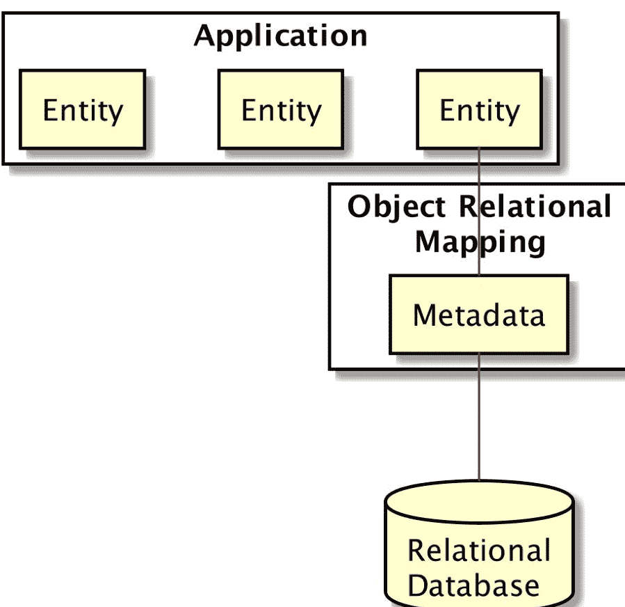

**图 1. 将对象映射到关系型数据库**

## 关系型数据库

关系模型将数据组织在一个或多个由列和行组成的表中，用唯一键标识每一行。行也被称为记录（records）或元组（tuples）。通常，每个表代表一种实体类型（如书籍、作者或订单）。但在某些情况下，它可以代表多个实体（例如继承，你将在第 4 章中看到）。行代表该类型实体对象的实例（例如书籍《H2G2》或《设计模式》），列则代表该实例的属性值（例如书名或价格）。

NoSQL（不仅是 SQL）数据库（或无模式数据库）的新时代已经出现，具有不同的存储结构：键值、列族、文档或图谱。目前，JPA 无法将实体映射到这些结构中。Hibernate OGM 是一个尝试解决对象映射到非关系型数据库的开源框架。[3] EclipseLink 也有一些映射 NoSQL 结构的扩展。[4] Hibernate OGM 或 Eclipse 扩展超出了本小册的讨论范围，但如果你计划使用 NoSQL 数据库，应该查看一下它们。

你会如何将代表书籍的数据存储到关系型数据库中呢？列表 2 显示了一个创建此类表的 SQL 脚本。

**列表 2. 创建 BOOK 表结构的 SQL 脚本**

```sql
CREATE TABLE BOOK
(
  ID BIGINT NOT NULL,
  DESCRIPTION VARCHAR,
  ILLUSTRATIONS BOOLEAN,
  ISBN VARCHAR,
  NOBOFPAGES INTEGER,
  PRICE DOUBLE,
  TITLE VARCHAR,
  PRIMARY KEY (ID)
)
```

数据定义语言（DDL，或数据描述语言）使用特定的语法来定义数据库结构。BOOK 表是我们存放应用程序中所有书籍的地方。每本书都通过一个唯一的主键列（`PRIMARY KEY (ID)`）来标识，每个属性都存储在列中（例如 `TITLE`、`PRICE`、`ISBN` 等）。表中的列有一个类型（例如 `VARCHAR`、`INTEGER`、`BOOLEAN` 等），并且可以接受空值或不允许（`NOT NULL`）。

## 实体

在将对象映射到关系型数据库、持久化对象或查询对象时，应该使用*实体*（entity）一词而不是*对象*（object）。对象仅存在于内存中的实例。实体是短暂存在于内存并持久化存储在关系型数据库中的对象。它们具有映射到数据库的能力；可以是具体的也可以是抽象的；并且它们支持继承、关系等。

在 JPA 持久模型中，实体是一个*简单的旧 Java 对象*（POJO）。这意味着实体的声明、实例化和使用与任何 Java 类完全一样。实体通常具有属性（其状态）、可以有业务方法（其行为）、构造函数、getter 和 setter。列表 3 显示了一个简单的实体。

**列表 3. 书籍实体的简单示例**

```java
@Entity
public class Book {

    @Id
    @GeneratedValue
    private Long id;
    private String title;
    private Float price;
    private String description;
    private String isbn;
    private Integer nbOfPages;
    private Boolean illustrations;

    // Constructors, getters, setters
}
```


列表 3 中的示例代表一个 `Book` 实体，为了清晰起见，我省略了 getter 和 setter。正如你所看到的，除了一些注解外，这个实体看起来和任何 Java 类完全一样：它有多个不同类型（`Long`、`String`、`Float`、`Integer` 和 `Boolean`）的属性（`id`、`title`、`price` 等），一个默认构造函数，以及每个属性的 getter 和 setter。那么，这会映射到表吗？答案是：得益于映射。

## 映射实体

对象关系映射（ORM）的原理是将创建对象与表之间对应关系的任务委托给外部工具或框架（在我们的案例中是 JPA）。然后，类、对象和属性的世界就可以映射到由包含行和列的表组成的关系型数据库。映射为开发者提供了面向对象的视图，他们可以透明地使用实体而不是表。那么 JPA 是如何将对象映射到数据库的呢？如图 1 所示，这是通过元数据实现的。每个实体都关联有描述映射的元数据。元数据可以用两种格式编写：

- 注解：直接在实体代码中编写（见列表 3）。
- XML 描述符：除了注解之外，我们使用 XML 描述符。映射定义在与实体一起部署的文件中（见第 3 章）。

这些实体一旦完成映射，就可以由 JPA 管理。你可以将实体持久化到数据库、删除它或查询它。列表 3 中的 `Book` 实体使用 JPA 注解，以便持久化提供者同步实体属性与列之间的数据。因此，如果应用程序更新了属性，`ISBN` 列将进行同步（见图 2）。正如你将在第 5 章看到的，这种同步取决于实体的生命周期，可以是自动或程序的。

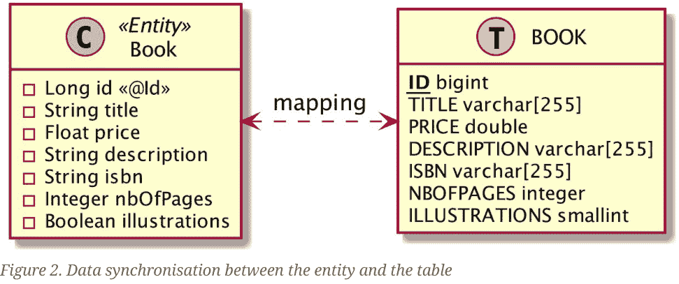

如列表 2 所示，`Book` 实体映射到 `BOOK` 表，每一列都根据类的属性命名（例如类型为 `String` 的 `isbn` 属性映射到类型为 `VARCHAR` 的 `ISBN` 列）。

在本册中，Java 代码使用驼峰命名（例如 `Book` 实体、`isbn` 属性），SQL 脚本使用大写命名（例如 `BOOK` 表、`ISBN` 列）。

如果没有 JPA 和元数据，列表 3 中的 `Book` 实体将被视为 POJO 而不会被持久化。这就是规则：如果没有给出特殊配置，将应用默认值，而持久化提供者的默认值是 `Book` 类没有数据库表示。但由于你需要更改这种默认行为，因此你在类上标注了 `@Entity`。标识符也是如此。你需要一种方法告诉持久化提供者 `id` 属性必须映射到主键，因此你为它标注了 `@Id`。该标识符的值由持久化提供者自动生成，使用了可选的 `@GeneratedValue` 注解。这种决策体现了基于异常的配置方法，即在常见情况下不需要注解，注解仅作为外部提供者理解的元数据使用。

JPA 允许我们将实体映射到表，并允许使用不同的标准对它们进行查询。JPA 的强大之处在于，它提供了以面向对象的方式查询实体及其关系的能力，而无需开发者无需使用底层数据库的外键或列。负责编排实体的 API 核心部分是 `java.persistence.EntityManager`。它的作用是管理实体、从指定的数据库读取和写入数据，并允许对实体进行简单的 CRUD（创建、读取、更新和删除）操作，以及使用 JPQL（参见第 6 节中的更强大的 Java 持久化查询语言）进行复杂查询。从技术角度来说，实体管理器只是一个接口，其实现由持久化提供者（例如 EclipseLink 或 Hibernate）完成。在核心部分，实体管理器将所有低级调用委托给 JDBC，为开发者带来了更高层次的抽象。

> 本章节使用的 JPA 实现（即持久化提供者）是 EclipseLink 2.7.x。[5]

在图 3 中，你可以看到 `EntityManager` 接口如何被类（这里是 `Main`）使用来操作实体（在这种情况下，是 `Book`）。通过 `persist()` 和 `find()` 等方法，实体管理器隐藏了对数据库的 JDBC 调用以及 `INSERT` 或 `SELECT` SQL（结构化查询语言）语句。

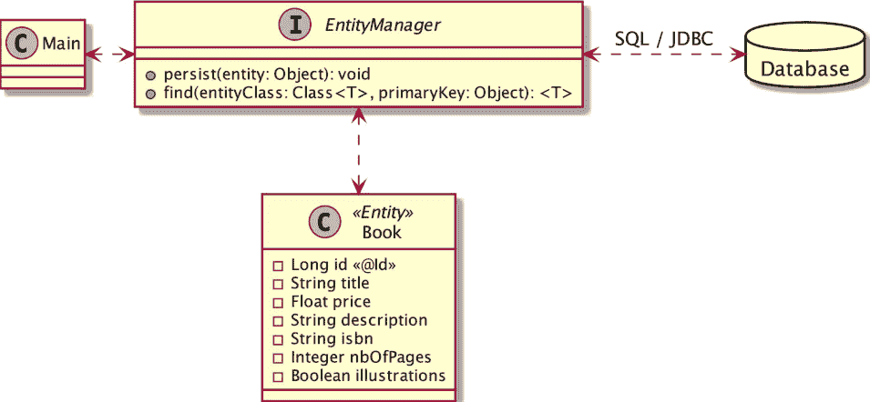

图 3 实体管理器与实体以及底层数据库的交互

# JPA 概述

在 Java 世界，有框架和规范可以实现对象关系映射，例如 Hibernate、TopLink 或 Java Data Objects (JDO)，但 Java Persistence API (JPA) 是首选技术。

Java Persistence API (JPA) 是一种 Java 语言的规范，用于管理存储在关系型数据库中的对象。[61] JPA 为开发者提供了一个面向对象的视图，以便透明地使用而不是表。它还带有一个查询语言（Java 持久化查询语言，或 JPQL），允许对对象进行复杂查询。

JPA 只是 Java EE 的一部分规范，并由 JCP（Java 社区进程）管理。它随后由 EclipseLink、Hibernate 或 Open JPA 等框架实现。

## JPA 简史

ORM 解决方案已经存在很长时间，甚至在 Java 出现之前就已经有了。像 TopLink 这样的产品最初在 1994 年从 Smalltalk 开始，然后切换到 Java。[77] 像 TopLink 这样的商业 ORM 产品从 Java 语言的早期就已经可用。它们非常成功，但从未在 Java 平台上实现标准化。一种类似的 ORM 方法以 JDO (Java Data Objects) 的形式进行了标准化，但未能获得任何显著的市场渗透率。[8]

1998 年，EJB（企业级 Bean）1.0 被创建，并随后随 J2EE（Java 企业版）1.2一起发布。它是一个重量级的、分布式的组件，用于事务业务逻辑。Entity Bean CMP（容器管理持久化）在 EJB 1.0 中作为可选引入，在 EJB 1.1 中变为强制性，并通过版本不断增强到 EJB 2.1 (J2EE 1.4)。[9] 持久化只能在容器内部通过一种使用 `home`、`local` 或远程接口的复杂实例化机制进行。ORM 的能力也非常有限，因为继承很难映射。

与 J2EE 世界并行的是一种流行的开源解决方案，它导致了持久化方向发生了一些意想不到的变化：Hibernate，它带回了轻量级的、面向对象的持久化模型。[10]

在对 Entity CMP 2.x 组件进行了多年抱怨后，并承认 Hibernate 等开源框架的成功和简单性，企业版的持久化模型在 Java EE 5 中完全重新了架构设计。JPA 1.0 以一种轻量级的方法创建，采用了许多 Hibernate 设计原则。JPA 1.0 规范与 EJB 3.0 (JSR 220) 绑定。[11] 2009 年，JPA 2.0 (JSR 317) 随 Java EE 6 发布，带来了新的 API、扩展的 JPQL，并添加了如二级缓存、悲观锁或 Criteria API 等新功能。[12] 2013 年，随着 Java EE 7，遵循了易于开发的路径，并在 JSR 338 中引入了模式生成、转换器和 CDI 支持等新特性。

## JPA 2.2 有什么新内容？

JPA 2.2 在 JSR 338 下描述，并于 2017 年发布。[20] 它在 2017 年随 Java EE 8 发布，但它是一个维护版本，意味着它与 JPA 2.1 相同的 JSR（仍为 JSR 338）。维护版本意味着规范的演进并不大，因此不需要新的 JSR。JPA 2.2 的更改为：

- 增加了对 Java SE 8 Lambda 和 Stream 的支持。
- 为 JPA 注解添加了 `@Repeatable` 元注解。
- 在 `AttributeConverter` 类中支持 CDI 注入。
- 支持对新的 `java.time` 类型（例如 `LocalDate`、`LocalTime` 等）映射。[21]
- 为 `Query` 和 `TypedQuery` 接口添加了默认的 `getResultStream()` 方法。

这些新特性大部分将在接下来的章节中进行讨论。

> 附录 B 列出了 Java 持久化 API（JPA）规范的所有修订和重大变更。

## 实现

EclipseLink 是 JPA 的开源参考实现。[22] 该项目基于 TopLink 产品，Oracle 贡献了源代码以创建 EclipseLink 项目。如如今，EclipseLink 2.7.x 实现了 JPA 2.2。它还添加了特定功能，因为它还通过 Java XML 绑定 (JAXB) 以及服务数据对象 (SDOs) 等手段支持 XML 持久化。它不仅提供 ORM 支持，还提供对象 XML 映射 (OXM)、使用 Java EE 连接器架构 (JCA) 将对象持久化到企业信息系统 (EIS) 以及数据库 Web 服务。

在编写本册时，EclipseLink 并不是唯一符合 JPA 2.2 的实现，还有其他。Hibernate ORM 是来自 RedHat 的著名的 JPA 实现。[23] 它被用于所有 RedHat 产品，包括 JBoss Application Server 或 Wildfly。

OpenJPA 是 Apache 的实现，并将很快实现 JPA 2.2。[24]

如你所见，尽管有参考实现（EclipseLink），你仍多个实现可以选择。

- [1 JDBC](https://www.oracle.com/technetwork/java/overview-141217.html)
- [2 SQL](https://fr.wikipedia.org/wiki/Structured_Query_Language)
- [3 Hibernate OGM](http://hibernate.org)
- [4 EclipseLink NoSQL 扩展](http://www.eclipse.org/EclipseLink/Examples/JPA/NoSQL)
- [5 EclipseLink](http://www.eclipse.org/eclisink/)
- [6 JPA](https://jcp.org/en/jsr/detail?id=338)
- [7 Toplink](http://www.oracle.com/technetwork/middleware/toplink)
- [8 JDO](https://jcp.org/en/jsr/detail?id=243)
- [9 EJB 2.1](https://jcp.org/en/jsr/detail?id=153)
- [10 Hibernate](http://hibernate.org)
- [11 JSR 220](https://jcp.org/en/jsr/detail?id=220)
- [12 JSR 317](https://jcp.org/en/jsr/detail?id=317)
- [13 JSR 338](https://jcp.org/en/jsr/detail?id=338)
- [14 Java EE 8](https://jcp.org/en/jsr/detail?id=366)
- [15 JCP](https://jcp.org)
- [16 JPA](https://jcp.org/en/jsr/detail?id=338)
- [17 Eclipse Foundation](https://www.eclipse.org/org/foundation)
- [18 Eclipse Foundation](https://www.eclipse.org/org/foundation/)
- [19 Jakarta EE](http://jakarta.ee)
- [20 JSR 338](https://jcp.org/en/jsr/detail?id=338)
- [21 JSR 310](https://jcp.org/en/jsr/detail?id=310)
- [22 EclipseLink link](http://www.eclipse.org/eclisink)
- [23 Hibernate ORM](http://hibernate.org/orm)
- [24 OpenJPA](http://openjpa.apache.org)

## 开始上手

在上一章中，你学习了持久化，以及为什么对象-关系映射工具对于将对象与关系型数据库结合时至关重要。你还查看了如何将对象与关系型数据库结合。

### 开发你的第一个应用

在这一章中，我们将使用 JPA 来构建一个简单的应用程序。如示例 1 所示，我们需要配置 `pom.xml` 文件以包含所需的依赖项。

该应用程序的项目结构如下：
- `User.java`
- `UserTest.java`
- `persistence.xml`
- `pom.xml`

### 配置 pom.xml

为了开始使用 JPA，我们需要在 `pom.xml` 中包含所需的依赖。如示例 1 所示，`pom.xml` 配置如下：

```xml


<project xmlns="http://maven.apache.org/POM/4.0.0"
         xmlns:xsi="http://www.w3.org/2001/XMLSchema-instance"
         xsi:schemaLocation="http://maven.apache.org/POM/4.0.0 http://maven.apache.org/xsd/maven-4.0.0.xsd">
    <modelVersion>4.0.0</modelVersion>
    <groupId>orgcal.fascicle</groupId>
    <artifactId>getting-started</artifactId>
    <version>2.2</version>
    <properties>
        <maven.compiler.source>1.8</maven.compiler.source>
        <maven.compiler.target>1.8</maven.compiler.target>
        <project.sourceEncoding>UTF-8</project.sourceEncoding>
    </properties>
    <dependencies>
        <dependency>
            <groupId>org.eclipse.persistence</groupId>
            <artifactId>org.eclipse.persistence.jpa</artifactId>
            <version>2.7.3</version>
        </dependency>
        <dependency>
            <groupId>com.h2</groupId>
            <artifactId>h2</artifactId>
            <version>1.4.197</version>
        </dependency>
    </dependencies>
</project>

### 定义实体类

`User.java` 是一个 JPA 实体。如示例 1 所示，我们使用 JPA 注解来定义它。

```java
package orgcal.fascicle;

import javax.persistence.*;

@Entity
@Table(name = "USERS")
public class User {
    @Id
    @GeneratedValue(strategy = GenerationType.IDENTITY)
    private Long id;
    private String name;

    public User() {}

    public User(String name) {
        this.name = name;
    }

    public Long getId() {
        return id;
    }

    public void setId(Long id) {
        this.id = id;
    }

    public String getName() {
        return name;
    }

    public void setName(String name) {
        this.name = name;
    }
}
```

### 配置 persistence.xml

我们需要在 `src/main/resources/META-INF/` 目录下创建 `persistence.xml` 文件来配置持久化单元。

```xml
<?xml version="1.0" encoding="UTF-8"?>
<persistence xmlns="http://xmlns.jcp.org/xml/ns/persistence"
             xmlns:xsi="http://www.w3.org/2001/XMLSchema-instance"
             xsi:schemaLocation="http://xmlns.jcp.org/xml/ns/persistence http://xmlns.jcp.org/xml/ns/persistence/persistence_2_2.xsd"
             version="2.2">
    <persistence-unit name="testPU">
        <provider>org.eclipse.persistence.jpa.PersistenceProvider</provider>
        <class>orgcal.fascicle.User</class>
        <properties>
            <property name="javax.persistence.jdbc.driver" value="org.h2.Driver"/>
            <property name="javax.persistence.jdbc.url" value="jdbc:h2:mem:testdb;DB_CLOSE_DELAY=-1"/>
            <property name="javax.persistence.jdbc.user" value="sa"/>
            <property name="javax.persistence.jdbc.password" value=""/>
            <property name="eclipselink.schema-generation.action" value="drop-and-create"/>
            <property name="logging.level" value="INFO"/>
        </properties>
    </persistence-unit>
</persistence>
```

### 编写单元测试

`UserTest.java` 使用 JUnit 5 来测试持久化功能。

```java
package orgcal.fascicle;

import org.junit.jupiter.api.BeforeEach;
import org.junit.jupiter.api.Test;
import javax.persistence.EntityManager;
import javax.persistence.EntityManagerFactory;
import javax.persistence.Persistence;
import static org.junit.jupiter.api.Assertions.*;

public class UserTest {
    private static EntityManagerFactory emf;
    private EntityManager em;

    @BeforeEach
    public void setup() {
        if (emf == null) {
            emf = Persistence.createEntityManagerFactory("testPU");
        }
        em = emf.createEntityManager();
    }

    @Test
    public void testSaveAndFind() {
        em.getTransaction().begin();
        User user = new User("Alice");
        em.persist(user);
        em.getTransaction().commit();

        em.getTransaction().begin();
        User found = em.find(User.class, user.getId());
        assertNotNull(found);
        assertEquals("Alice", found.getName());
        em.getTransaction().commit();
    }
}
```

## 运行测试

现在你可以运行测试来验证持久化是否工作正常。

```bash
mvn test
```

```
+- org.eclipse.persistence:javax.persistence.jar:2.2.1:compile
| +
org.eclipse.persistence:org.eclipse.persistence.asm:jar:2.7.3:compile
| +-
org.eclipse.persistence:org.eclipse.persistence.antlr:jar:2.7.3:compile
| +- java.json:java-json-api:jar:1.1.2:compile
| +-
org.eclipse.persistence:org.eclipse.persistence.jpa:jar:2.7.3:compile
| \-\org.eclipse.persistence:org.eclipse.persistence.core:jar:2.7.3:compile
+- com.h2database:h2:jar:1.4.197:compile
\- org.junit.jupiter:junit-jupiter-engine:jar:5.3.2:test
+- org.apiguardian:apiguardian-api:jar:1.0.0:test
+- org.junit.platform:junit-platform-engine:jar:1.3.2:test
+- org.junit.platform:junit-platform-commons:jar:1.3.2:test
\- org.opentest4j:opentest4j:jar:1.1.1:test
\- org.junit.jupiter:junit-jupiter-api:jar:5.3.2:test
```

附录 A 有一个关于 Maven 的完整章节，解释了范围（运行时、测试等）以及你可以在 `pom.xml` 中使用的目标。如果你需要关于 Maven 的更深入的信息，请参考该章节。

## 映射实体

让我们深入一个示例，看看如何将实体映射到关系型数据库中。在列表 5 中，我们有一个具有多个属性的 `Artist` 类。出现在 CD 专辑上的艺术家有名字、姓氏、电子邮件地址、简介和出生日期。这段代码非常直观。`Artist` 类没有继承任何类，也没有实现任何接口。它有一个默认构造函数、getter 和 setter。该类与普通 Java 代码的唯一区别在于在这些属性上使用了注解。

列表 5. 使用映射注解标记的 Artist 类

```java
@Entity
public class Artist {
    @Id
    @GeneratedValue
    private Long id;

    @Column(nullable = false)
    private String firstName;

    @Column(nullable = false)
    private String lastName;

    private String email;

    @Column(length = 2000)
    private String bio;

    private LocalDate dateOfBirth;

    // Constructors, getters, setters
}
```

`@Id`、`@GeneratedValue` 和 `@Column` 注解用于声明对象关系映射，这些映射应该应用于 `Artist` 实例的属性上：

- 艺术家属性 `id` 映射到 `ARTIST` 表的主键列，其值由 JPA 提供者自动生成，
- 艺术家的 `firstName` 和 `lastName` 不得为空，
- `email` 属性没有映射注解（因此将使用默认映射，正如你在第 4 章中看到的那样），
- 简介 `bio` 可以为空，但如果不为空，其长度必须小于 2000 个字符，并且
- 出生日期使用 `java.time.LocalDate` 格式。

这段代码非常易读。JPA 注解为这些属性带来了语义化（`lastName` 属性不仅仅是映射到一个 `VARCHAR` 列，它必须映射到一个不能为空的 `VARCHAR` 列），同时也提供了一个验证这些属性值的运行时 API。

# 管理实体

我们使用 `javax.persistence.EntityManager` API 来操作实体并查看映射的实际效果。为了演示这一点，让我们来看简单的单元测试：`ArtistTest`。

在列表 6 中，我们定义了三个属性（`EntityManagerFactory emf`、`EntityManager em` 和 `EntityTransaction tx`），它们在 `init()` 方法中初始化（得益于 JUnit `@BeforeAll` 注解）。`@BeforeAll` 和 `@AfterAll` 注解允许在测试执行前后后执行某些代码。`init()` 方法使用 `Persistence` 类获取名为 `cdbookstorePU` 的持久化单元的 `EntityManagerFactory` 实例。这个工厂创建一个 `EntityManager` 实例（`em` 变量），我们在 `close()` 方法中关闭它。

列表 6. 初始化 JPA 提供者的测试类

```java
public class ArtistTest {
    private static EntityManagerFactory emf;
    private static EntityManager em;
    private static EntityTransaction tx;

    @BeforeAll
    static void init() {
        emf = Persistence.createEntityManagerFactory("cdbookstorePU");
        em = emf.createEntityManager();
        tx = em.getTransaction();
    }

    @AfterAll
    static void close() {
        if (em != null) em.close();
        if (emf != null) emf.close();
    }
}
```

现在，让我们使用 `EntityManager` API 从数据库中持久化、查找和删除艺术家。在列表 7 中，我们创建一个具有名字、姓氏但没有 ID（`id` 为空）的艺术家实例。`EntityManager.persist()` 方法将艺术家对象持久化到数据库中。一旦事务提交，我们检查 `id` 是否不再为空。为了完成我们的测试，我们使用 `EntityManager.find()` 方法通过标识符查找艺术家，以确保数据库中有一个。然后，使用 `EntityManager.remove()` 从数据库中删除艺术家。这一次，`EntityManager.find()` 返回零（因为它已经被删除了）。

列表 7. 管理艺术家的测试用例

```java
Artist artist = new Artist("Adams").lastName("Douglas");
assertNull(artist.getId(), "Id should be null");

tx.begin();
em.persist(artist);
tx.commit();

assertNotNull(artist.getId(), "Id not be null");
assertNotNull(em.find(Artist.class, artist.getId()), "Artist should have been persisted in DB");

tx.begin();
em.remove(artist);
tx.commit();

assertNull(em.find(Artist.class, artist.getId()), "Artist should have been removed from DB");
```

在列表 8 中，我们创建一个名字为空的艺术家对象。`firstName` 上的 `@Column(nullable = false)` 注解确保它不能为空。因此，当尝试将艺术家持久化到数据库时，提供者抛出了 `RollbackException`。

列表 8. 名字为空

```java
Artist artist = new Artist().firstName(null);
tx.begin();
assertThrows(RollbackException.class, () -> {
    em.persist(artist);
    tx.commit();
});
```


# 查询实体

但持久化、通过标识符查找或从数据库删除实体并不是我们使用 JPA 可以做的所有操作。事实上，JPA 自带名为 JPQL（Java Query Language）的查询语言。列表 9 展示了我们如何使用查询。

在列表 9 中，我们首先确保在执行任何操作之前数据库是空的。这是通过查询艺术家数量并确保结果为零来实现的。然后向数据库持久化两个艺术家并执行相同的查询：结果为二。正如你在最后一个查询中看到的，我们查找名字为 `Adams` 的艺术家，结果为一。这只是 JPQL 的一角。

**列表 9. 查询艺术家**

```java
assertEquals(0, em.createQuery("select a from Artist").size());

Artist douglas = new Artist().firstName("Adams").lastName("Douglas");

Artist lovecraft = new Artist().firstName("Howard").lastName("Lovecraft");

em.persist(douglas);

em.persist(lovecraft);

tx.commit();

assertEquals(2, em.createQuery("select a from Artist").size());

assertEquals(1, em.createQuery("select a from Artist where a.firstName = 'Adams'").size());
```

# 部署描述

我们应该使用哪个 JDBC 驱动？我们应该如何连接数据库？数据库的名称是什么？之前的代码中缺少这些信息。

在列表 6 中，我们使用字符串 `cdbookstorePU` 初始化 `EntityManagerFactory`。`cdbookstorePU` 是列表 10 中定义的持久化单元名称。这个 XML 文件是 JPA 提供者（在我们的例子中为 EclipseLink）连接数据库（H2）所需的，包含了连接 `cdbookstoreDB` 的所有必要信息，如 URL 或 JDBC 驱动。

**列表 10. JPA 部署描述**

```xml
<persistence xmlns="http://www.w3.org/2001/XMLSchema-instance"
     xmlns="http://xmlns.jcp.org/xml/ns/persistence"
     xsi:schemaLocation="http://xmlns.jcp.org/xml/ns/persistence http://xmlns.jcp.org/xml/ns/persistence/persistence_2_2.xsd"
     version="2.2">
 <persistence-unit name="cdbookstorePU" transaction-type="RESOURCE_LOCAL">
  <provider>org.eclipse.persistence.jpa.PersistenceProvider</provider>
  <class>org.agoncal.fasciele.jpa.gettingstarted.Artist</class>
  <properties>
   <property name="javax.persistence.jdbc.driver" value="org.h2.Driver"/>
   <property name="javax.persistence.jdbc.url" value="jdbc:h2:tcp://localhost/~cdbookstoreDB/"/>
   <property name="javax.persistence.schema-generation.database" value="drop"/>
  </properties>
 </persistence-unit>
</persistence>
```

```xml
<generation.database.action value="drop-and-create"/>
  <property name="javax.persistence.schema-generation.scripts.action" value="drop-and-create"/>
  <property name="javax.persistence.schema-generation.scripts.create-target" value="cdbookstoreCreate.ddl"/>
  <property name="javax.persistence.schema-generation.scripts.drop-target" value="cdbookstoreDrop.ddl"/>
</persistence-unit>
</persistence>
```

在 JPA 中，部署描述符文件称为 `persistence.xml`。它还定义了各种属性，例如数据库架构生成模式：例如，`drop-and-create` 意味着表将被删除然后重新创建。

注意列表 10 中的 `<provider>` 标签。它给出了运行代码时使用的 JPA 实现。在我们的案例中，它是 EclipseLink，这就是为什么值为 `org.eclipse.persistence.jpa.PersistenceProvider` 的原因。因此，要切换实现（例如，使用 Hibernate 或 Open JPA 代替 EclipseLink），只需更改类名。例如，如果我们想用 Hibernate 运行我们的代码，只需像这样更改实现类：

```xml
<persistence-unit name="cdbookstorePU" transaction-type="RESOURCE_LOCAL">
  <provider>org.hibernate.jpa.HibernatePersistenceProvider</provider>
```

## 运行测试

我们有 `Artist` 类、它的测试用例（`ArtistTest`）、部署描述符 `persistence.xml` 和 `pom.xml`。现在是运行测试的时间了。根据你使用的 IDE，执行测试可能只需点击按钮即可。

但得益于 Maven，我们可以在命令行中使用通过 `mvn test` 命令执行它们。只需编译类并运行测试就足够。但遗憾的是，所有的测试都将失败，你会看到下面的异常：

```
Internal Exception: org.h2.jdbc.SQLException:
Connection is broken: "java.net.ConnectException:
Connection refused (Connection refused): localhost
```

这是因为 H2 数据库没有运行。因此，请确保已安装 H2（参见附录 A），执行它（使用 `h2` 命令）并再次运行测试（`mvn test`）。你应该看到以下输出：

```
[INFO] ---
[INFO] Building Getting Started
[INFO] ---
[INFO] ---
[INFO] -- maven-compiler-plugin:3.7.0:compile (default-compile)
[INFO] ---
[INFO] -- maven-surefire-plugin:2.22.1:test (default-test)
[INFO] ---
[INFO] ---
[INFO] TESTS ---
[INFO] ---
[INFO] Running org.agoncal.fascicle.jpa.gettingstarted.ArtistTest
[INFO] Tests run: 3, Failures: 0, Errors: 0, Skipped: 0, Time elapsed: 1.031 s
[INFO] ---
[INFO] Results:
```

```
[INFO]
[INFO] Tests run: 3, Failures: 0, Errors: 0, Skipped: 0
[INFO]
[INFO] -----
[INFO] BUILD SUCCESS
```

结果非常重要：运行了 3 个测试，并且它们都通过了。如果你有相同的输出，意味着你的环境已运行正常，你已经准备好编写更多的 JPA 代码了。

## 检查数据库

得益于 `persistence.xml` 文件中的 `javax.persistence.schema-generation.database.action` 属性（参见列表 10），一旦执行测试，数据库就会自动创建。为了可视化其内容，我们可以使用 H2 控制台。当你执行 `h2` 命令时，浏览器会打开一个带有 http://localhost:8082 的页面显示 H2 控制台。该控制台允许你通过浏览器界面访问 `cdbookstoreDB`。现在现在输入任何 SQL 语句来可视化数据。例如，在图 1 中输入 `SELECT * FROM ARTIST` 来显示 `ARTIST` 表的内容。

```
| | Auto commit | Max rows: 1000 | | Auto complete Off | Auto select On | ? |
|---|---|---|---|---|---|---|
| jdbch2:http://localhost~/cdbooks Run Run Selected Auto complete Clear SQL statement: | | | | | | | |
| ARTIST | | | | | | | |
| SEQUENCE | | | | | | | |
| INFORMATION_SCHEMA | | | | | | | |
| Users | | | | | | | |
```

```
| | Auto commit | Max rows: 1000 | | Auto complete Off | Auto select On | ? |
|---|---|---|---|---|---|---|
| jdbch2:http://localhost~/cdbooks Run Run Selected Auto complete Clear SQL statement: | | | | | | | |
| ARTIST | | | | | | | | |
| SEQUENCE | | | | | | | | |
| INFORMATION_SCHEMA | | | | | | | | |
| Users | | | | | | | | |
```

`SELECT * FROM ARTIST`

| ID | DATEBIRTH | EMAIL | LASTNAME |
|---|---|---|---|
| null | null | null | Adams |
| null | null | null | Douglas |
| null | null | null | Lovecraft |

(3 rows affected)

```
| ID | DATEBIRTH | EMAIL | LASTNAME |
|---|---|---|---|
| null | null | null | Adams |
| null | null | null | Douglas |
| null | null | null | Lovecraft |
```

H2 控制台执行结果：

```
| | Auto commit | Max rows: 1000 | | Auto complete Off | Auto select On | ? |
|---|---|---|---|---|---|---|
| jdbch2:http://localhost~/cdbooks Run Run Selected Auto complete Clear SQL statement: | | | | | | | |
| ARTIST | | | | | | | | |
| SEQUENCE | | | | | | | | |
| INFORMATION_SCHEMA | | | | | | | | |
| Users | | | | | | | | |
```

## 生成架构

由于 `persistence.xml` 文件中的 `javax.persistence.schema-generation.database.action` 属性（参见列表 10），一旦执行测试，数据库就会自动创建。由于你执行 `h2` 命令时，浏览器会打开一个带有 http://localhost:8082 的页面显示 H2 控制台。该控制台允许你通过浏览器界面访问 `cdbookstoreDB`。现在你可以输入任何 SQL 语句来可视化数据。例如，在图 1 中输入 `SELECT * FROM ARTIST` 来显示 `ARTIST` 表的内容。

```
| ID | DATEBIRTH | EMAIL | LASTNAME |
|---|---|---|---|
| null | null | null | Adams |
| null | null | null | Douglas |
| null | null | null | Lovecraft |
```

# 实体解剖

正如列表 5 所示，要使类成为实体，必须标记 `@javax.persistence.Entity`，这允许持久化程序将其识别为持久类，而不是简单的 POJO。由于 JPA 是将对象映射到关系表，对象需要一个 `Id` 来映射到主键。实体也可以拥有业务方法，不需要实现任何接口或继承任何类。事实上，实体必须标记 `@javax.persistence.Entity`（或在描述符中标记为实体）。

- 必须使用 `@javax.persistenceId` 注解来标识至少一个主键。
- 实体类必须有一个公共或受保护的无参数构造函数。实体类也可以有其他构造函数。
- 实体类必须是一个顶层类。枚举（`enum`）或接口（`interface`）不能被指定为实体。
- 实体类不能是 `final` 的。实体类的任何方法或持久化实例变量都不能是 `final` 的。
- 如果必须作为离散对象（detached object）按值传递实体实例（例如通过远程接口），实体类必须实现 `Serializable` 接口。但 JPA 并不强制这样做。

## 实体生命周期

实体仅仅是 POJO。POJO 并不是实体。这意味着实体有一个生命周期，如图 4 所示。当实体管理器（entity manager）管理一个 POJO 时，它就变成了托管实体，因此具有了持久化标识（一个唯一标识实例的键，等同于主键）。我们称之为实体。当实体未被管理时（即它与实体管理器分离，处于离散状态），可以像任何其他 POJO 一样使用。

当你使用 `new` 操作符创建一个 `Book` 实体的实例时，该对象存在于内存中，JPA 对它一无所知（它甚至会被垃圾回收）。当它被实体管理器托管时，实体会将状态与 `BOOK` 表同步。调用 `EntityManager.remove()` 方法会删除数据库中的数据，但 Java 对象会继续留在内存中，直到它被垃圾回收。

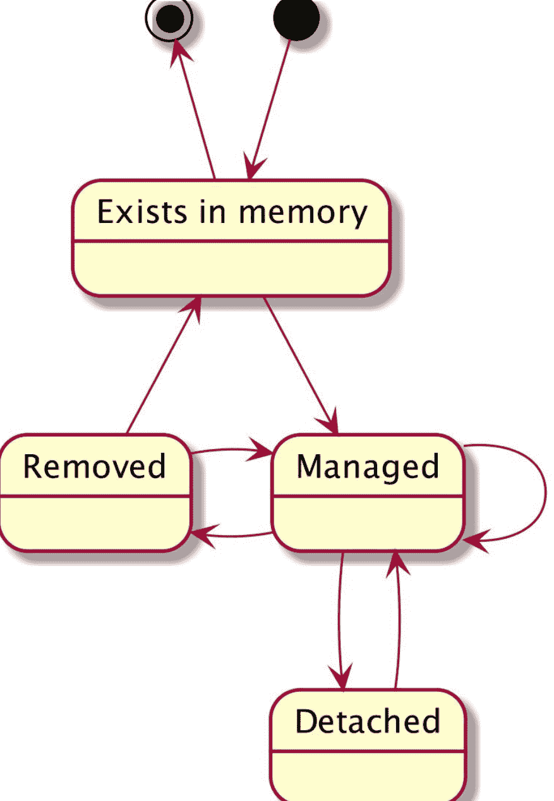


在实体上执行的操作分为四类——持久化、更新、删除和加载——分别对应数据库的插入、更新、删除和查询操作。JPA 允许在这些事件发生时将业务逻辑挂钩到实体上。这些钩子（hooks）可以设置在实体方法上（即回调方法），也可以设置在外部类中（即监听器）。你可以将回调方法和监听器比作关系型数据库中的触发器。关于回调方法和监听器的更多信息请参见第 7 章。

## 部署描述符

与许多 Java 技术一样，JPA 提供了一组 API，但也包含部署描述符。部署描述符（Deployment Descriptor, DD）指的是与代码一同部署的配置文件，用于配置或覆盖代码的部分。

如图 5 的图所示，JPA 提供了两种 XML 描述符：

- `META-INF/persistence.xml`：这是一个强制性文件，用于自定义默认 `EntityManagerFactory` 的配置。它还可以聚合零或多个映射 XML 描述符。
- 映射描述符（Mapping descriptor）：到目前为止我们已经看到了注解，但 JPA 也允许你通过 XML 声明映射。该文件描述了对象关系映射，并与注解声明的方法紧密匹配。

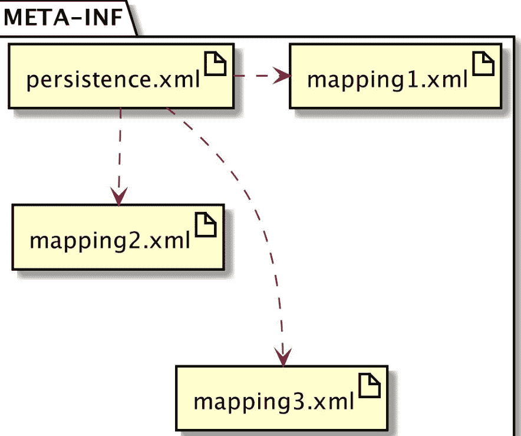

**图 5. JPA 部署描述符**

注意部署描述符位于应用程序的 `META-INF` 目录下。

## 持久化单元

`persistence.xml` 部署描述符是强制性的，如列表 13 所示。

**列表 13. persistence.xml**


```xml
<persistence>
  <persistence-unit name="transaction-type">
    <description/>
    <provider/>
    <jta-data-source/>
    <non-jta-data-source/>
    <mapping-file/>
    <jar-file/>
    <class/>
    <exclude-unlisted-classes/>
    <shared-cache-mode/>
    <validation-mode/>

    <properties>
      <property name="javax.persistence.lock.timeout" value=""/>
      <property name="javax.persistence.query.timeout" value=""/>
      <property name="javax.persistence.validation.group.persist" value=""/>
      <property name="javax.persistence.validation.group.pre-update" value=""/>
      <property name="javax.persistence.validation.group.pre-update" value=""/>

      <property name="javax.persistence.jdbc.driver" value=""/>
      <property name="javax.persistence.jdbc.url" value=""/>
      <property name="javax.persistence.jdbc.user" value=""/>
      <property name="javax.persistence.jdbc.password" value=""/>

      <property name="javax.persistence.schema-generation.action" value=""/>
      <property name="javax.persistence.schema-generation.database" value=""/>
      <property name="javax.persistence.schema-generation.create-target" value=""/>
      <property name="javax.persistence.schema-generation.drop-target" value=""/>
    </properties>
  </persistence-unit>
</persistence>
```

`persistence.xml` 部署描述符是强制性的，并在列表 13 中指定。列表 13 中 `persistence.xml` 的根元素是 `persistence` 元素。该元素由 `persistence-unit` 名称、`transaction-type` 属性以及以下子元素组成：

- `description`：提供可选的描述性信息
- `provider`：指定实现者的名称
- `jta-data-source`, `non-jta-data-source`：JTA 或非 JTA 数据源
- `mapping-file`, `jar-file`, `class`, `exclude-unlisted-classes`：实体、嵌入对象、超类和转换器类
- `shared-cache-mode`：决定是否启用共享缓存
- `validation-mode`：决定是否启用自动验证
- `properties`：用于指定标准和特定厂商属性
  - `javax.persistence.lock.timeout`：锁超时（毫秒）
  - `javax.persistence.query.timeout`：查询超时（毫秒）
  - `javax.persistence.validation.group.persist`, `pre-update`：针对验证的组
  - `javax.persistence.jdbc.driver`：驱动程序的全类名
  - `javax.persistence.jdbc.url`：驱动特定的 URL
  - `javax.persistence.jdbc.user`：数据库连接的用户名
  - `javax.persistence.jdbc.password`：数据库连接密码
  - `javax.persistence.schema-generation.action`：持久化实现对 DDL 生成采取的动作（`none`, `create`, `drop-create`, `drop`）
  - `javax.persistence.schema-generation.create-target`, `drop-target`：如果生成脚本，则创建和删除脚本的目标位置。

`persistence.xml` 部署描述符是强制性的，在列表 13 中指定。映射描述符的结构见列表 14。

关于映射描述符的更多信息请参见第 4 章。

现在你已经了解了对象关系映射的基础，运行了“Hello World”示例，并掌握了一些术语，让我们通过接下来的章节深入研究 JPA。

1. Maven https://maven.apache.org
2. JUnit http://junit.org

## 映射实体

在上一章中，我介绍了对象关系映射（ORM）的基础，基本上是将实体映射到表，将属性映射到列。我还引入了“异常配置”，允许 JPA 实现使用所有默认值将实体映射到数据库表。但默认值并不适用，特别是当你将领域模型映射到现有数据库时。JPA 提供了丰富的元数据，允许你自定义映射。

在本章中，我将涵盖基础映射，以及更复杂的映射，如关系、组合和继承。领域模型由相互作用的对象组成。对象和数据库存储关系信息的方式不同（对象中的引用和数据库中的外键）。继承并不是关系型数据库天然具有的功能，因此映射并不直观。

本章中的代码可以在 https://github.com/agoncal/agoncal-fascicle-jpa/tree/2.2/mapping 找到。

## 默认映射 (Default Mapping)

默认映射规则是“异常配置”（configuration by exception）原则的重要部分。Java EE 5 引入了这一思想（有时被称为异常编程或约定优于配置），它在今天仍然被广泛使用，特别是在 JPA 中。这意味着，除非另有说明，否则提供者应该应用默认规则。换句话说，必须提供配置是规则的例外。这允许你依赖提供者的默认值，编写最少的代码来让应用程序运行。如果你不想让提供者应用默认规则，可以使用元数据将映射自定义为你自己的。

这意味着，对于所有其他属性，将适用以下默认映射规则：

- 实体名称映射到关系型表名（例如，`Book` 实体映射到 `BOOK` 表）。如果你想将其映射到另一个表，将需要使用 `@Table` 注解，正如你稍后在“基础映射”部分看到的那样。
- 属性名称映射到列名（例如，`id` 属性或 `getId()` 方法映射到 `ID` 列）。如果你想更改此默认映射，将需要使用 `@Column` 注解。
- JDBC 规则适用于 Java 原始类型映射到关系数据类型。`String` 将映射到 `VARCHAR`，`Long` 将映射到 `BIGINT`，`Boolean` 将映射到 `SMALLINT`，依此类推。从 `String` 映射的列的默认大小为 255（`String` 映射到 `VARCHAR(255)`）。但请记住，默认映射规则在不同数据库之间是不同的。例如，`String` 在 H2 中映射到 `VARCHAR`，在 Oracle 中映射到 `VARCHAR2`。`Integer` 在 H2 中映射到 `INTEGER`，在 Oracle 中映射到 `NUMBER`。底层数据库的信息在 `persistence.xml` 文件中提供，你稍后会看到它。

## 基础映射 (Elementary Mapping)

Java 处理数据的方式与关系型数据库处理数据的方式存在显著差异。在 Java 中，我们使用类来描述用于持有数据的属性以及用于访问和操作数据的方法。一旦我们定义了一个类，就可以使用 `new` 关键字创建任意数量的实例。在关系型数据库中，数据存储在非对象结构（列和行）中，而动态行为以功能形式存储为表触发器和存储过程，它们不像对象那样与数据结构紧密绑定。有时，将 Java 对象映射到底层数据库可能是很容易的，可以应用默认规则。在其他时候，这些规则无法满足你的需求，你必须自定义映射。基础映射注解侧重于表、主键和列的自定义，它们允许你修改某些命名约定或类型（非空列、长度等）。

## 表 (Tables)

异常配置映射的规则规定实体名和表名是相同的（`Book` 实体映射到 `BOOK` 表，`AncientBook` 实体映射到 `ANCIENTBOOK` 表等）。这在大多数情况下可能适用于你的需求，但你可能想将数据映射到不同的表，甚至将单个实体映射到多个表。

### `@Table`

`@javax.persistence.Table` 注解使得更改与表相关的默认映射值成为可能。例如，你可以指定存储数据的表名、目录（catalogue）和数据库模式（schema）。你还可以通过与 `@Table` 注解结合使用 `@UniqueConstraint` 注解为表定义唯一性约束。如果省略 `@Table` 注解，则表名将是实体的名称。如果你想将名称更改为 `T_BOOK` 而不是 `BOOK`，你可以像示例 1 所示那样操作。

示例 1. 映射到 `T_BOOK` 的 `Book` 实体

```java
@Entity
@Table(name = "t_book")
public class Book {

  @Id
  private Long id;
  private String title;
  private Float price;
  private String description;
  private String isbn;
  private Integer numberOfOfPages;
  private Boolean illustrations;

  // Constructors, getters, setters
}
```

> 在 `@Table` 注解中，我包含了一个小写名称 (`t_book`)。默认情况下，大多数数据库将把实体映射到大写的表名，除非你配置了它们来区分大小写。

### `@SecondaryTable`

到目前为止，我假设一个实体映射到单个表，也称为主表（primary table）。但有时当你有一个现有的数据模型时，你可能需要将数据分散到多个表或从要表中。要做到这一点，你需要使用 `@SecondaryTable` 注解将从要表与实体关联。你只需通过注解定义从要表，然后为每个属性指定它属于哪个表，就可以将实体的数据分布在主表和从表的列中（使用 `@Column` 注解，我将在“属性”部分详细描述它）。示例 2 显示了 `Address` 实体将其属性映射到一个主表和两个从表。

示例 2. 在三个不同表中映射的 `Address` 实体属性

```java
@Entity
@SecondaryTable(name = "t_city")
@SecondaryTable(name = "t_country")
public class Address {
    @Id
    private Long id;
    private String street1;
    private String street2;
    @Column(table = "t_city")
    private String city;
    @Column(table = "t_city")
    private String state;
    @Column(table = "t_city")
    private String zipcode;
    @Column(table = "t_country")
    private String country;

    // Constructors, setters
}
```

你需要指定每个属性属于哪个表（使用 `@Column(table="t_city")` 或 `@Column(table="country")`）。图 1 显示了 `Address` 映射到三个表。

你现在可能已经理解，可以在同一个实体中使用多个注解。如果你想重命名主表，可以像示例 3 所示。

示例 3. 重命名的主表

```java
@Entity
@Table(name = "t_address")
@SecondaryTable(name = "t_city")
@SecondaryTable(name = "t_country")
public class Address {
    // Attributes, constructors, setters
}
```

当你使用从表时，必须考虑性能问题。每当你访问实体时，提供者都会访问多个表并进行连接。另一方面，当你有昂贵的属性（如二进制大对象 `BLOB`）想要隔离在不同的表中时，从表可能是很好的。

## 主键 (Primary Keys)

在关系型数据库中，主键唯一标识表中的每行。它由单列或一组列组成。主键必须唯一，不允许为空。主键的示例包括客户标识符、电话号码、订单引用或 ISBN。JPA 要求实体具有映射到主键的标识符，这将遵循相同的规则：通过单个属性或属性集唯一标识实体（复合键）。此实体的主键值一旦赋值就无法更新。

### `@Id` 和 `@GeneratedValue`

一个简单的（即非复合）主键必须对应实体类的单个属性。你之前看到的 `@Id` 注解用于标记简单主键。`@javax.persistence.Id` 注解一个属性为唯一标识符。它可以是以下类型之一：

- Java 原始类型：`byte`, `int`, `short`, `long`, `char`
- Java 原始类型的包装类：`Byte`, `Integer`, `Short`, `Long`, `Character`
- 原始类型或包装类型的数组：`int[]`, `Integer[]` 等
- 字符串、数字和日期：`java.lang.String`, `java.math.BigInteger`, `java.util.Date`, `java.sql.Date`, `java.time.LocalDateTime`, `java.time.LocalTime`, `java.time.OffsetDateTime`

在创建实体时，此标识符的值可以手动生成，也可以由提供者使用 `@GeneratedValue` 注解自动生成。该注解有四种可能的值。

- `SEQUENCE` 和 `IDENTITY` 指定数据库 SQL 序列或标识列，反之亦然。
- `TABLE` 指示持久化提供程序将序列名称存储在表中，每次持久化实体的新实例时都会增加该值。例如，EclipseLink 会创建一个包含两列的 `SEQUENCE` 表：序列名称（一个任意名称）和序列值（由 H2 自动递增的整数）。
- 键的生成由底层持久化提供程序自动完成（`AUTO`），它将为特定的数据库选择一种合适的策略（例如，EclipseLink 对 H2 数据库将使用 `TABLE` 策略）。`AUTO` 是 `@GeneratedValue` 注解的默认值。

注意，`id` 属性被标记了两次，一次使用 `@Id`，一次使用 `@GeneratedValue`。如果没有定义 `@GeneratedValue` 注解，应用程序必须通过应用任何返回唯一值的算法来创建自己的标识符。列表 4 中的代码显示了如何实现自动生成的标识符。由于 `GenerationType.AUTO` 是默认值，我可以省略 `strategy` 元素。

列表 4. 带有自动生成标识符的 `Book` 实体

```java
@Entity
public class Book {
  @Id
  @GeneratedValue(strategy = GenerationType.AUTO)
  private Long id;
  private String title;
  private Float price;
  private String description;
  private String isbn;
```


`private Integer numberOfPages;`

`private Boolean illustrations;`

`// Constructors, getters, setters`

```
}
```

## 复合主键

在映射实体时，将一个专用列指定为主键是一个良好做法。然而，在某些情况下，需要复合主键（例如，必须映射到遗留数据库，或者主键必须遵循业务规则，例如日期和值，或国家代码和时间戳）。为了实现这一点，必须定义一个主键类来表示复合键。然后，我们有两个可用的注解来定义此类类，取决于我们想要如何组织实体：`@EmbeddedId` 和 `@IdClass`。正如你所看到的，结果是相同的，你将拥有相同的数据库模式，但查询实体的方式略有不同。

假设 CD-BookStore 需要在主页频繁发布新闻，你可以在那里看到有关书籍、音乐或艺术家的每日新闻。新闻包含内容、标题，并且因为可以用多种语言编写，所以包含语言代码（EN 代表英语，PT 代表葡萄牙语等）。新闻的主键可以是标题和语言代码，因为文章可以翻译成多种语言但保留其原始标题。因此，主键类 `NewsId` 由两个 `String` 类型的属性组成：`title` 和 `language`。主键类必须包含 `equals()` 和 `hashCode()` 方法定义，以便管理查询和内部集合（内部集合的等效性，这些方法必须与数据库等效性一致），并且它们的属性必须在之前列出的有效类型集中。它们必须是公共的，如果它们需要跨越架构层则需要实现 `Serializable`（例如，它们将由持久化层管理并在表示层中使用），并且有一个无参构造函数。

### @EmbeddedId

正如你将在本章稍后看到的，JPA 使用不同类型的嵌入对象。总而言之，嵌入对象没有标识性（没有自己的主键），它的属性最终将成为包含它的实体表中的列。

列表 5 将 `NewsId` 类显示为一个可嵌入类。它只是一个嵌入对象（标记了 `@Embeddable` 注解），恰好由两个属性（`title` 和 `language`）组成。该类必须有无参构造函数、getter、setter、`equals()` 和 `hashCode()` 实现；也就是说，它需要遵循 JavaBean 规范。该类本身没有自己的标识性（没有 `@Id` 注解）。这是可嵌入类的特征。

**列表 5. 主键类被标记了 @Embeddable 注解**

```
@Embeddable

public class NewsId implements Serializable {

    private String title;

    private String language;

    // Constructors, getters, setters, equals, and hashcode

}
```

列表 6 显示的 `News` 实体随后必须使用 `@EmbeddedId` 注解嵌入主键类 `NewsId`。通过这种方法，不需要使用 `@Id`。每个 `@EmbeddedId` 都引用一个标记为 `@Embeddable` 的可嵌入类。

**列表 6. 实体通过 @EmbeddedId 嵌入主键类**

```
@Entity

public class News {

  @EmbeddedId

  private NewsId id;

  private String content;

  // Constructors, getters, setters, equals, and hashcode

}
```

在下一章中，我将描述如何使用复合主键查找实体。作为初探了解，其工作原理如下：主键是一个带有构造函数的类。你必须使用形成唯一键的值来实例化此类类，并按照下面的代码将此对象传递给实体管理器（`em` 属性）：

```
NewsId pk = new NewsId("Richard Wright has died on September 2008", "EN")

News news = em.find(News.class, pk)
```

### @IdClass

声明复合键的另一种方法是通过 `@IdClass` 注解。主键是一个带有构造函数的类。

使用这种方法时，列表 7 中的复合主键 `NewsId` 是一个 POJO，不需要任何注解（在之前的示例中，它使用了 `@EmbeddedId`）。

**列表 7. 无注解的主键类**

```java
public class NewsId implements Serializable {

    private String title;

    private String language;

    // Constructors, getters, setters, equals, and hashcode

}
```

然后，列表 8 所示的实体 `News` 必须使用 `@IdClass` 注解定义主键，并对每个属性使用 `@Id`。

**列表 8. 使用 @IdClass 注解的实体**

```java
@Entity

@IdClass(NewsId.class)

public class News {

    @Id

    private String title;

    @Id

    private String language;

    private String content;

    // Constructors, getters, setters, equals, and hashcode

}
```

两种方法（`@EmbeddedId` 和 `@IdClass`）将映射到相同的表。这种结构在列表 9 使用数据定义语言 (DDL) 定义。实体的属性和主键位于同一个表中，主键由复合类的属性（`title` 和 `language`）组成。

**列表 9. 带有复合主键的 NEWS 表 DDL**

```sql
CREATE TABLE NEWS

(

  LANGUAGE VARCHAR NOT NULL,

  TITLE VARCHAR NOT NULL,

  CONTENT VARCHAR,

  PRIMARY KEY (LANGUAGE, TITLE)

)
```

当然，一个实体也可以另一个实体作为属性，或者实体的集合。但这需要引入实体之间的关系，这将在“关系映射”部分中介绍。

正如你所看到的，通过异常配置，属性是使用默认映射规则映射的。然而，有时你需要对这些映射的部分进行自定义。这就是 JPA 注解（或其 XML 等效写法）大显用场。

## @Basic

可选的 `@javax.persistence.Basic` 注解（见列表 10）是将属性映射到数据库列的最简单映射类型。

**列表 10. @Basic 注解元素**

```
@Target({METHOD, FIELD})

@Retention(RUNTIME)

public @interface Basic {

    FetchType fetch() default EAGER;

    boolean optional() default true;

}
```

该注解有两个参数：`optional` 和 `fetch`。`optional` 元素提供了关于属性是否可能为 null 的提示。对于基本类型，它会被忽略。`fetch` 元素可以取两个值：`LAZY` 或 `EAGER`。它向持久化提供运行时提供提示，说明数据应该是延迟加载的（仅当应用程序请求该属性时）还是积极加载的（当实体被提供程序初始加载时）。

提示指定了应用程序的一种偏好。虽然提供程序会尽可能遵守由其定义的提示，但提示可能并不总是会被遵守。一个可移植的应用程序不能依赖于提示的遵守。

例如，考虑列表 11 所示的 `Track` 实体。一张 CD 专辑由若干曲目组成，每条曲目都有标题、描述以及一个可以听的特定时长的 WAV 文件。WAV 文件是一个 BLOB（二进制大对象），长度可能有几兆字节。当你访问 `Track` 实体时，你不想积极加载 WAV 文件；你可以用 `@Basic(fetch = FetchType.LAZY)` 注解该属性，这样数据将从数据库延迟检索（例如，仅当你使用 getter 访问 `wav` 属性时）。

**列表 11. WAV 属性开启延迟加载的 Track 实体**

```
@Entity

public class Track {

    @Id

    @GeneratedValue(strategy = GenerationType.AUTO)

    private Long id;

    private String title;

    private Float duration;

    @Basic(fetch = FetchType.LAZY)

    @Lob

    private byte[] wav;

    private String description;

    // Constructors, getters, setters

}
```

注意，类型为 `byte[]` 的 `wav` 属性也被注解了 `@Lob`，以便将值存储为大对象 (LOB)。存储此类类型大对象的数据库列需要特殊的 JDBC 调用才能从 Java 中。为了通知提供程序，必须在基础映射中添加额外的 `@Lob` 注解。

## @Column

列表 12 显示的 `@javax.persistence.Column` 注解定义了列的属性。你可以更改列名（默认映射到同名的属性）；指定大小；并授权（或不授权）列具有空值、唯一，或允许其值可更新或可插入。列表 12 显示了带有元素及其默认值的 `@Column` 注解 API。

**列表 12. @Column 注解元素**

```
@Target({METHOD, FIELD})

@Retention(RUNTIME)

public @interface Column {

    String name() default "";

    boolean unique() default false;

    boolean nullable() default true;

    boolean insertable() default true;

    boolean updatable() default true;

    String columnDefinition() default "";

    String table() default "";

    int length() default 255;

    int precision() default 0; // 小数精度

    int scale() default 0; // 小位数

}
```

要重新定义原始 `Book` 实体的默认映射（列表 1），你可以以多种方式使用 `@Column` 注解（见列表 13）。例如，你可以更改 `title` 和 `numberOfPages` 列的名称，或者更改 `description` 的长度，并且不允许空值。注意，并不是所有数据类型上的属性组合都是有效的（例如，`length` 仅适用于字符串值列，`scale` 和 `precision` 仅适用于小数列）。

**列表 13. Book 实体的自定义映射**

```
@Entity

public class Book {

    @Id

    @GeneratedValue(strategy = GenerationType.AUTO)

    private Long id;

    @Column(name = "title", nullable = false)

    private String title;

    @Column(name = "numberOfpages")

    private Integer numberOfPages;

    @Column(length = 500, nullable = false)

    private String description;

    private String isbn;

    // Constructors, getters, setters

}
```

（注：列表 13 的 OCR 文本严重错码 "nb0fPages"，我已根据标准 JPA 模式和提示中的上下文重构了逻辑）。

## Temporal

在 Java 中，你可以使用 `java.time` 类来存储不同格式的日期，例如日期、小时或毫秒。列表 15 定义了一个 `Customer` 实体，它有一个出生日期 (`LocalDate`) 以及一个存储在系统中创建的精确时间的属性 (`LocalDateTime`)。

**列表 15. 使用 LocalDate 和 LocalDateTime 属性的 Customer 实体**

```
@Entity

public class Customer {

    @Id

    @GeneratedValue

    private Long id;

    private String firstName;

    private String lastName;

    private String email;

    private String phoneNumber;

    private LocalDate dateOfBirth;

    private LocalDateTime createdAt;

    // Constructors, getters, setters

}
```

列表 15 中的 `Customer` 实体将映射到列表 16 中定义的表。`dateOfBirth` 属性映射到 `DATE` 类型的列，`createdAt` 属性映射到 `TIMESTAMP` 类型的列。

**列表 16. CUSTOM 表定义**

```
CREATE TABLE CUSTOMER

(

  ID BIGINT NOT NULL,

  FIRSTNAME VARCHAR,

  LASTNAME VARCHAR,

  EMAIL VARCHAR,

  PHONENUMBER VARCHAR,

  DATEOFBIRTH DATE,

  CREATIONDATE TIMESTAMP,

  PRIMARY KEY (ID)

)
```

使用 `@javax.persistence.Temporal` 注解。该注解有三个可能的值：`DATE`、`TIME` 或 `TIMESTAMP` 精度（即实际日期、仅时间或两者兼有）。列表 17 显示了使用旧 Java `Date` 和 `Calendar` API 的 `Customer` 实体。

**列表 17 带有两个 @Temporal 属性的 Customer 实体**

```
@Entity

public class Customer {

    @Id

    @GeneratedValue

    private Long id;

    private String firstName;

    private String lastName;

    private String email;

    private String phoneNumber;

    @Temporal(TemporalType.DATE)

    private Date dateOfBirth;

    @Temporal(TemporalType.TIMESTAMP)

    private Date creationDate;

    // Constructors, getters, setters

}
```

**@Transient**

在 JPA 中，只要一个类被标记了 `@Entity` 注解，它的属性就会自动映射到表中。如果你不需要映射某个属性，可以使用 `@javax.persistence.Transient` 注解或 `transient` 关键字。例如，让我们取相同的 `Customer` 实体并添加一个 `age` 属性（参见列表 18）。由于年龄可以根据出生日期自动计算，因此 `age` 属性不需要映射，因此可以是瞬态的。

**列表 18 带有瞬态 age 属性的 Customer 实体**

```
@Entity

public class Customer {

    @Id

    @GeneratedValue

    private Long id;

    private String firstName;

    private String lastName;

    private String email;

    private String phoneNumber;

    private LocalDate dateOfBirth;

    @Transient

    private Integer age;

    private LocalDateTime creationDate;

    // Constructors, getters, setters

}
```

结果是，`age` 属性不需要映射到任何 `AGE` 列。

**@Enumerated**

Java SE 5 引入了枚举类型，它们现在的使用频率非常高，已成为开发者生活的重要组成部分。枚举的值是常量，并且有一个隐式的序数（ordinal）赋值，该赋值由它们在枚举中声明的顺序决定。该序号在运行时无法修改，但可以用于在数据库中存储枚举类型的值。列表 19 显示了一个信用卡类型枚举。

**列表 19 CreditCardType 枚举**

```java
public enum CreditCardType {

    VISA,

    MASTER_CARD,

    AMERICAN_EXPRESS

}
```

在编译时分配给此枚举类型值的序数是：`VISA` 为 0，`MASTER_CARD` 为 1，`AMERICAN_EXPRESS` 为 2。默认情况下，持久化提供程序会将此枚举类型映射到数据库，假设列的类型为 `Integer`。查看列表 20 中的代码，你可以看到一个使用上述枚举和默认映射的 `CreditCard` 实体。

**列表 20 使用序数映射枚举类型**

```java
@Entity
```


@Table(name = "credit_card")

public class CreditCard {

    @Id

    private String number;

    private String expiry;

    private Integer controlNumber;

    private CreditCardType creditCardType;

    // Constructors, getters, setters

}

由于应用了默认值，枚举将映射到一个整型列，并且可以正常工作。但想象一下在枚举的顶部引入一个新常量。由于序数赋值是由值声明的顺序决定的，已经存储在数据库中的值将不再与枚举匹配。更好的解决方案是将值的名称作为 `String` 存储，而不是存储序数。你可以通过在属性上添加 `@Enumerated` 注解并指定值为 `STRING`（`ORDINAL` 是默认值）来实现，如列表 21 所示。

**列表 21 使用字符串映射枚举类型**

```java
@Entity
@Table(name = "credit_card")
public class CreditCard {

    @Id
    private String name;

    private String expiryDate;

    private Integer controlNumber;

    @Enumerated(Enum.STRING)
    private CreditCardType creditCard;

    // Constructors, getters, setters
}
```

现在，`CreditCardType` 数据库列将是 `VARCHAR` 类型，Visa 卡将以字符串 `VISA` 形式存储。

## 基础类型集合

事物的集合（Collections）在 Java 中非常常见。在接下来的章节中，你将学习实体之间的关系（这些可以是实体的集合）。基本上，这意味着一个实体拥有其他实体或嵌入对象（embeddables）的集合。在映射方面，每个实体都映射到自己的表，并在主键和外键之间创建引用。如你所知，实体是一个具有标识和许多其他属性的 Java 类。但如果你只需要存储诸如 `String` 或 `Integer` 这样的 Java 类型集合该怎么办？自 JPA 2.0 起，你可以通过 `@ElementCollection` 和 `@CollectionTable` 注解轻松地实现这一点，而无需费力创建单独的类。

我们使用 `@ElementCollection` 注解来表示 `java.util.Collection` 类型的属性包含基本类型实例（即非标识类型）或嵌入对象的集合（关于这点的更多信息请见“嵌入对象”部分）。事实上，此属性可以是以下类型之一：

- `java.util.Collection`: 集合层次结构中的泛型根接口。
- `java.util.Set`: 防止插入重复元素的集合。
- `java.util.List`: 当需要按照某些用户定义的顺序检索元素时使用的集合。

此外，`@CollectionTable` 注解允许你自定义集合表的细节（即连接实体的表），例如其名称。如果缺少此注解，表名将是实体名称和属性名称的连接体，并用下划线分隔。再次，使用 `Book` 示例，让我们看看如何为它添加许多标签。今天标签云无处不在；这些标签对分类数据非常有用，想象我们如列表 22 所示为书添加许多标签。

**列表 22 带有 String 集合的 Book 实体**

```java
@Entity
public class Book {

    @Id
    @GeneratedValue(strategy = GenerationType.AUTO)
    private Long id;

    private String title;

    private Float price;

    private String description;

    private String isbn;

    @ElementCollection(fetch = FetchType.LAZY)
    @CollectionTable(name = "Tag")
    @Column(name = "Value")
    private List<String> tags = new ArrayList<>();

    // Constructors, getters, setters
}
```

列表 22 中的 `@ElementCollection` 注解用于通知持久化提供程序 `tags` 属性是字符串列表，并且应该是延迟加载。如果缺少 `@CollectionTable`，表名默认为 `BOOK_TAGS`（实体名称和属性名称的连接体，并用下划线分隔）。注意我添加了补充的 `@Column` 注解以将列重命名为 `VALUE`（如果没有，列名将为 `TAGS`）。

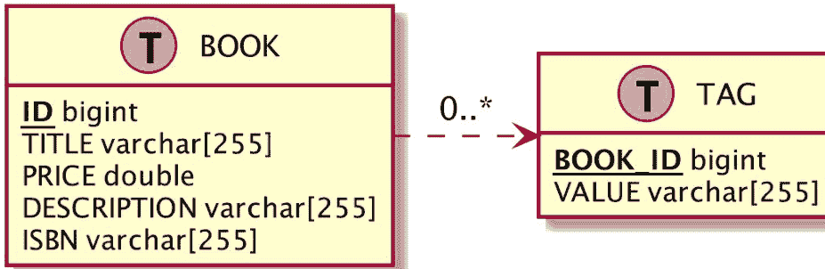

在 JPA 1.0 中，这些注解并不存在。然而，你仍然可以将基本类型的列表作为 BLOB 存储在数据库中。为什么？因为 `java.util.ArrayList` 实现了 `Serializable`，而 JPA 可以自动将 `Serializable` 对象映射到 BLOB。但是，如果你转而使用 `java.util.List`，则会产生异常，因为它没有实现 `Serializable`。`@ElementCollection` 是存储列表的一种更优雅且有效的方式。

## 基础类型映射

与集合一样，映射（Maps）对于存储数据非常有用。在 JPA 1.0 中，键只能是基本数据类型，值只能是实体。现在，映射可以包含基本类型、嵌入对象和实体的组合作为键或值，这为映射带来了极大的灵活性。但让我们关注基础类型的映射吧。

当 map 的键（key）和值（value）是基本数据类型时，`@ElementCollection` 和 `@CollectionTable` 注解的用法和你之前看到的集合相同。此时，集合表被用于存储 map 的数据。

让我们以一个包含曲目的 CD 专辑为例（参见列表 23）。一首曲目可以被视为一个标题和一个位置（专辑的第一首曲目、专辑的第二首曲目等）。你可以拥有一个曲目的 map，其中用一个整数表示位置（map 的键），用一个字符串表示标题（map 的值）。

**列表 23. 带有曲目 map 的 CD 专辑**

```java
@Entity
public class CD {

    @Id
    @GeneratedValue
    private Long id;

    private String title;

    private Float price;

    private String description;

    @Lob
    private byte[] cover;

    @ElementCollection
    @CollectionTable(name = "track")
    @MapKeyColumn(name = "position")
    @Column(name = "title")
    private Map<Integer, String> tracks = new HashMap<>();

    // 构造函数, getters, setters
}
```

如前所述，`@ElementCollection` 注解用于指定 map 中存储在集合表中的对象。`@CollectionTable` 注解则将集合表的默认名称更改为 `TRACK`。

与集合的区别在于引入了一个新的注解：`@MapColumn`。该注解用于指定 map 键列的映射。如果未指定，该列的名称将由引用关系属性名称与 `_KEY` 拼接而成。列表 23 显示了为了清晰起见，将该注解从默认值（`TRACKS_KEY`）重命名为 `POSITION`。

`@Column` 注解表示包含 map 值的列应该被重命名为 `TITLE`。图 3 显示了结果。

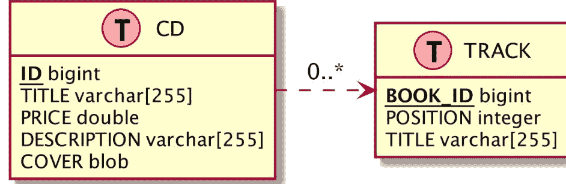

## 类型转换

得益于“异常配置（configuration by exception）”的机制，我们已经看到 JPA 使用默认映射规则将 `String` 映射到 `VARCHAR`，或将 `Long` 映射到 `BIGINT`。但如果我们想在 Java 中操作一个 `Long` 并将其存储为 `VARCHAR` 呢？如果我们想在 Java 中操作一个 `Date` 并将其存储为 `BIGINT` 呢？得益于类型转换，你可以将数据类型从一种格式转换为任何其他格式。

列表 24 显示了枚举 `CreditCardType`。正如我们之前看到的，默认情况下，JPA 将将此枚举的序数映射到数据库。另一个选项是使用 `Enumerated(EnumType.STRING)` 使用该枚举的字符串表示进行映射。

**列表 24. CreditCardType 枚举**

```java
public enum CreditCardType {
    VISA,
    MASTER_CARD,
    AMERICAN_EXPRESS
}
```

但如果我们想将 `VISA` 映射到 `V`，`MASTER_CARD` 映射到 `M`，将 `AMERICAN_EXPRESS` 映射到 `A` 呢？嗯，我们需要创建一个转换器，将 `CreditCardType` 枚举转换为 `CHAR` 类型的数据库列，反之亦然。在 JPA 中实现这一点，我们必须在类上添加 `@Converter` 注解并实现 `AttributeConverter` 接口。我们用枚举类型和数据库列类型对该接口进行参数化。列表 25 显示了 `CreditCardTypeConverter`，它实现了 `convertToDatabaseColumn` 方法（接收枚举并将其转换为 `Character`）以及 `convertToEntityAttribute` 方法（执行相反的操作）。

**列表 25. 将枚举 CreditCardType 转换为 Character 并反之**

```java
@Converter
public class CreditCardTypeConverter implements
        AttributeConverter<CreditCardType, Character> {

    @Override
    public Character convertToDatabaseColumn(CreditCardType creditCardType) {
        switch (creditCardType) {
            case VISA:
                return 'V';
            case AMERICAN_EXPRESS:
                return 'A';
            case MASTER_CARD:
                return 'M';
            default:
                throw new IllegalArgumentException("Unknown" + creditCardType);
        }
    }

    @Override
    public CreditCardType convertToEntityAttribute(Character dbData) {
        switch (dbData) {
            case 'V':
                return VISA;
            case 'A':
                return AMERICAN_EXPRESS;
            case 'M':
                return MASTER_CARD;
            default:
                throw new IllegalArgumentException("Unknown" + dbData);
        }
    }
}
```

要使用我们的转换器，我们只需要在属性上添加 `@Convert` 注解，并指定我们想要使用的转换器类，如列表 26 所示。持久化提供程序的运行时负责在从数据库加载实体属性时以及将实体存储到数据库之前，为目标属性类型调用指定的转换方法。

**列表 26. 使用 CreditCardTypeConverter 的 CreditCard 实体**

```java
@Entity
public class CreditCard {

    @Id
    private String number;

    private String expiryDate;

    private Integer controlNumber;

    @Convert(converter = CreditCardTypeConverter.class)
    private CreditCardType creditCard;

    // 构造函数, getters, setters
}
```

## 使用 XML 映射

现在你已经更熟悉使用注解进行基础映射了，让我们来看 XML 映射。如果你使用过对象关系映射框架（例如 Hibernate 的早期版本），你将熟悉如何在单独的 XML 文件中映射你的实体。从本章开始，你还没有看到过一行 XML，只有注解。JPA 也提供了 XML 映射作为一种选项。

> 请记住，本章中看到的每一个注解都有对应的 XML 等价物，如果涵盖它们，本节将非常巨大。我建议你查看 JPA 规范的第 12 章（XML 对象关系映射描述符），那里详细介绍了所有的 XML 标签。

XML 部署描述符是使用注解的替代方案。然而，尽管每个注解都有相应的 XML 标签反之亦然，但区别在于 XML 会覆盖注解。

问题是，何时应该使用注解而不是 XML？首先，这是一个审美问题，因为两者的行为完全相同。当元数据与代码真正耦合（例如主键）时，使用注解是合理的，因为元数据只是程序的另一个方面。其他类型的元数据（如列长度或其他架构细节）可以根据部署环境进行更改（例如开发、测试或生产环境中的数据库架构不同）。当基于 JPA 的产品需要支持不同的数据库供应商时，也会出现这种情况。某些 ID 生成、列选项等可能需要根据使用的数据库类型进行调整。在外部部署描述符（每个环境一个）中表示可能更好。

让我们回到 `Book` 实体示例。假设你有两个环境，你想在开发环境中将 `Book` 实体映射到 `BOOK` 表，在测试环境中映射到 `BOOK_XML_MAPPING` 表。该类仅带有 `@Entity` 注解（参见列表 27），并且不包含它应该映射的表的信息（即没有 `@Table` 注解）。`@Id` 注解定义主键为自动生成，`@Column` 注解将描述字段的大小设置为 500 个字符。

**列表 27. 仅带有少量注解的 Book 实体**

```java
@Entity
public class Book {

    @Id
    @GeneratedValue(strategy = GenerationType.AUTO)
    private Long id;

    private String title;

    private Float price;

    @Column(length = 500)
    private String description;

    private String isbn;

    private Integer nbOfPages;

    private Boolean illustrations;

    // 构造函数, getters, setters
}
```

在一个独立的 `book_mapping.xml` 文件中（参见列表 28），遵循指定的 XML 架构（schema），你可以更改实体中任何数据的映射。`<table>` 标签允许你更改实体将映射到的表名（映射到 `BOOK_XML_MAPPING` 而不是默认的 `BOOK`）。在 `<attributes>` 标签内部，你可以自定义属性，不仅可以指定它们的名称和长度，还可以指定它们与其他实体之间的关系。例如，你可以更改 `title` 列和页数（`nbOfPages`）的映射。

**列表 28. 映射文件 File META-INF/book_mapping.xml**

```xml
<entity-mappings xmlns:xsi="http://www.w3.org/2001/XMLSchema-instance"
                 xmlns="http://xmlns.jcp.org/xml/ns/persistence/orm"
                 xsi:schemaLocation="http://xmlns.jcp.org/xml/ns/persistence/orm http://xmlns.jcp.org/xml/ns/persistence/orm_2_2.xsd">
    <entity class="org.agoncal.fascicle.jpa.mapping.Book">
        <table name="book_xml_mapping"/>
        <attributes>
            <basic name="title">
                <column name="book_title" nullable="false" updatable="false"/>
            </basic>
            <basic name="description">
                <column length="2000"/>
            </basic>
            <basic name="nbOfPages">
                <column name="nb_of_pages" nullable="false"/>
            </basic>
        </attributes>
    </entity>
</entity-mappings>
```


一个始终牢记在脑中的重要概念是：XML 的优先级高于注解（annotations）。即使 `description` 属性使用了 `@Column(length = 500)` 注解，实际使用的列长度也是 `book_mapping.xml` 文件（列表 28）中定义的，即 2000。这可能会让你困惑，因为当你查看代码时看到的是 500，检查 DDL 时却看到 2000；始终记住如果存在，请检查 XML 部署描述符。

XML 元数据和注解元数据合并的结果是，`Book` 实体将被映射到列表 29 中定义的 `BOOK_XML_MAPPING` 表结构。如果你想完全忽略注解并仅使用 XML 定义映射，你可以在 `book_mapping.xml` 文件中添加 `<xml-mapping-metadata-complete>` 标签（在这种情况下，即使 XML 不包含覆盖内容，所有注解都将被忽略）。

**列表 29. BOOK_XML_MAPPING 表结构**

```sql
CREATE TABLE BOOK_XML_MAPPING
(
  ID BIGINT NOT NULL,
  BOOK_TITLE VARCHAR(255) NOT NULL,
  PRICE FLOAT,
  DESCRIPTION VARCHAR(2000),
  ISBN VARCHAR(255),
  NB_OF_PAGES INTEGER NOT NULL,
  ILLUSTRATIONS BOOLEAN,
  PRIMARY KEY (ID)
)
```

为了使这一切工作，还缺少一条信息。你需要在 `persistence.xml` 文件中引用 `book_mapping.xml` 文件，为此你必须使用 `<mappingfile>` 标签。`persistence.xml` 定义了持久化上下文以及它应该映射到的数据库。它是持久化提供者（persistence provider）引用外部 XML 映射的核心信息。将两个 XML 文件都部署在 `META-INF` 目录下并部署 `Book` 实体就完成了（参见列表 30）。

**列表 30. 引用外部映射文件的 persistence.xml**

```xml
<persistence xmlns:xsi="http://www.w3.org/2001/XMLSchema-instance"
xmlns="http://xmlns.jcp.org/xml/ns/persistence"
xsi:schemaLocation="http://xmlns.jcp.org/xml/ns/persistence http://xmlns.jcp.org/xml/ns/persistence/persistence_2_2.xsd">
  <persistence-unit name="bookstore">
    <provider>org.agoncal.fascicle.jpa.mapping.Book</provider>
    <mappingfile>META-INF/book_mapping.xml</mappingfile>
  </persistence-unit>
</persistence>
```

# 嵌入属性 (Embeddables)

在“复合键”章节中，我们之前看到过如何使用复合键。嵌入属性（Embeddables）是那些没有独立标识的类，它们被嵌入到实体中。嵌入属性与主实体共享相同的标识。主实体可以包含多个嵌入属性，也可以包含嵌入集合。这种关系是组合关系（composition），因此如果主实体被删除，嵌入对象也会被删除。

嵌入属性类使用 `@Embeddable` 注解。让我们来看一个 `Address` 类的例子：

**列表 31. 可嵌入的 Address 类**

```java
@Embeddable
public class Address {
    private String street1;
    private String street2;
    private String city;
    private String state;
    private String zipcode;
    private String country;
    // 构造函数, getters, setters
}
```

**列表 32. 嵌入 Address 的 Customer Entity**

```java
@Entity
public class Customer {
    @Id
    @GeneratedValue
    private Long id;
    private String firstName;
    private String lastName;
    private String email;
    private String phoneNumber;
    @Embedded
    private Address address;
    // 构造函数, getters, setters
}
```

在“覆盖属性”章节中，你会看到实体可以通过 `@Override` 注解覆盖嵌入属性的属性。

**列表 33. 包含所有属性的 CUSTOMER 表**

```sql
CREATE TABLE CUSTOMER
(
    ID BIGINT NOT NULL,
    FIRSTNAME VARCHAR,
    LASTNAME VARCHAR,
    EMAIL VARCHAR,
    PHONENUM VARCHAR,
    STREET1 VARCHAR,
    STREET2 VARCHAR,
    CITY VARCHAR,
    STATE VARCHAR,
    ZIPCODE VARCHAR,
    COUNTRY VARCHAR,
    PRIMARY KEY (ID)
)
```

## 嵌入集合 (Collections of Embeddables)

我们之前见过过如何映射基本类型的集合和映射。从 JPA 2.1 开始，嵌入属性也可以实现这一点。你可以映射嵌入属性的集合，也可以映射嵌入属性的映射（嵌入属性可以是键也可以是值）。

**列表 34. 具有嵌入地址列表的 Customer 实体**

```java
@Entity
public class Customer {
    @Id
    @GeneratedValue
    private Long id;
    private String firstName;
    private String lastName;
    private String email;
    private String phoneNumber;
    @ElementCollection
    private List<Address> addresses;
    // 构造函数, getters, setters
}
```

为了映射集合，JPA 提供者需要一个单独的表将每个地址与客户连接起来。如列表 35 所示，`CUSTOMER` 表没有任何与地址相关的属性。相反，JPA 将所有客户地址存储在名为 `CUSTOMER_ADDRESSES` 的独立表中（记得可以使用 `@CollectionTable` 注解覆盖默认的集合表）。两个表之间的连接通过外键 `Customer_ID` 完成。

**列表 35. CUSTOMER 和 CUSTOMER_ADDRESSES 表结构**

```sql
CREATE TABLE CUSTOMER
(
    ID BIGINT NOT NULL,
    FIRSTNAME VARCHAR,
    LASTNAME VARCHAR,
    EMAIL VARCHAR,
    PHONENUMBER VARCHAR,
    PRIMARY KEY (ID)
);

CREATE TABLE CUSTOMER_ADDRESSES
(
    STREET1 VARCHAR,
    STREET2 VARCHAR,
    CITY VARCHAR,
    STATE VARCHAR,
    ZIPCODE VARCHAR,
    COUNTRY VARCHAR,
    CUSTOMER_ID BIGINT
);
```

## 关系映射

拥有嵌入对象（embeddables）集合是映射数据列表的一种有趣方式。但请记住，嵌入对象没有标识（identity）。如果我们想映射这样一个事实：一张 CD 专辑由一组音乐家录制，且每位音乐家在数据库中必须被唯一标识该怎么办？那么音乐家就需要是一个实体（entity）。实体之间的关系是 JPA 中的一项重要特性。

## 对象中的关系

面向对象编程的世界充斥着类以及类之间的关联。这些关联是结构性的，它们将一种类型的对象与另一种类型的对象连接起来，允许一个对象对另一个对象执行操作。类之间可以存在多种类型的关联。

首先，关联具有方向。它可以是单向的（即一个对象可以导航到另一个对象）或双向的（即一个对象可以导航到另一个对象，反之亦然）。在 Java 中，你使用点 (`.`) 语法来导航对象。例如，当你编写 `customer.getAddress().getCountry()` 时，你从对象 `Customer` 导航到 `Address`，然后导航到 `Country`。

在 UML（统一建模语言）中，为了表示两个类之间的单向关联，你使用箭头来指示方向。在图 4 中，`Class1`（源）可以导航到 `Class2`（目标），但反向不行。


**图 4. 两个类之间的单向关联**

要表示双向关联，不使用箭头。如图 5 所示，`Class1` 可以导航到 `Class2`，反之亦然。在 Java 中，这表示为 `Class1` 拥有类型为 `Class2` 的属性，而 `Class2` 拥有一个类型为 `Class1` 的属性。


**图 5. 两个类之间的双向关联**

关联还具有多重性（或基数）。关联的每个端都可以指定参与关联的引用对象的数量。图 6 中的 UML 图显示 `Class1` 引用了零或多个 `Class2` 实例。


**图 6. 类关联上的多重性**

在 UML 中，基数是最小值和最大值之间的范围。因此，`0..1` 意味着至少有零个对象，最多有一个对象。`1` 意味着只有一个实例。`1..*` 意味着你可以有一个或多个实例，而 `3..6` 意味着你有三到六个对象的范围。在 Java 中，表示多个对象的关联使用 `java.util.Collection`、`java.util.Set`、`java.util.List` 甚至 `java.util.Map` 数据类型。

关系具有所有权（即关系的一侧是该关系的所有者）。在单向关系中，所有权是隐含的：在图 4 中，毫无疑问所有者是 `Class1`，但在图 5 所示的双向关系中，必须显式指定所有者。例如，`Class1` 是所有者，指定了数据库映射，而 `Class2` 被称为反端（非所有侧）。

在查看如何在 JPA 中映射实体集合之前，让我们看看关系型数据库存储关系的方式。

## 关系型数据库中的关系

在关系世界中，情况有所不同，因为严格来说，关系型数据库是关系（也称为表）的集合，这意味着你建模的任何内容都是表。要建模关联，你没有列表、集合或映射；你拥有表。

在 JPA 中，当两个实体之间存在关联时，你可以以两种不同的方式在数据库中对其建模：使用外键（也称为连接列）或使用连接表（join table）。在数据库术语中，引用另一个表键的列就是外键列。

例如，考虑一个客户有一个地址。之前，在列表 34 中，我们将这种关系建模为嵌入对象，但让我们将其转换为一对一关系。在 Java 中，你将有一个带有 `Address` 属性的 `Customer` 类。在关系世界中，你可以有一个通过外键列（或连接列）指向 `ADDRESS` 表的 `CUSTOMER` 表，如图 7 所示。

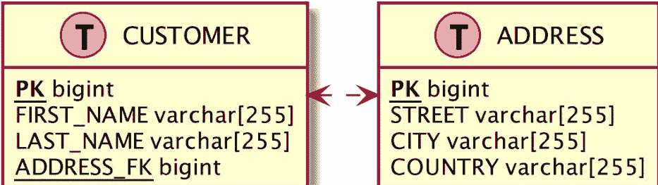

**图 7. 使用连接列的关系**

第二种建模方式是使用连接表。图 8 中的 `CUSTOMER` 表不再存储 `ADDRESS` 的外键。创建了一个中间表，通过存储两个表的外键来保存关系信息。

| CUSTOMER | JOIN TABLE |
| --- | --- |
| PK bigint | PK bigint |
| FIRST_NAME varchar(255) | CUSTOMER_FK bigint |
| LAST_NAME varchar(255) | ADDRESS_FK bigint |

**图 8. 使用连接表的关系**

你不会使用连接表来表示一对一关系，连接表通常用于一对多或多对多的多重性。正如我们在下一节中看到的，JPA 使用这些。

## 实体关系

现在回到 JPA。大多数实体需要引用其他实体，或与它们建立关系。这种领域模型图在业务应用程序中非常常见。JPA 使得实体可以在关系模型中链接到另一个实体。正如你之前看到的基础映射注解一样，JPA 为关联使用了配置。它有多种注解可以自定义映射。

两个实体之间的多重性可以是一对一、一对多、多对一或多对多。相应的映射根据源和目标的多重性命名：`@OneToOne`、`@OneToMany`、`@ManyToOne` 或 `@ManyToMany`。每个注解都可以单向或双向地使用。

你会发现单向和双向是适用于多重性的重复概念。接下来你将看到单向和双向关系的区别，然后实现其中的一些组合。关键点在于理解如何映射关系中的多重性和方向。

## 单向与双向

从对象建模的角度来看，类之间的方向是自然的。在单向关联中，对象 A 指向对象 B 而不反之；在双向关联中，两个对象相互引用。然而，将双向关系映射到关系型数据库时需要一些工作，如下例所示。

在单向关系中，`Customer` 实体拥有一个类型为 `Address` 的属性（见图 9）。关系是单向的，从一侧导航到另一侧。`Customer` 被认为是关系的所有者。在数据库方面，这意味着 `CUSTOMER` 表将有一个指向 `ADDRESS` 表的外键（连接列），并且当你拥有一个关系时，你能够自定义该关系的映射。例如，如果你需要更改外键的名称，映射将在 `Customer` 实体（即所有者）中完成。

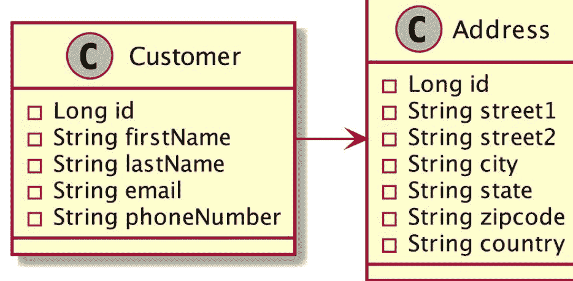

**图 9. Customer 和 Address 之间的单向关联**

如之前提到的，关系也可以是双向。为了能够在 `Address` 和 `Customer` 之间导航，你需要通过向 `Address` 实体添加 `Customer` 属性，将单向关系转换为双向关系（见图 10）。

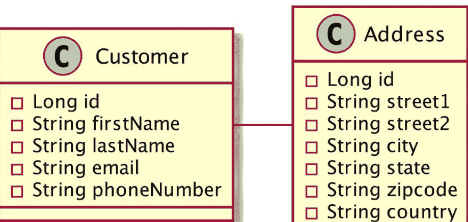

**图 10. Customer 和 Address 之间的双向关联**

在 Java 代码和注解方面，它类似于拥有两个独立的一对一映射，每个方向一个。你可以将双向关系理解为一对向两个方向运行的单向关系（见图 11）。

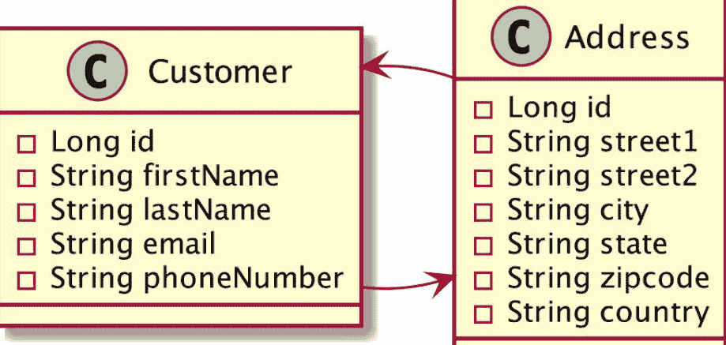

**图 11. 用两个箭头表示的双向关联**

你如何映射一对单向关系呢？谁是这个双向关系的所有者？谁拥有连接列或连接表的映射信息？单向关系有一个**所有侧**（owning side），而双向关系既有所有侧也有反向侧（inverse side），这必须通过 `@OneToOne`、`@OneToMany` 和 `@ManyToOne` 注解中的 `mappedBy` 元素显式指定。`mappedBy` 标识拥有关系的属性，并且在双向关系中是必须的。

为了便于解释，让我们比较一下 Java 代码（一侧）和数据库映射（另一侧）。如你在图 12 左侧所示，两个实体通过属性相互指向：`Customer` 有一个标有 `@OneToOne` 注解的 `address` 属性，而 `Address` 实体也有带有注解的 `customer` 属性。在右侧，数据库映射显示了一个 `CUSTOMER` 表和一个 `ADDRESS` 表。`CUSTOMER` 是关系的所有者，因为它包含了 `ADDRESS` 外键。

```java
@Entity public class Customer {
  @Id @GeneratedValue
  private Long id;
  private String firstName;
  private String lastName;
  private String email;
  private String phoneNumber;
  @OneToOne
  @JoinColumn(name = "address_fk")
  private Address address;
}
```

```java
@Entity public class Address {
  @Id @GeneratedValue
  private Long id;
  private String street1;
  private String street2;
  private String city;
  private String state;
  private String zipcode;
  private String country;
  @OneToOne(mappedBy = "address")
  private Customer customer;
}
```


# 数据库映射关系详解

## 实体与表结构

`Address` 实体对应的数据库表结构如下：

| 字段名 | 类型 | Nullable |
| :--- | :--- | :--- |
| `ADDRESS` | `bigint` | `false` |
| `STREET2` | `varchar(255)` | `true` |
| `STREET1` | `varchar(255)` | `true` |
| `ZIPCODE` | `varchar(255)` | `true` |
| `STATE` | `varchar(255)` | `true` |
| `COUNTRY` | `varchar(255)` | `true` |
| `CITY` | `varchar(255)` | `true` |

`Customer` 实体对应的数据库表结构如下：

| 字段名 | 类型 | Nullable |
| :--- | :--- | :--- |
| `CUSTOMER` | `bigint` | `false` |
| `LASTNAME` | `varchar(255)` | `true` |
| `PHONENUMBER` | `varchar(255)` | `true` |
| `EMAIL` | `varchar(255)` | `true` |
| `FIRSTNAME` | `varchar(255)` | `true` |
| `ADDRESS_FK` | `bigint` | `true` |

图 12. 带有数据库映射的 `Customer` 和 `Address` 代码

在图 12 中，`Address` 实体在其 `@OneToOne` 注解上使用了 `mappedBy` 元素。`Address` 被称为关系的反向所有者（inverse owner），因为它有一个 `mappedBy` 元素。`mappedBy` 元素表示连接列（`address`）是在关系的另一端指定的。事实上，在另一端，`Customer` 实体通过使用 `@JoinColumn` 注解定义了连接列，并重命名了外键 `ADDRESS_FK`。`Customer` 是关系的所有侧，作为所有者，由它来定义连接列映射。`Address` 是反向侧，所有者实体的表包含外键（即 `CUSTOMER` 表是带有 `ADDRESS_FK` 列的表）。这就是为什么我们说，`mappedBy` 标识拥有关系的属性，并在双向关系中是必须的。


> 如果你熟悉早期版本的 Hibernate，你可能会认为 JPA 的 `mappedBy` 等同于 Hibernate 的 `inverse` 属性。

## `@OneToOne` 单向关系

实体之间的一一单向关系具有基数为 1 的引用，只能通过一个方向到达。参考客户及其地址的示例，假设客户只有一个地址（基数 1）。从客户（源）向地址（目标）导航以知道客户的住处是重要的。图 13 所示的模型假设我们不需要向反方向导航（例如，你不需要知道哪个客户住在某个特定地址）。

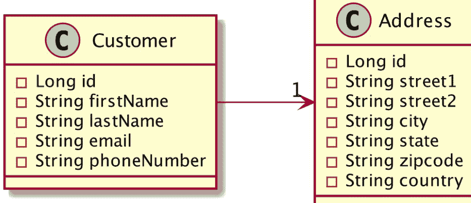

图 13. 一个客户对应一个地址

在 Java 中，单向关系意味着 `Customer` 拥有一个 `Address` 属性（列表 36），但 `Address` 没有 `Customer` 属性（列表 37）。

列表 36. 拥有一个地址的 `Customer`

```java
@Entity
public class Customer {
    @Id
    @GeneratedValue
    private Long id;
    private String firstName;
    private String lastName;
    private String email;
    private String phoneNumber;
    private Address address;
    // 构造函数, getter, setter
}
```

列表 37. `Address`

```java
@Entity
public class Address {
    @Id
    @GeneratedValue
    private Long id;
    private String street1;
    private String street2;
    private String city;
    private String state;
    private String zipcode;
    private String country;
    // 构造函数, getter, setter
}
```

现在你知道，在 JPA 中，如果你不对属性进行注解，则将应用默认映射规则。因此，默认情况下，外键的名称是 `ADDRESS_ID`（见列表 38），它是关系属性名称（此处为 `address`）、下划线 `_` 以及目标表主键列名称（此处将是表的 `ID`）的拼接。此外注意，在 DDL 中，`ADDRESS_ID` 列默认是可空的，这意味着默认情况下，一对关联被映射为零（空值）或一。要自定义此映射，你可以使用两个注解。第一个是 `@OneToOne`（因为关系的基数是 1），它可以修改关联本身的一些属性，例如获取目标实体的方式。列表 40 定义了 `@OneToOne` 注解的 API。

列表 40. `@OneToOne` 注解 API

```java
@Target({METHOD, FIELD})
@Retention(RUNTIME)
public @interface OneToOne {
    Class<?> targetEntity() default void.class;
    CascadeType[] cascade() default {};
    FetchType fetch() default EAGER;
    boolean optional() default true;
    String mappedBy() default "";
    boolean orphanRemoval() default false;
}
```

另一个注解是 `@JoinColumn`（其 API 与列表 12 所示的 `@Column` 非常相似）。它用于自定义所有侧的连接列，即外键。列表 41 显示了你如何使用这两个注解。

列表 38. 带有外键的 `CUSTOMER` 表

```sql
CREATE TABLE CUSTOMER (
    ID BIGINT NOT NULL,
    EMAIL VARCHAR,
    FIRSTNAME VARCHAR,
    LASTNAME VARCHAR,
    PHONENUMBER VARCHAR,
    ADDRESS_FK BIGINT,
    PRIMARY KEY (ID)
);
```

列表 39. `ADDRESS` 表

```sql
CREATE TABLE ADDRESS (
    ID BIGINT NOT NULL,
    CITY VARCHAR,
    COUNTRY VARCHAR,
    STATE VARCHAR,
    STREET1 VARCHAR,
    STREET2 VARCHAR,
    ZIPCODE VARCHAR,
    PRIMARY KEY (ID)
);
```

列表 41. 带有自定义关系映射的 `Customer` 实体

```java
@Entity
public class Customer {
    @Id
    @GeneratedValue
    private Long id;
    private String firstName;
    private String lastName;
    private String email;
    private String phoneNumber;
    @OneToOne(fetch = FetchType.LAZY)
    @JoinColumn(name = "add_fk", nullable = false)
    private Address address;
    // Constructors, getters, setters
}
```

在 JPA 中，外键列被称为连接列（join column）。`@JoinColumn` 注解允许你对外键映射进行自定义。代码列表 41 使用了它将外键列重命名为 `ADD_FK`，并通过拒绝空值（`nullable=false`）使该关系成为强制性。`@ToOne` 注解为持久化提供程序提供了一个提示，用于延迟地获取该关系（稍后会进行详细介绍）。

## `@OneToMany` 单向关系

一对多关系是指一个源对象引用了一组目标对象。例如，一个采购订单由多个订单行组成（见图 14）。订单行可以通过相应的 `@ManyToOne` 注解来引用采购订单，但这种情况下并非如此，因为该关系是单向的。`PurchaseOrder` 是“一”的一侧也是关系的源点，而 `OrderLine` 是“多”的一侧也是目标。

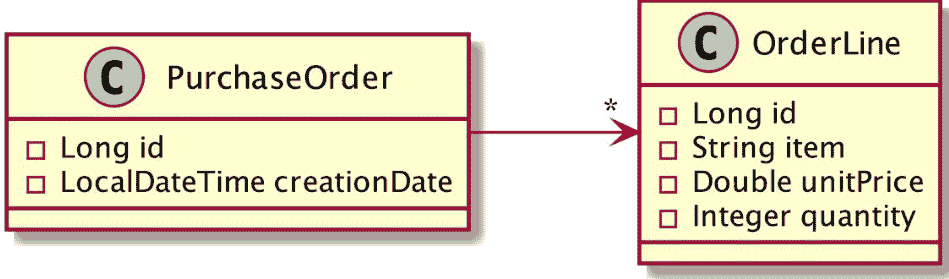

图 14. 一个采购订单包含多行

基数是多个的，且导航仅从 `PurchaseOrder` 指向 `OrderLine`。在 Java 中，这种多重性由 `java.util` 包中的 `Collection`、`List` 和 `Set` 接口描述。代码列表 42 显示了 `PurchaseOrder` 实体的代码，它具有指向 `OrderLine` 的单向一对多关系（见代码列表 43）。

列表 42. `PurchaseOrder` 包含 `OrderLines`

```java
@Entity
@Table(name = "purchase_order")
public class PurchaseOrder {
    @Id
    @GeneratedValue
    private Long id;
    private LocalDateTime createdAt;
    private List<OrderLine> orderLines;
    // Constructors, getters, setters
}
```

列表 43. 一个 `OrderLine`

```java
@Entity
@Table(name = "order_line")
public class OrderLine {
    @Id
    @GeneratedValue
    private Long id;
    private String item;
    private Double unitPrice;
    private Integer quantity;
    // Constructors, getters, setters
}
```

列表 42 中的 `PurchaseOrder` 没有任何特殊注解，而是依赖于“通过异常配置”（configuration-by-exception）范式。当实体的类型集合被用作该实体的属性时，默认会触发一对多关系映射。默认情况下，一对多单向关系使用一个包含两个外键列的连接表（join table）。其中一个外键列引用 `PURCHASE_ORDER` 表，且与其主键类型相同，另一个引用 `ORDER_LINE`。该连接表的名称是两个实体的名称，并中间用 `_` 符号分隔。连接表被命名为 `PURCHASE_ORDER_ORDER_LINE`，并将导致如图 15 所示的模式结构。

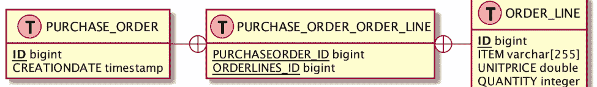

图 15. `PURCHASE_ORDER` 和 `ORDER_LINE` 之间的连接表

如果你不喜欢连接表和外键名称，或者你正在映射到一张现有表，可以使用 JPA 注解来重新定义这些默认值。连接列的默认值是映射该关联的属性名称、符号 `_` 以及被引用的主键名称的拼接。由于可以使用 `@JoinColumn` 注解来更改外键列，因此 `@JoinTable` 注解（见代码列表 44）也可以对连接表映射执行相同的操作。你还可以使用 `@OneToMany` 注解（见代码列表 45），它像 `@ToOne` 一样可以自定义关系本身（使用获取模式等）。

列表 44. `@JoinTable` 注解 API

```java
@Target({METHOD, FIELD})
@Retention(RUNTIME)
public @interface JoinTable {
    String name() default "";
    String catalog() default "";
    String schema() default "";
    JoinColumn[] joinColumns() default {};
    JoinColumn[] inverseJoinColumns() default {};
    ForeignKey foreignKey() default @ForeignKey(PROVIDER_DEFAULT);
    ForeignKey inverseForeignKey() default @ForeignKey(PROVIDER_DEFAULT);
    UniqueConstraint[] uniqueConstraints() default {};
    Index[] indexes() default {};
}
```

列表 45. 使用注解的一对多 `PurchaseOrder` 实体

```java
@Entity
@Table(name = "purchase_order")
public class PurchaseOrder {
    @Id
    @GeneratedValue
    private Long id;
    private LocalDateTime createdAt;
    @OneToMany(fetch = FetchType.EAGER)
    @JoinColumn(name = "order_fk")
    private List<OrderLine> orderLines;
    // Constructors, getters, setters
}
```

`@JoinTable` 注解（见代码列表 44）可以对连接表映射执行相同的操作。你还可以使用 `@OneToMany` 注解（见代码列表 45），它像 `@ToOne` 一样可以自定义关系本身（使用获取模式等）。

一对多单向关系的默认规则是使用连接表，但对于遗留数据库，可以很容易更改为使用外键。`PurchaseOrder` 实体必须提供 `@JoinColumn` 而不是 `@JoinTable`，如列表 47 所示。

```java
@Entity
@Table(name = "purchase_order")
public class PurchaseOrder {
    @Id
    @GeneratedValue
    private Long id;
    private LocalDateTime createdAt;
    @OneToMany(fetch = FetchType.EAGER)
    @JoinColumn(name = "order_fk")
    private List<OrderLine> orderLines;
    // Constructors, getters, setters
}
```

`OrderLine` 实体的代码（如前文列表 43 所示）没有变化。通过使用 `@JoinColumn`，外键策略随后映射了单向关联。外键通过注解重命名为 `ORDER_FK` 并存在于目标表（`ORDER_LINE`）中。结果如图 16 所示的数据库结构。没有连接表，两个表之间的引用通过外键 `ORDER_FK` 实现。

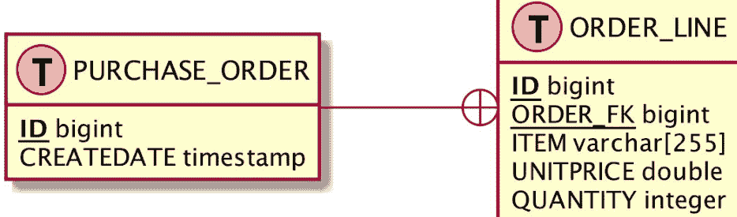

图 16. `PURCHASE_ORDER` 和 `ORDER_LINE` 之间的连接列

## `@ManyToMany` 双向关系

多多双向关系存在一个源对象引用多个目标，且目标引用多个源的情况。例如，一张 CD 专辑由多个艺术家创作，一个艺术家出现在多个专辑中。在 Java 世界中，每个实体将拥有一个目标实体集合。在关系世界中，映射多多关系的唯一方法是使用连接表（连接列不起作用），并且正如你之前看到的，在双向关系中，你需要显式定义所有者（使用 `mappedBy` 元素）。

假设 `Artist` 实体是关系的所有者，意味着 `CD` 是反向所有者（见列表 48）。因此，`CD` 需要在其 `@ManyToMany` 注解上使用 `mappedBy` 元素。`mappedBy` 告诉持久化提供程序 `appearOnCDs` 是所有者实体对应的属性名称。

列表 48. 多位艺术家出现在一张 CD 上

```java
@Entity
public class CD {
    @Id
    @GeneratedValue
    private Long id;
    private String title;
    private Float price;
    private String description;
    @ManyToOne(mappedBy = "appearsOnCDs")
    private List<Artist> createdByArtists;
    // 构造函数, getters, setters
}
```

因此，如果 `Artist` 是关系的所有者（如列表 49 所示），则应由它来通过 `@JoinTable` 和 `@JoinColumn` 注解来定制连接表映射。

列表 49. 一位艺术家出现在多张 CD 专辑中


```java
@Entity
public class Artist {

    @Id
    @GeneratedValue
    private Long id;
    private String firstName;
    private String lastName;
    @ManyToOne
    @JoinTable(name = "jnd_art_cd",
        joinColumns = @JoinColumn(name = "artist_fk",
        inverseJoinColumns = @JoinColumn(name = "cd_fk"))
    private List<CD> appearsOnCDs;

    // 构造函数, getters, setters
}
```

如列表 49 所示，`Artist` 和 `CD` 之间的连接表被重命名为 `JND_ART_CD`，每个连接列也是如此（得益于 `@JoinTable` 注解）。`joinColumns` 元素指向所有侧（`Artist`），而 `inverseJoinColumns` 指向反向所有侧（`CD`）。图 17 展示了数据库结构。

| ARTIST | JND_ART_CD | CD |
| --- | --- | --- |
| ID bigint | ART_FK bigint | ID bigint |
| FIRSTNAME varchar | CD_FK bigint | DESCRIPTION varchar |
| LASTNAME varchar | | PRICE double |
| | | TITLE varchar |

图 17. `Artist` 和 `CD` 之间的连接表

关于多对多和一对一双向关系的注意：关系的一侧任何一方都可以被指定为所有者，另一方应包含 `mappedBy` 元素。如果不包含，持久化提供程序将认为双方都是所有者，并将其视为两个独立的一对多单向关系。这可能会导致四张表：`ARTIST` 和 `CD`，以及两个连接表 `ARTIST_CD` 和 `CD_ARTIST`。此外，在双方上都使用 `mappedBy` 也是不允许的。

## 获取关系 (Fetching Relationships)

你看到的所有注解（`@OneToOne`, `@OneToMany`, `@ManyToOne` 和 `@ManyToMany`）都定义了一个获取属性（fetching attribute），指定是立即加载（饥婪加载）还是延迟加载（懒加载）关联对象，并对性能产生影响。取决于你的应用程序，某些关系的访问频率比其他关系高，而某些关系并不总是需要获取的。在这些情况下，你可以在初始读取实体时（饥婪加载）或在被访问时（懒加载）从数据库加载数据，从而优化性能。例如，让我们来看一些极端情况。

假设四个实体以不同的基数（一对一、一对多）连接在一起。在第一种情况下（见图 18），它们都具有饥婪关系。这意味着，一旦你加载了 `Class1`（通过 ID 查找或查询），所有的依赖对象都会被自动加载到内存中。这可能会影响你系统的性能。


图 18. 具有饥婪关系的四个实体

相反的场景，所有关系都使用懒加载获取模式（见图 19）。如果你加载了 `Class1`，其他任何东西都不会加载（当然，除了 `Class1` 的直接属性）。你需要显式地访问 `Class2`（例如使用 getter 方法）来告诉持久化提供程序从数据库加载数据，依此类推。如果你想操作整个对象图，你需要显式地调用每个实体。

```
class1.getClass2()..getClass3()..getClass4()
```


图 19. 具有懒关系的四个实体

但不要认为 `EAGER` 是坏的而 `LAZY` 是好的。`EAGER` 会通过少量的数据库访问将所有数据引入内存（持久化提供程序可能会使用连接查询来连接表并提取数据）。使用 `LAZY`，你不会有填满内存的风险，因为你控制了哪些对象被加载。但你每次都必须访问数据库。

获取参数（fetch parameter）非常重要，因为如果误用，可能会导致性能问题。每个注解都有你必须注意的默认获取值，如果不适用于你的问题，请进行更改（见表 2）。

表 2. 默认获取策略

| 注解 | 默认获取策略 |
| --- | --- |
| `@ToOne` | `EAGER` |
| `@ManyToMany` | `EAGER` |
| `@OneToMany` | `LAZY` |
| `@ManyToMany` | `LAZY` |

在上面的示例中，如果当应用程序加载采购订单时，始终需要访问该订单的订单行，那么将 `@OneToMany` 注解的默认获取模式更改为 `EAGER` 是高效的（见列表 50）。

## 列表 50. 与 `OrderLine` 具有饥婪关系的 `PurchaseOrder`

```java
@Entity
public class PurchaseOrder {

  @Id
  @GeneratedValue
  private Long id;
  private LocalDateTime creationDate;
  @OneToMany(fetch = FetchType.EAGER)
  private List<OrderLine> orderLines;

  // 构造函数, getters, setters
}
```

## 关系的排序 (Ordering Relationships)

对于一对多或多对关系，你的实体处理的是集合。在 Java 侧，这些集合通常是无序的。关系型数据库的表中也不保留任何顺序。因此，如果你想要一个有序列表，则需要对集合进行编程排序，或者使用带有 `Order By` 子句的 JPQL 查询（JPQL 见第 6 章）。JPA 提供了基于注解的简单机制来帮助关系的排序。

## `@OrderBy`

动态排序可以通过 `@OrderBy` 注解完成。“动态”意味着你在检索关联时对元素进行排序。

CD-BookStore 应用程序示例允许用户编写关于音乐和书籍的消息。这些消息显示在网站上，一旦发布，人们就可以添加评论（见列表 51）。在网站上你想按时间顺序显示评论，因此需要考虑排序。

列表 51. 带有发布时间的注释

```java
@Entity
public class Comment {
  @Id
  @GeneratedValue
  private Long id;
  private String nickname;
  private String content;
  private Integer note;
  @Column(name = "posted_date")
  private LocalDateTime postedDate;

  // 构造函数, getters, setters
}
```

## 列表 52. 新闻实体的评论按发布时间倒序排序

```java
@Entity
public class News {
  @Id
  @GeneratedValue
  private Long id;
  @Column(nullable = false)
  private String content;

  @OrderBy("postedDate DESC")
  private List<Comment> comments;

  // 构造函数, getters, setters
}
```

## `@OrderColumn`

使用 `@OrderBy` 注解进行动态排序从 JPA 1.0 开始就支持。但这并不包含维护持久化排序的支持。从 JPA 2.0 开始，通过添加 `@OrderColumn` 注解就可以实现（其 API 与列表 12 中的 `@OrderColumn` 类似）。该注解告知持久化提供程序需要使用一个存储索引的单独列来维护有序列表。`@OrderColumn` 定义了这个单独列。

让我们使用新闻和评论的示例并对其稍微修改。这一次，列表 53 显示的 `Comment` 实体没有 `postedDate` 属性，因此没有办法按时间顺序对评论进行排序。

列表 53. 无发布日的 `Comment` 实体

```java
@Entity
public class Comment {

    @Id
    @GeneratedValue
    private Long id;
    private String nickname;
    private String content;
    private Integer note;

    // Constructors, getters, setters
}
```

为了在没有发布日期的情况下保持顺序，`News` 实体（如列表 54 所示）可以使用 `@OrderColumn` 注解关系。持久化提供程序将把 `News` 实体映射到 `NEWS` 表，并增加一个名为 `PUBLICATION_INDEX` 的列来存储顺序。

列表 54. 评论顺序的持久化

```java
@Entity
public class News {

    @Id
    @GeneratedValue
    private Long id;
    @Column(nullable = false)
    private String content;
    @JoinColumn
    @OrderColumn(name = "publication_index")
    private List<Comment> comments;

    // Constructors, getters, setters
}
```

在列表 54 中，`@OrderColumn` 将额外的列重命名为 `PUBLICATION_INDEX`。如果没有覆盖名称，默认情况下列名是实体属性名称与 `_ORDER` 字符串的拼接（在我们的示例中为 `COMMENTS_ORDER`）。该列的类型必须是数值类型。这种排序将如列表 55 所示映射到列 `PUBLICATION_INDEX`。

列表 55. 列 `PUBLICATION_INDEX` 持久了顺序

```sql
CREATE TABLE COMMENT
(
ID BIGINT NOT NULL,
CONTENT VARCHAR,
NICKNAME VARCHAR,
NOTE INTEGER,
COMMENTS_ID BIGINT,
PUBLICATION_INDEX INTEGER,
PRIMARY KEY (ID)
)
```

需要注意性能影响；与 `@OrderColumn` 注解一样，持久化提供程序还必须跟踪索引的变化。它负责在插入、删除或重新排序时维护顺序。

可移植应用程序不应期望列表由数据库排序，理由是某些数据库引擎会自动优化其索引使数据表呈现为排序状态。相反，它应该使用 `@OrderColumn` 或 `@OrderBy` 结构。请注意，你不能同时使用这两个注解。

# 继承映射

自创建以来，面向对象的语言一直使用继承范式。C++ 允许多重继承，而 Java 支持单类继承。在面向对象的语言中，开发者通常通过继承根类类的属性和行为来复用代码。

你刚刚学习了关系，而实体之间的关系到关系型数据库有非常直接的映射。继承的情况并非如此。继承是一个完全未知的概念，在关系型世界中没有原生实现。继承的概念在将对象保存到关系型数据库时会带来几个转折点。

你如何将层次模型组织成扁平的关系型模型呢？JPA 有三种不同的策略可供选择。

- *每个类单表层次结构策略*：整个实体层次结构的属性之和被展平成一张表（这是默认策略）。
- *连接子类策略*：在这种方法中，层次结构中的每个实体（无论是具体的还是抽象的）都映射到自己的专用表。
- *每个具体类一个表策略*：该策略将每个具体的实体层次结构映射到各自独立的表。

在 JPA 2.2 中，对每个具体类一个表继承映射策略的支持仍然是可选的。在官方强制之前，可移植应用程序应避免使用它。

利用注解的易用性，JPA 提供了声明式支持来定义和映射继承层次结构，包括实体、抽象实体、映射类和瞬态类。`@Inheritance` 注解用于根实体，以规定其自身和叶子类的映射策略。JPA 还将对象的重写概念转换到映射中，这允许子类覆盖根类的属性。在第 8 章中，你还将看到如何将访问类型与继承结合，混合字段访问和属性访问。

## 继承策略

当实体层次存在时，它总有一个实体作为其根。根实体类可以通过 `@Inheritance` 的 `strategy` 元素使用 `javax.persistence.InheritanceType` 枚举中定义的选项之一来定义继承策略。如果没有定义，将应用默认的每个类单表层次结构策略。为了探索每种策略，我将讨论如何映射 `CD` 和书籍 (`Book`) 实体，它们都继承自 `Item` 实体（见图 20）。

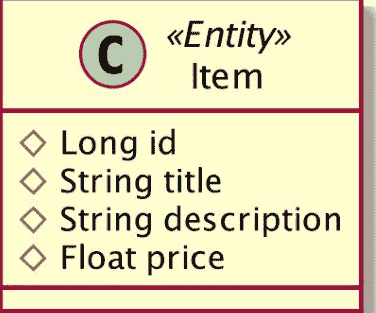

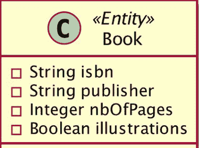

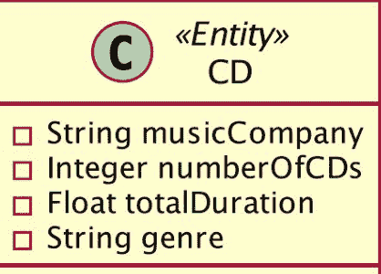

图 20. `CD`、`Book` 和 `Item` 之间的继承层次结构

`Item` 实体是根实体，拥有标识符、标题、描述和价格。`CD` 和 `Book` 实体都继承自 `Item`。这些叶子类的每一个都增加了额外的属性，例如书籍实体的 `ISBN` 或 `CD` 实体的总时长。

## 每个类单表策略

默认映射策略是每个类单表策略。在这种策略中，层次结构中的所有实体都映射到单表。得益于配置，你甚至可以省略根实体上的 `@Inheritance` 注解（见列表 56）。

列表 56. `Item` 实体使用默认

```java
@Entity
public class Item {

    @Id
    @GeneratedValue
    private Long id;
    protected String title;
    protected String description;
    protected Float price;

    // Constructors, getters, setters
}
```

## 连接子类策略

在这种方法中，层次结构中的每个实体（无论是具体的还是抽象的）都映射到自己的专用表。这是一种更灵活的建模方法，但可能涉及复杂的连接。

## 每个具体类一个表策略

该策略将每个具体的实体层次结构映射到各自独立的表。这允许对具体类进行高效查询，但使得跨越整个层次结构的查询变得困难。

列表 57. `Book` 继承自 `Item`

```java
@Entity
public class Book extends Item {

    private String isbn;
    private String publisher;
    private Integer nbPages;

    // Constructors, getters, setters
}
```

列表 58. `CD` 继承自 `Item`

```java
@Entity
public class CD extends Item {

    private String musicCompany;
    private Integer numberOfCDs;
    private Float totalDuration;
    private String genre;

    // Constructors, getters, setters
}
```

鉴别列（discriminator column）默认名为 `DTYPE`，类型为 `String`（映射到 `VARCHAR`），并包含实体的名称。如果默认设置不符合需求，可以使用 `@DiscriminatorColumn` 注解来更改其名称和数据类型。默认情况下，该列的值是它所指的实体名称，尽管实体可以使用 `@DiscriminatorValue` 注解来覆盖此值。

列表 59 将鉴别列重命名为 `DISC`（而不是 `DTYPE`），并将其数据类型更改为 `Char` 或 `String`；每个实体都应该将其鉴别值更改为：`Item` 对应 `I`，`Book` 对应 `B`（参见列表 60），`CD` 对应 `C`（参见列表 61）。

列表 59. `Item` 重新定义鉴别列

```java
@Entity
@Inheritance(strategy = InheritanceType.SINGLE_TABLE)
@DiscriminatorColumn(name = "disc", discriminatorType = DiscriminatorType.CHAR)
@DiscriminatorValue("I")
public class Item {

    @Id
    @GeneratedValue
    protected Long id;
    protected String title;
    protected String description;
    protected Float price;

    // Constructors, getters, setters
}
```

列表 60. `Book` 重新定义鉴别值为 `B`

```java
@Entity
@DiscriminatorValue("B")
public class Book extends Item {

    private String isbn;
    private String publisher;
    private Integer numberOfOfPages;
    private Boolean illustrations;

    // Constructors, getters, setters
}
```

列表 61. `CD` 重新定义鉴别值为 `C`


# 继承映射策略

## 单表策略 (Single-table-per-class Strategy)

```java
@Entity
@DiscriminatorValue("C")
public class CD extends Item {

    private String musicCompany;
    private Integer numberOfOfCDs;
    private Float totalDuration;
    private String genre;

    // Constructors, getters, setters
}
```

根实体`Item`通过`@DiscriminatorColumn`为整个层级结构定义了一次鉴别列。然后它通过`@DiscriminatorValue`注解将自身的默认值更改为`I`。子实体只需要重新定义它们自己的鉴别值即可。

表 4 显示了结果。鉴别列及其值与之前表 3 中显示的内容有所不同。

**表 4. 具有不同鉴别名称和值的 ITEM**

| ID | DISC | TITLE | PRICE | DESCRIPTION | MUSICCOMPANY | ISBN | ... |
|---|---|---|---|---|---|---|---|
| 1 | I | Don | 210 | Beautiful black nan | | | |
| 2 | C | Soul Train | 23.50 | Fantastic jazz album | Prestige ... | | |
| 3 | C | Zoot All | 18 | One of the best from Zappa | Warner ... | | |
| 4 | B | The Robots of Dawn | 22.30 | Robots everywhere | 0-8764 ... | | |
| 5 | B | H2G2 | 17.50 | Funny IT book ;) | 1-1689 ... | | |

单表类（single-table-per-class）策略是默认的继承策略，最容易理解，并且当层级结构相对简单稳定时运行良好。然而，它也有一些缺点：向层级中添加新实体或向现有实体添加属性、迁移数据以及更改索引。该策略还要求子实体的列为空。如果`Book`实体的`ISBN`恰好不能为空，则你无法再插入`CD`，因为`CD`实体没有`ISBN`。

## 连接子类策略 (Joined-subclass Strategy)

在连接子类策略中，层级结构中的每个实体都映射到它自己的表中。根实体映射到一个表，该表定义了层级结构中所有表共用的主键以及鉴别列。每个子类由单独的表表示，该表包含它自己的属性（不继承自根类）以及一个引用根表主键的主键。非根表不持有鉴别列。

你可以通过如列表 62 所示，在根实体上标注`@Inheritance`注解来实现连接子类策略（`CD`和`Book`的代码保持不变，与之前相同）。

**列表 62. 使用连接子类策略的 Item 实体**

```java
@Entity
@Inheritance(strategy = InheritanceType.JOINED)
public class Item {

  @Id
  @GeneratedValue
  protected Long id;
  protected String title;
  protected String description;
  protected Float price;

  // Constructors, getters, setters
}
```

从开发者的角度来看，连接子类策略是自然的，因为每个抽象或具体的类将将其状态映射到不同的表。图 22 显示了`Item`、`Book`和`CD`实体将如何映射。

| ITEM | BOOK | CD |
|---|---|---|
| ID bigint | ID bigint | ID bigint |
| ISBN varchar(255) | MUSIC varchar(255) | MUSIC varchar(255) |
| PUBLISHER varchar(255) | NUMBEROFCDs integer | TOTALDURATION double |
| NOFPAGES integer | | GENRE varchar(255) |
| ILLUSTRATIONS smallint | PRICE double | |

**图 22. 使用连接子类策略进行继承映射**

你仍然可以在根实体中使用`@DiscriminatorColumn`和`@DiscriminatorValue`注解来自定义鉴别列和值（`DTYPE`列位于`ITEM`表中）。

连接子类策略直观的，且与你所了解的对象继承机制接近。通过查询子类时，连接子类策略需要执行连接（joins）。层级越深，需要的连接就越多。该策略为多态查询提供了良好的支持。

## 按类表策略 (Table-per-class Strategy)

在按类表策略（或称为实体类表策略）中，层级结构中的每个实体都映射到自己的专用表，与连接子类策略类似。区别在于根实体的所有属性都复制到了叶子表中。这种策略导致模型反规范化，并且没有鉴别列。将我们的示例映射到这种策略只需要在根实体上指定`TABLE_PER_CLASS`（参见列表 63）。

**列表 63. 使用按类表策略的 Item 实体**

```java
@Entity
@Inheritance(strategy = InheritanceType.TABLE_PER_CLASS)
public class Item {

  @Id
  @GeneratedValue
  protected id;
  protected String title;
  protected String description;
  protected Float price;

  // Constructors, getters, setters
}
```

图 23 显示了`ITEM`、`BOOK`和`CD`实体。注意表之间没有关联。

当然，记住按类表策略在查询单个实例时性能良好，因为它类似于单表类策略：查询被局限于单个表。缺点是它使得跨层级的多态查询（例如查找所有项目，包括`CD`和书籍）比其他策略更贵；它必须使用`UNION`操作查询所有子类表，当涉及大量数据时这种开销很大。JPA 2.2 对按类表策略的支持仍然是可选的。

## 继承层级中的类型

之前解释映射策略的示例仅使用了实体。`Item`、`Book`和`CD`都是实体。但实体并不总是继承自实体。类层级可以混合各种类型的类：实体和非实体、抽象实体以及映射的超类。继承这些不同类型的类会对映射产生影响。

### 抽象实体 (Abstract Entity)

非实体（Nonentities）也被称为临时类（transient classes），意味着它们是 POJO。实体（entity）可以作为非实体的子类或被非实体扩展。为什么要在层次结构中使用非实体呢？对象建模和继承是共享状态和行为的手段。非实体可以为叶节点实体提供公共的数据结构。非实体父类的状态不是持久化的，因为它不受持久化提供程序（persistence provider）的管理（记住，类被持久化提供程序管理的条件是存在`@Entity`注解）。

例如，`Book`是一个实体（列表 65），并继承自一个非实体`Item`（`Item`没有任何注解），如列表 64 所示。

**列表 64. Item 是一个没有 @Entity 的简单 POJO**

```java
public class Item {
    protected String title;
    protected String description;
    protected Float price;

    // Constructors, getters, setters
}
```

`Book`实体（列表 65）继承自`Item`，因此 Java 代码以常规的、面向对象的方式访问`title`、`price`和`description`属性，以及定义的任何其他方法。`Item`可以是具体的也可以是抽象的，并且对最终映射没有任何影响。

**列表 65. Book 实体继承自一个 POJO**

```java
@Entity
public class Book extends Item {

    @Id
    @Generated
    protected Long id;
    private String isbn;
    private String publisher;
    private Integer nbOfPages;
    private Boolean illustrations;

    // Constructors, getters, setters
}
```

`Book`是一个实体并继承自`Item`。但只有`Book`的属性会被映射到表中。`Item`的任何属性都没有出现在列表 66 定义的表结构中。要持久化`Book`，你需要创建一个`Book`实例，为你想要的任何属性（`title`, `price`, `isbn`, `publisher`等）设置值，但只有`Book`的属性（`id`, `isbn`等）会被持久化。

**列表 66. BOOK 表没有包含来自 Item 的属性**

```sql
CREATE TABLE BOOK
(
    ID BIGINT NOT NULL,
    ILLUSTRATIONS BOOLEAN,
    ISBN VARCHAR,
    NBOFPAGES INTEGER,
    PUBLISHER VARCHAR,
    PRIMARY KEY (ID)
)
```

## 映射父类 (Mapped Superclass)

JPA 定义了一种特殊类，称为映射父类（mapped superclass），用于共享状态和行为，以及实体继承的映射信息。然而，映射父类不是实体。它们不受持久化提供程序管理，没有任何要映射的表，且不能被查询或作为关系的一部分，但它们可以为任何继承自它们的实体提供持久化属性。它们与嵌入类（embeddable classes）相似，不同之处它们可以配合继承使用。通过使用`@MappedSuperclass`注解标记一个类即可将其指示为映射父类。映射父类可以是抽象的也可以是具体的。

如列表 67 所示，根类`Item`标记了`@MappedSuperclass`注解，而不是`@Entity`注解。它定义了一种继承策略（`JOINED`），并在其某些属性上标记了`@Column`注解。由于映射父类没有映射到表，因此不允许使用`@Table`注解。

**列表 67. Item 是一个映射父类**

```java
@MappedSuperclass
@Inheritance(strategy = JOINED)
public abstract class Item {

    @Id
    @GeneratedValue
    protected Long id;
    @Column(length = 50, nullable = false)
    protected String title;
    @Column(length = 2000)
    protected String description;
    protected Float price;

    // Constructors, getters, setters
}
```

如你在列表 67 中所示，`title`和`description`属性标记了`@Column`注解。列表 68 显示了`Book`实体继承自`Item`。

**列表 68. Book 继承自一个映射父类**

```java
@Entity
public class Book extends Item {

    private String isbn;
    private String publisher;
    private Integer nbOfPages;
    private Boolean illustrations;

    // Constructors, getters, setters
}
```

此层次结构将被映射为一个表。`Item`不是实体，也没有任何表。`Item`和`Book`的属性将被映射到`BOOK`表的列，但映射父类也会共享它们的映射信息。`Item`的`@Column`注解将被继承。

由于映射父类不是受管理的实体，你无法对其进行持久化或查询。列表 69 显示了具有自定义`TITLE`和`DESCRIPTION`列的`BOOK`结构。

**列表 69. BOOK 表包含来自 Item 的所有属性**

```sql
CREATE TABLE BOOK
(
    ID BIGINT NOT NULL,
    DESCRIPTION VARCHAR(2000),
    ILLUSTRATIONS BOOLEAN,
    ISBN VARCHAR,
    NBOFPAGES INTEGER,
    PRICE DOUBLE,
    PUBLISHER VARCHAR,
    TITLE VARCHAR(50) NOT NULL,
    PRIMARY KEY (ID)
)
```

1. JavaBean: <https://docs.oracle.com/javase/8/docs/api/java/beans/package-summary.html>
2. JPA Specification: <https://jcp.org/en/jsr/detail?id=338>

# 管理实体

Java Persistence API 有两个方面。一个方面是将对象映射到关系型数据库的能力。通过异常配置（Configuration by exception）允许持久化提供程序在不需要大量代码的情况下完成大部分工作，但 JPA 的丰富性也允许从对象到表的自定义映射。JPA 的另一个方面是查询实体的能力。实体管理器（entity manager）提供了创建、查找和同步实例的 API。

> 本章的代码可以在 <https://github.com/agoncal/fascicle-jpa/tree/2.2/managing> 找到。

## 实体管理器 API

在查看如何管理实体之前，让我们先简要概述用于管理实体的 API。图 1 显示了位于不同包中的主要接口。在根包`javax.persistence`下，我们找到了所有与获取、事务和查询相关的内容。子包`javax.persistence.criteria`托管与标准（criteria）相关的接口，而子包`javax.persistence.metamodel`则与元模型（metamodel）相关。


## 实体管理器 API

实体管理器管理实体的状态和生命周期，以及在持久化上下查询实体。实体管理器负责创建和删除实体实例，并通过主键查找实体。它可以使用乐观锁或悲观锁锁定实体以防止并发访问，并可以使用 JPQL 查询根据特定标准检索实体（关于并发和锁的更多信息请见第 8 章）。

当实体管理器获取一个实体的引用时，该实体被称为“受管理的（managed）”。在此之前，实体被视为普通的 POJO（即离散的，detached）。JPA 的优势在于实体可以被应用程序的不同层作为普通对象使用，并在你需要向数据库加载或插入数据时由实体管理器管理。当实体受管理状态时，你可以执行持久化操作，实体管理器会自动将实体的状态与数据库同步。当实体处于离散状态（即不受管理）时，它变回简单的 POJO，并供其他层（例如表示层）使用，而无需与数据库同步状态。

关于持久化，真正的工作从实体管理器开始。`EntityManager`是由持久化提供程序实现的接口，它将生成并执行 SQL 语句。`javax.persistence.EntityManager`接口提供了操作实体的 API（子集见列表 1）。

**列表 1. EntityManager API 的子集**

```java
public interface EntityManager {
  // 用于创建实体管理器、关闭它并检查其是否打开
  open
  public void close();
  public boolean isOpen();
  public EntityManagerFactory getEntityManagerFactory();

  // 返回 EntityManager 的底层提供者对象
}
```

```java
public <T> T unwrap(Class<T> cls);
public Object getDelegate();
```

```java
// Sets and gets an entity manager property or hint
public void setProperty(String propertyName, Object value);
public Map<String, Object> getProperties();
```

实体管理器（entity manager）可以看作实体的一级缓存。因此，它有几个方法可以检查实体是否在一级缓存中（即被托管的）、将缓存刷新到数据库，或从数据库刷新缓存。`clear`和`detach`方法会清除实体并从实体管理器中解除。

```java
// Synchronises the persistence context to the underlying database
public void flush();
public void setFlushMode(FlushMode flushMode);
public FlushMode getFlushMode();
```

```java
// Refreshes the state of the entity from the database, overwriting any changes made
public void refresh(Object entity);
public void refresh(Object entity, LockMode lockMode);
```


```java
// Clears the persistence context and checks if it contains an entity
public void clear();
public void detach(Object entity);
public boolean contains(Object entity);
```

对于基础的 CRUD 操作，实体管理器提供了几个方法，允许你持久化、合并、移除以及通过主键查找实体。

```java
// Persists, merges, removes and finds an entity to/from the database
public void persist(Object entity);
public <T> T merge(T entity);
```

```java
public void remove(Object entity);
public <T> T find(Class<T> entityClass, Object primaryKey);
public <T> T getReference(Class<T> entityClass, Object primaryKey);
```

当 CRUD 不够用时，JPA 允许你使用 JPQL、原生 SQL、标准查询（criteria queries）或存储过程创建特定查询。

```java
// Creates an instance of Query or TypedQuery for executing a JPQL statement
public Query createQuery(String sqlString);
public <T> TypedQuery<T> createQuery(String sqlString, Class<T> resultClass);

// Creates an instance of Query or TypedQuery for executing a named query
public Query createNamedQuery(String name);
public <T> TypedQuery<T> createNamedQuery(String name, Class<T> resultClass);

// Creates an instance of Query for executing a native SQL query
public Query createNativeQuery(String sqlString);
public Query createNativeQuery(String sqlString, Class resultClass);
public Query createNativeQuery(String sqlString, String ResultSetMapping);

// Creates a StoredProcedureQuery for executing a stored procedure in the database
public StoredProcedureQuery createNamedStoredProcedureQuery(String name);
public StoredProcedureQuery createStoredProcedureQuery(String procedureName);
public StoredProcedureQuery createStoredProcedureQuery(String procedureName, Class... resultClasses);
public StoredProcedureQuery createStoredProcedureQuery(String procedureName, String... resultSetMappings);

// Metamodel and criteria builder for criteria queries (select, update and delete)
```

```java
public CriteriaBuilder getCriteriaBuilder();
public Metamodel getMetamodel();
public <T> TypedQuery<T> createQuery(CriteriaQuery<T> criteriaQuery);
public Query createQuery(CriteriaUpdate updateQuery);
public Query createQuery(CriteriaDelete deleteQuery);
```

```java
// Creates and returns an entity graph
public <T> EntityGraph<T> createEntityGraph(Class<T> rootType);
public EntityGraph<?> createEntityGraph(String graphName);
public EntityGraph<?> getEntityGraph(String graphName);
public <T> List<EntityGraph<? super T>> getEntityGraphs(Class<T> entityClass);
```

实体管理器有少量方法可以让你获取事务或加入现有的事务。它还允许使用乐观锁或悲观锁锁定实体。

```java
// Returns an entity transaction
public EntityTransaction getTransaction();
```

```java
// Indicates if a JTA transaction is active and joins the persistence context to it
public void joinTransaction();
public boolean isJoinedToTransaction();
```

```java
// Locks an entity with the specified lock mode type (optimistic, pessimistic...)
public void lock(Object entity, LockMode lockMode);
public LockType getLockMode(Object entity);
```

不要被列表 1 中的 API 吓到，因为本章涵盖了大部分方法。

# 获取实体管理器 (Obtaining an Entity Manager)

实体管理器是用于与实体交互的核心接口，但它首先必须由应用程序获取。取决于是容器托管环境（例如参见第 9 章的 Spring 或 CDI）还是应用程序托管环境，代码可能会有很大不同。例如，在容器托管环境中，事务由容器管理。这意味着你不需要显式地编写提交或回滚，而在应用程序托管环境中这是必须的。

“应用程序托管”术术意味着应用程序负责显式地获取`EntityManager`实例并管理其生命周期（通过编程创建和关闭实体管理器）。列表 2 中的代码演示了运行在 Java SE 环境中的类如何获取实体管理器实例。它启动了一个与持久化单元（`cdbookstorePU`）关联的`EntityManagerFactory`，然后使用它来创建实体管理器。请注意，在应用程序托管环境中，开发者负责创建和关闭实体管理器。

列表 2. 在应用程序托管组件中获取`EntityManager`

```java
public class BookService {

    public void createBook() {

        // 获取实体管理器
        EntityManagerFactory emf = Persistence.createEntityManagerFactory("cdbookstorePU");
        EntityManager em = emf.createEntityManager();

        // 获取事务
        EntityTransaction tx = em.getTransaction();

        // 持久化书籍
        tx.begin();
        Book book = new Book();
        book.setTitle("Java Persistence");
        book.setPrice(49.99);
        em.persist(book);
        tx.commit();

        // 关闭实体管理器
        em.close();
        emf.close();
    }
}
```

在容器托管环境中，获取实体管理器的方法是通过注入。根据容器的不同，注入可以通过`@PersistenceContext`或`@Inject`实现（关于注入详见第 9 章）。此外，我们不需要手动创建或关闭实体管理器，因为其生命周期由容器管理。列表 3 显示了一个事务服务的代码，容器向其注入了`cdbookstorePU`持久化单元。

列表 3. 在容器托管组件中获取`EntityManager`

```java
@Transactional
public class BookService {

    @PersistenceContext(unitName = "cdbookstorePU")
    private EntityManager em;

    public void createBook() {
        // 创建书籍实例
        Book book = new Book();
        book.setTitle("Java Persistence");
        book.setPrice(49.99);
        em.persist(book);
    }
}
```

与列表 2 相比，列表 3 中的代码要简单得多。首先，没有`Persistence`或`EntityManagerFactory`，因为容器注入了实体管理器。应用程序不负责管理实体管理器的生命周期。其次，由于事务 Bean 管理事务，因此没有显式的提交或回滚。

# 持久化上下文 (Persistence Context)

在详细研究`EntityManager`API 之前，你需要理解一个核心概念：持久化上下文（persistence context）。持久化上下文是在特定用户事务内的一一组托管实体实例集合：在持久化上下文中只能存在一个具有相同持久标识的实体实例。例如，如果一个 ID 为 12 的`Book`实例存在于持久化上下文中，那么在同一个持久化上下文中不能存在另一个此 ID 的书籍。

上下文。只有包含持久化上下文（persistence context）中的实体才由实体管理器（entity manager）管理，这意味着更改将反映在数据库中。

每当调用`javax.persistence.EntityManager`接口的方法时，实体管理器都会更新或查询持久化上下文。例如，当调用`persist()`方法时，如果作为参数传递的实体尚不存在，则将其添加到持久化上下文中。同样地，当通过主键找到实体时，实体管理器首先检查请求的实体是否已存在于持久化上下文中。持久化上下文可以被视为一级缓存。它是一个短寿命的空间，实体管理器在将内容刷新（flush）到数据库之前在此存储实体。默认情况下，对象在整个事务期间都存在于持久化上下文中。

总结一下，让我们看看图 2，其中两个用户需要访问存储在数据库中的实体数据。每个用户都有自己的持久化上下文，其持续时间取决于各自的事务。用户 1 从数据库获取了 ID 为 12 和 56 的`Book`实体，因此这两本书都存储在他们的持久化上下文中。用户 2 获取了实体 12 和 34。如你所见，ID = 12 的两个实体都存储在每个用户的持久化上下文中。在事务运行期间，持久化上下文充当一级缓存，存储可以被`EntityManager`管理的实体。一旦事务结束，持久化上下文就会结束，实体也会被清除。

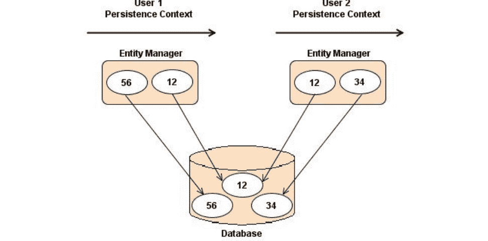

实体管理器的配置绑定到创建它的工厂上。无论是由应用程序管理还是容器管理，工厂都需要一个持久化单元（persistence unit）来创建实体管理器。持久化单元规定了连接数据库的设置以及可以在持久化上下文中管理的实体列表。位于`META-INF`目录下的`persistence.xml`文件（见列表 4）定义了一个持久化单元。该持久化单元有一个名称（`cdbookstorePU`）和一组属性。

列表 4. 具有一组组可管理实体的持久化单元

```xml
<persistence xmlns="http://www.w3.org/2001/XMLSchema-instance
             xmlns="http://xmlns.jcp.org/xml/ns/persistence"
             xsi:schemaLocation="http://xmlns.jcp.org/xml/ns/persistence/persistence_2_2.xsd
             version="2.2">
```

```xml
xsi:schemaLocation="http://xmlns.jcp.org/xml/ns/persistence
http://xmlns.jcp.org/xml/ns/persistence/persistence_2_2.xsd
version="2.2"

<persistence-unit name="cdbookstorePU" transaction-
type="RESOURCE_LOCAL">
```

```xml
<provider>org.eclipse.persistence.jpa.PersistenceProvider</provider>
<class>org.agoncal.fascicle.jpa.managing.Book</class>
<properties>
  <property name="java.persistence.schema-generation.database.action" value="drop-and-create"/>
  <property name="java.persistence.scripts.action" value="drop-and-create"/>
  <property name="java.persistence.scripts.create-target" value="cdbookstoreCreate.ddl"/>
  <property name="java.persistence.scripts.drop-target" value="cdbookstoreDrop.ddl"/>
  <property name="java.persistence.jdbc.driver" value="org.h2.Driver"/>
  <property name="java.persistence.jdbc.url" value="jdbc:h2:mem:cdbookstoreDB"/>
</properties>
</persistence-unit>
</persistence>
```

持久化单元是持久化上下文和数据库之间的桥梁。一方面，`<class>`标签列出了所有可以在持久化上下文中管理的实体；另一方面，它定义了物理连接数据库的所有信息（使用属性）。持久化单元还定义了事务模式。在应用程序管理的环境中，事务模式是本地的（`transaction-type="RESOURCE_LOCAL"`）。第 9 章将涵盖容器管理环境（例如 Spring 和 Java EE）。在容器管理环境中，`persistence.xml`将定义数据源而不是数据库连接属性，并将事务类型设置为 JTA（`transaction-type="JTA"`）或 Java 事务 API。

从 JPA 2.1 开始，`persistence.xml`文件的某些属性已经了标准化（见表 1）。它们都以`javax.persistence`开头，例如`javax.persistence.jdbc.url`。JPA 提供者需要支持这些标准属性，但它们也可以提供自己的自定义属性（例如，用于设置日志级别的 EclipseLink 属性`eclipselink.logging.level`）。

表 1. 标准`persistence.xml`属性

| 属性 |  |
| --- | --- |
| `javax.persistence.jdbc.driver` | 驱动类的完全限定类名 |
| `javax.persistence.jdbc.url` | 特定于驱动的 URL |
| `javax.persistence.jdbc.user` | 数据库连接使用的用户名 |
| `javax.persistence.jdbc.password` | 数据库连接使用的密码 |
| `javax.persistence.database-product-name` | 目标数据库的名称（例如 H2） |
| `javax.persistence.database-major-version` | 目标数据库的版本号 |
| `javax.persistence.database-minor-version` | 目标数据库的小版本号 |
| `javax.persistence.ddl-create-script-source` | 创建数据库的脚本名称 |
| `javax.persistence.ddl-drop-source` | 删除数据库的脚本名称 |
| `javax.persistence.lock-timeout` | 锁超时的值（毫秒） |
| `javax.persistence.query-timeout` | 查询超时值（毫秒） |


| `javax.persistence.validation.group.pre-persist` | 持久化前验证的目标组 |
| `javax.persistence.validation.group.pre-update` | 更新前验证的目标组 |
| `javax.persistence.validation.group.pre-remove` | 删除前验证的目标组 |

# 实体

作为 JPA 的核心部分，我们使用实体管理器进行简单的实体操作和复杂的 JPQL 查询执行。在操作单个实体时，`EntityManager` 接口可以被看作是一个通用的数据访问对象（DAO），它允许对任何实体进行 CRUD 操作（见列表 1）。

为了帮助你更好地理解这些方法，我使用了一个客户（`Customer`）与地址（`Address`）之间单向一对一关系的简单示例。两个实体都有自动生成的标识符（得益于 `@GeneratedValue` 注解），并且 `Customer`（见列表 5）对 `Address` 采用懒性加载（见列表 6）。

**列表 5. 具有单向一对一地址的 Customer 实体**

```java
@Entity
public class Customer {

    @Id
    @GeneratedValue
    private Long id;
    private String firstName;
    private String lastName;
    private String email;
    @OneToOne(fetch = LAZY)
    @JoinColumn(name = "address_fk")
    private Address address;

    // Constructors, getters, setters
}
```

**列表 6. Address 实体**

```java
@Entity
public class Address {

    @Id
    @GeneratedValue
    private Long id;
    private String street1;
    private String city;
    private String zipcode;
    private String country;

    // Constructors, getters, setters
}
```

这两个实体将映射到图 3 所示的数据库结构。注意 `ADDRESS_FK` 列是指向 `ADDRESS` 的外键。

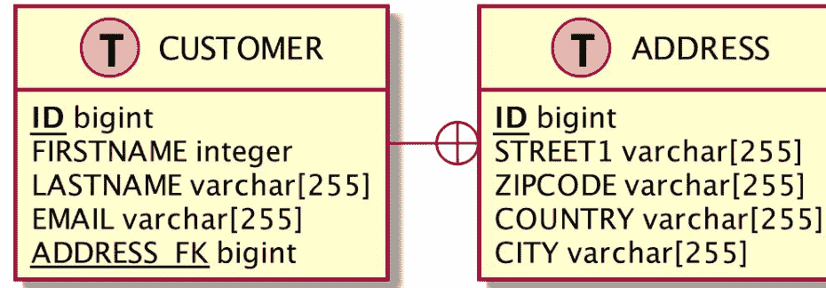

**图 3. CUSTOMER 和 ADDRESS 表**

为了提高可读性，后续章节中的代码片段假设 `em` 属性类型为 `EntityManager`，`tx` 类型为 `EntityTransaction`。

## 持久化实体

持久化一个实体意味着如果该数据尚不存在，则将其插入数据库。要做到这一点，有必要使用 `new` 操作符创建一个新的实体实例，设置属性值，在存在关联时将一个实体绑定到另一个实体（例如 `customer.setAddress(address)`），最后调用 `EntityManager.persist()` 方法，如列表 7 中的 JUnit 测试用例所示。

**列表 7. 持久化带有地址的客户**

```
Customer customer = new Customer("Anthony", "Balla", "aballa@mail.com");
Address address = new Address("Ritherdon Rd", "London", "8QE", "UK");
customer.setAddress(address);

// 持化对象
tx.begin();
em.persist(customer);
em.persist(address);
tx.commit();
```

在列表 7 中，`customer` 和 `address` 只是存在 JVM 内存中的两个对象。当实体管理器（变量 `em`）通过持久化它们（`em.persist()`）将它们考虑在内时，它们都变成了托管实体。此时，两个对象都具备了插入数据库的条件。当事务提交（`tx.commit()`）时，数据会被刷新到数据库，在 `ADDRESS` 表中插入一条地址记录，并在 `CUSTOMER` 表中插入一条客户记录。由于 `Customer` 是该关系的所有者，其表持有指向 `ADDRESS` 的外键。`assertNotNull` 表达式检查两个实体是否都接收到了生成的标识符（得益于持久化提供者）以及 `@Id` 和 `@GeneratedValue` 注解。

注意 `persist()` 方法的顺序：先持久化客户，然后是地址。如果反过来操作，结果是相同的。在此之前，实体管理器被描述为一级缓存。在事务提交之前，数据一直留在内存中，无法访问数据库。实体管理器缓存数据，当事务提交时，它会按照底层数据库期望的顺序刷新数据（遵守完整性约束）。由于 `CUSTOMER` 表中有外键，`ADDRESS` 的插入语句将首先执行，然后是 `CUSTOMER` 的插入语句。

本章中的大多数实体都没有实现 `Serializable` 接口。这是因为实体不需要按顺序排列就可以持久化到数据库中。它们以引用的方式从一个方法传递到另一个方法，当需要持久化时，就会调用 `EntityManager.persist()` 方法。但如果你需要按值传递实体（远程调用、容器等），则它们必须实现 `java.io.Serializable`（标记）接口。它告诉编译器必须强制要求实体类上的所有字段都是可序列化的，这样任何实例都可以被序列化为字节流，并使用远程方法调用（RMI）进行传递。

## 通过 ID 查找

要通过标识符查找实体，可以使用两种不同的方法。第一种是 `EntityManager.find()` 方法，它有两个参数：实体类和唯一标识符（见列表 8）。如果找到了实体，则返回它；如果未找到，则返回 `null` 值。

**列表 8. 通过 ID 查找客户**

```
Customer customer = em.find(Customer.class, id);
if (customer != null) {
    // 处理对象
}
```

第二方法是 `getReference()`（见列表 9）。它与 `find` 操作非常相似，具有相同的参数，但它获取的是对实体的引用（通过其主键），而不检索其数据。可以将其视为一个实体的代理，而不是实体本身。它适用于需要托管实体实例，但在可能访问实体主键之外不需要访问其他数据的情况。使用 `getReference()` 时，状态数据是懒加载的，这意味着如果你在实体脱离之前没有访问状态，数据可能就不在那里。如果未找到实体，则会抛出 `EntityNotFoundException`。

**列表 9. 通过引用查找客户**

```
try {
  Customer customer = em.getReference(Customer.class, id);
  // 处理对象
  assertNotNull(customer);
} catch (EntityNotFoundException ex) {
  // 未找到实体
}
```

## 移除实体

可以使用 `EntityManager.remove()` 方法移除实体。一旦被移除，实体将从数据库中删除，与实体管理器脱离，并且不再可以访问。在 Java 对象的角度，列表 10 显示了如何移除实体。

**列表 10. 创建和移除实体**

```
Customer customer = new Customer("Anthony", "Balla", "aballa@mail.com");
Address address = new Address("Ritherdon Rd", "London", "8QE", "UK");
customer.setAddress(address);

// 持久化对象
tx.begin();
em.persist(customer);
em.persist(address);
tx.commit();

assertNotNull(customer.getId());
assertNotNull(address.getId());

// 从数据库中移除客户
tx.begin();
em.remove(customer);
tx.commit();

// 客户不在数据库中，地址也不在
customer = em.find(Customer.class, customer.getId());
assertNull(customer);
address = em.find(Address.class, address.getId());
assertNull(address);
```

## 孤儿移除 (Orphan Removal)

为了数据一致性，孤儿对象是不理想的，因为会导致没有任何实体引用的行。通过 JPA，你可以通知持久化提供者在源被移除或关系破坏时（通过将属性设置为 `null`）自动删除目标。要包含此选项，我们在 `@OneToOne` 注解中添加 `orphanRemoval=true`。

**列表 11. 处理孤儿移除的客户实体**

```java
@Entity
public class Customer {

    @Id
    @GeneratedValue
    private Long id;
    private String firstName;
    private String lastName;
    private String email;

    @OneToOne(orphanRemoval = true)
    @JoinColumn(name = "address_fk")
    private Address address;

    // 构造函数、setter
}
```

**列表 12. 仅移除客户实体**

```
Customer customer = new Customer("Anthony", "Balla", "aballa@mail.com");
Address address = new Address("Ritherdon Rd", "London", "8QE", "UK");
customer.setAddress(address);

// 持久化对象
tx.begin();
em.persist(customer);
em.persist(address);
tx.commit();

assertNotNull(customer.getId());
assertNotNull(address.getId());

// 从数据库中移除客户实体
tx.begin();
em.remove(customer);
tx.commit();
```

## 与数据库同步

到目前为止，与数据库的同步是在提交时完成的。实体管理器是一个一级缓存，等待事务提交以便刷新数据到数据库，但当需要插入客户和地址时会发生什么？

```java
tx.begin();
em.persist(customer);
em.persist(address);
tx.commit();
```

所有待处理更改都需要一个 SQL 语句；在这里，只有在数据库事务提交时，才会产生并持久化两个插入语句。对于大多数应用程序，这种自动数据同步是足够的。数据库与持久化上下文中的实体进行同步，但可以显式地将数据刷新（flush）到数据库，或者从数据库刷新实体（refresh）。

如果数据在某一个点被刷新（flush）到数据库，而在代码稍后的位置调用了 `rollback()` 方法，则已刷新的数据将从数据库中移除。

## 刷新实体 (Flushing an Entity)

通过 `EntityManager.flush()` 方法，可以强制持久化提供者将数据刷新到数据库，但不会提交事务。这允许开发者手动触发实体管理器内部用于刷新持久化上下文（persistence context）的进程。

**列表 13. 将 Customer 实体刷新到数据库**

```
Customer customer = new Customer("Anthony", "Balla", "aballa@mail.com")
Address address = new Address("Ritherdon Rd", "London", "8QE", "UK")
customer.setAddress(address);
assertThrows(IllegalStateException.class, () -> {
    tx.begin();
    em.persist(customer);
    em.flush();
    em.persist(address);
    tx.commit();
});
```

列表 13 中发生了两个有趣的情况。首先，`em.flush()` 不等待事务提交，而是强制提供者刷新持久化上下文。在刷新时会生成并执行一条插入语句。其次，由于完整性约束，这段代码将无法工作。在没有显式的情况下，实体管理器会缓存所有的更改和排序，并以一种一致的方式为数据库执行它们。有了显式刷新，对 `CUSTOMER` 表的插入语句将执行，但 `Address` 实体的状态是不一致的。这是因为 `Address` 实体尚未被持久化，因此没有 id（id 被设置为 `null`），但所有其他属性都已设置（街道、城市等）。这就是为什么我们得到了一个 `IllegalStateException`：`Customer` 实体拥有一个除了标识符外都有值的 `Address`。这将导致事务回滚。已刷出的数据也会被回滚。显式刷新应谨慎使用，且仅在需要时使用。

## 刷新实体 (Refreshing an Entity)

`refresh()` 方法用于与刷新相反方向的数据同步，意味着它用数据库中存在的数据覆盖托管实体的当前状态。一个典型的用是使用 `EntityManager.refresh()` 方法撤销仅在内存中对实体进行的更改。列表 14 中的测试代码通过 Id 找到一个 `Customer`，更改了其第一个名，并使用 `refresh()` 方法撤销了这一更改。

**列表 14. 从数据库刷新 Customer 实体**

```
Customer customer = em.find(Customer.class, id);
assertEquals("Anthony", customer.getFirstName());

customer.setFirstName("William");
assertEquals("William", customer.getFirstName());

// 刷新客户实体
em.refresh(customer);
assertEquals("Anthony", customer.getFirstName());
```

## 持久化上下文的内容 (Content of the Persistence Context)

持久化上下文持有托管的实体。通过 `EntityManager` 接口，你可以检查实体是否被托管、将其解离，或清除持久化上下文中的所有实体。

### 包含 (Contains)

实体要么被实体管理器托管，要么没有。`EntityManager.contains()` 方法返回一个布尔值，允许你检查特定的实体实例是否在当前持久化上下文中。在列表 15 的测试用例中，一个 `Customer` 被持久化，你可以立即检查该实体是否被托管（`em.contains(customer)`）。答案是 `true`。此后调用了 `remove()` 方法，实体从数据库和持久化上下文中移除（`em.contains(customer)` 返回 `false`）。

**列表 15. 实体是否在持久化上下文中的测试用例**

```
Customer customer = new Customer("Anthony", "Balla", "aballa@mail.com")
assertFalse(em.contains(customer));

// 持久化对象
tx.begin();
em.persist(customer);
tx.commit();

assertTrue(em.contains(customer));

// 移除对象
tx.begin();
em.remove(customer);
tx.commit();

assertFalse(em.contains(customer));
```

## 清除与解离 (Clear and Detach)

`clear()` 方法非常直观：它清空持久化上下文，导致所有托管实体变为解离状态（请检查第 3 章介绍的“实体生命周期”，更多见第 7 章）。`detach(Object entity)` 将给定的实体从持久化上下移除。执行此类驱逐后，对实体进行的更改将不会同步到数据库。列表 16 创建了一个实体，检查它是否被托管，将其从持久化上下文中解离，并检查它是否已解离。

**列表 16. 检查 Customer 实体是否在持久化上下文中**

```
Customer customer = new Customer("Anthony", "Balla", "aballa@mail.com");

// 持久化对象
tx.begin();
em.persist(customer);
tx.commit();

assertTrue(em.contains(customer));

// 解离实体
em.detach(customer);

assertFalse(em.contains(customer));
```

## 合并实体 (Merging an Entity)


解离的实体不再与持久化上下文关联。如果你想托管它，就需要重新挂载它（即合并它）。让我们以一个需要在网页上显示的实体为例：该实体首先从数据库加载到持久化层（它是被托管的），它从一个事务型 bean 的调用中返回（因为事务上下文结束了，它是解离的），表示层显示它（它仍然是解离的），然后返回以进行更新。在那个时刻，实体是解离的，并且需要重新挂载，以便将其状态与数据库同步。这种重新挂载通过`em.merge()`方法实现。列表 17 通过清除持久化上下文（`em.clear()`）模拟了这种情况，这会解离实体。

**列表 17 清除持久化上下文并合并实体**

```
Customer customer = new Customer("Anthony", "Balla", "aballa@mail.com");

// 持久化对象
tx.begin();
em.persist(customer);
tx.commit();

assertTrue(em.contains(customer));

// 清除持久化上下文
em.clear();
assertFalse(em.contains(customer));

// 重新挂载实体并更新
customer.setFirstName("William");
tx.begin();
customer = em.merge(customer);
tx.commit();

assertTrue(em.contains(customer));

// 清除持久化上下文
em.clear();
assertFalse(em.contains(customer));

// 检查名称已更新
customer = em.find(Customer.class, customer.getId());
assertEquals(customer.getFirstName(), "William");
```

列表 17 中的代码创建并持久化了一个客户。对`em.clear()`的调用强制解离了实体，但解离的实体继续存在于它们所在的持久化上下文之外，其状态不再保证与数据库状态同步。这就是`customer.setFirstName("William")`在解离实体上执行的结果，数据没有更新。要将此更改与数据库同步，你需要在事务内部通过`em.merge(customer)`重新挂载实体（即合并它）。

## 更新实体 (Updating an Entity)

更新实体非常简单，但同时也可能令人困惑。正如你刚刚看到的，可以使用`EntityManager.merge()`来挂载实体并将其状态与数据库同步。但如果一个实体当前处于托管状态，对它的更改将自动反映在数据库中（在事务提交后）。如果没有，你需要显式调用`merge()`。

列表 18 展示了持久化一个名为 Anthony 的客户。当你调用`em.persist()`方法时，实体是被托管的，因此对实体进行的任何更改都将与数据库同步。当你调用`setFirstName()`方法时，实体改变了它的状态。实体管理器缓存从`tx.begin()`开始的实体操作，并在提交时进行同步。

**列表 18 更新客户的第一个名**

```
Customer customer = new Customer("Anthony", "Balla", "aballa@mail.com");

tx.begin();
em.persist(customer);

assertEquals(customer.getFirstName(), "Anthony");

// 在托管时更新名称
customer.setFirstName("William");
assertEquals(customer.getFirstName(), "William");

tx.commit();

customer = em.find(Customer.class, customer.getId());
assertEquals(customer.getFirstName(), "William");
```

你实例化了一个`Customer`和一个`Address`实体，将它们关联（`customer.setAddress(address)`），然后持久化这两个实体。

**Listing 19 持久化带有 Address 的 Customer**

```
Customer customer = new Customer("Anthony", "Balla", "aballa@mail.com");
Address address = new Address("Ritherdon Rd", "London", "8QE", "UK");
customer.setAddress(address);

// 持久化对象
tx.begin();
em.persist(customer);
em.persist(address);
tx.commit();

assertNotNull(customer.getId());
assertNotNull(address.getId());
```

由于`Customer`和`Address`之间存在关系，你可以将持久化操作从客户级联到地址。这意味着，如果允许此类事件传播，那么调用`em.persist(customer)`将把持久化事件级联到`Address`实体。你可以像列表 20 所示那样简化代码，去掉`em.persist(address)`。

**Listing 20. 将 Persist 事件级联到 Address**

```
Customer customer = new Customer("Anthony", "Balla", "aballa@mail.com");
Address address = new Address("Ritherdon Rd", "London", "8QE", "UK");
customer.setAddress(address);

// 持久化对象
tx.begin();
em.persist(customer);
tx.commit();

assertNotNull(customer.getId());
assertNotNull(address.getId());
```

如果没有级联，客户将会被持久化，但地址的映射不会。如果关系被修改，则可以级联事件。`@OneToOne`、`@OneToMany`、`@ManyToOne`和`@ManyToMany`注解都有一个`cascade`属性，用于接收一个需要级联的事件数组。要允许持久化的级联，你必须修改`Customer`实体的映射（参见列表 21），并添加带有`PERSIST`事件的`cascade`属性（以及常用于删除的`REMOVE`事件）。

**Listing 21 Customer 实体的级联 Persist 和 Remove 事件**

```java
@Entity
public class Customer {

  @Id
  @GeneratedValue
  private Long id;
  private String firstName;
  private String lastName;
  private String email;
  @OneToOne(fetch = LAZY, cascade = {PERSIST, REMOVE})
  @JoinColumn(name = "address_fk")
  private Address address;

  // Constructors, getters, setters
}
```

你可以从几个事件中选择级联到目标关联（表 2 列出了这些事件），你甚至可以使用`CascadeType.ALL`类型将它们全部级联。

**Table 2. 可级联的事件**

| 属性 | 描述 |
|---|---|
| PERSIST | 将持久化操作级联到关联的目标 |
| REMOVE | 将移除操作级联到关联的目标 |
| MERGE | 将合并操作级联到关联的目标 |
| REFRESH | 将刷新操作级联到关联的目标 |
| DETACH | 将解离操作级联到关联的目标 |
| ALL | 声明所有上述操作都应该级联 |

但请记住，默认情况下，没有任何事件会从父实体级联到子实体。

1 DAO [DAO](https://en.wikipedia.org/wiki/Data_access_object)

# 查询实体

关系型数据库世界依赖于结构化查询语言，即 SQL。这种编程语言旨在管理关系型数据（检索、插入、更新和删除），其语法是面向表的。你可以从由行组成的表中选择列，连接多个表，通过并集（unions）组合两个 SQL 查询的结果，等等。这里没有对象，只有行、列和表。在操作对象的 Java 世界中，为表设计的语言（SQL）必须经过调整以适应为对象设计的语言（Java）。这就是 Java 持久化语言（Java Persistence Language）大显身手的地方。

JPQL（Java 持久化查询语言）是 JPA 定义的用于查询存储在关系型数据库中的实体的语言。JPQL 语法类似于 SQL，但它作用于实体对象，而不是直接操作数据库表。JPQL 不涉及底层数据库结构，也不处理表或列，而是处理对象和属性。因此，它使用了 Java 开发者熟悉的点（.）表示法。

## JPQL (Java Persistence Query Language)

JPQL 是 JPA 定义的用于查询存储在关系型数据库中的实体的语言。JPQL 语法类似于 SQL，但它作用于实体对象，而不是直接操作数据库表。JPQL 不涉及底层数据库结构，也不处理表或列，而是处理对象和属性。因此，它使用了 Java 开发者熟悉的点（.）表示法。

## Java Persistence Language

关系型数据库世界依赖于结构化查询语言，即 SQL。这种编程语言旨在管理关系型数据（检索、插入、更新和删除），其语法是面向表的。你可以从由行组成的表中选择列，连接多个表，通过并集（unions）组合两个 SQL 查询的结果，等等。这里没有对象，只有行、列和表。在操作对象的 Java 世界中，为表设计的语言（SQL）必须经过调整以适应为对象设计的语言（Java）。这就是 Java 持久化语言（Java Persistence Language）大显身手的地方。

JPQL（Java 持久化查询语言）是 JPA 定义的用于查询存储在关系型数据库中的实体的语言。JPQL 语法类似于 SQL，但它作用于实体对象，而不是直接操作数据库表。JPQL 不涉及底层数据库结构，也不处理表或列，而是处理对象和属性。因此，它使用了 Java 开发者熟悉的点（.）表示法。

## Select

简单的 select 查询由两个强制部分组成：`SELECT`子句和`FROM`子句。`SELECT`定义查询结果格式。`FROM`子句定义了获取结果的实体或实体，可选的`WHERE`、`ORDER BY`、`GROUP BY`和`HAVING`子句可用于限制或排序查询结果。

**Listing 1 简化的 JPQL 语句语法**

```
SELECT <select clause>
FROM <from clause>
[WHERE <where clause>]
[ORDER BY <order by clause>]
[GROUP BY <group clause>]
[HAVING <having clause>]
```

列表 1 定义了一个`SELECT`语句，但`DELETE`和`UPDATE`语句也可以用于跨特定实体类的实例执行删除和更新操作。

`SELECT`子句遵循路径表达式语法，并产生以下形式之一：实体、实体属性、构造器表达式、聚合函数，或者这些路径表达式的序列。它们是查询的构建模块，通过点（.）导航法在实体属性上或跨实体关系（或实体集合）上进行导航，使用以下语法：

```
SELECT [DISTINCT] <expression> [[AS] <identification variable>
expression ::= { NEW | TREAT | AVG | MAX | MIN | SUM | COUNT }
```

简单的`SELECT`返回一个实体。例如，如果一个`Customer`实体有一个名为`c`的别名，`SELECT c`将返回一个实体或一个实体列表。

```
SELECT c
FROM Customer AS c
```

关键字`AS`是可选的，相同的查询可以简化如下所示：

```
SELECT c
FROM Customer c
```

但`SELECT`子句也可以返回属性。如果`Customer`实体有一个`firstName`（名）属性，`SELECT c.firstName`将返回一个`String`或一个包含所有客户名字的`String`集合。

```
SELECT c.firstName
FROM Customer c
```

要获取客户的姓名和姓氏，你需要创建一个包含以下两个属性的列表：

```
SELECT c.firstName, c.lastName
FROM Customer c
```

从 JPA 2.0 开始，可以根据条件检索属性（使用`CASE WHEN...THEN...ELSE...END`表达式）。例如，与其检索书籍的价格，不如语句可以根据出版商返回价格的计算结果（例如，打 5 折优惠，例如 Apress 的书籍打 5 折优惠，所有其他书籍打 8 折优惠）。

```
SELECT CASE b.editor WHEN 'Apress'
THEN b.price * 0.5
ELSE b.price * 0.8
END FROM Book b
```

如果`Customer`实体与`Address`有一对一的关系，`c.address`指向客户的地址，那么以下查询的结果返回的不是客户列表，而是地址列表：

```
SELECT c.address
FROM Customer c
```

导航表达式可以链在一起以遍历复杂的实体图。使用这种技术，可以构建诸如`c.address.country.code`这样的路径表达式，引用客户的国家代码。

```
SELECT c.address.country.code
FROM Customer c
```

在`SELECT`表达式可以使用构造函数，以返回一个用查询结果初始化的 Java 类实例。该类不需要是一个实体，但构造函数必须是全限定的，并且与属性匹配。

```
SELECT NEW
org.agonal.fascicle.jpa.querying.CustomerDTO(c.firstName,
lastName, c.address.country.code)
FROM Customer c
```

此查询的结果是一个`CustomerDTO`对象列表，这些对象通过`new`运算符实例化，并用客户的姓名、姓氏和国家代码初始化。

执行这些查询将返回单个值或一个包含重复的零或多个实体（或属性）的集合。要移除重复，必须使用`DISTINCT`运算符。因此，以下查询返回所有不重复的客户名字。

```
SELECT DISTINCT c.firstName
FROM Customer c
```

查询的结果可能是应用于路径表达式的聚合函数的结果。以下聚合函数用于`SELECT`子句：`AVG`、`COUNT`、`MAX`、`MIN`、`SUM`。结果可以在`GROUP BY`子句中分组并使用`HAVING`子句过滤。

```
SELECT COUNT(c)
FROM Customer c
```

标量表达式也可以用于查询的`SELECT`子句，以及`WHERE`和`HAVING`子句。这些表达式可以用于数值（`ABS`、`SQRT`、`MOD`、`SIZE`、`INDEX`）、字符串（`CONCAT`、`SUBSTRING`、`TRIM`、`LOWER`、`UPPER`、`LENGTH`、`LOCATE`）和日期时间（`CURRENT_DATE`、`CURRENT_TIME`、`CURRENT_TIMESTAMP`）值。

### From

查询的`FROM`子句通过声明标识变量来定义实体。标识变量或别名是一个可以在其他子句（`SELECT`、`WHERE`等）中用于标识特定实体的标识。`FROM`子句的语法由实体和一个别名组成。在下面的示例中，`Customer`是实体，`c`是标识变量：

```
SELECT c
FROM Customer c
```

### Where

查询的`WHERE`子句由条件表达式组成用于限制`SELECT`、`UPDATE`或`DELETE`语句的结果。`WHERE`子句可以是一个表达式，也可以一组用于过滤查询的条件表达式。

限制查询结果最简单的方法是使用实体的属性。例如，以下查询选择了所有名为 'Vincent' 的客户：

```
SELECT c
FROM Customer c
WHERE c.firstName = 'Vincent'
```

你可以通过使用逻辑运算符`AND`和`OR`进一步限制查询。下面的示例使用`AND`选择所有名为 'Vincent' 且居住在 'France' 的客户：

```
SELECT c
FROM Customer c
WHERE c.firstName = 'Vincent' AND c.address.country.code = 'AU'
```

`WHERE`子句还使用了比较运算符：`=`、`>=`、`<=`、`<>`、`[NOT] BETWEEN`、`[NOT] LIKE`、`[NOT] IN`、`IS [NOT] NULL`、`[NOT] EMPTY`、`[NOT] MEMBER [OF]`。以下使用了其中两个运算符的示例：


```
SELECT c
FROM Customer c
WHERE c.age > 18

SELECT c
FROM Customer c
WHERE c.age NOT BETWEEN 40 AND 50

SELECT c
FROM Customer c
WHERE c.address.country.code IN ('UK', 'FR')
```

`LIKE` 表达式由一个字符串和一个定义匹配条件的可选转义字符组成：划线（`_`）用于单字符通配符，百分号（`%`）用于多字符通配符。

```
SELECT c
FROM Customer c
WHERE c.email LIKE '%com'
```

### Binding Parameters

到目前为止，所示的 `WHERE` 子句只有固定值。在应用程序中，查询频繁依赖参数。JPQL 支持两种类型的参数绑定：位置参数和命名参数。

位置参数由问号（`?`）后跟整数表示。执行查询时，应替换参数数字。

```
SELECT c
FROM Customer c
WHERE c.firstName = ?1 AND c.address.country.code = ?2
```

也可以使用命名参数，它们由冒号（`:`）后的字符串标识符表示。执行查询时，应替换参数名。

```
SELECT c
FROM Customer c
WHERE c.firstName = :fname AND c.address.country = :country
```

### Subqueries

子查询是嵌入 `WHERE` 或 `HAVING` 子句中的 `SELECT` 查询。子查询的结果在主查询中进行评估和解释。要从数据库检索最小的客户，首先执行带有 `MIN(age)` 的子查询：

```
SELECT c
FROM Customer c
WHERE c.age = (SELECT MIN(age) FROM Customer)
```

### Order By

`ORDER BY` 子句允许 `SELECT` 查询返回的实体或值进行排序。排序适用于子句中指定的实体属性，后跟 `ASC` 或 `DESC` 关键字。`ASC` 指定使用升序；`DESC` 反之，指定使用降序。升序是默认的，可以省略。

```
SELECT c
FROM Customer c
WHERE c.age > 18
ORDER BY c.age DESC
```

也可以使用多个表达式来精炼排序顺序。

```
SELECT c
FROM Customer c
WHERE c.age > 18
ORDER BY c.age DESC, c.address.country.code ASC
```

### Group By and Having

`GROUP BY` 构建允许一组属性对结果值进行聚合。实体根据 `GROUP BY` 子句指定的实体字段的值分组。要按国家代码对客户进行计数，使用以下查询：

```
SELECT c.address.country.code, COUNT(c)
FROM Customer c
GROUP BY c.address.country.code
```

`GROUP BY` 定义了聚合和计数的结果表达式（`c.address.country.code` 和 `count(c)`）。注意，出现在 `GROUP BY` 子句中的表达式也必须出现在 `SELECT` 子句中。

`HAVING` 子句在查询结果分组后定义了一个适用过滤器，类似于二级 `WHERE` 子句，过滤 `GROUP BY` 的结果。因此，如果我们在之前的查询中添加 `HAVING` 子句，就能得到英国以外每个国家的客户总数。

```
SELECT c.address.country.code, COUNT(c)
FROM Customer c
GROUP BY c.address.country.code
HAVING c.address.country.code <> 'UK'
```

`GROUP BY` 和 `HAVING` 只能在 `SELECT` 子句中使用（不能用于 `DELETE` 或 `UPDATE`）。

## 批量删除 (Bulk Delete)

你已经知道如何使用 `EntityManager.remove()` 方法删除实体，以及如何查询数据库以获取符合特定标准的实体列表。要删除实体列表，你可以执行查询、遍历结果集并逐个删除每个实体。虽然这种算法是可行的，但在性能方面会有影响（数据库调用次数过多）。有一种更好的方法：批量删除。

JPQL 可以在特定实体类的多个实例上执行批量删除操作。这些操作用于在单次操作中删除大量实体。注意，一级缓存中的实体不会受到 `DELETE` 语句的影响。当数据库中的记录被删除时，它们将保留在缓存中。

`DELETE` 语句的外看起来和 `SELECT` 语句相似，它可以包含限制性的 `WHERE` 子句并使用参数。因此，它会返回受操作影响的实体实例数量。`DELETE` 语句的语法为：

```
DELETE FROM <entity name> [[AS] <identification variable>
[WHERE <where clause>]
```

例如，要删除所有小于 18 岁的客户，你可以通过 `DELETE` 语句进行批量删除。

```
DELETE FROM Customer c
WHERE c.age < 18
```

## 批量更新 (Bulk Update)

实体的批量更新是通过 `UPDATE` 语句实现的，根据 `WHERE` 子句中的条件设置实体的一个或多个属性。与我们刚刚看到的 `DELETE` 语句一样，一级缓存中的实体不会受到批量更新的影响。当数据库中的记录被更新时，它们将保留在缓存中。

`UPDATE` 语句的语法为：

```
UPDATE <entity name> [[AS] <identification variable>]
SET <update statement>, <update statement>}*
WHERE <where clause>
```

与其删除所有年轻客户，不如使用以下语句将他们的名字更改为“太年轻”：

```
UPDATE Customer c
SET c.firstName = 'TOO YOUNG'
WHERE c.age < 18
```

## 查询 (Queries)

你刚刚学习了 JPQL 语法以及如何使用不同的子句（`SELECT`, `FROM`, `WHERE` 等）描述语句。但如何在应用程序中集成 JPQL 语句呢？SQL 又是怎样的？你还能使用 SQL 语句吗？这些问题的答案是：你可以使用查询。事实上，JPA 有五种不同类型的查询可以在代码中使用，每种查询都有不同的用途。

- **动态查询 (Dynamic queries)**：这是最简单的查询形式，仅由在运行时动态指定的 JPQL 查询字符串组成。

- **命名查询 (Named queries)**：命名查询是静态的、不可更改的 JPQL 查询。

- **Criteria API**：JPA 2.0 引入了面向对象的查询 API 概念用于编写类型安全的 JPQL 查询。

- **原生查询 (Native queries)**：这种类型的查询用于执行原生 SQL 语句而不是 JPQL 语句。

- **存储过程查询 (Stored procedure queries)**：JPA 2.1 引入了用于调用存储过程的新 API。

## 查询 API (Query APIs)

选择这五种类型查询之一的核心点是 `EntityManager` 接口（见图 1），它有多个工厂方法可以返回 `Query`、`TypedQuery` 或 `StoredProcedureQuery` 接口（如图 1 所示，`TypedQuery` 和 `StoredProcedureQuery` 都扩展自 `Query`）。当结果类型为 `Object` 时使用 `Query` 接口，当首选带类型化结果时使用 `TypedQuery`。`StoredProcedureQuery` 用于控制存储过程查询的执行。

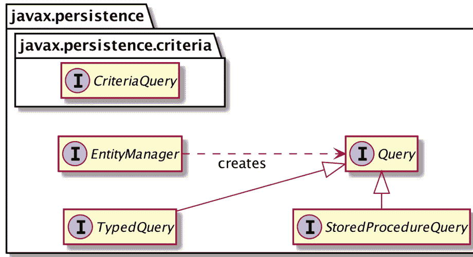

图 1 不同的查询接口

## 查询 API (Query API)

当你通过 `EntityManager` 接口中的一个工厂方法获取 `Query`、`TypedQuery` 或 `StoredProcedureQuery` 接口的实现时，可以使用丰富的 API 进行控制。列表 2 所示的 `Query API` 用于使用 JPQL 的动态查询和命名查询，以及使用 SQL 的原生查询。`Query API` 还支持参数绑定和分页控制。

此 API 中常用的方法是执行查询本身的方法。要执行 `SELECT` 查询，你需要根据所需的结果在两个方法之间进行选择。

- `getResultList()` 方法执行查询并返回结果列表（实体、属性、表达式等）。

- `getResultStream()` 方法执行查询并将查询结果作为 `java.util.stream.Stream` 返回。

- `getSingleResult()` 方法执行查询并返回单个结果（如果发现多于一个结果，则抛出 `NonUniqueResultException`）。

要执行 `UPDATE` 或 `DELETE`，你需要使用 `executeUpdate()` 方法。该方法执行批量更新或删除查询，并返回执行此查询影响的实体数量。

列表 2 Query API

```
public interface Query {
    // 执行查询并返回结果
    default Stream getResultStream() {
        return getResultList().stream();
    }
    List getResultList();
    Object getSingleResult();
    int executeUpdate();
}
```

正如你之前在“JPQL”部分看到的，查询可以使用命名参数（例如 `:myParam`）或位置参数（例如 `?1`）。`Query API` 定义了多个 `setParameter` 方法，用于在执行查询之前设置参数。

```
// 为查询设置参数
<T> Query setParameter(Parameter<T> param, T value);
Query setParameter(Parameter<Calendar> param, Calendar value,
TemporalType temporalType);
Query setParameter(Parameter<Date> param, Date value,
TemporalType temporalType);
Query setParameter(String name, Object value);
Query setParameter(String name, Calendar value,
TemporalType temporalType);
Query setParameter(String name, Date value,
TemporalType temporalType);
Query setParameter(int position, Object value);
Query setParameter(int position, Calendar value,
TemporalType temporalType);
Query setParameter(int position, Date value,
TemporalType temporalType);
```

```
// 获取查询的参数
Parameter<??> getParameters();
Parameter<??> getParameter(String name);
<T> Parameter<T> getParameter(String name, Class<T> type);
Parameter<??> getParameter(int position);
<T> Parameter<T> getParameter(int position, Class<T> type);
boolean isBound(Parameter<??> param);
<T> T getParameterValue(Parameter<T> param);
Object getParameterValue(String name);
Object getParameterValue(int position);
```

当你执行查询时，可能会返回大量结果。根据应用程序的不同，这些结果可以一起处理，也可以分块处理（例如 Web 每次只显示一行）。为了控制分页，`Query` 接口定义了 `setFirstResult()` 和 `setMaxResults()` 方法来指定从零开始的结果以及相对于该点返回的最大结果数（例如所示）。

```
// 限制查询返回的结果数量
Query setMaxResults(int maxResult);
int getMaxResults();
Query setFirstResult(int startPosition);
int getFirstResult();
```

刷新模式（flush mode）指示持久化程序如何处理等待的更改和查询。有两种可能的刷新模式设置：`AUTO` 和 `COMMIT`。`AUTO`（默认）意味着持久化程序负责确保等待的更改对查询处理是的。`COMMIT` 是当实体更新的影响与持久化环境中更改的数据不重叠时（锁定部分见第 8 章）。查询可以使用 `setLockMode(LockModeType)` 方法进行锁定。锁定旨在提供一种实现可重复读的机制，无论是乐观的还是悲观的（锁定部分见第 8 章）。

```
// 设置和获取查询提示
Query setHint(String hintName, Object value);
Map<String, Object> getHints();
```

```
// 设置查询执行时使用的刷新模式
Query setFlushMode(FlushModeType flushMode);
FlushModeType getFlushMode();
```

```
Query setLockMode(LockType lockMode);
LockModeType getLockMode();

// 允许访问特定提供者的 API
<T> T unwrap(Class<T> cls);
```

## Query 和 TypedQuery

Query API 出现在 JPA 的第一个版本 (1.0) 中。TypedQuery 则在后来的 Java Persistence 2.0 中引入。它扩展了 Query API 但增加了类型支持。列表 3 显示了 TypedQuery API 的子集。如你所见，它基本上重新定义了 Query API 的所有方法但添加了类型。因此，`List getResultList()` 变为 `List<X> getResultList()`，依此类推。

列表 3. TypedQuery API

```
public interface TypedQuery<X> extends Query {

deault Stream<X> getResultStream() {
    return getResultList().stream();
}
List<X> getResultList();
X getSingleResult();

    // ...
}
```

在接下来的代码中，JPQL 查询从数据库中选择所有客户。此查询的结果是一个没有泛型的 List。因此，当你调用 `getResultList()` 方法时，它返回一个 Object 列表（我们需要将其强制类型转换为 Customer）。

```
Query query = em.createQuery("SELECT c FROM Customer c");
List customers = query.getResultList();
```

```
for (Object customer : customers) {
  System.out.println(((Customer) customer).getFirstName());
}
```

当你知道查询只返回一个实体时，请使用 `getSingleResult()` 方法。它返回一个 Object（而不是对象列表），并避免了将数据作为列表检索的工作。

```
Query query = em.createQuery("SELECT c FROM Customer c WHERE
c.firstName = 'Mike';
Customer customer = (Customer) query.getSingleResult();
```

上述两个查询都返回一个 Query 对象。当你调用 `query.getResultList()` 或 `query.getSingleResult()` 方法时，它们返回的是未类型化的对象。如果你想让同一个查询返回一个 `Customer` 类型的列表或一个 `Customer` 类型的实例，那么你需要如下所示使用 TypedQuery：

```
TypedQuery<Customer> typedQuery = em.createQuery(
  "SELECT c FROM Customer c", Customer.class);
List<Customer> customers = typedQuery.getResultList();
```

```
for (Customer customer : customers) {
  System.out.println(customer.getFirstName());
}
```

当你想要检索单个客户时，情况也是一样。得益于 TypedQuery，`getSingleResult()` 返回的是 Customer 而不是 Object，因此你不需要对结果进行类型转换。


```
TypedQuery<Customer> typedQuery = em.createQuery(
"SELECT c FROM Customer c WHERE c.firstName = 'Mike',
Customer.class);
Customer customer = typedQuery.getSingleResult();
```

JPA 2.2 引入了对 `java.util.stream` 的支持。事实上，`getResultStream()` 方法是 `getResultList().stream()` 的快捷方式。现在，你可以像在 Java 代码中一样在 JPA 中 Streams：

```
TypedQuery<Customer> typedQuery = em.createQuery(
"SELECT c FROM Customer c", Customer.class);
Stream<Customer> customers = typedQuery.getResultStream();
```

`customers.forEach(c -> System.out.println(c.getFirstName()));`

## 动态查询 (Dynamic Queries)

动态查询根据应用程序需要动态定义的。要创建动态查询，我们使用 `EntityManager.createQuery()` 方法，它接受一个代表 JPQL 查询的字符串参数。它之所以被称为动态查询，是因为查询字符串可以由应用程序动态创建，应用程序可以在运行时指定预先知的复杂查询。使用字符串拼接来根据条件动态构建查询。以下查询根据某些条件检索名为 'Mike' 的客户。

这就是为什么在上面，你可以传递一个未检查的 own：如果布尔值为 true，则查询将包含 WHERE 子句；如果为 false，则不包含。

```
String jpqlQuery = "SELECT c FROM Customer c";
if (someCriteria)
jpqlQuery += " WHERE c.firstName = 'Mike'";
TypedQuery<Customer> typedQuery = em.createQuery(jpqlQuery,
Customer.class);
List<Customer> customers = typedQuery.getResultList();
```

在上面的示例中，你可以将从用户输入获取的未检查值传递给数据库。这可能会引发安全隐患，因为很容易被 SQL 注入攻击所破解。你必须避免上述代码并改用参数绑定（parameter binding）。为此，传递参数有两种可能的选择：使用名称或使用位置。在接下来的示例中，我在查询中使用了一个名为 `:fname` 的命名参数（注意 `:` 符号），并使用 `setParameter` 方法将其绑定。

```
TypedQuery<Customer> typedQuery = em.createQuery(
"SELECT c FROM Customer c WHERE c.firstName = :fname",
Customer.class);
typedQuery.setParameter("fname", "Mike");
List<Customer> customers = typedQuery.getResultList();
```

注意参数名 `fname` 不包含查询中使用的冒号。使用位置参数的代码看起来如下：

```
TypedQuery<Customer> typedQuery = em.createQuery(
"SELECT c FROM Customer c WHERE c.firstName = ?1",
Customer.class);
```

```
typedQuery.setParameter(1, "Mike");
List<Customer> customers = typedQuery.getResultList();
```

如果你需要使用分页来分块显示客户列表，可以如下所示使用 `MaxResults` 方法：

```
TypedQuery<Customer> typedQuery = em.createQuery(
"SELECT c FROM Customer c", Customer.class);
typedQuery.setMaxResults(5);
List<Customer> customers = typedQuery.getResultList();
```

如果你需要设置起始位置来检索客户列表，可以使用 `setFirstResult()`：

```
TypedQuery<Customer> typedQuery = em.createQuery(
"SELECT c FROM Customer c", Customer.class);
typedQuery.setFirstResult(3);
List<Customer> customers = typedQuery.getResultList();
```

使用动态查询需要考虑的问题是在运行时将 JPQL 字符串转换为 SQL 语句的代价。如果你有静态查询并想避免这个问题，可以使用命名查询。

## 命名查询 (Named Queries)

命名查询与动态查询的区别在于它们是静态的且不变的。除了静态性外，命名查询执行效率更高，持久提供可以在应用程序启动时翻译 JPQL 字符串，而不是每次执行查询时都翻译。

命名查询是以元数据（`NamedQuery` 注解或 XML）表示的静态查询。要定义可重用的查询，可以使用实体标记 `@NamedQuery`，它接受两个元素：查询名称和内容。因此，让我们修改 Customer 并静态地定义三个查询（参见列表 4）。

列表 4. 定义命名查询的 Customer

```
@Entity
@NamedQuery(name = "findAll", query = "SELECT c FROM Customer c")
@NamedQuery(name = "findVincent", query = "SELECT c FROM Customer c WHERE c.firstName = 'Vincent'")
@NamedQuery(name = "findWithParam", query = "SELECT c FROM Customer c WHERE c.firstName = :fname")
public class Customer {

    @Id
    @GeneratedValue
    private Long id;
    private String firstName;
    private String lastName;
    private String email;
    private Integer age;
    @OneToOne(cascade = {PERSIST})
    private Address address;

    // 构造函数，getter， setter
}
```

第一个查询 `findAll` 从数据库中选择所有客户，没有任何限制（没有 WHERE 子句）。命名查询 `findVincent` 选择所有名为 Vincent 的客户。`findWithParam` 查询使用参数 `:fname` 来限制客户。

执行这些命名查询的方式类似于使用动态查询的方式。调用 `EntityManager.createQueryNamedQuery()` 方法并传递注解中定义的查询名称。该方法返回一个 Query 或 TypedQuery，可以使用它设置参数、最大结果、抓取模式等。要执行 `findAll` 查询，编写以下代码：

```
Query query = em.createQueryNamedQuery("findAll");
List customers = query.getResult();
```

再次，如果你需要对查询进行类型化以返回 Customer 对象列表，你需要如下所示使用 TypedQuery：

```
TypedQuery<Customer> typedQuery = em.createQueryNamedQuery("findAll",
Customer.class);
List<Customer> customers = typedQuery.getResult();
```

```java
TypedQuery<Customer> typedQuery =
em.createNamedQuery("findWithParam", Customer.class);
typedQuery.setParameter("fname", "Vincent");
typedQuery.setMaxResults(2);
```

由于 Query API 的大多数方法都返回 `Query` 对象，你可以使用以下优雅的快捷方式来编写查询。你可以一个接一个地调用方法（例如 `setParameter().setMaxResults()` 等）。

```java
TypedQuery<Customer> typedQuery = em
.createNamedQuery("findWithParam", Customer.class)
.setParameter("fname", "Vincent")
.setMaxResults(2);
```

命名查询（Named queries）对于组织查询定义非常有用，并且对于提高应用程序性能非常强大。这种组织性源于命名查询是静态定义在实体上的，并且通常放置在直接对应查询结果的实体类中（在这里，`findAll` 查询返回客户，因此它应该定义在 `Customer` 实体中）。

查询名称有一个限制，即作用限于限于持久化单元（persistence unit），并且在该范围内必须是唯一的，这意味着只能存在一个 `findAll` 方法。针对客户的 `findAll` 查询和针对地址的 `findAll` 查询应该具有不同的名称。常见的做法是用实体名称作为查询名称的前缀。例如，针对 `Customer` 实体的 `findAll` 查询可以命名为 `Customer.findAll`。

另一个问题是查询名称是一个字符串（String），会被进行操作，如果你写了拼写错误或重构了代码，可能会得到某些指示查询不存在的异常。为了限制风险，可以将查询名称替换为常量。列表 5 显示了如何重构 `Customer` 实体。

列表 5 使用常量定义命名查询的 Customer Entity

```java
@Entity
@NamedQuery(name = Customer.FIND_ALL, query="SELECT c FROM Customer c")
public class Customer {
    public static final String FIND_ALL = "Customer.findAll";
    // 属性，构造函数, getters, setters
}
```

`FIND_ALL` 常量通过在查询名称前加上实体名称来无歧义地标识 `findAll` 查询。随后在 `@NamedQuery` 注解中使用相同的常量，你可以使用此常量并如下所示方式执行查询：

```java
TypedQuery<Customer> typedQuery =
em.createNamedQuery(Customer.FIND_ALL, Customer.class);
```

## Criteria API（或面向对象的查询）

到目前为止，我一直使用字符串来编写 JPQL（动态或命名查询）语句。这种方式的优点是编写数据库查询非常简洁，但缺点是容易出错，并且难以让外部框架操作：它是一个字符串，你最终不得不拼接字符串，并可能出现很多拼写错误。例如，你可能会在 JPQL 关键字上写错（写成 `SLECT` 而不是 `SELECT`）、类名（写成 `Custmer` 而不是 `Customer`）或属性（写成 `firstname` 而不是 `firstName`）上。你还可以写出语法上错误的语句（`SELECT c WHERE c.firstName = 'John' FROM Customer`）。这些错误中的任何一个都会运行时被发现，而且有时可能很难找到 bug 出在哪里。

从 JPA 2.0 开始，引入了一种名为 Criteria API 的新 API，它定义在 `javax.persistence.criteria` 包中。它允许你以面向对象且语法正确的方式编写任何查询。开发者在编写语句时可能犯的大多数错误都在编译时发现，而不是在运行时。其理念是所有的 JPQL 关键字（SELECT, UPDATE, DELETE, WHERE, LIKE, GROUP BY 等）都定义在这个 API 中。换句话说，Criteria API 支持 JPQL 能做的所有事情，但使用的是基于对象的语法。让我们先看一眼一个获取所有客户的简单 JPQL 查询：

```sql
SELECT c FROM Customer c
```

该 JPQL 语句在列表 6 中使用 Criteria API 以面向对象的方式进行了重写。

列表 6. 选择所有客户的 Criteria builder

```java
CriteriaBuilder builder = em.getCriteriaBuilder();
CriteriaQuery<Customer> criteriaQuery =
builder.createQuery(Customer.class);
Root<Customer> customer = criteriaQuery.from(Customer.class);
```

```java
criteriaQuery.select(customer);
TypedQuery<Customer> query = em.createQuery(criteriaQuery);
List<Customer> customers = query.getResultList();
```

如果我们想要一个获取所有名为 'Vincent' 的客户的查询，我们在名字上添加一个 WHERE 子句：

```sql
SELECT c FROM Customer c WHERE c.firstName = 'Vincent'
```

使用 Criteria API 以面向对象的方式重写的带有 WHERE 子句的 JPQL 语句如列表 7 所示。

列表 7. 按名字选择所有客户的 Criteria Query

```java
CriteriaBuilder builder = em.getCriteriaBuilder();
CriteriaQuery<Customer> criteriaQuery =
builder.createQuery(Customer.class);
Root<Customer> c = criteriaQuery.from(Customer.class);
criteriaQuery.select(c).where(builder.equal(c.get("firstName"),
"Vincent"));
```

```java
TypedQuery<Customer> query = em.createQuery(criteriaQuery);
List<Customer> customers = query.getResultList();
String param = "Vincent";
```

```java
CriteriaBuilder builder = em.getCriteriaBuilder();
CriteriaQuery<Customer> criteriaQuery =
builder.createQuery(Customer.class);
Root<Customer> c = criteriaQuery.from(Customer.class);
criteriaQuery.select(c).where(builder.equal(c.get("firstName"),
param));
```

```java
TypedQuery<Customer> query = em.createQuery(criteriaQuery);
List<Customer> customers = query.getResultList();
```

在不进入过多细节的情况下，你可以看到，SELECT, FROM 和 WHERE 关键字通过 `select()`、`from()` 和 `where()` 方法来表示。而且规则规则适用于 JPQL 关键字。Criteria 查询是通过 `CriteriaBuilder` 构建的（在列表 7 和 8 中由 `EntityManager` 获取）。它包含了构建查询定义的方法（该接口定义了 `desc()`、`asc()`、`sum()`、`max()`、`min()`、`count()` 以及 `or()`、`greaterThan()`、`lowerThan()` 等）。`CriteriaBuilder` 的另一个作用是作为查询（CriteriaQuery）和查询元素的主要工厂。该接口定义了 `select()`、`where()`、`orderBy()`、`groupBy()` 和 `having()`，它们在 JPQL 中具有相同的含义。

在列表 7 中，你获取别名 `c`（如 `SELECT c FROM Customer`）是通过 `Root` 接口（`Root<Customer> c`）。然后你只需要使用 builder、query 和 root 来编写任何想要的语句：从简单的从数据库所有实体到复杂的连接、子查询、case 表达式、函数等。

让我们来看另一个例子。列表 8 显示了一个获取所有大于 40 岁的客户的查询。`c.get("age")` 从 `Customer` 实体中获取 `age` 属性，并检查它是否大于 40。

列表 8. 选择所有大于 40 岁客户的 Criteria Query


```java
CriteriaBuilder builder = em.getCriteriaBuilder();
CriteriaQuery<Customer> criteriaQuery =
builder.createQuery(Customer.class);
Root<Customer> c = criteriaQuery.from(Customer.class);
criteriaQuery.select(c).where(builder.greaterThan(c.get("age")).as(Integer.class), 40));

TypedQuery<Customer> query = em.createQuery(criteriaQuery);
List<Customer> customers = query.getResultList();
```

我在本节开始时说 Criteria API 允许你编写无错误的语句。但现在还没有完全如此。当你查看列表 7 和 8 时，你仍然可以看到一些代表 `Customer` 实体属性的字符串（`"firstName"`）和 `"age"`。因此，仍然可能出现拼写错误。在列表 8 中，我们甚至需要将 `age` 转换为 `Integer`（`c.get("age")).as(Integer.class)`），因为没有其他方法可以发现 `age` 属性的类型是 `Integer`。为了解决这些问题，Criteria API 为每个实体提供了一个静态的元模型类（metamodel class），为 API 带来了类型安全。

列表 9 展示了 `Customer` 实体，它包含了若干种不同类型的属性（`Long`、`String`、`Integer`、`Address`）。

**列表 9. 具有多种属性类型的 Customer 实体**

```java
@Entity
public class Customer {

    @Id
    @GeneratedValue
    private Long id;
    private String firstName;
    private String lastName;
    private String email;
    private Integer age;
    @OneToOne(cascade = PERSIST)
    private Address address;

    // 构造函数, getters, setters
}
```

为了引入类型安全，JPA 可以为每个实体生成静态元模型类（static metamodel class）。约定是每个实体 `X` 都将有一个元数据类 `X_`（带有一个下划线）。因此，`Customer` 实体将通过列表 10 所示的 `Customer_` 类来描述其元模型表示形式。

**列表 10. 描述 Customer 元模型的 Customer_ 类**

```java
@StaticMetamodel(Customer.class)
public class Customer_ {

    public static volatile SingularAttribute<Customer, Long> id;
    public static volatile SingularAttribute<Customer, String> firstName;
    public static volatile SingularAttribute<Customer, String> lastName;
    public static volatile SingularAttribute<Customer, String> email;
    public static volatile SingularAttribute<Customer, Integer> age;
    public static volatile SingularAttribute<Customer, Address>
address;

}
```

在静态元模型类中，`Customer` 实体的每个属性都通过 `javax.persistence.metamodel.Attribute` 的子类（`CollectionAttribute`、`ListAttribute`、`MapAttribute`、`SetAttribute` 或 `SingularAttribute`）来定义。这些属性中的每一个都使用了泛型并且是强类型的（例如 `SingularAttribute<Customer, Integer>`、`age`）。列表 11 显示了与列表 8 完全相同的代码，但使用了静态元模型类（将 `c.get("age")` 变为了 `c.get(Customer_.age)`）。类型安全的另一个优势是，元模型将属性定义为 `Integer`，因此无需使用 `as(Integer.class)` 将属性强制类型转换为 `Integer`。

**列表 11. 选择所有年龄大于 40 岁客户的类型安全 Criteria 查询**

```java
CriteriaBuilder builder = em.getCriteriaBuilder();
CriteriaQuery<Customer> query = builder.createCriteriaQuery(Customer.class);
Root<Customer> c = query.from(Customer.class);
query.select(c).where(builder.greaterThan(c.get(Customer_.age), 40));
```

再次，这些只是你使用 Criteria API 可以执行的操作示例。这是一个非常丰富的 API，完全在 JPA 规范的第 5 章（元模型 API）和第 6 章（Criteria API）中定义。[1]

静态元模型中使用的类（如 `Attribute` 或 `SingularAttribute`）是标准类，并定义在 `javax.persistence.metamodel` 包中。但静态元模型类的生成取决于具体的实现。EclipseLink 使用了一个名为 `CanonicalModelProcessor` 的内部类。当你开发 Java 命令或 Maven 插件时，你的集成开发环境（IDE）可以调用此处理程序。

## 原生查询 (Native Queries)

JPQL 拥有丰富的语法，允许你以任何形式处理实体，并确保跨数据库的可移植性。JPA 允许你通过使用原生查询来利用数据库的特定功能。原生查询接受原生 SQL 语句（`SELECT`、`UPDATE` 或 `DELETE`）作为参数，并返回一个用于执行 SQL 语句的 `Query` 实例。然而，原生查询并不期望具有跨数据库的可移植性。

如果代码不可移植，为什么不直接使用 JDBC 调用呢？使用 JPA 原生查询而不是 JDBC 调用的主要原因是查询结果可以自动转换回实体。如果你想使用 SQL 从数据库检索所有 `Customer` 实体，你需要使用 `EntityManager.createNativeQuery()` 方法，该方法将 SQL 查询和实体类（结果应该映射到的类）作为参数。

```java
Query query = em.createNativeQuery("SELECT * FROM T_CUSTOMER", Customer.class);
List<Customer> customers = query.getResultList();
```

上一个原生查询结果被映射到 `Customer` 实体。但如果你只需要查询一列（例如 `FIRSTNAME`），则可以避免映射。因此，结果将返回一个 `String` 列表。

```java
Query query = em.createNativeQuery("SELECT FIRSTNAME FROM T_CUSTOMER");
List<String> firstNames = query.getResultList();
```

```java
@Entity
@Table(name = "t_customer")
@NamedNativeQuery(name = "findAll", query = "SELECT * FROM t_customer", resultClass = Customer.class)
public class Customer {
// ...
```

要执行这个命名原生查询，我们只需要使用之前见过的方法：`em.createNamedQuery()` 以及原生查询的名称（这里为 `findAll`）。

```java
Query query = em.createNamedQuery("findAll", Customer.class);
List<Customer> customers = query.getResultList();
```

## 存储过程查询 (Stored Procedure Queries)

到目前为止，所有不同的查询（JPQL 或 SQL）目的都是相同的：从应用程序向数据库发送查询，由数据库执行它并返回结果。存储过程的不同之处在于，它们实际上存储在数据库本身中并在数据库内部执行。

存储过程是访问关系型数据库的应用程序可用的子程序。典型用法可以是需要执行多条 SQL 语句的大量或复杂处理，或者是数据密集型的重复性任务。存储过程通常使用接近 SQL 的专有语言编写，因此在不同的数据库供应商之间不易于移植。但将代码存储在数据库内部（即使以一种不可移植的方式）也提供了许多优势，例如：

- 由于存储过程的预编译而获得了更好的性能
- 保留代码的统计信息
- 减少通过网络传输的数据量
- 在中心位置修改代码
- 隐藏原始数据
- 通过授予用户执行存储过程的权限来增强安全性

让我们来看一个实际示例：归档书籍和 CD。在某个日期之后，书籍和 CD 必须在某个仓库中归档，这意味着它们必须从仓库转移到转售。归档书籍和 CD 可能是一个耗时的过程，因为需要更新多个表（库存、仓库、书籍、CD 表）。因此，我们编写存储过程来合并多个 SQL 语句并提高性能。列表 12 中定义的存储过程 `sp_archive_books` 将日期和仓库代码作为参数，并更新 `T_INVENTORY` 和 `T_TRANSPORT` 表。

**列表 12. 归档书籍存储存储抽象**

```sql
CREATE PROCEDURE sp_archive_books @archiveDate DATE, @warehouseCode VARCHAR
AS
    UPDATE T_INVENTORY
    SET Number_Of_Books_Left = Number_Of_Books_Left - 1
    WHERE Archive_Date < @archiveDate AND Warehouse_Code = @warehouseCode;

    UPDATE T_TRANSPORT
    SET Warehouse_To_Take_Books_From = @warehouseCode;
END
```

列表 12 中的存储过程经过编译后可以通过名称（`sp_archive_books`）调用。如你所见，存储过程以输入或输出参数的形式接收数据。输入参数（示例中的 `@archiveDate` 和 `@warehouseCode`）被用于存储过程的执行，而它可以产生输出结果。该结果通过使用结果集返回应用程序。

在 JPA 中，`StoredProcedureQuery` 接口（自 `Query`）支持存储过程。与动态原生查询不同，API 只允许你调用已经在数据库中存在的存储过程，而不定义它。你可以使用注解（`@NamedStoredProcedureQuery`）或动态调用存储过程。

列表 13 显示了 `Book` 实体，它使用命名查询注解声明了 `sp_archive_books` 存储过程。`NamedStoredProcedureQuery` 注解指定要调用的存储过程名称、所有参数的类型（`Date.class` 和 `String.class`）、相应的参数模式（`IN`、`OUT`、`INOUT`、`REF_CURSOR`）以及结果集（如果有）应如何映射。

## 每个参数都必须提供 `StoredProcedureParameter` 注解。

**列表 13. 声明命名存储过程的实体**

```java
@Entity
@NamedStoredProcedureQuery(name = "archiveOldBooks", procedureName = "sp_archive_books",
parameters = {
    @StoredProcedureParameter(name = "archiveDate", mode = ParameterMode.IN, type = LocalDate.class),
    @StoredProcedureParameter(name = "warehouse", mode = ParameterMode.IN, type = String.class)
}
public class Book {

@Id
@GeneratedValue
private Long id;
private String title;
private Float price;
private String description;
private String isbn;

// 构造函数, getters, setters
```

要调用 `sp_archive_books` 存储过程，你需要使用实体管理器（entity manager）并通过传递其名称（`archiveOldBooks`）创建一个命名存储过程查询。这会返回一个 `StoredProcedureQuery` 对象，你可以在上面设置参数并执行它，如列表 14 所示。

**列表 14. 调用 StoredProcedureQuery**

```java
StoredProcedureQuery query = em.createNamedStoredProcedureQuery("archiveOldBooks");
query.setParameter("archiveDate", LocalDate.now());
```

```java
query.setParameter("maxBookArchived", 1000);
query.execute();
```

如果存储过程不是使用元数据（`@NamedStoredProcedureQuery`）定义的，你可以使用 API 动态地指定存储过程查询。这意味着参数和结果集信息必须通过程序化的方式提供。可以使用 `StoredProcedureQuery` 接口的 `registerStoredProcedureParameter` 方法来实现，如列表 15 所示。

**列表 15. 注册并调用 StoredProcedureQuery**

```java
StoredProcedureQuery query =
em.createStoredProcedureQuery("sp_archive_old_books");
query.registerStoredProcedureParameter("archiveDate",
LocalDate.class, ParameterMode.IN);
query.registerStoredProcedureParameter("maxBookArchived",
Integer.class, ParameterMode.IN);

query.setParameter("archiveDate", LocalDate.now());
query.setParameter("maxBookArchived", 1000);
query.execute();
```

1 JSR 338 https://jcp.org/en/jsr/detail?id=338

# 回调与监听器

到此时，你已经了解了实体的大部分内部细节，所以让我们来看看它们的生命周期。当一个实体被实例化（使用 `new` 操作符）时，JVM 仅将其视为一个普通的 POJO（即：离离状态，detached），应用程序可以将其作为普通对象使用。然后，当实体被实体管理器持久化或加载时，它被认为是托管的（managed）。当实体处于托管状态时，实体管理器会自动将其属性的值与底层数据库进行同步（例如，如果在实体处于托管状态时，使用 setter 方法更改属性值，则此新值将自动同步到数据库）。让我们详细讨论实体的生命周期。

```
本章的代码可以在 https://github.com/agoncal/agoncal-fascicle-jpa/tree/2.2/callbacks-listeners 找到
```


## 实体生命周期

为了更好地理解这个过程，请看图 1，这是一个 UML 状态图，显示了实体各种状态之间的转换。

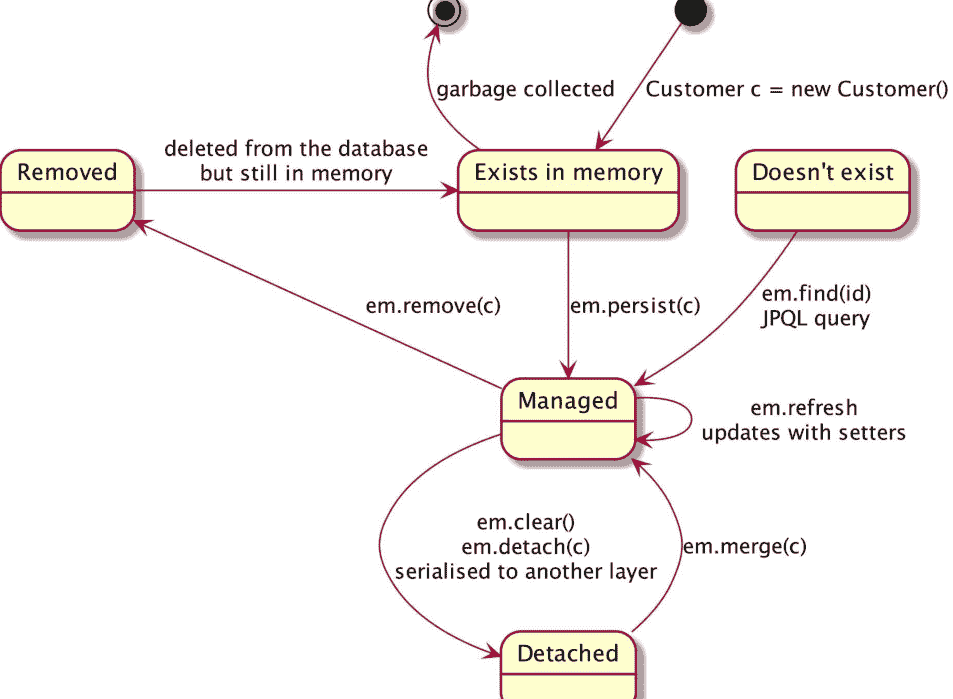

**图 1. 实体生命周期**

为了说明图 1 中的状态图，让我们描述一下 `Customer` 实体的生命周期。首先，创建 `Customer` 对象的实例，我们使用 `new` 操作符。该对象存在于内存中，尽管 JPA 对它一无所知。如果我们对该对象什么都不做，它将超出范围并最终被垃圾回收，它的生命周期也就结束了。接下来我们可以做的是使用 `EntityManager.persist()` 方法持久化一个 `Customer` 实例。此时，实体变为托管状态，其状态将与数据库同步（通常在事务提交时）。在这一托管状态期间，我们可以使用 setter 方法更新属性（例如 `customer.setFirstName()`）或使用 `EntityManager.refresh()` 方法刷新内容。所有更改都将在实体和数据库之间同步。在此状态下，如果我们调用 `EntityManager.contains(customer)` 方法，它将返回 `true`，因为 `customer` 被包含在持久化上下（即：被托管的）。

实体从数据库加载时也是变为托管状态的另一种方法。当我们使用 `EntityManager.find()` 方法或 JPQL 查询来检索实体列表时，所有实体都会自动被托管，我们可以开始更新或删除它们的属性。


在托管状态下，我们可以调用`EntityManager.remove()`方法，实体将从数据库中删除且不再被托管。但 Java 对象继续存在于内存中，直到被垃圾回收器处理。

让我们看看离线状态（detached）。显式调用`EntityManager.clear()`或`EntityManager.detach(customer)`方法会将实体从持久化上下移除；它变为离线。在许多示例中，实体实现了`java.io.Serializable`。当托管实体跨越网络并反序列化时，它被视为离线对象。要重新附加实体，你需要调用`EntityManager.merge()`方法。

回调方法和监听器允许在实体发生特定的生命周期事件时添加自己的逻辑，或者广泛之。

## 回调

实体的生命周期分为四类：持久化、更新、删除和加载，分别对应数据库的插入、更新、删除和查询操作。每个生命周期都有“前”（pre）和“后”（post）事件（加载只有“后”事件），可以被实体管理器拦截以调用业务方法。这些业务方法必须由表 1 中描述的注解标记。这些注解可以应用于实体类或回调监听器。

表 1. 生命周期回调注解

| | 注解 | 描述 |
| --- | --- | --- |
| `@PrePersist` | 在`EntityManager.persist()`之前调用的方法 |
| `@PostPersist` | 在实体持久化后调用的方法。如果实体自动生成主键（使用`@GeneratedValue`），则该值在方法中可用。 |
| `@PreUpdate` | 在实体状态更新之前调用的方法 |
| `@PostUpdate` | 在执行数据库更新后调用的方法 |
| `@PreRemove` | 在`EntityManager.remove()`之前调用的方法 |
| `@PostRemove` | 在实体被删除后调用的方法 |
| `@PostLoad` | 在实体加载（通过 JPQL 查询或`EntityManager.find()`）或从底层数据库刷新后调用的方法 |

没有`@PreLoad`注解，因为对于尚未构建的实体预加载数据是没有意义的。在先前的图 1 所示的 UML 状态图上添加回调注解，将得到图 2 所示的图。

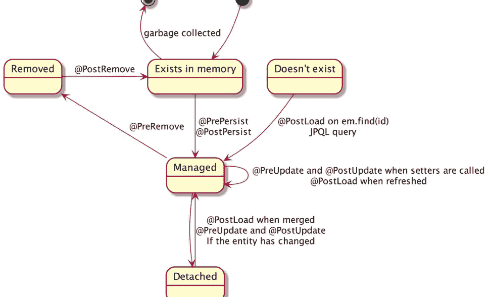

图 2. 带有回调注解的实体生命周期

在将实体插入数据库之前，实体管理器调用标记了`@PrePersist`的。如果插入没有抛出异常，实体将被持久化，其标识被处理，然后调用标记了`@PostPersist`的方法。更新（`@PreUpdate`, `@PostUpdate`）和删除（`@PreRemove`, `@PostRemove`）具有相同的行为。当实体从数据库加载（通过 JPQL 查询或`EntityManager.find()`）时，会调用标记了`@PostLoad`的方法。当离线实体并需要合并时，实体管理器首先必须检查与数据库是否存在差异（`@PostLoad`），如果有，则更新数据（`@PreUpdate`, `@PostUpdate`）。

在代码中它是什么样的？实体不仅可以拥有属性、构造函数、getter 和 setter，还可以包含用于验证其状态或计算某些属性的业务逻辑。这些逻辑可以由其他类调用的普通 Java 方法或回调注解（也称为回调方法）组成，如列表 1 所示。实体管理器根据触发的事件自动调用它们。

# 列表 1.带有回调注解的 Customer 实体

```java
@Entity
public class Customer {

    @Id
    @GeneratedValue
    private Long id;
    private String firstName;
    private String lastName;
    private String email;
    private String phoneNumber;
    private LocalDate dateBirth;
    @Transient
    private Integer age;
    private LocalDateTime creationDate;

    @PrePersist
    @PreUpdate
    private void validate() {
        if (firstName == null || firstName.isEmpty()) {
            throw new IllegalArgumentException("Invalid first name");
        }
        if (lastName == null || lastName.isEmpty()) {
            throw new IllegalArgumentException("Invalid last name");
        }
    }

    @PostLoad
    @PostPersist
    @PostUpdate
    public void calculateAge() {
        if (dateBirth == null) {
            age = null;
            return;
        }
        age = Period.between(dateBirth, LocalDate.now()).getYears();
    }
    // Constructors, getters, setters
}
```

在列表 1 中，`Customer`实体有一个方法来验证其数据（检查`firstName`和`lastName`属性）。该方法标记了`@PrePersist`和`@PreUpdate`注解，并在数据库中插入或更新数据时被调用。如果数据无效，将抛出运行时异常，插入或更新操作将回滚，以确保数据库中插入或更新的数据是有效的。

`calculateAge()`方法计算客户的年龄。`age`属性是瞬态（transient），不会映射到数据库中。在实体加载、持久化或更新后，`calculateAge()`方法获取客户的出生日期，计算年龄并设置`age`属性。

以下规则适用于生命周期回调方法：

- 生命周期回调方法可以具有公共、私有、保护或包级访问权限，但不能是静态（static）或最终（final）的。注意列表 1 中的`validate()`方法是私有的。

- 生命周期回调方法可以标记多个生命周期事件注解（`validateData()`方法同时标记了`@PrePersist`和`@PreUpdate`）。然而，一个实体类中只能存在一种给定类型的生命周期注解（例如，你不能在同一个实体中拥有两个`@PrePersist`注解）。

- 生命周期回调方法可以抛出未检查异常（运行时异常），但不能抛出检查异常。如果存在事务，抛出运行时异常将导致事务回滚。

- 生命周期回调方法不能调用任何`EntityManager`操作或`Query`操作。

- 通过继承，如果在父类上指定了方法，它将在子类方法的执行之前被调用。例如，如果列表 1 中的`Customer`继承自`Person`实体，那么`Person`的`@PrePersist`方法将在`Customer`的`@PrePersist`方法之前被调用。

- 如果在关系中使用级联，回调方法也将以级联方式被调用。例如，假设一个客户有一组地址集合，并在关系上设置了级联删除（cascade remove）。当你删除客户时，`Address`的`@PreRemove`方法和`Customer`的`@PreRemove`方法都将会被调用。

## 监听器

当业务逻辑仅与该实体相关时，实体中的回调方法效果很好。实体监听器（Entity listeners）用于将业务逻辑提取到单独的类并在与其他实体之间共享。实体监听器只是一个 POJO，你可以在上面定义一个或多个生命周期回调方法。要注册监听器，实体需要使用`@EntityListeners`注解。

使用客户示例，我们将`calculateAge()`方法提取到`AgeCalculationListener`中（见列表 2），并将`validate()`方法提取到`DataValidationListener`中（见列表 3）。

列表 2. 计算年龄的监听器

```java
public class AgeCalculationListener {

    @PostLoad
    @PostPersist
    @PostUpdate
    public void calculateAge(Customer customer) {
        if (customer.getDateOfBirth() == null) {
            customer.setAge(null);
            return;
        }
        customer.setAge(Period.between(customer.getDateOfBirth(), LocalDate.now()).getYears());
    }
}
```

列表 3. 验证客户属性的监听器

```java
public class DataValidationListener {

    @PrePersist
    @PreUpdate
    private void validate(Customer customer) {
        if (customer.getName() == null ||
            customer.getName().isEmpty()) {
            throw new IllegalArgumentException("Invalid first name");
        }
        if (customer.LastName() == null ||
            customer.LastName().isEmpty()) {
            throw new IllegalArgumentException("Invalid last name");
        }
    }
}
```

监听器类遵循简单的规则。第一，该类必须有一个公共的无参构造函数。第二，回调方法的签名与列表 1 中的略有不同。当你在监听器上调用回调方法时，该方法需要访问实体状态（例如，需要验证的客户的`firstName`和`lastName`）。方法必须具有一个与实体兼容的类型参数。

在实体上定义的回调方法具有如下无参数的签名：

```java
void method();
```

如果它需要在多个实体上使用，它必须有一个`Object`参数：

```java
void method(Object entity);
```

如果它仅适用于一个实体及其子类，参数可以是实体类型：

```java
void method(Customer entity);
```

为了指定这些监听器由`Customer`实体通知，你需要在实体类使用`@EntityListeners`注解（见列表 4）。该注解可以接收监听器数组。当定义了多个监听器且事件发生时，持久化提供程序按照列出的顺序遍历每个监听器并调用回调方法，传递相应的实体引用。随后它将调用实体自身的回调方法（如果有的话）。

列表 4. 定义两个监听器的 Customer 实体

```java
@EntityListeners({DataValidationListener.class, AgeCalculationListener.class})
@Entity
public class Customer {

    @Id
    @GeneratedValue
    private Long id;
    private String firstName;
    private String lastName;
    private String email;
    private String phoneNumber;
    private LocalDate dateBirth;
    @Transient
    private Integer age;
    private LocalDateTime creationDate;

    // Constructors, getters, setters
}
```

此代码的结果与之前的示例（在列表 1 中所示）完全相同。`Customer`实体在插入或更新之前使用`DataValidationListener.validate()`方法验证数据，并使用监听器的`AgeCalculationListener.calculateAge()`方法计算年龄。

实体监听器方法遵循的规则与实体回调方法相似，但有几细节不同：

- 只能抛出未检查异常。这将导致剩余的监听器和回调方法不再被调用，如果存在事务则将回滚。

- 在继承层次结构中，如果多个实体定义了监听器，父类定义的监听器将在子类定义的监听器之前调用。如果一个实体不想继承父类的监听器，可以使用`@ExcludeSuperclassListeners`注解（或 XML 等效项）显式排除它们。

```java
public class DebugListener {

  @PrePersist
  void prePersist(Object object) {
    System.out.println("prePersist");
  }

  @PreUpdate
  void preUpdate(Object object) {
    System.out.println("preUpdate");
  }

  @PreRemove
  void preRemove(Object object) {
    System.out.println("preRemove");
  }
}
```

注意，每个方法都接受一个`Object`作为参数，这意味着任何类型的实体都可以通过将`DebugListener`类添加到其`@EntityListeners`注解来使用此监听器。为了让应用程序中的每一个实体都使用此监听器，你必须遍历每一个实体并手动将其添加到注解中。对于这种情况，JPA 有一个“默认监听器”（default listeners）的概念，可以覆盖持久化单元中的所有实体。由于没有针对整个持久化单元范围的注解，因此默认监听器只能在 XML 映射文件中声明。

在第 4 章中，你已经了解了如何使用 XML 映射文件而不是注解。将`DebugListener`定义为默认监听器也需要遵循相同的步骤。需要创建一个包含列表 6 中定义的 XML 的映射文件，并将其与应用程序一起部署。

列表 6. 定义为默认监听器的 Debug Listener

```xml
<entity-mappings xmlns:xsi="http://www.w3.org/2001/XMLSchemaSchema-instance"
  xmlns="http://xmlns.jcp.org/xml/ns/persistence/orm"
  xsi:schemaLocation="http://xmlns.jcp.org/xml/ns/persistence/orm
  http://xmlns.jcp.org/xml/ns/persistence/orm_2_2.xsd"
  version="2.2">

  <persistence-unit-metadata>
    <persistence-unit-defaults>
      <entity-listeners>
        <entity-listener
        class="org.agoncal.fascicle.jpa.backslisteners.DebugListener"/>
      </entity-listeners>
    </persistence-unit-defaults>
  </persistence-unit-metadata>

</entity-mappings>
```

在此文件中，`<persistence-unit-metadata>`标签定义了所有没有等效注解的元数据。`<persistence-unit-defaults>`标签定义了持久化单元的所有默认值，而`<entity-listener>`标签定义了默认监听器。此文件需要在`persistence.xml`中引用并与应用程序一起部署。随后，`DebugListener`将自动为每一个实体调用。

当你声明一个默认实体监听器列表时，每个监听器将按照它们在 XML 映射文件中列出的顺序被调用。默认实体监听器始终会在`@EntityListeners`注解中列出的任何实体监听器之前被调用。如果一个实体不希望对其应用默认实体监听器，可以使用`@ExcludeDefaultListeners`注解，如列表 7 所示。

列表 7. 排除了默认监听器的 Customer 实体

```java
@ExcludeDefaultListeners()
@Entity
public class Customer extends Person {

    private String email;
    private String phoneNumber;
    @Transient
    private Integer age;

    // 构造函数, getters, setters
}
```

当事件发生时，监听器将按照以下顺序执行：

1. 默认监听器，
2. 超类的`@EntityListeners`（按数组顺序，从高到低），
3. 实体的`@EntityListeners`（按数组顺序），
4. 超类的回调函数（Callbacks）（从高到低），以及
5. 实体的回调函数（Callbacks）。

回调和实体监听器是根据实体的生命周期为实体添加业务逻辑的极佳方法。

# 高级主题


到目前为止，你已经了解了 JPA 的核心目的：将实体映射到数据库并对其进行查询，这一切都是通过定义的生命周期完成的。但有时你可能想更进一步，挖掘一些不常用的用例。本章解释了你可能会偶尔用到的少数边界情况。

```
本章的代码可以在 https://github.com/agonalcal/agonalcal-fascicle-jpa/tree/2.2/advanced 
```

## 字段和属性上的映射注解

到目前为止，我向你展示了带注解的类（`@Entity` 或 `@Table`）和属性（`@Basic`、`@Column`、`@Temporal` 等），但应用于属性（或字段）的注解也可以设置在对应的 getter 方法（或属性）上。例如，`@Id` 注解可以设置在 `id` 属性上，也可以设置在 `getId()` 方法上。由于这很大程度上取决于个人喜好，我倾向于使用属性访问（注解 getters），因为我发现代码更具可读性。这允许我快速读取实体的属性，而无需淹没在注解中。在本小册中，为了易读，我决定对属性进行注解。但在某些情况下（例如，涉及继承时），这不仅仅是个人品味的问题，因为它会影响你的映射。

> Java 将字段定义为属性。属性是任何带有遵循 Java Bean 模式的访问（getter 和 setter）方法的字段（以 `getXXX`、`setXXX` 或布尔值的 `isXXX` 开头）。

列表 1 显示了如何通过对字段注解来映射实体。

**列表 1. 带注解字段的 Customer 实体**

```java
@Entity
public class Customer {

@Id
@GeneratedValue
private Long id;
@Column(name = "first_name", nullable = false, length = 50)
```

```java
private String firstName;
@Column(name = "last_name", nullable = false, length = 50)
private String lastName;
private String email;
@Column(name = "phone_number", length = 15)
private String phoneNumber;

// 构造函数, getters, setters
}
```

列表 2 显示了通过对方法注解来映射实体。

**列表 2. 使用注解属性的 Customer 实体**

```java
@Entity
public class Customer {

    private Long id;
    private String firstName;
    private String lastName;
    private String email;
    private String phoneNumber;

    // 构造函数, getters, setters

    @Id
    @GeneratedValue
    public Long getId() {
        return id;
    }

    @Column(name = "first_name", nullable = false, length = 50)
    public String getFirstName() {
        return firstName;
    }

    @Column(name = "last_name", nullable = false, length = 50)
    public String getLastName() {
        return lastName;
    }

    public String getEmail() {
      return email;
    }

    @Column(name = "phone_number", length = 15)
    public String getPhoneNumber() {
      return phoneNumber;
    }
}
```

在映射方面，列表 1 和列表 2 中的两个实体是相同的，因为属性名称与 getter 名称相同。但如果在列表 2 中你在单个属性上添加映射注解，JPA 将退回到默认行为：使用属性映射。在这种情况下，你需要通过 `@Access` 注解显式指定映射类型。

该注解接受两个值：`FIELD` 或 `PROPERTY`，可以应用于实体本身和/或每个属性。例如，当 `@Access(AccessType.FIELD)` 应用于实体时，只有放置在属性上的注解会被考虑。随后可以使用 `@Access(AccessType.PROPERTY)` 选择性地指定 getter 访问。

显式访问类型非常有用（例如，在嵌入对象和继承时），但混合它们会导致错误。列表 3 显示了当你混合访问类型时可能发生的情况。

**列表 3. 显式混合访问类型的 Customer 实体**

```java
@Entity
@Access(AccessType.FIELD)
public class Customer {

    @Id
    @GeneratedValue
    private Long id;
    @Column(name = "first_name", nullable = false, length = 50)
    private String firstName;
    @Column(name = "last_name", nullable = false, length = 50)
    private String lastName;
    private String email;
    @Column(name = "phone_number", length = 15)
    private String phoneNumber;

    // 构造函数, getters, setters

    @Access(AccessType.PROPERTY)
    @Column(name = "phone_number", length = 555)
    public String getPhoneNumber() {
        return phoneNumber;
    }
}
```

列表 3 中的示例显式定义访问类型为 `FIELD`。这告诉持久化管理器它应该只处理属性上的注解。`phoneNumber` 属性带有 `@Column`，限制了其长度为 15。阅读这段代码，你期望在数据库中得到一个 `VARCHAR(15)`，但事实并非如此。`getPhoneNumber()` 方法被显式指定了，电话号码的长度也是如此（变为 555）。在这种情况下，实体的 `AccessType.FIELD` 被 `AccessType.PROPERTY` 覆盖了。

在数据库中将获得一个 `VARCHAR(555)`。在实体类中混合映射访问类型时，你应该格外小心。

> **注意**
> 当选择字段访问（属性）或属性访问（getter 方法）时，你正在指定访问类型。默认情况下，单个访问类型适用于整个实体：它要么是字段访问，要么是属性访问，但二者不可兼得（即持久化提供者要么通过属性要么通过 getter 方法访问持久化状态）。JPA 规范规定，在没有显式指定访问类型的情况下，混合在字段和属性上放置注解的应用程序，其行为是未定义的。

### 可嵌入类（Embeddable Class）的访问类型

嵌入类的访问类型由其所属的实体类的访问类型决定。如果实体显式地使用属性访问类型，则嵌入对象也将隐式地使用属性访问。可以通过 `@Access` 注解指定不同的访问类型。

Customer 实体（参见列表 4）和 Address 实体（参见列表 5）使用了不同的访问类型。

**列表 4. 使用字段访问类型的 Customer 实体**

```java
@Entity
@Access(AccessType.FIELD)
public class Customer {

    @Id
    @GeneratedValue
    private Long id;
    @Column(name = "first_name", nullable = false, length = 50)
    private String firstName;
```

```java
@Column(name = "last_name", nullable = false, length = 50)
    private String lastName;
    private String email;
    @Column(name = "phone_number", length = 15)
    private String phoneNumber;
    @Embedded
    private Address address;

    // Constructors, getters, setters
}
```

**列表 5. 使用属性访问类型的嵌入对象**

```java
@Embeddable
@Access(AccessType.PROPERTY)
public class Address {

    private String street1;
    private String street2;
    private String city;
    private String state;
    private String zipcode;
    private String country;

    // Constructors and setters

    @Column(nullable = false)
    public String getStreet1() {
        return street1;
    }

    public String getStreet2() {
        return street2;
    }

    @Column(nullable = false, length = 50)
    public String getCity() {
        return city;
    }

    @Column(length = 3)
    public String getState() {
```

```java
        return state;
    }
    @Column(name = "zip_code", length = 10)
    public String getZipcode() {
        return zipcode;
    }
    public String getCountry() {
        return country;
    }
}
```

强烈建议在嵌入类上显式设置访问类型，以避免当一个嵌入对象被多个实体嵌入时出现映射错误。例如，让我们通过添加如图 1 所示的 Order 实体来扩展我们的模型。Address 现在被 Customer（客户的家庭地址）和 Order（送货地址）所嵌入。


**图 1. Address 被 Customer 和 Order 嵌入**

每个实体定义了不同的访问类型：Customer 使用字段访问，而 Order 使用属性访问。嵌入类的访问类型由其声明所在的实体类决定。如果 Address 没有显式设置自己的访问类型，则 Address 将以两种不同的方式进行映射，这可能会导致映射问题。

显式访问类型在继承中也非常有帮助。默认情况下，叶节点实体继承其根实体的访问类型。在实体层次结构中，每个实体都可以以不同于层次结构中其他类的方式访问。包含 `@Access` 注解将使层次结构生效的默认访问模式被局部覆盖。

### 覆盖属性（Overriding Attributes）

如你在此之前看到的，JPA 非常擅长处理默认映射，并且非常具体，能够对属性、实体、关系或继承映射进行自定义。但它还可以更进一步。在某些边缘情况下，当使用继承或多次嵌入同一个嵌入类时，你需要覆盖映射。这时 `@AttributeOverride` 就派上用场了。

### 继承中的属性覆盖

使用我们在 [jpa-listing-mapping-61] 中看到的每个具体类一张表（table-per-concrete-class）策略时，根类的列被复制到叶节点表中。它们保持相同的名称。但如果使用的是旧版数据库，且列的名称不同呢？JPA 使用 `@AttributeOverride` 注解来覆盖列映射。

在列表 6 中，有一个 Item 实体（但也可以是映射的父类），Book 和 CD 继承自它。

**列表 6. Item 实体**

```java
@Entity
@Inheritance(strategy = TABLE_PER_CLASS)
public class Item {

    @Id
    @GeneratedValue
    protected Long id;
    protected String title;
    protected String description;
    protected Float price;
```

```java
    // Constructors, getters, setters
}
```

Book 和 CD 实体都继承自 Item 映射，因此它们最终将具有相同的列名。这是行不通的，因为你不能在同一个表中拥有两个同名的列。为了重命名 BOOK 和 CD 中的 ID、TITLE 和 DESCRIPTION 列，我们使用 `@AttributeOverride` 注解。

**列表 7. Book 覆盖了属性**

```java
@AttributeOverride(name = "id", column = "BOOK_ID")
@AttributeOverride(name = "title", column = "BOOK_TITLE")
@AttributeOverride(name = "description", column = "BOOK_DESCRIPTION")
public class Book extends Item {

    private String isbn;
    private Integer nbOfPages;
    private Boolean illustrations;
}
```

**列表 8. CD 覆盖了属性**

```java
@AttributeOverride(name = "id", column = "CD_ID")
@AttributeOverride(name = "title", column = "CD_TITLE")
@AttributeOverride(name = "description", column = "CD_DESCRIPTION")
public class CD extends Item {
    private String musicCompany;
    private Integer numberOfCDs;
    private Float totalDuration;
    private String genre;
}
```

每个 `@AttributeOverride` 指向 Item 实体的一个属性，并使用 `@Column` 注解重新定义映射。因此，`name = "title"` 通知持久化提供者该属性已映射到 `CD_TITLE`。图 2 显示了结果。

| BOOK_ID | BOOK_TITLE | BOOK_DESCRIPTION | PRICE | ISBN | PUBLISHER | ILLUSTRATIONS |
| :--- | :--- | :--- | :--- | :--- | :--- | :--- |
| CD_ID | CD_TITLE | CD_DESCRIPTION | PRICE | MUSICCOMPANY | NUMBEROFCDS | TOTALDURATION | GENRE |

**图 2. BOOK 和 CD 表覆盖了 ITEM**

### 嵌入类的属性覆盖

嵌入类的情况也是类似的。嵌入类可以在同一个实体中被嵌入多次。在这种情况下，你需要覆盖属性。列表 9 显示了 Address 嵌入类。

**列表 9. Address 嵌入类**

```java
@Embeddable
public class Address {

    private String street1;
    private String city;
    private String zipcode;
    private String country;

    // Constructors, getters, setters
}
```

```java
@AttributeOverride(name = "street1", column = @Column(name = "invoice_street1"))
@AttributeOverride(name = "city", column = @Column(name = "invoice_city"))
@AttributeOverride(name = "zipcode", column = @Column(name = "invoice_zipcode"))
@AttributeOverride(name = "country", column = @Column(name = "invoice_country"))
private Address invoiceAddress;

@AttributeOverride(name = "street1", column = @Column(name = "delivery_street1"))
@AttributeOverride(name = "city", column = @Column(name = "delivery_city"))
```


# 使用 `@AttributeOverride` 映射嵌入实体

`@AttributeOverride(name = "zipcode", column = @Column(name = "delivery_zipcode")`

`@AttributeOverride(name = "country", column = @Column(name = "delivery_country"))`

`private Address deliveryAddress;`

// 函数, getters, setters

最终结果如列表 11 所示。`PURCHASE_ORDER` 包含了 `PurchaseOrder` 实体的所有列，以及两个 `Address` 嵌入类型（embeddables）的列。

**列表 11. 包含所有列的 `PURCHASE_ORDER` 表**

```sql
CREATE TABLE PURCHASE_ORDER
(
ID BIGINT NOT NULL,
CREATIONDATE TIMESTAMP,
DELIVERY_STREET1 VARCHAR,
DELIVERY_CITY VARCHAR,
DELIVERY_ZIPCODE VARCHAR,
DELIVERY_COUNTRY VARCHAR,
INVOICE_STREET1 VARCHAR,
INVOICE_CITY VARCHAR,
INVOICE_ZIPCODE VARCHAR,
INVOICE_COUNTRY VARCHAR,
PRIMARY KEY (ID)
)
```

## 缓存

大多数规范重点关注功能性需求，将非功能性需求（如性能、扩展性或集群）留作实现细节。实现必须严格遵守规范，但也可以添加特定功能。JPA 的完美例子是缓存，它在 JPA 2.0 之前在规范中并未被提及。

实体管理器（entity manager）被视为一级缓存，用于对数据库进行全面处理并缓存短生命周期实体。一级缓存按事务为单位使用的，以减少给定事务内 SQL 查询的数量。例如，如果一个对象在同一个事务内被修改了多次，实体将在事务结束时只会生成一个 `UPDATE` 语句。一级缓存并不是性能缓存。

尽管如此，所有的 JPA 实现都使用性能缓存（又称为二级缓存）来优化数据库访问、查询、连接等。如图 3 所示，二级缓存位于实体管理器和数据库之间，通过将对象加载到内存中供整个应用程序使用，减少数据库流量。


每个实现都有其自己的缓存对象的方法，可以通过开发自己的机制或复用现有的机制（开源或商业）。当规范忽略某个主题时，缓存甚至可以跨多个节点分布——一切都是可能的。JPA 2.0 承认了需要二级缓存，并在标准 API 中添加了缓存操作。列表 12 所示的 API 非常精简（因为 JPA 的目标不是标准化一个功能全缓存），但它允许代码以标准方式从二级缓存中查询和移除某些实体。与 `EntityManager` 一样，`java.persistence.Cache` 是一个由持久提供程序缓存系统实现的接口。

```java
public interface Cache {
  // 缓存是否包含给定实体的数据。
  public boolean contains(Class cls, Object primaryKey);
  // 从缓存中移除给定实体的数据。
  public void evict(Class cls, Object primaryKey);
  // 移除指定类实体的数据（及其）
  public void evict(Class cls);
  // 清除缓存。
  public void evictAll();
  // 返回特定于提供程序的缓存实现
  public <T> T unwrap(Class<T> cls);
}
```

你可以使用此 API 检查特定实体是否在二级缓存中，从缓存中移除它，或清除整个缓存。结合此 API，你可以使用列表 13 所示的 `@Cacheable` 注解来显式告知提供程序某个实体是否是可缓存的。如果实体没有 `@Cacheable` 注解，则意味着该实体及其状态不能被提供程序缓存。

**列表 13. `Customer` 实体是可缓存的**

```java
@Entity
@Cacheable(true)
public class Customer {
  @Id
  @GeneratedValue
  private Long id;
  private String firstName;
  private String lastName;
  private String email;
  // 函数, getters, setters
}
```

`@Cacheable` 注解接受一个布尔值（默认 `true`）。一旦你决定了哪些实体应该是可缓存的，你需要告知提供程序应该使用哪种缓存机制。在 JPA 中实现此方法是在 `persistence.xml` 文件设置 `shared-cache-mode` 属性。以下是可能的值：

- `ALL`：所有实体和实体相关状态都被缓存。
- `DISABLE_SELECTIVE`：除了标记了 `@Cacheable(false)` 的实体外，对所有实体启用缓存。
- `ENABLE_SELECTIVE`：对所有标记了 `@Cacheable` 的实体启用缓存。
- `NONE`：禁用缓存。
- `UNSPECIFIED`：仅对标记了 `@Cacheable` 的实体进行缓存。

在交通非常稀疏的情况下，可能不需要检查驶来车辆即可横穿马路。但在繁忙的市中心可不然了！

JPA 在 API 的不同级别使用不同的锁定机制。悲观锁和乐观锁都可以通过 `EntityManager.find` 和 `EntityManager.refresh` 方法（除了 `lock` 方法外）以及通过 JPQL 查询获取，这意味着可以通过 [jpa-listing-managing-1] 中的方法在 `EntityManager` 级别和查询级别实现锁定。

这些方法中的每一个方法都接受一个 `LockModeType` 作为参数，该参数可以取不同的值（默认值为 `NONE`）。

- `OPTIMISTIC`: 使用乐观锁。
- `OPTIMISTIC_FORCE_INCREMENT`: 使用乐观锁并强制对实体的版本列递增（参见后文的“版本控制”（Versioning）章节）。
- `PESSIMISTIC_READ`: 使用悲观锁，不需要在事务结束时重新读取数据来获取锁。
- `PESSIMISTIC_WRITE`: 使用悲观锁，并强制尝试更新该实体的事务之间进行序列化。
- `PESSIMISTIC_FORCE_INCREMENT`: 使用悲观锁并强制对实体的版本列递增（参见后文的“版本控制”（Versioning）章节）。
- `NONE`: 指定不使用任何锁定机制。

你可以根据需要指定锁的方式，在多个地方使用这些参数。你可以先读取后锁定。

```java
// 读取实体
Book book = em.find(Book.class
```

```java
book.raisePriceByTwoDollars();
```

或者，你可以先读取并锁定。

```java
// 读取并锁定实体
Book book = em.find(Book.class, id,
LockModeType.OPTIMISTIC_FORCE_INCREMENT);
```

```java
book.raisePriceByTwoDollars();
```

并发和锁定是版本控制的核心驱动力。

## 版本控制 (Versioning)

大多数软件程序都使用版本控制。事实上，甚至 Java 规范也使用版本控制：Java SE 7.0、Java SE 8.0、JPA 2.0、JPA 2.1、JAX-RS 1.0 等。当新版本的 JAX-RS 规范发布时，其版本号会增加，你需要升级到相应的 JAX-RS。当你需要对实体进行版本控制时，JPA 正使用了这种完全机制。因此，当你第一次在数据库中持久化实体时，它将获得版本号 1。稍后，如果你更新了一个属性并将更改提交到数据库，实体的版本将变为数字 2，以此此类推。每当实体发生更改时，这种版本控制就会演进一次。

为了实现这一点，实体必须有一个用于存储版本号的属性，并且必须被 `@Version` 注解。该版本号随后映射到数据库中的一列。支持版本控制的属性类型可以是 `int`、`Integer`、`short`、`Short`、`long`、`Long` 或 `Timestamp`。列表 15 显示了如何为 `Book` 实体添加版本属性。

**列表 15. 在 `Integer` 类型上带有 `@Version` 注解的 `Book` 实体**

```java
@Entity
public class Book {
    @Id
    @GeneratedValue
    private Long id;
    @Version
    private Integer version;
    private String title;
    private Float price;
    private String description;
    private String isbn;
    public void raisePriceByTwoDollars() {
        price = price + 2;
    }
    public void raisePriceByFiveDollars() {
        price = price + 5;
    }
    // 构造函数，getters, setters
}
```

实体可以访问其版本属性的值，但不得修改它。只有持久化提供程序允许在对象写入或更新到数据库时设置或更新版本属性的值。让我们来看一个例子来解释这种版本控制的行为。在列表 16 中，一个新的 `Book` 实体被持久化到数据库中。一旦事务提交，持久化提供程序会将版本设置为 1。稍后，更新了书籍的价格，一旦数据刷新到数据库，版本号就会递增到 2。

**列表 16. 实体版本控制**

```java
// 创建书籍
Book book = new Book("H2G2", 12.5F, "Scifi book", "1-84023-742-2");
tbook.begin();
em.persist(book);
tbook.commit();
assertEquals(1, (int) book.getVersion());
```

```java
// 更新书籍
tbook.begin();
book.raisePriceByTwoDollars();
tbook.commit();
assertEquals(2, (int) book.getVersion());
```

当实体可以被多个进程或线程并发修改时，版本属性不是强制要求的，但是建议的。版本控制是乐观锁的核心，并为低频的并发实体修改提供保护。事实上，如果实体有一个映射了带有 `@Version` 注解的属性，则会自动启用乐观锁。

## 乐观锁 (Optimistic Locking)

顾如其名，乐观锁基于数据库事务之间互不冲突的这一事实。换句话说，更新实体的事务很有可能是在该时间间隔内唯一实际更新该实体的事务。因此，获取实体锁定的决策实际上是在事务结束时做出的。这确保了对实体的更新与数据库的当前状态保持一致。导致违反此约束的事务将导致抛出 `OptimisticLockException` 并将事务标记为回滚。

你将如何抛出 `OptimisticLockException` 呢？可以通过显式锁定实体（使用你见过的 `lock` 或 `find` 方法并传递 `LockModeType`），或者让持久化提供程序检查带有 `@Version` 注解的属性。

导致违反此约束的事务将抛出 `PessimisticLockException` 异常并将事务标记为回滚。

乐观锁适用于处理并发事务之间的中度冲突。但在某些冲突风险较高的应用程序中，悲观锁可能更为合适，因为数据库锁是立即获取的，而不是像乐观事务那样往往在最后才失败。例如，在经济危机期间，股票市场会收到大量的卖出订单。如果有 1 亿亿美国人需要同时卖出他们的股票期权，系统需要使用悲观锁来确保数据一致性。请注意，目前市场是倾向于悲观而非乐观的，这与 JPA 无关。

悲观锁可以应用于不包含带注解的 `@Version` 属性的实体。

# 将 JPA 与其他技术集成

正如你在前面的章节中所看到的，Java 持久化 API（JPA）可以作为一项独立技术使用。只需在代码中嵌入所需的依赖，在实体上添加映射注解，并使用 `javax.persistence.EntityManagerFactory` 和 `javax.persistence.EntityManager` API 进行查询即可。但 JPA 的优美之一在于它的灵活性和适应性：它可以很好地与其他技术集成，例如 Bean Validation、CDI、JTA 或 Spring 等。

> 本章的代码可以在 https://github.com/agoncal/agoncal-fascicle-jpa/tree/2.2/integrating 找到。

## Bean Validation 集成

数据验证是开发者必须完成的常见任务，它遍布应用程序的所有层（从客户端到数据库）。这种常见做法既耗时又容易出错，而且从远来看难以维护。此外，某些约束的使用频率非常高，以至于被视为标准（检查空值、其大小、范围等）。如果能够将这些约束集中在一个地方并在层之间共享，那就太好了。这就是 Bean Validation 派上用场的地方。

Bean Validation 针对 Java，尽管已经尝试集成到其他语言（如 DDL 或 XSD）。[1] 它允许你编写一次约束并在不同的应用层中复用它。Bean Validation 与层无关，这意味着同一个约束可以从表示层一直使用到业务模型层。Bean Validation 不仅适用于服务端应用程序，也适用于富客户端 Java 客户端图形界面（Swing, Android, JavaFX.）。

Bean Validation 允许你将已定义的通用约束应用于应用程序，还可以编写自己的验证规则来验证 bean、属性、构造函数、方法返回类型和参数。该 API 非常易用且灵活，因为它鼓励你使用注解或 XML 描述符来定义约束。

如果你喜欢本小册的格式并对 Bean Validation 感兴趣，请查看附录 D 中我的 Bean Validation 小册的引用。

Bean Validation 有多个接入 Java EE 的钩。其中之一是它与 JPA 以及实体生命周期的集成。实体可以包含 Bean Validation 约束并进行自动验证。事实上，当 JPA 在 `pre-persist` 和 `pre-update` 实体生命周期将验证委托给 Bean Validation 实现时，验证会自动执行。

列表 1 显示了一个带有几个 Bean Validation 约束（`@NotNull`、`@Digits`、`@Size` 和 `@Positive`）的 `Book` 实体。Bean Validation 注解读起来非常自然。列表 1 中的代码表达了“书名不能不能为空”、“ISBN 的长度应在 8 到 13 个字符之间”或“页数应该是正数”。同时注意我们如何将 JPA 注解（`@Entity`、`@Id` 和 `@GeneratedValue`）与 Bean Validation 注解混合使用。

**列表 1 带有 Bean Validation 约束的 `Book` 实体**

```java
@Entity
public class Book {
@Id @GeneratedValue
private Long id;
@NotNull
private String title;
@Digits(integer = 4, fraction = 2)
private Float price;
@Size(max = 2000)
private String description;
@Size(min = 8, max = 13)
private String isbn;
@Positive
private Integer nbOfPages;
// Constructors, getters, setters
}
```

在列表 2 中，我们根据 Bean Validation 约束创建了一个具有有效标题、有效页数、有效价格和有效 ISBN 的有效书籍实体。然后我们持久化了这本书，而没有显式地调用任何验证。

**列表 2 持久化一个有效的 `Book`**

```java
book book = new Book().title("H2G2").price(12.5F).isbn("1-84023-2").nbOfPages(354);
tx.begin();
em.persist(book);
tx.commit();
```

另一方面，在列表 3 中，书的 `title` 属性为 `null`。一旦我们持久化这本书，在不需要以编程方式使用 Bean Validation Validator API 的情况下，JPA 会在持久化实体之前自动调用 Bean Validation。Bean Validation 将返回一个 `ConstraintViolation` 集合，然后 JPA 集成将抛出 `RollbackException` 并回滚事务。结果是，没有数据被插入数据库。

**列表 3 违反约束时的事务回滚**

```java
Book book = new Book().title(null).price(12.5F).isbn("1-84023-2").nbOfPages(354);
assertThrows(RollbackException.class, () -> {
tx.begin();
em.persist(book);
tx.commit();
});
```


# JPA 实体生命周期与 Bean Validation 集成

JPA 实体有一个特定的生命周期（`Persist`、`Update`、`Remove`、`Load`），Bean Validation 在此生命周期上挂了钩子。在从数据库持久化或更新实体之前，数据必须是有效的。另一个与 Bean Validation 有有趣集成的是 JPA 如何在生成 schema 时理解某些约束。如果 JPA 发现它能理解的 Bean Validation 约束，它可以使用列表 4 中的实体映射生成相应的 schema。`@NotNull` 提供了 SQL 中的 `not null`，而 `@Size(max)` 会影响 `varchar` 的大小。不需要添加 `@Column(nullable = false)`。仅有 `@NotNull` 就足够让数据库不允许空值。当然，如果验证太复杂或在 SQL 中没有对应项（例如 `@Positive`），它会被忽略。

**列表 4 创建表脚本**

```sql
CREATE TABLE BOOK
(
    ID BIGINT NOT NULL,
    DESCRIPTION VARCHAR(2000),
    ISBN VARCHAR(13),
    NBOFPAGES INTEGER,
    PRICE FLOAT,
    TITLE VARCHAR(255) NOT NULL,
    PRIMARY KEY (ID)
)
```

## CDI 集成

CDI 或上下文依赖注入是 Java EE 的核心技术。[2] 它的编程模型将几乎每个 Java EE 组件转换为可注入、可拦截和管理的 bean。CDI 构建在“松耦合、强类型”的概念之上，这意味着 bean 是松耦合的，但是以强类型的方式进行的。解耦通过为整个平台引入拦截器、装饰器和事件而进一步进一步。同时，CDI 通过统一作用域、上下文和生命周期管理将 Web 层和后端结合在一起。受益于它的事件总线，CDI 也是通过编写平台扩展来扩展 Java EE 的标准方式。

但让我们只用 CDI 进行注入。到目前为止，当我们需要 `EntityManager` 时，我们会通过编程方式给定 `EntityManagerFactory` 创建一个。使用后，我们还需要关闭它。

```java
EntityManager emf = Persistence.createEntityManagerFactory("cdbookstorePU");
EntityManager em = emf.createEntityManager();
em.close();
```

但通过 CDI，我们也可以通过 `@Inject` 注解通过依赖注入获取实体管理器。为了实现这一点，我们需要定义两个 CDI 生产者（producer）：一个创建 `EntityManagerFactory`，另一个创建 `EntityManager`。列表 5 使用 JPA API 构建了一个应用范围的实体管理器工厂。

**列表 5. 产生 EntityManagerFactory**

```java
@ApplicationScoped
public class EntityManagerFactoryProducer {

    @Inject
    private BeanManager beanManager;

    @Produces
    @ApplicationScoped
    public EntityManagerFactory produceEntityManagerFactory() {
        Map<String, Object> props = new HashMap<>();
        props.put("javax.persistence.bean.manager", beanManager);
        return Persistence.createEntityManager("cdbookstorePU");
    }

    public void close(@Disposes EntityManagerFactory emf) {
        emf.close();
    }
}
```

列表 5 显示了一个应用作用范围（application scoped）的，它在应用程序生命周期内初始化一次。它产生并销毁 `EntityManagerFactory`，使其可以被注入。同样，我们需要产生实体管理器（entity manager）。列表 6 注入了列表 5 中产生的 `EntityManagerFactory`，以便产生 `EntityManager`。

**列表 6. 产生 EntityManager**

```java
@ApplicationScoped
public class EntityManagerProducer {

    @Inject
    private EntityManagerFactory emf;

    @Produces
    @RequestScoped
    public EntityManager produceEntityManager() {
        return emf.createEntityManager();
    }

    public void close(@Disposes EntityManager em) {
        em.close();
    }
}
```

有了这些生产者后，我们可以在 `@Inject` 处注入一个实体管理器。列表 7 展示了 `AddressService` 如何注入 `EntityManager`，以便它可以持久化一个 `Address` 实体。

**列表 7. 注入 EntityManager**

```java
@ApplicationScoped
public class AddressService {

    @Inject
    private EntityManager em;

    public Address save(Address address) {
        em.getTransaction().begin();
        em.persist(address);
        em.getTransaction().commit();
        return address;
    }
}
```

从 JPA 2.1 开始，CDI 也被支持在实体监听器（entity listeners）中使用。因此，在列表 8 中，我们有一个实体监听器来检查邮政编码（zipcode）是否有效。它将此任务委托给名为 `ZipCodeChecker` 的辅助类，该类得益于 `@Inject` 注解被注入。

**列表 8. 注入辅助类**

```java
@ApplicationScoped
public class ZipCodeListener {

    @Inject
    private ZipCodeChecker checker;

    @PrePersist
    @PreUpdate
    private void checkZipCode(Address address) {
        if (!checker.isValid(address.getZipcode())) {
            throw new IllegalArgumentException("Invalid zipcode");
        }
    }
}
```

正如在列表 9 中所示，`ZipCodeChecker` 仅仅是一个 CDI Bean。

**列表 9. ZipCodeChecker 辅助类**

```java
@ApplicationScoped
public class ZipCodeChecker {

    private Pattern zipPattern = Pattern.compile("\\d{5}(-\\d{5})?");

    public boolean isValid(String zipcode) {
        if (zipcode == null) {
            return true;
        }
        return zipPattern.matcher(zipcode).matches();
    }
}
```

## JTA 集成

在 Java 中，事务管理通过 JSR 907 指定的 Java 事务 API (JTA) 完成。JTA 定义了一组接口，供应用程序或容器划定事务边界，并定义了处理事务管理器的 API。`javax.transaction` 包定义了这些接口。

到目前为止，本小节中的所有示例都使用 JPA 本地事务。资源本地事务（Resource local transactions）用于 Java SE 环境，而不是托管环境（Spring 或 Java EE）。这意味着我们在配置持久化单元的 `persistence.xml` 文件使用了 `transaction-type="RESOURCE_LOCAL"`：

```xml
<persistence-unit name="cdbookstorePU" transaction-type="RESOURCE_LOCAL">
```

一旦配置，本地事务通过 `EntityTransaction` API 定义，该接口包含了 `begin`、`commit` 和 `rollback` 等基础事务管理：

```java
entityManager.getTransaction().begin();
entityManager.getTransaction().commit();
entityManager.getTransaction().rollback();
```

在调用 `begin` 之前，无法调用 `persist`、`merge` 或 `remove` 等某些操作。在成功 `commit` 之后，`EntityManager` 可以继续使用，且所有受托管的对象都保持受托管状态。`rollback` 操作将回滚数据库事务。

JTA 事务用于 Spring 或 Java EE 等托管环境。要使用 JTA 事务，`persistence.xml` 中的 `transaction-type` 属性应设置为 `JTA`。如果配合数据源使用 JTA 事务，应使用 `<jta-datasource>` 元素引用已配置为 JTA 托管的数据源。

```xml
<persistence-unit name="cdbookstorePU" transaction-type="JTA">
    <jta-data-source>java:jboss/datasources/MyDS</jta-data-source>
    ...
</persistence-unit>
```

列表 10 显示了一个事务服务。得益于 `javax.transaction.Transactional` 注解，你知道该服务是事务性的。该注解负责拦截方法调用并在需要时启动事务。这就是为什么在代码中没有看到任何显式的 `tx.begin()` 或 `tx.commit()`。

**列表 10. 事务型服务**

```java
@ApplicationScoped
public class AddressService {

    @Inject
    private EntityManager em;

    @Transactional(REQUIRED)
    public Address save(Address address) {
        em.persist(address);
        return address;
    }

    @Transactional(MANDATORY)
    public String needsATTransaction() {
        return "Success";
    }
}
```

`@Transactional` 注解可以标记整个类或单个方法。它接受事务类型作为参数。根据你的需求，有几种事务类型可选（见表 1）。

**表 1. 事务类型**

| 属性 | 描述 |
| :--- | :--- |
| `REQUIRED` | 此属性（默认值）意味着方法必须在事务中被调用。如果从非事务客户端调用该方法，容器将创建一个新事务。如果客户端具有事务上下文，则业务方法将在客户端的上下文中运行。如果你进行的调用应该在事务中管理，则应使用 `REQUIRED`。 |
| `REQUIRES_NEW` | 容器在执行方法之前总是创建一个新事务，无论客户端是否在事务中执行。如果客户端在事务中运行，容器将临时挂起该事务，创建第二个事务，提交或回滚，然后恢复第一个事务。这意味着第二个事务的成功或失败不会对现有事务产生任何影响。当你不希望回滚影响客户端时，应使用 `REQUIRES_NEW`。 |
| `SUPPORTS` | 事务方法继承客户端的事务上下文。如果可用事务上下文，则方法将使用它；如果不可用，容器将在无事务上下文的情况下调用该方法。当你对数据库表有只读访问权限时，应使用 `SUPPORTS`。 |
| `MANDATORY` | 容器在调用业务方法之前要求存在事务，但不创建新事务。如果客户端具有事务上下文，则对其进行传播；如果没有，则将抛出 `javax.transaction.TransactionalException`。 |
| `NOT_SUPPORTED` | 事务方法不能在事务上下文中调用。如果客户端没有事务上下文，则什么都不会发生；如果有，容器将挂起客户端的事务，调用方法，并在方法返回时恢复事务。 |
| `NEVER` | 事务方法不得从事务型客户端调用。如果客户端在事务上下文中运行，容器将抛出 `javax.transaction.TransactionalException`。 |

## Spring Integration

Spring Framework 创建于 2003 年，是 Java 平台的一个应用程序框架和容器（基于控制反转原则）。[4] 该框架的核心功能可以被任何 Java 应用程序使用，并可以扩展以在 Java EE 平台上构建 Web 应用程序。

今天，“Spring”一词在不同的语境下有不同的含义。它可以指 Spring Framework 本身，也可以指随着时间推移产生的其他 Spring 项目，例如 Spring Boot、Spring MVC、Spring Security、Spring Data、Spring Cloud、Spring Batch、Spring WebFlux 等。

从历史上来看，Spring 在非常早期阶段就增加了对 JPA 的支持，直到今天 JPA 仍然是一项优先集成技术。事实上，你可以在基于 Spring 的应用程序的任何地方集成 JPA，如果你使用 Spring Data 更是如此。[5]

这次我们换一个例子。假设我们需要一个 REST API 将某些地址持久化到关系型数据库中。由于 Spring 支持 JPA，列表 11 中的代码不会让你感到意外。

**列表 11. 地址实体 (Address Entity)**

```java
@Entity
public class Address {

    @Id @GeneratedValue
    private Long id;

    private String street1;
    private String street2;
    private String city;
    private String state;
    private String zipcode;
    private String country;

    // Constructors, getters, setters
}
```

列表 12 定义了 REST 控制器，得益于几个注解，我们能够持久化和查询地址。`createAddress()` 方法通过 HTTP 请求中的 `@RequestBody Address` 接收 `Address`，并通过 `AddressRepository.save()` 方法将其存储在关系型数据库中。所有其他方法都有一个 `@GetMapping` 注解，表示它们在 HTTP 响应中返回数据。`count` 方法通过 `AddressRepository.count()` 方法返回数据库中的地址数量。`getAddressesByCountry()` 和 `getAddressesLikeZip()` 方法都根据某些参数返回地址列表。

**列表 12. Spring REST 控制器**

```java
@RestController
public class AddressEndpoint {

    private final AddressRepository addressRepository;

    @PostMapping("/addresses")
    public Address createAddress(@RequestBody Address address) {
        return addressRepository.save(address);
    }

    @GetMapping(value = "/addresses/count")
    public Long countAll() {
        return addressRepository.count();
    }

    @GetMapping(value = "/addresses/country/{country}")
    public List<Address> getAddressesByCountry(@PathVariable String country) {
        return addressRepository.findAllByCountry(country);
    }

    @GetMapping(value = "/addresses/like/{zip}")
    public List<Address> getAddressesLikeZip(@PathVariable String zip) {
        // 方法体未完整提供
    }
}
```


进入`/path/to/xxx`目录，找到`xxx.json`。

在表达式`cvar = avar + bvar`中，加法运算符（`+`）将`avar`与`bvar`相加，得到它们的和`cvar`。

在`List.of(arg0, arg1, arg2)`中，`List`接口的工厂方法`of()`接受一系列的元素，返回包含它们的只读列表。

之后我们这样调用`cmd`命令：`cmd arg0 arg1 arg2`。

```
if (condVar > someVal) {console.log("xxx")}
```

---

```
return addressRepository.findAllLikeZip(zip);
```

列表 12 的重要的是使用`AddressRepository`从数据库中存储和检索数据。但如果你仔细看，将不会看到任何`save()`或`count()`方法。这是因为`AddressRepository`继承自`JpaRepository`，而这些方法是由后者实现的。`findAllByCountry`方法使用了 Spring Data 的命名规范来执行带有`ByCountry`标准的`findAll`方法。因此，Spring Data 知道如何根据国家创建`WHERE`子句。另一方面，`findAllLikeZip`使用 Spring Data 的`@Query`注解定义了一个 JPQL 查询。

列表 13. Spring Data 仓库

```
List<Address> findAllByCountry(@Param("country") String country);

@Query("SELECT a FROM Address a WHERE a.zipcode LIKE %:zip%")
List<Address> findAllLikeZip(@Param("zip") String zip);
```

- 1 Bean Validation https://jcp.org/en/jsr/detail?id=380
- 2 CDI https://jcp.org/en/jsr/detail?id=365
- 3 JSR 907 https://jcp.org/en/jsr/detail?id=907
- 4 Spring https://spring.io
- 5 Spring Data https://spring.io/projects/spring-data

## 整合一切

现在，让我们把这些概念结合起来，编写一个从 H2 数据库中持久化和查询实体的应用程序。

思路是编写一个表示书籍的实体图（见图 1），并添加一个`Main`类，用于持久化书籍以及包含一些测试用例。然后你可以用 Maven 编译它，并使用 EclipseLink 作为 JPA 提供程序以及 H2 数据库运行它。为了展示对实体进行集成测试有多简单，我将向你展示如何使用 JUnit 5.x 编写一个测试类（`BookTest`），并使用 H2 的嵌入模式通过内存数据库持久化数据。

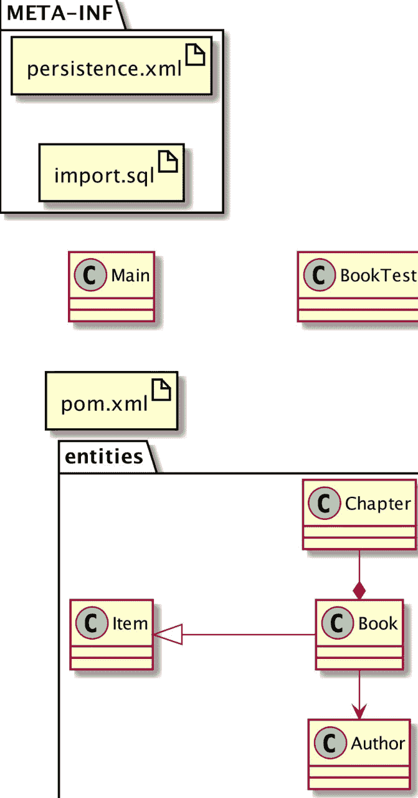

图 1. 整合一切

图 1 中描述的类和文件遵循 Maven 目录结构，必须放置在以下目录中：

- `src/main/java`：`Item`、`Author`、`Book`和`Chapter`实体以及`Main`类的目录。
- `src/main/resources`：`META-INF/persistence.xml`和`import.sql`文件，用于描述持久化单元并将数据导入数据库。
- `src/test/java`：测试用例的目录。
- `pom.xml`：项目对象模型 (Project Object Model)。

# 编写实体

图 2 中的类图表示了领域模型。`Book`实体继承自`Item`。它有一个标签列表、一个章节和作者的映射。注意`Book`和`Author`之间的多对多关系。


图 2. 领域模型

## 编写 Book 实体

从`Book`实体开始（见列表 1）。它包含几个属性以及一些 JPA 注解：

- `@Entity`通知持久化提供程序该类是一个实体。
- `@NamedQuery`注解定义了使用 JPQL 获取书籍的命名查询。

列表 1. 带有命名查询的 Book 实体

```
@Entity
@NamedQuery(name="findAllBooks", query = "SELECT b FROM b")
@NamedQuery(name="findBookH2G2", query = "SELECT b FROM b WHERE b.title='H2G2")
public class Book extends Item {

    @Column(nullable = false, unique = true)
    private String isbn;

    @Column(name="nb_of_pages")
    private Integer nbOfPages;

    private Boolean illustrations;

    @ElementCollection
    @CollectionTable(name="tags",
        joinColumns = {@JoinColumn(name="book_fk")})
    @Column(name="value")
    private List<String> tags = new ArrayList<>();
}
```

```
@ElementCollection
@CollectionTable(name="book_chapters",
joinColumns = {@JoinColumn(name="book_fk")})
@MapKeyColumn(name="position")
private Map<Integer, Chapter> chapters = new HashMap<>();

@ManyToMany
@JoinTable(name="authors",
joinColumns = {@JoinColumn(name="book_fk")},
inverseJoinColumns = {@JoinColumn(name="author_fk")})
private List<Author> authors = new ArrayList<>();

// Constructors, getters, setters
```

为了描述书籍拥有一组章节的事，我们可以使用不同的策略。章节（`Chapter`）可以是一个实体（entity），但将其作为可嵌入类型（embeddable）更符合逻辑。嵌入类型没有自己的身份。相反，它的生命周期与其嵌入的实体紧密相关：如果我们删除了一本书，所有的章节都会被删除。由于书籍拥有一组有序的章节，这种关系是通过`Map`而不是`List`或`Set`来的。这样我们就可以为章节指定位置（例如第一章、第二章等）。注意`@CollectionTable`注解，它指示了集合表的名称，以及`@JoinColumn`重定义了连接列的名称。

一本书可以由一位或多位作者编写。一个作者也可以写一本或多本书。`Book`实体与`Author`实体之间的双向关系使用`@ManyToMany`注解来指定连接`Book`和`Author`的表名。

```
// 为了提高可读性，我省略了本章大多数实体的构造函数、getter 和 setter。
```

## 编写映射超类项（Mapped Super-class）

在我们的示例中，`Book`继承自`Item`。`Item`持有书籍的唯一标识符，以及标题、描述或价格等属性。它还使用了几个 JPA 注解：

- `@Id`将`id`属性定义为主键。
- `@GeneratedValue`注解告知持久化提供程序使用底层数据库 id 工具自动生成主键。

在列表 2 中，注意`Item`不是实体，而是映射超类（mapped superclass）。带有`@MappedSuperclass`注解的类用于共享状态、行为以及`Book`实体继承的映射信息。总之，`Item`和`Book`的属性将映射到单个`BOOK`表中。

列表 2. Book 继承自 Item 映射超类

```
@MappedSuperclass
public class Item {

    @Id
    @GeneratedValue
    protected Long id;

    protected String title;
    protected String description;
    protected Float price;

    // Getters, setters
}
```

## 编写章节嵌入类型

列表 3 显示了`Chapter`嵌入类型。注意`Chapter`没有任何标识符（未用`@Id`注解），因此它没有身份。但它允许`Book`实体拥有一个章节映射（map 的值），并带有章节的位置（map 的键）：`Map<Integer, Chapter> chapters`。

列表 3. 书籍拥有章节映射

```
@Embeddable
public class Chapter {

    private String title;
    private String description;

    // Constructors, getters, setters
}
```

## 编写作者实体

最后是`Author`实体。如你在列表 4 所示，该实体仅使用了一组基本映射注解（`@Id`、`@Column`等）。`Book`和`Author`之间建立了多对多的关系。但请注意，`Author`也拥有一个书籍列表作为属性。这表明多对多的关系是双向的（我们既可以从书籍导航到作者，也可以从作者导航到书籍）。

列表 4. 书籍由作者编写

```
@Entity
public class Author {

    @Id
    @GeneratedValue
    private Long id;

    @Column(name = "first_name", length = 50)
    private String firstName;

    @Column(name = "last_name", nullable = false)
    private String lastName;

    @Column(length = 2000)
    private String bio;

    private String email;

    @ManyToOne(mappedBy = "authors")
    private List<Book> books = new ArrayList<>();

    // Constructors, getters, setters
}
```

记住你可以从此处下载代码：
https://github.com/agoncal/agoncal-fascicle-jpa/tree/2.2

## 数据库结构

JPA 的优之处之一是你可以让提供程序自动生成我们刚刚定义的实体的数据库架构。但并不总是如此。大多数时候，你必须将持久化对象映射到现有的关系型数据库，这可能是棘手的。在我们的案例中，只需让 JPA 生成用于创建和删除表及约束的所有 SQL 代码。图 3 显示了实体将映射到的数据库结构。

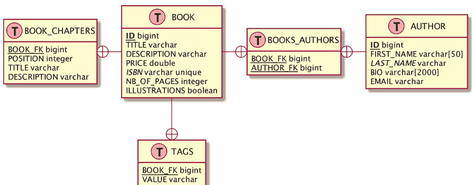

图 3. 数据库结构

在图 3 中，关注表关系很有趣。例如，`Book`继承自`Item`，两个属性都被合并到了单个`BOOK`表中。`List<String> tags`通过外键`book_fk`映射到独立的`TAGS`表中。即使`Chapter`是一个没有身份的嵌入类型，章节也必须映射到独立的`BOOK_CHAPTERS`表中。注意代表 Map 键的`position`属性。对于`Book`和`Author`之间的双向多对关系，它被表示为名为`BOOKS_AUTHORS`的连接表。

## 编写持久化单元

现在我们已经有了所有的实体，并且需要将它们映射到数据库。这时产生了一些问题：我们应该使用哪个 JDBC 驱动？目标数据库是什么？我们需要用户名/密码来连接数据库吗？这些信息在名为`persistence.xml`的部署描述文件中说明。

列表 5 描述了两个持久化单元：
- `bookstorePU`是主类使用的持久化单元，目标是 H2 数据库。
- `bookstoreTest`是用于测试的持久化单元，目标是内存 H2 数据库。

列表 5. 带有两个单元的 persistence.xml

```xml
<persistence xmlns="http://xmlns.jcp.org/xml/ns/persistence"
             xmlns:xsi="http://www.w3.org/2001/XMLSchema-instance"
             xsi:schemaLocation="http://xmlns.jcp.org/xml/ns/persistence
             http://xmlns.jcp.org/xml/ns/persistence/persistence_2_2.xsd"
             version="2.2">
  <persistence-unit name="bookstorePU" type="RESOURCE_LOCAL">
    <provider>org.eclipse.persistence.PersistenceProvider</provider>
    <properties>
      <property name="javax.persistence.jdbc.driver" value="org.h2.Driver"/>
      <property name="javax.persistence.jdbc.url" value="jdbc:h2:tcp://localhost~/bookstoreDB"/>
      <property name="javax.persistence.schema.generation.action" value="drop-and-create"/>
      <property name="eclipselpersistence.schema.generation.database" value="bookstoreCreate.ddl"/>
    </properties>
  </persistence-unit>

  <persistence-unit name="bookstoreTest" type="RESOURCE_LOCAL">
    <provider>org.eclipse.persistence.PersistenceProvider</provider>
    <properties>
      <property name="javax.persistence.jdbc.driver" value="org.h2.Driver"/>
      <property name="javax.persistence.jdbc.url" value="jdbc:h2:mem:bookstoreDB"/>
      <property name="javax.persistence.schema.generation.action" value="drop-and-create"/>
      <property name="eclipselpersistence.schema.generation.database" value="bookstoreDrop.ddl"/>
    </properties>
  </persistence-unit>
</persistence>
```

## 编写加载数据的 SQL 脚本

注意列表 5 `persistence.xml`文件中的`javax.persistence.sql-load-script-source`属性。持久化单元`bookstorePU`用于在加载应用程序之前执行 SQL 脚本。在我们的案例中，我们使用该属性执行`import.sql`脚本以向数据库插入数据。这意味着列表 6 中的脚本将用于数据库初始化并插入三本书。

列表 6. insert.sql 文件

```sql
INSERT INTO BOOK(ID, TITLE, DESCRIPTION, ILLUSTRATIONS, ISBN, NB_OF_PAGES, PRICE) values (1000, 'Beginning Java EE 6', 'Best Java EE book ever', 1, '1234-5678', 450, 49)
INSERT INTO BOOK(ID, TITLE, DESCRIPTION, ILLUSTRATIONS, ISBN, NB_OF_PAGES, PRICE) values (1001, 'Beginning Java EE 7', 'No, this is the best ', 1, '5678-9012', 550, 53)
INSERT INTO BOOK(ID, TITLE, DESCRIPTION, ILLUSTRATIONS, ISBN, NB_OF_PAGES, PRICE) values (1010, 'The Lord of the Rings', 'One ring to rule them all', 0, '9012-3456', 222, 23)
```

## 编写主类

Listing 7 所示的`Main`类与`Book`实体位于同一个包下（`src/main/java`）。它创建了一本书，将其持久化到 H2 服务器数据库中，并执行了两个查询。

Listing 7. 持久化 Book 实体的 Main 类

```
public class Main {

    public static void main(String[] args) {

        // 1 - 创建一个带有标签的 book 实例
```


```
Book book = new Book().title("H2G2").price(12.5F).isbn("1-9754-742-3").nOfPages(354);

book.tag("sci-fi").tag("fun").tag("geek");

// 2 - 获取实体管理器和事务

EntityManagerFactory emf =

    Persistence.createEntityManagerFactory("cdbookstorePU");

EntityManager em = emf.createEntityManager();

// 3 - 将书籍持久化到数据库

EntityTransaction tx = em.getTransaction();

tx.begin();

em.persist(book);

tx.commit();

// 4 - 查询 H2G2 的书籍

book = em.createNamedQuery("findBookH2G2",

    Book.class).getSingleResult();

System.out.println(book);

// 4 - 查询所有的书籍

int books = em.createNamedQuery("findAllBooks",

    Book.class).getResultList().size();

System.out.println("Number of books " + books);

// 5 - 关闭实体管理器和工厂

em.close();

emf.close();
```

Listing 7 中的 `Main` 类通过创建 `Book` 的新实例（使用 Java 关键字 `new`）开始执行，并为其属性设置了一些值。到此为止，这里没有什么特别的，只是纯粹的 Java 代码。但当实体管理器介入时，情况发生了变化。实体管理器是 JPA 的核心部分，因为它能够创建事务并使用 `EntityManager.persist()` 方法持久化书籍对象。一旦事务提交，将会使用 `EntityManager` 创建并调用两个命名查询，以返回一本名为“H2G2”的书（使用 Listing 1 中 `Book` 类中定义的 `findBookH2G2` 命名查询）以及所有的书籍列表（`findAllBooks`）。

再次，为了可读性，我省略了异常处理。如果发生持久化异常，你必须在 `finally` 块中回滚事务、记录消息并关闭 `EntityManager`。

# 编写 BookTest 集成测试

JPA 的主要卖点之一是你可以轻松测试实体，而不需要运行中的应用程序服务器或实时数据库。但你可以测试什么呢？实体本身通常不需要进行隔离测试。实体上的大多数方法都是简单的 getter 或 setter，仅包含少数业务方法。验证 setter 是否为属性分配了值，以及相应的 getter 是否检索了相同的值，并产生任何额外价值（除非在 getter 或 setter 中检测到副作用）。因此，对实体进行单元测试的益处有限。

测试数据库查询呢？确保 `findBookH2G2` 查询是正确的？或者向数据库中注入数据并测试带多个值的复杂查询？得益于内存数据库，可以使用 JPA 轻松测试 CRUD 操作和 JPQL 查询。

Listing 8 所示的 `BookTest` 类位于 `src/test/java` 目录。它有一组测试用例，用于测试与 `Book` 实体的不同交互。作为 `Main` 类，`BookTest` 需要使用 `EntityManagerFactory` 创建 `EntityManager` 实例。这在测试之前通过 `init()` 方法完成（得益于 `@BeforeAll`），该方法初始化 `EntityManager`（使用 `cookbookstorePU` 单元）并创建一个新事务。`close()` 方法在测试结束后释放工厂（`@AfterAll`）。

### Listing 8. BookTest 集成测试

```
public class BookTest {

    private static EntityManagerFactory emf =

    Persistence.createEntityManagerFactory("cdbookstoreTestPU");

    private static EntityManager em;

    private static EntityTransaction tx;

    @BeforeAll

    static void init() {

        em = emf.createEntityManager();

        tx = em.getTransaction();

    }

    @AfterAll

    static void close() {

        if (em != null) em.close();

        if (emf != null) emf.close();

    }

    // ..

}
```

Listing 9 中的测试用例持久化了一个 `persist()` 方法，并检查了 id 是否已由 JPA 提供程序自动生成（使用 `assertNotNull`）。如果是，则执行 `findAllBooks` 查询，并检查数据库中是否多于本书。

### Listing 9. 持久化书籍并从数据库检索

```
Book book = new Book().title("Java EE 7").price(23.5F).isbn("1-8403-742-2").nbOfPages(354);

tx.begin();

em.persist(book);

tx.commit();

assertNotNull(book.getId(), "Id should not be null");
```

```java
List<Book> allBooks = em.createNamedQuery("findAllBooks",

Book.class).getResultList();

assertTrue(allBooks.size() >= 1);
```

Listing 10 中的测试用例持久化了一本带有标签的书。首先，我们创建实体图（一本书，三个标签），然后持久化该书籍。测试用例检查是否存在三个标签。

### Listing 10. 持久化带有标签的书

```java
book = new Book().title("Java EE 7").price(23.5F).isbn("1-8403-742-2").nbOfPages(354);

tx.begin();

em.persist(book);

tx.commit();
```

Listing 11 中的测试用例创建了作者。

```java
book = new Book().title("Java EE 7").price(23.5F).isbn("1-8403-742-2").nbOfPages(354);

book.tag("java").tag("enterprise").tag("CDI");

tx.begin();

em.persist(book);

tx.commit();
```

## 使用 Maven 编译和测试

所有的类现在都需要编译。Listing 12 中的 `pom.xml` 声明了编译所需的 EclipseLink 2.7（JPA 的实现）和 H2 数据库。

Listing 12. 用于编译代码的 pom.xml

```xml
<project xmlns:xsi="http://www.w3.org/2001/XMLSchema-instance"

         xmlns:maven="http://maven.apache.org/POM/4.0.0"

         xsi:schemaLocation="http://maven.apache.org/POM/4.0.0 http://maven.apache.org/xsd/maven-4.0.0.xsd">

  <modelVersion>4.0.0</modelVersion>

  <groupId>org.agonal.fascicle.jpa</groupId>

  <artifactId>putting-together</artifactId>

  <version>2.2</version>

  <dependencies>

    <dependency>

      <groupId>org.eclipse.persistence</groupId>

      <artifactId>org.eclipse.persistence.jpa</artifactId>

      <version>2.7.3</version>

    </dependency>

    <dependency>

      <groupId>com.h2database</groupId>

      <artifactId>h2</artifactId>

      <version>1.4.197</version>

    </dependency>

</project>
```

要编译这些类，请在包含 `pom.xml` 文件的根目录下打开命令行并输入以下 Maven 命令：

```
$ mvn compile
```

对于我们的 `BookTest` 类，在 `pom.xml` 中需要一些额外的依赖：JUnit 和 Maven Surefire 插件（允许测试）。

Listing 13 用于运行测试的 pom.xml 文件依赖

```xml
<dependency>

  <groupId>org.junit.jupiter</groupId>

  <artifactId>junit-jupiter-engine</artifactId>

  <version>5.3.2</version>

  <scope>test</scope>

</dependency>

<build>

  <plugins>

    <plugin>

      <groupId>org.apache.maven.plugins</groupId>

      <artifactId>maven-surefire-plugin</artifactId>

      <version>2.22.1</version>

    </plugin>

    <plugin>

      <groupId>org.codehaus.mojo</groupId>

      <artifactId>exec-maven-plugin</artifactId>

      <version>1.6.0</version>

      <executions>

        <execution>

          <goals>

            <goal>java</goal>

          </goals>

        </execution>

      </executions>

      <configuration>

        <mainClass>org.agonal.fascicle.jpa.puttingtogether.Main</mainClass>

      </configuration>

    </plugin>

  </plugins>

</build>
```

接下来，要执行集成测试，只需执行以下 Maven 命令即可：

```
$ mvn test
```

内联的 `BookTest` 类显示了测试是否通过。你应该能看到 `BUILD SUCCESS` 消息，提示测试执行成功。

```
[INFO] Results:

[INFO]

[INFO] Tests run: 3, Failures: 0, Errors: 0, Skipped: 0

[INFO]

[INFO] ------------------------------------------------------------

[INFO] BUILD SUCCESS

[INFO]

[INFO] ------------------------------------------------------------

[INFO] Total time: 7.564 s
```

# 使用 H2 服务器数据库执行主类

现在我们已经知道代码可以编译且测试通过，让我们来执行 `Main` 类。在此之前，你需要启动 H2 服务器数据库（记住 `Main` 类使用的是持久化单元，它没有使用内存数据库，而是使用服务器数据库）。最简单的方法是进入 `$H2/bin` 目录并执行 `h2` 脚本。H2 启动后会打开浏览器并显示图 4 所示的登录页面。确保你将 JDBC URL 设置为 `jdbc:h2:tcp://localhost/~/cdbookstoreDB`。

| Login |
| :--- | :--- |
| Saved Settings: | Generic H2 (Server) |
| Setting Name: | Generic H2 (Server) | Save | Remove |
| Driver Class: | org.h2.Driver |
| JDBC URL: | jdbc:h2:tcp://localhost/~/cdbookstoreDB |
| User Name: | |
| Password: | |
| Connect | Test Connection |

图 4. 登录 H2 数据库控制台

H2 进程监听 8082 端口并等待 JDBC 驱动程序发送任何 SQL 语句。要执行 `Main` 类，可以使用 Java 解释器命令，或者如下所示使用 `exec-maven-plugin`：

```
$ mvn exec:java
```

当你运行 `Main` 类时，会发生几件事。首先，H2 会自动创建 `cdbookstoreDB` 数据库。这是由于 `persistence.xml` 中定义的 `schema-generation.database.action` 属性，该属性通知 JPA 提供程序自动创建数据库架构。得益于 `import.sql` SQL 脚本，JPA 提供会将数据插入到这个新创建的数据库中。

最后，执行 `Main` 类：创建一个新书籍并将其插入数据库，然后执行查询。我们可以使用 H2 控制台（见图 5）来查询数据库，并检查 `Main` 类是否执行正确。例如，在 H2 控制台中输入 `SELECT * FROM BOOK` 来显示 `BOOK` 表的内容。

图 5. 在 H2 控制台中执行 select 语句

```
jdbc:h2:tcp://localhost:~/cdbooks Run Run Selected Auto complete Clear SQL statement:

ARTIST

AUTHOR

BOOK

BOOKS_AUTHORS

BOOK_CHAPTERS

COMMENT

ITEM

NEWS

NEWS_COMMENT

SEQUENCE

TAGS

INFORMATION_SCHEMA

Users

H2 1.4.197 (2018-03-18)

select * from book

| ID | DESCRIPTION | ILLUSTRATIONS | ISBN | NB_OF_PAGES | PRICE | TITLE |

|---|---|---|---|---|---|

| 1 | null | null | 9754-742 | 354 | 12.5 | H2G |

| 1000 | Best Java book ever | TRUE | 1234-5678 | 450 | 49.0 | Beginning Java EE |

| 1001 | No, this is the best | TRUE | 5679-9012 | 550 | 53.0 | Beginning Java EE |

| 1010 | One ring to rule all | FALSE | 9012-3456 | 222 | 23.0 | The Lord of Rings |

(4 rows, 10 ms)
```

## 检查生成的架构

在示例 5 的 `persistence.xml` 文件中，我们通知 JPA 提供程序生成数据库架构以及删除和创建脚本，得益于以下属性：

```
<property name="javax.persistence.schema-generation.database.action" value="drop-and-create"/>

<property name="javax.persistence.schema-generation.scripts.action" value="drop-and-create"/>

<property name="javax.persistence.schema-generation.scripts.target" value="cdbookstoreCreate.ddl"/>

<property name="javax.persistence.schema-generation.scripts.drop-target" value="cdbookstoreDrop.ddl"/>
```


JPA 提供程序将生成两个脚本：
- `cdbookstoreCreate.ddl`（示例 14），包含创建整个数据库的所有 SQL 语句。
- `cdbookstoreDrop.ddl` 用于删除所有表。

当需要在持续集成过程中执行脚本以创建数据库时，这非常有用。

**示例 14. `cdbookstoreCreate.ddl` 脚本**

```
CREATE TABLE BOOK
(
  ID BIGINT NOT NULL,
  DESCRIPTION VARCHAR,
  ILLUSTRATIONS BOOLEAN,
  ISBN VARCHAR NOT NULL UNIQUE,
  NB_OF_PAGES INTEGER,
  PRICE DOUBLE,
  TITLE VARCHAR,
  PRIMARY KEY (ID)
);

CREATE TABLE TAGS
(
  BOOK_FK BIGINT,
  VALUE VARCHAR
);

CREATE TABLE BOOK_CHAPTERS
(
  POSITION INTEGER,
  DESCRIPTION VARCHAR,
  TITLE VARCHAR,
  BOOK_FK BIGINT
);

CREATE TABLE BOOKS_AUTHORS
(
  AUTHOR_FK BIGINT NOT NULL,
  BOOK_FK BIGINT NOT NULL,
  PRIMARY KEY (AUTHOR_FK, BOOK_FK)
);

CREATE TABLE AUTHOR
(
  ID BIGINT NOT NULL,
  BIO VARCHAR(2000),
  EMAIL,
  FIRST_NAME VARCHAR(50),
  LAST_NAME VARCHAR NOT NULL,
  PRIMARY KEY (ID)
);
```

要获取任何表的结构（例如 `BOOK`），你可以在 H2 控制台中执行 `SHOW COLUMNS FROM BOOK` 语句，如图 6 所示。

```
jdbc:h2:tcp://localhost:~/cdbooks  Run Run Selected Auto complete Clear SQL statement:

ARTIST
AUTHOR
BOOK
BOOKS_AUTHORS
BOOK_CHAPTERS
COMMENT
ITEM
NEWS
NEWS_COMMENT
SEQUENCE
TAGS
INFORMATION_SCHEMA
Users

H2 1.4.197 (2018-03-18)

SHOW COLUMNS FROM BOOK:

| FIELD | TYPE | NULL | KEY | DEFAULT |
|---|---|---|---|---|
| ID | BIGINT | NO | PRI | |
| DESCRIPTION | VARCHAR | YES | | |
| ILLUSTRATIONS | BOOLEAN | YES | | |
| ISBN | VARCHAR | NO | UNI | |
| NB_OF_PAGES | INTEGER | YES | | |
| PRICE | DOUBLE | YES | | |
| TITLE | VARCHAR | YES | | |

(7 rows, 12 ms)
```

**图 6. 显示结构的 H2 控制台**

# 总结

在示例 5 描述的 `persistence.xml` 文件中，我们通知 JPA 提供程序生成数据库架构以及删除和创建脚本，得益于以下属性：JPA 拥有一套非常全面的对象关系映射方法。它专注于简单易于使用的架构，但又拥有非常丰富的映射和查询机制。得益于“异常配置”，不需要手动映射实体；只需告知一个类实际上是实体（`@Entity`）且一个属性是其标识符（`@Id`），剩下的工作由 JPA 完成即可。基础注解可以使用在属性（`@Basic`、`@Temporal` 等）或类上以自定义表名或主键类型，甚至可以使用 `@Transient` 注解避免映射。通过 JPA，你可以映射基本类型或可嵌入对象的集合。根据你的领域模型，你可以映射不同方向和数量的关系（`@OneToOne`、`@ManyToOne` 等）。同样的情况也适用于继承（`@Inheritance`、`@MappedSuperclass` 等），你可以使用不同的策略来共同映射实体和非实体的层次结构。

一旦完成映射，JPA 允许你以面向对象的方式查询实体。实体管理器（entity manager）是实现实体持久化的核心。在持久化上下文（persistence context，作为一级缓存）的帮助下，它可以创建、更新、通过 ID 查找、删除并将实体同步到数据库中。JPA 还带有一种非常强大的查询语言 JPQL，它是独立于数据库供应商的。你可以使用丰富的语法通过 `WHERE`、`ORDER BY` 或 `GROUP` 子句来检索实体，当对实体发生并发访问时，你知道如何使用版本控制以及何时使用乐观锁或悲观锁。

JPA 还处理实体生命周期以及实体管理器如何捕获事件以调用回调方法。回调方法可以定义在单个实体上并标记多个注解（`@PrePersist`、`@PostPersist` 等）。方法也可以提取到监听器类中并供多个或所有实体使用（使用默认实体监听器）。

《理解 JPA 2.2》教程到此结束。希望你喜欢它，学到一些知识，更重要的是，能够将这些知识带回你的项目。记住，你可以在 https://github.com/agoncal/agoncal-fascicle-jpa/tree/2.2 找到本教程的所有代码。如果一些部分不够清晰，或者你发现了某些缺失、错误，或者你只是想留下备注或建议，请使用 GitHub issue 器：https://github.com/agoncal/agoncal-fascicle-jpa/issues。

如果你喜欢本小册的格式，可能想阅读我编写的其他小册。请查看附录 D 获取完整小册列表。

1. 贫血域模型 https://www.martinfowler.com/bliki/AnemicDomainModel.html

# 设置开发环境

本附录侧重于设置你的开发环境，以便你可以根据前面章节列出的代码片段进行一些实际操作。本小册包含大量的代码示例，甚至有一个章节包含“整合在一起”部分。该部分提供了一个步渐进的示例，展示了如何开发、编译、部署、执行和测试组件。要运行这些示例，你需要安装所需的软件。

请记住，我在 Mac OS X 上运行所有这些工具。因此，本附录为你提供了适用于 Mac OS X 操作系统的所有安装指南。如果你运行 Linux 或 Windows，请检查如何在你的平台上安装以下工具。

## Java 8

Java 开发工具包（JDK）[1] 是本小册中示例的开发和执行的基础。JDK 包含了多种工具，如编译器 (`javac`)、虚拟机、文档生成器 (`javadoc`)、监控工具 (Visual VM) 等等[[2]。本小册中的代码使用 Java 8 (JDK 1.8)。

## 架构

Java 的设计目标之一是可移植性，这意味着为 Java 平台编写的程序必须在任何具有适当运行时支持的硬件和操作系统组合上相似地运行。这是通过将 Java 语言代码编译成一种称为字节码的中间表示来实现，而不是直接编译成特定的机器码。这些字节码随后在 Java 虚拟机（JVM）上进行分析、解释和执行。

解释器（Interpreter）负责解释代码。它运行速度很快，但执行速度很慢。解释器的缺点是，当一个方法被多次调用时，每次都需要新的解释。这时即时编译（JIT）编译器就开始作用了。当 JIT 发现重复代码时，它会将字节码编译并转换为原生代码。这种原生代码将直接用于重复的方法调用，从而提高了系统的性能。这种 JIT 也称为 Java HotSpot 引擎或 HotSpot VM。[3]。然后，垃圾回收器（Garbage Collector）将收集并移除未引用的对象。

## Java 简史

James Gosling、Mike Sheridan 和 Patrick Naughton 在 1991 年 6 月启动了 Java 项目。Java 最初是为当时的交互式电视机行业设计的。该语言最初被称为 Oak（橡树），后来项目更名为 Green（绿色），最终重命名为 Java。Gosling 设计的 Java 具有 C/C++ 风格的语法，让程序员们感到熟悉。Sun Microsystems 在 1996 年发布了 Java 1.0 的首次实现。自 2009 年 Oracle 公司收购 Sun Microsystems 以来，Oracle 自称为 Java 技术的“守护者”。[4]

## 安装 JDK

要安装 JDK 1.8，请访问官方网站，选择合适的平台和语言并下载。[5] 例如，如果你运行的是 Mac OS X，请下载图 1 所示的 `jdk-8u201-macosx-x64.dmg` 文件（在点击下载链接之前检查许可协议）。如果你不在 Mac 上，下载步骤也大同相同。

## 概述 训练

## Java SE 开发工具包 下载

感谢下载此版本的 Java™ 平台标准版开发工具包（JDK™）。JDK 是使用 Java 语言构建应用程序、小程序的开发环境。JDK 包含了开发和测试用 Java 语言编写并在平台上运行的程序的有用工具。

另见：

- Java 开发者通讯报：从你的 Oracle 账户，选择订阅，扩展技术并订阅 Java。
- Java 开发者日上手工作坊（免费）和其他活动
- Java 杂志

JDK 8u201 校验
JDK 8u202 校验

## Java SE 开发工具包 8u201

| 产品 / 文件描述 | 文件大小 | 下载 |
| :--- | :--- | :--- |
| Linux ARM 32 位 ABI | 72.98 MB | `jdk-8u201-linux-arm32-vfp-hlt.tar.gz` |
| Linux ARM 64 位 ABI | 69.92 MB | `jdk-8u201-linux-arm64-vfp-hlt.tar.gz` |
| Linux x86 | 170.98 MB | `jdk-8u201-i586.rpm` |
| Linux x86 | 185.77 MB | `jdk-8u201-i586.tar.gz` |
| Linux x64 | 168.05 MB | `jdk-8u201-linux-x64.tar.gz` |
| Linux x64 | 182.93 MB | `jdk-8u201-linux-x64.tar.gz` |
| Mac OS X64 | 245.92 MB | `jdk-8u201-macos-x64.tar.gz` |
| Solaris SPAR 64 位 (SVR4 软件包) | 125.33 MB | `jdk-8u201-solaris-sparcv9.tar.Z` |
| Solaris SPAR 64 位 | 88.31 MB | `jdk-8u201-solaris-sparcv9.tar.gz` |
| Solaris x64 (SVR4 软件包) | 139.99 MB | `jdk-8u201-solaris-x64.tar.Z` |
| Solaris x64 | 92.16 MB | `jdk-8u201-solaris-x64.tar.gz` |
| Windows x86 | 197.66 MB | `jdk-8u201-windows-i586.exe` |
| Windows x64 | 207.46 MB | `jdk-8u201-windows-x64.exe` |

感谢下载此版本的 Java™ 平台标准版开发工具包（JDK™）。JDK 是一个使用 Java 语言构建应用程序、小程序的开发环境。

JDK 包含了开发和测试用 Java 语言编写并在平台上运行的程序的有用工具。

另见：

- Java 开发者通讯报：从你的 Oracle 账户，选择订阅，扩展技术并订阅 Java。
- Java 开发者日上手工作坊（免费）和其他活动
- Java 杂志

**图 1. 下载 JDK**

你必须接受 Java SE 的 Oracle 许可协议才能下载此软件。

**图 2. 安装弹窗**

向导将邀请你接受软件的许可（见图 3）。

## Java 开发工具包

如果你在 Mac OS X 上，还有更简单的方法下载和安装 Java。你可以使用 Homebrew 通过以下命令安装 Java8：

```
$ brew tap caskroom/versions
$ brew install java8
```

## 检查 Java 安装

安装完成后，必须设置 `JAVA_HOME` 变量并将 `$JAVA_HOME/bin` 目录添加到 `PATH` 中。通过输入 `java -version` 以及 `javac -version` 检查系统是否识别 Java。

```
$ java -version
java version "1.8.0_201"
Java(TM) SE Runtime Environment (build 1.8.0_201-b09)
Java HotSpot(TM) 64-Bit Server VM (build 25.201-b09, mixed mode)

$ javac -version
javac 1.8.0_201
```

## Maven 3.6.x

小册中的所有示例都是使用 Maven 构建和测试的。[7] Maven 为项目提供了构建解决方案、共享库和插件平台，允许进行质量控制、文档等。基于“约定优于配置”的原则，Maven 带来了标准的项目描述和许多约定，如标准目录结构。

## Maven 简史

Maven 由 Jason van Zyl 创建于2002年，最初是 Apache Turbine 的子项目。2003年，它通过投票并接受成为 Apache 软件基金会的顶级项目。2004年7月，Maven 的发布是第一个关键里程碑 v1.0。Maven 2 在经历了约六个月的 Beta 测试后，于2005年10月宣布为 v2.0。Maven 3.0 于2010年10月发布，向后兼容 Maven 2。[8]

## 项目描述

Maven 基于这样一个事实：大多数 Java 项目在构建应用程序时面临相似的需求。Maven 项目需要遵循某些标准，并在项目描述（或项目对象模型 POM）中定义特定功能。POM 是放置在项目根目录下的 XML 文件 (`pom.xml`)，包含了项目的所有元数据。如列表 1 所示，最少描述项目身份所需的标识信息是 `groupId`、`artifactId`、`version` 和打包类型（packaging）。

**列表 1. Maven 项目描述符头部**

```xml
<?xml version="1.0" encoding="UTF-8"?>
<project xmlns="http://maven.apache.org/POM/4.0.0"
     xmlns:xsi="http://www.w3.org/2001/XMLSchema-instance"
     xsi:schemaLocation="http://maven.apache.org/POM/4.0.0 http://maven.apache.org/xsd/maven-4.0.0.xsd">
  <modelVersion>4.0.0</modelVersion>
  <groupId>org.agonal.fascicle</groupId>
  <artifactId>chapter-01</artifactId>
  <version>1.0-SNAPSHOT</version>
  <packaging>jar</packaging>
</project>
```

一个项目通常被分为不同的制品（artifacts）。这些制品被归分在相同的 `groupId` 下（类似于 Java 中的包），并并通过 `artifactId` 唯一标识。打包（Packaging）允许 Maven 按照标准格式（jar、war、ear 等）根据制品标识生成每个制品。最后，`version` 允许在项目的生命周期内标识制品（版本 1.1、1.2、1.2.1 等）。Maven 实施版本控制，以便团队管理项目开发的生命周期。Maven 还引入了 **SNAPSHOT 版本**（版本号以字符串 `-SNAPSHOT` 结尾）的概念，用于标识正在开发中的制品。

POM 定义了更多关于你项目的信息。其中一些是纯粹描述性的（名称、描述等），另一些则涉及应用程序执行，例如所使用的外部库列表等。此外，`pom.xml` 定义了构建项目所需的环境信息（版本控制工具、持续集成服务器、制品仓库）以及构建项目的任何其他特定流程。

## 管理制品

Maven 不仅仅用于构建制品；它还提供了一种真实的方法来存档和共享这些制品。Maven 在你的硬盘上有一个本地仓库（默认在 `~/.m2/repository`），其中存储了项目描述符引用的所有制品。本地仓库要么由本地开发者的制品（例如 `myProject-1.1.jar`）填充，要么由 Maven 从远程仓库下载的外部制品（例如 `javax.annotation-api-1.2.jar`）填充。

Maven 项目可以在 POM 中以声明式的方式使用 `groupId`、`artifactId`、`version` 和 `scope` 来引用特定制品及其其依赖，如列表 2 所示。如有必要，Maven 将从远程仓库将它们下载到本地仓库。此外，通过外部制品的 POM 描述符，Maven 还会下载它们所需的制品（所谓的“传递性依赖”）。因此，开发团队不需要手动将项目依赖添加到类路径中。Maven 会自动添加必要的库。

**列表 2. Maven 依赖**

```xml
<dependencies>
  <dependency>
    <groupId>org.eclipse.persistence</groupId>
    <artifactId>javax.persistence</artifactId>
    <version>2.1</version>
    <scope>provided</scope>
  </dependency>
  <dependency>
```


`<groupId>org.glassfish</groupId>`

`<artifactId>javax.ejb</artifactId>`

`<version>3.2</version>`

`<scope>provided</scope>`

`</dependency>`

`</dependencies>`

依赖可能有有限的可见性（称为范围 `scope`）：

- `test`：编译并运行测试类，但不会打包到生成的制品中。
- `provided`：该库由环境（持久化提供者、应用服务器等）提供，仅用于编译代码。
- `compile`：该库对于编译和执行是必要的。
- `runtime`：该库仅在运行时需要，但在编译时排除（例如 Servlets）。

## 安装 Maven

本节的示例是用 Apache Maven 3.6.x 开发的。一旦安装了 JDK 1.8，请确保已设置 `JAVA_HOME` 环境变量。然后，从 http://maven.apache.org/ 下载 Maven，在硬盘上解压文件，并将 `apache-maven/bin` 目录添加到你的 `PATH` 变量中。

但当然，如果你在 Mac OS X 上使用 Homebrew，只需运行以下命令安装 Maven：

```bash
$ brew install maven
```

## 检查 Maven 安装

安装 Maven 后，打开命令行并输入 `mvn -version` 来验证安装。Maven 应该打印出它的版本以及它使用的 JDK 版本（这非常有用，因为你可能在同一台机器上安装了不同的 JDK 版本）。

```bash
$ mvn -version
Apache Maven 3.6.0
Maven home: /usr/local/Maven/3.6.0/libexec
Java version: 1.8.0_201, vendor: Oracle Corporation
OS name: "mac os x", version: "10.14.2", arch: "x86_64", family: "mac"
```

注意，Maven 需要访问互联网，以便从 Maven 中央和/或其他远程仓库下载插件和项目依赖。如果你位于代理之后，请查看文档配置你的设置。

## 某些 Maven 命令

Maven 是一个命令行工具，你可以使用多个参数和选项来构建、测试或打包你的代码。要获取关于可用命令的帮助，请使用以下命令：

```bash
$ mvn --help
usage: mvn [options] [<goal>]
```

`calculateAge()` 方法使用 `dateOfBirth` 属性来设置客户年龄。它包含一些业务逻辑，我们希望确保计算年龄的算法是准确的。为此，我们使用 JUnit 来创建一个测试类，其中包含测试方法和断言。

## 测试类

在 JUnit 中，测试类不需要继承任何内容。要作为测试用例执行，类至少需要包含一个标记了 `@Test` 注解的方法。如果你编写了一个没有包含任何 `@Test` 的类，在尝试执行它时会得到错误（`java.lang.Exception: No runnable methods`）。列表 4 显示了初始化 `Customer` 对象的 `CustomerTest`。

列表 4. Customer 的单元测试

```java
public class CustomerTest {

    private Customer customer = new Customer();
```

## 固定件 (Fixtures)

固定件是在测试期间初始化和释放公共对象的方法。JUnit 使用 `@BeforeEach` 和 `@AfterEach` 在每个测试之前和之后执行代码。这些方法可以命名为任何名称（如 `clearCustomer()`），并且你可以在一个测试类中拥有多个方法。JUnit 使用 `@BeforeAll` 和 `@AfterAll` 仅在执行一次或在测试套件执行后执行特定代码。这些方法必须是静态的。如果你需要分配和释放昂贵的资源，`@BeforeAll` 和 `@AfterAll` 会非常有用。

列表 5. 测试前执行的固定件

```java
@BeforeEach
public void setUp() {

    customer.clear();
}
```

## 测试方法

测试方法必须使用 `@Test` 注解、返回 `void` 且不接受参数。这在运行时控制，如果不遵守将抛出异常。在列表 6 中，`ageBeGreaterThanZero` 测试方法创建一个新的 `Customer` 并设置出生日期。然后，使用 JUnit 的断言检查计算年龄是否大于零。

列表 6. 方法测试年龄计算

```java
@Test
public void ageBeGreaterThanZero() {

    customer = new Customer("Rita", "natal@gmail.com");
    customer.setDateOfBirth(LocalDate.of(1975, 5, 27));
    assertTrue(customer.getAge() >= 0);
}
```

JUnit 还允许你检查异常。在列表 7 中，我们正尝试计算一个空对象的年龄，因此它应该抛出 `NullPointerException`。如果抛出了该异常，则测试成功；如果没有抛出，或者抛出了与声明不同的异常，则测试失败。

列表 7. 方法测试空值

```java
@Test
public void shouldThrowExceptionCauseOfBirthIsNull() {

    customer = null;
    assertThrows(NullPointerException.class, () -> {
        customer.calculateAge();
    });
}
```

列表 8 没有实现 `shouldCalculateAge` 方法。然而，你并不希望测试失败；你只是想忽略它。你可以在 `@Test` 注解上添加 `@Disabled` 注解。JUnit 将报告成功和失败的测试数量。注意，`@Disabled` 接受一个可选参数（`String`），以备你记录忽略某个测试的原因。

列表 8. 在测试中禁用某个方法

```java
@Test
@Disabled("Test is not ready yet")
public void shouldCalculateOldAge() {

    // some work to do
}
```

## JUnit 断言

测试用例必须断言对象符合预期结果，例如列表 6 所示，我们断言年龄大于零。为此，JUnit 拥有一个包含多个方法的 `Assertions` 类。为了使用它，你可以使用前缀语法（例如 `Assertions.assertEquals()`），或者静态导入 `Assertions` 类。列表 9 显示了 `Assertions` 类中定义的方法的子集。

列表 9. JUnit 断言子集

```java
public class Assertions {

    void assertTrue(boolean condition) {}
    void assertFalse(boolean condition) {}
    void assertNull(Object actual) {}
    void assertNotNull(Object actual) {}
    void assertEquals(short expected, short actual) {}
    void assertEquals(byte expected, byte actual) {}
    void assertEquals(int expected, int actual) {}
    void assertEquals(long expected, long actual) {}
    void assertEquals(char expected, char actual) {}
    void assertEquals(float expected, float actual) {}
    void assertEquals(double expected, double actual) {}
    void assertEquals(Object expected, Object actual) {}
    void assertNotEquals(Object unexpected, Object actual) {}
    void assertArrayEquals(Object[] expected, Object[] actual) {}
    void assertLinesMatch(List<String> expectedLines, List<String> actualLines) {}
    void assertSame(Object expected, Object actual) {}
    void assertNotSame(Object unexpected, Object actual) {}
    void assertAll(Collection<Executable> executables) {}
    void assertTimeout(Duration timeout, Executable executable) {}
    <T extends Throwable> T assertThrows(Class<T> expectedType, Executable executable) {}
}
```

## 执行测试

JUnit 与大多数 IDE（IntelliJ IDEA, Eclipse, NetBeans 等）集成得非常好。在使用这些 IDE 工作时，大多数情况下，JUnit 会用绿色高亮表示测试成功，用红色表示失败。大多数 IDE 还提供了创建测试类的功能。

JUnit 还通过构建周期中测试阶段使用的 Surefire 插件与 Maven 集成。它执行应用程序的 JUnit 测试类并生成 XML 和文本文件格式的报告。这主要就是我们在本章节中使用 JUnit 的方式：通过 Maven。若要在 Maven 中集成 JUnit，你只需要在 `pom.xml` 中声明 JUnit 依赖和 Surefire 插件，如列表 10 所示。

列表 10. pom.xml 中的 JUnit 依赖

```xml
<dependencies>
  <dependency>
    <groupId>org.junit.jupiter</groupId>
    <artifactId>junit-jupiter-engine</artifactId>
    <version>5.3.2</version>
    <scope>test</scope>
  </dependency>
</dependencies>

<build>
  <plugins>
    <plugin>
      <groupId>org.apache.maven.plugins</groupId>
      <artifactId>maven-surefire-plugin</artifactId>
      <version>2.22.1</version>
    </plugin>
  </plugins>
</build>
```

## 安装 H2

安装 H2 非常简单。事实上，如果你只使用嵌入模式，你甚至无需安装：只需让 Maven 将依赖项下载到你的类路径（`com.h2database:h2`）并在内存中使用 H2 即可。

当使用服务器模式时，你可以下载适用于你平台的二进制执行文件，解压安装文件并设置你的 `PATH` 变量。[15] 如果你是 Mac OS X 并且安装了 Homebrew，那么安装 H2 只需要一个命令。[16] 打开你的终端并使用以下命令安装 H2：

```bash
$ brew install h2
```

## 检查 H2 安装情况

只需启动 `h2` 命令即可启动 H2 服务器模式。

```bash
$ h2
```

如图 4 所示，你一运行 `h2`，浏览器就会打开一个显示 URL 为 http://localhost:8082 的页面，显示 H2 控制台。该控制台允许你通过浏览器界面访问关系型数据库。这对于可视化数据库结构或执行 SQL 语句非常方便。

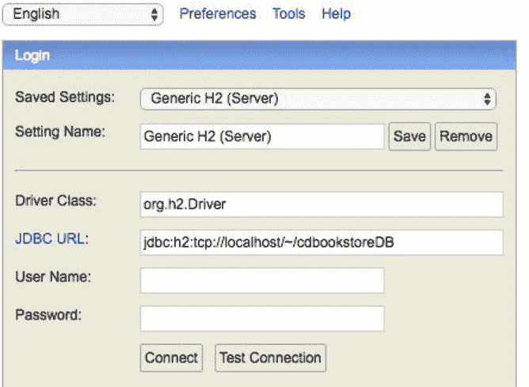

图 4. H2 浏览器控制台

## H2 控制台

确保你已以服务器模式启动了 H2 数据库，并检查 http://localhost:8082 上的控制台。然后，你可以输入任何 SQL 语句来创建数据库、表、插入数据或查询数据。例如图 5 显示 `Artist` 表的内容。

## 设置 H2 JDBC 驱动

要查看 `Artist` 表的结构，如图 6 所示执行 `SHOW COLUMNS FROM ARTIST` 语句。

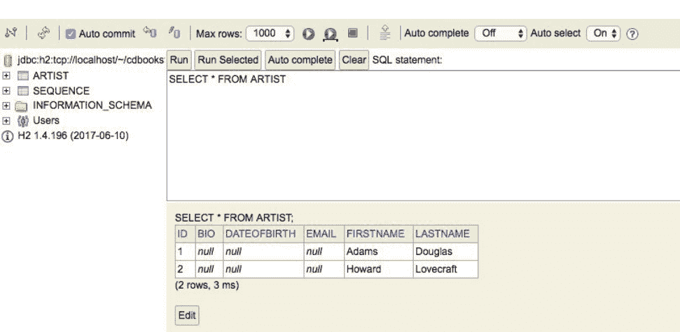

图 5. H2 控制台执行 select 语句

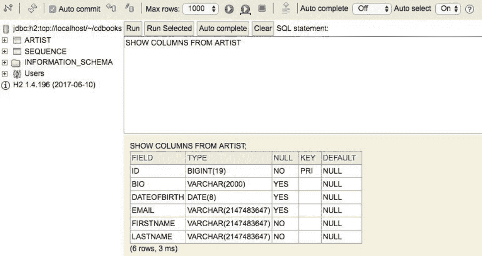

图 6. H2 控制台显示数据库结构

根据你想使用的模式，你需要相应地设置 JDBC 驱动。在 JPA 应用中，你将在 `persistence.xml` 中设置 JDBC 驱动。如果你在纯 Java 应用中使用 H2，请使用 `Class.forName("org.h2.Driver")` 加载 JDBC 驱动。然后，根据目标数据库选择合适的 JDBC URL：

- *嵌入式 (Embedded)*
  - `jdbc:h2:~/cdbookstoreDB` 用户目录下的 `cdbookstoreDB`
  - `jdbc:h2:/data/cdbookstoreDB` `/data` 目录下的 `cdbookstoreDB`
  - `jdbc:h2:cdbookstoreDB` 当前工作目录下的 `cdbookstoreDB`
- *内存中 (In-Memory)*
  - `jdbc:h2:mem:cdbookstoreDB` 单个进程中的多个连接
  - `jdbc:h2:mem:` 未命名的私有连接
- *服务器模式 (Server Mode)*
  - `jdbc:h2:tcp://localhost/~/cdbookstoreDB` 用户目录下的 `cdbookstoreDB`

## Git

Git 是一个免费开源的分布式版本控制系统，旨在跟踪计算机文件的更改并协调多人对这些文件进行的工作。[17] 它主要用于软件开发中的源代码管理，但也可以用于跟踪任何文件的更改。Git 是 Linus Torvalds 在 2005 年为了开发 Linux 内核而创建的，其他内核人员参与了它的初始开发。

运行此小册中的示例并不真正需要 Git。即使代码托管在公共 Git 仓库（https://github.com/agoncal/agoncal-fascicle-jpa/tree/2.2）上，你也可以作为 zip 文件下载代码，或者克隆仓库。只有在你克隆仓库时，才需要安装 Git。

# Git 简史

Git 的开发始于 2005 年 4 月，当时许多 Linux 内核开发者放弃了对 BitKeeper 的访问权限（这是一种专有的源码管理系统 SCM）。Linus Torvalds 想要一个像 BitKeeper 那样可以使用的分布式系统，但没有任何免费系统能满足他的需求。因此，Linus 在 2005 年 4 月 3 日开始开发 Git，于 4 月 6 日宣布该项目，并在 4 月 18 日完成了首次多分支合并。初生的 Git 经过了基准测试，以每秒 6.7 个补丁的速度记录到 Linux 内核树的补丁。[18]

## 安装 Git

如果你是 Mac OS X 并且安装了 Homebrew，那么安装 Git 只需要一个命令。[19] 打开你的终端并使用以下命令安装 Git：

```bash
$ brew install git
```

## 检查 Git 安装情况

安装完成后，在终端运行 `git --version` 检查 Git。它应该会显示 git 版本：

```bash
$ git --version
git version 2.20.1
```


## 克隆仓库

安装 Git 后，你可以使用`git clone`在 https://github.com/agoncal/agoncal-fascicle-jpa.git 上克隆仓库代码。

1. Java http://www.oracle.com/technetwork/java/javase
2. Visual VM https://visualvm.github.io/
3. Java 历史 https://en.wikipedia.org/wiki/Java
4. Java 历史 https://en.wikipedia.org/wiki/Java_programming
5. Java 网站 https://www.oracle.com
6. Homebrew https://brew.sh
7. Maven https://en.wikipedia.org/wiki
8. Maven 历史 https://en.wikipedia.org/wiki
9. Maven 中央 https://maven.apache.org
10. JUnit https://junit.org
11. Surefire https://maven.apache.org
12. H2 http://www.h2database.com
13. Hypersonic https://sourceforge.net
14. HSQLDB http://sqldb.org
15. 下载 H2 http://www.h2database.com
16. Homebrew https://brew.sh
17. Git https://git-scm.com
18. Git 历史 https://en.wikipedia.org/wiki
19. Homebrew https://brew.sh

## 持久化 API

### 规范版本

#### JPA 2.2

JPA 2.2 于 2017 年随 Java 8 发布，但它只是一个维护版本，意味着它没有太大演进。维护版本意味着不需要新的 JSR。

- 为 JPA 注解添加重复元注解
- 支持 CDI 类
- 支持映射新的 `java.time` 类型（`LocalDate`、`LocalTime` 等）
- 为 `Query` 和 `TypedQuery` 添加 `getStream()` 方法

#### JPA 2.1

JPA 2.1 于 2013 年随 JSR 338 发布，是 Java 7 的。该版本带来了许多新功能和改进：

- 架构生成：通过引入新的 API 和属性（定义在 `persistence.xml` 中）标准化了架构生成。
- 转换器：这些在数据库和属性表示之间进行转换的类。
- CDI 支持：注入到监听器变得可能。
- 支持存储过程：允许动态指定的和命名的存储过程查询。
- 批量更新和删除查询：`Criteria` API 只有查询；2.1 还指定了更新和删除查询。
- 类型转换：`TREAT` 操作符允许访问子类状态。

#### JPA 2.0

如果说 JPA 1.0 是相对于祖先 CMP 2.x 完全全新的持久化模型，那么 JPA 2.0 就是 1.0 版的延续。JPA 2.0 于 2009 年随 Java 6 的 JSR 317 发布。

它保留了基于注解和可选 XML 映射文件的面向对象方法。第二个版本带来了新的 API，扩展了 JPQL，并增加了这些新功能：

- 简单数据类型（`String`、`Integer` 等）和嵌入对象的集合现在可以映射到单独表中。以前你只能映射实体集合。
- `Map` 支持得到了扩展，使得 `Map` 的键和值可以是基本类型或嵌入对象。
- 通过 `@OrderColumn` 注解现在可以维护持久排序。
- 孤儿移除（Orphan removal）允许在父对象被删除时从关系中删除子对象。
- 乐观锁已经支持，但终于引入了悲观锁。
- 引入了一个全新的 `Criteria` API，允许以面向对象的方式构建查询，而不是使用字符串的方法。
- JPQL 语法变得更丰富（例如它允许 `case` 表达式）。
- 嵌入对象可以嵌套到其他嵌入对象中。

对象并与实体存在关系。

- 扩展了点（`.`）导航语法，以处理具有关系的嵌入对象以及嵌套的嵌入对象。
- 添加了对新缓存 API 支持。
- `persistence.xml` 文件中的某些属性得到了标准化处理，提高了应用程序的移植性。

#### JPA 1.0

在 Java EE 5 之前，持久化组件模型被称为实体豆（Entity Bean），或者更准确地说是实体豆 CMP（容器管理持久化），它与企业级 Java Bean（EJBs）相关联。这种持久化模型从 J2EE 1.3 持续到 J2EE 1.4，但由于它过于笨重，最终从 Java EE 5 开始被 JPA 1.0 所取代。JPA 1.0 是在 2006 年根据 JSR 220 创建的。[4]

1. JSR 338 https://jcp.org/en/jsr/detail?id=338
2. JSR 338 https://jcp.org/en/jsr/detail?id=338
3. JSR 317 https://jcp.org/en/jsr/detail?id=317
4. JSR 220 https://jcp.org/en/jsr/detail?id=220

## 参考文献

- JPA 2.2 (JSR 338) https://jcp.org/en/jsr/detail?id=338
- JPA 2.0 (JSR 317) https://jcp.org/en/jsr/detail?id=317
- Enterprise JavaBeans 3.1 (JSR 318) https://jcp.org/en/jsr/detail?id=318
- Enterprise JavaBeans 3.0 (JSR 220) https://jcp.org/en/jsr/detail?id=220
- EclipseLink http://www.eclipse.org/eselink
- Hibernate ORM http://hibernate.org/orm
- OpenJPA http://openjpa.apache.org
- Testing CDI Beans and the Persistence Layer Under Java SE by Gunnar Morling http://in.relation.to/2019/01/23/testing-cdi-beans-and-persistence-layer-under-java-se

## 同一作者的其他著作

### 深入理解 Bean Validation 2.0

数据验证是 Java 开发者必须完成的常见任务，它贯穿于应用程序的所有层（从客户端到数据库）。这种常见做法耗费时间、容易出错，且从长远来看难以维护。此外，某些约束的使用频率非常高，以至于可以视为标准（例如检查空值、其大小、其范围等）。如果能够将这些约束集中在一个处并在各层之间共享，那就太好了。这正是 Bean Validation 派上用场的地方。

在本小册中，你将学习 Bean Validation，使用其不同的 API 在豆上应用约束，验证各种约束，编写你自己的约束，并学习一些高级主题，例如如何将 Bean Validation 与其他框架（JPA、JAX-RS、CDI、Spring）集成。

ISBN: 9781980399025 | ASIN B07B2KJ41R

### 深入理解 JPA 2.2

应用程序由业务逻辑、与其他系统的交互、用户界面等以及数据组成。我们应用程序操作的大部分数据必须存储在数据存储中，并检索、处理和分析。如果这个数据存储是数据库且你使用像 Java 这样的面向对象的语言，那么你应该查看一下 JPA。JPA 是一种对象关系映射工具，它将 Java 对象映射到关系型数据库并允许查询操作。

在本小册中，你将学习 Java Persistence API、其用于映射实体的注解、Java 持久化查询语言（JPQL）、实体生命周期，以及一些高级主题，例如如何将 JPA 与其他框架（Bean Validation、JTA、CDI、Spring）集成。

ISBN: `{jpa-book-isbn}` | ASIN `{jpa-book-asin}`
