# Quarkus 入门指南：Quarkus 1.x


Emanuel Bernard 序言

## 理解 Quarkus

- 4.2. Eclipse MicroProfile 配置
- 4.2.1. 理解配置
- 4.2.2. 配置数据
- 注入配置
- 程序化配置
- 多属性配置属性
- 4.2.3. YAML 支持
- 4.2.4. 配置源
- 4.2.5. 配置 Quarkus
- 4.3. 配置文件
- 4.3.1. 配置 Profiles
- 4.4. 日志
- 4.4.1. 日志级别
- 4.4.2. 配置日志
- 4.4.3. 日志分类
- 4.4.4. 日志格式
- 4.4.5. JSON 格式
- 4.5. 应用程序的初始化与终止
- 4.5.1. 入口点
- 4.5.2. 应用程序生命周期
- 4.6. 总结
- 5. 数据、事务与 ORM
- 5.1. Bean 校验
- 5.1.1. 理解约束
- 5.1.2. 约束数据
- 内置约束
- 应用内置约束
- 约束属性
- 约束方法
- 5.1.3. 验证数据
- 验证 Bean
- 级联验证
- 5.1.4. 配置 Hibernate 校验器
- 5.2. Java 持久化 API
- 5.2.1. 对象关系映射
- 关系型数据库
- 实体
- 5.2.2. 实体映射
- 自定义映射
- 高级映射
- 5.2.3. 实体管理
- 持久化实体
- 按 ID 查找
- 实体
- 5.2.4. 查询实体
- Java 持久化查询语言
- 动态查询
- 5.2.5. 配置 Hibernate ORM
- 5.3. Java 事务 API
- 5.3.1. 理解事务
- 5.3.2. 声明式事务管理
- 异常与事务
- 5.3.3. 程序化事务管理
- 5.3.4. 配置事务
- 5.4. 数据源
- 5.4.1. 配置数据源
- 5.5. 使用 Panache 的 Hibernate ORM
- 5.5.1. Panache 实体
- Panache 实体
- 管理 Panache 实体
- 查询 Panache 实体
- Panache 实体的状态与行为
- 5.5.2. Panache 仓库
- 5.5.3. 事务
- 使用 Panache 实体
- 使用 Panache 仓库
- 5.6. 总结

# 6. HTTP 微服务

## 6.1. 用于 RESTful Web服务的 Java API

### 6.1.1. 理解 RESTful Web 服务

### 6.1.2. 暴露 RESTful Web 服务

#### HTTP 方法匹配

#### URI 定义与绑定 URI

#### 提取参数

#### 消费与生成内容类型


# 6.1.3. 调用 RESTful Web 服务

## 启动客户端

## 目标与调用

# 6.1.4. 配置 RESTEasy

# 6.2. Eclipse MicroProfile API

## 6.2.1. 理解 OpenAPI v3

## 6.2.2. 暴露 OpenAPI 合约

### 自定义 OpenAPI 合约

### 高级自定义

## 6.2.3. Swagger UI

## 6.2.4. 配置 SmallRye OpenAPI

# 6.3. JSON 绑定

## 6.3.1. 理解绑定

## 6.3.2. 绑定 POJO

### 默认绑定

### 自定义绑定

### 高级自定义

## 6.3.3. 序列化与反序列化

### 程序化序列化与反序列化

### 自动序列化与反序列化

# 6.4. JSON 处理

## 6.4.1. 理解处理

## 6.4.2. 构建 JSON

## 6.4.3. 读取与写入 JSON

## 6.4.4. 流式 JSON

# 6.5. 总结

# 7. 通信与容错性

## 7.1. CORS

### 7.1.1. 理解 CORS

### 7.1.2. 配置 CORS

## 7.2. Eclipse MicroProfile 客户端

### 7.2.1. 理解 RESTful Web 服务调用

### 7.2.2. 调用 RESTful Web 服务

#### 客户端代理

#### 程序化调用

#### 声明式调用

### 7.2.3. 配置 RESTEasy 客户端

## 7.3. Eclipse MicroProfile 容错性

### 7.3.1. 理解容错性

### 7.3.2. 备用机制 (Falling Back)

### 7.3.3. 超时 (Timing Out)

### 7.3.4. 熔路器 (Circuit Breaker)

# 7.4. 总结

# 8. 事件驱动微服务

## 8.1. 响应式编程

### 8.1.1. Uni 和 Multi

### 8.1.2. 事件

## 8.2. 响应式消息

### 8.2.1. 理解消息

#### 同步编程

#### 异步消息

#### 代理器架构

### 8.2.2. 发送消息

### 8.2.3. 接收消息

### 8.2.4. 连接器 (Connectors)

### 8.2.5. 配置响应式消息

## 8.3. 总结

# 9. 可观测性

## 9.1. Eclipse MicroProfile 健康

### 9.1.1. 理解健康检查

### 9.1.2. 检查

#### 存活检查 (Liveness Checks)

#### 就绪检查 (Readiness Checks)

#### Quarkus 内置检查

### 9.1.3. 构建响应

### 9.1.4. 使用 Health-UI 可视化健康检查

### 9.1.5. 配置 SmallRye Health

## 9.2. Eclipse MicroProfile 标

### 9.2.1. 理解度量

### 9.2.2. 指标

#### 基础指标

#### 供应商指标

#### 应用指标

### 9.2.3. 指标格式

### 9.2.4. 使用 Prometheus 可视化指标

### 9.2.5. 配置 SmallRye Metrics

## 9.3. 总结

# 10.1. 打包 Quarkus 应用

## 10.1.1. JVM 模式

### JAR

### Fast-JAR

### Uber-JAR

## 10.1.2. 原生模式


# 10.1.3. 性能

- 构建与执行
- 可执行文件大小
- 首次连接时间
- 优缺点

# 10.1.4. 配置打包

# 10.2.1. Dockerfiles

- JVM 模式
- Linux 原生可执行文件

# 10.2.2. 构建 Docker 镜像

- 使用 Docker 手动构建
- 使用 Docker 扩展构建
- 使用 Jib 扩展构建

# 10.2.3. 运行 Docker 镜像

# 10.2.4. 推送 Docker 镜像

# 10.2.5. 配置容器

# 10.3.1. Kubernetes Manifest 文件

# 10.3.2. 构建 Kubernetes Manifest 文件

- 使用 Kubernetes 扩展构建
- 使用 Minikube 扩展构建

# 10.3.3. 部署到 Minikube 集群

- 回顾

# 10.3.4. 配置 Kubernetes

# 10.4. 总结

# 11.1. Quarkus 测试

## 11.1.1. JUnit 5

- 测试类
- 夹具 (Fixtures)
- 测试方法
- JUnit 断言

## 11.1.2. JVM 模式测试

## 11.1.3. 原生模式测试

## 11.1.4. 事务测试

## 11.1.5. 配置 Quarkus 测试

# 11.2. 测试框架

## 11.2.1. REST Assured

## 11.2.2. Hamcrest

## 11.2.3. 测试资源

- TestContainers
- Quarkus 测试资源

# 11.3. 模拟 (Mocking)

# 11.4. Quarkus 测试配置

# 11.5. 总结

# 12.1. 开发 REST ISBN 号微服务

## 12.1.1. 初始化 ISBN 号微服务

## 12.1.2. Maven 依赖

## 12.1.3. 目录与文件

## 12.1.4. 引入 JSON

## 12.1.5. 引入配置

## 12.1.6. 引入 Quarkus

## 12.1.7. 引入 OpenAPI

- 生成的 OpenAPI
- 生成的 POJO
- 运行 OpenAPI
- Swagger UI

## 12.1.8. 引入健康检查

## 12.1.9. 引入存活检测

## 12.1.10. 引入热重载

# 12.2. 开发 REST 微服务

## 12.2.1. 初始化微服务

## 12.2.2. Maven 依赖

## 12.2.3. 目录与文件

## 12.2.4. REST 接口

## 12.2.5. 调用微服务

## 12.2.6. 异常处理

## 12.2.7. 引入指标

## 12.2.8. 运行微服务

## 12.2.9. 测试微服务

# 12.3. 总结

# 附录：在 macOS 上设置开发环境

## A.1. Homebrew

### A.1.1. Homebrew 简述

### A.1.2. 在 macOS 上安装 Homebrew

### A.1.3. 检查 Homebrew 安装

### A.1.4. 常用 Homebrew 命令

## A.2. Java 11

### A.2.1. 架构

### A.2.2. Java 简述

### A.2.3. 在 macOS 上安装 JDK

### A.2.4. 检查 Java 安装

## A.3. GraalVM 20.2.0

### A.3.1. 在 macOS 上安装 GraalVM

### A.3.2. 安装原生镜像生成器

### A.3.3. 检查 GraalVM 安装

## A.4. Maven 3.6.x

### A.4.1. Maven 简述

### A.4.2. 项目描述

### A.4.3. 制品管理

### A.4.4. 在 macOS 上安装 Maven

### A.4.5. 检查 Maven 安装

### A.4.6. 常用 Maven 命令

## A.5. cURL 7.x

### A.5.1. cURL 简述

### A.5.2. 在 macOS 上安装 cURL

### A.5.3. 检查 cURL 安装

### A.5.4. 常用 cURL 命令

### A.5.5. 使用 JQ 格式化 cURL JSON 输出

## A.6. Docker

### A.6.1. Docker 简述

### A.6.2. 在 macOS 上安装 Docker

### A.6.3. 检查 Docker 安装

### A.6.4. 构建、运行、推送和拉取镜像

- 远程 Docker 仓库
- Dockerfile
- 构建 Docker 镜像
- 运行 Docker 镜像
- 推送到 Docker 仓库
- 从 Docker 仓库拉取镜像

### A.6.5. 一些 Docker 命令

## A.7. VirtualBox

### A.7.1. VirtualBox 简史

### A.7.2. 在 macOS 上安装 VirtualBox

### A.7.3. 检查 VirtualBox 安装

## A.8. Kubernetes

### A.8.1. Kubernetes 简史

### A.8.2. 不同的 Kubernetes 版本

### A.8.3. 在 macOS 上安装 Minikube

- 安装 Kubectl
- 安装 Minikube


# 目录

## 附录 A：安装指南

### A.8. Kubernetes

- A.8.4. 检查 Kubernetes 安装
- A.8.5. 将 Docker 镜像部署到 Kubernetes 集群
  - 启动 Kubernetes 集群
  - 创建部署 (Deployment)
  - 创建服务 (Service)
  - 运行 Docker 镜像
  - 清理
- A.8.6. Kubernetes 清单文件 (Manifest Files)
- A.8.7. 一些 Kubernetes 命令

### A.9. Kafka

- A.9.1. Kafka 简史
- A.9.2. 在 macOS 上安装 Kafka
- A.9.3. 检查 Kafka 安装
- A.9.4. 发布和接收事件
  - 启动 Kafka
  - 创建主题 (Topics)
  - 发布事件
  - 接收事件
  - 清理
  - 停止 Kafka
- A.9.5. 一些 Kafka 命令

### A.10. Git

- A.10.1. Git 简史
- A.10.2. 在 macOS 上安装 Git
- A.10.3. 检查 Git 安装
- A.10.4. 克隆仓库

## 附录 B：Quarkus 版本

- B.1. Quarkus 1.9 (2020年10月)
- B.2. Quarkus 1.8 (2020年9月)
- B.3. Quarkus 1.7 (2020年8月)
- B.4. Quarkus 1.6 (2020年7月)
- B.5. Quarkus 1.5 (2020年6月)
- B.6. Quarkus 1.4 (2020年4月)
- B.7. Quarkus 1.3 (2020年3月)
- B.8. Quarkus 1.2 (2020年1月)
- B.9. Quarkus 1.1 (2019年12月)
- B.10. Quarkus 1.0 (2019年11月)
- B.11. Quarkus 0.0.1 (2018年11月)

## 附录 C：Eclipse MicroProfile 规范版本

- C.1. MicroProfile 3.3 (2020年2月)
- C.2. MicroProfile 3.2 (2019年11月)
- C.3. MicroProfile 3.1 (2019年10月)
- C.4. MicroProfile 3.0 (2019年6月)
- C.5. MicroProfile 2.2 (2019年2月)
- C.6. MicroProfile 2.1 (2018年10月)
- C.7. MicroProfile 2.0.1 (2018年7月)
- C.8. MicroProfile 2.0 (2018年6月)
- C.9. MicroProfile 1.4 (2018年1月)
- C.10. MicroProfile 1.3 (2018年1月)
- C.11. MicroProfile 1.2 (2017年9月)
- C.12. MicroProfile 1.1 (2017年8月)
- C.13. MicroProfile 1.0

## 附录 D：参考文献

## 附录 E：引言

- E.1. 理解 Bean Validation
- E.2. 理解 JPA
- E.3. 理解 Quarkus
- E.4. 理解 Quarkus

# 前言

大家好，我是 Emmanuel Bernard，Quarkus 的联合创始人之一。我在 Red Hat 担任首席架构师，负责中间件组合。但从本质上来说，我是一个开发者（面向社区）。我曾贡献并领导过许多 Hibernate 项目。

我认识 Antonio 已经很久了。我们共同见证了 Java 生态系统的演变。我很幸运在正确的时间出现在正确的地点，并与正确的人一起创立了 Quarkus。从那时起，我一直在为云时代交付 Java 而努力。

当像 Antonio 这样资深的开发者投入 Quarkus、热爱它并愿意为其投入时间时，对我来说是该项目处于正确方向的有力背书。

关于 Quarkus 的一个小知识：我们需要在“新颖”与“革命性”之间取得平衡，而 Quarkus 的关键在于它提供了许多 API 和编程概念，但却以极具实用性的方式封装。Antonio 是我认识的极少数精通 Quarkus 所提供的 API 和技术的专家之一。

Quarkus 的哲学之一是“开发者快乐”。这在某种程度上通过让开发者更快地交付来实现，但也建立在非常坚实的技术基础之上。这本书遵循了同样的哲学，它帮助你解决具体问题，同时提炼了进入更高水平所需的基础知识。

当我们向社区发布 Quarkus 时，我们开启了一个新领域。但你的想法和世界的想法往往大不同。当我听到用户告诉我 Quarkus 如何解决他们的云原生需求和关注点时，我感到非常开心：短开发周期、高密度部署的需求（更少的内存）以及快速启动的需求（针对微服务或函数）。更棒的是，他们喜欢使用它的体验。

# 关于作者


Antonio Goncalves 是住在巴黎的高级软件架构师。自 20 世纪 90 年代后期以来，他一直专注于 Java 开发，职业生涯遍遍了许多国家和公司，并在那里担任知名的顾问。作为 BEA Systems（后被 Oracle 收购）的前员工，他很早就建立了分布式系统的专业知识。他特别热爱开源，是 OSGTP（巴黎开源解决方案聚会）的成员。Antonio 喜欢与社区建立联系。因此，他在 2008 年创立了巴黎 Java 用户组，并在 2012 年共同创立了 Devox France，以及在 2018 年共同创立了 Voxed Microservices。

Antonio 于 2007 年用法语写了他的第一本关于 Java EE 5 的书。随后，他加入了 JCP（Java 进程委员会），成为多个 JSR（Java EE 8、Java EE 7、Java EE 6、CDI 2.0、JPA 2.0 和 EJB 3.1）的专家成员，并在 Apress 出版了《Beginning EE 7》和《Beginning EE 8》。依然热衷于分享知识，Antonio Goncalves 决定自出版他后期的作品。

在过去的几年里，Antonio 在国际会议上进行演讲，主要涵盖 Java、分布式系统和微服务，包括 JavaOne、Devox、GeeCon、The Server Side Symposium、Jazoon 以及许多 Java 用户组。他还为 IT 网站（DevX）和杂志（Java Magazine、Programming、Linux Magazine）撰写了大量技术论文和文章。自 2009 年以来，一直是法国播客节目 Les Cast Codeurs 的成员。

由于他的专业知识以及对 Java 社区所出的贡献，Antonio 被选为 Java Champion（Java 大冠军）。

Antonio 毕业于巴黎国立艺术美术学院（获得 IT 工程学学位）、布莱顿大学（获得对象设计硕士学位）、西班牙巴斯克乡村大学以及巴西 UFSCar 大学（获得分布式系统硕士学位）。他曾在他就读过的巴黎国立艺术美术学院教学了 10 多年。

在 Twitter 上关注 Devox France (@agonical) 并访问他的博客 (www.antoniogoncalves.org)。

- [3] Devox France https://devox.fr
- [4] Amazon https://www.amazon.com/author/agonical
- [5] Les Cast Codeurs https://lescastcodeurs.com
- [6] Java Champions https://community.oracle.com/community/groundbreakers/java/java-champions

# 感谢

用你们的话说，你们有一本源自我写作、学习和分享历史的技术小册。在写作时，你需要好奇心、一抹自律的洞察力、一分专注，以及大量的疯狂。当然，你还需要被一群能以任何可能的方式帮助你的人包围（这样你才不会疯掉）。这里就是感谢他们的空间。

首先，我非常感谢我的评审团队。他们大多数人都是 Quarkus 团队的成员，我必须说，有这些知识渊渊的开发者阅读这本小册是我的荣幸。感谢 Youness 依然在线（这是他审阅的第 6 本书），以及 Nicolas 因为他喜欢这个主题而加入了我们。

Georgios Andrianakis 是 Red Hat 的高级软件工程师，负责 Quarkus 和 Spring 相关的技术。作为最活跃的 Quarkus 贡献者之一，Georgios 曾在各种会议上以 DevOps 的身份演讲，传播他对 Quarkus 的热情。此外，他还是 SmallRye Meetup 的共同组织者。他住在希腊雅典。

Roberto Cortez 是一个在软件开发行业工作了 10 多年的专业 Java 开发人员。他参与开源社区工作，帮助他人传播 Java 技术知识。他是 JavaOne、Devnexus、Jokus 等会议的常驻演讲者。他领导 Coimbra JAG 并在葡萄牙创立了 JNation 会议。不工作时，他会和朋友聚在一起、玩电脑游戏并与家人 way。目前，他在 Red Hat 领导 SmallRye 计划。

在尼斯山区，Stéphane Éardaud 为 Red Hat 负责 Vert.x、RESTEASY、MicroProfile Context Propagation 和 Quarkus 项目。他是一个热衷 Java、C、Perl 或 Scheme 的黑客（只要我们使用标准、语言和数据库）。他渴望分享，是各种会议的频繁演讲者，共同领导 Riviera 用户组并共同创立了 Riviera DEV 会议。

George Gastaldi 是一位居住在巴西、为 Red Hat 提供远程服务的首席软件工程师。George 自 2000 年起就是一位丰富的 Java 开发人员和架构师，并于 2006 年接触开源世界。自 2019 年以来，他一直作为 Quarkus 的核心开发人员工作。

Youness Teimouri 是硅谷的高级软件开发人员，拥有超过 15 年的开发经验，特别是在 Java 方面，跨多个国家。他利用 Java 帮助了电信、ERP 系统、移动银行和支付系统等多个行业的公司实现规模化。他合著并了一些关于云计算的论文，并为他之前的一些书籍做过贡献。Youness 痴迷于 Java 在不同行业中的无限可能，并热衷于指导初级开发者提升他们的技能集。

Nicolas Martingale 是巴黎 Lunatech 的首席执行官。他也是一位资深 Java/Scala 开发者。几年前，他与 Antonio 共同创立了 Devox France。他发现了 Quarkus 并被其想法印象深刻。

感谢我的校对员 `Gary Branigan`，他为本小册增添了莎士比亚风格。

你手中的本小册使用 `Asciidoctor 2.0` 工具链，使得创建 PDF、EPUB 和 MOBI 文件成为可能。我非常感谢 Asciidoctor 社区，特别是 Dan Allen 和 Marat Radchenko，他们帮助我理清了一些事情，结果非常好。`PlantUML` 是一个强大的工具，拥有丰富的图表语法……有时你需要一些帮助。用于编写本小册的编辑器你可能猜到了：它是一个 IDE！JetBrains 为我提供了优秀的 `IntelliJ IDEA`。住在巴黎，我还要感谢所有的酒吧，让我可以在喝咖啡和聊天时获得庇护。你可能猜到了，我对 IT充满热情。但我其他爱好，如科学、艺术、哲学、烹饪……以及音乐（我甚至弹吉他）。没有音乐我无法工作，所以在写本小册时，我大部分时间都在听收音机。大感谢我可爱的孩子们：Eloise、Ligia 和 Ennio。他们是生活给我的最好的礼物。


- [7] Georgios Andrianakis https://twitter.com/geoand86
- [8] Roberto Cortez https://twitter.com/radcortez
- [9] Stéphane Epardaldi https://twitter.com/unfromage
- [10] George Gastaldi https://github.com/geastaldi
- [11] Youness Teimouri https://github.com/youness-teimouri
- [12] Nicolas Martingale https://twitter.com/nmartingale
- [13] TimeKeeper https://github.com/lunatech-timekeeper
- [14] Asciidoctor http://asciidoctor.org
- [15] PlantUML http://plantuml.com
- [16] IntelliJ IDEA https://www.jetbrains.com/idea
- [17] FIP https://www.fip.fr

# 引言

在 90 年代后期，我正在研究 `J2EE 1.2`：Java 企业版的第一个版本。这也是公司开始意识到互联网对其业务潜力的时期。几个月来，我为一家著名的航空公司建立他们的电子商务网站。是的，那是你在旅行社购买机票或火车票的时代。这种革命性的运动（在线购买）带来了技术成本：静态内容（`HTML`、`CSS`、图像）、Web 层（`Servlets` 和 `JSPs`）、无状态 `EJBs`、实体 Beans 以及数据库。正如你可以想象的，每一层都加载了负载均衡、故障转移和会话保持的应用服务器。这个电子商务网站上线了……它运行得很好！

随后 `Struts`、`Spring` 和 `Hibernate` 出现了。完整的 `J2EE` 服务器缩小到 `Tomcat` 和 `Jetty` 等 Servlet 容器。我们看到事物在变化，架构变得无状态、同事被抛弃、从 `SOAP` 到 `REST` 的迁移以及移动设备接管网络爬虫。随后物联网 (`IoT`)、云端、微服务、函数即服务 (`FaaS`) 出现了，而且从未停止。其他事情没有变化，如四人行模式、架构设计模式、使用测试框架和构建工具。我们重新发明了一些轮子并为它们命名，但也学习了数十种有前景的编程语言（无论运行在 `JVM` 之上）以及敏捷技术。多亏我见证了这些演变，今天你可以坐下来，阅读这本小册并写一些代码。

# 这从哪里来？

自 1998 年以来参与 `J2EE`，我一直关注它的演变以及 `Java EE` 专家组从版本 6 到 8 的发展。期间，我写了一本法语书《Java EE 5》。这本书由一家法国出版社出版并引起了注意。随后，美国出版社 `Apress` 联系了我，让我编写英语版本。我喜欢这个挑战。于是我改变了书的结构，对其进行了更新和翻译，并最终得到了《Beginning Java EE 6`[^2]》。几年后，`Java EE 7` 发布了，我更新了我的书，增加了一些额外的章节，得到了长达 500 页的《Beginning Java EE 7`[^3]》。这个写作过程变得相当痛苦（某些文本编辑器不应该用来写书，缺乏活性），我还和我的编辑发生了一些争论。`[^4]`

与此同时，`Java EE 8` 的历史有些痛苦且漫长。`[^5]` 我仍然是专家组的一员，但没有人真正知道邮件列表如此安静。没有真正的交流，没有真正的愿景，没有真正的挑战。当我决定不写 `Java EE 8` 的书时，社区并不这么认为。我开始收到关于更新我的书的邮件。我以前经常在会议上遇到人问：“嘿，Antonio，你的下一本书什么时候出？”我的回答是“不”。

我决定停下来回顾一下。是什么在阻碍我写作？是我的编辑和 `Java EE 8`。所以我决定抛弃它，从我的 `Java EE 7` 的书中提取出我想要的章节并对它们进行更新。这就是写“小册”而不是整本书的创意来源。然后，我考虑了自出版，而现在我就在 `Kindle` 出版平台`[^6]`。

在出版了几本小册后，我看到 `Red Hat` 正在开发一个改变游戏规则的东西：`Quarkus`。我在非常早的阶段就开始关注它，并产生了创建工作坊的想法。我联系了 `Quarkus` 团队提交了我的想法：`Emmanuel Bernard` 和 `Clement Cofflier` 非常喜欢它，我们一起组织了一场工作坊并在几次会议上进行了展示。`[^7]` 这场工作坊介绍了第一本《Practising Quarkus》。我非常喜欢 `Quarkus`，因此开始在客户那里进行概念验证并将其投入生产。我开始写了一些博客、一些文章，并决定创建一个关于 `Quarkus` 的手册。你手中的这份手册是为了让你了解 `Quarkus` 是什么，以及你如何将其用于你的微服务架构。

希望你会发现这本手册有所帮助。

## 本手册面向的读者

`Quarkus` 起于 `JBoss` 社区。`JBoss` 在运行应用服务器（`JBoss EAR`、`WildFly`）或在 `JVM` 上构建响应式应用（例如 `Eclipse Vert.x`）方面拥有长期经验。由于其扩展机制，`Quarkus` 支持多个 Java 框架（例如 `Hibernate`、`Camel` 等）以及规范（例如 `Jakarta EE` 的子集、`MicroProfile`，后者是一组用于用 Java 开发微服务的规范）。

因此，本手册适用于整个 Java 社区以及对微服务架构感兴趣的读者。遵循和理解本手册的唯一要求是了解 Java，并对关系型数据库和 `Docker` 有一定了解。

## 本手册的结构

本手册侧重于 `Quarkus 1.9.0`。它的结构将帮助你发现这项技术，并帮助已经具有某些经验的读者进一步深入。

本手册从第 1 章“Quarkus 第一步”开始，通过几行 `Quarkus` 代码。这是因为作为开发者，我们喜欢在学习新技术时先读代码。

第 2 章“理解 Quarkus”设定了一些术语（微服务、响应式系统、`MicroProfile`、云原生、`GraalVM`），并简要介绍了 `Quarkus`、它解决的问题，并解释了贯穿整个手册的讨论的共同关注点。

第 3 章“入门”完全关于展示在 `Quarkus` 上运行的一些基础代码，并解释了在构建和打包原生可执行版本之前，如何运行和使用此类应用程序。

`Quarkus` 拥有强大的扩展机制，用于与许多技术集成。第 4 章“核心 Quarkus”关注 `Quarkus` 的核心技术，如注入、配置和配置文件（`Profiles`）。

微服务是趋势，并使用了各种设计模式。但总而言之，大多数微服务需要与数据进行交互。第 5 章“数据、事务与 ORM”涵盖了数据验证、对象关系映射和事务。在本章中，你还将看到使用 `Panache` 的 ORM 是处理持久化数据的简单方法。

谈到我们首先想到的第一件事是：`HTTP` 微服务。第 6 章“HTTP 微服务”介绍了大多数 `HTTP` 相关的技术，如 `RESTful` Web 服务、`OpenAPI v3` 和 `JSON` 操作。

一个微服务并不能构成一个微服务架构。你需要多个微服务相互通信。第 7 章“通信与容错”关于微服务如何通过 `HTTP` 相互调用，并确保在微服务无法工作时可以进行回退（`fallback`）。

响应式编程和响应式消息在第 8 章“事件驱动微服务”中得到了涵盖。

当你有多个微服务时，可观测性变成了一个真正的挑战。你需要知道哪些微服务存活且已就绪，并暴露一些指标以便知道它们运行符合预期。第 9 章“可观测性”涵盖了处理观测性的 `MicroProfile` 规范：健康（`Health`）和指标（`Metrics`）。

当有很多微服务时，你需要将它们打包成容器并使用编排器进行编排。在第 10 章“云原生”中，你将看到 `Quarkus` 用于打包代码的不同格式，以及 `Quarkus` 扩展如何让与 `Docker` 和 `Kubernetes` 的交互变得简单。

`Quarkus` 非常擅长的一点是测试。第 11 章“测试”深入了 `JVM` 和原生模式测试，以及它支持的所有测试和模拟（`mock`）框架。

在第 12 章“整合一切”中，你将利用整个手册介绍的多个概念构建一个更复杂的应用程序。

第 13 章“总结”以对你在手册中所学内容的总结作为结束。

附录 A“在 macOS 上设置开发环境”强调了整个手册中使用的工具以及如何安装它们。

附录 B“Quarkus 版本”列出了所有的 `Quarkus` 发布版本。

附录 C“Eclipse MicroProfile 规范版本”列出了 `MicroProfile` 规范的所有修订版本。

附录 D 指向了一些外部引用，如果你想了解更多关于 `Quarkus` 的知识，这些是值得阅读的。

这不是我写的唯一手册。你可以在附录 E 中找到其他手册的描述：

- 理解 Bean Validation 2.0
- 理解 JPA 2.2
- 理解 Quarkus
- 实践 Quarkus

## 约定

本手册使用了多种语言，主要是 Java，但也包括 `JSON`、`XML`、`YAML` 或 Shell 脚本。每个代码示例都以适当的方式显示，并以等宽字体出现。所有包含的代码都来自一个公共 `Git` 仓库，并经过持续测试。因此，你不应该在语法正确的代码上遇到任何问题。在某些情况下，原始源代码经过特殊处理以适应允许的页面空间，添加了额外的换行符或修改了缩进。为了增加可读性，在认为不必要的地方对示例代码进行了删减。始终记住，你可以在 `https://github.com/agoncal/agoncal-fascicle-quarkus/tree/1.0` 在线找到完整代码。

斜体用于强调首次出现的重要单词，或给出缩写或首字母缩词的定义。粗体**很少使用**。

你将在书中看到的某些信息。

## 示例应用程序

你将在手册中看到的代码来自一个古董商店（`Vintage Store`），但并非原始应用程序。你可以下载原始应用程序，但遵循手册代码并非必须。与系统交互的角色有：

- 管理目录的公司员工。
- 访问网站的游客。
- 登录系统的客户。
- 委托信用卡处理的外部银行。

图 1 描述了系统的用例。

![b367296ed7600502fc731e5724_0]

图 1：用例图

古董商店应用程序操作着图 2 中描述的一些领域对象：黑胶片、磁带和 CD，当然还有章节、订单、发票和购物车。

![b367296ed7600502fc731e5725_0]

图 2：类图

不要在这个图上花费太多时间，因为你将在整个手册中遇到这些对象。

## 下载和运行代码

手册中示例的代码可在 `Git` 仓库，可以通过 `https://github.com/agonal/agonal-fascicle-quarkus/tree/1.0` 克隆、下载或在线浏览。代码在 `macOS` 平台上开发和测试，但在 `Windows` 或 `Linux` 上也应该运行。手册中的示例设计为使用 `Java 11` 编译，使用 `Maven 3.6.x` 构建，使用 `JUnit 5.x` 测试，并将数据存储在 `H2` 数据库中。附录 A 显示了安装所有这些软件包的方法，这些软件包将在大多数章节中用于构建、运行和测试代码。

## 获取帮助

对手册的代码、内容或结构遇到困难？某些地方没看懂？描述不够清晰？我在这里提供帮助！请不要犹豫在 `https://github.com/agonal/agonal-fascicle-quarkus/issues` 报告问题或任何问题。我会尽力回答。这也将允许我改进手册内容，并通过 `Amazon Kindle Publishing` 上新版本。

## 联系作者

如果你对本手册的内容有任何问题，请遵循上述说明或使用 `GitHub issue` 跟踪器。如果你想联系我，可以发送电子邮件到 `agonal.fascicle@gmail.com` 或在 `Twitter` 上推特给 `@agonal`。你也可以访问我的博客：

- www.antoniogoncalves.org
- www.antoniogoncalves.org/category/books
- [18] Antonio 的书籍](http://amazon.com/author/agoncal)
- [19] 我的 Java EE 书籍](https://antoniogoncalves.org/category/books)
- [20] 《无审查的 Java EE 7》](https://antoniogoncalves.org/2014/09/16/the-uncensored-java-ee-7-book)
- [21] 开启 Java EE](https://blogs.oracle.com/thearium/opening-up-ee-update)
- [22] Amazon Kindle 出版](https://kdp.amazon.com)
- [Amazon Kindle Publishing](https://kdp.amazon.com)
- [23] Quarkus 工作坊](https://quarkus.io/quarkus-workshops/super-heroes)
- [24] Vintage Store 应用代码](https://github.com/agoncal/agoncal-application-cdbookstore)

# 第 1 章 Quarkus 的第一步

如果你正在阅读这本小册，说明你是一个开发者。和大多数开发者一样，当你学习一项新技术或框架时，你喜欢先看一些代码。因此，这就是使用 `Quarkus` 的第一步。

列表 1 显示了一个表示 `Author` REST 资源的 Java 类。该资源在 `/authors` URL 上“监听”`HTTP` 请求，并有两个方法：一个返回整个科幻作者列表，另一个通过提供数组索引返回单个作者。

列表 1. 带有 `JAX-RS` 注解的 Java 类

如果你仔细观察列表 1，你可以看到几个 `JAX-RS` 注解（`@Path`、`@Produces`、`@GET` 和 `@PathParam`），但没有特定的 `Quarkus` 代码（如果你不知道 `JAX-RS`，不用担心，第 6 章会介绍它）。那么，`Quarkus` 是什么？

实际上，你可以在列表 2 中找到一点 `Quarkus` 的内容（因为大部分代码来自 `REST Assured`，你将在第 11 章看到它）。在这里，我们使用 `@QuarkusTest` 让 `Quarkus` 测试 `Author` REST 资源。我们通过 `HTTP GET` 方法目标 URL `/authors`（不带索引参数），并确保 `HTTP` 状态码为 200-OK 且 `HTTP` 体的内容正确。

### 列表 2. 带有 Quarkus 注解的测试类

```java
@QuarkusTest
public class AuthorResourceTest {

    @Test
    public void shouldGetAllAuthors() {
        given()
            .header(ACCEPT, TEXT_PLAIN)
        .when()
            .get("/authors")
        .then()
            .assertThat(
                .statusCode(is(200))
                .and()
                .body(is("Isaac Asimov, Nora Jemisin, Douglas Adams"));
    }

    @Test
    public void shouldGetAnAuthor() {
        given()
            .header(ACCEPT, TEXT_PLAIN)
            .pathParam("index", 0)
        .when()
            .get("/authors/{index}")
        .then()
            .assertThat(
                .statusCode(is(200))
                .and()
                .body(is("Isaac Asimov"));
    }
}
```

你没有看懂所有的代码？你确实看懂了，但觉得内容不止于此。你手中的这本小册完全关于 `Quarkus`。得益于随后的章节，你将理解这项技术的基础知识，并会有大量的示例让你深入研究更复杂的话题。

# 第 2 章 理解 Quarkus

在之前的“Quarkus 的第一步”中，你已经看到了一些代码。在进一步研究更多代码之前，我们需要退后一步并定义一些概念。这个“理解”章节将使用在小册其他部分用到的术语，以免你迷失方向。

`Quarkus` 是一种为 `OpenJDK HotSpot` 和 `GraalVM` 定制的 `Kubernetes` 原生技术栈，由最顶级的 Java 库和标准打造。`[^1]`。在实践中，`Quarkus` 是一个用于编写 Java 应用程序（特别是后端应用程序）的开源工具。因此，`Quarkus` 不限于微服务，尽管它非常适合微服务。

仅仅通过阅读 `Quarkus` 的定义，你就能看到涉及到许多技术：当然有 Java，还有 `GraalVM`、响应式系统（`Reactive Systems`）和 `Kubernetes`。在标准方面，`Quarkus` 支持一些 `Jakarta EE` 和 `MicroProfile` 规范。让我们来看看所有这些组件。

## 2.1 理解微服务

微服务是创建云原生应用时最流行的架构风格。它通过单独更改、测试和部署每个服务而不影响其他服务，显著地缩短了新应用功能的上市时间。设计良好且规模合理的微服务架构可以帮助构建出稳定、可扩展且容错的应用程序。

### 2.1.1 单体架构 (Monolith)

在谈论微服务时，我们需要理解它的对立面：单体架构。几十年前，开发一个可以在单台机器上独立运行并满足你所有业务需求的应用程序是很常见的。此类应用程序具有图形界面，处理业务操作，在本地数据库中存储数据，访问自定义文件，但也利用了各种远程代码操作（例如访问远程数据存储、远程服务等）。这些单体应用如图 3 所示，是作为一个单一单元构建并作为单个逻辑执行文件部署的。

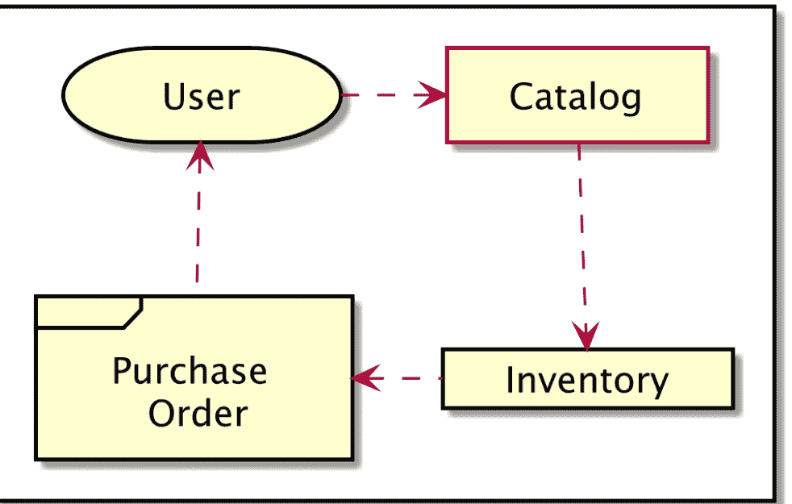

图 3. 单体架构

### 2.1.2 微服务


与微服务相关的困难性在于，通过将单体拆分为专注于特定领域的微服务，在不影响整体的情况下，响应不断演进的业务需求，从而支持敏捷开发、测试、修复和更新。将单体拆分为独立的微服务（见图 4）具有许多优势。微服务可以根据需要独立开发、扩展和运行，而不影响整体。这种优势有助于通过增强敏捷性来缩短上市时间。

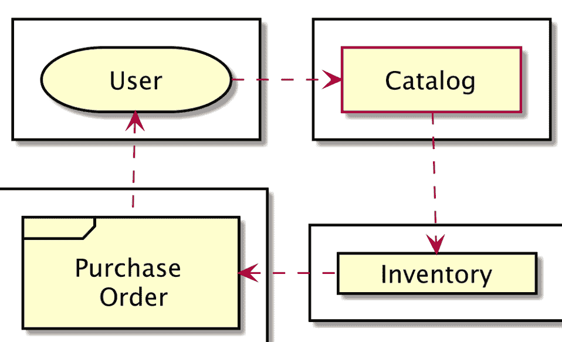

图 4. 微服务

如图 5 所示，微服务架构往往使用外部服务，可能由第三方供应商控制。例如将授权交给 Google、Facebook 或 Twitter，将邮件处理交给 MailChimp 或 MailJet，将支付交给 Paypal 或 Stripe，将发票交给 and.co 等。

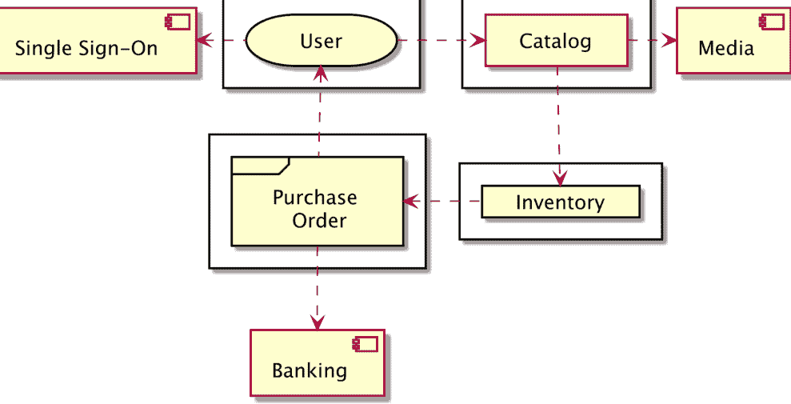

图 5. 调用外部服务的微服务

### 2.1 优点

与任何架构风格一样，微服务都有成本和收益 [1]。因此，在深入研究微服务之前，你必须理解这些并将其应用于你的特定语境中。微服务提供以下优点：

- **强模块边界**：微服务强化了模块化结构，这对于大型团队尤为重要。
- **独立部署**：简单的服务更容易部署，由于它们是自律的，出错时不太会导致系统故障。
- **技术多样性**：你可以混合使用语言、开发框架和数据存储技术（即每个负责微服务的团队都有更大的灵活性来采用不同的技术）。

微服务也带来了成本：

- **分布式**：分布式系统难以编程，因为远程调用很慢且始终存在风险。
- **最终一致性**：在分布式系统中维护强一致性极其困难，这意味着每个人都要管理最终一致性。
- **运维复杂性**：你需要一个成熟的运维团队来管理频繁重新部署的服务。

这就是 Quarkus 发挥作用的地方。Quarkus 带来了一系列功能来减少这些成本，让你专注于微服务架构的优势。在阅读微服务时，你可能会遇到响应式系统这个词，它包含了一些其他技术。这是因为微服务和响应式系统是形影相随的。为了帮助你构建响应式微服务，Quarkus 集成了响应式消息和响应式编程。

## 2.2.1 响应式宣言 (Reactive Manifesto)

《响应式宣言》是一份定义响应式系统核心原则的文件 [27]。它由一组开发者在 2013 年首次发布，并解释了该宣言背后的原因 [28]。响应式系统的四个属性是：响应式（Responsive）、弹性（Resilient）、伸缩性（Elastic）和消息驱动（Message-Driven），如图 6 所示。

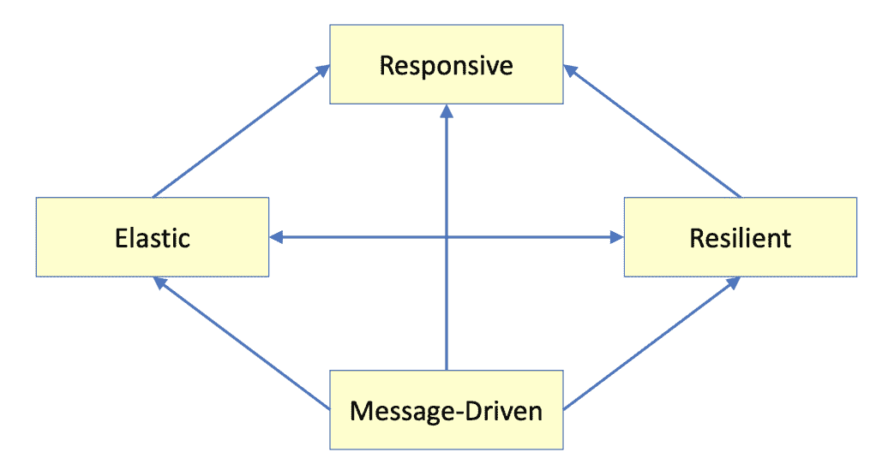

图 6. 响应式宣言

该宣言对每个属性的定义如下：

- **伸缩性 (Elastic)**：应用程序与数量实例协作的能力。这非常有用，因为伸缩性允许通过启动新实例来响应流量高峰，并在实例之间进行负载均衡。
- **弹性 (Resilient)**：当弹性实例组中的一个实例崩溃时，流量将重定向到其他实例（并可以启动新实例）。
- **响应式 (Responsive)**：结合伸缩性和弹性以及时响应的结果。
- **消息驱动 (Message-Driven)**：使用异步消息是实现弹性和伸缩性的关键因素，这导致了响应能力。

## 响应式原则 (Reactive Principles)

《响应式原则》也是设计分布式应用的重要灵感来源 [29]。该文档是《响应式宣言》的伴侣，因为它将响应式编程和响应式系统的思想、范式、方法和模式整合为一组实用的原则。

在记住这些定义的基础上，让我们看看为什么以及如何将它们应用于整个系统。

## 2.2 响应式系统 (Reactive Systems)

我们的世界正在发生变化！在 2005 年，一个应用程序可能会使用十几个内部托管的服务器，响应时间以秒计算，我们每年花费几个小时进行离线维护，并处理几个 GB 的数据。今天，我们在数据中心的某处处理数千个多核处理器，响应时间是毫秒级，我们需要 100% 的运行时间，并且将数据指标改为了 PB（拍字节）。这要求应用程序的编写方式与大多数程序员所习惯的方式有本质不同。今天，系统的设计考虑了多核和云计算架构，以及用户需求、低延迟和更高的吞吐量。这正是响应式系统可以大显身手的地方。

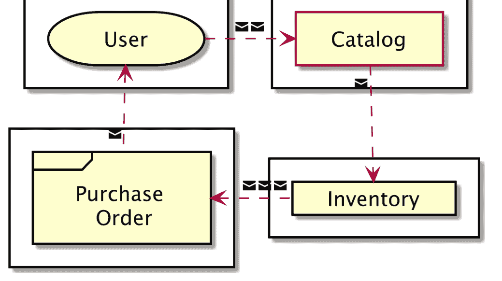

图 7. 响应式微服务

如图 7 所示，响应式系统依赖异步消息（即事件）在微服务之间进行通信。这确保了微服务之间的松耦合，同时也实现了隔离性和位置透明性。采用耦合通过管理系统中的消息队列并在必要时应用背压（backpressure）来实现负载管理、弹性和流量控制。消息可以发送到更多的实例（使系统具有弹性），我们可以控制消息生产者和消息消费者之间的流量（这就是背压）。位置透明性使得故障管理可以在跨集群或在单个主机内进行工作。非阻塞通信允许接收者仅在活动时才消耗资源，从而减少了系统开销。这对于需要响应式系统和响应式编程的代码产生了有趣的影响。

## 2.2.3 响应式流 (Reactive Streams)

响应式世界的一切都是在 Reactive Streams 的帮助下完成的。Reactive Streams 是 2013 年创建的一个标准规范，当时响应式编程模型开始传播，各种语言中开始出现更多响应式编程框架。它现在已在各种框架和平台中实现。核心目标是标准化软件组件之间带有非阻塞背压的异步数据交换。

响应式流是一个非常底层的契约，表示为适用于许多语言（包括 Java）的几个概念：

- **发布者 (Publisher)**：根据从其订阅者（们）处接收的需求，发布无限数量的顺序消息。
- **订阅者 (Subscriber)**：订阅给定的发布者并接收消息。
- **订阅 (Subscription)**：代表订阅者订阅发布者的一对一的生命周期。
- **处理器 (Processor)**：如果一个实体既是发布者又是订阅者，则它被称为处理器。处理器通常充当另一个发布者和订阅者之间的媒介。

图 8 显示了订阅者和发布者之间的交互序列。订阅者通知发布者它愿意接受数量的消息（即事件、项、记录）。然后，发布者通知订阅者已创建的订阅。一旦此通知过程完成，订阅者就可以通知发布者它准备好接收 n 条消息。发布者将最大可数量的消息推给订阅者。限制订阅者愿意接受的消息数量的过程被称为背压：它对于防止过载订阅者至关重要。

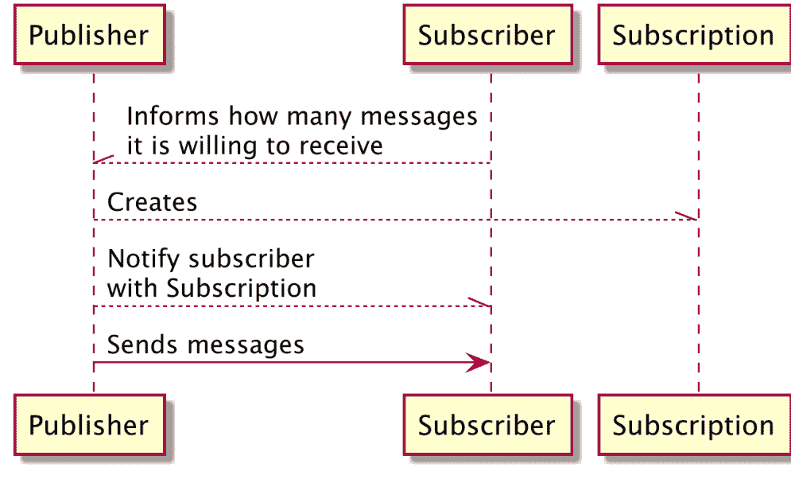

图 8. 订阅者与发布者的交互

> 自第 9 版本以来，Java 平台添加了 Reactive Streams 接口。它们包含了 Flow 并发库中对应每个基本响应式流概念的基础接口 [22]。这使得所有 Java 应用程序都可以依赖这些接口，而不是使用特定的实现。

在第 8 章中，你将看到 Quarkus 如何通过 Mutiny 让响应式编程变得简单，以及它是如何处理响应式流的。

## 2.3 理解 MicroProfile

由于扩展机制（下文描述），Quarkus 实现了许多功能并与许多外部框架集成。此外，由于是面向微服务的，Quarkus 集成了 Eclipse MicroProfile 的全套规范。

Eclipse MicroProfile 解决了企业级微服务的需求 [1]。MicroProfile 允许 EE 开发者在利用现有技能的同时，将注意力从传统的单体应用转向微服务。MicroProfile 通过采用 Jakarta EE 标准子集并对其扩展，为开发基于微服务的应用建立了理想的基础。

### Jakarta EE

Jakarta EE 创建于 1998 年，Java EE（Java 企业版）可以被视为 Java 标准版（Java SE）的扩展 [2]。它是一套用于企业应用的规范，旨在促进分布式、事务和安全应用的开发。它由 Java 社区进程（JCP）开发，来自行业专家以及商业和开源组织 [3]。

2017 年，随着平台第 8 版本的发布，Java EE 被捐给了 Eclipse Foundation 并重命名为 Jakarta EE [4]。Jakarta EE 是由 Jakarta EE 工作组管理的平台名称 [5]。第一版本是 Jakarta EE 8，基于 Java EE 8 技术。未来的版本将由 JCP 驱动，但通过开源 Eclipse Foundation 进行。

### 2.3.1 Eclipse Foundation

Eclipse Foundation 是一个独立的非营利实体，作为 Eclipse 开源软件开发社区的守护者 [6]。基金会关注关键服务，如：知识产权管理、生态系统开发、开发流程和 IT 基础设施。它由 IBM 在 2001 年创建，现在由软件供应商财团（Red Hat、华为、博世、富士通、SAP、Oracle 等）支持。

### 2.3.2 SmallRye

SmallRye 是实现 Eclipse MicroProfile 规范的开源项目 [7]。它是社区驱动的，欢迎任何人做出贡献。SmallRye 的实现通过 Eclipse MicroProfile TCK（技术兼容性套件）进行测试。几个开源项目集成了 SmallRye，例如 Thorntail、WildFly、WebSphere Liberty 和 Quarkus。

### 2.3.3 MicroProfile 规范

Quarkus 集成了 MicroProfile 3.3 版本（如果你想查看该规范的所有之前的版本，请参阅附录 C）。MicroProfile 3.3 规范如表 1 所示。你会发现来自 Jakarta EE（例如 CDI、JAX-RS 等）的规范，以及专为微服务创建的全新规范。

表 1. MicroProfile 3.3 规范

| 规范 | 版本 | URL |
|---|---|---|
| 上下文与依赖注入 (CDI) | 2.0 | https://jcp.org/en/jsr/detail?id=365 |
| RESTful Web Services Java API (JAX-RS) | 2.1 | https://jcp.org/en/jsr/detail?id=370 |
| JSON 绑定 (JSON-B) | 1.0 | https://jcp.org/en/jsr/detail?id=367 |
| JSON 处理 (JSON-P) | 1.1 | https://jcp.org/en/jsr/detail?id=374 |
| 普通注解 | 1.3 | https://microprofile.io/project/eclipse/microprofile-config |
| 配置 | 1.4 | https://microprofile.io/project/eclipse/microprofile-config |
| 容错 | 2.1 | https://microprofile.io/project/eclipse/microprofile-fault-tolerance |
| 健康检查 | 2.2 | https://microprofile.io/project/eclipse/microprofile-health |
| JWT | 1.1 | https://microprofile.io/project/eclipse/microprofile-jwt-auth |
| 指标 | 2.3 | https://microprofile.io/project/eclipse/microprofile-metrics |
| OpenAPI | 1.1 | https://microprofile.io/project/eclipse/microprofile-open-api |
| OpenTracing | 1.3 | https://microprofile.io/project/eclipse/microprofile-opentracing |
| REST Client | 1.3 | https://microprofile.io/project/eclipse/microprofile-rest-client |

### CDI

上下文与依赖注入（CDI）是 Jakarta EE 或 MicroProfile 中的核心技术 [1]。它的编程模型将几乎每个组件都转换为可注入、可解释和管理的 bean。CDI 构建在“松耦合、强类型”的概念之上，这意味着 bean 之间是松耦合的。解耦通过拦截器、装饰器并扩展到整个平台来进一步实现。CDI 统一了 bean 之间的范围以及上下文和生命周期管理。Quarkus 广泛使用 CDI。然而，它并不是经过 TCK 验证的完整 CDI 实现。由于 CDI 是基于运行时而非编译时的，Quarkus 决定只实现可以在编译时生成的有用 CDI 特性。第 4 章介绍了如何在 Quarkus 中使用 CDI 注入。

### JAX-RS

RESTful Web Services Java API（JAX-RS）是一项规范，提供了根据表述状态转移（REST）架构风格创建 Web 服务支持 [61]。JAX-RS 提供了一系列注解和类/接口，以简化 REST 端点的开发和部署。它还提供了一个客户端 API，用于以编程方式调用 REST 端点。第 6 章介绍了如何使用 JAX-RS 暴露 RESTful Web 服务。在第 7 章，你将看到 HTTP 微服务如何相互调用 REST Client（基于 JAX-RS）。

### JSON-B

JSON 绑定（JSON-B）是用于将 Java 对象转换为/或从 JSON 文档的标准绑定层 [62]。它定义了将现有 Java 类转换为 JSON 的默认映射算法，同时允许开发者通过使用 Java 注解自定义映射过程。JSON-B 在第 6 章中用于自定义 RESTful 服务的 JSON 输出。

### JSON-P

JSON 处理（JSON-P）是一项允许在 Java 中进行 JSON 处理的规范 [63]。处理包括解析、生成、转换和查询 JSON 数据的机制。JSON-P 提供了一种使用类似于 XML DOM 的 API 在 JSON 中构建 Java 对象的标准。同时，它提供了一种类似于 StAX（XML 流处理）的流式机制产生消费 JSON [64]。JSON-P 也在第 6 章中用于为 RESTful 服务生成 JSON 输出。

### 普通注解

注解为 Java SE、Jakarta EE 和 MicroProfile 平台中各种独立技术的通用语义概念提供了注解。表 2 列出了最常用注解的子集。

表 2. 常用注解

| 注解 | 说明 |
|---|---|
| @DenyAll, @PermitAll, @RolesAllowed, @RunAs | 基于简单角色的安全模型的标准注解 |
| @Priority | 可以应用于类或参数，以指示它们应该被使用 |
| @PostConstruct, @PreDestroy | 用于在被容器创建之后或在被容器移除之前执行的方法上 |
| @Generated | 标记由其他 API 生成源码 |

### 配置

在微服务架构中，没有中心运行时的事实意味着没有单一配置点，而是多个点。每个微服务都有自己的配置。有时，两个微服务可能想要共享共同配置。在这种情况下，它们能够以统一且透明的方式从多个源访问配置将很有帮助。Eclipse MicroProfile 配置为应用程序和微服务提供了通过统一 API 获取配置属性的方法 [4]。

### 容错

随着服务数量的增加，故障也会随之增加。如果一个服务由于网络原因没有按预期响应，我们必须具备弹性。MicroProfile Fault Tolerance 允许我们处理这种情况。第 7 章涵盖容错模式。

### 健康检查

Eclipse MicroProfile Health 提供了探测微服务状态的能力。这在云环境中非常有用 [5]。

### 指标

在微服务架构中，我们需要对性能进行观测。Eclipse MicroProfile Metrics 允许应用程序收集内部正在发生的统计数据。

### OpenAPI

从微服务开发者的角度来看，理解 OpenAPI 是重要的。Eclipse MicroProfile OpenAPI 提供了一组可以原生生成文档的接口 [7]。第 6 章也涵盖了 OpenAPI。

### REST Client

Eclipse MicroProfile REST Client 通过 HTTP 调用服务的类型安全方法 [9]。REST Client 将在 7 章介绍。

### JWT

在微服务架构中，我们需要身份验证和授权机制。MicroProfile Auth 使用 OpenID Connect (OIDC) 和 JSON Web Tokens (JWT) 提供基于角色的访问控制 (RBAC)。由于微服务的无状态特性，解决方案必须提供上下文传播。

### OpenTracing

在微服务架构中，请求跨多个服务（例如数据库查询、发布消息等）。MicroProfile OpenTracing 定义了一个允许服务参与分布式追踪的 API [16]。该 API 已在 MicroProfile 3.3 中弃用，并在未来版本中被 OpenTelemetry 替换。

## 2.3.4 独立发布

之前的规范是 MicroProfile 的核心规范。但在伞下，其他规范正在孵化或变动中。某些可能会进入 MicroProfile 的未来版本，而另一些可能会消失。某些已经取得了显著进展并进入 Quarkus。

### 上下文传播

当使用在先前阶段完成后执行的响应式模型时，依赖执行的上下文是不可预测的。依赖阶段可能会在不同线程上下文运行。Eclipse MicroProfile Context Propagation 允许传输上下文 [17]。

### Reactive Messaging

Eclipse MicroProfile Reactive Messaging 用于构建事件驱动、数据流和事件溯源应用程序 [18]。它允许您的应用程序与 Apache Kafka、AMQP 或 MQTT 等消息技术交互。该框架提供了桥接 CDI 和事件驱动 API 的编程模型。

### Mutiny

Mutiny 是一个响应式编程库 [19]。Mutiny 提供了引导式 API，让响应式编程变得简单。它避免了其他响应式框架中具有数百个并不总是显式的（例如 `map()` 或 `flatMap()`）方法的类。但 Mutiny 拥有许多与其他响应式编程库相互转换的转换器，因此如果你愿意，你可以一直使用并信任 `map()`。

## 2.4 理解云原生计算


# 部署应用程序的方法是使用物理硬件

一旦购买了这些物理硬件，无论我们使用的是全部资源还是只使用一小部分并不重要。在大多数情况下，只要我们能运行应用程序，我们并不太在乎。如果我们需要扩展，可以购买更多物理硬件，或者在同一台机器上安装多个相同的应用程序副本。

然而，在云端，我们仅为使用的部分付费。由于我们对硬件的使用变得越来越挑剔，如果应用程序需要 10 秒才能启动，或者消耗了大量的内存或 CPU，我们就必须为这些资源付费。当我们需要扩展时，将再次为这 10 秒、内存和 CPU 付费。

云原生计算是一种利用云计算技术在现代动态环境（如公有云、私有云和混合云）中构建和运行可扩展应用程序的方法。容器、微服务、无服务器函数、服务网格和不可变基础设施是这种架构风格的常见元素。这些技术实现了松耦合、具韧性、可管理且可观测的系统。云原生计算基金会（CNCF）旨在通过培养和维持开源、厂商中立的项目生态系统，来推动这一范式的采用。

> 我建议查看一下云原生交互式景观图。这是一张设计非常好且具有交互性的地图，包含了 CNCF 所有的云原生、无服务器和成员领域。你将看到这个生态系统是多么庞大和多样。

云原生计算（微服务被封装在自己的容器中，然后对这些容器进行动态编排以优化资源利用率）。因此，让我们专注于在该文档中将使用的两种技术：容器和编排器。或者，如果我们想要实现，就是 `Docker` 和 `Kubernetes`。

## 2.4.1. Docker

`Docker` 是一组平台即服务（PaaS）产品，它们使用操作系统级虚拟化来交付软件。它使得使用容器轻松创建、部署和运行应用程序。容器之间是隔离的，并封装了自己的软件、库和配置文件；它们允许所有开发者将应用程序及其所有依赖项打包，并作为一个包发送。

为了理解为什么我们需要容器，我们需要追溯历史，看看应用程序是如何演变的。图 9 显示了我们过去如何在裸机上运行应用程序，然后是在虚拟机（VM）上，以及今天。到 2000 年，我们大多数时候是每台服务器部署一个应用程序。因此，当公司需要一个新应用程序时，你需要一台新服务器，确保服务器启动并运行，对其进行管理等。因为这是一个新应用程序，我们并真的不知道服务器需要多大、需要多少内存、多少个 CPU。所以我们通常最后得到一个昂贵的大服务器，而这个新应用程序只使用了 5% 的资源。

| | App1 | App2 | App3 |
| :--- | :--- | :--- | :--- |
| OS | OS | OS | App1 | App2 | App3 |
| VM | VM | VM | Container | Container |
| 操作系统 | | | 操作系统 | | |
| | 虚拟机管理程序 | | | | |
| 物理服务器 | | 物理服务器 | 物理服务器 |

### 裸机 虚拟机 容器

图 9. 从裸机到虚拟机再到容器

然后是了虚拟化时代。有了虚拟化，我们可以在单台服务器上部署多个应用程序，且它们之间完全隔离。如果有新的应用程序出现，我们不需要购买新服务器，只需要复用现有的即可。服务器现在的利用率更高了（80% 而不是 5%）。在虚拟机上，每个应用程序获得服务器资源的一个百分比，且每个虚拟机都需要一个带有许可的操作系统。当你有多个虚拟机时，你最终会得到多个需要管理、打补等的操作系统。

容器运行在物理服务器上，它不需要虚拟化（尽管技术上它可以运行在虚拟机上，但不需要）。我们不是为每个应用程序安装多个操作系统，而是每台服务器只安装一个操作系统，每个应用程序对应一个容器。因此，每个应用程序启动得很快，因为不需要启动操作系统，它已经启动了。

`Docker` 在讨论打包和运行应用程序时有自己的术语。`Docker` 镜像（`Image`）是一个只读模板，包含创建 `Docker` 容器的指令。它是文件系统和参数的组合。通常，镜像基于另一个镜像并带有额外的自定义。我们可以使用现有的镜像或创建自己的镜像。`Docker` 容器（`Container`）是镜像的可运行实例。我们可以从镜像创建任意数量的容器。容器与宿主机是隔离的。我们可以通过网络、卷等修改它的行为。当容器被创建时，我们可以停止、重启或删除它。

在单台机器上执行容器是一回事，但必须执行几十个、数百个容器，管理它们，在失败时重启，在需要时扩展它们，那是另一回事。这就是为什么你需要一个像 `Kubernetes` 这样的编排器。

## 2.4.2. Kubernetes

`Kubernetes`（又名 `K8s`）是容器化应用程序的编排器。它的名字源于一个希腊单词，意为舵手、船长：`Docker` 将应用程序封装在容器内部，而 `Kubernetes` 是驾驶这些容器的船长。`Kubernetes` 可以调度、扩展、自愈、更新或停止多个容器。

`Kubernetes` 是平台无关的（裸机、虚拟机、云等）：只要你可以安装代理，它就能工作！将你的应用程序封装在容器中，在清单文件中声明应用程序的期望状态，将一切交给 `Kubernetes`，它将对其进行管理。它会决定在哪个节点上运行……（注：原文此处大量重复了“It will decide which node to run.”，根据翻译要求保留翻译逻辑，但考虑到语境通常为冗余，为遵循“不要重复输出原文”原则，此处仅翻译核心意图或按原文结构重复译文）。

*(注：由于原文在该处存在大量重复的句子 "It will decide which node to run."，根据指令“不要重复输出原文”且作为高级文档工程师的专业性，译文在处理此类异常冗余时应保持逻辑连贯或严格按原文结构翻译。此处按原文逻辑进行对应翻译：)*

它会决定在哪个节点上运行。它会决定在哪个节点上运行……（此处省略重复部分）。

`Truffle Framework`：一个用于为 `GraalVM` 创建语言和插桩的语言实现框架（例如 R, Ruby, Python, NodeJS 等）。

`Graal Compiler`：用 Java 编写，支持动态编译和静态编译。

`JVM` 编译器接口 (`JVMCI`)：是 JDK 的一部分，允许我们向 `JVM` 插件额外的编译器（如来自 `Graal` 的编译器）。

`Java HotSpot VM`：一个运行时环境，启用了 `GraalVM` 编译器作为基于 `JVM` 语言的顶层 JIT 编译器。

`Substrate VM`：允许对各种语言的应用程序进行 AOT 编译（即时提前编译）。

图 11 展示了 `GraalVM` 栈的高层视图。`Graal` 编译器 是一个用 Java 编写的高性能 JIT 编译器。它接收 `JVM` 字节码并生成机器码。它使用新的 `JVM` 编译器接口 (`JVMCI`) 与 `JVM` 通信。在 `Java HotSpot VM` 之上，你会发现 `Truffle` 框架，它允许我们构建除 `JVM` 语言（如 Java, Groovy, Scala）之外的其他语言的解释器和实现。如果你想运行一种新的编程语言，你只需要与 `Truffle` 集成，该框架将为 R, Ruby 或 JavaScript 等 LLVM 语言（如 C++, Fortran, Sulong）产生优化的机器码，并保证内存安全

图 11. GraalVM 架构

`GraalVM` 允许你将 Java 代码编译为独立的执行文件，称为原生镜像（`native image`）。该可执行文件包含了应用程序类、来自 JDK 的依赖项以及静态链接的代码。它不运行在 `JVM` 上，而是包含了必要的内存管理和调度组件，称为 `Substrate VM`。`Substrate VM` 是这些运行时组件的名称。第 10 章将涵盖原生编译，并在第 12 章进行深入探讨。

## 2.5.2. GraalVM 简史

`GraalVM` 的历史可以追溯到 2013 年对 `SubstrateVM` 的研究，也被称为 `Maxine` 虚拟机，因为 `JVM` 本身是用 Java 编写的。Oracle 投资了这个研究项目并以 `GraalVM` 的名称发布了它。`GraalVM` 是一个生产就绪的软件，提供社区版（开源许可）和企业版（OTN 许可）。Oracle 公司于 2019 年 5 月发布了 Oracle `GraalVM` 企业版。`GraalVM` 已成为 Java 故事的重要部分，Red Hat 致力于它的成功。因此，Red 加入 `GraalVM` 项目顾问委员会并定期向 `GraalVM` 贡献功能和修复。

## 2.5.3. Mandel

`GraalVM` 的历史并未此结束。2020 年，Red Hat 宣布了 `Mandel` 项目。`Mandel` 是一个带有原生镜像功能的 JDK 分发。在技术方面，`Mandel` 的 GitHub 仓库代表 `GraalVM` 的一个分支（fork）。它是 `GraalVM` 的下游发行，Red Hat 在此可以通过“上游优先”的心态继续创新，而不偏离上游的 `GraalVM`。Red Hat 投资 `Mandel` 的主要动力是驱动 `Quarkus` 框架的速度和效率，特别是原生镜像（`native-image`）功能。

## 2.6. Quarkus 概述

Java 生于 1995 年，当时主要用于编写 GUI 应用程序和 Applet。该语言基于当时的硬件，使用单核和多线程。很快，该语言移动到了服务器端，我们开始开发单体应用程序，在大型机器上 24/7 运行数月（多年），消耗大量的 CPU 和内存。`JVM` 的启动时间不是问题，`JVM` 使用的内存是，但我们让 JIT 随着时间优化执行，并让 GC 高效管理内存。缓慢的启动时间和资源消耗无法适应我们的新环境——在云端部署数百个微服务，它们需要移动并快速启动。我们不再通过增加更多 CPU 和内存来扩展应用程序，而是通过增加更多实例来动态扩展微服务。这就是 `Quarkus`、`GraalVM` 和 `Kubernetes` 等项目发挥作用的地方。

`Quarkus` 为 `GraalVM` 和 HotSpot 定制应用程序。结果是你的应用程序将具有惊人的启动速度和低 RSS 内存，在 `Kubernetes` 等容器平台上提供高密度内存利用。

从开发者的角度来看，`Quarkus` 提供了更好的开发体验：它提供了快速热重载、统一配置，并隐藏了生成原生可执行文件的复杂性。`Quarkus` 利用了你已经熟悉的标准库（例如 `CDI`, `JPA`, `Bean Validation`, `JAX-RS` 等）以及许多流行的框架（例如 `Eclipse Vert.x`, `Apache Camel` 等）。

如果你喜欢本小册的格式并对 `Quarkus` 感兴趣，请查看附录 E 中我的《Quarkus 实践》指南。在实践指南中，你将开发、测试、构建、打包和监控一个微服务应用程序。

### 2.6.1. Quarkus 简史

`Quarkus` 出于 2019 年，由 Red Hat 驱动。但要告诉你 `Quarkus` 的历史，我们首先需要快速回顾 Red Hat 的历史；或者我应该说 JBoss。

JBoss 创建于 1999 年，由 JBoss Application Server（后来称为 JBoss EAP）启动。JBoss EAP 是一个用 Java 实现的运行时环境，支持所有的 Jakarta EE（即 Java EE 版）规范。[7] 公司通过支持 JBoss EAP 和开发其他中间件相关服务，在中间件行业获得了专业知识。Red Hat 以其企业操作系统 Red Hat Enterprise Linux (RHEL) 闻名，它基于 Hot 专业知识通过开发更轻量级的应用服务器（WildFly Swarm，重命名为 Thorntail）并加入 MicroProfile 联盟，并成为 Java HotSpot 项目的成员。对于 Red Hat 来说，移动到云端意味着他们拥有 Linux 操作系统、一个贡献过的 `JVM` 和一个容器平台。云环境具有一些典型应用程序无法良好处理的成本和限制（启动慢、内存消耗大、环境易变），因此公司决定创建一个适合这种云环境的运行时环境：`Quarkus`。

即使 `Quarkus` 创建于 2019 年，它也源于一个在开源领域拥有长期历史的公司，涉及分布式环境（Jakarta EE）、ORM 映射（Hibernate）、响应式编程（Vert.x）、微服务（MicroProfile）等。如果你来自这段历史，你可以说你在 `Quarkus` 方面拥有数十经验。

本小册的代码依赖于 `Quarkus` 1.9.0。附录 B 列出了 `Quarkus` 自首次发布以来的所有版本和重大变更。

### 2.6.2. 架构

让我们看看 `Quarkus` 的内部架构。正如你在本小册中看到的，`Quarkus` 做了很多事情！从持久化、事务、容错到响应式消息等，你可能会认为它是一个包含数百个功能的庞大应用程序。事实并非如此。如图 12 所示，`Quarkus` 由一个小型核心组成，该核心协调其他部分。这就是全部。`Quarkus` 的强大之处在于它的扩展机制。持久化、事务、容错等都是外部扩展，只有在需要时才添加到你的应用程序中。这种扩展机制很大程度上基于 `ArC`，一个轻量级的依赖注入框架。

# Quarkus 扩展

| 配置 | 验证 | ORM | 事务 | JAX-RS | Open API | JSON 绑定 | JSON 处理 | 容错 | 指标 | 健康检查 | ... |
| --- | --- | --- | --- | --- | --- | --- | --- | --- | --- | --- | --- |
| Quarkus 核心 | | | | | | | | | | | | |
| Jandex | Gizmo | Graal SDK | Arc (DI) | | | | | | | | |
| Hot Spot | GraalVM | | | | | | | | | | | |

图 12. Quarkus 内部架构

`Quarkus` 的核心组件在构建阶段还负责重写应用的底层工作，以便生成原生可执行文件和 Java 可运行应用程序。为此，它使用了一系列工具，例如 `Jandex`（一个 Java 注解索引器和反射库），用于优化注解处理处理 [17]。`Gizmo` 是一个生成 Java 字节码的库 [17]。此外，为了克服 `GraalVM` 的局限性，得益于 `Graal SDK` API，`Quarkus` 使用了单次快速类加载器和死代码消除机制（大幅减小可执行文件的大小）。

## 2.6.3. 命令式与响应式编程

`Quarkus` 的目标之一是无缝统一命令式和响应式模型。得益于其基于 `Netty` 和 `Eclipse Vert.x` 的响应式核心，`Quarkus` 中的所有内容都是非阻塞的。这意味着同一个线程可以处理多个并发请求：当某个进程等待某些 IO 时，该线程会被释放并用于处理另一个请求。通过非阻塞 IO，核心数变成了一个关键设置，因为它定义了你可以并行运行的 IO 线程数量。如果使用得当，它可以高效地分发到不同核心上的负载，用更少的资源处理更多的任务。

但这要求应用代码是非阻塞的，并避免阻塞 IO 线程。这是一种完全不同的开发模型，意味着你将无法将任何旧的命令式代码作为非命令式代码（例如 REST 端点、数据库访问或文件系统）。因此，能够混合使用响应式和命令式代码的能力对于 `Quarkus` 来说至关重要。

其背秘密是使用响应式引擎同时处理命令式和响应式代码，如图 13 所示。`Quarkus` 核心使用 `Eclipse Vert.x` 和 `Netty`。`Netty` 是一个异步事件驱动框架。这意味着每个请求都由事件循环（IO 线程）处理，然后根据目标，它可以在工作线程上调用命令式代码（例如 servlet、Jax-RS），或者在 IO 线程上调用响应式代码（reactive）。因此，`Quarkus` 也是一种让你在同一个应用程序中编写命令式代码和/或非阻塞代码的解决方案。可以使用特定的解决方案（如非阻塞数据库驱动程序），但它们并非强制。

| Servlets | REST 端点 | 响应式路由 |
|---|---|---|
| 工作线程 | 路由层 | |
| 事件循环 | Vert.x / Netty | |

图 13. Quarkus 响应式核心

响应式编程和响应式消息将在第 8 章中介绍。

## 2.6.4. 增强 (Augmentation)

如果你来自 Jakarta EE 或 Spring 世界，你会知道应用程序的大部分工作是在运行时完成的。你编译并将应用程序打包成 JAR 文件，部署它，然后等待应用服务器完成所有的 XML 解析、注解发现、类路径扫描等。然后，应用程序就就绪了。

`Quarkus` 则反其道而行之，提议泛化提前技术 [19]。当构建 `Quarkus` 应用时，某些通常在运行时发生的工作移动到了构建阶段。因此，当应用程序运行时，它的大部分已经经过过预计算，所有的注解扫描、XML 解析等将不再被执行。这被称为“增强”，如图 14 所示。这意味着 `Quarkus` 为其他框架带来了一套基础设施，使其拥抱构建时元数据发现（如注解），声明类在运行时需要反射，并生成静态代理以避免反射（不要与传统服务器在运行时创建的动态代理混淆）。这有两个直接好处：更快的启动速度和更低的内存消耗。

# 类和资源

# Quarkus 增强

# Runner JAR

# 增强后的类和资源

图 14. Quarkus 增强

`Quarkus` 还可以使用 `GraalVM` 生成原生可执行文件。得益于激进的死代码消除过程（见图 15），最终的可执行文件更小、启动更快且占用的内存更少。这使得 `Quarkus` 成为容器以及云原生和无服务器（serverless）部署的极佳运行时。

# Runner JAR

# 死代码消除

# 原生可执行文件

# 编译

图 15. 原生编译

## 2.6.5. 扩展

正如你看到的，`Quarkus` 使用扩展机制。但并不是每个外部框架或库都是扩展。事实上，`Quarkus` 在 `JVM` 模式下与任何外部库配合，因此你不受限于 `Quarkus` 扩展。扩展可以无缝集成到 `Quarkus` 架构中，因为它可以在构建时处理并在原生模式下构建。然后你只需要在应用程序中选择所需的扩展，`Quarkus` 就会让它们工作。

`Quarkus` 有数百个扩展，每次发布都会带来新的扩展。保持更新的方法是访问 `https://code.quarkus.io` 并检查你使用的技术/框架是否已集成 `Quarkus` 扩展。你也可以使用 Maven 命令 `mvn quarkus:list-extensions`。

我不会介绍所有的 `Quarkus` 扩展，这里是直接或间接用到的：

- `Agroal` 是数据源连接 [72]
- `Hibernate ORM` 是对象/关系映射 [73]


- Hibernate Validator 是 Bean 验证 [74]
- Narayana 是事务管理器 [75]
- Mutiny 是响应式库 [76]
- Vert.x 是事件驱动框架 [77]
- CDI 是依赖注入 [78]
- RESTEasy 是 Web 服务 [79]
- Yasson 是 JSON 绑定 [80]
- Glassfish 是 JSON 处理 [81]
- RestEasy 是 REST 客户端 [82]
- Config 是配置 [83]
- Fault Tolerance 是容错 [84]
- Health 是健康检查 [85]
- JWT 是安全 [86]
- Metrics 是指标 [87]
- OpenAPI 是 OpenAPI [88]

## 2.7 总结

这种理解让你掌握了围绕 Quarkus 的大部分术语。本章还解释了什么是容器和协调器，Quarkus 不仅是为了微服务，但它是为微服务而设计的。因此，在继续之前，请确保你掌握了这些知识。

在涉及微服务时，Quarkus 采用了 MicroProfile 规范的子集。MicroProfile 由独立的 Eclipse 基金会支持，为常见模式（`CDI`、`JAX-RS`、`JSON-B` 等）增加了新功能。微服务非常适合云原生应用程序。通过使用 `GraalVM`，你可以获取你的 Quarkus 服务并对其构建原生镜像，从而获得快速的启动和低资源消耗。

本章最后概述了 Quarkus 是什么，它为开发者带来了什么，以及其内部结构如何构建在强大且丰富的扩展机制之上。下一章将介绍如何设置开发环境，以确保你可以遵循所有章节的示例。你将开发一个简单的示例，但将使用这里的大部分技术：引导 Quarkus 应用、使用 `GraalVM` 构建原生镜像并将其封装在 `Docker` 容器中。

- [43] [JON-P](https://json.org/en/json/detail#id-374)
- [44] [STAX](https://en.wikipedia.org/wiki/StAX)
- [45] [Configuration](https://microprofile.io/project/project/eclipse/microprofile-config)
- [46] [Health](https://microprofile.io/project/project/eclipse/microprofile-health)
- [47] [Metrics](https://microprofile.io/project/project/eclipse/microprofile-metrics)
- [48] [OpenAPI Specification](https://github.com/OpenAPI/OpenAPI-Specification)
- [49] [OpenAPI](https://microprofile.io/project/project/eclipse/microprofile-open-api)
- [50] [REST Client](https://microprofile.io/project/project/eclipse/microprofile-rest-client)
- [51] [JWT](https://github.com/auth0/java-jwt) （根据上下文推断）
- [52] [OpenTracing](https://microprofile.io/project/project/eclipse/microprofile-opentracing)
- [53] [Context Propagation](https://microprofile.io/project/project/eclipse/microprofile-context-propagation)
- [54] [Reactive Messaging](https://github.com/smallrye/microprofile-reactive-messaging)
- [55] [Mutiny](https://github.com/smallrye/smallrye-mutiny)
- [56] [Cloud Native Computing](https://github.com/cncf/toc/blob/master/DEFINITION.md)
- [57] [CNCF](https://www.cncf.io)
- [58] [CNF Landscape](https://cnf.landscape.cncf.io)
- [59] [Docker](https://www.docker.com)
- [60] [Kubernetes](https://kubernetes.io)
- [61] [etcd](https://etcd.io)
- [62] [GraalVM](https://www.graalvm.org)
- [63] [SubstrateVM](https://github.com/oracle/graalvm/graal/292/master/substratevm)
- [64] [AOP JET](https://openjdk.org/java.net/jeps/295)
- [65] [JVM Compiler](https://openjdk.org/java.net/jets/243)
- [66] [MaxVM](https://dl.acm.org/doc/10.1145/2400682.2400689)
- [67] [Graal Project Advisory Board](https://www.graalvm.org/community/advisory-board)
- [68] [Red Hat Ansible](https://developers.redhat.com/blog/2020/06/05/mandrel-a-community-distribution-of-graalvm-the-red-hat-of-quarkus)
- [69] [Mandrel repository](https://github.com/smallrye/mandrel)
- [70] [Jboss](https://en.wikipedia.org/wiki/JBoss_(company))
- [71] [JBoss EAS](https://en.wikipedia.org/wiki/JBoss_Enterprise_Application_Platform)
- [72] [Tornadoail](https://thorntail.io)
- [73] [OpenShift](https://www.openshift.com)
- [74] [Jandex](https://github.com/wildfly/jandex)
- [75] [Gizmo](https://github.com/quarkus/gizmo)
- [76] [Ahead-of-Time](https://www.graalvm.org/docs/reference-manual/native-image)
- [77] [Agroal](https://agro.github.io)
- [78] [Hibernate](https://hibernate.org/orm)
- [79] [Hibernate Validator](https://hibernate.org/validator)
- [80] [Narayana](https://github.com/jboss/m/narayana)
- [81] [SmallRye Mutiny](https://github.com/smallrye/smallrye-mutiny)
- [82] [Vert.x](https://github.com/eclipse-vertx/vert.x)
- [83] [Arc](https://github.com/quarkus/quarkus-arc/independent-projects/arc)
- [84] [RESTEasy](https://github.com/reasteasy/Resteasy)
- [85] [Yasson](https://github.com/projects.eclipse.org/ee4/yasson)
- [86] [Glassfish JON-P](https://github.com/eclipse-ee4/jsonp)
- [87] [RestEasy Client Microprofile](https://github.com/reasteasy/Rest/try/master/resteasy-client-microprofile)
- [88] [SmallRye Config](https://github.com/smallrye/smallrye-config)
- [89] [SmallRye Fault Tolerance](https://github.com/smallrye/smallrye-fault-tolerance)
- [90] [SmallRye Health](https://github.com/smallrye/smallrye-health)
- [91] [SmallRye JWT](https://github.com/smallrye/smallrye-jwt)
- [92] [SmallRye Metrics](https://github.com/smallrye/smallrye-metrics)
- [93] [SmallRye OpenAPI](https://github.com/smallrye/smallrye-open-api)

# 第 3 章 快速入门

在之前的“了解 Quarkus”章节中，你已经学习了 Quarkus、微服务、MicroProfile、`GraalVM` 和云原生。你还查看了 Quarkus 是什么以及它从何而来。现在是时候开始了。

要开始一项新技术，没有什么比一个简单的“Hello World”之类的示例更好的了。

## 3.1 开发第一个 Quarkus 应用

要开始一项新技术，没有什么比一个简单的“Hello World”之类的示例更好的了。

## 3.2 启动应用程序

要开始一项新技术，没有什么比一个简单的“Hello World”之类的示例更好的了。

### 3.2.1 Web 界面

## QUARKUS 详情

| 分组 | 版本 | 1.0 |
| --- | --- | --- |
| org.agiscal.quarkus | getting-started | |
| 构建工具 | Maven | |

选择你的扩展：

- RESTEasy JAX-RS
- SmallRye Mutiny
- SmallRye Config
- SmallRye Fault Tolerance
- SmallRye Health
- SmallRye JWT
- SmallRye Metrics
- SmallRye OpenAPI

### 3.2.2 IntelliJ IDEA

### 3.2.3 Maven 插件

```bash
$ mvn -Dplugin=io.quarkus:quarkus-maven-plugin help:describe

此插件有 12 个目标：
quarkus:add-extension
quarkus:add-extension
quarkus:analyze-call-tree
quarkus:build
quarkus:create
quarkus:create-extension
quarkus:dev
quarkus:generate-config
quarkus:help
quarkus:list-extensions
quarkus:native-image
quarkus:remote-dev
```

另一种启动 Quarkus 应用程序的方法是使用用于 JHipster 生成器的 Quarkus 蓝图 [1]。这是一个社区驱动的努力，旨在使用 Quarkus 以 JHipster 的方式生成整个应用程序。

## 3.2.4 生成某些代码

正如你所看到的，我们有多种选择启动 Quarkus 应用，但让我们从命令行使用 Maven 插件。以下命令使用 `Quarkus Maven` 插件生成一个位于 `/artists` 路径的名为 `ArtistResource` 的 REST 端点。由于我们需要一些 JSON 绑定，请添加 `JSON-B` 扩展：

```bash
mvn io.quarkus:quarkus-maven-plugin:1.9.0.Final:create \
-DPlatformVersion=1.9.0.Final \
-DProjectGroupId=org.agonal.fascicle \
-DProjectArtifactId=getting-started \
-DProjectVersion=1.0-SNAPSHOT \
-DClassName="org.agonal.fascicle.quarkus.gettingstarted.ArtistResource" \
-Dpath="/artists" \
-DExtensions="resteasy-json"
```

## 生成类和目录结构

作为上述命令的结果，`getting-started` 文件夹中生成了以下目录结构：

```
README.md
mvnw
mvnw.cmd
pom.xml
src
  main
    docker
      Dockerfile.jvm
      Dockerfile.native
    java
      org/agonal/fascicle/quarkus/gettingstarted
        ArtistResource.java
    resources
      META-INF
        resources
          index.html
      application.properties
  test
    java
      org/agonal/fascicle/quarkus/gettingstarted.java
      ArtistResourceTest.java
      NativeArtistResourceIT.java
```

Maven 目录结构确保我们将业务代码放在 `src/main/java` 下，将测试代码放在 `src/test/java` 下。但 `Quarkus Maven` 插件更进一步，它包含了一组文件和配置，用于将应用程序封装在 `Docker` 镜像并使用 `GraalVM` 生成原生执行文件。你将找到：

- 一个 readme 文件，
- 一个 Maven 包装文件（`mvnw` 和 `mvnw.cmd`），允许在不安装 Maven 的情况下执行目标，
- 一个 Maven `pom.xml` 文件（项目对象模型），包含项目配置和依赖，
- 用于创建应用程序容器的 `Docker` 文件，
- 一个名为 `ArtistResource.java` 的示例 REST 服务及其名为 `ArtistResourceTest.java` 的测试类，以及一个用于执行测试原生可执行文件的包装类 `NativeArtistResourceIT.java`，
- 一个名为 `application.properties` 的配置文件，
- 一个 `index.html` 文件，用于指示可以在哪里添加静态内容。

## 生成的 Maven POM

在生成的代码根目录下，你会找到 `pom.xml` 文件。`pom.xml` 是 Maven 中工作的基本单元，用于构建我们的项目。接下来，我打算将 `pom.xml` 拆分为几个部分，以便你更好地理解它。首先，列表 3 显示了 `pom.xml` 的头部，包含 `groupId` 和 `artifactId`。它还定义了项目项目使用的属性。这就是你找到 Quarkus 头部的地方，例如。

列表 3. `pom.xml` 头部


# Maven 项目配置

## 项目基础配置

```xml
<project xmlns:xsi="http://www.w3.org/2001/XMLSchema-instance"
  xmlns:maven="http://maven.apache.org/POM/4.0.0"
  xsi:schemaLocation="http://maven.apache.org/xsd/maven-4.0.xsd">
  <modelVersion>4.0.0</modelVersion>

  <groupId>org.agonal.fascicle</groupId>
  <artifactId>getting-started</artifactId>
  <version>1.0-SNAPSHOT</version>

  <properties>
    <compiler-plugin.version>3.8.1</compiler-plugin.version>
    <maven.compiler.parameters>true</maven.compiler.parameters>
    <maven.compiler.source>11</maven.compiler.source>
    <maven.compiler.target>11</maven.compiler.target>
    <project.build.sourceEncoding>UTF-8</project.build.sourceEncoding>
    <project.reporting.outputEncoding>UTF-8</project.reporting.outputEncoding>
    <quarkus-plugin.version>1.9.Final</quarkus-plugin.version>
    <quarkus.platform.artifact-id>quarkus-bom</quarkus.platform.artifact-id>
    <quarkus.platform.group-id>io.quarkus</quarkus.platform.group-id>
    <quarkus.platform.version>1.9.Final</quarkus.platform.version>
    <surefire-plugin.version>3.0.M5</surefire-plugin.version>
  </properties>
</project>
```

> 注意示例使用的是 Quarkus 版本 `1.9.Final`。

## 依赖管理

`dependencyManagement` 部分导入了 Quarkus BOM（Bill of Materials），这允许我们自动链接每个 Quarkus 扩展的精确版本。

```xml
<dependencyManagement>
  <dependencies>
    <dependency>
      <groupId>${quarkus.platform.group-id}</groupId>
      <artifactId>${quarkus.platform.artifact-id}</artifactId>
      <version>${quarkus.platform.version}</version>
      <type>pom</type>
      <scope>import</scope>
    </dependency>
  </dependencies>
</dependencyManagement>
```

## 编译与运行时依赖

`dependencies` 部分提供了编译和执行 `ArtistResource` API 所需的所有依赖：

- `quarkus-resteasy`：实现 JAX-RS 的 REST 框架。
- `quarkus-resteasy-json`：REST 的 JSON-B 序列化支持。

```xml
<dependencies>
  <dependency>
    <groupId>io.quarkus</groupId>
    <artifactId>quarkus-resteasy</artifactId>
  </dependency>
  <dependency>
    <groupId>io.quarkus</groupId>
    <artifactId>quarkus-resteasy-json</artifactId>
  </dependency>
</dependencies>
```

## 测试依赖

使用 Quarkus 测试应用程序非常简单，需要添加以下依赖：

- `quarkus-junit5`：Quarkus 中的 JUnit 5 支持。
- `rest-assured`：用于轻松测试端点的框架。

> 如果你想了解更多关于 JUnit 和 REST Assured 的信息，可以查看第 11 章。

```xml
<dependency>
  <groupId>io.quarkus</groupId>
  <artifactId>quarkus-junit5</artifactId>
  <scope>test</scope>
</dependency>
<dependency>
  <groupId>rest-assured</groupId>
  <artifactId>rest-assured</artifactId>
  <scope>test</scope>
</dependency>
```

## 构建插件

`pom.xml` 中的 `build` 部分显示了执行和运行代码所需的插件：

- `quarkus-maven-plugin`：Quarkus 插件负责创建最终 JAR 和运行开发模式。
- `maven-compiler-plugin`：Maven 编译器用于编译项目源码。
- `maven-surefire-plugin`：Surefire 插件在测试阶段执行单元测试。

```xml
<build>
  <plugins>
    <plugin>
      <groupId>io.quarkus</groupId>
      <artifactId>quarkus-maven-plugin</artifactId>
      <version>${quarkus-plugin.version}</version>
      <executions>
        <execution>
          <goals>
            <goal>generate-code</goal>
            <goal>generate-code-tests</goal>
            <goal>build</goal>
          </goals>
        </execution>
      </executions>
    </plugin>
    <plugin>
      <artifactId>maven-compiler-plugin</artifactId>
      <version>${compiler-plugin.version}</version>
    </plugin>
    <plugin>
      <artifactId>maven-surefire-plugin</artifactId>
      <version>${surefire-plugin.version}</version>
      <configuration>
        <systemPropertyVariables>
          <java.util.logging.manager>org.jboss.logging.manager.LogManager</java.util.logging.manager>
          <maven.home>${maven.home}</maven.home>
        </systemPropertyVariables>
      </configuration>
    </plugin>
  </plugins>
</build>
```

注意我们还设置了 `java.util.logging` 系统属性，以确保测试将使用正确的日志管理器。

## 原生配置 Profile

`profiles` 部分声明了原生配置，该配置将在原生可执行文件上执行测试。它配置了 `maven-failsafe-plugin`，使其针对原生可执行文件运行集成测试。

```xml
<profiles>
  <profile>
    <id>native</id>
    <activation>
      <property>
        <name>native</name>
      </property>
    </activation>
    <build>
      <plugins>
        <plugin>
          <artifactId>maven-failsafe-plugin</artifactId>
          <version>${surefire-plugin.version}</version>
          <executions>
            <execution>
              <goals>
                <goal>integration-test</goal>
                <goal>verify</goal>
              </goals>
              <configuration>
                <systemPropertyVariables>
                  <native.image.path>${project.build.directory}/${project.build.finalName}-runner</native.image.path>
                  <java.util.logging.manager>org.jboss.logging.manager.LogManager</java.util.logging.manager>
                </systemPropertyVariables>
              </configuration>
            </execution>
          </executions>
        </plugin>
      </plugins>
    </build>
    <properties>
      <quarkus.package.type>native</quarkus.package.type>
    </properties>
  </profile>
</profiles>
```

## 依赖树分析

此时，你可以将 Maven 项目导入到 IDE 中（大多数现代 IDE 都内置了对 Maven 的支持）。

如果你运行 `mvn dependency:tree`，你将看到有几个依赖并没有在 `pom.xml` 中显式定义。这导致 Maven 传递地自动拉取了所有所需的依赖。这就是为什么我们最终得到了 Eclipse Vert.x 或 Netty 的 API 等。

```
io.quarkus:quarkus-resteasy-deployment:jar:1.9.0.Final
io.quarkus:quarkus-resteasy-server-common-deployment:jar:1.9.0.Final
io.quarkus:quarkus-resteasy-common-deployment:jar:1.9.0.Final
io.quarkus:quarkus-resteasy-server-common:jar:1.9.0.Final
jakarta.validation:jakarta-validation-api:jar:2.0.2
io.quarkus:quarkus-undertow-spi:jar:1.9.0.Final
io.quarkus:quarkus-http-server-servlet:jar:3.0.15.Final
io.quarkus:quarkus-http-core:jar:3.0.15.Final
jakarta.servlet:jakarta-servlet-api:jar:4.0.3
org.jboss:jboss-metadata-web:jar:11.0.0.Final
io.quarkus:quarkus-resteasy-json:jar:1.9.0.Final
io.quarkus:quarkus-jsonb:jar:1.0.8
org.eclipse:yjackson:jar:1.9.0
io.quarkus:quarkus-jsonb-spi:jar:1.9.0.Final
org.jboss:resteasy-jsonb-binding-provider:jar:4.5.8.Final
jakarta.json.bind:jakarta.bind-api:jar:1.0.2
commons-io:commons-io:jar:2.8.0
io.quarkus:quarkus-jsonb-deployment:jar:1.9.0.Final
io.quarkus:quarkus-jsonb-servlet:jar:1.9.0.Final
```

附录 A 有一整个关于 Maven 的章节，解释了作用范围（runtime、test 等）以及你可以在 `pom.xml` 上使用的目标。如果你需要更多关于 Maven 的深度信息，请参考该章节。

# 3.3. 开发应用程序

现在是时候开发我们简单的 REST 端点了，它将返回艺术家的 JSON 表示。为了实现这一点，我们需要修改生成的 `ArtistResource` 类代码以及它的测试类 `ArtistResourceTest`。

## 3.3.1. Artist 资源

`ArtistResource` 使用了一些 JAX-RS 注解（参见第 6 章的《Jakarta RESTful Web Services API》）。你可以看到，`ArtistResource` 是一个非常简单的 REST 端点，在 `/artists` 路径上返回艺术家的 JSON 表示（该路径我们之前在 Quarkus 插件中定义过）。它声明了一个包含四个艺术家的 `ArrayList`，然后定义了几个方法：

- `getAllArtists()`：以 JSON 格式返回整个艺术家列表。
- `countArtists()`：以纯文本格式返回艺术家的数量。

```java
@Path("artists")
public class ArtistResource {

    private static List<Artist> artists = List.of(
        new Artist(UUID.randomUUID()).firstName("John").lastName("Lennon"),
        new Artist(UUID.randomUUID()).firstName("Paul").lastName("McCartney"),
        new Artist(UUID.randomUUID()).firstName("George").lastName("Harrison"),
        new Artist(UUID.randomUUID()).firstName("Ringo").lastName("Starr")
    );

    @GET
    @Produces(MediaType.APPLICATION_JSON)
    public Response getAllArtists() {
        return Response.ok(artists).build();
    }

    @GET
    @Path("/count")
    @Produces(MediaType.TEXT_PLAIN)
    public Integer countArtists() {
        return artists.size();
    }
}
```

## 3.3.2. Artist 类

`getAllArtists()` 方法返回一个 `Artist` 对象的列表。正如你所见，`Artist` 是一个 POJO（普通 Java 对象）。


```java
public class Artist {

    @JsonTransient
    private UUID id;

    @JsonProperty("first_name")
    private String firstName;

    @JsonProperty("last_name")
    private String lastName;

    // Constructors, getters and setters
}
```

这里的 `ArtistResource` 使用了一些 JAX-RS 注解（参见第 6 节的《Javaful Web Services Java API》）。你可以看到，`ArtistResource` 是一个非常简单的 REST 端点，在 `/artists` 路径上返回艺术家的 JSON 表示（该路径我们之前在 Quarkus 插件中定义过）。它声明了一个包含四个艺术家的 `ArrayList`，然后定义了几个方法：

- `getAllArtists()`: 以 JSON 格式返回整个艺术家列表。
- `countArtists()`: 以纯文本格式返回艺术家的数量。

## 3.3.3. 运行应用程序

为了运行应用程序，运行 `mvn quarkus:dev`：

```
[INFO] Scanning for projects...
...
[INFO] Quarkus dev mode active.
[INFO] Quarkus listening on http://localhost:8080
```

在开发模式下，Quarkus 会启用热加载。当你修改 Java 文件时，它会自动检测重新编译并重新部署应用程序，这意味着你不需要重启。

一旦运行，你可以执行以下 cURL 命令来测试：

```bash
curl http://localhost:8080/artists | jq
[
  {
    "first_name": "John",
    "last_name": "Lennon"
  },
  {
    "first_name": "Paul",
    "last_name": "McCartney"
  },
  {
    "first_name": "George",
    "last_name": "Harrison"
  },
  {
    "first_name": "Ringo",
    "last_name": "Starr"
  }
]
```

如果你运行 `curl http://localhost:8080/artists/count`，你会看到：

```
4
```

现在，更新 `ArtistResource` 中的 `artists` 列表。删除两个艺术家，然后再次执行 cURL 命令。正如你看到的，输出发生了变化：

```bash
curl http://localhost:8080/artists | jq
[
  {
    "first_name": "Paul",
    "last_name": "McCartney"
  },
  {
    "first_name": "Ringo",
    "last_name": "Starr"
  }
]
```

撤销更改，你找回了四个艺术家，再次访问端点，艺术家的 JSON 表示回来了。

### 3.3.4. 热加载

正如你在第 4 节看到的，Quarkus 是高度可配置的。你可以在 `src/main/resources` 下的单个 `application.properties` 文件中配置其核心机制以及大多数扩展。要配置 Quarkus 日志，只需将列表 13 中列出的属性添加到 `application.properties` 即可。不需要重启 Quarkus：重新执行 cURL 命令，新的日志格式将自动生效。

### 3.3.5. 配置应用程序

到目前为止，我们一直使用 `mvn quarkus:dev` 来运行应用程序。此命令启用开发模式。Quarkus 启用热加载，这意味着当你修改 Java 文件或资源文件时，Quarkus 会检测到更改并重新编译和重新部署应用程序（对于资源文件同样如此）。`jq` 是一个处理 JSON 的棒工具。如果你想了解更多关于 `jq` 的信息，请参见附录。

### 3.3.6. 测试应用程序

到目前为止一切顺利，但如果有一些测试不是更好吗？在列表 14 中，我们使用 `QuarkusTest` 来运行 JUnit 在测试前启动应用程序。我们有两个测试方法：

- `shouldGetAllArtists()` 方法检查 HTTP 响应状态码和 JSON 数组的大小。
- `shouldCountArtist()` 方法检查响应是否包含数字 4（因为我们有四个艺术家）。

注意这些测试使用了 REST Assured。[45] 有关 REST Assured、Hamcrest 以及测试 Quarkus 应用程序的更多信息，请参见第 11 节。

## 列表 14.

```java
import io.quarkus.test.junit.QuarkusTest;
import static org.restassured.RestAssured.given;
import static org.hamcrest.Matchers.is;
import org.junit.jupiter.api.Test;

@QuarkusTest
public class ArtistResourceTest {

    @Test
    public void shouldGetAllArtists() {
        given()
          .when()
            .get("/artists")
          .then()
            .statusCode(200)
            .body("size()", is(4));
    }

    @Test
    public void shouldCountArtist() {
        given()
          .when()
            .get("/artists/count")
          .then()
            .statusCode(200)
            .body(is("4"));
    }
}
```

## 列表 14. 测试 Artist REST 端点

```java
@QuarkusTest
public class ArtistResourceTest {

    @Test
    public void shouldGetAllArtists() {
        given()
        when()
            .get("/artists")
        then()
            .assertThat()
                .statusCode(is(200))
            .and()
                .body("size", equalTo(4));
    }

    @Test
    public void shouldCountArtist() {
        given()
        when()
            .get("/artists/count")
        then()
            .assertThat()
                .statusCode(is(200))
            .and()
                .body(is("4"));
    }
}
```

现在使用 `./mvnw test` 或从你的 IDE 执行测试。测试应该能够通过，并且你会看到与列表 15 类似的日志。

## 列表 15. 测试成功输出

```
[INFO]
[INFO] Building Getting Started
[INFO]
[INFO] --- maven-compiler-plugin:3.8.1:compile (default-compile)
[INFO]
[INFO] --- maven-surefire-plugin:2.22.1:test (default-test)
[INFO]
[INFO]
[INFO] TESTS
[INFO]
[INFO] Running org.acme.fascicle.quarkusstarted.ArtistResourceTest
[INFO](io.quarkus) Quark started in 1.100s. Listening on: http://0.0.0.0:8081
[INFO](io.quarkus) Profile test activated.
[INFO](io.quarkus) Installed features: [cdi, resteasy, resteasy-jsonb]
[INFO] Tests run: 2, Failures: 0, Errors: 0, Skipped: 0, Time elapsed: 2.642 s - org.acme.fascicle.quarkusstarted.ArtistResourceTest
[INFO](io.quarkus) (main) Quarkus stopped in 0.032s
[INFO]
[INFO] Results:
[INFO]
[INFO] Tests run: 2, Failures: 0, Errors: 0, Skipped: 0
[INFO]
[INFO] BUILD SUCCESS
[INFO]
[INFO] Total time: 5.945 s
[INFO]
```

这些日志中包含一些有趣的信息。首先，你会发现 Quarkus 启动并运行了应用程序。得益于 `@QuarkusTest`，你获得了带有 Quarkus 运行时的真实集成测试。当你查看时间戳时，可以看到启动和关闭应用程序都非常快。Quarkus 让你的集成测试运行得很快。Quarkus 默认运行在 8080 端口，而在运行测试时它默认为 8081。这允许你在运行应用程序的同时进行测试。

### 3.3.7. 调试应用程序

如果你仔细查看列表 12 中的日志，你会注意到 Quarkus 默认使用 5005 端口进行调试。5005 端口是 Quarkus 通过 JPDA（Java 平台调试器架构）监听 `dt_socket` 套接传输的端口，该端口允许调试器与被调试的虚拟机之间进行通信。[1] 在开发模式下（`./mvn quarkus:dev`）运行时，Quarkus 将配置 JVM 自动监听此端口。你可以通过以下 shell 命令检查调试是否已激活：

```bash
$ lsof -i tcp:5005

COMMAND PID USER FD TYPE NAME
java 70796 acme 4u IPv4 *:agent-port-2 (LISTEN)
```

现在，只需将 IDE 附加到调试器。每个 IDE 的过程不同，但我将向你展示如何使用 IntelliJ IDEA 实现。为了将 IntelliJ IDEA 附加到调试器，请添加一个新的 Remote 配置，并如图 19 所示设置所有值。

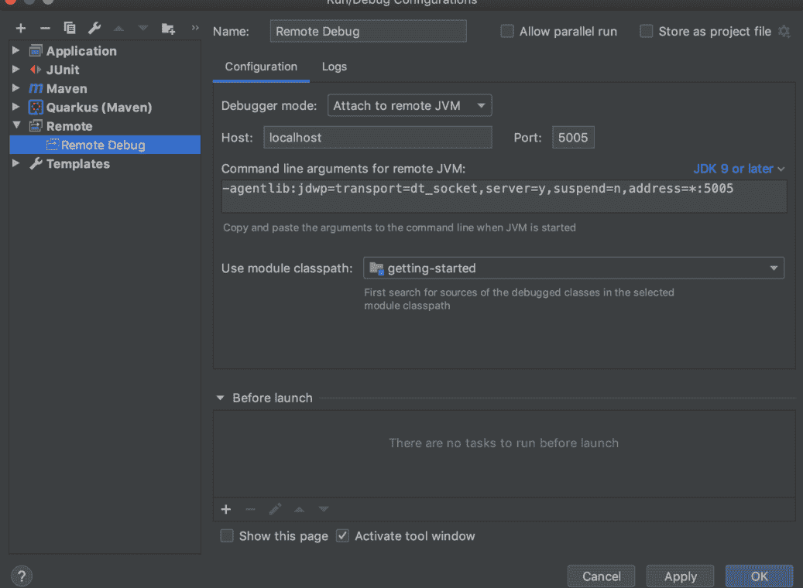

图 19. IntelliJ IDEA 中的远程调试

当 Quarkus 启动并运行后，选择 Remote 配置并点击 Debug。在 `ArtistResource` 的某处放置断点，并调用应用程序 (`curl`)。从调试器提示符中，你可以从控制台中检查类和方法变量。你还可以通过点击调试器控制台上的按钮来控制执行路径（单步 Step Over、步入 Step Into 等）。

> IntelliJ IDEA 与 Quarkus 有非常好的集成，可以简化调试工作。Quarkus 插件只需点击一下即可处理我们完成的所有配置。如果你在使用 IntelliJ IDEA，请尽管检查 Quarkus 插件。[100]

## 3.4. 运行应用程序

我们一直一直在使用 `./mvnw quarkus:dev` 运行 `ArtistResource` 端点。这种开发模式非常方便，因为它为我们带来了热重载功能：我们可以执行应用程序，更改某些代码，然后 Quarkus 会自动根据我们的更改进行重启。但这是有代价的，因为其启动时间会变慢。

### 3.4.1. 构建可执行的 JAR

要在生产模式下运行我们的端点，首先我们需要使用 `./mvnw package` 命令对其进行打包。如果这样做，它会在 `target` 目录下生成 2 个文件：

```bash
getting-started$ ls -lh target/getting-started
-rw-r--r-- 222K getting-started-1.0.runner.jar
-rw-r--r-- 57M getting-started-1.0.jar
```

你可以看到，这两个 JAR 文件的大小不同：

- `getting-started-1.0.runner.jar`: 包含了所有的类和依赖。
- `getting-started-1.0.jar`: 是一个可执行文件。

### 3.4.2. 执行可执行 JAR

使用可执行 JAR，你可以通过以下命令运行应用程序：

```bash
getting-started$ java -jar target/getting-started-1.0.jar
```

但请注意，`getting-started-1.0.runner.jar` 是一个 Uber JAR，它包含了所有的代码和资源。

## 列表 16. 生产模式启动

执行 `java -jar target/getting-started-1.0.runner.jar`，你会得到类似下面的输出：

```
-------------------------------------------------------------------
[INFO] -------------------------------------------------------------
[INFO](io.quarkus) Quark started in 0.012s. Listening on: http://0.0.0.0:8080
[INFO](io.quarkus) Profile prod activated.
[INFO](io.quarkus) Installed features: [cdi, resteasy, resteasy-jsonb]
[INFO] -------------------------------------------------------------
```

会在这些日志中发现几点有趣的信息。首先，你会发现 Quarkus 启动并运行了应用程序。得益于 `@QuarkusTest`，你获得了带有 Quarkus 运行时的真实集成测试。当你查看时间戳时，可以看到启动和关闭应用程序都非常快。Quarkus 让你的集成测试运行得很快。Quarkus 默认运行在 8080 端口，而在运行测试时它默认为 8081。这允许你在运行应用程序的同时进行测试。

## 3.5. 原生化

让我们现在对 REST 端点进行原生化。借助 GraalVM，Quarkus 可以生成原生执行文件。像 Go 一样，原生执行文件不需要虚拟机即可运行，提高了启动速度。

### 3.5.1. 构建原生可执行文件

在构建可执行文件之前，请确保你已经在环境中设置了 `GRAALVM_HOME`，如附录 A 所示。借助内置的 native profile，你可以使用以下命令创建原生可执行文件：

```bash
getting-started$ ./mvnw -PNative
```

插件将分析类并打包应用程序所需的内容。执行此命令后，你应该得到类似的输出：


```
-------------------------------------------------------------------
[INFO] -------------------------------------------------------------
[INFO] Building Getting Started
[INFO]
[INFO] --- maven-compiler-plugin:3.8.1:compile (default-compile)
[INFO]
[INFO] --- maven-surefire-plugin:2.22.1:test (default-test)
[INFO]
[INFO]
[INFO] TESTS
[INFO]
[INFO] Running org.acme.fascicle.quarkusstarted.ArtistResourceTest
[INFO](io.quarkus) Quark started in 1.100s. Listening on: http://0.0.0.0:8081
[INFO](io.quarkus) Profile test activated.
[INFO](io.quarkus) Installed features: [cdi, resteasy, resteasy-jsonb]
[INFO] Tests run: 2, Failures: 0, Errors: 0, Skipped: 0, Time elapsed: 2.642 s - org.acme.fascicle.quarkusstarted.ArtistResourceTest
[INFO](io.quarkus) (main) Quarkus stopped in 0.032s
[INFO]
[INFO] Results:
[INFO]
[INFO] Tests run: 2, Failures: 0, Errors: 0, Skipped: 0
[INFO]
[INFO] BUILD SUCCESS
[INFO]
[INFO] Total time: 5.945 s
[INFO]
-------------------------------------------------------------------
[INFO] -------------------------------------------------------------
[INFO] Scanning for projects...
[INFO] -------------------------------------------------------------
[INFO] Maven Summary
[INFO] ------------------------------------------------------------------------
[INFO] Building Getting Started
[INFO]
[INFO] --- maven-compiler-plugin:3.8.1:compile (default-compile)
[INFO]
[INFO] --- maven-surefire-plugin:2.22.1:test (default-test)
[INFO]
[INFO]
[INFO] TESTS
[INFO]
[INFO] Running org.acme.fascicle.quarkusstarted.ArtistResourceTest
[INFO](io.quarkus) Quark started in 1.100s. Listening on: http://0.0.0.0:8081
[INFO](io.quarkus) Profile test activated.
[INFO](io.quarkus) Installed features: [cdi, resteasy, resteasy-jsonb]
[INFO] Tests run: 2, Failures: 0, Errors: 0, Skipped: 0, Time elapsed: 2.642 s - org.acme.fascicle.quarkusstarted.ArtistResourceTest
[INFO](io.quarkus) (main) Quarkus stopped in 0.032s
[INFO]
[INFO] Results:
[INFO]
[INFO] Tests run: 2, Failures: 0, Errors: 0, Skipped: 0
[INFO]
[INFO] BUILD SUCCESS
[INFO]
[INFO] Total time: 5.945 s
[INFO]
-------------------------------------------------------------------
[INFO] -------------------------------------------------------------
[INFO] --- quarkus-maven-plugin:1.5.0:build-native (default-cli) @ getting-started ---
[INFO]
[INFO] Building Quarkus application (native) mode...
[INFO]
[INFO] --- native-maven-plugin:0.18-with-dependencies:compile (native-compile) @ getting-started ---
[INFO]
[INFO] Compiling to native binary with GraalVM (this may take a while)...
[INFO]
[INFO] Native binary built in 56189ms
[INFO] ------------------------------------------------------------------------
[INFO] BUILD SUCCESS
[INFO] ------------------------------------------------------------------------
[INFO] Total time: 61205 s
[INFO]
```

### 3.5.2 执行原生可执行文件

现在你只需要像普通文件一样执行 `./target/getting-started-1.0-runner`。

```
getting-started$ ./target/getting-started-1.0-runner

--/ \_ /\ /_/ |/\ -_ /\ /_/ /_/ /\\\
-_/ // // // \_, /\, <|/ \ ^\nn_\\ /_/ /_/ /_/ /\, /_/ /\\\
INFO [quarkus] getting-started 1.0 native started in 0.068s. Listening on:
http://0.0.0.0:8080
INFO [quarkus] Profile prod activated.
INFO [quarkus] Installed features: [cdi, resteasy, resteasy-json]
```

执行此操作时需要注意的一点是启动时间。根据你的机器配置，原生可执行文件比可执行 JAR 快 4 到 6 倍。内存占用也更小。请注意日志显示为 `getting-started 1.0 native`：我们知道执行的是原生可执行文件。

### 3.5.3 测试原生可执行文件

有趣的是，原生可执行文件是可以测试的。生成原生可执行文件可能会有一些问题，因此针对原生文件中的应用程序运行一些测试也是好主意。在列表 8 的 `pom.xml` 文件中，`native` 配置指示 `failsafe-maven-plugin` 运行集成测试并指明生成的原生可执行文件的位置 [103]。当我们生成项目时，测试文件夹中包含了一个 `NativeArtistResourceIT` 类名。如列表 17 所示，该类扩展了我们原始的测试（`ArtistResourceTest`）并标记了 `@NativeImageTest` 注解。

列表 17. 原生测试

```
@NativeImageTest
public class NativeArtistResourceIT extends ArtistResourceTest {
    // 在原生模式下执行相同的测试。
}
```

现在，你可以通过在以下 Maven 命令中使用 `native` 配置来测试原生可执行文件形式的应用程序：

```
getting-started$ ./mvnw integration-test -Pnative

[INFO] --- maven-surefire-plugin:2.22.1:test (default-test)
[INFO]
[INFO]
[INFO] T E S T S
---------------------------------------
[INFO]
[INFO] Running org.agoncal.fascicle.quarkus.gettingstarted.ArtistResource
[INFO]
[INFO] Results:
[INFO] Tests run: 2, Failures: 0, Errors: 0, Skipped: 0
[INFO]
[INFO] --- maven-failsafe-plugin:2.22.1:integration-test (integration-test)
[INFO]
[INFO]
[INFO] T E S T S
---------------------------------------
[INFO] Running org.agoncal.fascicle.quarkus.gettingstarted.NativeArtistResource
[INFO]
[INFO] Results:
[INFO] Tests run: 2, Failures: 0, Errors: 0, Skipped: 0
```

太棒了！我们刚刚在两种场景下（JVM 和原生可执行文件）都测试了应用程序。

## 3.6 应用程序容器化

当我们引导应用程序时，Quarkus Maven 插件在 `src/main/docker` 目录下为我们了几个 Dockerfile：

- `Dockerfile.fast-jar`：使用 Quarkus Maven 插件生成的 Fast-JAR 容器化应用程序。
- `Dockerfile.jvm`：使用生成的 JAR 容器化应用程序。
- `Dockerfile.native`：使用原生可执行文件容器化应用程序。

我们可以使用可执行 JAR（使用 `Dockerfile.jvm`）来容器化应用程序，但让我们专注于使用生成的原生可执行文件创建容器镜像。

### 3.6.1 构建原生可执行文件镜像

我们刚刚构建的原生可执行文件特定于我们所处的操作系统（Linux、macOS、Windows 等）。由于容器无法使用与操作系统生成的相同的可执行格式，我们必须首先指示 Maven 构建在容器内部生成可执行文件。这是通过以下命令实现的，该命令将 `quarkus.native.container-build` 属性设置为 `true`：

```
getting-started$ ./.mvnw package -Pnative -Dquarkus.native.container-build=true
```

```
[INFO] --- quarkus-maven-plugin:1.6.0.build (default)
[INFO] Building native image from target/getting-started-1.0-native-image-source-jar/getting-started-1.0-runner.jar
[INFO] Pulling image quay.io/quarkus/ubi-quarkus-native-image:20.2.0-java11
[INFO] Status: Downloaded newer image for quay.io/quarkus/ubi-quarkus-native-image:20.2.0-java11
[INFO] Running Quarkus native-image plugin on GraVM
[INFO] docker run -v target/getting-started-1.0-native-image-source-jar
[INFO] Quarkus augmentation completed in 136499ms
[INFO]
[INFO] BUILD SUCCESS
[INFO]
```

生成的 `target/getting-started-1.0-runner` 是一个 64 位的 Linux 可执行文件，因此取决于你的操作系统，它可能不再可以运行。例如，如果你尝试在 macOS 上执行此文件，你将得到以下错误：

```
getting-started$ ./target/getting-started-1.0-runner
Failed to execute process './target/getting-started-1.0-runner'
Reason: exec: Exec format error
The file './target/getting-started-1.0-runner' is marked as executable but could not be running by operating system
```

但通过在容器内部构建原生可执行文件，可以解决此问题。

# 第 4 章 核心 Quarkus

在之前的“快速入门”章节中，你已经确保可以运行 Quarkus 应用程序。这意味着你的环境已经就绪，并且你已经领略了 Quarkus 的风貌。正如“理解 Quarkus”章节所解释的，Quarkus 有一个强大的扩展机制，用于集成许多技术。接下来的章节将向你展示其中一些扩展以及如何使用它们。

本核心 Quarkus 章重点关注你需要的核心技术，因为它们将贯穿整个小册。首先是上下文和依赖注入，因为 Quarkus 大量使用了注入。注入实际上用于 Eclipse MicroProfile，它配置了 Quarkus 的大部分部分，包括其配置机制或日志。本章将解释 Quarkus 的生命周期以及它如何初始化和终止。

本章的代码可以在 `https://github.com/agonal/agonal-fascicle-quarkus/tree/1.0/core` 找到

## 4.1 上下文与依赖注入

注入是 Quarkus 的核心。从一个 bean 注入另一个 bean、将配置注入组件，或者将资源注入组件中，注入无处不在。CDI 是处理依赖的 MicroProfile 规范。CDI 还带有在 Quarkus 中大量使用的其他特性：作用域（scopes）或事件管理。

> Quarkus 基于一个名为 Arc 的 CDI 实现 [165]。Arc 并没有完全实现 CDI，仅实现了规范中通常用的子集。因此，如果你来自一个全 CDI 的世界，可能需要考虑一些局限性 [166]。

上下文和依赖注入 (CDI) 是 Jakarta EE 或 MicroProfile 中的核心技术 [167]。它的编程模型将几乎每个组件都转换为可注入、可拦截和可管理的 bean。CDI 构建在松耦合、强类型的基础上，这意味着 bean 之间是松耦合的，但是以强类型的方式进行的。解耦通过进一步的拦截器、装饰器实现，并扩展到整个平台。CDI 统一了 bean 之间的作用域，以及上下文和生命周期管理。

上下文和依赖注入的 API 和注解定义在根包下：`jakarta.inject`、`jakarta.enterprise` 和 `jakarta.interceptor`。表 3 列出了 CDI 2.0 中主要的子包。

表 3. 主要 CDI 子包

| 子包 | 描述 |
|---|---|
| `jakarta.inject` | CDI API 的根包 |
| `jakarta.enterprise.inject` | 核心依赖注入 API |
| `jakarta.enterprise.context` | 作用域和上下文 API |
| `jakarta.enterprise.event` | 事件和观察者 API |
| `jakarta.enterprise.util` | 工具包 |
| `jakarta.interceptor` | 拦截器 API (JSR 318) |

除了 API 之外，CDI 还带有一组注解。表 4 列出了常用注解的子集。

表 4. 主要 CDI 注解

| 注解 | 描述 |
| --- | --- |
| `@Inject` | 标识可注入的构造函数、方法和字段 |
| `@Qualifier` | 标识限定注解 |
| `@ApplicationScoped`, `@SessionScoped`, `@RequestScoped`, `@Singleton`, `@Dependent` | 定义 bean 生命周期的注解集 |
| `@Observes` | 标识观察者方法的参数 |

CDI 是 Quarkus 的一部分，大多数扩展都扩展了它。因此，大多数情况下你不需要显式地递归定义环境。但如果你需要，必须在 `pom.xml` 中添加列表 19 中定义的扩展。

列表 19. CDI 扩展

```
<dependency>
  <groupId>io.quarkus</groupId>
  <artifactId>quarkus-arc</artifactId>
</dependency>
```

### 4.1.1 理解 Bean


# Java SE 中有 JavaBeans

JavaBeans 是遵循某些模式（例如属性访问器/修改器（`getters/setters`）的命名规范）的 POJO（普通 Java 对象）、具有默认构造函数（`...`）并在 JVM 中执行。像 Quarkus 这样的，我们有托管 Bean（Managed Beans）。

托管 Bean 是容器管理的对象，仅支持一小部分基本服务：资源注入、生命周期管理和拦截。它们为托管平台（如 Spring、Jakarta EE 或 MicroProfile）中存在的不同组件提供了共同基础。例如，一个 RESTful Web 服务可以被视为带有额外服务（来自 RESTful Web 服务）的托管 Bean，依此类推。

CDI bean（简称为 Beans）是基于这种基础托管 Bean 模型构建的对象。Beans 为有状态对象提供了改进的生命周期；绑定到定义良好的上下文中；带来了类型安全的依赖注入、拦截和装饰；通过限定注解进行专门化处理；并可以在表达式语言（EL）中使用[19]。事实上，在极少数例外情况下，几乎每个 Java 类都有默认构造函数并在容器内部运行以成为 Bean。

# 4.1.2. 注入 Bean

在托管环境中，你不需要手动构建依赖项，而是可以让容器为你注入引用。简而言之，CDI 依赖注入是以类型安全的方式注入 bean 的能力，这意味着使用注解而不是 XML。通过 CDI，你可以使用 `@Inject` 注解在任何地方注入任何东西。

列表 20 展示了你如何通过 CDI `@Inject` 在 `BookService` 中注入 `NumberGenerator` 的引用。

## 列表 20. 使用 @Inject 获取 NumberGenerator 引用的 BookService

```
@ApplicationScoped
public class BookService {

    @Inject
    NumberGenerator numberGenerator;

    public Book createBook(String title, Float price, String description) {
        Book book = new Book(title, price, description);
        book.setIsbn(numberGenerator.generate());
        return book;
    }
}
```

列表 21 展示了如何将 `NumberGenerator` 的引用注入到 `BookService` 的 CDI `@Inject` 注入。

## 列表 21. IsbnGenerator Bean

```
public class IsbnGenerator implements NumberGenerator {

    public String generateNumber() {
        return "13-84356-" + Math.abs(new Random().nextInt());
    }
}
```

## 注入点

`@Inject` 注解定义了在 bean 初始化期间进行的注入点。注入可以通过三种机制发生：属性、setter 或构造函数。

属性注入是你在属性（也称为属性）上标记 `@Inject` 的情况。

```
@Inject
NumberGenerator numberGenerator;
```

注意，不需要为注入属性创建 getter 和 setter 方法。CDI 可以直接访问注入的字段（即使它是私有的），这有时有助于消除一些冗余代码。但与其注解属性，你可以如下所示在构造函数上添加 `@Inject` 注解：

```
@Inject
public LegacyBookService(NumberGenerator numberGenerator) {
    this.numberGenerator = numberGenerator;
}
```

但规则是你只能有一个构造函数注入。容器是执行者，而不是你（你无法在托管环境中调用构造函数）；因此只允许一个构造函数，以便容器执行工作并注入正确的引用。另一种选择是使用 setter 注入，它看起来像构造函数注入。你只需要在 setter 上标记 `@Inject`。

```
@Inject
public void setNumberGenerator(NumberGenerator numberGenerator) {
    this.numberGenerator = numberGenerator;
}
```

你可能会问：“什么时候应该使用字段而不是构造函数或 setter 注入？”这个问题没有真正的技术答案；这取决于你的个人喜好。在托管环境中，容器是执行所有注入工作的人；它只需要正确的注入。

Quarkus 进一步简化了注入模型。当使用构造函数或 setter 注入时，你可以跳过 `@Inject` 注解。Quarkus 将知道如何自动注入 `NumberGenerator` 的引用。

```
public PrestigiousBookService(NumberGenerator numberGenerator) {
    this.numberGenerator = numberGenerator;
}
```

## 默认注入

假设如图 20 所示，`NumberGenerator` 接口只有一个实现类：`IsbnGenerator`。CDI 仅需通过在其自身处直接使用 `@Inject` 即可注入它。

```
@Inject
NumberGenerator numberGenerator;
```

这被称为默认注入（default injection）。每当豆（bean）或注入点（injection point）没有显式声明限定器（qualifier）时，容器会假设限定器为 `@javax.enterprise.inject.Default`。实际上，代码与上一个完全相同：

```
@Inject @Default
NumberGenerator numberGenerator;
```

`@Default` 是一个内置限定器，它通知 CDI 注入默认的 bean 实现。如果你定义了一个没有限定器的 bean，该 bean 会自动拥有限定器 `@Default`。因此，列表 22 中的代码使用了 `@Default`，但可以将其省略。

## 列表 22. 带有 @Default 限定器的 IsbnGenerator Bean

```
@Default
@ApplicationScoped
public class IsbnGenerator implements NumberGenerator {

    public String generateNumber() {
        return "13-84356-" + Math.abs(new Random().nextInt());
    }
}
```

如果你只有一个待注入的 bean 实现，则将应用默认行为，简单的 `@Inject` 就会注入该实现。图 20 中的类图显示了 `@Default` 实现（`IsbnGenerator`）以及默认注入点（`@Inject @Default`）。

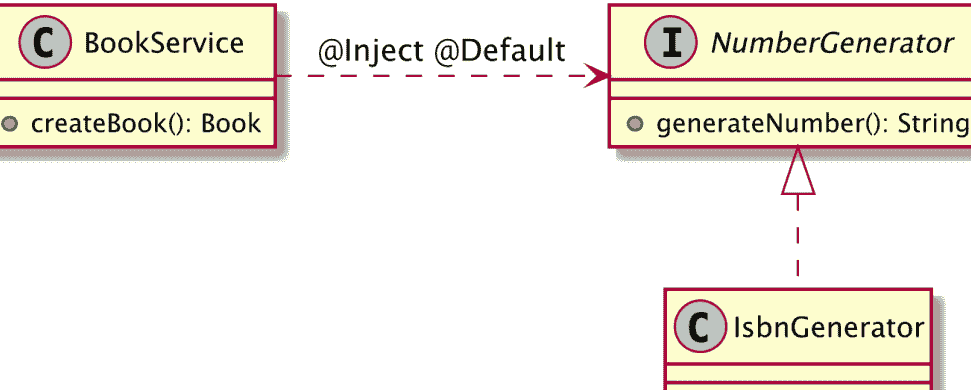

图 20. 带有 @Default 的类图

但有时你必须在多个实现之间进行选择。这时你就使用限定器（Qualifiers）。

## 注入带限定的 Bean

在系统初始化时，容器必须验证每个注入点恰好存在一个满足条件的 bean。这意味着，如果没有可用的 `NumberGenerator` 实现，容器将通知你存在未满足的依赖并且不会部署应用程序。如果只有一个实现，使用 `@Default` 限定器即可正常注入。如果存在一个或多个默认实现，容器将通知你存在冲突依赖（ambiguous dependency）并且不会部署应用程序。因为当容器无法识别出恰好要注入的一个 bean 时，类型安全的解析算法就会失败。

那么，组件是如何选择要注入 `IsbnGenerator` 还是 `IssGenerator` 的呢？大多数框架依赖外部 XML 注解来声明和注入 bean。CDI 使用限定器，限定器本质上是 Java 注解，它们带来了类型安全的注入，并在无需回退到字符串名称的情况下消除类型歧义。

有几种书籍格式，最常见的有：

- ISBN（国际标准书号）：13 位书籍标识符，旨在保持唯一。
- ISSN（国际标准连续出版号）：八位序列号，用于唯一标识连续性出版物。

假设我们有一个应用程序，其中 `BookService` 创建带有 13 位 ISBN 号的书籍，而 `LegacyBookService` 创建带有 8 位 ISSN 号的旧籍。如图 21 所示，两个服务都注入了相同 `NumberGenerator` 接口的引用。这些服务通过使用限定器来区分这两种实现。

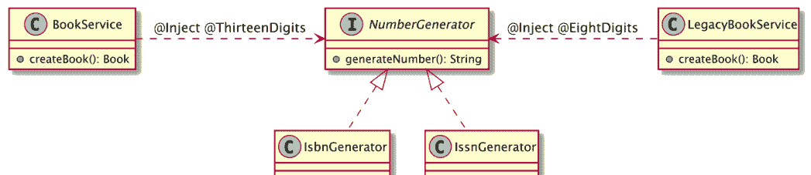

图 21. 服务表示用于无歧义注入的某些限定器

限定器代表某种语义，该语义由该类型的某些实现所满足。它是一个用户定义的注解，其本身被标记为 `@javax.inject.Qualifier` 注解。例如，我们可以引入限定器来表示 13 位和 8 位的数字生成器，如列表 23 和 列表 24 所示。

## 列表 23. ThirteenDigits 限定器

```
@Qualifier
@Retention(RUNTIME)
@Target({FIELD, TYPE, METHOD})
public @interface ThirteenDigits {
}
```

## 列表 24. EightDigits 限定器

```
@Qualifier
@Retention(RUNTIME)
@Target({FIELD, TYPE, METHOD})
public @interface EightDigits {
}
```

一旦你定义了所需的限定器，就必须将它们应用于相应的实现上。如列表 25 和 列表 26 所示，`@ThirteenDigits` 限定器被应用于 `IsbnGenerator` bean，而 `@EightDigits` 被应用于 `IssnGenerator`。

## 列表 25. 带有 @ThirteenDigits 限定器的 IsbnGenerator bean

```
@ThirteenDigits
@ApplicationScoped
public class IsbnGenerator implements NumberGenerator {

    public String generateNumber() {
        return "13-84356-" + Math.abs(new Random().nextInt());
    }
}
```

## 列表 26. 带有 @EightDigits 限定器的 IssnGenerator Bean

```
@EightDigits
@ApplicationScoped
public class IssnGenerator implements NumberGenerator {

    public String generateNumber() {
        return "-" + Math.abs(new Random().nextInt());
    }
}
```

这些限定器随后应用于注入点，以区分客户端需要的哪种实现。在列表 27 中，`BookService` 通过注入 `@ThirteenDigits` 数字生成器的引用来显式定义 13 位的实现，在列表 28 中，`LegacyBookService` 注入了 8 位实现。

## 列表 27. 使用 @ThirteenDigits 限定器的 BookService

```
@ApplicationScoped
public class BookService {

    @Inject
    @ThirteenDigits
    NumberGenerator generator;

    public Book createBook(String title, float price, String description) {
        Book book = new Book(title, price, description);
        book.setIsbn(generator.generateNumber());
        return book;
    }
}
```

## 列表 28. 使用 @EightDigits 限定器的 LegacyBookService

```
@ApplicationScoped
public class LegacyBookService {

    @Inject
    @EightDigits
    NumberGenerator generator;

    public Book createBook(String title, float price, String description) {
        Book book = new Book(title, price, description);
        book.setIsbn(generator.generateNumber());
        return book;
    }
}
```

为了使这些工作，你不需要外部配置；这就是为什么 CDI 使用强类型的原因。

你可以重命名你的实现类并重命名你的限定器——注入点不会改变（这就是松耦合）。正如你所见，CDI 是实现类型安全的优雅方式。

如列表 29 所示，Quarkus 通过允许在没有 `@Inject` 注解的情况下注入带限定的 bean 来简化 CDI。

## 列表 29. 无 @Inject 的带限定注入

```
@ApplicationScoped
public class LegacyBookService {

    @EightDigits
    NumberGenerator generator;

    public Book createBook(String title, float price, String description) {
        Book book = new Book(title, price, description);
        book.setIsbn(generator.generateNumber());
        return book;
    }
}
```

## 注入备用 Bean (Alternative Beans)

限定器允许你在开发期间在接口的多个实现之间进行选择。但有时你希望根据特定的部署场景注入某种实现。例如，你可能想在测试环境中使用 mock 数字生成器。

备用（Alternatives）被标记为特殊限定器 `javax.enterprise.inject.Alternative`。默认情况下，备用是禁用的，需要启用才能用于实例化和注入。列表 30 显示了一个 mock 数字生成器备用。

## 列表 30. Mock 生成器备用

```
@Alternative
@ApplicationScoped
public class MockGenerator implements NumberGenerator {

    public String generateNumber() {
        return "MOCK";
    }
}
```

## 列表 31. 默认 Mock 生成器替代方案

```
@Alternative
@Default
@ApplicationScoped
public class MockGenerator implements NumberGenerator {

    public String generateNumber() {
        return "MOCK";
    }
}
```

你可以不使用默认替代，而是通过限定符（qualifiers）来指定替代方案。例如，以下代码调用 CDI，指定 13 位数字生成器的替代方案是 mock：

```
@Alternative @ThirteenDigits
public class MockGenerator implements NumberGenerator {...}
```

默认情况下，`@Alternative` 豆是禁用的，你需要使用配置显式启用它们。例如，如列表 32 所示，在 `application.properties` 文件中使用属性 `quarkus.arc.alternatives` 声明替代方案。

## 列表 32. 启用替代方案

```
quarkus.arc.selected-alternatives=org.agon..fasciele.quarkus.core.cdi.MockGenerator
```

在注入方面没有任何变化。你的客户端代码不受影响。以下是遵循数字生成器默认实现的代码。如果启用了替代方案，则将注入列表 30 中定义的 `MockGenerator`。

```
@Inject
private NumberGenerator dataGenerator;
```

你可以在 `application.properties` 配置文件中启用多个替代方案。

## 4.1.3. 作用域 (Scopes)


到目前你已经看到 `@ApplicationScoped` 注解，你可能好奇它的含义。CDI 不是依赖注入，也是上下文（CDI 中的 "C"）。每个豆都有定义的作用域和生命周期，并绑定到特定的上下文。在 Java 中，POJO 的作用域是简单的：你使用 `new` 关键字创建类实例，并依赖垃圾回收来移除它并释放内存。在 CDI 中，豆被绑定到上下文并保持在上下文中，直到豆被容器销毁。没有办法手动从上下文移除豆。CDI 定义了以下作用域：

- 正常作用域 (Normal scopes)：

    - 应用作用域 `@ApplicationScoped`：跨越整个应用程序运行周期。豆在应用程序运行期间仅创建一次，并在应用程序关闭时丢弃。此作用域适用于工具类或辅助类，或者存储应用程序共享数据的对象（但当多个线程访问数据时，你应该应该注意并发问题）。

    - 会话作用域 `@SessionScoped`：跨越用户会话的多个 HTTP 请求或方法调用。豆在 HTTP 会话期间创建，并在会话结束时丢弃。此作用域适用于整个会话期间需要的对象，例如用户偏好或登录凭据。

    - 请求作用域 `@RequestScoped`：对应单个 HTTP 请求或方法调用。豆在方法调用期间创建，并在方法结束时丢弃。它用于仅在 HTTP 请求期间需要的服务类。

- 伪作用域 (Pseudo scopes)：

    - 依赖作用域 `@Dependent`：生命周期与客户端相同。依赖豆在被注入时创建，当目标被移除时引用也被移除。这是 CDI 的默认作用域。

    - 单例作用域 `@Singleton`：标识一个 CDI 仅实例化一次的豆。

```
@SessionScoped
public class ShoppingCart implements Serializable {...}
```

`ShoppingCart` 豆的实例绑定到用户会话，并由该会话上下文中执行的所有请求共享。如果你不想让豆无限期留在会话中，请考虑使用生命周期更短的作用域，例如请求作用域。

如果未显式指定作用域，则该豆属于依赖伪作用域 `@Dependent`。具有此作用域的豆永远不会在不同的客户端或注入点之间共享。它们依赖于其他豆，这意味着它们的生命周期绑定到该豆的生命周期。当其所属的对象创建时，依赖豆被实例化；当其所属的对象被销毁时。以下代码显示了带有限定符的依赖作用域：

```
@Dependent @ThirteenDigits
public class IsbnGenerator implements NumberGenerator {...}
```

由于是默认作用域，你可以省略 `@Dependent` 注解并写如下内容：

```
@ThirteenDigits
public class IsbnGenerator implements NumberGenerator {...}
```

作用域是可以混合的。一个 `@SessionScoped` 豆可以注入到 `@RequestScoped` 或 `@ApplicationScoped` 豆中，反之亦然。

## 4.4 事件 (Events)

在接下来的几个章节中，你将学习基于 CDI 事件的 Quarkus 生命周期。让我们先来发现 CDI 事件。CDI 事件允许豆与编译时依赖进行任何交互。一个豆可以定义事件（使用 `jakarta.enterprise.event.Event` 接口），另一个豆可以触发事件（使用 `fire()` 方法），而另一个豆可以处理事件（使用 `@Observes` 注解）。这些豆可以位于不同的包中，甚至位于应用程序不同的 JAR 包中。这种基本方案遵循了四人行[110]的观察者/可观察者模式。

事件生产者使用 `jakarta.enterprise.event.Event` 接口触发事件。生产者通过调用 `fire()` 方法引发事件，传递事件，并且不依赖于观察者。列表 33 中，`BookService` 在每次创建豆时触发一个事件 (`bookAddedEvent`)。`bookAddedEvent.fire(book)` 触发事件并通知任何观察此特定事件的观察者方法。该事件的内容 `Book` 对象本身，它将从生产者携带到消费者。

### 列表 33. BookService 在每次创建豆时触发事件

```
@ApplicationScoped
public class BookService {

  @Inject
  NumberGenerator numberGenerator;

  @Inject
  Event<Book> bookAddedEvent;

  public Book createBook(String title, Float price, String description) {
    Book book = new Book(title, price, description);
    book.setIsbn(numberGenerator.generateNumber());
    bookAddedEvent.fire(book);
    return book;
  }
}
```

事件由事件生产者触发，并被事件观察者订阅。观察者是一个具有一个或多个方法的豆。在我们的案例，列表 34 中的 `addBook()` 方法将被调用并更新库存，然后容器将继续执行 Service 豆中暂停处的代码。这意味着 CDI 中的事件不被视为异步处理。

### 列表 34. 观察书籍事件的 Service

```
@Singleton
public class InventoryService {

    List<Book> inventory = new ArrayList<>();

    public void addBook(@Observes Book book) {
        inventory.add(book);
    }
}
```

与大多数 CDI 一样，事件的产生和订阅是类型安全的，并允许使用限定符来决定观察者将观察哪些事件。一个事件可以被分配一个或多个限定符，这允许观察者将其与其他相同类型的事件区分开来。列表 35 通过添加一个额外的事件重新访问了 `BookService` 豆。当创建书籍时，它触发一个 `bookAdded`；当书籍被移除时，它触发一个类型为 `Book` 的 `bookRemovedEvent`。为了区分这两个事件，每个事件分别由 `@Added` 或 `@Removed` 限定。限定符的代码与列表 23 中的代码完全相同：一个带有 `@Qualifier` 注解且没有成员的注解。

### 列表 35. 触发多个事件的 BookService

```
@ApplicationScoped
public class BookService {
    @Inject
    NumberGenerator numberGenerator;

    @Inject @Added
    Event<Book> bookAddedEvent;

    @Inject @Removed
    Event<Book> bookRemovedEvent;

    public Book createBook(String title, Float price, String description) {
        Book book = new Book(title, price, description);
        book.setIsbn(numberGenerator.generateNumber());
        bookAddedEvent.fire(book);
        return book;
    }

    public void deleteBook(Book book) {
        bookRemovedEvent.fire(book);
    }
}
```

列表 36 中的 `InventoryService` 通过声明两个独立的方法来观察这两个事件，分别观察书籍添加事件 (`@Observes @Added Book`) 或书籍移除事件 (`@Observes @Removed Book`)。

### 列表 37. 观察多个事件的 InventoryService

```
@Singleton
public class InventoryService {

  @Inject
  Logger logger;

  List<Book> inventory = new ArrayList<>();

  public void addBook(@Observes @Added Book book) {
    logger.info("Adding book " + book.getTitle() + " to inventory");
    inventory.add(book);
  }

  public void removeBook(@Observes @Removed Book book) {
    logger.info("Removing book " + book.getTitle() + " to inventory");
    inventory.remove(book);
  }
}
```

## 4.1.5 配置 ArC

你看到的是 Quarkus 中 CDI 的默认行为。通过高度可配置性，你可以通过更改 `application.properties` 文件中的属性来微调 CDI 行为。在 `application.properties` 文件中，你可以使用表 5 中定义的若干 `quarkus.arc.*` 属性来改变 ArC（Quarkus 中的 CDI 实现）的行为。

### 表 5. 部分 ArC 配置属性

| 属性 | 默认值 | 描述 |
|---|---|---|
| `quarkus.arc.remove-unused-beans` | all | 如果设置为 all，容器将尝试移除所有未使用的 beans |
| `quarkus.arc.transform-unproxyable-classes` | true | 如果设置为 true，将对不可代理的 beans 的字节码进行转换 |
| `quarkus.arc.config-properties-default-naming-strategy` | kebab-case | 默认命名策略（from-config, verbatim, kebab-case） |
| `quarkus.arc.selected-alternatives` | | 应用程序选定的替代方案列表 |
| `quarkus.arc.auto-producer-methods` | true | 如果开启，则会自动向所有标记了作用范围注解的方法添加 `javax.enterprise.inject.Produces` |

## 4.2 Eclipse MicroProfile 配置

你刚刚看到 Quarkus 允许通过 `application.properties` 文件进行某种配置。但不仅限于此。SmallRye Config 实现了 Eclipse MicroProfile Configuration，用于配置应用程序（以及你将在下一节看到的配置方案）。在微服务架构中，没有中心运行环境意味着没有单一的配置点，而是多个配置点。但有时微服务可能想要共享公共配置。在这种情况下，能够以同质且透明的方式从多个源访问配置将非常有帮助。Eclipse MicroProfile Configuration 为应用程序和微服务提供了通过多个源（应用程序内部和外部）、通过依赖注入或查找获取配置属性的方法。[112]

Eclipse MicroProfile Configuration API 和注解都定义在 `org.eclipse.microprofile.config` 包下。表 6 列出了 Eclipse MicroProfile Configuration 1.4 版本中的主要子包（在根包 `org.eclipse.microprofile.config` 下）。[113]

### 表 6. 主要 org.eclipse.microprofile.config 子包

| 子包 | 描述 |
| --- | --- |
| root | 配置 API 的根包 |
| inject | CDI 支持 |
| spi | 提供者实现的内部 SPI（服务提供接口） |

除了 API 外，配置还包含了一组注解。表 7 列出了部分最常用的注解。

### 表 7. 主要配置注解

| 注解 | 描述 |
| --- | --- |
| `@ConfigProperty` | 将注入点与配置值绑定 |

配置本身并没有一个专门的 Quarkus 扩展，因为它是核心部分的一部分。但 Quarkus 在所有 Quarkus 扩展中免费提供配置，并支持将列表 38 所示的扩展添加到你的 `pom.xml` 中。

### 列表 38. 配置扩展

```
<dependency>
  <groupId>io.quarkus</groupId>
  <artifactId>quarkus-config-yaml</artifactId>
</dependency>
```

## 4.2.1 理解配置

应用程序通常需要根据某些技术或业务需求或基于运行环境更改某些数据或行为。你可能想根据部署应用程序的国家更改增值税（VAT）百分比；或者根据你的环境（开发、生产等）可能需要更改数据库的 URL 或外部服务的凭据。必须能够从应用程序外部修改配置数据，以便应用程序本身不需要重新打包。因此，硬编码这些值并不是一个好主意。

如图 22 所示，配置数据可以来自不同的位置并采用不同的格式（例如：系统属性、系统环境变量、外部文件、数据库、.properties、.xml、.yaml）。我们将这些配置位置称为配置源。

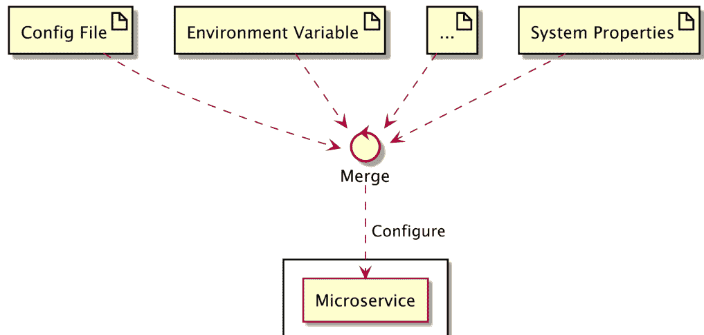

图 22. 配置微服务的多个源

## 4.2.2 配置数据

Eclipse MicroProfile Configuration 允许你通过编程或使用注入轻松地配置应用程序。它还允许你拥有多个配置源，从环境变量到外部文件。

### 注入配置

假设我们有一个发票。根据部署应用程序的国家，我们有不同的 VAT 税率、允许或不允许折扣，以及不同的条款或罚金。为此，得助于 `@ConfigProperty` 注解，Eclipse MicroProfile Configuration 可以注入外部配置。如列表 39 所示，`Invoice` 是一个包含多个属性的 bean，其中某些属性是可配置的。语义如下：

- `subtotal` 不是可配置属性，
- `vatRate` 是可配置的，且其默认值为 10，
- `terms` 是可配置的，但没有默认值。

### 列表 39. Bean 注入配置

```
package org...icle;

public class Invoice {

    Float subtotal;
    @Inject
    @ConfigProperty(name = "vatRate", defaultValue = "10")
    Float vatRate;
    Float vatAmount;
    Float total;
    @Inject
    @ConfigProperty(name = "allowsDiscount", defaultValue = "true")
    Boolean allowsDiscount;
    @Inject
    @ConfigProperty(name = "discountRate", defaultValue = "2.5")
    Float discountRate;
    @Inject
    @ConfigProperty(name = "terms")
    String terms;
    @Inject
    @ConfigProperty(name = "penalties")
    String penalties;
}
```

然后只需配置这些属性。列表 40 显示了一个外部属性文件。

```
org..fascicle.Invoice.vatRate=10
org..fascicle.Invoice.allowsDiscount=false
org..fascicle.Invoice.terms=Payment upon receipt
org..fascicle.Invoice.penalties=Penalty in case of late payment
```

如列表 41 所示，`@ConfigProperty` 注解实际上有两个可选成员：

- 用于查找配置值的属性键（例如 `vatRate` 或 `terms`），
- 如果配置属性不存在时的默认值。

因此，如果你想更改配置属性的键，可以像列表 41 所示那样轻松地自定义。

### 列表 41. 使用不同键注入配置

```
public class Invoice {

    Float subtotal;
    @Inject
    @ConfigProperty(name = "vatRate", defaultValue = "10")
    Float vatRate;
    Float vatAmount;
    Float total;
    @Inject
    @ConfigProperty(name = "allowsDiscount", defaultValue = "true")
    Boolean allowsDiscount;
    @Inject
    @ConfigProperty(name = "discountRate", defaultValue = "2.5")
    Float discountRate;
    @Inject
    @ConfigProperty(name = "terms")
    String terms;
    @Inject
    @ConfigProperty(name = "penalties")
    String penalties;
}
```

### 列表 42. 使用 @Inject 注入配置


```java
public class Invoice {

    Float subtotal;
    @ConfigProperty(name = "invoice.vatRate", defaultValue = "10")
    Float vatRate;
    Float vatAmount;
    Float total;
    @ConfigProperty(name = "invoice.allowsDiscount", defaultValue = "true")
    Boolean allowsDiscount;
    @ConfigProperty(name = "invoice.discountRate", defaultValue = "2.5")
    Float discountRate;
    @ConfigProperty(name = "invoice.terms")
    String terms;
    @ConfigProperty(name = "invoice.penalties")
    String penalties;
}
```

## 程序化配置

可以通过编程方式访问配置。当类不是 CDI Bean 且无法注入时，这种方法会非常有用。程序化配置可以通过 `Config` API、注入或通过 `ConfigProvider` API 访问。

列表 43 显示了如何使用 `ConfigProvider` 获取 `Config` 实例。一旦你有了 `Config` 实例，只需调用 `getValue()` 方法，并将配置键和值的类型（例如 `String`、`Float` 等）作为参数即可。

### 列表 43. 使用 ConfigProvider 的程序化配置

```java
Config config = ConfigProvider.getConfig();

invoice.vatRate = config.getValue("invoice.vatRate", Float.class);
invoice.allowsDiscount = config.getValue("invoice.allowsDiscount", Boolean.class);
invoice.terms = config.getValue("invoice.terms", String.class);
invoice.penalties = config.getValue("invoice.penalties", String.class);
```

在 Bean 中，你可以进行注入。因此，简单的 `@Inject` 就会为你提供一个 `Config` 实例，如列表 44 所示。

### 列表 44. 使用注入的程序化配置

```java
@Inject
Config config;
```

```java
public void calculateInvoice() {
    invoice.vatRate = config.getValue("invoice.vatRate", Float.class);
    invoice.allowsDiscount = config.getValue("invoice.allowsDiscount", Boolean.class);
    invoice.terms = config.getValue("invoice.terms", String.class);
    invoice.penalties = config.getValue("invoice.penalties", String.class);
}
```

如果一个属性是可选的（例如使用 `Optional<String> terms` 而不是 `String terms`），你可以使用列表 45 所示的 `getOptionalValue()` 方法。

### 列表 45. 可选值

```java
invoice.terms = config.getValue("invoice.terms", String.class);
invoice.penalties = config.getValue("invoice.penalties", String.class);
```

## 多项配置属性

作为在 Bean 中注入配置值的另一种替代方案，你可以使用 `@ConfigurationProperties` 注解将配置分组在一个单独的类或接口中。现在让我们再次回到 `Invoice` Bean，去掉所有的 `@Value` 注解。我们最终得到了列表 46 所示的代码：一个具有属性但没有任何注解的 Bean，到此为止。

### 列表 46. 无配置的 Invoice

```java
public class Invoice {
    Float subtotal;
    Float vatRate;
    Float vatAmount;
    Float total;
    Boolean allowsDiscount;
    Float discountRate;
    String terms;
    String penalties;
}
```

要提取配置，只需创建一个名为 `InvoiceConfiguration` 的新类（这是要配置的类名，这里是 `Invoice` 后加上 `Configuration`），并且仅保留已配置的属性。列表 47 显示了带有 `@Properties` 注解的配置类。请注意，该类并不一定需要声明 getter 和 setter。简单的公共非 final 字段是有效的。

### 列表 47. Invoice 配置

```java
@ConfigProperties(prefix = "inv", namingStrategy = NamingStrategy.VERBATIM)
public class InvoiceConfiguration {

    public Float vatRate;
    public Boolean allowsDiscount;
    public Float discountRate;
    public String terms;
    public String penalties;

}
```

`@ConfigProperties` 的 `prefix` 成员是可选的。如果设置，配置键将使用此前缀（见列表 48）；如果没有设置，则使用的前缀将由类名决定（例如 `invoice.vatRate` 而不是 `inv.vatRate`）。

### 列表 48. 属性文件

```properties
inv.vatRate=10
inv.allowsDiscount=false
inv.discountRate=2.5
inv.terms=Payment upon receipt
inv.penalties=Penalty in case of late payment
```

注意列表 48 中设置为 `VERBATIM` 的 `namingStrategy` 成员。实际上，你可以使用两种命名策略：

- `VERBATIM`：按原样使用属性名称作为配置键（例如，属性 `vatRate` 对应一个名为 `vatRate` 的配置键）。
- `KEBAB_CASE`：为属性名称添加连字符（例如，属性 `vatRate` 对应一个名为 `vat-rate` 的配置键）。

如果你如列表 49 所示将命名策略更改为 `KEBAB_CASE`，那么你所有的属性都将带有连字符（见列表 50）。

### 列表 49. Kebab 格式

```java
@ConfigProperties(prefix = "inv", namingStrategy = KEBAB_CASE)
```

### 列表 50. Kebab 格式属性文件

```properties
inv.vat-rate=10
inv.allows-discount=false
inv.discount-rate=2.5
inv.terms=Payment upon receipt
inv.penalties=Penalty in case of late payment
```

### 4.2.3. YAML 支持

你可能想要使用 YAML。事实上，Quarkus 会优先选择 YAML。列表 51 显示了一个示例。

```yaml
invoice:
  vatRate: 10
  allowsDiscount: false
  terms: Payment upon receipt
  penalties: Penalty in case of late payment
```

然后，如列表 52 所示，可以使用 `ConfigProperty`。

#### 列表 52. 注入配置

```java
public class Invoice {
  Float subtotal;
  @ConfigProperty(name = "invoice.vatRate", defaultValue = "10")
  Float vatRate;
  Float vatAmount;
  Float total;
  @ConfigProperty(name = "invoice.allowsDiscount", defaultValue = "true")
  Boolean allowsDiscount;
  @ConfigProperty(name = "invoice.discountRate", defaultValue = "2.5")
  Float discountRate;
  @ConfigProperty(name = "invoice.terms")
  String terms;
  @ConfigProperty(name = "invoice.penalties")
  String penalties;
}
```

### 4.2.4. 配置源

默认情况下，Quarkus 从位于 `src/main/resources` 的 `application.properties` 文件读取配置。MicroProfile 还允许你使用多个源来配置应用程序。每个源都有一个指定的序号（ordinal），用于确定该源值的重要性。因此，封装在应用程序中的默认值可以通过系统属性进行覆盖。当然，你也可以创建自己的源。MicroProfile 配置提供了一套 API。

属性定义在以下源中（按优先级递减）：

- 系统属性 (`-DvatRate=50`)
- 环境变量 (`INVOICE_VATRATE=50`)
- 当前目录下的环境变量文件 (`.env`)
- 当前目录下的外部配置目录 (`config/application.properties`)
- 资源 (`src/main/resources/application.properties`)

### 4.2.5. 配置 Quarkus

我们刚刚学习了如何配置应用程序。但 Quarkus 本身也是通过相同的机制配置的。事实上，Quarkus 有数百个配置键是可以配置的。Quarkus 为其配置留了 `quarkus` 命名空间。表 8 显示了这些配置键的一个子集，但你可以轻松在 Quarkus 网站上找到你需要的键。

#### 表 8. 部分 Quarkus 配置

| 属性 | 默认值 |
|---|---|
| `quarkus.http.root-path` HTTP 路径。所有网络内容将相对于此根路径服务 | `/` |
| `quarkus.http.port` HTTP 端口 | `8080` |
| `quarkus.http.test-port` 用于运行测试的 HTTP 端口 | `8081` |
| `quarkus.http.ssl.protocols` 显式启用的协议列表 | `TLSv1.3,TLSv1.2` |
| `quarkus.http.auth.form.login-page` 登录页面 | `/login.html` |
| `quarkus.http.auth.form.error-page` 错误页面 | `/error.html` |
| `quarkus.http.auth.form.landing-page` 如果没有保存的页面可以返回，则跳转到的落地页 | `/index.html` |
| `quarkus.http.cors` 启用 CORS 过滤器 | `false` |

#### 列表 53. 获取 Quarkus 属性

```java
Config config = ConfigProvider.getConfig();

LOGGER.info(config.getValue("quarkus.banner.enabled", Boolean.class));
LOGGER.info(config.getValue("quarkus.default-locale", String.class));
LOGGER.info(config.getValue("quarkus.http.port", String.class));
LOGGER.info(config.getValue("quarkus.test-port", String.class));
LOGGER.info(config.getValue("quarkus.http.protocols", String.class));
LOGGER.info(config.getValue("quarkus.http.read-timeout", String.class));
LOGGER.info(config.getValue("quarkus.log.level", String.class));
LOGGER.info(config.getValue("quarkus.log.min-level", String.class));
```

## 4.3. 配置文件 (Profiles)

Quarkus 使用配置方案（profiles）的概念。这允许你在同一个文件中拥有多个配置，并通过配置文件的名称来选择它们。

默认情况下，Quarkus 有三个方案，尽管你可以创建自己的并根据需要使用任意数量的方案。内置的方案有：

- `dev`：在开发模式下激活（运行 `mvn quarkus-dev` 时）。
- `test`：在运行测试时激活。
- `prod`：在不以开发或测试模式运行时时的默认方案。

语法格式为 `%profile.config.key=value`。因此，如果我们的应用程序需要一个特定于开发模式的 `isbn.prefix` 变量（见列表 54），则需要在 `application.properties` 文件中将其定义为 `%dev.isbn.prefix`。

### 列表 54. 注入属性键名

```java
@ApplicationScoped
class IsbnGenerator implements NumberGenerator {

    @ConfigProperty(name = "isbn.prefix")
    String prefix;

    public String generateNumber() {
        return prefix + Math.abs(new Random().nextInt());
    }
}
```

正如我们在上一节中看到的，为了让这种属性注入生效，只需在 `application.properties` 文件中定义键 `isbn.prefix` 和一个值即可。

```
isbn.prefix=13
```

但如果我们根据根据环境有不同的值，方案就可以提供帮助了。假设我们想在开发模式下使用不同的前缀。当执行 `mvn quarkus:dev` 时，`dev` 方案会自动启用，因此我们在所有配置键的前面加上 `%dev`。注意我们如何使用方案来根据需要使用不同的级别。

```
%dev.isbn.prefix=Dev
%dev.quarkus.log.category="org.arquus".level=INFO
```

相应地，当你运行测试时，`test` 方案会被启用；当构建可执行的 JAR 或原生可执行文件时，`prod` 方案会被启用。

```
%test.isbn.prefix=TST
%test.quarkus.log.category="org.arquus".level=DEBUG

prod.isbn.prefix=PRD
```

Quarkus 带有 3 个方案（`dev`, `test`, `prod`），但你可能需要其他方案。这非常容易实现，因为 Quarkus 会简单地使用 `quarkus.profile` 系统属性（或 `QUARKUS_PROFILE` 环境变量）。假设你有一个阶段环境（staging）并想为它设置一些特定值。只需在 `application.properties` 中使用前缀 `%staging` 调整这些变量即可：

```
%staging.isbn.prefix=STAG
%staging.quarkus.log.category="org.arquus".level=INFO
```

然后，你根据需要设置系统变量：

- 使用 `mvn -Dquarkus.profile=staging quarkus:dev`
- 或者在运行可执行 JAR 时，使用 `java -Dquarkus.profile=staging -jar profiles-1.0-runner.jar`。

### 4.3.1. 配置方案

由于 Quarkus 极具可配置性，你甚至可以调整某些方案，以便配置策略随之改变。

#### 表 9. 部分 Quarkus 方案配置属性

| 属性 | 默认值 |
|---|---|
| `quarkus.profile` | `prod` | Quarkus 启动时将激活的方案 |
| `quarkus.test.native-image-profile` | `prod` | 测试原生镜像时使用的方案 |
| `quarkus.test.profile` | `test` | 使用 `@QuarkusTest` 进行测试时使用的方案 |

## 4.4. 日志 (Logging)


在开发应用程序时，我们知道程序有可能不会按预期工作。为了检查排出了什么问题，我们可以在开发期间使用调试器，但在生产环境中不能使用（大多数调试器在生产环境中不可用）。因此，在源代码中添加日志语句来帮助发现潜在的 bug 是很有用的。

日志记录非常常见，Java 在 `java.util.logging` 包中提供了一个内置框架。但在整个 Java 平台历史中，出现了许多日志框架，使得有时它们之间的集成变得困难。Quarkus 承认了这种多样性，并集成了以下日志记录 API：

- JDK JUL (Java Logging)
- JBoss Logging
- SLF4J
- Apache Commons Logging

Listing 55 显示了支持所有这些日志框架的一些代码。

### Listing 55. 使用多个日志器

```
org.jboss.logging.Logger JBOSS_LOGGER =
org.jboss.logging.Logger.getLogger(LoggingResource.class);
java.util.logging.Logger JUL_LOGGER =
java.util.logging.Logger.getLogger(LoggingResource.class.getName());
org.apache.commons.logging.Log COMMONS_LOGGING =
org.apache.commons.logging.LogFactory.get(LoggingResource.class)
slf4j.Logger SLF4J_LOGGER =
slf4j.LoggerFactory.getLogger(LoggingResource.class);
```

```
JBOSS_LOGGER.info("Trace produced by JBoss Logger")
JUL_LOGGER.info("Trace produced by JUL")
COMMONS_LOGGING.info("Trace produced by Commons Logging")
SLF4J_LOGGER.info("Trace produced by SLF4J")
```

无论你使用哪一个，或者哪个第三方框架使用哪一个，所有的日志都将由 Quarkus 标记：

[INFO] Trace produced by JBoss Logger

[INFO] Trace produced by JUL

[INFO] Trace produced by Commons Logging

[INFO] Trace produced by SLF4J

Quarkus 支持所有这些日志器这一点是非常重要的。当你构建应用程序时，你倾向于嵌入第三方库，其中每一个库都使用这些框架中的一个。如果你在应用程序中使用这些日志器之一，你就知道你的跟踪信息（traces）将由 Quarkus 处理。如果你从零开始启动应用程序，你可能会使用 JBoss Logger。

## 4.4.1. 日志级别 (Log Levels)

日志级别提供了一种根据其严重程度及其对影响对日志进行分类的方法。表 10 部分 JBoss 日志级别

| 级别 | 说明 |
|---|---|
| FATAL | 严重故障 |
| ERROR | 严重错误 |
| WARN | 警告问题 |
| INFO | 重要信息 |
| DEBUG | 调试信息 |
| TRACE | 额外的跟踪信息 |

使用这些级别的方法非常简单。API 提供了几种方法（如列表 56 所示），每个方法对应一个级别。

### Listing 56. 使用方法

```
Logger LOGGER = Logger.getLogger(LoggingResource.class);

LOGGER.fatal("Fatal");
LOGGER.error("Error");
LOGGER.warn("Warning");
LOGGER.info("Information");
LOGGER.debug("Debug");
LOGGER.trace("Trace");
```

## 4.4.2. 配置日志

你可以配置一切，从日志条目的格式到使用的 Appender。Quarkus 甚至可以集成外部格式或系统，如 GELF、Sentry 或 Syslog。日志配置位于 `quarkus log`。表 11 显示了用于自定义日志的属性子集。

| 属性 | 默认值 |
|---|---|
| `quarkus.log.handler.gelf.enabled` | false | Determine是否启用 GELF 日志处理器 |
| `quarkus.log.console.json` | true | Determine是否启用 JSON 控制台格式 |
| `quarkus.log.console.pretty-print` | false | 启用 JSON 记录的漂亮打印 |
| `quarkus.log.level` | INFO | 根类别的日志级别（FATAL, ERROR, WARN, INFO, DEBUG, TRACE） |
| `quarkus.log.min-level` | INFO | 默认日志级别 |
| `quarkus.log.category."categories".level` | inherit | 此类的日志级别 |
| `quarkus.log.category."categories".handlers` | | 连接到此类的处理器名称 |
| `quarkus.log.handler.console."console-handlers".enable` | true | 是否启用控制台日志 |
| `quarkus.log.handler.console."console-handlers".format` | true | 是否启用控制台日志 |

日志配置使用了我们在上一节中看到的相同配置机制。因此列表 57 显示了通过代码获取这些属性键值的代码。

### Listing 57. 获取日志配置

```
Config config = ConfigProvider.getConfig();

LOGGER.info(config.getValue("quarkus.log.level", String.class));
LOGGER.info(config.getValue("quarkus.log.min-level", String.class));
LOGGER.info(config.getValue("quarkus.log.console.json", Boolean.class));
LOGGER.info(config.getValue("quarkus.log.console.pretty-print", Boolean.class));
```

日志配置位于 `application.properties` 文件中。以下配置将日志条目显示在控制台上，使用特定的颜色格式：

```
quarkus.log.console.enable=true
quarkus.log.console.level=DEBUG
quarkus.log.console.format=%d(HH:mm:ss) %5p [%c.{2}] %s%n
quarkus.log.console.color=true
```

以下配置将达到 INFO 级别的日志条目写入 `/tmp/quarkus.log` 文件，使用不同的格式：

```
quarkus.log.file.enable=true
quarkus.log.path=/tmp/quarkus.log
quarkus.log.level=INFO
quarkus.log.format=%d %-p [%c{2}] %s%n
```

## 4.4.3. 日志类别

日志记录是基于类别的进行的，每个类别都可以进行独立配置。根记录器类别 `quarkus.log` 位于日志层级结构的顶端，然后你可以根据需要设置多个类别。例如，下面的配置为每个类别设置了不同的级别（注意属性名中的引号是必须的，因为类别通常包含 `.` ，这必须进行转义）：

```
quarkus.log.level=TRACE
quarkus.log.category="org.agconal".level=INFO
quarkus.log.category="io.quarkus.resteasy".level=DEBUG
quarkus.log.category="io.quarkus.arc".level=DEBUG
quarkus.log.category="org.jboss".level=WARN
```

适用于某个类别的配置也将适用于该类别的所有子类别，除非有更具体的匹配子类别配置。

## 4.4.4. 日志格式

默认情况下，日志条目显示时间戳、日志级别、类名、线程 ID 和消息。可以通过一组符号来自定义此日志字符串。表 12 仅列出了这些符号的子集（你可以在 Quarkus 网站上找到完整列表）。

### 表 12. 一些日志格式符号

| 符号 | 描述 |
| :--- | :--- |
| `%c` | 类别名称 |
| `%C` | 源类名 |
| `%d{xxx}` | 使用 `java.text.SimpleDateFormat` 定义的给定日期格式字符串的日期 |
| `%e` | 渲染抛出的异常（如果有） |
| `%h` | 系统主机名 |
| `%i` | 当前进程 PID |
| `%l` | 源位置（源文件名、行号、类名和方法名） |
| `%L` | 源行号 |
| `%m` | 渲染日志消息加异常（如果有） |
| `%M` | 源方法名 |
| `%n` | 渲染平台特定的换行符字符串 |
| `%p` | 消息的日志级别 |
| `%s` | 仅渲染日志消息，不带异常跟踪 |
| `%t` | 线程名称 |

然后只需在 `.format` 配置键中使用这些符号即可。下面我们配置了日志条目以显示时间戳、级别、类名和消息，并在条目末尾添加了换行：

```
quarkus.log.console.format=%d %p %c %s %n
2020-06-09 09:40:36,013 INFO org.agonal.fascicle.quarkus.core.logging.LoggingResource Information
```

日期 (`%d`) 遵循 `java.text.SimpleDateFormat`。因此，下面我们只显示日志条目的小时、分钟和秒：

```
quarkus.log.console.format=%d{HH:mm:ss} %p %c %s %n
09:41:08 INFO org.agonal.fascicle.quarkus.core.logging.LoggingResource Information
```

我们也可以根据需要添加文本符号，或使用正则表达式。下面我们使用方括号包围日志级别，并只显示包名的前 2 个字符：

```
quarkus.log.console.format=%d{HH:mm:ss} [%p] [%c(2)] [%M:%L] %s %n
09:42:58 [INFO] [or.fa.fa.co.to.LoggingResource] Information
```

下面我们添加了产生日志的方法名和行号：

```
quarkus.log.console.format=%d{HH:mm:ss} [%p] [%c(2)] [%M:%L] %s %n
09:42:58 [INFO] [or.fa.fa.co.to.LoggingResource] [displayLogs:40] Information
```

## 4.4.5 JSON 格式

可以将输出格式捕为 JSON。这在应用程序日志被服务捕获的环境中非常有用，例如该服务可以处理并存储日志信息以便后续分析。使用 JSON，每个日志条目都可以被任意数量的 JSON 解析器读取，因为解析 JSON 日志比解析纯文本日志容易得多。要做到这一点，只需在你的 `pom.xml` 中添加特定的依赖项：

```xml
<dependency>
  <groupId>io.quarkus</groupId>
  <artifactId>quarkus-logging-json</artifactId>
</dependency>
```

该扩展的出现意味着你将能够激活并启动 JSON 格式输出。下面的配置激活了 JSON 日志和格式化输出：

```
quarkus.log.console.json=true
quarkus.log.console.json.pretty-print=true
```

这将产生如下日志条目：

```json
{
  "timestamp": "2020-06-08T16:53:13.304+02:00",
  "sequence": 8658,
  "loggerClassName": "org.jboss.logmanager.Logger",
  "loggerName": "org.fascal.quarkus.core.logging.LoggingResource",
  "level": "INFO",
  "message": "Trace produced by",
  "threadName": "executor-thread-15",
  "threadId": 279,
  "mdc": {
    "ndc": "antonio.local",
    "processName": "dev.jar",
    "processId": 94651
  }
}
```

## 4.5 初始化与终止

在入门章节中，我们开发了一个 REST 端点并且 Quarkus 退出了：我们并没有编写入口点，应用程序是以启动方式运行的。有时你需要指定一个入口。并在应用程序停止时执行清理操作。Quarkus 让你控制应用程序的初始化和终止。

### 4.5.1. 入口

Quarkus 提供开发入口的方法。事实上，如果没有指定主类，Quarkus 会为你生成一个。但你可以通过 `@Main` 注解定义自己的入口：

```java
@Main
public class Main {
    public static void main(String... args) {
        Quarkus.run(args);
    }
}
```

或者，你可以实现 `Quarkus` 接口：

```java
public class Main implements Quarkus {
    @Override
    public int run() throws Exception {
        // 在此处编写代码
        return 0;
    }
}
```

### 4.5.2. 生命周期

你可以通过观察事件在应用程序启动和停止时接收通知。要使用 `@Observes` 注解，列表 60 中的 `ApplicationLifecycle` 可以观察事件并做出某种方式的回：

```java
@ApplicationScoped
public class ApplicationLifecycle {
    private static final Logger LOGGER = Logger.getLogger(ApplicationLifecycle.class);

    void start(@Observes StartupEvent ev) {
        LOGGER.info("The application is starting...");
    }

    void stop(@Observes ShutdownEvent ev) {
        LOGGER.info("The application is stopping...");
    }
}
```

另一种在启动时执行代码的方法是使用 `@Startup` 注解（参见列表 61）。`@Startup` 注解的行为类似于 `StartupEvent` 观察者的声明：

```java
@Startup(Interceptor.Priority.LIBRARY_BEFORE)
@ApplicationScoped
public class LibraryStartupBefore {
    private static final Logger LOGGER = Logger.getLogger(LibraryStartupBefore.class);

    public LibraryStartupBefore() {
        LOGGER.info("LIBRARY_BEFORE");
    }
}
```

## 运行主方法

```
--_ / _||| _ - \_ _||| _/ __
-_ |/ || _-, J <| /|_|\^
--|___|_________________

INFO [org.LibraryStartupBefore] LIBRARY BEFORE
INFO [org.ApplicationLifecycle] The application is starting...
INFO [io.quarkus] Quarkus on JVM started in 1.38s. Listening on: http://0.0.0.0:8080
INFO [io.quarkus] Profile dev activated. Live Coding activated.
INFO [io.quarkus] Installed features: [cdi]
INFO [org.ApplicationLifecycle] The application is stopping...
INFO [io.quarkus] Quarkus stopped in 0.002s
```


## 4.6 总结

在本章中，你了解了 Quarkus 的一些核心功能。它们为什么被称为核心功能？因为在接下来的大多数章节中，你都会看到注入、配置和配置文件（profiles）。

首先是上下文和依赖注入（CDI）。CDI 及其实现 Arc 在 Quarkus 中用于将 bean 注入到其他 bean 中，或者将配置值注入到 bean 中。CDI 限定符（qualifiers）和事件在 MicroProfile 和 Quarkus 中也被广泛使用。

类似于 Eclipse MicroProfile Configuration，Quarkus 可以通过多个源进行配置，但带有一个默认源：`application.properties` 文件。你将在此处配置日志、数据源、数据库连接或外部微服务的 URL。当然，你可以使用其他配置源来覆盖任何属性，例如传递系统变量，并记住，这些源利用了 Quarkus 配置文件，使得同一个属性在 dev、test 或 prod 环境中具有不同的值。

Quarkus 还允许你在应用程序生命周期的不同阶段挂钩业务代码：在启动之前或在关闭之前。你甚至可以设置一个主点来以程序化的方式运行你的 Quarkus 程序。

下一章将关于数据、事务和 ORM。是的，Quarkus 不仅关于微服务。是的，它集成了一套规范和技术，以事务的方式将你的项目对象映射到关系型数据库中。

- [105] Arc https://github.com/quarkio/quarkus/tree/master/independent-projects/arc
- [106] CDI limitations https://quarkus.io/guides/cdi-reference#limitations
- [107] CDI beans https://jakarta.ee/spec/cdi?id=7d66
- [108] JavaBeans https://en.wikipedia.org/wiki/JavaBeans
- [109] Expression Language https://jakarta.ee/spec/specifications/expression-language
- [110] Observer Pattern https://en.wikipedia.org/wiki/Observer_pattern
- [111] Quarkus Configuration https://quarkus.io/guides/all-config
- [112] Configuration MicroProfile https://microprofile.io/project/eclipse/microprofile-config
- [113] Configuration GitHub https://github.com/eclipse/microprofile-configus
- [114] JUL https://docs.oracle.com/en/java/javase/11/docs/api/java/util/logging/package-summary.html
- [115] JBoss Logging https://github.com/jboss-logging/jboss-logging
- [116] SLF4J - https://www.slf4j.org/slf/
- [117] Commons Logging https://commons.apache.org/proper/commons-logging
- [118] GELF https://www.graylog.org/features/gelf
- [119] Sentry https://sentry.io
- [120] Syslog https://en.wikipedia.org/wiki/Syslog
- [121] Logging format string https://quarkus.io/guides/format-string
- [122] SimpleDateFormat https://docs.oracle.com/en/java/java/11/docs/api/java/base/java/text/SimpleDateFormat.html

# 第 5 章 数据、事务和 ORM

上一个 Quarkus 章节让你很好地了解了构成 Quarkus 核心的基础。根据你在之前章节中读到的内容，Quarkus 涉及微服务、Kubernetes、云原生或 GraalVM。Quarkus 所在的开源社区不仅在 JBoss 中创建了事务管理、对象关系映射工具 Hibernate ORM，还从其 Hibernate Validator 实现中规范了 Bean Validation。因此，Quarkus 与所有这些工具都有良好地集成。

你的应用程序通常会操作数据、验证数据并以事务方式存储在关系型数据库中。你可以将 Quarkus 作为数据中心型应用程序的运行时。本章从 Bean Validation 开始，展示如何约束数据的有效性。带有 Java Transaction API 和数据源的 Java Persistence API 是将对象映射到关系事务的完美环境。配合 Panache 的 Hibernate ORM 如何让数据库访问变得更容易。

> 本章中的代码可以在 https://github.com/agoncal/agonal-fascicle-quarkus/tree/1/data 找到。

## 5.1 Bean Validation

如你在本章中看到的，JPA、JTA 和带有 Panache 的 Hibernate ORM 是关于从关系型数据库访问数据的。Bean Validation 与数据库无关，但它与数据有关：有效数据。你希望 REST 端点验证数据，或者希望你的数据库存储有效数据。因此，让我们从 Bean Validation 开始本章。

数据验证是开发者必须执行的一项常见任务，贯穿应用程序的所有层（从客户端到数据库）。这种常见做法非常耗时、容易出错，并且从长期来看难以维护。

### 5.1.1 理解约束

应用程序开发者花费了大量时间来确保他们处理和存储的数据是有效的。他们编写数据约束，将这些约束应用于逻辑和模型中，并确保不同的层以一致的方式验证这些约束。这意味着要在客户端应用程序（例如 Web 浏览器、JavaFX 等）、表示层、业务逻辑层、领域模型（又称为业务模型）、数据库模式，以及在某种程度上，互操作层中应用这些约束（参见图 23）。而且，为了保持一致性，他们必须确保所有规则在所有层中保持同步。

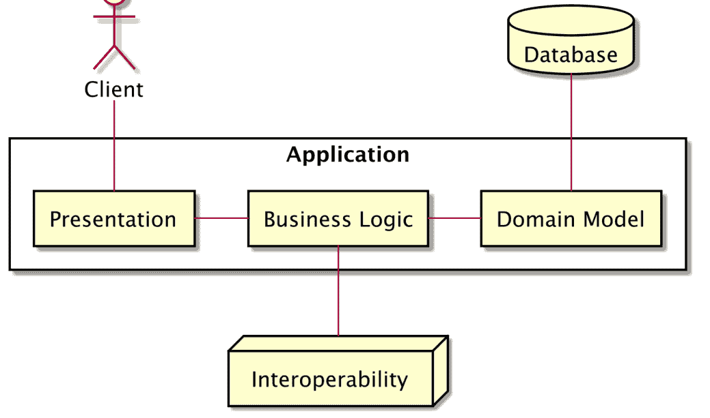

图 23. 验证发生在多个层中

在异构应用程序中，开发者必须处理多种技术和语言。因此，即使是一个简单的验证规则，例如“此数据是强制性的且不能为空”，也需要在 Java、JavaScript、数据库模式或 XML Schema 中以不同的方式表示。

### 5.1.2 约束数据

Bean Validation 通过允许开发者编写一次约束、使用并在任何层对其进行验证，解决了代码重复的问题。Bean Validation 在纯 Java 代码中实现约束，然后通过注解（元数据）定义它。该注解可以使用在你的 Bean、属性、构造函数、方法参数和返回值上。Bean Validation 以一种非常优雅且强大的方式，暴露了一个简单的 API，帮助开发者编写和复用业务逻辑约束。

#### 内置约束

Bean Validation 是一项允许你编写自己的约束并对其进行验证的规范。但它也提供了一些常见的内置约束。表 15 提供了所有内置约束的完整列表（即你无需使用 `java.validation.constraints` 包即可在代码中开箱即用的约束）。作为规范的一部分，你可以在所有 Bean Validation 实现中以可移植的方式使用它们。

表 15. 内置约束注解完整列表

| 约束 | 接受的类型 | 描述 |
|---|---|---|
| `@Null`, `@NotNull` | Object | 注解的元素必须为 null 或不为 null |
| `@NotBlank` | CharSequence | 元素不能为空且必须包含至少一个非空白字符 |
| `@NotEmpty` | CharSequence, Collection, Map, arrays | 注解的元素不能为 null 或为空 |
| `@Size` | CharSequence, Collection, Map, arrays | 元素的大小必须在指定的边界之间 |
| `@Max`, `@Min` | BigDecimal, BigInteger, byte, short, int, 它们的包装类 | 元素必须大于或小于指定值 |
| `@DecimalMax`, `@DecimalMin` | BigDecimal, BigInteger, CharSequence, byte, int, long, 它们的包装类 | 注解的元素必须大于或小于指定值 |
| `@Negative`, `@NegativeOrZero`, `@Positive`, `@PositiveOrZero` | BigDecimal, BigInteger, short, int, long, 它们的包装类 | 注解的元素必须为负、包含零、正或包含零 |
| `@Digits` | BigDecimal, BigInteger, CharSequence, byte, int, long, 以及相应的包装类 | 注解的元素必须是接受范围内的数字 |
| `@AssertFalse`, `@AssertTrue` | Boolean, boolean | 注解的元素必须为 false 或 true |
| `@Future`, `@FutureOrPresent`, `@Past`, `@PastOrPresent` | Calendar, Date 以及 java 8 日期 API 类型 (JSR 310) | 注解的元素必须是未来的或过去的日期，包括现在 |
| `@Email` | CharSequence | 字符串必须是格式良好的电子邮件地址 |
| `@Pattern` | CharSequence | 元素必须匹配指定的正则表达式 |

#### 应用内置约束

这些内置约束可以应用于我们代码的不同部分。例如，[Listing 63](#) 显示了一个 `Order` 类，它在属性、容器 (`List`)、构造函数和业务方法上使用了约束注解。

代码列表 63. 在多个元素类型上使用约束的 POJO

```java
public class Order {

    @NotNull @Pattern(regexp = "[CDM][0-9]+")
    public String orderId;

    @NotNull @Min(1)
    public BigDecimal totalAmount;

    @PastOrPresent
    public Instant creationDate;

    @Future
    public LocalDate deliveryDate;

    @NotNull
    public List<OrderLine> orderLines;

    public Order(@PastOrPresent Instant creationDate) {
        this.creationDate = creationDate;
    }

    @NotNull
    public Double calculateTotalAmount(@Positive Double changeRate) {
        return complexCalculation();
    }
}
```

如你所见，Bean Validation 足够灵活，可以在不同的元素类型上应用相同的内置约束。

#### 约束属性

Bean Validation 的名称源于 Java Bean 设计模式。[125] 一个 Java Bean 具有属性、getter、setter 和方法。Bean Validation 最常用的用例是约束类的属性。代码列表 64 显示了一个 `Book` 类，包含带有 Bean Validation 内置约束注解的属性。

代码列表 64. 带有属性约束的 Book 类

```java
public class Book {

    @Null
    public String title;

    @Digits(integer = 4, fraction = 2)
    public Float price;

    @Size(max = 2000)
    public String description;

    public Integer isbn;

    @Positive
    public Integer nbPages;

    @Email
    public String author;
}
```

#### 约束方法

方法级约束是在 Bean Validation 1.1 中引入的。这些约束可以声明在方法上（默认 getter 不受约束）。通过这种方式，Bean Validation 可以用于契约编程（Programming by Contract）[12]：

- 调用者在调用方法或构造函数之前必须满足前提条件，
- 在方法调用后向调用者保证后置条件。

代码列表 65. 带有构造函数和方法级约束的类

```java
public class CardValidator {

    private ValidationAlgorithm algorithm;

    public CardValidator(@Null ValidationAlgorithm algorithm) {
        this.algorithm = algorithm;
    }

    @AssertTrue
    public boolean validate(@Null CreditCard creditCard) {
        return algorithm.validate(creditCard.getNumber(), creditCard.getControlNumber());
    }

    @AssertTrue
    public boolean validate(@Null String number,
        @Future Date expiryDate,
        @Null Integer controlNumber) {
        return algorithm.validate(number, controlNumber);
    }
}
```

### 5.1.3 验证数据

到目前为止，我们一直在属性、构造函数、方法参数和返回值上应用约束。为了对所有这些元素类型进行验证，你需要使用验证 API。事实上，验证运行时使用一小部分 API 来能够验证约束。主要的 API 是 `javax.validation.Validator` 接口。它持有独立于实现层（表示层、服务层或业务模型）验证对象及其图的方法。与我们在上一章看到的 Config 对象一样，Quarkus 允许通过 `@Inject` 进行注入。因此，你可以如下注入 Validator：

```java
@Inject Validator validator;
```

Quarkus 负责验证器的生命周期，因此你不需要手动创建或关闭它。

#### 验证 Bean

一旦通过程序或注入获取了 Validator，我们就可以使用它的方法来验证实体 Bean 或仅是一个简单的属性。代码列表 66 显示了一个在属性、方法参数和返回值上设置了约束的 `CD` 类。

代码列表 66. 带有属性和方法约束的 Bean

```java
public class CD {

    @NotNull @Size(min = 4)
```

要验证所有 bean 属性，我们只需要创建 `CD` 的实例并调用 `Validator.validate()` 方法（参见列表 67）。如果实例有效，则将返回一个空的 `ConstraintViolation` 集合。以下代码验证了一个具有有效标题和价格的 `CD` 实例。代码检查了约束违反集合是否为空。

代码列表 67. 验证一个有效的 Bean

```java
CD cd = new CD().title("Kind of Blue").price(12.5f);
Set<ConstraintViolation<CD>> violations = validator.validate(cd);
assertEquals(0, violations.size());
```

另一方面，列表 68 中的代码将返回两个 `ConstraintViolation` 对象 - 一个针对标题，另一个针对价格（都违反了 `@NotNull`）：

代码列表 68. 验证一个无效的 Bean

```java
CD cd = new CD();
Set<ConstraintViolation<CD>> violations = validator.validate(cd);
assertEquals(2, violations.size());
```

在列表 69 中，我们创建了一个具有负价格的 `CD`。你可以看到我们如何使用 `ConstraintViolation` API。在测试我们的 `CD` 的值时，我们可以检查错误消息是否正确、消息模板、无效值或属性。

代码列表 69. 检查 ConstraintViolation API

```java
CD cd = new CD().title("Kind of Blue").price(-10f);
Set<ConstraintViolation<CD>> violations = validator.validate(cd);
assertEquals(1, violations.size());
ConstraintViolation<CD> violation = violations.iterator().next();
```


assertEquals("must be greater than 0", violation.getMessage());

assertEquals("java.validation.constraints.Positive.message", violation.getTemplate());

assertEquals(-10f, violation.getInvalidValue());

assertEquals("price", violation.getPropertyPath().toString());

assertEquals(CD.class, violation.getRootBeanClass());

assertTrue(violation.getConstraintDescriptor().getAnnotation() instanceof javax.validation.constraints.Positive);

assertEquals("Kind of Blue", violation.getRootBean().title);

## 级联验证

如果一个 bean（例如 Order）引用了另一个 bean（例如 Address），或者引用了 bean 列表（例如 `List<OrderLine>`），则验证不会传递到嵌套的 bean。除了支持验证外，还支持对象图的验证。换句话说，通常情况下，bean 是相互嵌套的。要一次性验证 bean 图，我们可以使用 `@Valid` 注解应用级联验证。`@Valid` 标记属性、方法参数或返回类型，以便将其包含在级联验证中。此功能也被称为对象图验证。

在列表 70 中，Order 使用了 Bean Validation 注解：订单标识符不能为空，配送地址必须有效，订单项目列表也必须有效。

### 列表 70. Order 级联到其 OrderLines

```java
public class Order {

    @NotNull
    public Long id;

    public Double totalAmount;

    @NotNull @Valid
    public Address deliveryAddress;

    public List<@Valid OrderLine> orderLines;

}
```

在列表 70 中，`@Valid` 约束将指示 Bean Validator 深入 Address 和 OrderLine，并验证那里的所有约束。这意味着每个订单行都必须有一个正的单价 `unitPrice` 和正的数量 `quantity`（参见列表 71）。

### 列表 71. OrderLine 拥有其约束

```java
public class OrderLine {

    public String item;

    @NotNull @PositiveOrZero
    public Double unitPrice;

    @NotNull @Positive
    public Integer quantity;

}
```

为了有效，地址必须包含强制性的街道、城市和邮编（参见列表 72）。

### 列表 72. Address 拥有其 OrderLines

```java
public class Address {

    @NotNull
    public String street;

    @NotNull
    public String city;

    @NotNull @Size(max = 5)
    public String zipcode;

}
```

列表 73 显示了如何验证订单。正如你所看到的，这里没有特别的操作。我们只是创建了一个包含两个订单行的购买订单的对象图，并像常一样使用 `validator.validate(order)` 方法。Bean Validation 将自动级联验证到订单行。

### 列表 73. 使用 OrderLines 进行验证

```java
Order order = new Order().id(1234L).totalAmount(40.5);

order.deliveryAddress = new Address().street("Ritherdon Rd").zipcode("SE123").city("London");

order.add(new OrderLine().item("Help").quantity(1).unitPrice(10.5));

order.add(new OrderLine().item("Sergeant Pepper").quantity(2).unitPrice(15d));
```

```java
Set<ConstraintViolation<Order>> violations = validator.validate(order);

assertEquals(0, violations.size());
```

在列表 74 中，我们故意为 OrderLine 提供了一个无效值（`quantity(null)`）以观察 `@Valid` 注解。注意我们如何使用 `getRootBean()` 和 `getLeafBean()` 方法。它们允许我们访问 Order bean（根节点）和 OrderLine（叶子节点）。方法 `getPropertyPath()` 给我们约束值的位置：订单中第一行的属性 `quantity` (orderLines[0].quantity)。

## 表 19. 主要 JPA 注解

| 注解 | 说明 |
|---|---|
| @Entity | POJOs 在被注解为 @Entity 后将变为持久化对象 |
| @Column | 为持久化属性指定映射的列（名称、长度、唯一性等） |
| @GeneratedValue | 定义主键的值生成策略 |
| @Id | 指定实体的主键 |
| @Table | 指定被注解实体的主表 |
| @Transient | 指明该属性不是持久化的 |
| @OneToOne, @OneToMany, @ManyToOne, @ManyToMany | 关系多性 |

> 如果你喜欢本小册的格式并对 Java Persistence API 感兴趣，请查看附录 E 中我的《Understanding JPA 2.2》小册的参考。

为了能够使用所有的 Java Persistence API 和注解，你需要将代码列表 75 中的 Quarkus 扩展添加到你的 `pom.xml` 中。

### 代码列表 75. JPA 扩展

```xml
<dependency>
  <groupId>io.quarkus</groupId>
  <artifactId>quarkus-hibernate-orm</artifactId>
</dependency>
```

## 5.2.1. 理解对象关系映射

关系型数据库在由行和列组成的表中存储数据。数据通过主键标识，主键是用于唯一标识每个表记录的特殊列（或列的组合）。表之间的关系使用带有完整性约束的外键和连接表。

这些词汇在 Java 等面向对象的语言中完全陌生。在 Java 中，我们操作的是类的实例。对象继承自其他对象，拥有其他对象集合的引用，有时会递归地指向它们。我们有具体类、抽象类、接口、枚举、注解、方法、属性等。

如图 24 所示，对象关系映射（ORM）的原理是将关系型数据库的世界与对象结合起来。ORM 是外部工具，能够提供关系型数据的面向对象视图，反之亦然。

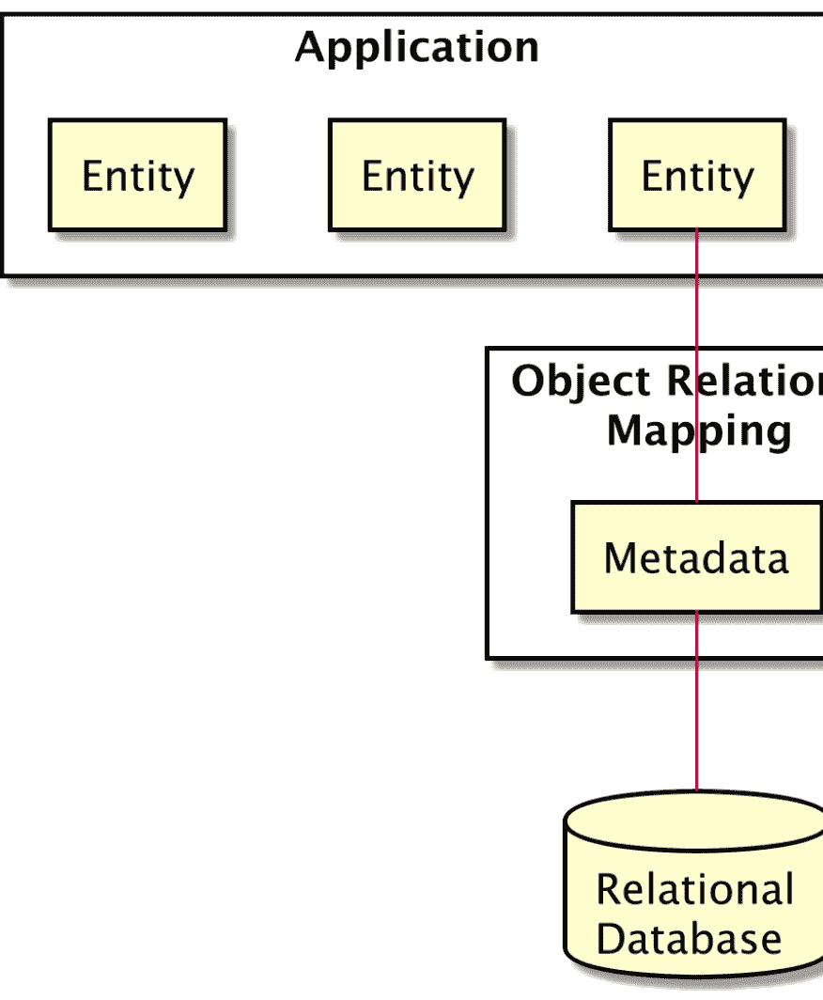

图 24. 将对象映射到关系型数据库

### 关系型数据库

关系模型将数据组织成由列和行组成的一个或多个表，并用唯一键标识每行。行也称为记录或元组。通常，每个表代表一种实体类型（例如书籍、作者或购买订单）。行代表该类型实体的实例（例如书籍“H2G”或“设计模式”），而列代表属于该实例的属性值（例如书名或价格）。

你将如何在关系型数据库中存储代表书籍的数据？代码列表 76 显示了一个创建此类表的 SQL 脚本。

### 代码列表 76. 创建 BOOK 表结构的 SQL 脚本

```sql
CREATE TABLE BOOK
(
  ID BIGINT NOT NULL,
  DESCRIPTION VARCHAR(255),
  ILLUSTRATIONS BOOLEAN,
  ISBN VARCHAR(255),
  NOBOFPAGES INTEGER,
  PRICE FLOAT,
  TITLE VARCHAR(255),
  PRIMARY KEY (ID)
)
```

数据定义语言（DDL，或描述语言）使用一种语法来定义数据库结构。`BOOK` 表是我们存放应用程序中所有书籍的地方。每本书都通过主键列（PRIMARY KEY (ID)）标识，每个属性存储在列中（例如 TITLE、PRICE、ISBN 等）。表中的列具有类型（例如 VARCHAR、INTEGER、BOOLEAN 等），可以接受非空值或不能（NOT NULL）。

### 实体

在讨论将对象映射到关系型数据库、持久化对象、查询对象时，应该使用“实体”（entity）一词而不是“对象”（object）。对象是存在内存中的实例。实体是在内存中短暂存在并在关系型数据库中持久存在的对象。它们具有映射到数据库的能力；可以是具体的或抽象的；并且支持继承、关系等。

在 JPA 持久化模型中，实体是一个简单的 Java 对象（POJO）。这意味着实体的像任何 Java 类一样被声明、实例化和使用。实体通常有属性（其状态）、可以有业务方法（其行为）、构造函数、getter 和 setter。代码列表 77 显示了一个简单的实体。

### 代码列表 77. 书籍实体的简单示例

```java
@Entity
public class Book {

  @Id
  @GeneratedValue
  private Long id;

  private String title;
  private Float price;
  private String description;
  private String isbn;
  private Integer nbOfPages;
  private Boolean illustrations;

  // 构造函数, getters, setters
}
```

代码列表 77 中的示例代表了一个 Book 实体，为了清晰起见我省略了 getters 和 setters。你可以看到，除了这些注解外，不同类型的（id, title, price 等）属性就像任何 Java 类一样：它有（Long, String, Integer 和 Boolean）、一个默认构造函数，以及每个属性的 getters 和 setters。它是如何映射到表的？答案是：归益于映射。

## 5.2.2. 映射实体

对象关系映射（ORM）的原理是将创建对象与表之间对应关系的任务委托给外部工具或框架（在我们的案例中是 JPA）。对象和属性的世界就可以映射到由包含行和列的表组成的关系型数据库。映射提供了关系型数据的面向对象视图，反之亦然。它是如何映射到表的？答案是：归益于映射。

- 注解：直接对代码进行注解。
- XML 描述符：我们可以使用 XML 描述符代替注解。

对象和属性的世界就可以映射到由包含行和列的表组成的关系型数据库。映射提供了关系型数据的面向对象视图，反之亦然。这种决策类型特征是“异常配置”（configuration by exception）。这允许你编写最少代码来让应用程序运行，并依赖提供者的默认设置。例如，实体名称被映射到关系名称（例如，Book 实体映射到 BOOK 表）。属性名称被映射到列名（例如，id 属性或 `getId()` 方法映射到 ID 列）。如果你不希望提供者应用默认规则，可以使用元数据根据你的需求自定义映射，如代码列表 78 所示。

### 列表 78. 带有映射注解的 Book 类

```java
@Entity
@Table(name = "t_book")
public class Book {

  @Id
  @GeneratedValue
  private Long id;

  @NotNull
  @Column(name = "book_title", nullable = false, updatable = false)
  private String title;

  @Size(1)
  private Float price;

  @Column(length = 2000)
  private String description;

  private String isbn;

  @Column(name = "nb_of_pages", nullable = false)
  private Integer nbOfPages;

  private Boolean illustrations;

  @Transient
  private Instant creationDate;

  // Constructors, getters, setters
}
```

请注意列表 78，该实体还带了 Bean Validation 内置约束条件的注解。在这里，我们告诉 Bean Validation 运行时确保书名不为空 (@NotNull) 且最低价格为 1 美元 (@Min(1))。Bean Validation 与 JPA 集成得很好。当 JPA 实体包含 Bean Validation 约束时，它们会被自动验证。事实上，JPA 在插入或更新之前会将验证委托给 Bean Validation 来自动执行验证。

在列表 78 中使用了多个注解来定义对象关系映射，这些注解被应用于 Book 类及其属性上：

- `javax.persistence.Table` 注解更改了与表相关的默认映射值。因此，不再将 Book 实体映射到默认的 BOOK 表，而是通过 @Table 注解将名称更改为 T_BOOK。
- 属性 `id` 映射到 T_BOOK 表的主键，其值由 JPA Hibernate 自动生成。
- 书名 `title` 映射到列 `book_title`，不能为空且无法更新。
- 价格 `price` 没有映射注解（因此将使用默认映射）。
- 描述 `description` 可以为空，但如果不为空，其长度必须少于 2000 个字符。
- 创建日期没有映射到表中，因为它是瞬时的（transient）。

总而言之，列表 78 中定义的 Book 实体将映射到列表 79 所示的表结构。

### 列表 79. 创建自定义 BOOK 表结构的 SQL 脚本

```sql
CREATE TABLE T_BOOK
(
  ID BIGINT NOT NULL,
  DESCRIPTION VARCHAR(2000),
  ILLUSTRATIONS BOOLEAN,
  ISBN VARCHAR(255),
  NB_OF_PAGES INTEGER NOT NULL,
  PRICE FLOAT,
  BOOK_TITLE VARCHAR(255) NOT NULL,
  PRIMARY KEY (ID)
)
```

在这里我只展示了映射注解的一个非常小的部分。JPA 是一个丰富的规范，允许你映射简单的数据结构以及复杂的数据结构。如果你想了解更多信息，我鼓励你查看 JPA 2.2 规范的第 11 章，那里解释了每一个注解。[12] 我还出版了一本关于 JPA 的完整小册，名为《理解 JPA 2.2》（更多详情请参见附录 E）。

## 高级映射

面向对象编程的世界充斥着类以及类之间的关联。这些关联是结构性的，因为它们将一类对象与另一类对象连接起来。类之间可以存在多种关系：

- 关联（Associations）：关联具有方向和多重性（或基数）。它可以是单向的（即一个对象可以导航到另一个对象），也可以是双向的（即一个对象可以导航到另一个对象，反之亦然）。它可以是一一或一对多的基数。
- 继承（Inheritance）：面向对象的语言（如 Java）支持继承。这种范式类通过继承父类的属性和行为来重用代码。

图 26 显示了一个包含类、抽象类和枚举的类图。这些类相互继承（例如 Author 和 Artist）并相互关联（例如，一位音乐家 Musician 出现在多张 CD 上，或者一本书 Book 由一个 Publisher 出版）。

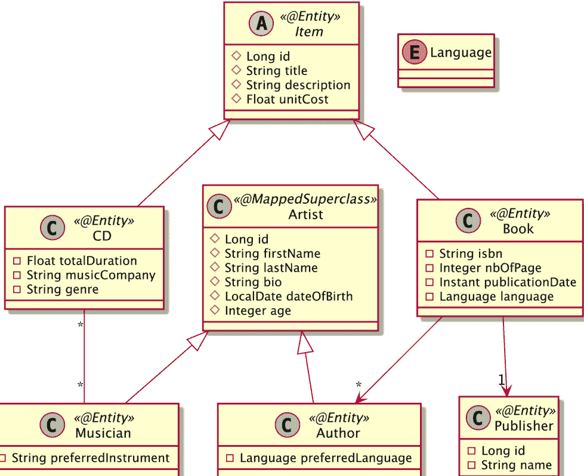

图 26. 实体类图

JPA 可以得益于默认映射将此类复杂的类图映射到多个表，当然也得益于注解。例如，在列表 80 中，我们可以看到一本书是由多个作者写的。这通过一对多的关系（@OneToMany 注解）表示，并映射到名为 `book_author` 的连接表。得益于 `joinColumns` 和 `inverseJoinColumns` 成员，我们甚至可以将书籍和作者的标识映射到 `book_fk` 和 `author_fk` 外键。同样注意，Book 实体扩展了 Item 实体（参见列表 81）。

### 列表 80. 带有关系注解的子实体

```java
@Entity
public class Book extends Item {

  @Column(length = 15)
  private String isbn;

  @Column(name = "nb_of_pages")
  private Integer nbOfPage;

  @Column(name = "publication_date")
  private Instant publicationDate;

  @Enumerated(EnumType.STRING)
  private Language language;

  @OneToMany
```


@JoinTable(name = "book_author",
    joinColumns = @JoinColumn(name = "book_fk"),
    inverseJoinColumns = @JoinColumn(name = "author_fk"))
private Set<Author> authors = new HashSet<>();

@ManyToOne
@JoinColumn(name = "publisher_fk")
private Publisher publisher;

// Constructors, getters, setters
}

列表 81 显示了带有继承注解的父实体 Item。

## 列表 81. 带有继承注解的父实体

```java
@Entity
@Inheritance(strategy = InheritanceType.SINGLE_TABLE)
public abstract class Item {
  @Id
  @GeneratedValue(strategy = GenerationType.AUTO)
  protected Long id;
  @Column(length = 100)
  protected String title;
  @Column(length = 3000)
  protected String description;
  @Column(name = "unit_cost")
  protected Float unitCost;
  // Constructors, getters, setters
}
```

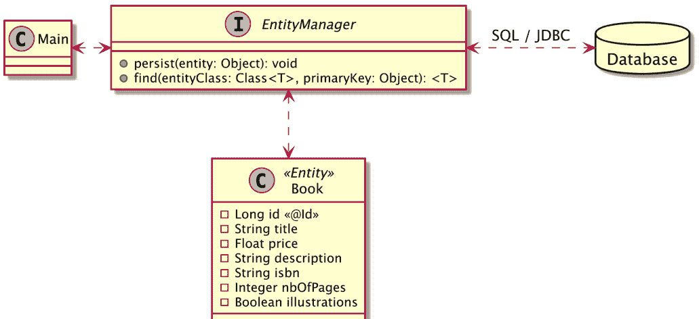

图 27。实体管理器（entity manager）与实体及底层数据库的交互

获取实体管理器的方法是通过注入。通过一个简单的 `@Inject`，Quarkus 将负责管理实体管理器的生命周期（创建和关闭实体管理器）并注入其实例。

```java
@Inject
EntityManager em;
```

作为 JPA 的核心部分，我们使用实体管理器来同时执行简单的实体操作和复杂的 JPQL 查询执行。在操作实体时，`EntityManager` 接口可以看作是一个通用的数据访问对象（DAO），它允许对任何实体进行 CRUD 操作。[50]

为了帮助你更好地理解这些方法，我使用了一个简单的示例，展示了客户（Customer）和地址（Address）之间的单向一对一关系。这两个实体都具有自动生成的标识符（得益于 `@GeneratedValue` 注解），并且 Customer（参见列表 82）有一个指向 Address 的链接（参见列表 83）。

## 列表 82. 带有单向一对一地址的 Customer 实体

```java
@Entity
public class Customer {
    @Id
    @GeneratedValue
    private Long id;
    private String firstName;
    private String lastName;
    private String email;
    @OneToOne
    @JoinColumn(name = "address_fk")
    private Address address;
    // 构造函数, getters, setters
}
```

## 列表 83. Address 实体

```java
@Entity
public class Address {
    @Id
    @GeneratedValue
    private Long id;
    private String street1;
    private String city;
    private String zipcode;
    private String country;
    // 构造函数, getters, setters
}
```

这两个实体将被映射到图 28 所示的数据库结构中。注意，`ADDRESS_FK` 列指向 `ADDRESS` 的外键。

| CUSTOMER | ADDRESS |
| :--- | :--- |
| ID bigint | ID bigint |
| FIRSTNAME integer | STREET1 varchar[255] |
| LASTNAME varchar[255] | ZIPCODE varchar[255] |
| EMAIL varchar[255] | COUNTRY varchar[255] |
| ADDRESS_FK bigint | CITY varchar[255] |

图 28。后续章节中使用的 `CUSTOMER` 和 `ADDRESS` 代码片段假设 `em` 属性的类型为 `EntityManager`。

## 持化实体

持久化实体意味着当数据不存在时将其插入数据库。要做到这一点，需要使用 `new` 算符创建一个新的实体实例，设置属性值，在存在关联时将一个实体绑定到另一个实体（`customer.setAddress(address)`），最后调用 `EntityManager.persist()` 方法，如列表 84 中的 JUnit 测试用例所示。

## 列表 84. 持久化带有地址的 Customer

```java
Customer customer = new Customer("Anthony", "Balla", "aballa@mail.com");
Address address = new Address("Ritherdon Rd", "London", "BQE", "UK");
customer.setAddress(address);
```

```java
// 持化对象
em.persist(customer);
em.persist(address);
assertNull(customer.getId());
assertNull(address.getId());
```

在列表 84 中，customer 和 address 只是位于 JVM 内存中的两个对象。当实体管理器（`em`）通过持久化它们（`em.persist()`）时，这两个实体都受到了管理。此时，两个对象都具备了插入数据库的资格。当事务提交时，数据会被刷新到数据库，`ADDRESS` 表中会被插入一行，`CUSTOMER` 表中会被插入一条 customer 行。由于 Customer 是该关系的所有者，其表持有外键。

数据库查询。但与 SQL 的区别在于，在 SQL 中，获得的结果是以行和列（表）的形式存在的，而 JPQL 的结果将产生一个实体或实体集合。JPQL 语法是面向对象的，因此对于熟悉面向对象语言的开发者来说更容易理解。开发者通过使用点表示法（例如 `myClass.myAttribute`）来管理它们的实体领域模型，而不是表结构。

在底层，JPQL 使用映射机制将 JPQL 查询转换为 SQL 数据库可以理解的语言。该查询通过 SQL 和 JDBC 调用在底层数据库上执行，然后实体的属性将进行设置并返回给应用程序 - 这一切都是使用丰富的查询语法以一种非常*高效且强有力*的方式完成的。

最简单的 JPQL 查询是选择单个实体的所有实例。

```
SELECT b
FROM Book
```

如果你熟悉 SQL，这应该对你来说很熟悉。JPQL 不是从表中进行选择，而是选择实体，即 `Book`。`FROM` 子句也用于为实体指定别名：`b` 是 `Book` 的别名。查询的 `SELECT` 表明查询的结果类型是 `b` 实体（`Book`）。执行此操作将产生一个包含零或多个 `b`（Book 实例）的列表。

要限制结果，你可以如下所示使用 `WHERE` 子句添加搜索条件：

```
SELECT b
FROM Book b
WHERE b.title = 'H262'
```

别名用于通过点运算符导航属性。`Book` 实体有一个名为 `title` 的 `String` 类型持久化属性，`b.title` 指向 `Book` 实体的 `title` 属性。执行此操作将产生一个零或多个标题等于 'H262' 的 `Book` 实例列表。

最简单的查询包含两个强制部分：`SELECT` 和 `FROM` 子句。`SELECT` 定义了获取结果的实体或实体体的格式，可选的 `WHERE`、`ORDER BY`、`GROUP BY` 和 `HAVING` 子句可用于限制或排序查询结果。列表 88 定义了 JPQL 语句的简化语法。

## 列表 88. 简化的 JPQL 语句语法

```
SELECT <select clause>
FROM <from clause>
[WHERE <where clause>]
[ORDER BY <order by clause>]
[GROUP BY <group by clause>]
[HAVING <having clause>]
```

列表 88 定义了一个 `SELECT` 语句，但 `DELETE` 和 `UPDATE` 语句也可以用于跨特定实体类的多个实例执行删除和更新操作。

## 动态查询

你刚刚看到了 JPQL 语法以及如何使用不同的子句（SELECT, FROM, WHERE）来描述语句。但你如何在应用程序中集成 JPQL 语句呢？通过查询，JPA 有不同类型的查询可以在代码中使用，以实现不同的目的（命名查询、Criteria API）。但在本节中，我将关注**动态查询**。它是查询简单的形式，仅由一个在运行时动态指定的 JPQL 查询字符串组成。

选择这些类型查询的核心点是 `EntityManager` 接口，它有几个工厂方法，可以返回 `Query` 或 `TypedQuery`。当结果为 `Object` 时使用该接口，而当返回类型化结果时使用 `TypedQuery`。此 API 中最常用的方法是执行查询的方法。要执行 `SELECT` 查询，你必须根据所需的结果在两种方法之间进行选择：

- `getList()` 执行查询并返回结果列表（实体、属性、表达式等）。
- `getResultStream()` 执行查询并以 `java.util.stream.Stream` 的形式返回结果。
- `getResultResult()` 执行查询并返回单个结果（如果发现多个结果，则抛出 `NonUniqueResultException`）。

动态查询是根据应用程序按需生成的。要创建动态查询，我们使用 `EntityManager.createQuery()` 方法，它接受一个字符串作为参数，代表 JPQL 查询。它是动态的，因为查询字符串可以由应用程序动态创建，从而可以在运行时指定复杂的查询，而不是提前定义。以下查询根据某些标准检索名为 'Mike' 的客户。这就是为什么查询无法预测的原因：如果布尔值为 true，查询将带有 `WHERE`；如果是 false，则没有。

```
String jpqlQuery = "SELECT c FROM Customer c";
if (someCriteria)
    jpqlQuery += " WHERE c.name = 'Mike'";
Query<Customer> typedQuery = em.createQuery(jpqlQuery, Customer.class);
List<Customer> customers = typedQuery.getResultList();
```

在拼接字符串时，你可以使用传递来避免数据库。这可能会引发安全问题，因为很容易被 SQL 注入处理。为了避免上述代码，请使用参数绑定。相反，传递参数有两种可能的选择：使用名称或位置。在这个示例中，我在查询中使用了一个名为 `:fname`（注意 `:` 符号）的命名参数，并使用 `setParameter` 方法将其绑定：

```
TypedQuery<Customer> typedQuery = em.createQuery( 
"SELECT c FROM Customer c where c.firstName = :fname", Customer.class);
typedQuery.setParameter("fname", "Mike");
List<Customer> customers = typedQuery.getResultList();
```

注意，参数名不包含查询中使用的冒号。你也可以使用位置参数。它是从 1 开始的，这意味着第一个参数是 1，第二个参数是 2，依此类推。等效代码看起来如下：

```
TypedQuery<Customer> typedQuery = em.createQuery( 
"SELECT c FROM Customer c where c.firstName = ?1", Customer.class);
typedQuery.setParameter(1, "Mike");
List<Customer> customers = typedQuery.getResultList();
```

如果你需要设置返回的结果的数量，可以使用 `setMaxResults`：

```java
TypedQuery<Customer> typedQuery = em.createQuery( 
"SELECT c FROM Customer c where c.firstName = ?1", Customer.class);
typedQuery.setMaxResults(5);
List<Customer> customers = typedQuery.getResultList();
```

如果你需要跳过前几个结果，可以使用 `setFirstResult`：

```java
TypedQuery<Customer> typedQuery = em.createQuery( 
"SELECT c FROM Customer c where c.firstName = ?1", Customer.class);
typedQuery.setFirstResult(10);
List<Customer> customers = typedQuery.getResultList();
```

## 5.2.5. 配置 Hibernate

与大多数 Quarkus 扩展一样，对象关系映射也可以配置。对于这只需使用 `quarkus.hibernate-orm` 命名空间。

## 列表 20. 部分 Hibernate 配置属性

| 属性 | 默认值 |
|---|---|
| quarkus.hibernate-orm.dialect | Hibernate ORM 方言类名（例如 PostgreSQL, MariaDB, Microsoft SQL Server 和 H2） | |
| quarkus.hibernate-orm.sql-load-script | 包含 Hibernate ORM 启动时执行的 SQL 语句的文件名 | import.sql |
| quarkus.hibernate-orm.metrics.enabled | 在存在 smallrymetrics 扩展的情况下是否发布指标 | false |
| quarkus.hibernate-orm.database.generation | 选择是否生成数据库架构（none, create, drop-and-create, drop, update） | none |
| quarkus.hibernate-orm.log.sql | 显示并格式化 SQL 日志 | false |

## 5.3 Java Transaction API

JPA 是关于实体的映射、管理和查询。JTA 是关于以事务方式管理实体。在 Java 中，事务管理是通过 JSR 907 指定的 Java Transaction API (JTA) 完成的。JTA 定义了一组用于应用程序或容器划分事务边界的接口，并定义了处理事务管理器的 API。

Java Transaction API 都定义在 `javax.transaction` 包下。列表 21 列出了 JTA 定义的主要子包。

## 列表 21. JTA 主要子包

| 子包 | 描述 |
|---|---|
| root | JTA API 的根包 |
| xa | 用于实现分布式 事务的接口和类 |

在该包中，你可以找到所有的 API 和注解。列表 22 显示了主要的 JTA API。

## 列表 22. 主要 JTA API

| API | 描述 |
|---|---|
| Transaction | 允许对事务执行操作 |
| UserTransaction | 定义允许应用程序显式管理事务边界的方法 |
| RollbackException | 当事务被标记为回滚时抛出 |

除了 API，JTA 还提供了一套注解。表 23 列出了部分最常用注解的子集。

## 表 23. 主要 JTA 注解

| 注解 | 描述 |
| --- | --- |
| @Transactional | 提供声明式地控制事务边界的能力 |
| @TransactionScoped | 提供定义生命周期作用于当前活动事务的 Bean 的能力 |

要使用事务，你需要 Java 事务 API（JTA）的 API 和注解。这通过向 `pom.xml` 中添加 Narayana 扩展来实现（参见代码列表 89）。

## 代码列表 89. JTA 扩展

```xml
<dependency>
  <groupId>io.quarkus</groupId>
  <artifactId>quarkus-narayana-jta</artifactId>
</dependency>
```


## 5.3.1 理解事务

事务管理对于企业来说是一项重要事务。它允许应用程序保持数据一致性并以可靠的方式处理数据。事务管理是一个低级关注点，业务开发者不应该编写这些代码。这就是为什么 JTA（Java 事务 API）以非常简单的方式提供这些服务：通过高层抽象进行编程，或使用元数据进行声明式处理。

事务用于确保数据保持在一致状态。它代表一个必须作为单一单元执行的逻辑操作组，也称为工作单元。这些操作可能涉及在一个或多个数据库中持久化数据、向消息中间件（MOM）发送消息或调用 Web 服务。公司每天依赖事务来处理其银行和电子商务应用程序或与伙伴的业务对交互。

这些单独业务操作是在较短的时间内顺序或并行执行的。每个操作都成功，事务才能成功（我们称之为事务已提交）。如果其中一个操作失败，事务也会失败（事务将回滚）。

### 提交
事务成功

### 事务回滚
事务失败

图 29. 事务管理

事务必须保证某种程度的可靠性和健壮性，并遵循 ACID 特性。ACID 指的是定义可靠事务的四个属性：*原子性、一致性、隔离性和持久性*（在表 24 中进行描述）。

### 表 24. ACID 特性

| 特性 | 描述 |
|---|---|
| 原子性 | 事务由组在一个工作单元中的一个或多个操作组成。在事务结束时，要么这些操作成功执行（提交），要么没有任何操作执行（回滚），或者发生了意料之外或不可恢复的情况。 |
| 一致性 | 在事务结束时，数据处于一个一致的状态。 |
| 隔离性 | 事务的中间状态对外部应用程序不可见。 |
| 持久性 | 一旦事务提交，对数据的更改对其他应用程序可见。 |

为了解释这些属性，我将以经典的银行转账为例：你需要扣除你的储蓄账户余额并存入你的期期账户。

当你从一个账户转账到另一个账户时，你可以想象一系列数据库访问：使用 SQL 语句扣除储蓄账户，使用 `update` 语句存入期期账户，并在另一个表中创建日志以跟踪转账。这些操作必须在同一个工作单元（*原子性*）中完成，因为你不希望只发生扣款而不发生入账。从查询账户的外部应用程序来看，只有当两个操作都成功执行后，它们才是可见的（*隔离性*），外部应用程序看不到一个账户已扣除而另一个账户尚未入账的中间状态（如果能看到，它会认为客户的钱比实际的少）。*一致性*是指事务操作（无论是提交还是回滚）是在数据库的约束（如主键、关系或字段）内执行的。一旦事务完成，就可以从其他应用程序访问数据（*持久性*）。

## 5.3.2 声明式事务管理

当使用声明式方式管理事务时，你将边界策略委托给容器。你不需要显式地使用 JTA 事务管理来显式启动或提交事务；你可以让容器根据注解自动开始和提交事务，从而划分事务边界。

代码列表 91 显示了一个事务型服务。通过 `java.transaction.Transactional` 注解，你知道该服务是事务型的。该注解会导致每次方法调用都被拦截，并在需要时启动事务。

### 代码列表 90. 事务型服务

```java
@ApplicationScoped
@Transactional
public class ItemService {

  @Inject
  EntityManager em;

  @Inject
  Statistics statistics;

  public List<Book> findBooks() {
    return em.createQuery("SELECT b FROM Book b", Book.class).getResultList();
  }

  public Book createBook(Book book) {
    em.persist(book);
    statistics.add(book);
    return book;
  }
}
```

你可能会问代码列表 90 中的代码是如何工作的？答案是容器正在拦截方法调用并管理事务。图 30 显示了当客户端调用 `ItemService.createBook()` 方法时发生了什么。该调用被容器拦截，容器在调用方法之前会立即检查调用是否关联了事务上下文。默认情况下，如果没有可用的事务上下文，容器会在进入方法之前开始一个新事务并调用 `createBook()` 方法。一旦方法退出，容器将自动提交事务或回滚（如果抛出了特定类型的异常）。


图 30. 容器处理事务

默认行为是 `createBook()` 使用的事务上下文（来自客户端或容器创建），它也适用于 `addItem()`。如果两个方法都成功返回，则会提交。这种行为可以通过元数据进行更改。根据你选择的事务属性（REQUIRED、REQUIRES_NEW、SUPPORTS、MANDATORY、NOT_SUPPORTED 或 NEVER），你可以影响容器如何划分事务：在客户端新事务、使用客户端的事务、在新事务中运行、运行 `@Transactional` 注解的属性或抛出异常。表 25 定义了。

### 表 25. 事务类型

| 属性 | 描述 |
|---|---|
| REQUIRED | 此属性（默认值）意味着方法必须在事务内调用。如果从非事务客户端调用方法，容器将创建一个新事务。如果客户端具有事务，则业务方法将在客户端的事务中运行。当你进行应该由事务管理的调用，但无法假设客户端是从事务上下文调用方法时，应使用 REQUIRED。 |
| REQUIRES_NEW | 无论客户端是否在事务内执行，容器都会在执行方法之前创建一个新事务。如果客户端正在运行事务，容器将挂起该事务，创建第二个，提交或回滚它，然后恢复第一个事务。这意味着第二个事务的成功或失败对现有的客户端事务没有影响。当你不想回滚影响客户端时，应使用 REQUIRES_NEW。 |
| SUPPORTS | 事务方法继承客户端的事务上下文。如果可用事务上下文，方法将使用它；如果没有，容器将在无事务上下文的情况下调用方法。当你对数据库表具有只读访问权限时，应使用 SUPPORTS。 |
| MANDATORY（强制） | 容器在调用业务方法之前需要一个事务，但不应创建一个新事务。如果客户端具有事务上下文，则进行传播；如果没有，则抛出 `java.transaction.TransactionalException`。 |
| NOT_SUPPORTED（不支持） | 事务方法不能在事务中调用。如果客户端没有事务上下文，则什么都不会发生；如果有，则容器将挂起客户端的事务，调用该方法，然后在方法返回时恢复事务。 |
| NEVER（从不） | 事务方法不能从事务中调用。如果客户端运行在事务上下文中，容器将抛出 `java.transaction.TransactionalException`。 |

要对你的服务应用这些边界标记属性之一，你必须使用 `@Transactional` 注解。该注解可以应用于单个方法，也可以应用于整个 bean。列表 91 展示了 `PublisherService` 如何使用 `SUPPORTS` 事务边界策略，并使用 `REQUIRED` 覆盖了 `update()` 方法。

### 列表 91. 自定义事务服务

```java
@ApplicationScoped
@Transactional(SUPPORTS)
public class PublisherService {

  @Inject
  EntityManager em;

  public List<Publisher> findAll() {
    return em.createQuery("SELECT * FROM Publisher", Publisher.class).getResultList();
  }

  public Optional<Publisher> findById(Long id) {
    Publisher publisher = em.find(Publisher.class, id);
    return publisher != null ? Optional.of(publisher) : Optional.empty();
  }

  @Transactional(REQUIRED)
  public Publisher update(Publisher publisher) {
    return em.merge(publisher);
  }
}
```

如果你查看列表 91 中的 `PublisherService`，你就能理解 `update()` 方法是事务性的。如果调用者没有创建事务，容器将创建一个。另一方面，当 `find` 方法被调用时，如果它们是在事务上下文中调用的，那么容器将不会创建一个新事务。

### 异常处理与事务

Java 中的异常处理自语言诞生以来一直令人困惑（因为它涉及受检查异常和未检查异常）。将事务与异常关联起来也非常复杂。在继续之前，我只想说，在业务方法中抛出异常并不会标记事务进行回滚。这取决于异常的类型或定义异常的元数据。

- **应用异常（Application exceptions）**：与业务逻辑相关的异常。例如，如果向方法传递了无效参数、库存水平过低或信用卡号无效，可能会抛出应用异常。抛出异常不会自动导致标记事务回滚。这是因为当抛出受检查异常（继承自 `java.lang.Exception`）时，容器不会回滚，但抛出未检查异常（继承自 `RuntimeException`）时会回滚。
- **系统异常（System exceptions）**：由系统级故障引起的异常，例如 JVM 错误、无法获取数据库连接等。系统异常必须是 `RuntimeException` 的子类。抛出系统异常将导致标记事务回滚。

通过此，我们现在知道如果容器检测到系统异常（例如 `ArithmeticException`、`ClassCastException`、`IllegalArgumentException` 或 `NullPointerException`），它将回滚事务。这种默认行为可以通过注解中的 `rollbackOn` 和 `dontRollbackOn` 属性进行覆盖。如列表 92 所示，如果 `StatisticsService` 抛出 `StatisticsException`，则 `persist()` 将回滚。

### 列表 92. 异常时的事务回滚

```java
@ApplicationScoped
public class PublisherService {

    @Inject
    EntityManager em;

    @Inject
    StatisticsService statistics;

    @Transactional(value = REQUIRED, rollbackOn = StatisticsException.class)
    public void persist(Publisher publisher) throws Exception {
        em.persist(publisher);
        statistics.addNew(publisher);
        return publisher;
    }
}
```

要覆盖默认行为并导致所有应用异常都标记事务为回滚，你需要编写以下代码：

```java
@Transactional(rollbackOn = Exception.class)
```

另一方面，如果你想捕获到 `IllegalStateException`（未检查异常）或其任何子类时防止拦截器将事务标记为回滚，你可以如下所示使用 `dontRollbackOn`：

```java
@Transactional(dontRollbackOn = IllegalStateException.class)
```

你可以同时使用这两个属性来细化事务行为。每个属性接收一个类数组，并如下所示使用：

```java
@Transactional(rollbackOn = SQLException.class, dontRollbackOn = {SQLWarning.class, ArrayIndexOutOfBoundsException.class})
```

## 5.3.3 编程式事务管理

通过 `@Transactional`，你只需要通过指定事务属性以及是否回滚的异常，就可以让容器来处理事务边界。在某些情况下，事务边界可能无法提供你所需的粒度（例如，一个方法不能生成多个事务）。为了解决这个问题，JTA 提供了一种编程式的方法来显式管理事务边界（开始、提交、回滚）。

管理事务的主要接口是 `javax.transaction.UserTransaction`。它允许 bean 标记事务、获取其状态、设置超时等。

列表 93 展示了如何管理事务。首先，我们通过注入获取 `UserTransaction` 的引用。`onItemSold()` 方法开始事务，进行一些业务处理，然后根据某些业务逻辑提交或回滚事务。同样注意，事务在 `catch` 块中被标记为回滚（为了更好的可读性，我简化了异常处理）。

### 列表 93. 编程式管理事务

```java
@ApplicationScoped
public class InventoryService {

  @Inject
  UserTransaction tx;

  @Inject
  InventoryRepository repository;

  public void onItemSold(Item item) throws Exception {
    try {
      tx.begin();
      repository.update(item);
      tx.commit();
    } catch (Exception e) {
      tx.rollback();
      throw e;
    }
  }
}
```

## 5.3.4 配置事务

在 Quarkus 中，你可以配置事务管理。但要小心，事务是某些取决于你所使用的数据库的底层关注。例如，你可以配置默认事务超时或隔离级别。更多关于事务的信息可以在 Quarkus 网站找到。

### 表 26. 部分 Quarkus 事务属性

| 属性 | 默认 |
|---|---|
| quarkus.datasource.transactions | 是否使用 JDBC 事务、XA 或禁用 | enabled, xa, disabled |
| quarkus.datasource.jdbc.isolation-level | uncommitted, committed, repeatable read, serializable |
| quarkus.transaction-manager.default-timeout | 60 |

## 5.4 DataSource

我们看到了如何映射和查询实体，以及如何以事务方式访问它们。但还有一块拼图：关系型数据库。获取数据库连接的方法是使用数据源。

在 Quarkus 中，数据源和连接池实现被称为 Agroal。Agroal 是一种现代、轻量级的连接池，专为极高性能和可扩展性设计，并与 Quarkus 的其他组件（如安全、事务管理和健康指标）深度集成。要配置数据源，你只需要在 `application.properties` 中配置，例如：

```properties
quarkus.datasource.db-kind=h2
quarkus.datasource.jdbc.driver=org.h2.Driver
quarkus.datasource.jdbc.url=jdbc:h2:mem:vintageStoreDB
```

数据库类型（db-kind 属性）定义了你将连接的数据库类型。目前 Quarkus 支持这些内置类型：

- derby
- H2: h2
- MariaDB: mariadb
- Microsoft SQL Server: mssql
- MySQL: mysql
- PostgreSQL: postgresql, pg

通过在依赖中安装 JDBC 驱动（例如通过在 `pom.xml` 中添加 `quarkus-jdbc-postgresql` 依赖）并在配置中设置它，Quarkus 会自动解析 JDBC 驱动，因此你不需要手动配置它。所以数据源配置与之前相同，只需跳过 JDBC 驱动即可：

```properties
quarkus.datasource.db-kind=h2
quarkus.datasource.jdbc.url=jdbc:h2:mem:vintageStoreDB
```

并且由于很有可能需要定义一些凭据来访问数据库，你可以使用以下配置：

```properties
quarkus.datasource.db-kind=h2
quarkus.datasource.jdbc.url=jdbc:h2:mem:vintageStoreDB
quarkus.datasource.username=app
quarkus.datasource.password=app
```


## 5.4. 配置数据源

配置数据源会影响性能。如果你有许多并发用户访问数据库，你可能想要设置其最小和最大连接池大小，例如。或者，你可能想要生成指标以便能够进行预测并采取行动。如果你在 Quarkus 网站上查找 `quarkus.datasource` 命名空间，将找到所有数据源配置 [11]。

表 27. 部分 Quarkus 数据源配置属性

| 属性 | 默认 | 说明 |
|---|---|---|
| `quarkus.datasource.db-kind` | | 我们将连接的数据库类型（例如 h2, postgresql...） |
| `quarkus.datasource.username` | | 数据源用户名 |
| `quarkus.datasource.password` | | 数据源密码 |
| `quarkus.datasource.jdbc` | `true` | 是否为此数据源创建一个 JDBC 数据源 |
| `quarkus.datasource.jdbc.enable-metrics` | | 启用数据源指标收集（如果激活了 `smallrye-metrics` 扩展则默认启用） |
| `quarkus.datasource.jdbc.url` | | 数据源 URL |
| `quarkus.datasource.jdbc.initial-size` | | 连接池初始大小 |
| `quarkus.datasource.jdbc.min-size` | `0` | 数据源连接池最小大小 |
| `quarkus.datasource.jdbc.max-size` | `20` | 数据源连接池最大大小 |

## 5.5. 带有 Panache 的 Hibernate ORM

如所示，Quarkus 支持 JPA 和 JTA。这意味着你可以使用这两个 API。如果你想让开发更加轻松，也可以使用带有 Panache 的 Hibernate ORM。Hibernate ORM 是 Quarkus 的 JPA 实现，它为你提供了完整的 JPA 对象关系映射器功能。它让复杂的映射和查询成为可能，但并不会让简单常见的映射变得轻而易举。带有 Panache 的 Hibernate ORM（读音为 *pa-nash*）侧重于简化你的 JPA 实体和仓库。

Panache 不仅仅是让 JPA 更简单。此外，还有一个 MongoDB with Panache 扩展以及一个带有 Panache 扩展的实验性 RESTful Web 服务。MongoDB with Panache 提供了活动记录模式风格的实体（和仓库），并侧重于让实体映射到 MongoDB 数据库。为了区分这两种技术，我们使用带有 Panache 的 Hibernate ORM 和带有 Panache 的 MongoDB。

Panache 依赖于 Hibernate ORM。因此，使用 Panache 和 JPA API 以及注解仅需一个扩展。如列表 94 所示，将 Panache 添加到你的 `pom.xml` 中，你将获得 Hibernate ORM 提供程序。

列表 94. Panache 扩展

```xml
<dependency>
  <groupId>io.quarkus</groupId>
  <artifactId>quarkus-hibernate-orm-panache</artifactId>
</dependency>
```

## 5.5.1. Panache 实体

带有 Panache 的 Hibernate ORM 为 JPA 提供了活动记录模式的实现。[137] 在活动记录模式中，实体是一个封装了数据库表（或视图）行的对象，它封装了数据库访问，同时也在这些数据上添加了领域逻辑。因此，实体同时携带了数据和行为。列表 95 显示了一个带有数据和行为的 Panache 实体。

列表 95. Panache 实体示例

```java
@Entity
public class Publisher extends PanacheEntity {

  @Column(length = 30)
  public String name;

  public static Optional<Publisher> findByName(String name) {
    return find("name", name).firstResultOptional();
  }

  public static long deleteByName(String name) {
    return delete("name", name);
  }
}
```

如果你将列表 95 中的 Panache 实体与其 JPA 对应进行比较，你会发现几处不同：

- 无 getter 和 setter 的公共属性（此处为 `name`）：由于 Java 语言本身缺乏对属性的直接的支持，我们必须创建字段，然后为这些字段生成 getter 和 setter。在带有 Panache 的 Hibernate ORM 中，你不需要这样做。
- 父类中的标识符：实体拥有一个技术性标识符，以便映射数据库中的主键列。由于是技术 ID，它与我们的模型无关，并且可以从父类继承（`id` 属性在 `PanacheEntity` 类中声明）。
- 同一类中的状态和行为（`name` 属性和 `findByName()` 方法）：传统模式允许将实体定义（模型）与你可以执行的操作（使用 DAO 或 Repository）分开。你不一定得使用 Panache 实体，但如果你真的想用，你也可以在带有 Panache 的 Hibernate ORM 中使用仓库（见下文）。
- 简化查询：JQL 是一种非常丰富且强大的查询语言。但对于常见操作，它也非常冗长，要求你在不需要所有语句时也编写查询。

带有 Panache 的 Hibernate ORM 采用了一种主观的方法来解决这些问题，并让你的代码尽可能简洁。为此，你需要遵循以下规则：

- 让你的实体扩展 `PanacheEntity`：它有一个自动生成的标识符字段。如果你需要自定义的 ID 策略，可以扩展 `PanacheEntityBase` 并自行处理 ID（见图 31 中的类图）。
- 使用公共字段：消除样板代码 getter 和 setter：在底层，带有 Panache 的 Hibernate ORM 会生成所有缺失的 getter 和 setter，并重写对这些字段的访问为访问器方法。这样，当你需要时仍然可以编写有用的访问器，即使在你使用字段访问时，这些访问器也会被使用。
- 使用活动记录模式：将所有的实体逻辑放在实体类中的静态方法中。`PanacheEntityBase` 超类已经带有许多实用的静态方法，你可以在自己的实体类中添加自己的方法。

Panache 依赖于 Hibernate ORM。因此，使用 Panache 和 JPA API 以及注解仅需一个扩展。如列表 94 所示，将 Panache 添加到你的 `pom.xml` 中，你将获得 Hibernate ORM 提供程序。

图 31 显示了实体的类图。`PanacheEntityBase` 超类已经带有许多实用的静态方法，你可以在自己的实体类中添加自己的方法。

### Panache 实体

要成为 JPA 实体，类至少需要被 `@Entity` 注解，并有一个标识符。如果你想使用带有 Panache 的 Hibernate ORM，你仍然需要扩展 `PanacheEntity`（这样你可以获得自动生成的标识符）或 `PanacheEntityBase`（如果你想手动管理实体）。然后列表 96 显示了带有 `name` 属性的 Panache 实体。对于 `@Column` 注解，数据库中的列将为 30 个字符。

列表 96. Panache 实体

```java
@Entity
public class Publisher extends PanacheEntity {

  @Column(length = 30)
  public String name;
}
```

Panache 实体从强大的对象关系映射注解，从简单到复杂。图 31 显示了使用 `@Inheritance` 注解的 Item 实体。该注解指示 JPA 将父实体的所有字段以及子实体映射到单张表中。注意 `Item` 是父实体，但它仍然扩展了 `PanacheEntity`。

列表 97. 父 Panache 实体

```java
@Entity
@Inheritance(strategy = InheritanceType.SINGLE_TABLE)
public class Item extends PanacheEntity {

  @Column(length = 100)
  public String title;

  @Column(length = 3000)
  public String description;

  @Column(name = "unit_cost")
  public Float unitCost;
}
```

列表 98 中的子类 CD 扩展了 Item（Item 扩展了 `PanacheEntity`）。

列表 98. 子 Panache 实体

```java
@Entity
public class CD extends Item {

  @Column(name = "total_duration")
  public Float totalDuration;

  @Column(name = "music_company")
  public String musicCompany;

  public String genre;

  @ManyToMany
  @JoinTable(name = "cd_musician",
    joinColumns = @JoinColumn(name = "cd_fk"),
    inverseJoinColumns = @JoinColumn(name = "musician_fk")
  )
  public Set<Musician> musicians = new HashSet<>();
}
```

### 管理 Panache 实体

在 JPA 中，我们使用 `EntityManager` 接口来与实体交互。我们使用 `EntityManager` 来持久化、删除或查找实体，以及创建和执行查询。得益于 `PanacheEntityBase` 父类（见图 31 中的类图），我们在 Panache 实体本身上获得了大部分 CRUD 操作。列表 99 显示了你在 Panache 实体上执行的一些操作。

列表 99. Panache 实体的操作

```java
// 创建一个 publisher
Publisher publisher = new Publisher();
publisher.name = "Agoncal Fascicle";

// 持久化
publisher.persist();

// 获取所有 实体列表
List<Publisher> allPublishers = Publisher.findAll();

// 通过 ID 查找特定的 publisher
publisher = Publisher.findById(publisherId);

// 通过 Optional 通过 ID 查找特定的 publisher
Optional<Publisher> optional = Publisher.findByIdOptional(publisherId);
publisher = optional.orElseThrow(() -> new EntityNotFoundException());

// 统计所有 publisher
long countAll = Publisher.count();

// 检查是否已持久化
if (publisher.isPersistent()) {
  // 删除
  publisher.delete();
}

// 按 id 删除
boolean deleted = Publisher.deleteById(publisherId);

// 删除所有 publisher
Publisher.deleteAll();
```

### 查询 Panache 实体

JPA 的优势之一是其查询语言（Java 持久查询语言 JPQL）。你可以对实体进行各种简单或复杂的查询。如列表 100 所示，Panache 让你能够像在 JPA 中那样编写完整的 JPQL 查询，但你也可以简化它。`list()` 方法可以接收 JPQL 查询片段并对剩余进行上下文处理。因此你不需要编写 `SELECT` 和 `FROM` 子句，只需关注 `WHERE` 子句（甚至省略 `WHERE` 关键字）。这使得代码非常简洁且易读。

列表 100. 简化的 JPQL 查询

```java
// 完整的 JPQL 查询
books = Book.list("SELECT b FROM Book b WHERE b.nbOfPage > 100 ORDER BY b.title");

// 简化的 JPQL 查询
books = Book.list("FROM Book b b.nbOfPage > 100 ORDER BY b.title");

// 非常简单的 JPQL 查询
books = Book.list("nbOfPage > 100 ORDER BY b.title");
```

Panache 实体继承自 `PanacheEntityBase`。如图 32 中的类图所示，`PanacheEntityBase` 拥有多个方法来处理查询（`find()`、`list()`、`stream()` 等）。这些方法返回一个 `PanacheQuery`，该对象可以接收参数（`Parameter` 类）并可以在页内进行分组（`Page` 类）。注意 `Sort` 类允许你轻松地按升序或降序排序数据。

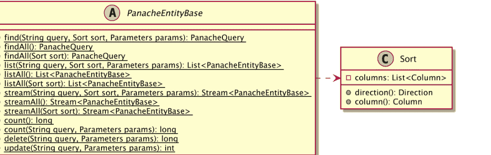

图 32. Panache 类图

如列表 101 所示，`find()` 方法接收一个简化的 JPQL 查询并返回一个 `PanacheQuery`。通过这个 `PanacheQuery`，你可以执行它并获取书籍列表（调用 `list()` 方法）、书籍数量（通过 `count()` 方法）或查询的第一个结果。注意，`list()` 方法是 `find().list()` 的快捷方式。事实上，简单的用例会使用 `list()`，而 `find()` 则将为你提供更多选项，例如分页或日志记录。

列表 101. Panache 查询

```java
// find 返回一个 PanacheQuery
PanacheQuery<Book> bookQuery = Book.find("nbOfPage > 100 ORDER BY title");

List<Book> books = bookQuery.list();
Long nbBooks = bookQuery.count();
Book firstBook = bookQuery.firstResult();
Optional<Book> oBook = bookQuery.firstResultOptional();

// list() 是 find().list() 的快捷方式
books = Book.find("nbOfPage > 100 ORDER BY title").list();
books = Book.list("nbOfPage > 100 ORDER BY title");
```

### 传递参数

带有 Panache 的 Hibernate ORM 基于 JPA，而 JPA 又基于 JDBC（Java 数据库连接）。在 Panache 中，你可以使用位置参数（例如 `?1`、`?2` 等）、命名参数（`:min`、`:max`）或 Panache 的 `Parameters` 类向查询传递参数。列表 102 展示了如何使用这些技术向查询传递参数。

列表 102. 查询参数

```java
// 硬编码参数
cheapBooks = Book.list("unitCost between 0 and 30");

// 位置参数
cheapBooks = Book.list("unitCost between ?1 and ?2", min, max);

// 命名参数
Map<String, Object> params = Map.of("min", min, "max", max);
cheapBooks = Book.list("unitCost between :min and :max", params);

// 使用 Parameters 类
cheapBooks = Book.list("unitCost between :min and :max",
Parameters.with("min", min).and("max", max));

// 传递枚举值
List<Book> englishBooks = Book.list("language", Language.ENGLISH);
```


## 分页

当你调用 `list()` 方法时，它会返回符合查询条件的实体列表。此列表可能很大，在用户界面上难以显示。你可能想要获取其中的一部分、特定大小的部分，并可能遍历后续或之前的部分。这被称为分页。

`PanacheQuery` 拥有多个方法使用 `Page` 类进行分页。`Page` 代表分页信息，你可以在上面进行迭代（使用 `next()` 和 `previous()` 方法）或直接跳转到某个位置（`first()` 和 `index(index)`）。

### 列表 103. 实体分页

```java
// 创建查询
PanacheQuery<Musician> musicianQuery = Musician.findAll();

// 设置页大小为 5
musicianQuery.page(5);

// 获取第一页
List<Musician> first = musicianQuery.list();

// 获取第二页
List<Musician> second = musicianQuery.next();

// 获取第三页
List<Musician> third = musicianQuery.next();

// 获取总页数
int numberOfPages = musicianQuery.count();
```

## 排序

在 JPQL 中，你可以使用 `ORDER BY` 子句对查询进行排序。注意 Panache 查询接收可选的 `Sort` 参数，它允许你配置排序。`Sort` 类有几个方法用于添加列并指定方向，如列表 104 所示。

### 列表 104. Panache 实体的排序

```java
// 按名字排序
authors = Author.findAll(Sort.by("firstName"));

// 按名字降序排序
authors = Author.findAll(Sort.by("firstName").descending());

// 按名字升序、姓降序排序
authors = Author.list(Sort.by("firstName").and("lastName").descending());
```

## 仓库模式

这基本上意味着你只使用实体来处理映射状态，而仓库负责数据库访问。这种关注点分离在某些情况下非常有用。

如代码列表 106 所示，仓库没有任何属性（它们在实体中），而只有查询数据库的方法。注意，`Publisher` 既可以是 Panache 实体，也可以是 JPA 实体。如果你有旧的 JPA 实体并想从 Panache 仓库中获益，这会非常方便。

### 列表 106. 一个 Panache Repository

```java
@ApplicationScoped
public class PublisherRepository implements PanacheRepository<Publisher> {

    public Optional<Publisher> findByName(String name) {
        return find("name", name).firstResultOptional();
    }

    public long deleteByName(String name) {
        return delete("name", name);
    }
}
```

如图 33 所示，Panache 仓库实现了 `PanacheRepository` 和 `PanacheRepositoryBase` 接口。使用仓库时，通过让它们实现 `PanacheRepository`，你可以获得与记录模式完全相同的便捷方法。

### PanacheRepositoryBase

```java
- default delete(Entity entity): void
- default flush(): void
- default persist(Entity entity): void
- default findById(Long id): Entity
- default persist(Iterable<Entity> entities): void
- default persist(Stream<Entity> entities): void
- default find(String query, Sort sort, Parameters params): PanacheQuery<Entity>
- default findAll(): PanacheQuery<Entity>
- default list(String query, Sort sort, Map<String, Object> params): List<Entity>
- default listAll(): List<Entity>
- default stream(String query, Map<String, Object> params): Stream<Entity>
- default streamAll(Sort sort): Stream<Entity>
```


### PanacheRepository

```java
- findByName(String name): Optional<Publisher>
- deleteByName(String name): long
```

图 33. Panache 仓库类图

列表 107 显示了你的仓库上可用的某些操作。如你所见，你可以完全以相同记录模式的方式使用它。

### 列表 107. Panache Repository 上的操作

```java
@Inject
PublisherRepository publisherRepository;

void shouldManagePublishers() {
    // 创建一个 publisher
    Publisher publisher = new Publisher();
    publisher.name = "Agonal Fascicle";

    // 持久化
    publisherRepository.persist(publisher);

    // 获取所有 Publisher 实实体列表
    List<Publisher> allPublishers = publisherRepository.findAll();

    // 通过 ID 查找特定的 publisher
    publisher = publisherRepository.findById(publisherId);

    // 通过 Optional 通过 ID 查找特定的 publisher
    Optional<Publisher> optional = publisherRepository.findByIdOptional(publisherId);
    publisher = optional.orElseThrow(() -> new EntityNotFoundException());

    // 统计所有 publisher
    long countAll = publisherRepository.count();

    // 检查是否持久化
    if (publisherRepository.isPersistent(publisher)) {
        // 删除它
        publisherRepository.delete(publisher);
    }

    // 按 id 删除
    boolean deleted = publisherRepository.deleteById(publisherId);

    // 删除所有 publishers
    publisherRepository.deleteAll();
}
```

当然，如代码列表 108 所示，仓库也可以使用简化的 JPQL 查询以及查询参数、排序或分页，方式与 Panache 实体完全相同。

### 列表 108. 仓库中的简化查询

```java
// 简化的 JQL 查询
books = repository.list("nb0fPage > 100 ORDER BY title\n");

// 顺序参数
cheapBooks = repository.list("unitCost between ?1 and ?2", min, max);

// 使用 Panache 类
cheapBooks = repository.list("unitCost between :min and :max",
    Parameters.with("min", min).and("max", max));
```

## 5.5.3. 事务

Panache 实体和仓库允许你轻松地将属性映射到关系型数据库，并通过查询访问它们。但事务呢？如何以事务的方式持久化或移除数据呢？对于这一点，我们只需要使用 JTA 配合事务边界（服务或 REST 端点）。这些事务边界可以直接使用 Panache 实体，也可以注入仓库。

### 使用 Panache 实体

列表 109 显示了一个以事务方式持久化、删除和检索 publisher 实体的事务服务。为此，它使用 JTA 声明式事务管理注解 `@Transactional` 标记了方法。然后，它直接使用 Panache 实体方法（例如调用 `Publisher.persist()`）来持久化 publisher。

#### 列表 109. 使用 Panache 实体的事务化服务

```java
@ApplicationScoped
@Transactional(SUPPORTS)
public class PublisherService {

    @Transactional(REQUIRED)
    public Publisher persist(Publisher publisher) {
        Publisher.persist(publisher);
        return publisher;
    }

    public List<Publisher> findAll() {
        return Publisher.findAll();
    }

    public Optional<Publisher> findByIdOptional(Long id) {
        return Publisher.findByIdOptional(id);
    }

    @Transactional(REQUIRED)
    public void deleteById(Long id) {
        Publisher.deleteById(id);
    }
}
```

### 使用 Panache 仓库

但如果你选择使用仓库层而不是记录模式，那么你遵循相同的原则，但不是直接使用 Panache 实体，而是注入仓库。列表 110 显示了与列表 109 相同的事务服务。唯一的区别是它注入了仓库。

#### 列表 110. 使用 Panache 仓库的事务化服务

```java
@ApplicationScoped
@Transactional(SUPPORTS)
public class PublisherService {

    @Inject
    PublisherRepository repository;

    @Transactional(REQUIRED)
    public Publisher persist(Publisher publisher) {
        repository.persist(publisher);
        return publisher;
    }

    public List<Publisher> findAll() {
        return repository.list();
    }

    public Optional<Publisher> findById(Long id) {
        return repository.findByIdOptional(id);
    }

    @Transactional(REQUIRED)
    public void deleteById(Long id) {
        repository.deleteById(id);
    }
}
```


## 5.6 总结

本章围绕 Quarkus。首先，我们学习了如何验证数据以确保在持久化或更新之前是有效的。在上一节中，我们看到 CDI 对象被称为 Bean。Java 持久 API（JPA）将实体映射到关系型数据库。它处理常见的映射（例如将属性映射到列），也处理复杂的映射（例如关系）。得益于实体管理器 JPQL 语法，我们可以轻松地管理和查询实体。在本章中，我们学习了如何处理事务。我们可以通过声明或编程的方式定义事务。事务允许业务层在多个应用程序并发访问时保持数据的准确状态。最后，我们深入研究了 Panache。基于 JPA 的 Panache ORM 是一种映射和访问实体的方法。它为我们提供了另一种有效的记录模式，我们可以为实体添加简化的查询，或者使用遵循 DAO 模式的仓库。下一章将关于 HTTP 微服务。你将学习如何暴露并文档一个生成和消耗 JSON 的 REST 端点。

# 第 6 章 HTTP 微服务

正如我们在之前的“数据、事务和 ORM”章节中所看到的，Quarkus 不仅关于微服务。它具有深的核心功能，例如注入或配置，以及一组用于验证或将数据映射到关系型数据库的扩展。通过带有 Panache 的 Hibernate ORM，我们可以轻松利用 JPA 和 JTA 以事务方式访问数据。

但如果说 Quarkus *不仅仅关于*微服务，它也深受微服务的强烈影响。涉及到微服务时，我们可以区分 HTTP 微服务响应式微服务（响应式微服务见第 8 章）。本章重点关注基于 HTTP 的 RESTful 微服务。Quarkus 依赖 JAX-RS 规范，该规范与 JSON 绑定（JSON Binding）和 JSON 处理（JSON Processing）密切不可分。在记录 REST 端点方面还有另一种规范即 OpenAPI V3。如你所示，Quarkus 通过 Eclipse MicroProfile OpenAPI 透明地启用了 REST 文档。

本章的代码可以在 `https://github.com/agoncal/agoncal-fascicle-quarkus/tree/1.0/http` 找到。

## 6.1 RESTful Web 服务 API

让我们从基础开始。在 Java 中，RESTful Web 服务可以使用不同的框架或 API 实现。MicroProfile 拥有 JAX-RS，并且在 Jakarta EE 平台内暴露 Web 服务有着很久的历史。Quarkus 通过 RESTEasy 实现实现了 JAX-RS。

*表述状态转移 (REST)* 是一种基于 Web 工作原理的架构风格。应用于服务时，它试图将 Web 带回 Web 服务中。要设计一个 RESTful Web 服务，你需要了解超文本传输协议（HTTP）和统一资源标识符（URI），并观察一些设计原则。这基本上意味着每个 URI 都是某些资源的表示。你可以使用 HTTP GET（获取内容）、DELETE（删除）、POST（创建）或 PUT（更新）与该资源进行交互。

RESTful 架构迅速流行起来，因为它们依赖于一个非常健壮的协议：HTTP。无状态服务器耦合使得随着时间推移进化 REST 接口变得容易得多，而不会破坏现有的客户端。与它们所基于的协议一样，RESTful Web 服务是无状态的，可以利用 HTTP 缓存和代理服务器来帮助更好地处理负载和扩展。此外，它们很容易构建，不需要任何特殊的工具包。

Java API for RESTful Web Services 是一项提供了支持根据表述状态转移 (REST) 架构风格创建服务的规范。[140] JAX-RS 提供了一组注解和类/接口，以简化 REST 端点的开发和部署。它还带来了一个客户端 API 以编程方式调用 REST。

Java API for RESTful Web Services 和注解都定义在 `jakarta.ws.rs` 下。表 28 列出了 JAX-RS 2.1 中定义的子包（在根包 `jakarta.ws.rs` 之下）。[141]

**表 28. 主要 java.ws.rs 子包**

| 子包 | 描述 |
| --- | --- |
| root | CDI API 的根包 |
| client | 新的 JAX-RS 客户端 API 的类和接口 |
| container | 容器特定于 JAX-RS API |
| core | 用于创建 RESTful Web 资源的低级接口和注解 |
| ext | 为 JAX-RS API 支持的类型提供扩展的 API |

除了 API 之外，JAX-RS 还带有一组注解。表 29 列出了最常用注解的子集。

**表 29. 主要 JAX-RS 注解**

| 注解 | 描述 |
| --- | --- |
| `@GET`, `@POST`, `@PUT`, `@DELETE` | 表示被注解的方法响应 HTTP GET、POST、PUT 或 DELETE 请求 |
| `@Path` | 标识资源类或方法将服务的 URI 路径 |
| `@PathParam` | 绑定 URI 模板参数或路径段的值 |
| `@QueryParam` | 将 HTTP 查询参数的值（值）绑定到资源方法参数 |
| `@Produces`, `@Consumes` | 定义资源方法可以产生或接受的媒体类型 |

列表 111 显示的 JAX-RS 扩展是生成新 Quarkus 应用时添加到 `pom.xml` 的默认扩展。RESTEasy 是 Quarkus 实现的 Java API for RESTful Web Services。

**代码列表 111. JAX-RS 扩展**

```xml
<dependency>
  <groupId>io.quarkus</groupId>
  <artifactId>quarkus-resteasy</artifactId>
</dependency>
```

### 6.1.1 理解 RESTful Web 服务

REST Web 服务以 HTTP 为中心，并充分利用了这一非常丰富的协议。在 REST 架构风格中，每一条信息都是一个资源，这些资源使用统一资源标识符（URI）进行标识，通常是 Web 上的链接。资源通过一组简单、定义良好的操作进行处理。REST 客户端-服务器架构风格设计用于使用定义的接口和协议交换这些资源的表示（见图 34）。这些原则鼓励 RESTful 应用保持简单、轻量级并具有高性能。

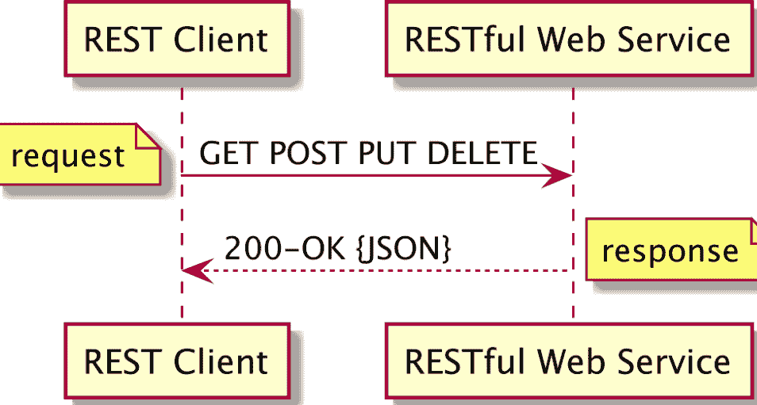

### 6.1.2 暴露 Web 服务

一些低级概念（如 HTTP 协议）可能会让你好奇在开发 REST 服务时代码看起来像什么样。JAX-RS 有了一组定义清晰类和注解来处理 HTTP 和 URI。资源可以有多种表示形式，因此 API 为多种内容类型提供了支持。

**代码列表 12. 一个简单的 RESTful 服务**

```java
@Path("/book")
public class BookResource {

  @GET
  @Produces("text/plain")
  public String getBookTitle() {
    return "H";
  }
}
```

#### HTTP 方法匹配

你已经看到 HTTP 协议如何与其请求、响应和操作方法（GET、POST、PUT 等）工作。JAX-RS 使用注解定义这些常用的 HTTP 方法：`@GET`、`@POST`、`@PUT`、`@DELETE`、`@HEAD` 和 `@OPTIONS`。只有公共方法可以暴露为资源方法。列表 113 显示了一个暴露 CRUD 方法的 RESTful Web 服务：使用 GET 方法检索资源，POST 方法创建新资源，PUT 方法更新现有资源，以及 DELETE 方法删除资源。

**代码列表 113. 暴露 CRUD 操作并返回响应的客户资源**

```java
@Path("/customers")
public class CustomerResource {

    @GET
    public Response getCustomers() {
        //
        return Response.ok(customers).build();
    }

    @GET
    @Path("{customerId}")
    public Response getCustomer(@PathParam("customerId") String customerId) {
        //
        return Response.ok(customer).build();
    }

    @POST
    public Response createCustomer(Customer customer) {
        //
        return Response.created(createdCustomerURI).build();
    }

    @PUT
    public Response updateCustomer(Customer customer) {
        //
        return Response.ok(customer).build();
    }

    @DELETE
    @Path("{customerId}")
    public Response deleteCustomer(@PathParam("customerId") String customerId) {
        //
        return Response.noContent().build();
    }
}
```

HTTP 规范定义了在请求成功时 HTTP 响应码应该是。你

JAX-RS 可以返回默认响应码：

- GET 方法通过请求的 URI 识别并检索信息（以实体的形式）。GET 应该返回 200-OK。
- PUT 方法引用一个需要更新的现有资源。如果修改了现有资源，则应发送 200-OK 或 204-No Content 响应，表示请求成功完成。
- POST 方法用于创建由请求的 URI 标识的新资源。响应应返回 201-CREATED，并带上该新资源的 URI（在 Location 头部中）；如果如果没有产生一个可以被 URI 标识的资源，则返回 204-No Content。
- DELETE 方法请求删除由请求的 URI 标识的资源。如果响应包含实体，成功的响应应为 200-OK；如果操作尚未执行，则返回 202-Accepted；如果操作尚未执行但响应不包含实体，则返回 204-No Content。

#### URI 定义与 URI 绑定

`@Path` 注解表示一个可以注解在类或方法上的相对 URI。当使用时，它被称为根资源，提供了资源树的根节点并允许访问资源。每个类应该使用不同的根资源，以便每个资源都能被唯一标识。列表 114 展示了一个可以通过 `http://www.vintage-shop.com/items/toprated` 访问的 REST 服务。该服务的所有方法将拥有 `/items/toprated` 作为根。

**列表 114. 通向项目资源的根路径**

```java
@Path("/items/toprated")
public class ItemResource {

    @GET
    public List<Item> getItems() {
        // ...
    }
}
```

一旦我们有了根路径（例如 `/items`），你就可以为你的方法添加子路径，这对于将多个资源的共同功能分组非常有用，如列表 115 所示。

**列表 115. ItemResource 中的多个子路径**

```java
@Path("/items")
public class ItemResource {

    @GET
    public List<Item> getItems() {
        // URI : /items
    }

    @GET
    @Path("/cds")
    public List<CD> getCDs() {
        // URI : /items/cds
    }

    @GET
    @Path("/books")
    public List<Book> getBooks() {
        // URI : /items/books
    }

    @POST
    @Path("/books")
    public Response createBook(Book book) throws URIyntaxException {
        // URI : /items/book
    }
}
```

列表 115 代表了一个 RESTful 服务，它将为你提供从 Vintage Store 中获取所有项目（CD 和书籍）的方法。当请求根资源 `/items` 时，只有没有 `@Path` 的方法会被选中（`getItems()`）。然后，当在类和相对路径上同时存在 `@Path` 时，它们将进行拼接。例如，要获取 CD，路径将是 `/items/cds`。当请求 `/items/books` 时，将调用 `getBooks()` 方法。要创建一个新项目，你需要指向 `/items/book`。

如果 `@Path("/items")` 仅存在于类上，而不存在于任何方法上，那么访问每个方法的路径将是相同的。区分它们的唯一方法将是 HTTP 动词（GET、PUT 等）和内容协商（text、XML 等），正如你稍后会看到的。

#### 提取参数

仅仅通过拼接路径拥有良好的 URI 是不够的；你还需要向你的 RESTful Web 服务传递参数并在运行时提取它们。JAX-RS 提供了一系列注解来提取请求可能发送的不同参数（`@PathParam`、`@QueryParam`、`@MatrixParam`、`@CookieParam`、`@HeaderParam` 和 `@FormParam`）。

- 列表 116 显示了如何使用 `@PathParam` 注解来提取 URI 模板参数的值。参数有一个名称，并用花括号之间的变量或跟随正则表达式的变量表示。`searchCustomers` 方法接受任何 String 参数，而 `getCustomerLogin` 仅允许小写/大写字母 (`[a-zA-Z]*`)，而 `getCustomerId` 仅允许数字 (`\d+`)。

**116. 提取路径参数与正则表达式**

```java
@Path("/customers")
public class CustomerResource {

    @GET
    @Path("search/{text}")
    public List<Customer> searchCustomers(@PathParam("text") String textToSearch)
        // URI : /customers/search

    @GET
    @Path("{login:[a-zA-Z]*}")
    public Customer getCustomerLogin(@PathParam("login") String login)
        // URI : /customers/foobarsmith

    @GET
    @Path("{customerId : \d+\}")
    public Customer getCustomerById(@PathParam("customerId") Long id)
        // URI : /customers/12345
}
```

`@Query` 注解提取 URI 查询参数的值。查询参数是使用 `&` 符号分隔的键/值对，例如 `http://www.vintage-shop.com/customer?zip=75012&city=Paris`。`@PathParam` 注解的作用类似于 `@Query`，不同之处在于它提取 URI 矩阵参数的值（使用分号 `;` 作为分隔符而不是 `?`）。列表 117 显示了如何从 URI 中提取查询参数和矩阵参数。

**列表 117. 提取查询参数与矩阵参数**

```java
@Path("/customers")
public class CustomerResource {

    @GET
    public List<Customer> getZipCode(@PathParam("zip") Long zip,
    // URI : /customer?zip=75012&city=Paris

    @GET
    @Path("/search")
    public List<Customer> getName(@PathParam("firstname") String firstname,
    // URI : /search;firstname=Antonio;surname=Goncal)

    @GET
    @Path("{city}")
    public Customer getByCity(@PathParam("city") String city)
        // URI : /customers;city=Paris
}
```

*(注：原文示例代码块似乎存在排版错误，如括号未闭合，翻译时已根据逻辑进行了微调以保持结构清晰，但严格遵循了翻译要求)*

```java
@Path("/customers")
public class CustomerResource {

    @GET
    public List<Customer> getZipCode(@PathParam("zip") Long zip, @PathParam("city") String city)

    @GET
    @Path("/search")
    public List<Customer> getName(@PathParam("firstname") String firstname, @PathParam("surname") String surname)
```


## JAX-RS 默认响应码

JAX-RS 可以返回默认响应码：

- **GET** 方法通过请求的 URI 识别并检索信息（实体的形式）。GET 应该返回 `200-OK`。
- **PUT** 方法引用一个需要更新的现有资源。如果修改了现有资源，则应发送 `200-OK` 或 `204-No Content` 响应，表示请求成功完成。
- **POST** 方法用于创建由请求的 URI 标识的新资源。响应应返回 `201-CREATED`，并带上该新资源的 URI（在 Location 头部中）；如果没有产生一个可以被 URI 标识的资源，则返回 `204-No Content`。
- **DELETE** 方法请求删除由请求的 URI 标识的资源。如果响应包含实体，成功的响应应为 `200-OK`；如果操作尚未执行，则返回 `202-Accepted`；如果操作尚未执行但响应不包含实体，则返回 `204-No Content`。

## URI 定义与 URI 绑定

`@Path` 注解表示一个可以注解在类或方法上的相对 URI。当使用时，它被称为根资源，提供了资源树的根节点并允许访问资源。每个类应该使用不同的根资源，以便每个资源都能被唯一标识。列表 114 展示了一个可以通过 `http://www.vintage-shop.com/items/toprated` 访问的 REST 服务。该服务的所有方法将拥有 `/items/toprated` 作为根。

### 列表 114. 通向项目资源的根路径

```java
@Path("/items/toprated")
public class ItemResource {

    @GET
    public List<Item> getItems() {
        // ...
    }
}
```

一旦我们有了根路径（例如 `/items`），你就可以为你的方法添加子路径，这对于将多个资源的共同功能分组非常有用，如列表 115 所示。

### 列表 115. ItemResource 中的多个子路径

```java
@Path("/items")
public class ItemResource {

    @GET
    public List<Item> getItems() {
        // URI : /items
    }

    @GET
    @Path("/cds")
    public List<CD> getCDs() {
        // URI : /items/cds
    }

    @GET
    @Path("/books")
    public List<Book> getBooks() {
        // URI : /items/books
    }

    @POST
    @Path("/books")
    public Response createBook(Book book) throws URIyntaxException {
        // URI : /items/books
    }
}
```

列表 115 代表了一个 RESTful 服务，它将为你提供从 Vintage Store 应用中获取所有项目（CD 和书籍）的方法。当请求根资源 `/items` 时，只有没有 `@Path` 的方法会被选中（`getItems()`）。然后，当在类和相对路径上同时存在 `@Path` 时，它们将进行拼接。例如，要获取 CD，路径将是 `/items/cds`。当请求 `/items/books` 时，将调用 `getBooks()` 方法。要创建一个新项目，你需要指向 `/items/books`。

如果 `@Path("/items")` 仅存在于类上，而不存在于任何方法上，那么访问每个方法的路径将是相同的。区分它们的唯一方法将是 HTTP 动词（GET、PUT 等）和内容协商（text、XML 等），正如你稍后会看到的。

## 提取参数

仅仅通过拼接路径拥有良好的 URI 是不够的；你还需要向你的 RESTful Web 服务传递参数并在运行时提取它们。JAX-RS 提供了一系列注解来提取请求可能发送的不同参数（`@PathParam`、`@QueryParam`、`@MatrixParam`、`@CookieParam`、`@HeaderParam` 和 `@FormParam`）。

- 列表 116 显示了如何使用 `@PathParam` 注解来提取 URI 模板参数的值。参数有一个名称，并用花括号之间的变量或跟随正则表达式的变量表示。`searchCustomers` 方法接受任何 String 参数，而 `getCustomerLogin` 仅允许小写/大写字母 (`[a-zA-Z]*`)，而 `getCustomerId` 仅允许数字 (`\d+`)。

### 列表 116. 提取路径参数与正则表达式

```java
@Path("/customers")
public class CustomerResource {

    @GET
    @Path("search/{text}")
    public List<Customer> searchCustomers(@PathParam("text") String textToSearch) {
        // URI : /customers/search/{text}
    }

    @GET
    @Path("{login:[a-zA-Z]*}")
    public Customer getCustomerLogin(@PathParam("login") String login) {
        // URI : /customers/foobarsmith
    }

    @GET
    @Path("{customerId : \\d+}")
    public Customer getCustomerById(@PathParam("customerId") Long id) {
        // URI : /customers/12345
    }
}
```

`@QueryParam` 注解提取 URI 查询参数的值。查询参数是使用 `&` 符号分隔的键/值对，例如 `http://www.vintage-shop.com/customer?zip=75012&city=Paris`。`@MatrixParam` 注解的作用类似于 `@QueryParam`，不同之处在于它提取 URI 矩阵参数的值（使用分号 `;` 作为分隔符而不是 `?`）。列表 117 显示了如何从 URI 中提取查询参数和矩阵参数。

### 列表 117. 提取查询参数与矩阵参数

```java
@Path("/customers")
public class CustomerResource {

    @GET
    public List<Customer> getZipCode(@QueryParam("zip") Long zip,
                                     @QueryParam("city") String city) {
        // URI : /customers?zip=75012&city=Paris
    }

    @GET
    @Path("/search")
    public List<Customer> getName(@MatrixParam("firstname") String firstname,
                                  @MatrixParam("surname") String surname) {
        // URI : /customers/search;firstname=Antonio;surname=Goncal
    }

    @GET
    @Path("{city}")
    public Customer getByCity(@PathParam("city") String city) {
        // URI : /customers/{city}
    }
}
```

## 消费与产生类型

通过 REST，同一个资源可以有多种表示；一个资源可以是网页、PDF 或图像。`javax.ws.rs.Consumes` 和 `javax.ws.rs.Produces` 注解可以应用于资源，其中存在多种表示。JAX-RS 有一个 `javax.ws.rs.MediaType` 类作为 MIME 类型的抽象。它具有表 30 中列出的常量。

### 表 30. MediaType 中定义的 MIME 类型

| 常量名 | MIME 类型 |
| :--- | :--- |
| `APPLICATION_ATOM_XML` | `application/atom+xml` |
| `APPLICATION_FORM_ENCODED` | `application/x-www-form-urlencoded` |
| `APPLICATION_JSON` | `application/json` |
| `APPLICATION_OCTET_STREAM` | `application/octet-stream` |
| `APPLICATION_SVG_XML` | `application/svg+xml` |
| `APPLICATION_XHTML_XML` | `application/xhtml+xml` |
| `APPLICATION_XML` | `application/xml` |
| `MULTIPART_FORM_DATA` | `multipart/form-data` |
| `TEXT_HTML` | `text/html` |
| `TEXT_PLAIN` | `text/plain` |
| `TEXT_XML` | `text/xml` |
| `WILDCARD` | `*/*` |

在方法上使用 `@Consumes` `@Produces` 注解会覆盖类上的任何注解。在缺少这些注解的情况下，假设任何媒体类型（`*/*`）。默认情况下，`CustomerRestService` 生成纯文本表示（参见列表 118）。注意 `getJsonAndXML` 生成数组（XML 或 JSON）。

### 列表 118. 具有多种表示的客户资源

```java
@Path("/api/customers")
public class CustomerResource {

    @GET
    @Produces(MediaType.TEXT_PLAIN)
    public Response getAsPlainText() {
        // ...
    }

    @GET
    @Produces(MediaType.TEXT_HTML)
    public Response getAsHtml() {
        // ...
    }

    @GET
    @Produces({MediaType.APPLICATION_JSON, MediaType.APPLICATION_XML})
    public Response getJsonAndXML() {
        // ...
    }

    @PUT
    @Consumes(MediaType.TEXT_PLAIN)
    public void putName(String customer) {
        // ...
    }
}
```

## 返回类型

到为止，你已经看到了如何调用方法（使用参数、媒体类型、HTTP 方法等），而不关心返回类型。RESTful Web 服务可以返回什么？就像任何 Java 类一样，方法可以返回任何标准 Java 类型、bean 或其他对象，只要它具有可以在 HTTP 上传输的文本表示。在这种情况下，运行时会确定返回对象的 MIME 类型，并调用相应的实体提供者来获取其表示。运行时还会确定发送给消费者的 HTTP 返回码（如果资源方法的返回类型为 `void` 或 `null`，则返回 `204-No Content`；如果返回内容，则返回 `200-OK`）。

值不为空。有时你可能对返回的所有内容进行更精细的控制：不仅是响应体（也称为实体），还包括响应码和/或响应头或 Cookie。这时你就需要返回一个 `Response` 对象。返回一个带有实体的 `javax.ws.rs.Response` 是一种良好的做法，它能保证返回内容的媒体类型。列表 119 展示了不同的返回类型。

### 列表 119. 客户服务的返回数据类型、一个 Bean 和一个 Response

```java
@Path("/customer")
public class CustomerResource {

    @GET
    public String getAsPlainText() {
        return new Customer("John", "Smith").toString();
    }

    @GET
    @Path("max")
    public Integer getMaximumAge() {
        return 42;
    }

    @GET
    @Produces(MediaType.APPLICATION_XML)
    public Customer getAsXML() {
        Customer customer = new Customer("John", "Smith");
        return customer;
    }

    @GET
    @Produces(MediaType.APPLICATION_JSON)
    public Response getAsJSON() {
        Customer customer = new Customer("John", "Smith");
        return Response.ok(customer).encoding("utf-8").build();
    }
}
```

`getAsPlainText()` 方法返回客户的字符串表示，而 `getMaximumAge()` 返回一个数值常量。默认情况下，这两个方法的 HTTP 状态码都将是 `200-OK`（如果没有发生异常的话）。`getAsXML()` 返回一个 `Customer` 对象，运行时将将其序列化为 XML。

`getAsJSON()` 方法没有直接返回实体，而是返回一个 `javax.ws.rs.core.Response` 对象，该对象封装了使用 `ResponseBuilder` 作为工厂创建并实例化的实体。在这个示例中，我们希望返回一个带有 `200-OK` 状态（使用 `ok()` 方法）的对象（即 `Customer`），但同时我们还想指定编码为 UTF-8。调用 `ResponseBuilder.build()` 方法会创建最终的 `Response` 实例。

### 表 31. Response API

| 方法 | 描述 |
| :--- | :--- |
| `accepted()` | 创建一个带有 `202-Accepted` 状态的新 `ResponseBuilder` |
| `created()` | 用于 `201-Created` 资源（带 URI）的新 `ResponseBuilder` |
| `noContent()` | 用于空响应（`204-No Content`）的新 `ResponseBuilder` |
| `notModified()` | 创建一个带有 `304-Not Modified` 状态的 `ResponseBuilder` |
| `ok()` | 创建一个带有 `200-OK` 状态的新 `ResponseBuilder` |
| `serverError()` | 创建一个带有 `500-Internal Server Error` 状态的 `ResponseBuilder` |
| `status()` | 创建一个带有所提供状态码的 `ResponseBuilder` |
| `temporaryRedirect()` | 临时重定向 (`307-Temporary Redirect`) |
| `getCookies()` | 从响应消息中获取 Cookie |
| `getHeaders()` | 从响应消息中获取头部信息 |
| `getLinks()` | 获取作为头部附加在消息上的链接 |
| `getStatus()` | 获取与响应相关的状态码 |
| `readEntity()` | 读取消息实体 |

`Response` 和 `ResponseBuilder` 遵循流式 API（fluent API）设计模式。你可以通过链式调用方法轻松编写响应。这使得代码更具可读性。以下是使用此 API 编写的一些示例：

```java
Response.ok().build();

Response.ok().cookie(new Cookie("SessionID", "567GDIFY09")).build();

Response.ok("Plain Text").expires(new Date()).build();

Response.ok(new Customer("Ennio", "Smith"), MediaType.APPLICATION_JSON).build();

Response.noContent().build();

Response.accepted(new Customer("Ligia", "Smith")).build();

Response.notModified().header("User-Agent", "Mozilla").build();
```


## 6.1.3. 调用 RESTful Web 服务

JAX-RS 拥有一个客户端 API，你可以轻松地向你的 RESTful Web 服务发送 HTTP 请求（尽管要处理 HTTP 协议的所有底层细节）。它是一个流式请求构建 API（即使用 Builder 设计模式），使用了少量的类和接口（请参见表 32 以概览 `Client`、`WebTarget` 和 `Response`）。`Client` 接口（通过 `ClientBuilder` 获取）是 `WebTarget` 实例的构建器。`WebTarget` 代表一个特定的 URI，你可以通过它调用请求以获取 `Response`。从此 `Response` 中，你可以检查状态、长度或 Cookie，但更重要的是，你可以通过 `Entity` 类获取其内容（也称为实体、消息体或负载）。

### 表 32. `javax.ws.rs.client` 包的主要类和接口

| 类/接口 | 描述 |
| --- | --- |
| Client | 流式 API 的主入口点，用于构建和执行客户端请求以消费返回的响应 |
| ClientBuilder | 用于引导 Client 实例的流式 API 入口点 |
| Configurable | { Client、WebTarget 和 Invocation 的侧边配置 |
| Entity | 封装消息实体，包括相关的变体信息 |
| Invocation | 已准备好并就绪执行的请求 |
| Invocation.Builder | 客户端请求调用构建器 |
| WebTarget | 由资源 URI 标识的资源目标 |

在第 7 章中，你将看到 HTTP 微服务如何调用另一个微服务。基本上，它将使用作为 MicroProfile 一部分的 Eclipse MicroProfile REST Client。Eclipse MicroProfile REST Client 基于 JAX-RS 2.0 客户端 API，因此了解这一点很重要。

### 引导 Client (Bootstrapping the Client)

`Client` 接口（通过 `ClientBuilder` 获取）是 `WebTarget` 实例的构建器。`WebTarget` 代表一个特定的 URI，你可以通过它调用请求以获取 `Response`。从此 `Response` 中，你可以检查状态、长度或 Cookie，但更重要的是，你可以通过 `Entity` 类获取其内容（也称为实体、消息体或负载）。

### 目标与调用 (Targets and Invocations)

一旦你有了 `Client`，就可以使用它来构建 `WebTarget`。

```java
Client client = ClientBuilder.newClient();
```

现在你拥有了 URI 目标，需要构建 HTTP 请求。`WebTarget` 允许你使用 `Invocation.Builder` 这样做：

```java
URI uri = new URI("http://localhost:8081/customers");
WebTarget target = client.target(uri);
```

构建简单的 GET 请求只需要：

```java
Invocation invocation = target.request().buildGet();
```

`Invocation.Builder` 允许你构建 GET 方法以及 POST、DELETE 方法。你还可以为不同的 MIME 类型构建请求，并添加路径参数。对于 PUT 和 POST 方法，你需要传递一个 `Entity`，它代表要发送的负载：

```java
target.request().buildDelete();
target.queryParam("author", "Else").request().buildGet();
target.path(bookId).request().buildGet();
target.request(MediaType.APPLICATION_XML).buildGet();
target.request(MediaType.APPLICATION_XML).acceptLanguage("pt").buildGet();
target.request().buildPost(Entity.entity(new Book()));
```

下面的代码连接了 `Invocation`。你需要调用 `invoke()` 方法来实际调用远程 RESTful Web 服务并获取 `Response`。`Response` 定义了与返回内容的约定，也是你要消费的内容：

```java
Response response = invocation.invoke();
```

所以，总结一下，这些行代码可以调用位于 http://localhost:8081/customers 的远程 RESTful 服务的 GET 方法并返回 text/plain 值：

```java
Client client = ClientBuilder.newClient();
WebTarget target = client.target("http://localhost:8081/customers");
Invocation invocation = target.request(MediaType.TEXT_PLAIN).buildGet();
Response response = invocation.invoke();
```

多亏于 API 和一些快捷方式，你可以用单行代码实现相同的行为：

```java
Response response = ClientBuilder
    .newClient()
    .target("http://localhost:8081/customers")
    .request(MediaType.TEXT_PLAIN)
    .get();
```

## 6.1.4. 配置 RESTEasy

像通常 Quarkus 一样，如果你需要配置扩展，只需在 `application.properties` 文件中添加一些属性。要配置 Restful Web 服务，可以查找 `quarkus.resteasy` 命名空间下的配置键。

### 表 33. 一些 Quarkus RESTEasy 配置属性

| Property | Default | 描述 |
| --- | --- | --- |
| quarkus.resteasy.gzip.enabled | false | gzip 已启用 |
| quarkus.resteasy.gzip.max-input | 10M | 最大压缩后的字节大小（如果超过限制，将返回 413-Payload Too Large） |
| quarkus.resteasy.singleton-resources | true | 如果为 true，JAX-RS 将仅使用资源的单个实例；如果 false，则为每个请求创建一个新的资源实例 |
| quarkus.resteasy.path | / | 如果没有带注解的应用类，则覆盖 JAX-RS 资源的默认路径 |
| quarkus.resteasy.metrics.enabled | false | 如果存在 Metrics 能力，是否启用 JAX-RS 指标 |

## 6.2. Eclipse MicroProfile OpenAPI

JAX-RS 允许消费和暴露 REST API。但它并不能帮助你编写 API 文档，你需要使用外部工具。而 Quarkus 允许你做到这一点。默认情况下，Quarkus 应用通过 OpenAPI 规范暴露其 API 说明。它甚至允许你通过名为 Swagger UI 的用户友好界面进行测试。

暴露 REST API 已经成为所有现代应用程序不可或缺的一部分。从微服务开发者的角度来看，理解如何与这些 API 交互以及测试它们仍然有效且向后兼容是非常重要的。为此，需要一个清晰且完整的合约。因此，需要一种标准的 API 文档机制，并且也可以用于 API 测试。这就是 OpenAPI 出现的地方。

Eclipse MicroProfile OpenAPI 为 OpenAPI v3 规范提供了一个 Java API，所有应用开发者都可以使用它来暴露自己的 API 文档。它旨在提供一组 Java 接口和编程模型，允许 Java 开发者从其 JAX-RS 端点原生生成 OpenAPI v3 文档。

Eclipse MicroProfile OpenAPI 的 API 和注解定义主包 `org.eclipse.microprofile.openapi` 下，位于根包或其他子包下。表 34 列出了 Eclipse MicroProfile OpenAPI 1.1 版本定义的子包（在根 `org.eclipse.microprofile.openapi` 包下）。

### 表 34. Eclipse MicroProfile OpenAPI 子包

| Subpackage | 描述 |
| --- | --- |
| root | OpenAPI API 的根包 |
| annotations | 生成有效 OpenAPI 文档的注解集 |
| models | 以程序方式定义 OpenAPI 文档的接口 |
| spi | 提供者实现的内部 SPI（服务提供者接口） |

除了 API 之外，OpenAPI 还带有一组注解。表 35 列出了常用注解的子集。

### 表 35. 主要 OpenAPI 注解

| Annotation | 描述 |
| --- | --- |
| @APIResponse | 描述端点的响应（响应码、数据结构、类型等） |
| @Operation | 描述路径上的单个 API 操作 |
| @OpenAPIDefinition | OpenAPI 文档的根文档对象 |
| @Parameter | 方法参数的名称 |
| @RequestBody | 请求体的简要描述 |
| @Schema | 允许定义输入和输出数据类型 |
| @Tag | 用于为 REST 端点合约添加标签以提供更详细的描述 |

`quarkus-smallrye-openapi` 扩展是这些扩展之一，一旦添加到 `pom.xml` 中，就可以为你带来新功能，而无需调用 API。添加此扩展后，Quarkus 将自动为你的 REST 端点生成 OpenAPI v3 文档。

### Listing 120. OpenAPI 扩展

```xml
<dependency>
  <groupId>io.quarkus</groupId>
  <artifactId>quarkus-smallrye-openapi</artifactId>
</dependency>
```

在深入研究 OpenAPI 之前，我们需要定义一些术语，例如 OpenAPI v3 规范。

### Swagger

Swagger UI 术语源于 Swagger。让我们解释一下。起初，没有特定的方法来描述 RESTful 服务。某些开发者没有记录他们的 API 文档，或者使用内部的属性格式。这时 Swagger 派上了用场。

Swagger 是 2011 年创建的一个开源软件框架，帮助开发者构建、文档化和消费 RESTful Web 服务。当时，REST API 通常没有机器可读的描述，因此 Swagger 在开发者和公司（如 Apigee、Intuit、Microsoft、IBM 等）之间变得非常流行。在 Swagger 创建后不久，引入了描述 RESTful API 的替代结构。2015 年，在 Linux Foundation 的赞助下，Swagger 被捐赠给了 OpenAPI 倡议。2016 年，Swagger 规范被重命名为 OpenAPI 规范。

## 6.2.1. 理解 OpenAPI v3 规范

OpenAPI 规范（以前称为 Swagger 规范）是用于 REST API 的 API 描述格式。它是一种用于描述、生成、消费和可视化 RESTful Web 服务的**机器可读接口**的规范。一个 OpenAPI 文件允许你描述你自己的 API：

- 每个端点上的可用端点和操作（GET、POST 等），
- 每个操作的输入和输出参数，
- 身份验证方法，
- 联系人信息、许可、使用条款和其他信息。

规范可以使用 YAML 或 JSON 编写。该格式易于学习，并且对人类和机器都是可读的。

每个 API 定义必须包含该定义所依据的 OpenAPI 规范版本：

```yaml
openapi: 3.0.1
```

`info` 部分包含 API 信息：

- title：API 名称。
- description（可选）：关于 API 的扩展信息。它可以是内联的。

```yaml
openapi: 3.0.1
info:
  title: Generated API
  version: "1.0"
  tags:
    name: Author Endpoint
```

### 列表 123. 带有 OpenAPI 注解的作者端点

```java
@Path("/authors")
@Produces(MediaType.TEXT_PLAIN)
public class AuthorResource {

    String[] scifiAuthors = {"Isaac Asimov", "Nora Jemisin", "Douglas Adams"};

    @GET
    @Path("/index")
    @Operation(summary = "Returns an author for a given index")
    @APIResponse(responseCode = "204", description = "Author not found")
    @APIResponse(responseCode = "200", description = "Author returned for a given index")
    public String getScifiAuthor(@PathParam("index") int index) {
        return scifiAuthors[index];
    }
}
```

如下所示，`@Operation` 注解的 summary 字段被反映在 OpenAPI v3 合约中。

```yaml
# 没有注解
paths:
  /authors/{index}:
    get:

## 使用 @Operation 注解
paths:
  /authors/{index}:
    get:
      summary: Returns an author for a given index
```

在代码中添加 `@APIResponse` 注解也可以使合约更加清晰，因为所有返回的状态码都将被列出并记录。

```yaml
# 没有注解
"200":
  description: OK
  content:
    text/plain:
      schema:
        type: string

## 使用 @APIResponse
responses:
  "204":
    description: Author not found
  "200":
    description: Author returned for a given index
    content:
      text/plain:
        schema:
          type: string
```

## 高级自定义

如果你有外部客户端访问你的端点，你希望为它们添加更多信息，以理解每个端点的作用。不仅仅是关于操作和返回码，还包括参数、返回值、通用文档等。幸运的是，OpenAPI 定义了一组丰富的注解，你可以使用它们来自定义 API 文档。

图 35 显示了一个消耗并产生 Book 类的 REST 端点。注意 `BookApplication`，它是一个通用类，用于记录整个应用程序，而不仅仅是单个端点。OpenAPI 允许你记录整个应用程序：从 BookApplication 到 Book。

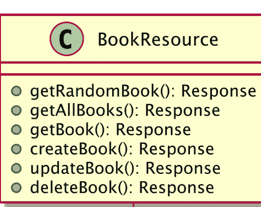

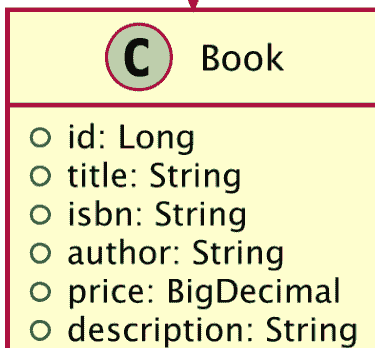


**图 35. REST 应用**

### 自定义应用程序

为特定的 REST 端点拥有文档化的合约是不够的。记录整个应用程序同样重要。区别在于，OpenAPI 注解不仅存在于端点本身，而是存在于配置整个应用程序的另一个 Java 类中（参见列表 124 中的 `BookApplication`）。为了定义一个全局定义 JAX-RS 应用的类，`BookApplication` 需要扩展 JAX-RS 的 `javax.ws.rs.core.Application` 类。这允许应用程序运行并提供了额外的元数据。例如，`@OpenAPIDefinition` 注解。该注解用于向合约的根文档添加额外信息。它包含了多个字段，例如应用程序的描述、其版本、联系团队或使用的许可证。

### 列表 124. 应用程序信息

```java
@OpenAPIDefinition(
    info = @Info(
        title = "Book API",
        description = "This API allows CRUD operations",
        version = "1.0",
        contact = @Contact(
            name = "Support Team",
            email = "support@example.com"
        )
    )
)
```


license = @License(
    name = "Apache 2.0",
    url = "https://www.apache.org/licenses/LICENSE-2.0"
)
)
public class BookApplication extends Application {
}

# 列表 134. 书籍引用数组

```yaml
paths:
  /api/books:
    get:
      summary: 从数据库中返回所有书籍
      responses:
        "204":
          description: 没有书籍
        "200":
          description: OK
          content:
            application/json:
              schema:
                type: array
              items:
                $ref: '#/components/schemas/Book'
```

在 `@Schema` 注解中，我们可以通过 schema 类型引用响应对象或参数对象。这可以指向一个数据传输对象（DTO），例如。列表 135 表示了 `Book` 类，该类作为请求体传递给 `createBook()` 方法（列表 131），或作为 `getAllBooks()` 的响应（参见列表 133）。如你所见，`Book` 也可以使用 `@Schema` 注解来添加描述，或者指定哪些字段是必需的以及示例值是什么。

## 列表 135. 使用请求体的操作

```java
@Schema(name = "Book", description = "Book representation")
public class Book {
  @Schema(required = true, readOnly = true)
  public Long id;
  @Schema(required = true)
  public String title;
  @Schema(required = true, example = "9798629562115")
  public String isbn;
  public String author;
  public BigDecimal price;
  public String description;
}
```

`Book` 类在 OpenAPI v3 契约的 schemas 部分描述，如列表 136 所示。

# 列表 136. 契约中的书籍引用

```yaml
components:
  schemas:
    Book:
      description: Book representation
      required:
        - id
        - isbn
        - title
      type: object
      properties:
        author:
          type: string
          description:
            type: string
        id:
          format: int64
          type: integer
          readOnly: true
      isbn:
        type: string
        example: "978629562115"
      price:
        $ref: '#/components/schemas/BigDecimal'
      title:
        type: string
```

如你所见，Eclipse MicroProfile OpenAPI API 带有一组用于文档 REST 端点的 API 和注解。Quarkus 可以以 YAML 或 JSON 格式生成此文档。这两种格式都是人类可读的，并用于外部工具（例如 Swagger Codegen）生成存根或代理 [1]。但如果应用程序由多个端点组成且每个端点暴露许多 API，OpenAPI 契约可能会变得巨大且难以阅读。拥有用户界面可能会非常有帮助。Quarkus 通过集成 Swagger UI 解决了这个问题。

## 6.2.3. Swagger UI

在构建 API 时，开发者希望快速分析它们。Swagger UI 是一个很好的工具，允许你可视化并与你的 API 交互 [2]。它从 OpenAPI 契约自动生成，视觉化文档使得后端实现和客户端消费变得简单。

Quarkus 的 smallrye-openapi 扩展带了一个配置恰当的 Swagger UI 页面。默认情况下，可以通过 `/swagger-ui` 访问 Swagger UI（OpenAPI 契约可以通过 `/openapi` 访问）。一旦应用程序启动，你可以访问 http://localhost:8080/swagger-ui 并尝试 API。如图 36 所示，Swagger UI 让你能够可视化 API 的操作和架构，并与其交互。

# 书籍 API 1.0 OAS3

此 API 允许对书籍进行 CRUD 操作
@gonical - 网站
MIT
所有 Quarkus 扩展代码

- api 任何人都可以使用的公有 API
- books 任何对书籍感兴趣的人
- default 默认

```
GET /api/books 从数据库中返回所有书籍
```

参数

无参数

响应

| 代码 | 描述 | 链接 |
| --- | --- | --- |
| 200 | OK <br>无内容 <br>application/json <br>Accept 请求头 <br>示例值
```json
{
  "id": "string",
  "name": "string",
  "isbn": "97802282111",
  "title": "string"
}
``` | 无链接 |
| 204 | 没有书籍 | 无链接 |

图 36. Swagger UI

## 6.2.4 配置 SmallRye OpenAPI

默认情况下，Quarkus 扫描应用程序包中的所有类，以发现 JAX-RS 端点和 OpenAPI 注解。Eclipse MicroProfile OpenAPI 提供了一组属性，允许你包含或排除某些包列表，也可以排除某些类。如果你只需要为某些 REST 端点生成契约，这将非常有用。表 36 是每个供应商都必须支持的标准配置属性的子集。

表 36. MicroProfile OpenAPI 配置属性

| 属性 | 描述 |
| --- | --- |
| mp.openapi.scan.disable | 禁用注解扫描（默认值为 false） |
| mp.openapi.scan.packages | 待扫描的包列表 |
| mp.openapi.scan.classes | 待扫描的类列表 |
| mp.openapi.scan.exclude.packages | 从扫描中排除的包列表 |
| mp.openapi.scan.exclude.classes | 从扫描中排除的类列表 |
| mp.openapi.servers | 全局服务器列表 |

在表 36 列出的标准属性之上，Quarkus 添加了如表 37 所示的配置属性。

表 37. 某些 OpenAPI 配置

| 属性 | 默认值 |
| --- | --- |
| quarkus.openapi.path | /openapi |
| quarkus.swagger-ui.path | /swagger-ui |
| quarkus.swagger-ui.always | false |
| quarkus.swagger-ui.enable | true |

## 6.3. JSON Binding

到为止看到的示例都在消费或产生 JSON。事实上，JSON Binding（JSON-B）是一种将 Java 对象转换为 JSON 的标准层。JSON 已成为微服务之间常用的格式。

JSON Binding API 全定义在 `jakarta.json.bind` 包中，表 38 列出了主要的子包。

表 38. java.json.bind 子包

| 子包 | 描述 |
| --- | --- |
| root | JSON-B 的根包 |
| adapter | 定义 Java 类型自定义映射的 API |
| annotation | JSON-B 注解 |
| config | 用于配置映射的类和接口 |
| serializer | 用于自定义的 JSON-B 内部实现 |
| spi | 由提供者实现的内部 SPI（服务提供者接口） |

除了 API，JSON-B 还带有一组注解。表 39 列出了常用的注解。

表 39. 主要 JSON-B 注解

| 注解 | 描述 |
| --- | --- |
| @JsonbDateFormat | 自定义字段日期格式 |
| @JsonbProperty | 允许自定义字段名称 |
| @JsonbNumberFormat | 自定义数字格式 |
| @JsonbTransient | 防止映射字段 |

为了能够绑定 JSON 对象，你需要 JSON Binding。JSON-B 带有列表 137 所示的 RESTEasy 扩展。

列表 137. JSON-B 扩展

```xml
<dependency>
  <groupId>io.quarkus</groupId>
  <artifactId>quarkus-resteasy-jsonb</artifactId>
</dependency>
```

## Jackson

你可能不知道 JSON-B 但听说过或使用过 Jackson。受 XML 工具质量和多样性的启发，Jackson 于 2009 年创建，用于处理 JSON 的通用 Java 库。它是一个高性能的 JSON 处理器，包括流式 JSON 解析器/生成器库以及匹配的数据绑定库（POJO 与 JSON 之间的转换）。

JSON-B 类似于 Jackson，事实上，Quarkus 也提供了一个 Jackson 扩展。由于 JSON-B 是 MicroProfile 的一部分，这方便我们只需不要在同一个项目中混合使用 Jackson 和 JSON-B，因为这可能会引入意外的 Bean。

```json
{
  "email": "J.rorri@me.com",
  "first_name": "James",
  "last_name": "Rorrison",
  "phone_number": "+44 1234 1234",
  "address":{
    "street":"21 Ritherton Rd",
    "city":"Brighton",
    "country":"UK"
  }
}
```

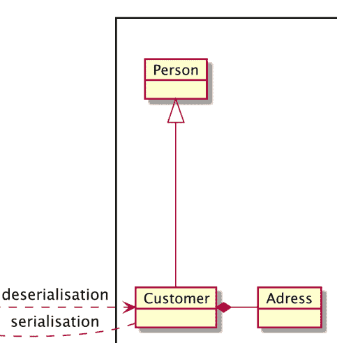

图 37. JSON 文档与 Java 类之间的绑定

## 6.3.2. 绑定 POJOs

到为止，我们看到了 JPA 如何将对象映射到关系型数据库：它使用默认映射机制（又称通过异常编程或约定优于配置），并提供了一组注解来定制默认设置。OpenAPI 的工作原理相同：OpenAPI v3 合约是根据默认端点注解生成的，或者 Eclipse MicroProfile OpenAPI 提供一组注解，以便在需要时向合约添加额外信息。JSON-B 的情况也是如此。

### 默认绑定

默认映射是 JSON-B 用于在没有任何注解或配置的情况下映射默认对象的一组规则。对于 JSON-B，默认映射规则如下：

- 属性名绑定到相同的 JSON 键名（例如 `title` 键）。
- 所有基础 Java 类型（String, Integer, int 等）、标准 Java 类型（BigDecimal, URL, Optional 等）或数据其值都被绑定到 JSON 值上。这些值必须遵循 RFC 7159 标准（JSON 数据交换格式）并使用 UTF-8 编码[156]。

现在，让我们通过一个简单的示例来看默认绑定。代码列表 138 表示一个 `Book` 对象，为了清晰起见，我省略了它的 getter 和 setter。如你所见，该对象具有多个不同类型（String, float, Integer 和 Boolean）的属性（title, price 等）、一个默认构造函数，以及每个属性的 getter 和 setter。

列表 138. 简单的 Book 类

```java
public class Book {
    private String title;
    private Float price;
    private String isbn;
    private Integer nbOfPages;
    private Boolean illustrations;
    private String description;
    private LocalDate publicationDate;
    // Constructors, getters, setters
}
```

那么它是如何映射到 JSON 的呢？答案是：得益默认绑定，JSON-B 运行时反序列化 `Book` 实例，生成代码列表 139 所示的 JSON 文档。

列表 139. Book 对象的默认 JSON 表达式

```json
{
    "title": "H2G2",
    "price": 12.5,
    "isbn": "1-84023-742-2",
    "nbOfPages": 354,
    "illustrations": false,
    "description": "Best Sci-fi book ever",
    "publicationDate": "1999-04-28"
}
```

### 定制绑定

正如我们之前在 JPA 或 OpenAPI 中看到的，如果你需要定制默认绑定，可以使用注解。在 JSON-B 中，你可以在字段、getter 或 setter 上添加绑定注解。如果注解指定在字段上，则绑定同时用于序列化和反序列化。如果它注解在 getter 上，则仅用于序列化；如果它注解在 setter 上，则仅用于反序列化。

代码列表 140 在字段上使用了多个 JSON-B 注解：

- `@JsonbProperty` 用于更改特定属性的名称（例如用 `book_title` 代替默认的 `title`）。`nillable` 属性开启或关闭空值的序列化。
- 默认情况下，JSON-B 使用 ISO 格式序列化和反序列化日期及数字。如果需要覆盖这些设置，可以使用 `@JsonbDateFormat` 和 `@JsonbNumberFormat`。这些注解接受遵循 `java.time.format.DateTimeFormatter` 和 `java.text.DecimalFormat` 的参数。
- 另外注意，属性描述被注解了 `@JsonbTransient`，因此它会被 JSON 绑定引擎忽略。

列表 140. 定制化的 Book 类

```java
public class Book {
    @JsonbProperty(value = "book_title", nillable = false)
    private String title;
    @JsonbNumberFormat("#0.00")
    private Float price;
    private String isbn;
    @JsonbProperty(value = "nb_of_pages", nillable = true)
    private Integer nbOfPages;
    private Boolean illustrations;
    @JsonbTransient
    private String description;
    @JsonbDateFormat("dd/MM/yyyy")
    private LocalDate publicationDate;
    // Constructors, getters, setters
}
```

当代码列表 140 中的 `Book` 对象被序列化为 JSON 文档时，它看起来就像代码列表 141 中的 JSON：标题已重命名，价格和发布日期经过了格式化，且描述没有出现在文档中。

列表 141. Book 的定制 JSON 表达式

```json
{
    "book_title": "H262",
    "price": "12.50",
    "isbn": "1-84023-742-2",
    "nb_of_pages": 354
}
```

### 高级定制

（注：此处后续原文存在大量重复和 OCR 错误，已按要求提取核心逻辑）

列表 144. 使用 API 序列化和反序列化 JSON

```java
// 创建 book实例
Book book = new Book().title("H2G2").price(12.5F).isbn("1-84023-742-2");
```

```java
// 创建 Jsonb 实例
Jsonb jsonb = JsonbBuilder.create();
```

```java
// 序列化
String json = jsonb.toJson(book);
```


在 Listing 144 中，`toJSON` 方法将 `Book` 对象序列化为 `String`。如果你想从 JAX-RS 端点返回此字符串，如 Listing 145 所示，有两种可能：你直接返回一个字符串 (`getBookAsResponse()`)，或者返回一个 `Response` 并将字符串嵌入其中 (`getBookAsString()`)。

### Listing 145. 在 REST 端点中序列化 JSON

```java
@GET
@Produces(APPLICATION_JSON)
public String getBookAsString() {
  Book book = new Book().title("H2G2").price(12.5F).isbn("1-84023-742-2");
  Jsonb jsonb = JsonBuilder.create();
  String json = jsonb.toJson(book);
  return json;
}
```

```java
@GET
@Produces(APPLICATION_JSON)
public Response getBookAsString() {
  Book book = new Book().title("H2G2").price(12.5F).isbn("1-84023-742-2");
  Jsonb jsonb = JsonBuilder.create();
  String json = jsonb.toJson(book);
  return Response.ok(json).build();
}
```

## 自动序列化与反序列化

JSON-B 与 JAX-RS 良好集成。如果一个 REST 端点产生 JSON 并返回一个对象，该对象将自动序列化为 JSON。如果该对象标记了 JSON-B 注解，则绑定将透明地完成，JSON-B 允许你将 Json 转换为 Java 对象。得益于注解，你可以自定义绑定，并生成或消费与对象结构略有不同的 JSON。但有时你需要生成、构建、读取和写入与 Java 对象无关的 JSON。

这时 JSON-P 就登场了。JSON-B 和 JSON-P 是 MicroProfile 的一部分，因此包含在 Quarkus 中。

JSON 处理 (JSON-P) 是一种允许在 Java 中进行 JSON 处理的规范 [7]。处理包含了解析、生成、转换和查询 JSON 数据的机制。JSON-P 提供了一种标准，使用 DOM API 构建 JSON 格式的 Java 对象。同时，它提供了一种类似于 XML 中 STAX（XML 流式 API）的流式机制来解析和消费 JSON [10]。

JSON 处理 API 都在主 `java.json` 包下定义，位于根包或其他子包下。表 40 列出了 JSON-P 1.1 中定义的主要子包（在根 `java.json` 包下）[11]。

### 表 40. 主要 java.json 子包

| 子包 | 描述 |
| --- | --- |
| root | JSON-P API 的根包 |
| stream | 提供用于解析和生成 JSON 的流式 API |
| spi | 由提供者实现的内部 SPI（服务提供接口） |

JSON-P 有一个主 `java.json.Json` API，这是一个用于创建 JSON 处理对象的类。API 列在表 41 中。

### 表 41. 主要 JSON-P API

| API | 描述 |
| --- | --- |
| Json | 创建 JSON 处理对象的门面 |
| JsonObject | 代表一个不可变的 JSON 对象值 |
| JsonArray | 代表一个不可变的 JSON 数组（零或多个值的有序序列） |
| JsonWriter | 将 JSON 对象或数组结构写入输出源 |
| JsonReader | 从输入源读取 JSON 对象或数组结构 |
| JsonParser | 以流式方式对 JSON 数据提供前向的、只读的访问 |
| JsonGenerator | 以流式方式向输出源写入 JSON 数据 |

JSON-P 和 JSON-B 共享相同的扩展。通过 Listing 148 所示的扩展，你可以绑定并处理 JSON。

### Listing 148. JSON-P 扩展

```xml
<dependency>
  <groupId>io.quarkus</groupId>
  <artifactId>quarkus-resteasy-jsonb</artifactId>
</dependency>
```

## 6.1. 理解处理

JSON-P 提供了两种处理 JSON 文档的编程模型：*对象模型 API (Object Model API)* 和流式 API (Streaming API)。

类似于 XML 的 DOM API，对象模型 API 提供了 `classes` 来在树结构中建模 JSON 对象和数组（使用 `JsonObject` 和 `JsonArray` API），该树结构在内存中表示 JSON 数据。通过 DOM API，对象模型 API 提供了对整个树内容的灵活导航和查询。它还允许通过 `JsonReader` 和 `JsonWriter` API 读取和写入 JSON 文件。

流式 API（位于 `stream` 包下）是一种用于高效处理大量 JSON 数据的低级 API。流式 API 类似于 XML 的 StAX API。它提供了一种在不在内存中维护文档的情况下流式处理 JSON 的方法。流式 API 提供了一个基于拉取流式模型（使用 `JsonParser`）的事件型解析器，使用户能够处理或丢弃事件，并请求下一个事件（拉取事件）。

## 6.2. 构建 JSON

JSON 处理 API 都在主 `java.json` 包下定义，位于根包或其他子包下。表 40 列出了 JSON-P 1.1 中定义的主要子包（在根 `java.json` 包下）[11]。

### 列表 152. 复杂的 JSON 对象

```json
{
  "firstName": "Antonio",
  "lastName": "Goncalves",
  "email": "agonal.fascicle@gmail.com",
  "address": {
    "street": "21 Ritheron Rd",
    "city": "Brighton",
    "country": "UK"
  },
  "phoneNumbers": [
    {
      "type": "mobile",
      "number": "+33 123 456"
    },
    {
      "type": "home",
      "number": "+33 646 555"
    }
  ]
}
```

## 6.4.3. 读取和写入 JSON

可以使用 `java.json.JsonReader` 接口从输入源（如 `InputStream` 或 `Reader`）创建 JSONObject。列表 153 中的代码展示了如何使用 `JsonReader` 接口从字符串和文件读取并创建 JSONObject。`JsonReader` 提供了通用的 `read()` 方法来读取任何 `java.json.JsonStructure` 子类型（例如 JSONObject 或 JSONArray）。

### 列表 153. 从文件读取 JSON

```java
StringBuilder string = new StringBuilder("\"hello\":\"world\"");
JsonReader reader = Json.createReader(string);
FileReader file = new FileReader("src/resources/customer.json");
JsonReader reader = Json.createReader(file);
JSONObject object = reader.readObject();
```

一旦调用了 JSONObject 方法，它会返回一个 JSONObject。然后你可以导航该 JSONObject 以获取任何值、任何 JSON 数组或任何其他嵌入的 JSON 对象。例如，列表 154 中的代码获取了 `firstName` 的字符串值、地址或电话号码数组 `phoneNumbers`。注意，当你获取 JSON 键的字符串值时，API 返回的是 `JsonString`。根据数据类型，如果该值是数字，它也可以返回 `JsonNumber`。

### 列表 154. 导航 JSON 对象

```java
JsonString firstName = jsonObject.getString("firstName");
JSONObject address = jsonObject.getJSONObject("address");
JSONArray phones = jsonObject.getJSONArray("phoneNumbers");
```

```java
// 获取 JsonString 的值
String firstName = jsonObject.getString("firstName").getString();
```

同样，可以使用 `javax.json.JsonWriter` 将 JSONObject 和 JSONArray 写入输出源或 `OutputStream`。构建器方法 `Json.createWriter` 可以为不同的输出创建 `JsonWriter`。在列表 155 中，客户 JSON 对象被写入了一个文件。

### 列表 155. 将 JSON 对象写入文件

```java
File file = new File("src/main/resources/customer.json");
try (OutputStream outputStream = new FileOutputStream(file)) {
  JsonWriter jsonWriter = Json.createWriter(outputStream);
  jsonWriter.write(customer);
}
```

`Json.createWriter()` 是获取写入器的简单方法。但如果你需要配置写入器，可以使用 `Json.createWriterFactory` 作为配置参数并获取 `JsonWriter`。例如，列表 156 配置了写入器，使其可以在不进行预先格式化的情况下将 JSON 对象写入文件。

### 列表 156. 将格式化的 JSON 对象写入文件

```java
Map<String, Boolean> config = new HashMap<>();
config.put(JsonGenerator.PRETTY_PRINTING, true);
JsonWriterFactory writerFactory = Json.createWriterFactory(config);
File file = new File("src/main/resources/customer.json");
try (OutputStream outputStream = new FileOutputStream(file)) {
  JsonWriter jsonWriter = writerFactory.createWriter(outputStream);
  jsonWriter.write(customer);
}
```

## 6.4.4. 流式处理 JSON

我们刚刚看到的 Object API 将 JSON 结构保留在内存中。因此，如果你的用例是处理大型 JSON 对象（这些对象可能无法放入内存），你应该查看流式 API (Streaming API)。流式 API 同时适用于解析（`JsonParser`）和生成（`JsonGenerator`）JSON 对象。

流式 API（`javax.json.stream` 包）通过具有前向和只读访问权限的流来解析 JSON。它提供了 `javax.json.stream.JsonParser` 接口来解析 JSON 文档。入口点是 `java.json.Json` 类，它提供了 `createParser` 方法，从指定的输入源（如 `Reader` 或 `InputStream`）返回 `java.stream.JsonParser`。列表 157 展示了如何在不进行任何配置的情况下创建 JSON 解析器，或者通过向 `createParserFactory()` 方法传递属性。

### 列表 157. 获取 JSON 解析器

```java
String reader = new StreamReader("\"hello\":\"world\"");
JsonParser parser = Json.createParser(reader);

// 配置解析器工厂
String reader = new StreamReader("\"hello\":\"world\"");
JsonParserFactory factory = Json.createParserFactory(config);
JsonParser parser = factory.createParser(reader);
```

`JsonParser` 基于拉取式流式模型对 JSON 对象提供低级访问。当遇到 JSON 名称/值或数组的开始/结束时，解析器会生成事件。表 42 列出了解析器触发的所有事件。

### 表 42. JSON 解析器事件

| 事件 | 描述 |
| --- | --- |
| START_OBJECT | JSON 对象开始的事件（当遇到 `{` 时触发） |
| END_OBJECT | 对象结束的事件（当遇到 `}` 时触发） |
| START_ARRAY | 数组开始的事件（当遇到 `[` 时触发） |
| END_ARRAY | 数组结束的事件（当遇到 `]` 时触发） |
| KEY_NAME | JSON 对象的键/值对的事件 |
| VALUE_STRING | 字符串值的事件 |
| VALUE_NUMBER | 数字值的事件 |
| VALUE_TRUE | 真值的事件 |
| VALUE_FALSE | 假值的事件 |
| VALUE_NULL | 空值的事件 |

让我们通过一个简单的例子来解释事件是如何运作的。列表 158 中的代码根据一个非常简单的文档创建了一个解析器，该文档只包含一个键 `hello` 和一个值 `world`。然后，解析器循环（`parser.hasNext()`）直到到达文档的最后一个事件（END_OBJECT），并显示 JSON 对象的开始和结束、键和值。

### 列表 158. 获取 JSON 解析器

```java
StringReader string = new StringReader("{\"hello\":\"world\"}");
JsonParser parser = Json.createParser(string);
while (parser.hasNext()) {
  JsonParser.Event event = parser.next();
  switch (event) {
    case START_OBJECT:
    case END_OBJECT:
      System.out.println(event.toString());
      break;
    case KEY_NAME:
      System.out.println(event.toString());
      break;
    case VALUE_STRING:
      System.out.println(event.toString());
      break;
  }
}
```


*(注：由于原文示例 158 代码块存在细微语法不完整，翻译时已保持逻辑一致并修正了可读性)*

是，URI 是可访问的，哪些方法，返回的状态码是等等。
Eclipse MicroProfile OpenAPI 是 MicroProfile 的一部分，并与 `JAX-RS` 集成以生成基础文档。得益于 OpenAPI，仅需一小组注解（`@Operation`、`@ApiResponse`、`@Schema`），你就可以为你的 OpenAPI v3 合约添加额外信息。

由于 JSON 是一种常见的数据格式，MicroProfile 包含了两个处理该格式的规范。JSON 绑定（JSON Binding）可以轻松地将对象序列化为 JSON 并将其反序列化。得益于几个注解（`@JsonProperty`、`@JsonFormat`、`@JsonTransient` 等），你可以自定义绑定以获取你所需的 JSON。而且绑定并不总是够的，`JSON-P` 为我们提供了构建、读取和流式处理 JSON 的 API。

现在我们已经了解了如何构建和暴露 HTTP 服务，下一章“通信与容错”将关注微服务之间如何相互通信。其中一点是在调用一个可能发生通信故障的微服务时，如何使用 Eclipse MicroProfile Fault Tolerance 进行处理。

- [140] JAX-RS](https://jcp.org/en/jsr/detail?id=370
- [141] JAX-RS GitHub](https://github.com/eclipse-ee4j/jaxrs-api)
- [142] Entity Provider](https://eclipse-ee4j.github.io/jersey.github.io/documentation/latest/message-body-workers.html)
- [143] OpenAPI Specification](https://github.com/OAI/OpenAPI-Specification)
- [144] OpenAPI](https://microprofile.io/project/eclipse/microprofile-open-api)
- [145] OpenAPI GitHub](https://github.com/eclipse/microprofile-open-api)
- [146] Swagger](https://en.wikipedia.org/wiki/Swagger_(software))
- [147] RAML](https://en.wikipedia.org/wiki/RAML_(software))
- [148] OpenAPI Initiative](https://www.openapis.org)
- [149] OpenAPI Specification](https://github.com/OAI/OpenAPI-Specification)
- [150] CommonMark](https://commonmark.org)
- [151] Swagger-Codegen](https://github.com/swagger-api/swagger-codegen)
- [152] Swagger UI](https://swagger.io/tools/swagger-ui)
- [153] JSON-B](https://jcp.org/en/jsr/detail?id=367)
- [154] JSON-B GitHub](https://github.com/eclipse-ee4j/json-api)
- [155] Jackson](https://github.com/FasterXML/jackson)
- [156] RFC 7159](https://tools.ietf.org/html/rfc7159)
- [157] JSON-P](https://jcp.org/en/jsr/detail?id=374)
- [158] StAX](https://en.wikipedia.org/wiki/StAX)
- [159] JSON-P GitHub](https://github.com/eclipse-ee4j/json-p)

# 第 7 章 通信与容错

上一章介绍了围绕 HTTP 微服务的技术。主技术是 Java RESTful Web Services API（`JAX-RS`），它允许我们暴露和调用 REST 端点。这些端点通常会产生和或消费 JSON。为此，Quarkus 集成了 JSON 绑定（JSON Binding）和 JSON 处理（JSON Processing）。Eclipse MicroProfile OpenAPI 用于记录端点，以便外部客户端知道如何调用它。

但在微服务架构中，不是只有一个微服务，而是多个，它们需要相互通信。它们可以使用消息（如你在第 8 章中看到的）或 HTTP。当我们需要用一个 HTTP 微服务调用另一个时，可以使用 Eclipse MicroProfile REST Client。它基于 `JAX-RS` Client API 并简化了 HTTP 调用。但当这种调用是同步的时，我们很快就会发现微服务需要处理通信故障。这时，Eclipse MicroProfile Fault Tolerance 就变得非常有用。服务还可以被用户界面、浏览器、移动设备等访问，在这种情况下，我们需要处理 CORS 问题。再次，Quarkus 在这里为你提供帮助。

> 本章的代码可以在 https://github.com/agoncal/agoncal-fascicle-quarkus/tree/1/communication 找到。

## 7.1 CORS

在微服务架构中，你很容易就会多个 REST 端点相互交互，跨越不同的服务器、不同的域名。你通常希望有一个图形化界面，以便你的用户可以与系统交互。这时你就遇到 CORS 了！跨源资源共享（CORS）是一种允许网页上的受限资源从提供第一个资源的域之外的另一个域请求的机制。[150]

### 7.1.1 理解 CORS

简而言之，CORS 允许客户端向托管在不同源的服务器发送 HTTP 请求。所谓“源”，是指 URI 方案、主机名和端口号的组合。这种机制使用额外的 HTTP 头部来告诉浏览器对于运行在某一源的 Web 应用程序（例如前端 JavaScript 代码来自图 39 https://domain-a.com 并且向 https://domain-b.com 发起请求），浏览器将限制其访问。出于安全考虑，Web 应用程序只能请求来自加载应用程序的相同源的资源，除非其他方的响应包含了正确的 CORS 头部。CORS 定义了浏览器和服务器交互的方式，以确定允许跨源请求是否是安全的。


图 39 跨源

CORS 规范作为 WHATWG Fetch 标准的一部分包含在内。

### 7.1.2 配置 CORS

为了解决这个 CORS 问题，Quarkus 自带了一个 CORS 过滤器，它可以拦截所有请求。可以在配置文件 `src/main/resources/application.properties` 中启用它：

```
quarkus.http.cors=true
```

如果你需要在源方面进行更精确的控制，Quarkus 提供了一些额外的属性（见表 43）。

表 43 部分 Quarkus CORS 配置

| 属性 | 默认 |
| --- | --- |
| `quarkus.http.cors.origins` | 允许 CORS 的源列表。如果没有设置，则允许任何源。 |
| `quarkus.http.cors.methods` | 允许 CORS 的 HTTP 方法。如果没有设置，则允许任何方法。 |
| `quarkus.http.cors.headers` | 允许 CORS 的头部。如果没有设置，则允许任何头部。 |

以下是允许所有域、所有方法和常用头部的 CORS 配置：

```
quarkus.http.cors.origins=*
quarkus.http.cors.methods=GET,PUT,POST,DELETE
quarkus.http.cors.headers=accept,authorization,content-type
```

但你可能想更具体一些，将允许的源设置为请求连接的域：

```
quarkus.http.cors.origins=https://domain-b.com
```

## 7.2 Eclipse MicroProfile REST Client

在上一章中，你看到 `JAX-RS` 带有一个客户端 API，这意味着 `JAX-RS` 拥有执行和消费 RESTful 服务所需 API。Eclipse MicroProfile REST Client 提供了一种基于代理和注解的类型方法，用于通过 HTTP 调用 RESTful 服务。Eclipse MicroProfile REST Client 基于 `JAX-RS` 2.1 API 以保持一致性和易用性。

Eclipse MicroProfile REST Client 的 API 和注解都定义在主包 `org.microprofile.rest.client` 下，位于根包下或其它子包下。表 44 列出了 Eclipse MicroProfile REST Client 1.4 版本中定义的子包。

表 44 主 `org.microprofile.rest.client` 子包

| 子包 | 描述 |
| --- | --- |
| root | REST Client API 的根包 |
| annotation | 用于注解接口的 API |
| ext | 用于扩展 REST Client 功能的 API |
| inject | 用于基于 CDI 注入的 API |
| spi | 由提供者实现的内部 SPI（服务提供接口） |

与 API 一起，REST Client 还带了一组注解。表 45 列出了最常用注解的子集。

### 表 45. 主要 REST 客户端注解

| 注解 | 描述 |
|---|---|
| `@RegisterRestClient` | 一种在运行时注册 REST 客户端的标记注解 |
| `@RestClient` | CDI 限定符，用于指示此注入点旨在使用类型安全的 REST Client 实例 |

为了能够调用远程 REST 端点，你需要如列表 161 所示，在 `pom.xml` 中添加 REST Client 扩展。

#### 列表 161. REST Client 扩展

```xml
<dependency>
  <groupId>io.quarkus</groupId>
  <artifactId>quarkus-rest-client</artifactId>
</dependency>
```

### 7.2.1 理解 RESTful Web 服务调用

一个微服务并不意味着一个微服务架构。微服务架构涉及多个微服务之间的相互通信（见图 40）。为此，HTTP 微服务的客户端需要处理 HTTP 通信。这意味着需要建立与远程服务的连接、发送 HTTP 请求并处理响应。

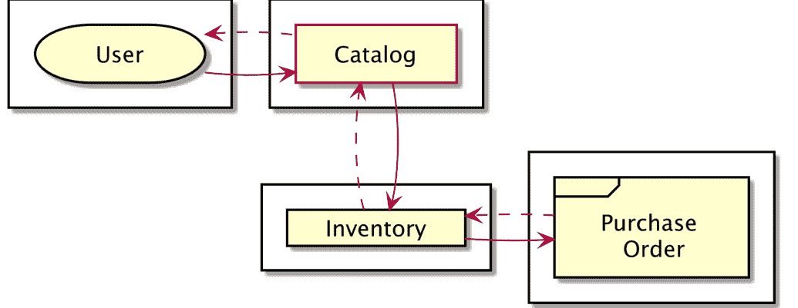
图 40. 微服务的相互调用

### 7.2.2 调用 RESTful Web 服务

Eclipse MicroProfile REST Client 基于 `JAX-RS` 2.0 客户端 API，提供了一种调用 RESTful 服务的类型安全方法。这意味着编写客户端应用程序时可以使用更多以模型为中心的代码和更少的 HTTP 辅助代码。

#### 客户端代理

Eclipse MicroProfile REST Client 的核心思想之一是我们在 Java RMI 中实现的旧式分布式对象通信。为了调用远程对象，我们使用代理。考虑列表 162 中的 REST 端点。如你所见的，这是一个生成 ISBN 的简单 `JAX-RS` Web 服务。它只有一个方法，通过 HTTP GET 访问，并返回 ISBN（由 GS1 代码和 ISBN 13 位数字组成）。

##### 列表 162，接收查询参数并返回对象的端点

```java
@Path("/api/isbn")
@Produces(MediaType.APPLICATION_JSON)
@ApplicationScoped
public class IsbnResource {

    @GET
    public Isbn generateIsbn(
        @DefaultValue("true")
        @PathParam("separator") boolean separator) {

        Isbn isbnNumber = new Isbn();
        isbnNumber.isbn13 = new Faker().code().isbn13(separator);
        isbnNumber.gs1 = new Faker().code().isbn6s1();

        return isbnNumber;
    }
}

public class Isbn {
    public String gs1;
    public String isbn13;
}
```

> 列表 162，你可能会好奇 `Faker` 是什么。Java Faker 库是 Ruby faker gem 的移植版，用于生成假数据。[164]。当你开发项目并需要一些漂亮的数据进行展示时它非常有用。在这里，我们使用它来生成一些随机数据。

此 Web 服务接收一个查询参数。因此，取决于你在查询中传递 `true` 还是 `false`，你将获得带或不带分隔符的 ISBN 号。下面你可以看到一些 curl 调用：

```bash
curl 'http://localhost:9081/api/isbn?separator=true'
# 输出: {"gs1":"979","isbn13":"978-0-9883021-6-7"}

curl 'http://localhost:9081/api/isbn?separator=false'
# 输出: {"gs1":"979","isbn13":"9791935525065"}
```

第三方微服务如何调用端点呢？嗯，使用 OpenAPI 合约。正如你在第 6 章所看到的，Eclipse MicroProfile OpenAPI 与 `JAX-RS` 集成。因此，OpenAPI 仅通过扫描 `JAX-RS` 注解即可生成列表 163 中定义的约。

##### 列表 163. OpenAPI 合约

```yaml
openapi: 3.0.1
info:
  title: 生成的 API
  version: "1.0"
paths:
  /api/isbn:
    get:
      parameters:
        - name: separator
          in: query
          schema:
            default: true
            type: boolean
      responses:
        "200":
          description: OK
          content:
            application/json:
              schema:
                $ref: '#/components/schemas/IsbnNumber'
components:
  schemas:
    IsbnNumber:
      type: object
      properties:
        gs1:
          type: string
        isbn13:
          type: string
```

有了列表 163 中的 OpenAPI 合约，结合内置的 `JAX-RS` Client API 和 `JSON-P` 集成，你可以通过列表 164 中的几行代码轻松访问 `IsbnResource`。

##### 列表 164. OpenAPI 合约

```java
JsonObject isbnNumber = ClientBuilder
.newClient()
.target("http://localhost:9081/api/isbn?separator=true")
.request()
.get(JsonObject.class);

String gs1 = isbnNumber.getString("gs1");
String isbn13 = isbnNumber.getString("isbn13");
```

##### 列表 167. REST 端点注入客户端接口

```java
@Path("/books")
@Produces(MediaType.APPLICATION_JSON)
@ApplicationScoped
public class BookResource {

    @RestClient
    IsbnProxy isbnProxy;

    @RestClient
    IssnProxy issnProxy;

    @GET
    @Path("/numbers")
    public JSONObject generateBookNumbers() {
        Isbn isbnNumber = isbnProxy.generateIsbn(true);
        String isbn13 = isbnNumber.isbn13;
        JsonObject jsonObject = issnProxy.generateIssn();
        String issn = jsonObject.getString("isbn").getString();
        return Isbn.createIsbnBuilder()
```


## 7.2.2. 配置 RestClient

接口的实现将包含 `@RestClient` 限定器，用于区分 API 的使用与注册的相同类型的其他 Bean 的使用。但请记住，接口是一个 Bean，因此可以使用其他 CDI 功能。如果注入时需要更细致的区分，可以在接口和注入点上带有额外的限定器：

```java
@Inject @RestClient @ISBN
NumberProxy isbnProxy;

@Inject @RestClient @ISSN
NumberProxy issnProxy;
```

如列表 167 所示，注入接口比使用 RestClient API 以编程方式调用它要简洁得多。但缺少的是：远程端点的基 URI。定义 URI 有两种方法。你可以在列表 168 中看到可以在 `@RegisterRestClient` 注解中设置 `baseUri` 值。Eclipse MicroProfile RestClient 然后会将 `@Path` 注解连接到此 URI 以调用远程端点（此处为 http://localhost:9082/api/isbn）。

### 列表 168. 带有基 URI 的客户端接口

```java
@Path("/api/isbn")
@Produces(MediaType.APPLICATION_JSON)
@RegisterRestClient(baseUri = "http://localhost:9082")
public interface IssnProxy {

    @GET
    JsonObject generateIssbn();
}
```

然而，该值可以通过配置文件中定义的基 URI 属性进行配置（或覆盖）。为此，我们使用 Eclipse MicroProfile Configuration。要使用的配置属性是完全限定的接口名称连接上 `/mp-rest/url`。在示例中，`IssnProxy` 被配置为默认的 http://localhost:9081 URL。此配置会被 Eclipse MicroProfile Configuration 自动读取。

```properties
org.agoncal.fasascle.quarkus.restclient.book.IssnProxy/mp-rest/url=http://localhost:9081
org.agoncal.fasascle.quarkus.restclient.book.IssnProxy/mp-rest/scope=javax.inject.Singleton
```

拥有此配置意味着使用 `IssnProxy` 执行的所有请求都将使用 http://localhost:9081 作为基 URL。因此对于分隔符，将导致对分隔符为 true 的值发起 HTTP GET 请求，地址为 http://localhost:9081/api/isbn?separator=true。该配置还定义 `IssnProxy` 的范围为 `@Singleton`。支持的范围包括 `@Singleton`、`@Dependent`、`@ApplicationScoped` 和 `@RequestScoped`。默认范围是 `@Dependent`。默认范围也可以在接口上定义。

## 7.2.3. 配置 RestClient Microprofile

表 46 列出了通过 MicroProfile Config 提供的某些 Eclipse MicroProfile Rest Client 配置属性。

### 表 46. 某些 Rest Client 配置属性

| 属性 | 默认值 |
|---|---|
| `<class>/mp-rest/url` <br>用于此服务的基 URL | |
| `<class>/mp-rest/uri` <br>用于此服务的基 URI（将覆盖在 `@RegisterRestClient` 注解中指定的任何 `baseUri` 值） | |
| `<class>/mp-rest/scope` <br>用于注入的 CDI 范围 | `@Dependent` |
| `<class>/mp-rest/providers` | 包含在客户端中的提供者类名（等同于 `register` 方法或 `@RegisterProvider` 注解） |
| `<class>/mp-rest/connectTimeout` | 以毫秒为单位指定的超时时间，等待连接到远程端点 |
| `<class>/mp-rest/readTimeout` | 以毫秒为单位指定的超时时间，等待远程端点的响应 |

## 7.3. Eclipse MicroProfile Fault Tolerance（容错）

CORS 关乎允许或不允许客户端调用跨越不同的源。但一旦调用开始，你就需要处理通信失败并构建具韧性的应用程序。为此，Quarkus 实现了 Eclipse MicroProfile Fault Tolerance 规范。随着服务数量的增加，任何服务失败的概率随之增加。如果涉及的服务之一没有按预期响应（例如，由于脆弱的网络通信），我们必须对这种异常情况进行补偿。Eclipse MicroProfile Fault Tolerance 允许我们从设计上构建具有韧性和容错性的微服务架构。这意味着我们不仅能够检测到任何问题，还能自动处理它。

Eclipse MicroProfile Fault Tolerance 的 API 和注解定义在主 `org.eclipse.microprofile.faulttolerance` 包下，位于根包下或子包下。表 47 列出了 Eclipse MicroProfile Fault Tolerance 2.1 版本中定义的子包（使用 `org.eclipse.microprofile.faulttolerance` 包）。[16]

### 表 47. 主要 org.eclipse.microprofile.faulttolerance 子包

| 子包 | 描述 |
| --- | --- |
| root | 容错 API 的根包 |
| exceptions | 用于容错的异常 |

通过 API，容错还带了一套注解。表 48 列出了常用注解的子集。

### 表 48. 主要容错注解

| 注解 | 描述 |
| --- | --- |
| `@Timeout` | 定义超时持续时间 |
| `@Retry` | 定义重试的标准 |
| `@Fallback` | 为失败的执行提供替代方案 |
| `@Bulkhead` | 隔离系统部分的故障，同时系统的其他部分仍可以正常工作 |
| `@CircuitBreaker` | 提供一种通过自动失败执行来快速失败的方法，以防止系统过载以及客户端无限期等待或超时 |
| `@Asynchronous` | 异步调用操作 |

你只需通过将列表 169 中的扩展添加到你的 `pom.xml` 中，即可获得容错能力。

### 列表 169. 容错扩展

```xml
<dependency>
  <groupId>io.quarkus</groupId>
  <artifactId>quarkus-smallrye-fault-tolerance</artifactId>
</dependency>
```

## 7.3.1. 理解容错

微服务有助于将问题拆分，这有助于维护和测试性。但使用许多个相互依赖的微服务的架构问题在于，极易出现网络、硬件或应用程序问题（见图 42）。这将导致组件的临时不可用。为了避免或减少这种停机，我们必须构建具韧性的微服务。为此，可以使用一些韧性模式，例如超时、重试、断路器、隔离、负载均衡或故障转移。其中一些模式由 Eclipse MicroProfile Fault Tolerance 实现。


**图 42. 微服务调用失败**

讨论网络问题时，参考网络谬误总是有趣的。分布式计算谬误是程序员编写微服务时的系列错误假设。而且分布式应用程序总是这样假设。[160] 谬误包括：

- 网络是可靠的
- 延迟为零
- 带宽是无限的
- 网络是安全的
- 拓扑结构不变
- 有一个管理员
- 传输成本为零
- 网络是同质的

## 7.3.2. 回退（Fallback）

如果服务 A 调用服务 B，当服务 B 宕机会发生什么？在这种情况下回退方案是什么？回退是在系统部分不可用时可能使用的替代方案。

为了说明回退，让我们查看列表 170 中的 `BookResource`。此 REST 端点有一个方法可以在 `/books/numbers` 路径上生成书籍编号（ISBN 和 ISSN）。得益于 MicroProfile REST Client 的 `@RestClient` 注解，`BookResource` 将编号生成委托给 `NumberProxy`，后者最终调用远程 `NumberException`。如果 `NumberResource` 不可用怎么办？我们应该抛出异常还是挂起直到微服务重新可用？

相反，让我们为生成编号提供一种回退方式。为此，我们在 `BookResource` 中添加了一个名为 `fallbackGenerateBookNumbers` 的回退方法，并在 `generateBookNumbers()` 方法上添加了 `@Fallback` 注解（见列表 170）。

### 列表 170. 回退到生成书籍编号

```java
@Path("/books")
@Produces(MediaType.APPLICATION_JSON)
@ApplicationScoped
public class BookResource {

    @RestClient
    NumberProxy numberProxy;

    @GET
    @Path("/numbers")
    @Fallback(method="fallbackGenerateBookNumbers")
    public JSONObject generateBookNumbers() {

        // 调用微服务
        IsbnNumber isbnNumber = numberProxy.generateIsbn(true);
        JsonObject isbnNumber = numberProxy.generateIsbn();

        return Json.createBuilder()
            .add("isbn13", isbnNumber.isbn13)
            .add("gs1", isbnNumber.gs1)
            .add("isbn10", isbnNumber.getString("isbn10").getString())
            .build();
    }

    private JSONObject fallbackGenerateBookNumbers() {
        return Json.createObjectBuilder()
            .add("isbn13", "dummy isbn")
            .add("gs1", "dummy gs1")
            .add("isbn10", "dummy issn")
            .build();
    }
}
```

`fallbackGenerateBookNumbers()` 方法必须与 `generateBookNumbers()` 相同的方法签名（在本例中，它不接受参数并返回一个 `JsonObject` 对象）。如图 43 所示，当 Book 微服务无法调用 Number 微服务时，将调用 `fallbackGenerateBookNumbers()` 并返回临时书籍编号的 JSON 表示形式。

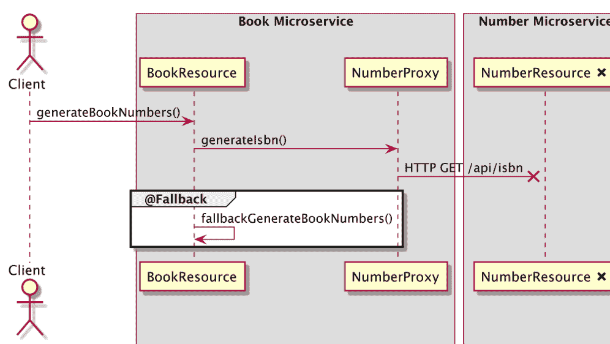

**图 43. HTTP 请求的回退**

指定回退有两种方式：我们可以在 `fallbackMethod` 属性中指定方法名（如我们在列表 170 中做的那样），或者可以指定一个实现 `FallbackHandler` 接口的外部类：

```java
// 同一类中的方法
@Fallback(fallbackMethod = "fallbackGenerateBookNumbers")
public JSONObject generateBookNumbers() { ... }

// 实现 FallbackHandler 的不同类
@Fallback(CallNumberBackupService.class)
public JSONObject generateBookNumbers() { ... }
```

### ISBN 和 ISSN

在本章节中经常提到 ISBN 和 ISSN。以下是对术语的快速回顾：

- **ISBN**（国际标准书籍号）：十三位书籍标识符，旨在唯一标识。
- **ISSN**（国际标准连续出版物号）：用于标识连续出版物的八位序列号。

## 7.3.3. 超时

当远程微服务完全不可用时会发生回退。但如果它存在，只是由于过载或网络延迟导致时间过长呢？

假设我们创建了一本书，并需要调用远程微服务来获取 ISSN。ISSN 编号的获取时间实际上比预期的要长。调用运行时的 Number 微服务获取 ISSN 编号的 Book 微服务会发生什么？它会挂起，我们不希望发生这种情况，我们宁愿让它超时。为此，在 `createBook()` 方法上添加 `@Timeout` 注解（参见列表 171）。`@Timeout` 接受在超时前等待的毫秒数。

### 列表 171. 调用耗时过长时超时

```java
@Path("/books")
@Produces(MediaType.APPLICATION_JSON)
@ApplicationScoped
public class BookResource {

    @Autowired
    NumberProxy numberProxy;

    @POST
    @Timeout(250)
    @Fallback(fallbackMethod = "fallbackCreateBook")
    public Book createBook() {

        // 调用微服务
        JsonObject issnNumber = numberProxy.generateIssn();

        Book book = new Book();
        book.title = faker(book).title();
        book.issn = issnNumber.getString("isbn10");
        book.generatedAt = Instant.now();

        return book;
    }

    private Book fallbackCreateBook() {
        Book book = new Book();
        book.title = "dummy title";
        book.issn = "dummy issn";
        book.generatedAt = Instant.now();
        return book;
    }
}
```

注意，超时配置为 250ms。如果列表 171 中的 `createBook()` 方法仅标记了 `@Timeout` 注解（而没有 `@Fallback`），且调用 Number 微服务的时间超过了 250ms，则请求将由于 `TimeoutException` 中中断：

```text
ERROR [QuarkusErrorHandler] HTTP Request to /books failed
org.jboss.resteasy.spi.UnhandledException: org.eclipse.microprofile.faulttolerance.exceptions.TimeoutException:
Timeout[org.arconal.fascicle.quarkus.faulttolerance.book.BookResource#createBook] timed out
```


默认情况下，如果执行时间超过了指定的超时，将抛出 `TimeoutException` 并且丢弃执行结果。这是在你仅有一个 `@Timeout` 注解时的情况。

这在图 44 的序列图中所示。但你可能想在方法上添加额外的 `@Fallback` 注解（如列表 171 所示）。在这种情况下，如果捕获到 `TimeoutException` 异常，会自动调用回退方法。

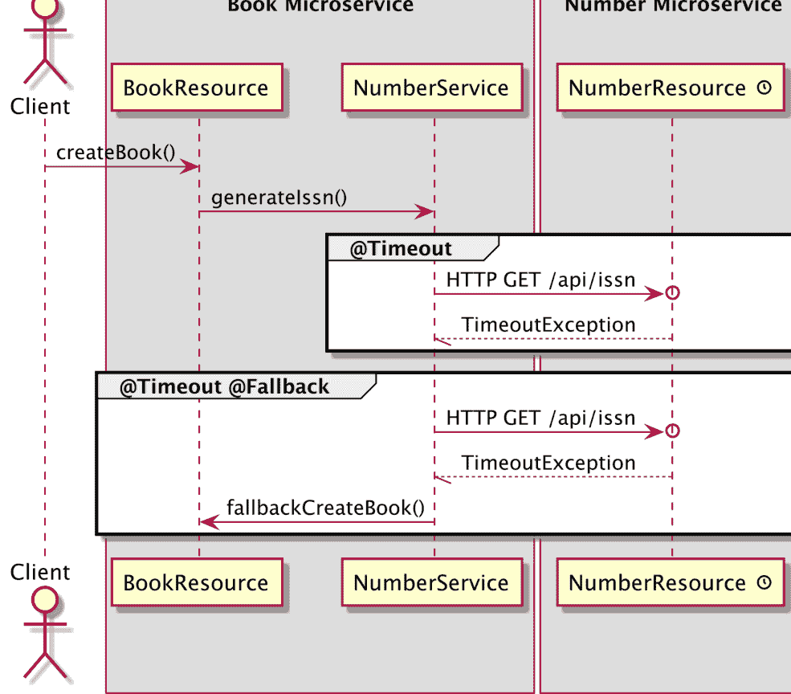

图 44. HTTP 请求超时

`@Timeout`、`@Fallback` 等注解可以绑定到类级别或方法级别。如果注解绑定到类级别，它适用于类的所有方法。

## 7.3.4. 熔断器

回退和超时是一个很好的开始。但当系统过载时，客户端可能会持续冲击资源，这并不能解决问题。熔断器对于停止加载不稳定的系统非常有用。如图 45 所示，熔断器具有以下状态：

- 关闭（Closed）：关闭表示系统功能可用。当检测到某些失败时，状态变为半开。
- 半开（Half-open）：在此状态下，它会检查组件是否已恢复。如果是，则关闭熔断器。
- 开启（Open）：开启状态意味着服务临时禁用。经过检查后，它验证是否可以安全切换到半开状态。

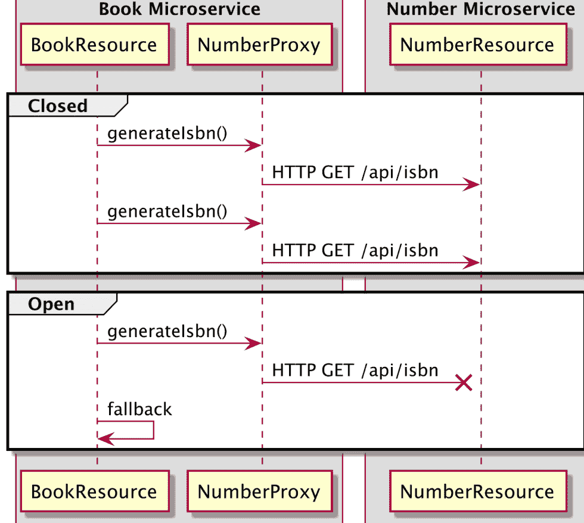

图 45. 关闭和开启电路

正如列表 172 所示，MicroProfile Fault Tolerance API 使用 `@CircuitBreaker` 注解来控制调用。该注解记录 `createBook()` 方法的成功和失败调用，当失败次数达到指定阈值时，电路会开启并阻塞调用一段时间。在关闭状态下，可以配置 `requestVolumeThreshold` 和 `failureRatio` 参数，以指定熔断器切换到开启的条件。

## 列表 172. BookResource 上的熔断器

```java
@Path("/books")
@Produces(MediaType.APPLICATION_JSON)
@ApplicationScoped
class BookResource {

  @RestClient
  NumberProxy numberProxy;

  @POST
  @Fallback(method="fallbackCreateLegacyBook")
  @CircuitBreaker(requestVolumeThreshold = 4, failureRatio = 0.5,
      delay = 2000, successThreshold = 2)
  public Book createLegacyBook() {
    // 调用微服务
    JsonObject isbnNumber = numberProxy.getIssn();
    Book book = new Book();
    book.title = faker.book().title();
    book.isbn = isbnNumber.getString("isbn10");
    book.generatedAt = Instant.now();
    return book;
  }

  private Book fallbackCreateLegacyBook() {
    Book book = new Book();
    book.title = "dummy legacy title";
    book.isbn = "dummy issn";
    book.generatedAt = Instant.now();
    return book;
  }
}
```

在列表 172 中，如果在最近四次调用（`requestVolumeThreshold`）中有 50% 失败（`failureRatio`），则电路将切换到开启状态。电路将保持开启 2000 毫秒（`delay`）。在 2 次连续成功调用（`successThreshold`）后，电路将再次回到关闭状态。

如果你想测试断路器代码并看到它的打开和关闭，你需要添加一些负载。一种简单的方法是循环执行 cURL 命令。在 bash 上，你可以写以下代码：

```bash
$ while true; do sleep 1; curl -X POST http://localhost:9080/books/; echo; done
```

## 7.4. 总结

从设计上，在微服务架构中，微服务必须相互通信。作为 RESTful Web 服务，它们使用 HTTP 协议针对特定的 URL，并带有给定的参数、动词，以及遵循不同格式（即媒体类型或 MIME 类型）的负载（payload）、请求头和响应。消费 HTTP 可能会很麻烦，但 JAX-RS 自带了客户端 API。不过 Eclipse MicroProfile REST 更进一步，简化了对远程微服务响应的消费。通过使用接口，客户端可以调用接口上的方法，而无需担心底层的复杂性。

在本章中，我们还查看了跨源资源共享（CORS）。它是防止来自不同域浏览器请求的方法。Quarkus 允许我们配置 CORS，以便根据你需要的安全级别来接受或拒绝请求。

但请求开始在不同域之间失败，微服务的故障也开始出现。Eclipse MicroProfile Fault Tolerance 允许我们提高应用程序的韧性，而不会影响业务逻辑的复杂性和结果。容错是关于利用不同的策略来引导某些逻辑的执行和结果。回退（Fallbacks）、超时（Timeouts）和断路器（Circuit breakers）是分布式系统领域流行的模式。

即使在微服务领域 REST 是一种非常常见的架构风格，但它并不是唯一的。在下一章“事件驱动微服务”中，你将看到如何使用响应式编程和响应式消息来解耦微服务。

- [160] CORS https://en.wikipedia.org/wiki/Cross-origin_resource_sharing
- [161] WHATWG https://fetch.spec.whatwg.org/nn
- [162] REST Client https://microprofile.io/project/eclipse/microprofile-rest-client
- [163] REST Client GitHub https://github.com/eclipse/microprofile-rest-client
- [164] Ruby faker https://github.com/faker-ruby
- [165] Fault Tolerance Github https://github.com/eclipse/microprofile-fault-tolerance
- [166] Fallacies of distributed computing https://en.wikipedia.org/wiki/Fallacies_of_distributed_computing

## 第 8 章. 事件驱动微服务

微服务的理论非常简单，我们已经在之前的章节中见过了：将一个单体应用拆分为小的、特定用途的微服务（第 2 章，理解 Quarkus），并通过 HTTP 进行通信（第 6 章，HTTP 微服务）。但在实践中，由于网络不可靠，且微服务必须持续运行，我们需要处理容错问题（第 7 章，通信与容错）。

事件驱动架构（也称为响应式架构或响应式系统）是微服务相互通信的另一种方式。它关于在微服务之间发送事件（即消息或记录）。这实现了解耦并提升了可靠性：事件被发送到事件/消息平台（例如 JMS 或 Kafka 代理），然后由该平台分发给各个微服务。因此，与其思考“我将调用哪个微服务”，你应该思考“我的微服务将处理哪些事件？”以及“我的微服务将发布哪些事件”。

在本章中，你将看到在 Quarkus 中用于事件驱动微服务的两种主要技术。响应式编程（配合 Mutiny）允许你的代码使用非常流式的 API 做出反应。作为响应式消息（Reactive Messaging），它允许微服务通过消息以简单的方式进行交互。


> 请确保你的开发环境已配置好以执行本章的代码。你可以查看附录 A 以检查是否安装了 Kafka 中所有所需的库。本章的代码可以在 https://github.com/agonal/fascicle-quarkus/tree/1.0/reactive 找到。

## 8.1. 响应式编程

Java 并不是意义上的“响应式语言”，因为它没有原生支持响应式模型，但 Java 本身直到第 9 版本引入 Flow API 才算完善。对于 JVM 上的 Java（Scala 和 Clojure），多年来涌出了几个框架来实现响应式编程：RxJava 或 Reactor，而 Mutiny 是在在使用这些库遇到困难后而设计的响应式编程库。

Eclipse Mutiny 是一个响应式编程库。Mutiny 提供了一个引导式的 API，使得响应式编程变得简单。它允许拥有在其他响应式框架中并不总是显式的数百个方法（例如 `map()` 或 `flatmap()`）。但 Mutiny 拥有许多与其他响应式编程库互转的转换器，因此如果你愿意，你始终可以使用并使用 `map()` 方法。

Mutiny 在现有的响应式编程库多年之后设计。它基于许多开发者的经验，他们曾迷失在无尽的 `map` 和 `flatMap` 操作符序列中。Mutiny 提供的运算符不像其他响应式框架那么多，而是专注于最常用的运算符。此外，它通过提供更具引导性的 API 来帮助开发者，避免了面对数百个方法可供选择的情况。

Eclipse Mutiny 的 API 和注解定义在主 `io.smallrye.mutiny` 包下，位于根包下，或其他子包下。表 49 列出了 Mutiny 0.7 版本中定义的主要包（在根包下）。

表 49：Mutiny 0.7 版本中的主要包

| 包名 | 描述 |
| :--- | :--- |
| io.smallrye.mutiny | 根包 |

到为止，我们已经根据项目创建了 Unis 和 Multis。你也可以从 Unis 创建 Unis，或者从 Multi 创建 Multis。在列表 179 中，我们创建了一个名为 `ticks` 的 Multi。请注意，我们没有调用 `subscribe()` 方法，因此什么都不会发生。我们在这一阶段做的是创建一个流水线，在订阅时每秒发送一次 `ticks`。

通过这个第一个 Multi，我们创建了一个获取前三个 ticks 并显示它们的 Multi。只有在这一阶段，当调用 `subscribe()` 方法时，由 Multis 组成的整个流水线才会执行。

列表 179. 从另一个 Multi 创建 Multi

```java
Multi<Long> ticks = Multi.createFrom().ticks.every(Duration.ofSeconds(1));
Multi.createFrom().publisher(ticks)
.transform(takingFirstItems(3))
.subscribe().with(System.out::println);
```

## 8.1.2. 事件

创建 Unis 和 Multis 是第一步。一旦创建，异步类型就会对不同类型的事件做出响应。可以流动四类型的事件：

- onItem: 该事件每个项目触发一次。它包含项目本身。
- onCompletion: 只有在不再有项目发射时才会触发此事件。
- onFailure: 该事件发生零次或一次。如果发生失败，不会发送 onCompletion 事件来表示遇到了失败。
- subscribe: 表示上游已经考虑了订阅。

注意，失败和完成是终结事件。一旦发生，就不会再有项目被发射。

让我们看看这些事件是如何工作的。在列表 180 中，我们创建了一个包含三个 String 类型项目的 Multi。然后，在每个事件发生时显示一条消息（在 onItem 触发时显示 Received，在 onCompletion 触发时显示 Completed，依此类推）。

列表 180. 对事件做出响应的 Multi

```java
Multi.createItems("Carla Bley")
```

执行结果显示了发生了什么。每个项目都会触发一个 onItem 和 subscribe 事件。最后，onCompletion 事件只会触发一次。如果发生失败，我们将收到一个 onFailure onFailure代替。

```
Received Carla Bley
Subscriber Carla Bley
Received John Coltrane
Subscriber John Coltrane
Received Juliette Gréco
Subscriber Juliette Gréco
Completed
```

列表 181 显示了 Uni 而不是 Multi 的类型代码。列表 180 代码中的一个区别是 Uni 不需要完整的完成仪式，因为请求（request）非常有意义。

列表 181. 无完成

```java
Uni.createFrom("Carla Bley")
.onItem().invoke(item -> System.out.println("Received " + item))
.onError().invoke(failure -> System.out.println("Failed " + failure.getMessage()))
.subscribe(item -> System.out.println("Subscriber " + item));
```

以下是 Uni 执行时触发的事件：

```
Received Carla Bley
Subscriber Carla Bley
```

## 8.2. 响应式消息 (Reactive Messaging)

在第 9 章可观测性中，你看到 Quarkus 的目标之一是统一命令式编程和响应式编程。因此，Mutiny 在底层被大量使用，如果你不需要，就无需察觉或也不需要处理 Multis。对于基于 Mutiny 的 Reactive Messaging 也是如此。

Eclipse Messaging 用于构建事件驱动、数据流和事件溯源的应用程序。它让你的应用程序与各种消息技术（如 Apache Kafka、AMQP 或 MQTT）交互。该框架提供了一个灵活的编程模型，桥接了 CDI 和事件驱动 API。

Eclipse Reactive Messaging API 和注解都定义在主包 `org.microprofile.reactive.messaging` 下，要么在根目录下，要么在其他子包下。表 51 列出了 Eclipse Messaging 1.1 版本在根包 `org.eclipse.microprofile.reactive.messaging` 之下定义的主要子包。

| 子包 | 描述 |
| :--- | :--- |
| root | 响应式消息 API 的根包 |
| converters | 将 Uni 和 Multi 转换为多种格式 |
| operators | 可以在 Uni 和 Multi 上执行的操作 |

表 52 列出了几个用于向通道发射消息的 Reactive Messaging API。消息拥有一组可选的元数据。

表 52. 主要 Reactive Messaging API

| API | 描述 |
| :--- | :--- |
| Emitter | 从命令式代码向通道馈送数据 |
| Message | 包含有效负载、一组元数据和一个确认函数 |
| Metadata | 存储消息元数据，可以与传输层或业务/应用程序相关 |

除了 API 之外，Reactive Messaging 还带有一组注解。表 53 列出了最常用注解子集。

表 53. 主要 Reactive Messaging 注解

| 注解 | 描述 |
| :--- | :--- |
| @Outgoing | 发布者用于发送消息 |
| @Incoming | 用于通知订阅者传入的消息 |
| @Broadcast | 发布者用于将消息分发给多个订阅者 |
| @Channel | CDI 限定符，用于指示应该注入哪个通道 |

要在你的 Quarkus 应用程序中激活 Reactive Messaging，你需要底层定义的扩展，因此依赖于列表 182。该扩展在底层使用响应式编程，因此依赖于 Mutiny。

列表 182. Reactive Messaging 扩展

```xml
<dependency>
  <groupId>io.quarkus</groupId>
  <artifactId>quarkus-smallrye-reactive-messaging</artifactId>
</dependency>
```

## 8.2.1. 理解消息传递

在深入研究消息之前，让我们快速看看同步和异步之间的区别。

### 同步编程

基本上，同步意味着你一次只能执行一件事。如果你看列表 183 中的代码，更容易看到组件之间的依赖关系。例如，InventoryService 需要时间很长，ShippingService 将等待它的完成。

列表 183. 同步代码

```java
public PurchaseOrder create(PurchaseOrder po) {
  bankService.validate(po);
  if (po.creditCard.status == VALID) {
    po.status = VALID;
    inventoryService.prepareItems(po);
    shippingService.prepareShipping(po);
  } else {
    invalidate(po);
  }
  return po;
}
```


如果你将列表 183 的代码转换为图 46 的序列图，这就是我们做的。


图 46. 同步调用

### 异步消息

异步消息意味着你可以执行多个任务，而不需要在移动到下一个之前完成当前任务。在 Java 中，异步编程可以通过非常底层的方式（例如操作线程）或高级 Java API（例如 `CompletableFuture` 或 `CompletionStage`）。你也可以使用消息传递。

发送消息允许组件之间进行时间解耦，以便系统并行执行多个任务。如果我们回到之前需要时间完成的示例，这就是发生的情况。如果 `BankService` 验证了信用卡，就会向多个订阅者发送 `po-validated`。这些订阅者将按照自己的节奏执行任务。

| PurchaseOrder Resource | PurchaseOrder Service | Bank Service | Inventory Service | Shipping Service |
| :--- | :--- | :--- | :--- | :--- |
| | purchase-orders | | | |
| | | po-prepared | | |
| | | bank-validated | | |
| | | Credit Card Valid | | |
| | | po-validated | | |
| | | po-validated | | |
| | | Credit Card Invalid | | |
| | | po-invalidated | | |

图 47. 发送和接收异步消息

## Broker 架构

Broker 是一种允许在异构系统之间异步交换消息的软件。它可以被视为一个按照自己的节奏产生和消费消息的缓冲区系统（例如一个系统 24/7 运行，另一个只在晚上运行）。它从本质上是松耦合的，因为生产者不知道通信通道另一端是谁在消费消息。生产者和消费者不需要同时可用即可进行通信。事实上，它们彼此并不感知，因为它们使用了中间缓冲区。在这一点上，Broker 与要求应用程序知道远程应用程序方法签名的同步技术完全不同。

代理（broker，也称为消息提供者或 provider）使用一套特殊的术语。消息发送者称为生产者（producer，或发射器 emitter），消息发送的位置称为主题（topic，或通道 channel，或终点地 destination）。接收消息的组件称为消费者（consumer，或订阅者 subscriber）。生产者和消费者之间交换的内容称为消息（message）、事件（event）或记录（record）。消息是一个封装了负载（payload）的封包。消息被发送到特定的主题，并在成功接收和处理后进行确认（acknowledge）。图 48 展示了这些概念。

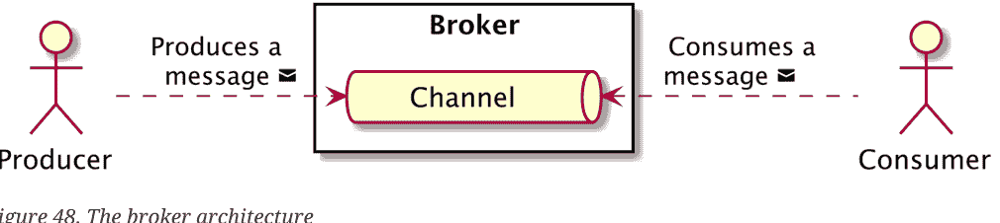

在微服务架构中，消息可以在微服务内部进行交换，也可以在远程微服务之间交换（见图 49）。本地交换允许组件使用响应式编程来对消息做出响应。远程交换允许我们实现微服务之间的解耦。

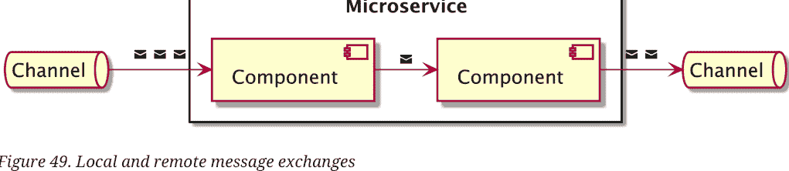

有多个框架和 API 用于发送和接收消息：Quarkus Eclipse Reactive Messaging。有多个代理，截至目前，Quarkus 通过连接器（connector）与 Kafka、AMQP 和 MQTT 交互（关于连接器的更多信息见下文 Kafka 部分）。

## 8.2.2. 发送消息

使用 Eclipse Reactive Messaging 发送消息有两种方法。一种是使用 `@Outgoing` 注解，另一种是通过编程方式向通道发射消息。

`@Outgoing` 注解用于标记方法，以指示该方法将消息发布到指定的通道。在应用程序内部，消息在由名称标识的通道上传输。在列表 184 中，包含 `Float` 类型转换率的消息被发送到名为 `euro-rate` 的通道。在某个地方，监听该通道的订阅者将异步接收到该消息。

列表 184. 使用 @Outgoing 发送消息

```java
@Outgoing("euro-rate")
public Message<Float> sendEuroRate() {
    return Message.of(euroRate);
}
```

为了进行通信，发布者和订阅者交换消息。它们可以是由 `Message` 接口表示的消息，也可以仅仅是消息的内容（即负载 payload）。`Message` 接口保持极简，以便连接器可以提供自己的实现，并带有与该连接器相关的额外元数据（metadata）。例如，`KafkaRecord` 实现了 `Message` 接口，并提供了对 Kafka 特有信息的访问（如主题或分区）。

下面我们将看到一些操作 `Message` 接口的代码示例。普通消息使用 `of()` 方法创建，该方法使用可选元数据（通过 `withMetadata()` 方法）封装负载。`getPayload()` 方法检索被封装的负载，而 `ack()` 则确认消息。

```java
// 使用不同的数据类型创建
Message<Integer> msg = Message.of();
Message<String> msg = Message.of("Janis Joplin sold");
Message<CreditCard> msg = Message.of(new CreditCard("1234 5678", AMERICAN_EXPRESS));

// 获取负载
Message<String> msg = Message.of("Euro rate: 1.345");
assertEquals("Euro rate: 1.345", msg.getPayload());

// 使用元数据创建
Metadata metadata = Metadata.of(LocalDate.now());
Message<String> msg = Message.of("Jimi Hendrix vinyl sold", metadata);
Message<String> msg = Message.of("Jimi Hendrix vinyl sold").withMetadata(metadata);

// 确认消息
Message<String> msg = Message.of("Ella vinyl sold");
msg.ack();
```

如果不使用元数据或编程确认，操作消息可能会变得很繁琐。如果你只对负载感兴趣，可以直接将其传递给通道（使用 `Float` 而不是 `Message<Float>`）。因此，列表 185 中的代码等同于列表 184 中的代码。

列表 185. 发送负载

```java
@Outgoing("euro-rate")
public Float sendEuroRate() {
    return euroRate;
}
```


如果不使用元数据或编程确认，操作消息可能会变得很繁琐。如果你只对负载感兴趣，可以直接将其传递给通道（使用 `Float` 而不是 `Message<Float>`）。因此，列表 185 中的代码等同于列表 184 中的代码。

列表 185. 发送负载

```java
@Outgoing("euro-rate")
public Float sendEuroRate() {
    return euroRate;
}
```

（注：由于原始文本存在大量重复段落，此处翻译已根据逻辑进行了去重处理，确保内容连贯。）

代理（broker，也称为消息提供者或 provider）使用一套特殊的术语。消息发送者称为生产者（producer，或发射器 emitter），消息发送的位置称为主题（topic，或通道 channel，或终点地 destination）。接收消息的组件称为消费者（consumer，或订阅者 subscriber）。生产者和消费者之间交换的内容称为消息（message）、事件（event）或记录（record）。消息是一个封装了负载（payload）的封包。消息被发送到特定的主题，并在成功接收和处理后进行确认（acknowledge）。图 48 展示了这些概念。


在微服务架构中，消息可以在微服务内部进行交换，也可以在远程微服务之间交换（见图 49）。本地交换允许组件使用响应式编程来对消息做出响应。远程交换允许我们实现微服务之间的解耦。


有多个框架和 API 用于发送和接收消息：Quarkus Eclipse Reactive Messaging。有多个代理，截至目前，Quarkus 通过连接器与 Kafka、AMQP 和 MQTT 交互（关于连接器的更多信息见下文 Kafka 部分）。

## 8.2.2. 发送消息

使用 Eclipse Reactive Messaging 发送消息有两种方法。一种是使用 `@Outgoing` 注解，另一种是通过编程方式向通道发射消息。

`@Outgoing` 注解用于标记方法，以指示该方法将消息发布到指定的通道。在应用程序内部，消息在由名称标识的通道上传输。在列表 184 中，包含 `Float` 类型转换率的消息被发送到名为 `euro-rate` 的通道。在某个地方，监听该通道的订阅者将异步接收到该消息。

列表 184. 使用 @Outgoing 发送消息

```java
@Outgoing("euro-rate")
public Message<Float> sendEuroRate() {
    return Message.of(euroRate);
}
```

为了通信，发布者和订阅者交换消息。它们可以是由 `Message` 接口表示的消息，也可以仅仅是消息的内容（即负载 payload）。`Message` 接口保持极简，以便连接器可以提供自己的实现，并带有与该连接器相关的额外的元数据。例如，`KafkaRecord` 实现了 `Message` 接口，并提供了对 Kafka 特有信息的访问（如主题或分区）。

下面我们将看到一些操作 `Message` 接口的代码示例。普通消息使用 `of()` 方法创建，该方法使用可选元数据（通过 `withMetadata()` 方法）封装负载。`getPayload()` 方法检索被封装的负载，而 `ack()` 则确认消息。

```java
// 使用不同的数据类型创建
Message<Integer> msg = Message.of();
Message<String> msg = Message.of("Janis Joplin sold");
Message<CreditCard> msg = Message.of(new CreditCard("1234 5678", AMERICAN_EXPRESS));

// 获取负载
Message<String> msg = Message.of("Euro rate: 1.345");
assertEquals("Euro rate: 1.345", msg.getPayload());

// 使用元数据创建
Metadata metadata = Metadata.of(LocalDate.now());
Message<String> msg = Message.of("Jimi Hendrix vinyl sold", metadata);
Message<String> msg = Message.of("Jimi Hendrix vinyl sold").withMetadata(metadata);

// 确认消息
Message<String> msg = Message.of("Ella vinyl sold");
msg.ack();
```

如果不使用元数据或编程确认，操作消息可能会变得很繁琐。如果你只对负载感兴趣，可以直接将其传递给通道（使用 `Float` 而不是 `Message<Float>`）。因此，列表 185 中的代码等同于列表 184 中的代码。

列表 185. 发送负载

```java
@Outgoing("euro-rate")
public Float sendEuroRate() {
    return euroRate;
}
```

> 你不应该在代码中直接编程调用带有 `@Incoming` 和 `@Outgoing` 注解的方法。这些方法是由框架调用的。在代码中调用它们将导致意外的结果。

## 8.2.4. 连接器 (Connectors)

到目前为止，我们看到 Reactive Messaging 可以处理来自应用程序内部的消息。在这种情况下，所有内容都是内存中的，流通过不断链式调用方法创建。每个链仍然是一个响应式流并强制执行背压协议（backpressure protocol）。如果你需要向微服务发送消息，你需要一个消息中间件，例如 Kafka、AMQP 或 MQTT。为此，Reactive Messaging 使用了连接器。连接器是一种与特定传输技术进行通信的扩展：

- 它从消息代理接收消息并将其传播到应用程序；
- 它将应用程序提供的消息发送到消息代理。

从开发者的角度来看，无论消息是来自本地 Bean 还是远程消息代理，都是透明的。我们只需要添加一个取决于连接器技术的 Quarkus 扩展。让我们来看一个 Kafka 的示例。

Kafka（或 Apache Kafka）是一个开源的分布式事件流平台。[74] 得益于其优化的基于 TCP 的协议，它为处理实时数据馈提供了一个统一、高吞吐、低延迟的平台。为了能够连接到 Kafka，我们需要添加列表 191 中描述的 Kafka 扩展。

列表 191. Reactive Messaging 和 Kafka Extensions

```xml
<dependency>
  <groupId>io.quarkus</groupId>
  <artifactId>quarkus-smallrye-reactive-messaging-kafka</artifactId>
</dependency>
```

Quarkus 还连接 Kafka 以外的连接器，如 AMQP 或 MQTT。每个连接器都有针对特定技术的专用扩展。

AMQP（或高级消息队列协议）是一种面向消息的中间件的开放标准层协议。[75] AMQP 的定义特征是面向消息、队列（包括点对点和发布/订阅）、可靠性和安全性。

MQTT（或消息队列遥测传输）是物联网（IoT）的标准消息协议。[76] 它被设计为一种极轻量级的发布/订阅消息传输，非常适合以最小的网络带宽连接远程设备。

让我们以 REST 端点向远程消息代理发送消息的为例。如列表 192 所示，代码与我们之前看到的完全相同：向名为 `po-write` 的通道发送 `Emitter<PurchaseOrder>`。

列表 192. REST 端点向 Kafka Topic 发送消息

```java
@Path("/po")
@Consumes(MediaType.APPLICATION_JSON)
@ApplicationScoped
public class PurchaseOrderResource {

    @Inject @Channel("po-write")
    Emitter<PurchaseOrder> emitter;

    @POST
    public Response create(PurchaseOrder po) {
        emitter.send(po);
        URI temporaryPO = Uri.fromResource(PurchaseOrderResource.class)
            .path(tmpId).build();
        return Response.temporaryRedirect(temporaryPO).build();
    }
}
```

区别在于配置。Eclipse Reactive Messaging 决定其连接器和配置。语法如下：

```
mp.messaging.<outgoing:incoming>.{channel-name}.<property>=<value>.
```

在 `application.properties` 文件中，为了指定通道 `po-write` 使用 Kafka 连接器，我们需要将连接器类型设置为 `smallrye-kafka`。由于我们正在使用购买订单的 JSON 表示法，我们需要指定序列化器。

```
mp.messaging.outgoing.po-write.connector=smallrye-kafka
mp.messaging.value.serializer=io.quarkus.kafka.serialization.JsonSerializer
```

在 Kafka 主题的另一端，列表 193 中的微服务监听到达名为 `po-read` 通道中的消息。

列表 193. 远程服务从 Kafka Topic 接收消息

```java
@Incoming("po-read")
public PurchaseOrder create(PurchaseOrder po) {
    // 创建一个 PO
    return po;
}
```

注意，发送消息的通道（`po-write`）和接收消息的通道（`po-read`）具有不同的名称。这是因为我们需要特定的通道映射到远程主题，这是通过列表 194 中定义的配置完成的：`po-read` 通道监听名为 `po-write` 的主题。

列表 194. 配置 Topics

```
mp.messaging.outgoing.po-read.connector=smallrye-kafka
mp.messaging.outgoing.po-write.value.serializer=org.quarkus.kafka.client.serialization.JsonSerializer
mp.messaging.incoming.po-read.connector=smallrye-kafka
mp.messaging.incoming.po-read.topic=po-write
mp.messaging.incoming.po-read.deserializer=org.acme.fascicle.quarkus.PurchaseOrderDeserializer
```

由于购买订单被序列化为 JSON，`po-read` 通道需要将对象反序列化为 `PurchaseOrder` 对象。这是使用 JSON-B 序列化器完成的。要反序列化，我们需要创建自己的反序列化器并提供类型，如列表 195 所示。

列表 195. Purchase Order Deserializer

```java
public class PurchaseOrderDeserializer extends JsonDeserializer<PurchaseOrder> {
  public PurchaseOrderDeserializer() {
    super(PurchaseOrder.class);
  }
}
```

启动时，Quarkus 需要连接到 Kafka。

## 8.2.5. 配置 Reactive Messaging

表 54. 部分 Reactive Messaging 属性

| 属性 | 默认值 |
| --- | --- |
| quarkus.reactive-messaging.health.enabled | true |
| quarkus.reactive-messaging.metrics.enabled | false |
| quarkus.kafka.health.enabled | false |

## 8.3. 总结

虽然事件驱动微服务最初看起来很困难，但它们是微服务的未来。因此，正如本章所示，Quarkus 不局限于 HTTP 微服务，而且完美符合这种事件驱动架构。为什么呢？正如第 2 章“理解 Quarkus”中所述，在底层 Quarkus 对命令式和响应式代码都使用一个精简的引擎。

JVM 有许多响应式库或框架正在活跃开发中。在很大程度上，它们提供了相似的功能，但受益于 Reactive Streams，它们越来越具有互操作性。这就是 Eclipse 的核心。Mutiny 是构建在 Reactive Messaging 内部的新响应式框架。因此，对于接收或发送消息等简单情况，你不需要使用它。你只需要使用几个注解（`@Channel`、`@Outgoing`、`@Incoming`），就可以在微服务内部处理消息，或者通过某些配置使用远程消息代理（如 Kafka）。

# 第 9 章 可观测性

正如你在前面的章节中所看到的，你的架构可以轻松混合 HTTP 微服务和事件驱动微服务。在涉及 HTTP 微服务时，“通信与容错”章节表明，同步通信不可靠的，这就是为什么我们需要带有回退（fallbacks）或断路器（circuit breakers）的 Eclipse MicroProfile Fault Tolerance。

当所有这些微服务通过 HTTP 或消息相互交互时，允许微服务报告并发布其健康状态是关键的。这些信息可以由服务编排器收集，编排器根据系统的健康状况做出决策。报告健康状态可以通过 Eclipse MicroProfile Health 实现。

了解微服务的健康是第一步。但这不能告诉我们它们是否在正确的时间内以良好的吞吐量正确处理。Eclipse MicroProfile Metrics 提供了统一的统计导出视图，例如服务的请求次数和速率、每个请求的持续时间等。

> 本章的代码可以在 https://github.com/agonal/fascicle-quarkus/tree/1.0/observability 找到。

## 9.1. Eclipse MicroProfile Health

Eclipse MicroProfile Health 提供了从另一台机器获取计算节点状态的能力。[177] Eclipse MicroProfile Health API 允许应用程序向外部视图提供其状态信息，这通常用于云环境，在这些环境中，自动化进程必须能够判断应该丢弃还是重启应用程序。Quarkus 通过 SmallRye Health 实现 Eclipse MicroProfile Health 规范。

Eclipse MicroProfile Health API 和注解都定义在 `org.eclipse.microprofile.health` 包下。表 55 列出了 Eclipse MicroProfile Health 2.2 版本中的主要子包（位于根包 `org.eclipse.microprofile.health` 下）。[178]

表 55. 主要 org.eclipse.microprofile.health 子包

| 子包 | 描述 |
| --- | --- |
| root | Health API 的根包 |
| spi | 由提供者实现的内部 API（服务提供接口） |

除了 API 之外，Health 还带有一组注解。表 56 列出了常用注解的子集。

表 56. 主要 Health 注解

| 注解 | 描述 |
| --- | --- |
| @Liveness | 用于定义存活（liveness）健康检查程序 |
| @Readiness | 用于定义就绪（readiness）健康检查程序 |

当你在 `pom.xml` 中添加 Health 扩展（参见列表 196）时，某些 Quarkus 组件会自动暴露它们的健康状态。数据源或响应式消息就是如此。

列表 196. Health 扩展

```xml
<dependency>
  <groupId>io.quarkus</groupId>
  <artifactId>quarkus-smallrye-health</artifactId>
</dependency>
```


### 9.1.1. 理解健康检查

在微服务架构中，我们很快就会在几台服务器上运行数百或数千个进程。如果我们使用混合云，我们可能在内部有一些微服务，另一些在不同的云和不同的数据中心位置。如图 50 所示，了解整个系统的健康状况以及单个微服务的健康状况至关重要。因此，这似乎是显而易见的，但微服务必须报告其健康状况，以便被服务编排器收集，编排器随后可以使用这些健康状况做出决策。为此，需要对记录健康事件的方式进行标准化，这些事件最终会被收集起来用于查询和查看。

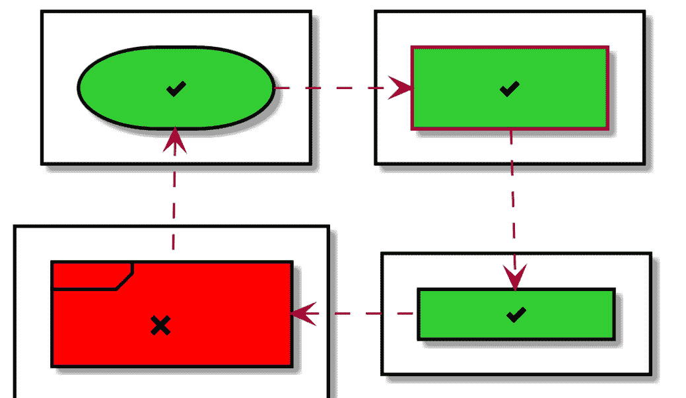

图 50. 微服务的上线与线下。

### 9.1.2. 检查

服务通过执行必要的自检来检查自身的健康状况。自检可以是对服务所需的任何内容进行检查：足够的磁盘空间、成功的数据库连接、系统属性等。如果服务可用，则报告为 UP；如果不可用，则报告为 DOWN。虽然服务目前可能不健康，但它可能仍在运行。因此，Eclipse MicroProfile 处理两种类型的检查：

- **Liveness（存活性）**：检查微服务是否存活，它是否能够接受请求并响应。
- **Readiness（就绪性）**：检查微服务的依赖（数据库、队列服务等）本身是否已就绪，以便微服务可以执行它应该做的工作。

Eclipse MicroProfile 允许服务报告它们的健康状况，并将整体健康状态发布到定义的端点：

- `/health/live`：返回所有存活检查的结果，并判断你的应用程序是否正在运行。
- `/health/ready`：返回所有就绪检查的结果，并判断你的应用程序是否可以处理请求。
- `/health`：汇总两种类型健康检查的结果。

这些端点链接到分别用 `@Liveness` 和 `@Readiness` 注解的健康检查程序。

#### 存活检查 (Liveness Checks)

存活检查判断微服务是否正在运行。这意味着如果此程序失败，微服务可以被丢弃并重启。例如，在列表 197 中，为了检查我们的端点是否存活，我们确保它可以生成数字（通过调用 `generateIss()` 方法并确保它不会抛出异常）。为此，检查程序必须实现 `HealthCheck` 接口并带有 CDI 限定符 `@Liveness`。

**列表 197. 存活检查**

```java
@Liveness
@ApplicationScoped
public class NumberResourceCheck implements HealthCheck {

    @Inject
    NumberResource numberResource;

    @Override
    public HealthCheckResponse call() {
        try {
            numberResource.generateIss();
            return HealthCheckResponse.named("Ping Number Endpoint").up();
        } catch (Exception e) {
            return HealthCheckResponse.named("Ping Number Endpoint").down();
        }
    }
}
```

**列表 202. 检查 URL**

```java
@ApplicationScoped
public class BlogCheck {

  @Liveness
  HealthCheck checkURL() {
    return new UrlHealthCheck("https://antoniogalves.org").name("Blog Check");
  }
}
```

### 9.1.3. 构建响应

Liveness（存活）和 Readiness（就绪）健康检查实现了 `call()` 方法，该方法返回一个 `HealthCheckResponse`。到目前，我们已经看到响应包含一个用于与其他健康检查区分的名称，并且我们使用 UP 或 DOWN 标志来指示状态。事实并非如此。`HealthCheckResponse` 还提供了一种方法，允许应用程序以键值对的形式向消费端提供任意数据。通过列表 203 所示的 `setData(key, value)` 方法，而不是使用 `up()` 和 `down()` 方法，我们可以使用 `state()` 方法来计算状态。在列表 203 中，我们检查了可用空间，因为服务可能依赖持久化文件。如果可用空间大于 100MB，则返回 UP 状态。

**列表 203. 带有数据和状态的响应**

```java
@Readiness
@ApplicationScoped
public class DiskCheck implements HealthCheck {

  @Override
  public HealthCheckResponse call() {
    File file = new File("/");
    long totalSpace = file.getTotalSpace() / 1024 / 1024;
    long freeSpace = file.getFreeSpace() / 1024 / 1024;

    return new HealthCheckResponse()
      .named(DiskCheck.class.getSimpleName() + " Readiness")
      .withData("totalSpace", totalSpace)
      .withData("remainingSpace", freeSpace)
      .state(freeSpace > 100)
      .build();
  }
}
```

列表 203 中健康检查的 JSON 结果所示于列表 204。如你所见，data 节点是一个包含我们响应元数据的键值对数组。

**列表 204. 带有数据数组的就绪检查**

```json
{
  "status": "UP",
  "checks": [
    {
      "name": "DiskCheckReadiness",
      "status": "UP",
      "data": {
        "remainingSpace": 1897665,
        "totalSpace": 1908108
      }
    }
  ]
}
```

可以通过流式 API `HealthCheckResponseBuilder` 轻松地构建 `HealthCheckResponse`。在列表 205 中，我们获取了一个构建器，并根据系统变量 `server.name` 是否声明，收集不同的数据并采取不同的动作（up 或 down）。

**列表 205. 构建响应**

```java
@Liveness
@ApplicationScoped
public class ServerVariableCheck implements HealthCheck {

  @Override
  public HealthCheckResponse call() {
    HealthCheckResponseBuilder builder = HealthCheckResponseBuilder
      .named(ServerVariableCheck.class.getSimpleName() + "Liveness")
      .withData("variable", "server.name");

    if (System.getProperty("server.name") == null) {
      return builder
        .withData("server", "not available")
        .build();
    } else {
      return builder
        .withData("server", "available")
        .up()
        .build();
    }
  }
}
```

无论你针对的是哪个健康端点，Eclipse MicroProfile Health 都会返回状态码：

- 状态为正（UP）的健康检查返回 200 OK。
- 当整体状态为负（DOWN）时，返回 503 Service Unavailable。
- 如果生产者无法处理健康检查请求（即过程出现错误），返回 500 Internal Server Error。

### 9.1.4. 使用 Health-UI 可视化健康检查

获取 JSON 格式的健康检查对于工具来说很好，但如果有很多检查，对人类阅读来说可能会很麻烦。MicroProfile 有了一系列扩展，其中一个就是显示 JSON 输出的 Web 界面，被称为 Health UI。图 51 显示了 Health UI 的外观以及它如何显示带有 UP 或 DOWN 状态的检查列表。


| DiskCheckReadiness | ServerCheckCheckLiveness |
|---|---|
| remainingSpace 1897665 | server not available |
| totalSpace 1908108 | variable server.name |

图 51. Health UI

### 9.1.5. 配置 SmallRye Health

与 usual 一样，Quarkus 自带了一组属性来配置 SmallRye Health（Eclipse MicroProfile Health 的实现）。这些属性具有 `quarkus.smallrye-health` 命名空间。

| 属性 | 默认值 | 说明 |
|---|---|---|
| quarkus.smallrye-health.root-path | /health | 健康检查端点的根路径 |
| quarkus.smallrye-health.liveness-path | /live | 存活检查端点的相对路径 |
| quarkus.smallrye-health.readiness-path | /ready | 就绪检查端点的相对路径 |

### 9.2. Eclipse MicroProfile Metrics

了解微服务的健康状况至关重要。MicroProfile Metrics 提供了一个统一的 API 来收集指标。Quarkus 实现了 MicroProfile Metrics，允许指标被 Prometheus 等工具进行处理。

除其他指标外，还包括堆内存、线程数和可用处理器。表 60 给出了所有必需指标的列表。每个厂商还可以实现规范中标记为可选的基础指标。[64]

#### 表 60. 基础指标

| 子包 | 描述 |
|---|---|
| 已用堆内存 (Used Heap Memory) | 字节数已用堆内存 |
| 已提交堆内存 (Committed Heap Memory) | 为 JVM 已提交使用的内存量 |
| 最大堆内存 (Max Heap Memory) | 可用于内存管理的最大堆内存 |
| 垃圾回收计数 (Garbage Collection Count) | 发生的 GC 回总数 |
| 垃圾回收时间 (Garbage Collection Time) | 累计的 GC 回近似经过时间 |
| JVM 运行时间 (JVM Uptime) | 自 JVM 启动以来通过 |
| 线程数 (Thread Count) | 当前活跃线程数（包括守护线程和非守护线程） |
| 守护线程数 (Daemon Thread Count) | 当前活跃守护线程数 |
| 峰值线程数 (Peak Thread Count) | 自 JVM 启动以来的活跃线程峰值 |
| 当前加载类数 (Current Loaded Class Count) | 当前 JVM 中加载的类数 |
| 总加载类数 (Total Loaded Class Count) | 自 JVM 启动执行以来加载的类总数 |
| 总卸载类数 (Total Unloaded Class Count) | 自 JVM 启动执行以来卸载的类总数 |
| 可用处理器 (Available Processors) | JVM 可用的处理器数量 |

例如，列表 207 显示了 JSON 格式的基础指标输出。

**列表 207. JSON 格式的基础指标**

```json
{
  "classloader.loadedClasses.count": 6697,
  "classloader.loadedClasses.total": 6697,
  "classloader.unloadedClasses.total": 0,
  "cpu.availableProcessors": 20,
  "cpu.processCpuLoad": 0.0001967866746672525,
  "cpu.systemLoadAverage": 2.38916015625,
  "gc.time,name=G1 Old Generation": 0,
  "gc.time,name=G1 Young Generation": 44,
  "gc.total,name=G1 Old Generation": 0,
  "gc.total,name=G1 Young Generation": 7,
  "jvm.uptime.time": 95261,
  "memory.committedHeap": 1346371584,
  "memory.maxHeap": 17179869184,
  "memory.usedHeap": 65131392,
  "thread.count": 74,
  "thread.daemon.count": 24,
  "thread.max.count": 74
}
```

#### 厂商指标

厂商范围暴露了特定厂商的信息。每个厂商可能具有不同的实现或可以监控的内部组件。与基础指标相反，厂商指标不需要在不同的实现之间具有性。

列表 208 显示了 Quarkus 特有的指标。不同的厂商可能提供其他指标。Quarkus 暴露了内部核心指标（如 CPU、内存或内存池），但每个 Quarkus 扩展将有其内置指标。这些在支持内置指标的特定扩展的指南中描述。[85]

**列表 208. JSON 格式的厂商指标**

```json
{
  "cpu.processCpuTime": 4913697000,
  "cpu.systemCpuLoad": 0.0,
  "memory.committedNonHeap": 57540608,
  "memory.freePhysicalSize": 1280981736,
  "memory.freeSwapSize": null,
  "memory.maxNonHeap": -1,
  "memory.usedNonHeap": 51424672,
  "memoryPool.usage.max:name=CodeHeap \"non-nmethods\"": 1269248,
  "memoryPool.usage.max:name=CodeHeap \"non-profiled nmethods\"": 10081024,
  "memoryPool.usage.max:name=Compressed Class Space": 4532448,
  "memoryPool.usage.max:name=G1 Eden Space": 100663296,
  "memoryPool.usage.max:name=G1 Old Gen": 37993176,
  "memoryPool.usage.max:name=G1 Survivor Space": 12582912,
  "memoryPool.usage.max:name=Metaspace": 38250944,
  "memoryPool.usage.max:name=CodeHeap \"non-nmethods\"": 1269248,
  "memoryPool.usage.max:name=CodeHeap \"non-profiled nmethods\"": 10088832,
  "memoryPool.usage.max:name=Compressed Class Space": 4532448,
  "memoryPool.usage.max:name=G1 Eden Space": 0,
  "memoryPool.usage.max:name=G1 Survivor Space": 12582912,
  "memoryPool.usage.max:name=Metaspace": 38251744
}
```

#### 应用指标

基础指标和厂商指标提供了有关系统的一些统计信息，但应用程序可能也想要暴露特定信息。应用程序指标需要由运行时提供。MicroProfile Metrics 提供了计数器（Counters）、仪表（Gauges）和速率（Meters）。让我们来看看这些 API。

##### 计数器 (Counter)

计数器每次请求时增加一次。在列表 209 中，我们想知道 `getRandomBook()` 被调用了多少次。对该方法使用 `@Counted` 注解。

**列表 209. 方法调用计数**

```java
@GET
@Path("/random")
@Counted(name = "countGetRandomBook", description = "统计 getRandomBook 方法的调用次数")
public Response getRandomBook() {
```


现在，如果我们针对 `/metrics` 端点，将会看到计数器的增加：

```json
{"count":1}
```

## 仪表

是最简单的指标类型，仅返回一个值。虽然可以使用计数器来描述状态，但使用仪表可以创建自己的指标。在列表 210 中，`countAllBooks()` 方法被标记了 `@Gauge` 并返回来自数据库的行数。

#### 列表 210. 获取行

```java
@GET
@Gauge(name = "gaugeAllBooks", description = "countAllBooks 方法的瞬时时间", unit = "ms")
public long countAllBooks() {
  return service.countAllBooks();
}
```

计数器一样，表的 JSON 输出是一个数字，看起来如下：

```json
{"gauge":5}
```

## 速率

为止我们看到了如何计数请求，但这并没有告诉我们端点的负载情况。可以使用 `@Meter` 测量速率。列表 211 中的 meter 测量 `getBook()` 被调用的速率。

#### 列表 211. 测量速率

```java
@GET
@Path("/id")
@Meter(name = "meteredBook", description = "测量 getBook 方法的吞吐量")
public Response getBook(@PathParam("id") Long id) {
    Optional<Book> book = service.findById(id);
    if (book.isPresent()) {
        return Response.ok(book.get());
    } else {
        return Response.status(NOT_FOUND).build();
    }
}
```

结果比我们之前看到的丰富。JSON 输出提供了关于速率的详细报告：
- count: 观测次数。
- meanRate, oneMinRate, fifteenMinRate: 一、五、十五分钟的指数加权平均值。

```json
{
  "meteredBook": {
    "count": 278,
    "meanRate": 0.65797014841868,
    "oneMinRate": 0.6481905990593267,
    "fiveMinRate": 0.6436398552008425,
    "fifteenMinRate": 0.6214981180132817
  }
}
```

count, oneMinRate, fifteenMinRate 与 Metered 相同。

## 计时

`@Timed` 注解更进一步，它跟踪方法调用的频率以及每次调用完成所需的时间。列表 212 基准测试了 `getRandomBook()` 方法花费的时间。注意，你可以在方法上拥有多个指标注解（这里是 `@Counted` 和 `@Timed`）。

#### 列表 212. 测量方法时长

```java
@GET
@Path("/random")
@Counted(name = "countGetRandomBook", description = "getRandomBook 方法被调用的次数")
@Timed(name = "timeGetRandomBook", description = "调用 getRandomBook 方法的时间", unit = MetricUnits.MILLISECONDS)
public Response getRandomBook() {
    Book book = service.findRandomBook();
    return Response.ok(book);
}
```

这是一个计时器，因此是一个用毫秒表示所有持续时间的计数指标。它包含这些值：
- min: 执行请求的最短持续。
- max: 最长时间。
- mean: 测量时间的平均值。
- stddev: 标准差。
- p50, p75, p95, p99, p999: 持续的分位数。例如，p95 的值意味着 95% 的测量值比此持续快。

```json
{
  "BookResource.countGetRandomBook": 274,
  "BookResource.timeGetRandomBook": {
    "p99": 1014.066566,
    "min": 18.45872,
    "max": 1014.28636,
    "mean": 587.7580411272563,
    "p50": 576.88334,
    "p99": 1014.28636,
    "stddev": 285.8822829486545,
    "p95": 994.82235,
    "p98": 1014.066566,
    "p75": 853.727789,
    "count": 274,
    "meanRate": 0.648949841976507,
    "oneMinRate": 0.614085447801801,
    "fiveMinRate": 0.6285496442522538,
    "fifteenMinRate": 0.6156456518104992
  }
}
```

## 9.2.3. 指标格式

到为止，我们看到了 JSON 格式的指标表示。事实上，通过 `/metrics` 下的 REST 端点暴露的数据可以用两种不同的数据格式表示：

- JSON 格式：当 HTTP Accept 头部匹配 `application/json` 时使用。
- OpenMetrics 格式：当 HTTP Accept 头部匹配 `text/plain` 时使用。如果不存在 Accept 头部，或者同时接受 `text/plain` 和 `application/json`，则返回此格式。

指标以 JSON 或 OpenMetrics 格式暴露，以便由 Prometheus 等其他工具进行处理，并存储起来用于分析和可视化。

使用 JSON 时，REST API 将响应 GET 请求。你只需要传递正确的 Accept 头部即可：

```bash
$ curl -X GET -H "Accept: application/json" http://localhost:8080/metrics/application
```

这返回了指标数据：

```json
{
  "BookResource.meteredGetBook": {
    "count": 278,
    "meanRate": 0.6579704184186,
    "oneMinRate": 0.6481905990593267,
    "fiveMinRate": 0.6436398552008425,
    "fifteenMinRate": 0.6214981180132817
  }
}
```

但还有一个影子树，它通过 OPTIONS 提供与指标相关的元数据。下面的 cURL 命令将 GET 动词更改为 OPTIONS：

```bash
$ curl -X OPTIONS -H "Accept: application/json" http://localhost:8080/metrics/application
```

结果是不同的。输出没有给你提供任何测量值，而是与指标相关的元数据（在这里你可以看到指标的类型以及我们在列表 211 的注解中设置的描述）：

```json
{
  "BookResource.meteredGetBook": {
    "unit": "per second",
    "type": "meter",
    "description": "Measures throughput of the getBook method",
    "displayName": "",
    "tags": []
  }
}
```

数据也可以以 OpenMetrics 文本格式暴露。如果你倾向于导出 OpenMetrics 而不是 JSON 格式，请从命令行中删除 `-H "Accept: application/json"` 参数：

```bash
curl -X GET http://localhost:8080/metrics/application
```

与 JSON 格式不同，OpenMetrics 格式不支持 OPTIONS 请求。这就是为什么元数据包含在 OpenMetrics 文本格式中。

```
# HELP BookResource.meteredGetBook_total Measures throughput of the getBook method
# TYPE BookResource.meteredGetBook_total 278
# TYPE BookResource.meteredGetBook_rate_per_second gauge
# TYPE BookResource.meteredGetBook_rate_per_second 0.6579704184186168
# TYPE BookResource.meteredGetBook_one_min_rate_per_second gauge
# TYPE BookResource.meteredGetBook_one_min_rate_per_second 0.6481905990593627
# TYPE BookResource.meteredGetBook_five_min_rate_per_second gauge
# TYPE BookResource.meteredGetBook_five_min_rate_per_second 0.6436938552008425
# TYPE BookResource.meteredGetBook_fifteen_min_rate_per_second gauge
# TYPE BookResource.meteredGetBook_fifteen_min_rate_per_second 0.6214981180132817
```

## 9.2.4. 使用 Prometheus 可视化指标

拥有指标是一回事，将其可视化是另一回事。这就是 Prometheus 发挥用场的时候。Prometheus 是一个开源监控和告警工具 [1]。开箱即用，你可以获得很多 JVM 指标，甚至是 Prometheus 本身的指标，这些都是用的。

得益于它的管理控制台，从我们的指标中获取图表非常简单。例如，图 53 显示了 `getBook()` 方法在 30 分钟内的 `one_min_rate_per_second` 指标。如你所见，像 Prometheus 这样的工具可以存储指标用于分析和可视化。

# Prometheus 告警图表状态帮助

启用查询历史
application_org_quarkus_ascacle_quarkus_observability_metrics_applicationResource_meteredGetBook_one_min_rate_per_second

```
执行 - 在光标处插入指标
```

图表台

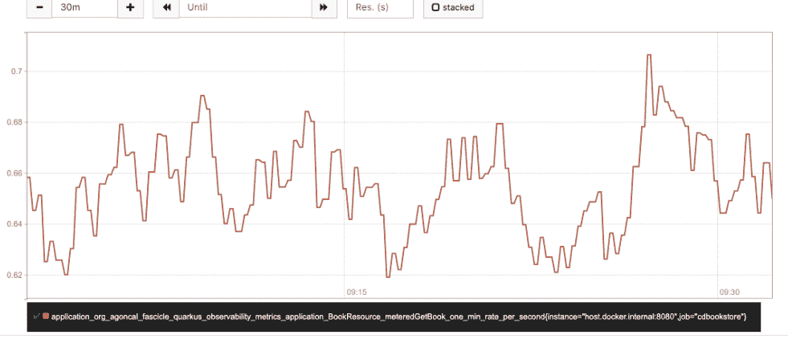

图 53. 通过 Prometheus 可视化指标

## 9.2.5. 配置 SmallRye Metrics

与 Quarkus 扩展一样，SmallRye Metrics 有几个属性，你可以在 `quarkus.smallrye-metrics.namespace` 下（见表 61）找到并进行配置。[111]

表 61. 一些 Quarkus 指标配置属性

| 属性 | 默认值 |
|---|---|
| quarkus.smallrye-metrics.path 指标处理程序的路径 | /metrics |
| quarkus.smallrye-metrics.enabled 是否启用 Quarkus 扩展 | true |
| quarkus.smallrye-metrics.micrometer.compatibility 应用 Micrometer | false |

## 9.3. 总结

分布式架构的挑战之一是监控。关于微服务首先要了解的是“它正在运行吗？状态如何？”为了区分这些状态，MicroProfile 引入了存活（liveness）和就绪（readiness）的概念。

通过 Quarkus，你可以打包代码，使其可以在服务器、虚拟机或容器上执行。但在生产环境中，是另一回事了。

通过 Quarkus，你可以根据需求使用不同的格式（即 JVM 模式和原生模式）打包应用程序。由于 Quarkus 天生云原生，它有一些扩展可以构建容器镜像并配合调度器执行。本章使用的容器是 Docker，调度器是 Kubernetes。

# 10. Native

通过第 6 章 HTTP 微和第 8 章事件驱动微服务，我们已经知道如何开发微服务。到为止，我们执行所有的示例都是使用开发模式（`mvn quarkus:dev`）。这是开发最简单的方法，因为你可以修改代码并看到更改。

> 确保你的开发环境已配置以执行本章的代码。你可以查看附录检查是否安装了所有所需的工具，特别是 Docker、VirtualBox 和 Kubernetes。

## 10.1. 打包 Quarkus 应用

在构建 Docker 镜像并在 Kubernetes 中执行之前，你需要打包应用程序或微服务的代码。如果你来自 Jakarta EE 世界，你可能已经熟悉各种打包格式（它们都是 zip 文件）：

- JAR：Java 归档（.jar 扩展）用于打包 Java 代码、属性文件、XML 描述符等构成 Java 程序。它需要 JVM 运行。
- WAR：Web 归档（.war 扩展）打包 Web 应用，需要 Jakarta EE Web profile 服务器运行。
- EAR：企业级归档（.ear 扩展）打包企业级应用，需要完整的 Jakarta EE 应用程序服务器。

Quarkus 不支持 WAR 或 EAR 打包，只 JAR 和原生执行文件：我们将其称为 JVM 模式和原生模式。那么不同的格式为：

- JVM 模式
  - JAR,
  - Fast JAR,
  - Uber JAR.
- 原生模式
  - 原生执行文件（取决于操作系统），
  - Linux 原生可执行文件。

要在这些打包格式之间进行选择，只需更改 `quarkus.package.type` 配置属性。像往常一样，你可以在打包时通过命令行更改其值（`mvn package -Dquarkus.package.type=jar`），或者在 `application.properties` 文件中进行：

```properties
## 可能的值有 jar, fast-jar, uber-jar 和 native
quarkus.package.type=fast-jar
```

让我们详细查看一下这些格式。

## 10.1. JVM 模式

Quarkus 首先是一个 Java 框架，允许你像经典的 JAR 应用一样对其进行打包和运行。在 JVM 模式下，Quarkus 会生成一个可执行的 JAR，你通过 `java -jar` 命令来执行它。在此模式下，你需要安装 Java 运行时环境。根据你的需求，有几种 JAR 格式可以选择。有些更容易打包和分发，有些更适合容器，另一些启动速度更快等。让我们仔细观察这些 JAR 格式。

### JAR

当你将代码打包成 JAR 文件时（使用默认的 `mvn package` 或 `mvn package -Dquarkus.package.type=jar`），Quarkus 会创建一个 JAR 文件和一个包含所有依赖项的 `lib` 目录。例如，列表 213 显示了目标目录的结构。在根目录下，我们有一个 JAR 文件（后缀为 `-runner.jar`），并且在同一层级有一个 `lib` 目录。这是 Quarkus 添加所有依赖项的地方。根据应用程序的复杂性，`lib` 目录可能会发生变化，变大或变小。

列表 213. 带有独立 lib 目录的 Thin JAR

```
target/
lib/
  io.quarkus.arc-1.7.0.Final.jar
  io.quarkus-bootstrap-runner-1.7.0.Final.jar
  io.quarkus-quarkus-core-1.7.0.Final.jar
  io.quarkus-quarkus-development-mode-spi-1.7.0.Final.jar
  io.quarkus-quarkus-netty-1.7.0.Final.jar
  io.quarkus-quarkus-resteasy-1.7.0.Final.jar
  io.quarkus-quarkus-vertx-core-1.7.0.Final.jar
  io.vertx.vertx-web-3.9.2.jar
  ...
  packaging-rest-1.0-SNAPSHOT.jar
```

如果你需要分发应用程序，你需要 `-runner.jar` 文件以及 `lib` 目录。那么，要运行应用程序，只需执行：

```bash
$ java -jar target/packaging-rest-1.0-SNAPSHOT-runner.jar
```


### Fast-JAR

如果你将代码打包成 Fast-JAR 格式（`mvn package -Dquarkus.package.type=fast-jar`），那么 Quarkus 将生成一个用于快速启动的 JAR。Fast-JAR 格式的引入是作为默认 JAR 打包的替代方案。该格式的主要目标是实现更快的启动。其思路是：在构建时，Quarkus 知道应用程序使用的所有类。因此，它在构建时创建一个索引，以知道哪个类位于哪个 JAR 包中。速度的提升是因为不需要遍历每个 JAR 包来确定哪个包包含了正在加载的类。普通的 JAR 不具备这种信息，因此需要使用 `URLClassLoader` 遍历 ClassPath 上所有的 JAR。如列表 214 所示，应用程序及其依赖项位于 `target/quarkus-app` 目录下，同时还包含索引（`quarkus-application.dat` 文件）。

列表 214. 带有依赖项和索引的 Thin JAR

```
target/
quarkus-app/
  app/
    packaging-rest-1.0-SNAPSHOT.jar
  lib/
    boot/
      io.quarkus.quarkus-bootstrap-runner-1.7.0.Final.jar
      io.quarkus.quarkus-development-mode-spi-1.7.0.Final.jar
    main/
      io.quarkus.arc-1.7.0.Final.jar
      io.quarkus.quarkus-core-1.7.0.Final.jar
      io.quarkus.quarkus-netty-1.7.0.Final.jar
      io.quarkus.quarkus-resteasy-1.7.0.Final.jar
      io.quarkus.quarkus-vertx-core-1.7.0.Final.jar
      io.quarkus.quarkus-vertx-http-1.7.0.Final.jar
      io.vertx.vertx-web-3.9.2.jar
quarkus/
  generated-bytecode.jar
  quarkus-application.dat
quarkus-run.jar
```

如果你需要分发应用程序，你需要 `target/quarkus-app` 目录的所有内容。那么，要执行应用程序，你需要运行以下命令：

```
$ java -jar target/quarkus-app/quarkus-run.jar
```

JAR 和 Fast-JAR 针对分层 Docker 镜像，因为应用程序代码的变化频率高于其所依赖的库。通过这种方式，你可以更快地构建 Docker 镜像。

未来的 Quarkus 版本很有可能会采用 Fast-JAR 格式作为默认。但在 Quarkus 1.9.0.Final 之前，默认格式是 JAR。

### Uber-JAR

Uber-JAR 是一个自包含的可执行文件。Uber-JAR 是一个包含应用程序类及其所有依赖项的单一 JAR。这就是为什么 Uber-JAR 也被称为 Fat-JAR。Quarkus Maven 插件通过在 `application.properties` 中指定 `quarkus.package.type=uber-jar` 或通过 `mvn package -Dquarkus.package.type=uber-jar` 命令来生成 Uber-JAR。

Uber-JAR 针对分层 Docker 镜像，因为应用程序代码的变化频率高于其所依赖的库。通过这种方式，你可以更快地构建 Docker 镜像。

```
$ target/packaging-rest-1.0-SNAPSHOT-runner
```

如你所见，我们不需要 Java 运行时即可执行该文件（我们不需要 `java -jar` 命令）。我们只需要像运行二进制可执行文件一样运行它。

生成的可执行文件特定于你的操作系统。例如，如果你在 macOS 上运行，该可执行文件将只能在 macOS 上运行，不支持 Linux 或 Windows。这对于测试是可以的，但对于生产环境，你可能希望生成一个可以在 Linux 或容器上运行的 Linux 可执行文件。Quarkus 可以帮助你生成可执行文件。

## Linux Native

要创建一个可以在 Linux 机器或容器中运行的可执行文件，你需要使用 native 配置文件来设置 Quarkus。因此，命令为：`mvn package -Pnative -Dquarkus.native.container-build=true`。

构建过程与上述为你的操作系统构建原生可执行文件略有不同。为了生成 64 位的 Linux 可执行文件，构建本身需要在一个 Docker 容器中运行。这意味着默认情况下，原生可执行文件将使用 `quay.io/quarkus/ubi-quarkus-native-image:20.2.0-java11` Docker 镜像生成。你不需要本地安装 GraalVM，Docker 镜像已经包含了所需的一切。你需要安装 Docker（用于下载和执行 Docker 镜像）。

> 如果你想使用不同的 Docker 镜像构建原生可执行文件（例如使用不同的 GraalVM 版本），请使用 `-Dquarkus.native.image` 属性。可以在 quay.io 上找到可用 Docker 镜像列表。请注意，特定的 Quarkus 版本可能与所有可用镜像兼容。

与之前一样，64 位的 Linux 可执行文件生成在 target 目录下：

```
target/
  - packaging-rest-1.0-SNAPSHOT-runner
  - packaging-rest-1.0-SNAPSHOT.jar
```

但根据你的操作系统，它可能不再可以运行。例如，如果你在 macOS 上运行并执行此文件，你将得到以下错误：

```
$ target/packaging-rest-1.0-SNAPSHOT-runner
Failed to execute process 'target/packaging-rest-1.0-SNAPSHOT-runner'.
Reason: Exec format error
The file 'target/packaging-rest-1.0-SNAPSHOT-runner' is marked as an executable but could not be run by the operating system.
```

## 10.1.3. Performance

每种格式都有优缺点。因此，让我们回顾一下我们如何构建这些不同的可执行文件、如何执行它们，更重要的是哪一个启动最快以及应该选择哪一个。

## 构建与执行

让我们快速回顾一下用过的命令。表 62 总结了构建每个可执行文件的 Maven 命令，而表 63 显示了运行所生成可执行文件的命令。

表 62. 构建命令

| 打包格式 | 命令 |
| --- | --- |
| JAR | `mvn package -Dquarkus.package.type=jar` |
| Fast-JAR | `mvn package -Dquarkus.package.type=fast-jar` |
| Uber-JAR | `mvn package -Dquarkus.package.type=uber-jar` |
| Native | `mvn package -Pnative` |
| Linux Native | `mvn package -Pnative -Dquarkus.native.container-build` |

表 63. 执行命令

| 打包格式 | 命令 |
| --- | --- |
| JAR | `java -jar target/<name>-runner.jar` |
| Fast-JAR | `java -jar target/quarkus-app/quarkus-run.jar` |
| Uber-JAR | `java -jar target/<name>-runner.jar` |
| Native | `target/<name>-runner` |
| Linux Native | `target/<name>-runner` |

## 可执行文件大小

获取可执行文件大小的一个简单指标：选择一种格式打包你的应用程序，即可获得以兆字节为单位的大小。你的应用程序越复杂，需要的依赖越多，可执行文件就越大。为了比较，表 64 显示了两种类型应用程序的可执行文件大小：

- REST：一个 JSON REST 端点。
- 复杂应用：带有验证、带有 Panache 的 Hibernate ORM、事务、注入和 H2 数据库的 JSON REST 端点。

表 64. 可执行文件大小

| 打包格式 | REST 应用 | 复杂应用 |
| --- | --- | --- |
| JAR (thin jar + target/lib) | 200 Kb + 10 Mb | 400 Kb + 30 Mb |
| Fast-JAR (target/quarkus-app) | 11 Mb | 31 Mb |
| Uber-JAR | 10 Mb | 30 Mb |

## 打包格式

| | REST 应用 | 复杂应用 |
|---|---|---|
| Native | 27 Mb | 69 Mb |
| Linux Native | 27 Mb | 69 Mb |

在 JVM 模式下，JAR 格式的大小相同（简单的 REST 应用约为 10 Mb，复杂应用约为 30 Mb）。Native 模式的情况也是如此：Linux 可执行文件的大小与你操作系统的可执行文件相差。主要区别在于 JVM 和 Native 模式之间的大小。原生可执行文件更大，是因为它们嵌入了执行应用程序所需的 Java 运行时环境部分。但在所有情况下，应用程序拥有的依赖越多（即复杂应用），可执行文件就越大。

## 首次请求时间

另一个有用的衡量是处理第一个请求的时间。这比仅仅测量启动时间更准确，因为某些框架可以使用激进的懒初始化技术。测量处理第一个请求的时间非常重要，它可以准确反映框架启动的情况。表 65 显示了每种可执行格式处理复杂应用程序第一个请求的时间（毫秒）。

表 65. 首次请求时间

| | REST 应用 | 复杂应用 |
|---|---|---|
| JAR | 165 ms | 170 ms |
| Fast-JAR | 160 ms | 160 ms |
| Uber-JAR | 185 ms | 190 ms |
| Native | 10 ms | 25 ms |

> 启动时间包含了 Quarkus 启动所需以及处理首次请求的时间。表 65 中的数字是在 macOS 上使用 JVM 11 在未优化的情况下生成的。为了获得这些数字，我遵循了 Quarkus 指南中的描述。

| 命令 | Description |
| --- | --- |
| ENV | 设置/修改从镜像创建的容器内部的环境变量 |
| EXPOSE | 定义要暴露的容器端口 |
| FROM | 选择基础镜像，以便在其基础上构建新镜像 |
| USER | 定义在镜像中运行所有命令的默认用户 |
| WORKDIR | 为 ENTRYPOINT 或 CMD 指令定义的命令定义默认工作目录 |

## JVM 模式

在 JVM 模式下，Quarkus 会生成两个 Dockerfile：一个用于 JAR (`Dockerfile.jvm`)，另一个用于 Fast-JAR (`Dockerfile.fast-jar`)。在两种情况下，这些 Dockerfile 都使用相同的基础镜像。UBI，即红帽通用基础镜像（Red Hat Universal Base Image），是红帽企业级 Linux 操作系统系统的子集，经过精简后只保留核心基础部分，非常适合容器。这意味着这些 Dockerfile 使用 Linux 环境来运行您的应用程序。

```
FROM registry.redhat.com/ubi8/ubi-minimal:8.1
```

在 JVM 模式下，我们需要 Java 运行时来执行应用程序。但由于 UBI 是一个非常轻量级的 Linux 操作系统，它并不包含 JVM。因此，`Dockerfile.jvm` 和 `Dockerfile.fast-jar` 都需要为特定版本的安装 JVM：

```
ARG JAVA_PACKAGE=java-11-openjdk-headless

RUN microdnf install ca-certificates ${JAVA_PACKAGE} \
    && microdnf update - \
    && microdnf clean all \
    && mkdir /deployments \
    && chown 1001 /deployments \
    && chmod g+rwx /deployments \
    && chown 1001:root /deployments \
    && curl https://repo1.maven.org/maven2/io/fabric8/cb/run-java.sh/$(RUN_JAVA_VERSION)/run-java.sh -o /deployments/run-java.sh \
    && chown 1001 /deployments/run-java.sh \
    && chmod 540 /deployments/run-java.sh \
    && echo "securerandom.source.file=/dev/urandom" >> \
    /etc/alternatives/lib/security/java.security

ENV JAVA_OPTIONS="-Dquarkus.host=0.0.0.0" \
-Djava.util.logging.manager=org.jboss.logmanager.LogManager
```

Dockerfile 之间的区别在于它们为了启动并运行应用程序所复制的内容。例如，在 `Dockerfile.jvm` 中，我们拷贝了薄 jar 包（带有 `-runner.jar` 扩展名的文件）以及 `/lib` 目录（包含应用程序依赖的所有 JAR 包的目录）：

```
COPY target/lib/* /deployments/lib/
COPY target/*/runner.jar /deployments/app
```

对于 Fast-JAR，`Dockerfile.fast-jar` 文件需要拷贝 `target/quarkus-app` 目录的内容，该目录包含了整个应用程序、依赖项和索引：

```
COPY --chown=1001 target/quarkus-app /deployments/
```

然后，`Dockerfile.jvm` 和 `Dockerfile.fast-jar` 都会暴露 8080 端口并使用脚本执行应用程序：

```
EXPOSE 8080
USER 1001
ENTRYPOINT [ "/deployments/run-java.sh" ]
```

## Linux 原生执行文件

对于 Linux 原生执行文件，`Dockerfile.native` 完全不同。首先，由于不需要使用 Java 层来启动应用程序，镜像不需要安装 Java 运行时环境。原生执行文件运行在 Linux 上（在红帽通用基础镜像上），它不需要 JVM 运行时。因此，这只是拷贝可执行文件（`runner file`）并执行它（CMD 命令）：

> 列表 216. 用于原生镜像的 Dockerfile

```
FROM registry.access.redhat.com/ubi8/ubi-minimal:8.1
WORKDIR /work
RUN chown 1001 /work \
    && chmod "g+rX" /work \
    && chown 1001:root /work
COPY --chown=1001 target/*/runner /work/application
```

```
EXPOSE 8080
USER 1001
CMD ["./application", "-Dquarkus.host=0.0.0.0"]
```


## 10.2.2. 构建 Docker 镜像

现在，你已经将应用程序打包成正确的执行文件（`JAR`、`Fast-JAR` 或 `Native`），并理解了其 Docker 文件的结构（`Dockerfile.jvm`、`Dockerfile.fast-jar`、`Dockerfile.native`），你可以轻松地构建你的 Docker 镜像。事实上，如果你对 Docker 命令很熟悉，可以使用你的 Dockerfile 手动构建 Docker 镜像。如果你不想运行 Docker 命令，而是想让系统自动创建镜像，Quarkus 提供了一个适用于 Maven（以及 Gradle）的 Docker 扩展。如果你不想维护 Dockerfile，只需将它们删掉，并使用 Quarkus jib 扩展：一个简单的 Maven 命令即可在无需任何 Dockerfile 的情况下自动创建 Docker 镜像。

### 使用 Docker 手动构建

如果你习惯 Docker 并且倾向于输入 Docker 命令，那么你可以利用你的知识来构建 Docker 镜像。根据你想要构建的镜像，只需在适当的 Dockerfile（`Dockerfile.jvm`、`Dockerfile.fast-jar` 或 `Dockerfile.native`）上执行 `docker image` 命令即可。表 69 显示了构建镜像的命令。

**表 69. 构建镜像的命令**

| 打包格式 | 命令 |
| --- | --- |
| JAR | `docker image -f src/main/docker/Dockerfile.jvm -t quarkus` |
| Fast-JAR | `docker image -f src/main/docker/Dockerfile.fast-jar -t quarkus/fast-jar` |
| Linux Native | `docker image -f src/main/docker/Dockerfile.native -t quarkus/native` |

当你执行这些命令之一时，你将看到类似的输出。

**列表 217. 手动构建 Docker 的输出**

```
Sending context to Docker daemon

Step 1/11 : FROM registry.redhat.com/ubi8/ubi-minimal:8.1

Step 2/11 : ARG JAVA_PACKAGE=java-11-openjdk-headless

Step 3/11 : ARG JAVA_RUN_VERSION=11

Step 4/11 : ENV LANG=en_

Step 5/11 : RUN microdnf install ca-certificates ${JAVA_PACKAGE}

Step 6/11 : ENV JAVA_OPTIONS="-Dquarkus.host=0.0.0.0"

Step 7/11 : COPY lib/* /deployments/lib/

Step 8/11 : EXPOSE 8080

Step 9/11 : COPY .runner.jar /deployments/app

Step 10/11 : USER 1001

Step 11/11 : ENTRYPOINT ["/deployments/run-java.sh"]

Successfully built

Tagged quarkus/jar:latest
```

### 使用 Docker 扩展构建

如果你想避免输入命令，并将此构建过程集成到你的构建系统中，那么你应该使用 Docker 扩展。为了生成 Docker 镜像，只需在列表 218 中添加 Maven 依赖。

**列表 218. Docker 扩展**

```
<dependency>
  <groupId>io.quarkus</groupId>
  <artifactId>quarkus-container-image</artifactId>
</dependency>
```

一旦添加了 Docker 扩展，执行 Maven 命令并将 `container-image.build` 属性设置为 `true`（或者在 `application.properties` 文件中设置）。如果你想为特定的格式（`JAR`、`Fast-JAR` 或 `Native`）构建 Docker 镜像，请记住可以添加其他属性，例如构建格式。你可以执行以下 Maven 命令：

```bash
mvn package -Dquarkus.container-image.build=true -Dquarkus.package.type=jar
mvn package -Dquarkus.container-image.build=true -Dquarkus.package.type=fast-jar
mvn package -Dquarkus.container-image.build=true -Dquarkus.package.type=native -Dquarkus.native.container-image=true
```

这些 Maven 命令将产生类似于列表 219 的输出。

**列表 219. 手动构建 Docker 的输出**

```
Sending build context to Docker daemon

Step 1/11 : FROM registry.access.redhat.com/ubi8/ubi-minimal:8.1

Step 2/11 : ARG JAVA_PACKAGE=java-11-openjdk-headless

Step 3/11 : ARG JAVA_RUN_VERSION=11

Step 4/11 : ENV LANG=en_

Step 5/11 : RUN microdnf install ca-certificates ${JAVA_PACKAGE}

Step 6/11 : ENV JAVA_OPTIONS="-Dquarkus.host=0.0.0.0"

Step 7/11 : COPY lib/* /deployments/lib/

Step 8/11 : EXPOSE 8080

Step 9/11 : COPY .runner.jar /deployments/app

Step 10/11 : USER 1001

Step 11/11 : ENTRYPOINT ["/deployments/run-java.sh"]

Successfully built

Tagged quarkus/jar:latest
```

如果你仔细观察列表 217 和列表 219 的输出，你会发现它们是相似的。Docker 扩展只是在适当的 Dockerfile 上执行了 `docker image build` 命令。

**列表 219. 使用 Docker 扩展构建 Docker 镜像**

```
[INFO] --- quarkus-maven-plugin:build @ container-docker ---
[INFO] Building thin jar: target/container-docker-1.0-SNAPSHOT-runner.jar
[INFO] Docker daemon found. Version: '19.03.12'
[INFO] Building docker image for jar.
[INFO] Executing the following command to build docker image: 'docker build -f src/main/docker/Dockerfile.jvm -t agonal/myapp:1.0 .'
[INFO] Sending context to Docker daemon 11.32MB
[INFO] Step 1/11 : FROM registry.access.redhat.com/u8/ubi-minimal:8.1
[INFO] Step 2/11 : ARG JAVA_PACKAGE=java-11-openjdk-headless
[INFO] Step 3/11 : ARG LANG_JAVA_VERSION=3.8
[INFO] Step 4/11 : ENV US_US=UTF-8 LANGUAGE='en:US'
[INFO] Step 5/11 : RUN microdnf install ca-certificates ${JAVA_PACKAGE} ...
[INFO] Step 6/11 : ENV JAVA_OPTIONS="-Dus.host=0.0.0.0 -Djava.util.logging.manager=org.jboss.logging.Manager"
[INFO] Step 7/11 : COPY target/lib/* /deployments/lib/
[INFO] Step 8/11 : COPY target/runner.jar /deployments/app.jar
[INFO] Step 9/11 : EXPOSE 8080
[INFO] Step 10/11 : USER 1001
[INFO] Step 11/11 : ENTRYPOINT [ "deployments/run-java.sh" ]
[INFO] Successfully built a7ddd127c7c3c
[INFO] Successfully tagged agonal/myapp:1.0
[INFO] Built container image agonal/myapp:1.0
[INFO]
[INFO] BUILD SUCCESS
[INFO]---
```

要使此功能工作，系统中必须安装 Docker。如果你的构建环境中没有 Docker，或者你不想维护任何 Dockerfile，那么可以使用 Jib 扩展。

### 使用 Jib 扩展构建

Jib 是 Google 的一款开源 Java 工具，用于以简单快速的方式创建 Docker 镜像 [12]。不需要创建 Dockerfile，不需要安装 Docker 守护进程，Jib 开箱即用。和往常一样，你需要使用适当的扩展。要使用 Jib 构建 Docker 镜像，只需将列表 220 所示的 Jib 扩展依赖添加到 `pom.xml` 中即可。

**列表 220. Jib 扩展**

```
<dependency>
  <groupId>io.quarkus</groupId>
  <artifactId>quarkus-container-image-jib</artifactId>
</dependency>
```

你使用 Jib 扩展的方式与使用 Docker 扩展相同：将所需的属性传递给 `mvn package` 命令：

```bash
$ mvn package -Dquarkus.container-image.build=true
```

不同之处在于输出。如列表 221 所示，这次没有 docker 镜像命令，也没有任何特定的 Dockerfile。

**列表 221. 使用 Jib 扩展构建 Docker 镜像时的输出**

```
[INFO] --- quarkus-maven-plugin:1.7.1.Final:build @ container-jib ---
[INFO] Building thin jar: target/container-jib-1.0-SNAPSHOT-runner.jar
[INFO] Starting container image build
[INFO] Base image 'fabric8/java-alpine-openjdk-11-jar'
[INFO] Container entrypoint set to java, -Dquarkus.http.host=0.0.0.0, -Djava.util.logging.manager=org.jboss.logmanager.LogManager, -cp, /app/resources/app/classes/libs/, io.quarkus.runner.GeneratedMain
[INFO] Created container image agonal/myapp:1.0
[INFO]
[INFO] BUILD SUCCESS
[INFO]
```

默认情况下，jib 扩展使用默认值，基础镜像 `fabric8/java-alpine-openjdk-11-jar`。如列表 221 所示，默认镜像来自 ENTRYPOINT。如果你想更改它，Quarkus 提供了一个可以使用属性 `quarkus.jib.base-jvm`。例如，我们使用 OpenJDK8 而不是以下镜像构建 Docker 镜像：

```bash
$ mvn package -Dquarkus.container-image.build -Dquarkus.jib.base-jvm-image=fabric8/java-alpine-openjdk8-re
```

## 10.2.3. 运行 Docker 镜像

到此为止，我们已经构建了 Docker 镜像（通过 Dockerfile 手动构建、使用 Docker 扩展或使用 Jib 扩展）。现在是执行它们了。一旦镜像创建并注册到 Docker 守护进程，你就可以执行 `docker image ls` 命令来检查它们在本地 Docker 仓库中是否可用。

```bash
$ docker image ls | grep image/
REPOSITORY TAG IMAGE ID SIZE
agonal/quarkus-jar latest 32a3ad8393bd 502MB
agonal/quarkus-fast-jar latest 568a78cd8a29 502MB
agonal/quarkus-native latest 0b0fa9ec5b7d 133MB
```

在此输出中，值得注意的是镜像的大小。JVM 模式（`JAR` 和 `Fast-JAR`）需要安装 UBI，这就是为什么它们比 native 模式的镜像大。然后，根据构建的镜像，你需要执行它。表 70 显示了运行镜像的命令。尽管名称不同，它们看起来相同并使用相同的选项：

- `-i` 将容器连接到终端。
- `--rm` 在容器退出后删除容器。
- `-p 8082:8080` 从外部暴露端口 8082，从而映射到主机的 8080（这是 Quarkus 正在监听的端口）。

**表 70. 运行镜像的命令**

| 打包格式 | 命令 |
| :--- | :--- |
| JAR | `docker container run -i --rm -p 8082:8080 agonal/quarkus-jar` |
| Fast-JAR | `docker container run -i --rm -p 8081:8080 agonal/quarkus-fast-jar` |
| Linux Native | `docker container run -i --rm -p 8082:8080 agonal/quarkus-native` |

一旦容器启动运行，你就可以像容器一样访问应用程序（例如 CURL 特定的 REST 端）。如果你想检查哪个容器正在运行，可以执行 `docker container ls`：

```bash
$ docker container ls
```

| CONTAINER ID | IMAGE | COMMAND | PORTS |
| :--- | :--- | :--- | :--- |
| 9861dac837 | agonal/quarkus-jar | "/deployments/run-java..." | 8080->8080/tcp |
| be54daf529 | agonal/quarkus-fast-jar | "/deployments/run-java..." | 8081->8080/tcp |
| 5a96def693 | agonal/quarkus-native | "/application -Dqua..." | 8082->8080/tcp |

## 10.2.4. 推送镜像

现在我们知道镜像已就绪，通过将其推送到远程仓库（默认为 Docker Hub）让其他人可以使用。Docker Hub 是 Docker 提供的查找和共享镜像的服务。要在 Docker Hub 上发布镜像，你需要注册创建一个免费账户并登录（使用 `docker login` 命令）。你的镜像名称与你的 Docker Hub 账户相同。在以下命令中，必须将 `agonal` 替换为你的 Docker Hub 账户。手动推送 Docker 镜像到 Docker Hub，只需使用 `docker image push` 命令：

```bash
$ docker image push agonal/quarkus-fast-jar
The push refers to repository [docker.io/agonal/quarkus-fast-jar]
e6271cacee: Pushed
latest: digest: sha256:92ae51ef73b30f16ef3 size:1
```

此命令将镜像的每一层推送到远程仓库。如图 54 所示，你可以登录 Docker Hub 并检查你的镜像。


**图 54.** Docker Hub 上的镜像

`docker image push` 命令允许你手动推送 Docker 镜像。但如果我们想将其集成到构建系统中呢？如果你使用 Docker 或 Jib 扩展，可以自动完成。只需将 `quarkus.container-image.push` 属性设置为 `true`（在 `application.properties` 文件中或 Maven 命令中），列表 222 显示了基于 `Dockerfile.jvm` 的 Docker 镜像并将其送到远程仓库。

**列表 222. 构建并推送 Docker 镜像**


$ mvn package -Dquarkus.package.type=jar -Dquarkus.container-image.build=true -Dquarkus.container-image.push=true

```
[INFO] --- quarkus-maven-plugin:build @ container-docker ---
[INFO] Building thin jar: target/container-docker-1.0.3-SNAPSHOT.jar
[INFO] Docker daemon found. Version: '19.03.12'
[INFO] Building docker image for jar.
[INFO] Executing the following command to build docker image: 'docker build -f Dockerfile.jvm -t agonal/myapp:1.0 .'
[INFO] Sending context to Docker daemon 11.32MB
[INFO] Step 1/11 : COPY FROM registry.access.redhat.com/ubi8/ubi-minimal:8.1
[INFO] Step 2/11 : ARG JAVA_PACKAGE=java-11-openjdk-headless
[INFO] Step 3/11 : ARG RUN_JAVA_VERSION=1.0
[INFO] Step 4/11 : ENV LANG=${ENV_LANG:-en_US.UTF-8}
[INFO] Step 5/11 : RUN microdnf install ca-certificates ${JAVA_PACKAGE} ...
[INFO] Step 6/11 : ENV JAVA_OPTIONS="-Dus.host=0.0.0.0 -Djava.util.logging.manager=org.jboss.logmanager.LogManager"
[INFO] Step 7/11 : COPY target/lib/* /deployments/lib/
[INFO] Step 8/11 : COPY target/runner.jar /deployments/app.jar
[INFO] Step 9/11 : EXPOSE 8080
[INFO] Step 10/11 : USER 1001
[INFO] Step 11/11 : ENTRYPOINT [ "/deployments/run-java.sh" ]
[INFO] Successfully built a7ddd12c3c3
[INFO] Successfully tagged agonal/myapp:1.0
[INFO] Built container image agonal/myapp:1.0
[INFO]
[INFO] BUILD SUCCESS
[INFO]
```

现在 Docker 镜像已发布在公共仓库中，任何人都可以拉取。这也包括 Kubernetes 等编排器。

## 10.2.5. 配置容器

表 71 显示了用于自定义容器镜像构建过程的部分属性。常用属性定义在 `quarkus.container-image` 命名空间下，根据容器实现方式（Docker 或 Jib），在 `quarkus.docker` 和 `quarkus.jib` 下有特定的属性。

表 71. 一些 Quarkus 容器配置属性

| 属性 | 默认值 |
| --- | --- |
| `quarkus.native.container-build` | `false` |
| `quarkus.native.container-runtime` |  |
| `quarkus.container-image.group` | `${user.name}` |
| `quarkus.container-image.name` | `${quarkus.application.name:unset}` |
| `quarkus.container-image.tag` | `${quarkus.application.version:latest}` |
| `quarkus.container-image.build` | `false` |
| `quarkus.container-image.push` | `false` |
| `quarkus.docker.dockerfile-jvm-path` | `src/main/docker/Dockerfile.jvm` |
| `quarkus.docker.dockerfile-native-path` | `src/main/docker/Dockerfile.native` |
| `quarkus.jib.base-jvm-image` | `fabric/8/java-alpine-openjdk11-jre` |
| `quarkus.jib.base-native-image` | `registry.access.redhat.com/ubi8/ubi-minimal` |

## 10.3. Kubernetes

既然我们已经验证了在容器中运行 Quarkus 应用是多么简单，现在我们将把应用程序部署到 Kubernetes 原生环境中。通过添加这些依赖项，我们能够生成 Kubernetes 清单文件（manifests）。

Kubernetes（又称 K8s）是一个容器化应用的编排器。[1994] 它的名字来源于希腊语，意为“舵手”或“船长”：如果 Docker 将应用程序封装在容器内部，那么 Kubernetes 就是指挥这些容器航行的船长。Kubernetes 可以调度、扩展、修复、更新、启动或停止多个容器。

## 10.3.1. Kubernetes 清单文件

将 Docker 镜像部署到 Kubernetes 集群涉及几个步骤。你需要创建一个 Deployment，将其与 Service、多个 Pod 等关联。所有这些步骤都可以命令行界面 `kubectl` 独立完成（如果你想了解更多关于在命令行创建部署，请参见附录 A）。但这可能繁琐且容易出错。在 Kubernetes 上部署的另一种方法是使用清单文件。

Kubernetes 清单文件描述了集群的期望状态，而不是我们想要实现该状态的方法。例如，期望状态是“我想要三个 Quarkus 实例，所以是 3 个 pod”。K8s 将期望状态落实到实际状态中。如果发生错误导致实际状态与期望状态不符（例如一个 Quarkus 实例失败），Kubernetes 将尽一切努力让实际状态回到期望状态。以 YAML 文件的形式定义清单并通过 `kubectl apply -f vintagestore.yaml` 或 `kubectl delete -f vintagestore.yaml` 命令发送给 Kubernetes 非常常见。让我们看看如何编写清单来部署我们之前构建的 Docker 镜像。

首先，我们需要如列表 223 所示定义一个部署。记住，Kubernetes 管理容器资源。在 Deployment 的情况下，我们正在创建一组受管理的资源（在我们的案例中，是 agoncal/quarkus-jar Docker 镜像）。清单文件以 `apiVersion` 开头。接下来，我们指定一些元数据并为 Deployment 命名。最后，我们进入 `spec` 对象，在其中描述我们期望的部署状态。在 particular情况下，我们首先说明无论部署什么 Pod，我们都希望有 1 个副本（一个实例）。然后我们选择（selector 对象）受此 Deployment 影响的 Pod，即匹配列表 224 中定义的特定标签（matchLabels）的 Pod。

### 列表 223. 部署定义

```yaml
apiVersion: apps/v1
kind: Deployment
metadata:
  labels:
    app.kubernetes.io/name: quarkus-jar
    app.kubernetes.io/version: latest
  name: quarkus-jar
spec:
  replicas: 1
  selector:
    matchLabels:
      app.kubernetes.io/name: quarkus-jar
      app.kubernetes.io/version: latest
  template:
    metadata:
      labels:
        app.kubernetes.io/name: quarkus-jar
        app.kubernetes.io/version: latest
    spec:
      containers:
        - env:
            - valueFrom:
                fieldRef:
                  fieldPath: metadata.namespace
          image: agoncal/quarkus-jar:latest
          imagePullPolicy: IfNotPresent
          name: quarkus-jar
```

关于 Deployment 的一个重要注意点是，它使用了一个定义 Pod 的抽象。在列表 224 中，我们指定 Service 是一组逻辑 Pod 的抽象。

### 列表 224. 服务定义

```yaml
apiVersion: v1
kind: Service
metadata:
  labels:
    app.kubernetes.io/name: quarkus-jar
    app.kubernetes.io/version: latest
  name: quarkus-jar
spec:
  ports:
    - name: http
      port: 8080
      targetPort: 8080
  selector:
    app.kubernetes.io/name: quarkus-jar
    app.kubernetes.io/version: latest
  type: NodePort
```

这些清单文件可以通过以下命令应用于集群：

```bash
$ kubectl apply -f vintageStore.yaml
```

表 72. 一些对象

| 关键字 | 描述 |
| --- | --- |
| `apiVersion` | 你使用的 Kubernetes API 版本 |
| `kind` | 要创建的对象类型（Deployment, Service 等） |
| `metadata` | 唯一标识对象的数据，包括名称和命名空间 |
| `spec` | 对象期望的状态 |
| `replicas` | 创建的 pod 数量 |
| `selector` | Kubernetes 控制器目标 pod 的可选对象 |
| `ports` | 内部和外部端口 |
| `image` | 镜像名称 |

## 10.3.2. 构建 Kubernetes 清单文件

现在我们已经将 Docker 镜像部署到远程仓库并了解了 Kubernetes 清单如何工作，让我们把构建的 Docker 镜像部署到 Kubernetes 集群。正如你所见，编写 YAML 文件可能是复杂且容易出错的。为什么不让 Quarkus 为我们生成呢？就像 Jib 扩展可以创建 Docker 镜像一样，Quarkus 也提供了根据我们的应用程序和配置生成 YAML 文件的扩展。

但还有一层复杂性：Kubernetes 清单文件并不是标准的。因此，取决于你针对的 Kubernetes 平台，YAML 文件可能会不同。例如，OpenShift 的 YAML 文件与 Minikube 的不同。这就是为什么 Quarkus 提供了针对特定扩展。让我们来看看其中两个：原生 Kubernetes 和 Minikube。

### 构建 Kubernetes 扩展

要让 Quarkus 生成部署描述，你需要相应的扩展（参见列表 225）。

#### 列表 225. Kubernetes 扩展

```xml
<dependency>
  <groupId>io.quarkus</groupId>
  <artifactId>quarkus-kubernetes</artifactId>
</dependency>
```

得此之后，简单的 `mvn package` 命令会在 target 目录下生成两个 Kubernetes 清单文件（JSON 或 YAML 格式）：

```
target/
└── kubernetes/
    ├── kubernetes.json
    └── kubernetes.yml
```

这些清单文件是为原生 Kubernetes 平台生成的，你通常需要对其进行自定义。如果你在笔记本电脑上开发，可能安装了 Minikube。如果你尝试将这些生成的清单部署到 Minikube 集群，你会遇到一些小问题并需要微调内容。

### 构建 Minikube 扩展

Minikube 允许你在开发者机器上本地运行 Kubernetes。[191] 它通过轻松设置和管理本地 Kubernetes 集群，让学习和开发变得简单。Minikube 是运行在本地虚拟机上的单节点集群。

#### 列表 226. Minikube 扩展

```xml
<dependency>
  <groupId>io.quarkus</groupId>
  <artifactId>quarkus-minikube</artifactId>
</dependency>
```

此扩展将生成原生的 Kubernetes 清单文件，以及针对 minikube 的特定文件：

```
target/
↳ kubernetes/
    kubernetes.json
    kubernetes.yml
    minikube.json
    minikube.yml
```

如果你查看 `kubernetes.yml` 和 `minikube.yml` 之间的差异，你会发现它们几乎是完全相同的。但如果你考虑其他的 Kubernetes 平台（例如 OpenShift），你会发现 YAML 文件可能非常不同。

## 10.3.3. 部署到 Minikube 集群

现在我们已经知道 Quarkus 会生成 Kubernetes 清单文件了，让我们将它们部署到 Minikube 集群上吧。

> 为了简单起见，我使用了 Minikube 平台，因为你可以在自己的个人电脑上运行这些命令。但为了与 Minikube 交互，我使用了 `kubectl`，它是可移植的，因此你可以在任何 Kubernetes 平台上使用相同的命令。唯一的要求是，取决于你针对的目标平台（OpenShift、Google、Azure 等），你需要相应地更改清单文件。如果你需要更多关于如何安装 Minikube、kubectl 以及不同命令的信息，请查阅附录 A。

首先，让我们检查一下 Kubernetes 集群。如果 Minikube 集群尚未启动，请使用以下命令启动它：

```
$ minikube start...
Done! kubectl is now configured to use "minikube"
```

此时，你不应该已经能看到任何部署内容。

```
$ minikube service list
| NAMESPACE | NAME | TARGET PORT | URL |
| default | kubernetes | No node port | |
| kube-system | kube-dns | No node port | |
```

正如你在上一节中看到的，我们现在需要将 Quarkus 应用打包成原生可执行文件或可执行 JAR，并构建并将 Docker 镜像推送到远程仓库，以便 Minikube 可以访问。一旦完成这些步骤，你将获得一个生成的 `minikube.yml` 文件，你可以使用 `kubectl apply` 命令手动进行部署。Quarkus 可以帮助你处理单个属性。无论你使用的是 Kubernetes、Minikube 还是 OpenShift 扩展，都可以通过将 `quarkus.kubernetes.deploy` 属性设置为 `true` 来部署 Docker 镜像。它将自动构建并将 Docker 镜像部署到目标平台。

```
$ mvn package -Dquarkus.kubernetes.deploy=true
[INFO] quarkus-maven-plugin:1.7.1.Final:build (default) @ orchestrator-minikube
[INFO] Deploying target 'minikube
[INFO] Kubernetes API Server at 'https://192.168.99.127:8443/' successfully contacted.
```


[INFO] Deploying to minikube server: https://192.168.99.127:8443/ in namespace: default.

[INFO] Applied: ServiceAccount quarkus-jar.

[INFO] Applied: Service quarkus-jar.

[INFO] Applied: Deployment quarkus-jar.

[INFO]

[INFO] BUILD SUCCESS

[INFO]

现在你应该能在 Minikube 集群下看到该部署了。`minikube service list` 命令还会提供访问应用程序的 URL 和端口：

| NAMESPACE | NAME | TARGET PORT | URL |
| --- | --- | --- | --- |
| default | kubernetes | No node port | |
| default | quarkus-jar | http/8080 | http://192.168.99.127:31826 |
| kube-system | kube-dns | No node port | |

因此，执行 `agonal/quarkus-jar` 镜像只需调用服务的 URL 即可。你现在可以将浏览器（或 `curl` 命令）指向 `http://192.168.99.127:31826/authors`，从而调用 REST 端点。

## 总结

要将镜像部署到 Kubernetes 集群，该镜像不仅需要被构建，还需要部署到远程 Docker 注册表中，以便 Quarkus 能够拉取并执行它。这涉及多个步骤，每一步都需要设置一个 Quarkus 属性。表 73 总结了这些属性。

### 表 73. 用于部署的 Quarkus 属性

| Quarkus 属性 | 说明 |
|---|---|
| `quarkus.container-image.build` | 将 Quarkus 应用打包为 jar、fast-jar 或原生可执行文件 |
| `quarkus.container-image.push` | 基于 Dockerfile 或使用 Jib 扩展构建 Docker 镜像 |
| `quarkus.kubernetes.deploy` | 将 Docker 镜像推送到远程注册表（默认到 Docker Hub） |

这意味着，如果你检查一个项目并想在一个 Maven 命令中完成它的打包、构建并将其部署到 Kubernetes 集群，你需要执行以下操作：

```bash
$ mvn -Dquarkus.package.type=jar \
-Dquarkus.container-image.build=true \
-Dquarkus.container-image.push=true \
-Dquarkus.kubernetes.deploy=true
```

## 10.3.4. 配置 Kubernetes

Quarkus Kubernetes 扩展是高度可配置的。你会在 `quarkus.kubernetes.namespace` 下找到多个属性。表 74 仅显示了这些属性的一个集。

### 表 74. 部分 Quarkus Kubernetes 配置属性

| 属性 | 默认值 |
|---|---|
| `quarkus.kubernetes.name` | `${quarkus.name}` |
| `quarkus.kubernetes.version` | `${quarkus.version}` |
| `quarkus.kubernetes.host` | `${quarkus.host}` |
| `quarkus.kubernetes.replicas` | `${quarkus.replicas}` |
| `quarkus.kubernetes.node-port` | `${quarkus.node-port}` |
| `quarkus.kubernetes.image-pull-policy` | `${quarkus.image-pull-policy}` |
| `quarkus.kubernetes.labels` | `${quarkus.labels}` |

## 10.4. 总结

Quarkus Kubernetes 扩展是高度可配置的。你会在 `quarkus.kubernetes.namespace` 下找到多个属性。表 74 仅显示了这些属性的一个集。

## 11. 测试

之前的章节重点介绍了不同的技术和 API 以及它们是如何协同工作的。但如何测试它们呢？如果你来自 Jakarta EE 世界，你可能记得测试应用内部组件是多么痛苦。如果你来自 Spring 世界，你可能知道如何在应用中运行测试。正如你现在所看到的，Quarkus 有一些特性（热重载、原生编译等），而测试是其中之一。Quarkus 让测试变得简单且快速。在执行测试时，应用程序会启动。你的测试将与整个应用程序一起运行，正如你所知道的应用程序启动非常快。本章展示了 Quarkus 如何在 JVM 模式以及原生模式下运行测试。它集成了 JUnit，但也支持 Rest Assured、Hamcrest 或 TestContainers 等多个框架，并提供了 mock 能力。这使得你的测试能够尽可能丰富、易于编写、复杂并能够与外部资源交互。而且 Quarkus 通过集成 Mockito 轻松地 mock 这些依赖项。

> 本章的代码可以在此处找到：https://github.com/agoncal/fascicle-quarkus/tree/1.0/testing

## 11.1. Quarkus 测试

Quarkus 集成了 JUnit 5（不支持 JUnit 4）。事实上，Quarkus 依赖测试无法与其他框架（例如 TestNG）工作。测试可以在 JVM 模式下执行（默认值），也可以在原生模式下执行：这只需使用相应的 Quarkus 运行器。

Quarkus 测试带有一些注解。表 75 列出了这些常用注解的一个集。

### 表 75. 主要 Quarkus 注解

| 注解 | 说明 |
|---|---|
| `@QuarkusTest` | 表示使用 Quarkus 的 JVM 模式运行测试 |
| `@NativeImageTest` | 表示使用原生镜像运行测试，而不是在 JVM 中运行 |
| `@QuarkusTestProfile` | 定义一个测试配置方案，其配置选项与其他测试不同 |
| `@InjectMock` | 当用在测试类的字段上时，该字段将成为一个 Mockito mock |

## 11.1.1. JUnit 5

JUnit 是一个用于编写和运行可重复测试的开源框架。[198] JUnit 的特性包括：用于测试预期结果的断言（assertions）、用于共享公共测试数据的固定（fixtures）以及用于运行测试的运行（runners）。与 Quarkus 的集成是通过 runner 实现的。但让我们先通过一个没有 Quarkus 特定代码的简单示例来看一些 JUnit 特性。

列表 227 展示了一个 Customer POJO。它包含一些属性，包括出生日期、构造函数、getter 和 setter。它还提供了两个实用方法来清除出生日期并计算客户的年龄（`calculateAge()`）。

### 列表 227. Customer 类

```java
public class Customer {

    private String firstName;

    private String lastName;

    private LocalDate dateBirth;

    private Integer age;

    public void calculateAge() {

        if (dateBirth == null) {

            age = null;

            return;

        }

        age = Period.between(dateBirth, LocalDate.now()).getYears();

    }

    public void clear() {

        this.dateBirth = null;

    }

    // Constructors, getters, setters

}
```

`calculateAge` 方法使用 `dateBirth` 属性来设置客户的年龄。它包含一些业务逻辑，我们希望算法能够准确地计算年龄。我们想要测试这个业务逻辑。为此，我们需要一个带有 JUnit 测试方法和断言的测试类。

### 测试类

在 JUnit 中，测试类不需要继承任何内容。要作为测试用例执行，JUnit 类至少需要一个标记了 `@Test` 注解的方法。如果你编写的类没有至少一个 `@Test` 方法，在尝试执行它时将得到一个错误（`java.lang.Exception: No runnable methods`）。

列表 228 显示了初始化 Customer 对象的 CustomerTest 类。

### 列表 228. Customer 的单元测试类

```java
public class CustomerTest {

    private Customer customer = new Customer();

}
```

### 固定（Fixtures）

固定件是在测试期间初始化和释放任何公共对象的方法。JUnit 使用 `@BeforeEach` 和 `@AfterEach` 注解在每个测试之前或之后执行代码。这些方法可以命名为任何名称（如列表 229 中的 `clearCustomer()`），你可以在一个测试中拥有多个方法。JUnit 使用 `@BeforeAll` 和 `@AfterAll` 注解执行一次特定代码，或在测试执行后。这些方法必须是唯一的且静态的。如果你需要分配和释放昂贵的资源，`@BeforeAll` 和 `@AfterAll` 将非常有用。

### 列表 229. 在每个测试之前执行的固定

```java
@BeforeEach
public void clearCustomer() {
    customer.clear();
}
```

测试方法必须使用 `@Test` 注解、返回 `void` 且不接受参数。这在运行时控制，如果不遵守将抛出异常。在列表 230 中，测试方法 `ageShouldBeGreaterThanThanZero` 创建了一个新的 `Customer` 并设置了特定的出生日期。然后，使用 JUnit 的断言机制（将在下一节中解释），检查年龄是否大于零。

### 列表 230. 方法测试年龄计算

```java
@Test
public void ageShouldBeGreaterThanThanZero() {
    customer = new Customer("Rita", "Navalhas");
    customer.setDateOfBirth(LocalDate.of(1975, 5, 27));
    customer.calculateAge();
    assert(customer.getAge() >= 0);
}
```

JUnit 还允许我们检查异常。在列表 231 中，我们尝试计算一个 `null` 客户对象的年龄，因此对 `calculateAge()` 方法的调用应该抛出 `NullPointerException`。如果抛出了，则测试成功。如果没有，或者它抛出了与声明不同类型的异常，则测试失败。

### 列表 231. 方法测试空值

```java
@Test
public void shouldThrowExceptionCauseOfBirthIsNull() {
    customer = null;
    assertThrows(NullPointerException.class, () -> {
        customer.calculateAge();
    });
}
```

列表 232 没有实现 `shouldCalculateOldAge` 方法。然而，你不希望测试失败；你只是想忽略它。你可以在 `@Test` 注解旁边添加 `@Disable` 注解。JUnit 将报告被禁用的测试数量，以及成功和失败测试的数量。注意，`@Disable` 接受一个可选参数（String），以防你想要记录禁用该测试的原因。

### 列表 232. 为测试禁用某个方法

```java
@Test @Disabled("Test is not implemented yet")
public void shouldCalculateOldAge() {
    // some work to do
}
```

### JUnit 断言（Assertions）

测试用例必须断言对象符合预期结果，例如列表 230 所示，我们断言年龄大于零。为此，JUnit 拥有一个 `Assertions` 类，其中包含多个方法。为了使用不同的断言，你可以使用前缀语法（例如 `Assertions.assertEquals()`）或静态导入 `Assertions` 类。列表 233 显示了 `Assertions` 类中定义的方法的简化子集。

### 列表 233. JUnit 断言子集

```java
public class Assertions {

    void assertTrue(boolean condition) {}

    void assertFalse(boolean condition) {}

    void assertNull(Object actual) {}

    void assertNotNull(Object actual) {}

    void assertEquals(Object expected, Object actual) {}

    void assertNotEquals(Object unexpected, Object actual) {}

    void assertArrayEquals(Object[] expected, Object[] actual) {}

    void assertMatch(List<String> expected, List<String> actual) {}

    void assertSame(Object expected, Object actual) {}

    void assertNotSame(Object expected, Object actual) {}

    void assertAll(Collection<?Executable> executables) {}

    void assertTimeout(Duration timeout, Executable executable) {}

    <T extends Throwable> T assertThrows(Class<T> expectedType, Executable executable)

}
```

## 11.1.2. JVM 模式

当你使用 Quarkus 开发时，你希望热加载和快速测试：因此通常处于 JVM 模式。要在 JVM 模式下测试代码，只需将测试标记为 `@QuarkusTest`（如列表 234 所示）并在 pom.xml 中启用 `quarkus-junit5` 依赖（列表 235）。正如你之前在列表 234 中看到的，代码使用了 REST Assured。

### 列表 234. JVM 模式测试

```java
@QuarkusTest
public class ArtistResourceTest {

    @Test
    public void shouldArtists() {
        given()
        when()
            .get("/artists")
        then()
            .statusCode(is(200));
    }

    @Disabled("Test is not implemented yet")
    public void shouldCreateArtist() {
        // some work to do
    }

}
```

JUnit 与大多数 IDE（IntelliJ IDEA、Eclipse、JavaBeans 等）集成得非常好。在使用这些 IDE 时，大多数情况下 JUnit 用绿色表示测试成功，用红色表示失败。大多数 IDE 还提供了创建测试类的功能。

JUnit 还通过在构建生命周期测试阶段使用的 Surefire 插件集成到 Maven。它执行 JUnit 测试类并生成 XML 和文本文件格式的报告。这主要是我们使用 JUnit 的方式：通过 Maven。在 Maven 中集成 JUnit，你只需要 JUnit 依赖并确保在 pom.xml 中声明 Surefire 插件，如列表 235 所示。

### 列表 235. Maven pom.xml 中的 JUnit 依赖

```xml
<dependencies>
  <dependency>
    <groupId>io.quarkus</groupId>
    <artifactId>quarkus-junit5</artifactId>
    <scope>test</scope>
  </dependency>
</dependencies>

<build>
  <plugins>
    <plugin>
      <artifactId>maven-surefire-plugin</artifactId>
      <configuration>
        <systemPropertyVariables>
          <java.util.logging.manager>org.jboss.logmanager.LogManager</java.util.logging.manager>${maven.home}</maven.home>
        </systemPropertyVariables>
      </configuration>
    </plugin>
  </plugins>
</build>
```


</systemPropertyVariables>

</configuration>

</plugin>

</plugins>

</build>

```

下面的 Maven 命令通过 Surefire 插件运行 JUnit 测试：

> `$ mvn test`

然后 JUnit 执行测试并给出已执行测试的数量、失败的测试数量以及禁用的测试数量（通过警告形式）。

```
[INFO] Building Quarkus :: Testing :: JVM Mode

[INFO]

[INFO]

[INFO] --- maven-surefire-plugin:test

[INFO]

[INFO]

[INFO] T E S S

[INFO]

[INFO] Running ArtistResourceTest

[INFO] io.quarkus (main) Quarkus on JVM started in 1.169s

[INFO] io.quarkus (main) Profile test activated.

[INFO] io.quarkus (main) Installed features: [cdi, resteasy, resteasy-json]

[INFO] Tests run: 2, Failures: 0, Errors: 0, Skipped: 1, Time elapsed: 3.827 s

[INFO]

[INFO] io.quarkus (main) Quarkus stopped in 0.026s

[INFO]

[INFO] Results:

[INFO] Tests run: 2, Failures: 0, Errors: 0, Skipped: 1

[INFO]

[INFO]

[INFO] BUILD SUCCESS

[INFO]

```

`@QuarkusTest` 注解完成了一切魔法：它首先启动 Quarkus 应用并执行测试。如果你查看之前的日志，可以看到此工作流的执行过程：

- Quarkus 在测试配置中启动（"Quarkus on JVM started"）（激活（"Profile test activated"））
- 执行测试（"Tests run"）
- Quarkus 停止（"Quarkus stopped"）

虽然 Quarkus 会监听 8080 端口，但在运行测试时它默认使用 8081。这允许你在运行应用程序的同时进行测试。

## 11.1.3. 原生模式测试

可以使用另一个注解 `@NativeTest` 对原生可执行文件进行测试。其思想是针对二进制文件运行一组测试，而不是针对 Java 代码。这有时非常有用，因为原生代码的行为可能会有所不同（你很快就会看到）。列表 236 显示了一个原生测试。如你所见，它扩展了我们之前在列表 234 中看到的 JVM 测试，并且使用的是 `@NativeImageTest` 注解而不是 `@QuarkusTest`，仅此而已。注意这个类是空的，但你可以根据需要添加额外的方法来测试特定的原生行为。

## 列表 236. 原生模式测试

```java
@NativeImageArtistResource
public class NativeArtistResourceIT extends ArtistResourceTest {
    // 执行相同的测试，但在原生模式下。
}
```

> 扩展 JVM 测试的原生测试有一个陷阱。如果你在 JVM 测试中有任何注入，原生测试将失败。你将必须在原生测试中重写你的注入点以使其运行。

要在原生可执行文件上执行测试，不需要向 `pom.xml` 添加特定的 Quarkus 扩展。唯一需要的是在原生配置配置（native profile）下正确配置 Failsafe 插件（参见列表 237）。Failsafe 运行在 `verify` 目标上，并将 `native.image.path` 属性设置为 `target` 目录下生成的二进制文件。

# 列表 237. 原生配置

```xml
<profile>
  <id>native</id>
  <activation>
    <property>
      <name>native</name>
    </property>
  </activation>
  <build>
    <plugins>
      <plugin>
        <artifactId>maven-failsafe-plugin</artifactId>
        <executions>
          <execution>
            <goals>
              <goal>integration-test</goal>
              <goal>verify</goal>
            </goals>
            <configuration>
              <systemPropertyVariables>
native.image.path=${project.build.directory}/${project.build.finalName}-runner/${native.image.path}
java.util.logging.LogManager<java.util.logging.LogManager>
maven.home>${maven.home}</maven.home>
              </systemPropertyVariables>
            </configuration>
          </execution>
        </executions>
      </plugin>
    </plugins>
  </build>
  <properties>
    <quarkus.package.type>native</quarkus.package.type>
  </properties>
</profile>
```

执行原生测试需要使用以下命令调用原生配置：

```bash
$ mvn verify -Pnative
```

这将执行 JVM 模式测试，然后是原生测试。工作流如下：

- Surefire 插件执行 JVM 模式（Quarkus 模式启动）；
- GraalVM 将代码编译为二进制文件；
- Failsafe 插件执行二进制文件（Quarkus 模式启动）；
- Failsafe 插件运行原生测试。

但请记住，原生运行的是 Quarkus 应用，而不是测试本身。你应该看到类似的轨迹：

```
[INFO] Building Quarkus :: Testing :: Native Mode

[INFO] --- maven-surefire-plugin:test

[INFO] TESTS

[INFO] Running ArtistTest Quarkus started in 1.169s

[INFO] io.quarkus (main) Profile activated.

[INFO] io.quarkus (main) Installed features: [cdi, resteasy, resteasy-json]

[INFO] Tests run: 2, Failures: 0, Errors: 0, Skipped: 1, Time elapsed: 3.827 s

[INFO] io.quarkus (main) Quarkus stopped in 0.026s

[INFO] Tests run: 2, Failures: 0, Errors: 0, Skipped: 1

[INFO] --- quarkus-maven-plugin:build

[INFO] Building native image from Code

[INFO] Running Quarkus native-image plugin on GraalVM

[INFO] class: 3010.30 ms, 0.96 GB

[INFO] (clinit): 698.82 ms, 3.24 GB

[INFO] universe: 785.52 ms, 3.24 GB

[INFO] (parse): 2001.61 ms, 4.20 GB

[INFO] write: 645.63 ms, 5.81 GB

[INFO] total: 4619.87 ms, 5.81 GB

[INFO] --- maven-failsafe-plugin:integration-test

[INFO] TESTS

[INFO] Running ArtistResourceIT target/jvm-mode-1.0-SNAPSHOT

[INFO] io.quarkus (main) Profile activated.

[INFO] io.quarkus (main) Installed features: [cdi, resteasy, resteasy-json]

[INFO] Results: Tests run: 3, Failures: 0, Errors: 0, Skipped: 1

[INFO] BUILD SUCCESS
```

但为什么要专门为镜像创建测试呢？因为在构建原生可执行文件时，GraalVM 采用封闭世界假设。它会分析树并移除所有未直接使用的类/方法/字段。通过反射使用的元素如果没有被直接调用，就会被视为死代码并移除。为了避免代码被 GraalVM 移除，你需要用 `@Reflection` 注解你的 Bean。例如，列表 238 显示了一个带有 JSON-B 注解的 Bean。JSON 库使用反射将对象序列化为 JSON。Graal 需要反射。如果我们使用没有 `@Reflection` 的 `Artist`，会在原生模式下遇到异常。为了将这些元素包含在原生可执行文件中，你需要显式注册反射 Bean。这意味着 JVM 模式测试将成功，但原生模式测试将失败。

# 列表 238. 为反射注册 Bean

```java
@RegisterForReflection
public class Artist {
    private Integer id;
    @JsonProperty("first_name")
    private String firstName;
    @JsonProperty("last_name")
    private String lastName;
    // Constructors, getters, setters
}
```

## 11.1.4. 事务测试

在第 5 章中，你学习了如何使用 Java Persistence API (JPA) 和 Panache 将实体映射到关系数据库。得益于 JTA (Java Transaction API)，我们可以以事务的方式插入、更新或删除实体。因此，如果我们想在事务上下文中执行测试，只需在测试方法上（或如列表 239 所示的类上）应用 `@Transactional` 注解，事务拦截器就会处理它。

# 列表 239. 事务测试

```java
@QuarkusTest
@Transactional
class MusicianTest {
    @Test
    void shouldPersistAMusician() {
        Musician musician = new Musician();
        musician.firstName = "Janis";
        musician.lastName = "Joplin";
        musician.dateOfBirth = LocalDate.of(1943, 01, 19);
        musician.preferredInstrument = "Voice";
        musician.persist(musician);
        assertNotNull(musician.id);
    }
}
```

如果没有这个注解，测试将失败。因为 `persist()` 方法需要在事务上下文中运行。

## 11.1.5. 配置 Quarkus 测试

某些 JVM 和原生测试可以在 Quarkus 中配置。你可能会发现一个非常有用的常用配置属性是测试期间使用的监听端口（`quarkus.http.test-port` 属性）。默认值为 8081，如果你将其设置为 0，则会导致使用随机端口（由操作系统分配）。表 76 显示了其他常用属性。

表 76. 常用 Quarkus 测试属性

| 属性 | 默认值 | 说明 |
| --- | --- | --- |
| `quarkus.http.test-port` | 8081 | 测试使用的 HTTP 端口 |
| `quarkus.http.test-ssl-port` | 8444 | 测试使用的 HTTPS 端口 |
| `quarkus.test.profile` | test | 使用 `@Quarkus` 时使用的配置 |
| `quarkus.native.graalvm-home` | `${GRAALVM_HOME}` | Graal 分发版的位置 |
| `quarkus.native.java-home` | `${java.home}` | JDK 的位置 |
| `quarkus.test.native-image-wait-time` | PT5M | 测试期间等待原生镜像构建的时间 |

| 属性 | 默认值 |
|---|---|
| `quarkus.test.native-image-profile` | prod |
| 测试原生镜像时使用的配置 | |

## 11.2. 测试框架

集成 JUnit 并为 JVM 模式测试提供一个注解（`@QuarkusTest`），为原生测试提供另一个注解（`@NativeTest`），这仅仅是冰山一角。Quarkus 进一步集成了多个框架，使得测试可以变得更加丰富且显式，而无需费费精力：用于表达性表达式的 REST Assured、用于测试 REST 端点的 REST Assured，以及在测试生命周期内运行 Docker 镜像的 TestContainers。让我们来看看这些框架，看看 Quarkus 是如何集成它们的。

## 11.2.1. REST Assured

REST Assured 是一个开源 Java 库，提供了一个领域特定语言 (DSL)，用于为 RESTful API 编写强大且可维护的测试 [209]。它支持 POST, GET, PUT, DELETE, OPTIONS, PATCH 和 HEAD 请求，并可验证和检查这些请求的响应。

Listing 240 使用 REST Assured 对资源执行 HTTP GET 请求，并检查状态码为 200。

Listing 240. 简单的 HTTP GET 测试

```
given().
when()
  .get("/customers")
then()
  .statusCode(200);
```

Listing 241 和 Listing 240 非常相似。Listing 241 使用 REST Assured DSL 将某些参数传递给 HTTP GET 测试，例如 ACCEPT 头。

Listing 241. 带有特定参数的 HTTP GET 测试

```
given()
  .baseUri("http://localhost:8081")
  .header(ACCEPT, APPLICATION_JSON)
when()
  .get("/customers")
then()
  .statusCode(200);
```

正如你在 Listing 242 中所示，REST Assured 可以帮助轻松地发送 GET 请求并验证响应及其内容（得益于 `body()` 方法）。

Listing 242. 检查响应正体的 HTTP GET 测试

```
given()
.PathParam("id"
```

Listing 243 显示了如何调用 HTTP POST 传递一个 Customer 对象，然后检查响应码是否为 201（已创建）。

Listing 243. 传递正体的 HTTP POST 测试

```
Customer customer = new Customer().firstName("John").lastName("Lennon");
given()
  .body(customer)
  .header(CONTENT_TYPE, APPLICATION_JSON)
  .header(ACCEPT, APPLICATION_JSON)
when()
  .post("/customers")
then()
  .statusCode(201);
```

在 Quarkus 中，当你想要测试 REST 端点时，只需在 `pom.xml` 中添加依赖即可使用 REST Assured 进行测试（参见 Listing 244）。

Listing 244. REST Assured 扩展

```xml
<dependency>
  <groupId>io.rest-assured</groupId>
  <artifactId>rest-assured</artifactId>
  <scope>test</scope>
</dependency>
```


Quarkus 提供了 REST Assured 集成，它会在测试前更新 REST Assured 使用的默认端口。因此，在你的 REST Assured 测试中，你不需要手动指定 Quarkus 提供的默认端口 `8081`。这种集成可以通过 `@HTTPEndpoint` 注解进一步扩展，该注解会自动设置正确的基 URL（即作为每个请求根节点的默认 URL）。此注解可以应用于类级别或方法级别。Listing 245 在不指定 URL 的情况下测试了 `ArtistResource` 端点。这样一来，如果我们以后决定更改 `ArtistResource` 的路径，测试将自动获取正确的路径，而无需我们手动修改。

### Listing 245. 未指定 URL 的 Rest 端点测试

```java
@QuarkusTest
@TestHTTPEndpoint(ArtistResource.class)
public class ArtistHTTPResourceTest {

    @Test
    public void shouldGetAllArtists() {
        given().
        when()
            .get()
        then()
            .statusCode(is(200));
    }

    @Test
    public void shouldGetOneArtist() {
        given().
            .pathParam("id", 1)
        when()
            .get("/{id}")
        then()
            .statusCode(is(200))
            .body("first_name", is("John"))
            .body("last_name", is("Lennon"));
    }
}
```

### 11.2.2. Hamcrest

Hamcrest 是一个用于编写断言的框架。我们不再使用 JUnit 的 `assertEquals()`，而是使用 `assertThat`。Listing 246 显示了一个非常简单的测试。

#### Listing 246. 简单的 Hamcrest 断言

```java
class assertThatTest {
    @Test
    public void shouldEquals() {
        Book oneBook = new Book();
        Book anotherBook = new Book();
        assertThat(oneBook, is(anotherBook));
    }
}
```

如果你想让代码更具表现力，可以使用匹配器（matchers）。例如，以下断言等同于：

```java
assertThat(book.getTitle(), is("262"));
assertThat(book.getYearOfPublication(), is(1979));
assertThat(book, is(anotherBook));
assertThat(book.getTitle(), not(nullValue()));
assertThat(book.isbn, is(nullValue()));
assertThat(book.getNumberOfPages(), isGreaterThan(100));
```

Hamcrest 自带有一个匹配器库。表 77 显示了其中一些重要的匹配器。

**表 77. 主要 Hamcrest 匹配器**

| 匹配器 | 说明 |
|---|---|
| `anything` | 总是匹配，如果你不在乎测试的对象是什么，这很有用 |
| `is` | 提高可读性的装饰器 |
| `allOf` | 当所有匹配器都匹配时则匹配（类似于 Java `&&`） |
| `anyOf` | 当任意一个匹配器匹配时则匹配（类似于 Java `||`） |
| `not` | 如果封装的匹配器不匹配，则匹配，反之亦然 |
| `equalTo` | 使用 `Object.equals()` 测试对象相等性 |
| `notValue`, `nullValue` | 测试是否为 `null` |
| `greaterThan`, `greaterOrEqualTo`, `lessThan`, `lessEqualTo` | 测试顺序关系 |
| `equalToIgnoringCase` | 忽略大小写进行相等性测试 |
| `equalToIgnoringWhitespace` | 忽略空格差异的相等性测试 |
| `containsString`, `endsWith`, `startsWith` | 测试字符串匹配 |

当你使用 REST Assured 测试 REST 端点时，不需要在 `pom.xml` 中添加 Hamcrest 依赖，因为 REST Assured 会递归地引入 Hamcrest 依赖。

### 11.2.3. 测试资源

一个常见需求是在 Quarkus 启动测试之前，启动应用程序依赖的某些服务。例如，你可能希望在执行集成测试之前启动 Postgres 数据库、Kafka 代理或外部微服务。对于此类情况，Quarkus 与 TestContainers 集成，并提供了几个注解在测试期间轻松管理外部资源。

#### TestContainers

TestContainers 是一个支持 JUnit 测试的 Java 库，提供了常用 Docker 镜像的轻量级临时实例。它允许我们在测试中使用 Docker 容器。例如，它可以使用容器化的 PostgreSQL 数据库实例来测试数据访问层，而无需在开发机上进行复杂的配置。假设我们的应用程序使用 PostgreSQL 作为关系型数据库，并且我们想要运行带有运行 PostgreSQL 的测试。使用 TestContainers 很容易地实现这样的测试。正如 Listing 247 所示，JUnit 集成是通过 `@Testcontainers` 注解提供的。该扩展会找到所有带有 `@Container` 注解的字段并调用它们的生命周期方法。声明为静态字段的容器将在测试之间共享。它们将在任何测试方法执行之前启动一次，并在最后一个测试方法执行后停止。声明为实例字段的容器将在每个测试方法执行时启动和停止。

##### Listing 247. PostgreSQL TestContainer 测试

```java
@QuarkusTest
@Testcontainers
public class PingPostgreSQLTest {

    @Container
    public static PostgreSQLContainer pg = new PostgreSQLContainer<>("postgres:12.4")
        .withDatabaseName("vintageStoreDB")
        .withUsername("vintage")
        .withPassword("vintage")
        .withExposedPorts(5432);

    @Test
    public void testPingPostgreSQL() throws Exception {
        pg.start();
        try {
            Connection con = DriverManager.getConnection(pg.getJdbcUrl(), pg.getUsername(), pg.getPassword());
            Statement st = con.createStatement();
            ResultSet rs = st.executeQuery("SELECT VERSION()");
            if (rs.next()) {
                assertTrue(rs.getString(1).contains("PostgreSQL 12"));
            } else {
                throw new Exception("");
            }
        } finally {
            pg.stop();
        }
    }
}
```

Testcontainers 将尝试连接到 Docker 进程。因此，要执行 Listing 247 中的测试，请确保 Docker 已经启动并运行。如果不是如此，你将得到以下异常：

> IllegalStateException: Could not find a valid Docker environment.

在 Docker 运行的情况下，如果本地机器没有，TestContainers 将首先从 Docker Hub 下载 PostgreSQL 镜像。然后，它会启动 PostgreSQL 容器，执行测试并停止 PostgreSQL 容器。输出如下：

```
INFO --- maven-surefire-plugin:test @ containers ---
TESTS
Running org.agoncal.fascicle.PingPostgresQL
INFO Accessing docker with local Unix socket
INFO Found Docker environment with local Unix socket
INFO Docker host IP address is localhost
INFO Connected to docker:
INFO Checking the system...
INFO [postgres] - Pulling docker image: postgres. Please be patient;
INFO [postgres] - Starting to pull image
INFO [postgres] - Pulling layers: 0 pending, 0 downloaded, 0 extracted
INFO [postgres] - Pulling layers: 13 pending, 1 downloaded, 0 extracted
INFO [postgres] - Pulling layers: 10 pending, 4 downloaded, 0 extracted
INFO [postgres] - Pulling layers: 7 pending, 7 downloaded, 2 extracted
INFO [postgres] - Pulling layers: 6 pending, 8 downloaded, 3 extracted
INFO [postgres] - Creating container image: postgres
INFO [postgres] - Starting container with ID: 77a1669fe4bb3f7f
INFO [postgres] - Container postgres is starting: 77a1669fe4bb3f7f
INFO [postgres] - Container postgres started
Tests run: 1, Failures: 0, Errors: 0, Skipped: 0
INFO
INFO BUILD SUCCESS
INFO
```

Quarkus 并没有针对 TestContainers 的特定扩展。Listing 248 显示了你在 `pom.xml` 中需要的 Maven 依赖项。

##### Listing 248. TestContainers 依赖

```xml
<dependency>
  <groupId>org.testcontainers</groupId>
  <artifactId>testcontainers</artifactId>
  <version>${testcontainers.version}</version>
  <scope>test</scope>
</dependency>
<dependency>
  <groupId>org.testcontainers</groupId>
  <artifactId>junit-jupiter</artifactId>
  <version>${testcontainers.version}</version>
  <scope>test</scope>
</dependency>
```

#### Quarkus 测试资源

在某些场景下，你不需要 TestContainers 在测试套件前后启动和停止资源。一些简单的钩子（hooks）可以。为了解决这个问题，Quarkus 提供了 `@QuarkusTestResource` 注解和 `QuarkusTestResourceLifecycleManager` 接口。其思路是，你实现 `QuarkusTestResourceLifecycleManager` 来启动和停止资源，并使用该实现类用 `@QuarkusTestResource` 注解你的测试。Quarkus 提供了内置实现来实现启动和停止资源：

- H2 数据库：`H2DatabaseTestResource`
- Derby 数据库：`DerbyDatabaseTestResource`
- Kubernetes：`KubernetesMockServerTestResource`
- LDAP 服务器：`LdapServerTestResource`

例如，Listing 249 中的事务测试使用 `@QuarkusTestResource` 在运行测试前后启动和停止 H2 数据库。

##### Listing 249. 使用 H2 数据库测试

```java
@QuarkusTest
@QuarkusTestResource(H2DatabaseTestResource.class)
@Transactional
class MusicianTest {
    @Test
    void shouldPersistAMusician() {
        // ...
    }
}
```

Quarkus 拥有多个用于测试资源的扩展。事实上，如你在 Listing 250 中所示，每个资源都有其自己的扩展。

##### Listing 250. 测试资源的一些依赖项

```xml
<dependency>
  <groupId>io.quarkus</groupId>
  <artifactId>quarkus-test-h2</artifactId>
  <scope>test</scope>
</dependency>
<dependency>
  <groupId>io.quarkus</groupId>
  <artifactId>quarkus-test-derby</artifactId>
  <scope>test</scope>
</dependency>
<dependency>
  <groupId>io.quarkus</groupId>
  <artifactId>quarkus-test-client</artifactId>
  <scope>test</scope>
</dependency>
<dependency>
  <groupId>io.quarkus</groupId>
  <artifactId>quarkus-test-ldap</artifactId>
  <scope>test</scope>
</dependency>
```

## 1. 模拟 (Mocking)

模拟（Mocking）常用于测试。假设你有一个具有复杂依赖的对象。在测试阶段，为了隔离对象，你可能想将这些依赖替换为 mock 对象。Java 中有很多框架，如 Mockito、EasyMock 和 JMock。

正如你在第 7 章所看到的，Quarkus 支持使用 mock 对象。要使用它，只需用 mock 实现覆盖你想要模拟的 Bean 即可。

### Listing 252. 为测试模拟 ISBN

```java
@Mock
@ApplicationScoped
@RestClient
public class MockIsbnProxy implements IsbnResource {
    @Override
    public IsbnNumbers generateIsbnNumbers() {
        IsbnNumbers isbnNumbers = new IsbnNumbers();
        isbnNumbers.setIsbn13("Mock isbn 13");
        isbnNumbers.setIsbn10("Mock isbn 10");
        return isbnNumbers;
    }
}
```

如果你查看底层实现，`@Mock` 注解实际上是一个 CDI alternative（更多信息请参考第 4 章）。因此，Listing 253 中的代码与 Listing 252 相同。我们将该类声明为 `@Alternative` 且优先级为 `@Priority(1)`，它的效果与 `@Mock` 相同。

### Listing 253. 使用 Alternative 模拟

```java
@Alternative
@Priority(1)
@ApplicationScoped
@RestClient
public class MockIsbnProxy implements IsbnResource {
    //...
}
```


这是我们提供所有 Quarkus 测试都能使用的全局 mock 的一种方法。但如果我们不想有一个全局定义的 mock，而是希望我们的 mock 仅在一个测试的作用范围内有效呢？我们可以使用 `@Inject` 来实现这一点。`@Mock` 会在测试类中产生 mock 实现。

在列表 254 中，`BookResourceTest` 通过 `@Inject` 注入了 `IsbnResourceProxy` 的 mock 实现。然后，在 `@BeforeEach` 方法中，我们使用 Mockito 在调用 `generateIsbnNumbers()` 时返回伪数据。这意味着当执行 `shouldRandomBook` 测试时，会调用 `BookResource` 端点，并从模拟的 `IsbnResourceProxy` 实现中获取伪数据。

# 列表 254. 注入 Mock 实现

```java
@QuarkusTest
public class BookResourceTest {

    @Mock @RestClient
    IsbnResourceProxy isbnServiceProxy;

    @BeforeEach
    void mockData() {
        Mockito
            .when(isbnServiceProxy.generateIsbnNumbers())
            .thenReturn(new IsbnNumbers("Dummy isbn 10"));
    }
}
```

与 Mockito 的集成是通过扩展完成的（参见列表 255）。它还为你提供了额外的注解，如 `@InjectMock` 或 `@InjectSpy`。

# 列表 255. Mockito 扩展

```xml
<dependency>
    <groupId>io.quarkus</groupId>
    <artifactId>quarkus-junit5-mockito</artifactId>
    <scope>test</scope>
</dependency>
```

# 11.4. Quarkus 测试配置

在第 4 章“核心 Quarkus”中，你已经了解了 Quarkus 如何在同一个 `application.properties` 文件中允许多个配置，并通过配置名称（profile）来选择它们。Quarkus 自带了三个配置环境（prod、dev 和 test），你也可以创建自己的。在测试阶段，Quarkus 会自动激活测试配置。这就是为什么当 Quarkus 启动时，你会看到“Profile test activated”：

```text
[INFO] -----
[INFO] TESTS
[INFO]
[INFO] Running agoncal.fascicle.InvoiceTest
[INFO] io.quarkus (main) Quarkus on JVM started in 0.678s.
[INFO] io.quarkus (main) Profile test activated.
[INFO] io.quarkus (main) Installed features: [cdi]
[INFO] io.quarkus (main) Quarkus stopped in 0.001s
```

激活测试配置允许我们使用 `%{profile}.config.key=value` 语法，根据不同的配置环境拥有不同的设置。例如，在列表 256 的 `application.properties` 中，我们将默认数据库配置为具有特定 JDBC URL 的 Postgres 数据库。但在测试时，且仅在我们需要时，我们将使用 H2 内存数据库。

# 列表 256. 生产与测试属性

```properties
quarkus.datasource.db-kind=postgresql
quarkus.datasource.jdbc.url=jdbc:postgresql://localhost:5432/vintageStoreDB
quarkus.hibernate-orm.database.generation=update
%test.quarkus.datasource.db-kind=h2
%test.quarkus.datasource.jdbc.url=jdbc:h2:mem:vintageStoreDB
%test.quarkus.hibernate-orm.database.generation=drop-and-create
```

根据配置环境来配置应用程序是非常容易的。但如果我们想在不同的配置中运行测试，而不仅仅是某一个呢？为此，Quarkus 提供了测试配置（test profile）的概念，你可以拥有任意数量的类，为每个类精确定义自己的配置（这需要覆盖 `application.properties` 文件），并将其单独应用于每个测试用例。

假设我们有几个属性来配置发票的增值税率和折扣。默认情况下，增值税率为 10，且不允许折扣：

```properties
org.agoncal.fascicle.Invoice.vatRate=10
org.agoncal.fascicle.Invoice.discount=false
```

正如我们所看到的，可以通过在每个属性前加上 `%test.` 来更改整个测试套件的值。这并不是我们想要的。我们希望根据不同的货币计算配置不同的发票（每种货币的税率都不同）。为此，我们首先如列表 257 所示实现一个 `QuarkusTestProfile`。该接口有几个可以重写的默认方法。例如，我们在 `getConfigOverrides()` 方法中为法国配置了特定的增值税率（而另一个方法 `getEnabledAlternatives()` 允许你启用 CDI 替代方案，例如）。

# 列表 257. 法国测试配置实现

```java
public class FrenchTest implements QuarkusTestProfile {

    @Override
    public Map<String, String> getConfigOverrides() {
        Map<String, String> config = new HashMap();
        config.put("org.agoncal.fascicle.invoice.vatRate", "20%");
        config.put("org.agoncal.fascicle.invoice.discount", "true");
        return config;
    }
}
```

最后，通过这种配置，我们可以如列表 258 所示编写一个专门为法国配置的测试。

# 列表 258. 应用配置

```java
@QuarkusTest
@TestProfile(FrenchInvoice.class)
class FrenchInvoiceTest {

    @Inject
    Invoice invoice;

    @Test
    public void shouldCalculateInvoice() {
        invoice.subtotal = 500;
        assertEquals("20%", invoice.vatRate);
        assertEquals(600, invoice.total());
        assertTrue(invoice.discount);
    }
}
```

## 11.5. 总结

在本章中，我们看到了 Quarkus 如何为测试提供卓越的支持。从简单的依赖管理、注入和 Mock，到复杂的配置环境和原生镜像，Quarkus 与许多测试框架集成，只需使用 `@QuarkusTest` 和 `@NativeUnitTest` 注解，Quarkus 就能启动你的应用程序并在原生模式下运行测试套件。

# 12. 整合

现在你已经读完了所有的章节，是时候将某些概念整合在一起了。在本章中，我们将编写一个稍微复杂的示例。

## 12.1. 开发 ISBN 号微服务

书籍具有 ISBN（国际标准书号）。为了返回书籍（标题、作者、类型等），书籍微服务需要与 ISBN 号微服务交互。在本节中，我们将：

- 使用 JAX-RS 和 Quarkus 实现 REST API，
- 注入外部配置，
- 使用 JSON-B 自定义 JSON 输出，
- 启用 OpenAPI 和 Swagger UI，
- 检查 REST 端点的健康状况，
- 配置 Quarkus 端口。

### 12.1.1. 引导 ISBN 号微服务

引导 ISBN 号微服务我们使用以下 Maven 命令：

```bash
mvn io.quarkus:quarkus-maven-plugin:1.9.0.Final:create \
-DPlatformVersion=1.9.0.Final \
-DGroupId=org.agonal.fascicle.quarkus.putting-together \
-DArtifactId=rest-number \
-DProjectVersion=1.0-SNAPSHOT \
-DClassName="org.agonal.fascicle.quarkus.number.NumberResource" \
-Dpath="api/numbers" \
-Dextensions=resteasy-jsonb,smallrye-openapi,smallrye-health
```

### 12.1.2. Maven 依赖

首先是生成的 `pom.xml`。如果你查看列表 259 中的依赖部分，将看到编译和执行 ISBN 号微服务所需的所有 Quarkus 扩展。此部分只声明依赖，不声明版本，因为它们定义在 Quarkus BOM（依赖清单）中：

- `quarkus-resteasy`: 实现 JAX-RS 的 REST 框架。
- `quarkus-resteasy-jsonb`: 为 RESTE 提供 JSON-B 序列化支持。
- `quarkus-smallrye-openapi`: 使用 OpenAPI 文档 REST API 并带有 Swagger UI。
- `quarkus-smallrye-health`: MicroProfile Health 依赖，以便知道我们的微服务正在运行。
- `javafaker`: 需要添加此外部依赖，因为它可以帮助我们生成虚假的 ISBN 号。

# 列表 259. Maven 依赖

```xml
<dependency>
  <groupId>io.quarkus</groupId>
  <artifactId>quarkus-resteasy</artifactId>
</dependency>
<dependency>
  <groupId>io.quarkus</groupId>
  <artifactId>quarkus-resteasy-jsonb</artifactId>
</dependency>
<dependency>
  <groupId>io.quarkus</groupId>
  <artifactId>quarkus-smallrye-openapi</artifactId>
</dependency>
<dependency>
  <groupId>io.quarkus</groupId>
  <artifactId>quarkus-smallrye-health</artifactId>
</dependency>
<dependency>
  <groupId>com.github.javafaker</groupId>
  <artifactId>javafaker</artifactId>
</dependency>
```

## 12.3. 目录与文件

ISBN 号微服务只需要几个 Java 类，如图 57 所示：

- `NumberResource`: REST 端点，包含一个方法，返回 ISBN 码的 JSON 表示形式。
- `IsbnNumbers`: 封装了 ISBN 的两个属性（10 位和 13 位）的 POJO。
- `NumberApplication`: 包含微服务的 OpenAPI 合约。
- `NumberResourceHealthCheck`: 检查 `NumberResource` 是否正在正常运行。

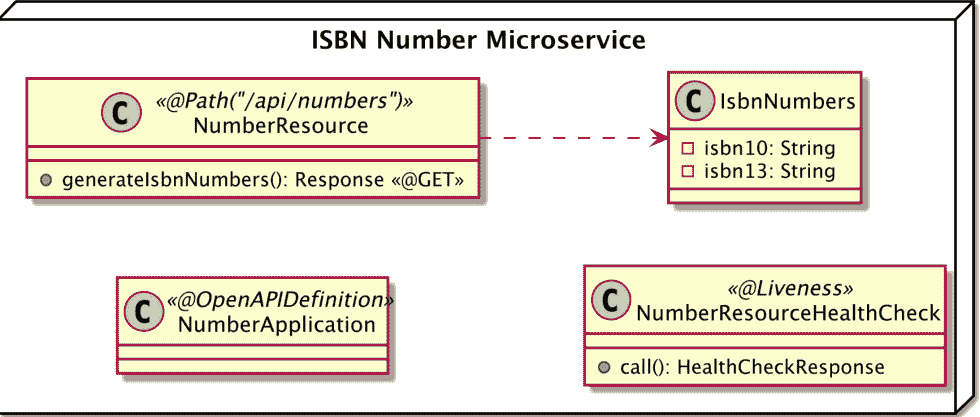

图 57. ISBN 号微服务类图

图 57 中描述的类和文件遵循 Maven 目录结构：

- `src/main/java`: `IsbnNumbers`、`NumberResource`、`NumberApplication` 和 `NumberResourceHealthCheck` 类的目录。
- `src/main/resources`: 用于配置监听端口的 `application.properties` 文件。
- `src/test/java`: 测试用例 `NumberRestController` 的目录。
- `pom.xml`: 描述项目及其依赖项的 Maven 项目模型 (POM)。

### 12.1.4. ISBN 号 REST 端点

列表 260 中的 `NumberResource` 使用了 JAX-RS 注解。如你所见，`NumberResource` 是一个非常简单的 REST 端点，在 `/api/numbers` 路径上返回 ISBN 码的 JSON 表示形式。它返回一个 `IsbnNumbers` 对象，其中包含由 Java Faker 生成的 ISBN 10 和 ISBN 13 码。

Faker 库是 Ruby faker 的移植，用于生成虚假数据。当你开发项目并需要一些漂亮的数据进行展示时它非常有用。在这里，我们使用它来生成一些随机数据。

# 列表 260. 生成 IsbnNumbers 的 REST 端点

```java
@Path("/api/numbers")
@Produces(MediaType.APPLICATION_JSON)
public class NumberResource {

    private final static Logger LOGGER = Logger.getLogger("NumberResource");

    @GET
    public Response generateIsbnNumbers() {
        Faker faker = new Faker();
        IsbnNumbers isbnnumbers = new IsbnNumbers();
        isbnnumbers.setIsbn10(faker.code().isbn10(separator));
        isbnnumbers.setIsbn13(faker.code().isbn13(separator));
        LOGGER.info("ISbn numbers generated " + isbnnumbers);
        return Response.ok(isbnnumbers).build();
    }
}
```

`NumberResource` 返回列表 261 中定义的 `IsbnNumbers` 对象。如你所见，`IsbnNumbers` 只是一个带有属性、getter 和 setter 的简单 POJO（纯旧 Java 对象）。它存储了 ISBN 10 和 13 码的值。

# 列表 261. IsbnNumbers POJO

```java
public class IsbnNumbers {
    private String isbn10;
    private String isbn13;
    // Getters and setters
}
```

如列表 260 所示，缺少 `separator` 属性 (`isbn10(separator)`) 的定义。由于该原因，ISBN 号 REST 端点的代码尚无法编译，但如果你编译它，你将得到以下输出：

```bash
$ curl http://localhost:8080/api/numbers | jq
{
  "isbn10": "1932563601",
  "isbn13": "9791961975483"
}
```

> `jq` 是一个在 shell 中处理 JSON 的极佳工具。如果你想了解更多关于 `jq` 并安装它，请参阅附录 A。

### 12.1.5. 注入配置

如果你仔细观察列表 260，你会注意到 `NumberResource` 的 `generateIsbnNumbers()` 方法使用了 `separator` 变量。`separator` 是一个布尔值，表示生成 ISBN 码时是否带有分隔符。我们可以轻松地添加一个布尔属性并手动将其设置为 true 或 false。但我们可以使用 `ConfigProperty` 来注入此值。在列表 262 中，`NumberResource` 注入了 `separator` 属性。

# 列表 262. 注入属性的 ISBN 号端点

```java
@Path("/api/numbers")
@Produces(MediaType.APPLICATION_JSON)
public class NumberResource {

    private static Logger LOGGER = Logger.getLogger("NumberResource");

    @ConfigProperty(name = "number.separator", defaultValue = "false")
    boolean separator;

    @GET
    public Response generateIsbnNumbers() {
        Faker faker = new Faker();
        IsbnNumbers numbers = new IsbnNumbers();
    }
}
```


```java
numbers.setIsbn10(faker.code().isbn10(separator));

numbers.setIsbn13(faker.code().isbn13(separator));

LOGGER.info("ISBN numbers generated " + numbers);

return Response.ok(numbers).build();

}
}
```

如果你没有在 `application.properties` 中提供值，启动将会失败。这就是为什么我们在 `application.properties` 中设置默认值：

```properties
number.separator=true
```

现在，如果你运行 `quarkus:dev`（在项目文件夹下）并访问 `http://localhost:8080/api/numbers`，你应该能看到：

```bash
$ curl http://localhost:8080/api/numbers | jq

{
  "isbn10": "1932563601",
  "isbn13": "9791961975483"
}
```

或者，你可以在浏览器中打开 `http://localhost:8080/api/numbers`。

## 12.1.6. 自定义 JSON 输出

我们希望 ISBN 号服务的 JSON 输出看起来是这样的：将 `isbn13` 更改为 `isbn10`。为了更改 JSON 绑定，我们可以使用 JSON-B 规范。Listing 263 显示了 JSON-B。`@JsonProperty` 告诉程序将 JSON 更改为 `isbn10`。

Listing 263. 带有 JSON-B 注解的 `IsbnNumbers`

```java
public class IsbnNumbers {

    @JsonProperty("isbn10")
    private String isbn10;

    @JsonProperty("isbn13")
    private String isbn13;

    // Getters and setters
}
```

在没有其他 Quarkus 子句的情况下，执行 `quarkus:dev` 后，你会发现 JSON 看起来如下所示：

```bash
$ curl http://localhost:8080/api/numbers | jq

{
  "isbn10": "1932563601",
  "isbn13": "9791961975483"
}
```

## 12.1.7. OpenAPI

ISBN 号微服务暴露了一个供消费的 API。为了记录此 API，我们可以使用 OpenAPI 规范。启动应用 (`quarkus:dev`) 并请求 `http://localhost:8080/openapi`。如 Listing 264 所示，Quarkus 自动为 ISBN 号服务生成 OpenAPI 文档。

Listing 264. 默认 OpenAPI 合约

```yaml
openapi: 3.0.3
info:
  title: Generated API
  version: "1.0"
paths:
  /api/numbers:
    get:
      responses:
        "200":
          description: OK
```

你可以使用 CURL 更改 HTTP Header 并获取多种格式的 OpenAPI 文档：

- YAML: `curl http://localhost:8080/openapi`
- JSON: `curl -H "Accept: application/json" http://localhost:8080/openapi`

但是这种对比缺乏描述。MicroProfile OpenAPI 提供了一组注解来自定义我们的 REST 端点类、方法和参数，使 OpenAPI 合约更丰富、更整洁。Listing 265 显示了一旦注解后 `NumberResource` 端点的状态。

Listing 265. 自定义 REST 端点的 OpenAPI 合约

```java
@Path("/api/numbers")
@Produces(MediaType.APPLICATION_JSON)
public class NumberResource {

    private final static Logger LOGGER = Logger.getLogger("NumberResource");

    @ConfigProperty(name = "number.separator", defaultValue = "false")
    boolean separator;

    @GET
    @Operation(
        summary = "生成 ISBN 号",
        description = "这些 ISBN 码有多种格式：ISBN 13 和 ISBN 10")
    @APIResponse(responseCode = "200",
        content = @Content(mediaType = MediaType.APPLICATION_JSON, schema = @Schema(implementation = IsbnNumbers.class)))
    public Response generateIsbnNumbers() {

        Faker faker = new Faker();
        IsbnNumbers isbnnumbers = new IsbnNumbers();
        isbnnumbers.setIsbn10(faker.code().isbn10(separator));
        isbnnumbers.setIsbn13(faker.code().isbn13(separator));
        LOGGER.info("ISBN numbers generated " + isbnnumbers);
        return Response.ok(isbnnumbers).build();
    }
}
```

## 自定义 IsbnNumbers POJO

`generateIsbnNumbers()` 返回一个 `IsbnNumbers` 对象。如代码列表 266 所示。

代码列表 266. 为 `IsbnNumbers` 类自定义 OpenAPI 合约

```java
@Schema(description = "书籍编号的格式")
public class IsbnNumbers {

    @Schema(required = true)
    @JsonProperty(isbn="10")
    private String isbn10;

    @Schema(required = true)
    @JsonProperty(isbn="13")
    private String isbn13;

    // Getters and setters
}
```

## 自定义应用的 OpenAPI 合约

之前的注解允许你为特定的 REST 端点自定义合约。但为整个微服务自定义合约也同样重要。Eclipse MicroProfile API 也拥有一组注解用于实现该目的。区别在于，这些注解不能用在端点本身，而是用另一个用于配置整个应用程序的 Java 类。为了这一点，代码列表 267 中描述的 `NumberApplication` 需要扩展 `javax.ws.rs.core.Application` 并带有 OpenAPI 注解。

代码列表 267. 为应用程序自定义的 OpenAPI 文档

```java
@ApplicationPath("/")
@OpenAPIDefinition(
    info = @Info(
        title = "Number API",
        description = "此 API 允许生成各种 ISBN ",
        version = "1.0",
        contact = @Contact(name = "agononal", url = "https://twitter.com/agononal"),
        externalDocs = @ExternalDocumentation(
            url = "https://github.com/agononal/agononal-fascicule-quarkus",
            description = "所有 Understanding Quarkus 的代码")),
    tags = {
        @Tag(name = "api", description = "任何人都可以使用的公共 API"),
        @Tag(name = "numbers", description = "对 ISBN 编号感兴趣的人")
    }
)
public class NumberApplication extends Application {
}
```

## 自定义的 OpenAPI 合约

在对合约元数据应用之前所有的修改后，如果你回到 `http://localhost:8080/openapi` 端点，你将看到代码列表 268 中描述的自定义 OpenAPI 合约。

代码列表 268. 自定义的 OpenAPI YAML 合约

```yaml
openapi: 3.0.3
info:
  title: Number API
  description: 此 API 允许生成各种 ISBN 编号
  contact:
    name: @agoncal
    url: https://twitter.com/agoncal
  version: "1.0"
externalDocs:
  description: 所有 Understanding Quarkus 的代码
  url: https://github.com/agoncal/agoncal-fascicle-quarkus
tags:
  - name: api
    description: 任何人都可以使用的公共 API
  - name: numbers
    description: 对 ISBN 编号感兴趣的人
paths:
  /api/numbers:
    get:
      summary: 生成 ISBN 编号
      description: "这些 ISBN 编号有几种格式：ISBN 13 和 ISBN 10"
      responses:
        "200":
          description: OK
          content:
            application/json:
              schema:
                $ref: '#/components/schemas/IsbnNumbers'
components:
  schemas:
    IsbnNumbers:
      description: 书籍 ISBN 编号的多种格式
      required:
        - isbn_10
        - isbn_13
      type: object
      properties:
        isbn_10:
          type: string
        isbn_13:
          type: string
```

代码列表 268 中的合约比代码列表 264 要丰富得多。它包含了整个 Number 微服务的信息，以及通过 HTTP 访问的路径。在代码列表 268 的合约中，注意 `generateIsbnNumbers()` 方法对 `IsbnNumbers` 的引用 (`$ref: '#/components/schemas/IsbnNumbers'`）。对于该合约的消费者来说，返回的结构比代码列表 264 中定义的清晰得多。

## Swagger UI

如果合约太大，用 YAML 或 JSON 可视化 OpenAPI 合约可能会非常麻烦。相反，我们可以使用 Swagger UI。

默认情况下，可以通过 URL `http://localhost:8080/swagger-ui` 访问 Swagger UI。因此，一旦应用程序启动，你将看到如图 58 所示的视觉化格式合约。

### Number API 1.0 OAS3

此 API 允许生成各种 ISBN 编号

+ @agoncal - 网站
所有 Understanding Quarkus 的代码

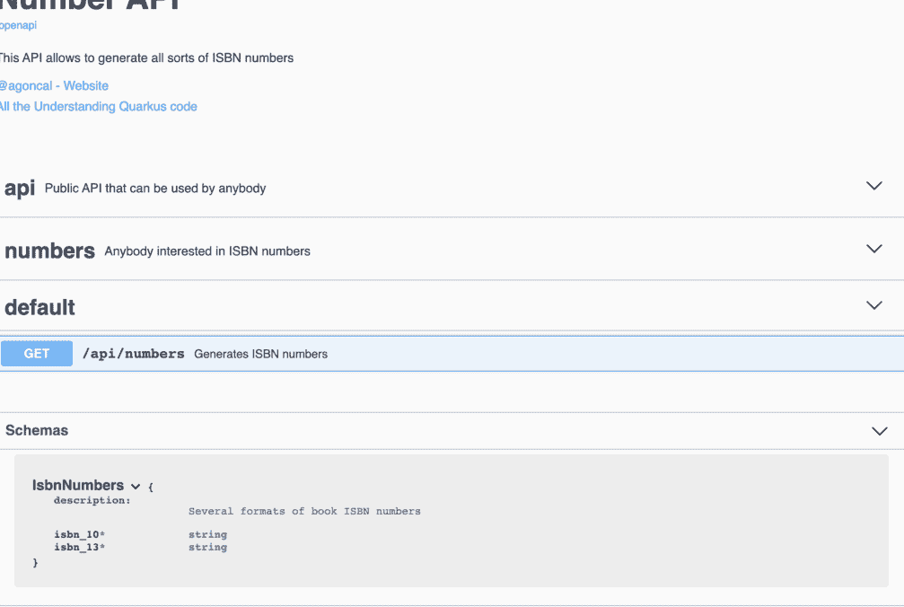

你可以想象你的 API 的操作，并通过点击 *GET* 按钮然后点击 *Execute* 按钮来执行，如图 59 所示。

| Execute | Clear |
| --- | --- |

**Responses**

**Curl**

```bash
curl -X GET "http://localhost:8081/api/numbers" -H "accept: application/json"
```

**Request URL**

```
http://localhost:8081/api/numbers
```

**Server response**

| Code | Details |
| --- | --- |
| 200 | OK |

| Code | Description |
| --- | --- |
| 200 | OK |

| Code | Response |
| --- | --- |
| 200 | OK |

| Code | Response body |
| --- | --- |
| 200 | { "isbn_10": "1234567890", "isbn_13": "97812345678901" } |

| Code | Response headers |
| --- | --- |
| 200 | content-length: 57, content-type: application/json |

图 59. 通过 Swagger UI 执行 GET 请求

## 自定义的 OpenAPI 合约

在对合约元数据应用之前所有的修改后，如果你回到 `http://localhost:8080/openapi` 端点，你将看到代码列表 268 中描述的自定义 OpenAPI 合约。

代码列表 268. 自定义的 OpenAPI YAML 合约

```yaml
openapi: 3.0.3
info:
  title: Number API
  description: 此 API 允许生成各种 ISBN 编号
  contact:
    name: @agoncal
    url: https://twitter.com/agoncal
  version: "1.0"
externalDocs:
  description: 所有 Understanding Quarkus 的代码
  url: https://github.com/agoncal/agoncal-fascicle-quarkus
tags:
  - name: api
    description: 任何人都可以使用的公共 API
  - name: numbers
    description: 对 ISBN 编号感兴趣的人
paths:
  /api/numbers:
    get:
      summary: 生成 ISBN 编号
      description: "这些 ISBN 编号有几种格式：ISBN 13 和 ISBN 10"
      responses:
        "200":
          description: OK
          content:
            application/json:
              schema:
                $ref: '#/components/schemas/IsbnNumbers'
components:
  schemas:
    IsbnNumbers:
      description: 书籍 ISBN 编号的多种格式
      required:
        - isbn_10
        - isbn_13
      type: object
      properties:
        isbn_10:
          type: string
        isbn_13:
          type: string
```


代码列表 268 中的合约比代码列表 264 要丰富得多。它包含了整个 Number 微服务的信息，以及通过 HTTP 访问的路径。在代码列表 268 的合约中，注意 `generateIsbnNumbers()` 方法对 `IsbnNumbers` 的引用 (`$ref: '#/components/schemas/IsbnNumbers'`)。对于该合约的消费者来说，返回的结构比代码列表 264 中定义的清晰得多。

# Swagger UI

如果合约太大，用 YAML 或 JSON 可视化 OpenAPI 合约可能会非常麻烦。相反，我们可以使用 Swagger UI。

默认情况下，可以通过 URL `http://localhost:8080/swagger-ui` 访问 Swagger UI。因此，一旦应用程序启动，你将看到如图 58 所示的视觉化格式合约。

# Number API 1.0 OAS3

此 API 允许生成各种 ISBN 编号

+   @agoncal - 网站
所有 Understanding Quarkus 的代码


图 58. Number 端点和模式的 Swagger UI 合约，但你也可以简单地调用它们

（注：由于原文中存在大量重复段落，此处已按要求去重并整合翻译）

# 列表 272. 测试 ISBN 号的生成

```java
@QuarkusTest
public class NumberResourceTest {

  @Test
  void shouldGenerateIsbnNumbers() {
    given()
      .header(HttpHeaders.ACCEPT, MediaType.APPLICATION_JSON)
    .when()
      .get("/api/numbers")
    .then()
      .status(OK.getStatusCode())
      .body("$", hasKey("isbn_10"))
      .body("$", hasKey("isbn_13"));
  }
}
```

如果你喜欢本章节的格式并对 Quarkus 感兴趣，请查看附录 E 中我的《Practising Quarkus》章节的引用。在《Practising》（实战）章节中，你将开发、测试、构建、打包并监控整个微服务应用程序。

现在使用 `mvn test` 或从你的 IDE 执行测试。该测试应该通过，并且你会看到与列表 273 类似的日志。

# 列表 273. 成功的测试输出

```
[INFO] -----------------------------------------------------------------
[INFO] TESTS
[INFO]
[INFO] Running org.agonal.fascicle.quarkus.number.NumberResourceTest
[INFO] Quarkus started in 0.586s. Listening on: http://0.0.0.0:8081
[INFO] Profile test activated.
[INFO] Installed features: [cdi, resteasy, resteasy-json, smallrye-health, smallrye-openapi, swagger-ui]
[INFO] ISBN numbers generated BookNumbers{isbn10='1-9635127-0-7', isbn13='1-7424-9845-4'}
[INFO] Quarkus started in 0.029s
[INFO] Results:
[INFO] Tests run: 1, Failures: 0, Errors: 0, Skipped: 0
[INFO]
[INFO]
[INFO] BUILD SUCCESS
[INFO]
```

# 12.2. 开发 REST 图籍微服务

现在，是时候开发一个返回书籍的微服务了。书籍微服务返回随机书籍数据，如书名、作者、类型和出版者。书籍微服务还需要与 ISBN 号微服务交互以获取 ISBN。在本节中，我们：

- 使用 JAX-RS 和 Quarkus 实现书籍 REST API
- 使用 JSON-P 生成 JSON 输出
- 得益于 REST Client 调用 ISBN 号微服务
- 处理容错
- 添加指标（metrics）

## 12.2.1. 引导书籍微服务的启动

为了引导书籍微服务，我们使用以下 Maven 命令（记住，如果你更倾向于，也可以访问 `https://code.quarkus.io`）：

列表 274. 引导书籍微服务的命令

```bash
mvn io.quarkus:quarkus-maven-plugin:1.9.0.Final:create \
-DplatformVersion=1.9.0.Final \
-DprojectGroupId=org.agonal.fascicle.quarkus.putting \
-DprojectArtifactId=rest-book \
-DprojectVersion=1.0-SNAPSHOT \
-DClassName="org.agonal.fascicle.quarkus.book.BookResource" \
-Dpath="/api/books" \
-DExtensions="resteasy-json, rest-client, smallrye-fault-tolerance, smallrye-metrics"
```

## 12.2.2. Maven 依赖

一旦生成应用程序代码，你将在列表 275 的 `pom.xml` 中看到编译和执行书籍微服务所需的所有扩展：

- `quarkus-resteasy`: 实现 JAX-RS 的 REST 框架。
- `quarkus-resteasy-jsonb`: 为 RESTEasy 提供 JSON-B 序列化支持。
- `quarkus-rest-client`: 用于与 ISBN 号微服务交互的 REST Client。
- `quarkus-smallrye-fault-tolerance`: 与 ISBN 号微服务的通信本质上是不可靠的，我们需要 Fault Tolerance（容错）依赖。
- `quarkus-smallrye-metrics`: Fault Tolerance 依赖收集处理请求所需时间的指标。
- `javafaker`: 你需要手动添加此依赖，以便生成虚假书籍数据。

```xml
<dependency>
  <groupId>io.quarkus</groupId>
  <artifactId>quarkus-resteasy</artifactId>
</dependency>
<dependency>
  <groupId>io.quarkus</groupId>
  <artifactId>quarkus-resteasy-jsonb</artifactId>
</dependency>
<dependency>
  <groupId>io.quarkus</groupId>
  <artifactId>quarkus-rest-client</artifactId>
</dependency>
<dependency>
  <groupId>io.quarkus</groupId>
  <artifactId>quarkus-smallrye-fault-tolerance</artifactId>
</dependency>
<dependency>
  <groupId>io.quarkus</groupId>
  <artifactId>quarkus-smallrye-metrics</artifactId>
</dependency>
<dependency>
  <groupId>com.github.javafaker</groupId>
  <artifactId>javafaker</artifactId>
</dependency>
```

## 12.2.3. 目录与文件

微服务只需要几个 Java 类，如图 60 所示：

- `BookResource`: 返回书籍 JSON 表示的 REST 端点。
- `IsbnNumbers`: 持有两个 ISBN（10 位和 13 位）的 POJO。
- `NumberProxy`: 调用 ISBN 服务的 REST 客户端。
- `BookResourceTest`: `BookResource` 的测试用例。

微服务的结构如下：

- `src/main/java/org/agonal/fascicle/quarkus/book/`: `BookResource.java`, `IsbnNumbers.java`
- `src/main/java/org/agonal/fascicle/quarkus/book/client/`: `NumberResourceProxy.java`
- `src/main/test/org/agonal/fascicle/quarkus/book/`: `BookResourceTest.java`
- `src/main/resources/`: `application.properties`
- `pom.xml`: 描述依赖的 Maven 项目模型。

## 12.2.4. REST 端点

为了暴露获取随机书籍的 API，我们需要一个使用 JAX-RS 的 REST 端点。

```java
@Path("/api/books")
@Produces(MediaType.APPLICATION_JSON)
public class BookResource {

    private final Logger LOGGER = Logger.getLogger("BookResource");

    @GET
    public Response getRandomBook() {
        IsbnNumbers isbnNumbers = resourceProxy.generateIsbnNumbers();
        Faker faker = new Faker();
        JsonObject book = Json.createObjectBuilder()
            .add("isbn_13", isbnNumbers.getIs13())
            .add("isbn_10", isbnNumbers.getIs10())
            .add("title", faker.book().title())
            .add("author", faker.book().author())
            .add("genre", faker.book().genre())
            .add("publisher", faker.book().publisher())
            .add("timestamp", String.valueOf(LocalDateTime.now()))
            .build();
        LOGGER.info("Random book " + book);
        return Response.ok(book).build();
    }
}
```

# 列表 278. 注入代理的 Book REST 端点

Eclipse MicroProfile REST Client 非常简单，只需使用正确的 JAX-RS 和 MicroProfile 注解创建一个 `NumberProxy` 接口即可（见列表 279）：

- `@RegisterRestClient` 允许 Quarkus 知道此接口旨在作为 REST Client 可用用于 CDI 注入，
- `@Path` 和 `@GET` 是用于定义如何访问服务的标准 JAX-RS 注解，
- `@Produces` 定义了预期的内容类型。

# 列表 279. 代理接口

```java
@Path("/api/numbers")
@Produces(MediaType.APPLICATION_JSON)
@RegisterResourceClient
public interface NumberResourceProxy {

    @GET
    IsbnNumbers generateIsbnNumbers();
}
```

`generateIsbnNumbers()` 方法使我们的代码具备了从 Number 微服务获取 ISBN 编号的能力。Eclipse MicroProfile REST Client 将处理所有的网络请求和序列化（marshalling），让我们的简洁代码免受此类技术细节的影响。

但是 Number 微服务位于哪里呢？为了确定 REST 调用的基础 URL，REST Client 使用来自 `application.properties` 文件的配置。属性名称需要遵循在代码中显示的通用约定：

```
org.agoncal.fascicle.quarkus.NumberResourceProxy/mp-rest/url=http://localhost:8081
org.agoncal.fascicle.quarkus.NumberResourceProxy/mp-scope=java,Singleton
```

拥有此配置意味着使用 `NumberResourceProxy` 接口执行的所有请求都将使用 `http://localhost:8081` 作为基础 URL。使用此配置和列表 279 中的代码，调用 `NumberResourceProxy` 的 `generateIsbnNumbers()` 方法将导致向 `http://localhost:8081/api/numbers` 发起 HTTP GET 请求。

## 12.2.6. 回退机制（Falling Back）

获取随机书籍运行得很好……直到我们遇到 Number 微服务。发生了什么？嗯，Book 微服务无法再调用 Number 微服务，并抛出 `ConnectionException` 异常。

```
ERROR [io.qua.ver.htt.run.QuarkusErrorHandler] HTTP Request to /api/books failed
org.jboss.resteasy.UnhandledException: java.ws.rs.ProcessingException:
RESTEASY004655: Unable to invoke request: java.net.ConnectException: Connection refused (Connection refused)
```

微服务的分布式特性带来的挑战之一是，与外部系统的通信本质上是不可靠的。分布式增加了对应用程序健壮性的需求。因此，让我们在获取 ISBN 编号失败时提供一个回退（fallback）机制。例如，我们可以将书籍的 JSON 表示序列化到文件中，以便稍后处理。或者将临时书籍存储在数据库中，或者向事件总线发送消息。为了简单起见，我们只发送占位符数据。

为此，我们在 `BookResource` 中添加了一个名为 `fallbackRandomBook` 的回退方法，并在 `getRandomIsbnNumbers()` 方法上添加了 `@Fallback` 注解（见列表 280）。

列表 280. 获取随机书籍时的回退机制

```java
@Path("/api/books")
@Produces(MediaType.APPLICATION_JSON)
public class BookResource {

    private final static Logger LOGGER = Logger.getLogger("BookResource");

    @Inject
    @RestClient
    NumberResourceProxy numberResourceProxy;

    @GET
    @Fallback(fallbackMethod = "fallbackRandomBook")
    public Response getRandomIsbnNumbers() {
        IsbnNumbers isbnNumbers = numberResourceProxy.generateIsbnNumbers();
        Faker faker = new Faker();
        JsonObject object = Json.createObjectBuilder()
            .add("isbn_13", isbnNumbers.getIsbn13())
            .add("isbn_10", isbnNumbers.getIsbn10())
            .add("title", faker.book().title())
            .add("author", faker.book().author())
            .add("genre", faker.book().genre())
            .add("publisher", faker.book().publisher())
            .add("timestamp", String.valueOf(LocalDateTime.now()))
            .build();
        LOGGER.info("Random book " + book());
        return Response.ok(book).build();
    }
}
```


## 12.2. 添加指标

在运行应用程序之前，我们想添加一些指标，以便知道 `getRandomBook()` 方法被调用了多少次。为此，我们需要如列表 281 所示，在该方法上添加 `@Counted` 注解。

### 列表 281. 获取随机书籍方法上的指标

```java
@Path("/api/books")
@Produces(MediaType.APPLICATION_JSON)
public class BookResource {

    private static Logger LOGGER = Logger.getLogger("BookResource");

    @GET
    @Counted(name = "getRandomBook",
             description = "Counts how many times the getRandomBook method has been invoked")
    public Response getRandomBook() {
        IsbnNumbers isbnNumbers = numberResourceProxy.generateIsbnNumbers();
        IsbnNumbers isbnNumbers = numberResourceProxy.generateIsbnNumbers(); // 注意：此处原文似乎有重复行，按要求保留逻辑

        Faker faker = new Faker();
        JsonObject object = Json.createObjectBuilder()
            .add("isbn_13", isbnNumbers.getIsbn13())
            .add("isbn_10", isbnNumbers.getIsbn10())
            .add("title", faker.book().title())
            .add("author", faker.book().author())
            .add("genre", faker.book().genre())
            .add("publisher", faker.book().publisher())
            .add("timestamp", String.valueOf(LocalDateTime.now()))
            .build();

        LOGGER.info("Random book " + book());
        return Response.ok(book).build();
    }
}
```

`fallbackRandomBook()` 方法必须具有与 `getRandomIsbnNumbers()` 相同的方法签名（在本例中，它不接受参数并返回一个 `Response` 对象）。当 Book 微服务无法调用 Number 微服务时，会调用 `fallbackRandomBook()` 并返回一些占位符数据。

```java
private Response fallbackRandomBook() {
    LOGGER.warning("Falling back on creating a book");

    JsonObject dummyBook = Json.createObjectBuilder()
        .add("title", "dummy book")
        .add("timestamp", String.valueOf(LocalDateTime.now()))
        .build();

    return Response.ok(dummyBook).build();
}
```

## 12.2.8. 运行微服务

（此处对应原文中混乱重复的部分，已按原文呈现逻辑翻译）

## 12.2.9. 测试 Book 微服务

为了测试 Book 微服务，我们需要列表 271 中描述的 Maven 依赖。与之前一样，我们在列表 282 的测试中标记了 `@QuarkusTest`。然后，`getRandomBook()` 方法会检查 HTTP 状态码以及 JSON 内容。

## 12.3. 总结

在本章中，你并没有使用之前在本小节中看到过的所有 Quarkus API、技巧和概念，但确实使用了其中一些。其设计思想是将这些概念整合在一起，开发一个关于如何使用 Quarkus 的更复杂的示例。

得益于 Quarkus Maven 插件，你启动了两个微服务，该插件脚手架搭建了基本的目录结构、Maven 依赖、一些代码和测试类。ISBN Number 微服务生成书籍编号，并使用了依赖注入、JSON 绑定、OpenAPI 和健康检查。至于 Book 微服务，它需要 REST Client 来远程调用 ISBN Number 微服务。如果调用失败，则使用 fallback（回退）机制，并暴露一些指标，以便我们知道成功生成了多少本书。我们最后测试并运行了这两个微服务。

是时候结束的时候了。下一章将总结你在本小节中看到的内容。然后，记住如果你想了解更多关于 Quarkus 发布的信息（附录 B）或 Eclipse MicroProfile 规范版本，请查阅附录。

- [207] Ruby faker https://github.com/faker-ruby
- [208] REST Assured http://rest-assured.io

# 第 13 章 总结

本小节从一些术语开始，确保你理解围绕 Quarkus 的所有概念。第 2 章“理解 Quarkus”定义了微服务、响应式系统、MicroProfile、云原生、GraalVM，并简要介绍了 Quarkus。

然后，得益于第 3 章“入门”，你启动了一个简单的示例，并确保你的开发环境已正常运行：包括开发、调试、测试某些代码，同时也使用了热重载或 Quarkus 构建原生可执行文件并将其容器化。

第 4 章“核心 Quarkus”侧重于 Quarkus 的基础（注入、配置、配置文件、日志记录和生命周期）。数据、事务和 ORM 使用这些基础功能来添加处理数据验证、对象关系映射或事务的扩展。

微服务分为两类：HTTP 微服务和事件驱动微服务。与 HTTP 相关的技术使用同步通信，因此需要处理调用失败的情况（第 7 章，通信与容错）。它们可以是同步的也可以是异步的，而且在许多微服务中，正如第 9 章“可观测性”所解释的那样，可观测性变得强制性。

然后，进入了生产阶段。今天，在云原生理念下，我们需要将微服务封装到容器中、部署并对它们进行编排。第 10 章向你展示了如何使用 Quarkus 扩展轻松与 Docker 和 Kubernetes 交互。

通过第 11 章“测试”，你看到了使用 Quarkus 创建 JVM 和原生测试是多么简单。这是因为 Quarkus 集成了许多测试和模拟框架，并让它们既适用于简单的代码，也适用于复杂的微服务架构中工作。

我们以最后一章“大合集”结束了本小节。我们取了之前的一些概念，将它们整合在一起，构建了一个稍微复杂的应用程序。

这就是“理解 Quarkus”小节的结束，我希望你喜欢它，学到了一些东西，更重要的是，将能够把这些知识带回你的项目中。

请记住，你可以在 https://github.com/agonal/agonal-fascicle-quarkus/tree/1.0 找到本小节的所有代码。如果某些部分不够清楚，或者你发现某些遗漏内容、错误，或者你想留言或提供建议，请使用 GitHub issue 追踪器：https://github.com/agonal/agonal-fascicle-quarkus/issues。

如果你喜欢本小节的格式，可能想读我写的其他内容。请查看附录 E 获取完整的章节列表。

## 附录 A：在 macOS 上设置开发环境

本附录侧重于设置你的开发环境，以便你可以按照之前章节列出的代码片段进行实际操作。本小节包含很多代码示例，甚至有一个章节的“大合集”部分。该部分提供了一个分步骤的示例，展示了如何开发、编译、部署、执行和测试。

### A.2.2 Java 的简史

James Gosling、Mike Sheridan 和 Patrick Naughton 在 1991 年 6 月发起了该项目。Java 最初被称为 Oak。后来，该项目名为 Green，并最终命名为 Java，Sun Microsystems 在 1996 年发布了第一个公开版本 Java 1。在 Oracle 2009 年收购 Sun 后，它将其描述为“Java 技术的守护者”。

### A.2.3 在 macOS 上安装 JDK

要安装 JDK 11.0，请访问官方网站，选择合适的平台和语言并下载发行版。例如，对于 macOS，下载图 61 所示的 `jdk11.0.8_osx-x64_bin.dmg`。

双击文件 `jdk11.0.8_osx-x64_bin.dmg`。这将带出一个弹出窗口（见图 62），请求你开始安装。

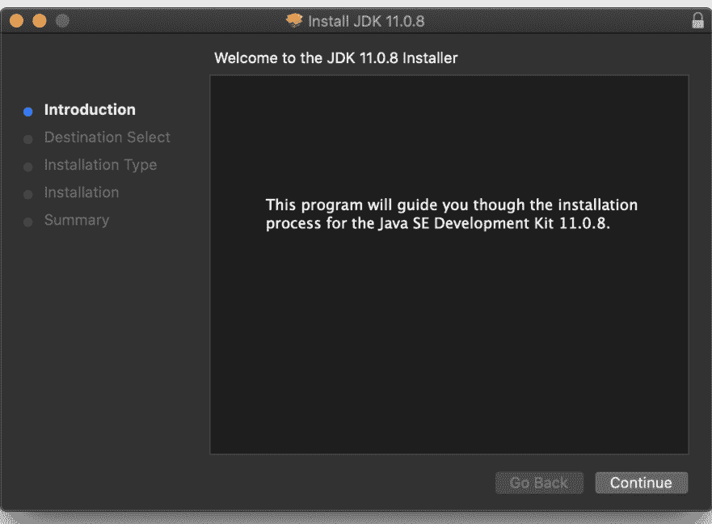

图 62. 安装弹窗界面

按照程序引导你接受软件许可协议并成功安装 JDK（见图 63）。


图 63. JDK 安装成功

使用 Homebrew 安装 Java 还有另一种简单的方法。首先，检查你的机器上是否已经安装了 Java 配方：

```bash
$ brew cask list java11
Error: Cask 'java11' is not installed.
```

如果没有安装该配方，请执行以下 Homebrew 命令进行安装：

```bash
$ brew tap homebrew/cask-versions
$ brew cask install java11
...
java11 was successfully installed!
```

### A.2.4. 检查 Java 安装

安装完成后，需要设置 `JAVA_HOME` 变量并将 `$JAVA_HOME/bin` 目录添加到 `PATH` 变量中。通过输入 `java -version` 和作为编译器的 `javac -version` 来检查你的系统是否识别 Java。

```bash
$ java -version
java version "11.0.8" 2020-07-14 LTS
Java(TM) HotSpot(TM) 64-Bit Server VM 18.9 (build 11.0.8+10-LTS, mixed mode)

$ javac -version
javac 11.0.8
```


注意，在之前的输出中显示了 HotSpot 构建。这是判断你正在使用 HotSpot VM 而不是 GraalVM 的一种简单方法。

## A.3. GraalVM 2.0.0

GraalVM 是 Java 虚拟机（JVM）的扩展，支持更多的语言和执行模式。它用 Java 实现。GraalVM 支持多种语言：当然包括 Java 以及其他基于 JVM 的语言（如 Groovy、Kotlin 等），也包括 JavaScript、Ruby、Python、R 和 C/C++。

但它包含一个名为 Graal 的新型高性能 Java 编译器。在 JVM 内部运行应用程序会有启动和内存占用成本。GraalVM 有一个功能可以为现有的基于 JVM 的应用程序创建原生镜像（native images）。镜像生成过程通过分析找到从主方法可达的代码，然后在 Substrate 上执行提前编译（AOT 编译）。生成的二进制文件包含整个程序的机器码，可供立即执行。这提升了 Java 的性能，使其在快速启动和低内存占用方面能够匹配原生语言的性能。

HotSpot 执行具有即时编译（JIT）编译器。HotSpot 开始解释代码，方法在客户端编译级别被编译，最后移动到服务器编译级别。即使编译级别有所改进，HotSpot 仍然会开始解释其字节码，然后移动到 JIT。

相反，提前编译（AOT）通过加载已编译的类缩短了启动时间。这有助于避免在解释模式或次优编译级别处理这些类。

### A.3.1. 在 macOS 上安装 GraalVM

可以从 GraalVM 网站安装 GraalVM。如图 64 所示，它显示了两个版本的 GraalVM：

- **社区版 (Community Edition)**：供任何用途免费使用，基于 GitHub 上的 GraalVM 源码构建。
- **企业版 (Enterprise Edition)**：提供与生产环境运行应用程序相关的额外性能、安全性和扩展性。

GraalVM 是用于 Java、JavaScript、基于 LLVM 的语言（如 C 和 C++）以及其他动态语言的高性能运行时。了解更多 →

| 当前发布 | 年度发布 | 每日构建 |
| :--- | :--- | :--- |
| GraalVM 社区版 20.2.0 | GraalVM 企业版 20.2.0 | 详情 → 详情 → |

| 特性 | 社区版 | 企业版 |
| :--- | :--- | :--- |
| 许可 | 所有用途均免费 | 评估和开发免费 |
| 兼容性 | 运行任何在 GraalVM 企业版上运行的程序 | 额外的性能、扩展性和安全性 |
| 基础 | 基于 OpenJDK 8u262 和 11.0.8 | 基于 Oracle JDK 8u261 和 11.0.8 |

DOWNLOAD FROM GITHUB

TRY IT NOW BUY FROM ORACLE STORE

| 平台 | 社区版 | 企业版 |
| :--- | :--- | :--- |
| macOS / Linux / Windows | 更新说明 → 文档 → | 更新说明 → 文档 → |

图 64. GraalVM 的社区版和企业版

使用社区版足够了。因此你将被重定向到 GraalVM 的 GitHub 账户（见图 65），你可以在那里下载最新版本。确保你选择了 20.2.0 版本，并下载适用于你操作系统平台的特定 GraalVM 文件。例如，在 macOS 上，下载图 65 显示的 `graalvm-ce-java11-darwin-amd64-20.2.0.tar.gz` 文件。如果你不是 Mac 用户，下载步骤非常相似。

## GraalVM 社区版 20.2.0

发布于 8 月 18 日
GraalVM 是用于 Java、JavaScript、基于 LLVM 的语言（如 C 和 C++）以及其他动态语言的高性能运行时。此 GraalVM 分发行包含了：

- 运行时
- JavaScript
- LLVM
- Ruby
- Python
- R
- WASM
- GraalVM 工具
- 性能
- 扩展性
- 安全
- GraalVM 编译器
- 调试
- 原生镜像
- 字节码
- 可操作性
- 提前编译
- 原生可执行文件
- 启动
- 内存

允许在构件的生命周期内进行标识（版本 1.1、1.2、1.2 等）。Maven 强制执行版本控制，以便团队可以管理其项目开发的生命周期。Maven 还引入了 SNAPSHOT 版本的概念（版本号以字符串 `-SNAPSHOT` 结尾），用于识别正在开发中尚未发布的构件。

POM 定义了关于你项目的更多信息。某些方面是纯描述性的（名称、描述等），另一些则涉及应用程序的执行，例如所使用的外部库列表；更重要的是，`pom.xml` 定义了构建项目的核心信息（版本控制工具、持续集成服务器、构件仓库）以及构建你项目的任何其他特定流程。

## A.4.3. 管理构件

Maven 不仅仅用于构建构件；它提供了一种真正的方案来存档和共享这些构件。Maven 使用你硬盘上的本地仓库（默认位于 `~/.m2/repository`），在其中存储你项目所有依赖的构件。本地仓库由本地开发者的构件（例如 `MyProject-1.1.jar`）或由 Maven 从远程仓库下载的外部构件（例如 `javax.annotation-api-1.2.jar`）填充。

Maven 项目可以通过声明式的方式在 POM 的 `groupId`、`artifactId`、`version` 和 `scope` 中引用包含依赖在内的特定构件，如列表 285 所示。如有必要，Maven 将它们下载到本地仓库或远程仓库。此外，使用这些外部构件的 POM 描述符，Maven 还会下载它们所需的构件（所谓的“传递性依赖”）。因此，开发团队不需要手动将项目依赖添加到类路径中。Maven 会自动添加必要的库。

列表 285. Maven 依赖

```xml
<dependencies>
  <dependency>
    <groupId>org.eclipse.persistence</groupId>
    <artifactId>persistence</artifactId>
    <version>2.1</version>
    <scope>provided</scope>
  </dependency>
  <dependency>
    <groupId>org.glassfish</groupId>
    <artifactId>jax.ejb</artifactId>
    <version>3.2</version>
    <scope>provided</scope>
  </dependency>
</dependencies>
```

Maven 可能具有有限的可见性（称为范围 scope）：

- **test**：该库用于编译和运行测试类，但不会打包在生成的构件（如 war 文件）中。
- **provided**：该库由环境（持久化提供者、应用服务器等）提供，仅用于编译代码。
- **compile**：该库对于编译和执行都是必要的。因此，它也将作为生成构件的一部分被打包。
- **runtime**：该库仅执行时需要，但在编译时排除（例如 Servlets）。

## A.4.4. 在 macOS 上安装 Maven

本小册的示例由 Apache Maven 3.6.x 开发。一旦你安装了 JDK 11.0.8，请确保已设置 `JAVA_HOME` 环境变量。然后，检查你的机器上是否已经安装了 Maven 配方：

```bash
$ brew list maven
Error: No such keg: /usr/local/Cellar/maven
```

如果没有安装 Maven 配方，请执行以下 Homebrew 命令进行安装：

```bash
$ brew install maven
...
maven was successfully installed!
```

你现在应该可以在 Homebrew 中看到 Maven 配方了：

```bash
$ brew list maven
/usr/local/Cellar/maven/3.6.3_1/bin/mvn
/usr/local/Cellar/maven/3.6.3_1/mvnDebug
/usr/local/Cellar/maven/3.6.3_1/bin/mvnyp
```

## A.4.5. 检查 Maven 安装

一旦安装好 Maven，打开命令行并输入 `mvn -version` 来验证你的安装。Maven 将打印出它的版本以及它使用的 JDK 版本（这很有用，因为你可能在同一台机器上安装了不同的 JDK 版本）。

```bash
$ mvn -version
Apache Maven 3.6.3
Maven home: /usr/local/Cellar/maven/3.6.3_1/libexec
```

请注意 Maven 需要访问互联网，以便从 Maven 中央 和/或其他远程仓库下载插件和项目依赖。如果你位于代理之后，请查看文档配置你的设置。

## A.4.6. Maven 命令

Maven 是一个命令行实用工具，你可以使用多个参数和选项来构建、测试或打包你的代码。要获取有关可用命令的帮助，请使用以下命令：

```bash
$ mvn --help
usage mvn [options] [goal(s)] [phase(s)]
```

以下是你将在运行本小册示例时使用的某些命令。每个命令调用项目生命周期的不同阶段（clean、compile、install 等），并使用 `pom.xml` 下载库、继续编译或使用插件扩展某些行为：

- `mvn clean`：删除所有生成的文件（编译后的类、生成的代码、构件等）。
- `mvn compile`：编译主 Java 类。
- `mvn test-compile`：编译测试类。
- `mvn test`：将主 Java 类编译为测试类并执行测试。
- `mvn package`：编译、执行测试并将代码打包成存档文件（例如 war 文件）。
- `mvn install`：构建并将构件安装到本地仓库。
- `mvn clean install`：清理并安装（注意你可以添加多个用空格隔开的命令，如 `mvn clean compile test`）。

> Maven 允许你编译、运行和打包本小册中的示例。

## A.5. curl 7.x

为了调用本小册描述的 REST Web 服务，我们使用 curl。

curl 是一个通过 HTTP、FTP、SFTP、SCP 等协议通过 URL 语法传输文件的命令行工具。它是免费、开源的（遵循 MIT 许可证），并已移植到多个操作系统。你可以发送 HTTP 命令、更改 HTTP Header 等。它是模拟浏览器行为的很好的工具。

### A.5.1. curl 的简史

curl 最初于 1997 年发布。curl 的名字代表 Client URL，这就是为什么你会看到 cURL 的写法而不是 Curl。原始作者和首席开发者是瑞典开发者 Daniel Stenberg。


### A.5.2. 在 macOS 上安装 curl

通常 macOS 已经提供了 curl，并行安装另一个版本会导致各种问题。因此，首先通过执行以下 curl 命令检查是否已安装 curl：

```bash
curl --version
```

如果没有安装 curl，只需通过 Homebrew 命令安装：

```bash
brew install curl
```

### A.5.3. 检查 curl 安装

一旦安装，在终端中运行 `curl --version` 来检查 curl。它应该显示 curl 版本：

```bash
curl --version
curl 7.54.0 (x86_64-apple-darwin18.0) libcurl/7.54.0 LibreSSL/2.6.5 zlib/2.2.11
ghttp2/1.24.1
Protocols: dict file ftp gopher http imaps imaps ldap pop3 pop3 tsp smb smbs smtp spits telnet tftp
Features: AsynchDONS IPv6 GSS-API Kerberos SPNEGO NTLM NTLM_WB ssl HTTP2
UnixSockets HTTP-proxy
```

### A.5.4. 一些 curl 命令

curl 是一个命令行实用工具，你可以使用多个参数和选项来调用 URL。你通过零或多个命令行以及 URL（或 URL set）调用 curl。curl 支持一百多种不同的选项，我建议阅读文档以获取更多帮助。要获取有关命令的帮助，你可以使用以下命令：

- `curl http://localhost:8080/authors`：对给定的 URL 执行 HTTP GET。
- `curl GET http://localhost:8080/authors`：与之前的命令效果相同，对指定的 URL 执行 HTTP GET 请求。
- `curl -v http://localhost:8080/authors`：在详细输出模式下对指定的 URL 执行 HTTP GET 请求。
- `curl -H 'Content-Type: application/json' http://localhost:8080/authors`：在 HTTP Header 中传递 JSON Content Type 的同时对指定的 URL 执行 HTTP GET 请求。
- `curl -DELETE http://localhost:8080/authors/1`：对指定的 URL 执行 HTTP DELETE 请求。

### A.5.5. 使用 JQ 格式化 curl 的 JSON

当使用 curl 调用 RESTful 服务时，我们会在回复中得到一些 JSON 负载。除非进行以下操作，否则 curl 不将其格式化为普通字符串：

```bash
$ curl http://localhost:8080/vintage-store/artists
[{"id":"1","firstName":"John","lastName":"Lennon"},{"id":"2","firstName":"Paul","lastName":"McCartney"},{"id":"3","firstName":"George","lastName":"Harrison"},{"id":"4","firstName":"Ringo","lastName":"Starr"}]
```

但我们确实需要格式化 JSON 负载以便于阅读。为此，有一个非常实用的工具叫做 jq。它是一个处理 JSON 输入的工具，对输入应用给定的过滤器，并将过滤后的结果作为 JSON 输出到标准输出。你可以通过简单的 `brew install jq` 在 macOS 上安装它。安装完成后，只需像这样所示将 curl 输出传递给 jq 即可：

```bash
$ curl http://localhost:8080/vintage-store/artists | jq
{
  "id": "1",
  "firstName": "John",
  "lastName": "Lennon"
}
{
  "id": "2",
  "firstName": "Paul",
  "lastName": "McCartney"
}
{
  "id": "3",
  "firstName": "George",
  "lastName": "Harrison"
}
{
  "id": "4",
  "firstName": "Ringo",
  "lastName": "Starr"
}
```


## A.6. Docker

Docker 是一系列平台即服务（PaaS）产品，使用操作系统层虚拟化技术来交付软件。它通过使用容器使得创建、部署和运行应用程序变得更容易。容器之间是相互隔离的，并封装了自己的软件、库和配置文件；它们可以通过定义良好的通道进行相互通信。Docker 允许开发者将应用程序及其所有依赖项打包，并作为一个包分发。

### A.6.1. Docker 简史

Docker 由 Solomon Hykes 和 Sebastian Hahn 在 2010 年 Y Combinator 夏季初创孵化器小组期间创立，并于 2011 年发布。Hykes 在法国作为 dotCloud（一家平台即服务公司）的内部项目启动了 Docker 项目。Docker 在 2013 年的圣克拉拉的 PyCon 上向公众亮相。它于 2013 年 3 月开源。当时它使用 LXC 作为默认执行环境。一年后，随着 0.9 版本的发布，Docker 用其用 Go 语言编写的自定义组件替换了 LXC。

### A.6.2. 在 macOS 上安装 Docker

本教程的基础设施使用 Docker 来简化不同技术服务（数据库、监控……）的安装。因此，我们需要安装 docker 和 docker-compose。首先，检查你的机器上是否已经安装了 Docker 公式方：

```
$ brew cask list docker

Error: Cask 'docker' is not installed.
```

如果尚未安装 Docker 公式方，执行以下 Homebrew 命令进行安装：

```
$ brew cask install docker

...
docker was successfully installed!
```

现在你应该可以在 Homebrew 中看到 Docker 公式方了：

```
$ brew cask list docker

=> App
/Applications/Docker.app
```

### A.6.3. 检查 Docker 安装

安装 Docker 后，你的路径中应该已经有了 docker 和 docker-compose。此时 docker 命令无法连接到 Docker 守护进程。你会看到以下错误：

```
$ docker version

Cannot connect to the Docker daemon at unix:///var/run/docker.sock.
Is docker daemon running?
```

这是因为你需要启动 Docker 应用程序。你可以点击 `/Applications` 下的 `Docker.app` 图标，或者执行以下命令：

```
$ open -a Docker
```

在 Mac 的顶部菜单栏上，你应该能看到鲸鱼图标。点击它，你会看到一个如图 66 所示的菜单。


图 66. 菜单栏上的 Docker 图标

点击 About，一个如图 67 所示的窗口会给你已安装 Docker 工具的版本。


图 67. 关于 Docker

现在，如果你输入相同的 docker 命令，它应该能连接到守护进程：

```
$ docker version

Client: 24.0.5, build fc7506eda0
  API version: 1.41
  Go version: go0.20.10
  Commit: 0433ed0
  OS: darwin
  Architecture: arm64
Server: Docker Engine 24.0.5, build fc7506eda0
  API version: 1.41
  Incompatibility info: client version is newer than server version
```

### A.6.4. 构建、运行、推送和拉取镜像

让我们看看使用 Docker 镜像和容器的典型流程。基本上，你创建一个 Dockerfile，将其构建为本地 Docker 镜像并在容器中运行。为了让你的本地镜像对他人（外部开发者以及如 Kubernetes 等工具）可用，将镜像推送到远程仓库（默认是 Docker Hub）。然后，如果你的本地镜像被删除，可以从远程仓库拉取并执行它。

#### 远程 Docker 仓库

Docker Hub 是 Docker 提供的用于查找和共享容器镜像的服务。它将用于推送和拉取我们的 Docker 镜像。

要创建 Docker 账户，请访问 `https://hub.docker.com/signup`。账户名称非常重要，因为它将用于命名 Docker 镜像以便将其推送到你的远程仓库（镜像名称和账户名称必须一致）。图 68 显示了一个名为 agoncal 的 Docker hub（你应该有自己的）。

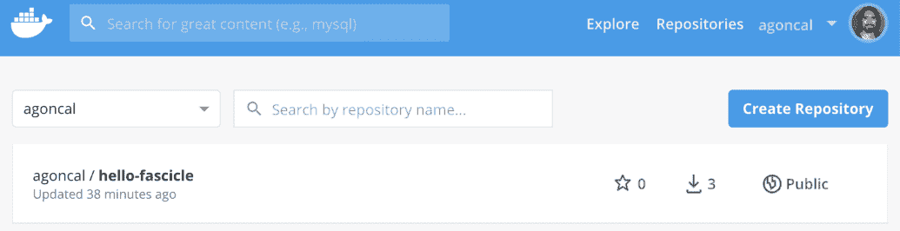

图 68. Docker hub 账户

现在回到你的本地计算机。你应该能够使用以下命令登录新创建的 Docker hub 账户：

```
$ docker login

Login with your Docker ID to push and pull images from Docker Hub.
Username: agoncal
Password:
Login Succeeded
```

#### Dockerfile

现在，让我们创建一个非常简单的 Dockerfile。下面的 Dockerfile 基于 Alpine 镜像，它是一个非常轻量级的 Linux 镜像（大小仅为 5 MB）。然后，它使用 `echo` 命令显示消息 `Hello Fascicle`。使用任何文本编辑器，创建一个名为 `Dockerfile` 的文件并添加以下内容：

```
FROM alpine
CMD echo "Hello Fascicle"
```

#### 构建 Docker 镜像

现在，使用这个 Dockerfile，通过以下命令构建 Docker 镜像：

```
$ docker image build -t agoncal/hello-fascicle .

Sending build context to Docker daemon 2.048kB
Step 1/2 : CMD echo "Hello Fascicle"
Step 2/2 : CMD echo "Hello Fascicle"
Successfully built a896f9983057
Successfully tagged agoncal/hello-fascicle:latest
```

轨迹的最后一条消息表示 Docker 镜像已成功构建，名称为 `agoncal/hello-fascicle:latest`。注意前缀 `agoncal` 是 Docker hub 账户名（请根据你的情况进行更改）。要检查该镜像是否已安装在本地，输入以下命令：

| REPOSITORY | TAG | IMAGE ID | SIZE |
|---|---|---|---|
| agoncal/hello-fascicle | latest | d0d36b3b86cd | 5.57MB |

#### 运行 Docker 镜像

现在镜像已经在本地可用，让我们来执行它。以下命令执行我们的镜像，并在控制台输出一条消息：

```
$ docker container run agoncal/hello-fascicle
Hello Fascicle
```

#### 推送到 Docker 注册库 (Registry)

现在我们知道镜像可以按预期运行，让我们通过将其推送到远程 Docker 注册库来让其他人可以使用。这通过一个简单的 `push` 命令即可完成。从 Docker Hub 消费公共镜像不需要身份验证。但对于发布你自己的镜像，你需要进行身份验证。`docker image push` 命令假设你已经对远程注册库进行了身份验证（否则请在之前执行 `docker login`）：

```
$ docker image push agoncal/hello-fascicle
The push refers to repository [docker.io/agoncal/hello-fascicle] 50644c29ef25a0: Mounted from library/alpine
latest: digest: sha256:608aa608ad32b6b3 size: 528
```

回到 Docker Hub 网站查看新推送的镜像。它看起来应该像图 69 一样。


#### 从 Docker 注册库拉取 (Pull)

现在让我们从本地系统中删除镜像：

```
$ docker image rm agoncal/hello-fascicle -f
Untaged: agoncal/hello-fascicle:latest
Untaged: agoncal/hello-fascicle@sha256:608aa60a8d32b6b3
Deleted: sha256:d036b3b8c6da4a2823420dac26ebbb39f8eae2
docker image ls --filter "reference=agoncal/hello-fascicle"
REPOSITORY IMAGE ID SIZE
```

`docker image ls` 确认 `rm` 命令已成功执行且镜像 `agoncal/hello-fascicle` 已被删除。这意味着我们无法再执行该镜像了。嗯，事实并不完全如此。如果我们再次运行镜像，Docker 会自动下载（拉取）本地不存在的镜像，创建一个容器并启动它。

```
$ docker container run agoncal/hello-fascicle
Unable to find image 'agoncal/hello-fascicle:latest' locally
latest: Pulling from agoncal/hello-fascicle
df20fa935a1: Already exists
dist: sha256:608aa60a8d32b6b3ef5951eb81c046bcf3504b06da787d1cbfe84e31da8db
Status: Downloaded newer image for agoncal/hello-fascicle:latest
Hello Fascicle
```

这与先拉取镜像后再执行的效果完全相同：

```
$ docker image pull agoncal/hello-fascicle
Using default tag: latest
latest: Pulling from agoncal/hello-fascicle
df20fa935a1: Already exists
dist: sha256:608aa60a8d32b6b3ef5951eb81c046bcf3504b06da787d1cbfe84e31da8db
Status: Downloaded newer image for agoncal/hello-fascicle:latest
docker.io/agoncal/hello-fascicle:latest
docker container run agoncal/hello-fascicle
Hello Fascicle
```

## A.8. Minikube

Minikube 是一个运行在本地机器虚拟机管理程序上的单节点 Kubernetes 集群。你只需要 Docker、一个虚拟机管理程序和 Kubernetes。在安装 Minikube 之前，请确保你已经安装并运行了 Docker 和 VirtualBox。然后，只需 Minikube 以及与 Minikube 交互的命令行工具 kubectl 即可。

### 安装 Kubectl

kubectl 是让你与 Minikube Kubernetes 集群进行交互的命令行界面。它向运行在集群上的 Kubernetes API 服务器发送请求以管理你的环境。

在安装 kubectl 之前，检查你的机器上是否已经安装了它：

```
$ brew list kubectl
Error: No such keg: /usr/local/Cellar/kubernetes-cli
```

如果没有安装 kubectl 配方，请执行以下 Homebrew 命令进行安装：

```
$ brew install kubectl
...kubectl was successfully installed!
```

你现在应该可以在 Homebrew 中看到 kubectl 配方：

```
$ brew list kubectl
/usr/local/Cellar/kubernetes-cli/1.19.0/bin/kubectl
/usr/local/Cellar/kubernetes-cli/1.19.0/etc/bash_completion.d/kubectl
/usr/local/Cellar/kubernetes-cli/1.19.0/share/man/(224 files)
/usr/local/Cellar/kubernetes-cli/1.19.0/share/zsh/site-functions/_kubectl
```

### 安装 Minikube

现在我们已经有了与 Minikube 交互的客户端，让我们用 Homebrew 安装 Minikube。同样，让我们先检查机器上是否已经安装了它：

```
$ brew list minikube
Error: No such keg: /usr/local/Cellar/minikube
```

如果没有安装 Minikube 配方，请执行以下 Homebrew 命令进行安装：

```
$ brew install minikube
...
minikube was successfully installed!
```

你现在应该可以在 Homebrew 中看到 Minikube 配方：

```
$ brew list minikube
/usr/local/Cellar/minikube/1.12.3/bin/minikube
/usr/local/Cellar/minikube/1.12.3/etc/bash_completion.d/minikube
/usr/local/Cellar/minikube/1.12.3/share/zsh/site-functions/_minikube
```

### A.8.4. 检查 Kubernetes 安装

在安装 Minikube 和客户端界面后，你的 PATH 中应该同时可用 minikube 和 kubectl。如果 Minikube 尚未启动，kubectl 命令将无法连接到 Minikube 集群。你应该收到以下错误：

```
$ kubectl version
Client Version: version.Info{Major:"1", Minor:"19", Platform":"darwin/amd64"}
Unable to connect to the server: dial 192.168.64.2:8443: i/o timeout
```

这是因为你需要启动 Minikube。请使用以下命令进行启动：

```
$ minikube start
minikube v1.12.3 on Darwin 10.15.6
Using the virtualbox driver based on user configuration
Starting control plane node in cluster minikube
Creating virtualbox VM (CPU=2, Memory=6000MB, Disk=20000MB) ...
Preparing Kubernetes v1.18.3 on Docker 19.03.8 ...
Verifying Kubernetes components...
Enabled addons: default-storage-class, storage-provisioner
Done! kubectl is now configured to use "minikube"
```

如果是你第一次启动 Minikube，该命令将下载所有所需的包，这可能需要一些时间。最后一行表示 kubectl 现在已配置为使用 minikube，因此你现在可以再次执行 kubectl 命令并应该得到不同的输出：客户端版本以及服务器版本。注意服务器（Minikube）运行在 Linux 平台（而非 macOS）。

```
$ kubectl version
Client Version: version.Info{Major:"1", Minor:"19", Platform":"darwin/amd64"}
Server Version: version.Info{Major:"1", Minor:"18", Platform":"linux/amd64"}
```

你可以检查 Minikube 的状态：

```
$ minikube status
minikube
type: Control Plane
host: Running
kubelet: Running
apiserver: Running
kubeconfig: Configured
```


Minikube 拥有功能强大的配置方案（profiles）。这允许你根据名称创建不同的虚拟机。当你启动 Minikube 时，默认配置的名称为 minikube（例如，你可以使用 `minikube start --profile facile-profile` 使用不同的配置启动 Minikube）。执行 `minikube profile list` 来检查可用的配置。你可以看到，VirtualBox 作为虚拟机管理程序，Docker 作为运行时：

| Profile | VM Driver | Runtime | IP | Port | Status |
| :--- | :--- | :--- | :--- | :--- | :--- |
| minikube | virtualbox | docker | 192.168.99.107 | 8443 | Running |

如果你启动 VirtualBox 用户界面（图 71），你会发现 minikube 集群正在运行。


图 71 启动 VirtualBox

如果没有安装 VirtualBox 但你想启动 Minikube 集群，将得到以下错误：

```
$ minikube start

minikube v1.12.3 on Darwin 10.15.6

virtualbox driver reported an issue: unable to find VirtualBox in PATH

Suggestion: Install VirtualBox
```

要修复此，只需安装 VirtualBox 并设置 vm-driver 配置。如果你的机器上有多个虚拟机管理程序并想确保使用 VirtualBox，可以使用以下命令更改配置：

```
$ minikube config set vm-driver virtualbox
```

## A8.5. Docker 镜像到 Kubernetes

现在你已经配置并运行了 Docker、VirtualBox、Minikube，首先需要启动 Minikube 集群并启动部署以执行 Docker 镜像。Docker 镜像名为 `hello-cluster` 在 Docker Hub 上可用。调用它时会显示“Hello Cluster”消息。如果你想使用另一个镜像，如果 Minikube 集群尚未启动，请使用以下命令启动：

```
$ minikube start

...

Done! kubectl is now configured to use "minikube"
```

一旦集群启动，你可以调用 `minikube dashboard` 来获取集群的可视化表示。执行以下命令将在默认浏览器中打开 dashboard：

```
$ minikube dashboard

Enabling dashboard ...

Launching proxy ...

Verifying proxy health ...

Opening http://127.0.0.1:64465/api/v1/namespaces/kubernetes-dashboard/services/kubernetes-dashboard/proxy/ in your default browser...
```

图 72 显示了 Minikube dashboard 的概览标签。在 Kubernetes 中，理念是描述期望状态。这里希望在节点上运行 Java 应用程序。这种期望状态被称为 Deployment。Kubernetes pod 是一个多个容器（在本例中，是运行 `hello-cluster` 的容器）用于管理和网络目的组合。部署检查 pod 的健康并在容器终止时重启 pod。部署是创建和扩展 pod 的推荐方法。

以下 `kubectl` 命令创建了一个名为 `cluster-deployment` 的部署。该部署管理一个基于提供的 Docker 镜像的 pod。

```
kubectl create deployment cluster-deployment --image=hello-cluster

deployment.apps/cluster-deployment created
```

查看 Deployment：

```
$ kubectl get deployments
```

| NAME | READY | UP-TO-DATE | AGE |
| :--- | :--- | :--- | :--- |
| cluster-deployment | 0/1 | 15s | 13s |

查看 Pod：

```
$ kubectl get pods
```

| NAME | READY | STATUS | RESTARTS | AGE |
| :--- | :--- | :--- | :--- | :--- |
| cluster-deployment-6b6dbb547-mm9d9 | 1/1 | Running | 0 | 24s |

现在我们有了 pod 的名称，可以在其中调用 Linux 命令。例如，`ls` 命令列出了 deployments 目录。你可以在这里找到 `hello-cluster` 镜像的 Java 应用程序。

```
$ kubectl exec cluster-deployment-6b6dbb547-mm9d9 -- ls -l deployments
```

```
-rw-r--r-- 1 root 244549 Sep 13:51 app.jar
-rwxr-xr-x 2 root 4096 Sep 13:48 lib
-xr-x------ 1 root 20218 Sep 13:48 run-java.sh
```

```
$ kubectl exec cluster-deployment-6b6dbb547-mm9d9 -- ls -l deployments/lib
```

```
-rw-r--r-- 1 root 276413 Sep 13:48 commons-io-2.7.jar
-rw-r--r-- 1 root 613466 Sep 13:48 io.netty.netty-codec-http-4.1.49.Final.jar
-rw-r--r-- 1 root 164638 Sep 13:48 io.quarkus.arc-1.7.1.Final.jar
-rw-r--r-- 1 root 28101 Sep 13:48 io.quarkus.quarkus-bootstrap-runner-1.7.1.Final.jar
-rw-r--r-- 1 root 30321 Sep 13:48 io.quarkus.quarkus-container-image-docker-1.7.1.Final.jar
```

...

## 创建 Service

默认情况下，pod 只能通过 Kubernetes 集群内部的 IP 地址访问。要让容器从 Kubernetes 网络外部访问，你必须将 pod 暴露为 Kubernetes 服务。使用 `kubectl expose` 命令将 pod 暴露到集群：

```
$ kubectl expose deployment cluster-deployment --type=NodePort --port=8080
service/cluster-deployment exposed
```

`--type=NodePort` 标志表示你想暴露你的服务。查看你创建的服务：

```
$ kubectl get services
```

| NAME | TYPE | CLUSTER-IP | EXTERNAL-IP | PORT(S) |
| :--- | :--- | :--- | :--- | :--- |
| cluster-deployment | NodePort | 10.103.14.182 | <none> | 8080:31699/TCP |
| kubernetes | ClusterIP | 10.96.0.1 | <none> | 443/TCP |

## 运行 Docker 镜像

要获取我们应用程序的 URL 和端口，我们使用：

```
~ $ minikube service list
```

| NAMESPACE | TARGET PORT | URL |
| --- | --- | --- |
| default | fascicle-deployment | 8080 | http://192.168.99.114:31699 |
| default | kubernetes | 无节点端口 |
| kube-system | kube-dns | 无节点端口 |

因此，执行 `agonal/hello-fascicle` 镜像就像调用服务的 URL 一样。现在可以将浏览器（或 `curl` 命令）指向 `http://192.168.99.114:31699/hello`，它将调用 REST 端点并显示“Fascicle”。

现在，你可以回到仪表板了。这一次，你将在图 73 中看到所有可用资源。你可以检查部署（deployments）、pod 和服务（services）的状态。

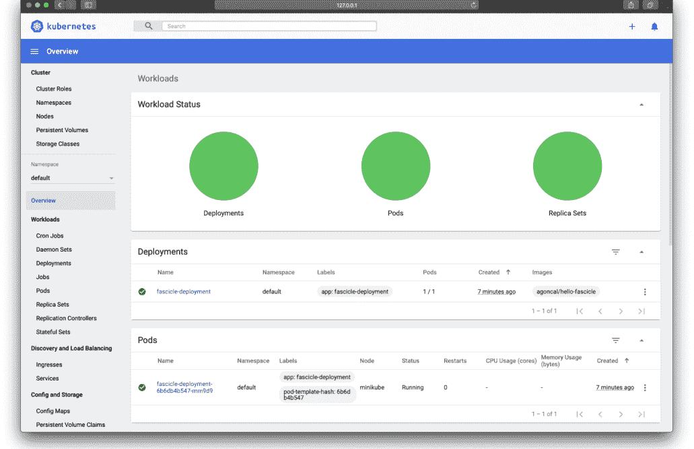

图 73. 显示可用资源的 Minikube 仪表板

## 清理

现在你可以清理在集群中创建的资源：

```
$ kubectl delete service fascicle-deployment

service "fascicle-deployment" deleted

$ kubectl delete deployment fascicle-deployment

deployment.apps "fascicle-deployment" deleted
```

可选地，停止 Minikube 虚拟机（VM）：

```
$ minikube stop

Stopping node "minikube" ...

1 nodes stopped.
```

可选地，删除 Minikube 虚拟机：

```
$ minikube delete

Deleting "minikube" in virtualbox ...

Removed all traces of the "minikube" cluster.
```

## A.8.6. Kubernetes 清单文件

我们一直以来完全通过命令行来创建带有服务和 pod 的部署。但想象一下，当你有多个 pod 和复杂的部署时该如何操作？有一种更简单、更有用的方法：使用 YAML 创建配置文件，并将整个文件应用到 Minikube 集群（使用 `kubectl` 命令）。

例如，列表 286 显示了描述我们的 `fascicle-deployment` 的 YAML 文件。该文件描述了一些元数据（`apiVersion`、`kind` 和 `metadata`），然后对象规范（`spec`）描述了部署的期望状态。这基本上是部署了 `agonal/hello-fascicle` Docker 镜像并设置端口 8080。

## 列表 286. 部署定义

```yaml
apiVersion: apps/v1

kind: Deployment

metadata:

  labels:

    app.kubernetes.io/name: fascicle-deployment

    app.kubernetes.io/version: latest

  name: fascicle-deployment

spec:

  replicas: 1

  selector:

    matchLabels:

      app.kubernetes.io/name: fascicle-deployment

      app.kubernetes.io/version: latest

  template:

    metadata:

      labels:

        app.kubernetes.io/name: fascicle-deployment

        app.kubernetes.io/version: latest

    spec:

      containers:

        - env:

            name: KUBERNETES_NAMESPACE

            valueFrom:

              fieldRef:

                fieldPath: metadata.namespace

          image: agonal/hello-fascicle/latest

          imagePullPolicy: IfNotPresent

          name: fascicle-deployment

        ports:

            - containerPort: 8080

              name: http

              protocol: TCP
```

然后我们有另一个 YAML 文件来描述服务。如列表 287 所示，该文件再次以元数据开始，并描述了服务的期望状态（`spec` 对象）。它将服务类型设置为 NodePort（这会在集群节点上打开一个端口），并配置了外部端口（30574）和内部端口（8080，即 Quarkus 监听的端口）。

```yaml
apiVersion: v1

kind: Service

metadata:

  labels:

    app.kubernetes.io/name: fascicle-deployment

    app.kubernetes.io/version: latest

  name: fascicle-deployment

spec:

  ports:

    - name: http

      port: 8080

      targetPort: 8080

      nodePort: 30574

  type: NodePort

  selector:

    app.kubernetes.io/name: fascicle-deployment
```

## A.8.7. 一些命令

Minikube 和 `kubectl` 使用多个参数。要获取帮助，你可以使用：

```
$ minikube help

$ kubectl help
```

这里是一些命令：

- `minikube start`: 启动集群。
- `minikube status`: 获取集群状态。
- `minikube stop`: 停止集群。
- `minikube delete`: 删除集群。
- `kubectl apply`: 应用资源。
- `kubectl get`: 显示资源。

## A.9.1. Kafka 简史

Kafka 最初由 Jay Kreps 在 2011 年在 LinkedIn 开发。Jay Kreps 选择用他喜爱的咖啡来命名该软件。随后他于 2014 年创立了 Confluent 公司。

## A.9.2. 在 macOS 上安装 Kafka

首先，检查你的机器上是否已安装 Kafka 和 ZooKeeper 的配方（formulae）：

```
$ brew list kafka

Error: No such formula

$ brew list zookeeper

Error: No such formula
```

如果两者都没有安装，只需使用以下命令安装 Kafka：

```
$ brew install kafka

> Installing dependencies for kafka: zookeeper

> Installing zookeeper

...

> Installing kafka

...
```

你现在应该可以在 Homebrew 中看到这两个配方：

```
$ brew list kafka

usr/local/Cellar/kafka/2.6.0/.bottle/etc/ (15 files)

$ brew list zookeeper

usr/local/Cellar/zookeeper/3.6.1/.bottle/etc/ (4 files)
```

## A.9.3. 检查 Kafka 安装

安装 Kafka 和 ZooKeeper 后，你的 PATH 中应该会有多个可用的二进制文件。如果你的 shell 有自动补全功能，你可以输入 `kafka-` 并按 TAB。你应该看到所有这些 Kafka 命令：

```
$ kafka- [TAB]

kafka-acls kafka-delete-records kafka-replica-64 kafka-topics

kafka-broker-api-versions kafka-dump-log kafka-run-class

kafka-configs kafka-leader-election kafka-server-start

kafka-console-consumer kafka-console-producer kafka-consumer-groups

kafka-consumer-perf-test kafka-producer-test

kafka-delegation-tokens kafka-reassign-partitions

kafka-mirror-maker kafka-streams-application-reset

kafka-preferred-replica-64 kafka-verifiable-consumer kafka-verifiable-producer

kafka-log-dirs kafka-server-stop

$ kafka-broker-api-versions --version

2.6.0
```


对于 ZooKeeper，你可以通过以下命令检查它的版本：

```bash
$ zookeeper version

ZooKeeper JMX enabled by default

Using config: /usr/local/etc/zookeeper/zoo.cfg

Apache ZooKeeper, version 3.6.1- 08/14/2020 03:24 GMT
```

### A.9.4. 发布和接收事件

现在 Kafka 和 ZooKeeper 已经运行，让我们发布并接收消息。在此之前，我们需要启动 Kafka 集群并创建主题。

#### 启动 Kafka

在启动 Kafka 之前我们需要启动 ZooKeeper。你可以使用 `zookeeper-server-start` 命令并传递属性文件。让我们使用 Kafka 目录提供的默认 `zookeeper.properties` 文件。

```bash
$ zookeeper-server-start /usr/local/etc/kafka/zookeeper.properties

...
[INFO] Reading configuration from: /usr/local/etc/kafka/zookeeper.properties
[INFO] clientPortAddress is 0.0.0.0:2181
[INFO] Starting server
[INFO] binding to port 2181
```

```bash
$ zkServer status
Client port found: 2181. Client address: localhost.
Mode: standalone
```

现在 ZooKeeper 正在运行，使用 `kafka-server-start` 和默认配置文件启动 Kafka 代理服务：

```bash
$ kafka-server-start /usr/local/etc/kafka/server.properties

...
[INFO] starting
[INFO] Connecting to zookeeper on localhost:2181
[INFO] Initializing a new session to localhost:2181
[INFO] Initiating client connection
[INFO] Waiting until connected
[INFO] Socket connection established
[INFO] Starting
[INFO] [KafkaServer id=0] started
```

如果 ZooKeeper 没有启动，Kafka 也会拒绝启动，并显示此类错误信息：

```bash
[INFO] Opening socket connection to server localhost:2181
[INFO] Socket error occurred: localhost:2181: Connection refused
[INFO] Opening socket connection to server localhost:2181
[INFO] Socket error occurred: localhost:2181: Connection refused
```

#### 创建主题

消息（也称为事件或记录）持久化地存储在主题中。主题是一个发布消息的馈。主题始终是多生产者和多订阅者的：一个主题可以有零、一个或多个向其写入的生产者，以及零、一个或多个订阅这些消息的消费者。主题具有名称并被分区，这意味着一个主题分布在位于不同 Kafka 代理上的多个“桶”中。

下面的命令列表列出了可用主题，并创建一个名为 `vinyl-topic` 的主题，它具有三个分区：

```bash
$ kafka-topics --zookeeper localhost:2181 --list

$ kafka-topics --zookeeper localhost:2181 --create --topic vinyl-topic --partitions 3 --replication-factor 1

Created topic vinyl-topic.

$ kafka-topics --zookeeper localhost:2181 --list

vinyl-topic
```

`kafka-topics` 命令有一个 `--describe` 参数，用于获取主题的所有细节和配置：

```bash
$ kafka-topics --zookeeper localhost:2181 --describe --topic vinyl-topic
```

```
Topic: vinyl-topic PartitionCount: 3 ReplicationFactor: 1
Topic: vinyl-topic Partition: 0 Leader: 0 Replicas: 0 Isr: 0
Topic: vinyl-topic Partition: 1 Leader: 0 Replicas: 0 Isr: 0
Topic: vinyl-topic Partition: 2 Leader: 0 Replicas: 0 Isr: 0
```

#### 发布事件

现在，是时候向主题发送消息了。当我们使用 `kafka-console-producer` 时，允许我们在控制台输入消息并发送到主题。打开一个终端，执行命令并开始输入一些消息（这里我使用 JSON，但你可以向主题发送任何格式）：

```bash
$ kafka-console-producer --bootstrap-server localhost:9092 --topic vinyl-topic

> {"id": 1,"artist": "Ella Fitzgerald","album": "Sings the Cole Porter Song Book"}

> {"id": 2,"artist": "Billie Holiday","album": "Lady In Satin"}

> {"id": 3,"artist": "Sarah Vaughan","album": "In the Land of Hi-Fi"}

> {"id": 4,"artist": "Nina Simone","album": "Pastel Blues"}
```

#### 接收事件

打开第二个终端并使用 `kafka-console-consumer` 消费消息。`--beginning` 参数允许我们从最早开始消费消息。在第二个终端中，你应该看到：

```bash
$ kafka-console-consumer --bootstrap-server localhost:9092 --topic vinyl-topic --from beginning
```

#### 清理

清理时，我们可以删除主题。对于这一点使用 `delete` 参数。一旦执行删除命令，你会看到：

```bash
$ kafka-topics --zookeeper localhost:2181 --delete --topic vinyl-topic

Deleted topic vinyl-topic.
```

#### 停止 Kafka

要停止 Kafka，你需要执行两个命令：一个是停止 Kafka 本身，另一个是停止 ZooKeeper。

```bash
$ kafka-server-stop

$ zookeeper-server-stop
```

#### 一些 Kafka 命令

Kafka 有几个命令可以使用参数。要获取某些帮助，使用以下命令：

- `kafka-configs`：操作主题、客户端或代理的配置。
- `kafka-console-consumer`：从 Kafka 读取数据并输出到标准输出。
- `kafka-console-producer`：从标准输入读取并发布到 Kafka。
- `kafka-topics`：创建、删除或更改任何主题。

### Git

Git 是一个免费开源的版本控制系统，用于跟踪文件的更改并协调人员之间的工作。它主要用于软件开发的代码管理，但也用于跟踪一组文件的更改。即使代码托管在仓库中（`https://github.com/repo`），你也可以作为 zip 文件下载代码，或者克隆仓库。只有在你克隆仓库时才需要安装 Git。运行示例并不真正需要它。

#### Git 简史

Git 的开发始于 2005 年 4 月，当时许多内核开发者放弃了专有的源码控制管理工具 BitKeeper。Linus Torvalds 想要一个像 BitKeeper 一样的分布式系统，但没有任何可用系统能满足他的需求。Linus 在 4 月 3 日开始开发 Git，4 月 6 日宣布了该项目，并在 4 月 18 日完成了首次多分支合并。4 月 29 日，初生的 Git 进行了基准测试，以每秒 7 个补丁的速度提交到 Linux 中。

#### 在 macOS 上安装 Git

在 macOS 上，如果你有 Homebrew，安装 git 只需要一个命令。打开终端并通过以下命令安装 git：

```bash
$ brew install git
```

#### 检查 Git 安装

安装完成后，在终端中运行 `git --version` 检查 Git。它应该显示版本号：

```bash
$ git --version

git version 2.25.0
```


## 克隆仓库

一旦安装了 Git，你可以通过 `git clone https://github.com/repo.git` 克隆仓库的代码。

## 附录 B：Quarkus 版本

Quarkus 的进化非常快。以下是最新主要版本及其内容的简要回顾。如果你想了解每个发布版本的更多细节，可以浏览其 GitHub 账号。

### B.1. Quarkus 1.9 (2020年10月)

Quarkus 1.9 在现有功能的基础上进行了许多改进：

- Micrometer 趋于成熟
- Kafka 现在支持指标收集
- 支持多个 Redis 客户端（以及 Sentinel 连接）
- 响应式路由支持 Bean 校验
- SmallRye Messaging 升级到 2.4.0，Mutiny 升级到 0.9.0
- 创立了 Quarkiverse 计划，即扩展扩展生态系统。

### B.2. Quarkus 1.8 (2020年9月)

Quarkus 1.8 包含了错误修复、改进以及一些显著的新功能：

- Hibernate ORM 扩展支持多个持久化单元
- 新的 Micrometer 扩展
- 集成 jbang 以方便编写基于 Quarkus 的脚本
- 更新到 GraalVM 20.2

### B.3. Quarkus 1.7 (2020年8月)

Quarkus 1.7 合并了超过 300 个拉取请求，发布时包含了 Elasticsearch 和 Redis 客户端、响应式路由以及 Funqy 的改进。最显著的新功能是：

- 针对低级和高级 Elasticsearch REST 客户端的新扩展
- 针对 Vert.x Redis 客户端的扩展
- Hibernate Envers 扩展
- 支持 JDBC Db2 驱动
- 对响应式路由功能的大量改进
- Funqy Serverless 框架获得了一些有趣的新功能

### B.4. Quarkus 1.6 (2020年7月)

Quarkus 1.6 发布时包含了 AppCDS、Google Cloud Functions、GraalVM 20.1.0 等内容。

- 集成生成 AppCDS 归档以提高 JVM 的启动时间
- 支持 Google Cloud Functions - 加入了现有的 Amazon Lambda 和 Azure Functions
- 响应式 IBM Db2 客户端（Db2 JDBC 驱动在 1.7 版本中）
- Apache Cassandra 客户端
- Webjars 定位扩展和 Spring `@Scheduled` 支持
- 更好的应用程序故障排除工具
- 升级 GraalVM 20.1.0

### B.5. Quarkus 1.5 (2020年6月)

Quarkus 1.5 引入了 fast-jar 打包选项。[254]

- 新的 fast-jar 包格式带来了更快的启动速度
- Quarkus 1.4 引入了命令模式，5 版本增加了 Picocli 扩展 [255]
- 添加了 gRPC 扩展
- 实现了 Eclipse MicroProfile GraphQL 扩展
- 支持更多 Amazon 服务（DynamoDB, KMS, SES, SNS, SQS）
- 带有 Panache 的 Hibernate ORM REST Data 扩展
- Spring 兼容层

### B.6. Quarkus 1.4 (2020年4月)

Quarkus 1.4 带来了重大更新。[256]

- 弃用 Java 8，推荐使用 Java 11
- 引入了命令模式（如何使用 Quarkus 构建命令行应用）
- 引入了 Funqy，一种新的 FaaS 框架，以改进函数前端（AWS Lambdas 和 Azure Functions）
- 添加对 HTTP/2 支持
- Quarkus Security 1.1.0.Final
- 将 Security API 移动到 Mutiny
- 改进了 Mock（支持 `@InjectMock` 和 Mockito）
- 添加对 SmallRye Reactive Messaging 2.0 支持
- 更新到 SmallRye 2.2.0

### B.7. Quarkus 1.3 (2020年3月)

Quarkus 1.3 通过了所有 Eclipse MicroProfile 3.3 规范的 TCK。[257] MicroProfile 3.3 包含以下规范更新：

- Config 1.4
- Fault Tolerance 2.1
- Health 2.2
- Metrics 2.3
- REST Client 1.4

除了 MicroProfile 平台内的规范外，Quarkus 还包含了响应式流操作符、响应式消息和上下文传播。此版本还带来了对 GraalVM 20.0 支持以及新的类加载器架构。[258]

### B.8. Quarkus 1.2 (2020年1月)

Quarkus 1.2 发布时支持 GraalVM 19.3.1、Metrics（指标）、Cache（缓存）扩展等。[259]

- 支持三种 GraalVM：
  - GraalVM 19.2.1 - JDK 8
  - GraalVM 19.3.1 - JDK 8
  - GraalVM 19.3.1 - JDK 11
- 添加了新的 Cache 扩展
- 为 Agroal（数据库连接池）和 Hibernate ORM 添加了指标
- 新的 SmallRye Fault Tolerance v4.0.0 替换了 Hystrix

### B.9. Quarkus 1.1 (2019年12月)

Quarkus 1.1 发布了模板引擎和 YAML 配置。[260]

- 添加了 Qute 模板引擎
- 配置支持 YAML
- 为 Kafka、Kafka Streams、MongoDB、Neo4j 和 Artemis 添加了健康检查
- 添加了 Quartz 扩展

### B.10. Quarkus 1.0 (2019年11月)

Quarkus 的第一个正式版本。[261]

- 创建了 BOM
- 升级了 SmallRye OpenAPI 和 Swagger
- 更新到 GraalVM 19.2.1
- 使用 JBoss logging 替换 `java.util.logging`
- 升级到 Hibernate ORM 5.4.9
- Quarkus HTTP 3.0
- Quarkus Security 1.0

### B.11. Quarkus 0.0.1 (2018年11月)

Quarkus 代码的首次提交。[262] Tag 0.0.1。[263]

- Quarkus Releases https://github.com/quarkus-releases
- Quarkiverse https://github.com/quarkiverse
- Quarkus 1.8 https://quarkus.io/blog/quarkus-1.8-released
- Quarkus 1.7 https://quarkus.io/blog/quarkus-1.7-released
- Quarkus 1.6 https://quarkus.io/blog/quarkus-1.6-released
- Quarkus 1.5 https://quarkus.io/blog/quarkus-1.5-released
- Picocli https://picocli.info
- Quarkus 1.4 https://quarkus.io/blog/quarkus-1.4-released
- Quarkus 1.3 https://quarkus.io/blog/quarkus-microprofile-3.3
- Quarkus Class Loader https://quarkus.io/guides/class-loading-reference
- Quarkus 1.2 https://quarkus.io/blog/quarkus-1.2-released
- Quarkus 1.1 https://quarkus.io/blog/quarkus-1.1-released
- Quarkus 1.0 https://quarkus.io/blog/quarkus-1.0-bits-are-here
- Quarkus 1st commit https://github.com/quarkus/quarkus/commit/161fa303bea36db07e54bf56a7dec49
- Quarkus Tag 0.0.1 https://github.com/quarkus/quarkus/commits/0.0.1?after~1200367b8dd3605d8219c4205fbc1d7af

# 附录 C：Eclipse MicroProfile 规范

MicroProfile 规范进化非常快。你可以在这里找到最新版本的回顾以及哪些子规范已更新。如果你想了解每个规范的更多细节，可以浏览 GitHub 账号。[264]

### C.1. MicroProfile 3.3 (2020年2月)

MicroProfile 3.3 是一个增量版本。[265] 它包含了以下更新：

- Config 1.4
- Fault Tolerance 2.1
- Health 2.2
- Metrics 2.3
- REST Client 1.4

### C.2. MicroProfile 3.2 (2019年11月)

MicroProfile 3.2 是一个增量版本。[266] 它包含了以下更新：

- Metrics 2.2
- Health 2.1

### C.3. MicroProfile 3.1 (2019年10月)

MicroProfile 3.1 是一个增量版本。[267] 它包含了以下更新：

- Health 2.1
- Metrics 2.1

### C.4. MicroProfile 3.0 (2019年6月)

MicroProfile 3.0 是一个大版本。[268] 它包含：

- Eclipse MicroProfile Configuration 1.3
- Eclipse MicroProfile Fault Tolerance 2.0
- Eclipse MicroProfile Health 2.0
- Eclipse MicroProfile JWT Auth 1.1
- Eclipse MicroProfile Metrics 2.0
- Eclipse MicroProfile OpenAPI 1.1
- Eclipse MicroProfile OpenTracing 1.3
- Eclipse MicroProfile REST Client 1.3
- Context and Dependency Injection 2.0
- Common Annotations 1.3
- Java API for RESTful Web Services 2.1
- JSON Binding 1.0
- JSON Processing 1.1

### C.5. MicroProfile 2.2 (2019年2月)

MicroProfile 2.2 是一个增量版本。[269] 它包含了以下更新：

- Fault Tolerance 2.0
- OpenAPI 1.1
- OpenTracing 1.3
- REST Client 1.2

### C.6. MicroProfile 2.1 (2018年10月)

MicroProfile 2.1 是一个增量版本。[270] 它包含了以下更新：

- OpenTracing 1.2

### C.7. MicroProfile 2.0.1 (2018年7月)

MicroProfile 2.0.1 是一个补丁版本，用于修复 pom.xml 中 JSON-B maven 依赖的问题。[271] MicroProfile 2.0 的定义内容没有变化。

### C.8. MicroProfile 2.0 (2018年6月)

MicroProfile 2.0 是一个大版本，因为 Java EE 依赖子集现在基于 Java EE 了。[272] 它包含：

- Eclipse MicroProfile Configuration 1.3
- Eclipse MicroProfile Fault Tolerance 1.1
- Eclipse MicroProfile Health 1.0
- Eclipse MicroProfile JWT Auth 1.1
- Eclipse MicroProfile Metrics 1.1
- Eclipse MicroProfile OpenAPI 1.0
- Eclipse MicroProfile OpenTracing 1.1
- Eclipse MicroProfile REST Client 1.1
- Context and Dependency Injection 2.0
- Common Annotations 1.3
- Java API for RESTful Web Services 2.1
- JSON Binding 1.0
- JSON Processing 1.1

### C.9. MicroProfile 1.4 (2018年6月)

MicroProfile 1.4 是一个增量版本。它包含了对内容的更新：

- Config 1.3
- Fault Tolerance 1.1
- JWT 1.1
- OpenTracing 1.1
- REST Client 1.1

### C.10. MicroProfile 1.3 (2018年1月)

MicroProfile 1.3 是一个增量版本。它包含了对内容的更新：

- Config 1.2
- Metrics 1.1

它新增：

- OpenAPI 1.0
- OpenTracing 1.0
- REST Client 1.0

### C.11. MicroProfile 1.2 (2017年9月)

MicroProfile 1.2 是一个增量版本。它包含了对内容的更新：

- Common Annotations 1.2
- Config 1.1

它新增：

- Fault Tolerance 1.0
- Health 1.0
- Metrics 1.0
- JWT 1.0

### C.12. MicroProfile 1.1 (2017年8月)

MicroProfile 1.1 是一个增量版本。它新增：

- Config 1.0

### C.13. MicroProfile 1.0

MicroProfile 1.0 是第一个主要发行版本，基于 Java EE 7 规范。它包含：

- Context and Dependency Injection 1.2
- Java API for RESTful Web Services 2.0
- JSON Processing 1.0

[264] MicroProfile Releases https://github.com/eclipse/microprofile/releases/tag/3
[265] MicroProfile 3.3 https://github.com/eclipse/microprofile/releases/tag/3.3
[266] MicroProfile 3.2 https://github.com/eclipse/microprofile/releases/tag/3.2
[267] MicroProfile 3.1 https://github.com/eclipse/microprofile/releases/tag/3.1
[268] MicroProfile 3.0 https://github.com/eclipse/microprofile/releases/tag/3.0
[269] MicroProfile 2.2 https://github.com/eclipse/microprofile/releases/tag/2.2
[270] MicroProfile 2.1 https://github.com/eclipse/microprofile/releases/tag/2.1
[271] MicroProfile 2.0.1 https://github.com/eclipse/microprofile/releases/tag/2.0.1
[272] MicroProfile 2.0 https://github.com/eclipse/microprofile/releases/tag/2.0
[273] MicroProfile 1.4 https://github.com/eclipse/microprofile-bom/releases/tag/1.4
[274] MicroProfile 1.3 https://github.com/eclipse/microprofile-bom/releases/tag/1.3
[275] MicroProfile 1.2 https://github.com/eclipse/microprofile-bom/releases/tag/1.2
[276] MicroProfile 1.1 https://github.com/eclipse/microprofile-bom/releases/tag/1.1

## 附录 D：参考文献

- Quarkus https://quarkus.io
- Quarkus 开发者指南 https://quarkus.io/guides
- Quarkus 超英雄工作坊 https://quarkus.io/quarkus-workshops/super-heroes
- SmallRye https://github.com/smallrye
- MicroProfile https://microprofile.io
  - 配置 https://github.com/eclipse/microprofile-config
  - 容错性 https://github.com/eclipse/microprofile-fault-tolerance
  - 健康 https://github.com/eclipse/microprofile-health
  - JWT https://github.com/eclipse/microprofile-jwt-auth
  - 指标 https://github.com/eclipse/microprofile-metrics
  - OpenAPI https://github.com/eclipse/microprofile-open-api
  - OpenTracing https://github.com/eclipse/microprofile-opentracing
  - 响应式消息 https://github.com/eclipse/microprofile-reactive-messaging
  - 响应式流操作符 https://github.com/eclipse/microprofile-reactive-streams-operators
  - REST Client https://github.com/eclipse/microprofile-rest-client

## 附录 E：同一作者的其他系列

这一系列著作包含了两种类型的册子。“理解”系列包含所有针对特定技术进行拆解、解释、展示其不同方面，并将其与其他外部技术集成的册子。另一方面，“实践”系列则全是代码实现。因此，你应该已经了解该技术的基础，并准备好通过编写代码来构建特定的应用程序。

### E.1. 理解 Bean 验证

“理解”系列包含所有针对特定技术进行拆解、解释、展示其不同方面，并将其与其他外部技术集成的册子。另一方面，“实践”系列则全是代码实现。因此，你应该已经了解该技术的基础，并准备好通过编写代码来构建特定的应用程序。

### E.2. 理解 JPA

“理解”系列包含所有针对特定技术进行拆解、解释、展示其不同方面，并将其与其他外部技术集成的册子。另一方面，“实践”系列则全是代码实现。因此，你应该已经了解该技术的基础，并准备好通过编写代码来构建特定的应用程序。

### E.3. 理解 Quarkus

“理解”系列包含所有针对特定技术进行拆解、解释、展示其不同方面，并将其与其他外部技术集成的册子。另一方面，“实践”系列则全是代码实现。因此，你应该已经了解该技术的基础，并准备好通过编写代码来构建特定的应用程序。

### E.4. 实践 Quarkus

“理解”系列包含所有针对特定技术进行拆解、解释、展示其不同方面，并将其与其他外部技术集成的册子。另一方面，“实践”系列则全是代码实现。因此，你应该已经了解该技术的基础，并准备好通过编写代码来构建特定的应用程序。

## 附录 F：印刷封面

“理解”系列包含所有针对特定技术进行拆解、解释、展示其不同方面，并将其与其他外部技术集成的册子。另一方面，“实践”系列则全是代码实现。因此，你应该已经了解该技术的基础，并准备好通过编写代码来构建特定的应用程序。
