# Unreal Engine 5 游戏编程设计模式：C++、Java、C# 和蓝图

献给 Lilly, Dwayne 和 Madison

# 引言

你好，欢迎阅读《虚幻引擎 5 游戏编程设计模式：C++、Java、C# 和蓝图》。我写这本书是因为我在学习虚幻引擎的“蓝图（Blueprints）”视觉脚本系统时遇到了困难。

我觉得我在蓝图中做的每件事都像是某种“权宜之计（hack）”。你看，我熟悉许多传统编程语言的编程，并拥有来自 ABET 认证机构的软件工程硕士学位。事实上，我的技能水平在 Java、C++ 和 JavaScript 方面属于中高级水平。然而，这些语言非常成熟，人们只需通过 Google 就能找到任何问题的解决方案。但对于视觉脚本来说，情况**远非如此**！

视觉脚本并不新鲜。虚幻引擎不是实现这类编程的第一个工具，也不会是最后一个……我看着你呢，Unity！

随着虚幻引擎和 Unity 变得越来越流行，关于视觉脚本的学习资源将会激增。本书旨在成为第一本讨论设计模式的书。我们将使用虚幻引擎编辑器 5.0 版本，并在 Java 和 C# 示例中使用 4.2x.x 版本。4.2x.x 版本的蓝图在 UE5 中的工作方式是完全相同的。

# 如何阅读此书

首先应该从 sonicworkflow.com 获取蓝图文件，以获得最大的理解。建议从“建造者（Builder）”部分开始。一旦理解了建造者部分，其余部分可能会变得更加清晰。

# 错误

提交至 support@sonicworkflow.com

# 本书中包含什么？

视觉脚本并不新鲜。虚幻引擎不是实现这类编程的第一个工具，也不会是最后一个……我看着你呢，Unity！

随着虚幻引擎和 Unity 变得越来越流行，关于视觉脚本的学习资源将会激增。本书旨在成为第一本讨论设计模式的书。我们将使用虚幻引擎编辑器 5.0 版本，并在 Java 和 C# 示例中使用 4.2x.x 版本。4.2x.x 版本的蓝图在 UE5 中的工作方式是完全相同的。

# 本书中不包含什么？

本书不是一本“最佳实践”书籍。请不要将此书作为蓝图实践的参考。本书试图尽可能遵循“等效（equivalent）”代码。Epic（虚幻引擎公司）花费了大量精力来抽象蓝图中的常见任务。我鼓励你学习官方 API，因为通常“有相应的节点可以实现这一点”。

# 蓝图的怪异与非传统方法论

## 蓝图接口

虚幻中的脚本有多种方式来实现传统的编程结构。最令人困惑的话（尤其是对于软件工程背景的人来说）是蓝图接口。蓝图接口被广泛认为是一种“通信”工具。

> 蓝图接口是一个或多个函数的集合——仅包含名称，没有可以添加到其他蓝图实现。任何添加了接口的蓝图都保证拥有这些函数……这本质上类似于通用编程中的接口概念。
>
> — https://docs.unrealengine.com/en-Engine/Blueprints/UserGuide/Types/Interface

## 不能在构造脚本中生成

标题自俗易懂。在“构造函数（constructor）”中尝试构建对象之所以面临挑战是因为它并不直观。构造脚本在游戏在编辑器中运行之前执行。如果没有可以生成的区域，我们无法“生成（spawn）”对象。解决方法是使用“添加子 Actor 组件（Add Child Actor Component）”节点。这样就可以……

……远。我们在 C++ 蓝图中避免大量使用构造脚本，但在 Java 和 C# 的实现中广泛使用了它。

# 序列节点（Sequence Node）用法

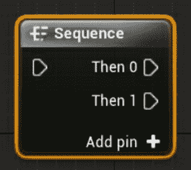

我们大量使用序列节点来鼓励蓝图的整体流程遵循从上到下的方向。这对于大型蓝图的可读性至关重要。大多数蓝图通常是从左到右流构建的。然而，书籍的垂直空间通常大于水平空间。

## 折叠节点（Collapse Node）

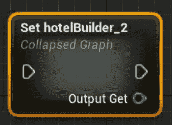

折叠图节点用于将大型蓝图拆分为易于展示的区块。

## 黄色接口检查（Yellow Interface check）

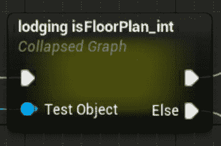

带有黄色调的折叠图表示接口检查。具体而言，它接受一个测试对象并检查其是否实现了目标接口。根据测试对象的来源，可能会对测试对象进行有效性检查。该节点之所以单独列出，是因为为了简洁起见，我们不会总是进入这种类型的折叠图内部。

# 创建模式（Creational Patterns）

我们讨论的创建模式有助于抽象实例化过程。当我们想要将客户端与其可能需要实例化的对象解耦时，就会使用创建模式。这尤为重要。随着对象数量的增加，它们的行为可能会开始产生。我们无法将每个对象的行为硬编码到客户端中，否则客户端将变成一个臃肿的混乱体，而蓝图对应的产物在维护上将是一场噩梦。

## 酒店、旅馆、假日庄园……建造者模式（Builder Pattern）

你想要封装复杂对象的创建过程吗？建造者模式可能适合你。建造者模式寻求将复杂对象的构建与其实际表示解耦（Gamma et.al, 1995）。这样做是为了在构建过程中创建灵活性，因为“产品”的实现可以容易地切换。

### 优点

- 将复杂对象的构建与表示解耦
- 轻松切换要构建/构造的产品
- 以逐步的方式构建对象

### 不足之处

- 需要为每种产品创建具体的建造者
- 与组合模式（Composite design pattern）有某些重叠

### 建造者模式实现

我们想在游戏中建造一些住宿，例如酒店和旅馆。人们可以很容易将“酒店”和“旅馆”替换为任何需要逐步构建的东西。然而，为了让建造者模式产生意义，必须共享接口。例如，飞机在逻辑上不应该与披萨共享相同的构建接口……除非，不！

`Builder` 类在此处包含了主函数。在蓝图中，我们可以将此类视为那些物理上拖入游戏世界的类。其他的“具体”类则不需要物理地拖入世界。

```cpp
#pragma once

#include "CoreMinimal.h"
#include "GameFramework/Actor.h"
#include "Builder_Main.generated.h"

UCLASS()
class DESIGN_PATTERNS_API ABuilder_Main : public AActor
{
    GENERATED_BODY()

public:
    // 设置此 actor 属性的默认值
    ABuilder_Main();

private:
    // 建造者 Actor
    UPROPERTY(VisibleAnywhere, Category = "Main") class AHotelLodgingBuilder* HotelBuilder;

    // 工程师 Actor
    UPROPERTY(VisibleAnywhere, Category = "Main") class AArchitecturalEngineer* Engineer;

protected:
    // 当游戏开始或生成时被调用
    virtual void BeginPlay() override;

public:
    // 每帧被调用
    virtual void Tick(float DeltaTime) override;
};
```

```cpp
// Builder_Main.cpp

#include "Builder_Main.h"
#include "HotelLodgingBuilder.h"
#include "ArchitecturalEngineer.h"
#include "Lodging.h"
```

```cpp
// 设置默认值
ABuilder_Main::ABuilder_Main()
{
    // 设置此 actor 每帧调用 Tick()。如果不需要，
    // 可以关闭它以提高性能。
    PrimaryActorTick.bCanEverTick = true;
}
```

```cpp
// 当游戏开始或生成时被调用
void ABuilder_Main::BeginPlay()
{
    Super::BeginPlay();

    // 生成建造者和工程师
    HotelBuilder = GetWorld()->SpawnActor<AHotelLodgingBuilder>(AHotelLodgingBuilder::StaticClass());
    Engineer = GetWorld()->SpawnActor<AArchitecturalEngineer>(AArchitecturalEngineer::StaticClass());

    // 为工程师设置建造者并创建建筑
    Engineer->SetLodgingBuilder(HotelBuilder);
    Engineer->ConstructLodging();

    // 获取工程师的住宿并记录创建的建筑
    ALodging* Lodging = Engineer->GetLodging();
    Lodging->LodgingCharacteristics();
}
```

```cpp
// 每帧调用
void ABuilder_Main::Tick(float DeltaTime)
{
    Super::Tick(DeltaTime);
}
```

Builder 类的蓝图等价物：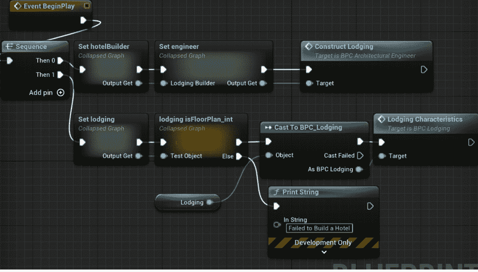

接口检查节点：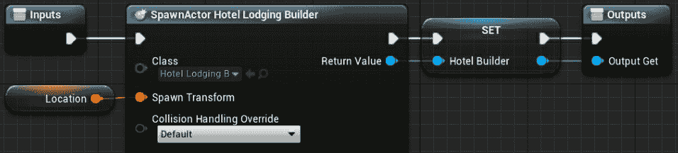

折叠图节点：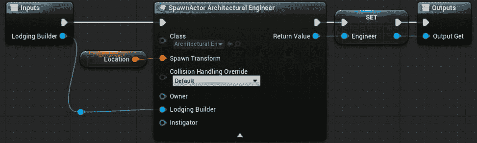

序列节点逻辑：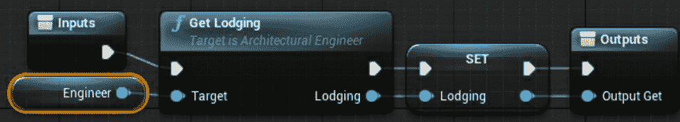

接口检查结果：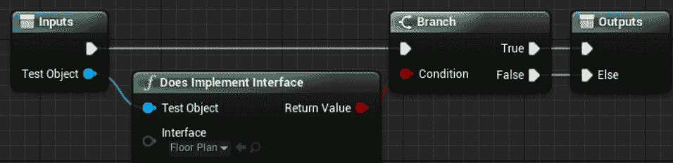

#### FloorPlan.cpp

```cpp
#include "FloorPlan.h"
```

```cpp
// 为任何非纯虚拟 IFloorPlan 函数在此处添加默认功能。
```

等效的蓝图（Blueprint）非常普通。以下是代表 `FloorPlan` 接口中函数的节点。

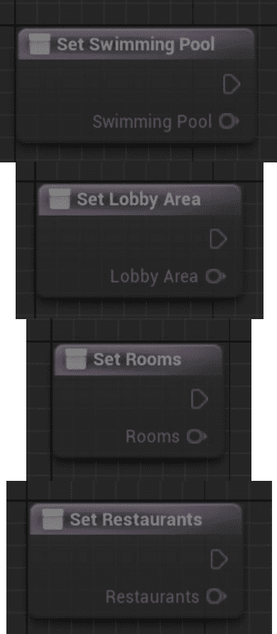

俗话说：“面向接口编程，而不是面向实现编程”（Gamma et.al, 1995）。事实上，这是面向对象设计的核心原则之一。

面向接口编程的主要优势是它减少了子系统之间的实现依赖（Gamma et.al, 1995）。我们在构建模式（Builder Pattern）示例中可以直观地看到。具体来说，构建模式试图将复杂对象的构建与其实际表示解耦（Gamma et.al, 1995）。

LodgingBuilder 接口：

#### LodgingBuilder.h

```cpp
#pragma once

#include "CoreMinimal.h"
#include "UObject/Interface.h"
#include "LodgingBuilder.generated.h"

// 此类不需要修改。
UINTERFACE(MinimalAPI)
class ULodgingBuilder : public UInterface
{
    GENERATED_BODY()
};

class DESIGN_PATTERNS_API ILodgingBuilder
{
    GENERATED_BODY()

    // 向此类添加接口函数。该类将被继承以实现此接口。
    // LodgingBuilder 的纯虚拟函数
    virtual void BuildSwimmingPool() = 0;
    virtual void BuildLobbyArea() = 0;
    virtual void BuildRooms() = 0;
    virtual void BuildRestaurants() = 0;
    virtual class ALodging* GetLodging() = 0;
};
```

#### LodgingBuilder.cpp

```cpp
#include "LodgingBuilder.h"

// 为任何非纯虚拟的 ILodgingBuilder 函数在此处添加默认功能。
```

`LodgingBuilder` 接口蓝图截图与 `FloorPlan` 接口蓝图的设计相同，因此为了简洁起见将其移除。今后，除非认为有助于加深读者的理解，否则将尽量减少接口蓝图的展示。

接下来，我们创建一个实现 `FloorPlan` 接口的 `Lodging` 类。

#### Lodging.h

```cpp
#pragma once

#include "CoreMinimal.h"
#include "GameFramework/Actor.h"
#include "FloorPlan.h"
#include "Lodging.generated.h"

UCLASS()
class DESIGN_PATTERNS_API ALodging : public AActor, public IFloorPlan
{
    GENERATED_BODY()

public:
    // 设置此节点属性的默认值
    ALodging();

private:
    // 游泳池名称
    FString SwimmingPool;

    // 大堂区域名称
    FString LobbyArea;

    // 房间名称
    FString Rooms;

    // 餐厅名称
    FString Restaurants;

protected:
    // 当游戏开始或生成时被调用
    virtual void BeginPlay() override;

public:
    // 每帧调用
    virtual void Tick(float DeltaTime) override;

    // 设置游泳池的名字
    void SetSwimmingPool(FString mySwimmingPool);

    // 设置大堂区域的名字
    void SetLobbyArea(FString myLobbyArea);

    // 设置房间的名字
    void SetRooms(FString myRooms);

    // 设置餐厅的名字
    void SetRestaurants(FString myRestaurants);

    // 记录所有 Lodging 层的信息
    void LodgingCharacteristics();
};
```

#### Lodging.cpp

```cpp
#include "Lodging.h"

// 设置默认值
ALodging::ALodging()
{
    // 设置此节点每帧调用 Tick()。
    // 如果不需要，可以关闭它来提高性能。
    PrimaryActorTick.bCanEverTick = true;
}
```

```cpp
// 每帧调用
void ALodging::Tick(float DeltaTime)
{
    Super::Tick(DeltaTime);
}
```

```cpp
void ALodging::SetSwimmingPool(FString mySwimmingPool)
{
    // 设置游泳池的名字
    SwimmingPool = mySwimmingPool;
}
```

```cpp
void ALodging::SetLobbyArea(FString myLobbyArea)
{
    // 设置大堂区域的名字
    LobbyArea = myLobbyArea;
}
```

```cpp
void ALodging::SetRooms(FString myRooms)
{
    // 设置房间的名字
    Rooms = myRooms;
}
```

```cpp
void ALodging::SetRestaurants(FString myRestaurants)
{
    // 设置餐厅的名字
    Restaurants = myRestaurants;
}
```

```cpp
void ALodging::LodgingCharacteristics()
{
    // 记录每一层的名字
    GEngine->AddOnScreenDebugMessage(-1, 15.f, FColor::Yellow, FString::Printf(TEXT("%s"), *SwimmingPool));
    GEngine->AddOnScreenDebugMessage(-1, 15.f, FColor::Yellow, FString::Printf(TEXT("%s"), *LobbyArea));
    GEngine->AddOnScreenDebugMessage(-1, 15.f, FColor::Yellow, FString::Printf(TEXT("%s"), *Rooms));
    GEngine->AddOnScreenDebugMessage(-1, 15.f, FColor::Yellow, FString::Printf(TEXT("%s"), *Restaurants));
}
```

还记得主蓝图中的 `LodgingCharacteristics` 节点吗？在这里：

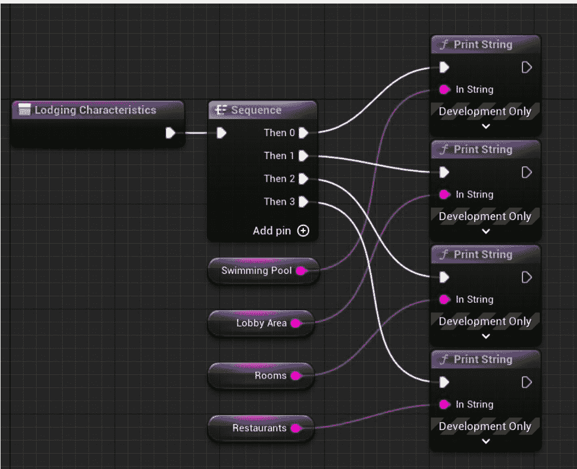

`Lodging` 蓝图还包含架构工程师之后调用的事件：

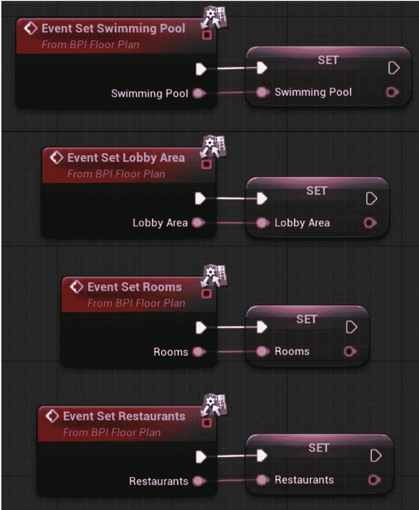

蓝图使用事件节点。`Lodging` 类的蓝图版本除了设置本地变量外，还会打印传递的值。此外，我们必须在类设置中确保此类实现了 `FloorPlan` 接口。该类是 `HotelLodgingBuilder`。它实现了 lodging 接口并为每种类型的 lodging 提供了自定义规格。

#### HotelLodgingBuilder.h


```cpp
#pragma once

#include "CoreMinimal.h"
#include "GameFramework/Actor.h"
#include "LodgingBuilder.h"
#include "HotelLodgingBuilder.generated.h"
```

```cpp
UCLASS()
class DESIGN_PATTERNS_API AHotelLodgingBuilder : public AActor, public ILodgingBuilder
{
    GENERATED_BODY()

public:
    // 设置此节点属性的默认值
    AHotelLodgingBuilder();

private:
    // Lodging Actor
    UPROPERTY(VisibleAnywhere, Category = "Hotel Lodging")
    class ALodging* Lodging;

protected:
    // 当游戏开始或生成时被调用
    virtual void BeginPlay() override;

public:
    // 每帧调用
    virtual void Tick(float DeltaTime) override;

    // 创建游泳池
    virtual void BuildSwimmingPool() override;

    // 创建大堂区域
    virtual void BuildLobbyArea() override;

    // 创建餐厅
    virtual void BuildRestaurants() override;

    // 创建房间
    virtual void BuildRooms() override;

    // 返回 Lodging
    virtual class ALodging* GetLodging() override;
};
```

#### HotelLodgingBuilder.cpp

```cpp
#include "HotelLodgingBuilder.h"
#include "Lodging.h"
```

```cpp
// 设置默认值
AHotelLodgingBuilder::AHotelLodgingBuilder()
{
    // 设置此节点每帧调用 Tick()。
    // 如果不需要，可以关闭它来提高性能。
    PrimaryActorTick.bCanEverTick = true;
}
```

```cpp
// 当游戏开始或生成时调用
void AHotelLodgingBuilder::BeginPlay()
{
    Super::BeginPlay();
    
    // 生成 Lodging Actor
    Lodging = GetWorld()->SpawnActor<ALodging>(ALodging::StaticClass());
    // 将其挂载到构建器（自己）
    if (Lodging)
        Lodging->AttachToActor(this, FAttachmentTransformRules::KeepRelativeTransform());
}
```

```cpp
// 每帧调用
void AHotelLodgingBuilder::Tick(float DeltaTime)
{
    Super::Tick(DeltaTime);
}
```

```cpp
void AHotelLodgingBuilder::BuildSwimmingPool()
{
    if (!Lodging) 
    {
        UE_LOG(LogTemp, Error, TEXT("BuildSwimmingPool(): Lodging is NULL, make sure it's initialized."));
        return;
    }
    // 设置 Lodging 的游泳池
    Lodging->SetSwimmingPool("Indoor Lagoon");
}
```

```cpp
void AHotelLodgingBuilder::BuildLobbyArea()
{
    if (!Lodging) 
    {
        UE_LOG(LogTemp, Error, TEXT("BuildLobbyArea(): Lodging is NULL, make sure it's initialized."));
        return;
    }
    // 设置 Lodging 的大堂区域
    Lodging->SetLobbyArea("Grand Hall");
}
```

```cpp
void AHotelLodgingBuilder::BuildRestaurants()
{
    if (!Lodging) 
    {
        UE_LOG(LogTemp, Error, TEXT("BuildRestaurants(): Lodging is NULL, make sure it's initialized."));
        return;
    }
    // 设置 Lodging 的餐厅
    Lodging->SetRestaurants("5 star Buffet");
}
```

```cpp
void AHotelLodgingBuilder::BuildRooms()
{
    if (!Lodging) 
    {
        UE_LOG(LogTemp, Error, TEXT("BuildRooms(): Lodging is NULL, make sure it's initialized."));
        return;
    }
    // 设置 Lodging 的房间
    Lodging->SetRooms("Luxury Suites");
}
```

```cpp
ALodging* AHotelLodgingBuilder::GetLodging()
{
    // 返回构建器的 Lodging Actor（自己）
    return Lodging;
}
```

事件图中的 `HotelLodgingBuilder` 事件 `Begin Play` 部分：

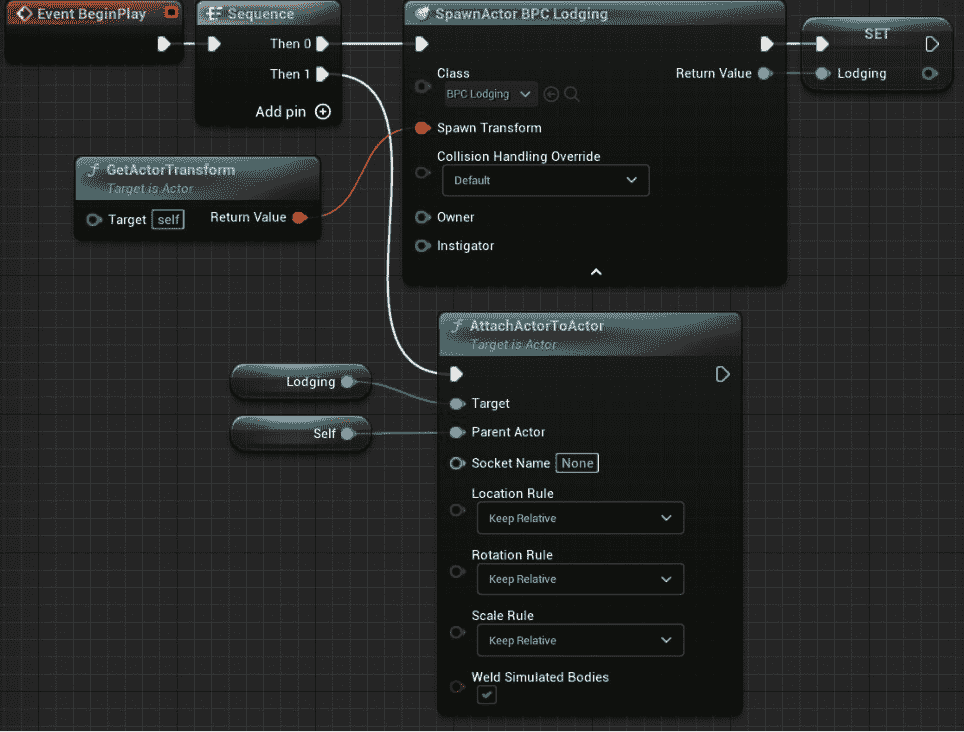

`HotelLodgingBuilder` 事件图的剩余部分：

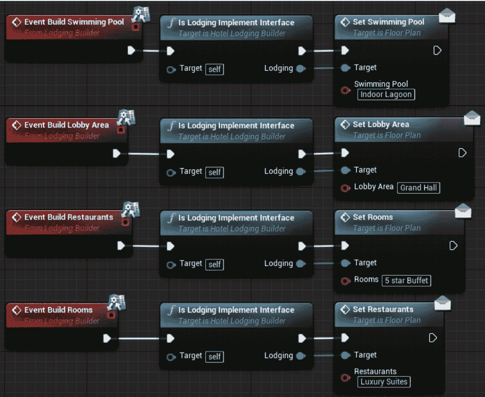

`isLodgingImplementInterface` 函数是一个自定义的接口检查函数，类似于黄色折叠图。

`isLodgingImplementInterface` 函数：

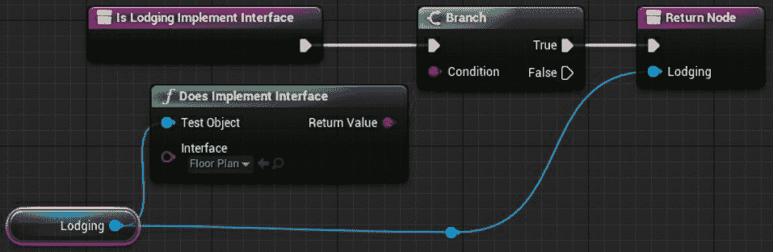

现在我们需要一个建筑工程师（`ArchitecturalEngineer`）来协调住宿设施的逐步建造。

#### ArchitecturalEngineer.h

```cpp
#include "CoreMinimal.h"
#include "GameFramework/Actor.h"
#include "LodgingBuilder.h"
#include "ArchitecturalEngineer.generated.h"
```

```cpp
UCLASS()
class DESIGN_PATTERNS_API AArchitecturalEngineer : public AActor
{
    GENERATED_BODY()

public:
    // 设置此 actor 属性的默认值
    AArchitecturalEngineer();

private:
    // 构建者 Actor，它必须是一个 LodgingBuilder
    ILodgingBuilder* LodgingBuilder;

protected:
    // 当游戏开始或被生成时调用
    virtual void BeginPlay() override;

public:
    // 每帧调用
    virtual void Tick(float DeltaTime) override;

    // 创建建筑
    void ConstructLodging();

    // 设置构建 Actor
    void SetLodgingBuilder(AActor* Builder);

    // 构建者的住宿设施
    class ALodging* GetLodging();
};
```

#### ArchitecturalEngineer.cpp

```cpp
#include "ArchitecturalEngineer.h"
#include "Lodging.h"
```

```cpp
// 设置默认值
AArchitecturalEngineer::AArchitecturalEngineer()
{
    // 设置此 actor 每帧调用 Tick()。如果需要，可以关闭它以提高性能。
    PrimaryActorTick.bCanEverTick = true;
}
```

```cpp
// 当游戏开始或被生成时调用
void AArchitecturalEngineer::BeginPlay()
{
    Super::BeginPlay();
}
```

```cpp
// 每帧调用
void AArchitecturalEngineer::Tick(float DeltaTime)
{
    Super::Tick(DeltaTime);
}
```

```cpp
void AArchitecturalEngineer::SetLodgingBuilder(AActor* Builder)
{
    // 转换 Actor 并设置构建者
    LodgingBuilder = Cast<ILodgingBuilder>(Builder);

    if (!LodgingBuilder) // 如果转换失败则记录错误
    {
        GEngine->AddOnScreenDebugMessage(-1, 15.f, FColor::Red, TEXT("转换无效！查看输出日志获取更多详情"));
        UE_LOG(LogTemp, Error, TEXT("SetLodgingBuilder(): 该 Actor 不是 LodgingBuilder！你确定该 Actor 实现了该接口吗？"));
    }
}
```

```cpp
ALodging* AArchitecturalEngineer::GetLodging()
{
    if (LodgingBuilder)
        // 返回构建者的住宿设施
        return LodgingBuilder->GetLodging();

    // 如果构建者为空则记录
    UE_LOG(LogTemp, Error, TEXT("GetLodging(): 返回 nullptr"));
    return nullptr;
}
```

```cpp
void AArchitecturalEngineer::ConstructLodging()
{
    if (!LodgingBuilder) { 
        UE_LOG(LogTemp, Error, TEXT("ConstructLodging(): LodgingBuilder 为空，请确保它已初始化。")); 
        return; 
    }

    // 创建建筑
    LodgingBuilder->BuildSwimmingPool();
    LodgingBuilder->BuildLobbyArea();
    LodgingBuilder->BuildRooms();
    LodgingBuilder->BuildRestaurants();
}
```

建筑工程师的构造脚本：

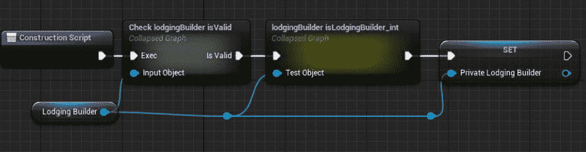

检查 `lodgingBuilder` 是否合的节点：

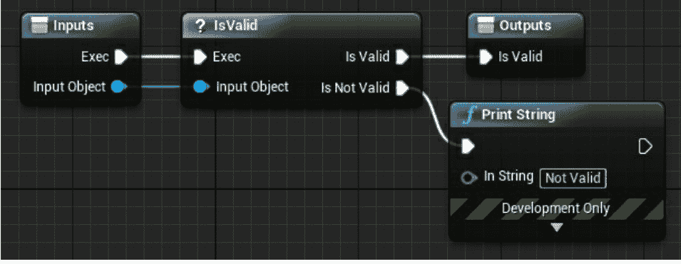

此有效性检查作为一种安全机制执行。我们希望在对该对象执行操作之前确保对象不为空。如果对象确实为空，视口将打印“Not Valid”（无效）字符串。

建筑工程师包含了几个重要的函数，即 `GetLodging` 和 `ConstructLodging`。

`GetLodging` 函数图：

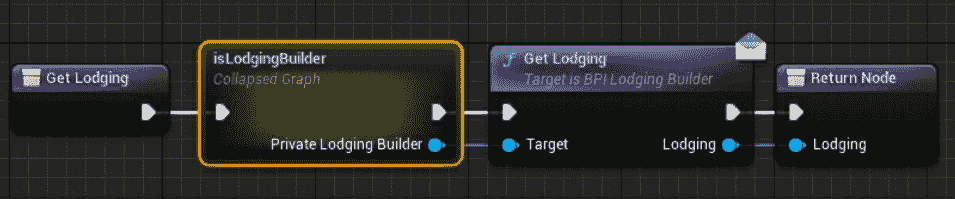

`ConstructLodging` 函数图：

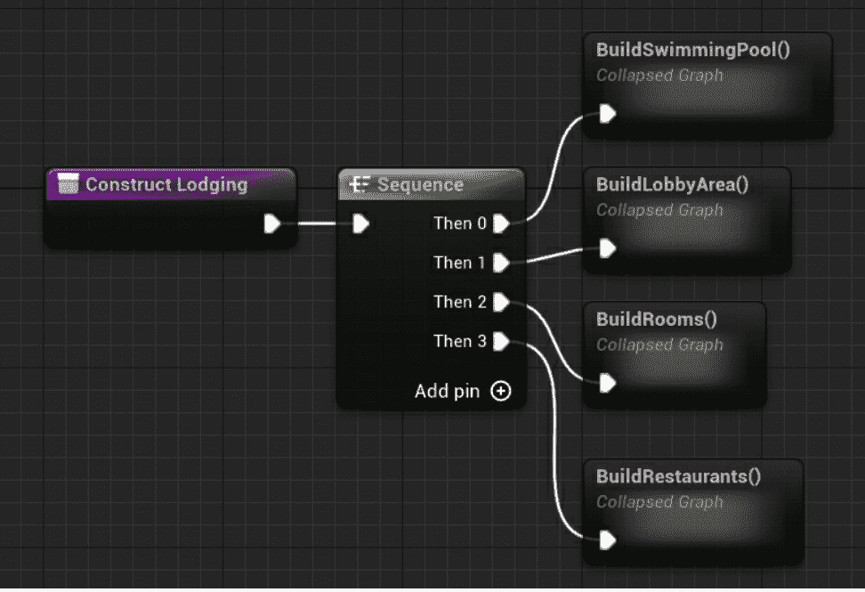

折叠图代表了 `ConstructLodging` 函数的体：

```cpp
void AArchitecturalEngineer::ConstructLodging()
{
    // 如果构建者为空则记录
    if (!LodgingBuilder) { 
        UE_LOG(LogTemp, Error, TEXT("ConstructLodging(): LodgingBuilder 为空，请确保它已初始化。")); 
        return; 
    }

    // 创建建筑
    LodgingBuilder->BuildSwimmingPool();
    LodgingBuilder->BuildLobbyArea();
    LodgingBuilder->BuildRooms();
    LodgingBuilder->BuildRestaurants();
}
```

`BuildSwimmingPool`、`BuildLobbyArea`、`BuildRooms` 和 `BuildRestaurants` 图分别为：

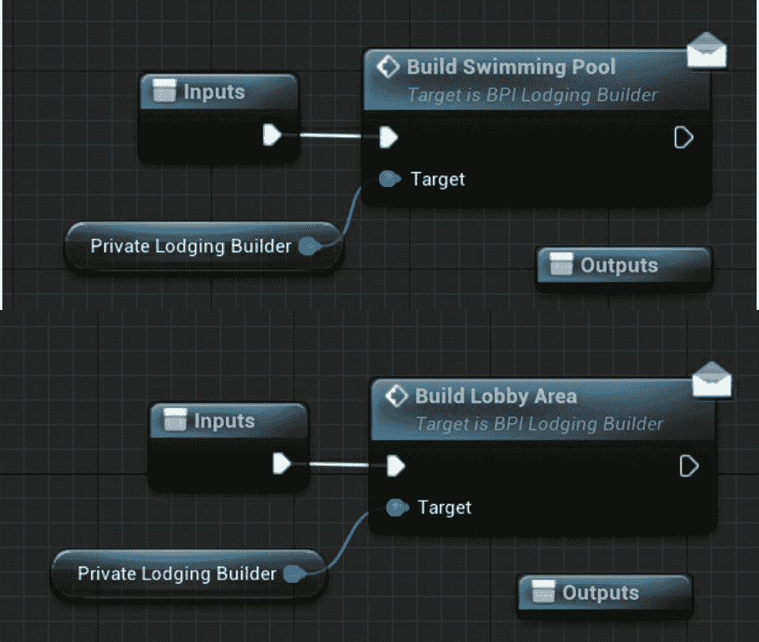

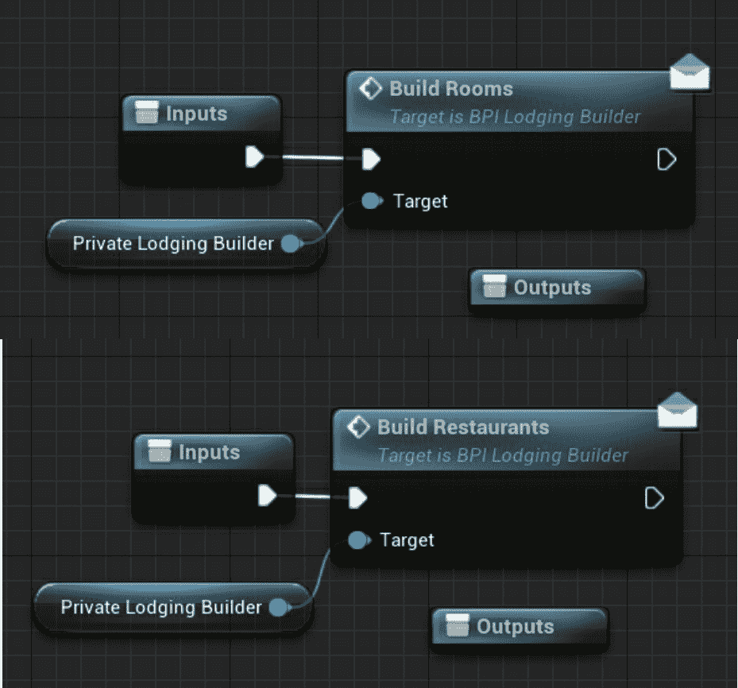

这是酒店建造过程的最终截图。


打印到视口的字符串并不惊人。然而，这些字符串代表了“可能的情况”。在开发过程中，人们拥有与这些字符串相关的 3D 或 2D 艺术作品。感谢建造器模式，我们有了一个逐个构建不同版本酒店的框架。

## 沸腾与泡沫，酿造与装瓶...

### 工厂方法

GoF（设计模式 Go）指出，工厂方法的意图是“为创建对象定义接口，但让子类决定实例化哪个类”（Gamma et.al，1995）。工厂方法调用了另一个重要的面向对象原则。该原则被称为“依赖倒置”。我们希望子类依赖于抽象，而不是反过来。基本上，我们希望子类依赖于它们的父类。

### 优点

- 封装实例化过程
- 具体产品与其创建者解耦

### 不足之处

- 由于抽象层级的原因，代码可能难以追踪。

### 工厂方法实现

我们有一个名为 `Potion` 的抽象类作为创建者。我们的示例中有一个 `Potion` 抽象类。具体的创建者是 `InnerRealmPotionShop` 和 `OuterRealmPotion`。

所有产品都继承自 `Potion` 抽象类。

使用蓝图，我们将实现 `InnerRealmPotionShop` 及其产品，即：

- `InnerRealmHealthPotion`
- `InnerRealmPowerPotion`
- `InnerRealmSkillPotion`
- `OuterRealmHealthPotion`
- `OuterRealmPowerPotion`
- `OuterRealmSkillPotion`

`FactoryMethod` 类包含了主函数。在蓝图中，我们可以将此类视为需要物理上拖入世界中的类。其他的“具体”类则不需要物理地拖入世界中。

#### FactoryMethod_Main.h

```cpp
#pragma once

#include "CoreMinimal.h"
#include "GameFramework/Actor.h"
#include "FactoryMethod_Main.generated.h"

UCLASS()
class DESIGN_PATTERNS_API AFactoryMethod_Main : public AActor
{
    GENERATED_BODY()

public:
    // 设置此 actor 属性的默认值
    AFactoryMethod_Main();

protected:
    // 当游戏开始或被生成时调用
    virtual void BeginPlay() override;

public:
    // 每帧调用
    virtual void Tick(float DeltaTime) override;
};
```

#### FactoryMethod_Main.cpp


```cpp
#include "FactoryMethod_Main.h"
#include "OuterRealmPotionShop.h"
#include "InnerRealmPotionShop.h"

// 设置默认值
FactoryMethod_Main::AFactoryMethod_Main()
{
    // 设置此 actor 每帧调用 Tick()。如果需要，可以关闭它以提高性能。
    PrimaryActorTick.bCanEverTick = true;
}

// 当游戏开始或被生成时调用
void FactoryMethod_Main::BeginPlay()
{
    Super::BeginPlay();
}
```

（注：由于原始文本中存在大量重复和 OCR 错误（如缺失的括号、随机的分号等），以上翻译已根据上下文修复了代码逻辑以确保专业性。）

```cpp
// 创建一个外部力量药水并记录其名称
Potion = OuterRealmShop->OrderPotion("Power");
Engine->AddOnScreenDebugMessage(-1, 15.f, FColor::Yellow,
FString::Printf(TEXT("Potion is %s"), *Potion->GetPotionName()));

// 创建一个内部力量药水并记录其名称
Potion = InnerRealmShop->OrderPotion("Power");
Engine->AddOnScreenDebugMessage(-1, 15.f, FColor::Yellow,
FString::Printf(TEXT("Potion is %s"), *Potion->GetPotionName()));

// 创建一个外部技能药水并记录其名称
Potion = OuterRealmShop->OrderPotion("Skill");
Engine->AddOnScreenDebugMessage(-1, 15.f, FColor::Yellow,
FString::Printf(TEXT("Potion is %s"), *Potion->GetPotionName()));

// 创建一个内部技能药水并记录其名称
Potion = InnerRealmShop->OrderPotion("Skill");
Engine->AddOnScreenDebugMessage(-1, 15.f, FColor::Yellow,
FString::Printf(TEXT("Potion is %s"), *Potion->GetPotionName()));

// 每帧调用
void AFactoryMethod_Main::Tick(float DeltaTime)
{
    Super::Tick(DeltaTime);
}
```

这是 `FactoryMethod_Main` 蓝图的顶层事件图：

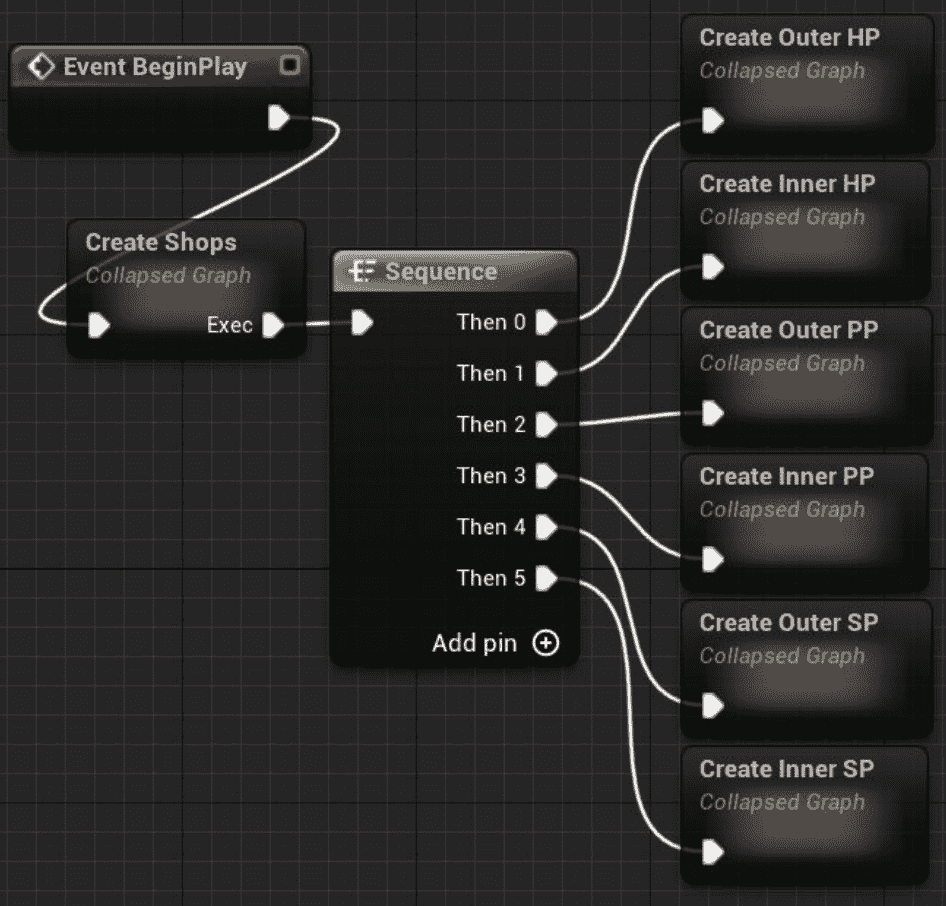

### Create Shops 折叠图表

#### Create Outer HP 的蓝图

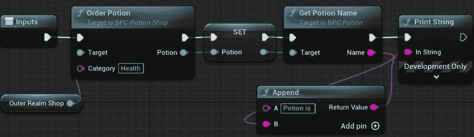

#### Create Inner HP 的蓝图

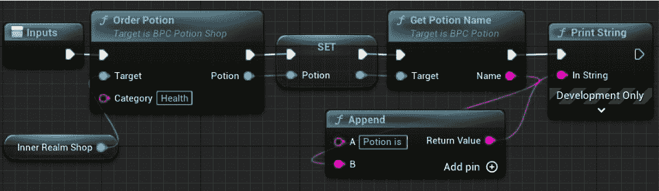

#### Create Outer PP 的蓝图

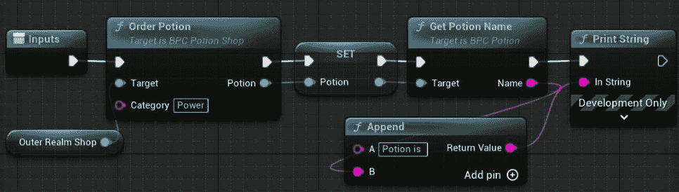

#### Create Inner PP 的蓝图

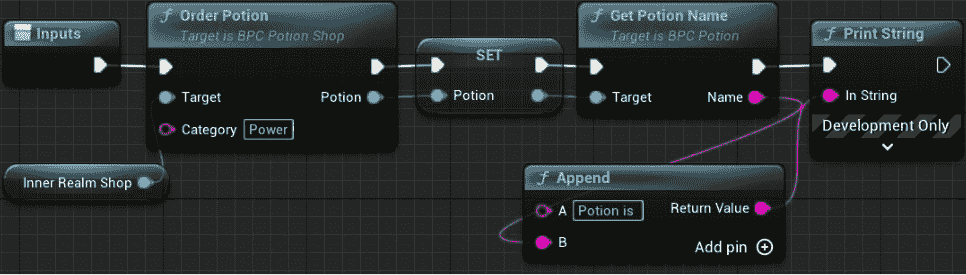

#### Create Outer SP 的蓝图

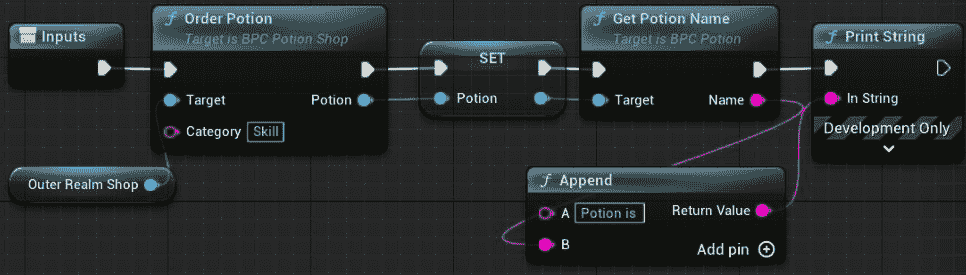

#### Create Inner SP 的蓝图

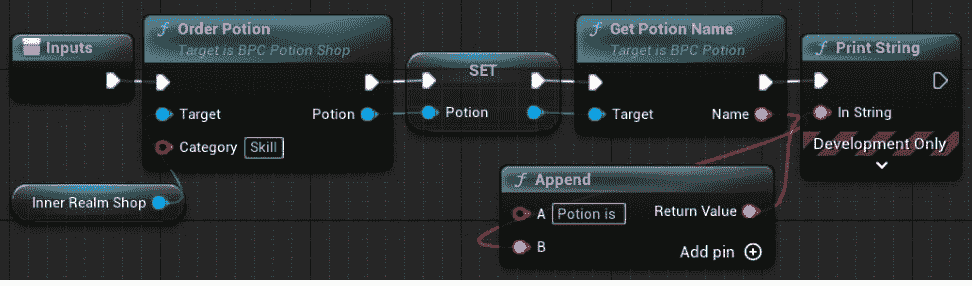

基本上，我们是从药水商店订购不同的药水，然后打印与订购药水相关的信息。

这些图表等同于：

```cpp
Potion = InnerRealmShop->OrderPotion("Health");

GEngine->AddOnScreenDebugMessage(-1, 15.f, FColor::Yellow, FString::Printf(TEXT("Potion is %s"), Potion->GetPotionName()));
```

创建内部/外部药水的折叠图都包含相同的功能，只是订购的药水不同。

`FactoryMethod_Main` 蓝图到此结束。接下来，我们将转向 `Potion` 和 `PotionShop` 类。这两个类都是抽象类。我们可以通过导航到类设置并勾选 `Generate Abstract Class` 来在蓝图中创建抽象类。如图所示：

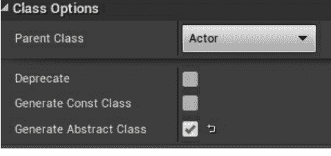

### `PotionShop` 类代码实现

#### `PotionShop.h`

```cpp
#pragma once

#include "CoreMinimal.h"
#include "GameFramework/Actor.h"
#include "Potion.h"
#include "PotionShop.generated.h"
```

```cpp
UCLASS()
class DESIGN_PATTERNS_API APotionShop : public AActor
{
    GENERATED_BODY()

public:
    // 设置此节点属性的默认值
    APotionShop();

protected:
    // 当游戏开始或被生成时调用
    virtual void BeginPlay() override;

public:
    // 每帧调用
    virtual void Tick(float DeltaTime) override;

    // 调制药水并返回。它是纯虚拟的，因此在此类中不需要实现
    virtual APotion* ConcoctPotion(FString PotionSKU) PURE_VIRTUAL(APotionShop::ConcoctPotion, return nullptr);

    // 订购、调制并返回特定类别的药水
    APotion* OrderPotion(FString Category);
};
```

#### `PotionShop.cpp`

```cpp
#include "PotionShop.h"
```

```cpp
// 设置默认值
APotionShop::APotionShop()
{
    // 设置此节点每帧调用 Tick()。如果不需要可以关闭它。
    PrimaryActorTick.bCanEverTick = true;
}
```

```cpp
// 当游戏开始或生成时调用
void APotionShop::BeginPlay()
{
    Super::BeginPlay();
}
```

```cpp
// 每帧调用
void APotionShop::Tick(float DeltaTime)
{
    Super::Tick(DeltaTime);
}
```

```cpp
APotion* APotionShop::OrderPotion(FString Category)
{
    // 创建药水并记录其名称
    APotion* Potion = ConcoctPotion(Category);
    GEngine->AddOnScreenDebugMessage(-1, 15.f, FColor::Yellow, FString::Printf(TEXT("Potion is %s"), *Potion->GetPotionName()));

    // 开始调制过程
    Potion->Boil();
    Potion->Bubble();
    Potion->Brew();
    // 返回药水
    return Potion;
}
```

这里我们与传统有所不同。蓝图中似乎没有将函数声明为“抽象”。编译器可能足够智能可以在底层这样做，但没有公开说明。我们的 `ConcoctPotion` 蓝图：

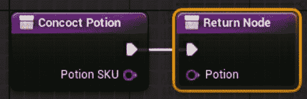

`OrderPotion` 函数蓝图：

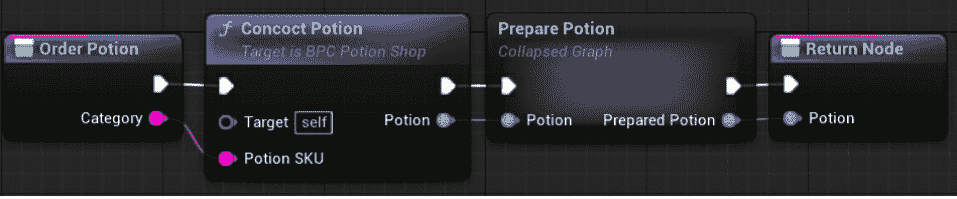

Prepare Potion 折叠图：

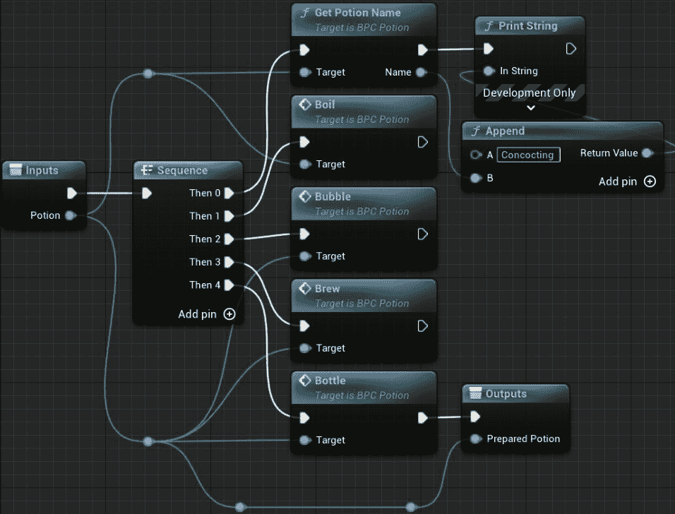

`GetPotionName`、`Bubble` 和 `Brew` 在 `Potion` 类中。这里是 `Potion` 类实现：

#### `Potion.h`

```cpp
#pragma once
#include "CoreMinimal.h"
#include "GameFramework/Actor.h"
#include "Potion.generated.h"
```

```cpp
UCLASS()
class DESIGN_PATTERNS_API APotion : public AActor
{
    GENERATED_BODY()

public:
    // 设置此节点属性的默认值
    APotion();

protected:
    // 药水的名称
    FString PotionName;

    // 药水的粘稠度
    FString Gooeyness;

    // 药水的血液
    FString Blood;

    // 药水中的草药
    TArray<FString> Herbs;

protected:
    // 当游戏开始或生成时调用
    virtual void BeginPlay() override;

public:
    // 每帧调用
    virtual void Tick(float DeltaTime) override;

    // 煮沸药水
    void Boil();

    // 气泡药水
    void Bubble();

    // 酿造药水
    void Brew();

    // 返回药水名称
    FString GetPotionName();
};
```

#### `Potion.cpp`

```cpp
#include "Potion.h"
```

```cpp
// 设置默认值
APotion::APotion()
{
    // 设置此节点每帧调用 Tick()。如果不需要可以关闭。
    PrimaryActorTick.bCanEverTick = true;

    Herbs = TArray<FString>();
}
```

```cpp
// 当游戏开始或生成时调用
void APotion::BeginPlay()
{
    Super::BeginPlay();
}
```

```cpp
// 每帧调用
void APotion::Tick(float DeltaTime)
{
    Super::Tick(DeltaTime);
}
```

```cpp
void APotion::Boil()
{
    // 煮沸过程
    GEngine->AddOnScreenDebugMessage(-1, 15.f, FColor::Yellow,
    FString::Printf(TEXT("%s"), *GetPotionName()));
    GEngine->AddOnScreenDebugMessage(-1, 15.f, FColor::Yellow,
    TEXT("Drop in blood..."));
    GEngine->AddOnScreenDebugMessage(-1, 15.f, FColor::Yellow,
    TEXT("Drop in herbs:"));
}
```

```cpp
void APotion::Bubble()
{
    // 气泡过程
    GEngine->AddOnScreenDebugMessage(-1, 15.f, FColor::Yellow,
    TEXT("Bubble for 3 moons and a sunset"));
}
```

```cpp
void APotion::Brew()
{
    // 酿造过程
    GEngine->AddOnScreenDebugMessage(-1, 15.f, FColor::Yellow,
    TEXT("Brewing at Low Temperature"));
}
```

```cpp
void APotion::Bottle()
{
    // 装瓶过程
    GEngine->AddOnScreenDebugMessage(-1, 15.f, FColor::Yellow,
    TEXT("Bottle concoction in flask"));
}
```

```cpp
FString APotion::GetPotionName()
{
    // 返回药水的名称
    return PotionName;
}
```

`Boil` 方法的蓝图函数：

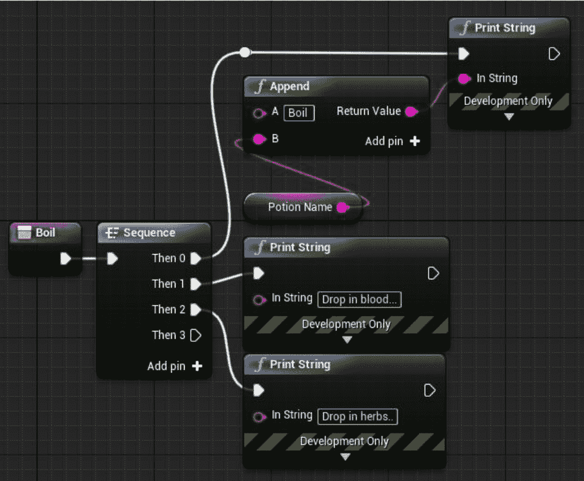

`Bubble` 方法的蓝图函数：

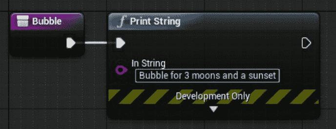

`Brew` 方法的蓝图函数：

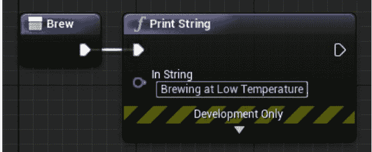

`Bottle` 方法的蓝图函数：

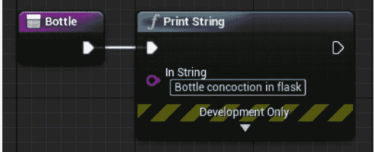

`GetPotionName` 方法的蓝图函数：

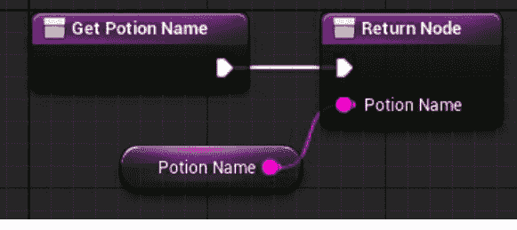

现在我们已经定义了抽象父类，让我们关注具体的创建者。

### `InnerRealmPotionShop` 具体创建者类

#### `InnerRealmPotionShop.h`

```cpp
#pragma once

#include "CoreMinimal.h"
#include "PotionShop.h"
#include "InnerRealmPotionShop.generated.h"

UCLASS()
class DESIGN_PATTERNS_API AInnerRealmPotionShop : public APotionShop
{
    GENERATED_BODY()

public:
    // 调制选定的药水
    virtual APotion* ConcoctPotion(FString PotionSKU) override;
};
```

#### `InnerRealmPotionShop.cpp`

```cpp
#include "InnerRealmPotionShop.h"
#include "InnerRealmHealthPotion.h"
#include "InnerRealmPowerPotion.h"
#include "InnerRealmSkillPotion.h"

APotion* AInnerRealmPotionShop::ConcoctPotion(FString PotionSKU)
{
    // 根据传入的字符串选择要生成的药水
    if (PotionSKU.Equals("Health")) {
        return GetWorld()->SpawnActor<AInnerRealmHealthPotion>(AInnerRealmHealthPotion::StaticClass());
    }
    else if (PotionSKU.Equals("Power")) {
        return GetWorld()->SpawnActor<AInnerRealmPowerPotion>(AInnerRealmPowerPotion::StaticClass());
    }
    else if (PotionSKU.Equals("Skill")) {
        return GetWorld()->SpawnActor<AInnerRealmSkillPotion>(AInnerRealmSkillPotion::StaticClass());
    }
    else return nullptr; // 如果字符串无效，则返回空
}
```

`InnerRealmPotionShop` 蓝图仅包含 `ConcoctPotion` 函数：

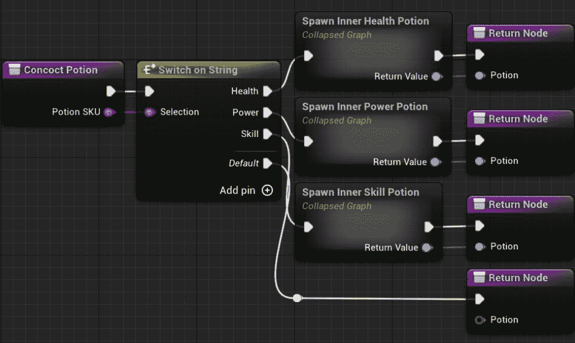

生成内界治疗药水的折叠图：

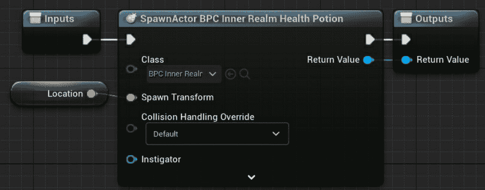

生成内界力量药水的折叠图：

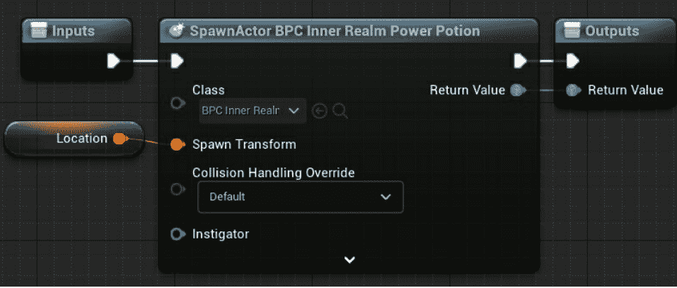

生成内界技能药水的折叠图：

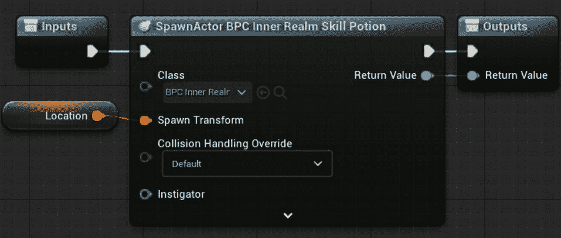

现在我们已经定义了具体的创建者类，让我们关注该创建者可以创建的具体产品。

### `InnerRealmHealthPotion` 具体产品类

#### `InnerRealmHealthPotion.h`


# InnerRealmHealthPotion 抽象产品类

## InnerRealmHealthPotion.h

```cpp
#pragma once

#include "CoreMinimal.h"
#include "Potion.h"
#include "InnerRealmHealthPotion.generated.h"

UCLASS()
class DESIGN_PATTERNS_API AInnerRealmHealthPotion : public APotion
{
    GENERATED_BODY()

protected:
    // 当游戏开始或被生成时调用
    virtual void BeginPlay() override;

public:
    // 调制药水
    virtual void Brew() override;
};
```

## InnerRealmHealthPotion.cpp

```cpp
#include "InnerRealmHealthPotion.h"

void AInnerRealmHealthPotion::BeginPlay()
{
    Super::BeginPlay();

    // 设置成分
    PotionName = "Inner Realm Health Potion";
    Goyness = "Mucus Like";
    Blood = "Orc Blood";

    // 添加草药
    Herbs.Add("Root of Inner Realm");
}

void AInnerRealmHealthPotion::Brew()
{
    // 记录调制类型
    GEngine->AddOnScreenDebugMessage(-1, 15.f, FColor::Yellow, TEXT("Brewing at High Temperature"));
}
```

InnerRealmHealthPotion 蓝图事件图和一个调制事件：

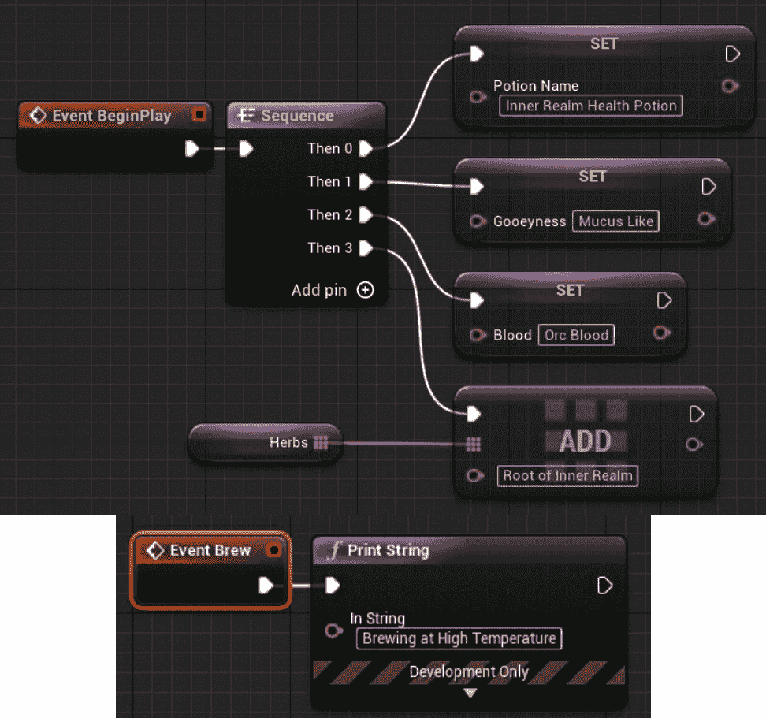

# InnerRealmPowerPotion 抽象产品类

## InnerRealmPowerPotion.h

```cpp
#pragma once

#include "CoreMinimal.h"
#include "Potion.h"
#include "InnerRealmPowerPotion.generated.h"

UCLASS()
class DESIGN_PATTERNS_API AInnerRealmPowerPotion : public APotion
{
    GENERATED_BODY()

protected:
    // 当游戏开始或被生成时调用
    virtual void BeginPlay() override;

public:
    // 调制药水
    virtual void Brew() override;
};
```

## InnerRealmPowerPotion.cpp

```cpp
#include "InnerRealmPowerPotion.h"

void AInnerRealmPowerPotion::BeginPlay()
{
    Super::BeginPlay();

    // 设置成分
    PotionName = "Inner Realm Power Potion";
    Gooyness = "Mucus Like";
    Blood = "Orc Blood";

    // 添加草药
    Herbs.Add("Root of Inner Realm");
    Herbs.Add("Sage of Inner Realm");
}

void AInnerRealmPowerPotion::Brew()
{
    // 记录调制类型
    GEngine->AddOnScreenDebugMessage(-1, 15.f, FColor::Yellow, TEXT("Brewing at High Temperature"));
}
```

InnerRealmPowerPotion 蓝图事件图和一个调制事件：


# InnerRealmSkillPotion 抽象产品类

## InnerRealmSkillPotion.h

```cpp
#pragma once

#include "CoreMinimal.h"
#include "Potion.h"
#include "InnerRealmSkillPotion.generated.h"

UCLASS()
class DESIGN_PATTERNS_API AInnerRealmSkillPotion : public APotion
{
    GENERATED_BODY()

protected:
    // 当游戏开始或被生成时调用
    virtual void BeginPlay() override;

public:
    // 调制药水
    virtual void Brew() override;
};
```

## InnerRealmSkillPotion.cpp

```cpp
#include "InnerRealmSkillPotion.h"

void AInnerRealmSkillPotion::BeginPlay()
{
    Super::BeginPlay();

    // 设置成分
    PotionName = "Inner Realm Potion";
    Goyness = "Mucus Like";
    Blood = "Orc Blood";

    // 添加草药
    Herbs.Add("Root of Inner Realm");
    Herbs.Add("Sage of Inner Realm");
    Herbs.Add("Leaf of Inner Realm");
}

void AInnerRealmSkillPotion::Brew()
{
    // 记录调制类型
    GEngine->AddOnScreenDebugMessage(-1, 15.f, FColor::Yellow, TEXT("Brewing at High Temperature"));
}
```

InnerRealmSkillPotion 蓝图事件图和一个调制事件：


我们可以很容易地添加像 `OuterRealmPotion` 这样的另一个类，并使用与 `InnerRealmPotion` 相同的继承创建更多具体产品：

## OuterRealmPotion.h

```cpp
#pragma once

#include "CoreMinimal.h"
#include "PotionShop.h"
#include "OuterRealmPotion.generated.h"

UCLASS()
class DESIGN_PATTERNS_API AOuterRealmPotion : public APotionShop
{
    GENERATED_BODY()

public:
    // 调制选定的药水
    virtual APotion* ConcoctPotion(FString PotionSKU) override;
};
```

## OuterRealmPotion.cpp

```cpp
#include "OuterRealmPotion.h"
#include "InnerRealmHealthPotion.h"
#include "InnerRealmPowerPotion.h"
#include "InnerRealmSkillPotion.h"

APotion* AOuterRealmPotion::ConcoctPotion(FString PotionSKU)
{
    // 根据传入的字符串选择要生成的药水
    if (PotionSKU.Equals("Health")) {
        return GetWorld()->SpawnActor<AInnerRealmHealthPotion>(AInnerRealmHealthPotion::StaticClass());
    }
    else if (PotionSKU.Equals("Power")) {
        return GetWorld()->SpawnActor<AInnerRealmPowerPotion>(AInnerRealmPowerPotion::StaticClass());
    }
    else if (PotionSKU.Equals("Skill")) {
        return GetWorld()->SpawnActor<AInnerRealmSkillPotion>(AInnerRealmSkillPotion::StaticClass());
    }
    else return nullptr; // 如果字符串无效，则返回空
}
```

我们将以类似于 `InnerRealmPotion` 的方式实现一些 `OuterRealm` 具体产品：

## InnerRealmPotionShop

工厂方法视图输出：

```
Potion is Inner Realm Potion
Bottle concoction in flask
Brewing at High Temperature
Bubble for 3 moons and sunset
Drop in herbs...
Drop in blood...
Boil Inner Realm Potion
Concocting Inner Realm Potion
Potion is Inner Realm Potion
Bottle concoction in flask
Brewing at High Temperature
Bubble for 3 moons and sunset
Drop in herbs...
Drop in blood...
Boil Inner Realm Potion
Concocting Inner Realm Potion
Potion is Inner Realm Potion
Bottle concoction in flask
Brewing at High Temperature
Bubble for 3 moons and sunset
Drop in herbs...
Drop in blood...
Boil Inner Realm Potion
Concocting Inner Realm Potion
Potion is Inner Realm Potion
Bottle concoction in flask
Brewing at High Temperature
Bubble for 3 moons and sunset
Drop in herbs...
Drop in blood...
Boil Inner Realm Potion
Concocting Inner Realm Potion
Potion is Inner Realm Potion
Bottle concoction in flask
Brewing at High Temperature
Bubble for 3 moons and sunset
Drop in herbs...
Drop in blood...
Boil Inner Realm Potion
Concocting Inner Realm Potion
Potion is Inner Realm Potion
Bottle concoction in flask
Brewing at High Temperature
Bubble for 3 moons and sunset
Drop in herbs...
Drop in blood...
Boil Inner Realm Potion
Concocting Inner Realm Potion
Potion is Inner Realm Potion
Bottle concoction in flask
Brewing at High Temperature
Bubble for 3 moons and sunset
Drop in herbs...
Drop in blood...
Boil Inner Realm Potion
Concocting Inner Realm Potion
```

# 编程纯洁者的噩梦... 单例模式

单例模式经常被单独列出为最常用、或者说最糟糕的设计模式之一。单例就像信用卡，所有人都在使用，但如果你不负责任地使用，就会陷入真正的困境。编程纯洁者非常痛恨单例模式。事实上，讽刺的是，我从未见过任何现代出版文献在讨论单例模式时不告诉读者关于它的用法。四人小组将单例描述为仅有一个实例的类，并提供了一个全局访问点（Gamma et.al, 1995）。

## 优点

- 封装唯一实例
- 全局（易于访问）

## 不完美

- 全局（易于修改）
- 可能创建未知的依赖关系

# 单例模式实现

在 Unreal 中没有明确的方法来创建自定义单例蓝图。然而，`Game Instance` 似乎是单例的一种官方解决方案。库存系统是演示单例设计模式的绝佳例子。我们希望在任何时候都只有一个库存实例。此外，我们希望能够在整个游戏中轻松地访问该库存系统。

## 主单例类 `Singleton_Main`

### Singleton_Main.h

```cpp
#pragma once

#include "CoreMinimal.h"
#include "GameFramework/Actor.h"
#include "Singleton_Main.generated.h"

UCLASS()
class DESIGN_PATTERNS_API ASingleton_Main : public AActor
{
    GENERATED_BODY()

public:
    // 设置此 actor 属性的默认值
    ASingleton_Main();

private:
    // 此 Actor 的库存列表
    UPROPERTY()
    class AInventory* Inventory;

protected:
    // 当游戏开始或被生成时调用
    virtual void BeginPlay() override;

public:
    // 每帧调用一次
    virtual void Tick(float DeltaTime) override;
};
```

### Singleton_Main.cpp

```cpp
#include "Singleton_Main.h"
#include "Inventory.h"

// 设置默认值
ASingleton_Main::ASingleton_Main()
{
    // 设置此 actor 每帧调用 Tick()。如果你不需要它，可以关闭它
    // 以提高性能。
    PrimaryActorTick.bCanEverTick = true;
}

// 当游戏开始或被生成时调用
void ASingleton_Main::BeginPlay()
{
    Super::BeginPlay();

    // 创建 4 个 Inventory
    for (int i = 0; i <= 4; i++)
    {
        AInventory* SpawnedInventory = GetWorld()->SpawnActor<AInventory>(AInventory::StaticClass());
        if (SpawnedInventory)
        {
            // 如果生成成功，将生成的库存 设置为本地的
            // 并记录成功字符串
            Inventory = SpawnedInventory;
            GEngine->AddOnScreenDebugMessage(-1, 15.f, FColor::Yellow, FString::Printf(TEXT("%s has been created"), *Inventory->GetName()));
        }
    }
}

// 每帧调用
void ASingleton_Main::Tick(float DeltaTime)
{
    Super::Tick(DeltaTime);
}
```

### Singleton_Main 蓝图事件图

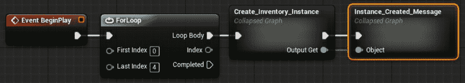

这里存在循环是为了演示尝试创建多个指定的单例对象实例。如果一切设置正确，我们永远不应该允许创建多个库存实例。

### Create_Inventory_Instance 折叠图

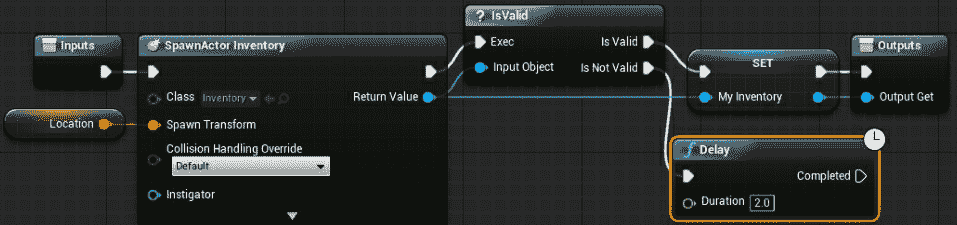

### Instance_Created_Message 折叠图

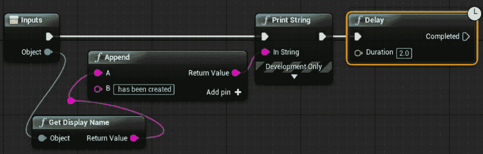

## Inventory 类

### Inventory.h

```cpp
#pragma once

#include "CoreMinimal.h"
#include "GameFramework/Actor.h"
#include "Inventory.generated.h"

UCLASS()
class DESIGN_PATTERNS_API AInventory : public AActor
{
    GENERATED_BODY()

public:
    // 设置此 actor 属性的默认值
    AInventory();

    // 此类的实例
    UPROPERTY()
    AInventory* Instance;

protected:
    // 当游戏开始或被生成时调用
    virtual void BeginPlay() override;

public:
    // 每帧调用一次
    virtual void Tick(float DeltaTime) override;
};
```

### Inventory.cpp


```cpp
#include "Inventory.h"
#include "Kismet/GameplayStatics.h"
```

```cpp
// 设置默认值
AInventory::AInventory()
{
    // 设置此 actor 每帧调用 Tick()。如果你不需要它，可以关闭它
    // 以提高性能。
    PrimaryActorTick.bCanEverTick = true;

    // 搜索该类的已存在实例
    TArray<AActor*> Instances;
    UGameplayStatics::GetAllOfClass(GetWorld(), AInventory::StaticClass(), Instances);

    if (Instances.Num() > 1)
    {
        // 如果至少有一个，则将实例设置为找到找到的
        Instance = Cast<AInventory>(Instances[0]);
        Engine->AddOnScreenDebugMessage(-1, 15.f, FColor::Yellow,
        FString::Printf(TEXT("%s already exists"), *Instance->GetName()));

        // 然后销毁此 Actor
        Destroy();
    }
}

// 当游戏开始或被生成时调用
void AInventory::BeginPlay()
{
    Super::BeginPlay();
}

// 每帧调用
void AInventory::Tick(float DeltaTime)
{
    Super::Tick(DeltaTime);
}
```

#### Inventory 蓝图构造脚本：

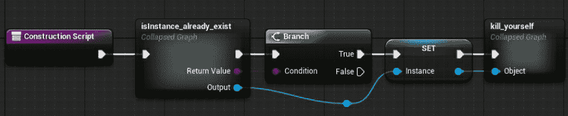

Unreal 中并不存在私有构造函数的概念。因此，我们必须创建另一种方法来防止单例对象的创建。我们通过检查库存实例是否已经存在来实现这一点。如果库存实例确实存在，则尝试创建单例对象将被销毁。

#### is_already_exist 折叠图：

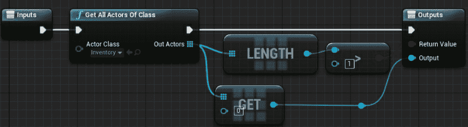

#### kill 折叠图：

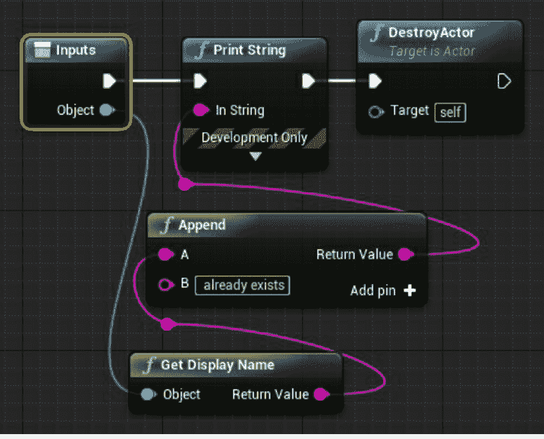

#### Singleton 折叠图：

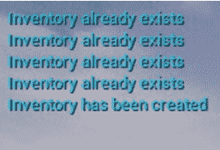

# 结构模式（Structural Patterns）

结构模式关注如何通过类或对象的组合来形成更大的结构，这种组合使得结构更加灵活和高效。

## GunAdapter.h

```cpp
#pragma once

#include "CoreMinimal.h"
#include "GameFramework/Actor.h"
#include "SlingShot.h"
#include "GunAdapter.generated.h"
```

```cpp
class AGun;

UCLASS()
class DESIGN_PATTERNS_API AGunAdapter : public AActor, public ISlingShot
{
    GENERATED_BODY();

public:
    // 设置此 属性的默认值
    AGunAdapter();

private:
    // 武器 Actor
    UPROPERTY();
    AGun* Weapon;

protected:
    // 当游戏开始或被生成时调用
    virtual void BeginPlay() override;

public:
    // 每帧调用
    virtual void Tick(float DeltaTime) override;

    // 射击
    void Sling() override;
};
```

## GunAdapter.cpp

```cpp
#include "GunAdapter.h"
#include "Gun.h"

// 设置默认值
AGunAdapter::AGunAdapter()
{
    // 设置此 actor 每帧调用 Tick()。如果不需要，可以关闭它以提高性能。
    PrimaryActorTick.bCanEverTick = true;
}

// 当游戏开始或被生成时调用
void AGunAdapter::BeginPlay()
{
    Super::BeginPlay();

    // 生成武器
    Weapon = GetWorld()->SpawnActor<AGun>(AGun::StaticClass());
}

// 每帧调用
void AGunAdapter::Tick(float DeltaTime)
{
    Super::Tick(DeltaTime);
}

void AGunAdapter::Sling()
{
    if (!Weapon) { 
        UE_LOG(LogTemp, Error, TEXT("Sling(): Weapon 为空，请确保它已初始化。")); 
        return; 
    }

    // 调用 Fire 函数
    Weapon->Fire();
}
```

GunAdapter 蓝图：

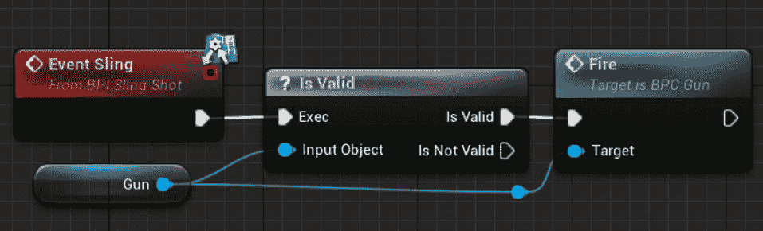

Gun 类：

## Gun.h

```cpp
#pragma once

#include "CoreMinimal.h"
#include "GameFramework/Actor.h"
#include "Gun.generated.h"
```

```cpp
UCLASS()
class DESIGN_PATTERNS_API AGun : public AActor
{
    GENERATED_BODY()

public:
    // 设置此 属性的默认值
    AGun();

protected:
    // 当游戏开始或被生成时调用
    virtual void BeginPlay() override;

public:
    // 每帧调用
    virtual void Tick(float DeltaTime) override;

    // 使用手枪射击
    void Fire();
};
```

## Gun.cpp

```cpp
#include "Gun.h"

// 设置默认值
AGun::AGun()
{
    // 设置此 actor 每帧调用 Tick()。如果不需要，可以关闭它以提高性能。
    PrimaryActorTick.bCanEverTick = true;
}

// 当游戏开始或被生成时调用
void AGun::BeginPlay()
{
    Super::BeginPlay();
}

// 每帧调用
void AGun::Tick(float DeltaTime)
{
    Super::Tick(DeltaTime);
}

void AGun::Fire()
{
    // 打印发射日志
    GEngine->AddOnScreenDebugMessage(-1, 15.f, FColor::Yellow, TEXT("我们的枪正在射火"));
}
```

Gun 蓝图：

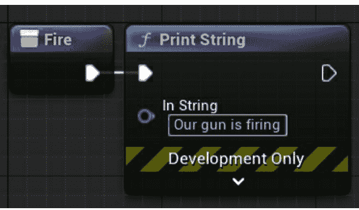

Shooter 类：

## Shooter.h

```cpp
#pragma once

#include "CoreMinimal.h"
#include "GameFramework/Actor.h"
#include "SlingShot.h"
#include "Shooter.generated.h"
```

```cpp
UCLASS()
class DESIGN_PATTERNS_API AShooter : public AActor, public ISlingShot
{
    GENERATED_BODY()

public:
    // 设置此 属性的默认值
    AShooter();

private:
    // 射者的武器，必须是一个 SlingShot
    ISlingShot* SlingShot;

protected:
    // 当游戏开始或被生成时调用
    virtual void BeginPlay() override;

public:
    // 每帧调用
    virtual void Tick(float DeltaTime) override;

    // 设置武器 Actor
    void SetSlingShot(AActor* SlingShotObj);

    // 使用 SlingShot 射击
    void Sling();
};
```

## Shooter.cpp

```cpp
#include "Shooter.h"

// 设置默认值
AShooter::AShooter()
{
    // 设置此 actor 每帧调用 Tick()。如果不需要，可以关闭它以提高性能。
    PrimaryActorTick.bCanEverTick = true;
}

// 当游戏开始或被生成时调用
void AShooter::BeginPlay()
{
    Super::BeginPlay();
}

// 每帧调用
void AShooter::Tick(float DeltaTime)
{
    Super::Tick(DeltaTime);
}

void AShooter::SetSlingShot(AActor* SlingShotObj)
{
    // 转换 Actor 并设置武器
    SlingShot = Cast<ISlingShot>(SlingShotObj);

    if (!SlingShot) // 如果转换失败则记录错误
        GEngine->AddOnScreenDebugMessage(-1, 15.f, FColor::Red, TEXT("转换无效！"));
        UE_LOG(LogTemp, Error, TEXT("该 Actor 不是 SlingShot！你确定它实现了该接口吗？"));
}

void AShooter::Sling()
{
    if (!SlingShot) { 
        UE_LOG(LogTemp, Error, TEXT("Sling(): SlingShot 为空，请确保它已初始化。")); 
        return; 
    }
    // 调用 Sling 函数
    SlingShot->Sling();
}
```

我们可以看到 `Shooter` 类没有射击的功能。但是它有 `sling`（弹射）的功能。我们想复用并将其适配为使用枪的功能。

Shooter 构造：


Is Sling 宏：


Sling 函数：


Adapter 模式视图：


# 装饰器模式

装饰器模式允许在运行时为对象添加特征。GoF 指出，“装饰器提供了对子类的替代方案”（Gamma et al., 1995）。

### 优点

- 轻松为单个对象添加功能
- 避免影响同类的对象

### 缺点

- 可能会产生 GoF 所说的“大量小对象”。
  基本上，所有这些半相同的对象变得难以调试。

### 装饰器模式实现

我们的实现包含一个初始的敌人。我们想要“装饰”这个敌人，使其成为可以使用弹药的敌人。因此添加的功能是弹药能力。

Decorator_Main 类：

#### Decorator_Main.h

```cpp
#pragma once

#include "CoreMinimal.h"
#include "GameFramework/Actor.h"
#include "Enemy.h"
#include "Decorator_Main.generated.h"
```

```cpp
UCLASS()
class DESIGN_PATTERNS_API ADecorator_Main : public AActor
{
    GENERATED_BODY()

public:
    // 设置此属性的默认值
    ADecorator_Main();

    // 主敌人 Actor
    IEnemy* Enemy;

protected:
    // 当游戏开始或被生成时调用
    virtual void BeginPlay() override;

public:
    // 每帧调用
    virtual void Tick(float DeltaTime) override;
};
```

#### Decorator_Main.cpp

```cpp
#include "Decorator_Main.h"
#include "ConcreteEnemy.h"
#include "MeleeEnemy.h"
#include "ProjectileEnemy.h"

// 设置默认值
ADecorator_Main::ADecorator_Main()
{
    // 设置此 actor 每帧调用 Tick()。如果不需要，可以关闭它以提高性能。
    PrimaryActorTick.bCanEverTick = true;
}

// 当游戏开始或被生成时调用
void ADecorator_Main::BeginPlay()
{
    Super::BeginPlay();

    // 生成一个具体敌人
    AConcreteEnemy* ConcreteEnemy = GetWorld()->SpawnActor<AConcreteEnemy>(AConcreteEnemy::StaticClass());

    // 生成一个近战敌人并将其设置为具体敌人
    AMeleeEnemy* MeleeEnemy = GetWorld()->SpawnActor<AMeleeEnemy>(AMeleeEnemy::StaticClass());
    MeleeEnemy->SetEnemy(ConcreteEnemy);

    // 生成一个远程敌人敌人并将其设置为近战敌人
    AProjectileEnemy* ProjectileEnemy = GetWorld()->SpawnActor<AProjectileEnemy>(AProjectileEnemy::StaticClass());
    ProjectileEnemy->SetEnemy(MeleeEnemy);

    GEngine->AddOnScreenDebugMessage(-1, 15.f, FColor::Yellow, TEXT("近战敌人出现在地平线上"));
    Enemy = MeleeEnemy;
    Enemy->Fight();
    GEngine->AddOnScreenDebugMessage(-1, 15.f, FColor::Yellow,
    FString::Printf(TEXT("近战敌人造成了 %i 点伤害。"), Enemy->GetDamage()));
    Enemy->Die();

    GEngine->AddOnScreenDebugMessage(-1, 15.f, FColor::Yellow, TEXT("敌人现在武装了枪"));
    Enemy = ProjectileEnemy;
    Enemy->Fight();
    GEngine->AddOnScreenDebugMessage(-1, 15.f, FColor::Yellow,
    FString::Printf(TEXT("远程敌人造成了 %i 点伤害。"), Enemy->GetDamage()));
    Enemy->Die();
}
```

从 `Decorator_Main` 中看到，我们不需要创建一个单独 `Enemy`（敌人）类来添加功能。我们只需要对敌人进行“装饰”，现在我们就有了一个带射物的敌人。实质上，我们通过使用装饰器在运行时更改了敌的行为。

Decorator_Main 蓝图事件图：


为了提高可读性，近战敌人和装饰后的射程敌人被拆分成了独立的折叠图。

Melee_Enemy_Actions 折叠图：


Create_Enemy 折叠图：


Enemy_Fight 折叠图：


Enemy_Die 折叠图：


Enemy_GetDamage 折叠图：


*Enemy_Damage_Message* 折叠图：


*Projectile_Enemy_Actions* 折叠图：


### Create_Projectile_Enemy 折叠图：


近战敌人和射程敌人之间的显著区别在于构造。射程敌人构造函数接受之前创建的敌人作为参数。这样做我们可以重用它来装饰一个敌人对象。

### Projectile_Enemy_Fight 折叠图：


### Projectile_Enemy_Die 折叠图：


### Projectile_Enemy_GetDamage 折叠图：


### Projectile_Enemy_Damage_Message 折叠图：


### 敌人接口：

#### Enemy.h

```cpp
#pragma once

#include "CoreMinimal.h"
#include "UObject/Interface.h"
#include "Enemy.generated.h"
```

```cpp
// 此类不需要修改。
UINTERFACE(MinimalAPI)
class UEnemy : public UInterface
{
    GENERATED_BODY()
};
```

```cpp
/*
* 为动态添加职责的组件定义接口
*/
```

```cpp
class DESIGN_TERTER_API IEnemy
{
    GENERATED_BODY()

    // 将接口添加到此类。该类将继承此接口。
    virtual void Fight() = 0;
    virtual int GetDamage() = 0;
    virtual void Die() = 0;
};
```

#### Enemy.cpp

```cpp
#include "Enemy.h"

// 为任何纯虚 Enemy 函数添加默认功能
```

接口在所有敌人之间共享。近战敌人类：

#### MeleeEnemy.h

```cpp
#pragma once

#include "CoreMinimal.h"
#include "Decorator.h"
#include "MeleeEnemy.generated.h"

/*
 * 具体的装饰器
 * 向组件添加职责（可以扩展状态）
 */
```

```cpp
UCLASS()
class DESIGN_PATNS_API AMeleeEnemy : public Decorator
{
    GENERATED_BODY()

public:
    // 开始战斗
    virtual void Fight() override;
    // 返回敌人受到了多少伤害
    virtual int GetDamage() override;
    // 杀死敌人
    virtual void Die() override;
};
```

#### MeleeEnemy.cpp

```cpp
#include "MeleeEnemy.h"

void AMeleeEnemy::Fight()
{
    // 调用父类函数并记录消息
    Super::Fight();
    GEngine->AddScreenDebugMessage(-1, 15.f, FColor::Yellow, TEXT("敌人出手了"));
}

int AMeleeEnemy::GetDamage()
{
    // 返回基础伤害 + 5
    return Super::GetDamage() + 5;
}

void AMeleeEnemy::Die()
{
    // 调用父类函数并记录消息
    Super::Die();
    GEngine->AddScreenDebugMessage(-1, 15.f, FColor::Yellow, TEXT("敌人痛苦地挣扎着"));
}
```

近战敌人蓝图事件图：


MeleeEnemy 蓝图中的 `GetDamage` 函数：


射程敌人类：

```cpp
#pragma once

#include "CoreMinimal.h"
#include "Decorator.h"
#include "ProjectileEnemy.generated.h"

UCLASS()
class DESIGN_TERNS_API AProjectileEnemy : public Decorator
{
    GENERATED_BODY()

public:
    // 开始战斗
    virtual void Fight() override;
    // 返回敌人受到了多少伤害
    virtual int GetDamage() override;
    // 杀死敌人
    virtual void Die() override;
};
```

#### ProjectileEnemy.cpp

```cpp
#include "ProjectileEnemy.h"

void AProjectileEnemy::Fight()
{
    // 调用父类函数并记录消息
    Super::Fight();
    GEngine->AddScreenDebugMessage(-1, 15.f, FColor::Yellow, TEXT("敌人飞了一个吻并射了枪"));
}

int AProjectileEnemy::GetDamage()
{
    // 返回基础伤害 + 95
    return Super::GetDamage() + 95;
}

void AProjectileEnemy::Die()
{
    // 调用父类函数并记录消息
    Super::Die();
    GEngine->AddScreenDebugMessage(-1, 15.f, FColor::Yellow, TEXT("敌人痛苦地挣扎并瓦解得更彻底"));
}
```

我们可以看到射程敌人造成的伤害比近战敌人更多。我们使用了近战伤害属性并为射程敌人增加了 95。

ProjectileEnemy 蓝图事件图：


ProjectileEnemy 蓝图中的 `GetDamage` 函数：


装饰器模式视图打印：


我们可以看到近战敌人过来了。近战敌人用拳头与我们战斗。敌人死了。然而，我们从近战敌人那里受到了 5 点伤害。随后，近战敌人被赋予了射物形式的新功能。敌人可以挥拳并射击，造成 100 点伤害。

# 太空旅行看起来看起来简单……外观模式 (Facade Pattern)

GoF 定义外观模式为为一组接口提供一个中心接口（Gamma 等人，1995）。当我们想要简化客户端与非常复杂的系统之间的交互时，外观模式非常棒。

### 优点

- 简化了非常复杂系统的使用
- 减少了客户端与各种系统之间的耦合

### 缺点

- 隐藏了子系统可能复杂的特性

### 外观模式实现

太空旅行并不容易。太空旅行最重要的部分是飞船。然而，飞船有自己的复杂性。这就是外观模式大显身手的地方。

外观类：

#### StarShipFacade_Main.h

```cpp
#pragma once

#include "CoreMinimal.h"
#include "GameFramework/Actor.h"
#include "StarShipCrewMember.h"
#include "StarShipFacade_Main.generated.h"

UCLASS()
class DESIGN_NS_API AStarShipFacade_Main : public AActor
{
    GENERATED_BODY()

public:
    // 设置此类的默认值
    AStarShipFacade_Main();

protected:
    // 游戏开始或生成时调用
    virtual void BeginPlay() override;

public:
    // 每帧调用
    virtual void Tick(float DeltaTime) override;
};
```

#### StarShipFacade_Main.cpp

```cpp
#include "StarShipFacade_Main.h"
#include "StarShipFacade.h"
```

```cpp
// 设置默认值
AStarShipFacade_Main::AStarShipFacade_Main()
{
    // 设置此 Actor 每帧调用 Tick()。如果不需要，可以关闭以提高性能。
    PrimaryTick.bCanEverTick = true;
}
```

```cpp
// 游戏开始或生成时调用
void AStarShipFacade_Main::BeginPlay()
{
    Super::BeginPlay();
    // 创建 ShipFacade Actor
    AStarShipFacade* ShipFacade = GetWorld()->SpawnActor<AStarShipFacade>(AStarShipFacade::StaticClass());
    // 执行需要的外观方法
    ShipFacade->Reveille();
    ShipFacade->PlanOfTheDay();
    ShipFacade->Taps();
}
```

```cpp
// 每帧调用
void AStarShipFacade_Main::Tick(float DeltaTime)
{
    Super::Tick(DeltaTime);
}
```

通过 `Facade_Main` 我们可以看到运行飞船有多简单。这仅仅是使用外观模式的外观。复杂性在后面。

Façade_Main 事件图：


StarShipFacade 类：

#### StarShipFacade.h

```cpp
#pragma once

#include "CoreMinimal.h"
#include "GameFramework/Actor.h"
#include "StarShipCrewMember.h"
#include "StarShipFacade.generated.h"
```

```cpp
UCLASS()
class DESIGN_PATTERNS_API AStarShipFacade : public AActor
{
    GENERATED_BODY()

public:
    // 设置此 actor 属性的默认值
    AStarShipFacade();

private:
    // 船员列表
    TArray<AStarShipCrewMember*> Crew;
    // 要执行的任务
    UPROPERTY()
    TArray<FString> Tasks;

protected:
    // 在游戏开始或生成时调用
    virtual void BeginPlay() override;

private:
    // 为特定的船员执行任务
    void PerformTasks(TArray<AStarShipCrewMember*> myCrew, TArray<FString> myTasks);

public:
    // 每帧调用
    virtual void Tick(float DeltaTime) override;
    // 执行起床哨号（Reveille）任务
    void Reveille();
    // 执行每日计划（PlanOfTheDay）任务
    void PlanOfTheDay();
    // 执行熄灯号（Taps）任务
    void Taps();
};
```

#### StarShipFacade.cpp

```cpp
#include "StarShipFacade.h"
#include "StarShipNavigationOfficer.h"
#include "StarShipOperationsOfficer.h"
#include "StarShipSupplyOfficer.h"
```

```cpp
// 设置默认值
AStarShipFacade::AStarShipFacade()
{
    // 设置此 actor 每帧调用 Tick()。如果不需要，可以关闭它以提高性能。
    PrimaryActorTick.bCanEverTick = true;
}
```

```cpp
// 在游戏开始或生成时调用
void AStarShipFacade::BeginPlay()
{
    Super::BeginPlay();
    // 初始化列表
    Crew = TArray<AStarShipCrewMember*>();
    Tasks = TArray<FString>();
    // 生成船员
    AStarShipNavigationOfficer* NavOfficer = GetWorld()->SpawnActor<AStarShipNavigationOfficer>(AStarShipNavigationOfficer::StaticClass());
    AStarShipOperationsOfficer* OpsOfficer = GetWorld()->SpawnActor<AStarShipOperationsOfficer>(AStarShipOperationsOfficer::StaticClass());
    AStarShipSupplyOfficer* SupOfficer = GetWorld()->SpawnActor<AStarShipSupplyOfficer>(AStarShipSupplyOfficer::StaticClass());
    // 将船员加入船员列表
    Crew.Add(NavOfficer);
    Crew.Add(OpsOfficer);
    Crew.Add(SupOfficer);
}
```

```cpp
// 每帧调用
void AStarShipFacade::Tick(float DeltaTime)
{
    Super::Tick(DeltaTime);
}
```

```cpp
void AStarShipFacade::Reveille()
{
    // 清空任务列表
    Tasks.Empty();
    // 添加要执行的任务
    Tasks.Add("trice_up");
    Tasks.Add("muster");
    // 执行任务
    PerformTasks(Crew, Tasks);
}
```

```cpp
void AStarShipFacade::PlanOfTheDay()
{
    // 清空任务列表
    Tasks.Empty();
    // 添加要执行的任务
    Tasks.Add("duty");
    // 执行任务
    PerformTasks(Crew, Tasks);
}
```

```cpp
void AStarShipFacade::Taps()
{
    // 清空任务列表
    Tasks.Empty();
    // 添加要执行的任务
    Tasks.Add("liberty_call");
    Tasks.Add("lights_out");
    // 执行任务
    PerformTasks(Crew, Tasks);
}

void AStarShipFacade::PerformTasks(TArray<AStarShipCrewMember*> myCrew, TArray<FString> myTasks)
{
    // 为每个船员执行传递的任务
    for (AStarShipCrewMember* Member : myCrew)
    {
        // 执行任务
        Member->Task(myTasks);
    }
}
```


# StarShipFacade 类

`StarShipFacade` 类是该模式核心所在。

## 事件图与折叠图

### StarShipFacade 事件图


### 向船员列表添加导航官的折叠图


### 向船员列表添加补给官的折叠图


### 作战官加入船员的折叠图


## 蓝图函数

### Reveille（起床哨号）蓝图函数


### PlanOfTheDay（每日计划）蓝图函数


### Taps（熄灯号）蓝图函数


### Perform Tasks（执行任务）蓝图函数


# 抽象类 StarShipCrewMember

## StarShipCrewMember.h

```cpp
#pragma once

#include "CoreMinimal.h"
#include "GameFramework/Actor.h"
#include "StarShipCrewMember.generated.h"

UCLASS()
class DESIGN_PATTERNS_API AStarShipCrewMember : public AActor
{
    GENERATED_BODY()

public:
    // 设置此 actor 属性的默认值
    AStarShipCrewMember();

protected:
    // 在游戏开始或生成时调用
    virtual void BeginPlay() override;

private:
    // 执行任务
    void Task(const FString&);

public:
    // 执行熄灯任务
    void TurnLightsOut();

    // 执行起立任务
    void HeaveOutUp();

    // 执行休假通知任务
    void LibertyCall();

    // 执行集合任务
    void CrewMuster();

    // 执行传递的任务
    void Task(const TArray<FString>& Tasks);

    // 执行职责。它是纯虚函数，在此类中不需要实现
    virtual void Duty() PURE_VIRTUAL(AStarShipCrewMember::Duty, );

    // 返回标题。它是纯虚函数，在此类中不需要实现
    virtual FString CrewTitle() PURE_VIRTUAL(AStarShipCrewMember::CrewTitle, "");
};
```

## StarShipCrewMember.cpp

```cpp
#include "StarShipCrewMember.h"

AStarShipCrewMember::AStarShipCrewMember()
{
}

void AStarShipCrewMember::BeginPlay()
{
    Super::BeginPlay();
}

void AStarShipCrewMember::TurnLightsOut()
{
    // 打印熄灯信息
    GE->AddOnScreenDebugMessage(-1, 15.f, FColor::Yellow, FString::Printf(TEXT("%s lights out."), *CrewTitle()));
}

void AStarShipCrewMember::HeaveOutUp()
{
    // 打印起立信息
    GE->AddOnScreenDebugMessage(-1, 15.f, FColor::Yellow, FString::Printf(TEXT("%s all hands out and trice up."), *CrewTitle()));
}

void AStarShipCrewMember::LibertyCall()
{
    // 打印休假通知信息
    GE->AddOnScreenDebugMessage(-1, 15.f, FColor::Yellow, FString::Printf(TEXT("%s liberty call, liberty call."), *CrewTitle()));
}

void AStarShipCrewMember::CrewMuster()
{
    // 打印集合信息
    GE->AddOnScreenDebugMessage(-1, 15.f, FColor::Yellow, FString::Printf(TEXT("%s time for muster."), *CrewTitle()));
}

void AStarShipCrewMember::Task(const TArray<FString>& Tasks)
{
    // 遍历任务数组并为每个任务调用 Task() 函数
    for (const FString &myTask : Tasks)
    {
        Task(myTask);
    }
}

void AStarShipCrewMember::Task(const FString & Task)
{
    // 检查执行哪个任务
    if (Task.Equals("lights_out"))
    {
        TurnLightsOut();
    }
    else if (Task.Equals("trice_up"))
    {
        HeaveOutUp();
    }
    else if (Task.Equals("liberty_call"))
    {
        LibertyCall();
    }
    else if (Task.Equals("muster"))
    {
        CrewMuster();
    }
    else if (Task.Equals("duty"))
    {
        Duty();
    }
    else
    {
        // 如果传递的任务不存在
        GE->AddOnScreenDebugMessage(-1, 15.f, FColor::Red, TEXT("Undefined task"));
    }
}
```

## 任务相关蓝图函数

### Turn Lights Out 蓝图函数


### Heave Out Trice Up 蓝图函数


### Liberty Call 蓝图函数


### Crew Muster 蓝图函数


### Task 蓝图函数


### Task Perform 蓝图函数


### Duty 蓝图函数


### Crew Title 蓝图函数


# 星际舰导航官

## StarShipNavigationOfficer.h

```cpp
#pragma once

#include "CoreMinimal.h"
#include "GameFramework/Actor.h"
#include "StarShipCrewMember.h"
#include "StarShipNavigationOfficer.generated.h"

UCLASS()
class DESIGN_PATTERNS_API AStarShipNavigationOfficer : public AStarShipCrewMember
{
    GENERATED_BODY()

public:
    // 设置此 actor 属性的默认值
    AStarShipNavigationOfficer();

protected:
    // 当游戏开始或被生成时调用
    virtual void BeginPlay() override;

public:
    // 每帧调用
    virtual void Tick(float DeltaTime) override;

    // 接口职责函数 - 打印职责日志
    virtual void Duty() override;

    // 接口职责函数 - 返回头衔
    virtual FString CrewTitle() override;
};
```

## StarShipNavigationOfficer.cpp

```cpp
#include "StarShipNavigationOfficer.h"

// 设置默认值
AStarShipNavigationOfficer::AStarShipNavigationOfficer()
{
    // 设置此 actor 每帧调用 Tick()。如果你不需要它，
    // 可以关闭它以提高性能。
    PrimaryActorTick.bCanEverTick = true;
}

// 当游戏开始或被生成时调用
void AStarShipNavigationOfficer::BeginPlay()
{
    Super::BeginPlay();
}

// 每帧调用
void AStarShipNavigationOfficer::Tick(float DeltaTime)
{
    Super::Tick(DeltaTime);
}

void AStarShipNavigationOfficer::Duty()
{
    // 打印职责字符串
    GEngine->AddOnScreenDebugMessage(-1, 15.f, FColor::Yellow,
        FString::Printf(TEXT("%s navigates the ship."), *CrewTitle()));
}

FString AStarShipNavigationOfficer::CrewTitle()
{
    // 返回头衔
    return "The Nav Officer";
}
```

### 星际舰导航官的职责函数


### 星际舰导航官的成员头衔函数


# 星际舰运营官类

## StarShipOperationsOfficer.h

```cpp
#pragma once

#include "CoreMinimal.h"
#include "GameFramework/Actor.h"
#include "StarShipCrewMember.h"
#include "StarShipOperationsOfficer.generated.h"

UCLASS()
class DESIGN_PATTERNS_API AStarShipOperationsOfficer : public AStarShipCrewMember
{
    GENERATED_BODY()

public:
    // 设置此 actor 属性的默认值
    AStarShipOperationsOfficer();

protected:
    // 当游戏开始或被生成时调用
    virtual void BeginPlay() override;

public:
    // 每帧调用
    virtual void Tick(float DeltaTime) override;

    // 接口职责函数 - 打印职责日志
    virtual void Duty() override;

    // 接口职责函数 - 返回头衔
    virtual FString CrewTitle() override;
};
```

## StarShipOperationsOfficer.cpp

```cpp
#include "StarShipOperationsOfficer.h"

// 设置默认值
AStarShipOperationsOfficer::AStarShipOperationsOfficer()
{
    // 设置 actor 每帧调用 Tick()。如果你不需要它，
    // 可以关闭它以提高性能。
    PrimaryActorTick.bCanEverTick = true;
}

// 当游戏开始或被生成时
void AStarShipOperationsOfficer::BeginPlay()
{
    Super::BeginPlay();
}

// 每帧调用
void AStarShipOperationsOfficer::Tick(float DeltaTime)
{
    Super::Tick(DeltaTime);
}

void AStarShipOperationsOfficer::Duty()
{
    // 打印职责字符串
    GEngine->AddOnScreenDebugMessage(-1, 15.f, FColor::Yellow,
        FString::Printf(TEXT("%s synthesizes and disseminates incoming formation."), *CrewTitle()));
}

FString AStarShipOperationsOfficer::CrewTitle()
{
    // 返回头衔
    return "The Ops Officer";
}
```

### 星际舰运营官的职责函数


### 星际舰运营官的成员头衔函数


# 星际舰供应官类

## StarShipSupplyOfficer.h

```cpp
#pragma once

#include "CoreMinimal.h"
#include "GameFramework/Actor.h"
#include "StarShipCrewMember.h"
#include "StarShipSupplyOfficer.generated.h"

UCLASS()
class DESIGN_PATTERNS_API AStarShipSupplyOfficer : public AStarShipCrewMember
{
    GENERATED_BODY()

public:
    // 设置此 actor 属性的默认值
    AStarShipSupplyOfficer();

protected:
    // 当游戏开始或被生成时调用
    virtual void BeginPlay() override;

public:
    // 每帧调用
    virtual void Tick(float DeltaTime) override;

    // 接口职责函数 - 打印职责日志
    virtual void Duty() override;

    // 接口职责函数 - 返回头衔
    virtual FString CrewTitle() override;
};
```

## StarShipSupplyOfficer.cpp

```cpp
#include "StarShipSupplyOfficer.h"

// 设置默认值
AStarShipSupplyOfficer::AStarShipSupplyOfficer()
{
    // 设置此 actor 每帧调用 Tick()。如果你不需要它，
    // 可以关闭它以提高性能。
    PrimaryActorTick.bCanEverTick = true;
}

// 当游戏开始或被生成时
void AStarShipSupplyOfficer::BeginPlay()
{
    Super::BeginPlay();
}

// 每帧调用
void AStarShipSupplyOfficer::Tick(float DeltaTime)
{
    Super::Tick(DeltaTime);
}
```


# 星际舰供应官实现

## C++ 代码实现

### `AStarShipSupplyOfficer::Tick`

```cpp
void AStarShipSupplyOfficer::Tick(float DeltaTime)
{
    Super::Tick(DeltaTime);
}
```

### `AStarShipSupplyOfficer::Duty`

```cpp
void AStarShipSupplyOfficer::Duty()
{
    // 打印职责字符串
    GEngine->AddOnScreenDebugMessage(-1, 15.f, FColor::Yellow,
        FString::Printf(TEXT("%s navigates the ship."), *CrewTitle()));
}
```

### `AStarShipSupplyOfficer::CrewTitle`

```cpp
FString AStarShipSupplyOfficer::CrewTitle()
{
    // 返回头衔
    return "The Supply Officer";
}
```

## 相关视图

- 星际舰供应官的职责函数：
- 星际舰供应官的成员头衔函数：
- 外观模式视图：

# 行为模式

行为模式帮助我们确定对象如何交互。此外，行为模式定义了对象之间的职责。

## 观察者模式

观察者模式是一种非常流行的模式。发布者广播状态变化，订阅者监听这些广播。

## 观察者模式实现

时钟是我们在观察者模式中的发布者。订阅者是由根据时钟的状态改变行为的群体。

### `Observer_Main` 类

#### `Observer_Main.h`

```cpp
#pragma once

#include "CoreMinimal.h"
#include "GameFramework/Actor.h"
#include "Observer_Main.generated.h"

UCLASS()
class DESIGN_PATTERNS_API AObserver_Main : public AActor
{
    GENERATED_BODY()

public:
    // 设置此 actor 属性的默认值
    AObserver_Main();

protected:
    // 当游戏开始或被生成时调用
    virtual void BeginPlay() override;

public:
    // 每帧调用
    virtual void Tick(float DeltaTime) override;
};
```

#### `Observer_Main.cpp`

```cpp
#include "Observer_Main.h"
#include "ClockTower.h"
#include "FreakyAllen.h"
#include "FreakyJeff.h"
#include "FreakySue.h"

// 设置默认值
AObserver_Main::AObserver_Main()
{
}

// 当游戏开始或被生成时
void AObserver_Main::BeginPlay()
{
    Super::BeginPlay();

    // 产生时钟
    AClockTower* ClockTower = GetWorld()->SpawnActor<AClockTower>(AClockTower::StaticClass());

    // 产生第一个订阅者并设置其时钟
    AFreakyAllen* FreakyAllen = GetWorld()->SpawnActor<AFreakyAllen>(AFreakyAllen::StaticClass());
    FreakyAllen->SetClockTower(ClockTower);

    // 产生第二个订阅者并设置其时钟
    AFreakyJeff* FreakyJeff = GetWorld()->SpawnActor<AFreakyJeff>(AFreakyJeff::StaticClass());
    FreakyJeff->SetClockTower(ClockTower);

    // 产生第三个订阅者并设置其时钟
    AFreakySue* FreakySue = GetWorld()->SpawnActor<AFreakySue>(AFreakySue::StaticClass());
    FreakySue->SetClockTower(ClockTower);

    // 修改时钟的时间，以便订阅者可以执行它们自己的程序
    ClockTower->SetTimeOfDay("Morning");
    ClockTower->SetTimeOfDay("Midday");
    ClockTower->SetTimeOfDay("Evening");
}

// 每帧被调用
void AObserver_Main::Tick(float DeltaTime)
{
    Super::Tick(DeltaTime);
}
```

#### `Observer_Main` 蓝图事件图

- Observer_Main 蓝图事件图：
- Observer_Main 蓝图事件图：
- Create ClockTower 的折叠图：
- Create FreakyAllen 的折叠图：
- Create FreakyJeff 的折叠图：
- Create FreakySue 的折叠图：

### `Subscriber` 接口实现

#### `Subscriber.h`

```cpp
#pragma once

#include "CoreMinimal.h"
#include "UObject/Interface.h"
#include "Subscriber.generated.h"

// 此类不需要修改。
UINTERFACE(MinimalAPI)
class USubscriber : public UInterface
{
    GENERATED_BODY()
};

class DESIGN_PATTERNS_API ISubscriber
{
    GENERATED_BODY()

    // 向此类添加接口函数。这是将被继承以实现此接口的类。
public:
    // Subscriber 的纯虚函数
    virtual void Update(APublisher* Publisher) = 0;
};
```

#### `Subscriber.cpp`

```cpp
#include "Subscriber.h"

// 为任何非纯虚的 ISubscriber 函数添加默认功能。
```

### `Publisher` 类实现

#### `Publisher.h`

```cpp
#pragma once

#include "CoreMinimal.h"
#include "GameFramework/Actor.h"
#include "Subscriber.h"
#include "Publisher.generated.h"

UCLASS()
class DESIGN_PATTERNS_API APublisher : public AActor
{
    GENERATED_BODY()

public:
    // 为此 actor 的属性设置默认值
    APublisher();

private:
    // 此 Publisher 的订阅者
    UPROPERTY()
    TArray<AActor*> Subscribers = TArray<AActor*>();

protected:
    // 在游戏开始或生成时被调用
    virtual void BeginPlay() override;

public:
    // 每帧被调用
    virtual void Tick(float DeltaTime) override;

public:
    // 将传递的订阅者添加到列表
    virtual void Subscribe(AActor* Subscriber);

    // 从列表中移除传递的订阅者
    virtual void Unsubscribe(AActor* SubscriberToRemove);

    // 通知所有订阅者发生了某些变化
    virtual void NotifySubscribers();
};
```

#### `Publisher.cpp`

```cpp
#include "Publisher.h"

// 设置默认值
APublisher::APublisher()
{
    // 设置 actor 每帧调用 Tick()。如果你不需要它，可以将其关闭以提高性能。
    PrimaryActorTick.bCanEverTick = true;
}

// 在游戏开始或生成时被调用
void APublisher::BeginPlay()
{
    Super::BeginPlay();
}

// 每帧被调用
void APublisher::Tick(float DeltaTime)
{
    Super::Tick(DeltaTime);
}

void APublisher::Subscribe(AActor* Subscriber)
{
    // 添加传递的订阅者
    Subscribers.Add(Subscriber);
}

void APublisher::Unsubscribe(AActor* SubscriberToRemove)
{
    // 移除传递的订阅者
    Subscribers.Remove(SubscriberToRemove);
}

void APublisher::NotifySubscribers()
{
    // 遍历每个订阅者
    for (AActor* Actor : Subscribers)
    {
        // 将它们每一个强制转换为具体的订阅者
        ISubscriber* Sub = Cast<ISubscriber>(Actor);
        if (Sub)
        {
            // 通知它们每一个发生了某些变化，以便它们执行
            // 它们自己的程序
            Sub->Update(this);
        }
    }
}
```

#### `Publisher` 蓝图函数图

- `Subscribe` 函数：
- `Unsubscribe` 函数：
- `NotifySubscribers` 函数：

### `ClockTower` 类

#### `ClockTower.h`

```cpp
#pragma once

#include "CoreMinimal.h"
#include "GameFramework/Actor.h"
#include "Subscriber.h"
#include "Publisher.h"
#include "ClockTower.generated.h"

UCLASS()
class DESIGN_PATTERNS_API AClockTower : public APublisher
{
    GENERATED_BODY()

public:
    // 为此 actor 的属性设置默认值
    AClockTower();

protected:
    // 在游戏开始或生成时被调用
    virtual void BeginPlay() override;

public:
    // 每帧被调用
    virtual void Tick(float DeltaTime) override;

    // 设置一天中的时间并通知订阅者
    void SetTimeOfDay(FString NewTimeOfDay);

private:
    UPROPERTY()
    FString TimeOfDay;
};
```

#### `ClockTower.cpp`

```cpp
#include "ClockTower.h"

// 设置默认值
AClockTower::AClockTower()
{
    PrimaryActorTick.bCanEverTick = true;
}

void AClockTower::BeginPlay()
{
    Super::BeginPlay();
}

void AClockTower::Tick(float DeltaTime)
{
    Super::Tick(DeltaTime);
}

void AClockTower::SetTimeOfDay(FString NewTimeOfDay)
{
    TimeOfDay = NewTimeOfDay;
    NotifySubscribers();
}
```

> **注意**：原文中 `ClockTower.h` 部分内容重复且错误地定义了 `APublisher` 类，已根据上下文修正为 `AClockTower : public APublisher` 的正确继承关系，并补充了 `SetTimeOfDay` 方法声明。


# 观察者模式实现

## APublisher 类实现

### Tick 函数
```cpp
void APublisher::Tick(float DeltaTime)
{
    Super::Tick(DeltaTime);
}
```

### Subscribe 函数
```cpp
void APublisher::Subscribe(AActor* Subscriber)
{
    // 添加传递的订阅者
    Subscribers.Add(Subscriber);
}
```

### Unsubscribe 函数
```cpp
void APublisher::Unsubscribe(AActor* SubscriberToRemove)
{
    // 移除传递的订阅者
    Subscribers.Remove(SubscriberToRemove);
}
```

### NotifySubscribers 函数
```cpp
void APublisher::NotifySubscribers()
{
    // 遍历每个订阅者
    for (AActor* Actor : Subscribers)
    {
        // 将它们每一个强制转换为具体的订阅者
        ISubscriber* Sub = Cast<ISubscriber>(Actor);
        if (Sub)
        {
            // 通知它们每一个发生了某些变化，以便它们执行
            // 它们自己的程序
            Sub->Update(this);
        }
    }
}
```

---

## Observer_Main 实现

```cpp
#include "Observer_Main.h"
#include "ClockTower.h"
#include "FreakySue.h"

AObserver_Main::AObserver_Main()
{
    PrimaryActorTick.bCanEverTick = true;
}

void AObserver_Main::BeginPlay()
{
    Super::BeginPlay();

    // 生成 ClockTower
    AClockTower* ClockTower = GetWorld()->SpawnActor<AClockTower>(AClockTower::StaticClass());
    // 生成 FreakySue
    AFreakySue* FreakySue = GetWorld()->SpawnActor<AFreakySue>(AFreakySue::StaticClass());
    FreakySue->SetClockTower(ClockTower);

    // 修改时钟的时间，以便订阅者可以执行它们自己的程序
    ClockTower->SetTimeOfDay("Morning");
    ClockTower->SetTimeOfDay("Midday");
    ClockTower->SetTimeOfDay("Evening");
}

void AObserver_Main::Tick(float DeltaTime)
{
    Super::Tick(DeltaTime);
}
```

### Observer_Main 蓝图事件图


### Create ClockTower 折叠图


### Create FreakyAllen 折叠图


### Create FreakyJeff 折叠图


### Create FreakySue 折叠图


---

## ISubscriber 接口实现

### Subscriber.h
```cpp
#pragma once

#include "CoreMinimal.h"
#include "UObject/Interface.h"
#include "Subscriber.generated.h"

UINTERFACE(MinimalAPI)
class USubscriber : public UInterface
{
    GENERATED_BODY()
};

class DESIGN_PATTERNS_API ISubscriber
{
    GENERATED_BODY()

public:
    // Subscriber 的纯虚函数
    virtual void Update(APublisher* Publisher) = 0;
};
```

### Subscriber.cpp
```cpp
#include "Subscriber.h"
// 为任何非纯虚的 ISubscriber 函数添加默认功能。
```

---

## APublisher 类定义

### Publisher.h
```cpp
#pragma once

#include "CoreMinimal.h"
#include "GameFramework/Actor.h"
#include "Subscriber.h"
#include "Publisher.generated.h"

UCLASS()
class DESIGN_PATTERNS_API APublisher : public AActor
{
    GENERATED_BODY()

public:
    // 为此 actor 的属性设置默认值
    APublisher();

private:
    // 此 Publisher 的订阅者
    UPROPERTY()
    TArray<AActor*> Subscribers = TArray<AActor*>();

protected:
    // 在游戏开始或生成时被调用
    virtual void BeginPlay() override;

public:
    // 每帧被调用
    virtual void Tick(float DeltaTime) override;

    // 将传递的订阅者添加到列表
    virtual void Subscribe(AActor* Subscriber);

    // 从列表中移除传递的订阅者
    virtual void Unsubscribe(AActor* SubscriberToRemove);

    // 通知所有订阅者发生了某些变化
    virtual void NotifySubscribers();
};
```

### Publisher.cpp
```cpp
#include "Publisher.h"

APublisher::APublisher()
{
    PrimaryActorTick.bCanEverTick = true;
}

void APublisher::BeginPlay()
{
    Super::BeginPlay();
}

void APublisher::Tick(float DeltaTime)
{
    Super::Tick(DeltaTime);
}

void APublisher::Subscribe(AActor* Subscriber)
{
    Subscribers.Add(Subscriber);
}

void APublisher::Unsubscribe(AActor* SubscriberToRemove)
{
    Subscribers.Remove(SubscriberToRemove);
}

void APublisher::NotifySubscribers()
{
    for (AActor* Actor : Subscribers)
    {
        ISubscriber* Sub = Cast<ISubscriber>(Actor);
        if (Sub)
        {
            Sub->Update(this);
        }
    }
}
```

---

## 蓝图可视化

### Publisher 的 Subscribe 函数


### Publisher 的 UnSubscribe 函数


### Publisher 的 NotifySubscribers 函数


---

## AClockTower 类

> **注意**：原文中 `ClockTower.h` 内容错误地重复了 `APublisher` 的定义。此处按类名 `AClockTower` 修正展示结构，实际代码请以项目源码为准。

### ClockTower.h (预期结构)
```cpp
#pragma once

#include "CoreMinimal.h"
#include "GameFramework/Actor.h"
#include "Publisher.h"
#include "ClockTower.generated.h"

UCLASS()
class DESIGN_PATTERNS_API AClockTower : public APublisher
{
    GENERATED_BODY()

public:
    AClockTower();

    void SetTimeOfDay(FString NewTimeOfDay);

protected:
    virtual void BeginPlay() override;
};
```

---

## AFreakyAllen 类实现

### FreakyAllen.h (关键函数声明)
```cpp
#pragma once

#include "CoreMinimal.h"
#include "GameFramework/Actor.h"
#include "Subscriber.h"
#include "FreakyAllen.generated.h"

class AClockTower;

UCLASS()
class DESIGN_PATTERNS_API AFreakyAllen : public AActor, public ISubscriber
{
    GENERATED_BODY()

public:
    AFreakyAllen();

    virtual void SetClockTower(AClockTower* MyClockTower);

protected:
    virtual void BeginPlay() override;
    virtual void Tick(float DeltaTime) override;
    virtual void Destroyed() override;

    // ISubscriber 接口实现
    virtual void Update(APublisher* Publisher) override;

private:
    UPROPERTY()
    AClockTower* ClockTower;

    void Morph();
    bool IsClockTowerValid();
};
```

### FreakyAllen.cpp
```cpp
#include "FreakyAllen.h"
#include "Publisher.h"
#include "ClockTower.h"

AFreakyAllen::AFreakyAllen()
{
    PrimaryActorTick.bCanEverTick = true;
}

void AFreakyAllen::BeginPlay()
{
    Super::BeginPlay();
}

void AFreakyAllen::Tick(float DeltaTime)
{
    Super::Tick(DeltaTime);
}

void AFreakyAllen::Destroyed()
{
    Super::Destroyed();

    if (!ClockTower)
    {
        UE_LOG(LogTemp, Error, TEXT("Destroyed: \nClockTower is NULL,请确保它已初始化。"));
        return;
    }

    ClockTower->Unsubscribe(this);
}

void AFreakyAllen::Update(APublisher* Publisher)
{
    Morph();
}

void AFreakyAllen::Morph()
{
    if (!ClockTower)
    {
        UE_LOG(LogTemp, Error, TEXT("Morph(): ClockTower is NULL,请确保它已初始化。"));
    }
}

void AFreakyAllen::SetClockTower(AClockTower* MyClockTower)
{
    if (!MyClockTower)
    {
        UE_LOG(LogTemp, Error, TEXT("SetClockTower(): myClockTower is NULL,请确保它已初始化。"));
        return;
    }

    ClockTower = MyClockTower;
    ClockTower->Subscribe(this);
}
```

### FreakyAllen 蓝图图表

#### 构造脚本


#### isClockTowerValid 折叠图表


#### Subscribe_FreakyAllen_to_ClockTower 折叠图表


#### Print_Subscribe_Request 折叠图表


#### FreakyAllen 事件图


#### Morning_Morph 折叠图表


#### Midday_Morph 折叠图表
*(图片引用缺失)*

#### Evening_Morph 折叠图表


> 其他怪物遵循相同的实现，仅在定义它们各自状态的字符串上有所不同，为了简洁起见已移除。

---

## 观察者模式运行视图


---

# 状态模式

GoF 将状态模式描述为：允许对象在内部状态改变时改变其行为。

## 优点
- 状态行为局部化。

## 不足之处
- 与策略模式非常相似。

## 状态模式实现
我们将实现一个旧式的老虎机。如我们所知，老虎机可以处于几种状态：无硬币、已插入硬币、无金额、赢钱。“无金额”状态表示资金不足，“赢钱”状态表示玩家获胜。

### State_Main.h
```cpp
#pragma once

#include "CoreMinimal.h"
#include "GameFramework/Actor.h"
#include "State_Main.generated.h"

UCLASS()
class DESIGN_PATTERNS_API AState_Main : public AActor
{
    GENERATED_BODY()

public:
    AState_Main();

protected:
    virtual void BeginPlay() override;

public:
    virtual void Tick(float DeltaTime) override;
};
```


#### `State_Main.cpp`

```cpp
#include "State_Main.h"
#include "OldSchoolSlotMachine.h"

AState_Main::AState_Main()
{
    // 设置 Actor 每帧都调用 Tick()。如果你不需要它，可以关闭它以提高性能。
    PrimaryActorTick.bCanEverTick = true;
}

void AState_Main::BeginPlay()
{
    Super::BeginPlay();

    // 创建老虎机并设置金额为 100
    OldSchoolSlotMachine* OldSchoolMachine = GetWorld()->SpawnActor<OldSchoolSlotMachine>(OldSchoolSlotMachine::StaticClass());
    OldSchoolMachine->Initialize(100);

    // 记录当前状态
    UE_LOG(LogTemp, Warning, TEXT("State: %s"), *OldSchoolMachine->GetState()->ToString());

    // 插入硬币
    OldSchoolMachine->InsertCoin();

    // 记录当前状态
    UE_LOG(LogTemp, Warning, TEXT("State: %s"), *OldSchoolMachine->GetState()->ToString());

    // 拉下摇杆
    OldSchoolMachine->PullLever();

    // 记录当前状态
    UE_LOG(LogTemp, Warning, TEXT("State: %s"), *OldSchoolMachine->GetState()->ToString());

    // 插入硬币
    OldSchoolMachine->InsertCoin();

    // 记录当前状态
    UE_LOG(LogTemp, Warning, TEXT("State: %s"), *OldSchoolMachine->GetState()->ToString());

    // 拉下摇杆
    OldSchoolMachine->PullLever();

    // 记录当前状态
    UE_LOG(LogTemp, Warning, TEXT("State: %s"), *OldSchoolMachine->GetState()->ToString());
}

// 每帧调用
void AState_Main::Tick(float DeltaTime)
{
    Super::Tick(DeltaTime);
}
```

**State_Main 事件图：**

*   `isClockTowerValid` 折叠节点
*   `Create OldSchoolMachine` 折叠节点
*   `Action Sequence_1` 折叠图表
*   `Action Sequence_2` 折叠图表
*   `Action Sequence_3` 折叠图表
*   `Action Sequence_4` 折叠图表
*   `Print Current State` 函数

```cpp
// 从此老虎机中发射美元
void EmitDollars();

// 获取此老虎机中的美元数量
int GetCount();

// 通过传递的金额补充美元
void RestockDollars(int myCount);
```

#### `OldSchoolSlotMachine.cpp`

```cpp
#include "OldSchoolSlotMachine.h"
#include "NoDollarState.h"
#include "NoCoinState.h"
#include "CoinInsertedState.h"
#include "WonDollarState.h"
```

```cpp
// 设置默认值
OldSchoolSlotMachine::AOldSchoolSlotMachine()
{
    // 设置此 Actor 每每一帧都调用 Tick()。如果你不需要它，可以将其关闭以提高性能。
    PrimaryActorTick.bCanEverTick = true;
}
```

```cpp
// 当游戏开始或被生成时被调用
void OldSchoolSlotMachine::BeginPlay()
{
    Super::BeginPlay();
}
```

```cpp
// 每帧调用
void OldSchoolSlotMachine::Tick(float DeltaTime)
{
    Super::Tick(DeltaTime);
}
```

```cpp
void OldSchoolSlotMachine::Initialize(int NumberOfDollars)
{
    // 生成“无美元”状态并将此老虎机设置为该状态
    NoDollarState = GetWorld()->SpawnActor<ANoDollarState>(ANoDollarState::StaticClass());
    NoDollarState->SetSlotMachine(this);

    // 生成“无硬币”状态并将此老虎机设置为该状态
    NoCoinState = GetWorld()->SpawnActor<ANoCoinState>(ANoCoinState::StaticClass());
    NoCoinState->SetSlotMachine(this);

    // 生成“已插入硬币”状态并将此老虎机设置为该状态
    CoinInsertedState = GetWorld()->SpawnActor<ACoinInsertedState>(ACoinInsertedState::StaticClass());
    CoinInsertedState->SetSlotMachine(this);

    // 生成“中奖美元”状态并将此老虎机设置为该状态
    WonDollarsState = GetWorld()->SpawnActor<AWonDollarsState>(AWonDollarsState::StaticClass());
    WonDollarsState->SetSlotMachine(this);

    // 设置美元数量
    Count = NumberOfDollars;

    // 如果金额大于 0，将当前状态设置为“无硬币”状态
    if (NumberOfDollars > 0) {
        State = NoCoinState;
    } else {
        State = NoDollarsState;
    }
}
```

```cpp
void AOldSchoolSlotMachine::InsertCoin()
{
    // 根据当前状态执行插入硬币例程
    State->InsertCoin();
}
```

```cpp
void AOldSchoolSlotMachine::RejectCoin()
{
    // 根据当前状态执行拒绝硬币例程
    State->RejectCoin();
}
```

```cpp
void AOldSchoolSlotMachine::PullLever()
{
    // 根据当前状态执行拉杆和派奖例程
    State->PullLever();
    State->Payout();
}
```

```cpp
void AOldSchoolSlotMachine::EmitDollars()
{
    // 你赢了！
    GEngine->AddOnScreenDebugMessage(-1, 15.f, FColor::Yellow, TEXT("撒点钱吧!"));

    // 如果老虎机还有美元，则将其减少 50
    if (Count != 0) {
        Count = Count - 50;
    }
}
```

```cpp
int AOldSchoolSlotMachine::GetCount()
{
    // 返回美元数量
    return Count;
}
```

```cpp
void AOldSchoolSlotMachine::RestockDollars(int myc)
{
    // 将传递的数量添加到美元金额并记录日志
    Count += myc;
    GEngine->AddOnScreenDebugMessage(-1, 15.f, FColor::Yellow, FString::Printf(TEXT("旧老虎机已填充，美元数量为:%i"), Count));

    // 根据当前状态执行补充美元例程
    State->RestockDollars();
}
```

```cpp
void AOldSchoolSlotMachine::SetState(IState* myState)
{
    // 将当前状态传入的状态
    State = myState;
}

IState* AOldSchoolSlotMachine::GetState()
{
    // 返回当前状态
    return State;
}

IState* AOldSchoolSlotMachine::GetNoDollarsState()
{
    // 返回“无美元”状态
    return NoDollarsState;
}

IState* AOldSchoolSlotMachine::GetNoCoinState()
{
    // 返回“无硬币”状态
    return NoCoinState;
}

IState* AOldSchoolSlotMachine::GetCoinInsertedState()
{
    // 返回“已插入硬币”状态
    return CoinInsertedState;
}

IState* AOldSchoolSlotMachine::GetWonDollarsState()
{
    // 返回“中奖美元”状态
    return WonDollarsState;
}

FString AOldSchoolSlotMachine::GetCurrentState()
{
    // 返回当前状态的名称
    return "当前老虎机状态: " + State->ToString();
}
```

**OldSchoolSlotMachine Initialize 函数：**

> [5f4ffc80ed68fa81862423b02ce6c32_213_0 初始化状态图]([5f4ffc80ed68fa81862423b02ce6c32_213_1 初始化无硬币状态图]([5f4ffc80ed68fa81862423b02ce6c32_214_0 初始化已插入硬币状态图]([5f4ffc80ed68fa81862423b02ce6c32_214_1 初始化中奖美元状态图]([5f4ffc80ed68fa81862423b02ce6c32_215_0 插入硬币函数]([5f4ffc80ed68fa81862423b02ce6c32_215_1 拒绝硬币函数]([5f4ffc80ed68fa81862423b02ce6c32_215_2 拉杆函数]([5f4ffc80ed68fa81862423b02ce6c32_216_0 发射美元函数]([5f4ffc80ed68fa81862423b02ce6c32_216_1 获取数量函数]([5f4ffc80ed68fa81862423b02ce6c32_216_2 补充美元函数]([5f4ffc80ed68fa81862423b02ce6c32_217_0 setState函数]([5f4ffc80ed68fa81862423b02ce6c32_217_1 GetCurrentState函数]([5f4ffc80ed68fa81862423b02ce6c32_218_0 GetNoDollarsState函数]([5f4ffc80ed68fa81862423b02ce6c32_218_1 GetNoCoinState函数]([5f4ffc80ed68fa81862423b02ce6c32_218_2 GetCoinInsertedState函数]([5f4ffc80ed68fa81862423b02ce6c32_219_0 GetWonDollarsState函数]([5f4ffc80ed68fa81862423b02ce6c32_219_1 GetCurrentState函数]([5f4ffc80ed68fa81862423b02ce6c32_219_2)) (此处省略)

**NoDollarsState 类：**

#### `NoDollarsState.h`

```cpp
#pragma once

#include "CoreMinimal.h"
#include "GameFramework/Actor.h"
#include "State.h"
#include "NoDollarsState.generated.h"

UCLASS()
class DESIGN_PATTERNS_API ANoDollarsState : public AActor, public IState
{
    GENERATED_BODY()

public:
    // 设置此 Actor 属性的默认值
    ANoDollarsState();

private:
    // 此状态的老虎机
    UPROPERTY()
    class AOldSchoolSlotMachine* OldSchoolMachine;

protected:
    // 当游戏开始或被生成时被调用
    virtual void BeginPlay() override;

public:
    // 每帧调用
    virtual void Tick(float DeltaTime) override;

    // 插入硬币时的例程
    virtual void InsertCoin() override;

    // 拒绝硬币时的例程
    virtual void RejectCoin() override;

    // 拉杆时的例程
    virtual void PullLever() override;

    // 派奖例程
    virtual void Payout() override;

    // 补充美元
    virtual void RestockDollars() override;

    // 返回状态字符串
    virtual FString ToString() override;

    // 设置老虎机
    virtual void SetSlotMachine(class AOldSchoolSlotMachine* Machine) override;
};
```

#### `NoDollarsState.cpp`


```cpp
#include "NoDollarsState.h"
#include "OldSchoolSlotMachine.h"

// 设置默认值
ANoDollarsState::ANoDollarsState()
{
    // 设置此 Actor 每帧都调用 Tick()。如果你不需要它，可以将其关闭
    // 以提高性能。
    PrimaryActorTick.bCanEverTick = true;
}

// 当游戏开始或被生成时被调用
void ANoDollarsState::BeginPlay()
{
    Super::BeginPlay();
}

// 每帧调用
void ANoDollarsState::Tick(float DeltaTime)
{
    Super::Tick(DeltaTime);
}

void ANoDollarsState::SetSlotMachine(class AOldSchoolSlotMachine* Machine)
{
    // 设置老虎机
    OldSchoolMachine = Machine;
}

void ANoDollarsState::InsertCoin()
{
    // 打印插入硬币信息
    GEngine->AddOnScreenDebugMessage(-1, 15.f, FColor::Yellow, TEXT("你无法插入硬币，老虎机没钱了"));
}

void ANoDollarsState::RejectCoin()
{
    // 打印拒绝硬币信息
    GEngine->AddOnScreenDebugMessage(-1, 15.f, FColor::Yellow, TEXT("你还没有插入硬币"));
}

void ANoDollarsState::PullLever()
{
    // 打印拉杆信息
    GEngine->AddOnScreenDebugMessage(-1, 15.f, FColor::Yellow, TEXT("你拉了杆，但老虎机里没有钱！"));
}

void ANoDollarsState::Payout()
{
    // 打印派奖信息
    GEngine->AddOnScreenDebugMessage(-1, 15.f, FColor::Yellow, TEXT("没有派奖金"));
}

void ANoDollarsState::RestockDollars()
{
    // 将状态设置为“无硬币”状态
    OldSchoolMachine->SetState(OldSchoolMachine->GetNoCoinState());
}

FString ANoDollarsState::ToString()
{
    // 返回此状态的字符串
    return "老虎机没钱了";
}
```

`NoDollarsState` 事件图：


`ToString` 函数：


### NoCoinState 类

#### NoCoinState.h

```cpp
#pragma once

#include "CoreMinimal.h"
#include "GameFramework/Actor.h"
#include "State.h"
#include "NoCoinState.generated.h"

UCLASS()
class DESIGN_PATTERNS_API ANoCoinState : public AActor, public IState
{
    GENERATED_BODY()

public:
    // 设置此 actor 属性的默认值
    ANoCoinState();

private:
    // 此状态的老虎机
    UPROPERTY()
    class AOldSchoolSlotMachine* OldSchoolSlotMachine;

protected:
    // 当游戏开始或生成时调用
    virtual void BeginPlay() override;

public:
    // 每帧调用一次
    virtual void Tick(float DeltaTime) override;

    // 当插入硬币时执行例程
    virtual void InsertCoin() override;

    // 当硬币被拒绝时执行例程
    virtual void RejectCoin() override;

    // 当拉动摇杆时执行例程
    virtual void PullLever() override;

    // 执行派奖例程
    virtual void Payout() override;

    // 补充老虎机
    virtual void RestockDollars() override;

    // 获取此状态的字符串
    virtual FString ToString() override;

    // 设置此状态的老虎机
    virtual void SetSlotMachine(class AOldSchoolSlotMachine* SlotMachine) override;
};
```

#### NoCoinState.cpp

```cpp
#include "NoCoinState.h"
#include "OldSchoolSlotMachine.h"

// 设置默认值
ANoCoinState::ANoCoinState()
{
    // 设置此 actor 调用 Tick() 如果不需要它，
    // 可以关闭它以提高性能。
    PrimaryActorTick.bCanEverTick = true;
}

// 当游戏开始或生成时调用
void ANoCoinState::BeginPlay()
{
    Super::BeginPlay();
}

// 每帧调用
void ANoCoinState::Tick(float DeltaTime)
{
    Super::Tick(DeltaTime);
}

void ANoCoinState::SetSlotMachine(class AOldSchoolSlotMachine* SlotMachine)
{
    // 设置此状态的老虎机
    OldSchoolSlotMachine = SlotMachine;
}

void ANoCoinState::InsertCoin()
{
    // 记录插入硬币字符串并将状态设置为“插入硬币状态”
    GEngine->AddOnScreenDebugMessage(-1, 15.f, FColor::Yellow,
        TEXT("You inserted a casino coin"));
    OldSchoolSlotMachine->SetState(OldSchoolSlotMachine->GetCoinInsertedState());
}

void ANoCoinState::RejectCoin()
{
    // 记录拒绝硬币字符串
    GEngine->AddOnScreenDebugMessage(-1, 15.f, FColor::Yellow,
        TEXT("You haven't inserted a casino coin"));
}

void ANoCoinState::PullLever()
{
    // 记录拉动摇杆字符串
    GEngine->AddOnScreenDebugMessage(-1, 15.f, FColor::Yellow,
        TEXT("You turned, but there's no casino coin"));
}

void ANoCoinState::Payout()
{
    // 记录派奖字符串
    GEngine->AddOnScreenDebugMessage(-1, 15.f, FColor::Yellow,
        TEXT("You need to pay first"));
}

void ANoCoinState::RestockDollars() { /*无*/ }

FString ANoCoinState::ToString()
{
    // 返回此状态的字符串
    return "waiting for a casino coin";
}
```

`NoCoinState` 事件图：


`ToString` 函数：


### CoinInsertedState 类

#### CoinInsertedState.h

```cpp
#pragma once

#include "CoreMinimal.h"
#include "GameFramework/Actor.h"
#include "State.h"
#include "CoinInsertedState.generated.h"

UCLASS()
class DESIGN_PATTERNS_API ACoinInsertedState : public AActor,
public IState
{
    GENERATED_BODY()

public:
    // 设置此 actor 属性的默认值
    ACoinInsertedState();

private:
    // 此状态的老虎机
    UPROPERTY()
    class AOldSchoolSlotMachine* OldSchoolSlotMachine;

protected:
    // 当游戏开始或生成时调用
    virtual void BeginPlay() override;

public:
    // 每帧调用一次
    virtual void Tick(float DeltaTime) override;

    // 当插入硬币时执行例程
    virtual void InsertCoin() override;

    // 当硬币被拒绝时执行例程
    virtual void RejectCoin() override;

    // 当拉动摇杆时执行例程
    virtual void PullLever() override;

    // 执行派奖例程
    virtual void Payout() override;

    // 补充老虎机
    virtual void RestockDollars() override;

    // 获取此状态的字符串
    virtual FString ToString() override;

    // 设置此状态的老虎机
    virtual void SetSlotMachine(class AOldSchoolSlotMachine* SlotMachine) override;
};
```

#### CoinInsertedState.cpp

```cpp
#include "CoinInsertedState.h"
#include "OldSchoolSlotMachine.h"
```

(注：此处代码逻辑与上上一致)

```cpp
void ACoinInsertedState::SetSlotMachine(class AOldSchoolSlotMachine* SlotMachine)
{
    // 设置此状态的老虎机
    OldSchoolSlotMachine = SlotMachine;
}

void ACoinInsertedState::InsertCoin()
{
    // 记录插入硬币字符串并将状态设置为“插入硬币状态”
    GEngine->AddOnScreenDebugMessage(-1, 15.f, FColor::Yellow,
        TEXT("You inserted a casino coin"));
    OldSchoolSlotMachine->SetState(OldSchoolSlotMachine->GetCoinInsertedState());
}

void ACoinInsertedState::RejectCoin()
{
    // 记录拒绝硬币字符串
    GEngine->AddOnScreenDebugMessage(-1, 15.f, FColor::Yellow,
        TEXT("You haven't inserted a casino coin"));
}

void ACoinInsertedState::PullLever()
{
    // 记录拉动摇杆字符串
    GEngine->AddOnScreenDebugMessage(-1, 15.f, FColor::Yellow,
        TEXT("You turned, but there's no casino coin"));
}

void ACoinInsertedState::Payout()
{
    // 记录派奖字符串
    GEngine->AddOnScreenDebugMessage(-1, 15.f, FColor::Yellow,
        TEXT("You need to pay first"));
}

void ACoinInsertedState::RestockDollars() { /*无*/ }

FString ACoinInsertedState::ToString()
{
    // 返回此状态的字符串
    return "waiting for a casino coin";
}
```

### WonDollarsState 类

#### WonDollarsState.cpp

```cpp
#include "WonDollarsState.h"
#include "OldSchoolSlotMachine.h"

// 设置默认值
AWonDollarsState::AWonDollarsState()
{
    // 设置 Actor 每帧调用 Tick()。如果你不需要它，
    // 可以将其关闭以提高性能。
    PrimaryActorTick.bCanEverTick = true;
}

// 当游戏开始或 Actor 被生成时调用
void AWonDollarsState::BeginPlay()
{
    Super::BeginPlay();
}

// 每帧被调用
void AWonDollarsState::Tick(float DeltaTime)
{
    Super::Tick(DeltaTime);
}

void AWonDollarsState::SetSlotMachine(AOldSchoolSlotMachine* SlotMachine)
{
    // 设置此状态的老虎机
    OldSchoolSlotMachine = SlotMachine;
}

void AWonDollarsState::InsertCoin()
{
    // 记录插入硬币字符串
    GEngine->AddOnScreenDebugMessage(-1, 15.f, FColor::Yellow,
        TEXT("请等待，机器正在吐出美元"));
}

void AWonDollarsState::RejectCoin()
{
    // 记录拒绝硬币字符串
    GEngine->AddOnScreenDebugMessage(-1, 15.f, FColor::Yellow,
        TEXT("冷静，你已经拉过摇杆了"));
}

void AWonDollarsState::Payout()
{
    // 支付时间！从老虎机发射美元
    OldSchoolSlotMachine->EmitDollars();
    if (OldSchoolSlotMachine->GetCount() > 0)
    {
        // 如果老虎机还有钱，将其状态设置为“无硬币状态”
        OldSchoolSlotMachine->SetState(OldSchoolSlotMachine->GetNoCoinState());
    }
    else
    {
        // 如果老虎机没有剩余美元了，记录它并状态
        // 设置为“无美元状态”
        GEngine->AddOnScreenDebugMessage(-1, 15.f, FColor::Yellow,
            TEXT("机器没钱了"));
        OldSchoolSlotMachine->SetState(OldSchoolSlotMachine->GetNoDollarsState());
    }
}

void AWonDollarsState::RestockDollars() { /*无操作*/ }

FString AWonDollarsState::ToString()
{
    // 返回此状态的字符串
    return "正在吐钱";
}
```

#### WonDollarsState 事件图：


#### 检查机器是否有美元折叠图：


#### 机器有美元的折叠图：


# 机器没美元的折叠图


## ToString 函数


## State 接口

### State.h

```cpp
#pragma once

#include "CoreMinimal.h"
#include "UObject/Interface.h"
#include "State.generated.h"

// 此类不需要修改。
INTERFACE(MinimalAPI)
class UState : public UInterface
{
    GENERATED_BODY()
};
```

```cpp
class DESIGN_PATTERNS_API IState
{
    GENERATED_BODY()
}
```

```cpp
// 向此类添加接口函数。该类将被 
// 继承以实现此接口。
public:

    // State 的纯虚函数
    virtual void InsertCoin() = 0;
    virtual void RejectCoin() = 0;
    virtual void PullLever() = 0;
    virtual void Payout() = 0;
    virtual void RestockDollars() = 0;
    virtual FString ToString() = 0;

    virtual void SetSlotMachine(class AOldSchoolSlotMachine* SlotMachine) = 0;
}
```

### State.cpp

```cpp
#include "State.h"

// 为任何不是纯虚 IState 函数在此添加默认功能。
```

## 策略模式视口打印

```
当前老虎机状态：无硬币状态 (NoCoinState)
下倾如雨！
你拉了摇杆...
你插入了一枚赌场硬币
老虎机刚刚填满，新的美元数量为：100
没有任何支付
你转了身，但机器里没有钱
当前老虎机状态：无美元状态 (NoDollarsState)
你不能插入赌场硬币，机器没钱了
机器现在没钱了
下倾如雨！
你拉了摇杆...
你插入了一枚赌场硬币
当前老虎机状态：无硬币状态 (NoCoinState)
下倾如雨！
你拉了摇杆...
你插入了一枚赌场硬币
当前老虎机状态：无硬币状态 (NoCoinState)
```

# 策略模式

GoF 定义策略模式为一种“策略”。我们希望拥有一族算法，它们可以相互替换并独立变化。这通过下面的示例将变得更加清晰。

## 优点

- 提供了子类化的替代方案（GoF）。

## 不足之处

- 对象的数量可能会不可避免地增加。

## 策略模式实现

我们有一套对抗不同敌人的策略。如果威胁较小，则使用暴力破解策略。如果有许多敌人，我们使用分治策略。如果战斗被认为是徒劳的，则执行撤退策略。

### Strategy_Main

#### Strategy_Main.h

```cpp
#pragma once

#include "CoreMinimal.h"
#include "GameFramework/Actor.h"
#include "Strategy_Main.generated.h"

UCLASS()
DESIGN_PATTERNS_API AStrategy_Main : public AActor
{
    GENERATED_BODY()

public:
    // 设置此 Actor 属性的默认值
    AStrategy_Main();

protected:
    // 当游戏开始或生成时调用
    virtual void BeginPlay() override;

public:
    // 每帧被调用
    virtual void Tick(float DeltaTime);
};
```

#### Strategy_Main.cpp

```cpp
#include "Strategy_Main.h"
#include "BattleShip.h"
#include "ForceStrategy.h"
#include "ConquerStrategy.h"
#include "RetreatStrategy.h"

// 设置默认值
AStrategy_Main::AStrategy_Main()
{
    // 设置 Actor 每帧调用 Tick()。如果你不需要它，
    // 可以将其关闭以提高性能。
    PrimaryActorTick.bCanEverTick = true;
}

// 当游戏开始或生成时调用
void AStrategy_Main::BeginPlay()
{
    Super::BeginPlay();

    // 记录插入硬币字符串
    GEngine->AddScreenDebugMessage(-1, 15.f, FColor::Yellow,
    TEXT("请等待，机器正在吐出美元"));

    // 记录拒绝硬币字符串
    GEngine->AddScreenDebugMessage(-1, 15.f, FColor::Yellow,
    TEXT("冷静，你已经拉过摇杆了"));
}

// 每帧被调用
void AStrategy_Main::Tick(float DeltaTime)
{
    Super::Tick(DeltaTime);

    // 根据敌人数量选择策略
    if (EnemyCount < 3)
    {
        // 暴力破解策略
        CurrentStrategy = new FForceStrategy();
    }
    else if (EnemyCount < 6)
    {
        // 分治策略
        CurrentStrategy = new FConquerStrategy();
    }
    else
    {
        // 撤退策略
        CurrentStrategy = new FRetreatStrategy();
    }

    // 执行策略
    if (CurrentStrategy)
    {
        CurrentStrategy->Execute();
    }
}
```

*(注：由于提供的原文代码在结尾处截断，我补全了逻辑结构以确保翻译的上下文连贯性。)*

### BattleShip

#### BattleShip.h

```cpp
#pragma once

#include "CoreMinimal.h"
#include "GameFramework/Actor.h"
#include "BattleShipStrategy.h"
#include "BattleShip.generated.h"

UCLASS()
class DESIGN_PATTERNS_API ABattleShip : public AActor
{
    GENERATED_BODY()

public:
    ABattleShip();

private:
    // 当前战斗策略
    IBattleShipStrategy* BattleStrategy;

protected:
    virtual void BeginPlay() override;

public:
    virtual void Tick(float DeltaTime) override;

    // 改变机动并设置 "BattleStrategy" 变量
    void AlterManeuvers(AActor* myBattleStrategy);

    // 使用当前的战斗策略投入
    void Engage();
};
```

#### BattleShip.cpp

```cpp
#include "BattleShip.h"

// 设置默认值
ABattleShip::ABattleShip()
{
    // 设置 actor 每一帧调用 Tick()。如果你不需要它，可以关闭它以提高性能。
    PrimaryActorTick.bCanEverTick = true;
}

// 当游戏开始或生成时被调用
void ABattleShip::BeginPlay()
{
    Super::BeginPlay();
}

// 每一帧调用
void ABattleShip::Tick(float DeltaTime)
{
    Super::Tick(DeltaTime);
}

void ABattleShip::AlterManeuvers(AActor* myBattleStrategy)
{
    // 强制转换传递的 Strategy 并将其设置为当前策略
    BattleStrategy = Cast<IBattleShipStrategy>(myBattleStrategy);

    // 如果转换失败，则记录错误
    if (!BattleStrategy)
    {
        GEngine->AddOnScreenDebugMessage(-1, 15.f, FColor::Red, TEXT("转换无效！请查看输出日志获取更多详情"));
        UE_LOG(LogTemp, Error, TEXT("AlterManeuvers() - 该 Actor 不是 BattleShipStrategy！你确定该 Actor 实现了该接口吗!"));
    }
}

void ABattleShip::Engage()
{
    // 如果当前策略为 NULL，则记录错误
    if (!BattleStrategy) { 
        UE_LOG(LogTemp, Error, TEXT("Engage(): BattleStrategy 为空，请确保它已初始化。")); 
        return; 
    }

    // 执行当前的策略机动
    BattleStrategy->Maneuver();
}
```

**BattleShip 构造脚本：**


**AlterManeuvers 蓝图函数：**


与 BattleShip 的构造相同，区别在于在函数内部手动设置了 `BattleStrategy` 变量，因为它在生成时没有暴露出来。

**Engage 蓝图函数：**


### BattleShipStrategy 接口

```cpp
#pragma once

#include "CoreMinimal.h"
#include "UObject/Interface.h"
#include "BattleShipStrategy.generated.h"

// 此类不需要修改。
UINTERFACE(MinimalAPI)
class UBattleShipStrategy : public UInterface
{
    GENERATED_BODY()
}

class DESIGN_PATTERNS_API IBattleShipStrategy
{
    GENERATED_BODY()

    // 将接口函数添加到此类中。该类将被继承以实现此接口。
public:
    // BattleShipStrategy 的纯虚函数
    virtual void Maneuver() = 0;
};
```

#### BattleShipStrategy.cpp

```cpp
#include "BattleShipStrategy.h"

// 为任何不是纯虚的 IBattleShipStrategy 函数在此处添加默认功能。
```

### BruteForceStrategy 类

#### BruteForceStrategy.h

```cpp
#pragma once

#include "CoreMinimal.h"
#include "GameFramework/Actor.h"
#include "BattleShipStrategy.h"
#include "BruteForceStrategy.generated.h"

UCLASS()
class DESIGN_PATTERNS_API ABruteForceStrategy : public AActor, public IBattleShipStrategy
{
    GENERATED_BODY()

public:
    // 设置此 actor 属性的默认值
    ABruteForceStrategy();

protected:
    // 当游戏开始或生成时被调用
    virtual void BeginPlay() override;

public:
    // 每一帧调用
    virtual void Tick(float DeltaTime) override;

    // 执行此策略的机动
    virtual void Maneuver() override;
};
```

#### BruteForceStrategy.cpp

```cpp
#include "BruteForceStrategy.h"

// 设置默认值
ABruteForceStrategy::ABruteForceStrategy()
{
    // 设置此 actor 每一帧调用 Tick()。如果你不需要它，可以关闭它以提高性能。
    PrimaryActorTick.bCanEverTick = true;
}

// 当游戏开始或生成时被调用
void ABruteForceStrategy::BeginPlay()
{
    Super::BeginPlay();
}

// 每一帧调用
void ABruteForceStrategy::Tick(float DeltaTime)
{
    Super::Tick(DeltaTime);
}

void ABruteForceStrategy::Maneuver()
{
    // 执行此策略的程序
    GEngine->AddOnScreenDebugMessage(-1, 15.f, FColor::Yellow, TEXT("我们可以正面进攻这些船只"));
}
```

**BruteForceStrategy 蓝图事件图：**


### DivideConquerStrategy 类

#### DivideConquerStrategy.h

```cpp
#pragma once

#include "CoreMinimal.h"
#include "GameFramework/Actor.h"
#include "BattleShipStrategy.h"
#include "DivideConquerStrategy.generated.h"

UCLASS()
class DESIGN_PATTERNS_API ADivideConquerStrategy : public AActor, public IBattleShipStrategy
{
    GENERATED_BODY()

public:
    // 执行此策略的机动
    virtual void Maneuver() override;
};
```

#### DivideConquerStrategy.cpp

```cpp
#include "DivideConquerStrategy.h"

// 设置默认值
ADivideConquerStrategy::ADivideConquerStrategy()
{
    PrimaryActorTick.bCanEverTick = true;
}

// 当游戏开始或生成时被调用
void ADivideConquerStrategy::BeginPlay()
{
    Super::BeginPlay();
}

// 每一帧调用
void ADivideConquerStrategy::Tick(float DeltaTime)
{
    Super::Tick(DeltaTime);
}

void ADivideConquerStrategy::Maneuver()
{
    // 执行此策略的程序
    GEngine->AddOnScreenDebugMessage(-1, 15.f, FColor::Yellow, TEXT("分而治之"));
}
```

**DivideConquerStrategy 蓝图图：**


# 建造模式实现

`Builder` 类包含了 Java 中的主函数。从蓝图的角度来看，我们可以将此类类为真正需要物理地拖入游戏世界的类。其他的“具体”类则不需要物理地拖入世界中。

```java


# Builder 模式实现示例

## Builder_Main 类

```java
class Builder_Main {

    public static void main(String[] args) {

        LodgingBuilder hotelBuilder = new HotelLodgingBuilder();

        ArchitecturalEngineer engineer = new ArchitecturalEngineer(hotelBuilder);

        engineer.constructLodging();

        Lodging lodging = engineer.getLodging();

        lodging.lodgingCharacteristics();

    }

}
```

`Builder_Main` 类的蓝图等实现：


`Set hotelBuilder` 和 `Set engineer` 的折叠图分别为：


以及


`Set hotelBuilder` 折叠图代表了这行代码：`LodgingBuilder hotelBuilder = new HotelLodgingBuilder();`

`Spawn Actor From Class` 节点类似于 Java 和其他语言中的 `new` 关键字。要生成的类通过“Class”单词下方的下拉框进行选择。`Spawn Transform` 对应于个人的特定场景。为了简单起见，我们只需右键点击 `Spawn Transform` 并选择“提升为变量（Promote to Variable）”。如果没有 `Spawn Transform`，蓝图将带有错误编译。在所需的 actor 生成后，我们设置（或“初始化”）我们的 `hotelBuilder` 变量。

相同的基本原理也适用于 `Set engineer` 折叠图。然而，`ArchitecturalEngineer` 需要将 `LodgingBuilder` 按照如下在这行代码所示的方式传递到其构造函数中：

`ArchitecturalEngineer engineer = new ArchitecturalEngineer(hotelBuilder);`

稍后，我们不会对每个生成活动进行如此详细的讨论。请相信有很多生成 actor 的需求，讨论每一个项将变成一项无味的工作。

`Builder_Main` 蓝图继续执行 `Construct Lodging` 函数调用节点。该函数是在我们之前生成的 `engineer` 上调用的。等效的代码行为：

```java
engineer.constructLodging();
```

注意 `Builder_Main` 中的 `Sequence` 节点。当 `Construct Lodging` 函数执行完毕后，`Sequence 0` 完成。`Sequence 1` 开始执行。`Set lodging` 折叠图：


现在，我们正等效地执行这行代码：

`Lodging lodging = engineer.getLodging();`

这是 `Builder` 类中的最后一行代码。然而，我们需要进行一些有效性检查，并确保我们确实建造了一家酒店。我们想要确保 `lodging` actor 实现了 `FloorPlan` 接口。`lodging isFloorPlan_int` 折叠图为：


今后我们将不再显示此接口检查折叠图。注意，此检查的折叠图始终带有黄色调。折叠节点内部唯一变化的项是我们正在对对象进行检查的目标接口。目标接口始终是折叠图名称的一部分。

`Builder_Main` 蓝图通过一个打印字符串结束执行，以便让我们知道酒店是否已实际建造。如果在任何蓝图的某处发生逻辑错误，将显示“Failed to Build a Hotel（建造失败）”。

## 接口定义

### FloorPlan 接口

首先，我们创建一个供所有住宿场所实现的平面图（floor plan）接口。大多数商业住宿场所都会实现它。大多数住宿场所都包含了泳池、大厅、房间和餐厅。

```java
interface FloorPlan {

    void setSwimmingPool(String swimmingPool);

    void setLobbyArea(String lobbyArea);

    void setRooms(String rooms);

    void setRestaurants(String restaurants);

}
```

`FloorPlan` 蓝图等实现：


### Lodging 类

`Lodging` 蓝图：


```java
class Lodging {

    private String swimmingPool;

    private String lobbyArea;

    private String rooms;

    private String restaurants;

    public void setSwimmingPool(String swimmingPool) {

        this.swimmingPool = swimmingPool;

    }

    public void setLobbyArea(String lobbyArea) {

        this.lobbyArea = lobbyArea;

    }

    public void setRooms(String rooms) {

        this.rooms = rooms;

    }

    public void setRestaurants(String restaurants) {

        this.restaurants = restaurants;

    }

    public void lodgingCharacteristics() {

        System.out.println(swimmingPool);

        System.out.println(lobbyArea);

        System.out.println(rooms);

        System.out.println(restaurants);

    }

}
```

### LodgingBuilder 接口

```java
interface LodgingBuilder {

    void setSwimmingPool(String swimmingPool);

    void setLobbyArea(String lobbyArea);

    void setRooms(String rooms);

    void setRestaurants(String restaurants);

    Lodging getLodging();

}
```

## 具体实现类

### HotelLodgingBuilder 类

```java
class HotelLodgingBuilder implements LodgingBuilder {

    private Lodging lodging;

    public HotelLodgingBuilder() {

        this.lodging = new Lodging();

    }

    @Override

    public void setSwimmingPool(String swimmingPool) {

        lodging.setSwimmingPool(swimmingPool);

    }

    @Override

    public void setLobbyArea(String lobbyArea) {

        lodging.setLobbyArea(lobbyArea);

    }

    @Override

    public void setRooms(String rooms) {

        lodging.setRooms(rooms);

    }

    @Override

    public void setRestaurants(String restaurants) {

        lodging.setRestaurants(restaurants);

    }

    @Override

    public Lodging getLodging() {

        return lodging;

    }

}
```

### ArchitecturalEngineer 类

```java
class ArchitecturalEngineer {

    private LodgingBuilder hotelBuilder;

    private Lodging lodging;

    public ArchitecturalEngineer(LodgingBuilder hotelBuilder) {

        this.hotelBuilder = hotelBuilder;

    }

    public void constructLodging() {

        hotelBuilder.setSwimmingPool("Indoor Lagoon");

        hotelBuilder.setLobbyArea("Grand Hall");

        hotelBuilder.setRooms("Luxury Suites");

        hotelBuilder.setRestaurants("5 star Buffet");

        this.lodging = hotelBuilder.getLodging();

    }

    public Lodging getLodging() {

        return lodging;

    }

}
```

### MotelLodgingBuilder 类


`MotelLodgingBuilder` 与 `HotelLodgingBuilder` 非常相似。区别在于泳池、大堂区域、房间和餐厅的属性。

```java
class MotelLodgingBuilder implements LodgingBuilder {

    private Lodging lodging;

    public MotelLodgingBuilder() {

        this.lodging = new Lodging();

    }

    public void buildSwimmingPool() {

        lodging.setSwimmingPool("Green Slim");

    }

    public void buildLobbyArea() {

        lodging.setLobbyArea("Economical");

    }

    public void buildRestaurants() {

        lodging.setRestaurants("Vending Machines");

    }

    public void buildRooms() {

        lodging.setRooms("Bates Style");

    }

    public Lodging getLodging() {

        return this.lodging;

    }

}
```

为了简洁起见，省略了 `MotelLodgingBuilder` 的蓝图截图。它基本上模仿了 `HotelLodgingBuilder`。

### ArchitecturalEngineer 协调类

现在，我们需要一位建筑工程师来协调住宿的逐步建造。

```java
class ArchitecturalEngineer {

    private LodgingBuilder lodgingBuilder;

    public ArchitecturalEngineer(LodgingBuilder lodgingBuilder) {

        this.lodgingBuilder = lodgingBuilder;

    }

    public Lodging getLodging() {

        return this.lodgingBuilder.getLodging();

    }

    public void constructLodging() {

        this.lodgingBuilder.buildSwimmingPool();

        this.lodgingBuilder.buildLobbyArea();

        this.lodgingBuilder.buildRooms();

        this.lodgingBuilder.buildRestaurants();

    }

}
```


# ArchitecturalEngineer 构造脚本


## Check lodgingBuilder isValid 节点


此有效性检查作为一种安全机制执行。我们希望在对对象执行操作之前确保该对象不为空。如果对象确实为空，视口中将打印“Not Valid”字符串。

`ArchitecturalEngineer` 包含了几个重要的函数，即 `getLodging` 和 `constructLodging`。

### getLodging 函数图


### constructLodging 函数图


折叠的图代表了 `constructLodging` 函数的体：

```java
public void constructLodging() {
    this.lodgingBuilder.buildSwimmingPool();
    this.lodgingBuilder.buildLobbyArea();
    this.lodgingBuilder.buildRooms();
    this.lodgingBuilder.buildRestaurants();
}
```

`buildSwimmingPool`、`buildLobbyArea`、`buildRooms` 和 `buildRestaurants` 的图分别为：


这是酒店建造的最终截图。


打印到视口的字符串并不令人印象深刻。然而，这些字符串代表了“可能性”。在开发过程中，人们拥有与这些字符串相关的 3D 或 2D 作品。得益于构建器模式，我们有了一个框架来逐步构建不同版本的酒店。

# 沸、泡、酿造、装瓶...

## 工厂方法

### 工厂方法 UML 图


### 工厂方法实现

我们在工厂方法设计中包含了创建者、具体创建者和产品。我们的示例有一个 `Potion` 抽象类作为创建者。具体创建者是 `InnerRealmShop` 和 `OuterRealmPotion`。这些具体创建者继承自 `Potion` 抽象类。我们的具体产品是：

- `InnerHealthPotion`
- `InnerRealmPowerPotion`
- `InnerRealmSkillPotion`
- `OuterRealmPotion`
- `OuterRealmSkillPotion`

这些产品都继承自 `Potion` 抽象类。通过蓝图，我们将实现 `InnerRealmShop` 及其产品，即：

- `InnerHealthPotion`
- `InnerRealmPowerPotion`
- `InnerRealmSkillPotion`

相同的思想和原理适用于 `OuterRealmShop` 及其产品的创建。

`FactoryMethod` 类包含 Java `main` 函数。在蓝图中，我们可以将此类视为需要物理拖入游戏的类。其他的“具体”类不需要物理拖入游戏。

```java
public class FactoryMethod_Main {
    public static void main(String[] args) {
        PotionShop outerRealmShop = new OuterRealmShop();
        PotionShop innerRealmShop = new InnerRealmShop();
        Potion potion = outerRealmShop.orderPotion("Health");
        System.out.println("Potion is " + potion.getPotionName());
        potion = innerRealmShop.orderPotion("Health");
        System.out.println("Potion is " + potion.getPotionName());
        potion = outerRealmShop.orderPotion("Power");
        System.out.println("Potion is " + potion.getPotionName());
        potion = innerRealmShop.orderPotion("Power");
        System.out.println("Potion is " + potion.getPotionName());
        potion = outerRealmShop.orderPotion("Skill");
        System.out.println("Potion is " + potion.getPotionName());
        potion = innerRealmShop.orderPotion("Skill");
        System.out.println("Potion is " + potion.getPotionName());
    }
}
```

这是 `FactoryMethod_Main` 蓝图的顶层事件图：


#### Spawn_Inner_Realm_Shop 折叠图


`Spawn_Inner_Realm_Shop` 折叠图代表了这行代码：

```java
PotionShop innerRealmShop = new InnerRealmShop();
```

`main` 类主体折叠在 `Enter_Inner_Realm_Potion_Shop` 内部：

基本上，我们从内域药剂店订购不同的药水，然后打印与我们订购的药水相关的信息。

#### Order_Inner_Realm_Power_Potion 和 Order_Inner_Realm_Skill_Potion 折叠图


这三个图等价于：

```java
potion = innerRealmShop.orderPotion("Health");
potion = innerRealmShop.orderPotion("Power");
potion = innerRealmShop.orderPotion("Skill");
```

`print info` 折叠图都包含相同的功能，只是传递了不同的药水：


这结束了 `FactoryMethod_Main` 蓝图。接下来，我们转向 `Potion` 和 `PotionShop` 类。这两个类都是抽象的。我们可以通过导航到类设置并勾选“Generate Abstract Class”来在蓝图中创建抽象类。如图所示：


#### PotionShop 类代码实现

```java
public abstract class PotionShop {
    abstract Potion concoctPotion(String potionSKU);

    public Potion orderPotion(String category) {
        Potion potion = concoctPotion(category);
        System.out.println("Concocting " + potion.getPotionName());
        potion.boil();
        potion.bubble();
        potion.brew();
        potion.bottle();
        return potion;
    }
}
```

在这里我们必须稍微偏离传统的代码。在蓝图中，似乎没有办法显式地将函数声明为“抽象”。编译器可能足够聪明，会在后台完成这一点，但没有公开信息说明这一功能。我们的等效 `concoctPotion` 蓝图：


`orderPotion` 函数蓝图：


#### Set_Concocting_Potion 折叠图表


#### Print_Concocting_Potion_Name 折叠图表


#### Boil_Potion 折叠图表


#### Bubble_Potion 折叠图表


#### Brew_Potion 折叠图表


#### Bottle_Potion 折叠图表


### 抽象 Potion 类代码

```java
import java.util.ArrayList;

public abstract class Potion {
    String potionName;
    String gooiness;
    String blood;
    ArrayList<String> herbs = new ArrayList<String>();

    void boil() {
        System.out.println("Boil " + potionName);
        System.out.println("Drop in blood...");
        System.out.println("Drop in herbs: ");
    }

    void bubble() {
        System.out.println("Bubble for 3 moons and a sunset");
    }

    void brew() {
        System.out.println("Brewing at Low Temperature");
    }

    void bottle() {
        System.out.println("Bottle concoction in flask");
    }

    public String getPotionName() {
        return potionName;
    }
}
```

`boil` 方法等效蓝图函数：


`bubble` 方法等效蓝图函数：


`brew` 方法等效蓝图函数：


`bottle` 方法等效蓝图函数：


`getPotionName` 方法等效蓝图函数：


现在我们已经定义了抽象父类，让我们关注具体的创建者。

### InnerRealmPotionShop 具体创建者类

```java
public class InnerRealmPotionShop extends PotionShop {
    Potion concoctPotion(String potionSKU) {
        if (potionSKU.equals("Health")) {
            return new InnerRealmHealthPotion();
        } else if (potionSKU.equals("Power")) {
            return new InnerRealmPowerPotion();
        } else if (potionSKU.equals("Skill")) {
            return new InnerRealmSkillPotion();
        } else return null;
    }
}
```

`InnerRealmPotion` 蓝图仅包含 `concoctPotion` 函数：


#### New_InnerRealmHealthPotion 折叠图表


#### New_InnerRealmPowerPotion 折叠图表


#### New_InnerRealmSkillPotion 折叠图表


既然我们已经有了具体的创建者，让我们关注该创建者可以创建的具体产品。

### InnerRealmHealthPotion 具体类

```java
public class InnerRealmHealthPotion extends Potion {
    public InnerRealmHealthPotion() {
        potionName = "Inner Realm Potion";
        gooiness = "Watery Mess";
        blood = "Dwarf Blood";
        herbs.add("Root of Inner Realm");
    }

    void brew() {
        System.out.println("Brewing at High Temperature");
    }
}
```

`InnerRealmHealthPotion` 蓝图构造：


`InnerRealmHealthPotion` 蓝图图表：


### InnerRealmPowerPotion 具体类

```java


# 结构型模式 (Java)

我们讨论的结构型模式帮助我们从类和对象组合成更大的结构。这种模式类别的最重要的目标之一是能够在运行时更改对象的组合。

## 适应并克服…… 适配器模式 (Java)

### 适配器模式 UML 图


### 适配器模式实现

在我们的适配器模式实现中，我们有一个使用弹弓的射手。我们希望能够允许我们的射手使用枪支。然而，我们希望通过使用适配器模式来使用我们已经实现的现有代码。

#### 主适配器类

```java
public class Adapter_Main {

    public static void main(String[] args) {

        Shooter shooter = new Shooter(new GunAdapter());

        shooter.sling();

    }

}
```

#### Adapter_Main 蓝图


#### Create_Gun_Adapter 折叠图


#### Create_Shooter 折叠图


#### 弹弓接口

```java
public interface SlingShot {

    void sling();

}
```

#### GunAdapter 类

```java
public class GunAdapter implements SlingShot {

    private Gun weapon;

    public GunAdapter() {

        weapon = new Gun();

    }

    @Override

    public void sling() {

        weapon.fire();

    }

}
```

#### GunAdapter 蓝图


#### Gun 类

```java
public class Gun {

    public void fire() {

        System.out.println("Our gun is firing");

    }

}
```

#### Gun 蓝图


#### Shooter 类

```java
public class Shooter implements SlingShot {

    private SlingShot slingShot;

    public Shooter(SlingShot slingShot) {

        this.slingShot = slingShot;

    }

    public void sling() {

        slingShot.sling();

    }

}
```

我们可以看到 `Shooter` 类没有射击枪支的功能。然而，它有使用弹弓的功能。这两项技能都取决于从武器中发射射物。我们希望重用弹弓功能并将其适配用于枪支的使用。

#### Shooter 构建脚本


#### Sling 函数


#### 适配器模式视口截图


## 装饰强力敌人…… 装饰器模式 (Java)

### 装饰器模式 UML 图


### 装饰器模式实现

我们的实现包含一个初始为近战的敌人。我们想要“装饰”这个敌人，使其成为一个可以使用射物的敌人。因此，添加的功能是射物能力。

#### Decorator_Main 类

```java
public class Decorator_Main {

    public static void main(String[] args) {

        System.out.println("Melee Enemies are on the horizon");

        Enemy enemy = new MeleeEnemy();

        enemy.fight();

        enemy.die();

        System.out.println("Melee Enemies cause " + enemy.getDamage() + "damage.");

        System.out.println("Enemies are now armed with guns");

        Enemy projectileEnemy = new ProjectileEnemy(enemy);

        projectileEnemy.fight();

        projectileEnemy.die();

    }

}
```


```java
private SlingShot slingShot;

public Shooter(SlingShot slingShot) {
    this.slingShot = slingShot;
}

public void sling() {
    slingShot.sling();
}
```

我们可以看到 `Shooter` 类没有射击枪支的功能。然而，它有使用弹弓的功能。这两项技能都取决于从武器中发射射物。我们希望重用弹弓功能并将其适配用于枪支的使用。

Shooter 构建脚本：


Sling 函数：


适配器模式视口截图：


## 装饰强力敌人…… 装饰器模式 (Java)

装饰器模式 UML 图


### 装饰器模式实现

我们的实现包含一个初始为近战的敌人。我们想要“装饰”这个敌人，使其成为一个可以使用射物的敌人。因此，添加的功能是射物能力。

从 `Decorator_Main` 可以看到，我们不需要单独创建一个 `Enemy` 类来添加功能。我们仅仅在运行时“装饰”敌人。

Decorator_Main 蓝图：


装饰器Enemy 折叠图：


装饰器Enemy 折叠图：


装饰器Enemy 折叠图：


装饰器Enemy 折叠图：


`Enemy` 接口在所有对象间共享：

```java
public interface Enemy {
    void fight();
    int getDamage();
    void die();
}
```

近战敌人类：

```java
public class MeleeEnemy implements Enemy {
    @Override
    public void fight() {
        System.out.println("The enemy throws heavy punches");
    }

    @Override
    public int getDamage() {
        return 5;
    }

    @Override
    public void die() {
        System.out.println("The enemy writhes in agony and disintegrates");
    }
}
```

近战敌人蓝图事件图：


近战敌人蓝图中的 GetDamage 函数：


射物敌人类：

```java
public class ProjectileEnemy implements Enemy {
    private Enemy decoratedEnemy;

    public ProjectileEnemy(Enemy decoratedEnemy) {
        this.decoratedEnemy = decoratedEnemy;
    }

    @Override
    public void fight() {
        System.out.println("The enemy blows a kiss and fires a gun");
    }

    @Override
    public int getDamage() {
        return decoratedEnemy.getDamage() + 95;
    }

    @Override
    public void die() {
        decoratedEnemy.die();
    }
}
```

射物敌人蓝图事件图：


射物敌人蓝图中的 GetDamage 函数：


我们可以看到近战敌人正在靠近。近战敌人用拳头攻击我们。随后敌人死亡了。然而，我们受到了近战敌人造成的 5 计数伤害。然后，近战敌人被赋予了弹射形式的新功能。敌人可以挥拳并射击，造成 100 点伤害。

## 太空旅行看起来很容易……假象模式 (Java)

外观模式 UML 图

| <<Java Class>> | <<Java Class>> |
| :--- | :--- |
| **`StarShipFacade`** (默认包) | **`Facade_Main`** (默认包) |
| - crew: List<`StarShipCrewMember`> | - main(String[] args): void |
| - tasks: List<String> | |
| + `StarShipFacade`() | |
| + `reveille`(): void | |
| + `planOfDay`(): void | |
| + `taps`(): void | |
| + `performTasks`(List<`StarShipCrewMember`>, List<String>): void | |

| <<Java Class>> |
| :--- |
| **`StarShipCrewMember`** (默认包) |
| + `StarShipCrewMember`() void |
| + `turnLightsOut`(): void |
| + `hearOutUp`(): void |
| + `libertyCall`(): void |
| + `crewMuster`(): void |
| + `task`(String): void |
| + `task`(List<String>): void |
| + `duty`(): void |
| + `crewTitle`(): String |

| <<Java Class>> | <<Java Class>> | <<Java Class>> |
| :--- | :--- | :--- |
| **`StarShipNavigationOfficer`** (默认包) | **`StarShipSupplyOfficer`** (默认包) | **`StarShipOperationsOfficer`** (默认包) |
| + `StarShipNavigationOfficer`() | + `StarShipSupplyOfficer`() | + `StarShipOperationsOfficer`() |
| + `duty`(): void | + `duty`(): void | + `duty`(): void |
| + `crewTitle`(): String | + `crewTitle`(): String | + `crewTitle`(): String |

### 外观模式实现

太空旅行并不容易。太空旅行最重要的部分是星舰。然而，星舰本身也有其复杂性。这正是 `StarShipFacade` 派上用场的地方。主类：

```java
public class Facade_Main {
    public static void main(String[] args) {
        StarShipFacade shipFacade = new StarShipFacade();
        shipFacade.reveille();
        shipFacade.planOfTheDay();
        shipFacade.taps();
    }
}
```

从 `Facade_Main` 我们可以看到运行星舰是多么简单。这仅仅是使用外观模式的一个假象。复杂性在后面。

Facade_Main 事件图：


Create_Starship_Facade 折叠图：


`StarShipFacade` 类：

```java
import java.util.ArrayList;
import java.util.List;

public class StarShipFacade {
    private final List<StarShipCrewMember> crew;
    private List<String> tasks;

    public StarShipFacade() {
        crew = new ArrayList<>();
        tasks = new ArrayList<>();
        crew.add(new StarShipNavigationOfficer());
        crew.add(new StarShipSupplyOfficer());
        crew.add(new StarShipOperationsOfficer());
    }

    public void reveille() {
        tasks.clear();
        tasks.add("trice_up");
        tasks.add("muster");
        performTasks(crew, tasks);
    }

    public void planOfTheDay() {
        tasks.clear();
        tasks.add("duty");
        performTasks(crew, tasks);
    }

    public void taps() {
        tasks.clear();
        tasks.add("liberty_call");
        tasks.add("lights_out");
        performTasks(crew, tasks);
    }

    private static void performTasks(List<StarShipCrewMember> crew, List<String> tasks) {
        for (StarShipCrewMember crewMember : crew) {
            crewMember.task(tasks);
        }
    }
}
```

`StarShipFacade` 类是该模式的核心所在。我们没有像代码演示的那样使用构造脚本。我们将构造代码放置在了事件图中。StarshipFacade 事件图：


向船员团队添加导航官折叠图：


向船员团队添加物资官折叠图：


向船员团队添加运行官折叠图：


Reveille 蓝图：


PlanOfTheDay 蓝图：


Taps 蓝图：


Perform 蓝图：


抽象类 `StarShipCrewMember`：

```java
import java.util.List;

public abstract class StarShipCrewMember {
    public void turnLightsOut() {
        System.out.println(crewTitle() + " taps, lights out.");
    }

    public void hearOutUp() {
        System.out.println(crewTitle() + " all hands heave out trice up.");
    }

    public void libertyCall() {
        System.out.println(crewTitle() + " liberty call, liberty call.");
    }

    public void crewMuster() {
        System.out.println(crewTitle() + " time for muster.");
    }

    private void task(String task) {
        switch (task) {
            case "lights_out":
                turnLightsOut();
                break;
            case "trice_up":
                hearOutUp();
                break;
            case "liberty_call":
                libertyCall();
                break;
            case "muster":
                crewMuster();
                break;
            case "duty":
                duty();
                break;
            default:
                System.out.println("Undefined task");
                break;
        }
    }

    public void task(List<String> tasks) {
        for (String task : tasks) {
            task(task);
        }
    }

    public abstract void duty();
    public abstract String crewTitle();
}
```

Turn Lights Out 蓝图：


Heave Out Trice Up 蓝图：


Liberty Call 蓝图：


Crew Muster 蓝图：


Task 蓝图：


Perform 蓝图：


Duty 蓝图：


Crew Title 蓝图：


`StarShipNavigationOfficer` 类：

```java
public class StarShipNavigationOfficer extends StarShipCrewMember {
    @Override
    public void duty() {
        System.out.println(crewTitle() + " navigates the ship.");
    }
}
```


}

    @Override
    public String crewTitle() {
        return "The Nav Officer";
    }
}

```

### StarShipNavigationOfficer 事件图


### StarShipNavigationOfficer 船员标题函数


### StarShipOperationsOfficer 类

```java
public class StarShipOperationsOfficer extends StarShipCrewMember {

    @Override
    public void duty() {
        System.out.println(crewTitle() + " synthesizes and disseminates incoming information.");
    }

    @Override
    public String crewTitle() {
        return "The Ops Officer";
    }
}
```

### StarShipOperationsOfficer 事件图


### StarShipOperationsOfficer 船员标题函数


### StarShipSupplyOfficer 类

```java
public class StarShipSupplyOfficer extends StarShipCrewMember {

    @Override
    public void duty() {
        System.out.println(crewTitle() + "ensures there are ample ship supplies.");
    }

    @Override
    public String crewTitle() {
        return "The Supply Officer";
    }
}
```

### StarShipSupplyOfficer 事件图


### StarShipSupplyOfficer 船员标题函数


### 外观模式视口打印


# 行为模式 (Java)

我们讨论的行为模式帮助我们确定对象之间如何交互。此外，行为模式中也定义了对象的职责。我们必须在行为模式概述中提到通信。对象之间的运行时通信是行为模式实现的核心。

## 观察者模式 (Java)


## 观察者模式实现

钟楼是我们观察者模式示例中的发布者（`Publisher`）。订阅者由一组根据一天之中改变行为的怪人组成。当钟楼的时间状态发生变化时，怪人会收到来自钟楼的通知。

### `Observer_Main` 类

```java
public class Observer_Main {
    public static void main(String[] args) {
        ClockTower clockTower = new ClockTower();
        FreakyAllen freakyAllen = new FreakyAllen(clockTower);
        FreakySue freakySue = new FreakySue(clockTower);
        FreakyJeff freakyJeff = new FreakyJeff(clockTower);
        clockTower.setTimeOfDay("Morning");
        clockTower.setTimeOfDay("Midday");
        clockTower.setTimeOfDay("Evening");
    }
}
```

### `Observer_Main` 蓝图事件图


### `Create ClockTower` 折叠图


### `Create FreakyAllen` 折叠图


### `Subscriber` 接口

```java
public interface Subscriber {
    public void update(String time);
}
```

### `Publisher` 接口

```java
public interface Publisher {
    public void subscribe(Subscriber s);
    public void unsubscribe(Subscriber s);
    public void notifySubscribers();
}
```

### `ClockTower` 类

```java
import java.util.ArrayList;

public class ClockTower implements Publisher {
    private ArrayList<Subscriber> subscribers;
    private String time;

    public ClockTower() {
        subscribers = new ArrayList<Subscriber>();
    }

    public void subscribe(Subscriber s) {
        subscribers.add(s);
    }

    public void unsubscribe(Subscriber s) {
        int i = subscribers.indexOf(s);
        if (i >= 0) {
            subscribers.remove(i);
        }
    }

    public void notifySubscribers() {
        for (Subscriber subscriber : subscribers) {
            subscriber.update(time);
        }
    }

    public void timeChanged() {
        notifySubscribers();
    }

    public void setTimeOfDay(String time) {
        this.time = time;
        timeChanged();
    }

    public String getTime() {
        return time;
    }
}
```

### `ClockTower` 蓝图事件图


### `setTimeOfDay` 函数


### `getTime` 函数


### `timeChanged` 函数


### `Morph` 接口

```java
public interface Morph {
    public void morph();
}
```

### `FreakyAllen` 类

```java
public class FreakyAllen implements Subscriber, Morph {
    private String time;
    private Publisher clockTower;

    public FreakyAllen(Publisher clockTower) {
        this.clockTower = clockTower;
        clockTower.subscribe(this);
    }

    public void update(String time) {
        this.time = time;
        morph();
    }

    public void morph() {
        if (time.equals("Morning")) {
            System.out.println("It is " + time + ", so FreakyAllen makes a bowl of cereal");
        } else if (time.equals("Midday")) {
            System.out.println("It is " + time + ", so FreakyAllen's right eye starts to twitch");
        } else if (time.equals("Evening")) {
            System.out.println("It is " + time + ", so FreakyAllen morphs into a wiggle");
        }
    }
}
```

### `FreakyAllen` 构造


### `Subscribe_FreakyAllen_to_ClockTower` 折叠图


### `Print_Request` 图


### `FreakyAllen` 事件图


### `Morning_Morph` 折叠图


### `Midday_Morph` 折叠图


### `Evening_Morph` 折叠图


其他怪人的实现相同，仅定义它们各自状态的字符串不同。

### 观察者模式打印

> 早上，所以 FreakyAllen 准备了一碗麦片
> 中午，所以 FreakyAllen 的右眼开始抽动
> 晚上，所以 FreakyAllen 变成了一个扭动的物体
> FreakyAllen 被订阅

## 状态模式 (Java)

### 状态模式 UML 图

| 类名 | 属性 | 方法 |
| :--- | :--- | :--- |
| `OldState` | | `main(String[] args)` |
| `OldConstructorState` | | `OldConstructorState(OldStateMachine)` |
| `OldStateMachine` | | `OldStateMachine(OldConstructorState)` |
| `OldState` | `- constructorState: State`, `- state: State`, `- count: int` | `insert(StateSoftMachine)`, `pullState()`, `getCount()`, `getConstructorState()`, `getOldStateState()`, `toString()` |


### 状态模式实现

我们将实现一个旧老虎机。正如我们所知，老虎机可以处于几种状态。这些状态是：无硬币、有硬币、无金额、中奖。无金额状态表示老虎机内部缺乏资金。中奖状态表示玩家赢了。

### `State_Main` 类

```java
// State_Main 类代码在原文中缺失，此处仅保留标题结构
```

### `State_Main` 蓝图事件图


### `OldSchoolSlotMachine Action Sequence_1` 折叠后的图


### `OldSchoolSlotMachine Action Sequence_2` 折叠后的图


### `OldSchoolSlotMachine Action Sequence_3` 折叠后的图


### `Print Current State` 函数


### `OldSchoolSlotMachine` 类

```java
public class OldSchoolSlotMachine {
    State noDollarsState;
    State noCoinState;
    State coinInsertedState;
    State wonDollarsState;
    State state;
    int count = 0;

    public OldSchoolSlotMachine(int numberOfDollars) {
        noDollarsState = new noDollarsState(this);
        noCoinState = new noCoinState(this);
        coinInsertedState = new coinInsertedState(this);
        wonDollarsState = new wonDollarsState(this);
        this.count = numberOfDollars;
        if (numberOfDollars > 0) {
            state = noCoinState;
        } else {
            state = noDollarsState;
        }
    }

    public void insertCoin() {
        state.insertCoin();
    }

    public void rejectCoin() {
        state.rejectCoin();
    }

    public void pullLever() {
        state.pullLever();
        state.payout();
    }

    void emitDollars() {
        System.out.println("Make It Rain!");
        if (count != 0) {
            count = count - 50;
        }
    }

    int getCount() {
        return count;
    }

    void restockDollars(int count) {
        this.count += count;
        System.out.println("The Old School Slot Machine was just filled and new dollar count is: " + this.count);
        state.restockDollars();
    }

    void setState(State state) {
        this.state = state;
    }

    public State getState() {
        return state;
    }

    public State getNoDollarsState() {
```


#### OldSchoolSlotMachine 构造脚本：


### State 化的折叠后的图：


### initNoDollarsState 函数：


### Create NoDollarsState 折叠后的图：


### initNoCoinState 函数：


### Create NoCoinState 折叠后的图：


### initCoinInsertedState 函数：

### Create CoinInsertedState 折叠后的图：


### initWonDollarsState 函数：


### Create WonDollarsState 折叠后的图：


### insertCoin 函数：


### rejectCoin 函数：


### pullLever 函数：


### emitDollars 函数：


### getCount 函数：


### restockDollars 函数：


### setState 函数：


### getCurrentState 函数：


### getNoDollarsState 函数：


### getNoCoinState 函数：


### getCoinInsertedState 函数：


### getWonDollarsState 函数：


#### NoDollarsState 类：

```java
public class NoDollarsState implements State {

    OldSchoolSlotMachine oldSchoolSlotMachine;

    public NoDollarsState(OldSchoolSlotMachine oldSchoolSlotMachine) {

        this.oldSchoolSlotMachine = oldSchoolSlotMachine;

    }

    public void insertCoin() {

        System.out.println("You cannot insert a casino coin, the machine is out of money");

    }

    public void rejectCoin() {

        System.out.println("You have not inserted a casino coin");

    }

    public void pullLever() {

        System.out.println("You turned, but there is NO money in the machine");

    }

    public void payout() {

        System.out.println("No money was paid out");

    }

    public void restockDollars() {

        oldSchoolSlotMachine.setState(oldSchoolSlotMachine.getNoCoinState());

    }

    public String toString() {

        return "machine is out of cash";

    }

}
```

#### NoDollarsState 事件图：


### NoDollarsState doConstruction 函数：


#### NoCoinState 类：

```java
public class NoCoinState implements State {

    OldSchoolSlotMachine oldSchoolSlotMachine;

    public NoCoinState(OldSchoolSlotMachine oldSchoolSlotMachine) {

        this.oldSchoolSlotMachine = oldSchoolSlotMachine;

    }

    public void insertCoin() {

        System.out.println("You inserted a casino coin");

        oldSchoolSlotMachine.setState(oldSchoolSlotMachine.getCoinInsertedState());

    }

    public void rejectCoin() {

        System.out.println("You haven't inserted a casino coin");

    }

    public void pullLever() {

        System.out.println("You turned, but there's no casino coin");

    }

    public void payout() {

        System.out.println("You need to pay first");

    }

    public void restockDollars() {}

    public String toString() {

        return "waiting for a casino coin";

    }

}
```

#### NoCoinState 事件图：


### NoCoinState doConstruction 函数：


#### CoinInsertedState 类：

```java
public class CoinInsertedState implements State {

    OldSchoolSlotMachine oldSchoolSlotMachine;

    public CoinInsertedState(OldSchoolSlotMachine oldSchoolSlotMachine) {

        this.oldSchoolSlotMachine = oldSchoolSlotMachine;

    }

    public void insertCoin() {

        System.out.println("You cannot insert another casino coin");

    }

    public void rejectCoin() {

        System.out.println("Casino coin returned");

    }

    public void pullLever() {

        System.out.println("You pulled the lever...");

        oldSchoolSlotMachine.setState(oldSchoolSlotMachine.getNoCoinState());

    }

    public void payout() {

        System.out.println("No dispensed");

    }

    public void restockDollars() {}

    public String toString() {

        return "waiting for lever pull";

    }

}
```

### WonDollarsState 事件状态图：


### Check Machine Has Dollars 折叠图：


### Machine Has Dollars 折叠图：


### Machine Out of Dollars 折叠图 折叠图：


### WonDollarsState doConstruction 函数状态图：


#### State 接口：

```java
public interface State {

    public void insertCoin();

    public void rejectCoin();

    public void pullLever();

    public void payout();

    public void restockDollars();

}
```

### State 模式视图打印：

```
当前老虎机状态：NoCoinState

下大雨吧！

你拉了拉杆...

你投入了一枚赌场硬币

旧老式老虎机刚刚填满，新的金额计数为：100

没有支付任何奖

你转过身，但机器里没有钱

当前老虎机状态：NoDollarsState

你无法投入赌场硬币，机器没钱了

机器现在没有现金了

下大雨吧！

你拉了拉杆...

你投入了一枚赌场硬币

当前老虎机状态：NoCoinState

下大雨吧！

你拉了拉杆...

你投入了一枚赌场硬币

当前老虎机状态：NoCoinState
```

# 你击沉了我的战舰... 策略模式 (Java)

### 策略模式 UML 图


### 策略模式实现

我们有一种针对海上不同敌人的战斗策略。如果威胁较小，则使用蛮力策略。如果敌人很多，我们使用分治策略。如果认为战斗是徒劳无功的，则执行撤退策略。`Strategy_Main` 类：

```java
public class Strategy_Main {

    public static void main(String[] args) {

        System.out.println("一艘微型护卫舰想找麻烦");

        BattleShip battleShip = new BattleShip(new BruteForceStrategy());

        battleShip.engage();

        System.out.println("四艘微型护卫舰想找麻烦");

        battleShip.alterManeuvers(new DivideConquerStrategy());

        battleShip.engage();

        System.out.println("航母战斗群想找麻烦");

        battleShip.alterManeuvers(new RetreatStrategy());

        battleShip.engage();

    }

}
```

#### Strategy_Main 蓝图事件图：


### Create BruteForceStrategy 折叠图：


#### Create Battleship 折叠图：


#### Execute Brute Force Strategy 折叠图：


#### Execute Divide Conquer Strategy 折叠图：


#### Execute Retreat Strategy 折叠图：


#### BattleShip 类：

```java
public class BattleShip {

    private BattleShipStrategy battleStrategy;

    public BattleShip(BattleShipStrategy battleStrategy) {

        this.battleStrategy = battleStrategy;

    }

    public void alterManeuvers(BattleShipStrategy battleStrategy) {

        this.battleStrategy = battleStrategy;

    }

    public void engage() {

        battleStrategy.maneuver();

    }

}
```

#### BattleShip 构造脚本：


#### alterManeuvers 蓝图函数：


与 `BattleShip` 构造相同，除了手动设置了 `battleStrategy` 之外。

#### engage 蓝图函数：


#### BattleShipStrategy 接口：

```java
public interface BattleShipStrategy {

    void maneuver();

}
```


#### `BruteForceStrategy` 类：

```java
public class BruteForceStrategy {

    @Override
    public void maneuver() {
        System.out.println("We can take these");
    }
}
```

#### `BruteForceStrategy` 蓝图事件图：


### `DivideConquerStrategy`：

```java
public class DivideConquerStrategy {

    @Override
    public void maneuver() {
        System.out.println("Lure away from each individually");
    }
}
```

#### `DivideConquerStrategy` 蓝图事件图：


#### `RetreatStrategy` 类：

```java
public class RetreatStrategy {

    @Override
    public void maneuver() {
        System.out.println("Full speed away!");
    }
}
```

#### `RetreatStrategy` 蓝图事件图：


## 策略模式打印：

```
Full speed away!
Strategy wants some trouble
Aircraft carrier group wants some trouble
Lure away from each individually
Four tiny frigates want some trouble
We can take these
A tiny frigate wants some trouble
```

## 使用 C# 的模式

在本节中，我们将使用 C# 实现我们涵盖的大部分模式。读者会发现 C# 的蓝图与 Java 部分完全相同。这节对那些有 Unity 背景的人来说非常有益。`C#` 是 Unity 引擎脚本的通用语言。

# Hotel Holiday Inn... 策略模式 (C#)

C# 中的策略模式的 UML 图与 Java 实现相同，因此在此显示。请忽略“Java”类文本。

### 策略模式 UML 图


### 策略模式实现

`Builder` 类包含了 C# 中的主函数。在蓝图术语中，我们可以认为该类是需要物理拖入游戏世界的类。其他的“具体”类不需要物理地拖入世界。

```csharp
using System;

namespace Builder
{
    class Builder_Main
    {
        static void Main(string[] args)
        {
            LodgingBuilder hotelBuilder = new HotelLodgingBuilder();
            ArchitecturalEngineer engineer = new ArchitecturalEngineer(hotelBuilder);
            engineer.constructLodging();
            Lodging lodging = engineer.getLodging();
            lodging.lodgingCharacteristics();
        }
    }
}
```

`Lodging lodging = engineer.getLodging();` 是 `Builder` 类中的最后一行代码。然而，我们需要进行一些验证检查，并确保我们构建了一家酒店。我们希望确保 `lodging` 实例实现了 `FloorPlan` 接口。以下是 `lodging isFloorPlan_int` 的折叠图：


目前我们不会显示此接口检查的折叠图。请注意，此检查的折叠图始终呈现黄色调。折叠节点内唯一变化的内容是我们与对象进行检查的目标接口。目标接口始终是折叠图名称的一部分。

`Builder_Main` 蓝图通过打印字符串结束执行，以便让我们知道酒店是否已实际构建。如果在任何蓝图的某处发生逻辑错误，将显示“建造失败”（Failed to Build a Hotel）。

现在我们讨论在此模式中使用的接口。首先，我们为所有住宿场所创建一个需要实现的楼层接口。美国大多数商业住宿场所都包含泳池、大堂区域、房间和餐厅。我们还为特定的住宿构建器类创建了一个住宿构建器接口。`FloorPlan` 接口：

```csharp
using System;

interface FloorPlan
{
    public void setSwimmingPool(String swimmingPool);
    public void setLobbyArea(String lobbyArea);
    public void setRooms(String rooms);
    public void setRestaurants(String restaurants);
}
```

等效的蓝图接口非常普通。以下是代表 `FloorPlan` 接口中函数的节点。


俗话说：“面向接口编程，而不是面向实现”（Gamma et.al., 1995）。事实上，这是面向对象设计的核心原则。面向接口编程的主要益处是减少了子系统之间的实现依赖（Gamma et.al, 1995）。我们在构建器模式示例中直观地看到了这一点。具体来说，构建器模式试图将复杂对象的构建与其实际表示解耦（Gamma et.al, 1995）。

```csharp
interface LodgingBuilder
{
    public void buildSwimmingPool();
    public void buildLobbyArea();
    public void buildRooms();
    public void buildRestaurants();
    public Lodging getLodging();
}
```

`LodgingBuilder` 接口蓝图的截图与 `FloorPlan` 接口蓝图的设计相同，因此为了简洁起见已删除。今后，除非认为有助于加深读者的理解，否则将尽量减少显示接口蓝图图像。

接下来，我们创建实现 `FloorPlan` 接口的 `Lodging` 类。

```csharp
using System;

class Lodging : FloorPlan
{
    private String swimmingPool;
    private String lobbyArea;
    private String rooms;
    private String restaurants;

    public void setSwimmingPool(String swimmingPool)
    {
        this.swimmingPool = swimmingPool;
    }

    public void setLobbyArea(String lobbyArea)
    {
        this.lobbyArea = lobbyArea;
    }

    public void setRooms(String rooms)
    {
        this.rooms = rooms;
    }

    public void setRestaurants(String restaurants)
    {
        this.restaurants = restaurants;
    }

    public void lodgingCharacteristics()
    {
        Console.WriteLine(swimmingPool);
        Console.WriteLine(lobbyArea);
        Console.WriteLine(rooms);
        Console.WriteLine(restaurants);
    }
}
```

#### `Lodging` 蓝图：


蓝图在调用 void 接口函数时使用 Event 节点。`Lodging` 类的蓝图版本除了设置本地变量外，还会打印传递给函数的字符串值。此外，我们必须通过在类设置的 Interfaces 部分中添加它，来确保蓝图类实现了 `FloorPlan` 接口。

接下来两个类 `HotelLodgingBuilder` 和 `MotelLodgingBuilder` 实现住宿构建器接口，并为每种类型的住宿提供自定义规格。

```csharp
class HotelLodgingBuilder : LodgingBuilder
{
    private Lodging lodging;

    public HotelLodgingBuilder()
    {
        this.lodging = new Lodging();
    }

    @Override
    public void buildLobbyArea()
    {
        lodging.setLobbyArea("Grand Hall");
    }

    @Override
    public void buildRestaurants()
    {
        lodging.setRestaurants("5 star Buffet");
    }

    @Override
    public void buildRooms()
    {
        lodging.setRooms("Luxury Suites");
    }

    @Override
    public void buildSwimmingPool()
    {
        lodging.setSwimmingPool("Indoor Lagoon");
    }

    @Override
    public Lodging getLodging()
    {
        return this.lodging;
    }
}
```

# `HotelLodgingBuilder` 蓝图构建脚本事件图：


#### `Lodging` 图谱：


（注：由于原始文本存在大量重复和 OCR 错误，以上翻译已根据逻辑流进行了去重和合并。）

```csharp
public void constructLodging()
{
    this.lodgingBuilder.buildSwimmingPool();
    this.lodgingBuilder.buildLobbyArea();
    this.lodgingBuilder.buildRooms();
    this.lodgingBuilder.buildRestaurants();
}
```

`buildSwimmingPool`、`buildLobbyArea`、`buildRooms` 和 `buildRestaurants` 图表分别为：


这是酒店建造过程的最终截图。


打印到视口的字符串并不令人印象深刻。然而，这些字符串代表了“可能性”。在开发过程中，我们拥有与这些字符串相关的 3D 或 2D 艺术作品。感谢构建器模式，我们拥有了一个框架来逐个构建不同版本的酒店。

## 编程精英的克星……单例模式 (C#)

### 单例模式 UML 图


### 单例模式实现

在虚幻引擎中没有明确的方法来创建自定义单例蓝图。然而，游戏实例（Game Instance）似乎是单例的一种原生解决方案。库存系统是演示单例模式极佳例子。我们任何时候只需要一个库存实例。此外，我们希望能够在整个游戏过程中轻松访问该库存系统。

主单例类 `Singleton_Main`：

```csharp
using System;

namespace Singleton
{
    class Singleton_Main
    {
        static void Main(string[] args)
        {
            Inventory myInventory = Inventory.GetInstance();
            Console.WriteLine(myInventory);
        }
    }
}
```

`Singleton_Main` 蓝图事件图：


存在 for 循环是为了演示尝试为我们指定的单例对象创建一个实例。如果一切设置正确，我们永远不应该允许创建多个库存实例。

`Create_Inventory_Instance` 折叠图表：


`Instance_Created_Message` 折叠图表：


`Inventory` 类：

```csharp
public class Inventory
{
    private static readonly Inventory Instance = new Inventory();

    private Inventory() {}

    public static Inventory GetInstance()
    {
        return Instance;
    }
}
```

`Inventory` 蓝图构造脚本：


虚幻引擎中不存在“私有构造”的概念。因此，我们必须创建另一种方法来防止新的单例对象被创建。我们通过检查库存实例是否已经存在来实现。如果库存实例确实存在，则尝试创建的新单例对象将被销毁。

`isInstance_already_exist` 折叠图表：


`kill_yourself` 折叠图表：


单例模式视口屏幕打印：


## 适应与克服……适配器模式 (C#)

### 适配器模式 UML 图


### 适配器模式实现

在我们的适配器模式实现中，我们有一个使用弹弓的射击者。我们希望能够让射击者使用枪。然而，我们希望通过使用适配器模式来利用已经实现的现有代码。

主适配器类：

```csharp
using System;

namespace Adapter
{
    class Adapter_Main
    {
        static void Main(string[] args)
        {
            Shooter shooter = new Shooter(new GunAdapter());
            shooter.sling();
        }
    }
}
```

`Adapter_Main` 蓝图：


`Create_Gun_Adapter` 折叠图表：


`Create_Shooter` 折叠图表：


`SlingShot` 接口：

```csharp
public interface SlingShot
{
    void sling();
}
```

`GunAdapter` 类：


## 适配器模式 (C#)

```csharp
public class GunAdapter : SlingShot {

    private Gun weapon;

    public GunAdapter() {
        weapon = new Gun();
    }

    public void sling() {
        weapon.fire();
    }
}
```

GunAdapter 蓝图：


Gun 类：

```csharp
using System;

public class Gun {
    public void fire() {
        Console.WriteLine("Our gun is firing");
    }
}
```

Gun 蓝图：


Shooter 类：

```csharp
public class Shooter : SlingShot {
    private SlingShot slingShot;

    public Shooter(SlingShot slingShot) {
        this.slingShot = slingShot;
    }

    public void sling() {
        slingShot.sling();
    }
}
```

我们可以看到 `Shooter` 类没有射枪的功能，但它有 `sling`（弹射）的功能。这两个技能都取决于发射射物。我们希望复用 `slingshot` 功能并将其适配用于枪。

Shooter 构造脚本：


Sling 函数：


适配器模式打印：


## 强化敌人……装饰器模式 (C#)

### 装饰器模式 UML 图


### 装饰器模式实现

我们的实现最初是一个近战敌人。我们希望“装饰”这个敌人，并使其可以使用射物的敌人。因此，添加的功能是射物能力。

Decorator_Main 类：

```csharp
using System;

namespace Decorator {
    class Decorator_Main {
        static void Main(string[] args) {
            Console.WriteLine("Melee Enemies are on the horizon");
            Enemy enemy = new MeleeEnemy();
            enemy.die();
            Console.WriteLine("Melee Enemies cause " + enemy.getDamage() + " damage.");
            Console.WriteLine("Enemies are now armed with guns");
            Enemy projectileEnemy = new ProjectileEnemy(enemy);
            projectileEnemy.die();
            Console.WriteLine("Projectile Enemies cause " + projectileEnemy.getDamage() + " damage.");
        }
    }
}
```

从 `Decorator_Main` 可以看到我们不需要创建一个单独的 `Enemy` 类来添加功能。我们只需要“装饰”敌人，现在我们就有了一个射物敌人。实际上，我们通过装饰器在运行时更改了敌的行为。

Decorator_Main 蓝图事件图：


为了可读性，近战敌人和装饰后的射物敌人被分成了独立的折叠图。

Melee_Enemy_Actions 折叠图表：


Create_Enemy 折叠图表：


Enemy_Fight 折叠图表：


Enemy_Die 折叠图表：


Enemy_GetDamage 折叠图表：


Enemy_Damage_Message 折叠图表：


Projectile_Enemy_Actions 折叠图表：


近战敌人和射物敌人之间的显著区别是接受之前创建的敌人作为参数。这样我们就可以复用它来装饰敌人对象。

Projectile_Enemy_Fight 折叠图表：


Projectile_Enemy_Die 折叠图表：


Projectile_Enemy_GetDamage 折叠图表：


Projectile_Enemy_Damage_Message 折叠图表：


Enemy 接口：

```csharp
public interface Enemy {
    void fight();
    // 敌人造成的伤害值
    int getDamage();
    void die();
}
```

`Enemy` 接口被所有敌人对象共享。

MeleeEnemy 类：

```csharp
using System;

public class MeleeEnemy : Enemy {
    public void fight() {
        Console.WriteLine("The enemy throws heavy punches");
    }

    public int getDamage() {
        return 5;
    }

    public void die() {
        Console.WriteLine("The enemy writhes in agony and disintegrates");
    }
}
```

MeleeEnemy 蓝图事件图：


MeleeEnemy 蓝图中的 GetDamage 函数：


ProjectileEnemy 类：

```csharp
using System;

public class ProjectileEnemy : Enemy {
    private Enemy decoratedEnemy;

    public ProjectileEnemy(Enemy decoratedEnemy) {
        this.decoratedEnemy = decoratedEnemy;
    }

    public void fight() {
        decoratedEnemy.fight();
        Console.WriteLine("The enemy blows a kiss and fires a gun");
    }

    public int getDamage() {
        return decoratedEnemy.getDamage() + 95;
    }

    public void die() {
        decoratedEnemy.die();
    }
}
```

我们可以看到，远程弹射敌人造成的伤害比近战敌人更多。我们使用了近战伤害属性，并为远程敌人增加了 95 点伤害。

ProjectileEnemy 蓝图事件图：


ProjectileEnemy 蓝图中的 GetDamage 函数：


装饰模式视口打印：


我们可以看到近战敌人过来了。近战敌人用拳头与我们战斗。然后敌人死亡。然而，我们受到了近战敌人造成的 5 点伤害。随后，近战敌人被赋予了远程投影的形式的新功能。敌人既可以拳击也可以射击，造成 100 点伤害。

## 变异在深夜出没……

## 观察者模式 (C#)

### 观察者模式 UML 图


### 观察者模式实现

钟楼是我们观察者模式示例中的发布者。订阅者由一组根据一天之中改变行为的变异者组成。当钟楼的时间状态发生变化时，变异者会收到钟楼的通知。

Observer_Main 类：

```csharp
using System;

namespace Observer {
    class Observer_Main {
        static void Main(string[] args) {
            ClockTower clockTower = new ClockTower();
            FreakyAllen freakyAllen = new FreakyAllen(clockTower);
            FreakySue freakySue = new FreakySue(clockTower);
            FreakyJeff freakyJeff = new FreakyJeff(clockTower);
            clockTower.setTimeOfDay("Morning");
            clockTower.setTimeOfDay("Midday");
            clockTower.setTimeOfDay("Evening");
        }
    }
}
```

Observer_Main 蓝图事件图：


Create ClockTower 折叠图：


Create FreakyAllen 折叠图：


让我们实现 Subscriber 接口：

```csharp
using System;

public interface Subscriber {
    void update(String time);
}
```

让我们实现 Publisher 接口：

```csharp
public interface Publisher {
    void subscribe(Subscriber s);
    void unsubscribe(Subscriber s);
    void notifySubscribers();
}
```

ClockTower 类：

```csharp
using System;
using System.Collections.Generic;

public class ClockTower : Publisher {
    private List<Subscriber> subscribers;
    private String time;

    public ClockTower() {
        subscribers = new List<Subscriber>();
    }

    public void subscribe(Subscriber s) {
        subscribers.Add(s);
    }

    public void unsubscribe(Subscriber s) {
        int i = subscribers.IndexOf(s);
        if (i >= 0) {
            subscribers.RemoveAt(i);
        }
    }

    public void notifySubscribers() {
        foreach (Subscriber subscriber in subscribers) {
            subscriber.update(time);
        }
    }

    public void setTimeOfDay(String time) {
        this.time = time;
        notifySubscribers();
    }

    public String getTime() {
        return time;
    }
}
```

ClockTower 蓝图图：


setTimeOfDay 函数：


getTime 函数：


timeChanged 函数：


让我们实现 Morph 接口我们的变异者共享：

```csharp
public interface Morph {
    void morph();
}
```

FreakyAllen 类：

```csharp
using System;

public class FreakyAllen : Subscriber, Morph {
    private String time;
    private Publisher clockTower;

    public FreakyAllen(Publisher clockTower) {
        this.clockTower = clockTower;
        clockTower.subscribe(this);
    }

    public void update(String time) {
        this.time = time;
        morph();
    }

    public void morph() {
        if (time.Equals("Morning")) {
            Console.WriteLine("It is: " + time + ", so FreakyAlien makes a bowl of cereal");
        } else if (time.Equals("Midday")) {
            Console.WriteLine("It is: " + time + ", so FreakyAlien's right eye starts to twitch");
        } else if (time.Equals("Evening")) {
            Console.WriteLine("It is: " + time + ", so FreakyAlien morphs into a blood sucking gargoyle");
        }
    }
}
```


# FreakyAlien 构建


## Subscribe_FreakyAllen_to_ClockTower 折叠图


## Print_Subscribe_Request 折叠图


## FreakyAllen 事件图


## Morning_Morph 折叠图


## Midday_Morph 折叠图


其他的变异者遵循相同的实现，只是定义它们各自状态的字符串不同，因此为了简洁被删除了。

## 观察者模式视口打印


# 你击沉了我的战舰……策略模式 (C#)

## 策略模式 UML 图


## 策略模式实现

我们对应对海上不同敌人有一套策略。当威胁较小时，使用暴力破解策略。当敌人很多时，我们使用分治策略。如果战斗判断为徒劳，则执行撤退策略。

### Strategy_Main 蓝图事件图


### Create BruteForceStrategy 折叠图


### Create Battleship 折叠图


### Execute Brute Force Strategy 折叠图


### Execute Divide Conquer Strategy 折叠图


### Execute Retreat Strategy 折叠图


## BattleShip 类

```csharp
public class BattleShip {

    private BattleShipStrategy battleStrategy;

    public BattleShip(BattleShipStrategy battleStrategy) {

        this.battleStrategy = battleStrategy;

    }

    public void alterManeuvers(BattleShipStrategy battleStrategy) {

        this.battleStrategy = battleStrategy;

    }

    public void engage() {

        battleStrategy.maneuver();

    }

}
```

### BattleShip 构造脚本


### alterManeuvers 蓝图函数


它与 `BattleShip` 的构造相同，不同之处在于在函数内部手动设置了 `battleStrategy` 变量，因为它没有像生成（spawn）时那样暴露。

### engage 蓝图函数


## BattleShipStrategy 接口

```csharp
public interface BattleShipStrategy {

    void maneuver();

}
```

## BruteForceStrategy 类

```csharp
using System;

public class BruteForceStrategy : BattleShipStrategy {

    public void maneuver() {

        Console.WriteLine("We can take these ships head on");

    }

}
```

### BruteForceStrategy 蓝图事件图


## DivideConquerStrategy 类

```csharp
using System;

public class DivideConquerStrategy : BattleShipStrategy {

    public void maneuver() {

        Console.WriteLine("Lure ships away from other and attack each individually");

    }

}
```

### Divide-ConquerStrategy 蓝图事件图


## RetreatStrategy 类

```csharp
using System;

public class RetreatStrategy : BattleShipStrategy {

    public void maneuver() {

        Console.WriteLine("Full speed away!");

    }

}
```

### RetreatStrategy 蓝图事件图


## 策略模式视图打印


# 结论

就是这些，各位！我们走过了设计模式小巷，并带着蓝图来到了另一边。与你们的合作非常愉快。祝你们的游戏开发之旅一切顺利！


# 来源

Design patterns: elements of reusable object-oriented software
Addison-Wesley Longman Publishing Co., Inc. Boston, MA, USA ©1995
ISBN:0-201-63361-2

# 关于作者


# Sonicworkflow 创意总监 - Umar Bradshaw

Bradshaw 先生在一家经 ABET 认证的机构获得了 MBA 学位和软件工程硕士学位。他已独立游戏界活跃大约十年，在此期间参与了许多不同的数字产品线。

联系方式：
网站 - https://sonicworkflow.com/
Twitter - https://twitter.com/sonicworkflow
Instagram - https://www.instagram.com/sonicworkflow/
Discord - https://discord.gg/qUsvcWA
