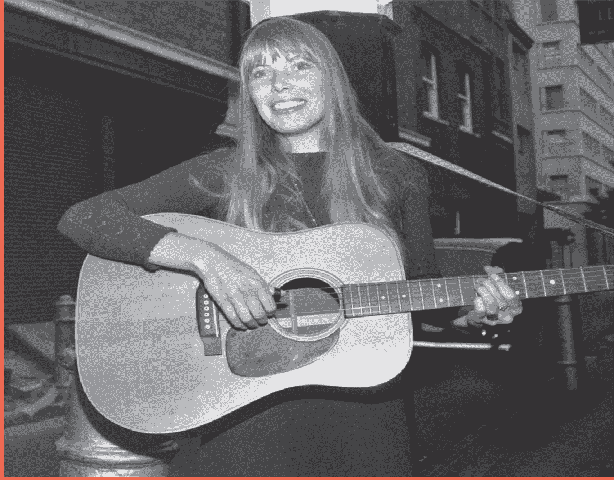

# 乔尼·米歇尔传记

# 献词

献给 Eric 和 Bebe Weisbard，在我流浪时，他们始终为我留着灯；

献给 Jacob Ganz，他帮助我成为那种敢于开启这样旅程的作家。

## 关于作者

## 关于命名的说明

乔尼·米切尔（Joni Mitchell）想要重新思考音乐从她口中传到他人耳朵的方式，让歌曲，甚至是赞歌，充满个人色彩的呼吸。她的艺术将她标记为既像一位预言者又像一位朋友。这些角色需要不同的头衔。在她的一生中，她在公开场合是“乔尼·米切尔”，对亲密朋友是“Joan”，而当文本或音乐的相遇虽然公开但感觉更私密时，她是“Joni”——有时在采访中，极少数时候出现在听起来很酷的广告文案中，但最重要的是对她的粉丝们，在那些他们为她诉说自己人生的时刻。

考虑到米切尔如今成为的受推崇的偶像，以及她在音乐中为自己塑造的形象，我觉得称呼她为“Joni”是令人自在的。但对于那位值得评论界关注的艺术家呢？称呼她为“Joni”有时会显得有些轻率。人们经常用创作者的第一个名字来称呼作品，以使其显得平易近人、可爱，就像你的姐姐或你妈妈一样。在乔尼之前，没有人叫莎士比亚为“威利·莎克（Willy the Shake）”（当然，除了爵士喜剧演员罗德·巴克利，她是从他那里借用了“跟我谈谈（Talk To Me）”这个词）。然而，当我把“Joni”放在一边写下“Mitchell”时，那感觉也像是在矮化她。没有了“Joni”，它几乎是通俗的。这是一个艺名，是一个离婚的20世纪60年代妻子的名字。它缺失了她的灵魂。

我决定，当我面对这个难以捉摸的主题时，最真实的做法是根据场合需要在“Joni”或“Mitchell”之间交替使用。这让我能够传达我在不同时刻的思考和感受，同时也论证了乔尼自己的音乐所表达的观点：即个人性可以是永恒的。亲密性能与世界对话。

在这些页面中，我遵循直觉，交替使用这两个名字或其中任何一个。她故事的某些方面感觉更向内在；另一些则发生在更大的舞台上。我想在“Joni”和“Mitchell”的富有成效的对话中思考，让这个自我创造的女性与一种男性化的传承进行互动。女性仍然不断好奇是否应该改自己的名字。有时，解决方案是拥有两个名字。

## 引言

### 绘制地图

我在脑海中写过无数次，它们像歌一样纹纹在脑子里。你即将读到的不是一份关于乔尼·米切尔生活和作品的标准记录。相反，这是一个关于穿越一段改变了流行音乐的人生旅程：关于一个思乡的流浪者在自己发明的路线上前行，以及我在追随她的足迹，向着她那嘹亮的声音走去。

我不是一个传记作家，按照该词的通常定义；内心某种东西本能地反对这种观点，即一个人可以梳理另一个生命的全部事实，并得出一个任何接近他人真实故事的内容。

我最喜爱的杰妮斯·乔普林（Janis Joplin）和艾瑞塔·富兰克林（Aretha Franklin）比米切尔（Mitchell）更加凌乱。她那种纤细、如鹅般的清冷，与我的处世方式如此遥远。

等一下，我对编辑说，让我过一会儿给你回电。我需要时间在街区转转圈，并焦虑一下。思考一下加入“乔尼信徒”群体的可能性。追随者和学者们大多形影不离，记录了她的每一次吉他调音、每一次公路旅行和近距离邂逅。男女都对她赞赏有加，将她视为灵魂伴侣和无与伦比的理想。乔尼征服了这么多人心，并被无数次称为“天才”，她的名字与这个词之间的押韵已根植于她的故事中，成为其主要的标志。坦率地说，所有对乔尼的崇拜都让我感到不安——那是如此强烈且毫不妥协。对许多人来说，她是永远正确的。我从没有在受欢迎的孩子身边感到自在。

我选择了另一个方向，我必须承认，乔尼也有过触动我的时刻。当我设法推开所有包袱并真正倾听她的音乐时，我听到了一个我能认出的自我。一个进取者，无可非议。一个承认自我本性的灵魂。一个喜爱幽默的女士。她无疑是一位才华横溢的音乐家，大多数创新者都能将短板转化为优点，并通过自己的滤镜处理那个时代主导的艺术对话，直到它们听起来独一无二。我花了足够的时间研究米切尔的全录音专辑，知道她很多次实现了这一点——她没有满足于自己的成就，而是总是想要不同的东西。她的歌曲本身就构成了一种反对被视为“神圣牛”的论点。这让我思考，我是否能找到另一个乔尼·米切尔，一个不那么受崇拜但能被更好地理解的人。

于是我回了电话说好。我会和乔尼一起旅行，让她的生活和作品一段时间成为我世界的中心。我哪里能想到，当我脑中怀想着她并出发时，这段旅程将带我进入如此复杂的空间。

# 回声

谈到艺术，我不相信任何永恒的东西，但我信任共鸣——那些增强了特定歌曲（或书籍、画作）在当时影响力，并让它们跨越岁月的回声。我小时候爱上摇滚乐是因为声波的撞击，让我感受到身体的每一寸感受，以及人们在沉迷其中时感受到的热烈、自由和喜悦。那是最直观形式的共鸣。我不想被升华到某个天界领域；我需要更好地了解我的世界。音乐总是将我置于事情的中心。而我喜欢的那些歌词，它们表达得如此直接并要求回应，增强了那种现在时态可以涵盖一切的感觉。

后来我意识到，共鸣也是一种文化现象。伟大的艺术家并没有超越他们的历史处境；他们深度地生活在特定的时代和地点。他们同时也深度地保持自我。他们的天赋能够从杂乱无章的经验中识别出哪些元素可以使这些经验跨越其产生的瞬间，形成震动并扩张的故事、声音和图像。一年或一个世纪后，某人可以遇到一位伟大艺术家的作品，并在回响中识别出自己的声音。

乔尼·米切尔是这种连接性的隐喻。这是在1976年春天出现在她脑海中的，当时她正开车穿过西部，看到一些军飞机编队飞行，这种遭遇本可能发生在太空时代，却让她想到了古老的事物，关于朝圣和预言。她在歌曲《阿米利亚》中运用这个意象，引用了她最喜欢的占卜形式《易经》：在天卦，她写道，“看到我的吉他弦”。当她录制这首歌时，她请爵士吉他手拉里·卡尔顿（Larry Carlton）写下倾斜的线条来增强她的歌词，显示它们是关于梦想、关于现代性、关于人们对普遍性的高远理想总是植根于他们自己的手并可以触及的。

这就是共鸣。它是个人的；它是此时此地；它是古老的。一个像乔尼·米切尔这样的嬉皮士可能会说，那是所有的氛围，通过让完全陌生的人感受到他们骨子里的共同点来将他们联系在一起。一个独自经历的愿景变成一首响彻宇宙并存留在那里的歌曲，其原始含义随着穿越时空的移动而倍增。我想通过回声定位来追踪乔尼音乐中的这些声波。

为了做到这一点，我必须遵循米切尔生活和作品中碰撞并形成模式的分子。这意味着保持灵动。尽管这本书是按时间顺序推进的，但我没有满足于她的成就，而是总是想要不同的东西。她的歌曲本身就构成了一种反对被视为“神圣牛”的论点。这让我思考，我是否能找到另一个乔尼·米切尔，一个不那么受崇拜但能被更好地理解的人。

于是我回了电话说好。我会和乔尼一起旅行，让她的生活和作品一段时间成为我世界的中心。我哪里能想到，当我脑中怀想着她并出发时，这段旅程将带我进入如此复杂的空间。

## 某个阶段

其他人没有感受到同样对距离的需求。小说家扎迪·史密斯（Zadie Smith）描述她对乔尼·米切尔热情的开始像是一种生理疾病。“这是听乔尼·米切尔最近对我产生的影响：无法自控的泪水。一种情感上的征服，离幸福令人不安地遥远，更像是喜悦——如果喜悦是对几乎无法忍受的美的认可的话。这不是一种非常文明的情绪。”史密斯于2012年在《纽约人》杂志上写道。史密斯的经历，无论多么强烈，对于迷上乔尼的粉丝来说都是典型的。在对米切尔不可替代性的深层主观论证中——“乔尼·米切尔问题”，散文作家梅根·道姆（Meghan Daum）讲述了她在实现见到米切尔并与其进行交心交流的人生目标后，她丢失了这位歌手的电话号码。“在一切之后——在晚餐之后，艺术展之后，在与我青少年时期的私人乔尼度过的几十年，在成年早期的犹豫和中年的云云散之后——我让那个女人本身流逝了，像一个被清醒之光灼成抽象的梦。”她那并不算清醒的米切尔梦没有被真实人的现实所干扰。这几首著名的歌曲，对于许多人来说，与米切尔声音的内省式遭遇如此强大且独特，以至于无法与他人分享——甚至是它们的来源。爱上她类似于启蒙：一个改变世界的洞察时刻。

然而，还有许多人将这种经历称为一个阶段。你知道的，就像“朋克阶段”，当你留着莫霍克头时，或者通过一纸箱糟糕的本科诗歌所揭示的“迪伦阶段”。乔尼·米切尔阶段的独特之处在于其震撼的影响，以及那种与她的文字和声音交织在一起持续的感觉。评论家罗恩·罗森鲍姆（Ron Rosenbaum）为歌曲《Amelia》写了一首颂歌，在其中他描述自己与这首歌的关系是一种音乐成瘾，“我陷其中，一遍又一遍地播放几个小时，有时是几天。”即使是终身粉丝，音乐家丹·贝贾尔（Dan Bejar）也用时间语言来描述听她：“我猜我正在经历某种阶段……已经持续了六七年了，”他在几年前承认道。

还有哪种阶段是改变人生的？青春期，是一个。更年期，另一个。开始喜欢乔尼·米切尔音乐的经历几乎是生物性的，在荷尔蒙的波动中袭来，并且往往相互关联，仿佛没有其他具有米切尔地位的音乐家（包括其他女性艺术家）能同时从特定和普遍的角度谈论女性身份。“所有女孩都会经历一个乔尼·米切尔阶段，”歌手词作家托尼·梅里特（Toni Merritt）说，“如果任何女孩告诉她她没有经历过，不要相信她。”这种声明有一种本质主义的色彩，意味着成为女性的唯一方式就是爱乔尼·米切尔。如果你不爱她，你就不是真正的女人吗？我承认，从未疯狂爱上乔尼的事实让我思考了一段时间这是否是一个问题。但乔尼·米切尔不是我们的镜子；她是我们所有人选择访问或选择离开的领土地图。

## 天才

影响跨越特定时刻的艺术家有机会进入最精英的类别：天才。在与人们谈论乔尼·米切尔时，我听到这个词频繁到让它的意义变得淡化。这是米切尔的朋友们喜欢加在她身上的赞誉，尤其是男性；他们通常带着夸张的惊讶语气说这个词。大卫·克罗斯比（David Crosby）和詹姆斯·泰勒（James Taylor）在与我交谈时都提到过这一点。格拉姆·纳什（Graham Nash）在他的回忆录中写道，在我们相见的那个晚上，在第一个吻之前她弹了十五首歌，“面前坐着纯粹的天才。”她的存在迷住了他，让他做了一件在午夜后对女性不习惯做的事：认真对待她。米切尔不是唯一关注艺术而非制作三明治的人——有卡罗尔·金（Carole King），她只是为了工作才进入现场，然后就回到女儿身边；还有卡斯·埃利奥特（Cass Elliot），她成功兼顾了两者。米切尔意识到，为了不被放逐到厨房，即使是暂时的，她需要像唯有天赋异禀的人那样去令人震撼和惊叹。奇迹是真实的——她在下午就写了《伍德斯托克》（Woodstock），用无人听过甚至从未考虑过的调弦弹吉他，设计出别人几乎无法唱出的旋律却能轻松驾驭。然而，像奇迹一样，米切尔的奇迹是可以解释的。例如，她著名的调弦仍然回响着她从伊丽莎白·科顿（Elizabeth Cotton）和里奇·哈文斯（Richie Havens）等蓝调音乐家中学到的东西。在她刚出道时，她的声音里有很多琼·贝兹（Joan Baez）的影子。她从莱纳德·科恩（Leonard Cohen）那里学到了关于词曲的关键课程。她有影响者，也有同辈。

即使在早期的采访中，乔尼（Joni）也很少承认这些来源，除非说她正在离开他们。相反，她将自己置于历史上的顶尖人物之中：毕加索、贝多芬、莫扎特。还有鲍勃·迪伦（Bob Dylan）。让我们来聊聊迪伦的天才吧，在20世纪60年代后期，大多数词曲作者都试图模仿。他将其描述为一种力量，使他不仅成为他所代表的时刻，更是整个美国历史的通道。在向世界展示像1965年后期的《像滚石一样》（Like a Rolling Stone）这样的经典作品时，他曾说：“就像一个正在写歌的幽灵。”凭借他男性声音的权威性，迪伦可以召唤天才并代表他所相信的一切。历史告诉我们，贝多芬也是这样做的。

女人能做到吗？迪伦可以与乐队里的男孩们并肩作战，公开引用他的素材，将自己归入那些他经常借用的大师之中——许多（包括米切尔本人，她后来收回了这一评价）曾称他为抄袭者。他长期以来否认此类指控，能够将自己呈现为历史的媒介，但他在历史中的地位是稳固的。乔尼则站在动摇的土地上。作为一个女人，她不想定义自身经验及其共鸣之外的任何东西；听众可能在她的揭露中听到了自己，但那些内容仍然是具体且私密的。一位采访者与米切尔谈到她的音乐“就像透过窗户窥视，然后对你看到的内容进行讨论”。这与迪伦坐在一起详述政治、神话和世界现状完全不同。在那个年代，女性天才并不被认为在参与宏大蓝图。她只是描绘了自己和私生活的精致画面。

这就是经常发生在女性艺术家身上的事：对于她们来说，“天才”会孤立，有时会让人沉默。那些弄懂如何在其中生存的人采取了激烈的措施。想想乔尼的榜样：乔治亚·奥基夫（Georgia O'Keeffe）留在她的沙漠，艾米莉·迪金森（Emily Dickinson）留在楼上。只有这样独特的人物才体现了艺术表达的最高巅峰。而且，他们往往陷入了困境，由于需要保持疏离而既受崇拜也受怜悯。

我意识到，乔尼·米切尔能够在保持持续移动的同时保持疏离。她的举止与众不同。在许多标志性的照片和她自己的画作中，她挑战观察者带着极谨慎且不带任何期待地靠近。在点缀《云》（Clouds）的自画像中，她像送礼物一样捧着一朵草原百合，但她的眼神冷漠的，没有微笑；似乎在交出后，她会立即离开。在《流浪》（Hejira）中，她使用拼贴技术改变了诺曼·西菲（Norman Seeff）的照片，使她的身体——在那张带着另一个冷峻目光的脸下方——开启以揭示她的灵魂；米切尔在歌曲中的自画像存在于这些自足的图像之中：“你的案例”（Case of You）中住在画笔盒里的孤独艺术家；《从两边看》（Both Sides Now）中在空中的观察者，高到可以看到天空的另一端；《伍德斯托克》中远离人群的道路流浪者。起初，我被这些图像投射出的自足所震慑，也被她如何如此精妙地将其与渴望平衡、使她向他人的触碰开放所打动。但我开始将其视为革命性的。如此多女性歌曲在诱惑、讨求、哀求、邀请。只有少数艺术家——比莉·假日（Billie Holiday）、艾迪·碧雅芙（Edith Piaf）——能够创造一个她们可以单纯与自我交流的空间。乔尼的音乐展示了那个空间如何存在于内心，并随她一直向前。

如果我命名它，她可能不喜欢，但这是一个女性主义行为。男人可以躲在人群中并变得更强大。但女人会被周围环境分心，确保每个人都有三明治，被迫变得漂亮并讨好他人。“我紧张时总是微笑，”乔尼在早期的采访中说。当她不想仅仅微笑时，她必须把自己分开——有时是比喻的，有时是字面的。

她在音乐和绘画中如此优雅地做到这一点，在她尝试谈论它时有时会变质。米切尔希望别人将她视为不可分割的天才，以此与周围的人、尤其是其他女性区分开来。从她第一次表达这一点起，这种紧迫感既被感知到了，也是策略性的。而且起效了。“她正在实现美国摇滚中某种‘女神’的需求，一个不仅仅是女人的女人；一个不害羞地表达全方位情感的诗人，”评论家雅各巴·阿特拉斯（Jacoba Atlas）在1970年对她写道。“她的传奇开始掩盖她的作品；因为她几乎没有怜悯（琼·贝兹和朱迪·柯林斯没有产出；巴菲·圣特玛丽没有那种即时的新颖感），她不需要赞美。”米切尔接受了这种有问题的赞美。

# 告白

米切尔被称为“告白式”（confessional）的次数比她被称为天才的次数还要多。她每次都感到反感。那里有一句名言，她纠正那些沉迷于传记的人：“如果你在我的歌曲中看到我并对我的生活好奇，那么我的工作没做好。如果你在其中看到你自己，那么我在做我本该做的事。”这是一个礼貌的指令，让人们停止八卦并向内看。当米歇尔问她关于被称为“告白式”时，她给了一个更具争议的回答。“那几乎是有人能称我为那个n——（种族蔑视词）了，”她尖锐地说。

白人使用那个蔑视词永远不对，但脱口而出揭示了她有多么讨厌别人告诉她该怎么做。她曾对另一位问及类似问题的作家说过，她更倾向于用“忏悔的”（penitent）而不是“告白式的”（confessional）。好吧，那基本上是一个更高级的同义词。忏悔者选择暴露自己，而告白往往是被迫的。在这一刻，我将为“告白式”辩护，它不仅将其视为对自我投入的庆祝，也将其视为一种挖掘和仪式性的交换。作为摇滚乐的核心方面和文化产物，评论家M. L. Rosenthal在1959年将其与诗歌联系起来，当时摇滚乐正给美国带来一场个人热潮。最常贴上此标签的女性诗人西尔维亚·普拉斯（Sylvia Plath）和安·塞克斯顿（Anne Sexton）在许多方面等同于在青少年国家巡演的摇滚乐手。米切尔一直反对与他们产生联系，认为他们没必要具有挑衅性，但如果可能将这些女性与其自杀以及随之而来的生活神话化分离开来，她们的诗可以被重新解读为充满电声声音的能量。塞克斯顿曾一度组过一个爵士融合乐队。“这比诗歌好！音乐击败了我们，”她在记者笔记中写道。

音乐为告白式的自我暴露提供了一个比诗歌能提供的更好的引擎。那是因为它是唱出来的，是有节奏的，而且可以变得很大声。大卫·舒姆韦（David Shumway）在他对米切尔作为告白式摇滚明星的研究中指出，她的音乐创造了一种“情感上的即时性，让我们相信我们的是真实而非艺术。”它以一种不可抗拒的磁力打破了距离。乔尼感受到了这一点；她说：“我有一种对观众诚实的冲动。”安·塞克斯顿在她的诗《音乐游回我》（Music Swims Back To Me）中写道：“音乐倾泻感官 / 以一种有趣的方式 / 音乐看到的我更多。”音乐是一种电击，恢复了大脑而不是麻痹它。

承认告白式的潜在冲击，让我们理解乔尼加入并领导的创作型歌手运动是激进且颠覆性的，而不是像大多数人谈论的那样是“温柔的”，比如泰勒的《火与雨》（Fire and Rain），那是终极的软摇滚歌曲，真正的软。它是关于抑郁和自杀。乔尼的《为了玫瑰》（For the Roses）温柔吗？它的歌曲是关于海洛因成瘾、性背叛和狂躁发作。米切尔可能对普拉斯和塞克斯顿的姿态（她的话）表示怀疑，但她一直分享她们那种魅力与坚毅的混合。紧张的音乐，极度时尚——她们要说的话并不漂亮。塞克斯顿和普拉斯写过经期、分娩、自慰、割伤。米切尔直率的一面暴露了孤独、需求以及对满足他人需求的拒绝，以及一种留下破坏后果的独立冲动。

“那个胆怯的小女孩变成了一个华丽且具有挑衅性的女人；那个躲在衣橱里的胆小孩子像一个暴露癖者一样破壳而出，”诗人马克辛·K（Maxine K）评价她的密友塞克斯顿时说道。乔尼曾谈到创作《蓝》（Blue）的那些日子，感觉“就像我的肠子都露在外面。”尽管遭到反对，她们是精神上的姐妹。

因此我复兴“告白式艺术家”的概念，但让它更具动态。创作歌手与其观众之间关系的亲密性在流行音乐中是无与伦比的。它类似于心理治疗中的转化，或来自祈祷的恩典：一种神秘的连接，通过这种连接，一个生命向另一个开放，你们的视角变得不可区分。谁在说话？创作歌手的见解在听众心中成长之前只是种子。

然而，网络评论很快就从对乔尼音乐天赋的赞美转变为对她美貌的关注。天哪，还有比她更美丽的女性吗？镜头鼓励了这种才华与性吸引力的融合。它对准了在吉他上弹奏《Coyote》时那变换奇妙的手指，然后拉近特写她的脸庞，颧骨在完美的秋夏间显得格外分明，金色的长发在黑色贝雷帽下被精心打理。自从她拍下那段剪辑以来，桥下已经历了四十五年的女性解放，但乔尼的美貌依然让她的音乐为了关注而显得焦虑。

我想，人们对年轻的米切尔音乐才华经常表现出的惊讶，很大程度上是因为他们无法接受一个女性可以既迷人，又比他们曾经说过的——更有才华。“她像一场风暴，”她早期的导师和莱纳德·科恩（Leonard Cohen）曾这样说，试图处理她所代表的那种元素性的结合。她第一家唱片公司的广告代理人们利用了这种魅力，将她宣传为穿着古董连衣裙的“脆弱、独特的美女”，并向《时尚画》（Glamour）和《时尚》（Vogue）的编辑们推销她。1976年的一位评论家写道：她是“流行音乐中两种最棒乐器的拥有者，一对完美的嗓音和那对迷人的、脆弱的颧骨。”女性主义者和其他严肃的人说要关注音乐。但说实话吧：几乎没有人这样做。米切尔的传记作家之一，凯瑟琳·蒙克（Katherine Monk）要求对乔尼利用自身资产的行为“不加评判”。“这就是20世纪60年代世界的运作方式，”她写道，尽管今天已有所不同。事实并非如此。美依然被读为美德，读为卓越。任何关于乔尼·米切尔在她的音乐同辈中独一无二的讨论，必须承认在至关重要的一点上，她与每一个流行明星几乎相似：她符合成名的身体要求。

承认这一点很尴尬，但她的美貌是停止我本该属于自己的“青春乔尼·米切尔阶段”的原因之一。我是一个长相平平的孩子。我凝视着乔尼金色的脸庞，看着她在《玫瑰》（For the Roses）折页照片中那赤裸的曼妙躯体，感受到了那些受欢迎的女孩从三年级起就在我心中激起的、熟悉的嫉妒与排斥感。我的音乐女英雄也是美女，但她们利用了基因赋予她们的优势。记得，我曾是一个新浪潮音乐者（New Waver）。那个圈子的女性也拥有高耸的颧骨和大眼睛，但她们是在女性运动的浪潮中起来的，受过该运动对审美标准的批判。迪比·哈里（Debbie Harry）涂抹口红，撕掉裙子；凯特（Kate）把自己装扮成狮子或蝙蝠，在跳舞时扭曲脸。

至少在我的脑海里，我可以与那些女王们并肩，因为她们嘲笑自己所能声称的优势，即使她们也从中获益。

美是真实的。美是被建构的。美是华丽之友，是真实的敌人。就像其他人一样，吸吮着它的糖分，我相信它传达了某种真相；这取决于我能容忍谁的美的美，并将其视为一种承诺而非威胁。我花了时间和密集的倾听，才意识到如果她从不弄花或对着麦克风嘶吼，米切尔的音乐对她和她那代人所谓的“性吸引力”提供了自己的批判。

通过追踪她们的轨迹，我了解到美对乔尼来说也是一个问题。当她出现在第五张专辑《乔尔·伯恩斯坦》（Joel Bernstein）时，关于性吸引力价值的社会战正进行得激烈。引发第二波女性解放的行动是1968年反对“美国小姐”选美的集会，活动家在会上唱道：“她不甜吗，从她的肉体上获利。”两年后，托尼·莫里森（Toni Morrison）出版了她的处女小说《蓝眼睛》（The Bluest Eye），在书中，白人的审美理想结合性侵害让一个黑女孩发疯。尽管有抗议，进步派圈子的女性力量往往与美貌挂钩。“女性？我想她们应该行使‘阴道权力’（Pussy Power）？”黑豹党领袖在《女性的奥秘》（The Feminine Mystique）中写道化妆品的暴政；格洛丽亚·斯汀泰姆（Gloria Steinem）很漂亮，她戴上巨大的太阳镜来减轻他人投向她的目光。为了寻找自己的定义，黑人女性主义先驱米歇尔·华莱士（Michele Wallace）在黑人集会上提供了一个爆炸头，但担心它会在雨中枯萎。（“尽管有黑人身份，”她写道，“黑人还是留短发。”）乔尼确实感受到了这种冲突。1974年的《人民派对》（People's Parties）讲述了一个“照片美女”，她有点可怜，但仍然能让她觉得自己像一只丑鸭鹅。为我们所有人哭泣吧，美，”她唱道。她在塑造那个女孩，同时反抗这个概念。

米切尔所处的摇滚界有其自己熟悉的审美崇拜形式，与她郊区母亲灌输的那些并无区别。它唯一不同在于强调男性也可以成为欲望的对象，因为它举办了一场由一群尖叫的青少年女孩参加的帅哥巡游。几个黑人女性和白人棕发女性确实挑战了金发常态：蒂娜·特纳（Tina Turner）、艾瑞塔·富兰克林（Aretha Franklin）、杰尼斯·乔普林（Janis Joplin）和未正式出道的格蕾丝·斯利克（Grace Slick）是感性的力量源，她们可能永远无法进入舞会场。但所有那些白皮肤女孩依然存在。乔尼在她的圈子里是一个女王；尽管如此，她依然主宰音乐产业，他们反对对审美标准的任何改变。“追星者通常比歌手更好看，”斯利克在谈论洛雷尔峡谷（Laurel Canyon）时这样说。女性确立自己艺术家身份的决心，必须与她们引导和维持男性目光的努力之间取得平衡。

乔尼不得不感受到这种压力。她在1969年就登上了《滚石杂志》（Rolling Stone）的封面，该杂志已经远离艺术家足够久，以至于专门出一期（后来结成书）来介绍追星现象，关注那些致力于取悦男性的缪斯和追随者。

# 米切尔所处的摇滚界审美崇拜

米切尔所处的摇滚界有其自己熟悉的审美崇拜形式，与她郊区母亲灌输的那些并无区别。它唯一不同在于强调男性也可以成为欲望的对象，因为它举办了一场由一群尖叫的青少年女孩参加的帅哥巡游。几个黑人女性和白人棕发女性确实挑战了金发常态：蒂娜·特纳（Tina Turner）、艾瑞塔·富兰克林（Aretha Franklin）、杰尼斯·乔林普林（Janis Joplin）和未正式出道的格蕾丝·斯利克（Grace Slick）是感性的力量源，她们可能永远无法进入舞会场。但所有那些白皮肤女孩依然存在。乔尼在她的圈子里是一个女王；尽管如此，她依然主宰音乐产业，他们反对对审美标准的任何改变。“追星者通常比歌手更好看，”斯利克在谈论洛杉尔峡（Laurel Canyon）时说。女性确立自己艺术家身份的决心，必须与她们引导和维持男性目光的努力之间取得平衡。

乔尼不得不感受到这种压力。她在1969年就登上了《滚石杂志》（Rolling Stone）的封面，该杂志已经远离艺术家足够久，以至于专门出一期（后来结成书）来介绍追星现象，关注那些致力于取悦男性的缪斯和追随者。米切尔的传记作家之一，凯瑟琳·蒙克（Katherine Monk）要求对乔尼利用资产的行为“不加评判”。“这就是20世纪60年代世界的运作方式，”她写道，尽管今天已有所不同。事实并非如此。美依然被读为美德，读为卓越。任何关于乔尼·米切尔在她的音乐同辈中独一无二的讨论，必须承认在至关重要的一点上，她与每一个流行明星几乎相似：她符合成名的身体要求。

承认这一点很尴尬，但她的美貌是停止我本该属于自己的“青春乔尼·米切尔阶段”的原因之一。我是一个长相平平的孩子。我凝视着乔尼金色的脸庞，看着她在《玫瑰》（For the Roses）折页照片中那赤裸的曼妙躯体，感受到了那些受欢迎的女孩从三年级起在我心中激起的、熟悉的嫉妒与排斥感。我的音乐女英雄也是美女，但她们利用了基因赋予她们的优势。记得，我曾是一个新浪潮音乐者。那个圈子的女性也拥有高耸的颧和大眼睛，但她们是在女性运动的浪潮中起来的，受过该运动对审美标准的批判。迪比·哈里（Debbie Harry）涂抹口红，撕掉裙子；凯特（Kate）把自己装扮成狮子或蝙蝠，在跳舞时扭曲脸。

至少在我的脑海里，我可以与那些女王们并肩，因为她们嘲笑自己所能声称的优势，即使她们也从中获益。

美是真实的。美是被建构的。美是华丽之友，是真实的敌人。就像其他人一样，吸吮着它的糖分，我相信它传达了某种真相；这取决于我能容忍谁的美的美，并将其视为一种承诺而非威胁。我花了时间和密集的倾听，才意识到如果她从不弄花或对着麦克风嘶吼，米切尔的音乐对她和她那代人所谓的“性吸引力”提供了自己的批判。

通过追踪她们的轨迹，我了解到美对乔尼来说也是一个问题。当她出现在第五张专辑《乔尔·伯恩斯坦》（Joel Bernstein）时，关于性吸引力价值的社会战正进行得激烈。引发第二波女性解放的行动是1968年反对“美国小姐”选美的集会，活动人士在会上唱道：“她不甜吗，从她的肉体上获利。”两年后，托尼·莫里森（Toni Morrison）出版了她的处女小说《蓝眼睛》（The Bluest Eye），在书中，白人的审美理想结合性侵待一个黑女孩发疯。尽管有抗议，进步派圈子的女性力量往往与美貌挂钩。“女性？我想她们应该行使‘阴道权力’（Pussy Power）？”黑豹党领袖在《女性自助》（The Feminine Mystique）中写道化妆品的暴政；格洛丽亚·斯汀泰姆（Gloria Steinem）很漂亮，她戴上巨大的太阳镜来减轻他人投向她的目光。为了寻找自己的定义，黑人女性主义先驱米歇尔·华莱士（Michele Wallace）在黑人集会上提供了一个爆炸头，但担心它会在雨中枯萎。（“尽管有黑人身份，”她写道，“黑人还是留短发。”）乔尼确实感受到了这种冲突。1974年的《人民派对》（People's Parties）讲述了一个“照片美女”，她有点可怜，但仍然能让她觉得自己像一只丑鸭鹅。“为我们所有人哭泣吧，美，”她唱道。她在塑造那个女孩，同时反抗这个概念。

# A STORED LIFE

传记发明是为了庆祝英雄——或者，实际上，是将生物组织起来。一位活着的形式大师，赫米尼娅·李（Hermione Lee）称之为“一个创作，或重塑的过程”。创作：作曲，将一个人的破碎的体验转化为一组捕捉他人耳朵的歌词和副歌。重塑：如发型一样，塑造现有的东西。李认为这种重构的过程对于让生命在纸上呈现至关重要。反对这一点的是记忆和事实的混乱性。“它们确实存在，”李写道，“并落在传记作家周围堆成堆、放在箱子里，等待被转化。同样潜伏在旁，无论生或死，传记作家的主体，不断反对；至少感觉是这样。你完全错了，”她嘶吼道。“你迷失了。”

这些元素让我们喜爱的艺术家、运动员和政治家变成了那些得上上畅销书榜的角色。读者渴望这些细节，因为他们很可能已经通过大众媒体的八卦、真人秀，甚至是主角的社交媒体动态品尝过这些内容。

米切尔（Mitchell）对此负有部分责任，哪怕是间接的。她在倾听者耳边的呢语帮助改变了人们理解艺术家的方式。她重新定义了音乐的框架，用细心和技艺提升了自我暴露的艺术。在这一过程中，她确实为自己保留了许多，精准地选择要暴露哪些心碎、渴望和欲望的片段。然而，她却表现得像付出了一切。这让人们对她产生了更多的渴望。

尼妮（Joni）很快对她和她的女创作歌手们所造成的影响感到不耐烦。在《Blue》之后，她想创作关于新主题的音乐，做一个观察者和合作者，而不仅仅是那个直视你的人。尽管仍然从自己的经验中写作，她却渴望对其他事物的思考得到认可。她不再是一个行走的化身，而是变成了一个叙述者，然后是一个先知，有时还是一个翻译者。这就是一个年长女性在对抗隐形时所做的，而不仅仅是存在？我也想纪念这位尼妮·米切尔，她追求更多，却因为如此被贴上“困难”的标签。

我开始喜欢那个带刺的尼妮·米切尔。随着时间的推移，我意识到她一直在那里，等待我去理解。即使是人们崇拜的那个尼妮并不是真正的榜样。她是一个无法调整情绪的忧郁女孩。一个焦虑的话者，留下那些爱她的人，因为她担心他们会先离开她。那个不值值的尼妮。她所有的忧虑、讽刺、对软弱的承认、虚荣，让她充满了人性与生命力。她对自己在艺术家阶层中地位的折磨人的关注，对孤独的恐惧，推开他人的需求，她偶尔但重大的偏见和文化判断失误，她对男性的痴迷，与女性的竞争意识，她的种族特权感、夸张的倾向，对持续工作的不健康驱动，以及对自己所做的一切是否值得的悲伤而严肃的怀疑。追溯这些模糊性，我找到了那个能吹进我耳边的尼妮。

这本书是对深度研究、倾听以及与许多遇到过米切尔的人多次相遇的记录——作为朋友、合作者或竞争者，他们是消逝瞬间的化身，也是存在感显得永恒的灵感。但这实际上是一个关于一种方法、一系列方法的故事，指向一个在许多方面感觉不可触及的主题。尼妮·米切尔：除了阿蕾莎·弗兰克林，她是当代音乐界受评论界赞誉最多的女性；被粉丝最热烈拥抱的女性；唯一可以与路德维·B. 和摇摆的威基直呼其名的流行音乐家。一个所有音乐的人都关心故事的女人，因为她在歌曲中把自己讲述得太好了。通往尼妮·米切尔神话般生命的巅峰有一条清晰的路。但我不想走那条路。

相反，我想思考那些小径，那些她曾在不被察觉的情况下游荡过的路。离开主路，我想以稍微不同的方式行走。我想通过那些大多未被绘制在地图上的相遇，亲自追溯米切尔艺术的形状。我知道这将很困难。星辰淹没在那些维护他们伟大之人的既定智慧中。这是一次还原的尝试。也许米切尔本人会认为我的绘图是修正主义的。我试图抵制或至少质疑对一位许多人认为很了解的艺术家的常见假设。有时，我希望自己曾越界。我告诉自己，那是像米切尔那样会尊重的自我原创。

尼妮·米切尔是一个真实的人，她在近四十年的时间里录制了二十多专辑，创作了至少十二张被许多人视为经典的专辑，改变了摇滚吉他弹法、流行歌曲创作以及女性在公共场合谈论自己的方式。她也是自由与独特、忧伤与游戏的化身。她是连接不同音乐风格和创造这些风格的人的基石。对于一些来说，她是提供慰藉和灵感的生命力；对于另一些来说，是一个永远无法达到的标准。尼妮·米切尔无法传记，因为她仍然活着——字面意思是，就在现在；但在另一种意义上，通过她那反叛且流动的音乐永恒存在。她无法被完整捕捉，因为她总是超越自己的生活故事，从未停歇。她经常是他人痴迷的对象，但作为一个主体，她无法被拥有。我只能跟随她，一次一次呼唤她的名字。

# 1 童年事迹

我开启我的尼妮·米切尔之旅始于唯一合理的地方：坐在我的音响旁，听着她的音乐。将唱针放在黑胶片上，按下播放键进入溪流。调到第一首让任何人认为尼妮·米切尔是一个艺术家的歌曲去发现——正是这些歌曲让许多听者今天走向了她。《双面人生》（Both Sides Now）、《游戏环》（The Circle Game）以及作为回声的《出发》（Urge for Going）。它们有什么共同点？

每一首歌都从成人的视角勾勒出童年，通过年轻女性生活的复杂性回顾更简单的起点。

通过建立背景故事，它们通过将她介绍为一个女孩，建立了一个角色，尼妮·米切尔。这个女孩是一个真实的人，一个曾躺在草原草地上仰望广阔天空的人，一个在自己后院里的探险家，知道自己必须逃向更远的地方。但她也是一个工具。年轻的罗伯塔·乔恩（Roberta Joan），那个走在尼妮身后的女孩，她的影子。有些东西贯穿了这些歌曲，也就是现在经常吸引听者走向尼妮音乐的相同东西：一种瞬间清晰的自我感，因未未解决的渴望而变得动态。那种实时的、成长的感觉。我想像米切尔本人那样去理解他们唤起的那个女孩。

首先，是事实。尼妮在1943年是罗伯塔·乔恩·安德森（Roberta Joan Anderson），来自米特尔（Myrtle）和安德森（Anderson），她是杂货店经理和家庭主妇，在斯斯喀敦（Saskatoon，加拿大草原省中心）长大。作为疏远父母的独女，她是一个经常独处的热心孩子，尽管很爱做梦，她在疾病的一次发作中患了脊灰髓炎并失去了行走能力；她反击并康复了。这段经历促使她成为一名艺术家，而不是她以为会成为运动员，考虑到她对户外乐趣、玩牛仔游戏和追逐游戏的喜爱。想起这些岁月，她在其中首歌中将自己描述为一颗想要被风吹走的野种子。

一段时期，安德森夫妇住在死胡同的一栋房子里，她闯入郊区的边缘，让自己迷失在相邻的田野间。这就是她后来经常将自己放置的地方，当她把回忆转化为许多人的歌词时。年轻的罗伯塔·乔恩在尼妮身上充当着开阔空间中的人物。

## 滑冰

快回到1976年。在我最喜欢的一张尼妮照片中，那个孤独的女孩再次出现。一个女人向着大地的中心滑行。黑色冰鞋，黑色紧袜，黑色大衣和帽子。她的裙子垂过膝盖，飘动。她可以是一个世纪。然而她的动作没有衰老的迹象，她的头发是金色的，落在背上。在同一天拍摄的另一张中，她举起手臂，外套上的毛皮看起来像羽毛：她可以是一只鸟。但她被束在地上，一条腿抬起，目光看向阴影中的冰面。这张图像并不是在讲述自由；它是在讲述记忆。在这个空间里的孤独将带回到另一个地方，处于女性力量巅峰的尼妮·米切尔，回归自我，罗伯塔·乔恩。她是到达那里的：她结束了巡演和与约翰·格林（John Geurin）那段在道路上仍在延续的、枯萎的五年恋，落在威斯康星州的马迪逊，和她的朋友兼纪录片导演、摄影师乔尔·伯恩斯坦（Joel Bernstein）住在酒店里。走投无路，她给他们布置了一个任务——为她的下一张专辑《Hijira》拍一些照片。她找到了那些冰鞋，他们把它们堆进轿车，在风暴即将爆发时到达了湖岸。进入《Hijira》内封的照片显示了尼妮扇动着翅膀，半兽人般的，头部向未来倾斜。我所爱的人唤起了快乐童年里那种自给自足和未经考验的自信。

在音乐公开生涯的前十年里，直到这张被我读为既是对纯真的保护、也是对其不可避免的消逝的承认的照片，乔妮·米切尔（Joni Mitchell）一直将“成长”作为她自我表达的焦点。这一过程的核心是她与年幼自己的不断邂逅——那个在母亲门外自由奔跑的孤独草原女孩；随后，在小灰质炎症告诉她自由也可以也必须是内在的之后，她将自己从那些曾慰藉过她的家庭真理中挣脱出来。事实上，我们不要暗示与那个女孩有过“邂逅”，而是说对她的一种构建。在她的观众之前并和他们一起成长的，通过她的歌曲，乔妮·米切尔像我们所有人一样，在碎片、挑战和修正中写下了自己的童年故事。她青年的实际情况确实有所影响，但或许没有她作为一个创作成年人对这些经历所做的处理大。

1976年，米切尔正准备发布《修行》（Hejira），这是一本朝圣日志，它实现了流行音乐作为思考年龄生活复杂性载体的全部潜力。然而，在某一瞬间，她又变回了少女。当她俯瞰那片冰面时，她是在回忆萨斯喀彻温河而不是在看着那个湖泊吗？而不是穿着全黑的盛装，她是否在想象自己穿着白色滑冰鞋、红色外套、手套？“也许滑冰这种动作，就像任何身体活动一样具有典型的加拿大特色。”乔妮·米切尔是在平水滑冰长大的。她经常描写河流、湖泊和冰雪。将冰看作记忆。并将记忆的构建看作孤独的功能，但它是脆弱的，极易被干扰。

也许随着刀片的另一次转动，米切尔想象湖泊是河流以外的其他东西。眼睛低垂，目光移开，也许她想起了她夏日的避难所：那是被阳光晒成金色、甚至近乎白色的焦草，草高到足以遮住一个躺在背上、想象云端中奇幻王国的小人。回想起她在学校学到的名字：羽毛状的卷积云、棉花糖般的积云、像墙一样横跨天空的状态云。等等，不，不是棉花糖，那个二十多岁写下《两面人生》（Both Sides Now）的乔妮，在田野里的罗伯塔·乔恩（Roberta Joan）多年后可能会那样想。冰淇淋蛋。冰淇淋城堡。那首歌是关于放弃纯真的。但首先，其中的孩子获得了发言的机会。

“当我还是孩子时，”乔妮·米切尔在1969年告诉记者苏珊·戈登·莱登（Susan Gordon Lydon），“我母亲带我去田野教我鸟鸣。”这段评论补充了莱登对米切尔当天的描述，当时她出现在劳雷尔峡（Laurel Canyon）的平房小屋里：“她的脸缺少了表演时的那种力量感和光泽，看起来像个质朴的农场女孩，有着雀斑的白皮肤、水汪汪的蓝眼睛，以及突出的牙齿和颧骨。她说话声音轻柔温和，非常诚恳。”米切尔在这一早期嬉皮黄金时代向世界展示的面容，与她在最受欢迎的歌曲中所出的直白却高亢的嗓音有着内在的联系。当时的她，正如几十年后她在一张装饰有伯恩斯坦（Bernstein）湖泊照片的专辑标题中再次自称那样，是一个草原女孩——她的精神与自然和季节的流转保持一致，她的词作是一个梦想者张开双臂拥抱世界的延伸。

“没有声音会责怪你翅膀上的阳光，”她在童年的歌曲中吟唱道，那是她1968年首发专辑《海》（Seas）的同名主题曲，这种对鸟类的识别方式赋予了她某种童话般的魅力。然而，尽管拥有这些被金粉洗过的记忆，这些歌曲往往暗示着不满。她在主歌结束处对她的父母刺了一刀。我温和的亲人们有他们的名字，他们必须那样称呼我，因为我爱所有飞行生物的自由。

母亲教导长领雀（Longspurs）方言的女儿，是年轻罗伯塔·乔恩的一个版本，适合在嬉皮革命退潮时期、那个热爱乡村的黄昏中供公众消费，并忠于她最开始的岁月——那时她的父亲还在服役，让家庭从中西部相对宽广的城市搬到像“北境战场”（North Battlefield）这样带有古特名字的小镇。乡村风乔妮也是孤独的乔妮，在池塘光影的流动、昆虫的形状和风声中寻求慰藉，知道在另一个新小镇，她将不得不重新结朋友。培养独立性有助于一个未受照料的孩子在一切发生变化时感到安全。在米切尔词作中最浪漫的方面，年轻的罗伯塔·乔恩是每个成年人 ways 想要回忆并培养的自由灵魂。

但还有另一个年轻的罗伯塔·乔恩，更忧郁，更忠实于她的时代。她是一个在战后动荡岁月长大的郊区不满者，认为她的母亲古板且无知，父亲则无能作为，这两个跌跌撞撞的人“‘判断力总是那么软弱’。”米切尔的传记作家大卫·雅夫（David Yaffe）讲述了他在她十多岁时的一次采访，在采访中，她对米尔特（Myrtle）和比尔（Bill）表达了冰冷的蔑视。“我的父母都是色盲的，而我是色彩敏感的，”她告诉他。对罗伯塔来说，这些平凡且相对年长的父母并不适合抚育他们之中那个尚未被识别的天才。这种原始的不满渗透在《离去的冲动》（Urge for Going）等歌曲的基调中，并在她开始接受治疗后写的歌曲中变得刺眼清晰。1988年《雨中粉笔痕迹》（Chalk Mark in a Rain Storm）中的《叶叶预言》（The Tea Leaf Prophecy）讲述了她的母亲去找占卜师，占卜师预言她将在一个月内结婚——这是一个真实的故事，也是真正的奇迹，因为她在旋风抓住她后不久就遇到了比尔。歌中还包含了一句母亲对女儿说的话，足以让任何精神分析师的沙发都发抖：“结婚后别生孩子。”

让米切尔童年故事既独特又具象征意义的，在于她如何面对现代化：年轻的罗伯塔·乔恩生活在郊区与城市的边缘。明尼苏达州的火车观察者鲍勃·迪伦（Bob Dylan）、北卡罗来纳州的溪越越者詹姆斯·泰勒（James Taylor）、安大略州的冰雪险者尼尔·杨（Neil Young）、布鲁克林巷弄游者尼罗（Nyro）：这些都是米切尔会声称的歌手创作时刻。正如另一位孤独成年人天才的传记作家海登·赫雷拉（Hayden Herrera）评价弗里达·卡罗（Frida Kahlo）时那样，后者倾向于关注童年的贫乏，“孤独成年人回忆早年的孤独。”这些记忆是帮助像米切尔这样的歌手创作连接即将到来的“自我年代”精神的工具：内省、亲密、个性。

### 孩子的歌

1969年，乔妮·米切尔通过发布一首送给在她幻梦孩子花园中与她并行的迷者的歌曲，继续了对乔妮·乔恩心理的探索。《给老孩子的歌》（Songs to Aging Children Come）自从她穿针织衫在底特律到多伦多的咖啡馆时代起，就一直在她的曲目中流传。像早期的乔妮歌曲一样，它是对华丽嗓音和诗意追求的展示，是对创作过程作为一种解体精神体验的咒语描述。“幻幻般的歌词和充满氦气的嗓音旋转在前卫的和弦进行中进行，”音乐学家洛伊·怀特谢尔（Lloyd Whiteshell）曾对这首歌写道，指出了米切尔对半音阶实验所开辟的深远和程程带来的不安感。《给老孩子的歌》是荒诞又令人敬畏的，就像一个大学孩子被茶渍的笔记本上的某些涂鸦，在装饰它的线条中是真正的启示。

二十五岁时，乔妮正梦着既古老又新生，并某种程度上认为她的歌曲让她成为了如此。

被建议的歌曲，却蕴含着古老的智慧。这种将青春视为自由存在状态的高度浪漫主义观点有许多来源。我听着这首歌，想起了乔尼最喜欢的书籍之一，她从一个不成熟的年纪读到它起就爱上了它：弗里德里克·尼采的《查拉图斯特如是说》，其核心故事讲述了一个灵魂从智慧的老驼转变为凶猛受威胁的狮子，最后变成一个孩子——唯一能真正拥抱新开始的生物。

“纯真是孩子，宽恕是新的开始，是一个游戏，一个自转轮，第一次运动，一个神圣的你。”查拉图斯特这样说。他的证言表明，回归孩子的心灵能让人类精神获得真正的自由和自主。自从尼采的这本书在1883年出版以来，有多少千上万的学生和波西米亚人标注了那句“神圣的你”，并在周围画满了感叹号！乔尼在读小学时就读了查拉图斯特——那是一个好奇的孩子，在图书馆不该去的区域从架子上抽下了某件东西，然后被管理员嘘了几声赶走。所以她可以理直气壮地将其归于罗伯塔·乔（Roberta Joan）。但当她成年开启艺术追求时，查拉图斯特也在场。她可能在多伦多的约克维尔、格林尼奇村和拉古尔峡谷的公寓的咖啡桌上，发现过随手丢放的平装本，它们堆叠在铃木和大师的《禅生活》和克鲁纳克的《达摩的浪子》旁边。与当时的诗人和画家一起，像她这样的流行歌曲曲创作者正试图实现尼采的预言者所描述的内容。“一个人正把自己转化成一个孩子，用他几乎尚未掌握的语言索要其中一切，”他那简短的低语和导师莱纳德·科恩在描写祷告时写道，这是艺术创作的隐喻。乔尼的朋友、加拿大同乡人尼尔·杨说得没那么华丽。

> “我是一个孩子，”他用着鼻子唱道，像个唱诗班男孩。“我会撑上一会儿。”

这些艺术家将把孩子带入他们的成年作品视为自己的责任。

对孩子的崇拜是反文化运动中的一种强大力量，它与流行音乐制作人的出现相契，既联系到嬉皮士田园主义，也联系到流行心理自我帮助行业的兴起，这种力量至今仍吸引着人们回到年轻时。对于渴望获得“深邃天才”赞誉的歌曲创作者来说，采取孩子的视角几乎成为一种成年礼，因为观众在大范围内决定，混乱的年轻人完全可以如此。厌倦了民谣复兴的教育氛围（尽管与青少年摇滚界有联系，但试图弄清楚如何满足更广阔的诗意抱心），歌曲创作者通过青春前期的幻想进行自我发展，这不仅出现在《我是一个年轻的孩子》（I Am a Young）中，也出现在《糖果山》（Sugar Mountain）中——在那里你不能二十岁——乔尼对他这种自我幼稚化的行为直指胡言，通过写一首关于孩子在成年人身上存生的歌曲《圆圈游戏》（The Circle Game）作为回应。她歌词中的忧郁实际上也存在于杨那首歌隐隐的旋律中，为他奇幻的词句奠定了基调。这种乐中带哀的态度渗透进许多探讨相似主题的歌曲中。菲尔·奥克斯（Phil Ochs）在《半个世纪的高潮》（Half a Century High）中追溯了他从母亲产道通过其他狭窄通道的艰难历程。凯特·斯蒂文斯（Cat Stevens），这位从披头士追随者变为火热的年轻圣者，在《父子》（Father and Son）中表达了一个第一次离开男孩的梦想。汤姆·鲁什（Tom Rush）翻唱马里·麦劳兰的作品，死在了同一首《孩子之歌》（Child’s Song）中。詹妮·伊恩（Janis Ian）刚过青少年，在《当我小时候》（When I Was a Child）中将青春那梦幻般的时光定格。流行巨星尼尔·戴蒙德（Neil Diamond）在《希罗》（Shilo）中展现了他歌曲创作者的一面，赞美了一个童年的幻想朋友。这些都是一个可以很长的歌单中最显眼的例子。

乔尼无论哪里哪里都能这些老去的孩子。当她来到拉古尔峡谷并开始发行自己的专辑时，他们已经泛滥了，尤其是男性。她在纽约留下了莱纳德，与一系列日益幼稚的伴侣建立关系：毛茸茸的大卫·克罗斯比（David Crosby）很快被抛弃，给了瘦弱的格拉姆·纳什（Graham Nash），后者输给了瘦大的詹姆斯·泰勒（James Taylor），即被世界所知的“甜心詹姆斯”。后来他（尽管在一段不快的时刻）被大眼炯炯的杰克逊·布朗（Jackson Browne）取代。乔尼作为老孩子的形象不仅仅是性别歧视营销的产品：男孩们也经历并拥抱了孩子崇拜。布朗（在他初开始在洛杉矶舞台表演时是个真正的天才）发现这比大多数时候都更有启发性，从《这些山里的一个孩子》（A Child in These Hills）到哀伤而富有洞察力的《爸爸的曲子》（Daddy’s Tune）。这些反思在他的唱片中交织在一起，包含了关于在25岁时与女友菲莉丝·梅杰（Phyllis Major）意外生下儿子伊丹的歌曲。1974年，伊丹和杰克逊出现在了《滚石》杂志的封面上；“童星长大”（Boy Wonder Grows Up）这个标题附在杂志内对梅隆·克罗（Cameron Crowe）的个人介绍旁，让读者们放心，他们的男孩男人不会与他内心的少年失去联系。文中写道：“杰克逊·布朗的小花园。”

想象一下那些眼里水光晶晶、头发光闪发光的波西米亚风女孩们，穿着玩耍时的服装——背带裤或棉裙，在捕捉下她们玩耍时光的照片中——躺在草地上，在岸边跳来跳去，吹掉蒲公英上的绒毛。他们的歌曲回溯了童年，但也复制了童年，他们的节奏无视儿歌的格律，他们的合唱和声甜美而高亢。摇滚乐一直玩弄幼稚的事——法茨·多米诺（Fats Domino）唱着“Eeny meenie and minie moe”。乡村音乐和灵魂乐将对谦卑根源的证词作为真实性的证据，像多莉·帕顿顿（Dolly Parton）关于她小学时期补丁外套的著名故事《五色斑斓外套》（Coat of Many Colors），或者蒂娜·纳纳（Tina Turner）在她使其成名的歌曲《河深山高》（River Deep-Mountain High）中对布娃娃的召唤。这种反事实版本的音乐建筑是不同的：它是一份留住纯真的指南，通过将情感转化为音节、图像、像婴儿一样被记录的记忆。

## 温馨的感觉

有人收费帮助内在孩子。乔尼·米切尔在流行心理学热潮中将此引入了她的歌曲。

此外

在地震的轰隆声中，“孩子可能拥有一种难以触及的智慧”这一观点是强大的，这在当时是反主流文化。心理治疗探索一直是那个场景的一部分。在团体治疗营地和自己家里那些精疲力竭的“谈话派对”中，新思想开放的中产阶级在加州北部的草坪上大大拥抱、散开来，感性地抚摸着石头和旧填充玩具，用以与那些形态多变的学前儿童曾经的自我重新联系，并互相发出释放性的、原始吟叫——这种行为在任何一所小学里都会在几秒钟内被制止。内在小孩渴望认可和尊重。通常，接受一个内在小孩比执行反主流文化中真实青少年要求的要容易得多。

词曲作家成为了这一赋权青少年私有化运动的核心实践者。伯恩（Berne）对内在小孩的最初定义是一个艺术家，其意识的恢复让创造力成为可能。像乔尼（Joni）这样的歌曲作者可以画出一个保护圈，将自己与听众连接起来，呼应了团体治疗课程的动态。一种文学和音乐的冲动变成了一种治疗性的冲动。年长孩子们的歌曲引导听众在共同中开启自己的治愈之旅，深受启发，并往往超越了治疗的体验。这是米切尔（Mitchell）最著名的早期歌词之一：我现在已从两个方面观察过生活。内在小孩作为直接经验和自由想象的化身，可以向成年人倾诉，而那个成年女性在歌曲的金色圆圈内，阅读、审视、哀悼并拥抱她。

## 孤单的女孩

当我听着乔尼那些触及童年的歌曲时，其中两个玩躲迷猫的小孩——那个在开花杂草上摘花瓣的漂亮、无忧的流浪儿，以及那个在门口红着脸对妈妈大大叫的麻烦蛋——停下了手中的动作面对着我。是的，我认出了他们。在其他版本里，他们生活在我体内。有一个小小的安（Ann），我对她感到怀旧和温柔，她曾在后院的榆树弯曲处读了好几个小时的C.S. 刘易斯的书，在她妈妈的杜鹃花丛里寻找矮人国金币。当我对生活感到平静，甚至有一点自得时，她就会重新活跃过来。怀旧为她涂上层粉红的色彩。但体内的另一个孩子——那个留着糟糕发型、上唇长着猪鼻子、讨厌愚蠢的长辈和不愿和她玩的孩子，以及她所在的郊区像最低安全监狱般的环境——当我充满失望和自我怀疑时，她就会闯入我的意识。她提醒我，童年那些漂泊的孤独日子往往不是金色的，而是布满泪痕、阴云的、暗淡的。可怜的小安随时可以轮替那个可爱的安。我希望她在我身边，也许她可以帮助我理解我现在的痛苦。只有我的治疗师才能说服我给她一个拥抱。

这就是为什么乔尼对童年兴趣的描述中那种不和谐引起了我的兴趣——这是我能够完全共鸣的，作为白人中产阶级、千禧一代美国梦的产物，我对自己被赋予的幸运境遇有着类似的复杂情感：那种看似无限的可能性，却常常感觉像一个陷阱。米切尔早期歌曲所呈现的成长故事是她那个时代的典型，而在几代人之后，也就是我这一代，尤其是如此，因为像她一样，我是那些经常自我怀疑的老父母的唯一生女。我们这些战后相对富有且焦虑的白人主妇之子——全职育儿——被教导相信我们的小生活会变得越来越大，大我们能达到的程度。孩子们，极限是天空，孩子们！然而，当像乔尼这样的女孩（甚至是在女性主义挑战准常后的我），当她盯上不同于她父母的目标时，她就可能被指责为忘恩，或者更糟，是不配的、古怪的。梦想与父母一致的黄金孩子是由希望组成的，但一个古怪的孩子就变成了一个问题。

我父亲剪掉了我们后院榆树的树枝，让它在我们后院白色栅栏旁的地方立得光秃而丑陋。当我笨拙地把自己挤进树枝的弯处时，我暴露在外露，像一个被留下的胖孩子在那里自乐，因为没有邻居孩子邀请我过去玩。当我讲述这个故事时，它总是能引起同情的叹息。一个被有效运用的丑陋内在小孩，有时会软化人心。然而，尽管在几十年里一边鄙视一边抚养着丑陋的安，最近也开始怀疑她的存在。几年前，我在妈妈百货商店的一件丹麦现代风斗柜里发现了一张旧成绩单。它来自我自认为最糟糕的一年之一，四年级，那时，我被奥法蒂玛圣母小学的一些最坏的男孩戏称为“小狗”。然而，在老师整洁的字迹中有一条评论，否认了那个现实：“她很快乐，话很多。”另一个年轻的安出现了，我不记得了。哪一个才是真实的？他们是如何彼此认识的？

一个寻找童年自我的成年人将永远不满，无论她是在歌曲中还是在心理医生办公室里追求这种。承认这一点意味着承受了难以忍的损失：牺牲了任何连贯的人生故事。大多数人都依恋着童年最美好的记忆和最可怕的记忆，因为承认这两者都不是决定性的，就是迈向成年生活中最痛苦、不可避免的一步——走向激进的不确定性。米切尔的童年歌曲超越了她大多数同龄人的作品，因为这正是她想要决斗的地方。

## 街头的孩子

当年轻的罗伯塔·琼斯（Roberta Jones）在萨斯卡彻温的阿斯彭公园（或滑冰场上的男孩们）追逐飞翔马鱼时，布克尔·T·琼斯（Booker T. Jones）已经在孟菲斯南部的院子里独自穿梭了。这在他成为灵魂音乐制作人和与乔尼的民谣风格直接接壤的流行音乐创新者很久以前。琼斯有一份送报的工作来打发时间，而他的父母在当地的高中工作，一个是秘书，一个是数学老师。这位键盘手兼制作人在回忆录中写道，回想起那挂在他十一岁肩膀上的两个大包，“我看起来像个怀了孕的男孩。”送报让他看到了那些与他保持距离的孟菲斯中产阶级父母：那些由小女孩打开的门，她们说“我妈妈说她不在”；一间满是煤油味的老人住的小屋，他期待着每天的短暂相遇，“性工作者、残障人士、成瘾者、流浪汉和教会信徒。”琼斯注意到了这一切，但唯独在钢琴家菲尼亚斯·纽伯登二世（Phineas Newborn, Jr.）家的一扇窗户前停下了脚步。在那里，他拿着报纸听纽伯登练习，有时一听一小时。这会毁掉他的整个下午。

在独自独处的情况下，琼斯变成了一个听者。“我开始吸收所有的声音，”他写道，“我在机器、自然、风声中听到了节奏。”仅仅六年后，他就将吸收的元素注入到他的风琴部分中，并将其应用于一些灵魂音乐中最长寿的热门单曲中，包括他的器乐经典曲《绿色洋葱》（Green Onions）。在这些歌曲中，他唤起了他所在社区挣扎的声音——守护废弃院落的咆哮犬、警察的警报声，以及从林肯公园边缘飘出的爵士乐，打破了由于种族隔离而黑人孟菲人不被允许跨越的边界。

那闪现的愤怒揭示了流行音乐结构的种族分歧，即使是在这个童年思绪的领域如此。与黑人和原住民的接触，在米切尔不断重构年轻罗伯塔·琼斯的过程中扮演着重要角色，特别是在她的

在后来的歌曲中，通过大量的内心挖掘，她掌握了挖掘潜意识的工具。这些形象是来自她受限触及之外世界的令人不安的使者，体现了某种白人郊区文化威胁要腐蚀的活力与优雅。《哈尔姆在哈瓦那》讲述了她作为一个初中生，溜入一个黑人歌杂戏团的帐篷表演，并发现了禁忌的欲望。《莎伦》是献给她留下的最好的好友的，其记忆的洪流部分源于她瞥了纽约的建筑工人，她将他们想象成她曾经爬在加拿大大桥上的那些“小印第安孩子”的成年版本。最引人注目的是，她的歌曲组曲《红椒平原》转入一段关于聚集在她小镇杂货店外的一群原住民的幻幻记忆。小小的罗伯塔·乔恩见证了这场盛大的聚会，通过演奏传递了那段记忆：*我会系上彩色的羽毛，我会像打仗一样击鼓。* 歌词捕捉了记忆如何将坚实的痕迹刻入故事。身高三高的乔尼目睹了这些令人心潮且迥然不同的邻居的景象，然后将其描绘在脑海中，直到变得不可磨灭。

将她对非白人者的经历置于年幼罗伯塔·乔恩的梦幻意识中，是米切尔想象自己超越她所感知的那种平庸成长背景的一种方式。然而，值得说，像比尔·威瑟斯（Bill Withers）这样的黑人音乐家在写作和讲述自己的童年时，挑战了这种浪漫冲动。他们并没有完全否定“内在小孩音乐”的田园倾向，但他们要求承认许多美国儿童所面临的不平等。

# 威瑟斯以及许多其他作品属于词曲作家殿堂的黑人艺术家

威瑟斯以及许多其他作品属于词曲作家殿堂的黑人艺术家，从未拥有过在童年魔法安全感中沉睡的奢侈。像威瑟斯这样的人，在尝试更务实的工作（如机械维修）之前，甚至从未梦想过音乐事业。许多其他人在小学时期就追求音乐之路，是为了帮助家庭摆脱贫困，或仅仅是因为这条路提供了一种通往他们日常生活中隔离空间的途径。

十岁时，阿瑞瑞莎·弗兰克林（Aretha Franklin）在底特律在她父亲的教堂唱歌，但不是作为崇拜者，而是作为一种吸引。查卡·汗（Chaka Khan）成年后成为米切尔的好友，她在十一岁时就开始在酒吧唱歌。罗伯塔·弗拉克（Roberta Flack）仅十五岁就入读了霍华德大学。史蒂芬·汪德（Stevie Wonder）十一岁时与摩塔唱片公司签约并开始巡演。1973年，他告诉一位记者：“当你正在路途中旅行时，你必须学会了解自己，始终知道自己作为一个人处于什么位置，你喜欢什么。我必须在很小的时候就学习这些，而且很快。”

20世纪70年代初，史蒂芬·汪德像洛杉尔峡谷（Laurel Canyon）的任何人一样投入于内心探索，他在《I Wish》或《Girl Blue》等歌曲中为孩子们发声的孩子带有魔法元素；他们是金色的、顽皮的、仅仅是美丽的。但他们也面临着痛苦和匮乏。他最富怀旧色彩的热歌《I Wish》始于一个树下没有礼物的圣诞节形象。当包含了这些歌曲（提醒我们田园诗般的童年是一种奢侈）时，那个孩子词曲作家的诗句花园变得更加丰富。

每当某首歌让我想起米切尔的音乐，那是她的粉丝兼朋友吉米·亨德里克斯（Jimi Hendrix）在1967年发行的。亨德里克斯在西雅图成长期间面临着可怕的贫困，在他首关于推迟梦想的民谣《沙堡》（Castles Made of Sand）中，平衡了梦幻与残酷的现实。在最后一段副歌中，亨德里克斯写活了一个孤独的女孩，她哀悼自己无法行走而决定自杀。在海边——亨德里克斯清凉的水吉他线条勾起了西雅图灰色的普吉特海湾——女孩犹豫了。有些东西进入了视野。“看，一艘金翅的船正从我这里驶过，”亨德里克斯用她的声音说，他的语调瞬间比他的二十五岁还要年轻。亨德里克斯低声说，“它真的不需要停下来，它一直在继续。”我想他在那句词中也在为自己说话。那艘船是一个孤独因种族主义而加剧的孩子的希望与幻象——这些境遇是由现实生活中的人创造的，不是在某个剧场里。

## 残疾者

说年幼的罗伯塔·乔恩没有经历过苦将是一个巨大的疏忽。她卷入了一场贯穿整个世纪并波次袭来的病毒性灾难，这种灾难让流浪夏季儿童的父母胆战不已：髓质痹炎。

在乔纳斯·萨尔克（Dr. Jonas Salk）博士发明的疫苗之前，髓质痹炎在北美蔓延了六十年。在加拿大，多次疫情致病了约五万人，导致四人死亡，并使更多人永久残疾。大多数是儿童。其中一个就是米切尔，她在1952年大约九岁生日左右感染了这种疾病。

许多描写过米切尔生活和作品的人认为，她的痛苦以及康复的决心（她大部分在不到一年内就康复了，尽管她的左手留下了神经损伤，导致她发展出了著名的原创吉他演奏风格）是她艺术成就的主要推动力。米切尔的传记作家卫·雅夫（David Yaffe）认为她与疾病的遭遇是她音乐的起点。他写道：“她的内心世界、情感与乐器——她的整个身体之间独特的联系，是在她静下站起来行走时形成的。”

雅夫的书完全从米切尔本人那里获取线索，从未与其自己的神话构建作对，因此这段戏剧性的陈述一定来自一个原始来源。这很有道理。当早已完全痴迷的雅夫亲身遇到米切尔时，她已经向记者讲述了多年髓质痹炎对她生活的影响，这种描述随着时间的推移变得越来越狄斯化。“她告诉音乐家兼作家吉姆·欧尔文（Jim Irvin），从那种疾病中回来是奇异的。”

将她对非白人者的经历置于年幼罗伯塔·乔恩的梦幻意识中，是米切尔想象自己超越她所感知的那种平庸成长背景的一种方式。然而，值得说，像比尔·威瑟斯这样的黑人音乐家在写作和讲述自己的童年时，挑战了这种浪漫冲动。他们并没有完全否定“内在小孩音乐”的田园倾向，但他们要求承认许多美国儿童所面临的不平等。

将疾病视为一场地震般的事件，不仅是在个人的生命中，更是对于整代人而言，这是目前的主流观点。根据那些经历过这段时期的人来说，小儿症让婴儿潮一代成为了那种成就斐然的一代。

马克·谢尔（Marc Shell）是一位出生于加拿大的文学评论家，他六岁时患了小儿症，他写了一本关于这种疾病及其影响的史诗级文化探究，名为《小儿症及其后续：文化的瘫痪》（*Polio and Its Aftermath: The Paralysis of Culture*）。在书中，他认为这种病毒改变了他代人对童年的本质观念。突然之间，年轻人发现他们中有一群过早走向成熟的人。“那种巨大的痛苦和一种适中带有胜利感的幸存感，可能是为什么年轻的小儿症患者往往显得比同龄人更成熟的原因之一。他们似乎已经经历过了中年危机——这是20世纪50年代的热门词汇——这赋予了他们成熟的智慧和宽容。”我读着这些话在想，那是理解那句话的另一种方式：“我已经见证了生活的两面。”

小儿症是一种极其常见的经历，使人们与他们几天前还是孩子时的状态变得格然不同。谢尔将其类比为性创伤——突如其来、不公、改变了一切。那些康复得足够的人，像米歇尔（Mitchell），身上留下了它无形的伤痕。小儿症的存在否认了童年是一个安全避风港的想法，使得内在的小孩子不再是一个纯粹的治愈灵魂，而是一个不断提醒成年人可能横在她道路上的伤害的存在。

在那些田园般的孤独被创伤打破的孩子故事中，使命感往往作为治愈过程的核心浮现出来。对于许多被小儿症折磨的人来说是如此，正如对于像布克尔·T·琼斯（Booker T. Jones）那样试图应对种族主义的黑人青年也是如此，他意识到音乐是通往赋权的途径。米歇尔的传记作家谢拉·韦勒（Sheila Weller）的姐姐在七岁时患了小儿症，她提到了许多忍受了疾病的“成就者”，将“A型”完美主义视为其“漫长且大多不为人知的后世生活”的一部分。她引用了许多小儿症患者，包括米歇尔，他们将这种斗争描述为塑造性的，并注意到许多人将康复描述为一种训练计划。“你总是问我为什么这么坚强，”她姐姐对她说，“那是因为小儿症。”

小儿症并没有让米歇尔成为音乐家，但它可能确立了她定义自己的需求，正如她长期以来那样，定义自己为一个天才。因为小儿症的斗争在生命的背景中始终保持活跃——存在于乔尼（Joni）麻木的左手中，也存在于她四十岁以来忍受的幻痛中——它也教会了艺术家的一门课：有意义的斗争很少能完全解决，而是以不同的形式重新出现。我想起乔尼在她的歌曲中经常将自己描绘成一个正处于某种竞争中的人：在奔跑、滑冰、飞行中与与自己竞争。“我几乎每天都在跑我自己的马拉松，”一位一位小儿症幸存者曾这样说。艺术过程也是如此。

## 梦想者

随着年龄的增长，乔尼自己变得更加城市化、更加老练、更加国际化。但她选择了一个孤独而纯真的自我：“我来到城市，像在噪音之岛上的老克鲁索一样生活，”她在第一张专辑的主题曲中这样唱道。老克鲁索是年轻的乔安，是成年人脑海中的流放者；而幼儿园时期的乔尼其实是一个非常社交的女孩，喜欢跳舞，参加保龄俱乐部，住在离她城镇热闹郊区很近的地方。

当我第一次看到一张青少年乔尼留着蓬松头、穿着可爱毛衣、在男孩们的环绕下大笑的照片时，我想构建一个更像我的那个孩子的版本：不是一个热爱自然的流浪孤儿，而是一个小小的、满心着不满、不满足感和渴望的小球，她用自己的想象力试图加速未来的到来。我贴在墙上的另一张照片显示，她正穿着一套更具功能性的射击手装扮：亮片背心、玩具枪，背带裤卷起露出系跟靴。她看起来大约九岁。已经明白，她可以通过将自己投射到别处来逃避境遇的束缚。

我寻找那个梦想着城市的罗伯塔·乔安（Roberta Joan），我想构建一个更像我的那个孩子的版本：不是一个热爱自然的流浪孤儿，而是一个小小的、满心着不满、不满足和渴望的小球，她用自己的想象力试图加速未来的到来。

# 2

## 轮子的轰鸣

乔妮·米切尔（Joni Mitchell）声称创作的第一首歌名为《日复一日》（Day After Day），是关于离开家、陷入困境以及渴望继续前行的歌曲。当时她二十一岁，意外怀孕，尽管不清楚她那时是否已经知道。这首歌是一首蓝调，暗示了她心中已有疑虑。她手里拿着一张去多伦多的单程票，正前往马里波莎民谣音乐节（Mariposa Folk Festival），那是她在卡尔加里的咖啡馆开始分享歌曲之外的第一次大远征。

孩子的父亲、她的艺术系同学布拉德·麦克马斯（Brad MacMath）就坐在她旁边的火车上，乔妮在歌中捕捉到了火车的轰鸣，但在歌词中他缺席了，仅作为焦虑和渴望的来源。那里更容易让人辨认出她那些称称为朋友的年轻人所喜爱的黑人艺术人的影响。*日复一日，开始了，是绵长的铁轨。夜夜复始，轮子的轰鸣。*

乔妮在创作这首歌时想象的女人——她自己的一个版本——曾经在轨道上，现在却坐在房间里。一个情人本该跟着她离开，那里的标记正从她的记忆中褪去：*清醒着睡，梦见往昔的日子，烟管里的月光。但像夜晚倒映的光影，他正在消逝。他没有出现。有些不对劲，禁锢了她：*挣一个美元，需要两次。祈祷我的入账别在太晚之前到来。* 鉴于这首歌在米切尔人生道路上的位置，它可以被看作是自白式的。但与米切尔所有的歌曲创作一样，它从内省转向了对更宏大事物的投入：在这种情况下，是她那代人漂流的倾向以及这种风险，尤其是对女性而言。

1964年，乔妮刚开始她作为探索者的生活，但此时她已经在思考那种进步或逃离的渴望，或者两者兼有，而且不仅出现在她那些关于正在抛弃的童年的歌曲里。她此时人生的标记不断移动，而她的歌曲捕捉了这些：“出发的欲望”（Urge for Going）、“今日，明日消失”（Here Today and Gone Tomorrow）。那趟横跨加拿大的火车，在卡尔加里和多伦多的某段时间，她与麦克马斯的私情突然结束。一段仓促婚姻带她去了底特律。这段关系的结束以及将她出生的女儿交付收养的决定，让她多年来一直在好奇那个孩子飞到了哪里。对音乐更深层的沉浸，导致了穿越中西部和新英格兰地区的职业养成之旅，以及最终在纽约短暂停留。伦敦和佛罗里达南部的田园生活。这一切都发生在乔妮·米切尔看到洛杉矶之前。

从那后的几年起，乔妮受到一种对稳定感的需求与对另一个港口的渴望之间主导紧张关系的推动。我想象她拖着一把尤克里里，不久后又带着一把吉他，登上北美的巴士和火车，或者小心地将她的乐器放在与男人共用的汽车后备箱里——埃里克、大卫、帕特里克、汤姆，他们都是像她一样的流浪音乐人。开着自己的车从一个军基地去一个教堂大厅，当经纪人给她空档时，乐意在市中心的一条民谣小酒吧街定居一周。从1963年到1967年，在她与查克·米切尔（Chuck Mitchell）结婚住在底特律的两年里，米切尔是个流浪者。这适合她。这也造就了一个强大的人格和伟大的歌曲。

# 乔妮·米切尔：在流浪与归属间

## 早年印象：自由灵魂与居住原型的张力

与她的一些同龄人不同，她谨慎地迈出越来越大的步伐，被迫既要为稳定的未来努力，又要按照道路的规则生活。转型中的乔妮·米切尔不仅仅是自认为是一个自由灵魂；她寻求居住原型，尽管这违背了她的本性和成长的教训，而且在一个核心时刻，她那种在不在场的情况下照顾另一个灵魂的能力，将从她把那个婴儿交给另一个家庭的那刻起一直伴随她。米切尔通过一种坚定的不安感创造了自己，向她的观众和朋友展示自己作为一个临时的家庭主妇，用廉价的挂毯和水晶装饰她的临时住所，但又乐于抛弃这一切。这一切都发生在乔妮·米切尔看到洛杉矶之前。

她并非仅仅是幻想自己是自由灵魂。

*   记忆深刻，难以遗忘。
*   日复一日，开始了，是绵长的铁轨。夜夜复始，轮子的轰鸣。
*   清醒着睡，梦见往昔的日子，烟管里的月光。但像夜晚倒映的光影，他正在消逝。他没有出现。有些不对劲，禁锢了她：挣一个美元，需要两次。祈祷我的入账别在太晚之前到来。

## 青春期的夜生活与种族认同

在那些躲避宵禁的岁月里的周末。她后来对那些只能被称为青少年尝试“贫民窟之旅”的描述，散发着一种礁石与种族交融的、诱人的香水味。这就是米切尔对黑人产生强烈认同的种子，这种认同在 20 世纪 70 年代后期达到了巅峰，当时她在她的专辑《唐璜：鲁莽的女儿》（Don Juan's Reckless Daughter）封面上化着黑脸妆，穿着“皮花子”服装。

1995年，威廉·罗曼报道道：“从12岁到16岁，我总是流向那些最好的舞厅。就像南方的任何年轻黑人小号演奏家，像约翰·哈迪或任何早早就知道自己是音乐家的纽奥尔良音乐家一样，我不知为何被音乐所在的地方吸引，而那里总是最混乱的地区。”她回首时也承认自己肤色的特权，解释了自己是如何在这些恶劣的环境中保持安全的。“那时候的街道是有心的，也有孩子，一个看起来干净的婴儿不会受到骚扰。”

她的记忆呈现出一个相当流动的场景，在一个农业小镇，那里直到 20 世纪 60 年代，女性甚至不能合法地在酒吧喝酒。要追踪乔尼所谓的青少年时期流浪其实是不可能的；接受过采访的几个高中朋友倾向于美化她自己的神话。但假设她确实曾闯入一些混乱的地方，正如那些野心勃勃的小镇孩子有时会做的那样。乔尼青年的冒险设定了一个她在成年后不断重复的模式：去闯，然后找回自我，与狂野的一面调情，但从未完全投身其中。尽管她以一种规避父母限制的方式，她父母的影响依然强大，这种信念驱动着这个独生女从她最早的梦想起就坚持不移：她是特别的，她对自己和宇宙有责任成就一番伟业。

## 艺术觉醒：绘画与音乐的共生

这个野性孩子除了和那些阴郁男孩整晚跳舞外，也有其他事情要做，尽管她很喜欢那样。当她上小学时，严谨的米特尔·罗伯塔·乔恩对艺术产生了勃勃兴趣，并不寻常地允许她在卧室墙上作画。一旦发现了这种自我表达的方式，这个孩子就表现出了艺术家的专注——即那种让她在课堂上睡着的专注，因为她一直到凌晨三点还在素描并听收音机里的摇滚乐。

在绘画中，她找到了主要的表达语言，即使在音乐接管她的时间后她依然坚持这种语言。她永远不会放弃视觉艺术，尽管多年来，这大多只是除了她偶尔亲手插图的专辑封面之外的私人出口；由于从未学过乐谱，她开始将词曲和制作视为绘画过程，不仅基于节奏和旋律，也同样基于色彩和透视。对她来说，这些术语是同义词。直到 20 世纪 80 年代中期，她才对自己的技艺有足够的信心来举办画展，但她内心深处认为自己是一个画家的这种坚定坚持，通过她音乐中许多卓越的特质得到了证实：

*   她叙事中的印象派本质；
*   她对声音拼贴的热爱，通过她开创性的磁带循环和采样以及音乐拼贴得到了证明；
*   她对像韦恩·斯托纳那样强调音色和声音冲击力的爵士乐手的向往。

在她最初的探索年里，她转向音乐寻求刺激，转向写作寻求自我主张（她有一位英语老师看到了她的潜力），但绘画作为开启创造力的模范，在她的一生中，一直让她与那种春天般的迸发保持联系。“我想，画家们能活到很老，因为他们比任何艺术家都像孩子，是那些从未长大的、从未收起蜡笔的孩子，”她在 1989 年告诉一位电视采访者。

## 学业挫折与吉他探索

乔尼对艺术的沉迷导致她在其他所有事情上都很散漫。她十二年级不及格，只有通过米特尔和老师们忧心的关怀才恢复了过来，老师们为她设计了一门特殊课程。她仍然渴望探索她能找到什么样的夜生活，在当地的一个爵士乐吧听到长笛三重奏——她更喜欢他们的幽默感胜过声音——她试图说服妈妈为她买一把吉他。她最终得到了一把 `Espana SL-11`，这在渴望成为民谣歌手的人中非常受欢迎，但她无法像朋友们那样轻松学会标准的借用法。左手的萎缩是她小儿麻痹症留下的悲剧遗憾。米切尔找到了一种方法不仅克服了它，还将其变成了一种优势。

民谣吉他对于习惯了摇滚乐句、合成器技巧以及该领域所推崇的实验精神的现代耳朵来说，往往显得格格不入。民俗学家艾兰·洛马克斯和西格介绍给白人观众的黑人蓝调大师们使用了自己发明的调弦和指弹技巧。而拥有几内亚母亲和苏格兰父亲的英国人戴维·格拉姆在1962年发布了一首名为《Anji》的爵士器曲，这成为了年轻演奏者的一种试金石——正如一位评论家描述的那样，“一扇从简单民谣通往新可能性的门户。”这样的歌曲在民谣聚会中流传，民谣歌手在其中交流知识和技巧——那是许多世界流浪诗人在吸收爵士创新以及欧洲民歌的同时的时代，而对于将爵士三重奏兰姆伯特、亨德里克和罗斯视为“我的披头士”的乔尼来说，这些联系无疑是不可抗拒的。

年轻的乔尼自己已经下定决心追求自己的独特，需要寻找自己的实验。米切尔常说，她在皮特·西格的吉谱《如何弹民谣风格吉他》中发现了它。在1996年的采访中，她告诉作家也是声吉他大师杰弗里·佩珀·罗杰斯：“我直接弹了采花的部分。你的大拇指在六弦、五弦、六弦、五弦之间移动。我做不到那样，所以我通过猛烈撞击五弦来弹奏六弦。所以，伊丽莎白·科滕绝对是一个影响；这种影响是我无法像她那样弹。如果我可以，我就会那样做，但做不到反而是件好事，因为这产生了原创性。”

伊丽莎白·科滕是一位自学的农村黑人女性，在被她打工的女性发现后，在美国民谣界声名鹊起，那个女人恰是鲁斯·克劳福德·西格，皮特的母亲，民谣复兴运动的伟大领袖。科滕与那些仰慕她的诚恳学生们完全不同——她老了，而且来自南方，她被视为一个乡土的异类，而不是她所拥有的技术天才。小时候，她在哥哥的班卓琴上开始弹音乐。由于不想告诉姐姐她经常在偷弹，左撇子的科滕学会了倒过来弹班卓琴，用大拇指弹奏高音旋律，用手指弹奏低沉的低音。通过改进科滕调弦来补偿她受小儿麻痹症影响的手，米切尔找到了一种展现自己天赋的方法。

她的吉他演奏成为了她的标志，而她的歌声——强有力、富有感染力，但在最初的几年里显然是对民谣界女性的想象，从巴菲·斯坦特·玛丽到朱迪·柯林斯以及乔安·巴埃斯——并非如此。吉他的声音让乔尼·米切尔的早期录音如此令人魂牵梦萦；似乎总有一点偏差，就像美丽脸庞上的斗眼。在这里，年轻的乔尼培养了她后来所做的一切中固有的张力，在华丽与古癖之间，吸引人的渴望与独自离去的冲动之间。

另一种旅行方式：她的手指按在指板上并在弦上拨动出模式。米切尔的探索性演奏是一种接触的方式，是与她的前辈和同辈进行对话。她注意到她开始接触的不同演奏者如何丢掉D弦或G弦，以产生一种立即被识别为不同的声音——尤其是她那时遇到的许多男人，他们都声称是教了她如何握住吉他头上的旋钮并扭动，直到弦的音高发生变化。但乔尼不会是那些诚恳的白人伪装者之一，他们对乡村蓝调的崇拜冒着模仿的风险。以一种奇怪的方式，就像她后来对爵士融合的探索一样，她能够在转化行为中隐藏她的欠债。从一开始，她就希望她的音乐正如诗人戈德弗里·约翰对他年稍大且即将成为她导师的巴菲·斯坦特·玛丽所说的那样：“盖有她自己的名字。”在已存在的路径上开辟道路，年轻的乔尼拒绝了民谣的持续倾向，并将其转变为至少对她来说感觉像处女领地的东西。

“当我开始写那些流传的黑人蓝调调弦时，”她在《金矿杂志》中说道，“我必须简化左手的形状，但渴望和弦的移动，如果没有极其敏捷的左手，我无法从标准调弦中获得。为了补偿这一点，我发现——”

## 马里波萨民谣节：转折点

已经发展成了一支两万人的队伍，由骑着摩托车的青少年主导。

在那段火车旅程中，米切尔靠在麦克·马斯的肩膀上，望向窗外，一定在想自己正陷入了怎样的境地。报纸上充斥着报道，宣布马里波索是一场让民谣复兴陷入“暴民统治”的“灾难”。该音乐节后来取消了，因为当地市议会获得了禁令，被迫在最后一刻从奥里利亚地区搬迁到多伦多的枫叶球体育场，那里的观众人数只有预期的一半。圣特-玛丽本人几乎错过了她的主衔演出机会，她在预订了前往萨斯喀彻温参加部落聚会的机票后，不得不从机场接回。

根据他当时接受的一次采访，约翰·乌伦将前往马里波索朝圣组织为一次实地考察，可能也能促进卡尔加里的民谣界。关于乔尼参加那年的音乐节，并没有文献记载，但有几件事是为人知的。布拉德确实在舞台上接触到了核心——通过加入舞台工作人员。而且她看了圣特-玛丽的一场演出，那场演出点燃了观众，并帮助确立了她作为重要民谣明星的地位。

在去音乐节的路上，乔尼开始创作了第一首歌，一首像巴菲那样的蓝调歌曲，一首关于荒凉、而且从字面上看就是反叛的歌曲。歌中的声音属于一个被爱人带离家乡后又遗弃的女性。附近有火轮声，甚至是她的自由，现在成了她的忧伤；伊莉莎白·科顿的手拂过那段歌词。蕴含在节奏中的反叛预示着某些将会改变。这个女孩将要做一个艰难的决定。她跟随的不仅是一个男人，而是一种生活可以更广阔的感觉，而这种感觉很快将带她跨越另一个门槛。

# 停顿

## 怀孕与生子：生命的盲点

正当乔尼生活地图上的点开始连接起来，将她带向某处时，那里出现了一个盲点。一种以缺失形式存在的存在。在那段火车旅程中，她可能已经知道自己怀孕了。1964年秋，乔尼来到了多伦多，从朋友们拼凑的教堂大厅演出转为在当地夜总会的常规演出。她的大学男友布拉德·麦克·马斯待过了一段时间，但他多年后说，“我们当时没有交流，”很快就离开了她位于约克维尔的波西米亚聚集区，去开启他自己的追求。乔尼结了朋友并赚钱，但到了冬天，有些东西阻碍了她：她自己的身体，以及那个她没有隐瞒但也并未计划过的状况。

她在1965年2月生下了女儿。仅仅这一事实并没有让她与该社区其他年轻的嬉皮士女性有所不同，这些女性对新生活方式的开放使这里成为了单亲妈妈和其他偏离常态者的避风港。希拉·韦勒在《像我们的女孩》中对米切尔生活这一期的描述，是她的许多传记者给出的完整版本。米切尔震惊于一些比她还年轻的女孩竟然几乎如此张扬地拥有孩子、爱人和不受束缚的生活，韦勒认为米切尔因独自经历这段过程而痛苦万分。“然而尽管有显而易见的忧郁、贫困、显眼的怀孕和她的孤独（或许正是因为这些事），乔尼依然散发着魅力，”韦勒说道。对于从那个时期找出来的朋友和相识来说，米切尔似乎既遭受了打击，又过得非常顺利。

这就是生母的负担。我非常熟悉“收养三角关系”；我抚养了一个孩子，那个孩子的母亲出生时比乔尼生下女儿时还要年轻，在我给孩子起名叫凯莉·戴尔时，那处于一个不同的时代和完全不同的环境下——一种开放式收养，我的孩子的生母仍然积极参与其中。如果说在孩子出生后的二十年里我学到了什么，那就是我完全不知道她的亲生母亲正在经历什么，尽管我们在许多漫长的深夜里谈论过它。成为生母的经历只属于一个人——就像成为收养母亲一样，这在大多数人教养的准则内是无法理解的。它会随着时间而改变。有时就在一天之间。我相信一个生母对自己来说同时是多种身份——自由而永远受缚，与羞耻疏离又被其吞噬，因渴望她的最后一个而破碎，却又比任何人预期的都要坚强得多。但这些都不是由我来真正说的。同样也不是由我来评价年轻的乔尼在1965年2月经历了什么。

## 收养与创作：《小绿》的真相

关于乔尼·米切尔的母性，有很多言论掩盖。她放弃女儿是冷酷，而且她没有选择。她生母的身份非常不常（事实上，帕蒂·史密斯、大卫·克罗斯比和玛姬·罗奇是另外三个与乔尼同龄的音乐家，他们的第一个孩子都被他人收养了）。她嫁给查克·米切尔为了当时仍在寄养期间的女儿建立一个真正的家庭，尽管正如米切尔自己暗示过的，她从一开始就怀疑这并不可能。她从未告诉过任何人。如果人们再仔细听她的歌，任何人都会知道。

米切尔写过一首关于凯莉·戴尔的显性歌曲，名为《小绿》，她在其中陈述了整个故事。当这首歌作为米切尔自白式杰作《蓝》的一部分发布时，是男性的无知让大多数作家注意到像“你以家族名签署了所有文件”这类短语的真实含义。

为了获得认可。但事实是，她和任何渴望唱片合约并有机会与大牌共处的年轻音乐人一样精明。

## 婚姻破裂与自我重塑

她和查克是一对搭档，但关系非常脆弱。在他们的婚姻破裂之前，他们的音乐伙伴关系就已经分崩离析。结婚几个月后发表的一篇描述他们偶尔合作的头条似乎预言了他们为期两年的旋风婚姻的寿命：“两个单人演员在婚姻中生存。”尽管他们开发出一种乔尼一直表示自己并不喜欢的表演形式，但他们经常分开演出，甚至在不同的俱乐部。查克坚持他那些布莱希特式的表演和易听民谣曲目，但乔尼却在研究他那本新创作的原创作品。他们的结合让他们成为了当地的“时尚情侣”，他们那位于五楼的公寓摆满了廉价商店的发现、彩色玻璃和她的艺术品，成了当地音乐圈的中心。汤姆·鲁什作为早期最著名的歌手和男主角之一，记得1966年巡演期间住在米歇尔夫妇家里，他患着未确诊的肺塌陷走完所有阶梯；最后他进了医院，乔尼在 Chess Mate 俱乐部代替了他的演出。“人们一直在抱怨，”五年后当我见到他时，他笑着回忆道。

回望乔尼·安德森·米歇尔的一生，就像是重新审视一张你研究了多年的墨水迹测试图像，初看像是一朵玫瑰、一只昆虫或一架飞机，但随着每一次发现“是的，我看到了！”，它的解释空间变得越来越狭窄。乔尼·安德森抵达多伦多时大多鲜为人知，即使在那之后，她也在中西部及其他地区旅行。她的才华仍在凝聚中。但没有人能真正确切知道那是什么样子或听起来是什么声音。当我问起谁了解她成名早的情况时，他们告诉我她才华带来的震撼影响，但也告诉我她想要让自己成为焦点的决心，去留下一个无法被误解或忽视的印象。

我相信，在乔尼释放这种脱颖而出的需求之前，并没有乔尼·米歇尔。她嫁给米歇尔希望他们能一起抚养凯莉·戴尔；她离开时所做的是开启新生活，但那个新生的生物是她自己。她为了给女儿提供更稳定的生活而付出的牺牲完全是为了将潜力优先——那个未知的小女孩和她自己，虽分离却永恒交织。她的决定所表现出的那种令人恐惧的不确定性需要一种转变，一种对不可动摇信仰的坚持。乔尼没有信仰上帝，而是将这种信仰放在自己的灵魂中，放在它无限的成长能力以及引导她超越平凡生活致命局限的能力。我不认为她在那个时刻认为自己是天才，但她开始做天才的工作：创造一个只有她才能填补的空间。为了此，她必须看到并学习更多。

# 那个在卡尔加里咖啡馆唱歌的女孩

那个在卡尔加里的一家咖啡馆里周四晚上唱歌的乔尼·安德尔森，本可以消失在背景中。她可能本可以回到艺术学院，也可能留在地方抚养孩子。乔尼·米歇尔在烧掉身后的路后，了解了大多数她同龄人不知道的承诺：它的诱惑，也有它的代价。一个艺术家坚信自己注定会有更大的成就，结合才华和魅力的运气，可以成为一种磁场，将她生活中散乱的线条拉成一个连贯的形状，并在她填满细节之前就让她的故事变得意义非凡。在取得米歇尔姓到离开他的姓氏期间，乔尼·米歇尔完全意识到自己具备在民谣领域成功的条件，到1965年，该领域已成为流行巨星的摇篮。她的声音有力而清晰；她能上高音。她成为了吉他有趣技巧的借用者，并开始发明自己的方法。而且她的外表完全符合要求。首批评价她俱乐部表演的评论家之一，来自《多伦多环球与邮寄报》的 M.S. 垂涎欲滴地补充道：“从视觉上看，米歇尔小姐是每个电视美容霜或洗发水广告商梦寐以求的典范：高高的颧骨；光泽闪亮的金发；丰满的双唇和灿烂的微笑。”米歇尔从一个青涩少女变成传奇所需要的跨越发生在评论的接下来的几句话中……（注：此处原文存在大量重复的句子，翻译已按逻辑去重并保留核心含义）。

## 朱迪·柯林斯与莱纳德·科恩的影响

Sainte-Marie 是将她的音乐分享给埃利奥·罗伯茨和朱迪的人。

> “我想，噢天哪，多好的一首歌。我想录制它。我说：‘我们明天再谈。’第二天，她联系了 Elektra Records 的负责人兼她的制作人杰克·霍尔曼，告诉他这首歌一旦出来就将给 Rush 乐队唱。”

在 1967 年，在展示将民谣音乐推向流行领域的时代歌曲方面，Collins 的影响力甚至比 Rush 乐队还要大。当我提到她时，他显得有些不悦。“朱迪，朱迪，朱迪！”他说，语气略显平淡。“随着民谣歌曲的衰落，朱迪做了一些小变动。她戴上了羽毛披肩。是的，她变成了一个天后，并开始连续录制了许多莱纳德·科恩的歌曲；她让自己和那些老古董们开了距离。”他一定注意到了我挑起的眉；毕竟，Rush 乐队像朱迪对待科恩那样，转向了詹姆斯·泰勒和杰克逊·布朗，而两人都声称拥有乔尼。“我想我背起电吉他，试着做那种事，”他承认道。

Collins 作为策展人的影响力是巨大的，因为她的受众已扩展了民谣界。作为一名能够跨越世代并吸引像芭芭拉·史瑞斯兰德等流行女王粉丝的艺术家，她与琼·贝泽斯相媲美。Collins 由一位唱片员父亲长大，欣赏各种音乐，她在《Both Sides Now》中听出了一些米切尔本人——当时正处于格林尼治村民谣界的核心——可能不愿承认的东西：一首经典曲目的永恒性。

> “我父亲总是把这些音乐原带带回家，”他说，“我们会听，他会解释——比如《南太平洋》里的《‘I’m Gonna Wash That Man Right Outa My Hair’》，那首歌会成为经典之作，人们会一直唱下去。他清楚地知道那首歌将超越音乐剧，最终成为一首经典歌曲。当我第一次听到它时，我有同样的感受。”

在朱迪爱上《Both Sides Now》后，乔尼变得很友好。她甚至不在意戴夫·隆克——一位老派的乡村波西米亚人，曾指导过鲍勃·迪伦以及任何其他新兴民谣歌手——录制了他那个粗旧的版本。朱迪的版本是如此不同，她也意识到“乔尼并不愚蠢”。让她的歌曲传出去对这位年轻歌手有利。朱迪的民谣造诣仍在；事实上，她最近加入了纽波特民谣节的董事会。而乔尼，如今与查克分手并刚定居纽约，最终在 1967 年登上了舞台——而且，短暂地置于这位著名的加拿大诗人、享乐家和花花公子的怀抱中。

### 与科恩的浪漫与克罗斯比的职业影响

米切尔与科恩的浪漫纠葛持续了几个月，似乎是她空闲时间的典型表现；那年她与大卫·克罗斯比交往，事实证明后者对她的职业生涯更具影响力。但在许多叙述中，包括她在《The Gallery》和《Rainy Night House》等歌曲中的描述，这段关系像某块普利茅斯岩石一样显眼。他们的痴迷被重新书写，甚至被她本人写作一种启蒙，她进入真正伟大殿堂的第一步。她的传记作家雅费为他们的关系写了整整章，而将实际上制作了她第一张专辑的克罗斯比降为一个父母般的形象。科恩的传记作家西尔维·西蒙斯只给了三个段落，但挑选了最好的细节——他们曾互相画肖像，米切尔为科恩列了一份包含缪勒和《易经》的清单，她使用了多年——并对这种结合为何显得如此重要给出了最有说服力的观察：“第一次，角色反转了：莱纳德成了一个女性的灵感来源。”

《滚石杂志》对米切尔第一张专辑的评论并没有注意到这种转变。作者莱斯·布朗引用了他那首著名情歌中同名的灵感女神，称米切尔是“莱纳德·科恩的《Suzanne》’：展示了如何在垃圾和花朵之间寻找。”但科恩从未写过一首明显关于乔尼的情歌。反而是她，关于他写了长篇大论：取决于你如何解读，大约有六首歌，其中包括一首她从未录制过的《The Wizard of Is》，那首歌重写了《Suzanne》。所以，是她让科恩成为了她叙事的核心，并在采访中强化了这种联系，她在采访中称他为主要影响者之一，也是她少数值得尊重的回报之一。如果将一个年轻女性艺术家笼罩在她曾短暂交往的强大男性阴影下是一种性别歧视行为，那么米切尔本人认为这种做法既有用又真实。

### 朱迪·柯林斯的演唱风格与早期录音

她可能会对我脑中浮出的一个想法感到震惊：朱迪·柯林斯与科恩一样，在她的前几张专辑中塑造了乔尼的歌词人声。在米切尔遇到他们任何一个之前，Collins 是科恩的导师，帮助说服他从散文和诗歌转向创作和表演自己的歌曲；作为创作型歌手领域演变为民谣复兴之外最大的推动者之一，她的认可至关重要。她的演唱方式也是如此，旨在既细腻又有戏剧性，这种风格并非受她父亲对百老汇倾向的影响，而是源于她自己摇滚风情的追求。米切尔早期的录音当她们远离从琼·贝泽斯那里借用的那种预示性的民谣歌曲，转向某种类似的对话式的、更像随口而出的内容时，变得更有趣。

> “这一切都取决于歌词和清晰度，”Collins 说，她接受了数十年的歌剧美声法训练——这能保护嗓音。“我在考虑清晰断句。一首歌在说什么？歌手在唱什么？如果你听不懂，你就有麻烦了。”

她晶莹剔透的发音与许多民谣歌手（往往带有族裔色彩）夸张的演唱姿态，以及 20 世纪 60 年代中期摇滚明星平滑的爆发形成了对比。

朱迪因失去了凯莉·戴尔而陷入痛苦。这些真诚的交流交织着乔尼分享的更多歌曲。

朱迪完全接纳了这位野心勃勃又脆弱的年轻女性，很快就开始与其他歌手竞争她的歌曲。《来自山中的迈克尔》对朱迪来说是一个天然的选择，当时她正与一位同名的威尔士作家交往。在她的听来，这首歌就像是《两面人生》。她录制了，又录制了一遍。她知道自己的版本会火，因为由约书亚·里夫金创作了独特的木管乐驱动编曲，但最初的混音不对。

> “有很多广播电台播放了它，但并没有火起来，”她说。“大卫·安德尔——柯林斯的主要制作人之一，或许并非巧合，他兼任视觉艺术家身份——他说：‘让我来试试吧。’他重新混音了一遍、两遍、三遍……最后，他得到了一个有效的混音，这首歌突然就大火了。”

柯林斯为她赢得了首个十大单曲，而米切尔则获得了更高层次的话语权。

### 友谊的淡漠与圈子的变迁

这两个女性之间的联系在随后的时间里加剧，尤其是当两人都与民谣摇滚超级组合 Crosby, Stills, Nash & Young 的成员陷入恋爱关系时。（柯林斯与史蒂芬·斯蒂斯的关系很复杂，后者在抚养期间酗酒问题非常严重，这促成了 CS&N 最出色的歌曲《蓝眼朱迪组曲》。）然而，这段友谊最终走向平淡。

> “她开始变得有点不一样，”柯林斯解释道，“我一直想，她住在加州。我的意思是，我在纽约的朋友是一辈子的，对吧？我总是给她送花和便条，但她从不回。有一次我们在一起参加大型音乐节。我对她说：你还在抽烟吗？我最近刚戒烟。我觉得她非常生气。我觉得我戳中了她的痛点，触了她内心脆弱的一面。”

柯林斯并不责怪米切尔让她变得比此之前更加疏远。

当柯林斯分享这个关于关系变冷的小故事时——与其说是遗憾，不如说是对自己的一种解释——她说拉许也说过类似的话，还有其他在民谣圈旅行的人也见过、帮助并爱过乔尼，见证了她从草根走向唱片店租赁派对的过程。米切尔继续前行，后来，当有人用手指划过她地图上的线条并问：*这里是你开始的地方吗？*时，她选择了路标来纪念。是伦纳德·科恩，而不是大卫·蓝，后者是那个时期另一个华丽的卷发伴侣，在 66 年很有名，但从未大放异彩，尽管乔尼曾给他开支票并让他住在她的公寓里多年。

排名：鲍勃·迪伦，一如既往；乔安·贝兹，乔尼觉得她对自己很冷淡，而且是一个有些尴尬的影响。总体上更看重男性而非女性；从米切尔的生活很容易读出，她没有亲近的女性音乐人朋友，因为她们几乎没有出现在她的歌曲中，尽管其他女性——童年玩伴、情人的妻子、圈子里的助手和灵感（如果她们没有也在试图成为传奇的话）——会作为装饰性人物和批判对象出现。

并不是乔尼完全忘记了她的老朋友们：在访谈中提到她们，有时会出现在她们的演出中，偶尔打个电话。但在 1967 年左右，这个音乐圈子的地貌发生了变化；它变成了 3D 的，而她是那个升入稀薄空气的人。像许多深信自己成就完全独一无二的艺术家一样，她喜欢俯瞰，尽管这不可避免地让曾经的同辈和导师变成了斑点。

1968 年，《两面人生》成为了朱迪·柯林斯的成名歌曲，此时乔尼还不是那个飞远而去的人。她让自己融入了尽可能多的圈子。

# 佛罗里达

当她和伦纳德·科恩基本结束关系时，永恒运动已经接管了米切尔的生活。查克微不足道，只是记忆中的一个污点。她的家人仍在偏远地区，很少听到她的消息，有时他们会寄给她一盘由母亲标注的新歌磁带。加拿大仍然主导着巡演日程，但美国已经开始接管，洛杉矶就在地平线上。她甚至希望跨越大西洋去伦敦呆几周。向前，向前。她在各处都能发现新朋友，急于宣布她是“下一个大人物”，渴望得到她手中握有的歌曲，然后这些歌曲散落在沿途途中，被他们录制并在自己的组曲中表演。她的名声开始先于她本人。她抓住每一个机会，超出预期，走向下一个她可以跨越的障碍。

这是关于初出茅庐乔尼最为人知的故事，一个等待中的传奇，几乎在她还没有一个属于自己的社区之前就脱颖而出。她后来获得的成就消灭了她可能是一个初学者的任何想法。成为传奇是一个既扩张又收缩的奇特过程——一个人复杂的综述被磨平成一幅官方肖像，在某种意义上，传奇变成了一个曾经的人，至少在公众视野中如此。她现在是一个容器、一个化身、一个接口。更危险的是，在那个抽象过程开始之前，对那个人的状态的任何清晰记忆。

越多人告诉我乔尼·米切尔从一开始就令他们惊叹，他们就越好奇她瞬间的光辉，我也就越想让他们停下来呼吸，告诉我她的绕路。她的崛起是重大的，但并非没有那几次笨拙的转折。我在她的音乐中听到的总是让我想要寻找她走过的那些不契合那个关于“不可一世的伟大”故事的转折。听着闪耀的嗓音和戏剧性的感知，但我也能感受到一个年轻女性正拼命地培养一个老灵魂。我听到的乔尼是还在学习如何弹乐器，并偷看朋友的手指在吉他指板上滑过的女孩。她有时会与那些成为她支持者的民谣歌手和女神们共鸣，并觉得她们的关注是居高临下的。尽管她非常渴望伟大或至少成名，但也有某些时候她是享受自我的。我想回溯她的足迹，强调那些田园时光，而不是严格的向上的路径。这就是我在这个章中重新刻画她的路径时想要留下的地方。

乔尼在那些绿金色的时光里其实玩得很开心。考虑她与乔·博德前往英国的旅程，那是为了帮助她获得一份海外出版协议。博德将她从纽波特带走，他在那里与英国民谣乐队不可思议乐队合作，他带走了像其他人一样的故事，关于让他像费尔特公约这样的乐队的朋友们不已。但她也只是闲逛，在卡纳比街购物。摩登风非常适合她瘦削的身材，她回到美国时带回了一箱子波妮·莱伊特所倾慕的短裙。在变得特别的同时，她做着平凡的事。

## 椰子林：另一条模糊的线

很难完全从纽约的视角来讲述平凡的乔尼的故事。那里有太多的游戏了，所有的能量都耗尽了。一旦她在 1967 年底抵达洛杉矶，有一位忠诚的经理埃利奥·罗伯茨，野心引擎就运转得更加剧烈。但我能在乔尼的地图上看到一条更模糊的线：它转向了另一个方向。格林尼村的创作词曲歌手也是如此，渴望下海岸脱掉毛衣。那些早期进入格林的接纳者之一就是乔尼。

民谣在 1962 年来到格林，当时这片早期引起轰动的 Tarriers 乐队成员文森特·马丁带着从热门单曲中获得的资金和一项钓鱼业务计划来到这里。那个计划进展并不顺利，但他遇到了另一位音乐家鲍比·因格姆，后者的敢于尝试的精神使他成为新事业的绝佳伙伴。而因格姆讲述了格林民谣的故事，以及乔尼的田园时光，这是在马丁于 2018 年去世后、在他自己次年去世之前。

我通过一个网站找到了因格姆，该网站宣传他在帮助组织了一场庆祝 Flick（格林最喜爱的民谣复兴场所之一）五十周年纪念活动后，所享受的晚年复出的。他发布了一张新专辑，并开始与迈阿密报纸分享他的故事；大多数只是提到了米切尔。

他有一套自己排练过的乔尼的故事，但我想从他那里听听别的东西。我想感受那种独特的环境，那些来自北方的名字——不仅是乔尼，还有奥德塔和她的英雄吉他手布鲁斯·兰霍恩、保罗·西蒙和阿特·加皮凯尔、里奇·哈文斯、约翰·塞巴斯蒂安以及对乔尼来说最重要的大卫·克罗斯比——他们来到这里演出，并在表演结束后有机会跳入大海。这样做感觉就像进入了某种不常被谈论的世界：年轻乔尼对快乐的追求和对喜爱的培养。

鲍比·英格拉帮助我找到了这条路。在一个冬日，按照他女儿布林的指引开车来到那栋破旧的房子，我看着侵入小屋的茂密棕榈树，心想：*在1967年，这里会是一个让崭露头秀的年轻人躲避的好地方*。鲍比通过一扇防风雨的木门欢迎了我，我穿过一个摆着藤编家具的客厅，墙上挂着他弟弟利姆的时期照片——他小时候在浪花中嬉耍，还有她妈妈盖穿着潜水服抱着海豚的。伊恩和盖现在人都走了，伊恩在2005年的一场阿拉斯加事故中去世，母亲在2012年一场短暂的疾病后去世。她曾是一位奥林匹克级别的运动员，也是一位反保育活动家，还是鲍比的最后妻子和唯一的真爱。鲍比本人坐在客厅旁的封闭式门廊里，周围堆满了纸张和小摆件。白色的茅草帽、波纹格子衬衫、灿烂的微笑；他已经处于生命中的回忆阶段。

鲍比向我描述了一种开放式的青春，那段经历最终将他置于乔尼的音乐世界之中，处于核心，但离舞台总有一点点距离。英格拉跟着克罗斯比来的，那是每当提到乔尼在椰子林的时光时总是被提到的那个名字。1967年9月，当大卫在格兰大道的灯光咖啡第一次听到并“发现”她在那里表演时，他在场。1970年，他看到她在巴拿马的一个码头从克罗斯比的玛雅号游艇上下来。在这两个日期之间，椰子林的民谣界既是那个那时需要呼吸的年轻女性的孵化器，也是避风港。

当我们交谈时，鲍比对外面偶尔传来的响击声表示歉意。椰子林在像他小街这样的地方仍然保持着原来的样子，但隔着正在建造的大型豪宅，棕榈树冠被一棵接棵地。

> “椰子林是独特的。椰子林是木质的；加布尔是灰泥和瓦片屋顶，西班牙风格。那是加布尔的设计。但椰子林是一个随性的地方。”

鲍比的生活也是一个随性之地，由命运的转折和他跳跃的意愿驱动。十四岁时，这个纽约当地孩子被车撞了，被送到佛罗里达州在温暖的气候中康复。他的父亲是一名音乐家，陪着他并很快找到了工作。鲍比早已痴迷于无线电，突然沉浸在一个巨大的音乐世界中，在迈阿密的无线电波段上发现了从乡村到灵魂到加勒比卡里普索音乐的一切。这种音乐满足了他的流浪渴望。他加入了海军，在潜艇和石油平台上工作，最终在度假时降落在佛罗里达。

那时，文斯·马丁正在一家名为“鼓点敲击者”的小酒吧里唱歌，就在花花公子俱乐部附近。被马丁在吟唱民谣并要求嘈杂的观众听他说话时的神态所吸引，英格拉在他表演结束后找他聊了话。很快，他们开始讨论在迈阿密大学校园附近开一家咖啡馆，就像马丁经常在纽约演的那种。

> “所以有一天晚上，我去了椰子林，”他说，“我以前去那里，在边缘地带，27大街的无赖派酒吧。那是1961年。黑人社区在西边；白人大多是来自纽约的精英。”那里感觉真的很像南格林威治村；他们知道，开一家咖啡馆会火的。马丁和英格拉的第一次创业失败了，但在投入额外资金后，他们让他们运转了起来。

咖啡馆一旦全面运营，“那些民谣爱好者就冒了出来。”在接下来的另一年里，一家民谣场所开了，然后又是另一家。英格拉开始在那里表演。他受邀加入民谣团，这是一支由爵士打击乐手巴克斯特领导的巡演乐队。为什么不呢？他再次跃入了一次。

像民谣团这样的团体都有流动的成员。一个穿过民谣团的年轻词曲作家是加州人大卫·克罗斯比，他像鲍比一样，那时正在到处冒险。鲍比和大卫很快成了好朋友，尽管大卫偶尔会有摇滚星式的反复无常。大卫并没有那么疯狂，到那时他的第一妻子怀孕了；他离开了民谣团，回到了椰子林。他发现那里充满了潜力和怪人。最主要的一个是一个叫尼尔的人，他热爱海洋生物并讨厌名声。

> “大卫和我我很亲，”鲍比回忆道，“大卫有点古怪。”

1966年，椰子林的声音从四处涌来又向四处去，新秀来自北方。一天晚上，鲍比停在他最喜爱的餐厅——迪芬华饼店，看到文斯坐在卡位里。文斯一直去底特律，而我们正开始学习如何迷醉。

# 1966年，椰子林的声音从四处涌来又向四处去，新秀来自北方

一天晚上，鲍比停在他最喜爱的餐厅——迪芬华饼店，看到文斯坐在卡位里。文斯一直去底特律，而我们正开始学习如何迷醉。

那是克罗斯比。那时，鲍比承认他对乔尼的关注。我们开始学习如何迷醉。

## 鲍比

在灯光咖啡馆上，那是他的风格。那是加布林的设计。那时，鲍比承认他对乔尼的关注。我们开始学习如何迷醉。但那时我们是一群疯子。

鲍比在奶油罐里吸入氧化氮气。

鲍比直言不讳：“大卫生活在一种我们说的疯狂状态中，”他说，“那时候我们都是一群疯子。”

当鲍比的故事环绕着我时，我想起我关于乔尼在椰子林时光的已知。她在查克的首次尝试后经常回来，独自度过了1967年的夏天。在某种意义上，这应该是令人安慰的，远离纽约的职业主义和八卦，却又如此接近那些来一两周并向她展示新调或听她刚写的歌。然后她遇到了大卫。这意味着性爱、被崇拜，以及对未来的新角度。但并不是立即。他们首先享受了天气。

克罗斯比出生于加州，他在学徒期间第一次来到椰子林，那时他正在抓住各种机会——仅仅与特里·卡利尔合唱，一位热爱爵士的芝加哥民谣歌手，并在乔尼到达那里之前就在村闲逛。他喜欢那种小镇氛围，以及轻松的享乐主义。“那时我们只是骑着自行车，穿过迷人的茉莉香气的夜晚，热爱生活，吸着大麻，比鱼还快乐，”他在回忆录《流时光》中写道。那个夏天带他回了1967年。到那时，他已经从民谣合唱团成员变成了飞鸟乐队的摇滚星。他的过度，也许是他的傲慢，也许可能是他坚持乐队应该是怪异、爵士化的、充满药物的歌曲，被严肃对待了，导致他被踢出了乐队。在那里我可以再次成为一名工人阶级的音乐家。

“有几家咖啡馆我们可以工作，”他在我和鲍比度过那个下午后不久的采访中告诉我，“至少我们当时是那样的。我是从纽约乘坐长途巴士来的。”他不需要提到他那时穿着华丽的靴子和标志性的披风登场，那都是传奇的一部分。正如他向我（只是另一个记者）讲述时，故事的每一个细节都是如此，第百万次地告诉我乔尼是如何吸引人的，“像掉进水泥搅拌机里一样”，他是如何立刻就知道她比迪伦、科恩甚至他自己更有才华，他是如何爱上她的艺术造诣和女性特质的。

鲍比直话了：“大卫生活在一种我们说的疯狂状态中，”他说，“那时候我们都是一群疯子。”

“……更明显了。”如果克罗斯比想要一个女人，“他会拿起吉他直接坐在你面前，当着你的脸唱歌。如果那样没用，他还会尝试别的办法。”鲍比笑道，虽然他很高兴韦勒的书提到他是介绍大卫结识乔妮的人，但他怀疑自己是否真的做过那。“我给他打电话说，我知道你们的意图，我可能并不很乐意介绍你们。结果他说‘去你妈的’，因为这就是我们交流的方式。”

英格姆对大卫和乔妮关系的解读，让她回到了她传奇故事存在的那种向前推进的状态，但又很温柔。“她是她的逃避，”他在提到大卫在她生命中的角色时说，“她的救生艇。”当他说这句话时，他默默注意到，又有一个男人被他所读出的乔妮那无止境的野心掩盖了其他可能喜欢那个情人的原因——那个情人让她想起了卡通人物约瑟米萨姆。克罗斯比自己的回忆录中引用了乔妮的话：他确实声名鹊起，但与他在佛罗里达相处的最美好的时光是：游泳、开笑话，以及他笑时眼睛里闪烁的光芒。快乐至上！正事可以以后再说。

我喜欢把这段时间、这个地方、这个男人看作乔妮救生艇的想法。意味着让她漂浮一会儿，衡量她的潜力，甚至可能通过消失来停下那无休止的流逝。我知道这同时也载着她向前、向前发展：在那个佛罗里达的夏天，她已经和她的经理罗伯茨结成了伙伴，罗伯茨为她制定了一套迪伦式的策略，正如他曾经说过的那样，“一种让人们受你的音乐引导，并将其作为他们生活的配乐。”强烈的人际联系（如她与克罗斯比的亲密关系）只会增强这一计划，克罗斯比认为这个计划将在洛杉矶实现，那里有一个新的圈子正在酝酿。这些想法可能从未离开过她，无论她有多少次脚踩在对岸的沙滩上。

但她说话很委婉。会停顿。后来，在克罗斯比为她制作了第一张专辑后，她回到了格林，她离开了克罗斯比，为了他的乐队伴侣格拉姆·纳什，并成为了大亨大卫·盖芬的门徒，采纳了许多他的策略。毕竟，克罗斯比在比意义上不仅仅是一条船；他还是一个船员，在1970年，他带着心爱的“玛雅号”双桅帆船通过了拿马运河。船上还有乔妮、她的密友罗妮·布莱克利以及其他几个旅行者。鲍比和盖在途中加入了行程。

这是鲍比和乔妮相遇的另一个案例，像两只小船。旅程过半，她厌倦了盐水生活，在他和盖登船时她离开了。“玛雅号上有两个铺位，”他说，“大卫住在右舷的船长舱，然后是中间的地板铺位，左舷是一个双人床。所以乔妮和格拉姆在我和盖登船的那天放弃了其中一个，搬到了屋顶。不幸的是，他们搬到的屋顶就在我们头顶，他们整晚晚上都在热切地告别。”

她在船上度过的时光依然像晶莹剔透的记忆一样闪耀，那是她奔波中的片刻。克罗斯比在回忆录中写道，那段旅程是他生命中最像伊甸般的经历之一。“绝对不可思议，穿过一片三层雨林，一片两百英尺高的丛林，那里有鹦鹉、猴子、鳄鱼之类的。”那里还有音乐。格拉姆、乔妮和大卫把他们的吉他都系在铺位的床顶上方。他们在加勒比海的阳光下一起弹奏，并寻找可以创作的角落。“一种大凤凰木树上会掉落一种蕨类植物，”鲍比·英格姆告诉他，“然后它干了，里面有很多种子；是一个完美的沙筒。我们在船上带了几个。”

我不明白为什么乔妮在穿越运河之后，这么早就离开了这片世外桃源。也许是狭窄的空间太让人受不了了。那里与格林本身完全不同，在那里隐私变得触手可及，只需沿海滩走几步。也许她只是需要回到自己可以选择的路线上，重新在地图上画下线条。鲍比记得那次旅行中最后一次见到她，那是对她新篇章的初瞥。“我有一张乔妮在码头上的照片，”他说，“我们正停靠在那里加油。她穿着一件亮色的衬衫，弹着她的吉他。我们正准备启航。”

她会找到自己前往洛杉矶的路，与大卫重新联系，并寻求埃利奥特·罗伯茨和她的新经纪大卫·盖芬的帮助，引导她走向一条更有线性的道路。她内心不言的目标是不再仅仅是一个有着前夫和一个小小梦想的单身女孩，这个梦想将固化为一种策略。进入一个她会混一段时间的词曲作家圈。她对于变得伟大是认真的，她甚至在好莱坞山上的山上盖了一或两个家。然而，她内心的探索者仍在环顾四周。她初几年旅行年里的核心教训继续服务着她：风险是真实的，但会有回报；悲伤永远不会完全消失，但清醒的头脑和好奇的心会让你比痛苦的牵引更强大。

我珍藏米切尔早期迁徙的故事。它们建立了一条主线，帮助理解她所有的作品。这不像通常的那种；它是弯曲且纠结的。但它清晰了后来出现的许多内容。不仅是她不安情绪的许多创作表现，还有她的歌曲在孤独与自我保护、忧伤与希望之间建立的联系。

# 男孩子们

男孩子们像对待平等伙伴一样欢迎她。在那个时代，就像任何男人做那样，即使是最大的女性摇滚星，最好也得某人的女人，或者至少是一个替代妈妈——那些为无尽派对带送食物的人，如果不是毒品的话。“我的房子非常免费房子，”Mamas & Papas乐队的成员卡斯·埃利奥特、摇滚巨星以及洛尔峡谷最受欢迎的主人，在1968年告诉一位采访者。“这不是一个落脚点，人们不会不打招呼就来。但在某个下午，尤其是周末，我总是会进很多熟食美食，我知道大卫会过来游泳，然后各种事情就会发生。音乐在我房子里发生，这让我很快乐。”

看着大卫·克罗斯比待在她的泳池里（可能还是赤裸的），卡斯感到快乐地掌控着某种东西。乔尼的技巧以及她与众不同之处在于，她的热情仅止于此。尽管她会做饭、会织织并热爱家居装饰，但她不会留在她所说的“主妇”位置上。她会从另一个女人辛心装好的熟食盘里吃东西，并演唱自己的原创。“乔尼·米切尔曾在坐在我的客厅里写了很多首歌，”“圣诞节当我们聚在一起吃晚餐时，她正在写歌。”乔尼就像操场游戏里那个老言语的女孩，她为男孩们加油，但随后抢过球，以一个完美的螺旋线投进篮筐。然后把球传回去。接着再次抢回。她建立了自己的声誉，投下了自己的阴影，一次划出一道美丽的弧线。

# 狮子与羊

2019年，在华盛顿特区的一个冬日，大卫·克罗斯比和我坐在桌子对面。当时他正处于巡演途中，由于最近一次跌倒显得有些虚弱，并处于一种轻微的赎罪模式。这个曾经披着丝绒斗篷、骑着摩托车在洛尔峡谷穿梭的男人，现在穿着一件旧灰色T恤，手臂上插着医疗导管。但他仍然能唱出完美的中音：他组了另一支有三个音乐手的乐队，其中两个年轻到可以当他孙子的长辈，他正享受着他在七十七岁时未曾预到的音乐启示。在他还是鸟类乐队以及克罗斯比、斯蒂斯、纳什与杨乐队的硬汉时期，一切都关乎男性的气概：竞争、那种同性间的能量。“我们错了，”他一直这么说，“乐队里有女性是个绝佳的主意。”他终于意识到过去所错过的机会。

克罗斯比同意，如果米切尔在他的乐队里，女性本可以拥有怎样的体验，这很令人遗憾。当我见到他时，他低声谈起她，说：“她是我们时代最好的歌手兼曲作家。”当他说这句话时，声音稍微提高了一点，仿佛怕我会感到惊讶。但米切尔的每一个旧情人和常在一起的伴侣现在都在夸耀这一发现。

当我浏览过那个名单时——情人们克罗斯比、格拉姆·纳什，以及与詹姆斯·泰勒的朋友，包括鼓手鲁斯·坎凯尔和制作人/音乐家/经理彼得·阿舍尔——我很快发现，谦逊是老人们自我充电的能量来源之一。

米切尔第一次见到他时，他并不谦逊，这一点毫无疑问。那段浪漫是转瞬即逝的；但友谊坚持了下来。“我前阵子和她吃过饭，大概一个月前，”他说。他们聊了什么？“一切。她的心境。她的艺术状态。我为她的几件事道歉道歉了。”克罗斯比不需要告诉我为什么要请求原谅；我读过他的回忆录和很多采访。他们第一次见面时，他稍微撩了她一下，在潮湿的月色下扮演甜情人；甚至在那时他还在研究如何在他的游艇上安置其他女性。接着在加利福尼亚，他变成了她的导师——发掘者。她配合了这种戏码。在派对后的深夜，他像某种幻觉中的天使一样跑出来，他后来承认自己完全是在充当马戏团的吹哨员。除了对她才华的迷恋，他甚至真诚地帮助了那些由于疏忽、不作为或纯粹的男性的无知而跟不上摇滚成名快车的合作者和批评家们。在她第一张专辑上唯一的制作人署名，毕竟那需要一个男人的名字，而他的名字比她的大。在过那个据称欠一个摇滚巨星的狂欢之梦——在他最终隐居的那个北加利福尼亚家中——而她只有一间房间只是一个填满垫子的大坑——她追求了自己的道路，像一个整洁的连续单婚主义者，却被媒体共享为所有人的“老太”。她把他的乐队称为“吉祥物”，并认为已经很客气了。

然而，克罗斯比可能需要面对的最大问题是，是他引导她进入了那个改变她生活的“男孩俱乐部”。

米切尔和克罗斯比因彼此的魅力和才华而结合，因对爵士和幻想小说的热爱，也因一些不幸的生活经历而在一起。米切尔逃离了前夫查克的精神控制，以及民谣音乐节“圣人”莱纳德·科恩那压倒性的转瞬即逝的影响；在佛罗里达，她度过了一些孤独的时光，并向着新的开始。克罗斯比经历了一次更为明显的分手，在鸟类乐队时期；他被洛杉矶版的“披头士”踢出去是因为——这取决于你问谁——是反复无常傲慢，还是在音乐上野心勃勃。所以他们都以复杂的方式心碎过。此外，尽管很少有人知道，克罗斯比在1962年生了一个儿子，在乔尼生女儿三年前。两个孩子都通过秘密收养——从任何意义上说，都丢失了。

所以，这里有这些自发者、变数，将一些痛苦和内疚带入他们野心的火焰中。亲密的竞争对手。“我必须接受她比我好，而且永远会比我好的这个事实，并将其视为一个目标和希望，”克罗斯比告诉我，“我只是拼命工作，努力变得像她一样好。”这对米切尔来说，有一个人是很好的训练。

但艺术追求世界的某些特质往往改变了我们表现支配地位的方式以及女性体验它的方式。正如米切尔几年后在《波西米亚之舞》中写道（那是她对那个圈子的音乐讽刺之一，也顺便刺了一下她的坏男孩迪兰），波西米亚人根据自己的设计是地底性的。他们幻想自己是自身禁忌女性气质的探索者：“感性男孩”是一个待研究的角色，正如“牛仔”以及“海盗”和“诗人”。他们中的许多人其实一直在探索女性。这里克罗斯比面色冷峻，在1972年与正在尝试新电影摄像机的尼尔·杨分享了他的宏大愿景：“一边是一套价值观，那是毁灭、死亡、堕落和绝望，由一个讨厌你的灰脸男人从牌底发给你；而另一边是一个女孩在花丛中奔跑，半裸着身体，神采奕奕地在阳光下大笑着。这种‘致敬女性化’的多样性赋予了女性象征力量——但仅此而已。”

在这些嬉戏的怪子们中，米切尔以不同的方式展现自我。她真诚地相信，在艺术创作的空间里，性别划分会消失。虽然克罗斯比的愿景反映了反文化对一个“自然”世界的信仰——在那里，男女是互补而非不可替代的——但米切尔是一个老派的波西米亚女性，她的生活依赖于从事艺术工作，以超越那些会困住她的社会规范。

米切尔在1994年谈到了女性主义历史学家艾莉丝·埃科尔斯。她同意艺术创造了埃科尔斯所说的超越性别限制的“某种解放区”，随后这位艺术家讲述了一个童气的野孩子故事。牛仔女孩罗伯塔·乔安再次浮现。她说她小时候喜欢和女孩玩在一起，那些女孩没完没了地竞争，沉迷于肤浅的事。于是有一年的圣诞节，她要了一套罗杰·罗杰斯的服装，想参加邻里男孩们的西部游戏，而不是作为女儿被得到的电影明星装或保姆装。但当她失望的父母最终软软，她穿着红衬衫和金星星来到乐场时，她仍然被拒绝了：帮派的首领告诉她，她的女装扮并不是魔法斗篷，她只能成为罗伊的妻子戴尔，一个“留在家做饭的人”。她心灰意冷地退缩并寻找新朋友，最终遇到了两个音乐发迷分子，他们通过钢琴狂想曲将她带到了一个“没有角色扮演，因此游戏得以发生”的地方。

# 秘密

读到米切尔与埃科尔斯的交流，我想起了诗人戴亚娜·迪·普里玛曾说过的话，回想起她自己与创作过程的契约：“我打开门，让那个粗野好斗的自我走了出去。”如果当初她周围的男人也曾希望她那样做就好了。他们有时是这么想，但随后就会说那会让现实变得清晰。

在青春期的米切尔发现自己粗野一面的同一年——1954年——诗人艾伦·金斯伯格梦见他的导师、小说家约翰·克里昂·霍姆斯写写他一封信，宣布：“对艺术家而言，最真实的社会组织就是男孩帮派。”新成立的比特一代的年轻女性无法通过简单的换装来加入那个男孩帮派，尽管她们尝试过——她们穿着紧身的黑色连体裤和蓝色牛仔裤，搭配皮凉鞋，长耳环衬着波波头。

乔伊斯·约翰森——作家、城市冒险家、迪·普里玛的好友、混乱的痴迷者（包括杰克·克鲁马克）——将金斯伯格对霍姆斯的通神置于她自己关于比特时代的《小配角》的灵感概念中心。正如米切尔的歌词一样，约翰森在追逐自己缪斯的同时，那些顺应流氓和无常朋友的故事形成了一种内在的接缝，使得这种男性的神话变得可以反转——展示了在这些令人失望的守旧的地下世界里，寻求自由的女性往往以耗尽精力帮助男性成就他们的状态告终。回忆录聚焦于她与克鲁马克的情缘，克鲁马克永远无法在她的怀中安稳；有时性事后，他会睡在她公寓里一个没有暖气的后屋。“晚上，冷空气猛地冲进杰克睡觉的小房间，从关严的门缝隙中渗透进来，我可以想象自己身处一个没有墙的地方，一个巨大的营地，在那里，盖着毯子，我能感觉到我的温暖是我存在的绝对证明，”她对那时写道。尽管她怀怀地想起他，约翰森也记得克鲁马克当时是如何描写女性身体的：“一团凹凸的肉块，带着一个多汁的洞。她在那儿，被困在开放的生活与另一个被囚禁的生活之间。”

我转向比特时代的女性，以更好地理解米切尔在男孩帮派中的地位，部分是因为她在高中时期经历过比特阶段——在罗杰·罗杰斯的帽子后很快就换成了贝雷帽——但更多是因为峡谷的嬉皮男孩们站在比特一代人被踩踏过的靴子之上。他们只是些随者而已。约翰森写道去过那些后来吸引朱尼来到纽约的民谣俱乐部，听过同样美国艺术的起源神话。民谣复兴中伍迪·古斯里式的理想是气味且骨嶙峋的、明显的男性化。而作为曼哈顿土人的约翰森提供的爵士乐，则是同一段浪漫中不同的、城市化的一面，也同样男孩的游戏神话化——在烟雾缭绕的昏暗房间里进行的切分比赛和疯狂的比波乐展示。

“我认识一些非常优秀的女性音乐家，但——我和她们格格不入……我身上有一些通过强有力的男人根植其中的东西，”玛丽·露·威廉姆斯，爵士乐领域最具创新性的世纪作曲家之一，曾告诉一位采访者。即使强大也意味着行为鲁莽，而女性被要求站稳自己的脚跟——但也懂得后退提供支持。“当男孩中的某一个需要稳定的节拍时，他知道我的脉搏里总含有一瓶白兰地或苏士忌，”著名的爵士女歌手妮塔·奥戴在她关于巡演的回忆中写道。当她还是“他们中的一个”时，那种成为她一生奋斗的成瘾降临了。

无论是爵士还是民谣是她的爱好，比特时代的女性都知道何时该强硬，何时该执行另一种要求：消失在神秘的迷雾中。玛丽·普里玛记得比特时代的女性知道何时该强硬，何时该执行另一种要求：消失在神秘的迷雾中。

（注：原文此处开始出现大量重复和乱码，译文已根据语境逻辑进行清理。）

2018年11月的一个下午，她在洛杉矶那间舒适的家中接受采访时这样告诉我。“我当时赚了很多钱。约翰说：‘我向你保证，你唱歌赚的钱会比模特多。’所以，出于完全的贪婪，我决定尝试一下。”

“你觉得他很有控制欲吗？”我问她。

“嗯，如果回想起来，是的，他很有控制欲，”她回答道，“但在当时，我只是想，好吧，你知道的？试试看。”

# 约翰·菲利普与女性在民谣摇滚中的空间

约翰·菲利普（John Phillips）意识到，随着民谣复兴成为一种流行现象，它需要女性意识。但似乎，并不是过度的女性意识。那些开启了乔安·贝埃斯（Joan Baez）和朱迪·柯林斯（Judy Collins）等强势个性人士职业生涯的老派民谣圈，对于女性创作自己的歌曲仍然几乎没有空间。作为人民的音乐，民谣本应源自社区资源；它的许多男性巨星，从伍迪·古斯里（Woody Guthrie）到彼特·西格（Pete Seeger）再到鲍勃·迪伦（Bob Dylan），在他们的曲目中总是包含原创作品。此外，那些浪漫化的空间本身也是男性主导的：工厂车间、流浪者火车、船板。女性至少可以主张炉边歌和摇曲，但随后摇滚乐——这种以全男性乐队为标准的爆发——将她们完全推向了一边。在20世纪60年代初通过成为女孩组合或作为叙事者和R&B女王获得某些合法地位的女性，发现自己在后披头士时代的范式中被削弱了。

如果她们能调整自己的存在感，女性有时是被允许进入的。当约翰·菲利普组建“妈妈与帕帕斯合唱团”（The Mamas & the Papas）时，他招募了埃利奥特（Cass Elliot），一位有抱负的百老汇之星，也是他认识的最伟大、最疯狂的独唱歌手之一。但米歇尔·菲利普（Michelle Phillips）告诉我，他要求卡丝收敛自己的锋芒，并将她的声音与米歇尔融合。“约翰最终会对她说：‘如果你不想和米歇尔融合，我们就让米歇尔一个人做这件事。’”她回忆道，“卡丝和我学会了融合在一起，那造就了那种声音。”

内敛且调整过的女性声音，几乎总是包裹在男性声音中，帮助民谣流行与后披头士摇滚乐的男孩化范式建立了更深层的联系。不仅是“妈妈与帕帕斯”，还有彼得、保罗和玛丽（Peter, Paul and Mary）、索尼与切尔（Sonny & Cher）、伊恩与西维亚（Ian & Sylvia）以及杰弗逊飞机乐队（Jefferson Airplane）培养了强大的女歌手——但这些声音很少独立出现。（飞机乐队的格蕾丝·斯里克 Grace Slick 有过高光时刻，由于索尼几乎不会唱歌，切尔也会唱。）卡丝和米歇尔的融合很有活力，并与约翰和丹尼·多霍蒂（Denny Doherty）的声音匹配。女性在一起唱歌太老了，太像女孩组合了，影响力逐渐消失。在灵魂领域，女性仍然占据一席，不可否认的阿瑞塔·富兰克林（Aretha Franklin）开辟了空间，而摇滚男孩们则向蒂娜·特纳（Tina Turner）学习。在黑人文化中，女性在教会获得了表达力量，这直接投入了世俗音乐。但摇滚乐的理想女性几乎都是白人，而且在缺乏任何发挥彼此优势的有意义机会的情况下，她们半个都是男孩。

# 你好，女士们

为什么一个女性想在男人的世界里成为那个异类？嗯，显然，是为了权力。那种被指定为例外的权力。作为一名在各种混乱环境中长大的音乐作家，我自己多次经历过这种感受。作为“男孩”之一，我学到的不是在女性面前表现得像狗一样窥视和捏造（我在每个地方都度过了青春期，已经知道这一点了），而是他们从批评我们中获得快感。他们喜欢能够告诉一位他们决定尊重的女性，其他女性是不值得的。“如果那里有更多像你这样的人……”成为“男人的女孩”最大的代价是面临被某种方式侵犯的风险，但要求是你放弃与这些如今竞争对手的所有同盟。你被认为自己是更好的，或者至少从根本上是独特的。

米切尔（Mitchell）落入了这个陷阱。她确实有女性朋友，但没有与其他女性艺术家建立联系。除了一两个例外——早期帮助过她的巴菲·圣特·玛丽（Buffy Sainte-Marie），以及拥有强大男性盟友大卫·吉芬（David Geffen）的劳拉·尼罗（Laura Nyro）——米切尔进入峡谷后只点男性为同行和影响者。在她的歌曲中，特别是在她的第三张专辑《峡谷女士》（Ladies of the Canyon）中，她是一个典型的坏女孩。

那张专辑描绘了洛雷尔峡谷（Laurel Canyon）辉煌的景象。但它包含的那些深情渲染的游记最终显示出，对标题中提到的纤弱波动和追随者是出奇的残忍。《对话》（Conversation）：一首关于妻子摧毁男人灵魂的歌曲，以及米切尔营救他的努力尝试。她只是把他带出来向她的朋友们展示/“我想释放他。”《安排》（The Arrangement）：为埃利亚·卡赞（Elia Kazan）的一部剧情片编写但未使用，对一个传统生活——以及妻子——限制了他成长的男人的哀歌。而妻子，她掌握着钥匙。《蓝男孩》（Blue Boy）：讲述了一个男人对女性意志的屈服如何让两人变成石头。即使那个致命的女人也是个娇媚的。她从羽扇后面害羞地瞥向他。

还有专辑的同名主题曲。这是对峡谷中三个真实女性的庆祝——音乐家兼马戏团演员埃斯特雷拉·贝罗西尼（Estrella Berosini）、地下漫画艺术家雷娜·罗宾斯（Raina Robbins）和安妮·伯登（Annie Burden）、以及专辑封面设计师盖瑞·伯登（Gary Burden）——米切尔在他最华丽的《花之舞》（Waltz of the Flowers）中巡游，庆祝这些灵魂为她洛杉矶夏日的生活“点亮了阳光时光”。她在一幅洛可可风格的三联画中描绘她们，照顾着猫和孩子，像心灵灵魂一样漂浮。埃斯特雷拉的歌曲是微小的锤子。特娜（Trina）在处处都创造了一种模式。

菲利斯提到她已去世很久的前任，他像大卫·克罗斯比（David Crosby）一样，是一个臭名昭著的享乐主义者。“但你知道，年轻女孩会被音乐和音乐家吸引。你只要朝窗外看，就能看到他们走来走去。”在洛杉矶的圈子里，追星族（那些以照顾男性音乐家为职业的女性）往往自己也会成为明星。这些追星并不是米切尔那样的“男孩气女孩”——她们从未将自己的女性特质割裂开，即使她们有一定的艺术抱负，也看重与明星的性欢高于一切。她们与像米切尔这样的人共同拥有的是对流动性的追求。一个超级追星者的口袋里总有男人。

尽管这些追星光鲜亮丽，但事实证明她们是米切尔和其他希望被严肃对待作为艺术家的女性的麻烦，因为她们也备受指责。她们既体现了女性美的光辉，也体现了暗面；如果你不是追星却被被称为“追星”，就会失去你正努力维持的任何地位。从理论上说，嬉皮世界欣赏性，甚至将其恋物化为一种可以改变生活的力量。从女性运动的局部到休·赫夫纳日益扩张的《花花公子》等享乐主义事业，优先考虑性爱自由的新价值观，本应为公开享受性征服的女性留出空间。但旧的等级制度又回来了。一个面对已经有伴侣的权势男性，如果她要求太多，可能会被放逐到“荡妇”或“家庭主妇”的低等阶层。即使是闯入全男性乐队神圣空间的妻子或严肃女友，也可能被视为麻烦而导致分裂。像乔尼这样自由的女性通过随心所欲行事并依然要求尊重，打破了整个秩序。

在那些质疑妻子和女友渴望精神婚姻式亲密关系的价值的歌曲中，米切尔试图通过思考来解决问题，而不是正面对抗。（她偶尔会在《不要打断忧伤》和《非她的错》等歌曲中这样做）。这种多变性正是吸引了那些“男人的女孩”的原因。她可能是克罗斯比的女人，也是纳什的女人，但她清楚不该太稳固地沉留在家庭伴侣的角色中。一个老练的女性一刻可以像妻子，另一刻像姐姐，第三刻则像一个调情的诱惑者。也许有时还是平等的。她穿梭在男人之间，男人们以不同的方式看待她，或者至少在不同的时间以通常的方式看待她。我相信乔尼周围的男人真地认为她远胜于昆克尔、菲利斯，甚至可能胜于他们深为敬重的金，而且她也大声且不断地坚持这种地位。然而，是否曾有人问过，为什么当克罗斯比、斯蒂尔斯和纳什那天坐在她的厨房里第一次一起合唱时，他们没有请她加入乐队？

## 她的房子

在与大卫·克罗斯比坐在一起的几周前，我见了格拉汉姆·纳什，我问他他和米切尔在恋人期间是否曾合作过。“我记得唯一一次和乔尼一起弹钢琴和唱歌是在费城音乐学院，当时我们四手合奏演奏了《我们的房子》，”他说。“很有趣。那可能是在1971年，在他们分手之后。克罗斯比并没有尝试合作，而是出于对巨大才华的尊重——或由于敬畏——在他们恋爱期间在创作上保持了距离。我自己也是个作家，知道当房间里有人坐在椅子上时，感觉非常不同。我意识到了这一点，并尝试尽可能给她留空间。幸运的是，大卫、斯蒂芬和我每天在录音室工作二十小时。”

随着“男帮”建立起它的基石，乔尼被留下来思考那种既接纳她又排斥她的创作亲密关系的动态。“威利是我的孩子，他是我的父亲，”她在一首为纳什写的沉思情歌中唱道。这句歌词让许多人感到极具洞察力，捕捉到了异性关系中的某些特征，特别是当这种关系在嬉皮时代发生变化时，每个人都爱着自己的内在小孩并思考各种原型。我必须承认，我一直觉得这有点毛骨悚然。

对他们来说——这种经历被色情地拆解了。没有人比格拉汉姆·纳什（Graham Nash）更有神采地讲述这个故事。

纳什在渥太华的那场派对上遇到米切尔（Mitchell）时，还是一个刚离婚的摇滚明星，当时他的蜂蜜乐队（The Hollies）在那里巡演，而她在一家民谣俱乐部演出。他很擅长讲故事，在米切尔那段为期两年的恋情后的几十年里，他讲了很多次。事实上，他已经成了米切尔之火的半专业守护者。在现在这个阶段，通过与纳什对话来获得关于米切尔的任何新见解很难，但我很欣赏他优雅且风趣地讲述出那些旧事。

“每当你走进房间，你就能感觉到，”他告诉我。“她身上有些东西，从我见到她的第一晚起。我们做完了一场演出，之后有一个招待会。你手里拿着一个廉价的塑料杯，里面装着某种难喝的酒，你试图努力策划人妻子的名字，之类的。我的经理罗宾·比特（Robin Bitter）很快在我耳边不停念叨，说着，说着。我说：‘罗宾，你闭嘴吧，我正试图吸引房间角那个大美女的目光！’他说：‘你只要听我的就行，那是乔尼·米切尔。她是大卫·克罗斯比（David Crosby）的朋友。大卫告诉过她，如果我在场的话，你们应该见个面。’”

“她手里拿着一个看起来像巨大圣经的东西。她穿着一件浅蓝色的连衣裙；她美得令人惊叹。那不是圣经；是一个音乐盒。它本可以演奏得很好听，但有一个音符会吱吱响’”——在这里纳什用一声尖锐的叫声演示了那个。“我们对此笑了。然后我们立刻成了朋友。”

现代社会有多少个真实的女性会带着一个真正的魔法护身符，来到一个廉价的加拿大后台派对呢？乔尼·米切尔在施魔法方面绝非虚言。

场景继续。纳什在自己的回忆录中讲述了下一章节，他也曾这样做过，所以我引用他的话：“她邀请我回到她住的地方，劳里尔酒店（Château Laurier），那是位于市中心的一座美丽的旧法国哥特式酒店，”他写道。“火焰舔舐着壁炉里的木头，香炉在烟灰缸里燃烧，蜡烛被策略性地点燃，漂亮的围巾挂在灯上。这是一场非凡的诱惑。”

“对于一个健康的男人来说，这足够了，但乔尼远没有结束，远非如此。她在壁炉前拿起吉他，开始弹唱……她弹了我这辈子听过的最伟大的十五首歌曲，我简直要疯了。”纳什受宠不已，“不仅是作为一个男人，更作为一个音乐家，”他当场陷入了爱河。

这个故事仿佛是从米切尔可能放在他那个有火灾危险的蜡烛架旁的某本亚瑟王浪漫小说走出来的。我那里也有一些落满灰尘的旧书，在我年轻时，它们引导着我。当我把自己想象成一个追逐创意写作班同学的猎人时，我也发展了类似的策略，尽管如我们所知，你的手段完全无法与米切尔相提并论。自由诗和塔罗牌是我巢穴里的诱饵。整个经历的乐趣之处——真的地，比起那经常令人失望的性爱——在于它的竞技性：布置环境，想象夜晚将如何发展，深深沉浸在自己的剧本中，以至于它们变成了即兴表演。这难道不是艺术家的梦想吗？创作如此生动地呈现，以至于它可以将她包裹，并将他人吸引进来？在与纳什这样的男人深陷其中时，米切尔始终是在自我诱惑。至于性爱——那是她像任何男人一样理应的权利。

但回到格拉汉姆·纳什。他们分享的是想象力，以及重塑自我的深层渴望。他是带着学习而来的。当纳什遇到米切尔时，他已经希望能让蜂蜜乐队获得自由，克罗斯比在伦敦加入鸟类乐队（The Byrds）期间与他相处时就知道了这一点。纳什将克罗斯比和斯蒂尔斯（Stills）视为这种培养出的严肃感的范例和推动者。“斯蒂芬在写所有这些[政治]东西，”他告诉我。“大卫在写关于罗伯特·肯尼迪（Robert Kennedy）的歌曲。每首歌都有生存的理由，而不仅仅是‘月亮、六月、在车后座操我吧’，那是我写了多年的东西。这些伙伴，包括乔尼，他们写的是能改变你想法的真实歌曲。”

在米切尔身上，纳什看到了一个存在本身就指向未来的人。“她的存在，以及她在那些歌曲中对存在的体现和表达，是政治性的，”他说。她对自我定义的追求，以优雅的女性化方式呈现，是对权力者（the Man）脸上的一记响亮的耳光。然而，她也给了他所渴望的家庭慰藉。与克罗斯比不同（后者的关系极其不传统的——尽管他是雄性领袖），纳什也想要让米切尔感到最舒适的东西：家庭幸福。他们的相处时光标志着CSNY男子俱乐部里的一个特殊章节，那时很多事情似乎都是可能的，包括非常标准的幸福。

在安大略省的那段田园风光几个月后，他们真正在一起了。纳什来到克罗斯比的地方，打算留下来。他感冒了。米切尔像她能做到的最好的伴侣一样接纳了他，他再也没有离开过。她描述他们的匹配是非常舒适的，远比她与克罗斯比的结合要痛苦得多。对他来说，这是一种全新的高度。“对我来说那是一段不可思议的时光，可能是我经历过的最有创意、最自由、最特别时光。我不光爱乔尼，我还爱大卫和斯蒂芬，我爱音乐，而且我进行了一个伟大的冒险。”

一个男人还会想要与一个女人亲密什么呢？

“米切尔，或者说芭芭拉·史翠珊（我一直认为她是真正的歌手），”卡洛尔·金（Carole King）在她的回忆录中写道。没关系，她会找到其他方法的。

金的方法是在视觉形象上淡化自己的性性形象，即使她在《我感到地球在移动》（I Feel the Earth Move）等歌曲中流露了这一点。洛雷尔峡谷（Laurel Canyon）附近的其他女性也进行着类似的平衡动作。洛杉矶作家芭芭拉·罗斯（Barbara Rowes）在峡谷潮流巅峰几年后（1973年）发表了一篇引人注目的报告，引用了大量女性艺术家谈论她们如何应对摇滚乐的双重标准。杰基·德香农（Jackie DeShannon）的歌曲创作生涯早于米切尔的到来，她指出，作为一名女性艺术家，在妇女解放运动之前，“你必须拥有双倍的胆量和20倍的天赋”——女性粉丝被认为认为同性别的表演者更具威胁性，“是伴侣的竞争者，”而非感知。卡伦·卡彭特（Karen Carpenter）表示，她在舞台上或台下被视为敌对的问题，是因为她“不像个台上的大姐”。克劳迪亚·伦纳（Claudia Lennear）是洛杉矶少数精英黑人歌手之一，她列出了她与男士约会的规则：“我必须得装傻一点才能接受他们的约会，”她说。（她声称鲍伊是“一个非常、非常亲密的朋友”，但对他们的关系保持低调。）克里斯汀·麦维（Christine McVie）与她弗利特伍德·麦克的约翰·麦维结婚，她采取了严格的业务态度，通过演出后“回酒店洗个热水澡”来避开“男性迷妹”。这种将女性摇滚手描造成务实半清教徒的肖像可能并不完全真实，但它描绘了米切尔晚年的状态。她自己的行动计划与罗斯报道的受访者相似。她不公开派对，将自己的感情生活控制在范围内，自称为“连续单身主义者”，即使在唱关于自由时，也保持着一种有时显得近乎保守的庄重感。

最重要的是，从她进入洛杉矶圈那一刻起，乔尼·米切尔就主张她作为词曲人和歌手的独立地位。她的男人也支持她。没有人去反抗那些呈现给他们且理所当然的事物。米切尔对自己的艺术过程要求严苛，每当有人质疑时，她的声誉就会受到保护。她和盖芬（Geffen）因 CSNY 乐队使用她的反文化赞美歌《伍德斯托克》（Woodstock）并将其收录于至今仍在艺术院定期放映的电影而索要报酬，就是一个例子。她的夺回发生得很快，并保证会获得巨大的回报。《伍德斯托克》是她这些年唯一失去重要东西的案例。

像许多成功人士一样，米切尔对新获得的名声感到不满。“最近，生活不断被干扰。我没有五个小时属于自己的时间，”她在 1969 年《滚石杂志》关于她的第一篇个人专访中告诉本·方·托雷斯（Ben Fong-Torres）。那天下午，方·托雷斯注意到，米切尔正在制作大黄派饼皮，而纳什（Nash）在厨房附近徘徊。但这篇专访并没有将米切尔过度家庭化，而是关注了她的创作过程以及举办画展、拍摄电影和出版书籍的计划。

从1969 年的那个封面开始，米切尔将自己塑造为某种摇滚版的嘉宝（Garbo），严肃而迷人，接受了她认为理所应当的聚光灯位置，但从未对此渴望过。这当然是具有反文化抱负的音乐人的典型特征——他们相信自己的存在就是对现状的挑战，他们像对待普通生活一样对待名声，并与他们相信不代表“体制”（The Man）的人合作。像盖芬、罗伯茨、A&M 唱片公关总监德里克·泰勒（Derek Taylor，他从披头士起家）以及邓希唱片创始人路·阿德勒（Lou Adler）这些高层，他们的着装、抽烟以及某种程度上保持与客户同样的热情，维持着这样一种幻觉：是因为爱而投入，而不是为了钱。

从这种社交、创意和商业关系的交织中，产生了一场争议，其在乔尼·米切尔神话中的中心地位一直让我感到奇怪。这涉及到那本被美化的八卦杂志《滚石杂志》，它也是新新闻主义最伟大的产品之一，也是我一生痴迷的——摇滚乐评的主要发明者。当我更深入研究乔尼作为“男孩中的一员”的话题时，我知道我必须调查那些出现在关于她生活的许多记录中的标签，她作为女性的身份在他人眼中被严重低估并萎缩了。这听起来不对劲，考虑到她的男孩们和我交流过的所有人在她身上投入了多少精力。因此我找到了一本期刊并进行了挖掘以寻找真相。这感觉像是一个必要的举动。

作为拒绝分类的反文化官方机构，詹·温纳（Jann Wenner）的杂志发源于旧金山的地下报刊，并一直将音乐人视为迷人的朋友而非新闻对象。在早期，《滚石杂志》与洛杉矶圈的关系很微妙；植根于更狂野、更具政治性的湾区地下，温纳和他的团队将南加州视为郊区。“洛杉矶是一座放松且令人放松的城市，遍布着音乐家和艺术家居住的峡谷，”洛杉矶记者杰里·霍普金斯（Jerry Hopkins）在1968年写道，“它也是一个‘刻板的美国’，充斥着肉体买卖和虚伪的大师。”

# 新闻

涵盖了多尼·奥斯德的青春期变声、保罗·麦卡特尼与约翰·列侬及其妻子之间持续的争斗，以及萨米·戴维斯二世搬往巴哈斯的计划。还有浪漫故事！每一场婚礼、出生和每一对新的“金童夫妇”都按顺序记录了祝贺。在对从邪教到政治大会一切事物的深度报道以及塑造职业的乐评中，《滚石杂志》（RS）将八卦不仅作为填充，而是作为主要配料。

在这种刻意的俏皮氛围中，米切尔（Mitchell）受到了极大的赞仰和尊重，在成功的最初几年里，不断被誉为时代最引人注目的成熟艺术家之一。诚然，莱斯·布朗对她第一张专辑的评论将她描述为一个“拥有香草嗓音的金发女孩”，但他也提到了“光芒闪烁”，且出现“如此频繁，以达到了更高的持续性”，并最后赞扬了“音乐和歌词的整体感”。唱片编辑兰登（Landon）在他1970年的一文中特别提到了她：“乔尼·米切尔发展了这种能力，在一个认为被低估的时代，表达挫败才华情绪的能力达到了不断扩张的程度。”加里·冯·特斯（Gary Von Ters）在对1970年7月专辑《鲸与夜莺》的负评中，将她与朱迪·柯林斯（Judy Collins）对比，写道柯林斯“完全缺乏……乔尼·米切尔的诗意和远见。”这种将米切尔高于他人的模式随着多年推移而加强。兰登将米切尔的《Court》和《Spark》誉为“1974年第一张流行专辑”，紧挨着他对卡莉·西蒙的《Hotcakes》的评价，他写道后者“趣味性多于深度”。事实上，对艺术家米切尔唯一一次真正的讽刺，是在兰格登·维纳（Langdon Winner）对CSNY专辑《Deja》的评论中，提到对她作品缺乏严肃性的顺带提及。在所有的赞美中，维纳的话就像加冕典上老人的冷笑一样引人注目。

在过去的十年里，关于她感情生活的几次不敏感的玩笑——这就是米切尔在《滚石杂志》中所谓的糟糕待遇的全部。其他女性遭受的要多得多。乔恩·贝埃斯（Joan Baez）遭到了史蒂芬·斯蒂普对待，被不断戏弄并称她为娇小的“乔妮”（Joanie）。杰尼斯·乔普林（Janis Joplin）的才华用最性性的词汇描述。卡斯·艾利奥（Cass Elliot）被描述为一个“追星族”，尽管她识别和推广有天赋艺术家（包括米切尔）的能力而受到赞誉。在1971年对琳达·隆斯塔特（Linda Ronstadt）的专题中，员工枫·托雷斯（Fong-Torres）形容她为“性感的、性的或纯粹的性”。米切尔的愤怒并不是因为她受对待与其他女性不同。她生气是因为她偶尔也会收到和她们同样的侮辱或令人怀疑的赞美。

米切尔那时的挫败既针对她自己的唱片公司，也针对媒体机构，这不毫无理由。自由时期的音乐广告和推广充满了色彩暗示并乐于性别歧视。音响组件的广告显示了穿着内衣的女孩向普通男人气喘吁吁地渲染，被低音炮的尺寸所震撼。标题如《递一下黄油》和《妈妈的苹果派》的专辑封面显示了女性生殖器的风格化描绘，引人注目。录音艺术家——无论男人还是女性——必须决定他们能接受多少客体化。20世纪70年代在专辑封面或杂志上摆拍的男性名单有：奥尔曼兄弟乐队、滚石乐队、大功能乐队（多次）、阿尔·格林、医生钩乐队（Dr. Hook）。这些哥们儿往往为了表现匮乏而进行性展示。女性们知道这种花招可能会适得其反，尽管她们还是做了；例如，罗桑斯特（Rosandt）在1970年《Silk Pulse》的封面上穿着热短裤嬉戏。

在复兴唱片（Reprise），米切尔不会向推广部门的男性交出哪怕一点点性主权。她在每一个环节都反击。大约在《滚石杂志》对待她像对待其他人的时候，令她恼的是，公司发布了一系列广告，其文案利用性暗示来解释为什么米切尔发布新歌缓慢。下一句是“乔尼·米切尔花了好久”，另一句是“乔尼·米切尔终于来了”。每个挑逗高潮的口号都配有几段微淫的段落，闪烁着像“杰尼斯很棒。乔尼只是感觉更好”这样的话语。广告还为读者提供“漂亮”的海报。对于米切尔来说，这场活动让她大发雷霆。

在摇滚名人堂图书馆翻阅当时公司负责人莫·奥斯汀（Mo Ostin）的文件时，我发现了围绕这一事件的通信。情况升级很快。在一份备忘录中，奥斯汀注意到米切尔可能是一个“有趣的”女士，对“广告文案很挑剔”；在另一份备忘录中，他建议从后的米切尔广告中删除所有文案——从那时起只留雅的照片。还有一份由创意服务部主管斯坦·科宁（Stan Cornyn）写给米切尔位于瞭望山地址的条件道歉信，他是这场活动的幕后推手。

在日期为1969年2月11日的信中，科宁坚持认为“这绝非我的打算让你尴尬”，随后辩道，“我相信[sic]从广告角度来看，这个广告是极其有效的，特别是因为是我亲自写的。”他继续写道：“作为证据，今天我们收到了超过150份索要乔尼·米切尔海报的请求。”提议从公众面前撤回这些冒犯材料，他重复道：“我希望你理解这是一个极其有效的广告。”

科宁以其创新的活动闻名，这一个只是顺应了时代情绪。两年前，戴夫·范·隆克（Dave Van Ronk）的唱片公司Verve曾用类似的口号推广过一位相当有性感的民谣歌手的最新发行：“Dave Van Ronk Goes All”。

Lovin’ Spoonful乐队的主唱约翰·塞巴斯申（John Sebastian）无疑是她的一个展示舞台，而效果确实很好：《滚石》杂志后来将她选为该音乐节最令人兴奋的惊喜之一。（那篇评论还包括一张她靠在克罗斯比旁、戴着牛仔帽、酷酷十足的照片。）扫弦声中透着未来歌曲《大黄出租车》的影子。米切尔（Mitchell）担任主唱。

现在看这段表演，我看到她在处理时非常克制，她的节奏让旋律听起来几乎像是一种对位。斯蒂斯（Stills）以此为契机，通过有力的吉他和一些他喜爱的古巴音乐人声修饰来推动。纳什（Nash）、克罗斯比（Crosby）和塞巴斯申拍着富有律动的节奏，花了一分钟才对好和声。到第二个副歌时他们已经很稳了。乔尼已经为他们铺好了路，在主歌结束处使用了减五度，引导克罗斯比走向意料之外的音符。男孩子们在推着她，她拉着他们，用歌声说：换条路试试。

在那个片段的她脸上，我看到了一些通常不存在的东西，直到几年后她组建自己的乐队时才会出现：放松。这些哥们儿懂她。她遇到过一两个能唱出像她一样歌曲的男人——听过提姆·哈丁（Tim Hardin）不断扩张他的灵魂，听过提姆·巴克利（Tim Buckley）随着音乐变得越来越怪异而变得更加空灵动感。但没有人追求她想要的那种组合：将乔恩·巴埃兹（Joan Baez）民谣歌曲那种空灵的空间感与披头士那种老式的流行细节（她曾称这种调性为“音乐性的”）相结合，并加入更重型摇滚的冲击力。

CSNY正是这种组合。克罗斯比和她一样热爱爵士乐，甚至曾与黑人鼓手特里·科利尔（Terry Collier）合作过一段双人唱。斯蒂斯是一个涉足拉丁裔族群的摇滚手；他在佛罗里达州和其他南方地区就是那样长大的。而纳什是在英国入侵浪潮的工厂里起来的。尼尔·杨（Neil Young）当时不在局中，是一个自诩的独行侠，但当他在时，会让米切尔感到更加自在，因为他们有着老牌加拿大缘分，以及许多补充她的美妙新事物。她可以从这些哥们儿身上学习。

米切尔当时写的歌，以及他们后来回写的歌，构成了一个无限的圆，每一个结束和弦似乎都回响在下一首歌的起始小节中。所有的浪漫与这些朋友在音乐上取得的成就相比都显得那么苍白，他们写出了定义了 70 年代初民谣摇滚乐坛的热门金曲。每一首歌都放大了他们之间亲密的联系、他们偶尔狂热的竞争心，以及他们坚信无论是个个人还是集体，他们都比任何人都好。每一首歌都诉说着他们相互而复杂的爱情故事。

在接下来的几年里，月桂峡谷（Laurel Canyon）圈子扩大了，她培养了新的合作，在探索新可能性时将其他人推向次要。接手制作控制权是这一过程的重要部分。克罗斯比在《给海鸥的歌》（Song to a Seagull）中极简的制作达到了目的，将他的声音孤立得像镶嵌在戒指上的蓝宝石，但她被推向了更广阔的视野。重启唱（Reprise）请来保罗·罗斯特尔德（Paul Rothschild）协助《云》（Clouds）——他曾在帮助组织另一个话多的性格人物、门乐队乐队的吉姆·莫里森（Jim Morrison）的热门歌曲方面做过开创性工作——但他们并不合适。罗斯特尔德在某个时候离开去处理业务，米切尔便请亨利·刘维（Henry Lewy）与她独自完成了专辑。从那时起他们成了一个团队，刘维成为了她任何一个光鲜朋友都更关键、更长久的合作者。“亨利·刘维和我有着天造地合的工作关系，那里没有自我在作祟，只是纯粹的玩耍，相互支持，”她在 70 年代中期告诉马尔卡·马罗姆（Malka Marom）时这样说。他永远不会被列为共同制作人，她没有分享船长的位置，尽管奥斯汀（Ostin）的一份备忘录显示他在《云》和《蓝》中获得了 1% 的版税。当她有机地发展自己的声音时，他的投入是核心，在《峡谷的娘们》（Ladies of the Canyon）中加入了丰富的多轨和声和其他披头士式的点缀，并尝试性地探索爵士乐和全球音乐的节奏性歌词。

不仅在歌词中，而且在骨子里，这些歌曲都关乎关系。当纳什在 1971 年的一次采访中恼气地说人们听月桂峡歌曲是为了听八卦时，他显然抗议过头了。他们是自作自受的，不断地互相提及名字并互相借鉴。这里有一份小歌单，追溯了乔尼和那些哥们儿如何一起创作音乐，从一首歌到另一首歌，即使他们并不承认。这是我想象的产物，并不反映严格的时间顺序；一份关于美好浪漫的听众指南。

从米切尔第二专辑《云》中的一首歌开始，灵感源于她离开的那个纽约恋人兼导师，以及在加州迎接她的那个人。《关于中道的歌曲》（That Song About the Midway）是对一个耀眼的自我主义者略带苦涩的告别。科恩（Cohen）和克罗斯比都符合这一标准。它的忧郁特质源于蓝调音乐中常用的混合利底亚调式（Mixolydian mode）的使用。克罗斯比从中听出了某种东西，并写了《Guinenever》，这出现在 CS&N 1969 年的首张专辑中。那首歌介绍了大卫（David）在试图弄懂乔尼吉他的时发现的“魔法调音”。它的歌词描述了三个女人，他的多妻梦；其中一个显然是乔尼。纳什提出了他的文艺仙未婚妻，也许作为回应——《岛之女》。这是纳什在乔尼开放调吉他的写的。它的迷幻摇滚气息出现在乔尼《峡谷的娘们》中的《安排》（The Arrangement）中。它受到德彪西的影响，正如纳什的歌曲如此像古典吉他作品一样。（注：此处原文存在大量重复的 OCR 错误文本，已根据要求清理。）

就在她身旁，克罗斯比（Crosby）和斯尔斯（Stills）乘坐直升机降临，满口都是荒诞的故事，克罗斯比欢快地向卡维特（Cavett）描述那是“你见过的最大的吉普赛群”。米切尔（Mitchell）知道自己被说服了错过了一个历史性的转折点。但她紧抿的下颌也表明，比起她的缺席，她有更多可以证明的东西——那种依然附着在斯尔斯牛仔裤上的伍德斯托克氛围。

为电视里显示的那个期中酒店房间的画面写一首歌，米切尔的经历实际上比那些坐拥直升机特权的男孩们更具共鸣。正如大多数美国人面对月球登陆和越南战争那样，她拨动开关，在电子上与摇滚部落的聚会连接在一起。《伍德斯托克》那种常被赞誉的诡谲感，正是在那些阴极射线内部产生的。她的歌用的是过去式，歌词则带有一种时代错误的中世纪色彩：我可以走在你身边吗？她对着她在路上发现的朝教者唱道。我觉得自己是某个旋转物中的一个齿轮。然而，《伍德斯托克》也带有非常有 70 年代之初的感觉，因为米切尔将其核心的朝圣之旅转化为了一场迷幻旅行：一段奉献给神的旅程，却在寻找自我。米切尔对迷幻的理解是深层心理学的，而且一如既往，带有她的媒介酷（cool）。当歌的叙述者和她的新伴侣到达伍德斯托克时，他们被轰炸机变成蝴蝶的幻象所占据。这一画面唤起了致幻高潮，也像电影银幕上的梦。通过《伍德斯托克》，米切尔为她那代数百万未能抵达农场的人提供了一个可以进入的幻象，并一种保证：你需要回去的那个花园生长在你的脑海。

斯尔斯立刻意识到这首歌的梦境将如何渗透他人的清醒生活。纳什（Nash）在回忆录中记录了那一刻。CSNY 才从音乐节回来。“在我们还没安置，她就唱给我们听了，”他写道，“我注意到斯蒂芬（Stephen）眼神里透着神异的神情在专注倾听。”斯尔斯还向米切尔要了这首歌，并在她唱完后要求“稍微修改一下”。纳什说，她的背部肌肉紧了，“因为乔妮就像哥们中的一个，更不说我的女朋友，她只是耸肩说：没问题。”

随后 CSNY 将米切尔的前拉斐尔式狂热变成了一首围绕后拍的蓝调踩踏曲。它是他们热门专辑《似曾相》（Déjà Vu）的主打单曲，进入了排行榜第十一名。杰芬（Geffen）作为一个万能的解决者，确保米切尔从这次借用中获得了最大的收益，坚持要求即将上映的伍德斯托克演唱会电影导演迈克尔·沃利（Michael Wadleigh）在片尾字幕中使用 CSNY 的版本。版税就会滚滚而来。米切尔自己那个坚决空灵的版本出现在《峡谷之娘》（Ladies of the Canyon）中，与她对峡谷生活起伏的其它尖锐叙述并列在一起。

大卫·克罗斯比（David Crosby）最终接受了她的方法。在我见到他时，他正在推销专辑《如果你在听》（Here If You Listen），他在书中录制了这首歌，编曲上与其说是为了斯尔斯不如说是为了乔妮，突出了他女性乐伴的声音。“我们一天晚上把它放进歌单，当我们唱出第一段四部和时，观众在歌曲中间就开始鼓掌，”他说，“我们互相看着说，我们知道这是什么。”乔妮的力量，在路上遇见了他们。

# 忧伤

米切尔离开了那些男孩，而她没有。她一直留在洛杉尔峡谷直到 1971 年，那时卖掉了那间“我们的家”的房子，在列颠伦比亚度过了一个孤独的休假，然后回到好莱坞——但这次是贝莱尔（Bel-Air）。在她进入那个著名的创作巅峰之前，她创作了如《Carey》（关于她在希腊遇到的一个红发美国情人）和《加利福尼亚》（展现了她渴望在日落大道重获欢迎派对的心）。

关于她作为一名浪子的那些岁月，已有许多记载，主要是关于她与那个红发的凯里·拉迪茨（Carey Raditz）以及詹姆斯·泰勒（James Taylor）发展的恋情，后者在地中海之岸加入了她的行列，随后在伦敦一起做了几场演出并开启了一段浪漫恋情。《峡谷之娘》是在纳什的愿望下制作的，于这段时期发行，展现了他的英国影响，但就在那一刻，她正切断了他们的纽带。很快，那个不朽的传奇从遥远的彼岸走向了威利（Willy），他感到她告别的沙粒正从他的指缝流过。

到那时，乔妮对泰勒的手指更感兴趣。我说的这种说法既是色情意义的，也是具有音乐意义的。米切尔的感情生活，尤其是这段时期，曾以无数方式被恋物化，既被视为自由女性自我成长的象征，也被视为纯粹的感官刺激——美丽的女人吻着英俊的男人。我想关注的是詹姆斯·泰勒的手指在法吉他指板上滑动的方式，以及乔妮如何从他复杂的技巧中学习，正如他如何从她不寻常的调弦中学习，他们彼此学会了如何以优雅而精准的方式袒露灵魂，而不仅仅让它散落出来。我还要考虑他们如何变得更擅表达情感，不是在他们的爱中，而是对观众。泰勒和米切尔共同探索的、随后在动荡的分手期间各自探索的核心主题是：

《River》之所以如此强大，是因为它让我们重新思考“悲伤”：思考忧伤所持续的危机、它接管时的紧迫性，以及反抗它所需的能量。自私而悲伤，是在承认这些情绪对自身和他人伤害的同时，要求拥有负面情绪的权利。歌曲紧凑的旋律和米切尔（Mitchell）的演唱方式，体现了一场为了保持冷静的内心斗争。她的声音涌起，又严厉地拉回。钢琴线条根植于简单的和弦变化，右手的每一次华丽装饰都被左手一个严厉的四分音符略微克制。

《River》捕捉了悲伤的感觉，也捕捉了对悲伤权利的质疑，对渴望并同时担心沉溺于忧伤的冲动。它还关于想要远离那些认为你很忧伤的人，远离那些加剧你忧伤的情境。米切尔这首歌最直接地捕捉到了她文学上的双胞乔安·迪翁（Joan Didion）——这位偏头痛与不适的女王——格言式写作的格调。它特别想起了迪翁经典的1990年描写女性致命悲伤的小说《随波逐流》（*Play It as Lays*）。书中用散文讲述了玛丽亚·怀斯（Maria Wyeth）的故事，她是60年代好莱坞的“女性哈姆特”，因为在生活遭遇灾难时无力行动而陷入了寂静的悲伤。“我对过去很困扰，”怀斯著名地说道，分享了关于失去/被遗弃的女儿、糟糕的婚姻、去世的父母以及朋友自杀（她曾协助过）的秘密，这些都来自某家针对精神崩溃者的匿名诊所。这位破碎的美人栖在悲伤中，因为她无法做别的事；她甚至无法讲述一个明亮的故事。但就此，她是那个时代一个普通的女性（定性词：白人、异性恋、富有、受青睐）。

在那个日子，悲伤至死（或者至少是陷入惰性）是一种文化标记，让郊区家庭中产阶级白人女性的隔离看起来是迷人而非可怜。这让她的丈夫们感到缺失，却并没有真正要求他们解决任何问题。流行文化源源不断提供中世纪现代神经衰弱症和歇斯底里症患者。我想起了约翰·阿普迪（John Updick）和理查德·耶茨（Richard Yates）郊区小说（以及他们那个天才女孩迪翁）中那些死亡驱动的女主角们，想起了佩吉·李（Peggy Lee）用她服用安定类药物后的低音唱着《难道就只有这些吗？》，想起了玛丽莲·梦罗她在布伦特伍德平木屋里药物过量。在这些歌曲、电影和生活中，悲伤是一种否定自我的抗议形式。一条你可以滑过的河流并不能真正带你去任何地方，不是吗？除了在寒冷中独自度过的几个珍贵时刻。

《River》表达了对虚无的吸引，乔尼（Joni）想要悲伤并活下去，穿过它。在《Blue》专辑中的另一首歌《小绿》（*Little Green*）中——关于乔尼留下的女儿，相信没有她宝宝会过得更好——米切尔再次使用了“悲伤”一词，但她找到了一条出路。“你以家族名签署所有文件，”她唱道。“你很悲伤，很愧疚，但你不羞耻。”她在第一次演唱中回想起了她在《River》中的做法。“悲伤”感觉像是一吸气，“愧疚”是一呼气。但随后“不羞耻”随着一阵气爆发，掩埋了其他的。在她凯莉·戴尔（Kelly Dale）的哀悼中，米切尔限制了她意识的深层。“愧疚”向痛苦告别，“不羞耻”是乔尼在这样做之后将体现出的。但在《River》中并没有结果。“自私”和“悲伤”相互环绕。歌曲提问，一个女性如何在不否定她所创造的生活的情况下生存？她如何既是悲伤的，又是好人、好女人？

《River》或《随波逐流》中的悲伤在于，你无法在水中跟上。女性解放运动清晰地识别了这一点，但未能根除它，尽管它确实给了一些女性一种想象自己超越它的方式。尽管在今天，女性（许多是白人、异性恋、中产阶级、受青睐的）仍在写着关于闭关一年的反英雄的小说，以及标题如《今日如此悲伤》（*So Sad Today*）的散文集。这些对该主题的当代解读，与在线上发生的自我虚构化以及非普遍性危险的重新校准联系在一起，表明解放是一个重复的过程。“我想到悲伤如何成为一种继承，一种女性主义的继承，”理论家莎拉·艾哈迈德（Sarah Ahmed）在她2017年的书籍《过女性主义的生活》（*Living a Feminist Life*）中写道。她将其称为一种教学法：一种关于世界运作方式的教学。女性主义遭遇悲伤，正如米切尔的音乐一样，承认了“过去”问题的持续性。

## 悲伤的解放

女性对悲伤的回收是第二波女性主义的标志，尽管这是一个极具争议的标志。在整个运动及其之外，女性们写下了父母、老师、医生和丈夫经常告诉她们的关于女性苦难的故事。驱魔往往是重点。抛弃那些关于女性陷入阴郁的老故事吧。让奥菲利亚顺流漂浮吧——再见。“这一切最重要的是……”

弗里登（Friedan）在郊区荒地中的男性同僚也识别出了这种疾病，但他们对这些病患们并没有同情。阿普迪《兔子》（*Rabbit*）、罗马和耶茨的《革命之路》（*Revolutionary Road*）中可怕的高潮都围绕着被无聊扭曲的女性展开，她们杀了自己的孩子。（其中一个在自发堕胎流产期间，也不小心害了了自己。）这些反英雄在她们身后留下了毁灭。战后中产阶级的作家们将这些女性视为犯罪者，而仅仅是受害者。耶茨在郊区生活中认为，女性是“对我们最优秀且勇敢的革命精神的彻底背叛”——这场运动在某种程度上是对此而产生的。

在我们那个奇怪的夜晚之后，我得到了他在洛杉矶的地址，好让我送他一份我自制的“精神增强包”——那是我用在当地草药店买的粉末制成的。我曾试图扮演某种忧伤的大祭司，仿佛通过展示我有多么理解自己的忧伤，就能治愈他的这种不适。那些粉末肯定都混在一起成了一堆棕色的粉，因为我是把它们装在一个大塑料袋里寄过去的。总之，我再也没有收到过他的任何消息。

这些故事并没有让我显得与众不同地荒唐。大多数女性都是如此。我们都想像玛丽亚·怀斯（Maria Wyeth）那样性感，但我们大多数大多数人更像 90 年代初青少年电影《随口说》（*Saying Anything*）里的莉莉·泰勒（Lili Taylor）——那个穿着笨重毛衣、笨拙地写着关于自以为是的、其实不值得痴的傻瓜的朋友。（在那个年代，是奥利维娅·罗德里戈（Olivia Rodrigo）用歌词统治了流行榜，“看着吧，我为了一个不值一提的怪胎二流失败者钉死我自己。”）在同样的几年里，我修了女性课程，从事女性主义文学。但忧伤很少出现在教学大纲上。在 20 世纪 80 年代——正如现在的主流社会——女性主义大多与进取精神保持一致。我们可以挣回腊肉并并在锅里煎熟！所有这些正能量并没有消除痛苦。相反，它强化了我周围的羞耻感。

我联系了艾莉丝·艾科斯（Alice Echos），一位乔尼（Joni）的记录者和第二波女性主义的主要历史学家，让她帮助我理解为什么这场运动几乎没有留下空间来承认那些一直是传统女性气质定义的特质。“忧伤感觉像是一种投降，尤其是因为当时的主流文化信息是女性主义者是忧伤、孤独、受挫且深陷不快乐的。所以承认这一点是很困难的，”她回答道。艾科斯解释说，许多女性因为拒绝丈夫和家庭而过着朝岌可危的生活。她们没有多少钱，甚至没有异性社会中的许多人注意到，而且即使出于意愿，通常也大多是独自生活。她们真的非常挣扎。“我认为，他们试图实现的目标与发生的结果之间的差距太大，以至于某些人无法应对，”艾科斯观察到，并提到一些女性主义明星，如舒拉米斯·费斯托尔（Shulamith Firestore），死时非常贫困。艾科斯并不是说这些女性做了错误的选择——只是艰难且有时是不可能的选择。尽管她们赢得很多，但也付出了很多。

米切尔的音乐要求将忧伤融入自由女性的情感谱中，以此反抗进取精神。它提醒人们，解放无论在社会内部还是内心，都很难完全实现。*不要打断忧伤！*她在她写的最的最像女性主义赞歌的歌曲中唱道。事实上，那是那首歌的标题句——信息是如此重要，以随着愤怒和喜悦，还伴随着困惑和不安全感，以及对解放几乎无法实现的承认，尤其是从女性心理结构中解放。她很少用这样宣告性的语言，但她确实不断地挑战任何人——无论是解放主义者还是花花公子——那些说女性应该压抑自己的不满和不安全感的人。

# 剃刀上的铁锈

最巧妙地将忧伤和其他情感（喜悦、反抗）融合在一起的音乐形式，无疑是蓝调。米切尔在民谣复兴中崛起，有充足的时间研究它的遗产。她最早的歌曲就显示了这种影响，尽管她很快就走向了其他道路。许多白色民谣歌手认为蓝调是进入非洲裔美国经验的直接途径，根于粗粝的细节、颠覆性和性。民谣领域中少数有色人表演者——像加里·戴维斯牧师（Reverend Gary Davis）这样的老人，以及像里奇·哈文斯（Richie Havens）和奥德塔（Odetta）这样的年轻人——在这个领域获得了权威，但这并没有阻止每一个带着宿醉酒意的男人热切地入侵其中。

当某种带有乡村气息的蓝调吸引了多伦多和格林尼治村的白色大学生群体时，它正受到像阿比比·林肯（Abbey Lincoln）和妮娜·西蒙（Nina Simone）这样的黑人女性创新者的翻新；而乔尼宣布了她与西蒙的亲缘关系，西蒙是一位受过古典训练的爵士革命家，她的歌曲将她投入了民权斗争。乔尼声称西蒙是她的粉丝，在贝弗利中心拥抱着她，同时大喊着“埃塞俄比亚！”这个故事值得重复，因为它显示了米切尔和西蒙共同拥有的亲缘关系，她们坚持忧伤的歌曲应该撕掉感伤的创可贴。

不妥协的西蒙是一股鼓舞力量，激励了那些女性，在白色女性主义者以自己的方式与忧伤抗争时，像托妮·莫里森（Toni Morrison）、玛雅·安哲洛（Maya Angelou）、安杰拉·戴维斯（Angela Davis）、尼托克·尚格（Ntoake Shange）这样的女性。她们在马·雷尼（Ma Rainey）和贝西·史密斯（Bessie Smith）的蓝调中听到了毫不回避的决定。她们的作品展示了未被拆除的奴隶结构让黑人女性的悲恼无处不在，又令人难以理解。20 世纪 60 年代和 70 年代的黑人女性主义者在蓝调中听到了一种深刻的实用主义；将痛苦公开化的决心。雷尼用低沉、缓慢的吟唱唱着甜蜜而粗鲁的男人和她疼痛的双脚。她和姐妹们为那种痛苦开辟了空间。突然，每个人都能听到了。

在 1969 年的自传《我知道笼鸟为何歌》中描写同样的痛苦时，玛雅·安哲洛用拇指划过蓝调的边缘，并思考它被白色文化的吸收。“对于南方黑女孩来说，成长是痛苦的，意识到自己的流离是威胁剃刀的铁锈，”她写道，“这是一个不必要的侮辱。”

## 忧郁

米切尔永远无法被称为蓝调歌手，她对这并不在意。她有自己的成功模式，望向欧洲。“如果你忧伤，你就应该感到忧伤，”米切尔在 1969 年告诉一位记者，“法国人很擅长这一点。他们展示自己的感受。我的下一张专辑会更加忧伤。它将进入内心的痛苦。”

柯林斯的嗓音清澈如泉，为《Both Sides Now》带来了一种不紧不慢的镇静，使其核心的幻灭感变得闪烁着可能的光芒。这就是菲斯富尔在《As Tears Go By》中所做的，那是一首由她那不在心的米克·杰格罗创作的、关于精神萎靡（或许是海因成瘾）的冷峻叙述。哈迪在她第一首热门单曲《Tous Les Garçons Et Les Filles》中也是如此，她那空灵的低音放慢了那首关于被排斥感的欢快旋转木旋律。在纽约，德国歌手尼可（Nico）从丝绒乐队的束缚冒险中恢复过来，通过在她的个人处女专辑《Chelsea Girl》中展现“欧式的忧郁”——在那首由青少年杰克逊·布朗恩创作的《These Days》的唱片中间，她吟唱着童般的“la, la, la”，在没有告诉对方关于自己生活的任何一个个人细节的情况下，便诱惑了对方。这些录音发挥了青春忧郁的作用：它们创造了距离，让年轻人能够轻松地进入怀旧的甜蜜遗忘，而不必忍受处于时间彼端的痛苦。

当我听着这些可能启发过乔尼（Joni）的女性的音乐时，回想起我当学生和拥有那些问题男友的岁月，那时我曾试图通过主动追求悲伤来征服它。这幅出自英国学术画家约翰·威廉·沃特豪斯之作（1888年），描绘了莎洛特夫人，即亚瑟王传说循环中的长亨泽尔。夫人被困在一座塔楼里，只能通过镜子观察外面的世界；她织着挂毯，展示她所看到的事物。一天，她在镜中看到一个美丽的男孩——亚瑟王式的嬉士英雄兰斯洛特。受欲望驱动，尽管她知道这会杀死她，她坐着一只小船从塔里逃出来。她没有桨。在画中，夫人依偎在她的挂毯里，脸上充满了痛苦与坚定。她正丢掉将船系在系泊处的链条。河流将带她走向兰斯洛特，但也将走向死亡。

二十三岁时，我在旧金山一家艺术博物馆的礼品店买了这幅画的复制品，把它挂在我和四位室友以及两只烤箱鼠住的公寓楼梯上方。每天从唱片店下班回来——我是店员——我会凝视它看，心想：她足够勇敢，直面死亡。她其实已经死了。我想变得勇敢，但不是以自杀的方式。我看到的她的升起，是对心碎暗流的屈服。你明白那种欲望会不断、反复地杀死你，但你必须继续下去，带着环绕在你周围的死亡警告（memento mori）。然后你溺水了，却在某种无休止的终结中存了下来。

在米切尔在第二张专辑《Clouds》中对《Both Sides Now》的演绎中，也带了这种宿命般孤独的色彩。但就像透过镜子观察自己生活的人一样，米切尔也保持了距离。她似乎在试穿悲伤，扮演那个角色。她像一个见过母亲哭泣的小女孩，想象着那些泪水是什么感觉。尽管经历过悲痛、失去了女儿，并离开了家乡数千英里，她依然让自己的悲伤轻到足以负担。与莎洛特夫人不同，她不会让悲伤的漂流将她淹没；她会找到桨，掌控并发声。她将创作出《蓝色》（Blue）。

# 她的蓝色调

关于1971年1月位于北布雷亚大街A&M录音室的录音场次的记录，以及在此之前的几个月——那时米切尔开始创作了最终汇聚成她第四张专辑《蓝色》的歌曲。关于她的隐退与回归，已经有人写了整整的书，关于她在录制这张专辑之前从峡谷（The Canyon）抽身去度假的假期，那时她流荡在希腊公社和巴黎的酒店房间之间，收集性爱与欢笑，而歌曲便由此而生。那是段传奇的时期。创作过程既平庸又充满奇迹。它是断断续续的汇聚，然后是一阵冲动，接着又回到盯着天花板， wondering那股冲动是否会再次回来。没有任何单一的个人或艺术选择能改变一切。相反，是小事在挣扎着汇成流。

《蓝色》关于处理某些事宜——一段心碎，它同样也是分享那段心碎的过程记录，是对个人叙事本身的一种探索。在《蓝色》之前，米切尔一直在走向那里，但她尚未完全弄清楚自己唯一能说什么。那是因为每个人独立所能说出的东西，在其纯粹的状态下是不可交流的。故事是我们在对话中得到的，并在其讲述者继续生活和演变时留下的东西。

尽管纯净，米切尔的歌曲感起来并不完美。正如西尔维亚·普拉斯斯（Sylvia Plath）所说，完美的女性是如理石般的白色；乔尼在创作《蓝色》时感到一种令人不安的活力——她第一首歌的歌词里就是这么说的——她想分享那种感觉。她还有这样一个想法：她无法不保持诚实。她将自己的信念转化为技艺的基础。众所周知，诚实是一个无法实现的理想，充其量是暂时的。因此，《蓝色》总是感觉是精致的未完成态。它无尽的即时性证明了没有任何艺术作品是真正固化的；每当有人遇到它，它都会改变。这是一种罕见的特质，也存在于日本水画大师雪舟（Sesshu）的笔触和比莉·假日（Billie Holiday）的声音中：创作者的印记在这些作品中刻得如此细腻，却又如此无可置疑，它们以一种独特的方式显得永恒。它们是呼吸着的纪念碑。

每当我听《蓝色》，我感觉自己正和米切尔以及她的小型临时乐队在一起，看着他们如何做出选择并承担风险。小事，挣扎着汇成流：画笔击中鲁斯·昆克（Russ Kunk）的鼓，或者詹姆斯·泰勒（James Taylor）悠闲地弹奏着他在隔壁制作专辑时随手写的和弦。有时，无疑，那是乔尼。

将“胶片”（cellophane）作为《蓝色》伟大的主要解释的问题在于：它通过淡化漫长的过程触及了本质。

在米切尔的阳光海岸避暑地度过的夏天。默瑟写道：“乔尼（Joni）也愤恨被简化为一位音乐回忆录述者，因为这让艺术处于情感的之后，而在她的作品中，情感正是艺术的建构。”随后，她引用了米切尔在《Blue》同名主曲中的话：“我觉得《Blue》开头几个音符听起来像弱音小号的声音。只是开头部分，受迈尔斯（Miles）的影响很大。”

如果《Blue》不被视为情感的直接倾泻，而是对另一位艺术家对相似冲动和情绪的仔细提炼的回应呢？不仅是米切尔自白式的巅峰，更是贯穿整个70年代的爵士阶段的开始？“在《Blue》中，”默瑟写道，“米切尔开始将她喜爱的音乐融入她创作的音乐中。米切尔绝不是那种追求显而易联系的人，如果有人问她，她可能会说：不，我更喜欢迈尔斯的《西班牙速写》。但从一首《Blue》到另一首《Blue》的联系自然会产生。将那支小号置在赛璐纸的位置，这件杰作就以另一种方式变得有了意义。

迈尔斯·戴维斯在1959年录制了《Kind of Blue》，分两次录音，乐队成员在离开录音室的那几周后并没有太多的生活。它的成员涵盖了爵士表现力的各个范畴：坎农·阿德利（Cannon Adderley）形式的世俗快乐；钢琴家比尔·埃万斯（Bill Evans）手指流出的苦修内敛；中音萨管手约翰·柯尔特兰（John Coltrane）倾泻音符流中的尖锐实验主义。再加上一个不仅仅支撑底部的节奏组；保罗·钱伯斯（Paul Chambers）和吉米·科布（Jimmy Cobb）是在漂浮的。

戴维斯招集这些人是为了完成米切尔后来在《Blue》中做的事——为一个清晰的想法留出空间。他已经是世界上最受欢迎的爵士音乐家之一，而且实际上是战后“酷派”风格的化身。评论家加里·吉丁斯（Gary Giddins）在描述这位小号手的魅力时写道：“迈尔斯是第一个接受《花花公子》采访的主角。迈尔斯不需要名字。迈尔斯就是一个符号。正如乔尼一样，她也变成了一个符号——这位词曲创作人在发行了专辑后成为了符号、成为了化身——那专辑的封面看起来像她从高中起就喜爱的爵士乐，那时在萨斯卡彻温的一个下午，当她站在储物柜前时，一个男孩把唱片放在了她的怀里。”

《Kind of Blue》从第一刻就宣告了它将成就的目标——戴维斯已经朝着这个目标走了很久——从它的第一曲《So What》的前二十四小节开始，这首歌只使用了两个和弦。这是“调式爵士”，基于对不同调式（或连接到基础频率的音组）的使用，而不是和弦进行（结构更严密的音符簇）。对调式音乐的解释可以随你想得变得复杂，触及古希腊哲学、古典印象派、中东持续音和十二小节蓝调。或者，保持简单，就像爵士乐老师向学生解释调式那样：“少量的和弦，大量的空间。”

《Kind of Blue》的调式方法将其与60年代初主导爵士乐的、有时狂热且层次丰富的硬波普（hard bop）声音区分开来。有人认为这是倒退。但在这种不那么拥挤的氛围中，演奏者可以探索根据自己的听觉判断，往往法更接近思考和感受的核心。《Kind of Blue》的崇拜者——他们多如牛；这是史上最畅销的爵士唱片——以不同的方式描述这一成就。写过该专辑书籍的阿什莉·汗（Ashley Kahn）表示，戴维斯和他在录音期间主要的概念合作者埃万斯的方法，“完全是为了去冗提炼情感。”吉丁斯将其描述为实验性与易读性的革命性融合——禅宗詹姆斯·乔伊斯，但为了所有人。爵士乐教育家、达柳斯·布里克（Darius Brubeck）另一位酷派爵士传奇之子指出，《Kind of Blue》与其说是一场革命，不如说是一种实现，对简单的终极实现。”这些评估同样适用于米切尔的《Blue》。它们照亮了揉皱赛璐纸的复杂轮廓。

当我与在专辑中演奏了三首歌的詹姆斯·泰勒（James Taylor）谈起《Blue》录音期间时，他提出了一个有趣的类比。我们正在谈论米切尔选择使用扬琴或吉他。“就像日本书法家，或者那些传统的单色画，局限性是用来推挤、用来发力的，”他说。这这因为一个特殊原因引起了我的注意。在戴维斯要求他为《Kind of Blue》撰写的线性说明中，埃万斯（那个时代的詹姆斯·泰勒：高大、帅气、书卷气、容易成瘾）以这样一段典故开头：

> “有一种日本视觉艺术，艺术家被迫保持自发性。他必须在薄的拉伸羊皮纸上，用特殊的笔和黑色水彩进行绘画，使得任何不自然或中断的笔触都会破坏线条或打破画面。擦除或更改是不可能的。这些艺术家必须练习一种特定的纪律，即让思想在与手的直接交流中表达出来，以至于让思考产生干扰。”

埃万斯解释说，戴维斯给演奏者的是羊皮纸和练习指令：不连续的笔触。在《Blue》中，米切尔对自己下达了同样的指令。赛璐纸到底是什么？一种似乎不存在的装框材料。在这些歌曲中，她创造了具有足够空间的结构，来交流思想形成过程的体验。从她的第一张专辑开始，米切尔（像在她之前的戴维斯一样）就已经在使用一种多调式的作曲方法，在歌曲中不同调式之间移动，让对立的色调和情绪在同一个乐句中产生。她在《Blue》中通过抛弃她的民谣戏剧色彩和披头士摇滚棱角，让她音乐中的这种根本区别变得更加明显。米切尔在《Blue》上的方法对粗心的耳朵来说似乎是随意的；这就是为什么她的激进性往往被忽视。它并不粗糙。在创造东西时，粗糙是最糟糕的状态，因为一个不思考的人会很快陷入坏习惯。尽管她将情感注入了房间，但这种音乐对摇滚和民谣规范提出的根本挑战，要求她和她的合作者保持深度专注，谨慎演奏，并不断让自己感到惊喜。

“录音室里有一套鼓，”拉斯·昆克尔（Russ Kunkel）在讲述他在C录音室的经历时对我说，那段经历使他在《Blue》曲目中获得了名字。“但如果我真的弹，我会把它当作打击乐器来弹，而不是鼓组。”他遵循了米切尔的引导。她的扬琴有四根开放调弦的弦，就像弱音小号——这种乐器的局限性要求创造力。戴维斯曾创造一种类似于抒情歌手的克制声音。在扬琴上，米切尔从制造者乔伦·拉皮杜斯（Joellen Lapidus）那里学到了一种“跨指法”：她会同时拨奏和按住弦，以产生一种类似于鼓的效果。这种创新让昆克尔进入了新的领域。

“对我来说，那是上天的赐予，”他在提到扬琴时说，“它有一种合唱结构，但也像同时在摇沙槌，因为它在弦上是有打击感的，对吧？所以她成了那个节奏点。她成了那个节奏点。”

*Blue* 专辑中第一首歌《我想要的》（All I Want）的最后一段。他将那个熟悉的问题变成了一个赞美久远情人才智的机会。“如果她有羊毛，她能为我织一辆汽车，”他笑着说道。

也许乔尼和詹姆斯在制作 *Blue* 时状态很合拍。或者他们并不合拍。也许他当时在吸海因。也许他没有。根据早已成为历史记录的传闻，二十多岁的泰勒（Taylor）是那种冷热交织的家伙之一，迈尔斯（Miles），他总是需要确保自己需要时能得到另一个女人；像比尔·埃文斯（Bill Evans）一样，他也是一个断断续续、大部分时间都在瘾的人。在他们制作 *Blue* 时，情感的封闭是成瘾的主因，而这种最具破坏性的副作用已经开始让詹姆斯和乔尼产生分离。她为此写了一首很棒的歌曲《冰冷的蓝色钢铁与甜蜜火焰》（Cold Blue Steel and Sweet Fire），并将其放在下一张专辑《为了花朵》（For the Roses）中，那时他们的恋情已彻底结束。

但如果你是 *Blue* 的爱好者，我希望你现在做一件事。忘记那些吧。停止幻想这两个性革命的煽动者。抵制那种想象乔尼之痛苦时产生的冲动。歌曲从何处开始并不重要。当埃万斯写下《和平曲》（Peace Piece）时，这成为了《蓝色调》（Kind of Blue）最后一曲目《弗拉明戈素描》（Flamenco Sketches）的起点，他正陷入一种深度的依赖，这种依赖将抓住他余生。他精疲力竭。但即使爵士乐迷也知道，很少有人从埃万斯的个人挣扎角度谈论《和平曲》，当他深夜坐，手指在歌曲的两个和弦上几乎不动时，它正困扰着他。相反，《和平曲》被视为良药，其成分是精神的宁静和理性的严谨。正如我们现在所知，埃万斯创造的关键不在于他的痛苦，而是与痛苦共处直到它提供自我意识的过程。即使在危机中，自律也让《和平曲》的奇迹发生。为什么不承认 *Blue* 同样如此呢？

出于某种原因，这很难。我想是意识形态吧。米切尔本人说过，她是把这些歌流在纸面上的，而这也是所有人选择记忆的。大师本人必须主要将 *Blue* 视为伤口。这就是那些固守性别二元论的人谈论创造的方式。女性流血。男性锻造。事实上，这种水平的艺术是通过切口和缝合共同完成的。

回到詹姆斯和乔尼这里：*Blue* 上流露的是他们作为演奏者从彼此身上学到的。泰勒学习了他在小时候在卡罗莱纳州听到的原声蓝调，他是一个爵士乐迷，尽管他更喜欢雷·查尔斯（Ray Charles）后波普时代的摇摆乐折衷主义。他崇佩迈尔斯·戴维斯（Miles Davis），以及他在乐句中留白的方式——那种不确定的拉伸——让人想起《蓝色调》中那种掉拍的感觉（一些人称之为“瘾君之时间”）。然后还有他的创新。尽管他不像米切尔那样致力于创作开场曲，但他发展出了一种指弹法，使他能够持续音符并平滑地在和弦之间移动，这种技术灵感源于他小时候在捡到的乐器——大提琴和钢琴上学到的。

米切尔在 *Blue* 期间与泰勒交往这确实不同，但并不是因为他们的亲吻、争吵或相互的轻视。他们共同经历的关键转折是音乐上的。随着摇滚甚至民谣变得越来越华丽，这两人走向了迈尔斯和他的乐队十年前所去的地方，走向极度的简约。他们都没有停留在 *Blue* 中，那是一片绿洲，让他们可以在那里的光芒中流连。

对《蓝色调》最著名的描述来自英国人肯内斯·泰南斯（Kenneth Tynan）九岁的女儿。一天晚上，泰南斯在书房里听这张专辑，女儿路过时，她认出了艺术家。“你怎么知道的？”她的父亲问。“因为他听起来像一个被锁在门外正试图进去的男孩。”

这个故事在戏剧中引起了人们对黑人天才幼稚化的某些顽固刻板印象的共鸣，并轻轻地将爵士乐驱逐到文化的混乱后院。然而，这个孩子的观察既描述了《蓝色调》刻在黑胶片上的创作行为，也描述了与之相处的一种共同经历。由于剥夺了领导几乎所有的指导——没有乐谱，没有排练——戴维斯的乐队成员发现自己处于自己的预设之外，并利用他们能集到的任何才华和力量重新进去。但没有什么是强迫得的。相反，每个人都以自己的方式撬锁。在专辑发行六多年后，花时间听专辑的粉丝也这样做。放下旧的习惯和联想，听者重新进入了聆听的过程。

*Blue* 提供了一种类似的对爱情过程的重新进入。米切尔的歌词表面上似乎是 *Blue* 中最传统的元素。它们在生动但并不陌生的路径上追逐浪漫，从孤独的道路到温暖的卧室，再到岸边和酒吧。许多诗人也曾来过这里。让 *Blue* 的诗歌与众不同的是它的展开，或者用乔尼在《我想要的》中所使用的词，是它的“解构”。这些行词就像爵士五重奏中的即兴发挥一样，拒绝解决。它们持续下去，或者突然然而结束；它们从沉重的比喻滑向平实的话语。音乐学家大卫·阿克（David Ake）将比尔·埃文斯的钢琴演奏描述为一条长长的主题与变奏之路，每一行似乎都是从前一行生成的。米切尔在 *Blue* 上的歌词做了类似的事情。每首歌都围绕某一点转动并自相矛盾。轻快的旋律掩盖了悲伤的苦味；一个充满希望的宣言反弹回自我怀疑。歌词并不是即兴的，但正如一场伟大的爵士乐即兴，它们暴露了脆弱性。

思考为什么人们认为某些艺术作品改变了他们的生活很有趣。我们如何看待那些创造它们的人？从某些角度看是权威：掌控一个房间或一个流派的能力，使其顺从自己的意志。在舞台上，迈尔斯·戴维斯经常背对着观众，专注于乐队——但粉丝们将这种冷淡的态度视为他引领他们走向未来。从另一些角度看是牺牲。五十年后，我们是否能看到 *Blue* 封面米切尔低下的眼睛，她向内的审视，这不仅是一个女性的忧伤，更是自我的掌控。在 *Blue* 中，米切尔完全实现了她的权威；她不仅通过文字，还通过找到让每个词听起来都不同的音乐，重写了她自己的故事。这就是为什么，每当听者转向 *Blue* 时，歌曲铺陈的欲望、失望和逐渐积累的智慧路径都会以略不同的形式出现。歌曲保持在它们被创造时的现在时。也许我们无法得知乔尼·米切尔制作 *Blue* 时发生了什么，因为每当唱片播放时，它仍在发生。

## 融合带来的五个自由

在创作完《Blue》后，乔尼（Joni）精疲力竭。她在该作品中运用的精细日本式笔触技巧让她筋疲力尽，让她的心理产生了一种痉挛。她开始考虑使用其他的肌肉。1971年后期，她休息了一段时间。再次旅行了旅程；去了夏威夷。然后，她前往温哥华北部的阳光海岸建造了她的波乡村风格的木屋，正如她告诉记者潘妮·瓦伦丁（Penny Valentine）说的那样，“过着一种‘海蒂蒂’式的生活，你懂的，有山羊和果园。”

她在半月湾（Halfmoon Bay）游泳，听着门外生物的声音入睡，并最终开始写了更多的歌曲。

这些新作品在许多方面呼应了《Blue》的内容——半自传式的，依然相当忧伤。许多歌曲是关于詹姆斯·泰勒（James Taylor）的，他现在完全是她的前任，并正与另一个女人卡莉·西蒙（Carly Simon）开启新篇章，西蒙是一位讲述性别化爱情复杂性真相的创作型歌手。乔尼跨越距离给他写了《生存课程》（Lesson in Survival），以及关于介入在他们之间的药物的《冷蓝甜火》（Cold Blue and Sweet Fire）。在《有时见》（See You Sometimes）中，她怀念地回起了她标志性的背带。泰勒于1972年11月3日准备结婚西蒙，这就在包含这些歌曲的专辑《玫瑰花》（For the Roses）发布之前。乔尼正在处理这些事情。她在列属哥伦比亚省的书架上有一排自学手册，她花时间学习一项新爱好：摄影。在她的写作中，她继续暴露自我，但将镜头转向外，将自己置于更大的背景中。可以说，她发明了“自拍”。这种技巧改变了她的存在感，而这种方式她已经在《Carey》等俏皮的歌曲中开始探索。她越来越多地将自己定位为她构建的场景中的角色，对细节保持诗意的关注，正如她同龄的电影制作人（如罗伯特·阿尔特曼（Robert Altman）或马丁·斯科西斯（Martin Scorsese））在他们的革命性作品中所做的那样。就像那些作者一样，她需要一个完整的合作者阵容——这些人并不一定在争夺自己的光灯，并且愿意支持她去丰富这些更广泛的环境。

嬉皮士的梦想瓦解了，分解为更个人化的追求。一些反文化人士像乔尼自己一样逃往农村偏远地区，而另一些人则在女性解放、同性恋骄傲和黑人权力的旗帜下追求身份驱动的政治。与此同时，那些曾经看似乌托邦的愿望变成了新形式消费主义的饲料。郊区配偶风格——《性趣》（Joy of Sex）风格手册和艺术电影色情将自由爱的理想驯化了。海因——一种生产力药物——作为享乐主义者的选择，比迷幻药物立了脚跟。对于像乔尼的导师大卫·格芬（David Geffen）和埃利特·罗伯茨（Elliot Roberts）这样的商人来说（他们带她加入了新成立的 Asylum 唱片公司），交易的艺术让赌注变得更高，使音乐家变成了纸面上的富翁。对于一个理想观众仍然是烟雾缭绕的俱乐部里“三十或四十人”的女性来说，这些发展感觉充满了风险。她开始寻找那些仍然重视亲密质量的场景。与此同时，她享受她的生活方式，她的两栋房子，她的游泳池。她也认为，如果她能有一个真正的 Top 40 时刻会很酷。

在休息了没多久后，她已经有了足够的休息和恢复。回到洛杉矶，她住在格芬家里，暂时与那帮哥们重聚，纯粹是为了好——也许也为了赚点钱。格芬一直催促她出一首热门金曲，一天晚上，她和纳什（Nash）、克罗斯比（Crosby）和杨（Young）聚在一起，意图给他一首。她只对结果有一半满意，但这确实让她进入了榜单。重要的是，这首歌是她观众的一个路标，标志着她跨越了民谣音乐的大地，进入了一个充着她一直喜爱、但直到为止从未完全许可自己去拥有的歌曲的新领域：爵士乐。

这首歌出现在《玫瑰花》第二面的中间，而该专辑也出现在在他 1972 年的乡村经典之作《收获》（Harvest）中。但除了纳什弹奏口琴外，热门单曲中听到的乐队并不是由她的老朋友、纳什维本地人甚至是乡村摇滚乐手组成的。作为洛杉矶录音现场场景的明星，乔尼的合作者由于需要是多元化的，并擅长将纯主义者可能认为应该分开的元素结合。乔尼自己弹奏了扫弦和多轨人声合唱，可以模仿踏板吉他。鲁斯·克克尔（Russ Kckel）保持了轻柔的鼓点。在这些和纳什的口琴部分之下是爵士乐手威尔尔顿·菲尔德（Wilton Felder）的贝斯，增加了一小点润滑感，以及 Motown 宠儿鲍比（Bobbie）那跳跃且俏皮的打击乐，对乔尼的人声做出的回应，就像阿蕾莎·弗兰克林（Aretha Franklin）姐姐们回应她的灵魂呐喊一样。

通过这个组合，米切尔（Mitchell）创造了一个在 20 70 年各种音乐现实中常见的风格范例。它植根于爵士乐，打破了音乐流派之间的界限——同时也发现了它们之间的共同点。这种方法将反文化的思想扩张原则应用于音乐实践，为通往自由开辟了新途径，这些途径来自于此前被严格分开元素的混合。有人称之为融合。其他人鄙视这个词，但它捕捉到了米切尔所做的事情：重组她的乐队，扩大她的圈子，带着她的行李箱进入新的去处，准备好学习。并准备好在带领乐队时在别人的陪伴下这样做。

## 爵士乐是

对于乔尼的史记录者来说，他们把《玫瑰花》称为她在《For Her》之后进入的爵士乐时代。我自己也这样做过。但即使是米切尔最忠实的粉丝——即使是她的爵士乐合作者——仍然无法完全同意她 70 年代的音乐实际上是否真的符合这种艺术形式的谱系。她本人坚持认为她自 1972 年以来发行的大多数记录并不完全符合。乔尼常说，她转向爵士乐是因为与洛杉峡相关的大师们……等等，让我重新读一遍。

那些她无法突破的鸿沟。从《为了玫瑰》（For the Roses）开始，她变得痴迷于动荡的边界，那里形成了意想不到的联盟，人们可以发生蜕变，但习俗和法律随时可能施加压力，重新划分旧的界。伊索贝尔（Isobel）沉浸在20世纪70年代好莱坞和曼哈顿那些所谓的解放性社交圈中，在那些精英和导师中发现了虚伪之子和迷失的人。她对白人精英与他们所浪漫化并剥削的黑人、棕人及原住民之间的后殖民主义碰撞感到着迷，并关注自己在这些交流中的角色——尽管有时很笨拙。意识到自己正处于青春美貌与前卫中年之间的微妙境地，她考虑了自己选择保持作为一个单身女性和旅行者，既不愿也无法定居。她与合作者创造的融合声音不断复杂了她想要在音乐中讲述的故事，而这种音乐拒绝融入任何简单的定义。

音乐学家凯文·费勒（Kevin Feller）借用文学理论家伊索贝尔·阿姆斯特朗（Isobel Armstrong）的一个术语“破碎的中间”（broken middle），来描述融合如何始终处于一个“不稳定但具有潜在生产力的生成时刻”——不完全是爵士，不完全是摇滚，不完全是放克，无法属于任何这些类别，而是变成了完全全新的东西。我喜欢这个比喻。它不仅适用于音乐，也适用于1970年代文化中包围并滋养了那个时代爵士困境的一切事物：女性、酷儿和有色人种从进步话语的边缘向他们自己定义的中心的运动；定义了那个经济繁荣但感到令人心惊不稳定的时代的阶级紧张关系；旧习俗和社会锚点的消解，且没有清晰的成功模式。在歌曲《唐朱安的鲁莽女儿》（Don Juan’s Reckless Daughter）中，乔尼（Joni）命名了这种动荡为：“躁动的多样性”。破碎的中间正是她所说的——一个时间和空间，那里的每一种可能性都会导致冲突，每一种都孕育出不同的未来。

尝试新事物时很容易弄出一团糟。米切尔（Mitchell）在制作《唐朱安的鲁莽女儿》时就这样做过，她甚至假扮了一个她称为“新艺术”（Art Nouveau）的黑人男性形象——这是她漫长职业中最令人震惊的举动，而且她从未为此道歉过。（后文详述！）我无法忽视那些经济和政治因素，这些因素让70年代的白人艺术家能够出售数百万张专辑并为数千名粉丝表演，而黑人冒险者往往在小俱乐部里每晚仅挣五十美元。尽管，我和她的黑人合作者及粉丝一样钦佩她的大胆。她正在打破自己的公式。已故的伟大的音乐作家格雷格·泰特（Greg Tate）对黑人创新的奉献与其对这种外在强加限制的蔑视相得益彰，他构思出了一种符合她注入试管内容的东西。他在2002年写道：“正如量子物理学一样，爵士中存在着显而易见的波/粒子悖论。”保守观点认为爵士意味着将应用于狭窄曲目的和声即兴演奏，这是悖论的一侧；而泰特写道，观察爵士的另一种方式更为松散。他称之为“对声音、音色、技术和表现效果的探索。”泰特对爵士的定义是慷慨且在音乐上极其严苛的，拥抱融合并乐于多样性。顺便说一下，他是乔尼·米切尔的忠实粉丝。当我跟随乔尼走过整个70年代时，我一直牢记他的话，将她的音乐定位在那个“破碎的中间”，在那里，比“定义”总是更适用。

## 融合大爆炸

爵士融合的起源是扑朔迷的。取决于你设定的范围有多大，它可能起源于1963年，当时黑人吉他手蒙哥马利（Montgomery）制作了一张带有弦乐的专辑，他的制作人奥林·基普斯尼（Orrin Keepsney）在上面贴上了《融合！》（Fusion!）的名字。或者在1965年，当白人吉他手科里尔（Coryell）组成了一个名为“自由精神”（Free Spirits）的乐队，去想象“如果约翰·柯特兰（John Coltrane）遇到乔治·哈里森（George Harrison）会怎样”。也许1966年是那一年，旧金山是那个地点——斯·通（S Stone）在那里组建了他的大乐队，用辛西娅·罗宾森（Cynthia Robinson）的小号和受过爵士训练的杰里·马提尼（Jerry Martini）的萨克斯补充了其基本阵容。或者它始于乔尼听到它的那一天，那首乡村歌曲，当时颤琴手加里·伯顿（Gary Burton）在开创性的专辑《尘》（*Duster*）中整合了乡村和城市元素。1967年，歌手弗洛拉·普林（Flora Purim）和打击乐手艾尔托·莫雷拉（Airto Moreira）离开里约来到纽约，带来了他们自己的重新组合，桑巴节奏与巴西乡村的节拍相遇。在名字流行之前，融合正在处处发生。

当乔尼从咖啡馆旅行到日落大道（Sunset Strip）时，她的道路与这些许多人的道路多次交汇。蒙哥马利在1968年因心脏发作去世，但他那年获得了获得了格莱美奖最佳爵士器乐专辑，这与她的《云》（*Clouds*）获得民谣类奖的是同一张专辑。“自由精神”乐队在格林威治村街表演过，乔尼在60年代中期在那里赢得了观众，她于1970年在怀特特岛（Isle of Wight）与斯莱和家族石（Sly and the Family Stone）同台演出。1967年，乔尼在格林威奇的朋友阿尔·库珀（Al Kooper）组成了“血、汗与泪水乐队”（Blood, Sweat & Tears），这是一支铜管乐驱动的乐队，很快为热门40榜开启了融合的摇滚派的大门。她在创作歌手/歌手圈子中的两位朋友，劳拉·尼罗（Laura Nyro）和提姆·哈丁（Tim Hardin），也将将爵士元素引入到他们影响深远的歌曲中。哈丁甚至负责了另一个早期爵士融合乐队的形成，在1966年招募笛子手杰米·斯蒂格（Jeremy Steig）加入“牧神族”（The Satyrs）为他伴奏。

我想知道处于这一场旋风中是什么感觉，我找到了小号手兰迪·布莱克（Randy Brecker），他曾与库珀一起在“血、汗与泪水乐队”演奏，并问他当时格林威奇的生活是什么样子的。“我记得里奇·哈文斯（Richie Havens），[伯恩哈特]曾与他一起演奏，”他说，提到这位民谣蓝调先驱曾帮助乔尼尝试开放调弦，以及那位后来成为爵士钢琴家的米尔斯（Miles）。“提姆·哈丁在现场。在咖啡馆（The Café）上，像步进乐队（Steps）这样的电子闪电乐队（Electric Flash）以及“血、汗与泪水乐队”以及吉米·亨德里克斯（Jimi Hendrix）的鼓手都在那条街上。”布莱克描述的场景是多种体且多种族的，但融合却背了坏名，因为那些拥有热门单曲的乐队（如乔尼的《为了玫瑰》（For the Roses）和首次融合尝试《法庭与火花》（*Court and Spark*）大多是白人。然而，融合确实创造了一个空间，并欢迎了来自国际的演奏者，尤其是来自南方等地的。这张被许多人认为是融合大爆炸的专辑代表了这种风格的整合潜力。它是乔尼喜爱的专辑之一，也是她英雄之一米尔斯·戴维斯（Miles Davis）职业生涯的巅峰——《比特士酿》（Bitches Brew）。

大多数关于爵士融合的历史描述将这部引人入胜的经过录音室处理的杰作视为中心而非起点。它在1970年（其发行当年）售出了五千份，以一种不同的方式让爵士回归主流。戴维斯设计了这种方式，一种极扩张主义的尝试，产了最大的效果。他通过创新的编辑技术和音效确保了专辑的革命性影响，将录音室变成了一种乐器：这是披头士乐队和海滩浪人乐队曾做过的，但戴维斯完全将这些创新归功于爵士，制作了一张听起来像是在火星上录制的双唱片。特别是在70年代后半叶，《比特士酿》的影响在乔尼的专辑中表现得显而易见——在《红椒平原》（Paprika Plains）等长曲中，通过《丛林线》（The Jungle Line）中开创性的采样，在明格斯（Mingus）的作品中梦幻般的元素交织。作为米尔斯的粉丝，她总是乐意承认他的影响。但正如她的故事掩盖了创作歌手谱系中许多较小但值得的作品一样，巨作《比特士酿》已定义了融合，而排除了其他。

- 我希望能够留在融合的广阔领域，分享关于至高主席查尔斯·克洛德（`Charles Lloyd`）的故事，一位为这种类型引入了花童美学的萨克斯手；关于华盛顿大学教授和小号手唐纳德·拜德（`Donald Byrd`），他在专辑中追溯了节奏从西非到摩塔的之旅，使他从一名受尊敬的比士乐手变成了叛逆者；关于鼓手天才托尼·威廉姆斯（`Tony Williams`），他在自己的乐队 `Lifetime` 以及米尔斯·戴维斯的《内费罗提蒂》（`*Nefertiti*`）中工作，将爵士融合扎根于摇滚的闪光和极其复杂的节奏。米切尔从 1968 年大卫·克罗斯比（`David Crosby`）带她来到日落录音室（`Sunset Sound`）起就是个录音室老兵，并让她在大钢琴内部唱歌，以创造一种空灵的氛围（那个实验不幸失败了，专辑也因此稍有影响）。此后，她与录音工程师亨利·刘伊（`Henry Lewy`）合作成为了自己的制片人。他们开始一起尝试，从那时就开始多轨道记录她的声音并邀请爵士独奏，早在

峡谷女士们（`Ladies of the Canyon`）。在经历了《Blue》中那种近乎刻意极简的音色后，她想尝试更多东西：她需要新的效果、实验，以及新的思维来碰撞灵感。

关于她与爵士融合（`jazz fusion`）为人知的故事是她与鲁斯·昆克尔（`Russ Kunkel`）的对话，他是她允许进入《Blue》录音现场的少数编制乐手之一。昆克尔非常诚实地告诉她，她的新歌对他来说太棘手了，她需要建立一支即兴演奏者乐队，能够跟上她奇特的调式和拍子。不久后，她去位于 `Cahuenga` 大道的 `Baked Potato` 咖啡馆看了汤姆·斯科特的 `L.A. Express` 表，那里聚集了所有顶尖的编制乐手。她喜欢了听到的音乐，合作也随之而来。

正如乔尼（`Joni`）传奇人物的情况一样，这件事在现实中要复杂得多。事实上，斯科特在《For the Roses》中是以独奏形式弹奏曲目的，他是扩大的合作者阵容的一部分，其中包括来自 `Muscle Shoals` 的阿拉巴马州他手韦恩·珀金斯（`Wayne Perkins`）、小提琴手兼 `Electric Flag` 创始人鲍比·诺科夫（`Bobby Notkoff`）以及 `Motown` 打击手哈尔（`Hall`）。在此之前，他邀请了原始新时代笛手保罗·霍恩（`Paul Horn`）和老牌打击手米尔特·霍兰（`Milt Holland`）加入《Ladies of the Canyon`》。乔尼的这一时期实际上在她正式与 `L.A. Express` 合作几年前就开始了。而且她在尝试跨越流派时也并不孤单。霍兰曾与滚石乐队、猴子四人和牛肉船长（`Captain Beefheart`）合作过；珀金斯出现在鲍勃·马利（`Bob Marley`）以及 `Wailers` 1973 年的雷鬼经典专辑《Catch a Fire》中。霍恩与民谣仙子多诺万（`Donovan`）合作双人组；哈尔无处不在，他是底特律的一名少年天才，成为了所有人的宠儿，他的作品涵盖了珍妮·洛普林（`Janis Joplin`）、史蒂维·汪达（`Stevie Wonder`）、卡罗尔·金（`Carole King`）、比尔·威瑟斯（`Bill Withers`）、马文·盖（`Marvin Gaye`）等人的经典之作，列不完。在 70 年代初的好莱坞和纽约，乐坛就是这样运作的。大家纷纷加入，是因为最优秀的乐手在态度上非常开放，其中许多人是寻求拓展地界并赚取外快的爵士乐移民。

米切尔（`Mitchell`）并没有完全将她的爵士乐从一种声音或血缘上重新定位为爵士乐手（几乎全是男性，哈尔是一个罕见的例外，尽管她自己也不会称自己为爵士音乐家）。她需要改变创作过程中的动态关系，成为一个真正的合作者，而不是指挥同伴的动作，而是在她更有直觉地引导时信任他们的技巧和直觉。她和她的伙伴们可以一起创作，但他们试图在自己的专辑里做同样的事情，给现场带来了太多的负担。通过录音室这种“包办婚姻”制度建立的新缘分可以让她重新开始。

`L.A. Express` 的联系在一个重要方面是独的——这是一支常规乐队，其成员本身都是编制之星，他们有共同的氛围，并且可以巡演。作为领者的斯科特还带来了惊人的编曲技巧。作为一个曾为影视剧编写配谱的天才，斯科特在 19 岁时就制作了一张早期 `LP`，实验电吉他并翻唱披头士。他在 22 岁时录制了他演绎的《Woodstock》，乔尼就是这样发现他的。当时他甚至不知道她的音乐；传奇制作人昆辛西·琼斯（`Quincy Jones`）——另一位重要的融合乐奠基者——是第一个为他弹奏这首歌的人。“我被震撼了，”斯科特在 1974 年的一次采访中说道，“尤其是她的声音。我录制了那曲，并问是否愿意在她的新专辑上演奏，那时候的正是《For the Roses》。几个晚上后，我们去了录音室，建立了一段非常有回报的关系。”

“这是一种轻松且有趣的谋生方式，”兰迪·布雷克（`Randy Brecker`）说道，他描述了 70 年代初在纽约的生活，即通过 `Blood, Sweat & Tears` 的高额薪水和编制工作来支撑 20 美元的演出费。“爵士乐界就是这样繁荣的，因为伙子们依赖它，你懂吗？他们都是录音室里的老手。你去录一段广告歌，萨德·琼斯（`Thad Jones`）就会坐在梅尔·刘易斯（`Mel Lewis`）旁的鼓凳上，或者是斯诺·卡特（`Snowy Carter`）或赫比·汉科克（`Herbie Hancock`）旁边，”他继续列出一份爵士大师名单。“他们都在做编制。”

编制工作也让像布雷克这样好奇的乐手能够在流派间跳跃。“那里有真正的音乐人融合，你无法不受这一切的影响，”他回忆道，“有一天你在为约翰尼·卡什（`Johnny Cash`）演奏，第二天你就为埃迪·帕尔米里（`Eddie Palmieri`）演奏。作为融合乐的全能手，布雷克在保持爵士生涯的同时，曾与詹姆斯·泰勒（`James Taylor`）、托德·伦德格（`Todd Rundgren`）、卡拉·西蒙（`Carla Simon`）、卢·里德（`Lou Reed`）、皮特·米德勒（`Pete Midler`）、林戈·斯塔斯（`Ringo Starr`）、劳拉·尼罗（`Laura Nyro`）、`Average White Band` 以及艾尔顿·约翰（`Elton John`）等许多明星合作曲目。他在布鲁斯·斯普林斯汀（`Bruce Springsteen`）的《Meeting Across the River》中弹奏了难忘的独奏，”并在 `Parliament` 录制《Mothership Connection`》以及 `Steely Dan` 制作《Gaucho》时现场。他与贝斯手杰科·帕斯托里（`Jaco Pastorius`）巡演，并在拉里·科里（`Larry Coryell`）的 `Eleventh House` 乐队。他从未与乔尼合作过，但他的兄弟布雷克兄弟乐队的成员迈克尔曾合作过，他们都是都是午夜后聚在一起的朋友。

在敞开耳朵的同时，创作型歌手和乐队领军人物在概念上也挑战了自己。例如，1973 年，卡罗尔·金发行了如今被忽视的组曲专辑《Fantasy`》。在幻想中，她唱道：“我可以是黑人或白人，是女性或男性。身份流动的。”这张专辑充满了戏剧性的独白，金在其中化身为波裔、黑人和墨西哥人，为了一个更和谐的美国而战。这张专辑失败了，”史蒂芬·霍尔登（`Stephen Holden`）在《滚石》杂志上写道。更成功的那些没有试图改变种族或性别的多元艺术家。”

我不记得是乔尼（`Joni`）的哪张专辑了。他说，《Hejira》之后。[除了《Mingus》之外，她在那期间所有的录室专辑中都参与过。]她请我来做一些双声处理。那时，音量踏板对我来说已经发挥完作用了。乔尼问我：“你能给我一些那种渐入的效果之类的吗？”我记得我当时说：“噢，我很久没做过那个了。但没问题，我会做的。”我在脑海中风格上转向了某种新颖或不同的东西。那是她想从我身上挖掘出的，你懂吗？”

很容易理解为什么乔尼想要重申自我。卡尔顿（`Carlton`）那弧形的吉他线条点缀了 1976 年《Hejira》中最为崇高的曲目之一——通往天堂的《Amelia`》。那首歌的歌词是关于在空中迷失的，而这正是卡尔顿吉他听起来的感觉，跳跃而弯曲。这是一个敏锐、精湛的爵士乐手的完美例子，他调整状态恰好达到一位创作作者所需的程度，让他的歌词超越叙事的局限，进入诗意比喻的领域。卡尔顿意识到了协同效应。这是任何录音师能要求的一切。

在我们对话结束时，我问他是否会在个人演出中弹奏米切尔（`Mitchell`）的歌曲；我知道他经常表演史汀丹（`Steely Dan`）的曲目。我从一个爵士卫道士身上预料这一点，而不是一个融合乐录音师。但在这个故事中，脱颖而出的是乔尼，而不是爵士乐。“乔尼的歌词非常重要，”他说，“我现在只是担心让长笛之类的乐器演奏旋律，这样我就可以弹背景部分，你懂吗？她是一位伟大的艺术家。我不希望她的歌曲听起来像一支酒吧乐队。”

## 黑色的事物

你知道还有谁也不想靠近“酒吧乐队”的领域吗——那是对爵士乐手的终极侮辱，是对这种神圣实践的平庸化？乔尼·米切尔。她心中有一个不同的目标，并告诉了那些男们、录音师、她的右手右手和兼信友亨利·刘维（`Henry Lewy`）、摇滚媒体以及她唱片公司的高管们。他们微笑、点头，并没有真正在听。当乔尼想要拥有斯蒂维·温德（`Stevie Wonder`）拥有的某些东西时。或者马文·盖伊（`Marvin Gaye`）。她渴望成为一个灵魂人物。或者也许是一个灵魂女性，尽管她从未提到过罗伯塔·弗拉克（`Roberta Flack`）或米妮·里珀（`Minnie Riper`），她认为她们是穿过破碎中产阶级道路的同类，创作着融合音乐，却没有获得那些爵士乐男人们赋予的称号。

爵士乐界极少承认黑人流行音乐是融合的源泉。“融合……噢，这个乐队里有一些白人，”20 世纪 70 年代后期乔尼合作者赫比·汉考（`Herbie Hancock`）的白人经理大卫·罗宾逊（`David Robinson`）曾这样告诉爵士乐评论家斯蒂芬·F·庞德（`Steven F. Pond`）。定义往往会掩盖可能性，因此融合变成了一种白/黑的事、摇滚/爵士的事，是美国本质上种族不平等的另一个产物。这种批评固然重要，但也排除了在他们被指定为自己的行业中工作的黑人流行（又称灵魂乐或 `R&B`）艺术家。与此同时，温德——引用一个杰出的例子——运用了格雷·泰特（`Greg Tate`）的定义，“对声音、音色、技术和表现音乐效果的探索”，并取得了巨大的成功。

让乔尼修正记录。在 1973 年一次 `CBC` 采访中被问及她的影响时，她并没有首先提到鲍·迪伦（`Bob Dylan`）。那个奖归给了斯蒂维。“我觉得他是一个音乐天才，我是真的，”她说。在那一刻，“Help Me”正成为他赢得最大的热门歌曲——这首歌从第一个和弦开始就强烈呼应了温德 1973 年迷人的歌曲《You Are the Sunshine of My Life`》。年底，《滚滚石杂志》（`Rolling Stone`）将米切尔和温德评为年度合作艺术家，并在 1975 年两人都获得了格莱美年度专辑奖提名。

米切尔和温德在目前的 70 年代音乐分类法中很少被归为一类，尽管他们有这么多共同点。两人都是通才，在推向其所属流派界限的编曲中探索新的节奏和延伸的旋律线。两人在 70 年代早期中期都有过惊人的专辑表现。两人都能写出动人心魄的爱情歌，然后在下一首歌中轻而易举地编织出社会评论。两人都曾带领大乐队进行主要的场馆巡演。而且人都出乎意料地，在那个年代末转向了深奥的项目——米切尔的《Mingus`》，这是她与传奇爵士低音手查尔斯·明格斯（`Charles Mingus`）之间一次受精神驱动的合作；而温德则在斯蒂维的《Journey Through the Secret Life of Plants`》中探索合成器驱动的情绪。

一张 1998 年的照片（当时米切尔终于在赫比·汉考领衔的纪念乔治·格拉斯文（`George Gershwin`）活动中与温德会合）显示了可能掩盖了他们巅峰时期相似性的风格差异。在汉考的一侧，米切尔穿着一件安妮·霍尔风格的松宽松男装西装，快乐地嚼着一支钢笔。在另一侧，温德穿着一件带有巨大贴花的达希基袍（`dashiki`），显得光辉四射。70 年代，白人自由女性主义的酷感与非洲中心主义的自豪在公开场合并不融合。文化产业的结构加强了这种对话的缺失。温德和米切尔在颁奖礼和 `Top 40` 榜上相遇，但他们的音乐由不同的唱片公司包装，针对大部分完全不同的受众，很少被放在讨论。温德是一个超级巨星且广受认可的天才，虽然像米切尔这样的艺术家从白人守门人那里获得“实验性”和“深邃”的描述，但他仍然是“放克的（`funky`）”或“灵魂的”。温德本人拒绝类型分类，他在 1979 年说，虽然像米切尔这样的艺术家从白人守门人那里获得“实验性”和“深邃”的描述，但他仍然是“放克的”或“灵魂的”。

她们拥有共同的时尚感；在《洛杉矶时报》两篇关于洛杉矶高级后嬉皮士时装的专题中，她们被发现在同一家设计师精品店购物。我喜欢想象，她们在罗德奥大道的 `Right Bank Clothing Company`，在一架 `Holly Harp` 设计的“奶油泡”连衣裙旁相遇，或许在各自计划进一步拓展音乐领域的同时，就 `Carlton` 的吉他演奏交换了意见。

`Mitchell` 确实结识并结交了 `Ch` 汗（`Ch Khan`），这位是灵魂放克乐队 `Rufus` 的年轻歌手，`Mitchell` 曾在半夜拨通电话邀请她参加了《Don Juan’s Reckless Daughter》的演唱。她们一辈子的友谊证明了 `Mitchell` 所建立的音乐圈具有相对的多样性。像 `Ripton` 一样，`Khan` 是史蒂夫·沃德（`Stevie Wonder`）早期的宠儿——沃德在录音室用电古琴（`clavinet`）创作了 `Rufus` 最著名的歌曲《Tell Me Something, Good`》，当时 `Chaka` 拒绝了沃德的另一首作品，该乐团正在录制第二张专辑。她在二十岁时的胆量或许正是她对乔尼（`Joni`）的魅力所在，因为当时的乔尼并没有多少女性朋友。此外，还有她的品味。1974 年接受《芝加哥捍卫者》采访时，她列出了她喜爱的艺术家：沃德、灵性爵士先驱艾莉丝·柯特兰（`Alice Coltrane`）和齐齐齐飞（`Led Zeppelin`）。

20 世纪 70 年代横跨流行领域的黑人艺术家即使在受到融合威胁时，也拥抱了融合精神。种族主义是当时这种联系极少被承认的一个明显原因，尽管人们普遍认为这些人是领先的创新者。卓越并不能保证你能进入白人唱片公司和媒体类型所定义的、既能销售又能丰富流行音乐的音乐类别。“成为一名黑人流行歌手并不容易，”那个时代最有偏见的评论家之一 文斯·阿莱蒂（`Vince Aletti`）在《滚石杂志》对迪昂·沃瑞克（`Dionne Warwick`）的评论中写道，“有太多的定义、期望和要求需要规避，有太多人在好奇你处于什么位置。”

如果说融合代表了流行音乐中一种事实上的整合冲动，它仍然被等级制度所定义，这种制度将黑人的群体快乐置于底部，即使对于那些崇拜沃德等天才的人也是如此。爵士融合的发展史排除了某些特定的声音和场景，特别是那些不符合白人定义的“真正有意义的表达形式”的黑人声音和场景。这就是为什么，尽管白人和黑人音乐人在同一场录音行程中共同合作，帮助制作了一些经典专辑并参加了同一场传奇巡演，但只有少数黑人艺术家的突破性努力被认为在帮助持久地重塑了边界。随着融合被规范化为一种趋势，然后成为一个有争议但可辨别的子派，即使当大家都声称自己正在反对这些划分时，这些划分依然存在。

## 西班牙风情

让沃德和 `Mitchell` 聚在一起的一点点（至少在美学上）是对拉丁韵律的热爱。她在佛罗里达州的时光让她接触到了加勒比离散社区的多样声音，这种影响在月桂石峡通过像史蒂芬·斯尔斯（`Stephen Stills`）这样的朋友得以延续，斯尔斯在哥斯达加和巴拿马等地方作为军属之子长大。即使像斯尔斯这样的民谣朋友没有让她转向曼波舞、古巴舞和萨萨舞，`Mitchell` 在 70 年代生活中的爵士乐手们也会让她浸淫其中。她开始在自己的音乐中加入更多打击乐器，在 `A&M` 录音室的走廊里截留了弗拉明戈风格的大师何塞·费利西亚亚诺（`José Feliciano`），当时他正在为约翰·列侬的《Rock ’n Roll》伴奏——这次邂逅促成了他在她的歌曲《Free Man in Paris》中灵动十足的吉他部分——并在她 1977 年的《Don Juan’s Reckless Daughter》中全身投入，那张专辑收录了位打击乐手，并以他们的即兴作品《The Tenth World》为中心，由秘鲁人亚历克斯·阿库尼亚（`Alex Acuña`）演唱西班牙语歌曲。

那件作品引出了《Dreamland`》，其中邀请了艾里·莫雷拉（`Airy Moreira`），他来自一个治疗师家族的节奏手，他的家族曾将亚马逊音乐带入迈尔斯·戴维斯（`Miles Davis`）的《Bitches Brew》录音室，并在该领域成为之星，经常与他的妻子、非凡的弗洛拉·普林（`Flora Purim`）一起演出。《Dreamland》的灵感来自乔尼与格瑞林（`Guerin`）一起去巴西的旅行，格瑞林是乔尼生命中几位节奏手中的第一位。当乔尼民谣摇滚时期最亲密的伴侣们像镜子一样帮助她完善告白式的创作时，与贝斯手和鼓手度过的时间引导她转向了日益复杂的节奏调色。

在爵士融合中，底部是核心所在，由像艾里·莫雷拉这样的人描绘了地图。他的印迹在跨越时空的融合线上无处不在。1967 年跟随普林从里约热内卢到洛杉矶，他最终来到纽约，从 1970 年开始作为戴维斯 `Cell Door` 乐队的一员参加了《Bitches Brew》的录制，戴维斯将其与录音室轨道结合，其中包括莫雷拉的巴西同胞兼密友赫尔梅托·帕斯卡尔（`Hermeto Pascal`）创作的三首作品，共同构成了经典专辑《Live-Evil`》。他与普林加入奇克·科尔亚（`Chick Corea`）组成了永恒回归（`Return to Forever`），这支融合乐队确保了巴西在融合中心的地位。他还参与了保罗·西蒙（`Paul Simon`）的个人首秀，帮助这位创作歌手确立了作为全球声音主要流行诠释者的地位。这些只是他的部分轨迹。莫雷拉提着装满“小东西和小配件、响铃和摇摆器之类的”的行李箱——这些是他作为巴西民谣传统自学学生收集的——从一个又一个录音行程之间穿梭，在每一个可追踪的想象中播下基调。

居住在第三空间里，黑人身份沿着全球离散的被殖民路线旅行，艾尔托（`Airto`）和他的同伴非常适合融合的时刻。他们处于社会边缘，黑人艺术家也是如此，但也代表了运动和杂糅。“我当然来自巴西，所以我不完全是白人，所以我可以和他们混，”艾尔托在回忆与迈尔斯·戴维斯和其他黑人爵士巨星的友谊时回忆道。这段评论当然暗示了巴西本土种族和种族主义的复杂性，因为殖民主义同样强大且具有破坏性，正如

上升的小音符预示着开始，随后是 `Mitchell` 和何塞·费利西亚诺富有节奏感的木吉他扫弦，以及拉里·卡尔顿（`Larry Carlton`）一段像在牙龈上抹了可因一样的乐句，为随后的独白铺垫了舞台。*在我看来，他说，你注定赢不了，*

# 歌词开始

不同寻常的是，米切尔正在转述他人的告白。根据写过《Court and Spark》短书的评论家肖恩·尼尔森（Sean Nelson）所说，这使得《Free Man in Paris》成为她创作生涯的巅峰：“这是她追求个人化而非自传化努力的终极延伸。”让盖芬（Geffen）的价格进入她的体内——她曾说歌曲中包含了她与罗比·罗伯逊（Robbie Robertson）及其妻子在法国度假后的真实对话话语——米切尔完全体现了 70 年代那种穿着休闲西装、精于交易、自我实现的男性理想。

乔尼（Joni）用低音区来表达那种让“自由人”走向终结的愤世嫉俗，他意识到远离音乐产业的算计会更快乐。卡尔顿（Carlton）在她身后的吉他线条流畅而有力，随着自由人继续他的论证——正如她的许多歌曲一样，这是一种对内在冲突的表达，这种冲突显而易见但从未得到解决。抱怨的调调随着音乐流淌，直到副歌进入了记忆的沉浸：自由人宣布，在巴黎，他感到无拘束且充满活力，没有人向他寻求帮助，也没有人的未来需要他决定。他应该回去的。他会回去的！第一个副歌结束时，他已经说服自己放弃了想法。有这么多的人需要他，他必须保持这台机器运转，这台他设计并只知道如何正确运行的明星级机器。这首歌的展开就像古柯碱毒发期间的一场单方面对话，是一系列矛盾论点和冲动的持续流动。它的核心短语——“我的一个好朋友”——每当米切尔诵唱一次都发生了变化。虚假的朋友、秘密的朋友、亲密的朋友。所有让自由人感到自己重要的人，因为他们爱他、需要他、为他挣钱、占据了他的时间。

《巴黎的自由人》（Free Man in Paris）在享乐主义、滞胀的 20 世纪 70 年代引起了共鸣，那个时代，文化产业不断推销新的奢侈品来消费时尚、食物、旅行、娱乐甚至是性，这要求中产阶级的美国人变得更加努力，以购买那些火锅具、雪佛兰科维特汽车以及市中心三 X 艺术电影的门票。正如歌词所说，购买这首流行歌曲——一种资助巨型演唱会的商品——当时欧佩克驱动的石油短缺正威胁着那些“小轮子”（LP）的生产。爵士乐是这种崛起的美国男性典型斗争的正确背景音乐：它诞生于边缘化和压迫，但很快被精英阶层采纳为精致的标志，他们随后将其限制在某些空间内——私人俱乐部、高端音响系统、邮轮——在这些空间里，它的破坏性品质并不被重视。

这是一个关于金钱能买到什么，以及一旦金钱困住你，任何购买都是永远不够的故事。它也可以被看作乔尼在融合乐领域的故事，快乐地步入新的大门，能够负担得起最好的伴奏者和工作室，顺着她那在陌生领域立足的不可遏制的冲动采取行动。尽管深居简出的盖芬（Geffen）曾担心《巴黎的自由人》，因为其中有一句关于同性恋外国田园的含蓄但可能引发八卦的歌词（“我的一个非常好的朋友绝对是个约会”），但赋予这句词真正意义的是米切尔对第一段中“好朋友”这一短语的转换：在第一段中它代表社交攀爬，而在第二段中，它用一种抚慰遗忘的愿景诱惑着他知道永远不会真正追求的自由人。《巴黎的自由人》体现了消费资本主义的悖论：当地位由购买力决定，而亲密发生在只有富人才能拥有的空间（例如巴黎，一个喷气机级的目的地）时，没有品味就没有愉悦。盖芬的田园生活让他参与同性冒险并忽略他的通讯录，这与米切尔的融合之旅相平行，在旅途中，她沐浴在加勒比韵律和绝佳号角线条的光芒中。在两种情况下，这些异域环境的合法居民都得到了甜蜜的承认，但仍处于背景之中。

在整张《Court and Spark》中，米切尔提出了一个问题：交易性是如何变成个人化的？1974 年，在经历了加拿大的乡村生活后，她在性格上非常适合比弗利山，出没在模特和演员在表演间隙与洗手间共用台词的俱乐部里。她退出了社交圈，有时被看到从豪华车里走出来，有时在泳池附近的格林林（Guerin）待在一起。她还在曼哈顿度过时间。当她冒险进入 L.A. Express 乐队表演的俱乐部时，她发现自己身处大群人物之中。“观众是主要的吸引力，”专栏作家乔伊斯·哈伯（Joyce Haber）在 1975 年关于该乐队的一场纽约演出时写道，“其中包括没带比安卡（Bianca）的米克·贾格尔（Mick Jagger）；穿着风衣、戴着黑色钟帽的费伊·邓纳维（Faye Dunaway），她刚从《唐人街》里走出来；还有 22 岁的迪诺·德·劳伦蒂斯二世（Dino De Laurentiis Jr.）。”在那里唱和声，乔尼必须与这些演员和其他好莱坞人士与摇滚明星交织在一起。

金钱让一切成为可能，并赋予了它一种愤世嫉俗的香水味。这也是一些爵士乐手在融合时代的感受，正如那些道德愤慨的记者所记录的那样。“你如何定义他们大方向中那种停滞性的、感染性的本质？是爵士/摇滚吗？迪斯科音乐？‘放克摇滚’？更好的名字应该是金钱音乐，”伦纳德·费瑟（Leonard Feather）在 1975 年关于融合乐明星时写道，那是在他首次在《DownBeat》发表名为《出卖的一年》的严厉文章谴责他们几年后。“今天有这么多专家在玩金钱音乐，导致大量的创造力在过程中受到阻碍。但道路上也有巨大的唱片销量、礼堂、欢呼的人群。”

费瑟是白人；一个反对融合乐的领先黑人声音是阿米里·巴拉卡（Amiri Baraka），他是一位诗人、剧作家和音乐评论家。

> （注：提供的 OCR 文本在结尾有重复，我已根据逻辑流合并了唯一的叙事流。）

这一术语由记者兼社会评论家汤姆·沃尔夫（Tom Wolfe）创造，用以描述野心勃勃的艺术家如何利用波西米亚式贫穷的符号来向那些兴奋的富有赞助人推销自己。在她在《Court and Spark》的歌曲《在抢劫中长大》（Raised on Robbery）中构建的场景基础上，一首关于迷人狂野的性工作者的独白《艾迪丝与头目》（Edith and the Kingpin）描绘了一个黑帮用舒适、药物和别无他物的承诺诱惑新情人；在这里，米切尔（Mitchell）描述这种交易关系时少了一些幽默，多了一些焦虑。《Hissing》全曲音乐都是潮湿、诱人的，且极少适合跳舞。

如果说《Court and Spark》是通过承认奢侈的吸引力引人入胜，那么《Hissing》则是通过无情地记录其代价来挑战这种吸引力。这种演变在文化上是合理的。1975 年秋季专辑发布时，20 世纪 70 年代的阴郁已完全蔓延。对于渴望日益奢华的郊区住宅和喷气生活的美国人来说，能源危机限制了他们的活动，尼克松总统在水门事件中考验了他们的理想主义，而不断上升的离婚率威胁着他们的家庭。美国是一个美丽的地方，其丑陋的内在正日益暴露出来。

米切尔试图在这种环境中寻找自我，她从曾经的嬉皮士转变为富有的贝尔艾尔美女。她的歌曲变得更加深奥，对某些人来说也难以理解。在《Hissing》发行时，她面临着除好评之外的严厉负面评价。她为《Hissing》撰写的内页注宣布，这张专辑应该被视为一件“整体作品”（total work）；在《纽约时报》中，约翰·罗克韦尔（John Rockwell）回应道：“这确实是她告诉我们的那种‘整体作品’，如果这意味着她展示了她的瑕点，那么她的瑕点也比任何人的更光滑、更有魅力、更有趣。”这是一个积极的评价。其他人则称专辑中的歌曲“自鸣得意”或含有“几乎无法破解的神秘”。

尽管米切尔完全接受了盖芬（Geffen）允许的艺术自由，但她仍受到了对其创作方式支持下降的影响。“这是一次过早的实验；人们认为我疯了，”她多年后说道。对某些人来说，她看起来就像另一个富有的加利福尼亚人，站在泳池边玩弄着颠覆，穿着她定制的博德·埃尔德（Boyd Elder）靴子，那双靴子完美贴合她的腿型。那张出自 1978 年《Vogue》杂志的照片——高级西部风——展示了那个融入摇滚乐界的乔尼（Joni），但它错过了华丽外表下依然跳动的心。那是一颗局外人的心，如今已成为一名爵士乐手，永远刺痛造星制造者们的侧脸。

## 女性的时间感

对我来说，乔尼早年的一个故事阐明了她爵士融合实验最深层次的目的。当时她正与科恩（Cohen）约会，并试图在各个方面成为更好的艺术家。她对自己的素描尝试感到沮丧——“它太天真、太华丽了，”她说——于是她向科恩的好友雕塑家莫顿·罗森加滕（Morton Rosengarten）寻求建议。“去华盛顿广场公园吧，”雕塑家说。他坐在长椅上说：“乔尼，画我，别看纸。”

她做到了，微妙而突然，一切对她来说都改变了。她不再关注自己颤抖的手，感到解脱了自我的束缚。后来她告诉马尔卡·马龙（Malka Marom），这一刻她的作品变得“更真实、更直接、更现代”——不仅是她的素描和绘画，还有她的音乐。从那时起就开始尝试歌曲，“更有节奏感、更不古典、更有摇滚爵士味。”她的融合方式，是在不看纸的情况下作画，创造出能让她跳出思绪并让她跳舞的东西。

摇滚节奏延伸到放克（funk），进行了许多爵士融合实验。纯粹主义者讨厌这种音乐的这一方面，认为摇滚的简单压制了融合乐手织入混音中的一切。确实，执着的节奏可能会掩盖音乐中的其他元素。新近为天气报告乐队（Weather Report）付费的爵士乐迷可能识别不出引用的库比亚或索恩节奏，但当他们感受到吉米·亨德里克斯（Jimi Hendrix）或詹姆斯·布朗（James Brown）的影响时，他们的臀部就会动起来。

但对于米切尔和她的创作歌手群体来说——大多是在听过查克·贝里（Chuck Berry）之前就喜欢伍迪·格思里（Woody Guthrie）的白人孩子——回到青少年时代的摇滚让他们放松了。许多人利用了怀旧带来的商机，通过翻唱或改写童年的点唱机歌曲来保持简单。詹姆斯·泰勒（James Taylor）和卡莉·西蒙（Carly Simon）重新发现了查理·福克斯（Charlie Foxx）那首激昂灵魂的《模仿鸟》（Mockingbird）；琳达·隆斯塔特（Linda Ronstadt）翻唱了具有动感风格的迪迪·沃里克（Dee Dee Warwick）。其他人模仿 20 世纪 50 年代的点唱机热曲来创作自己的作品：艾尔顿·约翰（Elton John）和伯尼·陶平（Bernie Taupin）的《鳄鱼摇滚》（Crocodile Rock）公开借用了澳大利亚乐队 Daddy Cool 在 1971 年的狂欢热曲《鹰之岩》（Eagle Rock），而这首歌本身又归功于查克·贝里的《棕眼帅哥》（Brown Eyed Handsome Man）。这些艺术家赚得盆满钵满，他们的面孔准备好回到 20 世纪 70 年代摧毁他们名声之前的时代（正如乔尼所见的那样），再次享受乐趣。

那么，为什么米切尔融合期的歌曲很少感觉像怀旧作品，不像其他白人创作歌手创作的《美国风情画》（American Graffiti）式的风格？部分是因为，就像她的开放调弦一样，在节奏创作上，她允许自己持续偏离常规范围。她会从 4/4 拍开始写，但随后插入一段 5/8 拍或 7/8 拍的内容——正如她所说，目标是某种“侧向”的东西。格林（Guerin）发明了一套记谱系统来引导乐队，一种映射她臀部摆动的方式，让面对她怪癖的爵士乐手能够进入她的律动。她本人并不读谱。她只是试图让自己的音乐“精致化”，以实现自己的自由。

节奏是米切尔进入那未言之领域的方式。她的一些歌曲，比如《Court and Spark》乐队的《Trouble Child》，探索了可能囚禁一个人并使其变得危险的心理或精神不安。另一些歌曲采取了更大胆的尝试，将听者投射到梦幻空间，在那里，时间被非洲离散者的精湛技艺所打破。她最具实验性的尝试之一《The Jungle Line》体现了这种节奏：它采样自一段 1967 年的野外录音，米切尔首次听到它被加入一首名为《Burundi Black》的法国新奇歌曲中。她将循环的、锯齿般的鼓点与她跳跃的、模糊生成的贝斯线条相结合，为一段超现实的歌词形成了声音片段。歌词讲述了一个穿越时空的卢梭——这位描绘幻想丛林场景的白人画家——穿行于后殖民世界的黑人社区。米切尔的词句揭露了白人思维如何将黑人文化异域化，而她也参与了这一过程，“为大大象充电”，伴随着“吟唱的奴隶船”。这首歌暗示黑人身份是一种替代的年代：“丛林线，在声音与时间的仪式中尖叫。”这句词标记的部分是爵士乐的历史，这种音乐界的终极破坏者。

《The Jungle Line》是米切尔最奇特的歌曲之一，可以认为她在不断寻求完全理解她日益认同的美国黑人文化过程中，一次失败的实验。凭借其节奏上的脱节，它比米切尔本人可能意识到的更多揭示了：我们所讲述的故事也会被流逝所消解——历史扭曲了那些经历历史但并未书写历史者的现实，即使是最富有同情心的艺术家也会无法捕捉他人的视角，因为她仍然受困于自己的视角之中。

米切尔在融合音乐时期培养的关键合作，滋养了她对不确定感和解构叙事的痴迷。在所有这些作品中，我都能听到对线性时间的挑战。其中之一始于继《Hissing》之后的专辑《Hejira》：那是她与 Jaco Pastorius 的对话，后者是一个反复无常、受过节奏蓝调训练、带有摇滚明星态度的音乐家，他短暂的生命（1987 年 35 岁去世，死于成瘾和无家可归）确立了他作为爵士或摇滚领域最有影响力的贝斯手的地位。乔尼（Joni）是通过吉他手 Robben Ford 接触他的首张专辑，Robben 是另一位融合音乐的先驱，在 1970 年代的现场乐队中发挥过关键作用，她立刻感到自己需要与他合作。Pastorius 的传奇与其与米切尔合作的录音以及短暂的巡演生活联系在一起，他的个人生活也是如此——尽管他结过婚，但他们至少曾是恋人。在录音中，他们发展出了一种高度直觉的对话，米切尔的歌声和他在指板上的旋律线条交织并相成。他回应了她来自《Court and Spark》的呼唤：你可以完成我，我会完成你。那句歌词也适用于她与 Wayne Shorter 的深厚友谊，用 Joni 自己的话，Shorter 在作曲和即兴方面的方法与她一样，都是“隐喻的”，直到 2023 年他去世，他一直是她的导师和反衬。

她从生命中的鼓手那里学习了节奏。首先是 Guerin，然后是 Don Alias。后者是一个在哈莱姆区的打击乐手，圣马丁岛移民之子，对加勒比离散者的许多不同节奏有着百科全书式的理解。他们的感情是动荡的——后来，米切尔说他偶尔会有虐待行为。（另一方面，Guerin 温柔且敏感，但长期不忠。）那一定是真的。她确实从他那里学到了东西。Randy Brecker 与哥哥 Michael 开的俱乐部距离 Joni 在纽约的阁楼只有几个街区之遥，他告诉我 20 世纪 70 年代后期与这对夫妇待在一起的情况。

> “Joni 当时和 Don 在一起，”他说，“他是拉丁音乐最伟大的纯正派大师之一。他对拉丁节奏的了解比你见过的任何人都要多。你可以和他聊几个小时的节奏。他知道来自每个国家的每一个微小节拍。简直是百科全书。他在很长一段时间内都是 Joni 的人，所以我确信他的很多东西影响了她。也确实影响了我们。”

由于一直在寻找一个能同时满足她永无满足的创造力和内心的伴侣，米切尔几乎与许多音乐家建立过亲密关系。她曾希望她的恋人们告诉采访者说：“我真的很喜欢 Joni，但她不是爵士音乐家。我的个人观点：她不是爵士音乐家。但她非常有才华，是一个非常好的人，而且她跳得厉害。”她的一些爵士哥们儿仍然不完全认为她是同类，但在录音室里，她是说了算的，他们的偏见像她香烟的烟雾一样消散了。

她通过翻唱最初由她的童年英雄 Lambert, Hendricks & Ross 录制的人声爵士练习曲，两次证明了自己的真实身份。《Court and Spark》上的《Twisted》是对心理分析的嘲弄，这首歌曾为幽默且言辞犀利的 Annie Ross 提供过舞台。Joni 的版本与 Ross 的原版几乎如出一辙，但值得注意的是她将其与《Trouble Child》相结合的方式，后者是她更具个人色彩、更具时代感的心理健康研究。这两首歌同时增强并抵消了彼此，一个是带有苦涩反转结尾的笑话，另一个是一首带有焦躁边缘的哀歌。它们共同存在于围绕精神疾病及其疗法的不确定感中。什么有帮助？幽默？哀悼？时间？沉浸在某种情绪中，还是放空？《Trouble Child》的流线律动静静地回响在米切尔的《Twisted》中，使其成为了笑话。

米切尔将一段 Lambert, Hendricks and Ross 的作品与她的一首创作放在一起，当他们的《Centerpiece》之前是《Harry’s House / Centrepiece》，一个关于婚姻崩溃的故事。曲目中的每位演奏者——从吉他手 Robben Ford 到小号手 Chuck——都弹出了流动的线条。当乐队在《Centerpiece》中转换和变化时，Joe Sample 的酒桶房钢琴将歌曲推向解决，Joni 的歌声在琴键上洒下糖浆。这是最高级的融合，是拒绝仅仅是个体的音乐。在七分钟的跨度内将两种音乐风格融合在一起，米切尔展示了现在是如何被过去塑造并又缠绕着过去的。

## Hejira 意味着朝圣

再次成为公共话语中的核心话题。尽管政治和经济现实对于那些理应被上一时代文化变革解放的人来说变得更具挑战性，社会习俗却变得松弛。公路电影和旅行记再次流行，一种女性主义版本也应运而生，女性成为主角，试图逃避男性窒息的存在并寻找自我。这些故事反映了女性在试图抓住职场机会或在分化后的个人生活中寻求突破时的愿望与挣扎，她们不断遭遇阻碍并开辟新的路线。

当女性们（以及在同步运动中的有色人种和酷儿）努力消除强加在身上的束缚时，旧美式梦想的守护者们往往显得完全停滞了。在屏幕上，反英雄们也是如此。那个年代的情圣层出不穷，从像罗伯特·德尼罗和阿尔·帕西诺那样邋遢的街头叛逆者，到疯狂的杰克·尼科尔森，以及人人喜爱的不靠谱的沃伦·贝蒂。这些男人散发出一种无法管理遗产的继承子的那种疏离感，呼应了当前社会气候的忧伤：每个人都想去某个地方，或逃离某个地方。就是别站着。

这段历史，借用乔尼（Joni）的一句话，是写在高速公路的白色实线里的。但高速公路既是变革的通道，也是停滞的地方。《随遇而安》（Play It As It Lays），这部描写女性忧伤的小说完美契合了初期的女性解放运动，再次变得具有意义，这次是因为它描绘了洛杉矶闪闪发光的高架桥上可见的不安。在 1973 年《纽约时报》的一篇文章中，琼·迪迪翁反思了她的反英雄玛丽亚·怀斯（Maria Wyeth）神经质的驾驶习惯。“她无所事事，处于一种悬空状态，”乔尼解释道。

“当你处于那种状态，消磨时间并维持现状时，你必须有一些东西来组织你一天。高速公路给了你一种虚假的组织感。你必须保持有组织且掌控。”玛丽亚绕圈开车，就像琼尼有时那样，为了重组自我。迪迪翁的话让我想起了词曲歌手丹·威尔逊（Dan Wilson）描述《希吉拉》（Hejira）的音乐时——“无尽的循环”。循环中的循环。永远在移动，从未降落。

## 女流浪者

《随遇而安》中的故事可以简化为一个短句：玛丽亚·怀斯开车了。在那些只是出发却无处可去的日子里，她为了逃避充斥小说情节的失败的家庭关系和自我毁灭的朋友，这种无目的的游荡促使她活下去。这是一种毫无意义的自由，也是她在失败（那是她的感觉）成为一名模特、演员、妻子、母亲、朋友后，认为自己唯一配得上的那种自由。由于对现状不满，且无法想象自己的另一种样子，她过着充满无尽转换的生活。

我相信，如果琼尼·米切尔（Joni Mitchell）是一个真实的人且他们相遇，她几乎无法容忍玛丽亚·怀斯。她不喜欢女性。尽管她自己的公路歌曲在临界空间中有着相似之处——

20世纪70年代对于可能觉得旅行很不错的女性来说，有太多选择了。从畅销榜的顶部到女性主义书店的底层架子，从周六午场场电影到点唱机热门歌曲——在路上的无处不在。那个时代旅行记热潮后的作者都在米切尔的关注范围内：她的洛杉矶女孩伊芙·巴比茨（Eve Babitz），加拿大的玛格丽特·艾特伍德（Margaret Atwood）。其他人可能没人认识，黑人虚小说先驱奥塔维娅·巴特勒（Octavia Butler）。他们共享一种精神，一种对那些声称占据了高速公路实线的男人的坚持。

鲍·迪伦（Bob Dylan）在1976年发布了自己的公路专辑《欲望》（Desire），其中充满了关于浪漫和在异域探寻宝藏的侠客式民谣。与迪伦的英雄们相比，米切尔往往以一种近乎平庸的方式描写她的旅程。他吹嘘那些将他引入地下墓穴和枪战的神秘法外公主；而她关注的是酒店房间的信托，以及第二天早晨在小餐馆里喝酒的苦涩而害羞的情人。她确实看到了幻象，由喷气式飞机构成的天六卦，但她也注意到了入住的民宿里的古董娃娃。这是女性旅行故事提供的礼物，而非缺陷。在异性恋的陈词滥调中，旅行中的男人可以跳入幻想领域，尤其是如果一个女人经常要为冒险者留下的烂摊子清理，尤其是和他在一起。想想瑞特（Rayette），由凯伦·布莱克（Karen Black）饰演的那个心怀怀孕的女服务员，她在《机械骑士》结尾被杰克·尼科尔森饰演的鲍比在一个乡村加油站抛弃了。导演鲍·拉费尔尔森（Bob Rafelson）的电影让她陷入困境，显得可怜。许多女性在70年代写的歌曲和故事紧接这一时刻，展示了当女性在典型的英雄故事之外寻找自己的力量时，填满女性生活的脏尿布和临时工作。词曲歌手玛姬·罗奇（Maggie Roche）和琼尼一样，在二十岁时成为单亲妈妈并将儿子托收养，她简洁地表达了当女人的男人流浪时，责任是如何落在女性冒险者身上的：世界在街角游荡，而证明的责任却在我们身上。

一些词曲歌手专注于这种混乱，以及留下来处理这些事的慰藉。一份关于卡莉·西蒙（Carly Simon）的侧写强调了她理想的一面。“她承认自己不喜欢旅行，”文章写道，“除其他外，我对吃城外的鱼三明治很偏执。”西蒙在70年代建立了一份精美的职业，以此批判她和詹姆斯·泰勒（James Taylor）并不完美的家庭生活（他在成为两个孩子的父母后仍继续与她斗争，最终在1983年离婚）；如《We Have No Secrets》和《Haven's Got Time for the Pain》等热门歌曲暴露了生活的不完美。

与此同时，米切尔再次寻找一个模型，这次是针对男性化和女性化的。她的歌曲传达了许多女性在逃离欲望与意识到没有真正的安全模型之间感受到的冲突。一次又一次，同样的情况……她在《法庭与火花》（Court and Spark）中为沃伦·贝蒂写了那句词，这对她来说是一段不寻常的情调，情况是：她想要坠爱，而这意味着建立一个家。

最著名的是关于剧作家兼巡演萨姆·谢尔德（Sam Shepard）的《土野狼》（Coyote），当她空闲时，要么在和乐队的里克·丹科（Rick Danko）调情，要么试图让迪伦（Dylan）陪她坐超过五分钟（当时迪伦正忙于处理自己与疏远的妻子萨拉以及贝埃斯之间的情感三角关系）。在她躁不安的歌词中，乔尼（Joni）将臭名昭著的浪子萨姆描绘成一个保留着男子尊的动物驯服者，一个浪漫小说式的人物，牧场上有马，每个酒店走廊都有他的女人。这首歌最著名的一句也是她作品中最露骨的：当他看着目证人的腿时，他的手指闻到了我的味道。在《土野狼》中，她不仅对这只狗的嗅闻有所回应，而且突然产生了一种新的、无法控制的欲望。她是一个伸出大拇指的搭车者，因命运带入了专辑中的各种邂逅，而她的意志也随之起伏。

乔尼通过留在路上完成了对《流离》（Hejira）的创作，这次她只是为了追逐自己。在“雷电巡演”之后，她开始巡演支持《夏日草坪的嘶嘶》，但与格林的紧张关系导致巡演中断，不久后她便独自出发。期间她有一些旅行同伴——一个早前流浪日子的情人和一个新欢（那是她在深夜于尼尔·扬的家中结识的麻烦孩子，她带他上了床，并将其记录在专辑中最动感的摇滚歌曲《奇异男孩》（A Strange Boy）中）。随后她独自深入南方，在那里她使用了化名，有时甚至戴假，据称是为了不被认出来，但那种黑色电影式逃亡者的乐趣支撑着她。她通过一首充满魅力的鸡士乐模仿调曲歌曲《蓝色汽车室》（Blue Motor Room）给格林回信，利用她在结识临时朋友的酒廊里听到的键盘和弦进行创作。《流离》中最令人难忘的歌曲捕捉并快速展开了场景片段，就像摇动波罗拉照片一样。当时她正开车行驶在一条干旱的沙漠公路上，附近的一场航空展让五架战斗机在她上方排队形飞行，她想起了阿梅莉亚·埃哈特，为她以及那些头上的调皮男孩写了一首歌：飞行引擎的轰鸣是如此狂野而忧郁。她在孟菲斯遇到一个朋友，他们进行了根源音乐之旅，发现地标破旧不堪；于是有了《毛皮之唱布鲁斯》（Furry Sings the Blues），当当铺像金牙一样在灰色的腐败中闪烁。在纽约的一站，她乘坐轮渡轮前往史泰顿岛，经过了一扇婚纱窗：那是《给莎伦的歌》（Song for Sharon），某个女孩会看到那条裙并疯狂渴望那一天。这些转瞬即逝的思绪交织在一起，拆解了引导乔尼前行的地图。它们挑战她去接受那些偏离她伪装的绕路。故事没有结局，旅行不会结束。这正是意义所在。

《流离》听起来像“雷电巡演”，尽管它听起来像是乔尼那泥泞模糊的融合，没有副歌来锚定她。尽管她痴迷于那只如狼般的谢尔德以及所有其他让她远离再次尝试家庭生活的男人，但迪伦的那种流浪者美学是这些歌曲最显著的灵感来源。“雷电巡演”是杂乱而宏大的，《流离》也是如此。区别在于时代划分。迪伦想让他的美国保持历史感，通过陈词滥调和传说的痕迹呈现出一种破旧的时尚。乔尼则看到了当代的心地带，捕捉了那些边缘空间的瞬间——女性在那里与糟糕的男孩流连，或梦想着不同的伴侣，或是独处的方式：餐馆隔间、酒店房间、商店橱窗、舞池。一个属于未被束缚的家庭妇女和自我感觉的怪人的美国，一群新先锋，都是搭车者，想象着自己握着方向盘。

## 内心之旅歌单

20世纪70年代，乔尼是连接的、向外延伸的、吸收一切的。羞女孩和派对女孩在她内心跳着波西米亚式的舞蹈，根据日期追踪着不同的地方。在《跟我说话》（Talk To Me）中，“我总是在说，鸡在叫，大声叫”，她将女性脱离正轨的对话艺术音乐化。那首来自《唐璜安的鲁莽女儿》（Don Juan's Reckless Daughter）是一个内向者令人羞愧的放纵，来自一个强势女人的最后推搡：罗米欧，罗米欧，跟我说话。她确实喜欢敞口个不停。但随后她急转弯，退缩回孤独中。以后反思这段时期时，她将70年代描述为她离开了在《忧郁》（Blue）中那种几乎达到幽闭恐惧顶点的内向性，转而成为一个观察者的新角色，讲述她在路途中遇到的他人的故事。然而在另一个根本上，她依然保持着内在的关注。她只是有了一个不同的框架，一个时代的象征。在《流离》的歌曲中，一个沉默的倾听者坐在她对面，听她讲述游历。而她，则扮演着分析的角色。

“我也曾试图逃离，”乔尼在《土野狼》中唱道，“逃离并与我的自我搏斗。”《流离》的开头指出她的旅行既是地理上的，也是心理上的。她在自己脑海中的游荡不亚于任何地方，但她的歌词显示出新心态的迹象。学者大卫·舒姆维（David Shumway）认为弗洛伊德式的教练是源头。他在书中《摇滚明星》中写道：“矛盾是神经质状态的特征，但也是分析工作的结果。”米切尔的作品很大程度上取决于……如果不是严格意义上的心理分析，就是广义上的‘谈话疗法’。”

该死，你说得对，当我读到这些行时在想，有点嫉妒他比我先发现这种联系。将心理分析引入对话解释了许多问题，不仅关于米切尔70年代的关注点……

乔尼（Joni）保持中庸，但有时游向边缘。她的心理之旅有许多形式，她那些亲密的朋友也是如此。以下是她的朋友大卫·格芬（David Geffen）在1993年描述他自己道路的方式：“在过去的二十五年里，我是一个一直在接受治疗、分析、Lifspring、EST和《奇迹课程》的人。”乔尼汲了同样的资源。我很确定她尝试过致幻药物，考虑到她对那些追求这种修行的精神追求者感兴趣；她是人类学家卡洛斯·卡斯塔内达（Carlos Castaneda）的忠实粉丝，后者的萨满训练手册讲述了仙人柱的神奇。她绝对迷恋过心灵运动（TM）——在20世纪70年代的几份八卦专中，她的名字出现在许多向马哈希（Maharishi）支付咒语的名人中。她做瑜伽，尽管她从未尝试过素食，她享受着

随着心理治疗语言渗透到从小说（再次提到乔尼的《飞行恐惧》）到电影（《安妮·厅》）再到黄金时段的情景喜剧（《鲍鲍·纽克秀》，由喜剧演员扮演迷人的心理医生）的一切事物，音乐也随之潮流。男性摇滚歌手将疯狂融入他们的探索英雄词汇中，从埃尔顿·约翰的《水上狂人》到平克洛德的《脑损伤》。女性很少以同样的方式探索这一主题，而那些例外被作为流行小说进行营销。我深爱这些歌曲。我的主要化身是那位过早变得冷静的澳大利亚人海伦·雷迪（Helen Reddy），她在多首热门单曲中包含了几幅疯女的肖像。在我那个改造成卧室的地下室里，我为这些哥特式故事的歌曲编排了复杂的舞蹈。我最喜欢的是《安妮·宝贝》（Angie Baby），这是一段关于青少年崩溃的描述，其中音乐本身将女主角推向了边缘。我看重这首歌，因为那个疯狂女孩最后发现并不疯。她的收音机确实有魔力。它让她囚禁了一个“心怀邪念”闯入她房子的邻居，消了他的他袭击她的计划，并将他变成了“让她保持疯狂的秘密情人”。我总是用尽力气唱这首歌的歌词点睛：“疯掉真好。没人要求你解释！”在楼上能听见的地方，我妈妈安排了另一次事务分析预约。

直到我深入乔尼的道路，在寻找其他像她一样勇于冒险的人时，我才发现这一个在歌曲中公开探索自己崩溃和康复的女性。多里·普瑞温（Dory Previn）的唱片卖得并不算畅销，尽管她的故事确实引起了小报的关注。她在洛杉矶峡谷（Laurel Canyon）附近的精英中找到了自己的位置，与她的丈夫安德烈（André）合作制作电影配乐和主题曲，比如《娃娃谷女儿》（Valley of the Dolls）中忧郁的主题曲，那部关于……还能什么，女性崩溃的电影。当安德烈与多里的朋友小她二十岁的米娅·法罗（Mia Farrow）在一起时，他们的关系破裂了，用这位作词人自己刻薄的话说，他曾“迷恋我没铺的床”。多里随后在一次跨国飞行中的崩溃让她进入了精神医院——对于那些无法应对灾难性生活变化的富裕女性来说，这种命运并不罕见。但多里并没有对这段经历保持沉默；事实上，她反其而行之，录制了这张残酷而精彩的专辑《通往何处》（On My Way to Where）。

这一系列歌曲讲述了她丈夫背叛以及她精神异常的故事，其清晰度是其他歌曲难以比拟的。马丁·卡辛多夫（Martin Kasindorf）曾为《洛杉矶时报》报道过多里。《通往何处》出版，宣布她是“她独特的音乐流派——治疗诗学”的唯一实践者。作者将她与米切尔（Mitchell）和朱迪·柯林斯（Judy Collins）相比，认为她的歌曲更“冷峻”，但“更具歌唱性，此外——这是弗洛伊德与《娃娃谷女儿》歌词作者作品融合的预意之结果”。多里公开提到写这些歌曲是作为“自我处方的医院治疗”。她说：“我说过，她尖叫过，但我仍然害怕面对我的背景。别无选择，只能把它们写在纸上。我必须让我的心魔公开，并说：‘好吧，我必须和你们共处，所以我们来解决它。’”

多里·普瑞温解决这些问题的声音与那些年录制的任何东西都不同。她在歌曲中创造了有时是怪物的、完全人性化的角色，甚至比乔尼走得更远。但她将音乐喜剧式的喧闹与受心理分析启发的探索相结合的方法，只在小众听众中引起了共鸣。将一切展现出来直到达到极限，直到它变成了一种明星流行。

米切尔想出了如何更有效地平衡自我暴露和神秘感。她那些召唤心理治疗和其他幻象探索的歌曲有时是幽默的，通常是怀疑的，且从不给出结论。神秘对她来说仍然具有吸引力，作为偶尔审慎的安全网。“我正在回到我自己，”她在《赫西吉拉》（Hejira）同名曲中唱道，“这些是你和我所压抑的事物。”但这种归家之旅并非简单，也不够直接。

在她关于米切尔的论文中，安妮·希尔克（Anne Hilker）称《阿梅莉亚》（Amelia）是米切尔植根于忧郁的最好例子——这是一个弗洛伊德术语，并不简单等同于悲伤，而是指折磨并分裂一个人心理的未解决的。在音乐和歌词上，希尔克写道，这首歌“指向了持续的运动”。它在F大调和G大调之间摇摆；它们内在的不和谐音加强了它的流放感，圆形的结构也是如此，从未提供过桥段或副歌的高潮。此外，这首歌是一个谜题：它的副歌，“阿梅莉亚只是一个虚假警报，”从未被解释。虚假警报是指著名的飞行员阿梅莉亚·埃尔哈特（Amelia Earhart）吗？她的身体从未从一场无人看到的坠机中寻回？米切尔是否在推测飞机坠落的时刻，机翼的故障结束了埃尔哈特，不是吗？

这些是发生在各种排练室和录音室的声音之旅，最终促成了如《丛林线》（The Jungle Line）、《梦幻》（Dreamland）和《红椒平原》（Paprika Plains）等歌曲。通过与新的同行者共同开拓道路，米切尔寻求一种相互认可——与那些最初谱写这些歌之线的棕色人和黑人建立一种真正的共鸣。在她的歌词中，她承认了白人旅行者在他人家园声领空间时涉及的权力动态，尽管她也进行了自己的挪用。米切尔对这些相遇的愿景是复杂的；她知道在征服的历史中，最好的意图往往包裹在有毒的毯子下。在假期幻想《梦幻》中，她指责了自己的殖民姿态，将自己比为一个女星穿着的“多萝丝·马里布式围裙”的“桑坦奴隶”。但这种对旅游业的指控以对那些逃离北方小径而重获新生的游客的怀同情的基调结束了。《梦幻》呼应了《丛林线》，将采样的布隆迪鼓手替换为就在录音室里的非洲裔打击乐器手。早期关于殖民快感与风险的歌曲，为征服之后在海滨沙吧的情境做了铺垫。这些歌曲的基调是轻快的；它们是对“本土化”的批判，同时也承认了这样做的快乐。

我在《唐·胡安的鲁莽女儿》（Don Juan’s Reckless Daughter）中一直听到海拉超越单大脑和单眼局限的错位与未解。她的情歌滑入神话；其描绘的场景跨越了沙漠、丛林和繁忙的城市景观。乔尼没有将她的内心愿景带到分析师的沙发上，而是随之起舞。这是梦幻音乐，幻觉般的，难以解读。歌曲不再在内部循环。它们现在是松散的，更具发散性，有时在旧式的爵士乐形式中找到慰藉，但更多时候变得浓厚且难以应对。

在同名曲中，乔尼表达了她的不确定：这些战斗带来了多么奇异的奖励，这些忙碌的喜悦，这些疲惫的蓝调；当我觉得我赢了，就得意洋洋；当我觉得我输了，就陷入蓝调，沮丧不安。她声音中的粗粝感很陌生，揭示了她一直不想面对的一部分。她正试图主宰自己的权力和不熟悉的本质。音乐通过帕斯托里斯（Pastorius）的贝斯线条唤起了她对理论家所说的“他者”的触碰——现在不是与乔尼合唱，而是在斗争，深陷坑洞又悄悄浮出；还有通过唐·阿里亚斯（Don Alias）的打击乐线条，那是万物的根源。

她带着这些音乐要去何方？无处去，也无处不在。米切尔为了写这些歌曲放弃了欧洲巡演，声称疲惫但仍为了自我教育而旅行。她和现在的男友阿里亚斯一起去新墨西哥，寻找她的英雄乔治亚·奥基菲。她经常出现在纽约和洛杉矶的俱乐部里，与她新的融合音乐朋友社交。作为音乐合作者，阿里亚斯帮助米切尔主宰了世界。一个博多学者可以解释从巴西到海地再到布朗克斯的打击乐节奏，阿里亚斯为乔尼的地图增添了她仅凭自己就能想象的地形层级。

打击乐主导了《胡安的鲁莽女儿》，以至于有两曲目使其优于一切。对于《梦幻》，邀请了艾尔托·莫雷拉（Airto Moreira）、亚历克斯·阿库尼亚（Alex Acuña）和曼努洛·巴德雷纳（Manolo Badrena）来扩展编曲；帕斯托里斯加入了牛铃，查卡·汗（Chaka Khan）为米切尔的领唱增添了色彩。这一切非常自——汗和米切尔在凌晨三点打电话参加第二天的采样。在乔尼决定专辑的曲目需要一些脚铃后，帕斯托里斯带来了阿库尼亚。《马戏》杂志的一篇报道了某些美国作家对这种跨文化交流有多陌生。一位匿名助手的热线让韦斯利·特里克（Wesley Trick）画出了近乎卡通的场景：

米切尔在录音期间决定需要“脚铃”来营造“节奏和氛围”。老工程师刘维（Lewy）发出了疯狂的号召，但无果。“最后，”助手笑着说，有人想到了舞者亚克斯克斯·阿库尼亚。他们调暗了灯，站在一个小舞台上，运行了磁带。他们认为他们实际上是从美国演员协会请来她的。但她是一个真正的印第人。

亚历克斯·阿库尼亚并不是“真正的印第人”女性，而是一个秘鲁男人，他在后来的采访中记得他才是那个拥有脚铃的人，并在乔尼的要求下表演了家乡地区的本土舞蹈。乔尼的回忆则不同——铃是她的，她说服他系上铃，穿过混乱的地板移动，以创造一种“波波瓦声”。据描述，阿库尼亚因过度用力而暂时残废了：“那是一种屈膝舞，歌曲结束时，他一瘸一拐地离开了障碍物。他一小时都没有直起身体，但他同意听起来很棒。”为了这多的一它是萨满还是某个受苦的录音室音乐家？在这些互动中，权力动态继续模糊了角色。

乔尼的幻想与被殖民者的真实历史之间甚至更棘手的纠缠，产生了她最伟大也最具挑战性的歌曲之一——长达16分钟的《红椒平原》。米切尔在几个月里通过一系列钢琴即兴录制了这段幻觉般回归童年的基调。雅科·帕斯托里斯向她展示了她发现的和的方法；她探索了自己的极限。亨利·刘随后将它们编辑在一起。她写了歌曲的歌词部分并进行了录制，然后先与伦敦的乐队，后与纽约的编曲家和室内管乐团一起，对这首作品进行了三维规划。后来，邀请了迈克·吉布斯，这位受过爵士训练的作曲家和编曲家也曾与曼弗雷德·曼和优瑞·希普等进步摇滚乐队合作过，为歌曲创作了一个电影配乐风格的框架。她写了65行歌词。（此处注：原文后续部分存在大量重复，译文已根据要求对核心内容进行翻译）

与小髓毒的惨烈战斗。米切尔在创作《红辣椒平原》之前，可能早已非常熟悉这段历史：她的朋友兼导师巴菲·圣玛丽是一位终身活动主义者，她曾经的多伦多邻居、诗人兼音乐家杜克·雷伯德也是如此，在她怀孕期间一直是她的朋友。当米切尔在《红辣椒平原》未被命名的部分中心放置一个举起拳头、向青色天空跃起的模糊身影时，她是否正想到了他们？她分享这个形象是她的权利吗，即使它源于她自己的记忆或梦想？

## 弱势者

我对《红辣椒平原》的二十世纪式的思考带我回到了每一个关于挪用争论的核心问题：故事的所有者是谁？1978年4月，这个问题对米切尔变得至关重要，当时她收到了查尔斯·明格斯的来电。这位以极具个性和通过实验性视角赋予爵士乐新生命而闻名的贝斯手兼作曲家，毫无征兆地联系了她。在凭借《告别猪肉派帽》等新标准以及《黑圣与罪人夫人》等原始融合作品确立了自己在正典中的地位后，明格斯正面临肌萎侧索硬化症的诊断，并渴望最后的创作爆发。他是通过意大利电影制片人丹尼尔·塞纳托尔结识米切尔音乐的；《红辣椒平原》吸引了他的眼球，那张带有字体字样的乔妮的封面图也是如此。明格斯有时会以极其离奇的方式审视自己的黑人身份，在他那本带有色情色彩的回忆录《底层之下》中将自己描绘为一个皮条客（也许他嗅觉到了另一个同类的挑衅者）。他的妻子苏是一位人脉极广的艺术记者，致力于管理他的事业，她开始考虑明格斯的音乐在他离开后如何能在新的观众中流传。与流行明星结盟对所有参与者都有益处，而这种合作显然具有这种努力所需的四处奔波精神。

垂死的明格斯为米切尔布置的首要任务是帮助他为T.S.艾略特的诗集《四重奏》谱曲，但她发现自己无法将这位英国诗人的旷世杰作改编为明格斯想要的本土语言。在他们停止几个月后，明格斯再次联系了。此时，ALS已让他坐在轮椅上并开始夺走他的语言能力，他的大脑依然完好。他为米切尔写了几个主题，为她的歌词创作了灵感，使其成为一种墓志铭：对他生命中关键时刻的回顾，以及一份带过河流进入遗产境界的文献。

米切尔意识到，她与明格斯的合作是她完全进入爵士乐世界的入口——三十年后，她告诉罗伯特·希尔伯恩，这是她创作的唯一一张符合该流派规则的专辑——而且在协商这些参数时，她的作曲风格和歌声都发生了变化。尽管依然是一个极有个性的女性，她拒绝了明格斯提供的所有曲子——完全独立完成，并为他标志性的《告别猪肉派帽》加入了自己的歌词。她在他还能掌控时让他来掌舵，而当她必须接管时，她向他那回响的灵魂寻求指导。米切尔努力在自己的过程中倾听并保留明格斯的声音以及他的潜意识。她汇集了一系列间歇性的“说唱”，即多年后苏记录的他的对话片段，用来将歌曲连接在一起。她尝试了数十位音乐家，她能找到的最酷的爵士名字，最后在熟悉的A&M录音室确定了一支主要由天气报告乐队的朋友和家人组成的乐队——由肖特和帕斯托里斯处于中心，融合世界的另一位关键人物赫比·汉考克担任键盘。

在对专辑的褒贬评价中，阿里尔·斯沃特利在《滚石杂志》上写道，拥抱明格斯的乔妮并不是真正的局外人，而是一个“习惯性的非专业人士”；一个游客，一个搭车客。斯沃特利认为这是一个弱点，但多年后，明格斯正是因为米切尔对“迷失”的自信而向前迈进。

她在行走时步态昂扬。在三十年的时间里，明格斯为一些伟大的爵士歌手创作过歌曲，而明格斯接受了这一挑战来展现实力。“德梅因的清洁工”是一场快速的节奏即兴，比她为安妮·罗斯做的致敬作品更有野心；《告别猪肉派帽》让她弹奏比莉·霍利戴式的布鲁斯，当帕斯托里斯拨弄她的唱句时让节奏变得富有弹性。但大多数时候，米切尔让他那卓越乐队创造出的潮流——以及明格斯渐弱又增强的灵魂——引领着她。她探索一种既冥想又解构的方法，拉长句子，直到每个词都带来不同的意义，唤起与她其他爵士探索中那种沉思式漫游不同的旅程。“她告诉钢琴家兼作家本·西德兰，明格斯当时正准备死亡并处于一种非常反思的状态。”他告诉她，他的注意力集中在离开地球正在失去的事情上。听着他的话，她说：“我在想象中直接变成了他，并写下了他会想念的东西。”

在慢板情曲《天空中的椅子》、《甜诱人之舞》和《告别猪肉派帽》中，米切尔以她极少的方式转换了视角，并逃避了她胆怯和为了吸引注意而表演的倾向。她非凡的乐器变成了漂浮在异世界水面上的船，传递出一种流动的意识，一个为了死后清理自身的灵魂。她对西德兰说这些唱法：“这是一种不同的呼吸方式。讽刺的是，对我来说，这比我自己的音乐更自然的音乐，因为在小节内你有巨大的创作自由。”明格斯的旋律给了她机会再次回到她在《蓝色》中探索过的地方，带着细腻微妙的动态。“像迈尔斯·戴维斯，”她对西德兰说。又是。

明格斯本人以反复无常表现欲闻名，但也以其旋律的纯粹美闻名。这位贝斯手对种族主义和其他压迫创造者的力量直言让他赢得了“爵士乐界的愤怒者”的名声，但正如他的传记作家尼古拉斯·鲁廷-帕斯卡所写，“明格斯关乎爱：音乐上的、家庭、性和精神上的。”米切尔致力于探索她告诉西德兰的明格斯“广阔的情感光谱”，最终关于明格斯的创作进入了一个神性的空间，在那里不安的热度消减了。

明格斯给了米切尔一个全新的可以探索的地下世界，她感激不已。世界的反应并没有她预期的那样。专辑收到了褒贬不一的评价——一个著名的例外是黑人报《洛杉矶哨报》的评论家汤姆·里德，他得出结论：“摘要：白人在唱片中对黑人公正。”我同意里德的。对于明格斯这个人，取决于如何用语言和声音来传达他最后的愿景，而不是来自记忆和幻想的一片奇异形象，米切尔花时间倾听。她的先入见在她为他的曲子写的歌词中仍然浮现；《告别猪肉派帽》中的一句评价认为20世纪70年代不太可能发生绞刑，忽略了当时常见的种族主义暴力形式——1969年被警察在床上射杀的黑豹党领袖弗雷德·汉普顿的幽灵可能会对此说几句。

她确实大胆地调整明格斯的模式以适应自己的声音，特别是在《天空中的椅子》中，这是乔妮少有的可以被称为祈祷的歌曲之一，提供了他关于以这种风格转世的梦想。但归根结底，明格斯仍然属于明格斯。乔妮仍然是他的信使。这张专辑的声音让我想起智者曾告诉我的关于同盟的精髓：先倾听，让对方尽可能想说就多说，能说就多说。

## 为了艺术

乔尼·米切尔生活的基本原则之一是，艺术家必须是自由的，必须将移动和改变的权利置于一切之上。在追求新事物时，即使是不同的面孔和名字，也不应有任何限制。在20世纪70年代末的“海吉拉”公路之旅中，她曾开着她的白色奔驰车驶向南方，并进行伪装，以便在不被认出的情况下探索那些地区。她在一路前往阿拉巴马湾沿岸期间使用的一个化名是“乔安·布莱克”。后来，她回到了洛杉矶，完成了另一次跨越。

米切尔继续玩弄她新的爵士人格，她化了深妆，戴上假发和假胡须，在她的脑海中，变成了一个她交替称其为克劳德和新艺术的男人。她这样做是出于好奇，接着又做了一次以此作为自己的缪斯，最后一次则是作为她确保所有人都能看到的艺术宣言。她选择居住在这个角色中（她从未否定过这一点），这在今天是不可思议的。意识到当她扣好背心、在聚酯纤维非洲大发上戴上一顶带亮色带的软檐帽时毫无犹豫，这确实是令人震惊的。但当时在她周围很少质疑她的装扮，从那以后，大多数朋友、粉丝和记录者在那个令人担忧的话题上都小心翼翼。他们说，甚至谈论这件事都是困难的，尤其是因为这是乔尼，那个无懈可击的、许多人感到必须保护的宝藏。

令人震惊——但真的如此吗？我再次思考我们所处的地方——一个国家——一个世界——正受到持续种族主义影响的染污。抱歉，乔尼，在这件事上我们无法回到乐园了。黑脸，这种通过模仿他人特征来窃取其能量的恶心行为，是美国基础性艺术之一，可以追溯到任何根于黑人文化但由白人明星主导的音乐形式。大乐队爵士、摇滚乐和乡村音乐；艾尔·乔尔森、埃尔维斯、艾米纳姆。它一直都在。我作为一个意识到自己越错的白人，羞愧地说出——我从未做过在脸上涂棕色油彩这种如此猥鄙的事，但通过使用俚语、在派对上的舞步、在收音机听到包含N字的歌曲时盲目跟唱——我无法否认这些日常的违背，尽管我渴望超越它们。我喜爱并认同过无数白人音乐人，他们通过抖动肩膀、夸张的腔调、过度的天后式吟唱来施加自己的“黑人标记”。乔尼只是这些伪装者中的另一个。尽管如此，她是如此的大胆。她没有越线——她拒绝承认那条线的存在。说出这一点很重要，而不是希望她所做的事从未发生过。

1976年，她首次公开声称“新艺术”为她所有。她受邀参加贝斯手斯克拉家里的万圣节派对，当时她正跳舞并在好莱坞大道的商店里穿梭，寻找一套服装。在某个时刻，她被一个黑人叫住了，用她的话说，那男人“走路带着一种纽约大孩子的步调”，正如爵士迷可能会说的那样。她后来告诉采访者，那一刻她感到被附体了，就像她在《帕普利卡草原》中被原住民灵魂看到那样。在这次相遇的几步之外，她找到一家服装店并开始组合装扮，她用一个表示阶级低下和不受尊重的词来描述：“廉价。”我走进一家廉价的商店，买了一顶廉价帽子和一套廉价套装，那天晚上我去参加万圣节派对，没人知道是我，真的没人。”她把买的东西带到彼得·阿舍家里，并用她的一些衣服进行了改装，因为尺寸差不多。然后，去了派对。那天晚上她称自己为克劳德。斯克拉和派对宾客如摄影师亨利·迪尔茨以及乔尼偶尔的情人J·D·南方都证实了米切尔的说法，她完全变了到无法认出来。这太荒谬了。她的朋友们普遍认为她的转变是可信的，这是整个事件中最奇怪的方面之一，事实上，关于那个夜晚的许多故事彼此是矛盾的。人们起初并不知道这个“克劳德”其实是乔尼并不重要，因为很快他就成了她圈子里的常客。

她加倍开发了这个角色，事实证明，她长期以来一直把它放在心上。她明显的参考点是戈登·帕克斯和梅尔文·范·皮布斯等大师导演的黑人剥削题材电影，以及类似风格的专辑和书籍封面——包括考奇·麦科伊为迈尔斯·戴维斯的《街角》设计的封面——通过这些封面，源自黑人表演的图像使黑人艺术家成为嘲笑的对象。她可能还遇到另一个来源，艾德里安·派珀的《神话生物》系列，这位黑人女性概念艺术家在剧中采取了翻转的身份。（感谢达芙·A·布鲁克斯向我指出这一点。）米切尔可能在纽约见过派珀的作品，那里的部分发表在《村之声》上。她是这么想的，如果他们也可以的话？

次年，米切尔将这种表演公开化，包括克劳德——此时已更名为新艺术——出现在诺曼·塞菲夫的照片中，这些照片位于原型剪贴画（一个孩子，她正在跳舞）之中，展示了《唐·胡安的鲁莽女儿》的封面。1980年，巴里·列文森邀请为全女性合集电影《爱》贡献一个片段——这部电影“关于爱情的主题，最好从性角度出发”——米切尔将“艺术”带出了衣柜。这是一部由米切尔编写、瑞典女演员兼艺术电影导演梅·泽特林执导的十四分钟奇奇片。

“显性的，主张。”尽管没有完全辩护米切尔，但这些对她越界行为的理论家让这一切变得更容易理解。

然而，我在想，仅仅理解就足够了吗？我来到这一时刻，并不是因为美国大众目睹了乔治·弗洛伊德的遇杀——这名黑人在明尼阿波利斯被警察膝盖顶脖子致死，这引发了一场关于美国及其他地区反黑人主义的抗议潮和持续辩论。青少年旁观者达内拉·弗雷泽用手机记录下的死亡画面，出现在我挥之不去的记忆中，与其他流传的受虐黑人并列在一起：特雷沃恩·马丁、埃里克·加纳、菲兰多·卡斯蒂尔。这些案件中的凶手并不总是极端分子；他们同样可能与那些黑人文化中的白人面孔无异，这些人认为在日常对话中使用种族主义词汇是正确的，或者对屏幕上出现的讽刺漫画大笑。当我在恐怖之后面对新艺术的遗产时，我不再有冲动去理解一个白人——即使是一个被乔尼·米切尔认为与黑人艺术如此同步的人——是如何会对一个长得不像他的人施暴的。我知道无论那是什么——致敬还是占有——她对新艺术的创造确实涉及某种暴力。挪用中的窃取部分总是如此。

## 背景中的黑人

艺术从什么时候开始变成黑色的？这一点我无法完全确定。米切尔坚持认为，自从几十年前那个晚上她偷偷把 Art 带进斯克拉的派对以来，新艺术就与不可分割的。事实上，Art 的存在早于他化身为一个黑人的形象。她第一次在1974年《时代》杂志的封面专题中公开提到他，宣布自己是“摇滚乐的领军人物”。记者大卫·德沃斯写道：“她深信一个名叫 Art 的男性灵感来源，他将钥匙交给了她亲切称之为‘创造力圣殿’。她与他的关系无疑是生命中最严肃、最持久的事情。‘我觉得我嫁给了这个叫 Art 的家伙，’她低声说道，‘比起其他，我对我的 Art 负责。’”

那时，Art 并没有实体，正如所有人所见。1976年，米切尔首次推出了《弗里唱蓝调》，她为《海吉拉》乐队录制了这首歌。这首歌表明米切尔本人并不是黑人，而是一个白人中产阶级入侵者，进入了歌曲主体——内城孟菲斯蓝调歌手弗里·刘易斯的世界，她将其描述为一个敌对的存在，只对她可能带给他的酒和钱感兴趣。前一年，在“雷霆大巡演”中，她目睹了迪伦和贝兹在某些表演中画白脸，以支持黑人拳手鲁宾·“飓风”卡特，他们相信卡特被误指控袭击罪。评论家珍特·马斯林在对巡演引发的电影的评论中写道，涂抹且滴落的白色油彩在迪伦脸上显得非常不自然，提供了一种“戴着面具的人的感觉”。由于迪伦的犹太人身份和贝兹的墨西哥裔血统，这场表演尽管如此仍然刺耳。米切尔在“雷霆大巡演”中的经历让她对迪伦对种族的漠视留下了怀疑；她质疑贝兹对卡特的公开支持，她认为卡特是一个“坏人”，而不是她的朋友们所认为的不公正对待的受害者。与此同时，她正在扩大自己的圈子，加入更多黑人朋友和合作者，与查卡·汗变得亲密（她在青少年时期加入了黑豹党，随后在跨种族乐队 Rufus 成名），并与韦恩·肖特保持亲近，后者敏捷的思维使他不仅违背了爵士乐规则，还将种族主义视为一种可以通过创作行为来挑战（即便不能击败）的生存性危机。1977年，她与唐·阿利亚斯坠入爱河，最终在纽约共享了一间阁楼。没有人能知道另一个人脑海中概念的确切形成过程，推测似乎合逻辑：随着她对自己与黑人音乐人的现实联系日益自信，米切尔为她的灵感来源想象了一种新的皮肤。

她贪婪的种子可能追溯到童年。米切尔自称最喜欢的书是鲁德亚德·吉普林的《金》，讲述了一个在殖民地印度被遗弃且无处可去的爱尔兰男孩；为了避免被送进白人孤儿院，他雇了一名妓女在他容易晒的脸上涂上棕色染料，伪装成当地人。“老爷们总是和他们的行李在一起，”他在被对方指责“无耻”后对那个女人说。通过用一个熟悉的词汇来描述无法逃避责任的统治阶级男性，金表达了他认为通过放弃那个阶级并伪装成棕色皮肤男孩将获得的流动性。

只有白人才会想象棕色或黑色的身体会让他们更自由。事实是，许多人确实这样做了。黑人作为逃离正直白人生活之路的神话贯穿于西方文化，从吉普林的冒险故事到爵士乐宝宝的贫民窟故事、青少年摇滚手，再到乔尼自己的歌曲中的《公路酷似》。她挖掘了所有这些来源。在《梦乡》中，这首歌以阿利亚斯为首的打击乐团以及汗的拉丁化背景和声为特色，米切尔既讽刺了游客式的美国幻想，又表达了对这些幻想的享受。米切尔内心想象的那个黑人既是骗术者也是智者，但最重要的是，他是由她自己长期的幻想构成的奇幻兽。

但等一下。当我谈论新艺术时，感觉很像在找借口。她在20世纪70年代被几个人指责。当《胡安的鲁莽女儿》发行时，它的封面引发的争议比对种族混合未来的愿景还要多。“化黑脸的变装皇后乔尼。我建议她远离沃茨区，” 迈克尔·斯奈德写道。

在某种程度上，这是为了对她经历中矛盾的现实拥有最终解释权。

# 8

## 婚姻

我在米切尔（Mitchell）的同辈中发现了许多案例，引发了人们对他们种族观的质疑，特别是在2020年代，当时关于这些问题的话题发生了巨大变化。巴菲·圣特-玛丽（Buffy Sainte-Marie）一生都在为原住民的权利而战；她年轻时也被收养于一个克里族家庭。然而，在晚年，她面临了关于伪造血统的可靠指控；她称这些指控是不合逻辑的，但问题悬而未决。其他创作者建立联系则要随意得多。杰克逊·布朗（Jackson Browne）1974年的一条评论在我第一次读到它时让我印象非常深。那时，布朗已经厌倦了总是被和他那些同样感性的同伴——如“甜宝贝詹姆斯”（Sweet Baby James）之类归为一类。“别问我关于那些人，哥们儿，”布朗对《Crawdaddy》杂志的作家戴维斯·兰金（Davis Rankin）火热地说道，“问我关于墨奇（Merchant），那个40岁的黑人铲子，当我在特鲁巴杜餐厅（Troubadour）进行现场演出时，他曾在那里的厨房工作。”我怀疑那个为他做汉堡的家伙并不太中意布朗用来描述他的那个蔑称。米切尔后来将她生命的很大一部分投入了活动主义，并在交错的界限之间建立了真正的联系。但当他呼唤米切尔的精神时，他显然并不在场。

媒体和音乐产业助长了艺术家们试图打破种族界限。《滚石杂志》对卡罗尔·金（Carole King）1971年的专辑《Music》的评论称她是“天生的、不受影响的、黑色的”。当约翰·列侬（John Lennon）和小野洋子（Yoko Ono）在次年发布他们的歌曲《女人是世界的N》（Woman is the N of the world）时，脱口秀节目主持人卡维特（Cavett）给了他们几分钟来解释歌曲标题中使用该词的合理性，约翰通过指出“他们中的大多数是白人男性”来反驳批评者们。1978年，帕蒂·史密斯（Patti Smith）发布了《摇滚乐N——》（Rock ’n’ Roll N—），这是一首她表演了数十年的歌曲，采访者们接受了她的解释，即她的意图是将那个破坏性最大的词重新赋予更普遍性的意义。

这不是借口，但其他例子确实解释了——尤其是最后一个——为什么托尼（Toni）在向作家和朋友谈论“黑色本质”时并不感到局促。许多人相信它的存在，并支持她展示它的权利。在诺曼·西夫（Norman Seeff）工作室里那个定格在《唐璜安》（Don Juan）专辑封面上的场景，即使在1985年，许多白人音乐爱好者看来也会是迷人的，当时作家安吉拉·拉格雷（Angela LaGre）在《摇滚摄影》杂志的一篇专题中回忆起这一点。

米切尔告诉她的事情始于典型的自我辩护，但以一个敏锐的洞察结束：

> “在歌曲里，唐璜安实际上是舌尖的艺术，它是说唱——‘咖啡馆诗人的聊天，’乔尼（Joni）说道，她为了专辑的封面和内封装扮成了一个黑人。那是她，隐藏在印第安服饰之下。拍摄现场气氛很愉快，乔尼尝试不同的裙子一边跳着舞，而诺曼·西夫在旁边按动快门。当他要求再换一套衣服时，他几乎认不出五分钟后从更衣室走出来的那个神态十足的黑人角色。‘在那一刻，我意识到我喜欢角色扮演，’她说道。”

她是一个热爱华丽服饰的女性：羽毛、仙女长裙、雅皮裤，她拥有过许多件。毕竟，想象力是她最大的天赋之一，在那些年里，她忙于创作自己的流浪小说集，像一位乔叟式的吟游诗人一样采纳一切。她所描述的遭遇是真实与虚构交织的，这对于每一个处于顶尖水平的艺术家都是如此。米切尔构思了她所说的“第三世界”的愿景，那是一个愿景源于广泛的经历：现实生活中在黑人美国人家中的停留；与打击乐手的音乐合作，尤其是那些来自非洲侨民各地的乐手；记忆中的青少年场景，那个来自“红椒平原”（Paprika Plains）的场景；以及与她认为是黑色的自我部分的交流。她用更广阔的叙事来描述她与“黑色本质”的遭遇，而且她从未停止这样做。直到2015年，她还告诉《纽约杂志》的卡尔·斯旺森（Carl Swanson）：“你有像一个黑人男性的牙齿。”她说，那个评论在某种程度上启发了新艺术（Art Nouveau）的构建，那成了成为她灵感来源的服装。

米切尔无法理解她在援用新艺术时那种随意的种族主义，这甚至让她那些忠实的粉丝感到困扰。这个故事中没有人是在支持偏见。乔尼的支持者和粉丝们乐于淡化这一点，这部分是因为一个看似矛盾的地方：米切尔确实可以声称某些那个时代最进步的黑人音乐传奇是她的合作者。融合乐时代的朋友如肖特（Shorter）和阿斯·亚基西亚（Ace Acacia）在80年代继续与她合作；在90年代，她与鼓手布莱恩·布莱德（Brian Blade）建立了丰富的音乐伙伴关系。黑人知识分子的成员注意到她对这些音乐人的投入。她总是欢迎来自黑人精英艺术家的赞誉，包括诺娜·亨德里克斯（Nona Hendrix）、珍妮特·杰克逊（Janet Jackson）和普林斯（Prince），他们提到她是自己的影响并翻唱过她的歌曲。（普林斯甚至请求过她的歌，但她委婉拒绝了，说太露骨。）反过来，他们也享受她的关注认可。格雷格·泰特（Greg Tate）在2004年一篇关于“乔尼·米切尔黑得如此……”这句话变体的文章中为米切尔认同身份的权利说话。泰特于2021年去世，他是最伟大的音乐作家之一，他最喜欢的莫过于用冷冷的眼神和害羞的微笑挑战他人的轻率假设。

事实上，如果没有责任感，爱是毫无意义的。以下是我们相互交流的内容。

- **A:** 嘿，迈尔斯，感谢你跟我聊天。我在这里需要帮助。我很感激你对 Joni 和唱片方面的工作——我一直在苦苦挣扎，不断地调整自己的立场，谁会想到迈尔斯怎么想呢？这就是为什么我想让你的声音呈现在纸面上，而不仅仅是那种“引用加脚注”的做法。

- **M:** 我很感激这一点。对于我们这些怀疑 Joni 的学者来说，处于一个很奇妙的境地。我们应该从哪里开始呢？

- **A:** 嗯，我正试图弄明白为什么 Joni 经常能得到宽待。确实有一些批评家指出了那个新艺术风格（Art Nouveau）的角色，而且在每次采访之后，还有几篇关于她采用字体的文章发表。除了你，谁还会真正去捍卫她？这对于她的粉丝和身边的音乐人也是如此，无论黑人、白人还是拉丁裔，无论界限在哪里，反正，她真的很棒，所以我们不用担心这些。我正在试图弄明白为什么会这样。

- **M:** 我正试图做和你完全一样的事——解释她为什么能走到那一步，但也指出她的问题。我本人创作的 Claude/新艺术风格角色绝对是对反对性别歧视的反应，而人们不想攻击她的原因在于，她所面临的困境是如此，而且是根深蒂固。人们不想让自己与性别歧视联系在一起。此外，她非常聪明地察觉到她周围的那些家伙——以某种方式的全性别——想在彼此之间成为黑人男性。而她想，好吧，没错。我要压过他们。她非常擅长玩这种游戏。

- **A:** 我想说，这反映了我们自己的优越感。当我年轻时，我看着那张[胡安·雷亚的《鲁莽的女儿》封面]看了多年，却没认出她本应该是一个黑人老条子。我想，那个长得很奇怪的人是谁？那个看起来很奇怪……我甚至不知道什么。你觉得这个图像对人们来说一眼就能看懂吗？

- **M:** 不，这是术语方面非常棘手的问题之一。比如，你称之为“黑脸”（blackface）吗？因为她试图伪装成一个黑人男性。那是“丑角戏”（minstrel），不是黑脸，对吧？我觉得她成功地完成了这种伪装很有趣。在那个时刻[她伪装了]……实际上本可以去沃茨，然后……

- **A:** 不是！但即使是 J. D. 索特也认不出她，我不知道我是否相信他。这些都是著名的摇滚明星。他们会随便让一个路人进屋吗？

- **M:** 我一直在想，这是否是一个白人字面上真的不想表现出种族主义的案例。他们想，那一定是某人的黑人朋友，我不想称它为……

- **A:** 噢，这很有趣。就像有一层奇怪的隐形斗篷降临了。人们想：“那个人让我不舒服。这家伙是我朋友的派对，我不想看他，仅仅是因为他竟然在这儿。”

- **M:** 对。而且，我不会给这个人报警。

- **A:** 你认为她所做的与 20 世纪 70 年代做类似事情的其他白人音乐人相比如何？还是说她是一个特例？

- **M:** 我并没有怎么把她和那些联系在一起——比如杰克逊·布朗或大卫·鲍伊，后者在《年轻美国人》阶段从黑人文化中汲取太多。我将她与劳拉·尼罗和邦妮·雷特进行比较。我发现一张尼罗和迈尔斯·戴维斯一起演奏的照片。他们曾在一起排练！我想，这一定让米切尔坐立不安了。她提出了所有这些说法——迈尔斯想和她一起录音，但因为她是白人。这简直太疯了，因为他职业生涯几乎大部分时间都在和白人音乐人合作！他确实不会和某些歌手录音。拜托吧，你们只是没合得来。我不确定为什么她非要把这变成一个比迈尔斯的种族政治更大的问题。[注：1997年，米切尔承认戴维斯的儿子尤金纠正了她的误解，认为他父亲没有和她合作的原因。“因为你是个歌手，”他说]。

- **A:** 传记创作的基本困境是，是否每个人在讲述自己的故事时都部分不真实？我们都是如此。在创造 Claude/新艺术风格角色时，“艺术”体现在哪里？我们该如何解读这个角色？它值得读吗？

- **M:** 我只是重复我在文章中写过的：它是对白人男性与女性之间简单关系，以及对白人男性想要与黑人竞争的自身欲望，的一次极其卓越的讽刺和批判。这本身是令人惊讶的。但我也很幸运。因为成为她最亲密合作者的黑人男性音乐人属于特定的时代和政治背景。这并不是说他们没有被贴上黑人的标签，但他们确实觉得——出于某些原因——被归类为黑人音乐人让他们处于一个较低的类别，限制了他们的机会，并让他们作为艺术家的地位较低。这就是他们与她建立纽带的高度。因为这就是她谈论作为女性创作者的方式。

- **A:** 噢，这有道理。

我相信她对查尔斯·明格斯（Charles Mingus）付出的善意与尊重，并热爱由此产生的音乐。我相信，当她离开麦克风，让亚历克斯·阿库尼亚（Alex Acuña）在《第十世界》中人唱，或者让查卡·汗（Chaka Khan）演唱《梦幻》中那段闪亮的片段时，引领她的是优雅而非谦卑。像格里尔（Grier）一样，我不认为琼尼·米切尔（Joni Mitchell）是一个种族主义者，认为她的种族主义完全定义了她。我对她以及自己的了解，作为白人女性，当我们认为自己慷慨且充满情感时也可能实施种族主义。在这种基于去人性化分裂的社会中，这是我们生活的现状。即使当我们认为正在消除这些等级制度时，我们的选择也可能强化这些阶级。琼尼曾唱道，从加拿大非常遥远，她想象着她的第三世界——一个在某种程度上总是分崩离析的乌托邦。离她所说的“梦幻”之地也同样遥远。

---

当20世纪80年代来临时，米切尔已经准备好迎接另一次改变。我也一样，在21世纪的这里，继续着重构她足迹的探索。我曾完全迷失在爵士融合的丛林中，让自己精疲力竭。面对新艺术运动的传奇，我曾面对过其传说中最困难的部分。在跟随她的这些阶段中，我发现我自己在艺术家和个人层面上都变得离她更近了。我意识到，这种亲近感是一种投影——正如我最初对那个“冰雪女王”琼尼的敌意一样。

那种被我误认为是她本质的完美假壳开始剥落，每当我了解到她所克服或通过斗争并将其转化为自由诗的另一项困难时，这种外壳就剥落多一点。我现在可以意识到，她一直是在把自己推下神坛，尽管她仍然坚信伟大是她应得的。她对自我的美化参与程度比我想象的要少……这很复杂。像任何和我这样的人一样，在一个小得多的规模上，当我对这本书感到意气风发时——她希望人们认可她的洞察力、劳动、魅力和艺术造诣。她确实拥有宏大的、有时难以驾驭的梦想。但她的音乐本身对夸张法持怀疑。随着她年龄增长，面对任何在度过无暇青春后生存下来的女性都会遇到的挑战，她对诚实的渴望愈发强烈。

接近四十岁时，米切尔意识到，她曾享有并有时嘲笑的流行星特权正从指缝溜走。唱片销量下降；评论家开始质疑她的敏锐。与此同时，在镜子前，她注视着颌线上几乎无法察觉的下垂。那个用双手无法触碰的美女现在意识到男人确实仍然向她投去目光，但征服他们的欲望——也许是能力——正在消退。她需要一种出口，某种能够重新引导她的能量并带她进入新阶段的东西。

是时候开始一段新的关系了，不仅是与男人，更是与她自己。于是她决定尝试她从未有过的东西：官方认可的家庭生活。她与最后一个奖品安定下来，那是个家伙——不仅非常帅且正处于年轻的盛年，而且是一个真正承认必须从她那里学习的音乐家。拉里·克莱恩（Larry Klein），她唯一的真丈夫，将那段入门婚姻和所有连续单身婚姻的情况置于一个全新的语境中。1982年，当他们在录音室（当然）相遇，直到1994年离婚，克莱恩一直是她晨间瑜伽、凯特和马里布房屋装修的伙伴。但更多是在音乐方面。这就是80年代的琼尼成为我最喜欢的另一个原因——她不再是一个永恒的孤独“我”，而是一个多产的“我们”中平和、快乐的一半。

当我写上面那段话时，我在理想化。我知道。这段婚姻在离婚后作为友谊和富有成效的合作存续，像其他任何关系一样有其起伏。拉里不得不面对被名声显赫的“琼尼·米切尔”笼罩，而他仍在学习如何爱那个名字背后的女人，并在此保持完整的自我。琼尼在那那些几年也遭受了中年期标志性的可幸存灾难——身体疼痛、金钱短缺——辅之小儿麻痹后遗症以及那种文化权威正在流失的侵入感。平庸的评论和音乐界赞助者支持的消减对她打击很大。并不是她需要钱，但她不再是那个可以准确告诉唱片公司的人该做什么的女王了。她现在是一个富女人，像很多同龄人一样，感到不稳定性无处不在。

尽管如此，那段婚姻仍有阳光。灵魂的连接。温暖与热度。以及让她跃入新音乐领域的创意火花，学习在录音室不同的工作方式，并承担她以前只涉足过的主题。

琼尼·米切尔在婚姻期间创作的音乐是她作品中最被忽视的。我以一种反传统者的热情转向它，渴望为它的价值辩护。她和克莱恩共同创作的最优作品——他们在采样和合成声音方面的冒险，对不仅是一个女人的心境、更是整个世界的宏大构思——比以往任何时候都更有意义。合成器流行再次流行，特朗普时期的政治动荡让抗议再次变得有意义。关于米切尔的作品也发生了潮流的变化；最近开始出现一些文章，将80年代的琼尼称为一个“无畏的、未来主义大师”。

然而，围绕米切尔的作品并没有根基。只有解构。正在被摧毁的神话。解构是对她自我美化的解构，是对神话解构的解构。而解构是承认她并没有所有的答案。解构是承认她是一个人类，承认她是被允许失败的。解构是承认她是被允许成长的，是被允许改变的。解构是承认她是被允许存在的，是被允许去爱的。解构是承认她是被允许生活的，是被允许生存的。解构是承认她是被允许做琼尼的，是被允许做她自己的。

在内心不断完善他们第二天在录音室里要使用的调侃。

对我来说，克莱恩（Klein）是一个熟悉的角色，那种在我职业生涯中反复遇到的、既有些书呆子气又富有魅力的学者型实践者。我是最早为了乔尼（Joni）联系他的人之一，在走她音乐道路的多年里，我一直和他保持着联系。在研究早期，我从洛杉矶东北部的家中一路开车到圣塔莫尼卡，克莱恩在早午餐时留住了我，然后告诉我不会接受录音访谈，并在让我买单时露出了一个苦涩的微笑。我留给了他清静。随后，当我编写这一章时，我发现自己在找盖里（Gary）之前需要一些澄清。拉里和乔尼真的深入研究了80年代提供的新技术，我并不能总是判断哪个合成器出现在哪张专辑上，或者他是如何获得特定的贝斯音色的，又她是如何使用循环和其他效果的。我给他发了封邮件，最后他回复了一些非常有帮助且详细的答案。我感到一种隐约的成就感，我的问题引起了他的兴趣。

乔尼·克莱恩通过他的前任格林（Guerin）认识，后者的胡言乱语与他们有着相似的联系。“我喜欢和约翰一起一起，”克莱恩告诉我。“他处理事情的方式有一种松弛感和律动，那是他独有的风格。”格林经常邀请克莱恩演出；这位年轻的乐手既灵活又有创意。他早期的野心是与他所钦佩的每一位爵士大师一起演奏。他21岁时在弗雷迪·哈伯德（Freddie Hubbard）的硬波普乐队中初就班，在低音贝斯和电贝斯上都表现得是一个充满活力的演奏者。二十多岁时，他想要一些不同的：少些技巧，多些探索。

也许他也想多赚点钱。他在格林那里待了一年，为梅夫·格里芬（Merv Griffin）的电视节目乐队演奏，他的大部分录音经验仍集中在爵士领域，但他开始涉足其他领域——他的早期作品集包括轻音乐大师尼尔·诺曼（Neil Norman）的太空歌剧《并非来自地球》（Not of This Earth），以及硬摇滚歌手安娜·伯图奇（Anna Bertucci）的一张专辑，后者曾是一个力量流行乐队的成员。“我想学习把录音室当作乐器，”他在2020年告诉一位采访者。

约翰真的帮助我完成了那种转变，帮助人们了解我，并在某些事情上找我。在多才且进取的克莱恩身上，格林意识到这是米切尔（Mitchell）克服杰科·帕斯托里乌斯（Jaco Pastorius）的一种希望方式，后者是她与《影子与光》（Shadows and Light）进行爵士对话的核心人物。在制作那现场专辑的巡演结束时，杰科已经失去了她，被精神疾病和药物的斗争所吞噬。“他是一个创新的巨人，试图模仿他的声音是一场徒劳，”克莱恩在评价杰科时说，“我尝试用不同的方法使用乐器而不模仿他；用更具管弦响的方式处理旋律素材，或者通过泛音和渐强的结合来获得不同的纹理效果。我试图从中获得一些处于可辨别声音与效果之间的缝隙中的声音。”

不清楚于2004年去世的格林是否怀疑克莱恩也可能帮助米切尔克服唐·阿利亚斯（Don Alias），她与他分手了。1982年的格林一定像费洛蒙一样四散八方。她仍然让她的前恋人们在创意上保持接近——即使是阿利亚斯，他在《疯狂的事物奔跑》（Wild Things Run Fast）的一首歌曲《Cool》中被誉为负责“节奏编曲”。这张专辑还包含了她恢复与詹姆斯·泰勒（James Taylor）言好的迹象，这是在彼得·阿舍尔（Peter Asher）调停后达成的，阿舍尔在米切尔感知到无意的忽视后介入，并切断了她与埃利亚特·罗伯茨（Elliot Roberts）的长期关系。（她和罗伯茨也一直是朋友；罗伯茨在马里布的家中主持了她与克莱恩的婚礼。）

与泰勒几次紧张但具有恢复性的电话，为一场仿佛直接跳自1971年的相遇铺平了道路。一天，在A&M录音室进行《疯狂的事物奔跑》创作期间，泰勒正在忙他的背景歌手大卫·拉斯利（David Lasley）的个人专辑，在走廊偶遇了乔尼。她拉着他提供人声支持——在一首名为《男人对》（Man to Man）的歌上，关于她一生的连环单身。克莱恩贝斯中的几声滑音开启了那首歌的开头。大家对此一定大笑了一场。

对于乔尼和克莱恩来说，最初都是交谈和游戏——但不是那种反复让她与格林的关系破裂并激化她与阿利亚斯相处的虚伪和嫉妒类型。“跟我聊聊，bgawwk bgaawwk！”克莱恩去世了。他和乔尼会一边玩录音室的台球机一边商量几个小时，他还教她视频游戏，那是他那一代的酒吧运动。他们的对话交织在一起并不断延伸，像一棵关于电影、音乐、器材、佛教哲学、书籍的聊天豆豆。最终，深夜变成了清晨。随着这种情况发生，乔尼也开始认为这个男人的想法不仅可以作为新歌词的素材，在录音室里也有用。

这种“命中中的邂逅”听起来老土吗？据米切尔说，克莱恩很老土，她让乐队翻唱了利伯和斯托勒（Leiber and Stoller）的调侃歌曲《（You’re So Square) Baby I Don’t Care》——这是猫王普雷斯利亲自演奏过的少数热门歌曲之一，而且还是贝斯——作为“Larry-Woo”过程的一部分。他们的纽带迅速演变让米切尔挑起了眉，这看起来确实很不起。但是，她的很多伴奏以前也和她处于过这种奇怪的朋友兼恋人关系中——而她的恋人们也习惯了米切尔在他们完成表演后把他们赶出录音室。这一次，应她的要求，克莱恩留了下来。他在编辑和混音过程中犹豫过吗？但她坚持了。

在《Journey》专辑中，你可以听到一种超音速般的光泽。我们的唱片中有一个地方闪烁得如此强烈，至于如果你听得太久，会让你感到紧张。

《Wild Things Run》中有很多地方在闪光；其余部分则在发光。在专辑的抒情曲中，米切尔（Mitchell）反思了过去的决定及其后果。欲望和焦虑仍然是这些故事中的催化剂，她并没有试图将它们变成永远带她走得足够远的轮子，而是安于这些动不安的情绪之中。在魂人心魄的开场曲《Chinese Cafe/Unchained Melody》中，她回到了在《Song for Sharon》中访问过的记忆领域，但她并没有将自己推向未来，而是让过去渗透了氛围。歌曲的水彩画般的编曲在她圆形的钢琴音符周围漂浮，而 Steve Lukather 的吉他在对位中回响，Klein 柔和的复杂性补充了歌词，这歌词让米切尔与一位童年朋友（名叫 Carol）产生了对话——对方正在经营家庭，而不是走上艺术家孤独的道路。米切尔也提到了她的女儿，这是一个罕见的笔触。Kelly 留恋了，但我没有提起她。米切尔的回忆有时透露了她和 Carol 曾在故乡点唱机上放过的歌曲词，如《Unchained Melody》和《Will You Love Me Tomorrow》。她的多轨人声变成了一个天使合唱，在赋予恩典时萦绕着每一个时刻。没有什么能长久，米切尔低语道，但歌曲本身证明了，你的损失依然存在，透明且无处不在。“最后”与“持久”并不是对立面。《Chinese Cafe》是对粉丝们所喜爱的忧伤哲学家乔尼（Joni）的怀旧，但随后她沉思的感觉抚平了他们的哀伤。

在专辑的其余部分，她在生活，在移动。有像《Love》这样的哲学冥想，它基于保罗书信中的一段话。还有分手歌曲——尖辞犀利的《You Dream Flat Tires》，其哀叹因珍贵的爱而受到打击，可能指代 Alias 在她生命中削弱她的暴力；以及《Ladies, Man》，在其中，可柯因是她的伴侣（可能是 Guerin？）无法戒掉的另一个女人。那些显然为 Klein 写的浪漫歌曲是最有趣的。“是的，我愿意，我爱你！”米切尔在《Underneath the Streetlight》中宣称，这是一段在霓虹灯下穿着紧身裤子与男男孩性爱的经历，以及红灯口那辆气动制动发出呻鸣的卡车。专辑中最具警察乐队风格的《Solid Love》，在一种略微不协调的节奏中律动，Colaiuta 进行了一些移动的军鼓工作，显然是在与该乐队的 Stewart Copeland 对话。“我们有机会了，热情的亲爱的！”米切尔在句已成为专辑中被引用最多的歌词中呼道——这被大多数评论家因其不加掩饰的喜悦而接纳。约翰·米尔诺（John Milnor）在《滚石杂志》的专辑评论中写道：“她在为一分钱做梦，她带着对未来的希望倾听过去，”赞扬了米切尔新鲜的视角。

互联网上流传着一个《Underneath the Streetlight》的视频，被错误地标记为《Street Light》。在视频中，乔尼和 Klein 在表演时毫无顾忌地互相调情——她对他做鬼脸，他们贴脸，他笑得像刚吃了一只金丝雀。这既无耻又令人愉快。去他的你的权力动态吧！他们的互动挑战着任何对他们发现的东西投以眼光的人。这是乔尼在经历一段质疑后坚持爱可以是真实的，而且在变得真实后，它启迪了一切。“推开阴影！”她解释道。

# 性的终结

这位对时代精神敏锐的乔尼，在婚姻在流行文化中成为回潮时就与 Klein 住了在一起。在他们住在一起几个月后，乔尼拿起一期《时尚人》（Esquire）杂志，封上有一个长满刺的心，上面用白色块状字体写着“性的终结（THE END OF SEX）”。里面的文字击中了她。重重地击中了她。她的作家乔治·利奥纳德（George Leonard）是人类潜能运动的创始人之一，早些是一位合气道大师，也是 Esalen 中心的早期建筑师，他二十年前发表的第一本书书名为《美国男性的衰落》（The Decline of the American Male）。现在，他正在哀悼一种不同的社会结构——主要是白人中产阶级的异性恋，他的直觉（受到一些解释存疑的结果支持）告诉他，这种模式已经精疲力竭并处于边缘。

“生活中终极的色欲挑战，事实不是从床上跳到床上，”她辩道，“而是在追求我所谓的‘一夫一妻’（Monogamy）：一种长期的关系，双方都自愿承诺性上的排他性，不是因为道德或宗教的顾虑，不是因为胆怯或惯性，而是因为这是他们想要的。因为他们通过对另一个人的爱来寻求刺激和冒险，”利奥纳德写道。不出意外，考虑到她当时的身份，米切尔发现这一指令很有启发性。六年后，她仍在谈论利奥纳德的文章。她告诉记者本·方·托雷斯（Ben Fong-Torres）：“作家说的话一直留在我脑海里，如果你在关系中想要重复，就去找别人。如果你想要无限的变化，就和同一个人待在一起。”

《性的终结》（利奥纳德很快将其扩展成一本书）似乎标志着白人中产阶级态度的转折点。离婚率在整个 80 年代下降，名人趋势分析师费丝·波普糖（Faith Popcorn）创造了“茧化”（cocooning）一词，描述情侣对对雅舒适的室内装饰和“妈妈菜”（如鸡肉饼）的重新兴趣。米切尔再次陷入了她那代人的情绪中。稳固的、由像乔尼这样有意识的成年人进入的婚姻，在流行文化中引起了共鸣。在罗纳德·里根（Ronald Reagan）引发的政治和社会保守主义步伐中，右翼最喜爱的离婚父亲，充满希望的乔尼在《Solid Love》的歌词中塑造了一个完美的匹配——被测试且被祝福的，亲爱的，我会给你最好的——反映了她的粉丝们（大多现在处于他们的假真相中）带入深坐沙发和厨房电器的家庭生活的态度。

当涉及到婚姻这一主题时，她提供的对位法涵盖了从光影柔和、情节精细的“小故事”到狂野超现实主义等不等。像大卫·林奇的《蓝丝绒绒》和史蒂芬·斯皮尔伯格的《性、谎言与录像》这样基调截然不同的电影，将家庭生活描绘成一片雷区，而非堡垒。主流浪漫喜剧将私人生活的复杂性甚至是变态呈现为可以用爱情解决的困境，但仍然暗示了崩溃的过程是注定的。虚构小说则追随如汤姆·沃尔夫的《虚荣之火》和唐·德里罗的《白噪音》等畅销书，将20世纪80年代的社会描绘为一个混乱的整体，婚姻既是混乱的牺牲品，也是根源。

当这些宏大的社会小说屡获大奖时，短篇小说作家们讨论婚姻的方式则更加微妙——尤其是接管文学坛的“肮脏现实主义者们”。米切尔非常喜爱这些作家，在1988年《新音乐杂志》与肖·奥哈根对话时，她提到雷蒙德·卡弗是她最喜爱的作家。“没有人是真正出类头的，所以你得转向讲故事的人，”她说。在那期间她吐槽了她的老朋友鲍勃·迪伦和尼尔·扬，声称流行乐坛的堕落状态让她怀疑写短篇小说是否才是她真正的本分。

像卡弗和安·贝蒂这样在20世纪70年代首次成名并有时与米切尔合作的作家，可能也认同感。他们最受爱的故事读起来非常像他们观察类经典作品的变体，比如布鲁的《我最后一次见到理查德》。婚姻往往是这些故事中的包围元素，即使在人物出轨或离开时也无法逃脱。它代表了终极目标——连接——以及其看似不可避免的失败。家庭生活通过细小的细节建立起来，并在重复中同时消解了它们的价值。

如果这种对婚姻静态画面的关注似乎与米切尔在故事性歌曲中的做法相反（她的歌曲通常捕捉她意识到自己被某种情感囚禁并破茧而出的瞬间），请注意她在与莱恩相处期间创作的一小部分歌曲中发生的转变。在《狂野奔跑》的爱意爆发后，她只有少数几首歌留在这个个人空间里，这种转变源于她显然的信念：一段幸福的关系应该保持私密。然而，那几首歌确实展示了米切尔正经历着他人在电影和小说中所探索的变化。

《狂野奔跑》中的《窗边的月亮》是她的爵士乐感性与更直接的诗意旋律及节奏的完美融合；它引人入胜，但歌词是忧伤的。这可能是米切尔最接近实现她自幼以来的梦想的——与比莉·假日在精神上亲近并歌唱。这是她与莱恩最早的深度音乐合作之一，莱恩那四层层贝斯部分为她的吉他构建了和声背景，并强调了歌曲的停滞与孤独感。它是对《野野奔跑》中明亮歌曲的对位，是米切尔对她即将进入的制度进行的蓝调调研究。

“这首歌是一首关于广场恐惧症以及浪漫关系和婚姻中幸福转瞬即逝的黑暗诗，”莱恩告诉我。

“在我们得到了一个让所有参与者都觉得是定稿的基础轨道后，我向乔尼提议建立一个贝斯轨道的管弦乐组，作为一个贯穿整首歌的合奏部分。这首诗的黑暗本质某种程度上向我暗示了这是一个有趣的可能，乔尼也愿意尝试这个想法。我以前在这种语境下从未听过，对我来说很新鲜。乔尼给了我空间去实验，最后我们觉得这种效果很好。”

米切尔在《窗边的月亮》中弹奏了细腻的切分音吉他；莱恩的贝斯部分进入了他们的领域，韦恩·肖特的萨克斯管占据了高音，而格林保持着标志性的轻快节奏。由罗塞尔·费兰特弹出的奥伯海姆合成器结合了这些元素，使声音听起来既孤独又开阔。对于一个被遗弃妻子的故事来说，这是一个理想的设定——她被一个仍在囚禁她的丈夫，尽管现在像一个幽灵般的记忆。米切尔曾说，标题中的短语*至少还有窗边的月亮，小偷留下了那个*，是指她女儿父亲布拉德·麦克马斯在她离开时（当时她怀孕三个个月）写的一行字。（他是从禅师良宽的一首诗中引用的这句话。）她自己被囚禁和不确定性的经历帮助她刻画出一幅破碎却又压抑地未完成的婚姻细腻肖像。

在1988年的专辑《雨中粉笔标记》中，她写小说的抱负完全显现，两幅婚姻肖像暗示了尽管她自己很快，对这一制度仍存怀疑。《茶叶叶预言》利用她日益精的合成器操控技巧提供的拼贴手法，构建了她父母婚姻的复杂图景，她将其描绘为既是日常生活的产物，也是无休止的冷战。《蛇和梯》中，亨利提供的客席歌声被刻意处理得听起来与她的声音不可分割，描绘了20世纪80年代一个职场攀升者和他想象中完美的“芭比娃娃”之间的匹配，尽管他从未见过她。这首歌像电台插广告一样机械运转，镶嵌的心形和花朵中提供了一个关于背叛和循环欲望的故事：最后，架子上的娃娃根本不是一个人类存在，却背叛了他。反过来，他把她扔给了流言的狗群，并找到了另一个芭比女孩。正如贝蒂的故事一样，婚姻在这里被描绘为两个唯我论者的结合，即使在他们刻意回避的亲密中也无法真正触及。

到她1991年的专辑《回家之路》时，可能是因为她的婚姻开始显现几年后结束的裂痕，米切尔冒险公开唱唱自己和莱恩——他们作为……的焦虑时刻

在20世纪80年代再次回归风潮——这对由互补的优势联系在一起、并对冒险充满热情的英险拍档。在这段婚姻的愿景中，克莱因（Klein）是哈里森·福特，80年代的终极动作英雄兼浪漫男主角。也许那是乔尼（Joni）；她总是很喜欢一顶软礼帽。米切尔（Mitchell）和克莱因根据情况切换角色，像在“千年夺夺号”上的汉·索罗和莱娅公主一样精通技术；为了寻找新的声音，他们孤注一切，就像马丽雁·拉文伍德和印第纳·琼斯寻找约柜石一样。创作上的突破引发了这段浪漫，它植根于团队合作、对相互学习的承诺以及一点健康的竞争。

通过阅读乔尼和拉里（Larry）接受的采访，我揭示了当他们都在学习合成器、鼓和其他录音室魔术般的工具时，他们对话中流淌的极客发烧友式的共鸣。在一次面对小观众的“摇滚大师课”上，采访者通过调侃克莱因“长得帅得离谱”并赢得了一个数百万男性仰慕者梦寐以求的女性的手来介绍他。读到这段对话时，我为克莱因感到尴尬，但他简单地避开了话题，直接详细解释了他和乔尼如何在家里制作了《Dog Eat Demo》，以及为什么他们决定请工程师迈克·希普利（Mike Shipley）和崛起的合成器流行星托马斯·多比（Thomas Dolby）来帮助加速学习曲线。在解释他们如何在歌曲《Good Friends》中创造出特定效果时，克莱因深入了细节：

> “有两个和弦，在彼此之间来回切换，她唱了那些叠层音，我们用 AMS 数字延迟器对它们进行了采样，然后用类似边击鼓之类的来触发它们。所以你实际上听听到的是两个不同的采样被触发：da-da-da/ da-da-da。”

媒体呈现的乔尼和克莱因共同生活的片段，总是留着记者们挖掘他们音乐合作之外“私生活”细节的爪痕（他们从未对自己的猫表达过多少感情），这强化了我认为他们首先是一个工作整体的观点。我认为这非常浪漫。毕竟，这也是我想起我自己的婚姻的方式。乔尼和克莱因在这些采访中的交流方式显示了一个创意夫妇如何设计自己的相互翻译手段——她用比喻说话，他更具技术性，但他们彼此倾听并发明了一种双方都能听懂的新方言。

团队合作滑向竞争的艰难部分也引起了我的共鸣。当我埃里克（Eric）相遇时，我立刻知道普林斯顿的教育和书呆般的超能力赋予了他比我那堆破旧的诗集和塔罗牌手册中建立的更相关的批评写作框架。尽管乔尼的录音经验比他多，但克莱因是那个能和分镜室的人们讨论序列器的人——那个愿意学习术语的人。他们之间的紧张有时会爆发成“半战争”（1988年与比尔·弗拉纳盖 Bill Flanagan 对话时使用的一个词），大部分与这些专业领域的冲突有关。

“我学到了很多如何做制作，”他告诉弗拉纳盖，“乔尼有非常好的音乐直觉。在之前的一些时候，我会在想法成熟之前就表达反对意见，事实证明是有成效的。这真的让她很困扰。她习惯于在想法诞生时有人提出任何负面情绪。通过这些唱片的制作，我学会了如何把握我投入的时机。”

弗拉纳盖是一个伟大的采访者，能够在音乐人生活的极客领域与他们交流，但他将克莱因的“信任”转向了对性不忠的讨论，引用了对话中的一点，乔尼说她不在意拉里带一个女性朋友去吃午饭。当然她不在意——她知道她的丈夫真正珍视，而她拥有。他是个录音室老鼠，我们也是。即使她不懂那些术语，在80年代初，还有哪个女性能掌控调音台，更不用说在一个满间坐满伴奏乐手的指挥室里了，引导他们超越陈词滥调来为她的愿景服务？（事实上有几个，比如罗伯特·弗洛克 Robert Flock 和帕特里夏·鲁申 Patrice Rushen，但女性仍然在这个‘男人的俱乐部’之外。）作为一个创意团队，米切尔和克莱因拥有乔尼和拉里都关心的那种潜力——乔尼成功地与格林（Guerin）、艾莉斯（Alias），甚至詹姆斯·泰勒（James Taylor）培养出的那种。他们可以作为平等伙伴创造伟大的音乐，弥补对方的短板并发现隐藏的优势，他们的亲密关系增强了吸收对方挑衅性想法的能力。

如果说梦想这段婚姻将其视为乔尼多年心碎和英勇努力的回报，那么另一种观点是将其视为一种更老式的结合，这种结合在80年代也显得非常时髦：安排的。这是一场爱情之婚姻，但从某种奇怪的角度来说，也是一种务实的结合。克莱因在遇到乔尼时，已经在通往幕后成名的道路上；与各种录音室团队日益增加的联系帮助他进一步逃离他感到局限的爵士盒子。她可以接触到她想要的任何乐手，以及那些开始主导那个年代声音的昂贵合成器。作为米切尔，她对爵士的沉浸让她疏离了更广泛的观众，尽管她坚持艺术至上，她仍然想要触达。而且她对那些合成器和其他电子工具的潜力感到好奇——自从《夏日草坪的嘶嘶声》（The Hissing of Summer Lawns）以来，她就在摆弄它们，当时她采样了布隆迪鼓手，并使用 ARP 弦乐器处理了她的声音。老师，遇到学生。他们可以……

当他第一次接触到合成器时，它结合了采样器和一个非常稀有且昂贵的设备。我会告诉他这个故事：

Fairlight 是这段时期开发的第一个也是最昂贵的计算机乐器。我被取样技术所迷住。它看起来真的像是一个完全全新的创作调色板。我决定想个办法学习这件乐器是如何运作的，以及如何与它合作。

Fairlight 在洛杉矶的当地办公室离 Joni 和我住的地方非常近，我找了那里的一个家伙，提议在工作日的每个早晨 90 分去办公室，让他向我展示这件乐器是如何工作的。我与它接触得越久，就对它的无限可能性感到越兴奋。在使用 Fairlight 进行最有趣工作的人有 Trevor Horn、Tears for Fears 乐队和 Thomas Dolby。当然，当我听着融入这种技术的音乐时，我也正和 Joni 分享着。

Joni 是一位一直在（也一直）寻找新创作领域的艺术家，取样技术产出的最优秀成果对她来说也同样兴奋和有趣。那时，Joni 和我搬到了马里布海滩，我在房子的一间卧室里有一个小工作室。我在这个工作室里布置了一台 Fairlight 和一台 Sequential Prophet，并逐渐掌握了它们的使用。我在楼上写音乐，而她在画水彩画。

期间，我我正在创作的作品偶尔会被她注意到，她会说：“噢！……我喜欢这一首……让我来试试。” 随后，Joni 开始为我创作的曲目写歌词，同时也开始她用吉他和钢琴创作歌曲，一种感觉像是新专辑开端的东西开始浮现出来。

Klein 和 Mitchell 邀请了 Thomas Dolby 和 Mike Shipley 帮助制作《Dog Eat Dog》，因为当时 Klein 仍在上课以精通这门技术，对 Fairlight 还没有足够的自信。关于这张专辑的种种言论（在 Mitchell 在专辑商业失败并获得褒贬不一甚至负面的评价后在苦涩的采访中得到了证实）是：Klein 和 Dolby 并不合拍，他们的冲突搞砸了整个项目。他的工作方法干扰了 Klein-Mitchell 之间直觉性的团队合作。Dolby 倾向于构建音轨并将其提交给 Mitchell 寻求意见，而她则希望从零开始参与每一个细节。她在 1986 年接受洛杉矶记者 Iain Blair 采访时最好地描述了这种挣扎，她说：“我不希望我的音乐被‘装修’掉。”她和 Shipley 的相处更和谐，Shipley 在这段期间一直与她合作。

她在婚姻结束后有时流露出的蔑视和不屑显示了这种叙事方式，使得人们很难以完全积极的光芒看待她与 Klein 创作的音乐。多年后向 David Yaffe 谈起《Dog Eat Dog》时，称 Klein 和 Dolby 为“自大的大矮子”，并指责她的丈夫将她孤立开所有支持她音乐创作方法的人。然而，在这些说法之外，Mitchell 制作《Dog Eat Dog》的回忆更多是无奈而非指责。“人们认为 Klein 夺走了我的主导权，但他并没有，”她告诉 Malka Marom 说，“我们只是选择了调色板，而我弹奏了几乎所有的部分，一切都在我的指导下。”

该相信什么？我选择倾听音乐，并追溯它的演变——从 Mitchell 在遇到 Klein 之前的十年里她谨慎尝试的实验，一直追到他们在《Night Ride Home》和《Turbulent Indigo》中实现的微妙且整合的声音。我相信，每一段婚姻和每一段亲密的合作关系都包含了许多夹杂在爱中的焦虑。我也知道，在流行音乐的大部分历史中，男性被同性恋创作文化（这种文化长期以来将女性充其量为助手，最坏视为对象）“布线”了——去支配少数与他们共事工作的女性。从远处看，我觉得 Mitchell-Klein 的长期伙伴关系几乎总是在强有力支持下运行，但有时也会陷入源于他作为男性的权利感以及她同样保持独立、独特、超脱的决心所导致的复杂权力斗争。《Dog Eat Dog》制作期间的根本问题正如 Mitchell 本人描述的那样，是她和 Dolby 的工作方法不兼容，没有任何东西能让她信任他放手，让他按自己的意愿调节旋钮。然而，即使在那张专辑上，最后的歌词之一也包含了“信任”一词，并深情地指向 Klein。我知道在我自己的婚姻中，伤疤从未完全愈合。Eric 和我将带着这些充满争议的故事带进坟墓。对于《Dog Eat Dog》，似乎也是如此。

当《Dog Eat Dog》被视为一个失败的实验时，人们失去的是它在 Mitchell 作词创作演变中的关键作用。这张专辑让她超越了对“个人化”的普通理解，不仅通过其歌曲探讨的主题——专辑大部分曲目都是抗议歌曲，将诗意逻辑应用于从中产阶级消费主义到大众媒体过载等问题上——更是通过它的声音。虽然有十多个合作者贡献了混音，包括核心成员 Shorter、Colaiuta 和 Alex Acuña，但合成器占据了主导。它们与 Mitchell 的歌声融合，歌声回响并跳动，有时听起来像另一台合成器，而不是听众所熟悉的那个对话式的、脆弱的女性。她坚定地运用自己的中低音区，探索了声音听起来像与其交互的器乐的许多方式——像鼓、或无品贝斯，或是一个采样。采样本身出现在诸如“Tax Free”（其中演员 Rod Steiger 配音了电视福音士的角色，这是 Mitchell 愤怒的行为，她从电视中截取的这些声音与其他的混杂在一起）和“Shiny Toys”（一个百无聊赖的 Boley 说出“我很兴奋”的片段，以及 Klein 在他关于狂热挥霍的歌曲中宣称“我是保时捷之锚”）。这是 Mitchell 在拼贴手法探索中新阶段的开始，这种手法借自视觉艺术，她一直想将其应用于声音中。合成器让这一切变得真正可能。

《Dog Eat Dog》上的一首大部分被遗忘的曲目显示了它为她和 Klein 开启了新的门。“Smokin’（Empty, Try Another）”开始于自动售卖机的声音——录音室里那台真实的机器，由 Mitchell 本人录制。它不稳定的节奏推着 Klein 的贝斯线条走，线条带有一种复古、灵动且简洁。Mitchell 重复短语 empty, another，通过多轨道处理并切割成无限的混乱。这首坏习惯的小配乐以一种迷人的方式暗示了中心的声音。在那一刻，Mitchell 和 Klein 找到了一个个人成瘾与专辑其他部分强烈指出的贪婪和强迫之间的交汇点。它是个人化的，但以一种新的方式。

“‘60年代以来通过自由立法取得的许多进展正在被抵消，”她告诉《伦敦时报》的米克·布朗，“我觉得人们心中正在产生一种无力感。我谈到的许多人都说他们感到愤怒。我自己也有这种感觉。”

尽管如此，这并不是真正的政治觉醒，尽管当时的采访者和现在的乔尼（Joni）历史学家是这样描述的。米切尔（Mitchell）长期以来就在她的音乐中融入了温和的抗议曲调。她偶尔的反战声明[曾]与环保主义和女性解放的冲动并列，构成了一个平衡的“高级嬉皮士”关注组合。她与边缘群体建立联系时那种渴望、怜悯、有时带有俯视感的尝试，又增添了更多笔触。她对自己的社区也抱有审视的目光，这体现在《夏日草坪的嘶嘶》（*The Hissing of Summer Lawns*）等批判中，以及她对被快速消费主义日益侵蚀的生活的描绘。在捕捉到《狗吃狗》（*Dog Eat Dog*）中的主题后——企业贪婪、政府和企业的腐败——她实际上是在一种回归。

她的政治分析并不总是老练，有时是自我激发的。例如，《免税》（*Tax Free*）就是一种出于个人迫使的抗议。米切尔本人因为加利福尼亚销售税法的一个漏洞而面临巨额账单。由于她新为导师大卫（David）签署了以此命名的合同，她发现该公司对她的歌曲版税权拥有留置权，以偿还债务。该案件在1988年被推翻，但在好几年里，米切尔发现自己处于财务不稳定的境地，这又因其他斗争而加剧，包括一起涉及她管家的持续数年的诉讼。这些乱子扰乱了她和克莱恩（Klein）的平静生活，有时让米切尔陷入克莱恩曾所说的“凯恩兵变”式的情绪中。她在自己的生活中寻找阴谋，而在读报纸时，在更大的世界中发现了这些阴谋。

《狗吃狗》中她最有力的歌曲之一——她后来声称这首歌是尼娜·西蒙（Nina Simone）本人在某一天偶然相遇时提起的——是《埃塞俄比亚》（*Ethiopia*）。米切尔写下这首关于饥荒国家生死的丧世哀歌，是因为她对像“援助”（Band Aid）和“美国援助非洲”（USA for Africa）这样的慈善运动感到幻灭，这些运动聚集了富裕的流行歌星，为贫困的发展中国家唱着平庸的歌曲筹集资金。米切尔有时也会加入这些自上而下的努力，演唱了加拿大版本的《极光：泪水不足》（*Tears Are Not Enough*），并参加了面向核心地区的农场援助（Farm Aid）以及更具针对性的政治活动，例如1986年的“严打毒”（Get Tough on Toxics）演唱会，以提高人们对洛杉矶受污染饮水的意识。但她质疑在这样的政治动荡时期慈善的价值。正如她在《夏日草坪》时期一样，乔尼看着她的摇滚乐界同僚们，看到了虚伪。《埃塞俄比亚》就是她的回击。

她在歌曲中的视角是电影化的，与她对外国环境的想象力探索相契合。但这次的旅程没有提供《梦幻之地》（*Dreamland*）或《辣椒平原》（*Paprika Plains*）那种迷幻的释放。米切尔在《埃塞俄比亚》中的愿景是噩梦般的，将西方财富与非洲的贫困联系起来，并指责白人阶级只在电视上将火焰被感性化时才表现出同情。“一个带着公关微笑的电视明星在穿过你悲剧性的足迹时称你的孩子为‘它’，”米切尔在她最具震撼的一句歌词中吟唱道。将此与“援助”那首甜腻的慈善单曲相对比，尤其是考虑到许多非洲人是穆斯林，这显得尤为冒犯：*他们知道现在是圣诞节吗？*

让《埃塞俄比亚》如此魂牵梦绕的是，尽管它可能很直白，但却无所畏惧。这是歌曲的共鸣，是米切尔早期幻想中那种温暖、包围的旋律，与合成器创造出的那种奇特的离体氛围的惊人融合。比《狗吃狗》的曲目更精简，它通过主乐器下方模糊的、经过处理的色调获得了诡异感，唤起了飞机空投的嗡嗡声、儿童的哭声，甚至是撒哈拉以南的热浪。传统乐器，包括松井和（Kazu Matsui）的日本竹笛，被组合并融合，夺回了景观与与之相连的人们的声音。在这种朦胧的环境中提供特写，米切尔的人声音调较低，带有某种沉重的边缘。

《埃塞俄比亚》是乔尼和克莱恩的音乐方法如何适应这一时期黑暗情境的绝佳范例——也说明了他们更大的框架如何让抗议成为可能。米切尔作为吉他手和词曲作家一直是一个复杂的思考者，她现在有了充实其叙事的方法，而这些方法即使在适合她二世纪70年代后期关于爱情和流浪故事的忙碌爵士编曲中也是无法实现的。忏白派学认为，一旦无限的声音进入房间，歌曲需要植根于个人的这一假设就会改变。在20世纪80年代之前，米切尔的创作始终优先考虑她脑海内部的视角，即使她在观察他人也是如此。现在她可以采用电影师的广角。

歌曲似乎是穿过米切尔，而不是从她内部产生。她生活在这些景观中，见证它们，但大多数时候，她不在它们的中心。

无论米切尔在学习合成器如何工作以及与男性和她有时过度自信的丈夫合作时面临什么样的斗争，这种变化对她来说一定是极其释放的。从青少年时期开始，她就是一个肖像画家，大多是自画像。现在她追求更宏大的愿景。我相信，在80年代，米切尔作为视觉艺术家的产量呈指数级增长，首次创作了半抽象作品，并探索了摄影。这并非巧合，那幅原本为《狗吃狗》封面设计的绘画，她在巨大的画布上画了一块蓝红相间的立体主义围巾，上面显示着运动中狗的局部形象——“上帝狗、耶稣狗，你们知道的，还有冲突中的种族狗等等，”她这样称呼它们——正在浮现又沉没。

## 重奏

米切尔对克莱恩正在结识的艺术家们感兴趣。“我记得她说过类似的话，关于那个时期的写作，包括像汽车乐队（The Cars）这样的小组的创作，强调的是对事物的描述，而不是对事物的感受……那不是一个关于对事物有何感受的时代。”克莱恩识别出某种构造性，一种作者与主体之间的距离，这赋予了许多80年代流行音乐的魅力。在《粉笔标记》（*Chalk Mark*）中，米切尔通过歌词以及传统乐器与电子乐的结合探索了这一点。这张专辑源于她和克莱恩在弗姆（Frome）村租住的小屋时光，以及在阿斯康姆庄（Ascombe House）——那里家庭工作室在新的叙事技术中找到了力量，彼得·加布里尔（Peter Gabriel）。

加布里尔首次为进展摇滚乐队创世纪乐队（Genesis）发现了这位歌手，创作了关于晚期资本异化和精神断裂的超现实主义微歌剧。在离开乐队并收敛他宏大的倾向后，他找到了自己的流行声音。像充满嫉妒的破碎哀嚎《震惊猴子》（*Shock the Monkey*）和模糊的环保主义哀歌《红雨》（*Red Rain*）等热门歌曲，让他成为了合成器驱动的英国乐坛的元老。

他对高科技和全球节奏的痴迷使阿什康姆成为了一个新音乐思想的不断发酵中心。

《Chalk Mark》在几个不同的录音室录制，并在洛杉矶完成，但其开放的精神——由加布里尔积累的大量合成器和其他好物的加持——植根于乔尼（Joni）和克莱因（Klein）在英国的作品。在那里，他们处于一个他们所钦仰的音乐人社区的轨道上，并深爱着乔尼。（Fairlight合成器的年轻主人凯特·布什也住在附近，我不得不问克莱因他们是否见过面，但他们从未与她相遇。）在科特沃尔沃尔德时期之后，他们访问了家乡的几家其他录音室；从某种本质上来说，《Chalk Mark》仍然是一张英国专辑。

这也是一部高度协作的作品，与乔尼爵士时期那种乐队式演出的形式不同，那是二唱。当时传出一个谣并流传至今，认为与像加布里尔这样的大歌星对唱是为了挽救乔尼日益衰退的商业价值。听听乔尼的声音如何与唐·亨利的《Snakes and Ladders》交织，以及它是如何与威利·尼尔森的声音一起划过《Cool Water》的声学天空。在这些曲目中，她邀请的对手划分了视角，而她在创作的绘画中那种拼贴般的图像块和碎片打破了她保持的具象风格。作为这些歌曲的导演，米切尔选择每一位合作者都是为了最好代表那些通过她发声的男性角色。“我选角声音就像选电影演员一样，”她告诉一位记者。

一位创作型歌手采用他人的观点——他人的生活来表达观点并触动心弦这并不新鲜。男性被赋予了许多女性没有的特权。迪伦几乎整个职业生涯中都在为他人写故事，约翰·普林斯、兰迪·纽曼、斯普林斯斯汀也是如此。女性仍然被要求从自己的经验和情感出发写作，这是她们文化上指定的权威来源。尽管如此，在20世纪80年代，新的一代人——苏珊·维加、瑞奇·李·琼斯、特蕾西·查普曼——证明了她们也能完成复杂的人物研究。克莱因作为制作人与其中一些女性合作。乔尼讨厌被与她们相比较，但她无法不听出她们欠了她多少，并注意到她作品中长期以来被忽视的某些变化：作为一名“漫游者”（flaneuse）的观察者策略，即使在她的第一张民谣专辑中，她也尝试过对出租车司机、海盗以及她所在峡谷女士们进行素描。

米切尔在《Chalk Mark》中对其他角色声音的发展超越了那些短暂的邂逅，向着一种更大的放手——雷蒙德·卡弗（Raymond Carver）被命名为创作似乎独立于作者笔下的角色所需的“依恋”。即使在以第一人称演唱时，她在整张专辑中也软化了自己的个性。在主打单《My Secret Place》中，她将自己塑造成一个处于与潜在恋人亲密关系边缘的女性，而加布里尔扮演那个引导她脱离孤独人群的神秘男人。两人无缝地交替唱句，在开始接龙对方的话语时剥离了层层不信任。在歌曲后期，歌词转向了持续包裹着加布里尔声音的键盘旋律，那个问题随之消失，败北。这首歌中的女性乔尼本该住在她的脑海，但当她被诱惑并诱惑他人时，她的自我边界融了。

米切尔在《Chalk Mark》的想象中广泛旅行。“The Beat of Black Wings”进入了一个患有创伤后应激障碍（PTSD）的退伍军人的内心，其采样召唤了那些在他脑中仍然回响的直升机噪音，溶解了他的意识，直到他在雨暴中涂抹粉笔标记。歌词穿插了早期摇滚歌曲以唤起记忆的波动。对于与乡村音乐巨头尼尔森对唱的《Cool Water》，她变成了一个幻想着走向干枯死亡的尘土骑手；她再次穿插了旧歌曲来扩大视野，将好莱坞西部片中最著名的副歌与干旱的现代图像相结合，让人们想起那些旨在帮助解决问题的国际慈善单曲。

在听感上震撼但在歌词上存疑的《Lakota》中，她确实陷入了种族挪用的旧坏习中。这是一首以原住民鬼舞歌词精神创作的赞歌，旨在支持苏族仍在美国西南部黑希尔斯向政府发起的土地主权主张。这首歌体现了20世纪80年代乔尼最狂热、最有创造力且偶尔又无知的一面。将尖锐的键盘线条与循环的原住民吟唱和传统打击乐元素相结合，《Lakota》交付了一个祝福：它有力地将原住民音乐从被冻结的“人类学民谣”类别中解放。米切尔简洁的歌词召唤大地本身作为救星——草，怜悯我；岩石，怜悯我。这种效果是强大的。但她并没有完全做到去中心化，反复喊道“我是科基塔！”而她绝对不是。她请来担任和声歌手的是铁眼（Iron Eyes，著名的好莱坞“印第人”，他是70年代“保持美国美丽”非营利组织发起的无垃圾广告中那个脸上流下一滴泪水的男人），实际上并不是科基塔，而是意大利裔美国人——真名叫埃斯佩德·科尔蒂——这进一步削弱了这首音乐性丰富但政治上有争议的歌曲的力量。

《Lakota》是《Chalk Mark》中闪闪生光的艺术中心，具有不可抗拒的节奏和原住民元素与合成流行元素触及灵魂的结合。正如它的缺陷所示，尽管她敢于以同情之名抹去自我，米切尔仍然是一个享有特权的梦想者，把自己包裹在纳瓦霍毯子和设计师绿松石中，她是一直以来的乌托邦式的、有时短视的浪漫主义者。彼得·加布里尔在他的赞歌《Biko》中也曾过同样尴尬的跨种族跨越，那首歌是对南非自由斗争战士史蒂夫·比科的哀歌，比他在拘留期间被杀害。

他们完成了家庭工作室，并将其命名为“基瓦”（Kiva），参考了原住民普韦布洛人用于宗教仪式的地下结构。乔尼（Joni）和克莱因（Klein）随时准备工作，邀请了亚历克斯·阿库尼亚（Alex Acuña）、维尼·科莱伊塔（Vinnie Colaiuta）这样的朋友，以及像吉他手比尔·迪勒隆（Bill Dillon）和克莱因制作的两位年轻艺术家——大卫·贝尔瓦尔（David Baerwald）以及无罪使命（Innocence Mission）的歌手卡琳·珀里斯（Karen Peris）。他们以习惯的互动方式对新歌进行创作，克莱因经常创作音乐，而米切尔（Mitchell）则用她自己的旋律和节奏作为回应并作词。

在主要以模拟为主的编曲中，他们仍然尝试了一些合成器，例如全能琴（Omnichord），它的形状像乔尼长期喜爱的扬琴琴；以及比罗特隆琴（Birotron），它能产生贡献于声音磁带的循环音。乔尼亲自演奏了这些歌曲。这些元素营造出一种几乎倾向于环境器乐的氛围，这种风格通过吉他手迈克尔·赫尔格斯（Michael Helges）和马克·沙姆（Mark Isham）等艺术家流行起来——后者是一位电子化的小号演奏家，后来与乔尼合作过——许多歌曲都有大量的空间感和一种圆周的感觉，但很宁静。（当我向克莱因提到这一点时，他拒绝了与新世纪音乐（New Age）的类比，除非是这个晦涩领域的大师布莱恩·伊诺（Brian Eno），他和乔尼都爱他的音乐。）

“我们的工作室就在房子的一角，我们没日没夜地生活在音乐中，”克莱因在2021年的一次采访中说道。“那是一个极其具有催化作用时期。无法逃离正在工作的感觉非常强烈，这给我们的关系带来了一些压力，但在音乐方面，这是一段伟大的时期. . . 在制作方面，我们将技术与一种有机的感觉交织在一起，对某些元素进行排序，然后针对这些元素进行自然演奏，将程序元素与现场演奏部分相结合。”

上述引言中的省略号是因为我删除了克莱因关于他们的个人生活曾一度有些无聊的断言。“人们开始好奇诗意从何而来，”他开玩笑说。如果说她在这张专辑上的歌词，乔尼并没有好奇——她受益于这种平静，拥有一个回到自我的空间。在《粉笔标记》（Chalk Mark）中留下告白之后，在这里优雅地、低调地带回了它，因为从其他角色的内心世界中学了，她的“我”不需要如此咄咄逼人。她可以在歌曲中温柔地聚集自我，让氛围去说话。

这就是主题曲中发生的情况，那首关于她和克莱因在一次快速夏威夷度假期间驾游的记忆歌曲。洛伊德·怀特谢尔（Lloyd Whiteshell）在分析中指出，旋律转折在“宏大的弧度”上。“它的美并不取决于装饰或节奏的复杂性，而在于穿过空间时大胆动作的优雅对位。这首曲子像一个正在旋转的轮子，米切尔的词句唤起了透过窗户观察世界流逝的体验。当她歌唱时，捕捉到的瞬间碎片图像与散乱的思绪和回忆融合在一起，就像是超现实主义者发明的一样。乔尼的“我”坐在她男人身边，成为了景观的一部分。她没有像早期歌曲中那样天真的反驳和沉思，而是感到很安逸。我们热爱开阔的道路。她那种安详的慷慨让这首歌变得——

《夜色归途》（Night Ride Home）中并非所有曲目都如此宁静或节制。在米切尔对伟大作品的改编中，旧日的活力重新浮现——如《激情剧（Passion Play）（当所有幻灯片都免费时）》中《新约》的耶稣受刑故事，以及 W.B·叶尼斯的名诗《向伯利恒倾斜》（Slouching Toward Bethlehem）。她似乎在《意外之财（一切虚空）》（The Windfall (Everything for Nothing)）中对那位仍处于法律纠纷中的管家再次进行了一次抨击（这大约是他们达成庭外和解的时候）。然而，赢得评论家和这一时期发现她的新听众之心的歌曲，是那些既不激进的。

其中一首《切罗基·路易丝》（Cherokee Louise）是与乔尼如此深度认同且往往带有问题性的原住民的另一次相遇。然而，这一次不再是一首带有过度认同毒害的赞美歌。这是米切尔童年的真实记忆，关于一个朋友（她说实际上是一个克里族女孩），这个女孩像米切尔那代的许多第一民族儿童一样，被从原生家庭带走并安放在寄养家庭。米切尔的歌词描述了路易斯遭受继父之手的性侵害，以及她为了逃离而做出的决定；她想象自己在隧道中疯狂奔跑，在那里他们曾像泡澡一样在尘土中嬉耍。《切罗基·路易丝》中的演唱最接近米切尔旧那种快如机关般的念唱风格，但她克制了足够的程度以保持主要人物处于中心，让韦恩·肖特（Wayne Shorter）跳跃的萨克斯部分成为歌曲跟随并最终迷失的行进身影。未解决、悲伤、在绝望中充满希望，《切罗基·路易丝》捕捉了一段无法通过分析或政治赞歌化来解决的记忆痛苦。

这就是《夜色归途》的美妙之处：它指令人们与未解答案的问题待在一起，不要试图逃避它们或通过思考来消除它们。评论者们称这是“中年”的效果，乔尼并不认同。这是一个比喻，描述了一个在一个时刻度过一生的跨度，目光投向地平线。“我不老，”他们告诉我，“但我并不年轻，”乔尼在《无能为力》（Nothing Can Be Done）中用她最带烟熏感的低音吟唱道，这是一首由克莱因作曲的破碎情歌，它将她早期《山上的车》（Car on a Hill）中稀缺的期待，换成了深知亲密连接会盛彼衰的暮色宁静，并培养了留下的耐心。

《夜色归途》的高光时刻是《进入寒冷》（Come in the Cold），这是一首关于寻找爱的七分半冥想，其中贯插着野心的线条。然而，这一次，圆圈从未闭合，反而更像岸边的波浪。一种低沉的节奏设定了沉思的情绪。音乐的细腻处理让《夜色归途》成为一部统一的作品。米切尔在核心副歌中的多轨人声，“进入寒冷”，同时向她自己也向听众呼唤。米切尔会为了迎合电台口味而编辑这首歌，但我总是需要听完整版：乔尼的心灵从青少年期漂向巅峰，再走向不确定的未来，内在的情绪转变例化了成年生活中所有的乏味与持久的希望。歌曲从未结束；它逐渐淡出，请求听众加入自己的诗句。这首歌中是如此宁静，也如此动不安。对我而言，《进入寒冷》使《夜色归途》成为了一部杰作。当乔尼和克莱因在五年后凭借婚姻的最后一张专辑《动荡》（Turbulent Indigo）获得格莱美奖时，流行主流认可了他们在这一部较旧的作品中管理的元素。在我听，《动荡》在音乐上是具有冒险性的，但它是这段婚姻故事的完美后续。克莱因将那组在浪漫幻灭主题连接下的歌曲视为又向前一步，尽管它们标志着结束。“制作这张专辑很困难，主要是因为它是一张关于我们婚姻瓦解的程序专辑，”他说，“那是一段悲心的时光，有很多悲伤可以通过音乐与诗歌结合来体现。”

在《动荡》获得格莱美奖的那个晚上，在礼堂院的舞台上，当他们的名字被宣布，他们挽手走向舞台时，乔尼在她的获奖辞中带了一些免责的话。“首先，我想感谢乔安（Joan），我认为她是当今最好的词曲作者，感谢她十年的艺术指导。”她一直牵着他的手直到他们回到座位和新伙伴们身边。

# 9

## 编织花环

在我沿着乔尼·米切尔（Joni Mitchell）之路走的时光里，她的歌曲渗透了我的大脑。它们引导着我的情感，让情感消散并变为其他。当我转向她生命的后期时，《无能为力》是留在我心中的一首。我将其视为蓝蓝调，也许在音乐性上并非如此——克莱因（Klein）创作的音乐是软摇滚歌曲《夏日男孩》的小调变奏——但从那种旨在承载古老痛苦的体裁来说，它既包含了抱怨也包含了一种坚定的接受。在歌曲中，乔尼面对她的情人，他刚刚抓起钥匙，正走向一个她无法成为的人或某事。

但她也面对着老去的自己，质疑自己对维持现状那无法触及的渴望。这首歌捕捉到了那种站在门槛上、摇摆不定、失去平衡的感觉，深知除了接受引力的拉引别别无选择。那些词：“听人说，我不老，但我并不年轻。”米切尔用短促的音节唱出这些。她不确定如何结束与自己的这场争论。中年意味着模糊，对于女性来说，它在肥沃成年期消退后的任何一点都会降临，让在那某种疾病或其他灾难最终降临之前的日子变得灰暗。乔尼·米切尔在五十岁时凝视着孤独，她一定想过这些。

“无能为力，唯有变老，变得更饱伤、更睿智，更能接受生活的残酷，”乔尼唱道。接着她问：*是否必须优雅地放弃那些我年轻时爱过的东西*？她谈论的是性爱，至少是那种荒谬的火热，那种主宰一切、开启大门并焚毁房屋的力量。她也可能指的是她自己的自我——那个对他人拥有巨大力量的“我”，让他们认为可以依靠自己而繁荣。乔尼学到，除了向妥协的想法稍微开放，外别无能为力：去接受他人可能对世界运作的方式了解某些你无法立即理解的事物，甚至是关于你自己的运作方式，关于你的生活和工作如何织成一幅比你更大的蓝图。优雅地放弃意味着张开双臂。与关心你的人分享你所创造的生活，并相信你所做的一切将超越你那严密保护的边界。让别人重新诠释你曾坚持认为无法言的话。

这是创造遗产的工作，米切尔在《动荡靛蓝》（Turbulent Indigo）获得意外之外的格莱美最佳流行专辑奖后转向了这一领域，该奖包含了麦当娜（Madonna）和玛亚·凯瑞（Mariah Carey）等更年轻更红的明星。那张专辑已经标志着一个新阶段的到来，从克莱因黄金时期对不完美的克制反思，转向对世界和她自身更内敛的反思。她仍然通过歌曲发起抗议，如《性杀人》（Sex Kills）中关于艾滋病和物化的主题，以及《边界》（Borderline）中哀叹困扰美国的种族和性别划分。正如克莱因和米切尔都说过的，《动荡靛蓝》是他们婚姻的终结，她在触及他人的歌词中处理了自己的痛苦：《玛格拉伦洗衣院》中被遗弃的母亲；《非她的错》中饱受虐待的女性。至于她的预言，这依然是乔尼：她认同那些最著名的受难者，圣经中的约伯和文森特·梵高（Vincent van Gogh），并在他们的形象中为专辑封面创作了一幅自画像。“我所有那些小小的风景，以及我在这片空白周围的黄色下午，”她在曲目中唱道，这首歌献给他，将孤独视为疯狂的源头，或至少是疯狂的主要伴侣。

如何继续前进？她还有自己，还有她在四分之一世纪的时间里在音乐中创造的乔尼·米切尔。未来感到不确定，但过去就在那里。而且市场正渴望着它。在五十岁之前，米切尔一直避开回顾展，复兴唱片公司（Reprise）在1971年发行过一张限量版；她不想回头。但现在她开始思考如何完整地见证自己的生活。

随着20世纪90年代转向新世纪，米切尔继续创作，尽管速度远不如她之前的节奏。她确实开始以自己的方式发行精集。她生命中如秋般的十年需要耐心和视角。走向成熟的一点是，即使未来变得愈发模糊，当你走向这里时也无法真正孤独：有那些铺就了这条路的人，有那些在你试着离开时仍与你并肩的人，还有那些追随者，你欠他们光芒，欠那份遗产。乔尼意识到了这一点，当她成为了她从未明确计划要成为家族长辈时。

## 采集花朵

创造遗产可以是一种美丽的采集行为，就像编织一链芬芳的、斑锦的花链——在古代，选集被称为“花环”。但它也可能感觉像是在防空洞里开店，隔绝现在并确保基本物资，以免时间的反复无常摧毁它们。从垃圾中抢救的花朵。对于那群致力于活在当下的摇滚一代来说，这种遗产规划并不是一种自然的举动。

尽管如此，当她回顾自己的心血时，那种感觉必须像一扇门关上了，那种能将房间隔绝外界空气的厚重木门。老天爷，她刚刚获得了两个格莱美奖；她的名字在流行乐坛再次成为硬通货。然而，这里出现了她生命中最新的唱片高管（不是她愈发疏远的朋友大卫·格芬 David Geffen，也不是她曾经的赞助者莫·奥斯汀 Mo Ostin，而是一个来自朋克世界的年轻人，接管了复兴唱片公司的霍维·克莱因 Howie Klein——顺便说一下，他和拉里没有关系），他告诉她需要增加销量。他说是一张金曲包。她妥协了。随着拉里的离开，画室里的画架在召唤她，她的小儿麻痹后遗症持续恶化，她对创作新音乐并没有太兴奋。给人们他们想要的吧！那些老歌。但当然，她不能仅仅这样做。

在意识到霍维·克莱因被她的传奇所震慑（事实如此，他对《纽约时报》的尼尔·斯特劳斯 Neil Strauss 表示：“我非常尊重她，以至于让我的思维让她”）后，她想出一个办法让自己从包装过程中获得一些回报。当《金曲》（Hits）于1996年发行时，它还有一个双胞胎——《选集》（Misses）。前者如其名，包含了《生命的两面》和《大黄出租车》。后者则是针对冷门曲目的，从《安排》到《性杀人》。米切尔并非第一个通过文字游戏赢得声誉的人；新浪波乐队 Devo 在1990年发行了他们的《精选集》，说唱乐的先驱 Public Enemy 在1992年也发行了。对于米切尔来说，这不仅仅是为了让她那些称为孩子的歌曲都获得公平的份额。《金曲》和《选集》项目启动了一种档案制作实践，这种实践一直强调挖掘过去的生成可能性。

正如经常发生的那样，米切尔最喜欢的对手鲍勃·迪伦 Bob Dylan 定义了这种方法。他的《自传》（Biography）于1985年发行，创造了一个新类别，这在早期的多碟组合中暗示过：这是套装装的黎明。其五张专辑的内容包含了这位诗人最著名的作品歌曲，此外还包括删减的片段、替代版本以及未发布的歌曲，在此之前，这些歌曲仅在灰色市场流通，而那里被盗版者搞得一团糟。《传记》精美地封装在一个装饰有安迪·沃霍尔风格迪尔伦肖像的包装中，还提供了一份三十页的小册子，其中包含了艺术家本人的笔记，以及对乔尼最喜欢的记者卡梅隆·克劳（Cameron Crowe）的采访，后者已成为一名著名的好莱坞导演。这项宏大的项目受到了一些人的怀疑——《费城倾报者》的评论家肯·塔克称其为“一个不靠谱的商业前景”，其组织方式有时“令人困惑和恼扰”——在与老友米卡尔·吉尔摩的采访中，鲍勃本人也说：“我从未真正知道这件东西应该是什么。”

但《传记》开启了一扇门。次年，布鲁斯·斯普林斯恩（Bruce Springsteen）效仿鲍勃的做法，发行了五张专辑现场辑，之后，几十位经典摇滚星和其他人也纷纷效仿。这种套装盒已成为每逢节日的标准配置。迪伦继续走在列列，他于1991年发起的“盗版系列”（Bootleg series）最终扩展到了十七卷（且仍在增加）。

米切尔尚未准备好如此详尽地编目她的作品；因此，她推出了限量精选集《得与失》（Hits and Misses）。在该十年中，她还发行了一张新专辑——《转虎》（Turn the Tiger），这是她在1998年与年轻鼓手布莱恩·布莱德（Brian Blade）合作的作品。但无论她是否面对，怀旧潮已经到来。自20世纪60年代黄金时代以来过去了一整一代，奖杯市场以及展示奖品的机构正蓬勃发展。摇滚名人堂自1983年成立以来主要作为一个有分量的年度颁奖活动，它于1995年开放了博物馆大门，坐落在由世界级建筑师贝聿铭（I. M. Pei）设计的玻璃金字塔内，地处克利夫兰大大里湖湖岸。米切尔于1997年被入选，并在短短几年内赢得了许多其他奖项：1995年的告示牌世纪荣誉奖；1996年的加拿大总督奖表演艺术奖和瑞典的极光奖。她于1997年进入词作家名人堂。

在这一认可的攻势中，米切尔表达了怀疑，反复质疑颁奖者是否有诚挚的动机或是否真的理解她的音乐。当摇滚名人堂接纳她时，她没有参加庆祝活动。一年后，在一次为电视专题举办的私人演唱会上，她从老幽默大师格拉姆·纳什（Graham Nash）手中接受了奖杯，纳什把它装在一个垃圾袋里递给她。（他们为此大笑，增加了一段新的乔尼轶闻，尽管后来她静静地透露，那个廉价的容器是必要的，因为当天早些时候，她的一个背景歌手在后台弄了雕像的底座。）

选集和致敬相辅相成，成为让老牌艺术家处于焦点的方式。再版增加了另一个维度。无论过去还是现在，对任何流行音乐家或歌星来说，有效的营销活动似乎都是大型唱片公司无法掌握的，但复兴他们的旧素材——以及年轻时的形象——却奏效了。英国记者大卫·辛普森（Dave Simpson）2002年在《卫报》上写道，当时米切尔在几年内第二次宣布她将不再发行新音乐，“高管们已经意识到，如果他们拥有旧曲库，就不需要那位年迈的艺术家了。”相反，他们挖掘了自己的资产库，而对音乐的创作者几乎没有什么补偿。例如，1996年，当穆雷·勒纳（Murray Lerner）关于1970年怀特岛音乐节的纪录片上映时，索尼音乐已准备就绪。他们作为“宝库系列”（Vaults series）的一部分发布了一份伴随录音，其中包含了米切尔在那时有些沙抖的表现。

像米切尔这样的艺术家如何在“桂冠游戏”中保持控制权？她做过公平的事吗，比如在1998年出版了一本诗歌集，并在同年与鲍勃·迪伦、范·莫里森（Van Morrison）开启怀旧之旅？无疑，面对脚下那片白发苍苍的观众，她继续向采访者谈论流行世界的无常；在那些长篇大论中，包含了关于尊重长者智慧的一些坚实观点。“与其像年轻媒体那样把我看作一个愤世嫉俗的老，如果他们认为我是成熟的艺术家，如果那是旧的行会制度，他们会尊重我懂一些事，”她在《魔力》（Mojo）杂志一次典型的刻薄采访中对大卫·迪·马蒂诺（Dave DiMartino）说道。

毕竟，米切尔知道一个长者受尊重的世界——爵士领域，在那里艺术家在退休年龄后仍在录音并担任音乐节主角。也许正是如此，她确实全投入地转向了过去，而且是穿着缎面衣服和高跟鞋。两位她信任的爵士乐手引导她走上了这条新路——赫比·汉科克（Herbie Hancock），他邀请她为1998年发行的格什温致敬专辑录唱；以及克莱因（Klein），他在当年丹·亨利（Don Henley）组织的一场慈善活动中担任音乐总监，旨在保护亨利·梭罗（Henry Thoreau）心爱的沃尔登湖周围的森林。这些项目将米切尔与她终生热爱的美国标准歌曲曲库联系起来。沃尔登森林活动也让她体验了与全弦乐团合唱的快乐。亨利希望为这次自然保护募款活动提供一些“优雅”的东西，克莱因聘用了新晋女性艺术家，建议采用一个全女性的跨代阵容。乔尼与史蒂夫·尼克斯（Stevie Nix）、娜塔莉·科尔（Natalie Cole）、谢尔·克劳（Sheryl Crow）、碧约（Björk）等人在六十六人管弦乐团面前占据了自己的空间，并发现前摇滚时代的爵士和流行女歌手的“情歌风格”非常适合多年吸烟赋予她的中低音色。一如既常，克莱因又聊了起来。很快，两张新专辑就在筹备中了。这两张专辑都以新歌曲无法比拟讲述了米切尔的人生。

《双面性》（Both Sides Now）是一部标准歌曲集，辅以两首古老的米切尔原创歌曲——《你的情况》（A Case of You）和同名主题。克莱因邀请了年轻作曲家文斯·梅多萨（Vince Mendoza）创作弦乐编曲；他最终因2001年的努力获得了格莱美奖，该专辑也获得了传统流行类奖项。听着这张华丽的唱片，我想象出乔尼和克莱因正享受着一杯佳的拉菲酒波尔多（Chateau Lafite Bordeaux），穿过她的唱片收藏：哈里·詹姆斯管响乐团、朱迪·加兰、比莉·假日、《西纳屈拉现场》（Sinatra at the）。这些乔尼长期喜爱的歌曲构成了一个概念专辑的核心，重现了一段从初恋到烟消云灭的爱情。“我们本身也是作家，所以非常仔细地挑选歌曲，让乔尼真正感觉到这些是属于她的，让她演唱时的强度就像是亲手写的一样，”克莱因在2020年《未删》（Uncut）杂志的采访中说道。克莱因和乔尼在《双面性》上最巧妙的是包含了两首原创歌曲，将其重新塑造成情歌风格且恰如完美。事实上，同名歌曲成为了许多粉丝心中《栗树》最完美的演绎，乔尼那饱经风霜的声音为一直显得有些轻浮的歌词赋予了分量。

米切尔在跟随小提琴的声音进入庄严的少年时代时，并不孤单。琳达·罗斯塔（Linda Ronstadt）在20世纪80年代与传奇作曲家尼尔森·里德（Nelson Riddle）及其管弦乐团开启了她的生涯；她还录制了多张从她墨西哥父亲那里学到的西班牙民歌专辑，并由玛雅奇乐队伴奏。卡莉·西蒙（Carly Simon）也制作了两张管弦乐专辑。1978年，威尔·凭借格莱美奖的标准曲集《星尘》（Stardust）帮助他找到了流行听众。在《双面性》两年后，摇滚歌手罗德·斯图尔特（Rod Stewart）将这种方法变成了一个人的产业，凭借五卷美国歌曲集选辑中的第一卷攀上了排行榜。

带有爵士风味的管弦乐流行乐并不是20世纪90年代职业复兴的唯一手段。另一种方法出现了，并与乔尼和克莱因在《双面性》之后要做有关。1993年，年轻的制片人里克·鲁宾（Rick Rubin）与乡村音乐巨头约翰尼·凯什（Johnny Cash）进入录音室。凯什正处于挣扎中，仍在应对长期药物问题，并被流行多变的潮流者驱逐到俗气的基督教有线电视领域。鲁宾说服凯什放弃那个市场，制作一张简洁、极其私密的专辑，其中包含了摇滚史上意料之外的歌曲——包括当时的重金属和另类摇滚歌曲，以及一个版本的《莉亚走了》（Delia’s Gone），这曾成为MTV热门歌曲。

《美国录音》（American Recordings）成为了许多老牌艺术家的模板，有些人转向鲁宾，另一些则转向具有遗产意识的音乐人制作人，如乔·亨利（Joe Henry）、丹尼尔·洛斯（Daniel Lois）和威尔科斯的杰夫·特威迪（Jeff Tweedy）。这些项目通过策略性的歌曲选择复兴了艺术家的传奇。这些制作简洁且听起来自然，证明了年老的声音不需要迎合转即逝的趋势就能制作出各年龄段的人都能接受的专辑。

在《旅行》（Travelogue）之后，米切尔宣布她将不再发行新的原创音乐。她很快证明了自己是错误的，通过对作品进行编集并享受着源源不断的致敬，这成为了她音乐活动的核心。爵士和流行世界的诠释者让她的经典作品继续流传——像迪娜·克拉尔（Diana Krall）这样的朋友、卡珊德拉·威尔逊、诺拉·琼斯和汉考克，他们与莱因共同制作的2007年致敬专辑《河流：乔尼的信函》曾获得格莱美年度专辑奖。2003年，乔尼获得了她应得的纪录片，当时苏珊·莱西执导的《心灵与心的女性》作为PBS《美国大师》系列的一部分首映。随着希拉拉的《我们的女孩像我们：卡罗尔·金、乔尼·米切尔、卡莉·西蒙——以及一代的历程》以及洛伊德·怀特谢尔2008年出版的音乐学著作《乔尼·米切尔的音乐》等书，关于她职业生涯的书籍开始不断增加。2002年，当摇滚乐队“数人众”和歌手词曲作家瓦妮莎·卡尔顿合作翻唱了动感十足的《大黄出租车》时，她间接又获得了另一首热门。

尽管如此，乔尼并没有停止脚步。在《旅行日志》发布五年后，她与布莱德和莱因合作录制了一组新歌曲，这与阿尔伯塔芭蕾舞团的舞蹈有关，并根据星巴咖啡公司的一项允许她创作灵魂产出的协议发行。《光》（Shine）在基调上是极简的，主题广泛，将受米切尔作为年长女性的经历启发的歌曲与其它基于电影和书籍的歌曲并列。她最伟大的时刻之一是她在专辑结尾处对鲁德亚德·基普林的诗歌《如果》的重新构想——这是她系列经典文学作品插曲中的又一次，这些插曲构成了米切尔建立她传奇的第三种方式。在《夜行回家》中，她将爱尔兰诗人W·B·伊斯顿的杰作《向着伯利恒走去》转化成一首歌；在《动荡靛蓝》中，她用自己的版本《约伯记》对旧约进行了乔尼式的处理，名为《哀伤之源》。当她将过去和现在的观点交织在一起时，米切尔能够做到她渴望已久的正确的事——与那些被尊奉在文化中心的男性进行对话。在过去的四十年里，她一直坚持认为自己能够并应该在那里留下自己的印记。基普林曾是那个用文字带她小时候跳出自我的人。她将他写进了将在她身后延续的生命故事中。她的乔尼式修订向所有人伸出了手，但最终又回到了自己身上，将这位维多利亚时代诗人关于精力和高效的告诫转化为对创造力本身价值的证明。“如果你能让一分钟的旅程充满六十秒的奇与喜悦，那么地球就属于你，”她的版本是这样。她描述的是词曲，那是所有赋予物的生成性核心。

## 乔尼作为母亲

多年来，米切尔一直公开讨论过她后代的一种形式：那些像生命体一样从她身上产生并遵循自身轨迹运行的歌曲。她称它们为自己的孩子，并承认了它们不同的个性。1992年，她告诉作家大卫·怀尔德，“我喜欢它拥有的生命，”并将《大黄出租车》形容她最活泼的后代之一。放手她的歌曲很容易；但找到她的人类女儿，甚至想要那样做，事实证明要困难得多。

乔尼·米切尔真的想过当母亲吗？我反义地问出这个问题，然后觉得这带有侵略性。明确的答案是肯，她生过孩子，并知道怀孕的意义，即使她无法找到办法在抚养凯莉·戴尔的同时，成为她和世界所要求的那个乔尼。但也可能结论为她对那个角色并没有真正的渴望。她不仅放弃了抚养她，而且在整个职业生涯中，她培养了那种在朋友圈、工作场所甚至创作工作中，即使是孩子气的女性也会表现出的特质。称她为孤独的画家或黑乌鸦、狂野的生灵或电台吧。她的传记作家希拉·韦勒和评论家克莱尔·德德勒都提出了说服力的论点，米切尔伟大的野心在程度上是因为她为了抚养女儿的机会所付出的巨大牺牲所激发的。“她将自我与艺术分开，正如许多女性不得不做的那样——优先考虑其中一个，”德德勒在她2023年的著作《怪物：粉丝的困境》中写道。不要在她身上系围裙，不要假设她会坐下来好让你爬进她的怀里。她在1972年的《心灵与心的女性》中唱道“你以为我像你的母亲吗”时的那种蔑视依然在空气中回荡。

然而，询问乔尼·米切尔是否想过当母亲，是假定她和任何女性一样，身体里任何时候都只能充满一种欲望，更不用说长期。米切尔在萨斯卡图顿的童年时期是否用娃娃和其他女孩扮演过母亲，与她在二十一岁时发现自己怀孕、贫穷且措手不及时的反应并没有太大关系，与她几年后注意到自己是唯一一个真正能和洛杉矶峡谷男孩混在一起的女性（而周围的其他女性要么在照顾幼儿，要么坐在她们别处的公寓厨房里，被家务束缚得无法进入圈子）时的感受无关。没有人能知道当她告诉记者她可能和唐·阿利亚斯（那个既爱她又让她害怕的人）有一个孩子时脑子里在想什么，或者当她失去那个与拉里·莱因（那个总是让她感到安全的人）的孩子时在私下是如何处理的。

公开的母亲身份出现在她另一个生物学孩子可能的点之后很久。那时，她后来说，她开始尝试寻找那个在心中从未抛弃过的女孩，因为相信当她无法做到时，别人可以照顾这样一个脆弱的生物。1997年，米切尔接到了来自米拉伦的幸运而震惊的电话，米拉伦三十二岁，与她的原名隔了一辈子。重逢开始得非常愉快，但米切尔对母亲和祖母身份的接受经历了起伏。最后，她大多数时候都对此闭口不谈，米拉伦也是如此，找到了某种平衡，但不再张扬。她的孙子马林和孙女戴西最近陪同她参加了某些好莱坞的派对，但她的女儿倾向于独处，而乔尼似乎对此无所谓。

这是我必须分享的与米切尔极少数会面中的之一。在这些文字的最后，我承认2004年她在蒙特利尔大学获得荣誉博士时，我尴尬且疏远地见到了她。我多次向朋友甚至在公开提到这个轶事，并不是为了巩固我作为乔尼专家身份，而是为了证明我对于艺术家与其作品之间那种奇异联系的不安。二十年后，我意识到在那刻，乔尼和我在同一条船上。我们都是在界定该术语的新手。

会议发生在她通过开放式收养成为母亲九个月后。那时，正如她后来说的，站在俄勒冈州的一所医院门外，生母生下了我们共同命名的女儿。我们正处于家庭纽带发展的早期，这是一个深刻的情感、困难且终身的过程，给每个人带来了许多快乐和痛苦。（提到我的女儿时，我开始哭泣。从正面我听到一个声音：你可以的！那是米切林。我无能为力，被这位亲生妈妈降格为小学生短跑运动员，渴望冲过终点并离开那里。）在会议后的小型招待会上，当乔尼吃着胡萝卜和蘸酱寻找对话伙伴时，我避开了她。我放弃了与她结识的机会，因为在那刻我感到枯竭、无价值。我唯一能看到的是她的真实与我的伪装之间的差距。现在我的女儿长大了，但我仍然能从脑海里听到乔尼滋养的声音：“你可以的。”但你知道怎么吗？事实证明我是编造的。

源于担忧。或者我是这么认为的；即使在得到那一刻甜蜜的保证后，我还是不会点击那个链接。

米切尔真的想过当母亲吗？我是否能在她的音乐中听到一个长长的连句音，对那个她无法留住视线的孩子说“你可以的”？还是说，我听到她在全心勃注和最脆弱的时刻，对自己说的“继续下去，继续下去”？我应该把那种声音称为悔恨吗？在她的歌曲中，那些指向她在家族姓氏中放弃的孩子的线索，并没有触及她所讲述的故事。在她职业生涯的大部分时间里，《Blue》专辑中的《Little Green》作为一个清晰的信号孤立存在，但无数喜爱这张专辑的听众并没有理解那背后的故事。在没有看到孩子的情况下，她那些紧张的粉丝们（包括那些只用将来时态询问母性的记者们）遗下了这件事。随着她野心的扩张和讲述故事方式的改变，米切尔确实经常提到其他人，但通常是友善的，或者是与莎拉形成某种阿拉伯对比。她有丈夫、家庭和农场，但在她开始唱歌时，没有任何人在意。

卡罗尔的孩子们长得很正直——这是一件好事吗？在卡罗尔的歌曲《Chinese Cafe》中，凯莉·戴尔再次出现，有一个清晰的几乎被点名的瞬间：我的孩子孩子/我生下了她，却无法抚养她。我不能。不要。

米切尔在发布那首歌十五年后，凯莉才以基拉伦（Kilauren）的身份现身，《Maclean's》杂志关于这次重会的长文中将其描述为“媒体关注的狂潮”。这种热度很快让这个年轻女孩难以应付，她甚至躲避闪光灯，让当时的男友来处理与记者的接触事宜。后来，米切尔告诉《W》杂志的詹姆斯·雷吉纳托，两人已经化解了困扰他们作为公开家庭最初几年的那种亲缘关系与疏离感交织的复杂纠葛。“我们的关系很美，”她说，“因为我没有抚养她，所以我们没有母女之间经常积累起来的疤痕。”她还谈到成为一个真实的母亲而非幽灵般的母亲填补了她内心的一个空洞，并声称她的声音正因此发生了变化。“最近我和韦恩·肖特以及赫比·汉科克录制了一些音乐，他们一直在谈论我的[声音]色，这也是因为我和那些家伙认识并共事这么久了，所以现在又有什么不同呢？”她告诉《芝加哥论坛报》的格雷·科特。“我唯一能想到的是我家庭的到来对我的核心产生了某种影响。那里似乎有一个空洞，现在被填实了。”

与乔尼和基拉伦重聚最相关的歌曲是《Stay in Touch》。这是试图澄清当复杂的恋情开始时浮现的情感的尝试。米切尔说，这首歌是为唐纳德·弗里德写的，他是一位加拿大民谣歌手，是她在20世纪90年代大部分时间的幕后伴侣；在歌曲写好但录制之前，基拉伦联系了她。当她弹给自己和男友听时，他立刻转向基拉伦：“这是关于你的。”米切尔在1998年的一次采访中与电台主持人乔迪·丹伯格分享了这一时刻，并接受了这种解读：“它适用于任何新的、极佳的吸引力。基本上是如何引导自己度过那段神魂时期。”

《Stay in Touch》趋向于不可描述，而非试图完全捕捉它。在她那种向大师们学习的模式下，米切尔将她的旋律根植于帕赫尼诺夫的《帕格尼尼主题变奏曲》；她告诉《滚石》杂志的罗伯特·L·多舒克，她觉得歌曲中鼓励和警告的词是“我听过的最高旋律”。然而，这个对这位小提琴家华丽旋律的改编从未升向情感高潮；相反，它在混合情感的潮池中起起伏伏。“这真的很特别，”米切尔在歌曲开始时惊讶地赞叹，歌词以对位的方式展开——热情（我正像个傻瓜一样在微笑）被谨慎（我们必须忠诚且警惕）所拉回，诗意的智慧被偶尔的疑虑爆发所中断。合成器环绕着米切尔的人声，推挤着克制表达的边缘，形成了一个反引力场，既支撑又冲刷着她有时呼吸急促的措句。马克·沙姆的弱音小号并进行了一次温暖的干预，他没有加强米切尔的线条，而是温柔地回声她，让这种不断自我审视的沉思持续下去。米切尔落在一个句摘自《易经》的格言上——在我们地球上的时光里，我们感知彼此——但歌曲以它的标题短语结束，那句可能是随意的，也可能是最真诚的恳求。保持联系。这首歌感觉很像母性：那种在紧握与放手之间永无止境的舞动。

## 其他女儿们

米切尔在那些年有时用宇宙同步的语言谈论基拉伦。她当时读关于占星术的书，并注意到他们的星象是如何对齐的，乔尼是一个“发现者”，而她的孩子是一个“探索者”——这种组合同程度地预示了紧张与和谐。他们的重聚在某种意义上似乎受到了星辰的眷佑：它恰好发生在流行音乐转型之时，为米切尔作为一个巨大的母亲形象留出了空间，大量的女儿向她伸出手，在词曲创作者传统中开辟自己的空间，承担着与她同样的关于自由和身份的问题。

20世纪90年代，随着气候从80年代那种对许多人来说闪烁的、合成器驱动的声音转向更真实、更具对抗性的事物，人们对女性词曲创作者的兴趣增加。女性主义也进入了另一个调整期。那些……的女儿们（注：提供的文本此处中断或突然重复，根据提供的流程进行重新组装）：

90年代也标志着米切尔的影响在R&B中浮现，通过另一个重新思考自己音乐血缘的年轻女性——珍妮特·杰克逊。杰克逊的《Got Til It's Gone》（由狂热粉丝Q-Tip客）引用了《Big Yellow Taxi》的副歌，并成为杰克逊最成功的单曲之一。在《Jet》杂志上，杰克逊谈到小时候和史蒂芬·沃德、马文·盖伊一起听乔尼。“乔尼的歌曲以一种亲密、私人的方式对我说话，”她说。

在这一重生之后，米切尔保持着不受动。并不意外的是，她对接触黑人观众有着不懈渴望，接受了杰克逊的赞扬；她还对冰岛歌手碧约克表示钦佩，称她为原创者，尽管她认为大多数90年代词曲创作者都是模仿者（摇滚歌手也是如此；她对涅槃这类嘈杂的新超级星屑之以鼻）。当她与年轻女性艺术家公开联系时——最著名的沃尔登慈善音乐会，她与十位女歌手和一个完整的管弦团同台演出，和

其中包括了比约克——俏皮地与科尔·波特的《爱情究竟是什么东西》进行对唱——这是为了应付像唐·亨利和拉里·克莱因等老友的请求。事实上，克莱因因挖掘新秀艺术家的最佳才华而闻名遐迩，其成功的艺术家包括 Innocence Mission、Shawn Colvin、Julia Fordham 以及全女乐队 Murmurs。米切尔偶尔会与这些艺术家合作。Innocence Mission 的 Karenis 在《Night Ride Home》中演唱和声，她在离厨房几步之遥的 Kiva录制的 Colvin 的《Fat City》中提供了掌声。作为回报，Colvin 在专辑的内页注中写道：“‘而且’送给乔尼·米切尔——我这个软弱的人，你才是真正的大师。”

尽管如此，米切尔从未在她作为精神/音乐母亲的角色中感到安稳，正如她从未拥抱过自己的亲生家庭一样。当我回首发现她的抵触情绪依然存在时，我理解了。在 20 世纪 90 年代，我正作为一名音乐记者打拼事业，经常描写女性，并对此总觉得有些怪异。我开始将那段时期视为“摇滚界女性之年”的十年。女性为了反抗反堕胎立法和性侵犯前景等对女性自主权的威胁而付出的真实努力，可能被简化为唱片公司和杂志急于从“女孩力量”趋势中获利而进行的品牌营销机会。那种认为女权主义可以帮助唱片公司和媒体机构将几乎毫无共同点的女性包装在一起进行销售的观念也是如此。被扔进一个“女性”的盒子里，即使这种做法能提供职业机会，也可能让人感到窒息。在 90 年代中期，我厌倦了自己在“女孩力量”专题上的被指定角色，我告诉编辑，在可预见的未来我只写关于男人的文章。那个阶段并没有持续多久，因为女性的故事不断吸引着我。我很幸运，我赢得了主导我所在领域的男性的足够的尊重，让我能够发挥他们一直所做的能力：在任何语境下脱颖而出，而不仅仅是标有“女士优先”的语境。

我也无法忘记那些分裂女性的代际斗争。即便在 90 年代，即便你所做的工作显然是在向早期女性的努力致敬，人们也会说“我不是女权主义者”。女儿想要离开母亲、腾出空间并做出区分的冲动是强烈的。我记得布鲁克林某个社区关于年迈激进女权主义者安德里亚·多基（Andrea Dorky）的传闻，她经常出现在名为 Cousin John’s 的热门咖啡馆后排，独自吃着咖啡蛋糕。我们嘲笑她。尽管我从未且永远不会同意德沃金那些将年轻女性宣布为受害者、将所有异性接触视为暴力形式形式的论点，但我非常地希望自己当时能拉过椅子坐下来和她谈谈。我会学到一些东西。我拒绝她是因为我觉得她的想法是危险的，但也因为当她穿着工装裤、留着凌乱的卷发坐在那里时，她看起来过时了——老了。

90 年代没有哪个更年轻的艺术家指责乔尼·米切尔老了，但大多数人在接纳她成为精神母亲方面仅止于此。她确保了这一点，通过对当代音乐空虚本质的发表无止的评论，并在被问及她钦佩的年轻艺术家时保持沉默。米切尔在 1998 年的同名歌曲《驯服老虎》（*Taming the Tiger*）中同样刻薄。歌词哀叹电台对“公式化音乐、女孩心机、青少年的真正垃圾食品”的统统治地位。她对年轻一代发出的毒舌，其程度甚至跨越了性别。她说，说哈“源于皮条客传统”，尽管她曾足够迷恋黑男人的刻板印象，以至于将其视为一种新艺术风格，但她觉得这种风格对 90 年代音乐的影响已变得问题问题。90 年代的摇滚是可怜的。后来，在 2002 年——当流行音乐的后女权主义浪潮催生了布布兰妮和年轻的碧昂丝等面向青少年的奇观时——米切尔完全无法在流行音乐中找到自己。她告诉所有人音乐产业对女性想要的只是“一个外表和合作的意愿”，她对自己的机会付笑，询问房间里：“我能做什么？展示我的色镜吗？抓揉我的裆吗？”米切尔想要的一直是她一直要求的：用她的话说，保持“无族且无性别”。

然后，一如既往，她想要的只是定义自己。没有任何标签。这使她成为第三波女权主义努力调整的矛盾符号，正处于性别化人格的理念本身受到质疑的时代。如果我能透过她在采访中经常说的话——她那些似乎对其他女性表示蔑视的指责，尽管她也支持过某些人——我可能会领悟米切尔作为一个运动隐喻母亲的潜力，这个运动正在碎片化，以为不同的声音、关于自由和完整人格的不同想法留出空间。但也认为，如果那时我有机会问米切尔关于她的精神女儿们，她会拒绝我。我想她会说：*你自己做自己的母亲吧。* 如果一个遗产不受他人的定义束缚，它就值得被保留。毕竟，母性的悖论在于，人们将这一角色定义为既是必然的限制又是女性潜力的终极实现。

大学里的工作，我通过放在办公桌上的电脑看着世界陷入恐慌。我坐在那里，惊若呆呆。人们陷入了崩溃。这发生在大卫·鲍伊（David Bowie）和普林斯（Prince）去世之前，当时网络上的哀悼显现为一种全球性的仪式，融合社区建设与传承，成千上万的粉丝分享他们最私人的记忆，伴随着YouTube视频或流媒体服务的播放列表，这些构成了他们压倒性悲伤的依据。我从未目见过如此多人渴望一位摇滚明星康复。

在动脉瘤发后的最初几年里，米切尔一直隐在视野之外，依然处于乔尼（Joni）人们的心中和网络讨论中。当她在2018年重回参加更多的致敬活动时，她拄着金头的拐杖，靠着物理治疗师的手臂，露出了美丽的微笑，迎接她的是潮水般的敬仰和宽慰。这么多的人无法忍受一个没有乔尼的世界。而她就在这里，为他们生存了下来。接着，故事一个一个传了出来：她走得更有劲了，欢迎朋友来家里进行即兴演奏，体力在增强，展现出她的幽默感，甚至最终偶尔还能唱歌了。她的治愈过程成为了光的源，她出的每一步都见证了他人也能克服生活的无情猛击。

我一直在思考，为什么乔尼的莫尔盖森症（Morgellons）即使在她追随者中也引起了不同的共鸣，比起她脑伤的康复。正如这位女性一如既往，她像一个避雷针，她的故事向外共响。莫尔盖森症是一种争议性的疾病，属于女性哀歌的范畴，特别是在21世纪初，自身免疫性疾病和其他难以诊断的疾病已成为公共卫生领域更受讨论的话题。慢性病的非线性本质让人们感到极度不安；它提醒健康的旁观者，健康如蛋壳般脆弱，任何微小的意料之外的动作都可能破碎。米切尔的动脉瘤引发了不同类型的反应，部分是因为她曾处于生命危险之中，但也因为当她开始康复时，她的康复是相对线性的，是一场来之不易的渐进胜利。在一个感觉极不稳定的新世纪里，气候本身既是碳排放的受害者，又是受危星球的攻击者，米切尔回归公众生活并最终回到舞台，提供了一种奇异的稳定性。一步一步，她学会了重新行走，重新唱歌，重新成为“乔尼”。她个人的康复映照了另一种康复：夺回了她在女性族长之椅中心的位置，那正是她理应所在之处。

在此过程中，她收获了更多的女儿儿子。她的动脉瘤从未真正将她放到边缘，但现在明确地关注了她工作的独特重要性。巧合的是随后大卫（David）2017年主要传记的出版引发了新一轮跨越职业生涯的赞誉。而她回归表演得到了一位新盟友——上升的词曲创作人布兰迪·卡莱尔（Brandi Carlile）的支持——她是第一位成为她常驻音乐伴侣的女性——这受到了粉丝们持续不断的崇拜浪潮，粉丝涵盖了从摇滚明星到她的子女和孙辈，他们并视她为主要的影响来源。前总统巴拉克·奥巴马（Barack Obama）将她列入他的年度歌单。更多奖项接踵而至；她凭借最新作品获得了格莱美奖。当她现在从那些舞台说话时，带着不是苦涩，而是感激：在接受老友卡梅·克罗（Cameron Crowe）的采访时，她说电影《大爱》（Big Love）是她的新导师，引用了那句名言：“如果你没什么好说的，就什么别说。”这种新的脆弱让乔尼感受到了不同的爱——对她的继承者，也对她的朋友。在拥抱中，她终于回抱了他们。

## 第一部分：伙伴

当她步入老年领域时，米切尔在寻找新朋友来支持和启发她。需要一种特定的人才能真正懂她，无论是与她合作，还是在艰难时期支持她。当我走向与乔尼这段道路的尽头时，我想和这些人人聊聊，他们为我提供了一个进入这位标志性人物奥秘的——她始终坚持自己是一个女性，而不只是任何一个女性——进入她所代表的流变，在平凡生活与非凡洞察之间、人类的不完美与升华之间的流转。他们的故事说明了遭遇传奇的不同方式——伙伴、栖居——可以扫除名名的杂草，为成长留出空间。他们是我自己探险的终点，留下了足迹。

# 布莱恩·布德与乔尼·米切尔的音乐伙伴关系

## 缘起与初识

1995年，布莱恩·布德（Brian Blade）成为乔尼·米切尔（Joni Mitchell）的主要音乐伙伴。此前，制片人丹尼尔·拉诺斯（Daniel Lanois）——80年代后期曾与鲍勃·迪伦（Bob Dylan）合作，并邀请布莱德参加艾米·哈里斯（Emmylou Harris）职业后期突破性专辑《破碎球》（Wrecking Ball）的录制——将这位鼓手的录音带带到了米切尔位于贝莱尔的家中。米切尔与拉诺斯会面顺理成章，她感到需要他的制作帮助也是水到渠成。在那位来自什勒夫斯维特（Shreveport）的25岁鼓手身上，某些东西让她感到日益被吸引，而脑海中几乎没有音乐想法。于是她打了布莱德的电话。他接了。

## 相互理解与信任

2018年，我在洛杉矶交响乐团排练大楼底层、紧邻洛杉矶音乐中心多萝西席馆（Dorothy Pavilion）的停车场见到了布莱德；几天后，他将在“乔尼75”活动上带领乐队，那是庆祝米切尔生日的星光云集的活动。当我宣布我正在写一本关于乔尼的书并想在他方便时采访他时，他并不认识我，却以一个乐观者的热情迎接了我。几个月后，我们坐在纳什维尔的一家录音室里，他告诉我关于如何与乔尼合作的故事。

## 纽奥尔斯爵士与遗产音乐节与吉他革新

一年一度的纽奥尔斯爵士与遗产音乐节临近。由于复发的小灰热疼痛，米切尔无法按照她老旧的方式弹奏吉他，她通过洛杉矶吉他店主弗雷德·瓦莱基（Fred Walecki）找到了解决方案，后者为她定制了一把 `Stratocaster` 风格的乐器，配备了 `Roland VG-8` 合成器，其中包含了可以触发她无数种替代调式的程序。“她的那些调式可以通过数字方式实现，”布莱德解释道，“这赋予了她自由。她不再需要准备八把木吉他备命。”

她确实希望布莱德在身边陪伴，但在她本该在纽奥尔斯进行她的“绝响之曲”的日期，他正忙于另一场巡演。（她真的很迷恋那个称呼；那是她为《驯服老虎》（Taming the Tiger）提出的第一个标题。）“跟我一起飞吧，”她是这么说的。“我当时就像是，哇，哇！那是哪种信任？”他说，“我甚至还没有和她见过面呢！”

可惜，布莱德是一个言守信言的人，他不愿通过放弃另一项承诺来扰乱宇宙秩序。他痛苦地接受了与琼恩关系的破裂。那并不是她想要的。她想要与他的节奏一起继续探索她的那把新吉他。“我们还有另一个机会，”他说。

## 纽约 Fez 俱乐部的双人演出

与米切尔的新关系变得更加亲密。在纽约，她为进步倡导组织“美国道路之人民”（People for the American Way）的一场慈善活动弹了几首歌，并在市中心的 Fez 夜晚俱乐部自发地与布莱德合作组织了一场双人演出。她大部分演奏的是《透明的靛蓝》（Transparent Indigo）中的歌曲，并穿插了几首老歌。有那么一个晚上，由于她圆满且出意之外的出现引起了轰动。我记得那天晚上，一个吵闹的克里斯西（Chrissie）——我最伟大的朋克摇滚英雄之一——对着舞台上困惑的女主角大声喊鼓励，并在开玩笑地锁住试图让她安静的卡莉·西蒙（Carly Simon）脖子时惹了麻烦。还有布莱恩·布莱德。我被他在鼓上那种极具弹性的存在感震撼了，那触感如此轻而敏感；这显然放松了紧张的米切尔，当时她正在提供十多年来的第一场纽约演唱会。他们一起大笑。装饰流动的 Fez 俱乐部是这种“都市精英派”鸡尾酒的故乡，在那个晚上感觉就像住在一个房间里，我们见证了两个人不仅成为了合作者，更成为了朋友。

## 《驯服老虎》录音室往事

接着是布莱德第二次机会的加强版。他飞往洛杉矶参加《驯服老虎》的录音，团队包括老将们——克莱因（Klein）、《动荡的靛蓝》（Turbulent Indigo）的吉他手迈克尔·兰道（Michael Landau）和肖特（Shorter），以及一些较新的朋友，包括踏钢吉他手格雷格·利兹（Greg Leisz）和小号手马克·伊萨姆（Mark Isham）。一直与爵士摇滚连续体中的音乐家合作的布莱德习惯了适应不同的乐队，但对于琼，他必须改变整个生活方式。到达后，他发现自己被这张专辑展示曲目《哈莱姆哈瓦那》（Harlem in Havana）的录音所吸引，录音一直持续到黎明。“我是一个早睡早起的人，”他回忆道，“但我们在录音室里，已经是凌晨两点了，我们才刚刚开始。我想她在指导我时，我正在鼓上快睡着了。我弹着，她讲着故事，我们一边跳一边融入。我从昏沉中醒来，她说：‘那太棒了！’我当时心想，什么？”

## 音乐根基与服务歌曲

你会被这个好奇又随风的男人吸引非常合情合理，不仅是因为他的年轻（他总是承诺会有新的互动形式），还因为他在家乡锡恩浸信教会的根基，在那里他学会了如何在福音音乐中克制自己的冲动。“在那种流动中，”他告诉我，“最重要的是我们在四个小节后进入四和弦。你必须去观察、倾听和感受。那一刻需要什么？早早经历这些，我是在为琼妮（Joni）或韦恩·肖特（Wayne Shorter）做准备。它给了我关于如何服务歌曲的知识。”

---

# 凯利对乔尼·米切尔的诠释

## 表演者的多维身份

这种即时性的程度，在米切尔具体的细节中找到了普遍性，揭示了性别作为一种自我定义形式的复杂性和局部性。

凯利（Kelly）对乔尼·米切尔的表演只是他多维度职业中的一个元素。他的职业始于舞蹈，后来扩展到视觉艺术、词曲、散文和剧本节目，尽管凯利总是将手势放在首位，称自己为“沉默的讲述者”。他的众多作品都在探讨一个问题，正如他在自传中所写的那样：“做一个男人意味着什么？以及：谁凭什么告诉我？”当我2019年在他在曼哈顿那间略显优雅而杂乱的阁楼公寓里见到他时，凯利讲述了他广阔的经历，并评论道，乔尼的表演在许多人眼中将他定义为“仅仅”是一个变装艺术家（drag artist）。“这太好笑了，你跳舞又是一个变装表演者，”他笑着说，“就像是，你可以和80万个女性睡过，却吸一个男人的，你就是个同性恋。”他的话让人意识到，必须承认偏见限制了对变装的定义。然而，我理解为什么乔尼秀是他拥有最多观众的一场。它以一种其他对她音乐的诠释未曾触及的方式触及了她的本质。

## 1996年 Fez 俱乐部的相遇

1996年我在 Fez 俱乐部看到凯利表演了一场中期、当时名为《铺就的天堂》（Paved Paradise）的演出——就在一年前，我在同一个俱乐部目睹了她与布莱恩·布莱德（Brian Blade）的合作。凯利严肃的人格化令我着迷；他并没有躲在变成米切尔的行为中，而是让米切尔勾勒出她身上的某些面，而这些面源于他自己听音乐的经历、学习如何通过舞蹈移动，以及找到他自己共鸣且空灵的音符。那个晚上特别充满张力，因为米切尔本人就在场内，应凯利的请求坐在后排桌子旁，避开了他紧张的视线。他不必担心——在米切尔看到他的表演之前，她就已经对凯利的自画像/肖像表达了认可，那是她从西岸的朋友那里听说的，他在那个年代早期就把它带到了那里。我确定，那天晚上那里没有人在后来听到乔尼最终在演出结束后来到后台，熊抱般地拥抱凯利，并在一种感人的洗礼中，给了他一把他的古琴（dulcimer）。

## 音乐造诣与深度投入

她一定欣赏他带入工作的音乐造诣。他掌握了米切尔在原声吉他和电吉他上的调音，后来甚至买了一台 `Roland VG-8`，那是她在《驯服老虎》（Taming the Tiger）中使用的定制乐器。他还请了一位伴奏者弹键盘，以便他唤起她个人作品中最喜爱的歌曲之一《阴影与光》（Shadows and Light）的宏大感。这种高程度的投入是凯利作品的特征；为了他的最高目标“临场感”，他全身投入到对对象的某种占有中，而这种占有只有通过细致的关注才能实现。对于米切尔来说，她总是很快质疑那些赞美她的人是否真的理解了她，被这样富有同理心地荣誉，一定感到非常深切的治愈。

## 变装艺术的独特理解

凯利意识到，他拆解和重塑变装的方式可能有点难以理解。“我做的那些变装角色，都是些怪事，”凯利说，“那些可不是那种亮丽的女王形象——它们是致敬，但是刻意刺眼的。我正试图以某种方式把变装颠倒过来。或者——没那么严重。我只是深情地想要体现这些角色。”他与米切尔的联系始于20世纪70年代初在新泽西的十二岁，躲在家里地下室对着留声机（Victrola）以及姐姐们版本的《峡谷之娘》（Ladies of the Canyon）和《蓝色》（Blue）。他从米切尔的歌曲中听到的是一种浪漫的感性，他后来在以诗人、画家和圣徒为中心的剧场作品中丰富了这种感性。“那是我第一次接触独白、流浪欲望和某种抒情诗，”他说，“而且钢琴有一种古典音乐的色彩，而我以前从未接触过那些。”他也同样喜爱米切尔的跨度。乔尼的每一首歌都如此不同。有时会有相似的音乐性，可能——比如《雨夜小屋》（Rainy Night House）和《免费》（For Free），都有那种哀伤的钢琴，但它们是完全不同的想法，走向不同的地方。

凯利尽早前往纽约朝圣，开始了他终生困扰限制性别与艺术的二元对立的过程。他白天学习芭蕾并就读艺术学校，晚上在东村的孩子们中找到了选择家庭。同路人，如乔伊·阿里亚斯（Joey Arias）、John Sex、Lady Bunny 和迈克尔·诺曼（Michael Norman），为装装注入了朋克感性，挑战了这门艺术自设的规则。但乔尼·米切尔与此有关吗？年轻的凯利在金字塔俱乐部（Pyramid Club）的吧台上对着像尼娜·哈根（Nina Hagen）这样疯狂的朋克女性的歌曲对口，或者当他鼓起用自己那幽灵般的假声唱歌时，创造了角色达格玛·艾格尼斯（Dagmar Agnes），伟大歌剧伶玛丽亚·卡拉斯（Maria Callas）的秘密女儿。朋克和歌剧都青睐装装的张扬。另一方面，米切尔的人格没有一点是不自然的；她的魅力源于极度私密的自我探索和揭示。因此，凯利一直将米切尔的影响留给自己——直到一个机会要求让她展现出来。

那个事件是第一次正式的 Wigstock，这是一个从1984年到2005年接管市中心各个公园的年度节日。（自从装装成为电视的主流后，它又复兴过几次，但自从右翼立法者将其废除作为诉求以来。）该活动的主要催化剂 Lady Bunny 邀请凯利参加，他意识到每一个伟大的反文化活动都需要一个主歌，他决定用新的歌词重新演绎米切尔的《伍德斯托克》（Woodstock），来庆祝他们的社区。在那首歌和米切尔那华妙而忧郁的声音中，她（注：此处原文似乎中断，按语境翻译）

双倍转体和在垫子上的盲目落地，这完全不是一场比赛，而是一份给予与接受的礼物，一种巩固的纽带。

卡莱尔（Carlile）拥有21世纪摇滚界最具威严的声音之一，若要按照她想要的方式演绎《Blue》，她需要进入一种悖论的状态；对米切尔（Mitchell）的音乐如此彻底契合，以至于她在某种程度上消失了，成为了她从所有倾听中获得的智慧的通道，同时又保持自我，传递着只有她通过倾听才能学到的教训。当乐队休假回来准备尝试这张专辑的主打时，她转向考赫德（Cowherd）。“很高兴我们降了调，”对他说，“我喜欢按我的风格来，而不是像乔尼（Joni）。就这一首如此。”

自从在“乔尼75”活动后见到这位年长的艺术家以来，卡莱尔一直是米切尔最忠实的支持。在那场活动中，她支持了年迈的克里斯托弗弗森（Kristofferson），深情地演绎了《你的案例》（A Case of You）。那天晚上，两位女性简短交谈，乔尼给了布兰迪（Brandi）一个爵士范的赞誉。“我见到她，并简短地告诉她她对我意义重大，”她后来告诉《滚石杂志》的记者，“她说‘没错，哥们！你做得非常好。’我永远不会忘记乔尼·米切尔叫我‘哥们’。”

到《Blue》演唱会时，卡莱尔与米切尔的相识已成长为一种反映未竟愿望与需求的友谊。在“乔尼75”之后，卡莱尔决定她想完整地表演《Blue》，并开始为实现这一目标做准备工作。与此同时，乔尼对这个比自己小近四十岁的女性也越来越感兴趣。与过去几十年里的其他门生不同，卡莱尔在华盛顿州乡村长大，在遇到米切尔之前就已经是一个成名已久的、乡村风格的民谣诗人；她从未背负过誉为“新乔尼”的负担，而是与 Indigo Girls 乐队的导师艾米·雷（Amy Ray）、艾米莉·塞勒斯（Emily Sailors）以及太平洋西北的朋友们（如 Pearl Jam）建立了关系。她拥有几首突破性的热门单曲，其中2018 年的《玩笑，超级明星》（The Joke, superstar）获得了两个格莱美奖，让她从邪典地位走向了主流巨星。相比之下，米切尔在经历了2015年的脑动脉瘤破裂后逐渐退缩，被迫隐居，努力重新学习基础的动作技能。现在，布兰迪以一种学生的身份来到乔尼身边，准备好坐下来倾听和学习，而不是贬低她的影响或进行赤裸裸的模仿。

他们的相遇是冥冥天合；一个处于阴影中的传奇开始考虑回归，遇到了一位能够在过程中提供帮助的追求之士。同样有用的是，卡莱尔看重谦逊，这是她后嬉皮时代基督教式教育中幸存的一条准则；而且在脑部受伤后，从任何角度来看，米切尔都失去了她在被音乐工业界将其列入“传奇席位”后所获得的锐气。这两个女性已经为彼此做好了准备。S.I.R. 工作室空气中弥漫的问题是：卡莱尔能否向世界证明他们这段新联系的价值？

深知我这个环绕着米切尔神话和许多现实的世界，卡莱尔邀请我在她准备这次测试时做她的“墙上苍蝇”。我们在几年前就见过面，并很快建立了偶尔交流的模式，保持记者与受访者的关系，但彼此足够信任，尊重并对对方的作品充满热情。随着卡莱尔的观众不断增加，我一直都在那里，见证了她的魅力在规模更大、更激情的观众面前施展魔力。她拥有一个众名的慷慨的灵魂，擅长让许多听众感到“我”变得像“我们”——这非常像她即将表演的那张专辑中的米切尔。

卡莱尔在接受《西雅图时报》的采访时，反思了米切尔的影响。“乔尼震撼了大家……因为她是开启状态的，而很少有人是开启状态的。她与音乐的源头——灵感是相通的，你懂的……我意识到，作为一个艺术家，我越来越地想成为那种有一天能写出一首歌惊艳乔尼·米切尔的词作家。”这对卡莱尔来说，意味着挖掘她自己的经历——作为一名性少数女性、一位母亲、一位尽管有着将他人带出痛苦的福音式冲动、希望却被世界无数次击碎的理想主义者。“我想为自己写东西，但我想以一种至少向那些‘开启状态的人’致意的方式来。”

卡莱尔在开始探索米切尔的音乐之前，并没有意识到这是一个目标，而且她开始探索的时间晚得惊人。就像我一样——但比我更甚，因为她比我小十八岁，而且在我们共同的家乡地区太平洋西北地区，那种独立朋克理想要激进得多——她起初觉得米切尔的音乐很“软弱”；她想摇滚。是凯瑟琳（Catherine）坚持让她听听《Blue》，并真正理解其中的血肉。在一次早期约会中，她让卡莱尔坐下，讲述《Little Green》背后失女的故事，让她陷入了《River》中的遗憾与孤独。是凯瑟琳在现实世界中将布兰迪与乔尼联系在一起，表达了对购买米切尔的一幅画的兴趣。这种接触导致了晚餐和电话通话，最终变成了这个夜晚。连接卡莱尔与米切尔、布兰迪与乔尼的另一个共同点是，他们对模糊创作与亲密关系的联系感到自在。

所以布兰迪在这里，她是乔尼音乐大学里自学成学的星级学生，也是她伟大的使者，这种伟大在任何人眼中都没有失败，但像任何传奇一样，需要定期的更新。她在 S.I.R. 请了一位声乐教练来帮助她获得尽可能接近乔尼原始音色和音域；卡莱尔说，这就是为什么她在做所谓的“吸管唱”（straw-singing）。她想成为一个容器，而不是一个致品，但这是一个需要对原作作品有深度理解的致品。在段时间里，她对编曲进行了研究，寻找一种通过自己的脆弱性来尊重米切尔复杂结构的方法。

这个过程是一个解构与重构的过程。卡莱尔将歌曲剥离到最基本的元素，以找到情感核心，然后用她自己的音色调将其重新构建。这并不是为了复制音符，而是为了捕捉音乐背后的精神。当他们准备好时，蜕变已经完成。卡莱尔不再仅仅是一个学生；她是共同艺术语言中的同仁。

他转过身对我说：“谢谢你对这些安排细节如此关注，”他说。

然而，考赫德（Cowherd）经常发现自己必须在米切尔（Mitchell）的原作与那些热爱她的艺术家们想要执行的诠释之间寻找平衡。“有时候他们想做一些截然不同的东西，”他说，“所以这需要一种平衡。我必须作为一名艺术家保持自我，同时尊重她制作和编曲中付出的努力，以及她的演绎方式。我觉得你可以做到这一点。我觉得有一种方法可以研究她演唱某些歌词的方式，并运用你自己的声音。”

他正和卡莱尔（Carlile）一起观察这一过程的展开。“我真的听出了她歌声中许多微妙的之处，她是一位伟大的歌手，”他说，“乔尼（Joni）拥有极其广泛的风格背景，你在《Blue》这张专辑中就能听出这一点。那不是民谣唱。我觉得布兰迪（Brandi）也能这样做。即使在她对《Shine》演唱的版本中——那是演出中表演的第一首非《Blue》风格曲目——她也加入了一点福音音乐元素。她拥有宽广的调色板，可以处理所有这一切。”

我提到了卡莱尔在演出间隙时像一个紧绷的能量球，但在第一个和弦响起时她就能在歌曲中放松下来。“她让很多东西听起来很轻松，”考赫德认同道，“但这很难！我觉得这张唱片制作起来很难，不仅是在技术上。它包含了大量的感情，而且有些时刻的情绪往往与你认为它们应该拥有的感觉完全相反。《California》中的一些歌词是关于挫败的，但那首歌极具感染力。你必须带着一点点调侃的意味去演绎它。布兰迪把这种事情做得非常好。”

他说，整个乐队都很乐意跟随他与布兰迪的带领，遵循了这些相当正统的编曲，部分原因是因为他们得到了来自源头的指导。从未弹过扬琴的提姆·汉瑟罗思（Tim Hanseroth）去了米切尔家里上了一堂私人课。他得到的是原汁原味的乔尼风格——与其说是技术建议，不如说是宇宙智慧。“只要调好音，像击康加鼓或邦果鼓一样击就行，”她告诉他。这个小故事引导我们进入了对米切尔作品节奏根源的讨论，即使是在相对简练的《Blue》中也是如此。

“《Blue》不像她后期的一些作品那样与爵士乐联系紧密，但我认为从节奏上来说。特别是《Carey》和《California》这样的歌曲上。”他拍了拍手指，唤起歌曲中的摇摆感。“那是查尔斯顿节奏（Charleston rhythm），出现在很多爵士乐中，”他说，“在《Carey》中还有加勒比地区的影响。毕竟，她唱的是非洲。即使没有我们添加的打击乐器，那种感觉也存在于歌曲中。”

沉浸在这些音乐细节中，考赫德在创作晚宴编曲时，始终将卡莱尔对情感准确性的要求置于首位。他意识到，这场演出的氛围将与她组织的那场多艺术家参与的乔尼音乐会那种派对氛围不同——那是卡莱尔的里程碑，以此推之，对米切尔来说也是——这既是传承也是一种创新的行为。

“《Blue》引起了巨大的关注，很多人喜欢它，”他总结道，“但很多时候我觉得乔尼作为一个整体并没有得到足够的认可。她的专辑里有很多艺术成就的层面。有歌词、音乐和唱腔。这就像去歌剧院，一次性有很多东西需要关注，你懂的。你必须同时在几件事上做到零分。我不知道人们是否意识到了这一点。”

在迪士尼音乐厅（AT DISNEY HALL），卡莱尔做好了她该做出的准备——她甚至尝试过找催眠师来缓解紧张——她表现出了认同的神态。乐队以灵动的心情穿过考赫德的编曲，点亮了音乐中含蓄的复杂性，同时添加了那些节奏元素和色彩笔触，勾勒出米切尔职业生涯宏大的弧线。顺着米切尔呼吸所勾勒出的线条，卡莱尔唤醒了米切尔最受喜歌曲的原始灵魂。在表演时，她向观众介绍了她的创作过程，确保这种体验是多变的：对于她来说，这是一场美德的胜利，学生履行了恩师的榜范；对于那些将《Blue》视为个人情感圣经的听众来说，这是一场情感之旅；也是一场辩论性的论证，认为将这张专辑以及米切尔的其他音乐视为流行音乐正典的核心。“我们没有生活在莎士比亚、伦勃朗或贝多芬的时代，”她在表演开始前说，“但生活在乔尼·米切尔时代。”

她讲述了凯瑟琳（Catherine）皈依米切尔的故事，以及她在贝莱尔豪那些充满美酒的晚餐和即兴演奏中，结识这位她迅速崇拜的女性。她对米切尔的音乐才华大加其辞，指出“舞台上大约需要13个人才能完成乔尼一个人的工作”，并赞美她的情商，说《Blue》向她展示了“女性身上竟有多大的坚韧”。她贯穿的独白记录了一个人与专辑的恋爱历程——一个热爱摇滚的同性恋者被说服慢下来、倾听并敞开心扉——这种方式是不可思议的。

随着每一层叙事的展开，祝福也随之而来。2020年，她成为首位获得吉他类莱斯波创新奖的女性。2021年，她因对表演艺术的终身贡献获得了肯迪中心荣誉奖。那年她的七十八岁生日收到了一份特殊的礼物，卡莱尔（Carlisle）将《Blue》演唱会带来卡内基音乐厅，赢得了满堂好评。随后好运接踵而至：在2022年的格莱美颁奖典上，米切尔被誉为MusiCares年度人物，她新系列的第一张专辑赢得了最佳历史专辑奖。2023年，她从林肯中心基金会获得了格许史文流行歌曲奖。

卡莱尔在场，为这些庆祝活动增添了活力，并让这些活动与这位受奖者感到亲密相连。毕竟，她现在是乔尼（Joni）的知己。她从未觉得自己是在利用这种身份，相反，她是在为米切尔与那些崇拜她但只能望而不可及的年轻艺术家，以及那些对她仰慕之情可能已经僵化的音乐行业高层之间，进行着必要的引荐。

部分是因为她所讲述的故事——在向卡莱尔展示了很久之后，她依然捕捉到了米切尔的核心意义，这证明了她拥有刷新传奇光环的独特能力。她强化了那种伟大的光芒，同时又让这一神圣化的过程显得如此自然。乔尼·米切尔曾坚持认为她的声音若被遗忘将是他人的不幸，这现在不再看起来像是虚荣。她已经完全回到了她一直生活的中心，尽管这种方式带着某种灵动且奇特的色彩。而正是这种灵动，那种乔尼式的麂绒感与摇曳感，让这次回归是如此令人满足。即便背负着桂和和饱经的人生中不可避免的低谷，她依然找到了一种方法，在为她的宴会上脱掉鞋，尽情跳舞。

# 纽波特

在7月那个阴云的下午前几个月，传言就开始流传：布兰迪·卡莱尔（Brandi Carlisle）将带着她最特别的朋友参加纽波特民谣音乐节。我几个月前就从艾莉森·罗塞尔（Allison Russell）那里听说了，她在对这一前景感到兴奋不已的同时，发誓要保密。罗塞尔将出现在位于罗德岛州那座历史悠久的堡垒中，在布兰迪的闭场中登场。那里一直是一个半正式的聚会，旨在捕捉音乐节的“临时自治区”精神，并让参与者回到情谊的恩典中。罗塞尔曾将米切尔的挚友查卡·汗（Chaka Khan）带到她去年组织的周日演出中，那位老歌手跨越多个八音的嗓音在亚德当斯州公园的田野上回荡。现在，卡莱尔将是米切尔重夺王冠的稳妥保障。

五十五年前，另一位女性也在这个空间里支持过她：朱迪·柯林斯（Judy Collins），她组织了那场传奇的下午创作人音乐会，米切尔在那在那里遇见了莱纳德·科恩（Leonard Cohen），并在美国民谣坛的崛起中实现了新的飞跃。纽波特的组织者杰·斯威特（Jay Sweet）没有什么比一个响亮的象征性动作更喜欢的了——除非是一个足以让他的音乐节走红的空前盛。乔尼的出现无疑可以做到。我见过斯威特在卡莱尔首场《Blue》演唱会后在后台左右逢源，所以我对他利用人脉来创造历史的这种举动一点也不感到惊讶。

然而，我并没有急着去重新安排生活、抢购机票和酒店房间，并设法挤进纽波特舞台侧面狭窄的区域。我见证过无数次乔尼接受鲜花，以至于我觉得自己很熟悉这张入场证。我难道预料到这是她七旬之年救赎弧光的突破时刻吗？卡莱尔此前一直在暗示这种回归，当时她曾不断提到“乔尼即兴（Joni Jams）”，并在某场演唱会上提到她和乔尼曾“某种即兴合奏”。或者我内心深处早已知道，只是不想去应付那些让舞台化的流行音乐“特别活动”沉溺于权力与影响的粘稠诗意中的寒暄、准入问题和圈内人的假话。我记录下了艾莉森的情报，并清空了周日的日程，以防我需要收听。

我做了正确的决定。拥有吹嘘的资本本很甜，但我对乔尼·米切尔自2000年以来首场完整演唱会（即这个“乔尼成为”的公开版本）的体验，是以一种我作为写这本书时所变成粉丝身份可以完全拥抱的方式展开的。在新冠疫情两年，我变成了一个半虚拟的自己，通过网络直播吸收音乐，而不是挤在俱乐部里，并通过Zoom会议和FaceTime这种扁平的魔力与艺术家以及音乐同爱好者建立联系。尽管我渴望那种当电律动穿过人群进入我身体时，与陌生人之间那种神秘的共鸣，但我利用这些孤独的岁月探索了其他的快乐。即便当我通过电脑慢慢回归现场音乐时，我也可以达到深度聆听的境界——当所有额外的杂念——对在聚会中位置的焦虑、对发型的担忧、对听力如何受那调到10的音器的影响——全都消失时。远程体验乔尼的回归也帮助我思考，数字时代的伟大如何转化为流媒体和迷包，她艺术中那种高度精雕的亲密感如何在新世纪不断变化的“真实性”定义中运作。

那个周日，我开始关注田纳西州的纽波特，大约在卡莱尔首次登台时，就在日落前。没多久，推特就开始沸腾。消息：乔尼·米切尔本人在这里，她要唱歌了！亚德当斯堡垒举起的手捕捉到了卡莱尔关于民谣音乐创造和维持社区力量的开场白，以及这个音乐节作为这一努力的活见证。她不断扩大的核心圈“Bramily”开始占据舞台。当然还有Hanserters成员、艾莉森，以及来自Lucius乐队的常驻背景唱杰斯·沃尔夫（Jess Wolfe）和霍莉·莱西（Holly Laessig），卡莱尔制作了她们最近的一张专辑。还有新朋友，如英国民谣之星马库斯·姆福德（Marcus Mumford）、制作人布莱克·米尔斯（Blake Mills），以及纽波特的几个宠子儿子，如Dawes乐队的泰勒·戈德史密（Taylor Goldsmith）。温妮·贾德（Wynonna Judd）也在场——她是布兰迪长辈名单中较年轻的新成员，那天晚她激动不仅是因为她离她终身的音乐偶像如此近，还因为她刚刚失去了自己的母亲兼歌手父亲娜奥米（Naomi）。

中心位置带软垫的洛可可椅依然空如如。随后，在长期物理治疗师苏丹（Sultan）的陪同下，米切尔戴着贝雷帽和缎面惊艳亮相。通过社交媒体动态的跳动，我能看到整个过程的展开。乔尼最初只在全星合唱的保护下，谨慎地加入了她歌曲中最熟悉的歌词。即便处于神圣的状态，她证明了自己是那个不会被放逐到合唱团的女性。她在《大黄出租车》和《阿梅莉亚》中主唱，甚至拿起了吉他。

## 万岁

## 一个动人的结论

随着 Brandi 与 Joni 变得越来越亲，而 Joni 开始重新回归世界，我发现自己正朝着不同的方向移动。并非完全相反；见证这位教母人物获得她的荣誉一如既往地令人愉悦，而我内心那个迷粉丝——是的，那个随着沉浸加深而开始羞涩地向我展现自己的迷粉丝——很喜欢 Joni 正通过音乐、在音乐中康复，在那些既爱她艺术成就也爱她人格的守护下逐渐复。

但我内心迷粉丝的姐姐，那个怀疑论者，仍在进行她的辩论。我知道我最看重 Joni 音乐和她人生故事的地方——它的温柔、它总能发生意料之外的转折、以及它那完美克制的胆量。那个谨慎地开始寻找并重新运用自己声音的 Joni，面临着足以让虚弱灵魂沉没的局限性，这种努力本身就令我动。那个曾随我飞向云端、从各个角度观察云朵的女人，是不可能回来了。动脉瘤加剧了衰老不可避免的衰败，带走了她。尽管她看起来容光焕发、光彩溢溢，每一份屏息的媒体报道都使用了这些词汇——她在胜利的亮相中依然保持克制。她是脚踏实地的，这个词可以描述一个内心平静的人，但同时也描述一个无法飞翔的生物。

看着我们青春时代的英雄老去并不容易。他们的衰老不仅让死亡这一终极失去变得清晰可见；这个过程本身就是一系列微小的谋杀。年轻人和正值壮年的人们所体现的理想——敏捷与胆识、随着每一次成就而增长的伟大从容——随着身体的屈服而变得摇晃。我自己在青涩的时代并未痴迷于 Joni，但我开始珍视那个抱着吉他穿过洛尔峡谷的 25 岁她，那个掌控广阔道路的 32 岁她，以及那个在经历多次斗争后带着爱与智慧举起手臂说“从寒冷中来”的 48 岁她。每一个 Joni 都是一个独立的个体。我们在每一个阶段都欢呼，但她更多的是想继续走向别处，永不停留在接待线的前端。而且从不让别人定义她，即使是在崇拜中。尽管我通过与她相处知道她仍在尽力打理自己的生活，但那张新出的、柔软的脸正向世界展示着她的困惑。

我意识到大多数人会觉得 Joni 的复兴是不理性的。这里有一位七十岁的女性从病床上起来，并坚持只要活着，就尽可能充分地生活。这无疑是鼓舞人心的！她的歌集从书架上被取下，让老粉丝庆祝，让新粉丝拥有并更新。然而，所有这些华丽的喧闹将我带回了关注她的之初，引发了我曾有过的相同问题。被庆祝的那个 Joni 让我觉得比我所珍视的更具纪念碑意义，但也更克制。全是传奇，少了锋芒。那些开始认真整理的精装套装盒，巩固了她的档案，记录了她庞大作品集的每一个方面，她周围汹涌的崇拜潮掩盖了她的复杂性。而在这一切中，Joni 笑了。她看起来处于一种几十年来未有的快乐中。她对 Cameron 说的那句模仿了雷的话：“如果你没什么好话可说……”我在想，Joni，你给了我们机会说出所有不是好话的话。变得神经质、刻薄、困惑、无礼。同时保持智慧、感性、共情，且最重要的是诚实。

我曾对 Mitchell 的回归的情感感到挣扎。徒劳的！因为为什么要扼杀快乐？谁会想做那样？我看出她的重生遵循了与产生某些最强有力里程碑类似的励志弧线。猫尔维斯·普雷斯里在 1968 年回归电视特辑中穿上黑色皮衣并回归早期作品之前，一直深陷耻辱之中。（他老得太快了，当时才三十三岁。）蒂娜·纳纳在从丈夫 Ike 的虐待中幸存，并在多年的荒野中寻找正确的支持者后，成为了摇滚传奇。大卫·鲍伊对抗癌症的时间足够长，在生命的尽头创作了一些最伟大的作品。这些故事之所以重要，是因为它们证明了即使在经历了巨大的痛苦和力量破碎之后，康复也是可能的。人们太容易向自己的痛苦屈服了。当 Joni 在动脉瘤后告诉 Crowe 她已经第三次学会了走路，并带着苦涩描述这一过程时，尽管她可能再也无法回到拨动吉他或唱出那些高音的状态，但这并不重要。

它的意义不仅仅在于她不断地拿起工具这一事实。一首歌只有在手指触碰品指板或键盘后才会诞生。一场表演始于排练，甚至在排练之前，就在一个女性脑海中的舞台上开始了。乔尼·米切尔（Joni Mitchell）为了让我们拥有她所的一切付出了巨大的努力，作为回报，她也享受了赞誉。但我笔下的终点，当我离开她时，是在那个地方，无论是一个人还是与他人在一起，当她说：*好的，我们开始吧。*

# 致谢

赋予这本书书名的隐喻代表了一个花费了十年间大部分时光的过程。在那段时间里，我挣扎过、胜利过、沉沦、回归、逃离并再次回来。这并不容易，如果没有许多人的支持和鼓励，我无法坚持——从亲近的合作者到爱人，再到那些提供温暖言语、见解和物质帮助的熟人。我确信我遗掉了一些人。

请原谅我。

如果不是丹尼斯·奥斯瓦德（Denise Oswald），《旅行》（Traveling）这本书就不会存在，她是一位纽约编辑，打电话告诉我我应该尝试去完成不可能的事。我非常感谢她，尽管诚实地说，这些年来我也曾咒过她。我的经纪人莎拉·拉金（Sarah Lazin）一直是我的支持者和智智顾问，在我为这个项目挣扎的期间更是如此。凯莉·索瑟顿（Carrie Thornton）在丹尼斯离开德街图书（Dey Street Books）时接过了火炬，并一直是坚定的支持者。安娜·蒙太古（Anna Montague）——那个促使我再次尝试、当我处理那些混乱的稿页和半完成的想法时，我曾对这位编辑说了什么？安娜，你既伟大善良，又有说服力，我深表感谢。科琳琳·康马斯斯（Corinne Cummings）是世界上最棒的事实检查员，她拯救了我无数次，让我感到自卑又惊讶。对于详尽且周全的法律审查，感谢特里娜·哈夫（Trina Huff）。感谢珍妮·罗森伯格（Janet Rosenberg）检查我校对中的错误，感谢莎拉·格兰特（Sarah Grant）在结尾部分提供的帮助。

在创作《旅行》的过程中，我与许多人交过谈，他们的故事将这本书与大地联系在一起。有些访谈没有入书中，但每一个都至关重要。其中一些受访者已经离开了我们，我更加珍惜他们的话。不分先后顺序，感谢大卫·克罗斯比（David Crosby）、詹姆斯·泰勒勒（James Taylor）、格拉汉·纳什（Graham Nash）、汤姆·鲁什（Tom Rush）、朱迪·柯林斯（Judy Collins）、米歇尔·菲利普斯（Michelle Phillips）、伦·钱德勒（Len Chandler）、奥尔加·阿德利·查德勒（Olga Adderley Chandler）、莉亚·昆凯尔（Leah Kunkel）、鲍比·英格拉姆（Bobby Ingram）、埃德·帕尔（Ed Pearl）、艾莉丝·埃科尔斯（Alice Echols）、鲁斯·昆凯尔（Russ Kunkel）、彼得·阿舍（Peter Asher）、兰迪·布雷克（Randy Brecker）、拉里·卡尔顿（Larry Carlton）、泰吉·马哈尔（Taj Mahal）（闲话多于访谈，但我喜欢每一分钟，泰吉）、韦恩·肖特（Wayne Shorter）、弗洛拉·普里姆（Flora Purim）、罗伯塔·弗拉克（Roberta Flack）、拉里·克莱因（拉里，我随时等你的）、布莱恩·布莱（Brian Blade）、约翰·凯利（John Kelly）以及迈尔斯·格里尔（Miles Grier）。迈尔斯，感谢你做一个精彩的对话者；我等不及乔尼的书了！向布兰迪·卡莱尔（Brandi Carlile）和整个 Family 乐队致以超越这件作品边界的爱意与仰慕。罗本·福德（Robben Ford），我很抱歉我们从未建立联系，但我很感激我们尝试时你的出的温暖。

许多人帮助我安排这些会面、研究书籍并整理我的思绪。感谢莉莎·杜科尔（Lisa Ducore）和洛杉矶交响乐团的工作人员、阿莎·古德曼（Asha Goodman）、汤姆·胡亨加（Tom Huizenga）、凯莉·汤普森（Kerry Thompson）、Josh、布恩·英格拉姆（Bryn Ingram）、希拉·韦勒（Sheila Weller）、米歇尔·墨瑟（Michelle Mercer）、夏洛特·肖特（Charlotte Shorter）、米歇尔·康塞西翁（Michelle Conceision）、迈克尔·克拉默（Michael Kramer）、艾莉莎·金斯利（Alissa Kingsley）、安杰拉·德多米尼克（Angela DeDominick）、凯瑟琳·德帕尔（Katherine DePaul）、基思·帕特森（Keith Patterson）、埃莱恩·肖（Elaine Scho）、苏珊·科加（Suzanne Koga）、罗伯托·库托洛（Roberto Cutolo）、马克·萨特洛夫（Marc Satlof）、保罗·英格尔斯（Paul Ingles）、克莱姆·希奇科夫（Clem Hitchcock）、史泰·安德森（Stacey Anderson）、罗布·塞维尔（Rob Sevier）以及大卫·史密斯（David Smyth）在摇滚乐堂和乡村音乐厅厅档案馆里的欢乐时光；还有感谢托尼·里奇（Tony Leach）、珍妮·托马斯（Jennie Thomas）以及整个 RRHOF 员工。

这本书既是学术著作也是故事集，我很高兴它能与其他伟大的乔尼著作并列上架。我必须赞扬那些为我的工作奠定基础的人，特别是马尔卡·马罗姆（Malka Marom）、希拉·维弗（Sheila Weaver）、大卫·雅费（David Yaffe）、米歇尔·墨瑟（Michelle Mercer）、洛伊德·怀特塞尔（Lloyd Whitesell）、苏珊·惠塔尔（Susan Whitall）、巴尼·霍斯金（Barney Hoskyns）、安妮·卡普皮宁（Anne Karppinen）和鲁丝·查诺克（Ruth Charnock）。凯文·费尔兹（Kevin Fellez）关于爵士融合的作品帮助我开始理解那个被误解的现象。帕特里克·米利根（Patrick Milligan）和米切尔的档案发行；感谢杰森·埃尔维斯（Jason Elvis）提供的引荐。最重要的是，故沃利·布里兹（Wally Breeze）、吉姆·约翰汉森（Jim Johanson）以及那些让 jonitonchell.com 成为互联网最棒网站的疯狂粉丝艺术家们，赢得掌声。他们体现了“业余爱好者”（amateur）一词内心真正的含义。

当我跟随并接近乔尼时，我一直在处理其他事情，我感谢同事们的耐心。艾莉森·埃伦斯特（Alison Ellenster）承担了领导另一个书籍项目的艰巨任务，因为因为这本书我无法主持，而她为此创造了奇迹。凯西·基特尔（Casey Kittrell）、杰西卡·霍珀（Jessica Hopper）和莎莎·格尔芬（Sasha Geffen）在田州大学出版社（UT Press）在我推迟与乔尼的合作工作时，给出了超出职责范围的配合。劳伦·奥克利（Lauren Oakley）、基思·詹金斯（Keith Jenkins）、安雅·格伦德曼（Anya Grundmann）、奥蒂斯·哈特（Otis Hart）、苏拉雅·穆哈梅德（Suraya Mohamed）、玛丽莎·洛鲁索（Marissa Lorusso）、海塞尔·西斯（Hazel Cills）以及 NPR 的每个人都提供了巨大的帮助。雅各布·甘茨（Jacob Ganz），你最出众。

我的朋友、对话者、忏悔者、慰藉者：没有你们，我一无所有。在涉及关于乔尼的一切方面，提姆·希金斯（Tim Higgins）是我最优秀的对话者。感谢你的每一个观察、故事和 YouTube 视频。艾隆·桑德斯·黑（Aaron Sanders Head），你参与了其中许多交流，我珍视你的见解。乔丹·哈姆林（Jordan Hamlin）不仅是一个卓越的音乐家和工程师，在表达对 80 代乔尼及之后的喜爱方面，她是最好的之一。我的群聊，乔迪·罗森（Jody Rosen）和卡尔·威尔逊（Carl Wilson）：感谢你们拯救了我的疯狂并进行了紧急编辑。盖尔·威德（Gayle Wyd）、达芙妮·A·布鲁克斯（Daphne A. Brooks）和索内特·雷特曼（Sonnet Retman）这智力三铁三角为塑造“为了艺术”（For Art Sake）章节提供了必要的见解，其中的观点属于他们而非我。（感谢盖尔，让我开始思考。））保琳·莫罗（Pauline Mauro）带我进入睡眠。

当我跟随并接近乔尼时，我一直在处理其他事情，我感谢同事们的耐心。

## 引言：绘制地图

- “我有时觉得我是”：马尔卡·马罗姆，《Joni Mitchell: In Her Own Words》（大多伦）：ECW Press, 2014。
- “许多自我与呈现”：肯尼斯·格根，《The Saturated Self》（纽约）：Basic Books, 1991。
- “我知道她会对我出手”：艾伦·格林，大卫·雅费报道乔尼，《Columbia Journalism Review》，2013年9月13日。
- “这是倾听的效果”：齐迪·史密斯，Some Notes on Attunement，《新纽约客人》，2012年12月9日。
- “在一切之后”：梅根·道姆，《The Joni Problem, The Unspeakable: Other Subjects of Discussion》（纽约）：Farr, Strauss and Giroux, 2014。
- “陷入的时期”：罗伯特·罗森伯格，《The Best Song Ever，《Slate》，2007年12月14日。
- “我想我正处于某种阶段”：里斯·库珀（Reese Cooper），《Destroyer’s Favourite Albums，《The Quietus》，2015年8月12日。
- “所有女孩都经历过乔尼”：梅里特（The Merritt），《Triple Threat, No Deception，《2000年1月。
- “你遇见”：莉莎·乔尔德洛克（Lisa Cholden），导演，《The Kids Are All Right》（Focus Features, 2010）。
- “坐在我面前的是纯粹天才”：格拉汉·纳什，《Wild Tales: A Rock & Roll Life》（纽约）：Three Rivers Press, 2013。
- “就像灵魂在写一首歌”：罗伯特·希尔伯特（Robert Hilbert），《Always True Artists, I Learned From Them: The Enigmatic Bob Dylan Opened Up in 2004，《洛杉矶时报2004年8月4日。
- “就像窥视窗”：卡尔·达尔（Karl Dall），乔尼，来自萨斯喀图彻，《Melody Maker》，1968年9月28日。
- “我紧张时总是微笑”：卡琳·布彻尔（Caroline Boucher），《Joni: My Personal Life is a Shams，《Disc and Music Echo》，1970年1月10日。
- “她满足了美国摇滚对‘神’的需求”：雅各布·阿特拉斯（Jacob Atlas），《Joni: Let’s Life More Vibrant，《Melody Maker》，1970年6月20日。
- “不锈钢谎言检测器”：林赛·佐尔迪（Lindsay Zolday），《Joni Mitchell: Fear of a Female Genius，《The Ringer》，2017年10月16日。
- “当我记录时，我不是人类”：米歇尔·科特（Michele Kort），《Soul Picnic: The Music and Passion of Laura Nyro》（纽约）：St. Martin’s Griffin, 2003。
- “我是一个画家，画家们画女性”：玛格丽特·阿特伍德，《猫眼》（多伦多：McClelland and Stewart, 1988），第101页。
- “如果你在我的歌曲中看到我”：简·戈尔德史密，《乔尼·米切尔访谈》，CBC Music，2013年6月11日。
- “那已经足够接近某人了”：米歇尔·墨瑟，《你愿意接受本相吗：乔尼·米切尔的蓝色时期》（纽约：Free Press, 2009），第49页。
- “忏悔的”：斯蒂芬·霍尔登，《纽约时报的摇滚名人堂》，1996年12月1日。
- “这比诗更好”：凯尔西·奥尔森，“属于她自己的乐队”，《哈珀杂志》，2014年10月。
- “一种情感的即时性”：大卫·舒姆威，《摇滚明星：从布鲁斯到音乐偶像的诞生》（巴尔的摩：霍普金斯大学出版社, 2014），第164页。
- “我有种对观众保持诚实的冲动”：卡梅隆·罗伊，《乔尼·米切尔自辩，《滚石杂志》，1979年7月26日。
- “音乐诗结束了”：安·塞克斯顿，“音乐游回了我身边”，“安·塞克斯顿全集”（波士顿：Houghton Mifflin Harcourt, 1981），第6页。
- “因此，恐惧的人们”：麦克辛·库明，“是如何发生的”，收录于《安·塞克斯顿全集》（波士顿：Houghton Mifflin Harcourt, 1981），第30页。
- “就像内脏露在外面一样”：大卫·亚费尔，《鲁莽的女儿》（纽约：Sarah Cricht Books/FSG, 2017），第14页。
- “流行音乐的本质”：乔尼·兰道，“1970年”，“滚石杂志”，1970年12月2日。
- “我一直都在子宫里”：安·塞克斯顿，《乔尼的月经》，全集，第137页。
- “会被环境所惩罚”：玛利卡·莫尔斯基，《乔尼·米切尔：她的自我》（文字：ECW 2014），第48页。
- “噢，乔尼，给自己留点东西吧”：林赛·佐拉达兹，“乔尼·米切尔：女性天才的恐惧，《这位歌手》，2017年10月16日。
- “他们乐意做群群羊”：本·冯·托雷斯，“介绍乔尼·米切尔”，“滚石杂志”，1969年5月17日。
- “她像是一场风暴”：亚费尔，《鲁莽的女儿》，第86页。
- “那些美丽的、脆弱的颧骨”：迈克尔·格罗斯，《乔尼·米切尔：纳纳犹体育馆》，Swank, 1976. 乔尼·米切尔的创意奥德赛（温哥华、多伦多和伯克莱）（Greystone Books, 2012）第52页。
- “这种力量何时才能得到行使？”：埃尔德里奇·克利弗，在罗宾·摩根的，《姐妹是力量的：女性运动写作选集》（纽约：Vintage Books, 1970），第38页。
- “黑人男性仍然不喜欢短发”：米歇尔·华莱斯，《寻找姐妹情的黑人之路，《我们是勇敢者：黑人女性》（纽约：The Feminist Press at SUNY, 1982），第5页。
- “这些团体变得越来越好看了”：大卫·克罗斯斯比和卡尔·戈特布利尔，《时光：大卫·克罗斯斯比自传》（纽约：Dell, 1990），第167页。
- “即使是最美丽的”：西蒙·德·波伏尔，《第二性别》（纽约：Vintage Books, 1952），第614页。
- “啊，乔尼”：格雷·格兰奎斯特，给《滚石杂志》的信，1973年3月29日。
- “一个装扮或重塑的过程”：赫莉苔·李，“弗吉尼亚·伍尔夫的鼻子”，“传记论文集”（普林斯顿，新泽西：普林斯顿大学出版社，2015），第37页。
- “它们存在”：赫莉苔·李，《身体部位：生活写作》（Pimclo, 2008），第28页。
- “自淫、牙科、体味”：赫莉苔·李，《身体部位》，第4页。

# 第一章：幼稚的事物

第一章包含一次于2018年对詹姆斯·泰勒进行的原创采访。

- “也许是滑冰的动作”：马可·阿德亚，《时代音乐：东加拿大词曲作家》（多伦多：Lorimer Limited Publishers, 1990），第65页。
- “当我还是个孩子时候”：苏珊·戈登·莱登，“在她的家里，爱”，，《纽约时报》，2019年4月20日。
- “判断是如此荒诞，所有人”：大卫·亚费尔，《鲁莽》，Crichton Books/FSG, 2017），第17页。
- “我的父母是色盲”：亚费尔，《鲁莽的女儿》，第19页。
- “我并不孤独，但我是一个孤独的人”：布伦特·兰恩，“论作为平面人”，“萨斯卡彻川报告”，1990年10月。

“一个孤独的成年人回忆每一个孤独的时刻”：海登·赫雷拉，“科约亚坎的童年，《弗里达：弗里达·卡罗传》（纽约：Harper/Collins, 1983），第31页。

“幻幻般的歌词”：洛伊斯·魏斯，“早期乔尼·米切尔中的和谐笛”，“流行音乐，2002。

“一个男人翻译自己”：里昂·科恩，《美丽的情人》（纽约：Knopf Doubled Publishing Group, 1993），第19页。

“一切都是真实的”：约翰·列侬和保罗·麦卡特尼，《草莓地永恒》，Capitol Records,1967。

“我父亲答应过”：朱迪·科恩，“我的父亲”，“时光去哪里了Who Knows Where The Time Goes），Electra/A&M Records，专辑。

“你仍然停滞不前”：史蒂夫·斯蒂夫，1968。

“你是个男人，理解”：尼尔·杨，“我是孩子I Am a Child”，“Time Around，专辑。

“我们曾经是”：W. 麦金尼斯，《你过去的内在孩子》（纽约：Simon & Schuster, 1963），第43页。

“色彩的命运”：艾兰·弗里德，《交互分析》，第5卷（Press），第58页。

“孩子们读过”：韦伯斯特·斯科特，“读什么？”，《纽约时报》，1972年7月7日。

“意识……在我们家里”：埃里克·贝内，《人类关系学》（纽约：Grove Press, 1964），第158页。

“我看起来像个怀孕的男孩”：布克··T·琼斯，《我的时光Time My Life，2019。

“我开始吸收所有的声音”：简·琼斯，“诗歌与画笔”，“吉他杂志”，33。

“我是该死的蓝调”：比尔·威瑟斯，“正如我这样Just As Am”，“收在双面辑中的专辑。

“我们什么时候在路上旅行？”：比尔·阿德勒，“史蒂夫的倒置Inversions of Steve”，1974年10月4。

“独特的链接”：亚费尔，《鲁莽》，第22页。

“源自那个基础”：吉姆·艾尔文，“与约翰·埃伦的对话”，“JoniMitchell.com，2005年8月29日。

“我们被脊灰热击垮了”：维克·加巴尼，《乔尼是个神经质的音乐家》，1983。

“你今天看起来像个女人”：白，《乔尼·米切尔——艺术家肖像”，“告示”，1995年12月9日。

“只有蹒跚的移动”：墨瑟，《接受我Will Take Me As），第61。

“可怕的痛苦”：马克·谢尔，《脊灰热及其影响：文化的瘫痪》（剑桥：Harvard University Press, 2005），第36页。

“你总是问我为什么”：希拉·华勒，“没有人谈论脊灰热”，“邮件”，2020年5月23日。

“我跑我自己的马拉松”：佩格·凯尔特，《小步：我得脊灰热的一年》（莫顿格罗，伊利：Altman,1996），第155页。

“极其偏执的”：约翰·艾纳森，“愤怒的乔尼·米切尔，《温尼伯自由报》，2013年8月1日。

# 第二章：轮子的嗡嗡声

第二章参考了2019年对汤姆·鲁什、朱迪·柯林斯、大卫·罗斯比和罗比·因格拉姆的原创采访。

- “对克鲁亚克的讽刺”：南希·M·格雷，“探测克鲁亚克和乔尼·米切尔：文学/法律调查，《唱片上的克鲁亚克”（伦敦：Bloomsbury Academic, 2018），第231页。

- “色彩的命运”：威廉·鲁曼，“从蓝色到靛蓝”，“金矿杂志”，1995年2月17日。

- “我被舞厅吸引”：鲁曼，“从蓝色到靛蓝”。

- “人们生活的原因”：苏珊·乌曼，《关于乔尼：与乔尼·米切尔的采访与会面》（芝加哥：Chicago Review Press, 2018），第183页。

- “染料的狂热”：《每日综艺》，1960年1月6日。

- “踢开门”：希拉·华勒，《我们一样：卡罗尔·科莱，乔尼·米切尔、卡莉莉·西蒙和时代之旅》（纽约：Washington Square Press, 2008），第157页。

- “当观众忍受时”：彼得·马修斯，《民谣歌手：职业女孩》，Albany，1963。

- “它卡在汽车修理工之间”：鲁曼，“从蓝色到靛蓝”。

- “关于表演的事”：在艾尔文的，“与约翰·埃伦的对话”，“JoniMitchell.com，2005年8月29日。

- “一个从简单到新可能的入口”：史蒂夫·博伊斯顿，“大卫·格拉姆1960年代指弹风格背后的故事Anji”，“吉他杂志”，2016年2月18日。

- “我的美感”：乔·史密斯，《非实录：流行音乐史》（纽约：Warner Books, 1986）。

- “我直接去采棉了”：杰弗里·佩珀·罗杰斯，“我的地方”，“吉他杂志”，1996年8月。

- “我开始写作的时刻”：鲁曼，“从蓝色到靛蓝”。

- “我们没有在交流”：布莱恩·D·约翰斯顿，“乔尼的秘密：母亲与孩子的重逢，《Maclean》，1997年4月21日。

- “乔尼流放的魅力”：华勒，《我们一样》，第14页。

- “婚姻一个月后”：比尔·希格斯，《最后的国家》，洛杉矶，1987年4月8日。

- “两幕维持了婚姻”：A. L. 克拉克森，“两幕维持了婚姻”，“在底特律新闻报”，1966年2月6日。

- “视觉上，米切尔小姐是典范”：M.S.，“乔尼·米切尔的美丽瞬间”，“多伦多太阳报”，1996年11月6日。

- “她来到煤气灯下”：安·赫尔森，“简介：乔尼·米切尔”，“热点”，1966年9月。

- “我看到乔尼·米切尔，穿着那件小红色”：邦尼·莱特，《蓝调之旅”，“新英格兰公共广播”，2015年11月9日。

- “第一次”：塞尔维维·西蒙斯，《我的名字是：列纳德·科恩的人生》（多伦多：McLellan & Stewart, 2012），第174页。

- “列纳德·科恩的苏珊”：莱斯·布朗斯，《乔尼·米切尔”，“滚石杂志”，1968年7月6日。

“那时只有我们”：大卫·克罗斯伯比和卡尔·戈特利埃布，《时光：大卫·克罗斯伯比自传》（David Crosby & Gottlieb, 2007），第61页。

“人们因你的音乐而变得很酷”：大卫·亚费，《鲁莽的女儿》（纽约：Sarah Croighton Books/FSG, 2017），第66页。

“简直不可思议，乘风而行”：克罗斯伯比，《时光》，第61页。

# 第三章：男孩们

第三章参考了2018年和2019年解构完成的大卫·克罗斯伯比、格拉汉姆·纳什、米歇尔·菲利普斯和莉亚·康凯尔的原始访谈。

- “听着，我他妈就是个鸟儿”：詹姆斯·麦唐纳，《摇滚：尼尔·扬传记》（随机Random House, 2002），第245页。

- “疯狂地爱”：罗比·克里尔和吉姆·莫里森，“疯狂地爱她，”门乐队专辑《L.A. Woman》第2曲，Elektra Records, 1971年，专辑。

- “扭动的狗”：米克·杰格尔和基思·查德斯，“在我的大拇指下，”滚石乐队专辑《Almaack》第4曲，Deca/London, 1966年，专辑。

- “请不要说破”：鲍勃·迪伦，“像个女人，”迪伦专辑《金发在金带上》第8曲，Colorado, 1966年。

- “只要坐着看起来很酷就好”：戈登·里昂，“在她家里，爱，”《纽约时报》，1969年4月20日。

- “我的房子是一个自由房子”：杰里·霍普金斯，《滚石杂志访谈：卡斯·埃利奥特，《滚石杂志》，1968年10月26日。

- “乔妮·米切尔在我的客厅写过很多首歌”：霍普金斯，《滚石杂志访谈：卡斯·埃利奥特》。

- “吉祥物”：大卫·克罗斯伯比，《斯蒂斯、纳什和杨：摇滚史上伟大超级组合的终极传奇》（纽约：Hachette, 2019），第15页。

- “那种过去的感觉，伙计”：本·冯·托雷斯，“大卫·克罗斯伯比：滚石杂志访谈，《滚石杂志》，1970年7月25日。

- “我们会拿起篮球投篮”：谢尔拉·韦勒，《像我们这样的女孩》，第354页。

- “他们之间的感觉非常强烈”：戴夫·齐默，《克罗斯伯比、斯蒂斯与纳什：传记》（Da Cape Lifelong Books, 2008），第74页。

- “除了这里和幼儿园，还有哪里不是男孩俱乐部？”：莱切西·佩奇，《访谈：向电影女性领袖致敬的乔娜·沃科维奇》，2011年2月。

- “一方面你拥有”：福尔特-图尔斯，艾莉丝·埃克莱尔，《与便携情人的时光》，洛杉矶周刊，1994年11月25日。

- “一种解放区”：“我打开门，我的心和灵魂冲了出去”：迪安娜·迪·普里米，《我的女性生活回忆》，纽约：Viking, 2001），第115页。

- “这种其自身的社会组织”：路易斯·列农，“驾驶，他写道，《纽约时报》，2007年9月24日。

- “夜晚当冷空气袭来时”：乔伊斯·约翰逊，《配角：一个比特派回忆录》（纽约：Penguin, 1999），第133页。

- “我认识一些优秀的女音乐”：朱莉·C·邓巴，《女性、音乐、文化：导论》（Abingdon）：Taylor & Francis, 2010），第133页。

- “当其中一个男孩需要时”：安妮塔·奥戴，《高时代硬汉》（纽约：Apocalypse, 1981），第116页。

- “玛丽·特拉弗斯，1953年”：迪安娜·迪·普里米，《我的女性生活回忆》，第119页。

- “我们住在室外，仿佛”：海蒂·琼斯，《我如何成为海蒂·琼斯》（纽约：Grove Atlantic 1990），第81页。

- “我自己学会了”：约翰逊，《配角》，第56页。

- “我不觉得自己像个女人”：斯图特·韦尔宾，“卡洛·西蒙：滚石杂志访谈，”1973年4月26日。

- “我一直很喜欢做伴奏者”：卡罗尔·金，《自然的女人》（纽约：Grand Central Publishing, 2012），第314页。

- “我们女性唱谣的”：谢尔拉·韦弗，《改变了女性时尚——几乎改变了一切的一年，《时尚风报》，2017年3月2日。

- “填饱了你的汤和沙拉”：格拉汉姆·纳什，《狂野的故事：一个摇滚生活》（纽约：Three Rivers Press, 2013），第131页。

- “如果你手里抓沙子那么紧，它就会从指缝流走”：纳什，《狂野的故事》，第185页。

- “为什么乔妮·米切尔是唯一的女性音乐家”：林因赛·佐尔达克，乔妮·米切尔：女性天才的恐惧，《歌手》，2017年10月16日。

- “我和艾瑞塔·弗兰克林不是同一个年纪”：金，《自然的女人》，第208页。

- “你必须有勇气并给予才华”：芭芭拉·罗，《女性的声音击碎了双重标准，《洛杉矶时报》，1973年7月15日。

- “不当老板”：芭芭拉·罗，《洛杉矶时报》，1973年。

- “我不得不努力去接纳它们”：芭芭拉·罗，《洛杉矶时报》，1973年。

- “避开男性团体”：芭芭拉·罗，《洛杉矶时报》，1973年。

- “生活充满了中断”：本·冯·托雷斯，乔妮·米切尔，《滚石杂志》，1969年5月19日。

- “洛杉矶是一个放松且令人放松的城市”：杰里·霍普金斯，《深入洛杉矶现场，《滚石杂志》，1971年2月4日。

- “年度人物”：滚石杂志》，1971年2月4日。

- “性感、感性或纯粹的”：与琳达·罗恩的一个夜晚，《滚石杂志》，1981年3月18日。

- “虽然这可能是我最喜欢的专辑”：伦尼·凯伊，《重影：专辑乐评，《滚石杂志》，7月22日。

- “一个有着香草味声音的浅金发女孩”：李·布朗，乔妮·米切尔，1968年7月6日。

- “乔妮·米切尔发展了表达的能力”：乔·兰道，乔·兰道的年终总结，2002年12月2日。

- “那种诗意的”：盖·兰道，《滚石杂志》，1970年。

- “完全缺乏深度的”：乔·兰道，乔妮·米切尔，《滚石杂志》，1974年6月。

- “那些不诚实的”：乔·兰道，乔妮·米切尔，《滚石杂志》，1974年。

- “唯一的女性音乐家”：芭芭拉荣誉，滚石杂志荣誉。

- “那些滑稽的”：芭芭拉荣誉，滚石杂志荣誉。

- “我注意到”：信，1969年2月11日。

- “那种狂野的”：纳什，《狂野的故事》，第147页。

- “这种”：米歇尔·默塞尔，《乔妮·米切尔的蓝色时期》（纽约：Free Press, 2009），第64页。

- “这种”：米歇尔·默塞尔，《蓝色，正如我发现的：蓝色，，2014），第150页。

- “那种过去的感觉，伙计”：本·冯·托雷斯，乔妮·米切尔，《滚石杂志》，1970年7月25日。

- “我们会拿起篮球投篮”：谢尔拉·韦勒，《像我们这样的女孩》，第354页。

- “他们之间的感觉非常强烈”：戴夫·齐默，《克罗斯伯比、斯蒂斯与纳什：传记》（Da Cape Lifelong Books, 2008），第74页。

- “除了这里和幼儿园，还有哪里不是男孩俱乐部？”：莱切西·佩奇，《访谈：向电影女性领袖致敬的乔娜·沃科维奇》，2011年2月。

- “一方面你拥有”：福尔特-图尔斯，艾莉丝·埃克莱尔，《与便携情人的时光》，洛杉矶周刊，1994年11月25日。

- “一种解放区”：“我打开门，我的心和灵魂冲了出去”：迪安娜·迪·普里米，《我的女性生活回忆》，纽约：Viking, 2001），第115页。

- “这种其自身的社会组织”：路易斯·列农，“驾驶，他写道，《纽约时报》，2007年9月24日。

- “夜晚当冷空气袭来时”：乔伊斯·约翰逊，《配角：一个比特派回忆录》（纽约：Penguin, 1999），第133页。

- “我认识一些优秀的女音乐”：朱莉·C·邓巴，《女性、音乐、文化：导论》（Abingdon）：Taylor & Francis, 2010），第133页。

- “当其中一个男孩需要时”：安妮塔·奥戴，《高时代硬汉》（纽约：Apocalypse, 1981），第116页。

- “玛丽·特拉弗斯，1953年”：迪安娜·迪·普里米，《我的女性生活回忆》，第119页。

- “我们住在室外，仿佛”：海蒂·琼斯，《我如何成为海蒂·琼斯》（纽约：Grove Atlantic 1990），第81页。

- “我自己学会了”：约翰逊，《配角》，第56页。

- “我不觉得自己像个女人”：斯图特·韦尔宾，“卡洛·西蒙：滚石杂志访谈，”1973年4月26日。

## 第四章：忧伤

第四章参考了2018年和2019年解构完成的艾莉、戴夫·泰勒和塞尔·凯尔的原始访谈。

- “我一直很喜欢做伴奏者”：卡罗尔·金，《自然的女人》（纽约：Grand Central Publishing, 2012），第314页。
- “我们女性唱谣的”：谢尔拉·韦弗，《改变了女性时尚——几乎改变了一切的一年》，《时尚风报》，2017年3月2日。
- “填饱了你的汤和沙拉”：格拉汉姆·纳什，《狂野的故事：一个摇滚生活》（纽约：Three Rivers Press, 2013），第131页。
- “如果你手里抓沙子那么紧，它就会从指缝流走”：纳什，《狂野的故事》，第185页。
- “为什么乔妮·米切尔是唯一的女性音乐家”：林因赛·佐尔达克，乔妮·米切尔：女性天才的恐惧，《歌手》，2017年10月16日。
- “我和艾瑞塔·弗兰克林不是同一个年纪”：金，《自然的女人》，第208页。
- “你必须有勇气并给予才华”：芭芭拉·罗，《女性的声音击碎了双重标准》，《洛杉矶时报》，1973年7月15日。
- “不当老板”：芭芭拉·罗，《洛杉矶时报》，1973年。
- “我不得不努力去接纳它们”：芭芭拉·罗，《洛杉矶时报》，1973年。
- “避开男性团体”：芭芭拉·罗，《洛杉矶时报》，1973年。
- “生活充满了中断”：本·冯·托雷斯，乔妮·米切尔，《滚石杂志》，1969年5月19日。
- “洛杉矶是一个放松且令人放松的城市”：杰里·霍普金斯，《深入洛杉矶现场》，《滚石杂志》，1971年2月4日。
- “年度人物”：《滚石杂志》，1971年2月4日。
- “性感、感性或纯粹的”：与琳达·罗恩的一个夜晚，《滚石杂志》，1981年3月18日。
- “虽然这可能是我最喜欢的专辑”：伦尼·凯伊，《重影：专辑乐评》，《滚石杂志》，7月22日。
- “一个有着香草味声音的浅金发女孩”：李·布朗，乔妮·米切尔，1968年7月6日。
- “乔妮·米切尔发展了表达的能力”：乔·兰道，乔·兰道的年终总结，2002年12月2日。
- “那种诗意的”：盖·兰道，《滚石杂志》，1970年。
- “完全缺乏深度的”：乔·兰道，乔妮·米切尔，《滚石杂志》，1974年6月。
- “那些不诚实的”：乔·兰道，乔妮·米切尔，《滚石杂志》，1974年。
- “唯一的女性音乐家”：芭芭拉荣誉，滚石杂志荣誉。
- “那些滑稽的”：芭芭拉荣誉，滚石杂志荣誉。
- “我注意到”：信，1969年2月11日。
- “那种狂野的”：纳什，《狂野的故事》，第147页。
- “这种”：米歇尔·默塞尔，《乔妮·米切尔的蓝色时期》（纽约：Free Press, 2009），第64页。
- “这种”：米歇尔·默塞尔，《蓝色，正如我发现的：蓝色，，2014），第150页。
- “那种过去的感觉，伙计”：本·冯·托雷斯，乔妮·米切尔，《滚石杂志》，1970年7月25日。
- “我们会拿起篮球投篮”：谢尔拉·韦勒，《像我们这样的女孩》，第354页。
- “他们之间的感觉非常强烈”：戴夫·齐默，《克罗斯伯比、斯蒂斯与纳什：传记》（Da Cape Lifelong Books, 2008），第74页。
- “除了这里和幼儿园，还有哪里不是男孩俱乐部？”：莱切西·佩奇，《访谈：向电影女性领袖致敬的乔娜·沃科维奇》，2011年2月。

- “这种”：艾莉，《飞行》（纽约：Farr Straus & Giroux, 1970），第8页。
- “这种拒绝的”：玛格丽特·阿特伍，《表面》（Toronto：McClelland and Stewart, 1972），第229页。
- “我第一次注意到这种”：贝蒂·弗里德曼，《女性的神秘》（纽约：W.W. Norton, 1960），第336页。
- “这种背叛的”：杰弗里·克拉克，与戴夫·耶特的访谈，《冬季》，1972年。
- “那些不诚实的”：乔·兰道，乔妮·米切尔，《滚石杂志》，1974年。
- “唯一的女性音乐家”：芭芭拉荣誉，滚石杂志荣誉。
- “那些滑稽的”：芭芭拉荣誉，滚石杂志荣誉。
- “我注意到”：信，1969年2月11日。
- “那种狂野的”：纳什，《狂野的故事》，第147页。
- “那种过去的感觉，伙计”：本·冯·托雷斯，乔妮·米切尔，《滚石杂志》，1970年7月25日。
- “我们会拿起篮球投篮”：谢尔拉·韦勒，《像我们这样的女孩》，第354页。

“尽管詹姆斯和乔尼在不同的麦克风前唱歌”：Carole King, A Natural Woman (New York: Grand Central Publishing, 2012), p. 321.

“在 Tucamari，乔尼织了她现在穿的这件背心”：Susan Braudy, “James Taylor, a New Troubadour,” *New York Times Sunday Magazine*, 1971年2月21日.

“你怎么知道的？”：Kethan Tyler, Miles Davis, Tallest Trees, Prestige Records, 1972 的内页介绍。

一条主题与变奏的足迹，每一行：David Age, Jazz Cultures (University of California Press, 2022), p. 83.

“曾有如此不同常的和谐”：Joel Dinerstein, The Origins of Cool in Post-War America. (Chicago: University of Chicago Press, 2017), p. 4.

## 第5章：自由融合

第5章引用了2019 年和 2022 年对 Randy Brucker、Larry Carlton 和 Peter Asher 的原始采访。

- “一种‘Heidi’式的生活的引领”：Penny Valentine, “Joni Mitchell Interview,” *Sounds Magazine*, 1972年6月3日.
- “我曾试图成为某些人”：Robert Hilburn, “Joni Mitchell: The Mojo Interview,” 2008年2月.
- “破碎的中段”：Kevin Felez, Birds of Fire (Duke University Press, 2011), p. 8.
- “正如量子物理学中”：Greg Tate “The Song of the Body Electric-Jazz,” 收于 Yusuf Taylor 编, The Future of Jazz (Ill: A Capella Press, 2002), p. 62.
- “如果乔尼·科特林遇见了哈斯逊会怎样”：Richter Berliner, The Free Spirits, Out of Sight and Sound records, Sunbeam Records, 2006 的注记。
- “我惊呆了”：Barbara Chancellor, “Lost Innocence with a Rock and Roll Band,” *New Musical*, 1974年2月9日.
- “一次无意的跨越”：Stephen Holden, “Fanny’s Song, 1973年8月2日.
- “我真的他像个音乐天才，真的如此”：Malka Markov, “The Entertainer’s Interview,” CBBC, 1974年2月.
- “你是什么什么肤色都不重要”：Mary Campbell, “Stevie Wonder on Tour,” *The Atlanta Constitution*, 1972年6月17日.
- “我知道史蒂夫·汪德正在使用 Music 和 soft”：Malka Markov, Joni Mitchell: In Her Words (Toronto: ECW Press, 2014), p. 133.
- “无法装袋。他所写的和唱的歌”：Phil Casey, “Glad to Have It, Glad to Have It,” *The Washington Post*, 1972年8月29日.
- “冬季、灵性爵士乐和小配件”：Alice Cochrane and Leon Zeppelin: Ealloway, “Rufus Comes Home with Stevie: STARDOM,” *Chicago Defender* (日报版), 1974年10月28日.
- “当流行歌手并不容易，”：Vance Aletti, “Donnie Warwick,” *Rolling Stone*, 1972年2月17日.
- “小事和配件”：Joio, “Airtore Mexico, Talking Dreams,” 2018年8月22日.
- “种族上的不可读性”：K. E. Goldman, Bossa Munda: Brazilian Music in Transnational Media Studies (Oxford: Oxford University, 1999).
- “几乎持续的”：Robert Hilburn, “Frosting on Geffen’s Cafe,” *Los Angeles Times*, 1974年2月23日.
- “这是她的终极延伸”：Sean Nelson, Joni Mitchell’s Court and Park (Bloomsbury Publishing, 2006), p. 51.
- “观众是主要的迷所在”：Joyce Haber, “A-M Will Play the White House,” *Los Angeles Times*, 1975年5月5日.
- “你会如何定义这种跺踏感”：Leonard Feather, “A Year of Selling Out,” *DownBeat* 第16届年鉴, 1971, 10.
- “有这么多专家艺术家在演奏音乐”：Leonard Feather, “The L.A. Express at Don’s, Los Angeles, 1975年4月9日.
- “融合的主体”：Amiri and Amina Baraka, The Music: Reflections on Jazz and Blues (New York: Morrow, 1987).
- “整体作品”：Joni Mitchell, Hejira of Summer, Asylum Records, 1975.
- “这正是她告诉我们的那个‘整体作品’”：John Rockwell, “The Pop Life,” 纽约, 1975年11月28日.
- “这是一次过早的实验；人们认为我会疯掉”：Mitchell on *National*, 1998年5月28日.
- “让我们去华盛顿广场吧”：Maron, Joni Mitchell: In Her Words, p. 246.
- “流动的平行性”：Anne Kappinen, The Songs of Joni Mitchell: Gender, Performance and Agency (Francis, 2016), p. 10.
- “由节奏构成的人体”：Anne Kappinen, The Songs of Joni Mitchell, 在未谱曲时非常敏锐且富有感官性.Leonard Feather, Hejira, *Downbeat*, 9月6日.
- “我只是，但她不是爵士乐手”：Spotswood Irving, The Eccentric Journey of from the Everglades, 1983.

## 第6章：Hejjira 的镜像

- “她没有什么可以做的”：Steven V. Roberts, “to a Freeway,” *New York Times*, 1973年4月15日.
- “她坦言自己不喜欢”：Stephen Davis, More Room in a Broken Heart (New York: Gotham Books), p. 140.
- “可选的豪华 ziplex”：Erica Jones, Fear of Flying (New York: Holt, Rinehart and Winston, 1973), p. 8.
- “矛盾情绪是神经质状态的特征”：Downey, Rock Star: The Making of Icons (Baltimore: Johns Hopkins Press, 2014), p. 166.
- “米切尔冲破而出，”*Toronto Star*, 2月9日.
- “美国人面临着一个无法逾越的”：Jessica Grogan, Encountering: Human Psychology and the Shaping of Self, 2012.
- “我是一个属于神经质的人”：Patrick Goldman, 精神分析, 1993.
- “乔尼·米切尔的创作”：Wesley Strickland, 精神分析, 1993.
- “我知道史蒂夫·汪德正在使用 Music 和 soft”：Malka Markov, Joni Mitchell: In Her Words (Toronto: ECW Press, 2014), p. 133.
- “无法装袋。他所写的和唱的歌”：Phil Casey, “Glad to Have It, Glad to Have It,” *The Washington Post*, 1972年8月29日.
- “冬季、灵性爵士乐和小配件”：Alice Cochrane and Leon Zeppelin: Ealloway, “Rufus Comes Home with Stevie: STARDOM,” *Chicago Defender* (日报版), 1974年10月28日.
- “当流行歌手并不容易，”：Vance Aletti, “Donnie Warwick,” *Rolling Stone*, 1972年2月17日.
- “小事和配件”：Joio, “Airtore Mexico, Talking Dreams,” 2018年8月22日.
- “种族上的不可读性”：K. E. Goldman, Bossa Munda: Brazilian Music in Transnational Media Studies (Oxford: Oxford University, 1999).
- “几乎持续的”：Robert Hilburn, “Frosting on Geffen’s Cafe,” *Los Angeles Times*, 1974年2月23日.
- “这是她的终极延伸”：Sean Nelson, Joni Mitchell’s Court and Park (Bloomsbury Publishing, 2006), p. 51.
- “观众是主要的迷所在”：Joyce Haber, “A-M Will Play the White House,” *Los Angeles Times*, 1975年5月5日.
- “你会如何定义这种跺踏感”：Leonard Feather, “A Year of Selling Out,” *DownBeat* 第16届年鉴, 1971, 10.
- “有这么多专家艺术家在演奏音乐”：Leonard Feather, “The L.A. Express at Don’s, Los Angeles, 1975年4月9日.
- “融合的主体”：Amiri and Amina Baraka, The Music: Reflections on Jazz and Blues (New York: Morrow, 1987).
- “整体作品”：Joni Mitchell, Hejira of Summer, Asylum Records, 1975.
- “这正是她告诉我们的那个‘整体作品’”：John Rockwell, “The Pop Life,” 纽约, 1975年11月28日.
- “这是一次过早的实验；人们认为我会疯掉”：Mitchell on *National*, 1998年5月28日.
- “让我们去华盛顿广场吧”：Maron, Joni Mitchell: In Her Words, p. 246.
- “流动的平行性”：Anne Kappinen, The Songs of Joni Mitchell: Gender, Performance and Agency (Francis, 2016), p. 10.
- “由节奏构成的人体”：Anne Kappinen, The Songs of Joni Mitchell, 在未谱曲时非常敏锐且富有感官性.Leonard Feather, Hejira, *Downbeat*, 9月6日.
- “我只是，但她不是爵士乐手”：Spotswood Irving, The Eccentric Journey of from the Everglades, 1983.

## 第6章：Hejjira 的镜镜

- “她没有什么可以做的”：Steven V. Roberts, “to a Freeway,” *New York Times*, 1973年4月15日.
- “她坦言自己不喜欢”：Stephen Davis, More Room in a Broken Heart (New York: Gotham Books), p. 140.
- “可选的豪华 ziplex”：Erica Jones, Fear of Flying (New York: Holt, Rinehart and Winston, 1973), p. 8.
- “矛盾情绪是神经质状态的特征”：Downey, Rock Star: The Making of Icons (Baltimore: Johns Hopkins Press, 2014), p. 166.
- “米切尔冲破而出，”*Toronto Star*, 2月9日.
- “美国人面临着一个无法逾越的”：Jessica Grogan, Encountering: Human Psychology and the Shaping of Self, 2012.
- “我是一个属于神经质的人”：Patrick Goldman, 精神分析, 1993.

# “乔尼·米切尔的创作”：Wesley Strickland, 精神分析, 1993.

“我知道史蒂夫·汪德正在使用 Music 和 soft”：Malka Markov, *Joni Mitchell: In Her Words* (Toronto: ECW Press, 2014), p. 133.

“无法装袋。他所写的和唱的歌”：Phil Casey, “Glad to Have It, Glad to Have It,” *The Washington Post*, 1972年8月29日.

“冬季、灵性爵士乐和小配件”：Alice Cochrane and Leon Zeppelin: Ealloway, “Rufus Comes Home with Stevie: STARDOM,” *Chicago Defender* (日报版), 1974年10月28日.

“当流行歌手并不容易，”：Vance Aletti, “Donnie Warwick,” *Rolling Stone*, 1972年2月17日.

“小事和配件”：Joio, “Airtore Mexico, Talking Dreams,” 2018年8月22日.

## 第7章：为了艺术

第7章引用了2022 年对 Miles Greer 的采访。

“白色的·乔尼·米切尔的创作”：Wesley Strickland, 精神分析, 1993.

“乔尼·米切尔的创作”：Wesley Strickland, 精神分析, 1993.

“白色的·乔尼·米切尔的创作”：Wesley Strickland, 精神分析, 1993.

“乔尼·米切尔的创作”：Wesley Strickland, 精神分析, 1993.

“只有”：Katherine Monk, *Joni: The Creative Odyssey* (Vancouver, Greystone Books, 2012), p. 4.

“不仅让米切尔增加的距离”：Fellez, *Birds of Fire*, p. 165.

“就像你可以做好的”：Black, *Mirror*, p. 152.

“她深信相信”：David DeVoss, “Rock n’ Roll: Leading Lady,” *Time*, 1974年12月16日; “Rolling Thunder,” *New York Times*, 1978年1月26日.

“带着面具的工作感”：Janet Mansfield, *Ronaldo and Clara*, Film by Bob Dylan: “Sighs are always tied”: Rudyard Kipling, edited by Cedric Watts. (Ware, England: Wordsworth, Editions), p. 135.

“乔尼·米切尔的创作”：Michael Synyder, *A New Wave of Rock Fever*, Berkeley Bay, 1978年1月20日.

“满脸斑的”：Tom Reed, “Music and Reviews,” *Los Angeles Sentinel*, 1978年1月16日.

“基于他可能会认为那个胖脸形象”：Sheila Weller, *Girls Like Us*, p. 428.

“他冲向”：David Yaffe, *Reckless Daughter* (New York: Sarah Christian Books/GSF, 2017), p. 334.

“击了她”：Karen Bliss, “Both Sides: Joni Mitchell’s Biographer Tells Stories”, *Billboard Canada*, 2017年10月30日.

“所有的路”：Weller, *Girls Like Us*, p. 529.

“不要问我关于那些人”：David Rensin, “Jackson Browne: Such a Clever Innocence,” *Crawaddy*, 1974.

“自然的，不受影响的”：Tim Crouch, “Music”, *Rolling Stone*, 1972年1月20日.

“在歌曲中，唐璜”：Angela La Greco, “The Making of Don Juan’s Daughter Album Cover”, *Rock Photo*, 1985年6月.

“你有牙齿”：Carl Swanson, “Joni Mitchell, Unyielding,” *New York*, 2015年2月5日.

“乔尼·米切尔有多黑”：Greg Tate, “How Black Is Joni Mitchell”, Joni Mitchell Symposium, McGill University, 2004年10月22日.

“一切除外负担”: Greg Tate, ed., *and the Burden: What White People Are Taking from Black Culture* (New York: Harlem Moon/Broadway Books, 2003).

Mitchell尔的“最佳黑人”回击”: Miles Grier, “The Only Black Man at the Party: John Mitchell enters the Canon,” *Genders* 56, September 22, 2012.

我读过他们的书：Daphne A. Brooks, *Liner Notes for the Revolution: The Intellectual Life of Black Feminist* (Cambridge, Mass.: Harvard University Press, 2021); Maureen Mahon, *Black Diamonds: African American Women and Rock* (Dull: Duke University Press, 2020); Kim Mack, *Fictional Blues: Narrative Self-Injection from Bessie to Jack White* (Amherst: University of Massachusetts, 2020); Francesca T. Royster, *Black Music: Listening for Revolutions* (Austin: University of Texas Press, 2022)。

“如果那是你，你就是”: Daniel Levit, “A Conversation with Joni Mitchell,” *Grammy Magazine*, 1997.

## 第8章：大师

第8章引用了与 Annie Zaleski 一通过邮件往来进行的原始采访。

“无畏的、未来主义作家”: *Joni Mitchell’s 80s: How the Canadian songwriter*, September 27, 2022.

“我似乎在这个十年里与时代脱节了”: Kristina McKenna, “Calling It Up to Experience,” *Los Angeles Times*, March 27, 1988.

“我想把这项研究作为一种工具”: E.B. Bradley, “Joni Mitchell’s Bass Desires,” *Bass Magazine*, November 22, 2021.

“二十五岁，出生在这样一个时代”: Vic Garbarini, “Joni Mitchell Is a Nerv Body,” *Musician Magazine*, January 1983.

“关于一个梦想，她在倾听”: John Milward, “Wild Things Run Fast,” *Rolling Stone*, November 25, 1982.

“事实上是终极的情欲”: George Leonard, “The End of Sex,” *Esquire*, December 1, 1982.

“作家说的话进入了我的脑海”: Ben Feng-Torres, “Joni Rocks Again,” *Chatelaine*, June 1998.

“茧化”: Ben Krier, “The Essence of Cocooning,” *Los Times*, August 7, 1987.

“媒体正兴致地告诉我们去”: Faludi, *Backlash*, p. 94.

“中产阶级和右翼大众的象征”: Harvey Hoskins, *Waiting for the Sun: A Rock ‘n’ Roll History of Los Angeles* (Heatback Books, 1996), p. 334.

“没有现实在呼唤它”: Robert Hill, “Idol Talk,” *New Musical Express*, June 4, 1988.

“本该放一个去……”: “Q&A with Joni Mitchell: Your Life Should Affect Your Direction,” *Los Angeles Times*, October 27, 1994.

“都怀着执念”: Al Blumey, “Artist Slashes After Joni Mitchell’s Cutting Lyrics in ‘Blame,’,” *Dallas Morning News*, September 23, 1997, p. 26.

“漂亮得离谱”: Tony Hale, “Rock Master: A Music and Interview Program,” Capitol Record 85-A, December 29, 1985.

“风车”: Bill Graham, “Secret Places,” *Musician Magazine*, May 1988.

“我不想被内部装修得弄掉了自己的东西”: Jan Blair, “Lucky Girl,” *Los Herald*, March 9, 1986.

“人们认为 Klein 知道如何”: Malka Marom, *Joni Mitchell: In Her Own Words* (Toronto: ECW Press, 2014), p. 269.

“这个国家变得非常保守”: Mick Brown, “The Traveller’s Tale,” *London Times*, November 10, 1985.

“凯恩号叛变”: David Yaffe, *Reckless Daughter* (New York: Sarah Crichton Books/FSG, 2017), p. 321.

“上帝狗，耶稣狗，你懂的”: Joni Mitchell, KCSA-FM interceptor, October 25, 1994.

“我选角声音就像为电影选角演员一样”: Chris Daofe, "Mitchell’s Not a Prophet but Witness to My Times," *Toronto Globe and Mail*, March 25, 1988.

“抽离”: John Alton, "What We Talk about When We Talk about Literature: An Interview with Raymond Carver" (Chicago: Chicago Review), Issue 36:02, Autumn 1988.

“夜行是我们那未曾尝试过的回归”: Dave Marsh, "The Queen of Singers Returns," 1991.

“它听起来简直是之前一切的精髓”: “Night Ride,” *Entertainment Weekly*, March 1, 1991.

“我们的录音室是房子的一部分”: Larry Klein to E. Bradman, "Mitchell’s Bass Desires.” *Bass Magazine*, December, 2021.

“人们开始好奇诗从何而来”: Bradman, "Mitchell’s Bass Desires, grand, sweeping curves”: Lloyd Whiteselle, *The Music of Mitchell* (Oxford: Oxford University Press, 2008) p.18.

“中年”: Chris William, "Album Review: Joni Mitchell, 'Night Ride,' *Los Angeles Times*, February, 1991.

## 第9章：编织的花环

（注：由于原文中存在大量重复段落，根据要求“不要重复输出原文”，此处仅保留非重复的核心内容）

# Viva：一个流动的结论

“解剖式的、刺穿的目光：Michelle Mercer, “Take Me As I Am: Asking All the Wrong Questions About Joni Mitchell’s Comeback,” *Call & Response* 发表于 substack.com, 2023年6月16日。

“残酷的自由是新闻业不争议的特权之一：Janet Malcolm, *The Silent Woman: Sylvia Plath and Ted Hughes* (New York: Vintage Books, 1993), 第41页。

“老年的万岁！”：Steve Baltin, “Joni Mitchell Returns with Epic All-Star Celebration at the Gorge,” 《滚石杂志》, 2023年6月11日。

# 索引

本数字版开发了特定的页码格式，以匹配创建此索引的纸质版。如果您正在阅读的应用程序支持此功能，则本索引中注的页码应该是对的。然而，目前并非所有数字设备都支持此功能。因此，我们建议您使用设备的搜索功能来查找特定条目。

- A&M 音室，177, 261, 296
- Abramson, Mark，175
- Acuña, Alex，216, 255–256, 331
- Adderley, Cannonball，182
- Adria, Marco，38
- 《天堂奇缘》，214
- 非洲离散节节奏，157–158, 231, 273–274
- Ahmed, Sara，167
- Ake, David，189
- 阿尔伯塔芭蕾舞团，348
- 阿尔伯塔艺术与设计学院，74
- Aletti, Vince，215
- Alias, Don，202, 207, 231–233, 255, 272, 273–275, 296, 301
- “All I Want 2”，189–190, 386
- “Amelia”，7, 13, 209–210, 251–252, 397
- 美国唱片公司 (American Recordings)，346–347
- Amos, Tori，357
- Anderson, Bill (父亲)，36, 40
- Anderson, Myrtle (母亲)，36, 39–41, 57, 71
- Anderson, Roberta Juan. 见 Mitchell, Joni
- Angelou, Maya，173
- “Angie Baby”，249
- “Anji”，76
- “Anticipation”，240
- 挪用 (appropriation)。 见 文化挪用 (cultural appropriation)
- “The Arrangement”，129, 156
- “As Tears Go By”，175–176
- Asher, Petra，224, 296
- Ashford, Nick，213
- Asylum Record片公司，195
- 亚特提斯 (Atlantis)，314
- Atlas, Jacoba，18–19
- Atwood, Margaret，167, 241
- Babitz, Eve，238–239
- 反击 (Faludi)，303
- “Bad Dreams，”363
- Badrena, Manolo，255
- Baerwald, David，331
- Baez, Joan，89, 93, 149, 242, 271–272
- 民谣歌手 (Balladers)，105
- Ball Aid，321, 322
- Baraka, Amiri，223. 另见 Jones, LeRoi
- Barnes, Roger，370
- Baxter, Les，105
- Bayin, Anne，69
- “Be Cool，”296
- 爵士文化 (Beat culture)，122–126
- “The Beat of Black Wings，”327
- 节奏时代的女性 (Beat-era women)，123–125, 136–137
- 披头士 (The Beatles)，46
- 爵士亚文化 (beat subculture)，70
- Beattie, Ann，306
- 审美 (beauty)，26–31
- Becker, Walter，224
- Bejar, Dan，14
- Bening, Annette，14
- Berne, Eric，47
- Bernstein, Joel，37
- Berosini, Estrella，106, 129
- Big Sur 音乐节，153–154
- “Big Yellow Taxi，”157–158, 348, 397
- “Biko，”328–329
- 传记 (Biographie)，342
- 传记 (biographies)，31–32
- Biroton，331
- Bitches Brew，202–203, 216–217
- Björk，358

- 美国黑人文化 (`Black American culture`)，53–54, 128, 197, 231, 270–271. 见 `Claude/Art Nouveau`

- 黑人艺术家/音乐家 (`Black artists/musicians`)

  - 背景，53–56

  - Mitchell 的影响，285

  - 拥抱融合 (`embracing spirit of fusion`)，215

  - 与 Mitchell 的联系，272–273, 285–286

  - 神化黑人，284–285

  - 与 Nyro 的，285

  - 黑人调式 (`Black tunings`)，78

- 《黑猫鼠》(`The Cat in the Black Mouse`)，268

- 黑人女性主义 (`Black feminism`)，172–174

- 黑人流行音乐 (`Black pop`)，210–213

- 黑人女性 (`Black women`)，挑战金发规范 (`challenging the blonde norm`)，292

- 黑脸 (`blackface`)。见 `Claude/Art Nouveau`

- Blade, Brian

  - 另一个人的艺术，355

  - 在 Fez 的双人，371–372

  - 情谊乐队 (`Fellowship Band`)，387

  - 参与，374

  - 与 Mitchell 的，368, 370–371, 374

  - 关于 Mitchell 的音乐，369–370

  - 身体体现，372–373

- 《驯服老虎》(`Taming the Tiger recording`)，343, 374

- Blair, lain，57, 317

- Blakley, Rone，109

- 《血、汗与泪水》(`Blood, Sweat & Tears`)，201

- Blue,"Blue，"169, 163–167

  - 专辑，2, 169

  - 传记的，189–190

  - 作为比喻，179–181

  - 扬琴琴的使用，184–185

  - 未完成的，178

  - 心碎，184–185

  - Mitchell 意识到她的权威，191

  - 对 Mitchell 的评论，179–180, 181

  - 多调式方法 (`polymodal approach to`)，184

  - 巩固 Mitchell 的声誉，179

  - Taylor 的参与工作，183, 185

  - 伤口，188

- "Blue Boy，"129

- "Blue Motel Room，"243

- “波西米舞”(`The Boho Dance`)，225

- "Both Sides Now，"39, 92, 93, 97–98, 175–176

- 《两者都是》，345–346

- Bowie, David，143, 283, 401–402

- 盒装版 (`boxed sets`)，342–343

- Boyd, Joe，101

- 男女孩 (`boys' girls`)，125, 128, 132–133, 142–145. 另见 CSNY 的男性俱乐部；女性艺术家

- 《夏日少年们》(`The Boys of Summer`)，304, 313

- Brecker, Michael，206, 232

- Brecker, Randy，201–202, 206, 232

- 百利大厦 (`Brill Building`)，105

- 英列哥伦比亚休假，161–162, 193–195

- 英国合成流行音乐 (`British synth-pop`)，315

- Britten, Robin，138

- Brown, Les，94, 148

- Brown, Mick，320

- Browne, Ethan，45

- Browne, Jackson，45, 176, 276, 308–309

- Brubeck, Darius，183

- 布法罗春泉 (`Buffalo Springfield`)，119

- Burden, Annie，129

- Burden, Gary，129

- Burton, Gary，200

- Bush, Kate，27–28, 325–326

- Butler, Octavia，238–239

- Byrd, Donald，203

- 民谣乐队 (`The Byrds`)，107, 116, 118, 139

- “仙人树”(`Cactus Tree`)，130

- “加州尼亚”(`California`)，161, 389

- Callier, Terry，107, 214

- Campbell, Mike，313

- 取消文化 (`cancel culture`)，286

- “Carey，"161, 190, 389

- Carlile, Brandi

  - 背景，383–384

  - 演出 (`Blue performance`)，390–394

  - 排练，381, 386

  - 牧羊 (`Cowherd on`)，388–399

  - 与 Mitchell 的，365, 383–384, 392

  - 《滚石杂志》采访，392

  - 历史，391–392

  - 在 S.I.R. 排练室，382

- Carlile, Catherine，382, 385, 390, 391

- Carlton, Larry，7, 208–210, 214

- Carlton, Vanessa，348

- Carpenter, Karen，143

- Cars，324

- Carter, Ron，207

- Carter, Rubin,"Hurricane,"271–272, 285

- Carver, Raymond，305

- “A Case of You，"18, 190, 345, 383

- Cash, Johnny，346

- Cash, Rosanne，357

- Casteda, Carlos，248, 252

- “Castles Made of Sand，"55

- Cavett, Dick，276

- “Center，"234

- “A Chair in the Sky，"262, 263

- 《Chalk in a Rain Storm》，40, 307–308, 324

- Chambers, Paul，182

- Chandler, Len，74

- Cher，219

- “Cherokee Louise，"308, 333

- Chess Mate，87, 90–92

- “Child’s Song，"44

- “Chinese Cafe/Unchained Melody，"300, 353

- “The Circle Game，"44, 57

- `Claude/Art Nouveau`

  - 童年来源，272–273

  - 神化，269–270

  - 分析 (`analysis of`)，282–283

  - 创作，273

  - Mitchell 的发展，265–268

  - Mitchell 的灵感，266, 271

  - 作为逝，282

  - 在 Sklar 的万圣节派对，267

- Cleaver, Eldridge，28

- Clouds，155, 156, 201

- Cobb, Jimmy，182

- Cobham, Billy，202

- 佛罗里达椰子林 (`Coconut Grove`)

  - 背景，101–102

  - Crosby 在，107–108

  - 华饼店，106

  - 民谣音乐，102

  - Gaslight，106, 107

  - Ingram 在，102–104

- Martin 在，104–105

- Mitchell 在，106–107

- 鸣叫 (`coooning`)，302

- Cody, Iron Eyes，328

- Cohen, Leonard，27, 44, 94–97, 199, 395

- Colaiuta, Vinnie，299, 301, 331

- 拼贴技巧 (`collage techniques`)，17–18, 323, 329

- Collins, Judy

  - “Both Sides Now，"175–176

  - 发发唱作者的作品为人 (`bring singer-songwriters’ work to light`)，95–96

  - 关于时尚，137

  - 作为策展人的影响，92–93

  - 与 Kooper，92

  - Cohen 的导师，95

  - 与 Mitchell 的，92, 93–94, 96–98

  - 母亲身份，84

  - 将民谣推向流行领域，93

  - 在纽波特民谣音乐节委员会，96, 395

  - 录制 Mitchell 的歌曲，92–93, 97–98

  - 回忆童年，46

  - 展现天才，95–96

  - Stills，97

  - 与 Stills 的，98

  - Stills 的歌曲，157

- Daum, Meghan, 13

- Davis, Eugene, 283

- Davis, Miles

  - 《比特士之旅》(`Bitches Brew`)，202–203, 216–217

  - Gréco 和, 190–191

  - 对 Mitchell 的影响，203

  - 《蓝色调》(`Kind of Blue`)，182–184

  - 曾试图向 Mitchell 示爱，274–275

  - 经常使用的口哨, 184–185

  - Nyro 和, 263

- “Day After Day，"65–66, 89–90

- 西蒙娜·德·伏瓦 (`de Beauvoir, Simone`)，30

- Dean 的华夫饼店 (`Dean’s Waffle Shop`)，106

- Dederer, Claire，349–350

- 似曾相识 (`Déjà Vu`)，160

- “Delia’s Gone，"346

- Denberg, Jody，354

- 抑郁症（咖啡馆时期），74–75, 79

- Des Barres, Pamela，29

- DeShannon, Jackie，143

- 欲望 (`Desire`)，239

- Devoss, David，271

- Diama, Diane，122–124

- Diamond, Neil，45

- 迪克·卡维特秀 (`Dick Cavett Show`)，158–159

- 迪恩 (`Didion, Joan`)，165, 237

- Dillon, Bill，331

- DiMartino, Dave，344

- Dobkin, Alix，107

- Doerschuk, Robert L.，354–355

- 狗吃狗 (`Dog Eat Dog`)，314–315, 317–321, 333

- Dolly, Thomas，315, 317–318

- 家庭暴力, 308–309

- 法茨·多米 (`Domino, Fats`)，46

- “唐胡安的鲁任女儿”(`Don Juan’s Reckless Daughter`)，199, 254–255

- “唐胡安的鲁任女儿，"70, 216, 241–242, 245, 252–255, 267

- “梦之地”(`Dreamland`)，216–217, 254–256, 273

- 鼓槌 (`Drum Beaters`)，104–105

- Dryden, John，31

- Duke, George，314

- Dwoorkin, Andrea，359–360

- 鲍勃·迪伦 (`Dylan, Bob`)

  - 传记, 342

  - 盗版系列, 342–343

  - 欲望 (`Desire`)，239

  - 统治性的白人脸, 271–272

  - 在 Geffen 的生日会上，219

  - 转向电化 (`going electric`)，79

  - 唤醒天才, 16–17

  - 保持美国的历史性，244

  - Mitchell 和, 26,

  - 滚雷回响巡演之旅 (`Rolling Thunder Revue tour`)，26, 236, 242–244, 271–272, 381

  - 为“Talk to Me”创作，229

  - 乔尼的早期旅程

    - 波西米亚式亚文化, 70

    - 和 Brad MacMath 一, 66

    - 从卡加里到马里波萨，74–82

    - 寻找自己的声音，73–74

    - 乔尼的吉他演奏，76–78

    - 离开萨斯喀彻温省，69–74

    - 音乐对比艺术，74–76

    - 规划她的步骤，69–70

    - 意识到她可以在民谣领域获得成功，88–89

    - 走出青少年时期，66–68

- Echols, Alice，121, 171

- “Edith 和金基南”(`Edith and the Kinginan`)，225

- 电子音乐, 315–317

- Elliot, 16, 84, 115–116, 126–128, 135, 146

- 同理心, 局限性,328, 329

- 《遭遇美国》(`Encountering America (Grogan)`)，248

- “性终”(`The End of Sex (Leonard)`)，302

- “埃塞俄比亚”(`Ethiopia`)，321–322

- 族裔资格，218

- 欧洲流行音乐，影响 Mitchell 的作品，175

- Evans, Bill，182, 183–184, 187

- “法布斯的寓言”(`Fables of Fabus`)，230

- 唐纳德·法根 (`Donald Fagen`)（计算机乐器），315–317

- Faithfull, Mariah，175–176

- 苏珊·福卢迪 (`Faludi, Susan`)，303

- 《幻想》(`Fantasy, Carole King 专辑`)，206–207

- Farrow, Mia，250

- “父子”(`Father and Son`)，44

- 恐高症 (`Fear of Flying (Jong)`)，168, 241

- Feather, Leonard，222–223

- Felder, Wilton，196

- Feldman, Sam，357

- Fellez, Kevin，199, 230, 269, 270

- 《女性的秘密》(`The Feminine Mystique (Friedan)`)，167–168

- 女性主义/女性主义赋权，167–173, 356

- Ferrante, Russell，307

- “小提琴与鼓”(`The Fiddle and the Drum song`)，315

- 《小提琴与鼓》(`The Fiddle and the Drum 芭蕾`)，362

- Fiedler, Bernie，85

- 第五维度 (`The 5th Dimension`)，208

- Findley, Chuck，234

- 第一民族 (`First Nations`)，258, 333. 另见 Indigenous people

- Flack, Roberta，55, 207

- 弗拉明戈速描（`Flamenco Sketches`)，187

- Bill, 312

- Floyd, George，270

- 民谣音乐

  - 抵达佛罗里达椰子林 (`Coconut Grove`)，120

  - 作为男性，127

  - 意识到她可以成功，88–89

  - Mitchell 的发现，73–74

  - 探索性演奏，76–78

- Torres, Ben，119, 144, 302

- “自由”(`For Free`)，223–224

- 玫瑰乐队 (`For the Roses`)，187, 194, 195–196, 204

- Ford, Robben，232, 234

- Franklin, Aretha，29, 54–55,128

- Frazier, Darnelle

- “巴黎自由人”(`Free in Paris`)，216, 19–221

- 自由精神 (`Free Spirits`)，200, 201

- Freed, Donald，354

- “货运火车”(`Freight Train`)，78

- Fried, Betty，28, 167

- Ann, 391

- Funk,227

- “毛皮蓝调”(`Furry Sings the Blues`)，244, 275

- 融合。另见 jazz

- Gabriel, Peter，325, 328–329

- Gahr, David，96

- Gary-Geffen（唱片公司），321

- Geffen, David，19, 109–110, 136, 152–160, 195–219–222, 225–226, 239

- George (Get) 致敬，212

- 流行歌曲奖 (`Get Prize for Popular Song`)，393

- “在一起”(`Get Together`)，153

- Tonics，321

- Geurin, John，37

- Gibb, Kilauren

  - 信任，9, 66, 87–88

  - 乔尼出生，82–83

  - 哀悼，166

  - 为“小绿”(`Little Green`)创作，84, 166, 190

  - Mitchell 的漫画同步性，355

  - 与 Mitchell 会面，350, 353–354

  - 母女相关的歌曲，354–355

- Gibbs, Mike，256–257

- Giddins, Gary，182, 183

- Ginsberg, Allen，122, 312

- “女孩力量”趋势，358–359

- 女孩想要周末 (`Girls Just Wanna Weekend`)，392

- 《我们这样的女孩》(`Girls Like Us (Weller)`)，73, 82, 106, 137, 347–348

- Goffin, Gerry，131

- Goldman, Ron，308

- Goldschmidt, Kaleb，218

- Goldsmith, Taylor，397

- “好友”(`Good Friends`)，311

- “告别猪皮帽”(`Goodbye Pork Pie Hat`)，260–261,62,263

- “拥有为止”(`Got Till It’s Gone`)，358

- 格美奖，335–339

- Grand-Maître, Jean，362

- “奶奶的手”(`Grandma’s Hands`)，53

- Gréco, Juliette，190–191

- “洋葱”(`Green Onions`)，52

- Grier, Miles，分析 Art/Claude 角色，278–288

Grogan, Jessica, 246

Grotahn, Martin, 246

粉丝，29, 132–133

椰子林大道 (Grove Gaslight), 106

GTOs (Girls Together Outrageously), 29

Guerin, John, 207, 228, 232, 235, 305

“桂妮芙”（Guinnevere），156

Haber, Yoce, 222

“半世纪高”（Half a Century High），44

Hall, Bobbye, 196, 204–205

Hampton, Fred, 263

Hancock, Herbie, 212, 261, 284, 344–345, 393

Hannah, Daryl, 308–309

Hanserth, Phil, 396, 397

Hanseer, Tim, 389, 396, 397

Hardin, Tim, 201

Hardy, François, 175

“哈瓦那哈莱姆”（Harlem in Havana），54, 72

Harris, Emmylou, 368

Harris, Debbie, 27–28

“哈里的房子”（Harry’s House），225, 234, 238

Harris, Thomas., 48

Havens, Richie, 106–107

“没有时间面对痛苦”（Haven’t Got Time for the Pain），240

边缘，Michael, 331

37, 209–210, 236–237, 243–244, 251–252

“帮我”（Help Me），211

Hendrix, Jimi, 55–56

Henley, Don, 304–305, 313, 326

Here You Listen, 160

Herrera, Hayden, 42

“更深爱”（Higher Love），304

Hilburn, Robert, 197, 219, 260, 309

Hilker, Anne, 175, 251

Christine, 135

Hirsch, Larry, 299

《夏日的嘶嘶》（The Hissing of Summer），238

《夏日的嘶嘶》，225–226, 243

Hits, 341

Holden, Stephen, 207

Holiday, Billie, 164

Holland, Milt, 204

Holzman, Jac, 92

Hood, Sam, 107

Hopkins, Jerry, 145

Horn, Paul, 204

管家，涉及 Mitchell 的诉讼，293, 321, 333

Chrissie, 372

“我是孩子”（I Am a Child），44

“我只是来告诉你”（I Just Called to Say I），303–304

“我愿，”55

Ian, Janis, 45, 224

“如果”（Kipling），348

不可思议的弦乐队, 101

原住民诉求，258

原住民形象，257–359

原住民音乐，328

原住民，333

Bobby, 103–105, 107–108

Crosby-Mitchell 关系，108–109

在 椰子林大道，102–104

Martin, 105–106

Bryn, 103

Gay, 109–110

Liam, 103

内在孩子，47–49

Irvin, Jim, 57

Mark, 331, 355, 372

《我的方式》(It's My Way!), 80

Jackson, Janet, 358

爵士 Mitchell 和，204–210

转向 Mitchell，196–197

Mitchell-Mingus 合作，260–263

Tate 的定义，200

白人摇滚纳纳的元素，198

爵士人格，265–266

Baraka 的指责，223

《比特士之旅》乐队，202–203

拥抱黑人艺术家精神，215

黑人艺术家被排斥，213–214

黑人流行音乐和，210–211

巴西元素在，218

作为破碎的中间，199, 229–230

描述，199

无限可能，218（注：此处原文218重复，已对应翻译）

加入合成器，314

交界乐队和，202

作为主流，223

Mitchell 和，204, 220–222, 229

Moreira 适合，216–218

起源，200–201

种族差异，223–224

爵士调管响乐，345–346

爵士女歌手，73

John, Elton, 206, 228, 382

Johnson, Joyce, 122–124

Jones, Booker T., 51–53, 60

Jones, Hette, 124–125

Jones, LeRoi, 124–125, 222–223. 另见 Baraka, Amiri

Jones, Quincy, 205

Jones, Ruth, 81

Joni, Erica, 168, 241

乔尼75周年生日庆祝会，369, 374, 383

乔尼 Mitchell 阶段，13–15

乔尼的爵士致敬演唱会，374

Joplin, Janis, 29, 135, 149

Judd, Wynonna, 397

“丛林线”（The Jungle Line），225, 231

Kristofferson, Kris, 25, 383

Kumin, Maxine, 24

Kunk, Leah, 130–131

Kunk, Russ, 130–131, 184–186, 196, 204, 381

L.A. Express, 204–205, 222–223, 225

“Ladies’ Man,” 301

Ladies of the Canyon, 129–130, 156–157, 160, 223–224

Lady Bunny, 379

Lady of Shalot (Waterhouse painting), 176–177

“Lady of the Island,” 153, 156

Lady Oracle (Atwood), 241

Laessig, Holly, 396

“Lakota,” 328–329

Lambert, Hendricks and Ross, 233–234

Landau, Jon, 24–25, 148–149

Landau, Michael, 372

Lannan, Brent, 41

Lanois, Daniel, 368, 387

Lapidus, Joellen, 185

Larey, Charles, 131

“Last Chance Lost,” 309–310

“The Last Time I Saw Richard,” 306

Latin rhythms, 216–218, 232–233

Laurel Canyon boys, 见 CSNY boy’s club

Laurel Canyon circle, 15–16, 115, 130–132, 136–137, 155–157. *另见 boys’ club*

“Lead Balloon,” 373

“Leather and Lace,” 304

Lee, Hermione, 31–32

legacy building, 340–344. *另见* 选辑专辑

Leizs, Greg, 362–363, 372

Lennear, Claudia, 143

Lennon, John, 46, 276

Lennox, Annie, 397

Leonard, George, 302

Les Paul Innovation Award, 393

“Let the Wind Carry Me,” 61

“Let’s Hear It for the Boy,” 314

Lewy, Henry, 155, 204, 210, 212, 214, 256

Lilith Fair, 357

“Little Green,” 84, 166, 190, 352, 353

“Little Indian kids,” 54

Live-Evil, 217

Lloyd, Charles, 203

Lomax, Alan, 76

“The Long-Distance Runner” (Paley), 240–241

Lott, Eric, 269, 270

Louis Riel咖啡house, 74

“Love,” 300

“Lovin’ You,” 214

Luminato Festival, 374

Lydon, Susan Gordon, 39

“Lyin’ Eyes,” 304

MacMath, Brad, 66, 80–82, 307

Mad Love, 313–314

“The Magdalena Orchestra,” 309, 339

Mahavishnu Orchestra, 202

Major, Phyllis, 45

Malcolm, Janet, 402

Mamas & Papas, 114, 126–128

“Man to Man,” 296

边缘化群体, 320

Mariposa Folk Festival, 65–66, 81–82

Marmien, Dan, 362

Marom, Malka, 10–11, 155, 227, 317

违背流行文化的婚姻

- 反弹, 303–304

- 茧化生活与, 302

- 对立观点, 305–306

- 家庭生活与, 306

- 回归, 301–302

- 第二次, 302–303

- 社会保守主义与, 303

- 解剖社会小说的, 305–306

- 关于自然、一夫制纽的歌曲, 303–304

- 当团队合作演变为竞争时, 312

Marve, Dave, 330

Martin, Vince, 102, 104–106

Martini, Jerry, 200

Maslin, Janet, 272

Matsui, Kazu, 322

McGuinn, Roger, 26

McHugh, John and Marilyn, 86

McKenna, Christine, 292

McLachlan, Sarah, 357, 397

McVie, Christine, 143

“Meeting Across the River,” 206

Mehldau, Brad, 228

忧郁, 174–177

男人, 欲望对象, 218

Mendes, Sérgio, 345

Mendoza, Vince, 353

Mercer, Michelle, 10, 22, 58–59, 181, 402–403

Merchant, Natalie, 357

Merritt, Tiff, 14

Metheny, Pat, 207–208

“Michael from Mountains,” 97

Mills, Blake, 396–397

Milward, John, 301

Mingus, 211–212, 230, 261–263

Mingus, Charles, 211–212, 230, 259–263

Minnie, 214

Misses, 341

Missideline, W. Hugh, 47–48

Mitchell, Chuck, 67, 84, 86–87

Mitchelli, Joni. 另见 Joni 的早期旅程

疾病/健康, 11, 36–37, 56–362–364. *另见*

抵达洛杉矶, 114

新艺术风格. 见 Claude/Art Nouveau character

- 艺术家, 17–18, 71–72, 226–227

- 奖励, 335, 338–339, 343, 393

- 意识, 70–71

- 伴侣, 89

- 美丽, 26–27, 30–31

- 变得透明, 181

- 自传体, 220

- 脑动脉瘤与康复, 57, 363–365

- 母亲身份, 83–86

- 性格, 277

- 童年, 36–37, 39–41

- 发现名声, 144

- 告解式摇滚, 22–23

- 托付女儿, 66

- 定义自身, 3

- 对美国的幻灭, 253–254

- 对弱势女性的反感, 238

- 早期旅程, 177–178

- 出色的作家, 62–63

- 面临衰老, 338

- 最喜爱的童书, 272–273

- 与黑人的身份, 70–71, 198–200, 266–267, 275

- 影响, 41–42, 66, 129

- 爵士乐设定, 224

- 等待, 100

- 母亲身份, 349–355, 361

- 多重身份, 3

- 音乐形式, 228–229

- 那些男孩, 119–122

- 政治觉醒, 320–323

- 慈善提问, 321–322

- 隐士者, 362

- 文艺复兴, 395–397, 400

- 她的, 99–100

- 旋律方法, 228–229

- 榜样, 17

- 浪漫伙伴, 45, 94–95

- 关于男人的歌曲, 168–169

- 悲伤, 174

- 序列, 18

- 金钱, 222–223

Monk, Katherine, 27

Monroe, Marilyn, 73

Montgomery, Wes, 200, 201

Moon, Tom, 369

“Moon at the Window,” 306–307

Moreira, Air, 201, 216–218, 255

Morgellons (皮肤状况), 361–362

Morisset, Alanis, 357

Morrison, Toni, 28

母亲身份, 83–86, 349–355, 361

Mumford, Marcus, 396–397

音乐广告与推广, 149–151

音乐艺术家, 275–276, 319–320. *另见* 黑人艺术家

MusicCares Person of the Year, 393

“My Old Man,” 190, 388

“My Secret Place,” 327

Nash, Graham

- 与 Mitchell 合作, 133–134

- 重建自我, 139

- 与 Mitchell, 45, 115, 119, 137–142, 162, 343

- Mitchell 的才华, 15

- Michael 的情歌, 134

- Michael 的才华, 152–153

“My Old Man”与, 190

“Our House,” 20

《滚石杂志》的, 147

穿越巴拿马运河, 109–110

在“伍斯基基,” 159–160

Neil, Fred, 105

Nelson, Sean, 220

Nelson, Willie, 326, 327, 346

New Wave, 314–315

纽约波西米, 70

Newborn, Phineas, Jr., 52

Newport Folk Festival, 79, 94, 96, 394–398

Nicks, Stevie, 394

Nico (Christa Pägen), 176

Nietzsche, Friedrich, 43

“Night Ride Home,” 332

Night Ride Home, 308, 309, 330–334, 348

Norman, Neil, 295

“Norwegian Wood (This Bird Has Flown),” 175

“Not to Blame,” 308–309, 339

“Nothing Can Be Done,” 334, 337–338

Not Bobby, 204

Nouveau, Art. 见 Claude/Art Nouveau character

Numan, Gary, 315

Nyro, Laura, 199–201

Ochs, Phil, 44

O'Day, Anita, 124

Oher, Dale, 212

On My Way, 369

“Only Love Can Break Your Heart,” 155–157

Orchestral, 345–346

Orr, James, 311

“Our House,” 20

节奏蓝调 (R&B)，米切尔的影响, 358

Richie, Lionel, 304

Riddle, Nelson, 346

Rifoche, Chamy Trung Trung, 252–253

Riperton, Minnie, 214

“River,” 63, 163–167, 357

《River: The Joni Letters》, 347

Rivera, Scarlet, 381

Robbins, Fina, 129

Robes, Elliot, 92, 109–110, 152, 296

Robertson, Robbie, 219

Robinson, Cynthia, 200

Robinson, David, 210–211

Roche, Maggie, 239

摇滚乐名人堂, 343

摇滚场景, 114–116, 249

Rockwell, John, 226

Rodgers, Jeffrey Pepper, 76

《滚石滚》（杂志）

- “披头士现场”文章, 29–30

- 关于黑人流行歌手, 215

- 卡地地亚采访, 392

- 作为八卦福音小报, 147–148

- “好莱坞热门100强”文章, 145–156

Jackson Browne and the Papas 封面, 45

Mamas & the Papas, 126–128

米切尔采访, 144

- 米切尔出现在封面上, 29

- 米切尔遭受的虐待在, 146–149

- 作为摇滚精英的官方杂志, 135

- 《Random Notes》, 146–147

- 与洛杉矶场景的关系, 145

- 评测米切尔的第一张专辑, 94

- 嵌入的性别歧视在, 145–146

- 对女性艺术家的对待, 149

# 索引

## R

节奏蓝调 (R&B)，米切尔的影响, 358

Richie, Lionel, 304

Riddle, Nelson, 346

Rifoche, Chamy Trung Trung, 252–253

Riperton, Minnie, 214

“River,” 63, 163–167, 357

《River: The Joni Letters》, 347

Rivera, Scarlet, 381

Robbins, Fina, 129

Robes, Elliot, 92, 109–110, 152, 296

Robertson, Robbie, 219

Robinson, Cynthia, 200

Robinson, David, 210–211

Roche, Maggie, 239

摇滚乐名人堂, 343

摇滚场景, 114–116, 249

Rockwell, John, 226

Rodgers, Jeffrey Pepper, 76

《滚石滚》（杂志）

- “披头士现场”文章, 29–30
- 关于黑人流行歌手, 215
- 卡地地亚采访, 392
- 作为八卦福音小报, 147–148
- “好莱坞热门100强”文章, 145–156
- Jackson Browne and the Papas 封面, 45
- Mamas & the Papas, 126–128
- 米切尔采访, 144
- 米切尔出现在封面上, 29
- 米切尔遭受的虐待在, 146–149
- 作为摇滚精英的官方杂志, 135
- 《Random Notes》, 146–147
- 与洛杉矶场景的关系, 145
- 评测米切尔的第一张专辑, 94
- 嵌入的性别歧视在, 145–146
- 对女性艺术家的对待, 149

雷鸣大回响巡演, 26, 236, 242–244, 271–272, 381

Ronson, Mick, 242

Ronstadt, Linda, 194, 227–228, 313–314, 346

Rosengarten, Morton, 227

Rosenthal, M. L., 23

Rothchild, Paul, 155

Rubin, Rick, 346

Rufus, 215

Ruhlmann, William, 290

Rush, Tom, 44, 87–92, 106–108

Russell, Allison, 394–395

Russell, Leon, 53

Rustin-Paschal, Nichole, 262

## S

女性的忧伤, 164–167, 171, 173. 另见忧郁

Sainte-Marie, Buffy, 19, 78, 80–81, 89, 259, 276

Salk, Jonas, 56

“The Same Situation,” 241–242

Sample, Joe, 208, 234

Sanders, Linda, 330

加拿大，萨斯喀彻, 41, 62, 81, 258–259

Satyrs, 201

Saulteaux 人, 258

Scorsese, Martin, 26

Scott, Tom, 204, 205–206, 208, 219

Scott-Hron, Gil, 214

第二波女性主义, 167–172

Seeff, Norman, 17–18, 268

Seeger, Ruth Crawford, 77

自我暴露, 23, 32, 251

自我表达, 38

自私而忧伤, 164–165

自我保护, 19

Senatore, Daniele, 260

伴奏乐手, 203–210

Sewell, Marvin, 381

性魅力, 28. 另见美

“Sex Kills,” 309, 339

Sexton, Anne, 23–24, 25

“Shades of Scarlet Conquering,” 225, 238

“Shadows and Light,” 377

*Shadows and Light*, 207–208

Shange, Ntozake, 173–174

Shell, Marc, 59

Shepard, Sam, 26, 243

“Shilo,” 45

“Shine,” 363

Shine, 348, 362–363, 374

光芒理论, 391–392

“Shiny Toys,” 319

Shipley, Mike, 311, 317, 324

肌肉 Shoals, 204

Shorter, Wayne, 72, 202, 207, 232, 261, 272, 299, 307, 314

Shumway, David, 23, 245

Sidran, Ben, 261–262

Sill, Judee, 135

Simmons, Sylvie, 94

Simon, Carly, 125–126, 194, 224, 227–228, 239–240, 311, 356

Simone, Nina, 164, 172, 321

Simpson, Dave, 344

Simpson, Nicole Brown, 308

Simpson, O. J., 308

Simpson, Valerie, 213–214

创作词曲歌手, 24–25, 41–46, 95–96, 227–228, 326–327, 356. 另见个人艺术家

S.I.R. 排练室, 381

“The Siren of Sorrow,” 348

Sklar, Leland, 267

Slick, Grace, 29

Sly and the Family Stone, 201

Smith, Patti, 276

Smith, Zadie, 12–13, 180

“Smokin (Empty, Try),” 319–320

“Snakes and Ladders,” 308, 326

Snow, Phoebe, 207

Snyder, Michael, 273

“So What,” 182

“Solid Love,” 301

“Song for Sharon,” 54, 69, 238, 244

Song to a Seagull, 392

Songs for Beginners, 147

“Songs to Aging Children,” 42–43

Sow, Aminatou, 391

Spirit 73, 357

Springsteen, Bruce, 206, 342

明星机械, 12

“Stay in Touch,” 354–355

Steig, Jeremy, 201

Steiger, Rod, 319

Steinem, Gloria, 28

Stepney, Charles, 214

Stevens, Cat, 44

Stewart, Rod, 346

Stills, Stephen, 98, 119, 147, 152

Stone, Sly, 200

直击时间，挑战, 228, 231–232

“A Strange Boy,” 243

草弹法 (技术), 386

Strick, Wesley, 255–256

“Sugar Mountain,” 44, 57

Sultan (治疗师), 397

Swanson, Carl, 277–278

Sweet, Jay, 395

# 索引

## A
“Sweet Sucker Dance,” 262

## B
合成器的使用, 10, 211–212, 225, 291–297, 304–318, 322–325, 331, 355–69

## C
, 102

## D
Tate, Greg, 200, 278, 351

## E
Tapestry, 186

## F
Taupin, Bernie, 228

## G
“Tax Free,” 319, 321

## H
Taylor, James
- 背景和声, 186
- 录音室, 183, 185
- 弹指风格, 188
- 作为瘾君, 187
- 与米切尔的, 45, 62–63, 162
- 学习吉他技巧, 162
- 关于米切尔的天才, 15–20
- 米切尔的作品, 194
- “Mockingbird,” 227–228
- Shine 录音, 363
- Simon and, 194, 240
- “Man to Man,” 296

## I
Taming the Tiger

## J
“The Tea Leaf Prophecy,” 40, 308

## K
Tears for Fears, 315

## L
“Tell Me Something Good,” 215

## M
“The Tenth World,” 216

## N
“That Song About the Midway,” 156

## O
第三波女性主义, 356

## P
“This Flight Night,” 169, 381

## Q
尼采，《查拉图斯特拉如是说》, 43

## R
时间。直击时间

## S
Tork, Peter, 130

## T
Trans, 314

## U
交互分析, 47–49

## V
超越性冥想 (TM), 248–249

## W
Travelogue, 347, 374

## X
游记热潮, 237–242

## Y
Travers, Mary, 124

## Z
“Trouble Child,” 231, 233, 246

## 符号
Tucker, Ken, 342

## 其他
调式, 16

Turbulent Indigo, 308–310, 335, 349

Turner, Tina, 29, 46, 128, 301

“Twisted,” 233, 246

Tyler, Kenneth, 188–189

Underneath the Streetlight, 301

未写的歌曲, 230–231

Unique, John, 166

Urban, John, 75, 85

“Urge for Going,” 40, 91

Valenti, Dino, 153

Valentine, Penny, 193

Valley of the Dolls, 249–250

Van Ronk, Dave, 93–94

“Vengeance,” 314

Verve, 151

Von, Gary, 148

Wadleigh, Michael, 160

Walden Woods 慈善音乐会, 345, 358

Walecki, Fred, 371

Wallace, Michele, 28

Warner Bros., 113

Waskin Lake, 73

Waterhouse, John, 176–177

“We Have No Secrets,” 240

Weather Report, 202, 213, 299

Weller, Sheila, 60, 73, 82–83, 106, 137, 273–348

Wenner, Jan, 145

“When I Was a Child,” 45

White, Timothy, 58

白人艺术家试图打破边界, 276–277

白人特权, 70–71

白人女性实施种族主义行为, 287–288

Whitesell, Lloyd, 42, 332

Wiege, 376, 379

Wild, David, 349

Wild Things Run Fast, 296, 298–301, 306–307

“You Will Love Tomorrow,” 186

Williams, Deniece, 314

Williams, Mary Lou, 124

Williams, Tony, 203

“Willy,” 156

Wilson, Dan

# 索引

## R

节奏蓝调 (R&B)，米切尔的影响, 358

Richie, Lionel, 304

Riddle, Nelson, 346

Rifoche, Chamy Trung Trung, 252–253

Riperton, Minnie, 214

“River,” 63, 163–167, 357

《River: The Joni Letters》, 347

Rivera, Scarlet, 381

Robbins, Fina, 129

Robes, Elliot, 92, 109–110, 152, 296

Robertson, Robbie, 219

Robinson, Cynthia, 200

Robinson, David, 210–211

Roche, Maggie, 239

摇滚乐名人堂, 343

摇滚场景, 114–116, 249

Rockwell, John, 226

Rodgers, Jeffrey Pepper, 76

### 《滚石滚》（杂志）

- “披头士现场”文章, 29–30
- 关于黑人流行歌手, 215
- 卡地地亚采访, 392
- 作为八卦福音小报, 147–148
- “好莱坞热门100强”文章, 145–156
- Jackson Browne and the Papas 封面, 45
- Mamas & the Papas, 126–128
- 米切尔采访, 144
  - 米切尔出现在封面上, 29
  - 米切尔遭受的虐待在, 146–149
- 作为摇滚精英的官方杂志, 135
- 《Random Notes》, 146–147
- 与洛杉矶场景的关系, 145
- 评测米切尔的第一张专辑, 94
- 嵌入的性别歧视在, 145–146
- 对女性艺术家的对待, 149

雷鸣大回响巡演, 26, 236, 242–244, 271–272, 381

Ronson, Mick, 242

Ronstadt, Linda, 194, 227–228, 313–314, 346

Rosengarten, Morton, 227

Rosenthal, M. L., 23

Rothchild, Paul, 155

Rubin, Rick, 346

Rufus, 215

Ruhlmann, William, 290

Rush, Tom, 44, 87–92, 106–108

Russell, Allison, 394–395

Russell, Leon, 53

Rustin-Paschal, Nichole, 262

## S

女性的忧伤, 164–167, 171, 173. 另见忧郁

Sainte-Marie, Buffy, 19, 78, 80–81, 89, 259, 276

Salk, Jonas, 56

“The Same Situation,” 241–242

Sample, Joe, 208, 234

Sanders, Linda, 330

加拿大，萨斯喀彻, 41, 62, 81, 258–259

Satyrs, 201

Saulteaux 人, 258

Scorsese, Martin, 26

Scott, Tom, 204, 205–206, 208, 219

Scott-Hron, Gil, 214

第二波女性主义, 167–172

Seeff, Norman, 17–18, 268

Seeger, Ruth Crawford, 77

自我暴露, 23, 32, 251

自我表达, 38

自私而忧伤, 164–165

自我保护, 19

Senatore, Daniele, 260

伴奏乐手, 203–210

Sewell, Marvin, 381

性魅力, 28. 另见美

“Sex Kills,” 309, 339

Sexton, Anne, 23–24, 25

“Shades of Scarlet Conquering,” 225, 238

“Shadows and Light,” 377

*Shadows and Light*, 207–208

Shange, Ntozake, 173–174

Shell, Marc, 59

Shepard, Sam, 26, 243

“Shilo,” 45

“Shine,” 363

Shine, 348, 362–363, 374

光芒理论, 391–392

“Shiny Toys,” 319

Shipley, Mike, 311, 317, 324

肌肉 Shoals, 204

Shorter, Wayne, 72, 202, 207, 232, 261, 272, 299, 307, 314

Shumway, David, 23, 245

Sidran, Ben, 261–262

Sill, Judee, 135

Simmons, Sylvie, 94

Simon, Carly, 125–126, 194, 224, 227–228, 239–240, 311, 356

Simone, Nina, 164, 172, 321

Simpson, Dave, 344

Simpson, Nicole Brown, 308

Simpson, O. J., 308

Simpson, Valerie, 213–214

创作词曲歌手, 24–25, 41–46, 95–96, 227–228, 326–327, 356. 另见个人艺术家

S.I.R. 排练室, 381

“The Siren of Sorrow,” 348

Sklar, Leland, 267

Slick, Grace, 29

Sly and the Family Stone, 201

Smith, Patti, 276

Smith, Zadie, 12–13, 180

“Smokin (Empty, Try),” 319–320

“Snakes and Ladders,” 308, 326

Snow, Phoebe, 207

Snyder, Michael, 273

“So What,” 182

“Solid Love,” 301

“Song for Sharon,” 54, 69, 238, 244

Song to a Seagull, 392

Songs for Beginners, 147

“Songs to Aging Children,” 42–43

Sow, Aminatou, 391

Spirit 73, 357

Springsteen, Bruce, 206, 342

明星机械, 12

“Stay in Touch,” 354–355

Steig, Jeremy, 201

Steiger, Rod, 319

Steinem, Gloria, 28

Stepney, Charles, 214

Stevens, Cat, 44

Stewart, Rod, 346

Stills, Stephen, 98, 119, 147, 152

Stone, Sly, 200

直击时间，挑战, 228, 231–232

“A Strange Boy,” 243

草弹法 (技术), 386

Strick, Wesley, 255–256

“Sugar Mountain,” 44, 57

Sultan (治疗师), 397

Swanson, Carl, 277–278

Sweet, Jay, 395

“Sweet Sucker Dance,” 262

合成器的使用, 10, 211–212, 225, 291–297, 304–318, 322–325, 331, 355–369

Tate, Greg, 200, 278, 351

Tapestry, 186

Taupin, Bernie, 228

“Tax Free,” 319, 321

### Taylor, James

- 背景和声, 186
- 录音室, 183, 185
- 弹指风格, 188
- 作为瘾君, 187
- 与米切尔的, 45, 62–63, 162
- 学习吉他技巧, 162
- 关于米切尔的天才, 15–20
- 米切尔的作品, 194
- “Mockingbird,” 227–228
- Shine 录音, 363
- Simon and, 194, 240
- “Man to Man,” 296

Taming the Tiger

“The Tea Leaf Prophecy,” 40, 308

Tears for Fears, 315

“Tell Me Something Good,” 215

“The Tenth World,” 216

“That Song About the Midway,” 156

第三波女性主义, 356

“This Flight Night,” 169, 381

尼采，《查拉图斯特拉如是说》, 43

时间。直击时间

Tork, Peter, 130

Trans, 314

交互分析, 47–49

超越性冥想 (TM), 248–249

Travelogue, 347, 374

游记热潮, 237–242

Travers, Mary, 124

“Trouble Child,” 231, 233, 246

Tucker, Ken, 342

调式, 16

Turbulent Indigo, 308–310, 335, 349

Turner, Tina, 29, 46, 128, 301

“Twisted,” 233, 246

Tyler, Kenneth, 188–189

Underneath the Streetlight, 301

未写的歌曲, 230–231

Unique, John, 166

Urban, John, 75, 85

“Urge for Going,” 40, 91

Valenti, Dino, 153

Valentine, Penny, 193

Valley of the Dolls, 249–250

Van Ronk, Dave, 93–94

“Vengeance,” 314

Verve, 151

Von, Gary, 148

Wadleigh, Michael, 160

Walden Woods 慈善音乐会, 345, 358

Walecki, Fred, 371

Wallace, Michele, 28

Warner Bros., 113

Waskin Lake, 73

Waterhouse, John, 176–177

“We Have No Secrets,” 240

Weather Report, 202, 213, 299

Weller, Sheila, 60, 73, 82–83, 106, 137, 273–348

Wenner, Jan, 145

“When I Was a Child,” 45

White, Timothy, 58

白人艺术家试图打破边界, 276–277

白人特权, 70–71

白人女性实施种族主义行为, 287–288

Whitesell, Lloyd, 42, 332

Wiege, 376, 379

Wild, David, 349

Wild Things Run Fast, 296, 298–301, 306–307

“You Will Love Tomorrow,” 186

Williams, Deniece, 314

Williams, Mary Lou, 124

Williams, Tony, 203

“Willy,” 156

Wilson, Dan

# 索引

## S

Steinem, Gloria, 28

Stepney, Charles, 214

Stevens, Cat, 44

Stewart, Rod, 346

Stills, Stephen, 98, 119, 147, 152

Stone, Sly, 200

直击时间，挑战, 228, 231–232

“A Strange Boy,” 243

草弹法 (技术), 386

Strick, Wesley, 255–256

“Sugar Mountain,” 44, 57

Sultan (治疗师), 397

Swanson, Carl, 277–278

Sweet, Jay, 395

“Sweet Sucker Dance,” 262

合成器的使用, 10, 211–212, 225, 291–297, 304–318, 322–325, 331, 355–69

, 102

Tate, Greg, 200, 278, 351

Tapestry, 186

Taupin, Bernie, 228

“Tax Free,” 319, 321

### Taylor, James

- 背景和声, 186
- 录音室, 183, 185
- 弹指风格, 188
- 作为瘾君, 187
- 与米切尔的, 45, 62–63, 162
- 学习吉他技巧, 162
- 关于米切尔的天才, 15–20
- 米切尔的作品, 194

“Mockingbird,” 227–228

Shine 录音, 363

Simon and, 194, 240

“Man to Man,” 296

Taming the Tiger

“The Tea Leaf Prophecy,” 40, 308

Tears for Fears, 315

“Tell Me Something Good,” 215

“The Tenth World,” 216

“That Song About the Midway,” 156

第三波女性主义, 356

“This Flight Night,” 169, 381

尼采，《查拉图斯特拉如是说》, 43

时间。直击时间

Tork, Peter, 130

Trans, 314

交互分析, 47–49

超越性冥想 (TM), 248–249

Travelogue, 347, 374

游记热潮, 237–242

Travers, Mary, 124

“Trouble Child,” 231, 233, 246

Tucker, Ken, 342

调式, 16

Turbulent Indigo, 308–310, 335, 349

Turner, Tina, 29, 46, 128, 301

“Twisted,” 233, 246

Tyler, Kenneth, 188–189

Underneath the Streetlight, 301

未写的歌曲, 230–231

Unique, John, 166

Urban, John, 75, 85

“Urge for Going,” 40, 91

Valenti, Dino, 153

Valentine, Penny, 193

Valley of the Dolls, 249–250

Van Ronk, Dave, 93–94

“Vengeance,” 314

Verve, 151

Von, Gary, 148

Wadleigh, Michael, 160

Walden Woods 慈善音乐会, 345, 358

Walecki, Fred, 371

Wallace, Michele, 28

Warner Bros., 113

Waskin Lake, 73

Waterhouse, John, 176–177

“We Have No Secrets,” 240

Weather Report, 202, 213, 299

Weller, Sheila, 60, 73, 82–83, 106, 137, 273–348

Wenner, Jan, 145

“When I Was a Child,” 45

White, Timothy, 58

白人艺术家试图打破边界, 276–277

白人特权, 70–71

白人女性实施种族主义行为, 287–288

Whitesell, Lloyd, 42, 332

Wiege, 376, 379

Wild, David, 349

Wild Things Run Fast, 296, 298–301, 306–307

“You Will Love Tomorrow,” 186

Williams, Deniece, 314

Williams, Mary Lou, 124

Williams, Tony, 203

“Willy,” 156

Wilson, Dan

# 索引

## R

节奏蓝调 (R&B)，米切尔的影响, 358

Richie, Lionel, 304

Riddle, Nelson, 346

Rifoche, Chamy Trung Trung, 252–253

Riperton, Minnie, 214

“River,” 63, 163–167, 357

《River: The Joni Letters》, 347

Rivera, Scarlet, 381

Robbins, Fina, 129

Robes, Elliot, 92, 109–110, 152, 296

Robertson, Robbie, 219

Robinson, Cynthia, 200

Robinson, David, 210–211

Roche, Maggie, 239

摇滚乐名人堂, 343

摇滚场景, 114–116, 249

Rockwell, John, 226

Rodgers, Jeffrey Pepper, 76

### 《滚石滚》（杂志）

- “披头士现场”文章, 29–30
- 关于黑人流行歌手, 215
- 卡地地亚采访, 392
- 作为八卦福音小报, 147–148
- “好莱坞热门100强”文章, 145–156
- Jackson Browne and the Papas 封面, 45
- Mamas & the Papas, 126–128
- 米切尔采访, 144
- 米切尔出现在封面上, 29
- 米切尔遭受的虐待在, 146–149
- 作为摇滚精英的官方杂志, 135
- 《Random Notes》, 146–147
- 与洛杉矶场景的关系, 145
- 评测米切尔的第一张专辑, 94
- 嵌入的性别歧视在, 145–146
- 对女性艺术家的对待, 149

雷鸣大回响巡演, 26, 236, 242–244, 271–272, 381

Ronson, Mick, 242

Ronstadt, Linda, 194, 227–228, 313–314, 346

Rosengarten, Morton, 227

Rosenthal, M. L., 23

Rothchild, Paul, 155

Rubin, Rick, 346

Rufus, 215

Ruhlmann, William, 290

Rush, Tom, 44, 87–92, 106–108

Russell, Allison, 394–395

Russell, Leon, 53

Rustin-Paschal, Nichole, 262

## S

女性的忧伤, 164–167, 171, 173. 另见忧郁

Sainte-Marie, Buffy, 19, 78, 80–81, 89, 259, 276

Salk, Jonas, 56

“The Same Situation,” 241–242

Sample, Joe, 208, 234

Sanders, Linda, 330

加拿大，萨斯喀彻, 41, 62, 81, 258–259

Satyrs, 201

Saulteaux 人, 258

Scorsese, Martin, 26

Scott, Tom, 204, 205–206, 208, 219

Scott-Hron, Gil, 214

第二波女性主义, 167–172

Seeff, Norman, 17–18, 268

Seeger, Ruth Crawford, 77

自我暴露, 23, 32, 251

自我表达, 38

自私而忧伤, 164–165

自我保护, 19

Senatore, Daniele, 260

伴奏乐手, 203–210

Sewell, Marvin, 381

性魅力, 28. 另见美

“Sex Kills,” 309, 339

Sexton, Anne, 23–24, 25

“Shades of Scarlet Conquering,” 225, 238

“Shadows and Light,” 377

*Shadows and Light*, 207–208

Shange, Ntozake, 173–174

Shell, Marc, 59

Shepard, Sam, 26, 243

“Shilo,” 45

“Shine,” 363

Shine, 348, 362–363, 374

光芒理论, 391–392

“Shiny Toys,” 319

Shipley, Mike, 311, 317, 324

肌肉 Shoals, 204

Shorter, Wayne, 72, 202, 207, 232, 261, 272, 299, 307, 314

Shumway, David, 23, 245

Sidran, Ben, 261–262

Sill, Judee, 135

Simmons, Sylvie, 94

Simon, Carly, 125–126, 194, 224, 227–228, 239–240, 311, 356

Simone, Nina, 164, 172, 321

Simpson, Dave, 344

Simpson, Nicole Brown, 308

Simpson, O. J., 308

Simpson, Valerie, 213–214

创作词曲歌手, 24–25, 41–46, 95–96, 227–228, 326–327, 356. 另见个人艺术家

S.I.R. 排练室, 381

“The Siren of Sorrow,” 348

Sklar, Leland, 267

Slick, Grace, 29

Sly and the Family Stone, 201

Smith, Patti, 276

Smith, Zadie, 12–13, 180

“Smokin (Empty, Try),” 319–320

“Snakes and Ladders,” 308, 326

Snow, Phoebe, 207

Snyder, Michael, 273

“So What,” 182

“Solid Love,” 301

“Song for Sharon,” 54, 69, 238, 244

Song to a Seagull, 392

Songs for Beginners, 147

“Songs to Aging Children,” 42–43

Sow, Aminatou, 391

Spirit 73, 357

Springsteen, Bruce, 206, 342

明星机械, 12

“Stay in Touch,” 354–355

Steig, Jeremy, 201

Steiger, Rod, 319

Steinem, Gloria, 28

Stepney, Charles, 214

Stevens, Cat, 44

Stewart, Rod, 346

Stills, Stephen, 98, 119, 147, 152

Stone, Sly, 200

直击时间，挑战, 228, 231–232

“A Strange Boy,” 243

草弹法 (技术), 386

Strick, Wesley, 255–256

“Sugar Mountain,” 44, 57

Sultan (治疗师), 397

Swanson, Carl, 277–278

Sweet, Jay, 395

“Sweet Sucker Dance,” 262

合成器的使用, 10, 211–212, 225, 291–297, 304–318, 322–325, 331, 355–369

Tate, Greg, 200, 278, 351

Tapestry, 186

Taupin, Bernie, 228

“Tax Free,” 319, 321

### Taylor, James

- 背景和声, 186
- 录音室, 183, 185
- 弹指风格, 188
- 作为瘾君, 187
- 与米切尔的, 45, 62–63, 162
- 学习吉他技巧, 162
- 关于米切尔的天才, 15–20
- 米切尔的作品, 194
- “Mockingbird,” 227–228
- Shine 录音, 363
- Simon and, 194, 240
- “Man to Man,” 296

Taming the Tiger

“The Tea Leaf Prophecy,” 40, 308

Tears for Fears, 315

“Tell Me Something Good,” 215

“The Tenth World,” 216

“That Song About the Midway,” 156

第三波女性主义, 356

“This Flight Night,” 169, 381

尼采，《查拉图斯特拉如是说》, 43

时间。直击时间

Tork, Peter, 130

Trans, 314

交互分析, 47–49

超越性冥想 (TM), 248–249

Travelogue, 347, 374

游记热潮, 237–242

Travers, Mary, 124

“Trouble Child,” 231, 233, 246

Tucker, Ken, 342

调式, 16

Turbulent Indigo, 308–310, 335, 349

Turner, Tina, 29, 46, 128, 301

“Twisted,” 233, 246

Tyler, Kenneth, 188–189

Underneath the Streetlight, 301

未写的歌曲, 230–231

Unique, John, 166

Urban, John, 75, 85

“Urge for Going,” 40, 91

Valenti, Dino, 153

Valentine, Penny, 193

Valley of the Dolls, 249–250

Van Ronk, Dave, 93–94

“Vengeance,” 314

Verve, 151

Von, Gary, 148

Wadleigh, Michael, 160

Walden Woods 慈善音乐会, 345, 358

Walecki, Fred, 371

Wallace, Michele, 28

Warner Bros., 113

Waskin Lake, 73

Waterhouse, John, 176–177

“We Have No Secrets,” 240

Weather Report, 202, 213, 299

Weller, Sheila, 60, 73, 82–83, 106, 137, 273–348

Wenner, Jan, 145

“When I Was a Child,” 45

White, Timothy, 58

白人艺术家试图打破边界, 276–277

白人特权, 70–71

白人女性实施种族主义行为, 287–288

Whitesell, Lloyd, 42, 332 evenWiege, 376, 379

Wild, David, 349

Wild Things Run Fast, 296, 298–301, 306–307

“You Will Love Tomorrow,” 186

Williams, Deniece, 314

Williams, Mary Lou, 124

Williams, Tony, 203

“Willy,” 156

Wilson, Dan

# 索引

节奏蓝调 (R&B)，米切尔的影响, 358

Richie, Lionel, 304

Riddle, Nelson, 346

Rifoche, Chamy Trung Trung, 252–253

Riperton, Minnie, 214

“River,” 63, 163–167, 357

《River: The Joni Letters》, 347

Rivera, Scarlet, 381

Robbins, Fina, 129

Robes, Elliot, 92, 109–110, 152, 296

Robertson, Robbie, 219

Robinson, Cynthia, 200

Robinson, David, 210–211

Roche, Maggie, 239

摇滚乐名人堂, 343

摇滚场景, 114–116, 249

Rockwell, John, 226

Rodgers, Jeffrey Pepper, 76

《滚石滚》（杂志）

- “披头士现场”文章, 29–30
- 关于黑人流行歌手, 215
- 卡地地亚采访, 392
- 作为八卦福音小报, 147–148
- “好莱坞热门100强”文章, 145–156
- Jackson Browne and the Papas 封面, 45
- Mamas & the Papas, 126–128
- 米切尔采访, 144
- 米切尔出现在封面上, 29
- 米切尔遭受的虐待在, 146–149
- 作为摇滚精英的官方杂志, 135
- 《Random Notes》, 146–147
- 与洛杉矶场景的关系, 145
- 评测米切尔的第一张专辑, 94
- 嵌入的性别歧视在, 145–146
- 对女性艺术家的对待, 149

雷鸣大回响巡演, 26, 236, 242–244, 271–272, 381

Ronson, Mick, 242

Ronstadt, Linda, 194, 227–228, 313–314, 346

Rosengarten, Morton, 227

Rosenthal, M. L., 23

Rothchild, Paul, 155

Rubin, Rick, 346

Rufus, 215

Ruhlmann, William, 290

Rush, Tom, 44, 87–92, 106–108

Russell, Allison, 394–395

Russell, Leon, 53

Rustin-Paschal, Nichole, 262

女性的忧伤, 164–167, 171, 173. 另见忧郁

Sainte-Marie, Buffy, 19, 78, 80–81, 89, 259, 276

Salk, Jonas, 56

“The Same Situation,” 241–242

Sample, Joe, 208, 234

Sanders, Linda, 330

加拿大，萨斯喀彻, 41, 62, 81, 258–259

Satyrs, 201

Saulteaux 人, 258

Scorsese, Martin, 26

Scott, Tom, 204, 205–206, 208, 219

Scott-Hron, Gil, 214

第二波女性主义, 167–172

Seeff, Norman, 17–18, 268

Seeger, Ruth Crawford, 77

自我暴露, 23, 32, 251

自我表达, 38

自私而忧伤, 164–165

自我保护, 19

Senatore, Daniele, 260

伴奏乐手, 203–210

Sewell, Marvin, 381

性魅力, 28. 另见美

“Sex Kills,” 309, 339

Sexton, Anne, 23–24, 25

“Shades of Scarlet Conquering,” 225, 238

“Shadows and Light,” 377

*Shadows and Light*, 207–208

Shange, Ntozake, 173–174

Shell, Marc, 59

Shepard, Sam, 26, 243

“Shilo,” 45

“Shine,” 363

Shine, 348, 362–363, 374

光芒理论, 391–392

“Shiny Toys,” 319

Shipley, Mike, 311, 317, 324

肌肉 Shoals, 204

Shorter, Wayne, 72, 202, 207, 232, 261, 272, 299, 307, 314

Shumway, David, 23, 245

Sidran, Ben, 261–262

Sill, Judee, 135

Simmons, Sylvie, 94

Simon, Carly, 125–126, 194, 224, 227–228, 239–240, 311, 356

Simone, Nina, 164, 172, 321

Simpson, Dave, 344

Simpson, Nicole Brown, 308

Simpson, O. J., 308

Simpson, Valerie, 213–214

创作词曲歌手, 24–25, 41–46, 95–96, 227–228, 326–327, 356. 另见个人艺术家

S.I.R. 排练室, 381

“The Siren of Sorrow,” 348

Sklar, Leland, 267

Slick, Grace, 29

Sly and the Family Stone, 201

Smith, Patti, 276

Smith, Zadie, 12–13, 180

“Smokin (Empty, Try),” 319–320

“Snakes and Ladders,” 308, 326

Snow, Phoebe, 207

Snyder, Michael, 273

“So What,” 182

“Solid Love,” 301

“Song for Sharon,” 54, 69, 238, 244

Song to a Seagull, 392

Songs for Beginners, 147

“Songs to Aging Children,” 42–43

Sow, Aminatou, 391

Spirit 73, 357

Springsteen, Bruce, 206, 342

明星机械, 12

“Stay in Touch,” 354–355

Steig, Jeremy, 201

Steiger, Rod, 319

Steinem, Gloria, 28

Stepney, Charles, 214

Stevens, Cat, 44

Stewart, Rod, 346

Stills, Stephen, 98, 119, 147, 152

Stone, Sly, 200

直击时间，挑战, 228, 231–232

“A Strange Boy,” 243

草弹法 (技术), 386

Strick, Wesley, 255–256

“Sugar Mountain,” 44, 57

Sultan (治疗师), 397

Swanson, Carl, 277–278

Sweet, Jay, 395

“Sweet Sucker Dance,” 262

合成器的使用, 10, 211–212, 225, 291–297, 304–318, 322–325, 331, 355–69

, 102

Tate, Greg, 200, 278, 351

Tapestry, 186

Taupin, Bernie, 228

“Tax Free,” 319, 321

Taylor, James

- 背景和声, 186
- 录音室, 183, 185
- 弹指风格, 188
- 作为瘾君, 187
- 与米切尔的, 45, 62–63, 162
- 学习吉他技巧, 162
- 关于米切尔的天才, 15–20
- 米切尔的作品, 194
- “Mockingbird,” 227–228
- Shine 录音, 363
- Simon and, 194, 240
- “Man to Man,” 296

Taming the Tiger

“The Tea Leaf Prophecy,” 40, 308

Tears for Fears, 315

“Tell Me Something Good,” 215

“The Tenth World,” 216

“That Song About the Midway,” 156

第三波女性主义, 356

“This Flight Night,” 169, 381

尼采，《查拉图斯特拉如是是》, 43

时间。直击时间

Tork, Peter, 130

Trans, 314

交互分析, 47–49

超越性冥想 (TM), 248–249

Travelogue, 347, 374

游记热潮, 237–242

Travers, Mary, 124

“Trouble Child,” 231, 233, 246

Tucker, Ken, 342

调式, 16

Turbulent Indigo, 308–310, 335, 349

Turner, Tina, 29, 46, 128, 301

“Twisted,” 233, 246

Tyler, Kenneth, 188–189

Underneath the Streetlight, 301

未写的歌曲, 230–231

Unique, John, 166

Urban, John, 75, 85

“Urge for Going,” 40, 91

Valenti, Dino, 153

Valentine, Penny, 193

Valley of the Dolls, 249–250

Van Ronk, Dave, 93–94

“Vengeance,” 314

Verve, 151

Von, Gary, 148

Wadleigh, Michael, 160

Walden Woods 慈善音乐会, 345, 358

Walecki, Fred, 371

Wallace, Michele, 28

Warner Bros., 113

Waskin Lake, 73

Waterhouse, John, 176–177

“We Have No Secrets,” 240

Weather Report, 202, 213, 299

Weller, Sheila, 60, 73, 82–83, 106, 137, 273–348

Wenner, Jan, 145

“When I Was a Child,” 45

White, Timothy, 58

白人艺术家试图打破边界, 276–277

白人特权, 70–71

白人女性实施种族主义行为, 287–288

Whitesell, Lloyd, 42, 332 evenWiege, 376, 379

Wild, David, 349

Wild Things Run Fast, 296, 298–301, 306–307

“You Will Love Tomorrow,” 186

Williams, Deniece, 314

Williams, Mary Lou, 124

Williams, Tony, 203

“Willy,” 156

Wilson, Dan

# Ann Powers 的其他著作

《Good Booty：美国音乐中的爱与性、黑与白、身体与灵魂》

《Piece by Piece, with Tori Amos》（与 Tori Amos 合作）

《Weird Like Us：我的波西米亚式美国》

注册 Bookperk，获取电子书优惠、抢先预览、特别优惠等内容——直接发送到您的收件箱。

立即注册

# 版权

版权所有 © 2024 Ann Powers。保留所有权利。根据《国际版权公约》和《泛美版权公约》，通过支付所需费用，您已获得非排他性的、不可转让的权利，可在屏幕上访问并阅读本电子书的文本。未经 HarperCollins e-books 的明确书面许可，不得以任何形式或任何手段（无论目前已知还是以后发明的电子或机械方式）对本文的任何部分进行复制、传输、下载、反编译、逆向工程或存储在引入任何信息存储和检索系统中。

“Her Kind of Blue”曾在 NPR Music (www.npr.org/music) 以略有不同的形式播放，经 NPR 许可于此重印。

# 第一版

封面设计：Brian Moore

封面照片 © Alamy

数字版 2024年6月 ISBN: 978-0-06-246374-6

版本 04302024

印刷版 ISBN: 978-0-06-246372-2

# 关于出版社

## 澳大利亚

HarCollins Publishers Australia Pty. Ltd.

Level 13, 201 Elizabeth Street

Sydney, NSW 2000, Australia

www.harpercollins.com.au

## 加拿大

HarCollins Publishers Ltd

Bay Adelaide Centre, East Tower

22 Adelaide Street West, 41st Floor

Toronto, Ontario, M5H 4E3

www.harpercollins.ca

## 印度

HarperCollins India

A 75, Sector 57

Noida

Uttar Pradesh 201 301

www.harpercollins.co.in

## 新西兰

HarperCollins Publishers New Zealand

Unit D1, 63 Apollo Drive

Rosedale 0632

Auckland, New Zealand

www.harpercollins.co.nz

## 英国

HarperCollins Publishers Ltd.

1 London Bridge Street

London SE1 9GF, UK

www.harpercollins.co.uk

## 美国

HarperCollins Publishers Inc.

195 Broadway

New York, NY 10007

www.harpercollins.com

开启您通往知识与文化的门户。人人皆享。

z-library.se singlelogin.re go-to-zlibrary.se single-login.ru

官方 Telegram 频道

Z-Access

https://wikipedia.org/wiki/Z-Library
