# Java 8 升级指南

## 关于作者

Budi Kurniawan 以其清晰的写作风格闻名。作为 Brainy Software Corp. 的顾问，他编写过由财富 100 强公司授权的软件，并为世界各地的组织架构和开发了大型应用程序。他还在权威出版物上发表了 100 多篇文章。他的其他书籍包括热门的《Tomcat 如何工作》和《Servlet and JSP：教程》。

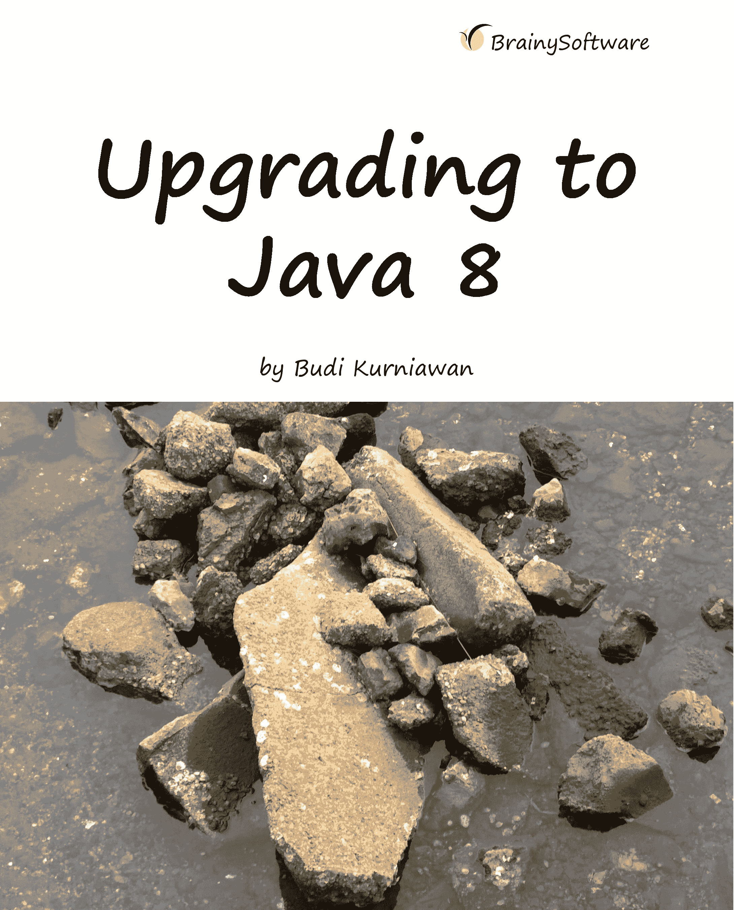

索引编制：Chris Mayle

## 商标

Oracle 和 Java 是 Oracle 和/或其关联机构的注册商标

UNIX 是 Open Group 的注册商标

Apache 是 The Apache Software Foundation 的商标。

Firefox 是 Mozilla Foundation 的注册商标。

Google 是 Google, Inc. 的商标。

在本书中，不带商标符号的商标名称打印仅用于编辑目的。我们无侵犯商标的意图。

换句话说，如果你需要将一个 `Runnable` 传递给 `java.util.concurrent.Executor`，如下所示：

```java
executor.execute(new Runnable() {
    @Override
    public void run() {
        System.out.println("Running...");
    }
});
```

你可以使用 lambda 表达式来产生相同的效果：

```java
executor.execute(() -> System.out.println("Running..."));
```

简洁明了。而且更加清晰且具表现力。

# 接口的更改

在我深入研究 lambda 表达式之前，我必须提到，从 Java 8 开始，你可以在接口中拥有 `default` 和 `static` 方法。这一节将解释什么是 `default` 方法和 `static` 方法，以及为什么 Java 语言需要这次重大重构，以便让 lambda 表达式能够融入 Java 核心类库中。

## 默认方法 (Default Methods)

扩展接口是向接口添加功能的安全方式。然而，你最终会得到两个具有相似功能的接口。如果你只需要扩展一个或两个接口，这是可以接受的。但如果你需要向数百个接口添加新功能，这确实会变成严重的问题。

这正是 Java 语言设计者在尝试为 Java 8 引入 lambda 表达式，并为 `Collection` 框架中的几十个接口添加 lambda 支持时所面临的问题。这些接口需要新方法来支持 lambda 表达式，但扩展所有接口将使接口数量翻倍，某些接口最终可能会带有如 `List2` 或 `ExtendedSet` 这样难看的名字。

相反，他们通过向语言中添加 `default` 方法解决了这个问题。接口中的 `default` 方法是带有实现的方法。实现该接口的类没有必须实现 `default` 方法，这意味着你可以在不破坏后兼容性的情况下向接口添加新方法。

要使接口中的方法成为默认方法，请在方法签名前添加 `default` 关键字。此外，不要用分号结束签名，而是添加一对括号并在括号内编写代码。这里是一个示例：

```java
default java.lang.String getDescription() {
    return "This is a default method";
}
```

正如你之后将学到的，`JDK 1.8` 中的许多 Java 接口现在都有 `default` 方法。

在扩展带有 `default` 方法的接口时，你有这些选项：

* 忽略 `default` 方法，实际上是继承它们，
* 重新声明 `default` 方法，使其变为抽象方法，
* 重写 `default` 方法。

记住，Java 现在支持 `default` 方法的主要由于是为了后兼容性。你绝不开始编写没有类的程序。

## 静态方法 (Static Methods)

类中的 `static` 方法由类的所有实例共享。在 Java 8 及更高版本中，你可以在接口中拥有 `static` 方法，这样所有与接口相关的静态方法都可以写在接口中，而不是辅助类中。

`static` 方法的签名与 `default` 方法相似。然而，你使用的不是 `default` 关键字而是 `static` 关键字。接口中的 `static` 方法默认是 `public` 的。

接口中的静态方法非常罕见。

## 函数式接口 (Functional Interfaces)

函数式接口是一个包含恰好一个抽象方法的接口。这是 lambda 表达式的基础。函数式接口可以使用 `@FunctionalInterface` 进行注解。

除了 `default` 和 `static` 方法外，还有另一个前提：`SAM`（单抽象方法）。函数式接口是一个恰好有一个抽象方法的接口。例如：

```java
public interface Calculator {
    int calculate(int a, int b);
}
```

你可以使用 lambda 表达式来实现此接口：

```java
Calculator addition = (a, b) -> a + b;
System.out.println(addition.calculate(5, 10)); // 输出 15

Calculator subtraction = (a, b) -> a - b;
System.out.println(subtraction.calculate(5, 10)); // 输出 -5

Calculator multiplication = (a, b) -> a * b;
System.out.println(multiplication.calculate(5, 10)); // 输出 50

Calculator division = (a, b) -> a / b;
System.out.println(division.calculate(5, 10)); // 输出 0
```

# Lambda 表达式

lambda 表达式的设计非常优雅。如果没有 lambda 表达式，实现相同的程序需要多少行代码？现在你已经熟悉了 lambda 表达式，我向你展示它的形式语法：

```java
(parameter list) -> expression
```

或者

```java
(parameter list) -> {
    statements
}
```

参数列表与抽象方法的参数列表相同。然而，每个参数的类型是可选的。换句话说，这两个表达式都是有效的：

```java
Calculator addition = (int a, int b) -> a + b;
Calculator addition = (a, b) -> a + b;
```

总结来说，lambda 表达式是定义函数式实现的快捷方式。lambda 表达式等同于函数式接口的实例。既然可以将对象作为参数传递给方法，也可以将 lambda 表达式传递给方法。

## 预定义的函数式接口

`java.util.function` 包是 `JDK 8` 中的一个新包。它包含了四十多个预定义的函数式接口，可以让你编写 lambda 表达式变得更容易。下表显示了一些预定义的函数式接口：

| 函数式接口 | 描述 |
| :--- | :--- |
| `Function` | 接受一个参数并返回结果的函数。 |
| `BiFunction` | 接受两个参数并返回结果的函数。 |
| `UnaryOperator` | 对单个操作数的操作，返回与操作数类型相同的结果。 |
| `BiOperator` | 对两个操作数的操作。 |
| `Predicate` | 一个接受参数并返回真或假的 `Function`。 |
| `Supplier` | 代表结果的提供者。 |
| `Consumer` | 接受一个参数且不返回结果的操作。 |

## 表 1.1: 核心函数接口

## Function, BiFunction 及其他变体

`Function` 接口用于创建一个接受一个参数并返回结果的函数。它是一个泛型类型，其定义如下：

```
public interface Function<T, R>
```

在这里，`T` 代表参数的类型，`R` 代表结果的类型。

`Function` 有一个抽象方法 `apply`，其签名如下：

```
R apply(T argument)
```

当你在使用 `Function` 时，需要重写这个方法。例如，代码列表 1.2 中的类定义了一个将英里转换为公里的 `Function`。该 `Function` 接受一个 `Integer` 作为参数，并返回一个 `Double`。

### 代码列表 1.2：`FunctionDemo1` 类

```
package app01.function;
import java.util.function.Function;

public class FunctionDemo1 {
    public static void main(String[] args) {
        Function<Integer, Double> milesToKms = 
                (input) -> 1.6 * input;
        int miles = 3;
        double kms = milesToKms.apply(miles);
        System.out.printf("%d miles = %3.2f kilometers\n", 
                miles, kms);
    }
}
```

如果你运行 `FunctionDemo1` 类，你将在控制台上看到以下内容：

```
3 miles = 4.80 kilometers
```

`Function` 的变体 `BiFunction` 接受两个参数并返回一个结果。代码列表 1.3 展示了 `BiFunction` 的示例。它使用 `BiFunction` 创建了一个根据宽度和长度计算面积的函数。通过调用其 `apply` 方法来执行该函数。

### 代码列表 1.3：`BiFunctionDemo1` 类

```
package app01.function;
import java.util.function.BiFunction;

public class BiFunctionDemo1 {
    public static void main(String[] args) {
        BiFunction<Float, Float, Float> area =
                (width, length) -> width * length;
        float width = 7.0F;
        float length = 10.0F;
        float result = area.apply(width, length);
        System.out.println(result);
    }
}
```

运行 `BiFunctionDemo1` 类会在控制台上打印此内容：

```
70.0
```

除了 `BiFunction` 之外，还有是 `Function` 的特化变体。例如，`IntFunction` 接口始终接受一个 `Integer`，并且对于结果类型只需要一个泛型类型。它的 `apply` 方法返回一个 `int`。

```
R apply(int input)
```

`LongFunction` 和 `DoubleFunction` 接口与 `IntFunction` 类似，但它们分别接受 `long` 和 `double` 作为参数。

此外，还有一些变体完全不需要泛型参数，因为它们是为特定的参数类型和特定的返回类型设计的。例如，`IntToDoubleFunction` 接口可以创建一个接受 `int` 并返回 `double` 的函数。该接口提供的不是 `apply` 方法，而是 `applyAsDouble` 方法。代码列表 1.4 给出了 `IntToDoubleFunction` 接口的示例。它是一个将摄氏度转换为华氏度的转换函数。

### 代码列表 1.4：`IntToDoubleFunctionDemo1` 类

```
package app01.function;
import java.util.function.IntToDoubleFunction;

public class IntToDoubleFunctionDemo1 {
    public static void main(String[] args) {
        IntToDoubleFunction celciusToFahrenheit = 
                (input) -> 1.8 * input + 32;
        int celcius = 100;
        double fahrenheit = 
                celciusToFahrenheit.applyAsDouble(celcius);
        System.out.println(celcius + "\u2103" + " = " 
                + fahrenheit + "\u2109\n");
    }
}
```

这是 `IntToDoubleFunctionDemo1` 的输出：

```
100° = 212.0°
```

与 `IntToDoubleFunction` 类似的还有 `LongToDoubleFunction` 和 `LongToIntFunction`。我相信你能从它们的名字看出它们的作用。

`UnaryOperator` 接口是 `Function` 的另一个特化版本，其操作数类型与返回类型相同。其声明如下：

```
public interfaceUnaryOperator<T> extends Function<T,T>
```


`BinaryOperator`是`BiFunction`的特化版本。`BinaryOperator`表示一个有两个相同类型操作数的操作，并返回一个与操作数类型相同的结果。

## Predicate

`Predicate`是接受参数并根据参数值返回`true`或`false`的函数。它有一个名为`test`的抽象方法。

例如，代码列表 1.5 中的`PredicateDemo1`类定义了一个`Predicate`，用于评估字符串输入，如果字符串中的每个字符都是数字，则返回`true`。

### 代码列表 1.5：`PredicateDemo1`类

```
package app01.function;
import java.util.function.Predicate;

public class PredicateDemo1 {
    public static void main(String[] args) {
        Predicate<String> numbersOnly = (input) -> {
            for (int i = 0; i < input.length(); i++) {
                char c = input.charAt(i);
                if ("0123456789".indexOf(c) == -1) {
                    return false;
                }
            }
            return true;
        };

        System.out.println(numbersOnly.test("12345")); // true
        System.out.println(numbersOnly.test("100a")); // false
    }
}
```

## Supplier

`Supplier`不接受参数并返回一个值。实现类必须重写其抽象方法`get`。

代码列表 1.6 展示了`Supplier`的示例。它定义了一个返回随机数字的`Supplier`，并使用循环打印五个数。

### 代码列表 1.6：`SupplierDemo1`类

```
package app01.function;
import java.util.Random;
import java.util.function.Supplier;

public class SupplierDemo1 {
    public static void main(String[] args) {
        Supplier<Integer> oneDigitRandom = () -> {
            Random random = new Random();
            return random.nextInt(10);
        };
        for (int i = 0; i < 5; i++) {
            System.out.println(oneDigitRandom.get());
        }
    }
}
```

`Supplier`还有特化变体，如`DoubleSupplier`（返回`Double`）、`IntSupplier`和`LongSupplier`。

## Consumer

`Consumer`是一个不返回结果的操作。它有一个名为`accept`的抽象方法。

代码列表 1.7 展示了一个`Consumer`的示例，它接受一个字符串并将其居中打印。

### 代码列表 1.7：Consumer 示例

```
package app01.function;
import java.util.function.Consumer;
import java.util.function.Function;

public class ConsumerDemo1 {
    public static void main(String[] args) {
        Function<Integer, String> spacer = (count) -> {
            StringBuilder sb = new StringBuilder(count);
            for (int i = 0; i < count; i++) {
                sb.append(" ");
            }
            return sb.toString();
        };

        int lineLength = 60; // characters
        Consumer<String> printCentered = 
                (input) -> {
                    int length = input.length();
                    String spaces = spacer.apply(
                            (lineLength - length) / 2);
                    System.out.println(spaces + input);
                };

        printCentered.accept("A lambda expression a day");
        printCentered.accept("makes you");
        printCentered.accept("look smarter");
    }
}
```

代码列表 1.7 中的示例包含一个`Consumer`，它接受一个字符串并在前面添加特定数量的空格后打印。`Consumer`的`accept`方法实现由这个 Lambda 表达式提供：

```
(input) -> {
    int length = input.length();
    String spaces = spacer.apply(
            (lineLength - length) / 2);
    System.out.println(spaces + input);
}
```

```
Function<Integer, String> spacer = (count) -> {
    StringBuilder sb = new StringBuilder(count);
    for (int i = 0; i < count; i++) {
        sb.append(" ");
    }
    return sb.toString();
};
```

该函数使用一个`for`循环，向`StringBuilder`中添加`count`次空格，其中`count`是函数的参数。当循环退出时，它返回`StringBuilder`的`String`表示形式。

如果你运行`ConsumerDemo1`类，你将在控制台上看到以下内容：

```
A lambda expression a day
                         makes you
                        look smarter
```

### 总结

Lambda 表达式是 Java 8 的新特性，它可以使某些结构变得更短且易于读，特别是当你处理内部类时。本章讨论了 lambda 表达式、函数式接口、预定义的函数接口以及方法引用。

# 第 2 章

## 方法引用

在第 1 章中，你学习了 lambda 表达式。本章将讨论方法引用，这是 lambda 表达式的一个子功能，可以使编写 lambda 表达式变得更加简单。

## 概述

许多 Java 方法接受函数式接口作为参数。例如，`java.util.Arrays`中的`sort`方法之一接受`Comparator`实例，而`Comparator`就是一个函数式接口。`sort`方法的签名如下：

```
public static T[] sort(T[] array, Comparator<? super T> comparator)
```

与其向`sort`方法传递`Comparator`的实现，不如传递一个 lambda 表达式。你在上一节已经看到过如何这样做。

现在，你可以更进一步，通过传递方法引用来代替 lambda 表达式。方法引用简单就是类名或对象引用后跟着双冒号运算符（`::`）和方法名。

你为什么想要使用方法引用？有两个原因：

1. 方法引用的语法比 lambda 表达式更短，因为方法引用不包含像 lambda 表达式那样的定义。方法体定义在其他地方。

2. 你可以使用现有的方法，从而促进代码复用。

你可以使用静态方法、实例方法甚至构造函数的引用。你使用双冒号（`::`，这是 Java 8 中的一个新运算符）来分隔类名/对象引用与方法/构造函数名。封装所引用方法的类不需要实现该函数式接口。

方法引用的语法是以下之一：

```
ClassName::staticMethodName
ContainingType::instanceMethod
objectReference::methodName
ClassName::new
```

接下来的章节将分别讨论每种类型的方法引用。

### 静态方法的引用

如果静态方法与函数式接口的抽象方法具有兼容的返回类型和参数参数类型，那么静态方法的引用可以作为参数传递给期望函数式接口的方法。

作为此主题的第一个示例，考虑列表 2.1 中的`NoMethodRef`类，它说明了在没有方法引用的情况下使用函数式接口。该类定义了一个名为`StringListFormatter`的函数式接口，它接收一个`String`列表并对字符串进行格式化。`format`方法是接口的抽象方法，接受一个分隔符和一个`String`列表。还有一个`formatAndPrint`静态方法，它接收`StringListFormatter`实例、一个分隔符和一个`String`列表。该方法反过来调用`StringListFormatter`的`format`方法并打印格式化后的列表。

列表 2.1：NoMethodRef 类

```
package app02.methodref;
import java.util.Arrays;
import java.util.List;

public class NoMethodRef {

    @FunctionalInterface
    interface StringListFormatter {
        String format(String delimiter, List<String> list);
    }

    public static void formatAndPrint(StringListFormatter formatter, 
            String delimiter, List<String> list) {
        String formatted = formatter.format(delimiter, list);
        System.out.println(formatted);
    }

    public static void main(String[] args) {
        List<String> names = Arrays.asList("Don", "King", "Kong");

        StringListFormatter formatter =
                (delimiter, list) -> {
                    StringBuilder sb = new StringBuilder(100);
                    int size = list.size();
                    for (int i = 0; i < size; i++) {
                        sb.append(list.get(i));
                        if (i < size - 1) {
                            sb.append(delimiter);
                        }
                    }
                    return sb.toString();
                };
        formatAndPrint(formatter, ", ", names);
    }
}
```

`NoMethodRef`中的`main`方法构建了一个包含三个元素的字符串列表，并使用此 lambda 表达式创建了`StringListFormatter`的实现。

```
StringListFormatter formatter =
        (delimiter, list) -> {
            StringBuilder sb = new StringBuilder(100);
            int size = list.size();
            for (int i = 0; i < size; i++) {
                sb.append(list.get(i));
                if (i < size - 1) {
                    sb.append(delimiter);
                }
            }
            return sb.toString();
        };
```

基本上，它遍历`List`并在两个元素之间添加分隔符。最后一个元素后不会添加分隔符。

然后`main`方法调用`formatAndPrint`方法，传递 lambda 表达式、分隔符和字符串列表。如果你运行`NoMethodRef`，你将看到格式化后的列表：

```
Don, King, Kong
```

在花费二分钟编写代码后，你发现该 lambda 表达式与`String`类的`join`方法的功能相同。这是 Java 8 添加到`String`类中的静态方法。其一个签名如下：

```
public static String join(CharSequence delimiter,
        Iterable extends CharSequence> elements)
```

将其与列表 2.1 中函数式接口的`format`方法进行对比：

```
public String format(java.lang delimiter, 
        java.util.List<String> list);
```

由于`List`实现了`Iterable`且`String`实现了`CharSequence`，`join`与`format`。

方法引用允许你复用现有实现，例如`String.join()`。因此，你可以重写`NoMethodRef`类以使用`String.join()`的引用。这在列表 2.2 的`MethodReferenceDemo1`类所示。

列表 2.2：MethodReferenceDemo1 类

```
package app02.methodref;
import java.util.Arrays;
import java.util.List;

public class MethodReferenceDemo1 {

    @FunctionalInterface
    interface StringListFormatter {
        String format(String delimiter, List<String> list);
    }

    public static void formatAndPrint(StringListFormatter formatter, 
            String delimiter, List<String> list) {
        String formatted = formatter.format(delimiter, list);
        System.out.println(formatted);
    }

    public static void main(String[] args) {
        List<String> names = Arrays.asList("Don", "King", "Kong");
        formatAndPrint(String::join, ", ", names);
    }
}
```


你仍然拥有相同的`StringListFormatter`接口和相同的`formatAndPrint`方法。然而，`main`方法不再包含实现`StringListFormatter`的 lambda 表达式。相反，你使用`String::join`作为`StringListFormatter`的实现。

```
formatAndPrint(String::join, ", ", names);
```

顺便提一下，注意`StringListFormatter`中的抽象方法接受两个参数并返回一个值。这是`BiFunction`的理想候选者。列表 2.3 中的`WithBiFunction`类是`MethodReferenceDemo1`类的重写，它完全消除了`StringListFormatter`接口。`formatAndPrint`方法也经过修改以接受一个`BiFunction`作为其第一个参数。

### 列表 2.3：`WithBiFunction`类

```java
package app02.methodref;
import java.util.Arrays;
import java.util.List;
import java.util.function.BiFunction;

public class WithBiFunction {

    public static void formatAndPrint(
            BiFunction<String, List<String>, String> formatter, 
            String delimiter, List<String> list) {
        String formatted = formatter.apply(delimiter, list);
        System.out.println(formatted);
    }

    public static void main(String[] args) {
        List<String> names = Arrays.asList("Don", "King", "Kong");
        formatAndPrint(String::join, ", ", names);
    }
}
```

### 引用对象引用可用的实例方法

此类方法引用的兼容性规则与静态方法引用的规则相同。被引方法必须与被替换的函数式接口的抽象方法具有兼容的返回值和参数。

例如，在 JDK 1.8 中，`java.lang.Iterable`接口有一个名为`forEach`的默认方法，它接受一个`Consumer`：

```java
default void forEach(java.util.function.Consumer<? super T> action)
```

`forEach`为`Iterable`的每个元素执行给的操作。得益于继承，该方法被其子接口`List`继承，我将在列表 2.4 的示例中使用它。

### 列表 2.4：在对象中引用实例方法

```java
package app02.methodref;
import java.util.Arrays;
import java.util.List;

public class MethodReferenceDemo2 {
    public static void main(String[] args) {
        List<String> fruits = Arrays.asList("Apple", "Banana");
        // 使用 lambda 表达式
        fruits.forEach((name) -> System.out.println(name));

        // 使用方法引用
        fruits.forEach(System::out::println);
    }
}
```

`MethodReferenceDemo2`类有一个需要打印的水果列表。你可以通过调用`forEach`方法来实现这一点，并如下所示以 lambda 表达式的形式传递`Consumer`：

```java
fruits.forEach((name) -> System.out.println(name));
```

或者，由于`System.out`是系统已经为你创建的现有对象，你可以使用方法引用指向`System.out`上的`println`方法。

```java
fruits.forEach(System.out::println);
```

### 引用对象引用不可用的实例方法

坐稳了。这一个有点复杂，需要你全神贯注。

你可以将实例方法的引用作为方法参数传递，以替换函数式接口。在这种情况下，你不需要显式地创建所属类的实例。此类方法引用的语法与第一、二类方法引用不同。对于前二类方法引用，参数的数量必须与函数式接口抽象方法预期的参数数量相同。当使用没有对象引用的实例方法时，被引方法的参数数量必须比函数式接口抽象方法预期的参数数量少一个。因此，如果函数式接口的抽象方法接受四个参数，则被引实例方法只需要三个参数，且这些参数必须与抽象方法的第二、第三和第四参数兼容。此外，抽象方法的第一个参数必须是与包含该实例方法的类兼容的类型。

此类方法引用的兼容性规则如下所示。第一行是函数式接口抽象方法的伪签名，第二行是被引实例方法的伪签名。

```
returnType abstractMethod(type-1, type-2, type-3, type-4)
returnType instanceMethod(type-2, type-3, type-4)
```

在这里，`type-1`必须与包含该实例方法的类兼容，因为该类将被实例化，并且该实例将与其他参数一起作为第一个参数传递给抽象方法。

在看了这种方法引用的示例后，这一点将会变得清晰。

### 列表 2.5：`MethodReferenceDemo3`类

```java
package app02.methodref;
import java.util.Arrays;

public class MethodReferenceDemo3 {

    public static void main(String[] args) {
        String[] names = {"Alexis", "anna", "Kyleen"};

        Arrays.sort(names, String::compareToIgnoreCase);
        for (String name : names) {
            System.out.println(name);
        }
    }
}
```

列表 2.5 中的示例展示了如何向`Arrays.sort`传递实例方法引用以代替`Comparator`。`MethodReferenceDemo3`类包含一个字符串数组，其中没有严格遵守大小写敏感。如果你使用只接受一个参数的`Arrays.sort`重载版本来对此数组排序，名称将排序为：

```
Alexis, Kyleen, anna
```

这不是你想要的。因此，你需要使用同样接受`Comparator`的`Arrays.sort`：

```
public static <T> void sort(T[] array, Comparator<? super T> c)
```

示例展示了如何使用实例方法引用`String.compareIgnoreCase`来替换`Comparator`（记得`Comparator`是一个函数式接口）。这里是`String.compareToIgnoreCase`的签名。

```java
public int compareToIgnoreCase(String str)
```

它比`Comparator.compare`的签名少一个参数。

```
int compare(String str1, String str2)
```

这对于第二类方法引用非常完美。

如果你运行代码，你会发现名称被正确排序了。这里是结果。

```
Alexis
anna
Kyleen
```

### 引用构造函数

第四类方法引用使用构造函数。构造函数引用的语法如下：

```
ClassName::new
```

假设你需要一个方法将`Integer`数组转换为`Collection`，并且你需要确定结果集合是`List`还是`Set`。为此，你可以在列表 2.6 中创建`arrayToCollection`方法。

### 列表 2.6：`MethodReferenceDemo4`类

```java
package app02.methodref;
import java.util.ArrayList;
import java.util.Collection;
import java.util.HashSet;
import java.util.function.Supplier;

public class MethodReferenceDemo4 {

    public static Collection<Integer> arrayToCollection(
            Supplier<Collection<Integer>> supplier, Integer[] 
                numbers) {
        Collection<Integer> collection = supplier.get();
        for (int i : numbers) {
            collection.add(i);
        }
        return collection;
    }

    public static void main(String[] args) {
        Integer[] array = {1, 8, 5};
        Collection<Integer> col1 
                = arrayToCollection(ArrayList<Integer>::new, array);
        System.out.println("Natural order");
        col1.forEach(System.out::println);
        System.out.println("=======================");
        System.out.println("Ascending order");
        Collection<Integer> col2 
                = arrayToCollection(HashSet<Integer>::new, array);
        col2.forEach(System.out::println);
    }
}
```

与其将此 lambda 表达式作为方法的第一个参数传递。

```java
() -> new ArrayList<Integer>()
```

你只需要传递此`ArrayList`构造函数的引用。

```
ArrayList<Integer>::new
```

以及，而不是这个

```
() -> new HashSet<Integer>()
```

你可以写成

```
HashSet<Integer>::new
```

如果你运行该示例，你将在控制台上看到以下内容。

```
Natural order
1
8
5
=======================
Ascending order
1
5
8
```

关于构造函数引用的更多示例，可以在第 4 章“Stream API”中找到。

### 总结

Java 8 的一项新功能`lambda expressions`可以让某些结构变得更短更具可读性，特别是当你在处理内部类时。本章讨论了方法引用，这是一种可以使编写 lambda 表达式的子功能。

# 第 3 章：Optional 及相似类

Java 程序员多年来一直在处理`null pointer exceptions`（空指针异常）。在 Java 8 中，处理它们有一种新方法：通过将可能为空的对象封装在一个名为`Optional`的类中。本章涵盖了`Optional`以及相似类。

## 概述

Java 8 增加了`Optional`、`OptionalInt`、`OptionalLong`和`OptionalDouble`类来处理`NullPointerExceptions`。这些类作为`java.util`包的一部分，是大量使用 lambda 表达式和方法引用的优秀范例。

这四个类非常相似，而`Optional`是其中最重要的，因为它可以用于任何类型，而其他类分别仅适用于整数、`longs`或`doubles`。因此，`Optional`是本章的重点。

`Optional`是一个用于可能为空的值的容器。正如你现在所知的，尝试在空引用变量上调用方法或字段会抛出`NullPointerException`。处理空并不困难，但可能会很繁琐。考虑列表 3.1 中的代码，它展示了一个`Company`类，它可以拥有一个`Office`，而`Office`又可以拥有`Address`。为了简单起见，这里的`Address`只包含两个字段：`street`和`city`。所有这些属性都可以为空。一个`Company`可能没有`Office`，而一个`Address`可能没有关于`street`和`city`的完整数据。

### 列表 3.1：检查空值的繁琐方法

```java
package app03.optional1;

class Company {
    private String name;
    private Office office;
    public Company(String name, Office office) {
        this.name = name;
        this.office = office;
    }

    public String getName() {
        return name;
    }

    public Office getOffice() {
        return office;
    }
}

class Office {
    private String id;
    private Address address;

    public Office(String id, Address address) {
        this.id = id;
        this.address = address;
    }

    public String getId() {
        return id;
    }

    public Address getAddress() {
        return address;
    }
}

class Address {
    private String street;
    private String city;

    public Address(String street, String city) {
        this.street = street;
        this.city = city;
    }

    public String getStreet() {
        return street;
    }

    public String getCity() {
        return city;
    }
}

public class OptionalDemo1 {

    public static void main(String[] args) {
        Address address1 = new Address(null, "New York");
        Office office1 = new Office("OF1", address1);
        Company company1 = new Company("Door Never Closed",
            office1);

        // company1 的街道地址是什么？
        // company1 位于哪个城市？
        String streetAddress = null;
        String city = null;
        if (company1 != null) {
            Office office = company1.getOffice();
            if (office != null) {
                Address address = office.getAddress();
                if (address != null) {
                    streetAddress = address.getStreet();
                    city = address.getCity();
                }
            } 
        }
        System.out.println("Street Name:" + streetAddress);
        System.out.println("City:" + city);
    }
}
```


列表 3.1 中的`OptionalDemo1`类创建了一个用于测试的`Company`，并尝试获取该公司的街道地址。意识到任何字段都可能为空，程序员有意识地尝试在对实例调用方法之前对每个单独实例进行空值测试，导致了如下代码：

```
        if (company1 != null) {
            Office office = company1.getOffice();

            if (office != null) {
                Address address = office.getAddress();
                if (address != null) {
                    streetAddress = address.getStreet();
                    city = address.getCity();
                }
            } 
        }
```

这有点很繁琐，且可读性受损。

`Optional`类可以提供帮助。如果你决定使用它，你可以将每个可能为空的字段封装在`Optional`中。例如，`Company`中的`office`字段现在应该是：

```java
 private Optional<Office> office;
```

而`Address`中的`city`字段应该是

```java
 private Optional<String> city;
```

在学习如何使用`Optional`重写列表 3.1 中的示例之前，请先看表 3.1 中`Optional`的方法。

| 方法 | 描述 |
| :--- | :--- |
| `empty` | 返回一个空的`Optional` |
| `filter` | 如果值存在并匹配给定的谓词，则返回一个描述该值的`Optional`。否则，返回一个空的`Optional`。 |
| `flatMap` | 如果值存在，对该值应用指定的映射函数，并返回一个描述映射结果的`Optional`。如果值不存在，返回一个空的`Optional`。 |
| `get` | 如果值存在，则返回值。否则，抛出`NoSuchElementException`。 |
| `ifPresent` | 如果值存在，则调用给定的`Consumer`。 |
| `isPresent` | 如果值存在，则返回 true。否则，返回 false。 |
| `map` | 如果值存在，则对它应用给定的映射函数。如果结果不为空，返回一个描述结果的`Optional`。 |
| `of` | 返回描述给定非空值的`Optional`。 |
| `ofNullable` | 如果给定值不为空，则返回描述该值的`Optional`。如果值为空，返回一个空的`Optional`。 |
| `orElse` | 如果值存在，则返回值。否则，返回指定的值。 |

表 3.1：Optional 的重要方法

```java
 package app03.optional2;
import java.util.Optional;

class Company {
    private String name;
    private Optional<Office> office;

    public Company(String name, Optional<Office> office) {
        this.name = name;
        this.office = office;
    }

    public String getName() {
        return name;
    }

    public Optional<Office> getOffice() {
        return office;
    }
}

class Office {
    private String id;
    private Optional<Address> address;

    public Office(String id, Optional<Address> address) {
        this.id = id;
        this.address = address;
    }

    public String getId() {
        return id;
    }

    public Optional<Address> getAddress() {
        return address;
    }
}

class Address {
    private Optional<String> street;
    private Optional<String> city;

    public Address(Optional<String> street, Optional<String> city) {
        this.street = street;
        this.city = city;
    }

    public Optional<String> getStreet() {
        return street;
    }

    public Optional<String> getCity() {
        return city;
    }
}

public class OptionalDemo2 {
    public static void main(String[] args) {
        Optional<Address> address1 = Optional.of(
                new Address(Optional.ofNullable(null), 
                        Optional.of("New York")));
        Optional<Office> office1 = Optional.of(
                new Office("OF1", address1));

        Optional<Company> company1 = Optional.of(
                new Company("Door Never Closed", office1));

        // company1 的街道地址是什么的？
        // company1 位于哪个城市？
        Optional<Office> maybeOffice = 
                company1.flatMap(Company::getOffice);
        Optional<Address> maybeAddress = 
                maybeOffice.flatMap(Office::getAddress);
        Optional<String> maybeStreet = 
                maybeAddress.flatMap(Address::getStreet);
        maybeStreet.ifPresent(System.out::println);
        if (maybeStreet.isPresent()) {
            System.out.println(maybeStreet.get());
        } else {
            System.out.println("未找到街道");
        }

        // 更简短的方法
        String city = company1.flatMap(Company::getOffice)
            .flatMap(Office::getAddress)
            .flatMap(Address::getCity)
            .orElse("未找到城市");
        System.out.println("City: " + city);

        // 仅当城市不为空时打印
        company1.flatMap(Company::getOffice)
                .flatMap(Office::getAddress)
                .flatMap(Address::getCity)
                .ifPresent(System.out::println);
    }
}
```

`OptionalDemo2`类展示了如何获取公司的街道和城市，首先通过将每次`flatMap`调用的返回值赋值给变量，然后通过链式调用。

### OptionalInt, OptionalLong 和 OptionalDouble

`OptionalInt`、`OptionalLong`和`OptionalDouble`类包含了`Optional`提供的方法的子集。例如，它们拥有这些方法：`empty`、`ifPresent`、`isPresent`和`of`。`of`接收一个基本类型，由于基本类型不能为空，因此没有`ofNullable`方法。也没有`get`方法。相反，`OptionalInt`有一个`getAsInt`方法，`OptionalLong`有一个`getAsLong`方法，而`OptionalDouble`有一个`getAsDouble`方法。也没有`filter`、`flatMap`和`map`方法。

### 总结

Java 程序员必须在代码的到处处理空指针异常。Java 8 引入了`Optional`和类似的类，作为处理空指针异常的新强大方法。在本章中，你已经学习了如何使用`Optional`。

# 第 4 章

## Stream API

在本章中，你将学习`Stream API`，这是 JDK 8 的新特性。为了理解本章的主题，你需要知道如何使用`Lambda 表达式`以及`java.util.function`中的预定义函数接口，这两者在第 1 章“Lambda 表达式”中都讨论过。

## 概述

流（stream）就像一个管道，但它传输的不是水或油，而是从源传输到目的地的数据。根据传输模式的不同，流可以是顺序的，也可以是并行的。如果程序运行的计算机具有多核 CPU，那么并行流将特别有用。

初看之下，流看起来像集合（collection）。然而，流并不是存储对象的数据结构，它只移动对象。因此，你不能像操作集合那样向流中添加元素。

使用流的主要原因是它支持顺序和并行聚合操作。例如，你可以轻松地过滤、排序或映射流中的元素。

`Stream API`由`java.util.stream`包中的类型组成。`Stream`接口是最频繁使用的流类型。`Stream`可用于传输任何类型的对象。还有`Stream`的特化类型：`IntStream`、`LongStream`和`DoubleStream`。所有四种流类型都派生自`BaseStream`。

表 4.1 显示了`Stream`接口中定义的一些方法。

| 方法 | 描述 |
| :--- | :--- |
| `concat` | 惰性地连接或链接两个流。返回一个新流，其元素是第一个流的元素后跟第二个流。 |
| `count` | 返回流的数量。 |
| `empty` | 创建并返回一个空流。 |
| `filter` | 返回一个包含匹配给定谓词的流元素的流。 |
| `forEach` | 对流的每个元素执行操作。 |
| `limit` | 返回一个包含流中指定数量元素的流。 |
| `map` | 返回一个由将函数应用于流元素后的结果组成的流。 |
| `max` | 根据给定的比较器返回流的最大元素。 |
| `min` | 根据给定的比较器返回流的最小元素。 |
| `of` | 返回一个源自给定值的流。 |
| `reduce` | 使用恒等和累加器对流进行归约。 |
| `sorted` | 返回一个按自然顺序排列流元素的流。 |
| `toArray` | 返回一个包含流中元素的数组。 |

表 4.1：Stream 的重要方法

某些 Stream 方法执行中间操作，而某些执行终端操作。中间操作将流转换为另一个流。`filter`、`map`和`sorted`是执行中间操作的方法示例。终端操作产生结果或产生副作用。`count`和`forEach`是执行终端操作的方法。

值得注意的是，流是惰性的。只有在启动终端操作时，才会对源进行计算。

Stream 的方法将在后面的章节中详细介绍。

## 创建和获取流

你可以使用`Stream`的静态方法`of`来创建一个顺序流。例如，以下代码段创建一个包含三个元素的`Integer` `Stream`。

```java
 Stream<Integer> stream = Stream.of(100, 200, 300);
```

或者，你可以将数组传递给`of`方法：

```java
 String[] names = {"Bart", "Lisa", "Maggie"};
Stream<String> stream = Stream.of(names);
```

`java.util.Arrays`工具类现在有一个`stream`方法用于将数组转换为顺序流。例如，你可以使用`Arrays`重写上面的代码来从数组创建 Stream。

```java
 String[] names = {"Bart", "Lisa", "Maggie"};
Stream<String> stream = Arrays.stream(names);
```

此外，`java.util.Collection`接口也有名为`stream`和`parallelStream`的默认方法，分别返回顺序流或并行流，并集合为源。它们的签名如下。

```java
 default java.util.stream.Stream<E> stream()
default java.util.stream.Stream<E> parallelStream()
```

多亏于`Collection`中的这些方法，从`List`或`Set`获取`Stream`是轻而易举。

此外，`java.nio.file.Files`类提供了两个返回`Stream<Path>`的方法：`list`和`walk`。`list`返回一个指向给定路径下条目的`Paths`的`Stream`。另一方面，`walk`会遍历给定路径中的条目，并将它们作为流的形式返回。

`Files`还包含一个`lines`方法，该方法可以将文本文件中所有的行作为`Stream<String>`返回。

例如，列表 4.1 中的`ObtainStreamDemo`类展示了如何从`Files`类获取流。

### 列表 4.1：ObtainStreamDemo 类

```java
 package app04;
import java.io.IOException;
import java.nio.file.Files;
import java.nio.file.Path;
import java.nio.file.Paths;
import java.util.stream.Stream;

public class ObtainStreamDemo {

    public static void main(String[] args) {
        Path path = Paths.get(".");
        try {
            Stream<Path> list = Files.list(path);
            list.forEach(System.out::println);
        } catch (IOException ex) {
            ex.printStackTrace();
        }
    }
}
```

列表 4.1 中的代码构建了一个引用当前目录（即运行 Java 程序的目录）的`Path`，并将其传递给`Files.list`。该方法返回一个`Paths`的`Stream`。随后代码在`Stream`上调用`forEach`方法，传递一个打印每个条目的`Consumer`。如果你运行该代码，你将在控制台上看到当前路径下的所有条目打印。

### 合并流

`Stream`接口提供了一个`concat`方法，用于惰性地合并或链接两个流。该方法返回一个新的流，其元素包含第一个流的所有元素，紧随其的是第二个流的所有元素。

列表 4.2 中的代码展示了如何合并两个`String`类型的`Stream`并对其进行排序。

### 列表 4.2：合并流


```java
package app04;
import java.util.stream.Stream;

public class StreamConcatDemo {
    public static void main(String[] args) {
        Stream<String> stream1 = 
                Stream.of("January", "Christie");
        Stream<String> stream2 = 
                Stream.of("Okanagan", "Sydney", "Alpha");
        Stream.concat(stream1, stream2).sorted().
                forEach(System.out::println);
    }
}
```

如果你运行列表 4.2 中的`StreamConcatDemo`类，你将在控制台上看到以下输出。

```
Alpha
Christie
January
Okanagan
Sydney
```

## 过滤

当你过滤流时，你根据某些标准选择流中的元素，并为所选元素返回一个新的`Stream`。你通过在`Stream`对象上调用`filter`方法来过滤流，并传递一个`Predicate`。`Predicate`决定一个元素是否包含在新的流中。

以下是`filter`方法的签名。

```java
Stream<T> filter(java.util.function.Predicate<? super T> predicate)
```

例如，列表 4.3 中的代码读取列表 4.4 中的`example.txt`文件，并允许通过非空且不是注释的行。在移除所有尾部空格后，注释行以哈希符号（`##`）开头。

### 列表 4.3：StreamFilterDemo1 类

```java
package app04;
import java.io.BufferedReader;
import java.io.FileReader;
import java.io.IOException;
import java.util.function.Predicate;
import java.util.stream.Stream;

public class StreamFilterDemo1 {
    public static void main(String[] args) {
        Predicate<String> notCommentOrEmptyLine
                = (line) -> line.trim().length() > 0
                && !line.trim().startsWith("#");
        try (FileReader fr = new FileReader("example.txt");
                BufferedReader br = new BufferedReader(fr)) {
            Stream<String> lines = br.lines();
            lines.filter(notCommentOrEmptyLine)
                    .forEach(System.out::println);
        } catch (IOException e) {
            e.printStackTrace();
        }
    }
}
```

### 列表 4.4：example.txt 文件

```bash
# Set path so it includes user's private bin if it exists
if [ -d "$HOME/bin" ] ; then
    PATH="$HOME/bin:$PATH"

fi
```

如果你运行列表 4.3 中的类，你将在控制台上看到这些行。它打印了文本文件中五行中的三行。

```
if [ -d "$HOME/bin" ] ; then
    PATH="$HOME/bin:$PATH"
fi
```

作为第二个示例，列表 4.5 中的类展示了你如何使用流在你的计算机上进行文件搜索。更准确地说，该代码显示了位于给定目录及其任何子目录下的所有 java 文件。

### 列表 4.5：StreamFilterDemo2 类

```java
package app04;
import java.io.IOException;
import java.nio.file.Files;
import java.nio.file.Path;
import java.nio.file.Paths;
import java.util.stream.Stream;

public class StreamFilterDemo2 {
    public static void main(String[] args) {
        // find all java files in the parent directory and
        // all its subdirectories
        Path parent = Paths.get("..");
        try {
            Stream<Path> list = Files.walk(parent);
            list.filter((Path p) -> p.toString().endsWith(".java"))
                    .forEach(System.out::println);
        } catch (IOException ex) {
            ex.printStackTrace();
        }
    }
}
```

`StreamFilterDemo2`类首先构建一个指向当前目录父目录的`Path`。然后它将该`Path`传递给`Files.walk`以获取`Paths`的`Stream`并将结果赋值给本地变量`list`。接下来，它使用一个`Predicate`过滤流，包含所有名称以`.java`结尾的`Paths`，并调用`forEach`方法打印路径。

## 映射

`Stream`接口的`map`方法通过将元素传递给函数将流中的每个元素映射为结果。以下是`map`的签名。

```java
<R> Stream<R> map(java.util.function.Function<? super T,
        ? extends R>)
```

从签名中可以看出，`map`方法返回一个新的`Stream`，其元素类型可能与当前流的元素类型不同。

考虑列表 4.6 中的代码，它展示了一个更实用、更真实的流示例，用于计算公司所有员工的平均年龄。它分两个步骤完成：首先，调用`map`方法将`Employee`对象的`Stream`转换为`Period`对象的`Stream`。新流中的每个`Period`元素包含今天到每个员工生日之间的间隔。换句话说，每个`Period`元素包含一个员工的年龄。在第二步中，代码调用`mapToLong`方法计算所有员工的平均年龄。

### 列表 4.6：StreamMapDemo 类

```java
package app04;
import java.time.LocalDate;
import java.time.Month;
import java.time.Period;
import java.util.stream.Stream;

public class StreamMapDemo {
    class Employee {
        public String name;
        public LocalDate birthday;
        public Employee(String name, LocalDate birthday) {
            this.name = name;
            this.birthday = birthday;
        }
    }

    public Employee[] getEmployees() {
        Employee[] employees = { 
            new Employee("Will Biteman", 
                    LocalDate.of(1984, Month.JANUARY, 1)), 
            new Employee("Sue Everyman", 
                    LocalDate.of(1980, Month.DECEMBER, 25)),
            new Employee("Ann Wangi",
                    LocalDate.of(1976, Month.JULY, 4)),
            new Employee("Wong Kaching",
                    LocalDate.of(1980, Month.SEPTEMBER, 1))
        };
        return employees;
    }

    public double calculateAverageAge(Employee[] employees) {
        LocalDate today = LocalDate.now();
        Stream<Employee> stream = Stream.of(employees);
        Stream<Period> periods = stream.map(
                (employee)-> Period.between(
                        employee.birthday, today));
        double avgAge = periods.mapToLong(
                (period)->period.toTotalMonths())
                .average().getAsDouble() / 12;
        return avgAge;
    }

    public static void main(String[] args) {
        StreamMapDemo demo = new StreamMapDemo();
        Employee[] employees = demo.getEmployees();
        double avgAge = demo.calculateAverageAge(employees);
        System.out.printf("Average employee age : %2.2f\n",
                avgAge);
    }
}
```

如果你运行`StreamMapDemo`类，你将看到员工的平均年龄。当然，结果取决于你运行程序的时间。在我写这本书时，我在电脑上运行它，得到了如下结果。

```
Average employee age : 34.13
```

## 规约 (Reduction)

`Stream`中更有用的方法之一是`reduce`，它可以执行规约操作。该方法有两个重载版本：

```java
java.util.Optional<T> reduce(java.util.function.BinaryOperator<T> 
        accumulator)
T reduce(T identity,
        java.util.function.BinaryOperator<T> accumulator)
```

观察这两个签名，你可能会注意到`reduce`方法在指定的`BinaryOperator`帮助下，将类型为`T`的`Stream`规约类型类型`T`的单个实例。尽管 Java 文档中的描述并不那么直观，但实际上这个方法并没有那么难以理解。

图 4.1 显示了当一个包含四个元素的顺序流正在被规约时，后台发生了什么。

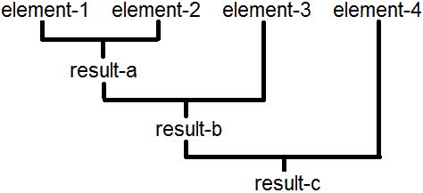

图 4.1: 规约流

首先，`element-1`和`element-2`被用作指定二元运算符的操作数。该操作的结果是一个与元素相同类型的对象，我称之为`result-a`。接下来，`result-a`和`element-3`被传递给二元运算符，产生`result-b`，它再次具有与元素相同的类型。最后，`result-b`和`element-4`被传递给二元运算符，返回`result-c`。由于流中没有更多元素，`result-c`作为规约的结果被返回。

对于并行流，操作可以并行执行。这意味着对`element-1`和`element-2`的操作可能与对`element-3`和`element-4`的操作同时发生，然后将第一次操作的结果和第二次操作的结果传递给二元运算符并返回其结果。

好了。现在让我们来看一个例子。

列表 4.7 中的`StreamReductionDemo1`类展示了一个包含四个`Order`对象的`Stream`，它被规约为了单个`Order`对象，该对象是最近放置的且值最大的`Order`。

### 列表 4.7：StreamReductionDemo1 类


```java
package app04;
import java.time.LocalDate;
import java.time.Month;
import java.util.Optional;
import java.util.stream.Stream;

public class StreamReductionDemo1 {
    class Order {
        public int orderId;
        public double value;
        public LocalDate orderDate;
        public Order(int orderId, double value, 
                LocalDate orderDate) {
            this.orderId = orderId;
            this.value = value;
            this.orderDate = orderDate;
        }
    }

    public Order[] getOrders() {
        Order[] orders = {
            new Order(1, 100.49,  
                    LocalDate.of(2014, Month.DECEMBER, 11)), 
            new Order(1, 88.09,  
                    LocalDate.of(2014, Month.DECEMBER, 29)), 
            new Order(1, 10.29,  
                    LocalDate.of(2014, Month.DECEMBER, 30)), 
            new Order(1, 100.49,
                    LocalDate.of(2014, Month.NOVEMBER, 22)) 
        };
        return orders;
    }

    public Optional<Order> getLatestOrder(Order[] orders) {
        Stream<Order> stream = Stream.of(orders);
        Optional<Order> theOrder = stream.reduce((a, b) -> {
                if (a.value > b.value) {
                    return a;
                } else if (a.value < b.value) {
                    return b;
                } else {
                    if (a.orderDate.isAfter(b.orderDate)) {
                        return a;
                    } else {
                        return b;
                    }
                }
            });
        return theOrder;
    }

    public static void main(String[] args) {
        StreamReductionDemo1 demo = new StreamReductionDemo1();
        Order[] orders = demo.getOrders();
        Optional<Order> latestLargest = demo.getLatestOrder(orders);
        if (latestLargest.isPresent()) {
            Order order = latestLargest.get();
            System.out.printf("Latest largest order value: $%2.2f\n",
                    order.value);
            System.out.println(" date : " + order.orderDate);
        } else {
            System.out.println("No order found");
        }
    }
}
```

*注：由于提供的原文代码片段存在截断和格式错乱，翻译时已根据逻辑进行了必要的补全以确保可读性*

```java
package app04;
import java.time.LocalDate;
import java.time.Month;
import java.time.YearMonth;
import java.util.function.Predicate;
import java.util.stream.Stream;

public class StreamReductionDemo2 {
    class Order {
        public int orderId;
        public double value;
        public LocalDate orderDate;
        public Order(int orderId, double value, 
                LocalDate orderDate) {
            this.orderId = orderId;
            this.value = value;
            this.orderDate = orderDate;
        }
    }

    public Order[] getOrders() {
        Order[] orders = { 
            new Order(1, 100.49,  
                    LocalDate.of(2014, Month.DECEMBER, 11)), 
            new Order(1, 88.09,  
                    LocalDate.of(2014, Month.DECEMBER, 29)), 
            new Order(1, 10.29,  
                    LocalDate.of(2014, Month.DECEMBER, 30)), 
            new Order(1, 100.49,
                    LocalDate.of(2014, Month.NOVEMBER, 22)) 
        };
        return orders;
    }

    public double calculateSalesTotal(Order[] orders, 
            YearMonth yearMonth) {
        Predicate<Order> orderInGivenMonth
                = (order) -> order.orderDate.getMonth() 
                        == yearMonth.getMonth()
                && order.orderDate.getYear() 
                        == yearMonth.getYear();

        Stream<Order> stream = Stream.of(orders);
        return stream.filter(orderInGivenMonth)
                .mapToDouble((order) -> order.value)
                .reduce(0, (a, b) -> a+b);
    }

    public static void main(String[] args) {
        StreamReductionDemo2 demo = new StreamReductionDemo2();
        Order[] orders = demo.getOrders();
        double totalSalesForMonth = demo.calculateSalesTotal(
                orders, YearMonth.of(2014, Month.NOVEMBER));
        System.out.printf("Sales for Nov 2014 : $%2.2f\n",
                totalSalesForMonth);

        totalSalesForMonth = demo.calculateSalesTotal(
                orders, YearMonth.of(2014, Month.DECEMBER));
        System.out.printf("Sales for Dec 2014 : $%2.2f\n",
                totalSalesForMonth);
    }
}
```

`StreamReductionDemo2` 类使用了与 `StreamReduceDemo1` 相同的 `Order` 对象。`calculateSalesTotal` 方法从 `Order` 数组创建了一个 `Stream`，过滤出具有给定年份/月份的 `Orders`，并将元素映射为双，最后将它们归约为 `double`。

如果你运行这个演示类，你将在控制台上看到这些：

```text
Sales for Nov 2014 : $100.49
Sales for Dec 2014 : $198.87
```

## 可变归约 (Mutable Reductions)

可变归约操作将 `Stream` 的元素累积到一个容器中并返回该容器。该容器是可变的，因此被称为可变。

你使用 `Stream` 接口的 `collect` 方法来执行可变归约操作。它的签名如下：

```java
<R> R collect(java.util.function.Supplier<R> supplier,
        java.util.function.BiConsumer<R, ? super T> accumulator,
        java.util.function.BiConsumer<R, R> combiner);
```

`collect` 方法分三个步骤完成工作，每一步处理该方法的一个参数。

在第一步中，方法处理其第一个参数，它是一个 `Supplier`，用于返回一个容器（如 `Collection` 或 `StringBuilder`）。在顺序流中，`Supplier` 只会被调用一次，且只会存在一个容器。但在并行流中，`Supplier` 可能会被调用多次，并可能存在多个容器。

在第二步中，方法处理第二个参数，它是一个执行收集的 `BiConsumer`。请记住，`BiConsumer` 接受两个不同类型的参数且不返回任何值。实践中，`BiConsumer` 将每个流元素添加到 `Supplier` 产生的容器或多个容器中。在顺序流中，所有元素都被添加到同一个容器中，因为只有一个容器。在并行流中，每个元素被添加到不同的容器中。

在最后一步中，方法处理第三个参数，它也是一个 `BiConsumer`。在顺序流中，不会发生任何处理，该参数由于从未被调用而没有任何影响。尽管如此，你不能将 `null` 作为第三个参数。在并行流中，收集器将使用 `BiConsumer` 指定的操作进行合并。

这种操作的第一个示例在列表 4.9 中。它演示了你如何将字符串数组收集到 `StringBuilder` 中。涉及到两个流，它们都在做相同的事情。第一个流使用 lambda 表达式，第二个流使用方法引用。

### 列表 4.9: StreamCollectDemo1 类

```java
package app04;
import java.util.stream.Stream;

public class StreamCollectDemo1 {
    public static void main(String[] args) {
        String[] strings = { "a", "b", "c", "d" };
        Stream<String> stream1 = Stream.of(strings);
        StringBuilder sb1 = stream1.collect(
                () -> new StringBuilder(),
                (a1, b1) -> a1.append(b1),
                (a2, b2) -> a2.append(b2));
        System.out.println(sb1.toString());

        Stream<String> stream2 = Stream.of(strings);
        StringBuilder sb2 = stream2.collect(
                StringBuilder::new,
                StringBuilder::append,
                StringBuilder::append);
        System.out.println(sb2.toString());
    }
}
```

对于每个流，`collect` 方法通过创建一个 `StringBuilder` 开始。由于涉及到顺序流，只有一个容器。接下来，方法将每个流元素添加到 `StringBuilder` 中。由于流中有四个元素，`StringBuilder` 的 `append` 方法被调用四次。

由于这是顺序流，第三参数没有没有处理。`collect` 方法直接返回包含“abcd”的 `StringBuilder`。

列表 4.10 显示了可变归约的第二个示例。这次我在顺序流中使用 `List` 作为容器。同样涉及到两个流，一个使用 lambda 表达式，另一个使用方法引用。这里的 `collect` 方法返回一个包含四个元素的 `List`。

### 列表 4.10: StreamCollectDemo2 类

```java
package app04;
import java.util.ArrayList;
import java.util.List;
import java.util.stream.Stream;

public class StreamCollectDemo2 {
    public static void main(String[] args) {
        String[] strings = { "a", "b", "c", "d" };
        Stream<String> stream1 = Stream.of(strings);
        List<String> list1 = stream1.collect(
                () -> new ArrayList<>(),
                (a1, b1) -> a1.add(b1),
                (a2, b2) -> a2.addAll(b2));
        for (String s: list1) {
            System.out.println(s);
        }

        Stream<String> stream2 = Stream.of(strings);
        List<String> list2 = stream2.collect(
                ArrayList::new,
                ArrayList::add,
                ArrayList::addAll);
        for (String s: list2) {
            System.out.println(s);
        }
    }
}
```

该类别的最后一个示例——列表 4.11 中的 `StreamCollectDemo3` 类，是对 `StreamCollectDemo1` 的重写。然而，使用了并行流来向你展示收集到底是如何工作的。为了展示每个参数被处理的精确时刻，我还通过扩展 `ArrayList` 并重写其 `add` 和 `addAll` 方法创建了一个自定义的 `Supplier`。这些新方法会打印消息并调用父类方法。


```java
package app04;
import java.util.ArrayList;
import java.util.Collection;
import java.util.List;
import java.util.concurrent.atomic.AtomicInteger;
import java.util.function.Supplier;
import java.util.stream.Stream;

public class StreamCollectDemo3 {

    public static void main(String[] args) {
        AtomicInteger counter = new AtomicInteger();
        Supplier<List<String>> supplier = () -> {
            System.out.println("supplier called");
            return new ArrayList<String>() {
                int id = counter.getAndIncrement();
                @Override
                public boolean add(String e) {
                    System.out.println(
                            "\"add\" called for " + e
                            + " on ArrayList " + id);
                    return super.add(e);
                }

                @Override
                public boolean addAll(
                        Collection<? extends String> c) {
                    System.out.println("\"addAll\" called"
                        + " on ArrayList " + id);
                    return super.addAll(c);
                }
            };
        };
        String[] strings = { "a", "b", "c", "d" };
        Stream<String> stream1 = Stream.of(strings).parallel();
        List<String> list1 = stream1.collect(
                supplier,
                (a1, b1) -> a1.add(b1),
                (a2, b2) -> a2.addAll(b2));
        for (String s: list1) {
            System.out.println(s);
        }
    }
}
```

如果你在多核计算机上运行此示例，你将在控制台上看到类似下面的内容。

```
supplier called
supplier called
supplier called
supplier called
"add" called for d on ArrayList 0
"add" called for c on ArrayList 2
"add" called for a on ArrayList 1
"add" called for b on ArrayList 3
"addAll" called on ArrayList 2
"addAll" called on ArrayList 1
"addAll" called on ArrayList 1
a
b
c
d
```

你可以看到，由于流中共有四个元素，`Supplier` 被调用了四次，导致生成了四个全新的 `ArrayList`。然后，每个 `ArrayList` 的 `add` 方法为每个元素被调用了一次。最后，四个 `ArrayList` 的内容被合并到一个 `ArrayList` 中并返回该 `ArrayList`。

### 并行流

如今大多数计算机都拥有多核处理器。这意味着多个线程可以在不同的核心上并发运行，这使得使用并行流变得有意义。然而，并行流的构建成本比顺序流更高，这意味着使用并行流并不总是能让你的程序运行更快。

列表 4.12 中的 `ParallelStreamDemo` 类将六个整数与其斐波那契数进行映射。此示例的目的是展示并行流在多核处理器机器上如何运行得更快。

**列表 4.12：`ParallelStreamDemo` 类**

```java
package app04;
import java.time.Duration;
import java.time.Instant;
import java.util.Arrays;
import java.util.List;

public class ParallelStreamDemo {

    public static long fibonacci(long i) {
        if (i == 1 || i == 2) {
            return 1;
        }
        return fibonacci(i - 1) + fibonacci(i - 2);
    }

    public static void main(String[] args) {
        List<Integer> numbers = 
                Arrays.asList(10, 20, 30, 40, 41, 42);

        Instant start = Instant.now();
        numbers.parallelStream()
                .map((input) -> fibonacci(input))
                .forEach(System.out::println);
        Instant end = Instant.now();
        System.out.printf(
                "Processing time with parallel stream : %dms\n",
                Duration.between(start, end).toMillis());

        start = Instant.now();
        numbers.stream()
                .map((input) -> fibonacci(input))
                .forEach(System.out::println);
        end = Instant.now();
        System.out.printf(
                "Processing time with sequential stream : %dms\n",
                Duration.between(start, end).toMillis());
    }
}
```

如果你运行这段代码，你将在控制台上看到这些。

```
55
6765
832040
102334155
165580141
267914296
Processing time with parallel stream : 953ms
55
6765
832040
102334155
165580141
267914296
Processing time with sequential stream : 1764ms
```

如你所见，你可以从并行流中受益。然而，对于资源非密集型的任务，这种优势变得越来越小，并且在某一点上，设置并行流的成本将超过设置顺序流的成本加上加速带来的收益。例如，如果我将数字替换为

```java
List<Integer> numbers = 
                Arrays.asList(1, 2, 3, 4, 5, 6);
```

在我的机器上，在你决定使用并行流之前，请做一些测试来查看它是否更快。

### 总结

JDK 1.8 引入了两个用于测量时间的类：`Duration` 和 `Period`。这两个非常相似，区别在于 `Duration` 是基于时间的，而 `Period` 是基于日期的。`Duration` 提供了纳秒级的时间量。这个类非常适合例如建模飞行时间。

# 第 5 章：日期时间 API

自 Java 1.0 以来就有对日期的支持，主要通过 `java.util.Date` 类实现。然而，`Date` 的设计糟糕且难以使用，导致许多人转向第三方替代方案如 Joda Time ([http://joda.org/](http://joda.org/))。1.8 的新日期时间 API 解决了许多问题，并与 Joda Time 类似。

本章将解释 JDK 1.8 的日期时间。

## 概述

新的日期时间 API 处理日期和时间变得极其简单。`java.time` 包包含了核心类。此外，还有四个使用较少的包：`java.time.chrono`、`java.time.format`、`java.time.temporal` 和 `java.time.zone`。

在 `java.time` 包中，`Instant` 类表示时间线上的一个点，常用于为操作计时。`LocalDate` 类模型不带时间分和时区的日期，适用于例如表示生日。

如果你既需要日期也需要时间，那么 `LocalDateTime` 适合你。例如，订单发货日期可能除了日期之外还需要时间，以便跟踪订单。如果你只需要时间而不关心日期，那么你可以使用 `LocalTime`。在此基础上，如果时区很重要，日期时间 API 提供了 `ZonedDateTime` 类。正如其名，该类模型了带时区的日期-时间。例如，你可以使用该类计算位于不同时区的机场之间的飞行时间。

`java.time` 包还带有两个枚举：`DayOfWeek` 和 `Month`。`DayOfWeek` 代表星期中的一天，从星期一到星期日。`Month` 枚举代表年的十二个月，从一月到十二月。

处理日期和时间经常涉及解析和格式化。Date and Time API 通过在其所有主要类中提供 `parse` 和 `format` 方法来解决这两个问题。此外，`java.time.format` 包含一个 `DateTimeFormatter` 类，用于格式化日期和时间。

## Instant 类

`Instant` 对象表示时间线上的一个点。参考点是标准的 Java 纪元（epoch），即 `1970-01-01T00:00:00Z`（格林威时间 1970 年 1 月 1 日 00:00）。`Instant` 类的 `EPOCH` 字段返回一个表示 Java 纪元的 `Instant`。纪元之后的 `Instant` 值为正值，之前的 `Instant` 值为负值。

`Instant` 的静态方法 `now()` 返回一个表示当前时间的 `Instant` 对象：

```java
Instant now = Instant.now();
```

`getEpochSecond()` 方法返回自纪元以来经过的秒数。`getNano()` 方法返回自上一秒开始经过的纳秒数。

`Instant` 类的一个常见用法是对操作进行计时，如列表 5.1 所示。

**列表 5.1：使用 `Instant` 对操作计时**

```java
package app05;
import java.time.Duration;
import java.time.Instant;

public class InstantDemo1 {
    public static void main(String[] args) {
        Instant start = Instant.now();
        // do something here
        Instant end = Instant.now();
        System.out.println(Duration.between(start, end).toMillis());
    }
}
```

如列表 5.1 所示，使用 `Duration` 类来返回两个 `Instant` 之间的差值。你将在本章后面学习更多关于 `Duration` 的知识。

## LocalDate

`LocalDate` 类模拟不包含时间组件的日期。它也没有时区。表 5.1 显示了 `LocalDate` 中一些重要的方法。

| 方法 | 说明 |
| :--- | :--- |
| `now` | 返回今日日期的静态方法。 |
| `of` | 根据指定的年、月、日创建 `LocalDate` 的静态方法。 |
| `getDayOfMonth`, `getMonthValue`, `getYear` | 以 `int` 类型返回此 `LocalDate` 的日、月或年。 |
| `getMonth` | 以 `Month` 枚举常量返回此 `LocalDate` 的月份。 |
| `plusDays`, `minusDays` | 在此 `LocalDate` 上增加或减去指定的天数。 |
| `plusWeeks`, `minusWeeks` | 在此 `LocalDate` 上增加或减去指定的周数。 |
| `plusMonths`, `minusMonths` | 在此 `LocalDate` 上增加或减去指定的月数。 |
| `plusYears`, `minusYears` | 在此 `LocalDate` 上增加或减去指定的年数。 |
| `isLeapYear` | 检查此 `LocalDate` 指定的年份是否为闰年。 |
| `isAfter`, `isBefore` | 检查此 `LocalDate` 是否在给定日期之后或之前。 |
| `lengthOfMonth` | 返回此 `LocalDate` 所在月份的天数。 |
| `withDayOfMonth` | 返回此 `LocalDate` 的副本，并将日中的设置为给定值。 |
| `withMonth` | 返回此 `LocalDate` 的副本，将月份设置为给定值。 |
| `withYear` | 返回此 `LocalDate` 的副本，将年份设置为给定值。 |

**表 5.1：`LocalDate` 的更多重要方法**

`LocalDate` 提供了多种方法来创建日期。例如，要创建一个代表今天的 `LocalDate`，请使用静态方法 `now`。

```java
LocalDate today = LocalDate.now();
```

创建一个表示特定年、月、日的 `LocalDate`，使用其静态方法 `of`。例如，以下代码段创建了一个表示 2015 年 12 月 31 日的 `LocalDate`：

```java
LocalDate endOfYear = LocalDate.of(2015, 12, 31);
```

`of` 方法另一个重载版本，接受 `java.time.Month` 枚举作为第二个参数。例如，这里使用重载方法构造相同的日期：

```java
LocalDate endOfYear = LocalDate.of(2015, Month.DECEMBER, 31);
```

还有用于获取 `LocalDate` 的日、月或年的方法，例如 `getDayOfMonth`、`getMonthValue` 和 `getYear`。它们都不接受参数，并返回 `int` 或 `Month` 枚举。此外，还有一个 `get` 方法接受 `TemporalField` 并返回此 `LocalDate` 的部分。例如，将 `ChronoField.YEAR` 传递给 `get` 会返回 `LocalDate` 的年份：

```java
int year = localDate.get(ChronoField.YEAR);
```

`ChronoField` 是实现 `TemporalField` 接口的枚举，因此你可以向 `get` 方法传递一个 `ChronoField` 常量。`TemporalField` 和 `ChronoField` 属于 `java.time.temporal` 包。然而，并不是所有的 `ChronoField` 都可以传递给 `get`。例如，将 `ChronoField.SECOND_OF_DAY` 传递给 `get` 会抛出异常。因此，与其使用 `get`，不如使用 `getMonth`、`getYear` 或类似的方法来获取 `LocalDate` 的组件。

还有用于复制 `LocalDate` 的方法，如 `plusDays`、`plusYears`、`minusMonths` 等。例如，要获取代表明日的 `LocalDate`，可以创建一个代表今天的 `LocalDate` 然后调用其 `plusDays` 方法。

```java
LocalDate tomorrow = LocalDate.now().plusDays(1);
```

要获取代表昨日的 `LocalDate`，可以使用 `minusDays` 方法。

```java
LocalDate yesterday = LocalDate.now().minusDays(1);
```

此外，还有 `plus` 和 `minus` 方法以更通的方式获取 `LocalDate` 副本。它们都接受 `long` 和 `TemporalUnit`。这些方法的签名如下：


```java
public LocalDate plus(long amountToAdd, java.time.temporal.TemporalUnit unit)
public LocalDate minus(long amountSubtract, java.time.temporal.TemporalUnit unit)
```

例如，要获取代表十年前日期的 `LocalDate`，可以使用代码：

```java
LocalDate pastDate = LocalDate.now().minus(2, ChronoUnit.DECADES);
```

`ChronoUnit` 是实现 `TemporalUnit` 的枚举，因此你可以向 `plus` 或 `minus` 方法传递 `ChronoUnit` 常量。`LocalDate` 是不可变的，因此无法更改。任何返回 `LocalDate` 的方法都会返回一个新实例。

列表 5.2 展示了 `LocalDate` 的示例。

```java
package app05;
import java.time.LocalDate;
import java.time.temporal.ChronoField;
import java.time.temporal.ChronoUnit;

public class LocalDateDemo1 {
    public static void main(String[] args) {
        LocalDate today = LocalDate.now();
        LocalDate tomorrow = today.plusDays(1);
        LocalDate oneDecadeAgo = today.minus(1, ChronoUnit.DECADES);
        System.out.println("Day of month: " + today.getDayOfMonth());
        System.out.println("Today is " + today);
        System.out.println("Tomorrow is " + tomorrow);
        System.out.println("A decade ago was " + oneDecadeAgo);
        System.out.println("Year : " + today.get(ChronoField.YEAR));
    }
}
```

## Period 类

`Period` 类模拟了基于日期的时间量，例如五天、一周或三年。其一些重要方法在表 5.2 中。

| 方法 | 说明 |
| :--- | :--- |
| `between` | 在两个 `LocalDate` 之间创建一个 `Period`。 |
| `ofDays`, `ofWeeks`, `ofMonths`, `ofYears` | 创建表示给定天数/周/月/年的 `Period`。 |
| `of` | 根据给定的年、月、日创建一个 `Period`。 |
| `getDays`, `getMonths`, `getYears` | 以 `int` 类型返回此期的日、月、年。 |
| `isNegative` | 如果此 `Period` 的三个组件之一为负值，则返回 `true`。否则返回 `false`。 |
| `isZero` | 如果此 `Period` 的三个组件都为零，则返回 `true`。否则返回 `false`。 |
| `plusDays`, `minusDays` | 在此 `Period` 上增加或减去指定的天数。 |
| `plusMonths`, `minusMonths` | 在此 `Period` 上增加或减去指定的月数。 |
| `plusYears`, `minusYears` | 向此 `Period` 增加或减去指定的年份。 |
| `withDays` | 返回一个具有指定天数的此 `Period` 副本。 |
| `withMonths` | 返回一个具有指定月份的此 `Period` 副本。 |
| `withYears` | 返回一个具有指定年份的此 `Period` 副本。 |

### 表 5.2 `Period` 的重要方法

创建一个 `Period` 是非常简单的，这得益于 `of`、`ofDays()`、`ofWeeks()`、`ofMonths()` 和 `ofYears()` 之间的静态工厂方法。例如，以下是创建一个代表两周的 `Period` 的方法。

```java
Period twoWeeks = Period.ofWeeks(2);
```

要创建一个代表一年两个月三日的 `Period`，请使用 `of` 方法。

```java
Period p = Period.of(1, 2, 3);
```

要获取 `Period` 的年/月/日组件，调用其 `getYears()`、`getMonths()` 和 `getDays()` 方法。例如，以下代码段中的 `howManyDays` 变量的值为 14。

```java
Period twoWeeks = Period.ofWeeks(2);
int howManyDays = twoWeeks.getDays();
```

最后，你可以使用 `plusXXX` 或 `minusXXX` 方法以及 `withXXX` 方法之一来创建 `Period` 的副本。`Period` 是不可变的，因此这些方法返回的是新的 `Period` 实例。

例如，列表 5.3 中的代码显示了一个计算年龄的年龄计算器。它从两个 `LocalDate` 创建一个 `Period` 并调用它的 `getDays()`、`getMonths()` 和 `getYears()` 方法。

### 列表 5.3：使用 `Period`

```java
package app05;
import java.time.LocalDate;
import java.time.Period;

public class PeriodDemo1 {
    public static void main(String[] args) {
        LocalDate dateA = LocalDate.of(1978, 8, 26);
        LocalDate dateB = LocalDate.of(1988, 9, 28);
        Period period = Period.between(dateA, dateB);
        System.out.printf("Between %s and %s"
                + " there are %d years, %d months"
                + " and %d days%n", dateA, dateB, 
                period.getYears(), 
                period.getMonths(),
                period.getDays());
    }
}
```

运行时，列表 5.3 中的 `PeriodDemo1` 类将打印此字符串。

```
Between 1978-08-26 and 1988-09-28 there are 10 years, 1 months and 2 
days
```

## LocalDateTime

`LocalDateTime` 类模型了一个没有时区的日期时间。表 5.3 显示了 `LocalDateTime` 中一些重要的方法。这些方法与 `LocalDate` 的方法相似，增加了一些修改时间组件的方法，例如 `plusHours()`、`plusMinutes()` 和 `plusSeconds()`，这些方法在 `LocalDate` 中是不可用的。

| 方法 | 说明 |
| :--- | :--- |
| `now` | 返回当前日期和时间的静态方法。 |
| `of` | 从指定的年、月、日、时、分、秒和毫秒创建 `LocalDateTime` 的静态方法。 |
| `getYear`, `getMonthValue`, `getDayOfMonth`, `getHour`, `getMinute`, `getSecond` | 以 `int` 返回此 `LocalDateTime` 的年、月、日、小时、分或秒部分。 |
| `plusDays`, `minusDays` | 向当前的 `LocalDateTime` 增加或减去指定的天数。 |
| `plusWeeks`, `minusWeeks` | 向当前的 `LocalDateTime` 增加或减去指定的周。 |
| `plusMonths`, `minusMonths` | 向当前的 `LocalDateTime` 增加或减去指定的月份。 |
| `plusYears`, `minusYears` | 向当前的 `LocalDateTime` 增加或减去指定的年份。 |
| `plusHours`, `minusHours` | 向当前的 `LocalDateTime` 增加或减去指定的时长。 |
| `plusMinutes`, `minusMinutes` | 向当前的 `LocalDateTime` 增加或减去指定的分钟。 |
| `plusSeconds`, `minusSeconds` | 向当前的 `LocalDateTime` 增加或减去指定的秒数。 |
| `isAfter`, `isBefore` | 检查此 `LocalDateTime` 是否在给定日期时间之后或之前。 |
| `withDayOfMonth` | 返回一个日几数设置为给定值的此 `LocalDateTime` 副本。 |
| `withMonth`, `withYear` | 返回一个月份或年份设置为给定值的此 `LocalDateTime` 副本。 |
| `withHour`, `withMinute`, `withSecond` | 返回一个小时/分/秒设置为给定值的此 `LocalDateTime` 副本。 |

### 表 5.3：`LocalDateTime` 的更多重要方法

`LocalDateTime` 提供了各种静态方法来创建日期时间。`now` 方法带有三个重载，并返回当前日期时间。无参数重载最容易使用：

```java
LocalDateTime now = LocalDateTime.now();
```

要创建一个具有特定日期时间的 `LocalDateTime`，请使用 `of` 方法。该方法有多个重载，允许你传递日期时间的单个组件或一个 `LocalDate` 和一个 `LocalTime`。以下是一些 `of` 方法的签名。

```java
public static LocalDateTime of(int year, int month, int dayOfMonth, int hour, int minute)
public static LocalDateTime of(int year, int month, int dayOfMonth, int hour, int minute)
public static LocalDateTime of(int year, Month month, int dayOfMonth, int hour, int minute)
public static LocalDateTime of(int year, Month month, int dayOfMonth, int hour, int minute)
public static LocalDateTime of(LocalDate date, LocalTime time)
```

例如，以下代码段创建了一个表示 2015 年 12 月 31 日早上 8 点的 `LocalDateTime`。

```java
LocalDateTime endOfYear = LocalDateTime.of(2015, 12, 31, 8, 0);
```

你可以使用 `plusXXX` 或 `minusXXX` 方法创建 `LocalDateTime` 的副本。例如，这段代码创建了一个代表明天同一时间的 `LocalDateTime`。

```java
LocalDateTime now = LocalDateTime.now();
LocalDateTime sameTimeTomorrow = now.plusHours(24);
```

### 时区

互联网分配编号机构 (IANA) 维护着时区数据库，你可以从此网页下载：

```
http://www.iana.org/time-zones
```

然而，为了方便查看，你只需要访问这个维基百科页面：

```
http://en.wikipedia.org/wiki/List_of_tz_database_time_zones
```

Java 日期时间 API 也考虑了时区。抽象类 `ZoneId`（在 `java.time` 中）表示区域标识符。它有一个静态方法 `getAvailableZoneIds()`，返回所有区域标识符。列表 5.4 显示了如何使用此方法打印所有区域的排序列表。

### 列表 5.4：列出所有区域标识符

```java
package app05;
import java.time.ZoneId;
import java.util.ArrayList;
import java.util.Collections;
import java.util.List;
import java.util.Set;

public class ZoneDemo1 {
    public static void main(String[] args) {
        Set<String> allZoneIds = ZoneId.getAvailableZoneIds();
        List<String> zoneList = new ArrayList<>(allZoneIds);

        Collections.sort(zoneList);
        for (String zoneId : zoneList) {
            System.out.println(zoneId);
        }
        // 另一种，你可以使用这行代码来
        // 打印排序后的区域列表
        // ZoneId.getAvailableZoneIds().stream().sorted()
        //        forEach(System.out::println);
    }
}
```

`getAvailableZoneIds()` 返回一个 `String` 的 `Set`。你可以使用 `Collections.sort()` 对 `Set` 进行排序，或者更优雅地调用它的 `stream` 方法。你可以编写这样的代码来排序区域标识符：

```java
ZoneId.getAvailableZoneIds().stream().sorted()
        .forEach(System.out::println);
```

`getAvailableZoneIds()` 返回包含 586 个区域标识符的 `Set`。以下是上述代码中的一些区域标识符。

```
Africa/Cairo
Africa/Johannesburg
America/Chicago
America/Los_Angeles
America/Mexico_City
America/New_York
America/Toronto
Antarctica/South_Pole
Asia/Hong_Kong
Asia/Shanghai
Asia/Tokyo
Australia/Melbourne
Australia/Sydney
Canada/Atlantic
Europe/Amsterdam
Europe/London
Europe/Paris
US/Central
US/Eastern
US/Pacific
```

### ZonedDateTime

`ZonedDateTime` 类模型了一个带有时区的日期时间。例如，以下是一个带时区的日期时间：

```
2015-12-31T10:59:59+01:00 Europe/Paris
```

`ZonedDateTime` 始终是不可变的，且时间组件的精度为纳秒。

表 5.4 显示了 `ZonedDateTime` 中更重要的方法。

| 方法 | 描述 |
| :--- | :--- |
| `now` | 静态方法，返回系统默认时区的当前日期和时间。 |
| `of` | 静态方法，根据指定的日期、时间和时区标识符创建 `ZonedDateTime`。 |
| `getYear`, `getMonthValue`, `getDayOfMonth`, `getHour`, `getMinute`, `getSecond`, `getNano` | 以 `int` 类型返回此 `ZoneDateTime` 的年、月、日、时、分、秒或纳秒部分。 |
| `plusDays`, `minusDays` | 在当前的 `ZonedDateTime` 上增加或减去指定的天数。 |
| `plusWeeks`, `minusWeeks` | 在当前的 `ZonedDateTime` 上增加或减去指定的周数。 |
| `plusMonths`, `minusMonths` | 在当前的 `ZonedDateTime` 上增加或减去指定的月份。 |
| `plusYears`, `minusYears` | 在当前的 `ZonedDateTime` 上增加或减去指定的年份。 |
| `plusHours`, `minusHours` | 在当前的 `ZonedDateTime` 上增加或减去指定的小时。 |
| `plusMinutes`, `minusMinutes` | 在当前的 `ZonedDateTime` 上增加或减去指定的分钟。 |


| `plusSeconds`, `minusSeconds` | 在当前的 `ZonedDateTime` 上增加或减去指定的秒。 |
| `isAfter`, `isBefore` | 检查此 `ZonedDateTime` 是否在指定的时区日期时间之后或之前。 |
| `getZone` | 返回此 `ZonedDateTime` 的时区 ID。 |
| `withYear`, `withMonth`, `withDayOfMonth` | 返回此 `ZonedDateTime` 的副本，将年/月/日设置为指定的值。 |
| `withHour`, `withMinute`, `withSecond` | 返回此 `ZonedDateTime` 的副本，将时/分/秒设置为指定的值。 |
| `withNano` | 返回此 `ZonedDateTime` 的副本，将纳秒设置为指定的值。 |

表 5.4：`ZonedDateTime` 的更重要的方法

与 `LocalDateTime` 一样，`ZonedDateTime` 类提供了静态方法 `now` 和 `of` 来构建 `ZonedDateTime`。`now` 创建一个表示执行时日期和时间的 `ZonedDateTime`。`now` 的无参数重载方法创建一个使用计算机默认时区的 `ZonedDateTime`。

```
ZonedDateTime now = ZonedDateTime.now();
```

`now` 的另一个重载允许你传递一个时区标识符：

```
ZonedDateTime parisTime =
        ZonedDateTime.now(ZoneId.of("Europe/Paris"));
```

方法 `of` 也带有若干个重载。在所有情况下，你都需要传递一个时区标识符。第一个重载允许你传递从年到纳秒的带时区时间的每一个组件。

```
public static ZonedDateTime of(int year, int month, int dayOfMonth, 
        int hour, int minute, int second, int nanosecond, 
        ZoneId zone)
```

`of` 的第二个重载接收一个 `LocalDate`、一个 `LocalTime` 和一个 `ZoneId`：

```
public static ZonedDateTime of(LocalDate date, LocalTime time,
        ZoneId zone)
```

`of` 的最后一个重载接收一个 `LocalDateTime` 和一个 `ZoneId`。

```
public static ZonedDateTime of(LocalDateTime datetime, ZoneId zone)
```

与 `LocalDate` 和 `LocalDateTime` 类似，`ZonedDateTime` 提供了使用 `plusXXX`、`minusXXX` 和 `withXXX` 方法创建实例副本的方法。

例如，这些代码创建了一个具有默认时区的 `ZonedDateTime`，并调用其 `minusDays` 方法来创建一个早三天的相同 `ZonedDateTime`。

```
ZonedDateTime now = ZonedDateTime.now();
ZonedDateTime threeDaysEarlier = now.minusDays(3);
```

### Duration

`Duration` 类模型了一个基于时间的持续时间。它与 `Period` 相似，但 `Duration` 具有纳秒级精度的时间组件，并且考虑了 `ZonedDateTime` 之间的时区。表 5.5 显示了 `Duration` 中更重要的方法。

| 方法 | 描述 |
| :--- | :--- |
| `between` | 在两个时间对象之间创建一个 `Duration`，例如在两个 `LocalDateTimes` 之间或两个 `LocalZonedDateTimes` 之间。 |
| `ofYears`, `ofMonths`, `ofWeeks`, `ofDays`, `ofHours`, `ofMinutes`, `ofSeconds`, `ofNano` | 创建一个表示给定年/月/周/日/小时/分/秒/纳秒的 `Duration`。 |
| `of` | 根据给定的时间单位创建一个 `Duration`。 |
| `toDays`, `toHours`, `toMinutes` | 以 `int` 类型返回此 `Duration` 的天/小时/分钟。 |
| `isNegative` | 如果此 `Duration` 为负，则返回 true。否则返回 false。 |
| `isZero` | 如果此 `Duration` 长度为零，则返回 true。否则，返回 false。 |
| `plusDays`, `minusDays` | 在此 `Duration` 上增加或减去指定的天数。 |
| `plusMonths`, `minusMonths` | 在此 `Duration` 上增加或减去指定的月份。 |
| `plusYears`, `minusYears` | 在此 `Duration` 上增加或减去指定的年份。 |
| `withSeconds` | 返回此 `Duration` 的副本，将秒设置为指定的值。 |

表 5.5：`Duration` 的更重要的方法

可以通过调用其 `between` 或 `of` 静态方法创建一个 `Duration`。表 5.5 的代码创建两个 `LocalDateTimes` 之间的 `Duration`，例如 2015 年 1 月 26 日 8:10 和 2015 年 1 月 26 日 11:40。

```java
package app05;
import java.time.Duration;
import java.time.LocalDateTime;

public class Duration1 {

    public static void main(String[] args) {
        LocalDateTime dateTimeA = LocalDateTime
                .of(2015, 1, 26, 8, 10, 0);
        LocalDateTime dateTimeB = LocalDateTime
                .of(2015, 1, 26, 11, 40, 0);
        Duration duration = Duration.between(
                dateTimeA, dateTimeB);
        System.out.printf("There are %d hours and %d minutes.%n",
                duration.toHours(), 
                duration.toMinutes() % 60);
    }
}
```

运行 `Duration1` 类的结果是：

```
There are 3 hours and 30 minutes.
```

表 5.6 的代码创建两个 `ZoneDateTimes` 之间的 `Duration`，具有相同的时间但不同的时区。

```java
package app05;
import java.time.Duration;
import java.time.LocalDateTime;
import java.time.Month;
import java.time.ZoneId;
import java.time.ZonedDateTime;

public class Duration2 {

    public static void main(String[] args) {
        ZonedDateTime zdt1 = ZonedDateTime.of(
                LocalDateTime.of(2015, Month.JANUARY, 1, 8, 0),
                ZoneId.of("America/Denver"));
        ZonedDateTime zdt2 = ZonedDateTime.of(
                LocalDateTime.of(2015, Month.JANUARY, 1, 8, 0), 
                ZoneId.of("America/Toronto"));
        Duration duration = Duration.between(zdt1, zdt2);
        System.out.printf("There are %d hours and %d minutes.%n",
                duration.toHours(), 
                duration.toMinutes() % 60);
    }
}
```

运行 `Duration2` 类在控制台上输出如下：

```
There are -2 hours and 0 minutes.
```

作为一个更复杂的示例，列表 5.7 中的代码显示了一个班车旅行时间计算器。它有一个方法 `calculateTravelTime`，接收一个出发 `ZonedDateTime` 和一个到达 `ZonedDateTime`。代码调用了两次 `calculateTravelTime` 方法。两次班车都是丹佛当地时间早上 8 点从科罗拉多州丹佛出发，并在第二天早上 8 点到达多伦多。第一次班车是在 2014 年 3 月 8 日出发，第二次是在 2014 年 3 月 18 日出发。

这两种情况的旅行时间是多少？

列表 5.7：旅行时间计算器

```java
package app05;
import java.time.Duration;
import java.time.LocalDateTime;
import java.time.Month;
import java.time.ZoneId;
import java.time.ZonedDateTime;

public class TravelTimeCalculator {

    public Duration calculateTravelTime(
            ZonedDateTime departure, ZonedDateTime arrival) {
        return Duration.between(departure, arrival);
    }

    public static void main(String[] args) {
        TravelTimeCalculator calculator = 
                new TravelTimeCalculator();
        ZonedDateTime departure1 = ZonedDateTime.of(
                LocalDateTime.of(2014, Month.MARCH, 8, 
                        8, 0), 
                ZoneId.of("America/Denver"));
        ZonedDateTime arrival1 = ZonedDateTime.of(
                LocalDateTime.of(2014, Month.MARCH, 9, 
                        8, 0), 
                ZoneId.of("America/Toronto"));
        Duration travelTime1 = calculator
                .calculateTravelTime(departure1, arrival1);
        System.out.println("Travel time 1: " 
                + travelTime1.toHours() + " hours");

        ZonedDateTime departure2 = ZonedDateTime.of(
                LocalDateTime.of(2014, Month.MARCH, 18, 
                        8, 0), 
                ZoneId.of("America/Denver"));
        ZonedDateTime arrival2 = ZonedDateTime.of(
                LocalDateTime.of(2014, Month.MARCH, 19, 
                        8, 0), 
                ZoneId.of("America/Toronto"));
        Duration travelTime2 = calculator
                .calculateTravelTime(departure2, arrival2);
        System.out.println("Travel time 2: " 
                + travelTime2.toHours() + " hours");
    }
}
```

结果如下。

```
Travel time 1: 21 hours
Travel time 2: 22 hours
```

为什么会有差异？因为 2014 年的夏令时是从 3 月 9 日星期日凌晨 2 点开始的。因此，在 2014 年 3 月 8 日和 2014 年 3 月 9 日之间，你“丢失”了一小时。

## 格式化日期-时间

你使用 `java.time.format.DateTimeFormatter` 来格式化本地或带时区的日期时间。`LocalDate`、`LocalDateTime`、`LocalTime` 和 `ZonedDateTime` 类提供了具有以下签名的 `format` 方法。

```
public java.lang.String format(java.time.format.DateTimeFormatter 
        formatter)
```

显然，要格式化日期或时间，必须先创建一个 `DateTimeFormatter` 实例。

列表 5.8 中的代码使用两个格式化器格式化当前日期。

### 列表 5.8：格式化日期

```java
package app05;
import java.time.LocalDateTime;
import java.time.format.DateTimeFormatter;
import java.time.format.FormatStyle;

public class DateTimeFormatterDemo1 {
    public static void main(String[] args) {
        DateTimeFormatter formatter1 = DateTimeFormatter
                .ofLocalizedDateTime(FormatStyle.MEDIUM);
        LocalDateTime example = LocalDateTime.of(
                2000, 3, 19, 10, 56, 59);
        System.out.println("Format 1: " + example
                .format(formatter1));        
        DateTimeFormatter formatter2 = DateTimeFormatter
                .ofPattern("MMMM dd, yyyy HH:mm:ss");
        System.out.println("Format 2: " + 
                example.format(formatter2));
    }
}
```

结果如下（第一个结果取决于你的区域设置）。

```
Format 1: 19-Mar-2000 10:56:59 AM
Format 2: March 19, 2000 10:56:59
```

## 解析日期-时间

Java 日期和时间 API 中的许多类都有两个解析方法。第一个需要一个格式化器，第二个不需要。不需要的将根据默认模式解析日期时间。要使用你自己的模式，请使用 `DateTimeFormatter`。如果传递的字符串无法解析，`parse` 方法将抛出 `DateTimeParseException`。

列表 5.9 包含一个年龄计算器，用于演示日期解析。

### 列表 5.9：一个年龄计算器


```java
package app05;
import java.time.LocalDate;
import java.time.Period;
import java.time.format.DateTimeFormatter;
import java.time.format.DateTimeParseException;
import java.util.Scanner;

public class AgeCalculator {
    DateTimeFormatter formatter = DateTimeFormatter.ofPattern("yyyy-M-d");
    public Period calculateAge(LocalDate birthday) {
        LocalDate today = LocalDate.now();
        return Period.between(birthday, today);
    }

    public LocalDate getBirthday() {
        Scanner scanner = new Scanner(System.in);
        LocalDate birthday;
        while (true) {
            System.out.println("Please enter your birthday "
                    + "in yyyy-MM-dd format (e.g. 1980-9-28): ");
            String input = scanner.nextLine();
            try {
                birthday = LocalDate.parse(input, formatter);
                return birthday;
            } catch(DateTimeParseException e) {
                System.out.println("Error! Please try again");
            }
        }
    }

    public static void main(String[] args) {
        AgeCalculator ageCalculator = new AgeCalculator();
        LocalDate birthday = ageCalculator.getBirthday();
        Period age = ageCalculator.calculateAge(birthday);
        System.out.printf("Today you are %d years, %d months"
                + " and %d days old%n",
                age.getYears(), age.getMonths(), age.getDays());
    }
}
```

`AgeCalculator` 类有两个方法：`getBirthday` 和 `calculateAge`。`getBirthday` 方法使用 `Scanner` 读取用户输入，并使用类级别的 `DateTimeFormatter` 将输入解析为 `LocalDate`。`getBirthday` 方法会一直请求日期，直到用户输入正确格式的日期，此时该方法返回。`calculateAge` 方法接收一个 `birthday` 并在 `birthday` 和今天之间创建一个 `Period`。

如果你运行这个示例，你将在控制台上看到以下内容：

```
Please enter your birthday in yyyy-MM-dd format (e.g. 1980-9-28):
```

如果你输入了格式正确的日期，程序将打印计算出的年龄，如下：

```
Today you are 79 years, 0 months and 15 days old
```

## 总结

Java 8 带来了新的日期时间 API 来取代围绕 `java.util.Date` 类的旧 API。在本章中，你学习了使用新 API 中的核心类，如 `Instant`、`LocalDate`、`LocalDateTime`、`ZonedDateTime`、`Period` 和 `Duration`，并学习了格式化和解析日期时间。

# 第 6 章 JavaFX 8

JavaFX 是一种用于创建可以在桌面和浏览器中运行的丰富应用程序的技术。它与 Swing 类似，但具有更好更简单的对象模型，并将取代 Swing 和 AWT。

本章介绍了 JavaFX，第七章“使用 FXML JavaFX”解释了如何使用名为 FXML 的特殊标记语言分离表示层和业务逻辑。

## 概述

JavaFX 是一种构建丰富应用程序的技术，可以作为桌面应用程序部署，并在浏览器中作为 applet 运行。JavaFX 将最终取代 Swing，为了方便从 Swing 迁移到 JavaFX，它支持两者之间的互操作性。你可以在 JavaFX 应用程序中轻松地使用 Swing 组件。

作为一种桌面技术，JavaFX 是任何 Java 开发者或渴望成为 GUI 开发者的极选择，归功于其功能和易用性。此外，JavaFX 受到 Oracle 以及整个 Java 社区的全支持，因此获取帮助很容易。

作为一种构建浏览器内应用程序的技术，JavaFX 必须与其它技术竞争，特别是 HTML 5、Flash 和 Microsoft Silverlight。HTML 5 的优势在于被现代浏览器原生支持，这意味着使用 HTML 5 构建的任何内容都能保证在这些浏览器中无缝运行，尽管 HTML 5 的功能没有 JavaFX、Flash 或 Silverlight 丰富。JavaFX、Flash 和 Silverlight 应用需要插件才能在浏览器中运行，浏览器并不一定带有这些插件，因此例如 JavaFX applet 用户可能在运行 JavaFX applet 之前必须安装 Java 浏览器插件。安装插件可能会或不会阻碍人们对 JavaFX applet 的喜爱。你可以通过阅读此网页上的说明，自行判断安装插件是否足够简单。

```
http://java.com/en/download/help/enable_browser.xml
```

### 设置

JavaFX 起初是一项独立的技术，必须从 JDK 离离开下载。然而，从 `JDK 1.7 update 6`（`JDK7u6`）开始，JDK 自带了最新版本的 JavaFX。`JDK 1.7` 包含 `JavaFX 2.2`，而 `Java 8` 带有 `JavaFX 8`，这是版本 `2.2` 之后的之后的。

在编写此时，开发 JavaFX 应用最简单的方法是使用 `NetBeans 8` 或更高版本。只需点击 `File` → `New Project` → `JavaFX` 即可创建一个新的 JavaFX 项目。

如果你没有使用 NetBeans，在编译和运行应用程序时，将 `jfxrt.jar` 文件包含在类路径中。在 `JDK 1.8` 中，文件位于 `$JAVA_HOME/jre/lib/ext/`，其中 `$JAVA_HOME` 是你 JDK 的安装目录。在 `JDK 1.7 update 6` 及更高版本中，可以在 `$JAVA_HOME/jre/lib/` 找到该文件。

如果你使用 Eclipse，右键点击项目图标并点击 `Properties`。在出现的窗口左侧，点击 `Java Build Path`，然后选择右侧的 `Libraries` 选项卡。接下来，点击 `Add External JARs` 按钮，导航到 jar 文件的位置并选择它。

有一个名为 `e(fx)clipse` 的 Eclipse 插件，你可以将其添加到 `Eclipse 4.4` 及更高版本中以帮助你开发 JavaFX 应用。可以在此处查看说明。

```
http://www.eclipse.org/efxclipse/install.html
```

你也可以从 IDE 外部编译和运行 JavaFX 应用程序。要使用命令行上的 `javac` 程序编译包 `mypackage` 中名为 `MyFXApp` 的 JavaFX 类，请进入项目的源码目录并输入：

```
javac -cp ${JAVA_HOME}/jre/lib/ext/jfxrt.jar mypackage/MyFXApp.java
```

将 `${JAVA_HOME}` 替换为 Java 安装路径。例如，如果你的 Java 安装在 `/opt/jdk1.8.0_25`，请使用此命令。

```
javac -cp /opt/jdk1.8.0_25/jre/lib/ext/jfxrt.jar mypackage/MyFXApp.java
```

运行应用程序（在 Linux 和 Mac OS X 上），将当前目录包含在类路径中：

```
java -cp /opt/jdk1.8.0_25/jre/lib/ext/jfxrt.jar:. mypackage.MyFXApp
```

在 Windows 上，将冒号替换为分号。

```
java -cp /opt/jdk1.8.0_25/jre/lib/ext/jfxrt.jar;. mypackage.MyFXApp
```

### 你的第一个 JavaFX

本节展示了开发 JavaFX 应用程序有多简单。示例仅包含一个类，名为 `FirstApp`，如列表 6.1 所示。

### 列表 6.1: `FirstApp` 类

```java
package app06;
import javafx.application.Application;
import javafx.scene.Scene;
import javafx.scene.control.Label;
import javafx.scene.layout.StackPane;
import javafx.stage.Stage;

public class FirstApp extends Application {

    @Override
    public void start(Stage stage) {
        Label label = new Label("Welcome");
        StackPane root = new StackPane();
        root.getChildren().add(label);

        Scene scene = new Scene(root, 400, 100);

        stage.setTitle("First FX");
        stage.setScene(scene);
        stage.show();
    }

    public static void main(String[] args) {
        launch(args);
    }
}
```

就像运行任何 Java 应用程序一样运行它，你会看到一个类似于图 6.1 的窗口。

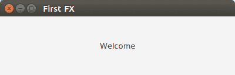

图 6.1：一个简单的 JavaFX 应用程序（在 Ubuntu 上）

下一节将解释 JavaFX API。

### Application, Stage 和 Scene

JavaFX API 以 `javafx` 包及其子包中类型的类型形式存在。它最重要的类型之一是 `javafx.application.Application` 类，它代表一个 JavaFX 应用程序。JavaFX 应用程序由一个或多个窗口和其他资源组成。

在 JavaFX 中，窗口由 `javafx.stage.Window` 类表示，它有两个子类 `Stage` 和 `PopupWindow`。一个 `Stage`（`javafx.stage.Stage` 的实例）是一个顶层容器，你向其添加一个。一个 `Stage`（由创建的……类型是 `javafx.application.Application` 类，代表……现在让我们来看看这三个主要类：Application、Stage 和 Scene。其他 JavaFX 类型的详情可以在查看。

```
http://docs.oracle.com/javase/8/javafx/api/toc
```

### Application

你继承 `Application` 类来创建 JavaFX 应用程序。要将其作为独立程序运行，你需要调用它的其中一个启动方法。

```java
public static void launch(java.String... args)
public static void launch(Class<? extends Application> appClass, java.String... args)
```

你传递给启动方法的任何参数都可以从 `Application` 内部使用 `getParameters` 方法获取。

```java
public final Application.Parameters getParameters()
```

Application 具有以下生命周期方法，它们将在实例启动时被调用。

```java
public void init() throws java.Exception
```

该方法在应用程序构造后调用。如果应用程序需要初始化，则应重写它。

```java
public abstract void start(Stage stage) throws java.Exception
```

该方法在 `init()` 返回后调用，你应该在此方法中构建 UI。JavaFX 运行时创建一个 `Stage` 对象并作为方法参数传递。

```java
public void stop() throws java.Exception
```

该方法在应用程序停止时调用。你应该在此处释放持有的资源。

在生命周期方法中，只有 `start` 必须重写。

### Stage

`Stage` 类代表 UI 组件的顶层容器。当应用程序的 `start` 方法被调用时，会创建一个实例并传递给你。应用程序创建的 Stage 是应用程序的主窗口。如有，你可以创建自己的 Stage。

`Stage` 就像任何其他 UI 窗口一样，有一个标题，你可以使用 `Stage` 类的标题属性进行填充。此外，你可以通过调用 `Stage` 的 `setScene` 方法将 `Scene` 添加到其中。然后，要显示 `Stage` 调用它的 `show` 方法。

### Scene

`Scene` 是可以添加到 `Stage` 的容器。`Scene` 必须包含一个父节点，它是所有添加到 Scene 的组件的根。父节点由 `javafx.scene.Parent` 类表示。`Scene` 最简单的构造函数接受一个参数，即 `Parent` 的实例。

```java
public Scene(Parent root)
```

其他构造函数允许你指定 `Scene` 的尺寸及其填充颜色。

```java
public Scene(Parent root, double width, double height)

public Scene(Parent root, javafx.scene.paint.Paint fill)

public Scene(Parent root, double width, double height, javafx.scene.paint.Paint fill)
```


# UI 组件

内置的 UI 组件让编写 JavaFX 变得既简单又有趣。在 JavaFX 开发者的术语中，UI 组件被称为场景图节点（或简单称为节点）。`javafx.scene.Node` 类是所有节点的基类。它有五个子类，区分了 JavaFX 中的节点类型：

- `Canvas`：一个你可以在上面画图的矩形区域。
- `Parent`：一个可以向其中添加其他 UI 组件的容器。
- `Shape`：表示一个形状，例如矩形、圆形或弧形。
- `ImageView`：显示图片的视图区域。
- `MediaView`：为由 `MediaPlayer` 播放的媒体提供视图。

`Canvas`、`ImageView` 和 `MediaView` 没有子类。`Parent` 和 `Shape` 有子类。

`Parent` 类具有以下子类：

- `Control`：该类是所有 UI 控件的基类，从像 `Button` 和 `Label` 这样的简单控件到 `ProgressBar`、`TreeView` 和 `TableView` 等更复杂的控件。
- `Region`：表示一个可以包含其他节点并使用 CSS 进行样式的屏幕区域。子类包括 `Chart` 和各种 `Pane`，包括 `BorderPane`、`StackPane`、`FlowPane`、`GridPane`、`HBox`、`VBox`、`AnchorPane` 等。
- `Group`：一个包含子节点 `ObservableList` 的区域，是处理 `Shape` 对象的最佳 `Parent`。
- `WebView`：`WebView` 用于管理 `WebEngine` 并显示其内容。如名称所示，`WebEngine` 可以加载网页、创建文档模型并在页面上运行 JavaScript。

`Control` 和 `Region` 类将在后续章节中进一步讨论。

`javafx.scene.shape.Shape` 类是各种几何形状的基类，包括 `Arc`、`Circle`、`Ellipse`、`Line`、`Path` 和 `Rectangle`。

## Controls

UI 控件是用户可以交互的节点。`javafx.scene.control.Control` 类是所有 UI 控件的基类。图 6.2 显示了 `Control` 的直接和间接子类。

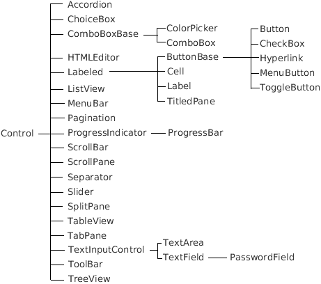

图 6.2：`Control` 的实现

图 6.3 显示了一个包含一些 JavaFX 控件的 `Scene`，列表 6.2 展示了生成该 `Scene` 的代码。

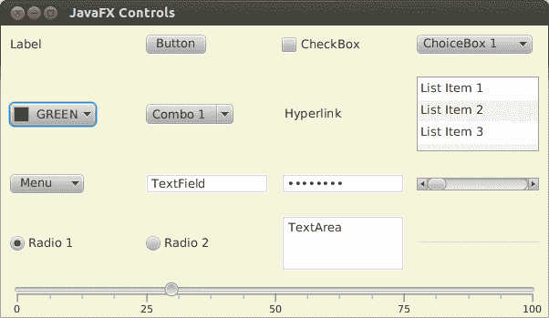

图 6.3：JavaFX UI 控件

列表 6.2：`ControlsDemo` 类

```java
package app06;

import javafx.application.Application;
import javafx.geometry.Insets;
import javafx.scene.Scene;
import javafx.scene.control.Button;
import javafx.scene.control.CheckBox;
import javafx.scene.control.ChoiceBox;
import javafx.scene.control.ColorPicker;
import javafx.scene.control.ComboBox;
import javafx.scene.control.Hyperlink;
import javafx.scene.control.Label;
import javafx.scene.control.ListView;
import javafx.scene.control.MenuButton;
import javafx.scene.control.MenuItem;
import javafx.scene.control.PasswordField;
import javafx.scene.control.RadioButton;
import javafx.scene.control.ScrollBar;
import javafx.scene.control.Separator;
import javafx.scene.control.Slider;
import javafx.scene.control.TextArea;
import javafx.scene.control.TextField;
import javafx.scene.control.ToggleGroup;
import javafx.scene.layout.ColumnConstraints;
import javafx.scene.layout.GridPane;
import javafx.scene.paint.Color;
import javafx.stage.Stage;

public class ControlsDemo extends Application {
    @Override
    public void start(Stage stage) {
        GridPane grid = new GridPane();
        grid.setHgap(15);
        grid.setVgap(25);
        ColumnConstraints constraint = new ColumnConstraints();
        constraint.setPercentWidth(25);
        grid.getColumnConstraints().addAll(constraint,
                constraint, constraint, constraint);
        grid.setPadding(new Insets(10));
        grid.add(new Label("Label"), 0, 0);
        grid.add(new Button("Button"), 1, 0);
        grid.add(new CheckBox("CheckBox"), 2, 0);
        ChoiceBox<String> choiceBox = new ChoiceBox<String>();
        choiceBox.getItems().addAll("ChoiceBox 1", "ChoiceBox 2");
        choiceBox.setValue("ChoiceBox 1");
        grid.add(choiceBox, 3, 0);
        grid.add(new ColorPicker(Color.GREEN), 0, 1);
        ComboBox<String> comboBox = new ComboBox<String>();
        comboBox.getItems().addAll("Combo 1", "Combo 2");
        comboBox.setValue("Combo 1");
        grid.add(comboBox, 1, 1);
        grid.add(new Hyperlink("Hyperlink"), 2, 1);
        ListView<String> listView = new ListView<String>();
        listView.getItems().addAll("List Item 1",
                "List Item 2", "List Item 3");
        grid.add(listView, 3, 1);
        MenuButton menuButton = new MenuButton("Menu");
        menuButton.getItems().addAll(new MenuItem("Menu 1"),
                new MenuItem("Menu 1"));
        grid.add(menuButton, 0, 2);
        grid.add(new TextField("TextField"), 1, 2);
        PasswordField passwordField = new PasswordField();
        passwordField.setText("Password");
        grid.add(passwordField, 2, 2);
        grid.add(new ScrollBar(), 3, 2);
        ToggleGroup group = new ToggleGroup();
        RadioButton radioButton1 = new RadioButton("Radio 1");
        radioButton1.setToggleGroup(group);
        radioButton1.setSelected(true);
        RadioButton radioButton2 = new RadioButton("Radio 2");
        radioButton2.setToggleGroup(group);
        grid.add(radioButton1, 0, 3);
        grid.add(radioButton2, 1, 3);
        TextArea textArea = new TextArea("TextArea");
        textArea.setMinHeight(60.00);
        grid.add(textArea, 2, 3);
        grid.add(new Separator(), 3, 3);
        Slider slider2 = new Slider(0, 100, 30);
        slider2.setShowTickMarks(true);
        slider2.setShowTickLabels(true);
        grid.add(slider2, 0, 4, 4, 1);
        Scene scene = new Scene(grid, 600, 320);
        scene.setFill(Color.BEIGE);
        stage.setTitle("JavaFX Controls");
        stage.setScene(scene);
        stage.show();
    }

    public static void main(String[] args) {
        launch(args);
    }
}
```

## Regions

`Region` 是一个可以包含其他节点并使用 CSS 进行样式的屏幕区域。所有 `Region` 都是 `javafx.scene.layout.Region` 类的子类。`Region` 有三个直接后代：`Axis`、`Chart` 和 `Pane`。`Axis` 用于在图表区域上渲染轴，`Chart` 模型图表。`Pane` 是一个通常用于布局 UI 控件的区域。

本节仅讨论 `Pane`。

`Pane` 的子类包括 `BorderPane`、`StackPane`、`GridPane`、`FlowPane`、`AnchorPane`、`HBox` 和 `VBox`。

`HBox` 将其子项排列在单水平行中，而 `VBox` 在单垂直行中排列。相比之下，`GridPane` 将元素安排在网格中，通常用于布局表单的控件。

列表 6.3 中的 `ControlsDemo` 类使用 `BorderPane` 布局控件。只使用了顶部、左侧和中间区域。顶部部分包含包含两个按钮的 `HBox`，左侧包含一个 `Label` 和一个 `ColorPicker`。中间部分有一个带有 `Image` 的 `ImageView`。

```java
package app06;

import javafx.application.Application;
import javafx.geometry.Insets;
import javafx.scene.Scene;
import javafx.scene.control.Button;
import javafx.scene.control.ColorPicker;
import javafx.scene.control.Label;
import javafx.scene.image.ImageView;
import javafx.scene.layout.BorderPane;
import javafx.scene.layout.HBox;
import javafx.scene.layout.VBox;
import javafx.stage.Stage;

public class BorderPaneDemo extends Application {
    @Override
    public void start(Stage stage) {
        Button okButton = new Button("OK");
        okButton.setDefaultButton(true);
        Button cancelButton = new Button("Cancel");
        HBox hBox = new HBox();
        hBox.setPadding(new Insets(15, 12, 15, 12));
        hBox.setSpacing(10);
        hBox.setStyle("-fx-background-color: #886699;");
        hBox.getChildren().addAll(okButton, cancelButton);
        BorderPane root = new BorderPane();
        root.setTop(hBox);
        ImageView imageView = new ImageView("image/1.jpg");
        root.setCenter(imageView);
        VBox vBox = new VBox();
        vBox.setStyle("-fx-background-color: " +
                "#ddeeff;-fx-padding:10px");
        vBox.getChildren().addAll(
                new Label("Select Color:"),
                new ColorPicker());
        root.setLeft(vBox);
        root.setStyle("-fx-background-color: #6680e6;");
        Scene scene = new Scene(root, 740, 530);
        stage.setTitle("HBox, VBox, BorderPane Demo");
        stage.setScene(scene);
        stage.show();
    }

    public static void main(String[] args) {
        launch(args);
    }
}
```


图 6.5 显示了 Windows 上的 `BorderPaneDemo`。

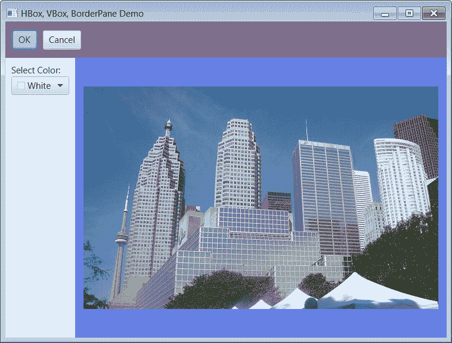

图 6.5：BorderPane demo

## 事件处理

JavaFX 是事件驱动的。UI 组件可以引发事件，你可以编写代码来处理这些事件。这种事件驱动机制使得 JavaFX 应用程序能够用户交互性。

有许多类型的事件，它们都继承自 `javafx.event.Event` 类。`Event` 的子类包括 `ActionEvent`、`InputMethodEvent`、`MouseEvent`、`MouseDragEvent`、`ScrollEvent`、`SwipeEvent` 等。

不同的组件可能会引发不同的事件。例如，点击按钮会引发 `ActionEvent`，在 `TextField` 中更改文本会触发 `InputMethodEvent`。你可以编写并注册一个事件处理器，当相应的事件发生时，该处理器会被调用。例如，你可以为 `TextField` 的 `InputMethodEvent` 编写一个处理器，将输入的文本转换为大写。或者，你可以编写一个处理器，在按钮被点击时打开另一个 `Stage`。

在 JavaFX 中编写和注册事件处理器的最简单的方法是使用 `Node` 类提供的便利方法之一。这些方法的名称遵循 `setOnXXX` 模式，并且被 `Node` 的所有后代继承。便利方法的示例有 `setOnDragEntered`、`setOnDragExited`、`setOnInputMethodTextChanged`、`setOnKeyTyped`、`setOnMouseClicked` 等许多。`Node` 的子类可能会添加更多便利方法以适应它们特定的事件。

这些便利方法接受一个 `EventHandler` 对象作为参数。`javafx.event.EventHandler` 是一个带有 `handle` 方法的泛型接口。这里是 `EventHandler` 的定义。

```java
package javafx.event;

public interface EventHandler<T extends Event> extends 
        java.util.EventListener {
    void handle(T event)
}
```

在构造 `EventHandler` 时，你必须传递合适的事件类型。例如，以下代码构造了 `ActionEvent` 的 `EventHandler`。

```java
EventHandler handler = new EventHandler<ActionEvent>() { 
    @Override 
    public void handle(ActionEvent event) { 
        // 执行某些操作
    } 
};
```

列表 6.4 中的 `RotateDemo` 类展示了 JavaFX 事件处理。该类包含一个 `Rectangle` 和一个 `Button`，并捕获 `Button` 的 `ActionEvent`。每当按钮被点击时，`Rectangle` 就会顺时针旋转 10 度。

列表 6.4：`RotateDemo` 类

```java
package app06;

import javafx.application.Application; 
import javafx.collections.ObservableList; 
import javafx.event.ActionEvent; 
import javafx.event.EventHandler; 
import javafx.scene.Node; 
import javafx.scene.Scene; 
import javafx.scene.control.Button; 
import javafx.scene.layout.VBox; 
import javafx.scene.paint.Color; 
import javafx.scene.shape.Rectangle; 
import javafx.stage.Stage; 

public class RotateDemo extends Application { 
    @Override 
    public void start(Stage stage) { 
        VBox root = new VBox(40); 
        ObservableList<Node> children = root.getChildren(); 
        final Rectangle rect = new Rectangle(80, 50); 
        rect.setFill(Color.AQUAMARINE); 
        children.add(rect); 
        Button button = new Button("Rotate"); 
        button.setOnAction(new EventHandler<ActionEvent>() { 
            @Override 
            public void handle(ActionEvent event) { 
                rect.rotate(10); 
            } 
        });
        Scene scene = new Scene(root, 120, 130); 
        stage.setTitle("Rotate Demo"); 
        stage.setScene(scene); 
        stage.show(); 
    } 
    public static void main(String[] args) { 
        launch(args); 
    } 
}
```

在应用程序的 `start` 方法中，创建了一个 `Button` 并调用了它的 `setOnAction` 方法。

图 6.6 显示了该应用程序。尝试点击按钮观察效果。

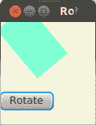

图 6.6：JavaFX 中的事件处理

## 使用 CSS 样式

某些控件提供了更改其外观的方法。例如，`Label` 类的 `setFont` 方法允许你设置显示文本的字体。虽然这些方法易于使用，但它们必须在代码内部调用，这导致了表示层与业务逻辑之间的紧耦合。更好的方法是使用 CSS（级联样式表）样式 UI 组件。在本书中，CSS 指 JavaFX 中使用的 CSS。

CSS 文件包含可以通过 ID 或类引用的样式。每个 JavaFX 控件已分配了一个默认 CSS 类，与控件的 Java 类名相似。例如，`Button` 的默认样式是 `button`，`Label` 的默认样式是 `label`。这意味着，为了提供影响所有按钮的样式，你只需要在 CSS 文件中有一个名为 `button` 的样式即可。例如：

```css
.button {
    -fx-border-width: 3px; 
    -fx-background-color:#dd8818; 
} 
```

多单词控件的默认样式是单词组合。例如，`CheckBox` 的默认样式是 `check-box`，`ProgressBar` 的默认样式是 `progress-bar`。

非控件节点没有默认样式。如果你想为 `VBox` 设置样式，首先需要为实例添加一个 CSS 类。例如，以下代码为 `VBox` 添加了名为 `vbox` 的类。

```java
VBox vBox = new VBox(); 
vBox.getStyleClass().add("vbox"); 
```

该 `VBox` 随后会对应用程序引用的任何 CSS 文件中的 `vbox` 样式做出响应。

除了使用样式类（style classes），你还可以创建一个由组件标识符（identifier）引用的样式。如果你希望样式只影响某个类型的特定实例，而不是该类型的所有实例，就可以这样做。例如，`.button` 样式会影响应用程序中所有的 `Button` 控件。如果你想让样式影响某个 `Button` 而不是所有的 `Buttons`，你可以为该 `Button` 添加新类，或者为它添加一个标识符。这是一个分配了 id `nextBtn` 的 `Button` 示例。

```java
Button nextButton = new Button("Next"); 
nextButton.setId("nextBtn"); 
```

然后你可以在 CSS 文件中创建此样式，它只会影响该 Button。

```css
#nextBtn { 
    -fx-font-weight: bold; 
}
```

注意，每个节点都有一个 `setStyle` 方法，你可以调用它来分配 CSS 样式。然而但不推荐这种做法，因为你将表示逻辑和业务逻辑混合在一起了。以下是如何使用 `setStyle` 的示例。

```java
Button button = new Button();
button.setStyle("-fx-background-color:green");
```

最好将所有的样式写在 CSS 文件中。一旦你的 CSS 文件准备好，你就可以从应用程序的启动方法加载它，如下所示。

```java
@Override 
public void start(Stage stage) { 
    ...
    Scene scene = ...; 
    scene.getStylesheets().add("style.css");
    ...
} 
```

在这里，`style.css` 是位于类文件相同位置的 CSS 文件。

以下是本章中使用的一些样式。

*   `-fx-fill`
*   `-fx-font-family`
*   `-fx-font-size`
*   `-fx-font-style`
*   `-fx-font-weight`
*   `-fx-background-color`
*   `-fx-text-fill`

作为一个示例，考虑列表 6.5 中的 `CSSDemo` 类，它使用了列表 6.6 中的 `style.css` 文件。

列表 6.5：`CSSDemo` 类

```java
package app06;

import javafx.application.Application; 
import javafx.scene.Scene; 
import javafx.scene.control.Button; 
import javafx.scene.control.Label; 
import javafx.scene.layout.BorderPane; 
import javafx.scene.layout.HBox; 
import javafx.stage.Stage; 

public class CSSDemo extends Application { 
    @Override 
    public void start(Stage stage) { 
        BorderPane root = new BorderPane(); 
        root.setCenter(new Label("Welcome")); 
        HBox hBox = new HBox(); 
        hBox.getStyleClass().add("hbox"); 
        Button backButton = new Button("Back"); 
        hBox.getChildren().add(backButton); 
        Button nextButton = new Button("Next"); 
        nextButton.setId("nextBtn"); 
        hBox.getChildren().add(nextButton); 
        root.setBottom(hBox);
        Scene scene = new Scene(root, 400, 300); 
        scene.getStylesheets().add("style.css");
        stage.setTitle("CSS Demo"); 
        stage.setScene(scene); 
        stage.show(); 
    }
    public static void main(String[] args) { 
        launch(args); 
    } 
}
```

列表 6.6：`style.css` 文件

```css
.label { 
    -fx-background-color: #778855; 
    -fx-font-family: helvetica; 
    -fx-font-size: 45px; 
    -fx-text-fill: yellow;
}
.hbox { 
    -fx-background-color: #2f4f4f; 
    -fx-padding: 15px; 
    -fx-spacing: 10px; 
    -fx-alignment: center;
}
.button { 
    -fx-border-width: 2px; 
    -fx-background-color:#ff8800;
    -fx-cursor: hand;
}
#nextBtn { 
    -fx-font-weight: bold;
}
```

如果你运行该应用程序，你会看到一个与图 6.7 相同的 `Stage`。

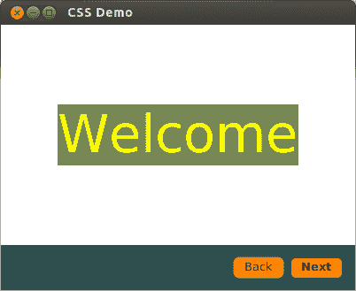

图 6.7：CSS Demo

作为一个补充说明，`jfxrt.jar` 文件（JavaFX 运行时）包含 `modena.css` 文件。这是根节点和 UI 控件的默认样式表。建议查看此文件的内容以学习定义的样式。要查看此文件，请进入 jar 文件所在的目录并运行此命令：

```
jar jfxrt.jar com/javafx/scene/control/skin/modena.css
```

### 使用 DatePicker

JavaFX 8 中的新组件 `DatePicker` 允许用户选择日期或输入文本。你可以通过 `LocalDate` 获取选择的日期。你还可以通过编写 `EventHandler` 并传递给 `DatePicker` 的 `setOnAction` 方法来响应日期选择。

列表 6.7 显示了一个使用 `DatePicker` 选择生日的 JavaFX 应用程序。如果用户选择了未来的日期，将在 `DatePicker` 旁边显示错误消息。

列表 6.7：DatePicker 类

```java
package app06;

import java.time.LocalDate;
import java.time.Period;
import javafx.application.Application;
import javafx.event.Event;
import javafx.event.EventHandler;
import javafx.geometry.HPos;
import javafx.scene.Scene;
import javafx.scene.control.DatePicker;
import javafx.scene.control.Label;
import javafx.scene.layout.GridPane;
import javafx.scene.layout.VBox;
import javafx.stage.Stage;

public class DatePickerDemo extends Application {
    public static void main(String[] args) {
        launch(args);
    }
    @Override
    public void start(Stage stage) {
        stage.setTitle("DatePicker Demo");
        VBox vbox = new VBox(20);
        vbox.setStyle("-fx-padding: 15;");
        Scene scene = new Scene(vbox, 550, 340);
        stage.setScene(scene);
        GridPane gridPane = new GridPane();
        gridPane.setHgap(10);
        gridPane.setVgap(10);
        Label label = new Label("Birthday:");
        gridPane.add(label, 0, 0);
        DatePicker birthdayPicker = new DatePicker();
        gridPane.add(birthdayPicker, 0, 1);
        Label error = new Label();
        gridPane.add(error, 1, 1);
        birthdayPicker.setOnAction(new EventHandler() {
            public void handle(Event t) {
```


`LocalDate selectedDate = birthdayPicker.getValue();`

`System.out.println("Selected date: " + selectedDate);`

`LocalDate today = LocalDate.now();`

```
if (Period.between(selectedDate, today).isNegative()) {
    error.setText("Your birthday cannot be later than today");
} else {
    error.setText("");
}
```

`vbox.getChildren().add(gridPane);`

`stage.show();`

图 6.8 显示了应用程序。

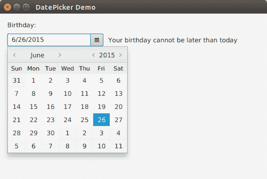

图 6.8：编程步骤

## 总结

JavaFX 是一种用于创建桌面和浏览器应用程序的 Java 技术。它是比 AWT 和 Swing 更好的解决方案，因此注定将取代它的前身。

本章介绍了 JavaFX 并提供了几个示例。下一章“使用 FXML 的 JavaFX”将解释如何使用名为 FXML 的特殊标记语言来分离表示层和逻辑。

# 第 7 章：使用 FXML 的 JavaFX

FXML 是一种基于 XML 的标记语言，用于构建 JavaFX 用户界面 (UI)。在 JavaFX 应用程序中使用 FXML 是分离表示层和逻辑的一种极方法。本章讨论了 FXML 并展示如何在 JavaFX 应用程序开发中使用它。

## 概述

JavaFX 2 的新功能 FXML 通过将用户界面构建移动到基于 XML 的文档，极大降低了 JavaFX 类的复杂度。此外，FXML 比 Java 类更能可视化 UI 组件层次结构。FXML 文档的根节点一个 `javafx.scene.Parent`，可以使用名为 `FXLoader` 的特殊加载器加载到 JavaFX。以下是使用 FXML 的 `Application` 子类的启动方法。

```java
@Override 
public void start(Stage stage) throws Exception { 
    stage.setTitle("FXML Example"); 
    Parent root = (Parent) FXMLLoader.load(
            getClass().getResource("example1.fxml")); 
    Scene scene = new Scene(root, 740, 530); 
    stage.setScene(scene); 
    stage.show(); 
} 
```

上述代码调用了 `FXLoader` 的 `load` 方法来读取 FXML 文件并将其内容转换为 `Parent` 对象。然后使用该 `Parent` 对象来构建 `Scene`。

编写 FXML 文件非常简单。你首先创建一个文本文件，并将其保存到与类文件相同的目录中。你可以将其存储在其他地方，但如果它与加载它的类位于同一个目录，加载起来是最容易的。

由于 FXML 文件是一个 XML 文档，所有 FXML 文档都以此声明开头。

```xml
<?xml version="1.0" encoding="UTF-8"?> 
```

接下来是导入指令，用于导入你将在 FXML 文件中引用的类型。你可以导入一个包或一个类型。

```xml
<?import javafx.scene.*?> 
<?import javafx.scene.control.*?> 
<?import javafx.scene.layout.*?> 
<?import javafx.geometry.Insets?> 
```

接下来是根元素。它可以是 `Parent` 的任何子类。这里有一个示例。

```xml
<GridPane xmlns:fx="http://javafx.com/fxml" 
        hgap="5" vgap="12" layoutY="30">
</GridPane>
```

`fx` 前缀是 FXML 中的一个特殊前缀。你将在本章稍后的部分学习它的用法。

要设置对象中的属性，请使用嵌套元素或属性。例如，上面 `GridPane` 元素中的 `hgap` 属性填充了 `GridPane` 的 `hgap` 属性。

在根元素内部构建你的 UI。列表 7.1 显示了一个 FXML 文件的示例。

**列表 7.1：FXML 文件示例**

```xml
<?xml version="1.0" encoding="UTF-8"?> 
<?import javafx.scene.*?> 
<?import javafx.scene.control.*?> 
<?import javafx.scene.layout.*?> 
<?import javafx.geometry.Insets?> 
<?import javafx.scene.image.Image?> 
<?import javafx.scene.image.ImageView?> 
<BorderPane> 
    <top> 
        <HBox spacing="10.0" style="-fx-background-color:#886699;"> 
            <padding> 
                <Insets top="15" bottom="15" left="12" right="12"/>
            </padding> 
            <Button id="okButton" text="OK" defaultButton="true"/> 
            <Button text="Cancel"/> 
        </HBox> 
    </top> 
</BorderPane> 
```

元素可以包含一个要实例化的类或一个要填充的属性。列表 7.1 中的 FXML 文件包含一个类型为 `BorderPane` 的根元素。`BorderPane` 的 `top` 属性填充了一个 `HBox`。`HBox` 又包含两个 `Buttons`，并且其 `padding` 属性填充了一个 `Insets`。

关于 FXML 的更多细节可以在此处找到。

```
http://docs.oracle.com/javafx/2/api/javafx/fxml/doc-files/
introduction_to_fxml.html
```

### 注意事项

建议在编写 FXML 时使用支持 JavaFX 的 IDE，并利用其代码补全功能使编写 FXML 变得更简单。NetBeans 和 IntelliJ 支持 JavaFX，而 Eclipse 通过插件支持 JavaFX。

接下来的章节将展示在 JavaFX 应用中使用 FXML 的示例。

## 一个简单的基于 FXML 的应用程序

此示例是上一章中创建的 `BorderPaneDemo` 应用程序的重写。这次使用 FXML 文档来构建和组织 UI 组件。为了方便阅读，这里重印了 `BorderPaneDemo` 类。

```java
package app07;

import javafx.application.Application; 
import javafx.geometry.Insets; 
import javafx.scene.Scene; 
import javafx.scene.control.Button; 
import javafx.scene.control.ColorPicker; 
import javafx.scene.control.Label; 
import javafx.scene.image.ImageView; 
import javafx.scene.layout.BorderPane; 
import javafx.scene.layout.HBox; 
import javafx.scene.layout.VBox; 
import javafx.stage.Stage; 

public class BorderPaneDemo extends Application { 
    @Override 
    public void start(Stage stage) { 
        Button okButton = new Button("OK"); 
        okButton.setDefaultButton(true); 
        Button cancelButton = new Button("Cancel"); 
        HBox hBox = new HBox(); 
        hBox.setPadding(new Insets(15, 12, 15, 12)); 
        hBox.setSpacing(10); 
        hBox.setStyle("-fx-background-color: #886699;"); 
        hBox.getChildren().addAll(okButton, cancelButton); 
        BorderPane root = new BorderPane(); 
        root.setTop(hBox); 
        ImageView imageView = new ImageView("image/1.jpg"); 
        root.setCenter(imageView); 
        VBox vBox = new VBox(); 
        vBox.setStyle("-fx-background-color: " + 
        		"#ddeeff;-fx-padding:10px"); 
        vBox.getChildren().addAll( 
                new Label("Select Color:"), 
                new ColorPicker()); 
        root.setLeft(vBox); 
        root.setStyle("-fx-background-color: #6680e6;"); 
        Scene scene = new Scene(root, 740, 530); 
        stage.setTitle("HBox, VBox, BorderPane"); 
    }
}
```

`BorderPaneDemo` 类中的 UI 部分可以替换为 7.2 所示的 `example.fxml` 文件。

**列表 7.2：`example.fxml` 文件**

```xml
<?xml version="1.0" encoding="UTF-8"?> 
<?import javafx.scene.*?> 
<?import javafx.scene.control.*?> 
<?import javafx.scene.layout.*?> 
<?import javafx.geometry.Insets?> 
<?import javafx.scene.image.Image?> 
<?import javafx.scene.image.ImageView?> 
<BorderPane> 
    <top> 
        <HBox spacing="10.0" style="-fx-background-color:#886699;"> 
            <padding> 
                <Insets top="15" bottom="15" left="12" right="12"/>
            </padding> 
            <Button id="okButton" text="OK" defaultButton="true"/> 
            <Button text="Cancel"/> 
        </HBox> 
    </top> 
</BorderPane>
```

`start` 方法使用 `FXMLLoader` 加载 FXML 文档并返回一个包含所声明组件的 `Parent` 对象。该方法随后创建一个 `Scene` 并将 `Scene` 传递给 `Stage`，然后调用 `Stage` 的 `show` 方法。

列表 7.3 所示了 Java 类 `Example1`。

```java
package app07;

import javafx.application.Application; 
import javafx.fxml.FXMLLoader; 
import javafx.scene.Parent; 
import javafx.scene.Scene; 
import javafx.stage.Stage; 

public class Example1 extends Application { 
    @Override 
    public void start(Stage stage) throws Exception {
        // Example1.fxml 必须位于 Example1.class 相同的目录下
        Parent root = FXMLLoader.load(getClass().getResource("example1.fxml")); 
        root.setStyle("-fx-background-color: #6680e6;"); 
        Scene scene = new Scene(root, 740, 530); 
        stage.setTitle("JavaFX with FXML (Example 1)"); 
        stage.setScene(scene); 
        stage.show(); 
    }

    public static void main(String[] args) { 
        launch(args); 
    }
}
```

## 使用 FXML 处理事件

使用 FXML 是一种强大的语言。它的功能之一是将 UI 组件与控制器中的事件处理方法（事件处理器）绑定，这样当事件发生时就会调用该方法。控制器是实现 `javafx.fxml.Initializable` 的 Java 类。为了利用这一功能，你必须在根元素中使用 `fx:controller` 属性，如下：

```xml
<Group fx:controller="app7.Example2Controller" 
```

记得 `fx` 是 FXML 中的一个特殊前缀。

要将组件绑定到事件处理器，请使用元素相关的 `onXXX` 属性。例如，将 `ActionEvent` 绑定到控制器中名为 `handleAction` 的方法，请写：

```xml
onAction="#handleAction"
```

例如，考虑以下带有用户名和密码登录表单的应用程序。应用程序的主阶段如图 7.2 所示。

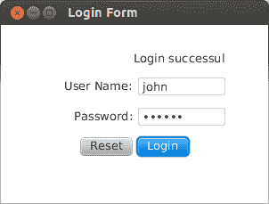

图 7.2：示例 2 中的登录表单

用户可以输入用户名和密码。点击 `Reset` 会清除用户名和密码字段。点击 `Login` 将对用户进行身份验证。验证结果将写在字段上方的 `Label` 上。

该应用程序由一个 FXML 文档（列表 7.4 中的 `example2.fxml`）、一个控制器类（列表 7.5 中的 `Example2Controller`）以及一个主类（列表 7.6 中的 `Example2`）组成。

### 列表 7.4：`example2.fxml` 文件

```xml
<?xml version="1.0" encoding="UTF-8"?> 
<?import javafx.scene.*?> 
<?import javafx.scene.control.*?> 
```


```xml
<?import javafx.scene.layout.*?> 

<?import javafx.geometry.Insets?> 

<GridPane xmlns:fx="http://javafx.com/fxml" 

        fx:controller="app07.Example2Controller" 

        hgap="5" vgap="12" layoutY="30"  > 

    <columnConstraints> 

        <ColumnConstraints percentWidth="15"/> 

        <ColumnConstraints percentWidth="35" 

                halignment="RIGHT"/> 

        <ColumnConstraints percentWidth="35"/> 

        <ColumnConstraints percentWidth="10"/> 

    </columnConstraints> 

    <children> 

        <Label fx:id="statusLabel" > 

            <GridPane.columnIndex>1</GridPane.columnIndex> 

            <GridPane.rowIndex>0</GridPane.rowIndex> 

            <GridPane.columnSpan>2</GridPane.columnSpan> 

        </Label> 

        <Label text="User Name:"> 

            <GridPane.columnIndex>1</GridPane.columnIndex> 

            <GridPane.rowIndex>1</GridPane.rowIndex> 

        </Label> 

        <TextField fx:id="userNameField"> 

            <GridPane.columnIndex>2</GridPane.columnIndex> 

            <GridPane.rowIndex>1</GridPane.rowIndex> 

        </TextField> 

        <Label text="Password:"> 

            <GridPane.columnIndex>1</GridPane.columnIndex> 

            <GridPane.rowIndex>2</GridPane.rowIndex> 

        </Label> 

        <PasswordField fx:id="passwordField"> 

            <GridPane.columnIndex>2</GridPane.columnIndex> 

            <GridPane.rowIndex>2</GridPane.rowIndex> 

        </PasswordField> 

        <Button fx:id="resetButton" text="Reset" 

                onAction="#handleReset"> 

            <GridPane.columnIndex>1</GridPane.columnIndex> 

            <GridPane.rowIndex>3</GridPane.rowIndex> 

        </Button> 

        <Button fx:id="loginButton" text="Login" 

                defaultButton="true" onAction="#handleLogin"> 

            <GridPane.columnIndex>2</GridPane.columnIndex> 

            <GridPane.rowIndex>3</GridPane.rowIndex> 

        </Button> 

    </children> 

</GridPane>
```

列表 7.2 中的 FXML 文档使用 `GridPane` 作为根元素。该标记还填充了 `GridPane` 的 `columnConstraints` 和 `children` 属性。`columnContraints` 包含 `ColumnConstraints` 元素，指定了每个列的宽度。`children` 属性指定了要在 `GridPane` 内部渲染的 UI 组件。

请特别注意 `Button` 元素的 `onAction` 属性。它们分别用于将 `ActionEvent` 绑定到 `handleLogin` 和 `handleReset` 方法。

### 列表 7.5：`Example2Controller` 类

```java
package app07;

import java.net.URL; 

import java.util.ResourceBundle; 

import javafx.event.ActionEvent; 

import javafx.fxml.FXML; 

import javafx.fxml.Initializable; 

import javafx.scene.control.Label; 

import javafx.scene.control.PasswordField; 

import javafx.scene.control.TextField; 

public class Example2Controller implements Initializable { 

    @FXML 

    private TextField userNameField; 

    @FXML 

    private PasswordField passwordField; 

    @FXML 

    private Label statusLabel; 

    @FXML 

    private void handleReset(ActionEvent event) { 

        userNameField.setText(""); 

        passwordField.setText(""); 

        statusLabel.setText(""); 

    } 

    @FXML 

    private void handleLogin(ActionEvent event) { 

        String userName = userNameField.getText(); 

        String password = passwordField.getText(); 

        if ("john".equals(userName) 

                && "secret".equals(password)) { 

            statusLabel.setText("Login successul"); 

        } else { 

            statusLabel.setText("Login failed"); 

        } 

    } 

    @Override 

    public void initialize(URL url, ResourceBundle rb) { 

    }    

}
```

控制器为其绑定的 FXML 文档提供事件处理器。事件处理器必须标记为 `@FXML`。此外，为了访问 UI 组件，你可以对字段使用 `@FXML` 标记。标记的字段名称必须与其绑定的组件的 `fx:id` 属性相同。

在列表 7.5 的控制器类中，声明了三个字段并标记了 `@FXML`：`userNameField`、`passwordField` 和 `statusLabel`。

### 列表 7.6：`Example2` 类

```java
package app07;

import javafx.application.Application;

import javafx.fxml.FXMLLoader;

import javafx.scene.Parent;

import javafx.scene.Scene;

import javafx.stage.Stage;

public class Example2 extends Application {

    @Override

    public void start(Stage stage) throws Exception {

        Parent root = FXMLLoader.load(getClass().getResource("example2.fxml"));

        Scene scene = new Scene(root, 300, 200);

        stage.setTitle("Login Form");

        stage.setScene(scene);

        stage.show();

    }

    // 

}
```

最后，`Example2` 类加载并显示了 FXML 文档。

### 总结

FXML 是构建 UI 的标记语言。在本章中，你学习了 FXML 的基础知识以及如何使用。

# 第 8 章：Nashorn

## 概述

Nashorn 是 Java 8 中的 JavaScript 引擎。它取代了 Java 中仍然使用的旧 JavaScript 引擎 Rhino。然而，新项目应该使用 Nashorn，因为它更符合 ECMAScript。

Nashorn 是一个德语单词，意为“犀牛”。Nashorn 引擎基于 JSR 292，“在 Java 平台上支持动态语言”。该 JSR 让目标 JVM 的动态语言通过利用 `invokedynam` 得更快。

## 使用 jjs 命令

`jjs` 是随 JRE 1.8 和 JDK 1.8 一起提供的工具。位于 `JAVA_HOME/bin` 目录下，`JAVA_HOME` 是 JRE 或 JDK 的安装目录。

测试 Nashorn 功能的最简单方法是使用 `jjs` 命令工具。其语法如下：

```
jjs [options] [script-files] [-- arguments]
```

如果不带脚本文件使用，`jjs` 将读取-执行-打印循环（REPL）启动，这是一个你可以输入命令或表达式的环境。

你可以在本地尝试：

```bash
$ jjs
```

`jjs` 的界面所示：

```
jjs>
```

现在你可以开始输入了。例如：

```javascript
jjs> "Hello World"
Hello World
```

这里是另一个例子：

```javascript
jjs> var name = 'Charlie'
jjs> print('Hello ' + name)
Hello Charlie
```

这里，这是一个 JavaScript 函数：

```javascript
jjs> function triple(n) { return 3 * n }
function triple(n) { return 3 * n }
```

调用函数 `triple` 并传递 5 返回 15：

```javascript
jjs> triple(5)
15
```

当然，你也可以将脚本放在文件中并将其传递给 `jjs`。假设你有一个名为 `test1.js` 的脚本文件，如列表 8.1 所示。

### 列表 8.1: `test1.js` 文件

```
function add(a, b) {
    return a + b;
}
var c = add(10, 20)
print(c)
```

现在，调用 `jjs` 并传递 `test1.js`：

```
$ jjs test1.js
30
```

如前所述，`jjs` 可以配合选项使用。表 8.1 列出了部分选项。

| 选项 |  |
| :--- | :--- |
| `-ccs=size` 或 `--class-cache-size=size` | 指定以字节为单位的类缓存大小。字母 `k` 或 `K` 表示千字节，`m` 或 `M` 表示兆字节，`g` 或 `G` 表示字节。默认类缓存大小为 50。 |
| `-co` 或 `--compile-only` | 编译脚本但不运行它。 |
| `-cp` 或 `-classpath` | 指定类路径。此选项可以重复使用以指定多个类路径。 |
| `-Dname=value` | 传递系统属性键和值。 |
| `-d=path` 或 `--dump-debug-dir=path` | 指定用于导出类文件的目录路径。 |
| `--debug-lines=true\|false` | 表明是否在类文件中生成行号表。默认开启此选项。 |
| `--debug-locals` | 在类文件中生成局部变量表。 |
| `-doe` 或 `--dump-on-error` | 发生错误时提供完整的堆栈跟踪。默认情况下，仅打印简短的错误信息。 |
| `--early-lvalue-error` | 将无效的 lvalue 表达式报告为早期错误。 |
| `--empty-statements` | 在 Java 抽象语法树中保留空语句。 |
| `-fv` 或 `-fullversion` | 打印 Nashorn 的完整版本。 |
| `--function-statement-error` | 当函数声明当作语句使用时打印错误信息。 |
| `--function-statement-warning` | 当函数声明当作语句使用时打印警告信息。 |
| `-fx` | 将脚本作为 JavaFX 启动。 |
| `-h` 或 `-help` | 打印选项列表及其描述。 |
| `-Joption` | 将 Java 选项传递给 JVM。 |
| `--lazy-compilation` | 启用懒代码生成。 |
| `--loader-per-compile` | 每次编译创建一个新的类加载器。 |
| `--log=subsystem:level` | 按指定的级别记录日志。 |
| `--package=name` | 指定生成类的包。 |
| `--parse-only` | 只解析代码不编译。 |
| `--print-ast` | 打印代码的抽象语法树。 |
| `--print-code` | 打印字节码。 |
| `--print-lower-ast` | 打印降低后的 AST。 |
| `--print-lower-parse` | 打印降低后的解析树。 |
| `--scripting` | 启用脚本。 |
| `--stderr=filename\|stream\|tty` | 将标准错误流重定向到指定的文件、流或文本终端。 |
| `--stdout=filename\|stream\|tty` | 将标准输出流重定向到指定的文件、流或文本终端。 |
| `-v` 或 `-version` | 打印 Nashorn 版本。 |
| `-xhelp` | 打印命令行选项的扩展帮助。 |

表 8.1：`jjs` 选项

你可以使用 `-help` 选项列出所有可用选项：

```
$ jjs -help
```

或者使用 `-xhelp` 获取更完整的选项列表：

```
$ jjs -xhelp
```

如果你对底层编译器的工作原理好奇，可以尝试 `--print-ast` 和 `--print-code` 选项。

```
$ jjs --print-ast myscript.js
$ jjs --print-code myscript.js
```

除了 `jjs` 外，还有另一个工具 `jrunscript`，它可以调用任何符合 JSR 223（“Java 平台脚本语言”）的脚本引擎。在安装了 Java 8 且不带任何选项的情况下，`jrunscript` 将调用 Nashorn。

```
$ jrunscript
nashorn>
```

自己尝试一下。

```
$ jrunscript
nashorn> print(300 + 700)
1000
```

### 在 Java 代码中使用 Nashorn

你可以从 Java 代码中运行 JavaScript。但，为什么要这样做呢？一种场景是：你有复杂的 JavaScript 函数，不想在 Java 中重写它们。

要要在 Java 中调用 Nashorn，请使用 `javax.script` 包。`ScriptEngine` 接口的 `eval` 方法会评估 JavaScript 脚本并将结果作为 `java.lang.Object` 返回。`eval` 的多个重载版本允许你传递 `String` 或 `Reader`。

```
public java.lang.Object eval(java.lang.String script) 
        throws ScriptException
public java.lang.Object eval(java.io.Reader scriptFile)
        throws ScriptException
```

你可以使用 `ScriptEngineManager` 的 `getEngineByName` 方法获取 `ScriptEngine` 实现类：


`ScriptEngineManager factory = new ScriptEngineManager();`

`ScriptEngine engine = factory.getEngineByName("nashorn");`

例如，列表 8.2 中的`ScriptEngineDemo1`类获取了一个`ScriptEngine`并运行了一个小的 JavaScript 脚本。

### 列表 8.2：`ScriptEngineDemo1` 类

```java
package nashorn.fromjava;

import javax.script.ScriptEngine;
import javax.script.ScriptEngineManager;

public class ScriptEngineDemo1 {
    public static void main(String[] args) {
        ScriptEngineManager factory = new ScriptEngineManager();
        ScriptEngine engine = factory.getEngineByName("nashorn");
        Object result = engine.eval("300 + 700");
        System.out.println(result);
    }
}
```

（注：8.2 的源代码在提示中是部分片段化的，已根据所提供的上下文进行了重构）。

### 在 JavaScript 中调用 Java

你可以从 Java 代码中运行 JavaScript。但，为什么要这样做呢？一种场景是：你有复杂的 JavaScript 函数，不想在 Java 中重写它们。

要在 Java 中调用 Nashorn，请使用`javax.script`包。`ScriptEngine`接口的`eval`方法会评估 JavaScript 脚本并将结果作为`java.lang.Object`返回。`eval`的多个重载版本允许你传递`String`或`Reader`。

```java
public java.lang.Object eval(java.lang.String script) 
        throws ScriptException

public java.lang.Object eval(java.io.Reader scriptFile)
        throws ScriptException
```

你可以使用`ScriptEngineManager`的`getEngineByName`方法获取`ScriptEngine`实现类：

```java
ScriptEngineManager factory = new ScriptEngineManager();
ScriptEngine engine = factory.getEngineByName("nashorn");
```

例如，列表 8.2 中的`ScriptEngineDemo1`类获取了一个`ScriptEngine`并运行了一个小的 JavaScript 脚本。

### 列表 8.3：评估文件

```java
package nashorn.fromjava;

import java.io.FileReader;
import java.io.FileNotFoundException;
import javax.script.ScriptEngine;
import javax.script.ScriptEngineManager;
import javax.script.ScriptException;

public class ScriptEngineDemo2 {
    public static void main(String[] args) throws ScriptException {
        ScriptEngineManager factory = new ScriptEngineManager();
        ScriptEngine engine = factory.getEngineByName("nashorn");
        Object result = engine.eval(new FileReader("test1.js"));
        System.out.println(result);
    }
}
```

（注：提供的文本存在大量重叠和片段化。上述结构遵循文档的逻辑意图）。

### 列表 8.4：在 JavaScript 使用 Java

```javascript
var path = java.nio.file.Paths.get("sales.txt");
var lines = java.nio.file.Files.lines(path);

print("Total: " + lines.mapToDouble(function(s) {return parseFloat(s)})
        .sum());

// lines 流已关闭，所以我们需要重新打开
lines = java.nio.file.Files.lines(path);
print("Average: " + lines.mapToDouble(function(s) {return parseFloat(s)})
        .average().getAsDouble());
```

### 列表 8.5：等效的 Java 代码

```java
import java.nio.file.Path;
import java.nio.file.Paths;
import java.nio.file.Files;
import java.util.stream.DoubleStream;
import java.util.stream.Stream;

public class Main {
    public static void main(String[] args) throws Exception {
        Path path = Paths.get("sales.txt");
        Stream<String> lines = Files.lines(path);
        DoubleStream ds = lines.mapToDouble(a -> Double.parseDouble(a));
        System.out.println("Total: " + ds.sum());

        lines = Files.lines(path);
        ds = lines.mapToDouble(a -> Double.parseDouble(a));
        System.out.println("Average: " + ds.average().getAsDouble());
    }
}
```

Nashorn 的另一个有趣特性是它能够编写 JavaFX 脚本。你只需要在 JavaScript 文件中编写一个`start`函数。该`start`函数必须接受一个参数，该参数将作为应用程序的主`Stage`。

考虑列表 8.6 中的代码。

### 列表 8.6：一个 JavaFX 脚本 (`test1.js`)

```javascript
function start(stage) {
    stage.title = "Scripting JavaFX";
    var button = new javafx.scene.control.Button();
    button.text = "Click Me!";
    button.onAction = function() {
        print("Thank you!");
    }
    var root = new javafx.scene.layout.StackPane();
    root.children.add(button);
    stage.scene = new javafx.scene.Scene(root, 400, 200);
    stage.show();
}
```

要执行 JavaFX 脚本，你必须使用`-fx`选项调用`jjs`：

```
jjs -fx test1.js
```

图 8.1 显示了运行`test1.js`脚本时创建的 JavaFX。

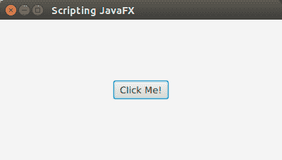

图 8.1：编写 JavaFX

### 使用 Nashorn 替代 Shell 脚本

Linux 硬核粉丝通常精通 Linux 命令。然而，如果你的 Linux 技能仅限于`whoami`和`ls`等最基础的命令，你可以利用 Nashorn。Nashorn 允许你调用 Linux 命令并处理结果。

要在 Nashorn 中执行 Linux 命令，请调用`jjs`并用反引号（`` ` ``）括起命令。在键盘上，该字符通常位于数字`1`的左侧。例如，要列出当前目录的内容，可以使用以下命令。

```
jjs> `ls -al`
```

使用 Nashorn 调用 Linux 命令的优势在于你可以处理输出内容。例如，以下代码调用了`cat`命令打印`Demo.java`文件并添加行号。

```
jjs> var lines = `cat Demo.java`.split('\n');
jjs> var i = 1;
jjs> for each (line in lines) { print(i++ + '\t' + line) };
```

结果如下所示。

```
1	package nashorn.scripting;
2	
3	public class Demo {
4		public static void main(String[] args) {
5			System.out.println("This is a demo");
6		}
7	}
8 
```

另一个例子是，以下脚本可以逐行显示长文档。这可以避免在打印长手册时像往常那样需要回滚到文档开头。

```
jjs> var System = java.lang.System
jjs> var lines = `man pwd`.split('\n')
jjs> for each (line in lines) {System.out.print(line); System.in.read()}
```

按回车键显示下一行文本。

### 总结

Nashorn 是 Java 8 中一个新的 JavaScript 引擎。它不仅允许你从 Java 代码执行 JavaScript，还带有高级功能，用于编写 JavaFX 应用程序以及处理 Linux 命令的输出。
