# 大规模 Java 平台虚拟化与调优 (VMware Press 技术)


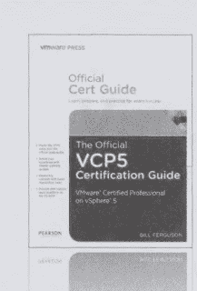

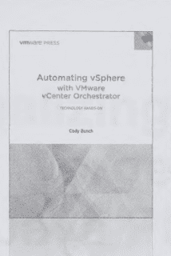

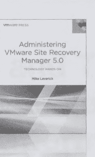

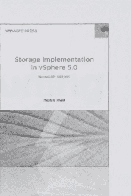


VMware Press 在大批量购买或特别销售时为本书提供优厚的折扣，这可能包括电子版本和/或针对您的业务、培训目标、营销重点的定制封面和内容。有关更多信息，请联系 `(800) 382-3419` 或 `sales@vmware.com`。在美国境外，请联系 `international@pearson.com`。

## 出版社信息

**出版商**  
David Dustmeier

**VMWARE PRESS**  
Joan Murray

**高级项目经理**  
Christopher Cleveland

**高级编辑**  
Sandra Schneider

**制作编辑**  
Tonya Simpson

**拷贝编辑**  
Vanessa Evans

**封面设计师**  
Gary Adair

**编辑助理**  
Keith Cline

---

我将本书献给我亲爱的妻子和两个美丽的儿子。他们让生活充满了快乐。

## 前言

将平台迁移到虚拟等效平台，无需对代码库和平台进行大幅更改或侵入。然而，如今的客户非常清楚我们（以及许多其他人）所采纳的最佳实践的价值，这些实践帮助我们在迁移到虚拟平台的同时改进 Java 部署范式。

总结的经验主要分为以下大类：

- 生产环境总会出问题，这只是早晚的问题。因此，你需要细致考虑可能出现的问题，并准备好向前滚动（`roll-forward`）和回滚（`rollback`）计划。规划过程有助于进一步完善 QA 测试计划。请注意，这并非虚拟环境所特殊。事实上，无论你处理的是物理基础设施还是虚拟基础设施，这一要求都是同样严格的。然而，现实是，虚拟化为你提供了快速处理问题的机制（相比之下，在物理情况下，你移动计算资源的灵活性受到很大限制）。

- 在虚拟化方面，企业级 Java 应用是“轻而易得的果实”。

- 在 Java 的每个层级，每个人都在不同的孤岛中运行，在技术和组织逻辑方面并不一定使用同一种语言。这无疑是旧物理（非虚拟化）范式下的运作模式，这些技术和组织孤岛在过去的几十年中已经形成。然而，跨团队协作是 VMware 上虚拟化 Java 的重要组成部分；它促使许多团队相互交流，以实现最优领域的设计（`best-of-breed design`）。来自应用开发和运维的团队多次共同参与讨论。

- 客户有时试图对其环境的遗留部分进行合理化。结果是客户为物理环境中分散的 JVM 付出了额外的管理成本；如果不解决，这些成本将转移到虚拟化系统中。例如，你真的需要 5000 个拥有 1GB 堆内存的 JVM 吗？它们不能合并吗？答案是肯定的，而且我们展示了如何通过减少许可成本和改进管理来节省费用（因为你需要管理的 JVM 会更少）。

- 性能问题。客户往往会早下结论，认为任何问题都一定是虚拟化问题或 GC 问题。实际上，虚拟化本身不是问题，但 GC 有时可能是问题。不过，如果存在 GC 问题，它并非虚拟化所特有，事实上，这个问题在物理部署中同样存在。

### 内存数据库与 JVM 配置

- 在物理 Java 平台上运行大型内存数据库（真的是 1TB 内存集群吗）？绝对可以，如果首要目标是不惜一切代价以最快的速度处理事务，那么这种架构对你就是正确的。我发现许多客户对此持怀疑态度。他们在不考虑底层平台的情况下尝试对这类环境进行规模规划，这导致了一个糟糕的开端。在规划这些数据平台的规模时，你必须关注服务器架构（如文所述）。我发现某些客户的另一个糟糕做法是，他们试图将这些环境配置为 30 个左右的 JVM。嗯，这并不是正确的方法，因为在许多 JVM 之间保持高频率通信会导致延迟增加。简单来说，这些是延迟敏感的内存密集型工作负载，使用较少 JVM 的部署范式表现更好。如果你比较一个拥有 30 个 JVM 的内存数据库系统和一个拥有 8 个较大 JVM 的系统的性能，那么 8 个较大 JVM 的配置会表现更好。前提是这些较大的 JVM 已经针对 NUMA 优化进行了正确调优，并应用了适当的 GC 调优。

- 内存数据库在虚拟化后真的能很好运行吗？在过去的几年里，我看到虚拟化 Java 应用服务器的客户日益增加。具体来说，数千个 JVM 的大规模平台正在被虚拟化。一种独特的工作负载类型是需要数 TB 内存且对延迟敏感的内存数据管理系统。在这些内存数据集群中，我们发现虽然 JVM 较少，但它们倾向于拥有大堆空间，JVM 大小从 8GB 到 128GB 不等（通常少于 12 个）。当然，12 这个数字并没有神奇之处，它可以低到 3 个，高到 30 个。然而，JVM 越多，由于额外的网络跳数，你面临的潜在延迟问题风险就越大。在书的后面，你将学习如何对这些工作负载进行规模规划和优化。

许多 Java 应用开发者非常熟悉开发流程以及如何编写 Java 代码，然而，这些信息往往留在了开发者手中，没有分享（或翻译给）应用程序管理员。通常，所需的技能……

## 为什么我需要虚拟化？它有哪些核心优势？

也许在 5 年前，我们仍会有客户询问“为什么要虚拟化”的问题。然而，近年来，随着虚拟化几乎已成为标准，它的优势已经得到了广泛认同。这一标准基于 VMware 虚拟化技术，主要是因为其稳健性以及第五代架构的成熟度。

虚拟化提供了以下核心优势：

- **成熟、经过验证且全面的平台：** VMware vSphere ([http://www.vmware.com/products/datacenter-virtualization/vphere/overview.html](http://www.vmware.com/products/datacenter-virtualization/vphere/overview.html)) 第五代虚拟化技术（领先于任何替代方案多年）。它比竞争解决方案提供了更高的可靠性、更先进的功能和更强的性能。

- **高应用可用性：** 高可用性基础设施仍然复杂且昂贵。但 VMware 将稳健的可用性和容错能力直接集成到平台中，以保护虚拟化应用程序。如果节点或服务器发生故障，VM 将自动在另一台机器上重启。

- **基于向导的指南易于安装：** VMware 基于向导的指南消除了设置和配置的复杂性。您可以在其他解决方案部署时间的三分之一内完成运行。

- **简单、流化的管理：** VMware 让您能够通过 Web 浏览器上的“单一面板”控制台同时管理虚拟环境和物理环境。自动部署、动态补丁和虚拟机实时迁移等省时功能将任务从几小时缩短到几分钟。管理变得更快更简单，在不增加人员的情况下提高生产力。

- **更高的可靠性和性能：** 我们的平台通过紧凑、专用的虚拟机程序带来了 CPU 和内存创新，消除了其他平台频繁的补丁、维护和 I/O 瓶颈。结果是顶级的可靠性和持续更高的性能（对于重负载，与我们最接近的竞争对手相比具有二比一或三比一的优势）。

- **更大的节省：** VMware 通过提供每主机高 50% 到 70% 的虚拟机密度优于其他虚拟化解决方案——将单台服务器利用率从 15% 提高到高达 80%。与更少的硬件上运行比其他平台更多的应用程序，从而大幅节省资本支出和运营成本。

- **负担能力：** VMware 的功能最高，但成本并非如此。从每台服务器 165 美元起，小型业务软件包将更多的应用程序整合到更少的服务器上，并具有更强的性能——提供了行业最低的总拥有成本 (TCO)。

若要快速确定并比较在您的环境中部署 VMware 虚拟化的成本，请使用 VMware 应用程序成本计算器：[http://www.vmware.com/go/costperappcalc](http://www.vmware.com/go/costperappcalc)

从根本上说，由于 Java 独立于操作系统，因此它是虚拟化的完美候选者，因为它没有任何硬件依赖。Java 同样受益于许多虚拟化功能，例如高可用性 (HA) 和 vMotion（在不停机的情况下将虚拟机从一个 vSphere 主机移动到另一个主机的能力）。这种灵活性为 Java 平台带来的价值对于大规模 Java 来说是至关重要的，特别是对于超大规模 Java。在大规模 Java 中，我们经常发现数以千计的 JVM 需要持续的管理和维护（例如启动它们、停止它们以及在不停机的情况下进行升级）。如果没有虚拟化灵活性（如 vMotion 和 HA），在这种规模下无法轻松容纳此类管理活动。

企业级 Java 应用程序对动态扩展性、快速置备和 HA 的需求，是当今开发和运维小组日益关注的问题。使用完全基于传统硬件的平台来实现这些要求是复杂且昂贵的。虚拟化是一项突破技术，缓解了常见的企业 Java 应用程序需求可能给组织带来的压力。水平扩展性、垂直扩展性、快速置备、增强的 HA 和业务连续性等功能是 VMware vSphere 套件提供的某些关键属性。第一章研究了三类大规模 Java 平台，以便您可以进一步理解此类系统的复杂性。

现在您已经了解到大规模 Java 平台需要虚拟化的灵活性特性，并且 Java 对操作系统的独立性使其成为负载虚拟化的首选方案，让我们更仔细地观察这种 Java 对操作系统和虚拟机程序的独立性。

## 我应该对 Java 平台进行虚拟化吗？

对于没有时间读完整个章节内容的人，我可以简单地回答：“是的，您应该虚拟化。”毕竟，Java 独立于底层的虚拟机程序（例如 VMware 的裸机虚拟机程序）和操作系统。对于那些想要进一步了解其含义的人，请继续向下阅读。

### Java 的跨平台特性与虚拟化

Java 的主要设计原则基于一种独立于操作系统的跨平台语言（只要有受操作系统支持的底层运行时即可）。我们知道这个运行时是 JVM，它已成为许多企业应用程序平台的常驻设施。您可以编写 Java 应用程序并在不同操作系统上的各种 JVM 上运行它（无需重新编译）。当然，VMware 客户在生产环境中有一个针对特定供应商的 JVM，因此无需担心将 Java 应用程序从一个 JVM 实现移动到另一个实现。然而，如果他们选择这样做，也可以轻松地实现，这主要因为 JVM 促进了 Java 的跨平台和操作系统独立性。

因此，您可以合理地得出结论：Java 应用程序并不真正在乎为它们运行的目标是哪个 JVM，并且独立于特定的 JVM 实现和操作系统。

当然，您可能会问：“一个 JVM 与另一个之间所有不同的内部行为该怎么办？”归根结底，它们都遵循 JVM 规范，某些 JVM（如 `-XX` 标志等）有不同的名称，但行为大多是相似的。差异不在于语言本身，而在于通过命令行使用各种 JVM 选项对 Java 进行优化的方式。

现在快进到基础设施方面。VMware ESXi 是一种裸机虚拟机程序，它使得在单台硬件上运行多个操作系统成为可能。基础设施管理员不再需要担心为某种硬件安装某种操作系统而非另一种。VMware 让操作系统独立于底层硬件（裸机）运行，并在操作系统与裸机之间创建了某种独立性。

虽然关于 Java 是否独立于操作系统和虚拟机程序的答案显然是肯定的，但这归于两个维度的独立性。第一个维度是 Java 的核心原则——跨平台和操作系统独立性；第二个维度是 VMware ESXi 让操作系统独立于其运行的硬件。事实上，当 Java 应用程序运行在基于 ESXi 的虚拟机的操作系统时，ESXi 无法感知操作系统上运行的是否 Java 负载，这使得 ESXi 虚拟机程序与其运行的负载完全独立。

相反，JVM 并不真正知道它正运行在位于 ESXi 虚拟机程序上的虚拟机中，对于 JVM 来说，该虚拟机就像任何其他呈现了计算资源（CPU、内存等）的服务器一样。

只要您使用的 JVM 在运行应用程序的操作系统上受支持，就不需要对下游虚拟机和 ESXi 层有额外的担忧或依赖支持。

图 I-1 展示了本节中讨论的所有层。

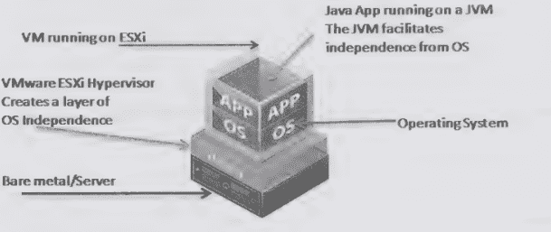

**图 I-1** 在由 VMware ESXi 虚拟化的虚拟机上运行的企业级 Java 应用程序

## 谁应该读这本书？

本书面向 IT 专业人士，他们正在寻找在生产环境和 QA/测试环境中通过 VMware vSphere 运行企业级 Java 应用程序的实施指南。

前三章对 CIO、VPS、总监和企业架构师非常有益，他们正在寻找企业级 Java 应用程序虚拟化的关键高层业务主张。其余章节则面向寻求实现细节的开发者和管理员。

## 如何使用这本书

本书由七个章节、一个附录和一个术语表组成：

- **第 1 章，“大型（规模级）Java 平台简介”：** 本章介绍了各种类型的大规模 Java 平台，并强调了它们根据其规模所需要的独特性能增强。

- **第 2 章“现代可扩展数据平台”：** 本章详细介绍了现代数据平台的结构。

- **第 3 章“调优大规模 Java 平台”：** 本章为正在进行 VMware vSphere 上运行的企业级 Java 应用程序规模规划的 IT 架构师提供了关键考虑因素和指南。本章解释了如何为运行在 VMware vSphere 上的 Java 应用程序获取最佳规模配置。它将引导你完成应用程序的性能基准测试过程，并就应该衡量什么、哪些可以进行调优以及如何最好地确定 Java 应用程序的最佳规模提供提示。

- **第 4 章，“设计和规划大规模 Java 平台”：** 本章将引导读者了解现代虚拟化 Java 平台规模规划的各种方法。它将带领读者了解垂直和水平扩展性在大型 Java 平台中的实际方法论，同时展示了可以用于生产系统的实际规模规划示例。

- **第 5 章“性能研究”：** 本章总结了已发表的性能论文中的一些关键亮点。

- **第 6 章“最佳实践”：** 本章提供了关于在 VMware 上部署大规模 Java 应用程序的最佳实践信息，包括架构、性能、设计与规划以及高可用性的关键最佳实践考虑因素。这些信息旨在帮助 IT 架构师在 VMware vSphere 上成功部署和运行 Java 环境。

- **第 7 章“监控与故障排除入门”：** 本章总结了在虚拟化 Java 时遇到瓶颈或性能问题时该做什么。它为你在实地工作中提供了非常有用的总结。

- **附录，“常见问题 (FAQs)”：** 此附录收集了作者多年来遇到的 VMware 客户的许多问题。通过阅读 FAQ 来快速上手任何技术总是很有帮助。

- **术语表**

## 关于作者

Emad Benjamin 在过去的 20 年里一直从事 IT 行业。他毕业于伍伦龙岗大学，获得电气工程学士学位。在职业生涯早期，他是一名 C++ 软件工程师。随后在 1997 年，他承担了第一个使用 Java 的大项目并从那时起专注于 Java。在过去的 8 年里，他的主要重点是 VMware vSphere 上的 Java。Emad 是 VMworld、Spring-One、UberConf、NFJS 以及世界各地其他 Java 用户组的特邀演讲者。目前，Emad 是专注于 VMware 虚拟化的全球卓越中心的首席架构师，为世界各地提供培训和宣贯。

## 关于技术评审员

Michael Webster 是 vSphere 4 和 5 的 VMware 认证设计专家 (VCDX-066)，vExpert 2012–2013，也是 IT Solutions 2000 Ltd. 的所有者，该公司为全球企业和服务提供商客户提供项目管理、基于 ITIL 的 VMware 运行就绪和技术咨询服务。他自 1998 年以来一直使用 VMware 产品，并一直在为 Unix 到 Linux 的迁移、业务关键应用程序、容灾规避、合并以及公有云和私有云设计并部署虚拟化解决方案。

# 大规模 Java 平台介绍

本章定义了三类大规模 Java 平台：

- 类别 1：大量的 Java 虚拟机 (JVM)（100 到 1000 多个 JVM）
- 类别 2：数量较少但具有大堆内存的 JVM
- 类别 3：类别 1 与消费来自类别 2 数据的组合体

此外，本章还讨论了各种趋势，并概述了技术考虑因素，以帮助你理解与设计大规模 Java 平台相关的各种技术问题。

## 大规模 Java 平台分类

根据与客户的实地交互，大规模 Java 平台通常分为三个大类，如下：

- **类别 1：** 该类别的特点是拥有大量的 Java 虚拟机 (JVM)。在此类别中，Java 平台上部署了数百到数千个 JVM，这些 JVM 通常运行在可能服务于数百万用户的系统之中。我曾见过某些客户拥有高达 15,000 个 JVM。每当你处理数千个 JVM 实例时，都必须考虑管理成本以及是否存在合并 JVM 实例的机会。

- **类别 2：** 该类别的特点是 JVM 数量较少（通常为 1 到 20 个），但具有大堆内存（8GB 到 256GB 或更高）。这些 JVM 通常部署了内存数据库。在此类别中，正如后续章节讨论，垃圾回收 (GC) 调优变得至关重要。

- **类别 3：** 第三类是前两个类别的结合，可能有数千个 JVM 运行企业级应用，这些应用后端消耗类别 2 类型大 JVM 的数据。

关于大规模 Java 平台的虚拟化和调优，以下四个关键需求趋势在这三个类别中均适用：

- 计算资源整合
- JVM 实例整合
- 弹性与灵活性
- 性能

让我们详细查看这些每一个趋势。

## 大规模 Java 平台趋势与需求

计算资源整合、JVM 实例整合、弹性与灵活性以及性能，是大规模 Java 平台迁移项目中存在的一些主要趋势。以下子节将详细检查其中的每项内容。

## 计算资源整合

许多 VMware 客户发现，他们的中间件部署不断激增，并随着成本的增加正成为一项管理挑战。因此，客户正寻求将虚拟化作为减少服务器实例数量的方法。同时，客户正利用整合的机会，使服务于特定负载所需的中间件数量合理化。中间件组件通常运行在 JVM 内部，观察到的规模为数百到数千个 JVM 实例，这提供了许多 JVM 实例整合的机会。因此，中间件虚拟化提供双重整合的机会：首先整合服务器实例，然后整合 JVM 实例。这种趋势是广泛存在的；毕竟，地球上的每一家 IT 部门都在考虑整合带来的成本节约。


# 大规模 Java 平台介绍

## JVM 实例整合

酒店行业的一个客户经历了整合其服务器足迹的过程，并同时整合了许多堆内存小于 1GB 的较小 JVM。他们将许多此类较小的 1GB JVM 合并为两类：一类是 4GB 的，另一类是 6GB 的。他们进行整合的方式是，使得应用程序可用的 RAM 总净量等于原始 RAM 总量，但 JVM 实例更少。他们在做这一切的同时，提升了性能并保持了良好的服务水平协议 (`SLA`)。他们还通过减少原始需要管理的 JVM 实例数量，大幅降低了管理成本；这种精简的环境帮助他们轻松地维护 `SLA`。

另一位保险行业的客户取得了相同的结果，并且能够在开发和测试 (`QA`) 环境中进行 CPU 超额分配，以节省第三方软件成本。

有时我们会遇到某些客户，他们有合理的业务需求为每个应用维护一个 JVM 和或为每条业务线维护一个 JVM。在这种情况下，你无法真正合并 JVM 实例，因为这样做会导致来自一个业务线的应用生命周期与另一个业务线混合。然而，尽管通过这种方式无法合并 JVM 实例，但客户可以从充分利用资源中获益，因为在非虚拟化环境下观察到数百到数千个 JVM 实例的规模。

## 弹性与灵活性

对于季节性需求的应用日益常见。例如，许多客户运行着季节性流量。通过 VMware，可以根据需要自动配置虚拟机 (`VM`) 以支持这种内存需求。

在不引起中断的情况下更新/补丁硬件的能力对于中间件至关重要。这允许你在管理中间件时移动虚拟机。

## 性能

客户经常报告虚拟化后中间件性能的提升。部分性能提升归功于更新的硬件。VMware 管理程序 (`hypervisor`) 在过去几年取得了显著改进，第 5 章“性能研究”讨论了在虚拟化环境中进行的一些深度工作负载测试。

适用于将利用此类巨大计算资源的传统关系型数据库管理系统 (`RDBMS`)。这些系统需要大型 vSphere 主机的主要比是因为，大多数传统的 `RDBMS`（某些少数例外，例如 Oracle RAC）不支持横向扩展（scale-out），而是主要进行纵向扩展（scale up）。对于第 1 类和第 2 类，可以使用横向扩展的方法，因此可以选择更具成本效益的 vSphere 主机配置。在第 1 类 Java 工作负载中，您应该考虑 RAM 范围更合理、小于 128GB 的 vSphere 主机。

- 限制是服务器的 RAM 总量，以及它是如何划分为若干 NUMA 节点的，每个处理器插槽将拥有一个 NUMA 节点大小的 NUMA 本地内存。NUMA 本地内存的计算方法是服务器内的 RAM 总量除以处理器插槽的数量。我们知道，为了获得最佳性能，应该始终将 VM 的大小设定在 NUMA 节点内存边界内；毫无疑问，ESX 有许多 NUMA 优化措施起作用，但保持在 NUMA 本地总是最好的。

例如，如果 ESX 主机在两个处理器插槽上拥有 256GB 的 RAM（这意味着它有两个 NUMA 节点，每个 NUMA 节点拥有 128GB (256GB/2) 的 RAM），这意味着当您规划 VM 大小时时，它不应超过 128GB 的限制以保持 NUMA 本地。

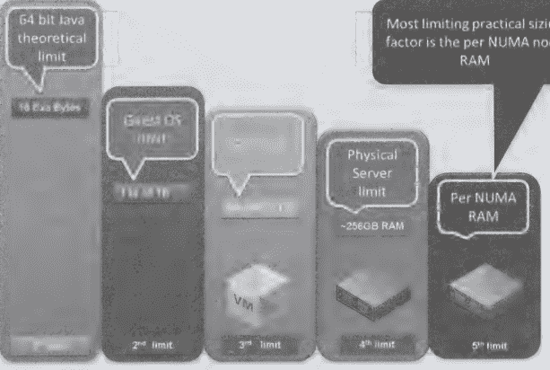

**图 1-1** Java 平台的理论与实际限制

图 1-1 和列表中列出的限制将帮助您设计并评估调整大型 JVM 的实际操作性和可行性。然而，在调整非常大的 JVM 时还有其他考虑因素，例如 GC 调优的复杂性以及维护大型 JVM 所需的知识。事实上，我们客户群中的大多数 JVM 对于典型的企业级 Web 应用程序内存在 4GB 左右，即书中所谓的第 1 类工作负载。然而，也存在更大的 JVM，我们的客户在从 4GB 到 128GB 不等的 JVM 上运行大规模监控系统和分布式平台（内存数据库）。对于如 vFabric GemFire 和 SQLFire 等内存数据库也是如此，集群中的单个 JVM 成员可以大到 128GB，整个集群的规模可达 3 TB。随着大型 JVM 的出现，需要对 GC 调优有更好的了解。在 VMware，多年来我们一直帮助许多客户进行 GC 调优工作，尽管物理机上的 GC 调优与在虚拟机上并无区别。原因在于我们独特地将 vFabric Java 和 vSphere 的专业知识整合到一个体系中，这帮助了我们的客户在 vSphere 上优化地运行许多 Java 工作负载。在决定是否纵向扩展 JVM 和 VM 的大一时，务必首先考虑横向扩展方法；我们发现客户通过横向扩展平台可以获得更好的扩展性。如果横向扩展性不可行，请考虑增加 JVM 内存以及相应的 VM 内存。当选择通过增加堆空间/内存来增加 JVM 大小时时，下一个考虑点是 GC 调优以及您处理大型 JVM 所具备的内部内部知识。

### 注意

关于第三个限制，截至本文编写时，ESXi 5.1 是发布的 GA 正式版本；但是，等到本书出版时，某些最大 Sphere 限制可能会发生变化。请仔细检查 VMware 官方产品文档以获取最新的最大值。另请注意，这些具有成本效益的 VM 硬件需要如此大量的 vCPU；然而，对于需要它们的人来说这仍然是有保障的。

正如本章前面提到的，在当今的企业中，大规模 Java 平台属于三类之一。图 1-2 显示了各种工作负载类型和相应的规模。一个趋势是，随着 JVM 大小的增加，所需的 JVM 调优也随之增加。

## 大规模 Java 平台技术考虑

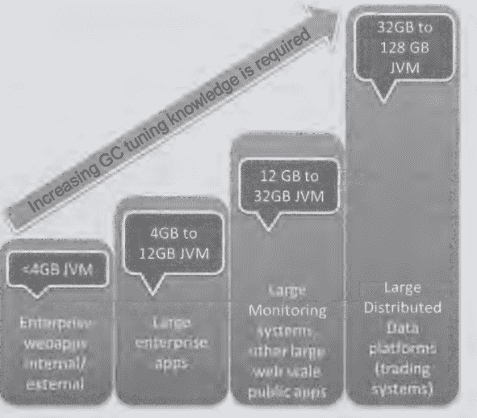

**图 1-2** 增大 JVM 的 GC 调优需求

重要的是记住以下内容（从左到右）：

- 某些工作负载（例如作业调度器）需要高吞吐量，而面向用户的 Java 应用程序需要快速响应。因此，在一个 JVM 中将这些类型的应用堆叠会增加 GC 调优的难度。为了提高吞吐量进行 GC 调优通常是以牺牲响应时间为代价，反之亦然。

- 通过 GC 调优可以获得更高的吞吐量和响应时间，但这确实增加了不必要的 GC 调优工作。在面对这种部署选择时，最好的办法是将 Java 工作负载类型分配到各自的 JVM 中。

此应用程序混合了 JVM-2。更好的方法是将 Web 应用程序分为 JVM-3，将作业调度器应用程序分为 JVM-4（即进行水平扩展，并根据需要时具有垂直扩展的灵活性）。如果你将 JVM-3 和 JVM-4 的垂直扩展性与 JVM-2 的垂直扩展性进行比较，你会发现 JVM-3 和 JVM-4 的扩展效果更好，且更容易调优。

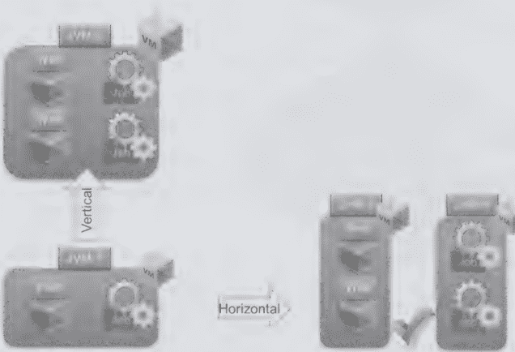

**图 1-3** 避免在同一 JVM 中混合不同的工作负载类型

### NUMA

非均匀内存访问架构 (`NUMA`) 是一种用于多处理器的计算机内存设计，其中内存访问时间取决于内存相对于处理器的位置。在 `NUMA` 环境下，处理器访问其本地内存的速度快于非本地内存（即另一个处理器的本地内存或处理器之间共享的内存）。

理解 `NUMA` 边界对于确定 VM 和 JVM 的规模至关重要。理想情况下，VM 的规模应该限制在 `NUMA` 边界内。图 1-4 显示了一个具有两个插槽的 vSphere 主机，因此对应两个 `NUMA` 节点。所示的工作负载是两个 vFabric SQLFire VM，每个 VM 的规模都设计为适应 `NUMA` 节点的内存和 CPU 边界。如果 VM 的规模超过了 `NUMA` 边界，它可能会与另一个 `NUMA` 节点发生交织，以满足本地 `NUMA` 节点无法提供的额外内存请求。图中用红色箭头描绘了内存交织（虚线显示了交织），强调了应该避免这种内存交织，因为它可能会严重影响性能。

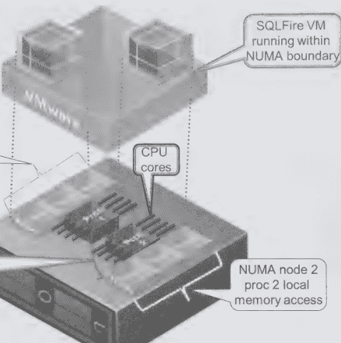

**图 1-4** 具有两个 NUMA 节点的双插槽八核 vSphere 主机，每个 NUMA 节点运行一个 VM

要计算每个 `NUMA` 节点的可用 RAM 量，请应用公式 1-1 中的方程。

```
NUMA 本内存 = 服务器总 RAM / 插槽数量
```

**公式 1-1** 每个 NUMA 节点 RAM 大小（NUMA 本内存）

例如，如果服务器配置了 128GB 的内存并具有两个插槽（如图 1-4 所示），这意味着每个 `NUMA` RAM 为 128/2，等等于 64GB。然而，这并非完全正确，因为需要考虑 ESXi 的开销。因此，通过公式 1-2 中的方程可以得出更准确的估计。该公式考虑了 ESXi 内存开销（无论服务器大小如何，固定为 1GB）以及 1% 的 VM 内存开销（占可用内存的 1%）。该公式是一个保守的估计，每个 VM 和工作负载都会略有不同，但该估计应该接近最坏情况。

## 大规模 Java 平台技术考虑

| NUMA 本内存 = [主机总 RAM - {(主机总 RAM * nVMs * 0.01) + 1GB}] / 插槽数量 |

**公式 1-2** 带有 ESXi 开销调整的每个 NUMA 节点 RAM（NUMA 本内存）

以下是公式的不同部分：

- **NUMA 本内存**: 用于内存吞吐量和局部性的本地 NUMA 内存，已计入 VM 和 ESXi 开销
- **主机总 RAM**: 物理服务器上配置的物理 RAM 量
- **nVMs**: 你计划在 vSphere 主机上部署的 VM 数量
- **1GB**: 运行 ESXi 需要的开销
- **插槽数量**: 物理服务器上的可用插槽数量，2 插或 4 插槽

> **注意**
>
> 公式 1-2 假设了开销范围的最悲观情况，特别是随着 VM 数量的增加——显然，增加 VM 越多，开销越大。尽管 VM 数量较少，公式 1-2 的估计也相当公平准确。这还假设了没有内存过度提交。此公式对于确定大型 VM 的规模非常有益，而此时 NUMA 考虑最为关键。在确定大型 VM 规模时，通常你尝试维持少数配置的 VM，因此此开销准确适用。事实上，对于具有内存密集型工作负载的大 VM，最佳配置是每个 NUMA 节点运行一个 VM。如果你尝试将此公式应用于配置了超过六个 VM 的部署（例如 10 个 VM），公式可能会高估所需量。更准确地说，你可以使用 6% 规则，该规则无论 VM 数量如何都适用，假设 6% 的内存开销是足够的，无论你有 10 个还是 20 个 VM。

如果你没有时间推算公式并想快速开始计算，可以想象由于内存产生了 6% 的开销。很多时候，这些开销并没有被完全使用。例如：

**示例 1**——使用 6% 估计方法：这意味着如果你有一台 128GB 物理 RAM 的服务器（双插槽主机，每个插槽八核），并且在主机上配置两个 VM 时选择 6% 的开销，则总 NUMA 内存将是 =>(128 * 0.94 - 1)/2 => 每个 VM 可用内存为 59.7GB。因为有两个 VM，提供给这两个 VM 的总内存约为 59.7 * 2 => 119.32。

NUMA 客户端的更为细粒度的计算。NUMA 客户端计算由 `NUMA.vcpu.maxPerClient` 控制，它可以在“高级主机属性 -> 高级虚拟 NUMA 属性”中设置。如果你将其更改为 2，那么我们示例中的每个插槽实际上将拥有三个 NUMA 客户端，因此第五个 2vCPU VM 将跨两个 NUMA 客户端进行调度，并在必要时可能跨越两个插槽。你很少需要进行这种级别的调优，但此示例说明了 vSphere 中 NUMA 算法的威力，这种威力远超任何非虚拟化的 Java 平台。

通常，当虚拟机启动时，ESXi 会作为放置算法的一部分为其分配一个主节点（home node）。虚拟机仅运行在其主节点内的处理器上，其新分配的内存也来自该主节点。除非虚拟机的主节点发生变化，否则它将使用本地内存，避免与访问其他 NUMA 节点的远程内存访问相关的性能损失。当虚拟机启动时，它会被分配一个初始主节点，以确保 NUMA 节点之间的整体 CPU 和内存负载保持平衡。ESXi 在启动时确定这些节点间的延迟，并在初始放置宽于单个 NUMA 节点的虚拟机时使用这些信息。这些宽大的虚拟机被放置在相互靠近的 NUMA 节点上，以获得最低的内存访问延迟。对于仅运行单个工作负载的系统（例如保持不变的基准测试配置），仅初始放置的方法通常足够。然而，这种方法无法为支持变化工作负载的数据中心级系统保证性能和公平性。因此，除了初始放置外，ESXi 5.0 还在 NUMA 节点之间对虚拟 CPU 和内存进行动态迁移，以提高 CPU 平衡性并增加内存局部性。ESXi 将传统的初始放置与动态再平衡算法相结合。系统会定期（默认每秒一次）检查节点并决定是否应该通过将虚拟机从一个节点移动到另一个节点来重新平衡负载。

此计算考虑了虚拟机和资源池的资源设置，以便在不违反公平性或资源权利的情况下提高性能。再平衡器选择一个合适的虚拟机并将其主节点更改为负载最低的节点。当条件允许时，再平衡器会将已经在目标节点上分配了一些内存的虚拟机移动过去。从那时起，虚拟机在其新的主节点上分配内存，并仅在该新主节点的处理器上运行。再平衡是维护公平性并确保所有节点被充分利用的有效解决方案。再平衡器可能需要将虚拟机移动到一个其分配很少或没有内存的节点。在这种情况下，虚拟机将产生大量远程内存访问带来的性能罚。ESXi 可以通过从虚拟机原始节点透明迁移内存到新主节点来消除这种罚。

## 大规模 Java 平台技术考虑

### 注意

在 vSphere 4.1/ESXi 4.1 中，底层的物理 `NUMA` 架构不会由虚拟机程序暴露给操作系统，因此运行在此类虚拟机上的额外 `NUMA` 工作负载无法充分利用它们可能提供的特定 `NUMA` 钩子。然而，在 vSphere 5 中，引入了 vNUMA 概念；通过配置，你可以将底层的 `NUMA` 架构暴露给操作系统，感知 `NUMA` 的应用程序可以利用它。在 Java 中，可以使用 `-XX:+UseNUMA` JVM 选项；但它仅与吞吐量 GC（throughput GC）兼容，而不与 CMS GC 兼容。矛盾的是，在 `NUMA` 是巨大因素的内存密集型案例中，延迟敏感是一个很大的考虑因素，因此 CMS 收集器更合适。这意味着你不能同时使用 CMS 和 `-XX:+UseNUMA` 选项。好消息是，vSphere NUMA 算法通常足够能提供局部性，特别是如果你遵循了良好的 `NUMA` 尺寸划分最佳实践——例如，调整虚拟机大小以在内存和 vCPU 视角上符合 `NUMA` 边界。

### 生产环境中最常见的 JVM 尺寸

在讨论了你可以部署的各种 JVM 尺寸（在某些情况下是非常大的 JVM）之后，重要的是记住，数据中心中最常见的 JVM 是 4GB 堆内存的。这可能是一个相当繁忙的 JVM，具有 100 到 250 个并发线程（实际线程数将取决于工作负载的性质）、4GB 堆内存、JVM 进程占用约 4.5GB、客操作系统占用 0.5GB，因此为虚拟机建议的总内存预留为 5GB，配备两个 vCPU 和一个 JVM 进程，如图 1-6 所示。

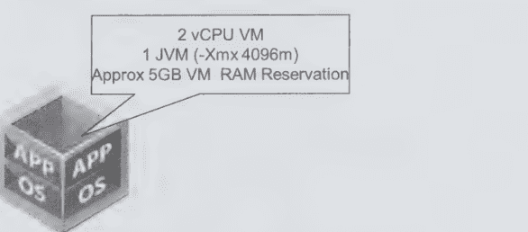

**图 1-6** 生产环境中最常见的 JVM 尺寸

### JVM 和 VM 的水平扩展与垂直扩展

在考虑水平扩展与垂直扩展时，你有三个选项，如图 1-7 所示。

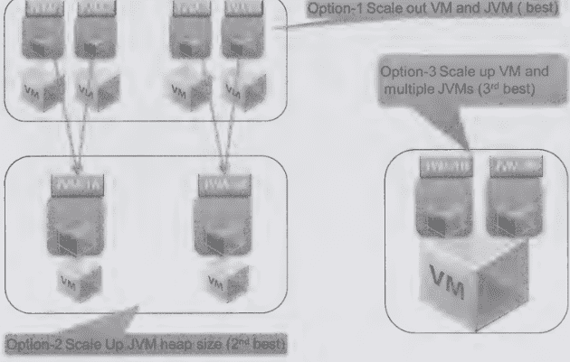

**图 1-7** 水平与垂直 JVM 扩展性可扩展性选择

接下来的章节将详细介绍这三个选项的优缺点。

#### 选项 1

##### 优点

- 此选项提供了最好的扩展性，因为虚拟机和 JVM 是作为一个整体进行调度的。
- 此选项提供了最好的灵活性，因为虚拟机和 JVM 是作为一个整体进行调度的。
- 然而，在像选项 1 这种本质上属于类别 1（如之前定义的）的中，你有机会合并 JVM 并消除浪费的 JVM 和 VM 实例。

##### 缺点

- 此选项是昂贵的，因为它导致了更多的操作系统副本，许可费用会迅速变得昂贵。
- 管理此类系统的成本更高，因为有更多的虚拟机和 JVM 需要跟踪。

#### 选项 2

选项 2 涉及通过合并较小的 JVM 来增大 JVM 堆内存，并结果合并虚拟机。

如果系统经过了优化，则水平扩展的优势将适用。这里的优化意味着应用了虚拟机和 JVM 的最佳实践，例如 64 位 JVM 架构而非传统的 32 位 JVM 的 1GB 限制。

这是传统 32 位 JVM 中的一种常见模式，32 位 JVM 的 1GB 限制迫使 Java 平台工程师安装更多 JVM 实例来应对流量增加。缺点是你必须为额外的 CPU/许可付费。如果你通过将迁移到 64 位 JVM 并同时增加内存来合并虚拟机，你将通过更少的 JVM 服务相同的流量来节省成本。当然，JVM 尺寸可能会从 1GB 增加到 4GB。

##### 选项 2 的优点

使用选项 2 的优点如下：

- 可以在减少 vCPU 数量的同时保持等量的内存（Java 堆空间），因为有了更大的堆空间，GC 可以很好地进行纵向扩展，而不会过度消耗 CPU。这在很大程度上取决于行为，某些工作负载在 JVM 扩展时可能会表现出 CPU 占用率增加的情况。大多数类别 1 的工作负载表现出将不需要 vCPU 合并到更大的 JVM 堆中的行为。64 位 JVM 是功能非常强大的运行时容器，尽管启动它们有初始成本，但它们确实允许你在大得多的内存堆空间内处理海量的事务。当你考虑创建一个新的 JVM 时，你应该像准备创建一个新的 VM 那样问相同的问题。如果有人需要新的 VM，vSphere 管理员总是会询问为什么需要。因为 JVM 是一台功能强大的机器（就像 VM 是一个功能强大的计算资源一样），vSphere 管理员和 DevOps 工程师应该始终仔细审查创建新 VM 是否必要（或者可能在合理范围内增加堆空间以支持更多流量）。

##### 选项 2 的缺点

使用选项 2 的缺点如下：

- 由于 JVM 尺寸较大，如果 JVM 在崩溃时没有适当的冗余或事务持久化机制，你可能会面临丢失更多数据（与选项 1 中较小的 JVM 情况相比）。
- 由于合并，你可能会有较少的高可用 (`HA`) JVM 实例。
- 合并仅限于特定的业务线。你不希望将来自不同业务线的应用程序混合到同一个 JVM 中；如果你将两个业务合并到一个 JVM 中，JVM 的崩溃将同时影响两个业务线。
- 大 JVM 可能需要一些 GC 调优。

#### 选项 3


如果选项 1 和选项 2 均行，请考虑选项 3。在这种情况下，你是在一个较大的 VM 上放置多个 JVM。现在，JVM-1B 和 JVM-2B 可以是像选项 2 那样的合并副本，也可以是像选项 1 那样的非合并副本。无论哪种情况，你都可以将这些 JVM 堆叠在较大的 VM 上，或者根据需要堆叠多个大 JVM。

### 选项 3 的优点

使用选项 3 的优点如下：

- 如果当前平台与选项 1 类似，由于物流原因，在部署中保持当前的 JVM 数量不变可能是一个优势，然后考虑通过在多个 JVM 上进行堆叠来构建更大的 JVM。
- 减少操作系统许可证的数量。
- 减少了 VM 实例的数量。
- 由于 VM 数量减少，降低了管理成本。
- 你可以为每个业务线拥有专用的 JVM，也可以在同一台 VM 上部署来自多个业务线的 JVM。只有当 VM 合并的成本超过 VM 崩溃期间多个业务线受影响的风险时，你才应该这样做。
- 大 VM 使 JVM 拥有更多 vCPU 成为可能。例如，如果一个 VM 上有两个来自不同业务线的大 JVM，且它们在不同的时间达到峰值，很可能所有的 vCPU 都能供忙碌的 JVM 使用，同样地，当下一个 JVM 达到峰值时也是如此。

### 选项 3 的缺点

很可能需要更大的 VM。调度较大的 VM 可能比较小的 VM 需要更多调优。

> 注意
>
> 各项性能研究表明，对于类别 1 的工作负载，最佳 VM 尺寸是两个到四个 vCPU。类别 2 的工作负载需要超过四个 vCPU；至少可能需要四个 vCPU。请记住，从 HA 可用性的角度来看，调度机会可能会减少。然而，类别 2 工作负载（如内存数据库）大多是容错、冗余且支持磁盘持久化的，因此可能不那么依赖 VMware 或自动分布式资源调度器 (`DRS`)。

此选项关乎尝试合并 JVM，来自不同业务线的 JVM 可能会部署在同一台 VM 上。你必须正确管理这一点，以避免 VM 的意外重启这可能影响到多个业务线。

在这种情况下，你可以尝试合并 JVM 并将它们堆叠在同一台 VM 上；然而，这迫使 JVM 变得大得多以充分利用底层内存。如果你配置了较少的大 VM，字面意思是你底层硬件提供了大量的 RAM，要完全消耗这些内存可能需要更大的 JVM 堆空间。由于 JVM 尺寸较大，如果 JVM 在崩溃时没有适当的冗余或事务持久化机制，你可能会面临丢失更多数据。

此选项可能需要更大的 vSphere 主机，而更大的服务器成本更高。

### 总结

本章介绍了大规模 Java 平台的概念，并描述了它们通常属于以下三个类别之一：

- 类别 1：大量的 JVM
- 类别 2：具有大堆内存的较少 JVM
- 类别 3：类别 1 和 2 的结合

本章还研究了 JVM 内部各种理论和实际限制，并概述了各种工作负载类型和常见的 JVM 尺寸。本章还讨论了 NUMA 以及水平扩展、纵向扩展、JVM 合并和 VM 合并的优缺点。

## 现代可扩展数据平台

尽管你可以通过多种方式使架构现代化，但关键趋势如下：

- 围绕 `Spring Framework` 提供的灵活性进行应用程序架构现代化
- 数据现代化

随着数据现代化的发展，存在许多不同的方法。本章主要关注使用水平可扩展内存数据库以提高可扩展性和响应时间的日益增长的趋势。这里使用 `VMware vFabric SQL` 来说明内存数据管理系统的功能。

> 注意
>
> 讨论此类工作负载有助于 Java 平台工程师提高他们的平台调优能力。这类内存数据库工作负载大部分由类别 2 工作负载组成。然而，取决于你选择哪种拓扑，你可能需要处理类别 3 工作负载。理解如何调优此类系统将使你能够处理最困难的调优任务。不过，在深入调优之前，最好先理解此类类型的功能。

`vFabric SQLFire` 是一种内存分布式数据管理平台，可以跨越许多虚拟机 (`VM`)、Java 虚拟机 (`JVM`) 和 `vFabric SQL` 服务器来管理应用程序数据。通过动态复制和分区，`vFabric SQLFire` 在平台上提供了以下功能：数据持久性、基于触发器的事件通知、并行执行、高吞吐量、低延迟、高可扩展性、持续可用性和 WAN 分发。

**图 2-1** 显示了 `vFabric SQLFire` 作为中间层数据层，负责协调向企业数据消费应用程序交付数据。随着消费类应用程序的需求增加，中间层数据层会扩展以适应季节性负载。此外，`vFabric SQLFire` 是一个能够管理事务和一致性的完整数据管理系统，因此企业数据消费应用程序可以依赖 `vFabric SQLFire` 作为记录系统。

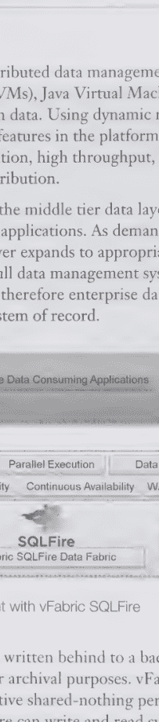

**图 2-1** 使用 `vFabric SQLFire` 的企业数据管理

为了额外的持久化，数据可以写入备份存储（如关系型数据库）或其他磁盘存储用于归档。`vFabric SQLFire` 使用其自身的无共享持久化机制提供完全的持久化能力。图 2-2 展示了 `vFabric SQLFire` 如何同步/异步地写入和读取外部数据存储。

`vFabric SQLFire` 基于 `VMware vFabric GemFire` 分布式数据管理产品和 `Apache Derby` 项目。如图 2-3 所示，`Apache Derby` 项目用于其关系数据库管理系统 (`RDBMS`) 组件、Java 数据库连接 (`JDBC`) 驱动程序、查询引擎和网络服务器。`GemFire` 的分区技术用于实现 `vFabric SQLFire` 的水平分区功能。

| 可靠事件通知 | 无共享架构 SQL | 并行执行 | 数据持久化 | 广网分布 |
| :--- | :--- | :--- | :--- | :--- |
| 高吞吐量 | 低延迟 | 高可扩展性 | 持续可用性 | |


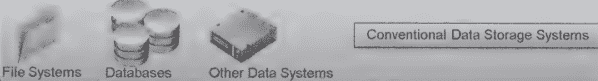

**图 2-2** 具备写入传统存储系统能力的 `vFabric SQLFire` 架构

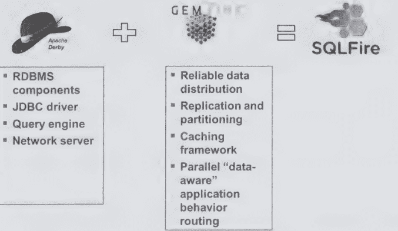

- `RDBMS` 组件
- `JDBC` 驱动程序
- 查询引擎
- 网络服务器
- 可靠的数据分布
- 复制与分片
- 缓存框架
- 并行“数据感知”应用行为路由

**图 2-3** `vFabric SQLFire` 内部架构

`vFabric SQLFire` 特别增强了 `Apache Derby` 组件，例如查询引擎、SQL 接口、数据持久化数据驱逐；它还添加了额外的组件，如 SQL 命令、存储过程、系统表、函数、持久化磁盘存储、监听器和定位器，以运行一个高度分布式且容错的数据管理集群。

## 最佳实践 1：通用分布式数据平台

当要求数据交付达到最高速度（以毫秒和微秒计）时，将 `vFabric SQLFire` 设置为企业级数据网系统是正确的方法。如图 2-2 所示，你为许多企业应用数据需求引入了内存中的通用数据交付和消费层。这使得企业级应用能够从 `vFabric SQLFire` 的扩展性、可用性和执行速度特性中受益。

尽管 `vFabric SQLFire` 是一个处理大数据量交易（每秒数千次交易）的高能力数据平台，但它也被用于低量级（每秒几十到数百次交易），以快速提升企业应用的响应时间和数据库的韧性。`vFabric SQLFire` 符合 SQL-92 标准，使得对自定义企业应用重新配置以使用 `vFabric SQLFire` 相对是非侵入性的。

`vFabric SQLFire` 的三种主要设置拓扑如下：

- 客户端/服务器 (`Client/server`)
- 对等点 (`Peer-to-peer`)
- 多站点 (`Multisite`)

这些每种拓扑都可以独立使用，或组合形成一个扩展的全功能分布式数据管理系统。

客户端/服务器拓扑由两层组成：客户端层和服务器层，如图 2-4 所示。

客户端层与服务器层通信，以从服务器层搜索或更新数据对象。

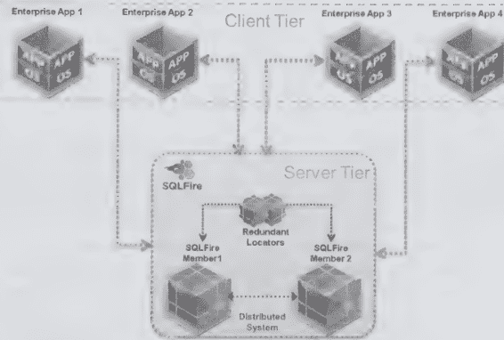

**图 2-4** `vFabric SQLFire` 客户端/服务器拓扑

> 注意：客户端/服务器拓扑属于第 3 类负载，其中数百到数千 Java 客户端（运行在应用服务器内部的企业级应用）从由十几个左右 SQLFire JVM 组成的 `vFabric SQLFire` 集群中消费数据。

服务器层由许多 `vFabric SQLFire` 成员组成，每个成员运行其自己的 JVM 进程，提供网络分布、内存和磁盘持久化数据管理功能。此外，即使每个 `vFabric SQLFire` 成员都运行在自己的 JVM 进程空间内，`vFabric SQLFire` 成员之间也具有网络连通性，从而形成呈现给客户端的单一数据管理集群。

客户端通常是分布在组织内的企业级应用，位于 `vFabric SQLFire` 集群外部，但需要与 `vFabric SQLFire` 集群进行数据进出访问。客户端使用客户端驱动，该驱动是适用于 Java 程序的轻量级 `JDBC` 驱动程序，或适用于 .NET 的 `ADO.NET`。

## 最佳实践 2：客户端/服务器拓扑

客户端/服务器拓扑最常用。当几十到数千个企业级应用需要从 `vFabric SQLFire` 数据管理系统消费数据时，客户端/服务器拓扑是最合适的。在客户端/服务器拓扑中，客户端可以完全访问数据，而无需是 `vFabric SQLFire` 集群的一部分。

在这种拓扑中，特别是在生产部署中，使用 `-mcast-port=0` 关闭组播发现，而是使用定位器来定位 `vFabric SQLFire` 成员。

通过在不同的物理机器上运行独立的定位器，使 `vFabric SQLFire` 定位器高可用。当满足以下需求时，使用客户端/服务器拓扑：

- **动态服务器发现**：`vFabric SQLFire` 服务器定位器动态跟踪服务器，并将客户端引导到新服务器，客户端无需知道服务器在哪里或在给定时间有多少可用服务器。
- **服务器负载均衡**：`vFabric SQLFire` 服务器定位器跟踪所有服务器的当前负载，将新的客户端连接到负载最低的服务器。`vFabric SQLFire` 提供默认的负载探测。要自定义计算服务器负载的算法，你可以实现自己的插件。
- **服务器连接配置**：客户端连接可以透明地配置并可能移动到不同的服务器，这允许在启动新服务器后重新平衡整体利用率。这有助于在添加服务器或从服务器故障恢复时加速配置。

在对等点拓扑中（如图 2-5 所示），两个或多个相互通信的 `vFabric SQLFire` 服务器形成一个分布式系统。数据根据表的冗余规则进行分布。

> 注意：对等点拓扑属于第 2 类负载，有几十个 SQLFire JVM 相互通信。

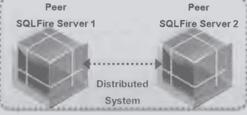

**图 2-5** 对等点 `GemFire` 分布式系统

## 最佳实践 3：对等点多网卡机器

- 一组相互通信的 `vFabric SQLFire` 服务器，没有客户端访问它们，或只有极少数客户端（例如，会话数据、Web 内容、后端或提供单跳访问模式的后端类型处理）。
- 需要少量节点客户端（与客户端/服务器拓扑中的数百个相比）的应用是对等点拓扑的良好选择。部署许多节点会增加每个成员的缓冲区和套接输出。
- 从管理和管理的角度来看更加方便。在嵌入集群中，不需要管理任何外部进程来部署 `vFabric SQLFire` 服务器。例如，如果你将 `vFabric SQLFire` 嵌入 Java 应用服务器集群中，每个应用服务器与相关的 `vFabric SQLFire` 共享同一个进程。
- 如果运行在多网卡机器上，可以为通信指定非默认网络适配器。在组播对等点情况下，通信使用 `bind-address` 属性。

在 `vFabric SQLFire` 中，你可以设置各种冗余区域，使副本（或冗余副本）不会放置在相同的物理硬件上。你可以将每个 `vFabric SQLFire` 成员的 `redundancy-zone` 启动属性设置为特定的冗余区域名称。通常做法是让这些冗余区域名称与底层物理硬件名称相似，以便确保冗余的 `vFabric SQLFire` 成员不会放置与其原始分区成员相同的物理硬件/服务器机器上。

### 全局多站点拓扑

在 `vFabric SQLFire` 中，你可以建立跨越多个数据中心的多站点拓扑，用于活动-活动、灾难恢复和 WAN 分布等类型的配置。对于距离小于 60 英里的数据中心，你可以设置一个跨多个站点的单一数据织；对于大于 60 英里的距离，则使用 `vFabric SQLFire WAN` 网关设置。

多站点拓扑的一种特殊情况是全局多站点，如图 2-6 所示。

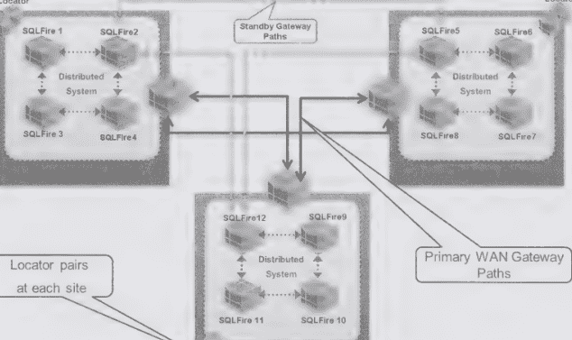

**图 2-6** `vFabric SQLFire` 全局多站点拓扑

共有三个全球分布站点（纽约、东京和伦敦），每个站点都有一个本地分布式系统。在每个站点内部，都配置了一个网关，以便在故障发生时提供站点之间的数据传输，或者提供全球范围内数据的一致视图。网关以容错对的形式存在。每对中的主成员处理跨所有站点的数据复制。主成员由冗余的备用网关进程支持，如果原始主网关故障，备用网关会自动成为主网关。按照标准的客户端/服务器拓扑，每个站点都有两个或多个定位器 (`locator`) 进程，提供本地站点成员发现服务。

## 最佳实践 4：多站点

- 多站点配置中的每个分布式系统都独立于其他连接的系统运行。配置为站点间复制的表必须使用相同的表名和列定义进行创建。此外，必须配置发送者和接收者，以将每个系统中的逻辑网关连接分配给物理网络连接。对于每个配置使用网关发送器的表，数据操作语言 (`DML`) 事件将自动转发到用于其他站点的网关发送器。这些事件被放在网关队列中，并异步分布到远程站点。插入/更新和删除操作会发送到其他站点，除非删除属于过期或驱逐。然而，查询、数据定义语言 (`DDL`)、事务和过期不会分发到远程站点。
- 参与 WAN 复制的每个 `vFabric SQL` 分布式系统必须使用一个或多个定位器进行成员发现。WAN 复制不支持多播发现。
- WAN 部署增加了对 `vFabric SQLFire` 系统的需求。为了避免与 WAN 消息相关的连接饥饿，请对参与 WAN 部署的 `vFabric SQLFire` 成员始终设置 `conserve-sockets=false`。
- 启用 WAN 的表必须存在于想要连接的每个分布式系统中。
- 你可以配置分区表和复制表使用网关发送器。但是，你必须在 `CREATE TABLE` 语句中指定的网关所在的服务器组中创建复制表。
- 在向表中填充数据之前，你必须启动整个 WAN 系统（即全局多站点系统），或者必须在启用 WAN 监听器接受 WAN 流量之前，在新添加的站点中填充表。这是为了确保 WAN 站点从一开始就能保持同步。未这样做会导致数据操作期间出现异常。


- 通常，在使用网关枢纽时应使用合并（conflation）功能，以便将最新的更新传递到远程站点。通过合并，早期的更新会被丢弃，转而采用队列中后发送的更新。启用合并以获得最佳性能。你可以在监听器定义中设置 `ENABLEBATCHCONFLATION` 属性。只有依赖于查看每次更新的应用（例如，如果任何远程网关有需要感知每个状态变化的触发器或 `AsyncEventListener`）才禁用合并。


- 在使用网关的多站点安装中，如果站点之间的链路未针对优化吞吐量进行调整，消息可能会在网关队列中积压。如果接收队列因为缓冲区大小不足而波动，它可能会与发送端不同，且接收端无法感知该状态。在全局多站点拓扑中，相互通信的网关之间的 `socket-buffer-size` 属性应保持一致。

- 尽可能通过调整 `MAXQUEUEMEMORYORY` 属性来适应所需的内存，避免溢出到磁盘。这是队列在溢出到磁盘之前可以使用的最大内存（单位为 MB）。默认值为 100MB。如果你更关注可靠性而非速度，建议溢出到磁盘。对 `MAXQUEUEMEMORYORY` 的进一步调优包括协调调整 `BATCHSIZE` 和 `BATCHINTERVAL` 直到满足相应的服务级别（SLA），其中 `BATCHSIZE` 是一个批次包含的最大消息数（默认为 100 条消息），`BATCHINTERVAL` 是发送批次之间经过的最大毫秒数（默认为 1000 毫秒）。

## SQLFire 关键特性

本节涵盖了 SQLFire 的关键特性，使其成为一个面向内存且持久化的数据管理系统。SQLFire 的特性包括以下：

- **服务器组（Server groups）**：这允许你逻辑上分组 SQLFire 成员（JVM）以管理数据。服务器组指定托管数据的 SQLFire 成员。在启动 SQLFire 数据存储时，你使用服务器组来指定 SQLFire 成员。书中数据织物（data fabric）和集群（cluster）这两个术语互换使用。

- **分区（Partitioning）**：这是将特定表的数据划分成多个 JVM 中可管理分块的能力。传统的数据库管理员（DBA）对这种应用于超过特定大小的表的机制非常熟悉。你在 `CREATE TABLE` 语句的 `PARTITION` 子句中指定表的分区策略。可用的策略包括对每行主键的哈希分区、对主键其他列值的哈希分区、范围分区和列表分区。SQLFire 将分区表的每行映射到一个逻辑桶（bucket）。行到桶的映射基于你指定的分区策略。例如，通过对主键进行哈希分区，SQLFire 通过对主键进行哈希计算来确定逻辑桶。根据你配置的副本数量，每个桶被分配给一个或多个成员。配置一个或多个冗余副本的分区表可以确保即使成员发生故障，分区数据仍然可用。当成员被添加或删除时，桶将重新分配给新成员。集群中丢失成员永远不会导致行重新分配到桶中。你可以通过 `CREATE TABLE` 语句中的 `BUCKETS` 子句指定要使用的桶的总数。默认桶的数量为 13。

- **冗余（Redundancy）**：这是指定你希望 SQLFire 为你管理的数据副本数量的能力。在生产系统中，通常预计至少有一个冗余。冗余是分区数据的内存额外副本。

- **关联同址（Colocation）**：例如，如果两个表总是连接以形成业务查询，则使用关联同址将主、外键数据位于同一个分区内，以便查询在包含所有数据的 SQLFire 成员内执行。

- **磁盘持久化（Disk persistence）**：你可以指定要复制到磁盘的数据以获得额外的韧性。

- **事务（Transactions）**：通过在内存提交时乐观锁定数据来控制数据一致性的能力。这是使 SQLFire 成为数据库的关键特性之一。

- **缓存插件（Cache plug-in）**：在缓存缺失的情况下执行自定义业务逻辑的能力。

- **监听器（Listeners）**：在 vFabric SQLFire 中，你可以实现任意数量的监听器，并根据应用程序执行的某些 SQL DML 操作进行触发。

- **写入器（Writers）**：vFabric SQLFire 是一个事件处理器，用于在更改发生之前同步处理对表的更改。缓存写入器的主要用途是执行输入验证。

- **异步监听器（Asynchronous listeners）**：`AsyncEventListener` 实例由其专用的线程服务，在该线程中会调用回调方法。DML 操作被放置在内部队列中，专用线程会一次分发一批事件到用户实现的回调类。

- **DBSynchronizer**：`DBSynchronizer` 是一个内置的 `AsyncEventListener` 实现，你可以使用它将数据异步地持久化到第三方的符合 JDBC 4.0 标准的 RDBMS。

- **DDLUtils**：vFabric SQLFire 提供命令行接口，`DDLUtils` 可以帮助你根据许多支持的 RDBMS 架构生成目标架构和数据加载文件。

## 服务器组详解

服务器组指定了托管某个表数据的 vFabric SQLFire 成员。你使用服务器组在逻辑上对 vFabric SQLFire 数据存储进行分组，以管理表的数据。任何数量的托管数据的 vFabric SQLFire 成员都可以参与一个或多个服务器组。在启动 vFabric SQLFire 数据存储时，你会指定命名的服务器组。默认情况下，所有服务器组都会添加到默认服务器组。不同的逻辑数据库架构通常在不同的服务器组中管理。例如，订单管理系统可能会在部署到一个服务器组的 Orders 架构中管理所有客户及其订单。

系统可能会在另一个服务器组中管理运输和物流数据。单个对等节点或服务器可以参与多个服务器组，通常作为对相关数据着色或控制复制表中冗余副本数量的方法。由于支持动态组成员身份，托管某个服务器组数据的进程数量可以动态变化。然而，服务器组成员身份的这种动态特性对于应用程序开发者是抽象的，开发者可以将服务器组视为单个逻辑服务器。

服务器组仅决定了管理表数据的对等节点和服务器。分布式系统中的任何对等成员，以及连接到单个服务器的客户端，始终可以访问这些表。当你调用服务器端存储过程时，你可以在服务器组中的所有成员上并行执行该过程。这些数据感知型存储过程也会在属于服务器组的任何对等客户端上执行。由于不需要将表与特定的成员 IP 地址关联，服务器组的容量可以动态增加或减少，而不会对现有服务器或客户端应用程序产生任何影响。vFabric SQLFire 可以自动将服务器组中的表重新平衡到新添加的成员。图 2-7 展示了 vFabric SQLFire 服务器组。

| 选项 1 | 组 1 | 组 2 分布式系统 |
|---|---|---|
| |  |  |
| 选项 2 | 组 3 | 组 2 分布式系统 |
|---|---|---|
| |  |  |

### 最佳实践 5：使用服务器组

- 你将服务器分配到客户端连接配置中指定逻辑组。例如，如果一部分服务器托管某个特定表的数据，你可能使用组来确保仅感兴趣访问该表的客户端仅连接到那些服务器。或者你可能使用一个组将所有以数据库为中心的流量重定向到直接连接后端数据库的那些服务器。服务器可以属于多个组。客户端仅指定要使用的组，并从感知哪些服务器属于哪个组中隔离出来。

- 图 2-7 中的选项 1 显示了 vFabric SQLFire 数据管理系统如何划分为组 1 和组 2。

- 图 2-7 中的选项 2 显示了第三个组（组 3）包含组 1 和组 2。像组 3 这样的组允许参考数据在数据织网的所有成员（组 1 和组 2 内的所有成员）之间共享，而组 1 和组 2 具有不同的数据分区。一个示例是在组 1 中持有交易数据，在组 2 中持有定价数据，在组 3 中持有参考数据。

- 服务器组通常与各种业务功能对齐（例如，风险管理在一个组中，库存管理在另一个组中）。这允许你通过添加和删除每个独立组的容量，以不同的服务质量服务各种业务线。

例如，服务器组使用的最佳实践通常做法如下：

- 参考数据可以分配在组 I 中，因为这主要是不发生改变的复制数据，因此可能只需要少量的计算资源。然而，数据变化频繁且总大小大到需要分区的表（例如交易数据和定价数据）可以由更强大的计算资源组（如组 2）管理。

- 服务器组允许为需要的特定组添加/删除容量。在添加容量时，必须在服务器启动后发布一次重新平衡命令。

- 对于存储过程，你可以选择在服务器组的所有成员上并行执行服务器端存储过程，或仅在特定组的成员上执行。始终在表内部指定服务器组，以定义表存在于哪些组。如果你不指定服务器组名称，将使用默认服务器组，它包含系统中所有的 vFabric SQLFire 成员。这意味着表在默认服务器组的成员之间进行分区或复制。如果复制表中的数据频繁更改，在默认组的每个服务器上维护副本的成本可能是难以承受的。在这种情况下，你应该考虑一个存放此类数据的较小组。

## 水平分区

对于由 RDBMS 表支持、且在常规业务日期间具有高可访问性的自定义应用程序，分区策略可以提高性能以轻松满足 SLA。这类频繁访问的表由于其高频率的插入、更新、删除和读取操作通常被称为“热表”。除了数据变化频繁外，这些热表在单个节点内通常变得难以管理。在这种情况下，你可以使用 vFabric 水平分区将数据量分成更小、更易管理的分区。

在 vFabric 水平分区中，整行数据存储在同一个桶（bucket）中。桶是决定存储位置、冗余位置以及重新平衡迁移单元的数据容器。你可以根据主键或无主键时的内部生成的行 ID 对表进行哈希分区。其他分区策略可以在 `CREATE TABLE` 语句的 `PARTITION` 子句中指定。vFabric 支持的策略包括非主键列的哈希分区、范围分区和列表分区。

图 2-8 显示了按 `FLIGHT_ID`（Flights 表的主键）分为三个桶的 Flights 表，第一个桶（1-3 行）位于 vFabric SQL Server 1，第二个桶（4-6 行）位于 vFabric SQL Server 2，第三个桶（7-9 行）位于 vFabric SQL Server 3。vFabric SQL 指导所有通过 `FLIGHT_ID` 主键对 1-3 行航班数据的访问在 vFabric SQL Server 1 上执行，其他行亦然。只要设计者在表定义中提供了正确的 `PARTITION BY COLUMN(FLIGHT_ID)` 子句，vFabric SQL 就会通过此桶系统自动管理所有分区。

```sql
CREATE TABLE FLIGHTS (
  PARTITION BY COLUMN(FLIGHT_ID)
);
```

| 第 1 行数据 |
|---|
| 第 2 行数据 |
| 第 3 行数据 |
| 第 4 行数据 |
| 第 5 行数据 |
| 第 6 行数据 |
| 第 7 行数据 |
| 第 8 行数据 |
| 第 9 行数据 |

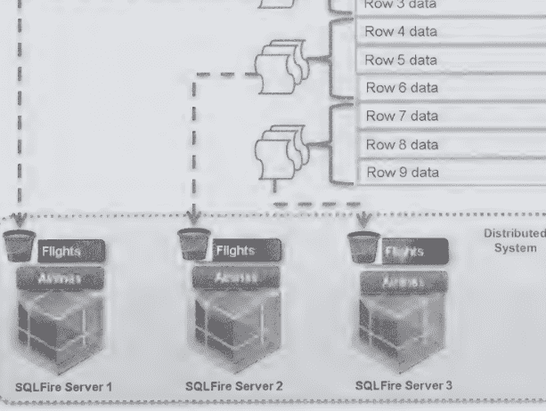

**图 2-8** 使用 vFabric SQLFire 桶系统对 Flights 表进行分区

在图 2-9 中，前面的讨论得到了扩展，展示了一个示例航班表架构的快照。所示的架构是大多数 RDBMS 架构中常见的主从节点（master-detail）设计模式。图 2-9 显示了一个包含 FLIGHTS、FLIGHTAVAILABILITY 和 AIRLINES 表的航班表架构。FLIGHTS 和 FLIGHTAVAILABILITY 之间是一对多的关系。然而，AIRLINES 与 FLIGHTS 以及 FLIGHTAVAILABILITY 之间是多对多的关系。

```sql
CREATE TABLE FLIGHTS (
  FLIGHT_ID CHAR(6) NOT NULL,
  SEGMENT_NUMBER INTEGER NOT NULL,
  ORIG_AIRPORT CHAR(3),
  DEST_AIRPORT CHAR(3),
  DEPART_TIME TIME,
  FLIGHT_MILES INTEGER NOT NULL,
  PARTITION BY COLUMN(FLIGHT_ID)
  REDUNDANCY 1
);
```

```sql
CREATE TABLE FLIGHTAVAILABILITY (
  FLIGHT_AVAILABILITY_ID CHAR(6) NOT NULL,
  FOREIGN KEY FLIGHT_Flights (FLIGHT_ID)
  PARTITION BY COLUMN (FLIGHT_ID)
  COLOCATE WITH (FLIGHTS)
);

CREATE TABLE AIRLINES (
  AIRLINE CHAR(2) NOT NULL PRIMARY KEY,
  AIRLINE_FULL VARCHAR(24),
  BASIC_RATE DOUBLE PRECISION,
  DISTANCE_DISCOUNT DOUBLE PRECISION
) REPLICATE;
```

### 图 2-9 具有主从节点和查找表类型关系的航班架构

Flights 表根据其主键 `FLIGHT_ID` 进行分区，并且 `REDUNDANCY` 设为 1。这意味着在集群中的另一个冗余 vFabric SQLFire 服务器上，每个 FLIGHT 都有一个备份副本。然而，FLIGHTAVAILABILITY 是根据 `FLIGHT_ID` 分区的，并与 FLIGHT 节点共存（`COLOCATE WITH`），这意味着 vFabric SQLFire 管理数据分区，使得 FLIGHTS 表和 FLIGHTAVAILABILITY 表之间可以进行符合条件的连接；查询在同一个 vFabric SQLFire 成员/内存空间内执行，从而优化了性能。AIRLINES 表是不经常变化的参考数据，与 FLIGHTS 以及 FLIGHTAVAILABILITY 之间是多对多的关系。在 vFabric SQLFire 中配置这种关系，你可以使用 `REPLICATE` 关键字来指示 vFabric SQLFire 在分布式系统的每个 vFabric SQLFire 成员上放置一份 AIRLINES 表的完整副本。

### 最佳实践 6：水平分区

- 水平分区可以极大地增强企业应用程序的可扩展性和性能。
- 最常见的情况是将 `Partition By`（分区）应用于表的主键上。
- vFabric SQLFire 的水平分区将整行数据放在同一个哈希索引桶中，因此针对该桶内行的所有数据操作都在同一个内存空间内执行。
- 经常测试你的分区方案，以确认所有 vFabric SQLFire 成员的平衡性。

## 冗余

在 vFabric SQLFire 中，你可以指定为特定数据保留多少个冗余副本。vFabric SQLFire 管理跨主副本和所有备份副本之间所有数据更改的同步。当服务器故障时，vFabric SQLFire 会自动将任何尝试从失败成员进行读写的操作重定向到存活的成员。在图 2-10 中，冗余子句被用作 `REDUNDANCY 1`，指示 vFabric SQLFire 应该将一个冗余副本复制到集群中某处的另一个成员上。

```sql
CREATE TABLE FLIGHTS (
  FLIGHT_ID CHAR(6) NOT NULL,
  SEGMENT_NUMBER INTEGER NOT NULL,
  ORIG_AIRPORT CHAR(3),
  DEST_AIRPORT CHAR(3),
  DEPART_TIME TIME,
  FLIGHT_MILES INTEGER NOT NULL
),
PARTITION BY COLUMN(FLIGHT_ID)
REDUNDANCY 1;
```

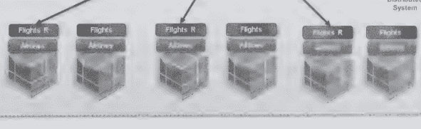

**图 2-10** 在航班表上使用冗余

### 最佳实践 7：冗余

- 当你在 vFabric SQL 表定义中使用 `REDUNDANCY 1` 规范时，vFabric SQLFire 在内存中管理数据的冗余副本。在 vFabric SQLFire 成员故障时，vFabric SQLFire 将备份服务器提升为主节点，并将所有访问路由到新的主节点，允许企业应用程序进行持续的容错运行。

- 由于 vFabric SQLFire 是一个面向内存的数据管理系统，具有某种程度的冗余是一种推荐的方法。然而，必须平衡增加冗余带来的优缺点。增加冗余可以提供更健壮的系统，但代价是牺牲性能。额外的冗余副本会导致网络和内存使用的增加；vFabric SQLFire 始终保持冗余副本同步。

- 在生产系统中，`REDUNDANCY 1` 是足够的，特别是当与磁盘异步 `PERSISTENCE`（持久化）结合时。这种 `REDUNDANCY 1` 与磁盘异步 `PERSISTENCE` 的组合，对于大多数高度依赖 vFabric SQL 作为数据管理系统的生产系统而言，实现了性能、可扩展性和可靠性的良好结合。

- 规划系统规模，以便在发生故障时，剩余节点有足够的容量来承担新数据和新客户端的能力。

## 共存 (Collocation)

如前图 2-9 架构所示，FLIGHTS 和 FLIGHTAVAILABILITY 表之间存在父子关系。这意味着跨越 FLIGHTS 和 FLIGHTAVAILABILITY 表的 SQL 连接查询必须保持在同一个内存空间内。vFabric SQLFire 的 `COLOCATE` 子句指定这些表是共存的；它强制具有相同值的分区位于同一个 vFabric SQLFire 成员上。在图 2-11 中，`COLOCATE WITH` 子句应用于 FLIGHTS。

### 最佳实践 8：共存

- 使用前图 2-9 中的架构，如果你使用 `COLOCATE` 子句，它将强制将表保持在同一个内存空间内。

## SQLFire 特性补充

- vFabric SQLFire `COLOCATE` 子句指定表是共存的；它强制具有相同值的分区位于同一个 vFabric SQLFire 成员上。在图 2-11 中，`COLOCATE WITH` 子句应用于 FLIGHTS。

- 对于更新和删除的混合，让我们使用以下：


```sql
CREATE TABLE FLIGHTAVAILABILITY (
FLIGHT_ID CHAR(6) NOT NULL,
SEGMENT_NUMBER NOT NULL,
ORIG_AIRPORT CHAR(3),
DEST_AIRPORT CHAR(3),
DEPART_TIME TIME,
FLIGHT_MILES INTEGER NOT NULL
),
PARTITION BY COLUMN(FLIGHT_ID)
COLOCATE WITH (FLIGHTS)
```

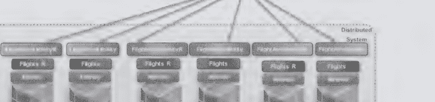

图 2-11 在航班表上使用共存

## 磁盘持久化 (Disk Persistence)

为了提供额外的数据可靠性，`vFabric SQLFire` 可以将表数据持久化到磁盘作为内存副本的备份，可以将表数据溢出到磁盘。这两个磁盘存储选项（overflow 和 persistence）可以单独使用也可以结合使用。overflow 将磁盘作为内存管理的扩展。persistence 则存储每个节点中管理的所有数据的完整副本。图 2-12 显示了主节点和冗余 `vFabric SQLFire` 成员如何持久化到外部存储。

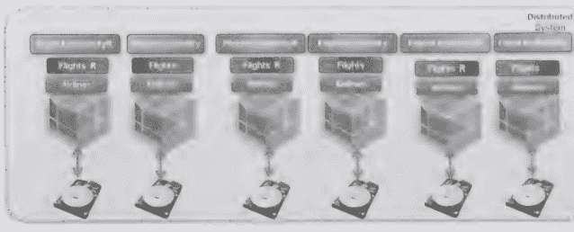

## 最佳实践 9：磁盘持久化

- `Gateway sender`、`AsyncEventListener` 和 `DBSynchronizer` 队列总是溢出的并且可以持久化。

- 为了获得最佳性能，请每个磁盘存储位于独立的物理磁盘上。

- 对网关发送队列使用持久化，因为它们始终开启溢出且持久化功能提供了额外的高可用保护。

- 表可以是溢出的、持久化的或两者兼之。为了提高效率，将溢出的表数据放在具有专用物理磁盘的磁盘存储上。将持久化的或持久化且溢出的表数据放在另一个具有不同物理磁盘的磁盘存储上。

- 当你启动系统时，并行启动所有具有持久表的成员。创建并使用启动脚本以确保一致性和完整性。

## SQLFire 特性

- 使用 `sqlf shut-down-all` 命令关闭系统。这是一种有序关闭，会完全刷新并安全地存储您的磁盘存储器（disk stores）。

- 确定文件压缩策略，并在需要时开发监控您的文件并执行定期压缩的程序。

- 为您的磁盘存储器决定备份策略并遵循该策略。您可以在系统离线时通过复制文件进行备份，也可以使用 `sqlf backup` 命令对在线系统进行备份。如果在磁盘存储离线期间删除了或更改了任何持久表，请考虑同步磁盘存储器中的表。

- 如果您恢复了全部数据，请在系统关闭期间对磁盘存储器进行压缩，以最大化启动性能。

### 事务

在 `vFabric SQLFire` 中，任何一个或多个 SQL 语句组成一个具有事务语义的逻辑工作单元；也就是说，该工作单元可以整体提交或回滚。`vFabric SQLFire` 的分布式事务协调实现允许线性扩展，且不会妥损害原子性（Atomicity）、一致性（Consistency）、隔离性（Isolation）和持久性（Durability），即 ACID 属性。由于参与事务的 `vFabric SQLFire` 成员持有自己的事务状态，对数据库的查询始终看到已提交的数据，且不需要获取锁。因此，在 `READ_COMMITTED`（已提交）隔离级别下，读写操作可以并行运行。

在事务性写入的情况下，`vFabric SQLFire` 会锁定每个成员上正在更新的行副本。这减轻了对分布式锁管理器的需求，并提升了更高的可扩展性。此外，`vFabric SQLFire` 为 `REPEATABLE_READ`（可重复读）和外键检查使用特殊的读锁，以确保这些行在事务持续期间不会发生变化。如果由于其他事务的并发写入无法获取锁，`vFabric SQLFire` 的锁通常会发生“快速失败”（fail-fast）并抛出冲突异常。当发起事务的 `vFabric SQLFire` 成员也拥有该事务的数据时，会发生这种快速失败行为的异常。在这种情况下，出于性能考虑，`vFabric SQLFire` 在本地成员上对事务进行批处理，在提交时刻 `vFabric SQLFire` 刷新批处理数据之前，可能在其他节点上无法检测到冲突。

当数据在分区表中进行管理时，对于非事务操作，每行隐式地由单个成员所有。然而，在分布式事务中，行的所有副本被视为等效，且更新会并行路由到所有副本。这使得分区表的事务行为类似于复制表的行为。事务管理器与 `vFabric SQLFire` 成员管理系统紧密配合，以确保无论发生故障还是添加/删除成员，对所有行的更改要么在提交时应用到所有可用副本，要么所有副本都不应用。

例如，如图 2-13 所示，启动了一个事务来执行 `updateFlights`。该方法内的所有语句被视为一个逻辑单元，并并行应用到系统中的所有其他副本。在示例中，`vFabric SQLServer 1` 充当“行所有者成员”，协调作为单个逻辑工作单元的事务执行。

> 注意

图 2-13 至图 2-16 指了单个事务的多个步骤。

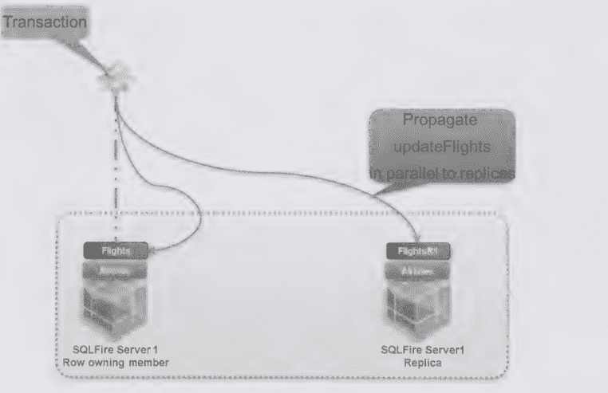

**图 2-13** 更新航班事务

图 2-14 显示了图 2-13 中 `updateFlights` 事务的继续。拥有 `updateFlights` 事务的 `vFabric SQLFire` 成员是行所有者成员，它将更新命令并行分发到所有副本。反之，它将在等待所有 ACK（确认）后才继续提交。ACK 表示更新已接收，且事务可以准备进入提交状态。

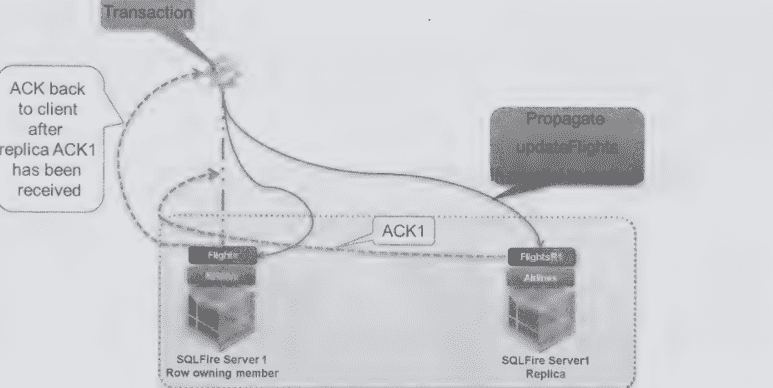

**图 2-14** 更新航班事务：显示行所有者 vFabric SQLFire 成员在继续提交前等待接收 ACKs

图 2-15 显示了启动第二个事务（即“事务 2”）的可能性。事务 2 可能会与 `updateFlights` 初始事务竞争相同的数据，因此为了避免数据损坏，`vFabric SQLFire` 将回滚事务 2 的整个逻辑单元，以允许原始的 `updateFlights` 事务继续。

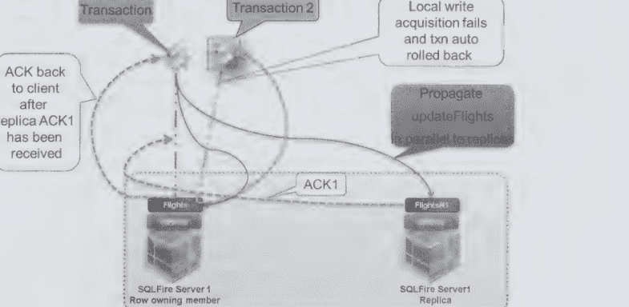

**图 2-15** 更新航班事务：安全防止来自第二个竞争事务的影响

# 第 2 章 现代可扩展数据平台

在图 2-16 中，`updateFlights` 事务进入提交状态，在即将退出提交状态时，它向适当的数据副本发布锁，以一种数据一致的方式传播更改。`vFabric SQL Server 1` 是“行所有者成员”，因为它在提交期间通过获取本地写锁并将所有更改分发到副本来充当事务协调器。

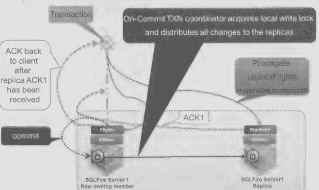

**图 2-16** 更新航班事务：进行提交更改

`vFabric SQL` 没有中心化的事务协调器。相反，事务启动的成员在整个事务期间期间充当协调器。如果应用程序更新了一行或多行，事务协调器将确定涉及哪些所有者成员，并在所有行副本上获取本地“写”锁。在提交时，所有更改都会应用到本地数据存储器和所有冗余副本。如果任何并发事务尝试更改其中某行，该行的本地写获取将失败，该事务将自动回滚。

如果不涉及持久表，则使用两阶段提交到冗余分布式数据库没有问题。在这种情况下，提交是高效的单阶段操作。`vFabric SQL`，在复制或对一个或多个成员进行冗余更新期间提交失败时并不使用预写日志（WAL）进行事务恢复。最可能的失败场景是成员不健康并被强制排出分布式系统，从而保证数据一致性。当故障的成员重新上线时，它会自动恢复复制/冗余数据集并与其他成员建立一致性。如果在提交发出之前某些数据的所有副本都离线，此状况将由组成员系统检测到，事务将在所有成员上自动回滚。

## 最佳实践 10：事务

- `vFabric SQLFire` 实现了乐观事务。事务模型针对共同置数据（colocated data）进行了高度优化，事务中的所有行都由单个成员所有。

- 尽可能保持事务持续时间和涉及的行数。`vFabric SQLFire` 激进获取锁，长时间的事务会增加冲突和事务失败的概率。

- 理解 `vFabric SQLFire` 提供的所有事务隔离级别。`vFabric SQLFire` 的隔离级别如下：

- NONE：与许多数据库不同，`vFabric SQL` 中的连接默认不参与事务。然而，这种行为并不意味着没有隔离，且连接可以访问其他进程的未提交状态。在没有事务（隔离级别为 NONE）的情况下，`vFabric SQLFire` 确保表更新遵循先来（FIFO）一致性。单线程执行的写入对所有进程按发布顺序可见，但不同进程的写入在其他进程看来顺序可能不同。当表在分布式系统的成员之间分区时，`vFabric SQLFire` 将数据均匀分布在托管表的成员上，因此没有节点会成为扩展性的瓶颈。`vFabric SQLFire` 将特定行（通过主键标识）的所有权分配给单个成员。当所有者成员故障时，行的所有权将一致地转移到备用成员，以便所有节点服务器看到新所有者。

- READ_UNCOMMITTED：`vFabric SQL` 内部将此隔离级别提升为 `READ_COMMITTED`。

- READ_COMMITTED：`vFabric SQL` 不允许正在进行的事务或非（隔离级别 NONE）操作读取未提交（脏）数据。`vFabric SQLFire` 通过将事务更改维护在单独的事务状态中来实现，仅在提交时才应用到表的实际数据存储器。

- REPEATABLE_READ：`vFabric SQLFire` 根据 ANSI SQL 标准支持此隔离级别。多次读取同一行的事务，其看到的该行列值始终相同。`REPEATABLE_READ` 保证在事务中首次读取后，表中底层已提交的行不会发生变化，直到事务完成。`vFabric SQLFire` 对选定数据的副本应用读写锁，以确保读取在事务持续期间是可重复的。`vFabric SQLFire` 不使用范围锁，在此隔离级别下仍可能出现幻读。

`vFabric SQLFire` 总是克隆行、应用更新（更改一个或多个字段），然后用更新后的行原子性地替换该行。这使得所有读取或写入该行的并发线程都避免了访问任何部分行更新的影响。如果你的系统中正在运行事务，请仔细规划你的重平衡操作。重平衡可能会在成员之间移动数据，这可能导致运行中的事务因 `TransactionDataRebalancedException` 而失败。请在应用程序中使用适当异常处理和事务重试逻辑。

`vFabric SQLFire` 提供了事务提交、回滚和失败的统计信息，让你能够监控 `vFabric SQLFire` 事务。

### 缓存插件 (Cache Plug-In)

当传入的唯一标识查询无法通过分布式系统满足时，将调用加载器（loader）从外部源检索数据。`vFabric SQLFire` 会锁定相关行，并防止试图获取同一行的并发读取器导致后端数据库过载。

在图 2-17 中，分布式系统中的每个 `vFabric SQLFire` 服务器上都注册了一个 `RowLoader`。`RowLoader` 实现了 `getRow()` 方法，该方法在发生缓存未时被调用。`RowLoader.getRow()` 随后拥有必要的业务逻辑来从 RDBMS 或外部系统检索数据。

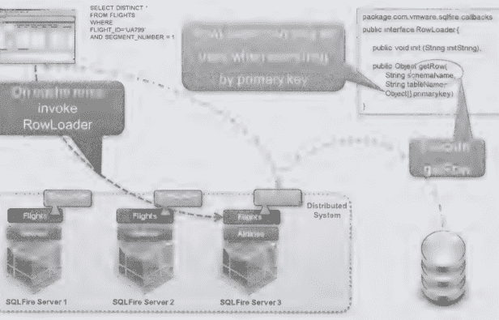

图 2-17 使用 RowLoader 处理缓存未命中

### 最佳实践 11: RowLoader

- 当为表配置了加载器时，对该表执行 `select` 语句会在内部获取并将数据插入到 `vFabric SQLFire` 表中。由于这种行为，当你查询配置了加载器的表时，可能会接收到约束违背错误（例如，如果加载器尝试从后端数据库插入违反 `vFabric SQLFire` 表约束的数据，则如此）。

- 在实现 `RowLoader` 时，请遵循 `RowLoader` 接口。

- `RowLoader` 接口由以下部分组成：

    - `init(String initStr)` 方法：用于获取在将实现注册到表时定义的参数。当使用 `SYS.ATTACH_LOADER` 过程将 `RowLoader` 注册到表时，`vFabric SQLFire` 会调用你实现的 `init()` 方法。所有参数都通过单个 String 对象传递。

    - `getRow(String schemaName, String tableName, Object[ ] primaryKey)` 方法：每当加载器被调用从外部源获取数据时，`vFabric SQLFire` 都会调用此方法实现提供架构名、表名以及一个主键值对象数组（按表定义的顺序排列）。

你对 `getRow` 方法的实现必须返回以下内容之一：

- 一个带有单个元素的数组对象，其中包含每个列的值（包括主键），按 `vFabric SQLFire` 表定义的顺序排列。

- 如果未找到元素，则返回 `null`。

- `java.sql.ResultSet` 实例，可能是对另一个数据库查询的结果。仅使用第一行。结果列与 `vFabric SQLFire` 表匹配。

- 如果未找到元素，则返回一个空的 `java.sql.ResultSet`。

- 在编译你的 `RowLoader` 实现并将其添加到类路径后，通过执行内置过程 `SYS.ATTACH_LOADER` 将 `RowLoader` 注册到表上。

### 监听器 (Listeners)

在 `vFabric SQLFire` 中，你可以实现任意数量的监听器，这些监听器可以根据应用程序执行的某些 SQL DML 操作被触发。监听器作为插入/更新/删除操作的*事后事件*被触发。在图 2-18 中，注册了三个监听器来监听 SQL DML 变化。

# 第 2 章 现代可扩展数据平台

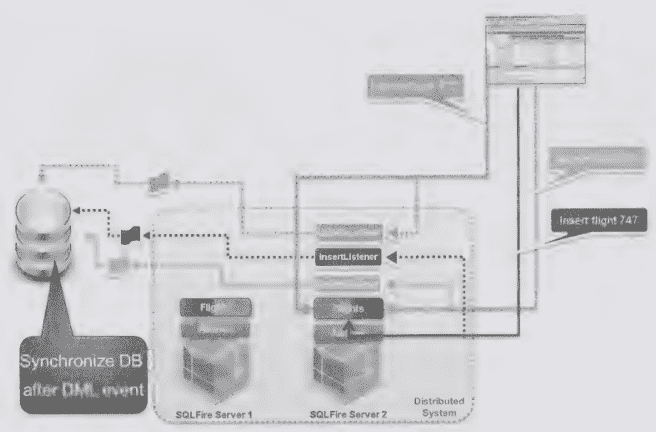

图 2-18 vFabric SQLFire SQL DML 监听器

监听器如下：

- 图 2-19 的绿色文本框中描述了一个 `UpdateListener`（更新监听器）。每当 `Flights` 表发生更新时，该监听器就会被触发。`Flights` 表来自图 2-9 之前引入的架构。在 `vFabric SQLFire` 中使用 SQL DML 对 `Flights` 表进行的任何更新都会触发作为事后事件的 `UpdateListener` 执行。这意味着 `vFabric SQLFire` `Flights` 表中的数据首先发生变化，然后同步执行 `UpdateListener` 回调，以将数据更改同步到后端的传统 RDBMS/DB。在图 2-18 中，更新 DML 事件是由实线箭头调用的绿色框中的“update flight F22”触发的。该实线箭头显示 `vFabric SQLFire` 成员首先发生，虚线箭头同步作为事后事件触发 `UpdateListener`。当 `UpdateListener` 被触发时，执行过程会调用监听器回调处理器，然后通过带有小型文档片段的绿色虚线将更改发送到数据库，以表示更改已发送到数据库。

- 如图 2-18 所示，`Flights` 表还注册了 `InsertListener`（插入监听器）和 `DeleteListener`（删除监听器）。这些监听器的激活与上述的 `UpdateListener` 类似。

在图 2-19 中，如果 `UpdateListener` 因为某些原因阻塞，而更改已应用到持有特定 `Flights` 分区的 `vFabric SQLFire` 成员上，监听器将抛出异常且不完成。

## SQLFire 特性

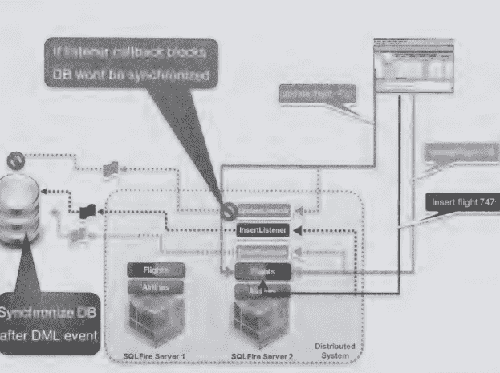

图 2-19 UpdateListener 回调处理器

### 最佳实践 12: 监听器

- 监听器允许其他系统接收表变化（插入、更新和删除）的事后通知。它们对于依赖数据变化的企业级系统非常有用。

- 你可以执行 DML 而不触发监听器。设置此属性不会影响 WAN 分发。

- 你可以使用内置过程 `SYS.ADD_LISTENER` 为表附加一个多个监听器。

- 同一个表可以定义任意数量的监听器。这有助于提供自定义的插入/更新/删除监听器以满足不同的业务需求。监听器是 `EventCallback` 接口的实现（https://www.vmware.com/support/developer/vfabric-sqlfire/102-api/com/vmware/sqlfire/callbacks/EventCallback.html）。

- 如果监听器抛出异常，更新将成功，但异常会传回给来源。

### 写入器 (Writers)

`vFabric SQLFire` 写入器是在更改发生之前同步处理表变化的事件处理器。缓存写入器的主要用途执行输入验证，从而保护数据库不存储错误数据。它也可以在数据变为 `vFabric SQLFire` 表可见之前更新数据源。写入器与监听器不同，一个表只能附加一个写入器。当表即将被插入、更新或删除修改时，`vFabric SQLFire` 使用回调通知写入器等待的操作。写入器可以通过抛出 `SQLException` 选择不允许操作。写入器回调是同步调用的，如果回调阻塞则阻塞操作。

在图 2-20 中，`Flights` 表上注册了一个 `InsertWriter`。“Insert flight 747”触发 `InsertWriter` 的回调事件处理器，首先与外部数据库同步，然后插入到 `vFabric SQLFire` 数据分区中。这是与 `vFabric SQL` 监听器的关键区别，监听器是在 DML 应用到 `vFabric SQLFire` 数据分区后将更改传播到外部系统。另一个区别是你可以注册多个监听器，但只能注册一个写入器。

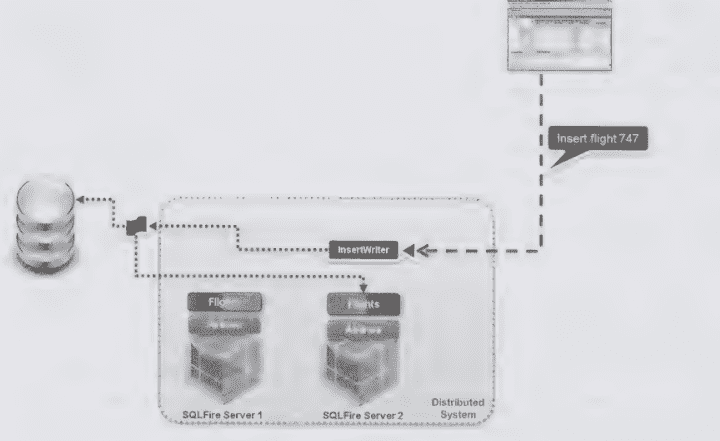

图 2-20 Flights 表上的 InsertWriter

在图 2-21 中，`InsertWriter` 事件处理器在尝试向外部数据库写入后抛出异常。在这种情况下，整个数据更改将从数据库中回滚，且不会应用到 `vFabric SQLFire` 的 `Flights` 数据分区。


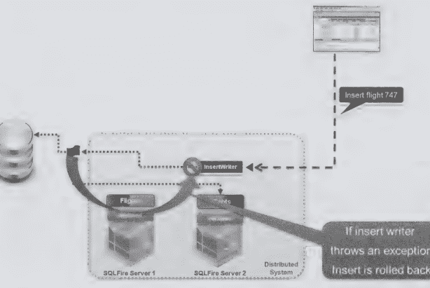

图 2-21 InsertWriter 抛出导致完全回滚的异常

### 最佳实践 13：写入器 (Writers)

- 写入器允许其他系统接收表变化的事件前通知（插入、更新和删除）。在保持外部数据库与 vFabric SQLFire 同步时，更改会在通过写入器处理的外部系统验证后，应用到 vFabric SQLFire。
- 你可以使用内置存储过程 `SYS.ATTACH_WRITER` 来挂载一个写入器。
  请注意，一个表只能注册一个写入器。
- vFabric 在 `<your install directory for sqlfire>/vFabric_SQLFire_10x/examples/EventCallbackWriterImpl.java` 中安装了一个示例写入器实现。如果类路径中存在相应的驱动程序，可以使用此写入器实现对任何 JDBC 数据源执行写入。
- 事件类型可以对应 `TYPE.BEFORE_INSERT`、`TYPE.BEFORE_UPDATE` 和 `TYPE.BEFORE_DELETE`。

### 异步监听器 (Asynchronous Listeners)

之前的讨论关注监听器和写入器，它们本质上是同步回调处理器。如果企业级消费应用程序因为可能阻塞而无法使用同步处理器，或者可能存在不可靠的消费客户端，异步监听器是一个明智的替代方案。`AsyncEventListener` 实例由其自身的专用线程服务，在该线程中调用回调方法。对应 DML 操作的事件被放在内部队列中，专用线程一次分发一批事件到用户实现的回调类中。事件分发的频率由 vFabric SQLFire 中 `AsyncEventListener` 的配置决定。

在图 2-22 中，在 `Flights` 表上注册了一个 `TestAsyncEventListener`，以便在发生 DML 事件时进行回调。DML 事件被入队事件队列，然后根据配置的周期从事件队列中出队。当事件出队时，它转而调用注册的 `TestAsyncEventListener.process()` 方法。

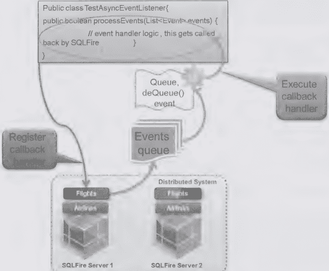

图 2-22 TestAsyncEventListener 示例，展示了通过事件队列的注册和执行周期

### 最佳实践 14：异步监听器

- `AsyncEventListener` 实例由其自身的专用线程服务，在该线程中调用回调方法。
- 对应 DML 操作的事件被放在内部队列中，专用线程一次分发一批事件到用户实现的回调类。这对于集成具有不同可靠性和响应时间 SLA（服务水平协议）的跨企业系统非常有益。
- 如果多个线程更新已入队列 `AsyncEventListener` 实现的数据，可能会发生某些数据一致性问题。这意味着没有事件顺序的保证。

### 注意

vFabric SQLFire 仅对单线程执行的 DML 语句（以及入队到 `AsyncEventListeners` 或远程 WAN 站点的语句）保留执行顺序。来自多个线程的更新按 FIFO（先入先出）顺序保留。否则，vFabric SQLFire 不提供“全排序”保证。

如果多个线程并发更新复制表中的行，或者线程并发更新具有父子关系的复制表中的相关行，可能会发生数据不一致的情况。并发更新复制表中的同一行可能会导致某些副本的值与其他副本不同。在父表中并发删除某行并在子表中插入某行可能会导致孤立行的产生。

当 DML 操作被异步入队到 `AsyncEventListener` 或远程 WAN 站点时，并发访问表可能会发生类似的不一致问题。例如，如果两个单独线程分别并发更新父表和子表上的行，vFabric SQLFire 将这些更新入队 `AsyncEventListener` 或 WAN 网关的顺序可能与在主分布式系统中更新表时的顺序不匹配。这可能导致后端数据库（例如使用 `DBSynchronizer`）或远程 WAN 系统中发生外键违反，而这种违反在最初更新表时是不会发生的。这些类型的乱序更新更新了分区表中的相同键。然而，对于任何更新多行的操作，应用程序应始终使用事务。

- 所有 `AsyncEventListener` 实现都应该检查现有数据库连接是否由于之前的异常而关闭。例如，在 `catch` 块中检查 `Connection.isClosed()`，并在执行后续操作之前根据需要重新创建连接。vFabric SQLFire 中的 `DBSynchronizer` 实现在复用连接之前会自动执行此类检查。
- `AsyncEventListener` 实现必须安装在 vFabric SQLFire 系统的一个或多个成员上。你只能在数据存储（配置属性 `host-data` 设置为 `true`）上安装 `AsyncEventListeners`。
- 你可以在多个成员上安装监听器，以提供高可用性并保证事件交付，以防具有活动 `AsyncEventListener` 的 vFabric SQLFire 成员关闭。在任何时刻，只有一个成员拥有分发事件的活动线程。其他成员的线程保持备用状态以冗余。
- 为了事件的高可用性和可靠交付，请将事件队列配置为持久且冗余。

### DBSynchronizer

`DBSynchronizer` 是一个内置的 `AsyncEventListener` 实现，你可以用它异步同步数据到符合 4.0 标准的 RDBMS。

*(注：此处原文存在大量 OCR 识别导致的重复碎片，译文已根据核心逻辑进行清理和整合，确保专业通顺)*

## SQLF 命令与 DDLUtils

vFabric SQLFire 提供了一个命令行接口和 DDLUtils，可以帮助你根据许多支持的 RDBMS Schema 生成目标架构和数据加载文件。图 2-24 列出了 DDLUtils 可以迁移的辅助 RDBMS。

### 支持的 RDBMS

- Axion
- DB2
- Derby/Cloudscape
- Firebird
- HSQLDB
- Interbase
- MaxDB/SapDB
- Mcor
- MySQL
- Oracle
- PostgreSQL
- SQL Server
- Sybase

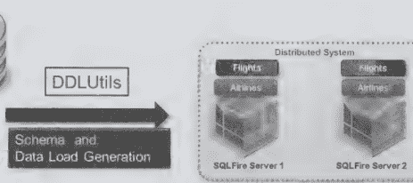

**图 2-24** 用于生成目标架构和数据文件的 DDLUtils

## 主主活跃架构与现代数据平台

图 2-25 显示了两个数据中心内的四个双主活动侧。在数据中心-1 中，有 Active-1A 和 Active-1B；在数据中心-2 中，有 Active-2A 和 Active-2B 侧。Active-1A、1B、2A 和 2B 的每一个都包含了构成典型企业应用的所有层级；在这种情况下，我们使用 SpringTrader 作为参考应用程序。此外，企业应用实例将分布在数据中心-1 的 Active-1A 和 1B 中，数据中心-2 也是如此。如果 Active-1A 故障，Active-1B 中的实例将继续提供流量服务，无论 Active-1 何时恢复上线。这意味着 Active-1B 必须准备好承担 Active-1A 的全部峰值负载。现在，当然，有时这样做是不可行的，部分额外流量可以重定向到数据中心-2，特别是当数据中心-2 的地理距离在 60 英里以内时。SLA 要求将决定采取何种方法，在硬件成本、位置与对 SLA 和响应时间的影响之间取得平衡。你也可以采用这种方案的变体，即数据中心 1 和 2 距离在 60 英里内，而数据中心 3 可以通过广域网（WAN）连接。

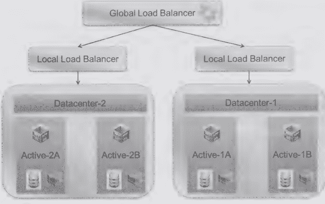

**图 2-25** 多集群和多数据中心主活动架构

如图 2-26 所示，使用了全局负载均衡器（GLB）和本地负载均衡器（LLB）的组合来确保快速的应用响应时间，不受地理位置的负面影响。（例如，伦敦流量将导向伦敦 LLB，纽约用户将导向纽约 LLB，东京流量将导向东京 LLB。）GLB 在所有 LLB 之间保持心跳连接，并决定最佳路由决策。

每个地理站点的 LLB 配置池都包含每个 Spring-Trader 应用程序服务的条目。图 2-26 显示了三个 LLB 配置。

东京 LLB 池配置本质上是四个 SpringTrader 应用程序服务在负载均衡器池布局中的配置。LLB 池有四个条目向此发送流量。随后，流量通过 Active-1A 和 Active-1B 进行本地隔离，这表示 Active-1A 应用程序服务是位于相同 vSphere 主机上的虚拟机，而另一个 Active-1B SpringTrader 虚拟机运行在另一个 vSphere 主机上。这种配置模式在纽约和伦敦站点以类似的方式重复。注意，流量被加载到 SpringTrader 应用程序服务；然而，从每个应用程序到 SQLData fabric 的通信是通过定位器（locator）完成的，负载均衡架构不参与该调用。使用负载均衡配置来捕获 SpringTrader 应用程序服务与 SQLData 数据成员之间的调用是冗余的；相反，vFabric SQL 定位器进程承担了跨数据 fabric 的负载均衡和负载调节的角色。

## 主主活跃架构与现代数据平台

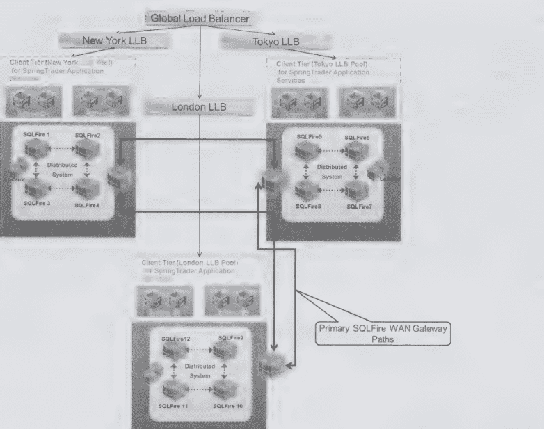

图 2-26 SpringTrader 全球多站点配置的 GLB 和 LLBs

此外，省略了 Web 服务器池的细节，以使其余配置更加清晰。如果你选择为 Web 服务器添加单独的配置，Web 服务器本质上将流量从 LLB 分发到应用程序服务 LLB 池，理想情况下使用最少连接类型的分发算法。简单来说，这意味着前端池（在本例中为本地 LLB Web 服务器池）接收来自 GLB 的流量，而 Web 服务器池将流量导向应用程序服务本地 LLB。在流量分发到特定的 SpringTrader 应用程序服务后，保持会话粘性（session stickiness）至关重要。建议避免仅有一个 LLB Web 服务器池（这意味着每个 Web 服务器成员指向特定的 SpringTrader 应用程序服务）；这提供了一种虚假的容错服务水平。vFabric tc Server 实例可能会宕机，但由于服务级别测试是针对 LLB Web 服务器成员的，它可能会返回假阳性结果。最好遵循双 LLB 池方法，每个本地地理站点有一个用于 Web 服务器的池，以及另一个由本地 LLB 管理的用于 SpringTrader 应用程序服务的池。

# 第 2 章 现代可扩展数据平台

池从主主活跃部署的角度来看，企业应用层包含两个主要的 LLB 池。第一个池是一组 vFabric Web 服务器实例，以池布局进行配置，并将流量分发到第二个池。到第二个池的典型分发算法是最少连接类型。第二个池是由 vFabric tc 实例构成的无状态布局；事实上，Web 服务器和 tc 实例都是无状态的。不需要额外的 Web 服务器或 tc 集；LLB 将负责分发流量。虽然 Web 服务器池到 tc 池的分发基于最少连接算法，但一旦启动 SpringTrader 会话，在整个浏览器生命周期内会话应保持粘性。

图 2-27 通过扩展图 2-26 所示的 LLB 配置了两个 LLB 池：一个用于 vFabric Web 服务器实例，第二个用于 vFabric tc 实例。

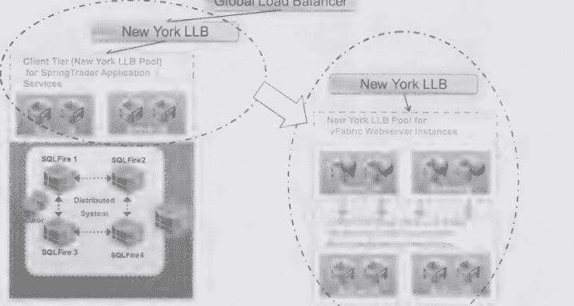

图 2-27 vFabric Web 服务器 LLB 池向 tc Server LLB 池发送流量

## 本章总结

本章检查了 vFabric SQLFire 功能，你可以利用这些功能来使企业数据的各个方面现代化。当企业数据的扩展性和性能出现无法仅通过硬件调整解决的问题时，可能是时候重新架构数据层，重点关注内存数据管理系统。

# 调优 Java 平台

有两种主要的垃圾回收（GC）策略：吞吐量/并行 GC 和并发标记清除（CMS）。省略对其他策略的讨论是因为它们目前不适用于延迟敏感型工作负载。

> 注意：调优二类或任何响应时间敏感的 Java 平台，在年轻代使用吞吐量/并行 GC、在老年代使用 CMS 通常可以获得合理的内存吞吐量和响应时间平衡。

吞吐量/并行 GC 策略被称为吞吐量 GC，是因为它关注于改进内存吞吐量而非更好的响应时间。它也被称为并行 GC，因为它使用多个工作线程（通过 `-XX:ParallelGCThreads=<threads>` 配置）来收集垃圾。吞吐量/并行 GC 本质上是一种停顿世界（stop-the-world）类型的收集器，因此当 GC 活动发生时应用程序会暂停。为了减轻这种影响并创建更具扩展性的系统，可以配置多个并行 GC 线程来帮助并行化 Minor GC 活动。尽管吞吐量 GC 使用多个线程收集年轻代的垃圾，但当这些线程运行时会暂停线程，这对于延迟敏感型工作负载可能会产生问题。`-XX:ParallelGCThreads=<threads>` 和 `-Xmn`（年轻代大小）调优是两个需要考虑上下调整的关键调优选项。GC 活动在老年代中可能不那么频繁，但当老年代发生 GC 活动时，应用程序其垃圾回收时间远长于年轻代的 GC 回收时间。这在老年代中使用并行/吞吐量收集器时尤为明显。为了缓解老年代的停顿问题，可以在老年代中使用并发标记清理（CMS）GC，而年轻代继续由吞吐量/并行收集器进行收集。

CMS 指并发标记清理（concurrent mark sweep）。当 GC 线程运行时，它们不会暂停应用程序线程，因为它们与线程并行运行。CMS 包含多个阶段，因此有时也被称为多阶段收集器，或者更多被称为“大部分并发收集器”，因为它进行了两次通常微不足道的短停顿。这些阶段如下：

1. 初始标记 (Initial mark)
2. 标记和预清理 (Marking and precleaning)
3. 重新标记 (Remark)
4. 扫除 (Sweeping)

尽管 CMS 收集器命名为并发收集器，但有时更准确的说法是“大部分并发收集器”，因为它有两个短的停顿阶段，分别在第一个初始阶段和随后的重新标记阶段。这些停顿对 CMS 的整个周期没有影响，因此从实际的并发性与停顿量的角度来看，大部分被忽略了。

CMS 阶段的运行如下：

- **初始标记阶段（短停顿）**：CMS 整体阶段中老年代收集的开始。CMS 的这个初始标记阶段会标记所有从根（roots）直接可达的对象。这是在停止所有变动线程（mutator threads）的情况下完成的。
- **并发标记阶段（无停顿）**：重新启动第一个初始标记阶段停止的线程，并在此标记从第一阶段标记的对象可达的所有对象。
- **并发预清理阶段（无停顿）**：查看堆中因从年轻代晋升而更新的对象，或在上一个并发标记阶段期间被变动线程更新的对象。在预清理阶段并发重新扫描对象有助于减少下一个“重新标记”停顿阶段的工作量。
- **重新标记阶段（停顿）**：此阶段重新扫描堆中任何遗留的更新对象，从对象图中对它们进行回溯。
- **并发清理阶段（非停顿）**：开始清理垃圾对象，清理是一个与所有其他线程共同执行的并发阶段。

图 3-1 展示了在年轻代中使用组合 `-XX:+UseParNewGC` 和老年代中使用 CMS 的配置的可视化表示。图 3-1 显示了蓝框中的年轻代，由 `-Xmn` 调整，并配置了 `-XX:+UseParNewGC` 和 `-XX:ParallelGCThreads`。Minor GC 线程以蓝色箭头运行，位于绿色箭头表示的应用程序线程之间。由于 `-XX:ParallelGCThreads` 配置，有多个工作线程在年轻代进行垃圾清理。这些工作线程每次运行收集垃圾时，都会暂停绿色的应用程序线程；然而，多个线程有助于缓解这一问题。自然地，年轻代的大小在此起着作用，Minor GC 的持续时间会增加，但由于年轻代大小增加，频率不会那么高。年轻代越小，GC 频率越高，持续时间越短。

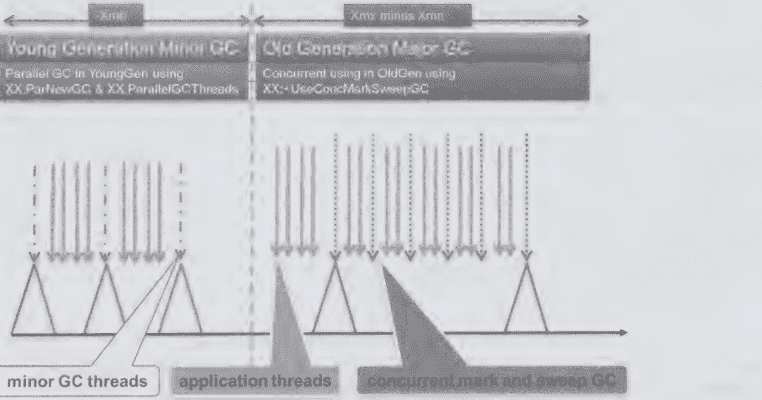

图 3-1 年轻代并行 GC 和老年代 CMS

在老年代无法直接指定大小，而是通过 `-Xmx` 和 `-Xmn` 之间的差值隐式指定大小，其 GC 策略配置为 `-XX:+UseConcMarkSweepGC`。该 GC 与应用程序线程并行运行而不暂停它们，如表示 CMS 活动的红色箭头所示。

请参阅示例 3-1 和示例 3-2（表 3-1 中描述的 JVM 选项），以获取使用 ParNewGC 和 CMS 组合的完整 JVM 选项的实际演示。

## 示例 3-1 使用 ParNew 和 CMS 的 JVM 配置，64GB 堆


# 第 3 章 调优大规模 Java 平台

## JVM 配置示例

### 示例 3-1：8-vCPU 虚拟机配置

```bash
java -Xms64g -Xmx64g -Xmn21g -Xss1024k \
-XX:+UseConcMarkSweepGC \
-XX:+UseNewGC -XX:CMSInitiatingOccupancyFraction=75 \
-XX:+UseCMSInitiatingOccupancyOnly \
-XX:+ScavengeFullGC \
-XX:TargetSurvivorRatio=80 -XX:SurvivorRatio=8 \
-XX:+UseBiasedLocking \
-XX:MaxTenuringThreshold=15 \
-XX:ParallelGCThreads=4 \
-XX:+OptimizeStringConcat -XX:+UseCompressedStrings \
-XX:+UseStringCache -XX:+DisableExplicitGC
```

### 示例 3-2：4-vCPU 虚拟机配置

```bash
java -Xms30g -Xmx30g -Xmn9g -Xss1024k \
-XX:+UseConcMarkSweepGC \
-XX:+UseNewGC -XX:CMSInitiatingOccupancyFraction=75 \
-XX:+UseCMSInitiatingOccupancyOnly \
-XX:+ScavengeFullGC \
-XX:TargetSurvivorRatio=80 -XX:SurvivorRatio=8 \
-XX:+UseBiasedLocking \
-XX:MaxTenuringThreshold=15 \
-XX:ParallelGCThreads=2 \
-XX:+UseCompressedStrings -XX:+OptimizeStringConcat \
-XX:+UseStringCache -XX:+DisableExplicitGC
```

## 表 3-1 用于并行年轻代和老年代 CMS 的 JVM 配置选项

| JVM 选项 | 描述 |
| :--- | :--- |
| `-Xmn21g` | 建立固定大小的年轻代。在设置中，21GB 被分配到年轻代。 |
| `-XX:+UseConcMarkSweepGC` | 启用并发收集器来收集老年代。 |
| `-XX:+UseNewGC` | 启用 ParNew 收集器用于年轻代。 |
| `-XX:CMSInitiatingOccupancyFraction=75` | 设置触发 CMS 并发周期的老年代百分比。 |
| `-XX:+UseCMSInitiatingOccupancyOnly` | 强制 JVM 使用指定的占用比例来启动 CMS 周期。 |
| `-XX:+ScavengeFullGC` | 在 scavenge 周期后启用全 GC。 |
| `-XX:TargetSurvivorRatio=80` | 设置幸存空间目标占用的百分比。 |
| `-XX:SurvivorRatio=8` | 设置 Eden 空间与幸存区的比例。 |
| `-XX:+UseBiasedLocking` | 启用偏向锁以提高同步性能。 |
| `-XX:MaxTenuringThreshold=15` | 决定对象在进入老年代之前允许在年轻代生存的最大年龄。 |
| `-XX:ParallelGCThreads=4` | 设置年轻代中 GC 工作线程的数量。 |
| `-XX:+UseCompressedStrings` | 启用压缩字符串表示以节省内存。 |
| `-XX:+OptimizeStringConcat` | 启用字符串连接操作的优化。 |
| `-XX:+UseStringCache` | 启用字符串缓存。 |
| `-XX:+DisableExplicitGC` | 禁用 `System.gc()` 调用。 |

## 补充 JVM 选项说明

由于工作负载之间存在巨大差异，应当通过负载测试针对您自己的应用对这些假设进行验证。

- `-XX:+UseCompressedOops`：启用压缩对象指针（将对象引用表示为 32 位偏移量而非 64 位指针），以便在 Java 堆内存大小小于 32GB 的情况下优化 64 位系统的性能。
- `-XX:+OptimizeStringConcat`：尽可能优化字符串拼接操作。（在 Java 6 Update 20 中引入。）
- `-XX:+UseCompressedStrings`：谨慎使用！对于可以表示为纯 ASCII 的字符串使用 `byte[]`。（在 Java 6 Update 21 性能发布版中引入）。在 Java 6 的某些版本中，此选项可能已被弃用。
- `-XX:+UseStringCache`：启用常用分配字符串的缓存。
- `-XX:+DisableExplicitGC`：禁用所有可能错误嵌入在应用程序代码中的 `System.gc()` 调用。
- `-XX:+AlwaysPreTouch`：使用此选项是可选的。示例中未使用它，但有时它是一个值得考虑的优化手段。在 JVM 初始化期间对堆进行预触（PreTouch）。这样堆的每一页在初始化期间就会按需填充，而不是在应用程序执行期间增量填充。设置此项会增加启动时间，但可能会提高 JVM 的运行时性能。
- `-XX:+UseNUMA`：不要使用！不应使用此 JVM 选项，因为它与 CMS 垃圾回收器**不**兼容。部署在运行 vSphere ESXi 5 虚拟机管理程序的虚拟机上的 vFabric SQLFire Server JVM 不需要此标志，因为非统一内存访问（NUMA）优化已被证明为 vFabric SQLFire 类型的工作负载提供了极佳的局部性。此标志与 CMS GC 策略**不**兼容。

目前为止的 GC 调优通常对于大多数工作负载都是足够的，但在调整 `-Xmn`、`ParallelGCThreads`、`SurvivorRatio` 和栈大小 `-Xss` 方面存在一些注意事项。

下一节介绍了一种潜在 GC 调优方法的详细信息，该方法可以帮助您做出调优年轻代和老年代 GC 周期的决策。虽然有许多可能的方法，但下一节讨论的 GC 方法是非常谨慎的。

## GC 调优方法

可以应用许多其他方法，且 JVM 调优在理论和实践上的讨论可能需要数周。本节描述了适用于延迟敏感型工作负载的 JVM 调优。

图 3-2 概述了三步调优方法：

- **步骤 A 年轻代调优**：涉及测量 Minor GC 的频率和时长，然后调整 `-Xmn` 和 `-XX:ParallelGCThreads` 以满足应用程序响应时间的服务协议（SLA）。
- **步骤 B 老年代调优**：涉及测量 CMS 周期的频率和时长，并调整 `-Xmx` 和 `-XX:CMSInitiatingOccupancyFraction` 以满足 SLA 应用工作负载的响应时间要求。
- **步骤 C 幸存空间调优**：这是幸存空间调优中的精细化步骤，通过增加幸存空间大小来推迟从年轻代的晋升，从而缩短 Minor GC 持续时间；并通过减少幸存空间来加速年轻代到老年代的晋升发生。

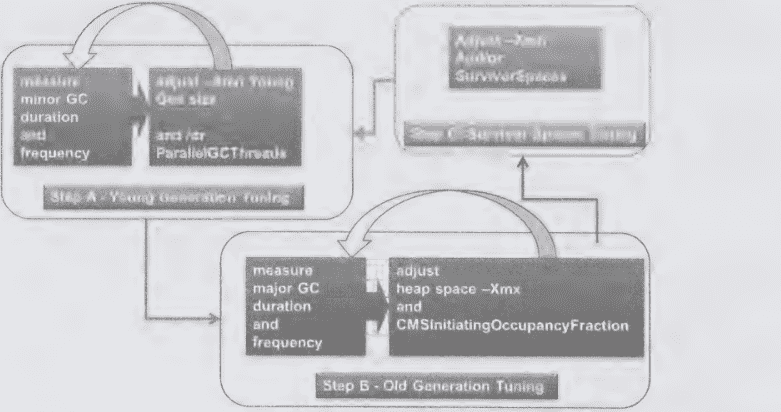

### 步骤 A：年轻代调优

在这一步（图 3-2 中的步骤 A），首先测量 Minor GC 的频率（GC 运行的频率）和时长（GC 运行的时间），然后与 GC 停顿时间和响应时间要求进行比较，以确定是否必须对 GC 周期进行调优。理解年轻代的内部原理对于微调 Minor GC 周期至关重要，因此图 3-1 的图示出现在图 3-3 中，并进行了微调以进一步详细说明年轻代周期。此调优的主要目标是测量 Minor GC 的频率和时长，并确定在 Minor GC 活动之间是否有足够的时间让应用程序线程运行。在图 3-3 中，应用程序线程显示为在 Minor GC 活动之间运行的绿色箭头。

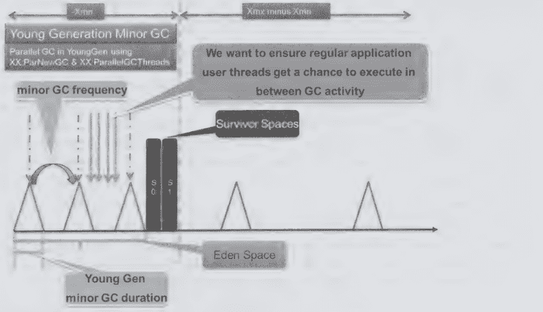

年轻代的大小由 `-Xmn` 决定，如图 3-3 所示，并如之前所示配置了 `-XX:+UseParNewGC`，以及带有多个工作线程以帮助通过 `-XX:ParallelGCThreads=<threads>` 配置的 GC 周期。年轻代还包含两个幸存空间（深蓝色框），在图中标记为 S0 和 S1。这些空间的大小由 `SurvivorSpace = -Xmn / (-XX:SurvivorRatio + 2)` 决定。另一个重要的空间，也是年轻代中最重要的空间之一，是 Eden 空间（图 3-3 中的橙色框）。Eden 空间的大小通过 `-Xmn` 与 `SurvivorSpace * 2` 的差隐含确定。关于幸存空间的更完整调优讨论在本文调优方法的步骤 C 中给出，但简言之，从 8 的幸存比例开始使得 `SurvivorSpaceSize` 等于 `-Xmn` / 10。因此，S0 占 10%，S1 也占 10%。如果 `SurvivorRatio` 设置为 8，则 Eden 空间占 `-Xmn` 的 80%。

假设此时 `-Xmn` 的频率和时长存在问题，下一节描述了调整 `-Xmn` 的影响。

#### 调整 -Xmn 的影响

年轻代大小调整 `-Xmn`，在有充足 CPU 周期的情况下，可以考虑在单次调整中逐渐增加超过 50% 的幅度。进行负载测试并测量应用程序的响应时间。

在减少 `-XX:ParallelGCThreads` 时，最小值应为二。任何低于此值都会对并行收集器的行为产生负面影响。在为 vFabric SQLFire 类型负载（例如 8GB 及以上）调整大型 JVM 尺寸时，至少需要 4-vCPU 的虚拟机配置，因为两个 vCPU 会被 `-XX:ParallelGCThreads` 占用，另外两个 vCPU 则被应用程序线程占用。此配置规则在示例 3-2 的 JVM 配置（4-vCPU 虚拟机有两个 ParallelGCThreads）和示例 3-1（8-vCPU 虚拟机分配了四个 ParallelGCThreads）中均有显示。在这两种情况下，这都占了可用 vCPU 的 50%。

此外，当使用 CMS 类型的配置时，应始终使用带有四个或更多 CPU 的虚拟机。

> **注意**
>
> 如前所述，假设初始比例为 8，并将任何幸存者空间调整推到步骤 C。

图 3-4 展示了在前述关于理解减少或增加年轻代大小 `-Xmn` 影响的讨论中，减少 `-Xmn` 的影响。图中，实蓝色三角形表示原始的 minor GC 频率（持续时间/停顿较长），但当 `-Xmn` 减少时，minor GC 的频率会增加，如虚三角形所示。

图 3-5 展示了增加 `-Xmn` 的影响，其优点是减少了 minor GC 的频率，但缺点是增加了其持续时间或停顿时间。可以使用迭代方法来平衡增加 `-Xmn` 的程度与减少它的程度之间的关系。大型 JVM 的有效范围从几个 GB 不等，但绝不会超过 `-Xmx` 的约 33%。

你可以通过增加 `-XX:ParallelGCThreads` 来缓解 minor GC 持续时间增加的问题。在增加 `-XX:ParallelGCThreads` 时，通常做法是从运行在虚拟机上的 vFabric SQLFire JVM 的可用 CPU 核心数的 50% 开始，然后逐渐向上调整。这应该结合测量核心 CPU 利用率进行，以确定是否留有充足的 CPU 来分配更多的并行 GC 线程。

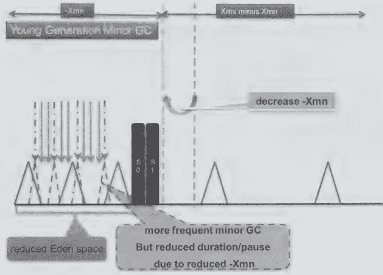

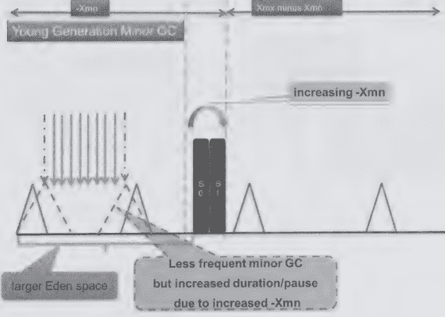

### 步骤 B：老年代调优

此步骤（图 3-2 中的步骤 B）涉及在测量 major/full GC 的频率和持续时间后，对老年代进行调优。影响老年代调优的最重要的 JVM 选项通常是总堆内存 `-Xmx`，调整此值向上或向下会对老年代 GC 行为产生影响。如果你增加 `-Xmx`，会导致 full GC 的持续时间变长，但发生频率更低，反之亦然。何时调整 `-Xmx` 的决定直接取决于我们在步骤 A 中做的调整（在该步骤中调整了 `-Xmn`）。当你增加 `-Xmn` 时，会导致老年代空间减小，因为老年代的大小是隐式定义的（不是通过直接的 JVM 选项），即 `-Xmx` 减去 `-Xmn`。抵消 `-Xmn` 尺寸增加的调优决策是比例增加 `-Xmx` 以适应这种变化。如果你增加了 `-Xmn` 的 5%，那么 `-Xmx` 也需要增加 5%。如果不这样做，增加 `-Xmn` 对老年代的影响是 full GC 频率增加，因为老年代空间被缩小了。

在 `-Xmn` 减少的情况下，反之亦成立；`-Xmx` 也必须比例缩小。如果你因为减少 `-Xmn` 而调整 `-Xmx`，则老年代空间比例增大，在这种情况下 full GC 时间将会延长。

在图 3-6 中，减少年轻代大小 `-Xmn` 的影响会导致老年代 full GC 时间的增加。老年代 full GC 时间的增加可以通过按 `-Xmn` 减少的比例减少 `-Xmx` 来抵消。

图 3-7 显示了增加年轻代大小 `-Xmn` 对老年代的影响。当你增加年轻代大小时，它隐式地导致老年代尺寸变小，从而导致 full GC 的频率增加。抵消这种影响的方法是按 `-Xmn` 增加的比例增加 `-Xmx`。

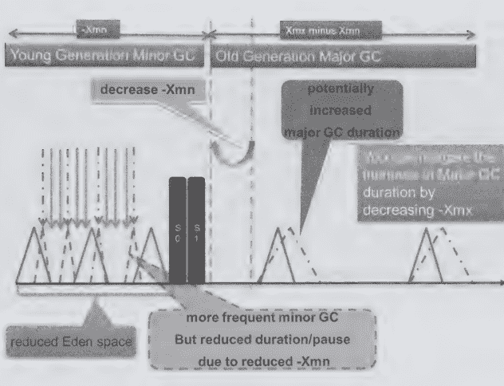

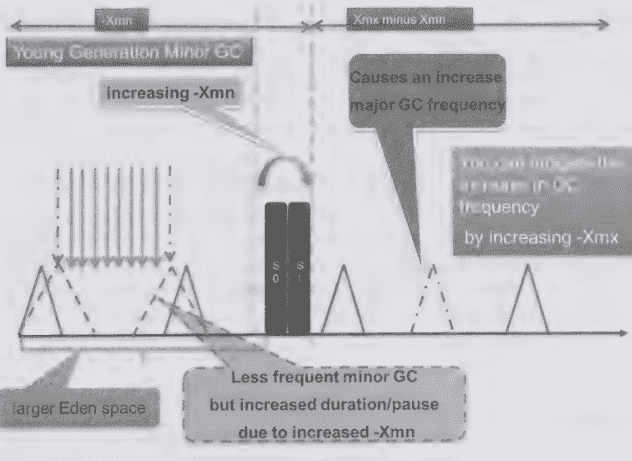

### 步骤 C：幸存者空间调优

图 3-2 中的步骤 C 尝试精细化幸存者空间。讨论之前的假设是 `SurvivorRatio` 为 8。

#### 第 1 步：建立当前的生产环境负载配置

在估计负载配置时，测量表 4-1 列出的某些（并非全部）属性以建立你的 Java 应用程序的生产负载。生产负载还应该包含用户在使用应用程序时执行的常用功能的良好事务混合。

**表 4-1 负载配置属性**

| 负载配置属性 | 描述 |
| :--- | :--- |
| 功能访问模式的建模 | 通过研究业务应用程序的用户访问行为，你可以以此对性能负载驱动器设计。将负载驱动器功能建模得与用户访问应用程序的方式接近是非常重要的。大多数应用程序将具有读取函数、写函数、CPU 密集型、内存密集型以及存储/磁盘访问模式的特定混合。这些访问百分比的任何细微变化都可能改变基准数据。因此，必须（通过检查日志和监控系统信息来研究访问模式）与应用程序开发人员和应用程序运营团队审查这些内容，以就负载驱动器设计和实现的准确性达成一致。 |
| 并发用户 | 根据你如何跟踪用户对程序的访问，可以使用这些信息建立峰值和平均用户。建立用户数量的方法结合了检查登录/注销功能，或者如果没有，则结合用户访问日志和 URL Cookie 跟踪（或商业监控工具）。*并发用户*是表示测试期间施加负载的常用术语。该指标衡量在任何时刻有多少活跃用户。这与每秒请求数 (RPS) 不同，因为潜在的一个用户可能会产生大量的请求，而其他用户产生的请求可能较少。在建立负载测试时，请求之间的延迟是*思考时间*。平均思考时间可以根据你的应用程序而异。 |
| 每秒请求数 (RPS) | RPS 是发送到服务器的请求数。它包括 HTML 页面、CSS 样式表、XML 文档、JavaScript 库以及 Flash/多媒体文件的请求。除了这些请求外，还有动态页面请求：Java 页面 (JSP) 等，这些是服务器绑定的请求——来自 Web 服务器并由应用程序服务器处理的请求。你可以通过研究 Web 服务器的重定向规则和访问日志来建立请求混合（静态请求与动态请求的比例）。动态请求很重要，因为它们会转化为 Java 应用程序服务器消耗的 Java 线程，反之，如果它们访问数据库，数据库连接将从 Java 应用程序服务器配置的 Java 数据库连接 (JDBC) 连接池中取出。 |
| 平均响应时间 | 这可以测量为从你的应用程序请求接收第一个/最后一个字节的时间。如果你已经实施了生产时间 SLA 监控，可以使用这些工具的报告。如果没有，你可以在负载测试期间通过基准建立此项。 |
| 峰值响应时间 | 测量请求/响应循环的往返时间。 |

#### 第 2 步：建立基准

如图 4-1 所示，第 2 步的目标是建立基准并进行垂直扩展性（scale-up）和水平扩展性（scale-out）测试。

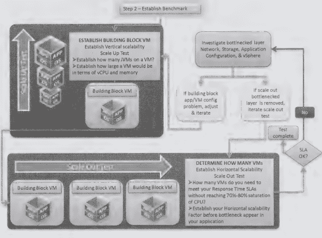

##### 第 2a 步：为垂直扩展性测试建立基准

在垂直扩展性测试中，尝试建立虚拟机 (VM) 可以达到多大规模，以及在达到所需的 SLA 并保持可接受的 CPU 和内存饱和水平之前，在 VM 上可以堆叠多少个 Java 虚拟机 (JVM)。通过此测试得到的带有各种 JVM 的 VM 配置构成了用于向外扩展测试的构建 VM。部署情况必须能够代表目标生产部署的实际应用程序混合，这是至关重要的。如果你的应用程序使用了另外两个应用程序，这些应用程序必须存在，以便适当配置性能。同样重要的一点是，在决定在区块 VM 上创建第二个 JVM 之前，应尽可能在第一个 JVM 内完成所有操作。有时由于应用程序架构的原因，这是不可行的，但有时应用程序由于各种业务功能需求，每个虚拟机至少由两个 JVM 组成。然而，在向外扩展中，大多数 JVM 是独立的实体，由一个 JVM 还是两个 JVM 执行功能取决于你的设计，以及涉及的工程师对 JVM 堆大小调优的熟悉程度。

## 为虚拟化大规模 Java 平台设计并确定新环境的大小


当你读完这本书时，让我们希望较大的 JVM 不成为问题，你可以轻松地将它们应用到你的 Java 平台。

我们想要避免在上方创建第二个 JVM 的原因是第二个 JVM 会为其额外的垃圾回收 (`GC`) 周期增加开销。虽然 JVM 可以在一个 VM 上处理多个 JVM，但第二个 JVM 确实会带来开销和成本，这种成本可以通过尝试在单个 JVM 中承载更多事务来避免。如果你能够在一个 JVM 中承载更多事务，你就可以避免第二个 JVM 的开销。

### 注意事项

在前面的讨论中，我们将场景简化为两个 JVM。然而，对堆外内存（`off-heap`）部分的了解并不多，而且这部分不能忽略；必须考虑在内。

- 假设根据操作系统规范，OS 运行需要 `500MB` 内存。
- 总 JVM 内存（Java 进程内存） = `4096m` (`-Xmx`) + `256m` (`-XX:MaxPermSize`) + `100 * 192K` (并发线程数 * `-Xss`) + 其他内存 (`Other Mem`)。
- 因此，JVM 内存约为 `4096MB` + `256MB` + `19.2MB` + 其他内存 = `4371MB` + 其他内存。

其他内存（`Other Mem`）通常不显著。然而，如果应用程序使用了大量的新 I/O (`NIO`) 缓冲区和套接字缓冲区，这部分可能会非常大。否则，假设总 JVM 进程内存的 5%（即 `4371MB` 的 4% 到 5% => 假设为 `217MB`）足够了，尽管应该使用适当的负载测试进行验证。

这意味着 JVM 进程内存为 `4371MB` + `217MB` = `4588MB`。

要确定虚拟机（`VM`）内存，假设你正在使用 Linux，且仅运行这一个 Java 进程，没有其他重要的进程运行。VM 的总配置内存转换为 VM 内存 = `4588MB` + `500MB` = `5088MB`。

最后，你应该将 VM 内存设置为内存预留。你可以选择将内存预留设置为 `5088MB`。

图 4-3 展示了这些数字以及内存区域在 VM 和 JVM 内部的所在。

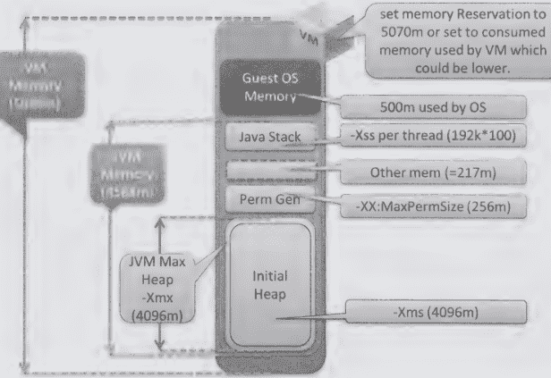

图 4-3 在具有 5GB 预留的 2-vCPU VM 上运行 4GB 堆内存的 JVM

### 步骤 2b：为水平扩展性测试建立基准

在这一步中，将使用步骤 2a：为垂直扩展性测试建立基准的输出，即构建块虚拟机（`building block VM`），来水平扩展出多个虚拟机。

### 为虚拟化大规模 Java 平台设计新环境的选型

从在单个 vSphere 主机上部署的构建块虚拟机模板构建的。因为在步骤 2A 中，虚拟机的容量已在构建块虚拟机模板内通过了验证，接下来我们想要确定一个 vSphere 主机可以驱动多少流量。例如，从步骤 2A 你知道构建块虚拟机具有 `5GB` 内存和 `2` 个 vCPU，现在只需要选择合适尺寸的 vSphere 主机，并反推计算可以在其上部署多少个虚拟机。本质上，这变成为了将 vSphere 主机的总 RAM 和物理 CPU 除以构建块虚拟机。如果你正在选型的 JVM 属于第 1 类（许多尺寸较小的 JVM），并且如果你将 JVM 堆限制在 `4GB`，那么你将创建过多的 JVM 和虚拟机，导致它们在完全消耗典型 vSphere 主机上可用物理 RAM 之前就达到竞争。因此，选择具有足够内存的正确尺寸 vSphere 主机对于水平扩展性测试至关重要。

让我们来看几个例子，以理解在 vSphere 主机内选择正确的内存量有多么关键。

### 示例 1

例如，假设一个 vSphere 主机拥有两个插槽，每个插槽 `8` 个核心，并有 `128GB` 内存。根据内存计算，假设一个构建块虚拟机具有 `4GB` 堆内存和 `5GB` 总内存预留。在此应用第 1 章的公式 1-2，但不像原始公式所示那样除以插槽数量（暂时不考虑 NUMA），`128 – ((128GB*0+1GB) => 124.44GB` 总共可用于 vSphere 主机上的 VM 内存配置。

> 注意：`0.98` 的倍数假设初始配置了 `2` 个虚拟机，以便开始计算的第一次迭代，然后如果你添加了更多虚拟机，你必须为 vSphere 利用的每个虚拟机预留约 `1%` 的内存开销。事实证明，两个虚拟机（即每个 NUMA 节点/插槽一个虚拟机）是利用所有可用计算资源且开销最小的配置。然而，这需要与其他实际性因素权衡，因为还取决于应用程序的部署拓扑以及需要多少个 JVM 和虚拟机。请参考第 1 章的表 1-1，该表详细说明了优缺点。此外，`2` 虚拟机配置将导致非常大的虚拟机，这种类型更适合第 2 类 Java 平台负载（内存数据库），但对于第 1 类可能不是最佳配置，因为第 1 类可能存在业务（`LOB`）需求，需要更多的 JVM 和虚拟机来提供更好的功能隔离。

如果将 `124.44GB` 除以 `4.5GB` 作为构建 JVM（构建 JVM 内存预留为 `5GB`，因为分配了 `0.5GB` 给客户端操作系统；因此，实际 JVM 进程仅使用 `4.5GB`），则意味着 `124.44GB/45GB => 27.65` 个构建 JVM 可以安全地配置在该示例的 vSphere 主机上。自然，这是从内存角度来看的，这 `27.65` 个 JVM 将部署在两个大虚拟机上。在某些情况下，这可能是充分的配置；但是你可以看到，在两个 `8` 核心插槽的 vSphere 主机示例中，我们共有 `16` 个 CPU 核心，这意味着比例为 `16` CPU 核心 / `27.65` JVMs。

### 示例 2

如果你决定购买一台带有 `48GB RAM` 的 vSphere 主机，可以通过应用公式 1-2 将所有 RAM 数值向下调整。让我们通过在此应用公式 1-2 来再次检查，这次不像原始公式中那样除以插槽数量（暂时不考虑 NUMA）：`((48GB * 0.98) - 1GB) => vSphere` 主机总计有 `46GB` 可用于 JVM 内存配置。考虑到要运行两个客操作系统副本（由于在该 vSphere 主机上要部署两个虚拟机），JVM 的净可用 RAM 实际上为 => `46 - 1 => 45GB`。如果将此结果除以一个构建块虚拟机所需的 `4.5GB`（注意：构建块的内存预留为 `5GB`，因为分配了 `0.5GB` 给客操作系统，实际的 JVM 进程仅使用 `4.5GB`），这意味着 `45/4.5GB => 10` 个构建块虚拟机。这意味着 JVM 的比例为 `16` 核心 / `10` 个 JVM => 每个 JVM `1.6` 个核心，这非常符合你每个 JVM 拥有 `2` 个 vCPU 的最佳实践。为了符合 `1` JVM 对应 `2` vCPU 的规则，该 vSphere 主机应仅运行八个 JVM。从这里开始，虚拟机数量的向下或向上调整将取决于你实际的 CPU 和内存利用性能指标。你有权决定是让八个虚拟机分布在八个虚拟机上、在两个虚拟机上运行八个 JVM，还是在四个虚拟机上运行八个虚拟机。在每种情况下都有优缺点，正如第 1 章中讨论的那样（见表 1-1），大多数情况下，这些都是有效的配置，无论你选择八个虚拟机、四个虚拟机还是两个虚拟机，都能保持健康的 `1-JVM` 到 `2-vCPU` 比例。

### 注意事项

之前的计算使用了 `0.98` 的系数来留出 `2%` 的虚拟机开销；这假设每个虚拟机有 `1%` 的内存开销，符合公式 1-2；因此，添加的虚拟机越多，就越可能需要内存开销。

### 注意事项

如果在规模扩展测试期间达到了目标值，请调查所有层（网络、应用配置和 vSphere）并确定瓶颈所在。消除瓶颈并通过调整虚拟机数量来重复测试。或者，如果你发现原始构建块虚拟机在虚拟机或应用配置级别存在错误配置，请调整并重复虚拟负载测试以确定新的构建块虚拟机。例如，如果你最初选择一个 `4-vCPU` 虚拟机作为构建块，并据此进行扩展，对 Java 平台施加最大负载，你可能会发现 `4-vCPU` 构建块作为扩展虚拟机会导致整个 Java 平台对数据库层产生过大负载。在这种情况下，你应该将构建块虚拟机向下修订为更合理的配置，即 `2-vCPU` 虚拟机。

使用扩展测试中的虚拟机作为扩展测试的可重复构建块。这在两个方面都有帮助：首先，它允许重复一个定义良好且已知的配置，消除配置猜测。其次，这意味着你的应用程序集群中的所有节点都是相同的，这简化了负载均衡器的逻辑。负载均衡器因此可以平均分配，而无需知道单个虚拟机的配置。例如，如果你的虚拟机是 `2-vCPU` 虚拟机，应用程序集群中的所有虚拟机都是 `2-vCPU` 虚拟机，并且可能处理相同的工作负载。如果虚拟机配置不同，负载均衡器需要特殊配置来适应应用程序集群中不同的虚拟机配置。在接下来的扩展测试中，你正在积极测试单个 vSphere 主机的容量，看看它可以容纳多少个构建 JVM 或虚拟机。

此时，在与架构师和性能工程师进行各种讨论后，你已经从示例 2 中选择了一个 vSphere 主机。这是一台由双八核插槽和 `48GB RAM` 组成的 vSphere 主机，你决定在其放置八个 JVM 和八个虚拟机。自然，虚拟机越少，你需要提供的操作系统副本越少，内存分配量也越少。由于我们假设在一个构建块 `2-vCPU` 虚拟机和 `5GB` 内存预留之间实现了约 `300` 个并发用户事务（本质上 `5GB` 构建块虚拟机内包含一个 `4.5GB RAM` 的构建块 JVM），在你的 vSphere 主机上，你可以安全地假设，八个构建 JVM（如示例 2 所示的两个虚拟机）将能够 `8 * 300 => 2400` 个并发用户事务。


# 第 4 章 设计与规模化大型 Java 平台

步骤 1 和 2 的本质是获得一个你可以根据 SLA 对 JVM 或虚拟机以及 vSphere 主机进行认证的数字，并据此确定 vSphere 集群应如何配置以处理应用的预期流量。在步骤 2 测试期间，正在测试一台 vSphere 主机（未应用 DRS/vMotion）。步骤 3 是对整个 vSphere 集群进行规模规划并开启 DRS 并观察整个集群在压力下表现的过程。

在此步骤中，测试各种失败场景并监控 Java 平台在强制 JVM 和虚拟机重启或高可用性 (HA) 故障转移事件时的表现也是重要的。

## 表 4-2 基准测试环境规模规划的关键考虑因素

| 考虑因素 | 描述 |
|---|---|
| 建立垂直扩展性 | 此测试建立了构建块虚拟机。该虚拟机被用作扩展测试的可重复基础。确定虚拟机的 vCPU 和内存大小以满足所需的 SLA。确定在该虚拟机上可以堆叠多少个 JVM。 |
| 建立水平扩展性 | 水平扩展负载测试取垂直扩展测试的构建块虚拟机，并用它来扩展环境：如果在达到所需的 SLA 之前出现饱和，请调查是否是由于网络、应用层、vSphere 或存储层引起的。当系统能够维持所需的 SLA 时，你就找到了理想的配置。这种系统配置通常是你在生产环境中开始使用的配置，因为大多数虚拟化项目都是从全新的环境开始的。该环境然后在预生产阶段通过负载测试进行验证。 |

## 为虚拟化大规模 Java 平台设计和规划新环境

建立线程比例（HTTP 线程：Java 连接）。

- 这是 HTTP 线程到 Java 线程到数据库连接的比例。
- 通过假设每个层都需要 1:1:1 的 HTTP 线程：Java 线程：数据库连接比例建立设置，然后根据响应时间和吞吐量数字调整这些属性，直到满足你的 SLA 目标。
- 使用 100 个并发请求的示例，初始比例将是 100 个 HTTP 线程：100 个 Java 线程：100 个连接

例如，如果你最初向 Web 服务器提交了 100 个 HTTP 请求，假设所有这些连接都会与 Java 线程以及数据库连接产生交互。当你执行基准测试时，你会发现并不是所有的 HTTP 线程都提交到了 Java 应用服务器，反之，并不是所有的 Java 应用线程都需要数据库连接。100 个请求的比例可能转换为 100 个 HTTP 线程：25 个 Java 线程：10 个连接。这取决于企业级 Java 应用的行为；基准测试有助于建立这种比例。你可以通过观察连接池中活动数据库连接的数量（通过 `Java 管理扩展 (JMX)`）或在高负载下获取应用服务器的线程栈转储并查看有多少请求线程正在等待数据库连接，来更接近正确的比例。

### 为 Web 服务器和应用服务器请求线程建立适当数量的 HTTP 线程

HTTP 线程（Web 服务器）。无论你使用 Apache Web 服务器还是 Internet 信息服务 (IIS) 作为你的 Web 服务器，都必须配置足够的 HTTP 工作线程来处理应用程序产生的请求。

- 对于 Apache，客户端线程的数量通过 `MaxClients` 属性进行配置。如果你想进行更深入的调优，请参阅 Apache 调优指南，但大多数默认值都是一个合适的起点。在进行规模化确定 `MaxClients` 范围时，请考虑 Apache 实例的扩展数量。例如，如果你有 1000 个并发请求和 4 个 Apache Web 服务器 VM 节点，每个节点只需要 250 的 `MaxClients` 值。在 IIS 中，以类似的方式设置 `MaxConnections`。请参考供应商文档进行设置。
- Web 服务器是所有从负载均衡器路由到它的 HTTP 请求的前端，无论请求是针对静态内容还是动态内容。某些应用程序的配置是：HTML 页面和图像等静态内容完全由 Web 服务器处理，这些请求永远不会被 Java 应用服务器看到。在这种配置下，Web 服务器检测到对动态内容的请求（例如对 Java Pages (JSP) 或 servlet 的请求），这些请求将被定向到 Java 应用服务器，在 Java 应用服务器的池中检出一个 Java 应用服务器线程来服务请求。基准测试有助于建立总事务组合，并指导你相应地增加或减少线程比例。

### 配置应用服务器 JDBC 连接池时，建立应用服务器线程与数据库连接的适当比例

在应用服务器的连接池设置中调整可用数据库连接的数量，并统计可能需要数据库连接的潜在并发 Java 线程数。为了简单起见，你可以假设比例为 1:1，并留出一些空间以减少潜在的竞争或对数据库连接的争夺。

如果应用程序每个线程需要超过 1 个并发连接，且数据库池的大小对于线程数来说不够大，就会发生死锁。假设每个应用程序需要 2 个并发数据库连接，且线程数等于最大连接池大小。当以下两个条件同时满足时，就会发生死锁：

- 每个线程都拥有其第一个数据库连接，且所有连接都在使用中。
- 每个线程都在等待第二个数据库连接，且没有一个连接变得可用，因为所有线程都被阻塞了。

为了防止在这种情况下发生死锁，请将数据库池的最大连接值至少增加 1。这允许至少 1 个等待的线程获得第二个数据库连接，从而避免死锁场景。

请参阅服务器文档，了解在连接池大小（最小/最大值）、增长率、空闲连接、回收和超时参数等方面可以进行的任何额外 JDBC 连接池调优。

## 第 3 步：对生产环境进行规模化

在这一步中，你尝试确定支持该应用程序 SLA 的 vSphere 集群规模。图 4-4 显示了一个包含八个 vSphere 主机的 vSphere 集群，每个 vSphere 主机上部署了两个带有 8 个 vCPU 的 VM。每个 VM 都配置了约 23GB 的内存预留，并且在这些每个 VM 中都运行了四个 JVM。从第 2 步中，我们确定一个 vSphere 主机能够支持 2400 个并发用户事务；可以假设每个 vSphere 主机可以处理 8 * 2400 => 19200 个并发用户事务。当然，线性外推仅在瓶颈出现之前是准确的。因此，在上线之前，对整个 vSphere 集群进行测试以确定其容量是明智的。在此期间，你还希望确保 DRS 已开启，并观察 VMotion 对你应用程序的影响。

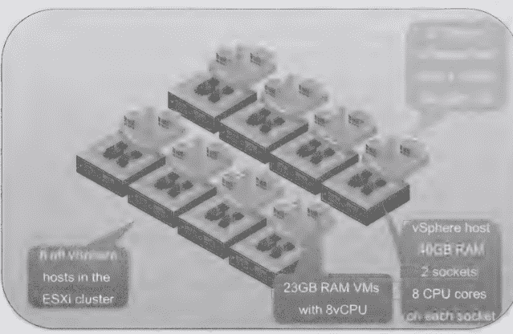

**图 4-4** vSphere 集群设计

## vFabric SQLFire Java 平台规模化：负载 2 类

设计和规模化是一个三步骤的过程：

- 步骤 A。确定实体组（entity groups）。
- 步骤 B。确定数据织的内存大小。
- 步骤 C。建立构建块 VM 和 JVM 的大小，以及需要多少 SQLFire 成员。

完成这些步骤后，应使用负载测试来验证计算和规模化假设。

> **注意**
>
> 实体组是逻辑设计结构，用于渗透应用程序和模式内部的查询使用模式。它相当于对各种查询进行分组，并尝试将它们与始终访问的少数表相关联。另一个视角是，实体组是对应用程序内部访问模式（SQL 查询）进行分类的方法，以确定数据库模式是如何使用的。通过这些信息，你可以建立适当的索引/分区策略。通常的做法是确定链接所有查询或一组查询的根主键，然后通过此类顶层公共主键进行分区（partition-by）。

### 步骤 A：确定实体组

确定实体组的过程有助于建立分区策略，并迭代地确定在 vFabric SQLFire 数据织的内存中保留多少数据。这种为你的模式建立实体组的方法，对于大型模式或服务不同业务线和数据访问模式的多模式是一种有用的设计时技术。客户通常将 vFabric SQLFire 数据称为每日事务数据、1 到 10 天的数据，或者在某些情况下取决于具体情况。在确定这些数据后，你可以确定相应的实体组。这部分是一个迭代过程，如图 4-5 所示详细说明 A1、A2、A3 和 A4。

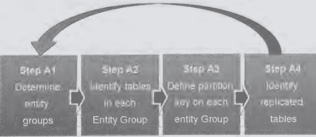

**图 4-5** 设计实体组的步骤 A

图 4-6 显示了一个产品和订单模式的示例。通过检查使用模式来识别其各种实体组。

**图 4-6** 产品订单管理模式

| 供应商 | 产品 | 类别 |
|---|---|---|
| PK: SupplierID | PK: ProductID | PK: CategoryID |
| I1: CompanyName | FK12,FK13: CategoryID | FK11,FK12,FK13 |
| ContactTitle | U1: CategoryName | U1: CategoryName |
| Address | UnitName | OrderDetails |
| City | UnitPrice | FK11,FK12,FK13: ProductID |
| PostalCode | Picture | UnitsOrder |
| Country | | Discount |
| Fax | | RecipientLevel |
| HomePage | | |

| 员工 | 订单 | 客户 |
|---|---|---|
| PK: EmployeeID | PK: OrderID | PK: CustomerID |
| I1: LastName | FK12,FK13: CustomerID | I2: CompanyName |
| FirstName | FK23,FK14 | ContactTitle |
| Title | OrderDate | ContactAddress |
| TitleCountry | ShipDate | City |
| BirthDate | ShippedDate | Address |
| HireDate | Freight | PostalCode |
| Address | ShipAddress | Country |
| Region | ShipCity | |
| PostalCode | ShipPostalCode | |
| Country | ShipCountry | |
| HomePhone | | |
| Extension | | |
| Notes | | |
| ReportsTo | | |

| 货运商 (Shippers) |
|---|
| PK: ShipperID |
| CompanyName |
| Phone |

在图 4-7 中，步骤 A1 到 A4（图 4-5 中的步骤）被迭代应用，因此为图 4-6 中的模式选取了两个实体组。

根据模式所有者和应用程序开发者的经验，选取了两个组，因为大多数 SQL 连接与查找订单信息或产品信息有关。涉及此系统的查询可以分为这两个大类，从而导致了这两个实体组的选择。

第一个组，即客户、订单、货运商和订单详情表的实体组-1，按 `CustomerID` 进行分区，因为它是关联企业应用程序所有查询使用的最佳键。此外，由于查询经常将客户表与订单、货运商和订单详情表连接，强烈建议将订单、货运商和订单详情与客户表共同放置。

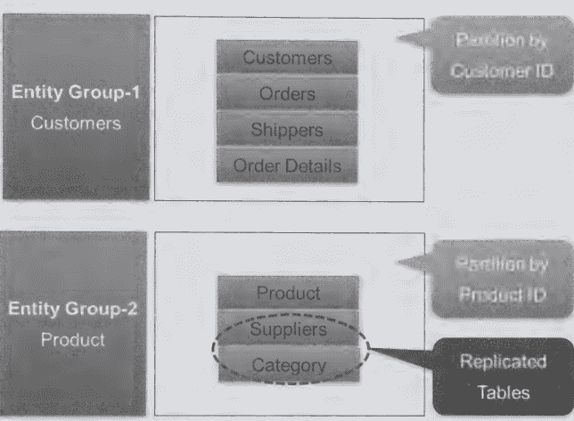

**图 4-7** 为产品订单管理架构选择实体组并按 ID 分区

第二个实体组是针对产品、供应商和类别的实体组-2。在这种情况下，产品（Product）表按 `ProductID` 分区，因为它是该表的自然主键，因此针对该表的所有查询都可以恰当地匹配 vFabric SQLFire 中的特定分区。此外，供应商和类别表属于“代码表/查找表”，它们的变化不频繁，且与产品存在多对多的关系，因此应该在数据织网中的所有 vFabric SQLFire 成员之间进行复制。

> **注意**
>
> 参考之前关于 vFabric SQLFire 分区、共存性（co-location）和复制的讨论。分区用于快速变化的数据，共存性有助于在同一分区内执行父子类型查询的连接操作（例如订单和订单详情）。复制用于极少变化但在几乎每个查询中都需要的数据（由于多对多的关系，在本例中与产品相关）。

> **注意**
>
> - 实体组是一个逻辑抽象，驱动着你的分区、共存和复制策略。
> - 理解应用程序对数据的 SQL 访问模式至关重要。获取最常用 SQL 查询的列表并理解它们如何在逻辑上分组，然后将其映射回你的架构，并决定哪些查询决定了哪些表应包含在实体组中，从而决定指定哪个分区键。
> - 了解哪些数据变化快速、规模大，因此必须根据特定键进行分区。还要理解表之间的父子关系，并据此将适当的表共存。
> - 了解哪些表变化不大（如查找/静态/元数据表等），并决定对这些表进行复制而非分区。
> - 选择部分事务数据存储在 vFabric SQLFire 数据织网中是正确的方法。了解你想保留多少数据以及你愿意以极快速度交付的数据，对比那些具有严格响应时间要求的数据。例如，你可能在传统 RDBMS 数据库磁盘上有 1TB 的数据，但只有 50GB 是每日事务数据或热数据，而这些是由企业数据消费应用决定的、快速变化且具有严格响应时间要求的数据。
> - 在负载下测试你的分区方案，以确保连接均匀分布在整个系统中，避免在系统中产生“热点”。

### 步骤 B：确定数据织网的内存大小

此步骤总结了所有相关的规划公式，用于确定在 vFabric SQLFire 数据织网中容纳“原始每日事务数据集”需要多少 RAM。

公式针对通用情况进行了总结，并用于实际的规划示例，涵盖了 vSphere 集群内的整个数据织网，以及 JVM 和相关 VM 构造的规划比例。

步骤 A（确定实体组）提供了一个过程，让我们对数据织网中保留的“原始每日事务数据集和数据类型”有了概念。接下来的公式突出了数据织网中该原始数据集的实际大小。影响原始每日事务数据集的因素在以下公式中解释，并属于以下通用类别：

- 原始数据的总大小（即指定在所有分区和复制表内管理的原始每日事务数据集）
- 共存数据的内存大小
- 所有冗余副本的内存大小
- 访问数据的并发线程和套接缓冲区数量以及相关的内存占用
- 对于像 vFabric SQLFire 这样延迟敏感型负载，使用 CMS（并发标记清除）类型 Java 垃圾收集器的通用 GC 开销及相关开销
- 由于索引数量和其他 vFabric SQLFire 构造体引起的通用开销

在公式 4-2 中，vFabric SQLFire 数据织网的总内存需求被捕获为 `TotalMemoryPerSQLFireSystemWithHeadRoom`，它是通过 `TotalMemoryPerSQLFireSystem` 加上 50% 余量（headroom）计算出的。有时需要余量是因为内存密集型延迟敏感系统的特性需要 CMS（并发标记清除）类型 Java 垃圾收集器来提供更好的响应时间。此外，数据织网管理的原始每日事务数据集在后续公式中进行了估算。

```
TotalMemoryPerSQLFireSystemWithHeadRoom = TotalMemoryPerSQLFireSystem + 50% headroom
```


# Fabric SQLFire Java 平台规划：负载 2 工作

## 公式 4-5

```
TotalMemoryPerSQLFireSystemWithHeadRoom = TotalMemoryPerSQLFireSystem + 50% headroom
```

## 表格：变量及其值

| 变量 | 值 |
| :--- | :--- |
| TableEntryBytes | 64 |
| IfPartitionedTable | 存在为 1，否则为 0 |
| PartitionedBytes | 4 |
| IfPersist | 存在为 1，否则为 0 |
| PersistBytes | 40 |
| IfStatistics | 存在为 1，否则为 0 |
| StaticsBytes | 16 |
| IfLRU | 存在为 1，否则为 0 |
| LRUEictionBytes | 24 |
| KeyBytes | 0，除非条目溢出磁盘；在这种情况下，主键大小 + 8 |
| ObjectBytes | 550 这是一个近似值；请输入系统真实的 ObjectBytes |
| IfEntryExpiration | 存在为 1，否则为 0 |
| ExpirationBytes | 96 |

## 公式 4-6：客户端/服务器拓扑结构内存消耗

公式 4-6 说明了客户端/服务器拓扑结构中各种套接字和线程消耗的总内存。

```
TotalMemoryForSocketsAndThreads =
TotalMemoryForSockets + TotalMemoryForThreadOverhead

TotalMemoryForThreadOverhead = MaxClientThreads * ThreadStackSize
TotalMemoryForSockets = TotalOfSockets * SocketBufferSizeBytes
NumberOfSockets = NumberOfThreadsOnServer
+ AppThreads
+ MaxClientThreads
+ MaxClientThreads * 2 * NumberOfServers
IfHostPartitionedTableAndConserveSocketsIsFalse
```

## 变量说明

- **AppThreads**：这是应用程序线程的数量，可以等于运行 SQLFire 成员的应用程序服务器上配置的 `MaxThreads` 数量。因此，如果数据织网中有 8 个 SQLFire JVM，且这些 JVM 都在 tc Server 内部管理，那么 AppThreads 将是 8 * 每个 tc 实例的 `MaxThreads`。如果每个 tc Server 都配置了例如 256 个 `MaxThreads`，则 AppThreads 为 8 * 256 => 2048。

- **MaxClientThreads**：如前所述。

- **IfHostPartitionedTableAndConserveSocketsFalse**：如果主机已分区且 `conserve-socket` 属性设置为 `false`，则分区允许调整将 `MaxClientThreads` 和 `NumberOfServers` 翻倍作为套接字（即当 `TRUE` 时为 `MaxClientThreads * 2 * NumberOfServers`）；否则，未设置 `conserve socket`，则 `MaxClientThreads * 2 * NumberOfServers * FALSE => 0`。

## 步骤 C：确定构建 VM 和 JVM 的大小以及需要多少个 vFabric SQLFire 成员

本节展示了如何计算可行的 vFabric SQLFire 成员数量，以及设计师可能选择的服务器机器 / vSphere 主机的总内存（RAM）。公式 4-7 的假设是持有 vFabric SQLFire 成员的 VM 有 32GB 的内存预留。这是因为在 HotSpot JVM 内部，`-XX:+UseCompressedOops` 适用于 32GB 的限制。你可以选择比这更小或更大的 JVM 堆空间。如果你考虑更大的 JVM 空间，设计师必须意识到服务器的非统一内存访问（NUMA）架构，以了解每个本地 NUMA 节点内有多少内存。在设计人员获知了本地 NUMA 节点的大小后，这有助于避免将 JVM 和 VM 的尺寸划分得大于此本地 NUMA 内存，以避免 NUMA 节点内存交错。NUMA 节点交错会导致内存吞吐量出现性能问题，因为你总是希望 VM 从本地 NUMA 节点获取处理数据。

### 公式 4-7：数据织网中的 vFabric SQLFire 成员数量（VM 和 JVM 的数量）

| NumberOfSQLFireServers = NumberOfVMsInSystem = |
| :--- | :--- |
| NumberJVMsInSystem = TotalMemoryPerSystemWithHeadRoom / 32 | |

### 公式 4-8：服务器机器 / vSphere 主机的近似 RAM 尺寸

公式 4-8 强调了在机器故障时，系统和指定的 SLA 能够承受的数据重分布程度。

```
ApproxServerMachineRAM =
TotalMemoryPerSQLSystemWithHeadPercentage / (NumberOfRedundantCopies + 1)
(DataRedistributionTolerancePercentage)
```

### 公式 4-9：受地理影响的 WAN 实际吞吐量

公式 4-9 突出了另一个尺寸考虑因素，如果你尝试理解通过 vFabric SQLFire 提供的 WAN 网关进程可以传输多少数据。最好用示例来描述。如果 TCP 窗口大小为 64KB，且你正于纽约和日本之间进行通信，往返延迟约为 6500 英里 * 2 / 186,000 英里/秒 = 0.069 秒，这意味着最大吞吐量为 64,000 * 8 / 0.069 = 7.4Mbps。因此，无论网络链路如何，不要期望获得高于 7.4Mbps 的速度。

> **注意**
>
> 调高 TCP 窗口大小有所帮助，但可能会导致内存缓冲区使用的增加。缓解此问题的一种方法是在站点两端实现 WAN 加速器，以帮助提供更大的 TCP 窗口并实现 TCP 选择性确认。

| 最大吞吐量可以被确定为： |
| :--- |
| MaximumThroughput(bits/second) = TCP-Windows-Size In Bits / Round Trip Latency In Seconds |

下一节完成了尺寸讨论，详细介绍了 HotSpot JVM 的内部内存区域以及 JVM 在 RAM 方面的实际限制，以及 NUMA 的影响。

## 理解 HotSpot JVM 的内部内存区域

图 4-8 显示了部署在一个 VM 上的 HotSpot JVM 中运行的一个 vFabric SQLFire 成员。各种内存段记录在公式 4-10 中。

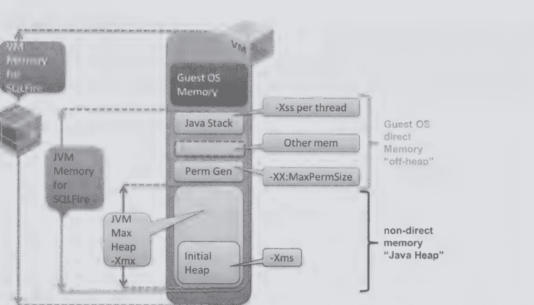

### 公式 4-10：运行在一个 HotSpot JVM 和一个 VM 上的 vFabric SQLFire VM 内存

```
SQLFire VM 内存 = 客户 OS 内存 + SQLFire JVM 内存

SQLFire JVM 内存 =
JVM Max Heap (-Xmx 值) +
JVM Perm Size (-XX:MaxPermSize) +
NumberOfOfConcurrentThreads * (-Xss) + "other Mem"
```

> **注意**
>
> JVM Perm Size 是存储类信息的地方，而 Other Mem 是存储新 I/O (NIO) 缓冲区、即时编译 (JIT) 代码缓存、类加载器、套接字缓冲区（接收/发送）、Java Native 接口 (JNI) 以及 GC 内部信息的地方。这些位于堆之外的区域通常被称为“堆外”（off-heap）区域。考虑到这些内容是非常重要的，因为除了 `-Xmx` 堆之外，它们还可能占据总 JVM 进程内存的一部分。

## 理解 NUMA 对大尺寸规划的影响

非统一内存访问 (NUMA) 架构要求设计人员了解服务器每个本地 NUMA 节点内有多少内存。在设计人员获知了本地 NUMA 节点的大小后，这有助于避免将 JVM 和 VM 的尺寸划分得大于此本地 NUMA 内存，以避免 NUMA 节点内存交错。NUMA 节点交错会导致内存吞吐量出现性能问题，因为你总是希望 VM 从本地 NUMA 节点获取处理数据。

## vFabric SQLFire 规模化示例

前面的章节讨论了决定整个 vFabric SQLFire 数据织规模化的关键公式和限制条件，以及在数据织内部如何对单个 vFabric SQLFire 成员进行规模化。考虑图 4-6 所示架构中的示例，如图 4-5 所示在该架构上的三步设计和规模化过程：步骤 A1、A2、A3 和 A4。

该过程的第一步遵循了“步骤 A：确定实体组”节中讨论的相同步骤，其中识别了两个客户和产品实体组以及它们相关的表、分区、副本表和共存表。

### 配置选项 3：跨两个 NUMA 节点运行

针对特定 vFabric SQLFire 成员配置 VM 的服务器机器。因此，请考虑图 4-11 所示的配置选项 3。

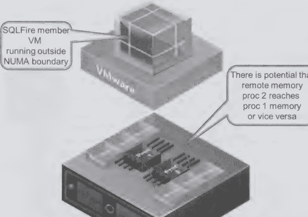

在这种情况下，vFabric SQLFire 成员 VM 被配置为占用服务器及两个 NUMA 节点可用的大部分 RAM，并被配置为消耗服务器上两个可用处理器插槽的大部分 CPU 访问。这可能是一个运行在 vFabric SQLFire 数据织上的 CPU 密集型应用程序，它需要大量的 CPU，并且在数据织的每个独立 vFabric SQLFire 成员中执行。虽然内存访问可能会在两个 NUMA 节点之间交错，但内存中数据访问的优势可能足以满足您的 SLA，偶尔的交错可能不会影响整体响应时间。vSphere 尽可能将线程的执行限制在本地 NUMA 节点内。这意味着线程和相关内存被分配在第一个插槽和 NUMA 节点上，而其他线程被分配在第二个插槽和第二个 NUMA 节点上。此过程持续，直到某些线程无法调度并从而在节点之间交错。


然后应用了 2 条规则来确定大约 300GB 的数据是否代表了必须在 vFabric SQLFire 中保留以满足响应时间 SLA 的“原始数据交易”。这类数据也被称为*快速数据*（fast data），因为它是 RDBMS 数据中必须快速交付给企业应用程序的部分。这些数据在传统的 RDBMS 中已达到了其速度和可扩展性极限，必须存放在 vFabric SQLFire 数据织中，以继续满足特定数据消费应用的快速 SLA。在应用冗余规则 1（意味着提供一个冗余副本）后，300GB 的原始数据操作集从 300GB 转换为 SQLDB * 2 = 600GB。然后，当应用所有其他规模化公式时，大小转变为约为 1.1TB。图 4-12 展示了我们如何将 RDBMS 模型中约 10% 的作为当前/热点每日交易数据并将其视为内存数据。

接下来，应用设计和规模化过程的步骤 3 规则来确定如何将 1.1TB 的数据分布到 vFabric 数据成员中。使用一台具有 64GB RAM、两个各 8 核心的处理器插槽的 vSphere 主机，将这 1.1TB 大约分布在 8 台 vSphere 主机之间。

此时，有两种配置，选项 1 和选项 2，分别如图 4-13 和图 4-14 所示。在选项 1 中，有 32 个 VM，因此有 32 个 vFabric SQLFire 成员/JVM，以及 8 台 vSphere 主机。选项 1 中的 VM 产生了 34GB RAM 和 4 个 vCPU 的 VM 配置。反之，这产生了一个更优的 VM 大小，小于 HotSpot JVM 的 `-XX:+CompressedOops` 最佳运行范围的 32GB 标记。该选项通过在 64 位 JVM 中运行并将 JVM 堆指针地址视为特殊，从而提供了最高效的内存占用。然而，这种设计的缺点是你在集群内需要管理 32 个 vFabric SQLFire 成员/VM，这需要更多的管理关注。如果管理大量的 vFabric SQLFire 成员是一个令人担忧的问题，那么图 4-14 所示的选项 2（有 16 个 VM）可能是更可行的方案。

## vFabric SQLite Java 平台规模化：第 2 类负载

| 供应商 | 产品 | 类别 |
|---|---|---|
| PH SupplierD | PK ProductID | PK CategoryD |
| 11 CompanyName | 15 FK2,35,14 订单详情 | U1 CategoryName |
| ContactName | PK1,11,12 FX1,25,11 订单 ID | 扩展 |
| Address | 单位数量 | | 产品D |
| Region | 单位折扣 | 单价 |
| 12 邮编 | 订货水平 | 折扣 |
| 国家 | 已停用 | | |
| 电话 | | | |
| Fax | | | |
| 员工 | 订单 | 客户 |
|---|---|---|
| PK EmployeeID | PK OrderID | PK CustomerID |
| 11 FirstName | FX1,25,14 员工ID | 12 客户名称 |
| LastName | FX2,35,12 员工ID | 联系人 |
| Title | | 地址 |
| Tele2/Country | 留代码 | 11 市 |
| HireDate | FX53,17 收货方式 | 地区 |
| Age | | 收货名称 | 邮编 |
| City | | 收货地址 | 国家 |
| Region | | 收货地区 | 电话 |
| Country | | 收货国家 | 传 |
| Phone | | | |
| Extension | | | |
| Reports | | | |
| 货运商 | | | |
|---|---|---|---|
| ShipperID | | | |
| CompanyName | | | |
| Phone | | | |


**图 4-11** 跨两个 NUMA 节点运行 vFabric SQLFire 成员虚拟机（配置选项 3）

因此，JVM 内存约为 31GB + Other Mem。Other Mem 虽然不大，但如果应用程序使用了许多 NIO 缓冲区和套接缓冲区，它可能会很大。这个值可以通过预留空间估约为堆内存的 5%（在本示例中为 3% * 30GB=1GB），尽管应该使用适当的负载测试进行验证。此示例中生成的 JVM 进程内存为 30GB + 1GB=31GB。

6. 要确定 VM 内存，假设你正在使用 Linux，且只有这一个 Java 进程，没有其他重要的进程。VM 的总配置内存如下：

vFabric SQLServer 的 VM 内存 = 31GB + 1GB = 32GB

7. 将 VM 内存设置为内存预留。你可以将预留设置为 32GB。

如图 4-16 所示，此处的 GC 配置在老年代使用 CMS，在年轻年代使用并行/吞吐收集器。

```
java -Xms30g -Xmx30g -Xmn9g -Xss1024k -XX:+UseConcMarkSweepGC
-XX:+UseParallelGC -XX:+InitiatingOccupancyFraction=75
-XX:+UseCMInitiatingOccupancyOnly -XX:+ScavengeBeforeFullGC
-XX:+TargetSurvivorRatio=80 -XX:+UseBiasedLocking
-XX:MaxTenuringThreshold=15 -XX:+UseCompressedOops -XX:+OptimizeStringConcat -XX:+UseCompressedStrings
-XX:+UseStringCache -XX:+DisableExplicitGC
```

**图 4-16** 30GB 堆的 vFabric SQL Server 的 JVM 配置

在图 4-16 中，由于我们使用的是 4-vCPU 的 VM 规格，且带有 `-XX:ParallelGCThreads=2`，可用四个 vCPU 的 50% 被分配给少数 GC 周期。

图 4-17 所示的每个 vFabric SQL VM 成员（vsphere 集群中的选项 2）都包含 16 个 VM，因此有 16 个 vFabric SQLServer 成员。每个 VM 配置为 68GB RAM 和 8 个 vCPU。在图 4-17 中，显示了 vFabric SQLFire 成员 VM 分配了 68GB 预留和 8 个 vCPU。在示例中，Java 进程内存的总大小（即 vFabric SQL 成员）为 67GB。为操作系统大约加上 1GB，使得最终的 VM RAM 大小变为 68GB。在 Java 进程内部，堆大小确定为约为 64GB。

## vFabric SQLFire 平台容量规划：第 2 类负载

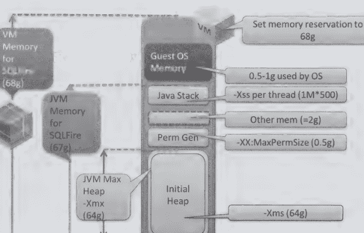

图 4-17 带有 68GB RAM 预留的 vFabric SQLFire 成员 VM

图 4-17 使用以下值：

- 客户操作系统内存约为 0.5GB–1GB（取决于操作系统和其他进程）。

- `-Xmx` 是 JVM 最大堆大小，设置为 64GB。

- `-Xss` 是 Java 线程栈大小。默认取决于操作系统和 JVM，但在本例中设置为 1MB。

- Perm Size 是 `-xmx`（最大堆）值之外的区域，包含类级信息。

- Other Mem 是 NIO 缓冲区、JIT 代码缓存、类加载器、套接缓冲区（接收/发送）、JNI 和 GC 内部信息所需的额外内存。

- vFabric SQLFire 的 VM 内存 = 客户操作系统内存 + vFabric SQLFire 的 JVM 内存。

要设置大小，请遵循以下步骤：

- 设置 `-Xmx64g`，

- 设置 `-XX:MaxPermSize = 0.5g`。这取决于 Java 应用程序代码库类级信息的内存占用。

NumberOfConcurrentThreads * (-Xss) 的其他部分很大取决于 JVM 将处理的 NumberOfConcurrentThreads 以及你选择的 `-Xss` 值。

`-Xss` 取决于操作系统和 JVM。在大多数情况下，运行在 Linux 操作系统上的 HotSpot JVM 默认 256K，在 Windows 操作系统上可能高达 1MB。如果栈大小设置不正确，可能会得到 StackOverflow（栈溢出）。如果你看到此异常，应该增加栈的大小或调查原因。消耗内存大于 256K（例如在 1MB 到 4MB 之间）的内存敏感型负载从较大的 `-Xss` 值中受益。这里的关键是分配在这些较大的栈中的对象不会泄露到其他线程。例如，我们选择了 1MB 的栈大小，500 个线程 * 1MB => 500MB => 0.5GB。

4. 假设操作系统有 1GB 的需求。

5. 总 JVM 内存（Java 进程内存） = 64GB (-Xmx) + 0.5GB (-XX:MaxPermSize) + (500 * 1MB = NumberOfConcurrentThreads * -Xss) + Other Mem。

因此，JVM 内存约为 65GB + Other Mem。Other Mem 通常不显著，但如果应用程序使用了 NIO 缓冲区和套接缓冲区，它可能会很大。这个值可以通过预留空间估约为堆的 5%（在本示例中为 3% * 30GB=1GB），尽管应该使用适当的负载测试进行验证。此示例中生成的 JVM 进程内存为 30GB + 1GB=31GB。

6. 要确定 VM 内存，假设你正在使用 Linux，且只有这一个 Java 进程，没有其他重要的进程。VM 的总配置内存如下：

vFabric SQLServer 的 VM 内存 = 31GB + 1GB = 32GB

7. 将 VM 内存设置为内存预留。你可以将预留设置为 32GB。

如图 4-16 所示，此处的 GC 配置在老年代使用 CMS，在年轻年代使用并行/吞吐收集器。

对任何系统均未进行调优，默认计算资源需求未被更改。基于此，vFabric SQLFire 获得了平等的计算资源。虽然分布在两个虚拟机上，但其净计算资源与本次比较中使用的配置相同。这类似于客户开发者在第一天检查和评估 vFabric SQLFire 与传统 RDBMS 时，在开发环境中可能模拟的情况。

### 性能结果

表 5-1 绘制了结果，列图例如下：

- “Threads”列：在两次负载测试期间执行的 Spring Travel 应用的并发线程数
- “SQLF R/T (ms)”列：Spring Travel 应用以毫秒为单位的响应时间
- “SQLF CPU %”列：vFabric SQLFire 虚拟机在峰值时的 CPU 利用率百分比
- “RDBMS R/T (ms)”列：在传统磁盘 RDBMS 上运行时，Spring Travel 应用以秒为单位的响应时间
- “RDBMS CPU %”列：RDBMS 虚拟机在峰值时的 CPU 利用率百分比

结果适用于 18 到 7200 个并发线程的范围。在显示为 Failed（失败）的地方，意味着 Spring Travel 应用在传统磁盘 RDBMS 上运行未响应；它本质上处于冻结状态，因此没有收集到数据。

表 5-1 RDBMS 与 vFabric SQLFire 的 Spring Travel 结果

| Threads | SQLF R/T (ms) | SQLF CPU % | RDBMS R/T (ms) | RDBMS CPU % |
| :--- | :--- | :--- | :--- | :--- |
| 18 | 14 | 9 | 25 | 1 |
| 200 | 8 | 32 | 23 | 19 |
| 1800 | 5 | 61 | 172 | 76 |
| 3600 | 6 | 77 | Failed | Failed |
| 7200 | 984 | 98 | Failed | Failed |

## Spring Travel 响应时间与并发线程的结果

图 5-2 显示了纵轴为响应时间、横轴为并发数的结果。红线代表在传统磁盘 RDBMS 上运行的 Spring Travel 应用的配置，蓝线代表在 vFabric SQLite 上运行的 Spring Travel 应用。此图表展示了随着 Spring Travel 应用并发用户线程数增加时的配置响应时间行为。我们看到，随着横轴并发线程数的增加，对于 RDBMS 配置的 Spring Travel 应用，响应时间线性增加（如图中的红线所示）。相比之下，带有 vFabric SQL 的 Spring Travel 配置保持了相当低且平稳的响应时间线（如图底部的线条所示）。


图 5-2 Spring Travel 响应时间对比并发线程

## 可扩展性测试结果

在此测试中，如图 5-3 所示，目标是演示两种配置的可扩展性程度。对于 Spring Travel 应用服务器，在达到 1850 个并发线程后，系统在接近 172ms 的响应时间后停止响应，表明已达到图 5-3 红线所示的可扩展性极限。图 5-3 中标记的针对 vFabric SQLite 的 Spring Travel 配置持续运行到 7200 个并发线程和 984ms 响应时间的极限。

## SQLFire 与 RDBMS 性能研究

### 线程数增加时毫秒单位的响应时间 (R/T)


图 5-3 Spring Travel 响应时间对比并发线程：可扩展性测试

> 在大约 3600 个并发线程时，vFabric SQLFire 开始溢出到磁盘，响应时间增加。这是正常现象，可以通过适当配置可用 RAM 来控制这种溢出。

## CPU 与并发线程测试结果

图 5-4 绘制了相关虚拟机的 CPU 利用率，RDBMS 虚拟机为红线，vFabric SQLFire 虚拟机为蓝线。这是图 5-3 测试期间测得的 CPU 利用率。红线显示，针对 RDBMS 的 Spring Travel 应用在约 80% CPU 和 1850 个并发线程处达到峰值。在此点它完全无法响应。相比之下，蓝线所示，基于 vFabric SQLFire 的 Spring Travel 配置持续达到 98% CPU 和 7200 个并发线程，并且仍有响应，应用响应时间约为 1 秒。你还看到红、蓝条线在大约 1000 个并发线程处交叉，表明带有 vFabric SQLFire 的 Spring Travel 能够处理大得负载，且 CPU 利用率增长更稳定。

### CPU % 线程数


**图 5-4** Spring Travel 应用 CPU 对并发线程

## 发现总结

通过本研究得出以下发现：

- 使用 DDLUtils 相对简单


# tc Server 上的 Olio 工作负载与 vSphere 性能研究

## 原生 4CPU 与虚拟 4vCPU

第90 百位数响应时间


图 5-7 原生 4-CPU 对比 虚拟 4-vCPU

## 不同 CPU 数量的 Olio 吞吐量

原生单虚拟机


图 5-8 以 Ops/Sec 作为吞吐量衡量 CPU 数量

## 1-vCPU 与 4-vCPU 配置的选择

图 5-9 显示了三种由四台虚拟机组成的配置：四台每个一个 vCPU 的虚拟机，两台每个两个 vCPU 的虚拟机，以及一台四个 vCPU 的虚拟机。图表的左侧纵轴为第90 百位数响应时间，右侧纵轴为 CPU 占用率，横轴为用户数。在此，你可以看到 2-vCPU 配置在两台虚拟机上总共 5GB（每台 2-vCPU 虚拟机 2.5GB）的最少堆内存下，实现了最佳的用户吞吐量组合。


| vCPU 数量 | 虚拟机数量 | 每个虚拟机最大堆内存 | 4vCPU 情况下的总堆内存 |
| --- | --- | --- | --- |
| 1 | 4 | 1GB | 4GB |
| 2 | 2 | 2.5GB | 5GB (最佳情况) |
| 4 | 1 | 4GB | 4GB |

图 5-9 配置树选择：四个 1-vCPU 虚拟机、两台 2-vCPU 虚拟机和一台 4-vCPU 虚拟机

图 5-10 展示了四台 1-vCPU 虚拟机、两台 2-vCPU 虚拟机和一台 4-vCPU 虚拟机的峰值吞吐量。再次清楚地证明了两个 2-vCPU CPU 具有最佳吞吐量。之所以选择这个结果优于 1-vCPU 虚拟机，是因为对于任何严肃的应用，2-vCPU 虚拟机都是最常用的。如果你有一个相当繁忙的 Java 应用程序，可以预计垃圾回收 (GC) 将占用一个 vCPU，而第二个 vCPU 将被留给常规用户事务。然而，如果你使用 1-vCPU 虚拟机，GC 和常规用户事务将竞争 CPU 周期。

## SpringTrader 性能研究

2 台虚拟机，每台 2 vCPU，每台虚拟机 2.5G 内存 - 在内存用量和实现的 R/T 方面显示出最佳吞吐量


**图 5-10** 峰值 Olio 用户数对比各种虚拟机 vCPU 配置

## SpringTrader 性能研究

在本次性能研究中，对 `vFabric SpringTrader` 进行了广泛的负载测试以建立其可扩展性，容量规划者可以将其作为指南，指导如何优化配置 SpringTrader 目标 Java 平台。该负载的目标是模拟用户通过基于浏览器的富互联网应用 (RIA) 与应用程序交互时给服务器端应用带来的负载。这意味着对服务器端 REST 应用程序接口 (API) 的调用顺序被限制为通过 RIA 交互可以实现的序列。该负载使用分配给当前操作/下次操作转换的转换概率，来实现通用规范。

### 注意事项

对 VMware vSphere 5.1 安装进行的唯一性能调优是将高级设置参数 `/Num/LocalityWeightActionAffinity` 设置为 0。此设置控制 CPU 调度器在决定将虚拟机（VM）分配到非统一内存访问（NUMA）节点时，对虚拟机间通信所权予的权重。在大多数情况下，保持默认值将获得最佳性能。在本次部署中，应用服务 VM 与 SQLFire 数据成员（内存数据库）VM 之间频繁的通信导致调度器倾向于将这些 VM 放在同一个 NUMA 节点上。这并没有提高性能，而且在某些负载下对性能产生了负面影响。因此，该参数被设置为 0，以禁用调度决策中对虚拟机间通信的使用。在不同的部署场景中更改此参数之前，应进行仔细的性能测试。您可以在技术论文《vSphere 5.1 中的 CPU 调度器》中找到有关此项及其他调度参数的更多信息。

图 5-13 显示了部署图（即虚拟机相对于底层 vSphere 主机的部署位置）。在 vSphere 主机 1 上，部署了 Application Service 1、RabbitMQ 1、Integration Service 1 和 SQLFire 1。在 vSphere 主机 2 上，部署了 Application Service 2、Application Service 4、Integration Service 2、RabbitMQ 2 和 SQLFire 2。表 5-3 显示了这些 VM 的实际配置和大小。


图 5-13 用于性能测试中 SpringTrader 拓扑的虚拟机及其底层 vSphere 主机

表 5-3 显示了图 5-13 中每个 VM 使用的配置。

### 表 5-3 VM 配置

| 组件 | 详情 |
| --- | --- |
| **所有 VM** | |
| 操作系统 | Red Hat Enterprise Linux 6 Update 3, x86_64 |
| 虚拟网卡 | VMXNET 3 |
| SCSI 控制器 | Paravirtual（半虚拟） |
| **应用服务 VM**（图 5-13 中显示为 Application Service 1, 2, 3 和 4） | |
| Servlet 容器 | VMware vFabric tc Server, Version 2.8.1 |
| vFabric tc Server 配置 | 使用 Tomcat JDBC 连接池，最大连接数为 111；在 `tomcatThreadPool` 中使用了 100 个最大线程；使用了 NIO HTTP 连接器 |
| JVM | Oracle HotSpot JDK 1.6.0_37 64-bit |
| JVM 选项 | `-Xmx640m -Xms640m -XX:+UseLargePages -XX:+AlwaysTouch` |
| vCPUs | 2 |
| 内存 | 1GB |
| **集成服务 VM**（图 5-13 中显示为 Integration Service 1 和 2） | |
| Servlet 容器 | VMware vFabric tc Server, Version 2.8.1 |
| vFabric tc Server 配置 | 使用 Tomcat JDBC 连接池，最大连接数为 111；在 `tomcatThreadPool` 中使用了 100 个最大线程；使用了 NIO HTTP 连接器 |
| JVM | Oracle HotSpot JDK 1.6.0_37 64-bit |
| JVM 选项 | `-Xmx256m -Xms256m -XX:+UseLargePages -XX:+AlwaysTouch` |
| 应用级调优 | 将 Spring Integration AMQP 入站通道上的并发消费者数量增加到 50。 |
| vCPUs | 2 |
| 内存 | 768MB |
| **AMQP 消息服务器 VM**（图 5-13 中显示为 RabbitMQ 1 和 2） | |
| 消息服务器 | VMware vFabric RabbitMQ, Version 3.0.1 |
| vCPUs | 2 |
| 内存 | 2GB |
| RabbitMQ 配置 | `vm_memory_high_watermark` 设置为 0.7 |
| 其他配置详情 | SpringTrader AMQP 队列采用镜像以实现高可用性。SpringTrader AMQP 队列是持久的。 |
| **SQLFire VM**（图 5-13 中显示为 SQLFire 1 和 2） | |
| 数据库服务器 | VMware vFabric SQLFire, Version 1.0.3 |
| JVM | Oracle HotSpot JDK 1.6.0_37 64-bit |
| JVM 选项 | 按照 VMware vFabric SQLFire 最佳实践指南，进行了以下更改：`-Xmx90g -Xms90g -XX:+AlwaysPreTouch` |
| vCPUs | 8 |
| 内存 | 94GB |
| 其他配置详情 | SpringTrader 数据库架构中的所有表都进行了冗余复制或分区以实现高可用性。 |

## SpringTrader 性能研究结果

图 5-14 的左纵轴为用户数，横轴为应用服务 VM 的数量，右纵轴为从一个应用服务 VM 开始的扩展比例。结果显示，通过此配置实现了 10,400 个用户会话，每秒约 3000 次交易。更令人印象深刻的是，如图 5-14 所示，SpringTrader 在保持 0.25 秒响应时间的同时，能够实现每秒 3000 次交易。


图 5-14 用户数 vs 应用服务


图 5-15 响应时间

# ESXi 3、4.1 和 5 之间的性能差异


# 图 5-16 使用硬件辅助内存的效率提升

vSphere 4 中还有重大的网络驱动程序优化，如图 5-17 所示。网络传输吞吐量的提升在 18% 到 85% 之间，取决于 VM 的数量。


图 5-17 vSphere 4 网络传输吞吐量提升

# vSphere 5 性能增强

在 vSphere 5 中，大多数增强侧重于提高 VMotion 吞吐量。

在已实施改进的性能图表之前，了解 VMotion 的三个阶段非常重要，具体如下：

- 第 1 阶段（客户机跟踪阶段）：在客户内存页上放置跟踪，以跟踪迁移期间客户机进行的任何修改。
- 第 2 阶段（预拷贝阶段）：
    - 在准备阶段从源到目的地进行初始拷贝
    - 从源到目的地对发生变化的内存进行迭代拷贝
- 第 3 阶段（切换阶段）：
    - VM 在源端短暂静止（quiesced），将最后一组内存更改复制到目标，并在目标机上恢复 VM。
    - 在此阶段，客户机会短暂暂停处理。
    - 持续时间通常小于一秒；但这可能会导致延迟突然增加。

改进措施如下：

- 能够为 vMotion 使用多个网络适配器
- 延迟感知的 Metro VMotion 改进了长延迟环境下的性能，并将往返容忍度从 5 毫秒增加到 10 毫秒
- 页面发送期间停顿（SDPS）确保 VMotion 不会因为内存收敛问题而失败：
    - 在 ESXi 4.1 中，预拷贝过程会因为内存变化过快而无法进行，导致 vMotion 失败。
    - ESXi 5 具有增强功能，可以减慢源 VM 中的内存变化，使预拷贝过程能够更快收敛。
- 显著减少内存跟踪开销的改进：
    - SPECWeb2005，12L 用户（产生 6Gbps 流量），带有 12GB RAM 的 +vCPU VM。
    - vMotion 持续缩短了 37%。

## 章节总结


图 5-18 vSphere 5 对 vSphere 4.1 的 vMotion 改进

> **注意**
>
> 在 5.x 中，除了存储 I/O 和网络 I/O 增强外，调度器得到了改进以处理 32 个 vCPU，特别是减少了空闲 CPU 的影响。最后，vSphere 5.1 还实现了每个 VM 每秒 100 万次 I/O 操作 (IOPS) 和约 40Gbps 的网络吞吐量。

## 章节总结

本涵盖了各种性能研究，表明虚拟化 Java 平台可以进行大规模运行。事实上，某些虚拟化 Java 平台每秒执行数千次交易，并运行一些大型交易平台。

## 最佳实践

本章涵盖了针对第 1 类、第 2 类和第 3 类 Java 平台的各种最佳实践：

- 第 1 类（大量 JVM）：在此类中，Java 平台上通常会部署数百到数千个 Java 虚拟机 (JVM)，这些通常是作为可能服务于数百万用户的系统部分的 JVM。我见过某些客户拥有多达 15,000 个 JVM。每当你需要处理数千个 JVM 实例时，你都必须考虑管理成本以及是否存在合并 JVM 实例的机会。
- 第 2 类（大堆内存 JVM）：此类通常包含较少的 JVM（1 到 20 个），但单个 JVM 的堆内存很大，范围在 8GB 到 256GB 之间，可能更高。这些通常是部署了内存数据库的 JVM。在此类中，垃圾回收 (GC) 调优变得至关重要。
- 第 3 类：这是前两者的结合，可能有数千个 JVM 正在运行应用程序，并在后端从第 2 类大 JVM 消耗数据。

图 6-1 显示了一个第 1 类 vSphere 集群的示例，其特征如下：

- 通常由较小的 JVM 组成，通常堆内存大小小于 4GB，因此总内存为 4.5GB，并为操作系统留出 0.5GB，共设置 5GB 的虚拟内存预留。
- 通常部署在物理内存少于 96GB 的 vSphere 主机上，当你堆叠 JVM 实例时，可能在耗尽所有物理内存之前达到 CPU 边界。例如，如果你选择具有 256GB 内存的 vSphere 主机（256GB / 4.5GB ≈ 57 个 JVM），这显然会达到 CPU 边界，因为有太多的线程在争抢资源。
- 在每个 VM 上运行多个 JVM 是一种常见做法，有时被称为 JVM 的垂直堆叠。由于第 1 类 Java 平台可以有数千个 JVM，因此资源池可以帮助维护服务水平协议 (SLA)。例如，如图 6-1 所示，可以设置金色和银色资源池来服务不同的业务线 (LOB)。许多 JVM 的规模使得拥有资源池变得必要。


图 6-1 第 1 类 Java 平台 vSphere 集群

图 6-2 显示第 2 类负载的示例，其特征如下：

- 第 2 类 vSphere 集群通常包含少于 20 个 JVM。
- 第 2 类 vSphere 集群的 JVM 非常大（32GB 到 128GB）。
- 始终在每个 VM 上运行一个 JVM；避免叠加。
- 选择双插 vSphere 主机，内存充足（128GB 到 512GB）。这种负载的示例是 SQLFire 或 GemFire。
- 在物理网卡 (pNIC) 上应用延迟敏感的最佳实践 (BPs)，类似于虚拟网卡 (vNIC)。
- 应该使用专用的 vSphere 集群，因为这种方式可以避免 1-JVM CPU 的问题。


### 第 2 类：大内存 JVM

图 6-2 第 2 类负载 vSphere 集群

在第 3 类中，由于第 1 类 vSphere 集群访问第 2 类平台（如图 6-3 所示），应适当相应的最佳实践。


**图 6-3** 第 3 类负载 vSphere 集群

## 最佳实践

## 说明

**BP 18: 对于 VM CPU，请勿过度订阅你并不真正需要的 CPU 周期。**

如果你的性能负载测试确定（例如）2 个 vCPUs 足够支持高达 70% 的 CPU 利用率，那么通过为你的 VM 分配 4 个 vCPUs，可能会导致 2 个 vCPUs 处于空闲状态，这并不是最优的。如果不知道具体的工作负载，初始时使用较少的 vCPUs 来配置 VM，并在必要时增加数量。

从 vCPU 的角度来看，VM 的最佳配置取决于工作负载。一个良好的起点是将 VM 的大小设置为与底层 NUMA 节点/插槽的物理核心数相同。或者，在 NUMA 节点上以均匀划分的方式设置较小的 VM 大小。例如，如果你有一个拥有 2 个插槽、每个 8 核的 vSphere，或者你的配置选择是 2 台每 2 vCPUs 的 VM、4 台每 4 vCPUs 的 VM、8 台每 2 vCPUs 的 VM 或 16 台每 1 vCPU 的 VM。对于运行 JVM 的生产环境，堆内存大小为 4GB 的 VM 扩展性可能较差，我们（如前所述）希望 Java 应用至少使用 2-vCPUs 的 VM。在这些配置下，如果你发现物理核心的 CPU 利用率较低，意味着你可能可以将 vCPUs 的数量增加到超过底层核心数，但这种做法应该谨慎进行，并密切关注工作负载在整个峰值周期内的行为。

### VM 内存大小最佳实践

要理解如何为 VM 分配内存，你必须理解 Java 及其内部各个部分的内存需求。图 6-4 和公式 6-1 阐述了独立的内存区域。

其中：

- 客户操作系统（Guest OS）内存。操作系统大约占用 0.5 到 1GB（取决于操作系统和其他进程）。
- `-Xms` 是初始堆。
- `-Xmx` 是 JVM 最大堆大小。
- `-Xss` 是 Java 线程栈大小。默认值取决于操作系统和 JVM（在 Linux OS 上通常为 256K，但在 Windows 上可能高达 1MB）。
- 永久代内存（Perm Gen），即 `-XX:MaxPermSize`，是 `-Xmx`（最大堆）的额外部分，包含类级信息。注意，IBM JVM 没有永久代区域。相反，IBM WebSphere 内部类信息是像堆中其他对象一样被管理的。

## vSphere 上企业级 Java 应用最佳实践（类别 1）


图 6-4 部署在单个 VM 上的 JVM

| VM 内存 = 操作系统内存 + JVM 内存 |
| :--- |

| JVM 内存 = JVM 最大堆 (-Xmx 值) + JVM 永久代 (-XX:MaxPermSize) + 并发线程数 * (-Xss) + "其他内存" |

公式 6-1 VM 和 JVM 内存需求

- 其他内存是新 I/O (NIO) 缓冲区、即时编译 JIT 代码缓存、类加载器、套接字缓冲区（接收/发送）、Java Native 接口（JNI）以及垃圾回收（GC）内部信息所需的额外内存。注意，直接缓冲区（direct buffer）的内容是从客户操作系统内存分配的，而不是从 Java 堆分配；而非直接缓冲区（nondirect buffers）会被复制到直接缓冲区中进行原生 I/O 操作。通过负载测试来合理确定这些缓冲区的影响。

并发线程数（NumberOfConcurrentThreads）是 JVM 将服务的最大线程数，通常测量为峰值负载时的并发线程数。Java 中的每个执行操作都需要分配一个 Java 线程。它通过预留等于 `-Xss` 大小的堆外原生内存来分配。这是直接从 OS 分配的原生内存。

如果你在 VM 上有多个 JVM（n 个 JVM），则 VM 内存 = 操作系统内存 + N * JVM 内存。

表 6-2 提供了一些 VM 内存大小的最佳实践。

### 表 6-2 VM 内存大小最佳实践

| 最佳实践 |  |
| :--- | :--- |

| BP 19: VM 内存划分 | 无论你使用 Windows 还是 Linux 作为客户操作系统，请参考各厂商关于内存需求的技术规范。在 JVM 内存大小中，为客户操作系统分配约 0.5 到 1GB 是常见的。然而，每个安装实例都可能运行额外的进程（例如监控代理程序），你还需要兼顾它们的内存需求。 |

图 6-4 显示了 JVM 和 VM 内存的各个部分，公式 6-1 将 JVM 内存总结如下：

VM 内存（所需） = 操作系统内存 + JVM 内存，其中 JVM 内存 = JVM 最大堆 (-Xmx 值) + 永久代 (-XX:MaxPermSize) + 并发线程数 * (-Xss) + 其他内存

- `-Xmx` 值是在物理服务器上对应用进行负载测试时找到。迁移到虚拟化环境时，此值不会改变，特别是如果该值之前是通过负载测试和大量的生产使用确定的。在 vSphere 上部署应用时进行负载测试有助于确认最佳的 `-Xmx` 值。注意，如果你遵循某些优化 JVM 实例数量的建议并计划合并 JVM，你需要增加堆大小以容纳与合并 JVM 相关的堆 (-Xmx) 空间。

## 最佳实践

## 说明

**BP 19: VM 内存划分（续）。** 例如，如果 `-Xmx` 设置为 4GB，如 `-Xmx4g` 所示，由于客户操作系统可能需要 0.5GB，VM 内存划分可能至少需要 4.5GB。如果你在 VM 上有多个 JVM，VM 内存 = 操作系统内存 + N * JVM 内存。

在这些配置下，如果你发现物理核心的 CPU 利用率较低，意味着你可能可以将 vCPUs 的数量增加到超过底层核心数，但这种做法应该谨慎进行，并密切关注工作负载在整个峰值周期内的行为。建议不要过度提交内存，因为 JVM 内存是一个不断创建和垃圾回收的活动空间。

如果过度提交内存，ESX 采用两种不同的技术来动态扩展或收缩内存。第一方法被称为内存气泡（vmemctl），它加载到客户操作系统。第二种方法涉及交换文件。在交换方法中，启动 VM 时会创建一个位于配置文件所在的交换文件 (.vmx)。当气泡驱动无法快速满足系统需求时，ESX 使用交换。由于内存被交换到磁盘，使用该技术会产生严重的性能损失。因此，建议始终启用气泡驱动；但要监控以确保其未被触发。

Java 应用应防止气泡和交换。为了防止气泡和交换，请参考 BP 20：设置 VM 内存需求。

## 最佳实践

## 说明

**BP 20: 设置 VM 内存需求。** 运行在 VM 上的应用具有必须位于物理内存中的活动空间需求。使用 vSphere Client 将预留设置为所需的 VM 内存：

预留内存 = VM 内存 = 操作系统内存 + JVM 内存

将预留设置为 VM 的配置内存。

如果你在 VM 上有多个 JVM（N 个 JVM），则 VM 内存 = 操作系统内存 + N * JVM 内存。

## BP 21: 使用大页

结果各异，完全取决于工作负载的性质。大页的性能有时会有 -10% 的下降到约 20% 的提升。

大页必须在客户操作系统和 JVM 级别都启用。

要在 JVM 级别启用大页，请为 JVM 设置 `-XX:+UseLargePages`。

在 IBM JVM 上，是 `-Xlp` 和 JRockit `-XXLargePages`。你还需要在客户操作系统级别启用。在 OS 级别启用大页时，确保关闭所有可能因内存调整而产生负面影响的进程。

使用以下命令检查大页分配：

```bash
cat /proc/meminfo | grep Huge
HugePages_Total: 0
HugePages_Free: 0
HugePages_Rsvd: 0
Hugepagesize: 4096 kB
```

## vSphere 上企业级 Java 应用的最佳实践（类别 1）

| 最佳实践 | 描述 |
|---|---|

| BP 21: 大页（large pages）的使用（续） | 这意味着你分配了 0 个大页，且大页的大小为 4MB。<br><br>例如，如果你想设置 4GB 的大页内存，你需要设置 1000 个大页，因为每个页的大小是 4MB。要分配以下内容： |

```bash
echo 1000 > /proc/sys/vm/nr_hugepages
cat /proc/meminfo | grep Huge
```

你应该重复执行 `cat /proc/meminfo | grep Huge` 来检查 1000 个页面是否确实已分配。有时，由于操作系统内存不足，它可能无法分配所有这些页面。这通常意味着有进程正在运行并占用内存空间，且操作系统无法锁定这些页面。此时正确的操作是继续关闭进程，直到有足够的内存可以分配给大页。

设置大页时应极度谨慎，因为并非所有进程都能使用大页。因此，最好的做法是将可用客户操作系统内存设置为 60% 的大页和 40% 的小页。

如果你在当前的物理 Java 部署中未使用大页，那么在虚拟化时可能不需要开启大页，但如果能正确设置大页，可能会提升性能。

大页有时会变成管理开销（因为新的进程，包括 Java 和非 Java 进程可能会部署在虚拟机和客户操作系统上），你必须不断调整大页的分配以适应这些新进程。这有时会导致高昂的管理成本且容易出错；调优良好的系统通常可以省去启用大页。

对于 Windows 操作系统，请检查用户手册；具体步骤随版本而异。

### VM 计时最佳实践

如果 Java 程序对长时间范围内的精确测量敏感，或者它们需要在一个精确容差范围内的时间戳（例如共享文档或数据项的时间戳），计时可能会对其产生影响。VMware Tools 包含可以安装到客户操作系统中的功能，以启用时间同步，建议使用这些工具。表 6-3 提供了 VM 计时的最佳实践。

### 表 6-3 VM 计时最佳实践

| 最佳实践 | 描述 |
| --- | --- |

| BP 22: 使用 NTP 源 | 使用通用的网络时间协议（NTP）源同步所有系统。 <br> 对于 Linux 客户操作系统，以下 KB 文章列出了设置列表：http://kb.vmware.com/kb/1006427。 <br> 对于 Windows 客户操作系统，以下 KB 文章列出了设置列表：http://kb.vmware.com/kb/1318。 <br> 更多参考，请参见 http://www.vmware.com/files/pdf/techpaper/Timekeeping-In-VirtualMachines.pdf。 |

### 垂直扩展性最佳实践

如果部署在 vSphere 上的企业级 Java 应用面临高 CPU 利用率，且你确定增加 vCPU 数量将有助于解决饱和问题，你可能可以使用 vSphere 热插拔（hot add）来添加额外的 vCPU。表 6-4 描述了纵向扩展性的最佳实践。

### 表 6-4 垂直扩展性最佳实践

| 最佳实践 | 描述 |
| :--- | :--- |

| BP 23: 热插或移除 CPU/内存。 | 检查你正在使用的客户操作系统版本是否支持 CPU 和内存的热插和热移除。 |

由于 Java 进程无法立即使用所有可用的 CPU，最好避免使用热插拔。Java 进程中老代（old generation）和堆外区域的 GC 周期可能会使用热插拔的 CPU，但这并不具有预测性，且不是生产系统中的最佳实践。如果虚拟机在 Java 进程之外还需要额外的 CPU 周期（例如某些其他进程），或许可以使用 CPU 热插拔。

由于 Java 平台（特别是类别 1 中）会在 JVM 中拥有任何应用程序的许多水平扩展副本，因此最佳做法是使用负载均衡器层将需要重新配置的 JVM 移出节点，调整其配置后再将其放回负载均衡器池中。

在 Java 堆的年轻代空间中，`-XX:ParallelGCThreads=<Threads>` 控制用于并行清理 Java 对象的执行工作线程数。如果你确定需要额外的线程在此处分配，因此需要额外的 vCPUs，那么热插拔将不起作用。这是因为对 Java 命令行的任何更改（例如更改 `-XX:ParallelGCThreads`）都需要重启 JVM。

对分配给 JVM 的内存更改需要修改 `-Xmx`（最大堆内存），因此需要重启 Java 进程。因此，不推荐热添加内存，而是健壮的生产方法是将 JVM 移出负载均衡器池，重新配置它，然后将其添加池中。


支持 CPU 热插拔和内存热插拔的客户操作系统的虚拟机，可以利用在不中断虚拟机操作的情况下更改虚拟机配置的优势。这在你尝试增加虚拟机处理更多流量的能力时特别有用。但需要注意上述的警告：如果需要重新配置 JVM 命令行选项，重启 JVM 是不可避免的。

请提前计划并启用此功能。虚拟机必须关闭后才能启用热插拔功能，但启用后，你可以在运行时热插拔 CPU 和内存而无需关闭虚拟机（如果客户机支持）。

## 水平扩展、集群和池的最佳实践

部署在 vSphere 上的企业级 Java 应用可以利用 vSphere 集群、资源池和分布式资源调度器（DRS）等来实现水平扩展。特别是对于类别 1 的工作负载类型，当存在成百上千个 JVM 时，灵活移动虚拟机是一项关键功能。表 6-5 描述了适用于水平扩展、集群和池的最佳实践。

**表 6-5** 水平扩展、集群和池最佳实践

| 最佳实践 | 描述 |
| --- | --- |
| BP 24: 使用 vSphere 集群。 | 为了实现扩展，请使用 vSphere 集群。<br><br>对于类别 1 的 JVM 工作负载类型，如果 JVM 规模较小（例如少于 100 个），这可能是一个共享集群。对于拥有整个业务范围虚拟机的客户，共享集群通常是常态。创建集群时，启用 VMware 高可用性（HA）和 VMware DRS：<br><br>VMware HA：检测故障并为运行中的虚拟机提供快速恢复。核心功能包括主机监控和虚拟机监控以最小化停机时间。<br><br>VMware DRS：允许 vCenter 将主机视为资源池。集群资源可以划分为针对用户、组的小池。它允许 vCenter 管理虚拟机向主机的分配、启动时的放置建议以及迁移虚拟机以平衡负载并强制分配策略。<br><br>启用 EVC（针对 Intel 或 AMD）。EVC 指增强 vMotion 兼容性。它配置集群及其主机以最大化 vMotion 兼容性。启用 EVC 后，只有与集群内兼容的主机才能添加到集群中。<br><br>如果可能，最好专用 vSphere 主机。 |
| BP 25: 使用资源池。 | 集群内部可以使用多个资源池，同时为资源池内的虚拟机保留所需的内存，或将其限制在特定水平。此功能也有助于管理服务质量和其他需求。例如，你可以为非关键应用创建一个 Tier 2 资源池，为业务关键应用创建一个 Tier 1 资源池。 |
| BP 26: 使用亲和性规则。 | 除了反亲和规则外，虚拟机-主机亲和规则在 vSphere 4.1 中引入。虚拟机-主机规则提供了将虚拟机放置在集群中部分主机的能力。这对于遵守独立软件供应商（ISV）的许可要求非常有用。可以创建规则使虚拟机运行在不同刀片的 vSphere 主机上提高可用性。反之，如果需要通过保持物理位置来优化网络流量，可以将 vSphere 主机限制在 1 个刀片内。 |

## 最佳实践

### 描述

**BP 27：使用感知 vSphere 的负载均衡器。**

vSphere 允许在运行时轻松添加主机和虚拟机等资源。虽然可以提前准备这些资源，但如果使用能够与 vSphere 应用程序接口（API）集成的负载均衡器会更简单，它可以检测新添加的虚拟机并将其添加到应用程序负载均衡池中，无需停机。

### 层间配置最佳实践

目前为止，大部分讨论集中在 Java 进程上，但还有其他考虑。存在其他层级。事实上，共有四层：负载均衡器层、Web 服务器层、Java 应用层和数据库服务器层。每一层计算资源的配置必须转换为下一层的对等配置。例如，如果 Web 服务器层配置为每秒处理 100 个 HTTP 请求，则必须根据这些请求确定需要多少 Java 应用线程，反之，在 JDBC 池配置中需要多少个数据库连接。表 6-6 描述了层间配置的最佳实践。

## 表 6-6 层间配置的最佳实践

| 最佳实践 | 描述 |
| :--- | :--- |
| BP 28：建立适当的线程比例以防止瓶颈（HTTP 线程：Java 连接比例）。 | 这是 HTTP 线程、Java 线程与数据库连接的比例。初始比例通过设置每层需要 1:1:1 的 HTTP 线程：Java 线程：数据库连接比例来建立，然后根据响应时间和吞吐量数据调整这些属性，直到满足你的 SLA 目标。例如，如果你最初向 Web 服务器提交了 100 个请求，假设所有请求都将与 Java 线程交互，进而与数据库连接交互。实际上，在基准测试期间，你会发现并不是所有 HTTP 线程都提交到了 Java 应用服务器，同样，并不是所有的 Java 应用服务器线程都需要数据库连接。也就是说，你可能会发现 100 个请求的比例对应 100:25 Java 线程:10 数据库连接，这取决于你的企业 Java 应用行为性质。基准测试有助于你建立此比例。配置一个具有足够数量 Web 服务器实例的独立 Web 池，并连接到包含 Java 应用服务器成员虚拟机的次级池。这将确保 Web 服务器层和 Java 应用服务器层都具有水平扩展性。 |

## 水平扩展性、集群和池的最佳实践

## 最佳实践

### 描述

**BP 29：Apache 服务器规模化。**

在 `httpd.conf` 中，你可以设置任何指令，例如 `StartServers`、`MinSpareThreads`、`MaxSpareThreads`、`ServerLimit`、`MaxClients` 和 `MaxRequestsPerChild`。当 Apache 处理进程时，必须理解这些指令以确定预留多少内存。

- `MaxClients`：这是一个 Apache 实例可以服务的并发请求数。超过此限制的请求将进入一个长度由 `ListenbackLog` 指令决定的队列中。
- `MaxRequestsPerChild`：`MaxRequestsPerChild` 指令设置了单个子服务器处理的请求数限制。达到 `MaxRequestsPerChild` 次请求后，子进程将终止。如果 `MaxRequestsPerChild` 为 0，则进程永远不会过期。
- `StartServers`：`StartServers` 指令设置启动时创建的子进程数。由于进程数根据负载动态控制，没有理由调整此参数。
- `MinSpareThreads`：处理请求突峰的最小空闲线程数。不同的 MPM（多进程模块）处理此指令的方式不同。
- `MaxSpareThreads`：最大空闲线程数。不同的 MPM 处理此指令的方式不同。
- `ServerLimit`：对于 prefork MPM，此指令设置了 Apache 进程生命周期内 `MaxClients` 的最大配置值。对于 worker MPM，此指令结合 `ThreadLimit`，设置了 Apache 进程生命周期内 `MaxClients` 的最大配置值。在重启期间修改此指令的尝试将被忽略，但在重启期间可以修改 `MaxClients`。

理想情况下，你不应该将 Apache 虚拟机与 Java 虚拟机混合，尽管在某些情况下，如果计算能力充足，可能是合理的。

在为 Apache 进程确定虚拟机大小时，你面临最大扩展性的选择，这意味着要以扩展方式运行更多的虚拟机。如果你有足够数量虚拟机，最好从内存和 CPU 的角度将虚拟机设置得大一些，几乎相当于 NUMA 节点的大小。因此，遵循每个 NUMA 节点配置一个虚拟机的最佳实践，以减少分配给客户操作系统的内存复制次数，而将这些空闲内存分配给可以处理更多请求的 Apache 进程。

## 最佳实践

### 描述

**BP 29：Apache Web 服务器规模化（续）。**

要计算运行 Apache 的虚拟机需要多少内存，请使用以下公式：

`MaxClients = (可用内存 - 所有非 Apache 进程之和) / Apache 进程的大小`

例如，如果你有一个拥有 48GB 内存、2 个插槽、每个插槽 8 核的 vSphere 主机，通过应用第一章的公式 1.2：`(48GB * 0.99 - 1GB)` => 每个虚拟机可用 23.26GB 内存，你还可以为操作系统分配 0.5GB。这意味着有 `(23.26 - 0.5)` => 22.76GB 可用于设置为虚拟机的内存保留。我们假设部署在此主机上的虚拟机是 NUMA 完善的。在这种情况下，这意味着主机将拥有 2 个预留 23.26GB 内存且每个配 8 个 vCPU 的虚拟机。

在此示例中应用 Apache `MaxClients` 公式意味着主机将有 2 个预留 23.26GB 内存且每个配 8 个 vCPU 的虚拟机。

*(注：此处由于原文存在大量重复的逻辑描述，译文已按要求保留了核心逻辑。)*

## 最佳实践

## 描述

**BP 30: 负载均衡算法选择与 VM 对称性。** 为 Web 服务器 VM 使用一个负载均衡池，并为 Java 应用服务器 VM 使用另一个池。

在设置新的应用程序节点时，建议至少使用 3 台 VM，并分布在至少 3 个 vSphere 主机上，以确保更好的可用性。其原因为是如果其中 1 台 VM 或 vSphere 主机发生故障，则至少还有 2 台 VM 或 vSphere 主机可用，从而提供稳健的高可用性。毫无疑问，这是针对正式生产系统的设置，它是第 2 章“现代可扩展数据平台”中“活动活跃架构与现代数据平台”节讨论的整体双活跃（active-active）架构的缩小版本。对于一个全面的容错和全球可用系统，请参阅第 2 章讨论的活动活跃方法。

遵循书中之前讨论的所有设计和规模化指南，并为 Web 服务器在主池和一个备用池中选择适当的 JVM 数量。将流量从 Web 池成员直接导向 JVM 负载均衡池的成员（即 Java 应用服务器负载均衡池）。

在 Web 池成员和 JVM 池成员之间引导流量时，可能需要会话粘性（session stickiness）。大多数 Java 应用程序需要会话粘性来满足身份验证和单点登录需求，或者有时 AJAX 调用也需要粘性。

考虑到你负载均衡器的可用算法。确保你所有的 VM 均接收到等量的流量。一些行业标准算法包括轮询（round-robin）、加权轮询（weighted round-robin）、最小连接数（least connections）和最小响应时间（least response time）。你可能希望初始默认使用最小连接数，并根据负载测试迭代的需要进行调整。

保持你的 VM 在计算资源大小上具有对称性。例如，如果你决定使用 2-vCPU VM 作为一种可重复、水平可扩展的构建块，这将有助于你的负载均衡算法，其效果比为某个特定应用程序使用一个非对称 VM 池要有效得多。也就是说，在一个面向负载均衡器的池中混合使用 2-vCPU VM 和 4-vCPU VM 是非对称的，负载均衡器没有加权概念，除非你在负载均衡器级别对其进行配置，但那是非常耗时的。

## 高级 vSphere 最佳实践

遵循 vSphere 的最佳实践非常重要，`http://www.vmware.com/pdf/Perf_Best_Practices_vSphere5.1.pdf`。表 6-7 提供了通常常用的一些关键网络、存储和硬件最佳实践摘要。

### 表 6-7 高级 vSphere 最佳实践

| 最佳实践 | 描述 |
| --- | --- |
| BP 31: vSphere 5.1. | 通用的 vSphere 最佳实践在 `http://www.vmware.com/pdf/Perf_Best_Practices_vSphere5.1.pdf` 有详细记录。 |
| BP 32: vSphere 网络。 | 将基础设施流量与 VM 流量分离。你可以通过使用独立的物理网络适配器或独立的 VLAN 来实现，它们可能共享同一个物理交换机和网络。确保在 pNIC 上对所有使用的 VLAN 进行中继配置（trunk）。<br><br>使用 NIC 组（NIC teaming）来实现可用性和负载均衡。始终将虚拟交换机连接到 2 个或多个 pNIC。NetIOC 概念围绕资源池展开，与 CPU 和内存池类似。NetIOC 将流量分为六类预定义的类别：vMotion、iSCSI、FT 日志、NFS 和虚拟机流量。<br><br>在使用带宽分配时，请选择“份额（shares）”而非“限制（limits）”，因为份额在重新分配空闲容量方面具有更大的灵活性。如果你担心某些流量类别创建性能瓶颈并导致其他流量类别遭受影响，可以在这些情况下使用限制。以 vMotion 为例；你可以对多个饱和物理网络的 vMotion 设置限制。<br><br>如果在物理侧配置了 EtherChannel，请注意仅支持静态（static）模式，且不应使用链路聚合控制协议（LACP）（动态协商的 EtherChannel）。<br><br>如果在物理侧配置了 EtherChannel，请在虚拟侧配置 IP 哈希（IP hash）。如果物理侧不可用，考虑在虚拟交换机启用状态探测。 |

## 最佳实践

## 描述

**BP 33: vSphere 存储。**

注意：通常类别 1 的 Java 工作负载受限于 CPU 和内存，而不是存储。在类别 2 中，例如内存数据库，因此 CPU 和内存最佳实践至关重要。VMware 建议从 ESX 主机到存储区域至少有四条路径。遵循 vSphere 最佳实践，请参考 `http://www.vmware.com/files/technical/SAN_Design_and_Deployment.pdf`

**BP 34: vSphere 主机。**

在 BIOS 中禁用任何节能模式。

NUMA 考虑因素：IBM (Architecture)、AMD (Opteron) 和 Intel (Nehalem) 非均匀内存访问 (NUMA) 系统受 vSphere 支持。在 AMD ProLiant DL585 服务器上，BIOS 的交织（interleaving）设置了系统是像 NUMA 系统还是均匀内存访问（UMA）系统。

默认情况下，vSphere NUMA 调度和相关优化仅在至少 4 个 CPU 核心且每个节点至少 2 个核心的系统中启用。

vCPU 等于或小于 4 的 VM 可能位于单个 NUMA 节点。这就是为什么常见的类别 1 工作负载部署在四路 vSphere 主机上，而类别 2 工作负载始终配置在双路主机上。与双路主机相比，四路 vSphere 主机可能拥有更多 CPU 核心，有助于为 GC 周期提供充足的 CPU，而类别 2 工作负载则从巨大的 NUMA 内存带中受益。这些通常是类别 2 工作负载可以完全消耗的 NUMA 内存库。

最后，类别 1 工作负载的 JVM 尺寸比类别 2 小得多，但这并不是硬性规定。尽管如此，类别 1 的 JVM 调优工作量少于类别 2。当你考虑到大多数类别 1 工作负载可以很好地适应一组扩展的 4GB JVM 实例时（4GB 在 64 位世界中是一个独特的且自动的 32 位压缩空间，因此获得良好 SLA 所需的调优少得多），而在类别 2 工作负载中，我们尽可能增大 JVM 大小以适应在 NUMA 节点内，从而减少数据集群中的 JVM 数量。集群中的 JVM 越少，潜在的网络跳数或通信就越少。当只有少数几个大型 JVM 时，管理该集群也更容易。这是一种内存密集型工作负载，它从为最少 JVM 实例快速访问尽可能多的本地内存中受益。

### SQLFire 最佳实践

本节涵盖了 SQLFire 的最佳实践，重点介绍了提供优化性能的 JVM 调优和尺寸配置示例。更多细节请参见表 6-8。

### 表 6-8：SQLFire 最佳实践

| 最佳实践 | 描述 |
| :--- | :--- |
| BP 35: JVM 版本。 | 使用 JDK 1.6.0_29 或最新的 JDK。截至本文编写，JDK 1.6.0_43 同样可用且可以使用；或者如果你运行 JDK 7，也可以使用 JDK 1.7_0_25。 |
| BP 36: 使用并行 GC 与 CMS GC 策略组合 | ```
java -Xms64g -Xmx64g -Xmn21g -Xss1024k
-XX:+UseParNewGC
-XX:+CMSInitiatingOccupancyFraction=75
-XX:+CMSInitiatingOccupancyOnly
-XX:+ScavengeBeforeFullGC
-XX:+TargetSurvivorRatio=80 -XX:SurvivorRatio=8
-XX:+UseBiasedLocking
-XX:+MaxTenuringThreshold=15 -XX:+ParallelGCThreads=4
-XX:+OptimizeStringConcat
-XX:+UseStringCache -XX:+DisableExplicitGC
``` | 设置 `-XX:+UseConcMarkSweepGC` 以在老年代使用并发低停顿 GC，并使用年轻代收集器（`-XX:+UseParNewGC`）。低停顿收集器牺牲了部分吞吐量，以尽量减少老年代的停世界（stop-the-world）GC 停顿。它需要更多的堆内存空间，因此请增加堆大小以补偿。此处显示的配置包含 `-XX:+ParallelGCThreads=4`，这意味着该 JVM 所在的 VM 尺寸至少为 8 个 vCPU。 |

# SQLFire 最佳实践与 vSphere SQLFire 最佳实践

### BP 36: 使用并行 GC 与 CMS GC 策略组合（续）。

在设置 `-XX:ParallelGCThreads` 时，初始将其设置为可用底层 vCPU 或 CPU 核心数量的 50%，如果需要，或者你正在寻求更好的性能且系统仍有充足的 CPU 周期，则可以逐步向上调整。参考第 4 章“设计和配置大规模平台”中的图 4-18 示例，JVM 配置为运行在具有 8 个底层 CPU 核心的单插槽（socket）VM 上，因此 50% 的 CPU 计算资源被分配给可能被 `-XX:ParallelGCThreads` 使用。插槽上的另外 50% 留给常规应用程序事务。在这里，4 个 vCPU 被 `ParallelGCThreads` 占用，剩余 4 个用于服务应用程序线程、年轻代活动、堆外活动以及任何可能运行在 VM 上的其他负载（例如监控代理）。


这里有一个微小的注意事项：在初始标记（`initial mark`）的极短停顿阶段（其他并发阶段之外），它是单线程的但完成得很快，然后重标记（`re-mark`）是多线程的。单线程初始标记不使用任何分配的 `-XX:ParallelGCThreads`，但多线程的重标记阶段会使用部分分配的并行线程。由于重标记是一个非常短的阶段，它占用的并行线程周期可以忽略不计。你可以将 `-XX:ParallelGCThreads` 调整到 50% 以下分配，并将更多线程留给你的应用程序。这不会损害整体响应时间，可能减少 `-XX:ParallelGCThreads` 是明智的。相反，如果你已经耗尽了年轻代大小调优 `-Xmn` 并且有充足的 CPU 周期，考虑以 1 线程为增量逐步增加到 50% 以上。进行负载测试并测量应用程序的响应时间，以确认增量调整的益处。

## 最佳实践

### BP 36: 使用并行 GC 与 CMS GC 策略组合（续）

在考虑减少 `-XX:ParallelGCThreads` 时，最小值应为 2。任何低于此值的都可能负面影响并行收集器的行为。对于 vFabric SQLFire 类型的负载（例如 8GB 及以上），它至少需要 4vCPU 的 VM 配置，因为 2 个 vCPU 被 `-XX:ParallelGCThreads` 占用，另外 2 个 vCPU 被应用程序线程占用。此配置规则可见第 2 章中图 2-16 和图 2-18 的 VM 配置（一个 8-vCPU 的 VM 分配了 4 个 ParallelGCThreads）。在上述两种情况下，这都是可用 vCPU 的 50%。此外，当使用 CMS 类型的配置时，应始终使用 4 个 vCPU 或更多的 VM。50% 规则是一个起点，如果你留有充足的 CPU 周期并想改进 GC，请考虑增加 `-XX:ParallelGCThreads`。这不应大于 VM 上的底层核心数。我们将其设置为 50 的原因是我们想为其他活动留出 CPU 周期，例如老年代、堆外活动以及除 Java 进程之外可能运行在 VM 上的任何进程。对于在老年代中产生大量垃圾的高吞吐量延迟敏感应用程序（例如更新、删除或驱逐率高的程序），设置 `-XX:CMSInitiatingOccupancyFraction=75`。此设置告诉并发收集器在老年代占用达到给定百分比时开始收集。在默认设置下，高频率的持续年代垃圾产生可能会超过收集器的速度并导致 OutMemoryError。设置过低可能会通过不必要的收集而影响吞吐量。相反，如果你已经耗尽了年轻代大小调优 `-Xmn` 并且有充足的 CPU 周期，考虑以 1 线程为增量逐步增加到 50% 以上。进行负载测试并测量应用程序的响应时间，以确认增量调整的益处。

### BP 37: 设置初始堆等于最大堆

设置 `-Xms` 等于 `-Xmx`。如果没有此设置，当初始堆不足时性能可能会受到影响。

### BP 38: 禁用 System.gc() 调用

设置 `-XX:+DisableGC`。这将忽略 `System.gc()` 调用，从而避免相关的延迟。

### BP 39: 年轻代大小

设置 `-Xmn` 值以避免年轻代填充。常用方法是设置为最大值的 33%（对于小于 8GB 的堆为 Xmx 的 33%）。对于 8GB 到 100GB 的堆，33% 的规则可能太高；最大值的 10% 到 15% 就足够。为了为应用程序确定最佳尺寸，必须进行负载测试并测量年轻代填充的频率。根据此决定何时调整 `-Xmn`。从 33% 开始，仅当观察到影响应用程序时间的 GC 持续时间或停顿时才向下调整。如果在 Xmx 的 33% 时没有负面影响，则将 Xmn 保持在 Xmx 的 33%。

在配置 Xmn 尺寸时考虑的进一步规则是：分区表可能有更多的短生命周期对象，因此可能需要较大的 Xmn 值。与之相比，复制表的变化率极小，不会产生许多短生命周期对象，因此较低的 Xmn 就足够了。注意此指南有一个取决于应用程序行为的注意事项。例如，如果应用程序需要许多查询调用，请在描述的 Xmn 范围的高端配置尺寸。对于大多数插入或更新调用，请在范围的中部配置尺寸。

### BP 40: 在 64 位 JVM 中 32 位寻址

当内存受限时，设置 `-XX:+UseCompressedOops` JVM 选项。这在用于 32GB 的堆内为 64 位 JVM 使用 32 位指针地址空间。这可以节省大量的内存空间（某些情况下高达 50%），尽管节省程度取决于应用程序使用的 Java 类型。

## 第 6 章 最佳实践

| 最佳实践 | 描述 |
| :--- | :--- |
| BP 41: 栈大小 | 在大多数情况下，默认的 `-Xss` 栈是足够的，大小范围从 256KB 到 1MB 不等，取决于 JVM 和操作系统。然而，对于延迟敏感的负载，如果线程内的对象不会逃逸到其他线程，较大的 Java 栈将从中受益。将 Java 栈设为较大的值会减少可用 RAM 中可容纳的并发线程数。这可以提高事务响应时间，这可能是你更关心的点（而不是在相同的内存空间内挤入更多更小的栈线程）。对于内存受限的延迟敏感负载，将 `-Xss` 栈设置为 1MB 到 4MB 之间是常见做法。 |
| BP 42: Perm 大小 | 将 `-XX:MaxPoolSize` 设置在 128 到 512MB 之间是一种常见做法，实际大小取决于您的应用程序，并应对其进行适当的测试。在保留类级信息的 HotSpot JVM 中，PermSize 分配在堆之外（即在 `-Xmx` 之外）。 |
| BP 43: 在 JVM 中的表放置 | 将复制表和分区表都放在 1 个 JVM 实例中（即放置在 1 个数据管理节点内）。这提供了最佳的可扩展性和性能。默认情况下，vFabric 使用键的哈希策略将每个数据点划分为桶（`bucket`）。键/值对的物理位置已从应用程序中抽象化。此外，存储在不同分区表中的数据之间没有默认关系。若要在分区表上运行事务，您必须将任何单个事务中访问的所有数据都放置在同一个数据主机上。在许多情况下，如果您将相似的数据在表内和表之间共存（`colocate`），可以获得更好的性能。 |

例如：

*   对患者、相关健康记录以及保险和账单信息运行的查询，如果所有数据都分组在单个 JVM 中，效率会更高。
*   如果与单个仪器相关的所有交易、风险敏感性和参考数据都位于一起，金融风险分析应用程序的运行速度会更快。

共存（`Colocation`）通常会提高数据密集型操作的性能。您可以减少针对相关数据集迭代操作的网络跳数。您通常可以显著增加计算密集型、数据密集型应用程序的整体吞吐量。您可以在表定义期间通过专门的 vFabric SQLFire DDL 关键字指定共存。

## vSphere 上的 vFabric SQLFire 最佳实践

vFabric SQLFire 和 vSphere 提供强有力的补充，利用 x86 高效益的通用硬件和 vSphere 更快速、更可靠地交付数据。表 6-9 描述了虚拟化 vFabric SQLFire 时的推荐最佳实践。这也适用于任何具有过度网络流量且受内存限制的延迟敏感内存中负载（内存数据库）。

### 表 6-9 vSphere 上的 vFabric SQLFire 最佳实践

| 最佳实践 | 描述 |
| :--- | :--- |
| BP 44: 启用超线程且不要过度分配 CPU | 始终启用超线程；vFabric SQLFire 应用通常是延迟敏感且受 CPU 限制的。根据可用的物理核心数进行配置。<br><br>对于大多数生产 vFabric SQLFire 服务器，请始终至少按 2-vCPU NUMA 规模进行配置。然而，在某些情况下，可能需要较大的 8-vCPU VM 来满足您的 SLA。<br><br>通过调整 VM 大小以适应 NUMA 节点来实现 NUMA 局部性。如果您怀疑 VM 的 NUMA 局部性差，请检查 estop 中的 N%L 计数器。具有良好的 NUMA 局部性，该值应该是 100%。 |

> **注意**：NUMA 节点的术语等同于 1 个 CPU 插槽。因此，对于具有 2 个插槽的服务器，有 2 个 NUMA 节点。因此，可用物理 CPU 核心和 RAM 平均分配给 NUMA 节点。在调整 VM 大小以适应一个 NUMA 节点时，这一点至关重要。参考第 4 章中的图 4.9 以及关于 NUMA 局部性的讨论。
>
> 例如，一个拥有 192GB RAM 的双插槽 16 核（每个插槽 8 核）服务器有两个 NUMA 节点，每个节点具有 8 个物理核心（CPUs）和 96GB RAM（1/2）。在调整 VM 大小时，重要的是不要超过 8 vCPUs 和 96GB RAM 的限制。超过每个 NUMA 节点的任何一个 CPU 和 RAM 最大值都可能强制 VM 从远程位置获取内存，从而影响性能。vSphere 有许多 CPU 调度器增强来避免这种情况，但遵循此示例会有所帮助。

### BP 44: 启用超线程且不要过度分配 CPU（续）

然而，如果 VM 的大小设置不完美，导致每个 NUMA 节点只有 1 个 VM，那么 vSphere 可能会决定在同一个 NUMA 节点上调度额外的 VM，但这并不总是 vSphere 的一个良好假设。当您将较小尺寸的 JVM 与大型 JVM 混合部署在同一个 vSphere 主机上，有时会发生这种情况。例如，如果您的拓扑结构如第 2 章图 2.4 所示，客户端客户端的 VM 最终可能落到同一个 NUMA 节点上，仅仅是因为 vSphere 调度器检测到这 2 个 VM 之间有大量的通信。理想情况下，您应该避免这种情况，通过将 `/Numa/LocalityWeightActionAffinity` 设置为 0，或者不要在同一个 vSphere 主机上混合 JVM 和 VM。理想情况下，您应该在 vSphere 主机上只放置完美适应 NUMA 节点的 SQL Member VM，这样它们就不会被调度到同一个节点上。这防止了性能下降。

> **注意**：NUMA 节点的术语等同于 1 个 CPU 插槽。因此，对于具有 2 个插槽的服务器，有 2 个 NUMA 节点。因此，可用物理 CPU 核心和 RAM 平均分配给 NUMA 节点。在调整 VM 大小以适应一个 NUMA 节点时，这一点至关重要。参考第 4 章中的图 4.9 以及关于 NUMA 局部性的讨论。

## vSphere SQLFire 最佳实践

| 最佳实践 | 描述 |
| :--- | :--- |
| BP 45: CPU 共享 | 可以设置 `sched.cpuConsolidate = "true"`，如“合并 vCPUs”所示。在 vSphere 中这是默认设置。这指示 ESXi 主机将 vCPUs 尽可能放入底层缓存（LLC）。这种策略会导致更好的性能。 |
| BP 46: 服务器、JVM 和 VM 的比例 | 每个 VM 拥有 1 个 JVM 实例。这通常不是强制要求，但 SQLFire JVM 可以很大（高达 128GB），建议遵循此规则。增加堆空间以服务更多数据，而不是在单个 VM 上安装第二个 JVM 实例，可以促进水平可扩展性。如果增加堆大小不是选项，请考虑将第二个 VM 放在独立的 VM 上。重要的是为至少 4-vCPU VM 进行配置，并在其中运行 1 个 SQL 服务器。这为垃圾回收留了足够的 CPU 周期，其余留给用户事务。 |
| BP 47: VM 放置 | 因为 vFabric SQLFire 可以冗余数据放在任何 VM 上，可能会无意中将冗余数据放在同一个 vSphere 主机上。如果主机故障，这不是理想的。为了创建更健壮的配置，使用 VM1-to-VM2 反亲性规则指示 vSphere VM1 和 VM2 永远不会放置在同一个主机上。 |
| BP 48: 内存预留 | 在 VM 级别设置内存预留，以便在 VM 启动时锁定内存。vSphere 不允许内存被回收。遵循图 4-17 所示的配置示例。如果您选择这种配置，您的预留应设置为 68GB，如图所示。如果您选择了更低或更高的 JVM 大小，请相应调整示例中显示的所有相对大小。如果您选择了与示例不同的大小，请为内存的完整大小设置适当的预留。不要为 vFabric SQLFire 主机过度分配内存。 |

## 最佳实践

### BP 49: vMotion、DRS 集群以及 vFabric SQL 服务器

在首次部署数据管理系统时，将 VMware vSphere 分布式资源调度器 (DRS) 设置为手动模式，以防止影响响应时间的自动 VMware vSphere vMotion 操作。

在计划性维护期间，vMotion 可以辅助 vFabric SQLServer 功能，以最大限度地减少硬件和软件升级带来的停机影响。最佳实践是通过 10 Gigabit 以太网接口触发 vMotion 迁移，以加速 vMotion 过程。

不要允许带有 vFabric SQLServer 定位进程的 vMotion 迁移；引入该进程的延迟可能会导致 vFabric SQLServer 的其他成员误认为其他节点已掉线。

使用专用的 vFabric SQLServer vSphere DRS 集群。当您考虑到物理网卡（NIC）和虚拟网卡（vNIC）已经过专门调整，禁用了集群中每个 ESXI 主机网卡的中断聚合（`interrupt coalescing`）时，这一点为重要。这种调整有利于 vFabric SQLServer 工作负载，但可能会损害其他受内存吞吐量限制而非延迟敏感的非 vFabric SQLServer 工作负载。

如果无法使用 vSphere DRS 集群，且 vFabric SQLServer 必须运行在共享 DRS 集群中，请确保设置 DRS 规则，不对对 vFabric SQL 虚拟机执行 vMotion 迁移。

如果限制 vFabric SQLServer 成员排除在 vMotion 迁移之外，则建议 vFabric SQLServer 成员的所有 vMotion 活动应在低活动期间和计划性维护窗口内通过 10GbE 进行。

> **注意**：在某些情况下，vMotion 迁移可能因为快速变化的易变内存空间无法成功而失败，这在分区表和复制表的情况下可能会发生。回滚（`failback`）是一种针对源虚拟机的安全机制，它不会影响源虚拟机。vMotion 根据完成捕获源虚拟机与目标虚拟机之间变化的“迭代复制过程”所需的时间来做出此回滚决策。如果变化速度过快，且 vMotion 无法在默认的 100 秒内完成迭代复制，它将检查是否可以在不中断的情况下安全地回滚到运行中的源虚拟机。因此，只有在确定可以完成内存传输时，vMotion 才会将源虚拟机传输到目标虚拟机。

## SQLFire 最佳实践与 vSphere 上的 SQLFire 最佳实践

| 最佳实践 | 描述 |
| :--- | :--- |
| BP 50: VMware HA 和 vFabric SQLFire | vFabric SQLFire 虚拟机应禁用 vSphere HA。如果这是一个专用的 vFabric SQLFire DRS 集群，您可以禁用整个集群的 HA。但如果是共享集群，将 vFabric SQLFire 虚拟机排除在 vSphere HA 之外很重要。 |

> **注意**：在 vFabric SQLFire 虚拟机之间设置反亲性规则，确保任何两个 vFabric SQLFire 服务器都不会在 DRS 集群内的同一 ESXi 主机上运行。

| BP 51: 客机操作系统 | Red Hat Enterprise Linux 5 及更高版本由于高频定时器中断、频繁访问虚拟 PCI 设备处理中断以及低效的 Linux 计时机制（`keeping mechanism`），会产生较高的虚拟化开销。通过选择更新版本的 Linux，例如基于 2.6.32 Linux 内核的 SUSE Linux Enterprise 11 SP1 或 Red Hat Enterprise Linux 6，或 Windows Server 2008，可以最大限度地减少这些虚拟化开销情况。特别是，Red Hat Enterprise Linux 6 具有无滴答内核（`tickless kernel`），不依赖基于高频中断的定时器，因此对虚拟化的延迟敏感型工作负载友好得多。参考“Linux 客机计时最佳实践 (http://kb.vm.com/kb/1006427)”和“VMware 虚拟机中的计时 (http://www.vm.com/files/pdf/Timekeeping-In-VirtualMachines.pdf)”。 |
| | 大多数网卡还提供了一种机制（通常使用 `ethtool` 命令）来禁用中断聚合。VMware 建议在 vSphere ESXi 主机上禁用物理网卡的中断调制如下： |

```
### ethtool -C vmnic rx-uses 0 rx-frames 1
rx-uses-irq 0 rx-frames-irq 0
```

其中 `vmnic` 是 ESXi 命令报告的物理网卡：

```
### escli network nic list
```

## 最佳实践

### BP 52: 物理网卡（续）

您可以通过执行以下命令来验证设置是否已生效：

```
### ettool -c vnicX
```

> **注意**：虽然在物理网卡上禁用中断调制对于降低延迟敏感型虚拟机的延迟非常有帮助，但可能会导致 ESXi 主机上其他虚拟机的某些性能损失，此外处理来自物理网卡更高速率的中断会产生更高的 CPU 利用率。
>
> 禁用网卡中断调制还会抵消大接收卸载（LRO）的益处，因为某些支持硬件 LRO 的物理网卡（如 Intel 1 千兆以太网网卡）在禁用中断时会自动禁用，且 ESXi 的软件 LRO 实现在每次中断时可以合并成大包的包数量较少。LRO 是一种在降低 CPU 成本的情况下驱动大消息传输高吞吐量的卸载技术。因此，请仔细考虑这种权衡。
>
> 参考“启用 LRO 的 Linux 虚拟机中可能出现 TCP 性能问题”(http://kb.vmware.com/kb/102751)。
>
> 如果重启 vSphere 主机，必须重新应用上述配置。

### BP 53: 虚拟网卡

遵循“vSphere 虚拟机中延迟敏感型工作负载性能调优最佳实践”中强调的最佳实践。


# ESXi 虚拟机网络适配器类型

ESXi 虚拟机可以配置为具有以下类型之一的适配器：`VMXNET`、`VMXNET2`、`E1000` 和 `VMXNET3`。这在“为虚拟机选择网络适配器” (http://kb.vm.com/100220) 中有描述。`VMXNET3` 是为性能设计的最新一代虚拟化网卡，不同于 `VMXNET` 或 `VMXNET2`。基于 2.6.32 或更新内核的现代企业 Linux 发行版（如 Red Hat Enterprise 6 和 SUSE Linux Enterprise 11）内置支持 `VMXNET3`，因此无需安装 VMware Tools 即可获得 `VMXNET3` 驱动程序。

# 最佳实践

## BP 54: 排除 SYN cookies 的故障（继续）

要检查是否存在 SYN cookies，请使用以下命令：

```
grep SYN /var/log/messages
Aug 2 12:19:06 w1-vFabric-g1 kernel: possible SYN flooding on port 53340. Sending cookies.
Aug 2 12:54:38 w1-vFabric-g1 kernel: possible SYN flooding on port 54157. Sending cookies.
Aug 3 10:46:38 w1-vFabric-g1 kernel: possible SYN flooding on port 34327. Sending cookies.
```

要确定是否启用了 SYN cookies（1为开启，0为关闭），请使用以下命令：

```
$ cat /proc/sys/net/ipv4/tcp_syncookies
1
```

要临时禁用 SYN cookies（更改在重启后失效），请使用以下命令：

```bash
echo 0 > /proc/sys/net/ipv4/tcp_syncookies
```

要永久禁用 SYN cookies，请在 `/etc/sysctl.conf` 中添加/修改以下内容：

```bash
# 控制 TCP syncookies 的使用
net.ipv4.tcp_syncookies = 0
```

## BP 55: 存储

- 对于 I/O 密集型 vFabric SQLFire 工作负载使用 `PVSCSI` 驱动程序。
- 在 VMFS 和客户端操作系统层面对磁盘分区进行对齐。
- 将 VMDK 文件配置为预置零厚配置模式（`eagerzeroedthick`），以避免 vFabric SQLFire 成员出现延迟置零。
- 为 vFabric SQLFire 的持久化文件、二进制文件和日志使用独立的 VMDK。
- 为每个 VMDK 映射专用的 LUN。

从 Linux 2.6 内核开始，默认 I/O 调度器是完全公平队列（CFQ）。该调度器是几乎所有工作负载的有效解决方案。默认调度器影响所有基于 VMDK 和 RDM 的虚拟存储解决方案的磁盘 I/O。在虚拟化环境中，在主机层和客户机层同时调度 I/O 往往是有益的。如果多个客户使用由主机操作系统管理的文件系统或块设备上的存储，主机可能更高效地调度 I/O，因为它感知到来自所有客户的请求并知道存储的物理布局，而这种物理布局可能与客户的虚拟存储并非线性映射。测试表明，对于虚拟化的 Linux 客户机，`NOOP` 性能更好。ESX/ESXi 使用异步智能 I/O 调度器，正由于这个原因，虚拟客户应该通过允许 ESX/ESXi 处理 I/O 调度来提高性能。更多信息请参阅“Linux 2.6 内核的虚拟机减速磁盘 I/O 性能”（http://kb.vmware.com/kb/2011861）。

### 类型 3 工作负载最佳实践

正如前所述，类型 3 工作负载。ESX/ESXi 使用异步智能 I/O 调度器，正由于这个原因，虚拟客户应该通过允许 ESX/ESXi 处理 I/O 调度来提高性能。更多信息请参阅“Linux 2.6 内核的虚拟机减速磁盘 I/O 性能”（http://kb.vmware.com/kb/2011861）。

### IBM GC 选择

表 6-11 显示了 JVM GC 策略。将应用程序从开发环境迁移到生产环境时，通常必须将默认策略改为 `-XgcPolicy:optparallel` 或 `-XgcPolicy:Gencon`。保持默认可能会导致扩展性问题。在将开发配置推广到生产环境时，这一细节往往被忽视。

**表 6-11 IBM JVM GC 策略**

### Oracle jRockit GC 策略

表 6-12 显示了 Oracle jRockit GC 策略。

| -Xgc:mode | 用途 | 示例 |
| :--- | :--- | :--- |
| `-Xgc:throughput` (默认) | 为最大吞吐量优化 | 要求高吞吐量但对偶尔的长 GC 停顿不敏感的应用 |
| `-Xgc:genpar` | | |
| `-Xgc:singlepar` (非分代) | | |
| `-Xgc:parallel` (非分代) | | |
| `-Xgc:pausetime` | 针对短且均匀的停顿时间优化 | 对长延迟敏感的应用；期望响应时间稳定的事务系统 |
| `-Xgc:gencon` | | |
| `-Xgc:singlecon` (非分代) | 可使用 `-PauseTarget:time`。停顿目标会影响应用程序吞吐量。较低的停顿目标会对内存管理系统带来更大的开销。 | |
| 默认停顿时间为 500ms | | |
| `-Xgc:deterministic` | 为极短且确定的停顿时间优化 | 具有确定性延迟的应用以及事务应用程序，如经纪业务 |
| | 可使用 `-PauseTarget:time` | |

## 本章总结

本章涵盖了第 1、2、3 类最佳实践，并重点介绍了硬件、vSphere 和 JVM 的最佳实践。请记住，最重要的最佳实践是设置内存预留（`memory reservation`）。在 JVM 方面，你需要正确划定 JVM 大小并选择正确的 GC 策略。在第 2 类负载中，NUMA 变得极其重要。

# 第 7 章：监控与故障排除

## 入门

排查 Java 工作负载的关键在于理解图 7-1 所示的四个关键技术分层：负载均衡器层、Web 服务器层、Java 应用服务器层和数据库服务器层。

| 负载均衡器层 | Web 服务器层 | Java 应用层 | 数据库服务器层 |
| :--- | :--- | :--- | :--- |
| 负载均衡器 | Web 服务器 | Java 应用程序 | 数据库 |
| 运维网络团队 | 运维服务器团队 | IT 应用/开发团队 | 运维与应用 |

**图 7-1** 四个关键技术层和利益相关者

在排查 Java 应用程序问题时，许多人假设 Java 应用层存在垃圾收集（GC）问题。然而，问题可能出现在这些分层中的任何一个。增加故障排除难度的事实是，组织内多个运营部门的团队通常管理各自不同的技术分层，而没有一个拥有全局视图的平台管理员。除了大规模虚拟化可能带来的技术挑战外，还必须应对这些传统孤岛式技术方法带来的组织挑战：

- **网络运营团队**管理着负载均衡器层。虽然该团队可能具备足够的负载均衡器知识，但负载均衡器对他们来说往往只是业余爱好。这种略显业余的方法为 Java 架构师和 DevOps 工程师提供了机会，让他们主动学习特定厂商的负载均衡器配置、负载算法和监控控制台。
- **Web 层**由 Linux 管理员（如果是 Apache）或 Windows Server 团队（如果使用了 Internet Information Services [IIS]）管理。这些 Linux/Windows 管理员可能对如何调优 Web 服务器没有深层知识。作为 Java 架构师或 DevOps 工程师，在该领域专长并理解每个 Web 服务器的设计和规模需求至关重要。例如，你需要知道如何确定需要多少 Web 服务器。因此，你必须学会分析来自负载均衡器的流量报告，并根据每个事务的大小确定需要多少以及什么规格的实例。更多信息请参阅第 4 章“设计和规划大规模平台”和第 6 章“最佳实践”。
- **应用层**由开发/应用团队进行深度设计。
- **数据库（DB）层**自然由运维和应用团队共同管理，因为模式结构的设计是由开发者决定的。然而，运维团队通常包括数据库管理员（DBA），他们可以管理数据库的运行层面。具备深度数据库（DB）运维知识是排障和调优数据库的关键。

作为可能在诊断关键 Java 问题时需要同时面对运维和应用团队的 Java 架构师，你需要意识到管理平台的各种团队以及图 7-1 所示的四个关键分层。毫无疑问，优秀的 Java 架构师会通过跨所有分层的有效沟通与协作，成为推动变革和促进良好设计的力量。在许多方面，Java 架构师是把这四个层级系在一起的胶水。

好消息是（我们希望）所有这些分层都是完全虚拟化的。因此，你在 VMware vSphere 上有一个通用的运行时平台，它统一了这些分层，并强制所有相关团队来到讨论桌。由于所有这些分层都在 vSphere 上，你可以从 vCenter 生成性能图表；在某些极端情况下，你可以使用 `esxtop`。此外，由于所有四层都是虚拟的，你可以有效地对整个平台进行规模规划，其余部分是物理的。

## 提交支持工单

如果你怀疑 VMware 配置并非最优且是问题根源，请提交支持请求 (http://www.vmware.com/support/)。此外，你可能还想：

- 遵循第 6 章概述的故障排除步骤。
- 运行 `vm-support` 工具以收集信息，以便 VMware 帮助解决问题。

注意在 VMware 环境中，可以参考以下文档：“使用 vCenter 故障排除 vSphere5.x 性能问题”（http://communities.vmware.com/servlet/Jive/previewBody/23094-102-1-30667/）。

## 从 vCenter 获取指标

在排查 Java 平台的任何问题时，你需要收集图 7-1 所示的每个分层的 vCenter 指标。对于主要是第 1 类负载的 Java 平台，收集 CPU、内存图表和磁盘使用情况至关重要。

## 监控与故障排除入门

在查看 vCenter 图表时，可以通过选择性能选项卡并在点击高级后调整时间范围来检查性能。vCenter 提供三个不同的内存计数器（消耗、授予和活动），如图 7-2 所示。


**图 7-2** vCenter 内存性能图

读取这些计数器时，请记住以下点：

- **消耗内存 (Consumed memory)**：虚拟机用于客户内存分配的客户机物理内存量。这不包括开销内存。然而，如果你应用了第 4 章介绍的设计和规划指南，你应该对内存应用小的开销计算，从而确定虚拟机实际使用的内存。在大多数情况下，开销是微不足道的，通常在 1% 左右。消耗内存的计算方法见公式 7-1。

> 消耗内存 = 授予内存 – 因内存共享节省的内存
>
> **公式 7-1** 消耗内存

- **授予内存 (Granted memory)**：vSphere 授予映射到虚拟机客户操作系统的实际物理内存。

- **活动内存 (Active memory)**：虚拟机正在使用的客户操作系统内存。此值通常远低于消耗内存和授予内存。

在为 JVM 部署配置 VM 规模时，请遵循第 4 章的指南。如果你发现在峰值使用期间消耗的内存远小于预留内存（参见图 4-3 中的计算，其中总预留为 5GB），可以逐步将预留量调整为较低值。最佳做法是将预留内存设置为分配值，且分配值必须比 Java 堆（`-Xmx`）大约大 25% 加上客体操作系统的内存需求。实际计算请参考公式 4-1。你有时可能会倾向于使用活动内存作为规模配置的依据；然而，这种做法可能会导致环境内的内存过度置配，从而损害通常 Java 工作负载的性能。具体而言，不建议对运行关键应用程序的生产级工作负载采用这些做法，但某些开发环境或低优先级的 QA 环境可以在极其谨慎配置的情况下尝试过度置配。

图 7-3 所示的 CPU (%) 图显示了 VM CPU 使用率和就绪值，如下列表所示。


**图 7-3** vCenter CPU 性能图表

- **使用率 (Usage)**：这是活动虚拟 CPU 占总可用 CPU 百分比的平均值。它是 VM 上配置的所有可用 vCPU 的平均使用率。如果某个 vCPU 显示为 100%，意味着它消耗了底层物理核心的 100%。公式 7-2 显示了确定 vCPU 使用率的计算方法。

> CPU 使用率 = MHz / (vCPU × 核心频率)
>
> **公式 7-2** vCPU 使用率

- **就绪时间 (Ready time)**：就绪时间是指 VM 已就绪但在底层物理核心上未获得调度时间片的时间。如果 CPU 就绪时间较高且主机上有足够的 CPU 周期，那么你很可能是在该主机上分配了过多的 VM，或者可能存在非统一内存访问 (NUMA) 不平衡，即大多数 VM 仅运行在一个 NUMA 节点上。减少主机上所有 VM 使用的 vCPU 数量可能会解决问题。或者，你可能需要重新考虑 VM 的设计和规模，以确保它们正确地适配到 NUMA 节点中。我们对就绪时间的指南是：对于生产应用，它不应超过 5%，或根据 vCenter 的每 20 秒采样周期，每个 vCPU 不超过 1000ms。就绪时间也可能由 VM 或资源池上影响 VM 的 CPU 限制引起的。

对于网络图表（从图 7-3 所示的 vCenter“切换到”下拉菜单中选择“网络”选项），显示的计数器如下：

- **网络 (Mbps) 总和**：连接到虚拟机的所有虚拟网卡 (NIC) 实例传输和接收的数据总和。
- **网络速率 (Mbps) 数据接收**：VM 上每个虚拟网卡 (NIC) 接收数据的速率。
- **网络速率 (Mbps) 数据传输率**：VM 上每个虚拟网卡 (NIC) 实例传输数据的速率。
- **数据包（数量）已发送数据包**：VM 上每个虚拟网卡实例跨传输的网络数据包数量。
- **数据包（数量）已接收数据包**：VM 上每个虚拟网卡实例跨接收的网络数据包数量。

对于磁盘使用图表（从图 7-3 所示的 vCenter“切换到”下拉菜单中选择“磁盘”选项），显示的计数器如下：

- **分配 (Allocated)**：在 VM 上置配的逻辑数据存储空间总量。
- **已用 (Used)**：VM 使用的物理数据存储空间量。
- **未共享 (Not shared)**：仅属于此 VM且不与其他 VM 共享的数据存储空间。

以下注释说明了如何导航 vCenter 高级性能图表。

### 注意

你可以在高级性能图表中查看对象的 CPU、内存、磁盘和网络统计数据。这些图表支持概述性能图表中不支持的额外数据计数器。

当直接连接到 ESX/ESXi 主机时，高级性能图表显示实时统计和昨日统计。要查看历史数据，vSphere Client 必须连接到 vCenter Server 系统。

要访问高级性能图表，请遵循以下步骤：

1. 在清单面板中选择主机、集群、资源池或 VM。
2. 点击“性能”选项卡。
3. 点击“高级”。

要查看不同的图表，请从“切换到”列表中选择一个选项。默认图表配置为显示以下信息：

- **CPU**：显示以兆赫 (MHz) 为单位的 CPU 使用率。适用于集群、资源池、主机和 VM。
- **内存**：显示分配的内存量。适用于集群、资源池、主机和 VM。
- **磁盘**：显示聚合的存储性能统计数据。适用于主机和 VM。
- **网络**：显示聚合的网络性能统计数据。适用于主机和 VM。

图表中显示的历史数据量取决于 vCenter Server 设置的采集间隔和采集级别。

### 使用 esxtop 的 vSphere 故障排除技术

对于 vCenter 性能图表无法提供的扩展故障排除，你可以使用 `esxtop`。

表 7-1 描述了故障排除期间常用的指标。

**表 7-1 常用 esxtop 指标**

| 显示 | 指标 | 阈值 | 描述 |
| :--- | :--- | :--- | :--- |
| CPU | `%RDY` | 5% | |
| CPU | `%CSTP` | 3% | |
| CPU | `%MLMTD` | 0% | |
| CPU | `%SWWT` | 0% | |
| MEM | `MCTLSZ` | 1MB | |
| MEM | `SWCUR` | 1MB | |
| MEM | `SWR/s` | 1MB/s | |
| MEM | `SWW/s` | 1MB/s | |
| MEM | `N%L` | 80% | |
| NETWORK | `%DRPTX` | 1% | |
| NETWORK | `%DRPRX` | 1% | |
| DISK | `GAVG` | 10ms | |
| DISK | `DAVG` | 10ms | |
| DISK | `KAVG` | 0.1 | 每个命令的平均 ESXi VMkernel 延迟，毫秒为单位。磁盘延迟由 VMkernel 引起。高 KAVG 通常意味着队列。请检查 QUED。 |
| DISK | `QUED` | 1 | 当前在 ESXi VMkernel 中队列的命令数。此统计数据适用于世界（worlds）和设备。队列已满。可能是队列深度设置过低。请咨询您的存储供应商获取优化队列值。 |
| DISK | `ABRTS/s` | 1 | 虚拟机因为存储未响应而发出的中止。对于 Windows 虚拟机，这会在默认的 60 秒后发生。可能是路径故障或存储阵列不接受 I/O 引起的。 |


| DISK | RESET/s | | 每秒命令重置的次数。 |

> **注意**
>
> 如果您使用的是没有服务控制台的 ESXi，可以使用 vSphere 管理助手 (vMA)，您可以在 `http://www.vmware.com/support/developer/vima/` 找到它。此外，您可以从 `https://www.vmware.com/pdf/vsphere4/r41/vsp4_vcli_inst_script.pdf` 获取方便的 `resxtop` vCLI 参考。

# 第7章 监控与排错入门

## Java 排错入门

除了上文讨论的虚拟环境排错外，您希望手头有一些可以帮助诊断 Java 问题的工具。有很多商业产品可用，但其范围超出了本书的涉及范围。一个很好的起点工具是 Java 免费提供的 `JConsole`。在 `JAVA_HOME/bin` 目录下，您可以启动 `JConsole`。通过这种方式，您启动了图 7-4 所示的应用程序。从下拉列表中，您可以选择一个运行中的 JVM 进程进行监控。

> **注意**
>
> 理解本节的前提是阅读第 1 到 6 章中提供的最佳实践和调优建议。


**图 7-4** 用于监控 Java 的 JConsole

图 7-5 显示了 `JConsole` 内存标签页的不同区域。


**图 7-5** Java JConsole 内存图

图 7-5 中的图显示了以下内容，当您应用本书前面概述的各种调优建议和最佳实践时，这些内容将非常有用。在您进行调整时，务必对照图 7-5 所示的图表检查数值：

- 在图 7-5 的右下角，显示了堆 (`-Xmx`) 和堆外内存部分。
- 堆部分包含三个子部分：新生区、存活区和老年代。年轻代由伊甸区和存活区（两个存活区）组成；请参考公式 7-3。

> **公式 7-3** 年轻代大小
>
> ```text
> Young Generation = Eden Space + Survivor Space Size
> ```

- 新生区的大小根据公式 7-4 计算，其中 `-Xmn` 是年轻代的大小。

> **公式 7-4** 新生区大小
>
> ```text
> Eden Space = (-Xmn) - Survivor Space Size
> ```

- 您可以按照公式 7-5 所示的方法计算存活区大小，其中 `S0` 和 `S1` 是第一个和第二个存活区，年轻代有两个大小相同的存活区，它们共同组成了整个存活区。

> **公式 7-5** 存活区大小
>
> ```text
> Survivor Space = S0 + S1
> ```

- 图表还显示了老年代，根据公式 7-6 计算，其中 `-Xmx` 是 Java 堆，`-Xmn` 是年轻代。

> **公式 7-6** 老年代大小
>
> ```text
> Old Generation = (-Xmx) - (-Xmn)
> ```

- 图 7-5 中的图表还显示了适用于年轻代部分的 Minor GC 频率以及适用于堆老年代部分的 Full GC 频率。

> **注意**
>
> 另一个好用的工具是 `VisualVM`，您可以从 `http://visualvm.java.net/download.html` 下载它。

接下来的章节解释了如何开始排错。您将学习与 GC 或内存泄漏相关的严重 Java 问题，以及一些与线程竞争相关的问题。对于基于 Java 数据库连接 (JDBC) 的错误，请参考数据库供应商提供的 JDBC 驱动程序。对性能特别重要的是 `OutOfMemory`、`StackOverflow` 和 `Threadlock` 错误。

### 排查 Java 内存问题

考虑这样一个示例：您观察到一段时间内负载增加和减少。如果内存持续积累而不回收（最坏的情况下），或者发生了 GC 回收但并非所有都被回收，您可能存在内存泄漏。如果这些症状持续到应用程序遭受 `OutOfMemory` 错误，那么很有可能。在这种情况下，您需要调查 GC 频率和设置：

- 开启 GC 详细模式：
    - `verbose:gc`：向标准输出打印有关 GC 的基本信息
    - `-XX:+PrintGCTimeStamp`：打印 GC 执行的时间
    - `-XX:+PrintGCDetails`：打印 JVM 中不同内存区域的统计信息

> **注意**
>
> 你也可以使用 `VisualVM` 来检查线程转储。同步方法是产生阻塞情况最著名的，并会导致应用程序崩溃。此外，以非线程安全的方式与数据库通信时，对资源的悲观锁定会导致多个线程在资源上发生竞争和互锁。当没有足够的数据库连接来服务并发 Java 线程时，情况尤为如此，而在无意的情况下跨线程共享数据库连接时，情况更为严重。

## 章节总结

尽管监控和排错 Java 平台足以自成一本书，但本章概述了帮助你监控和诊断虚拟化 Java 平台问题的关键工具。对于 vSphere 环境，本章重点介绍了 vCenter 和 `esxtop`。对于 Java 环境，本章概述了 `JConsole` 以及各种命令行选项。

# 常见问题 (FAQs)

> “我们将 WebSphere 环境进行了虚拟化，现在正在考虑开源应用程序服务器的替代方案。在这个领域我们有哪些选择？”

检查的第一个点是客户应用程序是否使用了企业级 Bean (EJBs)。如果没有使用 EJBs，你可以相对容易地迁移到 `vFabric tc Server`。然而，如果使用了 EJBs，你可以利用 Spring 迁移分析器 (SMA) 来引导你完成迁移过程。

你可以从 `https://github.com/SpringSource/spring-migration-analyzer` 获取 SMA 工具。其安装和用法非常简单。

你可以使用以下命令运行 SMA 工具；显示的是针对 `daytrader-ear-1.1.ear` 执行 SMA 的情况：

```
$ ./migration-analysis.sh daytrader-ear-1.1.ear -o report
```

这将生成一个报告，位于文件：`file:///<SMAInstallDir>/spring-migration-analyzer-1.0.0.M2/bin/reports/daytrader-ear-1.1.ear.migration-analysis/index.html`。

报告将显示每个主要代码段及其影响分析。你可以利用这些信息来规划代码重构工作。通常来说，需要处理的代码段分为以下几类：

- 迁移 Java 数据库连接 (JDBC) 数据源事务不需要更改；在此处你可能考虑使用 Spring `JdbcTemplate` 和事务管理来简化代码。
- Java 消息服务 (JMS) 代码的影响极小，因为它们可以在 `tc Server` 中运行。为了简化这种影响，请考虑使用 Spring JMS 支持，例如 `JMSTemplate`。
- 对 Java 命名和目录接口 (JNDI) 代码的迁移影响极小，因为它可以轻松移植到 `tc Server`。

**表 A-1** SMA 工具：DayTrader 与非 EJB 解决方案的对比

| DayTrader | 非 EJB 方案 |
| :--- | :--- |
| 利用 JMS API | 通常不需要或几乎不需要迁移，因为可以在 `tc Server` 内使用 JMS。考虑使用 Spring `JMSTemplate`。 |
| 利用 JNDI API | `tc Server` 可用 JNDI，因此不需要工作来迁移应用程序。 |
| 利用 JTA | 可能值得考虑使用 Spring `<jee-jndi-lookup>` 支持来执行任何 JNDI 查找，而不是使用 JNDI API。Java 事务 API (JTA) 的使用通常被包含在程序化的事务边界划分中；`tc Server` 不包含支持 JTA 的事务管理器实现。最直接的迁移方法（通常不需要代码层面的更改）是插入一个外部事务管理器（例如 Atomikos）。或者重构代码以脱离 JTA（例如使用 Spring 程序化的 `TransactionTemplate`）。 |
| 许多使用数据源事务的类 | 通常不需要更改。然而，在迁移期间，你可能想要考虑使用 Spring `JdbcTemplate` 和事务管理来简化代码。 |
| 使用无会话 bean | 无会话 bean 可以轻松迁移到 Spring 管理的组件。 |
| 消息 Bean (MDBs) | 假设有一个外部 JMS 提供程序，每个 MDB 的迁移都是直接的。此类 bean 通常被迁移到由消息监听器容器辅助的 Spring 消息驱动的旧 Java 对象 (POJO)。 |
| 使用声明式 JTA 事务的 MDB | 默认 MDB 配置使用声明式事务（这并非必要）。如果事务不涉及任何外部资源，则该事务实际上是不必要的。该 bean 可以轻松迁移到没有声明式事务配置的 Spring 消息驱动 POJO。 |

> “是否有那些虚拟化并调优过大规模 Java 平台的客户提供的证言，他们遵循了你们提供的建议？”
>
> 在我们的 OrderExpress 项目中，我们升级了中间件服务、商业、门户、WCM、服务层、DB2 数据库；从 AIX 迁移到 Linux；在 VMware 上进行虚拟化；将应用程序移动到三层 DMZ；事务量增加了 150% 以上；增加了大量新功能，极大提升了客户体验。同时更改如此广泛的技术组件是一项巨大的挑战。然而，通过使用 VMware vSphere 和额外的架构更改，我们成功将性能提高了 300% 以上；降低了数百万成本；提高了安全性、可用性和扩展性；现在我们继续演进该应用程序以保持超过 30% 的年增长。
>
> —Jeff Battisti，Cardinal Health 高级企业架构师

> “我担心如果虚拟化企业级 Java 应用，性能将会受到影响。”
>
> 多次证明，在原生模式下运行 Java 程序与在 vSphere 上运行相比，性能是相当的。性能不会受到损害。为了支持书中概述的最佳实践，图 A-1 显示了 HP 在 vSphere 上运行 WebSphere 的一项性能研究：`http://www.vmware.com/resources/techresources/10095`。根据分配的内核数或 vCPU 数量，在某些情况下，VMware vSphere 的性能超过了物理环境，如双核心和四核心配置中所示的约 4% 和 6%。请参阅第 5 章“性能研究”以获取各种性能研究。
>
> 在 vFabric 参考架构项目进行的一项近期性能研究中，图 A-2 所示基于 `vFabric SQLFire` 的客户端/服务器拓扑实现了令人深刻的事务数量。

## 4 应用服务


**图 A-2** vFabric 参考架构

该拓扑结构由一个 `vFabric SQLFire` 客户端/服务器拓扑演变为应用层，并与 SpringTrader 数据层进行通信。以下是用于 10,000 用户测试的拓扑：在应用层中，使用了四个 SpringTrader 应用服务 VM，以及两个集成服务、两个 `RabbitMQ` 服务器和两个 `SQLFire` 成员。四个 SpringTrader 应用服务每个都分配了两个 vCPU 和 1GB 内存；两个 SpringTrader 集成服务分配了两个 vCPU 和 768MB；两个 `RabbitMQ` 服务器分配了两个 vCPU 和 2GB；而两个 `SQLFire` 成员每个都分配了八个 vCPU 和 94GB 内存，作为 SpringTrader 数据层的 `SQLFire` 成员。

图 A-3 显示了扩展性测试结果，左垂直轴显示用户数量，右垂直轴显示从一个应用服务 VM 的归一化扩展，横轴显示扩展测试中使用的应用服务 VM 数量。左垂直轴为 10,400 个用户时，4 个 VM 的结果即图 A-2 所示配置的结果。对于少于 10,400 个用户，图中显示了所需的应用服务 VM 数量。在此测试中，应用服务 VM 的数量根据起始点可变（从一个 VM 到四个 VM）。然而，`RabbitMQ` 服务（两个 VM）、集成服务（两个 VM）和 `SQLFire`（两个 VM）均保持在两个 VM 不变。

## 最大通过用户数与扩展


**图 A-3** vFabric 参考架构最大通过用户数与扩展

图 A-4 所示配置在 10,400 个用户的响应时间约为 0.25 秒，事务量约为每秒 3000 次。此类事务数据展示了虚拟化系统结合如 `vFabric SQLFire` 等内存数据管理系统，如何实现极高的扩展性和性能。

有关此项性能测试的更多信息，请参阅 vFabric 参考架构页的 Topic-3：`http://www.vmware.com/go/vFabric-ref-arch`。

## 运行第 90 百位数响应时间

四个应用服务 VM


**图 A-4** vFabric 参考架构时间图

> “我们拥有一个由 8000 个 JVM 组成的环境，全部由 WebLogic 实例。我们可能如何对其进行虚拟化？”
>
> 首先必须考虑合并 JVM 的可能性，然后确定我们要部署的 JVM 与 VM 的比例，以及在每个 vSphere 主机上部署多少个 VM。规格指南请参阅第 4 章“设计和规划大规模 Java 平台”。关键指导是建立你当前包含 8000 台 WebLogic 服务器的物理集群的内存和 CPU 利用率水平，然后将其映射到虚拟环境。如果你不知道该假设什么或从何处开始，请考虑本书中的所有最佳实践，特别是先从“一个 JVM 对两个 vCPU”的假设开始，并按照这种方式对你的环境进行规划。在集群中几个 vSphere 主机的若干个 VM 上运行小规模负载，以验证你的假设。

> **注意**
>
> 如果由于应用限制无法合并 JVM，这是可以的，你始终可以考虑一个 WebLogic 托管服务器对应一个 VM。然而，这通常是不可行的。在这种情况下，你可以考虑在考虑 vCPU 和内存利用率的同时，在单个 VM 上部署多个 JVM。一个 JVM 对应两个 vCPU 的比例仅适用于 WebLogic 托管服务器。但是，WebLogic 管理服务器可以部署在任何 VM 上，无论该 VM 上是否有 WebLogic 托管服务器；这并不重要。WebLogic 管理服务器不消耗大量资源。
>
> 使用 WebLogic 托管服务器时，你必须确保 WebLogic 管理服务器通过 vSphere 集群获得充分的高可用性 (HA) 保护。

## vFabric 包含哪些技术工具和运行时服务？

**表 A-2** vFabric 工具与运行时服务

| 组件 | 描述 |
| --- | --- |
| Spring Tools Suite | STS 提供了基于 Eclipse 的最佳开发环境，用于构建基于 Spring 的企业应用程序。STS 为所有最新的企业级 Java、Spring、Groovy 和基于 Grails 的技术提供工具。STS 包含了 `vFabric tc Server` 的开发者版本。它作为 Apache Tomcat 的替代品，并针对 Spring 进行了优化。通过其 Spring Insight 控制台，`vFabric tc Server` 版 (`http://www.springsource.com/developer/tcserver`) 提供了应用程序性能指标的图形实时视图，使开发者能够从桌面上识别并诊断问题。STS 支持应用目标到 |
| Spring Framework | Spring Framework 包含许多模块： |
| Spring 反转控制 (IoC) | 配置应用程序组件。 |
| Spring 面向切面编程 (AOP) | 实现横切关注点。 |
| Spring Data | 与关系型数据库系统工作。 |
| 事务管理 | 统一多种事务管理编程接口 (APIs)。 |
| Spring Web 控制器 (MVC) | 用于 Web 应用程序的框架。 |
| 移动应用程序开发 | 用于制作 Web 应用程序的工具。 |
| Spring Remote | 支持远程和调度。 |
| Spring Batch | 用于高量处理的框架。 |
| Spring Security | 支持一系列标准的可配置安全过程。 |
| 远程管理 | Java 对象的各种配置暴露和管理。 |

# 附录说明

| 组件 | 说明 |
|---|---|


| 组件 | 说明 |
| --- | --- |
| vFabric RabbitMQ | vFabric RabbitMQ 是一种基于新兴的高级消息队列协议（AMQP）标准的完整且高度可靠的企业级消息系统。它根据开源协议（http://www.rabbitmq.com/mpl.html）授权，除了针对特定平台的软件包和捆包外，还提供了平台中性的发行版本以便安装。它是一种高效、高可扩展且易于部署的队列软件，使流量处理变得轻而易举。vFabric RabbitMQ 适用于多个主流操作系统和开发者平台。与其他消息产品不同，vFabric RabbitMQ 是基于协议的，使其能够与许多其他软件组件连接，是云计算的理想消息解决方案。 |
| vFabric SQLFire | vFabric SQLFire 是一个分布式数据管理平台，可以跨越许多虚拟机、JVM 和 vFabric SQLFire 服务器来管理应用程序数据。通过使用动态复制和分区，vFabric SQLFire 在平台中提供以下功能：<br><br>- 基于触发器的事件通知<br>- 并行执行<br>- 高吞吐量<br>- 低延迟<br>- 高可扩展性<br>- 持续可用性<br>- WAN 分布 |
| vFabric vPostgres | vFabric Postgres (http://www.vmware.com/products/application-platform/vfabric-postgres/overview.html) 是针对 VMware vSphere 优化的企业级 ANSI SQL 关系数据库。它与经过验证的开源 PostgreSQL (http://www.postgresql.org/) 完全兼容。<br><br>- 降低了 vSphere 环境内的数据库总拥有成本 (TCO) 并提高了灵活性。<br>- 弹性数据库内存，通过共享数据库内存池而非过度配置。<br>- 智能配置，缩短了调整虚拟机大小后的调优时间。<br>- 利用现有的标准 PostgreSQL 工具。 |

# 常见问题 (FAQs)

| 组件 | 说明 |
| --- | --- |
| vFabric Application Director | 加速并自动化多层应用程序的配置和部署。vFabric Application Director 是一种支持云的配置解决方案，简化了跨服务创建和标准化应用程序部署的方式。vFabric Application Director 针对组件进行了优化，但也可以扩展到其他组件。从直观的拖放画布开始，架构师可以快速创建完整的蓝图，并在任何云上保存和部署，同时对安装和配置更改进行严格控制。 |
| vFabric Data Director | 通过数据库感知虚拟化和自助生命周期管理，提高灵活性并大幅降低数据库 TCO。vFabric Data Director 是一个异构数据库的统一平台，目前支持 Oracle Database 10g 和 11g，以及 Postgres 9.0 和 9.1 (http://www.vmware.com/products/application-platform/overview.html)。安全地自动化常规任务，包括数据库配置、备份和克隆。企业级的安全性和活性使用户能够从公云的灵活性中受益。降低硬件和许可成本。通过自动化加速应用程序开发。 |

## 在 vSphere 上运行时我必须编写不同的代码吗？

在 vSphere 上运行 Java 与在原生环境下运行 Java，其编码实践没有区别。你在原生环境下对 Java 所进行的所有调优都可以复用在 vSphere 上的 Java。大多数 Java 工作负载都可以轻松虚拟化，但在某些情况下，对于非常大的事务，可能会受到 CPU 和内存限制。更多细节请参阅第 3 章“调优大规模平台”和第 4 章“设计和规划大型平台”。

## vSphere 有针对的 Java 最佳实践吗？

是的。请参阅第 6 章“最佳实践”。

## 如何实现在 vSphere 上运行的 Java 应用程序的垂直扩展性？

vSphere 的垂直扩展功能允许随时调整计算资源，而无需重新设计。根据情况和客机操作系统的支持，你可以调整 CPU 和内存。然而，如果你调整了 Java 堆大小，通常需要重启 JVM。

## 如何实现在 vSphere 上运行的 Java 应用程序的水平扩展性？

水平扩展允许你快速创建新虚拟机，并让它们处理流量以满足你的需求。创建虚拟机很容易，但要真正扩展应用程序容量，新创建的虚拟机必须引入负载均衡器池中以处理额外的流量。

## 当 Java 应用程序运行在 vSphere 上时，我该如何防止服务器故障？

VMware 高可用性 (HA) 可以将服务器迁移到另一个活动的主机上，最大限度地减少停机时间和对服务水平的影响。由于 Java 工作负载是水平扩展的，因此有多个副本来处理事务，所以当某个 JVM 循环时，其他 JVM 仍在运行并处理事务。然而，你刚刚重启的 JVM 确实会丢失进行中的事务。在这种情况下，你可以考虑在应用程序层面使用容错机制来防止出现这种情况。

## 如何实现在 vSphere 上运行的 Java 应用程序的高可用性？

你可以通过 VMware 分布式资源调度器 (DRS) 实现最佳的高可用性，它可以用于自动平衡工作负载。只需极少的配置更改，VMware HA 和 DRS 就提供了一个稳健的可用性解决方案。

## 我可以在单个虚拟机上堆多少个 JVM，虚拟机应该使用多少个 vCPU？

这取决于你的应用程序的事务吞吐量。VMware 建议对你的应用程序进行负载测试，以确定 JVM 数量、虚拟机数量以及每个虚拟机上 vCPU 数量的最佳比例。另请参考第 3 章和第 4 章。

## 哪些应用程序服务器已经在 vSphere 生产环境中通过验证？

没有特定的应用程序服务器与 vSphere 配合得更好；所有都是不错的候选者。正如许多 VMware 客户所证明，Java 环境在开发、测试和生产环境中虚拟化良好。我们发现最常用的应用程序服务器是 Oracle WebLogic、IBM WebSphere、JBoss、Tomcat 和 vFabric，它们都是易于虚拟化的应用程序服务器的良好示例，还有许多其他。

## 做了哪些测试来验证在 vSphere 上运行 WebLogic？

我们有几个客户在保险和酒店行业对在 vSphere 上运行的 WebLogic 进行独立性能测试。在同等比较的情况下，他们获得的结果与原生环境相当，在某些情况下由于架构的微调、Java 版本升级和硬件升级，性能甚至更好。

## 哪些 Web 服务器已经在 vSphere 生产环境中通过验证？

已经证明 Apache Web Server 和微软 Internet 信息服务 (IIS) 在 vSphere 上运行良好。

## Java 应用程序平台是多层的。哪些层适合先虚拟化？

从高层次来看，我们将企业级 Java 应用程序平台分为以下层：

- 负载均衡层
- Web 服务器层
- Java 应用程序服务器层
- 数据库层

我们不建议任何特定的顺序，某些 VMware 客户虚拟化所有层。然而，我们看到一种分阶段迁移的趋势，如下：

- 第一阶段：将 Web 服务器迁移到 vSphere 上运行。
- 第二阶段：将 Java 应用程序服务器层迁移到 vSphere 上运行。
- 第三阶段：将数据库层迁移到 vSphere 上运行。
- 第四阶段：可选通过运行在 vSphere 上的第三方负载均衡虚拟机设备将负载均衡层迁移到 vSphere 上运行。

## vSphere 如何帮助企业 Java 应用程序的业务连续性？

VMware vCenter Recovery Manager 执行以下操作：

- 提供到备用站故障转移
- 自动化你的恢复计划
- 允许快速存储复制适配器
- 将多个站点恢复到单个共享恢复站点
- 模拟和测试恢复计划
- 提供强大的 API 以供进一步脚本 (http://www.vmware.com/support/developer/srm-api/srm_10_api.pdf)

## “如果我在 VMware 虚拟基础架构上运行 Oracle WebLogic Server 时遇到问题，我应该联系谁寻求支持？”

Oracle 为运行在 VMware 软件上的 WebLogic Server 提供尽力支持（best-effort support）。客户可以针对 WebLogic 相关问题向 Oracle 发起支持，或针对 VMware 虚拟化相关问题联系 VMware 支持。隔离问题最好且最快的方法是让 VMware 和 Oracle 支持团队共同工作，共同解决问题。

## “如果我在 VMware vSphere 上运行 IBM WebSphere Server 时遇到问题，我应该联系谁寻求支持？”

在 VMware 环境下，IBM SWG 产品的通用软件支持：http://www-01.ibm.com/support/docview.wss&uid=wws1e33ce0912f7b152852571f60074d175。 针对 IBM WebSphere Application Server 产品的 VMware 产品支持信息：http://www-01.ibm.com/support/docview.wss?uid=swg21242532。

## “许可问题如何？”

在 VMware 环境下 Oracle 产品的通用软件支持；Oracle 合作伙伴网站上的 MetaLink 269212.1：http://myaclesupport.oracle.com 或 http://metalink.oracle.com。你必须注册为支持用户才能访问 MetaLink 文档。

- IBM WebSphere:
  虚拟化平台（包括 VMware）上 IBM 软件的定价策略：http://www-01.ibm.com/software/lotus/passportadvantage/Counting_Software_licenses_using_specific_virtualization_technologies.html

请咨询 IBM 了解定价。

## 有哪些客户案例？

以下是已经成功在 WebLogic Server 上实现应用程序虚拟化的 VMware 客户部分列表：

- First American Financial Group: https://www.vmware.com/files/pdf/partners/first_american_corp_cs_091207.pdf
- I2 Technologies India: https://www.vmware.com/files/pdf/customers/apac_in_08Q1_ss_vmw_i2_technologies_english.pdf
- VMware 2009 年关于 Oracle E-Business Suite 的 VMware 会议（无需密码查看）：http://www.vmworld.com/docs/DOC-3624

以下是已经在 WebSphere Application Server 上实现应用程序虚拟化的 VM 客户部分列表：

- Ohio Mutual Insurance Group (OMIG): http://www.vmware.com/files/pdf/customers/08Q4_isv_vmw_OMIG_english.pdf
- T-Systems Austria: http://www.vmware.com/files/pdf/customers/06Q4_cs_vmw_T-systems_Austria_English.pdf
- First Marblehead: http://www.vmware.com/files/pdf/customers/09Q2_cs_vmw_First_Marblehead_english.pdf

## 虚拟化将做出哪些决策？

你必须确定重复构建块虚拟机（VM）的大小。通过基准测试并结合总扩展因子（total-out factor），确定你的应用程序每个单 vCPU 配置可以处理多少个并发用户，并将其推推到你的流量中，以确定整体计算资源需求。拥有对称的构建块（例如，每个 VM 具有相同数量的 CPU）有助于保持负载均衡器的负载分布均匀。从本质上说，基准测试帮助你确定单个大 VM 应该有多大（垂直扩展性）以及你需要多少个这样的 VM（水平扩展性）。

你必须特别关注扩展因子（scale-out factor），并查看你的运行在 VMware 之上的应用程序在何种程度上是线性的。Java 应用程序是多线程的，瓶颈可能出现在扩展性能线上的任何一点，并迅速导致非线性结果。线性扩展性的假设并不总是成立，因此对你的环境进行生产副本（未来的生产环境）的测试至关重要，以准确为你的流量确定大小。

## “我对目前运行在物理机上的企业 Java 应用程序进行了广泛的 GC 规划和调优。将此 Java 应用程序迁移到虚拟环境时，我需要调整任何与大小相关的的设置吗？”

不需要。你在物理机上为 Java 应用程序执行的所有调优都可以转移到虚拟环境中。但是，由于虚拟化项目通常追求高合并率，建议进行充分的负载测试，以建立单个 VM 的理想计算资源配置、VM 内的 JVM 数量以及 ESX 主机上的 VM 数量。

此外，由于此类迁移涉及操作系统/平台变更以及供应商变更，建议阅读第 3 章和第 4 章。

## 我需要多少个以及多大的虚拟机？

这取决于你的应用程序的性质。我们经常看到双 vCPU VM 是 Java 应用程序的常见构建块。指南之一是针对水平扩展（scale out）调优系统而非纵向扩展（scale up）。这条规则不是绝对的；较小的、水平扩展的 VM 可能提供更好的整体架构，但如果这是一个限制条件，你可以向较大的 vCPU VM 调优。

## 每个虚拟机中正确的 JVM 数量是多少？

没有确定的答案。这在很大程度上取决于你的应用程序的性质。基准测试可以确定在单个 VM 上可以堆叠 JVM 的限制。在单个 VM 上放置的 JVM 越多，初始化 JVM 的开销和成本就越高。或者，与其在 VM 中堆叠多个 JVM，你可以通过增加更多的堆内存来垂直地增加 JVM 大小。如果你的 JVM 运行在 Tomcat 等应用程序服务器中，就可以实现。这样，而不是增加 JVM 的数量，你可以增加单个 VM 可用的并发线程和资源数量。

假设你确实需要一个 360GB 的 JVM，你会将单个虚拟机的内存配置为：360GB + 1GB 操作系统 + 25%的360GB 堆外开销 => 360GB + 1GB + 90GB = 451GB，这是 Java 进程可能使用的内存。由于这是一个单台虚拟机，vSphere NUMA 调度器将尽力将执行本地化到本地 NUMA 节点上。它还可以应用 NUMA 客户端方法，让单个虚拟机实际上在底层管理 NUMA 交错分布。

图 5 描述了 360GB JVM 的一种潜在配置。

```
java -Xms360g -Xmx360g -Xmn118g -Xss1024k -XX:+UseConcMarkSweepGC
-XX:+UseParallelGC -XX:InitiatingOccupancyFraction=75
-XX:+UseCMSInitiatingOccupancyOnly -XX:+ScavengeBeforeFullGC
-XX:TargetSurvivorRatio=8 -XX:SurvivorRatio=8
-XX:+UseBiasedLocking -XX:MaxTenuringThreshold=-
-XX:+ParallelGCThreads=10 -XX:+OptimizeStringConcat
-XX:+UseCompressedStrings -XX:+UseStringCache -XX:+DisableExplicit
```

图 5 针对 360GB 堆的监控系统的 JVM 配置

应尽一切将 Java 进程堆的大小调整为适应 NUMA 节点（这通常是可行的），因为大多数这种规模的堆空间都未被充分利用。另一个原因是，通过本地 NUMA 内存为新生代和老年代获得的吞吐量提升，轻易地超过了拥有一个比 NUMA 节点更大的堆的需求。图 A-5 配置的替代方案是图 A-6 所示的配置，其中我们减小了堆的大小以适应 NUMA 节点。NUMA 节点为 253GB，留出 1GB 给客体系操作系统。这意味着 Java 进程总可以拥有 252GB 的内存，现在将其中 10% 分配给堆外部分。这意味着 Java 堆可以为 0.9 * 253GB => 226GB。然后我们应用 226GB 的 33% 作为新生代大小 => 74GB，舍入为 74GB。这假设你会将虚拟机内存预留为 253GB，以便整个虚拟机进程（以及整个 JVM）放入一个 NUMA 节点中。虚拟化此类进程的优势在于利用 vSphere 的所有高可用性、可扩展性和 vMotion 功能。此外，vSphere 默认提供了 NUMA 优化算法；该算法尝试优化虚拟机的平衡性和局部性以获得最佳内存吞吐量。VMware vSphere 会处理 NUMA 优化，你无需担心，这与物理部署不同，在物理部署中，你必须使用客体系操作系统的 `numactl` 命令手动将 Java 进程固定到 NUMA 节点上，这种做法很快就会变得非常复杂。vSphere 提供的这种 NUMA 优化是虚拟化大型虚拟机和 JVM 的主要原因之一，此外还有 vSphere 所有的灵活性、高可用性和可靠性特性。


```
java -Xms226g -Xmx226g -Xmn74g -Xss1024k -XX:+UseConcMarkSweepGC
-XX:+UseParGC -XX:CMSInitiatingOccupancyFraction=75
-XX:+CMSInitiatingOccupancyOnly -XX:+ScavengeBeforeFullGC
-XX:+TargetSurvivorRatio=80 -XX:SurvivorRatio=8
-XX:+UseBiasedLocking -XX:MaxTenuringThreshold=15
-XX:ParallelGCThreads=10 -XX:+OptimizeStringConcat
-XX:+UseCompressedStrings -XX:+UseStringCache -XX:+DisableExplicit
```

图 A-6 针对 226GB 堆的监控系统的 JVM 配置

# 我们是 DevOps 团队，开发者们对我们的 JVM 知识提出了挑战。你能帮我们提供一些关于 JVM 内部机制以及如何调整大小的初步信息吗？

请注意，如果你读过这本书，特别是第 3 章和第 4 章，你已经拥有了说服 Java 架构师关于 JVM 如何调整大小的所有信息。然而，如果你想在这些章节讨论的内容之外，增加更多关于 JVM 内部工作原理的背景信息，请参见图 A-7。图的左侧是书中一直使用的虚拟机和 JVM 内存图。图的右侧是堆内部的扩展视图。第 4 章深入涵盖了如何调优 JVM，并假设你已经关于 JVM 的各个部分背景知识。扩展视图显示了使用 `-Xmx` 配置的 Java 堆，然后 Java 堆被划分为新生代（YoungGen）和老年代（OldGen）。

# 228 附录


图 A-7 Java 堆的扩展视图

在示例中，Java 堆大小为 4096m，新生代占堆的 33%，为 1350m，老年代则是堆大小与新生代之间的差值（2746m - 等等，文中说是 2746，但 4096-1350 等于 2746）。

# 术语表

- **AMQP**: 高级消息队列协议 (AMQP) 是一种用于消息的开放应用层。

- **Ballooning**: 气球技术是用于系统的内存回收技术的名称。

- **CPU overcommit**: 当你分配的虚拟 CPU 超过物理主机上可用 CPU 时。

- **Dependency injection**: 依赖注入是控制反转的一种特定形式，其中依赖被给出。

- **DRS**: vSphere 分布式资源调度器持续平衡资源池容量以交付性能。

- **Guest OS**: 指安装在虚拟机上的基于 Linux 或基于 Windows 的操作系统。

- **Host**: 在 VMware 术语中是指运行 ESX 裸机管理程序的服务器硬件。

- **IoC**: 在软件工程中，控制反转 (IoC) 是一种描述软件架构方面的抽象原理，其中系统的控制流与过程化编程相比发生了反转。

- **Large memory pages**: 除了普通的 4KB 内存页外，ESX 还提供了 2MB 的内存页（通常称为大页）。

内存预留是指保证始终为虚拟机（VM）可用的最小物理内存量。如果在虚拟机启动时无法获得请求的内存，则虚拟机将无法启动。虚拟机成功启动意味着所需的内存已预留。

**NUMA** 非均性内存访问 (NUMA) 是一种用于多处理器的计算机内存设计，其内存访问时间取决于内存相对于处理器的位置。在 NUMA 架构下，处理器访问其本地内存的速度快于非本地内存（即位于另一个处理器的本地内存或处理器之间共享的内存）。

**vApp**：vApp 是一组虚拟机（以及可能的其他 vApp 容器）的集合，作为一个单元进行操作和监控。从管理的角度来看，一个多部分 vApp 类似于一个虚拟机对象。它具有电源操作、网络、数据存储，并且可以配置其资源使用。

**虚拟机 (VM)**：虚拟机是机器的软件实现（即一个像物理机一样执行程序的计算机）。虚拟机可以使用变种计算资源创建，例如虚拟 CPU（称为 vCPU）、RAM 和存储。

**vMotion**：vMotion 技术部署在 80% 的 VMware 客户中，它利用服务器、存储和网络的完全虚拟化，将整个运行中的虚拟机瞬间从一个服务器移动到另一个。vMotion 使用 VMware 集群文件系统来控制对虚拟机存储的访问。在 vMotion 期间，虚拟机的活动内存和精确执行状态通过高速网络从一个物理主机快速传输到另一个物理主机，并且对虚拟机磁盘存储的访问立即切换到新的物理主机。由于网络也被 VMware 主机虚拟化，虚拟机保留了其网络标识和连接，确保了无缝的迁移过程。

**VMware ESX/ESXi**：与其前身 ESX 一一样，ESXi 是一个“裸金属”虚拟机程序，这意味着它直接安装在物理分区上，并划分为多个同时运行的虚拟机，共享底层服务器的物理资源。VMware 在 2007 年引入了 ESXi，提供业界领先的性能和扩展性，为可靠性、安全虚拟机程序效率树立了新标杆。

**VMware vCenter Server**：VMware vCenter 管理 VMware vSphere 最简单、最有效的方法（无论你有十个还是数千个虚拟机）。它通过单个控制台对数据中心中的所有主机和虚拟机进行统一管理，并对集群、主机和虚拟机进行聚合性能监控。VMware vCenter Server 让管理员深入了解集群、主机、虚拟机、存储以及虚拟基础设施其他关键组件的状态和配置——这一切都在一处完成。

这两种架构使用相同的内核来提供虚拟化能力，但 ESX 架构还包含一个名为 Service Console 的 Linux 操作系统，用于执行本地管理任务，例如执行脚本或安装第三方代理程序。Service Console 已从 ESXi 中移除，极大地减少了虚拟机程序的代码库占用（小于 150MB，而 ESX 为 2GB），并完成了将管理功能从本地命令行界面向远程管理工具迁移的持续趋势。

**VMware vSphere** VMware vSphere（前身为 VMware Infrastructure 4）是 VMware 的首个云操作系统，能够能够管理大型的虚拟化计算基础设施池，包括软件和硬件。

# 索引

# A

- 可访问的，性能图表, 195

- 主备活动架构 (SQLFire), 57, 60

- 活动内存计数器 (vCenter), 192

- 调整你的生成内部周期, 72-74

- 事后事件, 47

- **AlwaysPreTouch** JVM 配置选项, 69

- AMQP (高级消息队列协议), 216

- Apache Derby 项目, 22

- 应用服务器

    - IBM WebLogic, 可视化, 212

    - IBM WebSphere Application, 221

    - 服务器线程与数据库的比例, 95

    - vSphere 建议, 219

- 异步监听器 (SQLFire), 32, 52-54

- 每个 NUMA 节点的可用内存, 计算, 102

# C

- 计算

    - 每个 NUMA 节点的可用内存, 10-12

    - 成员, 105-106

    - 虚拟机内存需求, 84-86

    - 负载, 145

    - 最佳实践

    - vSphere, 165-166

    - 扩展性, 158-160

    - 跨层, 160-164

    - 虚拟机 vCPU, 149-150

    - 垂直扩展性, 155-157

    - 虚拟机内存大小, 150-155

    - 虚拟机调整与配置, 148

    - 虚拟机计时, 27, 145

    - 负载 2 类, 166-167

    - 最佳实践, 166-172

    - SQLFire, 168-172

    - vSphere SQLFire, 173-181

    - SQLFire 平台

        - 条目, 100

        - 内存, 104-105

        - 数量, 105-106

        - 3 类负载, 145

        - 最佳实践, IBM VM 和 Oracle, 181-183

        - 客户端/服务器架构 (SQLFire), 25

    - 客户端/服务器架构 (SQLFire), 24

    - 最佳实践, 26

        - 客户端层, 25

        - 服务器层, 25

        - 层级 (SQLFire 客户端/服务器架构), 25

        - 集群, 147-148, 156

        - 扫描 (当前水平), 64-66

        - **CMSInitiatingOccupancyFraction=75** 配置, 67

    - 从 vCenter 收集指标, 191-193

    - 协同部署 (SQLFire), 38-39

    - SQLPerformance 与 RDBMS, 121-123

    - CPU 利用率, 125

    - 响应时间, 124

    - 扩展性, 124

# B

- 基准测试

    - 环境，调整, 91, 95

    - 水平扩展性, 86-91

    - 垂直扩展性, 82-83-86

    - 最佳实践

        - 1 类

        - vSphereSphere, 165-166

        - 水平扩展性, 158-160

        - 跨层配置, 160-164

        - 虚拟机 vCPU, 149-150

        - 垂直扩展性, 156-157

        - 虚拟机内存大小, 150-155

        - 虚拟机调整与配置, 148

        - 虚拟机计时, 156

        - 2 类负载, 166-167

        - SQLFire, 168-172

        - vSphere SQLFire, 173-181

        - 3 类，IBM VM 和 Oracle, 181-183

    - 全局多架构 (SQLFire), 29-30

    - 点对点架构 (SQLFire), 27

    - 服务器组 (SQLFire), 34

    - SQL 客户端/服务器架构, 26

    - 构建块虚拟机, 83, 105-148

## 计算资源整合

- 计算资源整合, 2-3

- 消耗内存 (vCenter), 192

- 故障排除 Cookie Cookie, 179

- **CPU HT**, 83, 224

- 线程比例，建立, 93

- SQLFire 利用率，与 RDBMS , 125

- vCenter 性能图表, 193

- 虚拟机 vCPU 最佳实践, 149-150

# F

- 常见问题 (FAQs), 206-228

- 快速数据, 112

- SQLFire 特性, 22

- 异步监听器, 52-54

- 协同部署, 38-39

- **DBSynchronizer**, 54-56

- DDLUtils, 77

- 磁盘持久化, 39-41

- 监听器, 47-49

- 分区, 31-34

- 冗余, 31-32, 38

- **RowLoader**, 46-47

- 服务器组, 30-34

- 事务, 41-46

# D

- 每日事务数据，选择, 97

- 数据织，识别 2 类负载的大小, 100, 104-105

- DB 服务器层, 190

- **DBSynchronizer**, 32

- **DBSynchronizer**(SQLFire), 54-57

- DDLUtils, 75

- 部署新环境

    - 基准测试，建立, 82-91

    - 生产环境，调整, 95

    - 负载配置，建立, 80-81

- **DisableExplicit** JVM 配置选项, 69

- 磁盘图表 (vCenter), 194

- 磁盘持久化 (SQLFire), 39-41

- 下载 Spring Travel, 122

# E

- **EJBs** (Enterprise JavaBeans), 205

- 大规模平台上的弹性, 3

- 实体组, 97

- 识别 2 类负载, 97-100

- 建立基准

    - 水平扩展性测试, 86-91

    - 垂直扩展性测试, 82-83-86

    - 构建块虚拟机, 105-106

    - 线程比例, 80-81

    - ESXi 3 与 ESXi 4.1 和 ESXi 5, 139-141

    - ESXi 4.1 与 ESXi 3 和 ESXi 5, 139-141

    - ESXi 5, 6, 与 ESXi 3 和 ESXi 4, 139-141

- NUMA 调度算法, 13-14

- estop, 故障排除技术, 195, 198

- SQLFire 示例, 112, 115-119

# G

- (垃圾回收)

- **CMS/parallel GC** 配置选项, 64-66

- **AlwaysPreTouch** JVM 配置选项, 69

- **CMSInitiatingOccupancyFractions=75** JVM 配置选项, 67

- **DisableExplicit** JVM 配置选项, 69

- **MaxTenuringThreshold=15** JVM 配置选项, 68

- **OptimizeStringConcat** JVM 配置选项, 69

- **ParallelGCThreads** JVM 配置选项, 68-69

- **ScavengeBeforeFullGC** JVM 配置选项, 67

- **Survivor** JVM 配置选项, 67

- **TargetSurvivorRatio=80** JVM 配置选项, 67

- **UseBaseLock** JVM 配置选项, 67

- **UseCMSInitiatingOccupancy** JVM 配置选项, 67

- **UseCompressedOops** JVM 配置选项, 69

- **UseCompressedStrings** JVM 配置选项, 69

- **UseConcSweepGC** JVM 配置选项, 66

- **UseNUMA** JVM 配置选项, 69

- **UseNewGC** JVM 配置选项, 67

- **UseStringCache** JVM 配置选项, option, 69

- **-Xmn21lg** JVM 配置选项, 66

## JVMs（Java 虚拟机） 235

- 策略选择, 184

- **IBM JVM**, 186

- **Oracle HotSpot JVM**, 184-185

- 对于 **Oracle iRockit**, 187

- 吞吐量 GC, 63-64

- 调优

  - 老年代调优, 76

  - 幸存区调优, 78

  - 新生年代调优, 71-74

- 特性, 22, 32

- 全局错误拓扑, 28-30

- 监听器, 49

- 低端容量, 24

- 分区, 31, 34-37

- 点对点拓扑, 27

- 冗余, 37-38

- 冗余区域, 28

- **RowLoader**, 46-47

- 服务器组, 30-34

- 无共享持久化机制, 22

- 事务, 41-51

- 写入器

  - 检查线程转储, 204

## GemFire, 22

- 全局错误拓扑 (SQLFire), 28

- 最佳实践, 29-30

- 内存计数器 (vCenter), 192

## H

- **HA** (高可用性), 218

- 堆外区域, 84, 100

- 高级 vSphere 最佳实践, 165-166

- 水向扩展性

  - 测试基准, 建立, 86-91

  - 最佳实践, 158-160

  - **JVMs** 和 **VMs**, 16-220

  - vSphere 特性, 218

- 主机集群, 最佳实践, 158-160

- 主机 CPU 利用率, 224

- **HotSpot**, GC 策略选择, 184-185

- **HotSpot JVM**, 内部内存区域, 106

- **HT** (超线程), 12, 83, 224

## J-K

### **IBM JVM**

- 最佳实践, 181-183

- GC 策略选择, 186

- 对于 **IBM WebLogic** 应用服务, 虚拟化, 212

### **IBM WebSphere**

- 客户案例, 222

- 许可, 221

- 支持, 221

- 识别

  - 针对第 2 类负载的实体组, 97-100

  - 某类别数据织的内存大小, 200, 104-105

  - 所需 SQL 服务器数量, 105-106

### 内存数据管理系统, **SQLFire**, 22

- 活跃-归档架构, 57, 60

- Apache Derby 项目, 23

- 异步监听器, 52-54

- 客户端/服务器拓扑, 24-26

- **DBSynchronizer**, 54-56

- **DBUtils**, 57

- 磁盘持久化, 39-41

- 企业级数据织系统, 24

### Java 应用服务, 190

### Java 平台

- vSphere 上的编码实践, 217

- 计算资源合并, 2-3

- 弹性, 3

- 灵活性, 3

- **JVM** 实例合并, 3

- 内存, 故障排除, 202-203

- **NUMA**, 9, 12

- 技术考虑因素, 4

- 理论和实际限制, 4-6

- 线程条件, 故障排除, 203-204

- 故障排除, 198, 201

- 调优知识要求, 7-9

- 使用 **JConsole** 故障排除 Java, 198-201

- **JVM** 内存空间大小, 107

### **JVMs** (Java 虚拟机)

- 计算资源合并, 2-3

- 配置选项

  - **AlwaysTouch**, 69


# 大规模 Java 平台的虚拟化与调优

Emad Benjamin

## FREE

在线版

您购买《大规模 Java 平台的虚拟化与调优》包含了期 45 天的免费在线版访问权限。

购买《Virtualizing and Tuning Large-Scale Java Platforms》后，您可以获得期 45 天的免费在线版访问权限。购买《Virtualizing and Tuning Large-Scale Java Platforms》包含了...期 45 天的免费在线版访问权限。通过 Safari Online，您可以访问数以千计的电子书籍和视频，包括来自 Addison-Wesley, Cisco Press, IBM, O'Reilly, Prentice Hall, 等出版社的内容。

购买《Virtualizing and Tuning Large-Scale Java Platforms》后，您可以获得期 45 天的免费在线版访问权限。购买《Virtualizing and Tuning Large-Scale Java Platforms》包含了...通过 Safari Online，您可以每月或按年访问可搜索的各种技术书籍和视频。


## 虚拟化与调优大规模 Java 平台

Emad Benjamin 是 VMware 的首席架构师，在 vSphere、vFabric GemFire 和 SQLFire 环境中部署 Java 方面拥有多年经验。他是《Enterprise Java Applications on VMware》的作者，并在 World, SpringOne 等活动中演讲过 Java 虚拟化相关主题。他拥有 20 年 IT 经验。购买《Virtualizing and Tuning Large-Scale Java Platforms》后，您可以获得期 45 天的免费在线版访问权限。购买《Virtualizing and Tuning Large-Scale Java Platforms》包含了...通过 Safari Online，您可以访问数以千计的各种。

通过 Safari Online，您可以访问数以千计的电子书籍和视频，包括来自 Addison-Wesley, Cisco Press, IBM, O'Reilly, Prentice Hall, 等出版社的内容。

## 索引

### 符号

- `CMSStartingOccupancyFraction=75`, 67
- `DisableExplicitGC`, 9
- `MaxTenuringThreshold=15`, 68
- `OptimizeString`, 69
- `ParallelGCThreads`, 68-69
- `ScavengeBeforeFullGC`, 67
- `SurvivorRatio=80`, 67
- `TargetSurvivorRatio=80`, 67
- `UseBasedLocking`, 67
- `UseCMSStartingOccupancyOnly`, 67
- `UseCompressedOops`, 69
- `UseCompressedStrings`, 69
- `UseConcSweepGC`, 66
- `UseNUMA`, 6
- `UseParNewGC`, 67
- `UseStringCache`, 69
- 水向扩展, 16-20
- HotSpot JVMs, 内部内存区域, 106

### N

- 网络性能图 (vCenter), 194
- 新环境, 部署
  - 基准, 建立, 82-83, 86-91
  - 生产环境, 大调整, 95
  - 负载分析, 建立, 80-81
  - 最佳实践, 181-183
  - GC 策略选择, 186
  - 策略选择, 186
- 实例构建, 3

### NUMA (非统一内存访问架构), 9, 12-194

- 每个节点的可用内存, 计算, 10-12
- ESXi NUMA 调度算法, 13-14
- 大 VMs 和 JVMs, 大调整, 108-111
- vNUMA, 15, 110
- 生产环境中最常见的大小, 15
- Oracle HotSpot, GC 策略选择, 184-185
- Oracle Rockit, 最佳实践, 181-183
- 大调整, 108, 111-228
- NUMA 节点交织, 105

### O

- 大 VMs, NUMA 影响, 108-111
- 许可, 221
- 监听器 (SQL), 47-49
- 负载均衡器层, 190
- 堆外区域, 84
- 堆外区域, 107
- 老年代调优 (GC), 76
- Olivia 性能研究, 127, 131
- 开启请求, 191
- `OptimizeString` JVM, 69

### L

- 建立, 80-81
- 属性, 80-81
- 加载器, `RowLoader`, 46
- 超线程系统上的逻辑进程, 12
- Oracle HotSpot JVM, 内部内存区域, 106
- Oracle Rockit JVM, 最佳实践, 181-183
- GC 策略选择, 17
- Oracle WebLogic 内存溢出错误 (java), 故障排除, 202

### P

- 并行 GC, 10
- Java, 故障排除, 202-203
- 数据大小因子, 确定于 100, 104-105
- NUMA, 92
- 每个节点的可用内存, 计算, 10-12
- ESXi NUMA 调度, 13-14
- 大 VMs 和 JVMs, 大调整, 108-111
- vNUMA, 15, 110
- 堆外, 17
- VM 大小最佳实践, 150-155
- VM 需求, 计算, 84-86
- 内存 (vCenter), 192
- `AlwaysPre` JVM 配置, 69
- `CMSStartingOccupancyFraction=75`, 67
- `DisableExplicitGC` JVM 配置, 69
- `MaxTurningThreshold=15` JVM 配置, 68
- `OptimizeStringConcat` JVM 配置, 69
- `parallelGCThreads` JVM 配置, 68-69
- `ScavengeBeforeFullGC` JVM 配置, 67
- `SurvivorRatio=80` JVM 配置, 67
- `TargetSurvivorRatio=80` JVM 配置, 67
- `UsedLocking` JVM 配置, 67
- `CMSInitiatingOccupancyOnly` JVM 配置, 67
- `CompressedOops` JVM 配置, 69
- `CompressedStrings` JVM 配置, 69
- 从 vCenter 收集, 191
- 层级迁移阶段, 220
- SMA (Spring), 监控系统, 调优, 225-226
- 多代收集器, 64

### Spring 性能研究

- `UseConcMarkSweep` JVM 配置选项, 66
- `UseNUMA` JVM 配置, 69
- `UseParNewGC` 配置选项, 67
- `UseStringCache` JVM 配置, 69
- `-Xmn2g` JVM 配置选项, 66
- 线程配置选项, 68-69
- 分区 (SQLFire), 31, 34-37
- 点对点拓扑 (SQLFire), 27
- ESXi 3, 与 ESXi 4.1 和 ESXi 5 对, 139-141
- Rockit, 最佳实践, 181-183
- Rosenberg, Harold, 127
- `RowLower`(SQLFire), 46-47
- GC 调优
  - 老年代调优, 76
  - 幸存区调优, 77
  - 新生年代调优, 71-74
- vSphere 上的 Java 应用, 207
- 大规模 Java 平台, 4-79
- UMA 节点, 105
- Olivia 性能研究, 127, 131
- SpringTrader 性能研究, 131-132 应用和数据层, 133-137
- 结果, 137

### S

- 可扩展性
  - 基准环境, 大调整, 91, 95
  - 水向扩展
    - 最佳实践, 158-160
    - 测试, 86-91
    - vSphere 特性, 218
    - VMs 和 VMs, 16-220
  - 生产环境, 大调整, 95
  - SQLFire
    - 与 RDBMS 对, 124
    - 大调整, 112, 115-119
    - 水向扩展
      - 最佳实践, 156-157
      - 测试, 82-83
      - vSphere 特性, 218
  - `scavengeBeforeFullGC` JVM 配置选项, 67
  - 选择
    - 日常事务数据, 97
    - IBM JVM, 186
    - Oracle HotSpot JVM, 184-185
    - Oracle Rockit, 187
    - SQLFire, 与 RDBMS 对, 121-125
  - vF 架构, 210-211
  - vSphere 5, 增强, 142-143
  - (GC), 选择, 184
  - IBM JVM, 186
  - Oracle HotSpot JVM, 184-185
  - Oracle Rockit JVM, 187
  - 池, 最佳实践, 158-160
  - Java 平台的大调整, 4-6
  - 生产环境, 大调整, 95
  - 负载分析属性, 80-81

### Q-R

- RAM
  - 每个 NUMA 节点的可用内存, 计算, 10-12
- Java 的理论和实际限制, 4-6
- RDBMS 性能, 对 SQLFire, 121-123
- CPU 利用率, 125
- 响应时间, 124
- 冗余, 21, 37-38
- 冗余区域 (SQLFire), 28
- 资源池, 最佳实践, 158-160
- SQLFire 响应时间, 与 RDBMS 对, 124
- CLI 参考, 198
- 服务器组 (SQLFire), 30-34
- 服务器层, SQLFire 客户端/服务器拓扑, 25
- 无共享持久化机制 (SQLFire), 22
- 基准环境, 91, 95
- 第 2 类负载, 97-100
- Java 平台第 2 类负载大调整, 97-100, 104-106
- 112, 115-119
- SMA (Spring Memory Analyzer), 205-207
- Spring Framework, 214
- Spring Integration, 215
- Spring Tools Suite, 与 RDBMS, 121-125
- SpringTrader 性能研究, 131-132 应用和数据层, 133-137
- 结果, 137

### SQL 查询, 实体组

- SQL 查询, 实体组, 97
- SQLFire, 22, 209-211
- 活跃架构, 57, 60
- 异步监听器, 52-54
- 最佳实践, 166-172
- 客户端/服务器拓扑, 24
- 客户端层, 25
- 服务器层, 25
- 共同布局, 38-39
- DBSynchronizer, 54-56
- DBUtils, 57
- 磁盘持久化, 39-41
- 企业级数据织系统, 24
- 特性, 22
- 全局多站点拓扑, 28-30
- 监听器, 47-49
- 低端窗口, 42
- 测量数量, 计算, 105-106
- 在 vSphere 上的最佳实践, 173-181
- 分区 (SQLFire), 31, 34-37
- 点对点拓扑, 27
- 性能, 与 RDBMS 对, 121-125
- 冗余, 37-38
- 冗余区域, 28
- `RowOrder`, 46-47
- 服务器组, 30-34
- 无共享持久化机制, 22
- Java 平台第 2 类负载大调整, 97-100, 104-106
- 事务, 41-46
- 写入器, 50-51
- 堆叠, JVM 索引, 83
- 统计数据, 在 vCenter 中查看性能, 195
- 对 IBM Web 应用的支持, 221
- 对 VMware 支持

### 年生代调优 (GC)

### V

#### vCenter

- VM vCenter Site Recovery Manager, 220
- vNUMA, 15, 110

#### vSphere

- CPU 性能图表, 193
- 磁盘使用图表, 194
- 内存计数器, 192
- 指标，收集, 191-193
- 网络性能图表, 194
- VM 的 vCPU 最佳实践, 149-150
- 垂直扩展性
  - 最佳实践, 156-157
- JVMs 与 VMs, 16-20
- 测试，建立基准测试的, 82-83, 86
- vSphere 特性, 218
  - 应用服务器，建议, 219
- 高级 vSphere, 最佳实践, 155-166

#### Java 应用

- 水平扩展性, 218
- 性能, 207
- 垂直扩展性, 218
- Java 编码规范, 217
- 许可, 221
- 性能, 209
- 使用 `extop` 进行排错, 195, 198
- 运行 WebLogic, 219
- vSphere 增强, 142-143

#### vFabric

- Application Director, 217
- Data Director, 217
- RabbitMQ, 216
- Spring Framework, 214
- Spring Integration, 215
- Spring Tools Suite, 213
- SQL Server. 参见 SQL Server
- TCP Server, 215
- vPostgres, 216
- Web Server, 215
- vH1 (Java 弹性内存), 215
- vFabric 参考架构, 110, 210-211

- 查看性能统计数据, 195
- WebLogic 应用服务器虚拟化, 212
- VisualVM, 201

### W

- Web 服务器层, 190
- WebLogic, 219
  - 许可, 221
  - 支持, 221
- VM 客户案例, 222
- 工作负载
  - 类别, 145
  - 高级 vSphere 最佳实践, 165-166
  - 水平扩展最佳实践, 158-160
  - 跨层配置, 160-164
  - VM 的 vCPU 最佳实践, 149-150
  - 垂直扩展最佳实践, 156-157
  - VM 内存大小最佳实践, 150-155
  - VM 规格划分与配置实践, 148
  - vMA (vSphere 管理助手), 198
  - Motion, 142

#### VMs (虚拟机), 3

- 基础构建 VM, 83
- 类别 1 标记
  - 高级 vSphere 最佳实践, 165-166
  - 水平扩展最佳实践, 158-160
  - 跨层配置, 160-164
  - 规格划分与配置, 148
  - VM 的 vCPU 最佳实践, 149-150
  - 垂直扩展最佳实践, 156-157
  - VM 内存大小最佳实践, 150-155
  - VM 时间同步最佳实践, 156
- 类别 2 Java 工作负载, 27
  - 最佳实践, 166-181
  - VM 时间同步最佳实践, 156
- 类别 2, 145, 166-167
  - SQL Server Java 平台的规格划分, 100-106
  - SQL Server 最佳实践, 166-172
  - vSphere 上的 SQL Server 最佳实践, 173-181
- 类别 3, 145
  - 客户端/服务器拓扑 (SQL Server), 25
  - IBM JVM 和 Oracle Oracle Kit, 181-183
  - Olio 性能研究, 127, 131
  - 属性, 80-81
  - SpringTrader 性能研究, 131-137
  - 写入器 (SQL Server), 32, 50
- 类别 3 工作负载, 145, 181-183
  - 客户端/服务器拓扑 (SQL Server), 25
  - 内存需求计算, 84-86
  - JVM 数量累积, 223
  - 扩展, 223
  - 规格划分，NUMA 分析, 108-111

### X-Y-Z

- `-Xmn`, 使用新生代内部循环, 72-74
- `-Xmn21g` JVM 配置选项, 66
- 年生代调优 (GC), 71-74
- VMware 支持, 209


# 在 vSphere 上优化企业级 Java 应用

## 内容涵盖

- 与大规模 Java 平台相关的性能问题，包括合并、弹性和
- 源于理论和实践限制的技术考虑
- 使用 VMware vFabric SQLFire 构建水平内存数据库以提高扩展性和响应时间
- 使用吞吐量并行 GC 和并发标记清除 (CMS) 技术调优大规模 Java
- 设计和划分一个新的虚拟化环境
- 从物理迁移到虚拟化时设计和划分大规模 Java 平台
- 为延迟敏感内存数据库设计大规模 Java 平台
- 真实的性能研究：SQLFire 对比 RDBMS、基于 Spring 的应用、vFabric SpringTrader、应用数据、等方面
- 各类型工作负载的最佳实践考虑：架构、性能、设计、划分和高可用
- 识别负载均衡、Web 应用服务器或数据库层的瓶颈
- 使用 `esxtop` 进行高级 vSphere 性能排错
- 性能 FAQ：对特定问题的回答

## 作者简介

Emad Benjamin 是 VMware 的首席架构师，在 vSphere、vFabric GemFire 和 SQLFire 环境中部署 Java 方面拥有多年经验。他是《Enterprise Java Applications on VMware》的作者，并在 World, SpringOne 等活动中演讲过 Java 虚拟化相关主题。他拥有 20 年 IT 经验。

## 图书概述

本参考书和“菜谱”识别了适用于物理环境、虚拟环境或两者的高价值优化机会。您将学习如何合理化现有基础设施。

企业不再问“Java 可以虚拟化吗？”，现在他们问“我们能扩展到多大，以及如何有效地调优它们？”现在，这位领先的 Java 专家回答了这些问题，提供了详细的。

vmware.com

## 版权与出版信息

封面设计：VMware

封面图片：Zastolsky Viciot / Shutterstock

正文使用回收纸打印

| ISBN-13: 978-0-13-349120-3 |
| ISBN-10: 0-13-349120-9 |
| 购买本书可获得 45 天免费在线版访问 |
| 详情请见末页 |
| 97801333491203 |
| $49.99 / $51.99 加拿大 |

## 免费在线版激活

购买《Virtualizing and Tuning Large-Scale Java Platforms》后，您可以获得期 45 天的免费在线版访问权限。

通过 Safari Online，您可以每月或按年访问可搜索的各种技术书籍和视频，包括来自 Addison-Wesley, Cisco Press, IBM, O'Reilly, Prentice Hall 等出版社的内容。

### 激活步骤

**第 1 步**：激活您的优惠代码 (informit.com/safree)

**第 2 步**：在 Safari 登录

如果您在 Safari 上注册遇到困难，请发送电子邮件至：`customer-service@safaribooksline.com`

[激活您的免费在线版](informit.com/safree)


