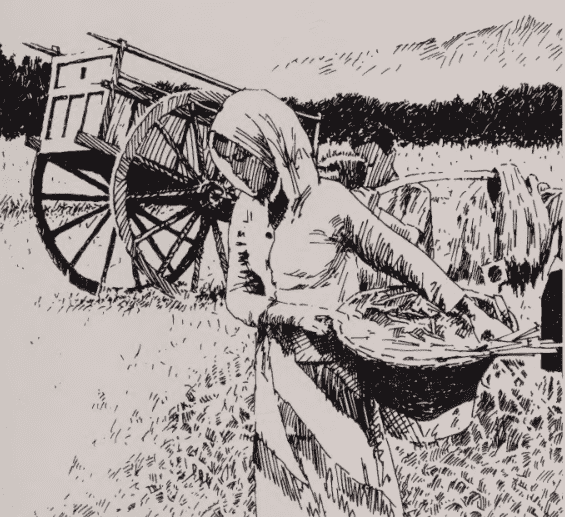
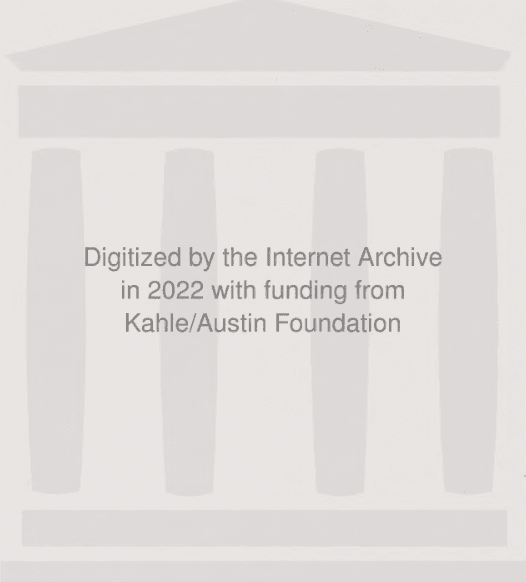
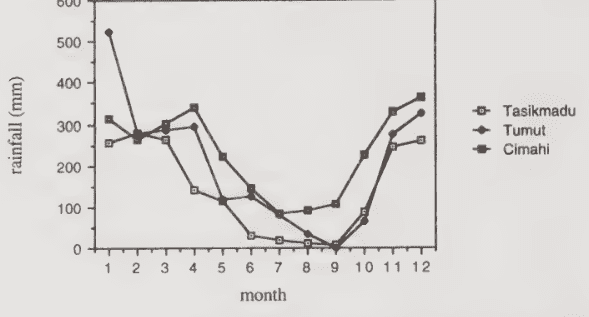
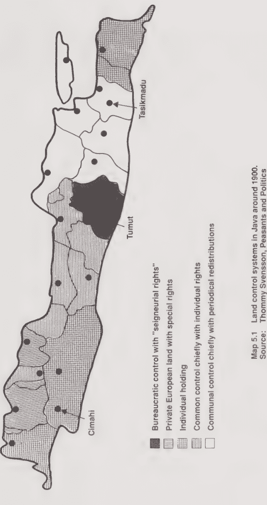
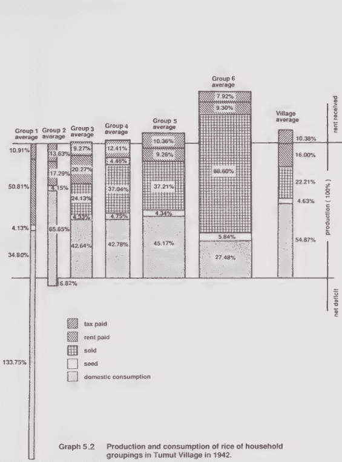
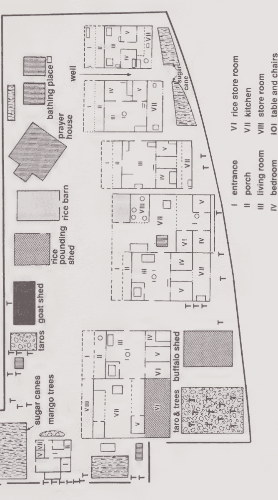
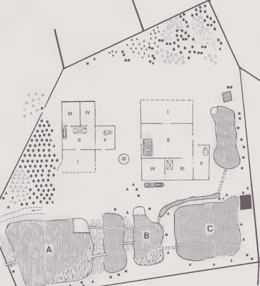
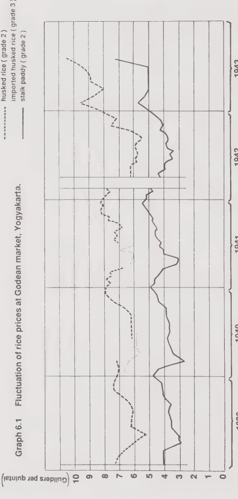
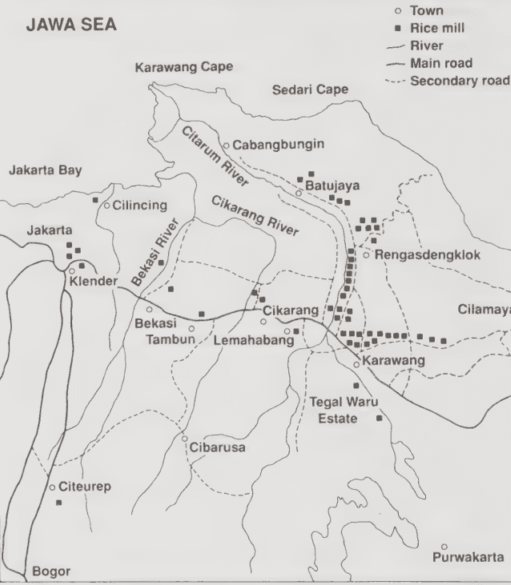

# 战争、民族主义与农民：日本占领时期的爪哇，1942-45（现代世界中的日本系列）






https://archive.org/details/warnationalismpe0000sato

## 前言

在第二次世界大战期间，日军占领了荷属东印度的大部分地区。如果历史有分水岭，这段时期无疑是印度尼西亚历史上的重大时期。历史学家指出，日本占领带来了许多重要的政治变化：它移除了荷兰殖民当局；印度尼西亚民族主义者巩固了他们的政治领导；日本承诺给予印度尼西亚独立，其准备工作在占领结束时几乎完成；本土防御部队得以建立；伊斯兰团体的整合取得了显著进展；政治化青年群体出现。这些因素对实现独立和塑造随后的政治发展做出了积极贡献。然而，占领给爪哇人民带来了极大的痛苦和苦难。军宪的残暴压迫、对劳工的强制征召以及强迫交粮，是最臭名昭著的事件之一。现有的文献将这两个方面视为独立的问题。占领给爪哇人民带来了极大的痛苦和苦难。

然而，对于萨里米尼先生（Pak Sarimin）关于为什么日本人可以如此残忍又可以如此的问题，我无法给出任何满意的回答。关于这一点，萨里米尼再次用探究的目光看着我，强调他永远无法理解日本人。

## viii 前言

起初，我希望将这两个方面更紧密地结合，以全面理解占领对人民意味着什么，以及它是如何影响村民的意识的。为此，我计划在爪哇农村地区进行访谈，调查占领如何改变了社会秩序和经济状况。

1986年6月和7月，我对爪哇进行了一次简短的初步访问，期间我有机会见到一位退休的印度尼西亚政府官员萨里米尼·雷克索达里约（Sarimin Reksodarijo）。他在中爪哇普尔沃托一个安静郊区的住所里，讲述了他的个人经历：

在20世纪30年代，他是日本商品和日本商人的粉丝。他总是去日本理发师那里剪头发。1941年，大多数日本商人回国了，士兵来了。三个半年的日本占领是一场噩梦。日本人强迫农民交大量的稻米，导致许多人饿死。日本人还强制动员了数百万人作为劳动力并将他们送到海外。许多人再也没有回来。萨里米尼不理解为什么为什么战前如此温和友好的日本人，战争期间会变得如此残忍。然而，所有和他密切交往的日本人，包括佩卡农根行政辖的军宪队长，都是和蔼友好的，并非常关注人文问题。

战后，1951年至1952年间，萨里米尼作为印度尼西亚代表前往日本谈判战争赔偿。在此期间，他遇到了他的老同事。日本人热烈地欢迎了他，但萨里米尼在谈判中发现，日本人对他们在印度尼西亚所做的事情毫无负罪感，因此没有打算修复对印度尼西亚人造成的巨大破坏。

在我从爪哇回来一段时间后，印度尼西亚当局告知我他们拒绝了我在爪哇进行访谈的申请。这一拒绝使我不得不在很大程度上修改了我的研究计划。

## 前言

对乡村政治等问题的调查已变得无法进行。因此，我研究的重点转向了日本占领对爪哇农民经济和身体福利的影响，并主要参考了印度尼西亚、日本、荷兰、澳大利亚和美国的档案、个人收藏品和图书馆。

我很快发现，现有的记载中存在许多显眼的矛盾。例如，某些作者认为，爪哇人占了爪哇生产稻米总量的 70% 或 80%。然而，显然，日本人在战争期间并没有从爪哇带走这么多大米回日本。爪哇的日本人口通常少于爪哇总人口的 0.1%，而整个东南亚和西南太平洋战场的日本人总数从未达到该地区人口的 2%。因此，问题随之产生：为什么日本人需要这么多大米？他们又用大米做了了什么？关于劳工（romusha）制度，有记载称日本人的动员规模如此巨大，以至于许多村庄几乎所有的壮年男性工人都被调走，导致大量的稻田被荒废。然而，根据其他研究，从爪哇派往海外的劳工人数最多可能只有五十万。从统计学上看，五十万人所面临的严重人道主义困境仅占爪哇总人口的1%。从这个所谓的“人口过度”的岛屿上移除这种比例的动力，不可能对农业产生如此巨大的影响。现实中发生了什么？

现有的文献对这些问题没有给出满意的回答。这似乎意味着，我们并没有真正理解太平洋战争和日本占领对爪哇人做了什么，或者更广泛地说，这些事件对于那些被日本侵入地区的人意味着什么。我的研究始于一个没有明确假设的解谜练习。随着研究的进行，我逐渐意识到有必要在更广泛的政治、社会、经济和意识形态背景下（涵盖爪哇和日本）对上述问题给出满意的回答。因此，我的练习演变为对这一历史事件更系统的探究。

本书由两部分组成。第一部分关注日本人在爪哇建立“总体战结构”，以便为其战争努力最大限度地动员人力自然资源。日本人试图利用当地精英群体，特别是官僚、民族主义者和伊斯兰领袖来实现这一目标。在这些群体中，官僚精英在军事管理中发挥了最重要且不可缺的作用，却未受到关注。因此，我专门用一章介绍了日本人如何试图利用这些行政队伍来统治被占领土。民族主义精英已由其他学者研究。这些学者通常分析了日本占领对印尼西亚民族主义运动发展的意义，并将这一时期视为“独立的序曲”或“通往自由的最后阶段”。这种方法贡献了我们对印尼西亚民族主义历史的认知，但模糊了我们对那个时代生活在那里的人来说政治意味着什么的理解。因此，我考察了民族主义者在日本军事管理中的作用，特别是他们与占领当局及民众的关系。日本人也认为伊斯兰领袖对他们的军事管理可能具有重要性，因此启动了对伊斯兰组织的重组并进行了思想灌输。与其他精英群体相比，他们在制定和执行占领政策中实际发挥的作用是特殊且边缘的。因此，本书详细讨论了官僚精英和民族主义知识分子的角色，仅在他们参与执行征米任务时对穆斯林领袖进行了简要提及。

自从访问萨里敏（Sarimin）以来，他关于为什么日本人能如此残暴和剥削的问题成了我关注关注。事实上，如果我改变研究方法，这个问题可以构成我研究的核心主题。为了履行我对萨里敏的承诺，第二部分考察了日本关于大米的政策，并调查了这些政策如何影响爪哇人民的日常生活。在这一部分，印尼西亚官僚和民族主义者的角色是在爪哇农村的具体背景下接受考察的。第二部分（特别是最后两章）是书的核心，包含了对萨里敏问题的任何回答。第一部分是第二部分的背景。由于各种限制，本书的范围不可避免地受到限制，但我希望它能以自己的方式对我们理解战争、政治与民众之间的关系做出贡献。

从许多意义上说，日本占领是印尼西亚的这段过渡时期。这为写作带来了一些技术困难。术语就是其中之一。许多在战前拥有荷兰语名称的事物被更名为日语或印尼西亚语，有些则在不同时期保留了荷兰语名称。日本人还频繁修改政府机构和办公室的名称及结构。例如，控制爪哇境内食品分配的办公室名称更改了两次。为了尽可能减少混淆，我将该办公室简称为“食品管理处”（Foodstuffs Management Office），而没有标出对应的三个日语名称。出于同样的原因，我在可能范围内避免使用非英语单词。然而，出于各种原因，我保留了少数原始单词。例如：

- `partuliere landijen`（非本土人作为私有财产拥有的巨大土地）
- `Rijst Verkoop Centrale`（1939年后由荷属东印度群政府建立的大米销售中心）
- `romusha`（被征召的工人）
- `Jawa Hokai`（爪哇公共服务协会）
- `pangreh praja`（本土官僚精英）
- `Putera`（民众力量集中）

当我在正文中第一次使用外来词时，我对其使用了斜体并附带了英语翻译。此后，我在使用它们时不再使用斜体或翻译。参考文献和末注中包含了许多外语来源。印尼西亚的专家通常读过印尼西亚语、荷兰语和其他一些欧洲语言，但不读日语。为了在不牺牲可读性的前提下减少杂乱，我仅对日语标题提供了翻译，且仅在首次引用日语来源在脚注中提供。非专业人士可以忽略外文材料的细节。

非英语单词的拼写也令人困惑。我在正文中使用了最新的拼写，并在直接引用和参考文献中保留了原始拼写。对于日本和中国姓名，我遵循了他们的方法，即姓在前，名在后。然而，对于封面上的我的名字，我反转了顺序以避免最初的混淆。对于有两个或多个名字的印尼西亚作者，我在参考文献中将姓在前，尽管最后一个并不总是姓氏。本书基于我的博士论文。我感谢格里菲特大学为我提供研究的机会和资金支持。Robert Crib、R.E. Elson 和 Colin Brown 在不同阶段指导过我。Anthony Reid、William H. Frederick、Anton Lucas、John Butcher、John Ingles 和 Keith Feather 读过论文并提出了实用的意见和修正。1991年，我是莫纳什大学人类学和社会系的研究员，该大学东南亚研究中心为我提供了座讨会的机会。在这一次，我得到了包括 Susan Blackburn、Herb Feith、Barbara Hatfield、John Legge、Ken Young 以及 Din 和 Ails Zainuddin 在内的许多印尼西亚人具有启发性的意见。在我将论文修改以出版后，Peter Hatfield 和 Takatsu Tamie 读了手稿，Diana Mainprint 对校稿进行了校对。我向他们深表感谢。

## xii

## 前言

我访问了许多国家的图书馆和档案馆。这些机构的工作人员非常合作、友好且高效，这使得我的研究期间变得非常愉快。在日本，我特别感谢以下人员：后藤健一（Goto Ken'ichi）、小谷庆次郎（Kojiya Keijiro）、萩原俊夫（Hagiwara Toshio）、佐崎田夫（Isoaki Tadao）、仓泽爱子（Kurasawa Aiko）和中村光（Nakamura Mitsuo）。在荷兰，Laslo Sliumers 一直通过信件鼓励我，Heather Sutherland 和 Peter Post 向我介绍了档案馆和图书馆。在爪哇，许多印尼人（包括前任官员）热情地欢迎了我，并讲述了他们在占领期间在印度尼西亚的经历。我想向以下个人及其家人表示特别的感谢：Cimanggis 的 Asmuji、苏宁（Suning）、雅加达（Jakarta）的 Bustami H. Itami 和 Sudomo Onodera、Semarang 的 Suprarto、Madiun 的已故的 Triminto、Surabaya 的 Akhmad Driyono 和 Sutanjo、Malang 的 Abdul Bakri、Batu 的 Ibu Arief Nakajima、Kalulang 的 Abdul Rasid Tanaka、Sumberpucin 的 Dwharjo、Cilacap 的 Yoneda Yoshida、Salatiga 的 Joel Zakarias、Purwokerto 的已故的 Sarimin Reksodiharjo、Pangandarang 的 Ibu Urip，以及 Bandung 的 Sukamoto 和 Hasan Morikage。

最重要的是，我要感谢我的朋友、评论家兼妻子 Yip Roe Jane。当她忙于自己的心脏生理学研究时，她阅读了草稿的部分，并总是耐心、专注且理解地倾听我关于农民和战争的论述。遗憾的是，我并不能像她倾听我那样，专注且理解地倾听她对研究的热情。只有在论文完成后，我才逐渐意识到这种沟通上的不平衡给她造成了巨大的压力。我诚挚地道歉。

然而，在向这些人表达了感激之情和歉意之后，我想将这部作品献给许多在日本统治下遭受痛苦并去世的印尼人。

- `ASB` Algemene Secretarie te Batavia，雅加达总秘书处，国家档案馆
- `CAD` Centraal Archieven Depot，国防部档案库
- `IC` Indisch Collectie，战争研究所（Rijksinstituut voor Oorlogsdocumentatie）
- `IMTF` International Military Tribunal for the Far East 国际军事法庭
- `KS` Kishi Koichi Shiryo，开发经济研究所岸庆一史料
- `NC` Nishijima Collection，早田大学社会科学研究所西岛藏
- `NDL` National Diet Library，东京国立国会图书馆
- `PN` Perpustakaan Nasional，雅加达国家图书馆
- `BP3` Badan Pembantu Praurit Pekerja（劳工辅助组织）
- `Gerindo` Gerakan Rakyat Indonesia（印尼人民运动）
- `M.I.A.I.` Majlis Islam A'alaa Indonesia（印尼最高伊斯兰委员会）
- `NEbudORI` Nederlands Bureau voor Dokumentatie en Repatriering van Indonesiërs（荷兰印尼人记录与遣返局）
- `NEFIS` Netherlands Forces Intelligence Service 荷兰军情报局
- `NICA` Netherlands Indies Civil Administration 荷兰东属民政府
- `OSVIA` Opleidingsscholen voor Inlandse Ambtenaren（本土官员学校）
- `P.P.P.I.` Perhimpunan Pelajar-Pelajar Indonesia（印尼学生协会）
- `P.P.R.` Panitia Pengenaran Romusha（征工委员会）
- `P.S.I.I.` Partai Sarekat Islam Indonesia（印尼伊斯兰联盟党）
- `Parindra` Partai Indonesia Raya（大印尼党）
- `Partindo` Partai Indonesia（印尼党）
- `Peta` Tentara Sukarela Pembela Tanah Air（国土自卫军）
- `Putera` Pusat Tenaga Rakyat（人民力量中心）

(C: 中, D: 荷兰, I: 印尼, J: 日语)

- `Barisan Pelopar` (I) 爪哇振兴会（Jawa Hokokai）所属的先锋队
- `Chung Hua Shang Wu Hui` (C) 华商会
- `gotong royong` (I) 在血缘、领土和社会群体间实行的无现金支付的互助劳动力安排
- `Kakyo Sokai` (J) 海外华侨总会

在欧洲人到达亚洲很久以前，日本海盗兼商人就已经活跃在韩国、中国、菲律宾以及极可能存在的印尼群岛北部的沿岸。16世纪欧洲人到达亚洲强烈影响了日本这种国际关系形式。在克里斯托弗·哥伦到达美洲半个世纪后的1540年代，葡萄牙人来到日本，并带去了枪支和基督教。其他欧洲人很快随其后，包括1600年来的荷兰人。最初，日本人被新技术、知识以及欧洲人提供的贸易和就业机会所吸引。受此刺激，许多日本人走向海外。到1620年，荷兰东印度公司拥有了约800名员工。荷兰人还雇佣了数百名日本人作为海员和士兵。1632年，在巴达维（雅加达）的8053人中108人是日本人。与此同时，军事扩张主义在日本也出现，在1592年至1598年间，日本试图征服韩国。充分利用采用的武器花费了半个世纪的时间。然而，日本统治者很快察觉到了欧洲渗透其本国的潜在危险。基督教的传播动摇了该国的宗教基础，他们认为这可能威胁到他们在长期内战后所获得的国家的政治稳定。此外，许多日本人（特别是年轻女孩）正被以非常低廉的价格卖给欧洲奴隶贸易人，这些贸易人将她们运往新大陆和其他许多地方。因此，在1635年后，德川政府采取了国家孤锁政策。然而，他们通过在长崎湾建立的人造岛屿——出西岛（Desima）与荷兰人和中国保持着极少数接触。日本统治者认为荷兰人是欧洲人中最值得信任且最不危险的。

日本的隔离政策和政治稳定持续了两个多世纪。它被美国海军的马修·佩里准将打破，他于1853年和1854年率领蒸汽驱动的黑色铁甲军舰来到日本，并要求日本与其国建立外交和商业关系。日本当局在压力下屈服，并很快完全放弃了孤锁政策。日本与荷属东属之间非政府层面的接触因此重启。扩张主义倾向也再次出现。作为1895年甲午战争的结果，日本兼并了台湾。1899年，荷属东属将日本人置于与欧洲人相同的法律地位。1902年，日本达成了英日同盟。1905年，日本击败俄罗斯，并在同年将韩国设为保护国。五年后，日本兼并了韩国。与被殖民的亚洲国家形成鲜明对比，日本因此成为殖民大国之一，拥有与欧洲国家相同的法律权利。然而，当时日本人在荷属东属的实际存在是有限的。根据1897年进行的一项调查，整个荷属东属只有125名日本居民，其中100名女性和25名男性。这些女性中大多是来自九州贫困村庄的妓女，男性则大多是妓院或赌场的经理。1909年，日本在巴达维建立了一个领事馆。该年有614名日本人，包括448名女性和166名男性。显然，妓女仍占据多数。

领事馆的建立便利了合法移民，随后的二十年见证了小商人的涌入。这些商人最初兜卖从日本进口的各种小物品，如药品、甜点、玩具、瓷器和纺织品。许多人迅速积累了资本并开设店铺，这些店被称为“日本商店”（toko Jepang）。到1929年，日本在荷属东属进口中的份额达到了10.9%，而其出口份额仅为3.3%。1930年，日本人口增加到7,195人，包括4,556名男性和2,639名女性。这占了东属“欧洲”人口的3%。

在20世纪30年代的世界大条期间，贸易格局发生了剧变。从欧洲国家和美国进入荷属东属的进口减少，而来自日本的进口有所增加。到1934年，日本占东属进口的份额达到了32.5%，其出口份额保持在4.0%。荷兰当局认为，与日本贸易关系日益增长的差异威胁了荷属东属的经济结构，因此制定了


# 防御性限制与日本南进政策

防御性限制的结果是日本销售逐渐下降。1937年中日战争的爆发也限制了日本的出口能力，日本占东属进口的份额下降到15%。东属的日本人在20世纪初有所增加，但到1938年10月已减少到6,469人，包括3,300名工人和3,169名家属。1939年9月欧洲战争爆发后，日本政府开始为征服盟国领土做准备。1942年3月1日，陆军登陆爪哇，并一直持续到1945年8月日本失败。

在日本入侵荷属东属后，荷兰作者编写的许多书籍将20世纪30年代在东属的所有活动视为为接管其做准备。将日本人、商品和资本向东属日益增加的渗透视为日本扩张的一部分是合理的，但认为日本人十年来准备到来的入侵而在荷属东属“潜伏”则是误导性的。将日本进入荷兰市场和随后的军事扩张直接联系起来的观点，导致了对占领期间印度经济问题直接由日本武力掠夺资源造成的评估。这种解释需要修正。

确实，在日本进攻之前，各种日本机构和个人在荷属东属进行了某种程度的情报活动，日本政府南下的决定背后也有经济利益。事实上，从1940年开始，日本政府就开始制定从南方地区获取资源的计划。然而，这种计划关注对日本战争努力至关重要的物品。根据1941年12月18日编制的资源获取计划，1942年从爪哇获取的资源包括锰、橡胶、甘油树皮、奎宁、工业盐、烟草、咖啡、棉和万金油（抗毒药）。日本人夺了这些物品，但此前几年出口的锰除外。由于忙于军事事务，对征服其他方面（特别是占领土地管理）的准备非常有限。正如我们看到的，缺乏足够的规划和准备为爪哇的日本军事行政带来了许多困难，并成为广泛经济混乱的主要原因。为了清楚了解影响爪哇绝大多数人的政治和经济问题，有必要检查这些资源。

## 日本当局的征服动机与准备

日本当局想要征服爪哇，以及他们为统治该地区做了哪些准备。

在日本人计划通过占领南方地区获取的自然资源中，石油是最重要的项目。由于荷兰采取了限制措施，20世纪30年代后期，日本从荷属东印度进口包括石油在内的原材料量增加，导致日本在供应上日益依赖美国。日本从荷属东印度进口的石油量从1937年的927,000吨下降到1939年的547,000吨，¹³ 而美国在日本总石油进口量中的份额从1935年的67%增加到1940年的80%。¹⁴ 与此同时，日美两国之间的政治关系迅速恶化，特别是在1937年第二次中日战争之后，导致美国于1939年7月通告废除《日美商航条约》。在该条约于1940年1月26日到期后，美国通过威胁经济制裁（包括石油出口禁运）增加了对日本的政治压力。

在这种情况下，1939年9月欧洲战争的爆发以及德国于5月和6月入侵荷兰和法国，极大刺激了日本的领土扩张。这鼓励了日本政策制定者在这些地区被德国合并或被英国、美国占领之前，将日本的政治影响力延伸到法属印度支和荷属东印度。在这种保护氛围下，第二个光内阁于1940年7月22日成立。罗斯福总统在7月决定停止向日本出口石油，但他很快撤回了这一声明。¹⁵ 7月26日至27日，日本帝国会议通过了两个项重要决议，宣布向南方推进（并可能进行武装军事行动）作为日本的国家外交政策。¹⁶

第二次中日战争后，日本政策制定者开始声称其目标是建立“东亚新秩序”。而帝国会议通过的两项决议将这一概念修改为“大东亚新秩序”。1940年8月1日，外相松冈佑介在记者发布会上使用了“大东亚共荣圈”一词。这是该概念首次被正式使用。¹⁷ 利用欧洲局势，日本于9月22日与维希政府达成协议并进入了法属印度支纳北部。四天后，日本与德国、意大利签署了三国轴心同盟，同盟承认。

在此阶段，日本的野心不仅是为了在石油停止出口的情况下确保石油供应，还将将该地区置于日本的政治霸权之下，形成自给自足的经济块。1940年10月25日，日本内阁决定了“关于荷属东印度经济发展的政策”，内容如下：

> 鉴于新世界秩序发展导致经济块出现的不可避免性，在基于三国条约的帝国在荷属东印度拥有优势的基础上，日本将努力加强与荷属东印度的经济关系，以开发其丰富资源，并使荷属东印度成为以帝国为中心的大东亚圈不可分割的一部分，以实现共存共荣的更广泛目标。为了这些目的，应根据以下几点实施政策：

- 1. 解除欧美经济块的现状，使其成为大东亚经济的一部分……
- 3. 向荷属东印度提议合作开发资源，以确保帝国从大东亚圈所需的重要资源，从而在资源上尽可能脱离美国和英国的依赖。必要时租赁或购买适当的岛屿或地区。²⁰

旷久的日荷东印关系谈判导致了1941年6月的彻底破裂，部分是因为荷属东印度拒绝承认日本在“大东亚”的霸权，部分是因为美国对荷属东印度的美国石油公司施加了压力。²¹ 1941年7月2日，日本采取了南方进政策，冒着彻底与美国和英国对立的危险。²² 7月28日至30日，日本军进入法属印度支南部。为了反对这一行动，荷属东印度立即禁止了除获得许可外的所有对日出口。²³

与此同时，华盛顿也宣布完全停止向日本出口石油。²⁴

在袭击珍珠港时，关于从这些地区获取的物品详尽清单、航运空间分配以及财务人员安排已准备就绪。²⁵ 在石油方面，日本计划逐渐增加获取量，并考虑到预期的油井和炼油厂破坏以及航运空间可用性的变化。计划在1942年从荷属东印度获取300,000千升，1943年获取2,000,000千升，1944年获取4,500,000千升。²⁶

1941年12月后的几个月内，日本征服了大部分南方地区。由今村晖指挥的军队于1942年3月1日登陆爪哇。荷兰军队在八天后没有多少抵抗就投降了。这一行动导致了出口物资过剩，因为日本既没有购买能力也没有航运空间来转移此前出口到欧洲和美国的资源。即使是石油，日本的需求也远小于荷属东印产量。在爪哇，糖、橡胶、茶和其他出口作物的生产者也遭受了市场的损失。

日本的干预还导致了纺织品、药品和机械等进口商品的短缺。荷兰曾是印度最大的纺织品供应商。但在大萧条期间，荷兰的出口能力下降，日本的出口迅速增加。德国占领荷兰导致从荷兰的出口突然停止，荷属东印度转向日本和美国进口。然而，由于日本为了加强军工进行经济调整，其产量也在下降。因此，在日本入侵之前，纺织品就已经严重短缺；入侵后进口几乎停止。²⁷

## 爪哇稻米短缺的原因

占领期间爪哇稻米短缺的原因既不是贸易格局的变化，也不是日本的剥削。日本占领对爪哇内部流通的米量并没有产生很大影响。20世纪30年代中期以前，爪哇是稻米净进口国，但在大萧条后，糖业衰落，种植面积增加，从1936年起成为稻米净出口国。1939年，爪哇的米出口超过进口159,980吨，1940年超过131,830吨，大部分运往外岛。²⁸ 战争期间日本没有从爪哇取米。农林省负责粮食规划。根据其计算，大东亚共荣圈产世界总量的68%。然而，唯一的稻米剩余地区是缅甸（2,700,000吨）、泰国（1,410,000吨）和法属印度支那（1,360,000吨）。其余地区为大米缺口地区：马来亚地区（590,000吨）、中国（520,000吨）、日本（470,000吨）、荷属东印度（260,000吨）、香港（188,000吨）、满洲（74,000吨）、菲律宾（45,000吨）以及其他地区（70,000至100,000吨）。²⁹ 出于战略考虑，日本计划尽可能从其“外领土”韩国和台湾将大量大米运回日本本土，并从法属印度支那、泰国和缅甸补充剩余的大米缺口。³⁰ 通过在附近获取大米，他们计划为至关重要的物资（特别是石油和矿产）从更南方方向的马来亚地区和荷属东印度留出运输空间。由于这些原因，东京的日本当局并未将爪哇的大米纳入其资源动员计划。

战争期间，日本为了平民和军事目的将部分大米运往外岛。然而，来自爪哇的大米数量减少了，部分原因是战争环境下海上运输困难，部分原因是该地区的日本人口与当地人口相比规模较小。战争期间，日本在海外派遣了约五万人。绝大多数前往北亚和东亚。1943年，包括大米盈余地区在内的整个南部地区的日本人口为33万，其中包括30万名军人和3万名平民。³¹ 一到1945年8月，这些数字增加了一倍多。然而，这些地区的日本人并没有向爪哇索取大量大米。预见到运输问题，大本营司令部要求野战部队现场实现粮食自给自足。³² 西南太平洋场的野战部队规模很大，并在一年内满足了这一要求。许多被征召的日本士兵是农民，且气候有利于农业。因此，他们进行耕作并生产了自己的食物。例如，在驻有约7万士兵的拉巴乌尔，每个单位都分为三组，每组花两天从事农业生产，两天进行军事演习，两天进行要塞建设，每周休息一天。通过轮换，军队清理了约5,000公顷的丛林，甚至生产了剩余的蔬菜，并与当地人交换鸡肉等其他食物。³³ 荷兰军情报局报告称：

> 从对当地菜园和种植园的掠夺性搜寻，到接近新鲜鱼类和蔬菜的自给，标志着日本占领南洋群岛的一过去。利用土地生存的机会得到了广泛的探索和开发，从而节省了宝贵的运输空间，并可能改善了饮食状况。在日军部队驻扎的地方都能发现菜园。这一点在航空照片中得到了证实，照片显示了布甘尼尔岛和新不列颠岛占领区大面积的开垦地……日本人的运输蔬菜农业“诀窍”结合宜人的热带气候，无疑为开展的项目带来了高单位面积产量……据报道，驻扎在拉巴乌的士兵在休息日经常去捕鱼，这种行为演变成了部队食堂。在韦瓦克以及可能的其他地方，一支组织的捕鱼队（`FISHINGTAI`）为岸上部队提供新鲜鱼。³⁴

盟军曾试图摧毁这些田地，但未果。爪哇的日本人人口不断波动。占领初期的几个月，人口接近80,000人，但在1942年由于许多部队被派往东线，减少到原来的一半不到；1945年随着从东线撤退的部队，人口再次增至74,000人。³⁵ 在大部分时间里，爪哇的日本总人口不到日本总人口的0.1%。因此，日本人消耗和储存的大米并不多。此外，日本出口的大米量相对较小。导致爪哇大米短缺的根本原因是由于准备不足。³⁶

## 军事行政规划的缺乏

与详细的资源获取计划相比，占领区的军事行政规划是模糊的。在进攻前正式通过的仅是一些草草的准则。对于占领地区，各种非政府机构对南部地区提出了各种想法，但这些相互矛盾的建议仍处于非正式状态。³⁷ 1941年11月20日，东京通过了“关于南部地区军事管理的原则”。³⁸ 在这份文件中，占领区的最终地位仍为“待定”。关于占领地的管理，准则仅要求占领军充分利用现有的行政结构，并对习俗进行最少干预。这种缺乏准备导致了过早的行动。

准则的弱点在征服后很快显现出来。准则的起草者石井昭后评价道：

> 利用现有行政结构是正确的。没有其他办法。但在实践中，出现了极其困难的问题。哪里有‘现有行政结构’？³⁹ 与准则相反，占领当局迅速撤除了高级官员，但东京尚未制定任何政府形式，占领军司令官必须根据裁量权制定政策。

详细规划的缺乏不仅限于政府形式问题或占领区的最终地位。东京对满足战争需求的资源获取的关注，意味着几乎完全忽视了需求之外的经济问题。1941年12月12日在部长会议上通过的《南部地区经济政策纲要》⁴⁰ 规定了日本经济政策的两个目标。短期目标当然是“满足战争所需的资源”。长期和最终目标是“建立一个自给自足的东亚共荣圈”。该纲要通过八部分详细阐述了短期目标，并附了两张表，但对第二个目标仅给出了一句解释，而实现这一目标的细节再次为“另行确定”。⁴¹ 然而，没有证据表明在纲要通过后确实确定了这些细节。东京认为，最终经济目标与占领区的最终地位一样，取决于战争形势的变化，并刻意留了长期政策的空白。

对占领地管理的准备反映在今村1942年3月17日的讲话中。早在3月9日盟军投降后，今村就出发对万隆、泗水、兰光等地进行了视察。在回到雅加达总部后，他举行了新闻发布会。回答关于爪哇军事行政的基本原则时，今村表示他无法对政府形式发表评论，因为他还没有收到东京的指示，但在他的“精神”上，军事行政必须是日本帝国的延伸。

> 正如你们所看到的，人们用衷心的钦佩和欢呼欢迎我们。军事行政的首要目标是让这些顺从的人沐在真正的皇恩之中……我们必须让他们与日本人分享快乐。将他们视为整个日本人亚洲的对象是错误的。正是荷兰人的剥削政策导致了当地居民完全的不离心……但石油是一个例外。石油对于大东亚战争战争的执行至关重要，因此我们必须努力满足[日本]国民的需求，即使这给[当地]人民的运输带来不便。除此之外，当地人民的幸福必须是我们关注的核心。⁴²

这次演说表明，当地经济的大部分（如当地农业）完全处于东京所制定的资源动员计划之外。对于爪哇而言，即使是获取石油也不太重要，除非苏门答腊和波罗尼岛是主要的石油产地，且爪哇和马达拉的产量占了荷属东印度总产量的10%以上。在今村（`Imamura`）演说时，爪哇及外岛石油生产设施遭受的损害程度尚未得到证实。因此，今村谈论的是开发爪哇石油的一种可能性，而非实际需求。

该演说还暗示，由于日本缺乏知识、经验和准备，占领政策往往是日本国内政策的复制，而非专业知识发挥重要作用。1942年3月7日，今村宣布他将承担所有属于荷兰总督的官方权力。一位几乎没有政治经验的陆军将现在必须谨慎统治被占领的土地，其下属行政人员较少，且没有明确的行政指导方针。三个半年的军事管理是一段试错的历史。这些尝试野心勃勃，而这些错误对爪哇5000万人的日常生活造成了严重后果。

3月12日，当今村正在巡视时，面向日本读者的陆军日报《军世道报》（`Sekidoho`）创刊第一期出版了。第一版发表了一篇名为《我们的使命》的文章。文章指出，尽管印度尼西亚人欢迎了日本人，但他们似乎不知道如何表达对荷兰人的敌意。文章将此归于三百年的荷兰压迫，这使得印度尼西亚人变得“无知、懒惰且毫无反应”。文章继续写：

> 首先，我们必须把印度尼西亚人从懒惰中拯救出来。我们必须教他们勤奋、努力、坚持和奉献。如果他们知道我们为建立现在的国家力量和国际地位所付出的艰辛努力，他们就不能像我们的兄弟那样随心所欲。我们不能允许他们在害怕荷兰人的同时对我们放肆。要让这些印度尼西亚人成为我们建设大东亚的合作者，需要非凡的努力。他们一直是荷兰人的懒苦力。从现在起，他们必须成为日本和亚洲的勤奋工人。我们目前之所以击败美国、英国和荷兰，是因为我们要让这些虚弱、可怜的亚洲国家意识到日本的伟大事业，并让他们成为日本领导下的忠诚合作者。⁴³

与今村的思想形成鲜明对比的是，这篇文章展示了日本思想的另一面，并认为日本的使命是让所有被征服者尽全力、尽资源支持日本的战争。这篇文章是爪哇“总动员”这一流行主题的先驱，这一主题直接导致了爪哇的大规模劳动动员。

## 政治神话与意识形态

除了“大东亚共荣圈”这一政治经济概念外，日本还有另一个政治神话概念——“八皇一宇”（`Hakko Ichiu`），它为扩张提供了合理性。这一概念源自日本的古史《日本书纪》（`Nihongi`），该书编纂于公元720年。今村的演说和上述《军世道报》中的文章都反映了这一概念。它取自天神后裔之一天照倭伊吕彦子（`Kami Yamato Iwarebiko`，后神武天皇，根据传说，他是日本第一位皇帝，公元前660年至533年在位）征服日本群岛一部分的故事。

传说中他住在九州岛东部。有一天，他决定向东远征，因为他的居住地不在世界中心，日本群岛的偏远地区没有享受到神圣统治的福分。“每个城镇一直都有自己的领主，每个村庄都有首领，他们各自划分领土并进行相互侵略和冲突。”⁴⁴ 在为期六年的远征中杀掉或征服了这些“邪恶的暴徒”后，他到达了一片被四周青山环绕的遥远之地（奈良盆地）。这无疑是世界的中心。尽管边疆土地尚未净化，邪恶的残余仍然顽固不化，但他决定在中部地区建造一个宏大宽阔的首都，作为他进一步扩张帝国光荣的基地。在视察他王国的选址时，他说：“首都应该延伸到涵盖整个地区，四方八角都应覆盖，形成一个家（八皇一宇）。这难道不好吗？”⁴⁵

天照倭伊吕彦子所谓的“八皇一宇”是指他的宫殿还是他的政治理想，在原文中有些模棱两可，留下了比喻的空间。1868年明治维新后，当日本重建了以天皇为中心的政治体系时，一些思想家、政治家和军事分子认为日本的奠基天皇的意思是：“让我们神圣的光辉无限延伸，让整个世界成为一个大家。”“八皇一宇”因此被视为“国魂”，而实现这一神圣意愿被正式宣布为皇民的使命。这种思想对日本军国分子的影响程度在《建立大东亚共荣圈基本计划草案》中得到了体现，该草案宣布：

> 大日本帝国是道德的体现，其特殊特征是传播皇道。八皇一宇……对东亚人民思想建设的终极目标，是通过传播皇道来扩大帝国的影响，并建立一种信念：唯有在这种影响下团结，才是亚洲永恒增长和发展的唯一途径。

源于帝国特定经济需求的大东亚共荣圈概念，随后得到了宗教的认可。

除了政治家和军事分子，还有大量的知识分子、记者、艺术家和极端民族主义思想家也为日本国家思想的形成做出了贡献。政府一旦提出如“建立大东亚新秩序”的新概念，记者就会推测并争论其含义，知识分子则为其提供理论支持。当日本政府对执行征服计划仍犹豫不决时，媒体已经针对西方国家发动了激烈的运动，并公开提倡对南方地区的殖民地进行军事占领。

引发日本扩张理论辩护的最有影响的知识分子是围绕京都帝国大学的学者，被称为“京都学派”（`Kyoto Gakuha`）。该小组的四位学者——小坂正昭、西谷治、高山岩夫和铃庆义，在1941年11月26日至1942年11月24日举行了一系列座谈会。这些座谈会的记录最初发表在主流杂志《中央论》上，并于1943年3月作为书籍《世界历史趋势与日本》出版。在座谈会上，这些学者强调了日本挑战由盎格逊国家主导的旧秩序的道德性，并认为西方自由主义本质上是一种错误的、欺骗性的意识形态，因为自由或对个人利益的追求与平等、友谊冲突，并导致了现状，即西方殖民主义对亚洲人的剥削。根据他们，日本在当前世界历史中的“使命”在于将西方势力驱出亚洲并。

日本领导人认为，一种由日本领导、被称为“大东亚共荣圈”的自给自足经济，实际上将解放那些被西方列强压迫并刻意置于殖民政统治下的亚洲人民。他们认为，日本亚洲政策（在英文文献中被强调为“繁荣”或“东亚圈”）并非日本帝国的无意义的扩张，其实目的是为了在日本的领导下创建一个新的世界和秩序。

1942年4月，日本人通过进攻位于印度和缅甸的盟军占领了南亚，并出人意料地受到了当地居民的欢迎，这些人当时正在反对大东亚共荣圈的“垄断”开展自己的运动。回到那些亲切赞美他们为“解放者”的人们身边，日本人很快……

他们被说是意图良好的人。然而，人们发现被日本人统治总比被日本人虐待要好：日本人证明自己是残酷的统治者。根据我们在日本的自身经历，这种紧张、忧虑的状态与日本人是互为相似的。这有助于解决日本的问题，同时也能帮助他们避免对下属产生任何耗竭或不信任。

豪斯费尔（`Karl Haushofer`，1892-1960）是一位德国地缘政治教授，他发展了“生存空间”的概念，并认为每个国家都有权获得足以其人口的领土。他为德国和日本的扩张主义提供了理论支持。豪斯费尔于1898年至1902年在日本担任军官并研究日本政治。他的研究成果包括书籍《新日本》（1905年）和《太平洋共荣》（1905年）。阿道夫·希特勒在《我的战斗》中赞扬了豪斯费尔的思想。马克斯·考曼（`Max Kaufmann`）声称，日本思想在这些德国政治圈是广为人知的，并对其在日本的形成做出了贡献。


# 井上藏与京都学派：日本扩张主义的哲学辩护

井上藏（Masaburo Inoue）是一位受过德国学派教育的日本知识分子（19世纪90年代），加入京都学派解释在不失去东方身份的情况下使国家现代化的日本思想。这些学者并不关心皇帝的神性或西方的力量；他们利用哲学概念为日本的扩张主义辩护。他们论点的目标是：日本的扩张是民族能量的体现；那就是……

低劣与优越的道德能量，以及高水平的道德能量集中在日本，是因为日本具有一种基于“家”（`ie`，家族）原则的独特社会政治结构。因此，日本的世界历史使命是引导那些落后的亚洲国家唤醒它们的道德能量，以获得成为“大东亚共荣圈”成员的品质，而这个共荣圈将基于“一家一家”的原则，即东方道德的精髓。这些由京都学派提出的思想被许多忧虑的青年（特别是大学生）接受，认为是关于战争起因唯一有说服力的理论。¹⁵⁵¹

这种通过训练使其他亚洲人变得“半日本化”的思想已经在台湾和韩国付诸实践。因此，日本人“发现”了台湾原住民，他们认为这些原住民在种族上与印度尼西亚人接近，经过训练可以变得“像日本人一样”。³⁶ 领土扩张主义和“一家一家”的概念得到了“同血缘”的支持，西谷也提到了这一点。当日本侵略中国时，口号之一是“同文同种”，这进一步得到了“亚洲统一”这种模糊情感的支持。当日本政府采取扩张作为国家方针时，这种种族统一的概念也向南方延伸。在这一南下决定之前，日本的一群人类学家支持一种理论，该理论基于日本人和马来-波利尼西亚人之间常见的某些身体和文化特征，认为日本人中数量大量的史前祖先一定是通过目前被称为“黑潮”的航线从南方迁移到日本的。军方采纳了这一理论，并在一些人类学家的合作下将其完善为官方宣传。⁵⁴ 此外，1943年1月18日，“东亚民俗研究所”（`To Minooku Kenkyushu`）在日本成立，旨在为大东亚共荣圈提供“科学”理论基础。⁵⁵ 在爪哇，一位精通比较语言学的日本记者试图建立日语与各种马来-波利尼西亚语言（特别是印度尼群岛、菲律宾和台湾的语言）之间的联系，得出结论认为日本人的祖先说的是相同的语言。⁵⁵

除了政府媒体，还有大量的非政府机构传播或或相似的思想，许多日本人加入了这些机构。⁶ 从占领期间的各种出版物以及日本参与者的回忆录中可以看出，这种日本人和印度尼西亚人种族统一的理论在很大程度上影响了日本人对爪哇的看法以及占领政策的制定与实施。⁵⁷

关于在日语教学，维吉尼亚·汤普森（Virginia Thompson）观察到：

> 但整个日本征服梦想被“皇民一体”（`Hakko Ichiu`）的原则彻底渗透，投入了几乎同等的能量将印度尼西亚人塑造为日本“神”的形象。建立的日语学校数量以及对印度尼西亚人进行的“精神”培训，远超了实用主义考量。⁵⁸

除了语言教学外，意识形态在军事管理的许多方面都起着关键作用，对爪哇社会产生了不同的影响。正如我们将看到的，劳动力动员也远超实用主义考量，并产生了许多悲剧。

今村（Imamura）认为军事管理在精神上必须是帝国的延伸，这不仅仅是辞令。日本人在许多领域引入了爪哇的管理方式，部分是因为他们“没有其他办法”⁵⁵⁹，另一方面也是因为他们的意识形态导向。战时日本的社会改革与在爪哇实施的各种占领政策之间存在明显的相似之处。在决定袭击珍珠港之前，日本日本人就已经预见到了“总体战”并为此做了准备。整个国家“总体战结构”的建立，由定义了帝国与皇民之间关系的社会哲学提供了合理性。

# 日本国内的社会动员与意识形态基础

通过各种立法，日本政府在1937年7月中日战争爆发后加速了社会改革。战争开始一个月后，第一个光线内阁发起了“国精神动员运动”。该运动反映了当时的情绪，但没有明确的条款或指南，因此由公开讲座、游行、强调友谊、回收物资、社区公共服务和其他活动组成。

于1938年2月24日通过，并在政府和军方的压力下获得一致通过表决。

国家动员政策对人民的日常生活造成了沉重负担。为了证明这些政策的合理性并说服人民合作，教育部编写了一本名为《我们的国体之根本》的小册。⁶¹ 该文献的核心论点是，所有现代西方社会思想（包括共产主义和无政府主义）归根结底都是基于个人主义的。个人主义的僵局导致了意识形态和社会的混乱与危机，这反过来导致了西方法西斯主义和纳粹主义的兴起。这意味着，只有通过对东方思想进行彻底研究，并把握日本“国体”（`kokutai`）的本质，才能纠正现状。

“国体”一词是“国”（`koku`）和“体”（`tai`）的结合。在这一概念中，国家被构想成一个类似于活有机体的法人实体，由细胞和器官组成，拥有自己的生命、意志和历史。在这样一个法人国家中，个人是属于国家的存在，从根本上与国家合为一体。因此，和谐与同化被认为是日本国体固有的属性；天皇与臣民之间的关系被声称本质上不同于任何人为的社会关系，例如领袖与追随者或统治者与被统治者之间的关系。唯一被认为类似于国体的社会制度是日本传统的大家庭。随后该文献断言：

> 我们的国家是以天皇为中心建立，他是太阳神天照大御神的后裔，以我们的祖先为基石，我们自己始终将天皇视为其生命和活动的源泉。因此，侍奉天皇并将天皇伟大的圣意视为自己的，是使我们的历史生活活在当下的理性；而这正是人民的道德所在。⁶²

日本天皇制的一个特点是其全包容的社会结构。所有政党均于1940年中期被解散，取而代之的是“大日本帝国协定会”，其目的是让所有臣民直接参与国家动员运动，并拒绝代表制政治和多数决决定的理念。⁶³ 与此同时，对全体人口的重组或建制化开始了。这基于一种政治-宗教前提：每一位臣民都是天皇的孩子，侍奉他并履行他的事业是一个人的道德义务和荣誉，即当时所表达的“臣民之道”。⁶⁴

直到1940年，政府一直认为日本农村的村落（hamlet）作为有效政府行政的单位太小了，因此将一组村落设为最低政府行政区划。然而，在国家动员运动期间，当局开始意识到基层单位可以发挥的功能。1940年9月11日，内务省发布了一项指令，正式承认村落为辅助行政单位。该指令进一步将村落细分为“邻内会”（`tonigarumi`），每个邻内会由五至二十户户家庭组成。到月底，全日本农村和城市地区已注册了120万个邻内会。

该指令要求这些细分单位每月举行一次定期会议。在东京市，城市被划分为区、街和邻内会。每月14日召开区会议，由区代表参加。每月20日左右召开街会议，由街区代表参加。每月25日左右举行街区会议，由邻内会代表参加。最后，在月底举行邻内会会议，由家庭代表参加。

内务省的指令规定了这些行政基层单位的目标：

- 1) 根据邻里团结和互助精神，组织并统一每个市、镇、村的居民，以便他们根据“全体协助皇统治”的原则履行当地社区任务；
- 2) 构成基本单位以进行道德训练并增强精神团结；
- 3) 通过将国家政策落实到人口中，促进国家政治的顺利实施；
- 4) 构成国家经济生活的基层单位，履行执行计划经济和稳定国家生活所需的功能。

邻内会是最小的、全包容的、多功能的社会组织。（注：原文在此处存在OCR识别导致的重复，在翻译/整理时已根据逻辑流进行清理）。

# 爪哇的占领与行政改革

日本政治影响的扩张经历了对占领土地人民进行全包容建制化的蜕变。在三个半半年的占领期间，爪哇连续创建了三个群众组织：AAA运动（Triple A Movement）、普特拉（Putera）和爪保保（Jawa Hokokai）。这些组织与国家精神动员运动、国家动员运动以及日本的“大日本帝国协定会”之间存在明显的平行关系。爪保保是最后一个也是最全面的组织，在印尼语中被翻译为“Himpunan Kebaktian Rakyat”（人民服务协会），它明确基于日本的“保保”概念。

这种倾向在1945年8月之前的全权主义潮流中被强调。占领当局对“爪哇报国”（Jawa Hokokai）的基础精神解释如下：

> 报国精神（Hoko spirit）意味着对崇高神圣事物的无私奉献。它是贯穿日本历史的日本精神的核心，构成了日本皇民之路的道德基础。它也被视为广义上东方道德的精髓，规范着爪哇人民的生活和语言、他们对上帝的虔诚奉献以及日常生活中的诚恳态度。爪哇人民伟大而神圣的责任只有通过唤醒这种精神并赋予其组织形式才能完成。这就是为什么报国精神被采纳为该组织的指导理想的原因。⁷⁰

“报国”的概念，即战争期间演变成的“对国家和天皇的义务性服务”，其作用是正化并强化对每一位日本臣民为战争努力投入能量的动员。在爪哇，这个概念是外来的，占领当局往往倾向于使用更熟悉的、更直截了当本土概念“kewajiban”（义务）。在日本的统治下，施加在人民身上的“义务”大幅增加。对于爪哇农民来说，最重要的两个“义务”是向外国当局交出他们的米和劳动力。

入侵的第十六军随行配备了约200名日本文职政府官员，以协助在爪哇实施军事行政.¹对于如此庞大的行政人员随随一支日本远征军是不寻常的。然而，这个数字显然太小，无法取代爪哇近1.5万名的荷兰政府官员。² 日本人预计，从荷属东印度当局完全转移权力需要三个月或更长时间，并计划根据各地的进展派遣额外的行政人员。然而，荷兰军队在日军着陆后九天内就发生了无条件投降。陆军立即解放了位于雅加达和泗水的日本领事馆的职员，他们此前一直被荷兰人扣留。这些人加入了行政人员队伍，但日本行政人员的总数仍少于300人。

由于第十六军尚未准备好在伯加廊（Pekalongan）和万尼马斯（Banyumas）东部边界运行一个统一的政府。驻扎在万隆的第十六军第二师负责爪哇的西半部分，驻扎在泗水的第四十八师负责东半部分。⁴ 陆军总部直接控制雅加达以及日惹葛（Yogyakarta）和苏卡尔塔（Surakarta）公国。行政人员被分配到这三个单位。这种分治形式一直持续到1942年8月，当时陆军建立了一个统一的政府结构。

根据官方指导方，第十六军试图最大限度地利用现有的行政机制。今村（Imamura）的第一份《通过本土官僚机构进行行政》（第23页）法令于1942年3月7日发布，宣布：“占领区各行政机构、其职能管辖范围以及占领区各种法律法规规定将继续有效……官员和人民应当信任日军，并立即恢复正常业务。”⁵ 在3月17日的新闻会上，今村对一个问题回答如下：

> 记者：有如此多的敌对国家，行政工作将变得很困难。
> 今村：这是一个认知问题：我认为我们应该将那些服从我们的人视为皇民。然而，我承认有必要对那些未能完全效忠日本的人采取严厉措施⁶

荷属东印度总督曾向荷兰文职官员告知，如果日本进攻并占领荷属东印度，他们应当与日本人合作，并为了人民的利益继续工作。⁷ 因此，当荷兰军队撤退时，他们留在了岗位上。当日军推进时，大多数荷兰官员向城市聚集，城市当局在市郊与日军会面并投降。

这种局面并未持续太久。在日军进入爪哇西半部分，最初由17人组成的行政人员在在合作运行政府方面存在困难。⁸ 大多数荷兰官员继续留职。日军当局要求荷兰官员效忠日本，但许多人拒绝了，理由是效忠日军意味着效忠天皇，而他们只效忠廉敏娜（Wilhelmina）。根据国际法，他们认为可以在日军统治下继续工作。此外，陆军行政人员中的强硬派认为应该通过扣留荷兰国民来展示其优越性⁹。在今村的第一份《通过本土官僚机构进行行政》（第24页，战争、民族主义与农民）中，行政人员在第十六军的驻地提到：

> 一旦我们进入泗水，我就每天召集几乎所有的地区（Residency）和县首脑，在对当地政治有了充分掌握后，我决定要撤除荷兰官员。一天，我召集了所有县长，并在他们面前宣布扣留荷兰官员，通过暗示他们是重建爪哇东半部分的责任来让他们宣誓效忠……但事实证明，他们只是荷兰人的傀儡，对他们所属地区的情况，如人口、工业和运输一无所知。因此，我从他们的教育开始，赋予他们收集各种统计数据的任务。6月中旬，我召开了县长会议，让他们提交关于所属地区的详细报告。随后，准备工作逐渐完成。8月，日本县长抵达，目前的行政结构形成.¹⁴

显然，在非常的阶段，爪哇东半部分的日本行政人员就达成了尽快撤除荷兰官员的共识。3月16日和18日在泗水，印尼政党大印尼（Parindra）的代表会见了负责第四十八师内部事务的守屋秀次（Moriya Shuchiro）。在第二次会议上，守屋要求印尼准备一份能够迅速接替目前由荷兰人担任职位的印尼知识分子名单，根据守屋的话，荷兰人必须被“排除”（`disapoe`）。¹⁵

这种最大限度利用现有行政人员的原则是基于日本人员供应不足等实际考量，而非任何坚固的法律和哲学基础。因此，这一原则与日本意识形态的目标相冲突，即建立一个由日本种族及其价值观主导的大东亚。尽管如此，日本形态上倾向于从行政职位上撤除荷兰官员，由日本人和印尼人取代。4月，陆军扣留了1.5万名荷兰官员中的约2000名¹⁶1942年5月，总务课长中山（Nakayama）飞往东京，请求大幅增加爪哇的日本行政人员。东京接受了这一请求，并承诺派遣1000人.¹⁷ 随后在6月24日，东京宣布政府将进行大规模的人员缩减。

日本国家和地方公共服务机构的一部分，并将因此释放的大部分人员派往南部地区。18 与此同时，新加坡、西贡和东京的高层对第二十军施压，要求其对荷兰人采取更强硬的态度。19 因此，在7月初，爪哇的日本当局宣布，年龄在十七至六十岁之间的“失业”荷兰人应被送到万尼望岸（Banyuwangi）南部的“殖民地”，并于7月10日开始大规模拦截荷兰人。20 8月，约有1500名日本公职员抵达爪哇。21

爪哇的日本占领当局试图修改爪哇荷兰属东印度行政结构。改革背后的思想是用减少的人员来管理被占领土，并最终建立一个高效的全员动员结构。最重要的改革是从双制结构变为单一制结构。在战前的荷兰属东印度，内政部由两个独立的层级组成，由荷兰人行政团体和被称为 `pangreh praja` 的土住民行政官团组成。荷兰官员领导中央、省和驻地区政府，而在县及以下地区，荷兰人保留了土住民统治阶级，他们至少在名义上领导着县、区、乡（`kabupaten, keweda, kecamatan`）。与这一土住民统治阶级并列的是隶属于驻地区长的荷兰官员，他们被称为助理驻地区长、监察员和候任监察员，他们行使对 `pangreh praja` 的监督职能。这种双重层级是使殖民地实行某种“间接统治”的手段。事实上，荷兰官员（特别是在1830年强制种植制度开始后）越来越多地采取干预态度，并将地方政府的实际控制权掌握在自己手中，往往绕过 `pangreh praja`。22 在20世纪，荷兰属东印度当局试图对所谓的 `pangreh praja` 进行“去工具化”（`ontvoging`）。1918年后，他们还建立了中央和地方议会作为半民主手段以实现权力下放。然而，这些措施并没有产生许多显著结果，在荷兰时代的最后几天，情况在很大程度上仍然是土著县名义上留任，而荷兰官员实际上进行统治。23 结果，`pangreh praja` 在政府事务方面的经验和知识通常仍然受到限制。当第二十军接管荷兰属东印度政府时，根据军事长山本茂一郎（Yamamoto Moichiro）的话，“土著官员的能力”远低于预期，且无法执行紧迫的“军事行政”政策。24 山本茂一郎认为，正是由于 `pangreh praja` 的无能，导致了在占领最初几个月内必须由部队进行管理。

图 2.1. 爪哇占领前及占领期间的行政层级（包括公国，不包括市）

山本茂一郎坚持认为是 `pangreh praja` 的无能导致了在占领最初几个月必须由战斗部队进行管理。

1942年8月1日，井仓宣布了正式行政改革。25 改革最重要的方面之一是废除省份支持日本人认为省份对于管理荷兰属东印度的整个领土是有用的，但由于第十七军的管辖范围限于爪哇和马达拉岛，省政府已变得有些多余；简化行政结构并将权力更多集中在中央政府是理想的，因为军事行政将由不熟悉该领土的日本人执行。26 因此，在新的层级中，军事行政官直接监督印尼驻地区长，而驻地区长又直接监督印尼县长和市长。

由于日本人人数短缺，他们不得不比荷兰人更依赖 `pangreh praja`。因此，从结构上说，“去工具化”变成了绝对的必要。为了简化指挥链，日本人还废除了中央和地方议会，并将这些机构的权力集中在县长手中。城市从驻地区独立出来，同时也脱离了行政的层级。因此，建立了一个由缺乏经验或专业的行政人员组成的单一金字塔型结构。在新系统中，`pangreh praja` 必须在日本人严厉但非严密的监督下承担所有功能和责任。一位印尼观察者将这种系统描述为“独裁者的层级制度”。29

来源：`Kan Nomor Istewa`，第32–33页。

与1940年一样，荷兰属东印度地方管理的最低单位是附属制的。日本人向下延伸了这种金字塔结构。在1942年8月的法令中，日本人正式将村庄变为行政单位，村长变为这些单位的行政负责人。1944年，在建立报国会（Jawa Hokokai）的同时，占领当局建立了全国性的邻里协会（`tonigumi`）网络，并要求所有家庭长参加协会定期会议，协会长参加村落会议，村落长参加乡村会议。因此，每个家庭、邻里协会、村落和乡村（这些此前都处于正式行政结构之外）都被纳入了由日本军主导的全方位单一行政金字塔之中。30

日本人试图通过思想教育、快速晋升、降职或解雇以及薪资制度的操纵来控制行政机器。31 从1942年4月1日起，日本人削减了每月超过100荷兰盾的高薪公职人员的薪资（表2.1），同时逐渐增加了低收入者的薪资，扩大了官僚机构下层的就业规模，并为村官提供了补贴。

一位过去每月领取1150荷兰盾的县长现在只拿500盾。32 削减薪资的原因部分是财务方面的，部分是意识形态方面的。因为日本人 `pangreh praja` 似乎太疏远群众，享受着过分且奢侈的特权而没有为公众提供了大量服务。34 日本人经常强调，行政阶层与人民之间的障碍必须被消除，35 并在战争期间强调节俭、坚毅和“报效国家”，经常表达公职人员应为事业服务而不考虑个人利益的观点。在1943年3月于雅加达举行的所有摄政（Regents）和市长会议上，其写下的口号是“Kewadian Tak Mengenal Kepentingan Sendiri”（职责不顾私利），³6 这是对日本老格训口号 `messiboko`（由 `messhi` 即无私和 `hoko` 即为服务上级权威结合而成的词）的翻译。

日本人试图通过举办有关战争原因和印度尼西亚人职责的教化课程，将这些思想灌输给全体民众（`pangh praja`）。³7 1943年年中以后，当日本当局决定在“建设新爪哇”的口号下在爪哇岛开展大规模防御建设时，事实证明，对于对日忠诚且高效的合作者来说，仅仅依靠教化是不够的。需要一些积极的激励措施。1943年7月，军方对薪资制度进行了修订。在新制度中，所有公职人员根据职级和等级而非实际职位进行分级，薪资标准根据这些等级和经验设定（表2.2）。


原则上，新的任命和晋升将通过笔试而非社会背景、之前的职位或正式教育等其他考虑因素来进行。每年两次（3月和9月），公职人员在职级内获得定期加薪。除了基本工资外，还发放了各种津贴，其中包括资龄补贴（每月最高50盾）、通货膨胀补贴（最高35盾）、危险工作补贴（医生最高30盾，其他人员最高20盾）、日语能力补贴（最高15盾）、会计等特种技能津贴、加班费和差旅费（每天最高12盾）。还制定了关于病假和伤残保险的规定。³⁸ 在经过所有这些修订后，高级官员的收入仍远低于战前水平。

| 第4级 | 250–550 | | |

来源：《华报》（`Kan Po`），第22期，第11–12页。

相反，底层，占领政府创造了更多的就业机会并提高了薪水。日本人对官僚机构中底层的重视显然超过了荷兰人。为此，军事行政长指示驻扎厅（`Residency`）和县（`Regency`）办公室的职职人员作为区长和县长前往“前线”，并从青年团（`Seinendan`）、守卫队（`Keibodan`）等新组织的优秀领导或伊斯兰教领袖中选拔这些岗位的人员。³⁹

在战前的官僚等级中，县（`Regencies`）是土著部门的最高机构，人员相对充足，约有四十名员工。相比之下，区办公室的人员极度匮乏，通常由一名负责人、一两名书记员或几名警员组成。区长通常兼任该区所在地所在乡区长。他没有可靠的助手，如果他发生意外或缺席，办公室的运作就会完全停止。在占领期间，特别是1944年底以后，土著官僚机构的工作量迅速增加，显然官僚们已无法高效应对。为了解决这个问题，军事行政长于1944年7月20日发布了《关于加强县级以下行政结构的指导方》。⁴⁰

日本政府与荷兰政府之间的差异在各自的村庄管理制度中更为明显。在荷兰统治下，村庄执行官不属于官方编制，因此不从政府领取薪水。相反，他们拥有由灌溉稻田组成的公田，以及征收税款的比例分成。公田的大小取决于村庄和职位，通常村长有几公顷，书记有几公顷，其他执行官每人约一公顷。日本人不干涉爪哇的土地持有，非土著人持有的土地（`particulere landijen`）除外。因此在日本统治下，村民继续拥有土地而非薪水。然而，对于占领政府而言，村长太重要了，不能让他们静静留在基于土地的村庄经济中。1944年2月，雅加达发布了《关于提高村长素质的指导方》，⁴¹ 涉及村长的“素质”：在驻扎厅所在地进行培训、每位村长每年30盾政府补贴、对优秀的村长进行官方表彰并晋升为传统的官方职务（如乡长），以及更改关于村长选举和罢免的规则。

这四项措施中的最后一项涉及三个主要变化。其一是，希望参加竞选的人必须向相关的区长报告，只有被区长认为合适的人才能参加选举。区长筛选的标准是：除了现有法规规定的外，候选人必须具备执行军事行政的身体条件，精通马来语或当地语言，且通常年龄在五十岁以下。另一个变化是引入了固定任期。此前没有固定任期。一旦当选，村长往往终身享有其特权。在新制度中，任期为四年，但允许重新选举。第三个变化是授予了驻扎厅在与相关摄政协商后罢免不合适村长的权力。⁴²

在日本统治下，村长获得了一些资金、晋升机会和更大的行政权力，但同时，任期固定了，被罢免的危险也增加了。日本人将激励和惩罚措施相结合，使得能够获得优厚收入的官员，要么对占领政府表现出忠诚，要么滥用权力利用机会从中获取个人利润。正如在压迫当局下常见的情况，某些地方权势人物表现得“比日本人亲日”。¹³ 四年任期的引入也促使村长在任期内利用各种腐败手段尽可能获取利润。⁴⁴

碎片化和地区主义立即显现，特别是在经济领域。一旦日本驻扎人员（`Japanese Residents`）任命，其中一些人就开始控制驻辖区内的商品流动，逐渐在驻辖层面形成经济集团。在约格加达公国（`Yogyakarta`），这种趋势在日本总事务秘书长正式任命之前就已经显现。在农村，由于分配和加工机械受损，导致剩余物资无法售出，农民们正遭受着价格下跌的痛苦。1942年7月2日，约格加达的日本当局规定了从农民处出口的最低收购价，并出于相同原因禁止从该公国境外进口大米。

地区主义倾向在地方精英（`pangre praja`）中也变得显而易见。1942年9月，万尼乌汪（`Banyuwangi`）县令禁止该县出口纺织品、椰子和干椰肉等对人民日常生活至关重要的商品。万尼乌汪是一个港口城市，有大量货物和人员经过该县。因此，万尼乌汪的县令还发布了一项规定，任何通过该县运输干椰肉的人必须将其中的百分之五十给县内的椰油厂。这种形成经济集团的倾向阻碍了商品的顺畅流动，并逐渐扼杀了当地经济。

1942年12月20日，雅加达当局召开了日本驻扎人员的第一次会议。军事长冈崎泽三（`Okazaki Seizaburo`）评论道：

> 有效政策的基本在于集权控制与其地方灵活应用之间的适当调整。显然，管理者之间存在这样一种倾向：要么专注于集权控制而忽视当地现实，要么关注地方利益和经济集团。这种倾向必须被避免。为了建设“新爪哇”的共同目标，我们必须通过中央与地方之间的密切沟通，建立顺畅且有效的行政体系。

尽管有此承认，但在驻辖区和县一级形成经济集团的趋势变得越来越明显，特别是在雅加达于1943年4月启动大米征收系统之后。在该系统中，军方计划控制爪哇部分大米（约占总产量的20%）的分配，旨在确保日本员工、印尼员工以及印尼城市人口获得这种主食的稳定供应。雅加达的粮食管理处向驻辖区分配配额。在驻辖区内部，配额被多次划分，并通过官僚层级一直传递到村庄。在体系的各个层级，完成配额是一个竞争源，往往以牺牲当地居民利益为代价。雅加达当局也为这种竞争火上加油。从1943年底开始，军事当局加强了针对其“新爪哇建设”项目的劳动力动员，确保有足够的大米供应工人变得至关重要。在1943年11月4日的驻辖经济部门会议上，事务事务长山本茂一郎（`Yamamoto Moichiro`）要求驻辖区代表实现农业生产目标，并“以驻辖区的荣誉”完成大米配额。

对于地方精英来说，完成交付配额是避免解雇、获得认可和晋升的重要手段。为了确保交付足够的米粮，许多各级地方当局试图对大米分配实行垄断控制，并禁止从其管辖区出口大米。在某些地区，形成经济集团的趋势延伸到了村庄一级，并涉及大米以外的其他商品。1944年底，荷兰情报部门报告如下：

> 为了从人民身上榨取最大的贡献，将国家拆分为一个个小型水密的经济单位以利用所有当地产品的做法已进一步扩大。在许多地方，食品、衣服、甚至食盐和木材等商品的贸易已被完全禁止。烟草只能作为政府包装的产品进行交易。宪兵团（`Keibodan`）仍被用于探测违规行为……从多方报告称……在宪兵团内部也存在对日本人的反感情绪，走私尽管危险，但正在大幅增加。

对经济活动的限制导致非法交易和腐败的泛生。走私的动力非常强烈。例如，椰油在塔西卡拉雅（`Tasikalaya`）等生产中心以每罐18升3.00荷兰盾的官方价格出售，而在万隆的价格则高达12.50荷兰盾。在这种情况下，人们赚取了巨额利润，而许多人的日常生活却受到了威胁。1944年，印德拉马尤县（`Indramayu`）爆发了一系列反对强制征集大米的叛乱。军队在8月毫不费力地平息了叛乱，但这些事件迫使日本当局重新审查交付系统，最终审查了行政结构本身。很明显，地区主义倾向、部门内部竞争以及导致的地方行政碎片化已成为当地经济的严重阻碍，导致农村商品严重分配不均。1944年，爪哇许多地区遭遇严重干旱。对商品流动的限制加剧了干旱的影响，导致许多人饿死。

由占领当局于1943年建立的准议会（`Chuo Sangiin`）在1945年2月举行的第七次会议上指出了这一点，并提出了包含两点的建议：放宽对无军事用途商品的运输限制；在政府监督下，开展从富余地区向短缺地区的日常用品运输。

显然，雅加达的行政当局认真对待了这项建议，并研究了改善驻辖区间协调的各种方法。其解决方案是引入类似于旧省份的制度。1945年3月25日，中央当局宣布，从1945年4月1日起，将在万隆、三泗和泗水设立三个军事分处。这些分处的管辖范围与战前爪哇的三个省份完全对应。

军事当局解释说，在他们宣布近期给予印尼独立后，他们调查了了荷属群岛的政府结构，并决定利用其优点。根据这一解释，分处最重要的任务是开展生活必需品的跨驻辖区交换。这种交换所需的驻辖区间协调通过这些分处的驻辖区协调会议来安排。在分处建立之前，驻辖区之间偶尔也会举行会议，但通过改革，会议变得正式化，在会议上做出的决定具有了法律效力。

1945年4月9日和25日，雅加达当局召开了驻辖区官员会议，在会上要求后者审查其规定是否对监管驻辖区内部的经济确实必要，并取消不必要的规定。

事实上，这些措施并没有实质性促进商品流动。大米分配状况进一步恶化，许多人陷入挨饿，而走私、黑市和囤积却通过日本官员进行。在这一关键时刻，许多包括日本官员和印尼政治顾问在内的人士认为应该加强政府控制以纠正局面。

在4月雅加达举行会议后，一些驻留地发布了新的大商品出口禁令，包括大米和纺织品。⁵⁵ 尽管尝试过改革，但源于“独裁者阶级”的、碎片化且缺乏协调的行政管理一直持续到日本投降。

在干预官僚机构的同时，日本人发起了三次总员动员运动，始于1942年3月，并每隔一年持续一次：三“A”运动（`Pergerakan Tiga A`）、`Putera`（`Pusat Tenaga Rakyat`，即人民力量中心）和爪哇广报会（`Jawa Hokokai`）。前两项运动至少在表面上是由印尼民族主义者领导的，而最后一次则由日本直接领导。印尼民族主义和日本扩张主义的驱动力本质上不同，但两者都反对西方帝国主义，因此可以找到合作的共同基础。日本人认为他们可以利用印尼民族主义者的反殖民主义来开展群众动员运动，但这两个体的最终目标是不同的，且运动的组织证明并不适合日本社会。这些因素导致了前两项运动的迅速灭亡。

大多数印尼民族主义历史学家认为前两项运动本质上是不同的：三“A”运动是一场毫无意义的日本宣传活动，而`Putera`是一个由著名的印尼民族主义者（特别是苏加尔诺和哈塔）领导的重要组织。这些历史学家认为，`Putera`允许印尼高层民族主义者能够直接接触群众。这需要重新审视。历史学家很少认真关注三“A”运动的重要性¹，主要是因为其领导者在印尼独立后担任了显赫的职位。如果我们从军事管理的角度来看，并考虑到它对爪哇广大的影响，那么这两项运动在以下意义上是相似的：它们都是日本统治者与印尼民族主义者本质上不同愿望的汇合。

他们都希望巩固其背后的人力量。然而，主要由于两个群体的观点不同，日本人从未完全信任过这些民族主义者，并剥夺了他们的行政权。因为民族主义者对农村地区的影响微乎其微。这些运动加剧了日本社会内部存在的阶级和民族冲突，并阻碍了军事管理的顺利实施。

日本人很快意识到其尝试的失败，在运动开始几个几个月后就决定解散这两项运动。1943年中期，日本人决定将民族主义者用于其他机构，即担任政府顾问，并创建了顾问机构——中央咨事会和`Sanyo Kaigi`（政府顾问委员会）。从那时起，他们效仿`Putera`的模式单独进行宣传，并开始准备一个新的群众组织——日本本土广报会（`Japan Hokukai`）。本章将讨论前两项运动的失败。

三“A”运动始于1942年3月，那是第六陆军登陆爪哇岛的月份。官方领袖是`Raden Samsudin`，他是1940年后人民议会（`Volksraad`）的成员，代表印尼民族主义党（`Parindra`），并是`Parindra`属机关刊物《`Berita Oemoem`》的董事。² `Parindra`是荷属印度尼群岛政党中最大的一个，旨在通过与荷兰当局合作来实现其目标。除了`Samsudin`之外，许多其他`Parindra`成员加入了三“A”运动并承担了大部分行政职务。³ `Parindra`成员在这场运动中占据主导地位有许多原因。20世纪30年代后期，`Parindra`成员对荷兰当局感到幻灭，开始接受日本关于“亚洲解放属于亚洲人”的宣传。他们希望通过与日本人的合作来促进自己的民族主义目标。一些`Parindra`成员与日本人以及日本国内的人建立了紧密联系，并等待日本军事力量的抵达。⁴

在太平洋战争爆发前，大多数日本人已从荷属印度尼群岛遣返，但显然`Parindra`与日本人之间的联系并未切断。在开往爪哇的入侵舰队中，有一些`Parindra`成员及其日本盟友。³⁵ 1942年3月1日早晨，根据一名荷兰政府官员的说法，九位有影响力的印尼人与`Parindra`有联系，他们在万丹（`Banten`）登陆点等待入侵军，其中三人引导军队前往布亨廷（`Buitenzorg`），那里发生了第六陆军与荷属印度尼群岛之间的冲突。在在日本入侵期间，`Putera`的高层身处爪哇。次日，五位`Parindra`代表向爪哇的日本指挥官写了一封信，宣布：“`Parindra`同意日本建立亚洲新秩序，特别是为了印尼国家和土地的进步，且`Parindra`准备竭诚协助日本实现上述目标。”

签署信件的五位`Parindra`高层试图亲自将信件交给指挥官，但对方当时不在。3月9日，一位日本军官渡边某会见了`Parindra`的秘书`Ruslan Wongsukumo`，要求他让`Parindra`的媒体发表公告。`Ruslan`接受了这一请求，并开始在爪哇的总部为军队工作。3月16日和18日，在爪哇，`Parindra`的高层有机会会见了负责第四十八师团范围内内部事务的宫寿一郎（`Moriya Shuichiro`）。在第一次会议上，他们提交了信件，并口头表达了希望与印尼人民合作以巩固印尼人民，并对地方政府和公共安全等各种问题表示了关注。作为回应，`Parindra`代表要求通过协调农民合作社（`rukan tani`）、村庄粮食粮仓（`lumbung`）和银行来协助村庄管理。

雅加达的情况是，印尼民族主义者相信日本关于印尼“解放”的宣传。在荷兰投降之前，印尼政治领袖就已经准备建立印尼政府。为了这一目的，他们组织了由八个政治和宗教代表参加的会议。3月9日，荷兰投降当日，这八个小组准备了一份部长候选名单，每个拟议的十四个部委员会各一名部长和两个助理。3月11日，日本当局与雅加达的一群印尼领袖举行了正式会议，似乎在准备一份可以取代荷兰官员的印尼民族主义者和知识分子名单。印尼人推断军队实际上要求他们组成内阁。次日，《`Berita Oemoem`》主编`Winarno`建议`Parindra`成员`Sukarjo Wiroyopranarto`为内政部长。同一天，《爪哇时报》（`Tjahaja Timoer`）报道，位于雅加达的民族主义政治家`Abikusno`、`Ratulangi`和`Surakhman`被任命为日本军的顾问。

《民众报》（`Oemoem`）反对印尼党（`Parindra`）被边缘化。3月14日，日本军宣传团团长田中庆次（`Machida Keiji`）在《民众报》（`Berita Oemoem`）上宣布，有关顾问人名的传言并非属。与此同时，他敦促印尼民族领袖停止政治内斗，团结起来共同实现“新印尼”的顺利形成。¹¹² 3月20日，今村禁止了所有政治活动。¹¹³

在这一动荡时期，萨姆苏丁（`Samsudin`）与宣传团宣传课负责人清水寿（`Shimizu Hitoshi`）取得联系并发起了“三运动”。哈里·J·本达（`Harry J. Benda`）声称，三运动显然是日本人在侵略印尼之前“预先制造”的。¹¹⁴ 利用“亚洲亚洲”口号对抗盟国的“胜利之V（`Victory`）运动”的想法，显然是宣传团在前往爪哇的途中构思的。¹¹⁵ 根据清水的说法，日本军宣传团并没有在`AAA`旗号下建立群众组织的计划。相反，是萨姆苏丁主动接触宣传团，提议协助开展“繁荣亚洲”（`Asia Makmur`）运动，也是萨姆苏丁发明了这三句口号。¹¹⁶ 萨姆苏丁反复强调，三运动并非由日本人创造，而是印尼人民为印尼发起的运动。¹¹⁷ 事实上，该运动的成员排除了日本人，尽管清水寿的领导（或共同领导）地位几乎从未掩饰，且该运动得到了宣传团的部分资助。

一个类似于三字口号“日本国旗是亚洲的光”的口号，于3月18日出现在日本报《晨光》（`Sekidho`）上¹¹⁸，位于日本国旗的小图下方。次日的同一份墙报以同样的方式刊了另一个口号：“日本国旗是亚洲的领”。根据清水的说法，三运动于3月20日在位于甘比尔巴特（`Gambir Barat`）的总部启动。然而，并没有公开的启动仪式，口号也尚未准备就。一周后，即3月27日，一组口号首次出现在《晨光》报的墙报上：

- `Ajia no Botai Nippon`（亚洲之母，日本）
- `Ajia no Komyo Nippon`（亚洲之黎明，日本）
- `Ajia no Shido [sic] Nippon`（亚洲之领，日本）

在此阶段，表达与后来的标准化版本有所不同。

因此，该运动的起源是模糊的。根据萨姆苏丁的说法，运动始于“3月底和4月初之间，由一些日本人和印尼人领导”。¹¹⁹ 雅加达的一位印尼官员观察到，“在人们意识到它是如何建立的之前，一个名为三A（`AAA`）的机构已经在人民议会（`Volksraad`）前成员萨姆苏丁先生的领导下建立了。他获得这一显赫职位的尚未知。”²⁰ 再次借用萨姆苏丁的话，运动“从战争的硝烟中浮现”²¹，没有明确的目标，并很快涉及了爪哇社会中的各种异质元素。

一些中国人是对该运动反应最迅速的群体之一。4月1日的《晨光》墙报报道，巴达维的华商总会（`Hua Shang Wu Hui`）于3月30日召开紧急会议，30位核心成员出席，并决定支持已经存在一段时间的“三运动”，主要通过张贴海报和发放传单来实现。根据报道，华商总会决定自愿且积极地开展`AAA`运动，将日本视为他们的“母、光和领”，并从拆除盟国张贴的反日海报开始，随后在墙壁和店面上涂上“三A”口号和标志。

在华商总会做出决定后一个月内，巴达维雅市到处都是各种设计和颜色的符号。在万隆隆，华人公会在运动中非常活跃。4月29日日本天皇生日日前，万隆隆组织了一场购物周，所有商店（无论华人还是非华人）都参加了一场带有三字标志的橱窗展示竞赛。²² 并非所有的这些标志和海报都在歌颂日本为亚洲的母、光和领。例如，大型鞋类公司`Bata`在4月29日的广告如下：

```
Tambahilah keagoungan itoe dengan memakaiakai sepatoe（穿上鞋子，增添这份伟大）
Sebab: sepatoe BATA dibikin di Indonesia oleh poeta-poetra Asia（因为：BATA鞋是由亚洲诗人在印尼制造的）
Alankah manisnja dipandang mata（看去是多么甜蜜）
Anak Asia bersepatoe Bata（穿着Bata鞋的亚洲孩子）
Akan menedoeja Asia Raya（将使亚洲繁荣。）²³
```

5月8日，萨姆苏丁在广播演讲中带着些困惑地说道：

> 亲爱的听众们！


# 三A运动与华人商人的支持

不要误会！三运动管理委员会及其领导人并不希望你们在房子门口挂上`AAA`标志，或在商店门口贴带有该符号的标语，除非你们怀着高尚的心灵，意识到你们正在支持光荣的理想。如今，你们在雅加达的每个角落、城市、各种颜色和设计的巷弄、小子里，甚至在商店货架展示的商品中都能看到`AAA`。然而，如果你不深入思考“三运动的真正基础是什么？”，那么对于挂它们的人来说，这些符号毫无意义。²⁴

除了张贴海报，华人商人还为运动提供了资金。例如，在天皇生日当天公布的七渠道捐款中，`808`法盾中有`500`法盾来自雅加达的华人电影院²⁵。运动总部最重要的收入来源是印尼日报《亚洲之光》（`Asia Raya`）的广告收入，该报于`4月29日`出版，最初由日本军宣传团争取到了印尼党机关《民众报》（`Berita Oemoeda`）编辑人员的合作²⁶。绝大多数广告商是华人商人。

华人决定支持该运动背后有着复杂的背景。当荷兰军队撤退时，许多警察部队也从城市逃离；在缺乏内部安全部队的情况下，抢劫开始了，华人商店成为主要目标。²⁷ 当今村发起反击盟国的行动时，华人接触他寻求对抢劫者的保护。今村回答说，日本人在战斗期间无法顾搜寻被盗物品，但一旦胜利，他将发布法令保护民众财产²⁸。盟国投降后，日本人采取了恢复秩序的措施。宪兵（`Kenpeitei`）被动员镇压了抢劫者。结果，占领初期的混乱很快消失，对宪兵的恐惧深深植入了印尼人的心中。²⁹ 对华人来说，日本人的保护至关重要。

日本人将爪哇华人视为政治和经济上都是重要的族群，对他们给予了特别关注。`1937`年中战使得许多海外华人产生了反日情绪。因此，有理由将海外华人视为潜在敌人。然而，日本人意识到华人在经济领域的作用³⁰。荷兰投降后不久，军队召集了巴达维雅的华人，山义义（`Nakayama Yoshito`）发表了告诫：

> 遗憾的是，日本已经作战多年。然而，我们并不是针对华人，而是针对代表中国的政府。从新中国在重庆重庆石的领导下复兴这一点可以看出。（掌声）
>
> 令人遗憾的是，爪哇华人有强烈的亲重庆倾向。然而，这是荷兰政府时期的一种现象。我们无意追溯过去。亚洲正在发生决定性的变化。现在是爪哇一百万华人决定他们是想为亚洲人建设亚洲，还是宁愿生活在盎格逊人的压迫下。如果你们选择前者并与日军合作，我们愿意保证你们的生活。
>
> 然而，如果你们采取假罪（这是华人的常态），我们将毫不犹豫地摧毁你们。你们必须记住，爪哇是一个小岛。重要的不是表面的服从或辞藻，而是通过积极行动表现出诚意和合作³¹

在印尼抢劫者和日军之间，巴达维雅和万隆的华人商人迅速决定建立三运动，以避免迫害并获得保护。在华商总会决定加入运动后，许多其他人也效仿。在其他族裔中，巴达维雅的阿拉伯和印度协会建立了三运动委员会并参加了`4月29日`的庆祝³²。显然，华人的积极参与以及程度较小的阿拉伯和印度社区正刺激着雅加达的族群竞争。`5月7日`，四十位运动尼尼领军人物开了会议，主席伊约斯·维拉特马（`Iyos Wiratma`）敦促在雅加达成立一个印尼委员会，因为其他族裔已经建立了委员会并一直在开展各种活动，而印尼人之前还没有。萨姆苏丁表示（作为前人民议会成员，他如何获得这一显赫职位的尚不清楚）。萨姆苏丁回答说，这些不同的机构应被视为同一运动的组成部分，该运动旨在全亚洲人的团结和对亚洲的协作防御³³。

该运动的标准口号是：“日本，亚洲之光”、“日本，亚洲保护者”、“日本，亚洲领袖”。根据萨苏丁（`Samsudin`）的说法，日本在两个意义上都是“亚洲之光”。首先，`1905`年日本在俄战争中的胜利大开了长期处于黑暗中的其他亚洲人民的眼界，他们曾认为有色人种受西方人统治是理所当然的；`1908`年日本“自治会”（`Budi Utomo`）的成立构成了这一东方大觉醒的一部分。其次，`1941年12月8日`，日本再次向亚洲国家投射了强烈的“光芒”。这一次，日本不再是亚洲唯一的火炬；所有被日本解放的国家都开始闪耀，增添了光明的亮度；亚洲的觉醒使每个国家对自己的力量产生了坚定的信念。因此，第一条口号“日本，亚洲之光”不仅仅是一个口号，它是一个经历史证明的形象。³⁴

日本将成为“亚洲的保护者”。在亚洲所有被殖民或半殖民的国家中，没有哪一个是不渴望从西方殖民主义的束缚中解放出来的。它们大多数已被日本军解放。日本已经证明了自己具有解放亚洲并防止其免受盟国重新殖民危险的能力和准备。³⁵

日本是“亚洲的领袖”。被解放的亚洲必须走向新亚洲和新社会的创造，以实现所有亚洲国家共存共荣的理想。对于这场运动来说，强大且有能力的领导力是必不可少的；日本是唯一一个拥有足够经验、能力和诚意来承担这项事业领导角色的国家。³⁶

日本方面并没有等同于萨苏丁的清晰解释。然而，印尼语和日语版口号的对比揭示了重要的区别。标准的印尼语和日语口号分别是：

印尼语版和日语版之间的一个重要区别在于`pelindung`（保护者）与`botai`（母体/躯体）的区别。前者意思是保护者，而后者意思是作为生育者的母体。这种差异意味着，萨苏丁和其他印尼党（`Parindra`）成员认为至关重要的日本作为亚洲民族主义保护者的理念，在日语口号中缺失了。萨苏丁将日本视为一个唤醒了印尼民族主义并准备好保护和领导它的国家；而日语口号则是宣布日本是孕育亚洲的国家。这种在不同版本的口号中显而易见的本质区别，通过日本整体的意识形态框架（我们在第一章中已经看到）以及宣传兵团人员的许多陈述得到了佐证。

萨苏丁指出，日本是唯一击败西方的亚洲国家和“亚洲之光”，但他未能指出日本也是唯一一个拥有殖民地的亚洲国家，并在这一点上一直努力超越西方殖民强国。事实上，一些日本人明确拒绝印尼民族主义，认为其为“狭隘”。宣传兵团成员浅野晃（`Asano Akira`）曾撰写过关于在亚洲领导下亚洲复兴的文章，他的观点与“西方意义上的人民自决”几乎没有共同点，其目的是为了日本的努力，“让民众沐浴在皇恩之中”。³⁸ 另一位宣传兵团成员清水直夫（`Shimizu Norio`）是最直言的意识形态学者，他在名为《土著们，做天皇的子民！》的系列文章中系统地表达了这一思想。³⁹ 从一开始，三A运动的日本和印尼领袖对该运动显然有不同的想法和预期。

尽管萨苏丁与日本宣传兵团配合得很好，但也使用了爱国主义语言；用一个术语称呼印尼——“`tan tump darah kita Indonesia`”（我们的血泪之地印尼）⁴⁰，显然是为了激发民众的民族主义情感。日本人对三A运动中显露出来的印尼民族主义保持警惕。在萨苏丁发表完首次广播演讲的第二天，宣传兵团头长田庆治（`Machida Keiji`）在《摄职报》（`Sekidoho`）上写道，他对“三A运动意想不到的发展感到惊讶和高兴”。⁴¹ 同时，他对运动的名称“`Pergerakan Tiga A`”（三A运动）表示了担忧。在荷属东印度群，“`pergerakan`”指的是寻求对抗殖民当局的民族主义运动。町田意识到了“`pergerakan`”的危险，并认为三A运动不应仅仅是一个地方运动或组织，应该始终记住，三A运动的背后是“皇宇运动”（`Sumera Sekai Undo`）的意识形态。日本人希望利用印尼的反殖民主义情感为其战争努力服务，但同时他们也意识到并恐惧这些情感可能变成独立运动并超出他们的控制。在利用和控制印尼反殖民主义之间达成艰难平衡的主题，在占领的这一非常早期阶段就已经很清晰了。

在`4月21日`的广播演讲中，萨苏丁敦促整个爪哇腊的听众建立委员会，在各自地区准备三A运动的地方分机构，以便在`4月29日`，这些委员会除了庆祝日本天皇生日外，还能激发三A运动的`semangat`（精神）。⁴² 直到`1942年6月初`，`79`个县中已有`58`个县建立了委员会，关于建立新分机构的查询也不断发往雅加达的管理委员会。⁴³ 尽管运动正在迅速蔓延（在某些情况下甚至是狂热），但尚未制定运动的章程或规则。萨苏丁对这种准备不足的解释是，三A运动旨在作为占领政府与人民之间的中介，但军队仍在准备其行政结构。由于这个原因，运动尚未形成明确的形式。⁴⁴ 萨苏丁希望在占领政府的行政结构形成后，通过争取印尼专家的合作为运动建立正式的宪法。⁴⁵ 尽管如此，在`6月18`和`20日`，萨苏丁提交了两份文件，规定了运动的理念和结构。⁴⁶ 为了反映运动等待占领政府形成的不决性性质，地方分机构被称为`Persiapan Cabang Pergerakan "Tiga A"`（三A运动筹备分支）。然而，这些分支的意义不仅仅是筹备委员会。每个筹备分支的执行委员会必须至少有`28`名成员，包括主席、副主席、秘书、财务、至少三名总助理，以及七个部门的每个部长和副部长，即：经济事务、社会福利、青年体育、教育、宣传、宗教和妇女事务。地方分支的每个部门都要求组织人员在各自的领域开展工作。例如，经济事务部门必须统一、联合或协调该地区现有的组织（如贸易、农业和制造业组织），以实现运动的最终目标，即共同繁荣。同样，青年体育、教育、宗教和妇女事务部门要把各自领域的现有组织合并为名为`federasi`（联邦）、`ikatan`（联盟）、`gabungan`（联合）和`koperasi`（合作社）的各种实体，并在没有妇女协会等组织的地区创建它们。⁴⁷ 雅加达的管理委员会鼓励筹备分支在乡级建立与筹备分支结构相同的子分支。在这些子分支之下，由村长领导，由一名负责人和两名助理创建。这些分部、分支部和小组的名称总是带有“准备性”这一修饰语，这些机构的成员被称为`calon anggota`，即成员候选人。这些候选人必须花`15`美分购买一张申请卡。雅加的管理委员会将卡片发送给分部，每张费用`10`美分。剩余的`5`美分成为准备性分部的收入。候选人还需每月`10`美分的申请费。除了从候选人那里收取的资金外，地方分部、分支部和小组鼓励培养其他收入来源，例如民众捐款。收入的四分之一要交给管理委员会。分部还必须向总部提交月报，说明其主要活动、候选人人数、收支情况、民众投诉或愿望清单以及其他被认为重要的问题。作为民众与政府之间的中介，三A运动排除了政府官员。然而，每个准备性分部都配设了一个由三名当地政府官员组成的顾问委员会。⁴⁸

三A运动显然不是一场对抗盟军V运动的宣传运动。它变成了一场迈向类似于日本总动员运动的大型社会组织运动，涵盖了城市和荷兰人农村地区除政治以外的广泛活动。在雅加达，印民党（`Parindra`）成员显然侮辱了欧洲人。⁴⁹ 少数民族试图推动自己的事业。`5月19日`，中国人宣布成立一个全日本所有中国组织组成的联合会，名为“华侨总会”（日语中为`Kakyo Sakai`）。`5月26日`，阿拉伯商人组成了商人协会（`Perkumpulan Dagang Bangsa Arab`）。这些团体频繁举行体育比赛，并将活动收入的部分部分捐赠给三A运动。⁵⁰ `6月2日`，基督徒成立了该运动的准备委员会。同月，伊斯兰组织穆罕默德迪亚（`Muhammadiyah`）和民族主义学校网络塔曼·西瓦（`Taman Siswa`）在三A的庇护下重新开放了它们自`3月`以来关闭的小学。⁵¹ 伊斯兰团体联合成一个更大机构的努力也在这一时期开始。⁵² `6月11日`，大亚青年阵线（`Barisan Pemuda Asia Raya`）的印民党青年团体苏里亚·维拉万（`Surya Wirawan`）在清水仁（`Shimizu Hitoshi`）的领导下，经过两个月的准备期，建立了“三A青年训练所”（`San-A Seinen Kunrensho`），旨在向选定的印尼青年灌输“武士道精神和皇道精神”。⁵³

关于该运动在农村地区发展的文献非常稀少。在东爪哇答，该运动显然并没有传播得非常广。然而，在中爪哇答，一位印尼高级官员表示，“三A运动延伸到了最小的村庄。”⁵⁴

尽管有了所有这些进展，三A运动在成立六个月左右就陷入了停滞。两年后，爪哇答全境性的日本报纸《爪华新报》（`Jawashinbun`）的一篇社论指出了失败的五个原因：第一，它以印民党为中心；第二，中国人和印尼人之间的种族竞争；第三，民族主义者与官僚之间的冲突；第四，与军事当局的隔绝；第五，它作为一种意识形态运动的局限性，未能发展变为实用的运动。⁵⁵

三A本不是印民党的运动，但印民党成员在中央和分部办公室都担任了领导。这引起了其他政治团体领导人的不满。萨苏丁（`Samsudin`）希望建立一个类似于政府结构的全爪哇答组织，为此他寻求了雅加达其他知名人士的合作，但直到`6月11日`他才正式联系了他们。⁵⁶ 那些没有在三A运动中担任领导角色的民族主义者（或`pergerakan`人）对该运动与他们`pergerakan`人所要求的完全不同感到批评，即：建立他们自己的独立国家。他们对显眼的中国活动以及中国利用其对当地人口的财务优势对运动占据的主导地位感到不悦。在农村，地方士绅（`pang praja`）作为“顾问”很有影响力，并与分部办公室的民族主义者产生冲突。根据美越看来，地方官僚试图利用运动来加强自己的地位，并为了讨好占领当局，迫使当地居民加入以避免被认为与占领政府不合作的危险。这种招募方法在民众中产生了敌意和怨恨。⁵⁷ 军统部（`Beppan`，日本情报机构）的一份报告证实，“官员强迫底层民众，特别是底层官员，他们这样说：‘既然我们是你们的引导者和领导，不同我们观点的人将向日本人报告以便受到惩罚。这样，普通民众对他们感到恐惧。’”⁵⁸

一些`pergerakan`领导人对运动不满，他们接触日本当局并表达了组织自己的排除少数民族的运动的愿望。⁵⁹ `7月9日`，苏加诺（`Sukarno`）从他在苏门答的流放地回到雅加达。很快，他的“民众领袖”的影响证明超过了萨苏丁，日本人发现利用苏加诺来呼召公众更为有效。例如，当印尼体育联合（`Ikatan Sport Indonesia`）于`1942年9月5日至9日`在甘比尔（`Gambir`）为来自全爪哇答的`5,000`名运动员举行了大型集会时，苏加诺被聘来在开幕式上朗读伊玛演讲的译文。苏加诺还发表了自己的演讲，并以“万岁”的欢呼结束。巨大的的人群热烈地响起了响应。⁶⁰ 在三A运动衰落时，苏加诺暂时承担了其领导。

除了社会内部的这些冲突，三A失败还有一个更根本的原因，即军队内部的冲突，特别是宣传队与行政工作人员之间的冲突。三A运动在最初六个月内最活跃，当时行政工作人员正忙于建立政府结构。在此期间，宣传人员在三A运动之外还开展了广泛活动，包括广播、报纸出版、电影制作和发行、宣传、审查以及学校和培训中心的管理。随着政府结构的最终失败，行政当局更清晰地划分了这些职责，并为这些特定目的创建了新机构。属于军队的宣传队变成了政府内部的一个部门。⁶¹ 在这种制度下，三A运动开展的广泛活动超出了宣传部门的管辖范围。行政工作人员决定将宣传人员的活动限制在宣传本身，并将组织任务掌握在自己手中。

如果军事当局愿意，本接管三A运动，但行政当局将此交给了宣传队，其中许多人是几乎完全没有行政专长的知识分子。根据行政当局的观点，放任三A运动是为了给宣传人员提供工作，如果让他们他们无事可做，这些“知识分子”可能会造成更严重的麻烦。⁶² 越越（`Miyoshi`）将该运动描述为仅仅是一个用于宣传的幼稚“叮当党”⁶³，这种运动没有目标、原则和组织，但在没有娱乐的情况下在某种程度上成功缓解了民众的无聊。⁶⁴ 从这一角度来看，一旦行政结构建立，就没有必要继续维持三A运动。

清水仁（`Shimizu Hitoshi`）独特的性格加剧了行政当局对宣传人员的普遍不信任。清水是一位经验宣传家，曾领导过满洲和华北地区极度自信。他几乎是单凭之力从日本方面领导了三A运动（`Triple A Movement`）。他为运动培养了资金来源，没有从军队获得任何财政支持。他甚至没有向军当局通报运动的进展。⁶⁵ 根据一名日本军官的说法，“他似乎不是作为一个部门的成员在工作，而是以个人身份在工作。事实上，经常有要把他赶出去的动员。”⁶⁶

从行政人员的角度来看，这场运动是一些印尼政治家与某些侵入了行政管辖范围的宣传兵团成员之间的互动。出于这一原因，行政当局从未将该运动视为一个完全合法的组织，在运动终结之前，许多分支一直是“预备分支”，而成员则是“成员候选人”。⁶⁷ 尽管三A运动正将自己准备为民众与政府之间的中介，但占领当局最终否认了它。⁶⁸

通过对占领政府进行架构，行政当局逐渐将宣传人员限制在纯宣传工作中。现在甚至宣传的规划也属于总务部策划课（`Kakaku`）的管辖，宣传人员的作用仅仅是执行预先的宣传计划。⁶⁹ 与此同时，军宪（`Kenpeitai`）对三A运动也存在阴险的怀疑。⁷⁰ 根据清水（`Shimizu`）的，行政当局和军宪怀疑印尼人可能通过三A运动发动独立运动。在中心地区，镇迫并不严重，但在农村，特别是在井汶和西拉恰普，军宪和驻扎干预了运动，导致其持续变得不再可能。⁷¹ 因此，运动的活动逐渐停止，失去了政府的确定形式。官方并未宣布解散三A运动。⁷² 根据负责策划课政治事务的斋藤静雄（`Saito Shizuo`）的说法，军方最初就无法正式解散该运动。⁷³

大多数描写这一运动的历史学家都将其视为一场充斥着空洞言辞、游行和挥舞旗帜的幼稚且无组织的活动，或者将其描述为一场“由宣传兵团编写……并由印尼人表演的喜剧”。⁷⁴ 这些观点反映了行政人员，特别是冈崎（`Okazaki`）和米芳（`Miyoshi`）负面、敌对且讽刺的观点。然而，必须指出，尽管宣传人员与行政人员之间存在摩擦，军队双方本质上都在同一个相同的意识形态框架内运作。在镇压三A运动后，军方政府开始准备一项由更具影响力的民族主义者——苏加诺（`Sukarno`）、哈塔（`Hatta`）及其他人领导的新型群众运动。正如我们将看到的，三A运动与新运动“普特拉”（`Putera`）之间存在根本性的相似之处。

在民族主义者对`1942年3月`建立自己的政府抱有高期望之后，对所有政治活动的禁令令印尼民族主义者感到非常沮丧，特别是那些未被纳入三A运动的人。他们首要关心的是印尼未来的政治地位，对于这一点，日本人在占领初期阶段拒绝做出任何承诺。民族主义者纠扰日本当局，试图获得对该问题的某些说明。⁷⁵ 在苏加诺回来后，民族主义者的不安情绪加剧，日本军方政府意识到，继续禁止政治活动可能会引发民族主义者转向地下活动。⁷⁶ 日本人认为让民族主义者做些事情然后再控制他们更安全。此外，日本人将爪哇岛视为西南太平洋地区潜在重要的后勤基地，因此确保爪哇岛人民的自愿合作至关重要。

部分为了确保印尼人的合作，部分为了缓解民族主义者中积压的不满，军方政府建立了两个机构。首先，他们建立了一个名为“习俗制度调查委员会”（`Kyukan Seido Chosa Inkai`）的咨询机构，然后开始准备一项新的群众运动，于`1943年3月`以“普特拉”之推出。


# 习俗制度调查委员会与全民动员

## 习俗制度调查委员会的成立与构成

习俗制度调查委员会由十位印尼的领军人物组成，涵盖政治（`Sutarjo`、穆哈马德·哈塔、苏加诺）、宗教（`Mas Mansur`、`Wondoamiseno`、`Husein Jayadinrating`）、教育（`Todung Gung Mulia`、`Purbocaroko`、`Ki Hajar Dewantara`）和法律（`Supomo`），以及来自军方政府的十四名日本代表。这一机构为代表性的印尼知识分子与日本行政人员提供了正式的联系。每月举行三次会议，因此印尼人可以发泄积压的怨气，而日本人可以增加对印尼的了解。日本人决定在1942年9月创建这一机构，但直到11月7日才正式建立。到1943年10月4日共召开了二十八次会议，随后该机构被其扩张版本——中央咨询委员会以及另一个中央咨询机构广义会议（`Sanyo Kaigid`）取代。讨论涵盖了广泛的话题，包括反失业措施、卫生和教育。委员会的印尼成员还表达了希望在自己的领导下建立并开展合作性群众运动的愿望，这促成了成立普特拉的决定。

## 新人民运动的筹备与谈判

关于“一个新的人组织或运动”的首次公告于1942年11月20日发布。在此阶段，计划于12月8日（即日本袭击珍珠港一周年）举行仪式。11月举行了预备会议，印尼方面有苏加诺和哈塔，日方方面有中山（`Nakayama`）、米芳信吉一郎（`Miyoshi Shunkichiro`）和斋藤静（`Saito Shizu`）。在这次会议上，很清楚，印尼领导人和日本人对这项运动有非常不同的想法。苏加诺和哈塔也被证明比萨姆苏丁（`Samsudin`）更有谈判技巧。他们显然希望建立一场以“印尼”理念为中心的民族主义运动。他们打算利用这个群众组织来巩固自己的权力基础，并为未来的任何政治变化（包括主权转移）做准备。为此，他们就新的群众组织准备了许多请求，其中最重要的是：在组织名称中使用“印尼”字样；使用“红白”作为组织的旗帜；以及采用一套没有成员资格限制、只要候选人是本土印尼人即可。

爪哇的行政当局看到了通过民众的反殖民情绪和民族主义者的影响创建一个全民动员结构的可能性，但在现阶段，苏加诺和哈塔的四点要求显然是日本人无法接受的。首先，第十六军的军事行政在地理上局限于爪哇和望杜，因此日本人坚持“印尼”一词是不恰当的。关于第二和第三点，日本人考虑到他们在入侵前的宣传使用了印尼歌曲和国旗，认为它们太具有民族倾向，不符合合作运动的目的。因此，日本当局拒绝了这两个印尼民族主义的重要符号。对成员制度的要求表明，民族主义者希望建立一种政党作为他们的权力基础。日本人想要一种至少包含所有本土人口的运动。

由于双方之间这些根本性的差异，谈判被拉长了。阶段日本人对印尼民族主义的态度非常模糊。未来的政治地位印尼的[部分]仍保持“待另行决定”，而《占领南部地区管理原则》规定，“应引导当地居民产生对帝国军力量的信任感，并应避免过早鼓励当地的独立运动”。这是一项关于鼓励或抵制民族主义运动的指示。会议上的日本代表并未对印尼人的请求给出生硬拒绝。相反，他们表示自己必须向上级以及南部地区的其他军事单位进行咨询。根据民族主义者的要求，其他军事单位显然持反对意见。与此同时，12月8日临近了。12月7日，苏加诺宣布，次日在甘比尔广场举行的大集会上，将发布一项关于新人民运动的重要公告，雅加达及其周边的所有人，无论老幼、男女、贫富，都应该来到甘比尔，不让任何一个人留在家中。第二日，在聚集的人群面前，苏加诺简单地表示，很快将建立一个新的人民运动，但他没有时间详述其细节，该运动的计划、原则、结构和活动将在计划在元旦举行的大集会上公布。然而，他宣布该运动的基本目标是团结所有印尼人（排除如中国人和日本人等非印尼人），并使他们成为一个像野牛一样强大的统一民族（`Rakjat Bandung Maha Tegoe`）。他还确认，占领政府已决定将组织完全交给人民，不再干涉其结构或活动；他们将为其提供供应和帮助。

尽管如此，从规划阶段开始，日本人就持续干预这一“人民运动”，并最终强制将其解散。12月13日，成立了由苏加诺、哈塔和其他九名成员组成的筹备委员会。12月中旬，开始传言称人民运动无法在1月1日开始，冈崎中将和中山上佐将于12月28日与“四巨头”（`Empat Serangkai`，印尼领袖小组，包括苏加诺、哈塔、基哈贾·德万塔和马斯·曼苏尔，他们负责`Putera`的执行职务）就运动细节举行会议。对此，日本行政当局明确判断印尼人的计划是不可接受的。元旦夜，苏加诺宣布：“由于人民运动的准备工作尚未完成，原定于2603年[1943年]1月1日举行的大会将推迟，另行通知。同时，可以宣布准备工作进展顺利，成效良好。”许多从爪哇各地专门为参加会议而涌向雅加达的印尼人只能大失所望地回家。

此时，印尼大党（`Parindra`）的兴盛时期显然已经结束。该党已根据今村1942年7月15日的法令，与其他政党一起被正式解散。总动员运动的领导权已转移到前不合作派民族主义者手中。一些前印尼大成员显然试图采取行动以恢复先前的地位，这违反了对政治活动的禁令。1943年2月，军宪队（`Kenpei`）逮捕了87名前印尼大成员并强迫他们互相殴打，军宪队毒打。被捕者被判处在泗水监狱服刑10至15年。显然，前印尼大领导层认为有必要为印尼大的活动辩护。2月20日，他们提交了一份文件，总结了印尼大从太平洋战争到解散期间的活动。

## 普特拉（Putera）的成立与运作

与此同时，由前不合作派民族主义者领导的`Putera`筹备委员会于2月22日完成了工作。`Putera`的开幕仪式计划于3月9日举行，即占领纪念日。前期的谈判和妥协导致了印尼人的计划是不可接受的。根据章程，该运动被称为“总力运动”（`Minshu Soryoku Undo`，民众力量集中运动）。作为亚洲的一部分，占领政府提供了资金支持`Putera`的活动。在`Putera`开幕不久，军宪队之前，大将山本光一郎从东京抵达，负责该部门。组织了运动。然而，第十六军对该问题没有计划。因此，在抵达爪哇后，印尼居民通过大集会，了运动的领讲话被军宪队审查。根据我的知识，运动领主义主义领。

失望了……官方演讲被日军审查。日军行政当局通过该组织掌握了民族主义者的运动。尽管有这些严格的限制，`Putera`的领导层显然认为这能为他们提供团结人民的机会。苏加诺在指责荷兰的“分而治之”策略后，声称荷兰惩罚了试图团结印尼人的印度，日本人惩罚了破坏团结的人。`Putera`领导人之一的苏佩诺（`Supeno`）表示：“3月9日的会议将是历史上史无前例的会议。`Putera`的首次会议至少要有100人参加。考虑到印尼人的‘渴求’，会有更多人。”人们来自爪哇各地，从爪哇东端的望尼武迪赶来。两千名来自博哥加尔的人决定步行前往雅加达，在凌晨3点出发，以参加下午5点举行的会议。`Putera`的开幕仪式吸引了大量群众，向东京的皇宫方向鞠躬，并在军事当局的带领下以三声“万岁”结束。在一个多月后，即4月16日，`Putera`总部开放。山本向民族主义领袖决定，第一，`Putera`的目的完全是为了动员军队背后人民的力量和能量，以确保大亚洲战争的最终胜利；第二，`Putera`领导人必须与军事政府保持尽可能密切的接触。

`Putera`落成后的发展与其准备工作同样缓慢。在总部迟到的落成后，“四巨头”决定在爪哇七个最大的城市中心建立分支，这些地方也是民族主义者的大本。该项目也被推迟了。分支主席于5月25日上任，并在6月4日至8月18日期间，七个分支正式落成。根据章程，每个省、县和地区都应建立地方分支。如果这一计划实现，`Putera`将拥有近500个分支。然而，在落成五个月后，`Putera`最多只有七个分支。

`Putera`的结构和活动与政府机构并行或重叠，由四个部门和十一个科室组成，涵盖了广泛的活动。例如，运营部的启蒙科负责指导“[Putera]运动所有活动的实践培训，如农业、畜牧、渔业、商业、手工业、合作社、航运、运输、职业指导、储蓄、工业和融资。”

# 全民动员

启蒙部门旨在在政府官僚机构负责的所有活动中，支持并“启蒙”民众。最初，日本人将普特拉（`Putera`）设计为政府与民众之间的动员中介机构，正如“三者运动”的意图，或是日本、满洲和华北地区类似的动员运动所那样。然而，日本人后来对`Putera`产生了不信任，决定自行组织民众，在他们自己的领导下创建了各种群众组织。他们创建了青年团（`Seindan`）、警备团（`Keibodan`）、妇女协会（`Fujinkai`）以及其他一些组织，如爪哇体育协会（`Jawa Taikukai`）。这些组织的活动频繁与`Putera`重叠，而`Putera`指导委员会则阻止了`Putera`在这些领域尝试的任何倡议。

从地理位置上看，`Putera`的活动很大程度上局限于城市地区。`Putera`章程规定：“每个居住州（`Residency`）应任命约十名地方领导人，每个县（`Regency`）和地区（`district`）应任命约三名。现在，将在地区级以下的组织中任命。”因此，在农村，地方官僚（`pangreh praja`）牢牢地掌握了行政权。`Putera`的经济部门最初为所有经济活动领域制定了工作计划，并起草了一系列规定作为各种经济组织的典范，但由于没有行政权，它能做的只是收集、汇编和发布经济信息，并在位于雅加达的`Putera`总部举办展会。`Putera`在乡级以下的活动仅限于宣传任务，而地方官僚往往通过要求民众忽视这些任务来予以阻碍。

民族主义者认为，他们与地方官僚之间的冲突是印度尼西亚社会最严重的分裂。苏加诺（`Sukarno`）反复强调地方官僚与运动人士（`pergerakan people`）之间合作的重要性。在`Putera`的开幕式上，他极力强调所有印度尼西亚人的团结，并恳求道：

> “运动人士将诚诚地向地方官僚伸出手，请求他们为了国家的幸福和伟大与我们共同努力。我希望地方官僚也能诚诚地接受这只人民的手！！”

然而，并非所有的运动人士都伸出了手。他们中的一些对地方官僚持有高度批评态度和敌意，两者之间的关系正变得日益紧张。然而，日本人非常清楚，对于农村的实际行政，地方官僚的重要性比城市中心那些崇尚理想主义的规模较小的民族主义者群体要不可比拟。他们加强了地方官僚的权力，扩大了基层官僚队伍的规模，同时将民族主义者的活动主要限制在城市的宣传上。

在`Putera`总部的开幕式上，内政部长长田武（`Hatakeda`）对`Putera`领导人发表如下警告：

> “作为内政部长，我相信`Putera`领导人不会直接干预地方官僚的工作，而且不会与地方官僚竞争。我诚挚地希望作为政府与民众中介的`Putera`能持续协助地方官僚，使地方官僚的工作在整个爪哇顺利进行。”

日本人对`Putera`实行严密控制，绝不让民族主义者组织和领导民众。例如，地方`Putera`分支主席的任命必须获得相关州长的批准。由于日本籍州长并不认识提名者，他们往往征求下属印尼官员的意见，而这些官员通常对运动人士持有偏见。因此，`Putera`的中央领导在选择分支政治家时必须做出妥协，并从以前合作过的民族主义者中进行选择，特别是印党（`Parindra`）的成员。

这些严重限制的施加实际上瘫痪了`Putera`作为群众组织的运作，但这表明日本人刻意采取“分而治之”策略并让民官与民族主义者对立。这仅仅表明日本人意识到了民族主义者与地方官僚之间的冲突和敌对。山本（`Yamamoto`）报告说：

> “这种……[Putera]的行为被印度尼西亚民官反对……[这使得]Putera政策渗透群众非常困难……我觉得有必要建立一个立足群众的组织。因此，在与各族权威和官员进行谈判后，成立了爪哇公共服务协会（`Jawa Hokakai`）。”

日本行政人员、地方官僚甚至民族主义者之间一直存在对`Putera`的反对意见。数十封辱骂信被寄到了苏加诺家里。随着`Putera`活动的开始，反对情绪日益增长。此外，正如我们在接下来的章节中看到的，1943年6月是南方地区军事行政总方向的决定性转变。东京增加了对爪哇军事行政的压力，以加强对当地人口的控制。然后，在七个分支建立后，日本政策制定者开始考虑解散`Putera`，并建立一个新的全方位群众组织，将民族主义者、地方官僚以及少数民族整合到日本人的直接领导之下。

8月16日，哈达（`Hatta`）向军事行政部门提交了关于`Putera`在总部成立后三个月活动的报告。他描述了`Putera`如何雄心勃勃地准备开展广泛活动，但由于缺乏行政权且其活动领域与地方官僚及日本人创建的组织重叠，这些活动未能产生任何效果。他总结道：“包括`Putera`过去三个月工作的概述，必须说其情况完全不如人意……除了宣传，看不到任何结果。在`Putera`内部经常出现问题……`Putera`有什么用？”

在提交报告几天后，斋静雄（`Saito Shizuo`）、清水仁（`Shimizu Hitoshi`）和`Putera`指导委员会的吉越俊（`Miyoshi Shunkichiro`）见了苏加诺，告知他们打算解散`Putera`并将其整合到一个全新的全面的群众组织。他们请求苏加诺在新组织中提供协助。苏加诺对这一提议非常愤怒；他拒绝参与任何新组织，理由是他不能背叛他的同志们。这次会议发生在苏加诺于8月22日与法蒂瓦蒂（`Fatwati`）结婚之前。婚礼几天后，苏加诺带着出意的好情来到斋田那里，表示同意该计划。

因此，`Putera`的政策制定者开始准备另一个群众组织。苏加诺与日本人之间的协议保持保密，`Putera`继续运作，但日本人将`Putera`的活动更加严格地限制在宣传上。哈达在第二份报告中遗憾道，“政府在`Putera`启动后，决定强调反盟军宣传。由于这一决定，其他努力被降低了……自[1943]9月以来，农村对增加产量的话进行了密集的宣传。”`Putera`与军事行政部门协同运作。日本宣传人员放映，而`Putera`人员则演讲。电影在农村人中总是受欢迎，但由于农村经济状况恶化，`Putera`的宣传人员不得不回答说：“先生，你说得对，我们愿意把大米交给政府，但现在的情况是：我们的家人一周吃一次饭，而中国人每天吃三次。”

## 普特拉（Putera）的局限与解散

在这些狭窄的限制下，`Putera`的民族主义者仍试图为民族主义事业凝聚群众。`Putera`举行集会和广播，并尽可能诉诸民众的民族主义情感，但这些活动的影响在地理上非常有限。印度尼西亚历史学家诺格罗·诺图苏托（`Nugroho Notosusanto`）认为，“民族主义者拥有无线电网络可以接触到最偏远村庄的人，因为日本人为每个村庄配备了公共无线收音机，以便政府宣传能够覆盖大部分人口。”乔治·麦特南·凯（`George McTurnan Kahin`）也提供了类似的描述。然而，必须记住，大多数村庄并没有电力，因此无法安装无线机。只有在少数大城市的主要街道或公共场所，日本人才安装了公共无线机，且时间不一。例如，在泗水，无线机于1942年设在全市的主要街道上，但没有进入甘榜（`kampung`）巷弄，因此广播声无法渗透大多数城市社区。许多无线机一旦损坏就从未修理过。在井勒汶市，日本人于1943年某个时候安装了几台无线机，但在1943年10月被拆除了。私人无线机大多由荷兰人和富有的华裔拥有。对于印度尼西亚人来说，即使是县长和市长这样的高官员也没有拥有无线机。“歌塔”闻名，甚至成为了崇拜的对象，这是因为对普通人来说他们第一次接触无线机，而不是因为无线机到处都是。广播公告从未直接到达村庄，甚至是城市的运动区。

尽管民族主义者在演讲中进行宣传，但他们只使用印尼语。农民说的是方言，如爪哇语、巽丹语或马达拉语，通常不理解民族主义者使用的正式印尼语。此外，宣传访问活动很大程度上局限于设有“三主”（`Putera`）办事处的地区。因此，在万尼马斯省（`Banyumas Residency`），尽管三主运动在最小的村庄也活跃，但那里并没有三主运动。即使在设有三主分支的省和公国，根据在爪哇岛进行广泛访谈的仓泽（`Kurasawa`）所，几乎所有村民都回答说在印度尼西亚独立宣言之前从未听过苏加诺。日本人的宣传人员也沮丧地发现，尽管他们出了努力，即使是像教师这样受过良好教育的人也不知道苏加诺和哈塔是谁。

许多听说过“三主”的印度尼西亚人对其处理事务的效力抱有幻象，许多人访问或写信给“三主”，寻求各方面事务的信息和帮助。有些人甚至认为“三主”将取代占领政府，日本人将只专注于军事事务。印度尼西亚人产生这种幻象是有充分理由的。首先，东条英次于1943年1月宣布，将在不久的将来授予菲律宾和缅甸独立。尽管没有提到印度尼西亚，但担心印度尼西亚政治地位的印度尼西亚人预期印度尼西亚会向政治自治迈进，这是自然的。其次，以坚定的反殖民主义闻名的印度尼西亚顶级民族主义者承担了“三主”的领导。这些民族主义者自己最初似乎计划建立一个能够从占领政府手中接收行政权的组织。此外，“三主”实际上配备了类似于政府的结构。

“三主”的现实与这些幻象相去甚远。这是一个日本当局从未完全信任的组织，因此在实际解散之前很久就决定将其解散。“三主”的高层试图扩大他们的组织。11月，在马兰省（`Malang Residency`）的县和地区级设立了分部，在雅加达省（`Jakarta Residency`）的县级设立了分部。12月，在佩加隆（`Pekalongan`）、肯杜（`Kedu`）和吉迪里（`Kediri`）建立了三个省级分支。因此，到1944年2月29日正式解散时，“三主”在城市中心仅有十个分支，其中只有两个分支拥有分部。

与“三A运动”相比，“三主”由一组更具影响力的民族主义者领导。正因于这个原因，日本人对它更加谨慎，并实施了比“三A运动”更严厉的控制。其工作人员在很大程度上忙于组织本身的维护和扩张，除了宣传之外，他们为人民做的工作几乎没有值得注意的。对“三主”简短历史的研究表明，日本行政当局对“三A运动”的讽讽观点，讽刺的是，也适用于“三主”：行政当局通过设立“三主”为民族主义者提供工作，让他们忙起来，如果让他们无事事，知识分子可能会滋事。


# 印度尼西亚的“三主”运动与日本占领时期的政治变迁

在日本击败之后，印度尼西亚的政治发展改变了人们对“三主”的看法。不仅是印度尼西亚民族主义历史学家高估了“三主”的重要性。参与占领的一些日本人也在战后重新诠释了“三主”的意义。例如，山本茂一郎（Yamamoto Moichiro）在回忆录中坚持认为，尽管“三主”表面上是为了军事管理的运动，但它有一个作为独立运动准备的隐藏目的。此外，占领当局从一开始就支持印度尼西亚独立，因此任命民族主义者为“三主”的高层，他们非常有活力地领导了“三主”运动¹¹³⁴。然而实际上，日本人对印度尼西亚民族主义及其对“总动员”的效用的态度不断动摇，日本人从未充分信任民族主义者并让他们领导人民。结果，在前两次运动中，“总动员”与其说是一个口号，无论是日本人通过民族主义者要求总动员的号，还是民族主义者要求印度尼西亚团结的号都没有到达农民。

## 太平洋战争的转折与日本政策的调整

在日本人决定解散“三主”之前的几个月，太平洋战争的进程发生了决定性的变化。1943年5月12日，美国军登陆了位于阿留申群岛的日本占领的阿图岛，并在长时间的激烈战斗后于5月30日完全收复。这是太平洋战争的转折点，迫使日本人将总体战略从进攻转向防御。日本人已经失去了中途岛、瓜达尔尼康岛等地。在失去阿图岛后，东京意识到开始大规模集结和确保人口的紧迫需求。在第二天5月31日举行的帝国会议后，东条于6月16日确认授予菲律宾和缅甸独立，并承诺允许南方地区的人“政治参与”。6月29日，帝国军总部指示了当地部队。东条对包括爪哇在内的南方地区进行了视察访问。

在爪哇，1943年8月至11月期间，日本当局根据东京的指示采取了一系列措施。这些措施包括建立“Peta”（Tentara Sukarela Tanah Air，即自愿防卫军）、建立中央和地方咨询委员会、任命七³大规模提拔本土官僚、将日惹雅加达（Yogyakarta）和苏拉卡塔（Surakarta）公国总秘书处的大部分权力移交给苏丹和苏桑南（Susunan），并正式承认井勒汶（Cirebon）、三宝（Semarang）和德马克（Demak）五个个家族的传统权威，并为他们提供养老金⁴。

与此同时，占领政府为爪哇的军事行政制定了三项新原则，即防御建设、加强战争潜力以及全体人民为战争努力做出奉献⁵。这些原则反映了占领政府将爪哇作为西南太平洋地区主要堡垒和关键供应基地的决心。事实证明，爪哇并没有发挥堡垒的作用，因为直到战争结束才出现敌人登陆，而且其作为供应基地的作用正如我们所看到的是有限的。尽管如此，占领政府的决心对爪哇各级人民的日常生活产生了巨大且深远的影响。日本人经常用更简单的口号来表达这三项原则：“防御与建设”、“防御与增加生产”或“建设新爪哇”。

民族主义者在前两次动员运动中的活动没有产生显著结果，但在10月建立中央咨询委员会后，委员会内的印度尼西亚民族主义者开始直接参与军事行政的决策。正是通过“采纳”委员会的建议，军事行政开始了系统性征募“劳务”（romusha，征召劳工），并加速了许多其他政策的实施，包括强制征粮。1943年11月之后，这个月标志着爪哇军事行政在动员爪哇农村人力自然资源方面的重大转折点。

## 中央咨询委员会的建立与政治参与

作为制度化政治参与的具体措施，军事行政在雅加达建立了中央咨询委员会（Chuo Sangiin），并在每个省建立了省咨询委员会（Shu Sangakai）。十七个驻留地以及雅加达特市的特别顾问委员会（Tokubetsushi Sangikai）⁶。对对于授予政治参与权的普遍解释是，这是日本人在局势日益恶化的战争态势下，为了赢得民族主义者的支持而不得不做出的日益增加的让步中的一步。为了评估这一让步，历史学家经常将中央顾问委员会与荷属东属群的民议会（Volksraad）进行比较，发现后者的满意度更低，因为它不具备民议会所拥有的有限共同决策权。尽管如此，这确实是一种让步，并最终滑向了独立的承诺。尽管存在缺陷，印尼民族主义史学家仍对中央顾问委员会给予了积极的评价，认为它为运动派（pergerakan）领袖提供了接受政治训练的机会。

这种从印尼民族主义视角出发的观点只是多种观点之一。从军事管理的角度来看，政治参与仅意味着日本有一些印尼领袖参与军事管理。委员会成员的作用无非仅是向当局提供建议、回答日本人提出的问题，并沿着“防御与建设”的路线提出建议⁷⁻⁸。中央顾问委员会在1943年10月至1945年6月期间共召开了八次会议。中央顾问委员会第一次会议的问题是“加强大东亚地区当地人民合作的实际方法有哪些？”⁹。其他七次会议的问题仅是这一主题的细微变化¹⁰。因此，中央顾问委员会的成员除了提议具体措施以执行日本人的总动员政策外，做不了更多。

这些顾问委员会并非旨在成为民主或准民主议会。日本帝国主义的意识形态没有民主的容身。早在1942年7月，《亚洲报》（Unabara）的社论曾这样表达日本的政治形态：

> “民主是当今世界一种衰落的形式……人们认为否定民主会直接导致独裁……政治有一条既非民主非独裁的伟大大路，即‘皇道’（Imperial Way）……亚洲人，抛弃西方民主，走在这条政治大路上吧。”¹¹

这篇社论声称，如果提供了正确的理想和力量，政治就会自动运行；在“皇道”中，理想已经存在，并集体地凌驾于所有皇民之上；皇民的职责是竭尽全力来实现这一理想¹²。

日本本土的民主在原则和事实上已经失效。

## “新爪哇”的建设

“在最终决定之前，不允许涉及独立的时间、东属群岛的以及政府形式。民族意识必须提高到最高程度，特别是在战争期间，要利用这一点加强防御以及与军事管理的合作，并使日本与爪哇的统一不可分割……应采取彻底措施推广日语、采纳日本制度并注入日本文化。”¹⁶

## 为独立做准备

授予政治参与是日本人在资源动员计划中利用印尼人物的有效方式。政治参与和独立的承诺在政治意义上是让步，但在授予这些“让步”后，日本人可以剧加加强对爪哇自然资源的控制。从农民的角度来看，这些政治让步无非是日益增加的负担。

## 中央顾问委员会的结构

日本对委员会第一次会议的控制最为严密，该会议于1943年10月16日至20日举行。

### 总司令的问题

本次会议的通知于10月5日发布并邮寄给每位成员。在提问送达到会议开始期间，秘书处和部分委员会成员确定了讨论方法并准备了答复草案²⁶。因此，会议与其说是一种形式，不如说是并在必要时进行微小修改后寻求成员的同意。五天中的四天都花在了形式主义上，包括开幕式、“选举”主席及两名副主席、总司令提问的传达、行政当局对提问题的解释以及闭幕式。只有不到一天的时间被用于讨论提问和完成答复草案。没有提供提出提议的机会。

会议第三天上午，山本茂一郎（Yamamoto Moichiro）阐述了总司令的字字提问。他解释的核心内容是，军事行政的基本目标是将所有人力和自然资源转化为战争潜力。人力资源必须以两种形式进行动员：作为防御的士兵和作为建设的劳动力；还必须为动员人员的属组织后方服务。至于自然资源，必须采取两个措施：第一，由于商品进口中断和爪哇岛内部交通困难，爪哇的生活已变得困难，因此必须重组经济系统以建立爪哇的自给自足，并适当调整人民的生活方式；第二，必须增加生产（特别是粮食）以满足军事和民事需求²⁷。

山本演讲结束后，委员会成员被分为四个小组，讨论山本提出的四点（即人力资源动员、后方服务、经济系统重组和增加生产）。这些小组被要求在10月19日下午2点的全体会议上提交答复的草案。10月19日的《爪哇日报》（Jawashinbun）报道：“如果答复草案在今天总司令面前获得采纳，那么这五千万人民代表的答复将定稿，基于这些答复，爪哇将最终建立一个强大的战争结构。”所有四份符合山本思路的草案均按时提交，并在全体会议上获得一致通过并通过。中央咨询委员会的第一次会议完全按照日本人的计划进行。

从第二次会议开始，花在仪式、演讲和讨论上的时间有所减少。留出了时间来讨论部分委员会成员通过秘书处提交给主席的提议。尽管如此，第一次会议为议程进展设定了模型。与第一次会议一样，总司令的问题非常简短且笼统，但日本当局对其进行了阐述。他们的解释为委员会的答复提供了指南。

## “新爪哇”的建设

因此，言论自由受到严格限制。尽管如此，对会议记录（特别是提议）的审查表明，委员会成员的积极性并未完全被压制。虽然成员必须在在日本的“防御与建设”计划内运作，但他们可以对不同领域投入不同的重点。委员会成员不断对加强防御建设的理念提供无条件的支持。他们对保卫祖国的热情显然很高，且他们提出的措施往往超出了日本人的执行能力。在第三次会议上，孙纳尔科（Sunarko）、苏罗索（Suroso）、鲁斯兰·翁索苏库莫（Ruslan Wongsosukumo）和哈迪库苏莫（Hadikusumo）提出一项建议，应尽可能向广大提供配备“实弹”的军事训练²⁸。在古矶（Koiso）承诺独立后，委员会成员的热情进一步增加。在第六次会议上，委员会的提议包括：为大众提供配备实弹的军事训练、建立在基层领导防御的精英兵团，以及将这些武装小组置于统一指挥之下以便进行协调²⁹。

在第七次会议上，拉吉曼·韦奥迪宁格拉特（Rajiman Wediodiningrat）、鲁斯兰·翁索苏库莫、索夫万（Sofwan）和孙纳尔提出，应向爪哇协会（Jawa Hokakai）及其他若干组织提供实弹的军事训练，并向印尼青年提供技术培训，使其能够参加海军和空军³⁰。在同一会议上，乌里亚尼帕特（Wuryanipat）预计盟将在一年内入侵爪哇，反对他们的武装斗争不可避免，因此提出了一项采纳“独立或死亡”（Merdeka atau Mati）口号的动议³¹。

第八次会议于六月举行，气氛更加庄严。盟对爪哇的反攻遭到失败，爪哇在过去的一个月里经历了数次轰炸。独立准备工作在三周前已经开始。委员会再次宣布，他们将大东亚战争视为印尼人民独立战争的延伸，印尼人民准备好在各种困难和物资短缺的情况下，为此牺牲一切人力和自然资源。他们还要求扩大本土防御部队“自卫军”（Peta），并由自卫军军等军事专家向社会各阶层提供实弹军事训练，以形成一支完整的民兵（seteta laskar rakjat buelat）。出于这一原因，他们认为军事训练应更多地针对游击战，而非此前给人民提供的类型。他们还认为，青年（特别是中高中生）应该在自卫军驻地接受训练，作为在独立印尼建立全民民兵的第一步³²。

## 战争、民族主义与农民

日本对这些提议的回应从未让委员会成员感到满意。印尼历史学家阿尼亚蒂（Arniati）认为，应答不如意的原因是日本人担心如果印尼人武装起来，他们可能会反抗日本人³³。这种情况可能是事实，但更根本的原因似乎是许多建议在技术上是不可行的。在第七次会议上，秘书长向委员会解释说，由于缺乏武器，向大众提供武装军事训练的要求无法实现，只能尽可能广泛地进行竹器训练³⁴。事实上，军队拥有5.6万支步枪、卡宾宾枪和机枪，其中约2万支已由自卫军持有³⁵。因此，竹矛实际上是大众唯一获得的“实弹”。委员会成员高估了日本人的能力。

与“防御”问题形成鲜明对比，委员会成员对“建设”问题以及相关经济问题（如生产配给、粮食分配和劳动力动员）的支持往往不是无条件的。事实上，他们对日本的行政方法表示了批评。特别是印度党（Parindra）的成员对受这些政策影响的人民表示关注。桑苏丁（Samsudin）是第一个表现出关注的人。他在第二次会议上提交了一项关于粮食分配的提议。他指出，为了方便粮食（特别是稻）的收集和配给，必须精确计算每个地区的保留量，采取适当措施建立公平的配给，并奖励粮食粮食³⁶。委员会认为桑苏丁的提议特别重要，并将其提交给特别委员会³⁷。虽然对日本的米政策持有批评态度，但他核心观点是在决定从农民那里收多少大米之前，必须决定留给他们多少；要先计算村民的需求。哈塔（Hatta）支持桑苏丁的论点，特别委员会对此进行了讨论³⁸。一些印尼人认为桑苏丁的提议是针对日本军事当局的勇敢批评，由于他们无法听懂印尼语的讨论而无法阻止这一点³⁹。这种解释是天真的，因为提议绝不是随意发生的，而且主席在每次会议开始前就已将提议内容公布给委员会成员和媒体⁴⁰。

## “新爪哇”的构建

在第二次会议的闭幕式演讲中，军政官表示，委员会成员有两项基本职责：第一是理解“政治参与”的含义，即理解日本军的意图并参与其行政；第二是向日本当局报告民众的状况。他表示：

> 了解民众的真实状况并向当局报告对于所有中央咨询委员会成员来说是一项非常重要的任务。我相信每位成员对此已经有了坚定的信念，但不能说已经完美。因此，你们这些有责任回答总司令问题的成员，必须通过深入接触各阶层、各领域的民众，清楚地掌握民众的真实状况。⁴¹

尽管日本当局为委员会会议设定了僵板的议程，但他们同时也期望委员会监控民众生活条件和民意的变化。对于日本当局而言，首要考量是在最大程度地动员能量和资源，同时不给社会造成过度压力；为此，他们需要委员会成员就如何最好实施总动员政策提供“建议”。日本当局寻求批评，但只要这些批评不针对其行政框架即可。

第四次会议涉及改善劳动力招募、工作效率、劳动管理以及建立一个协助劳工（romusha）及其家属的组织。委员会建议了改进招募措施，包括通过宣传、对所有18至40岁的男性和所有18至25岁的未婚女性进行登记、将劳动力从非必需行业转向必需行业，以及用女性劳动力替代男性动力。同时，委员会成员对劳工的福利表示关注。关于工作效率，回复中部分写道：

> 必须通过对劳工及其家庭在身体和精神上的妥善照顾和保护来提高工作效率，遵循他们的宗教和习惯，并在劳工疲劳时免除工作，在适当的时间让他们休息，以便他们第二天能以高昂的精神和活力再次投入工作。⁴²

关于劳动管理，回复坚持工资水平必须根据生活成本进行调整；在食物过于昂贵的地方应为劳工设立公共厨房⁴³，并提供适当的住宿、医疗保健和娱乐。

政府在某种程度上重视了这些回复和建议。为了回应第四次会议的回复，秘书长报告称政府已于1944年10月在雅加达及各辖区成立了协助工作士兵团体（Badan Pembantu Prajurit Kerja，简称BP3）；在1944年11月和1945年2月，还为劳工设定了新的工资水平，并决定在1945年2月至3月间开展改善劳工条件的运动⁴⁴。

尽管这些工人的状况不断恶化，在第七次会议上，Hatta、Banturan Maartojojo、Sofwan和Ruslan Wongosukumo提出了一项敦促政府改善劳工条件的建议⁴⁵。他们认为，生产能力的枯竭和破坏意味着对战争潜力的巨大损失，生产能力应当得到保护和培养；劳动力招募应合理化，以免阻碍农民的工作，因为这对于增加农业产出至关重要。关于第一点，他们认为政府必须为劳工提供每人每天至少2300卡里里的饮食和统一制服；他们在工作期间、工作后都应受到良好对待，在派往工作前应进行体检，以避免工作场所出现疾病和死亡。

在同一会议上，Sudirman、Ruslan Wongosukumo、Sofwan和Kusumo Uamoto提交了一项建议，要求纠正必需物资分配不均的问题，取消对跨辖区和跨县贸易的限制⁴⁶。

那些对民众福利表现出特别关注的人（Hatta是一个显著例外），大多是荷属殖民时期广为人知的“合作派”民族主义者。他们对物资分配和劳工条件缺陷的批评，以及改进这些条件的建议，反映了日本统治下印度尼西亚社会的状况恶化。经济和健康问题变得严重到无法忽视，日本媒体也出现了对这些问题的无知批评。正如我们在后续章节中看到的，日本人通过采纳委员会的建议或完全采取独立行动，采取了缓解问题的措施。这一次，日本人并未试图让爪哇报会（Jawa Hokokai）看起来像是一个自发的群众运动或组织。与被定义为“本土人”运动的三重运动（Triple Movement）和扶之党（Putera）不同，爪哇报会是由日本人领导的组织。其理念是将地方官僚网络、扶之党（Putera）中的民族主义者、介绍所（Kakyo Sokai）中的华人、青年团（Youth Corps）和警卫队中的青年以及爪哇岛其他团体的成员整合在一起⁵¹。

![img/9a45d988f2ba643e04907a_93_0.png]

## “新爪哇”的构建

资源并忍受一切困难直到赢得胜利。1944年8月29日，即第四次会议三周后，建议必须改善劳工条件，三位委员会成员Sukarno、Sartono和Oto Iskandarata自己登记为劳工，并宣传成为劳工是一项英雄活动⁴⁷。很难评估这些讨论、回复和建议在多大程度上反映了委员会成员的愿望和需求。尽管如此，看来领导者对政治目标越投入，对民众福利等其他因素的关注就越少。

## 爪哇报会（Jawa Hokokai）

在决定解散扶之党（Putera）后，日本人秘密开始准备一个新组织。1944年1月8日，总司令公开宣布决定建立一个包含军队、政府和民众在内的“新民众组织”。他命令成立一个由爪哇各团体代表组成的筹备委员会⁴⁸。日本当局同时宣布了该组织的目标、理由和宪法草案，以及成立和首次会议的日期⁴⁹。显然，日本人已经完成了基础工作并拟定了蓝图。筹备委员会的作用无非是解决一些技术细节，它可以在不到一个月内完成任务。

委员会必须解决的最困难问题是组织的名称。日本人提议并坚持使用“Jawa Hokokai”，而印尼成员则希望在名称中使用“Indonesia”，或者完全不使用地理名称⁵⁰。最终达成共识，该组织在日语中称为Jawa Hokokai，印尼语中称为Himpunan Kebaktian Rakyat（民众忠诚协会）。然而，与扶之党不同，该组织几乎总是以日语名称称呼。

建立了一种“总战结构”。从结构上说，爪哇报会（Jawa Hokokai）也紧密遵循了政府官僚体系的金字塔。根据爪哇报会的宪法，从中心到村庄的每一个行政区都要建立一个分支。

与此同时，日本人采取了其他措施来加强行政机制，即扩展并完善了邻里会（Tonigumi）网络，该网络此前在日本地方官员的倡议下已在各地建立⁵²。他们决定让邻里会网络从字面上成为涵盖政府官僚体系以及爪哇报会最底层的全面结构⁵³。该网络发展迅速。根据一份日本人的报告，到1944年2月底，已建立了12.3万个邻里会，涵盖160万户家庭和820万居民⁵⁴；到1944年6月，除雅加达（Jakarta）和井井汶（Cirebon）市外，该网络在爪哇大部分地区已基本完成，包含554,033个邻里会和9,338,212户家庭⁵⁵。爪哇报会拥有了结构性基础，能够触及爪哇的每一个家庭。与日本的情况一样，每个家庭代表都必须参加邻里会的会议，邻里会代表参加村落会议（A Jokai），村落参加村庄会议，而村庄参加乡区会议。


尽管全方位的行政层级迅速完成，但爪哇报会本身的发展却很缓慢。爪哇报会像“三者运动”（Triple Movement）但与“普特拉”（Putera）不同，它采用了成员制，以建立一支精英部队来领导其活动。到1944年6月，其成员人数不超过217,408人。56 所开展的活动也远不理想。阻碍其发展的最严重问题之一是缺乏明确定义的执行功能。一名记者转述了一个爪哇报会地方分支印尼籍员工的抱怨，称他一整晚都在阅读和思考爪哇报会的宪法和章程，但无法弄清楚爪哇报会究竟如何运作，以及应该执行什么任务。57

在结构上，爪哇报会与政府官僚体系的关系也是模糊且定义定义的。在顶层，军事行政长官和总务司长担任爪哇报会的主席和副主席。他们下方是中央总部，由原“普特拉”的高管担任了大部分重要职位。58 驻扎官（Residents）领导驻扎区分支，并任命了驻扎区以下报会分支的人员。59 在许多情况下，现任的地区行政官员（pangreh praja）领导着这些地方分支，60，在其他一些驻扎区，民族代表（perwakilan people）承担了地方分支的一些职位，但由于地方行政官员在地方行政中占据主导地位，他们实际上被阻止行使强有力的领导。

## “新爪哇”的建设

即使地方分支中民族主义者（pergerakan people）所提出的观点被采纳，来自上级当局的许可也会被延迟，爪哇报会对此无能为力。61

政府官僚体系与爪哇报会之间的清晰分离仅存在于报会的中央总部，被插入在中央与驻扎当局之间。为了建立完整的双重金字塔，人员和预算都是的。在县（Regency）及以下级别，报会办公室往往设在政府办公室内，而地区行政官员倾向于将爪哇报会视为他们工作负担的增加。在许多情况下，地区行政官员只需将其一些不重要的工作（如宣传）交给爪哇报会。因此，与日本人的预期相反，公共演讲和集会是爪哇报会地方分支在存在第一年开展的唯一显著活动。62

日本人试图整合民族主义者和地区行政官员，这加剧了两者之间的冲突。从原则上说，爪哇报会有自己的指挥链，而报会总部的民族主义者试图通过报会将他们的影响力扩大到农村群众中。63 许多地区行政官员发现自己的领地受到了不受愉快的干扰，不愿在民族主义者的指挥下工作。64 地区行政官员经常被要求执行报会总部的命令，但被看作是压榨人民的职员和官僚。665 这样，地区行政官员与村民的关系遭遭了负面影响，他们敏锐地意识到自己正成为农民仇恨和愤怒的目标。相比之下，总部的民族主义者认为爪哇报会运作并不良好，因为所有村民都害怕压迫和剥削他们的地区行政官员。1944年11月28日和29日，报会驻扎区分支召了第一次会议，会上中央总部主席苏加诺（Sukarno）表示，县、区、乡级分支的工作几乎为零。中央总部的高管同意，原因之一是地区行政官员的主导，因此会议决定将县级报会办公室与县长办公室分开，以消除普通人的恐惧感。66

军事行政还为了宣传目的动员了伊斯兰领袖。同样的宣传在同一地区由多个独立小组进行，导致了某种混乱和效率低下的印象。67 与其整合和协调爪哇人口的初衷理想相反，爪哇报会加剧或制造了不同群体之间的冲突。68 在闭幕辞中，爪哇报会主席林九十郎（Hayashi Kyujiro）解释说，报会的“失败”是因为它只有十个月历史。69 大众对报会的反应迅速恶化。政府的印尼顾问报告说，人们日益忽视政府政策，根本原因是难以获得食物和衣服。尽管有“共同繁荣”的承诺，这些物资的分配极不公平，特别是在农村。一份报告总结了民意：“给我一份简单但足够的生活，我将准备执行你的任何要求……无论未来如何。”70 当爪哇报会成立时，人们的物质状况已经有意识地恶化，人们日益不再支持政府。爪哇报会的成立典礼参加人数相对较少，报会通过“喇叭”发布的公告吸引的听众很少。71

在报会结构中，邻里会是唯一被观察到运作良好的组织。72 在整个爪哇，邻里会被期望在受控环境中发挥重要作用，执行稀缺物资的招募和征集。它们还作为消防、建造防空洞、防空和持矛军事演习的单位。分配邻里会的另一个重要功能是协助劳工储备登记和邻里内的劳动力流动。73 在1943年底之前，失业是一个严重问题，但1943年后的劳动强度剧增，以至于许多村庄很快出现了劳动力短缺的问题。政府持续雇用了数百万劳工。平均爪哇家庭由五口人口组成，在1943年后，经常发生家庭唯一或主要收入者被强制征用的。因此，对邻里内的劳动力进行重新安置是关重要的，以帮助那些成员被征募为劳工（romusha）、义兵（Heigo）或义军（peta）的家庭。

宣传部门制作了一部名为《邻里会》的电影，并强调了时期“互助”的重要性。74 通过

## “爪哇新”的建设

通过建立遍布的邻会网络，占领当局试图规范邻里内部的关系。在没有太多监督或日本直接指导的情况下，邻会从村长开始蔓延。然而，几乎没有证据表明邻会像日本人预期那样运作；经济控制显然非常不理想，粮食供应远低于目标，且配给制度未能顺利实施。

1945年1月29日，山本光一郎正式就任邻会（Hokokai）主席。同一天，他宣布了实施并加强邻会的计划，并决定开展另一项运动——“生活运动”。他分配邻会的首项重要任务是在1945年4月至8月的收获季节进行粮食供应。他希望在政府官员的协助下为此发挥核心作用。他命令邻会深度参与合作社、粮食分配、运输监督以及粮食的人工加工。一些报告显示，在普里曼（Priangan）和帕提（Pati）等某些地区，邻会会在粮食供应方面发挥了积极作用。然而，1945年的粮食供应普遍比往年糟糕，在马廊（Malang）、博得尼戈罗（Bojonegoro）、万尤马斯（Banyumas）、古杜（Kedu）、普里曼、雅加达（Bogor）和万丹（Banten）等地尤为困难。尽管邻会在普里曼和帕提积极促进粮食供应，但军政的命令和邻会的改革并未改善经济效率。

## 新经济，新生活

从占领初期开始，纺织品、自行车轮胎和煤油等物资供应短缺。战争刺激了投机活动，加剧了这种情况。例如，纺织品的价格在1942年1月至8月间的许多地方翻了一番。预见到这些趋势，总司令早在1942年3月8日发布了法令，此后军政试图实施日益严厉的经济控制。然而，占领政府的经济政策是自毁的，因为军政启动了许多工程，并为了开支发行了大量的军票（见表4.1）。

### 表4.1 1945年底爪哇的货币流通（单位：千盾）

| 1942年3月流通的原货币 | 450,000 |
| :--- | :--- |
| 日本发行的货币 | 97,551 |
| 军票（1943年4月前） | 65,000 |
| 南部地区银行发行（1943年4月起） | 1,346,305 |
| 从爪哇境外进口的估计 | 200,000 |
| **总计** | **2,258,856** |

来源：“战争后的货币流通状况”，IC00427。

占领政府于1944年4月29日发布了《爪哇人民新经济秩序原则》，其中规定：

一种由邻会精神引导的新经济秩序将被建立……并建立一种基于勤劳和节约的东方道德。这些将通过邻会等组织转化为群众运动……通过邻会的利用以及合作社和市场的监督来实现消费经济的调节和稳定。

日本人试图通过邻会和邻里组织控制经济产生了反效果，导致储备减少、货币流通增加、黑市物价膨胀以及对物资流动的限制日益影响了人们的日常生活。例如，纺织品到1943年已变得极其困难。在1944年1月29日的中央政府部门长会议上，警察局报告由于衣服短缺，马廊的入学勤率已经下降。很快，连纺织市场都消失了。根据一份1944年6月5日的日本文件，由于这种状况，儿童无法上学，妇女无法走出人口稠集的村，虔诚的穆斯林无法进入清真寺，因为如果不着整齐进入是违背宗教的。在望杜拉（Madura），可以看到政府工作人员在办公室里穿着旧麻袋做的短裤，别无其他。同年后期，到处可见农民赤裸在田间工作。战前，无地和小农民习惯在伊斯兰斋月后的期间期间衣服，并全年穿着同一件衣服。他们换衣服的机会很少。自然，他们在战前购买的许多衣服在占领后期变成了破布，完全无法再穿。

在某些地区，政府引入了物资配给，但通过官僚体系分配的物资往往在官僚自己及其关联人员之间分配，或者被标记而没有到达贫穷村民。即使一些村民幸运地获得了一块布，高利贷者往往将其作为还债的一部分。在西爪哇，服装状况比爪哇其他地区要好，因为该时期的织造业（特别是1930年后）发展良好。然而，由于它依赖进口纱，这项工业实际上也停止了。到1945年，普里曼地区有许多完全没有衣服的农民，这构成了劳工（romusha）的瓶颈。由于从占领的出口可以清楚地预见到黄麻、麻袋等物的短缺，军政计划在爪哇增加棉花和黄麻的生产。由于气候不适，棉花生产惨遭失败，织机严重短缺。随着缺衣问题严剧，日本人开始系统地将麻袋转换成衣服。根据1945年初的一份报告，他们计划用六百万个麻袋生产一千二百万件衣服，分配给参与增加生产等工程的人。一个工人每天可以生产十四到十五件。这些数字或许为了宣传目的而夸大了，目标在占领结束前并未实现，但许多人别无物穿，实际上穿了这些不舒服的衣服。同样，短裤是用橡胶片制成的。

经济控制必须随着生活方式的调整。这一问题需要引起关注，更何况经济控制运作不灵。中央顾问委员会第七次会议于1945年2月举行，讨论如何调整人们的生活以适应战争形势。这一次，日本当局实验性地放宽了秘书处的“指导”，会议允许委员会自由讨论。应要求，委员会提议开展“生活运动”，但他们的回答是简单的强制执行一套由三十三项组成的道德准则，例如“尊亲父母”、“不撒谎”、“学习读写”和“早起工作”。由于没有意识到印尼人已无法接受另一种运动，一些日本人对这种“幼稚天真”的回答感到惊讶，并认为这是委员会成员聪明且缺乏政治训练的表现。然而，日本当局采纳了这一建议，并在普里曼（Priangan）和帕提（Pati）等某些地区，尽管报告显示邻会（Hokokai）正在积极促进粮食供应。

## 战争、民族主义与农民

芝勒汶、佩卡隆岸、三宝、帕蒂和博志尼戈罗。日本人会（Jawa Hokokai）的各辖区分支领导了这场运动。由于辖区分支的首脑本身就是各区长，因此运动的实施方法取决于他们对如何最佳进展的理念。

基本上有两种不同的方法。一种是在选定的地区进行密集的运动；另一种是在整个辖区范围内以协调的方式实施运动。万榜丹和博志尼戈罗采用了密集性方法，芝勒汶采用了广泛方法，其余地区则采取折杂的方法。密集性方法背后的逻辑是，之前运动所采用的广泛方法存在严重缺陷：它就像吹过森林的微风，没有持久的影响；充其量举行仪式和宣传；因此，为当地人民提供密集且具体的实务指导至关重要。广泛方法背后的逻辑是，“新生活运动”最重要的方面是精神觉醒，选择性方法是有效的，即使几个村庄的生活方式发生了改变，邻近村庄仍然会有人没听过苏加诺的名字，或者不理解战争的意义。此外，来自中央和辖区的代表无法向村民提供有效的实务指导，因为他们对当地情况的了解超过了他们指导的人。

新生活运动于1945年3月15日左右开始，密集运作十天。这两种方法的逻辑表明，无论采用哪种方法，运动的效果都会非常有限。一位记者注意到了运动中的许多问题，包括中央指导与当地实际不符、不同层级之间的沟通低效，以及印尼人之间口头交流的困难。

正如我们所看到的，实现服装粮食自给自足的尝试惨败，经济状况继续恶化。相比之下，劳动力动员按照计划进行，军事训练也广泛开展。官僚（pangreh praja）对独立或保卫印尼西亚通常并不热情，他们受到先锋队（Barisan Pelopor）以及警卫队、青年团和警察的领导。中央总部的日本人会干部利用先锋队将影响扩大到农村，弥补了日本人会结构的缺陷。先锋队有自己的指挥体系，其运作完全独立于由官僚主导的人人会分支。先锋队还参与了米粮交付、劳动力动员和增产计划，但其主要目的是提振人民的斗志，这是官僚们无法或不愿意完成的。

# “新爪哇西”的建设

基层开展军事训练的热情让一些日本人感到惊讶。《日本新闻》（Jawashinbun）的社论表达如下：

谁是敌人？现在问这个问题可能听起来很愚蠢，但事实是，许多村民对压迫他们及其祖先世世代代的荷兰人知之甚少。提到美国和英国，他们的认知和敌意处于深层且遥远的模糊状态。诸如西方帝国主义和轴心国反攻等概念对他们来说并没有意义。因此，他们倾向于将愤怒和不满发泄在周围的人身上。第一个显而易见的目标是政府官员，如向他们提出许多困难要求的区长，以及紧紧控制他们经济生活的华人。由于他们的思维简单，愤怒的爆发就越发热烈。如果幸运的话，竹矛指向了这些目标，军事当局将受到严重干扰，口号也会随之烟灭。鉴于日本登陆期间的动荡，我们必须做好在敌人登陆时维持秩序的准备。

“Siapa musuh?”（谁是敌人？）

“Amerika, Inggris, dan Belanda.”（美国、英国和荷兰人。）

这个问题和答案不能重复得太频繁。97

在“防御与建设”的旗号下，日本军事当局产生了意想不到的结果。为了“建设”而进行的政策给当地人民造成了极其严酷的经济条件，而为了“防御”而进行的军事训练则培养了斗志，这种斗志被针对了执行这些政策的人。官僚是这些政策最重要的执行者，华人在米粮交付系统中扮演了重要角色。因此，在占领后期，这些群体与农民之间的关系变得非常紧张，当盟军登陆时，印尼人袭击了官僚华人。民族主义领袖和高层官僚通常远离农民，因此没有成为仇恨的直接目标。99

## 概述

20世纪30年代末到40年代初日本政治的核心主题是在日本本土和占领土建立“总体战结构”。在爪哇开展的三次动员运动是这一主题的变体，在1937年日本之后之后采取了更明确的形式。在战争彻底转向日本之前，前两次运动仅仅是宣传，尽管其背后的想法宏大且野心。在这些运动中，动员的概念是模糊的，没有对资源的目的或方式进行清晰界定。因此，这些活动对爪哇人民的直接影响有限。

1943年下半叶，占领当局试图在“防御与建设”的旗号下大幅加强资源动员，并准备了一个新的群众组织——爪人会（Jawa Hokokai）。该组织几乎覆盖了爪哇每一个家庭。然而，它在结构上是不可行的，未能成功整合不同的社会群体。相反，它往往加剧了他们之间的冲突：一方面是民族主义者与官僚之间，另一方面是农民与官僚华人之间——在许多方面是不兼容的。他们有非常不同的功能和意识形态，影响范围也明确区分，官僚在农村占据主导地位，而民族主义者的影响力人数稀少，在这方面不具备管理全爪哇群众组织的能力。即使在日本人试图将民族主义者整合进行政结构之后，仍然是官僚和村长执行总体动员政策，特别是农村的劳工（romusha）招募和经济控制计划。然而，民族主义者通过中央协议会（Central Advisory Council）和参议院（Sanyo Council）等机构，在政策制定过程中发挥了重要作用。因此，事实证明，官僚和民族主义者在各自的行政和政治领域分开运作。然而，这些精英群体运作的环境与战前完全不同，他们的行为对爪哇人民的日常生活产生了非常严重且往往是意想不到的后果。我们现在转向这种低效行政是如何在爪哇农村产生经济和社会和政治问题的。

# II

## 爪哇农民与军事管理

## 占领初期的爪哇农村村庄

### 社会经济背景

对变化的影响进行任何详细且满意的评估，都需要对对象受影响之前的状况进行研究。荷兰经济学家J.H. Boeke在其实1942年出版的书中通过指出爪哇村庄的脆弱性写道：“即使在正常时期，人口也生活在最低生活水平线上，完全缺乏所有储备，以至于任何扰动都必然产生严重的后果。”爪哇社会对日本占领造成的扰动确实表现出脆弱性，但关于农民“完全缺乏所有储备”的说法需要限定。爪哇的农民社会具有高度的阶层化；某些农民的资源比其他人更匮乏，对扰动也更敏感。如果不理解这种分层，我们就无法准确地理解占领的影响。本章考察了直到1943年10月之前爪哇农村的社会经济状况，当时占领的影响尚未强烈感受到，特别关注了土地所有权、劳动力关系、稻米的生产与分配，以及村户的收入和支出。

除了识别对分层社区的不同影响外，对村庄环境的研究还有两个主要目的。其一是阐明日本的管理不善。尽管本章没有直接涉及占领政策和实践，但它将与后续章节共同揭示，效仿战时日本模式的占领，对于具有不同社会经济背景的爪哇来说是非常不恰当的。爪哇农民和劳工（romusha）也需要在村庄经济和军事管理整体运作的背景下进行考察。

与稻米问题类似，主流的解释直接将劳工的苦难归因于日本人的剥削和压迫。例如，有记录称劳工被强迫以极低的工资甚至无薪工作。然而，正如我们在第7章中看到的，劳工的工资至少在名义上通常高于战前时期支付给苦力或农业工人的工资。⁷ 此外，对劳工的大规模强制征募迅速且戏剧地消除了失业问题，这种问题在1944年晚期之前的爪哇一直是非常严重的。劳工工资的一部分通过该机构设立的处理劳工问题的办公室汇给他们的家人。因此，在农民中流通的现金量迅速增加。⁸ 尽管如此，计工者的生活变得艰辛，主要是因为商品日益恶化的短缺、通货膨胀和货币价值的贬值。再次，劳工苦难的主要原因源于日本的管理不善。为了阐明这种管理不善，并理解劳工征募对劳工及其家庭以及更广泛社区的影响，我们需要在爪哇经济更广泛的背景下研究这一问题。

## 爪哇农村的转型，1850–1941

在在日本入侵之前的约一个世纪里，爪哇农村在许多方面都经历了巨大的变化。稻米种植也不例外。在大型机械灌溉系统建立之前，它很大程度上取决于河流系统和自然降雨。19世纪中叶以后，特别是在荷兰统治的最后几，爪哇的灌溉系统得到了极大改善。1880年至1940年间，爪哇的水稻（sawah，水稻）面积几乎增加了一倍，而所有耕地面积扩大了近四倍。⁹ 到1940年，农田占了爪哇和马杜拉总面积的67.8%，其中特定的园地（landerijen）占了7.6%。印尼人拥有的农田总面积约为8,000,000公顷，由3,500,000公顷的水稻、3,000,000公顷的旱地1,500,000公顷的园组成。大型现代灌溉系统为1,310,000公顷的水稻供水，村民建造的小型系统为1,400,000公顷供水，剩下的790,000公顷水稻依靠降雨.¹⁰ 爪哇的气候提供了明显的旱季和雨季（图5.1）。因此，主要的种植模式是雨季一种作物，11月前准备土地，4月和5月收获。然而，灌溉系统使得水稻双熟或在某些地区两年三熟。

灌溉系统的扩张伴随着土地所有制和社会阶层化的变化。19世纪初，当爪哇实行强制糖种植制度时，对土地的集体控制很强，但在制度结束后，荷属东印度当局通过一系列法令和条例逐渐增加并保护了农民对土地的个人权利.¹¹ 水稻

### 图5.1. 爪哇村庄的平均降水量。



Tasikmadu的降水量是1941年至1942年间的平均值；Tumut的是1936年至1940年间的平均值，Cimahi的取自1891年至1942年52年的平均值。


从东爪哇、中爪哇和西爪哇选出的三个样本村庄。它们分别是：马兰汶县马兰隆县辛戈阿里县卡朗普洛索区的塔西克马杜（`Tasikmadu`）村；雅加达他土丹班尔县戈德安县马尤贡区的图姆特（`Tumut`）村；以及博哥县苏苏米米县苏卡米县西萨阿特区的西马马希（`Cimahi`）村。这些信息主要源于日本调查人员于1943年8月至10月在这些村庄进行的调查。原始调查的目的是为爪哇农村的政策制定者提供参考，以协助亚洲政策的制定和实施。尽管实际调查是在1943年进行的，但某些调查的事项（如年度收入和支出）涉及1942年。

1942年，爪哇和马杜拉岛共有20,933个村庄，在许多方面，这三个村庄具有相当充分的代表性。这些不同的村庄无法被充分代表。尽管如此，辨别某些区域模式并非完全不可能。在土地所有权方面，中爪哇和东爪哇部分地区的集体控制较强，而西爪哇以及东爪哇的巴尼乌武贝苏基和普罗波林地区则以个人所有为主。在中爪哇的土国内，所有土地至少在理论上属于王室。私人土地（`landijen`）集中在雅加达和博哥驻扎区（地图5.1）。三个村庄中，塔西克马杜位于集体所有权占主导的东爪哇地区；图姆特村位于雅加达土国，苏丹的控制很强；而西马马希村位于西爪哇，那里的集体所有权微乎其微或不存在。

选定的村庄位于灌溉良好的地区，水田（`sawah`）与村庄总土地面积的比例远高于爪哇的平均水平。人口密度也更高。日本人对增加水稻产量和控制水稻分配特别感兴趣，因此他们选择了水稻生长良好的村庄进行调查。在这方面，样本村庄并非“平均”村庄，但作为灌溉良好的水稻种植村庄，它们是代表性的，展示了印尼人所有土地上存在的不同的土地所有权、劳动安排和收入分配模式。对这些案例进行微观检查至少可以提供20世纪40年代初爪哇乡村生活的洞察。

## 东爪哇，塔西克马杜村25

塔西克马杜是卡朗普洛索区13个村庄之一，位于马兰汶市和阿尔朱纳山之间。该区的南部（包括塔西克马杜）是灌溉良好的平原。



| | 西马马希 | 图姆特 | 塔西克马杜 |
|---|---|---|---|
| 具有“领主权”的行政控制 | | | |
| 具有特殊权利的欧洲私人土地 | | | |
| 个人持有 | | | |
| 主要以个人权利为主的集体控制 | | | |
| 主要以定期重新分配为主的集体控制 | | | |

在南部半部分，水田和旱地占84%和16%，而在北部半部分则分别为25%和75%。反映这种环境差异，农民主食的构成也不同：南部半部分是60%米饭和40%玉米的混合，而北部半部分的比例完全相反（表5.9）。卡朗格洛南部主要的水稻种植周期是每两年三熟。在塔西克马杜的182户拥有水田的家庭中，124户采取了这种模式；14户在雨季种一季水稻，旱季种植玉米、花生和红薯；44户采取了更多样化的模式（图5.1）。

塔西克马杜由5个小村组成，有443户和1766名居民。所有家庭都靠农业收入。总土地面积为226.4公顷，其中87%是水田（每户平均0.46公顷水田）。雨季，95.2%的水田种植水稻，剩下的4.8%种植甘。土地分为三类：集体土地（69.4%）、个人所有土地（28.2%）以及公共财产，如道路、墓地和学校场地（2.4%）。集体土地在1854年被分配给村民，之后由后代继承。分配的土地允许出租和租用，但不允许分割；继承需要驻扎长的许可。如果没有继承人，土地将归还给村庄，由村委员会重新分配给没有占据集体土地的村民。部分集体土地（5.4%）留给村庄官员，只要他们还在职就可以占用土地。个人所有土地的持有者可以出售土地。

调查人员根据土地面积将塔西克马杜的农业家庭分为七组

# 90 战争、民族主义与农民

| 1941 | 1942 | 1943 |
|---|---|---|---|---|---|---|---|---|---|---|
| 1 | 2 | 3 | 4 | 5 | 6 | 7 | 8 | 9 | 10 | 11 | 12 |
| | | | | | | | | | | | |
| | | | | | | | | | | | |
| | | | | | | | | | | | |
| | | | | | | | | | | | |
| | | | | | | | | | | | |
| | | | | | | | | | | | |
| | | | | | | | | | | | |
| | | | | | | | | | | | |
| | | | | | | | | | | | |
| | | | | | | | | | | | |

（图5.1 塔西克马杜的耕作模式，1941-1943）

# 92 战争、民族主义与农民

| | 村庄官员占有的土地 | 总面积 |
|---|---|---|
| 村长 | 4.4 | 5.60 |
| 副村长 | 0.9 | 1.73 |
| 书记员 | 2.2 | 3.44 |
| 警察 | 1.1 | 2.15 |
| 灌溉官 a | 0.7 | 2.17 |
| 灌溉官 b | 0.6 | 1.63 |
| 肯ayan a | 0.5 | 0.96 |
| 肯ayan b | 0.4 | 0.84 |
| 肯ayan c | 0.3 | 0.33 |
| 肯ayan d | 0.4 | 1.11 |
| 总计 | 11.5 | 20.96 |

| I | II | III | IV | V | VI | VII | 总计 |
|---|---|---|---|---|---|---|---|
| 管理面积 | 0 | 0.1 | 0.5 | 1.0 | 2.0 | 2.0 | |
| 户数 | 88 | 145 | 71 | 64 | 28 | 10 | 15 | 421 |
| 有水田的家庭 | 0 | 3 | 62 | 64 | 28 | 10 | 15 | 182 |

来源：寺内，《农民状况调查报告，塔西克马杜区》，第27页，表4。

本表及后续表格是根据纳税目的登记家庭的。塔西克马杜有443户家庭，但在某些情况下，一个或多个家庭登记在一个人的下。登记家庭总共435户，即421户农业家庭和14户非农业家庭。非农业家庭将单独处理。

管理；这包括农业和非农业土地，无论是拥有的还是租的，但不包括他们租出的土地（表5.2）。然而，这种分类并不能准确指示家庭的财富，因为一些相对富有的村民（包括官员）更倾向于出租他们的土地，并属于较低组。表5.3显示了个人所有的土地是如何分割并租给小农的。第二组的8户总共租了1.67公顷土地（每户平均0.146公顷），第三组的9户总共租了2.474公顷土地。相比之下，由于对分割的限制，

## 爪哇村庄

表 5.3 塔斯基马杜（`Tasikmadu`）的租赁关系：户数与总租赁面积（括号内为公顷单位的总面积）

| I | II | III | IV | V | VI | 总计 |
|---|---|---|---|---|---|---|
| 私有土地出租者 | 0 | 8 | 1 | 0 | 0 | 0 | 10 (1.167) |
| 公地出租者 | 3 | 40 | 32 | 1 | 0 | 1 | 93 (28.527) (16.984) (4.745) (0.894) (0.244) (54.836) |
| 官方土地出租者 | 0 | 1 | 2 | 0 | 1 | 1 | 5 (2.095) (0.475) (0.675) (0.745) (1.505) (5.495) |
| 私有土地承租者 | 0 | 1 | 9 | 0 | 0 | 1 | 11 (0.020) (2.474) (0.065) |
| 公地承租者 | 0 | 0 | 0 | 4 | 3 | 12 | 22 (2.245) (1.187) (2.865) (24.499) |
| 官方土地承租者 | 0 | 0 | 0 | 0 | 0 | 0 | 0 |

来源：Terauchi，《Noson Jittai Chosa Hokoku, Tasikmadu-ku》，第 79 页。表 16。

相对较大的公地（平均 0.59 公顷）租给了较大的农民（例如，VII 组的 12 户租了 18.202 公顷）。六名村官员将其官方土地租给了外村人，分别属于 II、III、IV、V 和 VI 组。为了扩大经营规模，人们必须租赁农田并雇佣工人进行耕作。最大的家庭通过这种方式管理了 7.11 公顷土地。该村总共租出了约 30 公顷公地和 5.5 公顷官方土地给外村人。

反映出无地和边缘农民人数众多，约 75% 的农业劳动力是工资劳动，25% 是家务劳动和交换劳动。水稻种植需要六种不同的基础工作，即育苗准备、整地、移栽、除草和收割（82% 采用耕作，18% 采用锄作）。前三项主要由男性或由男性驱动的动物完成，后三项则主要由女性完成。在 1941 年 11 月至 1942 年 6 月的一个生长季节内，95.2% 的田（`sawah`）种植水稻，上述六项作业在全村共需要 66,170 人天（表 5.4）。在塔斯基马杜有 510 名男性和 540 名女性在水田工作。在一个生长季节内，平均每个男性工作 43.9 天，每个女性工作 80.3 天；假设前三项操作完全由男性完成，后三项由女性完成。

平均家庭规模为 4 人，平均劳动力为每户 1.2 名男性和 1.3 名女性（表 5.5）。管理的土地面积与家庭规模之间存在明显的相关性。各组性别比例也明显不同；I 和 II 组的女性工人比例，而 V、VI 和 VII 组的男性工人更多。这种平衡的原因之一是农业劳动主要由女性承担。

## 战争、民族主义与农民

表 5.4 塔斯基马杜水稻种植的劳动投入，1941 年 11 月至 1942 年 6 月（人天）。

| | 工资劳动 | 家务 | 交换 | 动物 | 总计 |
|---|---|---|---|---|---|
| 育苗 | 242 | 681 | 230 | 96 | 1,249 |
| 锄作/耕作 | 3,131 | 3,628 | 342 | 4,734 | 11,835 |
| 平整 | 2,600 | 2,261 | 190 | 4,360 | 9,411 |
| 移栽 | 9,814 | 906 | 879 | | 11,599 |
| 除草 | 13,745 | 1,181 | 1,070 | | 16,903 |
| 收割 | 13,664 | 1,279 | 1,070 | | 15,983 |
| 总计 | 43,166 | 9,936 | 3,878 | 9,190 | 66,170 |

来源：Terauchi，《Noson Jittai Chosa Hokoku, Tasikmadu-ku》，第 88–97 页，表 18, 19, 21 和 23。

表 5.5 1942 年塔斯基马杜每户平均人数和收入者人数。

| | I | II | III | IV | V | VI | VII | 平均 |
|---|---|---|---|---|---|---|---|---|
| 人 | 3.3 | 4.2 | 3.9 | 4.2 | 4.2 | 4.7 | 5.5 | 4.0 |
| 收入者 | 2.0 | 2.8 | 2.2 | 2.5 | 2.4 | 3.5 | 3.2 | 2.5 |
| 男性收入者 | 0.8 | 1.3 | 1.1 | 1.2 | 1.4 | 2.0 | 2.2 | 1.2 |
| 女性收入者 | 1.2 | 1.5 | 1.1 | 1.3 | 1.0 | 1.5 | 1.0 | 1.2 |

来源：Terauchi，《Noson Jittai Chosa Hokoku, Tasikmadu-ku》，第 85 页。

平均家庭规模为 4 人，平均劳动力为每户 1.2 名男性和 1.3 名女性（表 5.5）。管理的土地面积与家庭规模之间存在明显的相关性。各组性别比例也明显不同；I 和 II 组的女性工人比例更高，而 V、VI 和 VII 组的男性工人更多。这种平衡的原因之一是农业劳动主要由女性承担（移栽、除草和收割）。无地男性的就业机会如此有限，以至于一些家庭去村外寻找。另一个原因是一些富裕家庭雇佣无地者或小地主作为仆人。无地农民的收入有 95% 以上来自工资劳动和兼职。I、II、III 和 IV 组的平均收入每年低于 100 吉德，I 组为 41 吉德。因此，这些家庭将其收入的 92%-99% 用于消费，特别是水稻。这些家庭产出了剩余的水稻并向市场出售。只有 VII 组的水稻供应了他们的食物。

表 5.6 1942 年塔斯基马杜每户平均收入（吉德）。

| | I | II | III | IV | V | VI | 平均 |
|---|---|---|---|---|---|---|---|
| 水稻（现金） | 0 | 0.01 | 4.71 | 19.68 | 29.93 | 28.66 | 9.13 |
| 水稻（实物） | 0 | 0.03 | 6.18 | 12.21 | 19.01 | 20.06 | 6.39 |
| 其他作物（现金） | 0 | 0.07 | 1.64 | 2.95 | 7.56 | 12.01 | 2.50 |
| 其他作物（实物） | 0 | 0.18 | 2.98 | 3.07 | 5.41 | 17.12 | 2.65 |
| 动物 | 0.33 | 0.38 | 0.71 | 0.78 | 1.00 | 0.78 | 1.42 | 0.58 |
| 兼职（现金） | 14.33 | 13.52 | 9.81 | 12.64 | 51.77 | 38.20 | 52.42 | 17.40 |
| 兼职（实物） | 0 | 0 | 0 | 0 | 3.10 | 0 | | |
| 工资（现金） | 26.11 | 37.58 | 26.48 | 23.20 | 10.83 | 24.50 | 6.87 | 27.94 |
| 工资（实物） | 1.17 | 0.86 | 1.15 | 0.97 | 0.37 | 0.91 | 0.24 | 1.08 |
| 租金 | 0.76 | 8.21 | 7.70 | 2.78 | 1.79 | 8.00 | 0.47 | 5.03 |
| 现金总计 | 43.05 | 62.86 | 62.07 | 79.05 | 131.75 | 137.57 | 229.30 | 73.47 |
| 实物总计 | 96/4 | 95/8 | 82/18 | 78/22 | 82/18 | 70/30 | |

来源：Terauchi，《Noson Jittai Chosa Hokoku, Tasikmadu-ko》，第 132–33 页。

表 5.7 1942 年塔斯基马杜年平均支出（实物，每户吉德）。

| | I | II | III | IV | V | VI | VII |
|---|---|---|---|---|---|---|---|
| 消费品 | 41.53 | 56.03 | 40.84 | 45.58 | 49.90 | 53.47 | 67.90 |
| 农业 | 0.21 | 0.62 | 1.72 | 2.43 | 21.52 | 9.15 | 8.97 |
| 租金 | 0.00 | 0.03 | 1.10 | 1.23 | 1.38 | 6.55 | 41.97 |
| 税收 | 0.36 | 7.05 | 12.55 | 18.56 | 20.07 | 33.07 | 7.33 |
| 工资（现金） | 0.00 | 0.02 | 4.94 | 13.63 | 18.94 | 25.76 | 40.88 |
| 工资（实物） | 0.00 | 0.00 | 2.10 | 2.99 | 4.02 | 4.07 | 7.89 |
| 总计 | 42.10 | 60.37 | 55.75 | 78.22 | 114.32 | 122.07 | |

来源：Terauchi，《Noson Jittai Chosa Hokoku, Tasikmadu-ku》，第 46。

表 5.8 支出明细（吉德）。

| | I | II | III | IV | V | VI |
|---|---|---|---|---|---|---|
| 水稻 | 15.81 | 23.00 | 9.99 | 14.68 | 2.05 | 2.88 |
| 玉米 | 8.70 | 12.75 | 8.64 | 9.65 | 7.74 | 7.35 |
| 木薯 | 0.08 | 0.13 | 0.10 | 0.14 | 0.32 | 0.10 |
| 油油 | 1.31 | 1.59 | 1.47 | 1.58 | 2.13 | 1.90 |
| 盐 | 2.07 | 2.12 | 2.84 | 2.85 | 2.98 | 7.10 |
| 糖 | 1.68 | 2.28 | 2.19 | 3.01 | 4.21 | 3.30 |
| 烟草 | 3.17 | 3.72 | 4.54 | 5.26 | 6.87 | 7.51 |
| 咖啡 | 1.80 | 2.37 | 2.18 | 2.89 | 3.94 | 3.37 |
| 调料 | 2.07 | 2.12 | 2.84 | 2.85 | 2.98 | 7.10 |
| 服装 | 2.87 | 3.68 | 3.97 | 5.64 | 8.08 | 9.12 |
| 教育 | 0.14 | 0.08 | 0.06 | 0.12 | 0.02 | 0.10 |
| 医药 | 0.33 | 0.41 | 0.82 | 0.51 | 0.74 | 0.83 |
| 宴请 | 2.84 | 3.44 | 3.83 | 6.84 | 6.70 | 13.22 |

来源：Terauchi，《Noson Jittai Chosa Hokoku, Tasikmadu-ku》，第 136–37 页，表 4。

表 5.9 1942 年塔斯基马杜每人平均水稻和玉米消耗量（克/天）。

在 14 个非农业户主中，四位是小贩，一名是学校老师，一名是马车夫，一名是公务员，一名是欧亚混血，四位是中国商人。这四位商人中有三位在村里开了店。店主们的生活方式与其他村民完全不同。这些商店在 1942 年的总收入为 1480.00 吉德，支出包括 880.00 吉德的生活费和 108 吉德的所得税。

## 中爪哇岛，图ut村


图特村位于雅加达以西11公里处，处于布罗戈河（Brogo River）沿肥沃且灌溉良好的海岸平原上。1912年至1914年，在当地糖庄主的资助下修建了灌溉渠道，使得水稻能够实现双季作稻（图5.2）。在整个爪哇岛，1942年的水稻双季作稻并不常见。在雅加达苏丹领地，旱季种植水稻的面积未超过雨季水稻种植面积的18%。图特村的双季作稻不仅增加了水稻产量，而且由于单季种植区的需求旺盛，旱季生种的水稻能卖出高价。因此，图特村的村民预留了大部分雨季作物供自用，并卖掉了大部分旱季作物。挑稻夫们将旱季作物从图特村运到远远的马格拉朗（Magelang）。然而，灌溉设施的改善也意味着村民对土地的权利受到了极大限制，因为根据糖庄主与苏丹之间的合同，很大一部分土地已租给了该糖庄。

图特村由8个村落、345户家庭和1,719人组成。水田（sawah）总面积为112.428公顷，住宅用地和菜园为53.697公顷，其他耕地为0.495公顷。理论上，所有土地均属于苏丹，但实践中存在多种土地持有形式（表5.10）。

村里总计有一半的水田每隔一年就租给糖庄。通过出租土地，苏丹获得的租金远高于从村民那里征收的土地税。当租出的土地未种植甘蔗时，糖庄会将其转租给村民种水稻。农民必须向糖庄缴纳在该地上收获的水稻产量的50%，以及少量现金；有1户家庭在这种分包合同下种植水稻。27%的水田由个人占据，17.5%的……

### 表5.10 1942年图特村水田分类（公顷）

| 类别 | 面积 | 百分比 |
| :--- | :--- | :--- |
| 租给糖庄（偶年） | 37.015 | 32.9 |
| 租给糖庄（奇年） | 19.765 | 17.6 |
| 个人占据 | 30.335 | 27.0 |
| 官方土地 | 19.635 | 17.5 |
| 村民土地 | 2.465 | 2.2 |
| 养老土地 | 3.213 | 2.8 |
| 总计 | 112.428 | 100.0 |

来源：Terauchi, 'Noson Jittai Chosa Hokoku, Tashikamado-ku,'，第12页。

（注：图5.2的复杂表格在OCR识别中已破碎；此处由下方的说明表示。）

图5.2 图特村的耕作周期。一个拥有四处水田的家庭案例，总面积1.7775公顷。

## 爪哇村庄

### 表5.11 1942年图特村官员占据的水田（公顷）

| 官方土地 | 养老土地 | 继承土地 | 总计 |
| :--- | :--- | :--- | :--- |
| 村长 | 3.7100 | | 2.4525 | 6.1625 |
| 秘书 | 2.1850 | | | 2.1850 |
| 副村长 | 1.1550 | 0.2200 | 0.5650 | 1.9400 |
| 肯ayan员 | 1.2100 | | | 1.2100 |
| Jababaya a^{35} | 1.3200 | 0.0850 | 1.0095 | 2.4145 |
| Jababaya b | 1.2450 | | 0.7380 | 1.9830 |
| Jababaya c | 1.1200 | 0.1025 | | 1.2475 |
| Jababaya d | 1.2500 | 0.1025 | 0.4920 | 1.8445 |
| Jababaya e | 1.3050 | | 0.6290 | 1.9340 |
| Jababaya f | 1.2700 | | | 1.2700 |
| 伊斯兰官员 | 1.2100 | 0.3100 | | 1.5200 |
| 灌溉官员 a | 1.3300 | 0.0975 | 0.3500 | 1.7775 |
| 灌溉官员 b | 1.3250 | | 0.4580 | 1.7830 |
| 总计 | 19.6350 | 0.9175 | 6.6940 | 27.2175 |

来源：Tamai, Jissai Chokai Hokoku。

### 表5.12 1942年图特村的水田分布（公顷）

| | | | | |
| :--- | :--- | :--- | :--- | :--- |
| | | | | |
| | | | | |
| | | | | |
| 总计 | | | | |

来源：Tamai, Jissai Chokai Hokoku。该表不包含村民的土地。I和II组占据了水田的59%。VI组的作物大部分自用。水田是其主要的收入来源。

## 民族主义与农民

### 表5.13 1942年图特村的收入分布（法林/家庭）

| | | | | | |
| :--- | :--- | :--- | :--- | :--- | :--- |
| 租金 | | | | | |
| 农业 | | | | | |
| 侧业 | | | | | |
| 贸易 | | | | | |
| 动力 | | | | | |
| 其他 | | | | | |
| 总计 | | | | | |

来源：Tamai, 'Noson Jittai Chosa Hokoku, Tsumutto-ku,'，表8。主要的侧业是编织和棕榈糖生产。

### 表5.14 1942年图特村的务工收入（法林/家庭）

| | I | II | III | IV | V | VI |
| :--- | :--- | :--- | :--- | :--- | :--- | :--- |
| 水稻田 | 5.12 | | 3.13 | 1.37 | 1.25 | |
| 甘蔗田 | 3.22 | 2.04 | 1.62 | 1.21 | 1.00 | |
| 糖糖厂 | 0.55 | 0.10 | | 0.05 | 4.20 | |
| 运输 | 0.40 | | 0.98 | 0.48 | 1.05 | |
| 捣稻 | 0.46 | 0.34 | | | 0.32 | |
| 手工工业 | 1.56 | 1.24 | 1.04 | | | |
| 其他 | | 1.76 | | | | |
| 总计 | 11.31 | 8.61 | 4.74 | 3.11 | 7.82 | |

# 爪哇族村庄



图 5.2 1942年图木村各家庭大米的生产与消费情况。

一百五十到一百六十克米和六十克木薯仅够吃一顿。事实上，调查人员报告，该村的贫困家庭每天吃一顿，即午餐。相对富裕家庭吃午餐和晚餐，但不吃早餐。这些数量当然会根据家庭的富状况用其他食物补充，并在宴请时有所增加。

# 爪哇族村庄

表 5.16 食品支出明细（每户荷兰盾）

| I | II | III | IV | V | VI |
|---|---|---|---|---|---|
| 大米 | 9.85 | 6.11 | 4.11 | 3.43 | 0.14 | - |
| 木薯 | 2.14 | 2.19 | 1.46 | 1.36 | 0.94 | 0.34 |
| 蔬菜 | 0.88 | 0.53 | 0.97 | 0.84 | 2.73 | 5.07 |
| 辛料 | 1.35 | 2.09 | 2.69 | 2.78 | 4.99 | 4.01 |
|  | 1.67 | 2.36 | 2.48 | 2.52 | 3.17 | 4.04 |
| 糖 | 0.80 | 1.28 | 1.74 | 2.19 | 4.20 | 5.46 |
| 油 | 0.20 | 0.22 | 0.19 | 0.09 | 1.64 | 2.20 |
| 甜点 | 0.16 | 0.12 | 0.66 | 0.15 | - | 0.27 |
| 咖啡 | - | 0.07 | 0.15 | - | 0.19 | 4.53 |
| 烟草 | 0.56 | - | - | 1.57 | 3.00 | 5.61 |
| 嚼烟草 | 0.50 | 0.66 | 0.55 | 0.84 | 1.97 | 1.27 |

来源：Tamai，《Noson Jittai Chosa Hokoku, Tsumuto-ku》，表 19。

表 5.17 1942年图木村大米和木薯的平均消费量（每人每天，克）

| I | II | III | IV | V | VI |
|---|---|---|---|---|---|
| 大米 | 150 | 160 | 200 | 230 | 350 | 340 |
| 木薯 | 60 | 50 | 20 | 20 | - | - |

来源：Tamai，《Noson Jittai Chosa Hokoku, Tsumuto-ku》，第 46–47 页，表 20。

计工人员通常自带午餐盒。尽管如此，显然，土地控制权的分配在很大程度上决定了食物的分配。

## 西爪哇，芝马希村³⁷

芝马希位于苏加富米市以西六公里处，沿着连接苏加富米与波哥尔的公路和铁路。调查进行时，该村由 12 个村落、938 户家庭和 4330 人组成。典型的西爪哇靠近主路或铁路的村庄，土地所有权高度集中，许多村民从事农业以外的各种行业，如冶炼、陶瓷、手工艺、纺织、鱼类养殖以及砖瓦和各种食品（如豆腐 tahu、发酵豆糕 tempe 和发酵饼 oncom）的生产³⁸ 该地区的每个村庄在这些行业中的一个或多个方面都很强。在芝马希，制造黄铜蒸饭锅（*dandanang*）以及编织露叶制作垫子、包和帽子尤为重要。水田（sawah）的鱼类养殖也很广泛。这些商品中的一些

## 表 5.18 1943年芝马希的主要职业

| | 家庭数（百分比） | 人口（百分比） |
|---|---|---|
| 农业 | 594 (63.3) | 2,737 (63.2) |
| 家庭手工业和贸易³⁹ | 236 (25.1) | 1,204 (27.8) |
| 工资 | 80 (8.5) | 300 (6.9) |
| 薪金 | 16 (1.7) | 73 (1.7) |
| 无 | 12 (1.2) | 16 (0.4) |

来源：Ueno，《Noso Jittai Chosa Hokoku, Cimahi》，表 23。

## 表 5.19 1943年七个村落的水田（sawah）所有权分布

| 面积（公顷） | I | II | III | IV | V | VI |
|---|---|---|---|---|---|---|
| 家庭数 | 63 | 38 | 61 | 34 | 10 | 29 |
| 总面积 | 924 | 587 | 773 | 169 | 185 | 524 |

来源：Ueno，《Noso Jittai Chosa Hokoku, Cimahi》，第 50 页。

租赁关系有三种形式，分别为 ceblok、mertelu 和 merapat。最近，地主逐渐变得不愿耕作，因此农民的负担变得加重。Sewa 是一种较新的租佃形式；适用于 21.37% 的租种土地。在 sewa 模式下，租农负责所有的耕作。地主获得标准产量的二之二，现金或实物取决于出租人的选择。地主的金额是固定的，租农则必须承担歉收失败的风险。这种形式在农民中不如 ceblok 受欢迎，但被一些不从事农作而获得固定收入的村官采用。mertelu 适用于 4.07% 的租种土地。地主获得实际收获的二之二，农民获得三分之一。收割劳动的稻谷从租农获得的部分中支付。merapat 适用于 1.58% 的租种土地。收获按地主占四之三、租农占分之一比例分配。其他条件与 mertelu 相同。

除了这些正式的租赁关系和计工之外，还有其他村民称为 gotong royong 的劳动力关系。这个术语通常翻译为“互助”，但在芝马希实施的 gotong royong 是一种形式化的非正式帮助（尽管没有书面）劳动安排，不涉及现金支付，并在特定的血缘、领土和社会群体内进行。它占所有劳动力交换的约 40%，占计工的 60%。

互助（Gotong royong）也存在于互不相关的农民之间。例如，有三户租农分别耕种了 0.028 公顷、0.26 公顷和 0.215 公顷稻田，他们之间存在互助。其中两个住在附近，但一个住在很远的地方。在这种情况下，互助是基于这三个家庭相似的社会地位和经济状况。如果劳动力交换不均，则用现金支付差额。收割时没有特权。

这两种互助安排存在一些差异；表 5.20 和 5.21 提供了另外两个示例的细节。第三个例子是居住的六户有关系且大多数拥有土地的家庭之间的互助。在这种情况下，耕作、移栽和除草都是通过互助完成的。苗圃由每个家庭单独准备，收割则是开放的。食物由互助成员所照料的土地的农民提供。在收割时，成员们获得他们在其他成员田里收获收获的五分之一。他们之间没有支付现金。第四个例子是附近三户有关系家庭和四户互不相关家庭之间的互助，涉及五户有关系的家庭。每个成员在获得自己收获五分之一之外，还获得 15 捆稻。拥有土地的农民还会根据无关系家庭的需求提供一些稻谷。



图 5.3 Bapak Muha 及其亲属在同一地块的住房安排

# 108 战争、民族主义与农民

表 5.20 示例 3，以 Haji Sabani 为中心的互助

| 房屋编号 | 姓名 | (关系) | 拥有的稻田 |
|---|---|---|---|
| 779 | Bapak Ita | (表哥) | 0 公顷 |
| 780 | Ata | (侄子) | 0.02 |
| 881 | Haji Sabani | | 1.45 |
| 882 | Koko | (兄弟) | 0.215 |
| 883 | Bapak Anwar | (内舅) | 0.11 |
| 884 | Haji Romli | (内舅) | 0.02 |

表 5.21 示例 4，以 Bapak Jumani 为中心的互助

| 房屋编号 | 姓名 | (关系) | 拥有的稻田 |
|---|---|---|---|
| 340 | Hafi | (Ija 的侄子) | 0 |
| 341 | Bapak Ija | (女婿) | 0.97 |
| 342 | Bapak Jumani | | 2.70 |
| 343 | Bapak Ija | (邻居) | 0 |
| 345 | Bapak Asuai | (邻居) | 0 |
| 347 | Sebuhi | (邻居) | 0 |
| 349 | Iden | (邻居) | 0 |

在许多情况下，互助围绕一个拥有大片土地的中心人物组织。相关的互助成员通常在中心人物去世后有权继承土地。在这种情况下，互助是一种临时安排，直到土地继承完成，而无地状态也是暂时的。因此，无地农民的状况与他们在 Taskimadu 或 Tumut 的对应者往往非常不同，在那里，农民通过出售或出租土地变得无地，或者仅仅因为没有东西可以继承而无地。因此，关于土地所有权集中类别的统计数据具有误导性，因为对家庭类别的分类并不清晰。May 的房屋可能包括那些没有稻田且通过从事手工业、贸易、雇工或薪资工作获得现金的家庭。然而，这些家庭经常帮助拥有土地的家庭耕作，并享有收割的特权。

部分由于这种广泛的互助安排，部分由于村子里不生产剩余大米，很大一部分收获的大米在村内被消费。只有大农才出售大部分稻谷。在七个村庄中有 340 个米臼和 920 个捣米器。这意味着几乎每个耕作家庭都有一个臼和一个捣米器。村民不是向经纪人卖稻谷，而是手动加工作物，并在国内消费或在村内进行交易。村民的收入



- I 入口 竹床 红薯 竹子
- II 客厅 厨房 炉灶 木薯 各种树木
- III 卧室 米臼 菠萝 A 烟草苗圃
- IV 粮仓 井 茶树 B 鱼塘
- V 厨房 垃圾堆 甘蔗 C kolum ngahela
- ✑ 桌子 羊圈 芋 ��芋（taros）

图 5.4 Cimahi 村两栋房屋的聚群。

# 110 战争、民族主义与农民

因此，销售农产品的收入相对较小，来自其他各种工作的现金收入具有更大的重要。七个村庄每个家庭的平均年现金收入为 80.00 盾尼，其中销售农产品的所得现金仅为 7.00 盾尼。

农民有很多兼职。原因之一是农业没有吸收太多劳动力。在拥有 35.6 公顷稻田、共有 310 名工人的自耕户案例中，一个季节的基础任务（即苗圃、土地准备、移栽和除草）需要 6982 人天，平均每个工人 22.5 天，包括雇工。这些工作根据性别分配给男女。在其他地方，农业劳力的划分是清晰的；苗圃和土地准备由男性完成。

表 5.22 Cimahi 七个村庄不同职业组的现金收入和支出

| 职业组 | 收入 | 支出 | 剩余 |
|---|---|---|---|
| | 食物 | 食物 | |
| 土地出租户 | 108.64 | 53.81 (63.3) | 14.29 | 40.01 |
| 自耕户 | 90.81 | 61.54 (82.4) | 4.91 | 24.36 |
| 半租农户 | 75.69 | 62.19 (76.7) | 3.31 | 10.19 |
| 租农户 | 72.99 | 58.87 (84.0) | 0.34 | 13.78 |
| 手工业者 | 86.46 | 76.18 (89.2) | 0.26 | 10.02 |
| 小商人 | 89.08 | 77.53 (85.2) | 0.47 | 8.08 |
| 雇佣工 | 54.79 | 49.62 (93.1) | 0.05 | 5.12 |
| 薪薪者 | 139.10 | 88.57 (64.9) | 0.28 | 50.25 |
| 平均 | 80.00 | 57.16 (85.4) | | |

来源：Ueno, 'Non Jitteri Ch Hokoku, Cimahi-ku,' 第 162 和 65 页，以及表 73, 74 和 75。

表 5.23 1942 年 Cimahi 官员收入（官方）：按来源

| 职位 | 收入 | 土地税 | 村土地税 | 银行佣金 | 财产交易 | 总计 |
|---|---|---|---|---|---|---|
| | | | | | | |


# 爪哇村庄

除了五项基本任务外，还有其他相关工作，如种子准备、水分控制和收获稻的加工，当稻田没有种植水米时，通常用于其他作物。然而，考虑到所有这些，农业并没有占据农民大部分的时间；农民不得不寻找各种兼职。

务农家庭从事 54 种不同的兼职，其中 10 种由 10 个以上的家庭从事。这些是：编织席（221 户）、农业劳动力（86）、露席贸易（51）、鱼类贸易（45）、柴火贸易（26）、鱼类养殖（20）、大锅贸易（17）、香蕉运输（13）、制作面食（10）和蔬菜贸易（10）。其他职业组从事的兼职相对较少。商人从事 15 种兼职，包括编织席（19）；农业劳动力（9）、捣米（4）、卖柴火（来自他们的土地3）和缝纫（2）。手工业从事的兼职包括：编织席（11）、农业劳动力（9）和露席草（8）。雇佣工从事编织席（22）和其他七种兼职。薪薪者的兼职是农业（3）、鱼类养殖（2）、编织席（1）和时钟手表修理（1）。

在这些兼职中，编织席有 257 户从事。编织材料——露席，一张席的成本为 15 分尼。妇女在白天准备，编织在晚上进行。通常需要两个晚上才能织一张席。产品价格为每张 25 到 27.5 分尼不等，每小件 10 到 12.5 分尼。

表 5.22 显示了各职业组现金收入的分布。调查是根据土地所有形式和职业对收入和支出进行的，而不是根据拥有或租赁的稻田面积。租赁者中也有小农主。调查没有显示类别内部的收入分布。表 5.22 表明现金收入在各职业组之间的分布相对均匀。然而，相似的现金水平并不意味着生活水平相似。对于从事小贸易、手工业和雇工的人来说，超过 85% 的现金花在了食品上，特别是大米。

官员的收入。村长和书记还从村里的每笔土地交易中获得佣金。因此，在1942年，仅从官员收入计算，村长的收入是村民平均现金收入的13倍，而书记则是4.7倍。然而，村落首领和巡警的官员收入与村里平均薪资者的收入相差不多。

村长负责向村民传达上级指令、执行征收并维护公共秩序。他必须在书记的陪同下，每月在西萨特（Cisaat）区中心参加四一次的村长会议。在这一阶段，他的职位没有固定任期，可以一直任职，直到因年老或疾病导致无法履行职责，或因严重的违规行为被解雇。选举结果在很大程度上取决于候选人购买支持者的能力。因此，候选人在竞选期间花费了巨额资金，一旦当选，成功的候选人可以在余生的大部分时间里享受到优厚的收入。结果，根据调查者的观察，村长在选举后通常变得非常保守且缺乏同情心，让书记执行大部分官方职责。

## 显著特征

对爪哇农村社会经济状况进行概括是众周知的困难。即使在种植水稻的村庄里，生活方式也是多样化的。然而，也有一些与本研究相关的显著特征。以下四点尤为重要：第一，农业村庄内存在大量的无地阶层；第二，现金对农村经济的重要性以及土地及其产物的高度商品化；第三，财富集中在村官手中；第四，某些村庄里华裔稻商（经纪人、磨坊主和店主）的存在和活动。这四个特征相互交织，构成了村落社区的社会结构。大量无地农民的存在意味着即使在大多数村民从事水稻种植的村庄里，很大比例的人口实际上除了钱之外一无所有，因此必须从当地市场购买大米。许多地主农民也卖掉了大部分收获，没有留下足够的大米供自己消费。因此，村民在收入和支出方面都严重依赖市场。

1942年，塔西马杜（Tasikmadu）村整体将其收获的54%的稻谷卖给了来自村外的经纪人，并从外购买了等于该村稻米总产量46%的加工米。图穆特（Tumut）卖出的比例更高。1942年，图穆特的稻米总消费量是其收获量的55%。支付给糖庄和其他非村民的实物租金以及种子部分，总计占收获量的13%。剩余的32%是该村的净盈余。这种盈余并不是指消费和其他需求后的剩余；而是指村外出的量与村民能买到的量之间的平衡。图穆特是一个灌溉良好的肥沃村庄，每公顷产量高于爪哇平均。该村实行水稻双季稻，产生了相对较大的“盈余”。然而，技术创新和水稻产量的提高并没有提高无地村民的生活水平；它加速了作物的商品化，并使大股东受益。在图穆特生产的水稻被运往价格较高的远方市场，而无地工人和小农绝大多数只能负担起一日一餐。在西马希（Cimahi），无地农民相对较少，但有很多从事非农业职业的村民。大主主通常有依赖性家庭来分享收获。

对于这项关于职业政策对农民影响的研究，村层面的“盈余”概念至关重要，因为日本人在爪哇实施的水稻政策的基本目标与日本相同，即控制村庄生产的盈余米的分配，以避免战机行为和通货膨胀，并确保这种主食的稳定供应。在战时的日本，政府对盈余稻米的分配行使了垄断控制。“盈余”的概念在日本比在爪哇更简单。收割每年进行一次，几乎在全日本秋季同时进行。到2世纪20年代，日本大多数村庄的稻谷都在村内，留出部分自用，如果有盈余，则通过拥有全国网络的半官方农业合作社，以官方价格卖给政府。谷壳米以相对简单的方式从生产者转移到消费者。

日本农村也高度阶层化，由相对少数的地主和大量贫困的佃户组成，但无地农业劳动者很少。佃户留下一部分收获自用，并在非耕作季节通常通过务工或其他就业来弥补缺口。20世纪30年代和40年代，佃农户的生活是贫瘠的，农村的贫困构成了日本扩张主义的一个强大动力。然而，日本佃农户对现金的依赖程度远低于一般的爪哇农民。农民通常不买大米。因此，政府对盈余稻米的控制在日本相对容易，并一直持续到20世纪70年代。

正如我们即将看到的，日本占领当局试图以与日本类似的目的和方式控制爪哇的稻米分配。然而，对于爪哇人来说，“盈余”的概念并不真实存在，因为许多村民起初就没有大米。大米是一种高度市场化的商品，其流通方式比日本更复杂。大部分收获的稻谷卖给了经纪人，部分手工捣碎，部分机器碾米。爪哇的米坊数量较少，但每个米坊都通过经纪人网络从广大地区大量稻谷。因此，这些经纪人通常来自村外。全年收割是一项由华裔垄断的大型产业。稻米流通形成了许多不同的流：从农村到城市中心的流，经过经纪人、手工加工者、批发商、零售商和买家的手；甚至还有通过村民和小商贩的小圈子。

在爪哇，对这种复杂的稻米“盈余”流实施统一的政府控制是不可能的。尽管如此，占领当局仍试图控制爪哇部分稻米，雇用官僚和华裔磨坊主。正如我们将看到的，这种尝试不利地影响了村民与地方官（pangreh praja）以及华裔稻商的关系，并导致了广泛的混乱和许多悲剧。混乱的原因之一是，官僚体系中最低层的村官通常构成了村里产生最多剩余的部分。随着1943年后大米黑市价格高于官方价格，村官经常与华裔稻商勾结，用其他村民的米填补配额，并对自己的米进行标记。日本人选择了最合适的人作为控制代理。

村和区官员还必须决定派遣哪些村民填补劳工（romusha）动员的配额。爪哇的村庄有大量就业机会有限的工人。此外，战争爆发后荷兰庄园的关闭或活动减少加剧了失业。大规模招募工人本身并不是坏事。然而，我们将在第七章中看到，招募是强制性的，工作条件通常很糟糕，向劳工家属汇款工资的情况并不顺畅。由于爪哇以核心家庭为主，许多家庭只有一或两个收入来源者⁴⁵ 失去一个没有定期工资汇款的工人，对许多家庭来说是一个沉重的打击。

## 对大米的“控制”

### 第一年的状况

第十六军侵入爪哇时，并没有针对大米制定特定的政策。然而，当他们接管荷属东印度群岛政府时，日本人发现当地经济（包括大米分配）已受到战争的破坏。由于荷兰人采取焦土政策，桥梁、铁路和海港等设施遭到了破坏或损坏。此外，印尼人也袭击了许多由华人拥有的米厂和商店。在547家米厂中，大多数都遭受了不同程度的损坏。结果是到9月时，只有347家工厂仍在运转¹此前由荷属东印度群岛政府机构物资基金（Voedings-middelfonds）提供的米厂资金停止了供应，米厂主在购买和储存大米进行加工方面面临困难。战前从印度进口用于储米的麻袋的供应也停止了，米厂运营汽油也变得难以获得²

除了这些问题外，3月是收获前夕，大米储备通常短缺，巴达维和万隆等大城市的供应量也很低³ 为了使情况恶化，一些大米商为了预期价格上涨而推迟出售。因此，在这一早期，日本当局频繁收到关于购买大米困难的投诉和请愿。相比之下，在产米村庄，收获的稻谷无人出售，大米收购价格随之下降⁵ 因此，恢复大米经济是爪哇军事当局的首要任务之一。

为了缓解城市状况，军队从接管的荷属东印度政府储备中释放了6000吨大米。从3月13日起，为了防止囤积和投机活动，在大城市实行了票证。3月27日，为了阻止农村价格下跌，发布了一项法令，将不同品种大米的官方最低收购价设定在去年相同的水平；还动员部队通过船只、卡车和火车运输食物。作为允许现有大米分配系统继续运行的临时权宜，军队发布了两百万荷兰尔元的临时预算，并在收成不佳地区购买稻谷。1942年上半年的产量估计与往年相当⁶6月，军队制定了一项计划，在1942年7月至1943年3月之间购买100万吨大米，预算拨款为30,432,345.7法盾。然而，问题的解决并非易，到目标日期时购买的数量不到目标金额的一半⁸ 到1942年底，稻谷的收购价普遍仍低于往年⁹

1942年8月，在新成立的工业部内部，军队成立了粮食管理处，负责制定未来几年的粮食政策。该处为稻谷设定了年度和月度目标，向各居住州（Residencies）分配收购配额，并设定了稻谷的官方最低收购价和糙米的最高零售价¹¹⁰

以固定价格控制大米分配的想法在爪哇并非新鲜事。当欧洲战争爆发时，荷属东印度群岛政府为了确保战争期间群岛内大米的固定价格稳定分配，决定成为大米分配的活跃代理。为此，它设立了物资基金（Voedingsmiddelenfonds）。在该机构的指导下，爪哇的三个省份各建立了一个大米销售中心（Rijst Verkoop Centrale）。政府强制米厂按官方价格收购稻谷，并将加工后的大米专卖给大米销售中心，再由该中心以固定价格卖给批发商。物资基金为米厂提供资金，这¹¹意味着荷兰政府控制了米厂购买和加工的大米部分。1941年，这占总量的22%。粮食管理处接管了物资基金的大部分工作。日本的财政年度从4月开始，这正是大米收获季节的开始。因此，粮食管理处每年从4月开始收购大米

### 计划与结果，1943-1945

在制定未来几年的收购计划时，粮食管理处使用了统计数据以及米厂的报告。根据荷兰的文件，爪哇在1941年产了942万吨稻谷，其中米厂收购并加工了198.5万吨，产了92.65万吨糙米¹² 该处将1943年的收购目标设定为199.5万吨稻谷。这比1941年略有增长。这种增长可能是基于1943年产量将增加15万吨糙米的估算¹³ 这一收购目标的实现虽然是基于过去的实际结果，但并不理想。当主收季节结束后，粮食管理处承认在财政年度内无法实现目标。因此，该处将目标降至164.049万吨（表6.1）。城市中缺粮。此外，由于军事当局需要大量大米供给劳工（romusha），大米收购缺口是一个重大问题。1943年11月，军事当局召集了经济负责人会议，决定采取更强措施提高产量并增加交付。到1943年11月底，结果仅为初始目标的63%，即约125.7万吨。会议后，各居住州向当地长（pangrehja）施压完成财政年度。结果是交付了149.0546万吨，23万吨为非收获季节。

**表6.1 1943年稻谷交付目标（吨）。**

| 西爪哇 | 中爪哇 | 东爪哇 |
| :--- | :--- | :--- |
| 万丹丹 | 39777 | 73861 | 71320 |
| 雅加达 | 337883 | 84141 | 28182 |
| 万加达 | 86143 | 67660 | 30156 |
| 切怡汶 | 152903 | 44894 | 144301 |
| 万丹县 | 40262 | 12619 | 30945 |
| 小计 | 656968 | 356706 | 626376 |
| | | **总计: 1,640,049** |

来源：“军政下的爪哇”附录，第510页。

第六个理由表明，尽管地方民政官员（pangreh praja）负责执行大米征购制度，但其中一些人不愿意配合新制度，也不愿帮助村民规避高额配额。盟军的一份情报报告证实了这一点：



## 对大米的“控制”

“一些村长乐于协助村民逃避日本法律法规，例如通过留存部分收获的稻谷以及出售占领当局禁止的动产。”¹18

为了配合日本于1942年后期开始的增产运动，并补偿1943年大米供应不尽人意的结果，食品管理处将1944年的生产目标定为9,260,000吨稻谷（比1941年的结果增长2.4%），并将征购目标增加到2,086,400吨（比1941年的结果增长5.1%）（见表6.2,3）。

表6.3清楚地显示，配额分配与各行政辖（Residency）的产量不成比例，范围从别苏基（Besuki）产量的60%到马杜拉（Madura）的0%。配额可能是根据战前各行政辖稻销售中心（Rijst Verkoop Centrale）的记录设定的。雅加达、井井（Cirebon）和马廊（Malang）的配额最高，是拥有大型加工能力的最大剩余产区。

7月底的征购目标是1,330,000吨，但截至7月20日，征购不足1,070,000吨。实现年度目标的可能性再次破灭，该处不得不将征购目标下调至1,866,000吨¹191944年8月，雅加达召开了各行政辖经济部门负责人的会议。此时，日本人已经意识到缺口的一个主要原因是稻谷运输效率低下。因此，雅加达当局指示各行政辖在每个乡至少设立一个稻谷收集中心，并命令农民将稻谷运到这些中心。运输通常采用扁担。小型车辆（如牛车）将运送的稻谷从收集中心运到加工厂。然而，由于推车和役用动物不足，无法将稻谷运往加工厂，因此当局决定制造推车（每个行政辖一千辆），并继续从7月开始的从东爪哇向中爪和西爪哇转移牛只的工作。希望能转移约85,000头牛²20 然而，由于技术困难，这些计划未能实施。制造车轴所需的钢铁对于船舶等其他相关工业来说难以获得。中爪和西爪哇也难以获得饲料。稻谷运输问题没有得到很大改善¹21

194年的旱旱使形势变得更加糟糕。旱季降雨量仅为平均旱季降雨量的27%，某些地区甚至降至20%。在8月和9月对中爪和西爪哇进行视察的印尼官员（可能是一位三洋人）这样开始他的报告：

总体印象：

从雅加达开往中爪和东爪哇的火车上最引人注目的景象是随处可见的缺水。由于这种短缺，铁路两旁是干涸的稻田（sawah），部分种植了杂粮，如甘薯、玉米、木薯和绿色蔬菜。在许多地方，水稻完全损坏，没有颗粒²22

总共有210,000公顷受灾，预计产量减少286,000吨²23 事实上，旱季稻谷收获减少了约40%。到1945年3月，向政府交付的大米总量不超过1,341,096吨，即为原目标的64%（表6.4）²24

### 表6.4 1940年稻谷产量以及1940年和1943年交付政府的数量（'00吨）。括号内的数字为百分比。

| 1940年产量 | 1943年交付量 | 1940年产量的百分比 | 1944年交付量 | 1940年产量的百分比 | 目标达成百分比 |
|---|---|---|---|---|---|
| 万丹 (Banten) | 295.5 | 31.5 | 18.5 | (11) | (6) (28) |
| 雅加达 (Jakarta) | 813.1 | 293.8 | 151.2 | (36) | (19) (40) |
| 茂哥 (Bogor) | 567.1 | 69.5 | 50.6 | (12) | (9) (51) |
| 普里岸 (Priangan) | 783.0 | 41.4 | 50.9 | (12) | (7) (61) |
| 井井 (Cirebon) | 713.9 | 82.7 | 87.4 | (15) | (12) (52) |
| 小计 | 3172.6 | 564.9 | 358.6 | (18) | (11) (45) |

| 1940年产量 | 1943年交付量 | 1940年产量的百分比 | 1944年交付量 | 1940年产量的百分比 | 目标达成百分比 |
|---|---|---|---|---|---|
| 雅马斯 (Banyumas) | 456.6 | 75.0 | 43.9 | (16) | (10) (49) |
| 玛卡隆 (Pekalongan) | 535.4 | 85.5 | 73.2 | (16) | (14) (83) |
| 泗望 (Semarang) | 433.9 | 53.7 | 73.2 | (13) | (14) (94) |
| 帕提 (Pati) | 360.0 | 31.4 | 28.4 | (12) | (8) (59) |
| 吉迪里 (Kediri) | 491.2 | 45.2 | 25.2 | (9) | (5) (47) |
| 日志捷达 (Yogyakarta) | 219.3 | 7.9 | 13.0 | (4) | (6) (90) |
| 梭卡达 (Surakarta) | 435.9 | 16.1 | 46.5 | (11) | (11) (104) |
| 小计 | 2832.6 | 314.9 | 303.9 | (21) | (10) (73) |

| 1940年产量 | 1943年交付量 | 1940年产量的百分比 | 1944年交付量 | 1940年产量的百分比 | 目标达成百分比 |
|---|---|---|---|---|---|
| 泗水 (Surabaya) | 453.8 | 68.7 | 103.0 | (15) | (29) (86) |
| 盆诺内戈罗 (Bononegoro) | 309.9 | 114.4 | 23.0 | (4) | (10) (97) |
| 马杜拉 (Madura) | 356.4 | 29.2 | 39.6 | (8) | (11) (94) |

| 村长 | 765.00 | 171.89 | 60.00 | 36.00 | 25.00 | 1057.89 | 1057.89 |
| 书记 | 285.75 | 34.38 | 30.00 | 12.00 | 10.00 | 372.13 | 372.13 |
| 5 名村长 | 510.00 | 68.75 | 75.00 | | 665.75 | 133.25 | |
| 2 名警员 | 234.00 | 10.40 | 30.00 | 4.80 | | 279.20 | 139.60 |
| 总计 | 1794.75 | 285.42 | 195.00 | 63.80 | 35.00 | 2374.97 | |

来源：Ueno, 'Non Jitteri Ch Hokoku, Cimahi-ku,' 第 214 页，表 91。


# 稻谷征收与分配数据

## 表6.4 各行政区稻谷征收量（单位：千吨）

| 行政区 | 1940年产量 | 1943年交付量 | 1944年交付量 | 占产量比例（%） | 占配额比例（%） |
|---|---|---|---|---|---|
| 吉迪里 (Kediri) | 413.6 | 70.5 | 161.5 | (7) | (15) (64) |
| 马廊 (Malang) | 547.6 | 139.6 | 61.5 | (26) | (30) (94) |
| 万望 (Bawang) | 691.5 | 291.4 | 284.4 | (42) | (41) (68) |
| 马杜拉 (Madura) | 91.2 | 0.0 | 0.0 | (0) | (0) |
| 小计 | 2863.5 | 610.8 | 678.5 | (21) | (24) (77) |
| 总计 | 8860.8 | 1490.5 | 1734.1 | (15) | (64) |

来源：`Iwatake, Nanpo, Gunseika, p. 510` 以及 `Indisch Verslag, Table 193`。产量比例通过交付量除以1940年的产量计算。目标达成率通过交付量除以1944年的配额计算。

### 表6.5 稻谷和稻米的官方收购价格（每担吉盾）

| 品种 | 1942年最低价 | 1943年最低价 | 1944年最高价 | 1945年最高价 |
|---|---|---|---|---|
| 谷稻 (Paddy Cere) (去壳后剩53%) | 3.25 | 3.45 | 3.90 | 7.10 |
| 籱稻 (Paddy Bulu) (去壳后剩56%) | 3.60 | 3.80 | 4.30 | 7.50 |
| 谷壳 (Gabah) (去壳后剩64%) | 3.95 | 4.15 | 4.70 | 8.50 |

来源：`Kan Po Nomor istewa, p. 9, No. 15, p. 11, No. 38, p. 23, No. 60, p. 14`。

### 表6.6 1945年不同层级的价格（每担吉盾）

| 品种 | 中间人 | 收集加工商 | 政府批发商 | 零售商 | 消费者 |
|---|---|---|---|---|---|
| 谷稻 (Paddy Cere) | 6.30 | 6.60 | 7.10 | | |
| 籱稻 (Paddy Bulu) | 6.70 | 7.00 | 7.50 | | |
| 谷壳 (Gabah) | 7.70 | 8.00 | 8.50 | | |
| 稻米 (Husk rice) | (12.00) | (12.50) | (13.35) | (14.80) | 11.65 | 12.00 | 13.00 |

来源：`Kan Po, no. 60, p. 14`。为了比较，括号中的数字是根据官方折算率计算的稻米近似价格。政府从加工商购买大米的价格是通过批发商支付的金额加上总征购目标的补贴计算出的。如果农民直接将稻谷运到收集中心，他们可以按第二列的价格出售。

### 表6.7 1945年各行政辖的征收分配（千吨带壳稻谷，括号内数字为征收量占该地区1940年总产量的百分比）

| 西爪 | | 中爪 | | 东爪 |
|---|---|---|---|---|
| 万丹 (Banten) | 27 (9) | 雅马斯 (Banyumas) | 73 (20) | 泗水 (Surabaya) | 112 (25) |
| 雅加达 (Jakarta) | 250 (31) | 玛卡隆 (Pekalongan) | 93 (16) | 盆诺内戈罗 (Bononegoro) | 27 (9) |
| 茂哥 (Bogor) | 71 (13) | 泗望 (Semarang) | 85 (18) | 马杜拉 (Madun) | 45 (13) |
| 普里岸 (Priangan) | 69 (9) | 帕提 (Pati) | 45 (13) | 吉迪里 (Kediri) | 85 (21) |
| 井井 (Cirebon) | 92 (13) | 肯杜 (Kendu) | 62 (21) | 马廊 (Malang) | 169 (31) |
| | | 日志捷达 (Yogyakarta) | 21 (7) | 马杜拉 (Madura) | 5 (5) |
| | | 梭卡达 (Surakarta) | 49 (10) | | |
| 小计 | 509 (16) | 小计 | 428 (15) | 小计 | 795 (28) |
| | | | | 总计 | 1,732 (20) |

## 价格政策与收购激励

食品管理处在每个财政年开始前设定稻谷和稻米的官方价格。1942年和1943年，为了防止价格过分下跌，它设定了最低价；而1944年和1945年，由于通货膨胀的出现，它设定了最高价（表6.5）。为了激励农民向政府出售大米，政府在1945财政年投入了3000万的补贴购买稻谷，并以较低的价格售出稻米（表6.6）。25 管理处还逐渐增加了稻谷运输的标准费用，以激励运输工人。

在意识到大米采购的困难后，管理处将1945财政年的采购目标降至1,732,000吨，这是他们认为的最低限（表6.7）。旱季已经结束，作物看起来大好。管理处计划在5月底前完成该目标的30%，并启动了一场名为“大米交付运动”（`Gerakan Penyerahan`）的全爪哇岛活动，动员了各种社会组织的劳动力，如先锋军（`Barisan Pelopor`）、希兹卜拉（`Hizullah`）、青年团和警卫队。26 但结果是完成率不足20%。从6月起，降水量再次急剧减少，出现了另一场干旱的迹象。

在未能建造牛制车并转移日本建造的完全由木制成、人力拉的推车和拖车模型后，他们要求各居住区进行仿制。27 这些绝望的努力并没有改善局面。相反，运输能力进一步恶化。从1945年初开始，绝望的语气在日本日报中变得清晰，《爪哇日报》（`Jawashinbun`）开始报道由于运输工人营养不良导致工作效率下降。7月，《爪哇日报》声称，设定为“绝对最低”的1945年大米年度采购目标，即使爪哇岛所有的运输设施都是移动的，也无法在财政年内完成。28 由于汽油和备件的短缺，日本人曾认为足够的容量在某些地区也下降了。米机通常是德国制造的，由于大部分机器备件储备已用于修理印度尼西亚人在日本攻击期间造成的损坏，机器的维护非常困难。29

## 交付大米的用途

交付的大米用于两个一般目的：民用和军用。民用大米通过大米批发协会进行市场销售或配给。军事大米包括供驻爪哇日本军队的大米、受雇于军队的印度尼西亚人以及

### 表6.8 居住区间大米重新分配的计划与结果（单位：吨）

| 居住区 | 1939–1941年估计平均值 | 1943年计划 | 1943年结果 | 1944年计划 | 1944年结果 | 1945年计划 |
|---|---|---|---|---|---|---|
| Bantu | -10,000 | -4,000 | -2,757 | -2,000 | -2,377 | 0 |
| 雅加达 | +50,000 | +55,000 | +46,010 | +30,000 | +22,964 | +20,000 |
| 茂加尔 | -50,000 | -20,000 | -17,767 | -10,000 | -12,064 | -10,000 |
| 普里让 | -29,000 | -30,000 | -30,000 | | -31,673 | +30,000 |
| 井瑞汶 | +50,000 | +61,000 | +45,484 | +30,000 | +24,257 | +30,000 |
| 小计 | -10,000 | | +40,970 | +18,000 | -44,821 | +20,000 |
| 佩卡隆根 | +12,000 | +20,000 | +20,000 | +20,000 | +18,717 | +7,000 |
| 泗水 | +6,000 | | -3,199 | +4,000 | +2,723 | +6,000 |
| 帕提 | +25,000 | +8,000 | +5,997 | +25,000 | +10,749 | +25,000 |
| 肯杜 | 12,000 | +15,000 | +15,000 | +15,000 | +2,257 | +15,000 |
| 雅加加达 | -5,000 | | -628 | | -478 | -1,000 |
| 梭罗卡塔 | +5,000 | | +8,000 | | | +8,000 |
| 小计 | +60,000 | +74,250 | +144,055 | +160,115,553 | +152,427 | +180,000 |
| 泗水 | -20,000 | -40,000 | -36,879 | -18,000 | -23,365 | -20,000 |
| 望加尼戈罗 | -5,000 | | -2,519 | +12,000 | +11,236 | +20,000 |
| 马敦 | -3,000 | | +8,000 | +8,000 | +4,775 | +70,000 |
| 马兰兰 | +30,000 | | +40,000 | +45,000 | +40,493 | +60,000 |
| 别苏基 | +150,000 | | +160,000 | +160,000,0,165 | +145,533 | +160,000 |
| 马杜拉 | -22,000 | | -16,530 | -22,000 | -24,245 | -22,000 |
| 小计 | +135,000 | +279,000 | +268,302 | +282,545 | +152,427 | +180,000 |
| 总计 | +185,000 | +279,000 | +268,302 | +282,545 | +152,427 | +180,000 |

> 来源：居住区间大米重新分配的计划与结果，马杜拉的，军事计划，1945。在财政年内完成，即使爪哇岛所有的运输设施都是移动的。

由于汽油和备件的短缺，日本人曾认为足够的容量在某些地区也下降了。米机通常是德国制造的，由于大部分机器备件储备已用于修理印度尼西亚人在日本攻击期间造成的损坏，机器的维护非常困难。

## 交付的用途

交付的大米用于两个一般目的：民用和军用。民用大米通过大米批发协会进行市场销售或配给。军事大米包括供驻爪哇日本军队的大米、受雇于军队的印度尼西亚人以及

## 对大米的“控制”

爪哇。1944年初，前爪哇州长查尔斯·范·德普拉斯（`Charles van der Plas`）审问了一些被盟军“解放”的爪哇人，并报告说：“当地人坚信日本人正为了军事目的从爪哇运送大量大米；他们（显然是错误地）认为运往东京。”38 内部贸易的变化显然导致了外岛某些地区的粮食短缺，但这并不是爪哇岛粮食短缺的原因。

## 现有文献中的问题

军事当局采购的大米数量明显小于战前大米销售中心（`Rijst Verkoop Centrale`）购买的数量。然而，有许多记载称日本人命令农民交出大量的大米。安东·卢卡斯（`Anton Lucas`）对中爪哇佩卡隆望省（`Pekalongan Residency`）的情况进行了详细的估算。根据卢卡斯的说法，佩卡隆望省产了158,600吨大米。中央政府订购了88,000吨，该省份随后将其增加到100,000吨。假设农民扣留了30,000吨，那么日本人要求的是70,000吨。因此，农民手中剩余的大米除以佩卡隆望省的总人口，每人每天只有76克。该省驻扎了70到80名日本人。假设每个人每天消耗650克，他们每年需要19吨大米。关于扣除日本人消耗后剩余的69,981吨交付大米，卢卡斯表示，其中一部分分配给了军队雇佣的印尼人员，另一部分则在征集中心报告为未被消耗。39

此类记载与上述检查的统计证据之间存在差异。产生这种差异的原因之一是，现有文献中提供的数据通常不是基于可靠来源。例如，卢卡斯指责占领期间产量增加了，但他给出的产量数据158,600吨显然太小了。根据荷兰官方统计数据，1940年佩卡隆望省的稻米产量为535,400吨。40 因此，佩卡隆望省在省层面的配额上升到了19%。另一个问题是卢卡斯假设交付的大米完全供日本人及其员工消耗。此外，在计算中，卢卡斯未能区分稻谷（`stalk paddy`）和谷米（`husked rice`）。交付数据是稻谷，而他的消耗数据却是谷米。

然而，数据的不准确性并不完全使现有研究和记载失效。卢卡斯的研究基于他在佩卡隆望乡村的广泛访谈，其有自身的优势，即

为了弥补统计证据与书面及口述记载之间（如上述）明显的矛盾，我们需要更密切地观察政策执行的过程，这在以前的研究和记载中是缺失的。45

## 交付系统的实施与影响

日本人试图保留并使用荷兰人为战争准备好的大米分配系统。然而在第一年，日本人并没有准备好运行该系统。食品管理处（`Foodstuffs Management Office`）从9月开始接手食品基金（`Voedingsmiddelfonds`）的工作，此时早已过了主要主收季节；分配给米厂的预算不足以覆盖1942年9月到1943年3月间购买的半数稻谷。因此，这些工厂部分作为政府代理，部分作为私营企业运营。46 米厂加工的大米总吨数也远低于往年的结果。食品管理处计划从1943年4月起全面控制这些工厂。

尽管日本的大米控制系统是基于荷兰系统的，但仍存在一些重要的差异。这些差异直接涉及到地方行政的结构改革。正如我们所看到的，随着日本人开始地方行政，出现了碎片化的地方管理。省、县（`Regencies`）和城市的当局以一种不协调的方式发布法令，并限制了其管辖范围内的大米流动（表6.9）。1942年9月，三宝望的经济事务部门……

### 表6.9 由省、县和城市当局发布的限制大米分配的法令

| 行政区划 | 发布日期 | 内容 |
|---|---|---|
| 雅加达达望省 (Yogyakarta Residency) | '42年8月5日 | 限制进口。 |
| 三宝望省 (Semarang Residency) | '42年9月16日 | 强制向指定米厂出售。 |
| 库杜斯县 (Kudus Regency) | '42年9月28日 | 强制向指定米厂出售。 |
| 班尼马斯县及市 (Banyumas Regency and City) | '42年10月 | 限制出口。 |
| 斯加巴米省 (Sukabumi Residency) | '43年2月20日 | 限制进出口。 |
| 皮里延望省 (Priangan Residency) | '43年5月7日 | 强制向指定米厂出售。 |
| 罗卡尔塔公国 (Surakarta Principality) | '43年5月31日 | 限制出口。 |
| 苏水泗省 (Surabaya Residency) | '43年4月27日 | 限制出口。 |
| 苏美登县 (Sumedeng Regency) | '43年6月17日 | 限制出口。 |
| 茂加尔县及市 (Bogor Regency and City) | '43年8月6日 | 限制出口。 |
| 邦加兰县 (Bangalan Regency) | '43年8月3日 | 限制出口。 |
| 马琅省 (Malang Residency) | '43年9月9日 | 限制出口。 |
| 恰米斯县 (Ciamis Regency) | '43年9月10日 | 限制出口。 |
| 塔西马拉雅县 (Tasikmalaya Regency) | '43年9月12日 | 限制出口。 |
| 德马克县 (Demak Regency) | '43年11月11日 | 限制出口。 |
| 雅加达省 (Jakarta Residency) | '43年11月15日 | 强制向指定米厂出售。 |
| 罗卡尔塔公国 (Surakarta Principality) | '44年3月30日 | 强制向指定米厂出售。 |
| 井勒汶省 (Cirebon Residency) | '45年2月26日 | 限制出口。 |
| 帕提省 (Pati Residency) | '45年5月10日 | 限制出口。 |

**来源：** `Kan Po.`

## 对大米的“控制”

### 战争、民族主义与农民

...运送大米；万尼旺（`Banyuwangi`）、巴纳鲁坎（`Panarukan`）、普罗林果（`Probolinggo`）、巴西泗园（`Pasuruan`）和苏水泗，并禁止从其他地方运送大米。

## 对大米的“控制”

V组的平均家庭相比，其地税仅为4.7倍。对于村官来说，配额尤为轻微，因为官方土地实际上是免费的。官方土地的税收由其他占用公用土地的村民代缴，每人除了缴纳自己的税款外，还必须支付58分钱作为代缴费。对于那些管理大面积租地的人来说，其配额也相对较小。相比之下，那些将部分或全部农地租出去以获得现金收入的农民，其配额却非常高，甚至根本无法完成，因为配额很容易超过他们所获得的稻米总产量。

1943年分配给塔西卡杜（`Tasikadu`）的配额是1942年大米产量的24%。我们看到1942年售出了其54%。因此，征收并没有给大农场带来沉重负担。然而，向小农户征收稻米的方法是半强制性的，显然引起了他们的困惑。与整个爪哇的情况一样，村庄在主收季节向政府交付的粮食低于目标。小农户根本无法履行征收任务，而大农场并没有向政府出售多少。

1943年9月，当军事当局决定将普拉（`Pura`）的活动主要限制在宣传时，马兰当（`Malang`）驻员亲自主持了工作。随后他发布了一项法令，禁止未经其许可从该辖区出口稻米（人们日常生活的稻米库存）。同月，作为对策，马兰当县长发布了一项严厉命令，要求所有农民的现有稻米库存必须以每担4.00古盾的价格上缴政府（稻米谷的官方最低价为每担3.45古盾）。这只留下了部分作为种子以及足够维持一周国内消费的量。与此同时，米以及灯油、食用油和布料等其他商品的开始配给。塔西卡杜每五天获得两公斤米。这个量平均每人每天仅23克，完全不足。村官将200公斤分成800份（每份250克），通过中国商店分发给急需的村民。官员向贫困家庭发放票证，配给的米仅供持票者使用。那些米很少但仍错过配给的人不得不以每公斤9分钱的价格购买大米，调查员目击了邻近村庄的大米正以每公斤27分钱的价格出售。中央计划供销系统的引入建立了一个由政府部门和非政府部门组成的双重市场体系。即使在该系统引入后，大部分稻米仍是在私下处理的。

## 战争、民族主义与农民


# 战争、民族主义与农民

正如我们在上一章中看到的，大多数村民的实物收入很少。在将大部分微薄的现金收入用于购买食物后，在征购供销系统开始之前，他们能获得的食物量相对较小。征购和配给系统，以及由此导致的黑市价格通胀，直接威胁了这些无地农民和边缘农民。调查员多次在村长住所处目睹妇女们抱着婴儿和篮子，向村长哀求一些大米。形成鲜明对比的是，大农场从这种局面中获得了巨额利润。在整个马兰当辖区内，1943 年交付政府的数量不超过 1940 年产量的 26%（表 6.4）。大部分稻米显然流向了市场。

稻米征购配额制度在图穆特（Tumut）村也实行，1943 年 9 月收获的旱季作物为 540 担。1942 年旱季稻作总产量为 2,514.93 担。征购配额是这一数字的 21.47%。图穆特过去通过中间人在外出售大部分旱季作物，因此配额仅占“剩余部分”的一小部分。

1943 年 11 月之后，在雅加达的指导下，许多任命的地方当局加强了对经济的控制。11 月 10 日，苏塔乔（Sutarjo）被任命为雅加达驻员。五天后，他发布了一项法令，这是关于大米销售的最全面、最严格的法令之一。所有农民和地主需要出售的大米数量由苏塔乔决定。未经许可，禁止为了销售之目的对稻米进行人工捣碎。除非苏塔乔许可，否则禁止在地区之间运输大米（包括家庭消费的大米）。任何违反规定的人都可能受到不超过三个月的监禁或不超过 9 100 古盾的罚款。他指定了六个组织为专卖收购代理：位于莫克（Mauk）、克伦德（Klender）、加拉旺（Karawang）和恰姆佩克（Ciampek）的四个米厂合作社、私人土地管理局，以及军事当局内部的华人事务。

1944 年雅加达辖区的配额约为产量水平的 46%（表 6.3）。产量水平平均每公顷 20 担，因此苏塔乔要求农民以每公顷 9 担的价格出售稻米。他计划每人每天分发 230 克米米。然而，稻米产量的 50% 被私自运向了。雅加达市的黑市大米价格远高于辖区，大部分大米被私自流向了。

## 对大米的“控制”

V 组的平均家庭相比，其地税仅为 4.7 倍。对于村官来说，配额尤为轻微，因为官方土地实际上是免费的。官方土地的税收由其他占用公用土地的村民代缴，每人除了缴纳自己的税款外，还必须支付 58 分钱作为代缴费。对于那些管理大面积租地的人来说，其配额也相对较小。相比之下，那些将部分或全部农地租出去以获得现金收入的农民，其配额却非常高，甚至根本无法完成，因为配额很容易超过他们所获得的稻米总产量。

1943 年分配给塔西卡杜（Tasikadu）的配额是 1942 年大米产量的 24%。我们看到 1942 年售出了其 54%。因此，征收并没有给大农场带来沉重负担。然而，向小农户征收稻米的方法是半强制性的，显然引起了他们的困惑。与整个爪哇的情况一样，村庄在主收季节向政府交付的粮食低于目标。小农户根本无法履行征收任务，而大农场并没有向政府出售多少。

1943 年 9 月，当军事当局决定将普拉（Pura）的活动主要限制在宣传时，马兰当（Malang）驻员亲自主持了工作。随后他发布了一项法令，禁止未经其许可从该辖区出口稻米（人们日常生活的稻米库存）。同月，作为对策，马兰当县长发布了一项严厉命令，要求所有农民的现有稻米库存必须以每担 4.00 古盾的价格上缴政府（稻米谷的官方最低价为每担 3.45 古盾）。这只留下了部分作为种子以及足够维持一周国内消费的量。与此同时，米米以及灯油、食用油和布料等其他商品的开始配给。塔西卡杜每五天获得两公斤米米。这个量平均每人每天 23 克，完全不足。村官将 200 公斤分成 800 份（每份 250 克），通过中国商店分发给急需的村民。官员向贫困家庭发放票证，配给的米米仅供持票者使用。那些米很少但仍错过配给的人不得不以每公斤 9 分钱的价格购买大米，调查员目击了邻近村庄的大米正以每公斤 27 分钱的价格出售。中央计划供销系统的引入建立了一个由政府部门和非政府部门组成的双重市场体系。即使在该系统引入后，大部分稻米仍是在私下处理的。

## 战争、民族主义与农民

正如我们在上一章中看到的，大多数村民的实物收入很少。在将大部分微薄的现金收入用于购买食物后，在征购供销系统开始之前，他们能获得的食物量相对较小。征购和配给系统，以及由此导致的黑市价格通胀，直接威胁了这些无地农民和边缘农民。调查员多次在村长住所处目睹妇女们抱着婴儿和篮子，向村长哀求一些大米。形成鲜明对比的是，大农场从这种局面中获得了巨额利润。在整个马兰当辖区内，1943 年交付政府的数量不超过 1940 年产量的 26%（表 6.4）。大部分稻米显然流向了市场。

稻米征购配额制度在图穆特（Tumut）村也实行，1943 年 9 月收获的旱季作物为 540 担。1942 年旱季稻作总产量为 2,514.93 担。征购配额是这一数字的 21.47%。图穆特过去通过中间人在外出售大部分旱季作物，因此配额仅占“剩余部分”的一小部分。

1943 年 11 月之后，在雅加达的指导下，许多任命的地方当局加强了对经济的控制。11 月 10 日，苏塔乔（Sutarjo）被任命为雅加达驻员。五天后，他发布了一项法令，这是关于大米销售的最全面、最严格的法令之一。所有农民和地主需要出售的大米数量由苏塔乔决定。未经许可，禁止为了销售之目的对稻米进行人工捣碎。除非苏塔乔许可，否则禁止在地区之间运输大米（包括家庭消费的大米）。任何违反规定的人都可能受到不超过三个月的监禁或不超过 9 100 古盾的罚款。他指定了六个组织为专卖收购代理：位于莫克（Mauk）、克伦德（Klender）、加拉旺（Karawang）和恰姆佩克（Ciampek）的四个米厂合作社、私人土地管理局，以及军事当局内部的华人事务。

1944 年雅加达辖区的配额约为产量水平的 46%（表 6.3）。产量水平平均每公顷 20 担，因此苏塔乔要求农民以每公顷 9 担的价格出售稻米。他计划每人每天分发 230 克米米。然而，稻米产量的 50% 被私自运向了。雅加达市的黑市大米价格远高于辖区，大部分大米被私自流向了。

## 爪哇海

- 城镇
- 稻米厂
- 河流
- 主路
- 次级路



贝西河以西............................................................... 6英里，盈余16,000吨

贝西河与锡卡朗河之间.......................................... 2英里，盈余14,000吨

锡卡朗河与齐塔鲁姆河之间....................................... 3英里，盈余12,000吨

齐塔鲁姆河与北岸之间................................ . . 22英里，盈余35,000吨

主路南方...................................................................... 2英里，盈余8,000吨

卡拉旺-齐亚马雅道路北方................................ . . 20英里，盈余30,000吨

特加尔瓦鲁庄园........................................................... 2英里，盈余10,000吨

图 6.1 1946年雅加达东部稻米厂分布图。

来源：荷兰荷属印度陆军总司令官S·H·斯普尔中将写给盟军印度东方司令部（AFNEI）雅加达总司令官的信函，1946年4月27日。

## 对大米的“控制”

1939年至1941年间的估计平均进口量是基于大米销售中心（Rijst Verkoop Centrale）处理数量的记录，同时也有私人团体在进行大米运输。马杜拉是一个岛屿驻辖，走私在这里比其他驻辖更为困难。日本对大米贸易的禁令以及对海上运输的严格控制，导致了马杜拉地区彻底的饥荒。

在限制大米流出的驻辖中，除一个外，大部分都是大米盈余驻辖。⁶⁷ 经济块的形成源于当地管理者对其管辖范围过度关注以及对周边地区利益的忽视。通过限制私人渠道的大米流向，盈余地区的当地管理员可以抑制其管辖范围内的通胀。然而，这种限制加剧了邻近缺口地区的短缺，地区间的米价差异为走私提供了强有力动力。强制执行官价还导致了双重价格，“黑市”随之兴盛。普拉沃托·苏莫迪洛戈（Prawoto Sumodilogo）对雅加达、井勒汶和佩卡洛南根驻辖的情况进行了调查，并报告道：

“根据省行政官（pangreh praja）提供给我的报告，某县在8个月内向各家稻米厂卖出了超过160,000担大米；然而稻米厂向该县报告仅购买了110,000担。换句话说，有50,000担消失了。而且这仅仅是一个县！想象一下，如果调查扩大到整个驻辖，甚至整个爪哇岛，情况会变成怎样！”

仅在马兰，一个月内行政官报告的数量为10,642担。稻米厂报告的为7,856担，相差了3,000担。仅仅在一个月内，就完全是一团混乱！⁶⁸

中央计划配给系统的基本思想是控制机器加工的大米部分。很大一部分机器加工的大米也被在黑市倒卖，这显然是导致向政府交付配给结果不佳的原因之一。在上述案例中，稻米厂显然将其加工大米中四分之一到之一三投入了黑市。实际的黑市比例可能高得多，因为报告配给的行政官与米厂主合通一气。这种不诚实行为导致的“损失”，在三宝的案例中，几乎等同于应交付给政府的数量。⁶⁹ 此外，中间人还利用水分过高、质量不佳等各种借口，低报了农民交付的稻谷百分比。多重虚假行为导致的扣除有时达到60%。⁷⁰ 这意味着农民收到的交付稻谷价格未超过官价的40%。


配额制度有利于行政官与中国米商之间的勾结，因为日本设计的配给系统正是通过这两个集团的合作来运作。许多驻辖创建了农业合作社，并要求农民按官价向合作社出售稻谷。通常由低级行政官领导这些合作社。例如，在日惹，每个合作社主席都由乡长担任。由行政官主的合作社以廉价购买稻谷，再由米厂进行加工。因此，行政官和米厂主可以廉价购买大量大米并按市场价格售出¹。194年的旱灾对这个摇摇欲坠的大米交付系统造成了沉重打击。旱季开始，黑市米价开始飙升。旱灾后，某些地区的官价（去壳米每升0.08荷兰盾）仅为非官方价格的十分之一（参见表6.10和表11）。⁷²

无法理解。毕竟，最好且唯一的方法就是告诉他们，交出规定的数量是他们的义务。⁷⁸ 中村（Nakamura）经常在普里让根（Priangan）巡视，利用“义务”的概念和其背后的军事力量，说服地方官员（pangreh praja）认为农民完成配额是理应当的。在这种情况下，除了自我自保和来自上方的威胁感外，地方官员并没有真正的动力去诚实地执行控制经济。关于地方官员在强制征集稻米中的作用，山本茂一郎（Yamamoto Moichiro）认为：

爪哇（Java）的军事政府必须在各个领域采取控制经济。然而，执行者却是缺乏相关经验的印尼本土民政官员。因此，该政策在底层的实际执行可能会非常笨拙……例如，军事政府对粮食进行控制，以确保五千万人口公平地获得粮食。尽管这一措施可能给人民带来一些痛苦，但在战争形势下这是不可避免的措施。然而，印尼人将这些粮食视为一种通过剥夺他们的食物来填饱日本人肚子的手段，让他们陷入饥饿。这种观点不仅存在于底层、无知的人民中，也存在于受过良好教育的人中。⁷⁹

山本将强制征集稻米的失灵及其负面影响归因于地方官员缺乏经验，但正如我们看到的，征集系统失灵的根本原因主要在于日本当局之间缺乏协调、知识和经验。日本人引入了不必要且不当的措施，导致了现有经济系统的混乱，并在许多地方造成了或加剧了饥荒。

## 印尼精英的反应

知识、经验和沟通的缺乏不仅体现在日本和印尼行政官员之间，也体现在“三洋会”（Sanyo）之间：这是对为日本提供建议的印尼政治顾问的称呼。由于日本当局意识到他们经验的缺乏是问题所在，因此他们向“三洋会”寻求诚恳的意见和建议。“三洋会议会”（Sanyo Kaigi）是两个咨询机构之一。与中央咨询委员会一样，“三洋会议会的作用是回答日本当局（在此例中为军事行政长）提出的问题，并向其提交提议。这两个机构之间存在差异。当中央咨询委员会仅仅履行了“政治参与”的形式时，日本人则期望“三洋会”能提供更有实质性的建议。会议在闭中举行，日本人的操纵较少，且公开程度也低于中央咨询委员会的会议。与中央咨询委员会的成员不被鼓励“发表长篇演说来展示自己的聪明”不同，“三洋会”被要求对“军事政府领域的普遍性问题进行真实调查”，并“诚实地、充满勇气且坚韧地对所有政府事务进行审议”。⁷⁰ 此外，与中央咨询委员会不同，军事行政长提出的问题并没有得到澄清。除了军事行政长明确禁止的某些问题外，“三洋会”被允许任何时间就行政事务提出任何提议。如果“三洋”成员之间存在意见冲突，他们被鼓励提交冲突的提议，无需寻求“三洋会议会”的共识。⁸¹

“三洋会”第一次会议于1944年12月16日举行。会议的第一个问题关于改善稻米分配系统的方法。⁸² 第二个问题关于抗通胀的方法。这两个问题都是关于如何尽可能地保持经济稳定。“三洋会”的第一次会议成立了一个小组，负责对爪哇的稻米状况进行调查。该小组由六名“三洋”成员组成，每人被分配调查三个居住县（Residencies）。因此，除了马杜拉（Madura）外，这六名成员涵盖了所有的居住县和土邦。⁸³ 经过三周的调查，委员会编制了一份报告并在“三洋会”第四次会议上提交。该会议于1945年1月8日举行；距离向军事行政长回复的截止仅剩一周。

奥托·伊斯坎迪纳塔（Oto Iskandinata）作为调查委员会主席和第四次会议报告的宣读人，在总结中说：“征集剩余的稻米总量除以总人口应该是足够的的；然而，人民的食物供应完全是一团糟。”⁸⁴ 根据报告，“完全是一团糟”意味着，在某些情况下，农民被要求的交出量超过了他们的全部产量，营养不良导致了“人民健康状况严重下降，工作能力和抵抗疾病的能力也下降”。⁸⁵ 为什么奥托在报告中提出了稻米征集无法正常运作的四个原因？第一个是干旱。第二个原因是由于当局与人民之间沟通不足的问题。他指出“向农民和普通民众解释向政府交稻米的说明仍然远不够清楚，导致人们在很大程度上认为所有的稻米都被从他们的居住县带走了，甚至带到了爪哇岛之外。⁷⁵⁶⁰ 第三个原因是印尼社会尚未完全适应战争条件。第四个是对稻米传输（特别是从中间人到政府的传输）监督不足。


奥托的报告和随后的讨论集中在最后两个原因上，忽略了前两个。然而，沟通不足的问题非常重要且普遍，以至于在“三洋会”第四次会议的讨论中也显而易见。讨论中一个显著特征是，其成员对日本的经济规划和爪哇农村经济的了解有限。这些成员主要由民族主义知识分子组成，其中一些曾在荷兰接受过教育。他们中的大多数人与农民接触较少，因此知识相当有限。此外，他们大多数人没有政府行政经验。占领当局任命这些知识分子为顾问，但日本人并没有告知他们、“三洋会”也没有询问关于规划的性质。“三洋会”成立了调查小组，调查员进入村庄了解情况，但并没有去粮食管理处了解日本人的规划。以下对话清晰清楚地揭示了沟通不足的问题。武雅里马特（Wuryanimrat）询问是否在短缺地区之间进行重新分配收购的稻米。奥托回答道：

奥托：关于帮助其他地区，例如假设某个地区有剩余，这不属于中央政府的管辖，我们无法查明。

武雅里马特：委员会可以在中央询问。

奥托：我还没有那样做。

武雅里马特：还有一点，每个居住县都预留20%给军队吗？

奥托：不，各不相同。在万丹（Banten）是25%，普里让根（Priangan）是15%，波加尔（Bogor）是20%。⁸⁷

# 对大米的控制

在没有询问占领政府实施征米制度的目的的情况下，“三友会”（Sanyo）接受了日本人的宣传，即大米供应是战争努力的一部分，印尼人必须为此支持。三友会中没有人清楚地知道日本人对所购大米的意图。然而，在三友会内部，存在着几乎普遍的共识，认为计划经济是必要的，通过加强控制可以改善状况。争议的焦点在于如何实施。大藤（Oto）表示：“战争时期，大米应被视为像子弹一样重要的物资，因此不应受市场运作。政府必须收购水稻，以为军队和人民安排定期供应。”⁸⁸

加强控制的最有力主张者是穆罕默德·哈塔（Mohammad Hatta）。他的论点如下：“例如，如果一个村每年需要500担，而产量是1500担，那么应该预期[在初期]交付500担，剩下的1000担交给政府。”哈塔认为，政府应该购买所有剩余粮食，且大米应公平地分配给每个人；在城市以精米的形式形式，在农村以稻谷形式形式。他还坚持不应再有大米的自由贸易。几位三友会成员对这种激进的措施表示担忧，并认为不可行。经过投票，结果是3票赞成，7票反对：该提案未被通过。⁹⁰

然而，人们强烈地认为必须以某种方式加强控制。三友会成员全是印尼人，他们同意中国人在米厂行业的主导地位对农民产生了负面影响。他们一致认为，所有磨坊必须国有化。苏卡乔（Sukarjo Wiryopopranoto）抱怨道：

工厂似乎受到了政府的特殊保护，政府本身是磨坊的领导，而经营磨坊的中国人就像政府代理。中间人来到村庄，感觉自己受到了日本人的保护，感到傲慢并对村民表现出挑衅行为。他们说村民必须听从他们，把稻带到某地，因为米主想来、想买，而这一切他们都使用了“日本”的名义。⁹¹

尽管三友会会议（Sanyo Kaigi）是秘密举行的，但毕竟仍处于统治之下，讨论的自由本质上是受到限制的。因此，三友会的讨论不应被视为他们的真实意见。尽管如此，这些讨论似乎揭示了印尼知识分子的一些问题。尽管他们受过高等水平教育，但从他们的讨论可以看出，他们并未完全意识到在农村实施这些想法的复杂性和技术困难。例如，为了实施哈塔的想法，一个分配和加工设备及机构的网络是至关重要的。在爪哇，这样的网络要么不存在，要么即使存在也完全不充足。在这样的环境下强行实施计划经济是混乱的主要原因。然而，具有意义的是，普拉沃·苏莫迪洛戈（Prawoto Sumodilogo，曾任地方官员/pangreh praja）对过度控制的负面影响表示了担忧。普拉沃在爪哇的欧洲学校接受过教育，从OSVIA（本土官员培训学校）毕业后，加入了官僚机构并担任地方官员。1931年至1942年间，他还担任地方官员联合会的执行官。在占领期间，他在宣传部工作，并任命为工业部以及爪哇协会（Java Hokai）的成员。⁹² 普拉沃指出，作为一种理想，政府对大米进行全面控制是好的。但如果付诸实践，将会对大经济产生不利的后果，对村民的精神生活也是如此：

有人说，如果一切都由当局决定（*diintah*），那么任何村庄都没有精神自由（*musik*）；更不用说什么是被决定的，种植是被决定的，稻米交付是被决定的，人变得几乎像自动人。由于这种方式，大米被“诚实”地交付给政府，这种方法减少了对粮食的渴望（kemerdekaan）。如果这种方法被实施，大米分配的自由将成为问题上变得困难（soal）。这种方式对大的控制影响了农民的粮食（dejiwa orang tani）。在这样的环境下强行实施计划经济是混乱的主要原因。然而，具有意义的是，普拉沃·苏莫迪洛戈（Prawoto Sumodilogo，曾任地方官员/pangreh praja）对过度控制的负面影响表示了担忧。普拉沃在爪哇的欧洲学校接受过教育，从OSVIA（本土官员培训学校）毕业后，加入了官僚机构并担任地方官员。1931年至1942年间，他还担任地方官员联合会的执行官。在占领期间，他在宣传部工作，并任命为工业部以及爪哇协会（Java Hokai）的成员。⁹² 普拉沃指出，作为一种理想，政府对大米进行全面控制是好的。但如果付诸实践，将会对大经济产生不利的后果，对村民的精神生活也是如此：

有人说，如果一切都由当局决定（*diintah*），那么任何村庄都没有精神自由（*musik*）；更不用说什么是被决定的，种植是被决定的，稻米交付是被决定的，人变得几乎像自动人。由于这种方式，大米被“诚实”地交付给政府，这种方法减少了对粮食的渴望（kemerdekaan）。如果这种方法被实施，大米分配的自由将成为问题上变得困难（soal）。在这样的环境下强行实施计划经济是混乱的主要原因。然而，具有意义的是，普拉沃·苏莫迪洛戈（Prawoto Sumodilogo，曾任地方官员/pangreh praja）对过度控制的负面影响表示了担忧。普拉沃在爪哇的欧洲学校接受过教育，从OSVIA（本土官员培训学校）毕业后，加入了官僚机构并担任地方官员。1931年至1942年间，他还担任地方官员联合会的执行官。在占领期间，他在宣传部工作，并任命为工业部以及爪哇协会（Java Hokai）的成员。⁹² 普拉沃指出，作为一种理想，政府对大米进行全面控制是好的。但如果付诸实践，将会对大经济产生不利的后果，对村民的精神生活也是如此：

有人说，如果一切都由当局决定（*diintah*），那么任何村庄都没有精神自由（*musik*）；更不用说什么是被决定的，种植是被决定的，稻米交付是被决定的，人变得几乎像自动人。由于这种方式，大米被“诚实”地交付给政府，这种方法减少了对粮食的渴望（kemerdekaan）。如果这种方法被实施，大米分配的自由将成为问题上变得困难（soal）。在这样的环境下强行实施计划经济是混乱的主要原因。然而，具有意义的是，普拉沃·苏莫迪洛戈（Prawoto Sumodilogo，曾任地方官员/pangreh praja）对过度控制的负面影响表示了担忧。普拉沃在爪哇的欧洲学校接受过教育，从OSVIA（本土官员培训学校）毕业后，加入了官僚机构并担任地方官员。1931年至1942年间，他还担任地方官员联合会的执行官。在占领期间，他在宣传部工作，并任命为工业部以及爪哇协会（Java Hokai）的成员。⁹² 普拉沃指出，作为一种理想，政府对大米进行全面控制是好的。但如果付诸实践，将会对大经济产生不利的后果，对村民的精神生活也是如此：

有人说，如果一切都由当局决定（*diintah*），那么任何村庄都没有精神自由（*musik*）；更不用说什么是被决定的，种植是被决定的，稻米交付是被决定的，人变得几乎像自动人。由于这种方式，大米被“诚实”地交付给政府，这种方法减少了对粮食的渴望（kemerdekaan）。如果这种方法被实施，大米分配的自由将成为问题上变得困难（soal）。在这样的环境下强行实施计划经济是混乱的主要原因。然而，具有意义的是，普拉沃·苏莫迪洛戈（Prawoto Sumodilogo，曾任地方官员/pangreh praja）对过度控制的负面影响表示了担忧。普拉沃在爪哇的欧洲学校接受过教育，从OSVIA（本土官员培训学校）毕业后，加入了官僚机构并担任地方官员。1931年至1942年间，他还担任地方官员联合会的执行官。在占领期间，他在宣传部工作，并任命为工业部以及爪哇协会（Java Hokai）的成员。⁹² 普拉沃指出，作为一种理想，政府对大米进行全面控制是好的。但如果付诸实践，将会对大经济产生不利的后果，对村民的精神生活也是如此：

（注：原文此处大量重复，已根据逻辑处理翻译）

有人说，如果一切都由当局决定（*diintah*），那么任何村庄都没有精神自由（*musik*）；……（此处重复）

由于这种方式，大米被“诚实”地交付给政府，这种方法减少了对粮食的渴望（kemerdekaan）。如果这种方法被实施，大米分配的自由将成为问题上变得困难（soal）。在这样的环境下强行实施计划经济是混乱的主要原因。然而，具有意义的是，普拉沃·苏莫迪洛戈（Prawoto Sumodilogo，曾任地方官员/pangreh praja）对过度控制的负面影响表示了担忧。……（注：由于提供的原始文本存在严重的段落重复，译文已提取核心内容并进行了去重处理）。

# 144 战争、民族主义与农民

他们变卖或租出了所拥有的财产。与此同时，大土地主获得了巨额利润，并将这些利润投入到土地和牲畜等财产中。通过这种方式，在占领期间，富人与穷人之间的极化大大加剧。“计划经济”的主要目标是防止战争投机，并确保以稳定的价格向民众公平分配粮食和其他商品。日本的政策却适得其反。他们的管理不善助长了战争投机，并导致了物资的严重分配不均。穷人挨饿，而富人却积累财富。¹⁰²

## 印德拉马尤县的农民起义

1944年主收季节，占领期间最大的起义发生在爪哇北部海岸主要产区之一的印德拉马尤县（Indramayu Regency）。印德拉马尤是芝汶府（Cirebon Residency）四个县之一，另外三个是芝汶、马贾伦加（Majalenga）和库宁农根（Kuningan）。仓川爱子（Kurasawa Aiko）详细研究了这场起义的过程。¹⁰³ 第一场骚乱于1944年4月在该县东部的卡普朗贡村（Kaplangon）爆发，像链反应一样，起义向西蔓，大约两个月后到达县西部的布吉斯村（Bugis）。所有的骚乱都发生在同一个收割季节内、同一个县内。4月，主收季节刚刚开始的一天，卡普朗贡村的官员宣布引入了新规定，村民必须上交每户除两石“担”（gedeng，约10公斤）以外的所有稻谷。不久后的后的一个周五早晨，区长来到村里执行规定。村民被召集，所有人都被要求将大土地主的货物运到村委会。在他们完成任务之前，由于参加周五礼拜的时间就到了。他们请求区长停止工作以便他们去清真寺，但他坚持继续执行。这时，爆发了激烈的争吵和小规模冲突：两名警察被杀，区长被石头砸中昏迷，而村官员全部逃离了村庄。随后，村民在主路上筑起路障，预备惩罚措施。

第二天早上，日本人乘坐卡车带着印尼士兵和警察到达。他们拆除了路障，试图说服村民停止抵抗。村民拒绝听从并开始进攻。士兵开始开枪。一些村民逃了，几人被杀。在此阶段，来自邻近村庄的伊斯兰领袖（kiai）被请来。他们的调解平息了局面。

## 对大米的“控制”

大约一个月后，另一场起义在卡普朗贡村西北约30公里处的一个由几个村庄组成的地区爆发了。其过程与卡普朗贡的情况相似。除每户20公斤外，村民被命令上交所有稻谷。在骚乱中，一名区长及其保镖被杀。几名村长遭到农民袭击，至少有一人被杀。日本人采取了与卡普朗贡类似的措施，结合了安置与镇压，骚乱蔓延开。当起义到达布吉斯村时，许多骚乱者并不是布吉斯村民，而是外地人；是在卡普朗贡和其他村庄发起骚乱的人中。布吉斯的骚乱以大规模的血腥镇压结束，导致数百人死亡。

到8月，起义结束。中央当局派遣印尼督员来到印德拉马尤调查事件。普拉沃托·苏莫迪利戈（Prawoto Sumodiligo）是其中之一。他责备印德拉马尤县长，根据普拉沃托的说法，县长傲慢、专断且无视民众的生活状况。导致印德拉马尤的配额极重：每公顷15担（约平均产量的70%）。其他县在3.5到4担之间。普拉沃托，作为印德拉马尤的地方官员（pangreh praja），还从中国米厂主那里收收赂，帮助他们低价购买大量大米。据普拉沃托说，这种沉重的征收在1943年就已经付诸实践。导致许多人，特别是儿童和老人，死于营养不良。印德拉马尤的农民知道其他县的征收要轻得多，虽然他们失去了处置农作物的自由，但其他县的农民仍然可以自己磨米并推销。因此，印德拉马尤的农民越来越痛恨他们的地方官员，并渴望在收获后立即在当局征收之前将大米运出县外。在印德拉马尤，大米通过火车运往普沃克尔托、雅加达等地。各级铁道工作人员都不愿向政府出售大米，导致政府征收的结果是，到1944年7月28日主收季节几乎结束时，征收量仅占30%。由于沉重的征收和大量大米向外流，印德拉马尤内部的粮食短缺日益严重。

仓川将日本广泛的粮食短缺归因于日本为军事储备收购粮食。然而，关于这一特定事件，她犹豫地表示：“由于府级只给印德拉马尤分配了极高比例是不自然的，增加更有可能是在县级或以下水平的。”尽管如此，军事物资的收购或印德拉马尤地方官员的专横性质并不是该事件的首要原因。根本原因是府级行政的管理不善。

管理不善及其对农民的影响在1944年主收季节之前很久就开始了。1943年11月15日，与雅加达省长苏塔乔（Sutarjo）发布强制出售令的同一天，芝汶县长伊知邦濑（Ichibangase）发布法令，印德拉马尤的农民必须除种子和家庭食用部分外，将所有稻储备卖给政府。11月19日，苏邦区长宣布不交大米的人将被视为“敌人”。于是，大规模的大米交付开始了。一份报纸文章解释了印德拉马尤农民的征收远高于其他县：尽管整个印德拉马尤府仅产生了盈余，但产生盈余的是印德拉马尤相邻的芝汶北部。其他地区是山区，从那时起，马贾伦加和库宁农根不得不从其他地区进口大量大米。因此，该府决定主要用印德拉马尤的大米来完成配额。其他县被命令交付大米以外的作物。1943年12月，该府为完成年度目标做了最后的努力。

## 对大米的“控制”

为了节省大米，因此印尼人应该食用混合了20%其他食物的大米¹¹除了与当地领导人会面外，一番岩（Ichibange）频繁访问村庄并亲自监督大米的交付。1944年2月，他被调到了另一个居住区，他的继任者藤原（Fujiwara）于2月15日抵达井汶（Cirebon）。由于1943年井汶的大米交付状况相对良好，藤原在新任任地似乎觉得有义务不惜一切代价地完成1944年的配额。2月23日，他调换了印德拉马尤（Indramayu）Kandahangaur县长和马哲伦卡（Majalengka）Leuwininding县长¹¹。Kandahangaur是该辖区最重要的大米产区¹¹4月30日，他任命了新任的印德拉马尤副总督¹¹为了提高大米交付和劳动力招募的效率，对行政人员进行调整是一种做法¹¹显然，藤原进行调整的意图也是为了建立一种脱离个人关系和情感倾向的严格地方行政。在主收开始之前，他还访问了村庄，上午见村长，下午见哈吉教师（haji kiai）。在这些会议上，他强调大米的交付是民众与军事当局合作最重要的部分。对于他的要求，当地领导人的回答是：“是的，我们可以”或“我们已经做到了”。¹¹

一番岩执行的严格交付规定带来的负面影响在1944年4月之前报告给了井汶总督。1944年3月27日，印德拉马尤县长报告称辖区内各地已出现饥荒迹象¹¹显然，藤原几乎没有理县长，而是命令不惜一切代价完成配额。不久后，他在印德拉马尤的村长和乡长宣布，农民必须交出几乎所有的稻。即使是印德拉马尤的当地领导人也试图交出几乎所有的稻，但村民拒绝了征收。根据他们宣布的“建议”，宗教领袖（教长和哈吉）的配额每公顷仅一担。因此，民众对宗教领袖的信任完全消失了，民众拒绝与当局合作¹¹

尽管进行了这项运动并发生了大规模反抗，交付结果仍然很糟糕。到1944年7月28日，仅交付了征收额的30%。到1945年3月底，整个辖区仅交付了原配额的52%，即1940年生产水平的12%（表6.5）。山本茂一郎（Yamamoto Moichiro）经常表示，大米交付是军事当局渗透程度的最后指示。他这一说说的目的是鼓励总督及其工作人员在大米交付方面尽最大努力。如果字面理解他的话，这意味着军事当局的渗透并不有效，尽管它确实深入了爪哇社会。没有迹象表明参与雅加达经济规划的日本人是不理性的残酷的剥削者。对于大米交付配额的分配，粮食管理处考虑了生产水平、人口规模、该地区是缺口还是剩余地区以及每个辖区和公国的加工能力。他们还计划对采购的大米进行跨地区重新，并试图稳定价格。尽管如此，一旦中央计划的大米采购系统开始实施，就发生了失灵并产生了非常严重的副作用。尽管有强有力的宣传和压力，印尼精英（特别是地方官僚 pangreh praja）并未合作。日本人在爪哇试图实行受控经济从本质上是自食其果的；他们越试图控制经济，经济就越失去控制。占领期间任何一年交给政府的总量远少于1941年大米销售中心（Rijst Verkoop Centrale）处理的数量。

低效行政的压力主要落在社会的最底层。然而，仓泽的研究显示，引发印德拉马尤反抗的并不是穷农民。而是拥有20到100公顷水田（sawah）的富农发起了行动¹¹印德拉马尤的土地所有制与井汶辖区的其他县大不相同。在其他县，公有土地占主导，村民处置土地的权利受到限制；而在印德拉马尤，是完全的个人所有，村民可以自由处置土地。结果是土地集中在少数富人手中。还有居住在县外的外地地主¹¹当地方官僚试图没收这些大户的米时，暴乱爆发了。许多小农依赖于这些富农，因此他们中的一些加入了反抗，但本质上，暴乱是行政当局与异常富有的农民之间的斗争。军事当局的真正受害者——小农和无地村民——往往遭受饥饿性水肿，许多人死亡。然而，他们自己将愤怒和挫败感指向了中国大米商。反抗爆发时，“匪徒”抢劫了中国商店，并绑架强奸了中国妇女。这些广泛的动乱在反抗平平后仍在持续¹¹

## 印尼精英内部裂痕

印德拉马尤的农民反抗加剧了农民与地方官僚（pangreh praja）以及印尼精英内部日益紧张的关系，因为日本人动员了印尼民族主义者和伊斯兰领袖来镇压反抗。地方官僚与民族主义者之间的冲突通过三A运动（Triple A Movement）和“儿子运动”（Putera）不断恶化，由于暴乱的发生进一步恶化。这种冲突在报告中找到了最尖锐的表达，或者准确地说，是一系列关于反抗的报告，提交给了日本当局²这些报告表面上是由普拉托·苏迪戈（Prawoto Sumodiligo）写的，他在反抗发生后视察了印德拉马尤。然而，内部证据有力地表明这些报告是由不同的使用者写的，使用了不同的笔迹、风格，更重要的是，是从完全不同的视角写的。


# 报告第一部分：印德拉马尤反抗事件分析

报告第一部分的作者被指定为提交给工业部的山本（Sanyo）；这是普拉托（Prawoto）。战前期间，普拉托在印德拉马尤担任副县长（`Patih`）一年半，因此对该地区有一手了解。报告的这部分基于个人观察；对山本及其助理的访谈；统计数据以及作者对该地区的了解。作者分析了反抗的原因，并提出了改进交付系统的方法。他认为反抗的原因既不是宗教、空洞的宣传，也不是政府的政策，而是大米交付配额的不平等。印德拉马尤的民众请求地方官僚公平分配配额，但傲慢严厉的地方官僚（特别是县长）拒绝听从民意。根据作者认为，地方官僚这种僵化、专横且随意的行政，以及他们对农民状况的无知和缺乏关注，是事件的根本原因。尽管普拉托出身贵族，且自己曾是地方官僚，但他敏锐地察觉并批评了他们统治者中普遍存在的腐败¹¹以及他们对统治者的普遍缺乏关注。他还认为村民对地方官僚的愤怒并非新现象。这种情绪在荷兰殖民时期长期压迫下已积累了力量，而大米问题是反抗的催化剂。现在，问题严重的地方官僚被替换了，根本原因已经消除，但如抢劫和普遍腐败等问题仍然存在。因此他建议加强特警力量，并通过建立有印尼代表的合作社加强对大米加工和分配的监督。他还建议对村民的商品配给应通过地方官僚和中国商人进行；此外，应将配额制度改为实物缴纳地租，以缓解贫农的困境。第一部分的写作风格虽然严肃，但表现了作者对……的同情，和担心印德拉马尤（`Indramayu`）农民，他们在残酷的镇迫下别无反抗，这种镇迫导致了许多死亡。

报告的其余部分很可能是伪造的文件；由某人撰写，其唯一目的是为了维护和恢复`pangreh praja`（地方行政官）兵团的地位，作者认为这一群体在军事行政管理中正面临风险。这些部分在开头或结尾都没有注明作者。然而，在文中，作者使用了“Dari pendapat saya Prawoto”这一表述，意思是“根据我普拉托（`Prawoto`）的意见”。假设作者是普拉托，他认为`pangreh praja`是日本（`Nippon`）政府的真正代表。只有他们才能执行政府政策。他问道：“难道真的只有印德拉马尤县令和低级`pangreh praja`是这场动乱的唯一责任人吗？”他的答案显然是否定的。印德拉马尤的`pangreh praja`受到警察攻击，仅仅是因为他们执行了政府命令。`pangreh praja`对中央政府的忠诚是无条件的，因此，如果政府的需求与民众的需求冲突，县令必须毫无置疑地执行政府命令（`wajib`）。

如果政府需要征收所有的所有的粮食，印德拉马尤县令必须执行政府命令，尽管`pangreh praja`是人民的父老母亲。当他执行政府命令时，他不被允许质疑其好坏。他是所有政府官员（特别是`pangreh praja`）必须维护的纪律。人们往往容易忘记，`pangreh praja`的这种特质使他们既是人民的父老，也是“政府代表”。这段文字的意图是强调`pangreh praja`与运动之间的区别。起义后，日本人解雇了印德拉马尤县令，并派了与运动有关的医生穆拉贾尼（`Murjani`）取代他。作者对雇用运动分子从事行政工作表示强烈批评，并对这些新势力所采取的行政风格感到恼怒。穆拉贾尼以平等的身份称呼民众，使用`saudara`（兄弟）一词。根据作者的说法，这降低了`pangreh praja`作为“政府代表”的尊严，使其沦为贫的平民（`rakyat jelata`）。他认为，这种受辱感对于“东方情感”（`perasaan`）是不可接受的。新县令还允许民众直接接触他，这被他下的`pangreh praja`认为是一种侮辱，因为

## 对粮食的控制

根据传统，民众必须先接触村长以尊重行政层级。作者对新县令统治下纪律缺失和无政府状态盛行的现象感到遗憾：日常行政停滞的结果极其悲哀，因为贫穷的村民认为，职责的减轻归功于来自运动的新县令的影响。在县令的管理下，人们不再需要出售粮食，税收没有被严格征收，村务工作不再开展，人们不再被要求成为劳工（`romusha`）、义勇兵（`Heiho`）和平民军（`Peta`）。简而言之，由于新县令的影响，政府在一切方面都放任了民众。

作者对新县令的批评延伸到了爪哇振兴会（`Jawa Hokokai`）的活动，以及政府利用不属于行政兵团的人员从事行政目的的政策。爪哇振兴会总部的几个人在印德拉马尤工作。他们的工作基本上是发表演讲。作者认为他们的活动完全没有意义；政府在浪费钱来支付他们的费用，因为爪哇振兴会的代表说印尼语，而村民只听懂印德拉马尤方言。许多人参加公开演讲仅仅是因为受到村当局的召集，而且如果不愿意，还会被特务警察强迫参加。这种情况只会加剧民众对政府的愤怒。日本人还利用伊斯兰教领袖进行宣传。在批评这一政策时，作者举了井井汶（`Cirebon`）县基亚·哈吉·阿拔斯（`Kyai Haji Abbas`）的例子，他在整个印德拉马尤都有追随者。在起义期间，他试图通过在印德拉马尤有追随者的村庄发表演讲来安抚民众。村民对发放粮食的反应冷淡，甚至带有敌意。当他提到向政府交粮的问题时，许多村民离开了现场，留下来的人辱骂他，叫他闭嘴，甚至向他扔石头。作者问，如果这位名声在外、每年都能从村民那里收到数吨粮食的当地著名基亚（`kyai`）都无能为力，那么爪哇振兴会代表与那些不熟悉民众语言的人进行演讲又有什么用呢？他的结论是，政府应该只雇用那些实际执行工作的人，应该排斥那些只会说话的人。为了恢复印德拉马尤的秩序，作者建议政府恢复那些在印德拉马尤有工作经验的人担任`pangreh praja`。

## 战争、民族主义与农民

他还建议任命一位经验丰富的`pangreh praja`（例如班贾尔内格加拉（`Banjarnegara`）县令）担任印德拉马尤县令。这些被恢复职的`pangreh praja`可以在民众中恢复通过`pangreh praja`兵团数百年工作培养出来的纪律；缴税的纪律和服从`pangreh praja`命令的纪律。他认为，“这些纪律的恢复只能通过拥有强制执行（`paksa`）其行政管理权力的`pangreh praja`来实现。”他认为`pangreh praja`应该允许由携带武器和刀剑的保镖护卫。井汶县令禁止`pangreh praja`对民众实施肉体惩罚，但根据作者的观点，这是不对的，因为允许`pangreh praja`参与警察工作的法律——内务警察并未正式更改：

```
`pangreh praja`听到县令在驻地官办公室对县长说的话感到非常恐惧，从村长到县令的`pangreh praja`都不是警察，因此不被逮捕人员或执行属于警察管辖的工作。
```

总司令在第一份法令中规定，现行法律将继续有效，但作者关于县令声明即法律的论是不正确的。根据1943年4月29日发布的第13号行政命令，总司令将县令的司法权限制在制定县级条例上，以及根据这些条例处以罚金。因此，在军事政府领导下的`pangreh praja`在法律上无权实施肉体惩罚。然而，在许多地方，`pangreh praja`为了执行其工作继续进行肉体强制和惩罚。`pangreh praja`虐待村民的行为已报告给中央当局，并被认为是一个问题。1944年3月17日的政府各部门会议讨论了此事，并命令驻地官采取措施停止`pangreh praja`滥用权力行为。

## 对大稻的“控制”

直到它开始散发出腐臭的气味。该地区的地方统治者（`pangreh praja`）将此事件视为对地方统治者尊严的严重侮辱，并视为军方政府缺乏保护、尊重和赏识的表现。此外，在叛乱发生后，政府解雇了部分地方统治者。这又是一个沉重的打击。因此，作者抱怨道：

```
在在这种情况下，地方统治者感到无处可逃。当他们执行民众所厌的政府命令时，他们的生命受到民众的威胁；而他们没有得到发布命令的政府的保护，工作也未得到政府的认可。相反，他们为了讨好反叛的而被牺牲了。因此，如果地方统治者认为自己没有精力履行职责¹¹¹³，那也是令人惊讶的。
```

强制权力对于恢复地方统治者的尊严至关重要。因此，他提议：

```
应当缩小特别警察的规模，将部分人员转到地方统治者的指挥下，以便让民众能够亲眼看到，正是地方统治者构成了大日本帝国军政府，他们能够赢得民众百分之百的信任和崇敬¹¹¹⁴
```

在作者看来，村民们是不成熟且无知的儿童，需要通过强制手段进行管教。反叛者只是需要严加惩罚的罪犯。

作者是一个顽固的反动分子，他的观点狭浅且极深受极端威权主义价值观的影响。部分是因为这些负面特质，部分是因为作者使用了假名，他的论点更直接地揭露了地方统治者的观点。它说明了这一传统行政队伍与新新兴力量——民族主义者之间的冲突。它阐明了地方统治者在军事统治下的处处境地。本土官僚被迫执行那些由缺乏经验、信息闭塞的外来占领者所制定的、不切且有害的命令。地方统治者是受害者；夹在无理的统治者和愤怒的农民之间。然而，他们也是那些能够利用局势和弱势村民的受害者。更严重的受害者是挨饿的农民。土地农民被迫向政府出售大米；然而，受苦最深的是无地农民和边缘农民，他们几乎没有米可以卖，必须靠赚来的工资买米。为了更深入地了解他们的情况，需要结合劳动力问题进行研究，下一章专门讨论了该问题。

# 7 劳动力动员与工作条件

## 主流观点

爪哇丰富的劳动力成为日本“总动员”运动的主要目标之一。日本进行宣传，宣称将所有精力投入到支持战争中是每个人的神圣义务，而且劳动者也是一种通过工作进行战斗的士兵（`perajurit pekerja`）。正因如此，他们废除了极具贬义色彩的“苦力（`coolie`）”一词，并代之以所谓的中性日语词汇“罗工（`romusha`）”¹¹。占领当局为各种项目动员了大量劳动力，与“防御与建设”相关的各项工程。罗工的招募通常是强制性的，工作条件往往极其恶劣。许多被动员的人（在印尼语中称为`romushan`）因虐待、疾病和营养不良而死亡。因此，“罗工”一词很快带上了比“苦力”更糟糕的内涵。罗工动员加之强征交大米，构成了影响爪哇农民身体、物质和心理健康的主要因素。然而，人们对罗工问题的了解非常有限。历史学家对此的研究较少，且观点相似性高¹²。M.C. 里克夫斯（`Ricklefs`）的描述体现了被广泛接受的观点：

```
1943年，日本下令招募“经济士兵”罗工，主要是从爪哇村庄征召的农民，作为劳工被派往日本需要的任何地方，远至缅甸和泰国。目前尚清楚有多少人参与，但可能至少有20万，甚至可能高达50万，其中在战争结束时幸存的不超过7万¹³。
```

努格罗霍·诺图苏桑托（`Nugroho Notosusanto`）提供了另一个例子，他认为罗工“被无偿雇用于为[日本战争]建设机场、防御工事和其他基础设施。成千上万的人被送到海外，特别是被送到缅甸和泰国修建泰铁路，那里许多人死于营养不良和虐待。”

这些以及许多其他类似的叙述需要修正。如果说历史学家低估了“罗工”动员的规模，他们所指的“罗工”主要是那些被送往海外的人。正如我们将看到的，大多数被动员的工都在爪哇内部工作，而爪哇的工作条件并不比海外好。在1951年12月至1952年1月于东京举行的赔偿谈判中，印尼代表团向日本索要170亿美元，其中100亿用于补偿人力损失。印尼人估计人员损失为400万，其中包括因涉嫌反日活动被日本人杀死的非劳工人员。这100亿美元是计算为这400万人在20年内可能获得的总收入¹⁵。

死亡人数显然被高估了，因为400万几乎是印度尼西亚总劳动力的四分之一。尽管如此，日本的罗工动员确实涉及了数百万人，其对日本社会的影响远比里克夫斯的数据要大。

另一个问题是习惯性地提到泰缅铁路建设，而很少提到其他。铁路的建设发生在1942年7月至1943年10月之间，是在铁路完成后，爪哇的日本人才开始系统性地招募劳动力。在1943年11月之前，爪哇就开始了劳动力招募。正如我们将看到的，大多数被动员的工都在爪哇内部工作，而泰缅铁路的建设发生在1942年7月至1943年10月之间，是在铁路完成后，爪哇的日本人才开始系统性地招募劳动力。在1943年11月之前，爪哇就开始了劳动力招募。

（注：原文此处存在部分重复或逻辑混乱，翻译时已根据逻辑进行了整合）

# 表 7.1 1944年11月爪哇岛的罗务（`Romusha`）

| | 陆军雇用 | 海军雇用 | 军政当局雇用 | 总计 |
|---|---|---|---|---|
| 兵团 (`Heiho`) | 14,394 | 877 | | 15,271 |
| 义军 (`Peta`) | 36,067 | | | 36,067 |
| 永久罗务（男） | 38,370 | 27,832 | 839,071 | 905,273 |
| 永久罗务（女） | 4,862 | | 446,136 | 450,998 |
| 临时罗务（男） | 112,980 | 6,990 | 549,529 | 669,499 |
| 临时罗务（女） | 7,765 | | 61,670 | 69,345 |
| 熟练工（男） | 49,909 | 32,600 | 184,039 | 264,548 |
| 熟练工（女） | 1,795 | 1,400 | 9,410 | 12,605 |
| 劳役（男女） | 50,000 | | 150,095 | 200,085 |
| 总计 | 316,052 | 67,699 | 2,239,940 | 2,623,691 |

来源：森见，《军政指导》(`Gunsei Shudo`)。

从事造船和修船等工作的劳动力。陆军雇用劳动力用于防御建设和其他相关项目。超过85%的罗务由军政当局雇用，从事日本人所谓的“新日本的建设”。这些项目中的大部分与增加农业产量有关。工人中约有四分之一是女性。

日本人为从事繁重工作的印尼罗务提供的标准配给是400克米，为从事轻体力工作的人提供250克（日本士兵的配给为640克）。日本人计划在1944财年用于军事目的的去壳米为38万吨。包括储备在内，约1.7万吨米被预留给了日本人自己.¹⁷ 假设在剩余的36.3万吨中，分发给了罗务，且日本人在1944财年期间持续雇用了约260万人，那么每名罗务每天可获得的米平均量为380克。日本人显然在1944财年之前就计算了劳动力动员的规模，并大致按照计划执行执行。

由于有近一百人是临时雇用的（包括劳役），且这些临时工人在合同到期、逃跑或死亡后会被其他人取代，因此在占领期间某一阶段实际作为罗务动员的人数远高于260万。确切数字无法确定，但通过广泛的访谈，仓泽（`Kurasawa`）印象是，“除了残疾人和乡村社会中处于领导地位的人外，几乎所有健康的壮年男性在占领期间至少被动员过一次罗务，尽管工作的持续时间和强度各不相同.¹⁸ 根据第七方面军的计算，爪哇岛的总人口为50,420,000，总劳动力为24,990,000，“可动员劳动力”为12,500,000.¹⁹

假设在1944年1月到1945年8月的这20个月里，每名临时工工作了约两个月，那么作为临时罗务动员的总人数接近1000万。加上永久罗务，这一数字大致对应总的“可动员劳动力”。罗务在荷兰人投降后很快开始，在许多情况下，正如我们将看到的，临时罗务工作了三个月但在合同结束前逃跑了。考虑所有这些因素得出结论：仓泽的印象相当准确；日本人的“总动员”计划字面上涉及了可动员劳动力。此外，我们不能忽略各种形式的劳动力动员，例如防空洞的建设、荒地的开垦以及稻米的运输。1943年，爪哇和马杜拉有2067个县（`subdistricts`）和20903个村。每个县至少设立了一个稻米收集中心，但村庄与收集中心或米厂之间的距离往往很大。在极端情况下，农民必须将稻米送到距离村庄19公里的米厂。往返需要两天² 关于要往海外的罗务，新加坡办公室根据陆军和军政地区内的海军部队（见表7.2）的需求制定了1944财年的计划。劳动力需求显然由于战争的持续而频繁变化。1944年初，计划派遣16.5万名罗务，其中6.3万名用于驻扎在爪哇的海军部队（参见表7.1）。1944年期间，由于盟军的攻击，日本人的运输能力下降，到1945年，情况恶化到新加坡地区被迫采取“自给自足”的原则，因此爪哇岛内的劳动力需求大幅下降。与其他物资一样，从爪哇提供的劳动力供应因运输困难而低于最初计划水平³ 对于1944年批准了1.7万人的北爪哇岛为例，在整个期间从爪哇抵达的罗务总数根据一项估计为1.2万到1.3万⁴ 山本义一郎（`Yamamotoichiro`）表示，往海外派遣的罗务总数在14万到16万之间⁵ 考虑到1944财年的目标16.5万并未实现，且罗务人数……

# 表 7.2 1944年4月至1945年3月期间，军政地区根据陆军（A）和海军（N）部队申请并批准的爪哇岛罗务人数。

| 目的地 | 请求人数 | 批准人数 |
|---|---|---|
| 马来 (A) | 55,477 | 22,100 |
| 苏门答腊 (A) | 72,000 | 92,700 |
| 北爪哇岛 (A) | 26,300 | 17,000 |
| 小巽达群岛 (N) | 12,200 | 6,000 |
| 须里伯岛 (N) | 700 | 20,000 |
| 备用 | | 7,200 |
| 小计 | 300,947 [sic] | 165,000 |
| 海军 | | 63,000 |
| 总计 | | 228,000 |


来源：森见，《军政指导》。日本人清理了整个“北爪哇岛”和小巽达群岛（`Sunda`）。在那之前派遣的罗务相对较少，山本估计（尤其是较大的数字）似乎接近现实。实际人数可能更大，但可能少于20万。关于战争结束时发现活着的罗务人数7万这一非正式数字，取自`K·德尔德（K. de Weerd）`提交给远东军事法庭的以下陈述：“作为罗务（`Perajurit Pekerja`）运往爪哇以外的人的确切数字尚不清楚；日本投降后的官方估计提到27万这一数字，其中战后仅寻回了不超过7万的人⁶ 并没有给出这些数字的来源，但27万可以从1944财年的计划（包括驻扎爪哇的海军罗务）22.8万中获得，加上该时期前后派遣的罗务人数。至于被“寻回”的罗务，必须记住，德尔德向法庭提交陈述时，罗务的遣返已经结束。他离开东南亚并于1946年9月中旬到达东京。他的陈述在东京被翻译成英文，然后于1946年12月提交给法庭⁷ 荷兰情报局于1947年7月9日报告说，罗务的遣返在德尔德离开东南亚后持续了约十个月，在他提交陈述后七个月。仓泽的档案研究表明，遣返的罗务人数得多⁹

战争、民族主义与农民

在日本投降后，日本人没有花很大努力遣返爪哇罗务，可能是因为他们被盟友要求维持现状。是盟军负责遣返爪哇罗务。根据仓泽介绍的荷兰人在新加坡的代表克鲁茨上尉（`Captain Creutz`）的说法，克鲁茨在1945年10月报告说，苏门答腊发现了6万爪哇罗务；1945年11月，新加坡荷兰人建立了一个名为“印尼人记录与遣返局”（`Netherlands Bureau for Documentation and Repatriering Indonesiers`，简称`NEORI`）的机构，以登记、照顾和遣返印尼人，大部分是爪哇人。荷兰人进行的遣返从1946年5月开始，到1947年4月，已有52117名爪哇人从新加坡、马来、泰国、印度支、须里伯岛、新几内亚和小巽达群岛遣返。1947年4月底，仍有1137名罗务等待出发¹ 苏门答腊的6万罗务交由荷兰人管理的，苏门答腊的罗务未包含在`NEORI`范围内。一些日本船只也被英国指挥用于罗务遣返。根据宫本（`Miyamoto`）的说法，有18559人通过海军运输部门被遣返² 假设爪哇和新加坡的人也被遣返，总数达到131,813人。除了荷兰人和英国遣返的之外，还有通过其他手段返回的人³ 仓泽对前罗务的访谈也显示有些人在日本投降前就返回了³⁴ 根据第十六军和海军之间的协议，劳役合同期为一年。尽管这种合同不太可能被遵守，但确实在1944年底到1945年8月之间，有一些罗务被送回爪哇。确切数字无法获得，但似乎有13.5万人遣返。如果遣返人数为16万，那么在海外死亡或滞留的罗务比例约为15%⁵

# 劳动动员与工作条件

这是因为施工持续了六个月，之后维护工作仍在继续。

## 招募方法

在1943年底之前，日本人通过当地的地方官员（`pangreh praja`）临时地招募非技术性的“劳工”（`romusha`），并通过报纸、广播和其他手段招募技术工人。在建立招募机构网络后，日本人采用了一套类似于管理稻米供应的制度。动员计划由中央统一制定，配额通过官僚渠道下发给村长。1944年11月，临时雇于日本人的人员为938,929人，其中包括无报酬的劳役；这占“可动员劳动力”的7.5%。

该系统的引入并没有保证立即开始有效的招募。雅加达、各居住区（`Residencies`）与招募机构中的地方官员之间的协调非常薄弱。地方办公室的人员短缺始终是一个问题。在劳工的登记、招募、派遣以及提供食物水方面存在着巨大的混乱。³⁷ 此外，上级下达的任务往往没有充分考虑到农村的劳动状况。例如，一名日本当局的印尼顾问报告说，来自日惹牙古库隆普戈（`Kulon Progo`）的几名妇女前往公所申请为村庄农业寻找男性工人，因为该村有太多男性被送出去当工，导致男性劳动力严重匮缺。³⁸

为了完成配额，村长或乡长经常使用欺骗和恐吓。1944年8月初，在库宁南县（`Kuningan Regency`）的达马乡（`Darma subdistrict`）


162 战争、民族主义与农民

1944年7月，雅加达开始扩大县、乡级政府的的。在每个县、区、乡级扩充后的官僚机构中，各有一名负责劳动动员的官员和一名负责增加生产的官员¹⁴¹。1944年10月，中央当局决定对所有16至39岁的男性和16至24岁的女性进行彻底登记。⁴² 这一计划并未实现，因为这种彻底登记需要太多的时间的人力。因此，他们后来决定只登记被认为适合作为劳工从居住区送出去的人员。⁴³ 他们准备了由八列组成的标准登记表：姓名、年龄、地址、职业与技能、健康状况、类别、出发日期和备注。类别列分为A类：非技术工人，B类：技术工人，每类包含以下子类：

- A1. 失业人员。
- A2. 日工。
- A3. 经营家庭作的家庭成员。
- A4. 无店铺的商人，其工作被认为不重要。
- A5. 家政或餐厅、酒馆、旅馆等处的员工。
- A6. 无地农民，其收入对家庭被认为不重要。
- A7. 有地农户成员，其工作对家庭被认为不重要。
- A8. 其他可以从爪哇或居住区送出去当劳工的人。
- B1. 木匠。
- B2. 筑石路制造者。
- B3. 灰泥抹灰工。
- B4. 石匠。
- B5. 木工（`houtbewerker`）。
- B6. 竹竹工。
- B7. 铁匠。
- B8. 机械师（`Tukang mesin`）。
- B9. 金属锉工。
- B10. 技师（`Montir`）。
- B11. 司机。
- B12. 其他技术工人。⁴⁴

目标人口显然包含了那些对家庭或村庄社区被认为不重要的人，以及具有特定技能的人。劳工候选人的登记每年进行两次，分别在2月和8月。村长被要求填写表格，必要时由邻里协会（`neighbour association`）的负责人协助。完成后的表格随后提交给乡长，乡长将表格装订成册存档。如果登记的村民人数未达到规定的配额，乡长必须要求村长调查是否有更多登记的可能性。乡长根据上述二十类对登记的村民进行统计。完成的统计数据随后应在下个月底前通过官僚渠道报给军事长，即3月和9月。对于这项工作，村长每登记一人可获得10分的补贴。⁴⁵

中央当局计划在每个乡成立一个劳工动员委员会（`Panitia Pengerahan Romusha`，简称`P.P.R.`），在登记的村民中挑选劳工。`P.P.R.`由乡长担任主席以及他推荐的其他四名成员组成。每当有招工需求时，乡长命令`P.P.R.`从登记册中挑选村民。挑选完成后，他会通知村长被选村民的日期、地点和集合时间。当被指定的村民集合时，乡长必须向他们明确告知工资、工作地点、工作时长以及离开家后家庭的照顾。当登记的村民被送出去当工时，乡长必须在登记册上填写出发日期。在配额不足或从册中挑选村民时，乡长必须在登记册上填写出发日期。（此处原文存在大量重复，已按逻辑整合翻译）。

村长的登记不可避免地具有任意性。因此，正如丹·马马拉卡（`Tan Malaka`）观察到的那样，乡长经常将配额分配给村庄，由村长来完成。自然，处于弱势地位的村民是强制动员的容易目标。

日本人计划甚至动员那些无法长期离开的人。准则要求由这些人组成劳力兵队（`kinro hoshi tai`）。这些人是14至45岁之间、在军队或军事当局管理的公共服务、工厂或企业、商店和私人企业工作的人，青年团、警戒队、爪哇胞会（`Jawa Hokukai`）、妇女协会和各种介绍（`Kakyo Sokai`）等组织的成员。乡以及如果乡规模太大，村庄也被要求组织由超过50人的劳力兵队。在印尼语中，这些队伍被称为`barisan pekerja sukarela`（志愿者工人队），但实际上这种动员充其是强制性的。根据准则，免除劳役的人员只有：为陆海军军事当局工作的日本人、警察（`Petra`）和和平义兵（`Heiho`）成员、身体虚弱无法工作者、照顾离开会陷入危险的小孩或老人、其工作对家庭至关重要的人、犯人以及居住长解释的其他合理理由的人。

没有⁷⁷

当居住区内部需要劳动力时，雇主必须向居住长提交申请。当居住区或

# 劳动力动员与工作条件

某公国需要额外的外部劳动力服务，需向内务部劳动局提交申请。雇主必须承担所有的旅行、住宿、食物、医疗以及伤亡补偿费用。雇主被允许支付低于政府为“劳工”（`romusha`）设定的工资。49

有些兵团被派往了遥远的地方。丹·马拉卡（`Tan Malaka`）曾目睹一个由佩卡隆贡和肯杜青年成员组成的兵团，他们来到巴亚矿场工作一个月。他们出发时士气昂扬，唱着歌曲，挥舞着青年团的旗帜；当他们完成任务回来时，人数减少了，状况惨惨，许多人患有疟疾、痢疾和湿疮（一种热带皮肤疾病）。50

## 工作条件

对数百万劳工的强制性动员不仅影响了劳工本身，也影响了提取他们来源的整个社区。劳工饱受于过度劳动、营养不良、医疗和住宿条件不足以及身体暴力。日本士兵以残暴行为而臭名昭著，特别是用拳头或手掌打脸的习惯。这种行为引起印尼人的强烈愤恨，因为头部被认为是身体神圣的一部分。日本当局很快意识到了这个问题，在1942年6月之后，他们发起了“不要打当地人”运动，并制作了许多此类口号，如“如果你挥了拳头，请把它放在胸口”。51 军政府还编写了一份极具道德主义和理想主义色彩的文件，名为《爪人的行为准则》。52 与许多其他运动一样，这并没有产生显著效果，日本士兵的野蛮习惯依然没有改变。53 1945年，日本人不得不开始另一项关于对待劳工的运动，其中包括消除殴打。54

对劳工的暴力贯穿整个占时期。日本人对偷取食物等小过严厉惩罚劳工。关于身体暴力的记录大多涉及被送往海外的劳工。例如，在西新几内亚北岸的姆富尔岛（`Numfur`），日本人决定斩杀两个爪哇族劳工。“许多苦力被聚集在一起被迫目睹处决，一个名叫达马（`Darma`）的苏拉威西人是姆富尔的首席工头，他走上前请求日本军官许可亲自处决受害者，该请求被批准。受害者已经被达马用棍子狠狠毒打过。”55 正如此案例所示，日本人利用惩罚作为其他劳工的教训，并多次使用劳工队伍的土著领头——即“`mandur`”（工头）和“`mandur besar`”（大工/高级工头）来执行这种惩罚。

除了直接遭受身体暴力的劳工外，还有许多人是政权权力结构中嵌入的间接强制力的受害者。与动员的劳工相比，日本监督员人数很少。此外，大多数劳工被雇用于军政府实施的增加农业生产运动，而非陆军或海军，并由日本平民监督。在军政府的项目中，特别是由居住地（`Residencies`）和公国管理的项目，几乎没有士兵。监督的形式因地而异；但在爪哇的农业项目中，通常一个日本人通过15到20名`mandur`进行间接监督。在一个庄园里，比例是一个日本人负责五千到一万印尼人，但在这种情况下监督效率并不高。日本人认为一个人负责一千名劳工是合适的。56

陆军派遣士兵负责大型建筑工程。即便如此，如果认为这些士兵持续殴打劳工也是不准确的。丹·马拉卡在占领时期后期目睹了巴亚矿场劳工的苦难。在批评了日本帝国主义后，他评价道：

我到目前为止对日本人的论点相当是片面的。这是不可避免的，因为我是从反抗日本帝国主义、印尼独立的视角来看这一问题的。然而，明智读者应该理解，日本军国主义不等同于日本人民。日本人由遵循各种政治流派的不同群体组成……巴亚矿场只是一个由日本军政府委托的私人矿场。在其他对日本陆军重要的组织或企业中，隶属于这处煤矿的是宪兵队（`Kenpeitai`），助理宪兵被称为“宪兵”（`Kenpei`）。宪兵自然会调查此处是否发生了任何微小的破坏或颠覆活动。除了宪兵和培训师，其他日本人都是技术和商业企业的执行人员。诚然他们通常是爱国者，但他们中的大多数只是普通的日本公民。57

丹·马拉卡举了一个他的日本老板的例子，据他所说，那是一个极具人道精神的人。他是那种会将自己的衣服送给没衣服劳工的人。他以自己的舒适为代价，尽一切所能保护劳工的福祉。58 显然，从自己背上脱一件衣服或类似的善意行为并不能减轻当时普遍的贫困。无论性格如何，那些在占领权力结构、行政和意识形态框架内运作并监督劳工的日本人，而正是这个框架起了决定性作用。正如丹·马拉卡观察到的，日本平民通常是爱国者，这意味着他们是政权的驱动力量。此外，他们是在背后军事武力的支持下行动。正由于这个原因，一个普通的、没有武装的日本平民就能轻易地控制一千名印尼工人。

工作条件的其他方面，如工资、食物、医疗和住宿的供应，也需要在更广泛的背景下进行审查。在早期，当日本人临时地动员工人时，没有官方的工资水平，他们遵循当地的标准工资。日本人直接或通过“民政”（`praja`）雇佣劳工。在前者中，女性是吸引工人的主要手段，因此工人通常获得不错的工资。在芝马希（`Cimahi`）一家为陆军工作的工厂，裁缝在1942年和1943年每天获得0.45法郎。⁶ 根据1942年12月的一项决定，木工的工资根据技能在0.70到1.70之间。⁶¹ 不熟练工人的工资取决于工作类型，至少为0.20。根据1944年荷兰对某些人的审讯，不熟练劳工的工资通常为0.55（不包）。⁶ 根据丹·马拉卡的说法，1944年巴亚矿场的普通工人每天获得0.40法郎和250克大米。从事地下工作的人收入高达1.00法郎，每天发放400克大米。⁶³ 然而，如果通过村办公室动员参加日本监督的项目，工资可能会非常低。在万隆以东，村民被雇佣清理茶园，每天获得0.06法郎（不包）。在卢马江（`Lumajang`），村民种植剑麻每天获得0.10法郎。⁷ 这种低工资的原因是，要么是日本人命令土著地方当局用极少的资金执行这些任务，要么是地方官员贪污了部分资金，或者是这两个因素的共同作用。

随着1943财年期间通货膨胀，作为反通胀措施的一部分，日本人试图保持工人工资相对稳定。在明确工资与价格水平相比已过低之前，1944年初，马格兰居住地（`Malang Residency`）将城市男性的最低工资定为0.40法郎，农村为0.32法郎；女性的工资将为这些标准的80%。城市地区工资较高的理由是，对于一个典型的五口之家来说，劳动力需要500克大米（5分），其他成员需要600克（6分），蔬菜（6分），

干鱼（6分）、盐等（6分）、木柴（2分）、茶、糖、烟草（6分）、煤油（2分）以及其他物品（1分）。因此，每个家庭每天的总支出为0.40盾。65 马兰县希望这项规定能适用于爪哇岛的其他地区，并计划将这一想法提交给爪哇联系会议。

随着劳工招募机构网络的基本建成，爪哇岛范围内工人工资开始系统地汇回家中。66 根据广播报道，1943年10月至1944年10月期间，来自吉迪里的劳工（`romusha`）通过马兰市劳务处向家人汇了总计2,243,889盾（不包括直接汇出的资金）。67 根据丹·马拉卡（`Tan Malaka`）的说法，巴亚矿每月向劳工家庭汇入5万盾。68 显然约四分之一或三分分之一的工资直接从发放处寄。如果汇款执行顺利，劳工家庭收到的金额将不少于农民在村里赚取的平均水平。然而，汇款制度运作并不良好。乡村的邮政系统非常不足，必须通过地方官（`pangreh praja`）进行交付。丹·马拉卡指出，中爪和东爪哇的地方官办公室内仍留有数万盾。69 尽管如此，仍部分汇款送到了家中，村庄里流通的名义金额似乎显著增加。

1945年，一名日本记者观察到“现在村民有钱，很难招募他们成为劳工。”70

日本当局为员工分配工作配额，雇主自然担心无法完成这些配额。随着劳动力需求的增加，劳工招募变得困难，日本雇主试图通过支付比他人更慷慨的报酬或提供某些特权，来将劳工吸引到自己的工作场所。例如，1943年底在普罗波林果，为日本人工作的劳工可以凭许可证以通货膨胀前的价格购买布料，而这种许可证并不难获得。一个不为日本人工作的苦力则会发现极难获得这种许可证。71 劳工通常居住在工作场所附近的村庄（`kampung`）。如果条件恶劣，劳工就会集体逃跑并去其他地方寻找工作。72 特别是技术工人，寻找其他日本雇主并不困难。这种工作条件的改善变成了某种竞争。为了从政府那里获得足够的食物和资金以雇佣劳工，诸如登记虚假劳工等不实手段在日本人中变得司空见惯。73

政府支出迅速增加，货币膨胀变得严重。军政府不得不设定并公布最高工资。

# 劳动力动员与工作条件

表 7.3 1945年在雅加达和泗水市招募的非技术劳工最低工资（盾/天）。

| 等级 | 3个月经验 | 1-2年经验 | 2-3年经验 | 3-5年经验 | 5-10年经验 | 10年以上经验 |
|---|---|---|---|---|---|---|
| 一级 | 0.70 | 0.85 | 1.00 | 1.30 | 1.80 | 2.60 |
| 二级 | 0.65 | 0.80 | 0.90 | 1.15 | 1.55 | 2.20 |
| 三级 | 0.60 | 0.70 | 0.80 | 0.95 | 1.25 | 1.80 |
| 四级 | 0.55 | 0.65 | 0.70 | 0.80 | 1.00 | 1.30 |

来源：`Kan Po`，第61期，第13页。

1945年2月⁴，雅加达和泗水市非技术劳工的最高日薪被定为0.50盾，其他地区为0.40盾。对于15岁及以下的男性和女性，在上述地点的工资分别为0.40盾、0.35盾和0.30盾。每月最高汇款额定为3盾。带领30人的工头（`mandur`）额外获得0.20盾。对于技术性劳工，则制定了上表（表 7.3）。⁷⁵

在万隆和三宝市，非技术工人的工资低10%，其他地区则低20%。15岁及以下的有经验劳工或经验不满三个月的劳工，其工资为获得三个月至一年经验者工资的80%。女性的工资设定为上述男性的90%或更低。⁷⁶

劳工的食物供应问题需要结合前两个章节进行考察。在临时临时招募劳工的早期阶段，劳工的食物供应似乎并不极端贫乏；一些来自贫穷村庄的劳工发现，工作场所提供的食物比家里的要好，尽管另一些人认为非常糟糕⁷⁷ 甚至在日本人到来之前，村庄的就业机会就意味着生活水平普遍低廉，饮食匮乏。因此，在占领初期，许多村民自愿成为劳工。由于同样的原因，许多人申请前往北部（`Beihou`），但在体检后，许多因营养不良和其他疾病被拒绝。⁷⁸ 日本旅行者健康水平低这一点从苏拉卡塔卡蒂罗普乔区当地公共工程需要强制劳工的案例中可以看出。县长要求村长和工头每天点名三次，即工作前、午饭后和下班后，以便他们找到有多少能工作一整天，有多少人因疾病等原因中途停止。⁷⁹ 这是实行大米供应系统时的情况。


正如我们所看到的，日本人未能从爪哇村庄征集到足够的大米。这一失败直接影响了劳工的食物供应。征集大米的再分配效率低下进一步加剧了短缺。例如，在巴亚矿案例中，有时大米从雅加达出发但在运往巴亚的途中就消失了。在工作场所，食物分配往往效率很低。食物通过工头发放，工头以此剥削劳工。矿区的一些办公室设立了公共厨房，以“将劳工从工头的手中解放出来，他们必须给工头一部分食物”。⁸⁰ 为了这个公共厨房，从他们日薪`0.40`盾中扣除`0.10`盾，劳工获得`300`克米和一些配菜。矿井还开垦种植蔬菜，实现了蔬菜自给自足。公共厨房提供的餐食构成：早餐是咖啡、一些山药和糯米；午餐和晚餐是米饭、蔬菜和小鱼。这种方式供应了`1000`人的食物。⁸¹

1944年干旱期间及之后，食物供应急剧恶化。1945年，《日华报》（`Jawashinbun`）认为，“有必要向[印尼民众]明确，劳工的供应取决于政府收的大米，而交付的最终目的地[不是中心]而是米厂。”⁸² 食物的征集比动员劳工困难得多。其含义很明确：劳工面临食物绝对短缺，被动员的劳工在维持水平下工作。1945年7月，《日华报》报告说：“根据最近调查，劳工每天所需的最低热量为`1660`卡路里，远低于标准需求，即`2500`卡路里。”⁸³

占领后期，巴亚矿的日本人宣布大米配额从每人`250`克减少到`200`克，并取消了每个家属每天`100`克的津贴。工人不得不通过购买食物来补充营养，但食物价格飙升。例如，一根香蕉就要`0.38`盾，而非技术工人的工资仍为`0.40`盾。1945年8月，丹·马拉卡对聚集的劳工发表了演讲，涉及现状、食物供应以及印尼独立问题。他将矿工比作机车：煤炭对机车至关重要；同样，没有食物工人无法工作。他的老板评价说煽动“愤怒的群众”是不明智的。丹·马拉卡回答道：

> “确实，但如果他们肚子空的且[独立]承诺没有实现，他们会更愤怒，”我回答道。

> “但我们从哪里弄大米呢？”他问道。

“从西比亚隆来，”我回答道。

“交通很困难，”他说。

“我们可以制作几辆手车。那里有木材！有铁矿和作坊！巴雅有很多水牛！路在那里！

过去，印尼人用牛车运东西。如果从一开始没有做好准备，就不会出现大米短缺。在西比亚隆，大米堆积如山。

以前，巴雅矿务处不愿意种植蔬菜。现在种了蔬菜，我们有了剩余。蔬菜甚至没被吃掉就腐烂了。这就是我提议的大意。”

总务处长显眼地签了字。⁸⁴

这一插曲表明了日本引入的“管制经济”所伴的广泛管理不善和混乱。丹·马拉卡（`Tan Maluka`）出现的似乎有简单的解决方案，但实际上问题正变得慢性化。日本人没收了许多机动车供自用，印尼人的交通工具手段不断恶化。自行车就是这种恶化的一个例子。日军进攻后不久，由于需求增加和失业率上升，`becak`（人力三车）的数量迅速增加。根据1942年11月进行的调查，雅加达市有`3,236`辆人力车。然而，这个数字在不到一年内就迅速减少到`1,300`辆。⁸⁵ 原因是缺少轮胎。20世纪30年代，荷兰东印度开始生产，但进口仍占主导。占领一方面导致了橡胶过剩，另一方面造成了严重的轮胎短缺；即使在占领的前几个月，自行车也变得难以获得。⁶在1944年初，人力车主开始使用木制轮胎。⁸⁷ 农村的情况同样严峻。乡村官员通常拥有自行车，但其中许多车很快就变得无法行驶。官员的工作量大大增加，但由于没有自行车，他们不得不靠双腿移动。因此，占领和管制经济产生了意想不到的后果，严重阻碍了管制经济本身的实施。

交通问题没有简单的解决方案。结果，在马迪汶开辟的一座煤矿上，劳工（`romusha`）必须用肩膀扛着煤炭步行`22`公里；每天只拿`20`分钱。⁸⁸ 到1945年初，“管制经济”对劳工的压力已显而易见。由于营养不良，工作效率显著下降到水平以下，⁸⁹，缺勤率随之增加；在某些地方甚至高达`20%`。

营养不良和体能低下的影响了劳工的免疫系统，使他们极易受到疾病侵害。在整个爪哇岛和马杜拉岛，死亡的主要原因是肺炎（占总死亡人数的`11.9%`）、肺结核（`10.1%`）和疟疾（`6.7%`）。⁹¹ 劳工中最常见的疾病

# 172 战争、民族主义与农民

是疟疾、痢疾和螺旋毒。⁹² 疟疾的发生与按蚊的滋生息地密切相关。在整个19世纪，沿海地区的大规模建设工程无不会导致疟疾流行，因为大量没有免疫力的移民被派往疟疾高发区开垦森林。⁹³丹·马拉卡将爪哇农民在丹德尔尔斯（`Daendels`，1808–1811年总督）的指挥下在别斯苏基修建道路的苦难进行了对比。⁹⁴ 看来这两种情况下都造成了类似的情况。痢疾和螺旋毒主要是由住宿条件不当和营养不良引起的。劳工厕所和宿舍的卫生条件差是痢疾和螺旋毒的直接原因。痢疾也是著名的饥荒伴侣，⁹⁵，而螺旋毒在战前营养不良的爪哇人中十分流行。⁹⁶

日本人试图动员医生和药物用于他们的工程项目，以防止劳动力损耗过高。然而，战前的现代药物大多是进口的。许多合格医生是荷兰人，爪哇岛所有的药店都是荷兰人拥有的。日本入侵和随后的混乱破坏了药物和医疗服务的供应。⁹⁷ 1942年公共卫生问题在城市地区变得严重。荷兰人投降后，军事当局控制了所有公共医疗设施以及药物的生产和分配。到1942年10月，`60`名日本医生抵达，开始了接管荷兰医疗设施和机构的准备。⁸⁸经过几个月的准备，雅加达医学院于1943年4月29日（皇帝生日）重新开放，由`16`名日本员工和`4`名印尼药剂师组成工作人员。学院还开设了药剂学课程以培养本土药剂师。在战前，当地人的最高学历是助理药剂师。日本人决定培养合格的本土药剂师，并在11月和12月由军事当局举行考试。`52`名合格的助理药剂师参加了考试，`20`人通过；其中`10`名印尼人、`9`名中国人和`1`名欧亚人。⁹⁹

1943年8月，军事当局建立了爪哇岛医疗协会（`Java Iji Hokokai`），由所有印尼医生、牙医和药剂师组成。根据官方声明，爪哇岛医疗协会的两个主要目的是在紧急情况下医疗机构与医人员之间建立更紧密的协调，并开展“健康生活运动”。该运动于1943年9月开始，从11月起，每个月的`8`、`9`、`10`日被定为该运动日。利用了各种机构，如

## 动力动员与工作条件

青年团、妇女协会和学校。医疗和宣传小组巡回村庄和聚落.¹¹ 这是对1942年日益流行的传染病采取的反制或预防措施；由于药物严重短缺，预计形势将进一步恶化。

日本当局将药物分为三类：军用、公共和宣传.¹² 他们通过官僚渠道将药物作为军事当局的“礼物”发放，用于宣传目的。公共药物发放到药店和诊诊所。军用药物则由日本人及其员工留存。这些类别的准确比例尚不清楚，但留作军用的比例显然很高，为了防止高劳动力损耗，对招募的劳工进行了相对彻底的免疫.¹³

军事当局显著改变了医生和药物的分配模式。在战前的爪哇岛，西方医疗设施和人员集中在城市中心和大型荷兰企业；现代医院、医生和药店对于爪哇岛农村的大多数来说是陌生的。然而，那里也有被称为 `mantri` 的本土助手，他们在医生的监督下行医。1943年6月的爪哇岛，有`1,037`名注册护士 `mantri`、`227`名精神科 `mantri`、`1,162`名接种 `mantri`、`490`名鼠疫 `mantri`以及`131`名疟疾 `mantri`。除了 `mantri`，还有大量的助产士和接骨师（`dukun`）、中国中医生和牙医技（`tukang gigi`）。⁴ 除了以前由荷兰人拥有的药店，还有名为 `toko jamu Cina` 和 `pasar obat` 的医药店。通过这些从业者和商店，现代和传统药物在某种程度上渗透到了农村。

根据1943年的调查，整个爪哇岛有`228`家医院，`28,082`张床位，以及`485`名印尼和`163`名中国医生。平均比例为每`76,000`人一名医生；在巴登丹和马杜拉岛，比例仅为每`240,000`或`250,000`人一名医生。这意味着巴登丹有`5`名医生。然而，1944年初巴登丹驻区提交给雅加达的一份报告显示有`11`名医生。军事当局在巴登丹有大型工程。¹⁵ 显然日本人1943年6月到1944年3月向这些项目派遣了`6`名医生。1943年底，爪哇岛有`697`家诊所，其中`53`家在巴登丹。由于巴登丹人口不到爪哇岛总人口的`3%`，`697`家诊所中有`53`家反映了为了战争努力对有限资源进行“总动员”的规模.¹⁶ 这一点也体现在，日本人在巴雅-萨克蒂铁路建设中雇了`450`名 `mantri`，而该工程人数人数不超过`55,000`人。

## 174 战争、民族主义与农民

此外，正如我们随后将看到的，在这些数据编制之后，引进了更多的医生，并建造了更多的诊所和医院。

似乎，尽管战争期间药品和医护人员供应有所减少，但村民作为“劳工”（`romusha`）的动员比以往任何时候都更加频繁。例如，在巴雅镇（`Bayah`），新建了一所拥有两名医生的医院。在位于巴雅镇和马杜拉山（`Mt Madura`）煤矿之间的卡雷特（`Karet`），一个起初只是病人休息而不接受治疗的医疗中心，后来扩大了一所拥有`700`张床位且卫生状况得到改善的正规医院。

在该地区拥有煤矿的另外三座山上也各建立了一所综合诊所¹106。村民们接触现代医学的新奇感从相关报告中看出，劳工们害怕诊所，认为那里是人进去了无法出来的地方¹107 根据坦·马拉卡（`Tan Malaka`）的说法，合同结束后，劳工在送回村庄之前要进行体检。那些患有疟疾、痢疾或雅疮的人试图隐藏病情，以便能直接回家而不用在巴雅住院。他们的病情在回家的途中往往会变得更加恶化¹108

药品和医疗服务的动员不足以抵消因食物匮乏、高强度劳动以及产生不卫生环境而造成的代价。通常，爪哇岛的村庄位于溪流或河流附近，这些水被当作村民的公共厕所和洗浴场所。相比之下，许多建筑工地远离溪流和河流，人口密度远高于村庄。如果建筑工地远离河流，建造需要水的爪哇式厕厕（蹲式厕所）在技术上是困难的，而且成本高昂¹109 因此，日本人建造了旱坑厕。除非坑深到让底部保持黑暗，否则这些在热带气候下会变得极其不卫生。此外，印尼人并不习惯使用这种厕所，因此倾向于在其他地方排泄。如果有溪流，许多劳工会用它排泄和洗澡，而这些水在热带日下劳动时也必须用于饮用。很快，许多劳工开始遭受传染性疾病¹110

缺乏合适的厕所和溪流也导致了雅疮和其他皮肤病的传播，因为爪哇人利用溪流洗澡。爪哇工人习惯每天洗澡两次或三次。缺乏厕所或河流意味着人们在完后无法冲洗身体或衣服。不卫生的环境增加了苍蝇的数量，从而传播了雅疮。然而，青霉素对雅疮的效果是显著的。1944年，东条英首相“捐赠”了青霉素给爪哇以治疗雅疮¹¹¹¹，但青霉素无法克服如此大规模产生的不卫生环境。此外，受害者倾向于逃跑而不是接受青霉素注射。

高强度劳动、营养不良、拥挤且不卫生的宿舍、肮脏汗湿的衣服以及吸引大量苍蝇的身体，所有这些因素结合在一起，使得劳工极易感染各种疾病¹112 劳工受苦的首要原因在于大规模劳动力动员与食物供应、住宿、合适厕所、卫生饮用水和疾病预防措施等后勤保障准备不足之间的矛盾。

## 目标与结果

劳动力动员的目标总结为“防御与建设”，但我们看到，陆军和海军执行的“防御”项目仅占动员劳动力的不足`15%`；其余部分被军事行政当局用于各种建设工程。“新建设”的逻辑有三点：将爪哇建设成为资源丰富的“东亚共荣圈”的一部分；将爪哇准备为西南太平洋战场的主要后勤基地¹¹¹³；以及建立米、棉、蓖麻油、煤和其他其他项目的自给自足。军事行政当局启动了一项雄心勃勃的农业增产计划，通过扩大灌溉排水系统、开垦森林和荒地，以及将非农用地转为农用来实现¹¹¹¹⁴。

该项目在日本历史上并非孤立的实验。大日本帝国在台湾、韩国和满洲也有类似的经历。特别是在台湾，日本人不断努力增加农业产量并取得了显著的成效。1900年至1940年间，整个爪哇岛的谷物作物面积扩大了`76%`，产量增加了`337%`。因此，经济学家卡尔（`Carr`）和迈尔斯（`Myers`）认为，日本和台湾是两个在20世纪中期经历过农业革命的亚洲国家¹¹¹¹⁵ 日本人在爪哇试图增加农业产量的尝试需要从这一历史背景来理解。

爪哇的项目是在战争的紧张气氛下进行的。因此，日本人的尝试比任何其他被占领领土都更加仓促和激烈。在爪哇，这种尝试在战争压力下进行。雅加达当局和各行政区（`Residencies`）制定了这些计划，但具体细节很难获得。这种尝试¹¹¹⁶ 是在普里延根（`Priangan`）、帕蒂（`Pati`）、贝苏基（`Besuki`）、雅加加达（`Yogyakarta`）和泗卡塔（`Surakarta`）等地的实施。根据报道，1944财政年雅加达计划在10月前种植`1`万顷水稻，8月前种植数万顷旱稻，并改善灌溉排水。1945财政年，雅加达计划开展`1.6`万顷水稻、`8000`顷旱稻项目，以及`62`处旱坑厕项目¹¹¹⁷ 各行政区也雄心勃勃地通过扩张增加产量。例如，马兰（`Malang`）在1943年12月制定了一项计划，开垦`6000`顷茶园、`2000`顷森林。

在印度尼西亚印发传单，并将其分发给当地领袖，如地方官员（`pangreh praja`）、宗教领袖、学校教师和青年团领袖.¹122 此外还在爪哇岛的西部、中部和东部设立了首席农业指导员办公室，并向每个辖区（`Residency`）派遣了技术指导员。农业方法的改进包括使用来自台湾的高产水稻、改进苗圃、将秧苗苗时间从播种后 `50-60` 天缩短至 `35-40` 天、采用行移栽（每平方米约 `20` 束，每束 `3` 苗）、定期除草（移栽后第 `10`、`20` 和 `30` 天）以及施肥.¹123 此外，还经常举办涉及新农业方法的竞赛，并向获胜者发放农具和衣物等简单奖品。除了培训中心外，军方还指示地方政府建立农业合作社，并将村级粮仓（`lumbung desa`）和村银行（`bank desa`）整合到这些合作社中.¹124

日本人于 1942 年认为，通过改进原始耕作方法，爪哇岛的水稻产量可以在三年内增加一倍.¹125 然而，记录显示水稻总产量迅速下降（表 7.4），这与增产运动成反比。

所有数据均显示水稻产量持续下降。然而，我们不能草率得出结论认为军方当局导致了这种持续下降；1944 年的剧减主要是由于旱季的干旱造成的，且 1945 年数据的可靠性值得怀疑.¹126 尽管如此，毫无疑问，增产运动并没有产生许多积极成果。东爪哇由于大量种植玉米，实现了粮食的粗略自给自足，但中部和西部爪哇的情况却很糟糕.¹127 将日本的农业方法应用于爪哇，似乎在实验田里取得了一些积极成果。例如，肯杜杜辖区（`Kedu Residency`）在 1944 年初报告说，台湾品种的实验产量每公顷产 `48` 到 `97` 公，而采用当地方法种植的本土品种平均产量仅为 `21` 公.¹128 然而，这种改革在地理范围上相当有限，而且由于日本技术人员的短缺，指导员主要是对新方法缺乏培训的印尼人.¹129 由于日本人在开始该年度农业增产计划不到一年半后就投降，无论劳动动员规模如何，都无法预期大规模的生产。

大规模劳动动员带来的压力和积极结果的缺失最严重地加在无地农民及其家庭身上。通过扩大灌溉实现的增产并未给他们带来利益，除了他们参加增产运动所获得的价值不断缩水的工资外。

## 表格 7.4 爪哇岛水稻产量（千吨）：各种估计值。

| 岩竹 (Iwatake) | 经济周报 (Economisch Weekblad) | Sluimers | Mears (糙米) |

| :--- | :--- | :--- | :--- | :--- |

| 1941 | 9,042 | 8,511* | 8,894 | 4,384 |

| 1942 | 8,512 | 8,302 | 8,302 | 3,834 |

| 1943 | 8,122 | 8,122 | 8,122 | 3,740 |

| 1944 | 6,812 | 6,812 | 6,870 | 3,222 |

| 1945 | - | - | 5,709 | 2,672 |

> 来源：`Iwatake`，《`Nanpo Gunseika`》，p. 509；荷属印度经济周报》（`Economisch Weekblad voor Nederlands-Indië`），no. 11 (1946年5月25日），p. 81；`Sluimers`，《日本时期1942-1945年爪哇和苏门答腊的水稻状况》，载于 B. Martin 和 A. Milward（编），《世界大战期间的农业与粮食供应》，Ostlifern: Scripta mercature Verlag, 1985, p. 292；以及 `Mears`，《水稻行销》，p. 248。“经济周报》中引用的 1941 年数据是 1937 年至 1941 年之间的平均值。”

有地和无地者的不同命运在占领期间变得日益明显。在黑板上出售农产品、需要出售作物换取现金的小农表现出将作物留作自销的倾向。相比之下，无地雇工则无能为力；作为“劳工”（`romusha`）被派出去回来后，他们往往发现村里没什么可以买的东西.¹³他们的家庭甚至更糟；劳工通常在当地获得食物（尽管供应不足），而家庭往往只能自力更生。村庄贫民之间流动的资金量确实增加了，但工资增长率慢于通货膨胀率，货币迅速贬值；甚至小贩夫拒绝接受现金，坚持以物易物.¹³¹

1944 年旱灾期间的大规模劳动动员及其对村民的负面影响太明显而无法忽视。到 1945 年，即使是日本人也开始意识到军方当局存在根本性的问题。从1945 年初开始，《爪哇新报》（`Jawashin`）对劳动动员政策的批评逐渐变得更加显性。一些文章认为，从农村大规模动员劳动导致了村庄贫困，降低了村民的体能，进而损害了劳动效率和生产力。他们认为，改善村民的身体状况是提高生产力的前提，为了这一目标，必须确保村庄足够的粮食。劳动问题的“根本性改革”是必要的¹²

随着战争形势对日本越来越不利，爪哇岛的日本人越来越强烈地感到，当其他人在前线战斗时，他们必须竭尽在各个领域增加产量。增产被视为赋予爪哇的“任务”。因此，即使在高层当局决定南方地区的陆军和海军应实现自给自足，实际上结束了爪哇作为供应基地的角色，爪哇的军方当局仍不懈地执行增产运动，尽管这产生了明显的负面影响并遭到日本人的批评，直到日本投降。

## 劳动动员与工作条件

## 180 战争、民族主义与农民

在日本进攻后，煤炭进口停止了。在占领初几个月里，爪哇的国家铁路（`S.S.`）仍由荷兰人和印度尼西亚人员运营，尽管许多铁路桥梁已被荷兰人的焦土政策摧毁，且一些荷兰员工已经离职。1942年6月1日，军方当局设立了陆路运输总局（`Rikuyu Sokyoku`），负责控制铁路、公共汽车、卡车、汽车和人力车（`becak`）等主要陆路交通工具。当该局接管国家铁路以及爪哇存在的十二家私营铁路公司时，国家铁路监督阿德（`Ader`）向日方报告，燃料储备即将短缺，仅够十天的消耗量.¹135


在战前，爪哇的蒸汽机在平原地区使用柚木作为燃料，在山坡地区使用煤炭。比例约为40%的柚木和60%的煤炭。¹¹³⁶ 自然地，解决燃料问题的方案是暂时使用柚木，并尽快恢复煤炭进口。战前时期，铁路每年消耗30万吨柚木。该局计算出1942年7月至12月间需要45万吨柚木，¹¹³⁷ 并立即派遣人员在中爪哇和东爪哇调查建议进口煤炭的可能性。同时，8月，他们又派了两人前往苏门答腊调查。他们调查了苏门答腊的煤矿、港口和装卸货状况；第十七军向南方方面军司令部申请从苏门答腊向爪哇进口煤炭。¹¹³⁸ 进口不久后恢复，但数量远低于战前水平。战前年份，爪哇每年进口约80万吨，而在占领期间，煤炭进口量分别为：1942年15万吨，1943年20万吨，1944年12万吨以及1945年4万吨。¹¹³⁹

1942年7月，爪哇军方当局开始调查解决问题的替代方案，即建立“地方自给自足”，¹¹⁴⁰ 他们计算出每年生产30万吨是可能的，并决定立即开发矿井。同时，他们计划将煤炭消耗减少到战前水平的一半，削减分解如下：铁路23万吨，气体生产8万吨，工业1.4万吨，其他3000吨；总计40.7万吨。预计将从苏门答腊进口20万吨，从婆罗洲进口6000吨。巴哈（Bayah）矿山预计在1944年3月底前准备就绪。

# 劳动力动员与工作条件

1942年8月，运输局在当地向导和四名荷兰工程师的协助下，开始了铁路线路勘测，连接巴哈与萨凯蒂（Saketi）。在快速的临时土地勘测后，军方当局于1942年10月正式命令开始修建全长120公里的铁路。一些准备工作，如办公室、仓库、宿舍和道路的建设持续了几个月，最初的土地工程于1943年2月中旬开始。日本铁道部于1943年6月派遣了53名铁路工程师，不久开始了全面施工。¹¹⁴⁰

施工过程中面临许多困难。该地区人烟稀少，地处偏远，遍满了丛林、沼泽和山脉，出没老虎、鳄鱼、毒蛇和蝎子等掠食者，而且还盛行流行病。此外，爪哇几乎完全缺乏铁路建设熟练工人和设备。在荷兰东印度管理下，爪哇现有的铁路系统已在20世纪第一个十年内完成，设备和工程师集中在苏门答腊。某些材料的匮乏也是一个严重问题。例如，水泥无法获得或被粉碎；必须使用*semen merah*（红）砖。¹¹⁴²

在正常情况下，预计施工需要约十年，其中包括三年的土地勘测。然而，铁路定于1944年4月1日开通，开业仪式也于于当天举行。¹¹⁴³ 参与其中的日本工作人员自豪地描述这是在恶劣条件下取得的非凡成就。¹¹⁴⁴

为了尽快完成铁路，沿线作业的劳动力每天在25,000至55,000人之间。¹¹⁴⁵ 在雨季，滑坡频繁，总长度的49%遭受了滑坡影响。在八个地点，由于缺乏阻止滑坡的适当设备和材料，滑坡反复发生，其中四个地点不得不更改路线。

与巴哈矿山专门从中爪哇和东爪哇招募劳动力不同，¹¹⁴⁶ 铁路建设劳动力主要从西爪哇招募，特别是万丹县（Banten Registry）。《爪哇新闻》（*Jawashinbun*）中报道铁路开通的文章特别提到了巴哈附近的西兰卡汉（Cilankahan）地区——拉登·卡塔胡贾亚（Raden Kartahujaya）。


来源：Jawa Sokyoku-shi, p.253.

# 劳动力动员与工作条件

在施工地附近，安排了家与工地每周轮换制度。然而，由于不习惯工作，离开一周后很少回来。逃离率也很高。日本人向村民说服合作的重要性，在留住一周后，大家都回来了。万丹的全体人口，从驻员到儿童，将精力集中在这一项艰巨的工程上。


从村庄招募劳动力


184 战争、民族主义与农民

巴亚矿场（Bayah Mines）的开发加剧了。改善工人营是为了这一后期项目准备的。

物资供应也极度不稳定。有时报告称大米储备几乎耗尽，这让负责人员感到沮丧。另一些时候大米很充足，但其他食物耗尽了，即使是通常食物供应比勤劳工人充足的日本职员，也不得吃蜥蜴。¹¹⁵²

医疗护理由一名日本医生、三名印度尼西亚医生以及五十名在他们指导工作的曼里（mantri）提供。这些人被部署在沿场地的二十四个救助站。除了伤员急救外，疟疾的预防和治疗是关注重点。日本医生田野义雄（Noda Yoshio）报告了他所采取的措施以及获得的效果：

- 1) 蚊虫控制。根据传播疾病的蚊子种类，疟疾也有多种。因此对蚊子进行了收集和分类。为了消灭传播性疟疾的蚊子，铁路沿一公里内的区域被清理，移除了树木，排干或填平了沼泽，疏浚了溪流，引进了捕食疟蚊幼虫的鱼（鳩鱼），并洒了原油。远离沼泽、池塘和锯木的干燥处被选作建造营房，因为据认为疟疾蚊的水平飞行距离不超过两公里。

- 2) 工人筛选。在常规招募工人时进行血液测试，携带许多疟疾原虫的人将不被录用。患有间歇热、四日热和少量原虫的人的人会被录用，但他们被安置在单独的住宿处。还给予了针对鼠疫、伤寒、痢疾等的预防性注射。

- 3) 药物治疗。每名工人都被要求在曼里的监视下服用金鸡石制成的疟疾片。一旦出现病例，患者就会与其他工人隔离，因为曾有人在营房去世，导致迷信的印度尼西亚工人集体逃跑。除了防止感染外，为了防止产生轻视情绪，隔离也是必要的。患者当然会接受常规的医疗治疗。

- 4) 效果。出现了相当数量需要休息一天的疟疾病例，但其中许多似乎是复发，且通常为轻症。恶性病例相对较少，死亡率也成功地维持在低水平。因此，预期的劳动力数量减少并未发生，施工无延误地进行。¹¹¹⁵³

无疑这些措施确实被采取了，但彻底程度如何呢？丹·马拉卡（Tan Malaka）从一个完全不同的角度来看这个问题。在铁路完工之前（推测在1943年底或1944年初），他在巴亚矿场的一间办公室获得了一份行政人员的工作。在那里，他从当地人那里听说了铁路建设工地艰苦的工作条件。根据他所听，由于避难所、物资、药物的匮乏、繁重的劳动以及日本士兵的鞭打，工人感觉自己像被镰刀割过的稻草。还有一个关于“萨凯蒂”（Saketi）名字的故事，在当地语言中意思是“十万”。一位当地人告诉丹·马拉卡，有一条占卜说，萨凯蒂和巴亚将通过一条铁路和铁马连接在一起；这条铁路将索要不是萨凯蒂（100,000）受害者；而这个占卜现在已经实现了。¹¹¹⁵⁴ 丹·马拉卡承认这个故事中死亡人数的可靠性值得怀疑，但这个故事表明当地人并没有给予热烈的合作，而是将巴亚-萨凯蒂线的建设当作一个故事来谈。

那么，在工地去世的工人人数可能如田野报告的那样是“低”，但必须由那些感染了疟疾、痢疾等疾病的人来承担，或者说他们经常逃离工地，许多人在远方去世。工人在隔离房劳动，而不是为了咨询医生或曼里。¹¹⁵⁵ 那些精疲力竭回到家的人处于极其惨状，蜷缩在公共场所或路边。那些在回到家时腐烂和耗尽自我的人处于极其痛苦的状况，散落在公共场所或路边。根据田野的，在爪哇（Jawa）的尸体被丢进水池。萨凯蒂和雅加达之间的道路。在占领期间，这种场景很常见。日本军队在紧迫局形势下，动员了所有船只。¹¹⁵⁶ 这种雄心勃勃的项目贡献有限。

186 战争、民族主义与农民

战争结束时。”¹¹⁶⁰ 导致如此产量缺口的更根本原因是，日本在开始时的主观臆断，以及他们缺乏采矿经验。巴亚的煤层并不丰富，最厚的一层仅有0.8米。在匆忙的土地调查后，雅加达工业部的人员制定了一项计划，并将其交给第十六军司令山本。原始规划者中没有具有采矿经验的人，计划被证明是不可行的。爪哇的机车必须依靠柚木，在耗尽干柚木后，甚至使用了橡胶树作为燃料。¹¹⁶² 战前爪哇的电力供应一半依靠水力，而在占领期间必须完全依靠水力。

在日本投降后，巴亚和萨凯蒂之间的铁路被拆除了。尽管在重重困难下开展并按时完成，在实践中证明是对时间、资源和生命的完全浪费。

## 中爪哇造船

海上运输是战争期间至关重要的问题。战前，不同国籍的运输公司在往返印度尼西亚岛的国际航线上经营。1940年日本在印度尼西亚岛与其他国家之间的航运中份额为8%，而大约一半被盟国（如不包括印度尼西亚岛的荷兰）占据。¹¹⁶³ 盟国拥有的大多数船在日本进攻前已逃离该地区。从被占领的南部向日本转运物资迫在需要，但日本能调动的船只极其有限。日本需要利用所有可用的蒸汽船和机船进行远洋，因此计划建造配备发动机的帆船进行短途运输。1942年12月，东京正式命令南部总军将其所有船更换为当地建造的木船，除非可以返回日本修理。¹¹⁶⁴

在占领后，第十六军禁止了未经的岛间贸易和人员通行，并垄断了岛间运输。¹¹⁶⁵ 为了实现船只的最大动员，它还要求所有载量5吨以上的船（包括驳船）都要登记。¹¹⁶⁶ 1943年实际被动用的爪哇岛人口为2万。¹¹⁵⁷ 如果为了论证起见，在25万到5万之间。¹¹⁵⁸ 陆军和海军共享可用的造船设施

# 表 7.5 第七军团1944年木船建造计划（1944年7月修订版）。

| | 150吨级（通用） | 150吨级（油运） | 150吨级（运马用） | 250吨级 | 总计 |

|---|---|---|---|---|---|

| 爪哇岛 | 343 | 10 | 7 | 0 | 360 |

| 马来岛 | 130 | 20 | | 20 | 170 |

| 苏门答腊 | 25 | 10 | | 5 | 40 |

| 北婆罗洲 | 30 | | 0 | 0 | 30 |

| 总计 | 528 | 40 | 7 | 25 | 600 |

来源：宫本光，《Jawa Shusen Shoriki》，第36页。

爪哇岛：海军占领了雅加达和泗水规模较大的码头，而陆军接管了中爪哇所有的造船厂以及雅加达的第二造船厂。中爪哇北岸有五个造船厂，分别位于德格尔、珀卡隆岸、三宝、朱瓦纳和拉斯姆。位于新加坡的第七军总部制定了木船建造计划，并向其直辖的陆军部队分配了配额（表7.5）。

爪哇岛的劳动力和木材相对丰富，且在爪哇岛制造发动机被认为比该地区其他地方更容易。因此，方面军要求爪哇岛建造 60% 的船只。陆军在当地政府部门登记并招募了造船匠以及普通木工，从1942年12月起，工资在`f0.70`到`f1.70`荷兰盾之间。然而，爪哇岛可用的的造船匠总数很少，而且他们习惯于建造的船只规模通常在40到50吨之间；没有超过100吨的。日本向爪哇岛派遣了215名日本造船匠，在他们的指导下，陆军曾雇佣了约4.5万名15岁以上的印度尼西亚工人。根据中爪哇造船办公室主任冈岛喜八的说法，中爪哇有20个造船浮道，每月完成11到16艘船。

用于船体的柚木是有充足供应的，因为荷兰政府曾对柚木林进行过系统性的种植和采伐。为了获得足够的径材木材，许多树木在砍伐前会被环剥并让其直立生长二至三年。爪哇岛柚木的系统性种植始于日本占领约一百年前。柚木树需要80年才能生长到适伐的最佳尺寸。在占领初期，爪哇岛所有柚木林的47%是人工林，其余为自然林。人工林的大部分地区仍然太幼，无法伐木；自然林中的树木未得到良好照顾，森林利用率很低。在战前的爪哇岛，每年砍伐6,000至6,500公顷的柚木；再造林和造林的面积在12,000至13,000公顷之间¹对于1943年，陆军计划将砍伐面积增加到10,000公顷，并将再造林和造林面积增加到15,000公顷。1943年的柚木需求为950,000立方米，其中400,000立方米用于造。1944年，柚木需求增加到1,380,000立方米，其中400,000立方米用于造，500,000立方米用于造林，300,000立方米用于其他。再造林也在加强，但再造林的速度赶不上砍伐的速度。到1944年初，成熟的柚木变得难以获得。负责森林的荷兰政府在印度属民地雇佣了约3,247名官员。由于整个爪哇岛的劳动力率翻倍，大约有5,000名工人。造船厂的工作极其密集。造船厂的工作几乎完全依赖人力。造船燃料供应也是一个问题。

# 劳动力动员与工作条件

由于造船受到高度重视，劳役工（romusha）的工作条件相对较好。然而，劳动力管理是一个次要考虑的问题。住宿条件尤为匮乏。即使在最好的造船厂，也只能容纳三分之一的工人；剩下的必须通勤。由于造船受到高度重视，劳役工的工作条件相对较好。然而，劳动力管理是一个次要考虑的问题。住宿条件尤为匮乏。即使在最好的造船厂，也只能容纳三分之一的工人；剩下的必须通勤。

技术困难也阻碍了辅助发动机的制造。爪哇岛缺乏这项任务的设备。车间很少，炼钢用的煤也难以获得。发动机设计以及一些工程师从日本带来，但当地工人很少；整个爪哇岛只有235名合格的印度尼西亚工人，1,297名熟练技工和2,551名半练机械工，以及21名熟练和99名半练电工。陆军在三宝和德格尔制造了150马力发动机、200马力柴油机以及一些拖船发动机，雇佣了50到70名日本人和两万印度尼西亚人。

为了获得制造发动机所需的钢，陆军拆解了许多糖厂以获取螺栓、螺母、钉子和其他配件；他们还拆除了工厂和普通公民房屋的铁栅。根据一名负责在万宝马斯、普里延和望加哥地区收集废铁的日本人说法，他手下雇佣了约3,000名印度尼西亚工人，他是这些地区从事这项工作的唯一日本人。尽管他们“购买”废铁，但在许多情况下这实质上是掠夺，这引起了所有者的强烈愤怒。在这种条件下生产的发动机在质量和数量上远低于规定的标准。发动机的燃料供应也是一个问题。该地区石油丰富，但由于缺乏运输船只，包括爪哇岛在内的许多地区出现了严重的石油短缺。1944年，占领政府的总预算比上一年增加了66%。军事项目占了预算的30%以上，造船是最大的军事项目。

# 190 战争、民族主义与农民

根据某项估计，他们仅占十分分之一¹¹⁸⁷。在克服了各种困难后，成功投入使用的少数几只船接接一个地被鱼雷击沉。在南部地区军辖范围内，船只损失每月高达2万吨，而建造的船只总计每月仅约2000吨¹¹⁸⁸。日本帝国海军的航运总吨在1941年12月到1944年12月期间从215万吨缩减至25万吨，并在1945年8月再次减半至约12.5万吨¹¹⁸⁹。在这种绝望的境下，直到战争结束，造船工作从未停止。大约有一百万人参与了这项徒劳的工作，包括伐木、造林、木材运输以及船体、发动机和其他配件的建造。

由于这个项目，森林遭受了毁灭性破坏，工厂被拆除，房屋的围栏被掠夺。过度砍伐森林的后果变得显而可见；1945年初的电台新闻报道，河流泛滥的主要原因是山坡未植树，且整个苏拉卡塔公国（Surakarta Principality）的学生没有去瑟武山植树¹¹⁹⁰。日本的战争努力在爪哇岛上留下了巨大的伤痕。

## 东爪哇内亚马隧道的建设

内亚马（Neyama）是东爪哇南岸沿处小山脉中一条山脊的名字。该山脊海拔170米，位于图隆阿贡（Tulungagung）市以南10公里，布塔尔（Blitar）市西南约30公里处。这座小山现在由于美丽的风景和穿山的排水隧道而成为一个旅游景点。这条隧道被称为内亚马隧道（Terow Neyama），于1959年至1961年间建造，是印尼公共工程与电力部门实施的布拉斯河综合开发计划的一部分。实际工程由两家日本建设公司——日本建业（Nippon Koei）和鹿岛建设（Kashima Ketsu）执行，预算来自日本支付给印尼政府的战争赔款。该隧道全长940米，直径7米，平均每小时排水500立方米，洪峰流量时每秒高达500立方米注入印度洋¹¹⁹¹。

布拉斯河全长314公里，是爪哇岛仅次于索罗河。其主要支流源自东爪哇中部火山高原，汇集了阿吉、马哈梅鲁、布塔克、马兰贡、古鲁德等火山的水，流经这座山经过辛戈萨里、布塔尔、图隆阿贡、吉地里，并在经过莫乔卡尔托后分支形成三角洲，最终汇入泗水与巴苏鲁万之间的马杜拉海峡。在图隆阿贡，它的方向由向西变为近乎直角，并沿着1/1000到1/2000的极缓坡度流动。在隧道建成之前，沿河平坦地区约有三分之一（即97万公顷中的320万公顷）被沼泽覆盖¹¹⁹²。在雨季，河流每年泛滥，对农作物和房屋造成破坏。

在目前的隧道之前，同一地点曾有一个同名的较小隧道，是在日本占领期间建造的。它位于现隧道的上方几米处，长度800米，直径2米。工程于1943年2月开始，于1944年7月完成，耗费了两百万人天¹¹⁹³。该山脊在爪哇语被称为Tumpak Oyot，意为“根”。一位在占领期间为吉地里公署厅工作的日本翻译员西田（Nishida）将Tumpak Oyot翻译为日语“Neyama”，从那时起当地人称之为内亚马，被征员参加建设的工人被称为“内亚马劳务工”（Neyama romusha）¹¹⁹⁴。

自古以来，泛滥一直是爪哇许多地区的现象。它对农作物和房屋造成了相当损害，但同时，自然通过提供洪水带来的肥沃火山泥来维持平衡。农民们一直生活在这种脆弱的平衡之中。然而，总是将泛滥与暴力的、灾难性的台风联系在一起的日本官员们并没有做好准备。在雨季，河流每年泛滥，对农作物和房屋造成破坏。听这是每年发生的现象，他决定必须采取一些措施。在10月初的一次休息期间，木原（Kihara）随同工作人员调查了受灾区，发现图隆阿贡市与海岸之间有一个面积20平方公里的坎普杜拉特（Campurdarat）大泽。他认为如果能将沼泽的水排入印度洋就可以避免这种情况¹¹⁹⁵。

# 劳动动员与工作条件

歌词：“Ajoen Paloe Bikin Kapal Paloe”（挥动斧头，造帕洛埃船）

- 第1段: 树木从森林中被砍下，

  在河口聚集，

  让我们把它们制成船只，

  大亚亚洲防御的工具。

副歌：挥动斧头，挥动锤子，

  建造船只，海洋的守护者。

- 第2段: 汗水从身体滴落，

  洒在船的框架上，

  岛屿之间的联系，

  我们快乐亚洲的宝石。

副歌：挥动锤子，钉入钉子，

  建造船只来摧毁盟军。

- 第3段: 山上的树木倒下，

  被充满活力地砍伐，

  锤声在河口回响，

  新船接一个一个地下水。

副歌：焊接钢铁，挥动铁锤，

  为了亚洲和祖国！

## 挥动大锤造船

- I. 树木从森林中被砍下，

  在河口聚集，

  让我们把它们制成船只，

  大亚亚洲防御的工具。

副歌：挥动斧头，挥动锤子，

  建造船只，海洋的守护者。

- II. 汗水从身体滴落，

  洒在船的框架上，

  岛屿之间的联系，

  我们快乐亚洲的宝石。

副歌：挥动锤子，钉入钉子，

  建造船只来摧毁盟军。

- III. 山上的树木倒下，

  被充满活力地砍伐，

  锤声在河口回响，

  新船接接一个地下水。

副歌：焊接钢铁，挥动铁锤，

  为了亚洲和祖国！

伴随甘兰琴演唱

正如我们所见，台湾在日本统治时期粮食产量增加了四倍以上。因此，来自台湾的木原对控制洪水增加产量表现出浓厚兴趣并不意外。他毕业于军学院，在来到爪哇之前曾担任台北市长。


经过多次讨论，公署工作人员同意承担土地勘测并起草计划，向雅加达当局寻求许可。运输部负责近期台湾的土木工程等工作¹196。

木原咨询了他的工作人员、县长以及公署的其他主要人物。对于排水工程存在一些反对意见。第一，在战争时期日本人开展一项艰巨的建筑工程是不明智的。其次，在荷兰统治时期曾多次制定开挖水道计划，但因工程困难而放弃了。第三，在木原看来，这些问题是可以克服的。首先，虽然建筑设备和工程师不足，但至少劳动力充足且廉价。其次，日本人必须勤奋工作，完成荷兰人无法完成的事情。第三，洪水可能在某种程度上肥沃了土地，但无洪灾地区的土地更为肥沃¹198。

在吉地里，内务课长永英（Tokunaga Hideo）联系了当地官员并通过他们征募了工人。随后，木原接触了司令官原田熊吉（Harada Kumakichi）、军事行政官冈崎清（Okazaki Seizaburo）以及事务课长山本茂一郎（Yamamoto Moichiro）。这些人支持该项目，并鼓励木原¹199。最初的计划一年内完成该项目，在

# 194

## 战争、民族主义与农民

预算为750,000法盾，其中150,000法盾由雅加达提供补贴。驻扎官于1943年2月1日开始开工。最初的计划是通过平整山脊来开凿一条明渠。前几个月工作进展顺利，每天动用多达10,000人。劳动工用从村子里带来的简单工具挖掘土方。长约4公里的明渠在9月底基本完成。在头九个月里，该项目已经投入了1,800,000人日，²即平均每天6,666人。这表明在该相对较小的项目中采用了极其密集的手段。¹⁰¹ 劳工（`romusha`）的日薪为0.20法盾，扣除0.01税费和0.05的食费后，每天剩余0.14法盾。工头（`mandur`）获得0.40法盾，扣除0.02税费。¹⁰²

开工几个月后，开凿基岩所需的山脊石灰岩需要使用炸药，但炸药不足。显而易见，挖掘隧道是更好的选择，但吉迪利县（Kediri Residency）缺乏相关设备和隧道工程师。县政府工作人员再次向雅加达当局寻求帮助。他们首先联系了交通部。部长断然拒绝帮助该项目，因为该项目是在该部门反对的情况下启动的。然而，工业部长千地光一（Tennichi Koichi）对该项目表现出浓厚兴趣，该项目具有大幅增加农业产量的潜力。因此，千地根据自己的决定，将原本拨给巴亚（Bayah）矿场开发计划的爆破项目调拨。在此决定之后，千地得到了直接上级山本一郎（Yamamoto Toichiiro）的事后批准。³

吉迪利县还收到消息，在日本进攻之前，坎普杜拉特区（Campurdarat District）有一个荷兰海军航空军基地；当荷兰人撤退时，他们在当地警察的指导下将一些炸弹沉入沼泽，发现了23枚重量在500至1000公斤之间的炸弹。图勒隆（Tulelung）的一名中国炸药商人被传唤，他切开炸弹，成功取出了10至20吨黄色炸药。¹⁰⁴

县政府还从石原产业有限公司（Ishihara Sangyo Co. Ltd.）借到了风镐和空气压缩机。¹⁰⁵ 雅加达的军事管理局还派遣了一陆军上尉，一位拥有隧道施工经验土木工程师。¹⁰⁶ 隧道施工于1943年10月开始。驻扎官喜原（Kihara）特别积极。他经常在工地工作，亲自使用风镐并安放炸药。有一次，他在隧道内被爆炸产生的气体毒害，不得不从隧道里被抬出来。¹⁰⁷


## 劳动动员与工作条件

施工十分困难，项目进度延误。1944年4月27日的《爪哇信报》（`Jawashinbun`）报道说，预算早已耗尽，但吉迪利县决定在6月初前完成项目。根据《爪哇信报》，该项目在后九个月内投入了200,000人日，平均每天740人。隧道长800米，直径2米，因此在明渠完成后，劳动力动员大幅减少。

除了洪水问题外，县政府还认为该项目将解决县内的失业问题，因此在日本人“赢得民心”的努力中产生了奇效，而这正是南方地区军事当局的三个官方目标之一。然而，从一开始开始，劳动力招募并不顺利。吉迪利县的一名日本工作人员表示：

> 我们在招募劳动力方面面临很大困难。工地是一个严重的疟疾高发区，可能出于宗教原因或其他某些原因，劳动工并不容易得来。我们不得不通过村长说服村民，如果项目完成，就不会有洪水或对他们的作物造成任何损害。最后，劳动工在现场建造了住所，并充足地提供了他们特殊的食物配给。²⁰⁸

工地位于一片沼泽和丛林覆盖的地区，有野牛和老虎出没，且疟疾横行。日本人怀疑村民不愿来的背后有宗教原因，这种怀疑是有根据的。在爪哇岛各地，都有当地人认为是幽鬼神灵居住的地方，因此他们与之保持距离。尼耶玛（`Nyema`）就是被认为是有虎人（`macangadungan`）居住的地方之一。²⁰⁹ 行政人员（`pangreh praja`）和村官招募劳动力必须以对村设定配额的形式进行，如果未满配额，“说服”就变成了强制。根据印尼共产党（PKI）地下活动家辛塔·梅拉蒂（Sintha Melati）的回忆，“邻居协会（`rukur tetangga`）必须做出贡献，以满足每个村每周五个人的配额。不分大小，不分贫富。任何反对这项工作的人都会带到军事当局那里……”²¹⁰ 还提到，“反对勤工扶助（`Kinho Foshi`）劳动计划的人被捕并送到坎普达拉特（Campusdarat）隧道工作。”²¹¹ 图卢隆贡（Tulagung）古拉哈（Gurah）的前任印尼村长记得，他总共从村里派了约500人参加该项目。²¹²

因此，聚集在一起的劳动工处于精神和肉体上极其恶劣的条件下，辛塔·梅拉蒂描述如下：尽管隧道的目的是解决洪水问题（在图卢隆贡），但这些劳工同时被用于在南部海滩建造西奈（Sinai）加固监狱。每天都有成千上万人被征召到西奈和尼雅（Ne Yama）。这些人被称为“尼雅劳工”。那天的死亡人数触目惊心。数百人。如果五人小组中有人去世，剩下的四个人必须抬着同胞走到他的地点。从洛多约（Lodoyo）到尼雅的距离至少有50公里。村民每天只能拿到5卢里，仅够买一合饭。工人对回家的任何希望因极度的粮食短缺和不断用斧头和锤子砍山的压力而消失殆尽。他们的身体消瘦干枯——皮包骨。经常，那些抬着同伴的人病得无法支撑自己的体重，因此路中间或丛林边缘树下到处都是病号或尸体。事实上，在那个时代，尸体就像垃圾一样——不再是行走的骨架。人们排在岸边，不是为了米饭，而是为了一勺奎宁。沼泽中布满了热带疟疾。²¹³ 日方提出的和印尼方面提出的死亡人数之间存在巨大差异。1944年8月4日的《爪哇信报》报道隧道竣工，宣布有五十多名印尼人去世。根据喜原的记忆，约100名印度人死于疟疾，县政府为死者举行了联合宗教仪式。另一种说法声称“大量当地人因药物短缺和营养水平低下而死亡。”²¹⁴ 辛塔·梅拉蒂说“每天有数百人”，尽管这一估计包含了在附近修建监狱的人。没有人提供确切的数字。负责招工的人可能没有计算印尼劳工的死亡人数。即使《爪哇信报》中五十多人这个数字是基于某种统计，也有理由假设该数字严重低估了实际死亡人数。除了在现场去世的人外，很可能许多人感到严重疾病被送回乡下，许多人在途中或家中去世了。²¹⁵ 在每个村设定配额的方法让这项恶劣工作的影响在整个县蔓延。看到惨状的旧劳工让许多当地居民感到震惊，包括1945年2月14日反抗日本人的布拉雅（Blitar）`Peta`军官。关于布拉雅`Peta`起义的原因有很多推测，但极可能是日本人对印尼劳动力的压迫。

# 劳动力员与工作条件 197

这是一个令`Peta`士兵愤怒的重要因素。碧塔尔（Blitar）距离内亚马（Neyama）约30公里，军官们有很多机会看到这些前用劳工（`romusha`）。辛塔·梅拉蒂（Sintha Melati）记录了她在工作的餐厅目睹的一段经历：

> 内亚马加雅山（Gayasan）项目的劳工们遭受着巨大的痛苦。他们像活尸体一样从碧塔尔站附近的运输车上被扔下来。餐厅里的三个人被这惨状的景象震住了片刻。他们唯一能出的词只有“来自加雅山”。¹216

这三个人……隧道的完成对当地人口的福利和繁荣有任何积极贡献吗？可能在1944年8月之后之后的几几年里，由于隧道的存在，图隆阿贡（Tulungagung）洪水的破坏程度稍微有所减轻。至于农田的扩张，它需要比仅仅建造一条排水沟更系统性的工程技术。目前没有关于这类土木工程的记录。居住州的日本当局可能以类似的方式聘用了当地人参与这些相关项目。然而，日本统治在隧道完成后一年后结束了，显然在革命时期没有进行任何维护工作。不久，隧道的部分

# 198 战争、民族主义与农民

隧道塌方了，水道被泥沙填满。洪水继续困扰当地人。此外，每隔约30年爆发一次的克鲁德（Kelud）火山在1951年再次爆发，火山灰抬高了河床并加剧了洪水。爆发后不久，印尼政府试图通过在山脉中开凿一条开明渠来解决排水和洪水问题，但再次被证明过于困难。战争赔款谈判结束后，印尼政府接触了日本建筑公司，并于1959年8月签署了隧道建设合同²220。

回过头，必须得出结论：占领期间投入排水工程的200万人天劳动力被浪费了。如果平均每个劳工如辛塔·梅拉蒂所说，在内亚马工作一天，那么就有286,000人参与了该项目；如果平均时间为一个月，²221 这个数字是其四分之一。据估计，肯德里居住州（Kederi Residency）的总人口为2,800,000人²222。该州总人口可能高达十分之一被动员到项目中工作一周，并遭受了过度劳动；许多人死亡。更多的人感染了疾病并遭受痛苦，可能在项目结束后很长时间依然如此。由于该地区还有其他项目在进行，那些幸运从一个项目安全回来的人，往往又必须被动员到其他项目中。为了填补配额，甚至连地方官员（`pangreh praja`）通过各种手段收集了病人和老人，并将他们送往这些项目。

## 概述

今村（Imamura）在他的第一份法令中宣布，“日本军将寻求促进与日本人同种族、同起源的东印度人民的福利，并根据大东亚圈合作防御的指导原则，确保与当地居民共存共荣。”²223 随着战争形势对日本不利，日本人在共存共荣和合作防御的旗号下，要求几乎所有的可动员的劳动力。他们将动员的劳动力用于广泛的项目。鉴于战争形势，某些项目（如煤矿开发、造船以及棉花和黄麻种植）可能正如山本（Yamamoto）所坚持的那样是“不可避免的”。但许多其他项目，特别是占据动员劳动力大部分部分的农业增产运动，远非不可避免，且产生了非常糟糕的结果，并对爪哇的经济和社会产生了负面影响。日本人在试图创造“新爪哇”的过程中浪费了爪哇大量的劳动力和资源，并牺牲了许多印尼人的生命。


# 劳动力员与工作条件 199

今村在他的第一份法令中宣布，“日本军将寻求促进与日本人同种族、同起源的东印度人民的福利，并根据大东亚圈合作防御的指导原则，确保与当地居民共存共荣。”²223 随着战争形势对日本不利，日本人在共存共荣和合作防御的旗号下，要求几乎所有的可动员的劳动力。他们将动员的劳动力用于广泛的项目。鉴于战争形势，某些项目（如煤矿开发、造船以及棉花和黄麻种植）可能正如山本所坚持的那样是“不可避免的”。但许多其他项目，特别是占据动员劳动力大部分部分的农业增产运动，远非不可避免，且产生了非常糟糕的结果，并对爪哇的经济和社会产生了负面影响。日本人在试图创造“新爪哇”的过程中浪费了爪哇大量的劳动力和资源，并牺牲了许多印尼人的生命。


# 劳动力员与工作条件 199

尽管如此，被动员的劳动力被用于广泛的项目。鉴于战争形势，某些项目（如煤矿开发、造船以及棉花和黄麻种植）可能正如山本所坚持的那样是“不可避免的”。但许多其他项目，特别是占据动员劳动力大部分部分的农业增产运动，远非不可避免，且产生了非常糟糕的结果，并对爪哇的经济和社会产生了负面影响。

# 劳动力员与工作条件 199

尽管如此，由于被动员的劳动力被用于广泛的项目。鉴于战争形势，某些项目（如煤矿开发、造船以及棉花和黄麻种植）可能正如山本所坚持的那样是“不可避免的”。但许多其他项目，特别是占据动员劳动力大部分部分的农业增产运动，远非不可避免，且产生了非常糟糕的结果，并对爪哇的经济和社会产生了负面影响。

# 202

# 结语

旨在最大限度地动员资源，并使社会在战争压力下具有韧性。他们将“解放亚洲”作为宣传工具，并利用“大东亚主义”的意识形态为这些总动员政策辩护。这些措施扰乱并阻碍了社会的正常运转。在日本无条件投降后，新任首相东国喜王对战失败的原因发表了如下观点：

> 当局发布了过多的法律法规，其中一些并不符合我们国家的国情；因此人民完全受到束缚，无法随心所欲地行事。政府、官僚机构和军方在无意中将战争引向了失败；他们认为自己是在为了国家的最大利益行动，但实际上他们导致了——可以这么——动脉硬化，从而引发了中风猝死。另一个因素是政府官员和军人公开、而民众暗地参与了黑市。当然，不当的政府政策助长了这一点，而人们道德水平的下降无疑是一个影响因素。

我们看到，爪哇的日本当局也发布了大量的法律法规，阻碍了人们的正常活动并诱发了黑市。爪哇由外敌统治的事实放大了这些问题，并为其增加了一个额外的维度。由于日本人的无知和缺乏经验，他们的法律法规往往被证明与爪哇的情况极不适应，导致了行政和社会混乱。占领当局不得不频繁修改其规定，结果导致爪哇人民更容易被勒索，也愿意违反规定。

统治者与被统治者之间的疏远通常以微妙的形式存在，公开冲突很少见。精英集团至少在表面上与日本人合作。然而，这种合作是非常浅的。根本原因是，日本人、印度尼西亚民族主义者、穆斯林和当地行政人员（`pangreh praja`）有着完全不同的最终目的。用中文的话来说，这些群体是“同床异梦”。日本军事管理的最终目的是统一整个爪哇人口，并动员所有总能量投入战争努力。日本人试图整合所有主要的社会群体，并以一年为间隔进行了三次群众组织运动。所有尝试都失败了，而且与日本人的意相反，这些运动导致各群体之间彼此疏远。行政人员与农民之间、行政人员与民族主义者之间的关系本就一直不好，在占领期间显著恶化。甚至穆斯林领袖与其追随者之间的关系也遭到了威胁。

正如山本一郎对日本大米政策的感叹道：

# 203

# 结语

沟通非常糟糕，以至于尽管付出了巨大的宣传努力，没有一个印度尼西亚人理解日本人的意图。在缺乏清晰理解的情况下，民族主义知识分子支持了这些政策，而必须毫无异议执行政策的行政人员则逃避了任务。后果是广泛的经济和社会混乱。为了“建设新爪哇”的劳动动员按计划进行，但经济控制却惨遭失败，日本当局难以为那些他们强迫动员的工人获得粮食。日本人越是试图控制大米市场，大市就越容易失控。陷于这一恶性循环的日本当局收紧了规定，并对农民提出了日益增加的要求。被迫交出稻米的农民以及许多其他印度尼西亚人认为，日本人正在为自己夺取大量的米，并将其运往日本和其他地方。

日本的政策旨在创建一个具有韧性的社会，却导致了资源分配不均，并将许多人（特别是地主、工人和小农民）陷入了无助的境地。他们中的许多被征用为劳工（`romusha`），当他们带着一些现金从工作中回到村庄时，发现生活用品稀缺且昂贵。许多小农主由于急切需要金钱，将拥有的财产卖给了资源更丰富的农民，这导致了他们流离失所。饥荒随处可见，特别是在1944年大旱之后； 许多人死于此。到1945年初，一些日本人开始公开表示，军事管理在根本上出了问题。

这便是战争和占领的影响。我们应该如何评价这一时期？我为日本压迫的本质提供了一些光亮。这道光揭示了该事件的众多方面中的之一，主要将爪哇农民描绘成被动的受害者。他们确实是受害者，但我们永远不应忘记他们也是行动者；他们按照自己的方式解释世界，并相应调整自己的行为。我像所有历史学家做的那样，展示了发生了什么以及为什么发生。现在我们必须问一个进一步的问题：这对人民来说意味着什么？历史学家认为，人民对日本政权的愤满构成了日本投降后多年爪哇社会动荡的驱动力。然而，我们对这场社会动荡的起因、过程、影响以及确切规模仍然相当模糊。“社会革命”到底有多广泛？谁在参与战斗？他们为什么要战斗？他们是如何战斗的？日本占领是否让村民发生了革命性的变化，还是他们大多数只是沉默的受害者？在日本投降后，在许多地方村民袭击了行政人员，而行政人员决定在官方上更名为

# 227

那个据认为威权较小的名称——“`pamong praja`”（行政人员/导师）。这种名称的改变（从“领土的统治者”到“领土的导师”）意味着现实的改变了吗？回答这些问题需要对战争及战后时期村庄层面的、经济和政治状况进行更深入的调查。这种调查需要长期的实地考察，在过去的几年里，已经出版了一些基于此类实地考察的研究。³ 这些研究显著提高了了我们对占领期间爪哇乡村社会动态的理解，但这在很大程度上仍未被探索。日本人引入了一系列社会组织，如青年团、警卫队、妇女协会和社区协会。他们还进行了军事和其他培训。这些组织和培训如何影响村民的日常生活、社会关系、权力结构，以及他们对世界和自身所处位置的认知？由于无法进入实地，我对“三个时期”爪哇社会动态的整体理解仍有待完成。

# 228

# 参考文献

## 档案、个人收藏与图书馆

- 海牙，国立档案馆（`Algemeen Rijksarchief`），巴达维总秘书处。`Mook`收藏。
- 康奈大学图书馆，伊塔卡。`Wason`收藏。
- 东京防卫厅。战争史科。
- 格里菲斯大学图书馆，布里斯班。日本宣传电影视听部门。
- 东京经济发展研究所。纪市光史料。
- 海牙，皇家陆军（`Koninklijke Landmacht`）。军事史处。
- 海牙，国防部。
- 东京，国会图书馆。
- 雅加达，国家图书馆。日本 occupation期间印度尼西亚出版物。
- 昆士大学图书馆，布里斯班。远东军事法庭。
- 阿姆斯特丹，战争研究所（`Rijksinstituut voor Oorlogsdocumentation`）。印尼语收藏。
- 海牙，国家信息局（`Rijksvoorlichtingsdienst`），照片和电影部门。日本占领期间宣传电影。
- 东京早稻大学社会科学研究所。西岛收藏。

注：大部分印度尼西亚语原始资料保存在战争研究所和国家图书馆。后者主要持有手稿，尚未进行详细编目。选定文件的荷兰语翻译见于 I.J. Brugmans 的《荷兰-Indië onder Japanse Bezetting: Gegevens en Documenten over de Jaren 1942–1945》。图书馆

# 参考文献


# 国家战争档案馆的印度事务部门收藏

国家战争档案馆（`Rijksinstituut voor Oorlogsdocumentatie`）的印度事务部门收藏有一些稀有且重要的书籍，包括《`Genchimin Shokuin Jinimu Teiyo`》（《本土人员管理手册》）。国家图书馆（`Perustakaan Nasional`）收藏有出版物和一些手稿（参阅《日本占领期间印度出版目录》，`Katalog Terbitan Indonesia selama Pendudukan Jepang`）。国防部拥有英语和荷兰语版的 `NEFIS` 系列“`Koninklijke Macht`”情报报告。位于通用档案馆（`Algemeen Archief`）的资料主要在日本投降后产生，因此与日本占领时期的相关性（除了《帕罗特报告》（`Pawrot Report`）等少数重要例外外）通常认为不高。早稻田大学持有由西岛重田收集的日本一手史料，用于撰写《`Indonesia ni okeru Nippon Gu no Kenkyo`》（《西岛藏：日本在印尼军事管理资料》）。开发经济研究所（`Institute of Developing Economies`）拥有岸庆一（`Kishi Koichi`）出于相同目的收集的资料以及他的兴趣资料（《岸庆一史料目录》）。东京防卫厅拥有大量关于南方地区军事管理的资料。资料清单见于《南方军政》（`Nanpo no Gunsei`）第2卷，第53–47页。防卫厅的岩崎（`Iwasaki`）。国立债务图书馆还持有一些日文手稿和出版物，《`Jawa ni okeru Saikin no Beikoku Joshi; Sekidho, Unabara, Jawashurbin and Jawa Rikuyu Sokoku Shi`》。目前，一组日本学者正在编纂关于日本在印尼军事管理的日文源史材料以供出版。莱茨档案馆（`Rights`）拥有大量日本在日本制作的宣传片和新闻片。格菲特大学（`Griffith University`）还收藏了两部优秀的宣传片：《亚洲扩张》（`Asia Raya`，展示了日军实力）和《印度亚洲》（`Indonesia Raya`，旨在激发印尼独立精神，以国歌为主题曲）。

## 书目与指南

- 康奈大学图书馆东南亚目录。7卷。波士顿：`G.K. Hall`, 1976。
- `Echos, John M.` 日本占领期间印尼印品初步清单（1942年3月–1945年8月）。伊萨卡：现代印尼项目，东南亚计划，亚洲研究系，康奈大学，1963。
- 深见智夫. 〈关于日本军事管理的日文史料。印尼革命。〉会议论文，乌特勒支，1986年6月17–20日，第33–55页。
- 岩崎（`I`）. 日本与东南亚：历史、经济和政治关系书目。东京：开发经济研究所，1983。
- 《日本占领期间印尼出版目录 1942–1945》（`Katalog Terbitan Indonesia selama Pendudukan Jepang`）。雅加达：国家图书馆，教育与文化部，1982/1983。
- 岸庆一. 〈印尼史学的近期日文史料。〉见 `Soedjatmoko` 等（编）。《印尼史学导论》。伊萨卡：康奈大学出版社，1965，第206–16页。
- 《岸庆一史料目录》（`'Kishi Koichi Shiriyo Mokoruku'`）。《亚洲经济史料库，月刊新闻》，东京：亚洲经济研究中心（开发经济研究所），1975。
- 《西岛藏：日本在印尼军事管理资料》。东京：早稻田大学社会科学学院，1973。
- `Wnarti Partaningrat`（编）。《东南亚微胶片主》。新加坡：新加坡大学出版社，1978。

## 报纸与期刊

- 《亚洲 `Almanac`》（`Almanak Asia Raya`），2603–2604（1943–1944），雅加达。
- 《亚洲扩张》（`Asia Raya`），2602–2605（1942–1945），雅加达。
- 《新爪哇》（`Djawa Baroe`），2602–2605（1942–1945），雅加达。
- 《荷属印度经济周报》（`Economisch Weekblad voor Nederlands-Indië`），1946。
- 《印尼经济评论》（`Economic Review of Indonesia`），1947。
- 《独立印尼：第二次世界大战报告》（`Indonesia Merdeka, Bericht van Tweede Wereldoorlog`），1971。
- 《印尼》（`Indesië`），由印尼协会（`Perimpoenan Indonesia`）出版的二周刊，1945–1947。
- 《印荷之间》（`Indië-Nederland`），1947。
- 《爪哇赤十字协会简报》（`Djawa Kerei Kaifa`），1976–86。
- 《爪哇日报》（`Jawashinbun`），2602–2605（1944–1945），雅加达。
- 《假名版爪哇日报》（`Kan Jawashinbun [Kana]`），2604–2605（1944–1945），雅加达。
- 《政府报》（`Kan Po, Berita Pemerintah`），2602–2605（1942–1945），雅加达。
- 《兴运日报》（中文版，`Kung Yung Pao`），2602–2605（1942–1945），雅加达。
- 《兴运日报》（印尼语版，`Kung Yung Pao`），2602–2605（1942–1945），雅加达。
- 《新闻报》（`Pewarta Perniaan`），2602–2603（1942–1943），泗水宝。
- 《普拉德约》（`Pradjoerit`），2604–2605（1944–1945），雅加达。
- 《赤道新闻》（`Sekidho`），2602，1942，雅加达。
- 《新爪哇》（`Shin Java`），2603–2605（1944–1945）。
- 《亚洲之声》（`Soara Asia`），2603–2605（1943–1945），泗水宝。
- 《海洋》（`Unabara`），2602，1942，雅加达。
- 《友谊》（`Yuai Dayori`），多期，由雅加达友谊协会（`Jagagata Tomo no Ka`）编。

## 书籍与文章

- 阿巴斯（`Abas, Murdid`）.《印尼斗争1942–1945》。望加达，1966。
- 阿贝亚塞er（`Abeyasekere, Susan`）.《击掌：印尼民族主义者与荷兰人 1939–1942》。墨尔本：莫纳什大学东南亚研究中心，1976。
- 深见智夫（`Fukami Sumio`）.〈〈印尼扩张，1936–1942：合作民族主义的研究〉〉，《东南亚研究杂志》，第3卷第2期（1942年9月），第262–76页。
- 〈苏塔乔请愿书》（`The Soetardjo Petition`），《印尼》，第15期，1973。
- 亚当斯（`Adams, Cindy`）.《苏加诺：自传》。纽约：出版社，1965。
- 农业部（`Afdeling Landbouw`），1945–1953。
- 阿莱斯（`Alers, Henri`）.《为了红色》（`Om een Rode`）。
- 阿利斯巴哈（`Alisbahana, Sultan Takdir`）.《斗争》（`Perjuangan`）。
- 阿明（`Amin, Sjarir`）.《萨姆尔：经验》（`Saumur: Pengalaman`）。
- 安德森（`Anderson, Benedict R`.).《抵抗时期的爪哇》，1972。
- 〈大米问题》（`The Problem of Rice`），部门远东系：现代亚洲区，康奈大学，1961。
- 昂古万（`Angouvant, G`.《荷属领地：其在欧洲的作用》。
- 匿名。〈占领期间的银行行为》（`Het Bankweiten in Bezetting`）。
- 〈日本占领期间的出生与死亡率》（`Geboorte en Sterfte onder de Japans Bezetting`）。

# 参考文献

- “日本占领期间的战后长长椅，《荷东印度群经济周报》，第 28 期（1946年9月21日）。
- “印度尼西亚的大米，《印度尼西亚经济评论》，第 1 卷，第 7 期（1947年7月），第 101–06 页。
- “印度尼西亚的水稻生产，《印度尼西亚经济评论》，第 1 卷，第 1 期（1947年1月），第 9–12 页。
- 《大亚亚一周年：纪念编号》。雅加达，1943年。
- `Asmadi`. 《战士学生》。雅加达：`Sinar Harapan`，1985年。
- 在日本占领的印度尼西亚（1942–1945）进行爪哇族或社区登记的原则：国民事务局，1944年。
- `Aziz, Mohammad Abdul`. 《他的殖民主义与印度尼西亚》。海牙：`Martinus Nijhoff`，1955年。
- `Bamba Nobuya`. 《困境中的日本外交：日本对华政策的新光，1924–1929》。温哥华：不列颠哥比亚大学，1972年。
- `Bustaf, Gengder`. 《从 `Hogepad` 监狱中独立》。万丹：`Banten Sukarna`，1983年。
- `Benda, Harry J`. 《东南亚的延续与变：哈里·J·本达论文合集》。新亥港：东南亚研究专著系列第 18 号，耶鲁大学，1972年。
- — 《新月与旭日》。海牙/万隆隆：`Van Hoeve`，1958年。
- `Benda, Harry J`. 等（主编）.《印度尼西亚的日本军事行政：选编文献》。新亥港：东南亚翻译系列，耶鲁大学，1965年。
- `Berreman, Joel V`. “远东占领区的日本化，《太平洋事务》，第 17 卷，第 2 期（1944年），第 68–80 页。
- `Bey Arifin`. 《印度尼西亚之心（`The Indonesian Heart`）》。由奥野玄三译译，东京：`Bunyesha`，1975年。
- `Boeke, Juli Herman`. 《荷属印度经济的结构》。纽约：国际关系学会国际秘书处，1942年。
- 《`Boekoe Petoandjouk` 领导者 `Seinendjan` 的农业》。雅加达：教学局，2604 (1944年)。
- `Boomgaard, Peter`. “1820–1880 年爪哇的发病率与死亡率：疾病与死亡模式的变迁。”收录于 `Norman G. Owen`（编）.《东南亚的死亡与疾病》。新加坡：`ASAA` 亚洲出版系列，牛津大学出版社，1987年。
- `Booth, Anne`. 《印度尼西亚的农业发展》。悉尼：`ASAA`出版系列，`Allen and Unwin`，1988年。
- — “19 世纪爪哇的水稻生产：官方数据说明了什么，《马来与印度尼西亚事务评论》，第 19 卷，第 1 期（1985年冬季），第 115–45 页。
- `Borton, Hugh`. 《日本的现代世纪：从波士到 1970 年》。第二版，纽约：`Ronald Press` 公司，1970年。
- `Bousquet, G.H`. “法属印度支那与中日冲突，《外交政策》，1939年2月）。
- `Breman, Jan`. 《殖民时期爪哇的土地与劳动力控制》。德德支特：`Foris`，1983年。
- — 《爪哇的村庄与早期殖民国家》。罗特丹：比较亚洲研究计划第 1，1980年。
- `Broek, Jan O.M`. 《荷属印度群岛的经济发展》。纽约：`Russel and Russel`，1942年。
- `Brugmans, I.J`. 《日本占领下的荷属印度：1942–1945 年的数据与文献》。出版社：`Uitigave T. Weber`，1960年。
- `Bruin, R. de`. 《1942–1945 年日本占领印度尼西亚的伊斯兰教与民族主义》。海牙：国家出版社，1982年。
- `Burger, D.H`. 《1868 年和 1928 年佩卡隆岸农村的报告（经济回顾）》。雅加达：`Bhatatara`，1971年。
- `Carey, Peter`. "等待‘大王’：从吉亚蒂协议（1755年）到爪哇战争（1825–30年）中爪哇的农业世界，《现代亚洲研究》，第 x 卷，第 1 期（1986年），第 59–137 页。
- `Chamberlin, William Henry`. 《横跨亚洲》。伦敦：`Duckworth`，1938年。
- `Chandler, David P`. 和 `M.C. Kleff`（主编）.《19 世纪与 20 世纪的印度尼西亚：纪念 `J.D. Legge`》。克莱夫顿：东南亚研究中心，1986年。
- `Chandler, Glen`. 《爪哇农村的市场贸易》。克莱夫顿：东亚研究中心，1984年。
- `Chattel, C.I.H`. 《关于爪哇的记录》。`N.V.` 出版，1946年。
- `Cheah, Boon Sheng`. “1941–45 年日本占领马来亚：伊布拉欣·雅各布与大印度，《印度》，第 28 期（1975年10月），第 85–120 页。
- `Clark, E.A`. “日本化？，《亚洲》，第 42 期（1942年），第 349–52 页。
- `Cohen, Stuart-Franken, M`. 《从印度到印尼》。伊塔卡：大学出版社，1969年。
- `Colvert, Evelyn`. 《国际政治》，1969年。
- `Conroy, Hilary`. “政府对抗爱国者：日本扩张的背景，《太平洋历史评论》，第 20 期（1951年2月），第 31–42 页。
- `Corner, E.J.H`. 《`Creutzberg` 的：19 世纪初至 1940 年的印度尼西亚经济》。
- `Craig, Robert`. 《暴徒与革命者：印度尼西亚革命 1945–1949》。悉尼：`ASAA` 东南亚出版，1991年。
- — “1945–1947 年货币问题的政治维度，《印度》，第 31 期（1981年4月），第 113–36 页。
- `Crowley, James B`. “20 世纪初的日本军派，《亚洲研究》，第 21 卷，第 3 期（1962年5月），第 309–26 页。
- `Dahn, Hern. Bernhard`. 《苏加诺与独立斗》。伊塔卡：康奈出版社，1969年。
- `Dam, H. ten`. 《`Tjibodas` 农村，《社区与农业》。博哥：社区研究所，1951年。
- `Daniel, Hawthorne`. 《东印度群岛》。纽约：`G.P. Putnam’s Sons`。
- `Riwijat Perdjoeangan` 哈吉·扎纳尔·穆斯塔法：领导者与运动者。
- `Davis, F.J.H`. “荷属印度工业现状的简述，《荷东经济周报》，第 1 期（1946年2月16日），2 页。
- `Dewey, Alice G`. 《爪哇的农民营销》。纽约：`Free Press`，1962年。
- `Di Antara Hempasan dan Benturan`：阿卜杜·哈利姆的回忆 1942–1950。雅加达：国家档案馆出版社，第 1 号，1981年。
- `Djasa jang ‘Ta’ Diloakan`. 《服务，《`Tosyokuyo`（巴利）》，1945年。
- `Djawa Seinendad`。雅加达：爪哇出版，2603 (1943年)。
- `Djakodihadikus, Margono`. 《三个时代的记忆》。雅加达，无日期。
- `Doadisurjo, Ahmad Subardo`. 《印度尼西亚共和国的诞生：回顾与经历故事》。雅加达：`Kinta`，1972年。
- `Drijvers, J`. 《日本占领后的印度尼西亚状况》。布瑟姆：`F.G. Krooger`，1964年。
- `Eguchi Keichi`. 《史料：中日战争期间的鸦片政策》。东京：岩谷森，1985年。
- `Eguchi Tseno`, “战争期间爪哇的粮食增加，《亚洲（农业）》，第 13 卷，第 5 期（1975年），第 34–37 页。
- `Einzig, Paul`. 《亚洲的日本“新秩序”。伦敦：`Macmillan`，1943年。
- `Elias, W.H.J`. 《日本影响下的印度》。海牙：`J. van vohoe`，1946年。
- `Willard, H. J`. 《1940–1945 年日本在东南亚民族运动中的作用》。马萨诸塞州：哈佛大学出版社，1950年。
- `Elson, R.E`. “种植时期东爪哇帕苏鲁贡地区甘蔗种植的影响，《印度尼西亚与马来西亚事务评论》，第 12 卷，第 1 期（1978年6月），第 62–86 页。
- — “早期种植制度下的农民动员与控制。”收录于 `R.J. May` 和 `William. O’Malley`（编）.《观察亚洲的变迁：纪念 `J.A.C. Mackie`》。巴瑟斯斯：牛津出版社，1989年，第 73–93 页。
- — “20 世纪初爪哇农民生活的侧面。”收录于 `David P. Chandler` 和 `M.C. Ricklefs`（编）.《19 世纪与 20 世纪的印度尼西亚：纪念 `J.D. Legge`》。莱顿：莫纳什大学东南亚研究中心，1986年，第 57–72 页。
- — “帕苏鲁贡地区的甘蔗：社会不满的表达。”收录于 `Francien Anroij` 等（编）.《人与统计之间：印度尼西亚历史论文，献给 `P. Creutzburg`》。海牙：`Nijhoff`，1979年，第 21–29 页。
- — “种植制度与农业创新”。克莱夫顿：莫纳什大学东南亚研究中心工作论文第 14 号，1978年。
- — “1830–1940 年东爪哇居住区甘蔗业的影响与变化》。悉尼：`ASAA` 东南亚出版系列，牛津大学出版社，1984年。

# 212

# 参考文献

`de Japanske Bezetting`, 《荷属东印度经济周报》，第 22 期（1946年8月10日），第 169–71 页。

`Fabricius, Johan Wigmore`. 《东印度岛时期》。伦敦：壳牌石油公司，1949年。

— 《爪哇岛之夜》。伦敦：海因曼出版社，1944年。

`Fernandes, D`. 《日本占领期间的布什切地区》，《荷属东印度经济周报》，第 8 期（1946年5月4日），第 57–58 页。

`Fernando, M.R`. 《世纪交替时期的爪哇农民与兼职》。收于 `David P. Chandler` 和 `M.C. Rickles`（编），《19和20世纪的印度尼西亚：纪念 `J.D. Legacy` 文章》。克莱顿：蒙纳大学东南亚研究中心，1986年，第 55–69 页。

`Frederick, William H`, 《幻象与狂热：印度尼西亚革命的形成》。雅典：俄亥州大学出版社，1989年。

`Friend, Theodore`. 《蓝眼敌人：1942–1945年爪哇与苏松的日本》。新泽西州：普林斯顿大学出版社，1988年。


# 参考文献

Fujiwara, Akira. 《昭和史5：中日太平洋总体战》。东京：书学馆，1988年。

Fujiwara Iwaichi. 《F 机关（秘密情报）》。东京：新星出版，1985年。

Furnall, J. 《荷属印度尼西亚：政治经济学研究》。纽约：剑桥大学出版社，1954年。

Furita Hikaru 等（编）。《近代日本社会II（现代日本思想史，第2卷）》。东京：友击，1971年。

Fusayama Takao. 《苏门答腊的黎明》。东京：讲谈，1981年。

Gandasubrata, R.A.A.S.M. 《1942年3月至1945年8月日本占领班茹斯省的报告》。伊塔卡：康奈尔大学东亚研究系东南亚项目，1953年。

— 《1933–1950回忆》。普尔沃克托，1952年。

《Perengangan Rumaka 的影响概述》。雅加达：Naimubu Romukyoku，无日期。

Geertz, Clifford. 《农业内卷：印度尼西亚城镇的生态变迁过程》。伯克利：加利福尼亚大学出版社，1963年。

— 《小贩与胡椒：两个印度尼西亚城镇的社会变迁与经济化》。芝加哥：芝加哥大学出版社，1963年。

《爪哇的宗教》。格伦科：自由出版社，1960年。

《一个印度尼西亚城镇的社会史》。马萨诸塞剑桥：麻省理工学院出版社，1965年。

《本土人员管理手册》。雅加达：爪哇新闻会，2605（1945年）。

Gaihei Shiro, 《现代史史料第39卷：太平洋战争》。东京：水书书房，1975年。

Gissen, C. van der. 《米与木材的繁荣》。荷属东印度经济事务部公告，第 7 期，1946年。

— 《爪哇与马杜拉的稻米文化》。布加尔：中央自然史第11号，2603（1943年）。

Goodman, Grant K.（编）。《帝国日本与亚洲：重新评估》。纽约：哥伦比亚大学东亚研究所，1967年。

— 《二战期间东南亚的日本文化政治》。亨德茅斯、汉普郡和伦敦：麦米兰出版社，1991年。

# 213

Goto Ken'ichi（编）。《我的青春在巴达维：盐谷玄造日记》。东京：留求书社，1987年。

Goto Ken'ichi. 《火海之碑：一位“亚洲主义者”的生平与结局》。东京：时事通信，1977年。

– 《Iwa Kusuma Sumantri 的日本军事行政：20世纪40年代印度尼西亚知识子的政治经历》，收于《亚洲经济（发展中经济）》，第 16 卷第 4 期（1975年4月），第 63–76 页。

– 《独立时期的印度尼西亚日本军事行政：基于相关日本人的回忆》，收于《社会科学（社会科学报）》，第 29 卷第 2 期（1984年3月），第 99–134 页。

– 《印度尼西亚日本军事行政下的“强制劳工问题”笔记》，收于《社会科学》，第 29 卷第 3 期（1984年6月），第 65–98 页。

– 《昭和时期印度尼西亚的日本》。东京：庆草书房，1986年。

– 《新加坡研究：日本军事行政下的抵抗运动》，收于《社会科学》，第 26 卷第 2 期（1981年6月）。

– 《台湾与朝鲜：日本殖民地的教育政策比较研究》，收于《亚洲视角（亚洲研究）》，东京：北海道大学社会科学研究所，1985年，第 311–477 页。

– 《阿卜杜拉·拉赫曼的生与》，收于《印度尼西亚》，第 22 卷（1976年10月）。

Haar, B., 《印度尼西亚法》。纽约：太平洋关系研究所，1948年。

Hamada Koichi. 《南方地区资源调查：第1卷》。东京：东亚社，1944年。

Hamka. 《生活回忆》。吉隆坡：Pustaka Utama，1966年。

Hanifah Abul. 《革命故事》。悉尼：Agus and Robertson，1972年。

– 《占领时期的印度尼西亚》。泗水：Karya Ananda，1980年。

– 《印尼民族斗争》。雅加达：Yayasan，1978年。

Hanifer, S. 《最大的医学戏剧》。雅加达：Yayasan。

Hansen, Gary E.（编）。《农业与农村发展》。科罗拉多，1981年。

Hara Katsuo. 《南海之见》。东京：中央论社，1977年。

Harahap, E. 《那个时代的简史》。雅加达：教育部文化处，1959年。

Hardjamardaja, Harjaka. 《对“拉图阿里（正义王子）”的信仰》。罗马：Pontifica Gregoriana，1962年。

Hardjoso, Soejinto. 《印度尼西亚独立运动年表》。雅加达：Prada Paramita，1977年。

Hatta, Mohammad. 《爱国者肖像：哈塔选集》。海牙/巴黎：Paris Mouton，1972年。

– 《1945年8月17日宣言前后》。雅加达：Tintamas，1969年。

– 《Putera 报告：印尼战时期的合作问题》，William H. Frederick 序，康奈尔现代印度尼西亚项目，1971年。

Hattori Takhiro. 《太平洋战争全史》，8卷。东京：松书房，1956年。

Havens, Thomas R.H. 《1937–1945年的日本女性与战争》，收于《美国历史评论》，第 80 卷（1975年10月），第 913–34 页。

Hering, Bob（编）。《萧玉娇：华人的角色与印度尼西亚民族国家的追求》。汤斯斯维尔：东南亚研究中心，詹姆斯·库克大学丛书第11，1982年。

Herkusuno, Arniat Prasetyowo. 《中义：日本占领期间的三宝望中央委员会》。Rosda Jayaputra，1984年。

Himpoan Kebaktian Rakyat。雅加达：爪哇军司令部，2604（1944年）。

Hirotani Takio 和 Hirokawa Toshiko. 《日本与台湾、朝鲜：殖民地教育政策的比较研究》，收于《北海道大学报告》，第 22 卷（1973年），第 19–109 页。

Holton, D.C. 《现代日本与自然主义：日印关系的趋势研究》。纽约：Paragon Book Reprint，1963年。

Huizinga, Leonard. 《为印度尼西亚服务》。阿姆斯特丹：De Bege Bij，1954年。

Ibaragi Seiji. 《如村之血：我们每天为印度尼西亚牺牲的日本血》。东京，1952年。

Idrus, 《从圣母利亚到罗马的另一条路》（第5印）。雅加达：Balai Pustaka，1975年。

Inagura Sato, 《太平洋战争》。东京：岩波书，1968年。

Ikle, Frank William. 《德日关系，1936–1940》。纽约：Bookman，1953年。

Mai Seiichi 和 Ito Takeshi（编）。《现代史史料第44卷，国家动员第2卷》。东京：水书书房，1974年。

Imamura Hitoshi. 《今村仁寿大将回忆》，4卷。东京：义地社，1960年。

《印度尼西亚日本军事行政研究》。编于早稻田大学大隈纪念社会科学研究所，东京：筑之堂，1959年。

印度尼西亚：其文化社会与日本之

# 参考文献

215

日本。Minami kara [来自南方]。东京：西田书店，1984。石井正春（Ishii Masaharu）。Nipponjin yo Wasurakare: Nami no Tami to Kokoku Kyoku [日本：对南海岛民与帝国主义教育]。东京：大月书店，1983。

五十村斋德国（Isomura Saitoku）。Ware ni Kaeru Kokoku Anu: Ari Taiwanjin Gunzoko no Kuroki [我无北可归：被日军雇佣的台湾平民记录]。东京：时治通信社，1981。岩冈圣一（Iwao Seiichi）主编，《Kaigai Koshi no Shiten [外交关系的观点]》3卷。东京：日本书籍，1976。岩冈圣一。《Nippon on Rekishi 14, Sakoku [日本史第14卷，锁国]。东京：中央会，1986。

岩分照辉彦（Iwake Teruhiko）。Nanpo Gunseki no Keizai Shisaku: Maret, Sumatura, Jawa no Kuroki [军事统治下的南海经济政策：马来西亚、苏门答腊和爪哇的记录] 2卷。东京：坤光书院，1981。

吉登·弗朗索瓦·雅各布（Jacobs, Gideon Francois）。Prelude to the Monsoon: Assignment to Sumatra [季风序曲：苏门答腊任务]。费城宾大学出版社，1982。

Jagata Kanwa: Ran'in Jijid Hojin no Ashiato [雅加达回忆：日本人在荷属东印的足迹]：Jagatara Momo no Kai，1978。

汉斯·巴古斯·贾辛（Jassin, Hans Bagus）。Kesusaraan Indonesia di Masa Jepang [日本时期的印尼文学]。雅加达：Balai Pustaka，1975。

Jawa Nenkan [爪哇年鉴]。雅加达：爪哇新闻社，1944，东京：Biblio，1973重印。

Jawa Rikuyu Sokyoku Shi [爪哇陆地运输局史]。东京：爪哇陆地运输收集协会，1972。

罗伯特·R·杰（Jay, Robert R.）。Javanese Villagers: Social Relations in Rural Modjukoto [爪哇农民：Modjukoto农村的社会关系]。剑桥：MIT出版社，1969。

Religion and Politics in Rural Central Java [爪哇中部农村的宗教与政治]。纽约：耶鲁大学东南亚研究中心，1963。

约翰逊（B.F.）。Japanese Food Management in World War II [二战期间的日本食品管理]。斯坦福：斯坦福大学出版社，1953。

福斯（J.C.）。Japan's New Order in East Asia: Its Rise and Fall, 1937–1945 [日本在东亚的新秩序：兴起与衰落]。伦敦，纽约：牛津大学出版社，1954。

路易（Louis De）。Het Koninkrijk der Nederlanden in de Tweede Wereldoorlog-Nederlands-Indië [二战期间的荷兰王国-荷属东印]。第1–3卷。海牙：国家出版社（战争研究研究所），1984–86。

河野裕子（Kadono Hiroko）。Tonan Aja no Ototo Tachi [我在东南亚的小兄弟们]。东京：三光社，1985。

凯辛·奥德（Kahin, Audrey）主编。《Regional Dynamics of the Indonesian Revolution: Unity with Diversity [印尼革命的区域动态：多样性的统一]。檀香山：夏威夷大学，1985。

乔治·麦克特南·凯辛（Kahin, George McTurnan）。“印尼政治与民族主义”，载于 W.L. Holland 主编，《Asian Nationalism and the West [亚洲民族主义与西方]》。纽约：麦林，1973，第65–19页。

Nationalism and Revolution in Indonesia [印尼的民族主义与革命]。伊塔卡：康奈大学出版社，1952。

仓间谷孝幸（Kamatani Takayuki.）。“Nanshin Seisaku” no Ichi Kosatu: Taiheiyo Senso ka ni ou Indonesia no Zosengyo' [“南进政策”的研究：太平洋战争期间印尼的造船业]，明治大学研究纪报（人文文学部），第13期（1977年2月），第153–66页。

山岩俊平（Kamiyama Shunpei）。Daito Sen no Isan [大东亚战争的遗产]。东京：光论社，1972。

金子光治（Kaneko Mitsuharu）。Mare Ran in Kiko [在马来西亚和荷属东印的旅行]。东京：光论社，1978。

卡尔托迪尔德乔（Kartodirdjo, Sartono）。Modern Indonesia, Tradition and Transformation: A Socio-Historical Perspective [现代印尼、传统与转型：社会历史视角]。雅加达：加加马达大学出版社，1984。

- Peasant Mobilisation and Political Development in Indonesia [印尼的农民动员与政治发展]。雅加达：加加马达大学出版社，1975。

- Movements in Rural Java: A Study of Agrarian unrest in the Nineteenth and Early Twentieth Centuries [爪哇农村的运动：19世纪和20世纪初农业动荡研究]。新加坡：牛津大学出版社，1973。

- The Peasants' Revolt of 1848, in its Conditions, and Sequel: A Case of Social Movements in Indonesia [1848年农民起义的背景与后续：印尼社会运动的案例]。海牙：Martinus Nijhoff，1966。

佐藤邦彦（Kato Kunihiko）。Ishii Dojo no Hate [石井道场整合政策的后果]。东京：京星书房，1979。

帕姆·卡滕堡（Katenburg, P.M.）。A Central Javanese Village in 1950 [1950年的爪哇中部村庄]。伊塔卡：康奈大学东南亚计划论文集2号，1951。

西迪克（Ketertapi, Sidik）。Sekret Proklamasi 17 Agustus 1945 [1945年8月17日宣言秘书]（第2版）。雅加达：Pembaruan，1961。

Keterangan Saitoko mengenai Hal Toeroet Mengambil Bagian dalam Pemerintah dan Penyelasan Pemerintah [关于赛德库参与政府及政府调整的说明]。雅加达：Jawa Guaseinku，2603（1943）。

Keterangan Saitoko [关于赛德库参与政府及政府调整的说明]，雅加达，1943。

仓村武晴（Kamura Takeharu）。Nippon Senso ka ou Java no Jurai Seizo [太平洋战争期间爪哇的米产量生产]。东京：广信社，1982。

奈特（Knight, G.）。“Rice Production in Java [爪哇的米产量生产]”，载于 Halavi 主编，《Capitalism and Colonial [资本主义与殖民]》。伦敦：剑桥，1982。

“From Plantation to Sugar: The Origins of Sugar Industry [从种植园到糖业：糖工业的起源]”，载于《Modern Asian Studies》，第14卷，第2期（1980），第177–80页。

小林秀夫（Kobayashi Hideo）。Daaito Kyoperity no Hokai [大东亚共荣圈的形成]。东京：广亚研究社，1975。

奥托（Koell, Otto）。“Nationalism and Japan [民族主义与日本]”，载于《Contemporary Japan》，第2卷，第2期（1939），第19–22页。

“Villages in Indonesia [印尼的村庄]”，载于 G.P. Murdoch 主编，《Social Structure of Southeast Asia [东南亚的社会结构]》。雅加达：澳洲大学太平洋研究学院，1967。

仓川爱子（Kurasawa Aiko）。“Angkatan Muda no Seisai [青年团的形成与发展]”，载于《Asiania Kenkyu》，第22卷，第1期（1975），第59–92页。

“The Javanese of Japan [爪哇人与日本]的历史趋势》，东京：广亚社，1943。

久保健三（Kubo Kenzo）。“Rice Policy in Java under the Military Administration [军事统治时期爪哇的米政策]”，载于《Southeast Asian: History and Culture》，第10期（1981），第69–121页。

“Forced Delivery of Paddy and Peasant Rising in Indramayu [因德马雅的强制征米与农民起义]”，载于《Developing Economies》，第21卷，第1期（1983年3月），第52–72页。

库雷夫（Kroef, Jusuf M.）。“Social Change in Rural Java [爪哇农村的社会变革]”，载于《Economisch Weekblad voor Nederlands-Indië》，第9期（1946年5月），第67–68页。

# 218

Kusumo, Gatut, *Pita Merah dengan Lengan Kiri*（左臂红带）。雅加：Sinar Harapan, 1981。

Kwee Kek Beng, *Indonesia Poeloe Lima Tahun Sebagai Wartawan 1922–1947*（作为记者的印尼五年载）。雅加：Kuo-Batia, 1948。

Latief, A. *Pers di Indonesia dari Zaman Pendudukan Jepang*（日本占领时期的印尼新闻）。泗水：Karya Anda, 1980。

Lebra, Joyce C. (编). *Sydney's Greater East Asia Co-Prosperity Sphere in World War II: Selected Readings and Documents*（二战期间悉的大东亚共荣圈：选读与文献）。吉隆坡：Oxford University Press, 1975.


# 参考文献

- - (编.). *Japanese Trained Armies in Southeast Asia: Independence and Volunteer Forces in World War II*（东南亚受日训练军队：二战期间的独立军与志愿军）。纽约：Columbia University Press, 1977.

- ‘日本军事代表团对东南亚的影响’，《太平洋事务》（*Pacific Affairs*），第 48 卷，第 2 期（1975年夏季），第 25–29 页。

- Legge, John David. *Indonesia*（第 3 版）。悉尼：Prentice Hall of Australia, 1980.

- *Sukarno: A Political Biography*（苏加诺：政治传记）。悉尼：Allen & Unwin, 1972.

Lory, Hollis. *Japan’s Military Masters: The Army in Japanese Life*（日本人的军事大师：日本生活中的军队）。康涅狄格：Greenwood Press Publishers, 1973.

Lucas, Anton (编). *Local Opposition and Underground Resistance to the Japanese in 1942–1945*（1942–1945年对日本人的当地反抗与地下抵抗）。克莱顿，蒙纳什东南亚论文集第13期，蒙纳什大学东南亚研究中心, 1986.

Lucas, Anton. *One Soul One Struggle: region and Revolution in Indonesia*（一个灵魂一个斗争：印尼的地区与革命）。悉尼：Allen and Unwin, 1991.

- - ‘1945年中爪哇望的社会革命’，第 24 号（1977），第 86–122 页。

Lyon, Margo L. *Basis of Conflict in Rural Japan*（日本农村冲突的依据）。伯克利：南亚和东南亚研究中心，研究专著第 3 号，加州大学, 1970.

Machida Keiji. *Tataku Buku Butai*（战斗书籍[战斗文化单位]）。东京：Hara Shobo, 1967.

Machida Tamotsu. *On Senki*（论战记：日本对战争的看法）。东京：Kyoei Shobo, 1985.

Magistretti, W. ‘日本在日本的新秩序’，《太平洋事务》（*Pacific Affairs*），第 14 卷，第 2 期（1941年），第 198–206 页。

Malaka, Tan. *Dari Penjara ke Penjara*（从监狱到监狱）。2 ：Widaya, 1947–1948.

Malik, Adam. *Mengabdi Republik*（服务共和国）。雅加：Gunung Agung, 1978.

- - *Riwayat dan Perjuangan Sekitar Proklamasi Kemerdekaan Indonesia, 17 Agustus 1945*（1945年8月17日印尼独立宣言前后的历史与斗争）。泗水：Widaja, 1962.

Mangkuprajjo, Gatot. ‘诗人与我和日本人的关系’，《印尼》（*Indonesia*），第 5 号（1968年4月），第 105–34 页。

Mans, H.J. ‘Geld. Bank- und Credietzen in den Besetzungsjaren 1942–1945’（1942–1945年占领期间的货币、银行与贷款），《荷属印尼经济周》（*Economisch Werk voor Nederlandsch-Indië*），第 2 号（1946年3月3日），第 9–10 页。

Maotani Saka. *Gendai Indonesia Kenyu*[现代印尼研究]。东京：Keiso Shobo, 1983.

*Marilah Membelah Air Kita, Dengan Darah Daging Kita!*（让我们用我们的血肉劈开我们的水！）Osami 1602 Butai，昭和19年第20年（1944）。

Martin, B. and A.S. Milward (编). *Agriculture and Food Supply in the Second World War*（二战期间的农业与粮食供应）。Ostfjern：Scripta Mercature Verlag, 1985.

Maruyama Masao. *Gendai Seiji no Shiso to Kodo*[现代政治的思想与行为]。东京：Miraisha, 1969.

# 219

# 参考文献

Masaoka Hisashi. *Indonesia Kiko*（印尼之旅），未出版，昭和21年（1946年）。

Masuda Ato. *Indonesia Gendai*（现代印尼史）。东京：Chuo Korosha, 1971.

Matsuoka Yuke. '东亚的新秩序’，《当代日本》（*Contemporary Japan*），第 8 卷，第 1 期（1939年3月），第 1–9 页。

Matsuura Kojiro. *Indonesia Sanjun*[在印尼的三十年]。东京：Jitsugyo Nihon, 1977.

May, Bryan. *The Indonesian Tragedy*（印尼的悲剧）。伦敦：Routledge, 1978.

McCoy, Alfred (编). *Southeast Asia under Japanese Occupation*（日本占领下的东南亚）。新哈尔：Yale大学, 1980.

McDonald, A.H. '东南亚的日本占领与宣传’，《澳洲展望》（*The Australian Outlook*）。1950年3月。

McVey, Ruth T. (编). *Asian Transition: Social History*（亚洲转型：社会史）。新哈尔：Yale大学, 1978.

Mears, Leon A. *Rice Marketing in the Republic of Indonesia*（印尼共和国的稻米营销）。雅加：印尼大学经济学院经济与社会研究所, 1957.

*Merdeka Hari Pembangunan*（建设日独立）。

Muller, F.J. 'De Algemeene Volksrediet gedurende de Japansche Bezetting’（日本占领期间的普遍民意），《荷属印尼经济周报》（*Economisch Weekblad voor Nederlands-Indië*），第 14 号（1946年6月14日）。

Murai Yoshori. *Sunda Seikatsu: Indonesia Shakai*（巽达生活：印尼社会）。东京：NHK出版社, 1978.

Nakamura Mitsitsu. 'Djpang Kontela di Djawa Barat'（西爪哇的日本统治），《印尼》（*Indonesia*），第 1–26 页。

Nakayama Yoshito. *Nederland in Oorlogstijd*（战争时期的荷兰人），《印尼》（*Indonesia*），第 10 号（1970年10月），第 113 页。

# 220

# 参考文献

Namikawa Ryo. *Mohitotsu Taiheiyo Senso*（太平洋战争的一个方面）。京都：PHP出版社, 1984.

*Nanpo wo Gunsei*（南方地区的军事管理）。东京：南方军出版社, 1976.

New, William (编). *Japan in Asia 1942–1945*。新加坡：大学出版社, 1981.

Newmann, H.E. van *Nederland in Oorlogstijd*（战争时期的荷兰人）。阿姆斯特丹：Studio Pieter Mulder, 1982.

Niel, Robert W. *The Emergence of the Modern Indonesian Elite*（现代印尼精英的崛起）。海牙：W. van Hoeve, 1960.

Niel, Robert W. (译). *Living Conditions of Plantation Workers and Peasants on Java in 1930–1940*。伊利诺伊：Cornell现代项目，1956.

Nieuwenhuij, C.A. *What was Japanese to Islam*（日本对伊斯兰意味着什么）。巴达维：未出版，1947。W.G. Aston 译，东京：Charles E. Tuttle, 1972.

*Nihongi: Chronicles of Japan from the Earliest Time to A.D. 697*（日本书纪：从古代到公元697年）。第61卷（1961）至第84卷（1967）。

Ook, H. *Nederlands Indie onder Japan Bezetting*（日本占领下的荷属印尼）。伦敦：Allen & Unwin, 1994.

Mori Masaru. *Chirohani no Rikuyun*（军医院）。1961.

Mukmin, Hidayat. *Beberapa Aspek Perjuangan Wanita di Indonesia*（印尼女性斗争的方面）。雅加：Bincapita, 1980.

Nusosantara, Nugro. 'Djpang Kontela di Djawa Barat dalam Dunia II’（二战期间西爪哇的日本统治），，《摘要》（*Intisari*），第78 号，第七卷（1970年1月）。

- - Japanese Occupation and Indonesian Independence（日本占领与印尼独立）。雅加：国防安全部，历史研究所，1975.

- - The National Struggle and the Armed Forces in Indonesia（印尼的民族斗争与军队，第 2 版）。雅加：国防安全部，历史研究所，1980.

# 参考文献

- 1943–1945年印度尼西亚的防卫军（Peta）。雅加达：国防与安全部研究，武装力量历史中心，1971年。

- 1945年2月14日布利塔尔一支防卫团的反日起义。雅加达：国防与安全部，武装力量历史中心，1971年。

- 《关于日本占领印度尼西亚的版本及独立宣言的起草》，*Itisari*，第81期，第七年（1970年4月）。

冈崎清三郎。《从天堂到地狱：南方进军作战的胜利与被判处战犯的耻辱》（[From Heaven to Hell: Story of the Conquest of the Southern Regions and the Humiliation of the War Criminal Sentenced to Death]），东京：协英图书，1977年。

翁英迪（Ong Eng-die）。荷属东印的华人》。阿森：Van Corcum，1934年。《爪哇最著名的印度尼人》。雅加达：军司令部，1944年。大田角根（Ota Tsunune）。缅甸日本军事管理下的日语研究（Biruma no oka Nippon Go Kenky en the Japanese Military Administration in Burma），东京：吉川古兰学术，1967年。

欧文，诺曼·G（Owen, Norman G.）。东南亚的死亡与疾病》。新加坡：ASAA东南亚出版系列，牛津大学出版社，1987年。帕卡韩，《旭日之地下的1261天》，2002年3月6日—2005年8月16日（重印）。雅加达：Marintah Djawa，1979年。

Plar, L.N.，“印度尼西亚运动与日本”，选自《社会主义与民主主义》。2603（1993年），第793–805页。

《爪哇防卫军领导者与训练师指南》，2603（1993年）。《东南亚地区发展指南》。雅加达：军司令部教养局，以及国家教育部。雅加达：爪哇新闻协会，2605（1945年）。

《关于编制的通知》。雅加达：爪哇军司令部内务部，2604（1994年）。Penders, C.L.M。《Bogojonoro，1900–1942：东北亚的贫困故事》。新加坡：Gunung Agung，1984年。

《爪哇公务员在粮食时期的工作规定》。雅加达：军司令部，2604（1994年）。《各方利益宣言》。雅加达：1944年。

《2602年3月9日—2602年9月9日警报，武装政府的努力者》。雅加达：Oesaha Boero ‘Pananjer’，1962年。

《关于东南亚地区利益共同工作的劳动力执行的动议（1943年爪哇12月20日在泗水由Syucho长发表的P.T. Soerabaja演讲稿）》。泗水，1943年。

《为了国家学习需要的体育比赛》。雅加达：教学局，2603（1943年）。

普鲁维尔，扬（Pluvier, Jan）。从殖民主义到独立的东南亚》。吉隆坡：牛津大学出版社，1974年。

波普金，塞缪尔·L（Popkin, Samuel L.）。越南农村社会的理性政治经济》。伯克利：加州大学出版社，1979年。

Postma, T.F.H., J.W. d’Hane 和 A.J van Meijenfeldt。《荷属东印经济事务部公告》，第2期，1946年。

Prillwitz, Jr. “日本占领期间的企业时代”，选自《荷属东印经济周报》，第1期（1946年3月2日），第13–16页。

- Prillwitz, P.M. “日本占领期间的帕门南与爪西洋地区”，选自《荷属东印经济周报》，第15期（1946年6月2日），第118–19页。

- 《关于爪哇糖业种植园管理的日本军事法令》，选自《荷属东印经济周报》，第17期（1946年7月6日），第34–36页。

- 《日本占领期间的种植园农业》，选自《印度尼西亚经济评论》，第1期（1947年1月），第13–17页。

- 普林斯，格（Prince, Ge.）。1900–1942年荷兰的经济政策》。格罗宁根：国立大学经济科学学院，1984年。

- Pringgodogo, A.1942年3月至12月日本占领期间爪哇的局势》。雅加达：科学新闻，第1期，国立大学基金，1952年。

- Pringgodogo, a。《人民运动》。雅加达：Pustaka Ruyak，1950年。

- Quispel, H.V. 《第二次世界大战期间的荷兰》。伦敦：荷兰出版公司，1945年。

- 拉希迪，哈立德（Rasyidi, Khalid）。斗争直到独立》。雅加达：Yayasan Idayu，1979年。

- 里，安东尼（Reid, Anthony.）。人民之血》。吉隆坡：牛津大学出版社，1979年。

- 《印度尼西亚革命，1945–1950》。霍瑟恩：Longman，1974年。

- 《日本占领与竞争精英：1942年的苏门答腊》，选自《亚洲研究》，第35卷，第1期（1975年11月），第49–61页。

- 里，安东尼与冈纪昭（Reid, Anthony and Oki Akira 编）。《日本在印度尼西亚的经历：1942–1945年》。国际研究中的东南亚研究，第72卷，俄亥州大学，1986年。

- Remmelink, W.G.J. “投降后的新局面”，选自《Kabar》，第4期（1978年7月），第57–74页。

- 历史研究（Rekishaku Kenkyushu 编）。《战争史》，东京：Aoki，1972年。

- 《关于社区协会的指南》。雅加达：军司令部，2604（1944年）。

- 瑞维特，霍华德·迪金（Rivett, Howard Deakin）。竹林之后：日本战营内部故事》。悉尼：Angus & Robertson，1947年。

- Schoenburgh, G. “爪哇的日本工业”，不不对。检查一下：第一次日本占领期间爪哇的糖业》，选自《荷属东印经济周报》，第5期（1946年4月13日），第38–40页。

- Schoenburgh, M. G. 《日本占领期间爪哇的糖业》，选自《荷属东印经济周报》，第6期（1946年4月20日），第45–46页。

- Schoenburgh, M. G. 《日本对爪哇水稻文化的评判》，选自《荷属东印经济周报》，第33期（1946年10月26日），第310页。

- Rosady, M.“布利塔尔PETA起义的历史》，选自《陆军杂志》，第14，1964年。

- Sagimun, M.D.民族英雄：基亚·扎纳尔·穆斯塔（苏卡马纳反日运动领袖）。雅加达：教育部，1978/1979年。

- 《印尼人民对日本法西斯的反抗》。雅加达：Inti Idyu Press，1985年。

- 石藤志三（Shaito Shizo）。我的回忆：军事管理：印度尼西亚独立前夕》。东京：日本印尼协会，1977年。

- 坂本民夫（Sakamoto Tomio）。电电中的战争》。东京：Marujusha，1985年。

- 萨利姆，里昂（Salim, Leon）。科塔城的囚犯》。A.Rah 译，伊塔卡：康奈尔现代印度尼西亚项目，翻译系列第66册，康奈尔大学，1986年。

- 渡边健二（Goto Genji）。爪哇囚犯之书》。东京：寿喜社，1985年。

- 佐藤佑（Sato Tasuku）。我记得弗兰岛》。纽约：Farrar, Strauss，1957年。

- Scheltema, A.M.P.A. “1928年和1888年爪哇与望达腊的状况》，选自《农业》，第5（1929–1930年），第75–72页。

- 《荷属东印的发展》。瓦格宁，1931年。

- 《爪哇与望达腊的水稻生产》。万隆隆：Maks en v.d. Klitz，1929年。

- Schoever, A.M. “占领期间的进口与细节”，选自《荷属东印经济周报》，第26期（1946年9月7日），第45-46页。

- 斯科特，詹姆斯·C（Scott, James C.）。农民的道德经济》。纽黑：耶鲁大学出版社，1976年。

- 《初中印度尼西亚国家史（三）》。雅加达：教育部，1981年。

- 《印度尼西亚国家史》，六卷。雅加达：教育部，1982/1983年。


# 参考文献

## 中文文献

- 《雅加达特区反帝国主义与殖民主义斗争史》。雅加达：教育部，1982/1983年。
- 《西爪哇反帝国主义与殖民主义斗争史》。1982/1983年。
- 《中爪哇反帝国主义与殖民主义斗争史》。雅加达：教育部，1982/1983年。
- 《东爪哇反帝国主义与殖民主义斗争史》。雅加达：教育部，1982/1983年。
- 《赤道报》（The Equator-Post）。东京：Sekidokai，1975年。
- 现代历史（Seksi Sejarah Mutakhir）。雅加达：教育部，1982年。
- 索洛·索马哈德（Seloososamard）。《泗加达的社会变迁》。伊萨卡：康奈尔大学出版社，1962年。
- 塞瓦卡（Sewaka）。《时代时代的时代》。万隆，1955年。
- 尚德，理查德·雷古特拉（Shand, Richard Regurthra 编）。《亚洲农业的技术变革》。堪培拉：澳洲国立大学出版社，1969年。

## 外文文献

Siauw Giok Tjan. 《Lima Jaman: Perwujudan Integrasi Wajar》。Jakarta/Amsterdam: Yayasan, Teratur, 1981.

Sihombing, O.D.P. 《Pemuda Indonesia Menentang Fasisme Djepang》。Jakarta: Sinar Djaya, 1962.

Silverstein, Josef (编).《Southeast Asia in World War II: Four Essays》。New Haven: Southeast Asia Studies, Monograph Series no. 7, Yale University, 1966.

Simantung, Tahi Bonar. 《Laporan dalam Banaran: Kisah Pengalaman Seorang Prajurit Perang Merdekaan》。Jakarta: Pembangunan, 1960.

Situmong, Sitor. 《Sitor Situmong: Seorang Sastawan 45, Penyair Danau Toba》。Jakarta: Sinar Harapan, 1981.

Sajir, Sutan. 《Our Struggle》。Benedict O'Gorman 译，序言，Ithaca: Cornell Modern Indonesia Project, Translation Series, Cornell University, 1968.

- 《Out of Exile》。C. Wolf Jr. 译，New York: The John Day Co., 1949.
- Slamet, Mas. 《Banjir Padoeka jang Moelia》。Jakarta, 1946.
- 《Japanese Machinations I-IV》。Jakarta, 1946.
- 《Japanese Intrigues van Nasleep van de Japanse Bezetting》。Amsterdam: Buiten & Schipperjeijn, Jakarta, 1946.
- 《Kabar Bohong》。Jakarta, 1946.
- 《The Afterglow of the Japanese Sunset, I: A Surfeit of Excellence》。Jakarta, 1946.

Slimmers, Slacho. “Nieuwe Order” of: Japanse Bezettingspolitiek en de Indonesische Elite 1942–1945,” 于《Bijdragen tot Taal-, Land- en Volkenkunde》，vol. 124, no. 3 (1968), pp. 33–67.

- 《Method in the Madness? Aan Zetten een Vergelijkende Politicologische Studie van de Japanese Periode in Zuidoost-Azië: 1942–1945》。Amsterdam: Universiteit van Amsterdam, 1978.
- 《Samurai, Pemuda dan Sakdalista: die Japaner und der Radikalismus in Indonesien und den Philippinen, 1941–1945》。Amsterdam: Universiteit van Amsterdam, 1982.
- ‘The Rice Situation in Java and Madura during the Japanese Era, 1942–1945.’ 于 Bernd Martin and Alan S. Milward (编),《Agriculture and Food Supply in the Second World War》。Ostfrieden: Sink Mercaturae Verlag, 1985, pp. 283–96.

Small, John R.W. 《Bandung in the Early Revolution, 1945–1946: A Study in the Social History of the Indonesian Revolution》。Ithaca: Cornell Modern Indonesia Project, Monograph Series, Cornell University, 1964.

- ‘On the Possibility of an Autonomous Southeast Asia.’ 于《Journal of Southeast Asian History》，vol. 2, no. 3 (1960), pp. 72–102.

Sodei Rinjo (编).《Sekai no naka ni no Nippon Senryo [The Occupation of Japan in World History]》。Tokyo: Nippon Yorhonrons, 1985.

《Soeara Asia: Nomor Kenangan-Kenangan Tahun dalam Soesana Djawa Baroe》。Surabaya, 1943.

Soebagio I.N. Sudiro: 《Pejuang Tanpa Henti》。Jakarta: Gunung Agung, 1981.

Soedarno, Noerti Poetera (Poetasa Tenjak Rakyat) Wadah Perjuangan Soekarno-Hatta beserta Para Perintis Kemerdekaan Lainnya dalam Zaman Jepang。Jakarta: Pusat: Tintamas Indonesia, 1982.

Soemasardi, Moertono. 《State and Statecraft in Old Java: A Study of the Late Mataram Period, 16th to 19th Century (修订版)》。Ithaca: Monograph Series no. 43, Modern Indonesia Project, Southeast Asian Program, Cornell University, 1981.

Soepardi, Musen. 'Dibawah Penindasan Djepang: Perlawanan Kita Dilbagai Lapangan,’ 于《Merdeka, Nomor Peringatan》，no. 17 (1946年8月)。

Soerosodikoesoesemo. 'Kedoedoe Goela di Djawa,’ 于《Berita Perekonomian》，no. 1 (1946年5月15日)。

Spinks, C.N. 'Indoctrination and Re-Education of Japan's Youth,’ 于《Pacific Affairs》，vol. 17, no. 1 (1944年3月), pp. 56–70.

Srijati, C. 《Barisan Pemuda di Djawa pada Masa Pendudukan Djepang (Djawa Seidenandan)》，Yogyakarta, 1965.

Story, Richard. 《The Double Patriot: A Study of Japanese Nationalism》。Boston: Houghton Mifflin, 1957.

Sudiro. 《Pengalaman Saya Sekitar 17 Agustus 1945》。Jakarta: Yayasan Dayatu, 1978.

Sudyono, R. Sudjono. 《Mendarat dengan Pasukan dari Banten 1942》。Jakarta: Gunung Agung, 1983.

Sugihara Shosuke 等 al. (编).《Nihon no Kishishi [Basic Knowledge of History]》。Tokyo: Yuhikaku, 1974.

Suleiman, Satyawati. 'The Last Days of Batavia,’ 于《Indonesia》，no. 28 (1979), pp. 55–64.

Sumantri, Iwa Kusuma. 《Sejarah Indonesia: Masa Perjuangan》。Jakarta: Grafica, 1963.

Sumarno, Iwa (编).《Indonesia Merdeka atau Mati》。Jakarta: Keluarga Besar, 1985.

Supena. 《Pamong-Pradja: Sebelum Waktu dan Sejarah》。Jakarta, 1948.

Surjo, Radiman. 《Romusha (Korban Politik Fasisme Djepang) di Djawa》。Yogyakarta, 1965.

Sutherland, Heather. 《The Making of a Bureaucratic Elite: The Colonial Transformation of the Japanese》。Hong Kong, Kuala Lumpur: Heinemann, 1979.

Sutter, John. 《Indonesianisasi: Politics in a Changing Economy 1940–1955》，vol. 5. no. 36, Ithaca: Cornell Press, 1959.

Suzuki Shizuo 和 Michiyoshi (编).《Shinsei Kokhei to Ajia [The Country and Asia]》。Tokyo: Keiso Shobo, 1984.

Svensson, Thom. 《Peas and Politics in Early Twentieth-Century West》。Department of East Asian History, University of Gothenburg, 1980.

Kung Pang. 'Notes and Comments:!' 于《Pacific Affairs》，vol. 15, no. 4 (1942年12月), pp. 471–81.

Taguchi Mitsitsu. 《Ajya o Kaeta: The Cup That Changed Asia: Indonesia》。Jushin, Tokyo, 1984.

《Taiheiyo Sen no Mi: The Road to the Pacific War: A History of Foreign Relations to the War》，8卷，Nippon Kokusai Seiji Gakkai 编，Tokyo: Asahi Shuppansa, 1963.

Takeda Koji. 《Nanpo no Gunsei (The Military Administration in the Southern Regions)》。Tokyo: Senryodo, 1943.

Takushoku Hideomi. 《To-A Kenkyusho to Watashi: Senchu Chikkijin no Shogen [East-Asia Research Centre and Testimony of an Intellectual during the War]》。Tokyo: Keisho Sho, 1979.

Tamura Saburo. 《Indonesiaia Aramashi [Outline of Indonesia]》，1977.

Tanaka Hiroshi (编).《Nippon Gunsei a Ajia no Minkoku Edo [The Japanese Military Administration and Nationalist Movements in Asia]》。Tokyo: Ajia.

Tanaka Kaoru. 'Jawa Surabaya Gatsu 15 Nichi' [15 August in Surabaya, Java], 于《Kaigai Jiyo [Overseas Affairs]》，vol. 28, no. 8 (1980年8月), pp. 55–65.

Tanaka Toshiro. 'Nippon Gunseika o kiri Indonesia no Minkoku Edo [The Nationalist Movements in Indonesia and the Japanese Military Administration],' 于《Nagoya Taiku Kenkyu Kiyo [Nagoya Junior College Bulletin]》，no. 13, 1975, pp. 47–69.

Tantri, Ketut. 《Revolution in Paradise》。London: Heinemann, 1960.

Tarling, Nicholas. 'A British Interest: Britain, and Security of Netherlands during the Inter-War Period,’ 于《Southeast Asian Studies》，vol. 9, no. 2 (1978年9月), pp. 180–218.

Tas, Sol. 'Soverin van Sjahrir,’ 于《Indonesia》，no. 8 (1969年10月), pp. 135–54.

Taylor, W. and R.A. Brady. 'Policy Centralisation in the Kutokai Principle,’ 于《Pacific Affairs》，vol. 16, no. 1 (1941年3月), pp. 51–77.

Teuw, A. 《Modern Indonesian Literature (第2版)》。The Hague: Magnus Nijhoff, Koninklijk Instituut voor Taal-, Land- en Volkenkunde, 1979.

Ten Years of Japanese Borrowing in the Netherlands East Indies。New York: Netherlands Information Bureau, 1942.

The Book Tjan. 'De Goederenland in 1942–1945,’ 于《Economisch Weekblad voor Nederlands-Indië》，no. 2 (1947年1月11日), pp. 26–27.

- 'Inflatie in Scharschap,’ 于《Economisch Weekblad voor Nederlands-Indië》，no. 6 (1946年4月20日), p. 48.
- 'De Vervangingswijze in the Bezettings Periode,’ 于《Economisch Weekblad voor Nederlands-Indië》，no. 13 (1946年6月6日), p. 103.

《The Kenpeitai in Java and Sumatra: Selections from the Authentic History of the Japanese》。B.G. Smith 和 G. Hobbs 译，Ithaca: Cornell Modern Indonesia Project, Translation Series no. 65, Cornell University, 1986.

Thomas, R.M. 'Educational Memories of Military Occupation: The Japanese in Indonesia,’ 于《Asian Survey》，vol. 6, no. 11 (1966年11月), pp. 630–42.

Thompson, Virginia. 'Japan's Blueprint for Indonesia,’ 于《Far Eastern Quarterly》，no. 5 (1946年2月), pp. 201–07.

- Labor Problems in Southeast Asia。New Haven: Yale University Press, 1947.


# 参考文献

Tjentrik, Tamara. 《Peranan Rakyat Djojobo dalam Revolusi Kita\》。Bandung: Masa Baru, 1965.

Tochikubo Hideiro. 《Fuatatsu no Sokoku o Ikita [Having Lived for Two Worlds]\》，Tokyo: Saimura Press, 1983.

- Nikkei Indoneseshajin [Japanese Indonesian]。Tokyo: Saimura Press, 1979.

Tokugawa Yoshichika. 《Jagatara Kiko [A Journey to Jakarta]\》。Tokyo: Chuo Korsusha, 1980.

Tokutei Kenkyu 'Bunka Masatsu' [Special Cultural "Friction"]\》，30卷，Tokyo University, 1979–1981.

Tomon Hiroshi。《Murudake: Indonesia Dokuritsu Senso no Nippon Hei [Merdeka：印尼独立战争与日本士兵]》。东京：本报书籍，1984年。宫泽健治、白石隆志（编）。《Tonan Ajia no Seiji no Bunka [东南亚的政治与文化]》。东京：东京大学出版社，1984年。津田龙作等（编）。《日本翻译史料集》，共2卷。纽约，伦敦：哥伦比亚大学出版社，1965年。

仓见俊硕。《Nippon no Seishin Shi, 1931–1945 [战时日本知识史，1931–1945]》。东京：岩波书，1982年。仓见 E.P. 《台湾的日本殖民教育，1895–1945》。新纽约：哈佛大学出版社，1997年。

内川义美（编）。《Chukoku Shinryaku to Kokda Sodin [入侵中国与国家动员]》。东京：平谈社，1975年。内见爱子、村井义信。《Sekido ka no Chosjen Hanran [赤道线上的朝鲜起义]》。东京：京世书房，1980年。

Valken, H. “荷属印尼工业生产的决定”，“荷属印尼经济周报”(Economisch Weekblad voor Nederlands-Indië)，第30期（1946年5月30日），第280–81页。Vandenbosch, Amy. “荷属印尼与日本”，“太平洋事务”(Pacific Affairs)，第13卷第3期（1940年9月），第253–62页。

Velden, D. van Dese Interneringskampen voor Burgers gedurende de Wereldoorlog [二战期间的平民集中营]。弗拉纳：T. Weber，1985年。

Vlekke, Bernhard H.M. 《Nusantara: 东印度群岛史》。剑桥，哈佛大学出版社，1943年。Voigt, J.H. “Aantekeningen Betreffende De-Ondernemingen op tijden van de Japanse Bezetting [关于日本占领时期企业的注释”，“荷属印尼经济周报”(Economisch Weekblad voor Nederlands-Indië)，第24期（1946年8月24日），第22–32页。

Vries, D. de. “日本统治下的重要人口统计数据”，“印尼经济评论”(Economic Review of Indonesia)，第1期（1947年1月），第18–19页。

Vries, E. 与 H. Cohen. “Enkele Beschouwingen over het Desa-Kleinhandland op Java en Madeira [关于爪哇和马德里卡岛乡村小农场土地的一些思考]”，“殖民研究”(Koloniale Studiediën)，第21期（1937年），第432–44页。

Vromans, A.G. 与 R de Bruin。《Het Indonesische Verzet tijdens de Japanse Bezetting [日本占领期间的印尼抵抗运动]》。阿姆斯特丹，1967年。

和田久纪等。《Tonan Ajia Gendaisi [现代东南亚史]》，第5,6、7、8卷收于《Sekai Gendai [现代世界史]》，共37卷。东京：山川出版社，1977年。

王昌辉。“日本在东亚的‘新秩序’”，“亚洲季刊”(Quarterly)，第4卷（1939年夏季），第364–66页。

Water, J. van. “De Textielwijdeling van Ned-Indië [荷属印尼的纺织分部]”，“荷属印尼经济周报”(Economisch Weekblad voor Nederlands-Indië)，第5期（1946年4月13日），第36–37页。

Wehl, David. 《The Birth of Indonesia [印尼的诞生]》。伦敦：Allen & Unwin，1948年。Wertherim, W.F. 与 The Siauw Jiao “Social Change in Java, 1900–1930 [1900–1930年爪哇的社会变]”，“太平洋事务”(Pacific Affairs)，第35卷第3期（1952年），第223–47页。Occupation, The Economic Review of Indonesia [占领，“印尼经济评论]，第1卷第10期（1947年10月），第16–65页。

Wigmore, Lionel. 《The Japanese Thrust [日本人的进攻]》。堪培拉：澳洲战争纪念馆，1957年。

Wolf, Charles Jr. 《The Indonesian Story: The Birth, Growth and Structure of the Indonesian Republic [印尼共和国的故事：诞生、成长与结构]》。纽约：John Day公司，1948年。

山部健人。《Nikan Heigo Shoshi [韩韩合并简史]》。东京：岩波书店，1966年。

- 《Nippon Tochika no Chosen [日本统治下的朝鲜]》。东京：岩波书店，1971年。

山本诚。《Watashi no Indonesia: Dai Rokukun Jidai no Kiso [我的印尼：第16团时期的回忆]》。东京：日本印尼协会，1971年。

柳川元茂。《Rikukun Chohoin Yanagawa Chui [陆军情报参谋柳川中]》。东京：京映新闻，1967年。

矢内忠雄。《Pacific Islands under Japanese Mandate [日本委任统治下的太平洋岛屿]》。伦敦：牛津大学出版社，1940年。

杨庆庆。“Notes and Comments: Japan, Protector of Islam [注释与评论：伊斯兰保护者日本]”，“太平洋事务”(Pacific Affairs)，第15卷第4期（1942年12月），第471–81页。

野野龙民。《Mitsui Bussan Jakarta [三井物产雅加达分公司]。东京：讲谈社，1982年。

野口彻。“Nanshin no Keifu [‘南进’的历史]”。东京：中公新书，1975年。

- 《Nippon no Nanyo Shinkan [日本的南洋概念]》。东京：中公新书，1979年。

- 《The Greater Asia Co-Prosperity Sphere: Setting the Stage for the Cold War in Southeast Asia [大东共荣圈：东南亚冷战的舞台]》。京都：京都亚洲学生中心，京都，1975年。

- 《Tian Aj Seisaku [东南亚相关政策]》。东京：斋丸，1978年。

安田俊夫。《Nippon Fazishumu [日本法西斯主义]》。东京：伦华，1973年。吉田良义夫。《Nippon no Kanda to Minshu [日本的现代化与民意]》。东京：青木书，1974年。

Zeyll, C.W. “De Koffie-Verkoop onder het Japansche Beheer [日本管理下的咖啡销售]”，“荷属印尼经济周报”(Economisch Weekblad voor Nederlands-Indië)，第13期（1946年6月），第98–99页。

Zijmans, G.C. “De Indische Bestuursdienst 1940–1942 [1940–1942年印属行政局]”。收于 G. Teitler（编），《Val van Nederlands-Indië [荷属印尼的覆灭]》，莱顿：Bataafsche Leeuw，第24–41页。

Zorab, A. 《The Japanese Bezetting van Indonesië en Volkenrecht [日本占领印尼与国际法]》。莱顿：University，1954年。

Zwaanen, Jacob。《Nederlands-Indië 1940–1946 [荷属印尼1940–1946]》。共3卷。海牙：Uitgever Omnibook，1981年。

# 参考文献

## 未发表论文与文献

- 《Batabia Chosa [雅加达华人调查]》。东京：经济团，昭和14年。

- Bruin, R.de.“Indonesië, Laatste van Vrijheid [印尼，最后的自由]”，阿姆斯特丹大学。

- “Sense 1942–1945 [1942–1945年的印尼局势变化]”，阿姆斯特丹大学。

- Cribb, Robert “The Final of War [战争的终结]”，发表于印尼研究协会，安斯堡，8月13–20日。

- Rockwell, M.A. “Decolonisation of Indonesia [印尼的去殖民化]”，发表于格里菲斯大学，8月。

- “Jakarta in the Indonesian Revolution, 1945–1949 [1945–1949年的雅加达革命]”，伦敦大学。

- “Rural Java [爪哇农村的稻米]”，发表于悉尼大学亚洲研究协会，5月11–16日。

- Donnelly, Michael “Japanese Management of Rice Economy [日本对水稻经济的管理]”，哥伦比亚大学。

- Gelder, Ed. van.“De Japansche Regering [日本政府]”，“荷属印尼”，海伦。

- Kurasawa, Akio “Leadership Changes in Javanese Villages [爪哇村庄的领导层变迁]”，发表于乌德勒支印尼革命会议，6月17–20日。

- “Social Change, 1942–1945 [1942–1945年爪哇农村的社会变迁]”，哥伦比亚大学。

- Liauw, Kian Dian。“Pers Indonesia-Tionghua en Pergerakan Kemerdekaan [印尼华人媒体与独立运动]”，大学。

- Lucas, Anton “The Bamboo Spear the Payung [竹矛与伞：1945年中爪哇反对官僚精英的革命]”，澳洲国立大学。

- Nishihara, Masashi “Dynamics of Tokyo-Jakarta, 1951–1966 [1951–1966年东京与雅加达的互动动态]”，密歇根大学。

- O’Malley, William J.“Indonesia in the Great Depression: A Study of East Sumatra and Jogakarta in the 1930s [大萧条时代的印尼：20世纪30年代苏门答腊和雅加达的研究]”，哥伦比亚大学。

- “The World in Rural Java [农村爪哇的世界]”，论文，堪培拉：澳洲国立大学。

- Ongkham.“Residency of Madium: Priyayi and Peasant in the Nineteenth Century [19世纪的马达达区：贵族与农民]”，耶尔大学。

- Poppe, James.“Political Developments in the Netherlands East Indies and immediately after the Japanese Occupation [日本占领期间及之后荷属印尼的政治发展]”，乔治敦大学。

- Reksodihardjo, Sarimin。《Kenang-Kenangan dari Masa yang Silam [过去的回忆]》。万隆：手稿，1965年。

- Rockwell, M.A.“A Survey of Japanese Propaganda to the Netherlands East Indies during World War II [二战期间针对荷属印尼的日本宣传调查]”，加州大学伯克利分校硕士。

- Suryo, Djoko.“Social and Economic Life in Rural Semarang under Colonial Rule in the Later 19th century [19世纪后期殖民统治下三宝农村的经济生活]”，蒙纳什大学。

- Takada Kiyoshi。《Ranryo Indo Nogoyo Shigen [荷属印尼农业资源]》。台北：台湾殖民株式会社调查局，昭和15年（1940年）。

# 注释

## 前言注释

- 1. 下列两篇论文的标题反映了这种占主地位的史学观点：乔治·桑福（George Sanford）专家，《日本对印度尼西亚的占领：独立的序幕》，博士论文，康奈尔大学，1967年；以及罗尼·德·布鲁因（Rodney de Bruijn）的《印度尼西亚：通往自由的最后阶段 1942–1945》，博士论文，阿姆斯特丹大学，1982年。

- 2. 哈里·J·本达（Harry J. Benda）的著作《新月与旭日》（*The Crescent and the Rising Sun*）的存在可能让一些印尼专家产生伊斯兰领人在日本群众动员政策中发挥了重要作用的印象。这种印象是不正确的。本达反过来分析了占领对印尼精英阶层的影响意义。伊斯兰精英在军事管理中所起的作用确实非常有限。本达的书有许多缺陷。他经常“根据后来的发展”来解释占领期间的事件。因此，他在讨论伊斯兰精英与民族知识分子及官僚之间的关系时，仿佛这三个群体在占领期间的竞争方式与他们在20世纪50年代一样。他的分析基于非常有限的来源，以及一个错误的前提，即日本故意采取“分而治之”政策以操纵印尼精英。正如第275页所承认，本达这一结论是从荷兰伊斯兰专家C.A.O.范·尼纽霍泽（van Nieuhuize）而非他自己的分析得出的。几乎没有证据支持日本将荷兰在地理上分为三个主要部分并作为单位进行统治（第六军管辖爪哇，第二十五军管辖苏门答，海军管辖外岛）。与本达的假设相反，正如我们将看到的，“统一与动员”是占领期间日本在爪哇政策的主流主题。伊斯兰精英与普通民众的关系在本达的书中也非常模糊。他简单地将农民视为伊斯兰领袖的顺从跟随者，构成了一个潜在的“选民”。参见哈里·J·本达，《新月与旭日：日本占领期间的印尼伊斯兰教》（*The Crescent and the Rising Sun: Indonesian Islam under the Japanese Occupation 1942–1945*），海牙，1958年，第156页，170–79页，199页，275页和289页。

## 第一章注释

- 1. 日本关闭国门后，一些与荷兰人结婚的日本女性迁到了巴达维及其他地方。1967年，巴达维的日本人口为73名男性和40名女性。岩冈一郎（Ei Iwao Seiichi），《日本史第14卷：锁国》（Nippon no Rekishi 14, Sakoku），东京：中央出版社，1966年，第342–368页。

- 2. 野野彻（野鲁/Yano Toru），《“南进”的历史》（“Nanshin” no Keifu [History of “Southward Advancement”]），东京：中央出版社，1975年，第18页。

- 3. 同上。

- 4. 扬·O·M·布鲁克（Jan O.M. Broek）。《荷属东印度群岛的经济发展》（Economic Development of the Netherlands Indies），纽约：Russell and Wallis出版社，1942年，第89–90页。

- 5. 《1937年荷属东印度统计小年鉴》（Statistisch Sachboekje voor Nederlands Indië 1937），第8页。

- 6. 布鲁克，《荷属东印度群岛的经济发展》，第91页。

- 7. 野野，“南进”的历史”，第154页。

- 8. 这些观点见于《日本在荷属东印度渗透的十年》（Ten Years of Japanese Burrowing in the Netherlands East Indies），纽约：荷兰信息局，1942年；H.J·范·M（Van M），荷属东印度与日本》（The Netherlands Indies and Japan），伦敦：Allen and Unwin出版社，1944年；以及伯纳德·H·M·范克，《努散塔拉：东印度群岛史》（Nusantara: A History of the East Indian Archipelago），马萨诸塞州剑桥：哈佛大学出版社，1943年，第372页及后。

- 9. 五藤健一（Goto Ken’ichi），《昭和日本与印度尼西亚》（Showa-ki ni to Indonesia (Japan in the Showa Era)），开星书房，1986年以及《日本在荷属东印度渗透的十年》。

- 10. “南方”是日语术语“南方”（Nanpo）的翻译。这个词定义模糊，但通常对应现在被称为东南亚和西南太平洋地区。


# 注释

## 第 13–16 页注释

- 11. 《南方地区的军事管理》（*Nanpo no Gunsei* [The Military Administration in the Southern Regions]），东京：朝云出版社，第 13–35 页。

- 12. 同上。

- 13. 《大日本海军军本部，联合舰队（1）》（*Daih’on Kaigunbu, Rengo Kantai* [Imperial Headquarters Department of the Navy, the Combined Fleet (1)]），东京：朝云出版社，战书房，第 91 卷，第 383 页；以及岩武辉彦（Iwatake Teruhiko），《军事管理下的南方经济政策：马来亚、苏门答和爪哇的控制》（*Nanpo Gunsei no Keiai Shisaku: Mares, Sumatra, Jiro Kano*），第 2 卷，第 482 页。

- 15. 《日本外交史第 22 卷，南进问题》（*Nippon Gaishi 22, Nanshin Mondai* [History of Japan’s Foreign Relations, vol. 22, on Southward Advancement]），东京：笠滨碧州出版社，1973 年，第 20 页。

- 16. 在天皇出席下召开的御会议是政府与军本部（大本）之间的联络会议。两项决议为：“国家政策基本方针”（*Kih Kakusaku Yoko* [Basic Principles Governing National Policies]）和“担负世界责任”（*Sekai Seoi ni Sui*）。

- 17. 野野，“南进”的历史”，第 156 页。

- 18. 见《日本外交史第 22 卷，南进问题》（*Nippon Gaishi 22, Nanshin Mondai*），第 135 页；以及《太平洋战争，第 6 卷》（*Taiheyo Sei no Michi*）。

- 19. 《国家政策基本方针》（*Kih Kakusaku Yoko* [Basic Principles Governing National Policies]）。

- 20. 《针对当前事务的政策》（*Tame no Shisaku* [Policies with Regard to the Current Direction of Affairs]）。

- 21. 《日本外交史第 22 卷，南进问题》（*Nippon Gaishi 22, Nanshin Mondai*），第 87 页。

- 22. 美国标准石油公司（Standard Oil Company）控制了印尼约 60% 的石油。

- 23. 《占领地区的管理》（The Administration of the Occupied Regions）（*Nanpo no Gunsei*）。

- 24. （此处原文跳号）

- 25. 见《南方地区的管理》（*Nanpo no Gunsei*），第 129–51 页。

- 26. 布鲁克，《荷属东印度群岛的经济发展》，使用了 `kko` 单位。

- 27. P·克鲁茨（P. Creutz），《印度尼西亚经济变迁》（*Changing Economy in Indonesia*），海牙：`Martinus` 出版社，1978 年，第 72 页。

- 28. 见布鲁克，《荷属东印度群岛的经济发展》，第 70 页。

- 29. 《南方地区的管理》（*Nanpo no Gunsei*），第 19 页。

- 30. 他们计划从韩国进口 100 万吨，从台湾进口 35 万吨。1941 年 11 月至 1942 年 10 月从法属印度支和泰国进口 140 万吨，1942 年 9 月至 10 月从缅甸进口 5 万吨。《南方地区的管理》（*Nanpo no Gunsei*），第 231 页。

- 31. 《南方地区作战：马来亚与荷属东印度的攻守》（*Nansei Rikun Sakusen, Marei in*），东京：朝日出版社，1976 年，第 169 页。

- 32. 军力自给自足、获取关键资源和赢得民心是军事管理的三个基本原则。见《占领地区的管理方针》（*Nanpo Senryoshi Jishi* [Principles Governing the Administration of the Occupied Regions]），《南方地区的管理》（*Nanpo no Gunsei*），第 91–92 页。该文件译自亨利·本达（Henry Benda）等编的《印尼军事管理：选本》（*Military Administration in Indonesia: Selected Documents*），新亥：耶鲁亚洲研究丛 6，第 1–3 页。

- 33. 冈村辉，《冈村辉回忆第 4 卷：战斗结束》（*Imamura Hitoshi, Imamura Titoshi Kaikoroku, 4, Tatakai Owaru*），东京：自由义社，1960 年，第 23–45 页。

- 34. 《月度报告 16 号》（*Maandeljeije richtingen-overzicht-no. 16*），1944 年 1 月 22 日结束。`NEFIS no. AA5, bund no 16`。另见《月度报告 17 号》（*Maandeljeije richtingen-overzicht-no. 17*），1944 年 3 月 1 日结束，第 34 页。`NEFIS no. AA5, bund no 16, 1944`。档案。

- 35. 宫本静夫（Miyamoto Shizuo），《日本战争的终止》（*Jwa Shusen Shori* [The Termination of the War in Japan]），开星胜利书房，1973 年，第 38 页。

- 36. 第六章提供了更详细的统计分析。

- 37. Elsbree 引用了这些非正式蓝图之一：“这就是日本对新帝国的蓝图”。然而，这份蓝图是在 1942 年 1 月 27 日第六军离开日本后编制的，该文件保存在总战争研究所。日本的行政人员早已知其存在。参见 Elsbree, 《日本的角色》，第 15–41 页，以及 `IMTF` 证物编号 1336。

- 38. 《*Nanpo Senryoku Gunsei Jisshi Yory, Nanpo no Gunsei*》，第 91–92 页，收于 Benda 等（编），《印度尼西亚的日本军事统治》，第 1–3 页，译文为《南方地区行政管理原则》。

- 39. 石井昭夫，“*Nanpo Gunsei Nikki*（《南方地区行政日记》），《*Nanpo no Gunsei*》，第 445 页。

- 40. 《*Nanpo Keizai Taisaku Yuko, Nanpo no Gunsei*》，第 126–36 页，收于 Benda 等（编），《印度尼西亚的日本军事统治》，第 17–25 页，译文为《南方地区经济政策大纲》。

- 41. Benda 等（编），《印度尼西亚的日本军事统治》，第 136 页。

- 42. Sekidho [作者活动记]，纽约，1988 年。

- 43. Sekidho，1942 年 3 月 12 日。

- 44. 《日本纪纪：从远古到公元 697 年的日本史》，W.G. Aston 译，东京：Charles 出，1972 年，第 110 页。

- 45. 我的解释性译文。古文定义了字面意思。其他人若翻译此段落，请见同书，第 131 页，以及 D.C. Holt，《现代日本与神道民族主义》，纽约：Paragon 出，1963 年，第 21 页。“皇亚（*Hakko*）”是原文的修改后的流行的版本。

- 46. 角田龙作等（编），《日本传统的渊源 II》，新京/伦敦：哥伦比亚大学出版社，1965 年，第 24–98 页。

- 47. 《荷属东属岛的日本借用十年》，第 55–70 页（载于《日本史》），东京：艺立馆，1974 年，第 475 页。

- 48. 高坂正明等（编），《日本的确立之地》，东京：中央占领，“*印度尼西亚*”，第 10 号（1970 年），第 1 页。

- 49. 同书，第 358 页及各处。

- 50. 同书，第 262–63 页。进一步解释见第 537 页。由于这些日本知识分子经常按顺序引用德语术语：*Adelvol*、*Herrenkol* 和 *moralische Energie*，分别译为贵族种族、种族大众和道德能量。

- 51. 古田光等（编），《*Kindai Nippon Shakai Shishoko II*》（近代日本社会史），东京：艺立馆，1971 年，第 273–6 页。日本投降后，铃木重形试图说明京都学派的目的，声称他们在研讨会上维持的观点是应基于道德。然而，出乎他们的意料的是，被假设具有越来越多的特征；*moralische Energie* 意味着道德与权力的统一，但根据铃木的说法，“背叛了道德与暴力，道德变成了欺骗。”请见同书，第 275 页。

- 52. 高坂等，262–63 页。“仓村光与日本占领初期”，“印度尼西亚”，第 10 号（1970 年），第 1 页。

- 54. 《*Djawa Boro*》，第 3 号（1943 年 2 月 1 日），第 23 页。

- 55. 《*Jawashibun*（《爪哇日报》）”中的系列文章，1944 年 11 月 6、7、8、9 日，以及《*Shin Java*（《新爪哇》）》第 12 卷 7 号（1945 年 7 月）第 37–40 页和第 8 号（1945 年 8 月）。作者为荷属岛屿日本报社“东印日本（To-Indo Nippon）”。

- 56. 后藤源一，“*Hi-mi U no Bohyo, Ajia-shugisha no Rio to Ketsu*（《火海中的墓碑：一个‘亚洲人’的生死》）：东京：技术新闻社，1977 年，第 140–41 页。

- 57. 山本茂一郎，《我的印度尼西亚：六军时期的回忆》，东京：日本印度尼西亚协会，1979 年，第 18–19 页；宫本静，《爪哇肃战始末》，第 13 页；*Djawa Boro*，第 1 号（1943 年 1 月），第 6 页。外长爱田八郎于 1940 年 6 月 29 日表示，当时大东亚各国在地理、历史、种族和经济上已经彼此接近，因此在政治上也有统一的必要性（《日本外交史》第 22，第 185 页）。另见《荷属东属岛的日本借用十年》，第 56 页。

## 第 17–23 页注释

- 58. Virginia Thompson，“日本对印度尼西亚的蓝图”，“远东季》，第 55 号（1946 年 2 月），第 201 页。

- 59. 宫本，《爪哇作战始末》，第 1937–31 页。

- 60. 《*Kokuda Ho*（国家动员法）》，于 1937 年 5 月出版。部分英文翻译见角田等（编），《日本传统的渊源 II*》，第 278–88 页。

- 61. 同书，第 280 页。

- 62. 《*Taisei Yokusai no Sengen*（帝国统治宣言）》，收于今井等（编），《现代》，第 44，东京：美光社，1974 年，第 37–99 页。

- 63. 1941 年 7 月，教育部出版了一本名为《*Shinmin no Michi*（新民之道）》的小册，展示了这一观点。

- 64. 《Showa Rekishi, Nitchu Zensen（《昭和史：日中全面战争》）》，第 5 卷，东京：学术社，1982 年，第 277–80 页。

- 65. 同书。

- 66. 《*Nippon to Fashizumi to Kokumin（日本走向国民）*》，东京：早田大学出版社，1974 年，第 85–120 页。

- 67. 以下是青年团的妇女组。

- 68. Thomas Havens，“1937–45 年的战争”，“美国历史评论》，第 80 号（1975 年 10 月），第 91–34 页。

- 69. *Jawashinbun*，1944 年 1 月 9 日；*Djawa Boaro*（1944 年 1 月 15 日），第 3 页。

## 第二章注释

- 70. 《*Java Nenkan（爪哇年鉴）*》，雅加达：Jawashinsha，1994 年，由山本茂一郎于 1973 年在东京重印并出版，第 21 页。根据《日本军事统治大纲》（`IC 004861`），战争部于 1946 年 7 月向盟军军队分配了约 50 名高级官和 150 名中级官。

- 1. 《*Java Nenkan*》，第 21 页。在荷属岛的公职人员中有 16,725 名欧洲人、64,369 名印度人以及 864 名中国和其他官员，“1941 年印度尼西亚统计》，巴达维：经济事务中央统计局，第 59 页。

- 2. 《*Java Nenkan*》，第 21 页，以及吉田忠一，“*Java Senry Genkyo Kaikoroku（占领日本期间的军事回忆）*》、《*Kokusai Mondai（国际事务）*》，第 65 号，第 62 页。

- 3. 《Nansei Rik Sakusen（南方方面战）》，*Marie Ran'in ko*，第 5 页；吉田，《*Java Senry Genkyo Kaikoroku*》、《*Kokusai Mondai*》，第 67 号，第 9 页。

- 4. Benda 等（编），《印度尼西亚的日本军事统治》，第 59 页。

- 5. Sekidoho，1942 年 3 月 18 日。该表述符合《南方地区军事统治实施指南》第二部分第 8 项。

- 6. G.C. Zijmans，“*Indische Bestuurdsdienst 1940–1942*》，收于 G. Teitter（编），《De van Nederlands-Indië（荷属东属岛）》，迪伦：De Bataafsche Leeuw，1982 年，第 34–35 页；Gandasubrata，《班加马丹省的日本占领记》。

## 第 23–27 页注释

- 7. 第 1 页，以及吉田，“*Jawa Senri Gunsei Coker》、《*Kokusai Mondai*》，第 65 号（1965 年），第 66 页。

- 8. Zijmans，“*Indische Bestuursdienst 1940–1942*》，第 35–37 页。

- 9. Sekido，1942 年 3 月 21 日。吉田，“*Jawa Senry Gunsei Kaikoroku*》、《*Kokusai Mondai*》，第 65 号，第 66 页；Zijmans，“*Indische Bestuursdienst 1940–1942*》，第 35 页。

- 10. Imamura，《Imamura Hitoshi Taisho Kaikoroku》，第 4 卷，第 146–69 页。

- 11. Brugmans，《Netherlands-Indie under Japanese Besetting（日本占领下的荷属东属岛）》，第 21 页；以及 Gandasubrata，《班加马丹省的日本占领记》，第 1 页和第 3 页。

- 12. “审问 Van der Veer”，`IC 004846`；Gandasubrata，《班加马丹省的日本占领记》，第 5 页。

## 第 27–30 页注释

- 25. 改革的细节规定在 1942 年 1 月 1 日和 7 日发布的两个法令中。这些法令分别是《Chiho Gyosei Seido on Kaisei ni Kansuru Ken》[关于地方行政改革]和《Shu Kitei yoobi Tokubetsu Shu Kiteki ni Kansuru Ken》[关于居住规定与特别城市规定]，《爪哇南部》（*Jawa Nankan*），第 40–108 页。

- 26. 森（Miyoshi），*Jawa Senryo Gensei Kaikoroku*，《国际问题》，第 67 期，第 70 页。

- 27. 这些变更在 1943 年 4 月颁布的法令中正式公布，但这些公告是对 1942 年所变更的确认。

- 28. 《公报》（*Kan Po*），第 18 期，第 5–6 页。惩罚制裁——最高 100 日元罚金——不包括处罚或监禁。

- 29. 参见 A.G. Priggodigo，《Tanatagara di Djawa pada Waktu Pendudukan Djang selama Bulan Maret sampai Desember 1942》（1942 年 3 月至 12 月占领期间爪哇的状况），雅加达：加加查马大学，1952 年，第 28 页。Priggodigo 使用的词是“autokrasi hierarchis”和“hierarki autokratis”，字面意思是层级自治和专权层级制。

- 30. 《爪哇南部》于 1944 年 7 月出版，第 21 页指出：“如果要用最简单的设计来代表军事行政，它将是一个完美的金字塔。”

- 31. 所有关于当地人员管理的主要法规均汇编成一本名为《Genchimin Shokin Jinji Jimi Teiyo》[当地工作人员人员管理手册]，并于 1945 年由爪哇协会（Jawa Shibunkai）出版。

- 32. Gandasubara，《班加马斯省占领报告》，第 6 页；Brugmans，《Nederlands-Indie onder Japanese Bezetting》（日本占领下的荷属印度），第 20 页。由于这些原因，当局尽可能抑制当地通货膨胀，公共交通费用等对商人的价格均高于 1942 年 1 月 1 日的水平。有许多关于价格控制的法令。例如：《爪哇南部》，第 398–413 页。在军事行政官于 1944 年 7 月 20 日给驻员的通知（关于加强官僚机构）中，他还强调了节约人员开支重要性。《Genchimin Shokin Jinji Jimi Teiyo》，第 79 页。

- 33. 在减薪之前，县令（Regent）的年薪为 13,800 盾。家庭平均年收入（包括实物收入）远低于 100 盾。参见第 5 章。

- 34. 关于这些观点的某些示例，参见《Genchimin Shokin Jinji Jimi Teiyo》，第 111–157 页，25–57 页以及“Peroatan bekerja pada pada Masa Pangan oekewao Pemerintah Negeri di Djawa”（爪哇地方政府在粮食时期的工作），载于《公报》，第 37 期，第 4–6 页。

- 35. Wongsonarogo，“Pembembangoean oekteo Pangh Radja”（王室经济的发展），《Asia-Raya Tjaho》，公告，1963 年，无页码。


# 第 31–37 页注释

36. 有关培训的公告见于《公报》，第14期，第7页、12页；第15期，第14–16页；第21期，第11–12页；第42期，第20–23页；第45期，第18–19页；第47期，第10页以及第54期，第9页、18页。关于雅加达培训中心的规定见于《Genchimin Shokin Jinji Jimi Teiyo》，第225–30页。培训的细节见于《Asia Raya》和《Jawashinbun》的各处。

37. 《Genchimin Shokin Jinji Jimi Teiyo》，第91–91页。随着时间的推移，这些津贴逐渐增加。参见《公报》，第53期，第6页；第60期，第15–16页；第67期，第25页；第71期，第5–13页；第72期，第32–39页，40–41页；第73期，第40–44页。

38. 《Genchimin Shokin Jinji Jimi Teiyo》，第78页。

39. 同上，第77–85页。

41. 此文献见于《Genchimin Shokin Jinji Jimi Teiyo》，第*页。

## 238

## 第 31–37 页注释

65–67. 参见“Pokok Tindakan oentoek Membaiki Sikap dan Tabiat Kucho”（改善态度和习惯的主要举措），《公报》，第37期，第12–13页。

42. 《Genchimin Shokuin Jinji Jimu Teiyo》，第65–67页。

43. Tan Malaka，《Dal Pendjera ke Pendjera》（从监狱到监狱），第2卷，雅加达：Widaya，1947–1948年，第157页。该分析的第二部分详细阐述了这种滥用权力和机会的行为是如何影响农民的。

44. “Rapportbeongan dengan Perjalanan ke Djawa dan Timor 18/04 sampai 39/04”（前往爪哇和帝汶的旅行报告，4/18至4/39），IC 1756。详情请参见第6章和第7章。

45. 在雅加达和苏洛公国，苏丹（Sultan）和苏南（Susuhunan）是管辖区的正式首长。因此，雅加达任命了秘书来“指导”这些人物。

46. 森（Miyoshi），Jawa Senryo Genji Kaikoroku，《国际问题》，第67页，第70页。

47. 《公报》，第1期，第29–30页。

48. 《公报》，第5期，第19–20页。

49. 《Jawashinbun》，1942年12月21日。

51. O. van der Plas，“Third Report on Conditions in the Netherlands Indies”（荷属印度状况的第三份报告），布里斯班，1944年12月23日，第2页。海军部（Departement van Marine），第26号，55。

52. 详情参见第6章，第42–43页。

53. 《公报》，第62期，第4–5页。

54. 《公报》，第64期，第5–6页。

55. 同上，第28页。

56. 关于近期将宣布独立的公告（被称为“Koisise”）于1944年9月7日发布。

57. 《公报》，第66期，第32页；第69期，第26页。

58. 《公报》，第69期，本尼迪克·安德森（Benedict Anderson）、William H. Frederick等人指出，日本占领有一项将行政省（Residency）视为大部分自给足单位的政策。然而，重要的是，中央当局并没有这样的政策。参见本尼迪克·安德森，“The Problem of Rice”（米的问题），《Indonesia》，第20期（1966年10月），第80页；以及莫哈默德·哈塔（Mohammad Hatta），《The Putera Reports: Problems in Indonesian Time Cooperation》（Putera报告：印尼时间合作的问题），William H. Frederick翻译，伊塔卡：康奈尔大学现代印尼项目，1971年，第10页。

59. 派省（Pai）5月26日，《公报》，第69期，第47页；班钟马斯省（Banyumas）7月10日，《公报》，第71期，第38页；三宝（Semarang）7月30日，《公报》，第72期，第31页。

# 第3章注释

1. 一个例外是 R. de Bruin，“Sense and Non-Sense in the Three-A Movement”（三A运动中的意义与无意义），提交于第27届国际东方学家大会，密歇根州安伯市：1967年8月13–19日；以及R. de Bruin，“Indië, van Laatste Etappe over Vrijheid 1942–1945”（印度：自由的最后阶段1942–1945），阿姆斯特丹大学，1982年，第46–81页。

2. 《Orang Indonesia terkemuka di Djawa》（爪哇著名的印尼人），1944年，第46页。A运动终结后，萨姆苏丁（Samsudin）在宣传部、Keimin Bunka Shido（民众启蒙与文化指导中心）、爪哇协会（Jawa Hokokai）和美云（Mayumi）担任重要职位并被任命为中央委员会委员。1944年，随着印尼人参与机会增加，萨姆苏丁被任命为家乡苏比米市长。

3. George Sanford，“The Japanese Occupation of Indonesia”（日本占领印度），博士论文，康奈尔大学，1967年，第47页。

4. W.F. Wertheim，《Indonesian Society in Transition: A Study of Social Change》（转型中的印尼社会：社会变迁研究），第二版，万隆：Sumur出版社，1956年，第75–323页；Sunan Abeyere，“Partai Indonesia, 1936–1942: A Study in Cooperative Nationalism”（印尼党，1936–1942：合作民族主义研究），墨尔本，1976年，第20–21页；Sunan Abeyekere，“One Hand Clipping: Indonesian Nationalists and the Dutch 1939–1942”（一手合作：印尼民族主义者与荷兰1939–1942），《东南亚研究杂志》，第3卷第2期（1966年9月），第269–75页；以及Al Sastroamijojo，“Tonggakkong di Peranjanku”，第120页。

5. 这些包括从1938年起在东京教授印尼语和日语的松（Sugono）、与Parindo领袖H. Thammin有密切接触的记者，以及驻雅加达和泗华的领事森信一郎（Miyoshi Shinchiro）。

6. 有关培训的公告见于《公报》，第14期，第7页、12页；第15期，第14–16页；第21期，第11–12页；第42期，第20–23页；第45期，第18–19页；第47期，第10页以及第54期，第9页、18页。关于雅加达培训中心的规定见于《Genchimin Shokin Jinji Jimi Teiyo》，第225–30页。培训的细节见于《Asia Raya》和《Jawashinbun》的各处。

7. 《Genchimin Shokin Jinji Jimi Teiyo》，第91–91页。随着时间的推移，这些津贴逐渐增加。参见《公报》，第53期，第6页；第60期，第15–16页；第67期，第25页；第71期，第5–13页；第72期，第32–39页，40–41页；第73期，第40–44页。

8. 《Genchimin Shokin Jinji Jimi Teiyo》，第78页。

9. 同上，第77–85页。

41. 此文献见于《Genchimin Shokin Jinji Jimi Teiyo》，第*页。

# 240

## 第 40–44 页注释

- 22. “对范德·维恩的审讯”，IC 004846。

- 23. 《亚洲日报》（Asia Raya），1942年4月29日。英文译文为：“亚洲是伟大的 / 通过穿着 BATA 鞋鞋增强它的伟大 / 因为：BATA 鞋鞋由亚洲许多男妇女在印度尼西亚制造 / 如何看待 / 亚洲的孩子穿着 BATA 鞋鞋 / 迈向亚洲。”

- 24. Samsodin，“演讲”，1942年5月8日，IC 030721。

- 25. 《亚洲日报》（Asia Raya），1942年4月29日，

- 27. 当地人主要是印尼人，但在西亚和东亚的一些地区，荷兰军队开始加入日本军队也参与了其中。“东北印度法（NEFIS）审讯报告汇编 366–378, 404–407–410，1944年10月27日，无号 A12/7915/G，收于 A88, CAD；三越（Miyoshi），《亚洲善义会议录》；国际问题，利马雅加达，第66页：Meyer，《日本二战后的战争》，第30页：Siao Guiek Tjan，《利马雅加达》，阿姆斯特丹，1981年，第69页；以及 William H. Frederick，《翻译中的印尼城市社会》，第35页。

- 28. 今村（Imamura），《今村俊志史义录》，第4卷，第119–120页。今村于1942年3月8日发布的第二份法令，部分涉及掠夺。

- 29. 尽管广泛的骚乱很快平息，但军宪（Kenpei）对他们实施的暴行仍在继续。这是给印尼人的客观教训。军宪处决了那些动了手指或躲在公共场所的人。“东北印度法（NEFIS）审讯报告第283–293号，A12/6676/G，收于 A48，1944年，CAD。”

- 30. 在入侵荷兰之前，日本对巴达维亚和爪哇的华人进行了调查；涵盖他们的政治、经济和社会组织，以及爪哇华文报纸上表达的舆论。调查结果汇编在第41卷直己经济》（Jikokou Keizai）中的《巴达维亚华人调查》（Batavia Kyako Sho）卷中。

- 31. 关地（Sekidho），1942年3月19日。此演讲的日期未说明。中山（Nakayama）是1940年9月至1941年6月间日荷谈判的代表。在1941年9月左右回到日本后，他与其他十余人一起被控策划进攻和占领荷兰属民群岛。在爪哇历史的这一阶段，他们政治上是“温和的”，而且与日本人合作是可能且重要的。见中山义义（Nakayama Yoshi），《荷兰属民群岛现状及其走向》，总纪（1941年），第113–118页。

- 32. 《亚洲日报》（Asia Raya），1942年5月1日。另见 Brun，“三A运动的意义与无意义”（Sense and Non-Sense of the Three-A Movement），第16页。

- 33. 《亚洲日报》（Asia Raya），1942年5月8日。Samsodin 在名为《社会中“三A”运动的内涵以及“三A”领导层的指示》的第1号公告中阐述了这一点。雅加达，1942年6月18日，IC 030711–26。

- 34. 同上，IC 030714-1。苏门答民族主义者穆吉德·奥斯曼（Mujid Usman）对口号以及日本在亚洲民族主义中的作用表达了类似的解释。“演讲”，1942年4月21日，IC 030723。

- 36. 同上，IC 030714-1。

- 37. 著名诗人北原白须（Kitahara Hakusu）在他1942年8月27日从“皇亚同盟”发表的诗《皇亚歌》（Koa no Uta）中简洁地表达了这一点：

```
Ajia. Ajia, sunawachi Nippon
Shigen wa tetsui, suiten harukani
Ajia, Ajia, seiki no komuni
亚洲，亚洲，即日本
资源存在于广阔的陆地之间
亚洲，新国家的诞生
```

# 241

## 第 44–48 页注释

这反映了当时日本流行的观点，和平将亚洲等同于日本，而日本现在拥有丰富的资源。“新国家的诞生”指的是日本神话，描述了天皇的神圣祖先如何诞生了日本列群岛。这意味着大东亚战争是大日本日本的产物，是神话中创造日本列群岛之后最大的事件。

- 38. Unabara，1942年4月24日。

- 39. 见1942年5月版的《Unabara》和《亚洲日报》（Asia Raya）。

- 40. Somsedin，“演讲”，IC 030711。引文“我们的祖国印尼西亚”，或更直译为“印尼西亚，我们流下血（当我们出生时）的土地”。

- 41. Unabara，1942年4月24日。

- 42. Somsedin，“演讲”，IC 030715。

- 43. Somsedin，“三A”运动领导层会议与巴达维亚民众代表之间的会议”，IC 030725。

- 44. Somsedin，“第1号公告”，第4–5页。

- 45. Somsedin，“三A”运动领导层会议与巴达维亚民众代表之间的会议”，IC 030725。

- 46. Somsedin，“三A”运动领导层会议指示”，2602年6月18日；《马拉甲中的“三A”运动》，以及《三A”运动领导层会议指示》，2602年6月20日（1942年6月）。

- 48. “范德·霍文的声明”，IC 004853。

- 51. Unabara，1942年7月4日。见 Banda，《新月与旭日》（The Crescent and the Rising Sun），第112–115页。

- 52. Unabara，1942年6月26日。该中心安置了300名13至23岁的印尼人。除了清水（Shimizu）还有三名日本培训师。武士道被称为“武士之道”或“日本骑士”，第9页。

- 53. Gusubrata，《班加马辛行政区日本占领记录》，Somsedin，“三A”运动领导层会议与巴达维亚民众代表之间的会议”，IC 030724。参加会议的人包括 Supomo、Atik Suardi、Subur、Abikusnus、Santoso、Tajuddin Noor、Mukhtar Bantam、Rasyd、Amir Syarifuddin、Siti Nurjannah、H.A.。此外、Tajuddin Noor、Mukhtar Bantam、Rasyd、Amir Syarifuddin、Siti Nurjannah、H.A. 还有 Salim、Sukarjo、Jaja 等。此外，Tajuddin Noor、Mukhtar Bantam、Rasyd、Amir Syarifuddin、Siti Nurjannah、H.A. 还有 Salim、Sukarjo、Jaja 等。此外，Tajuddin Noor、Mukhtar Bantam、Rasyd、Amir Syarifuddin、Siti Nurjannah、H.A. 还有 Salim、Sukarjo、Jaja 等。此外，Tajuddin Noor、Mukhtar Bantam、Rasyd、Amir Syarifuddin、Siti Nurjannah、H.A. 还有 Salim、Sukarjo、Jaja 等。此外，Tajuddin Noor、Mukhtar Bantam、Rasyd、Amir Syarifuddin、Siti Nurjannah、H.A. 还有 Salim、Sukarjo、Jaja 等。[此处原文似乎重复逻辑] 军宪（Kenpei）对他们实施的暴行仍在继续。这是给印尼人的客观教训。军宪处决了那些动了手指或躲在公共场所的人。“东北印度法（NEFIS）审讯报告第283–293号，A12/6676/G，收于 A48，1944年。”

- 54. 爪哇文（Jawashin），1944年。

- 56. 三越（Miyoshi），《直己经济的报告》，国际问题（Kokusai Mondai），第73页。

- 57. “报告”，IC 00579。该报告关于“三A”运动，但没有提到军宪的。

- 58. 三越（Miyoshi），《直己经济的报告》，国际问题（Kokusai Mondai），第68–69页：日本群岛独立的前夜》，东京，1980年，第114–133页。

- 59. Unabara，1942年9月8日。

# 242

## 第 48–52 页注释

- 61. 《爪哇志》（Jawa Nenkan），第165–167页。

- 62. 《日本占领》（Japanese Occupation），第45页。

- 63. 皇亚同盟（Koa Domei）发表的“皇亚歌”，第29页。这种方式通过乐器吸引了人们。

- 64. 三越（Miyoshi），《直己经济的报告》，国际问题（Kokusai Mondai），第73页。

- 65. 东北印度法（NEFIS）审讯报告汇集，068–90。

- 66. 东北印度法（NEFIS）审讯报告汇集，068–90。

- 67. “三A”运动。

- 68. “报告”，IC 687。

- 69. 军宪（Kenpei）的命令。

- 70. 军宪（Kenpei）的命令。

- 71. 关地指示（Sekidho Danwa）。

- 72. 《亚洲日报》（Asia Raya），1942年11月20日。关于“三A”运动已经完成。

- 73. 印度尼西亚冲突记录（D.I），东京，1980年，第33页。

- 74. 印度尼西亚冲突记录（D.I），东京，1980年，第33页。

- 75. 三越（Miyoshi），《直己经济的报告》，国际问题（Kokusai Mondai），第208–213页。 

- 76. 三越（Miyoshi），《直己经济的报告》，国际问题（Kokusai Mondai），第68–69页。

- 77. 第7号，3页。

- 78. 三越（Miyoshi），《直己经济的报告》，国际问题（Kokusai Mondai），第68页。

- 79. 《爪哇志》（Jawa Nenkan），第28页。

- 80. 爪哇文（Jawashin），1943年3月1日。

- 81. 《亚洲日报》（Asia Raya），1942年11月21日。

- 82. 三越（Miyoshi），《直己经济的报告》，国际问题（Kokusai Mondai），第69页。

- 83. 同上。

- 84. Benda等（编），《印尼西亚的日本军事管理》，第69–70页。

- 85. 同上，第2页。

- 86. 同上，第70页。

## 第 52–55 页注释

## 243

90. Brugmans, 《Nederlandsch-Indië onder Benda et al. Bezetting》，p. 554.

91. 《Asia Raya》，1942年12月31日。


# 第 4 章注释

## 第 56–58 页注释

92. Brugmans, *Nederlandsch-Indië onder Japanese Bezetting*, p. 554.

93. *Jawa Neken*, pp. 406–07. 另见 Soediman, Rooslan Woskoesoemo, Soedjeno dengan persetoedoean Ketoa Weoeranjat, "Kata Peninggalan dari Pengoeras Besar Harian PARINDA", AS.

94. S.H. Hoop, "审讯报告第 160 号, 1944年7月16日, 布里斯班, NEFIS 网. AA8, A/12/474/G, p. 13." 该文件未说明惩罚的原因。

95. Soirdiman, Rooslan Woskoesoemo, Soedjeno dengan persetoedoean Ketoa Weoeranjat, "Kata Peninggalan dari Pengoeras Besar Harian PARINDA." 该文件并未提及逮捕，很可能是 Parindra 的高层提交这些文件是为了表明 Parindra 的活动。

96. Pakfahan, *在旭日之地的 26 天*, p. 198.

97. 相关文件的译文见于 Benda 等人（编）, *日本占领印尼*, pp. 136–37. 这部宪法和条例最初于1942年3月10日日本《华文》（Washinbun）上以日文出版。出于某些原因，印尼媒体或政府并未出版它们。我未在任何地方找到印尼语版本。

98. 《华文》, 1942年3月10日。在哈达的 Putera 文中频繁出现的名为"民舒指导"（Minshu Shibudo）的机构是指隶属于 Putera 的日本顾问团。该机构名称是"民舒指导"（Minshu Shibudo）的缩写，意为"Putera 指导委员会"。

99. "山本关于日本对印尼独立运动行动的声明", IC 030697–710. 在其他地方，山本表示，由于东京不允许任何民族运动，Putera 必须采取"总精神动员"的形式。山本, *我的印尼*（Watashi no Indonesia）, p. 32. 是山本压制了 Putera 的民族特性。尽管如此，在山本到达之前，Putera 作为一个民族主义者的运动已经失去了牙齿（Bernard, *Sukarno and Cornell University Press*, 1969, pp. 245–48）。

100. 《Asia Raya》, 1942年12月1日。

101. 《Asia Raya》, 1943年3月6日。

102. 《Asia Raya》, 1943年3月7日。

103. 《Asia Raya》, 1943年3月8日。

104. 《Kan po》, 第 17 号, pp. 15–17.

105. 这些是：雅加达、万隆、日志加他、泗水和马拉兰。

106. Benda 等人（编）, *日本占领印尼*, p. 138.

107. 关于 Putera 组织的细节，见《关于人民总动员运动分支的规定》，载于 Benda 等人（编）, *日本占领印尼：选编文献*, pp. 140–43.

108. Benda 等人（编）, *日本占领印尼：选编文献*, p. 141.

109. 哈达, *Putera报告*, p. 59. 关于 Putera 指导委员会，见上述注 98.

110. 哈达, *Putera*, p. 138.

111. 同上, pp. 44–45.

112. 同上, pp. 35.

113. "Bepan 报告", 1943年3月24日. IC 005799.

114. 《Asia Raya》, 1943年3月9日。

## 第 59–64 页注释

115. 在 Putera 终结后，哈达在演讲中公开维持，"pangreh praja 与人民之间的鸿沟存在是因为 pangreh 被荷荷东印度政府仅仅当作工具……事实上他唯一的兴趣是在不考虑他们的情况下向民众下命令。" 哈达, *Putera报告*, p. 64. 哈达的 Putera 报告对 pangreh praja 的评价同样幼稚且具有挑衅性。

116. 《Kan Po》, 第 17 号, p. 16.

117. 哈达, *Putera报告*, pp. 31–33.

118. 主席及其所属关系：Yiwos Iriyaja（雅加达, Paguyuban Pasundan）、Mardini（万隆, Parindra）、Suyudhi（arang, Partindo）、Sudirman（泗水, Parindra）、Suroso（马拉兰, Parindra）、Suryadiningrat（日志加他, Persikan Rakyat）和 Kartono（Parindra）。关于当地领导的细节，见 Noerardi Soedarno, *Putera*, 雅加达：1982.

119. "日本占领期间印尼独立运动的山本声明", IC 030745.

120. 《Shin Jaifu》, 第 1 卷, 第 2 号（1944年11月）, pp. 25–29.

121. 山本（Tokitei Kenkyu, "Buka Masatsu," D.I., 访谈）, p. 30. 山本可能指的是1943年6月后日本政策的决定性变化。关于此变化的讨论。

122. 哈达, *Putera报告*, pp. 58–61.

123. 山本, *Watashi no Gunseki*, pp. 126–29. 这意味着苏加诺在新组织中合作将失去 Putera，但仍可以作为领袖；如果他拒绝合作，他和同志将失去一切（Tokitei Kenkyu, "Buka Masatsu," D.I., 访谈）, pp. 31–32.

124. 哈达, *Putera报告*, p. 65.

125. 同上, p. 66.

126. 根据山本茂雄（Shaito Shizuo），苏加诺在农村巡视期间大胆地表示 Putera 的目的是独立，而在城市、广播中或写作中则更为谨慎（Tokitei Kenkyu, "Buka Masatsu," D.I., 访谈）, p. 31. 正如 Kahin 指出的，对苏加诺关于"其内容的55%是纯民族主义"的主张进行检验，George Manning, *印尼的民族主义与革命*, Ithaca, 1952, p. 108.

127. Nugroho Notusanto, *日本占领与印尼独立*, 雅加达, 1975, p. 11.

128. Kahin, *Nationalism and Revolution in Indonesia*, p. 108.

129. William H. Frederick, *Visions and Heat: The Making of the Revolution*, 1989, p. 114.

130. J.S. Smith, "NEFIS报告366-378, 404–407 和 410–417 汇编", 1944年10月28日, 议程号 AI12/795/G, no. AA.

131. 在93名县长和市长中，81人拥有收音机，10人没有，2人拥有（《华文》, 1945年5月25日）。

132. Unabara 于7月11日报告泗水的一些人正在动摇。

133. Gandasubrata 在回忆录中写到了该运动和爪哇公会，但没有提到 Putera.

134. Kurasawa Aiko, "Mobilisation and Control: A Study of Social Change in Java, 1942–1945", 博士论文, 康奈大学, 1989, p. 545–46.

135. 《Shin Jaifu》, 第 2 卷, 第 1 号（1944年1月）, p. 16.

136. Pakfahan, *在旭日之光下的 26 天*, p. 56.

137. 见 Brugmans, *Nederlandsch-Indië onder Japanese Bezetting*, p. 56；另见山本, *我的印尼*, p. 32.

138. 哈达, *Putera报告*, p. 73.

139. 哈达声明："事实上，三方拥有更大的行动自由。" *Putera报告*, p. 61.

140. 山本, *我的印尼*, pp. 31–33.

# 第 4 章

1. 《Nansei Sakusen》（Marei）, pp. 98–99.

2. 同上, p. 167.

3. Sanyo 的预选于9月20日进行，正式任命于1943年10月4日。任命人员包括：苏加诺（事务部）、Abdul Rasid（卫生部）、穆哈默德·亚明（宣传部）、Swandi（教育文化）、Prawoto Sumodol（工业部）、Mokhtar Bin Prabu Mangkungoro（交通部）和 Supremo（司法部）。见《Java Nankan》, pp. 40–41.

4. 见《Kan Po》, 第 26 号；第 28 号, p. 10；以及《Java Nankan》, p. 41.

5. 《Java Nankan》, pp. 25–26.

6. 在日志加他和梭罗卡尔他建立了顾问委员会。根据山本（Watashi no Indonesia, p. 51），苏丹和苏亨认为有必要建立委员会。原因是：委员会的官方职能是回答日本当局提出的问题并向他们提出建议。这种"政治参与"并不符合苏丹和苏亨作为行政首脑的土著结构。

7. 此类解释见于 Aziz, *Japan's Colonialism and Indonesia*, p. 215 以下；Kanhele, *The Japanese Occupation of Indonesia*, p. 98 以下；以及 Arniyati Pradyawati Herkusumo, *Chuo Shangi-In: Dewan Pembangunan Pusat Masa Pendudukan Jepang*, 1984. Arniyati（p. 109）还对比了中央委员会与印尼共和国最高委员会（Dap-RI），并指出了两者的相似之处。

9. 首相东条发送了一封在开幕式上朗读的报："集中日本的人力和物力投入战争，以为亚洲人建设亚洲。" 总司令的问题与此对应。

10. Herkusumo 的 *Chuo Shangi-In* 提供了所有八次会议的良好总结。

## 第 64–71 页注释

19. 《公报》（Kan Po）, 第 68 号, 第 15–16 页。

20. 与中央咨询委员会相比，地方咨询委员会获得的宣传较少，因此关于它们的信息非常有限。"山阳援会"（Sanyo Kaigo）是另一个重要机构。第6章对其进行了详细讨论。

21. 山本, *我的印度尼西亚*（Watashi no Indonesia）, 第 48–51 页。

22. 森越, "爪哇选举制度回顾"（Jawa Senkyo Gunsei Kaikoroku）, *国际问题*（Kokusai Mondai）, 第 72 号, 第 71 页。

23. 参阅《公报》第 26 号, 第 8–9 页中的中央咨询委员会宪法。

24. 森越, "爪哇选举制度回顾"（Jawa Senkyo Gunsei Kaikoroku）, *国际问题*, 第 75 号, 第 81 页。

25. 《公报》第 26 号, 第 9 页。

26. 参阅森越, "爪哇选举制度回顾"（Jawa Senkyo Gunsei Kaikoroku）, *国际问题*, 第 75 号, 第 81 页。

27. 《爪哇日报》（Jawashinbun）和《亚洲激进》（Asia Raya）, 1943 年 10 月 19 日，以及《公报》第 29 号, 第 11–12 页。

28. 《爪哇日报》, 1943 年 5 月 11 日。使用竹矛和木刺刀的军事演习已向公众广泛开展。

29. 《公报》第 55 号, 第 13–15 页。

30. 《爪哇日报》, 1945 年2 月 25 日。"保卫队"（Barisan Po）是一个准军事结构的组织，由青年报国会（Hokokai）成员组成。它由苏加尔诺在 1944 年 5 月行的中央咨询委员会第三会议上提出。到 1944 年 11 月，它已在乡级建立了地方军团网络，每个军团由 30 至 50 名成员组成。

31. 《公报》第 62 号, 第 45 页。

32. 《公报》第 69 号, 第 30–33 页。

33. Herkusumo, *中央会议*（Chuo Sangi-In）, 第 87 页。

34. 《公报》第 62 号, 第 38 页。

35. 宫本静雄, *爪哇振兴史*（Jawa Shusen Shoriki）, 第 17–18 页。

36. 《爪哇核心》（Jawa Nengkan）, 第 37–38 页。

37. 《爪哇日报》, 1944 年 2 月 3 日。

38. Benedict O'Rourke Anderson, "大米问题"（The Problem of Rice）, *印度尼西亚*, 第 2 号（1966 年 10 月）, 第 113 页。

39. Pakapan, *旭日之地的1261 天*（1261 Hari lahir lahir Tanah Mata Terbit）, 第 79 页，以及 Herkusumo, *中央会议*, 第 59–61 页。

40. Somsudin 的提议在 1944 年 2 月 2 日下午由特别委员会进行了讨论，但苏加尔诺（主席）在前一天就发布了内容。通过报纸，普通公众在 2 月 2 日上午获知了这一推广。参阅《亚洲激进》, 1944 年 2 月 2 日和 3 日，以及《爪哇日报》, 1944 年 2 月 3 日。提议显然事先翻译成了日语，且日语版被视为正式版本。

41. 《公报》第 36 号, 第 26 页。

42. 《爪哇日报》, 1944 年 8 月 16 日。

43. 在很多情况下，劳工（romusha）住在工作地点附近的村庄并自购买食物，相对于他们的工资来说通常非常昂贵。更多细节参阅第 7 章。

44. 《公报》第 62 号, 第 38 页。1945 年 2 月 15 日的《爪哇日报》报道了此运动。

45. 《亚洲激进》和《爪哇日报》, 1945 年 2 月 25 日。

46. 《爪哇日报》, 1945 年 2 月 25 日。

47. 《新爪哇》（Java Baroe）, 第 7 号, 第 16–17 页。

48. 《爪哇日报》和《亚洲激进》, 1944 年 1 月 9 日。

49. 同上。

50. 中谷义雄（Natani Yoshio）的言引用自 *印度尼西亚的日本统治*（Indonesia ni okeru Nippon Gunsei no Kenky）, 第 388 和 390 页。中谷是宣传部门的一员兼翻译。

## 第 71–75 页注释

51. 《爪哇日报》, 1944 年 9 月 10 日。宪法和条例发表于《人民集会》（Himpoenan Kebaktian Rakjat）, 雅加达：《爪哇厅》（Djawa Gunseikan）, 2604 (1944)。

52. 《爪哇日报》, 1944 年 1 月 12 日。

53. 《社区组织指南》（Rinpo Sosiki Seibi Yoko ni Suite [On the Formation of the Neighbourhood Association]）, 雅加达, 1944, 第 8 页。

54. 《爪哇日报》, 1944 年 3 月 10 日。

55. 《爪哇日报》, 1944 年 6 月 16 日。由于某些原因，雅加达和井井汶（Cirebon）的协会建立有所推迟，但 1944 年 11 月 9 日的《爪哇日报》报道了举办的大会，由约 60 万个协会、1 万户和 5 万人代表。通常一个协会由 10 到 20 户组成。在雅加达则是 20 到 30 户组成。《爪哇日报》, 1944 年 6 月 12 日。

56. 《爪哇日报》, 1944 年 6 月 12 日。根据宪法，14 岁以上有成员资格。

57. 《爪哇日报》, 1944 年 12 月 5 日。

58. 苏加尔诺是负责人。在他之下的是 Abikusuno、Sujono、Suman、Mamsudin、Otto Iskandinata、Wiryopratono、Suryo、Sartono、Anwar Cokamin、Sunary、Suwandi 和 Datuk Jain。

59. 《人民集会》, 《爪哇厅》, 2604 (1944)。

60. 《爪哇日报》, 1944 年 12 月 5 日。例如在井井汶地区，报国精英是保卫队（pangreh praja）。《井井汶-印兰汶地区旅行之旅》（Kesan Perjalanan Keliling daerah Tjirebon, Indramajoe pada tanggal 23–31 Agoosto 2604）, IC 03167。

61. 爪爪哇旅行报告（Rapport berhoeboeng perjalanan ke Jawa Tengah）见 18/04 3/9–04. IC 03170, 03172 和 03173。

62. 《爪哇日报》, 1944 年 12 月 5 日。

63. 第三次会议后，中央咨询委员会多次建议地方行政应更多受报国会的控制。

64. 日本记者在 1944 年 12 月 5 日《爪哇日报》中的观察。《井井汶-印兰汶地区旅行之旅》（Kesan Perjalanan Keliling daerah Tjirebon, Indramajoe pada tanggal 23–31 Agoosto 2604）, IC 03168。

65. 墨尔本入境无线电报告（Rapporten van inkomende Radioberichten in Melbourne）, 从 5–10/44 至 4/45, NEFIS 档案号 A77, 1944. CAD。

66. 这种源于政府强制征收的冲突在 1944 年印兰汶的农民起义中表现最为激烈。第 6 章讨论了这一问题。

67. 《爪哇日报》, 1944 年 12 月 5 日。在中央咨询委员会第七会议上，马斯·曼苏尔等两人提出加强马斯苏米（Masyumi）与报国会关系的建议。反对此意见的一位印尼人建议日本政党他们应该远离保卫队（pangreh praja）的工作。他认为，如果保卫队由于某种原因失去了民信任，另一个团体就可以保持对民众的影响。参阅《井井汶-印兰汶地区旅行之旅》（Kesan Perjalanan Keliling daerah Tjirebon, Indramajoe pada tanggal 23–31 Agoosto 2604）, IC 03168。

68. 同上。

69. 会议：注意（Rapat: Perhatian）。


# 第 75–79 页注释

70. 同上，以及 1945 年 1 月 13 日《爪哇日报》上清水志（Shimizu Hitoshi）的文章。

71. 《爪哇日报》，1944 年 10 月 15 日。

72. 该电影由海牙的国家宣传局（Rijksvoorlichtdienst）收藏。另见《新爪哇》(Djawa Baroe)，第 9 号，1944 年，第 28–30 页。

73. 《爪哇日报》，1945 年 1 月 21 日。

# 248

## 第 75–79 页注释

74. 《爪哇日报》，1945 年 4 月 20 日。

75. 《公报》第 66 号，第 31–33 页。《爪哇日报》，1945 年 4 月 21 日。

76. 《亚洲激进》，1944 年 2 月 3 日。

77. 《贸易》(Pewteria Perniagaan)，1942。

78. 根据 1943 年 5 月 5 日的《爪哇日报》，以及 1944 年 3 月 25 日，政府在 1943 年至 1944 年间预算增加了 66%，在 1944 年至 1945 年间增加了约 30%。南部地区银行（Southern Regions Bank）在雅加达成立，见 1943 年《人民集会》(Himpoenan Kebaktian Rakjat)，雅加达：《爪哇厅》(Djawa Gunseikan)，2604 (1944)。PN。

79. 《爪哇日报》，1944 年 1 月 12 日。80. 《社区组织指南》(Rinpo Sosiki Seibi Yoko ni Suite [On the Formation of the Neighbourhood Association])，雅加达，1944，第 8 页。

80. 《爪哇日报》，1944 年 3 月 10 日。

81. 《爪哇日报》，1944 年 6 月 16 日。由于某些原因，雅加达和井井汶的协会建立有所推迟，但 1944 年 11 月 9 日的《爪哇日报》报道了举办的大会，由约 60 万个协会、1 万户和 5 万人代表。通常一个协会由 10 到 20 户组成。在雅加达则是 20 到 30 户组成。《爪哇日报》，1944 年 6 月 12 日。

82. 《爪哇日报》，1944 年 6 月 12 日。根据宪法，14 岁以上有成员资格。

83. 《爪哇日报》，1944 年 12 月 5 日。

84. 苏加尔诺是负责人。在他之下的是 Abikusuno、Sujono、Suman、Mamsudin、Otto Iskandinata、Wiryopratono、Suryo、Sartono、Anwar Cokamin、Sunary、Suwandi 和 Datuk Jain。

85. 《人民集会，《爪哇厅》，2604 (1944)。

86. 《爪哇日报》，1944 年 12 月 5 日。例如在井井汶地区，报国精英是保卫队（pangreh praja）。《井井汶-印兰汶地区旅行之旅》(Kesan Perjalanan Keliling daerah Tjirebon, Indramajoe pada tanggal 23–31 Agoosto 2604)，IC 03167。

87. 爪爪哇旅行报告 (Rapport berhoeboeng perjalanan ke Jawa Tengah) 见 18/04 3/9–04。IC 03170, 03172 和 03173。

88. 《爪哇日报》，1944 年 12 月 5 日。

89. 《公报》第 62 号，第 41–45 页。

90. 《爪哇日报》，1945 年 2 月 25 日。

91. 《爪哇日报》，1945 年 4 月 1 日。

92. 同上。

93. 同上。如我们所见，报国会高层在演讲时仅使用印尼语，农村民众几乎听不懂。

94. 《井井汶-印兰汶地区旅行之旅》(Kesan Perjalanan Keliling daerah Tjirebon, Indramajoe pada tanggal 23–31 Agoosto 2604)，IC 03163–65。

95. 《井井汶-印兰汶地区旅行之旅》(Kesan Perjalanan Keliling daerah Tjirebon, Indramajoe pada tanggal 23–31 Agoosto 2604)，IC 03166。

## 第 79–87 页注释

99. 异常的是，大多数民族主义者和高级官员，如奥托·伊斯坎迪纳纳塔（Oto Iskandinata）和布乔内戈罗驻守苏瑜（Suryo），在革命时期被杀害。

# 第五章注释

1. J.H. Boeke, The Structure of Netherlands Indian Economy, New York, 1942, p. 38.

2. 荷兰军情报局（NEFIS）对在占领期间不同阶段离开爪哇的爪哇进行了审讯。根据他们的信息，除了索罗（Solo）直到1943年7月缺衣，以及鲁马贾江（Lumajang）直到1943年9月缺衣外，普遍生活水平没有太大区别；衣服也短缺，但使用了甘麻油代替（发放了种子）。“NEFIS审讯报告汇编，第328–29和331–38号，1944年10月6日，议程号AI2/7250/G，页2。inv. no AA8. CAD。

3. 在20世纪40年代，每个农夫的耕地面积与日本和爪哇一样（Anne Booth, Agricultural Development in Indonesia, Sydney, 1988, p. 5）。

4. Selosemardjan, Social Change in Jakarta. Ithaca, 1962, p. 46.

5. Sejarah Nasional Indonesia untuk SMP III, Jakarta: Departemen Pendidikan dan Kebudayaan, 1981, p. 73. 此内容在最新版本中已被删除。

6. 参见例如：Nugroho Notusananto, The Japanese Occupation and Indonesian Independence, Jakarta: Department of Defence and Security, Centre for Armed Forces History, 1980, p. 9，以及 Brugmans, Nederlands-Indië over Japanese Besetting, pp. 53–10。

7. 荷兰情报部门在1944年7月报告称，在荷兰统治下的人数高出50%（《在Koroko和Aitape被俘的32名爪哇人审讯报告附录A》，布里斯班，1944年7月3日，NEFIS AAF, CAD）。

8. 在占领的后期，一位日本记者观察到：“现在村民有钱了，很难招募他们去做劳工（romusha）。”Jawashbin, 1945年7月17日。

9. D.H. Burger, Sozial-Economische Geschichte von Indonesië. Deel II. Indonesië in de 20e Eeu, The Hague: Martinus Nijhoff, 1975, p. 38. 参见 J.S. Furnivall, Netherlands India: A Study of Economy, New York, 1944, p. 199.

10. Burger, Sozial-Economische Geschichte von Indonesië, Deel II, Indonesië in de 20e Eeu, p. 41。更详细的统计数据见《1941年印度尼西亚统计手册》，p. 36。

11. Burger, Sozial-Economische Geschichte von Indonesië, Deel II, Indonesië in de 20e Eeu, p. 41 以及 Furnivall, Netherlands India, pp. 178–79。

12. Furnivall, Netherlands India, p. 193.

13. Burger, Sozial-Economische Geschichte von Indonesië, Deel 1. Indonesië voor de 20e Eeu, 1975, p. 130.

14. Tommy Svensson, Peasants and Politics in Early Twentieth-Century West Java, Gothenburg, 1980, p. 28.

15. 同上，p. 31。

16. Boeke, Economic Development of the Netherlands Indies, p. 65.

17. 同上，p. 29–30 以及 M.R. Fernando, ‘Javanese Peasants and by-Employment at the Turn of the Century,’ 收于 R.J. May and William J. Malalley（编），Observing Changes in Asia, Crawford House Press, 1989, p. 155–69。

18. Leon Mears, Rice marketing in the Republic of Indonesia, Jakarta, 1957, p. 250.

## 第 87–94 页注释

18–23. 参见 Boeke, Economic Development of the Netherlands Indies, p. 111.

19. 1939年，波哥（Bogor）有111家磨坊，雅加达有93家（包括卡拉旺），别苏基（Besuki）有63家（John O. Sutter, Indonesianasiat: Politics in a Changing Economy. 1940–1955, Ithaca: Cornell South Asian Program Data Paper no. 36, 1959, vol. 1, p. 37）。1944年，在东爪哇第二大稻产区马廊县（Malang），有33家容量为9万吨大米的的磨坊，约占该地区总产量的三分分之一（Jawa Jenkan, p. 215）。

20. C. van der Gissen, Rice Culture in Java and Madura, Choo Nozi Sikenzyoo（农业研究所）第11部分贡献，Bogor: 2063 (1943), p. 7。这些经纪人在整个占领期间都在经营。根据一份1945年10月9日的NICA报告，“许多华人出口纳税者仍处于正常状态。”ASB。

21. R.E. Olson, Aspects of Peasant Life in Early 19th Century Java, 收于 David P. Chandler and M.C. Kleief（编），Nineteenth and Twentieth Century Indonesia: Essays in Honour of Southeast Asian Studies, Clayton: Monash University, 1986, pp. 69–72.

22. 日本调查员是专业的社会科学家。在中爪哇图姆特村（Tumut）进行调查的真井道夫（Mai Torao）专攻农业经济学。战后成为东京大学的教授。在钦马希（Cimahi）进行调查的上野福雄（Ueno Fukuo）是东京人文科学大学毕业生，还广泛从事土地利用问题的研究。寺内清彦子（Terauchi Kiyohoko）在东爪哇的塔西卡杜村（Tasikadu）进行调查，但从面面上看他也受过类似的专业培训。他们的调查结果于1944年2月提交给当局，现收藏于 van der Kroef, Tenure and Social Structure in Rural Java, Rural Sociology, vol. 25, no. 4 (1960), p. 416。等等，调查并未显示有多少工作是由雇佣动物完成的，但从拖拉动物的分布来看，可能占了190天中的四分之三。共有三户人家拥有127头牛，两户人家拥有5头水牛。

23. 村民从事的兼职种类众多，其中14项总计为村民带来了超过1000荷兰盾。这些是：

- 马车运营（8户），f 1638.00

- 制造麻纤维扫帚（35件），f 805.80

- 粮饮料贸易（15户），f 553.00

- 水果蔬菜贸易（12户），f 545.00

- 家政（10人），f 416.00

- 甘麻油生产（7户），f 410.00

- 村长（1人），f 386.00

- 经纪（4人），f 260.00

- 糖饼生产（3件），f 220

- 木工（6人），f 163.00

- 竹椅制造（5件），f 142.00

- 租牛（5户），f 118.00

- 铁匠（2人），f 211.85

- 牛车运营（1户），f 100.00

表格中没有出现动物。主因村民通常只在宴会上购买动物；此外，战争期间捕鱼变得困难。该地区没有发展水殖业。

24. 本节信息除非另有说明，来自寺内清彦，《Nason Jittai Chosa Hokoku–Maraner-gan [马廊县松加里县卡朗普罗村塔西马多村农村调查报告]》，此处称为“Nason Jittai Chosa Hokoku, Tasikumado”。

25. 除了十名官员外，还有两名宗教人员不领取土地。相反，他们各获得公共土地的一块田。

26. Kekuatanban是村长与村民之间的中间人。他向村民传递村长的信息，并担任村长的顾问。

27. 交换劳动力意味着无偿劳动。当交换不均时，以现金支付，或者如果债务人负担得起现金，则承诺在收获后用大米支付余额给债权人。在这种情况下按雇佣劳动计算。如果地主提供60%，则比例制下的水田被称为 maroon。

31. 其中一个是由中国女性组成的家庭，通过兜售小商品维持生计。

32. 本节信息除非另有说明，来自真井道夫，《Nosan Jittai Chasa Hokoku–Jajarakarta-ko, Banturu-ke, Gedean Mayundan-so, Tsumitto-ku [日惹地区巴图鲁县格旦县筒特村农村调查报告]》，后文称为“Nosan Jittai Chasa Hokoku, Tsumitto-ku”。

33. 根据水田质量，税收在每公顷f 7.20到f 17.80之间，而庄园则为每公顷f 50.00到f 50.00。

34. Bekel在1921年日惹公国行政改革时被废除。

35. Jababaya是负责安全的村官。在筒特，收成由租客和地主平分。

## 252

## 第 111–118 页注释

而劳动力组的人数为 3.8 人。此外，劳动力经常会收到带回午餐，这并未包含在调查之内。

- 43. 宗教官员，埃米尔（amir），从其上级官员（penghlu）处获得举办婚礼和葬礼活动的部分收入，以及部分天课（zakat，一种什一税）。村长和埃米尔由选举产生，其他官员由村长任命。

- 44. 参见 Wade Donnelly，《日本水稻经济的政治管理》。博士论文，康奈大学，1978年，第 22–77 页。

- 45. 三个村的平均家庭人数为 4.5 人，十五岁及以下儿童数为 1.9 人。

# 第六章注释

- 1. 东爪哇岛有 144 个稻米协会和 159 家工厂在运营，中爪哇有 3 个协会和 84 家工厂，西爪哇有 7 个协会和 84 家工厂。此外，还有 20 家工厂不属于任何协会。日本人估计，在 20 世纪 30 年代，工厂数量迅速增加，许多工厂并未满负荷运转，因此可以通过充分利用碾米设备来弥补损失。《Senrygo okeru Java Noryo no Jitsitsu to sono Taisaku》（占领后爪哇农林业状况及相关政策），由 Gisekan Sangyobu Rinkai 编纂，1944年，第 192 页，KS。然而，根据 Sartono 1945 年初的报告，爪哇岛的加工能力不超过一百吨谷稻（stalk paddy），这仅占总产量的八分之一（Anderson，“水稻问题》，第 06–07 页）。

- 2. 《Jawa ni okeru Saikin no Beikoku Josei Shiroku’（爪哇水稻状况的资料），由南方中央事务调查局编纂。在三宝垄，1942 年 3 月荷兰东殖民中央销售中心（Rij Verkoop Centrale）的米总销售额仅为 75 吨，而正常每月消耗量为四千吨（《De rijstellijen in Midden-Java gedurende de Japansche Bezetting》，日本占领期间中爪哇的稻米，《荷属印度经济周报》，第 21 号（1946年8月3日），第 162 页）。

- 3. 《Senrygo o ni okeru Java Noryo no Jitsuso to sono Taisaku》（占领后爪哇农林现状及相关政策）。

- 4. 《Kan Po Posterim Itaka》，第 40 页。

- 5. 《Senrygo o ni okeru Java Noryo no Jitsuso to sono Taisaku》（占领后爪哇农林现状及相关政策）。

- 6. 《Java Nankan，《Jawashinbun》，第 62–63 页；1942年6月16日。

- 7. 《Senrygo ni okeru Java Noryo no Juso to sono Taisaku》（占领后爪哇农林产量及相关政策）。采购的是 9 月前出售的谷稻，之后为去壳稻。

- 8. 《Jawa ni okeru Saikin no Beikoku Josei Shiroku’》，1944年，第 1–2 页。

- 9. 《Jawashinbun》，1942年10月30日。见图 6。

- 10. 在本书中，“paddy”（谷稻）指的是收割、捆扎并干燥的稻草稻（padi kiring mati）以及按照规定方法清理的去壳谷物，即经过半清理清理。

- 11. 《De Rijstellijen in Midden-Java gedurende de Japansche Bezetting》，第 161–63 页。


# 注释

## 第 118–130 页注释

12. Iwatake，《Nanpo Gunseika》，第 19–92 页；Mears，《印度尼西亚共和国的水稻营销》，第 18–23 页。

13. 《Osamu Shudan Gunseika Gaikyoho’：（第十七军军事管理概要），1942年5月5日，第 28 页，NC。

14. 《Jawa ni okeru Saikin no Beikoku Josei Shiroku’》，第 3 页；Iwatake，《Nanpo Gunseika》，第 510 页。

15. 《Jawa ni okeru Saikin no Beikoku Josei Shiroku’》，第 3 页。

16. 然而，1943 年戈地安（Godean）价格急剧上涨不能视为平均或典型案例，因为它位于雅加达塔公国（Yogyakarta Principality）。正如我们在第二章看到的，该公国的日本总长早在 1942 年 8 月就禁止进口大米以保护农民。这一禁令是基于公国有足够稻储备的假设（《Kan Po》，1 号，第 29 页）。然而，该公国是一个入入地区；1942 年 7 月后，大米短缺变得严重，市场价格飙升。该公国不得不从 1943 年后期重新开始进口大米。见表 6。

17. 《Java Nankan》，第 63 页；Iwatake，《Nanpo Gunseika》，第 190 页。

18. J. Nieuwenhuys，《Interrogation Reports from Javanese Sailors-‘A Political Aspects（爪哇水手审讯报告——政治方面），1944年3月27日，SACESA 荷兰代表，第 2/6，第 6 页。

19. 《Jawa okeru Saikin no Beikoku Shiroku’》，第 9–11 页。因为在某些居住区（Residences）在一年内多次达到了年度采购目标。根据《Genise okeru Saikin, Madura no Shokuryo Jijo to taisaku》（军事管理下爪哇和望杜拉的粮食状况及对策），由 Iwatake 选用，《Nanpo Gunseika》，第 510 页，1944 年的采购量为 1,902,400。这显然不是原始目标。在该目标中，井井汶（Cirebon，起义冲突爆发地）、雅加达和别苏基（Besuki，交付结果不佳）某些地区的配额已被下调。日本人怀疑别苏基的官员（pangreh）参与了反日亲盟军活动，因此他们于 1944 年初更换了别苏基的大量官员（Kurasawa），《Mobilisation and Control（动员与控制）》，第 559–67 页。这可能是他们下调别苏基配额的原因之一。

20. 《Jawa okeru Saikin no Beikoku Shiroku’》，第 7 页。有记录显示日本人以低价强行购买了许多牛。这些记录很可能与这种需求有关。

21. 《Java Nankan》，第 63 页；1945年。

22. 《Rapport berhoang di Jawa Tengah dan Timor（中爪哇和帝汶的粮食报告）日期为 18/8 至 3/9‘04’》，IC。

23. 《Jawashinbun》，1944年8月2日、10月18日；Iwatake，《Nanpo Gunseika》。

24. 见《Jawashinbun》，1944年10月16日，1945年4月26日、5月26日。

25. Iwatake，《Nanpo Gunseika》，第 199 页。

26. 《Jawashinbun》，1945年2月2日、5月23日。

27. 《Jawashinbun》，1944年4月15日、6月29日。见 6.2 和 3。

28. 《Jawashinbun》，1945年6月18日、7月12日。

## 第 130–139 页注释

53. 《官报》(Kan Po)，第 1期，第37页。另见《爪华真文》(Jawashinbun)，1942年10月23日。

54. 由于普里让（Priangan）居民的命令，在普里让的五个县中，仅允许塞马当县（Semadang Regency）进行手工捣米。《官报》第19期，第5页。

55. 例如，苏美当县（Sumedang）县长发布的法令明确指出，限制的目的是确保价格的公平公正。《官报》第22期，第25–26页。

56. 哈塔（Hatta），《Putera报告》，第60和第84页。

57. 内内，“视察印度现状报告”(Menindau Jitai Choi Hokoku, Tashikumado-ku)，第56–58页。

58. 《官报》第27期，第30–31页。另见表 6.9。

59. 爪哇岛有48万公顷种植地（landerijen），其中60%位于雅加达。

60. 《官报》第32期，第49页。

61. 《爪华真文》，1944年12月1日。

62. 见普拉沃托（Prawoto），“经济部门内部状况”(Menindau Keadaan di Intradajoe di Djoeroesan Ekonomi, Bagian I)，第5–6页，ASB；“假报告”(Rapport boebohoeng)以及《爪华真文》，1945年6月8日和19日。

63. 这些表格中显然包含了行政区和特市。

64. 《爪华真文》，1944年12月2日。

65. 《日本占领期间中部爪哇的糖厂》(De Rijstellerijen in Midden-Java gedurende de Japansche Bezetting)，第162页。

66. Ch.O., 范德普拉斯（van der Plas），关于荷属印度状况的第三份报告，海军部，议程编号 26/1，ZJ 1945，第1页。CAD。

67. 仅普里让（Pringan）行政区处于赤字。见表 6.8和6.9。

68. 安德森（Anderson），“米的问题”(The Problem of Rice)，第95页。

69. 同上，第88页。

70. 同上，第94页。

71. “关于8月18日至9月3日在爪哇和提汶旅行的假报告”(Rapport boebohoeng mengenai Perjalanan di Djawa dan Timor)，IC 031756。

73. “关于8月18日至9月3日在爪哇和提汶再次旅行的假报告”(Rapport boebohoeng mengenai Perjalanan di Djawa dan Timor lagi)，IC 031763。另见安德森，“米的问题”，第96、107页。

74. “关于8月18日至9月3日在爪哇和提汶再次旅行的假报告”(Rapport boebohoeng mengenai Perjalanan di Djawa dan Timor lagi)，IC 031764。

75. 安德森，“米的问题”，第100页。

76. 苏邦斯（Soebangs）的状况，IC 031591–93。

77. “抢夺粮食：在帕迪当（Padingan）被强迫的人”(Perampasan Padi: Orang2 yang diambil di Padingan dengan Paksaan)，IC 036871。

78. 《爪华真文》，1945年6月3日。

79. 山本（Yamamoto），《我的印度尼西亚》(Watashi no Indonesia)，“对参议员的建议”(Nasehat Gunseikan kepada para Sanyo)，1944年12月3日。IC 036566。

## 第 139–145 页注释

83. 调查委员会成员及其他们调查的行政区为：奥托·伊斯斯坎迪纳塔（Oto Iskandinata）：普里让、望望加、万丹；崩塔兰·马尔托阿特莫乔（Buntaran Martoatmojo）：三宝、帕蒂、肯杜；普拉沃托·苏莫迪里戈（Prawoto Sumodiligo）：雅加达、泗汶、佩卡农根；卡托诺（Kartono）：波佐、吉利贡、马迪；苏卡乔·维约普拉诺托（Sujarjo Wijoyopranoto）：万尼马斯、雅加达、泗梭；以及苏罗（Suroso）：望加洛、布苏基。苏罗缺席了第四次会议。其他出席者有：苏加诺（主席）、哈塔（Hatta）、瓦希希德·哈西姆（Wahid Hasyim）、桑西（Samsi）、吉·哈贾·德万托罗（Ki Hajar Dewantoro）、辛吉（Singgih）、苏波莫（Supomo）、乌里亚尼格拉（Wuryanigrat）和阿比库苏诺（Abikusuno）。

84. 安德森，“米的问题”，第98页。

85. 同上，第93页。

86. 同上，第85–86页。

87. 同上，第103–04页。

88. 同上，第114页。

89. 同上，第105页。

90. “2065年1月8日早晨第四次参议会议记录”(Tjatatan Stenografis Sanyo Kaigi ke-empat pada Tanggal 8, Boelan 1, Tahoen 2065, Djam pagi)，IC 03647–46。

91. 同上，IC 03648。

92. 见《爪哇的名人》(Orang yang Terkemuka di Djawa)，第275页，以及《爪哇年鉴》(Jawa Nenkan)，第46–62页。

93. 关于收割动力，收割者获得一部分稻（有时他也获得一部分）。

94. “2065年1月8日早晨第四次参议会议记录”(Tjatatan Stenografis Sanyo Kaigi ke-empat pada Tanggal 8 Boelan 1, Tahoen 2065, Djam pagi)，IC 03644。

95. 同上，IC 03644。

96. 安德森，“米的问题”，第116页。

97. 同上，第115–18页。

98. 同上，第88页。

99. 虽然关于囤积的报告很多，但很难量化。关于糖，1945年6月26日的《爪华真文》报告政府已减少到战前水平，但由于囤积，市场仍然短缺。

100. 饥荒在万尼马斯（Banyumas）的一些村庄特别严重，接受流动工作人员检查的人数高达20%（《爪华真文》，1945年5月1日）。另见D. Vries，《印度尼西亚经济评论》(Vital Statistics, The Economic Review of Indonesia)，第1卷，第18–19页，1944年的出生率和死亡率分别为31‰和25‰（根据图表重新计算）。雅加达行政区的死亡率在1944年8月首次超过出生率。安德森提供了类似的报告，“米的问题”，第93页。

101. “2065年8月23日至31日巡视珍、印德拉甘和佩莫坎地区”(Keserdalan Jalanan Kiling didajah Tjijen, Indramajao dan Pemoekan pada Tanggal 23–31 Agoesto 2604)，IC 03666，以及安德森，“米的问题”，第110页。

102. 仓，“印德拉甘强征稻米和花生起义”(Forced Development of Paddy and Peanut Uprising in Indramayu)；《日本占领社会变革》(Japanese Occupation Social Change, Developing Economies)，第2卷，第1期，第52–72页。另见仓，“动控制”(Mobilisation and Control)，第64–71页。仓的工作主要基于他对该县十七个村庄的广泛访谈，接下来的两段基于他的工作。

103. 普拉沃托，“视察经济部门状况”(Menindau Keadaan di Indramao dari Djero Ekonomi, Bagian I)。”ASB。根据另一份报告，四个地区的征收量为：印德拉甘每公顷17担，泗汶3担，马兰当4至5担，古宁南（Kuningan）4至7担（“8月23日至31日巡视泗汶、印德拉甘和佩莫坎地区的印象”(Kesan Perjalanan Keliling daerah Tjirebon, Indramajoe dan Pemoakan pada Tanggal 23–31 Agoesto 2604)），IC 03666–69。

104. 仓，“印德拉甘强征稻米和花生起义”(Forced Delivery of Paddy and Peanut Uprising in Indramayu)。”

105. “苏邦斯的状况”(Keadaan di Soebangan)IC 031592。该法令未出现在《官报》第106页。

106. 同上。

107. 水稻（sawah）面积为：印德拉甘113,232公顷，泗汶64,572公顷，古宁南31,755公顷，马兰当49,265公顷。普拉沃托，“视察经济部门状况”(Menitjak Keadaan di Indramajo dari Djero Ekonomi, Bagian I)——附录B。

108. 《爪华真文》，1943年12月20日。某些报纸于12月25日报道征收已结束，行政区已开始大规模清理稻田。

109. 在爪哇的某些地区，米饭混合煮是一种常见做法。然而，在日本，直到20世纪30年代后期作为战争实施计划实施才有这种做法。

110. 《官报》第38期，第33页。

111. 1944年7月28日前印德拉甘县五个地区的运米量：坎杜当（Kandhutang）97,577担，印德拉甘62,765担，加当（Jatang）73,283担，卡朗格姆帕尔（Karangempel）59,213担，洛萨朗（Losarang）61,063担。运送率为肯达瓦里（Kendhavari）的38%（“视察经济部门状况(印德拉甘地区)”——附录）。

112. 《官报》第43期，第42页。

113. 见例如，《爪华真文》，1945年2月26日。《爪华真文》，1944年4月17日。文章引用了印尼语词汇“Bisa, bisa”和“Sudah”，分别意味着“可以做到”和“已经完成”。

115. “2604年8月23日至31日巡视泗汶、印德拉甘和佩莫坎地区的印象”(Kesan Perjalanan Keliling daerah Tjirebon, Indramajoe dan Pemoakan pada Tanggal 23–31 Agoesto 2604)，IC 03166。

116. 同上，IC 03167。

117. 仓，“印德拉甘强征稻米和花生起义”(Forced Delivery of Paddy and Peanut Uprising in Indramayu)。

118. 普拉沃托，“视察经济部门状况”(Menitjak Keadaan di Indramao dari Djero Ekonomi, Bagian I)，第6–7页。

119. 同上，第4页。

120. 这些报告是：“视察经济部门状况(印德拉甘地区)”(Menitjak Keadaan di Indramao dari Djero Ekonomi, Bagian I)；“视察经济部门状况(印德拉甘地区)”(Menitjak Keadaan di Indramao dari Djero Ekonomi, Bagian I)；“视察印度现状报告”(Menindau Jitai Choi Hokoku, Tashikumado-ku)，“视察印度现状报告”

121. 见《爪哇的名人》，第275页，以及《爪哇年鉴》，第46–62页。

122. 关于收割动力，收割者获得一部分稻（有时他也获得一部分）。

123. 见。

124. 同上，第88页。

124. “2065年1月8日早晨第四次参议会议记录”(Tjatatan Stenografis Sanyo Kaigi ke-empat pada Tanggal 8 Boelan 1, Tahoen 2065, Djam pagi)，IC 03644。

125. 同上，IC 03644。

126. “2065年1月8日早晨第四次参议会议记录”(Tjatatan Stenografis Sanyo Kaigi ke-empat pada Tanggal 8 Boelan 1, Tahoen 2065, Djam pagi)，IC 03644。

127. 同上，IC 03644。

128. 同上，第116页。

129. 同上，第115–18页。

130. 同上，第88页。

131. 虽然关于囤积的报告很多，但很难量化。关于糖，1945年6月26日的《爪华真文》报告政府已减少到战前水平，但由于囤积，市场仍然短缺。

132. 见。

133. 见。

134. 见。

135. 见。

136. 见。

137. 见。

138. 见。

139. 见。

140. 见。

141. 见。

142. 见。

143. 见。

144. 见。

145. 见。

146. 见。

147. 见。

148. 见。

149. 见。

150. 见。

151. 见。

152. 见。

153. 见。

154. 见。

155. 见。

156. 见。

157. 见。

158. 见。

159. 见。

160. 见。

161. 见。

162. 见。

163. 见。

164. 见。

165. 见。

166. 见。

167. 见。

168. 见。

169. 见。

170. 见。

171. 见。

172. 见。

173. 见。

174. 见。

175. 见。

176. 见。

177. 见。

178. 见。

179. 见。

180. 见。

181. 见。

182. 见。

183. 见。

184. 见。

185. 见。

186. 见。

187. 见。

188. 见。

189. 见。

190. 见。

191. 见。

192. 见。

193. 见。

194. 见。

195. 见。

196. 见。

197. 见。

198. 见。

199. 见。

200. 见。

201. 见。

202. 见。

203. 见。

204. 见。

205. 见。

206. 见。

207. 见。

208. 见。

209. 见。

210. 见。

211. 见。

212. 见。

213. 见。

214. 见。

215. 见。

216. 见。

217. 见。

218. 见。

219. 见。

220. 见。

221. 见。


222. 见。

223. 见。

224. 见。

225. 见。

226. 见。

227. 见。

228. 见。

229. 见。

230. 见。

231. 见。

232. 见。

233. 见。

234. 见。

235. 见。

236. 见。

237. 见。

238. 见。

239. 见。

240. 见。

241. 见。

242. 见。

243. 见。

244. 见。

245. 见。

246. 见。

247. 见。

248. 见。

249. 见。

250. 见。

251. 见。

252. 见。

253. 见。

254. 见。

255. 见。

256. 第 139–145 页注释

83. 调查委员会成员及其他们调查的行政区为：奥托·伊斯斯坎迪纳塔（Oto Iskandinata）：普里让、望望、万丹；崩塔兰·马尔托阿特莫乔（Buntaran Martoatmojo）：三宝、帕蒂、肯杜；普拉沃托·苏莫迪里戈（Prawoto Sumodiligo）：雅加达、泗汶、佩卡农根；卡托诺（Kartono）：波佐、吉利贡、马迪；苏卡乔·维约普拉诺托（Sujarjo Wijoyopranoto）：万尼马斯、雅加达、泗梭；以及苏罗（Suroso）缺席了第四次会议。其他出席者有：苏加诺（主席）、哈塔（Hatta）、瓦希希德·哈西姆（Wahid Hasyim）、桑西（Samsi）、吉·哈贾·德万托罗（Ki Hajar Dewantoro）、辛吉（Singgih）、苏波莫（Supomo）、乌里亚尼格拉（Wuryanigrat）和阿比库苏诺（Abikusuno）。

84. 安德森，“米的问题”，第98页。

85. 同上，第93页。

86. 同上，第85–86页。

87. 同上，第103–04页。

88. 同上，第114页。

89. 同上，第105页。

90. “2065年1月8日早晨第四次参议会议记录”(Tjatatan Stenografis Sanyo Kaigi ke-empat pada Tanggal 8, Boelan 1, Tahoen 2065, Djam pagi)，IC 03647–46。

91. 同上，IC 03648。

92. 见《爪哇的名人》(Orang yang Terkemuka di Djawa)，第275页，以及《爪哇年鉴》(Jawa Nenkan)，第46–62页。

93. 关于收割动力，收割者获得一部分稻（有时他也获得一部分）。

94. “2065年1月8日早晨第四次参议会议记录”(Tjatatan Stenografis Sanyo Kaigi ke-empat pada Tanggal 8 Boelan 1, Tahoen 2065, Djam pagi)，IC 03644。

95. 同上，IC 03644。

96. 安德森，“米的问题”，第116页。

97. 同上，第115–18页。

98. 同上，第88页。

99. 虽然关于囤积的报告很多，但很难量化。关于糖，1945年6月26日的《爪华真文》报告政府已减少到战前水平，但由于囤积，市场仍然短缺。

100. 饥荒在万尼马斯（Banyumas）的一些村庄特别严重，接受流动工作人员检查的人数高达20%（《爪华真文》，1945年5月1日）。另见D. Vries，《印度尼西亚经济评论》(Vital Statistics, The Economic Review of Indonesia)，第1卷，第18–19页，1944年的出生率和死亡率分别为31‰和25‰（根据图表重新计算）。雅加达行政区的死亡率在1944年8月首次超过出生率。安德森提供了类似的报告，“米的问题”，第93页。

101. “2065年8月23日至31日巡视珍、印德拉甘和佩莫坎地区的印象”(Keserdalan Jalanan Kiling didajah Tjijen, Indramajao dan Pemoekan pada Tanggal 23–31 Agoesto 2604)，IC 03666，以及安德森，“米的问题”，第110页。

102. 仓，“印德拉甘强征稻米和花生起义”(Forced Development of Paddy and Peanut Uprising in Indramayu)；《日本占领社会变革》(Japanese Occupation Social Change, Developing Economies)，第2卷，第1期，第52–72页。另见仓，“动控制”(Mobilisation and Control)，第64–71页。仓的工作主要基于他对该县十七个村庄的广泛访谈，接下来的两段基于他的工作。

103. 普拉沃托，“视察经济部门状况”(Menindau Keadaan di Indramao dari Djero Ekonomi, Bagian I)。”ASB。根据另一份报告，四个地区的征收量为：印德拉甘每公顷17担，泗汶3担，马兰当4至5担，古宁南（Kuningan）4至7担（“8月23日至31日巡视泗汶、印德拉甘和佩莫坎地区的印象”(Kesan Perjalanan Kiling daerah Tjirebon, Indramajoe dan Pemoakan pada Tanggal 23–31 Agoesto 2604)），IC 03666–69。

104. 仓，“印德拉甘强征稻米和花生起义”(Forced Delivery of Paddy and Peanut Uprising in Indramayu)。”

105. “苏邦斯的状况”(Keadaan di Soebangan)IC 031592。该法令未出现在《官报》第106页。

106. 同上。

107. 水稻（sawah）面积为：印德拉甘113,232公顷，泗汶64,572公顷，古宁南31,755公顷，马兰当49,265公顷。普拉沃托，“视察经济部门状况”(Menitjak Keadaan di Indramao dari Djero Ekonomi, Bagian I)——附录B。

108. 《爪华真文》，1943年12月20日。某些报纸于12月25日报道征收已结束，行政区已开始大规模清理稻田。

109. 在爪哇的某些地区，米饭混合煮是一种常见做法。然而，在日本，直到20世纪30年代后期作为战争实施计划实施才有这种做法。

110. 《官报》第38期，第33页。

111. 1944年7月28日前印德拉甘县五个地区的运米量：坎杜当（Kandhutang）97,577担，印德拉甘62,765担，加当（Jatang）73,283担，卡朗格姆帕尔（Karangempel）59,213担，洛萨朗（Losarang）61,063担。运送率为肯达瓦里（Kendhavari）的38%（“视察经济部门状况(印德拉甘地区)”——附录）。

112. 《官报》第43期，第42页。

113. 见例如，《爪华真文》，1945年2月26日。《爪华真文》，1944年4月17日。文章引用了印尼语词汇“Bisa, bisa”和“Sudah”，分别意味着“可以做到”和“已经完成”。

115. “2604年8月23日至31日巡视泗汶、印德拉甘和佩莫坎地区的印象”(Kesan Perjalanan Kiling daerah Tjirebon, Indramajoe dan Pemoakan pada Tanggal 23–31 Agoesto 2604)，IC 03166。

116. 同上，IC 03167。

117. 仓，“印德拉甘强征稻米和花生起义”(Forced Delivery of Paddy and Peanut Uprising in Indramayu)。

118. 普拉沃托，“视察经济部门状况”(Menitjak Keadaan di Indramao dari Djero Ekonomi, Bagian I)，第6–7页。

119. 同上，第4页。

120. 这些报告是：“视察经济部门状况(印德拉甘地区)”(Menitjak Keadaan di Indramao dari Djero Ekonomi, Bagian I)；“视察经济部门状况(印德拉甘地区)”(Menitjak Keadaan di Indramao dari Djero Ekonomi, Bagian I)；“视察印度现状报告”(Menindau Jitai Choi Hokoku, Tashikumado-ku)，“视察印度现状报告”

## 第 155–159 页注释

6. 见 Nishihara Masashi, *The Japanese and Sukarno’s Indonesia, Tokyo-Jakarta Relations 1951–1966*, University Press of Hawaii, 1976, p. 62.

7. 根据 Kurasawa 对一名曾往那里的铁路工程师的采访，1943年3月从爪哇岛派了约 15,000 人（Kurasawa, ‘Mobilisation and Control,’ p. 215）。1944年1月29日，山本茂千郎在爪哇岛中央政府各部门负责人会议上报告说，爪哇岛已被要求派遣 1,000 人前往泰-缅铁路进行维护工作（*Takushoku, To Kenkykyo to Watashi*, p. 177）。

8. 铁路从两端开始施工。从缅甸方面，动员了 85,738 名缅甸人和 18,000 名欧洲人。动员了约 150,000 名少数民族人员。在暹方面，有一支建筑营，由马来人（占67%）、中国人（占）和泰国人（占8%）组成。估计死亡人数为 33,000 名亚洲亚洲劳工（romusha）、13,000 名欧洲人和 10,000 名日本人。见 Kobayashi Hideo, *Daito Kyekoen on Keisei to Hokai* [大东亚共荣圈的形成与崩溃], Tokyo, 1975, pp. 480–87；以及 Atau Tsunezo, *Biruma ni okeru Nippon Gunsei on Kenyu* [缅甸军事行政研究], Tokyo, 1967, pp. 24–53。日本与暹和法属印度支那的外交以及这些地区的劳动力募集受到限制。

9. 一个值得注意的例外是 Tan Malaka，*Dari Pendara ke Pendara*, 2 vols, Jakarta: 1947–1948。Kurasawa 的论文涉及劳工问题，主要涉及那些被派往海外的人员。

10. ‘Ōuma Shudan Gunsei Gaikyo,’ 1942年10月, pp. 51–55. NC. ‘Gunsei Kikai Shiryo Chosho’ [军事行政委员会资料], KS.

11. ‘Interrogation of Van der Veer,’ IC 004842.

12. *Jawashinbun*, 1943年5月6日。

13. ‘Compilation of NEFIS Inflation Reports, nos. 252–260,’ 1944年9月5日, AI/6272/G, in vol. no. AA-9844, CAD.

14. 引用自 Kobayashi, *Daito Kyekoen on Keisei to Hokai*, p. 478.

15. 见 *Java Nenkan*, pp. 179–218.

16. 同上，pp. 199.

17. Miyamoto, *Jawa Shusen Shoriki*, pp. 38–39.

18. Kurasawa, ‘Mobilisation and Control,’ p. 259.

19. Mori, ‘Gunsei Shibo’ [军事行政备忘录], 防卫厅。

20. *Java Nenkan*, p. 54.

21. *Jawashinbun*, 1945年6月18日。

22. *Jawashinbun*, 1945年2月2日。

23. Miyamoto, *Jawa Shusen Shoriki*, p. 42。见此书中关于中爪哇造船的章节，获取更多关于航运能力迅速下降的信息。

24. 见 Hara Fujio, ‘Nippon Borneo Toichi to Api Jiken’ [日本对婆罗洲的统治与事件]，收于 Tanaka Hiroshi (编), *Nippon Gunsei on Aja no Minkoku* [亚洲军事行政与民族运动], Tokyo: Keijai Kenkyushu, 1983, pp. 57, 78。第一批往北婆罗洲的劳工所在的船只被盟军击沉。此外，大量劳工在到达目的地之前去世；因此，从爪哇岛派遣的劳工实际人数大于这些数字。

25. 引用自 *Indonesia in Okeru Nippon Gunsei on Kenkyu*, p. 311.

26. K.A. de Weerd, ‘Japanese Occupation of Indonesia,’ IMTFE. Doc. no. 2750, p. 74.

## 第 159–167 页注释

27. 同上。劳工问题仅是详尽陈述的一小部分。因此，De We 不可能在东京更新了上述引用的数字。

28. Kurasawa, ‘Mobilisation and Control,’ p. 271.

29. 同上，pp. 263–74.

30. 同上，p. 268。另见表 7.2。

31. Kurasawa, ‘Mobilisation and Control,’ p. 271.

32. Miyamoto, *Jawa Shusen Shoriki*, p. 367.

33. Kurasawa, ‘Mobilisation and Control,’ p. 264.

34. 同上，p. 204。见 Goto, ‘Nippon Gunseki no Indonesia ini oku “Romusha Monday” Obogaki,’ p. 72.

35. ‘Romu Kyokyo mi kansuru Rikukaigen Genchi Saimum Kyotei [陆海军关于田间劳动力供应的协议]，引用自 Goto, ‘Romusha Monday’ Obogaki,’ p. 86.

36. 见本章第 8 注。

37. *Garis-Garis Besar mengenai Peraturan Romusha*, p. 4–5.

38. *Report Hoeboegen mengenai Perjalanan dengan Dajwa Tengah dan Timoer dari tg. 18/8–04 sampai 3/9–04*, IC 031755.

39. ‘Kesan Perjalanan Killing Daidah Tjibore, Indramoja dan Pemanokoan pada Tanggal 23–31 Agustus 2604’, IC 031667.

40. *Report Hoeboegen mengenai Perjalanan dengan Dajwa Tengah dan Timoer dari tg. 18/8–04 sampai 3/9–04*, IC 031756-7.

41. *Genchimichi Shukin Jin Teijo*, p. 81–84.

42. *Jawashinbun*, 1944年10月15日。

43. *Azas-azas mengenai Pendaftaran Peserta oentao Kaem Romusha yang Dikinin Keloar Jawa atau Keloar Shuu*, Jakarta, united.

44. 同上。

45. 同上。

46. *Garis-Garis Besar mengenai Peraturan Romusha*, p. 17–20.

47. Malaka, *Dari Penjara ke Penjara*, vol. 2, p. 154–56.

48. *Garis-Garis Besar mengenai Peraturan Romusha*, p. 25–32.

49. 同上。

50. Malaka, *Dari Penjara ke Penjara*, vol. 2, p. 157。*颌炎*在热带地区是一种传染性皮肤病。

27. 同上。劳工问题仅是其详尽陈述的一小部分。因此，De We 不可能在东京更新了上述引用的数字。

28. Kurasawa, ‘Mobilisation and Control,’ p. 271.

29. 同上，pp. 263–74.

30. 同上，p. 268。另见表 7.2。

31. Kurasawa, ‘Mobilisation and Control,’ p. 271.

32. Miyamoto, *Jawa Shusen Shoriki*, p. 367.

33. Kurasawa, ‘Mobilisation and Control,’ p. 264.

34. 同上，p. 204。见 Goto, ‘Nippon Gunseki no Indonesia ini oku “Romusha Monday” Obogaki,’ p. 72.

35. ‘Romu Kyokyo mi kansuru Rikukaigen Genchi Saimum Kyotei [陆海军关于田间劳动力供应的协议]，引用自 Goto, ‘Romusha Monday’ Obogaki,’ p. 86.

36. 见本章第 8 注。

37. *Garis-Garis Besar mengenai Peraturan Romusha*, p. 4–5.

38. *Report Hoeboegen mengenai Perjalanan dengan Dajwa Tengah dan Timoer dari tg. 18/8–04 sampai 3/9–04*, IC 031755.

39. ‘Kesan Perjalanan Killing Daidah Tjibore, Indramoja dan Pemanokoan pada Tanggal 23–31 Agustus 2604’, IC 031667.


40. *Report Hoeboegen mengenai Perjalanan dengan Dajwa Tengah dan Timoer dari tg. 18/8–04 sampai 3/9–04*, IC 031756-7.

41. *Genchimichi Shukin Jin Teijo*, p. 81–84.

42. *Jawashinbun*, 1944年10月15日。

43. *Azas-azas mengenai Pendaftaran Peserta oentao Kaem Romusha yang Dikinin Keloar Jawa atau Keloar Shuu*, Jakarta, united.

44. 同上。

45. 同上。

46. *Garis-Garis Besar mengenai Peraturan Romusha*, p. 17–20.

47. Malaka, *Dari Penjara ke Penjara*, vol. 2, p. 154–56.

48. *Garis-Garis Besar mengenai Peraturan Romusha*, p. 25–32.

49. 同上。

50. Malaka, *Dari Penjara ke Penjara*, vol. 2, p. 157。*颌炎*在热带地区是一种传染性皮肤病。

51. ‘Romu Kyokyo mi kansuru Rikukaigen Genchi Saimum Kyotei [陆海军关于田间劳动力供应的协议]，引用自 Goto, ‘Romusha Monday’ Obogaki,’ p. 86.

52. 见本章第 8 注。

51. 日本与暹和法属印度支那的外交以及这些地区的劳动力募集受到限制。

52. 一个值得注意的例外是 Tan Malaka，*Dari Pendara ke Pendara*, 2 vols, Jakarta: 1947–1948。Kurasawa 的论文涉及劳工问题，主要涉及那些被派往海外的人员。

53. ‘Ōuma Shudan Gunsei Gaikyo,’ 1942年10月, pp. 51–55. NC. ‘Gunsei Kikai Shiryo Chosho’ [军事行政委员会资料], KS.

54. ‘Interrogation of Van der Veer,’ IC 004842.

55. *Jawashinbun*, 1943年5月6日。

56. ‘Compilation of NEFIS Inflation Reports, nos. 252–260,’ 1944年9月5日, AI/6272/G, in vol. no. AA-9844, CAD.

57. 引用自 Kobayashi, *Daito Kyekoen on Keisei to Hokai*, p. 478.

58. 见 *Java Nenkan*, pp. 179–218.

59. 同上，pp. 199.

60. Miyamoto, *Jawa Shusen Shoriki*, pp. 38–39.

61. Kurasawa, ‘Mobilisation and Control,’ p. 259.

62. Mori, ‘Gunsei Shibo’ [军事行政备忘录], 防卫厅。

63. *Java Nenkan*, p. 54.

64. *Jawashinbun*, 1945年6月18日。

65. *Jawashinbun*, 1945年2月2日。

66. Miyamoto, *Jawa Shusen Shoriki*, p. 42。见此书中关于中爪哇造船的章节，获取更多关于航运能力迅速下降的信息。

67. 见 Hara Fujio, ‘Nippon Borneo Toichi to Api Jiken’ [日本对婆罗洲的统治与事件]，收于 Tanaka Hiroshi (编), *Nippon Gunsei on Aja no Minkoku* [亚洲军事行政与民族运动], Tokyo: Keijai Kenkyushu, 1983, pp. 57, 78。第一批往北婆罗洲的劳工所在的船只被盟军击沉。此外，大量劳工在到达目的地之前去世；因此，从爪哇岛派遣的劳工实际人数大于这些数字。

68. 引用自 *Indonesia in Okeru Nippon Gunsei on Kenkyu*, p. 311.

69. K.A. de Weerd, ‘Japanese Occupation of Indonesia,’ IMTFE. Doc. no. 2750, p. 74.

70. 同上。劳工问题仅是其详尽陈述的一小部分。因此，De We 不可能在东京更新了上述引用的数字。

71. Kurasawa, ‘Mobilisation and Control,’ p. 271.

72. 同上，pp. 263–74.

73. 同上，p. 268。另见表 7.2。

74. Kurasawa, ‘Mobilisation and Control,’ p. 271.

75. Miyamoto, *Jawa Shusen Shoriki*, p. 367.

76. Kurasawa, ‘Mobilisation and Control,’ p. 264.

77. 同上，p. 204。见 Goto, ‘Nippon Gunseki no Indonesia ini oku “Romusha Monday” Obogaki,’ p. 72.

78. ‘Romu Kyokyo mi kansuru Rikukaigen Genchi Saimum Kyotei [陆海军关于田间劳动力供应的协议]，引用自 Goto, ‘Romusha Monday’ Obogaki,’ p. 86.

79. 见本章第 8 注。

80. *Garis-Garis Besar mengenai Peraturan Romusha*, p. 4–5.

81. *Report Hoeboegen mengenai Perjalanan dengan Dajwa Tengah dan Timoer dari tg. 18/8–04 sampai 3/9–04*, IC 031755.

82. ‘Kesan Perjalanan Killing Daidah Tjibore, Indramoja dan Pemanokoan pada Tanggal 23–31 Agustus 2604’, IC 031667.

83. *Report Hoeboegen mengenai Perjalanan dengan Dajwa Tengah dan Timoer dari tg. 18/8–04 sampai 3/9–04*, IC 031756-7.

84. *Genchimichi Shukin Jin Teijo*, p. 81–84.

85. *Jawashinbun*, 1944年10月15日。

86. *Azas-azas mengenai Pendaftaran Peserta oentao Kaem Romusha yang Dikinin Keloar Jawa atau Keloar Shuu*, Jakarta, united.

87. 同上。

88. 同上。

89. *Garis-Garis Besar mengenai Peraturan Romusha*, p. 17–20.

90. Malaka, *Dari Penjara ke Penjara*, vol. 2, p. 154–56.

91. *Garis-Garis Besar mengenai Peraturan Romusha*, p. 25–32.

92. 同上。

93. Malaka, *Dari Penjara ke Penjara*, vol. 2, p. 157。*颌炎*在热带地区是一种传染性皮肤病。

94. 日本与暹和法属印度支那的外交以及这些地区的劳动力募集受到限制。

95. 一个值得注意的例外是 Tan Malaka，*Dari Pendara ke Pendara*, 2 vols, Jakarta: 1947–1948。Kurasawa 的论文涉及劳工问题，主要涉及那些被派往海外的人员。

96. ‘Ōuma Shudan Gunsei Gaikyo,’ 1942年10月, pp. 51–55. NC. ‘Gunsei Kikai Shiryo Chosho’ [军事行政委员会资料], KS.

97. ‘Interrogation of Van der Veer,’ IC 004842.

98. *Jawashinbun*, 1943年5月6日。

99. ‘Compilation of NEFIS Inflation Reports, nos. 252–260,’ 1944年9月5日, AI/6272/G, in vol. no. AA-9844, CAD.

100. 引用自 Kobayashi, *Daito Kyekoen on Keisei to Hokai*, p. 478.

101. 见 *Java Nenkan*, pp. 179–218.

102. 同上，pp. 199.

103. Miyamoto, *Jawa Shusen Shoriki*, pp. 38–39.

104. Kurasawa, ‘Mobilisation and Control,’ p. 259.

105. Mori, ‘Gunsei Shibo’ [军事行政备忘录], 防卫厅。

106. *Java Nenkan*, p. 54.

107. *Jawashinbun*, 1945年6月18日。

108. *Jawashinbun*, 1945年2月2日。

109. Miyamoto, *Jawa Shusen Shoriki*, p. 42。见此书中关于中爪哇造船的章节，获取更多关于航运能力迅速下降的信息。

110. 见 Hara Fujio, ‘Nippon Borneo Toichi to Api Jiken’ [日本对婆罗洲的统治与事件]，收于 Tanaka Hiroshi (编), *Nippon Gunsei on Aja no Minkoku* [亚洲军事行政与民族运动], Tokyo: Keijai Kenkyushu, 1983, pp. 57, 78。第一批往北婆罗洲的劳工所在的船只被盟军击沉。此外，大量劳工在到达目的地之前去世；因此，从爪哇岛派遣的劳工实际人数大于这些数字。

111. 引用自 *Indonesia in Okeru Nippon Gunsei on Kenkyu*, p. 311.

112. K.A. de Weerd, ‘Japanese Occupation of Indonesia,’ IMTFE. Doc. no. 2750, p. 74.

113. 同上。劳工问题仅是其详尽陈述的一小部分。因此，De We 不可能在东京更新了上述引用的数字。

114. Kurasawa, ‘Mobilisation and Control,’ p. 271.

115. 同上，pp. 263–74.

116. 同上，p. 268。另见表 7.2。

117. Kurasawa, ‘Mobilisation and Control,’ p. 271.

118. Miyamoto, *Jawa Shusen Shoriki*, p. 367.

119. Kurasawa, ‘Mobilisation and Control,’ p. 264.

120. 同上，p. 204。见 Goto, ‘Nippon Gunseki no Indonesia ini oku “Romusha Monday” Obogaki,’ p. 72.

121. ‘Romu Kyokyo mi kansuru Rikukaigen Genchi Saimum Kyotei [陆海军关于田间劳动力供应的协议]，引用自 Goto, ‘Romusha Monday’ Obogaki,’ p. 86.

122. 见本章第 8 注。

123. *Garis-Garis Besar mengenai Peraturan Romusha*, p. 4–5.

124. *Report Hoeboegen mengenai Perjalanan dengan Dajwa Tengah dan Timoer dari tg. 18/8–04 sampai 3/9–04*, IC 031755.

125. ‘Kesan Perjalanan Killing Daidah Tjibore, Indramoja dan Pemanokoan pada Tanggal 23–31 Agustus 2604’, IC 031667.

126. *Report Hoeboegen mengenai Perjalanan dengan Dajwa Tengah dan Timoer dari tg. 18/8–04 sampai 3/9–04*, IC 031756-7.

127. *Genchimichi Shukin Jin Teijo*, p. 81–84.

128. *Jawashinbun*, 1944年10月15日。

129. *Azas-azas mengenai Pendaftaran Peserta oentao Kaem Romusha yang Dikinin Keloar Jawa atau Keloar Shuu*, Jakarta, united.

130. 同上。

131. 同上。

132. *Garis-Garis Besar mengenai Peraturan Romusha*, p. 17–20.

133. Malaka, *Dari Penjara ke Penjara*, vol. 2, p. 154–56.

134. *Garis-Garis Besar mengenai Peraturan Romusha*, p. 25–32.

135. 同上。

136. Malaka, *Dari Penjara ke Penjara*, vol. 2, p. 157。*颌炎*在热带地区是一种传染性皮肤病。

## 262 页第171–173页注释

84. Malaka, *Dari Pendjari ke Pendjari*, 第2卷，第182页。

85. 《爪卫报》(Jawashinbun)，1943年1月20日，以及10月9日和23日。

86. 对 Van Veer 的审讯，IC 004844。J. Nieuwenhuizen 亦报告了轮胎短缺问题，见《日本水兵审讯报告摘录》，东南亚盟军司令部（SACSEA）荷兰代表，调查编号 Fe-2/6，第11页；以及《审讯报告，NEFIS第248和第281号》，1944年7月27日，AI2/6139/G 和 AI2/5932/G，无编号 AA，CAD。

87. 《爪卫报》，1944年3月26日。

88. 《爪卫报》，1944年11月30日。

89. 《爪卫报》，1945年5月1日。1944年中期以后，为义勇（Peta）军提供的食物日益减少，加剧了部分义勇成员的不满，并被认为是1945年2月俾打起义的因素。见 Sosantara，《日本占领印尼期间的义军》(The Peta Army during the Japanese Occupation of Indonesia)，东京，1979年，第151页。

90. 《爪卫报》，1945年6月7日。

91. Wa Jenkan，第160页。

92. 这些疾病在日语和印尼语文件中被提到最频繁，但关于袭击劳工（romusha）的疾病并没有可靠的统计数据。

93. Peter Boomgaard，“1820–1880年日本的发病与死亡率：疾病与死亡模式的变化》，见 Norman G. Owern（编），《东南亚的死亡与死亡》(Death and Disease in Southeast Asia)，新加坡，1987年，第56–57页。

94. Malaka, *Dari Pendjari ke Pendjari*, 第2卷，第147页。

95. 见 Boomgaard，“日本的发病与死亡率”，载 Owens（编），《东南亚的死亡与死亡》，第52页。

96. Wa Jenkan，第160页。

97. 见 Wa Jenkan，第156, 181, 186页。

98. 《岛田武军事外事》(Osamu Shimuda Gunsei Gaisho)，无号。

99. Wa Jenkan，第163页。

100. Itō，第156–61页。

101. 《爪哇报》(Djawa Baoer)，第8号，第14页。

102. 1944年发生了一个与劳工接种相关的悲剧事件。1944年中，雅加达市克伦德（Klender）劳工营的数百名人在接种约一周后死于。日本人怀疑一些印尼医生是反日亲盟军的，并策划破坏劳工招募，因此故意在接种血清中混合破伤风菌，旨在引导公众舆论反对日本军国主义，特别是劳工招募。宪兵（Kepitei）强制处决了义领袖穆克塔尔（Mukhtar）教授。他和其他一些医生遭受了酷刑，其中两人死亡。穆克塔尔声称只有他有罪，且是宪兵处决的。接种的疫苗并未包含痢疾、霍乱和伤寒。见 S.M. Hanifah，《最大的医学戏剧》(Drama Kedokteran Terbesar)，雅加达，1970年；《日本军政时期》(Japanese Seryo Gunsei Kaiser)，第77号，第81页；以及西岛硕雅，《印尼独立时期》(Indonesia Dokuriku Kasime)：西岛硕的《证言》(Hakim Nishijima no *Tesimony*) [扩充版，《印尼民族革命：西岛硕的证言》]，东京，1981年，第64页。

103. Wa Jenkan，第159页。


# 104. 根据宣传队的报告，1943年12月万丹（Banten）至少有12.6万名劳工

这超过了当地人口的10%。Kurasawa Aiko，“1942–1945年日本期间的电影与宣传媒体”，见 Grant, K. 《二战期间东南亚的日本文化政策》(Japanese Cultural Policies in Southeast Asia during World War 2)，Houndmills, Basingstoke, Hampshire: Macmillan, 1991年，第59页。Kurasawa在第73页给出了另一个数字122.6万。这显然是一个错误。

## 第173–177页注释

105. 《爪哇年鉴》(Jawa Nenkan)，第157–180页。尽管有53家诊所，但只有11名医生、25名助理（mantri）、3名护士、4名助产、4名牙医和一名实习生定期坐诊。在全职从业人员中，有许多助理学生和护理学生可能是为了实践目的而被动员的。

106. Malaka, *Dari Pendjera ke Pendjara*, 第2卷，第168页。在殖民时期也经常观察到村民对现代医疗机构的恐惧。

107. Kurasawa，“动员与控制”，第194, 225页。

108. Malaka, *Dari Pendjera ke Pendjara*, 第2卷，第66页。

109. 同上，第171页。

110. 同上以及 Notosusanto，《义军》(The Peta Army)，第152页。关于厕所见 Miyamoto，《爪哇卫生简史》(Jawa Shusen Shoriki), Rokuro, Yuai Dayoi (1988)，第22–23页。

111. 《爪哇报》(Jawa Boaro)，第8号，第14页。根据44年10月10日的《爪卫报》，猩杨树热（framboesia）患者在1944年3月后才接受治疗。

112. 健康状况似乎取决于多种因素。根据Kurasawa开展的采访，在万丹北部的梅拉克（Merak）有一家带医生的诊所，病人死于疾病。Kurasawa，“动员与控制”，第188–90页。这些采访在早期是有效的。

113. 正如所述，爪哇作为供应基地的实际作用非常有限，但爪哇是最重要供应基地的观点在爪哇的日本人中根深蒂固，并体现在《爪卫报》、《爪哇报》和许多出版物中。

114. 《爪卫报》，1944年4月1日。

115. Carroll and Ramon H.，“1922–42年台湾的农业转型”(Agricultural Transformation in Taiwan)，见 R. Shand（编），《农业》，堪培，1973年，第28页。

116. 爪报，1944年5月4日。

117. 《爪卫报》，1945年4月12日。Gandasrata记录了大量关于万任马斯（Banyumas）行政区的情况。见 Gandasrata，《占领万任马斯记》(An Account of Banjarmumas)。

118. 1943年12月14日。不清楚有多少是出于计划的，见《在爪哇的日本经济》。

119. 岛田武军事外事 (Osamu Shimuda Gunsei Gaisho)，无号。见《日本的经济计划》。

120. 《爪卫报》，1944年4月27日和1945年4月27日。

121. 《爪卫报》，1943年2月3日。

122. 这些书籍包括雅加达的《农业》(Boertoe Pertanian)，以及岛田的《在爪哇的日本军政》(Senji Chu no Jawa)，第13卷，第5号 (1975)，第24页。关于日本的行政区。

123. 《爪哇年鉴》，第62–64页。见 Gandasrata，《回忆》(Kenangan)，《印尼独立时期》(Indonesia Dokuriku Kasime) 爪哇军政第17号 (no. 17)。

124. 《印尼独立时期》(Indonesia Dokuriku Kasime)，见《东南亚的政治与文化》，东京，1984年，第159–85页。

125. 总产量是通过称量样田并乘以估计的作物损失率计算的，并根据1945财政年下半年的产量。由于75%的收成是在4月到8月之间完成的，Sluomers和Maier用的1945数据可能是占领期间收集的。1941年是一个大丰年。

126. 《爪卫报》，1945年4月27日。

127. 《爪哇内部》(Java Niring)，第19–97页。

128. 同上，第210页。

129. 《爪卫报》，1945年1月22日和4月4日。

130. 《爪卫报》，1944年11月26日。

131. 见《爪卫报》，1945年4月11日和5月2日。

132. 见1945年4月30日《爪卫报》中由泽泽（Misawa）上校写的的文章，“现在集中力量积累战争潜力的时候”。从7月1日起，军政开始了另一轮生产动员。见《爪卫报》，1945年7月10日。

133. 见《爪哇军部》(Jawa Gunkanbu)储备供应史》(Rikyu Sokyushu Shi)，第123页。根据1942年9月29日的部矿业官方报告，铁路每月需要1.5万吨煤，而库存足够两个月。见《工业部矿业活动与报告》(Sangyubu Kogyka in oi Jissi Seri Goru Narabini Hokoku)，KS，无页码。

134. 岛田武，“内山隧道开工的未知细节——工业部部长西岛一的决策与策略”(Neyama Tenmari Chakko Toji no Hiwa–Tennichi Koichi)，载《爪哇克里协会报》(Java Kerei Kaiho)，第5期 (1976)，第21页。

## 第 181–189 页注释

148. 仓本诚（Kuramoto Satoru），引自《爪哇利用史》（Jawa Rikuyu Sokyoku Shi），第 256 页。

150. 《爪哇利用史》（Jawa Rikuyu Sokyoku Shi），第 253 页。

151. 《爪新文》（Jawashinbun），1944年4月5日。

152. 同上（Ibid）。

153. 野田吉男（Noda Yoshio），引自《爪哇利用史》（Jawa Rikuyu Sokyoku Shi），第 55–56 页。

154. Malaka，《监狱监狱监狱》（Dari Pendanjara ke Pendanjara），第2卷，第 147 页。

155. 同上，第 166、181 页。这是关于从中爪哇和西爪哇送到巴亚矿场（Bayah Mines）的工人。铁路建筑工地的状况可能也是类似的。

156. 同上，第 148 页。

157. 《爪新文》（Jawashinbun），1944年4月5日。

158. 《爪哇年鉴》（Jawa Nenkan），第 219 页。

159. 这只是粗略估计。万丹（Banten）的人口约为西爪哇人口的十分分之一。根据布鲁格曼（Brugmans）的说法，工人可能来自《日本占领下的荷兰东爪哇》（Nederlands-Indië over Japansche Bezetting），第 503–04 页，部分工人从普里让（Priangan）被送往南爪哇。然而，除了铁路和煤矿，当时还开展了其他建筑工程。

160. 《爪哇军政下第一部》（Gunseika Jawa Sanganyoor Dai Nibu），第 267 页。

161. 山本（Yamamoto），《爪哇军事行政概要》（Outline of Military Administration in Java）（编），IC 004865。

162. 《爪哇利用史》（Jawa Rikuyu Sokyoku Shi），第 290、310 页。

163. 《1941年印尼统计手册》（Statistical Pocketbook of Indonesia, 1941），第 93 页，表 133。

164. 《现代史料39》（Gendaihi Shiryo 39），大正战争5（Taieisho Sens 5）[现代史料卷卷，太平洋战争；东京：水穗书房（Mizuho Shobo），1975年，第 481 页。

165. “2号令”（Oendang no. 2），1942年3月8日发布，《甲第号海报》（Ka No Poster Itostwa），第 22 页。

166. “富国42号”（Fukoko, no. 42），载于《爪哇年鉴》（Jawa Nenkan），1902年10月20日，第 416–17 页。见《爪哇登记公告》（Peetoendek Java Mendaftarkan Kapel Kewanjaan Pendoedouk），甲5号（Kan No. 5），第 6–8 页。

167. 关于海军在爪哇的造船业，高凯岳（Kai Takayasaki），《关于南进政策的考察——对“南进政策”的研究：太平洋战争期间印尼的造船业》（Nanshin Seaisaku on Kofi Kosatu），载《明治大策论考》（Meisei Daisaku Kenyo），明治大学人文学院（Jinjabuku），第13期（1977年2月），第 53–66 页。

168. 《爪新文》（Jawashinbun），1942年12月17日。

169. 见《1941年印尼统计手册》（Statistical Pocketbook of Indonesia, 1941），第 91 页，了解1940年荷兰东爪哇的类型、数量人数。

170. 《爪哇利用史》（Jawa Rikuyu Sokyoku Shi），第 318 页。

171. 《爪哇年鉴》（Jawa Nenkan），第 67 页。

172. 滨光一（Hamada Koichi）。《南方经济资源》（Nanpo Keizai Shigen）：第1卷，《爪哇至苏门答资源资源》（Jawa Sumatra to Kizai Shigen）。东京，1944年，第 104–06 页。

173. 《爪哇年鉴》（Jawa Nenkan），第 64 页。

174. 《爪新文》（Jawashinbun），1942年6月。

175. 《战争时期爪哇利用现状与其》（Senryo go ni Jawa Rikuyu no Jitsu to sono Taisu）。1941年爪哇和望杜拉有5,726辆卡车（《1941年印尼统计手册》，Statistical Pocketbook of Indonesia, 1941，第 95 页，表138）。

## 第 189–195 页注释

266. 审讯报告（Interrogation Reports）379–93，NEFIS, G，卷号 AA8, CAD。379–93及46–37，1944年10月26日，AI2/7853/G-180. 《爪新文》（Jawashinbun），1944年6月28日。

181. 山本（Miyamoto），《爪哇线史》（Jawa Shuseniki），第 37 页。

182. 《爪哇利用史》（Jawa Rikuyu Sokyoku Shi），第 318 页。

183. 同上，第 220 页。

184. 采访，1986年6月26日。日本投降后他逃离了集中营，由于在这些行政区遭到敌视，逃往了雅加达并病倒。感谢当地人的款待，他在那里康复并和平生活。关于废铁的掠夺，Notosusanto，《军队》，第151 页。

185. 《现代史》（Gendaisi Shi）39，太平洋战争5，第482 页。

186. 《爪新文》（Jawashinbun），1944年3月25日。

187. 《爪哇利用史》（Jawa Rikuyu Sokyoku Shi），第 327 页。

188. 《现代史》（Gendaisi Shi）39，太平洋战争5，第482 页。

189. 同上，第483 页，图4。

190. 1945年3月23日的广播，《有关短期信息的报告》（Rapporten van Inkomende Berichte de Korte Golf）1–24/m21–12–45，8132A, NEFIS, AA7, CAD。

191. 鹿岛建设报告（Kashima Kensetsu Construction Report）1962。伊佐崎（Isoazaki），《Neyama》，《爪哇回报》（Jawa Keriho），第4号（1976），无页码。

192. 伊佐崎（Isoazaki），《Neyama》。

193. 《爪新文》（Jawashinbun），1944年8月。

194. “NEYAMA”的起源（Asal Usul "NEYAMA"），爪哇吉地利的发展（Perkembangan Kediri Jawa）1985年；Sintha Melati，《地下工作：在爪哇对抗日本人的斗争》（In the Service of the Underground: The Struggle Against the Japanese in Java），David Bouch 译，载于 Anton Lucas（编），《1942–1945年爪哇的当地反对与地下反抗》，Clayton, 1986，第200 页。

195. Unabara，1942年11月19日。

196. 《爪新文》（Jawashinbun），1942年12月23日。

197. 纪原（Kihara），引自伊佐崎（Isoazaki），《Neyama》。

198. 同上。

199. 时田（Tokita），《测量登记日》（Neyama Tonnerro Chakko Toji No Hi），第21–23 页。

200. 《爪新文》（Jawashinbun），1943年11月4日。

201. 日本公司在战后的现有隧道总共耗费420,000人天。胁田拓（Kubota Yutaka），《印尼的发展与我的关系》（Indonesia no Kaihatsu to Watashi），引自伊佐崎（Isoazaki），《Neyama》。1944年10月14日，AI2/752/G，第4 页，卷号 AA8, CAD。关于纪原模糊的记忆，工资也是每天20块。

203. 审讯报告第295号和334号，NEFIS。

204. 时田（Tokita），《测量登记日》（Neyama Tonnerro Chakko Toji No Hi），第21–23 页。

205. 纪原（Kihara），引自伊佐崎（Isoazaki），《Neyama》。

206. 同上。石原财团（Ishihara Sangoyo）在马来西亚及日占期间从事锡矿业，但在公司列表中未找到其名字。

207. 伊佐崎（Isoazaki），《Neyama》，第5节。

208. 《爪新文》（Jawashinbun），1944年8月4日。

209. 伊佐崎（Isoazaki），《Neyama》。

210. 莫埃托诺（Moertono Soenas），《古爪哇的国家与治术：马塔兰王朝的研究》（State and Statecraft in Old Java: A Study of the Late Mataram Period, 16th to 19th Century）。伊塔卡：康奈大学现代项目，专著系列第43号，1968年，第148 页；以及1991年10月1日采访图隆阿旺（Tulungawang）村的艺术家穆利约诺（Mulyono）。

211. Sintha Melati，《地下工作》（In the Service of the Underground），载于 Anton Lucas（编），《1942–1945年爪哇的当地反对与地下反抗》，第200 页。

212. 同上，第151 页。

213. 伊佐崎（Isozaki），“NEYAMA的起源”（Asal Usul NEYAMA），爪哇吉地利（Perkumpulan Kediri Jawa），1985年，第15 页。

214. Melati，《地下工作》（In the Service of the Underground），David Bouchier 译，载于 Anton Lucas（编），《1942–1945年爪哇的当地反对与地下反抗》，第200 页。在占领期间，使用了荷兰盾（guilder）和日元（yen），见伊佐崎（Isoazaki），《Neyama》。关于纪原模糊的记忆，工资也是每天20块。

## 第202–204页第268注释

在这样的村庄里。日本首都发布了命令，其下级官员（pangreh）包括萨里敏本人必须在农村执行这些命令。悲剧的根本原因是缺乏沟通。正如我们所看到的，尽管付出了巨大的宣传努力，但沟通极其糟糕，以至于没有一个印尼人理解日本经济政策的目的。结果，印尼知识分子以及大多数人支持了这些有害政策。即使是曾在叛乱后视察了印兰马尤的普拉托，似乎也不理解真正的原因。

## 后记注释

1. 东国于1945年8月28日在记者发布会上发言。载于《爪哇新闻报》（Jawashinbun），1945年8月31日。

2. 1942年4月27日，位于雅加达的日本当局根据重量为牲畜设定了官方价格。尽管有此规定，价格仍然波动。日本人后来发现他们的规定是不可行的，因为雅加达的市场上没有足够大的秤来称水牛。因此，新任命的秘书长于1942年8月1日修改了该规定（公报，第1号，第28页）。这是日本规定的一个微小但典型的例子。在《公报》上的的规定都是之前规定的部分修改。

3. Frederick，《Visions and Heat》，1989；Lucas，《One Soul One struggle》，1991；以及 Robert Cribb，《Gangstars and Revolutionaries: The Jakarta Militia and the Indonesian Revolution, 1945–1949》，悉尼，1991。

# 索引

Abas, Kiyai Haji, 151, 258 注释256和257

- Abikusno, 38

- Adelvolk, 15, 234 注释50

- 行政改革, 25–28, 28–31

  - 后果, 31–35

- 造林, 188, 190

- 农业指导, 177

- 农业生产:

  - 增加 33, 55, 57, 70, 133, 157, 166, 175–77, 264 注释133

  - 减少, 177–78, 264 注释126

- 农业改革, 176–77, 199

- 农业工资劳动, 93, 94, 100–102, 104, 105, 108, 110, 111, 113, 114, 251 注释40

- 医疗站, 184

- 阿留申群岛, 60

- 盟军, 15, 20, 79

- 无政府主义


- 反殖民主义, 36, 44, 51, 59
- 阿尔朱山 (`Mt. Arjuno`), 88, 190
- 浅昭 (`Asano Akira`), 44
- 亚洲大义 (`Asia Raya`), 40, 41
- 阿图岛 (`Attu Island`), 60
- 觉醒, 15, 21, 43
- 帕鲁造船用木锤 (`Ayungkan Palu Bikin Kapal`), 188, 191
- 竹矛, 20, 68, 74, 79
- 万隆, 11, 22, 33, 34, 38, 40, 42, 115, 167, 169, 180
- 万丹, 37, 75, 77, 78, 117, 119, 122, 123, 125, 133, 140, 173, 181, 183, 185
- 滨马斯 (`Banyumas`), 22, 58, 75, 117, 119, 122, 123, 125, 129, 189
- 布瓦吉 (`Buwangi`), 25, 32, 54, 88, 130
- 万岁万呼 (`banzai`), 48, 54
- 先锋队 (`Barisan Pelopor`), 67, 78, 124, 246 注释30
- 亚洲大义青年军 (`Barisan Pemuda Asia Raya`), 46
- 志愿者工人队（见 `kinno hoi tai`）
- 罢塔 (`Bata`), 40
- 雅加达 (`Batavia`), 3, 4, 7, 31, 39, 41, 115, 176, 231–32 注释1
- 雅八矿 (`Bayah Mimes`), 163, 165, 166, 167, 168, 171, 174, 179, 194
- 雅八-萨凯蒂铁路, 172, 174, 179–86, 199
- 三轮车 (`becak`), 171, 180
- `Benda`, `Harry J.`, 39, 231 注释2
- 翁灭多报 (`Berita Oemoeto`), 37, 38, 39
- 别苏 (`Besuki`), 87, 88, 117, 119, 121, 122, 123, 125, 137, 172, 176
- 自行轮胎
- 黑市, 34, 76, 77, 114, 131, 132, 133, 135, 136, 178, 202
- 士兵协助团 (`Badan Pembantu Pekerja`, `BP`), 70
- `Boeke`, `J.H.`, 83, 203
- 茂加尔 (`Bogor`), 54, 75, 86, 87, 88, 103, 104, 117, 119, 122, 123, 125, 129, 133, 137, 140, 189
- 乔戈内戈 (`Bojoneg`), 75, 78, 117, 119, 122, 123, 125, 137, 142, 164
- 班拉斯河 (`Bantantas River`), 190, 192
- 贿赂, 136, 145
- 桥：破坏, 115, 155, 180
- 残暴（见 `Cruelty`）
- 布吉村 (`Bugis Village`), 145
- 苏加尔诺 (`Bung Karno`), 151
- 官僚体制:
  - 降职, 28
  - 解雇, 28, 31, 33, 150, 153
  - 思想教育, 28, 29
  - 晋升, 23, 29, 30, 31, 28, 61, 236
  - 工作形式, 28–31
  - 增援, 30, 72
  - 结构性改革, 25–28
- 缅甸, 8, 9, 58, 59, 126, 154, 155
- 武道, 46, 241 注释53
- 恰帕特 (`Camparat`), 193, 194
- 手推, 121, 124, 146, 171, 180
- 现金收入, 85, 86, 87, 90, 94, 95, 96, 105, 108, 110, 111, 112, 131, 132, 148, 178
- 审查, 44, 245 注释8
- 人口普查, 8, 164
- 中央议会 (`Chuo Sangiin`):
  - 建立, 37, 50–51, 61
  - 功能, 34, 61–71, 77, 80, 138–39, 202
  - 成员, 64–65
  - 秘书处, 64–67, 77
  - 秘书, 65, 68, 70
  - 结构, 64–65
- 中国人:
  - 三大运动中的活动, 40, 41, 42, 47
  - 反日情绪, 41
  - 华侨局, 132, 114, 135, 146, 202
  - 商会, 40
  - 与印尼人的冲突, 47, 79, 118, 119, 133, 148
  - 炸药商, 194
  - 经理, 173
  - 华总会, 46
  - 医药, 173
  - 电影院协会, 41
  - 药剂师, 172
  - 德川时代与日本的关系, 3
  - 大米商, 87, 112, 114, 119, 141, 148, 250 注释20
  - 稻厂, 87, 131, 133, 141, 145, 146
  - 在经济中的作用, 41, 79
  - 在配粮供应和计划经济中的作用, 79, 114, 118, 131, 136, 141, 199, 202
  - 被抢劫的商店和稻厂, 41, 79, 115, 148, 203
  - 商人, 95–96, 251 注释31
  - 女性评级, 148
- 华商会 (`Ch Hua Shang Wu Hui`), 40, 42
- 中央议会（见中央议会）
- 井拉恰 (`Cilac`), 49
- 芝马希 (`Cimahi`), 88, 83–102, 113
- 井宝汶 (`Cirebon`), 49, 58, 61, 72, 78, 87, 117, 119, 121, 122, 123, 125, 129, 133, 135, 146, 147, 151, 152, 161, 167, 258
- 衣服:
  - 剑麻袋转换, 77
  - 支出, 96, 102
  - 工厂, 167
  - 中国商人拥有, 96
  - 配给, 6, 19, 77, 131
  - 缺口, 74, 76, 77, 167, 168, 203, 248, 249 注释83
  - 咖啡, 180, 181, 246
  - 咖啡消费, 19, 77, 131, 179, 180
  - 咖啡生产, 79, 86, 198, 199
  - 咖啡的自给自足, 175
  - 咖啡, 5, 8, 176
  - 咖啡消费, 96, 103
  - 咖啡种植园, 176
- 总司令, 1, 64, 65, 66, 69, 75, 152, 186, 193
- 海关与机构委员会 (`Kyukan Inikai`), 50
- 公共厨房, 69, 170
- 公共土地, 85, 86, 88, 90, 93, 131, 148
- 沟通问题, 32, 78, 137–138, 140, 199, 95, 267
- 共产主义
  - 民族主义者与官员（`pangreh`）之间的冲突, 47, 55, 56, 73, 80, 149, 153, 244
  - 粮食消费, 102, 103, 110, 251 注释30
  - 计划经济, 19, 20, 74, 137, 138, 141, 172
  - 工人, 13, 84, 154, 165, 172
- 刑罚（见肉体刑）
- 腐败, 31, 33, 136, 149
- 手工作工业, 87, 100, 102, 104, 108, 110, 111, 251 注释39
- 棉, 77, 175, 198
- 优惠券制度, 115
- 残暴, viii, 41, 197, 199, 201
- `Daels`, 172
- 死亡率, 139, 143, 160–61, 185, 256 注释100
- 营, 157, 158, 168, 175, 183, 184, 185
- 防御与建设, 61, 62, 67, 68, 70, 80, 154, 175, 179
- 军备扩建, 17, 19, 29, 60, 61, 63, 64, 67, 77, 156
- 防御军, 22, 60（见 `Peta`）
- 森林砍伐（见伐木）
- 达麦 (`Demak`), 62, 129
- 民主, 25, 62, 63
- `dewantoro`, `Ki Hajar`, 50
- `dorushakan`, 154
- 医生, 29, 150, 172, 173, 174, 184, 185, 189
- 大米双重交易, 85, 97, 113
- 役用动物, 93, 121
- 干旱, 33, 121, 124, 133, 136, 139, 143, 170, 178, 203
- 荷兰东印度, 3
- 荷兰官员, 23, 24, 25, 38, 236 注释20
- 税收, 18, 21, 62, 138, 147, 154
- 痢疾, 165, 172, 184, 185
- 经济块, 7, 32, 33, 34, 129, 130, 133, 155
- 贪污罪, 167
- `empat Sangarai`, 52, 54
- 皇帝, 13, 14, 15, 18, 23, 40, 41, 45, 172
- 引擎, 186, 187, 189, 190
- 庄园, 102, 113, 114, 156, 176
- 粮食作物扩张, 10, 117, 175, 176, 179, 257 注释108
- 支出, 94, 95, 96, 102, 103, 110, 112, 168
- 剥削, 8, 10, 84
- 园, 85, 97, 102
- 华总会（见 `Kakiao Chung`）
- 人道主义, 166, 67, 200
- 饥荒, 128, 143, 148, 256 注释100
- 卫生, 51, 172
- 意识形态, 12, 13, 14, 17, 18, 19, 20, 23, 24, 28, 44, 47, 50, 51, 61, 62, 63, 64, 65, 66, 67, 69, 70, 72, 75, 77, 78, 80, 83, 84, 85, 86, 87, 88, 89, 90, 93, 94, 95, 96, 100, 102, 103, 104, 105, 108, 110, 111, 112, 113, 114, 117, 118, 119, 120, 121, 122, 123, 124, 125, 126, 127, 128, 129, 130, 131, 132, 133, 134, 135, 136, 137, 138, 139, 140, 141, 142, 143, 144, 145, 146, 147, 148, 149, 150, 151, 152, 153, 154, 155, 156, 157, 158, 159, 160, 161, 162, 163, 164, 165, 166, 167, 168, 169, 170, 171, 172, 173, 174, 175, 176, 177, 178, 179, 180, 181, 182, 183, 184, 185, 186, 187, 188, 189, 190, 191, 192, 193, 194, 195, 196, 197, 198, 199, 200, 201, 202, 203, 204, 205, 206, 207, 208, 209, 210, 211, 212, 213, 214, 215, 216, 217, 218, 219, 220, 221, 222, 223, 224, 225, 226, 227, 228, 229, 230, 231, 232, 233, 234, 235, 236, 237, 238, 239, 240, 241, 242, 243, 244, 245, 246, 247, 248, 249, 250, 251, 252, 253, 254, 255, 256, 257, 258, 259, 260, 261, 262, 263, 264, 265, 266, 267, 268, 269, 270
- 刑罚（见肉体刑）
- 进口, 102
- 进口, 116, 117, 118, 119, 120, 121, 122, 123, 124, 125, 126, 127, 128, 129, 130, 131, 132, 133, 134, 135, 136, 137, 138, 139, 140, 141, 142, 143, 144, 145, 146, 147, 148, 149, 150, 151, 152, 153, 154, 155, 156, 157, 158, 159, 160, 161, 162, 163, 164, 165, 166, 167, 168, 169, 170, 171, 172, 173, 174, 175, 176, 177, 178, 179, 180, 181, 182, 183, 184, 185, 186, 187, 188, 189, 190, 191, 192, 193, 194, 195, 196, 197, 198, 199, 200, 201, 202, 203, 204, 205, 206, 207, 208, 209, 210, 211, 212, 213, 214, 215, 216, 217, 218, 219, 220, 221, 222, 223, 224, 225, 226, 227, 228, 229, 230, 231, 232, 233, 234, 235, 236, 237, 238, 239, 240, 241, 242, 243, 244, 245, 246, 247, 248, 249, 250, 251, 252, 253, 254, 255, 256, 257, 258, 259, 260, 261, 262, 263, 264, 265, 266, 267, 268, 269, 270
- 进口, 116, 117, 118, 119, 120, 121, 122, 123, 124, 125, 126, 127, 128, 129, 130, 131, 132, 133, 134, 135, 136, 137, 138, 139, 140, 141, 142, 143, 144, 145, 146, 147, 148, 149, 150, 151, 152, 153, 154, 155, 156, 157, 158, 159, 160, 161, 162, 163, 164, 165, 166, 167, 168, 169, 170, 171, 172, 173, 174, 175, 176, 177, 178, 179, 180, 181, 182, 183, 184, 185, 186, 187, 188, 189, 190, 191, 192, 193, 194, 195, 196, 197, 198, 199, 200, 201, 202, 203, 204, 205, 206, 207, 208, 209, 210, 211, 212, 213, 214, 215, 216, 217, 218, 219, 220, 221, 222, 223, 224, 225, 226, 227, 228, 229, 230, 231, 232, 233, 234, 235, 236, 237, 238, 239, 240, 241, 242, 243, 244, 245, 246, 247, 248, 249, 250, 251, 252, 253, 254, 255, 256, 257, 258, 259, 260, 261, 262, 263, 264, 265, 266, 267, 268, 269, 270
- 进口, 116, 117, 118, 119, 120, 121, 122, 123, 124, 125, 126, 127, 128, 129, 130, 131, 132, 133, 134, 135, 136, 137, 138, 139, 140, 141, 142, 143, 144, 145, 146, 147, 148, 149, 150, 151, 152, 153, 154, 155, 156, 157, 158, 159, 160, 161, 162, 163, 164, 165, 166, 167, 168, 169, 170, 171, 172, 173, 174, 175, 176, 177, 178, 179, 180, 181, 182, 183, 184, 185, 186, 187, 188, 189, 190, 191, 192, 193, 194, 195, 196, 197, 198, 199, 200, 201, 202, 203, 204, 205, 206, 207, 208, 209, 210, 211, 212, 213, 214, 215, 216, 217, 218, 219, 220, 221, 222, 223, 224, 225, 226, 227, 228, 229, 230, 231, 232, 233, 234, 235, 236, 237, 238, 239, 240, 241, 242, 243, 244, 245, 246, 247, 248, 249, 250, 251, 252, 253, 254, 255, 256, 257, 258, 259, 260, 261, 262, 263, 264, 265, 266, 267, 268, 269, 270


- 进口, 116, 117, 118, 119, 120, 121, 122, 123, 124, 125, 126, 127, 128, 129, 130, 131, 132, 133, 134, 135, 136, 137, 138, 139, 140, 141, 142, 143, 144, 145, 146, 147, 148, 149, 150, 151, 152, 153, 154, 155, 156, 157, 158, 159, 160, 161, 162, 163, 164, 165, 166, 167, 168, 169, 170, 171, 172, 173, 174, 175, 176, 177, 178, 179, 180, 181, 182, 183, 184, 185, 186, 187, 188, 189, 190, 191, 192, 193, 194, 195, 196, 197, 198, 199, 200, 201, 202, 203, 204, 205, 206, 207, 208, 209, 210, 211, 212, 213, 214, 215, 216, 217, 218, 219, 220, 221, 222, 223, 224, 225, 226, 227, 228, 229, 230, 231, 232, 233, 234, 235, 236, 237, 238, 239, 240, 241, 242, 243, 244, 245, 246, 247, 248, 249, 250, 251, 252, 253, 254, 255, 256, 257, 258, 259, 260, 261, 262, 263, 264, 265, 266, 267, 268, 269, 270

- 进口, 116, 117, 118, 119, 120, 121, 122, 123, 124, 125, 126, 127, 128, 129, 130, 131, 132, 133, 134, 135, 136, 137, 138, 139, 140, 141, 142, 143, 144, 145, 146, 147, 148, 149, 150, 151, 152, 153, 154, 155, 156, 157, 158, 159, 160, 161, 162, 163, 164, 165, 166, 167, 168, 169, 170, 171, 172, 173, 174, 175, 176, 177, 178, 179, 180, 181, 182, 183, 184, 185, 186, 187, 188, 189, 190, 191, 192, 193, 194, 195, 196, 197, 198, 199, 200, 201, 202, 203, 204, 205, 206, 207, 208, 209, 210, 211, 212, 213, 214, 215, 216, 217, 218, 219, 220, 221, 222, 223, 224, 225, 226, 227, 228, 229, 230, 231, 232, 233, 234, 235, 236, 237, 238, 239, 240, 241, 242, 243, 244, 245, 246, 247, 248, 249, 250, 251, 252, 253, 254, 255, 256, 257, 258, 259, 260, 261, 262, 263, 264, 265, 266, 267, 268, 269, 270

- 进口, 116, 117, 118, 119, 120, 121, 122, 123, 124, 125, 126, 127, 128, 129, 130, 131, 132, 133, 134, 135, 136, 137, 138, 139, 140, 141, 142, 143, 144, 145, 146, 147, 148, 149, 150, 151, 152, 153, 154, 155, 156, 157, 158, 159, 160, 161, 162, 163, 164, 165, 166, 167, 168, 169, 170, 171, 172, 173, 174, 175, 176, 177, 178, 179, 180, 181, 182, 183, 184, 185, 186, 187, 188, 189, 190, 191, 192, 193, 194, 195, 196, 197, 198, 199, 200, 201, 202, 203, 204, 205, 206, 207, 208, 209, 210, 211, 212, 213, 214, 215, 216, 217, 218, 219, 220, 221, 222, 223, 224, 225, 226, 227, 228, 229, 230, 231, 232, 233, 234, 235, 236, 237, 238, 239, 240, 241, 242, 243, 244, 245, 246, 247, 248, 249, 250, 251, 252, 253, 254, 255, 256, 257, 258, 259, 260, 261, 262, 263, 264, 265, 266, 267, 268, 269, 270

# 索引

# 273

独立准备委员会 (Dokuritsu Junbi Chosa Iinkai, Badan Penyelidik Usaha-Usaha Persiapan Kemerdekaan), 64

灌溉， 85, 92, 97, 99, 104, 175, 176, 177

石井穗 (Ikshi Akiho), 10

伊斯兰， 46, 65, 104

伊斯兰领袖，vii, ix, 30, 73, 99, 144, 151, 231 注释2, 252 注释43, 258 注释126

雅达医学院, 172

1941年之前的日荷印关系, 3–5

日本行政人员, 22, 24, 48, 49, 50

日本经济利益， 5, 6–10

日本扩张主义， 3, 4, 5, 6, 11, 12–17, 20, 36–37, 40 注释37（另见形态）

日本社会， 17–29

爪哇运动协会 (Jawa Taikushu), 55

爪哇维持会 (Jawa Hokokai), 20, 21, 28, 36, 37, 56, 61–75, 76, 78, 80, 142, 151, 164, 202

爪哇义勇会 (Jawa Iji Hokakai), 65, 172

爪哇青年团 (Jawashindun), 47, 66, 75, 79, 124, 170, 178, 181, 185, 196

胡赛因·雅丁尼拉特 (Jayadiningrat, Husein), 50

神天皇 (Jinmu Tenno), 10

麻袋（见 gunny sac）

朱瓦纳河， 176, 187

乔治·麦克特南·凯欣 (Kahin, George McTurnan), 54

介绍会 (Kakyo Sokai), 46, 65, 71, 164

村庄 (kampung), 58, 76, 167, 183, 184, 189

卡普隆 (Kaplongan), 144, 145

女巫术 (kebayan), 92, 99, 250 注释27

日耕勿 (Kediri), 57, 75, 117, 119, 122, 123, 125, 137, 168, 179, 190–99, 198

肯都 (Kedu), 59, 75, 117, 119, 122, 123, 165, 177

警备团 (Keibodidan)（见警卫队）

宪兵 (Kenpei), 53, 166, 240 注释29

宪兵队 (Kenpeho), 166

勤务队 (Kenitai), vii, viii, 41, 49, 53, 161, 166, 262 注释102

煤油， 75, 168, 249 注释2

义务 (kewajiban), 21

喜原英 (Kihara Enji), 179, 192, 193, 196

勤劳星 (kinro hoshi)（见劳役）

勤劳星兵 (kinro hoshi tai）（见劳役）

宗教教长 (kiyai), 144, 147, 151

小矶的承诺，vii, 63, 64, 170

国体 (kokutai), 18

近根文次丸 (Kone Fumimaro), 6, 17

韩国， 3, 4, 9, 16, 233 注释30

小坂正明 (Kosaka Masaaki), 14

库朗 (Kulang), 126

仓泽爱子 (Kurasawa Aiko), 58, 144, 155, 157, 159

京都学派 (Kyoto Gakuha)（见京都派）

京都学派 (Kyoto School), 14, 15, 23, 204, 51

劳动力（另见 romusha）：

- 安排，69, 74, 75, 93, 94, 102, 108, 110

- 交换，93（另见 gotong royong）

- 管理，70

- 动员，13, 17, 21, 33, 61, 68, 77, 118, 124, 185, 188, 202

- 招募（另见 romusha），69, 70, 147

- 关系，83, 105, 106

- 服务，156, 157, 161, 164, 165, 195

劳役兵团，161, 164

耕作男性劳动力短缺，74

拉博克 (Larbok), 176

土地持有，30, 83

- 土地集中，86, 87, 103

- 形式，88, 97, 99

- 无地农民，84, 86, 90, 93, 94, 95, 100, 102, 106, 108, 112, 113, 132, 148, 153, 162, 177, 178, 200, 203

民兵 (laskar), 67

厕所，172, 175

生存空间 (Lebensraum), 15

伐木，188, 190, 191

后勤（供应）基地，50, 60, 61, 126, 175, 263 注释113

抢夺，42, 148, 149, 203 注释27

卢卡斯 (Lucas, Anton), 127

村粮仓 (lumbung desa), 38, 203

町田治 (Machida Keiji), 38, 44

马敦 (Madun), 117, 119, 122, 125, 137

马杜拉 (Madura), 76, 117, 119, 121, 122, 133, 139, 173

玉米，5, 90, 95, 96, 118, 142, 176

行政 (maladminist), 10, 83, 84, 85, 146, 199, 201

玛琅 (Malang), 59, 75, 86, 88, 117, 119, 121, 122, 125, 129, 130, 132, 135, 167, 172, 192

疟疾 (malaria), 165, 171, 172, 174, 184, 185, 195

营养不良，124, 134, 154, 155, 166, 169, 172, 174

满洲 (Manchukwo), 9, 49, 55

曼敦 (mandur), 166, 170, 194

马苏 (Mansur, Mas), 50, 52

经理 (mantri), 173, 174, 184, 189

海上运输，9, 126, 135, 160, 179, 186

马尔托乔 (Maartojo, Buntaran), 70

医疗护理，160, 165, 167, 172, 183, 184

药物，4, 9, 96, 172, 173, 174, 185, 196, 201

梅拉蒂 (Melati), 195, 196, 197, 198

会议 (merapat), 105

独立死亡 (Merdeka Mati), 67

美鲁 (mertelu), 25, 27, 30, 32, 54, 63, 65, 69, 72, 75, 129, 138, 163, 176, 192, 193, 194

军事货币，75, 169, 200, 248 注释80, 249

军事训练，9, 19, 61, 68, 74, 78, 79（另见 军事训练）

远东军事法庭 (Military Tribunal for the Far East), 159

民兵，67, 68

米厂（见 rice mill）

任务 mission，12, 13, 14, 25, 178

宫越俊一郎 (Miyoshi Shunkichiro), 31, 47, 48, 49, 51, 57, 64

人力和自然资源的动员，6, 17, 61, 64, 66, 67, 80, 201

穆罕姆迪亚 (Mohammadiyah), 24

莫赫塔尔 (Mokhtar), 262 注释102

贷款人，77, 87

道德能量 (Moralische Energie), 15, 234 注释50

道德规范，14, 15, 16, 18, 21, 199, 202

森谷修一郎 (Moriya Shuichiro), 24, 38

水鱼 (mujair), 184

穆利亚·东贡山 (Mulia, Todung Gunung), 50

中村新庄 (Nakamura Shinsho), 137, 138

中山义利人 (Nakayama Yoshito), 24, 42, 51, 52, 240 注释31

南 (Numfer), 165

国家动员，17, 18, 19, 20

国家精神动员，17, 20, 53, 243

民族觉醒，15, 21, 43

民族主义，x, 36, 43, 54, 51, 53, 62, 244

民族主义，vii, x, 36–59, 61, 62, 70, 71, 79, 80, 140, 142, 149, 153, 199, 202, 203

民族主义运动，x., 44, 51, 54

本土糖，90, 91

纳粹主义，18

家乡协会 (Tanah air), 19, 28, 72, 74, 76, 162, 247

荷兰群岛，3–6, 7, 8, 9, 12, 22, 23, 25, 27, 28, 34, 37, 38, 44, 62, 63, 65, 76, 85, 115, 116, 119, 156, 171, 181, 186, 187

新爪哇，29, 32, 33, 53, 60, 61, 157, 175, 199, 202

新生活运动，75–79

亚洲新秩序，6, 14, 38

纽威尔 (Newell, Williams.), 199

Neyama 隧道，90–98

石谷庆治 (ishitani Keiji), 14, 15

道场 (Nomi Dojo), 176

合作民族主义者，53

北中国，49, 55

诺苏托·努格霍 (Notosus, Nugroho), 57, 154, 197

官方收入，104, 110, 112

官方土地，30, 86, 90, 92, 93, 97, 111, 131

石油 (petroleum)：

- 获取，6, 7, 8, 9, 12, 233 注释16

- 破坏，12, 155

- 进口，6, 7, 32-33

- 生产，12, 189

- 短缺，189

- 运输，187

冈崎义 (Okazaki Seij), 32, 49, 52, 129, 192, 193

东方：

- 经济道德，76

- 情感，150

- 身份认同，195

- 形态，18

- 心理，21

- 道德，15, 16

- 精神，74

稻谷 (paddy），118, 122

稻米（另见 稻米）

稻田 (pandan),103, 111

稻田 (pang praja),ix, x, 22–35, 47, 55, 56, 57, 73, 79, 80, 114, 117, 119, 130, 132, 135, 137, 138, 140, 142, 145, 146–148, 156, 161, 163, 166, 167, 178, 183, 194, 195, 197, 198, 202, 203

劳役派遣委员会 (Panitia Pengerahan Romusha, P.R.),16

Parindra，24, 37, 38, 39, 41, 46, 47, 53, 56, 65, 68, 239

部分土地，30, 85, 88, 132

星期日市场 (Pasar Minggu),137, 176

Pati，75, 77, 117, 119, 122, 123, 129, 137, 176

爱国主义，20, 44, 166, 167

农民合作社，87, 95, 102, 104, 110, 114, 136, 178

八加隆 (Pekalongan),viii, 22, 59, 78, 117, 119, 122, 123, 125, 127, 128, 135, 161, 165, 175

斗 (perjuangan),70, 154

三P运动 (Pergerakan Tiga Peta),44, 47, 55, 62, 70, 72, 73, 150, 151, 60, 74, 125, 151, 164, 166, 197

布利塔尔Peta起义 (Peta rebellion in Blitar),196–97

政治的，172

药房，172, 173

菲律宾，3, 9, 16, 58, 60

肉体刑，47, 152, 166, 153, 165

掠夺，190

园艺，103, 111

计划科 (Kantorka),49, 193

效忠誓，23, 24

警察，41, 76, 78, 144, 150, 152, 182；特警，149, 151, 153

政治共识，61–64

政治参与，60, 64–69, 139

独立准备委员会 (Dokuritsu Junbi Kai, Persatuan Kemerdekaan),64


# 索引

## 普里岸 (Priangan)
75, 77, 116, 119, 122, 123, 125, 128, 129, 137, 138, 140, 176, 189

## 独立宣言
58, 63

## 产量增加
61, 66, 68, 70, 77, 79, 121, 127, 152, 166, 175, 176, 177, 198

## 独立承诺（另见 小矶的承诺）
62, 63, 64, 171

## 宣传
16, 36, 37, 38, 45, 46, 48, 49, 51, 56, 57, 58, 59, 73, 74, 77, 78, 80, 131, 137, 141, 148, 149, 151, 172, 173, 181, 202

## 部门
48, 57, 75, 142

## 军团
39, 41, 44, 48

## 游客
55, 58, 173

## 省
27, 31, 34, 116, 128

## 普尔巴卡 (Purbocaroko)
50

## 普罗瓦 (Purwokerto)
145

## Putera
20, 36, 37, 50, 59, 65, 71, 72, 130, 131, 149

## 奎宁 (quinine)
5, 184, 196

## 配额
- 对日本出口，7
- 稻米交付，32, 33, 114, 116, 138, 139
- 劳役动员，114, 161, 163, 164, 195, 198, 203
- 船厂建造，187, 188, 189
- 广播，40, 44, 45, 57, 58, 161, 168
- 铁路，87, 103, 115, 122, 133, 175, 172, 79–86
- 桥梁破坏（见 缅甸铁路），85, 86, 104, 121, 124

## 利奥波德·冯 (Leopold von)
15

## 降雨
19, 68, 74, 75, 76, 84, 124

## 起义
- 在印达姆 (Indaram)，33, 117, 118, 144–53, 203
- 在布利塔尔 (Blitar)，196–97
- 红白 (Red and White)，51

## 摄政
23, 24, 25, 27, 28, 29, 31, 32, 56, 73, 118, 119, 131, 13, 145, 147, 150, 151, 152, 193

## Rekiharjo, Sarimin
vii, x, 128, 199, 258–67

## 驻地委员会 (Shangkakai)
61

## 驻守
23, 24, 25, 27, 30, 31, 32, 56, 72, 78, 90, 129, 130, 131, 132, 137, 140, 142, 146, 147, 156, 160, 164, 165, 179, 183, 192

## 稻米
- 中间人，87, 97, 108, 112, 114, 119, 123, 132, 135, 140
- 收集中心，119, 121, 123, 127, 148, 158, 170
- 消费，24, 87, 94, 95, 96, 100, 112, 113, 128, 131, 132, 146, 178, 251
- 交付，vi, ix, 32, 33, 61, 68, 75, 79, 84, 116–24, 127–138, 142, 151, 146, 147, 148, 149, 151, 154, 161, 170
- 交付运动 (Delivery Movement)，124
- 分配，32, 33, 64, 70, 74, 75, 83, 88, 99, 103, 113, 114, 115, 116, 128, 129, 130, 136, 139, 142, 147, 148, 149, 170, 202, 203
- 从爪哇出口，9, 10, 125, 256–54
- 收割，93, 94, 100, 104, 105, 106, 110, 113, 114, 117, 128, 131, 133, 144, 146, 147
- 地区间传输，32, 33, 34, 70, 125, 129, 130, 133, 148, 238
- 日本的，8, 9, 127, 23

## 中间人（见 中间人）
## 米厂
87, 113, 114, 115, 116, 117, 118, 119, 121, 123, 125, 127, 129, 130, 135, 136, 141, 145, 158, 170, 250

## 磨米工
112, 114, 125, 133, 135, 141, 145

## 米农协会
75, 132

## 磨米能力
87, 121, 124, 130, 143, 148

## 石臼
108

## 捣碎
75, 94, 100, 106, 111, 114, 118, 129, 130, 142, 143, 145, 255

## 价格
32, 87, 97, 113, 115, 116, 118, 123, 124, 129, 130

## 277
- 131, 132, 133, 135, 136, 137, 143, 145, 148, 153, 255 注释
- 72
- 采购结果，87, 117, 122, 124, 147
- 采购目标，117, 119, 123, 253 注释 19
- 生产，178（另见生产增加）
- 向居住区的交付配额，117, 119
- 短缺，8, 10, 84, 117, 128, 132, 135, 143, 145, 160, 170, 171, 196, 203
- 走私，33, 34, 135, 145（另见市场）
- ……的运输（另见运输）
- 交付大米的使用，124-27
- 批发协会，124, 136
- Ricklefs, M.C., 154
- Rijst Verkoop Centrale（米销售中心），116, 119, 121, 127, 153

## 劳工 (romusha)
- 住宿，69, 156, 165, 175, 183, 184, 195
- 减员，155, 160, 172, 173, 185
- 类别，162-64
- 对动员的批判，69, 170, 179
- 逃跑，157, 158, 168, 175, 183, 184, 285, 261 注释
- 袭击的疾病，139, 154, 164, 172-75, 181, 184, 185, 198（另见痢疾、线丝虫、雅风和老年水肿）
- 为其提供的食物，69, 70, 126, 160, 161, 165-170, 174, 175, 178, 184, 198, 195, 196, 267 注释 214
- 动员规模，ix, 154-59, 181, 185, 187, 188, 190, 192, 194, 195, 261 注释 68, 262 注释 104
- ……的虐待（另见残暴与暴力）
- 术语含义，154
- 医疗护理，160, 165, 167, 172–74, 183, 184, 196, 262 注释 102
- 招募方法，161–65
- 缺勤，171
- 公共厨房，170
- 招募机构，156, 161, 168
- 注册，69, 74, 161, 162, 163, 164
- 工资汇回，85, 114, 168, 169
- 遣，159–60
- 送往海外，154, 155, 158, 159, 165, 254 注释 35, 259 注释 24
- 工资，69, 70, 84, 156, 163, 165, 167, 190, 178, 183, 187, 249 注释 7, 261 注释 63
- 工作条件，70, 71, 154, 155, 165–75, 179–98
- 工作效率，69, 124, 171, 172, 175

## 橡胶
5, 8, 77, 171, 186

## 种植园
176

## 爪哇农村：社会经济状况
83–114

## 1850–1941年间的转型
85–87

## 日俄战争
4, 43

## 斋静子 (Saito Shizu)
49, 51, 57

## Saketi
172, 174, 179–86, 199

## Sambian
176

## 同血
16, 234 注释 55, 234–35 注释 57

## 门门答腊 (Samudsin)
37–50, 61, 238 注释 2, 257–58 注释 125

## 同血
234 注释 55

## 满义少年联合会 (San Seinen Kunrensho)
44, 61, 121, 138, 139, 140, 141, 245 注释 3

## sangara
128 注释 254

## 广洋会议 (Sanyo Kaigi)
37, 51, 61, 80, 138, 140, 202

## 278
- Sarimin（另见 Reksiharjo）
- sawong，77, 71, 140
- sawah，85, 78–114, 122, 130, 148, 176
- 扩张，85, 176, 257 注释 108
- sawah 所有权（另见土地）
- 焦土政策，115, 155, 180
- 废铁，121, 189, 266 注释 184
- 海港，110, 135
- 第二次甲午战争，5, 6, 17, 41, 80
- 少年联合会 (Seinen Kunrensho)，176
- 团 (Seinendan，另见少年团），12, 13, 39, 40, 44
- 自给自足，7, 9, 15, 66, 78, 126, 158, 170, 179, 180, 233 注释 32
- 泗水，34, 61, 117, 192, 123, 125, 130, 135, 137, 156, 169, 187, 189
- semen mewah，181
- 泗水 Prawoto，135, 142, 149, 150, 268 注释 227
- sewa，105, 111
- 清水寿 (Shimizu Hitoshi)，39, 46, 48, 49, 57, 24, 258–105 注释 125
- 清水直 (Shimizu Norio)，44
- 船货，167, 187
- 造船，121, 179, 186–90, 198, 199
- 航运能力，8, 9, 126, 158, 179, 181, 190
- 副业，94, 100, 111, 250–51 注释 29, 251 注释 39
- 新加坡，24, 126, 156, 160, 187
- 歌塔，58, 244, 242 注释 132
- 日华战争，4（另见第二次甲午战争）
- 第十六军，8, 10, 15, 16, 22, 24, 25, 27, 33, 38, 47, 51, 53, 115, 126, 160, 180, 187
- 走私，33, 34, 132, 135, 143, 145
- Sofwan，67, 70
- 梭罗河，190
- 南部地区，5, 6, 8, 9, 10, 11, 14, 24, 51, 52, 56, 60, 158, 158, 159, 186, 189, 232 注释 10
- 南部开发银行，76, 118, 248 注释 81
- 南部总军，180, 186, 190
- 特别城市议会 (Tokubutsushi Sangikai)，62
- 投机，14, 75, 115
- 精神自由，142
- 饥荒，vii, 20, 33, 34, 128, 135, 143, 148, 150, 164, 203
- 国铁 (S.S.)，180
- 补贴：用于村长，28, 30；用于大米，123, 124；用于内耶玛隧道开，，194
- 糖：消费，96, 102, 103, 168
- 耕作制度，85
- 庄园，8, 10, 97, 99, 100
- 工厂，109
- 原产糖，90
- 糖种植园（另见庄园）
- 斯卡米，86, 88, 103, 129
- 苏加诺 (Sukarno)，36, 47, 48, 50–58, 65, 71, 73, 244
- 苏丹，64, 88, 99, 102, 245 注释 6
- 门答腊，12, 126, 156, 160, 179, 180
- 苏莫 (Sukomo)，54
- 苏普拉迪 (Supriyadi)，197
- 泗水，11, 22, 24, 31, 38, 53, 58, 117, 119, 122, 123, 129, 130, 137, 156, 169, 187, 192
- Surta，22, 65, 117, 122, 125, 164, 179, 190
- Surya Wirawan，67
- Sununan，61, 64, 245
- Sutarjo，50, 132, 133, 142
- 铃木茂，14, 234 注释 51

## 279
- 台湾，4, 9, 16, 175, 177, 192, 233 注释 30
- 高山岩 (Takayama Iwa)，14
- 瓦曼 (Taman Siswa)，46, 99
- 谷口五 (Taniguchi Garo)，64
- 塔西马杜 (Tasikmadu)，86, 88, 96, 102, 105, 110, 111, 112, 130, 131, 267 注释 227
- 西马兰雅 (Tasikmalaya)，33, 129
- 税，30, 87, 92, 95, 96, 99, 102, 105, 110, 111, 112, 130, 151, 152, 194, 251 注释 33
- 茶，180（另见海运）
- 三方联盟，6, 7
- 三A运动 (Pergerakan Tiga A)，20, 36, 50, 58, 59, 71, 72, 149
- 开始，37–42
- 覆灭，47–50
- 口号，39, 40, 43, 44
- 扩散，45–47
- 结构，45–47
- 图隆阿加贡 (Tulungagung)，136, 190–98
- Tumut，86, 97–108, 113, 132
- 类型：短缺，75, 171
- 极端民族主义，14
- 巴拉 (Unabara)，62, 192
- 营养不良（另见营养不良）
- 消费，102, 103, 168
- 种植园，8, 167, 176
- 柚木，180, 186, 187, 188
- 租佃，93, 102, 105, 106, 110, 113, 251 注释 36
- 调一一 (Tennichi Koichi)，194
- 纺织品：进口，4, 8, 32, 35, 76
- 价格，75
- 短缺，82, 75, 76, 118, 201, 248 注释 83（另见服装）
- 业业，25, 51, 74, 85, 114, 156, 161, 172, 195
- 卫生状况，172, 174, 175
- 美国，4, 6, 7, 8, 179
- 文穆 (V Mook)，7
- 蔬菜，9, 102, 103, 111, 143, 168, 170
- 警卫团 (Keibadan)，20, 30, 33, 55, 71, 78, 124, 161, 164
- 庄行政，28, 30, 38, 72
- 泰缅铁路，155, 259 注释 8
- 泰国，8, 9, 126, 150
- 忠兰 (Tiong Lam)，136
- Tjaja Timo，37
- 烟草，96, 102, 103, 168
- 征用，33
- 贸易，33
- ……的（另见 Satrine）
- 清东喜 (Tojo Hideki)，58, 60, 175
- 动员，36, 46, 53, 59, 62, 71, 80, 141, 153, 154
- 资源，174
- 结构，34, 51, 59
- 战争，ix, 72
- 运输，12, 24, 55, 67, 70, 110, 121, 124, 130, 136, 158, 159, 177, 180, 190, 201
- 农村，28, 30, 50, 71, 84, 99, 100, 132, 133, 142, 146, 151, 152, 156, 169, 171, 187, 192, 195, 203
- 选举，30
- 庄长，28, 30, 51, 92, 99, 100, 102, 105, 110, 111, 112, 130, 131, 136, 137, 141, 151, 152, 156, 169, 171, 176, 180, 187, 181, 192, 195, 201, 203
- 庄园，14, 28, 30, 44, 51, 56, 60, 64, 71, 78, 80, 84, 92, 99, 100, 102, 105, 106, 110, 111, 112, 117, 124, 130, 131, 132, 136, 137, 141, 142, 146, 150, 151, 152, 156, 158, 164, 169, 171, 175, 176, 179, 180, 181, 186, 187, 189, 190, 192, 195, 201, 203, 232, 245, 248, 249, 250, 251, 253, 254, 255, 257, 258, 259, 260, 261, 262, 263, 264, 265, 266, 267, 268, 269, 270, 271, 272, 273, 274, 275, 276, 277, 278, 279

## 作者简介

佐藤茂（Shigeru Sato）1950年出生于日本。他前往澳大利亚学习关于东南亚的研究，并在格里菲斯大学现代亚洲研究学院（现亚洲与国际研究学院）获得博士学位。他于纽卡斯尔大学现代语言系教授日语和日本历史。

## 出版信息

东门书店（An East Gate Book）

# M.E. Sharpe

纽约州阿姆孔克（Armonk, New York）
