# Java Web 应用开发指南

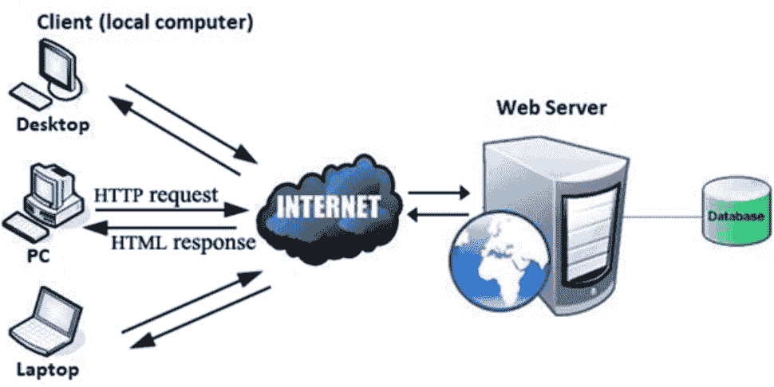

图 1. 互联网与万维网

# 互联网的历史

20 世纪 60 年代后期，美国国防部高级研究计划局（`ARPA`）开发的 `ARPANET` 标志着互联网的起源。第一个数据包交换网络 `ARPANET` 连接了大学和研究机构的计算机。诸如 `TCP/IP`（传输控制协议/互联网协议）等协议的发展标准化了不同网络之间的通信，加速了互联网在随后的几十年中的快速演变。20 世纪 90 年代万维网的商业化，结合互联网的爆发式增长，推动了其卓越的发展和深远的影响。

互联网是一个由路由器、交换机、服务器和其他相互连接的设备组成的去中心化网络集合。互联网基于数据包交换的概念，数据被分成多个数据包，并通过多个节点发送到其目的地。万维网协议族（`TCP/IP`）为 Web 上的通信提供了基本的规范，用于处理任务，例如：维护、定向和信息传输。

万维网（WWW）是一个全球信息空间，文档和资源通过超链接连接在一起。它通常被简单称为 Web。1989 年，在 `CERN`（欧洲核研究组织）工作期间，蒂姆·伯纳斯-利爵（Sir Tim Berners-Lee）创建了万维网。结合 `HTTP`（超文本传输协议）和 `HTML`（超文本标记语言）标准，伯纳斯-利创建了第一个浏览器和服务器，为 Web 的架构奠定了基础。

## Web 的关键技术

- **HTML**: 创建网页最常用的标记语言是 `HTML`。通过使用标签和属性，它定义了 Web 文档的结构和布局。

- **HTTP**: Web 超文本文档传输协议被称为 `HTTP`。它规定了客户端（网页浏览器）和服务器检索及显示 Web 内容的方法。

- **URL**: 用于识别 Web 资源的标准地址称为统一资源定位符（`URL`）。协议（如 `http://`）、域名、路径和可选的查询参数仅是其组件之一。

- **浏览器**: 被称为网页浏览器的软件应用程序用于访问和查看网页。`Google Chrome`、`Mozilla Firefox`、`Microsoft Edge` 和 `Safari` 都是著名的网页浏览器。

- **Web 服务器**: 被称为 Web 服务器的软件应用程序根据请求存储并向客户端提供 Web 内容。它们响应网页浏览器发出的 `HTTP` 请求，并返回请求的页面以及与之相关的任何资源。

# 互联网和万维网的影响

互联网和万维网对社会产生了巨大影响。它们改变了通信、教育、商业、娱乐以及人类生活的许多方面。一些重要影响包括：

- **通信**: 通过实现即时消息、电子邮件、社交媒体和视频会议，并允许人们在全球范围内实时连接和通信，互联网彻底改变了通信。

- **信息获取**: 由于任何连接互联网的人都可以访问海量信息和资源，万维网实现了信息获取的民主化。像 `Google` 这样的在线网络爬虫已成为获取几乎任何点数据的关键工具。

- **电子商务**: Web 业务的兴起改变了劳动力和产品的交易方式，在线商业中心、计算机化的零售界面和分期通道在跨边界和跨货币范围内运作。

- **教育**: 通过提供对在线课程、教育资源和协作学习平台的访问，互联网彻底改变了教育。得益于大规模开放在线课程（`MOOCs`）和远程学习，世界各地的学习者现在可以获得高质量的教育。

- **社会影响**: Web 使个人围绕共同兴趣和事业进行连接、协作和组织成为可能，促进了在线社区、社交网络和数字行动主义的兴起。

互联网和万维网改变了我们通信、获取信息、经营业务和互动的方式。任何从事 Web 开发、数字营销或信息技术的人必须了解互联网的历史、架构和关键技术，因为它们仍在塑造人类文明。

# Web 演变

不断演变的数字景观可以在 Web 技术的发展中看到。Web 的历程以创新、标准化和范式转移为标志，从其作为静态内容的平台开始。在本章中，我们将追溯过去，调查塑造现代 Web 的折点和重大进展。

## Web 技术的历史

富有远见的计算机科学家蒂姆·伯纳斯-利在 20 世纪 80 年代后期提出了分布式文本系统的想法。他通过实现超文本传输协议（`HTTP`）客户端和服务器为万维网奠定了基础。伯纳斯-利的创造结合 `HTML` 标记语言的改进，标志了 Web 的开始。

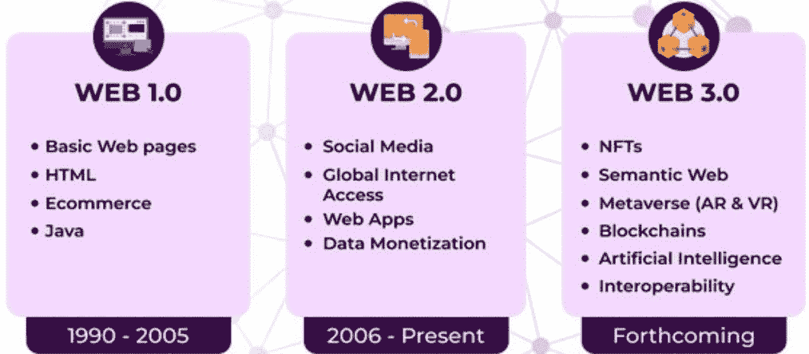

图 2. Web 技术演变

## HTML 和 CSS 的出现

作为 Web 的通用语言，`HTML`（超文本标记语言）建立了文档结构和格式的标准。随着 1995 年 `HTML 2.0` 的到来，Web 设计师使用了新元素，例如结构和表格，为更直观的内容做好了准备。同时，层叠样式表（`CSS`）成为分离呈现与内容的强大工具，让开发者能够更容易地创建视觉吸引力的网页。

90 年代中期 `JavaScript` 等客户端脚本语言的出现赋予了开发者为网页添加动态功能的能力。`JavaScript` 操作文档对象模型（`DOM`）的能力改变了用户体验，使动画、交互和表单验证成为可能。在此期间也出现了浏览器大战，竞争对手引入专有功能和 `API` 以吸引开发者使用其平台。

21 世纪初，异步 JavaScript 和 XML（`AJAX`）的发展推动了更具交互性和响应性的 Web 应用的转变。`AJAX` 允许页面无需刷新整个页面即可获取并刷新内容，引发了更流动的客户端体验。Web 2.0 范式以用户生成内容、社交网络平台和如 `Google Maps` 和 `Gmail` 等丰富 Web 应用（`RIAs`）为特征，也在此期间出现。

20 世纪 10 年代中期手机和平板电脑的普及带来了另一个多功能网页浏览时代，这对响应式网站构建标准提出了要求。为了确保在不同设备上获得一致的用户体验，响应式设计旨在创建能够流畅适应各种屏幕尺寸和方向的网页。由于这种向移动优先开发的转变，网页设计实践被重塑，响应式 Web 应用框架和工具应运而生。

# 单页应用 (SPAs) 的兴起

单页应用（SPAs）成为 Web 开发中最常用的架构模式，因为它们提供了类似于桌面应用程序的无缝且交互式的用户体验。SPA 加载单个 HTML 页面并利用 `JavaScript` 强地更新其内容，消除了刷新页面的需求，并实现了视图之间的平滑切换。为了构建 SPA，`AngularJS`、`Vue.js` 和 `React` 等框架变得流行，使得开发者更容易创建复杂的 Web 应用程序。

# Web 组件与渐进式 Web 应用 (PWAs) 的时代

最近，Web 组件作为封装可重用 UI 元素和促进模块化开发技术的手段受到关注。Web 组件利用 `HTML Templates`、`Shadow DOM` 和 `Custom Elements` 等标准创建自包含、封装的组件，这些组件可以轻松地用于多个项目。与此同时，渐进式 Web 应用（PWAs）作为一种全新的 Web 应用开发方法出现，提供类似原生的体验，如离线支持、推送通知和应用级导航。

展望未来，Web 技术的发展并没有放缓。`WebAssembly`、`WebRTC` 和 `WebGPU` 是极具前景的新用例，将推向 Web 可能的边界。这些用例包括沉浸式虚拟现实体验以及浏览器中的高性能计算。Web 应用的能力有望通过人工智能和机器学习的进步得到进一步增强，实现更智能、更个性化的用户体验。

这是 Web 技术开发中人类智慧和对创新不懈追求的证明。Web 正在不断演进，从最初简单的超文本系统到如今复杂且互联的生态系统，它影响了我们通信、协作以及与周围世界互动的方式。在瞬息万变的 Web 开发版图中，有一点是不变的：这段旅程远未结束，一切皆有可能。

## 客户端-服务器架构简介

客户端-服务器工程是 PC 组织和传输注册领域的一个核心概念。它是许多系统和应用程序的基础，例如 Web 开发、文件共享、电子邮件服务等。在本章中，我们将探讨客户端-服务器架构的复杂性、其组件、通信协议及其在现代计算中的意义。

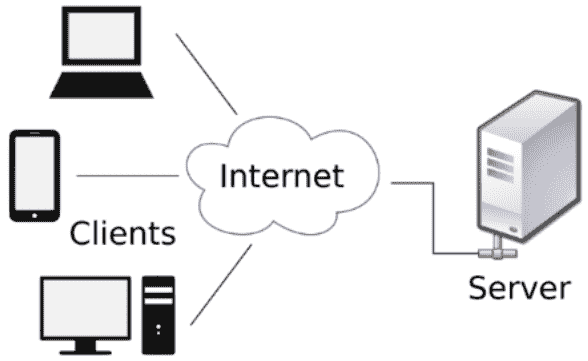

图 3. 客户端-服务器架构

## 理解客户端-服务器架构

客户端-服务器架构是一种设计和实现分布式系统的模型，其中服务提供者（即服务器）和客户端（即用户）请求服务。这种架构使得共享资源变得更容易，并多个计算设备在网络上的有效通信成为可能。

## 客户端-服务器架构的主要组件

客户端-服务器架构有两个主要组件：服务器和客户端。

### 客户端

客户端是向服务器发送资源或服务请求的硬件或软件。客户端通常是终端设备，如 PC、手机、平板电脑或 IoT 设备。它们通过在网络上发送和接收请求与服务器进行通信。

### 服务器

服务器是为客户端提供资源或服务的硬件或软件。服务器处理客户端请求、完成任务并将结果返回客户端。它们配备了特定的编程和设备，以能够同时处理多个客户端连接。

### 服务器类型

在客户端-服务器架构中，可以根据提供的服务对服务器进行分组：

- **文件服务器**：文件服务器跟踪并存储客户端可以在网络上访问和共享的文件。它们处理记录容量、恢复和管理任务，例如文档的浏览、编写和删除。

- **Web 服务器**：Web 服务器响应 `HTTP` 请求向客户端提供网页。Web 服务器托管网站和 Web 应用程序。应用程序逻辑执行、动态内容生成和静态内容交付都由它们处理。

- **数据库服务器**：数据库服务器管理数据库并为客户端提供数据存储、检索和操作的服务。它们支持 `SQL` 查询和交换，确保了信息的真实性和安全性。

- **应用程序服务器**：应用程序服务器代表客户端执行业务逻辑和应用程序代码。它们管理用户身份验证、会话管理以及业务规则的执行，这些都是复杂的处理任务。

## 客户端-服务器架构中的通信协议

在客户端-服务器架构中，使用了多种协议来相互通信以及与服务器进行通信：

- **超文本传输协议**：简称为 `HTTP`，是 Web 客户端和服务器之间通信的主要手段。它规定了请求和如网页等超文本文档传输的准则。

- **传输控制协议 (TCP)**：`TCP` 是一种面向连接的协议，允许客户端和服务器以有序、可靠且经过错误检查的方式发送数据。通过确认和重传机制，它建立了连接，分段传输数据并保证了数据的完整性。

- **用户数据报协议 (UDP)**：`UDP` 是一种无连接的协议，允许客户端和服务器快速方便地通信。`UDP` 适用于流媒体和在线游戏等实时应用，因为与 `TCP` 不同，它不保证数据包的交付或顺序。

- **WebSocket**：`WebSocket` 是一种通信协议，允许客户端和服务器通过单个长连接进行全双工通信。它支持持续的信息交换，并为智能 Web 应用提供了低延迟的优势。

## 客户端-服务器架构的优势

与其他架构模型相比，客户端-服务器架构具有若干优势：

- **可扩展性**：客户端-服务器架构允许在多个服务器之间分配负载，实现水平扩展以适应增长的客户端和请求。

- **集中管理**：客户端-服务器架构中的服务器提供了资源、数据和服务的集中管理和控制，简化了和维护任务。

- **模块化与灵活性**：客户端-服务器架构的模块化允许客户端和服务器组件的独立开发、部署和扩展，为系统设计和演进提供了灵活性和敏捷性。

- **安全性**：客户端-服务器架构有助于实施安全措施，如身份验证、访问控制和加密，保护敏感数据和资源免受未经授权的访问和攻击。

## 挑战与考量

尽管具有这些优势，客户端-服务器架构也面临一些挑战和考量，包括：

- 单点故障

客户端-服务器架构依赖于集中服务器，如果服务器发生停机或故障，可能会成为单点故障，导致服务中断和数据丢失。

## 网络延迟

客户端与服务器之间的网络通信会引入延迟，这会影响应用程序的响应和性能，特别是在分布式或地理分散的环境中。

## 可扩展性限制

将客户端-服务器系统扩展到某一点可能会遇到扩展性限制，例如硬件限制、网络拥塞或软件瓶颈，这需要仔细的规划和架构设计。

## 安全风险

互联网上的客户端-服务器通信使系统面临各种安全风险，包括窃听、数据拦截和未经授权的访问，需要稳健的安全措施和协议来缓解威胁。

分布式计算的一个基本思想是客户端-服务器架构，它允许客户端和服务器在网络上有效地通信并共享资源。开发者如果深入理解客户端-服务器架构的原理、组件和协议，就能创建并实现满足现代计算环境不断变化的可扩展、安全且可靠的系统。

## HTTP 协议基础

万维网的主要协议超文本传输协议（`HTTP`）使得客户端和服务器能够交换数据。任何参与 Web 端开发的人都必须熟悉 `HTTP` 的基础知识，因为它是 Web 应用的通信平台。本章将深入探讨 `HTTP` 协议的关键概念、组件和工作原理。

自诞生以来，`HTTP` 经历了多次迭代，每次都包含增强和改进，以满足 Web 应用不断变化的需求。`HTTP` 的历程始于 `HTTP/0.9` 的出现，这是一个用于获取 HTML 记录的基本约定。随后的变体包括 `HTTP/1.0`、`HTTP/1.1` 以及最新的 `HTTP/2`，它们引入了持久连接、压缩、多路复用等元素，旨在进一步提高执行效率、生产力和安全性。

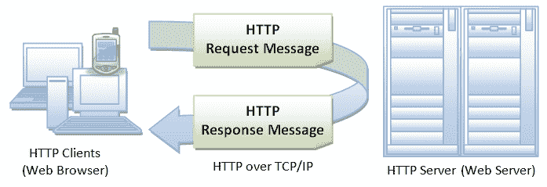

图 4. HTTP 协议

### 客户端服务器通信

`HTTP` 的核心让客户端（如浏览器）和服务器（托管网站的 Web 服务器）之间的通信变得更容易。通信遵循请求-响应模型，客户端向服务器发送 `HTTP` 请求，服务器通过带有包含所述资源或状态数据的 `HTTP` 消息进行响应。所有的在线交互都基于这种消息交换。

### HTTP 方法

`HTTP` 指定了一组方法，也称为动词，规定了对由统一资源标识符（`URI`）标识的资源必须执行的操作。最常用的 `HTTP` 方法是：

- `GET`：请求指定资源的表示。

- `POST`：将数据发送到已标识用于处理的资源。

- `PUT`：上传已指定的资源映像。

- `DELETE`：删除预定的资源。

- `HEAD`：在不传输资源本身的情况下，请求指定资源的元数据。

每种 `HTTP` 方法都满足一个明确的需求，并根据对资源要执行的理想活动而被使用。

### HTTP 请求结构

一个 `HTTP` 请求包含几个部分，例如：

- 请求行：指定协议版本、`URI` 和 `HTTP` 方法。

- 请求头：包含客户端的用户代理、接受的内容类型和 Cookie，作为关于请求的额外数据。

- 请求体（可选）：包含客户端发送的数据，通常用于 `POST` 请求以上传文件或填写表单。

`HTTP` 请求的设计是标准化的，允许客户端和服务器在不同的阶段和实现之间成功通信。

### HTTP 响应构造

同样，一个 `HTTP` 响应包含以下部分：

- 状态更新：包括 `HTTP` 状态码和文本原因短语，以指示请求状态。

- 响应头：在元数据中包含有关响应软件、内容类型和缓存指令的信息。

- 响应体：包含请求的资源或错误消息，取决于请求的执行情况。

`HTTP` 响应像 `HTTP` 请求一样遵循预定义的结构，使得客户端和服务器能够一致地通信。

### HTTP 状态码

`HTTP` 指定了一组状态码，表示对请求的响应。这些状态码分为信息（`1xx`）、成功（`2xx`）、重定向（`3xx`）、客户端错误（`4xx`）和服务器错误。是一些常见的 `HTTP` 状态码：

- `200 OK`：表示请求成功。

- `404 Unavailable`：表示服务器无法找到请求的资源。

- `500 Internal Server Error`：表示服务器发生了意外状况，导致无法满足请求。

理解 `HTTP` 状态码对于诊断和调查 Web 应用中的问题至关重要。

### Cookie 与无状态

`HTTP` 的无状态性质是其基本原理之一。这意味着从客户端到服务器的每个请求都是独立的，不存储任何关于之前请求的信息。Web 开发者经常使用 `cookies`（存储在客户端浏览器上的微小数据，并随随后的请求发送，用于识别和跟踪用户会话）来在多个请求之间维持状态。

安全考虑方面 `HTTP` 提供了确保客户端和服务器之间交换的数据完整性、机性和真实性的机制，使得安全性在 Web 开发中至关重要。安全方法如 `HTTPS`（`HTTP Secure`）使用传输层安全（`TLS`）加密 `HTTP` 流量，保护敏感数据免受恶意者的窃听和操纵。

作为万维网的骨干，`HTTP` 让 Web 应用中的客户端和服务器更容易通信。通过理解 `HTTP` 协议的基础，Web 开发者可以在不断变化的数字环境中创建满足用户和组织要求的的安全、高效且可靠的 Web 应用。

## HTML 简介：结构与元素

在当今的数字领域，`HTML` 是 Web 开发的基石。理解它的结构和元素对于任何进入 Web 应用领域的人都是基础。本章作为 HTML 的全面指南，涵盖了它的基础概念、结构和基本元素。

![image_rsrc6AX.jpg)

图 5. HTML 结构与元素

### 历史背景

`HTML`（超文本标记语言，可以追溯到万维网的早期。`HTML` 由 Tim Berners-Lee 在 20 世纪 80 年代后期开发，被设计为一种用于在 Web 上显示的文档结构标记语言。几十年来，`HTML` 经历了多个版本，其中 `HTML5` 成为最新且最稳健的迭代，为现代 Web 开发提供了增强的功能和能力。

### 理解 HTML

从本质上说，`HTML` 是一种定义网页结构和内容的标记语言。它提供了一组标签，用于描述文档中的不同元素，如标题、段落、列表、链接和媒体对象。`HTML` 文档是包含内容和 `HTML` 标签混合的文本文件，浏览器解释这些文件为用户渲染网页。

### HTML 文档的基本结构

HTML 文档的层级结构通过嵌套元素建立。`html` 标签包含所有其他元素，位于文档的根节点。在 `<html>` 标签内部，我们追踪两个主要部分：`head` 子句和 `body` 子句。

文档的标题、字符编码、样式表、脚本以及其他辅助解释和渲染的元数据都包含在 `head` 部分中。

网页的实际内容，包括文本、图像、链接和多媒体元素，是在 `body` 部分使用各种 HTML 元素进行组织的。

## 核心 HTML 元素

HTML 语言提供了一套全面的元素，用于组织和展示内容。以下是 HTML 的核心元素：


- **标题（从 `h1` 到 `h6`）：** 用于定义文档的层级标题，其中 `h1` 表示最高级别，`h6` 表示最低级别。
- **段落（`p`）：** 用于通过定义段落为文本提供结构，使其更易阅读。
- **列表（`ul`、`ol` 和 `li`）：** 用于将信息组织为无序列表（`ul`）、有序列表（`ol`）和列表项（`li`）。
- **链接（`a`）：** 用于创建指向其他网页、文档或资源的链接，允许用户在页面上移动并与之交互。
- **图片（`img`）：** 用于将图形引入文档中，以增强视觉吸引力并传递信息。
- **表格（`table`、`tr` 和 `td`）：** 用于将数据分为行和列，以便更容易显示表格数据。
- **表单（如 `form`、`input`、`textarea` 和 `button`）：** 用于通过不同的结构控件收集客户端输入，例如文本字段、复选框、单选按钮。

## 语义化 HTML

语义化 HTML 指的是根据其预期意义和用途使用 HTML 组件，而不仅仅是为了样式或展示。开发者可以通过利用 `header`、`nav`、`main`、`section`、`article`、`aside` 和 `footer` 等语义元素来改进网站的结构、可访问性和搜索引擎优化（SEO）。

HTML 元素的嵌套和文档结构可以结合创建复杂的文档结构。为了创建易于维护且结构良好的网页，理解 HTML 元素的层级结构和嵌套规则至关重要。为了保持文档结构的完整，元素必须按照正确的顺序打开和关闭。

## HTML 属性

HTML 元素可以具有修改其行为或提供额外信息的属性。元素的属性在元素的起始标签中定义为键值对。`id`、`class`、`href`、`src`、`alt`、`title`、`style` 和 `data-` 都是常见属性的示例，它们在定义元素的属性、行为或外观方面起着重要作用。

## 最佳实践与文档验证

有效的 HTML 标记遵循 HTML 规范的语法和规则。开发者可以使用在线验证工具或浏览器开发工具来确保其 HTML 文档格式正确且没有错误。遵循最佳实践（如语义化 HTML、使用 CSS 将内容与呈现分离，以及针对可访问性和 SEO 进行优化）还可以提高网页的整体质量和可用性。

HTML 是构建 Web 的基础，它为组织和引入 Web 数据提供了一种标准化语言。任何想要成为 Web 开发专家的人都需要熟悉 HTML 的基础。通过理解其结构、组件和最佳实践，开发者可以创建出满足现代用户需求并遵循 Web 标准的结构良好、可访问且用户友好的 Web 应用。

## HTML 表单与输入验证

得益于 HTML 结构，用户能够提交信息从而与 Web 应用协作，这在 Web 开发中起着至关重要的作用。在创建既安全又用户友好的 Web 应用时，深入理解 HTML 表单的复杂性并实现健壮的输入验证机制至关重要。本章介绍了 HTML 表单的复杂性，包括它们的结构、功能以及输入验证的最佳实践。

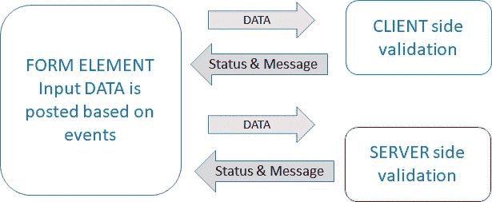

图 6. HTML 表单与输入验证

HTML 表单是网页上收集用户输入的最常见方法。通过允许客户端呈现不同的信息（包括消息、数字、记录和选择），简化了客户端与 Web 服务器之间的交互。`form` 组件封装了输入字段和其他结构控件，是 HTML 结构的基础构建。

### 表单控件与输入元素

HTML 提供了各种表单控件和输入元素以满足不同的输入需求。这些包括：

- 文本输入字段（`input type="text"`）
- 密码输入字段（`input type="password"`）
- 复选框和单选按钮（`input type="checkbox"`、`input type="radio"`）
- 选择下拉列表（`select` 和 `option`）
- 文件上传字段（`input type="file"`）
- 多行文本的文本区域（`textarea`）

### 表单提交与 HTTP 方法

当用户提交表单时，输入表单字段的数据会被发送到服务器进行处理。HTML 表单支持两种主要的提交方法：GET 和 POST。

GET 方法将表单数据作为查询参数附加到 URL 中，适用于检索数据或执行幂等操作。

POST 方法在请求体中发送表单数据，适用于提交敏感或大量数据。

## 输入验证技术

输入验证是 Web 开发的一个关键方面，确保用户提交的数据符合指定标准且处理是安全的。HTML 提供了内置的验证属性和机制，包括：

- **必填字段：** 使用 `required` 属性使表单字段变为强制。
- **模式匹配：** 利用带有正则表达式的 `pattern` 属性来强制特定的输入格式。
- **最小/最大长度：** 使用 `minlength` 和 `maxlength` 属性指定字符的长度。
- **输入类型：** 利用 HTML5 输入类型（如 `email`、`number`、`date` 和 `URL`）来强制数据格式并提供原生验证。
- **自定义验证：** 使用 JavaScript 实现自定义验证逻辑以验证复杂的数据需求。

### 客户端验证 vs 服务端验证

在用户将表单数据提交到服务器之前，客户端验证在用户的 Web 浏览器中进行。这为用户提供了即时反馈。虽然它改进了用户体验，但客户端验证容易受到操作和绕过。相反，服务器端验证发生在结构接收后的服务器上进行，确保了信息的真实性和安全性。

## 输入验证的最佳实践

在开发安全且健壮的 Web 应用时，开发者应该遵循这些最佳实践：

- 通过实现客户端和服务端验证，针对恶意输入提供多层防御。
- 从输入数据中移除潜在有害的字符或脚本，这些字符可能会导致安全漏洞（如跨站脚本）。
- 在与数据库交互时采用参数化查询或预处理语句防止 SQL 注入攻击。
- 验证文档传输以确保其符合满意的记录类型、大小和内容限制。
- 提供清晰且具有启发性的错误消息，引导客户端纠正无效信息。

在设计表单以确保残障人士可以使用时，开发者除了考虑验证之外，还应该考虑可访问性（accessibility）。这包括：

- 使用语义化的 HTML 组件和名称来提供设置，并进一步提高屏幕阅读器用户的一致性。
- 确保低视力或色盲的用户能够获得足够的视觉提示和色彩对比。
- 为依赖键盘的用户提供焦点管理和键盘导航。

在 Web 应用程序中，`HTML` 表单对于收集用户输入是必不可少的，而建立稳健的输入验证机制对于保持数据安全至关重要。通过遵循最佳实践并考虑可访问性，开发者可以创建用户友好且可访问的 Web 表单，提升整体用户体验。

# 级联样式表（CSS）简介

现代 Web 开发的基础部分是级联样式表，简称 `CSS`。`CSS` 为 Web 开发者和设计师提供了所需的工具，用于控制 `HTML` 文档的外观，使他们更容易创建交互且具有吸引力的网页。在本节中，我们将研究 `CSS` 的核心概念、其语言结构、用途以及最佳实践。

## 了解级联样式表（CSS）

`CSS` 是一种用于定义 `HTML` 文档布局、外观和格式的样式语言。`CSS` 允许开发者通过将页面内容与其呈现分离，从而一致地对多个网页进行样式设置。将多个样式规则应用于一个 `HTML` 元素，并且来自各种来源的规则级联以确定最终样式的过程被称为“级联”（cascading）。

## CSS 的语法与设计

`CSS` 遵循一种基础语言结构，由选择器（selectors）、属性（properties）和值（values）组成。属性定义了所选元素的视觉特征，而选择器用于定位 `HTML` 元素。每个属性都有一个对应的值，表示期望的行为或外观。`<style>` 标签用于将 `CSS` 规则嵌入 `HTML` 文档中，或将它们写在单独的样式文件中。

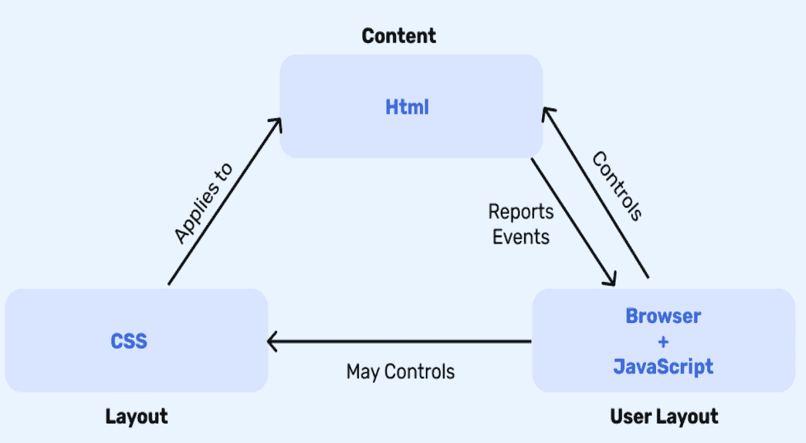

图 7. 级联样式表 (CSS)

## CSS 中的选择器

选择器决定了样式规则应用于哪些 `HTML` 元素，因此它们是 `CSS` 的重要组成部分。`CSS` 中的选择器有多种形式，包括：

- **组件选择器**：利用特定 `HTML` 元素的标签名。
- **类选择器**：关注具有特定 `class` 属性的元素。
- **ID 选择器**：定位具有特定 `ID` 属性的组件。
- **属性选择器**：根据元素的特征识别元素。
- **伪元素和伪类**：根据元素在文档中的位置来关注元素。

## CSS 中的值与属性

`HTML` 元素的视觉外观、布局和行为都由 `CSS` 属性定义。属性与值相匹配，该值指示了每个属性的理想设置。常见的 `CSS` 属性包括：

- **颜色（Color）**：识别文本、边框、背景和其他元素的色调。
- **字体（Font）**：确定字体、字号、字重、样式和其他文本特征。
- **外边距和内边距（Edge and cushioning）**：分别定义元素周围和内部的空间。
- **高度和宽度（Height and width）**：设置页面元素的尺寸。
- **显示（Display）**：决定元素是以块级（block）、行内（inline）还是弹性布局（flex）的形式渲染在页面上。

## CSS 中的优先级与级联

“级联”一词是指合并多个样式规则以确定 `HTML` 元素最终外观的过程。外部样式表、嵌入样式和内联样式都是 `CSS` 规则的可能来源。当各种原则关注相似组件时，`CSS` 利用优先级（specificity）排序来确定哪条规则优先生效。优先级由规则中指定的选择器、`IDs` 和 `classes` 以及所使用的选择器类型决定。

`CSS` 盒模型是一个基础概念，规定了网页上元素的布局和排列方式。每个 `HTML` 元素通过盒模型表示为一个包含内容、内边距、边框和外边距的矩形框。在设计响应式且视觉一致的 Web 布局时，深入理解盒模型至关重要。

## CSS 单位与值

`CSS` 支持各种单位和值来确定估值，例如长度、宽度和分布。常见的 `CSS` 单位包括：

- **像素（px）**：直接估计单位，通常用于确定尺寸和分布。
- **百分比（%）**：相对估计单位，相对于父组件的大小确定。
- **Em 和 rem**：分别基于元素或根元素的字体大小的相对测量单位。
- **视口单位（vw、vh、vmin、vmax）**：基于视口大小的相对测量单位。

## 用于响应式 Web 设计的 CSS

响应式 Web 设计是一种创建适应各种屏幕尺寸和设备的网页的方法，旨在为用户提供最好的查看体验。`CSS` 在响应式网站架构中占据核心地位，允许设计师创建根据设备屏幕尺寸动态变化的自适应流式格式。例如，`CSS` 中的媒体查询（media queries）、弹性设计和视口单位是构建响应式网站的基础工具。

## CSS 系统与库

`CSS` 结构和库为工程师提供了预设的样式、组件和设计框架，以简化 Web 开发过程。著名的 `CSS` 框架包括 `Bootstrap`、`Foundation` 和 `Emge CSS`，它们为制作响应式且视觉丰富的 Web 界面提供了丰富的工具集。利用 `CSS` 框架可以在确保跨浏览器和设备一致性和兼容性的同时节省时间和精力。

## 最佳实践与优化技术

开发者应该遵循最佳实践和优化技术，以确保 `CSS` 代码高效且易于维护。建议如下：

- 利用外部样式表将 `CSS` 代码与 `HTML` 内容分离。
- 为了使代码更易读和维护，尽量减少嵌入样式和内联样式的使用。
- 改进 `CSS` 选择器以提高执行效率并减少冲突。
- 合并并压缩 `CSS` 文档以减小体积并提升页面加载速度。
- 为了改进代码组织并加速开发，使用 `CSS` 预处理器（如 `Sass` 或 `Less`）。

现代 Web 开发高度依赖 `CSS`，它允许开发者创建用户友好且吸引人的视觉体验。通过掌握 `CSS` 原理并遵循最佳实践，开发者可以创建不仅视觉美观而且具有可访问性、响应式且高效的 Web 应用。

# CSS 样式：选择器与属性

通过定义 `HTML` 元素的视觉呈现，级联样式表（`CSS`）是 Web 开发的基础。选择器和属性构成了 `CSS` 的构建块，能够对网页上的元素进行精确的定位和样式设置。

`CSS` 选择器决定哪些 `HTML` 元素将使用特定的 `CSS` 规则进行样式设置。选择器有不同的类型，每种都提供了关注组件的特殊方式：

- **类型选择器**：利用 `HTML` 标签名来定位元素。
- **类选择器**：使用特定的类属性值来定位元素。
- **ID 选择器**：定位具有特定 ID 值的组件。
- **属性选择器**：根据元素的特征识别元素。
- **伪类**：根据元素所处的位置或状态关注元素。
- **伪元素**：定位组件内容中的特定部分。

## CSS 属性

目标元素的视觉特征由 CSS 属性定义。这些属性控制如色调、尺寸、格式和活动状态等视觉效果。以下是一些常见的 CSS 属性：

- **颜色属性**：定义文本、背景和边框的颜色。
- **字体属性**：指定文本的字体族、大小、字重和样式。
- **盒模型属性**：控制元素的尺寸、内边距（`padding`）、边框（`border`）和外边距（`margin`）。
- **定位属性**：确定元素在页面上的定位，例如静态、相对、绝对和固定定位。
- **弹性布局和网格属性**：为响应式 Web 设计启用灵活和基于网格的布局。
- **动画和过渡属性**：为元素添加移动、淡入和缩放等动态效果。

## 高级 CSS 技术

除了基础选择器和属性外，CSS 还提供了高级技术来创建复杂的布局和效果：

- **CSS 优先级**：理解优先级如何决定当多个规则针对同一个元素时，哪种样式优先生效。
- **CSS 继承**：学习 CSS 属性如何从父元素传递到子元素，从而影响它们的样式。
- **CSS 预处理器**：探索 `Sass` 和 `Less` 等 CSS 预处理器的使用，通过变量、混合器和嵌套等功能增强 CSS 编写。
- **响应式设计**：使用媒体查询实现响应式 Web 设计技术，使布局适应不同的屏幕尺寸和设备。
- **CSS 框架**：发现如 `Bootstrap` 和 `Foundation` 等流行的 CSS 框架，它们提供了预设计的组件和样式表，用于快速 Web 开发。

## 最佳实践与优化

为了确保 CSS 代码的高效和可维护性，开发者应该遵循最佳实践和优化技术：

- **使用语义化 HTML**：编写整洁且语义化的 HTML 标记，以增强可访问性和 SEO，同时简化 CSS 样式设置。
- **组织 CSS 代码**：逻辑化地构建 CSS 文件，将相关样式组合在一起，并使用注释记录代码。
- **最小化 CSS 文件大小**：减少冗余并优化 CSS 选择器和属性，以减小文件大小并提高页面加载性能。
- **跨浏览器测试**：在不同的网络浏览器和设备上测试 CSS 样式表，以确保渲染的一致性和兼容性。

### 案例研究与示例

为了概述 CSS 选择器和属性的可行利用，我们提供了几个展示真实网站构建情况的环境调查和模型。这些示例展示了如何使用 CSS 创建交互式用户界面、响应式设计和视觉吸引力布局。

CSS 样式设置是 Web 开发的重要组成部分，因为它允许开发者从 HTML 文档创建引人入胜的交互式 Web 体验。通过掌握 CSS 选择器和属性，设计师可以释放想象，打造出令人信服的界面，吸引客户并提升整体用户体验。

样式是 CSS 中的一种有用工具，让开发者能够精确且灵活地设计和修改网页的视觉外观。开发者可以创建美观且实用的界面，捕捉用户并提高 Web 程序的整体质量。

## CSS 盒模型

CSS 盒模型是 Web 开发中的一个基本概念，它规定了网页上元素的布局和设计方式。Web 开发者需要知道如何使用 CSS 盒模型以确保网站具有响应性且好看。在本章中，我们将研究 CSS 盒模型的组成部分、属性以及在 Web 设计中的潜在应用。

### CSS 盒模型概述

CSS 盒模型将每个 HTML 组件构想为一个矩形框，包含几个部分：

- **内容**：元素的实际内容，可能文本或其他媒体。
- **内边距（Padding）**：内容区域与组件线条之间的空间。
- **边框（Border）**：包围组件填充区域的线条，界定其边界。
- **外边距（Margin）**：边框之外的空间，用于将元素与相邻元素隔离开。

由于每个组件都会影响元素的整体尺寸和外观，因此，理解盒模型对于在网页上准确定位和样式化元素至关重要。

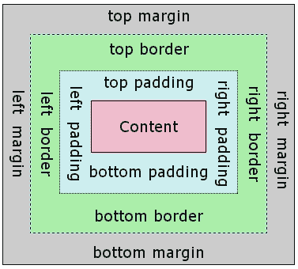

图 9. CSS 盒模型

### CSS 盒模型的剖析

#### 内容区域

元素的实际内容占据其内容区域所代表的空间。这并不完全取决于组件确定的 `width` 和 `height` 属性，以及应用于它的任何填充、边界或边缘。

#### 填充（Cushioning）

填充指的是组件内容区域与其边界之间的空间。使用 CSS 属性 `padding-top`、`padding-right`、`padding-bottom` 和 `padding-left`，可以为元素的每个侧（左、右、下）指定内边距。填充对于在内容周围留出呼吸空间、提高视觉清晰度和视觉吸引力非常有价值。

#### 线条（Line）

组件的线条描述了其视觉边界，并将内容区域与填充和边缘隔离开。线条可以使用不同的属性进行样式设置，包括线宽、线样式和边界颜色。正常的边界样式包括实线、虚线、点线和双线。在网页中，边框经常用于在视觉上区分组件并建立视觉层级。

#### 外边距（Margin）

元素边框之外的、定义与相邻元素之间距离的空间被称为外边距。边缘提供了组件之间的分区，并控制页面的整体间隔和设计。像填充一样，可以使用 `margin-top`、`margin-right`、`margin-bottom` 和 `margin-left` 属性为组件的每个侧独立指定边缘。

### CSS 中作为盒模型属性的宽度和高度


CSS 中的`width`和`height`属性指定元素内容区域的尺寸。除了内边距、边框和外边距外，这些属性指定内容框的宽度和高度。通过设置组件的`width`和`level`，设计师可以对其页面内的尺寸和格式进行控制。

## 内边距属性

可以使用以下 CSS 属性指定内边距：

- `padding-top`：设置组件顶部的填充。
- `padding-right`：设置组件右侧的填充。
- `padding-bottom`：设置组件底部的填充。
- `padding-left`：调整元素的左侧填充。

可以使用各种单位，如像素（`px`）、百分比（`%`）、em（`em`）或 rem（根 em）来指定内边距。

CSS 提供了多个用于设置元素边框的属性，包括：

- `border-width`：设置组件线条的宽度。
- `border-style`：指示线条的样式，如实、虚、点等。
- `border-color`：更改边框颜色。

开发者可以使用这些属性调整边框的外观，以满足其设计需求。

## 外边距属性

可以使用以下外边距属性使用 CSS 控制元素周围的间隔：

- `margin-top`：设置组件顶部的边缘。
- `margin-right`：调整元素的右侧外边距。
- `margin-bottom`：确定元素的底部外边距。
- `margin-left`：确定元素的左侧外边距。

边缘可以通过类似于缓冲的单位来确定，允许工程师在其网站页面上实现稳定的划分和格式化。

## CSS 盒模型

CSS 盒模型对网页设计具有重大影响，因为它影响了网页上元素的布局、间距和视觉外观。通过理解和利用盒模型，开发者可以创建出适应各种屏幕尺寸和设备的响应式布局。这些布局在视觉上应当是具有吸引力的。通过有效使用`padding`、`border`和`margin`属性，可以确保一致的间距和对齐，从而提升整体用户体验。

### 使用 CSS 盒模型的最佳实践

为了简化网页优化中 CSS 盒模型的使用，设计师应当遵循一些规定的程序：

- 为了确保跨浏览器的渲染一致性，请使用 CSS 重置样式或`normalize.css`。
- 使用`box-sizing: border-box;`将内边距和边框包含元素的总宽度和高度。
- 利用简写属性（例如`padding`、`line`、`edge`）来简化 CSS 代码并进一步提高其意义性。
- 利用响应式布局方案创建能够适应不同屏幕尺寸和设备的设计。
- 布局应在各种浏览器和设备上进行测试，以确保性和兼容性。

CSS 盒模型是网页开发中的一个基本概念，决定了网页上元素的布局和设计。通过掌握盒模型及其属性的复杂性，设计师可以创建出具有吸引力且响应式的网站，在各种设备和屏幕尺寸上提供理想的客户体验。理解 CSS 盒模型对于希望构建现代且直观的网络界面的设计师至关重要。

## 响应式网页设计基础

响应式网页设计的概念已成为不断发展的网页开发领域的一个基本原则，以确保在不同尺寸和规格的设备上获得最佳用户体验。在当今移动优先的世界，用户通过智能手机、平板电脑、笔记本电脑和桌面计算机等各种设备访问网站，响应式网页设计不仅是一种趋势，更是一种必要。在这个深度指南中，我们将探讨响应式网站架构的核心，研究其标准、策略和最佳实践，使网页设计师能够创建多功能且易懂的网站。

### 理解响应式网页设计

响应式网页设计是一种网页开发方法，旨在创建在各种屏幕尺寸和设备上运行良好且外观最佳网站。其核心是根据访问网站的设备特性，动态调整网站的布局、内容和功能。基本目标是确保无论使用什么设备都能保持易用性和一致性，从而提高客户的满意度和参与度。

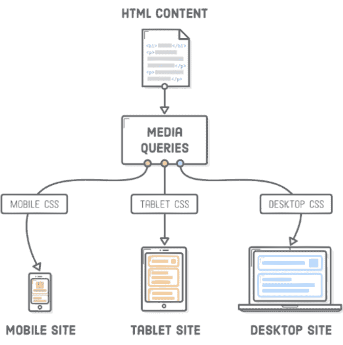

图 10. 响应式网页设计

### 响应式网页设计的原则

响应式网页设计受若干基本原则的指导，帮助开发者创建适应且灵活的布局。这些原则包括：

- **流式网格**：使用相应单位（例如百分比）而非固定像素来规划格式，允许内容一致地适应各种屏幕尺寸。
- **可变图像**：使用相对单位（例如`em`或`rem`）和 CSS 媒体查询，确保图像在不同设备上按比例缩放并保持其宽高比例。
- **媒体查询**：利用 CSS 媒体查询根据设备的屏幕宽度、方向和分辨率应用各种样式。
- **断点**：在格式中刻画断点，使方案能够适应不同的屏幕尺寸，通常关注常见的设备尺寸（例如手机手机、平板电脑、工作站）。
- **内容优先级**：根据其重要性和相关性对内容进行排序，确保基本信息在所有设备上都可访问，而非本质内容可能会被隐藏或重新定位。

### 响应式网页设计的技术

响应式网页设计采用各种技术和工具来实现自适应布局并增强用户体验。这些技术包括：

- **弹性布局**：使用 CSS`flexbox`或`grid`布局模块设计布局，创建内容元素的灵活和动态排列。
- **流体字体**：实现流体字体技术，确保文本随视口大小按比例缩放，保持跨设备的可读性。
- **可缩矢量图形（SVG）**：利用`SVG`图形实现可缩放且分辨率无关的视觉效果，在任何屏幕尺寸上都清晰。
- **响应式图像**：实现响应式图像技术，例如`<picture>`元素、`srcset`属性或 CSS 背景图像，根据设备能力和屏幕分辨率交付适当的资源。
- **设备测试**：使用仿真器、模拟器或物理设备在各种设备和屏幕尺寸上进行彻底测试，以验证网站的响应性。

### 响应式网页设计的最佳实践

结合最佳实践对于确保响应式网页设计项目的成功至关重要。一些关键最佳实践包括：

- **移动优先方法**：以移动优先的心态设计网站，在扩展到更大设备之前，专注于优化小屏幕的用户体验。
- **性能优化**：优先考虑性能优化技术，如懒加载、压缩和最小化，以提高页面加载速度和响应能力。
- **无障碍合规性**：通过遵循 Web 无障碍标准（例如`WCAG`）并实现键盘导航、语义化`HTML`和图像替代文本等功能来确保符合标准。
- **渐进增强**：应用渐进增强原则，为所有用户提供核心功能和内容，同时为支持这些功能的设备利用高级特性。
- **持续迭代**：根据用户反馈、分析数据和不断发展的设备能力采用持续迭代和改进的过程，以保持响应式设计的有效性。

### 挑战与考虑

尽管有很多优点，响应式网页设计也给开发者带来了某些挑战和考虑。这些挑战包括：

- **浏览器兼容性**：确保在不同的网络浏览器中保持一致的渲染和功能，特别是可能完全不支持现代 CSS 特性和技术的旧版本。
- **性能权衡**：在视觉丰富性和交互与性能考虑之间取得平衡，避免页面过重和运行缓慢，特别是在低端设备和慢网络连接上。
- **复杂性与维护**：管理响应式网页设计项目的复杂性，并在网站演进和新设备进入市场时确保可维护性。
- **设计一致性**：在设备间保持设计一致性，同时适应每个规格的独特特性和限制，包括屏幕尺寸、比例和输入方法。

### 案例研究与示例

研究真实的案例和案例研究可以为有效的响应式网页设计实践提供宝贵的见解。案例研究可能包括：

- 重新设计新闻网站，以提高移动设备上的可读性和导航性。
- 调整电子商务平台，以便在智能手机、平板电脑和桌面电脑上提供无缝的购物体验，包括优化的产品列表、结算流程和支付网关。
- 改造企业网站，以便在各种设备上更好地展示服务、作品集和客户证言，从而增强用户参与度并提高潜在客户转化。

响应式网站设计是当前 Web 改进的基础，它使网站能够在不同设备和屏幕尺寸上提供卓越的客户体验。通过掌握响应式设计的标准、流程和最佳实践，设计师可以创建出灵活且易用的网站，满足现代数字受众的多样需求。

JavaScript 是一种强大且灵活的编程语言，对于现代网站的开发至关重要。在本章中我们将研究 JavaScript 的基础知识，包括它的语法、历史、数据类型、控制结构、函数等。在本章结束，你将对 JavaScript 及其在开发动态交互式 Web 应用中的重要性有深入的理解。

## JavaScript 的历史

Brendan Eich 在 1995 年于 Netscape Communications Corporation 工作期间开发了`JavaScript`，通常缩写为`JS`。该语言最初被称为`Mocha`，但在变为`LiveScript`之前最终被命名为`JavaScript`。无论名称如何，`JavaScript`看起来与`Java`编程语言相似。`JavaScript`的开发是为了通过为网页提供动态和交互式功能来补充`HTML`和`CSS`。

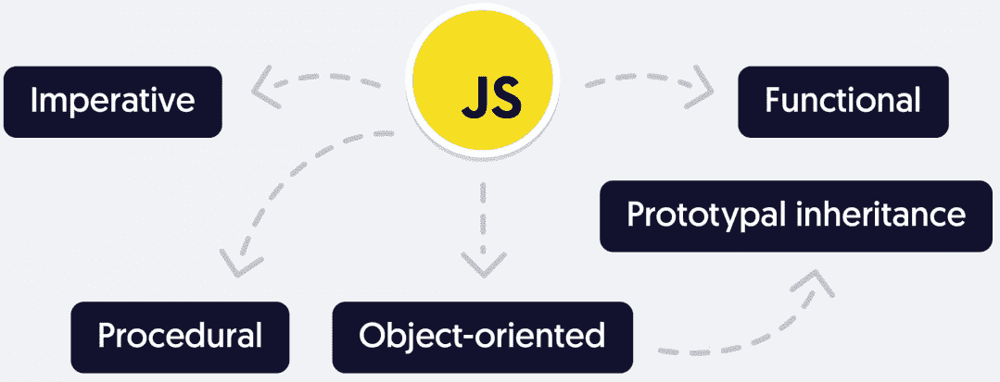

图 11. JavaScript

## JavaScript 基础

被称为`JavaScript`的高级解释型编程语言在浏览器中运行。与`Java`和`C++`等语言不同，`JavaScript`不需要编译；总而言，它由网络浏览器直接执行。`JavaScript`根本上用于为站点添加智能功能，例如处理客户端输入、控制`DOM`（文档对象模型）以及向 Web 服务器发送异步请求。

### 标点符号

`JavaScript`的标点符号类似于其他 C 语言（如`Java`和`C++`）。`JavaScript`代码中的语句按逻辑顺序执行，除非被循环和条件等控制结构改变。`JavaScript`是一种大小敏感的语言，这意味着变量、函数和不同的标识符在整个代码中应保持一致。

### 数据类型

`JavaScript`支持几种原始数据类型，包括数字、字符串、布尔、undefined、null 和符号（包括`ECMAScript 6`中的）。此外，`JavaScript`还提供了复杂的数据类型，如`arrays`和`objects`。`JavaScript`中的`Objects`是键值值对的集合，而`arrays`是值的有序集合。

### 常量与变量

在`JavaScript`中，变量用于存储数据值。可以使用`var`、`let`或`const`关键字来声明变量。用`var`的的具有函数作用域，而用`let`声明的具有块作用域。一旦初始化，用`const`关键字声明的常量无法重新赋值。

### 运算符

`JavaScript`支持各种用于计算、比较、赋值、位和任务活动的运算符。这些运算符使得数据操作和程序执行流控制成为可能。

### 控制结构

`JavaScript`提供了控制结构，例如`if`语句、`switch`语句、循环（`for`、`while`、`do-while`）以及控制程序执行的三元运算符。根据特定条件，开发者可以使用这些控制结构做出决策并对数据结构进行迭代。

### 函数

函数是`JavaScript`中的一个基本概念，允许程序员封装可重用的代码块。可以使用`function`关键字或箭头函数（在`ECMAScript 6`中引入）来声明`JavaScript`函数。因为它们可以接受参数并返回值，所以函数是创建模块化且易于维护的代码灵活工具。

### 作用域与闭包

`JavaScript`具有函数作用域，这意味着在函数内部声明的变量只能在那里访问。`JavaScript`还支持闭包，允许内部函数在外部函数完成执行过程后仍访问其外部变量。理解作用域和闭包是编写强大且高效`JavaScript`代码的基础。

### DOM 控制

`JavaScript`的核心特性之一是它控制`DOM`的能力，即页面中`HTML`组件的分层表示。`JavaScript`可以响应点击和按键等用户操作，并动态创建、修改和删除`DOM`元素。

### 事件

`JavaScript`允许设计师处理程序中各种事件，例如鼠标点击、控制台信息和页面加载事件。通过响应用户操作执行代码，事件处理允许开发者创建交互式和响应式的 Web 应用。

### 异步 JavaScript

`JavaScript`是单线程且非阻塞的，允许它在一次只执行一个任务的同时高效处理异步操作。非并发的`JavaScript`通常用于诸如从服务器获取信息、执行动画以及在不阻塞主线程的情况下执行长时间运行的任务。

### 错误处理

`JavaScript`提供了工具来处理程序执行过程中发生的错误和特殊情况。这些工具（例如`try`块和`throw`语句）允许工程师灵活地处理错误并防止它们导致整个应用程序崩溃。

### 测试与调试

只有通过调试`JavaScript`代码才能发现并修正错误。设计师可以使用程序工程师工具，例如`JavaScript`控制台和调试器来检查变量、设置断点并单步执行代码。此外，可以使用自动化测试框架如`Jasmine`、`Mocha`和`Jest`来编写和运行测试，以确保`JavaScript`代码的可靠和正确。

动态和交互式 Web 应用的开发需要使用被称为`JavaScript`的强大且灵活的编程语言。在本章中介绍了 JavaScript 的基础知识，包括它的语法、历史、数据类型、控制结构、函数等。`JavaScript`不断通过新特性不断更新，成为全球 Web 设计师必不可少的工具。

# JavaScript 变量与数据类型

`JavaScript`作为一种灵活且通用的编程语言，构成了当前 Web 改进的基础。对于构建健壮的动态 Web 应用，深入理解其基础知识至关重要。在本节中，我们深入探讨 JavaScript 变量和类型，研究它们的复杂性、用法和最佳实践。

在`JavaScript`程序中，变量用于存储数据的容器。它们对于动态数据管理和 Web 应用交互功能至关重要。`var`、`let`或`const`关键字用于在`JavaScript`中声明变量，它们各各自的作用域和行为。

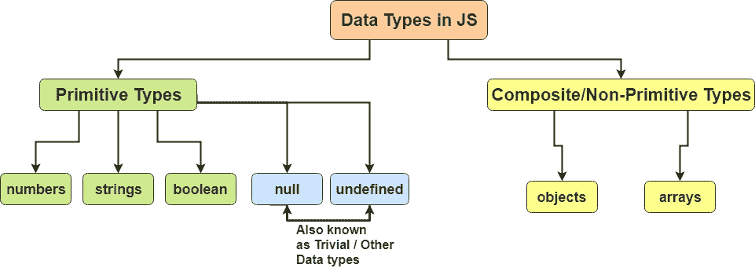

图 12. JavaScript 数据类型

## 变量的声明与初始化

`JavaScript`提供了多种声明和初始化变量的方法。我们探索了：

- 使用`var`关键字声明变量，它具有函数作用域。
- ECMAScript 6（ES6）引入的块作用域变量`let`和`const`。
- 使用`let`和`const`时可变与不可变变量之间的区别。

## 根据变量可变性需求选择`let`和`const`的最佳实践。

## 理解 JavaScript 数据类型

JavaScript 是一种动态类型语言，这意味着变量可以持有任何数据类型的值，而无需显式的类型声明。我们深入探讨 JavaScript 支持的各种数据类型，包括：

- 基本数据类型：`Numbers`、`Strings`、`Booleans`、`null`和`undefined`。
- 复杂数据类型：`Objects`、`Arrays`和`Functions`。
- 特殊数据类型：`NaN`（不是数字）和`Infinity`。

## JavaScript 中的基本数据类型

JavaScript 中的基本数据类型是不可变的，并且直接存储原始值。我们详细详细讨论：

- `Numbers`：表示数值，包括整数、浮点数以及`Infinity`和`NaN`等特殊值。
- `Strings`：用单引号或双引号括的字符序列，支持各种字符串操作。
- `Booleans`：表示`true`或`false`值，对于逻辑操作和条件语句至关重要。
- `null`和`undefined`：分别表示值的缺失或未初始化的变量。

## 复杂数据类型：对象、数组和函数

JavaScript 支持可以持有多个值或可执行代码的复杂数据类型。我们探索了：

- `Objects`：键值对的集合，允许进行结构化数据表示和操作。
- `Arrays`：元素的有序集合，便于迭代、插入和删除等操作。
- `Functions`：可重用的代码块，可以带或不带参数调用，实现了 JavaScript 程序中的模块化和抽象。

## 类型转换与强制转换

JavaScript 采用隐式和显式类型转换机制来动态管理数据类型。我们检查了：

- 隐式类型转换：操作过程中数据类型的自动转换，往往会导致意料之外的行为。
- 显式类型转换：使用内置函数如`parseInt()`、`parseFloat()`、`toString()`等手动进行数据类型转换。
- 类型强制转换：将一种数据类型的值隐式转换为另一种类型以方便操作的过程，可能会对程序行为产生影响。

## JavaScript 中的动态类型

JavaScript 的动态类型允许变量在运行时适应不同的数据类型，提供了灵活性和便利。我们讨论了：

- 动态变量类型：变量可以根据赋值的值动态更改其数据类型。
- 优势与挑战：动态类型增强了灵活性，但需要小心处理以防止意外后果。
- 最佳实践：有效管理动态类型的指南，包括代码可读性和错误处理策略。

## 常见陷阱与最佳实践

虽然 JavaScript 变量和数据类型提供了灵活性，但也引入了潜在的陷阱。我们强调了常见错误和最佳实践：

- 变量命名规范：描述性和有意义的变量名可以增强代码的可读性和维护性。
- 避免全局变量：尽量减少全局变量的使用，以防止命名空间污染和意外副作用。
- 正确的数据类型处理：确保一致的数据类型使用和类型检查，以避免意外的行为和错误。
- 防御性编程：实现错误处理机制和防御性编码实践，以优雅地处理意外场景。

JavaScript 变量和数据类型构成了动态交互 Web 应用的基础。深入这些概念对于掌握 JavaScript 编程和构建健壮、可维护的代码至关重要。通过掌握变量声明、数据类型操作和类型转换的细差别，开发者可以利用 JavaScript 的完整力量创建动态且吸引人的 Web 体验。

## JavaScript 函数与控制结构


JavaScript 经常被称为“Web 语言”，是一种在 Web 开发中广泛使用的强大脚本语言。构建动态和交互的 Web 应用需要理解 JavaScript 的控制结构和函数。在本章中，我们深入研究了 JavaScript 函数和控制结构的语法、用法和最佳实践。

得益于 JavaScript 函数，开发者能够封装可用的代码块，函数是任何 JavaScript 程序的构建模块。在 JavaScript 中，使用`function`关键字来定义函数，后面跟着名称和一组在括号内的参数。例如：

```javascript
function greet(name) {
  return "Hello, " + name + "!";
}
```

在这个示例中，`greet`是一个接收参数`name`并返回问候消息的函数。

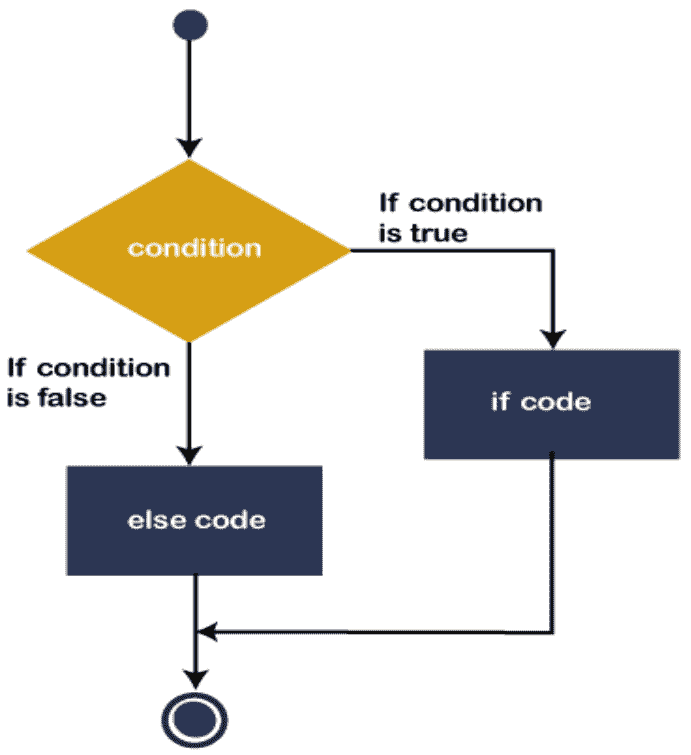

图 13. JavaScript 控制结构

## 函数声明 vs 函数表达式

JavaScript 维护了两种刻画能力的根本方法：函数表达式和函数声明。与将函数赋值给变量的函数表达式不同，函数声明是通过使用`function`关键字后跟名称定义的。例如：

```javascript
// 函数声明 (Function Declaration)
function greet(name) {
  return "Hello, " + name + "!";
}

// 函数表达式 (Function Expression)
var greet = function(name) {
  return "Hello, " + name + "!";
};
```

两种方法都是 JavaScript 中定义函数的有效方式，但它们在提升（hoisting）和作用域方面存在微妙差异。

## 匿名函数与箭头函数

匿名函数（也称为没有名字函数表达式）在 JavaScript 中常用，特别是作为回调函数。ES6 引入的箭头函数为编写函数提供了更简洁的语法。例如：

```javascript
// 匿名函数 (Anonymous Function)
var greet = function(name) {
  return "Hello, " + name + "!";
};

// 箭头函数 (Arrow Function)
var greet = (name) => {
  return "Hello, " + name + "!";
};
```

箭头函数具有隐式返回和词法`this`，使得它们在某些场景下特别有用。

## 函数参数与参数

参数是调用 JavaScript 函数时传递给它的值的占位符。此外，函数可以接受相当多的内容，无论特征定义的边界数量。例如：

```javascript
function sum(a, b) {
  return a + b;
}
sum(2, 3); // 返回 5
sum(2, 3, 4); // 返回 5（忽略额外的参数）
```

JavaScript 在函数内部提供了`arguments`对象来访问所有参数。

## 函数作用域与闭包

在处理 JavaScript 函数时，理解作用域至关重要。JavaScript 函数级作用域，这意味着函数内部定义的变量在外部无法访问。相反，闭包允许函数在父函数执行完毕后保留访问其所在作用域变量的能力。例如：

```javascript
function outer() {
  var name = "John";
  function inner() {
    console.log("Hello, " + name + "!");
  }
  return inner;
}

var greet = outer();
greet(); // 输出 "Hello, John!"
```

在这个示例中，`inner`函数保留了对`outer`函数中定义的变量`name`的访问，展示了闭包的概念。

## JavaScript 控制结构

JavaScript 控制结构（如条件语句和循环）允许开发者控制程序的执行流。

### 条件语句

JavaScript 支持多种条件语句，包括`if`、`else if`和`else`。此外，JavaScript 还提供了三元条件运算符（`condition ? expr1 : expr2`）用于简洁的条件表达式。

```javascript
var age = 20;

if (age >= 18) {
  console.log("You are an adult.");
} else {
  console.log("You are a minor.");
}
```

## 循环

JavaScript 提供了不同循环，包括`for`、`while`和`do-while`循环，用于遍历数组、对象或重复执行代码。例如：

```javascript
// For Loop
for (var i = 0; i < 5; i++) {
  console.log(i);
}

// While Loop
var i = 0;
while (i < 5) {
  console.log(i);
  i++;
}

// Do-While Loop
var i = 0;
do {
  console.log(i);
  i++;
} while (i < 5);
```

## 使用 Try-Catch 进行错误处理

JavaScript`try-catch`语句用于优雅地处理运行时错误。`try`块包含可能抛出异常的代码，而`catch`块则在发生异常时处理该异常。例如：

```javascript
try {
  // 可能抛出错误的代码
  throw new Error("Something went wrong");
} catch (error) {
  // 处理错误
  console.error(error.message);
}
```

JavaScript 函数和控制结构是 Web 开发中的基础概念，使开发者能够创建动态且交互的 Web 应用。通过掌握这些概念，开发者可以为各种 Web 开发项目构建健壮高效的 JavaScript 代码库。

# 使用 JavaScript 进行 DOM 操作

文档对象模型（DOM）是现代 Web 开发的基础组件，必须进行动态操作。得益于 JavaScript 这一与 DOM 交互的强大 Web 工具，开发者可以创建动态交互的 Web 体验。在这部分，我们将深入研究 JavaScript 控制 DOM 的复杂性，探讨其概念、步骤和最佳实践。

## 理解文档对象模型 (DOM)

DOM 是 Web 文档编程接口。它将 HTML 或 XML 记录构建为树结构，每个节点代表一个组件、属性或文本内容。对于使用 JavaScript 动态操作网页，理解 DOM 是本质。

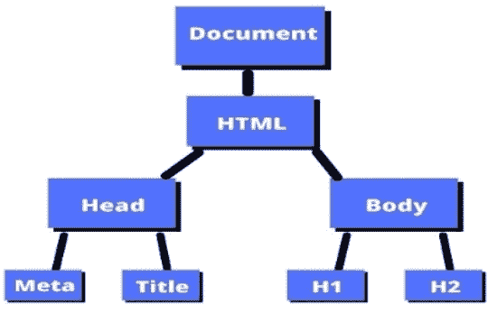

图 14. DOM 操作

## 访问 DOM 元素

JavaScript 提供了多种访问 DOM 元素的方法，允许开发者定位网页上的特定元素。常用方法包括：

- `getElementById()`：通过唯一标识符获取元素。
- `getElementsByClassName()`：通过类名获取元素。
- `getElementsByTagName()`：通过标签名获取元素。
- `querySelector()`和`querySelectorAll()`：使用 CSS 选择器选择元素。

## 修改 DOM 元素

一旦访问了 DOM 元素，JavaScript 允许开发者动态地修改它们的属性、内容和样式。常见操作包括：

- 修改元素属性，如`class`、`id`、`src`、`href`等。
- 使用`innerHTML`、`textContent`和`innerText`属性操作元素内容。
- 使用`style`属性添加、删除或修改 CSS 样式。
- 动态创建新元素并将其添加到 DOM 树。

## 处理事件

事件是系统中发生的动作或情况。JavaScript 允许开发者处理由用户交互或系统事件触发各种事件。与事件处理相关的概念包括：

- **事件监听**：响应特定事件执行的函数。
- **事件传播**：事件在 DOM 树中传播时的处理顺序。
- **事件委托**：一种技术，通过将事件处理委托给共同祖先，高效地处理多个元素上的事件。

## 操作 DOM 结构

除了简单的元素操作，JavaScript 还允许开发者动态操作整个 DOM 结构。这包括：

- **遍历 DOM 树**：在 DOM 树中向上、向下或侧向移动以访问特定元素。
- **克隆和删除元素**：创建元素的副本或将其从 DOM 树中移除。
- **操作元素属性**：添加、删除或修改 DOM 元素的属性。

## 动态内容更新

DOM 操作的主要用途之一根据用户交互或数据变化动态更新内容。动态内容更新的技术包括：

- **Ajax (异步 JavaScript 和 XML)**：从服务器异步获取数据，而无需重新整个网页。
- **单页应用 (SPA)**：使用`React`、`Angular`或`Vue.js`等 JavaScript 框架构建无需完全刷新页面即可动态更新内容的 Web 应用。
- **实时更新**：使用`WebSockets`或服务器发送事件（SSE）实现客户端与服务器之间的实时通信。

### 性能考虑

高效的 DOM 操作对于确保 Web 应用的流畅和响应关至关重要。性能考虑包括：

- **最小化 DOM 操作**：执行批量更新并避免不必要的 DOM 操作。
- **使用高效选择器**：使用最合适的选择器方法优化元素选择。
- **防抖和节流**：优化事件处理器的技术以防止过度调用函数。

## 跨浏览器兼容性

虽然现代浏览器一致支持 DOM API，但跨浏览器兼容性仍然是一个，特别是对于旧浏览器。确保跨浏览器兼容性的策略包括：

- **功能检测**：在在使用特定功能之前检查其可用性。
- **Polyfills**：为缺失的功能实现回备方案，以确保兼容旧浏览器。
- **在多个浏览器上进行测试**：验证 Web 应用在不同浏览器和版本上的行为。

## 安全考虑

DOM 操作开启了潜在的安全漏洞，例如跨站脚本 (XSS) 攻击。保护 Web 应用免受 DOM 基础漏洞的最佳实践包括：

- **清理用户输入**：过滤和验证用户输入以防止恶意脚本执行。
- **避免内联脚本**：尽量减少 HTML 中内联 JavaScript 代码的使用，以降低 XSS 攻击风险。
- **内容安全策略 (CSP)**：实现`CSP`以控制网页上可以加载和执行的资源。

使用 JavaScript 动态操作文档对象模型（DOM）是创建交互动态 Web 应用的强大工具。通过理解 DOM 操作的概念和技术，开发者可以构建丰富的用户体验和响应式 Web 应用。然而，在 Web 开发中使用 DOM 操作时，考虑性能、跨浏览器兼容性和安全性至关重要。

# Web 开发集成开发环境 (IDE) 简介

集成开发环境 (IDE) 在软件开发过程中起着关重要的作用，为开发者提供了强大的工具和功能，以简化 Web 应用的创建、测试和部署。在本章，我们将探索 IDE 在 Web 开发中的重要性，检查流行 IDE 提供的关键功能，并讨论在开发流中有效利用 IDE 的最佳实践。

## IDE 的演变

集成开发环境自诞生以来经历了巨大的演变，以适应开发者不断的需求和技术的进步。早期的 IDE 提供基础的代码编辑和调试功能，而现代 IDE 为跨平台、多语言的 Web 开发提供了全面的工具 set。

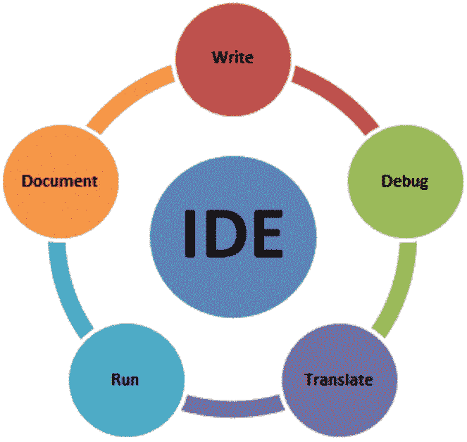

图 15. 集成开发环境 (IDEs)

IDEs 是 Web 开发项目的核心中心，提供了一个集成化的工作区域，让设计人员可以在其中熟练地编写、研究和传递代码。IDEs 对 Web 开发至关重要，原因如下：

- **提高效率**：通过语法高亮、代码补全和项目管理工具等 IDE 特性，提高了开发者的生产力。
- **持续集成**：IDEs 能够与版本控制框架、构建工具和发送阶段无缝集成，畅通开发工作流程。
- **测试与调试**：得益于 IDE 提供的强大调试和测试功能，开发者可以快速识别并修复错误。
- **协作**：通过代码共享、实时协作以及与协作平台的集成等功能，IDEs 使团队成员之间的协作变得更容易。

## Web 开发 IDE 的关键元素

当前的 Web 开发 IDE 提供了许多根据设计人员需求定制的元素。关键特性包括：

- **代码编辑器**：具有许多功能的代码编辑器，包括代码补全、智能代码建议和语法高亮。
- **内置调试器**：内置的调试器，用于在开发期间检测和纠正代码错误。
- **版本控制组合**：与`Git`等版本控制系统无缝集成，便于高效的代码管理和协作。
- **项目管理工具**：在 IDE 内部管理项目文件、依赖项和配置的工具。
- **构建与部署工具**：用于构建、打包和将 Web 应用部署到各种环境的内置工具。
- **扩展性**：支持插件和扩展，可以扩展 IDE 的功能以支持额外的语言、框架和工具。

## 流行的 Web 开发 IDE

Web 开发者广泛使用多种 IDE 来构建现代 Web 应用。一些流行的 IDE 包括：

- **Visual Studio Code**：由微软开发的轻量级开源代码编辑器，支持广泛语言和插件。
- **IntelliJ IDEA**：由 JetBrains 开发的一款强大的 Java IDE，对 Web 开发有广泛支持，包括 HTML、CSS、JavaScript 和 Java。
- **Eclipse**：在 Java 开发者中广行的开源 IDE，通过 Eclipse Web Tools Platform (WTP) 等插件支持 Web 开发。
- **NetBeans**：另一个用于 Java 开发的开源 IDE，通过 HTML、CSS 和 JavaScript 编辑等功能为 Web 开发提供强健的支持。

## 在 Web 开发中使用 IDE 的最佳实践

为了最大限度地发挥 IDE 在 Web 开发中的优势，开发者应该遵循以下最佳实践，例如：

- **自定义 IDE**：根据个人偏好和项目需求配置 IDE，以优化开发体验。
- **学习快捷键**：熟悉常用 IDE 功能的快捷键以提高效率。
- **利用插件和扩展**：探索并安装插件和扩展，以增强 IDE 针对特定任务或技术的 own。
- **利用集成工具**：利用内置的版本控制、调试、测试和部署工具来简化开发工作流。
- **保持 IDE 更新**：定期更新 IDE 及其安装的插件，以获取新功能、错误修复和安全更新。

集成开发环境（IDEs）在 Web 进中扮演着至关重要的角色，为工程师提供了有效构建现代 Web 应用所需的设备和元素。通过理解 IDE 的重要性、了解关键元素并遵循公认的使用程序，工程师可以利用 IDE 提高效率并畅通开发周期。

# 第 2 章

## Java Servlets 简介

### Java Servlets 概述

Java Servlets 成了 Java 服务端编程的基础组件，为开发者提供了一种处理 HTTP 请求和生成动态内容的强大机制。在本章中，我们将深入探讨 Java Servlets 的复杂性，探索它们在 Web 开发中的角色、Servlet 生命周期、编写 Servlets、处理 HTTP 请求和响应、会话管理、Servlet 过滤器、错误处理、最佳实践等。

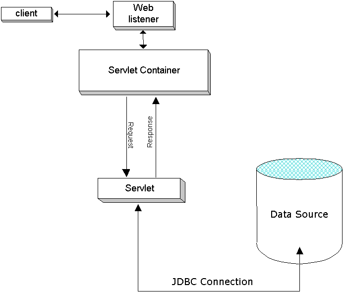

图 1. Java Servlets

Java Servlets 是基于 Java 的服务端组件，允许在 Web 服务器内进行动态内容生成和客户端请求处理。Servlet 遵循 Java Servlet API 规范，该规范规定了开发 Java Web 应用的一标准接口和类。

Servlets 为构建交互性和数据驱动的 Web 应用提供了一个健壮且可扩展的平台，使其成为 Web 开发中不可或缺的一部分。它们是基于 Java Web 应用的基础，处理 HTTP 请求、生成动态内容、管理会话状态、与数据集协作，这仅仅是开始。

### Servlet 生命周期

理解 Servlet 生命周期对于真正创建 Servlets 至关重要。生命周期包括几个阶段，如实例化、初始化处理和销毁。Servlet 容器处理 Servlet 实例的生命周期，在适当的时间调用生命策略，例如`init()`、`service()`和`destroy()`。

### 编写 Servlets

创建 Servlets 包括编写继承`HttpServlet`类的 Java 类，并执行处理特定类型 HTTP 请求的策略。根据应用服务器和 Servlet 规范的版本，可以使用注解或部署描述 (`web.xml`) 在 Web 应用中部署 Servlets。

### 处理 HTTP 请求和响应

Servlets 通过`HttpServletRequest`和`HttpServletResponse`对象与客户端交互，这两个对象分别代表传入请求和活动响应。Servlets 可以从请求对象中提取参数、标头和其他信息，根据应用逻辑动态生成响应。

### 会话管理

会话管理是 Web 开发的基础部分，允许 Servlets 维护客户端会话并在跨请求存储会话信息。Servlets 可以使用`HttpSession`对象来管理会话状态、存储客户端详细信息并在整个会话期间跟踪客户端协作。

### Servlet 过滤器

Servlet 过滤器是一种强大的方式，可以在请求到达 Servlet 之前或在响应生成之后拦截并处理 HTTP 请求和响应。过滤器可以执行验证、日志、压缩和加密等任务，提高 Web 应用的安全、性能和实用性。

### 错误和异常处理

Servlets 使用错误处理机制（如错误页面、异常处理程序和自定义错误处理逻辑）优雅地处理错误和异常。适当的错误处理可以确保客户端获得有用的错误信息，并确保应用程序保持健壮和灵活。


# Servlet 开发的最佳实践

为了确保基于 Servlet 的 Web 应用的质量、安全和可行性，设计人员应当遵循最佳实践，如关注点分离、输入验证和清理、资源管理、测试和调查以及安全考量。

Java Servlets 为使用 Java 构建动态且直观的 Web 应用程序提供了灵活且强大的平台。通过理解 Servlets 在 Web 开发中的作用、掌握 Servlet 的生命周期、编写真正的 Servlet 以及遵循既定的 Servlet 开发流程，工程师可以使用 Servlets 构建强大、适应性强且安全的 Web 应用程序，以解决现代客户和组织面临的问题。

## 设置 Java 开发环境

Java 开发环境 (JDE) 为开发者提供了有效编写、调试和部署代码所需的资源和工具。它是构建既具扩展性又健壮的 Java 应用程序的基础。在本章中，我们将介绍设置 Java 开发环境的复杂细节。我们将讨论最重要的部分、如何设置它们，以及确保开发顺利进行且高效的良好方法。

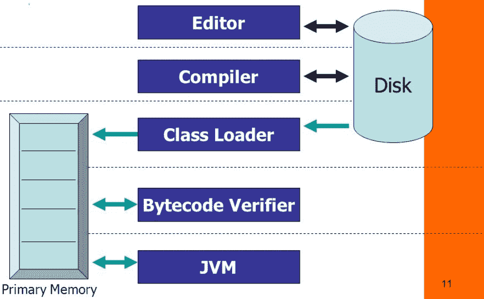

图 2. Java 开发环境

Java 开发环境包含了一套旨在支持 Java 开发活动的工具、库和框架。一个配置良好的 JDE 可以促进代码编写、调试、测试和部署，使开发者能够高效地构建高质量的 Java 应用程序。

### Java 开发环境的组件

一个完整的 Java 开发环境通常包含以下部分：

- **Java 开发包 (JDK)**：JDK 包含 Java 运行时 (JRE)、编译器、调试器和其他开发工具，它对于编译、调试和运行 Java 代码至关重要。
- **集成开发环境 (IDE)**：集成开发环境 (IDEs) 提供语法高亮、代码补全以及与版本控制的集成，并为编写、编辑、调试和管理 Java 代码提供统一的工作空间。
- **构建工具**：如 `Apache Maven`、`Gradle` 和 `Maven` 等构建工具将常见的 Java 应用程序收集、测试和打包方式自动化，处理项目执行和依赖目标。
- **软件服务器**：`Apache Tomcat`、`WildFly` 和 `IBM WebSphere` 等应用服务器提供了部署和运行 Java Web 应用程序的运行时，支持 servlet 容器、JSP 支持和数据库连接等功能。
- **版本控制系统**：`Git`、`Subversion (SVN)` 和 `Merge` 等版本控制框架允许协作开发和代码构建，允许工程师跟踪更改、管理分支并一致地合并代码更改。

### 介绍 Java 开发包 (JDK)

设置 Java 开发环境中最关键的阶段是引入 Java 开发包 (JDK)，它为 Java 开发提供了关键工具和库。安装过程可能会根据工作框架而异，但通常包括从权威网站下载 JDK 安装程序、运行安装程序以及配置 JDK 路径。

### 配置集成开发环境 (IDE)

由于 IDE 提供了一套全面的 Java 开发工具和功能，因此对开发者来说是至关重要的。安装 IDE 软件、设置项目设置、设置代码格式和风格的偏好以及与版本控制系统集成，都是 IDE 配置的一部分。`IntelliJ IDEA`、`Eclipse` 和 `NetBeans` 是 Java 开发中流行的 IDE。

### 配置构建工具

构建工具通过自动化 Java 应用程序的编译、测试和打包来简化开发过程。安装构建工具软件、创建构建配置、指定项目依赖和定义构建任务通常都是构建工具设置过程的一部分。在 Java 生态系统中，流行的构建工具包括 `Apache Maven` 和 `Gradle`。

### 设计应用程序服务器

应用服务器提供传输和运行 Java Web 应用程序的运行时环境，支持例如 servlet 容器、JSP 支持和数据库网络等元素。安装应用服务器软件、部署 Web 应用程序、配置服务器设置和管理服务器资源都是应用服务器配置的一部分。`Apache Tomcat`、`WildFly` 和 `IBM WebSphere` 是 Java 应用服务器的知名选择。

### 版本控制系统的集成

版本控制系统允许开发者无缝地跟踪更改、管理分支并合并代码更改，同时促进协作开发和代码版本控制。将版本控制框架与 Java 开发环境集成包括引入版本控制程序、设计存档设置和执行初始库配置。在 Java 开发中，`Git`、`Subversion (SVN)` 和 `Mercurial` 是经常使用的版本控制系统。

### Java 开发环境设置的最佳实践

为了确保顺利且高效的开发体验，工程师应当遵循设置 Java 开发环境的最佳实践：

- 使用 JDK、IDE、构建工具和应用服务器的最新稳定版本，以使用新功能、错误修复和性能改进。
- 根据项目标准和编码规范配置 IDE 设置、代码格式和风格偏好，维护代码的一致性和可读性。
- 定期更新软件插件、库和依赖，以修复兼容性问题、提高性能并修复安全漏洞。
- 使用版本控制框架管理代码更改、同事协作并跟踪项目历史，以确保代码的完整性和可追溯性。

在软件开发生命周期中，设置 Java 开发环境是一个至关重要的步骤，为创建既具扩展性又健壮的 Java 应用程序奠定了基础。通过引入 Java 开发包 (JDK)、配置集成开发环境 (IDE)、设置构建工具和应用服务器以及协调版本控制框架，工程师可以建立一个有助于 Java 应用程序开发的有效且高效的开发环境。

## Servlet 生命周期：初始化、服务和销毁

Java Servlet 的生命周期是理解其在 Web 开发背景下行为和功能的一个基础方面。Servlet 作为服务器端组件，会经历从初始化到销毁的一系列定义良好的阶段，每个阶段在处理客户端请求和生成动态内容方面都起着特定作用。在本章中，我们将深入研究 Servlet 生命周期的细节，详细探索初始化、服务和销毁阶段。

### 理解 Servlet 生命周期

Servlet 生命周期指的是 Servlet 实例在其生命周期内所经历的阶段序列。这些阶段包括初始化、服务处理和销毁。每个阶段在处理客户端请求、处理业务逻辑和有效管理资源方面都起着至关重要的作用。

### 初始化阶段

初始化阶段标志着 Servlet 实例在 Servlet 容器内的创建和初始化。Servlet 初始化可以通过两种主要机制发生：

- **容器初始化**：Servlet 实例在 Web 应用程序启动过程中由 Servlet 容器创建并初始化。此过程涉及调用 Servlet 的 `init()` 方法来执行任何必要的初始化任务，例如设置资源、加载配置设置或建立数据库连接。

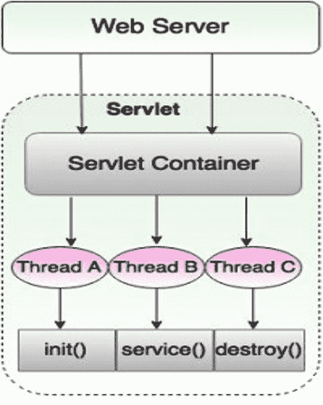

图 3. Servlet 生命周期

### 懒初始化

Servlet 实例也可以采用懒初始化，这意味着它们在容器接收到对 Servlet 的第一个请求时被创建并初始化。懒初始化通过仅在需要时创建 Servlet 实例来节省资源，但可能会在处理第一个请求时引入一些开销。

### 服务处理阶段

服务处理阶段是 Servlet 执行其主要功能——即处理客户端请求并动态生成响应的阶段。在此阶段，Servlet 容器会调用 Servlet 实例的 `service()` 方法来处理每个传入的 HTTP 请求。`service()` 方法接收两个对象作为参数：

- `HttpServletRequest`：一个封装客户端请求的对象，包括请求参数、头部信息（headers）和其他元数据。
- `HttpServletResponse`：一个表示要回给客户端的响应的对象，包括响应头部、状态码和内容。

在 `service()` 方法内部，Servlet 处理请求，执行任何必要的业务逻辑或数据操作，并动态生成响应。此阶段是实现 Servlet 核心功能的地方，例如从数据库检索数据、渲染动态内容或调用应用程序中的其他组件。

### 销毁阶段

销毁阶段标志着 Servlet 生命周期的结束，Servlet 容器会移除 Servlet 实例并释放任何关联资源。Servlet 销毁通常发生在 Web 应用程序关闭，或者容器由于应用程序配置的变化或资源限制决定卸载 Servlet 时。销毁期间，容器调用 Servlet 实例的 `destroy()` 方法来执行任何清理任务，如关闭数据库连接、释放内存或释放外部资源。

### 处理生命事件

除了核心生命阶段外，Servlet 还可以通过 Servlet API 提供的监听器接口处理生命事件。`ServletContextListener`、`ServletRequestListener` 和 `HttpSessionListener` 是监听器接口的示例，它们允许 Servlet 响应容器级事件，如应用程序启动、请求初始化以及会话的创建/销毁。通过实现监听器接口并在部署描述符或使用注解注册监听器类，Servlet 可以响应生命事件执行额外任务或执行自定义逻辑。

### 生命周期管理的最佳实践

为了确保高效且可靠的 Servlet 生命周期管理，开发者应该遵循以下最佳实践，例如：

- **妥当的资源管理**：确保数据库连接、文件句柄和内存分配等资源得到妥善管理和释放，以避免资源泄漏和性能问题。
- **线程安全**：编写线程安全的 Servlet 代码，以有效处理并发请求并防止竞态条件或同步问题。
- **优雅停机**：实现优雅停机机制以优雅地处理 Servlet 销毁，如释放资源、保存状态以及通知已连接的客户端。
- **生命事件处理**：利用 Servlet 生命周期事件和监听器接口根据需要执行额外的初始化、清理或监控任务。

Servlet 生命周期是 Java Web 开发中的基础概念，规范了 Servlet 容器内 Servlet 实例的创建、操作和销毁。通过理解 Servlet 生命的初始化、服务处理和销毁阶段，开发者可以构建稳健、可扩展且可维护的 Web 应用程序，满足现代用户和企业的需求。

## 处理 HTTP GET 和 POST 请求

全球通信的基础是 HTTP（超文本传输协议），它使得客户端和服务器交换数据更容易。在 Web 开发中，请求和传输数据有两种主要的 HTTP 方法：POST 和 GET。在本章中，我们将查看如何在 Java Servlets 中处理 HTTP GET 和 POST 请求。我们将对比分析这两种方法，查看它们的使用方式，并讨论部署请求处理逻辑的最佳方法。

### 理解 GET 和 POST

在互联网上检索和传输数据的 HTTP 方法是最广泛使用的两种类 HTTP 方法。虽然这两种策略满足了向服务器派遣的相似需求，但它们在行为、用途和特性上有所不同。

HTTP GET 方法用于从服务器获取数据。通常，参数使用 HTTP GET 方法作为查询字符串添加到 URL 中。因为 GET 请求是等等的（idempotent），多个完全相同的请求将产生相同的结果。检索文档、图像和网页等资源经常使用 GET 请求。

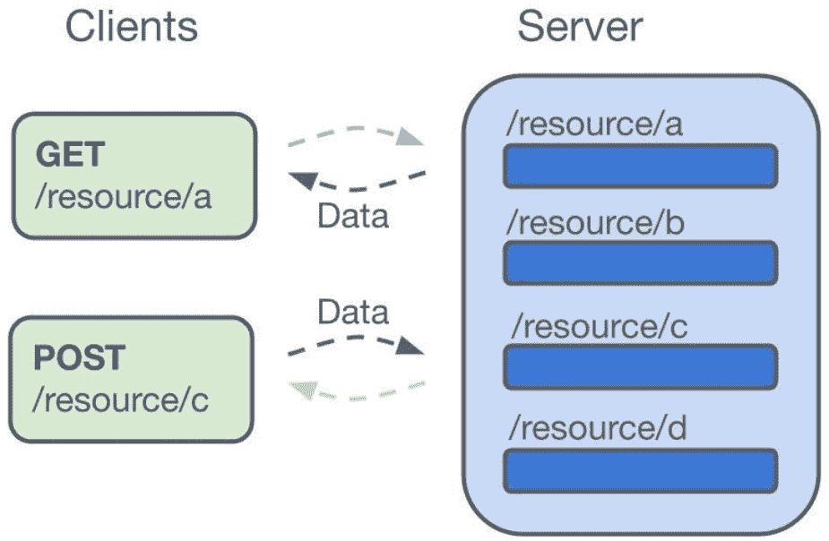

图 4. HTTP GET 和 POST 请求

### HTTP POST 方法

数据通常使用 HTTP POST 方法提交到服务器，作为 API 请求或表单提交的一部分。POST 要求在消息体中通信信息，与 GET 请求相比，它考虑了更大的有效负载和更复杂的信息结构。由于 POST 请求是非等等的，服务器的状态可能会因为每个请求而产生不同的影响。

### 在 Servlets 中处理 HTTP GET 请求

Servlet 可以通过执行 `doGet()` 方法来处理 HTTP GET 请求，该方法由 Servlet 容器者在获取到 GET 请求时调用。在 `doGet()` 方法中，工程师可以分离请求边界、处理请求，并根据请求 URL 给出的边界创建相应的响应。

实现 `doPost()` 方法（由 Servlet 容器在接收到 POST 请求时调用）允许 Servlet 处理 HTTP POST 请求。在 `doPost()` 策略中，设计者可以从请求体中提取请求边界，处理请求信息并同样产生响应。

### doGet() 和 doPost() 策略的对比

`doGet()` 和 `doPost()` 策略之间的主要区别在于它们处理请求边界和信息传输的方式。`doPost()` 从请求体获取参数，而 `doGet()` 则从请求 URL 获取参数。此外，可能超过 GET 请求 URL 长度限制的敏感或大量数据通常使用 `doPost()` 提交。

### 处理 HTTP GET 和 POST 请求的最佳实践

为了确保基于 Servlet 的 Web 应用程序的性能、安全可行可行，设计者在处理 HTTP GET 和 POST 请求时应遵循最佳实践，包括：

- 验证并消毒输入信息以防止安全漏洞，例如注入攻击和跨站脚本攻击（XSS）。
- 使用 `HTTPS`（安全 HTTP）在网络上通信敏感信息，以确保机性和完整性。
- 为了优雅地处理处理过程中的错误和失败，实现相应的错误和异常处理机制。
- 在 HTTP GET 和 POST 方法之间进行选择时，应考虑性能因素，特别是对于大型负载和频繁的请求。
- 遵循设计 Web API 的规范，充分利用 HTTP 方法处理 CRUD（增删改查）活动。

### 案例与示例

若干案例研究和示例展示了如何在 Java Servlets 中实现 HTTP GET 和 POST 方法的请求处理逻辑。这些模型涵盖了结构输入、编程接口端点以及从数据集中检索信息等场景。

处理 HTTP GET 和 POST 请求是利用 Java Servlets 改进网络的关键部分。通过理解这两种策略的区别，成功地执行请求处理逻辑，并遵循规定的安全和执行程序，设计人员可以构建强大且灵活的 Web 应用程序，解决当前客户和组织的问题。

## Servlet 映射与 URL 模式

Servlet 映射和 URL 模式是 Java Web 开发中的基本概念，对于将 HTTP 请求路由到 Web 应用程序中相应的 Servlet 和资源至关重要。在本章中，我们将深入探讨 Servlet 映射和 URL 模式的复杂性，探索它们的意义、语法、配置方法以及在基于 Servlet 的 Web 应用程序中进行有效路由和资源管理的最佳实践。

### 理解 Servlet 映射

Servlet 映射是将 Servlet 与 Web 应用程序内的特定 URL 模式或请求路径关联的过程。Servlet 映射决定了传入的 HTTP 请求如何路由到相应的 Servlet 以进行处理并生成动态内容。

### Servlet 映射的重要性

Servlet 映射对于组织和管理 Web 程序的结构至关重要，它允许开发者为访问不同的资源和功能定义清晰直观的 URL 模式。适当的 Servlet 映射可以确保 HTTP 请求被高效处理，并让用户能够无缝导航 Web 应用程序。

### URL 模式的语法

URL 模式遵循 Servlet API 定义的特定语法，允许开发者指定匹配规则和模式，将 Servlet 映射到请求 URL。URL 模式的语法包括：

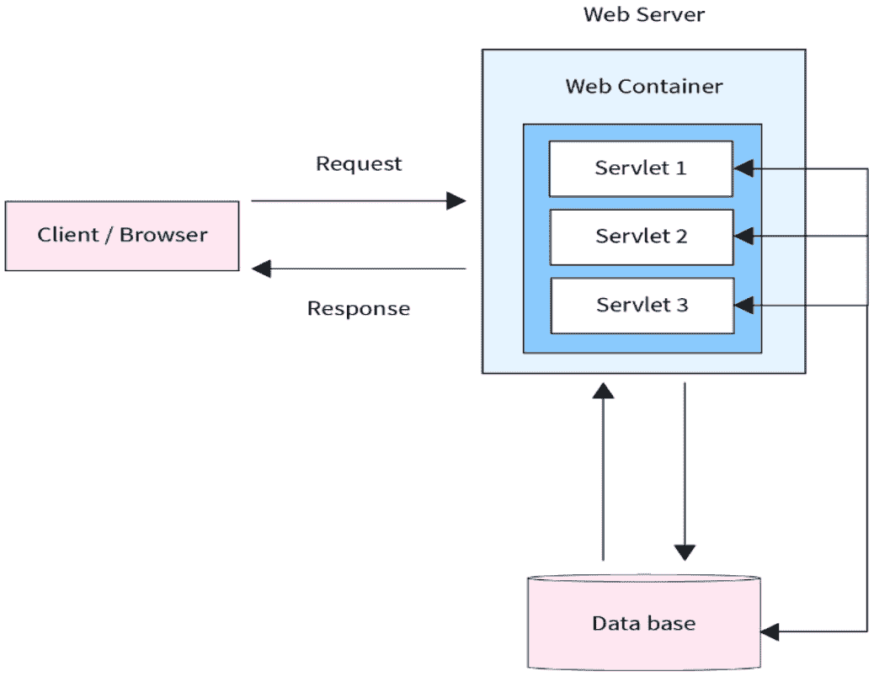

图 5. Servlet 映射

- **字面量匹配**：特定 URL 模式的精确匹配，例如 `/login` 或 `/home`。
- **通配符匹配**：使用通配符（如 `*`）进行模式匹配，允许灵活地匹配 URL 模式。
- **路径匹配**：基于路径段的模式匹配，实现 Servlet 到 URL 路径的层级映射。
- **默认 Servlet 映射**：用于处理不匹配任何式 Servlet 映射的请求的特殊映射，通常用于提供静态资源或错误页面。

### Servlet 映射的配置方法

可以根据使用的 Servlet 容器或应用程序服务器配置不同的方法。常用的配置方法包括：

- **部署描述符 (web.xml)**：基于 XML 的配置文件，使用 `<servlet>` 和 `<servlet-mapping>` 元素定义 Servlet 映射。
- **Servlet 注解**：Servlet 3.0 规范引入的 Java 注解，如 `@WebServlet`、`@WebFilter` 和 `@WebListener`，允许在 Servlet 类中进行声明式 Servlet 映射。
- **编程注册**：使用 `ServletContext` 方法（如 `addServlet()` 和 `addMapping()`）进行动态 Servlet 注册，允许在运行时进行编程配置。

### URL 模式的类型

Servlet 映射中的 URL 模式可以根据其匹配规则和行为分为不同类型。常见的 URL 模式包括：

- **精确匹配**：匹配模式中指定的请求 URL 的映射。
- **前缀匹配**：匹配以指定前缀开头的请求 URL，随后是任何额外的路径段。
- **扩展名匹配**：匹配具有特定文件扩展名（如 `.html` 或 `.jsp`）的请求 URL 的映射。
- **默认 Servlet 映射**：用于处理不匹配任何式 Servlet 映射的请求的特殊映射，通常用于提供静态资源或错误页面。

### Servlet 映射的最佳实践

为了在 Java Web 应用程序中确保高效且可行的 Servlet 设计，工程师应当遵循最佳实践，例如：

- 使用有意义且具描述性的 URL 模式，反映 Web 应用程序的结构和功能。
- 尽量避免覆盖或冲突 Servlet 映射，以防止不确定性并确保意料之外的请求引导。
- 明智地使用默认 Servlet 映射处理不匹配任何明确 Servlet 映射的请求，确保合理的错误处理和资源权约。
- 利用单元测试、集成测试和端到端测试充分测试 Servlet 映射，以确认在不同情况下的准确性和稳定质量。
- 定期审查和更新 Servlet 映射，以适应变化的应用程序需求、扩展性需求和用户反馈。


对于基于 Servlet 的 Web 应用程序，Servlet 映射和 URL 模式是核心组件，允许开发者定义简单的路由规则来处理 HTTP 请求。通过理解 Servlet 映射的语法、配置方法、类型和最佳实践，开发者可以创建高效、可扩展且易于维护的 Web 应用程序，同时满足现代企业和用户的需求。

## Servlet Context 与配置

Servlet 设置和设计是 Java Servlets 的基本部分，它们负责 Servlet 之间的通信、管理全局资源以及安排 Servlet 行为。本章将重点关注 Servlet Context 和配置的复杂性，研究它们在 Web 开发中的功能、角色和最佳实践。

### 理解 Servlet Context

Servlet 在 Web 应用程序中运行的环境称为 `Servlet Context`。它作为一个中心存储库，用于在 Servlet 和其他应用程序组件之间共享配置、资源和信息。

### Servlet Context 的特性

`ServletContext` 具有几个关键特性，使其在基于 Servlet 的 Web 开发中不可或缺：

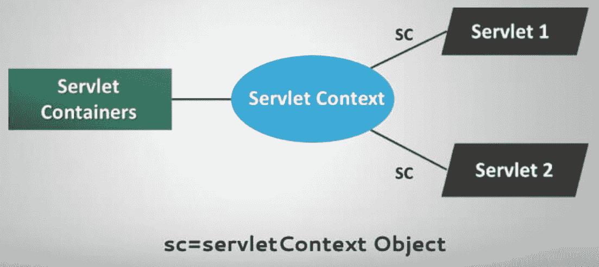

图 6. Servlet Context

- **应用范围**：`Servlet Context` 作用于应用级别，这意味着它在整个 Web 应用程序的生命周期内持续，并且可供应用所有的 Servlet 和资源访问。
- **单例实例**：每个 Web 应用程序只有一个 `ServletContext` 实例，确保了管理应用范围资源和配置的一致性和协调性。
- **线程安全**：`Servlet Context` 是线程安全的，允许多个线程并发访问和修改其属性而不会产生数据损坏或不一致的风险。

### 获取 Servlet Context

Servlet 可以通过 `ServletContext` 接口获取当前 Web 应用程序关联的 `Servlet Context` 引用。`Servlet Context` 通常使用继承自 `ServletConfig` 接口的 `getServletContext()` 方法获取，所有 Servlet 都实现了该接口。

### Servlet Context 属性

`Servlet Context` 包含了一组用于存储和检索配置、对象和应用范围数据的属性。Servlet 设置属性适用于相同 Web 应用程序内的所有 Servlet，通常用于共享资源和设计边界。

### Servlet 配置

Servlet 配置（Servlet Configuration）封装了在部署描述符（`web.xml`）或使用注解定义的初始化参数。初始化参数提供了一种在部署时配置 Servlet 行为的方法，无需修改 Servlet 代码，从而增强了灵性和可维护性。

## 获取 Servlet 配置

Servlet 可以使用继承自 `GenericServlet` 类的 `getServletConfig()` 方法来获取其配置设置和初始化参数。Servlet 配置允许 Servlet 访问初始化参数、Servlet 名称以及与 Servlet 实例相关的 `Servlet Context`（Servlet 上文）。

## Servlet 配置与 Servlet Context

虽然 Servlet 配置和 `Servlet Context` 在配置 Servlet 行为和共享应用级资源方面用途相似，但它们在范围和访问性上有所不同：

- `Servlet Configuration` 特定于单个 Servlet 实例，允许在 Servlet 级别自定义 Servlet 行为。
- `Servlet Context` 是应用级范围的，同一个 Web 应用程序内的所有 Servlet 都可以访问，为共享资源和配置提供了全局范围。

## Servlet Context 和配置的实际应用

`Servlet Context` 和配置在基于 Servlet 的 Web 开发中有多种实际应用，包括：

- **共享应用级资源**：`Servlet Context` 促进了同一 Web 应用程序内 Servlet 之间数据库连接、线程池和其他资源的共享。
- **配置 Servlet 行为**：`Servlet Configuration` 允许通过初始化参数自定义 Servlet 行为，例如指定数据库连接参数、日志级别安全设置。
- **实现跨切关注点**：`Servlet Context` 和配置对于实现日志、安全和缓存等跨切关注点非常重要，这些点会影响应用程序内的多个 Servlet。

## Servlet Context 和配置的最佳实践

为了在 Web 开发中有效利用 `Servlet Context` 和配置，开发者应该遵循以下最佳实践，例如：

- **集中化配置**：将配置设置和应用级资源集中在 `Servlet Context` 中，以提高一致性和可维护性。
- **不可变初始化参数**：将初始化参数视为不可不可的，并避免在运行时修改它们，以防止意外行为并确保线程安全。
- **模块化**：对 Servlet 和应用组件进行模块化处理，以减少对 `Servlet Context` 的依赖，并促进封装和重用性。
- **配置管理**：使用外部配置文件、环境变量或依赖注入框架来管理配置设置，减少 Servlet 与配置细节之间的耦合。

`Servlet Context` 和配置是 Java Servlet 中不可或缺的组件，它们允许 Servlet 之间的通信，促进资源共享并在 Web 应用中配置 Servlet 行为。通过理解 `Servlet Context` 和配置相关的角色、功能和最佳实践，开发者可以有效利用这些组件构建健壮、可扩展且可配置的基于 Servlet 的 Web 应用，满足现代用户和企业的需求。

### 在 Servlet 中处理表单数据

表单在应用程序中随处可见，是用户与其交互并服务器发送数据最常见的方式。在本节中，我们将研究在 Servlet 中处理结构化信息的复杂性，涵盖了结构接纳、信息验证、处理结构边界以及安全监控客户端输入等主题。

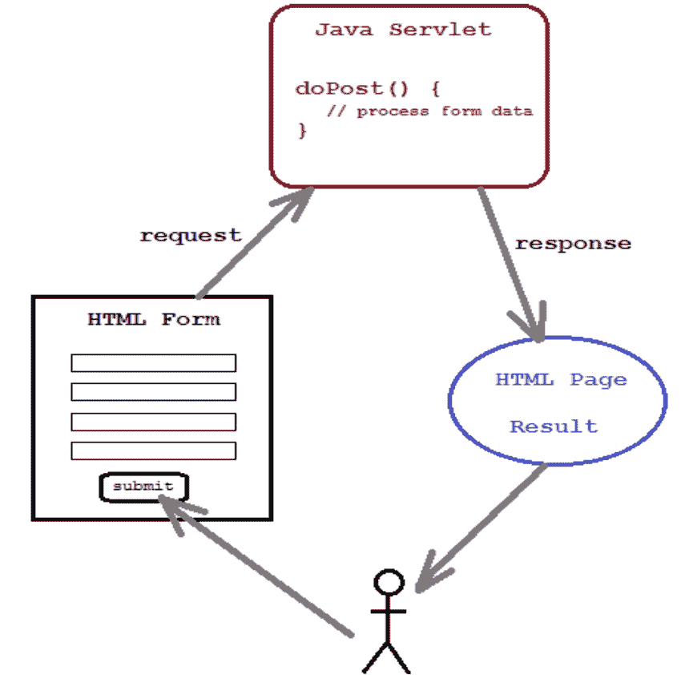

图 7 Servlet 中的表单数据

表单在 Web 开发中起着至关重要的作用，允许用户输入数据并提交到服务器进行处理。表单用于各种目的，包括用户注册、登录、数据输入和反馈提交。了解如何有效处理表单数据对于构建交互且用户友 Web 应用至关重要。

### 表单提交方法

表单可以使用两种主要方法提交到服务器：`GET` 和 `POST`。每种方法都有其优势和场景：

- `GET`：将表单数据作为 URL 查询字符串的一部分提交。适用于从服务器检索数据或提交少量的非敏感数据。
- `POST`：将表单数据作为 HTTP 请求体的一部分提交。适用于安全地提交大量数据或敏感信息。

### 创建 HTML 表单

HTML 提供了一系列表单元素和属性，用于在网页中创建交互式表单。常见的表单元素包括文本输入、密码输入、复选框、单选按钮、选择下拉列表和文本区域。开发者可以使用 CSS 和 JavaScript 自定义表单的外观和行为，以增强用户体验。

### 在 Servlet 中处理表单数据

Servlet 作为 HTTP 请求的一部分接收表单数据并进行处理以执行用户身份验证、数据校验和数据库操作等各种任务。Servlet 使用 `HttpServletRequest` 类提供的方法从请求对象中提取表单参数，并根据接收到的数据执行必要的操作。

#### 处理表单参数

Servlet 使用 `HttpServletRequest` 类提供的 `getParameter()`、`getParameterValues()` 和 `getParameterMap()` 等方法访问客户端提交的表单参数。表单参数根据 HTML 表单元素中指定的名称进行检索，并可以进行处理以执行验证、数据转换和业务逻辑操作。

#### 验证表单数据

数据验证是 Servlet 处理表单数据的一个重要方面，可确保用户输入的完整性、一致性和安全性。Servlet 可以通过检查必填字段、验证数据类型、强制长度限制以及执行自定义验证逻辑来验证表单数据。验证后的数据随后可以在后续处理步骤中安全地使用。

#### 处理文件上传

HTML 表单可以包含文件输入字段，允许用户将文件上传到服务器。Servlet 可以通过 `getPart()` 方法从请求对象中提取上传的文件，并将其保存到服务器的文件系统或直接在内存中处理。Servlet 还可以验证上传的文件、强制执行大小限制并执行安全检查，以防止恶意文件上传。

#### 安全地管理用户输入

在 Servlet 中处理表单数据时，安全性至关重要，以防止跨站脚本 (XSS)、SQL 注入和跨站请求伪造 (CSRF) 等常见漏洞。Servlet 应当对客户端输入进行消毒，根据预定义设计审核信息，消除特殊字符并使用定义的查询来防止注入攻击。此外，为了保护用户数据并防止未经授权的访问，Servlet 应该实施输入验证、输出编码和会话管理等措施。

## 处理结构信息的最佳实践

为了保证 Servlet 中 Web 结构的可靠性、安全性和便利性，工程师应当遵循最佳实践，例如：

- **执行服务器端验证**：在服务器端执行全面的表单数据验证，以补充客户端验证并防止篡改。
- **使用 HTTPS 进行安全通信**：使用 `HTTPS` 加密表单提交，保护传输过程中的敏感数据并防止篡改和窃听。
- **使用最小权限原则**：为了减少数据暴露和未经授权访问的风险，将表单处理 Servlet 的访问限制在授权的用户和角色内。
- **频繁更新安全设置**：更新服务器软件、库和框架，以修复已知漏洞并防御新威胁。
- **在用户中培养良好习惯**：引导客户端安全地与 Web 形状通信的最佳方法，例如，尽量不要通过不稳定的组织共享敏感数据，并检查结构条目的真实性。

Web 开发的一个基本部分是在 `Servlets` 中处理表单数据，这允许开发者创建交互性和数据驱动的 Web 应用程序。通过理解表单提交原理、处理表单参数、验证用户输入以及安全地管理数据，开发者能够构建健壮安全的 Web 表单，满足用户需求并防御常见的安全威胁。

# HTTP 请求和响应头部

在 Web 应用程序中，HTTP（超文本传输协议）头部对于促进客户端服务器之间的通信至关重要。它们包含了与 HTTP 请求和响应关联的重要元数据，提供了有关消息、来源和预期接收者的数据。在本章中，我们将探讨 HTTP 头的复杂性，重点关注它们的结构、常用字段以及对 Web 开发的重要性。

### 理解 HTTP 头部

在 HTTP 请求和响应的头部部分，包含了键值对。它们被用于许多用途，例如发送消息元数据、控制缓存工作方式、协商内容编码以及实施安全措施。在分布式 Web 应用程序中，客户端（如移动应用或网络浏览器）与服务器（如 Web 服务器或应用服务器）之间的通信是通过 HTTP 头部实现的。

HTTP 头的结构如下：头部值后跟着冒号和一个可选的空格。单个 HTTP 消息可以包含多个头部，每个头部之间用换行符分隔。通用头部、请求头部、响应头部和实体头部是 HTTP 协议中使用的不同类型的 HTTP 头部。

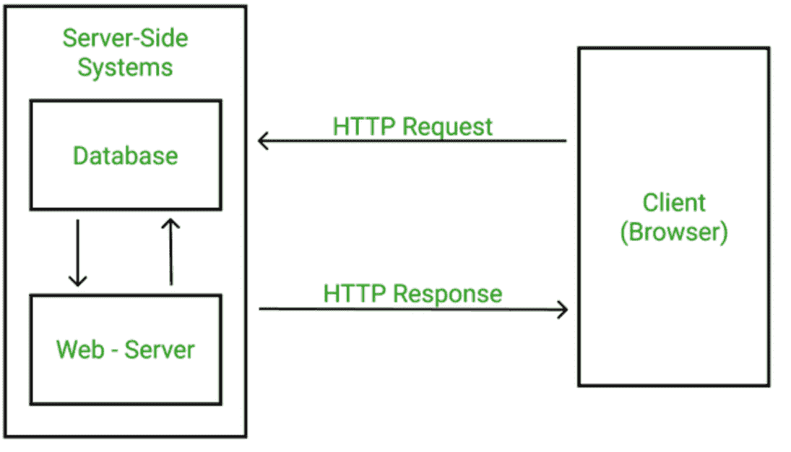

图 8. HTTP 请求和响应头部

### 常见 HTTP 请求头部

HTTP 请求头部包含了包含客户端、被请求资源以及处理请求的额外上下文详情。一些常见的 HTTP 请求头部包括：

- `User-Agent`：识别请求的客户端应用程序或程序。
- `Host`：指定请求的目标主机和端口。
- `Accept`：识别客户端接受的响应内容的媒体格式。
- `Authorization`：作为验证客户端连接服务器的手段。
- `Cookie`：包含客户端发送到服务器的 Cookie。

### 常见 HTTP 响应头部

HTTP 响应同样包含了传递服务器信息、响应状态以及处理响应额外指南的头部。一些常见的 HTTP 响应头部包括：

- `Server`：确定在服务器上运行的产品和适配版本。
- `Content-Type`：识别响应内容的媒体类型。
- `Content-Length`：以字节指定响应体的大小。
- `Cache-Control`：控制客户端和中间服务器的缓存行为。
- `Set-Cookie`：通过在客户端设置 Cookie 来维护会话状态。

### HTTP 头部在 Web 开发中的作用

HTTP 头部在 Web 开发中起着基础作用，影响 Web 应用程序的执行、安全性能等不同部分。利用 HTTP 头部，开发者可以自定义 Web 服务器和客户端的行为，实施跨源资源共享 (CORS) 和内容安全策略 (CSP) 等安全措施，并优化缓存行为。

### 自定义 HTTP 头部

除了 HTTP 标准定义的标准头部外，设计人员还可以自定义 HTTP 头部，以便在客户端和服务器之间传递应用程序特定的元数据。客户端服务器通信协议、会话管理和请求认证都是可以使用自定义头部实现的功能示例。

在处理 HTTP 头部时，开发者应遵循最佳实践以确保 Web 应用程序的有效性和可靠性。最佳实践包括：

1. **利用标准头部**：为了确保各种客户端和服务器之间的兼容性和互操作性，请尽可能使用标准 HTTP 头部。
2. **防止头部溢出**：为了保持 HTTP 消息简单清晰，限制自定义头部的数量并避免过度泛滥。
3. **头部安全设置**：安全地安排 HTTP 头部以防止安全漏洞，例如跨站脚本 (XSS)、跨站请求伪造 (CSRF) 和点击劫持攻击。
4. **头部增强**：升级 HTTP 头部的使用以限制上述问题并进一步提升性能，特别是在高流量 Web 应用程序中。

HTTP 协议头部至关重要，因为它们为 Web 应用程序的客户端服务器通信提供了关键元数据。开发者通过理解其结构和重要性，可以有效利用 HTTP 头部。这确保用户在各种客户端平台和网络环境中拥有统一的用户体验。

# 使用 RequestDispatcher 进行转发和包含

RequestDispatcher 是 Java Servlets 中的重要部分，用于在 Web 应用程序内部的不同 Servlet 或资源之间发送和包含请求。在本章中，我们将概述 RequestDispatcher 的细节，研究如何使用它、其优势以及转发和包含请求的最有效方法。

### 了解 RequestDispatcher

RequestDispatcher 是 Servlet 编程接口提供的连接点，允许 Servlet 将请求转发到相同 Web 应用程序内的其他 Servlet 或资源。它通过促进各个组件之间的无缝通信和协作，提高了 Web 应用程序的模块化和重用性。

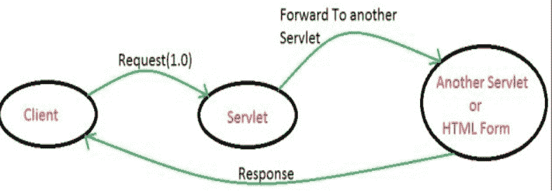

图 9. RequestDispatcher

### 使用 RequestDispatcher 转发请求

使用 RequestDispatcher 转发请求涉及控制权从一个 Servlet 转移到另一个，而客户端感知不到变化。此过程对客户端是透明的，允许 Servlet 协作处理请求并生成响应。转发通常用于实现 MVC（模型-视图-控制器）架构并将表现逻辑与业务逻辑分离。

### 使用 RequestDispatcher 包含响应

RequestDispatcher 还支持在同一个请求周期内包含其他 Servlet 或资源的响应。与转移控制权到另一个 Servlet 的转发不同，包含允许多个 Servlet 构建同一个响应。这种机制对于从多个组件组合复杂响应或在应用程序的不同部分复用常用内容非常有用。

### 转发与包含：用例与考虑因素

理解何时使用转发何时使用包含对于设计高效可维护的基于 Servlet 的 Web 应用程序至关重要。一些关键考虑因素包括：

- 转发适用于将处理逻辑委托给另一个 Servlet 并允许其生成整个响应。
- 当多个 Servlet 需要构建同一个响应，或者需要将可复用组件包含应用程序的不同部分时，包含更为理想。

根据应用程序的特定需求明智地使用转发和包含可以提高代码的模块化、可维护性和重用性。

在 Servlet 开发中使用 RequestDispatcher

为了在 Servlet 开发中有效使用 `RequestDispatcher`，开发者需要理解其 API 并将其无缝集成到应用程序逻辑中。一些常见的用法场景包括：

- 将请求转发到 `Servlets` 或 `JSP` 页面以进行处理并生成动态内容。
- 包含来自其他 `Servlets` 或资源的响应，以组合复杂或可重用的内容。
- 通过将请求转发到错误处理 `Servlets` 或页面，优雅地处理异常和错误。
- 通过将请求转发到充当控制器的 `Servlets` 来实现 MVC 架构，然后由这些('器委托给相应的视图进行渲染。

## 使用 RequestDispatcher 的最佳实践

为了确保基于 Servlet 的 Web 程序的健壮性、可维护性和性能，开发者在使用 `RequestDispatcher` 时应遵循最佳实践。一些推荐的实践包括：

- 适当的异常处理：在使用 `RequestDispatcher` 时优雅地处理异常，以避免请求处理流的中断。
- 避免循环转发：通过仔细控制应用程序内部请求和转发的流，防止无限循环和栈溢出错误。
- 优化资源使用：尽力减少不必要的转发和包含操作，以节省服务器资源并提高应用程序性能。
- 模块化应用程序逻辑：将相关功能封装在单个 `Servlets` 或组件中，以促进代码重用和可维护性。
- 测试和调试：使用单元测试、集成测试和调试工具对 `Servlets` 和 `RequestDispatcher` 操作进行彻底测试，以确保正确性和可靠性。

## 真实示例与用例

几个真实示例展示了 `RequestDispatcher` 在基于 Servlet 的 Web 开发中的实际应用。这些示例包括：

- 使用转发和包含操作实现多步骤注册流程，引导用户完成注册表单的不同阶段。


创建动态仪表板页面，包含可重用的组件，如用户配置信息、近期活动馈以及来自不同`Servlets`或服务的通知。

开发一个模块化的电子商务应用程序，其中不同的`Servlets`分别处理商品浏览、购物车管理、订单处理和支付集成，并通过`RequestDispatcher`促进无缝通信。

`RequestDispatcher`是Java `Servlets`中用于转发和包含请求的强大工具，使开发者能够构建模块化、可维护且高效的Web应用程序。通过理解请求转发和包含的原理，掌握`RequestDispatcher` API的用法，并遵循Servlet开发的最佳实践，开发者可以利用`RequestDispatcher`创建满足现代用户和企业需求的健壮且可扩展的基于Servlet的Web应用程序。

## Servlet Filters：介绍与实现

Servlet过滤器（Filters）是Java Web开发的基础组件，为开发者提供了一种强大的机制，用于拦截Web应用程序内部的HTTP请求和响应。在本章中，我们将探索过滤器的概念、它们在`Servlet API`中的作用，以及实现过滤器的实际示例，以增强Web应用程序的功能、安全性和性能。

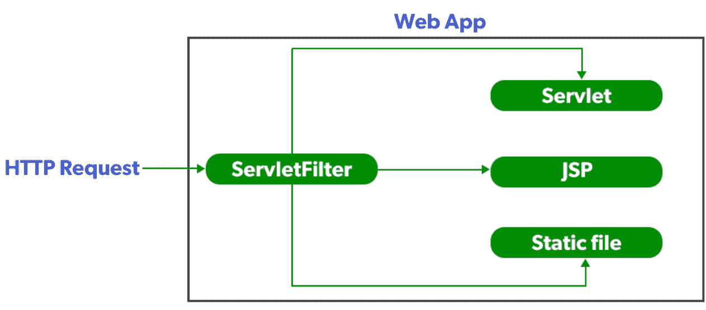

图 10. Servlet Filters

### 了解 Servlet Filters

Servlet过滤器是Java类，它们在HTTP请求到达`Servlet`之前或在响应产生之后进行拦截。请求预处理、响应后处理、身份验证、授权、日志记录、压缩和加密都是在过滤器的位置完成的。通过拦截请求和响应，过滤器允许开发者实现适用于应用程序中多个`Servlets`的跨切关注点。

### Servlet Filters 在 Web 改进中的作用

Servlet过滤器在提高Web应用程序的实用性、安全性和执行效率方面起着至关重要的作用。过滤器扮演着重要角色，例如：

- 验证与批准：执行确认和批准系统以控制对应用程序内部受保护资源的访问。
- 请求和响应处理：预处理传入的请求并后处理输出的响应，根据需要修改头、内容或其他属性。
- 日志记录与监控：记录请求和响应信息以用于调试、监控和审计，例如跟踪用户交互和系统性能。
- 压缩与加密：在通过网络传输敏感信息时对数据进行压缩或加密，以减少带宽占用并增强安全性。
- 异常处理：在异常传播到`Servlet`之前进行拦截和处理，或生成自定义错误响应，优雅地处理错误和异常。

### Servlet Filter 生命周期

Servlet过滤器的生命周期由三个阶段组成：初始化、请求处理和销毁。在初始化期间，过滤器根据部署描述符或注解的配置参数进行实例化。在请求处理期间，过滤器拦截进入请求和输出响应，应用指定的过滤器逻辑。最后，在销毁期间，过滤器被销毁并从内存中释放，从而释放资源。

### 实现 Servlet Filters

开发者必须编写一个实现`javax.servlet`的Java类来实现Servlet过滤器。需要重写`doFilter()`方法并实现接口。在`doFilter()`方法内部，工程师可以执行自定义通道逻辑来预处理传入的请求、后处理活动响应或执行某些其他核心任务。此外，开发者可以通过在部署描述符（`web.xml`）中配置过滤器映射或使用注解，指定哪些URL或`Servlets`应被过滤器拦截。

### Servlet Filters 的实际示例

为了说明Servlet过滤器的用途，让我们考虑一些可以使用过滤器的常见场景：

- 身份验证过滤器：实现身份验证过滤器以便在访问应用程序内的受保护资源之前强制用户身份验证。
- 日志过滤器：记录请求和响应信息（包括头、参数和内容），用于调试、监控或审计。
- 压缩过滤器：使用`gzip`或`deflate`编码压缩响应数据，以减少带宽占用并提高页面加载速度。
- 安全过滤器：实现安全过滤器以强制安全策略，例如防止跨站脚本(XSS)攻击或强制内容安全策略(CSP)。

## Servlet Filter 开发的最佳实践

为了确保Servlet过滤器的有效性、可靠性和可维护性，开发者应遵循以下最佳实践：

- 保持过滤器无状态：避免使用实例变量，以确保过滤器保持无状态且线程安全，以便在多个请求之间重用。
- 适当的异常处理：在过滤器内部优雅地处理异常并生成相应的错误响应，以防止应用程序流中断。
- 可配置与灵活：设计可配置且灵活的过滤器，允许开发者通过配置参数或注解调整过滤器行为。
- 测试与验证：使用单元测试、集成测试和端到端测试对过滤器进行彻底测试，以验证各种条件和边界情况下的过滤器逻辑。
- 文档化与维护：为过滤器提供全面的文档，包括使用说明、配置选项和示例，以便于维护和故障排除。

Servlet过滤器是Java Servlet API中一种强大且多功能的特性，为开发者提供了一种灵活的机制，用于拦截和处理Web应用中的HTTP请求和响应。通过理解Servlet过滤器的作用、掌握过滤器生命周期、有效实现过滤器并遵循过滤器开发的最佳实践，开发者可以利用过滤器来增强Web应用程序的功能、安全性和性能。

## 在 Servlet 中处理会话管理

会话管理是Web开发的一个关键方面，它允许Web应用程序跨多个请求与客户端保持有状态的交互。在本章中，我们将深入探讨Servlet中会话管理的复杂性，探索会话的重要性、有效管理会话的技术，以及确保安全性和可扩展性的最佳实践。

### 理解 Servlet 中的 Session

Servlet中的Session代表了客户端与服务器之间的逻辑关联，允许服务器为单个客户端维护状态信息。每个Session通过一个Session ID唯一标识，该ID通常存储在Cookie中或附加在URL后。Session在Web应用程序中维护用户身份验证、管理用户偏好和跟踪用户交互方面起着至关重要的作用。

### HttpSession 接口

在Java Servlet中，会话管理通过`HttpSession`接口实现，该接口提供了创建、访问和操作Session对象的方法。`HttpSession`接口允许Servlet存储和检索Session属性、失效Session以及管理Session超时。理解`HttpSession`接口对于在Servlet中有效实现会话管理逻辑至关重要。

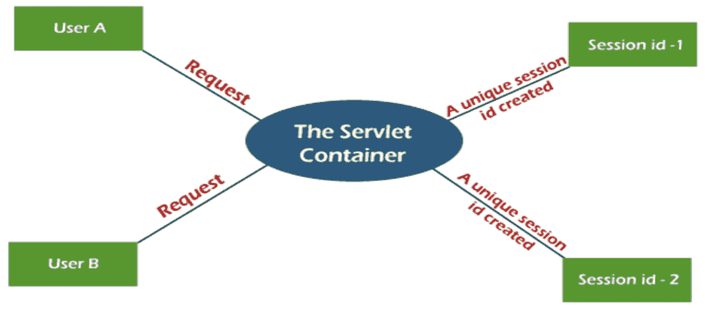

图 11. Servlet 中的会话管理

### 创建和访问 Session

Servlet中的Session是当客户端向服务器发送第一个请求时由Servlet容器自动创建的。Servlet可以`HttpServletRequest`对象的`getSession()`方法访问与当前请求关联的`HttpSession`对象。一旦建立Session，Servlet就可以使用`setAttribute()`和`getAttribute()`等方法存储和检索Session属性。

### Session 属性

Servlet中的Session属性是键值对，代表与特定Session关联的数据。Servlet可以将各种类型的数据存储为Session属性，包括用户偏好、身份验证令牌、购物车物品以及应用程序特定的状态信息。谨慎管理Session属性以避免内存泄漏并优化性能至关重要。

### 会话跟踪机制

Servlet容器利用不同的工具来实现跟踪，包括Cookie、URL重写和隐藏结构字段。Session ID由Cookie存储在客户端侧，这是会话跟踪的最常用机制。在链接和表单提交的URL中添加Session ID被称为URL重写。隐藏结构字段允许ID作为结构项特征进行通信，而无需在URL中暴露它们。

### 会话管理策略

在Servlet中有效的会话管理涉及实现管理Session生命周期、处理Session超时以及确保Session安全的策略。会话管理的一些关键策略包括：

- **设置Session超时**：配置Session超时值以控制会话时长，防止Session无期活跃。
- **实现Session监听器**：使用Session监听器接口监控Session生命周期事件并执行清理任务，例如移除过期的Session或释放Session资源。
- **保护Session**：通过使用安全Cookie、HTTPS和加密技术实施措施，保护Session免受会话劫持、会话固定和窃取等安全威胁。

### 会话复制与集群

在分布式Web应用程序中，由于需要会话复制和集群，会话管理变得更加复杂。会话复制涉及跨多个服务器实例同步Session数据，以确保容错和可扩展性。Servlet容器和应用服务器通过粘性会话（sticky sessions）、会话持久化和分布式缓存等技术，为会话复制和集群提供内置支持。

### 会话管理的最佳实践

为了确保Servlet会话管理的可靠性、安全可扩展性，开发者应遵循以下最佳实践：

- **最小化Session数据**：仅存储必要的Session数据以减少内存消耗并提高性能。
- **加密Session数据**：对敏感的Session数据进行加密，保护其免受未经授权的访问和拦截。
- **优雅地处理Session超时**：建立错误处理机制以优雅地处理Session超时并给用户提供实用的错误信息。
- **监控Session活动**：关注Session活动和性能指标，发现潜在的障碍并使会话管理运行得更好。

跟踪状态是Web改进的基础部分，使Web应用程序能够与客户端保持有状态通信并传递定制化的客户端体验。通过研究`HttpSession`接口、执行有效的跟踪策略并遵循Servlet中跟踪状态的认可程序，设计师可以构建出健壮、灵活且安全的Web应用程序，解决当前客户和组织的问题。

## 在 Servlet 中处理 Cookie

Cookie在Web开发中起着重要作用，允许Web应用程序在客户端存储和恢复客户端显式数据。本章将深入探讨Java Servlet中管理Cookie的复杂性，并讨论有效Cookie管理的用途、结构、生命周期、安全最佳实践。

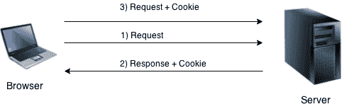

图 12. Servlet 中的 Cookie

Cookie是互联网浏览器存储在客户端的微量信息，通常以键值对的形式存在。它们用于维护状态数据、跟踪客户端偏好并实现Web应用程序与客户端之间的定制化连接。在每次HTTP请求和响应中，Cookie都会从客户端发送到服务器，允许Web应用程序存储用户特定数据并跟踪其会话状态。

### Cookie 在 Web 开发中的用途

Cookie在Web开发中有多种用途，包括：

- **会话管理**：Cookie常用于管理用户会话并维护会话标识，允许Web应用程序跨多个请求识别并跟踪用户。
- **个性化**：Cookie允许Web应用程序根据用户偏好、语言设置和之前的交互个性化内容和用户体验。
- **跟踪**：Cookie可用于跟踪用户行为（如页面查看、点击和交互），以分析使用模式并提供定向广告或推荐。
- **身份验证**：Cookie通常用于用户身份验证，存储身份验证令牌或会话标识以验证用户身份并授予受限资源的权限。

### Cookie 的结构

Cookie由定义其结构和行为的属性组成，包括：

- **名称(Name)**：Cookie的名称，作为访问其值的键。
- **值(Value)**：与Cookie关联的值，通常为字符串或编码数据。
- **过期时间(Expiration)**：Cookie的过期日期和时间，到期后将失效并应由浏览器丢弃。
- **Domain（域）**：Cookie所属的域，指定了Cookie的访问范围。
- **Path（路径）**：域内适用于Cookie的路径，将Cookie的可见性限制在特定的URL路径上。
- **Secure flag（安全标记）**：一个标记指示Cookie是否仅通过安全的HTTPS连接传输。
- **HttpOnly flag（HttpOnly标记）**：一个标记指示Cookie是否仅能通过HTTP请求访问，而不能通过JavaScript等客户端脚本访问。

## Cookie 的生命周期

Cookie具有定义的生命周期，决定了它们的创建、传输、过期和删除。Cookie的生命周期通常涉及以下阶段：

- 创建：Cookie由Web服务器创建，并作为HTTP响应的一部分发送给客户端。
- 存储：客户端在本地存储Cookie，并在后续指向同一服务器的HTTP请求中包含它们。
- 传输：Cookie随着每个HTTP请求和响应在客户端和服务器之间传输，允许Web维护会话状态并交换用户特定数据。
- 过期：Cookie具有服务器设置的过期日期和时间，到期后客户端会自动将其丢弃。
- 删除：客户端可能会根据浏览器设置手动或自动删除Cookie，清除存储的数据并终止Cookie的生命周期。

## 在 Servlet 中处理 Cookie

Java Servlet通过`HttpServletRequest`和`HttpServletResponse`对象为处理Cookie提供了内置支持。Servlet可以创建、检索、修改和删除Cookie以管理会话状态、存储用户偏好并跟踪用户交互。在Servlet中处理Cookie的一些常见任务包括：

- 创建Cookie：Servlet可以通过向`HttpServletResponse`对象添加`Cookie`对象并在HTTP响应中将其发送给客户端来创建Cookie。
- 检索Cookie：Servlet可以使用`HttpServletRequest`对象获取HTTP请求中发送的Cookie，从而访问存储的数据和会话标识符。
- 修改Cookie：Servlet可以在通过HTTP响应发回客户端之前，通过更新其属性（如值、过期、域和路径）来修改现有Cookie。
- 删除Cookie：Servlet可以通过将Cookie的过期日期设置为过去的值来删除Cookie，指示客户端在接收时将其丢弃。

## Cookie 的安全考量

虽然Cookie对Web开发至关重要，但如果处理不当，它们也会带来安全风险。在Servlet中处理Cookie的一些安全考量包括：

- 数据隐私：Cookie可能包含敏感信息，如用户标识符、身份验证令牌和会话标识符，需要加密或哈希以防止未经授权的访问。
- 跨站脚本(XSS)：如果进行进行的验证和清理，Cookie可能会受到XSS攻击，允许攻击者注入恶意脚本并窃取敏感数据。
- 跨站请求伪造(CSRF)：用于身份验证或会话管理的Cookie如果没有防CSRF令牌或同站Cookie属性的保护，可能会受到CSRF攻击。
- 安全传输：在不安全的HTTP连接上传输的Cookie可能会被攻击者拦截或篡改，因此必须使用HTTPS和`secure`标记属性以确保机密性和完整性。

## Cookie 管理的最佳实践

为了降低安全风险并确保基于Servlet的Web应用中Cookie的正常运行，开发者应该遵循以下最佳实践，例如：

- 限制Cookie大小：避免在Cookie中存储过多或不必要的数据，以最小化网络开销并提高性能。
- 设置过期日期：为Cookie设置适当的过期日期，平衡会话持久性与安全及隐私问题。
- 使用安全属性：对于包含敏感信息的Cookie，启用`secure`和`HttpOnly`标记，以防止XSS攻击和数据窃取。
- 实现安全传输：通过安全的HTTPS连接传输Cookie，以防止来自攻击者的拦截和篡改。
- 定期审计Cookie：检查并审计Web应用中使用的Cookie，以识别安全漏洞、隐私问题和性能问题。

Cookie是现代Web开发中本质的组成部分，允许Web应用维护会话状态、存储用户偏好并个性化用户体验。通过理解在Servlet中处理Cookie的目的、结构、生命周期、安全考量和最佳实践，开发者可以有效利用Cookie来增强基于Servlet的Web应用的功能、易用性和安全性。

## 使用 Servlet 上传文件

文件上传是Web应用中的常见需求，允许用户将图像、文档和其他类型的文件提交到服务器进行处理或存储。Servlet为基于Java的Web应用提供了处理文件上传的强大机制，允许开发者实现健壮且安全的文件上传功能。在本章中，我们将探索使用Servlet上传文件的过程，涵盖了关键概念、最佳实践和实现技术。

通过Web表单，用户可以使用带有文件上传功能的Web表单从本地机器上传文件到Web服务器。包括多媒体网站、文件共享平台和文档管理系统在内的广泛Web应用都需要此功能。Servlet为Java Web应用中处理记录传输提供了一种灵活且高效的方法，让工程师对传输周期拥有精细的控制。

### 理解文件上传过程

文件上传过程涉及几个步骤，包括：

- 创建带有文件输入字段的HTML表单：用户使用带有`<input type="file">`元素的HTML表单选择要上传的文件。
- 将表单提交到Servlet：当提交表单时，所选文件将作为HTTP POST请求的一部分发送到服务器。
- 在Servlet中处理上传的文件：Servlet接收作为请求部分的上传的文件并进行相应的处理，例如将其保存到磁盘、存储在数据库中或执行额外的验证。

## 在 Servlet 中处理文件上传


Servlet 通过`HttpServletRequest`对象为处理文件上传提供了内置支持。开发者可以使用`getPart()`或`getParts()`等方法访问上传的文件，这些方法返回表示单个文件上传的`Part`对象。`Part`对象提供了检索有关上传文件信息的方法（如名称、内容类型和大小），以及作为`InputStream`读取其内容的方法。

# 编写文件上传 Servlet

要在 Servlet 中实现文件上传功能，开发者需要：

1. 配置 HTML 表单将文件提交到 Servlet。
2. 在 Servlet 中解析`multipart/form-data`请求以提取上传的文件。
3. 根据需要处理上传的文件，例如保存到磁盘或存储在数据库中。

## 使用 Servlet 上传文件的最佳实践

为了确保基于 Servlet 的 Web 应用中文件上传功能的安全、可靠性能，开发者应该遵循以下最佳实践，例如：

- 验证上传的文件：验证上传的文件符合某些标准，如文件大小限制、允许的文件类型和是否存在恶意内容。
- 清理文件名：移除或替换文件名中潜在危险的字符，以防止目录遍历等安全漏洞。
- 安全处理文件存储：将上传的文件存储在服务器的安全位置（例如 Web 根目录之外），以防止对上传文件的未经授权访问或执行。
- 实现错误处理：提供信息错误消息并优雅地处理异常，引导用户完成文件上传过程并缓解潜在问题。

# 彻底测试文件上传功能：使用各种文件类型、大小和配置测试文件上传功能，以确保在不同条件下的健壮性和可靠性。

## 高级文件上传技术

除了基础的文件上传功能外，Servlets 支持处理文件上传的高级技术，例如：

- **异步文件上传**：使用`Servlet 3.0`异步请求处理来异步处理文件上传，提高性能和可扩展性。
- **流式文件上传**：直接将大文件流至磁盘或数据库，而不在内存中缓冲整个文件，从而减少内存占用并提高效率。
- **分块文件上传**：将大文件分成较小的块并按顺序上传，实现断点续传上传并更好地处理网络中断。

文件上传是许多 Web 应用程序的核心功能，Servlets 为基于 Java 的 Web 应用程序处理文件上传提供了一种可靠且高效的方法。通过理解文件上传过程、遵循 Servlets 文件上传的最佳实践并探索高级文件上传技术，开发者可以实现满足现代 Web 应用程序需求的健壮且安全的文件上传功能。

## Servlets 中的错误处理与异常处理

Web 应用程序的开发严重依赖错误和异常处理，以确保用户收到有用的反馈，并使 Web 应用程序能够优雅地处理意外情况。在此部分，我们将深入研究 Servlets 中错误处理和特殊情况处理的标准，调查构建强大稳定 Web 应用程序的最佳实践、标准流程和技术。

### 理解错误处理与特殊情况处理

错误处理指的是管理 Web 应用程序执行过程中可能发生的错误和意外情况的最常见方式。异常处理则显式地管理应用程序代码或 Servlet 抛出的 Java 特殊情况。

### Servlets 中错误处理与异常处理的重要性

错误处理和异常处理出于几个原因至关重要：

- **确保应用程序的健壮性**：适当的错误处理防止意外错误导致应用程序崩溃，并确保在不利条件下继续运行。
- **增强用户体验**：有效的错误处理为用户提供丰富的错误信息以及解决问题的指导，提升整体用户体验。
- **便于故障排除和调试**：异常处理机制帮助开发者快速识别和诊断错误，有助于开发和维护期间的故障排除和调试工作。

### Servlets 中的错误处理机制

Servlets 提供了多种处理错误和异常机制，包括：

- **错误页面**：Servlets 可以在`web.xml`部署描述符中定义错误页面，在发生错误时显示自定义错误消息或将用户重定向到特定的错误处理 Servlet。
- **异常处理**：Servlets 可以`service()`方法中使用`try-catch`块捕获并处理异常，或将异常处理委托给中央错误处理 Servlet。
- **错误代码和消息**：Servlets 可以在 HTTP 响应中设置错误代码和错误消息，以指示错误性质并向客户端提供额外信息。

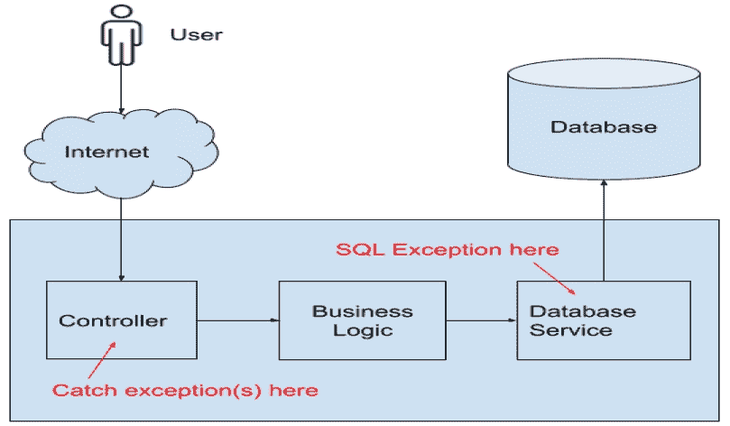

图 13 异常处理

### Servlets 中的异常处理策略

在 Servlets 中有效的异常处理涉及实现以下策略：

- **识别并记录异常**：Servlets 应使用`Log4j`或`java.util.logging`等日志框架记录异常，记录错误信息以便故障排除和分析。
- **通知用户**：Servlets 应向用户提供信息丰富的错误消息，指示错误性质并建议解决措施。
- **优雅降级**：在发生错误时，Servlets 应该优雅地降低功能，确保即使某些组件或服务不可用，核心功能仍然可用。
- **集中错误处理**：Servlets 可以将异常处理委托给中央错误处理 Servlet 或框架组件，由该组件负责跨应用程序统一处理异常。

### Servlets 错误处理与异常处理的最佳实践

为了确保 Servlets 中有效的错误处理和异常处理，开发者应该遵循以下最佳实践，例如：

- **使用 try-catch 块**：Servlets 应使用`try-catch`块捕获并优雅处理异常，防止它们传播到 Servlet 容器并导致应用程序崩溃。
- **自定义错误页面**：Servlets 应定义自定义错误页面，为用户提供丰富的错误信息并引导他们完成解决过程。
- **日志与监控**：Servlets 应使用日志框架记录异常并监控应用程序日志，以检测和解决反复出现的错误和性能问题。
- **错误恢复和重试机制**：Servlets 应实现错误恢复和重试机制，以便从瞬态错误中自动恢复并在尽可能重试失败的操作。

### 案例研究与示例

本节提供了真实的案例研究和示例，展示了基于 Servlet 的 Web 应用程序中有效的错误处理和异常处理策略。示例包括：

- 针对不同 HTTP 错误代码（404、500 等）的自定义错误页面
- Servlet 过滤器中用于日志和监控的异常处理
- 响应服务失败时的功能优雅降级

错误处理和特殊情况处理是 Servlet 改进的基础组成部分，确保 Web 应用程序能够敏捷地处理错误、保持应用程序能力并提供积极的客户端体验。通过遵循最佳实践、理解错误处理的基础、实施高效的异常处理策略并构建这些应用程序，开发者可以创建满足用户和企业需求的健壮可靠的基于 Servlet 的 Web 应用程序。

## Servlet 开发最佳实践

Servlets 为 Java Web 应用程序处理 HTTP 请求、创建动态内容和管理会话状态提供了强大的平台。为了保证基于 Servlet 的 Web 应用程序的可靠性、安全可行性，工程师在整个开发生命周期中应坚持最佳实践。本章审查了一套全面的 Servlet 开发最佳实践，包括代码组织、输入验证、资源管理、测试、调试和安全性考虑。

### 有效关注点分离

为了避免资源泄漏、性能瓶颈和系统不稳定，基于 Servlet 的 Web 应用程序需要有效的资源管理。通过遵循以下最佳实践，Servlets 能够有效地管理数据库连接、文件句柄、网络套接字和内存分配等资源：

- 利用`with-assets`声明在使用后自然地关闭资源。
- 限制资源的使用方式以减少资源竞争并使其更易扩展。
- 在通常不预期释放资源时明确地交付资产，以允许框架资源释放并防止内存溢出。

Servlet 开发需要大量的测试和调试，以确保应用程序的正确性、可靠性和健壮性。工程师应当结合单元测试、集成测试和端到端测试，以确认 Servlets 在不同情况和场景下的行为。此外，工程师还应该使用故障排除工具和程序来识别并修复基于 Servlet 的应用程序中的错误、异常和执行问题。

## 安全考量

未经授权的访问、数据泄露和拒绝服务攻击只是影响基于 Servlet 的 Web 应用程序的安全威胁之一。开发者应该实施以下安全措施来降低这些风险：

- **身份验证**：在允许用户访问受保护资源之前，确保用户与其所声称的身份一致。
- **授权**：根据角色和权限授权访问控制，以限制客户端的权限和许可。
- **加密**：对传输中和存储的敏感数据进行加密，以防止数据窃取和窃听。
- **输入验证**：确保用户输入经过验证和清理，以避免 XSS、注入攻击和其他安全漏洞。
- **问题解决**：实施适当的错误处理程序以防止信息泄露并减少安全事件的影响。

## 性能优化

优化基于 Servlet 的 Web 应用程序的性能对于提供响应迅速且高效的用户体验至关重要。开发者应该采用以下性能优化技术，例如：

- **缓存**：缓存频繁访问的数据和资源以降低延迟并提高响应速度。
- **异步处理**：利用异步 Servlet 和非阻塞 I/O 高效处理并发请求。
- **最小化资源消耗**：通过最小化内存使用、减少数据库查询和优化算法效率来优化资源消耗。
- **负载均衡**：将传入的请求分布到多个服务器上，以均匀分布负载并提高可扩展性和可靠性。

## 文档与注释

清晰、全面的文档对于基于 Servlet 的 Web 应用程序至关重要，便于团队成员之间的理解、维护和协作。开发者应该记录应用程序的重要方面，包括：

- 高层架构和设计决策。
- Servlet 类和方法的 API 文档。
- 配置设置和部署说明。
- 解释复杂算法、业务逻辑和设计模式的代码注释。

## 持续集成与部署

持续集成和部署（CI/CD）实践可以加速基于 Servlet 的 Web 应用程序的交付，提高代码质量并简化开发工作流。工程师应当将自动化构建、测试和组织流水线整合到开发交互中，以：

- 自动化代码的编译、测试和部署等任务。
- 在开发周期早期识别并修复集成问题。
- 确保部署交互在各种环境下的一致性和稳定质量。

## 版本控制

版本控制对于管理基于 Servlet 的 Web 应用程序的更改、跟踪以及同事之间的协作至关重要。使用`Git`等版本控制系统，开发者应该：

- 跟踪源代码、配置记录和各种资源的变化。
- 对代码更改进行分支和合并，以支持并行开发和组件扩展。
- 通过共享代码、评审更改和解决冲突，团队成员进行协作。

遵循 Servlet 开发的最佳实践对于构建强大、安全且实用的解决当前客户和组织问题的 Web 应用程序至关重要。通过遵循代码组织、输入验证、资源管理、测试、调试、安全考量、性能优化、文档、持续集成与部署以及版本控制等最佳实践，开发者可以确保基于 Servlet 的项目取得成功，并为用户提供高质量的软件解决方案。

# 第 3 章

## JavaServer Pages (JSP)

## JavaServer Pages (JSP) 简介

JavaServer Pages (JSP) 是一种创建动态内容的技术，是 Java Web 开发中的一项关键创新。本章将深入探讨 JSP 的基础，包括其架构、功能、优势和使用指南。

![JSP 架构]

图 1. JavaServer Pages (JSP)

### 理解 JavaServer Pages (JSP)

JavaServer Pages (JSP) 是一种允许开发者在 HTML 中嵌入 Java 代码以创建动态网页的技术。JSP 页面在运行时由应用服务器转换为 servlets，从而实现对客户端请求的处理和动态内容的生成。

### JSP 在 Web 开发中的作用

JSP 使得在 Java Web 开发中更容易将表现逻辑与业务逻辑分离。JSP 页面通过响应客户端请求执行服务器端逻辑并创建动态内容。

### JSP 架构

JSP 架构由多个组件组成：

- **JSP 页面**：包含 HTML 标记和嵌入 Java 代码的文本文档。
- **JSP 引擎**：Web 服务器或应用服务器的一部分，负责将 JSP 页面转换为 servlets 并编译和执行。
- **Servlet 容器**：托管 servlets 并管理其生命周期的运行时环境，包括处理请求、调用 servlet 方法和生成响应。

### JSP 功能

JSP 提供了丰富的功能，使其成为 Web 开发中灵活且强大的技术，包括：

- **与 HTML 轻松集成**：JSP 允许开发者在 HTML 标记中嵌入 Java 代码，从而易于创建动态内容。
- **支持标准 Java 语法**：JSP 支持标准 Java 语法，包括控制结构（if-else、循环）、变量、表达式和方法调用，使开发者可以使用现有 Java 技能。
- **标签库**：JSP 提供了自定义标签库，封装了常见任务和功能（如数据库访问、会话管理和表单处理），便于开发复杂的 Web 应用程序。
- **表达式语言 (EL)**：JSP 包含表达式语言（EL），简化了检索和操作存储在 JavaBeans、会话属性、请求参数和其他作用域中的数据。
- **JSP 标准标签库 (JSTL)**：JSP 包含一个名为 JSTL 的标准标签库，提供了一组用于执行迭代、条件渲染、国际化和格式化的标签，减少了在 JSP 页面中嵌入 Java 代码的需求。

### JSP 的优势

JSP 在 Web 开发中具有多种优势，包括：

- 快速开发：JSP 允许开发者通过将 Java 代码直接嵌入 HTML 标记中来快速创建动态网页，减少了样板代码的需求并简化了开发流程。
- 代码复用：JSP 通过允许开发者将常用功能和逻辑封装在可重用的组件（如自定义标签库和`JavaBeans`）中，促进了代码复用。
- 可扩展性：JSP 应用具有内在扩展性，因为它们可以利用底层 servlet 容器和应用服务器的可扩展特性，例如负载均衡、集群和会话复制。
- 关注点分离：JSP 鼓励将表现逻辑与业务逻辑分离，使开发者能够维护清洁且模块化的代码，从而更容易理解、调试和维护。

## 编写 JSP 页面

开发 JSP 页面涉及创建扩展名为`.jsp`的文本文档，并使用特殊语法在 HTML 标记中嵌入 Java 代码。JSP 页面可以包含标准 HTML 元素、JSP 指令、脚本段（scriptlets）、表达式（expressions）、声明以及来自标签库的自定义标签。

### JSP 指令

JSP 指令是特殊的指令，用于向 JSP 容器提供有关如何处理和编译 JSP 页面的信息。JSP 指令有三种：

- **页面指令 (Page directives)**：用于指定特定特定的属性，如错误处理、会话管理和缓冲区设置。
- **包含指令 (Include directives)**：用于将外部文件（如页眉页脚模板、CSS 样式和 JavaScript 文件）包含到 JSP 页面中。
- **标签库指令 (Taglib directives)**：用于在 JSP 页面导入自定义标签库，允许开发者使用自定义标签执行常用任务和功能。

## 表达式语言 (EL)

表达式语言 (EL) 是一种用于检索和操作存储在`JavaBeans`、会话属性、请求参数以及 JSP 页面其他作用域内数据的脚本语言。EL 表达式包含在`${}`语法中，可以访问属性、调用方法、执行算术和逻辑操作并遍历集合。

## JSP 标准标签库 (JSTL)

JSP 标准标签库 (JSTL) 是自定义标签集合，为 JSP 开发提供系列常用功能和任务。JSTL 标签包括用于迭代、条件渲染和变量操作的核心标签；用于数据库访问的 SQL 标签；用于 XML 处理的 XML 标签；以及用于国际化和格式化的格式标签。

## JSP 开发最佳实践

为了确保基于 JSP 的 Web 程序的有效性、可维护性和扩展性，开发者应该遵循以下最佳实践：

- 分离表现逻辑与业务逻辑。
- 使用 JSTL 和自定义标签库处理常用任务和功能。
- 限制在 JSP 页面中使用脚本段和表达式。
- 将复杂逻辑封装在`JavaBeans`和控制器 servlets 中。
- 验证用户输入并清理输出以防止安全漏洞。
- 使用外部化配置文件进行应用设置和资源管理。
- 采用 MVC（模型-视图-控制器）等设计模式构建基于 JSP 的应用程序。
- 完全利用单元测试、集成测试和端到端测试来测试 JSP 页面。

JavaServer Pages (JSP) 是 Java Web 领域构建动态直观网站页面的强大创新。通过理解 JSP 基础、掌握其特性并遵循有效使用的最佳实践，开发者可以使用 JSP 创建健壮、可扩展且易维护的应用程序，满足现代用户和企业的需求。

## JSP 架构：转换与编译

JavaServer Pages (JSP) 技术用于创建包含静态 HTML 内容和动态 Java 代码的动态网页。掌握 JSP 的设计，特别是解释和聚合过程，是工程师成功参与 Web 应用演进的基础。将 JSP 文件转换为可执行的 Java servlet 的转换和编译步骤，是本章对 JSP 架构复杂性研究的重点。

JavaServer Pages (JSP) 是一种允许开发者在 HTML 页面中嵌入 Java 代码以创建动态 Web 内容的技术。JSP 页面在服务器端处理，使得根据用户输入、数据库查询或其他应用逻辑生成动态内容成为可能。JSP 的设计包含几个部分，包括 JSP 引擎、JSP 容器以及解释/聚合过程。

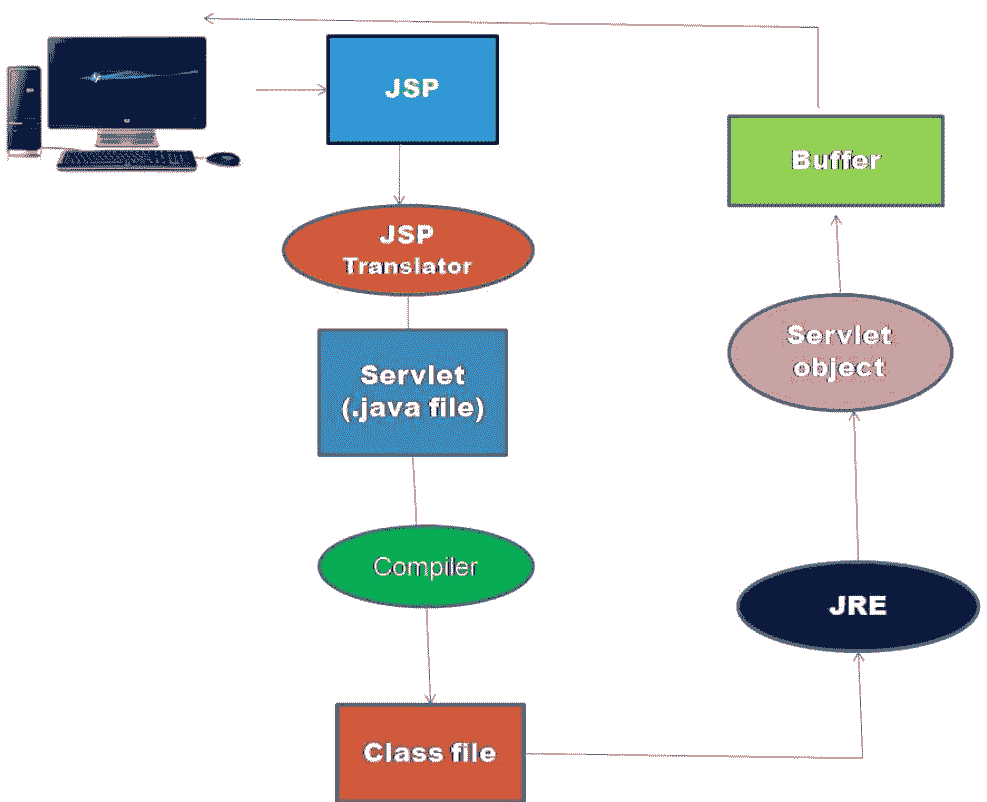

图 2. JSP 转换与编译

### JSP 架构概述

JSP 架构可以分为三个主要组件：

- **JSP 引擎 (JSP Engine)**：JSP 引擎负责处理 JSP 文件并生成处理 HTTP 请求的 Java servlet。它解释 JSP 语法，执行嵌入的 Java 代码并生成输出 HTML 内容。
- **JSP 容器 (JSP Container)**：JSP 容器是 Web 服务器或应用服务器的一部分，用于管理 JSP servlet 的执行。它加载 JSP 文件，将其编译为 servlet，并处理 servlet 实例的生命周期。


## 转换与编译过程

转换和编译过程将 JSP 文件转换为可执行的 Java servlet，然后这些被编译为字节码并由 Java 虚拟机（JVM）加载执行。

### 转换阶段

转换阶段是处理 JSP 文件的初始步骤，在此期间 JSP 页面被解析并转换为 Java servlet 源代码。转换阶段涉及以下步骤：

- **解析（Parsing）**：JSP 引擎解析 JSP 文件的内容，识别静态 HTML 内容、JSP 指令、脚本段表达式和自定义标签。
- **代码生成（Code Generation）**：根据解析的内容，JSP 引擎生成复制 JSP 页面行为的 Java servlet 源代码。该代码包含了处理 HTTP 请求、生成动态内容和处理会话管理的方法。
- **导入类（Importing Classes）**：JSP 引擎导入编译生成的 servlet 代码所需的 Java 类和包。

### 编译阶段

一旦转换阶段完成，生成的 Java servlet 源代码将编译为字节码，并由 JVM 执行。编译阶段涉及以下步骤：

- **编译（Compilation）**：Java 编译器按照标准的 Java 编译过程将生成的 servlet 源代码编译为字节码文件（`.class` 文件），任何语法错误或编译错误都会在此阶段报告。
- **类加载（Classloading）**：编译后的字节码文件由 JSP 容器的类加载器加载，使得 servlet 类可以实例化和执行。
- **实例化（Instantiation）**：JSP 容器根据客户端请求实例化 servlet 实例，为每个请求创建单独实例以确保线程安全和并发。
- **初始化（Initialization）**：servlet 容器通过调用 servlet 的 `init()` 方法来初始化 servlet 实例，允许 servlet 在处理请求之前执行任何初始化任务。

### 性能考虑

JSP 文件的转换和编译过程会影响 Web 应用的性能，特别是在初始请求处理期间。为了优化性能，开发者应该考虑以下策略：

- **预编译（Precompilation）**：在构建过程中预编译 JSP 文件，以避免与运行时编译相关的开销。
- **缓存（Caching）**：缓存编译后的 servlet 类，避免重复编译未更改的 JSP 文件并提高响应时间。
- **监控（Monitoring）**：监控并分析 JSP 转换和编译的性能，以识别瓶颈并优化资源利用。

## 调试与故障排除

在 JSP 开发过程中，调试和排查翻译及编译问题对于高效识别和解决错误至关重要。开发者可以使用以下技术：

- **错误报告**：使用日志框架或服务器日志来捕获与翻译和编译错误相关的错误消息和堆栈跟踪。
- **源映射**：将编译后的 servlet 类映射回其对应的 JSP 源文件，以识别编译错误的根源。
- **IDE 集成**：利用具有内置 JSP 开发和调试工具支持的集成开发环境（IDE）来简化调试过程。

理解 JSP 的设计，特别是解释和安排过程，对于工程师实际应用这一创新来改进 Web 应用程序具有重要意义。通过理解 JSP 翻译和编译的复杂性，开发者可以构建出满足现代用户和企业需求的健壮高效的 Web 应用程序。他们还可以优化性能、调试问题并提升性能。

## JSP 指令：page、include、taglib

JavaServer Pages（JSP）页面的行为和结构受到指令（directives）的高度影响。它们告诉 JSP 容器如何处理页面、从页面外部包含资源以及导入自定义标签库。在这一部分，我们将深入探讨 JSP 指令的细微之处，重点关注三个主要指令：`page`、`include` 和 `taglib`。

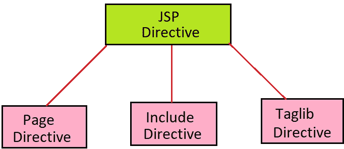

图 3. JSP Page Directive

在翻译阶段，JavaServer Pages（JSP）指令是嵌入在 JSP 文件中的特殊指令，为 JSP 容器提供指令。它们用于设置自定义标签库、错误处理、导入语句、会话管理以及 JSP 页面的其他方面。在页面编译为 servlet 之前，JSP 指令由 JSP 容器在 `<%...%>` 标签内处理。

### page 指令

`page` 指令用于为 JSP 组件提供处理页面的最佳指南。它允许设计师指定属性，例如：

- **Language**：确定 JSP 页面使用的预处理语言（例如 `java`、`jsp`）。
- **ContentType**：更改 JSP 页面响应的 MIME 类型（例如 `text/html` 或 `application/xml`）。
- **Session**：决定（`true`、`false`）JSP 页面是否需要会话管理。
- **ErrorPage**：发生未处理的异常时，指定将显示的错误页面 URL。
- **Import**：将 Java 的包和类导入 JSP 页面。
- **Info**：以描述性方式详细说明 JSP 页面。

### include 指令

`include` 指令用于将其他资源的内容引入当前 JSP 页面，例如 HTML 文件或 JSP 文件。它允许工程师对代码进行模块化并在页面之间复用通用部分。包含的资源在运行时会被处理，其结果会被嵌入到当前页面的结果流中。`include` 指令的语法为 `<@ include file="filename" %>`。

### taglib 指令

`taglib` 指令允许在 JSP 页面声明并导入自定义标签库。自定义标签库提供了一种方法，将可重用的功能和逻辑封装到自定义标签中，这些标签可以在 JSP 页面内部使用。标签库的 URI（统一资源标识符）和引用库标签的前缀在 `taglib` 指令中指定。`taglib` 指令使用语法为 `<@ taglib uri="uri" prefix="prefix" %>`。

## 使用 JSP 指令的最佳实践

为了确保 JSP 开发高效有效，工程师在使用 JSP 指令时应遵循最佳实践：

- 仅在语言、内容类型和会话管理等核心配置设置上使用 `page` 指令。
- 利用 `include` 指令实现代码模块化，以提高代码复用和实用性。
- 合理地安排自定义标签库，并使用重要的 URI 和前缀通过 `taglib` 指令导入它们。
- 为了使 JSP 页面更容易阅读和维护，减少脚本段（`<%... %>`）和内联 Java 代码比例。
- 验证并清理用户输入，以避免跨站脚本（XSS）和注入攻击等安全漏洞。
- 通过单元测试、集成测试和端到端测试充分测试 JSP 页面，确保它们在各种条件下的正确性和可靠性。

JSP 指令为设计和组织 JSP 页面提供了基本功能，允许控制页面处理的不同部分、包含外部资源以及导入自定义标签库。通过掌握 `page`、`include` 和 `taglib` 指令并遵循公认的使用程序，工程师可以构建出非常有组织、精确且有效的基于 JSP 的 Web 应用程序，解决现代 Web 开发的问题。

## JSP 脚本元素：声明、脚本段、表达式

JavaServer Pages（JSP）是一种用于用 Java 构建动态 Web 应用程序的创新。开发者可以使用 JSP 将 Java 代码直接嵌入 HTML 页面中，允许创建动态内容并进行服务器端组件交互。在本章中，我们将介绍 JSP 脚本元素的细节，如声明、脚本段和表达式。我们还将介绍如何使用它们、它们的语法以及将它们集成到 JSP 页面的最佳方法。

JavaServer Pages（JSP）脚本元素允许开发者在 HTML 页面中嵌入 Java 代码，实现动态内容生成和服务器端处理。JSP 脚本元素包括声明、脚本段和表达式，每种在 JSP 开发中都起着特定的作用。

### JSP 声明

JSP 声明用于在 JSP 页面内声明变量、方法和类。声明封装在 `<%! %>` 标签中，并通常用于定义可重用组件并初始化变量。开发者应该注意 JSP 页面内声明范围和可见性，并谨慎使用它们来封装可重用的逻辑。

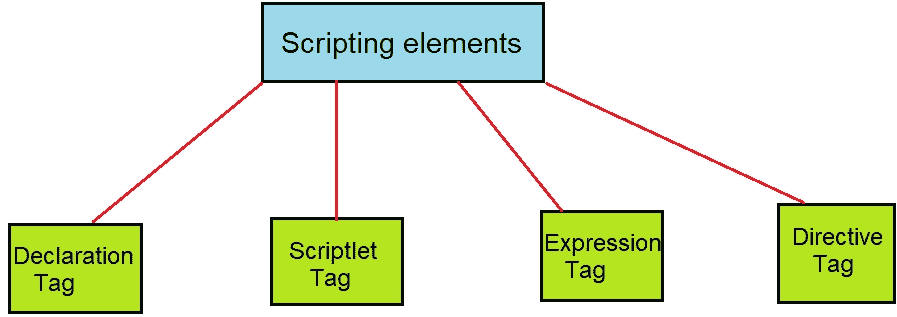

图 4. JSP Scripting Elements

### JSP 脚本段

JSP 脚本段（scriptlets）用于将 Java 代码直接嵌入 JSP 页面的 HTML 内容中。脚本段封装在 `<% %>` 标签内，可以包含任何有效的 Java 代码，包括变量声明、控制结构、方法调用和表达式。虽然脚本段为在 JSP 页面中集成 Java 逻辑提供了灵活性，但过度使用会导致代码杂乱，混合演示逻辑和业务逻辑。

### JSP 表达式

JSP 表达式提供了一种简洁易读的方法，直接在 JSP 页面的 HTML 内容中插入动态值。表达式封装在 `<%= %>` 标签内，可以包含变量、方法调用和求值的表达式。表达式在运行时求值并替换为生成的 HTML 输出中的相应值。

### 语法与用法

JSP 脚本元素遵循特定的语法规则和规范，以便正确集成到 JSP 页面。开发者应遵守这些语法指南，以确保 JSP 容器正确解释和执行脚本元素。提供了声明、脚本段和表达式的语法和用法示例，以说明它们在 JSP 页面中的实现。

## 使用 JSP 脚本元素的最佳实践

为了维护代码的可读性、模块化可维护性，开发者在使用 JSP 脚本元素时应遵循最佳实践。一些关键的最佳实践包括：

- **限制脚本段（scriptlets）的使用**：避免使用脚本段直接在 JSP 页面中嵌入复杂的 Java 逻辑，因为这会导致代码杂乱并降低可维护性。相反，应该将业务逻辑封装在 Java 类中，并在 JSP 页面中调用它们。
- **关注点分离**：遵循 `MVC`（模型-视图-控制器）设计模式，将呈现逻辑（视图）与业务逻辑（模型）以及应用流控制（控制器）分离。`JSP` 页面应主要用于渲染 HTML 内容，并将业务逻辑委托给 Java 类。
- **封装可重用逻辑**：在 `JSP` 页面中使用声明来定义可重用的组件，例如工具方法和自定义标签库。封装可重用逻辑可以促进代码重用，增强模块化并提高可维护性。
- **使用表达式处理简单动态内容**：利用 `JSP` 表达式将动态值（如变量和方法调用）直接插入到 `JSP` 页面中的 HTML 内容中。表达式提供了一种简洁易读的方式来整合动态内容，而不会让 Java 代码弄乱页面。
- **利用自定义标签库**：使用自定义标签库在 `JSP` 页面中封装复杂的呈现逻辑和可重用组件。自定义标签库有助于代码重用、提高可读性，并便于 `JSP` 开发中的关注点分离。

## 注意事项与局限性

虽然 `JSP` 脚本元素为开发动态 Web 应用提供了灵活和便利，但开发者应该注意它们的注意事项和局限性。一些考虑包括：

- **性能开销**：过度使用脚本元素（特别是脚本段）会因为编译时间和内存占用增加而降低性能。开发者应该审慎使用脚本元素，并针对性能优化其用法。
- **安全风险**：不当使用脚本元素（如脚本段）可能会导致应用程序面临注入攻击和跨站脚本攻击（`XSS`）等安全漏洞。开发者应该对用户输入进行清理、验证数据并使用安全编码实践来降低安全风险。

开发者可以使用强大的 `JSP` 脚本元素（如声明、脚本段和表达式）将 Java 代码集成到 `JSP` 页面的 HTML 内容中。通过理解脚本元素的语法、用法和最佳实践，开发者可以创建满足现代消费者和企业需求的动态易于维护的 Web 应用。

## JSP 中的隐式对象：request、response、session、application

JavaServer Pages（`JSP`）是 Java 构建动态 Web 应用的一项强大创新。除了有助于将 Java 代码直接插入 HTML 标记外，`JSP` 还提供了一系列处理 HTTP 请求响应生命周期不同部分的对象的访问。在本章中，我们将检查四个主要的 `JSP` 隐式对象：`session`、`application`、`response` 和 `request`。我们将深入它们的功能、生命周期以及在 `JSP` 开发中使用它们的最佳实践。

`JSP` 中的隐式对象是预定义的 Java 对象，可以在 `JSP` 环境中访问，无需显式声明或实例化。由于这些对象，开发者可以轻松访问请求参数、会话属性、应用级资源和其他资源，这些对象封装了 HTTP 请求-响应循环的重要方面。理解隐式对象的作用和行为是利用 `JSP` 构建动态智能 Web 应用的基础。

### 请求对象（request）

`request` 对象处理客户端的 HTTP 请求，并提供对请求参数、头、处理和其他属性的访问权限。它体现了客户端提供的 HTTP 方法、请求 URI、请求边界和结构信息等数据。通常，`request` 对象用于获取客户端发送的数据并将路由到其他服务器端应用资源。

### 响应对象（response）

`response` 对象处理服务器创建的 HTTP 响应，提供了设置响应头、状态码和内容的方法。设置 Cookie、重定向到其他 URL 以及向响应体中写入动态内容，都是开发者利用此功能更改发送给客户端的响应的几种方法。`response` 对象主要用于控制服务器如何响应客户端请求以及其呈现形式。

### 会话对象（session）

`session` 对象作为一种跨多个请求存储用户特定数据的机制，代表用户的会话。通过存储会话属性（如用户偏好、身份验证令牌和购物车物品），开发者能够与客户端保持有状态的交互。Servlet 容器会自动创建 `session` 对象，该对象与客户端和服务器之间传输的会话标识符（`session ID`）关联。

### 应用对象（application）

`application` 对象处理 Web 应用本身，并提供对大量资源和设计设置的访问。可以使用此工具存储和检索应用范围的属性，例如数据库连接、缓存机制以及在 Web 应用部署描述（`web.xml`）中定义的上下文参数。`application` 对象在整个应用生命周期内持续，并被同一个 Web 应用内的所有 servlet 和 JSP 页面共享。

## 特定对象的生命周期

`JSP` 中的每个特定对象都有自己的生命周期和范围，这决定了它们何时创建、持续多久以及何时销毁。每当发起一次 HTTP 请求，就会创建一个新的 `request` 对象，并在响应发送给客户端时销毁。`session` 对象在用户会话建立时创建（通常是用户首次访问网站时），它会一直存在直到用户会话结束或被置空。`application` 对象在 Web 应用部署时创建，并在应用卸载或服务器关闭之前一直保持有效。

## 使用隐式对象的最佳实践

为了在 `JSP` 开发中有效使用隐式对象，开发者应该遵循以下最佳实践：

- **避免滥用隐式对象**：虽然隐式对象提供了访问请求、会话和应用信息的便利方法，但过度依赖它们会导致紧耦合和代码意义降低。考虑将复杂逻辑封装在 `JavaBeans` 或自定义标签库中，并谨慎使用隐式对象。
- **善用资源**：在访问会话和应用属性时注意资源的使用，以防止内存泄漏和执行性能下降。为了节省系统资源，在不再需要资源时释放资源并移除未使用的属性。
- **保护敏感数据安全**：在会话属性中存储敏感数据时要警惕，因为会话信息在客户端和服务器之间传输，可能会被拦截攻击或篡改。通过加密敏感会话数据，避免以明文存储身份验证令牌或密码。
- **处理会话终止**：执行适当错误处理和会话管理程序，以处理客户端会话终止或失效的情况。将客户端重定向到登录页面或显示会话超时消息，以促使其重新身份验证并继续会话。

隐式对象在 JSP 改进中起着本质作用，它们为工程师提供了在 JSP 环境内请求、响应、会话和应用信息的有用访问。通过掌握隐式对象的功能、生命周期和使用的最佳实践，设计人员可以构建动态、直观且通用的 Web 应用程序，解决现代客户和组织的问题。

## 使用 JSP 表达式语言（EL）

JavaServer Pages（JSP）表达式语言（EL）是一种强大的标记语言，它改进了 JSP 页面中获取信息、控制因子和评估表达式常用方式。在本章中，我们将探索 JSP 表达式语言的细节，研究其语法、特性和在 Web 开发中的应用。我们还讨论了使用 EL 使基于 JSP 的 Web 应用程序更强大且易于维护的最佳方法。

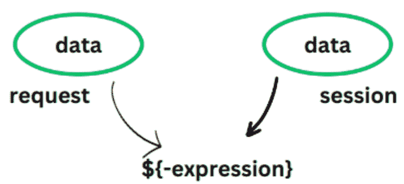

图 5. JSP 表达式语言（EL）

JSP 表达式语言（EL）是 JSP 2.0 中引入的一种脚本语言，旨在简化 JSP 页面与 JavaBean 组件之间的交互。EL 为访问和操作 JSP 页面内的数据提供了简洁且直观的语法，减少了对 Java 代码的需求，并增强了代码的可读性和维护性。

## JSP 表达式语言（EL）的语法

JSP 表达式语言的语法非常直观，类似于传统的编程语言。EL 表达式封装在 `${}` 分隔符中，可以直接嵌入 JSP 内容中。EL 表达式支持各种数据类型、运算符和函数，用于执行算术、逻辑和字符串操作。

## JSP 表达式语言（EL）的特性

JSP 表达式语言提供了广泛特性，简化了 Web 开发中的常见任务。EL 的一些关键特性包括：

- **变量插值**：使用 EL 表达式直接在 JSP 内容中访问并显示变量。
- **隐式对象**：在 EL 表达式中访问 `request`、`response`、`session` 和 `application` 等隐式对象。
- **Bean 属性**：使用 EL 语法访问 `JavaBean` 属性并调用方法。
- **集合迭代**：使用 EL `forEach` 循环结构对 `arrays`、`Lists`、`Maps` 和 `Sets` 等集合进行迭代。
- **条件表达式**：使用 EL 三元运算符 `? :` 评估条件表达式，以实现简洁且可读的代码。
- **转义特殊字符**：在 EL 表达式中使用 `fn:escapeXml()` 函数转义特殊字符，以防止跨站脚本（XSS）攻击。

## JSP 表达式语言（EL）的实际应用

JSP 表达式语言可以用于 JSP 页面中的各种场景，简化数据访问、展示和操作。EL 的一些实际应用包括：


- **显示动态内容**：使用 EL 表达式访问并显示从 `JavaBeans`、`request` 参数或 `session` 属性检索的动态数据。

- **表单字段绑定**：使用 EL 表达式将表单字段绑定到 `JavaBean` 属性，简化表单处理和验证。

- **访问请求属性**：在 JSP 页面中使用 EL 表达式访问从 `servlets` 或 `filters` 传递的属性。

- **国际化和本地化**：使用 EL 函数访问资源包属性并格式化本地化消息，用于多语言 Web。

- **条件渲染**：使用 EL 条件表达式根据用户输入、`session` 属性或应用状态条件地渲染 HTML 元素或内容块。

## 使用 JSP 表达式语言 (EL) 的最佳实践

为了最大化 JSP 表达式语言 (EL) 的优势并确保基于 JSP 的 Web 应用程序的可维护性和性能，开发者应该遵循以下最佳实践：

- **保持 EL 表达式简洁且可读**：避免复杂的表达式，将其拆解为较小的、易理解的组件以提高可读性。

- **在 JavaBeans 中封装业务逻辑**：将业务逻辑和数据处理代码从 JSP 页面移动到 `JavaBeans` 中，以促进关注点分离和重用。

- **验证输入数据**：在 EL 表达式处理之前，对用户输入数据进行验证并清理输入参数，以防止 XSS 攻击等安全漏洞。

- **限制 EL 在展示逻辑中的用法**：主要使用 EL 访问和展示页面内的数据，而将复杂的处理和业务逻辑留在 Java 类或标签库中。

- **优化 EL 性能**：在 JSP 页面的性能敏感区域尽量少使用 EL 表达式，以提高渲染速度并减轻服务器负载。

- **彻底测试 EL 表达式**：利用单元测试、回归测试和端到端测试来测试表达式，以确保在不同情况和边缘案例下的准确性和稳定质量。

强大的 JavaServer Pages (JSP) 表达式语言 (EL) 使得在 JSP 页面内访问、操作和展示数据变得更容易。开发者可以通过理解其语法、特性和最佳实践来利用 EL 的能力，创建健壮、易于维护且有效的 Web 应用程序，满足现代企业和用户的需求。

# JSP 标准动作：include, forward, param 等

JavaServer Pages (JSP) 标准动作为在 Java 中构建动态和模块化的 Web 应用程序提供了强大的机制。这些标准动作包括 `include`、`forward`、`param` 等，允许开发者有效地整合重用组件、控制请求处理并操作请求参数。在本章中，我们将深入 JSP 标准动作的细节，探索它们的功能、用例和实现的最佳实践。

JavaServer Pages (JSP) 标准动作是预定义的 XML 标签，允许开发者在 JSP 页面内执行特定操作。这些动作将动态内容、控制流和数据操作整合到基于 JSP 的 Web 应用程序中变得简单且声明。对于模块化、可维护和可扩展的 Java Web 应用程序，理解并利用 JSP 标准动作至关重要。

## `<jsp:include>`

`<jsp:include>` 动作允许设计人员有效地在当前 JSP 页面中包含另一个资源的内容（例如另一个 JSP 页面或 servlet）。该动作通过允许工程师在多个 JSP 页面之间体现和重用页面部分，实现了代码重用、模块化和关注分离。

## `<jsp:forward>`

`<jsp:forward>` 动作允许开发者将当前请求重定向到服务端资源（如 JSP 页面或 servlet）。该动作通常用于基于 JSP 的 Web 应用程序中的请求分发、URL 重写和服务器重定向。通过 `<jsp:forward>`，工程师可以在应用程序的不同部分之间执行干净高效的路由。

## `<jsp:param>` 动作

使用 `<jsp:param>` 动作，开发者可以在使用 `<jsp:include>` 或 `<jsp:forward>` 包含或转发请求时动态设置请求参数。该动作使得实现动态内容组装、根据用户输入自定义请求处理以及在应用程序组件之间传递数据成为可能。正确使用 `<jsp:param>` 使 JSP 页面更具活性、可重用且易于维护。

## `<jsp:useBean>`

`<jsp:useBean>` action 使得在 JSP 页面中创建和管理 JavaBeans 组件变得更加简单。在 JSP 表达式和脚本段（scriptlets）中，该 action 允许开发者声明和初始化 JavaBeans 对象、设置其属性并访问其方法。通过利用 `<jsp:useBean>`，设计人员可以在基于 JSP 的 Web 应用程序中使用 JavaBeans 部分来实现抽象、封装和复用性。

## `<jsp:setProperty>` 和 `<jsp:getProperty>` 动作

`<jsp:setProperty>` 和 `<jsp:getProperty>` action 通过为在 JSP 页面内设置和获取 JavaBeans 部分的属性提供工具，为 `<jsp:useBean>` 活动增加了值。开发者可以使用这些 action 在 JSP 表达式和脚本段中与 JavaBeans 对象进行无缝交互，检索它们的属性用于显示或处理，并动态更改 JavaBeans 对象的状态。

## `<jsp:plugin>` 动作

开发者可以使用 `<jsp:plugin>` action 在 JSP 页面中动态嵌入特定浏览器的插件内容（如 Java applet 或多媒体对象）。该活动将富媒体内容、直观的应用程序和外部模块集成到基于 JSP 的 Web 应用程序中，提高了客户端体验和应用程序的实用性。

## `<jsp:attribute>` 动作

JSP 页面中的 `<jsp:attribute>` action 机制允许你为自定义标签和标签文件定义并传递属性。通过采用此 action，开发者能够在应用程序的各个层之间有效传输数据、封装和模块化复用组件、自定义其外观和行为等。通过利用 `<jsp:attribute>`，开发者可以使基于 JSP 的 Web 应用程序更加灵活、可扩展且易于维护。

## 使用 JSP 标准动作的最佳实践

开发者应该遵循以下最佳实践，以确保基于 JSP 的 Web 应用程序有效、可靠且易于维护。

- **模块化**：利用 `<jsp:include>` 封装和复用常用页面片段；使用 `<jsp:include>` 提高代码复用和实用性。

- **关注点分离**：使用 `<jsp:forward>` 将请求处理分配给隔离的部分，以实现更好的关注点分离和灵活性。

- **信息传递**：使用 `<jsp:param>` 在部分之间强地传递信息，并根据客户端输入更改请求处理。

- **与 JavaBean 集成**：使用 `<jsp:useBean>`、`<jsp:setProperty>` 以及 `<jsp:getProperty>` 在 JSP 页面内成功管理 JavaBeans 部分，以实现抽象和复用性。

- **插件完整性**：使用 `<jsp:plugin>` 嵌入针对浏览器的插件内容；使用 `<jsp:plugin>` 提高客户端体验和应用程序的实用性。

- **质量传递**：利用 `<jsp:attribute>` 为自定义标签和标签文档描述并传递属性，在基于 JSP 的 Web 应用程序中实现更显著适应性和扩展性。

JSP 标准活动是使用 Java 构建动态特定 Web 应用的有用资源。通过理解执行 JSP 标准活动的功能、用例和最佳实践，设计人员可以成功使用它们来构建强大、灵活且行的 Web 应用，解决当前客户和组织的问题。

# 自定义 JSP 标签：介绍与用法

使用基于 Java 技术，JavaServer Pages (JSP) 为构建动态 Web 应用程序提供了一个强大的平台。虽然 JSP 为普通任务提供了内置标签（例如，显示信息和控制流），但设计人员经常遇到需要封装可复用功能和改进复杂任务的情况。自定义 JSP 标签通过允许工程师创建自己的自定义标签来实现复杂的逻辑和功能，从而解决了这一需求。本章将讨论自定义 JSP 标签的益处、如何创建和使用它们，以及将自定义标签集成到基于 JSP 的 Web 应用程序中的最佳实践。

自定义 JSP 标签（称为自定义标签库或客户端定义标签）使工程师能够通过定义自定义标签和相关的标签控制器来扩展 JSP 的功能。这些自定义标签体现了复杂的功能，并可以在多个 JSP 页面中复用，提高代码的特定性、复用性和实用性。

## 自定义 JSP 标签的益处

自定义 JSP 标签为 Web 应用开发提供了多种益处，包括：

- **复杂功能的封装**：自定义标签允许开发者将复杂的逻辑和功能封装到复用组件中，促进代码的模块化和维护性。

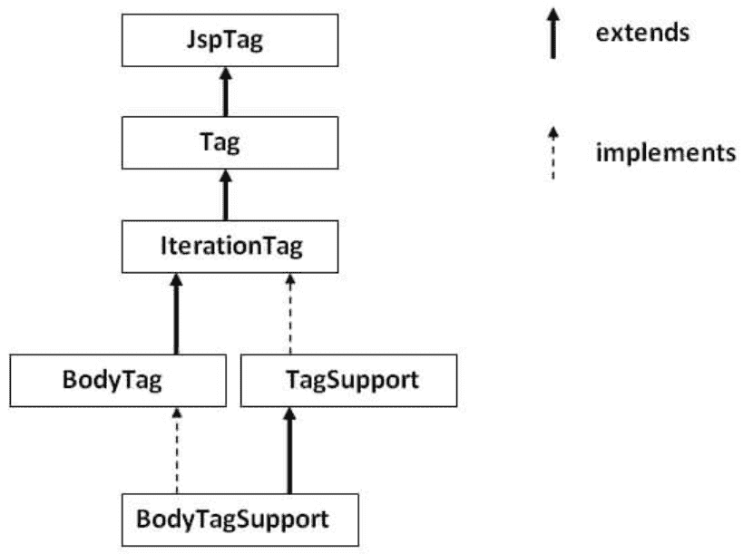

图 6. JSP Tags

- **关注点分离**：自定义标签通过将呈现逻辑与业务逻辑分离来促进关注点分离，从而代码更整洁、更于维护。

- **复用性**：自定义标签可以在多个 JSP 页面和 Web 应用程序中复用，减少代码重复并提高一致性。

- **提高可读性**：自定义标签通过将复杂功能抽象为简单、易懂的标签和标签属性，增强 JSP 页面的可读性。

## 自定义 JSP 标签的结构

自定义 JSP 标签由两个主要部分组成：标签处理器类和标签库描述符 (TLD)。标签库描述符描述了自定义标签及其特征，而标签处理器类则执行与每个自定义标签相关的行为和逻辑。在 TLD 文件中，程序员使用 XML 语法定义自定义标签，并使用 Java 类来实现关联的标签处理器。

## 创建自定义 JSP 标签

要创建自定义 JSP 标签，开发者需要遵循一系列步骤，包括：

1. **定义标签库描述符 (TLD)**：创建一个 XML 文件，使用 `<taglib>` 和 `<tag>` 元素定义自定义标签及其属性。

2. **实现标签处理器类**：编写 Java 类，通过扩展 `TagSupport` 或 `BodyTagSupport` 类并重写 `doStartTag()` 或 `doEndTag()` 方法，实现与每个自定义标签相关的行为和逻辑。

3. **打包自定义标签库**：将 TLD 文件、标签处理器类和其他资源打包成 JAR 文件以供分发和复用。

4. **在 JSP 页面中声明自定义标签库**：在 JSP 页面中使用 `<taglib>` 指令声明自定义标签库，以启用自定义标签的使用。

## 使用自定义 JSP 标签

一旦创建，自定义 JSP 标签就可以像其他内置 JSP 标签一样在 JSP 页面中使用。开发者通过使用 `<customTag>` 元素并指定标签库描述符定义的标签名称和属性在 JSP 页面中引入自定义标签。自定义标签由 JSP 容器在运行时处理，相应的标签处理器类被调用以生成动态内容并执行的操作。

## 自定义 JSP 标签的类型

自定义标签可以根据行为和功能分为两大类：

- **简单标签 (Simple tags)**：执行单一操作或生成静态内容的自定义标签，不需要访问标签体。简单标签通过扩展 `SimpleTagSupport` 类并重写 `doTag()` 方法来实现。

- **经典标签 (Classic tags)**：支持访问标签体的自定义标签，可以执行更复杂的操作，例如遍历集合、条件渲染内容或调用 Java 方法。经典标签通过扩展 `TagSupport` 或 `BodyTagSupport` 类并重写 `doStartTag()` 和 `doEndTag()` 方法来实现。

## 使用自定义 JSP 标签的最佳实践

为了确保自定义 JSP 标签的有效性和维护性，开发者应该遵循以下最佳实践，例如：

- **保持标签简单且聚焦**：定义封装特定功能并遵循单一职责原则的自定义标签。

- **提供清晰的文档**：在标签库描述符中记录自定义标签的用途、属性和用法，便于其他开发人员理解和使用。

- **充分测试自定义标签**：使用单元测试、集成测试和端到端测试对自定义标签进行测试，以确保正确性、可靠性以及与不同环境的兼容性。

- **版本和管理自定义标签库**：使用版本控制和依赖管理工具跟踪自定义标签库的变化，并确保跨项目的使用的一致性。

- **鼓励代码复用**：通过创建可重用的自定义标签并在项目和团队之间共享来鼓励代码复用，以提高一致性并缩短开发时间。

自定义 JSP 标签为扩展 JSP 功能和简化 Web 应用开发中的复杂任务提供了强大的机制。通过将可重用的功能封装到自定义标签和标签处理器中，开发者可以提高基于 JSP 的 Web 应用的代码模块化、重用性和维护性。理解自定义 JSP 标签的优势、结构、创建、用法、类型和最佳实践，对于在 Web 开发项目中有效利用这一强大功能至关重要。

## JSP 异常处理

通过允许开发者直接将 Java 代码嵌入到 HTML 页面中，JavaServer Pages (JSP) 为构建动态 Web 应用提供了一种强大的机制。尽管 JSP 使 Web 开发更具适应性和用户友好，但它们也引入了对高效异常处理的需求，以保证 Web 应用的健壮性和可靠性。在本节中，我们将从上到下研究 JSP 特殊情况的处理，涵盖主题例如：处理运行时异常、自定义错误页面、JSP 片段中的错误处理以及基于 JSP 的 Web 应用中异常处理的最佳实践。

### 理解 JSP 中的异常处理

在程序执行过程中检测、报告和响应错误及异常的过程被称为异常处理。异常处理是在 JSP 上下文中捕获并处理 JSP 代码中发生的异常（包括检查异常和未检查异常）的过程。

### JSP 中的异常类型

JSP 主要有两种异常类型：检查异常和未检查异常。编译器会检查如 `IOException` 和 `SQLException` 类的检查异常，这些异常必须被捕获或在方法签名中声明。未控制的异常（如 `NullPointerException` 和 `ArrayIndexOutOfBoundsException`）编译器实际上不会检查，它们可以在运行时发生。

### 处理 JSP 中的运行时异常

运行时异常（也称为未检查异常）可能会在 JSP 代码执行期间由于编程错误、输入错误或意外情况而发生。`try-catch` 块用于在 JSP 运行时优雅地捕获并处理异常。设计可以在页面级或明确的 JSP 段获取异常，以实际处理错误并向客户端提供重要的错误信息。

在基于 JSP 的 Web 应用中，自定义错误页面允许开发者为特定异常类型定义自定义错误消息和处理逻辑。通过在 `web.xml` 部署符中设计错误页面或利用 JSP 中的 `<error-page>` 指，工程师可以在特殊情况发生时将客户端重定向到自定义错误页面，提供可预测且易用的错误处理体验。

### JSP 片段中的错误处理

JSP 段（也称为包含记录或标签文档）是可重用的部分，用于展示逻辑并可以在不同的 JSP 页面中使用。为了防止错误传播到当前调用该片段的 JSP 页面，JSP 片段中的异常处理确保片段内发生的任何异常都能得到妥善处理。在 JSP 片段中，开发者可以使用 `try-catch` 块本地捕获并处理异常，或将异常传递给调用它们的 JSP 页面进行集中处理。

### JSP 异常处理的最佳实践

为了确保基于 JSP 的 Web 应用具有有效的异常处理，开发者应该遵循以下最佳实践：

- 使用 `try-catch` 块在 JSP 代码中优雅地捕获并处理异常。

- 实现自定义错误页面以提供一致的错误消息和处理逻辑。

- 将错误处理逻辑集中在单一位置以促进代码复用和维护性。

- 在发生异常时为用户提供有意义的错误消息和指导，协助故障排除和解决。

- 记录异常和错误细节，以便开发者和管理员进行调试和故障排除。

- 在各种条件和场景下充分测试错误处理逻辑，以确保可靠性和健壮性。

### 高级异常处理技术

除了基本的异常处理技术，开发者可以使用高级异常处理技术来增强基于 JSP 的 Web 应用中的错误报告和恢复。一些高级技术包括：

- **全局异常处理**：实现集中的错误处理机制，全局捕获并处理所有 JSP 页面和 Servlet 中的异常。

- **错误日志与监控**：集成日志框架和监控工具，实时捕获跟踪异常、错误和性能指标。

- **异常传播**：将异常从 JSP 传播到 Servlet 或其他组件以进行集中处理和记录。

- **错误恢复策略**：执行错误恢复系统，例如重试机制、备份组件和快速降级，以从错误中恢复并限制对客户端的影响。

为了使基于 JSP 的 Web 应用可靠、健壮且用户友好，有效的异常处理是必要的。通过理解 JSP 中的各种异常类型、实施适当的错误处理策略并遵循异常处理的最佳实践，开发者可以创建提供无缝用户体验的 Web 应用。为了确保 Web 项目的成功，JSP 异常处理是 Web 开发的重要组成部分，需要仔细考虑并关注细节。

## JSP 标准标签库 (JSTL) 简介

JavaServer Pages (JSP) 是利用 Java 构建动态网站页面和 Web 应用的常用技术。JSP 允许工程师将 Java 代码直接插入 HTML 页面中，使得根据用户输入、数据集查询和各种变量创建动态内容变得简单。然而，将 Java 代码与 HTML 标记结合可能会导致代码复杂且难以维护。Java Server Pages 标准标签库（JSTL）是一组旨在改进代码组织和可读性并简化常见 Web 开发任务的标签和函数，由 Java 社区进程（JCP）发布以解决这一问题。

### JSTL 的演变

JSTL 的开发源于一种需求，即在基于 JSP 的 Web 应用中需要一种标准化的方式来执行常见任务，而无需依赖脚本（scriptlet）代码。在 JSTL 之前，开发者经常使用脚本段来执行迭代、条件判断和格式化等任务，导致了面条条代码和关注点分离不良。JSTL 旨在提供一组标准化的标签和函数，以更声明式和结构化的方式执行这些任务。

### JSTL 的主要特性

JSTL 提供了广泛的标签和函数用于执行常见的 Web 开发任务，包括：

- **迭代**：用于遍历集合（如数组、列表和映射）的标签，并为每个元素渲染 HTML 标记。

# JSTL 标签库

- **条件判断 (Conditionals)**：用于执行条件逻辑的标签，例如 `if-else` 语句和 `switch-case` 语句，用于控制执行流。


- **格式化（Formatting）**：根据特定区域习惯对日期、数字和货币等数据进行格式化的标签。

- **XML 处理（XML processing）**：用于解析和操作 XML 文档，包括用于查询 XML 数据的`XPath`支持。

- **国际化（Internationalization）**：通过显示不同语言和地区的消息来支持国际化（`i18n`）和本地化（`l10n`）的标签。

- **数据库访问（Database access）**：用于执行`SQL`查询并显示结果的标签，为在 JSP 页面内部与数据库交互提供了方便的方法。

## 概述

JSTL 分为几个标签库，每个标签库都有特定的用途，并提供一组相关的标签和函数。一些关键 JSTL 标签库包括：

- **核心标签库（Core tag library）**：提供执行迭代、条件判断、变量操作和 URL 管理的标签。

- **XML 标签库（XML tag library）**：提供使用`XPath`表达式解析和处理 XML 文档的标签。

- **SQL 标签库（SQL tag library）**：提供在 JSP 页面中执行`SQL`查询并显示结果的标签。

- **函数标签库（Functions tag library）**：提供执行常用字符串操作、日期格式化和数学运算的函数。

## 在 JSP 页面中使用 JSTL

要在 JSP 页面中使用 JSTL，开发者必须先在 JSP 文件开头包含适当的`taglib`指令以导入所需的标签库。一旦导入，开发者就可以在 JSP 页面中使用 JSTL 提供的标签和函数执行各种任务，如迭代、条件判断、格式化和数据库访问。JSTL 标签通常用于在 HTML 标记中，根据应用程序逻辑和数据生成动态内容。

## 使用 JSTL 的优势

与在 JSP 页面中使用脚本段（scriptlet）代码相比，使用 JSTL 具有许多优势，包括：

- **提高可读性**：通过将显示逻辑与业务逻辑分离，并减少嵌入 HTML 标记中的脚本段代码量，JSTL 促进了更好的代码组织和可读性。

- **可重用性（Reusability）**：JSTL 标签和函数可以在多个 JSP 页面之间重用，减少了代码重复并促进了模块化设计。

- **可维护性（Maintainability）**：JSTL 通过提供执行常用任务的标准方法，使维护和更新 JSP 页面变得更容易，使代码库更具维护性且更容易理解。

## 局限性与注意事项

虽然 JSTL 为在 JSP 页面执行常见的 Web 开发任务提供了方便的方法，但确实存在一些需要注意的局限性：

- **性能开销**：与使用纯 Java 代码或自定义标签库相比，使用 JSTL 可能会引入一些性能开销，因为每次标签调用都会产生一些处理开销。

- **功能限制**：JSTL 为常用任务提供了基础标签和函数，但可能无法涵盖所有用例，要求开发者在复杂场景下求助于自定义标签库或脚本段代码。

- **学习曲线**：不熟悉 JSTL 的开发者在开始时可能会面临学习曲线，因为他们需要学习库提供的各种标签和函数的语法和语义。

Java 页面标准标签库（`JSTL`）提供了一种标准化且方便的方法，用于在基于 JSP 的 Web 应用程序中执行常见的 Web 开发任务。通过使用 JSTL，开发者可以提高代码组织、可读性和可维护性，更容易构建和维护动态交互的 Web 页面。虽然 JSTL 有一些局限性和注意事项，但对于大多数 Web 开发场景，其优点大于缺点，使其成为 Java Web 开发工具箱中一个非常有价值的工具。

# JSP 表达式语言（EL）：运算符与函数

在 JSP 页面中访问和修改数据是通过借助强大的脚本语言 Java 页面（`JSP`）表达式语言（`EL`）实现的。`EL`能够更轻松地访问`JavaBeans`组件、请求参数、会话属性以及 JSP 环境中提供的其他对象。本章将检查 JSP 表达式语言的各种运算符和函数，提供深入的解释和示例来演示它们的用法和功能。

在深入研究`EL`的运算符和功能之前，理解 JSP 表达式语言的基础知识是至关重要的。`EL`使开发者能够将表达式直接嵌入 JSP 页面中，从而能够生成动态内容并操作数据。由于`EL`表达式封装在`$`语法中，它们可以访问作用范围变量、会话属性和请求属性等对象。

## JSP 表达式语言中的运算符

`EL`中的运算符允许开发者执行各种操作，包括逻辑比较、字符串操作和算术运算。`EL`支持以下类型的运算符：

- **算术运算符**：取模（`%`）

- **关系运算符**：加法（`+`）、减法（`-`）、乘法（`*`）和除法（`/`）。不等于（`==`）或不相等（`!=`）、大于（`>`）、大于或等于（`>=`）、小于（`<`）、小于等于（`<=`）

- **逻辑运算符**：逻辑或（`||`）、逻辑与（`&&`）、逻辑非（`!`）

- **空值运算符**：判断一个值是否为空或为 null。

- **三元条件运算符**

### 在 EL 表达式中使用运算符

运算符可以在`EL`表达式中使用，对操作数执行各种操作。它评估一个布尔表达式并根据结果返回两个值之一。例如，逻辑运算符可以用于组合布尔表达式，关系运算符可以用于比较值，算术运算符可以执行数学计算。为了演示运算符的功能，文中提供了它们在`EL`表达式中的用法示例。

## JSP 表达式语言中的函数

`EL`中的函数提供了可重用的逻辑单元，可以在`EL`表达式中调用以执行特定任务。`EL`为常用操作提供了一组预定义函数，如字符串操作、日期格式化、集合操作等。此外，开发者可以使用 JSP 页面中的`taglib`指令定义自定义函数。

### JSP 表达式语言中的预定义函数

`EL`提供了一系列预定义函数，根据其功能划分为不同的命名空间。一些常用的命名空间及其相应的函数包括：

- **核心函数（Core Functions）**：用于字符串操作、数学运算、集合操作等。

- **数学函数（Math Functions）**：用于执行数学计算，如绝对值、幂、平方根和四舍五入。

- **字符串函数（String Functions）**：用于操作字符串，如拼接、子字符串、大写、小写和修剪。

- **日期和时间函数（Date and Time Functions）**：用于格式化日期时间、计算日期之间的差异以及解析日期字符串。

### 在 EL 表达式中使用预定义函数

可以使用以下语法在`EL`表达式中调用预定义函数。开发者可以向函数传递参数以根据需求自定义行为。文中提供了实际示例，演示如何在`EL`表达式中使用预定义函数执行各种任务，如字符串操作、日期格式化和数学计算。

## 在 JSP 表达式语言中定义自定义函数

除了预定义函数外，开发者还可以在 JSP 页面中使用`taglib`指令定义自定义函数。自定义函数允许开发者封装可重用的逻辑，并使其在`EL`表达式可用。本文将逐步解释在 JSP 页面中定义和使用自定义函数的过程，包括在标签库描述符（`TLD`）文件中定义函数，以及在`EL`表达式中调用函数。

## 在 EL 中使用运算符和函数的最佳实践

为了确保代码的高效性和可维护性，开发者在`EL`表达式中使用运算符和函数时应遵循最佳实践。一些最佳实践包括：

通过避免在`EL`表达式中使用复杂的逻辑来保持表达式简洁易读。针对特定任务使用适当的运算符和函数，以提高代码的清晰度。将复杂操作移动到 Java 类或自定义函数，避免将业务逻辑与表现逻辑混合。彻底测试表达式，以确保在各种条件和场景下的正确性和可靠性。

JSP 表达式语言（`EL`）为工程师获取和控制 JSP 页面内部的信息提供了极其宝贵的资产。通过理解`EL`中可以访问的不同标识和功能，并遵循公认的使用程序，工程师可以真正利用`EL`毫不轻松地构建动态且直观的 Web 应用。本部分提供的可行模型和建议为工程师提供了所需的信息和能力，使其能够在任务中充分发挥 JSP 表达式语言。

## JSP 中的国际化与本地化

国际化（`I18N`）和本地化（`L10N`）是 Web 开发的重要组成部分，使应用程序能够适应不同的语言、社会和地区。JavaServer Pages（`JSP`）中的国际化和本地化概念是本书的重点，同时也涵盖了创建多语言和符合文化的 Web 应用的方法、最佳实践和工具。

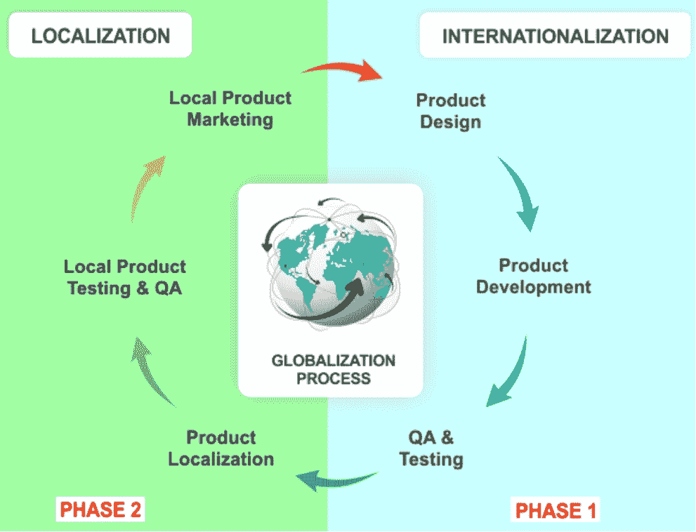

图 7 JSP 中的国际化与本地化

### 理解国际化与本地化

以设计和开发软件应用程序使其无需更改代码即可适应各种语言和文化的过程被称为国际化。另一方面，本地化是指将应用程序适应特定的区域，例如更改语言、日期和时间格式、货币符号以及文化规范。

### 国际化和本地化的优势

国际化和本地化为 Web 应用程序提供了许多优势，包括：

- **可访问性**：让来自不同语言和文化背景的用户能够访问应用程序。

- **用户体验**：通过以用户偏好的语言和格式呈现内容来增强用户体验。

- **市场扩展**：通过触达不同地区和语言市场的用户促进市场扩展。

- **合规性**：确保符合与语言和访问性相关的法律和法规要求。

### JSP 中的国际化

在`JSP`中，国际化涉及以一种方式设计网页和资源使其语言无关且文化中立。`JSP`国际化的一些关键方面包括：

- **文本外部化**：将文本消息、标签和用户界面元素外部化到资源包或属性文件中，以便于语言翻译。

- **编码**：确保文本和字符集的正确编码，以支持国际字符和 Unicode 编码。

- **日期和时间格式化**：使用本地敏感的日期时间格式化 API 根据用户的本地偏好显示日期和时间。

- **货币格式化**：使用本地敏感的格式化 API 根据用户的本地偏好对货币值和符号进行格式化。

### JSP 中的本地化

`JSP`中的本地化涉及通过翻译文本、格式化日期时间以及适应文化习俗，为特定区域自定义 Web 应用程序。`JSP`本地化的常用技术包括：

- **语言翻译**：使用资源包或属性文件将文本消息、标签和用户界面元素翻译成不同的语言。

- **日期和时间格式化**：使用特定区域的格式模式根据用户的本地偏好自定义日期时间格式。

- **货币格式化**：使用特定区域的格式 API 根据用户的本地偏好调整货币符号、格式和规范。

- **本地化检测**：根据浏览器设置、请求头或用户偏好检测用户的本地偏好，并据此自定义应用程序。

### JSP 国际化与本地化的技术

可以使用多种技术和最佳实践来有效实施`JSP`中的国际化和本地化，包括：

- **使用资源包**：将本地化的文本消息、标签和用户界面元素存储在资源包或属性文件中，便于翻译和自定义。

- **使用 JSTL fmt 标签库**：利用`JSTL fmt`标签库根据用户的本地偏好格式化日期、时间、数字和货币。

- **参数化消息**：在资源包中使用参数化消息和占位符，以便于动态内容的插入和语言无关的格式化。

- **内容协商**：实现内容协商机制，根据浏览器设置或用户偏好确定用户的语言和本地。

- **提供语言切换选项**：提供语言切换选项或语言选择器，允许用户动态切换应用程序的不同语言版本。

### 国际化与本地化的工具和库

有多种工具和库可以简化`JSP`中的国际化和本地化任务，包括：

- **Apache Struts**：一种流行的构建 Web 应用的框架，通过资源包和消息标签提供国际化和本地化的内置支持。

- **Java ResourceBundle**：标准的 Java API，用于管理属性文件或资源包中的本地化资源（如文本消息、标签和用户界面元素）。

- **JSTL fmt 标签库**：JavaServer Pages 标准标签库（`JSTL`）的一部分，提供了根据用户本地偏好格式化日期、时间、数字和货币的标签。

- **Google Translate API**：Google 提供的 Web 服务，提供不同语言之间的文本机器翻译服务。

### JSP 国际化与本地化的最佳实践

为了确保`JSP`国际化和本地化的有效性和可维护性，开发者应遵循以下最佳实践，例如：

- **针对本地化设计**：在设计网页和用户界面时考虑本地化，包括适当的布局、间距和文本扩展的留白空间。

- **文本外部化**：将文本消息、标签和用户界面元素外部化到资源包或属性文件中，以便于翻译和自定义。

- **模块化**：对代码和资源进行模块化，以支持不同的语言版本并方便维护和更新。

- **测试与验证**：测试并验证应用程序的本地化版本，以确保在不同语言和区域的正确性、一致性和文化适用性。

- **持续改进**：根据用户反馈、可用性测试和市场研究迭代改进国际化和本地化工作，以增强用户体验并满足不断变化的需求。

国际化和本地化是 Web 改进的基础部分，它们使应用程序能够服务于来自不同语言和社会背景的客户端。通过理解 JSP 中国际化和本地化的概念、技术和最佳实践，开发者可以创建多语言且文化敏感的 Web 应用程序，满足全球观众的需求和偏好。

## JSP Model 1 和 Model 2 架构

JavaServer Pages（JSP）是一种创新，它允许设计人员通过嵌入 Java 代码来创建动态网页。对于组织基于 JSP 的 Web 应用程序，随着时间的推移出现了两种主要的架构模式：Model 1 和 Model 2 架构。在本节中，我们将深入探讨 Model 1 和 Model 2 结构的理念、标准、优势和局限性，为工程师为他们的 Web 项目选择最合适的组合提供知识支持。

基于 JSP 的 Web 应用程序有两种不同的结构方式：Model 1 和 Model 2 架构。这两种结构旨在分离关注点、加强代码关联并提高实用性，但它们在设计理念、示例和执行技术方面存在差异。

### JSP Model 1 架构

JSP Model 1 架构也称为“以页面为中心”的架构，采用了一种简单的设计，其中每个 JSP 页面负责处理显示逻辑和业务逻辑。在这种工程模式中：

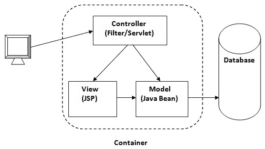

图 8. JSP Model 1 和 Model 2

JSP 页面包含了用于生成动态内容的 HTML 标记和 Java 代码。业务逻辑直接嵌入在 JSP 页面中，导致了显示逻辑与业务逻辑之间的紧耦合。页面之间的导航通常使用超链接或表单提交进行管理，没有集中的控制器组件。表示应用程序数据的 Model 对象通常作为会话属性存储，或直接在 JSP 页面之间传递。

#### JSP Model 1 架构的优势

尽管结构简单，但 JSP Model 1 架构具有许多优势，包括：

- **低复杂度**：JSP Model 1 应用程序相对简单易于理解，适用于小型项目或快速原型开发。

- **最少配置**：JSP Model 1 应用程序通常只需要较少的配置和设置，因为它们依赖于 JSP 技术的内置功能。

- **快速开发**：开发者可以快速开发和部署 JSP Model 1 应用程序，无需额外的框架或工具。

#### JSP Model 1 架构的局限性

然而，JSP Model 1 架构存在若干局限性，包括：

- **缺乏关注点分离**：在 JSP 页面中混合显示逻辑和业务逻辑会导致代码组织和维护性变差。

- **代码重复**：多个 JSP 页面中重复业务逻辑会导致代码冗余和不一致。

- **可扩展性问题**：随着 JSP 页面尺寸和复杂性的增加，管理和维护它们变得越来越困难，阻碍了可扩展性。

### JSP Model 2 架构

JSP Model 2 架构也称为“MVC（模型-视图-控制器）架构”，采用更结构化和模块化的 Web 应用程序开发方法。在这种架构中：

JSP 页面主要作为显示组件，包含用于渲染动态内容的少量 Java 代码。业务逻辑封装在模型组件中（表示应用程序数据和逻辑），并与显示逻辑分离。控制逻辑在控制器组件中实现，处理用户请求、调用相应的业务逻辑并管理导航和流控制。页面之间的导航通常通过集中的控制器组件进行管理，控制器根据用户交互决定下一个视图或操作。

#### JSP Model 2 架构的优势

与 Model 1 架构相比，JSP Model 2 架构具有许多优势，包括：

- **改进关注点分离**：将显示、业务和控制逻辑分离增强了组织性。

- **模块化设计**：模型、视图和控制器等组件可以独立开发，促进了模块化。

- **可扩展性和扩展性**：Model 2 架构的结构化特性有利于管理增长。

#### JSP Model 2 架构的局限性

然而，JSP Model 2 架构也有其局限性，包括：

- **增加复杂性**：与 Model 1 相比，实现 Model 2 架构需要额外的努力和规划。

- **学习曲线**：开发者可能需要额外的培训和专业知识来理解并有效实现该模式。

- **框架依赖**：采用 Model 2 架构通常涉及使用外部框架或库。

#### 在 Model 1 和 Model 2 架构之间选择

在为项目选择 Model 1 或 Model 2 架构时，开发者应该考虑以下因素：

- **项目规模和复杂度**：Model 1 架构可能适合小型项目，而 Model 2 架构更适合大型、更复杂的应用程序。

- **维护需求**：Model 2 架构随时间推移提供更好的维护性和可扩展性。

- **开发团队专业知识**：团队对 MVC 框架和设计模式的专业熟悉程度可能会影响选择。

## JSP 生命周期：翻译、编译和执行

使用基于 Java 的技术，JavaServer Pages（JSP）为构建动态网页提供了强大的方法。理解 JSP 的生命周期是设计人员成功创建、传递和维护基于 JSP 的 Web 应用程序的基础。

### 翻译阶段

翻译阶段是 JSP 生命周期的第一阶段，在此期间，JSP 容器将 JSP 源代码转换为相应的 Java servlet 代码。此过程涉及几个步骤：

- **解析**：JSP 容器解析 JSP 源文件以识别 HTML 标记和嵌入的 Java 代码段。


编译：解析后的 JSP 源代码被转换为相应的 Java servlet 类，称为 JSP servlet。

**导入包**：JSP 容器会自动导入标准 Java 包以及 JSP 页面中指定的任何自定义类或库。

**生成 Servlet 代码**：JSP 容器为 JSP servlet 生成 Java 代码，包括处理 HTTP 请求、生成动态内容以及管理 JSP 页面生命周期的方法。

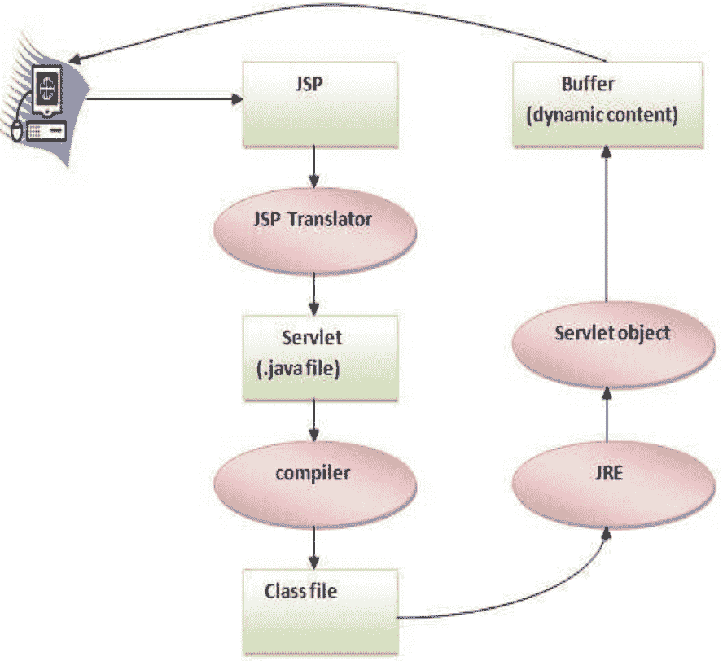

图 9. JSP 生命周期

### 编译阶段

编译阶段是 JSP 生命周期的第二阶段，在此期间，生成的 Java servlet 代码将由 Java 编译器编译成字节码（platform-independent-byte-code）。此过程涉及以下步骤：

- **Java 编译**：Java 编译器将生成的 servlet 代码编译为平台无关的字节码，该字节码可以由 Java 虚拟机（`JVM`）执行。

- **类加载**：编译后的 servlet 类由 servlet 容器 `classloader` 加载到内存中，使其在客户端请求时可以被执行。

- **初始化**：servlet 容器通过调用其 `init()` 方法来初始化 servlet，允许 servlet 在处理客户端请求之前执行任何必要的初始化任务。

### 执行阶段

执行阶段是 JSP 生命周期的最后一个阶段，在此期间，执行编译后的 servlet 代码以处理客户端请求并生成动态内容。此阶段涉及以下步骤：

- **请求处理**：servlet 容器接收针对 JSP 页面的 HTTP 请求并将其转发给相应的 JSP servlet 进行处理。

- **Servlet 初始化**：如果 servlet 之前未被初始化，servlet 容器将调用其 `init()` 方法执行初始化任务。

- **Service 方法调用**：servlet 容器调用 servlet 的 `service()` 方法，传递代表客户端请求和服务器响应的请求和响应对象。

- **动态内容生成**：servlet 执行嵌入的 Java 代码并生成动态内容，然后与静态 HTML 标记结合，形成发送给客户端的最终响应。

- **响应渲染**：servlet 容器将生成的响应发回客户端，由用户的 Web 浏览器渲染 HTML 内容。

### JSP 生命周期事件和监听器

除了翻译、编译和执行等核心阶段外，JSP 生命周期还包括事件和监听器，允许开发者在生命周期的各个点执行自定义的初始化、清理和处理任务。JSP 生命周期事件包括：

- `jspInit()`：当 JSP servlet 被 servlet 容器初始化时调用。

- `jspDestroy()`：当 JSP servlet 被 servlet 容器销毁时调用。

- `jspService()`：为每个 JSP 页面的每个客户端请求调用此方法，允许开发者处理请求处理和响应生成。

- **JSP 生命周期监听器**：开发者可以实现 JSP 生命周期监听器以接收有关周期事件的通知，并根据这些事件执行自定义操作。

在利用 JSP 技术开发动态 Web 应用时，开发者深入理解 JavaServer Pages (JSP) 的周期至关重要。通过完全掌握 JSP 生命周期的解析、收集和执行阶段，设计师可以充分利用 JSP 的影响力，组装强大、多功能且内容丰富的 Web 应用程序，以解决当今客户和组织的问题。

## JSP 开发最佳实践

通过在 HTML 中嵌入 Java 代码，JavaServer Pages (JSP) 是一种能够创建动态 Web 页面的技术。JSP 通过允许开发者将表现逻辑与业务逻辑分离，使 Web 应用程序的更新和维护变得更加。本章将探讨全面的 JSP 开发最佳实践，包括代码组织、性能优化、安全考虑和可维护性。

### 代码组织

有效的代码组织对于 JSP 开发至关重要，可以提高 Web 应用程序的可读性、可维护性和扩展性。JSP 代码组织的一些最佳实践包括：

- **关注点分离**：将业务逻辑封装在 `JavaBeans` 或 `servlets` 中，并让 JSP 主要用于表现逻辑。

- **使用自定义标签**：将重复或复杂的表现逻辑抽象为自定义标签，以提高可重用性和模块化。

- **模块化**：将大型 JSP 文件拆分为较小的、易于管理的组件，以促进代码重用和维护。

- **避免脚本节**：尽量减少脚本（`<% %>` 标签）的使用，转而使用 JSP 表达式和 `JSTL`（JavaServer Pages 标准标签库）来提高可读性和可维护性。

## 性能优化

优化基于 JSP 的 Web 应用性能对于提供响应高效的用户体验至关重要。JSP 性能优化的一些最佳实践包括：

- **最小化脚本**：脚本会降低性能并阻碍代码可读性。尽量减少脚本的使用，优先使用 JSP 表达式和 `JSTL`。

- **减少服务器端处理**：尽可能将计算密集型任务卸载到客户端，以减轻服务器负载并提高响应速度。

- **缓存**：实现缓存机制来缓存频繁访问的数据和资源，以减少数据库查询并提高性能。

- **异步处理**：利用异步处理和非阻塞 I/O 来高效处理并发请求并提高可扩展性。

- **最小化会话范围**：限制会话范围属性的使用，仅存储必要的用户特定数据，以节省内存并提高性能。

## 安全考虑

在 Web 开发中，安全性至关重要，基于 JSP 的应用也不例外。JSP 改进中一些规定的定的安全程序包括：

- **输入验证**：对用户输入进行验证和清理，防止注入攻击、SQL 注入和跨站脚本 (XSS) 发生。

- **输出编码**：对用户输入和动态内容进行加密，以确保用户提供的数据在浏览器中安全渲染并防止 XSS 攻击。

- **授权与真实身份验证**：执行合法的验证和批准组件，以限制对敏感资产的访问并防止未经授权的访问。

- **问题解决**：执行强大的错误处理系统以防止数据泄露并限制安全事件的影响。

### 可维护性

可维护性对于基于 JSP 的 Web 应用的开发是基础。以下是 JSP 开发可维护性的一些最佳实践：

- **使用设计模式**：应用 `MVC`（模型-视图-控制器）等设计模式来隔离关注点，提高代码重用、特定性和维护性。

- **代码文档**：记录 JSP 文档的重要部分，包括原因、用途和条件，以便其他设计师能够理解和支持。

- **版本管理**：为了有效跟踪 JSP 文件的更改、与团队成员协作并管理版本，请使用 `Git` 等版本控制系统。

基于 JSP 的 Web 应用的正确性、可靠性和健壮性只能通过测试来保证。JSP 测试的一些规定的程序包括：

- **单元测试**：为 `JavaBeans`、`servlets` 和自定义标签编写单元测试，以验证各个组件的独立行为。

- **集成测试**：执行集成测试以检查应用程序各个部分（包括 JSP 页面、servlet 和数据库通信）之间的关联。

- **全面测试**：执行从端到端的测试，以从客户的角度认可应用程序的行为，包括客户端协作、结构输入和路由流。

在开发耐用、安全且易于维护，并满足现代企业和用户需求的 Web 应用程序时，必须遵循 JSP 开发的最佳实践。通过遵循代码关联、执行增强、安全性考量、实用性和测试等公认程序，工程师可以确保基于 JSP 的 Web 项目的进度，并为客户提供出色的编程解决方案。

# 第 4 章

# 数据库连接

## 关系型数据库简介

关系型数据集构成了现代信息管理框架的基础，为存储、组织和检索数据提供了一种组织化且高效的方法。本章将阐述关系型模型、数据建模、规范化、`SQL`（结构化查询语言）以及关系型数据库的基础知识。

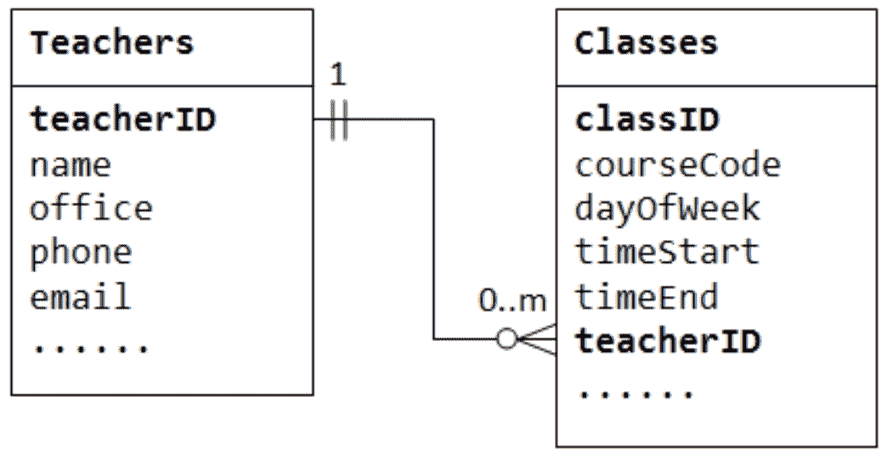

图 1 关系型数据库

### 数据库管理系统的演变

数据库管理系统（`DBMS`）可以追溯到 20 世纪 60 年代，当时 IBM 的信息管理系统（`IMS`）和 `CODASYL`（数据系统语言会议）首次被开发。然而，当 E.F. Codd 在 20 世纪 70 年代引入关系模型时，数据库管理发生了根本性的变化。关系模型为数据的组织和查询提供了一个逻辑和数学上的框架，并引入了表、行和列的概念。

关系型数据模型基于集合论和数学关系。在这种模型中，数据被组织成表（也称为关系），每张表都有行（元组）和列（属性）。关系型数据模型的核心概念包括：

- **表 (Tables)**：通过每个表中的行和列表示现实世界的实体或概念。

- **主键 (Principal keys)**：表中特定行的标识符，确保数据的完整性并使高效检索检索可能。

- **外键 (Different keys)**：对不同表中关键键的引用，建立了表之间的连接并实现引用完整性。

- **规范化 (Normalization)**：将数据组织成表以减少依赖和冗余，从而最大限度地减少数据异常并增强数据完整性。

### 结构化查询语言 (SQL)

与关系型数据库交互的标准语言是结构化查询语言（`SQL`）。它提供了一种既强大又具有表达力的语法，用于查询、操作和管理数据。`SQL` 的主要特性包括：

- **DDL**，或数据定义语言：创建、更改和删除表、文件和视图等数据库项。

- **DML** 是数据操作语言：嵌入、更新、删除和查询存储在表中的信息。

- **DCL**，或数据控制语言：通过授予和拒绝权限、特权和角色来控制谁可以访问数据库对象。

- **事务控制语句**：启动、提交或回滚事务，以确保信息的一致性和可靠性。

### 数据库管理系统 (DBMS)

允许用户定义、创建、管理和操作数据库的软件系统被称为数据库管理系统（`DBMS`）。以下是一些著名的关系型数据库管理系统：

- **Oracle Database**：由 Oracle 公司开发的关系型数据库管理系统，以其扩展性、可靠性和性能闻名。

- **MySQL**：由 Oracle 公司开发的开源关系型数据库管理系统，广泛应用于应用程序、电子商务和 Web 开发。

- **Microsoft SQL Server**：由微软公司的关系型数据库管理系统，因其对企业级功能的支持与微软生态系统的集成而深受青睐。

- **PostgreSQL**：一个开源的关系型数据库管理框架，以其高级特性、可扩展性以及与 `SQL` 标准的一致性而闻名。

### 数据建模与设计

数据建模是涉及规划数据集构建和关联的方法，以精确地处理这些现实世界的实体、关系和需求。数据建模中的重要步骤是：

- **识别实体**：确定需要在数据库中表示的实体或对象的属性和关系。

- **规范化**：利用规范化技术来减少更新异常，确保数据完整性并消除依赖和冗余。

- **实体关系建模**：创建实体关系图（`ERDs`）以描述数据集蓝图中的实体、关系和基数。

- **反规范化**：对数据库模式进行反规范化，以针对特定用例进行优化，降低复杂性并提高查询性能。

### 关系型数据库管理的最佳实践

为了确保关系型数据库的扩展性、可靠性和性能，开发者应该遵循以下最佳实践：

- **索引 (Indexing)**：对经常查询的列创建列表，以进一步提高查询效率并缩短响应时间。

- **事务管理**：通过实施适当的事务管理策略，利用 `ACID`（原子性、一致性、隔离性、持久性）属性来确保数据的一性和完整性。

- **恢复与备份**：定期备份事务日志和数据库数据，防止数据丢失并确保灾难恢复。

- **安全性**：审计、访问控制、身份验证、加密和其他强大的安全措施，以保护敏感数据并防止未经的访问。

- **性能优化**：分析查询执行计划、优化 `SQL` 查询以及调整数据库参数都是监控和优化数据库性能的方法。

关系数据集是现代信息管理框架的基础，为存储、组织和检索数据提供了强大且高效的平台。通过理解关系数据集的基础（包括关系模型、`SQL`、数据建模和数据集管理最佳实践），工程师可以设计并实施灵活、稳健且安全的数据集框架，解决现代应用程序和企业的问题。

## JDBC (Java 数据库连接) 概述

Java 数据库连接（`JDBC`）是 Java 生态系统的基础，它使得 Java 应用程序与关系型数据库之间的通信变得简单。在这个全面概述中，我们将探讨 `JDBC` 的细节，研究其架构、核心组件、用法模式以及在现代 Web 应用程序开发中的重要性。

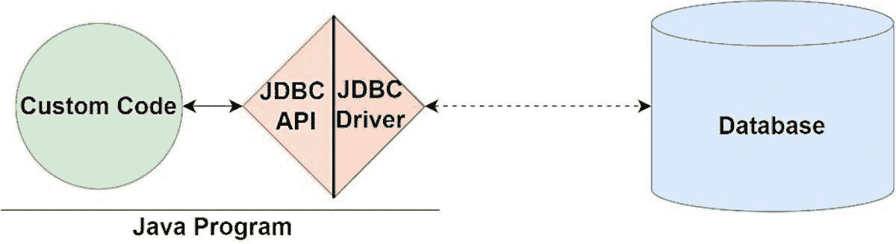

图 2 `JDBC` (Java Database Connectivity)

被称为 Java 数据库连接（`JDBC`）的 Java 应用程序接口（`Java API`）提供了将 Java 应用程序连接到关系型数据库、运行 `SQL` 查询并处理查询结果的标准方法。由于益于数据库的抽象，开发者现在可以编写与数据库无关的代码，这些代码与各种数据库管理系统（`DBMS`）无缝集成。

### JDBC 设计

`JDBC` 的设计基于一组连接点和类，这些类描述了 Java 应用程序中数据集协作的典型系统。以下是 `JDBC` 架构的一些重要部分：

- `DriverManager`：`DriverManager` 示例展示了其卓越性，它是管理数据库连接并为特定的数据集 URL 寻找合适 JDBC 驱动的核心部分。

- `Driver`：JDBC 驱动是 `java.sql` 的实现。`Driver` 接口提供了特定平台的实现，用于连接各种数据库类型（例如 `MySQL`、`Oracle` 和 `PostgreSQL`）。

- `Connection`：`Connection` 接口提供了执行 SQL 语句、管理事务和访问数据库元数据的方法，它代表与特定数据库的连接。

- `Statement`：`Statement` 接口允许对数据库执行 SQL 查询和更新，包括静态 SQL 声明和动态 SQL 解释语句。

- `ResultSet`：`ResultSet` 接口提供了遍历 SQL 查询结果、访问单个行和列以及检索数据值的方法，它代表 SQL 查询的结果集。

使用 JDBC 与关系型数据库交互的第一步是建立与数据库的连接。JDBC 为与数据集的交互提供了一个灵活且可扩展的组件，允许工程师逐步确定数据集 URL、用户名和密钥等连接边界。连接到数据库的步骤如下：

- **添加 JDBC 驱动程序**：利用 `Class.forName()` 或 `DriverManager.registerDriver()` 方法加载适当的 JDBC 驱动并将其注册到 `DriverManager` 中。

- **建立连接**：使用 `DriverManager.getConnection()` 方法，通过传递数据库 URL、用户名和密码作为参数来建立与数据库的连接。

- **关闭连接**：利用 `Connection.close()` 方法在使用后关闭连接，以释放数据库资源并防止资源泄漏。

## 执行 SQL 查询

一旦建立了与数据库的连接，开发者就可以使用 JDBC 对数据库执行 SQL 查询并处理查询结果。JDBC 支持多种类型的 SQL 查询，包括 `SELECT` 查询、`INSERT`、`UPDATE` 和 `DELETE` 查询，以及存储过程调用。使用 JDBC 执行 SQL 查询的过程涉及以下步骤：

- **创建语句**：分别使用 `Connection.createStatement()` 或 `Connection.prepareStatement()` 方法创建 `Statement` 或 `PreparedStatement` 对象。

- **执行查询**：根据查询类型，使用 `Statement.executeQuery()` 或 `Statement.executeUpdate()` 方法执行 SQL 查询。

- **处理结果**：使用 `executeQuery()` 方法返回的 `ResultSet` 对象处理查询结果，遍历结果，并使用 `getInt()`、`getString()` 等方法检索数据值。

- **关闭资源**：在使用后分别使用 `Statement.close()` 和 `ResultSet.close()` 方法关闭语句和结果集对象，以释放数据库资源并防止资源泄漏。

## 处理事务

得于 JDBC 对事务管理的支持，开发者可以将多个 SQL 语句组合成单个原子工作单元，该单元要么全部成功要么全部失败。事务保证了数据库操作期间数据的完整性和一致性，特别是当多个数据库操作必须作为一个单一逻辑单元执行时。与 JDBC 事务交换相关的几个核心概念包括：

- **事务隔离级别**：JDBC 支持不同的事务隔离级别（例如 `READ_UNCOMMITTED`、`READ_COMMITTED`、`REPEATABLE_READ`、`SERIALIZABLE`），这些级别决定了不同事务对正在进行的事务的更改的可见性。

- **事务边界**：事务边界涉及通过使用 `Connection.setAutoCommit()` 方法启动事务，并使用 `Connection.commit()` 和 `Connection.rollback()` 方法显式定义事务的边界。

- **保存点**：JDBC 允许使用 `Connection.setSavepoint()` 方法在事务内设置保存点，以便在发生错误或异常时对事务内的更改进行部分回滚。

## 处理异常

错误处理是 JDBC 编程中不可缺缺的一部分，因为数据库操作可能由于网络问题、数据库服务器故障或无效的 SQL 语法等各种原因失败。JDBC 提供了优雅处理异常的机制，允许开发者有效地捕获并处理 `SQLExceptions` 相关异常。JDBC 中异常处理的一些最佳实践包括：

- **使用 try-catch-finally 块**：将 JDBC 代码封装在 try-catch-finally 块中，以捕获 `SQLExceptions` 并在 finally 块中释放数据库资源。

- **记录异常**：使用 `Log4j` 或 `java.util.logging` 等日志框架记录 `SQLExceptions` 和相关错误信息，以便于排故障和调试。


- **回滚事务**：在发生`SQLExceptions`或其他错误时，在`catch`块中使用`Connection.rollback()`方法回滚事务，以确保数据的一致性和完整性。

## JDBC 开发最佳实践

有效的 JDBC 开发涉及遵循促进代码质量、性能和可维护性的最佳实践。JDBC 开发的一些最佳实践包括：

- **使用 PreparedStatement**：使用`PreparedStatement`代替`Statement`来执行 SQL 查询，因为`PreparedStatement`提供了更好的性能、防止 SQL 注入以及对参数化查询的支持。

- **连接池**：使用`Apache Commons DBCP`、`HikariCP`或`Tomcat JDBC Pool`等连接池库实现连接池，以重用现有数据库连接并提高性能和可扩展性。

- **关闭资源**：在使用后通过`try-with-resources`语句或`finally`块中的手动资源清理，来及时释放数据库资源（如`Connection`、`Statement`、`ResultSet`）。

- **避免动态 SQL**：避免使用字符串拼接或插值构建动态 SQL 查询，因为它们容易受到 SQL 注入攻击并可能导致安全漏洞。

- **有效使用事务**：有效使用事务确保数据的一致性和完整性，将相关的数据库操作分组为事务，并适当处理提交和回滚操作。

Java 数据库连接 (JDBC) 为 Java 与关系数据集交互、执行 SQL 查询和管理事务提供了强大且灵活的工具。通过理解 JDBC 的工程、组件、用例和最佳实践，设计师可以构建出健壮、高效且可靠的数据驱动应用程序，满足现代 Web 开发的需求。

## JDBC 驱动与连接管理

Java 数据库连接 (JDBC) 是基于 Java 的 Web 应用程序的基础部分，与关系数据集协作。得益于 JDBC 驱动，开发者能够执行 SQL 查询、检索查询结果并程序化管理数据库连接，驱动充当了 Java 应用程序与数据库管理系统 (DBMS) 之间的桥梁。JDBC 驱动和连接管理的复杂性是本章的重点。我们将检查各种 JDBC 驱动类型、连接池方法以及 Java Web 应用中有效数据库连接的最佳实践。

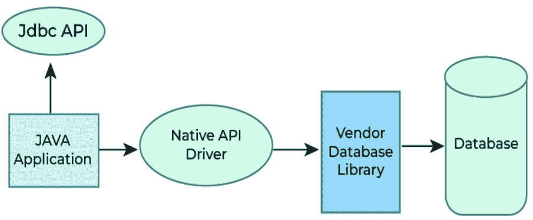

图 3. JDBC 驱动

### 类型 1：JDBC-ODBC 桥接驱动

通过 ODBC（开放数据库连接）接口，`JDBC-ODBC Bridge Driver`促进了 Java 应用程序与数据库之间的通信。该驱动程序依赖本地 ODBC 库来建立关联并执行 SQL 查询。虽然使用简单且广泛可用，但`Type 1`驱动程序在执行和阶段上存在限制，因为它取决于客户端机器上是否存在 ODBC 驱动程序。

### 类型 2：原生 API 驱动程序

`Native-API Driver`使用数据库供应商提供的原生客户端库或 API 直接与底层 DBMS 通信。由于它不使用 ODBC 层直接与数据库服务器通信，该驱动程序的性能优于`JDBC-ODBC Bridge Driver`。然而，它的跨平台适应性较差，因为它要求客户端机器上安装原生库。

### 类型 3：网络协议驱动程序

`Network Protocol Driver`通过中间件服务器或网关与信息库服务器通信，将 JDBC 调用解释为 DBMS 确定的特定网络协议。通过通过中间件服务器集中管理数据库访问，该驱动程序简化了客户端配置并提供了平台无关性。然而，额外的网络跳转和协议转换可能会导致额外的延迟和开销。

### 类型 4：轻量级驱动程序（本地协议）

`Thin Driver`又称为`Local Protocol Driver`，是一种纯正的 Java 实现，通过使用特定的网络协议直接与数据集服务器通信。与其他类型的驱动程序相比，这种驱动程序提供了最好的性能、可移植性和安全性，因为它不依赖中间件服务器或外部库。`Thin Driver`通常由数据库供应商作为独立的`JAR`文件提供，便于在 Java 应用程序中部署和管理。

## JDBC 中的连接管理

有效的连接管理对于基于 JDBC 的 Web 应用程序的性能、扩展性和可靠性至关重要。连接管理涉及高效地建立、池化和重用数据库连接，以最小化开销和资源消耗。JDBC 连接管理的关键方面包括：

- **建立连接**：使用`JDBC DriverManager`或`DataSource`对象创建数据库连接，指定如`URL`、`username`和`password`等连接参数。

- **连接池**：对数据库连接进行池化，以重用现有连接而不是为每个请求创建新连接，从而提高性能和可扩展性。

- **连接生命周期**：管理数据库连接的生命周期，包括打开、关闭和回收连接，以确保适当利用资源并防止连接泄漏。

- **处理连接失败**：实现错误处理机制以优雅地处理连接失败，包括重试逻辑、连接超时设置和连接恢复策略。

- **调优连接参数**：优化连接参数，如连接超时、`maximum pool size`和`idle connection timeout`，以满足应用程序需求和资源限制。

## 连接池技术

连接池是 Java Web 应用程序中提高数据库连接效率的一种广泛采用的技术。连接池涉及维护一个预先建立的数据库连接池，这些可以在多个客户端请求之间重用，减少连接建立和销毁的开销。一些常见的连接池技术包括：

- **应用级连接池**：在应用程序代码中使用自定义的连接池管理逻辑在应用层实现连接池化。虽然灵活且可定制，但这种方法需要手动管理连接生命周期，并可能导致性能和资源利用率优化。

- **基于 DataSource 的连接池**：利用应用服务器或连接池库提供的`DataSource`对象从外部管理数据库连接。`DataSource`对象封装了连接池逻辑，并为获取和释放连接提供了标准化接口，简化了连接管理并提升了可扩展性。

- **第三方连接池库**：利用第三方连接池库（如`Apache Commons DBCP`、`HikariCP`或`Tomcat JDBC Pool`）高效管理数据库连接。这些库提供了可配置的连接池参数、连接验证和监控功能，适用于高性能、生产级应用程序。

## 连接管理的最佳实践

高效的连接管理对于基于 JDBC 的 Web 应用程序的性能、可靠性和扩展性至关重要。Java Web 应用程序连接管理的一些最佳实践包括：

- **使用连接池**：采用连接池重用现有数据库连接，并最小化连接建立的开销。

- **配置连接参数**：根据应用程序需求和资源限制调优`maximum pool size`、`connection timeout`和`idle connection timeout`等连接参数。

- **监控连接使用**：监控连接池使用情况，包括连接获取率、池大小和连接利用率，以识别瓶颈并优化资源分配。

- **优雅地处理连接失败**：实现错误处理机制以优雅处理连接失败，包括重试逻辑、连接超时设置和连接恢复策略。

- **使用后关闭连接**：在使用后始终关闭数据库连接以释放资源并防止连接泄漏。使用`try-with-resources`语句或`finally`块来确保即使发生异常也能妥善清理资源。

JDBC 驱动程序和连接管理是 Java Web 应用程序的重要组成部分，因为它们使得安全高效地与关系型数据库交互成为可能。通过掌握各种 JDBC 驱动程序、执行强大的关联操作并遵循规定的连接管理程序，设计人员可以构建出健壮、灵活且高效的 Java Web 应用程序，满足当前客户和组织的需求。

## 在 Java 中建立数据库连接

开发 Java 应用程序的基础部分是连接数据库，特别是在数据持久化对于存储、检索和处理数据至关重要的 Web 应用程序中。在本章中我们将介绍 Java 中建立数据库连接的细节，涵盖连接池、最佳实践、`JDBC`（Java Database Connectivity）以及常见陷阱等主题。

### 理解 Java Database Connectivity 或 JDBC

`JDBC`是连接 Java 应用程序到关系型数据库的标准 Java API。它提供了一个无组件平台用于执行 SQL 查询、检索结果和管理数据集关联。`JDBC`的核心特性包括：

- **驱动架构**：探索不同类型的 JDBC 驱动程序（例如`Type 1`、`Type 2`、`Type 3`、`Type 4`）及其特性。

- **核心接口**：理解核心 JDBC 接口，如`Connection`、`Statement`、`PreparedStatement`、`CallableStatement`、`ResultSet`和`DriverManager`。

- **连接管理**：使用`DriverManager`和`Connection`对象建立数据库连接，包括指定`URL`、`username`和`password`等连接参数。

- **执行 SQL 查询**：使用`Statement`和`PreparedStatement`对象执行 SQL 语句（例如`SELECT`、`INSERT`、`UPDATE`、`DELETE`），并使用`ResultSet`处理查询结果。

### JDBC 连接 URL

JDBC 关联 URL 是 Java 中布局数据源关联的基础部分。它确定了与数据源接口交互时预期的数据源供应商、驱动类型、主机、端口、数据库名称和额外边界。理解 JDBC 连接 URL 的语法和参数对于在 Java 中正确配置数据库连接至关重要。

## 建立数据库连接

在 Java 中建立数据库连接涉及多个步骤，包括加载适当的 JDBC 驱动、创建连接 URL 以及使用`DriverManager`获取数据库连接。开发者必须处理连接过程中可能出现的任何异常和错误，例如`ClassNotFoundException`、`SQLException`和连接超时。

## 连接池

连接池是一种技术，通过重用现有的数据库连接而不是为每个请求创建新连接，来提高 Java 应用中数据库连接的性能和可扩展性。连接池的关键方面包括：

- **连接池配置**：配置最大池大小、最小空闲连接数和连接超时等参数，以优化连接池性能。

- **连接池库**：探索 Java 生态系统中流行的连接池库，例如`Apache Commons DBCP`、`HikariCP`和`Tomcat JDBC Pool`。

- **与 Java 程序的集成**：将连接池库集成到 Java 程序中，以高效管理数据库连接，并减少建立和销毁连接相关的开销。

## 数据库连接管理的最佳实践

有效的数据库连接管理对于 Java 应用的性能、可靠性和安全性至关重要。连接管理的一些最佳实践包括：

- **使用连接池**：利用连接池重用现有的数据库连接，最大限度地减少建立和销毁连接带来的开销。

- **连接生命周期管理**：在使用后正确关闭数据库连接，以释放资源并避免连接泄漏。

- **异常处理**：实现稳健的错误处理机制，以优雅地处理`SQLException`、连接超时和数据库错误等异常。

- **连接测试**：执行连接验证测试，确保连接在应用程序代码中使用之前是有效且功能正常的。

- **调优连接池参数**：精调最大池大小、连接超时和空闲连接驱逐策略等连接池参数，以针对特定的应用需求优化性能。

## 常见陷阱与故障排除

尽管遵循了最佳实践，开发者在 Java 应用中建立数据库连接时仍可能遇到常见的陷阱和挑战。常见陷阱包括：

- **连接泄漏**：在使用后未能关闭数据库连接可能导致连接泄漏和资源耗尽，影响应用的性能和稳定性。

- **连接超时**：连接超时参数配置不当可能导致连接超时，引发延迟和潜在的应用程序故障。

- **资源竞争**：连接池大小不足或池参数调优不当可能导致在高负载条件下出现资源竞争和性能下降。

- **死锁**：对数据库事务和锁定机制处理不当可能导致死锁，即多个事务无限期等待对方持有的资源。

建立数据库连接是 Java 应用开发的关键方面，使应用程序能够高效、安全地与关系型数据库交互。通过理解 JDBC 基础、连接池技术、连接管理最佳实践以及常见陷阱，开发者可以构建出健壮、可扩展且易于维护的 Java 应用，以满足现代用户和企业的需求。

## JDBC 语句：Statement, PreparedStatement, CallableStatement

Java 数据库连接 (JDBC) 提供了一种从 Java 应用程序与关系型数据库交互的强大机制。JDBC 语句是这种交互的核心组件，允许开发者执行 SQL 查询、执行数据库更新并从数据库操作中检索结果。在本章中，我们将深入探讨 JDBC 语句的复杂性，探索`Statement`、`PreparedStatement`和`CallableStatement`之间的区别、它们的使用场景、最佳实践以及性能和安全方面的考虑。

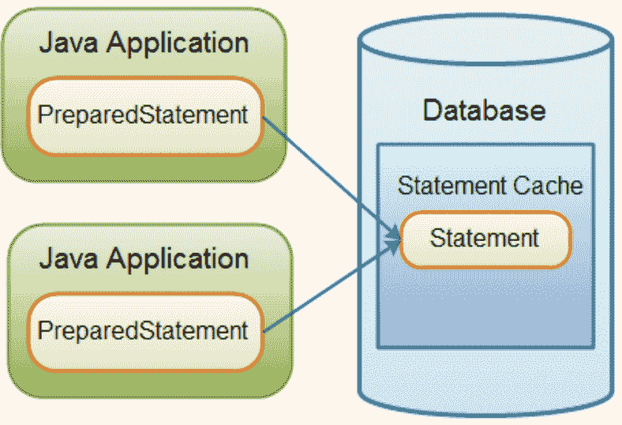

图 4. JDBC 语句

JDBC 语句是执行数据库 SQL 查询和命令的主要手段。它们封装了 SQL 语句，并提供了执行这些语句、处理结果和管理资源的方法。三种主要的 JDBC 语句分别是`Statement`、`PreparedStatement`和`CallableStatement`，每种都为特定的用例设计，并提供独特的优势和特性。

### Statement

`Statement`接口是 JDBC 语句的最简单形式，允许开发者直接执行静态 SQL 查询和命令。`Statement`的特征和特性包括：

- **创建**：使用`Connection`对象的`createStatement()`方法创建语句。

- **执行**：使用`executeQuery()`方法执行 SQL 查询，而使用`executeUpdate()`方法执行数据库更新。

- **安全性考虑**：当使用用户输入动态构建`Statements`时，它们容易受到 SQL 注入攻击，因此其安全性低于`PreparedStatement`。

### PreparedStatement

`PreparedStatement`扩展了`Statement`的功能，允许开发者使用带有参数占位符的 SQL 查询进行预编译。与`Statement`相比，它具有以下几个优势：

- **参数化查询**：`PreparedStatement`支持参数化查询，允许开发者在不拼接字符串的情况下动态设置参数值，从而降低 SQL 注入的风险。

- **查询优化**：查询的预编译允许数据库优化查询执行计划，从而提高频繁执行的查询的性能。

- **代码可读性和可维护性**：使用`PreparedStatement`通过将 SQL 逻辑与参数值分离并减少字符串拼接，使代码更整洁、更易读。

### CallableStatement

`CallableStatement`是`PreparedStatement`的特殊形式，专为执行存储过程或可调用 SQL 函数设计。`CallableStatement`的特征和优势包括：

- **调用存储过程**：`CallableStatement`允许开发者执行数据库中定义的存储过程或函数，传递输入参数并检索输出参数或结果集。

- **数据库函数集成**：`CallableStatement`促进了与数据库函数和过程的交互，使开发者能够在 Java 程序内部利用数据库功能。

- **参数化输入和输出**：与`PreparedStatement`类似，`CallableStatement`支持参数化输入和输出，允许开发者向存储过程传递参数并高效地检索结果。

## 使用 JDBC 语句的最佳实践

为了提高 Java 程序中 JDBC 语句的有效性和安全性，开发者应该遵循以下最佳实践，例如：

在任何可能的点使用`PreparedStatement`或`CallableStatement`以防止 SQL 注入攻击并进一步优化执行效率。避免使用字符串拼接构建动态 SQL，因为这会增加 SQL 注入漏洞的风险。在使用后明确关闭`JDBC`资源（说明、结果集、连接），以快速释放数据库和组织资源。通过执行适当的错误处理和日志记录系统灵活地处理异常，以便实际分析并解决问题。通过分析执行计划、合理安排表顺序以及限制数据集往返次数来提高查询执行性能。

## 性能考虑因素

性能是 JDBC 语句执行的一个关键方面，特别是在高并发、延迟敏感型应用程序中。JDBC 语句的一些性能考虑因素包括：

使用`PreparedStatement`进行重复查询的执行，以利用查询缓存并减少查询编译开销。

批处理：利用`PreparedStatement`提供的批处理能力，在单次数据库往返中执行多个 SQL 语句，提高效率和吞吐量。

连接池：实现连接池以在多个语句和事务之间复用数据库连接，减少连接建立开销并提高可扩展性。

## 安全考虑因素

在 Java 应用程序处理数据库交互时，安全性至关重要。为了降低与 JDBC 语句相关的安全风险，开发者应该：

使用带有`PreparedStatement`或`CallableStatement`的定义查询来防止 SQL 注入攻击。在将客户端输入作为查询边界之前对其进行清理和验证，以防止恶意输入破坏数据库安全。为了防止未经授权访问敏感数据并限制数据库访问，应实施适当的身份验证和授权机制。通过对传输中和存储的数据进行加密，保护敏感数据免受窃听和盗窃，特别是在数据可能通过不安全网络传输的 Web 应用中。

`JDBC`是 Java 应用程序中数据集协作的关键部分，使工程师能够执行 SQL 查询、刷新数据集并高效安全地与存储技术协作。通过理解`Statement`、`PreparedStatement`和`CallableStatement`之间的区别并遵循最佳实践，开发者可以创建满足现代软件开发需求的数据库驱动 Java 应用程序。

## 使用 JDBC 执行 SQL 查询


Java 应用程序与关系型数据库交互的基础技术是 Java 数据库连接（`JDBC`）。`JDBC` 提供的核心功能之一是针对数据库执行 SQL 查询的能力，使工程师能够高效地检索、控制和管理信息。本章将探索使用 `JDBC` 执行 SQL 查询的一些复杂之处，例如建立数据库连接、准备和执行 SQL 语句、处理查询结果以及查询执行的最佳实践。

建立数据库连接、创建 SQL 语句、执行语句、处理结果以及处理任何可能的异常，都是使用 `JDBC` 运行 SQL 查询的多步骤过程的一部分。要使用 `JDBC` 高效与数据库交互，理解查询执行过程中的每一步至关重要。

## 建立数据集连接

使用 `JDBC` 执行 SQL 查询时最重要的阶段是建立数据集的连接。`JDBC` 提供了一个 `DriverManager` 类和一个用于管理数据集连接的 `Connection` 接口。工程师可以使用 `DriverManager.getConnection()` 方法，通过提供数据库 URL、用户名和密码来建立数据集连接。必须谨慎处理连接管理，以确保资源的正当使用并避免连接泄漏。

## 创建 SQL 语句

在建立数据集连接后，设计可以创建 SQL 语句来执行数据库任务，例如查询、刷新、插入或删除信息。`JDBC` 提供了两种 SQL 语句：`Statement` 和 `PreparedStatement` 接口对象用于执行静态查询，而 `PreparedStatement` 对象则用于参数化查询。

## 执行 SQL 语句

建立数据集连接后，开发者可以使用 `Statement` 或 `PreparedStatement` 接口针对数据库执行语句。执行 SQL 语句最常用的方法包括：使用 `executeQuery()` 执行返回 `ResultSet` 的 SELECT 查询；使用 `executeUpdate()` 执行返回影响行数的 INSERT、UPDATE 或 DELETE 查询；以及使用 `execute()` 执行任何种类的 SQL 查询。

## 处理查询结果

在执行返回 `ResultSet` 的 SELECT 查询时，开发者必须通过遍历 `ResultSet` 并根据需要提取数据来处理查询结果。`JDBC` 提供了如 `next()`、`getString()`、`getInt()` 等方法用于定位列值和导航 `ResultSet`。通过仔细处理 `ResultSet` 导航和数据检索，可以避免 `NullPointerException` 和 `SQLException` 错误。此外，工程师在处理查询结果后应关闭 `ResultSet`、`Statement` 和 `Connection` 对象。

## 查询执行的最佳实践

高效安全地使用 `JDBC` 执行 SQL 查询需要遵循以下最佳实践：

使用 `PreparedStatement` 进行参数化查询以防止 SQL 注入攻击并提高性能。使用 `try-with-resources` 语句或 `finally` 块确保资源的正确清理并避免资源泄漏。在适用的情况下，通过将多个 SQL 语句合并到单个事务中来减少数据库往返。

使用连接池通过复用现有的数据库连接来提高性能和扩展性。

# 在 JDBC 中处理 ResultSet

Java 应用程序与关系型数据库交互的基础技术是 Java 数据库连接（`JDBC`）。代表数据库查询结果的 `ResultSet` 是 `JDBC` 的关键组件之一。在本章中，我们将详细研究 JDBC 中 `ResultSet` 的概念，包括它们的类型、用途、导航、信息检索、元数据处理以及在 JDBC 应用中高效处理 `ResultSet` 的最佳实践。

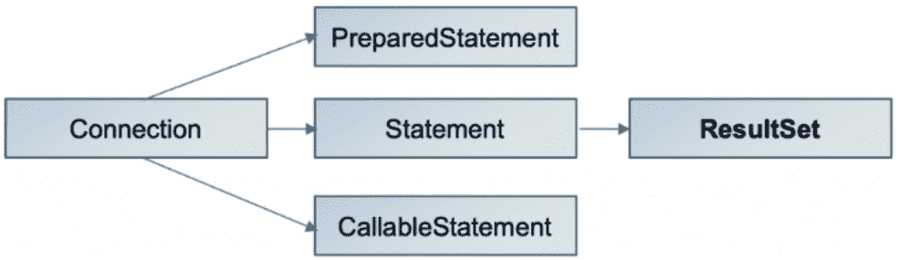

图 5. ResultSets

JDBC 中的 `ResultSet` 是一种表格化数据结构，表示数据库查询的结果集。当使用 JDBC 对数据库执行查询时，数据库服务器返回的结果集被封装在 `ResultSet` 对象中，允许 Java 程序以编程的方式访问和操作查询结果。

## ResultSets 的类型

JDBC 根据底层数据库游标的特性以及对导航和更新的支持程度，定义了不同类型的 `ResultSets`。JDBC 中主要的 `ResultSet` 类型包括：

- **仅向移动 ResultSet（Forward-only ResultSet）**：不支持滚动或更新的 `ResultSet`，仅允许从第一行到最后一行按正向方向遍历查询结果。
- **可滚动 ResultSet（Scrollable ResultSet）**：支持双向导航的 `ResultSet`，允许按正反两个方向遍历查询结果，并对底层数据进行更新。
- **可更新 ResultSet（Updatable ResultSet）**：支持对底层数据进行更新的 `ResultSet`，允许修改从数据库检索到的行。

## 从 ResultSets 获取数据

开发者可以使用 `ResultSet` 提供的多种方法从数据库查询获取的 `ResultSet` 中检索数据。从 `ResultSet` 中恢复信息的常用技术包括：

利用 `getString()`、`getInt()`、`getDouble()` 等技术按记录段或段名恢复属性。利用 `next()` 技术将游标移动到下一行，并利用 `hasNext()` 策略检查是否有更多可访问的列。使用与结果集中列类型相对应的 getter 方法来访问当前行的数据。

### 使用游标移动导航 ResultSets

JDBC 的 `ResultSets` 允许基于游标的查询结果导航。开发者导航 `ResultSets` 的方法包括：

利用 `first()` 策略将游标移动到第一行，利用 `last()` 技术移动到最后一列。使用 `absolute()` 方法将游标移动到特定行，或使用 `relative()` 方法相对于当前位置移动游标。利用 `isFirst()`、`isLast()` 和 `isBeforeFirst()` 方法验证游标的当前位置。

### 处理 ResultSets 中的元数据

除了信息外，JDBC 中的 `ResultSets` 还提供了关于查询结果的元数据，记录了结果集的段信息等信息。开发者从 `ResultSets` 中检索元数据的方法包括：

利用 `getColumnName()` 技术恢复段名。

利用 `getColumnTypeName()` 方法检索列数据类型。

利用 `getColumnDisplaySize()` 策略恢复段大小。

## 关闭 ResultSets

在 `ResultSets` 通常不再预期提供数据集资源后，正确关闭它们对于防止内存泄漏至关重要。开发者可以使用 `ResultSet` 接口提供的 `close()` 方法关闭 `ResultSets`。关闭 `ResultSets` 的最佳实践包括：

- 在 `finally` 块中关闭 `ResultSets`，以确保无论是否发生异常都能将其关闭。
- 为了防止资源泄漏并确保正确的资源管理，按照创建的相反顺序关闭 `ResultSets`。

## 高效处理 ResultSets

熟练处理 `ResultSets` 是 JDBC 应用性能和扩展性的基础。以下是高效处理 `ResultSets` 的一些最佳实践：

- 通过分页或限制查询返回的行数来限制 `ResultSets` 的大小。
- 通过仅从 `ResultSets` 中获取所需的列和行来减少内存使用。
- 避免会导致 `ResultSet` 长时间占用数据库资源的长时间查询。

JDBC 高度依赖 `ResultSets`，它实现了从关系型数据库中进行编程的查询结果检索和操作。通过掌握 JDBC 应用中 `ResultSet` 的类型、用法、导航、信息恢复、元数据处理以及高效处理 `ResultSet` 的最佳实践，工程师可以构建出健壮、灵活且高效的、满足现代开发框架需求的数据驱动 Java 应用。

# 使用 JDBC 插入和更新记录

在 Web 应用开发领域，数据管理至关重要。关系型数据库是高效数据存储和操作的基础。标准的 Java 数据库连接（JDBC）接口通过简化插入和更新记录，使 Java 程序更容易与关系型数据库协同工作。使用 JDBC 插入和更新记录的复杂性是本章的重点，将探讨最佳实践、常见陷阱和具体示例，帮助开发者掌握这些基础数据库操作。

插入和更新记录是数据库管理中的基础操作，允许应用程序在数据库表中添加新数据或修改现有数据。这些操作对于维护关系型数据库中存储数据的完整性和准确性起着作用。通过 JDBC，开发者可以执行 SQL `INSERT` 和 `UPDATE` 语句，从 Java 程序以编程的方式执行这些操作。

## 使用 JDBC 插入记录

### 建立数据库连接

在使用 JDBC 向数据库插入记录之前，工程师应该与数据集建立关联。这涉及获取 `Connection` 对象，设置数据库 URL、用户名和密码等连接参数，并加载相应的 JDBC 驱动程序。

### 构建 SQL INSERT 语句

插入记录需要构建 SQL `INSERT` 语句，指定目标表以及插入到每列的值。JDBC 提供了 `PreparedStatement` 对象来安全地构建参数化 SQL 语句，防止 SQL 注入攻击并通过预编译查询提高性能。

### 执行 INSERT 语句

一旦构建了 `PreparedStatement`，开发者可以调用 `PreparedStatement` 对象的 `executeUpdate()` 方法来执行 `INSERT` 语句。可以使用此方法验证操作是否成功，该方法会返回受 `INSERT` 操作影响的行数。

### 处理异常和错误

使用 JDBC 插入记录可能会因为数据库连接问题、约束违背或数据完整性违反等各种因素遇到异常或错误。开发者应该实现健壮的错误处理机制以捕获并优雅地处理异常，包括回滚事务和向用户提供信息丰富的错误消息。

## 使用 JDBC 更新记录

### 构建 SQL UPDATE 语句

更新记录涉及构建 SQL `UPDATE` 语句，指定目标表、要更新的列以及这些列的新值。与 `INSERT` 语句一样，JDBC `PreparedStatement` 对象被用于安全地构建参数化 SQL `UPDATE` 语句。

### 执行 UPDATE 语句

一旦构建了用于 `UPDATE` 语句的 `PreparedStatement`，开发者可以使用 `executeUpdate()` 方法执行该语句。该方法更新数据库表中的指定记录，并返回受 `UPDATE` 操作影响的行数。

### 处理乐观锁

在并发多用户环境中，采用乐观锁机制是为了防止更新记录时的数据不一致和冲突。开发者可以在 JDBC 中实现乐观锁，通过在数据库表中包含一个版本列或时间戳列，并在更新记录之前检查该列的值。

### 管理事务

更新记录通常涉及多个数据库操作，这些操作需要原子化执行以维护数据的一致性。JDBC 允许开发者通过使用 `Connection` 对象的 `commit()` 和 `rollback()` 方法分别启动和提交事务来显式管理事务。

## 使用 JDBC 插入和更新记录的最佳实践

- **使用 `PreparedStatement` 进行参数化查询**：始终使用 `PreparedStatement` 对象构建参数化 SQL 查询，以防止 SQL 注入攻击并提高性能。
- **批量处理**：对于批量插入或更新，利用 JDBC 批量处理来减少与数据库的往返次数并提高性能。
- **错误处理**：实现健壮的错误处理机制以捕获并优雅地处理异常，包括回滚事务并向用户提供信息丰富的错误消息。
- **事务管理**：显式管理事务以确保数据一致性和完整性，包括根据需要启动、提交和回滚事务。
- **连接池**：利用连接池高效地管理数据库连接，并提高多用户环境下的可扩展性和性能。

## 实际示例

为了说明所讨论的概念，我们提供了实际示例，演示了如何在 Java 应用程序中使用 JDBC 插入和更新记录。这些示例涵盖了插入单条记录、批量插入、根据特定标准更新记录以及在数据库操作期间处理异常和错误等场景。

使用 JDBC 插入和更新记录是 Java Web 应用数据库管理中的基本任务。通过理解 JDBC 的原理、构建参数化 SQL 语句、管理事务并实施最佳实践，开发者可以高效、安全且可靠地执行这些操作，确保存储在关系型数据库中的数据完整性和准确性。

# 使用 JDBC 删除记录

从数据库删除记录是数据管理中的一项操作，允许应用程序移除过时、不需要或错误的数据。在 Java Web 应用中，删除记录通常使用 Java 数据库连接（JDBC）API 完成，该 API 提供了一种与关系型数据库交互的平台无关机制。在本章中，我们将深入探讨 JDBC 删除记录的细节，涵盖 SQL `DELETE` 语句、参数化查询、错误处理、事务管理以及确保数据完整性和性能的最佳实践等概念。

从数据库删除记录涉及根据指定标准从表中删除一行或多行。删除记录的常见场景包括移除废数据、清理过期的记录以及执行数据保留策略。在 Java Web 应用中，删除记录是通过 JDBC API 执行的 SQL `DELETE` 语句来实现的。

## SQL DELETE 语句的结构

SQL `DELETE` 语句用于删除表中符合指定条件的行。`DELETE` 语句的基本语法如下：

```
DELETE FROM table_name
WHERE condition;
```

SQL `DELETE` 语句的关键组件包括：

- `DELETE FROM`：指定要从中删除行的表。
- `WHERE`：可选子句，用于指定删除行的条件。如果省略，则表中的所有行都将被删除。

## 使用 JDBC 删除记录

在 Java Web 应用中，使用 JDBC 删除记录涉及以下步骤：

- 使用 `DriverManager` 或连接池建立数据库连接。
- 创建带有参数化 DELETE 查询语句的 `PreparedStatement`。
- 如果适用，为 `PreparedStatement` 中的参数设置值。
- 执行 `PreparedStatement` 以从数据库中删除记录。
- 优雅地处理异常和错误，以确保正确的错误报告和恢复。

## 用于安全删除的参数化查询

参数化查询对于 JDBC 中记录的安全删除至关重要。参数化查询通过将 SQL 代码与用户输入分离，并将输入值视为参数而非 SQL 查询字符串的一部分，防止 SQL 注入攻击。例如：

```java
String sql = "DELETE FROM users WHERE id = ?";
PreparedStatement pstmt = connection.prepareStatement(sql);
pstmt.setInt(1, userId);
int rowsAffected = pstmt.executeUpdate();
```

使用参数化查询确保用户输入经过适当清理，且不会对应用程序构成安全风险。

## 错误处理与异常管理

在使用 JDBC 删除记录时，适当的错误处理对于确保错误得到优雅处理以及应用程序保持健壮可靠至关重要。常见的错误处理实践包括：

- 捕获 `SQLException` 并进行适当处理。
- 记录错误消息和堆栈跟踪以便调试。
- 在发生错误时回滚事务以维护数据一致性。
- 向用户提供信息丰富的错误消息，协助故障排除和解决。

## 事务管理

在 JDBC 中删除记录时，事务管理对于维护数据完整性和一致性至关重要。事务确保数据库操作的原子性、一致性、隔离性和持久性（ACID）。JDBC 事务管理的关键方面包括：

- 使用 `connection.setAutoCommit(false)` 开始事务。
- 在成功删除后使用 `connection.commit()` 提交事务。
- 在发生错误或异常时使用 `connection.rollback()` 回滚事务。

## 使用 JDBC 删除记录的最佳实践

为了保证 JDBC 中记录删除活动的卓越质量、安全性和执行力，设计者应当遵循最佳实践，例如：

可以使用参数化查询来保护数据并避免 SQL 注入攻击。验证用户输入和输入参数，以停止无效或错误的删除。使用单元测试、集成测试和端到端测试彻底验证删除操作的正确性和可靠性。为了减少删除时间和资源消耗，监控数据库性能并优化查询以提高效率。实现适当的错误处理和异常管理，以优雅地处理错误并确保正确的错误报告和恢复。

在 Java Web 应用中，数据库管理的一个重要方面是使用 JDBC 删除记录的能力。通过掌握 SQL 删除语句的标准、参数化查询、错误处理、事务管理以及删除任务的最佳实践，工程师可以构建出健壮、安全且高效的数据驱动型应用程序，以解决现代客户和组织的问题。

# 使用 JDBC 进行批量处理

在对数据库执行多个 SQL 语句时，批量处理是数据库编程中一种强大的技术，用于最大化性能和效率。本章将探讨 JDBC（Java 数据库连接）批量处理的优势、实施策略、最佳实践以及现实世界的用例。

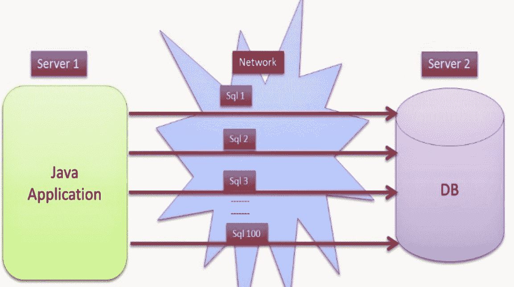

图 6 批量处理

批量处理涉及将多个 SQL 语句分组到一个批次中并作为批量操作一起执行。与单独执行语句相比，该技术具有若干优势，包括减少网络开销、减少与数据库服务器的往返次数以及提高整体性能。

## 批量处理的优势

批量处理为数据库编程带来了许多优势，包括：

- **减少开销**：通过在批次中发送多个 SQL 语句，批量处理减少了为每个语句建立和销毁数据库连接所需的开销。
- **提高性能**：批量处理可以通过减少网络延迟并利用数据库优化在单次事务中执行多个语句，从而显著提高性能。
- **原子性**：批中的所有语句都作为一个单一的工作单元执行，确保了多个数据库操作的原子性和一致性。
- **可扩展性**：批量处理可以扩展到高效处理海量数据，使其适用于数据迁移、数据仓储和 ETL（提取、转换、加载）过程等大批量数据操作。

## 使用 JDBC 实现批量处理


JDBC 通过 `BatchUpdateException`、`PreparedStatement` 和 `Statement` 接口提供了对批量处理的支持。使用 JDBC 实现批量处理的关键步骤包括：

- 创建 `PreparedStatement` 对象：使用 `PreparedStatement` 对象准备好带有参数占位符的 SQL 语句。
- 向批次添加参数：使用 `setInt()`、`setString()`、`setDouble()` 等方法向批次中填充参数值。
- 执行批处理：使用 `executeBatch()` 或 `executeLargeBatch()` 方法执行批处理，在单次批量操作中向数据库服务器发送多个 SQL 语句。
- 处理批执行结果：处理批执行结果，以处理批次中每个语句的成功或失败，并处理 `BatchUpdateException` 等异常。

## 批量处理的优化策略

优化批量处理涉及在最小化资源利用和竞争的同时最大化性能和效率。使用 JDBC 优化批量处理的一些策略包括：

- **批处理大小调整**：尝试不同的批处理大小，找到平衡网络开销、数据库负载和内存消耗的最佳尺寸。
- **事务管理**：将相关的批次分组在一个事务中，以确保多个数据库操作的原子性和一致性，并减少事务开销。
- **连接管理**：重用现有数据库连接并使用连接池来最小化连接开销并提高可扩展性。
- **语句缓存**：缓存 `PreparedStatement` 对象供多个批次重用，以减少准备时间并提高性能。
- **异步执行**：探索异步批执行技术，将批处理与主应用程序线程解耦并提高响应能力。

## JDBC 批量处理的最佳实践

开发者应该遵循以下最佳实践，以保证批量处理代码的可靠性、性能和可维护性：

- **问题解决**：执行强大的错误处理机制，以平稳地处理集群执行错误，包括记录错误、回滚交换以及向客户端提供指示性的错误消息。
- **数据验证**：为了防止 SQL 注入攻击和其他安全漏洞，在执行前验证批处理数据。
- **检查与调整**：根据监控性能指标（如执行时间、吞吐量和资源利用率）的结果调整批处理参数，以提高性能。
- **测试**：利用单元测试、集成测试和性能测试，在各种条件和场景下测试批量处理代码的正确性、可靠性和可扩展性。

## 现实世界案例

JDBC 批量处理应用于多种真实世界场景，包括：

- **数据迁移**：高效可靠地在数据库或系统之间迁移海量数据。
- **批量数据操作**：为了数据仓储、报告或分析目的，对大型数据集执行批量插入、更新或删除操作。
- **ETL（提取、转换、加载）过程**：从多个源提取数据，根据业务逻辑进行转换，并将其加载到目标数据库或数据仓储。
- **批量报告**：从大型数据集生成报告或摘要，并分批处理它们以提高性能和可扩展性。

对于优化 Java 中的数据库操作，JDBC 批量处理是一种强大的方法，在处理大量数据时可以提高性能、可扩展性和效率。通过理解这些概念、实现策略、最佳实践和现实世界案例，开发者可以使用 JDBC 批量处理创建稳健、可扩展且高性能的数据库应用程序，以满足现代数据驱动业务的需求。

## JDBC 事务管理

事务管理是 Java Web 应用程序中数据库交互的关键方面，确保了数据一致性、完整性和可靠性。在本章中，我们将深入探讨 JDBC 事务管理的复杂性，探索事务的基础知识、隔离级别、事务界定、保存点以及 Java Web 应用程序中事务处理的最佳实践。

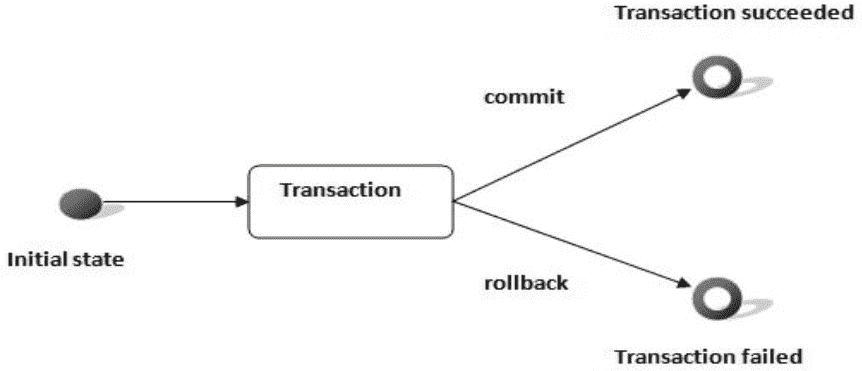

图 7. JDBC 事务管理

### 理解事务

事务由一个或多个数据库操作（如插入、更新或删除）组成，这些操作必须以原子一致的方式执行。数据库操作作为一个单一逻辑单元执行，事务确保所有操作都成功提交，要么一个都不应用，从而维护数据的一性和完整性。

### 事务的 ACID 特性

事务遵循 ACID 特性，即原子性（Atomicity）、一致性（Consistency）、隔离性（Isolation）和持久性（Durability）：

- **原子性**：确保事务中的所有操作作为一个单一不可分割的单元执行，要么所有操作都成功执行，要么一个都不应用。
- **一致性**：保证数据库在事务执行前后保持在一致状态，确保数据完整性约束不被违反。
- **隔离性**：定义了并发事务之间的隔离程度，在多用户环境中防止干扰并维护数据完整性。
- **持久性**：确保已提交事务的影响永久地应用到数据库中，并在系统故障或崩溃后生存。

### 隔离级别

隔离级别定义了并发事务之间的隔离程度，在并发性和一致性之间取得平衡。JDBC 支持四种标准隔离级别，每种级别在并发性和一致性之间都有不同的权衡：

- **读未提交 (Read Uncommitted)**：允许事务读取其他事务未提交的更改，导致潜在的数据不一致和脏读。
- **读提交 (Read Committed)**：通过允许事务只读取已提交的数据来防止脏读，但仍允许不可重复读和幻读。
- **可重复读 (Repeatable Read)**：确保事务在整个事务过程中看到的是一致的数据快照，防止不可重复读但仍允许幻读。
- **串行化 (Serializable)**：通过串行化事务提供最高级别的隔离，防止并发执行并确保事务看起来像是串行执行的。

### 事务界定

事务界定涉及定义事务的边界，指定事务何时开始和结束。在 Java Web 应用程序中，事务界定通常使用 JDBC 的 `Connection` 对象和事务管理 API 进行编程处理。事务界定的关键方面包括：

- **启动事务**：使用 `Connection` 对象的 `setAutoCommit(false)` 方法启动事务，并使用 `Connection` 的 `beginTransaction()` 或 `setSavepoint()` 方法开启新事务。
- **提交事务**：使用 `Connection` 对象的 `commit()` 方法提交事务，这将事务的更改永久应用到数据库中。
- **回滚事务**：使用 `Connection` 对象的 `rollback()` 方法回滚事务，该方法会撤销事务的更改并将数据库恢复到之前的状态。

## 保存点 (Savepoints)

保存点允许开发者在事务内部创建中间检查点，实现部分回滚和更细粒度的错误恢复。在顺序执行多个操作的复杂事务中，保存点特别有用，此时可能只需要回滚事务的一部分而保留其他部分。`JDBC` 提供了在事务内创建、释放和回滚到保存点的 API，增强了事务管理的灵活性健壮性。

## 事务管理最佳实践

有效的事务管理对于确保 Java Web 应用程序的数据一致性、完整性和可靠性至关重要。`JDBC` 事务管理的一些最佳实践包括：

- 保持短事务：尽量缩短事务持续时间以减少竞争并提高并发性，避免可能导致资源竞争和性能下降的长耗事务。
- 使用适当的隔离级别：根据应用程序对并发、一致性和性能的要求，选择合适的隔离级别，在数据完整性和可扩展性之间取得平衡。
- 优雅地处理异常：实现健壮的错误处理机制来处理异常、回滚事务并向用户提供信息丰富的错误消息，确保数据完整性并防止数据损坏。
- 释放资源：确保连接、语句和结果集等数据库资源在使用后正确释放，防止资源泄露并优化资源利用。

`JDBC` 事务管理是 Java Web 应用程序数据库交互的基础方面，确保了数据一致性、完整性和可靠性。通过理解事务原理、ACID 属性、隔离级别、事务边界划分、保存点以及事务管理的最佳实践，开发者可以构建健壮、可扩展且易于维护的 Java Web 应用程序，满足现代用户和企业的需求。

## 使用 JDBC 连接池

连接池是 Java Web 应用程序数据库连接的关键方面，通过高效管理数据库连接提供了显著的性能提升和可扩展性优势。在本章中，我们将深入探讨 `JDBC`（Java Database Connectivity）连接池的复杂性，探索其原理、实现技术、与 Web 容器的集成、最佳实践以及实际案例。

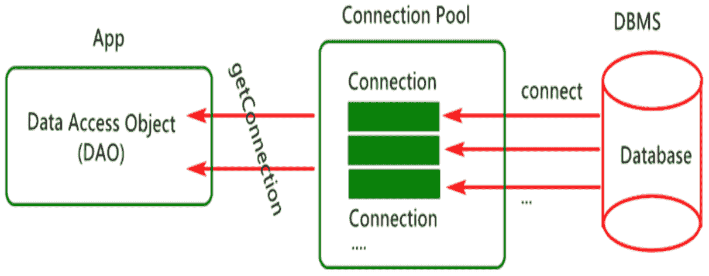

图 8. 连接池

连接池是一种用于在池中管理和重用数据库连接的技术，而不是为每个数据库请求创建一个新连接。通过维护一个预先建立的连接池，连接池减少了建立和销连接的开销，从而提高了应用程序性能，降低了延迟并增强了可扩展性。

### 连接池原理

理解连接池原理对于在 Java Web 应用程序中有效管理数据库连接至关重要。连接池的一些原理包括：

- 连接重用：重用池中现有数据库连接，而不是为每个请求创建新连接。
- 连接生命周期管理：管理数据库连接的生命周期，包括连接获取、释放、验证和逐出。
- 连接池算法：实现连接分配、释放和回收算法，例如 `LIFO`（后进先出）和 `FIFO`（先进先出）。
- 池配置：配置连接池参数，如最大池大小、最小空闲连接、连接超时和逐出策略，以优化性能和资源使用。

### 实现技术

可以使用 Java 生态中的各种技术和库来实现连接池。使用 `JDBC` 实现连接池的一些流行技术包括：

- 基于 `DataSource` 的连接池：使用应用服务器或连接池库提供的 `DataSource` 对象高效管理数据库连接。
- 第三方连接池库：利用第三方连接池库，如 `Apache Commons DBCP`、`HikariCP` 和 `Tomcat JDBC Pool`，它们提供了健壮的连接池功能。
- 自定义连接池：使用 `java.util.concurrent` 或 `Apache Commons Pool` 实现自定义连接池逻辑，创建为应用程序需求定制的轻量级自定义连接池。

### 与 Web 容器的集成

将连接池与 Web 容器集成对于在 Java Web 应用程序中有效管理数据库连接至关重要。关键方面包括：

- 部署描述符配置：在部署描述符（如 `web.xml`）或应用服务器配置文件中配置连接池参数，定义数据源设置。
- 资源管理：确保在 Web 容器范围内对连接池进行正确的资源管理和生命周期处理，包括初始化、销毁和恢复。
- 上下文查找：通过 Web 容器的 `JNDI`（Java 命名和目录接口）注册表查找数据源或连接工厂，以从连接池获取数据库连接。

## 连接池最佳实践

有效利用连接池需要遵循最佳实践，以确保最佳性能、可靠性和可扩展性。

- 适当的池大小：根据应用程序需求、预期并发级别和数据库容量配置连接池参数，如最大池大小、最小空闲连接和连接超时。
- 监控与调优：监控连接池使用情况、性能指标和数据库服务器指标，以识别瓶颈、资源竞争和连接池饱和，并相应地调整池参数。
- 连接验证：实现连接验证机制，在使用前对数据库连接进行验证，包括连接健康检查、查询验证和过期连接逐出。
- 错误处理与恢复：实现健壮的错误处理和恢复机制以优雅地处理连接失败、数据库错误和网络问题，包括重试策略、断路器和故障转移机制。
- 测试与基准测试：在不同的负载条件和场景下对连接池配置进行性能测试和基准测试，评估性能、可扩展性和可靠性。

## 实际案例

`JDBC` 连接池广泛应用于各种现实场景和应用程序中，包括：

- 电子商务网站：通过连接池高效管理数据库连接，管理电子商务平台中的高并发和大交易量。
- 企业级应用：支持 `CRM`（客户关系管理）、`ERP`（企业资源计划）和 `HRM`（人力资源管理）等企业级应用程序中的多个并发用户和交互。

# 在线银行系统

通过实现稳健的连接池机制来处理峰值负载和交易高峰，确保在线银行系统的高可用性、可靠性和扩展性。

使用 `JDBC` 连接池是 Java Web 应用程序高效管理数据库连接的基础技术，能够提供显著的性能提升和扩展性优势。通过理解连接池的原理、实施适当的技术和集成策略、遵循最佳实践并利用实际案例，开发者可以构建健壮、可靠且可扩展的 Web 应用，满足现代用户和企业的需求。

## 使用 JDBC 处理数据库元数据

数据库元数据是指关于数据库模式结构、属性和配置的信息。`JDBC`（Java 数据库连接）提供了访问和操作数据库元数据的机制，允许 Java 应用程序动态地检索有关数据库表、列、索引、约束以及其他数据库对象的信息。在本章中，我们将深入探讨使用 `JDBC` 处理数据库元数据的细节，探索其在 Java Web 开发中的重要性、用法和实际应用。

数据库元数据在数据库管理和应用程序开发中起着至关重要的作用，为数据库模式的结构和特征提供了宝贵的见解。元数据包括表名、列名、数据类型、约束、索引和表关系等信息。通过编程方式访问和操作数据库元数据对于动态 SQL 生成、数据库模式检查、数据迁移和数据库管理等任务至关重要。

### JDBC 数据库元数据 API

`JDBC` 提供了一个全面的 API 用于通过编程方式访问数据库元数据。`DatabaseMetaData` 接口属于 `java.sql` 包，定义了检索数据库连接元数据信息的方法。`DatabaseMetaData` 接口的一些关键方法包括：

- `getTables()`：获取有关数据库中表的信息，包括表名、类型和注释。
- `getColumns()`：获取特定表中的列的信息，包括列名、数据类型和约束。
- `getPrimaryKeys()`：获取特定表中的主键列的信息。
- `getIndexInfo()`：获取特定表中的索引信息，包括索引名、列名和唯一性。
- `getImportedKeys()` 和 `getExportedKeys()`：获取表之间外键关系的信息。

## 检索数据库元数据

要使用 `JDBC` 检索数据库元数据，开发者通常遵循以下步骤：

1. 使用 `DriverManager` 或 `DataSource` 对象建立数据库连接。
2. 通过调用 `Connection` 对象上的 `getMetaData()` 方法获取 `DatabaseMetaData` 对象。
3. 使用 `DatabaseMetaData` 接口的方法根据需要检索特定的元数据信息。
4. 根据要求在应用程序逻辑中处理并利用检索到的元数据信息。

### 数据库元数据的实际应用

使用 `JDBC` 处理数据库元数据在 Java Web 开发中有许多实际应用场景，包括：

- **动态 SQL 生成**：根据数据库元数据动态生成 SQL 查询或 DDL 语句，例如创建动态搜索查询或生成 CRUD 操作。
- **数据库模式检查**：动态检查数据库模式以检索有关表、列、索引和约束的信息，便于生成数据字典或执行数据库迁移等任务。
- **对象关系映射 (ORM) 框架**：如 `Hibernate` 或 `JPA`（Java Persistence API）等 ORM 框架利用数据库元数据将 Java 对象映射到数据库表，反之亦然，允许开发者根据数据库模式动态定义实体映射。
- **代码生成工具**：代码生成工具可以利用数据库元数据根据底层数据库模式自动生成数据访问代码、实体类或数据库迁移脚本，减少人工工作并提高生产力。

### 高级数据库元数据操作

除了基础的元数据检索操作外，`JDBC` 还提供了执行高级数据库元数据操作的能力，例如：

- **数据库目录和模式信息**：检索有关数据库目录和模式的元数据信息，以支持多租户或数据库抽象层。
- **数据库特性检测**：检测并查询不同数据库供应商支持的特定特性和功能，使应用程序动态适应不同的数据库环境。
- **元数据缓存与优化**：缓存检索到的元数据信息以提高性能并减少数据库交互，特别是在元数据不经常变化的情况下。
- **元数据过滤与自定义**：通过指定过滤器或准则来缩小返回的元数据信息范围，从而提高效率并减少不必要的开销。

### 处理数据库元数据的最佳实践

为了用 `JDBC` 有效处理数据库元数据，开发者应该遵循以下最佳实践：

- **最小化元数据查询**：限制元数据查询的频率以减少开销并提高性能，特别在高并发环境中。
- **缓存元数据信息**：在内存中缓存检索到的元数据信息，避免冗余的数据库交互并提高应用程序的响应速度。
- **优雅地处理元数据异常**：实现错误处理机制以处理元数据检索操作期间可能发生的异常，如 `SQLException` 或数据库连接错误。
- **验证元数据信息**：根据应用程序需求或约束验证检索到的元数据信息，以确保一致性和可靠性。
- **抽象元数据操作**：将元数据检索操作抽象为可重用的组件或实用方法，以促进应用程序不同部分的代码复用和维护。

使用 `JDBC` 处理数据库元数据是一项强大的能力，让 Java 开发者能够在应用程序中动态访问和操作数据库模式信息。通过利用 `JDBC` 的 `DatabaseMetaData` 接口及相关 API，开发者可以构建灵活、动态且适应良好的 Java Web 应用，满足现代数据库驱动应用不断变化的需求。

## 处理 BLOB 和 CLOB 数据类型

BLOB（大对象）和 `CLOB`（大字符对象）是社交数据集中特殊的信息类型，旨在单独存储大量的并行或字符信息。在 Java Web 应用程序中处理 `BLOB` 和 `CLOB` 类型面临独特的挑战，需要对性能、扩展性和可用性进行仔细考虑。本章将讨论 Java Web 应用程序中处理 `BLOB` 和 `CLOB` 数据类型的概念、最佳实践和方法。

### 掌握大对象和大字符对象信息类型

`Mass` 和 `CLOB` 信息类型用于在社交数据集中存储大量的并行或字符信息。`Mass` 和 `CLOB` 信息类型的关键特性包括：

- **BLOB**：存储并行信息，例如图片、音频记录、视频记录和配报告。
- **CLOB**：包含字符数据的文档，如 `JSON`、`XML` 和文本文档。

### BLOB 和 CLOB 数据类型的用例

`BLOB` 和 `CLOB` 数据类型常用于 Java Web 应用程序的各种，包括：

- **存储上传的文件**：在数据库中上传并存储用户的文件，如图像、文档和多媒体文件。
- **处理大型文本数据**：存储和检索大型文本数据，如文章、博客帖子、评论和消息。
- **管理结构化数据**：在数据库中存储 XML 文档、JSON 文档和序列化的 Java 对象等结构化数据。

## 处理 BLOB 数据的最佳实践


高效处理 BLOB 数据需要遵循最佳实践，以确保性能、可扩展性和数据完整性。在 Java Web 应用中处理 BLOB 数据的某些最佳实践包括：

- 使用流式 API：利用 `JDBC` 或 `ORM` 框架提供的流式 API 分块读取和写入 `BLOB` 数据，避免处理大型数据集时导致内存耗尽。
- 优化数据库设置：配置缓冲区大小、内存分配和存储设置等数据库参数，以优化 `BLOB` 数据的存储和检索性能。
- 实现缓存：在内存或外部缓存系统中缓存频繁访问的 `BLOB` 数据，以减少数据库负载并缩短响应时间。
- 使用压缩：在将 `BLOB` 数据存入数据库之前进行压缩，减少存储空间并最小化地减少网络带宽消耗。
- 实现并发控制：使用适当的并发控制机制（如锁或乐观并发控制），防止数据损坏并确保多线程环境下的一致性。

## 处理 CLOB 数据的最佳实践

有效处理 CLOB 数据需要仔细考虑性能、可用性和数据完整性。在 Java Web 应用中处理 CLOB 数据的某些最佳实践包括：

- 使用适当的字符编码：确保使用适当的字符编码存储和检索字符数据，防止数据损坏和信息丢失。
- 优化数据库设置：配置字符集、排序对规则和存储设置等数据库参数，以优化 `CLOB` 数据的存储和检索性能。
- 实现分页：实现分页技术，以可管理的分块检索并显示大型 `CLOB` 数据集，提升用户体验和应用性能。
- 使用全文检索：利用数据库或外部搜索引擎提供的全文检索功能，实现基于内容的 `CLOB` 数据的高效搜索和检索。
- 实现文本索引：实现文本索引机制以提高搜索性能，并启用相关性排名和模糊匹配等高级搜索功能。

## Java 中处理 BLOB 和 CLOB 数据的技术

Java 为 Web 中提供了处理 `BLOB` 和 `CLOB` 数据的多种技术和 API，包括：

- `JDBC`：使用 `JDBC` API 通过 `InputStream` 和 `OutputStream` 接口直接从数据库读写 `BLOB` 和 `CLOB` 数据。
- `ORM` 框架：利用如 `Hibernate` 或 `JPA` (Java Persistence API) 等对象关系映射框架来抽象数据库交互，并透明地处理 `BLOB` 和 `CLOB` 数据。
- 流式 API：使用 `JDBC` 或 `ORM` 框架提供的流式 API 分块读取和写入 `BLOB` 数据，避免大型数据集的内存开销。

## 安全考虑

在 Java Web 应用中，处理 `BLOB` 和 `CLOB` 数据类型需要仔细考虑安全风险和漏洞，例如：

- 注入攻击：在处理 `BLOB` 和 `CLOB` 信息时，通过使用定义查询或参数化语句防止 SQL 注入攻击。
- 信息泄露：在数据库中存储敏感的 `BLOB` 和 `CLOB` 数据之前对其进行加密，防止数据泄露和未经授权的访问。
- 访问控制：根据用户角色和权限实现访问控制机制，限制对 `BLOB` 和 `CLOB` 数据的访问。
- 安全通信：利用安全协议（例如 `HTTPS`）在组织内部传输 `BLOB` 和 `CLOB` 信息，以防止窃听和篡改。

在 Java Web 应用中，处理 `BLOB` 和 `CLOB` 数据类型需要仔细考虑性能、可扩展性、可用安全性。通过遵循最佳实践、利用适当的技术和 API 以及实施安全措施，开发者可以在 Web 应用中有效地管理 `BLOB` 和 `CLOB` 数据，并为大型二进制和字符数据提供无缝的用户体验。

## Java 数据库连接的最佳实践

数据集连接是 Java 应用改进的基础部分，使应用程序能够高效安全地与数据集协作。在本节中，我们将深入探讨 Java 数据连接最佳实践的全面安排，涵盖核心概念、方法和注意事项，以确保数据协作的性能、稳定性和安全性。

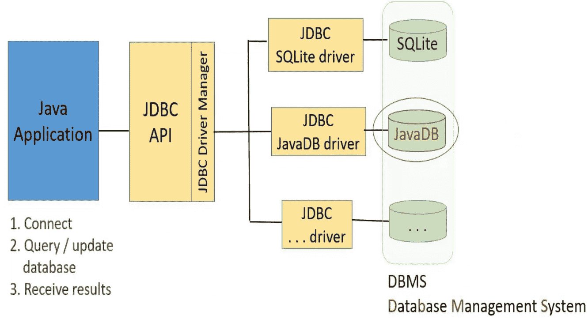

图 9 数据库连接

### 了解 JDBC 基础

Java Database Connectivity (`JDBC`) 是数据库连接的标准 Java API，为从 Java 应用访问关系型数据库提供了与平台相关的机制。要有效利用 `JDBC`，开发者必须理解其基础，包括：

- `JDBC` 架构：熟悉 `JDBC` 架构，它由驱动程序、`JDBC` API 和特定数据库的实现组成。
- 核心 JDBC 接口：学习关键的 `JDBC` 接口，如 `Connection`、`Statement`、`PreparedStatement`、`CallableStatement` 和 `ResultSet` 以及它们在数据库交互中的作用。
- 建立数据库连接：理解使用 `DriverManager` 或 `DataSource` 建立数据库连接的过程，包括指定连接参数如 `URL`、`username` 和 `password`。
- 执行 SQL 查询：掌握使用 `JDBC Statement` 和 `PreparedStatement` 对象执行 SQL 查询并使用 `ResultSet` 处理结果的技术。

### 使用连接池

连接池是一种通过重用现有数据库连接而非为每个请求创建新连接来提高数据库连接性能和可扩展性的技术。要有效利用连接池，开发者应该：

- 选择连接池库：探索 Java 生态系统中流行的连接池库，如 `Apache Commons DBCP`、`HikariCP` 和 `Tomcat JDBC Pool`，并选择最符合应用程序需求的一个。
- 配置连接池参数：根据应用程序的预期负载和资源限制，配置连接池参数如最大池大小、最小空闲连接和连接超时。
- 与 Web 容器集成：将连接池库与 Servlet 容器或应用服务器集成，以便在 Web 应用中高效管理数据库连接。
- 监控连接池使用：监控连接池使用指标（如连接数、活动连接和连接等待时间），以识别性能瓶颈并优化池配置。

### 优化数据访问

优化数据访问对于最大化 Java 应用中数据库交互的性能和效率至关重要。优化数据访问的关键实践包括：

- 使用预编译：利用预语句防止 SQL 注入攻击，并通过预编译 SQL 查询和重用执行计划来提高性能。
- 批量处理：采用批量处理技术以减少执行多个相似 SQL 语句时与数据库的往返次数，提高吞吐量。
- 获取策略：选择合适的获取策略（如饿加载、懒加载或仅获取所需的列），以最小化数据库与应用程序之间传输的数据。
- 索引优化：分析查询执行计划和数据库索引，识别通过创建、删除或修改索引来优化查询性能的机会。

## 连接管理

通过使用连接池、在使用后关闭连接以及避免连接泄漏来高效管理数据库连接，以节省系统资源并防止性能下降。

## 实现错误处理

健壮的错误处理对于处理意外情况以及确保 Java 应用中数据库交互的可靠性和稳定性至关重要。为了实现有效的错误处理，开发者应该：

- 优雅地处理异常：以结构化且一致的方式捕获并处理 `JDBC` 操作抛出的异常（例如 `SQLException`），以防止应用程序崩溃并向用户提供信息丰富的错误消息。
- 使用 `try-with-resources`：使用 `try-with-resources` 语句在使用后自动关闭 `JDBC` 资源（如 `Connection`、`Statement` 和 `ResultSet`），确保资源被妥善清理并防止资源泄漏。
- 记录错误：使用 `Log4j` 或 `SLF4J` 等日志框架记录数据库相关的错误和异常，以便于故障排除、调试和应用程序行为的监控。

## 安全数据库交互

数据库连接必须是安全的，以避免数据泄露、未经授权的访问和其他安全漏洞。以下是 Java 应用程序中确保数据库交互安全的某些指南：

- 输入验证：验证并清理用户输入，以阻止 SQL 注入、跨站脚本 (XSS) 和命令注入的发生。
- 使用指定查询：使用带有 `PreparedStatement` 的查询，通过将 SQL 代码与客户端输入隔离开来防止 SQL 注入攻击，从而规避特殊字符的影响。
- 最小权限原则：遵循最小权限原则，仅赋予数据库客户端执行其预期任务所需的权限，限制未经授权访问和数据泄露的风险。
- 加密：通过加密算法（如用于存储数据的 `AES` 和用于网络通信的 `SSL/TLS`）对传输和存储中的敏感数据进行加密，以保护机密性和完整性。

## 测试数据库连接

为了确保 Java 应用程序的正确、可靠和健壮，彻底的数据库连接测试是必要的。以下是数据库连接的一些重要测试方法：

- 单元测试：利用 `JUnit` 和 `Mockito` 等框架为数据库访问代码创建单元测试，以独立验证每个组件的行为。
- 集成测试：进行集成测试以确认应用程序不同部分之间的关联，包括数据库协作、执行交换和错误处理。
- 模拟：利用模拟系统（例如 `Mockito`）来模拟数据库连接等外部条件，并在测试期间重建各种场景和状态。
- 测试数据处理：在创建和管理测试数据集时包含设置、拆卸和清理程序，用于测试数据库交互，以保证数据的一致性和可重复性。

遵循数据库连接的最佳实践是构建健壮、安全且能与实际数据集协作 Java 应用程序的基础。通过理解 `JDBC` 的基础知识、利用连接池、优化数据访问、实现错误处理、确保数据库安全以及严格测试数据库连接，开发者可以确保 Java 应用程序的成功并为用户提供高质量的软件解决方案。

# 第 5 章 会话管理与认证

## Web 应用中的会话管理

会话管理是 Web 应用开发的核心部分，使应用程序能够在不同的请求和通信中与客户端保持状态连接。本章将探讨 Web 应用中会话管理的基本概念、机制和考虑因素，包括会话跟踪、会话生命周期、会话存储、安全考虑以及实现最佳实践。

### 理解会话管理

维护用户会话的过程（即 Web 应用与其用户之间的状态连接）被称为会话管理。在 HTTP 等无状态协议中，Web 应用可以使用会话管理将来自同一用户的后续请求识别并关联为连续会话的一部分，每个客户端请求都独立于之前的请求。

### 会话跟踪机制

会话跟踪机制允许 Web 应用将来自同一用户的后续请求与正在进行的会话关联。常见的会话跟踪机制包括：

- **Cookies**：Cookies 是存储在客户端浏览器上的小型数据，并在每次请求时发送到服务器。它们可以存储唯一标识用户会话的会话标识符（session cookies）。
- **URL 重写**：URL 重写涉及将会话标识作为查询参数或 URL 路径段添加到链接和表单提交中。这允许服务器将后续请求与相应的会话关联。
- **隐藏表单字段**：在 HTML 表单中使用隐藏字段存储会话标识符，允许服务器在表单提交时检索会话信息。
- **HTTP 会话**：HTTP 会话是 Web 应用框架（例如 `Servlet API`、`ASP.NET Session`）提供的服务器端机制，用于管理会话状态。它在内部使用 Cookies 或 URL 重写来跟踪会话，但对开发者抽象了这些细节。

### 会话生命周期

会话生命周期包括几个阶段，即会话创建、会话维护和会话终止：

- **会话创建**：当用户首次访问 Web 应用或服务器为用户生成新的会话标识符时，创建会话。这通常发生在用户登录或执行某些需要会话状态的操作。
- **会话维护**：在会话期间，服务器维护会话状态和关联数据（例如用户偏好、购物车物品）。根据应用程序的可扩展性和可靠性要求，会话数据可以存储在内存、数据库或外部存储系统中。
- **会话终止**：当用户注销、会话因超时过期或服务器显式失效会话时，终止会话。这将释放与会话相关的资源并释放内存或存储空间。

### 会话存储选项

可以使用多种存储选项存储会话数据，每种都有其优点和局限性：

- **内存存储**：会话数据存储在服务器本地堆内存中，快速高效，但受服务器内存容量，且在服务器重启或崩溃时面临数据丢失风险。
- **数据库存储**：会话数据存储在关系型数据库中，提供了持久性和扩展性，但由于数据库操作和网络延迟会引入额外的开销。
- **外部存储系统**：会话数据可以存储在外部存储系统中（如 `Redis`、`Memcached` 或分布式缓存解决方案），提供了扩展性、高可用性和性能，但需要额外的设置和配置。

## 安全考虑

会话管理高度依赖安全性，以防止未经授权的访问、会话劫持和其他安全威胁。Web 应用会话管理的某些安全考虑包括：

- **会话固定**：为每个新会话创建新的会话标识符并使任何现有会话标识符失效，以防止会话固定攻击。
- **会话滥用**：通过利用安全传输协议（例如 `SSL/TLS`）对会话信息进行加密，防止会话被拦截、窥探或篡改。
- **会话过期**：为了防止对活动会话的非法访问并使空闲会话失效，请设置会话超时值。
- **跨站请求伪造 (CSRF)**：利用反 CSRF 令牌并严格验证请求，以确保它们来自可靠源，这将帮助您防御 CSRF 攻击。

## 高管会面的最佳实践

为了确保 Web 应用中高管会面的强大与安全，设计人员应当遵循最佳实践，例如：

- **使用 HTTPS**：持续使用 `HTTPS` 对客户端与服务器之间的通信进行加密，保护会话免受拦截或篡改。
- **限制会话信息**：在会话对象中仅存储基本信息，以限制内存使用并进一步提升性能。会话数据不应包含信用卡或密码等敏感数据。
- **注销时销毁会话**：当用户注销时，失效会话并清除会话数据，以防止对会话数据的非法访问。
- **执行会话超时**：设置适当的会话超时值，使空闲会话失效，降低会话劫持或未经授权访问的风险。
- **监控会话活动**：为了识别异常行为或潜在的安全事件，监控会话活动并跟踪会话相关的指标（如会话创建和持续时间）。

会话是 Web 应用改进的关键部分，使应用程序能够与客户端保持有状态的交互，并提供定制且安全的客户端体验。通过理解与会话管理相关的概念、机制和因素，并遵循实现与安全的最佳实践，开发者可以创建满足现代用户和企业稳健、可扩展且安全的 Web 应用。

# HTTP Session：概述与生命周期

Web 应用开发严重依赖 `HTTP` 会话管理，它使应用程序能够在多个请求之间与用户保持有状态的交互。在本节中，我们将从底层开始研究 HTTP 会话，涵盖其概述、生命周期、组件以及强制使用的最佳实践。

## 理解 HTTP Session

HTTP 会话是指 Web 应用用于在多个 `HTTP` 请求之间与客户端保持有状态通信的机制。会话允许应用程序存储用户特定数据并在请求之间维持上下文，从而实现用户身份验证、个性化内容交付和购物车管理等功能。

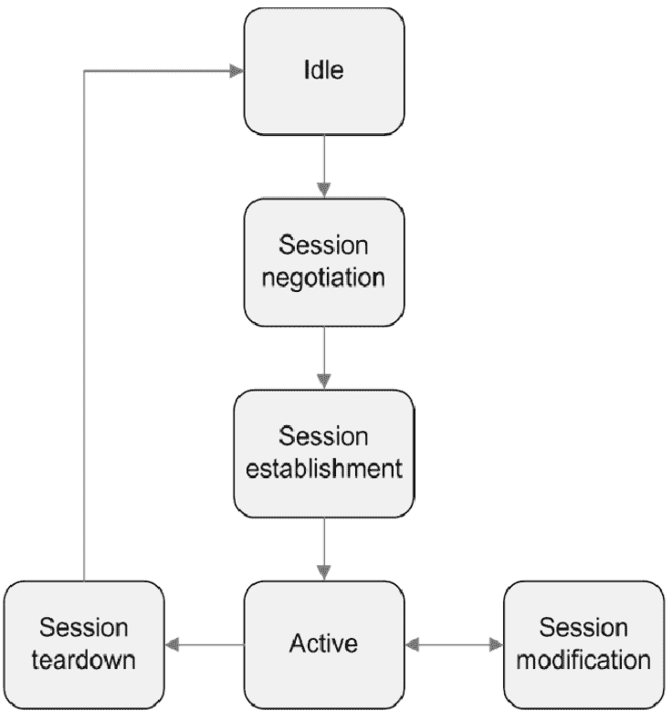

图 1. 会话生命周期

## HTTP Session 概述

HTTP 会话管理依赖于会话的概念，即客户端和服务器之间建立的逻辑关联。会话从客户端首次访问应用程序开始，一直持续到会话显式失效或因无活动而超时。

## HTTP Session 的关键组件

HTTP 会话由几个关键组件组成，包括：

- **Session ID**：分配给每个会话的唯一标识符，用于与其他会话区分。
- **Session data**：存储在会话中的用户特定数据，如用户偏好、身份验证令牌和购物车物品。
- **Session lifecycle**：从会话创建到会话销毁发生的事件序列，包括会话创建、会话属性操作和会话失效。

## HTTP Session 生命周期

HTTP 会话生命周期包含几个阶段，每个阶段对应会话生命周期中的特定事件。理解会话生命周期对于有效管理会话状态以及确保最佳性能和可靠性至关重要。

### 会话创建

会话创建阶段发生在客户端首次与 Web 应用交互时。在此阶段，服务器生成一个唯一的会话 ID 并创建另一个会话对象与客户端连接。会话 ID 通常通过 Cookie 或 URL 重写传递给客户端，并用于识别来自同一客户端的后续请求。

### 会话激活

一旦创建会话，就会进入激活阶段，在此阶段它可以用于属性操作。会话一直保持激活状态，直到显式失效或因无活动而超时。

### 会话属性操作

会话属性操作阶段涉及在会话对象中存储、检索和删除会话属性。会话属性表示需要在多个请求之间维持的用户特定数据。开发者可以使用 Servlet 容器提供的 API，如 `HttpSession.setAttribute()`、`HttpSession.getAttribute()` 和 `HttpSession.removeAttribute()` 来通过编程操作会话属性。

### 会话失效

会话失效阶段发生在应用程序显式使会话失效或会话因无活动而超时。在会话失效期间，服务器移除会话对象和相关的会话属性，释放与会话相关的所有资源。

### 会话超时

会话超时是指服务器在无活动后自动使会话失效的时间。会话超时时长是可配置的，通常取决于应用程序的需求，从几分钟到几小时不等。会话超时有助于防止资源耗尽，并确保空闲会话无限消耗服务器资源。

## HTTP Session 管理机制

HTTP 会话管理依赖于用于会话识别、跟踪和状态维护的各种机制。常见机制包括：

- **Cookies**：服务器发送到客户端的小数据，并在随后的请求中返回。会话 Cookie 包含会话 ID，允许服务器识别并将后续请求与同一会话关联。
- **URL 重写**：URL 重写涉及将会话 ID 添加到应用程序内的 URL 中，允许服务器在不依赖 Cookie 的情况下跟踪会话。当客户端浏览器禁用或不支持 Cookie 时，常用此机制。
- **隐藏表单字段**：隐藏表单字段是存储会话 ID 的 HTML 表单字段，并随表单数据提交。此机制用于在不依赖 Cookie 或 URL 重写的情况下跨表单提交维持会话状态。

## HTTP Session 管理最佳实践

有效的 HTTP 会话管理对于确保 Web 应用的安全、性能和可靠性至关重要。HTTP 会话管理的一些最佳实践包括：

- **使用安全 Cookie**：通过 Cookie 传输会话 ID 时，使用安全 Cookie 以确保会话数据被加密并通过安全的 `HTTPS` 连接传输。安全 Cookie 有助于防止恶意实体的会话劫持和窃听攻击。
- **实施会话超时**：根据应用程序的需求和会话存储数据的敏感性，设置适当的会话超时时长。较短会话超时有助于减少会话劫持和非法访问敏感数据的风险。
- **合理失效会话**：在通常不再需要或客户端注销应用程序时，持续显式失效会话。不当的会话失效会导致安全漏洞，例如会话滞留和会话劫持。


将敏感的会议信息加密并存储在会议凭据中，以防止未经授权的访问和信息泄露。为了维护会话数据的完整性和机密性，请采用有效的密钥管理策略和加密算法。

## 会议移动监控

监控会议移动和使用示例，以识别不一致之处、可疑行为和潜在的安全风险。定期进行安全评估以确保符合安全策略和法规，并实施日志和审计机制来跟踪会话的创建、修改和失效。

Web 应用开发严重依赖 HTTP 会话管理，这使得应用程序能够提供个性化的用户体验并与客户端保持状态通信。通过理解 HTTP 会话生命周期、会话管理机制以及实现的最佳实践，开发者可以创建出满足现代用户和业务需求的强大、安全且可靠的应用程序。

## 会话跟踪技术：Cookies vs. URL 重写 vs. 隐藏表单字段

会话跟踪是 Web 应用程序开发的一个重要方面，能够跨多个请求维护用户状态。Java Web 应用程序中有多种会话跟踪技术，每种技术都有其优势、局限性和考虑的因素。在本章中，我们将探索三种主要的会话跟踪技术：Cookies、URL 重写和隐藏表单字段，并对它们的特征、实现细节、安全考虑和最佳实践提供全面的比较。

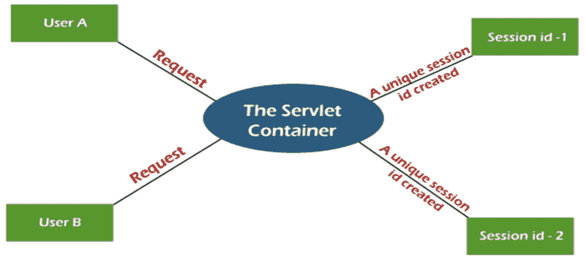

图 2. 会话跟踪技术

会话跟踪技术允许 Web 应用程序为每个用户关联唯一的会话标识符，并在用户与应用程序交互的过程中维护会话状态。Java Web 应用程序中的三种主要会话跟踪技术是 Cookies、URL 重写和隐藏表单字段。每种技术在简单性、性能、安全以及与不同客户端环境的兼容性方面都有其优劣平衡。

### Cookies

Cookie 是互联网浏览器存储在客户端设备上的小段信息，并在每次向服务器发送 HTTP 请求时携带。用于跟踪会议的关键部分包括：

- **实现**：Cookie 的实现涉及在 HTTP 响应中使用 `Set-Cookie` 头部在客户端设置 Cookie 值，并在随后的 HTTP 请求中使用 `Cookie` 头部将 Cookie 值传回服务器。

- **特征**：Cookies 提供了具有多种功能的会话跟踪，包括直接在客户端侧存储会话数据的能力、支持过期日期、域/路径限制以及浏览器的自动处理。

- **安全考虑**：如果实现和管理不当，Cookies 可能会带来会话劫持、CSRF 攻击和信息泄露等安全风险。开发者应该考虑实现 `secure` 和 `HttpOnly` Cookie，强制执行安全属性并使用 HTTPS 来减轻这些风险。

### URL 重写

URL 重写是一种会话跟踪技术，涉及在超链接和表单提交中将会话标识符作为查询参数或 URL 路径的一部分。用于跟踪会议的 URL 重写的关键方面包括：

- **实现**：URL 重写通过服务器端应用程序生成超链接和表单动作，并将会话标识作为查询参数（例如 `?sessionID=123456`）或包含在 URL 路径中（例如 `/app/sessionID/123456`）。

- **特征**：URL 重写兼容所有浏览器，且不依赖客户端存储机制。它可以用于禁用或不支持 Cookie 的环境。

- **局限性**：URL 重写可能导致 URL 变长且对用户不利，可能会在浏览器历史记录、引用标头（referrer headers）和服务器日志中暴露会话标识符，并且可能不适用于敏感数据的传输。

### 隐藏表单字段

隐藏表单字段是用户不可见的 HTML 表单字段，但包含在表单提交中以携带会话标识符或其他数据。用于跟踪会议的隐藏表单字段的关键方面包括：

- **实现**：通过在 HTML 表单中包含 `<input type="hidden">` 元素来实现隐藏表单字段，并将会话标识或其他数据存储为字段值。

- **特征**：隐藏表单字段对用户透明，不会影响网页的外观或行为。它们可以用于在 HTML 表单内安全地传输会话标识符。

- **局限性**：隐藏表单字段依赖 HTML 表单进行传输，使其在会话跟踪方面不如 Cookies 或 URL 重写灵活。在不涉及表单提交的场景下，它们可能无法管理会话。

## 技术比较

为了为 Java Web 应用程序选择合适的会话跟踪技术，开发者应该考虑各种因素，例如：

- **兼容性**：Cookies 被 Web 浏览器广泛支持，是大多数场景下会话跟踪的首选。URL 重写和隐藏表单字段可以在禁用或不支持 Cookie 的环境中作为替代方案。

- **性能**：与 URL 重写和隐藏表单字段相比，Cookies 通常提供更好的性能，因为它们在数据传输和处理方面的开销较小。

- **安全性**：可以使用 `Secure` 和 `HttpOnly` 等属性保护 Cookies 以降低安全风险。URL 重写和隐藏表单字段可能会在 URL 或表单提交中暴露会话标识符，增加会话劫持或信息泄露的风险。

- **灵活性**：在禁用或不支持 Cookie 的场景下，URL 重写和隐藏表单字段提供了更大的灵活性。它们可以作为回退机制或与 Cookies 补充技术用于会话跟踪。

## 最佳实践与考虑

在 Java Web 应用程序中实现会话跟踪技术时，开发者应该遵循最佳实践并考虑各种因素，例如：

- **Cookie 管理**：实现安全的 `HttpOnly` Cookie，并带有适当属性如 `Secure`、`HttpOnly`、`SameSite` 和 `Max-Age` 以增强安全性和隐私。

- **URL 重写**：谨慎使用 URL 重写，尽可能避免在 URL 中暴露会话标识符，以尽可能的减少安全风险并提高可用性。

- **隐藏表单字段**：确保安全地使用隐藏表单字段，且仅用于在 HTML 表单内传输会话标识符或用户偏好等非敏感数据。

Web 应用程序开发严重依赖会话跟踪，这使得应用程序能够跟踪用户状态并提供个性化体验。通过理解会话跟踪的特征、实现细节、安全考虑和最佳实践（例如 Cookies、URL 重写和隐藏表单字段），工程师可以为他们的 Java 应用程序选择最合适的方法，并确保安全、高效和稳健。

`HttpSession` 是 Servlet API 提供的一个接口，用于在 Java Web 应用中管理用户会话。它允许开发者在多次请求和与应用程序的交互过程中存储和检索用户特定的数据。`HttpSession` 基于会话（session）的概念，会话代表用户与应用程序之间交互的逻辑单元，通常跨越多个 HTTP 请求和响应。

## HttpSession 的特性

`HttpSession` 为 Java Servlet 中的会话管理提供了多种功能和能力，包括：

- **属性存储**：`HttpSession` 允许开发者使用 `setAttribute()` 和 `getAttribute()` 等方法存储和检索会话属性，这些属性是代表用户特定数据的键值对。

- **会话生命周期管理**：`HttpSession` 根据可配置的超时设置，管理用户会话的生命周期，包括会话的创建、会话的失效和会话的过期。

- **会话跟踪机制**：`HttpSession` 支持多种会话跟踪机制，例如基于 Cookie 的会话跟踪、URL 重写和 SSL 会话跟踪，以维护客户端和服务器之间的会话。

- **跨上下文会话共享**：`HttpSession` 允许在同一个 Web 应用的多个 Servlet 上下文中共享会话，允许应用程序的不同部分访问和操作会话属性。

- **会话监听器**：`HttpSession` 支持会话事件监听器，允许开发者监控会话生命周期事件，如会话创建、会话销毁和属性更改。

## HttpSession 生命周期

Java Servlet 中 `HttpSession` 的生命周期由几个阶段组成，包括会话创建、会话激活、会话钝化、会话重新激活和会话销毁。理解 `HttpSession` 生命周期对于有效管理会话状态以及在 Servlet 中实现会话相关功能至关重要。

## Servlet 中 HttpSession 的实现

在使用 `HttpSession` 进行会话管理涉及以下步骤：

1. **获取 HttpSession 对象**：使用 `HttpServletRequest` 对象提供的 `getSession()` 方法获取与当前请求关联的 `HttpSession` 对象。

2. **存储会话属性**：使用 `setAttribute()` 方法在 `HttpSession` 对象中存储用户特定的数据或属性，指定唯一的属性名称和值。

3. **检索会话属性**：使用 `getAttribute()` 方法从 `HttpSession` 对象中检索会话属性，并将属性名称作为参数传递。

4. **管理会话生命周期**：通过设置会话超时值、失效会话或使用会话监听器监听会话生命周期事件来管理 `HttpSession` 对象的生命周期。

## 使用 HttpSession 的最佳实践

为了最大化 Servlet 中 HttpSession 会话管理的有效性和可靠性，开发者应遵循以下最佳实践：

- **谨慎使用会话属性**：避免在会话属性中存储敏感或大量数据，以节省服务器资源并防止会话膨胀。

- **设置合适的会话超时值**：根据应用程序需求和用户行为配置会话超时值，平衡会话持久性和资源利用。

- **必要时失效会话**：在用户注销、从不同设备登录或一段时间活动后显式失效会话，以防止会话劫持和未经授权的访问。

- **小心处理会话属性更改**：注意会话属性的变化对会话状态和应用程序行为的影响，特别是在多线程或分布式环境中。

- **实现监听器进行监控**：使用会话监听器监控会话生命周期事件，并执行必要的清理、日志或审计任务，以维护应用程序的完整安全。

## 安全性

在 Servlet 中使用 `HttpSession` 进行会话管理时，安全性至关重要，以避免会话固定、会话劫持和其他安全漏洞。以下是一些需要注意的安全性考量：

- **利用方法处理安全会话**：为了缓解会话相关的安全威胁，确保安全的会话处理实践，如使用 CSRF 保护机制、强制会话超时和使用安全 Cookie。

- **重新建立会话标识**：在身份验证成功或会话状态变化时更新会话标识，以提高会话安全性并防止会话固定攻击。

- **加密敏感信息**：对存储在 `HttpSession` 中的敏感会议信息进行编码，以防止受到未经授权的访问和篡改，特别是在适当或共享的情况下。

- **限制会话的访问**：根据用户角色、权限或身份验证状态限制对会话存储信息的访问。

`HttpSession` 是 Java Servlet 中满足用户需求的强大工具，允许开发者成功地维护客户端状态并定制用户体验。通过理解 Servlet 中 `HttpSession` 的特性、生命周期、实现、最佳实践和安全性，可以构建安全、可靠且扩展的应用程序。

## 会话属性：添加、检索和删除属性

由于会话属性允许开发者在多次请求和与应用程序的交互过程中维护用户特定数据和状态，因此对于 Web 应用的应用至关重要。本章将深入探讨 Java Web 应用中会话属性的添加、检索和删除、属性生命周期管理以及有效使用会话属性的最佳实践。

在 Web 应用中，会话属性代表在会话期间存储的数据。这些属性与单个客户端关联，并持续到会话过期或失效。用户偏好、购物车物品、身份验证令牌和其他会话相关数据都可以方便地使用会话属性。

### 添加会话属性

要添加会话属性，必须将其存储在与用户会话相关的 HttpSession 对象中。添加会话属性的关键方面包括：

- **获取 HttpSession 对象**：利用 `HttpServletRequest.getSession()` 技术获取与会话相关的 HttpSession 对象。

- **存储属性**：使用 `setAttribute()` 方法向会话添加属性，指定唯一的属性名称和相应的属性值。

- **属性类型**：会话属性可以是任何 Java 对象类型，包括基本类型、数组、集合、自定义 JavaBean 和 `Serializable` 对象。

- **属性作用域**：会话属性的作用域是 `HttpSession` 对象，同一会话上下文内的所有 Servlet 和 JSP 页面均可访问。

### 检索会话属性

检索会话属性涉及从 `HttpSession` 对象中访问和检索存储的数据。检索会话属性的关键方面包括：

- **获取 HttpSession 对象**：使用 `HttpServletRequest.getSession()` 获取与会话相关的 HttpSession 对象。

- **检索属性**：使用 `getAttribute()` 方法通过指定属性名称检索会话属性。在使用返回的对象之前，将其转换为相应的类型。

### 空值处理

在检索会话属性时检查空值，以处理属性可能不存在或已从会话中删除的情况。

## 移除会话属性

移除会话属性涉及从 `HttpSession` 对象中删除数据，以释放资源并有效管理会话状态。移除会话属性的关键方面包括：

- **移除属性**：使用 `HttpSession.removeAttribute()` 方法指定属性名称移除会话属性。此操作会从会话中删除该属性。

- **失效会话**：或者，使用 `HttpSession.invalidate()` 方法使整个会话失效，移除所有会话属性并终止用户的会话。

- **垃圾回收**：移除的会话属性在不再被引用或使用后，将由 Java 虚拟机 (`JVM`) 进行垃圾回收，从而释放内存资源。

## 管理属性生命周期

管理属性生命周期涉及控制会话属性的创建、修改和删除，以确保高效利用资源并维护会话的完整性。管理属性生命周期的一些关键考虑包括：

- **属性过期**：为会话属性设置过期策略，以控制其寿命并防止过时或废弃的数据在会话中累积。

- **属性更新**：根据需要更新会话属性，以反映用户状态或应用上下文的变化，确保会话数据保持准确更新。

- **属性作用域**：考虑会话属性在应用程序中的范围和可见性，防止未经授权的用户或组件进行意外访问或修改。

## 使用会话属性的最佳实践

为了有效利用会话属性并保持 Java Web 应用程序的稳定性和安全性，开发者应该遵循以下最佳实践：

- **限制属性大小**：避免直接在会话属性中存储大型或敏感数据，以最小化内存占用并防止会话固定或会话劫持等潜在安全风险。

- **序列化复杂对象**：对存储在会话属性中的复杂对象进行序列化，以确保与服务器集群或会话复制等会话持久化机制兼容。

- **安全访问**：验证并清理会话属性值，以防止注入攻击或数据篡改等安全漏洞。

- **监控属性使用**：监控会话属性的使用指标（如属性数量、大小和寿命），以识别潜在的性能瓶颈或资源竞争问题。

- **清理过期属性**：实现定期清理程序，移除已过期或未使用的会话属性，并优化会话资源利用。

会话属性是 Java Web 应用程序的重要组件，提供了一种跨多个请求存储用户特定数据和状态的机制。通过理解添加、检索和移除会话属性的原理，有效管理属性生命周期并遵循使用会话属性的最佳实践，开发者可以构建稳健、可扩展且安全的 Web 应用程序，满足现代用户和企业的需求。

## 会话超时与失效

为了保证用户会话的安全性、性能和可靠性，Web 开发的关键方面包括会话超时和失效。在本节中，我们将深入探讨 Java Web 应用程序中满足超时和失效的核心要点，涵盖生命周期、超时设置、失效组件以及执行最佳实践等概念。

### 理解会话生命周期

会话生命周期是指 Web 应用程序中从客户端会话创建到结束发生的系列事件。以下是会话生命周期的关键阶段：

- **创建会话**：当客户端访问 Web 应用程序时，会创建一个会话，并将一个新的会话标识符（meeting ID）分配给客户端。

- **使用会话**：在会话期间，使用会话标识符将用户的请求与其会话数据相关起来，此时他们通过发送和接收响应与 Web 应用程序交互。

- **会话超时**：如果客户端在预留时间内（meeting break）保持空闲，会话将失效，会话信息失效，要求需要重新验证才能继续使用应用程序。

- **会话失效**：用户通过注销或应用程序管理员撤销会话有效性显式使会话失效，从而终止会话并删除关联会话数据。

### 配置会话超时

会话超时配置涉及设置空闲会话自动过期的时长。在 Java Web 应用程序中配置会话超时的一些关键考虑包括：

- **会话超时值**：根据客户端行为、应用需求和安全策略等因素决定合理的超时值。

- **设置选项**：在 Web 应用程序部署描述符 (`web.xml`) 中设计超时设置，或使用 `HttpSession` 的显式 API（如 `setMaxInactiveInterval()` 方法）自动设置。

- **默认超时值**：注意 Servlet 容器或应用服务器强制的默认会话超时值，并在必要时进行调整以符合应用程序的需求和性能目标。

- **会话管理策略**：考虑使用会话集群、会话复制或分布式缓存等会话管理策略，以便在集群环境中跨多个服务器实例维护会话状态，同时确保一致的超时行为。

### 实现会话失效

会话失效是显式终止用户会话并删除关联会话数据的过程，以确保数据隐私和安全。Java Web 应用程序中实现会话失效的一些常用机制包括：

- **注销功能**：在 Web 应用程序中实现注销功能，允许用户通过使会话标识符失效并清理会话属性来自愿终止会话。

- **会话过期**：通过将用户重定向到登录页面或显示会话超时消息，优雅地处理会话过期事件。

- **程序化失效**：使用 `HttpSession.invalidate()` 方法程序化地使用户会话失效，撤销会话有效性并触发服务器上会话数据的清理。

### 会话超时与失效的最佳实践

为了确保 Java Web 应用程序中有效的会话管理和安全性，开发者应遵循以下最佳实践：

- **使用短超时值**：设置较短的超时值以限制会话劫持和未经授权访问敏感信息的风险，特别是对于处理敏感数据或交易的应用程序。

- **空闲会话超时**：通过实现会话空闲超时机制（在用户空闲一段时间后自动使非活动会话失效），减少服务器资源消耗并防止会话无限开启。

- **记住我功能**：谨慎提供“记住我”功能，因为它增加了会话固定攻击和持久性会话劫持的风险。使用安全 Cookie、基于令牌的身份验证或短期会话令牌等机制安全地实现“记住我”功能。

### 会话验证


定期验证活动用户会话以确保其完整性并防止会话固定攻击，通过将会话标识符与有效会话 ID 白名单进行比对，或使用加密校验和验证会话完整性。

安全会话处理：通过使用安全 Cookie、强制 HTTPS 加密以及实施 CSRF 保护机制来防止会话相关的安全威胁，如会话劫持、会话固定和 CSRF 攻击。

为了保证用户会话的完整性、机密可用性，会话超时和失效是 Web 应用安全和性能的重要组成部分。通过理解会话生命周期、设置合适的会话超时、实施稳健的会话失效机制并遵循会话管理的最佳实践，开发者可以构建保护用户隐私、防止未经访问并提供安全无缝用户体验 Java Web 应用。

## 用户认证与授权简介

客户端验证和许可是 Web 应用开发的重要部分，是安全和访问控制的基础。在此部分中，我们将研究 Web 开发中客户端验证和许可的基本概念、标准和方法。开发者通过理解这些概念，可以构建强大且安全的应用程序，有效保护用户数据和资源。

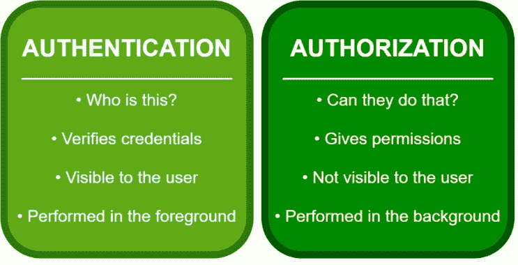

图 3. 用户认证与授权

### 理解用户认证

客户端确认是在允许其访问应用内受保护的资源或功能之前，检查客户端身份的最常用方法。通过认证，仅允许授权用户执行特定任务或访问特定数据。以下是用户认证的关键方面：

- **认证因素**：研究各种认证因素在确认用户身份方面的作用，例如，持有物因素（如物理令牌和智能卡）和知识因素（如密码和 PIN 码）。

- **认证机制**：了解 Web 应用中使用的不同验证组件，例如基于结构的验证、HTTP 基础认证、摘要验证、OAuth、OpenID 和统一身份提供程序。

- **单点登录 (SSO)**：识别单点登录 (SSO) 的优势，它使用户能够访问多个应用程序或服务而无需每次都重新认证。

### 研究客户端许可

客户端许可是在确认后，确定客户端允许访问应用内活动或资源的最常用方法。授权确保用户拥有适当的权限与特定数据交互或执行特定任务。客户端许可的关键部分包括：

- **基于角色的访问控制 (RBAC)**：了解基于角色的访问控制 (RBAC) 以及它如何根据客户端角色或分组来描述访问许可，允许管理员在更高级别的决策层级管理许可。

- **ACL 或访问控制列表**：研究访问控制列表 (ACLs) 的概念，它为特定用户或组指定特定资源或对象的访问权限，并提供细粒度的访问控制。

- **基于属性的访问控制 (ABAC)**：学习名为基于属性的访问控制 (ABAC) 方法。ABAC 依赖于用户属性、资源属性和环境属性来做出既动态又感知上下文的访问控制决策。

- **委托管理**：研究指定的组织模型，该模型允许管理员将访问控制责任分配给信任的客户端或分组，从而减少权限权重并提高灵活性。

### Web 应用中的用户认证与授权

为了保护敏感数据、防止未经授权访问并确保符合安全法规，用户认证和授权在 Web 应用中至关重要。在 Web 应用中执行验证和许可的几个关键考虑因素包括：

- **安全认证机制**：为了保护用户凭据并防止未经授权访问，应使用 HTTPS、强密码哈希算法、多因素认证 (MFA) 和账户锁定策略等安全认证方法。

- **细粒度访问控制**：根据客户端角色、许可和属性授权细粒度的访问控制策略，以确保客户端对应用内的资源和功能拥有适当权限。

- **会话管理**：实施稳健的会话管理工具以安全地维护用户会话，包括会话超时、防止会话固定和安全的会话处理实践。

- **跨领域问题**：使用 `Spring Security`、`Apache Shiro` 或 JSON Web Tokens (JWT) 等框架和库，可以集中统一地处理用户会话管理、认证和授权等跨领域问题。

（注：此处原文为...除了密码之外增加额外的安全层，例如基于短信的一次性密码 (OTP)、电子邮件检查或生物识别验证。）

- **安全通信通道**：确保客户端与服务器之间的通信通道使用 `SSL/TLS` 加密，以保护敏感数据（例如用户凭据和会话 ID）免受监听和篡改。

客户端确认和许可是 Web 应用安全的核心部分，提供了检查客户端身份和控制资源及功能访问的工具。通过理解用户认证与授权的概念、原则和最佳实践，开发者可以创建强大且安全的 Web 应用程序，有效保护用户数据和资源。

## 基础认证 vs. 表单认证

认证是 Web 应用安全的关键部分，使应用程序能够在提供受保护资源或功能的访问之前检查客户端身份。Web 开发中使用的两种常用验证系统是基础认证和基于结构的验证。本章将探讨表单认证与基础认证的区别、优缺点，为开发者在 Java Web 应用中实施认证提供所需的信息。

### 基础认证概述

基础认证（Basic Authentication）是 HTTP 协议支持的最简单的身份验证方法之一。它依赖于 HTTP 请求头中发送的明文用户名和密码。身份验证过程涉及以下步骤：

- 客户端浏览器在尝试访问受保护的资源时，提示用户输入凭据（用户名和密码）。

- 在向服务器发送的后续请求中，浏览器会将凭据编码为 Base64 编码字符串，并将其包含在 HTTP 请求的 `Authorization` 头部中。

- 如果凭据有效，服务器在从 `Authorization` 头部提取凭据并与用户数据库或身份验证提供程序进行比较后，将授予请求资源的访问权限。

### 优势

基础验证提供了几项优势，包括：

- **简单性**：基础验证的执行和设计并不困难，不需要复杂的服务器端配置和客户端协调。

- **浏览器兼容性**：所有主流网络浏览器都支持基础认证，它不需要任何客户端脚本或额外的插件。

- **无状态**：由于基础认证是无状态的，每个请求都独立于会话（session），且不依赖 cookie 或会话状态，简化了服务器端的实现和扩展性。

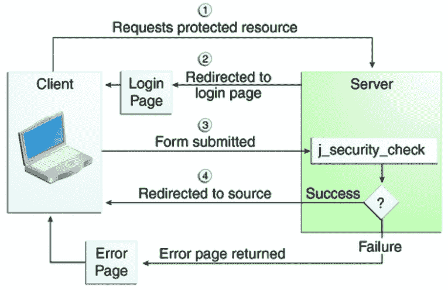

图 4. 基于表单的认证

### 缺点

尽管简单，基础认证也有一些缺点，包括：

- **缺乏加密**：基础认证以明文传输凭据，使其容易受到攻击者的监听和截获，损害用户隐私和安全。

- **灵活性有限**：基础认证不支持自定义登录表单或多步身份验证工作流，使其不太需要高级身份验证功能或用户体验自定义的应用。

- **凭据存储不安全**：基础认证要求在服务器上以明文或可逆的加密格式存储用户密码，在发生数据泄露或未经授权访问用户凭据时会带来安全风险。

### 最佳实践

Java Web 开发者在实现基础认证时应遵循以下最佳实践：

- **激活 HTTPS**：持续使用 HTTPS 加密建立客户端与服务器之间的通信，防止凭据拦截尝试，并确保信息的机性和真实性。

- **客户端确认**：根据可靠的客户端数据集或验证供应商确认客户端凭据，实施强固的口令策略和程序，例如使用密码哈希和加盐（salting）来保护客户端密码免受未经授权的访问。

- **基于角色的访问控制**：可以使用基于角色的访问控制（`RBAC`）机制执行基于用户角色和权限的细粒度访问权限，限制授权用户访问敏感资源或功能。

## 基于表单的认证概述

基于表单的认证是一种使用 HTML 表单收集用户凭据（如用户名和密码）并将其发送到服务器进行验证的身份验证方法。这种类型的身份验证更具适应性和定制性。身份验证过程涉及以下步骤：

- 客户端浏览器在访问受保护的资源时显示登录表单并提示用户输入凭据。

- 客户端提交其凭据结构，通过 `POST` 请求与服务器通信。

- 身份验证成功后，服务器发布会话令牌（session token）或设置会话 cookie 并验证凭据（通常是针对用户数据库或身份验证提供程序）。

- 随后的客户端请求包含会话令牌或 cookie，允许服务器识别并验证客户端的后续协作。

### 优势

基于表单的认证提供了多项优势，包括：

- **定制性**：基于表单的认证允许开发者根据应用程序的品牌、用户体验和安全需求设计自定义登录表单，对身份验证过程提供更大的灵活性和控制。

- **提高安全性**：基于表单的认证允许使用带有 HTTPS 加密的安全登录页面，保护用户凭据免受截获，并确保传输过程中数据的机性和完整性。

- **支持多步身份验证**：基于表单的认证支持多步身份验证工作流，例如双重认证（`2FA`）或邮件验证，允许开发者实施额外的安全措施来验证用户身份。

### 缺点

尽管具有灵活性，基于表单的认证也有一些局限性，包括：

- **复杂性**：与基础认证相比，基于表单的认证实现和配置更复杂，需要服务器端脚本、会话管理以及额外的安全措施。

- **浏览器兼容性**：基于表单的认证可能需要客户端脚本或 JavaScript 来增强用户体验并验证用户输入，可能会影响与旧版浏览器或 JavaScript 支持有限的设备的兼容性。

- **会话管理开销**：基于表单的认证依赖会话管理机制（如会话 cookie 或令牌）来维护用户认证状态，需要额外的服务器资源，并引入了如会话固定或会话劫持等潜在安全风险。

### 最佳实践

在 Java Web 应用中实现基于表单的认证应遵循以下最佳实践：

- **安全登录页面**：创建 HTTPS 加密的安全登录页面以防止用户凭据在传输过程中被截获和篡改，防止中间人（`MITM`）攻击，并确保数据的机完整性。

- **强固的密钥安排**：维护强固的密钥策略，如最小长度、复杂度要求和密码过期，以提高密钥安全性并降低暴力攻击或密码破解的风险。

- **组织会话**：执行安全的会话管理组件（例如带有 `HTTPOnly` 和 `Secure` 标记的会话 cookie），以防止会话劫持和会话攻击，并授权会话退出和超时终止策略以减少未经授权访问会话的风险。

基础认证和基于表单的认证是 Java Web 应用中两种常用的身份验证系统，它们各自都有优势、缺点和最佳实践。开发者通过理解基础认证和基于表单认证之间的区别，可以根据应用程序的安全需求、用户体验和实现复杂度选择最佳身份验证方法。这确保了敏感的用户数据和资源得到有效保护。

## 在 JSP 中创建登录表单

在 Java Web 开发中，使用 JSP 创建登录表单是实现基于表单认证的第一步。本节将介绍如何使用 JSP 构建一个功能齐全且安全的登录表单，包括表单结构、输入字段以及如何处理表单提交的数据。

用户可以通过登录表单访问 Web 应用程序的限制区域或功能。在基于 JSP 的 Web 应用程序中，登录界面通常收集客户端凭证（例如用户名和密钥），并根据客户端数据集或验证提供程序对客户端进行验证。在 JSP 中构建登录结构的核心目标是为客户端提供安全、自然且一致的验证体验，同时保护敏感的客户端数据并防止未经授权的访问。

### 登录表单的设计考虑

有效的登录表单需要对可用性、安全性、可访问性、品牌等等方面进行仔细考虑。JSP 登录结构的一些关键设计考虑包括：

- **易用性**：使用清晰的标签、输入字段和错误消息引导用户完成登录表单上的认证过程，保持易用性。

- **安全性**：为了保护用户凭据并防止窃听、篡改和暴力攻击等安全威胁，应实施 HTTPS 加密、CSRF 保护和密码哈希等安全措施。

- **可访问性**：为表单验证提供视觉提示、键盘导航和屏幕阅读器兼容性，确保残障用户也能使用登录表单。

- **品牌化**：通过结合与应用程序设计语言一致的 Logo、颜色和样式，保持与 Web 应用程序整体品牌和视觉识别的一致。

### 登录表单的 HTML 结构

JSP 中登录表单的 HTML 结构由标准的 HTML 元素组成，如 `<form>`、`<input>`、`<label>` 和 `<button>` 标签，以及用于动态内容的 JSP 标签和表达式。登录表单包括用户名和密码的输入字段，以及“记住我”、“忘记密码”和“注册”等选项。

### 实现服务端认证

JSP 中的服务端认证涉及根据用户数据库或认证提供程序验证用户凭据，并授予已认证用户访问权限。在 JSP 中实现服务端认证的过程通常涉及以下步骤：

1. **获取用户输入**：使用 JSP 表达式或 JSTL 标签从请求参数中提取用户输入。

2. **验证用户凭据**：使用业务逻辑或认证机制（如 `JDBC`、`Spring Security` 或容器托管认证）根据用户数据库或认证提供程序验证用户凭据。

3. **处理认证结果**：根据认证结果（如登录成功、凭据无效、账户锁定）将用户重定向到适当的页面或显示错误消息。

4. **管理用户会话**：使用 `HttpSession` 对象创建并管理用户会话，以维护用户并在跨请求跟踪已认证的用户。

### 增强登录表单的安全性

为了保护用户凭据、防止未经授权的访问并降低安全风险，登录表单必须是安全的。以下提高 JSP 登录表单安全性的一些最佳实践：

- **HTTPS 安全**：使用 HTTPS 加密客户端与服务器之间的数据传输，防止用户凭据被窃听和篡改。

- **输入验证**：审核并消毒客户端贡献以防止安全漏洞，例如 `SQL 注入`、跨站脚本 (XSS) 和订单注入。

- **密码哈希**：利用强加密算法对客户端密码进行哈希处理，例如 `bcrypt`、`PBKDF2` 或 `Argon2`，以保护密码在传输过程中的隐私和完整性。

- **验证码验证**：为了防止恶意攻击者和自动化机器人使用暴力攻击滥用登录表单，请使用 Captcha 验证。

- **频率限制**：通过实施速率限制机制（限制规定时间内每个用户或 IP 地址的登录尝试次数），降低暴力攻击和账户枚举的风险。

### 实现“记住我”功能

“记住我”功能允许用户跨浏览器会话持久其认证会话，提供便利并无缝访问应用程序。在 JSP 登录表单中实现“记住我”功能通常涉及：

- **设置持久化 Cookie**：在用户设备上设置带有唯一标识符（例如记住我令牌）的持久化 Cookie，以便跨浏览器会话识别用户。

- **处理记住我令牌**：在后续访问期间验证存储在持久化 Cookie 中的记住我令牌，无需手动登录即可自动认证用户。

- **过期与撤销**：实现管理记住我令牌过期和撤销的机制，以维护安全用户隐私。

在 JSP 中构建登录结构是 Web 应用改进的基础部分，为客户端提供了安全的验证和访问控制。通过理解设计考虑、实现服务端认证、增强安全措施以及实现“记住我”功能，开发者可以在 JSP 中构建为用户提供无缝、安全且友好的认证体验的登录表单，同时保护敏感用户信息并防止未经授权的访问。

## 使用 Servlet Filter 处理认证

验证是 Web 应用改进的基础，确保客户端在访问受保护的资源或功能之前其身份是真实的。Servlet Filter 提供了一种强大的方法，在 HTTP 请求到达 Servlet 之前或生成之后对其进行拦截和处理。在此部分，我们将深入探讨 Java Web 应用中使用 Servlet Filter 处理认证的复杂性，涵盖了过滤器链、验证组件、安全考虑和执行最佳实践等概念。

Servlet Filter 是 Java Servlet 编程接口中的可插组件，通过拦截 HTTP 请求和响应来执行预处理和后处理任务。Filter 定义在 `web.xml` 部署符中或使用注解，并在链中执行，允许多个过滤器连续处理请求或响应。Servlet Filter 的常见用例包括日志、验证、授权、输入验证、压缩和加密。

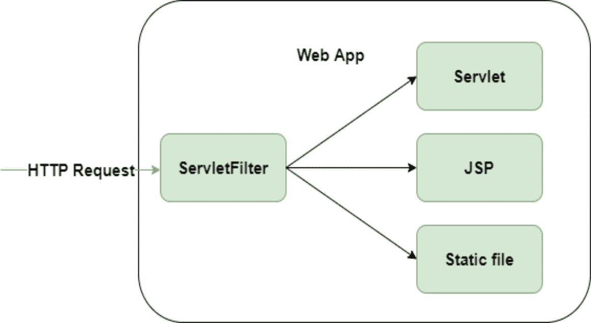

图 5. Servlet Filters

### 认证过滤器基础

认证过滤器是一种 Servlet Filter，它拦截传入的 HTTP 请求，在授予 Web 应用程序内受保护的资源或功能之前验证用户身份。认证过滤的关键方面包括：

- **过滤器初始化**：实现 `init()` 方法执行初始化任务，如加载配置设置、初始化数据结构或建立到认证提供程序的连接。

- **过滤器执行**：实现 `doFilter()` 方法拦截传入的请求，从请求参数或标头提取用户凭据（例如用户名和密码），并根据用户数据库、LDAP 目录或认证服务进行验证。

- **过滤器链**：使用 `FilterChain` 对象的 `doFilter()` 方法调用过滤器链中的下一个过滤器，将处理委托给链中的后续过滤器或 Servlet。

- **过滤器销毁**：实现 `destroy()` 方法执行清理任务，如释放资源、关闭连接或释放过滤器初始化期间分配的内存。

### 使用 Servlet Filter 实现认证

为了有效使用 Servlet Filter 实现认证，开发者应该遵循包含以下步骤的结构化方法：

#### 实现步骤

- **识别受保护资源**：识别 Web 应用程序需要身份验证的资源或功能，例如受限页面、API 端点或管理器操作。

- **定义身份验证需求**：确定访问受保护资源的身份验证需求，包括验证机制（例如基于表单的验证、容器管理的验证）、用户角色和访问控制策略。

- **实现身份验证过滤器**：开发自定义身份验证过滤器，拦截传入的请求、验证用户凭据并根据配置的策略执行身份验证需求。

- **配置过滤器映射**：使用注解或 `web.xml` 部署描述符指定应用身份验证过滤器的 URL 模式或 servlet 映射以配置过滤器映射。

- **测试与通过**：利用单元测试、集成测试和端到端测试对验证通道进行全面测试，以确保在不同情况和条件下的正确执行，包括合法和无效的客户端凭据、验证失败以及访问控制的实现。

### 安全考虑

在处理 servlet 通道确认时，安全性至关重要，以防止未经授权的访问、会话劫持和其他安全漏洞。以下是确保身份验证过滤器安全的的一些建议程序：

- **保护敏感数据**：尝试不要在明文或不安全的区域（例如日志文件或响应头）中记录敏感数据，如客户端凭据、会话标识符或验证令牌。

- **安全通信**：使用 SSL/TLS 加密客户端与服务器之间的数据传输传输，防止恶意者窃听用户凭据并篡改会话标识符。

- **防止会话固定**：在身份验证成功后创建新的会话标识符，并将其与已验证的用户会话关联，以防止会话固定攻击。

- **实施访问限制**：为了根据用户角色、权限或其他上下文属性限制对受保护资源的访问，除了身份验证外，还要执行访问控制和授权策略。

### 执行最佳实践

为了保证 Java Web 应用程序验证通道的充分性、稳定性和可行性，设计者应当遵循最佳实践，例如：

- **封装身份验证逻辑**：将身份验证逻辑封装在身份验证过滤器中，以提高重用性、模块化可维护性，并避免多个 servlet 或组件之间的代码重复。


# 身份验证过滤器与访问控制最佳实践

## 集中化配置

使用外部配置文件、环境变量或依赖注入机制将身份验证过滤器的配置设置集中，以便于跨环境的配置管理和部署。

## 日志与审计

在身份验证过滤器中实现日志和审计机制，记录身份验证事件（包括成功和失败的登录尝试、会话创建和身份验证失败），用于安全监控、事件响应和合规审计。

## 错误处理与报告

在身份验证过滤器中实现稳健的错误处理和报告机制，以优雅的方式处理身份验证失败，向用户提供信息，并防止可能辅助攻击者利用安全漏洞的信息泄露。

身份验证过滤器为处理 Java Web 应用程序验证提供了强大的机制，允许开发者执行身份验证需求、保护敏感资源并确保用户交互的安全。通过理解身份验证过滤的基础、有效实现身份验证逻辑、考虑安全影响并遵循实现最佳实践，开发者可以构建安全、可靠且用户友好的 Web 应用程序，满足现代用户和企业的身份验证需求。

# 会话管理最佳实践

Web 应用程序开发严重依赖会话管理，允许应用程序安全地维护用户会话并为用户提供个性化体验。本章将讨论 Web 应用程序会话管理的全面最佳实践，包括会话跟踪机制、会话安全、会话过期和性能优化。

## 理解会话管理基础

为了在 Web 应用程序中实现有效的会话管理，开发者必须理解会话管理的基础，包括：

- **会话跟踪机制**：熟悉 Web 技术支持的不同会话跟踪机制，如 cookie、URL 重写、隐藏表单字段和 HTTP session 对象。
- **会话生命周期**：理解会话的生命周期，包括会话创建、会话属性操作、会话过期和会话终止。
- **会话标识符**：学习会话标识符，它可以唯一标识用户会话并促进跨请求会话跟踪。
- **会话属性**：探索会话属性，它们在会话中存储用户特定的数据和状态，并在 Web 应用程序的不同组件之间访问。

## 实现安全的会话处理

会话管理的安全性是为了防止未经授权的访问、会话劫持和其他安全漏洞。实现安全会话处理的一些最佳实践包括：

- **使用安全 cookie**：通过在会话 cookie 上设置 `"secure"` 标记，可以确保它们仅通过加密 (`HTTPS`) 连接发送，从而防止会话劫持攻击。
- **确保会话结束**：执行会话终止组件，在预定义的闲置时间后消除非活动会话，降低会话固定和会话劫持的风险。
- **重新建立会话标识符**：在身份验证成功或权限提升后，重新生成会话标识符，以防止会话固定攻击并提高会话安全性。
- **验证会话标识符**：每次请求时验证会话标识符，确保它们是合法的且未被攻击者篡改，防止会话操纵和会话固定攻击。

## 管理会话过期

会话过期对于维护 Web 应用程序的安全性和资源利用至关重要。管理会话过期的一些最佳实践包括：

- **设置合适的会话超时**：根据应用程序需求和用户行为配置会话超时设置，平衡安全考虑与用户便利。
- **显示会话过期警告**：在会话即将过期时通知用户，提供扩展会话或重新验证以继续安全会话的选项。
- **失效过期会话**：实现自动失效过期会话并从服务器内存或存储中移除会话数据，以释放资源并防止内存泄漏。
- **优雅处理会话过期**：通过将用户重定向到指定的注销页面或登录页面并提供有关会话过期的信息性消息，来优雅地处理会话过期事件。

## 优化会话性能

优化会话性能对于确保 Web 应用程序的响应和扩展性至关重要。优化会话性能的一些最佳实践包括：

- **最小化会话数据**：在会话属性中仅存储基本数据，以减少内存占用并降低会话复制和序列化的开销。
- **谨慎使用会话复制**：在集群环境中限制会话复制机制的使用，以跨多个服务器节点复制会话数据，因为过度的会话复制会影响性能和可扩展性。
- **利用会话持久化机制**：根据应用程序的可扩展性、性能和容错要求，选择合适的会话持久化机制，例如内存会话存储、数据库支持的会话存储或分布式缓存解决方案。
- **监控会话使用情况**：监控会话计数、会话时长和会话活动等指标，识别性能瓶颈，优化会话配置并相应调整会话管理设置。

# 处理并发会话管理

并发会话管理对于同时处理多个用户会话以及防止会话冲突和不一致至关重要。处理并发会话的一些最佳实践包括：

- **实施会话并发控制**：实施并发控制以限制每个用户的并发会话数，防止会话滥用并执行公平使用策略。
- **处理会话冲突**：当与同一用户的多个会话同时激活时，通过检测和解决冲突来优雅处理会话冲突，确保数据一致性和会话完整性。
- **提供会话管理功能**：为用户提供管理其会话的功能，例如查看活动会话、终止空闲会话以及退出所有会话，以增强对会话使用的透明度和控制。

有效的会话管理对于维护 Web 应用程序的安全性、可靠性和性能至关重要。通过理解会话管理基础、实施安全的会话处理实践、有效管理会话过期、优化会话性能以及妥善处理并发会话，开发者可以构建提供安全、响应且可扩展体验的 Web 应用程序。

# 安全会话管理：使用 HTTPS 和 SSL

Web 应用程序开发高度依赖会话管理，会话使应用程序能够在多次交互中安全地维护用户会话。在本节中，我们将深入探讨安全会话的重要性，并研究 `HTTPS` 和 `SSL`（安全套接层）如何有助于提高 Web 应用程序的安全性。

## 理解安全会话管理

安全会话管理涉及实施安全维护用户会话的机制，保护会话数据、会话标识和用户交互免受未经授权的访问、篡改和窃听。有效的安全会话管理对于保护用户隐私、防止会话劫持以及确保会话相关信息的机密性和完整性至关重要。

`HTTPS`（安全超文本传输协议）是 `HTTP` 的扩展，增加了加密和确认系统，以实现互联网上客户端与服务器之间的通信。`SSL`（安全套接层）提供的加密协议是 `TLS`（传输层安全协议）的前身。通过加密数据传输、验证服务器身份以及防止窃听和篡改，`HTTPS` 和 `SSL` 是会话管理的保障。

## HTTPS 和 SSL 的关键组件

`HTTPS` 和 `SSL` 依赖于几个关键组件和协议来建立客户端与服务器之间的安全通信：

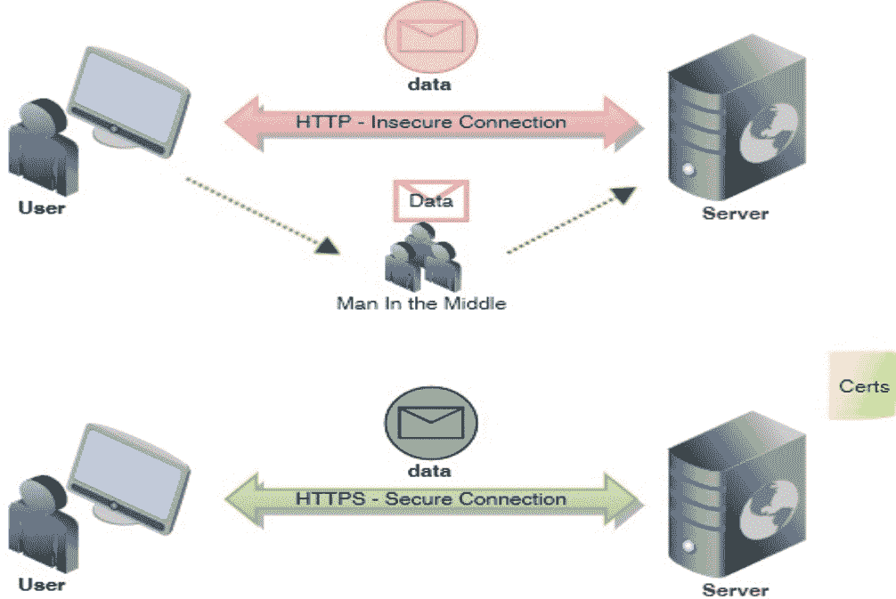

图 6. 安全会话管理

- **使用 SSL/TLS 进行握手**：为了建立安全连接，`SSL/TLS` 握手过程涉及协商加密算法、交换密钥以及验证服务器身份。
- **计算机认证**：利用计算机声明来验证服务器身份，并保证通信信息的可信度和可靠性。认证由受信任的证书颁发机构（`CAs`）提供，包含数据如服务器的公密钥、域名和有效期。
- **公钥加密**：`SSL/TLS` 利用公钥加密来加密信息传输，并在客户端与服务器之间建立安全的通信通道。加密、解密和数字签名均使用公私钥对来确保数据的机密性、完整性和真实性。
- **加密算法**：对于密钥交换和数字签名，`SSL/TLS` 支持多种加密算法，包括对称加密（如 `AES`、`3DES`）和非对称加密（如 `RSA`）。

## 使用 HTTPS 和 SSL 进行会话管理的优势

Web 应用程序通过使用 `HTTPS` 和 `SSL` 进行会话管理获得以下优势：

- **数据机密性**：客户端和服务器之间加密传输数据，防止未经授权的监听或拦截。
- **数据完整性**：通过检测传输过程中的篡改和操作，`SSL/TLS` 防止数据损坏和修改，确保传输数据的完整性。
- **认证**：通过使用权威证书颁发机构颁发的数字证书，`SSL/TLS` 提供了服务器认证机制，使客户端能够安全验证服务器身份并建立信任关系。
- **防止会话劫持**：`HTTPS` 对会话标识和其他敏感会话信息进行编码，使攻击者难以通过拦截会话相关数据来控制会话或伪造客户端。
- **符合安全原则**：利用 `HTTPS` 和 `SSL` 帮助 Web 应用程序遵循行业标准和指南，如 `PCI DSS`（支付卡行业数据安全标准）和 `GDPR`（通用数据保护条例），这些标准要求使用加密和安全通信协议来保护敏感信息并确保客户保护。

## 实施最佳实践

要成功实施基于 `HTTPS` 和 `SSL` 的安全会话管理，开发者应遵循以下最佳实践：

- **激活 HTTPS**：设计 Web 服务器通过从受信任的颁发机构获取 `SSL/TLS` 证书、配置 `SSL/TLS` 设置并将 `HTTP` 流量重定向到 `HTTPS`，以确保所有通信加密。
- **固化加密设置**：使用强固的加密算法、密钥长度和加密协议（例如 `TLS 1.2` 或更高版本）配置 `SSL/TLS`，以确保强大的安全性并防止加密攻击。
- **证书管理**：适当管理 `SSL/TLS` 证书，在过期前更新认证、保护私钥并监控认证的有效性，以防止证书相关问题和安全漏洞。
- **处理混合内容**：在网页上不要混合安全（`HTTPS`）和不安全（`HTTP`）内容，以避免混合内容警告和破坏安全会话完整性的安全漏洞。
- **内容安全策略 (CSP)**：实施 `CSP` 头部以控制和限制在页面上加载内容的来源，防止未经授权的内容注入并缓解跨站脚本（`XSS`）攻击。

对于 Web 应用程序的用户会话、敏感数据以及传输信息的机密性、完整性和真实性，使用 `HTTPS` 和 `SSL` 进行安全会话管理是至关重要的。开发者通过理解 `HTTPS` 和 `SSL` 的原理、实施 `HTTPS` 配置和 `SSL/TLS` 管理的最佳实践，并遵循安全标准和指南，可以提高会话管理的安全性，并创建出赢得用户信任和信心的 Web 应用程序。

# 基于角色的访问控制 (RBAC)

基于角色的访问控制 (`RBAC`) 是计算机安全中一种广泛应用的准入控制组件，为管理应用程序或框架内的用户权限和访问权限提供了一种灵活且通用的解决方案。在本章中，我们将探讨 `RBAC` 的概念、其原理、组件、实施策略以及高效使用的最佳实践。

基于角色的访问控制 (`RBAC`) 安全模型将用户分为不同的角色，并将权限授予角色而非单个用户。`RBAC` 通过将复杂的权限抽象为合理的职位，改进了访问控制的效率，使得在组织或应用程序内部描述、授权和维护访问策略变得更加简单。

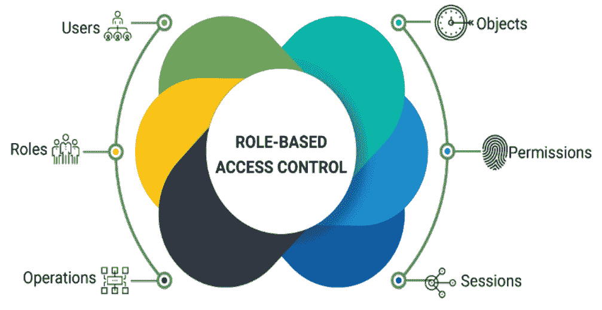

图 7. 基于角色的访问控制 (RBAC)

## RBAC 的原理

`RBAC` 的运行基于几条规范其功能和行为的根本原则：

- **角色抽象**：`RBAC` 将用户权限抽象为角色，角色代表系统内一组相关的活动或功能。
- **职位任务**：根据其职责、职位功能或组织角色为用户分配角色。
- **职位授权**：权限被分配给职位，用户根据其分配的角色获取授权。
- **最小权限**：为了降低权限提升和未经授权访问的概率，`RBAC` 遵循最小权限原则，只授予用户执行与其角色相关的任务所需的权限。
- **分工协作**：`RBAC` 通过确保基本活动需要不同角色的参与来维护职责分工，减少了勒索、错误和滥用的风险。

## RBAC 的组件

`RBAC` 由几个定义其结构和运行的关键组件组成：

- **用户**：与系统交互的单个用户或实体。
- **角色**：权限或特权的集合，定义了系统内一组相关的活动或功能。
- **权限**：用户可以在系统内执行的特定操作或活动。
- **角色层次结构**：角色之间的层次关系，其中高级角色继承低级角色的权限。
- **角色分配**：根据职责和职位功能将用户与角色关联的过程。
- **角色激活**：根据用户的当前需求或状态，为单个用户激活或禁用角色的过程。

## RBAC 的实施策略

实施 `RBAC` 涉及多种策略和技术，用于有效设计、部署和管理基于角色的访问控制策略：

- **角色建模**：根据组织结构、职位功能或业务流程识别并定义角色，确保角色准确反映用户的职责和访问需求。
- **角色层次结构设计**：建立一个反映角色之间关系和依赖关系的角色层次结构，允许权限的高效继承和基于角色的访问控制执行。
- **权限映射**：根据最小权限原则将权限映射到角色，确保角色仅拥有执行其功能所需的权限，并最大限度地减少权限过大的风险。
- **角色分配机制**：实施如基于角色的配置、自助角色分配或基于规则的分配等机制，根据预定义标准或用户属性分配角色给用户。
- **访问控制执行**：使用访问控制列表 (`ACLs`)、基于角色的访问控制矩阵或基于属性的访问控制 (`ABAC`) 等机制来执行访问控制策略，确保用户只能访问其角色允许的资源并执行操作。

## RBAC 实施的最佳实践

为了保证 `RBAC` 实施的安全性、可靠性和效率，企业应遵循以下最佳实践：

- **定期角色评估**：定期审查权限和角色，以确保其符合组织、业务需求和安全策略的变化。根据需要更改或删除角色以保持最小权限。
- **基于角色的策略应用**：实施基于角色而非单个用户的访问控制策略，以简化访问管理和审计，并确保控制的统一应用。
- **职位审查与日志记录**：为了实现安全监控、合规审计和事件响应，实施审计和日志机制跟踪用户访问、角色激活、权限更改和安全事件。
- **用户意识与培训**：提供培训和意识项目，指导用户了解其职责义务、访问控制安排以及安全最佳实践，提高对 `RBAC` 策略的遵循性并减少滥用或未经授权访问的风险。

## 挑战与考虑

虽然 `RBAC` 提供了许多优势，但其实施可能会面临以下挑战和考虑：

- **角色爆炸**：大型组织可能会出现角色爆炸，即角色数量快速增长，导致复杂性增加、管理开销增大以及角色管理挑战。
- **角色渗透**：当角色随时间堆积过多权限时，会导致权限提升和未经授权访问的增加。组织应定期监控角色并删除不必要的权限以缓解角色渗透。
- **基于角色的配置**：基于角色的配置机制可能需要与身份管理系统、用户目录或 HR 系统集成，以有效地自动化角色分配和注销过程。

基于角色的访问控制 (`RBAC`) 是一种强大的访问控制工具，为管理组织或应用程序内的用户权限和访问权限提供了一种灵活、通用且有效的解决方案。通过理解 `RBAC` 的原理、实施有效的角色建模、角色层次结构设计、权限映射和访问控制执行机制，并遵循 `RBAC` 实施的最佳实践，组织可以有效增强安全性、简化访问管理并确保符合法规要求。

# 实施访问控制列表 (ACLs)

计算机系统中的一项基本安全机制，访问控制列表 (`ACLs`) 用于根据用户权限限制对资源的访问。在本节中，我们将深入探讨在编程应用程序（包括 Java Web 应用程序）中执行访问控制的标准、策略和最佳实践。我们将研究访问控制背后的理念，以及 `ACL` 模型、实施策略、安全考虑以及最高效的访问控制方法。

## 理解访问控制

确定并控制授予用户或其他实体访问资源或执行系统操作的权限的过程被称为访问控制。以下是访问控制中的核心概念：

- **主体**：被授予访问权限的实体，如用户、组或进程。
- **对象（Objects）**：受访问控制保护的资源，如文件、目录或应用程序功能。
- **权限（Permissions）**：授予主体对对象执行特定操作的权利或特权，如读取、写入、执行或删除。

## 访问控制模型

用于在系统内执行访问控制策略的规则和机制由访问控制模型定义。常见的访问控制模型示例包括：

- **DAC 或裁量访问控制**：得益于 `DAC`，资源的所有者能够根据自己的意愿授予或拒绝访问权限。所有者能够更改访问控制列表，权限通常与特定用户或组相关。
- **MAC（强制访问控制）**：Macintosh 根据分配给主体和客体（文章）的安全标记或分组来实现访问控制安排。用户无法更改访问控制设置，因为访问决策是由安全策略或中央机构做的。
- **基于角色的访问控制 (RBAC)**：通过 `RBAC` 赋予角色权限，并将用户置于与其工作职责或组织角色对应的角色中。由于访问决策是基于用户的角色，管理变得更加容易，并能保持一致的访问控制策略。

## 在 Java Web 应用程序中实现 ACL

在 Java Web 应用程序中实现访问控制列表（`ACL`）涉及定义访问控制策略、执行访问控制决策以及有效管理权限。在 Java Web 应用程序中实现 `ACL` 的关键步骤包括：

- **定义访问控制策略**：识别受保护的资源、允许访问每个资源的用户或角色，以及与每个资源相关的权限。
- **用户身份验证**：使用表单认证、容器托管认证或自定义认证提供程序等认证机制验证用户身份。
- **授权访问**：使用访问控制列表、基于角色的访问控制 (`RBAC`) 机制或自定义授权逻辑根据用户的权限和角色授权其访问资源。
- **执行访问控制**：通过拦截对受保护资源的请求、验证用户权限或角色，并相应授予或拒绝访问来执行访问控制决策。
- **管理权限**：提供管理权限的接口或工具，包括添加或删除用户、分配角色、修改访问控制列表以及审计访问控制变更。

## 安全考虑

为了防止未经授权的访问、权限提升和其他安全漏洞，必须极其谨慎地实现访问控制列表 (`ACLs`)。在 Java Web 应用程序中实现 `ACL` 时，关键的安全考虑包括：

- **最小权限原则**：遵循最小特权标准，仅授予客户端执行其预期任务必需的许可，限制未经授权访问的风险并防止权限提升。
- **安全的会话管理**：实现安全的会话处理机制，如会话 ID 重生、安全 Cookie 和会话超时，以保护用户会话和会话标识符免受固定或劫持攻击。
- **输入验证与清理**：对用户输入进行验证和清理，以避免注入攻击、命令注入和跨站脚本 (`XSS`) 漏洞。
- **安全的通信**：使用 `SSL`/`TLS` 加密保护客户端与服务器之间的数据传输，防止用户凭据、会话标识符和访问控制决策等敏感信息被窃听或篡改。

## 强大访问控制的最佳实践

为了保证 Java Web 应用程序中访问控制记录的有效性、质量和实用，工程师应当遵循最佳实践，例如：

- **集中访问控制**：为了在整个应用程序中执行一致的访问控制策略，利用 `Apache Shiro` 或 `Spring Security` 等框架实现集中访问控制机制。
- **细粒度访问控制**：执行细粒度的准入控制策略，在资产级别细粒度地刻画许可和访问自由，考虑对客户端访问的精确控制。
- **日志与审计**：为了便于安全监控、事件响应和合规审计，实现审计和日志机制以跟踪访问控制决策，包括成功和失败的访问尝试、权限更改和安全事件。
- **定期安全评估**：为了发现并修复访问控制实现中的安全缺陷、配置错误和漏洞，定期进行安全评估和漏洞扫描。


为了让 Java Web 应用程序能够控制资源访问并保护敏感数据，必须实现访问控制列表（`ACLs`）。通过理解访问控制原理、选择合适的访问控制模型、有效实现 `ACLs`、考虑安全影响并遵循访问控制实现最佳实践，开发者可以创建满足现代用户和企业需求的安全、可靠且合规的 Java 应用程序。

## 实现“记住我”功能

Web 应用程序经常包含“记住我”功能，使用户在关闭并重新打开浏览器后仍能保持登录状态。这一元素通过消除多次登录的需求提高了客户端的舒适度，并进一步提升了整体客户端体验。在本节中，我们将研究 Java Web 应用程序中“记住我”功能的执行，涵盖持久化验证令牌、安全符号存储、安全考量以及执行最佳实践等概念。

“记住我”功能允许用户在多个会话中保持登录 Web 应用程序，即使他们关闭了浏览器或离开了网站。此功能通常使用持久化认证令牌实现，这些令牌存储在客户端，用于在随后的访问期间自动验证用户。


图 8. 记住我功能

### 持久化认证令牌

持久化验证令牌是由 Web 应用程序创建的与客户端记录相关的特殊标识符。在客户端，这些令牌被安全地保存，通常以 `cookies` 的形式存在。它们用于验证用户而无需其手动输入凭据。令牌通常包含数据，例如客户端标识符、过期时间戳和防止篡改的加密标记。

### 实现步骤

在 Java Web 应用程序中实现“记住我”功能涉及几个步骤，包括：

- **生成持久化认证令牌**：当用户登录时，生成一个与其账户相关的唯一持久化认证令牌。
- **安全存储令牌**：在客户端安全地存储持久化认证令牌，通常作为 `HTTP cookie`，并带有适当的安全属性，如加密、`secure` 标记和 `HttpOnly` 标记。
- **验证令牌**：当用户再次访问网站时，验证持久化认证令牌以确保其完整性和真实性。检查过期时间戳和加密签名以防止篡改并确保令牌仍然有效。
- **自动验证用户**：如果持久化认证令牌有效，则使用令牌中存储的信息自动验证用户，跳过手动登录的需求。

### 安全令牌存储

持久验证令牌的安全性容量对于防止未经授权的访问和保护客户保护至关重要。安全符号存储的若干规定程序包括：

- **加密**：可以使用强力加密算法对持久化身份验证令牌中的敏感信息（如用户标识符和过期时间戳）进行加密，以防止数据泄露和篡改。
- **安全标记（`Guard flag`）**：为了防止攻击者截获身份验证令牌 `cookie`，设置 `secure` 标记以确保其仅通过 HTTPS 连接传输。
- **`HttpOnly` 标记**：通过在身份验证令牌 `cookie` 上设置 `HttpOnly` 标记，可以缓解跨站脚本（XSS）攻击，防止客户端脚本访问令牌。
- **令牌轮换**：定期或响应密码更改、可疑活动等安全事件轮换持久化身份验证令牌，减少令牌被泄露的影响。

## 安全考虑

在 Java Web 应用程序中实现“记住我”（Remember Me）功能时，安全性至关重要，以防止未经授权的访问并保护用户数据。需要注意的安全考虑因素包括：

- **令牌过期**：为持久化身份验证令牌设置合理的过期时间，以限制其寿命，并降低令牌泄露时未经授权访问的风险。
- **令牌撤销**：实现撤销或失效持久化身份验证令牌的机制（例如注销功能或令牌黑名单），以降低令牌被盗或滥用的风险。
- **安全令牌传输**：确保持久化身份验证令牌通过 HTTPS 连接安全传输，以防止攻击者的截获和窃听。
- **强力加密保护**：使用强力加密算法和密钥管理实践来保护存储在持久化身份验证令牌中的敏感信息，防止破解攻击和字典攻击等加密攻击。

## 实现最佳实践

为了确保 Java Web 应用程序中“记住我”功能的有效性、可靠性和安全性，开发者应该遵循以下最佳实践：

- **使用安全框架**：利用安全的身份验证框架和库，如 `Spring Security` 或 `Apache Shiro`，这些框架提供了“记住我”功能的内置支持，并开箱即用了安全最佳实践。
- **集中化令牌管理**：实现集中化的令牌管理机制，在整个应用程序中一致地生成、存储、验证和撤销持久化身份验证令牌，确保一致性和安全性。
- **定期安全审计**：进行定期的安全审计和代码审查，以识别并解决“记住我”功能中的潜在安全漏洞，包括不安全的令牌存储、验证不足以及加密保护不足。

“记住我”功能通过允许用户跨会话保持登录状态，增强了 Java Web 应用程序的便利性并提升了整体用户体验。通过安全地实现“记住我”功能并遵循持久化身份验证令牌、安全令牌存储、安全考虑和实现最佳实践，开发者可以构建为用户提供无缝且安全认证体验的 Java Web 应用程序。

# 第 6 章

# 高级主题

## 模型-视图-控制器（MVC）简介

`Model-View-Controller`（MVC）架构模式广泛用于设计和构建 Web 应用程序。在此部分，我们将深入 MVC 设计的核心、关键部分、标准、优势以及它们在 Java Web 开发中的应用方式。


图 1. 模型-视图-控制器（MVC）

### 理解 MVC 架构

MVC 软件架构模式将应用程序分为三个相互依赖的部分：模型（Model）、视图（View）和控制器（Controller）。每个部分在应用程序的设计和功能中都发挥着特定的作用并承担着责任：

- **模型（Model）**：`Model` 处理应用程序的信息和业务逻辑。它包含了持久化、操作和检索等数据相关的操作。`Model` 保持数据及其呈现的同步，并通知 `View` 数据的任何变化。
- **视图（View）**：`View` 处理应用程序的显示层。它根据 `Model` 的数据负责渲染用户界面。`View` 观察 `Model` 的变化并相应更新 UI，确保了数据与显示之间合理的关注点分离。
- **控制器（Controller）**：`Controller` 通过中间人连接 `Model` 和 `View`。它从 `View` 获取客户端输入，对其进行处理，并适时地更新 `Model`。`Controller` 还会使用 `Model` 的最新信息刷新 `View`，处理客户端通信并维护应用程序状态。

### MVC 架构的原则

MVC 架构的设计和实现受到以下关键原则的指导：

- **关注点分离**：通过将应用程序拆分为若干不同的组件（每个组件负责功能的不同方面），MVC 鼓励清晰的关注点分离。这种划分有助于模块化、实用性和代码复用。
- **单一职责原则（SRP）**：MVC 的每个组件都有单一职责：数据由 `Model` 管理，显示由 `View` 处理，用户输入和应用程序流由 `Controller` 管理。这一规则提升了代码的清晰度、易维护性和可测试性。
- **松耦合**：MVC 鼓励组件之间的松耦合，允许它们独立地交互而无需产生直接依赖。这种解耦使得应用程序更具灵活性、可扩展性且更容易维护。
- **封装**：MVC 中的每个组件都封装了自身的功能和状态，隐藏实现细节并只暴露必要的接口。这种封装促进了抽象、模块化和信息隐藏。

### MVC 架构的优势

MVC 工程为 Web 应用程序开发提供了若干优势：

- **模块化**：MVC 将应用程序分离为孤立的部分，使得在不影响其他部分的情况下，更容易构建、更新和扩展应用程序的各个部分。
- **可复用性**：通过分离关注点并在组件内封装功能，MVC 鼓励了代码复用。模型、视图和控制器都是可以在多个应用程序或项目中使用的可复用部分。
- **可维护性**：MVC 的松耦合、单一职责原则和清晰的关注点分离使应用程序代码的维护和调试变得更简单。一个部分的更改通常不会显著影响其他部分，降低了意外副作用的风险。
- **可扩展性**：得益于 MVC 的模块化和松耦合架构，应用程序可以通过增加组件实例或升级单个组件来实现水平扩展，而不影响整个系统。
- **可测试性**：MVC 支持单元测试、集成测试和单个部分的端到端测试，更容易验证和确认应用程序的功能、行为和执行。

## 在 Java Web 开发中实现 MVC 架构

在 Java Web 开发中，像 `Spring MVC`、`JavaServer Faces (JSF)` 和 `Struts` 等 Web 框架经常用于实现 MVC 架构。这些框架为执行 MVC 提供了底层支持，并处理路由、请求处理、数据绑定和模板等元素：

- **`Spring MVC`**：`Spring MVC` 是 Spring 环境中一种广名的 Web 系统，它遵循 MVC 设计。它使用注解、依赖注入和面向切面编程（`AOP`）来改进 Web 应用开发，并提高代码关联性和维护性。
- **`JavaServer Faces (JSF)`**：`JSF` 是 Java EE 阶段著名的基于组件的 Web 框架，适用于开发丰富的 Web 应用。它通过提供托管 Bean 支持、事件驱动编程模型和一组可重用的 UI 组件来支持 MVC 模式。
- **`Struts`**：一个用于构建企业级 Java Web 应用的成熟 Web 框架。它提供了声明式配置、验证和国际化等功能，简化 Web 应用的应用。它遵循 MVC 模式。

强大的模型-视图-控制器（MVC）架构用于创建模块化、可扩展且易于维护的 Web 应用。通过隔离关注点、增强封装并实现部分之间的松耦合，MVC 设计使工程师能够创建出健壮且灵活的应用程序，这些应用程序更容易构建、扩展和测试。在 Java Web 开发中，MVC 设计被 `Spring MVC`、`JavaServer Faces (JSF)` 和 `Struts` 等框架广泛采用和支持，使工程师能够轻松构建复杂的 Web 应用。

## MVC 设计模式：关注点分离

被称为模型-视图-控制器（MVC）设计模式的基础架构模式在软件开发中被广泛用于，以模块化且易于维护的方式分离问题并组织代码。在这部分，我们将深入探讨 MVC 配置设计，研究其标准、组成、优势以及执行的最佳实践。

20 世纪 70 年代后期，Trygve Reenskaug 引入了 MVC 设计模式，作为在 `Smalltalk-80` 应用中组织用户界面代码的方法。从那时起，它可能成为编程开发领域最通用的结构化示例之一，适用于不同的领域和创新。

MVC 模式由三个核心组件组成：

- **模型（Model）**：通过表示数据和业务逻辑来封装应用程序的状态和行为。模型负责管理数据一致性、验证和控制。
- **视图（View）**：表示应用程序的呈现层，负责向用户显示用户界面和数据。通常，视图是显示模型提供数据的被动组件。
- **控制器（Controller）**：作为模型和视图之间的中间人，处理用户输入、处理请求并更新模型状态。控制器解释用户操作，选择合适的视图来渲染响应，并执行必要的模型操作。

### 关注点分离的原则

MVC 设计模式是关注点分离（SoC）原则的示例，该原则建议将系统拆分为不同的部分，每个部分负责功能的某个特定方面。开发者通过分离关注点可以获得若干优势：

- **模块化**：通过分离关注点，开发者能够将代码模块化为更小、更易管理的部分，从而鼓励代码复用、可读性和维护性。
- **可测试性**：解耦部分使得能够独立对单个模块进行更简单的测试，结合单元测试、协调测试和自动化测试。
- **灵活性**：由于组件可以独立地进行修改、替换或扩展而不影响系统的其他其他部分，因此可以分离关注点以获得更大的灵活性和可扩展性。
- **协作**：由于不同团队可以同时处理不同的部分而不会互不干扰，关注点可以相互分离，这促进了开发团队之间的协作。

### MVC 模式在 Java 中的应用

在 Java 中应用 MVC 模式时，有几个考虑因素和最佳实践：

- **模型**：应用程序的数据和业务逻辑由模型表示，通常使用 `POJOs`（简单 Java 对象）或 `JavaBeans` 实现。为了保证数据的一致性和完整性，模型应当包含数据访问、验证和处理的逻辑。
- **视图**：应用程序的呈现层由视图表示，通常使用客户端 JavaScript 框架（如 `Angular` 或 `React`）、HTML 模板或 `JSP`（JavaServer Pages）实现。视图应该负责渲染用户界面，而不包含任何基于模型数据的业务逻辑。
- **控制器**：控制器更新模型状态、处理用户输入，并作为模型和视图之间的中间人。控制器通常作为 `servlets` 或 `Spring MVC` 控制器执行，将请求引导到合适的控制器，在模型上触发过程，并选择合适的视图交付响应。

### MVC 配置示例的优势

MVC 配置设计为 Java 应用程序提供了若干优势：

- **关注点被分离**：由于 MVC 鼓励关注点的清晰分离，开发者可以专注于特定特定特定方面，而无需混合业务逻辑和呈现逻辑。
- **可维护性**：由于对一个组件的变化较可能影响其他组件，关注点被分离，使得代码随时间推移更容易维护和演进。
- **可扩展性**：添加更多控制器来处理更多流量或优化视图以获得更好的性能是 MVC 增强可扩展能力的两个示例。
- **可复用性**：MVC 通过将通用功能封装在孤立部分中（这些部分可以在多个视图和控制器之间复用）来推进代码复用。

### MVC 实现的最佳实践

在开发 Java 应用程序时，开发者应该遵循以下最佳实践，以确保 MVC 实现的有效性和可维护性：

- **保持控制器轻量**：通过将大部分业务逻辑交给模型层并专注于请求处理和视图确定，保持控制器轻量。
- **使用服务层**：在控制器和视图之间实现服务层以体现复杂的业务逻辑，提高复用性并利于测试。
- **在视图中避免直接访问模型**：视图应该从控制器接收数据并使用适当的呈现逻辑进行渲染，而不是直接访问或操作模型数据。
- **遵循命名**：通过一致的方式命名控制器、视图和模型，提高代码的可读性和可维护性。
- **使代码模块化**：通过使用 MVC 模式将应用程序拆分为更小的模块化组件，使应用程序更容易理解、维护和扩展。

一种用于组织 Java 应用程序代码的强大架构模式是 MVC 设计模式，它基于关注点分离原则。通过将关注点划分为模型、视图和控制器组件，开发者可以实现模块化、可测试性、灵活性协作。这创建了更易维护、可扩展和可复用的软件解决方案。理解 MVC 的原则、组件和最佳实践对于成功实施是必要的。

## 使用 Servlets 和 JSP 实现 MVC

模型-视图-控制器（MVC）是一种广泛涉及的组合示例，用于规划和执行 Web 应用程序，在显示层、业务逻辑层和数据访问层之间实现了合理的关注点分离。在本章中，我们将介绍如何使用 `Servlets` 和 `JavaServer Pages`（`JSP`）在 Java Web 应用程序中实现 MVC 架构。我们将涵盖处理请求、处理数据、渲染视图以及保持代码库可扩展且易于维护的最佳实践等主题。


图 2. 使用 Servlets 和 JSP 的 MVC

MVC 架构将应用程序分为三个主要部分：`Model`（模型）、`View`（视图）和 `Controller`（控制器），每个部分都有明确的职责：

- **Model（模型）**：封装了数据访问、操作和验证操作，并作为应用程序数据和业务逻辑的表示。
- **View（视图）**：代表应用程序的表示层，负责向用户显示用户界面和数据。
- **Controller（控制器）**：处理用户请求，调用 `Model` 中相应的业务逻辑，并确定合适的 `View` 来渲染响应，作为 `Model` 和 `View` 之间的中间层。

## 使用 Servlets 和 JSP 实现 MVC

实现 MVC 架构需要以下组件和交互：

- **Controller（`Servlets`）**：在 MVC 架构中，`Servlets` 充当 `Controller` 组件。它们负责处理传入的 HTTP 请求，调用 `Model` 层中的业务逻辑，并选择正确的 `View` 来显示响应。
- `Servlets` 接收客户端请求，从请求的参数或属性中提取相关数据，并调用 `Model` 层的方法处理请求。
- `Servlets` 在处理请求后，要么执行服务器端重定向到不同的 `Servlet` 或 `JSP`，要么将处理后的数据转发到相应的 `JSP` 页面以渲染响应。
- 数据访问、操作和验证的方法由 `Model` 层提供，它封装了应用程序的数据和业务逻辑。
- `Models` 可以使用 `JavaBeans`、`Plain Old Java Objects`（`POJOs`）或与数据库或外部 API 交互的业务类来实现。
- 为了执行 CRUD（创建、读取、更新、删除）操作、验证用户输入并为 `View` 层渲染检索数据，`Servlets` 与 `Model` 组件进行通信。
- 在 MVC 架构中，`View` 层负责根据从 `Controller` 和 `Model` 层接收的数据生成动态 HTML 内容，被称为 `View`（`JSP`）。
- `JSP` 页面通过将 HTML 标记与嵌入的 Java 代码（脚本）或表达式结合实现了动态内容的生成和数据展示。
- `Servlets` 利用请求属性将处理后的信息转发到 `JSP` 页面，然后这些属性获取到 `JSP` 代码内部，从而向客户端返回响应。

### 请求处理流

在使用 `Servlets` 和 `JSP` 执行的 MVC 设计中，请求处理流通常遵循以下方式：

1. 客户端向应用程序发送 HTTP 请求时，指定映射到相应 `Servlet` 的 URL。
2. `Servlets` 接收请求，提取相关数据，并调用 `Model` 层中的方法处理请求，例如业务逻辑操作或从数据库检索数据。
3. 请求处理完成并用处理后的数据设置属性后，`Servlets` 将处理后的请求转发到相应的 `JSP` 页面以渲染响应。
4. `JSP` 页面获取请求属性，根据获取的信息逐步生成 HTML 内容，并将交付的响应返回给客户端。

## 使用 Servlets 和 JSP 实现 MVC 的最佳实践


为了确保 MVC 实现的可扩展性、可维护性和高效，开发者应遵循以下最佳实践：

- **关注点分离**：通过保持`Model`、`View`和`Controller`层之间不干扰对方的关注点，确保每个组件都有独特且定义的职责。

- **使用设计模式**：应用如前端控制器（`Front Regulator`）、订单模式（`Order`）和数据访问对象（`DAO`）等配置示例，以平滑处理请求、集中业务逻辑并提高代码重用率和衡量质量。

- **避免脚本段**：为了提高代码的可读性、可维护性和关注点分离，`JSP`页面应该使用`JSTL`（Java Pages 标准标签库）、`EL`（表达式语言）和自定义标签库，而不是脚本段（`% %>`标签）。

- **模块化**：将大型`Servlets`和`JSP`页面拆分为更小、更易于管理的组件或模块，可以促进重用性、可维护性和可扩展性。

- **错误处理与验证**：通过在`Servlets`和`Models`中实现验证机制并向用户提供有用的错误信息和反馈，验证用户输入并优雅地处理错误。

- **测试**：编写单元测试以验证`Servlets`、`Models`和业务组件的行为，确保它们健壮、可靠并符合功能需求。

使用`Servlets`和`JSP`实现 MVC 架构是开发可扩展、可维护且高效的 Java Web 应用程序的一种种强大策略。通过遵循规定的程序（例如关注点分离、利用配置设计、避免脚本段、模块化、验证和错误处理以及测试），工程师可以构建出色的 MVC Web 应用程序，成功解决客户端和组织的问题。

## 前端控制器模式

Web 应用程序开发利用前端控制器（`Front Controller`）模式（一种基础架构设计模式）来实施一致的应用程序流、促进代码重用并集中处理请求。在这部分中，我们将深入前端控制器（`Front Regulator`）设计，研究其标准、优势、执行方法以及 Java 应用程序中的真实模型。


图 3. 前端控制器模式

### 前端控制器模式的关键组件

前端控制器模式通常包含以下关键组件：

- **前端控制器（Front Controller）**：核心组件，负责接收进入请求、将其调度给相应的处理器并协调整个请求处理流。`Front Controller`可能还会执行身份验证、日志和异常处理等任务。

- **处理器映射（Handler Mapping）**：一种配置机制，根据请求数据（如 URL 模式、请求参数或 HTTP 方法）将传入的请求映射到相应的处理器组件或控制器方法。

- **处理器（Handler）**：负责处理特定类型请求并生成相应响应的组件。处理器可以是控制器、Servlet 或其他请求处理组件。

- **视图解析器（View Resolver）**：一个可选组件，负责将视图名称或视图资源，允许处理器关注请求处理逻辑而不与视图渲染逻辑紧密耦合。

### 前端控制器模式的优势

**集中化请求处理**：通过将请求处理逻辑集中在单个组件中，`Front Controller`（前端控制器）模式提高了代码的重用性，减少了代码重复并简化了维护。

**一致的执行流**：`Front Controller`模式在整个应用程序中强制执行一致的请求流程，确保身份验证、日志记录和错误处理等常见任务被统一应用。

**模块化架构**：通过将请求处理逻辑分离到`handlers`和`controllers`等模块化组件中，`Front Controller`模式允许开发者使用松耦合和可重用的组件构建应用程序，便于代码组织和扩展性扩展。

**可扩展性和灵活性**：`Front Controller`模式允许开发者通过添加新的`handlers`、`interceptors`（拦截器）或`filters`（过滤器）来扩展和自定义请求处理行为，而无需修改现有代码，从而提高了灵性和适应性。

### 实现技术

在 Java Web 应用中实现`Front Controller`模式涉及多种技术和考虑，包括：

- 使用 Servlet 作为前端控制器：由于`Servlets`具有内置的请求处理能力并支持处理 HTTP 请求和响应，它们在 Java Web 应用中常被用作`Front Controllers`。

- 处理器映射策略：实现处理器映射策略，如基于`URL`的映射、基于注解的映射或基于配置的映射，将传入的请求映射到相应的处理器组件或`controller`方法。

- 请求分发机制：使用`forward`、`include`或`redirect`等请求分发机制，根据配置的映射将请求处理委托给相应的处理器组件或`controller`方法。

- 集中式配置：维护集中的配置文件或数据结构，用以定义`handler mappings`、`view resolvers`（视图解析器）、`interceptors`以及其他请求处理配置，提高一致性和管理性。

### 现实案例

许多 Java Web 框架和平台经常使用`Front Controller`模式，包括：

- MVC Spring：`Spring MVC`是一种用于构建 Java Web 应用的知名 Web 结构，它遵循`Front Controller`设计。为了处理传入的请求并将处理委托给名为`controllers`的适当处理器组件，它使用`DispatcherServlet`作为`Front Controller`。

- JavaServer Faces (JSF)：`JavaServer Faces`是一种用于在 Java Web 应用中构建 UI 的组件化 Web 结构。它利用`Front Controller`设计，其中`FacesServlet`充核心控制器，负责处理请求生命周期并调用合适的组件来处理需求。

- Struts：在`Apache Struts`（一个用于开发 Java Web 应用的开源 Web 框架）中，`ActionServlet`作为中央控制器，`Action`类作为请求处理器。

### 事项与最佳实践

在 Java Web 应用中实现`Front Controller`模式时，必须考虑以下因素和最佳实践：

- 关注点分离：遵循关注点分离原则，将请求处理逻辑、业务逻辑和显示逻辑隔离到如`regulators`（控制器）、`administrations`（管理类）和`perspectives`（视图）等明确的部分。

- 控制器粒度：为了鼓励模块化和可维护性，在适当的粒度上定义`handlers`，专注于特定的请求类型或相关的功能集。

- 问题解决：为了优雅地处理错误和异常，`Front Controller`应该实现集中的错误处理机制。这将使客户端能够收到有用的错误信息和响应。

- 需要考虑的安全问题：为了防止安全漏洞和攻击，请检查`Front Controller`使用了适当的安全措施，如身份验证、授权和输入验证。

对于创建和整合 Java Web 应用而言，`Front Controller`模式是一种强大的架构模式。`Front Controller`模式帮助开发者创建模块化、可维护且可扩展的 Java Web 应用，满足现代 Web 开发的需求。这是通过提高代码重用性、促进请求处理逻辑集中化以及强制执行一致的应用流来实现的。对于 Java 开发者创建健壮且有效的 Web 应用来说，理解`Front Controller`模式的原理、优势、实现技术和最佳实践至关重要。

## 框架简介：Spring MVC, Struts 等

现代 Web 开发高度依赖 Web 框架，框架为开发者提供了结构化且有效的方法来开发 Web 应用。我们将在本章中探索 Web 框架的世界，重点关注`Spring MVC`和`Struts`等知名框架。为了帮助开发者为项目选择合适的框架，我们将研究它们的基本概念、特性、优势和应用场景。

### 理解 Web 框架

Web 框架是库或库的集合，通过为开发者提供预写代码、结构和模式来促进 Web 应用的开发。这些系统处理了常规任务，例如处理`HTTP`请求、管理会话和渲染视图，允许设计人员专注于业务逻辑而非标准代码。

### Spring MVC

`Spring MVC`（即模型-视图-控制器）是一种基于`Spring Framework`的知名 Web 框架，为构建企业级 Java 应用提供广泛支持。`Spring MVC`按照`MVC`架构模式将应用程序分为三个主要部分：

- `Model`（模型）：处理应用程序的信息和业务逻辑。

- `View`（视图）：定义应用程序的表示层，负责渲染用户界面。

- `Controller`（控制器）：处理传入的`HTTP`请求，处理客户端输入并连接模型以产生响应。

`Spring MVC`提供了许多特性和优势，包括：

- 依赖注入：利用`Spring`提供的强大依赖注入机制，管理对象依赖并鼓励组件之间的松耦合。

- 面切面编程 (AOP)：通过集成`AOP`原则，实现日志记录、安全和事务管理等交叉关注点。

- 与 Spring 其他模块集成：通过与`Spring Security`、`Spring Data`和`Spring Boot`等其他`Spring`模块无缝集成，创建全面且可扩展的 Web 应用。

### Apache Struts

`Apache Struts`是一种基于`MVC`架构设计构建 Java Web 应用的开源 Web 框架。`Struts`在 21 世纪初非常流行，对于想要创建可扩展且健壮的 Web 应用的开发者来说，仍然是一个可行的选择。`Apache Struts`的要素包括：

- 配置优于配置：通过提供合理的默认值，减少开发时间和对配置任务的工作量。

- 集成验证：通过注解或在`XML`配置文件中定义的验证规则为数据验证提供内置支持，确保数据安全。

- 与 Apache 其他项目集成：与其他`Apache`项目无缝集成，例如用于 Web 容器的`Apache Tomcat`和用于布局模板的`Apache Tiles`。

### Apache Struts 与 Spring MVC 的对比

虽然两者都是开发 Java Web 应用的热门选择，但它们的方法、特性和生态系统有所不同。对比`Spring MVC`和`Apache Struts`可以帮助工程师根据项目需求做出明智选择：

**架构**：Apache Struts 采用了一种更具规范性的架构，具有预定义的约定和配置；而 Spring MVC 则遵循一种更加灵活且模块化的架构，允许开发者根据其需求选择组件。

**依赖注入**：Apache Struts 使用更传统的基于配置的方法，而 Spring MVC 则利用 Spring 强大的依赖注入机制来促进松耦合和可测试性。

**生态系统与社区**：Apache Struts 拥有一个规模较小但专注社区以及插件和扩展生态系统；而 Spring MVC 则受益于庞大且活跃的社区、丰富的文档与其他 Spring 项目的集成。

### Apache 之外

除了`Struts`和`Spring MVC`，Java 生态系统中还有许多其他 Web 框架，每个框架都有自己的特性、优势和应用场景：

- **Faces for JavaServer (JSF)**：一种基于组件的 Web 框架，可以使用可重用的 UI 组件来构建用户界面。它非常适用于需要丰富且交互性界面的企业级应用。

- **Playing Field**：一种前沿 Web 框架，使用完全异步和非阻塞模型来创建响应式、可扩展且轻量级的 Web 应用，适用于实时、高性能应用。

- **Micronaut**：一种基于 JVM 的全栈框架，支持云原生开发，内置对微服务架构的支持，并具有快速的启动速度。

Web 系统是 Java 开发者不可或缺的工具，为他们有效构建健壮、通用且行的 Web 应用提供了必要的资源。在本章中，我们学习了 Web 框架的基础，专注于`Spring MVC`和`Apache Struts`等流行框架，并讨论了它们的特性、优势和用例。通过理解各种 Web 结构的优缺点，开发者可以做出明智的选择，为自己的项目挑选合适的系统，最终实现高效且重要的 Web 应用。

## Spring 框架概述：IoC, DI, AOP

`Spring Structure`是 Java 应用开发领域最知名且参与最广泛的系统之一。它通过控制反转 (IoC)、依赖注入 (DI) 和面向切面编程 (AOP) 等特性，为构建企业级应用提供了巨大的帮助。在本章中，我们将深入探讨`Spring Framework`的基本概念、原理和能力。

`Spring Framework`是一种用于构建企业级应用的编程和配置模型。它是一个开源 Java 框架。除了提供管理应用程序组件的轻量级容器外，它还为面向切面编程、事务管理、数据访问等功能提供了强有力的。`Spring`环境整合了不同的模块和项目，如`Spring Boot`、`Spring Security`、`Spring Information`和`Spring Cloud`，处理应用开发的各个方面并解决开发者面临的问题。


图 4. Spring Framework

### 控制反转 (IoC)

`Spring Framework`的控制反转 (IoC) 允许应用程序组件解耦，并促进松耦合和高内聚。框架而不是应用程序代码负责`IoC`中对象的实例化和管理，反转了生命周期和对象创建的控制。得益于这种控制反转，应用程序组件可以变得更加灵活、可扩展且可测试。`Spring System`的中心持有者被称为`IoC compartment`或`ApplicationContext`，负责处理 bean 的生命周期、处理依赖注入并提供如`AOP`和事务等不同类型的辅助。

### 依赖注入 (DI)

`Spring Framework`的依赖注入 (DI) 是一个促进松耦合理念的关键特性，并使对象依赖的管理更加容易。`DI`中的依赖不是由类本身创建或管理的，而是被注入到类中的。因为可以在不修改类代码的情况下交换或替换依赖，这使得组件更具适应性和重用性。`Spring`中的依赖注入可以采取许多形式，包括构造函数注入、setter 和字段注入。依赖注入可以使用基于 XML 的设计文件、基于 Java 的配置类或`Autowired`和`Infuse`等注解进行安排。

### 面向切面编程 (AOP)

面向切面编程 (AOP) 是`Spring Framework`支持的一种编程范式，允许开发者模块化处理事务管理、安全和日志等横切关注点。`AOP`中的切面用于封装跨多个类或模块的公共功能，从而分离问题并使代码更易维护。得益于对声明式面向切面编程的支持，`Spring AOP`允许开发者通过注解或基于 XML 的配置定义切面。得益于`AOP`的`pointcuts`（切入点）、`advice`（通知）和`interceptors`（拦截器）等特性，开发者能够选择性地应用横切关注点并拦截方法调用。

## Spring 框架中的模块和项目

`Spring Framework`中有许多模块和项目，解决了应用开发的各个方面并提供了额外的特性和功能。`Spring`中的一些重要项目和模块包括：

- **Spring Boot**：一个基于`Spring`创建独立生产级应用程序的框架，具有极少配置、自动配置和基于偏好的默认设置。

- **Spring Security**：一个强大且灵活的安全系统，用于保护 Java 应用程序，提供验证、授权和防止常见安全威胁的元素。

- **Spring Information**：一组抽象和 API，使其更容易访问和与各种数据源交互，如云服务、关系型数据库和 NoSQL 数据库。

- **MVC Spring**：一个 Web 框架，具有请求映射、数据绑定和表单验证等特性，可以配合`Spring`构建模型-视图-控制器 (MVC) Web 应用。

- **Spring Sky**：一组库和工具，用于创建云原生微服务和应用，以服务发现、分布式配置和断路器为特性。

## 最佳实践与建议

为了确保应用程序的有效性、可靠性和可维护性，在使用`Spring Framework`时遵循最佳实践和建议至关重要。使用`Spring Structure`（如`IoC`、`DI`和`AOP`）的一些建议程序包括：

- 在模块化和松耦合组件的设计中实现单一职责原则 (SRP) 和开闭原则 (OCP)。

- 限制使用基于 XML 的配置或基于 Java 的设计配置，以进一步提高清晰度和实用性。

- 在整个应用程序中可靠地应用依赖注入，以促进代码重用、可测试性和适应性。

- 选择且明智地使用`AOP`来处理横切关注点，而不增加复杂性或开销。

- 遵循 Spring 社区规定的命名规范和编码指南，以确保代码库的一致性和意义。

对于构建企业级 Java 应用，`Spring Framework`是一个多功能且强大的框架，它具有广泛的功能和能力，用于管理应用程序组件、管理依赖以及处理横切关注点。通过理解`IoC`、`DI`和`AOP`的基本概念，并利用 Spring 生态系统的各种项目和模块，开发者可以构建满足现代企业环境要求的扩展、可维护且健壮的应用程序。

## 配置 Spring MVC 应用

设计 Spring MVC 应用是 Java Web 开发的基础部分，因为它为利用`Spring`结构构建健壮、灵活且行的 Web 应用奠定了基础。在本节中，我们将深入探讨 Spring MVC 应用设计的复杂性，涵盖基本概念、配置选择、最佳实践以及高级流程，以优化应用程序的执行性能、安全性和扩展性。


`Spring MVC`（模型-视图-控制器）是 `Spring System` 提供的用于构建 Java Web 应用的强大框架。`Spring MVC` 按照 MVC 架构模式将应用程序分为三个部分：`Model`（业务逻辑和数据）、`View`（显示层）和控制器（请求处理与调度）。理解 `Spring MVC` 的核心标准对于可行的设计和开发至关重要。

## 项目设置与依赖的有效管理

在配置 `Spring MVC` 应用之前，必须有效地管理依赖并建立项目结构。以下是项目设置和依赖管理的一些重要步骤：

- 创建 Maven 或 Gradle 项目：使用 `Maven` 或 `Gradle` 实例化一个新的 Java Web 项目并管理项目配置，包括 `Spring MVC` 及相关库。
- 为 Spring MVC 添加依赖：为了在应用程序中启用 `Spring MVC` 支持，需要在项目的构建配置文件（`Maven` 的 `pom.xml` 或 `Gradle` 的 `build.gradle`）中包含必要的 `Spring MVC` 依赖。
- 设计 Servlet 容器：在 `web.xml` 部署描述符中指定 servlet 映射和上下文参数，以使 `Spring MVC` 应用能够在 servlet 容器（如 `Apache Tomcat` 或 `Jetty`）中部署和运行。

## Spring MVC 设计选择

`Spring MVC` 为重构 Web 应用程序的不同部分提供了灵活的设计选择，包括请求规划、视图目标、异常处理等，这只是开始。`Spring MVC` 的核心配置选项包括：

- 映射请求：利用 `RequestMapping` 注解定义请求映射，将 URL 模式、请求方法和请求参数映射到控制器方法，实现对请求映射的精细控制。
- 视图目标：设置视图解析器将响应内容渲染到客户端，并将逻辑视图名称解析为实际的视图实现（如 `JSP`、`Thymeleaf` 或 `FreeMarker`）。
- 拦截器处理器：定义控制器拦截器以拦截和预处理传入的请求或后处理活动响应，允许日志记录、验证和授权等横切关注点。
- 控制异常：通过配置异常处理器将特定异常类型映射到错误视图或 RESTful 错误消息，处理请求处理过程中抛出的异常并生成适当的错误响应。

## 基于注解的配置

`Spring MVC` 支持基于注解的配置，允许开发者使用注解而非 XML 配置配置控制器、请求映射和表单处理等 Web 组件。Spring MVC 配置中一些常用的注解包括：

- `Controller`：用 `Controller` 注解控制器类，将其标记为 Spring MVC 控制器，并启用请求映射和请求处理能力。
- `RequestMapping`：在控制器方法上使用 `RequestMapping` 注解，指定该方法支持的 URL 模式和请求方法，实现对请求映射的细粒度控制。
- `RequestParam`：在方法参数上使用 `RequestParam` 注解，将请求参数绑定到方法参数，简化表单提交和请求参数的处理。
- `ResponseBody`：在控制器方法上使用 `ResponseBody` 注解，指示返回值应直接序列化到响应体。

## 基于 XML 的配置

虽然基于注解的配置在现代 Spring 应用中很流行，但基于 XML 的配置仍然是配置应用程序某些方面的选项，例如全局设置、拦截器和多部分文件上传。XML 配置中的一些关键元素包括：

- `<mvc:annotation-driven>`：使用 `<mvc:annotation-driven>` 元素启用基于注解的控制器、请求映射和消息转换的支持，允许 `Spring MVC` 自动检测并注册组件。
- `<mvc:interceptors>`：使用 `<mvc:interceptors>` 元素定义并注册拦截器 Bean，在 HTTP 请求或响应到达控制器之前对其拦截和预处理，实现日志、安全等横切关注点。
- `<mvc:view-controller>`：使用 `<mvc:view-controller>` 元素配置简单的视图控制器，将 URL 路径直接映射到视图名称，无需专门的控制器类。
- `<mvc:resources>`：使用 `<mvc:resources>` 元素声明静态资源映射，直接从路径或文件系统提供 CSS、JavaScript 和图像文件等静态资源，跳过 `DispatcherServlet` 并提高性能。

## 高级配置技术

除了基本配置选项外，`Spring MVC` 还提供了高级技术和特性，以解决 Web 应用开发中的特定需求和挑战。高级配置技术包括：

- 内容协商：使用 `ContentNegotiationConfigurer` 配置内容协商策略，支持同一资源的多种表示形式（例如 `JSON`、`XML`、`HTML`），并根据客户端偏好灵活处理响应。
- 方法参数解析器：使用自定义解析器自定义方法参数解析，从请求中提取数据（例如路径变量、请求头、会话属性）并将其作为参数传递给控制器方法。
- 消息转换器：使用 `extendMessageConverters()` 或 `configureMessageConverters()` 方法扩展或自定义消息转换器以支持自定义数据格式和序列化/反序列化策略（例如 `JSON`、`XML`、`Protocol Buffers`）。
- CORS（跨源资源共享）：使用 `CorsRegistry` 启用 CORS 支持，允许来自特定源、HTTP 方法和标头的跨源请求，在允许托管在不同域的 Web 应用之间通信的同时缓解安全风险。

## 配置最佳实践

为了确保 Spring MVC 应用的可行性、实用适应性，工程师应当遵循设计最佳实践，包括：

- 关注点分离：遵循关注点分离原则，将设置关注点（例如请求规划、视图目标）与业务逻辑和数据访问代码隔离，提高安全性和可行性。
- 优于配置：拥抱优于配置的标准，采用常规命名约定和默认设置以限制标准代码并提高工程师效率。
- 依赖注入与反转控制：利用 Spring 的依赖注入和反转控制 (`IoC`) 元素来管理组件状态，增强应用部分之间的松耦合，使设置和测试更简单。
- TDD，或测试驱动开发：通过为 Spring MVC 部分（包括控制器、请求映射和视图解析器）组合机器人化的单元测试和对账测试，实践测试驱动的改进（TDD），以检查行为、区分回退并保证代码质量。

Spring MVC 应用程序配置是 Java Web 开发的一个重要部分，因为它允许开发者自定义 Web 应用程序的行为和功能，以满足特定的需求和挑战。通过理解 Spring MVC 配置的基础知识、利用基于注解和基于 XML 的配置选项、探索高级配置技术并遵循配置的最佳实践，开发者可以构建健壮、可扩展且易于维护的 Spring MVC 应用，从而提供卓越的用户体验并满足现代 Web 开发的需求。

## 在 Spring MVC 中创建控制器

控制器（Controllers）在 Spring MVC 中非常重要，因为它们处理传入的 HTTP 请求、处理业务逻辑并确保向客户端发送正确的响应。应用程序的业务逻辑和用户界面通过控制器进行分离，由控制器协调数据流和交互。在本章中，我们将深入探讨 Spring MVC 中创建控制器的细节，讨论基本概念、控制器注解、请求映射技术、请求参数处理、模型属性以及控制器设计和实现的最佳实践。

Spring MVC 是一个 Java Web 框架，为开发 Web 应用程序提供了模型-视图-控制器（MVC）架构。它构建在 Spring Framework 之上。在 Spring MVC 中，控制器负责处理传入的 HTTP 请求、执行必要的业务逻辑并产生相应的响应。控制器作为入口，用于管理用户交互并协调客户端与服务器之间的数据流。

### 控制器注解

在 Spring MVC 中，控制器作为 Spring Bean 创建和管理，通常使用特定的注解来定义它们的行为以及到请求 URL 的映射。Spring MVC 中用于创建控制器的一些关键注解包括：

- `Controller`：将类标记为 Spring MVC 控制器，允许在 Spring 应用程序上下文中自动检测并注册控制器 Bean。
- `RequestMapping`：根据指定的 URL 模式、请求方法和请求参数，将 HTTP 请求映射到控制器内部的处理方法。
- `GetMapping`、`PostMapping`、`PutMapping`、`DeleteMapping`：用于将 HTTP GET、POST、PUT 和 DELETE 请求映射到控制器内部处理方法的专门注解，提供了一种简洁且表达力的方式定义请求映射。

### 请求映射技术

请求映射是 Spring MVC 中的一个基本概念，定义了传入的 HTTP 请求如何映射到控制器中的处理方法。Spring MVC 提供了几种将请求映射到处理方法的技术，包括：

- URL 路径映射：根据 `RequestMapping` 注解中指定的 URL 路径将请求映射到处理方法，支持精确匹配、Ant 风格模式和正则表达式等灵活模式。
- 请求方法映射：使用 `RequestMapping` 注解的 `method` 属性指定允许访问处理方法的 HTTP 请求方法（例如 GET、POST、PUT、DELETE），实现对请求处理的细粒度控制。
- 请求参数映射：使用 `RequestMapping` 注解的 `params` 属性根据请求参数将请求映射到处理方法，允许根据请求参数的存在或值进行条件映射。

### 处理请求参数

Spring MVC 中的控制器方法可以接收客户端的请求参数作为方法参数，从而轻松访问表单参数、查询参数和路径变量等请求数据。Spring MVC 提供了多种在控制器方法中处理请求参数的技术：

- `RequestParam` 注解：使用 `RequestParam` 注解将请求参数绑定到方法参数，指定参数名称、是否必需、默认值和数据转换规则。
- `PathVariable` 注解：使用 `PathVariable` 注解从请求 URL 中提取路径变量，实现 URL 段到方法参数的动态映射。
- `HttpServletRequest` 和 `HttpServletResponse`：在控制器方法直接访问底层的 `HttpServletRequest` 和 `HttpServletResponse` 对象，以获取请求参数、标头和其他请求属性。

### 模型属性

在 Spring MVC 中，模型属性用于在控制器方法和视图之间传递数据，允许控制器填充模型属性数据并将其传递给视图进行渲染。在 Spring MVC 中处理模型属性的一些技术包括：

- `ModelAttribute` 注解：使用 `ModelAttribute` 注解将方法的返回值或方法参数绑定到模型属性，在渲染视图之前自动将它们添加到模型中。
- `Model` 接口：使用 Spring MVC 提供的 `Model` 接口在控制器方法中向模型添加属性，提供了一种编程填充模型数据的方式。
- `ModelAndView` 对象：使用 `ModelAndView` 对象将模型数据视图信息封装在一个对象中，允许控制器在单个返回语句中指定模型属性和视图名称。

### 控制器设计的最佳实践

有效的控制器设计对于构建可维护、可扩展和可测试的 Spring MVC 应用至关重要。Spring MVC 控制器设计的一些最佳实践包括：

- 单职责原则：遵循单一职责原则，保持控制器专注于处理特定类型的请求，并将复杂的业务逻辑委托给服务或领域层组件。
- 依赖注入：使用依赖注入将服务 Bean、存储库 Bean 或其他 Spring 组件注入到控制器中，实现松耦合并促进测试和重用性。
- 关注点分离：通过将请求处理、数据验证和业务逻辑委托给单独的方法或协作组件来分离控制器内的关注点，提高模块化和维护性。
- 单元测试：利用测试系统（例如 `JUnit` 和 `Mockito`）为控制器编写单元测试，以确认它们在隔离中的行为，包括需求规划、需求边界处理和模型特征填充。

开发者可以使用 Spring MVC 控制器来处理传入的 HTTP 请求、处理业务逻辑并动态生成响应，这是开发 Java Web 应用程序的核心组件。通过理解控制器注解、需求规划方法、处理请求参数、处理模型属性并遵循控制器设计的最佳实践，开发者可以构建出强大且实用的 Spring MVC 应用，解决现代 Web 开发的问题。

## Spring MVC 中的视图解析

视图解析（View resolution）是 Spring MVC 框架的一个基本方面，便于根据控制器逻辑的结果向用户渲染动态 Web 内容。在本章中，我们将深入探讨 Spring MVC 中视图解析的细节，探索其机制、配置选项、自定义技术以及高效灵活的视图管理最佳实践。

### Spring MVC 中的视图解析

Spring MVC 中的视图解析（View resolution）是指在控制器处理客户端请求时，确定要渲染哪个视图的过程。视图作为应用程序的表示层，封装了根据控制器处理逻辑动态生成的用户界面元素。Spring MVC 视图解析的核心组件包括：

- `ViewResolver`：`ViewResolver` 负责将控制器返回的逻辑视图名称映射到具体的视图实现。Spring MVC 提供了多种 `ViewResolver` 实现，以支持不同的视图技术，如 `JSP`、`Thymeleaf`、`FreeMarker` 和 `Velocity`。
- `View implementation`：`View` 实现封装了渲染逻辑，用于根据控制器提供的模型数据（model data）生成动态 HTML。视图可以是基于模板（例如 `JSP`、`Thymeleaf`），也可以是编程的（例如 `AbstractPdfView`）。

### 视图解析策略

Spring MVC 支持多种视图解析策略，允许开发者根据应用程序需求和偏好选择最合适的方法。常见的视图解析策略包括：

- `InternalResourceViewResolver`：`InternalResourceViewResolver` 将逻辑视图名称解析为应用程序 WAR 文件或 Web 内容目录中的 `JSP` 页面。通常用于使用 `JSP` 技术的传统服务器端渲染。
- `ThymeleafViewResolver`：`ThymeleafViewResolver` 将逻辑视图名称解析为 `Thymeleaf` 模板，实现使用 `Thymeleaf` 模板引擎的服务器端渲染。`Thymeleaf` 提供了强大的模板功能，如表达式语言（`Thymeleaf EL`）、迭代、条件和国际化。
- `FreeMarkerViewResolver`：`FreeMarkerViewResolver` 将逻辑视图名称解析为 `FreeMarker` 模板，便于使用 `FreeMarker` 模板引擎进行服务器端渲染。`FreeMarker` 模板提供了简单而强大的语法来生成动态内容，支持宏、指令表达式。

### 配置与自定义

Spring MVC 为视图解析提供了丰富的配置选项和自定义能力，允许开发者根据特定的应用程序需求定制视图解析过程。一些配置和自定义选项包括：

- `ViewResolver configuration`：在 Spring 应用程序上下文 XML 配置或 Java 配置类中配置 `ViewResolver` Bean，指定 `prefix`、`suffix`、`order` 等其他属性。
- `Multiple ViewResolver beans`：在应用上下文中定义多个 `ViewResolver` Bean，以支持不同的视图技术或解析策略，实现内容协商和视图回退（fallback）机制。
- `ViewResolver chaining`：使用 `order` 属性将多个 `ViewResolver` Bean 链起来以定义解析顺序，允许 Spring MVC 遍历链直到找到匹配的视图。
- `Custom ViewResolver implementation`：通过扩展 `AbstractCachingViewResolver` 或实现 `ViewResolver` 接口来实现自定义的 `ViewResolver`，实现高级的视图解析逻辑并与第三方视图技术集成。

### 高效视图解析的最佳实践

高效的视图解析对于优化 Spring MVC 应用程序的性能和扩展性至关重要，特别是在高流量环境中。高效视图解析的一些最佳实践包括：

- 最小化视图查找开销：通过配置有限数量的 `ViewResolver` Bean 并优化它们的顺序和配置属性，减少视图解析的开销。
- 缓存视图解析结果：在 `ViewResolver` 实现中启用视图解析缓存，以缓存已解析的视图并提高后续解析性能，对于具有复杂解析逻辑或动态内容生成的视图尤其如此。
- 优化视图渲染：优化渲染逻辑和模板处理，以最小化渲染时间和资源消耗，例如尽量减少数据库查询、降低模板复杂度并利用缓存机制。
- 分析与监控视图解析：使用 `Spring Boot Actuator`、`JMX` 或应用性能监控 (`APM`) 解决方案对视图解析性能进行分析和监控，以识别瓶颈并相应优化解析策略。

视图解析是 Spring MVC 框架的一个关键方面，它根据控制器的处理逻辑向用户渲染动态 Web 内容。通过理解 Spring MVC 中视图解析的机制、配置选项、自定义技术和高效的最佳实践，开发者可以构建灵活、可扩展且高性能的 Web 应用程序，提供卓越的用户体验。

## Spring MVC 中的表单提交

Web 应用程序开发基本上基于表单提交，允许用户通过 HTML 表单提交数据与 Web 应用程序交互。在基于 Spring Framework 的强大 Web 框架 Spring MVC 中，表单提交简单高效。本章将涵盖表单绑定、校验、表单标签、表单处理方法以及实现最佳实践，深入探讨 Spring MVC 处理表单提交的细节。


图 5. 表单提交


Spring MVC 是一种 Web 结构，为使用 Java 构建 Web 应用程序提供了模型-视图-控制器（model-view-controller）设计。它通过突出需求规划、信息限制、审批和视图目标等功能改进了 Web 应用程序。Spring MVC 与 Spring 环境的不同部分（如 `Spring Boot`、`Spring Data` 和 `Spring Security`）无缝协作，使其成为构建强大灵活 Web 应用程序的热选。

## 表单提交基础

表单提交是将客户端 HTML 表单的数据发送到服务器端应用程序进行处理的过程。在 Spring MVC 中，表单提交通常涉及以下步骤：

1. **渲染表单**：使用 Spring 表单标签或原生 HTML 渲染 HTML 表单，指定表单字段和属性，如输入类型、标签和表单 action。

2. **提交表单**：当用户提交表单时，浏览器向服务器发送 `HTTP POST` 请求，并将数据编码在请求体中。

3. **处理表单数据**：在服务器端控制器中，通过将请求映射到处理方法并从请求参数或请求体中提取表单数据来处理表单提交。

4. **校验表单数据**：对表单数据进行校验，确保其符合所需的约束和业务规则，如必填字段、数据类型和范围检查。

5. **处理提交结果**：通过执行业务逻辑处理表单提交，例如保存数据到数据库、发送电子邮件或调用外部服务。

## 表单绑定与校验

表单绑定是将单数据映射到 Java 对象的过程，简化了 Spring MVC 控制器中的数据访问和操作。Spring MVC 中与表单绑定和校验相关的概念包括：

- **命令对象 (Command objects)**：在 Spring MVC 控制器中使用命令对象或表单数据对象表示表单数据，将表单字段封装为 Java 对象的属性。

- **数据绑定**：利用 Spring MVC 的数据绑定机制根据字段名称将表单字段绑定到命令对象的相应属性，减少模板代码和手动提取数据。

- **校验注解**：在命令对象的属性上应用 `NotNull`、`NotBlank`、`Size` 和 `Pattern` 等校验注解，以强制执行数据校验规则和约束。

## 验证框架

利用 Spring 的验证框架或第三方验证库（如 `Hibernate Validator` 或 `Apache Commons Validator`）执行自定义数据验证逻辑和错误处理。

## 表单标签与标签库

Spring MVC 提供了一系列表单标签和标签库，简化了 JSP 视图中 HTML 表单和表单元素的渲染。Spring MVC 中常用的表单标签和库包括：

- `<form:form>`: 使用 `<form:form>` 标签渲染 HTML 表单，支持命令对象绑定、表单提交和错误处理。

- `<form:input>`: 渲染一个 HTML 输入字段以绑定到命令对象的属性，并支持自动类型转换和格式化。

- `<form:select>`: 渲染一个 HTML 下拉列表用于从预定义的列表或集合中选择选项，支持动态生成选项。

- `<form:checkbox>` 和 `<form:radiobutton>`: 分别渲染 HTML 复选框和单选按钮，用于选择多个选项或单个选项，并支持绑定到命令对象的属性。

## 处理表单提交方法

在 Spring MVC 中，可以使用多种方法处理表单提交，包括：

- **使用 `RequestMapping` 进行表单提交**：通过控制器方法上的 `RequestMapping` 注解处理表单提交，将 HTTP POST 请求映射到特定的处理方法，并从请求参数或请求体提取表单数据。

- **使用 `PostMapping` 进行表单提交**：在控制器方法中使用 `PostMapping` 注解专门处理 HTTP POST 请求，通过明确处理方法的目的来提高代码的可读性和可维护性。

- **使用 `ModelAttribute` 进行表单提交**：使用 `ModelAttribute` 注解自动将表单数据绑定到命令对象，简化表单处理并减少手动数据提取和转换代码。

## 实现的最佳实践

为了确保 Spring MVC 中处理表单提交的健壮性、安全性和可维护性，开发者应遵循以下最佳实践：

- **使用命令对象**：将表单数据封装在命令对象或表单支持对象中，以提高代码组织、维护和重用性。

- **验证**：对表单提交进行数据验证，以确保数据完整性并防止注入攻击和数据损坏等安全漏洞。

- **错误处理**：实现健壮的错误处理机制，优雅地处理验证错误并向用户显示有意义的错误信息，提升可用性和用户体验。

- **CSRF 保护**：在 Spring MVC 应用中启用 CSRF（跨站请求伪造）保护，通过在表单提交时生成和验证 CSRF token 来防止 CSRF 攻击。

- **测试**：为表单处理逻辑编写单元测试和集成测试，以验证表单提交处理代码的正确性、可靠性和安全性，确保其在各种场景和条件下符合预期。

Web 应用程序开发高度依赖 Spring MVC 中的表单提交处理，这使得应用程序能够有效地处理用户输入并与用户交互。通过理解表单提交、表单绑定、验证、表单标签、处理方法以及实现最佳实践的基础，开发者可以在 Spring MVC 中构建符合现代用户和企业需求的健壮且友好的 Web 应用。

## Ajax（异步 JavaScript 和 XML）简介

Ajax 是异步 JavaScript 和 XML 的缩写，是构建动态智能 Web 应用的一种强大方法。在本节中，我们将研究 Ajax 的核心要素、关键部分、工作原理、常见用例以及执行的最佳实践。

### 掌握 Ajax

Ajax 是一系列网页改进策略，允许网页与服务器进行非并发通信，而无需刷新整个页面。Ajax 利用 `JavaScript` 和 `XMLHttpRequest` (XHR) 对象使 Web 应用能够在后台获取并向服务器发送数据。这使得动态更新和交互式用户体验成为可能。


图 6. Ajax（异步 JavaScript 和 XML）

### Ajax 的关键组件

Ajax 的关键组件包括：

- **JavaScript**：Ajax 的核心组件，`JavaScript` 用于发起和处理异步请求、操作 `DOM`（文档对象模型）并动态更新页面内容。

- **XMLHttpRequest (XHR)**：`XMLHttpRequest` 对象内置的 `JavaScript` API，允许与服务器进行异步通信，允许网页在无需刷新整个的情况下获取和发送数据。

- **后端技术**：Ajax 需要后端支持来处理异步请求并响应客户端请求提供数据。通常使用 `PHP`、`Java Servlets`、`ASP.NET` 和 `Node.js` 等后端技术来处理 Ajax 请求并生成动态内容。

### Ajax 的工作原理

Ajax 的工作原理涉及以下步骤：

1. **客户端发起**：当用户与网页交互时（如点击按钮或提交表单），客户端的 `JavaScript` 代码使用 `XMLHttpRequest` 对象向服务器发起异步请求。

2. **后端处理**：服务器接收 Ajax 请求并对其进行处理以生成或检索所需的数据。这可能涉及查询数据库、执行业务逻辑或生成动态内容。

3. **数据传输**：服务器根据应用需求，以 `XML`、`JSON`（JavaScript 对象表示）、`HTML` 或纯文本等格式将响应返回给客户端。

4. **客户端更新**：收到服务器响应后，客户端的 `JavaScript` 代码动态更新页面内容，无需刷新整个页面，提供无缝且交互式的用户体验。

### Ajax 的常见用例

Ajax 可用于增强 Web 应用的各个方面，包括：

- **表单验证**：在用户输入时异步验证表单输入字段，在不提交表单的情况下提供即时反馈。

- **自动完成搜索**：在搜索字段中实现自动补全功能，在用户输入时建议相关的搜索查询或结果，提高搜索可用性。

- **无限滚动**：当用户向下滚动页面时动态加载更多内容，实现对大型数据集或分页内容的无缝导航。

- **实时更新**：通过服务器的实时数据动态更新页面内容，例如实时聊天消息、社交媒体馈或股票市场更新。

- **异步表单提交**：在不刷新整个页的情况下向服务器提交表单数据，提供更流畅的用户体验并减轻服务器负载。

## Ajax 实现的最佳实践

为了确保 Ajax 实现高效且易维护，开发者应遵循以下最佳实践：

- **渐进增强**：将 Ajax 功能作为渐进增强来实现，确保未启用 JavaScript 的用户也能使用基本功能。

- **优雅降级**：为禁用 JavaScript 或使用不支持浏览器的用户提供回退机制，以确保访问性和可用性。

- **错误处理**：在 Ajax 请求失败或服务器错误时提供友好的错误信息和备选方案，以优雅地处理错误。

- **需要考虑的安全问题**：为了防止 `XSS`（跨站脚本）和数据注入攻击等安全漏洞，应采取输入验证、输出编码和 `CSRF`（跨站请求伪造）保护等适当的安全措施。

- **增强性能**：通过改进 Ajax 请求和响应来限制空闲并进一步提高响应能力，例如利用压力、存储和延迟堆栈程序。

- **与其他浏览器的兼容性**：为了确保行为一致并与旧版本的浏览器兼容，请在多种网络浏览器和设备上测试 Ajax 功能。

Ajax 是一种强大的技术，通过允许客户端和服务器之间的非并发通信来构建动态且智能的 Web 应用程序。通过理解其基础知识、核心组件、工作原理、常见用例以及实现的最佳实践，开发者可以有效使用 Ajax 在其 Web 应用程序中创建丰富的用户体验。

## 使用 Servlets 和 JSP 实现 Ajax

Ajax（异步 JavaScript 和 XML）是一种创建交互式动态 Web 应用程序的强大方法，它可以在不重新加载整个网页的情况下与服务器异步通信。在本章中，我们将研究如何使用 Servlets 和 JSP 实现 Ajax，并涵盖异步请求处理、数据交换格式、客户端-服务器通信以及无缝集成的最佳实践。

Ajax 允许 Web 应用程序在不需要刷新整个网页的情况下异步从服务器获取并更新数据，这彻底了 Web 开发。通过在后台发送和接收数据，Ajax 使开发者能够创建出响应迅速且交互性强的用户界面，从而提升整体用户体验。Ajax 的核心部分包括：

- `XMLHttpRequest`：`XMLHttpRequest` 对象是 Ajax 的基础，它提供了一种从客户端 JavaScript 代码向服务器发送异步 HTTP 请求的机制。

- `JavaScript`：Ajax 高度依赖 JavaScript 来处理用户交互、发送异步请求并根据服务器的响应动态更新 `DOM`（文档对象模型）。

- 服务器端技术：在服务器端，可以使用多种技术如 `Servlets`、`JSP`、`PHP`、`ASP.NET` 或 `Node.js` 实现 Ajax，用于处理 Ajax 请求、检索或更新数据并生成动态响应。

### 使用 Serv 处理异步请求

Servlets 是 Java 服务器端 Web 开发的基础，为处理 HTTP 请求和生成动态 Web 内容提供了一个健壮且可扩展的平台。使用 Servlets 实现异步请求处理涉及以下步骤：

- Servlet 配置：在 `web.xml` 部署描述符或使用注解配置 servlet 以异步方式处理 Ajax 请求。

- 处理 `XMLHttpRequests`：在 servlet 的 `doGet()` 或 `doPost()` 方法中处理 Ajax 请求，提取请求参数，执行业务逻辑或数据处理，并生成 `JSON`、`XML` 或纯文本响应。

- 异步处理：使用 `Servlet 3.0` 的异步支持来异步处理耗时任务，而不阻塞服务器线程，从而提高服务器的可扩展性和响应能力。

- 发送 JSON 响应：使用 `Gson` 或 `Jackson` 等库将 Java 对象序列化为 JSON 格式，并将 JSON 响应发送到客户端进行处理和动态内容渲染。

### 与 JSP 实现动态内容

`JSP`（Java Pages）是一种允许开发者通过在 HTML 中嵌入 Java 代码来创建动态网页的技术。将 Ajax 与 `JSP` 集成允许开发者构建交互式用户界面，并根据用户操作或服务器响应动态更新内容。与 JSP 集成 Ajax 的关键技术包括：

- 生成动态内容：使用 `JSP` 生成动态 HTML 内容，并嵌入客户端 JavaScript 代码来处理 Ajax 请求并根据服务器响应更新 `DOM`。

- JSP 表达式语言 (`EL`)：利用 JSP 表达式语言（`EL`）访问 `JSP` 页面内的服务器端数据和变量，并传递给客户端 JavaScript 代码进行处理。

- 局部页面更新：使用 Ajax 实现局部页面更新，获取并更新网页的特定部分而无需重新加载整个页面，提升用户体验并减轻服务器负载。

### 用于交互的客户端 JavaScript

客户端 JavaScript 在基于 Ajax 的 Web 开发中起着至关重要的作用，促进用户交互、发送异步请求并动态更新 `DOM`。使用 Ajax 开发客户端 JavaScript 的一些关键技术包括：

- `XMLHttpRequest` 对象：创建并配置 `XMLHttpRequest` 对象以向服务器发送异步 HTTP 请求，指定请求参数，处理响应数据并根据服务器响应更新 `DOM`。

- 事件处理：在 `DOM` 元素上附加事件监听器以处理按钮点击、表单提交或键盘事件等用户交互，并相应触发 Ajax 请求。

- 回调函数：定义回调函数来处理来自服务器的异步响应，处理响应数据（例如 `JSON`、`XML`），并使用获取的内容更新 `DOM` 或在必要时执行错误处理。

## 无缝集成的最佳实践

开发者应遵循以下最佳实践以优化 Web 应用程序的性能、可维护性和可扩展性，并确保 Ajax 与 `Servlets` 和 `JSP` 无缝集成。

- 库和结构的利用：为了简化 Ajax 请求处理、跨浏览器兼容性和 DOM 操作，请使用如 `jQuery`、`Prototype` 或 `Axios` 等 JavaScript 库和框架。

- 信息交换设计：选择合适的信息交换方案如 `JSON`（JavaScript 对象表示）或 `XML`（可扩展标记语言）用于客户端和服务器之间的信息通信，并考虑数据设计、大小以及与客户端 JavaScript 结构的相似性等因素。

- 问题解决：在客户端和服务器端执行健壮的错误处理机制，以轻松处理网络错误、服务器端特殊情况和无效响应，向客户端提供教育反馈并防止应用程序崩溃。

- 增强性能：通过限制 Ajax 请求和响应的大小、减少与服务器的往返次数以及利用程序预留和压力策略来进一步提高加载时间和响应速度。

结合 `Servlets` 和 `JSP` 的 Ajax 为使用 Java 构建智能且动态的 Web 应用程序提供了一个强大且灵活的系统。开发者通过利用 Ajax 请求的异步特性、集成 `Servlets` 和 `JSP` 进行服务器端处理，并遵循客户端 JavaScript 开发的最佳实践，可以创建满足现代用户和企业需求的响应式且功能丰富的 Web 应用程序。

## 无状态性

RESTful API 是无状态的，这意味着服务器在请求之间不会客户端的状态。相反，每个客户端请求都包含处理该请求所需的所有信息。

## 统一接口

RESTful API 使用统一接口，包括标准的 HTTP 方法、资源标识符（URI）和媒体类型（例如 `JSON`、`XML`），以促进互操作性和简单性。

## 选择 HTTP 客户端库

在 Java 应用中，选择正确的 HTTP 客户端库对于有效消费 RESTful Web 服务至关重要。Java 生态系统中一些流行的 HTTP 客户端库包括：

- **Apache HttpClient**: `Apache HttpClient` 是 Java 生态系统中一个成熟且广泛使用的 HTTP 客户端库，提供对 `HTTP/1.1`、连接池以及请求/响应拦截的支持。

- **OkHttp**: `OkHttp` 是由 `Square` 开发的用于 Java 和 Android 的轻量级现代 HTTP 客户端库，支持 `HTTP/2`、连接池和异步请求。

- **Spring RestTemplate**: `Spring RestTemplate` 是 `Spring Framework` 的一部分，为消费 RESTful Web 服务提供了一个方便且功能丰富的 API，支持 `HTTP` 身份验证、错误处理以及序列化/反序列化。

## 序列化与反序列化

在消费 RESTful Web 服务时，将 Java 对象转换为 `JSON` 或 `XML` 表示以及反之是必须的。Java 生态系统中一些流行的序列化和反序列化库包括：

- **Jackson**: `Jackson` 是一个高性能的 Java JSON 处理库，支持 `JSON` 解析、生成以及 Java 对象与 `JSON` 数据之间的数据绑定。

- **Gson**: `Gson` 是由 `Google` 开发的轻量级 JSON 处理库，为 Java 对象与 `JSON` 格式之间的序列化和反序列化提供了简单直观的 API。

- **JAXB**: `JAXB`（Java XML 架构）是一种将 Java 类映射到 `XML` 表示并反之的 Java 标准，提供了定义 XML Schema 和映射规则的注解。

### 错误处理

有效的错误处理对于 Java 应用中稳健可靠地消费 RESTful Web 服务关重要。错误处理的一些最佳实践包括：


- **HTTP 状态码**：使用标准的 HTTP 状态码（例如`200 OK`、`404 Not Found`、`500 Internal Server Error`）指示 HTTP 请求的结果，并向客户端提供有意义的错误信息。

- **异常处理**：捕获并优雅地处理 HTTP 请求期间抛出的异常，如`IOException`、`HttpException`和`RestClientException`，以防止应用程序崩溃并向用户提供丰富的错误信息。

- **重试机制**：实现带有指数退避（exponential backoff）和抖动（jitter）的重试机制，以优雅处理网络超时、连接失败或服务器过载等瞬时错误，并提高 RESTful Web 服务的韧性。

## 身份验证

在消费需要客户端身份验证和授权的安全 RESTful Web 服务时，通常需要身份验证。RESTful Web 服务的一些常见身份验证机制包括：

- **基础认证**：使用发送在 HTTP 请求头中 Base64 编码的用户名和密码凭据来验证客户端，提供了一种简单且广泛支持的身份验证机制。

- **OAuth 2.0**：实现`OAuth 2.0`身份验证以通过访问令牌（access tokens）保护 RESTful Web 服务，允许使用如`OAuth 提供者`等授权服务器进行委托授权和细粒度访问控制。

- **API 密钥**：使用发送在 HTTP 请求查询参数或头中的`API 密钥`或令牌来验证客户端，为 RESTful API 提供了一种轻量且直接的身份验证机制。

## 异步处理

在消费 RESTful Web 服务时，异步处理对于提高 Java 应用的响应能力和可扩展性至关重要。异步处理的一些技术包括：

- **CompletableFuture**：使用`CompletableFuture`及其异步方法（如`thenApplyAsync()`、`thenAcceptAsync()`和`thenCombineAsync()`）执行非阻塞 HTTP 请求并高效处理异步计算。

- **响应式流**：利用`Reactor`和`RxJava`等响应式编程库来实现响应式流，并使用`map()`、`flatMap()`和`merge()`等操作符处理来自 RESTful Web 服务的异步数据流。

使用 Java 消费 RESTful Web 服务是当前 Web 应用改进的核心专业知识，它使应用程序能够与外部 API 接口、交换信息并真正影响外部管理。通过掌握在 Java 中消费 RESTful Web 服务的标准、策略和最佳实践，设计人员可以构建出满足现代客户和组织需求的健壮、多功能且可靠的应用程序。

## Web 安全简介：跨站脚本 (XSS)、跨站请求伪造 (CSRF) 等

由于互联网充斥着各种可能损害用户数据、违反隐私并破坏 Web 应用程序完整性的安全威胁，对于现代 Web 应用开发来说，学习 Web 安全至关重要。我们在本章中概述 Web 安全的基础，重点关注跨站脚本 (XSS)、跨站请求伪造 (CSRF) 等常见安全漏洞。对于开发者来说，创建能够防御潜在利用和攻击的稳健安全的 Web 应用程序，理解这些威胁至关重要。

### 跨站脚本 (XSS)

跨站脚本 (XSS) 是一种典型的 Web 安全漏洞，允许攻击者向不同客户端看到的页面中注入恶意内容。XSS 攻击可分为三类：

- **存储型 XSS**：当用户访问存储型 XSS 攻击中的受影响页面时，恶意脚本被永久存储在服务器上并执行。

- **反射型 XSS**：在反射型 XSS 攻击中，恶意内容从 Web 应用程序反射，并在用户访问特殊构造的 URL 时在用户的程序中执行。

- **基于 DOM 的 XSS**：在基于 DOM 的 XSS 攻击中，恶意内容注入并在客户端程序的文档对象模型 (DOM) 中执行，通常是通过控制客户端内容或输入实现的。

### 跨站请求伪造 (CSRF)

跨站请求伪造 (CSRF) 是一种常见的 Web 安全漏洞，当攻击者欺骗用户在经过身份验证的 Web 应用程序上执行非预期操作时发生。CSRF 攻击利用客户端与 Web 应用程序之间的信任，构造看似从客户端发起的请求。以下是阻止 CSRF 攻击的常用方法：

- **同步令牌模式**：在同步令牌模式中，每个客户端会话都关联一个服务器为每个请求生成的特殊随机令牌。服务器检查该令牌的有效性以防止 CSRF 攻击。

- **Cookie 双重提交**：服务器生成一个随机 CSRF 令牌并将其同时设置为 Cookie 和每个 HTML 表单中的隐藏表单字段。在提交表单时，服务器对比令牌和表单令牌以确认请求的真实性。

- **SameSite Cookie**：通过将 Cookie 使用限制在同站请求中，SameSite Cookie 属性通过防止浏览器在跨源请求中发送 Cookie，降低了 CSRF 攻击的概率。

### 安全考量与最佳实践

尽管存在 XSS 和 CSRF 漏洞，Web 工程师还应该了解其他安全问题和最佳实践，以确保 Web 应用的安全性和信誉。一些关键的考量和最佳实践包括：

- **输入验证**：执行严格的信息验证以消毒客户端输入，防止发生 SQL 注入、LDAP 注入和命令注入等攻击。

- **输出编码**：为了确保用户提供的数据在浏览器中安全显示并防止 XSS 攻击，在渲染 HTML 之前对用户生成的内容和动态数据进行编码。

- **内容安全策略 (CSP)**：通过指定批准来源并防止执行内联脚本和未经授权的外部资源，内容安全策略 (CSP) 头可以缓解 XSS 攻击。

- **安全认证**：为了保护用户账户并防止未经授权的访问，使用强大的认证方法，如密码哈希、会话管理最佳实践和多因素认证 (MFA)。

- **HTTPS 加密**：通过实施 SSL/TLS 证书的 HTTPS 加密确保客户端与服务器之间的通信安全，防止窃听、篡改和中间人攻击。

## 高级 Web 安全技术

除了基础安全措施外，开发者还可以使用高级 Web 安全技术和工具来提高 Web 应用的安全性。更高级的方法包括：

- **安全响应头**：通过实施`X-Content-Type-Options`、`X-Frame-Options`和`X-XSS-Protection`等安全头，可以避免点击劫持和 MIME 嗅探等常见安全漏洞和攻击。

- **Web 应用防火墙 (WAF)**：Web 应用防火墙用于持续监控和过滤 HTTP 流量，识别并防止恶意请求和攻击。

- **漏洞扫描和渗透测试**：对 Web 应用进行漏洞扫描和渗透测试，以识别并修复安全漏洞，确保安全态势持续改进并符合行业标准和指南。

Web 安全是一门复杂的学科，需要持续的警惕、主动措施并遵循最佳实践，以防御不断发展的威胁和攻击。通过掌握 Web 安全的基础知识，包括 XSS、CSRF、输入验证、输出编码、安全认证和高级安全方法，工程师可以构建出健壮且安全的 Web 应用，在数字时代保护客户端信息、隐私和信任。

## 使用 Java 安全机制保护 Web 应用

保护 Web 应用是程序开发的基础部分，旨在保护敏感信息、防止未经授权的访问并缓解安全风险。Java 提供了多种安全机制和框架，帮助 Web 开发者处理各种安全问题。在本节中，我们将详细调查保护 Web 应用的 Java 组件和最佳实践，涵盖认证、授权、加密、输入验证和安全头等概念。

确认 Web 应用用户身份的过程被称为认证。Java 为用户提供了多种安全认证机制，包括：


图 7. 使用 Java 安全机制的 Web 应用

- **基于表单的认证**：用户通过登录表单提供凭据（用户名和密码），并根据用户数据库或认证提供者进行验证。

- **容器托管认证**：利用 Servlet 容器或应用程序服务器提供的容器托管认证机制，例如基础认证 (Basic Authentication)、摘要认证 (Digest Authentication) 或 SSL 客户端认证。

### 授权

根据用户的认证身份及其赋予的角色或权限，授权决定了他们在 Web 应用中允许执行的操作。Java 提供了几个授权系统，包括：

- **基于角色的访问控制 (RBAC)**：为客户端分配预定义的角色（例如管理员、客户端、访问者），并根据解释、配置文档或自动逻辑根据角色来描述访问控制规则。

- **访问控制列表 (ACLs)**：利用访问控制记录（权限）执行细粒度的访问控制，这些记录指示了对特定资源或功能上单个客户端或客户端组的许可。

- **Spring Security**：利用`Spring Security`这一 Java 应用的强大认证和授权框架来执行复杂的访问控制策略，包括方法级安全、基于声明的访问控制和基于角色的动态访问控制。

### 加密

加密对于保护敏感信息（例如密码、信用卡号和个人数据）免受未经授权的访问或破解尝试至关重要。Java 提供了强大的加密组件和加密算法来安全地混淆和解码信息，包括：

- **消息摘要计算**：使用`MD5`、`SHA-1`或`SHA-256`消息摘要计算生成敏感信息的哈希值，用于完整性检查和密码哈希。

- **对称加密**：使用对称加密算法（如`AES`高级加密标准）利用发送者和接收者共享的密钥对信息进行加密和解密，以确保机密保护。

- **非对称加密**：使用非对称加密算法（如`RSA`）使用公钥加密信息并使用相关的私钥进行解密，允许双方之间进行安全的通信和信息交换。

### 输入验证

在处理用户输入之前对其进行消毒和验证，输入验证对于防止注入攻击、跨站脚本 (XSS) 和命令注入等安全漏洞至关重要。为了有效地消毒和验证用户输入，Java 提供了多种输入验证机制和库，包括：

- **正则表达式**：通过定义正则表达式模式，根据预定义的标准（如电子邮件地址、URL 或字母数字字符串）验证输入数据。

- **OWASP Java Encoder**：通过利用`OWASP Java Encoder`（一个用于用户输入安全编码和解码的库）对用户提供的数据转义特殊字符和 HTML 实体来防止 XSS 攻击。

- **Hibernate Validator**：通过集成`Hibernate Validator`（一个强大的 Java 验证框架），使用注解和约束对 Web 应用中的输入数据进行声明式和程序化的验证。

### 安全头

## 实施最佳实践

开发者应遵循以下最佳实践，以确保 Web 应用中`Java`安全机制的有效性、可靠性和可维护性：

### 深度防御

为了缓解各种安全风险并防止单点故障，请实施多层安全控制和机制，例如身份验证、授权、加密、输入验证和安全头部。

### 安全测试

开展常规的安全评估、准入测试和代码审计，以识别并解决 Web 应用程序中潜在的安全漏洞，包括不可靠的验证组件、缺失的访问控制以及信息审批的缺陷。

### 结论

`Java`安全机制对于保护敏感数据、防止安全泄露以及维护用户对 Web 应用的信任至关重要。通过实际利用验证、授权、加密、输入验证和安全头部，并按照规定的程序执行，设计人员可以构建出健壮、安全且灵活的`Java` Web 应用，满足最高的安全准则和一致性需求。
