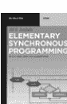
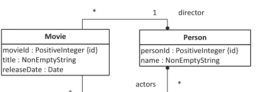
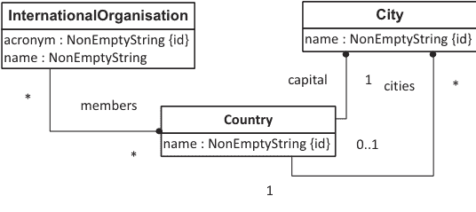
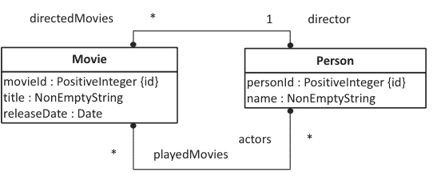
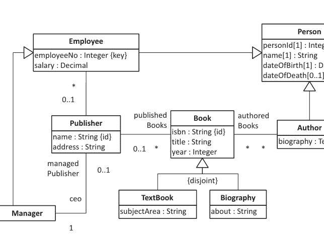
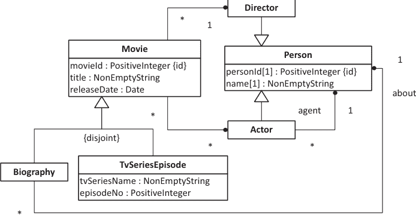

# Javascript 或 Java Web 开发 (De Gruyter 教科书) 2





# 作者

Gerd Wagner 教授、博士

BTU Cottbus-Senftenberg 大学

网络技术系

Konrad Wachsmann-Allee 5

03046 Cottbus

wagnerg@b-tu.de

Mircea Diacescu

dimircea@gmail.com

# 前言

这两卷书籍展示了如何使用基于模型的方法并实现 Web 应用，使用了 Web 开发中最相关的两个平台：JavaScript 和 Java。Web 应用通过 UML 图进行设计，并实现为：

- JavaScript 前端，使用两种本地存储技术之一；

- Java 后端，使用 Server Faces (JSF) 作为接口技术，Java Persistence API (JPA) 用于对象到存储的映射，以及 MySQL/MariaDB 数据库管理系统。

本书重点是关于完整性约束和数据验证的基本管理问题的通用概念和技术、枚举及枚举属性、对象类型之间的单向和双向关联，以及类层次中的子类型。此列表前两个问题在第 1 卷中讨论，后两个问题在第 2 卷中讨论。我们假设读者已经熟悉 HTML 和至少一种面向对象的编程语言，如 C++、Java、Python 或 C#。此外，我们假设读者对 JavaScript 有一定了解，并兴趣学习更多使用 JavaScript 或 Java 进行编程。本书可用于计算机科学、信息系统及相关专业的学生的 Web 开发课程；供 JavaScript 开发者学习 Java；供 Java 开发者学习 JavaScript；以及供 JavaScript 和 Java（以及 PHP/C#）开发者学习——如何使用原生 JavaScript 或 Java 实现基本管理概念并构建完整的应用程序。本书附有示例应用程序的完整源代码，您可以从我们的 Web 服务器运行或下载。

3.3 新问题 — 40

# 索引 — 183

我们在第一卷中讨论的三个示例应用程序——最小化应用、验证应用和枚举应用——都局限于仅管理一个对象类型的数据。然而，一个真实的应用程序必须管理多个对象类型的数据，这些类型通常以各种方式相互关联。特别是，对象类型之间可能存在关联和子类型（继承）关系。处理关联和子类型关系是软件应用工程中的高级问题。它们在教科书中往往没有得到充分讨论，也没有得到应用开发框架的良好支持。

关联是信息模型的重要元素。软件应用框架必须以适当的方式实现它们，特别是在模型-视图-控制器（MVC）架构的模型层中。遗憾的是，应用开发框架对处理关联的支持并不多。

有两个重要的区别，且它们是相互独立的：

- 1. 功能性关联与非功能性（“多对多”）关联。

- 2. 单向关联与双向关联。

功能性关联对应于数学中所谓的“函数”，而多对多关联对应于数学中所谓的“关系”。

单向关联对应于 OO 建模和编程中的引用属性，而双向关联则对应于一对互逆的引用属性。

为对象类型（或类）定义的属性，如果其值是指向另一个类型或同一种类型对象的引用，则被称为引用属性。例如，下面图 1.1 所示的委员会（Committee）有一个引用属性 `chair`，其值是到俱乐部成员（ClubMember）类型对象的引用。

对象类型之间的关联对类了这些类型中对象之间的关系。例如，`Committee-hasClubMember-as-chair` 关联（在图 1.2 所示的类图中被可视化为一条线）分类了 `FinanceCommittee-hasPeterMiller-as-chair`、`RecruitmentCommittee-hasSusanSmith-as-chair` 和 `AdvisoryCommittee-hasSarahAnderson-as-chair` 关系，其中对象 `PeterMiller`、`SusanSmith` 和 `SarahAnderson` 的类型为 `ClubMember`，而对象 `FinanceCommittee`、`RecruitmentCommittee` 和 `AdvisoryCommittee` 的类型为 `Committee`。关联作为关系的集合可以表示为如下表：

| Committee-hasClubMember-as-chair | |
| :--- | :--- |
| Finance Committee | Peter Miller |
| Recruitment Committee | Susan Smith |
| Advisory Committee | Sarah Anderson |

引用属性对应于关联的一种特殊形式，即二元。二元关联通常不需要从属性的域类（定义处）指向其范围类。通常，关联是参与其中的两个或多个对象类型的类型。为了简单起见，当我们指代二元关联时，本书直接说“关联”。

在数学中关联通过抽象的方式形式化为均匀元组集合，称为关系。在实体关系（ER）建模（信息系统和软件工程中的经典信息建模方法）中，对象被称为实体，关联被称为关系类型。统一建模语言（UML）包含了用于信息建模的类图。在 UML 中，对象类型被称为类，个体关系被称为“链接”。这些术语汇如如下表所示：

| 我们的首选术语 | UML | ER 图 | 数学 |
| :--- | :--- | :--- | :--- |
| object | object | entity | individual |
| object type (class) | class | entity type | unary relation |
| relationship | link | relationship | tuple |
| association (relationship type) | association | relationship type | relation |
| functional association | | 一对一、多对一或一对多 关系类型 | function |

# 1.1 引用和引用属性

某些语言（如 SQL 和 XML）只支持人类可读引用，不支持内部引用。在 SQL 中，人类可读引用被称为外键，它们引用的标识符被称为主键。在 XML 中，人类可读引用被称为 ID 引用，相应的属性类型为 IDREF。

OO 程序中的对象可以通过人类可读引用（例如整数代码）引用，也可以通过内部对象引用引用，后者对于访问主内存中的对象更高效。

## 1.1 引用与引用属性 — 5

在术语中，我们将人类可读的引用称为 ID 引用（ID references）。我们遵循 ID 引用属性的标准命名规范，即在类 A 中定义并引用类 B 对象的 ID 引用属性名为 `b_id`，使用后缀 `_id`。当我们以记录或行的形式存储持久化对象时，我们需要将存储在如 `publisher_id` 等属性中的内部对象转换为存储在如 `publisher_id` 等属性中的 ID 引用。这种转换是在对象序列化过程中进行的，通过将被引用对象的标准标识符值赋值给引用对象的 ID 引用属性来实现。

在面向对象的语言中，属性是为对象类型（或类）定义的，该类是它的域。属性的值可以是来自某些数据类型的数据值，在这种情况下该属性被称为属性（attribute），或者是指向某些类中对象的对象引用，在这种情况下该属性被称为引用属性（reference property）。例如，下面图 1.1 所示的 `Committee` 类有一个范围为 `String` 的属性 `name`，以及一个范围为 `ClubMember` 的引用属性 `chair`。

| Committee | ClubMember |
| :--- | :--- |
| name: String | |
| chair: ClubMember | |

图 1.1：一个委员会通过引用属性 `chair` 表达由一个俱乐部成员担任主席。

面向对象的编程语言（如 JavaScript、PHP、Java 和 C#）直接支持引用属性的概念，这种属性的值不是数据类型，而是引用类型（或类），其值是该类实例的对象引用。

默认情况下，属性的重数性（multiplicity）为 1，这意味着该属性是强制的且功能性的（换句话说，是单值的），恰好有一个值，例如图 1.1 所示的 `Committee` 类中的 `chair` 属性。功能性属性是可选的（非强制的），它的重数性为 0..1，这意味着该属性的最小基数为 0，最大基数为 1。

引用属性既可以是单值的（功能性的），也可以是多值的（非功能性的）。例如，图 1.1 所示的引用属性 `Committee::chair` 是单值的，因为它为一个俱乐部分配了一个唯一的俱乐部成员作为主席。图 1.11 所示的属性 `Book::authors` 是一个多值引用属性的示例。

通常，多值引用属性的集合值是引用的集合，这意味着引用的顺序并不重要。但在某些情况下，顺序是重要的，因此此类多值引用属性的集合值是引用的一个有序集合，通常通过列表（list）实现。

引用是我们应用程序数据库中的重要信息项。然而，只有当应用程序维护了它们的引用完整性时，它们才具有意义。这意味着对于任何引用，数据库中必须存在一个被引用的对象。因此，任何域为类 `C` 范围为类 `D` 的引用属性 `p` 都带有一个引用完整性约束，该约束在以下情况下必须检查：

1. 创建类型为 `C` 的新对象，

2. 修改某些类型为 `C` 的对象的 `p` 的值，

3. 销毁类型为 `D` 的对象。

引用完整性约束意味着两个变化依赖关系：

1. 对象创建依赖：带有另一个对象引用的对象只有在被引用对象创建后才能创建。

2. 对象销毁依赖：被另一个对象引用的对象只有在以下情况后才能销毁：

   1. 引用对象首先销毁（级 CASCADE 删除策略），或

   2. 引用对象中的引用被丢弃（DROP-REFERENCE 删除策略）或被另一个引用替换。

对于我们应用程序模型类中的每个引用属性，我们必须选择这两种属性删除策略中的一种适用。

在某些情况下，我们可能希望放宽这种严格规定，允许创建对 ID 引用属性具有非引用值的对象，但我们不考虑此类情况。

通常，对象创建依赖是在用户界面中管理的，通过不创建对 ID 引用属性具有非引用值的对象来实现（注：原文此处表述略有重复，意为通过界面逻辑管理）。

不支持将关联视为一等公民。它们没有用于定义关联的语言元素。因此，一个 OOP 类设计模型（我们称之为 OO 类模型）不得包含任何显式关联。

当我们以 UML 类图的形式创建信息模型时，我们通常会得到一个包含一个或多个关联的模型，这些关联的端点没有定义任何所有权，例如图 1.4 所示。当关联的末端都没有所有权点时（如本例所示），这意味着模型没有指定如何通过引用属性来表示（或实现）该关联。这种关联没有方向性。根据 UML 2.5 规范，此类关联的端点由关联自身“所有”，而不是由参与其中的任何一个类所所有。

| Committee | chairedCommittee | ClubMember |
|---|---|---|
| name : String | | 1..*n |

图 1.4：Committee 和 ClubMember 之间非方向性关联的模型。

一个包含没有关联所有权点的关联的信息设计模型作为关系型数据库设计模型是可以接受的，但作为 OO 语言的设计模型，它是是不完整的。

例如，图 1.4 中的模型提供了一个包含两个实体表（committees 和 clubmembers）以及一个独立的一一关系表（committee_clubmember_as_chair）的关系型数据库设计。它没有提供针对 Java 类的设计，因为它没有指定如何通过引用属性来实现该关联。

有三种方案可以将非方向性关联（不包含任何关联所有权点）的信息设计模型转换为所有关联均为单向或双向的信息设计模型：我们可以在关联的任一端点或两个端点上放置所有权点。这三个选项中的每一种都定义了通过引用属性表示或实现关联的不同方式。因此，对于上述图 1.4 所示的关联，我们有以下选项：

- 1. 在 chair 关联端放置所有权点，产生图 1.2 所示的模型，该模型可以转换为上述图 1.1 所示的 OO 类模型。

| Committee | ClubMember |
| :--- | :--- |
| name : String | 0..1 | 1 |

**图 1.5：** Committee 和 ClubMember 之间双向关联的建模。

因此，每当我们对关联进行建模时，都必须选择哪个端表示引用属性并因此标记所有权点。可以是其中一个，也可以是两者。这个决定也意味着对关联的可导航性做出决定。当关联表示引用属性时，这意味着它是可导航的（通过该属性）。

对于不是一一的功能性关联，最简单的设计是根据其功能定义关联的方向，将关联所有权点放置在多重性为 0..1 或 .. 的关联端点。对于非方向性的一一或多对多关联，我们可以根据意愿选择方向，即我们可以在关联的任一端点放置所有权点。

下方图 1.6 所示的模型（关于出版商和书籍）作为我们单向功能性关联的示例模型。注意它包含一个单向的多对一关联 Book-has-Publisher。

| Publisher | Book |
| :--- | :--- |
| name : String (id) | isbn : String (id) |
| address : String | title : String |
| 0..1 * | year : Integer |

**图 1.6：** 出版商-书籍信息设计模型，其中一个非功能性（多值）引用属性表示单向非功能关联。例如，单向的

我们可能还需要处理一个表示单向非功能关联的非功能性（多值）引用属性。例如，单向的

下方图 1.7 所示的 Book 和 Author 之间的多对多关联，建模了一个多值（非功能性）引用属性 authors。

| | Publisher |
| : --- | --- |
| | name : String (id) address : String |
| | Book |
| isbn : String (id) title : String year : Integer |
| | Author |
| personId : Integer (id) name : String |

> 图 1.7：具有两个单向关联的出版商-书籍-作者信息设计模型。

由于经典的 OOP 语言不支持将关联视为一等公民，仅支持类和表示单向关联的引用属性，我们必须从通用信息设计模型中消除所有显式关联以获取 OO 类模型。

### 1.7.1 基本消除程序

我们限制性关联消除程序的起点是一个包含各种单向关联的信息模型，例如上方图 1.6 所示的模型。如果模型仍然包含任何非方向性关联，我们必须通过对其端点的所有权做出决定将其转换为方向性关联，正如第 1.5 节所述。

连接源类与目标类的单向关联被源类中相应的引用属性替换，该属性具有：

- 1. 与关联端相同的名称（如果有），否则如果引用属性是多值的，则设置为目标类的名称（可能是复数）；

- 2. 以目标类作为其范围；

- 3. 与目标关联端相同的多重性；

- 4. 唯一性约束，因为单向关联是逆向函数的。

这种替换程序在图 1.8 的单向一一关联案例中所示，其中引用属性的唯一性约束通过 {key} 修饰符表示。

| Committee | ClubMember |
|---|---|---|
| name : String | 0..1 | 1 |
| Committee | ClubMember |
| --- | --- |
| name : String | chairedCommittee[0..1] : Committee {key} |

图 1.8：将功能性关联端点转换为引用属性。

对于单向一对多的关联情况，图 1.9 提供了关联消除程序的说明。在这里，目标类 Point 处的非功能性关联转换为相应的引用属性，其名称由目标类名称的复数形式获得。

| Polygon | Point |
| --- | --- |
| 1 3.* | x : Integer
| y : Integer |

图 1.9：将非功能关联端转换为多值引用属性。

### 1.7.2 从设计模型中消除关联

在我们的示例模型——*出版商-书籍-作者* 信息设计模型中，我们必须将两个单向关联都替换为适当的引用属性。第一步，我们将图 1.6 模型中的多对一关联 *Book-has-Publisher* 替换为 Book 类中的功能性引用属性 publisher，结果产生图 1.10 所示的 OO 类模型：

| --- | --- |
| isbn[1] : String (id) | name : String (id) |
| title[1] : String | address : String |
| year[1] : Integer | |
| publisher[0..1] : Publisher | |

图 1.10：用于出版商和书籍的 OO 类模型。

## 1.7 消除单向关联

注意，由于“图书包含出版社”（Book-has-Publisher）关联的目标端多重性为 0..1，我们必须通过将其多重性定义为 0..1 将新属性 `publisher` 声明为可选。

此 OO 类模型及其引用属性 `publisher` 的含义可以通过下表所示的 `Book` 和 `Publisher` 类的示例数据填充来说明：

| 出版社 | 地址 |
| --- | --- |
| Bantam Books | New York, USA |


| Basic Books | New York, USA |

| 图 | 标题 | 年份 | 出版社 |

| --- | --- | --- | --- |

| 0553345842 | The Mind's I | 1982 | Bantam Books |

| 1463794762 | The Critique of Pure Reason | 2011 | |

| 1928565379 | The Critique of Practical Reason | 2009 | |

| 0465030793 | I Am A Strange Loop | 2000 | Basic Books |

注意 `Book` 表中“Publisher”列的值是唯一名称，引用了 `Publisher` 表中的某行。由于对应的引用属性 `publisher` 是可选的，某些行的“Publisher”列可能没有值。

在第二步中，我们将图 1.7 模型中的多对多关联“图书包含作者”（Book-has-Author）替换为 `Book` 类中的多值引用属性 `authors`，从而得到了如图 1.11 所示的 OO 类模型。

| Book | Publisher | |

| --- | --- | --- |

| isbn[1] : String (id) | name : String (id) |

| title[1] : String | address : String |

| year[1] : Integer | |

| publisher[0..1] : Publisher | |

| authors[*] : Author | |

| | personid : integer (id) |

| | name : String |

图 1.11：一个针对 `Book`、`Publisher` 和 `Author` 类的 OO 类模型。

此 OO 类模型及其引用属性 `Book::publisher` 和 `Book::authors` 的含义可以通过三个模型类的示例数据填充来说明：

| 名称 | 地址 |

| --- | --- |

| Bantam Books | New York, USA |

| Basic Books | New York, USA |

| ISBN | 标题 | 年份 | 作者 | 出版社 |

| --- | --- | --- | --- | --- |

| 0553345842 | The Mind's I | 1982 | 1, 2 | Bantam Books |

| 1463974762 | The Critique of Pure Reason | 2011 | 3 | |

| 1928565379 | The Critique of Practical Reason | 2009 | 3 | |

| 0465030793 | I Am A Strange Loop | 2000 | 2 | Basic Books |

| 作者 ID | 姓名 |

| --- | --- |

| 1 | Daniel Dennett |

| 2 | Douglas Hofstadter |

| 3 | Immanuel Kant |

在完成平台无关的 OO 类模型后，可以从其推导出针对特定实现平台的一个或多个特定平台实现模型。特定平台实现模型的类型包括 JS 类模型、Java 实体类模型和 SQL 表模型。

特定平台的实现模型仍然可以用 UML 类图的形式表示，但它只包含可以在所选平台中直接编码的建模元素。因此，对于任何考虑的平台，都需要两个准则：1) 如何制作特定平台的实现模型，2) 如何对该模型进行编码。

用于数据输入输出的用户界面（UI）的小部件通常对应于模型类中定义的属性。我们必须区分对应于属性的输入字段和对应于枚举属性或引用属性的选择部件（如选择列表）。在 UI 中使用选择控件而不是输入字段来表示引用属性，可以防止用户输入无效 ID，从而确保引用完整性。通常情况下，无论进行何种选择，单值引用属性可以在 UI 中渲染为单选列表。如果引用属性的范围足够小（例如小于 7），可以使用单选框组（radio button group）。多值引用属性可以在 UI 中渲染为多选列表。然而，当选项很多（例如超过 20 个）时，对应的 HTML 多选控件因为渲染方式太分散而不适用。对于 UI 中具有少量关联对象的通用情况（例如少于 7 个选项），我们需要开发一种特殊的 UI 小部件，允许从列表中添加（移除）对象。

这种多选小部件由：

1. 一个包含（关联）对象的 HTML 列表，每个列表项都有一个用于移除对象的按钮；

2. 一个单选控件，配合一个按钮，允许从列表中添加（移除）对象。

默认情况下，非功能关联将目标类的实例集与源类关联。然而，也存在对应的引用属性无序的情况。

在以下示例中，关联端不是有序的，而集合类型是包（bag），这对应于多值属性。

| 出版社 | 图书 | 作者 |

| --- | --- | --- |

| isbn[1] : String (id) | name : String (id) | |

| title[1] : String | address : String | |

| year[1] : Integer | | |

| publisher[0..1] : Publisher | | |

| authors[*] : Author | | |

注意 `Book` 表中“Publisher”列的值是唯一名称，引用了 `Publisher` 表中的某行。由于对应的引用属性 `publisher` 是可选的，某些行的“Publisher”列可能没有值。

在第二步中，我们将图 1.7 模型中的多对多关联“图书包含作者”替换为 `Book` 类中的多值引用属性 `authors`，得到了如图 1.11 所示的 OO 类模型。

多值属性的两种重要集合类型是集合（sets）和序列（sequences），而多值属性，使用列表（如 JS 数组或 Java List）作为多值属性是非常常见的。

在以下示例中，关联端不是有序的，而集合类型是包（bag）。如果是有序的，则关联端标记为 `{ordered}`。

这种多选小部件由：

1. 一个包含（关联）对象的 HTML 列表，每个列表项都有一个用于移除对象的按钮；

2. 一个单选控件，配合一个按钮，允许从列表中添加（移除）对象。

如果你想查找以下测题的答案，可以查看我们的论坛。如果你在论坛中没有找到答案，可以创建一个帖子来提问特定问题。

### 1.10.1 题 1：“一对一”的含义

说关联是“一对一”意味着什么？

这意味着它是（单选）：

- 双向的

- 具有功能性的且总的

- 功能性的

- 同时具有功能性和反向的

### 1.10.2 题 2：何时检查引用完整性

对于域类 C 和范围类 D 的引用属性 `p`，每当发生以下情况时都必须检查（单选或多选）：

- 类型 C 的对象被销毁。

- 某些 C 类型对象的 `p` 值被更改。

- 创建了新的 C 类型对象。

- 类型 D 的对象被销毁。

- 创建了新的 D 类型对象。

### 1.10.3 题 3：“功能性”的含义

单向关联是功能性的当且仅当（单选）：

- 源类的每个对象最多关联到一个目标类对象。

- 目标类的每个对象至少关联到一个源类对象。

- 源类的每个对象恰好关联到一个目标类对象。

- 源类的每个对象恰好关联到一个目标类对象。（注：原文选项重复）

### 1.10.4 题 4：对象销毁依赖

假设我们有一个具有标准标识属性 `id` 的对象类型 B，以及一个具有 ID 引用属性 `b_id`（引用 `B::id`）的对象类型 A。进一步，假设有一个 `b.id = 11` 的 B 类型对象 `b` 以及一个引用 `b` 的 A 类型对象 `a.b_id = 11`。以下哪些陈述是正确的？单选或多选：

- 当对象 a 中的 ID 引用被取消赋值（在 JS 中设置为 `undefined` 或在 Java 中设置为 `null`）且没有其他对象引用 b 时，对象 b 可以被销毁。

- 只有在 b 被销毁之前，对象 a 才能被销毁。

3. 当对象 a 中的 ID 引用重置为另一个类型为 B 的对象时（例如通过设置 `a.b_id = 7` 且没有其他对象引用 b），对象 b 可能会被销毁。

4. 当 a 之前已经被销毁时，对象 b 可能会被销毁。

关于单值引用属性 p 以及它如何通过合适的表单控件在 Web 用户界面中进行渲染，以下哪些陈述是正确的？请选择一个或多个：

- 1. 使用 `type="text"` 的输入控件可以获得适当的渲染。

- 2. 如果 p 范围的基数不大于 7，请检查复选框组。

- 3. 如果 p 范围的基数不大于 7，可以使用单选按钮组进行渲染。

- 4. 它始终可以使用单选择控件进行渲染。

哪种形式为“x-to-y”（x,y 表示“一个”或“多个”）的术语可以用来表示关联既不是函数性的也不是反向函数的？

答案：______________________

单向功能关联要么是一对一，要么是多对一。在这两种情况下，这种关联都通过单值引用属性来表示（或实现）。

在本章中，我们将展示：

- 1. 如何从具有表示单向功能关联的单值引用属性的 OO 类模型推导出原生 JS 类，

- 2. 如何以原生 JavaScript 模型类的形式对 JS 类模型进行编码，

- 3. 如何基于模型代码编写视图和控制器代码。

在展示如何推导出原生 JS 类模型并用 JavaScript 对其编码之前，我们首先介绍 JavaScript 语言的几个新元素，这些元素将贯穿于本书讨论的 JavaScript 代码中。

在本节中，我们介绍了由 ECMAScript 2015+（即 2015+16+17+18+19+20+……）引入 JavaScript 的重要新语言元素。

### 2.1.1 使用 let 和 const 进行块级变量声明

ES5 不允许声明作用域由大括号对 { } 分隔或由 for 循环定义的块的变量。相反，所有用 `var` 声明的变量即使在块内部声明，也具有函数作用域或全局作用域。使用 `let` 和 `const` 进行块级变量声明的新功能允许局部变量具有更细粒度的作用域，这有助于避免意外的重复并使代码更具模块化。

`let` 和 `const` 之间只有一个意义上的区别。用 `const` 声明的变量是冻结的或不可变的，从这个意义上说是常量，而 `let` 变量不是。对于所有不应改变值的变量，最好使用 `const`。否则，或者如果不明确，如果是块级变量，则应该用 `let` 声明，如果是全局或函数作用域变量，则用 `var` 声明。

## 示例 2.1.

```
let evens = [0,2,4,6,8];
 odds = evens.map(v => v+1); // [1,3,5,7,9]
// 代替 evens.map(function (v) { return v+1; })
```

```
this.nums = [1,3,5,8,10,12,15,17];
this.fives = [];
this.nums.forEach(v => { if (v % 5 === 0) this.fives.push(v); });
// 代替 this.nums.forEach(
 function (v) { if (v % 5 === 0) this.fives.push(v); }, this
```

迭代对象包括字符串、数组、类数组（例如内置参数或 HTMLCollection 实例），以及 TypedArray、Map 和 Set 类型的实例，并允许自定义迭代器。例如：

```
const divElems = document.getElementsByTagName("div");
// HTMLCollection 是可迭代的
for (let dEl of divElems) {
console.log(dEl.id);
}
```

当不需要计数器时，*for-of* 循环比 *for* 循环更方便。与 *forEach* 循环相比，*for-of* 循环允许遍历 HTMLCollections 并可以使用 `break` 退出。

... 由反引号（如 `...`）包裹，而不是双引号或单引号，并允许由固定文本和变量组合生成（可能的多行）字符串值。例如：

```
const classValues = "important";
const name = "Joker";
const htmlTemplate = `<div class="${classValues}">
<p>Hello ${name}!</p>
</div>
```

... 允许在期望参数的地方展开（1）迭代对象的元素，或者（2）将对象的属性展开到另一个对象。例如：

```javascript
const list = [1, 2, 3];
const combined = [...list, 4, 5];
```

使用解构可以将记录字段提取到普通变量中。例如：

```javascript
const person = { first: "James", last: "Bond" };
const { first, last } = person;
```

解构用于函数参数以简化代码。例如：

```javascript
function displayName({first, last}) {
    console.log(first + " " + last);
}
displayName({first: "James", last: "Bond"});
```

当函数需要返回多个值时，它可以返回一个对象，调用者可以使用：

```javascript
function getRectangle() {
  return { width: 50, height: 20 };
}
const { width, height } = getRectangle();
```

展开运算符提供了一种无需临时变量即可交换变量的简洁方法：

```javascript
let a = 1;
let b = 2;
[a, b] = [b, a];
```

展开运算符可以创建数组的浅拷贝：

```javascript
const list = ['red', 'orange', 'yellow'];
const clone = [...list];
```

单向功能关联要么一对一，要么是多对一。在这两种情况下，这种关联都通过单值引用属性来表示（或实现）。

在本章中，我们将展示：

- 1. 如何从具有表示单向功能关联的单值引用属性的 OO 类模型推导出原生 JS 类，

- 2. 如何以原生 JavaScript 模型类的形式对 JS 类模型进行编码，

- 3. 如何基于模型代码编写视图和控制器代码。

展示如何推导出原生 JS 类模型并用 JavaScript 对其编码之前，我们首先介绍 JavaScript 语言的几个新元素，这些元素将贯穿于本书讨论的 JavaScript 代码中。

单值引用属性（例如 `Book` 对象的 `publisher` 属性）允许存储对另一种类型（如 `Publisher`）对象的内部引用。构造函数需要一个参数，以便为引用属性分配合适的值。在 Java 等强类型语言中，我们必须决定此值是期望（内部）对象引用还是（外部）ID 引用。但在 JavaScript 中，我们可以采取更灵活的方法，允许使用其中任何一种，如下所示：

```javascript
class Book {
  constructor ({isbn, title, year,
    publisher, publisher_id}) {
    ...
  }
}
```

在编写类时，ES2015 的参数解构功能允许使用单个构造参数，该参数是一个具有简化定义语法的记录。我们通过以下示例使用了这一特性：

```javascript
class Book {
    constructor({isbn, title, year}) {
    this.isbn = isbn;
    ...
    }
```

注意，记录参数的 `publisher` 字段代表 JS 对象引用，而其 `publisher_id` 字段代表 ID 引用。在 JavaScript 中，我们可以使用类似 `expr1 || expr2` 的逻辑或表达式来获取第一个表达式的值（如果它已定义且不为 0），否则获取第二个表达式的值。我们在属性设置器中通过检查参数的类型来处理产生的歧义：

```javascript
set publisher(p) {
  var publisher_id = "";
  // p 可以是 ID 引用或对象引用
  publisher_id = (typeof p!="object") ? p : p.name;
  ...
  this._publisher = Publisher.instances[publisher_id];
}
```

注意，出版者（publisher）的名字被用作 ID ，因为它是 `Publisher` 类的标准 ID。

## 2.3 构建 JS 类模型

构建 JS 类模型的起点是一个类似于图 1.10 所示的 OO 类模型。

我们展示了如何通过四个步骤从该 OO 类模型推导出 JS 类模型。对于 OO 类中的每个类：

- 1. 为所有（非派生的）单值属性添加 `get/set` 刻型（stereotype），这意意味着它们具有隐式的 getter 和 setter。记住，在 setter 中，会调用相应的检查操作，只有当检查没有检测到违反约束时，才会设置属性。

- 2. 为每个（非派生的）属性 创建一个 *check*（检查）操作，以便为实现**属性约束**提供一个集中的位置。对于一个标准的 ID 属性（如 `Book::isbn`），需要两个或三个检查操作：

    1. 一个基础检查操作，如 `checkIsbn`，用于检查语法约束，但不检查*必填值*和*唯一性*约束。

    2. 一个标准的 ID 检查操作，如 `checkIsbnAsId`，用于检查标准 ID 属性隐含的**必填值和唯一性约束**。


## 2.4 新问题

与 1 相比，我们必须处理：

- 1. 在模型中我们需要关注的：
    1. 维护引用完整性；
    2. 选择一种删除策略；
    3. 记录合适的错误消息。
- 2. 在用户界面中我们需要处理的：
    1. 显示关于……的信息；
    2. 从……中选择对象；
    3. 将其添加到集合的用例。

构建 JS 类模型的起点是一个类似于图 1.10 所示的 OO 类模型。

我们展示了如何通过四个步骤从该 OO 类模型推导出 JS 类模型。对于 OO 类中的每个类：

- 1. 为所有（非派生的）单值属性添加 `get/set` 刻型，这意意味着它们具有隐式的 getter 和 setter。记住，在 setter 中，会调用相应的检查操作，只有当检查没有检测到违反约束时，才会设置属性。
- 2. 为每个（非派生的）属性创建一个 *check*（检查）操作，以便为实现**属性约束**提供一个集中的位置。对于一个标准的 ID 属性（如 `Book::isbn`），需要两个或三个检查操作：
    1. 一个基础检查操作，如 `checkIsbn`，用于检查语法约束，但不检查*必填值*和*唯一性*约束。
    2. 一个标准的 ID 检查操作，如 `checkIsbnAsId`，用于检查标准 ID 属性隐含的**必填值和唯一性约束**。
    3. 如果其他类有一个引用所考虑类的属性，添加一个 ID 引用检查操作，用于检查施加在 ID 引用（或外键）属性上的引用完整性约束。例如，由于 `Book::publisher` 属性引用 Publisher 对象，我们需要在 Publisher 类中一个 `checkNameAsIdRef` 操作。
- 3. 对于引用属性（如 `Book::publisher`），检查操作 `Book.checkNameAsIdRef` 必须通过调用 Publisher 来检查隐含的引用完整性约束，如果该属性是必填的，可能还要检查必填约束。
- 4. 为 `toString()` 添加一个对象序列化函数，用于在错误消息和日志中显示对象的状态。
- 5. 为 `toRecord()` 添加一个对象到存储的转换函数，将模型对象准备好存储为实体表中的行，该行可以通过 `JSON.stringify` 序列化为 JSON 字符串，从而存储为应用 `localStorage` 数据存储的值。

这得出了 Book 的如下 JS 类模型，其中类级（“静态”）方法带有下划线：

| Book | Book |
| :--- | :--- |
| isbn[1]: String (id) | «get/set» isbn[1]: string (id) |
| title[1]: String | «get/set» title[1]: string |
| year[1]: integer | «get/set» year[1]: number(int) |
| publisher[0..]: Publisher | «get/set» publisher[0..]: Publisher |
| | checkIsbn(isbn: string): ConstraintViolation |
| | checkIsbnAsId(isbn: string): ConstraintViolation |
| | checkIsbnAsRefl(isbn: string): ConstraintViolation |
| | checkTitle(title: string): ConstraintViolation |
| | checkYearIn(year: number(int)): ConstraintViolation |
| | checkPublisher(p: Publisher): ConstraintViolation |
| | toString(): String |
| | toRecord(): Object |

我们必须对 Publisher 类执行类似的转换。这为我们提供了从上述 OO 类模型派出的完整 JS 类模型，如图 2.1 所示。

| Book |
| :--- |
| «get/set» isbn[1]: string (id) |
| «get/set» title[1]: string |
| «get/set» year[1]: number(int) |
| «get/set» publisher[0..]: Publisher |
| checkIsbn(isbn: string): ConstraintViolation |
| checkIsbnAsId(isbn: string): ConstraintViolation |
| checkIsbnAsRefl(isbn: string): ConstraintViolation |
| checkTitle(title: string): ConstraintViolation |
| checkYearIn(year: number(int)): ConstraintViolation |
| checkPublisher(p: Publisher): ConstraintViolation |
| toString(): String |
| toRecord(): Object |

| Publisher |
| :--- |
| «get/set» name: string (id) |
| «get/set» address: string |
| checkName(n: string): ConstraintViolation |
| checkNameAsId(n: string): ConstraintViolation |
| checkNameAsIdl(n: string): ConstraintViolation |
| checkAddress(a: string): ConstraintViolation |
| toString(): String |
| toRecord(): Object |

图 2.1：定义类 Book 和 Publisher 的类模型。

## 2.5.1 总结

构建 JS 类模型的起点是一个类似于图 1.10 所示的 OO 类模型。

我们展示了如何通过四个步骤从该 OO 类模型推导出 JS 类模型。对于 OO 类中的每个类：

- 1. 为所有（非派生的）单值属性添加 `get/set` 刻型，这意意味着它们具有隐式的 getter 和 setter。记住，在 setter 中，会调用相应的检查操作，只有当检查没有检测到违反约束时，才会设置属性。
- 2. 为每个（非派生的）属性创建一个 *check*（检查）操作，以便为实现**属性约束**提供一个集中的位置。对于一个标准的 ID 属性（如 `Book::isbn`），需要两个或三个检查操作：
    1. 一个基础检查操作，如 `checkIsbn`，用于检查语法约束，但不检查*必填值*和*唯一性*约束。
    2. 一个标准的 ID 检查操作，如 `checkIsbnAsId`，用于检查标准 ID 属性隐含的**必填值和唯一性约束**。
    3. 如果其他类有一个引用所考虑类的属性，添加一个 ID 引用检查操作，用于检查施加在 ID 引用（或外键）属性上的引用完整性约束。例如，由于 `Book::publisher` 属性引用 Publisher 对象，我们需要在 Publisher 类中一个 `checkNameAsIdRef` 操作。
- 3. 对于引用属性（如 `Book::publisher`），检查操作 `Book.checkNameAsIdRef` 必须通过调用 Publisher 来检查隐含的引用完整性约束，如果该属性是必填的，可能还要检查必填约束。
- 4. 为 `toString()` 添加一个对象序列化函数，用于在错误消息和日志中显示对象的状态。
- 5. 为 `toRecord()` 添加一个对象到存储的转换函数，将模型对象准备好存储为实体表中的行，该行可以通过 `JSON.stringify` 序列化为 JSON 字符串，从而存储为应用 `localStorage` 数据存储的值。

这得出了 Book 的如下 JS 类模型，其中类级（“静态”）方法带有下划线：

| Book | Book |
| :--- | :--- |
| isbn[1]: String (id) | «get/set» isbn[1]: string (id) |
| title[1]: String | «get/set» title[1]: string |
| year[1]: integer | «get/set» year[1]: number(int) |
| publisher[0..]: Publisher | «get/set» publisher[0..]: Publisher |
| | checkIsbn(isbn: string): ConstraintViolation |
| | checkIsbnAsId(isbn: string): ConstraintViolation |
| | checkIsbnAsRefl(isbn: string): ConstraintViolation |
| | checkTitle(title: string): ConstraintViolation |
| | checkYearIn(year: number(int)): ConstraintViolation |
| | checkPublisher(p: Publisher): ConstraintViolation |
| | toString(): String |
| | toRecord(): Object |

我们必须对 Publisher 类执行类似的转换。这为我们提供了从上述 OO 类模型派出的完整 JS 类模型，如图 2.1 所示。

| Book |
| :--- |
| «get/set» isbn[1]: string (id) |
| «get/set» title[1]: string |
| «get/set» year[1]: number(int) |
| «get/set» publisher[0..]: Publisher |
| checkIsbn(isbn: string): ConstraintViolation |
| checkIsbnAsId(isbn: string): ConstraintViolation |
| checkIsbnAsRefl(isbn: string): ConstraintViolation |
| checkTitle(title: string): ConstraintViolation |
| checkYearIn(year: number(int)): ConstraintViolation |
| checkPublisher(p: Publisher): ConstraintViolation |
| toString(): String |
| toRecord(): Object |

| Publisher |
| :--- |
| «get/set» name: string (id) |
| «get/set» address: string |
| checkName(n: string): ConstraintViolation |
| checkNameAsId(n: string): ConstraintViolation |
| checkNameAsIdl(n: string): ConstraintViolation |
| checkAddress(a: string): ConstraintViolation |
| toString(): String |
| toRecord(): Object |

图 2.1：定义类 Book 和 Publisher 的类模型。

## 2.5.2 编写每个类

构建 JS 类模型的起点是一个类似于图 1.10 所示的 OO 类模型。

我们展示了如何通过四个步骤从该 OO 类模型推导出 JS 类模型。对于 OO 类中的每个类：

- 1. 为所有（非派生的）单值属性添加 `get/set` 刻型，这意意味着它们具有隐式的 getter 和 setter。记住，在 setter 中，会调用相应的检查操作，只有当检查没有检测到违反约束时，才会设置属性。
- 2. 为每个（非派生的）属性创建一个 *check*（检查）操作，以便为实现**属性约束**提供一个集中的位置。对于一个标准的 ID 属性（如 `Book::isbn`），需要两个或三个检查操作：
    1. 一个基础检查操作，如 `checkIsbn`，用于检查语法约束，但不检查*必填值*和*唯一性*约束。
    2. 一个标准的 ID 检查操作，如 `checkIsbnAsId`，用于检查标准 ID 属性隐含的**必填值和唯一性约束**。
    3. 如果其他类有一个引用所考虑类的属性，添加一个 ID 引用检查操作，用于检查施加在 ID 引用（或外键）属性上的引用完整性约束。例如，由于 `Book::publisher` 属性引用 Publisher 对象，我们需要在 Publisher 类中一个 `checkNameAsIdRef` 操作。


3. 对于引用属性（如`Book::publisher`），检查操作`Book.checkNameAsIdRef`必须通过调用`Publisher`来检查隐含的引用完整性约束，如果该属性是必填的，可能还要检查必填约束。

4. 为`toString()`添加一个对象序列化函数，用于在错误消息和日志中显示对象的状态。

5. 为`toRecord()`添加一个对象到存储的转换函数，将模型对象准备好存储为实体表中的行，该行可以通过`JSON.stringify`序列化为 JSON 字符串，从而存储为应用`localStorage`数据存储的值。

这得出了`Book`的如下 JS 类模型，其中类级（“静态”）方法带有下划线：

| Book | Book |
| :--- | :--- |
| isbn[1]: String (id) | «get/set» isbn[1]: string (id) |
| title[1]: String | «get/set» title[1]: string |
| year[1]: integer | «get/set» year[1]: number(int) |
| publisher[0..]: Publisher | «get/set» publisher[0..]: Publisher |
| | checkIsbn(isbn: string): ConstraintViolation |
| | checkIsbnAsId(isbn: string): ConstraintViolation |
| | checkIsbnAsRefl(isbn: string): ConstraintViolation |
| | checkTitle(title: string): ConstraintViolation |
| | checkYearIn(year: number(int)): ConstraintViolation |
| | checkPublisher(p: Publisher): ConstraintViolation |
| | toString(): String |
| | toRecord(): Object |

我们必须对`Publisher`类执行类似的转换。这为我们提供了从上述 OO 类模型派出的完整 JS 类模型，如图 2.1 所示。

| Book |
| :--- |
| «get/set» isbn[1]: string (id) |
| «get/set» title[1]: string |
| «get/set» year[1]: number(int) |
| «get/set» publisher[0..]: Publisher |
| checkIsbn(isbn: string): ConstraintViolation |
| checkIsbnAsId(isbn: string): ConstraintViolation |
| checkIsbnAsRefl(isbn: string): ConstraintViolation |
| checkTitle(title: string): ConstraintViolation |
| checkYearIn(year: number(int)): ConstraintViolation |
| checkPublisher(p: Publisher): ConstraintViolation |
| toString(): String |
| toRecord(): Object |

| Publisher |
| :--- |
| «get/set» name: string (id) |
| «get/set» address: string |
| checkName(n: string): ConstraintViolation |
| checkNameAsId(n: string): ConstraintViolation |
| checkNameAsIdl(n: string): ConstraintViolation |
| checkAddress(a: string): ConstraintViolation |
| toString(): String |
| toRecord(): Object |

## 2.5.3 编写属性检查

确保 JS 类模型中指定的所有属性约束都在其检查函数中正确实现，正如卷 1 第 8 章所解释。记住，约束违反（或验证错误）类定义在`lib/errorTypes.js`文件中。

例如，对于`Publisher.checkName`函数我们得到以下代码：

```javascript
class Publisher {
  ..
  static checkName(n) {
    if (n === undefined) {
      return new NoConstraintViolation(); // 非必填
    } else {
      if (typeof n !== "string" || n.trim() === "") {
        return new RangeConstraintViolation(
          "The name must be a non-empty string!"
        );
      } else {
        return new NoConstraintViolation();
      }
    }
  }
  static checkNameAsId(n) { . . }
..}
```

## 2.5 编码模型

请注意，由于`name`属性是`Publisher`的标准 ID 属性，我们只在`checkName`中检查语法约束，并在`checkNameAsId`中检查强制性值和唯一性约束，后者会调用`checkName`：

```javascript
static checkNameAsId(n) {
    var validationResult = Publisher.checkName(n);
    if ((validationResult instanceof NoConstraintViolation) {
        if (n === undefined) {
            return new MandatoryValueConstraintViolation(
                "A publisher name is required!"
            );
        } else if (Publisher.instances[n]) {
            validationResult = new UniquenessConstraintViolation(
                "There is already a publisher record with this name!"
            );
        } else {
            validationResult = new NoConstraintViolation();
        }
    }
}
```

如果我们需要在其他类中处理 ID 引用（外键），我们需要提供一个名为`checkNameAsIdRef`的进一步检查来检查引用完整性约束：

```javascript
static checkNameAsIdRef(n) {
    var validationResult = Publisher.checkName(n);
    if ((validationResult instanceof NoConstraintViolation) &&
        n !== undefined) {
        if (!Publisher.instances[n]) {
            validationResult = new ReferentialIntegrityConstraintViolation(
                "There is no publisher record with this name!"
            );
        }
    }
    return validationResult;
}
```

条件`!Publisher.instances[n]`检查是否存在具有给定名称`n`的 publisher 对象，然后创建一个作为异常类`ReferentialIntegrityConstraintViolation`实例`validationResult`对象。`Book.checkNameAsIdRef`由`Book.checkPublisher`函数调用：

## 3. 使用原生 JS 实现单向功能关联

```javascript
class Book {
  ..
  static checkPublisher(publisher_id) {
    var validationResult = null;
    if (publisher_id === undefined || publisher_id === "") {
      validationResult = new NoConstraintViolation(); // 可选
    } else {
      // 调用外键约束检查
      validationResult = Publisher.checkNameAsIdRef(publisher_id);
    }
    return validationResult;
  }
  ..
}
```

### 2.5.4 编码属性 setter 方法

在 setter 中，会调用相应的检查函数并仅设置属性。对于引用属性，我们允许使用对象引用或 ID 引用调用 setter。结果产生的歧义通过测试调用 setter 时提供的参数是否为对象来解决。例如，publisher 的 setter 编码方式如下：

```javascript
class Book {
  ..
  set publisher(p) {
    if (!p) // 取消 publisher
      delete this._publisher;
    } else {
      // p 可以是 ID 引用或对象引用
      const publisher_id = (typeof p=="object") ? p : p.name;
      const validationResult = Book.checkPublisher(publisher_id);
      if (validationResult instanceof NoConstraintViolation) {
        // 创建新的 publisher 引用
        this._publisher = Publisher.instances[publisher_id];
      } else {
        throw validationResult;
      }
    }
  }
}
```

### 2.5.5 选择并实现删除策略

对于任何引用属性，我们必须在第 1.2 节中讨论的两种可能的删除策略中选择并实现一种，用于属性范围类的`destroy`方法中管理对应的对象销毁依赖。在我们的情况下，当删除 publisher 记录时，我们必须在两者之间进行选择：

1. 删除由删除 publisher 出版籍记录（存在依赖性）；

2. 从所有由删除 publisher 出版籍中删除对该删除 publisher 的引用（存在独立性）。

假设书籍本质上并不依赖其出版社，我们选择第二种方案。这在以下`Publisher.destroy`方法的代码所示，对于所有相关的书籍对象，属性`book.publisher`都被清空了：

```javascript
Publisher.destroy = function (name) {
    const publisher = Publisher.instances[name];
    // 删除书籍对象中对此 publisher的所有引用
    for (let key of Object.keys(Book.instances)) {
        const book = Book.instances[key];
        if (book.publisher === publisher) {
            delete book.publisher; // 删除槽位
            console.log("Book " + book.isbn + " updated.");
        }
    }
    // 删除 publisher 记录
    delete Publisher.instances[name];
    console.log("Publisher " + name + " deleted.");
};
```

注意，对已删除 publisher 所有引用的删除是通过顺序扫描完成的，当有很多书籍时，这种方法效率较低。如果每个 publisher 对象持有一个其出版书籍的列表，将使书籍与出版社之间的关联更加高效。

## 2.6 编码视图和控制器

用户界面（UI）由一个首页`index.html`组成，允许导航到每个对象类型的数据管理页面（在我们的示例中为 books.html 和 publishers.html）。每个数据管理页面包含两个部分：管理部分（如管理书籍，带有选择 CRUD 用例的菜单），以及每个 CRUD 用例的部分（如列表书籍、创建书籍、更新书籍和删除书籍），确保每次只显示一个（例如通过对其他设置 CSS 属性 display:none）。

### 2.6.1 初始化应用

在初始化管理用例时，必须从持久化存储加载所需的数据（例如所有的出版社和书籍记录）。这在控制器程序中完成，如`c/books.js`中的`pl.c.books.manage.initialize`：

```javascript
pl.c.books.manage = {
  initialize: function () {
    Publisher.retrieveAll();
    Book.retrieveAll();
    pl.v.books.manage.setUpUserInterface();
  }
};
```

管理书籍数据的`initialize`方法首先加载出版社表和书籍表，因为书籍数据管理 UI 需要显示它们的数据。然后通过调用`setUpUserInterface`渲染书籍数据管理菜单。

### 2.6.2 在列表中显示关联对象

对于引用属性，如`Book::publisher`，序列化函数`toString()`必须显示引用对象的可读标识符，如`this.publisher.name`：

```javascript
toString() {
  var bookStr = `Book: ISBN: ${this.isbn}, title: ${this.title}, year: ${this.year}`;
  if (this.publisher) bookStr += `, publisher: ${this.publisher.name}`;
  return bookStr;
}
```

对象到存储的转换函数`toRecord()`将带有对象引用的类型对象转换为带有 ID 引用的非类型记录对象：

```javascript
toRecord() {
  var rec = {};
  for (let p of Object.keys(this)) {
    // 只复制带有下划线前缀的属性
    if (p.charAt(0) == "_") {
      switch (p) {
        case "_publisher":
          // 将对象引用转换为 ID 
          if (this._publisher) rec.publisher_id = this._publisher.name;
          break;
        default:
          // 去下划线前缀
          rec[p.substr(1)] = this[p];
      }
    }
  }
  return rec;
}
```

从带有 ID 引用的非类型对象到带有引用对象的类型对象的反转换由`Book`构造函数执行，它接受 ID 和对象引用作为设置引用属性的参数。

# 34 使用原生 JS 实现 RetrieveList 功能关联


```javascript
pl.v.books.retrieveAndAll = {
  setupUserInterface: function () {
    const tableBodyEl = document.querySelector(
      "#Book-R>table tbody");
    tableBodyEl.innerHTML = ""; // 丢弃旧内容
    for (let key of Object.keys(Book.instances)) {
      const book = Book.instances[key];
      const row = tableBodyEl.insertRow(-1);
      row.insertCell(-1).textContent = book.isbn;
      row.insertCell(-1).textContent = book.title;
      row.insertCell(-1).textContent = book.year;
      // 如果有出版者，显示其名称
      row.insertCell(-1).textContent =
        book.publisher ? book.name : "";
    }
  }
  document.getElementById("Book-M").style.display = "none";
  document.getElementById("Book-R").style.display = "block";
};
```

对于多值属性，表格单元格必须填充关联对象的列表。

## 2.6.3 创建和更新用例中的选择对象

为了在创建和更新用例中允许与当前编辑的对象关联对象，HTML 选择列表（即 `select` 元素）通过 `fillWithOptions` 工具方法使用关联对象的实例进行填充。HTML 元素定义在 `books.html` 文件中：

```html
<section id="Book-C" class="UI-Page">
<h1>图书馆：创建新书籍记录</h1>
<form>
  ...
  <div class="select-one">
    <label>出版者: <select name="selectPublisher"></select></label>
  </div>
  ...
</form>
</section>
```

## 2.6 视图与控制器

创建用户界面设置如下：

```javascript
pl.v.books.create = {

  setupInterface: function () {

    const formEl = document.querySelector("section#Book-C > form"),

    selectPublisher = formEl.selectPublisher,

    saveButton = formEl.querySelector("button[type='submit']");

    // 添加响应式验证事件监听器

    formEl.isbn.addEventListener("input", function () {

      formEl.isbn.setCustomValidity(

        Book.checkIsbn(formEl.isbn.value));

    });

    // 设置选择出版者的单选列表

    util.fillSelect(selectPublisher,

      Publisher.instances, "name");

    // 定义提交点击事件的处理器

    saveButton.addEventListener("click",

      this.handleSaveButtonClick);

    // 定义取消提交事件的处理器

    formEl.addEventListener("submit", function (e) {

      e.preventDefault();

      formEl.reset();

    });

    // 将管理表单替换为创建表单

    document.getElementById("Book-M").style.display = "none";

    document.getElementById("Book-C").style.display = "block";

    formEl.reset();

  },

  handleSaveButtonClick: function () {

    ..

  }

}
```

当用户点击（或触摸）保存按钮时，所有的表单控件值（包括选择控件的值）都会复制到 `slots` 列表中。在检查所有表单字段有效性后，调用 `add` 方法，所示如下：

```javascript
handleSaveButtonClick = function () {

  const formEl = document.querySelector("section#Book-C > form");

  const slots = {

    isbn: formEl.isbn.value,

    title: formEl.title.value,

    year: formEl.year.value,

    publisher_id: formEl.selectPublisher.value

  }

  // 验证所有表单控件并显示错误消息

  formEl.isbn.setCustomValidity(

    Book.checkIsbn(slots.isbn).message);

  /* .. title 和 year 同上 */

  // 仅当所有表单字段有效时保存输入数据

  if (formEl.checkValidity()) {

    Book.add(slots);

  }

}
```

更新书籍用例的 `setupInterface` 代码类似。

## 2.7 练习题

### 2.7.1 问题 1：JS 类模型

从给定的 OO 类模型派生的 `Committee` 类的正确 JS 类模型是哪个？

选择：

1. ○

| Committee | ClubMember |
| --- | --- |
| name : String (id) | memberId: Integer (id) |
| chair : ClubMember | firstName : String |

| Committee |
| --- |
| «get/set> name : string (id) |
| «get/set> chair : ClubMember |
| checkName(in n : string) : ConstraintViolation |
| checkChair(in c : ClubMember) : ConstraintViolation |
| toString() : string |
| toRecord() : Object |

2. ○

| Committee |
| :--- |
| <get/set> name : string (id) |
| <get/set> chair : ClubMember |
| checkName(in n : string) : ConstraintViolation |
| checkChair(in c : ClubMember) : ConstraintViolation |
| toString() : string |
| toRecord() : Object |

3. ○

| Committee |
| :--- |
| <get/set> name : string (id) |
| <get/set> chair : ClubMember |
| checkName(in n : string) : ConstraintViolation |
| checkChair(in c : ClubMember) : ConstraintViolation |
| toString() : string |
| toRecord() : Object |

## 3 使用原生 JS 实现单向功能关联

单向非功能关联要么是一对多，要么是多对多。这两种情况下关联都通过 JavaScript 来表示。在本章中，我们将展示：

- 如何从 OO 类模型派生多值引用属性的 JS 类模型
- 如何编写视图和控制器代码

## 3.1 实现多值引用属性

多值引用属性（如 `authors`）允许指向 `Author` 对象的集合。创建新的 `Book` 对象时，构造函数需要如下所示参数：

```javascript
class Book {

  constructor({isbn, title, year, authors, authorRefs,

    publisher, publisher_id}) {

    this.isbn = isbn;

    this.title = title;

    this.year = year;

    // 分配对象引用或 ID 引用

    this.authors = authors || authorRefs;

    if (publisher || publisher_id) this.publisher = publisher || publisher_id;

  }

}
```

注意构造包含 `authors` 或 `authorRefs`。JavaScript 表达式 `authors || authorRefs` 使用逻辑或运算符 `||`：如果存在 `authors`，则求值为一个映射（map），否则求值为一个数组（array）。我们在属性设置器中处理这种歧义性，代码片段所示：

```javascript
set authors (a) {

  this._authors = {};

  if (Array.isArray(a)) { // IDRefs 数组

    for (let idRef of a) {

      this.addAuthor(idRef);

    }

  } else { // IDRefs 到对象的映射

    for (let idRef of Object.keys(a)) {

      this.addAuthor(a[idRef]);

    }

  }

}
```

在 JS 中，集合值引用属性可以通过两种方式实现：

- 1. 使用数组（JS 数组）作为值
- 2. 使用映射（map）作为值，将对象的标准 ID 属性作为键，映射到内部 JS 引用

我们倾向于使用映射来实现集合值引用属性，因为它们保证每个元素都是唯一的，而在数组中我们必须防止重复元素。此外，映射中的元素可以被删除（借助 `delete` 操作符），而在数组的情况下这需要更多工作。然而，对于对应于有序集合值（或包/序列值）引用属性的有序关联端，我们使用 JS 数组。

## 3.2 制作 JS 类模型

制作 JS 类模型的起点是以下 OO 类模型：

| Book | Publisher |
| --- | --- |
| isbn[1] : String (id) | name : String (id) |
| title[1] : String | address : String |
| year[1] : Integer | |
| publisher[0..1] : Publisher | |
| authors[*] : Author | |
| Author | |
| personId : Integer (id) | |
| name : String | |

# 40 — 3 使用原生 JS 实现单向非功能关联

在该模型中，除了单值引用属性 `Book::publisher`（代表 `Book-Publisher` 之间的单向多对一关联）外，还有多值引用属性 `Book::authors`（代表 `Book-has` 之间的单向多对多关联）。

对于面向对象类模型中的 JS 类模型，我们必须遵循与第 2.3 节相同的步骤，此外，我们还必须处理多值引用属性，例如 `Book::authors`，对于这些属性，我们需要：

- 1. 创建一个类级别的检查操作，例如 `checkAuthor`，负责检查要添加到属性集合中的引用是否符合对应的引用完整性约束；
- 2. 创建一个 `add` 操作，例如 `addAuthor`，用于向集合中添加引用；
- 3. 创建一个 `remove` 操作，例如 `removeAuthor`，用于从集合中移除引用。

这导致了以下 JS 类模型：

| Book (书籍) | Publisher (出版商) |
| --- | --- |
| get/set=isbn(id): string (id) | get/set=name: string (id) |
| get/set=title(id): string (id) | get/set=address: string |
| get/set=publisher(0..1): Publisher | checkName(n: string): ConstraintViolation |
| checkIsbn(isbn: string): ConstraintViolation | checkName(id: string): ConstraintViolation |
| checkAddRef(isbn: string): ConstraintViolation | checkAddress(n: string): ConstraintViolation |
| checkTitle(title: string): ConstraintViolation | toRecord(): string |
| checkYear(year: integer): ConstraintViolation | toRecord(): Object |
| checkAuthor(publisher: string): ConstraintViolation | Author |
| checkAuthor(author: Author): ConstraintViolation | get/set=authorid: number(id) (id) |
| addAuthor(author: Author) | get/set=name: string |
| removeAuthor(author: Author) | checkAuthorId(id: number(id)): ConstraintViolation |
| toString(): string | checkAuthorAddRef(id: number(id)): ConstraintViolation |
| toRecord(): Object | checkName(n: string): ConstraintViolation |
| | toString(): string |
| | toRecord(): Object |

## 3.3 新问题

在处理功能关联时（如上一章所讨论），我们现在必须处理以下新问题：

- 1. 在模型代码中，我们必须处理多值引用属性，这需要实现：
  - 1. 一个 `add` 方法和一个 `remove` 方法，例如 `addAuthor` 和 `removeAuthor`，以及一个通过 `add` 方法分配一组对象引用的 setter 方法，可能将 ID 引用转换为对象引用；所有三个方法都需要检查基数约束（如果有的话）；
  - 2. 一个类级别的检查操作，例如 `checkAuthor`，它必须调用属性范围类（range class）中对应的 `checkIdRef` 方法，以检查属性的隐式引用完整性约束；
  - 3. 在对象到存储的转换函数 `toRecord` 中，将对象引用集合转换为 ID 引用集合。
- 2. 在用户界面（“视图”）代码中，我们现在必须处理：
  - 1. 在“检索/列出所有”用例的表格视图的属性列中，显示有关一组关联对象的信息；最简单的方法是显示逗号分隔的 ID 引用列表，可能结合相应的名称；或者，可以在属性的数据表格单元格中渲染 HTML 列表；
  - 2. 在“创建”和“更新”用例中，允许从属性范围类的所有实例列表中选择一组关联对象。

最后一个问题——即从某些类的所有实例列表中选择一组关联对象——无法通过 HTML 多选择控件解决，因为其易用性较差。每当可选选项过多时，多选择控件的体验都很糟糕，这时不能使用 HTML 多选择控件。

## 3.4 代码实现

注意，在模型代码中，我们不需要考虑界面控件的易用性。

### 3.4.1 总结

在面向对象类模型中，对于 `Book-Author` 关联：

- 1. 在 `Book` 类中，我们需要实现关联的引用完整性约束。
- 2. 对于单值引用属性，我们需要实现 `getter` 和 `setter`。
- 3. 对于多值引用属性，我们需要实现 `checkAuthor` 方法。
- 4. 在 `add` 方法中，我们需要处理关联对象的集合。
- 5. 在 `remove` 方法中，我们需要处理关联对象的集合。

### 3.4.2 实现添加和移除操作

对于多值属性 `Book::authors`，我们需要实现 `addAuthor` 和 `removeAuthor` 操作。这两个操作都接受 ID 引用或对象引用：

```js
addAuthor(a) {

  // 处理 ID 引用或对象引用

  const author_id = (typeof a === "object") ? a.id : a;

  const validationResult = this.checkAuthor(author_id);

  if (validationResult === null) {

    // 添加到集合


# 使用原生 JS 实现单向非功能关联

## 3.4.3 选择并实现删除策略

对于`Book::authors`属性，我们需要在`Author`类的`destroy`方法中选择并实现删除策略。我们必须在以下方案之间选择：

- 1. 删除所有由该作者编写书籍（反映了存在依赖逻辑）；
- 2. 从所有由该作者编写的书中删除对该作者的引用（反映了存在独立逻辑）。

为了简单起见，我们选择第二种方案。如下静态`Author.destroy`方法所示，对于所有相关的书籍对象，作者引用`book.authorKey`将被删除：

```js
Author.destroy = function (authorID) {
  const author = Author.instances[authorID];
  // 删除所有相关的书籍记录
  for (let isbn of Object.keys(Book.instances)) {
    let book = Book.instances[isbn];
    if (book.authors[authorID]) delete book.authors[authorID];
  }
}
```

```js
// 删除作者对象
delete Author.instances[authorId];
console.log("Author " + author.name + " 已删除.");
```

## 3.4.4 序列化与对象到存储的映射

我们需要一个序列化函数`toString()`来将对象转换为人类可读的字符串表示，用于在用户界面中显示对象；以及一个对象-记录映射函数`toRecord()`，将类型对象转换为可以保存到持久化数据存储中的相应记录（record）。在这两种情况下，内部对象引用都被转换为 ID 引用。

`Book::toString()`函数创建一个可能只包含相关属性的表示。显示一组关联对象（如书籍的作者）最简单的方法是创建一个逗号分隔的 ID 列表：

```js
toString() {
  var bookStr = `Book: ISBN: ${this.isbn}, title: ${this.title}, year: ${this.year}`;
  if (this.publisher) bookStr += `, publisher: ${this.publisher.name}`;
  return bookStr + " authors: " + Object.keys(this.authors).join(", ");
}
```

`Book::toRecord()`函数需要序列化对象的所有属性槽（property slots），并删除下划线前缀以增强相应的记录字段：

```js
toRecord() {
  var rec = {};
  for (let p of Object.keys(this)) {
    // 仅拷贝带有下划线前缀的属性槽
    if (p.charAt(0) !== "_") continue;
    switch (p) {
      case "_publisher":
        // 将对象引用转换为 ID 引用
        if (this._publisher) rec.publisher.id = this._publisher.name;
        break;
      case "_authors":
        // 将对象引用映射转换为 ID 引用列表
        rec.authorIdRefs = [];
        Object.keys(this.authors).forEach(authorIdStr => {
          rec.authorIdRefs.push(parseInt(authorIdStr));
        });
        break;
      default:
        // 移除下划线前缀
        rec[p.substr(1)] = this[p];
    }
  }
  return rec;
}
```

## 3.5.1 在检索/列出所有显示关联对象信息

在检索/列出所有用例中显示书籍作者的信息时，HTML 表格中相应的单元格通过工具函数`createListMap`填充所有作者名称的列表。

```js
ui.view.books.retrieveAndListAll = {
  setupUserInterface: function () {
    const tableBodyEl = document.querySelector("#section#Book-R>table>tbody");
    tableBodyEl.innerHTML = ""; // 丢弃旧内容
    for (let key of Object.keys(Book.instances)) {
      const book = Book.instances[key];
      // 为这本书创建作者列表
      const listEl = util.createListFromMap(book.authors, "name");
      const row = tableBodyEl.insertRow(-1);
      row.insertCell(-1).textContent = book.isbn;
      row.insertCell(-1).textContent = book.title;
      row.insertCell(-1).textContent = book.year;
      row.insertCell(-1).appendChild(listEl);
      // 如果书籍有出版社，则显示其名称
      row.insertCell(-1).textContent = book.publisher ? book.publisher.name : "";
    }
    document.getElementById("Book-M").style.display = "none";
    document.getElementById("Book-R").style.display = "block";
  }
};
```

工具函数`createListFromMap`的代码如下：

```js
createListFromMap: function (m, displayProp) {
  var listEL = document.createElement("ul");
  util.fillListFromMap(listEL, m, displayProp);
  return listEL;
}

fillListFromMap: function (listEL, m, displayProp) {
  const keys = Object.keys(m);
  // 删除旧内容
  listEL.innerHTML = "";
  // 从对象的属性值创建列表项
  for (let key of keys) {
    let listItem = document.createElement("li");
    listItem.textContent = m[key][displayProp];
    listEL.appendChild(listItem);
  }
}
```

## 3.5.2 在创建用例中选择关联对象

为了允许在创建用例中选择多个作者与当前正在编辑的书籍关联，如下 HTML 所示的多选列表（带有`multiple`属性的`select`元素）由关联对象的实例进行填充。

```html
<section id="Book-C" class="UI-Page">
  <h1>图书馆：创建新书籍</h1>
  <form>
    <div class="select-one">
      <label>出版社：<select name="selectPublisher"></select></label>
    </div>
    <div class="select-many">
      <label>作者：
        <select name="selectAuthors" multiple></select>
      </label>
    </div>
  </form>
</section>
```

创建 UI 通过工具方法`fillSelectOptions`填充作者和出版社的选择列表来设置的：

```js
ui.view.books.create = {
  setupUserInterface: function () {
    const formEL = document.querySelector("#Book-C > form"),
      selectAuthors = formEL.selectAuthors,
      selectPublisher = formEL.selectPublisher,
      saveButton = formEL.commit;
    // 为响应式验证添加监听器
    // 设置选择作者的多选列表
    util.fillSelectOptions(selectAuthors, Author.instances, "name");
    // 设置选择出版社的单选列表
    util.fillSelectOptions(selectPublisher, Publisher.instances, "name");
    handleButtonClick: function () {
      const formEL = document.querySelector("#Book-C > form"),
        selAuthorsOptions = formEL.selectedOptions;
      const slots = {
        isbn: formEL.isbn.value,
        title: formEL.title.value,
        year: formEL.year.value,
        authorIdRefs: [],
        publisher_id: formEL.selectPublisher.value
      };
      // 验证表单控件并显示错误消息
      // 检查作者的必填值
      formEL.selectAuthors.setValidity(
        selAuthorsOptions.length > 0 ? "" : "未选择作者!"
      );
      // 仅当表单有效时保存输入数据
      if (formEL.checkValidity()) {
        // 构建 ID 引用列表
        for (let opt of selAuthorsOptions) {
          slots.authorIdRefs.push(opt.value);
        }
        Book.add(slots);
      }
    }
  }
};
```

## 3.5.3 在更新用例中选择关联对象

遗憾，多选控件在具有成百上千个作者的现实用例中并不好用，因为它渲染选择的方式非常分散。因此，我们必须使用一种特殊的多选组件来从关联列表中添加或删除对象，如第 1.8 节所述。为了展示该组件如何工作，我们现在在更新用例中使用它。

在更新用例中维护当前正在编辑的书籍的作者集，如下 HTML 所示的多选组件由`Author`类实例进行填充。

```html
<section id="Book-U" class="UI-Page">
  <h1>图书馆：更新书籍记录</h1>
  <form>
    <div class="select-one">
      <label>出版社：<select name="selectPublisher"></select></label>
    </div>
    <div class="widget">
      <label for="upbookSelectAuthors">作者:</label>
      <div class="MultiSelectionWidget" id="upbookSelectAuthors"></div>
    </div>
  </form>
</section>
```

更新用户界面是通过下方的`setupUserInterface`过程设置的，通过工具方法`fillSelectOptions`填充待更新书籍的选择列表。分配出版社的选择列表和用于分配书籍作者的多选组件仅在选择了要更新的书籍时（在`handleSelectButtonClickEvent`中）进行填充。

当选择了某本要更新的书时，表单输入字段`isbn`和`year`以及用于更新出版者的选择控件将从所选书籍中赋值，并设置好关联的作者组件：

```js
handleBookSelectChangeEvent = function () {
  const formEl = document.querySelector("section#Book-U form");
  saveButton = formEl.commit;
  selectAuthorsWidget = formEl.querySelector(".MultiChoiceWidget");
  selectPublisher = formEl.selectPublisher;
  isbn = formEl.Book.value;
  if (isbn !== "") {
    let book = Book.instances[isbn];
    formEl.isbn.value = book.isbn;
    formEl.title.value = book.title;
    formEl.year.value = book.year;
    // 设置作者选择组件
    util.createMultipleChoice(selectAuthorsWidget, book.authors,
    Author.instances, "authorId", "name", 1); // minCard=1
    // 设置关联的出版者选择列表
    util.fillSelectWithOptions(selectPublisher, Publisher.instances,
    "name");
    // 将关联的出版者赋值为选择元素的选中选项
    if (book.publisher) formEl.selectPublisher.value = book.publisher.name;
    saveButton.disabled = false;
  } else {
    formEl.reset();
    formEl.selectPublisher.selectedIndex = 0;
    selectAuthorsWidget.innerHTML = "";
    saveButton.disabled = true;
  }
}
```


当用户在更新值后最终点击保存按钮时，所有的表单控件值（包括出版者单选控件的值）都会被复制到`slots`记录的相应槽位中，该记录将在所有值通过有效性检查后作为调用`update`方法的参数。在调用`update`之前，根据`classList`值从关联的作者选择组件中记录的更新，创建一个待添加作者 ID 引用列表和另一个待删除作者 ID 引用列表（分别在`authorIdRefsToAdd`和`authorIdRefsToRemove`槽位中），如下程序所示：

## 3.6 如何运行应用并获取代码

```javascript
handleSaveButtonClickEvent: function () {
  const formEl = document.querySelector("#Book-U> form"),
    selectBookEl = formEl.selectBook,
    selectAuthorsWidget = formEl.querySelector(".MultiChoiceWidget"),
    multiChoiceListEl = selectAuthorsWidget.firstElementChild;

  const slots = {
    isbn: formEl.isbn.value,
    title: formEl.title.value,
    year: formEl.year.value,
    publisher_id: formEl.selectPublisher.value
  };

  // // 为响应式验证添加监听器
  // ...

  // // 仅当所有字段值有效时才提交更新
  if (formEl.checkValidity()) {
    // // 从关联列表构建 authorIdsToAdd/ToRemove
    let authorRefsToAdd = [], authorRefsToRemove = [];

    for (let mclListItemEl of multiChoiceListEl.children) {
      if (mclListItemEl.classList.contains("removed")) {
        authorRefsToRemove.push(mclListItemEl.getAttribute("data-value"));
      }
      if (mclListItemEl.classList.contains("added")) {
        authorRefsToAdd.push(mclListItemEl.getAttribute("data-value"));
      }
    }

    // // 如果添加/删除列表非空则创建相应的槽位
    if (authorRefsToRemove.length > 0) {
      slots.authorRefsToRemove = authorRefsToRemove;
    }
    if (authorRefsToAdd.length > 0) {
      slots.authorRefsToAdd = authorRefsToAdd;
    }

    // Book.update(slots);
    // // 更新书籍选择列表的选项元素
    selectBookEl[selectBookEl.selectedIndex].text = slots.title;
  }
}
```

## 3.6 如何运行应用并获取代码

你可以从我们的服务器运行示例应用并将其作为 ZIP 压缩包下载。

## 3.7 注意事项

我们仍然在模型层中为每个类和每个属性保留了重复的代码结构（称为样板代码），用于约束验证（检查和设置器），并为每个类编写了数据存储管理方法（添加、更新和删除）。虽然为了学习应用开发而编写几次这些代码是有好处的，但在处理实际项目时，你不希望一遍又一遍地编写它们。为了避免重复的样板代码，需要这些方法的通用形式，以便它们可以在应用的所有模型类中复用。例如，`cCLASSjs`库就提供了这种方法。

# 4 使用 Java EE 实现单向功能关联

单向功能关联可以是一对一或多对一的。在这两种情况下，这种关联都是通过一个单值引用属性来表示或实现的。

在本章中，我们将展示：

1. 如何从具有表示单向功能关联的单值引用属性的 OO 类模型推导出 Java 实体类模型；
2. 如何以实体类（实现模型类）的形式编写 Java 实体类模型；
3. 如何基于实体类编写视图和控制器代码。

## 4.1 在 Java 中实现单值引用属性

单值引用属性（例如`Book`对象类型的出版者）允许存储对另一种类型对象（如`Publisher`）的内部引用。在创建新对象时，构造函数需要一个参数来为引用属性赋值。在 Java 等编程语言中，我们可能需要决定该值预期是对象引用还是 ID。使用 JPA 技术，我们在实体类中处理对象引用的方式如下：

```java
@Entity
@Table(name="books")
public class Book {
    private Publisher publisher;

    public Book() {}

    public void setPublisher(Publisher publisher) {
        this.publisher = publisher;
    }
}
```

## 4.2 创建 Java 实体模型

创建 Java 实体类的起点是如所示的 OO 类模型。我们通过以下步骤获取 Java 实体类：(1) 将所有属性设为私有，(2) 使用适当的类型，(3) 添加 getter 和 setter，(4) 添加 toString 函数，(5) 添加用于检索、更新和删除的类级方法：

| Java 实体 |  |
| :--- | :--- |
| `Book` |  |
| `isbn` | `String` (id) |
| `title` | `String` |
| `year` | `Integer` |
| `publisher` | `Publisher` (manyToOne) |
| `checkISBNAsId(String, EntityManager)` | `ConstraintViolation` |
| `toString()` | `String` |
| `retrieveAll(EntityManager)` | `List<Book>` |
| `retrieve(EntityManager, String)` | `Publisher` |
| `create(EntityManager, String, Integer, Publisher)` | `void` |
| `update(EntityManager, String, Integer, Publisher)` | `void` |
| `delete(EntityManager, String)` | `void` |

## 4.3 新问题

与之前讨论的单类应用相比，我们必须处理许多新问题：

1. 在模型代码中，我们现在需要处理引用属性：
   1. 使用合适的 JPA 注解定义完整性约束；
   2. 考虑到引用属性扩展创建、更新和删除方法的代码；
   3. 在序列化和反序列化操作中转换（内部）对象引用和（外部）ID 引用的方法。
2. 在用户界面（视图）代码中，我们现在需要处理：
   1. 在检索/列出所有的用例中显示有关关联对象的信息；
   2. 在创建对象和更新对象的用例中，允许从目标类的所有现有实例列表中选择关联对象。

## 4.4 编写模型代码

可以直接编写 Java 实体类以获取我们 Java 后端应用的模型层代码。

### 4.4.1 总结

1. 将 Java 实体类中的每个类编码为相应的实体类。
2. 使用 JPA 注解`@Id`编写属性修饰符。
3. 为引用属性的功能类型的属性修饰符（如`[manyToOne]`）编写 JPA 注解，如`@ManyToOne`。
4. 使用 Java Bean 验证注解（或自定义验证注解）对模型中指定的完整性约束编写代码。
5. 编写 getter 和 setter。
6. 作为类级方法编写创建、检索、更新和删除存储操作。

### 4.4.2 为实体模型中的每个类编写代码

Java 实体类模型中的每个类都被编码为一个带注解的 Bean 类，名称为`C`，它具有一个默认构造函数（无参数）以及一个带有实体创建参数的构造函数。

例如，来自实体类中的`Book`类是以以下方式编码的：

```java
@Entity @Table(name="books")
@ViewScopedBean(name="book")
public class Book {
    @Id @NotNull(message="An ISBN is required")
    private String isbn;

    @Column(nullable=false)
    @NotNull(message="A title is required!")
    private String title;
}
```

`publisher`上的`@ManyToOne`注解用于指定`Book`与`Publisher`之间关联的功能类型（由引用属性`publisher`表示），因为它认为一本书对应有一个出版社，而一个出版社有许多本书。该注解还允许通过参数指定获取类型，该参数可以取以下两个值之一：

- `FetchType.EAGER`：意味着检索实体时包含检索该实体属性引用的关联实体。在我们的示例中，这意味着当检索一个`Book`实体时，由书的`publisher`属性引用的`Publisher`实体也会被检索。这种行为非常有用，当要检索的数据可以在主内存中处理时，应该使用它。

- `FetchType.LAZY`：意味着在检索时不会自动检索引用的实体。在我们的示例中，这意味着引用的`Publisher`不随引用实体一起检索，导致`publisher`属性的值为`null`。通过这种获取行为，引用的实体是在事务范围内通过调用引用属性的 getter（在我们的示例中是通过调用`getPublisher`）单独检索的。

对于标有`@OneToOne`或`@ManyToOne`注解的单值引用属性（表示功能性关联），其默认值为`FetchType.EAGER`，因此引用的实体会与引用实体一起获取；而在非功能性关联（使用`@OneToMany`或`@ManyToMany`）的情况下，默认值为`FetchType.LAZY`，因此引用的实体不会与引用实体一起获取，如果需要，必须单独检索。

作为 JPA 注解的结果，将生成以下用于创建表的 SQL 表创建语句：

```sql
CREATE TABLE IF NOT EXISTS `books` (
  `ISBN` varchar(10) NOT NULL,
  `TITLE` varchar(255) NOT NULL,
  `YEAR` int(11) NOT NULL,
  `PUBLISHER_NAME` varchar(255) DEFAULT NULL,
  FOREIGN KEY (`PUBLISHER_NAME`) REFERENCES `publishers` (`NAME`)
);
```

### 4.4.3 编写约束

请确保实体类模型中指定的所有属性约束都使用合适的 Bean Validation 注解进行了正确编码。例如，对于属性名称，我们必须使用 JPA 注解`@Id`来指定该属性对应于映射的数据库表的主键列，并使用 Bean Validation 注解`@NotNull`来定义强制性值约束，该约束在实体保存到数据库之前会进行检查。

在`address`属性的情况下，我们必须以两种形式定义强制性值约束：使用 JPA 注解`@Column(nullable=false)`对应表列，以及使用 Bean Validation 注解`@NotNull`对应属性。

```java
@Id
@NotNull(message="A name is required!")
private String name;

@Column(nullable=false)
@NotNull(message="An address is required!")
private String address;
```

注意，遗憾的是，目前的 Java EE 技术要求定义两次相同的约束：一次是以 JPA 注解的形式针对数据库，另一次是以 Bean Validation 注解的形式针对 Java 应用。

### 4.4.4 编写 Getter 和 Setter

编写 setter 操作（实例级）方法。setter 仅负责赋值且不执行任何验证，因为属性约束仅由 Java EE 执行环境在`save`之前进行检查。getter 则简单地返回属性的实际值。

### 4.4.5 实现删除策略

对于任何引用属性，我们需要在事务上下文中实现删除策略。在我们的示例中，我们需要在以下两者之间选择：

- 删除出版社
- 删除包含所有书籍的出版社

我们选择删除所有书籍的出版社，这在`delete`方法中的实现所示：

```java
public static void delete(EntityManager em, UserTransaction ut, String name) {
  ut.begin();
  Publisher publisher = em.find(Publisher.class, name);
  Query query = em.createQuery(
    "SELECT b FROM Book b WHERE b.publisher = :name");
  query.setParameter("name", name);
  List<Book> books = query.getResultList();
  for (Book b : books) {
    b.setPublisher(null);
  }
  em.remove(publisher);
  ut.commit();
}
```

### 4.4.6 序列化与反序列化

根据 JPA 注解，配合合适的转换器类，序列化（从 Java 对象到表行）以及相应的反序列化（从表列到 Java 对象）将自动完成。

## 4.5 视图与控制器层

用户界面（UI）由导航到管理页面的起始页以及每个对象类型的管理页面组成。所有 UI 页面以 JSF 文件的形式定义在`views`子目录下。我们在`WebContent/views`中创建主页`index.xhtml`，内容如下：

```xml
<!DOCTYPE html>
<html xmlns="http://www.w3.org/1999/xhtml"
      xmlns:ui="http://java.sun.com/jsf/facelets"
      xmlns:f="http://java.sun.com/jsf/core">
  <ui:composition template="/WEB-INF/templates/page.xhtml">
    <ui:define name="content">
      <h2>Public Library</h2>
      <h:button value="Manage publishers" outcome="/views/publishers/index" />
      <h:button value="Manage books" outcome="/views/books/index" />
      <h:form>
        <h:commandButton value="Clear database"
          action="#{appCtrl.clearData()}" />
        <h:commandButton value="Create test data"
          action="#{appCtrl.createTestData()}" />
      </h:form>
    </ui:define>
  </ui:composition>
</html>
```

此外，我们需要创建一个相应的`AppController`类，负责测试数据的创建和删除。该控制器用于整合`Publisher.createTestData`、`Book.createTestData`以及`Publisher.clearData`方法如下：

```java
@ManagedBean(name="appCtrl")
@SessionScoped
public class AppController {
    @PersistenceContext(unitName="UnidirAssocApp")
    private EntityManager em;

    @Resource
    UserTransaction ut;

    public String clearData() {
        try {
            Book.clearData(em, ut);
            Publisher.clearData(em, ut);
        } catch (Exception e) {
            e.printStackTrace();
        }
        return "index";
    }

    public String createTestData() {
        try {
            Publisher.createTestData(em, ut);
            Book.createTestData(em, ut);
        } catch (Exception e) {
            e.printStackTrace();
        }
        return "index";
    }
}
```


书籍和出版社数据的删除必须按照特定顺序进行，以避免引用完整性冲突（必须先删除书籍，然后再删除它们的出版社）。

# 4.5.1 初始化应用

由于代码在 Tomcat 容器中运行，初始化是由容器内部完成的。

# 4.5.2 在检索/列出所有中显示关联对象的信息

在我们的示例中，我们只有一个引用属性`Book::publisher`，它是功能性的。为了在检索/列出所有书籍时显示书籍可选的出版者信息，我们在 HTML 表格的相应列中填充了出版者的名称，如下：

```
<ui:composition template="/WEB-INF/templates/page.xhtml">
  <ui:define name="content">
    <h:dataTable value="#{bookCtrl.books}" var="b">
      ..
      <h:column>
        <f:facet name="header">Publisher</f:facet>
        #{b.publisher.name}
      </h:column>
    </h:dataTable>
    <h:button value="Main menu" outcome="index" />
  </ui:define>
</ui:composition>
```

注意在`#{b.publisher.name}`JSF 表达式中使用的级联调用，它访问了出版者的属性名称，而出版者是书籍实例`b`的属性。

# 4.5.3 在创建和更新中允许选择关联对象

在本节中我们将我们将如何创建和更新具有引用属性的对象，例如带有引用属性`publisher`的`Book`对象。

# 4.5.3.1 创建对象到字符串的转换器

HTML 需要字符串或数字值来填充表单。在我们的情况下，`Book`类的属性`publisher`是一个对象引用。JSF 允许通过转换器将对象转换为字符串并反之亦然，转换器是标记了`@FacesConverter`注解并实现了`javax.faces.convert.Converter`接口的类：

```
@FacesConverter(value="pl.m.converter.PublisherConverter")
public class PublisherConverter implements Converter {
    @Override
    public Object getAsObject(FacesContext context, UIComponent component, String value) {
        PublisherController ac = FacesContext
            .getCurrentInstance()
            .getApplication()
            .evaluateExpressionGet(context, "#{publisherCtrl}",
                PublisherController.class);
        EntityManager em = ac.getEntityManager();
        if (value == null) return null;
        else return em.find(Publisher.class, value);
    }
    @Override
    public String getAsString(FacesContext context, UIComponent component, Object value) {
        if (value == null) return null;
        else if (value instanceof Publisher) {
            return ((Publisher) value).getName();
        }
        else return null;
    }
}
```

转换器定义了两个方法：`getAsObject`和`getAsString`，它们负责两种转换。为了能够从数据库中检索对象，我们需要一个`EntityManager`，它可以从控制器中获取（例如，托管豆`publisherCtrl`）。控制器可以通过`FacesContext`单例获取：

```
PublisherController ac = FacesContext.getCurrentInstance()
    .getApplication()
    .evaluateExpressionGet( context, "#{publisherCtrl}",
        PublisherController.class);
```

# 4.5 视图层和控制器层 63

此外，我们需要在控制器类中添加一个`getEntityManager`方法，如下：

```
@ManagedBean(name="publisherCtrl")@SessionScoped
public class PublisherContext {
    @Persistence(unitName="UnidirAssocApp")
    private EntityManager em;
    @Resource()
    UserTransaction ut;
    public EntityManager getEntityManager() {
        return this.em;
    }
    ...
}
```

在更新书籍的用例中，当出版者列表必须自动选择当前出版者时，JSF 需要比较两个出版者实例。出于此原因，`Publisher`模型类需要实现`equals`方法。在我们的情况下，如果两个出版者的`name`属性值相等，则它们是“同一个”：

```
@Override
public boolean equals(Object obj) {
    if (obj instanceof Publisher) {
        Publisher publisher = (Publisher) obj;
        return this.name.equals(publisher.name);
    } else return false;
}
```

# 4.5.3.2 编写视图代码

为了允许从创建和更新用例中选择与当前编辑对象关联的对象，需要一个使用`h:selectOne`元素的 HTML 选择选择列表（一个`select`元素）。位于`WebContent/views/books/`文件夹下的`create.xhtml`文件更新如下：

```
<ui:composition template="/WEB-INF/templates/page.xhtml">
  <ui:define name="content">
    <h:form id="createBookForm" styleClass="pure-form pure-form-aligned">
      <h:panelGrid columns="3">
        <h:outputLabel for="publisher" value="Publisher:" />
        <h:selectOneMenu id="publisher" value="#{book.publisher}">
          <f:selectItem itemValue="----" itemLabel="----" />
          <f:selectItems value="#{publisherControl.publishers}" var="p" itemLabel="#{p.name}" itemValue="#{p}" />
          <f:converter converter="pl.m.converter.PublisherConverter" />
        </h:selectOneMenu>
        <h:message for="publisher" errorClass="error" />
      </h:panelGrid>
      <h:commandButton value="Create" action="#{bookCtrl.create}" />
    </h:form>
  </ui:define>
</ui:composition>
```

转换器通过`f:converter`元素的`converter`属性指定。该值必须是全限定名（例如`pl.m.converter.PublisherConverter`）。通常，转换器可以通过`h:selectOneMenu`元素的`converter`属性指定（例如`converter="pl.m.converter.PublisherConverter"`），或者通过在`h:selectOneMenu`内部使用`f:converter`元素指定。

```
<h:form id="createBookForm" styleClass="pure-form pure-form-aligned">
  <h:panelGrid columns="3">
    <h:outputLabel for="publisher" value="Publisher:" />
    <h:selectOneMenu id="publisher" value="#{book.publisher}">
      <f:selectItem itemValue="----" itemLabel="----" />
      <f:selectItems value="#{publisherControl.publishers}" var="p" itemLabel="#{p.name}" itemValue="#{p}" />
      <f:converter converter="pl.m.converter.PublisherConverter" />
    </h:selectOneMenu>
    <h:message for="publisher" errorClass="error" />
  </h:panelGrid>
  <h:commandButton value="Create" action="#{bookCtrl.create}" />
</h:form>
```

创建书籍会导致调用`bookCtrl.create`方法：

```java
public String create(String isbn, String title, Integer year, Publisher publisher) {
    try {
        Book book = new Book(isbn, title, year, publisher);
        em.persist(book);
        ut.commit();
    } catch (Exception e) {
        ut.rollback();
        e.printStackTrace();
    }
    return "list";
}
```

更新书籍的代码与创建代码非常相似，区别在于增加了选择元素（即使用`h:selectOneMenu`）以便选择书籍：

```
<ui:composition template="/WEB-INF/templates/page.xhtml">
  <ui:define name="content">
    <h:form id="updateBookForm" styleClass="pure-form pure-form-aligned">
      <h:panelGrid columns="3">
        <h:outputLabel for="publisher" value="Publisher:" />
        <h:selectOneMenu id="publisher" value="#{book.publisher}">
          <f:selectItem itemValue="----" itemLabel="----" />
          <f:selectItems value="#{publisherControl.publishers}" var="p" itemLabel="#{p.name}" itemValue="#{p}" />
          <f:converter converter="pl.m.converter.PublisherConverter" />
        </h:selectOneMenu>
        <h:message for="publisher" errorClass="error" />
      </h:panelGrid>
      <h:commandButton value="Update" action="#{bookCtrl.update}" />
    </h:form>
  </ui:define>
</ui:composition>
```

## 5.2 创建 Java 实体类模型

我们创建 Java 实体类模型的起点是以下面向对象（OO）类模型：

| Book | Publisher |
|---|---|
| isbn[1]: String (id) | name : String (id) |
| title[1]: String | address : String |
| year[1]: Integer | |
| publisher[0..1]: Publisher | |
| authors[*]: Author | |
| | Author | |
| | personid: integer (id) | |
| | name : String | |

该模型除了包含单向多对一引用属性`Book::publisher`（代表单向多对一关联`Book-has-Publisher`）外，还包含了多值引用属性`Book::authors`（代表单向多对多关联`Book-has-Author`）。

回想一下，我们通过以下方式从 OO 类模型中的对应类获取 Java 实体类（如`Author`）：(1) 将所有属性设为私有；(2) 使用 Java 数据类型类；(3) 添加公共的 getter 和 setter；(4) 添加`toString`函数；(5) 添加创建、检索、更新和删除的数据存储方法：

| «Java Entity» |
|---|
| Author |
| get/set-personid : Integer (id) |
| get/set-name : String |
| +checkPersonidAid(in pid : Integer, in em : EntityManager) : ConstraintViolation |
| +toString(): String |
| +(...) |

在 Java 实体类模型中，OO 类模型中指定的任何引用属性都用其所表示的关联的功能类型进行注解。

## 5.4 编写模型代码 — 69

在示例中，我们将实体类`Book`中的属性`authors`标记为`manyToMany`：

| «Java Entity» |
| --- |
| «get/set>-isbn[1] : String (id) |
| «get/set>-title[1] : String |
| «get/set>-year[1] : Integer |
| «get/set>-publisher[0..1] : Publisher (manyToMany) |
| «get/set>-authors[*] : Author (manyToMany) |
| +checknAid(in isbn : String, in : EntityManager) : ConstraintViolation |
| +addAuthor(in author : Author) |
| +removeAuthor(in author : Author) |
| +toString() : string |

## 5.3 新问题

与上一节讨论的单向功能关联相比，我们必须处理以下新的技术问题：

1. 在**模型类**中，我们必须处理**多值引用属性**，这些属性必须被用`@OneToMany`或`@ManyToOne`进行注解。

2. 在**用户界面**代码中，我们需要处理：
    - 在 *检索* 列表对象用例中，在渲染多值引用属性的视图列中显示关联对象集合的信息；
    - 在 *创建* 对象和 *更新* 对象用例中，允许从目标类所有现有实例的列表中选择关联对象集合。

最后一个问题（即从某个类的所有现有实例的列表中选择关联对象集合）通常无法通过 HTML `select multiple`元素解决，因为当超过某个性阈值（由屏幕上无需滚动即可可见的选项数量定义），HTML `select multiple`元素将不再可用，必须使用替代的 `multi-selection`（多选）控件。

## 5.4 编写模型代码

Java 实体类模型可以直接进行编码以实现我们 Java 后端应用的模型层。

### 5.4.1 总结

1. 将 Java 实体类模型中的每个类编码为相应的实体类。
2. 使用 JPA 属性注解`@Id`编写任何 [id] 属性修饰符。
3. 为表示引用属性功能类型的修饰符（如 [manyToOne]）编写对应的 JPA 注解（如`@ManyToOne`）。
4. 使用 Java Bean Validation 注解（或自定义校验注解）编写模型中指定的实体约束。
5. 编写 getter 和 setter 以及多值属性的 add 和 remove 方法。
6. 将创建、检索、更新和删除存储管理操作编写为类方法。

这些步骤将在接后的章节中详细讨论。

### 5.4.2 编写 Java 实体类模型中的每个类

对于多值引用属性`Book::authors`，我们使用参数化的`Set`类型：


```java
@Entity @Table(name="books")
@ViewScoped @ManagedBean (name="book")
public class Book {
    .

    @ManyToOne (fetch=FetchType.EAGER)
    private Set<Author> authors;

    public Book() {}
    public Book(String isbn, String title, Integer year,
    Publisher publisher, Set<Author> authors) { . . }
    .
    public Set<Author> getAuthors() { return this.authors; }
    public void setAuthors(Set<Author> authors) { this.authors=authors; }
}
```

JPA 注解 `@ManyToMany` 允许指定 `Book` 和 `Author` 之间的多对多关系。使用了参数 `FetchType.EAGER`，因此当创建 `Book` 实例时，作者列表会被相应的 `Author` 实例填充。

## 5.4 编写模型代码 — 71

由于此注解的作用，会创建一个 `Book` 和 `Author` 之间的关系表，生成的 SQL 如下：

```sql
CREATE TABLE IF NOT EXISTS books_author (
  `ISBN` varchar(10) NOT NULL,
  `personID` int NOT NULL
);
```

# 使用 Java EE 的 5 种单向非功能关联

### 5.5 编写用户界面代码

#### 5.5.1 在“检索/列出所有”中显示关联对象的信息

为了在检索/列出所有用例中显示书籍作者，HTML 表格中对应的单元格必须填充所有作者名称的列表。为此，我们在 `Book` 类中实现了一个方法，返回序列化的作者名称列表（格式为 `authorName_1, authorName_2, ..., authorName_n`）：

```java
public String getAuthorNames() {
  String result = "";
  int i = 0, n = 0;
  if (this.authors != null) {
    n = this.authors.size();
    for (Author author : this.authors) {
      result += author.getName();
      if (i< n-1) {
        result += ",";
      }
      i++;
    }
  }
  return result;
}
```

在 `WebContent/views/books/` 文件夹下的 `retrieveAndListAll.xhtml` 文件中，该方法在“Authors”列的 JSF 表达式中调用：

```xml
<ui:composition template="WEB-INF/templates/page.xhtml">
  <ui:define name="content">
    <h:dataTable value="#{bookController.books}" var="b">
      <h:column>
        <f:facet name="header">Publisher</f:facet>
        #{b.publisher.name}
      </h:column>
      <h:column>
        <f:facet name="header">Authors</f:facet>
        #{b.authorNames}
      </h:column>
    </h:dataTable>
```

```xml
<h:button value="Back" outcome="index" />
</ui:define>
</ui:composition>
```

回想使用 `b.authorNames` 会导致调用给定 `b` 对象上名为 `getAuthor` 的方法。

#### 5.5.2 在“创建”中允许选择关联对象

为了在创建书籍用例中允许选择多个作者与书籍关联，需要一个多选择列表（带有 `multiple="multiple"` 的 select 元素），如 facet 列所示，它由关联对象类型的实例填充。以下代码是 `WebContent/views/` 文件夹下 `create.xhtml` 视图文件的部分：

```xml
<ui:template template="WEB-INF/templates/page.xhtml">
<ui:define name="content">
<h:form id="createBookForm">
  <h:panelGrid columns="3">
  <h:outputLabel for="authors" value="Authors"/>
  <h:selectManyListBox id="authors" value="#{book.authors}">
    <f:selectItems value="#{authorController.authors}" var="a"
      itemLabel="#{a.name}" itemValue="#{a}"/>
    <f:converter converterId="AuthorConverter"/>
  </h:selectManyListBox>
  <h:message for="authors" error="error"/>
</h:panelGrid>
<h:commandButton value="Create" action="#{authorController.create(book.isbn, book.title, book.year, book.publisher, book.authors)}"/>
<h:button value="Back" outcome="index" />
</h:form>
</ui:define>
</ui:composition>
```

记住我们必须为 `Author` 模型类添加 `equals` 方法。在我们的案例，如果两个作者的 `personId` 属性值相等，则认为他们是“同一个”：

```java
@Override
public boolean equals(Object obj) {
    if (obj instanceof Author) {
        Author author = (Author) obj;
        return (this.personId.equals(author.personId));
    } else return false;
}
```

与 `Publisher` 的情况一样，使用 JSF 转换器类将对象序列化为显示字符串（当填充选择列表时），并在调用 `BookController` 的 `create` 方法时（用户点击“Create”按钮时）转换回对象。`BookController.create` 方法扩展了一个新参数：作者列表：

```java
public String create(String isbn, String title, Integer year,
    Publisher publisher, Set<Author> authors) {
    try {
        Book.create(em, ut, isbn, title, publisher, authors);
        // 在创建 Book 记录后强制清空表单
        FacesContext facesContext = FacesContext.getCurrentInstance();
        facesContext.getContext().getRequestMap().remove("book");
        try {
            ut.rollback();
        } catch (Exception e1) {
            e1.printStackTrace();
        }
        e.printStackTrace();
    } catch (Exception e) {
        e.printStackTrace();
    }
    return "create";
}
```

更新书籍用例与创建书籍用例类似。

## 5.6 运行应用并获取代码

运行你的应用，你可能需要先停止 Tomcat/TomEE 服务器（Windows 使用 `bin/shutdown.bat`，Linux 使用 `bin/shutdown.sh`）。接下来，下载并解压包含应用所有源码的 ZIP 包，以及

## 5.7 引用属性的值：Set 与有序 Set

你需要编辑的 ANT 脚本文件（修改 `server.folder` 属性值）。

现在，在控制台或终端中执行部署命令：

```bash
ant deploy -Dappname=UnidirectionalAssociationApp
```

最后，启动你的 Tomcat 服务器（Windows 使用 `bin/shutdown.bat`，Linux 使用 `bin/shutdown.sh`）。这可能需要一些时间，当控制台显示以下内容时即为就绪：Initializing [some library versions...]。最后，打开浏览器访问：http://localhost:8080/UnidirectionalAssociationApp/WebContent/views/index.xhtml

### 引用属性的值：Set 与有序 Set

`Set` 是无序集合且元素是唯一的，而 `List` 是有序集合且允许重复元素。当关联是有序的，如图 5.1 中的 `authors`，这意味着其的范围需要是一个有序集合类型，例如 `SortedSet` 或 `List`。

| Book | authored | Author |

| --- | --- | --- |

| isbn : String | | personid: Integer |

| title : String | | name: String |

| year : Integer | | |

| | (ordered) | |

从理论上讲，集合属性应该使用 `Set<T>` 定义（例如将 `Set<Book>` 作为 `authored` 的范围），而有序集合属性应该使用 `SortedSet<T>` 定义（例如将 `SortedSet<Author>` 作为 `authors` 的范围）。Java 类型通常由 `HashSet` 实现，而 `SortedSet` 通常由 `TreeSet` 实现。

然而，如果不担心重复元素，集合属性和有序集合属性都可以使用泛型接口 `List<T>` 定义其范围，其通常由 `ArrayList` 实现。

# 6 单向关联练习项目

所有项目都包含以下任务：

1. 根据给定的设计模型建立类模型。提示：将关联替换为相应的引用属性。

2. 根据类模型建立 JavaScript 类模型或 Java Entity 模型。提示：添加 getter 和 setter 方法。

3. 按照指南编写你的 JS 类模型或 Java Entity 模型。

确保你的页面符合 HTML5 的 XML 语法，且 JavaScript 代码符合指南并经过 JSHint 检查。

### 6.1 为电影分配导演和演员

此项目基于下方所示的信息设计模型。需要扩展之前的应用，增加管理电影演员和导演数据的功能。这通过添加 `Person` 模型类以及 `Movie` 与 `Person` 之间的两个单向关联来实现：

1. 多对一关联，分配恰好一个人作为电影导演；以及

2. 多对多关联，分配零或多个个人作为电影的演员。



你可以使用以下示例数据来测试你的应用程序：

| 电影 ID | 标题 | 上映日期 | 导演 | 演员 |

| --- | --- | --- | --- | --- |

| 1 | 《低俗小说》 | 1994-05-12 | 3 | 4, 5 |

| 2 | 星战 | 1977-05-25 | 2 | 6, 7 |

| 3 | 危险的关系 | 1988-12-16 | 1 | 8, 4 |

| 人员 ID | 姓名 |

| --- | --- |

| 1 | Stephen Frears |

| 2 | George Lucas |

| 3 | Quentin Tarantino |

| 4 | Uma Thurman |

| 5 | John Travolta |

| 6 | Ewan McGregor |

| 7 | Natalie Portman |

| 8 | Keanu Reeves |

更多电影数据可以在 IMDb 网站找到。

## 6.2 为国家分配城市和首都，为组织分配成员

该项目基于下方所示的信息设计模型。之前作业中的相应应用程序将通过扩展，增加管理国际组织（及其成员）以及作为首都和总部地的城市数据的功能。这是通过添加相应的模型类 `InternationalOrganization` 和 `City`，以及以下内容实现的：

1. `InternationalOrganization` 与 `Country` 之间的多对多关联，将零或多个国家分配为国际组织的成员；以及

2. `Country` 与 `City` 之间的一一关联，将恰好一个城市分配为国家的首都；

3. `Country` 与 `City` 之间的一对多关联，将城市分配给国家。



你可以使用以下示例数据来测试你的应用程序：

| 缩写 | 名称 | 成员 |

|---|---|--|

| UN | 联合国 | 德国、法国、俄罗斯 |

| WHO | 世界卫生组织 | 德国、法国、俄罗斯 |

| NATO | 北西洋公约组织 | 德国、法国 |

| 名称 | 首都 | 城市 |

|---|---|--|

| 法国 | 巴黎 | 马赛、里昂、巴黎 |

| 德国 | 柏林 | 柏林、汉堡、法兰克福 |

| 俄罗斯 | 莫斯科 | 莫斯科、新西伯利亚 |

| 名称 |

|---|

| 柏林 |

| 法兰克福 |

| 汉堡 |

（上上）

| 城市 |

| --- |

| 里昂 |

| 马赛 |

| 莫斯科 |

| 新西伯利亚 |

| 巴黎 |

更多关于国家的数据可以在 CIA 世界事实库中找到。

# 7 双向关联

在面向对象建模和编程中，双向关联是指表示为一对互反引用属性的关联，它允许在两个方向上进行“导航”（对象访问）。

下方图 7.1 所示的模型（关于出版社、书籍及其作者）作为我们的运行示例。请注意，它包含了两个双向关联，如关联两端的所有权点所示。

| 出版社 | 出版书籍 | 书籍 | 编写书籍 | 作者 |

| --- | --- | --- | --- | --- |

| name : String (id) | | isbn : String (id) | * | personid : Integer (id) |

| address : String | 0.1 | * | year : Integer | * | name : String |

图 7.1: 具有两个双向关联的出版社-书籍-作者信息设计模型。

## 7 反向引用属性

为了能够轻松检索由俱乐部成员担任或共同主席的委员会，我们在 `Committee-ClubMember` 示例中添加了两个引用属性：成员担任委员会主席的属性（`ClubMember::chairedCommittee`）和成员担任委员会共同主席的属性（`ClubMember::coChairedCommittee`）最多可以担任一个委员会（这里的析关系是非排他的）。因此，我们得到了如下模型：

| 委员会 | 俱乐部成员 |

| --- | --- |

| name : String | chairedCommittee[0..] : Committee |

| chair : ClubMember | coChairedCommittee[0..] : Committee |

注意，`Committee::chair` 和 `ClubMember::chairedCommittee` 这两个引用属性之间存在密切对应关系。它们是互反的：当俱乐部成员 Tom 是预算委员会主席时（用元组 ("budget committee", "Tom") 表示），那么该预算委员会由俱乐部成员 Tom 主持（用反向元组 ("Tom", "budget committee") 表示）。为了在图中表示这种反向对应关系，我们在 `ClubMember::chairedCommittee` 属性的声明中添加了大括号括起来的反向约束 `inverse of chair`，并在 `Committee::chair` 属性中添加类似的约束，如下图所示：

| 委员会 | 俱乐部成员 |

|--- |--- |

| name : String | chairedCommittee[0..1] : Committee |

| chair : ClubMember (inverse of chairedCommittee) | coChairedCommittee[0..1] : Committee |

使用面向对象语言的引用路径表示，用 `c` 引用 `Committee` 对象，我们得到方程：

```
c.chair.chairedCommittee = c (7.1)
```


或者反过来，用`m`引用`ClubMember`对象，我们得到方程：

```
m.chairedCommittee.chair = m (7.2)
```

注意，当属性`p2`是`p1`的反向时，这意味着反过来，`p1`是`p2`的反向。

当一个派生的反向属性是多值的，而其正向属性是单值的时（如下图 7.4 所示，`Publisher::publishedBooks`是由`Book::publisher`派生而来的），生命周期依赖意味着：

- 1. 每当创建一个“基础对象”（如书籍）时，对应的反向属性都需要进行更新，即通过向其值集合中添加指向新基础对象的引用来更新（即向`Publisher::publishedBooks`中添加指向该新对象的引用）；

- 2. 每当基础属性更新时（例如分配了新的出版者），对应的反向属性也需要更新，即从其值集合中移除旧引用并添加新引用；

- 3. 每当一个基础对象（如书籍）被销毁时，对应的反向属性也需要更新，即从其值集合中移除指向该对象的引用（即从`Publisher::publishedBooks`中移除该对象）。

注意，从纯计算的角度来看，我们可以自由选择两个反向属性中的任意一个（如`Book::authors`和`Author::authored`）作为主属性。在许多情况下，关联表示了不对称的本体依赖，这决定了哪一个反向属性是主。例如，`Book`和`Author`之间的关联表示书籍在本体上依赖于作者，而作者在本体上并不依赖于任何书籍。因此，`Book`和`Author`之间的相应对象依赖意味着，通过维护`Book::authors`中的引用来维护这种双向关联。

## 7.2 构建对象类模型

由于经典的编程语言不支持将显式关联作为一等公民，只支持带有引用属性的类，为了获取对象类模型，我们必须消除所有显式关联。

### 7.2.1 基础属性

消除关联的起点是一个包含各种单向和双向关联的信息设计模型。如图 7.1 所示，如果模型包含任何无向关联，我们首先必须通过对所有端做出决策将它们转换为有向关联，这通常是基于可导航性要求的。注意，在`Publisher-Book-Author`设计模型中，`publishedBooks`和`authoredBooks`（或`authors`）由于关联两端的所有权标记是双向的。为了消除设计模型中的显式关联，必须执行以下步骤：

- 1. 消除连接源类与目标类的单向关联，用源类中的相应引用属性替换它们，使目标类成为其范围；

- 2. 用一对反向引用属性替换双向关联。

### 7.2.2 如何消除单向关联

一个连接源类与目标类的单向关联被源类中的相应引用属性替换，该属性的范围是目标类。其多重性与关联端相同。其名称为关联端的名称，否则设置为目标类的名称（如果引用属性是多值的）。

### 7.2.3 如何消除双向关联

如图 7.1 所示，`Book`和`Author`类之间的双向关联被一对反向引用属性替换，例如`Book::authors`和`Author::authoredBooks`。由于这两个属性都表示相同的信息（相同的二元关系），我们可以考虑其中一个作为“主”属性，另一个作为“从”属性，后者由主属性派生。

- 1. 在一对一关联的情况下，这会在两个关联类中产生一对反向的单值引用属性。由于两者本质上表示相同的信息（相同的链接/关系），必须选择哪一个作为主属性，另一个作为从属性，后者通过主属性的反向导出。在类图中，从属性被指定为派生属性，每当 1) 创建新的主对象时，2) 更新主引用属性，或 3) 主对象被销毁时，该属性会自动更新。这种转换如图 7.2 所示。

| Committee | ClubMember |
| --- | --- |
| name : String | 0..1 |


| Committee | ClubMember |
| --- | --- |
| name : String | /chairedCommittee[0..1] : Committee (inverse of chair) |
| chair : ClubMember | |

**图 7.2：** 将一对一双向关联转换为一对反向的单值引用属性。

- 2. 多对多双向关联被映射到参与关联的两个类中的各一对反向的多值引用属性中。同样，在其中一个类中，表示（反向）关联的多值引用属性被指定为*派生属性*，每当另一个类（维护关联的地方）中的相应属性更新时，该属性会自动更新。这种转换如图 7.3 所示。

| Book | Author |
| --- | --- |
| isbn : String | personId : Integer |
| title : String | name : String |


| Book | Author |
| --- | --- |
| isbn[1] : String | personId[1] : Integer |
| title[1] : String | name[1] : String |
| authors[*] : Author | /authoredBooks[*] (inverse of author) |

**图 7.3：** 将多对多双向关联转换为一对反向的多值属性对。

### 7.2.4 得到的对象类模型

将两个双向关联替换为引用属性后，我们获得了如图 7.4 所示的对象类模型。

| Book | Publisher |
| --- | --- |
| isbn[1] : String | name[1] : String |
| title[1] : String | address[1] : String |
| year[1] : Integer | /publishedBooks[*] (inverse of publisher) |
| publisher[0..1]: Publisher | |
| authors[*] : Author | |
| | personId[1] : Integer |
| | name[1] : String |
| | /authoredBooks[*] (inverse of authors) |

图 7.4：具有两对反向属性的对象类模型。

由于书籍是本质上依赖并可能依赖出版者的实体，而不是相反，因此在书籍对象中维护主引用是自然的，并将出版者和作者对象中的反向引用视为派生（或“从”）数据。因此，我们定义`publishedBooks`和`authoredBooks`为反向引用属性，这在对象类模型中通过其斜杠前缀来指示。

该对象类模型的含义可以通过涉及的三个类的示例数据填充来说明：

| Publisher | Address | Published books |
| --- | --- | --- |
| Bantam Books | New York, USA | 0553345842 |
| Basic Books | New York, USA | 0465030793 |

| 作者 ID | 姓名 | 著作 |
| --- | --- | --- |
| 1 | Daniel Dennett | 0553345842 |
| 2 | Douglas Hofstadter | 0553345842, 0465030793 |
| 3 | Immanuel Kant | 1463794762, 1928565379 |

注意书籍（`Book`）记录是如何引用出版者（`Publisher`）和作者（`Author`）记录的，反之亦然，出版者和作者记录也会引用书籍记录。

# 8 使用原生 JS 实现双向关联

在本章中，我们将展示：

- 1. 如何从具有派生反向引用属性的面向对象（OO）类模型推导出 JS 类模型，

- 2. 如何以 JavaScript 模型类的形式编写 JS 类模型，

- 3. 如何基于模型代码编写视图和控制器代码。

## 8.1 构建 JavaScript 类模型

构建我们 JS 类模型的起点是一个具有派生反向引用属性的 OO 类模型，为了方便起见，我们在这里再次展示上述模型：

| Book | Publisher |
| --- | --- |
| isbn[1] : String (id) | personId[1] : Integer (id) |
| title[1] : String | name[1] : String |
| year[1] : Integer | /publishedBooks[*] : Book (对出版者的反向引用) |
| publisher[0..1] : Publisher | Author |
| authors[*] : Author | |

注意这两个“双向包含（two-contains）”派生反向引用属性：`Publisher::/publishedBooks`和`Author::/authoredBooks`。它们中的每一个都链接到一个主属性（master property），并由此派生。因此，每一个属性都代表了一对对应于双向关联的互反引用属性。

与构建具有单向关联的 JS 类模型相比，唯一的新问题是：

- 1. 为所有反向引用属性添加«get»刻型，意味着它们具有隐式的 getter（获取），但没有 setter（设置器）。每当它们的反向引用属性更新时，它们会被隐式地设置。

这涉及到两个派生反向引用属性`Publisher::/publishedBooks`和`Author::/authoredBooks`。因此，我们得到了以下 JavaScript 类模型：

| Book | Publisher |
| --- | --- |
| <get/set/isbn[1]: string (id) | <get/set/set name[1]: string (id) |
| <get/set/title[1]: string | <get/set/adress[1]: string |
| <get/set/publisher[0..1]: Publisher | <get/set/publishedBooks[]]: Book (对出版者的反向引用) |
| <get/set/author[1]: Author | checkName(in: n : String): ConstraintViolation |
| checkIsbn(in isbn: String): ConstraintViolation | checkNameAsIdn(in n : String): ConstraintViolation |
| checkIsbnAsRef(in isbn: String): ConstraintViolation | checkAddressAsRef(in isbn: String): ConstraintViolation |
| checkTitle(in title: String): ConstraintViolation | toString(): string |
| checkPublisher(in p: Publisher): ConstraintViolation | toRecord(): Object |
| checkAuthor(in author: Author): ConstraintViolation | |
| addAuthor(in author: Author) | |
| removeAuthor(in author: Author) | |
| toString() | |
| toRecord(): Object | |

## 8.2 编写模型代码

可以直接为 JS 类进行编码，以获取 JavaScript 前端应用模型层的代码。

### 8.2.1 新问题

与单向关联应用相比，我们必须处理许多新的技术问题：

- 1. 我们定义了派生反向引用属性，如`Publisher::publishedBooks`，它们不包含检查（check）操作也不包含设置（set）操作。我们还必须通过维护派生的反引用集合（收集派生反向引用属性的值）来维护这些派生反向引用属性。这特别要求：当单值引用属性的值通过 setter 初始化或更新时（例如将指向出版者实例`p`的引用赋值给书籍实例`b`的`publisher`属性），必须派生反向引用属性的相应值分配或添加反向引用（例如将`b`添加到`p.publishedBooks`中）；当主属性的值被更新且派生属性是多值的，则必须删除指向该单值主引用属性旧值的过时反向引用；

- 2. 每当可选的单值主引用属性的值取消设置时（例如通过为书籍实例`b`的`b.publisher`赋值`null`），如果派生反向引用属性是多值的，则必须从派生反向引用属性的相应值中移除反向引用（例如从`p.publishedBooks`中移除`b`），否则必须取消或更新派生反向引用属性的相应值；

- 3. 每当通过 add 方法向多值主引用属性添加引用时（例如向书籍实例`b`的`b.authors`添加一个`Author`），必须向派生反向引用属性的相应值分配或添加反向引用（例如将`b`添加到`a.authoredBooks`）；

- 4. 每当通过 remove 方法从多值主引用属性移除引用时（例如从书籍实例`b`的`b.authors`中移除指向实例`a`的引用），必须向派生反向引用属性的相应值分配或添加反向引用（例如将`b`添加到`a.authoredBooks`）；

- 5. 每当一个以单引用或多引用作为主引用属性值的对象被销毁时（例如通过为书籍实例`b`的`b.publisher`赋值`null`），如果派生反向引用属性是多值的，则必须从派生反向引用属性的相应值中移除反向引用（例如从`p.publishedBooks`中移除`b`），否则必须取消或更新派生反向引用属性的相应值；

注意这两个“双向包含”派生反向引用属性`Publisher::/publishedBooks`和`Author::/authoredBooks`。它们中的每一个都链接到一个主属性，并由此派生。因此，每一个属性都代表了一对对应于双向关联的互反引用属性。

### 8.2.2 编码总结

按照如下方式编码每个 JS 类：

- 1. 以类级（静态）方法的形式编写属性检查。

- 2. 对于每个单值属性，编写指定的 getter 和 setter：在每个 setter 中，调用相应的属性检查，并且仅当相关属性是派生属性的反向引用时（代表双向关联），才设置/取消该属性；请确保 setter 从反向属性中分配/取消对应的反向引用。

- 3. 对于每个多值属性，编写其 add 和 remove 操作，以及指定的 get/set 操作：

    - 将 add/remove 操作编写为调用相应属性检查的（实例级）方法。

    - 编写 setter，使其对要赋值的集合中的每个项调用 add 操作。

    - 如果相关属性是派生属性的反向引用（代表双向关联），请确保 add/remove 方法也向反向属性分配/取消（或添加/移除）对应的反向引用。

- 4. 编写序列化函数`toString()`和对象到存储转换函数`toRecord()`的代码。在出版者或作者的对象存储转换`toRecord()`中，不包含派生属性 published 和 authored books，因为这些信息是从书籍的`publisher`和`authors`属性派生出来的。

- 5. 在`destroy`方法中处理删除依赖。确保当一个以单引用或多引用作为主引用属性值的对象被销毁时，首先取消（或移除）派生反向引用。

# 8.2 编写模型代码 95

```
static checkNameAsIdRef(n) { . . }
set name(n) { . . }
get address() { . . }
static checkAddress(a) { . . }
set address(a) { . . }
tToString() { . . }
toRecord() { . . }
}
```

注意，我们添加了（派生的）多值引用属性`publishedBooks`，但我们没有在构造函数中为其赋值，因为它是一个只读属性，在为`Book::publisher`属性赋值时会自动被赋值。

## 8.2.4 为单值属性编写 Set 方法

对于任何耦合到派生引用属性（实现双向关联）的属性，setter 方法都需要从反向属性的对应集合中添加/删除引用。在`Book`类中，`publisher`就是这样一个 setter：

```
set publisher(p) {
if (!p) { // publisher 引用需要删除
  // 删除 Publisher::publishedBooks 中的反向引用
  delete p.publishedBooks[this._isbn];
  // 取消 publisher 属性
  delete this._publisher;
} else {
  // p 可以是 ID 引用或对象引用
  const publisher_id = (typeof p == "object") ? p.name : p;
  const constraintViolation = Book.checkPublisher(publisher_id);
  if (constraintViolation instanceof NoViolation) {
    if (this._publisher) {
      delete this._publisher.publishedBooks[this._isbn];
    }
    // 创建新的反向引用
    this._publisher = Publisher.instances[publisher_id];
    // 向 Publisher::publishedBooks 添加新的反向引用
```

// 96

双向关联

## 8.2.5 编写 Add 和 Remove 操作


对于任何耦合到派生引用属性的多值引用属性，`add` 和 `remove` 方法都需要从反向属性（集合）中添加/删除引用。

例如，为了实现 `Book` 和 `Author` 之间的双向关联，对于多值引用属性 `Book::authors`，`Book::addAuthor` 方法按如下方式编写：

```
addAuthor(a) {
    // a 可以是 ID 引用或对象引用
    const author_id = (typeof a === "object") ? parseInt(a) : a.authorId;
    const validationResult = Book.checkAuthor(author_id);
    if (author_id && validationResult instanceof NoConstraintViolation) {
        // 添加新的作者引用
        this._authors[author_id] = Author.instances[author_id];
        // 自动添加派生的反向引用
        this._authors[author_id].authoredBooks[this._isbn] = this;
    } else {
        throw validationResult;
    }
}
```

对于 `removeAuthor` 操作，我们获得以下代码：

```
removeAuthor(a) {
    // a 可以是 ID 引用或对象引用
    const author_id = (typeof a === "object") ? parseInt(a) : a.authorId;
    const validationResult = Book.checkAuthor(author_id);
    if (validationResult instanceof NoConstraintViolation) {
        // 自动删除派生的反向引用
        delete this._authors[author_id].authoredBooks[this._isbn];
        // 删除作者引用
        delete this._authors[author_id];
    } else {
        throw validationResult;
    }
}
```

## 8.2.6 抑制派生属性值的存储

在 `publisher` 或 `author` 对象的 `toRecord()` 存储转换中，派生属性 `publishedBooks` 和 `authoredBooks` 不被包含，因为它们的信息是冗余的（来自书籍的 `publisher` 和 `author` 属性）。在 `author` 中：`Author::toRecord` 函数按如下方式编写：

```
toRecord() {
    var rec = {};
    // 遍历所有属性
    for (let p of Object.keys(this)) {
        // 保留非下划线头的属性
        if (p.charAt(0) != "_" && p != "authoredBooks") {
            // 移除下划线
            rec[p] = this[p];
        }
    }
    return rec;
}
```

### 8.2.7 处理删除

当一个具有单个 `Publisher` 和多个 `Author` 引用的 `Book` 实例被销毁时，必须先移除派生引用（例如通过从 `Publisher::publishedBooks` 中移除）：

```
destroy = function (isbn) {
    const book = Book.instances[isbn];
    if (book) {
        console.log(book.toString() + " deleted!");
        if (book.publisher) {
            // 从 publisher 中移除反向引用
            delete book.publisher.publishedBooks[isbn];
        }
        // 从 authors 中移除反向引用
        for (let authorID of Object.keys(book.authors)) {
            delete book.authors[authorID].authoredBooks[isbn];
        }
        // 最后，从实例中删除书籍
        delete Book.instances[isbn];
    } else {
        console.log(`There is no book with ${isbn}`);
    }
}
```

## 8.3 在用户界面中利用反向属性

在 UI 代码中，我们现在可以利用反向属性了：

```
retrieveAndAll = {
    const tableEl = document.querySelector("sectionR>table");
    tableEl.innerHTML = "";
    for (let key of Object.keys(Publisher.instances)) {
        const publisher = Publisher.instances[key];
        const row = tableEl.insertRow(-1);
        // 创建该出版者的书籍列表
        const listEl = util.createList(publisher.publishedBooks, "title");
        row.insertCell(-1).textContent = publisher.name;
        row.insertCell(-1).textContent = publisher.address;
        row.insertCell(-1).appendChild(listEl);
    }
    document.getElementById("Publisher-M").style.display = "none";
    document.getElementById("Publisher-R").style.display = "block";
}
```

# 9 使用 Java EE 实现双向关联

在本章中，我们将展示：

1. 如何从 OO 类模型（自设计模型）导出 Java 实体类模型；
2. 以实体类（表示模型类）的形式编写实体类模型；
3. 基于实体类编写视图和控制器代码。

## 9.1 创建 Java 实体类模型

制作 Java 实体类模型的起点是上面讨论过的派生属性的 OO 类模型，为了方便起见，我们在这里再次展示：

| Book | Publisher |
| --- | --- |
| `isbn[1]`: String (id) | `name[1]`: String (id) |
| `title[1]`: String | `address[1]`: String |
| `year[1]`: Integer | `/publishedBooks[*]`: Book (inverse of publisher) |
| `publisher[0..1]`: Publisher | `personid[1]`: Integer (id) |
| `authors[*]`: Author | `name[1]`: String |
| | `/authoredBooks[*]`: Book (inverse of authors) |

注意，模型包含两个反向引用属性：`Publisher::publishedBooks` 和 `Author::authoredBooks`。每一个都通过 `inverse-of` 约束链接到一个主属性。因此，每一个代表了对应双向关联的一对互反引用属性。

我们现在展示如何从 OO 类模型导出 Java 实体类模型：

1. 将每个类转换为「Java Entity」，并将所有属性设私有。
2. 将 OO 类模型中的平台无关类型名称替换为相应的 Java 类型类（`Integer`、`Float` 等）。
3. 为所有非派生属性添加「get/set」立体符号，以表示它们需要 getter 和 setter。
4. 为所有派生属性添加「get」立体符号，以表示它们需要 getter。
5. 对于任何引用属性，根据其所表示的关联的功能类型，添加相应的关键字作为属性修饰符：
   - 为派生的引用属性 `Publisher::publishedBooks` 添加 `oneToMany`，
   - 为引用属性 `Book::publisher` 添加 `manyToOne`，
   - 为引用属性 `Book::authors` 添加 `manyToMany`，
   - 为派生的引用属性 `Author::authoredBooks` 添加 `manyToMany`。
6. 对于任何被指定为另一个属性的反向（inverse of...）的引用属性，将其 (inverse of... ) 属性替换为相应的 `mappedBy="..."` 属性修饰符。
7. 创建所需的属性约束操作。
8. 为每个多值属性创建一个添加（add）和删除（remove）操作。

这产生了以下 Java 实体类：

| Java 实体 |
| :--- |
| **Publisher** |
| `get/set-name[1]`: String (id) |
| `get/set-address[1]`: String |
| `get/set-publishedBooks[]*`: Book (`oneToMany`, `mappedBy="publisher"`) |
| `checkNameAdmin(in n : String, em : EntityManager)` : ConstraintViolation |
| `toString()` : String |
| `retrieveAll(in em, name : String, address : String)` : List\<Publisher\> |
| `create(in em : EntityManager, name : String, address : String)` |
| `update(in em : EntityManager, name : String, address : String)` |
| `delete(in em : EntityManager, name : String)` |

| Java 实体 |
| :--- |
| **Book** |
| `get/set-isbn[1]`: String (id) |
| `get/set-title[1]`: Integer |
| `get/set-year[1]`: Integer |
| `get/set-publisher[0..1]`: Publisher (`manyToOne`) |
| `get/set-authors[]*`: Author (`manyToMany`) |
| `checkAuthor(in isbn : String)` : ConstraintViolation |
| `addAuthor(in author : Author)` |
| `removeAuthor(in author : Author)` |
| `toString()` : String |

| Java 实体 |
| :--- |
| **Author** |
| `get/set-personId[1]`: Integer (id) |
| `get/set-name[1]`: String |
| `get/set-authoredBooks[]*`: Book (`manyToMany`, `mappedBy="authors"`) |
| `checkPersonId(in pld : Integer, in em : EntityManager)` : ConstraintViolation |
| `toString()` : String |

## 9.2 编写模型代码

可以直接对 Java 实体模型类进行编码，以获取 Java 后应用模型代码。

### 9.2.1 新问题

与之前讨论的单向关联应用相比，我们必须处理许多新的技术问题：

1. 在模型代码中，你现在必须维护派生的反向引用属性，这是通过维护构成派生反向引用属性值的派生（集合）反向引用来实现的。这特别是：
   - 每当单值主引用属性的值通过 setter 方法初始化或更新时（例如，将指向 `Publisher` 实例 `p` 的引用赋值给 `Book` 实例 `b` 的 `.publisher`），必须向反向引用属性对应的值分配或添加反向引用（例如将 `b` 添加到 `p.publishedBooks`）；当主引用属性的值更新且派生反向引用属性是多值的时，必须删除指向单值主引用属性旧值的过时反向引用；
   - 每当可选单值主引用属性的值被取消时（例如通过给 `Book` 实例 `b` 的 `b.publisher` 赋值 `null`），必须从派生反向引用属性对应的值中移除反向引用（例如从 `p.publishedBooks` 中移除 `b`）；如果派生反向引用属性是多值的，否则必须取消或更新派生反向引用属性的对应值；
   - 每当通过方法向多值主引用属性的值添加引用时（例如向 `Book` 实例 `b` 的 `b.authors` 添加 `Author` 引用），必须向反向引用属性对应的值分配或添加反向引用（例如将 `b` 添加到 `a.authoredBooks`）；
   - 每当通过删除方法从多值主引用属性的值中移除引用时（例如从 `Book` 实例 `b` 的 `b.authors` 中移除指向 `Author` 实例的引用），必须从派生反向引用属性的对应值中移除该引用。

### 9.2.2 总结

1. 代码反向类。
2. 使用 `manyToOne` 编写反向属性。
3. 使用 Java 验证编写反向属性。
4. 完整性约束。
5. 编写 getters 和 setters。


# 6. 编写 `create`、`update` 和 `delete` 方法

# 7. 方法中的反向关系

## 9.2.3 编写每个类

在`Publisher`类中，我们添加`publishedBooks`属性并使用`oneToMany`注解对应于：

```java
@Entity
public class Publisher {
  ..
  @OneToMany(fetch=EAGER, mappedBy="publisher")
  private Set<Book> publishedBooks;
}
```

`oneToMany`注解的`mappedBy`属性指定了`publishedBooks`的名称：

```java
@Entity
public class Book {
  ..
  @ManyToOne(fetch=EAGER)
  @JoinColumn(name="PUBLISHER")
  private Publisher publisher;
}
```

在`Author`类中，我们添加`authoredBooks`属性以及`ManyToMany`注解对应于：

```java
@Entity
public class Author {
  ..
  @ManyToOne(fetch=EAGER, mappedBy="authors")
  private Set<Book> authoredBooks;
}
```

`ManyToMany`注解的`mappedBy`属性指定了`authoredBooks`的名称：

```java
@Entity
public class Book {
  ..
  @ManyToMany(fetch=EAGER)
  @JoinTable(
    name="books_authors",
    joinColumns = {@JoinColumn(name="BOOK_ISBN")},
    inverseJoinColumns = {@JoinColumn(name="AUTHOR_PERSONID")})
  )
  private Set<Author> authors;
}
```

我们还使用`@JoinTable`注解来指定多对关系的表名以及对应的列名，例如表是`books_authors`，列是`BOOK_ISBN`和`AUTHOR_PERSONID`。

## 9.2.4 编写 setter 操作

任何与派生反向引用属性关联的属性 setter 现在都需要在反向属性的值（集合）中分配/添加/移除反向引用。此类 setter 的示例是下面的`setPublisher`方法：

```java
public class Book {
  ..
  public void setPublisher(Publisher publisher) {
    // 从 publisher.publishedBooks 中移除书籍引用
    if (this.publisher != null) {
      this.publisher.removePublishedBook(this);
    }
    // 将书籍添加到 publisher.publishedBooks
    if (publisher != null) {
      publisher.addPublishedBook(this);
    }
    this.publisher = publisher;
  }
}
```

## 9.2.5 编写添加和删除操作

对于任何与派生反向引用属性关联的多值引用属性，添加和删除方法都必须在反向属性的值（集合）中分配/添加/移除相应的引用。

# 106 使用 Java EE 实现双向关联

例如，对于多值引用属性`Book::authors`，它耦合了派生的反向引用属性`Author::authoredBooks`，以实现`Book`和`Author`之间的双向作者关联，`addAuthor`方法的代码实现如下：

```java
public class Book {

  public void addAuthor(Author author) {
    if (this.authors == null) {
      this.authors = new HashSet<Author>();
    }
    if (!this.authors.contains(author)) {
      // 添加新的作者引用
      this.authors.add(author);
      // 添加派生的反向引用
      author.addAuthoredBook(this);
    }
  }
}
```

对于删除操作`removeAuthor`，我们得到了以下代码：

```java
public class Book {

  public void removeAuthor(Author author) {
    if (this.authors != null && author != null &&
        this.authors.contains(author)) {
      // 删除作者引用
      this.authors.remove(author);
      // 删除派生的反向引用
      author.removeAuthoredBook(this);
    }
  }
}
```

记住，对于 Java Collection（如`Set`或`List`），`contains`方法通过对象的`equals`方法来比较两个对象。例如，为了在`Author`类的`Set<Author>`（如`publishedBooks`）上使用`contains`方法，我们实现了以下`equals`方法（如果两个作者的`personId`属性值相等，则认为这两个作者相等）：

```java
public class Author {
  ..
  @Override
  public boolean equals(Object obj) {
    if (obj instanceof Author) {
      Author author = (Author) obj;
      return (this.personId.equals(author.personId));
    } else return false;
  }
}
```

## 9.2.6 处理删除依赖

当`Book`实例`b`（其具有单个引用`b.publisher`指向`Publisher`实例，以及多个引用`b.authors`指向`Author`实例）被销毁时，必须先移除派生的反向引用（例如，通过从`p.publishedBooks`中移除`b`）。这通过在`Book.delete`方法中对单值和多值属性调用带有 null 参数的 setter 方法来实现，例如`b.setPublisher(null)`和`b.setAuthors(null)`：

```java
public class Book {
  ..
  public static void delete(EntityManager em, UserTransaction ut, String isbn) throws Exception {
    ut.begin();
    Book b = em.find(Book.class, isbn);
    b.setPublisher(null);
    b.setAuthors(null);
    em.remove(b);
    ut.commit();
  }
}
```

同样，在删除`Publisher`或`Author`实例时，我们必须处理对`Book`实例引用的删除：

```java
public class Author {
  ..
  public static void delete(EntityManager em, 
    UserTransaction ut, Integer personId) throws Exception {
    ut.begin();
    Author a = em.find(Author.class, personId);
    a.setAuthoredBooks(null);
    em.remove(a);
    ut.commit();
  }
}
```

```java
public class Publisher {
  public static void delete(EntityManager em, 
    UserTransaction ut, String name) throws Exception {
    ut.begin();
    Publisher p = em.find(Publisher.class, name);
    p.setPublishedBooks(null);
    em.remove(p);
    ut.commit();
  }
}
```

## 9.2.7 实体管理器和缓存实体

遗憾的是，JPA 不提供反向引的自动维护。根据 Java Persistence Wiki，我们必须通过 set/add/remove 方法来实现（单向和反向的）关系的管理：

> 双向关系中的一个常见问题是应用程序更新了关系的一侧，而另一侧没有更新，导致数据不同步。在 JPA 中，与在通用 Java 中一样，维护关系是应用程序或对象模型的责任。如果你的应用程序向关系的一侧添加了内容，那么它也必须向另一侧添加。这通常通过对象模型中处理关系双方的 add 或 set 方法来解决，这样应用程序代码就不需要担心这个问题。这个问题有两种方法：你可以只将关系维护添加到关系的一侧，并仅使用该侧的 setter（例如将另一侧设为 protected），或者在双方都添加，并确保避免无限循环。

我们为每个控制器类使用了一个实体管理器。每个实体管理器都维护一组缓存实体，这些实体可以通过`merge`方法与其他实体管理器“共享”。在我们的示例代码中，作为每个模型类创建和更新方法的一部分，我们必须合并属于另一个实体管理器的更新实体。例如，在`Book.create`方法中，我们需要合并由`PublisherController`实体管理器管理的新书出版者，以及由`AuthorController`实体管理器管理的所有作者：

```java
public class Book {
    public static void create(EntityManager em,
        UserTransaction ut,
        String isbn, String title, Integer year,
        Publisher publisher, Set<Author> authors)
    throws Exception {
        ut.begin();
        Book book = new Book(isbn, title, year);
        book.setPublisher(em.merge(publisher));
        if (authors != null) {
            for (Author author : authors) {
                book.addAuthor(em.merge(author));
            }
        }
        em.persist(book);
        ut.commit();
    }
}
```

```
}
return result;
}
return null;
}
```

然后，我们会在 facelet 中使用`converter`属性来指定在渲染相应的视图组件时，必须使用转换器类，例如`pl.m.converter.BookListConverter`：

```xml
<h:column>
  <f:facet name="header">Published books</f:facet>
  <h:outputText value="#{p.publishedBooks}" escape="false"
    converter="pl.m.converter.BookListConverter"/>
</h:column>
```

由于序列化文本包含 HTML 元素（即用于生成 HTML 换行的`&lt; /&gt;`），我们必须指定`escape="false"`属性，否则`<`和`>`将被替换为`&lt;`和`&gt;`实体。

JSF 转换器的主要优势在于模型代码没有与特定的视图混合，我们的模型类保持了整洁和分层。如果我们想将 JSF 替换为新的 UI 技术，我们的模型类将保持不变，我们只需要为新技术准备相应的转换器即可。

# 9.4 运行应用并获取代码

运行应用程序之前，你可能需要先停止 Tomcat/TomEE 服务器（Windows 下使用`bin/shutdown.bat`，Linux 下使用`bin/shutdown.sh`）。接下来，下载并解压包含应用程序源代码的 ZIP 压缩包以及你需要编辑的 ANT 脚本文件（修改`server.folder`属性值）。现在，在控制台或终端中执行以下命令：

```bash
ant deploy -Dname=BidirectionalAssociationApp
```

最后，启动你的 Tomcat Web 服务器（Windows 下使用`bin/startup.bat`，Linux 下使用`bin/startup.sh`）。请耐心等待，这取决于电脑的速度，可能需要一些时间。最后，打开浏览器并输入：

```
http://localhost:8080/BidirectionalAssociationApp/WebContent/app/index.xhtml
```

# 10 关联特殊主题

## 10.1 部分-整体关联 (Part-Whole Associations)

部分-整体关联表示部分类型与整体类型之间的关系。它的实例是两个对象之间的部分-整体关系，其中一个对象是另一个对象的一部分。UML 区分了两种部分-整体关联：聚合（aggregation）和组合（composition）。虽然这两个术语在 UML 中的定义相当精确，尽管并不尽如人意，许多软件开发者遵循 C++ 编程社区的术语传统对它们有不同的解释：与“聚合”的部分不同，“组合”的部分不能脱离其组合体而独立存在。

我们遵循 UML 的做法，通过引入两种组合之间的区别来改进其对组合的定义：具有可分离部分的组合和具有不可拆分部分的组合。

### 10.1.1 聚合 (Aggregation)

聚合是部分-整体关联的一种特殊形式，其中整体的部分可以与其他整体共享。例如，我们可以对`DegreeProgram`（学位计划）和`Course`（课程）类之间的聚合进行建模，如下所示，因为课程是学位计划的一部分，而且一门课程可以在两个或多个学位计划之间共享（例如，工程学位可以与计算机科学学位共享一门 C 语言课程）。

| DegreeProgram | Course |

| :--- | :--- |

| name : String | id : String |

| * | name : String |

然而，具有共享部分的聚合概念实际上并没有太大意义，因此对如何编写该关联没有任何影响，许多开发者倾向于不在类图中使用白色菱形，但 UML 说：“共享聚合的精确语义取决于应用领域和建模者”。

聚合关联在整体侧的多重性（multiplicity）可以是任何数字 (**)，因为一个部分可能属于或共享于任意整体。

# 10 关联特殊主题

### 10.1.2 组合 (Composition)

关于部分-整体关联中“聚合”和“组合”概念的区别，存在如此多的困惑，真是令人惊讶。主要问题在于一种广泛的误解（甚至在软件开发者和 UML 作者之间也是如此），认为组合的概念意味着整体与其部分之间存在生命周期依赖关系，部分在没有整体的情况下无法存在。但这种观点忽略了也存在具有不可共享部分的部分-整体关联，在这些情况下，部分可以被分离并在整体被销毁后存活。

在规范文档中，“组合”一词的定义一直暗示了不可共享的部分，但并不清楚“组合”的定义性特征是什么，哪些仅仅是可选特征。即使在 UML 2.5 版本（截至 2015 年）中，在尝试提供“组合”术语的定义后，它仍然是模糊的，并且对于如何建模具有不可共享部分的部分-整体关联没有提供指导——即部分可以从整体中分离并在整体销毁后存活的情况，而不是部分无法分离并与整体一同销毁的情况。他们说：

> 如果组合对象被删除，它所有作为对象的部分都会随之被删除。

但同时，他们又说：

> 部分可以在组合对象被删除之前从组合对象中移除，因此不会作为组合对象的一部分被删除。

这种困惑指向了 UML 定义的不完全性，它没有考虑到组件与组合体之间的生命周期依赖关系。因此，理解如何增强 UML 定义是非常重要的，例如通过引入用于“不可拆分（inseparable）”组合的 UML 刻型（stereotype），或者通过引入约束关键字`inseparable`来刻刻画该关联。

Martin Fowler 曾解释过，刻画组合的主要问题是“一个对象只能是某关系的一部分”。G. Bellekens 的博客文章《Composition with Aggregation as Association》中也解释了这一点。除了组合的这种定义性特征（拥有独有的或不可共享的部分）外，组合还可能伴随着组合体与其组件之间的生命周期依赖。事实上，这种依赖有两类：

1. 每当组合体必须附加到另一个组合体时（换句话说，它有一个强制的组合体，如组合体侧“恰好一个”的多重性所表示），那么当它当前的组合体被销毁时，它必须在另一个组合中重用（或重新附加），或者被销毁。Person（人）与 Heart（心脏）之间的组合就是其中的例子。


每当组件不能从其组合体中分离时（换句话说，当它是不可拆分的），那么且仅当其组合体被销毁时，组件才被销毁。这种具有不可拆分部分的组合示例是`Person`（人）与`Brain`（大脑）之间的组合。


## 总结

当这种生命周期依赖关系适用时，它代表了生存依赖（Existential Dependency）的一种特殊形式，这在 1.2 节中讨论的级联（`CASCADE`）删除策略。

在汽车-引擎组合的示例中（如下所示），显然引擎在汽车销毁之前可以从汽车上分离，在这种情况下，引擎不会被销毁并可以重用。这由组合线组合侧的零或一多重性所暗示。

| `Car` | `Engine` |
| :--- | :--- |
| `licenseNo : String` | `id : String` |
| `color : String` 0.1 0.1 | `cylinderCapacity : Decimal` |

组合在组合侧的多重性是 1 或 0.1，取决于组件是否具有强制的组合体。当然，组件是不可拆分的意味着它具有强制的组合体，因此组合体的多重性必须是 1。

### 10.1.3 示例

作为部分-整体关联的一个示例，我们考虑教材与其章节之间的关联。通常，教科书的一个章节在不进行修改的情况下无法重用到其他书中（例如，因为它可能引用了该书的其他部分）。

（教科书）。此外，拥有不属于教科书的章节是不符合逻辑的。因此，我们将这种关联建模为一种不可分割的组合，如下图所示。

```
«invariant
（教科书的 ISBN
与章节的 sequenceNo 的组合是唯一的。）
```

| 教科书 (Textbook) | (不可分割) | 章节 (Chapter) |
| :--- | :--- | :--- |
| `isbn: String (id)` | | `sequenceNo: Integer` |
| `title: String` | | `title: String` |
| `year: Integer` | * | |

表示不可分割组件类型的对象类（如章节）不需要有标准的标识符属性，因为它是独立于其复合对象被引用的。为了引用不可分割的组件对象，会使用一个复合键，该键由复合类型的主键和组件类型合适的（相对唯一的）属性组成。例如，一个教科书章节是通过教科书的 ISBN 和章节的序号组合来引用的。

由于章节对象作为教科书对象的不可分割组件，当其所在的教科书不再存在时无法继续存在，因此在实现*删除教科书*（`Delete textbook`）操作时，我们需要使用 `CASCADE`（级联）删除策略，要求在删除教科书时删除所有相关的章节。

不可分割的组件类型不需要自己的 `CRUD` 数据管理接口。相反，所有的 `CRUD` 操作都在其复合类型的数据管理用户界面中提供。例如，创建、检索、更新和删除教科书章节是在管理教科书数据的接口中完成的。

## 10.2 关联类 (Association Classes)

关联类是表示关联的类。

回想在面向对象（OO）类模型中，简单关联通过转换为涉及的对象类的引用属性来消除，如第 1.7 节所示。但每当关联具有属性时，它无法被消除，必须在面向对象的类模型中转换为一个类。

例如，考虑对象类型*书*（`Book`）和*人*（`Person`）之间的关联*预订*（*Reservation*，它允许表达诸如“ISBN 为 3627921105 的书被 ID 为 4701199 的人在 2020-08-22 预订”等事实。由于它有一个日期属性，该关联在信息设计模型中被建模为关联类，如下类图所示：

| 预订 (Reservation) | | | |
| --- | --- | --- | --- |
| `date : Date` | * | * | Person (人) |
| `Book` | | | `id : Integer (id)` |
| `isbn : String (id)` | `reserved_by` | | `name` |
| `title : String` | | | |

在面向对象的类模型中（这是编写应用模型类的基础），关联类转换为普通类，并带有引用涉及的对象类的引用属性。例如，关联类预订（`Reservation`）转换为以下面向对象的类模型：

| 预订 (Reservation) |
| --- |
| `book : Book` |
| `reserved_by : Person` |
| `date : Date` |

## 11 双向关联实践项目

所有项目都包含以下任务：

1. 根据给定的信息设计模型创建一个面向对象的类模型。提示：将 JavaScript 类模型替换为相应的引用属性。
2. 根据面向对象的类模型创建一个 JavaScript 类模型或 Java 实体类类模型。提示：添加检查方法（`check`）和设置方法（`setter`）。
3. 编写你的页面以符合 HTML5 的 XML 语法，并确保你的 JavaScript 符合我们的编码指南，并通过 JSHint (http://www.jshint.com) 检查。

请确保你的页面符合 HTML5 的 XML 语法，并确保你的 JavaScript 符合我们的编码指南，并通过 JSHint (http://www.jshint.com) 检查。

### 11.1 将导演/演员分配给电影，并将电影分配给导演/演员

该项目基于信息设计模型。在之前的作业的基础上，通过添加派生的反向属性来扩展双向关联。这是通过向模型类`Person`（人）中添加多值引用属性`directedMovies`和`playedMovies`实现的，其范围为`Movie`（电影）。



你可以使用以下示例数据来测试你的应用：

| 电影 ID | 标题 (Title) | 上日期 | 导演 (Director) | 演员 (Actors) |
| :--- | :--- | :--- | :--- | :--- |
| 1 | 低俗小说 (Pulp Fiction) | 1994-05-12 | 1 | 5,6 |
| 2 | 危险关系 (Dangerous Liaisons) | 1988-12-16 | 2 | 7,5 |
| 3 | 无良英仇 (Inglourious Basters) | 2009-05-20 | 1 | 9,1 |

https://doi.org/10.1515/9783115003225-012

## 人 (People)

| 人 ID | 姓名 | 导演的电影 | 演过的电影 |
|---|---|---|---|
| 1 | Quentin Tarantino | 1, 3 | 3 |
| 2 | Stephen Frears | 2 | |
| 5 | Uma Thurman | | 1, 2 |
| 6 | John Travolta | | 1 |
| 7 | Keanu Reeves | | 2 |
| 9 | Brad Pitt | | 3 |

更多电影数据可以在 IMDb 网站找到。

### 11.2 将城市分配给国家，将成员分配给组织，反之亦然

该项目基于信息设计模型。在之前的作业的基础上，通过添加派生的反向属性来扩展双向关联。这是通过向模型类`Person`中添加多值引用属性`directedMovies`和`playedMovies`实现的，其范围为`Movie`。


你可以使用以下示例数据来测试你的应用：

| 电影 ID | 标题 (Title) | 上日期 | 导演 (Director) | 演员 (Actors) |
| :--- | :--- | :--- | :--- | :--- |
| 1 | 低俗小说 (Pulp Fiction) | 1994-05-12 | 1 | 5,6 |
| 2 | 危险关系 (Dangerous Liaisons) | 1988-12-16 | 2 | 7,5 |
| 3 | 无良英仇 (Inglourious Basters) | 2009-05-20 | 1 | 9,1 |

https://doi.org/10.1515/9783115003225-012

## 人 (People)

| 人 ID | 姓名 | 导演的电影 | 演过的电影 |
|---|---|---|---|
| 1 | Quentin Tarantino | 1, 3 | 3 |
| 2 | Stephen Frears | 2 | |
| 5 | Uma Thurman | | 1, 2 |
| 6 | John Travolta | | 1 |
| 7 | Keanu Reeves | | 2 |
| 9 | Brad Pitt | | 3 |

## 第二部分：类层次中的继承 (Part II: Inheritance in Class Hierarchies)

当一个应用需要管理大量对象类型时，某些类型之间可能存在各种子类型（继承）关系。子类型和继承是信息模型的重要元素。软件必须以正确的方式实现它们，通常作为模型-视图-控制器（MVC）架构的一部分。遗憾的是，应用开发框架对处理类层次提供了许多支持。

# 12 子类型与继承 (Subtyping and Inheritance)

子类型（或子类）的概念是自然语言、数学和信息科学中的一个基本概念。例如，在英语中，我们说鸟是一种动物，或者说所有鸟的类是所有动物类的子类。在语言学中，“鸟”这个词是“动物”词的下位词。

子类型继承其父类型的所有特征。当子类型从父类型继承属性、关联和约束时，这意味着在类图中不需要重复渲染这些特征，但图表读者必须理解父类型的所有特征也适用于子类型。

当一个对象类型有多个直接父类型时，就是多重继承，这在概念建模中很常见，但在许多面向对象的编程语言（如 Java 和 C#）中是不允许的，这些语言只允许对象类型具有唯一的直接父类型。

### 12.1 通过特化引入子类型 (Introducing Subtypes by Specialization)

当一个新对象类型代表另一个对象类型的特例时，就可以通过特化引入它。我们在示例模型中说明了这一点，即将教科书和传记记录为书籍的特例。这意味着教科书和传记也具有 ISBN、标题和出版年份，但它们还具有进一步的特征，例如教科书和传记的学科属性。因此，在图 12.1 中，我们通过特化书籍对象类型引入了教科书（`Textbook`）和传记（`Biography`）对象类型。

在特化对象类型时，我们为新添加的子类型定义额外的特征。在许多情况下，这些额外特征是更具体的属性。例如，在`TextBook`（教材）特化`Book`（书籍）的情况下，我们定义了额外的属性`subjectArea`（学科领域）。在某些编程语言（如 Java）中，因此子类型扩展了超类型。

然而，我们也可以在不定义额外的属性或操作/方法，通过定义额外的约束来特化对象类型。

## 12.2 通过泛化引入超类型

我们通过图 12.2 所示的示例来说说明泛化。

| `Employee` | | | `Author` |
| :--- | :--- | :--- | :--- |
| `employeeNo: Integer (id)` | | | `authorid[1]: Integer (id)` |
| `name: String` | | | `name[1]: String` |
| `dateOfBirth: Date` | | | `dateOfBirth[1]: Date` |
| `salary: Decimal` | | | `dateOfDeath[0..1]: Date` |
| * | | | `biography[1]: Text` |
| 0.1 | * | * | |
| `Publisher` | `Book` | `authored` | |
| `Books` | `isbn: String (id)` | `Books` | |
| `name: String (id)` | `title: String` | | |
| `address: String` | `year: Integer` | * | |
| 0.1 | * | * | |
| * | * | * | * |

**图 12.2：** 对象类型`Employee`和`Author`共享若干属性。

在添加对象类型`Employee`后，注意`Employee`和`Author`共享许多属性，这是因为员工和作者都是人，而担任员工和担任作者都是人类的角色。因此，我们可以通过添加一个共同超类型`Person`来泛化这两个对象类型，如图 12.3 所示。

在泛化两个或多个对象类型时，我们将它们共享的特征移动到新添加的超类型中并进行集中管理。在`Employee`和`Author`的情况下，这组共享特征包括属性`name`、`dateOfBirth`和`dateDeath`。通常情况下，共享特征可能包括属性、关联和约束。

注意，由于在信息设计模型中，每个顶层类都需要有一个标准标识符，因此在新类`Person`中，我们声明了标准标识符属性`personId`，它被所有子类继承。因此，我们

## 12.3 涵与外延

| `Employee` | `Person` |
| :--- | :--- |
| `employeeNo: Integer (key)` | `personid[1]: integer (id)` |
| `salary : Decimal` | `name[1]: String` |
| | `dateBirth[1]: Date` |
| | `dateOfDeath[0..1]: Date` |

* 0._1

| `Publisher` | `Book` | `authored` | `Author` |
| :--- | :--- | :--- | :--- |
| `name : String (id)` | `isbn: String (id)` | | `biography : Text` |
| `address : String` | `title : String` | | `year: Integer` | * |

**12.3：** 对象类型`Employee`和`Author`通过共同超类型`Person`进行了泛化。

我们必须重新考虑在泛化之前在子类中被声明为标准标识符的属性。在`Employee`的情况下，我们声明了属性`employeeNo`为标准标识符。由于员工编号是一个重要的业务信息项，即使它不再需要作为标准标识符（一个“键”），我们也必须保留此属性，我们使用约束关键字`key`为其定义了唯一性约束。

在`Author`的情况下，我们声明了属性`authorId`为标准标识符而非业务项，我们将其舍弃，因为它不再需要作为作者的标识符。因此，我们得到了一个模型，允许通过员工编号或`personId`值来识别员工，并通过其`personId`来识别作者。

我们考虑对原始示例模型进行以下扩展，如图 12.4 所示：

1. 将`Book`分为`TextBook`和`Biography`是不相交（但不完全）的划分；
2. 将`Person`分为`Author`和`Employee`是重叠且不完全的划分，后者进一步被特化为`Manager`。

## 12.3 涵涵与外延

对象类型的**内涵**（intension）由其特征集给出，包括属性、关联、约束和操作。

对象类型的**外延**（extension）是实例化该对象类型的所有对象的集合。对象类型的外延也称为其*实例*（population）。



图 12.4：具有两个类层次结构的信息模型。

我们存在以下对偶性：虽然超类型的所有特征都包含在其子类的内涵或特征集中（内涵包含），但子类的所有实例都包含在其超类型的外延或实例集之中（外延包含）。这种形式化结构已经在形式概念分析中得到了研究。

由于内涵-外延的对偶性，我们可以通过两种不同的方式特化一个给定的类型。


- **通过扩展类型的内涵**：通过向新子类型添加特征（例如向子类型`TextBook`添加属性`subjectArea`）。
- **通过限制类型的外延**：通过添加约束（例如，将子类型`MathTextBook`定义为一种`TextBook`，其中其属性`subjectArea`具有特定值`"Mathematics"`）。

典型的面向对象编程语言（如`Java`和`C#`）仅支持第一种可能性。

## 12.4 层次结构

*层次结构*（hierarchy，或类层次结构）由两个或多个类型组成，其中一个是*根*，其他类型至少有一个超类型。在类图中，我们可以通过对共享箭头标记为*complete*（完全）和*disjoint*（不相交）来表示这些约束。例如，标记为`{complete, disjoint}`表示它是一个划分。默认情况下，如果划分没有任何标记，它就是`(incomplete, overlapping)`（不完全，重叠）。

## 12.5 种类与角色

为了更好地理解自然语言陈述和信息模型中的不同对象类型和子类型，我们可以根据`Giancarlo Guizzardi`的观点区分种类（sortes）和非种类（non-sortal），以及刚性（rigid）和非刚性（non-rigid）对象类型。

如果一个对象类型的实例具有统一的身份，那么它是种类。这种条件定义了两个实例在不是同一个对象的情况下无法共有的属性（或属性集）。`Person`是种类类型的例子，因为它的所有实例（人）都可以通过与其出生相关的属性（出生日期）来识别。非种类对象类型的例子是它包含了以不同方式识别的实例（例如，教材和自出版小说）。

如果一个对象类型的实例不会因为消失（或改变其身份）而不再是该类型，那么它是刚性的。`Person`是刚性对象类型的例子，而`Employee`不是刚性的。如果一个划分的所有子类都是刚性的，则该划分被称为刚性的。

种类是一个刚性对象类型。种类的例子是`Textbook`和`Person`。角色是一个种类对象类型，用于分类所有与对象类型`O`的实例参与（特定类型`A`）关系的种类`K`的实例。注意`R`是`K`的非刚性子类型，因为它的实例不会因为不再与类型`O`的实例参与类型`A`的关系而停止存在。

例如，`Employee`是角色的例子，它是一个种类对象类型，用于分类所有与`Enterprise`类型实例参与雇用关系的`Person`实例。

## 12.6 类层次结构合并设计模式

考虑上述图 12.1 所示设计模型的简单类层次结构，它显示了类`Book`的相交划分。在这种情况下，每当只有一层（或有几层）排序且每个子类型仅只有一个（或几个）额外属性时，可以通过将所有子类的额外属性合并到基类的扩展版本中来重构类层次结构。

## 12.6 类层次合并设计模式 129

根类，使得这些子类可以从模型中移除，从而导致模型简化。

这种类层次合并（Class Hierarchy Merge）设计模式有两种形式。在最简单的形式中，原始类层次的分段是互相交的，这允许使用单值类别属性来表示根类每个实例的特定类别（对应于实例化的唯一子类）。然而，如果分段是不相交的，即当它们至少有一个分段存在重叠时，我们需要使用多值类别属性来表示一个对象所实例化的类型集合。我们只讨论针对不相交分段的更简单的类层次合并重构情况，我们采取了以下重构步骤：

- 添加一个枚举数据类型，其中为每个分段子类包含一个相应的枚举字面量。在我们的示例中，我们添加了枚举数据类型`BookCategoryEL`。
- 在根类中添加一个类别属性，并以该枚举作为其范围。如果分段是完整的，则类别属性是强制的`[1]`；否则是可选的`[..]`。在我们的示例中，我们在`Book`类中添加了一个范围为`BookCategoryEL`的类别属性。该类别属性是可选的，因为`Book`分`Textbook`（教材）和`Biography`（传记）并不完全。
- 当分段是固定的，我们将类别属性指定为冻结（frozen），这意味着它只能在创建新对象时通过设置值来赋值，而不能更改。
- 将分段子类的属性移动到根类，并将它们设为可选。我们将这些通常列在类别属性下的属性称为分段属性（segment properties）。在我们的示例中，我们将来自`Textbook`的`subjectArea`属性和来自`Biography`的`about`属性移动到`Book`，并它们变为可选，即`[0..]`。
- 添加一个约束（在扩展后的根类角的不变式框中），强制可选的子类属性具有值，且仅当根类实例实例化相应的类别时才有效。在我们的示例中，这意味着一个`Book`实例属于`"Textbook"`类别，当且仅当其属性`subjectArea`有值；它属于`"Biography"`类别，当且仅当其属性`about`有值。
- 从模型中移除分段子类。

在我们的示例中，这种设计重构如图 12.7 所示。注意，约束（或"不变式"）表示了一个逻辑句子，其中逻辑运算符关键字`"IFF"`代表逻辑运算符"当且仅当"，而属性条件`prop=undefined`测试属性`prop`是否没有值。

# 130 12 子类型与继承

| | |
|---|---|
| `isbn[1] : String (id)` | `«enumeration»` |
| `title[1] : String` | `BookTypeEL` |
| `year[1] : Integer` | `TextBook` |
| `category[0..1] : BookTypeEL (frozen)` | `Biography` |
| `subjectArea[0..1] : String` | |

```
invariant
((category="TextBook" IFF NOT subjectArea=undefined) AND
(category="Biography") IFF NOT about=undefined))
```

图 12.7：应用类层次合并设计模式的结果。

## 12.7 计算语言中的子类型与继承

面向对象编程（OOP）、数据库语言（如`SQL99`）、XML 模式定义语言`XML Schema`以及其他计算语言已经以各种方式和不同程度支持了子类型和继承。计算语言中子类型的核心在于定义层次结构和特征的继承：OOP 中的属性、约束和方法；`SQL99`中的表列和约束；以及`XML Schema`中的元素、属性和约束。

通常情况下，在类型层次结构中支持多重分类和多重继承是理想的。语言特性之间密切相关，并被认为是高级特性，在许多应用程序中可能并不需要，或者可以使用通通方法处理。

多重分类（Multiple classification）意味着一个对象拥有多个类型。这主要发生在对象同时扮演多个角色时，因此直接实例化了定义这些规则的多个类。

多重继承通常也与角色类有关。例如，助教（student assistant）是一个同时扮演学生和教学工作人员角色的人，因此相应的 OOP 类`StudentAssistant`同时继承了`Student`和`AcademicStaffMember`两个类。同样，我们上面的示例模型`AmphibianVehicle`（水陆车辆）继承了两个角色类`LandVehicle`（陆地车辆）和`WaterVehicle`（水路）。

### 12.7.1 OOP 中的子类型与继承

OOP 对子类型的最小支持（例如由`Java`和`C#`提供）允许在单继承层次结构中定义属性和方法的继承，这可以通过**is-instance-of**谓词进行检查，该谓词允许测试一个类是否是对象的直接或间接类型。此外，希望通过以下方式检查继承层次结构：

- 1. 一个预定义的实例级属性，用于获取**对象的直接类型**（或如果允许多重分类，则获取其*直接类型*）；
- 2. 一个预定义的类型级属性，用于获取**类型的直接超类型**（如果允许多重继承，则获取其*直接超类型*）。

`JavaScript`是 OOP 语言的一个特殊用例，它最初没有定义类的显式语言元素，仅通过构造函数定义。由于其动态编程特性，`JavaScript`允许使用各种代码模式来实现类、子类型和继承。在现代`JavaScript`中，定义类和子类是直接的。首先，我们定义一个基类`Person`，带有两个属性`firstName`和`lastName`：

```
class Person {
  constructor (first, last) {
    // assign base class properties
    this.firstName = first;
    this.lastName = last;
  }
}
```

然后，我们定义一个子类`Student`，带有一个额外的属性`studentNo`：

```
class Student extends Person {
  constructor (first, last, studentNo) {
    // invoke superclass
    super(first, last);
    // additional properties
    this.studentNo = studentNo;
  }
}
```

注意`super(first, last)`调用基类构造函数来分配基类属性。

12.7 计算语言中的子类型与继承 — 31

### 12.7.2 XML Schema 中的子类型与继承

在`XML Schema`中，子类型可以通过扩展或限制现有复杂类型来定义。扩展复杂类型意味着通过添加元素或属性来扩展其定义，限制复杂类型意味着通过添加约束来限制其扩展。

我们可以通过以下方式定义复杂类型`Person`和子类型`Student`：

```
<xs:complexType name="Person">
  <xs:attribute name="firstName" type="xs:string" />
  <xs:attribute name="lastName" type="xs:string" />
  <xs:attribute name="gender" type="GenderValue" />
</xs:complexType>
<xs:complexType name="Student">
  <xs:extension base="Person">
    <xs:attribute name="studentNo" type="xs:string" />
  </xs:extension>
</xs:complexType>
```

我们可以通过限制`Person`来定义子类型`FemalePerson`：

```
<xs:complexType name="FemalePerson">
  <xs:restriction base="Person">
    <xs:attribute name="firstName" type="xs:string" />
    <xs:attribute name="lastName" type="xs:string" />
    <xs:attribute name="gender" type="GenderValue"
    use="fixed" value="f" />
  </xs:restriction>
</xs:complexType>
```

注意通过将性别属性的值固定为`"f"`，我们定义了一个仅由`Person`的女性实例满足的约束。

12.7.3 OWL 中的子类型与继承

在 Web 本体语言（OWL）中，属性定义与类定义分离，且属性默认不是单值的，而是多值的。因此，标准属性需要声明为函数属性（functional）。因此，我们

### 12.7 计算语言中的子类型化与继承

获取以下代码来表示`Person`是一个具有`name`属性的类：

```
<owl:Class rdf:ID="Person"/>
<owl:DatatypeProperty rdf:ID="name">
  <rdfs:domain rdf:resource="#Person"/>
  <rdfs:range rdf:resource="#xsd:string"/>
  <rdf:type rdf:resource="owl:FunctionalProperty"/>
</owl:DatatypeProperty>
```

OWL 允许通过以下方式声明一个类是另一个类的子类：

```
<owl:Class rdf:ID="Student">
  <rdfs:subClassOf rdf:resource="#Person"/>
</owl:Class>
<owl:DatatypeProperty rdf:ID="studentNo">
  <rdfs:domain rdf:resource="#Student"/>
  <rdfs:range rdf:resource="#xsd:string"/>
  <rdf:type rdf:resource="owl:FunctionalProperty"/>
</owl:DatatypeProperty>
```

为了更好的易用性，OWL 允许在类定义中定义类的属性，并以函数属性作为默认情况。

### 12.7.4 使用 SQL 数据库表表示类层级结构

标准的数据库管理系统（DBMS）将信息（对象）存储在表的行中，这些行在关系数据库系统中被构想为集合论关系。关系数据库语言`SQL`用于定义、填充、更新和查询此类数据库。但也存在一些更简单的数据存储技术，允许以行的形式存储数据，但它们不支持`SQL`。特别是键值对存储系统（例如`JavaScript`的`Local Storage API`），允许将 JS 实体的序列化（实体记录的映射）存储为与表作为键（key）关联的字符串值。

虽然`SQL`的经典版本（`SQL92`）不支持子类型化和继承，但这种情况在`SQL99`中已经发生了变化。然而，`SQL99`中与子类型相关的语言元素仅在某些 DBMS 中实现，例如开源 DBMS`PostgreSQL`。因此，为了创建一个能够使用各种框架并通过 SQL DBMS（包括如`MySQL`和`SQLite`等较弱的技术）实现的模型，我们无法使用`SQL99`的子类型化功能，而必须在数据库设计模型中通过普通表和外键依赖来建模继承层级结构。这种从类层级结构到关系表（以及反之）的映射是对象关系映射（ORM）框架的工作，例如 JPA 提供程序（如`Hibernate`）、`Microsoft`的`Entity Framework`或`Rails`框架的`Active Record`方法。

用数据库表表示类层级结构本质上有三种替代方法：

- 1. **单表继承 (Single Table Inheritance, STI)** 是最简单的方法，整个类层级结构由单个表表示，该表包含根类及其所有子类的所有属性的列，并以根类的命名。
- 2. **类表继承 (Table per Class Inheritance, TCI)** 是一种方法，层级结构中的每个类都由一个对应的表表示，该表还包含继承属性的列，重复了表示其父类的表的列。
- 3. **连接表继承 (Joined Tables Inheritance, JTI)** 是一种更符合逻辑的方法，每个段子类都由一个对应的表（子表）表示，该表通过其主键引用父类的主键与表示其父类的表（父表）连接，使得子类的（继承）属性不表示为子表中的列。

注意 STI 方法与上述 12.6 节讨论的类层级合并模式密切相关。每当此设计模式已应用于设计模型中，或者设计模型已根据此设计模式进行了重构，相关的类层级结构（其子类）在设计中就被消除了，因此在要在应用模型层中以类定义形式编码的数据模型中也被消除了，所以不再需要将类层级结构映射到单表。否则，设计模型包含一个通过应用层中相应的类层级结构实现的类层级结构。

## 12.7 计算语言中的子类型与继承 — 137

该模型的一个可行填充示例如下：

| person_id | name | categories | biography | emp_no | department |
| --- | --- | --- | --- | --- | --- |
| 1001 | Harry Wagner | 作者 员工 | 1956年出生于马萨诸塞州波顿……。 | 21035 | |
| 1002 | Peter Boss | 经理 | | 23107 | 销售 |
| 1003 | Tom Daniels | | | | |
| 1077 | Immanuel Kant | 作者 | 曼曼纽尔·康德（1724–1804）是一位德国哲学家……。 | | |

- 注意`Person`表包含了四种不同类型的人：
1. 一个人，`Harry Wagner`，他既是作者（有简介）又是员工（有员工编号）。
2. 一个人，`Peter Boss`，他是一个经理（员工的特殊类型），负责销售部。
3. 一个人，`Tom Daniels`，他既不是作者也不是员工。
4. 一个人，`Immanuel Kant`，他是一个作者（有简介）。

**STI 方法的优点：** 它能够忠实地表示原始类层次结构中所表达的子类型关系；特别是，任何代表子类实例（员工、经理或作者）的行也代表了父类实例（人）。

**缺点：** (1) 在子类之间之间共同点较少的多级类层次结构中，STI 方法无法产生良好的表示。从元素（类）的角度来看，类层次结构仅被隐式地保留了。

### 12.7.4.2 按类继承表 (Table Per Class Inheritance)

在更真实的模型中，图 12.8 所示的*Person*子类将具有许多属性，因此 STI 方法将不再可行。TCI 方法将使用下图 12.11 所示的 SQL 表模型。TCI 模型将类层次结构中的每个具体类表示为一个表，使得每个分段子类由一个包含继承属性列的表来表示，从而重复了表示父类的表的列。

| «SQL table» | «SQL table» |
|---|---|
| people | employees |
| `person_id : INTEGER (pkey)` | `person_id : INTEGER (pkey)` |
| `name : VARCHAR` | `name : VARCHAR` |
| | `emp_no : INTEGER (unique)` |


| «SQL table» | «SQL table» |

|---|---|

| authors | managers |

| person_id : INTEGER (pkey) | person_id : INTEGER (pkey) |

| name : VARCHAR | name : VARCHAR |

| biography : VARCHAR | emp_no : INTEGER (unique) |

| | department : VARCHAR |

图 12.11：表示 `Person` 角色层次结构的 TCI 表模型。

可以通过执行以下步骤从信息设计模型导出 TCI 表：

1. 将所有类中的标准 ID 属性修饰符 `{id}` 替换为 `{pkey}`，以表示标准 ID 属性为主键。

2. 将单数（大写）类名（`Person`、`Author` 等）替换为复数小写表名（`people`、`authors` 等），并将驼峰命名属性名（`personId` 和 `empNo`）替换为小写下划线分隔的列，以……

3. 为所有类矩形添加 `<table>` 刻型。

4. 将平台无关的数据类型名称替换为 SQL 数据类型名称。

5. 移除所有泛化/继承箭头，并将父表的所有列（如来自 `people` 的 `person_id` 和 `name`）添加到其对应的子表（`authors` 和 `employees`）中。

每个表将只填充与所表示类的直接实例对应的行。该模型的一个可行填充示例如下：

| authors | | |

|---|---|---|

| person_id | name | biography |

| 1001 | Harry Wagner | 1956年出生于马萨诸塞州波顿，……。 |

| 1077 | Immanuel Kant | 曼曼纽尔·康德（1724–1804）是一位德国哲学家……。 |

| person_id | name | emp_no | department |

|---|---|---|---|

| 1002 | Peter Boss | 23107 | Sales |

**TCI 方法的优点：** (1) 显式地表示了给定类层次结构在元素（类）方面的结构。(2) 当给定类层次结构的划分互不相交时，TCI 导致了内存高效的非冗余存储。

**缺点：** (1) TCI 方法未能忠实表示原始类层次结构中表达的子类型关系。特别是，对于任何代表子类实例（员工、经理或作者）的行，没有信息表明它代表了父类实例（人）。因此，TCI 数据库模式没有告知所表示的子类型关系；相反，这些保留在应用程序类模型中的元数据与数据库解耦了。(2) TCI 方法需要重复列定义，这是一种模式冗余（schema redundancy）。(3) 当分段子类重叠时，TCI 方法可能会意味着数据冗余。在我们的示例中，作者也可以是员工，因此对于重叠部分中的任何一个人，我们需要复制数据。

### 12.7.4.3 关联继承 (Joined Inheritance)

为了在分段重叠的情况下避免 TCI 的数据冗余，我们可以使用下图 12.2 所示的 JTI 方法。该模型通过定义相同的主键将表（子类）连接到父表（父类）。

![img/64ab58e459ff4b56e7fc22fe3998651a_156_0]

图 12.2：表示 `Person` 层次结构的 JTI 模型。

该模型的一个可行填充示例如下：

| person_id | name |

|---|---|

| 1001 | Harry Wagner |

| 1002 | Peter Boss |

| 1003 | Tom Daniels |

| 1077 | Immanuel Kant |

| person_id | biography |

|---|---|

| 1001 | 1956年出生于马萨诸塞州波顿，……。 |

| 1077 | Immanuel Kant | 曼曼纽尔·康德（1724–1804）是一位德国哲学家……。 |

| person_id | emp_no | department |

|---|---|---|---|

| 1002 | 23107 | Sales |

**JTI 方法的优点：** (1) 避免了数据冗余。(2) 类层次结构被显式保留了。

**缺点：** (1) 获取子类的所有信息需要连接查询（join queries），可能会产生性能问题。

## 12.8 问题

如果你想查找以下问题的答案，可以查看我们的论坛。如果没有找到答案，可以发帖询问。

### 12.8.1 问题 1：关于类的语句

考虑以下类模型：

| Abc | Bcd |

|---|---|

| a1 : String (id) | b1 : Integer (id) |

| a2 : Integer | |

| a3 : Integer | |

| Cde | «invariant» |

|---|---|

| c : Integer (key) | (a3 > a2) |

哪些语句是正确的？选择一个或多个：

- 所有 `Cde` 实例都有 `a1` 的值。

- `Cde` 的标准标识符是 `a1`。

- 所有 `Cde` 实例可能引用 `Bcd`。

- `Abc` 直接实例可能有 `c` 的值。

- 任何 `Abc` 对象的 `a3` 值必须大于 `a2`。

- 任何 `Cde` 对象的 `a3` 值必须大于 `a2`。

- `Cde` 的标准标识符是 `c`。

### 12.8.2 问题 2：类合并

考虑以下类模型：

![img/64ab58e459ff4b56e7fc22fe3998651a_158_0]

在此类简单的类层次结构的情况下，我们可以使用类合并设计模式，将整个类层次结构合并到一个类中。以下哪个模型描述了给定 `Ab` 类层次结构的正确实现？选择一个：

- 1. ![img/64ab58e459ff4b56e7fc22fe3998651a_158_1.png]

- 2. ![img/64ab58e459ff4b56e7fc22fe3998651a_158_2.png]

- 3. ![img/64ab58e459ff4b56e7fc22fe3998651a_158_3.png]

- 4. ![img/64ab58e459ff4b56e7fc22fe3998651a_158_4.png]

# 13 使用原生 JS 进行子类化

在本章中，我们首先解释 JavaScript 中基于构造函数的子类化通用方法，然后根据我们运行示例——上文所示的公共图书馆（Public Library）应用程序的实例模型片段，介绍两个案例研究。

在第一个案例研究中，我们考虑了图 12.1 所示的以`Book（书籍）`为根的单级层次结构，这是一个不完整的刚性划分。我们使用**类层次结构合并（Class Hierarchy Merge）**设计模式将这个简单的类层次结构重构为可以映射到持久化数据库表的单个类。

在第二个案例研究中，我们考虑了图 12.8 所示的由`Manager（经理）`和`Author（作者）`角色组成的多级层次结构。将`Person（人员）`划分为`Employee（员工）`和`Author（作者）`没有任何约束，这意味着它是不完全的、重叠的（非不交）且非刚性的。

我们使用**类层次结构合并**设计模式来重构简单的“经理即员工”子层次结构，并使用**连接继承（Joined Inheritance）**方法将“员工且作者是人员”的类层次结构映射到三个通过外键依赖相互关联的表。

在两个案例研究中，我们都展示了：

- 1. 如何从信息设计模型推导出 JS 类模型以及相应的实体表模型，

- 2. 如何以 JS 模型类的形式编写 JS 类模型代码，

- 3. 如何基于模型代码编写视图和控制器代码。

# 13.1 使用基于构造函数的类的 JavaScript 进行子类化

在 ES2015 版本之前，JavaScript 并没有显式的类概念，且不支持子类化，因此必须在某些代码模式的帮助下实现，提供两种继承机制：(1) 属性继承和 (2) 方法继承。

正如我们在第一卷第 1 章中解释的那样，类可以通过两种替代方式定义：基于构造的和基于工厂的。这两种方法都有自己实现继承的方式。

我们通过以下示例总结了 ES2015 代码模式，用于在基于构造函数的单继承类层次结构中定义父类和子类：

| Person |

| :--- |

| firstName : String |

| lastName : String |

| Student |

| :--- |

| studNo : Integer |

首先，我们定义一个基类 `Person`，带有两个属性 `firstName` 和 `lastName`，并通过 getter 和 setter 定义：

```
class Person {
  constructor ({first, last}) {
    // 通过调用 setter 分配属性
    this.firstName = first;
    this.lastName = last;
  }

  getFirstName () {return this._firstName};
  setFirstName (f) {
    . . . check constraints
    this._firstName = f;
  }

  getLastName () {return this._lastName};
  setLastName (l) {
    . . . check constraints
    this._lastName = l;
  }
}
```

然后，我们定义一个子类 `Student`，带有一个额外的属性 `studNo`：

```javascript
class Student extends Person {
  constructor ({first, last, studNo}) {
    // 调用父类的构造函数
    super({first, last});
    // 分配额外的属性
    this.studNo = studNo;
  }

  get studNo () {return this._studNo;}
  set studNo (sn) {
    // check constraints
    this._studNo = sn;
  }
}
```

注意父类构造函数是如何调用的：通过 `super({first...`

## 13.2 案例研究 1：消除类层次结构

通过应用**类层次结构合并**设计模式可以消除简单的类层次结构。我们案例研究的起点是图 12.1 信息设计模型所示的简单类层次结构，它代表了将`Book`分为`Textbook（教科书）`和`Biography（传记）`的不交（但不完全）的刚性划分。该模型首先通过应用类层次结构合并模式进行简化，结果如下：

| isbn[1] | <<enumeration> |

| title[1] | BookType |

| year[1] | Integer |

| category[0..1] | BookType |

| subjectArea[0..1] | String |

| about[0..1] | String |

(category="Textbook" NOT subjectArea=undefined) AND (category="Biography" NOT about=undefined))

我们现在从该模型推导出 JS 类模型。

### 13.2.1 构建 JS 类模型

- 我们通过以下步骤构建 JS 类模型：

  1. 应用类层次结构合并模式，将平台无关的数据类型（作为枚举的）替换为 JS 数据类型。

  2. 使用 getter 和 setter 装饰所有属性。

  3. 如我们在第 8 章中解释的样，添加属性检查函数。对于 `category` 属性的检查需要特殊考虑。

这导致了图 13.1 所示的 JS 类模型：

| Book | «enumeration» |

| --- | --- |

| isbn[1] | string |

| title[1] | string |

| year[1] | number |

| category[0..1] | number (frozen) |

| subjectArea[0..1] | string |

| about[0..1] | string |

其 getter/setter 方法如下：

`checkIsbn(isbn: string)`

`checkIsbn(isbn: string)`

`checkTitle(title: string)`

`checkYear(year: number)`

`checkCategory(type: number)`

`checkSubjectArea(subjectArea: string)`

`checkAbout(about: string)`

**图 13.1：** 合并类的 JS 类模型。

### 13.2.2 新问题

与第 11 章讨论的枚举相比，我们必须处理许多新问题：

我们必须处理：

- 在模型代码中添加 `FrozenValueTypes.js` 约束违反类。

  编写用于 `BookCategoryEL` 属性范围的枚举。

  编写 `category` 属性的检查函数。在我们的示例中，由于划分不完全，该属性是*可选的*。如果应用*类层次结构合并*模式的划分是完整的，该属性就是*强制的*。

- 在 UI 代码中，我们需要处理：

   1. 在 `books.html` 的“列出所有书籍”用例中添加“特殊类型”（或“类别”）列以显示表格。没有分类的书籍单元格将为空，而所有书籍的类别将在单元格中显示。这需要在 `books.js` 文件中的 `p.v.books.retrieveAndListAllsetupUserInterface` 中编写相应的 switch 语句。

   2. 在 `books.html` 的“创建书籍”和“更新书籍”用例表单中，添加“特殊类型”选择组件（通常为选择列表）以及所有段属性相应的表单字段。只有在选择了相应的书籍类别时才显示段属性表单字段。这种根据特定条件渲染特定字段的方法被称为动态表单。

### 13.2.3 编写 JS 类模型的类

我们可以直接编写 JS 类模型来获取 JS 前端应用的模型类代码。

### 13.2.3.1 总结

- 1. 正如第一卷第 11 章解释的那样，借助元类 `Enumeration` 编写用于属性范围的枚举类型 `BookCategoryEL`。

- 2. 以 JS 类定义的形式编写 `Book` 模型类，带有 getter 和 setter 方法以及静态检查函数。

这些步骤将在后续章节中详细讨论。

# 148 13 使用原生 JS 实现子类型

### 13.2.3.2 为枚举类型 BookCategoryEL 编码

枚举类型 `BookCategoryEL` 在 `Book.js` 模型类文件的开头，通过我们的库元类 `Enumeration` 帮助以以下方式进行编码：

```javascript
BookCategoryEL = new Enumeration([ "Textbook", "Biography"])
```

### 13.2.3.3 为模型类 Book 编码

我们以 ES2015 类定义的形式编写模型类 `Book`，其中 `category` 属性以及段属性 `subjectArea` 和 `about` 是可选，并为所有属性编写了 getter、setter 和静态检查函数：

```javascript
class Book {
  constructor({isbn, title, year, category, subjectArea, about}) {
    this.isbn = isbn;
    this.title = title;
    this.year = year;
    // 可选属性
    if (category) this.category = category;
    if (subjectArea) this.subjectArea = subjectArea;
    if (about) this.about = about;
  }
  get isbn() { . . }
  static checkIsbn(isbn) { . . }
  static checkIsbnAsId(isbn) { . . }
  set isbn(isbn) { . . }
  get title() { . . }
  static checkTitle(t) { . . }
  set title(t) { . . }
  get year() { . . }
  static checkYear(y) { . . }
  set year(y) { . . }
  get category() { . . }
  static checkCategory(c) { . . }
  set category(c) { . . }
  get subjectArea() { . . }
  static checkSubjectArea(sA, cat) { . . }
  set subjectArea(s) { . . }
  get about() { . . }
  static checkAbout(a, cat) { . . }
  set about(a) { . . }
}
```

## 13.2 案例研究 1：消除类层次结构

注意，构造函数使用了 ES2015 的函数参数解构功能，通过单个记录参数定义。

我们以以下方式为 `category` 属性编写了 `checkCategory` 和 `setCategory` 方法：


```javascript
static checkCategory(c) {
  if (c === undefined || c === "") {
    return new NoConstraintViolation(); // category 是可选的
  } else if (!util.isIntegerOrIntegerString(c) || parseInt(c) < 1 ||
    parseInt(c) > BookCategoryEL.MAX) {
    return new NoConstraintViolation(
      "Invalid value for category: " + c);
  } else {
    return new NoConstraintViolation();
  }
}
set category(c) {
  var validationResult = null;
  if (this.category) { // 已设置/赋值
    validationResult = new FrozenConstraintViolation(
      "The category cannot be changed!");
  } else {
    validationResult = Book.checkCategory(c);
  }
  if (validationResult instanceof NoConstraintViolation) {
    this._category = parseInt(c);
  } else {
    throw validationResult;
  }
}
```

虽然段属性（在本例中：`subjectArea` 和 `about`）的 getter 遵循标准模式，但它们的检查和 setter 必须确保该属性适用于被检查实例的类别。这通过检查属性值和类别的组合来实现，如下例所示：

```javascript
static checkSubjectArea(sa)
```

在序列化函数 `toString` 中，我们在一个 `switch` 语句中序列化 `category` 属性和段属性：

```javascript
toString() {
  var bookStr = "Book(ISBN:" + this.isbn + ", title:" + +
    this.title + ", year:" + this.year;
  switch (this.category) {
    case BookCategoryEL.TEXTBOOK:
      bookStr += ", textbook subject area:" + this.subjectArea;
      break;
    case BookCategoryEL.BIOGRAPHY:
      bookStr += ", biography about:" + this.about;
      break;
  }
  return bookStr + "}";
}
```

在模型类的 `update` 方法中，只有在属性需要更新时才设置它，即如果存在对应的参数位且其值与旧属性值不同。对于带有冻结值约束（Frozen Value Constraint）的 `category` 属性的特殊情况，我们需要确保它只有在尚未赋值时才能与连同的一组段属性一起被更新。然后，在 `book` 的 `update` 方法中，我们对 `book.category === undefined` 进行特殊测试以处理初始赋值的特殊情况，而我们以更标准的方式处理段属性 `subjectArea` 和 `about` 的更新：

```javascript
Book.update = function ({isbn, title, year,
category, subjectArea, about}) {
  const book = Book.instances[isbn];
  objectBeforeUpdate = util.cloneObject(book);
  var noConstraintViolated=true, updatedProperties=[];
  try {
    .
    if (category && book.category !== category) {
      book.category = category;
      updatedProperties.push("category");
    } else if (category === "" && category in book) {
      throw FrozenConstraintViolation("The category cannot be unset!");
    }
    if (subjectArea && book.subjectArea !== subjectArea) {
      book.subjectArea = subjectArea;
      updatedProperties.push("subjectArea");
    }
    if (about && book.about !== about) {
      book.about = about;
      updatedProperties.push("about");
    }
  } catch (e) {
    .
  }
};
```

## 13.3 案例 2：实现类层次结构

当类层次结构变得复杂时，我们无法简单地消除它，而必须在 (1) 应用的模型代码中、(2) 底层数据库中以及 (3) 用户界面中实现它。

我们案例研究的起点是图 12.8 所示的设计模型。在接下来的章节中，我们将从该设计模型推导出 JS 类模型和 JS 实体表。实体表模型被用于对象到存储映射的设计，我们利用 Local Storage 技术在浏览器中存储应用中的对象。

### 13.3.1 构建 JS 类模型

我们借助 JS 类模型的帮助来设计示例应用中的类。该模型是从设计模型推导出的，其方法本质上是保留所有泛化行（generalization rows）不变，仅为每个类添加 get/set 方法和静态检查函数。然而，在我们的示例应用中，自然做法是将**类层次结构合并**设计模式（在 12.6 节中讨论）应用于 `Employee` 的单子类分段，通过消除 `Manager` 子类来简化类模型。这导致了下方图 13.2 所示的模型。注意，`Person` 可以是 `Employee` 也可以是 `Author`。

| Person |

| :--- |

| <get/set> personid: Integer (id) |

| <get/set> name: String |

| checkPerson(in id : string): ConstraintViolation |

| checkPersonAid(in id : string, in type) : ConstraintViolation |

| checkName(in n : string): ConstraintViolation |

| Author |

| :--- |

| <get/set> biography : string |

| checkBiography(in b : string) : ConstraintViolation |

| Employee | enumeration |

| :--- | :--- |

| <get/set> empno[1] : number (unique) | EmployeeCategoryEL |

| <get/set> category[0..1] : EmployeeCategoryEL | MANAGER |

| <get/set> department[0..1] : string | |

| checkEmpNo(in n : number) : ConstraintViolation |

| checkCategory(in c : number) : ConstraintViolation |

| checkDepartment(in d : string): ConstraintViolation |

图 13.2：Person 角色类层次结构的 JS 类模型。

### 13.3.2 构建 JS 实体表模型

由于我们使用浏览器的 Local Storage 作为示例应用的持久化存储技术，我们必须处理简单的键值存储。对于每个以单数（大写）名称 `Entity` 表示的设计模型类，我们使用其复数小写名称 `entities` 作为对应的表名，并作为键；其关联的字符串值通过 `JSON.stringify` 方法序列化 `Entity` 实例的集合来获取。

我们根据信息设计模型推导出的 JS 实体表的形式设计了合适的 JS 实体表。我们必须对如何组织数据以及如何推导出相应的实体表模型做出某些选择。

第一个选择关乎使用**单表继承 (STI)**、**按类继承 (TCI)** 或**连接表继承 (JTI)** 方法，这些方法在 12.7.4 节中介绍。在 STI 方法中，一个分段（或整个层次结构）由单个表表示，其中包含所有相关类属性的列，如图 13.3 的示例模型所示。

| JS entity table | category: |

| :--- | :--- |

| personid[1]: number (pkey) | 1 = Author |

| name[1]: string | 2 = Employee |

| categories[1]: number (1,2,3) | 3 = Employee & Manager |

| biography[0]: string | |

| empno[0]: number (unique) | |

| department[0]: string | |

**图 13.3：**Person 角色类层次结构的 STI 模型。

由于给定的分段是非互不斥的，因此使用多值枚举属性 `categories` 来表示实例所属的子类信息。

对于给定的示例，使用 STI 方法是可行的，因为角色层次结构层级不多，且分段子类没有增加更多属性。但在更真实的示例中，给定的角色层次结构的分段子类将会有更多属性。STI 方法并不是表示多级角色层次结构的理想选择。然而，我们可以选择它来表示 `Manager-is-subclass-of-Employee` 这种单段类层次结构。

为了简单起见，并且浏览器的 Local Storage 不支持 JTI 所需的外键，我们选择了 TCI 方法，即为 Person 分段的每个类获取一个关系表，但不包含外键。我们的选择导致了下方图 13.4 所示的模型，该模型是从图 12.8 所示的设计模型推导出来的：

1. 根据 12.6 节描述的类层次结构设计模式，将 `Manager` 子类合并到其父类 `Employee` 中。

2. 将 `Person`、`Author` 和 `Employee` 的 `personId` 属性的标准 ID 修改符 `{id}` 替换为 `{pkey}`，指示该属性为主键。

3. 将单数（大写）类名（Person, Author 和 Employee）替换为复数小写表名（people, authors 和 employees）。

4. 为所有类矩形（people, authors 和 employees）添加 `{JS entity table}` 。

5. 将平台无关的数据类型名称替换为 JS 数据类型名称。

6. 移除所有泛化/继承箭头，并将超表的所有属性（personId 和 name）添加到其子表（authors 和 employees）中。

| JS entity table |

| :--- |

| people |

| personId : number (pkey) |

| name : string |

| JS entity table |

| :--- |

| authors |

| personId : number (pkey) |

| name : string |

| biography : string |

| JS entity table |

| :--- |

| employees |

| personId[1] : number (pkey) |

| name[1] : string |

| empno[1] : number (unique) |

| category[0..1] : number |

| department[0..1] : string |

| category: |

| :--- |

| 1 = Manager |

图 13.4：Person 层次结构的 TCI。

在 JTI 方法的情况下，除了上述步骤 5，我们还需要：

1. 将根表（people）的主键列（personId）复制到所有子表（authors 和 employees）。

2. 将泛化箭头替换为带有 «fkey»标签的依赖箭头（表示外键依赖），并在源端标注子表的键名。

### 13.3.3 新问题

与图 13.1 所示的第一个案例模型相比，我们在**模型代码**中必须处理许多新问题：

1. 使用 13.1 节讨论的 `extends` 关键字定义 `Employee` 与 `Person`、以及 `Author` 与 `Person` 之间的子类关系。

2. 从持久化存储（`Person.retrieve()`）加载根类（`Person.instances`）的实例时，我们需要加载 (1) 表示根类的表（people）的记录以创建直接实例，以及 (2) 所有子类的表（authors 和 employees）的记录以创建它们的直接实例，同时将它们的引用添加到根类集合（`Person.instances`）。通过这种方式，根类集合不包含直接实例，而是包含所有实例。

3. 当 `Employee` 和 `Author` 的实例作为 JS 实体表的记录保存到持久化存储（在 `Employee.saveAll` 和 `Author.saveAll` 中调用，分别位于 `pl.v.employees.manage.exit` 和 `pl.v.authors.exit`）时，也将 `Person` 的直接实例保存为 people 表记录。

### 13.3.4 JS 类模型的模型类

图 13.2 所示的 JS 类模型可以直接编码，以获取模型类 Person、Employee 和 Author 的代码，以及枚举类型 EmployeeCategoryEL 的代码。

#### 13.3.4.1 定义子类型关系

我们使用 `extends` 定义 `Employee` 与 `Person`、以及 `Author` 与 `Person` 之间的子类型关系。例如，在 `m/Employee.js` 中我们定义：

```
EmployeeCategoryEL = new Enumeration(["Manager"]);
```

```javascript
class Employee extends Person {
  constructor({personId, name, empNo, category, department}) {
    super({personId, name});
    this.empNo = empNo;
    if (category) this.category = category;
    if (department) this.department = department;
  }
}
```

#### 13.3.4.2 加载根类 Person 的实例

当从按照 TCI 方法组织的持久化数据存储中检索类层级结构中根类（在我们的示例中为 Person）的实例时，我们不仅需要从代表根类的表（people）中检索其直接实例，还需要从代表其子类的所有表（employees 和 authors）中检索间接实例，如下面的代码所示：

```javascript
Person.retrieve = function () {
  var people={}, employees={}, authors={};
  if (!localStorage["authors"]) localStorage["authors"] = "{}";
  if (!localStorage["employees"]) localStorage["employees"] = "{}";
  if (!localStorage["people"]) localStorage["people"] = "{}";
  try {
    people = JSON.parse(localStorage["people"]);
    employees = JSON.parse(localStorage["employees"]);
    authors = JSON.parse(localStorage["authors"]);
  } catch (e) {
    console.log(`Error when retrieving from Local Storage\n` + e);
  }
  for (let key of Object.keys(authors)) {
    try { // convert record to (typed) object
      Author.instances[key] = new Author(authors[key]);
      // create superclass extension
      Person.instances[key] = Author.instances[key];
    } catch (e) {
      console.log(`${e.constructor.name} while deserializing` + 
        ` author ${key}: ${e.message}`);
    }
  }
}
```


`authors` 表中的每条记录都被检索并转换为 `Author` 对象，其引用被复制到 `Person.instances` 中。同样，`employees` 表的记录也以这种方式处理，而 `people` 表的记录仅简单地检索并转换为 `Person` 对象：

```javascript
Person.retrieveAll = function () {
  ..
  for (let key of Object.keys(employees)) {
  }
```

## 13.3 案例研究 2：实现类层级结构 — 159

```javascript
for (let key of Object.keys(people)) {
  try { // convert record to (typed) object
    Person.instances[key] = new Person(people[key]);
  } catch (e) {
    console.log(`${e.constructor.name} while deserializing ${key}: ${e.message}`);
  }
}
```

### 13.3.4.3 保存子表时保存主表

由于应用程序的数据在运行期间一直保存在主内存中（即只要应用程序的网页在浏览器中保持打开），因此在应用程序退出时必须将数据保存到持久化存储中（例如通过关闭浏览器标签页）。在 `pl.v.employees.manage.exit` 和 `pl.v.authors.manage.exit` 中将 `Employee` 和 `Author` 实例（作为 JS 实体表 `employees` 和 `authors` 的记录）保存到持久化存储时，我们也保存了 `Person` 的直接实例（作为 `people` 表的记录）。这是必要的，因为对 `Employee` 或 `Author` 实例的更改意味着 `Person.instances` 的更改。

例如，对于 `Employee` 数据管理，我们在 `v/employees.js` 中定义了：

```javascript
pl.v.employees.manage = {
  exit: function () {
    Employee.saveAll();
    Person.saveAll();
  },
  ...
```

# 14 使用 Java EE 进行子类化

在本章中，我们将基于我们运行示例——公共图书馆应用（Public Library app）的信息模型片段，解释两个案例研究。在第一个案例研究（图 12.1）中，我们考虑了以 `Book` 为根的单级类层级结构，其中包含不的不相交划分。我们使用单表继承（Single Table Inheritance）方法将此类层级结构映射到单个数据库表。

在第二个案例研究中，我们考虑了由 `Person` 角色 `Employee`、`Manager` 和 `Author` 组成的多级类层级结构，如图 12.8 所示。我们使用连接继承（Joined Inheritance）将此类层级结构映射到一组通过外键关联的数据库表。

在两种情况下，我们都展示了：

- 1. 如何推导 Java Entity 类
- 2. 如何以 Java Entity 类的形式编码模型
- 3. 如何编写视图和控制器代码。

## 14 Java 中的子类化

Java 通过其 `extends` 关键字提供了对子类化的内置支持，但不支持多重继承。考虑以下信息设计：

| Person |

| :--- |

| firstName : String |

| lastName : String |

| Student |

| studNo : Integer |

首先，我们定义父类 `Person`。然后，我们通过 `extends` 关键字定义子类 `Student` 及其与 `Person` 的子类型关系：

```java
public class Person {
  private String firstName;
  private String lastName;
  ..
}
public class Student extends Person {
  private int studentNo;
```

## 14.2 案例研究 1：使用单表继承实现类层级结构 — 161

```java
public Student( String first, String last, int studNo) {
    super(firstName, lastName);
    this.setStudNo( studNo);
}
```

注意，在 `Student` 类中，我们定义了一个包含创建 `Student` 实例所需参数的构造函数。在这个子类构造函数中，我们使用 `super` 调用父类 `Person` 的构造函数。

## 14.2 案例研究 1：使用单表继承实现类层级结构

在这个示例中，我们实现了图 12.1 所示的 `Book` 层级结构。Java Entity 模型派自：

## 14.2.1 构建 Java Entity 类

我们使用适当 JPA 注解将 `Book`、`TextBook` 和 `Biography` 以 Java Entity 类的形式编码模型类：

## 14.2.2 新问题

我们需要处理：

- 1. 编码枚举类型（用于设施/facets）。
- 2. 编码模型类并添加相应的类层级 JPA 注解。
- 3. 在 UI 中：
  - 1. 为数据库添加一个特殊列。
  - 2. 为书籍添加一个特殊控件。

# 14 Java EE 中的子类型

```
@Min(value=1459, message="The year must not be before 1459!")
private Integer year;
private constructors, set, get and other methods
..
```

当使用 JPA 单表继承（Single Table Inheritance）技术处理类层次结构时，必须在父类上设置 `@Inheritance` 注解（例如示例中的 `Book`），因为它为 `strategy` 参数提供了 `InheritanceType.SINGLE_TABLE` 值。`@DiscriminatorColumn` 注解指定了用于存储区分符值（这些值用于区分不同子类类型，在我们的示例中为 `Textbook` 和 `Biography`）的数据库列名称。

遗憾的是，我们无法使用 `BookCategoryEL` 枚举来定义区分符列的类型，因为像 `BookCategoryEL.TEXTBOOK.name()` 这样的 Java 表达式不是常量，因此 Java 抛异常。相反，我们使用 `@DiscriminatorType.STRING`。`@DiscriminatorValue` 注解指定了一个唯一值，存储在代表类实例的行的区分符列中。

此外，定义子类型 `Textbook` 和 `Biography`：

```
@Entity(name="textbooks")
@DiscriminatorValue(value="TEXTBOOK")
@ManagedBean(name="textbook") @ViewScoped
public class Textbook extends Book {
    @Column( nullable=false) @NotNull(
        message="A subject area value is required")
    String subjectArea;
    // constructors, set, get and other methods
}
```

`Textbook` 和 `Biography` 是 `Book` 的子类，因此我们使用 `extends Book` 来定义它们。对于每个子类，我们都添加一个 `@DiscriminatorValue` 注解，其值来自 `BookCategoryEL` 枚举。

# 14.2.4 STI 数据库模式

由于注解：

```
@Inheritance(strategy=InheritanceType.SINGLE_TABLE)
```

# 14.2 案例研究 1：使用单继承实现类层次结构 — 165

仅使用一个数据库表来表示类层次结构。该表包含层次结构中所有属性对应的列以及区分符列。在我们的示例中，`books` 表包含以下列：`isbn`、`title`、`year`、`subjectArea` 和 `about` 类别。用于为我们的应用程序生成 `books` 表的简化 SQL-DDL 代码所示：

```sql
CREATE TABLE IF NOT EXISTS `books` (
  `ISBN` varchar(10) NOT NULL,
  `TITLE` varchar(255) NOT NULL,
  `YEAR` int(11) NOT NULL,
  `SUBJECTAREA` varchar(255) DEFAULT NULL,
  `ABOUT` varchar(255) DEFAULT NULL,
  `category` varchar(16) DEFAULT NULL
)
```

# 14.2.5 编写视图和控制器代码

用户界面（UI）由一个起始页组成，允许进入数据管理页面（在我们的示例中，到 `WebContent/views/books/` 文件夹下的 `index.xhtml`）。此类数据管理页面包含四个部分：检索/列出所有书籍、创建书籍、更新书籍和删除书籍。

# 14.2.5.1 总结

在“列出所有书籍”用例以及“创建书籍”和“更新书籍”用例中，我们必须处理类别区分符以及 `subjectArea` 和 `about` 分段属性。

1. 在 `WebContent/views/books/` 文件夹下的 `retrieveAndListAll.xhtml` 的“检索/列出所有”用例显示表中添加一个分段信息列（`Special`）。

2. 在 `WebContent/views/books/` 文件夹下的 `create.xhtml` 和 `update.xhtml` 的“创建书籍”和“更新书籍”用例表单中，添加“特殊类型”选择控件以及所有分段属性对应的表单字段。分段属性字段仅显示，且仅在选择了相应的书籍类别后才进行验证。

# 14.2.5.2 在检索/列出所有中添加分段信息列

我们在 `books.html` 的“列出所有书籍”用例显示表中添加了“Special”列：

```xml
<h:dataTable value="#{bookController.books}" var="b">
<h:column>
  <f:facet name="header">Special type</f:facet>
  #{b.getClass().getSimpleName() != 'Book' ? b.getClass().getSimpleName() : ''}
</h:column>
</h:dataTable>
```

使用一个条件表达式来检查 Java Bean 名称是否为 `Book`，如果是，则不显示；如果是其他（例如 `Textbook` 或 `Biography`），则显示。此表达式还展示了如何调用/更改 Java Bean 方法，而不仅仅是自定义方法。

# 14.2.5.3 在创建和更新中添加“特殊类型”选择控件

在两种情况下，我们都需要通过 `panelGrid` 元素中的选择控件允许选择特殊类别的书籍（`textbook` 或 `biography`）：

```xml
<h:panelGrid id="bookPanel" columns="3">
  <h:outputText value="Special type" />
  <h:selectOneMenu id="bookType" value="#{viewScope.bookType}">
    <f:select itemLabel="--" />
    <f:selectItems value="#{book.items}" />
    <f:ajax event="change" execute="@this" render="textBook biographyPanel standardBookPanel"/>
  </h:selectOneMenu>
  <h:message for="bookType" errorClass="error" />
</h:panelGrid>
```

在选择控件中，引用了三个备用面板组：

1. 一个 `standardBookPanel`：

```xml
<h:panelGroup id="standardBookPanel">
  <h:commandButton value="Create"
    rendered="#{viewScope.bookType == null}"
    action="#{bookController.create(book.isbn, book.title, book.year)}" />
</h:panelGroup>
```

2. 一个 `textBookPanel`：

```xml
<h:panelGroup id="textBookPanel">
<h:panelGrid rendered="#{viewScope.bookTypeVal == 'TEXTBOOK'}" columns="3">
  <h:outputText value="Subject area: " />
  <h:inputText id="subjectArea" value="#{book.subjectArea}" />
  <h:message for="subjectArea" errorClass="error" />
</h:panelGrid>
<h:commandButton value="Create"
  rendered="#{viewScope.bookTypeVal == 'TEXTBOOK'}"
  action="#{textBookController.create(book.isbn, book.title, book.year)}" />
</h:panelGroup>
```

3. 一个 `biographyPanel`：

```xml
<h:panelGroup id="biographyPanel">
<h:panelGrid rendered="#{viewScope.bookTypeVal == 'BIOGRAPHY'}" columns="3">
  <h:outputText value="About: " />
  <h:inputText id="about" value="#{book.about}" />
  <h:message for="about" errorClass="error" />
</h:panelGrid>
<h:commandButton value="Create"
  rendered="#{viewScope.bookTypeVal == 'BIOGRAPHY'}"
  action="#{biographyController.create(book.isbn, book.title, book.year)}" />
</h:panelGroup>
```

上述代码有几点重要说明：

- `f:ajax` 的 `render` 属性指定了要更新哪些 JSF 组件。这是因为 AJAX 调用后需要在客户端更新这些组件。

- 使用 `execute="this"` 强制在选择列表更改时对表单进行重新评估，从而根据各个 `rendered` 属性指定的条件产生 HTML DOM 变化。

- 注意，带有条件表达式的 JSF 元素必须是始终存在的 JSF 元素的子元素。

- `h:panelGroup` 用于定义一组显示或隐藏的元素。

- `h:commandButton` 的 `action` 属性无法与条件表达式配合，因此我们必须为每种情况创建一个按钮：更新 `Book`、`TextBook` 或 `Biography`。调用相应控制器类的方法（即 `BookController`、`TextBookController`、`BiographyController`）。

- 由于我们在 Java 类中没有对应特殊类型（类别）的属性，我们可以使用 JSF 变量来存储单个选择列表的值，然后在各个元素的 `rendered` 条件中使用该变量。因此，对于 `h:selectOneMenu`，`value="#{viewScope.bookTypeValue}"` 指定我们使用一个动态定义的 `bookTypeValue` 属性，它是视图作用域内部 JSF 节点的一部分。我们也可以在视图作用域定义此类变量，例如 `value="#{bookTypeValue}"`，但这种情况下它们在提交表单后会丢失，因此无法正确评估渲染条件。

# 14.3 案例研究 2：使用连接继承实现类层次结构 — 169

我们案例研究的起点是上方图 12.8 所示的模型。在接下来的章节中，我们将展示如何使用类层次结构合并（Class Hierarchy Merge）设计模式消除 `Manager` 类，以及如何借助 JPA 框架实现 `Person` 层次结构并使用连接、多表继承（Joined, Multiple Table Inheritance）存储。

## 14.3.1 构建 Java 实体类模型

我们借助 Java 实体模型来设计示例应用的模型类，该模型基本上是通过保持泛化不变并仅为每个类添加 getter 和 setter 从设计模型推导出来的。然而，在我们的示例应用中，自然地将类层次结构合并设计模式应用于 `Employee` 的分段，通过消除 `Manager` 子类来简化数据模型。这导致了如下图 14.2 所示的模型。请注意，我们还做了两个技术决策：

| /get/set | personid : Integer (id) |

| :--- | :--- |

| /get/set | name : String |

| checkPersonIdAs(id : String, in : type) : ConstraintViolation |

| «enumeration» |

| :--- |


# 图 14.2：Person 类层次体系的 Java 实体类模型

| `EmployeeTypeEL` |
| :--- |
| `MANAGER` |

| «Java Entity» |
| :--- |
| `Employee` |
| `/get/set` | `empNo[1] : Integer` (unique) |
| `/get/set` | `type[0..1] : EmployeeTypeEL` |
| `/get/set` | `department[0..1] : String` |
| `checkUniqueEmployeeNo(n : Integer) : ConstraintViolation` |
| `toString() : String` |
| `create(pId : Integer, n : String, t : EmployeeTypeEL, in : String)` |
| `retrieveAll() : Employee[*]` |
| `..()` |
| `{disjoint, complete}` |

| «Java Entity» |
| :--- |
| `Author` |
| `/get/set` | `biography : String` |
| `toString() : String` |
| `create(pId : Integer, in : String, bio : String)` |
| `retrieveAll() : Author[*]` |
| `..()` |

1. 我们将 `Person` 分为 `Employee` 和 `Author` 声明为不相交（disjoint）且完全的（complete），即任何人员要么是员工或者是作者。由于 Java 不支持多重分类，我们无法用 Java 实现在建模角色时所需的重叠（overlapping）分段。
2. 我们将 `Person` 转换为抽象类（通过其*斜体*名称表示），这意味着它不能有直接实例，只能通过其子类 `Employee` 和 `Author` 间接实例化。这一技术设计决策与“任何 `Person` 都是 `Employee` 或 `Author`（或两者都是）”的事实兼容，因此不需要任何对象直接实例化。

## 14.3.2 新问题

与上方图 14.1 所示的第一个案例研究模型相比，我们必须使用 JPA 注解定义 `Employee` 与 `Person` 之间的类别关系，以及 `Author` 与 `Person` 之间的类别关系。

在 UI 中，我们需要处理：

- 1. 为相应的 `Author` 和 `Employee` 模型类添加视图（在 `WebContent/views/authors` 和 `WebContent/views/employees` 文件夹下）和控制器类（`AuthController` 和 `EmployeeController`）。
- 2. 处理 `Manager` 情况，通过在 `WebContent/views/books/create.xhtml` 和 `WebContent/views/books/update.xhtml` 的“创建书籍”和“更新书籍”用例中添加“特殊类型”控件。分段属性字段（例如我们示例中的 `department`）仅在选择了相应的员工类型时才会显示并对其进行验证。

## 14.3.3 编写 Java 实体类模型的模型类

上方图 14.2 所示的 Java 实体类是使用 JavaBeans `Person`、`Employee` 和 `Author`，以及枚举类型 `EmployeeCategory` 编写的。

### 14.3.3.1 定义类别关系

我们使用 JPA 注解定义 `Employee` 与 `Person` 之间的类别关系，以及 `Author` 与 `Person` 之间的类别关系。首先，如下所示创建 `Person` 类：

```java
@Entity @Table(name="persons")
@Inheritance(strategy=InheritanceType.JOINED)
```

```java
@DiscriminatorColumn(name="category",
discriminatorType=DiscriminatorType.STRING, length=16)
public abstract class Person {
@Id @NotNull(message="A person ID is required!")
private Integer personId;
@NotNull(message="A name is required!") @Column(nullable=false)
private String name;

}
```

与测试用例1 中所示的 `Book` 层次结构相比，`@Inheritance` 注解定义了 `strategy=InheritanceType.JOINED`。这意味着对于继承层次结构中的每个类都使用一个数据库表。`@DiscriminatorColumn(name="category")` 指定了顶层层次结构类（即 `Person`）对应表（即 `persons`）中的列，该列存储用于识别每个条目（表）类型的区分器值。

注意 Java 类 `Person` 被声明为抽象，这意味着它不能被初始化，相反，我们可以初始化派自它的子类（即 `Employee` 和 `Author`）。这意味着我们没有声明 `@DiscriminatorValue`，因为数据库表中没有存储 `Person` 的实例。

此外，我们如下定义 `Author` 类：

```java
@Entity @Table(name="authors")
@DiscriminatorValue(value="AUTHOR")
@ManagedBean(name="author") @ViewScoped
public class Author extends Person {
@NotNull(message="A biography is required!")
private String biography;

}
```

`Author` 类继承 `Person`，因此 `personId` 和 `name` 属性的 get 和 set 方法是可用的。`@DiscriminatorValue(value="AUTHOR")` 指定了 `persons` 表中的 `category` 列，用于持久化 `Author` 实例。最后，我们定义 `Employee` 类：

```java
@Entity @Table(name="employees")
@DiscriminatorValue(value="EMPLOYEE")
@ManagedBean(name="employee") @ViewScoped
public class Employee extends Person {
@NotNull(message="An employee ID is required!")
private Integer empno;
@Column(nullable=false, length=32)
@Enumerated(EnumType.STRING)
private EmployeeCategoryEL type;
@Column(nullable=true, length=64)
private String department;

}
```

注意用于识别 `Employee` 的 `type` 属性由 `EmployeeCategoryEL` 定义。

## 14.3.3.2 连接类的数据库架构

由于注解

```java
@Inheritance(strategy=JOINED)
```

对于继承层次结构中的每个类都会创建一个数据库表。 JPA 创建 `persons`、`authors` 和 `employees` 表的相应 SQL-DDL 所示：

```sql
CREATE TABLE IF NOT EXISTS `persons` (
`PERSONID` int(11) NOT NULL,
`category` varchar(16) DEFAULT NULL,
`NAME` varchar(255) NOT NULL
);
CREATE TABLE IF NOT EXISTS `authors` (
`PERSONID` int(11) NOT NULL,
`BIOGRAPHY` varchar(255) DEFAULT NULL
);
ADD CONSTRAINT `FK_authors_PERSONID` FOREIGN KEY (`PERSONID`) 
REFERENCES `persons` (`PERSONID`);
CREATE TABLE IF NOT EXISTS `employees` (
`PERSONID` int(11) NOT NULL,
`EMPNO` int(11) NOT NULL,
`TYPE` varchar(32) DEFAULT NULL,
`DEPARTMENT` varchar(64) DEFAULT NULL
);
ADD CONSTRAINT `FK_employees_PERSONID` FOREIGN KEY (`PERSONID`) 
REFERENCES `persons` (`PERSONID`);
```

## 14.3.4 编写视图和控制器代码

在用户界面中，每个 Java Bean 类我们都有控制器类，其中包含创建、更新和删除 CRUD 操作。`PersonController` 类被声明为抽象，并且是所有子类类的 `checkPersonAsId` 方法。`AuthorController` 和 `EmployeeController` 继承 `PersonController`。

```xml
<h:column>
<f:facet name="header">特殊员工类型</f:facet>
#{e.type == null ? e.type.label.concat(" ").concat(e.department).concat(" department") : ""}
</h:column>
```

# 14.4 运行应用

运行你的应用程序之前，你可能需要先停止你的 Tomcat/TomEE 服务器（Windows 使用 `bin/shutdown.bat`，Linux 使用 `bin/shutdown.sh`）。接下来，下载并解压包含应用程序所有源代码的 ZIP 文件，以及你必须修改的 ANT 脚本文件（修改 `server.folder` 属性值）。现在，在控制台或终端中执行以下命令：

```bash
ant deploy -Dappname=SubtypingApp
```

最后，启动你的 Tomcat Web 服务器（Windows 操作系统使用 `bin/startup.bat`，Linux 使用 `bin/startup.sh`）。请耐心等待，取决于你计算机的速度，可能需要一些时间。当控制台显示以下消息时，它就准备就绪：`INFO: Initializing Mojarra [此处显示某些库版本和路径] for context '/subtypingapp'`。最后，打开浏览器并输入：

```
http://localhost:8080/SubtypingApp/WebContent/views/app/index.xhtml
```

## 15 个子类型练习项目

## 15.1 项目 1 – 人员类型与电影类型

要构建的应用程序目的是管理电影及其导演、演员的信息，其中区分了两种电影：传记片和电视剧集，如下模型所示：



按照我们的指南编写应用程序代码。

确保你的页面符合 HTML5 的 XML 语法，并确保你的 JavaScript 符合我们的编码规范（并使用 JSHint 进行检查）。

# 术语表

## C

**CRUD**

CRUD 是 *Create, Read/Retrieve, Update, Delete（增删改）* 的缩写，表示任何软件应用程序都要执行的四种基本数据管理操作。

**级联样式表 (Cascading Style Sheets)**

CSS 用于定义网页的显示样式，告诉浏览器如何渲染其 HTML（或 XML）内容：使用哪种内容元素布局、字体和文本样式，哪些颜色、背景以及哪些动画。通常，这些设置是在单独的 CSS 文件中完成的，通过 HTML head 部分的特殊链接元素与 HTML 文件相关联。

## D

**文档对象模型 (Document Object Model)**

DOM 是一个用于检索和修改 HTML 或 XML 文档节点及元素的抽象 API。所有编程语言都具有实现 DOM 的 DOM 绑定。

**域名系统 (Domain Name System)**

DNS 将用户易读的域名翻译为 IP 地址，以便在互联网上定位主机计算机。

## E

**ECMAScript**

**可扩展标记语言 (Extensible Markup Language)**

一种由行业组织“Ecma International”定义的 JavaScript 标准。

XML 允许以机器可读的方式标记各种文档、数据文件和消息的结构。如果标签名称是自解释的，XML 也可以是人类可读的。XML 基于 Unicode。SVG 和 MathML 基于 XML，并且有一个基于 XML 的 HTML 版本。

XML 提供了一种语法，以 XML 文档的形式通过*元素及其属性*来表达结构化信息。在 XML 文档中使用的特定元素和属性可以来自任何词汇，例如公共标准或用户定义的 XML 格式。

## H

**超文本标记语言 (Hypertext Markup Language)**

HTML 允许标记（或描述）人类可读的网页文档或用户界面的结构。基于 XML 的 HTML 版本被称为“XHTML5”，与传统的 HTML 相比，它提供了更简单、更整洁的语法。

**超文本传输协议**

HTTP 是一种基于互联网技术 TCP/IP 和 DNS 的无状态请求/响应协议，使用人类可读的文本消息在客户端和 Web 服务器之间进行通信。HTTP 的主要目的是允许从浏览器获取由 URL 标识的网页文档，并从浏览器执行的 HTML 表单调用后端 Web 应用程序的操作。最近，HTTP 越来越多地用于提供 API 和 Web 服务。

## I

**IANA**

IANA 代表互联网分配编号机构，是 ICANN 的附属机构，负责互联网协议使用的名称和数字。

**ICANN**

ICANN 代表分配名称和数字机构，是一个维护域名系统的国际非营利组织。

**IndexedDB**

一种由浏览器管理的索引数据存储的 JavaScript API。索引允许高性能搜索。像许多 SQL 数据库管理系统（DBMS）一样，IndexedDB 支持数据库事务。

一组帮助产品适应你的目标语言和文化的最佳实践。它处理多种字符集、度量单位、键盘布局、时间和日期格式以及文本方向。

**国际化 (I18N)**

## J

**JSON**

JSON 代表 JavaScript 对象表示（JavaScript Object Notation），是一种遵循 JavaScript 对象字面量语法的数据交换格式。许多编程语言使用 JSON 作为 XML 的轻量级替代方案。

## M

**MathML**

一种用于表示数学表达式的开放标准，用于数据交换或在网页内渲染它们。

**MIME**

MIME 类型（也称为“媒体类型”或“内容类型”）是与文件一起设置关键字字符串，用于指示其内容类型。例如，音频文件可能被标记为 `audio/ogg`，图像文件可能标记为 `image/png`。

**模型-视图-控制器 (Model-View-Controller)**

MVC 是一种通用架构隐喻，强调关注点分离原则（主要是模型和视图之间），并将模型视为应用程序最基础的部分。在 MVC 框架中，“M”、“V”和“C”以不同的方式定义。通常，“模型”指的是应用程序的数据源，而“视图”表示用于用户界面的应用程序代码（这些代码基于 CSS 样式的 HTML 表单和 DOM 事件），而“控制器”通常指的是负责视图和模型之间调调解的（胶水）代码。

## O

**对象约束语言 (Object Constraint-Language)**

OCL 是一种用于表示完整性约束的正式逻辑语言，主要用于 UML 类模型。它还允许在类模型中定义派生表达式以定义派生属性，并为操作定义前提和后置条件。

**面向对象编程 (Object-Oriented-Programming)**

OOP 是一种基于对象概念和由对象实例化的类的范式。类就像是对象的蓝图：它们定义了可以应用于对象的属性和方法/函数。面向对象编程的一个高级特性是类层次结构中的继承。

# 术语表

**网络本体语言 (Web Ontology Language)**

OWL 是一种用于在 Web 上进行知识表示的正式逻辑语言。它允许在 Web 上表示许多约束（主要是类的属性），并支持自动推理。

## P

**便携网络图形 (Portable Network Graphics)**

PNG 是一种开放（非私有）图形格式，支持无损压缩。填充（Polyfill）是一段 JavaScript 代码，用于模拟浏览器中的标准 JavaScript 方法。

## R

**资源描述框架 (Resource Description Framework)**

RDF 是一种用于在 Web 上表示机器可读信息的 W3C 语言。

## S

**标准标记语言 (Standard Markup Language)**

SGML 是标记语言的 ISO 规范。HTML4 使用 SGML 定义。HTML5 不再基于 SGML，而是有自己的解析规则。

**扩展矢量图形 (Scalable Vector Graphics)**

SVG 是一种基于 XML 的 2D 矢量格式。可以使用 CSS 设置样式并使用 JavaScript 实现交互。HTML5 允许在 HTML 文档中直接嵌入 SVG。槽（Slot）是一个值对。在面向对象的程序中（例如在 Java 对象中），槽通常是一个属性值对。但在 JavaScript 对象中，槽也可以由方法名和方法体组成。

## U

**Unicode**


一种与平台的字符集，包含了世界上大多数脚本语言的全部字符，包括印地语、缅甸语和盖尔兰语。每个字符被分配一个 0 到 1,114,111 之间的唯一整数代码。例如，希腊字母 `π` 代码为 960。Unicode 包含了 ASCII 和 ISO-8859-1 (Latin-1) 等旧字符集。XML 基于 Unicode，希腊字母 `π`（代码为 960）可以使用 XML 实体 `&#960;` 插入 XML 文档。XML 文档中的 Unicode 编码是 UTF-8，它对 ASCII 使用单字节，对常用字符使用三字节。

## 统一资源标识符 (Uniform Resource Identifier)

URI 是统一资源定位符 (URL) 或统一资源名称 (URN)。

## 统一资源定位符 (Uniform Resource Locator)

URL 是一种资源名称，包含在 Web 上定位资源的地址。

## 统一建模语言 (Unified Modeling Language)

UML 是一项行业标准，定义了一套建模语言，用于支持面向对象的问题分析和软件设计的各种模型和图表。其核心语言是用于信息/数据建模的类图，以及用于过程/行为建模的序列图、活动图和状态图（或状态图）。

## 统一资源名称 (Uniform Resource Name)

URN 指向资源但不指定其位置。

## 用户代理 (User Agent)

用户代理是如浏览器之类的 Web 客户端程序。

# W

## WebM

WebM 是一种开放（免版税）的视频格式，受 Google Chrome 和 Firefox 支持，但不支持 Microsoft Internet Explorer 和 Apple Safari。WHATWG 于 2004 年由 Apple、Mozilla 和 Opera 的前员工建立，他们对 W3C 专注于 XHTML2 标准化导致 Web 技术标准化进展缓慢感到不满。WHATWG 由 Ian Hickson 领导，与 W3C 竞争并合作开发了 HTML5 以及相关的 JavaScript API。

## Web 超文本应用工作组 (Web Hypertext Application Working Group)

# 世界维网

WWW（或简单称为“Web”）是一个基于 HTTP、HTML 和 XML 的巨型客户端-服务器网络，其中网络浏览器（以及其他“用户代理”）作为 HTTP 客户端，访问作为 HTTP 服务器的 Web 服务器程序。W3C 是一个负责开发和维护 Web 标准的国际组织。

# 世界维网联盟

# X

# XML HTTP 请求

XML HTTP 请求 (XHR) API 允许 JavaScript 程序与后端程序交换 HTTP 消息。它可以用于在不提交 HTML 表单的情况下，从后端程序检索信息或向后端程序提交信息。基于 XHR 的方法在过去被归入缩写“AJAX”之下。

# 索引

抽象类 170

聚合 113

关联 4

- 双向 72

- 消除 11, 86

- 泛函 5

- 关联性 7–8, 56, 68, 85

- 无向性 9–10, 86

- 整体与部分 113–115

- 单向 6

关联消除 11, 86

关联端 6

- 有序 39

- 所有权点 7

关联端所有权点 7

属性 5

属性 15

独占 114

存在依赖 31

存在独立 31

扩展 132

扩展 125

基于工厂的 143

外键 4

`for-of` 循环 20

冻结值约束 147

函数参数解构 22, 149

泛函关联 7

人类可读 4

包 16

块作用域变量声明 19

模板代码 52

标识引用 24

信息模型 3

继承 123

- 辨别列 135

- 连接表继承 134, 143, 155

- 单表继承 134, 155, 160

- 表每类继承 134, 155

输入字段 15

可分离 113

性 125

内部对象引用 4

实例 31

变化依赖 26

检查 41

选择控件 15

类层次结构 123

类层次结构合并 129, 134, 143

完全 127

组合 113

基于构造函数的 143

转换器 62

数据模型 53

数据存储开销 84

数据值 5

推导规则 84

派生属性 91, 118

不交 127

Java 类模型 53

领域 6

动态表单 147, 162

实体 4

实体类模型 100

实体关系 4

枚举属性 15

精确一个 5

生命周期依赖 85

列表 16

主菜单 59

强制 5

强制值 24

强制值约束 24

https://doi.org/10.1515/9783110500325-019

 184 — 索引

+ 多对多 85

多对一 85

物化视图 85

模型类 53

模型-视图-控制器 3, 121

多分类 130

多重继承 123, 130

多选控件 15, 48

多继承层次结构 127

多重 113

多值引用属性 38, 40, 67, 69

多值引用属性 15

+ 引用 3

引用完整性 6, 26

引用完整性约束 6, 24, 40

引用完整性约束 55

关系数据库 9

关系 4

关系类型 3, 4

限制性 132

检索所有对象 69

刚性 128

+ 可导航性 10

– 双向 84

非泛性 17

可共享 114

+ 分段 127

选择 15

可分离 113

序列 16

集 16

`setter` 27

集合值 15

单继承层次结构 127

单值属性 15

单值属性 128

+ 对象创建 6

对象销毁 6

对象引用 5

对象-关系 134

一对一 85

面向类模型 9, 79, 118

可选 5

有序集 15

有序集合 39

+ 源 6

SQL 表 14

子类 123

子类型 139

超类型 139

+ 互逆属性对 84

分区 127

主键 4

+ 目标 6

单选按钮组 15

范围 6

冗余 84

引用属性 5, 15, 26, 55

引用属性 3, 5

– 派生 84

– 逆 83

– 多值 5, 93, 102

– 单值 5, 19, 102

+ UML 类图 4

单向关联 92

单向泛函关联 19, 53

单向非泛性 38, 67

单向二分关联 3

统一建模语言 (UML) 4

唯一性 24

更新 84

用户界面 69

如今，Web 应用是最重要的软件应用类型。本教科书展示了如何使用基于模型的工程来设计和实现它们，该工程涵盖了通用信息管理概念和两个相关的技术平台：JavaScript 和 Java。本书提供了一个深入的教程，通过基于理论和基于示例的在做中学进行学习，并辅以测试题和实践项目。第一卷介绍了 Web 技术和基于模型的 Web 应用，讨论了基于约束的数据验证、枚举和特殊数据类型等信息管理概念。第二卷讨论了类层次结构中关联和继承的高级信息管理概念。

Web 应用使用 UML 类图进行设计，并使用两种技术实现：用于前端（以及分布式 NodeJS）应用的 JavaScript，以及用于后端应用的 Java（带有 JPA 和 JSF）。书中讨论的六个示例应用程序可以在书籍网站上运行并下载其源代码。

- 包含总结、练习题、示例、大量的示例代码、测试题和实践项目。

- 技术细节仅限于真正需要的内容。

- 更多资源可从书籍网站获取。

Gerd Wagner 是德国勃兰登堡工业大学的互联网技术教授，美国弗吉尼亚州诺福克奥多尼恩大学的兼任副教授。他从事 Web 工程以及建模与仿真领域。

Mircea Diaconescu 是柏林 Entri GmbH 的软件架构师和技术团队负责人。他喜欢使用最新的 Web 技术并构建 Web Things 项目。Java、JavaScript 和 C# 是他最喜欢的编程语言。

www.degruyter.com ISBN 978-3-11-050024-0
