# Javascript 或 Java Web 应用开发第 1 卷：约束验证、枚举、特殊数据类型


## 作者

Gerd Wagner 教授、博士

BTU 科特布斯-芬滕格大学

互联网技术系

Konrad-Wachsmann-Allee 5

03046 Cottbus

wagnerg@b-tu.de

Mircea Diaconescu

dimircea@gmail.com

致我们的家人。

## 第一部分 入门

## 第二部分 约束验证

## 第三部分 枚举

## 前言

本书分为两卷，展示了如何使用基于模型的工程方法设计并实现 Web 应用程序，使用了 Web 开发的两种相关技术平台：JavaScript 和 Java。Web 应用在 UML 类图形式的信息模型帮助下进行设计，并实现为：

1. JavaScript 前端应用，使用浏览器提供的两种本地存储技术之一；

2. Java 后端，使用 Java Server Faces (JSF) 作为用户界面技术，使用 Java Persistence API (JPA) 进行对象到存储的映射，并使用 MySQL/MariaDB 数据库管理系统；

3. 分布式 JavaScript 应用，包含

   - a. 前端组件，用于管理用户界面并处理应用程序逻辑某些部分（包括基于约束的数据验证），

   - b. 基于 NodeJS 的后端组件，用于管理持久化存储并处理应用程序逻辑某些部分（包括基于约束的数据验证）。

本书的重点是关于完整性约束和数据验证等基础信息管理问题的通用概念和技术：

1. 完整性约束

2. 枚举和枚举属性

3. 对象类型之间的单向和双向关联，

4. 类层次结构中的子类型化和继承。

列表中的前两个问题将在本书的第一卷中讨论，而后两个将在第二卷中讨论。

我们假设读者熟悉 HTML 和面向对象编程，最好熟悉 Java（或者熟悉 C++、PHP、Python 或 C#）。此外，我们假设读者对 CSS 和 JavaScript 有一定了解，并愿意学习更多关于现代 JavaScript 编程。

本书可用于：

1. 计算机科学及相关专业学生的 Web 开发课程；

2. JavaScript 开发者学习 Java；

3. Java 开发者学习 JavaScript；

4. JavaScript 和 Java（以及 PHP/Python/C# 等）开发者学习：

   - 使用 JavaScript 和 Java EE 进行**面向对象 (OO) 编程**，

   - 如何使用原生 JavaScript 和 Java EE 实现基础信息管理概念并构建 Web 应用。

本书附带六个示例应用程序的完整源代码，您可以从本书的网站 http://web-engineering.info/WebAppBook 运行或下载。

读者可以在 web-engineering.info 网站提供的讨论论坛之一上就书的任何章节或话题提问。

## 1 掌握应用开发需要的不仅仅是编码技能

要精通应用开发，仅仅精通你最喜欢的编程语言的编码是不够的。至关重要的是理解所有的基本概念和技术，不仅是在编程方面，而且在信息管理方面。

编程（或软件开发）技术通常将编程语言（如 JavaScript 或 C#）与框架或多个库（如带有 BackboneJS 的 JavaScript，带有 JPA 和 JSF 的 Java，或 C#.NET MVC）相结合，用于编写用户界面和数据存储管理。

许多开发者似乎认为，他们职业生涯需要学习和掌握的所有技术都是正确的技术。然而，如果他们无法学会以正确的方式应用编程技术所需的通用概念和技术，他们无法精通应用开发。

理解编程和信息领域中的通用概念和技术有助于你：

- 通过将语言或框架的元素识别为通用概念的具体体现，更好地理解语言或框架的元素，

- 比较不同的技术并评估它们的优缺点，

- 根据你的需求，对合适的新有前景的语言/技术做出明智的选择。

虽然特定的知识对于精通编程和应用开发非常重要（事实上，它是基础），但其半衰期价值确实很短。在书中，我们不仅以与技术无关的方式解释了编程和信息管理的概念与技术，还解释了这些概念和技术在最相关的技术（JavaScript 和 Java）中是以什么方式支持。

## 2 为什么 JavaScript 是构建 Web 应用的良好选择？

今天，JavaScript 不仅仅是一种编程语言，而是一个平台，与其他平台相比具有许多优势：

- 它是唯一在 Web 浏览器中获得原生支持的语言。

- 它是唯一的（通用）语言，允许：

  - a. 只用一种编程语言构建 Web 应用；所有其他语言如 Java 和 C# 只能用于后端，并且与前端 JavaScript 结合，因此开发者需要掌握至少两种编程语言。

  - b. 在后端和前端执行相同的代码（例如用于约束验证）。

- 它是唯一允许动态发布的语言，即根据运行时条件（如可用前端资源）在后端或前端执行相同的代码（例如用于业务计算）。

- 它将面向对象与函数式编程相结合。

- 它的动态性允许各种形式的元编程，这意味着它允许开发者编写自己的编程概念，如类和枚举。

## 3 为什么 Java 是构建 Web 应用的良好选择？

2017 年以及在未来的多年里，企业级软件平台 Java 企业版 (Java EE) 将 Java 语言与许多用于企业软件系统的库封装在一起，它是信息技术最重要的编程平台，包括各种业务软件应用程序。它的优点主要源于它非常成熟：

1. 它拥有丰富的生态系统，包括大量的库、框架和工具；

2. Java 代码的执行速度比脚本型语言（如 Python、PHP 或 Ruby）快；

3. Java 应用是可以扩展的，例如通过使用分布式事务；

4. 它提供了许多高级安全特性。

## 4 比较 Java 和 JavaScript

与 Java 相比，JavaScript 相对容易学习。原因之一是 Java 需要对变量、参数和返回值进行显式类型定义，而在 JavaScript 中这些这些。

Java 和 JavaScript 都是“面向对象”编程语言，但 JavaScript 比 Java 更“面向对象”，因为在 JavaScript 中没有以对象形式存在的显式类概念。在运行时，可以向任何对象添加或删除属性和方法。JavaScript 允许独立于类定义特定对象的方法。虽然 JavaScript 类可以在运行时重新定义并影响实例化该类的所有对象，Java 类不能。

JavaScript 对函数式编程有更好的支持。例如，它支持“闭包”，即函数执行上下文。Java 仅对匿名类和“lambda 表达式”支持有限的闭包。

## 5 好程序是：有效的、健壮的、高效的且可维护的

... ... 好程序是有效的：它解决了应该解决的问题。良好的程序在接收用户错误输入时不会崩溃；它是健壮的。良好的程序是高效的：它们快速完成应该完成的工作。由于程序的需求可能会随时间变化，因此良好的程序应该是可维护的，以便在需求变化时进行修改。只有当代码编写得清晰时，程序才是可维护的。

> 任何傻瓜都能写出计算机能理解的代码，技巧在于写出人类能理解的代码。（马丁·福勒，《程序规则》）

代码通常是“必要的复杂、混乱、无组织且带有蔑视地缝在一起的”，正如 Santiago L. Valdarrama 在一文中所述，他建议仅在必要时使用注释，仅为了解释无法解释清楚的事物，而是通过更好的命名、合理的结构和正确的缩进让你的代码揭示其意图。

## 6 运行应用并获取代码

如需从我们的 Web 服务器运行任何示例应用并下载其代码，请访问 http://web-engineering.info/WebAppBookCodeLinks。

## 图表列表

## 表格列表

## 第一部分 入门

在本书的第一部分，我们对 Web 进行了简要介绍，并展示如何构建：

1. 使用原生 JavaScript 和本地存储构建一个简单的前端 Web 应用，

2. 使用带有 JSF、JPA 和 MySQL/MariaDB 的 Java 构建一个简单的后端 Web 应用。

我们还提供了信息建模和软件应用架构的简要介绍。

本书部分讨论的数据管理应用最小示例仅包含完整应用程序所需的最少整体功能。它们只处理一种对象类型（“书籍”），并支持四个标准数据管理用例（创建/检索/更新/删除），但它们需要通过添加应用程序整体功能的其他重要部分来进行扩展。

### 1 Web 应用基础的快速概览

如果你已经熟悉 HTML、XML 和 JavaScript，可以跳过本章，直接通过下一章开始开发一个最小的 Web 应用程序。

#### 1.1 世界维员网 (WWW)

互联网在 20 世纪 80 年代建立后，蒂姆·伯纳斯-李于 1989 年在瑞士日内瓦的欧洲核研究组织 CERN 开发了 WWW 的想法和首个实现。WWW（或简称为“Web”）基于互联网技术 TCP/IP（互联网协议）和 DNS（域名系统）。起初，

1. 超文本传输协议 (HTTP)，

2. 超文本标记语言 (HTML)，

3. 作为 HTTP 服务器的 Web 服务器程序，以及作为 HTTP 客户端的 Web 用户代理（如浏览器）。

随后，这一基础 Web 技术集中又添加了其他重要的技术组件：

- 1995 年的页面/文档样式语言级联样式表 (CSS)，

- 1995 年的 Web 编程语言 JavaScript，

- 1998 年的可扩展标记语言 (XML)，作为 Web 格式（如 SVG 和 RDF/XML）的基础，

- 2001 年基于 XML 的可缩矢量图形 (SVG) 格式，

- 2004 年用于 Web 知识表示的资源框架 (RDF)。

#### 1.2 HTML 和 XML

HTML 允许标记（或描述）人类可读 Web 文档或 Web 用户界面结构，而 XML 允许标记各种文档、数据文件和消息的结构，无论它们是否人类可读。XML 也可以作为定义名为 XHTML 的 HTML 版本的依据。

##### 1.2.1 XML 为在 XML 中表示信息提供了语法

HTML 允许标记（或描述）人类可读 Web 文档或 Web 用户界面结构，而 XML 允许标记各种文档、数据文件和消息的结构，无论它们是否人类可读。XML 也可以作为定义名为 XHTML 的 HTML 版本的依据。

XML 为在 XML 中表示信息提供了语法：

- 必须恰好有一个根元素。

- 每个元素都有开始标签和结束标签；但是，空元素可以关闭为 `<phone/>` 而不是 `<phone></phone>`。

- 标签不能重叠。例如，我们不能有 `<author>Lee Hong</author></name>`。

- 属性名在元素范围内必须是唯一的。例如，以下代码是不正确的：

```
<attachment file="lecture2.html" file="lecture3.html"/>
```

##### 1.2.2 Unicode 和编码

HTML 允许标记（或描述）人类可读 Web 文档或 Web 用户界面结构，而 XML 允许标记各种文档、数据文件和消息的结构，无论它们是否人类可读。XML 也可以作为定义名为 XHTML 的 HTML 版本的依据。

XML 为在 XML 中表示信息提供了语法：

- 必须恰好有一个根元素。

- 每个元素都有开始标签和结束标签；但是，空元素可以关闭为 `<phone/>` 而不是 `<phone></phone>`。

- 标签不能重叠。例如，我们不能有 `<author>Lee Hong</author></name>`。

- 属性名在元素范围内必须是唯一的。例如，以下代码是不正确的：

```
<attachment file="lecture2.html" file="lecture3.html"/>
```

##### 1.2.3 XML 命名空间

HTML 允许标记（或描述）人类可读 Web 文档或 Web 用户界面结构，而 XML 允许标记各种文档、数据文件和消息的结构，无论它们是否人类可读。XML 也可以作为定义名为 XHTML 的 HTML 版本的依据。

XML 为在 XML 中表示信息提供了语法：

- 必须恰好有一个根元素。

- 每个元素都有开始标签和结束标签；但是，空元素可以关闭为 `<phone/>` 而不是 `<phone></phone>`。

- 标签不能重叠。例如，我们不能有 `<author>Lee Hong</author></name>`。

- 属性名在元素范围内必须是唯一的。例如，以下代码是不正确的：

```
<attachment file="lecture2.html" file="lecture3.html"/>
```

##### 1.2.4 正确的 XML 文档

XML 定义了两个语法正确性标准。XML 文档必须是良好的，并且如果它是基于语法（或模式），那么它相对于该语法必须是有效的，换句话说，满足语法的所有规则。

如果一个 XML 文档满足以下语法标准，则它被称为良好的：

- 必须恰好有一个根元素。

- 每个元素都有开始标签和结束标签；但是，空元素可以关闭为 `<phone/>` 而不是 `<phone></phone>`。

- 标签不能重叠。例如，我们不能有 `<author>Lee Hong</author></name>`。

- 属性名在元素范围内必须是唯一的。例如，以下代码是不正确的：

```
<attachment file="lecture2.html" file="lecture3.html"/>
```

##### 1.2.5 HTML 的演变

万维网联盟（W3C）开发了以下重要的 HTML 版本：

- 1997：作为基于 SGML 的语言的 HTML 4。

- 2000：作为基于 XML 的 HTML 4 洁版版本的 XHTML 1。

- 2014：与浏览器供应商支持的 WHATWG 工作组³ 合作（并竞争）推出的 (XHTML) 5。

作为 Web 的发明者，Tim Bern-Lee 在 1990 年开发了第一个版本的 HTML⁴。几年后，在 1995 年，Tim Bern-Lee 和 Dan Connelly 编写了 HTML 2⁵ 标准，该标准记录了当时 HTML 元素的通用用法。在随后的几年里，HTML 被不断发展的 WWW 采用者社区使用并逐渐扩展，导致了一系列杂乱的元素和属性（被称为“标签汤”/tag soup），并主要由浏览器供应商及其相互竞争控制。2000 年的开发是 W3C 试图清理这种混乱的尝试，但它忽略了 HTML 对更广泛用户界面的功能，而这正是 Ian Hickson 领导的 WHAT 工作组⁶ 的重点，他被认为是 HTML 5 及其许多让 HTML 支持移动设备的 JavaScript API 的大脑和主要作者。

HTML 最初被设计为结构描述语言，而不是演示描述语言。HTML4 有许多纯演示性的元素，如字体。XHTML 正在将 HTML 带回根源，放弃演示元素并定义了简单清晰的语法，以支持以下目标：

- 设备无关性，

- 可访问性，

- 可用性。

我们采用符号方程

HTML = HTML5 = XHTML5

这表示当我们说“HTML”或“HTML5”时，实际上指的是 XHTML，因为我们更倾向于 XML 文档的语法，而不是 HTML 允许的字面量且混淆的 HTML4 风格语法。

下面的简单示例显示了用于任何 HTML 文档的 Basic 代码模板：

```
3 http://en.wikipedia.org/wiki/WHATWG
4 http://www.w3.org/19921103-hypertext/hypertext/WWW/Markup/Tags.html
5 http://www.ietf.org/rfc/rfc1866.txt
6 http://en.wikipedia.org/wiki/WHATWG
7 http://en.wikipedia.org/wiki/Ian_Hickson
```

```
<!DOCTYPE html>
<html xmlns="http://www.w3.org/1999/xhtml" xml:lang="en" lang="en">
<head>
  <meta charset="UTF-8" />
  <title>HTML5 Template Example</title>
</head>
<body>
<h1>HTML5 Template Example</h1>
<section>
<h1>First Section Title</h1>
</section>
</body>
</html>
```


注意，在第 1 行中，声明了 HTML5 文档对象模型（DOM），指示浏览器在第 2 行使用 HTML5 文档起始标签，使用默认命名空间声明属性 `xmlns`，并将 XHTML 命名空间 URI `http://www.w3.org/1999/xhtml` 声明为默认命名空间，以确保浏览器和其他工具以及所有未限定的元素（如 `html`、`head`、`body` 等）都来自 XHTML 命名空间。

此外，在 `html` 起始标签中，我们同时使用 `xml:lang` 和 HTML 属性为所有元素的文本内容指定（默认）`lang`（这里使用 `"en"` 表示英语）。这种属性重复是为了获得一个可以被 HTML 和 XML 工具处理的混合文档而付出的微小代价。

最后，在第 4 行，使用带有 `charset` 属性的（空）`meta` 元素，将 HTML 文档的字符编码设置为 UTF-8，这也是 XML 文档的默认设置。

### 1.2.6 HTML 表单

对于用户交互应用程序，网络浏览器需要渲染用户界面（UI）。软件应用程序 UI 的传统比喻是表单。用于数据输入、数据输出和用户操作的特殊元素称为表控件或 UI 组件。在 HTML 中，表单元素是网页的一部分，由块级元素组成，包含表控件以及这些控件的标签。

用户通过在输入字段中输入文本来完成表单，包括下拉选择列表、单选按钮组和复选框组。完成后的表单通过提交按钮提交。当用户提交表单时，通常通过 GET 方法或 HTTP POST 方法发送到网络服务器。提交的标准编码称为 URL 编码。它由 HTML 媒体类型 `application/x-www-form-urlencoded` 表示。在这种编码中，空格变成加号，任何其他保留字符变成如 RFC 1738 中定义的百分号和十六进制数字。

## 1.3 Web 应用程序基础快速概览

每个表控件都有一个初始值和一个当前值，两者都是字符串。初始值通过元素的 `value` 属性指定，但 `textarea` 元素的初始值由其初始内容给出。控件的当前值首先设置为初始值。之后，控件的当前值可以通过用户交互或脚本进行修改。当提交表单进行处理时，某些控件将它们的 `name` 与其当前值一起发送，这些键值对随表单一起提交。

标签通过在 `<label>` 中包含子元素（隐式标签）或通过为控件提供 `id`（显式标签）与控件关联。通常情况下，我们只需要四类：

- 使用 `<input />` 的单行字段
- 使用 `<output />` 的单行输出
- 使用 `<button>` 的推送按钮
- 使用 `<select>` 的下拉选择列表

隐式标签的 HTML 示例：

```html
<form id="Book">
  <p>ISBN: <output /></p>
  <p>Title: <input /></p>
  <p>Year: <input /></p>
  <button>Save</button>
</form>
```

在接口中，我们在模型类和表控件之间建立了映射。这种映射也称为数据绑定。通常，模型类的属性始终可以在用户界面中表示。然而，如果选择较少（例如少 8 个），可以使用单选组。可以使用类型的输入（例如 `type="date"`）或组件。

## 1.3 使用 CSS 网页文档和用户界面

虽然 HTML 用于定义网页内容的结构，但级联样式表（CSS）语言用于定义网页的演示样式，这意味着你使用它告诉浏览器你希望如何渲染 HTML（或 XML）：使用什么样的元素布局、字体和文本样式、颜色以及动画。

CSS 的第一个草案由 Håkon W. Lie 在 1994 年提出，他后来成为了浏览器供应商 Opera 的 CTO。官方的 CSS1 标准追溯到 1996 年 12 月，"大部分内容是 Håkon W. Lie 与 Bert Bos 在 1995 年在索菲-安蒂利斯的白板上敲定的"（正如他在一次采访中解释的那样）。

CSS 基于规则的形式，规则由选择器（选择规则适用的文档元素）和属性-值对列表（通过 CSS 属性如 `font` 或 `color` 来定义所选元素的样式）组成。在应用给定的 CSS 规则时，计算页面元素的 CSS 属性值有两个基本机制：继承和级联。

CSS 布局的基本元素是一个矩形，也称为"盒"，包含内部内容区域、可选的边框、可选的内边距（内容与边框之间）以及边框周围可选的外边距。这种结构由 CSS 盒模型定义。

我们书中不会深入研究 CSS，因为这里的重点是应用程序的逻辑和功能，而不是它的美观。

## 1.4 JavaScript – "Web 的汇编语言"

JavaScript 由 Brendan Eich13 在 1995 年 5 月于 Netscape14 工作期间仅用 10 天开发，作为其浏览器 Navigator 2 的 HTML 脚本语言（更多关于历史见15）。Brendan Eich 在 2015 年 4 月于旧金山的 O'Reilly Fluent 会议上表示："我写 JavaScript 时非常匆忙，我从未梦想过它会成为 Web 的汇编语言"。

JavaScript 是一种动态函数式面向对象的编程语言，可用于：

- 通过以下方式增强网页：
  - 生成特定浏览器的 HTML 内容或 CSS 样式，
  - 插入动态 HTML 内容，
  - 特殊的视听效果（动画）
- 通过以下方式增强 Web 用户界面：
  - 实现高级用户界面组件，
  - 在客户端验证用户输入，
  - 自动预填表单字段。
- 使用本地或远程数据存储16 实现前端 Web 应用。
- 实现用于分布式 Web 应用的前端组件，其远程数据由后端组件管理；后端组件是传统上用 PHP、Java 或 C# 等服务器语言编写的程序，但现在也可以用 NodeJS JavaScript JavaScript。
- 实现一个完整的分布式 Web 应用，其中前端和后端组件都是 JavaScript 程序。

目前浏览器完全支持的 JavaScript 版本称为 ECMAScript 5.1，或简称为"ES5"，但接下来两个版本"ES6"和"ES7"（或"ES 2015"和"ES 2016"）已经受到当前浏览器和后端 JS 环境部分支持。2017 年 5 月，ES6 在移动浏览器中已获得完全支持，但其重要的新模块概念除外。

### 1.4.1 作为面向对象语言的 JavaScript

JavaScript 是面向对象的，但与 Java 和 C++ 等经典面向对象编程语言不同。在 JavaScript 中，类与对象和函数不同，并不是等公民。相反，类必须通过遵循某些模式以特殊 JS 对象的形式来定义：可以是构造函数（可能使用 ES6 类声明的语法糖）或工厂对象。

13 http://en.wikipedia.org/wiki/Brendan_Eich

14 http://en.wikipedia.org/wiki/Netscape

15 http://www.w3.org/community/webed/wiki/A_Short_History_of_JavaScript

16 http://web-engineering.info/JsAndroidResource-Book

然而，也可以在不实例化类的情况下创建对象，在这种它们是无类型的，并且可以为特定对象定义属性和方法，而不依赖任何类定义。在运行时，可以向任何对象和类添加或删除属性和方法。JavaScript 的这种动态性允许强大的元编程，例如定义你自己的类和枚举（或其他数据类型）概念。

### 1.4.2 关于 JavaScript 的进一步阅读

良好的开放访问 JavaScript 书籍：

- *Speaking JavaScript17*，Axel Rauschmayer 博士著。
- *Eloquent JavaScript18*，Marijn Havereke 著。

## 1.5 Web 应用的访问性

为 Web 应用提供可访问性的推荐方法由可访问富交互应用程序（ARIA）标准定义。正如 Bryan Garaventa19 在其关于访问性特性20的文章中所总结的，交互式 Web 技术的可访问性有 3 个主要方面：1) 键盘可访问性，2) 屏幕阅读器可访问性，以及 3) 认知可访问性。

关于 ARIA 的进一步阅读：

1. 浏览器如何与屏幕阅读器交互，以及 ARIA 在其中的位置21，Bryan Garaventa 著
2. 可访问性树训练指南22，whatsock.com 著
3. ARIA 角色一致性矩阵23，whatsock.com 著
4. Mozilla 的 ARIA 概述文章26
5. W3C 的 ARIA 概述页面25

> 17 https://speakingjs.com/es5/index.html
> 18 https://elojavascript.net/
> 19 https://www.linkedin.com/profile/view?id=26751364&trk=groups-post-post-b
> 20 https://www.linkedin.com/grp/post/4512178-134539009
> 21 http://linkedin.in/que-Q08
> 22 https://whatsock.com/training
> 23 https://whatsock.com/training/matrices
> 24 https://developer.mozilla.org/en-US/docs/Web/Accessibility/ARIA
> 25 https://www.w3.org/WAI/intro/aria.php

## 1.6 测验题

如果你想查找以下测验题的答案，可以查看我们的讨论论坛26。如果你在论坛中没有找到答案，可以发帖询问特定问题的答案。

### 1.6.1 问题 1：格式良好的 XML

下列片段中哪一个代表格式良好的 XML？选择一个或多个：

1. ▢`<em><<strong>>This is some text <b>and this is more text. Here is even more.</b></text></STRONG></em>`
2. ▢`<strong>This text is bold. <em>And this is italicized and bold.</em></<em></strong><em>emph`
3. ▢`<STRONG>This text is bold. <em>And this is italicized and bold.</em></STRONG> And this is just italics.em`
4. ▢`<strong>This text is bold. <em>and is italicized and bold.</em></EM>and is just italics.`

### 1.6.2 问题 2：HTML 表单

记住 HTML 表单是由包含控件和标签的块元素组成的 HTML 文档部分。下列元素代表正确的表单？选择一个或多个：

1.
```html
<form>
  <div><label>ISBN:</label><input name="isbn" /></div>
  <div><label>title:</label><input name="title" /></div>
</form>
```

2.
```html
<form>
  <div><label for="isbn">ISBN:</label><input id="isbn" name="isbn" />
  <label for="title">title:</label><input id="title" name="title" /></div>
</form>
```

3.
```html
<form>
  <label>ISBN:</label><input name="isbn" /></label>
  <label>Title:</label><input name="title" /></label>
</form>
```

4.
```html
<form>
  <div><label for="isbn">ISBN:</label><input name="isbn" /></div>
  <div><label>title:</label><input name="title" /></div>
</form>
```

5.
```html
<form>
  <div><label>ISBN:</label><input name="isbn" /></div>
  <div><label>Title:</label><input name="title" /></div>
</form>
```

# 2 关于 JavaScript 的更多

## 2.1 JavaScript 基础

在总结中，我们尝试考虑 Douglas Crockford² 关于 JavaScript 的重要点¹

### 2.1.1 类型和字面量

JavaScript 有三种原始类型：字符串、数字和布尔，我们可以借助 `typeof` 运算符测试变量是否持有此类类型的值，例如 `typeof === "number"`。

有五种引用类型：`Object`、`Array`、`Function`、`Date` 和 `RegExp`。数组、函数和正则表达式是特殊类型，但从概念上讲，日期和正则表达式是原始值。

变量、数组元素、函数参数和返回值的类型通常由 JavaScript 引擎检查。类型转换（强制转换）是自动的。

变量的值可能是：

- 数据值：字符串、数字或布尔；
- 对象引用：普通对象、数组、函数或正则表达式；
- 特殊值 `null`，通常用于初始化对象的默认值；
- 特殊值 `undefined`，所有已声明但未初始化的变量。

字符串是 Unicode 字符序列。字符串字面量如 `"Hello world"`、`...'` 或空字符串 `""` 被单引号或双引号包裹。两个字符串可以使用 `+` 运算符拼接，并使用三等运算符检查相等性：

```javascript
if (firstName + lastName === "JamesBond") ...
```

字符串的字符数可以通过对字符串应用 `length` 属性获得：

```javascript
console.log("Hello world!".length); // 12
```


## 2.1 JavaScript 基础

所有数值数据值都以 64 位浮点格式表示，带有可选的指数（例如数字字面量`3e10`）。整数和浮点之间没有显式的类型区分。如果数值表达式无法评估为数字，其值为`NaN`（不是数字），可以使用内置谓词`isNaN(expr)`测试。

遗憾的是，用于测试数字是否为整数的内置函数`Number.isInteger`只在 ES6 中引入，或者在不支持它的浏览器中使用需要补丁（polyfill）。为了确保数值是整数，或将代表整数的字符串转换为整数，必须应用预定义函数`parseInt`。代表小数的字符串可以通过`parseFloat`转换为该数字。将数字转换为字符串的最优方法是使用`String(n)`。

有两个预定义的布尔字面量`true`和`false`，布尔运算符包括用于 NOT 的叹号`!`、用于 AND 的双和`&&`以及用于 OR 的双管道`||`。当非布尔值用于条件或作为布尔表达式的操作数时，它将根据以下规则隐含转换为布尔值：空字符串、字面量`0`以及`undefined`和`null`被映射到`false`，所有其他值映射到`true`。这种转换可以通过双否定操作显式执行，例如在相等性测试`!!undefined === false`中，其结果为 true。

除了字符串和布尔值，*日期*和时间也是原始数据值的重要类型，尽管它们没有实现为原始值。`Date`对象确实实现了，以实例化`Date`的包装对象形式存在。注意`Date`对象内部存储的时间为自 UTC 1970 年 1 月 1 日以来的毫秒数。为了将`Date`对象的内部值转换为人类可读的字符串，我们有几种选择。最重要的是 ISO/日期字符串的标准格式（如 "2015–01–27"），或者本地化的日期/时间字符串格式（示例）。当`x`是`Date`的实例时，`x.toISOString()`提供 ISO 日期时间字符串，`x.toLocaleString()`提供本地化的日期/时间字符串。给定任何日期字符串`ds`或本地化的，`new Date(ds)`创建相应的日期对象。

## 关于 JavaScript 的更多内容

赋值空数组字面量，例如`var a = []`，与调用不带参数的`Array()`构造函数`var a = new Array()`相同，但前者更简洁，因此更推荐。

赋值空对象字面量，例如`var o = {}`，与调用不带参数的`Object()`构造函数`var o = new Object()`相同，但后者更简洁，因此更推荐。注意，空对象`{}`并不是真正的空对象，因为它包含了从`Object.prototype`继承的属性槽和方法。因此，一个真正的空对象（不包含任何槽位）必须使用`null`创建，例如`var emptyObject = Object.create(null)`。

下表提供了类型测试的总结：

| 类型 | 示例值 | 测试 x 是否为该类型 |
| --- | --- | --- |
| string | "Hello world", 'A3F0' | `typeof x === "string"` |
| boolean | true, false | `typeof x === "boolean"` |
| (浮点数) | -2.75, 0, 1, 1.0, 3.1e10 | `typeof x === "number"` |
| integer | -2, 0, 150 | `Number.isInteger(x)` |
| Object | {num:3, denom:4, isbn:"006251587X", title:"The Weaving the Web", "one":"two", "three":3} | 排除 null: `x instanceof Object` null: `typeof x === "object"` |
| Array⁵ | ["one", [1, 2], [3], ["one", []]] | `Array.isArray(x)` |
| Function⁶ | function () { return "one+1"; } | `typeof x === "function"` |
| Date⁷ | new Date("2015-01-27") | `x instanceof Date` |
| RegExp⁸ | `/(\ww+\)\s(\w+\)/` | `x instanceof RegExp` |

- 4 [https://developer.mozilla.org/en-US/docs/Web/JavaScript/Reference/Global_Objects/Object/prototype](https://developer.mozilla.org/en-US/docs/Web/JavaScript/Reference/Global_Objects/Object/prototype)
- 5 [https://developer.mozilla.org/en-US/docs/Web/JavaScript/Reference/Global_Objects/Array](https://developer.mozilla.org/en-US/docs/Web/JavaScript/Reference/Global_Objects/Array)
- 6 [https://developer.mozilla.org/en-US/docs/Web/JavaScript/Reference/Global_Objects/Function](https://developer.mozilla.org/en-US/docs/Web/JavaScript/Reference/Global_Objects/Function)
- 7 [https://developer.mozilla.org/en-US/docs/Web/JavaScript/Reference/Global_Objects/Date](https://developer.mozilla.org/en-US/docs/Web/JavaScript/Reference/Global_Objects/Date)
- 8 [https://developer.mozilla.org/en-US/docs/Web/JavaScript/Reference/Global_Objects/RegExp](https://developer.mozilla.org/en-US/docs/Web/JavaScript/Reference/Global_Objects/RegExp)

## 2.1 JavaScript 基础 17

下表提供了类型转换的总结：

| 类型 | 转换为字符串 | 转换为类型 |
| --- | --- | --- |
| boolean | `String(x)` | `Boolean(y)` |
| (浮点数) number | `String(x)` | `parseFloat(y)` |
| integer | `String(x)` | `parseInt(y)` |
| Object | `x.toString()` 或 `JSON.stringify(x)` | `JSON.parse(y)` |
| Array | `x.toString()` 或 `JSON.stringify(x)` | `y.split()` 或 `JSON.parse(y)` |
| Function | `x.toString()` | `new Function(y)` |
| Date | `x.toString()` | `new Date(y)` |
| RegExp | `x.toString()` | `new RegExp(y)` |

### 2.1.2 变量作用域

在当前的 JavaScript 版本 ES5 中，变量只有两种作用域：全局作用域（以`window`为上下文对象）和函数作用域，但**没有块作用域**。因此，在块内声明变量是令人困惑的，并且可以避免。例如，尽管即使经验丰富的 JavaScript 程序员也经常使用这种模式，但在**for**循环内部声明计数器变量是一个陷阱，如下：

```javascript
function foo() {
  for (var i=0; i < 10; i++) {
    // 对 i 进行某些操作
  }
}
```

相反，这正是 JavaScript 解释这段代码的方式（通过变量声明的“提升”），我们应该这样写：

```javascript
function foo() {
  var i=0;
  for (i=0; i < 10; i++) {
    // 对 i 进行某些操作
  }
}
```

所有变量都应该在函数的开始声明。只有在 JavaScript 的下一个版本 ES6 中，才会通过使用关键字**let**的新形式变量声明来支持块作用域。

### 2.1.3 严格模式

从 ES5 开始，我们可以使用严格模式来进行更多的运行时（普通）错误检查。例如，在严格模式下，所有变量必须声明。对未声明变量的赋值将抛出异常。

我们可以通过在 JavaScript 文件的第一行或`<script>`元素内部输入以下语句来开启严格模式：

```javascript
'use strict';
```

通常建议使用严格模式，除非你的代码依赖于与严格模式不兼容的库。

### 2.1.4 不同类型的对象

JS 对象与经典的 OO/UML 对象不同。特别是它们不需要实例化类。而且它们可以通过槽位的形式拥有自己的（实例级）方法，这些槽位不仅包含属性槽，还包含方法槽。

（注：此处原文文本似乎存在部分重复或乱码片段，翻译已根据语意进行了逻辑对齐）

JS 对象与经典的 OO/UML 对象不同。特别是，它们不需要实例化类。而且它们可以通过槽位的形式拥有自己的（实例级）方法，这些槽位不仅包含属性槽，还包含方法槽。

（注：此处原文文本似乎存在部分重复或乱码片段，翻译已根据语意进行了逻辑对齐）

JS 对象与经典的 OO/UML 对象不同。特别是，它们不需要实例化类。而且它们可以通过槽位的形式拥有自己的（实例级）方法，这些槽位不仅包含属性槽，还包含方法槽。

（注：此处原文文本似乎存在部分重复或乱码片段，翻译已根据语意进行了逻辑对齐）

JS 对象与经典的 OO/UML 对象不同。特别是，它们不需要实例化类。而且它们可以通过槽位的形式拥有自己的（实例级）方法，这些槽位不仅包含属性槽，还包含方法槽。

（注：此处原文文本似乎存在部分重复或乱码片段，翻译已根据语意进行了逻辑对齐）

（注：由于原文后半部分存在大量重复的无意义乱码，以下针对可可读部分核心意意进行翻译）

## 2.1 JavaScript 基础 19

数组实际上表示了一种数据结构，其每个项可以通过索引访问。使用术语 "array" 而不是 "JS array" 会产生歧义。但为了简单起见，我们有时用 "array" 代替 "JS array"。

变量可以使用数组字面量初始化：

```javascript
var a = [1, 2, 3];
```

由于它们是列表，JS 数组可以动态增长：可以使用大于长度的索引。例如，在数组初始化后，变量`a`持有的长度为 3，但我们仍然可以赋值第五个元素

```javascript
a[4] = 7;
```

数组`a`的内容通过一个从第一个数组索引 0 到最后一个索引（即`a.length-1`）的计数循环来处理：

```javascript
for (i=0; i < a.length; i++) { ... }
```

由于数组是特殊类型，我们有时需要方法来判断变量是否表示数组。我们可以通过应用定义的类型谓词`Array.isArray()`来测试。

要向数组添加新元素，我们使用`push`操作将其添加到数组尾：

```javascript
a.push(newElement);
```

从数组`a`中删除位置`i`的元素，我们使用定义的数组方法`splice`：

```javascript
a.splice(i, 1);
```

在数组`a`中搜索值`v`，我们可以使用定义的数组方法`indexOf`，如果找到返回位置，否则返回 -1：

```javascript
(a.indexOf(v) > -1) ...
```

遍历数组`a`，我们有两种选择：要么使用`for`循环，要么使用数组遍历方法`for`。在任何情况下，我们都可以使用`for`循环：

```javascript
var i=0;
for (i=0; i < a.length; i++) {
  console.log(a[i]);
}
```

## 2.1 JavaScript 基础

如果性能不是考虑因素，如果`a`的规模足够小（例如，它不包含几百元素），我们可以使用数组循环方法`forEach`，如下例所示，其中参数`elem`迭代地作为数组的每个元素的值：

```javascript
a.forEach(function (elem) {
  console.log(elem);
})
```

为了克隆数组`a`，我们可以按照以下方式使用数组函数`slice`：

```javascript
var clone = a.slice(0);
```

## 2.1.6 Map（映射）

Map（也称为“哈希映射”或“关联数组”）提供了从键到其关联值的映射。JS map 的键是字符串字面量，其中可以包含空格：

```javascript
var myTranslation = {
  "my house": "mein Haus",
  "my boat": "mein Boot",
  "my horse": "mein Pferd"
};
```

Map 是通过一个特殊的循环处理的，我们使用预定义的函数`Object.keys(m)`遍历 map 的所有键，该函数返回 map`m`的键的数组。例如：

要向 map 中添加新条目，我们只需像下面一样通过键分配新值：

```javascript
myTranslation["my car"] = "mein Auto";
```

要从 map 中删除条目，我们可以使用预定义的`delete`操作符，如下：

```javascript
delete translation["my boat"];
```

在 map 中进行查找是否包含某个特定键值的条目，例如测试翻译 map 是否包含 "my bike" 的条目，我们可以检查以下内容：

```javascript
if ("my bike" in myTranslation) { ...
```

要遍历 map`m`，我们首先通过预定义的`Object.keys`方法将其转换为键的数组，然后我们可以使用`for`循环或`forEach`方法。以下示例显示了如何使用`for`循环：

```javascript
var i=0, key="", keys=[];
keys = Object.keys(m);
for (i=0; i < keys.length; i++) {
  key = keys[i];
  console.log(m[key]);
}
```

再次，如果`m`规模足够小，我们可以使用`forEach`方法，如下例所示：

```javascript
Object.keys(m).forEach(function (key) {
  console.log(m[key]);
});
```

注意，使用`forEach`方法更加简洁。

为了克隆 map`m`，我们可以表示`JSON.stringify`和`JSON.parse`的组合。我们首先使用`JSON.stringify`将`m`序列化为字符串表示，然后使用`JSON.parse`将该字符串表示反序列化为 map 对象：

```javascript
var clone = JSON.parse(JSON.stringify(m))
```


注意，如果 `map` 仅包含简单值或（可能嵌套的）包含简单数据值的数组/`map`，此方法运行良好。在其他情况下，例如如果 `map` 包含 `Date` 对象，我们必须编写自己的克隆方法。

## 2.1.7 JavaScript 支持四种基本数据结构

总结来说，支持的四种基本数据结构类型：

- 数组列表，如 `["one","two","three"]`，它们是称为“数组”的特殊 JS 对象，但由于它们是动态的，它们更像是 Java 编程语言定义的数组列表。
- 记录（records），也是特殊的 JS 对象，例如 `{firstName:"Tom", lastName:"Smith"}`，如上所述。
- 映射（maps），也是特殊的 JS 对象，例如 `{"one":1,"two":2,"three":3}`。
- 实体表（entity tables），如表所示的实例，它们是特殊的 `map`，其值是带有标准 ID（或主键）槽位的实体记录，因此 `map` 的键是这些实体记录的标准 ID。

## 表 2.1 表示书籍集合的实体表示例

| Key (键) | Value (值) |
|---|---|
| 006251587X | `{ isbn:"006251587X", title:"Weaving the Web", year:2000 }` |
| 0465026567 | `{ isbn:"0465026567", title:"Gödel, Escher, Bach", year:1999 }` |
| 0465030793 | `{ isbn:"0465030793", title:"I Am A Strange Loop", year:2008 }` |

注意，`map`、记录和实体表之间的区别纯粹是概念上的区别，而不是语法上的。对于 JavaScript 引擎而言，`firstName:"Tom", lastName:"Smith"` 和 `{"one":"two":2,"three":3}` 只是对象。在概念上，`firstName:"Tom", lastName:"Smith"` 是一个记录，因为 `firstName` 和 `lastName` 意在表示属性（或字段），而 `{"one":1,"two":2,"three":3}` 是一个 `map`，因为 `one` 和 `two` 意在表示键。

## 2.1.8 过程、方法与函数

通常情况下，过程（procedure）是一个可以通过变量参数调用的函数。在 OOP 中，方法是带有上下文的函数。在 JS 中，函数是特殊对象，具有 `name` 属性和 `length` 属性，并且可以存储在变量中。因此，函数是一等公民（first-class citizens）。

在定义泛的通用形式是赋值给变量，如下：

```javascript
if ("my bike" in myTranslation) { ...
```

## 2.1 JavaScript 基础 25

当方法执行时，我们可以通过其内部的 `arguments` 对象访问其参数。`arguments` 是“类数组”的，因为它具有索引元素和 `length` 属性，我们可以使用普通循环遍历它，但由于它不是 `Array` 的实例，数组方法（如 `forEach`）无法直接应用于它。`arguments` 对象包含了传递给方法的每个参数。这允许在不定义参数的情况下定义任意数量参数的方法，如下：

```javascript
var = function () {
  var result = 0;
  for (i=0; i < arguments.length; i++) {
    result = result + arguments[i];
  }
  return result;
}

console.log(sum(0,1,1,2,3,5,8)); // 20
```

定义在构造函数上的方法可以在该构造函数创建的对象上调用，例如 `Array.prototype.forEach`，其中 `Array` 代表构造函数，它必须用 `this` 变量引用的类实例作为上下文对象（见下一节关于类）。在调用 `forEach` 时：

```javascript
var numbers = [1,2,3]; // 创建 Array 的实例
numbers.forEach (function (n) {
  console.log(n);
});
```

每当需要以普通对象而非上下文对象来调用原型方法时，我们可以借助 `call` 方法来实现。该方法接收被调用方法的对象作为其第一个参数，随后是被调用方法的参数。例如，我们可以将 `forEach` 循环方法应用于类数组对象 `arguments`：

```javascript
var sum = function () {
  var result = 0;
  Array.prototype.forEach.call(arguments, function (n) {
    result = result + n;
  });
  return result;
}
```

`Function.prototype.call` 方法的两个参数变体将被调用方法的所有参数收集到一个类数组对象中，这是 `Function.prototype.apply`。`call` 和 `apply` 的第一个参数成为函数内部的 `this`。

# 26 2 更多关于 JavaScript

函数，其余部分将传递。因此，`f.call(x, y, z)` 等同于 `f.apply(x, {y, z})`。

当为原型链定义的方法在没有上下文对象的情况下被调用，或者在对象的方法槽位（在上下文中）中定义的方法在没有其上下文的情况下被调用时，我们可以借助 JS 函数 `bind` 方法（`Function.prototype.bind`）将此变量绑定到给定的对象。这允许为调用方法创建一个快捷方式，例如 `var querySel = document.querySelector.bind(document)`，这使得我们可以使用 `querySel` 代替 `document.querySelector`。

立即执行的 JS 函数表达式（IIFE）可以用于获取比使用普通命名空间对象更好的命名空间，因为它可以控制哪些变量和方法在全局暴露，哪些不暴露。这种机制也是应用模型代码部分的基础，按照下面的示例，我们在构造函数函数中为模型类定义了一个命名空间：

```javascript
myApp.model = function () {
  var appName = "My app's name";
  var someNonExposedVariable = ...;
  function ModelClass1() {...}
  function ModelClass2() {...}
  function someNonExposedMethod() {...}
  return {
    appName: appName,
    ModelClass1: ModelClass1,
    ModelClass2: ModelClass2
  }
}; // 立即执行
```

## 2.1.9 定义和使用类

类的概念在面向对象编程中是基础性的。对象实例化（或由类分类）类。类为用它创建的对象定义了属性和方法（作为蓝图）。

在模型-视图-控制器（MVC）架构中，以模型类的形式实现数据模型，拥有类是至关重要的。然而，类及其继承/扩展机制在经典的面向对象语言（如 Java）中被过度使用，例如在 Java 中，所有的变量和过程必须在类的上下文中定义，因此类在这些语言中不仅用于实现对象类型（或模型类），还作为许多用途的容器。在 JavaScript 中并非如此，我们可以自由地使用类来实现对象类型，同时将方法库保留在命名空间中。

## 2.1 JavaScript 基础 27

在 JavaScript 中定义类的任何代码模式都应该满足五个要求。首先，(1) 它应该允许定义一个*类名*、一组（实例级）*属性*（最好带有将它们保持为“私有”的选项）、一组（实例级）*方法*，以及一组*类级*属性和方法。理想情况下，属性可以使用范围/类型以及其他元数据（如约束条件）来定义。还应该有两个内省功能：(2) 一个可以用于检查对象是否是类的直接或间接实例的*is-instance-of 谓词*，以及 (3) 一个用于检索对象*直接类型*的实例级属性。此外，理想情况下应该有第三个内省功能用于检索类的*直接类型*。最后，有两种继承机制：(4) *属性继承*和 (5) *方法继承*。

此外，理想情况下应该支持多重继承和多重分类，允许对象通过实例化角色类来同时扮演多个角色。

在 ES6 之前没有类定义语法。JavaScript 中已经提出了用于定义类的不同代码模式，并正被不同的框架使用。但它们并不满足上述五个要求。定义类的两种重要方法是：

- 1. 以**构造函数**工厂的形式，它通过原型链实现方法继承，并允许通过 **new** 操作符帮助创建类的新实例。这是 Mozilla JavaScript Guide¹¹ 推荐的经典方法。这也是 ES6 中用 `class` 定义语法实现的方法。

- 2. 以**工厂**对象的形式，它使用预定义的 `Object.create` 方法来创建类的继承机制。在这种方法中，原型链方法继承被“复制并追加”机制所取代。Eric Elliott¹² 认为，基于工厂的类是 JavaScript 中基于构造函数的类的一种可行替代方案（事实上，他甚至谴责在基于构造函数的类中使用经典继承，简直是“把孩子和洗水一起倒掉”）。

在构建应用时，我们可以根据应用的需求使用这两种类。由于我们经常需要定义类层次结构，而不仅仅是单个类，我们必须确保在同一个层次结构内不混合这两种替代方法。以 Babel¹³ 为典型的基于工厂的方法有许多优势，总结在表 2.2 中；而基于构造函数的方法则具有对象创建性能更高的优势。

> 11 http://developer.mozilla.org/en-US/docs/Web/JavaScript/Guide/Details_of_the_Object_Model

> 12 http://chimera.labs.oreilly.com/books/123400000262/ch03.html#fluentstyle_javascript

> 13 http://web-engineering.io/tech/modelCLLassjs/validation-tutorial.html

## 28 2 更多关于 JavaScript

表 2.2 类代码模式的需求和理想特性

| 类特征 | 基于构造函数的方法 | 基于工厂的方法 | modelclassjs |
| --- | --- | --- | --- |
| 定义属性和方法 | 是 | 是 | 是 |
| is-instance-of 谓词 | 是 | 是 | 是 |
| 直接类型属性 | 是 | 是 | 是 |
| 类的直接类型 | 否 | 是 | 是 |
| 属性继承 | 是 | 否 | 是 |
| 方法继承 | 是 | 否 | 是 |
| 多重继承 | 否 | 是 | 是 |
| 多重分类 | 否 | 是 | 是 |
| 允许对象池 | 否 | 是 | 是 |

### 2.1.9 基于构造函数的类

在 ES6 中，引入了用于基于构造函数的友好语法。在步骤 1a) 中定义的基类 `Person` 有属性 `firstName` 和 `lastName`，以及（实例级）方法 `toString` 和静态（类级）方法 `checkLastName`：

```javascript
class Person {
  constructor(first, last) {
    this.firstName = first;
    this.lastName = last;
  }
  toString() {
    return this.firstName + " " + this.lastName;
  }
  static checkLastName(ln) {
    if (typeof ln !== "string" || ln.trim() == "") {
      console.log("Error: invalid last name!");
    }
  }
}
```

## 2.1 JavaScript 基础 29

在 ES5 中，我们可以按照下所示所示以构造函数的形式定义基类及其子类：

步骤 1a)** 首先定义构造函数，在创建新对象时通过为构造参数赋值来定义类的属性：

```javascript
function Person(first, last) {
  this.firstName = first;
  this.lastName = last;
}
```

注意在构造函数内部，特殊变量 `this` 指向调用构造函数时创建的对象。

步骤 1b)** 接下来，作为构造函数 `prototype` 属性引对象的槽方法定义类的实例方法：

```javascript
Person.prototype.toString = function () {
  return this.firstName + " " + this.lastName;
}
```

步骤 1c)** 类级（静态）方法可以定义为构造函数的槽方法（记得 JS 函数是对象，它们拥有槽位），如下：

```javascript
Person.checkLastName = function (ln) {
  if (typeof ln !== "string" || ln.trim() == "") {
    console.log("Error: invalid last name!");
  }
}
```

步骤 1d)** 最后，将类级（静态）属性定义为构造函数的属性槽：

```javascript
Person.instances = {};
```

最后，在步骤 2 中定义具有额外属性和可能覆盖相应父类方法的子类：


`function Student(first, last, studNo)` 中，我们调用 `Person(first, last)` 并设置 `this.studNo = studNo`。

```javascript
function Student(first, last, studNo) {
  Person(first, last);
  this.studNo = studNo;
}

// 方法覆盖父类方法
Student.prototype.toString = function () {
  return Person.prototype.toString.call(this) + " " + this.studNo + ")";
}
```

> 14 https://en.wikipedia.org/wiki/Object_pool_pattern

> 15 http://developer.mozilla.org/en-US/docs/JavaScript/Guide/Details_of_the_Object_Model

# 30 2 更多关于 JavaScript

`Person.instances = {};`

步骤 2.a) 定义一个带有额外属性的子类：

```javascript
function Student( first, last, studNo) {
  // 调用父类构造函数
  Person.call(this, first, last);
  // 定义并分配额外属性
  this.studNo = studNo;
}
```

通过对任何创建为子类 `Student` 实例的类对象使用 `Person.call(this, ...)` 调用超类型构造函数并由 `this` 引用，我们实现了在子类构造函数中创建的属性槽（`firstName` 和 `lastName`）也会为子类实例被创建，并贯穿给定层次结构中的整个子类链。通过这种方式，我们建立了一种原型继承机制，确保了为父类构造函数定义的对象的属性被定义。

在步骤 2b 中，我们通过 `prototype` 属性设置了方法继承的机制。我们将一个从超类型原型创建的新对象赋值给子类构造函数的 `prototype` 属性，并调整子类构造函数的 `constructor` 属性：

```javascript
// Student 继承自 Person
Student.prototype = Object.create(Person.prototype);
// 调整子类的构造函数属性
Student.prototype.constructor = Student;
```

通过 `Object.create(Person.prototype)`，我们创建了一个以 `Person.prototype` 为原型且不包含任何自身属性槽的新对象。通过将此对象赋值给子类的原型，我们实现了在其中定义的、继承自父类的方法对于实例化该子类的对象也是可用的。这种原型链的机制处理了方法继承。请注意，设置 `Student.prototype = Object.create(Person.prototype)` 优于将其设置为 `new Person()`，后者是 ES5 之前实现相同功能的方法。

步骤 2c) 定义一个重写父类方法的子类：

```javascript
Student.prototype.toString = function () {
  return Person.prototype.toString.call(this) + 
  "" + this.studNo + "";
}
```

基于构造函数的类实例是通过对构造函数应用 `new` 操作符并为构造函数参数提供合适的参数创建的：

```javascript
var pers1 = new Person("Tom", "Smith");
```

使用“点符号法”在对象 `pers1` 上调用 `toString` 方法：

```javascript
alert("The full name of the person is: " + pers1.toString());
```

当使用 `o = new C(...)` 创建对象时，其中 `C` 引用一个名为 "C" 的命名函数，可以通过内省的 `o.constructor.name` 获取 `o` 的类型（或类），它返回 "C"。在此使用的 `Function.name` 属性受所有浏览器支持，11 之前的之前的 Explorer 除外。

在 JavaScript 中，原型是一个带有方法（有时带有属性槽）的对象，其他对象可以通过 JavaScript 的方法/属性槽查找机制通过它进行继承。该机制遵循原型链（在 ES 本身中是非官方的）内置引用 `__proto__`（带有双下划线前后后缀）来查找方法和属性。如图 2.1 所示，每个构造函数都有一个指向原型对象的引用，作为其引用属性的值。在它的帮助下创建一个新对象时，`__proto__` 会被设置为构造函数的 `prototype` 属性。

例如，在创建对象 `f = new Foo()` 后，它持有 `Object.getPrototypeOf(f)`，这等同于 `f.__proto__`。因此，对 `Foo.prototype` 槽的变化会影响所有通过 `new Foo()` 创建的对象。虽然每个对象都有 `__proto__` 槽（`Object` 除外），但只有通过 `new` 构建的对象才有 `constructor` 属性槽。

| | prototype |
| --- | --- |
| hasOwnProperty(in p : String) : Boolean |
| isPrototypeOf(in obj : Object) : Boolean |
| create(in Object, prop-def : Object) : Object |
| defineProperties(in Object, prop-def : Object) : Object |
| keys(in Object) : Array |
| getPrototypeOf(in obj : Object) : Object |
| (...) | |

| Function | * |
| --- | --- |
| name[0..] : String |
| length[1] : Integer |
| apply(in thisObj: Object, arguments: Array) |
| call(in thisObj: Object, arg1, arg2, in ...) |
| bind(in thisObj: Object, arg1, arg2, in ...) |
| (...) | 0.1 |
| constructor |

图 2.1 内置的 JavaScript 类 `Object` 和 `Function`。

注意，我们可以通过 `Object.getPrototypeOf(o)` 获取对象的原型，这是 `o.__proto__` 的官方 ES5 替代方案。

## 2.1.9.2 基于工厂的类

在这种方法中，我们定义了一个 JS 对象 `Person`（实际上代表一个类），它带有一个特殊的 `create` 方法，该方法调用预定义的 `Object.create` 方法来创建 `Person` 类型的对象：

```javascript
var Person = {
  typeName: "Person",
  properties: {
    firstName: {range:NonEmptyString, label:"First name",
      writable: true, enumerable: true},
    lastName: {range:NonEmptyString, label:"Last name",
      writable: true, enumerable: true}
  },
  methods: {
    getFullName: function () {
      return this.firstName + " " + this.lastName;
    }
  },
  create: function (slots) {
    // 创建对象
    var obj = Object.create(this.methods, this.properties);
    // 为对象的“直接类型”添加特殊属性
    Object.defineProperty(obj, "type",
      {value: this, writable: false, enumerable: true});
    // 初始化对象
    Object.keys(slots).forEach((prop) => {
      obj[prop] = slots[prop];
    });
    return obj;
  }
};
```

注意，`Person` 对象实际上代表一个类。通过其 `create` 方法创建了 `Person` 类的实例：

```javascript
var pers1 = Person.create({firstName:"Tom", lastName:"Smith"});
```

使用“点符号法”在对象 `pers1` 上调用 `getFullName` 方法：

```javascript
alert("The full name of the person is: " + pers1.getFullName());
```

注意，在通用的方法中，我们为父类构造函数定义的对象的属性被定义。这种机制也被称为继承的。

## 2.1.10 测验

如果你想查看这些问题的答案，可以查看我们的讨论。如果你在论坛中找不到答案，可以针对特定的问题进行提问。

### 2.1.10.1 问题 1：删除条目

哪个 JavaScript 语句可以从映射 `m` 中删除键为 "k" 的条目？

____

### 2.1.10.2 问题 2：评估布尔表达式

`null || !0` 的值是多少？

- true
- false

### 2.1.10.3 问题 3：JavaScript 数据类型

以下哪些是 JavaScript 的原始类型？

- double
- string
- float
- int
- boolean
- number

### 2.1.10.4 问题 4：基于构造类的定义

| City |
| name: String |
| setName(in n : String) : checkName |

以下 JavaScript 代码片段正确定义了基于构造类的类？提示：`setName` 是实例方法，而 `checkName` 是类级（静态）方法。

选择一个或：

- 1. 

```javascript
function City( n) {
  this.name = n;
}
City.prototype.setName = function (n) { this.name = n; }
City.checkName = function (n) { return ...; };
```

- 2. 

```javascript
function City(n) {
  this.setName( n);
}
City.prototype.setName = function (n) { this.name = n; }
City.checkName = function (n) { return ...; };
```

- 3. 

```javascript
function City(n) {
  this.setName(n);
  function checkName(n) { return ...; }
}
City.prototype.setName = function (n) { this.name = n; };
```

- 4. 

```javascript
function City( n) {
  this.name = n;
  this.setName = function (n) { this.name = n; };
checkName = function (n) { return ...; }
};
```

### 2.1.10.5 问题 5：变量作用域

以下程序的输出是什么？

```javascript
function foo() {
  var i=7;
  for (var i=0; i < 10; i++) {
    // 执行某些操作
  }
  console.log(i);
}
foo();
```

答案：10

## 2.2 使用 JavaScript 的 localStorage API 存储数据库表

在大多数情况下，我们会有某种形式的数据管理，其中数据以表格的形式表示，表行对应对象，而表结构（schema）对应对象的类型。使用 JavaScript 构建前端 Web 应用时，持久数据存储的最简单方法是使用 JavaScript 的 `localStorage` API，它提供了一个简单的键值对数据库，但不支持数据库表。因此，问题是：我们如何使用 Local Storage 存储和检索表呢？

我们将展示如何在 JavaScript 中以（我们称之为）**实体表**的形式表示数据库表，以及如何将这些表存储在 Local Storage 中。

### 2.2.1 实体表

JavaScript 对象表示（JSON）¹⁰ 定义了 JavaScript 数组字面量（列表）和 JavaScript 对象字面量（映射）的简洁语法：

- 列表表示为括在括号内的用逗号分隔的数据列表：`["penguin", "arctic", "snow"]`
- 映射表示为括在大括号内的用逗号分隔的键值槽列表：
  - `{"id": 2901465, "my phone number":"0049.30.227109"}`
- 记录是一种特殊的映射类型，其键是 JavaScript 标识符¹¹，因此在 JavaScript 代码中不需要包含在引号内。例如，`id: 2901465, phone:"0049.30.227109"` 就是一个记录。记录中属性的值或映射中键关联的值可以是数据字面量、数组字面量，或另一个对象字面量，例如：`{"tags":["penguin", "arctic"], "photographer":{"last":"Wagner","first":"Gerd"}}`

实体表包含一组记录（或表行），每条记录代表一个具有标准标识符属性槽的对象。因此，实体表可以表示为记录的映射，其中键是标识符属性的映射，关联的记录例所示：

| 键 (Key) | 值 (Value) |
|---|---|
| 006251587X | {"id":"006251587X","title":"Weaving the Web","year":2000} |
| 0465026567 | {"id":"0465026567","title":"Gödel, Escher, Bach","year":1999} |
| 0465030793 | {"id":"0465030793","title":"I Am A Strange Loop","year":2008} |

> ¹⁰ https://developer.mozilla.org/en/JavaScript/Reference/Global_Objects/JSON

> ¹¹ https://thereoff.org/in/js-variables

### 2.2.2 JavaScript 的 LocalStorage API

对于前端应用，我们需要能够在前端设备上持久化地存储数据。现代网络浏览器提供了两种技术来实现这一目的：较简单的被称为 Local Storage，更强大的被称为 IndexedDB²。为了简单起见，我们在示例应用中使用 Local Storage API。

Local Storage 数据库是每个浏览器和每个源（origin）创建的，源由协议和域名的组合定义。例如，`http://example.com` 和 `http://www.example.com` 是不同的源，因为它们的域名不同；而 `https://www.example.com` 和 `http://www.example.com`（注：此处原文误，应为不同协议）是不同的源，因为它们的协议不同（HTTP 与 HTTPS）。

浏览器管理并与应用（通过其源）关联的 Local Storage 数据库是内置的 JavaScript 对象 `localStorage`，它具有 `getItem`、`removeItem` 和 `clear` 方法。然而，与其调用 `getItem` 和设置，不如将 `localStorage` 处理为映射更为方便：通过给 `localStorage["id"] = 2901645` 中的键赋值值来写入数据，并通过读取映射 `var id = localStorage["id"]` 来取取数据。以下示例展示了如何创建一个实体表并将其序列化到 Local。

```javascript
var persons = {};
persons["2901645"] = {id: 2901645, name: "Tom"};
persons["3305579"] = {id: 3305579, name: "Su"};
persons["6492003"] = {id: 6492003, name: "Pete"};
try {
  localStorage["personTable"] = JSON.stringify(persons);
} catch (e) {
  alert("Error when writing to Local Storage\n" + e);
}
```

注意，我们使用了预定义的方法 `JSON.stringify` 将实体表 `persons` 序列化为字符串，并赋值为本地-Storage 键 "personTable" 的值。我们可以通过以下方式借助预定义的序列化方法 `JSON.parse` 来检索该表：


```javascript
var persons = {};
try {
  persons = JSON.parse(localStorage["personTable"]);
} catch (e) {
  alert("Error when reading from Local Storage\n" + e);
}
```

# 3 用七个步骤用原生 JS 构建一个极简 Web 应用

在本章中，我们将展示如何使用原生 JavaScript 和 Local Storage 构建一个极简的前端 Web 应用。我们的示例应用的目的是管理书籍信息。我们处理的是单一对象类型：书籍（Book），如图 3.1 所示类图所示。

| Book |
|---|
| isbn : String |
| title : String |
| year : Integer |

图 3.1 对象类型。

下表显示了模型类的样本数据填充：

| ISBN | Title | Year |
|---|---|---|
| 006251587X | Weaving the Web | 2000 |
| 0465026567 | Gödel, Escher, Bach | 1999 |
| 0465030793 | I Am A Strange Loop | 2008 |

一个数据管理应用需要什么？有四种应用必须支持的标准用用例：

- **创建 (Create)** 一本新书，允许用户输入要添加到存储记录中的书籍数据。
- **检索 (Retrieve)**（或读取）从数据存储中获取所有书籍，并以列表的形式显示它们。
- **更新 (Update)** 书籍记录的数据。
- **删除 (Delete)** 书籍记录。

这些是四种标准情况，对应的数据管理操作通常被缩写为 CRUD。为了通过计算机的键盘和屏幕输入数据，我们使用 HTML 表单，它为 Web 应用提供了用户界面。为了维护一组数据对象，我们需要一种能够持久化对象的技术，现代网络浏览器提供了两种技术：简单的被称为 Local Storage，强大的被称为 IndexedDB²。对于我们的示例，我们使用 Local Storage。

## 3.1 第一步：设置目录结构

在第一步中，我们设置应用的目录结构。我们为应用选择一个名称，例如 "Public Library"，并在计算机上创建一个 "src" 文件夹。在该文件夹内，我们创建 "m"、v" 和 "c" 子文件夹，最后为应用的首页创建一个 index.html 文件。因此我们得到了如下目录结构：

```
MinimalApp
src
  c
  m
  v
  index.html
```

在应用的首页 HTML 文件中，我们加载 `initialize.js` 和 `Book.js` 模型类：

```html
<!DOCTYPE html>
<html xmlns="http://www.w3.org/1999/xhtml" xml:lang="en" lang="en">
<head>
<meta charset="UTF-8" />
<title>Minimal JS Front-End Example</title>
<script src="src/c/initialize.js"></script>
<script src="src/m/Book.js"></script>
</head>
<body>

</body>
</html>
```

首页为选择 CRUD 用例提供了一个菜单。每个用例通过选择相应的页面来执行，例如 `createBook.html`。菜单还包含通过 `Book.createTestData()` 程序创建测试数据以及通过 `Book.clearData()` 清空所有数据的选项：

> ² https://dev.opera.com/articles/introduction-indexed

## 3.2 第二步：编写模型代码

在第二步中，我们编写模型类的代码并将其保存在模型文件的特定。在 MVC 应用中，模型代码是应用最重要的部分。它是编写视图和控制器代码的基础。事实上，视图和控制器的大部分可以从模型类自动生成。许多 MVC 框架都提供这种代码生成。

在图 3.1 所示的信息设计模型中，只有一个类表示书籍类型。因此，在 src/m 文件夹中，我们创建一个 `Book.js` 文件，初始包含以下代码：

```javascript
function Book(slots) {
  this.isbn = slots.isbn;
  this.title = slots.title;
  this.year = slots.year;
}
```

模型类 Book 被编码为一个带有单个 `slots` 参数的 JavaScript 构造函数，该参数是一个包含 isbn、title 和 year 字段的记录对象，代表要赋值给类的 ISBN、title 和 year 属性的构造参数。注意，为了获得简单的名称，我们将类名 Book 放在全局作用域中，这对于只有少数类的小型应用来说是可以的。通常情况下，我们应该为模型类使用命名空间，这需要类似

```javascript
pl.m.Book = function (slots) { ... }
```

# 3 用七步使用原生 JS 构建一个极简 Web 应用

除了以构造函数的形式定义模型类外，我们还在 `Book.js` 文件中定义了以下项：

- 1. 类属性 `Book.instances`，以实体表的形式表示由应用程序管理的所有 `Book` 实例的集合。
- 2. 类方法 `Book.retrieveAll`，用于从持久化存储中加载所有被管理的 `Book` 实例。
- 3. 类方法 `Book.saveAll`，将所有被管理的 `Book` 实例保存到持久化存储中。
- 4. 类方法 `Book.add`，用于创建一个 `Book` 实例。
- 5. 类方法 `Book.update`，用于更新现有的 `Book` 实例。
- 6. 类方法 `Book.destroy`，用于删除 `Book` 实例。
- 7. 类方法 `Book.createTestData`，用于创建示例书籍记录作为测试数据。
- 8. 类方法 `Book.clearData`，用于清除书籍数据存储。

### 3.2.1 表示所有 Book 实例的集合

对于应用程序管理的所有 `Book` 实例集合，我们以以下方式定义并初始化了类属性 `Book.instances`：

```js
Book.instances = {};
```

因此，最初我们的书籍集合是空的。事实上，它被定义为一个空对象字面量，形式为实体表（记录的映射），其中 `ISBN` 是访问相应书籍记录（作为键关联的值）的键。我们可以将实体表的结构视觉化为查找表的形式：

| 键 (Key) | 值 (Value) |
|---|---|
| 006251587X | { "isbn":"006251587X","title":"Weaving the Web",year:2000 } |
| 0465026567 | { "isbn":"0465026567","title":"Gödel, Escher, Bach","year":1999 } |
| 0465030793 | { "isbn":"0465030793","title":"I Am A Strange Loop","year":2008 } |

注意，此类映射的值是对应于表行的记录。因此，我们也可以用简单的表格来表示它们，如表 3.1 所示。

### 3.2.2 创建新的 Book 实例

`Book.add` 过程负责创建新的 `Book` 实例并将其添加到 `Book.instances` 集合中：

```js
Book.add = function (slots) {
  var book = new Book( slots);
  // 将书籍添加到 Book.instances 集合中
  Book.instances[slots.isbn] = book;
  console.log("Book " + slots.isbn + " created!");
};
```

### 3.2.3 加载所有 Book 实例

对于持久化数据存储，我们使用现代网络浏览器支持的 `Local Storage API`。从 Local Storage 加载书籍记录涉及三个步骤：

- 1. 通过赋值 `bookString = localStorage["books"];`，从 Local Storage 中检索以 "books" 为键存储的大字符串表。

以下是该过程的完整代码：

```js
Book.retrieveAll = function () {
  var keys=[], i=0,
  booksString="", books={};
  try {
    if (localStorage["books"]) {
      booksString = localStorage["books"];
    }
  } catch (e) {
    alert("Error when reading from Local Storage\n" + e);
  }
  if (booksString) {
    books = JSON.parse(booksString);
    keys = Object.keys(books);
    console.log(keys.length +" books loaded.");
    for (i=0; i < keys.length; i++) {
      key = keys[i];
      Book.instances[key] = Book.convertRec20Obj(books[key]);
    }
  }
};
```

由于像 `localStorage["books"]` 的输入操作可能会失败，我们在 `try-catch` 块中执行它，每当输入操作失败时都可以跟进错误消息。

### 3.2.4 更新 Book 实例

为了更新现有的 `Book` 实例，我们首先从 `Book.instances` 中检索它，然后重新赋值发生变化的值：

```js
Book.update = function (slots) {
var book = Book.instances[slots.isbn];
var year = parseInt(slots.year);
if (book.title != slots.title) { book.title = slots.title; }
if (book.year != year) { book.year = year; }
console.log("Book " + slots.isbn + " modified!");
};
```

### 3.2.5 删除 Book 实例

从实体表 `Book.instances` 中删除 `Book` 实例的方法是首先测试表中是否有具有给定键的行（第2行），然后应用 JavaScript 内置的 `delete` 运算符，该运算符删除对象或映射中的一个槽：

```js
Book.destroy = function (isbn) {
if (Book.instances[isbn]) {
console.log("Book " + isbn + " deleted");
delete Book.instances[isbn];
} else {
console.log("There is no book with ISBN " + isbn + " in the database!");
}
};
```

### 3.2.6 保存所有 Book 实例

将主内存中 `Book.instances` 集合中的所有书籍对象保存到辅助内存涉及两个步骤：

- 1. 借助序列化将实体表 `Book.instances` 转换为字符串：`booksString = JSON.stringify(Book.instances)`。
- 2. 将结果字符串作为键 "books" 写入 Local Storage：`localStorage["books"] = booksString`。

这两个步骤在程序的第 5 行和第 6 行执行：

```js
Book.saveAll = function () {
var booksString="", error=false,
nmOfBooks = Object.keys(Book.instances).length;
try {
  booksString = JSON.stringify(Book.instances);
  localStorage["books"] = booksString;
} catch (e) {
  alert("Error writing to Local Storage\n" + e);
  error = true;
}
if (!error) console.log(nmOfBooks + " saved.");
};
```

### 3.2.7 创建测试数据

为了测试代码，我们可以在数据库中创建一些测试数据并将其保存：

```js
Book.createTestData = function () {
  Book.instances["006251587X"] = new Book({"isbn":"006251587X","title":"Weaving the Web",year":2000});
  Book.instances["0465026567"] = new Book({"isbn":"0465026567","title":"Gödel, Escher, Bach","year":1999});
  Book.instances["0465030793"] = new Book({"isbn":"0465030793","title":"I Am A Strange Loop","year":2008});
  Book.saveAll();
};
```

### 3.2.8 清除所有数据

以下过程从 Local Storage 清除所有数据：

```js
Book.clearData = function () {
  if (confirm("Do you really want to delete all data?")) {
    localStorage["books"] = "";
  }
}
```

## 3.4 第 4 步 – 实现“创建”用例 — 45

```html
</head>
<body>...</body>
</html>
```

对于一个带有用户输入的数据管理用例（例如“创建”(Create)），需要一个 HTML 表单作为用户界面。该表单通常为模型类的每个属性包含一个带有标签的输入框（input）和选择框（select）：

```html
<body>
<header>
<h1>创建一个新的书籍记录</h1>
</header>
<main>
<form id="Book">
<div><label>ISBN: <input name="isbn" /></label></div>
<div><label>Title: <input name="title" /></label></div>
<div><label>Year: <input name="year" /></label></div>
<div><button type="button" name="commit">Save</button></div>
</form>
</main>
<footer>
<a href="index.html">返回主菜单</a>
</footer>
</body>
```

视图代码 `src/createInterface.js` 包含两个过程：

- 1. `setupInterface` 负责从持久化数据存储器中检索对象集合，并在保存按钮上设置一个事件处理程序（`handleSaveButtonClick`），用于通过保存用户输入的数据来处理点击事件；
- 2. `handleSaveButtonClick` 从表单字段读取用户数据，并通过调用 `Book.add` 过程来保存这些数据。

```javascript
pl.v.createBook = {
  setupInterface: function () {
    var saveButton = document.forms['Book'].commit;
    // 加载所有书籍对象
    Book.retrieveAll();
    // 为保存/提交按钮设置事件处理器
    saveButton.addEventListener("click",
      pl.v.createBook.handleSaveButtonClick);
    // 当浏览器窗口/标签关闭时处理事件监听
    window.addEventListener("beforeunload", function () {
      Book.saveAll();
    });
  },

  handleSaveButtonClick: function () {
    var formEl = document.forms['Book'];
    var slots = { 
      isbn: formEl.isbn.value,
      title: formEl.title.value,
      year: formEl.year.value
    };
    Book.add(slots);
    formEl.reset();
  }
};
```

## 3.5 第 5 步 – 实现“检索/列出所有”用例

CRUD 用例检索（Retrieve）的用户界面包含一个 HTML 表格，用于显示所有模型对象的数据。对于我们的示例应用，此页面名为 `retrieveAndListAllBooks.html`，位于主文件夹 `MinimalApp` 中，其 `head` 元素包含以下内容：


```html
<head>
  <meta charset="UTF-8" />
  <title>简单 JS 前端应用示例</title>
  <script src="src/initialize.js"></script>
  <script src="src/m/Book.js"></script>
  <script src="src/retrieveAndListAllBooks.js"></script>
  <script>
    window.addEventListener("load", () => {
      pl.v.retrieveAndListAllBooks.setupUserInterface();
    });
  </script>
</head>
```

注意，除了加载应用初始化 JS 文件和模型类 JS 文件外，我们在这里加载了视图代码（此处：`retrieveAndListAllBooks.js`），并通过加载事件监听器调用其 `setupUserInterface` 过程。这是我们用于所有 CRUD 用例的模式。

```html
<body>
  <header>
    <h1>检索并列出所有书籍记录</h1>
  </header>
  <main>
    <table id="books">
      <head><tr><th>ISBN</th><th>Title</th><th>Year</th></tr></head>
      <tbody><tbody></tbody>
    </table>
  </main>
  <footer>
    <a href="index.html">返回主菜单</a>
  </footer>
</body>
```

在 `setupUserInterface` 过程中，我们首先通过从数据库中检索所有书籍数据来设置数据管理上下文，然后通过为 `Book.instances` 中的每个书籍对象创建一个行来填充表格。

更具体地说，`setupUserInterface` 过程在对所有 `Book.instances` 的循环中创建表格视图。在循环的每一步中，都通过 JavaScript DOM 操作 `insertRow()` 在表格主体元素（`tbody`）中创建一个新行，然后通过 DOM 操作 `insertCell()` 在该行中创建三个单元格：第一个用于书籍对象的 `isbn` 属性值，另外两个用于标题和年份属性值。`insertRow` 和 `insertCell` 在调用时都带有参数 `-1`，以确保新元素被添加到行和单元格列表中。

同样对于更新（Update）用例，我们有一个用户界面的 HTML 页面（`updateBook.html`）和一个视图代码文件（`src/v/updateBook.js`）。“更新书籍”UI 的 HTML 表单包含一个用于选择要更新书籍的选择字段、一个用于标准标识符 `isbn` 的输出字段，以及 `Book` 类中每个可更新属性的输入字段。注意，通过对标准标识符使用输出字段，我们不允许更改现有对象的标准标识符。

```html
<main>
<form id="Book">
  <div><label>选择书籍: <select name="selectBook">
    <option value=""></option></select>
  </label></div>
  <div><label>ISBN: <input name="isbn" /></label></div>
  <div><label>Title: <input name="title" /></label></div>
  <div><label>Year: <input name="year" /></label></div>
  <div><button type="button" name="commit">Save Changes</button></div>
</form>
</main>
```

注意，通过对标准标识符使用输出字段，我们不允许更改现有对象的标准标识符。

```html
<main>
<form id="Book">
  <div><label>ISBN: <input name="isbn" /></label></div>
  <div><label>Title: <input name="title" /></label></div>
  <div><label>Year: <input name="year" /></label></div>
  <div><button type="button" name="commit">Save</button></div>
</form>
</main>
```

在 `setupUserInterface` 过程中，我们首先通过从数据库中检索所有书籍数据来设置数据管理上下文，然后通过...

```javascript
  handleSaveButtonClick: function () {
    var formEl = document.forms['Book'];
    var slots = { 
      isbn: formEl.isbn.value,
      title: formEl.title.value,
      year: formEl.year.value
    };
    Book.add(slots);
    formEl.reset();
  }
};
```

## 3.7 第 7 步 – 实现“删除”用例

删除用例的用户界面仅有一个用于选择要删除书籍的选择字段：

```html
<main>
<form id="Book">
<div>
  <label>选择书籍: <select name="selectBook">
  <option value=""></option></select>
  </label>
</div>
<div><button type="button" name="commit">Delete</button></div>
</form>
</main>
```

与更新用例一样，`src/v/deleteBook.js` 视图代码中的 `setUserInterface` 过程将书籍数据加载到主内存，填充书籍选择列表并添加了一些事件监听器。处理删除按钮点击的处理器：

```javascript
handleDeleteButtonClickEvent: function () {
  var selectEl = document.forms['Book'].selectBook;
  var isbn = selectEl.value;
  if (isbn) {
```

# 3 用七步使用原生 JS 构建极简 Web 应用

```js
Book.destroy({isbn;
  // 从选择选项中移除删除的图书
selectEl.remove(selectEl.selectedIndex);
});
```

## 3.8 运行应用并获取代码

你可以从我们的服务器运行这个极简应用²，或者以 ZIP 压缩包的形式下载代码³。

## 3.9 可能的变体与扩展

### 3.9.1 使用 IndexedDB 替代 LocalStorage

与其使用 Local Storage API，可以使用 IndexedDB⁴ API 来在本地存储应用数据。使用 Local Storage 时，你只有一个数据库（你可能需要将其与同一域的其他应用共享），并且不支持数据库表（我们在方法中通过其他方式规避了这一局限性）。使用 IndexedDB，你可以为你的应用设置特定的数据库，并定义数据库表（即“对象存储”），这些存储对象可以包含索引，以便通过索引属性而不是标准的标识符属性来访问记录。此外，由于 IndexedDB 支持更大的数据库，其访问方法是异步的，且只能在数据库事务的上下文中调用。

另一种，为了借助 Web API 远程存储应用数据，可以使用后端解决方案组件或云存储服务。远程存储方法允许管理更大的数据库并支持多用户应用。

### 3.9.2 用户界面样式化

为了简单起见，我们使用了没有任何 CSS 样式的原始 HTML。但用户界面应该是吸引人的。因此，应该通过添加合适的 CSS 样式规则来扩展此应用的代码。

如今，Web 应用的 UI 页面是自适应（通常称为“响应式”），以适应不同屏幕尺寸和分辨率的设备，这可以通过 CSS 媒体查询进行检测。自适应 UI 的主要问题除了正确的视口设置外，还需要一个流式布局。当 UI 中使用图像时，我们还需要一种自适应位图图像的方法：为小屏幕提供较小的图像，为高分辨率屏幕提供更高分辨率的图像，同时图表和艺术品优先使用可缩的 SVG。此外，我们可以减小标题的字体大小，并在小屏幕上隐藏某些内容项。

为了保持简单，我们自定义了由 HTML5 Boilerplate 项目定义的自适应网页（更准确地说，是 `www.initializer.com` 上提供的最小“响应式”配置）。它由一个 HTML 模板文件和两个 CSS 文件组成：浏览器样式规范化文件 `normalize.css`（其压缩形式）以及包含 HTML5-Boilerplate 样式及我们自定义内容的 `main.css`。因此，我们使用了一个包含这两个 CSS 文件的新 `css` 子文件夹：

我们在 `index.html` 中做的一个自定义更改是将 `<div class="main">` 容器元素替换为新的 HTML 5.1 元素 `<main>`，这样我们就能通过三个容器元素 `<footer>` 的序列获得了一个简单清晰的 UI 页面结构。HTML 文件需要在 `main.css` 中进行相应的更改。此外，我们为 `<table>`、`<menu>` 和 `<form>` 元素定义了自己的样式。关于 HTML 表单的样式化，我们为隐式标签表单控件定义了简单的样式。

起始页 `index.html` 现在必须通过以下链接加载 CSS 页面样式文件：

```html
<link rel="stylesheet" href="css/normalize.min.css">
<link rel="stylesheet" href="css/main.css">
```

由于用户界面的样式化不是我们关注的重点，我们不讨论它的细节，将其留给读者仔细观察。你可以从我们的服务器运行带有 CSS 样式的应用，或以 ZIP 压缩包的形式下载其代码。

+ 2 http://web-engineering.info/tech/JsFrontendApp/MinimalApp/index.html

+ 3 http://web-engineering.info/tech/JsFrontendApp/MinimalApp.zip

+ 4 https://dev.opera.com/articles/introduction-to-indexeddb/

+ 5 https://github.com/boilerplate/

+ 6 http://web-engineering.info/tech/JsFrontendMinimalApp-with-CSS/index.html

+ 7 http://web-engineering.info/tech/JsFrontendMinimalApp-with-CSS.zip

## 3.10 注意事项

### 3.10.1 捕获无效数据

本章讨论的应用仅限于支持数据管理应用的基本功能。它并没有考虑防止用户向应用数据库输入无效数据。在第 8 章中，我们将展示如何在模型类中表示完整性约束，以及如何在应用模型/存储代码以及基于 HTML5 的用户界面中同时执行数据验证。

### 3.10.2 数据库大小与内存管理

注意，在本章中，我们假设所有应用数据都可以加载到主内存中（例如所有图书数据都加载到 map `Book.instances` 中）。这种方法仅适用于较小数据库的本地数据存储，例如数据不超过 2 MB，大约对应于 10 张表，每表平均 1000 行，每行平均大小为 200 字节。当需要管理更大的数据库或将数据存储在远程时，就不可能将所有表的所有数据加载到主内存中，我们必须使用只加载部分内容的技术。

### 3.10.3 样板代码

示例中的另一个问题是添加、检索、更新和销毁所需的样板代码。虽然在第 2 卷中处理真实项目时编写几次这些代码是好事，但我们将展示一种如何将这些方法放入泛型中的方法。

### 3.10.4 属性值的序列化与反序列化

序列化属性值意味着将其转换为字符串值。对于标准数据类型（如数字），转换函数提供了标准的序列化。当字符串值（如 `"13"` 或 `"yes"`）代表属性值时，必须对其反序列化，即转换为整数。

一个重要的问题是：我们是在“视图”中（在值传递给“模型”之前）还是在“模型”中处理反序列化？由于属性范围属于业务关注点，且应用的业务逻辑应该封装在“模型”中，因此反序列化应该在“模型”层执行，而不是“视图”层。

### 3.10.5 隐式与显式表单字段标签

表单字段的显式标记需要在输入元素中添加 `id` 值，并在其对应的标签元素中添加 `for` 引用，如下例所示：

```html
<div>
  <label for="isbn">ISBN:isbn</label>
  <input id="isbn" name="isbn" />
</div>
```

这种将标签与表单字段关联的技术在页面上有许多表单字段时会变得非常不方便，因为它们会与同一页面上其他元素的 `id` 值发生冲突。因此，使用隐式标记方法会更好，这种方法不需要这些 `id` 引用。在这种方法中，输入元素是其标签元素的子元素，如下：

```html
<div>
  <label>ISBN: <input name="isbn" /></label>
</div>
```

将输入元素作为其标签元素的子元素似乎并不符合逻辑。相反，人们会期望标签是输入元素的子元素。但 HTML5 的定义就是这样的。

使用隐式标签的一个小缺点可能是某些 CSS 库不支持它。在本教程的后续部分中，我们将为隐式标签表单字段使用自己的 CSS 样式。

## 3.10.6 视图与模型的同步

当一个应用被多个用户同时使用时，我们必须以某种方式同步用户可能发生的并发读写操作，以确保用户在“视图”中始终拥有最新数据，并防止他们相互干扰。这是一个非常困难的问题，可以通过不同的方法来解决。它主要针对多用户数据管理系统以及构建在其之上的大型企业应用进行了研究。

最初的 MVC 提案包含了一种数据绑定机制，用于自动的单向模型到视图同步（每当数据发生变化时，更新模型的视图）。我们在最小化示例（`minimal`）中没有考虑这一点，因为一个带有本地存储的前端应用实际上并没有多个并发用户。然而，我们可以创建一个（相当人为的）场景来说明这个问题：

- 1. 两次打开最小化应用的 UI 页面（例如两次打开 `dateLearningUnit.html`），这样你的两个浏览器就会渲染同一个页面。

- 2. 在两个标签页中选择同一个学习单元，这样你可以在 `date view` 中看到你的数据。

- 3. 在其中一个标签页中更改该学习单元的一个项目并保存更改。

- 4. 当你现在转到另一个标签页时，你仍然看到旧的数据值，而你可能期望它会被自动更新。

`observer pattern` 提供了一种在模型对象的属性值发生变化时自动更新该模型对象所有视图的机制，它将任何视图视为其模型对象的观察者。应用观察者模式需要：(1) 模型对象可以具有一个多值引用属性，例如 `observers`，它持有一组指向视图对象的引用；(2) 每当模型对象的某个属性值发生变化时，模型对象可以在视图对象上调用 `notify` 方法；以及(3) 为视图对象定义的 `notify` 方法负责刷新用户界面。

然而，请注意，每当数据发生变化时自动更新模型对象的所有（其他用户的）视图，并不能解决通用的模型-视图同步问题。因为只有当这些视图的用户在此期间没有对相关的数据项进行任何自身更改时，这种做法才有帮助。否则，他们更改的数据值会被自动刷新覆盖，他们可能甚至不会察觉到，这在可用性方面是不可接受的。

## 3.10.7 关注点的架构分离

从架构的角度来看，保持应用的模型类与以下内容相互独立是非常重要的：

- 1. 用户界面 (UI) 代码，因为应该可以使用不同的 UI 技术复用相同的模型类；

- 2. 存储管理代码，因为应该可以使用不同的存储技术复用相同的模型类。

在本章中，我们保持了模型类与 UI 代码独立，因为它不包含任何对 UI 元素的引用，也没有调用任何视图方法。然而，为了简单起见，我们没有保持与存储管理代码独立，因为我们包含了 `add`、`update`、`destroy` 等方法的定义，这些方法调用了 `localStorage` API 的存储管理方法。因此，在我们的最小化示例应用中，关注点的分离是不完全的。

我们在卷二中如何通过在特殊的存储管理器类中定义抽象的存储管理方法来实现更完整的分离，辅以针对特定存储技术的具体存储管理方法库，这些库被称为存储适配器（`storage adapters`）。

## 3.11 实践项目

在接下来的项目大部分，你可以遵循甚至复制本章介绍的书中数据管理应用的代码。与书中的数据管理应用一样，你可以做一个简化假设，所有数据都可以保存在主内存中。因此，在应用程序启动时，数据从持久化数据存储中读取。当用户退出时，数据必须保存到持久化数据存储中，应如本章所示使用 JavaScript 的 Local Storage API 实现，或者使用更强大的 IndexedDB® API。

开发这些应用，只需遵循上述七个步骤的顺序：

- 1. 第1步 – 设置文件夹结构

- 2. 第2步 – 编写模型代码

- 3. 第3步 – 初始化应用程序

- 4. 第4步 – 实现检索/列出所有对象的用例

- 5. 第5步 – 实现创建对象的用例

- 6. 第6步 – 实现更新对象的用例

- 7. 第7步 – 实现删除对象的用例

同时请确保：

- 1. 你的 HTML 页面符合 HTML5 的 XML 语法，最好通过 HTML5 验证⁹（将验证器字段 Preset 设置为“HTML5 + SVG 1 + MathML 3.0”），


使用 UTF-8 编码处理所有 HTML 文件以支持国际字符。

你的 JavaScript 代码符合我们的编码指南⁰，并使用 JSHint¹¹ 检查其样式（例如，与其使用不安全的 `==` 等值测试，必须始终使用严格的 `===` 等值测试）。

如果你对如何执行后续项目有任何疑问，可以在我们的讨论论坛²提问。

### 31.1.1 项目 1 – 管理电影信息

要开发的应用目的是管理电影信息。该应用只处理一种对象类型：`Movie`（电影），如下类图所示：

| Movie |
| :--- |
| `movieId: Integer` |
| `title: String` |
| `releaseDate: Date` |

注意，在 `Movie` 类中有一个属性 `Date`，它是一种特殊数据类型，在第 3 章中讨论过。你可以使用表 3.2 中的示例数据用于你的应用。

| Movie ID | Title | Release |
| :--- | :--- | :--- |
| 1 | Pulp Fiction | 1994 |
| 2 | Star Wars | 1977 |
| 3 | Casablanca | 1943 |
| 4 | The Godfather | 1972 |

### 31.1.2 项目 2 – 管理国家信息

要开发的应用目的是管理国家信息。该应用只处理一种对象类型：`Country`（国家），如下图所示：

```
Country
name: String
population: Integer
lifeExpectancy: Decimal
```

你可以使用表 3.3 中的示例数据用于你的应用。

| Name | Population | Life expectancy |
| :--- | :--- | :--- |
| Germany | 80,854 | 80 |
| France | 66,536 | 81 |
| Russia | 142,223 | 70 |
| Monaco | 30,535 | 89 |

## 4.1 Java 基础 59

一个数据管理应用需要什么？有四种标准的用例必须被应用支持：

- **创建（Create）**一个新的书籍记录，允许用户输入书籍数据并将其添加到存储的书籍集合中。
- **检索（Retrieve）**（或读取）数据存储器中的所有书籍并以列表的形式显示。
- **更新（Update）**书籍记录的数据。
- **删除（Delete）**书籍记录。

这四个标准用例以及对应的数据管理操作，通常借助计算机的键盘和屏幕来总结。为了通过键盘输入数据，我们使用 **HTML 表单**，它为 Web 应用程序提供了**用户界面**技术。

对于任何数据管理应用，我们都需要一种技术，允许数据存储在辅助存储设备（如硬盘或 SSD）的持久记录中。JPA 使用了大量不同的数据技术，包括许多 SQL 数据库管理系统（DBMS），如 Oracle、MySQL 和 PostgreSQL。切换存储技术时，我们不需要更改应用程序代码。只需向 Java 运行时添加正确的驱动程序实现，正确设置 DBMS 并更改数据库访问配置，通常就是我们需要做的一切。在我们的示例应用中，我们将解释如何为 MySQL 设置 JPA 配置。

## 4.1 Java 基础

与 JavaScript 相比，Java 有何不同？我们列出了一些观察结果：

- **没有类就没有程序**：任何 Java 程序必须包含一个类。
- **Java 是强类型的**：属性、参数和变量必须声明某种类型。
- **没有全局变量、全局过程**：在 Java 中，变量、过程和函数必须定义在类的范围内，类为我们提供了命名空间。
- **数组是静态的**：数组具有固定的大小，在运行时无法更改。
- **没有类就没有对象**：为了创建对象，必须使用类（或为之定义类）来定义对象槽位的属性，并定义可以应用于对象（以及实例化该类的其他对象）的方法和函数。
- **类**、属性和方法通过**可见性**级别（`public`、`protected` 或 `private`）进行定义，这限制了它们的访问权限性。

# 4 使用 Java EE 通过七个步骤构建最小化应用

- 类型参数：类和复杂数据结构（如列表）可以借助类型参数进行定义。例如，参见 Oracle 的泛型教程⁵。
- Java 程序在执行之前必须经过编译。
- 速度：Java 的速度大约是优化过的 JavaScript 的倍。

在 Java 中，可见性级别用于定义可能的访问级别：

表 4.2 Java 可见性级别

| 类 | 包 | 子类 | 世界 |
| --- | --- | --- | --- |
| `public` | y | | y |
| `protected` | y | y | n |
| 无修饰符 | y | y | n |
| `private` | y | n | n | n |

通常情况下，属性被定义为 `private`，因为它们只能通过公共的 setter 进行赋值，这允许控制并可能记录属性值的任何变化。遗憾的是，Java 不允许只保护写访问而不允许读访问。因此，即使不需要，我们也必须定义带有 setter 的 getter。

Bean 类（或简单地称为 bean 类）是一个带有无参数构造函数的 Java 类，其中所有属性都具有 get 和 set 方法（也称为 "getter" 和 "setter"）。Java bean 是通过 bean 类创建的对象。

JPA 实体类（或简单称为实体类）是带有 `@Entity` 注解的 Java bean 类，这意味着 Java EE 运行时（例如由 Tomcat PLUS Web 服务器提供的）将负责其实例的持久化存储。

JPA 是用于管理 Java 中持久数据的 Java API。它使用持久查询语言（JQL）。JPA 查询表达式基于 SQL。JQL 查询表达式看起来与 SQL 查询表达式非常相似，但在 JPA 实体对象的环境中执行。

JSF 是一种用于为 Web 应用程序构建组件用户界面的 Java 规范。它的当前版本 JSF 2 默认使用 Facelets 作为视图技术。相比之下，JSF 1 使用服务器页面（JSP）作为默认视图技术。

JSF facelet 是一个基于 XML 的模板，结合了静态 UI 内容项和数据变量，以生成 XHTML 用户界面。

## 4.2 第一步 – 设置文件夹结构

在第一步中，我们为应用程序代码设置文件夹结构。应用名称为 "Public Library"，因此使用相应的文件夹名称 "PublicLibrary" 是自然的，但我们倾向于使用 Minimal-App。然后我们创建应用程序结构。有很多方法可以实现，例如使用 Eclipse 开发环境（创建并配置动态 Web 项目）。在本章中，我们展示如何手动完成，因此不需要使用特殊工具。为了方便起见，我们还提供了一个 ANT 脚本（下载链接见指南），允许自动创建 Web 应用程序的文件夹结构，将其编译为 Web 应用程序包（WAR）文件并部署到 Tomcat 服务器上执行。应用程序结构（与 Eclipse 的动态 Web 项目结构兼容，因此可以导入）：

```
MinimalApp
src
  pl
  m
  c
META-INF
  persistence.xml
WebContent
resources
media
img
views
books
WEB-INF
templates
faces-config.xml
web.xml
```

该文件夹结构包含以下部分：

- `src` 文件夹包含应用代码 `pl`（作为 'public library'），以及带有文件的 `META-INF` 文件夹：
  - 应用代码 `pl` 包含模型 `m` 和控制器 `c`，而视图相关的代码位于 Web 文件夹中；
  - 最重要的配置文件是 `persistence.xml`。它包含了数据库连接。
- `WebContent` 文件夹包含各种 Web 资源，包括模板文件和自定义视图文件：
  - `resources` 文件夹用于存储文档、图像或视频。
  - `views` 文件夹包含我们的应用程序自定义视图文件，它代表了 MVC 范式的 View 部分。请注意，并不强制命名为 "views"，但这样做非常有意义，因为这就是该文件夹所代表的。
  - `WEB-INF` 文件夹包含项目库（位于 `lib` 子文件夹中的 jar 文件，如果不需要此类库）、UI 页面文件（作为 `templates` 子文件夹的一部分）、`faces-config.xml` 文件以及用于运行应用程序的 Tomcat 服务器的 `web.xml` 配置。

为应用程序创建一个 "主菜单" 页面，因此我们在 `views` 文件夹中添加了 `index.xhtml` 文件，内容如下：

```xhtml
<!DOCTYPE html>
<html xmlns="http://www.w3.org/1999/xhtml"
xmlns:h="http://java.sun.com/jsf/html">
<head>
  <meta charset="UTF-8" />
  <title>Minimal App with Java and JSF</title>
</head>
<body>
  <header>
    <h1>Public Library</h1>
    <h2>Minimal App with Java and JSF</h2>
  </header>
  <main>
    <menu>
      <li><h:button value="Create" outcome="create" /> 创建新书籍</li>
      <li><h:button value="Retrieve" outcome="retrieveAndListAll" /> 列出所有书籍</li>
      <li><h:button value="Update" outcome="update" /> 更新书籍</li>
      <li><h:button value="Delete" outcome="delete" /> 删除书籍</li>
    </menu>
    <hr />
    <form>
      <menu>
        <li><h:commandButton value="Clear"
action="#{bookCtrl.clearData()}" /> 清空数据库</li>
        <li><h:commandButton value="Generate"
action="#{bookCtrl.generateTestData()}" /> 生成测试数据</li>
      </menu>
    </form>
  </main>
</body>
</html>
```

## 4.3 第 2 步 – 编写模型代码

```html
<!-- copyright text -->
</footer>
<body>
</html>
```

该代码由 HTML 元素和 JSF 元素组成，下将对其进行讨论。

## 4.3 第 2 步 – 编写模型代码

在第二步中，我们为应用程序创建模型类，为每个模型类使用独立的 Java 源代码文件（扩展后缀为 `.java`）。在上方图 4.1 所示的信息设计模型中，只有一个类，代表对象类型 `Book`。因此，我们在 `src/pl/m` 文件夹中创建一个 `Book.java` 文件，代码内容如下：

```java
package plm;

@Entity @Table(name="books")
public class Book {
    @Id private String isbn;
    private String title;
    private int year;
    // 默认构造函数（实体类所需的）
    public Book() {}
    // 构造函数
    public Book(String isbn, String title, int year) {
        this.setIsbn(isbn);
        this.setTitle(title);
        this.setYear(year);
    }
    // getter 和 setter 方法
}
```

注意，模型类 `Book` 被编码为 JPA 实体类，它是一个带有以下 JPA 注解的 JavaBean：

- `@Entity` 注解将类指定为实体类，意味着该类的实例将被持久化存储。
- `@Table(name="books")` 注解指定了用于存储 `Book` 实体的数据库表名称。该注解是可选的，默认表名与类相同但全小写（也就是说，在我们的用例中是 `book`）。
- `@Id` 注解标记标准标识属性，意味着底层 SQL 数据库表中相应的列被指定为主键（PRIMARY KEY）。在我们的示例中，`isbn` 被用作标识属性，`books` 表中对应的 `isbn` 列存储了主键值。

在实体类 `Book` 中，我们还定义了以下静态（类级）方法：

- `Book.create` 用于创建新的 `Book` 实例。
- `Book.retrieveAll` 用于从持久化数据存储中检索所有 `Book` 实例。
- `Book.retrieve` 用于通过标准标识符从持久化数据存储中检索特定的 `Book` 实例。
- `Book.update` 用于更新实体 `Book` 实例。
- `Book.delete` 用于删除 `Book` 实例。
- `Book.generateTestData` 用于创建一些示例记录作为测试数据。
- `Book.clearData` 用于清除 `Book` 数据库表。

这些方法的签名在接下来的小节中将详细讨论，显示在下面的程序列表中：

```java
// getter 和 setter 方法
public String getIsbn() { return isbn; }
public void setIsbn(String isbn) { this.isbn = isbn; }
public String getTitle() { return title; }
public void setTitle(String title) { this.title = title; }
public int getYear() { return year; }
public void setYear(int year) { this.year = year; }
// CRUD 数据管理方法
public static void create() { }
public static List<Book> retrieveAll() { }
public static Book retrieve() { }
public static void update() { }
public static void delete() { }
public static void clearData() { }
public static void generateTestData() { }
```

用于数据管理和对象存储映射的 JPA 架构基于实体管理器（entity manager）的概念，它提供了数据管理方法：`persist` 用于保存新创建或更新的实体，`find` 用于检索实体，`remove` 用于删除实体。

由于管理器的数据库访问操作是在事务环境中执行的，我们的数据管理方法有一个类型为 `UserTransaction` 的参数。在管理器调用数据库写入方法 `persist` 之前，需要通过 `ut.begin()` 事务。在执行所有写入（以及状态更改）操作后，通过 `ut.commit()` 完成事务（提交所有更改）。

### 4.3.1 将 Book 对象存储在数据库表 books 中

我们实体类 `Book` 的实例是代表 "实体"（或业务对象）的 Java 对象，它们可以被序列化，换句话说，可以转换为数据库表的记录（或行），如表 4.1 所示。

结构查询语言（SQL）由 20 世纪 70 年代初 Donald D. Chamberlin 和 Raymond F. Boyce 创建，是一种基于 Edgar F. Codd 关系数据库模型的 ISO 标准，它定义了：

- 数据定义语言（基于 `CREATE TABLE` 语句），用于创建包含原始数据的数据库；
- 数据操纵语言（基于 `INSERT`、`UPDATE` 和 `DELETE` 语句），用于创建、更新和删除数据库表的内容；
- 查询语言（基于 `SELECT` 语句），用于检索存储在数据库表中的信息。

SQL 广泛应用于数据库管理系统（DBMS）和用于持久化数据的编程语言中。尽管存在 SQL 标准，但每个 DBMS 都有自己的 SQL 方言。因此，在实践中如果没有调整，SQL 代码在不同的 DBMS 之间是不完全通用的。

数据库应用程序使用的存储技术是 MySQL，用于创建数据库表 `books` 的 SQL 代码如下：

```sql
CREATE TABLE IF NOT EXISTS books (
  isbn VARCHAR(10) NOT NULL PRIMARY KEY,
  title VARCHAR(128),
  year SMALLINT
);
```

虽然可以通过上述方法手动创建数据库架构，但我们展示了如何通过 JPA 生成数据库架构。在这两种情况下，在应用程序连接之前，必须手动完成数据库架构的设置，包括创建、更新等。

### 4.3.2 创建并存储 Book 对象

为了存储新对象，调用实体管理器的 `persist` 方法。它负责将新创建的实体保存到数据库。

### 4.3.3 检索所有实例

实体类 `Book` 的实例通过 Java 持久语言（JPQL）从数据库检索，这些查询类似于 SQL。在 `Book.retrieve` 方法中，创建一个请求所有实例的查询并将其赋值给 `List` 变量。


### 4.3.4 更新 Book 实例

要更新现有的 `Book`，我们首先通过 `find` 从数据库检索它，然后设置更改的属性：

```java
if (year != book.getYear()) book.setYear(year);
ut.commit();
```

注意，调用 `find` 方法时，第一个参数必须是实体类的引用（此处为 `Book.class`），以便 JPA 运行时环境识别从哪个数据库表检索实体。第二个参数是实体的主键值。在更新情况下，我们不需要持久化更改。当我们通过 `ut.commit()` 完成事务时，JPA 运行时环境会自动管理这些更改。

### 4.3.5 删除 Book 实例

如示例代码所示，可以从数据库删除实体：

```java
public static void delete(EntityManager em,
UserTransaction ut, String isbn) throws Exception {
    ut.begin();
    Book book = em.find(Book.class, isbn);
    em.remove(book);
    ut.commit();
}
```

要从数据库删除实体，我们需要像更新情况一样通过 `find` 方法检索它。然后必须调用管理器的 `remove` 方法，最后通过 `ut.commit()` 完成事务。

### 4.3.6 创建测试数据

为了能够测试代码，我们可以创建一些测试数据并将其保存到数据库中。可以使用以下过程：

```java
UserTransaction ut) throws Exception {

    Book book = null;

    Book.clearData(em, ut); // 首先清除 books 表

    ut.begin();

    book = new Book("00625187X", "Weaving the Web", 2000);

    em.persist(book);

    book = new Book("04655026567", "Gödel, Escher, Bach", 1999);

    em.persist(book);

    book = new Book("0465030793", "I Am a Strange Loop", 2008);

    em.persist(book);

    ut.commit();

}
```

清理数据库后，我们成功地通过 `persist` 方法创建了 3 个 `Book` 实体类的实例并保存了它们。

### 4.3.7 清除所有数据

以下过程通过删除所有行来清理我们的数据库：

```java
public static void clearData(EntityManager em,
UserTransaction ut) throws Exception {
    ut.begin();
    Query deleteStatement = em.createQuery("DELETE FROM Book");
    deleteStatement.executeUpdate();
    ut.commit();
}
```

JPA 没有提供直接的方法从数据库中删除特定类的所有数据。然而，通过使用上述代码所示 JPQL 语句可以轻松实现。JPQL 代码可以读为：删除与实体类 `Book` 关联的数据库表中的所有行。

## 4.4 第 3 步 – 配置应用程序

在本节中，我们将展示如何：

- 1. 在控制器类中配置连接数据库的应用，
- 2. 获取执行数据库操作所需的 `EntityManager` 和 `UserTransaction` 实例，
- 3. 将应用封装在 WAR 文件中部署到 Web 服务器上执行。

### 4.4.1 创建 EntityManager 和 UserTransaction 对象

控制器类包含了将视图连接到模型的代码，以及所有不属于模型也不属于视图的方法，它负责与数据库服务器建立连接。在我们的示例应用中，该类是 `src/pl/c` 文件夹下的 `pl.c.BookController`。

JPA 需要一个 `EntityManager` 对象来执行 JPQL 查询（带有 `SELECT`、`INSERT`、`UPDATE` 和 `DELETE`）以及数据操纵语句。此外，为了执行数据库写操作，需要一个 `UserTransaction` 对象来启动和完成事务。在独立应用程序中，程序员必须使用工厂模式手动创建实体管理器和事务，如下代码片段所示：

```java
EntityManagerFactory emf = Persistence.createEntityManagerFactory("MinimalApp");
EntityManager em = emf.createEntityManager();
EntityTransaction et = em.getTransaction();
```

启用 JPA 的 Java Web 应用通常运行在环境“容器”中（在我们例中是 TomEE），如果使用了正确的注解，该容器将负责创建 `EntityManager` 和 `UserTransaction`。负责此操作的代码是控制器类（例如 `pl.c.BookController`）的一部分，因为控制器负责管理数据库连接。

```java
public class BookController {
    @PersistenceContext(unitName="MinimalApp")
    private EntityManager em;
    @Resource UserTransaction ut;

    public List<Book> getBooks() {...}
    public void refreshObject(Book book) {...}
    public String create(String isbn, String title, int year) {...}
    public String update(String isbn, String title, int year) {...}
    public String delete(String isbn) {...}
}
```

仔细观察可以发现，使用 `@PersistenceContext` 注解并提供 `unitName`（见下节）即可在运行时获取 `EntityManager` 实例就足够了。此外，获取 `UserTransaction` 只需要在事务引用属性 `ut` 上使用 `@Resource` 注解即可。这不仅代码短小且简单，而且即使数据库类型发生变化（例如从 MySQL 切换到 Oracle 数据库），这段代码也保持不变。

### 4.4.2 配置 JPA 数据库连接

在上一节讨论 `BookController` 类时，我们展示了如何使用执行数据库操作所需的 `EntityManager` 和 `UserTransaction` 对象。`EntityManager` 引用属性的 `@PersistenceContext` 注解需要一个 `unitName`，这只是用于识别 `src/META-INF/persistence.xml` 中定义的存储配置的名称。在我们的示例中，该文件包含以下内容：

```xml
<?xml version="1.0" encoding="UTF-8"?>
<persistence version="2.1"
xmlns="http://java.sun.com/xml/ns/persistence"
xmlns:xsi="http://www.w3.org/2001/XMLSchema-instance">
  <persistence-unit name="MinimalApp">
    <class>pl.m.Book</class>
    <properties>
      <!-- 请求自动生成数据库架构 -->
      <property name="javax.persistence.schema-generation.database.action"
            value="create"/>
      
      <!-- 使用 JPA 注解创建数据库架构 -->
      <property name="javax.persistence.schema-generation.create-source"
            value="metadata"/>
    </properties>
    <jta-data-source>jdbc/MinimalApp/jta-data-source</jta-data-source>
  </persistence-unit>
</persistence>
```

配置名称 `"MinimalApp"` 是由 `persistence-unit` 元素的 `name` 属性定义的。这是我们在 `@PersistenceContext` 的 `unitName` 属性中必须使用的值。`persistence-unit` 元素包含三个内容部分：

- 1. 一个或多个类，每个类包含应用实体类的完全限定名（如我们示例应用中的 `pl.m.Book`）。
- 2. 一组配置属性元素，用于提供进一步的配置设置。
- 3. 一个 `jta-data-source` 元素，用于指定 Web 安装文件夹下 `config/TomEE.xml` Web 服务器配置文件中的配置块。

在此 `persistence.xml` 文件中，设置了两个配置属性：

- `javax.persistence.schema-generation.database.action`，其可能值为：`none`, `create`, `drop`。它指定架构是否被自动创建或删除。
- `javax.persistence.schema-generation.create-source`，其可能值为：`metadata`, `script`。

### 4.4.3 创建主模板

主模板 `page.xhtml` 所示。它包含两个子模板：

- 1. `header.xhtml` 定义头部信息
- 2. `footer.xhtml` 定义页脚信息

`page.xhtml` 的内容为：

```html
<!DOCTYPE html>
<html xmlns="http://www.w3.org/1999/xhtml"
     xmlns:jsf="http://java.sun.com/jsf"
     xmlns:h="http://java.sun.com/jsf/html">
<head>
<meta charset="UTF-8" />
<title>Public Library</title>
</head>
<body>
<header>
<ui:insert name="headerTitle"/>
<ui:insert name="headerMenu"/>
<ui:include src="WEB-INF/templates/header.xhtml"/>
<ui:insert/>
</header>
<main>
<ui:insert name="main"/>
</main>
<footer>
<ui:insert name="footer"/>
<ui:include src="WEB-INF/templates/footer.xhtml"/>
<ui:insert/>
</footer>
</body>
</html>
```

在代码中，可以看到使用了一些 HTML 元素（如 `title`, `header`, `main`, `footer`），而 `h:head` 和 `ui:insert` 并不是 HTML 元素，而是由 JSF 定义的。例如，JSF 定义了自己的 `h:head` 元素，用于注入脚本元素，通过调用 JavaScript API HTTP 请求 (XHR) 实现浏览器与后端 Java 程序之间的通信。

我们的模板定义了三个内容区域：`header`、`main` 和 `footer`。头部和页脚区域通过 `ui:include` 元素引入子模板定义。

`header.xhtml` 子模板包含应用程序菜单，对应 CRUD 操作：

```html
<nav xmlns:h="http://java.sun.com/jsf/html">
<ul>
<li><h:link outcome="create">C</h:link></li>
<li><h:link outcome="retrieveAndList">R</h:link></li>
<li><h:link outcome="update">U</h:link></li>
<li><h:link outcome="delete">D</h:link></li>
</ul>
</nav>
```

`footer.xhtml` 子模板包含“返回主菜单”的链接，我们希望在每个应用程序页面（索引页除外）显示它：

```html
<h:link outcome="index" xmlns:h="http://java.sun.com/jsf/html">
  Back to main menu
</h:link>
```

注意，如果 `h` 命名空间已经在 `page.xhtml` 中定义，则必须在 `footer.xhtml` 中再次定义一次。在页脚模板组件中，我们定义了“返回主菜单”操作，该操作将注入到使用此模板的每个页面。主区域是动态的，并将由 facetlet 模板生成的内容所替换。

JSF 使用了以下命名空间：

- `ui="http://java.sun.com/jsf/facelets"` 用于 JSF Facelets 标签库，提供模板元素（例如使用 `ui:insert` 来指定模板中用于注入 facetlet 内容的区域）。
- `xmlns="http://java.sun.com/jsf/html"` 用于 JSF HTML 标签库，提供 JSF 版本的 HTML 元素，这些元素会被映射到 HTML 元素。例如 `h:inputText`，它被映射到 HTML `input` 元素。
- `xmlns="http://java.sun.com/jsf/core"` 用于 JSF 核心标签库，提供独立于任何特定渲染的自定义操作。例如 `f:actionListener` 可用于定义用户点击按钮时执行的 Java 方法。
- `xmlns="http://xmlns.jcp.org/jsf/passthrough"` 用于在 JSF 元素中使用 HTML 属性并将它们传递到生成的 HTML 中。例如，通过 `<h:inputText p:type="number">` 中的 `p:type`，可以在生成的 HTML 中创建一个 `type` 属性：`<input type="number">`。
- `xmlns="http://java.sun.com/jsf/jstl"` 用于 JSTL 核心标签库，提供各种功能，处理循环和定义变量。例如，我们可以使用 `<c:set var="isbn" value="#{book.isbn}"/>` 创建一个 `isbn` 变量，该变量可以在视图代码中用于条件表达式。
- `xmlns="http://java.sun.com/jsf/jstl/functions"` 用于 JSTL 函数库，提供如字符串转换器之类的工具函数。例如，我们可以使用 `fn:toUpperCase` 将字符串转换为大写字母。

### 4.4.4 定义 facetlets 所需的托管 bean

JavaBeans（包括实体类）可以在 `@ManagedBean` 注解的帮助下创建“托管 bean”（managed beans），该注解允许为视图代码（通常是 EL 表达式）中访问已的 bean 定义变量名称。在我们的示例应用中，我们访问了 `Book` bean 和 `BookController` bean，因此这两个类都必须如下所示进行注解：

```java
@Entity @Table(name="books")
@RequestScoped @ManagedBean(name="book")
public class Book { ... }
```

```java
@SessionScoped @ManagedBean(name="bookCtrl")
public class BookController { ... }
```


注意如何通过注解指定生命周期范围。在我们的示例中，`book` bean 是 `@RequestScoped`，该实例在 HTTP 请求和相关响应被处理期间一直存在。`bookCtrl` bean 是 `@SessionScoped`，这意味着它在会话开始时创建，在会话关闭时销毁。还有其他范围可用，但在我们的示例中我们只需要这两个。

### 4.4.5 构建 WAR 文件并将其部署到 TomEE

有多种方法可以编译源代码、创建 war 文件并将其部署到 TomEE 服务器。例如，可以使用 Eclipse IDE¹² 或 Netbeans¹³，也可以使用 ANT 并编写一个处理所有这些任务的脚本。

我们提供了一个 ANT¹⁴ 脚本，它允许自动创建 Java 应用程序结构、编译 Java 源代码、构建 WAR 文件并将其部署到 TomEE Web 服务器。我们的 ANT 脚本会生成兼容 Eclipse 的文件夹，如果你使用 Eclipse，只需从现有的应用程序代码创建项目即可。ANT 的安装说明、可用任务的详细描述以及下载链接可以在我们的说明¹⁵找到。

对于我们的“PublicLibrary”示例，我们使用了 ANT 脚本并需要以下步骤：

- 创建应用程序文件夹结构：`ant create app -Dappname=publicLibrary`

- 编译 Java 代码并构建 war 文件：`ant war -Dappname=publicLibrary`

- 将应用程序部署到 TomEE 服务器：`ant deploy -Dappname=publicLibrary`。如前所示，如果尚未使用该任务创建，此操作也会构建 war 文件。

提示：我们不建议在文件夹名称中使用空格，但如果由于任何原因应用程序名称需要包含空格，则必须用双引号括起来，例如 `create app -Dpgname=hw -Dappname="Hellow World"`。

¹² http://www.eclipse.org/downloads/packages/

¹³ https://netbeans.org/

¹⁴ https://apache.org/

¹⁵ http://web-engineering.info/JavaPaJsApp/Setup-Backend-for-JPA-and-JSF-Web-Applications

## 4.5 第 4 步 – 实现创建用例

在此例中需要提供 `pkgname` 参数，因为 "Hello World" 不是一个有效的 Java 标识符，因为它包含空格。

CRUD 用例在主内存中创建一个新对象，然后通过 `create` 方法将其保存到持久化存储中。来自 `src/pl/c/BookController.java` 的相应 `create` 方法代码所示：

```java
public class BookController {
...
    public String create(String isbn, String title, int year) {
        try {
            Book.create(em, ut, isbn, title, year);
        } catch (Exception e) {
            e.printStackTrace();
        }
        return "create";
    }
}
```

现在我们需要为视图创建 facet，`Web-Content/views/create.xhtml`。该 facet 定义了标题和主区域，带有数据绑定和动作绑定。

## 7 使用 Java EE 构建最小 Web 应用

数据绑定是将模型属性绑定到表单（输入或输出）字段。在以下 facet 代码中，`#{book.isbn}` 绑定到输入：

```xml
<h:outputLabel for="isbn" value="ISBN">
<h:inputText id="isbn" value="#{book.isbn}" />
```

在 JSF 中，`inputText` 元素具有 `id` 和 `name` 属性，这些属性通过表单 id 和元素值获取，例如 `id="createBook:isbn"`。我们还可以看到 EL 表达式的第一个示例，它以 `#` 开头并用括号括起，如 `#{expression}`。表达式允许读取 Java bean 或对象的属性或调用其方法。表达式的值赋值给生成的 HTML 元素。

动作绑定是将调用表达式绑定到可操作的 UI 元素，其中调用的方法是控制器方法，可操作的 UI 元素是表单按钮。例如，在以下 facet 片中，方法调用表达式 `book.create(...)` 绑定到提交按钮：

```xml
<h:commandButton value="Create"
action="#{book.create(book.isbn, book.title, book.year)}" />
```

在讨论了数据绑定和动作绑定之后，是时候查看 facet 的完整代码了：

```xml
<!DOCTYPE html>
<html xmlns="http://www.w3.org/1999/xhtml"
xmlns:ui="ui" xmlns:h="h" xmlns:p="p">
<ui:define template="WEB-INF/templates/page.xhtml">
<ui:define name="headerTitle">
<h1>Create a new book record</h1>
</ui:define>
<ui:define name="main">
<h:form id="createBookForm">
<div><h:outputLabel for="isbn" value="ISBN: ">
<h:inputText id="isbn" value="#{book.isbn}" />
</h:outputLabel></div>
<div><h:outputLabel for="title" value="Title: ">
<h:inputText id="title" value="#{book.title}" />
</h:outputLabel></div>
</h:form>
</ui:define>
</ui:define>
</html>
```

## 4.6 第 5 步 – 实现“检索/列出所有”用例

```xml
<div><h:outputLabel for="year" value="Year: 
  <h:inputText id="year" p:type="number"
    value="#{book.year}" />
</h:outputLabel></div>
<div>
<h:command value="Save"
  action="#{bookCtrl.create(
    book.isbn, book.title, book.year)}" />
</div
</form>
<ui:define>
<ui:composition>
</html
```

此切面（facet）会重新加载 `page.xhtml` 中定义的模板主区域，因为 `ui:define` 元素的 `name` 属性已设置为 "main"，而且它还替换了模板的 `headerTitle`，该标题位于 head 部分，用于显示页面当前的操作。

`h:outputLabel` 元素可创建表单字段标签，而 `h:inputText` 元素用于创建 HTML 输入元素。通过使用特殊的命名空间前缀（`xmlns:p="http://xmlns.jcp.org/jsf/passthrough"`）用于 `type` 属性，可以指定 HTML5 输入元素的类型，强制其通过透传（passed through）。这样，年份输入字段可以定义为 `number` 类型，从而由浏览器中相应的数字小部件进行渲染。

`h:commandButton` 元素允许创建渲染为 `type="submit"` 输入元素的提交按钮，并将其绑定到点击按钮时执行的操作上。`action` 属性的值是一个方法调用表达式。在我们的用例中，我们希望在点击按钮时，创建一个由相应表单字段提供的属性值的 `Book` 实例并将其保存。

## 4.6 第 5 步 – 实现“检索/列出所有”用例

对于“检索”用例，我们必须在控制器类（`src/java/BookController.java` 文件）中添加一个方法，该方法从 books 表中读取所有 `Book` 记录，并将这些信息传递给视图。控制器动作方法的代码所示：

```java
public class BookController {
  ...
  public List<Book> getBooks() {
    return Book.retrieveAll(em);
  }
}
```

`getBooks` 方法返回一个 `Book` 实例列表，该列表通过调用 `Book` 模型类的静态方法 `retrieveAll` 获取。`Book.retrieveAll` 方法的代码如下：

```java
public class Book {
    public static List<Book> retrieveAll(EntityManager em) {
        Query query = em.createQuery("SELECT b FROM Book b");
        List<Book> books = query.getResultList();
        return books;
    }
}
```

代码非常简单，并且如第 3.3 节所讨论，它使用 JPQL 语句从 books 表中检索 `Book` 记录并创建相应的 `Book` 实例。执行 JPQL 查询所需的 `EntityManager` 对象已如第 4.1 节所述，从 `BookController` 对象传递给 `Book.retrieveAll`。

现在是时候定义切面模板，用于显示数据库中找到的所有书籍记录的表格了。我们应用程序模型类的模板文件位于 `WebContent/views/` 文件夹下的 model 子目录中。对于“检索/列表”用例，我们在 `WebContent/views/books/` 中创建一个名为 `retrieveAndAll.xhtml` 的文件，内容如下：

```xml
<!DOCTYPE html>
<html xmlns="http://www.w3.org/1999/xhtml"
xmlns:ui="..." xmlns:h="..." xmlns:f="...
```

## 4.7 第 6 步 – 实现“更新”用例

```xml
#{b.year}
</h:dataColumn>
</h:dataTable>
</ui:define>
<ui:composition>
<html
```

`ui:composition` 元素指定了应用哪个模板（即 `templates:/WEB-INF/page.xhtml`）以及哪个视图块（`<ui:define name="main">`）在运行时被此 facelet 替换。

`h:dataTable` 元素为记录定义了一个表格视图，然后将其渲染为 HTML 表格。`value` 属性定义了一个变量名，用于迭代访问该集合中的记录。`value` 属性提供的表达式通常指定一个集合值属性（此处为：`books`），该属性通过控制器类 `UserController` 中定义的 getter 方法（此处为：`getBooks`）进行访问。在这种情况下，定义 `getBooks` 方法足够了，因为控制器类中不需要 `books` 属性。无论如何，`value` 不允许调用方法，因此我们不能直接调用 `getBooks`。相反，我们必须使用（可能是虚拟的）属性 `books`，它在内部评估为对 `getBooks` 属性是否存在。

`h:button` 元素允许创建重定向按钮。`outcome` 属性的值指定 facetlet 文件的名称（省略 `.xhtml` 扩展名），例如示例中的文件名为 `index.xhtml`。

## 4.7 第 6 步 – 实现“更新”用例

像“创建”用例一样，“更新”用例在 `BookController` 类中也定义了一个控制器动作方法：

```java
public class BookController {
  ...
  public String update(String isbn, String title, int year) {
    try {
      Book.update(em, ut, isbn, title, year);
    } catch (Exception e) {
      e.printStackTrace();
    }
    return "update";
  }
}
```

`Book.update` 负责保存由 `isbn` 值标识的 `book` 对象的属性值更改，如下所示：

```java
public class Book {
  public static void update( EntityManager em, UserTransaction ut,
  String isbn, String title, int year) throws Exception {
  ut.begin();
  Book book = em.find(Book.class, isbn);
  if (title != null && !title.equals(book.title)) {
    book.setTitle(title);
  }
  if (year == book.year) {
    book.setYear(year);
  }
  ut.commit();
}
```

现在，我们创建一个可以选择 `Book` 的视图，以便用户编辑 `title` 和 `year` 属性并保存更改。该代码存储在 `WebContent/views/books/update.xhtml` 文件中，内容如下：

```xml
<!DOCTYPE html>
<html xmlns="http://www.w3.org/1999/xhtml"
xmlns:ui="" xmlns:h="" xmlns:p="">
<ui:composition template="WEB-INF/page.xhtml">
<ui:define name="headerTitle">
<h:head>Update a record</h:head>
</ui:define>
<ui:define name="main">
<h:form id="updateForm">
<div><h:outputLabel for="selectBook">Select book: ">
<h:selectMenu id="selectBook" value="#{book.isbn}">
<h:selectItems value="#{bookCtrl.books}" var="b" itemLabel="#{b.title}" itemValue="#{b.isbn}" />
<h:ajax listener="#{bookCtrl.refreshObject(book)}" render="isbn title year" />
</h:selectMenu>
<div><h:outputLabel for="isbn">ISBN: ">
<h:inputText id="isbn" value="#{book.isbn}" />
</h:outputLabel></div>
<div><h:outputLabel for="title">Title: ">
<h:inputText id="title" value="#{book.title}" />
</h:outputLabel></div>
<div><h:outputLabel for="year">Year: 
<h:inputText id="year" p:type="number"
value="#{book.year}" />
</h:outputLabel></div>
<div><h:commandButton value="Save Changes"
  action="#{bookCtrl.update(
    book.isbn, book.title, book.year)}" />
</div>
</h:form>
</ui:define>
</ui:composition>
</html>
```

## 4.8 七个步使用 Java EE 构建最小化 Web 应用

## 4.8 第 7 步 – 实现删除用例

对于删除用例，`BookController` 的 `delete` 动作方法通过提供要删除的 Book 对象的 ISBN 来调用 `Book.delete` 方法：

```java
public class BookController {

    public String delete(String isbn) {
        try {
            Book.delete(em, ut, isbn);
        } catch (Exception e) {
            e.printStackTrace();
        }
        return "delete";
    }

    ...

}
```

`Book.delete` 方法首先检索要删除的 Book 对象，并对其调用实体管理器的 `remove` 方法：


```java
public class Book {

    public static void delete(EntityManager em, UserTransaction ut, String isbn) 
            throws Exception, HeuristicRollbackException, RollbackException {

            ut.begin();
            Book book = em.find(Book.class, isbn);
            em.remove(book);
            ut.commit();
        }

}
```

删除动作的视图提供了一个选择列表，用于选择要删除的书。一个“删除”按钮允许对所选书籍执行删除。`WebContent/views/books/delete.xhtml` 中的视图代码如下：

```xml
<!DOCTYPE html>
<html xmlns="http://www.w3.org/1999/xhtml"
     xmlns:ui="ui" xmlns:h="h" xmlns:f="f">
  <ui:composite template="WEB-INF/templates/page.xhtml">
    <ui:define name="headerTitle">
      <h>删除书籍记录</h>
    </ui:define>
    <ui:define name="main">
      <h:form id="deleteBookForm">
```

```xml
<h:outputLabel for="selectBook" value="选择书籍">
<h:selectOneMenu id="selectBook" value="#{book.isbn}">
<f:itemsItems="#{bookctrl.books}" var="b"
itemValue="#{b.isbn}"
itemLabel="#{b.title}"/>
</h:selectOneMenu>
</h:outputLabel>
<h:commandButton value="删除"
action="#{bookctrl.delete(book.isbn)}"/>
</h:form>
</ui:define>
</ui:composite>
</html>
```

与更新用例一样，`h:selectOneMenu` 元素被用于创建一个包含所有供选择书籍的列表。点击“删除”按钮将调用控制器的 `delete` 方法，从而从数据库中删除 `Book` 对象。

## 4.9 使用 CSS 设置用户界面

我们借助 HTML5 Boilerplate¹ 和浏览器样式文件 `normalize.css`² 为 UI 设置样式。`main.css` 和 `normalize.css` 两个 CSS 文件位于 `resources/css` 文件夹。

为 HTML 页面添加 CSS 需要编辑 `WEB-INF/templates/page.xhtml` 文件并添加样式元素：

```html
<head>
<title>公共图书馆</title>
<link rel="stylesheet" type="text/css"
href="#{facesContext.externalContext.requestPath}/
resources/css/normalize.css" />
<link rel="stylesheet" type="text/css"
href="#{facesContext.externalContext.requestPath}/
resources/css/main.css" />
</head>
```

注意我们还需要向 `WebContent/views/books/index.xhtml` 文件添加 CSS，该文件是由 `page.xhtml` 模板生成的。`facesContext.externalContext.requestPath` 表达式允许获取 `WebContent` 文件夹的路径。然后我们需要追加 CSS 文件名。

¹ https://html5boilerplate.com/

² http://necolas.github.io

使用 JS 有两种主要方法将 CSS 样式应用到特定元素。使用 JS 创建的元素需要 `styleClass` 属性，例如：

```html
<form id="createBookForm" styleClass="clearfix">
</form>
```

对于 HTML 元素，我们只需使用 CSS 类，例如：

```html
<div class="wrapper"></div>
```

为了创建高级用户界面，使用额外的块级元素来定义内边距、外边距和其他样式。因此，在各种 HTML 页面中，你可以发现如下包含 `class` 属性的 DOM 结构：

```html
<header>
  <div class="wrapper clearfix">
    <div class="title">
      <ui:insert name="headerTitle"/>
    </div>
    <ui:insert name="headerMenu">
      <ui:include src="WEB-INF/templates/header.xhtml" />
    </ui:insert>
  </div>
</header>
```

## 4.10 运行应用并获取代码

你可以在我们的服务器上运行最小应用¹（或运行带 CSS 的最小应用²），或者下载代码³³。

按照我们的说明⁴为运行带有 JPA 和 JSF 的后端 Java EE 应用准备环境。

¹ http://web-engineering.info/tech/JavaJsf/MinimalApp/

² http://web-engineering.info/tech/JavaJsf/MinimalAppWithCSS/

³ http://web-engineering.info/JavaJsfApp/Setup-Backend-for-JPA-and-JSF-Web-Applications

## 4.11 可能的变体和扩展

### 4.11.1 使用资源 URL

当应用库提供实体公共信息时，可以使用描述性资源 URL 发布这些信息，例如 `http://publiclibrary.norfolk.city/books/006251857X`，这是检索诺福公共图书馆《Weaving the Web》书籍信息的资源 URL。

### 4.11.2 使用替代 DBMS

除了 MySQL，你可以使用任何数据库管理系统。指定 DBMS 需要以下四个步骤（一次仅限）：

- 配置 TomEE 以使用相应的 DBMS。例如，如果选择了 `PostgreSQL`，则编辑 `conf/tomee.xml` 文件并添加以下内容：

```xml
<Resource id="application-unit-name" type="DataSource">
  JdbcDriver org.postgresql.Driver
  JdbcUrl jdbc:postgresql://host/database-name
  UserName dbms-username
  Password user-password
</Resource>
```

- 将对应 DBMS 实现的 jar 包复制到 lib 文件夹。。之后需要重启 TomEE 服务器。

- 如果尚未安装，则安装 DBMS。安装说明通常可以在相应的网页找到。

- 创建要使用的 DBMS 用户和数据库。

## 4.12 注意事项

此应用的代码可以通过添加约束验证来扩展。我们在第 9 章中将如何这样做。我们简要讨论另外三个问题。

### 4.12.1 模板代码

该示例应用代码的另一个问题是每个实体类的存储管理方法（创建、检索、更新、删除）以及它们在相应类类中的包装器都需要重复的模板代码。虽然为了学习开发而编写几次这些代码是有益的，但在处理实际项目时，你不希望一遍又地编写它们。

### 4.12.2 离线可用性

Web 应用在用户离线时仍可以使用是理想的。然而，对于 Java EE 所暗示的后端 Web 应用架构来说，这是可能的。离线可用性只有在关键应用组件可以在前后执行的真正分布式架构中才能获得。

### 4.12.3 架构关注点分离

从架构角度来看，保持应用的模型类与以下内容分离是非常重要的：

- 用户界面 (UI) 代码，因为可以使用不同的 UI 技术复用相同的模型类；

- 存储管理代码，因为可以使用不同的存储技术复用相同的模型类。

我们已经保持了模型类与 UI 代码分离，因为它不包含任何 UI 元素的引用，也没有调用任何方法。然而，为了简单起见，我们没有保持它与存储管理代码分离。首先，由于使用了 JPA 注解，模型类绑定到了 JPA 对象到存储映射技术。其次，我们在模型类中包含了创建、更新、删除等方法的定义，这些方法调用了 JPA 环境中实体管理器的存储管理方法。因此，我们的最小应用中的关注点分离是不完全的。

## 4.13 实践项目

在接下来的项目大部分部分，你可以遵循甚至复制上面讨论的书籍数据管理应用的代码。

开发这些应用时，只需按照描述的七个步骤进行即可：

- 第 1 步 – 设置文件夹结构

- 第 2 步 – 编写模型代码

- 第 3 步 – 配置并初始化应用程序

- 第 4 步 – 实现*检索/列表*所有用例

- 第 5 步 – 实现*创建*用例

- 第 6 步 – 实现*更新*用例

- 第 7 步 – 实现*删除*用例

确保所有 HTML 文件都使用 UTF-8 编码以支持国际字符。

### 4.13.1 项目 1 – 电影信息管理

该应用的目的是管理电影信息。该应用只处理一种对象类型：*Movie*（电影），如下类图所示：

| Movie |

| :--- |

| movield: Integer |

| title: String |

| releaseDate: Date |

注意，在这个项目的大部分部分，你可以遵循甚至复制书籍数据管理应用的代码，但在 *Movie* 类中有一个范围为 *Date* 的属性，因此你必须找出如何处理此类属性。

你可以使用表 3.2 显示的示例数据来测试你的应用。

### 4.13.2 项目 2 – 国家信息管理

要开发的应用的目的是管理国家信息。该应用处理一种对象类型：*Country*（国家），如下类图所示：

| Country |

| :--- |

| name: String |

| population: Integer |

| lifeExpectancy: Decimal |

你可以使用表 3.3 显示的示例数据来测试你的应用。

## 4.14 测验题

如果你想查看以下测题的答案，可以查看我们的讨论论坛²。如果你在论坛中没有找到答案，可以创建一个帖子来询问特定问题的答案。

### 4.14.1 问题 1：Java 中的类型转换

以下哪些项是 Java 中有效的类型转换？

### 4.14.2 问题 2：JPA 标准标识符属性

完成以下代码，使 `Book` JPA 实体类包含一个名为 `isbn` 的属性，其类型为 `String` 并充当标准标识符的角色：

```java
@Entity@Table(name="books")
public class Book {
    isbn;
}
```

### 4.14.3 问题 3：有效的 Java Bean 类

以下哪些类是有效的 JavaBean 类：

> 23 http://web-engineering.info/forum/JavaJpaJsfApp

- 1. ```java
public class Person {
    private String name;
    public String getName() {return this.name;}
    public void setName( String n) {this.name = n;}
}
```

- 2. ```java
public class Person {
    private String name;
    public Person() {}
    public Person( String n) {this.setName(n);
    public String getName() {return this.name;}
    public void setName( String n) {this.name = n;}
}
```

- 3. ```java
public class Person {
    private String name;
    public Person( String n) {this.setName(n);
    public String getName() {return this.name;}
    public void setName( String n) {this.name = n;}
}
```

- 4. ```java
public class Person {
    String name;
    public Person() {}
    public Person( String n) {this.setName(n);
    public String getName() {return this.name;}
    public void setName( String n) {this.name = n;}
}
```

### 4.14.4 问题 4：带有 JSF 表单的 HTML 属性

使用 JSF 结构完成以下代码，使得渲染后的输入 HTML 元素其 `@type` 属性的值使用日期：

```html
<form id="createForm">
    <h:outputText value="Date of Birth: " />
    <h:inputText id="birthDate"
        p: value="#{person.birthDate}"

    </h:inputText>
    ...
</form>
```

### 4.14.5 问题 5：JPQL 查询

考虑一个名为 `Customer` 的 JPA 实体类。写出 JPQL 查询以提取由 `EntityManager` 管理的所有实例（例如存储在数据库或内存存储中）：

```sql
SELECT c FROM
```

## 5 信息建模

### UML

统一建模语言（UML¹）创建于 20 世纪 90 年代，是一项行业标准，定义了一套用于各种模型和图表的建模语言，以支持面向对象的问题分析和软件设计。它的核心语言用于信息/数据建模的类图，以及用于过程/行为建模的序列图、活动图和状态图（或状态图）。

UML 类图为表达 UML 类模型提供了视觉化语法，允许定义信息和数据模型。它们既可以用于需求工程中的概念建模阶段，也可以用于更详细的设计建模阶段，以设计应用程序的模型类。它们的主要构建块是类矩形（class rectangles）。

### RDF 和 OWL

资源描述框架（RDF²）由 W3C 在 2004 年定义，是一种允许在 Web 上进行形式化信息模型的格式。然而，W3C 随之定义了 RDF 的扩展，称为本体语言（OWL³），它允许形式化词汇表。

关联连接两个矩形。虽然 UML 类在面向对象编程（OOP）语言中有直接对应的概念，但 UML 关联没有，因此它们对开发者来说更难理解。

1 http://www.uml.org

2 https://www.w3.org/TR/rdf11-primer/

3 https://www.w3.org/TR/owl2-overview/

## 5.1 带有属性方法的类

在 UML 类图中，类有一个名称（显示在类矩形的第一个区域），它可能拥有属性（显示在第二个区域）和方法（显示在第三个区域）。属性和方法可以不带细节描述。以下图表以 `books` 或 `Book` 类作为描述书籍对象的示例，说明了这些选项。

在 UML 中可以通过提供名称来表示类，不需要任何其他细节，如下：

```
books
```

使用普通的英语复数名称 `books` 使类图对非技术人员更具可读性。

具描述性的类定义通过列出其属性获得，可能不需要任何其他细节，如下所示：

| books |

| :--- |

| isbn |

| title |

| year |

为了更好地理解属性的含义并能够在  语言中编写类，我们需要知道每个属性的范围，即其值的类型。属性的范围可以是基本数据类型，也可以是另一个类。

| Book |

| :--- |

| isbn: String (id) |

| title: String |

| year: Integer |

注意标准标识符属性 `isbn` 如何通过在属性声明的大括号中附加 `id` 关键字来标记。这是 UML 语法，用于定义在下一节讨论的多种属性约束。

## 5.1 带有属性和方法的类 93

最后，我们也可以在第三个区域定义类的方法和函数，如下所示：

| Book |

| :--- |

| isbn : String (id) |

| title : String |

| year : Integer |

| checkISBN(): String |

在这个示例中，`Book` 有一个名为 `checkISBN` 的函数，它返回一个字符串。给定这种格式的类图，可以很容易地在 JavaScript 或 Java 等面向对象的编程语言中编写代码。

记住，在 JavaScript 中，类是以构造函数的形式定义的，该函数将其参数的值赋值给新创建对象的属性，如下所示：


```javascript
// JavaScript code**
var Book = function (i, t, y) {
  this.isbn = i; // string
  this.title = t; // string
  this.year = y; // number (integer)
}
```

在 JavaScript 中，类的（实例级）方法被定义为构造函数内置原型对象的方法槽。我们就是这样编写`checkISBN`方法的：

```javascript
// JavaScript code**
Book.prototype.checkISBN = function () {
  // regular expression pattern matching test
  if (!/\bd(9)(\dX)\b/.test(this.isbn)) {
    return "The ISBN must be a 10-digit string or " + 
    "-a 9-digit string followed by 'X!'";
  } else return "";
}
```

如果我们不需要支持旧版本的网页浏览器（例如 Internet 9），我们也可以使用新的类语法（在 JavaScript ES6 版本引入），并将属性和方法结合在一段代码中：

```javascript
class Book { // JavaScript (ES6) code**
  constructor (i, t, y) {
    this.isbn = i; // string
    this.title = t; // string
    this.year = y; // number (integer)
  }
  // instance-level methods
  checkISBN() {
    // regular expression pattern matching test
    if (!/\bd(9)(\dX)\b/.test(this.isbn)) {
      return "The ISBN must be a 10-digit string or " + 
      " 9-digit string followed by 'X'"
    } else return "";
  }
}
```

## 5.2 信息建模

与 JavaScript 不同，Java 一直有一个语言元素`class`用来定义类：

```java
public class Book { // **Java code**
    private String isbn;
    private String title;
    private int year;

    // Constructor
    public Book(String isbn, String t, int y) {
        this.isbn = isbn;
        this.title = t;
        this.year = y;
    }

    // instance-level methods
    public boolean checkISBN() {
    }
}
```

我们需要意识到“对象”一词的歧义性。我们必须区分面向对象程序中的**现实世界对象（也称为“业务对象”或“实体”）**意义上的对象，例如 JS 对象或 Java 对象。当我们想要管理应用中某种类型的业务对象的信息时，我们用 JS/Java 对象的形式来表示它们，代表它们的（业务）对象类型。我们之所以称这些类为“模型类”（model classes），原因有两个：首先，因为它们实现了应用数据模型中定义的类；其次，它们代表了应用模型-控制器（Model-Controller）代码架构中的“模型”。

因此，在 JS/Java 应用中，业务对象是一个 JS/Java 对象，但并不是每个 JS/Java 对象都是业务对象，因为我们使用 JS/Java 对象有许多用途（例如，在 JavaScript 中，数组是一个 JS 对象，但它不是业务对象）。情况也适用于类：（业务）对象类型被表示为模型类，但并不是每个 JS/Java 类都是模型类，因为我们可能将 JS 类也用于其他用途（例如，在 Java 中，类可以用作方法库的容器，但这样的类不是模型类）。

## 5.3 从概念模型通过设计模型到类模型 — 95

每当一个应用需要管理多个一个对象类型的数据时，它们之间很可能存在关联（associations）。例如，在接下来的类图中，出版社（publishers）与书籍（books）之间存在关联，书籍与作为作者的人（people）之间也存在关联。

| publishers | published books | authored books | authors | people |

| :--- | :--- | :--- | :--- | :--- |

| name | | | | name |

| address | 1 | * title year | * | * date of birth |

两个类之间的关联可以从两个方向读取。出版社与书籍之间的关联将：

1. 该出版社出版的书与该出版社关联起来，如关联端名称`published books`所示；

2. 反过来地（从右到左），将该书籍的出版社关联起来。

书籍与作为作者的人之间的关联将：

1. 该书籍对象的作者与该人关联起来，如关联端名称`authors`所示；

2. 反过来地（从右到左），将该人编写的书籍与其关联起来，如关联端名称`authored books`所示。

正如第二卷中将讨论的，关联的特征是多重性约束（multiplicity constraints），这些约束限制了关联类中可以链接到给定类对象的数量可能性。在我们的示例中，出版社与书籍之间是一一对多的关联，书籍与人之间是多对多的关联。

为了保持简单，我们在这里只包含设计部分。在第二卷中，我们将讨论关联以及如何实现它们。

# 98 — 5 信息建模

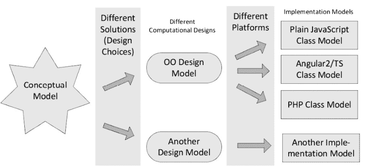

**图 5.2** 从概念模型通过设计模型到实现模型

RDF 是语义网的基础。它有多种句法，包括基于文本 XML 的 RDF/XML 句法和 RDF 图的视觉化语法。

## 5.4.1 RDF 词表

考虑在类图中定义的 Book 类

| Book |

| --- |

| isbn : String (id) |

| title : String |

| year : Integer |

对应的 RDF 词表（包含一个类定义和三个属性定义）在以下 RDF 图中定义：

## 5.4 漫游：使用 RDF 和 OWL 将信息模型形式化 99

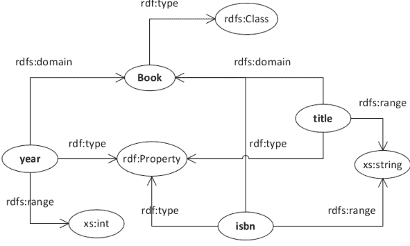

在 RDF 图中，椭圆形状的节点表示“资源”（如属性和类），箭头表示由属性定义的关系。两个节点之间的每个箭头代表一个陈述（也称为“三元组”）。例如，`year`和`xs:int`之间的`rdf:range`箭头表示陈述：`year`属性的范围是 XML Schema 数据类型`xs:int`，其中`xs`是 XML Schema 命名空间的前缀。

注意，RDF 具有预定义的元类`rdf:Class`和`rdf:Property`，用于在预定义属性`rdf:type`的帮助下定义类及其属性。例如，`year`和`rdf:Property`之间的`rdf:type`箭头表示陈述：`year`属于`rdf:Property`，即它被定义为一个 RDF 属性。

RDF 图是用于理论目的的一种形式化语言（形式化方法）。它们可以用于说明简单的示例。与 UML 类图相比，由于其复杂性和不必要的视觉复杂性，它们在视觉上表达真实的词表方面并不好用。

属性的定义域（domain）必须在 RDF 词表中显式定义（使用`rdf:domain`属性陈述语句），而在 UML 类图中，它是隐式定义的。虽然在类的语文中（如 UML 所示）定义属性是自然的，但 RDF 允许独立于任何类定义属性。

RDF/XML 句法允许为 Web 发布 RDF 词表。例如，在上述 RDF 图定义的 Book 词表可以用以下 RDF/XML 文档表示：

```xml
<xml version="1.0"?>
<rdf:RDF xmlns:rdf="http://www.w3.org/1999/02/22-rdf-syntax-ns#"
xmlns:ex="http://example.org/ex">
  <rdf:Class rdf:ID="#Book" />
  <rdf:Property rdf:ID="#isbn" />
  <rdf:domain rdf:resource="#Book"/>
<rdf:range
```

```
rdf:resource="http://www.w3.org/2001/
XMLSchema#string"/>
<rdf:Property rdf:ID="#title">
<rdfs:domain resource="#Book"/>
<rdfs:range rdf:resource="http://www.w3.org/2001/
XMLSchema#string"/>
</rdf:Property>
<rdf:Property rdf:ID="#year">
<rdfs:domain resource="#Book"/>
<rdfs:range resource="http://www.w3.org/2001/XMLSchema#int"/>
</rdf:Property>
</rdf:RDF>
```

注意，`rdf:resource`属性的值必须是 URI。如果属性是一个值片段（如`#Book`），它表示一个相对 URI，并通过将片段标识符附加到基础 URI（基础 URI 可通过`xml:base`属性定义）来解析为完整 URI。

如果属性是绝对 URI（如`"http://www.w3.org/2001/XMLSchema#string"`），它包含一个完整的命名空间前缀（如`"http://www.w3.org/2001/XMLSchema"`或`"xs"`）。但由于命名空间前缀只能用于 XML 元素和属性名称，而不能用于属性值，遗憾地使得 RDF/XML 对人类用户来说难以阅读。

注意我们简单的 UML 类模型的 RDF 形式化有几个缺点：

1. 它没有表达所有三个属性都是强制的且单值的约束条件，而这在 UML 中是默认认为的。

2. 它没有表达 ISBN 属性作为标准标识符（主键）属性是强制的且唯一的约束条件。

我们在下方展示如何利用 OWL 更强的表达能力来解决这两个问题。

## 5.4. RDF 事实陈述

用 RDF 可表达的命题信息项（或事实陈述）是类似于“`ex:Book`是一个`rdfs:Class`”或“`urn:isbn:006251587X`是一个`ex:Book`”的陈述，以及：

1. 分类

2. 类似于“`urn:isbn:006251587X`的`ex:isbn`值为`'006251587X'`”的属性陈述。

## 5.4 漫游：使用 RDF 和 OWL 将信息模型形式化 101

因此，对于一个 UML 对象定义

| isbn:006251587X: Book |

| isbn = 006251587X |

| title = Weaving the Web |

| year = 2000 |

我们得到了几个 RDF 事实陈述：

1. 分类陈述

<rdf:Description rdf:about="urn:isbn:006251587X">

<rdf:type rdf:resource="http://example.org/ex#Book"/>

</rdf:Description>

可以用更简洁的方式表示为

<ex:Book>006251587X</a>

2. 三个属性陈述

<rdf:Description rdf:about="urn:isbn:006251587X">

<ex:isbn>006251587X</ex:isbn>

<ex:title>Weaving the Web</ex:title>

<ex:year>2000</ex:year>

</rdf:Description>

也可以合并为一个`rdf:Description`元素：

```xml
<rdf:Description rdf:about="urn:isbn:006251587X">
<rdf:type rdf:resource="http://example.org/ex#Book"/>
<ex:isbn>006251587X</ex:isbn>
<ex:title>Weaving the Web</ex:title>
<ex:year>2000</ex:year>
</rdf:Description>
```

## 5.4.3 在 Web 文档中表达结构化数据

Web 文档中有许多机器可读数据（例如关于人物、产品等）的用例。例如，搜索引擎可以通过包含它的 JSON-LD`script`元素，或者通过对文档内容进行 RDFa 注释来使用。

## 5 信息建模

非常有限的标注方法被称为“微格式”（约2005年提出），是通用标注语言 RDFa 的先驱。一些微格式（如 vCard 和 vEvent）今天在使用，但日益被 RDFa 和 JSON-LD 两种格式取代。

我们展示在网页中使用结构化数据的简单示例。考虑以下 HTML 片段：

```html
<p>
My name is Carly Rae Jepsen.
Call me maybe at 1-800-243715.
</p>
```

对于这些内容，我们可能想要编码以下信息：

1. 可用信息关于一个 Person 实体，它已被搜索引擎标准词表 schema.org 定义为一个类；

2. 该人的名字是“Carly Rae Jepsen”；

3. 该人的电话号码是“1-800-243715”。

使用 RDFa 属性`typeof`、`vocab`和`property`，我们可以通过向 HTML 内容添加以下标注来编码这些信息：

```html
<p typeof="Person" vocab="http://schema.org/">
My name is <span property="name">Carly Rae Jepsen</span>.
Call me maybe at <span property="telephone">1-800-243715</span>.
</p>
```

## 5.4 漫游：使用 RDF 和 OWL 将信息模型规范

根据 Google 的建议，我们需要添加一个类型为`"application/ld+json"`的`script`元素，其中包含元数据：

```json
<script type="application/ld+json">
{
  "@context": "http://schema.org",
  "@type": "Person",
  "name": "Carly Rae Rae Jepsen",
  "telephone": "1-800-24377115"
}
</script>
```

使用 RDFa 注释和 JSON-LD 表示的命题信息对应以下 RDF/XML 代码：

```xml
<rdf:Description xmlns:schema="http://schema.org/">
  <rdf:type resource="http://schema.org/Person/>
  <schema:name>Carly Rae Jepsen </schema:name>
  <schema:telephone>1-800-24377115</schema:url>
</rdf:Description>
```

## 5.4.4 OWL 词表与约束

OWL 通过扩展 RDF 增加了许多额外的语言元素，用于在定义词表的上下文表示约束、等价性和派生类。事实的表达与 RDF 相同（例如使用`rdf:Description`）。

OWL 提供了用于定义类和属性的预定义语言元素：

- 1. 预定义的类`owl:Class`是`rdfs:Class`的子类。

- 2. 预定义的类`owl:DatatypeProperty`是`rdfs:Property`的子类。它分类属性。`owl:DatatypeProperty`的值是数据字面量。

- 3. 预定义的类`owl:ObjectProperty`是`rdfs:Property`的子类。它分类对应单向二元关联的引用属性。由于引用属性的值是对象引用，`owl:ObjectProperty`的值是以资源 URI 形式的对象引用。

我们仅示例 OWL 词表如何通过允许某些约束，比相应的 RDF 词表更真实表示类图。

考虑 Book 类中定义的标准标识属性`isbn`。在 RDF 词表中，该属性以以下方式定义：

## 5 信息建模

```xml
<rdf:Property rdf:ID="#isbn">
  <rdf:domain resource="#Book"/>
  <rdf:range rdf:resource="http://www.w3.org/2001/XMLSchema#string"/>
</rdf:Property>
```

该属性的 RDF 定义存在两个问题：

- 1. 它没有显式说明所定义的属性是一个属性，而不是引用属性。这只能通过发现范围类是数据类型而不是对象类型来推断。

- 2. 它没有包含“属性恰好有一个值”的约束，正如 UML 类图语义的默认值所暗示的那样。

使用 OWL，我们可以弥补 RDF 的这些缺陷。以下 OWL 属性定义显式属性`http://example.org/isbn`是一个属性，而添加的 OWL 限制为以下内容定义了“恰好一个”基数约束：


```xml
<owl:DatatypeProperty rdf:ID="#isbn">
  <rdf:domain resource="#Book"/>
  <rdf:range rdf:resource="http://www.w3.org/2001/XMLSchema#string"/>
<owl:Restriction>
  <owl:onProperty rdf:resource="#isbn" />
  <owl:cardinality>1</owl:cardinality>
</owl:Restriction>
```

由于 `Book` 类的 `ISBN` 属性在上面的 UML 类图中指定为标准标识，我们应该为它定义唯一性约束。可以通过在类定义中包含 `owl:hasKey` 元素来实现：

```xml
<owl:Class rdf:ID="#Book">
  <owl:hasKey rdf:parseType="Collection">
    <owl:ObjectProperty rdf:about="hasSSN/>
  </owl:hasKey>
</owl:Class>
```

## 5.4.4 RDF 和 OWL 的易用性问题

RDF 和 OWL 都有很多易用性问题。OWL 非常困难，以至于大多数潜在用户会被它望而却步。

由于 OWL 由一个关注形式逻辑而非信息建模的社区创建的，并且他们不熟悉信息建模中建立的概念和术语，他们为信息建模中建立并命名的概念引入了新的陌生的术语。他们甚至在 OWL 中引入了重复的名称：属性在大多数地方被称为“data property”，但在某些地方被称为“datatype property”（特别是在 OWL/RDF 中）。

RDF 的易用性问题是：

1. 出于历史原因，RDF 带有一种奇怪的术语。特别是它的“subject-predicate:object”术语非常糟糕。

2. 出于历史原因，RDF 有两个不同的 XML 命名空间，通常以两个命名空间前缀“rdf”和“rdfs”的形式出现。语言的历史不应该体现在它的语法上。用户不应该操心使用哪个前缀。

3. RDF 使用了不常用的术语“IRI”（“International Resource source identifier”的缩写），遵循了从“URL”通过“URL”再到“IRI”的这段不幸的命名历史，而 What 工作组的 URL 实施标准已经回溯了这一命名历史。

4. 从实用角度考虑，RDF 是不完整的：

   a. 它没有显式区分属性（范围为数据类型）和引用属性（范围为对象类型）；

   b. 它不允许定义包含强制性值的简单类定义。

OWL 的易用性问题是：

1. 它使用了不常用的术语，例如用“data property”代替属性；

2. 某些元素令人困惑，例如用“intersection”代替约束；

3. 它难以理解，例如用“someValues”代替属性。

## 5.5 总结

洋葱原则要求将模型类与 UI 代码解耦；以便不同的 UI 技术复用相同的模型类。

## 5.6 练习

考虑管理电影的问题：

1. 借助列表描述一个说明性片段。

2. 将列表转换为表格。

3. 创建一个概念模型，然后推导出模型类。

4. 最后，编写模型类。

## 6 应用架构

Web 系统像任何其他复杂制品一样，需要一种通过将其拆分为较小部分来帮助管理的架构。软件架构关注以下问题：

1. 要设计的应用程序状态结构以信息模型的形式定义。

2. 代码库的目标是以结构化的方式划分整体代码以实现软件质量。

3. 应用程序运行时组件在计算机网络中的分布由部署架构定义。Web 应用部署在 Web 上，Web 是一个基于 HTTP 的全球网络。

在设计复杂系统的情况下，无论是设计新建筑、航天飞机、新计算机还是软件应用程序，架构都提供了一个定义系统结构的总体规划。任何良好的架构都基于以下三个原则：

- 关注点分离，通过将系统拆分为较小的、功能定义的各个部分来管理复杂度，使得

- 相互依赖最小化；

- 保持核心部分与非核心部分相互独立（洋葱原则）。

遵循这些原则可以独立地开发、采购或更新某些系统部分。

- 存储管理代码，因为应该允许使用不同的存储技术复用相同的模型类。

然而，在许多 Web 应用框架中（例如 Java EE），违背了洋葱模型原则。

## 6.1 模型-视图-控制器 (MVC) 架构比喻

最流行且广泛使用的代码库架构方法是基于模型-视图-控制器的分区模式。尽管它没有精确的定义，并且以许多不同的方式实现（特别是在 Web 应用框架中），但它基于关注点分离原则，并基于一个核心洞察：模型是应用程序所有其他部分（特别是用户界面）的基础。因此，如果 MVC 方法没有对什么是“模型”提供精确的定义，我们也可以将其视为一种基于模型的方法。


根据维基百科，第一种 MVC 架构是由 Trygve Reenskaug 在 20 世纪 70 年代通过 Smalltalk-76 引入应用程序编程的。在后来关于 Smalltalk-80² 的文章中，MVC 被解释为“应用程序的三维拆分”，它涉及“将 (1) 代表底层应用领域模型的部分与 (2) 模型向用户展示的方式以及 (3) 用户与模型交互的方式分离”。作者们还使用了“MVC 比喻”一词，指出他们的方法允许程序员“通过首先定义体现特定应用程序特定信息的新类，来编写应用程序模型”。

请注意，模型被定义为捕获所需领域信息的类。我们称之为模型类。

在原始的 MVC 方法中，没有定义良好的用户界面 (UI) 概念。“视图”被定义为包含 UI 下的输出，而用户输入与其分离并在“控制器”术语下提交。这并没有反映 UI 真实的组织方式：即将某些形式的应用程序输出与某些形式的用户输入相结合，就像同一硬币的两面。通用的 UI 概念包含了输出（提供给用户的输出信息以及系统操作）和输入（包括用户输入的信息以及执行的操作）。

Smalltalk MVC 比喻是为（单色的）文本界面开发的，没有 UI 事件的通用概念。这可能解释了为什么他们没有考虑 UI 作为一个整体概念。虽然他们区分了模型中对象的状态与其在 UI 中的状态（这两者都在用户会话的范围内），但他们没有考虑模型状态与数据库状态之间的区别。

Martin Fowler 在他的 Web 文章《GUI Architectures? (2006)》中以以下方式总结了原始 MVC 方法的原则：

1. UI 与模型之间的分离。

2. 将 UI 分为“控制器”和“视图”。

3. 视图与模型同步（通过数据绑定机制）。

虽然第一和第三原则对于软件应用程序架构是基础性的，但第二个原则仅具有历史意义，并很快被 Smalltalk 的开发者抛弃了。

与 20 世纪 80 代相比，计算机、人机交互和软件架构已经演进。特别是 Web 的建立使得浏览器成为了用户界面最重要的基础设施。

MVC 术语今天仍被 Web 应用框架使用，但“M”、“V”和“C”被赋予了不同的含义。通常，“视图”表示基于 HTML 的用户界面代码，而“控制器”表示负责调解“视图”与“模型”的代码。

在许多 MVC 方法中，“模型”与底层数据库技术紧密耦合，使用对象关系映射 (ORM) 方法将类映射到表，将对象映射到行。模型类与数据库表之间的紧密耦合违背了最小化依赖的根本原则（因为模型类不需要依赖数据库表）以及下文讨论的观点。

例如，在具有影响力的 Ruby-on-Rails 框架的 Active Record* 范式中（该框架已被许多其他 Web 应用框架采用，如 CakePHP），“模型”是底层数据库系统模式的直接表示，其中数据库的每个表都由一个“模型”类表示，该类继承了执行创建/检索/更新/删除 (CRUD) 操作的数据处理方法。在这种表到模型的映射方法中，“模型”依赖于底层数据库的模式，因此与底层 ORM 技术紧密耦合。虽然对于以 SQL 数据库为基础的优先开发方法可能是一种合适的方法，但这显然不是一种通用方法，并且模型变成了次要资产。

同样在基于 ORM 注解的框架中，例如带有 JPA 注解的 Java EE、带有 Entity Framework 和 Data 注解的 ASP.NET MVC，或者带有 Doctrine 注解的 Symfony 框架，“模型”通过 ORM 注解与底层 ORM 技术耦合。

## 6.2 洋葱架构

“洋葱架构”一词是由 Jeffry Palermo 在 2008 年提出的。该架构的主要原则是：(1) 依赖指向内部，外层依赖于内层；以及 (2) 最基础部分是领域，它是洋葱的核心。在洋葱架构中，UI 是最外层，而数据库通常是最内层。

## 6.3 “逻辑”与“物理”用户界面

逻辑 UI（也称为视图模型，view model）的想法最早是由 Martin Fowler 在 2004 年关于演示模型（Presentation Model）的文章中提出的（使用了不同的名称），他指出视图“将视图的状态和行为提取到模型类中”。这意味着逻辑内容从“物理”UI 中抽象出来，而物理 UI 具有逻辑 UI 字段和“命令”的具体渲染。

随后在 2005 年，视图模型概念被 John Gossman（来自微软）在他的博客文章《Introduction to Model/View/ViewModel pattern for building WPF Apps》中采用，并在架构模式缩写“MVVM”下广为人知。

## 6.4 MVC Web应用程序

MVC 术语在今天仍然被广泛使用，特别是在 Web 框架中，但“M”、“V”和“C”被赋予了不同的含义。在某些方法中，它通过增加另一个层被扩展，称为“视图模型”（view model），缩写为“VM”，我们将在课程后面的部分讨论。

在原始的 MVC 提议中，“模型”（model）由实现应用数据模型的模型类组成，而许多 MV(C) 框架并不包含任何模型类的概念，而是将数据对象（或记录）称为“模型”。此外，“控制器”（controller）一词存在歧义。在原始的 MVC 提议中，“控制器”指的是对包括用户输入在内的 UI 事件的处理。今天，它通常指所有在模型和视图之间进行调解所需的胶水代码，包括路由代码。

总之，在今天的框架中，“模型”一词模糊地指应用的数据，而“视图”（view）表示用于用户界面的应用代码，这些代码基于 CSS 样式的 HTML 表单和 DOM 事件，而“控制器”（controller）表示负责在视图和模型之间进行调解的（胶水）代码。人们有广泛共识：

1. 模型应该独立于视图和控制器，这意味着模型既不能调用视图也不能调用控制器（在模型代码中，不应有对任何视图或控制器过程的调用）；

2. 控制器可以调用模型和视图；

3. 视图可以调用控制器。

然而，如下所示，并不清楚视图是否可以调用模型，或者它是否需要通过控制器路由任何对模型过程的调用。两种方法在实践中都得到了使用。第一种方法（可以从视图调用模型过程）更简单，且控制器更轻量。

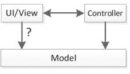

第二种方法（通过控制器路由所有调用将视图与模型解耦）被称为中介控制器（mediating-controller）MVC 方法，如图所示。它的优点是依赖较少，并为基于数据绑定的模型-视图同步提供了更好的支持。

## 6.5 部署架构

在许多 MVC Web 应用程序框架中，模型与底层数据存储技术紧密耦合，通常是通过对象关系映射（ORM）方法将类映射到表、将对象映射到表行。这种紧密耦合使得类依赖于特定的数据库技术或相应的数据库表。因此，它违反了洋葱原则，因为模型是应用最基础的部分，所以它不能依赖于任何其他部分。

除了信息架构和代码库组织架构（如 MVC）之外，我们还面临在部署时如何分布应用不同部分的问题，因此我们还需要一种部署架构。

传统上，Web 应用程序的大部分部分在后端计算设备上执行，而只有其 HTML/CSS 用户界面在前端（或客户端）侧、在 Web 浏览器中执行。随着现代 JavaScript 的兴起，我们可以选择传统的后端应用替换为 JavaScript 前端应用，其中应用的大部分部分在前端设备的 Web 浏览器中执行。这种前端应用可以使用本地存储或（远程）云存储服务，如图 6.2 所示的两个架构图所示。

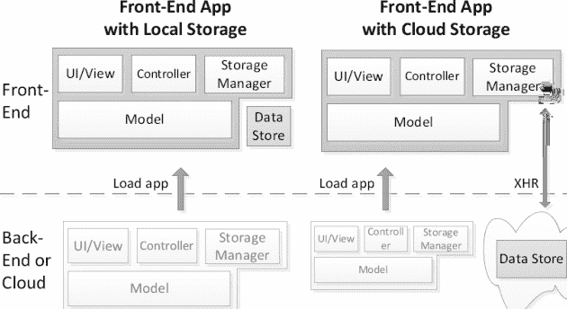

图 6.2 前端 Web 应用程序的架构

在两种情况下，前端应用的 JavaScript 代码都与其启动页一起加载。使用本地数据存储（通过 JavaScript 的 `localStorage` 或 `indexedDB` API）在应用初始加载后不需要连接互联网，但通过 `XMLHttpRequest` API 使用 HTTP 消息使用云存储则需要连接互联网。

通常（但并非如此），前端应用是单用户应用程序，不与用户共享。

后端应用是一种 Web 应用，其实际工作由后端组件完成，包括数据验证和用户界面页面创建。它没有任何前端组件，除了基于 HTML 表单的、可能由 JS 渲染的用户界面页面，这些页面被发送到用户的前端计算机由浏览器渲染。

控制器的一个重要任务，特别是在后端应用中，是路由：将传入的 HTTP 请求消息映射到应用的用例（通常由类的方法表示），该用例要么以 Web 页面的形式提供相应的用户界面，要么请求代表相应的表单提交并可以被直接处理。

现在有了 NodeJS，我们可以将应用的 JavaScript 组件部署在后端或前端。在未来，其他编程语言可能也提供相同的选择。在后端和前端都使用相同 JavaScript 代码的 Web 应用被称为“通用的”（universal）或“同态的”（omorphic）。这对于数据验证代码特别有用，因为在响应式约束验证方法中（如第 7 章所述），我们在用户界面上立即验证用户数据，但在保存之前也会在后端对其进行验证。现代 JavaScript 允许真正的分布式应用。

图 6.3 所示的两幅图说明了传统后端 Web 应用架构与新型分布式应用架构之间的区别。

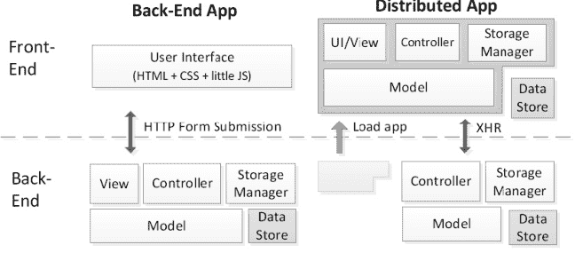

图 6.3 后端和分布式应用的架构

# 第二部分 约束验证

为了捕捉各种缺陷数据，我们需要定义可用于验证机制的合适的完整约束。约束可以有多种形式。最重要的约束类型是属性约束，它定义了对象的有效值。

# 7 完整约束与数据验证

## 7.1 引言

为了检测无效和不一致的数据并防止此类数据被添加到应用程序数据库，我们需要为数据验证定义合适的完整约束。约束是用户输入并存储在数据库中的数据必须满足的逻辑条件。

例如，如果一个应用管理包括出生日期和死亡日期的个人数据，我们必须确保带有死亡日期的个人记录中该日期不在出生日期之前。

由于完整性维护是数据库管理的基础，关系数据库定义语言 SQL 支持定义多种形式的完整约束。然而，在 PHP、Java、C# 或 JavaScript 等常用语言中几乎没有完整约束和数据验证的支持。在 Web 应用开发中，采取系统的约束验证方法很重要，例如选择提供足够支持的应用开发框架。

遗憾的是，许多 Web 开发框架对定义完整约束和执行数据验证的支持不足。完整约束应该在应用的某个中心位置定义，然后用于配置用户界面并在应用的不同部分（如用户界面和数据库）验证数据。从可用性的角度来看，目标应该是：

1. 尽可能通过限制选项防止用户在用户界面（UI）中输入无效数据。

2. 对于那些无法通过限制选项防止无效输入的 UI 组件，通过在 UI 中执行约束验证来尽早检测并拒绝无效输入。

3. 通过在模型层和数据库中也执行约束验证，防止无效数据污染应用内存状态和持久化数据库。

## 7.2 完整性约束

完整性约束（简单称为约束）是针对应用程序数据的逻辑条件。它们可以有许多不同的形式。最重要的约束类型是**属性约束**（property constraints），它们定义了对象允许的属性值。它们针对对象类型（或类）定义，适用于该类型的所有对象。我们关注约束中最重要的几种情况：

| 约束类型 | 描述 |
| --- | --- |
| 字符串长度约束 | 要求属性的字符串值长度小于某个最大值，或大于某个最小值。 |
| 强制性值约束 | 要求属性必须有值。例如，人必须有姓名，因此 `name` 属性不能为空。 |
| 范围约束 | 要求属性必须具有其被定义为范围的类型的取值空间。例如，整数类型属性不能取值为 `"aaa"`。 |
| 间隙约束 | 要求数值属性必须在一个特定的区间内。 |
| 模式约束 | 要求字符串属性的值匹配由正则表达式定义的特定模式。 |
| 基数约束 | 仅适用于多值属性，要求多值属性集合的基数不小于最小基数或不大于给定的基数。 |
| 唯一性约束 | 要求属性的值在给定对象类型的所有实例中是唯一的。 |
| 引用完整性约束 | 要求引用属性的值必须指向引用属性范围内的现有对象。 |
| 冻结约束 | 要求属性的值在初始赋值后不能更改。 |

UML 类图的视觉语言支持完整性约束：一种是通过特殊方式针对特殊情况（如预定义关键字），另一种是在通用情况下，通过不变式（invariants）的帮助，以及*对象约束语言 (OCL)*，后者显示在附着于相关模型元素上的特殊矩形中。我们使用 UML 图在*设计模型*中建模约束，这些模型独立于特定的编程语言或技术平台。

UML 类图为表达多重性（或基数）约束提供了特殊支持。这种约束允许为属性或关联端指定下多重性（最小基数）或上多重性（最大基数），或两者兼有。在 UML 中，这表现为多重性表达式 `1..u`，其中下多重性 `1` 是非负整数，上多重性 `u` 是小于 1 的正整数或表示无界的特殊值 `*`。在类图中显示属性多重性（或基数）约束时，多重性表达式括在括号内并附加在属性名后，如下方的 `Person` 类矩形所示。

在接下来的章节中，我们将更详细讨论上述列出的不同类型的属性约束。我们还将展示如何使用 UML 类图、SQL 表创建语句、JavaScript 模型类定义以及基于注解的语言 Bean Validation 注解和 ASP.NET Data Annotations 来表达其中某些约束。

任何对约束验证的语法方法都需要定义一组错误（或“异常”）类，为上述列出的每种标准属性约束定义一个类。


### 7.2.1 字符串长度约束

属性（如书名）的字符串值长度可能需要受到限制，通常是最大长度限制，但也可能是最小长度限制。在 SQL 表定义中，可以在数据类型 `CHAR` 或 `VARCHAR` 后面的括号内指定最大字符串长度，例如 `VARCHAR(50)`。UML 没有在类图中定义任何表示字符串约束的特殊方法。当然，我们始终可以选择不变式来表达任何种的约束，但使用更简单的形式来表达这些属性约束似乎更好。一种方法是在数据类型名称后的括号内附加最大长度，或同时附加最小和最大长度，如下：

| Book |
| --- |
| isbn : String |
| title : String(5,80) |

另一种方法是在属性修饰列表中使用 `min/max` 约束关键字：

| Book |
| --- |
| isbn : String |
| title : String(min:5, max:80) |

### 7.2.2 强制性值约束

强制性值约束要求属性必须有值。这可以在 UML 类图中通过多重性约束表达式来表达，其中下多重性为 1。对于单值属性，这将产生多重性表达式 `1..1` 或简化后的表达式 `1`，并附加在属性名的括号内。例如，以下类图为 `name` 属性定义了强制性值约束：

| Person |
| --- |
| name[1] : String |
| age[0..] : Integer |

每当类矩形没有显示属性的多重性表达式时，该属性就是强制性的（且是单值的），即多重性表达式 `1` 是属性的默认值。

在 SQL 表语句中，强制性值约束通过在下例的列定义中附加键短语 `NOT NULL` 来表示：

```sql
CREATE TABLE persons (
  name VARCHAR(30) NOT NULL,
  age INTEGER
)
```

根据此表定义，`persons` 表中的任何行在 `name` 列都必须有值，但 `age` 列不一定有。

在 JavaScript 中，我们可以通过类级检查函数来编写强制性值约束，该函数测试提供的参数是否求得一个有效值，如下例所示：

```javascript
Person.checkName = function (n) {
  if (n === undefined) {
    return "A name must be provided!";
  } else return "";
}
```

使用 Java Bean Validation，像 `name` 这样的强制属性使用 `NotNull` 注解，如下：

```java
@Entity
public class Person {
  @NotNull
  private String name;
  private int age;
}
```

ASP.NET Data Annotation 的对应注解是 `Required`，所示：

```csharp
public class Person{
    [Required]
    public string name { get; set; }
    public int age { get; set; }
}
```

### 7.2.3 范围约束

范围约束要求属性必须具有其被定义为范围的类型的取值空间的值。这隐式地通过为属性定义类型来表达。例如，类图中为 `Person` 对象类型定义的 `age` 属性类型为 `Integer`，因此不能取值为 "aaa"。类似的，其类型为 `String` 的 `name` 属性可能取值为 `""`（空字符串），这是一个有效的字符串，但作为姓名是不合理的。

我们可以通过为这些属性分配更具体的数据类型来避免负整数（如 -13）作为年龄值，以及空字符串作为姓名，例如为年龄分配 `NonNegativeInteger`，为姓名分配 `NonEmptyString`。请注意，更具体的数据类型在 SQL 或常用编程语言中并不是预定义的，因此我们必须以用户定义类型的形式实现，或者使用适当额外的约束作为间隙约束（间隙约束将在下一节中讨论）。在 UML 类图中，我们可以简单地将 `NonNegativeInteger` 和 `NonEmptyString` 定义为自定义数据类型，然后在属性定义中使用它们，如下图所示：

| Person |
| --- |
| name[1]: NonEmptyString |
| age[0..]: NonNegativeInteger |

在 JavaScript 中，我们可以通过检查函数来编写范围约束，如下例所示：

```javascript
Person.checkName = function (n) {
    if (typeof(n) !== "string" || n.trim() === "") {
        return "Name must be a non-empty string!";
    } else return "";
}
```

如果给 `name` 属性的值不是 "string" 类型或为空字符串，该检查函数将检测并报告违反约束。

在 Java Web 应用程序中，为了声明空字符串为不可接受的用户输入，我们必须设置上下文参数

## 7.2 完整性约束与数据校验

```
javax.faces.INTERPRET_EMPTY_STRING_SUBMITTED_VALUES_AS_NULL
```

在 web 部署文件 `web.xml` 中设置为 `true`。

在 ASP.NET 中，默认情况下不允许空字符串。

### 7.2.4 区间约束 (Interval Constraints)

区间约束要求属性的值必须在一个特定的区间内，该区间由最小值、最大值或两者共同指定。这种约束可以定义在任何具有有序类型的属性上，但通常我们只对数值数据类型或日历数据类型定义它们。例如，我们可能想要定义一个区间约束，要求年龄（`age`）值必须在 [25,70] 区间内。在类图中，我们可以使用属性修饰符 `min` 和 `max` 来定义此类约束，如下图中 `Driver` 类的 `age` 属性所示。

| Driver |
| :--- |
| age: Integer(min:25,max:70) |

在 SQL 表语句中，区间约束通过在列定义后附加适当的 `CHECK` 子句在表定义中表示，如下例：

```sql
CREATE TABLE drivers(
  name VARCHAR NOT NULL,
  age INTEGER CHECK (age >= 25 AND age <= 70)
);
```

在 JavaScript 中，我们可以通过以下方式定义区间约束：

```javascript
Driver.checkAge = function (a) {
  if (a < 25 || a > 70) {
    return "年龄必须在 25 到 70 之间!";
  } else return "";
};
```

在 Bean Validation 中，我们通过以下方式向属性 `age` 添加注解 `@Min(0)` 和 `@Max(120)` 注解来表示这种区间约束：

```java
@Entity
public class Driver {
  @NotNull
  private String name;

@Min(25) @Max(70)
private int age;

```

等效 ASP.NET Data Annotation `Range(25,70)` 所示：

```csharp
public class Driver{
    [Required]
    public string name { get; set; }
    [Range(25,70)]
    public int age { get; set; }
}
```

### 7.2.5 模式约束 (Pattern Constraints)

模式约束要求字符串属性的值匹配某种模式，该模式通常由正则表达式定义。例如，我们定义的 `Book` 对象类型定义了一个 `isbn` 属性，其范围数据类型为 `String`，并在如下所示的 `Book` 类矩形中添加了一个模式约束，要求 `isbn` 属性值必须是 10 位字符串或 9 位数字后跟 "X" 的字符串：

| Book | «invariant» |
| :--- | :--- |
| isbn: String | (isbn 必须是 10 位字符串或 9 位数字后跟 "X") |
| title: String | |

在 SQL 表语句中，模式约束匹配通过在列定义中添加适当的 `CHECK` 约束在表定义中表示，如下例：

```sql
CREATE TABLE books (
    isbn VARCHAR(10) NOT NULL CHECK (isbn ~ '\d{9}(\d|X)$'),
    title VARCHAR(50) NOT NULL
)
```

波号符号 `~` 表示正则表达式匹配谓词，正则表达式 `\d{9}(\d|X)\$` 遵循 POSIX 标准（参见例如 PostgreSQL 文档）。

在 JavaScript 中，我们可以使用内置的正则表达式函数 `test` 来编写模式约束，如下例所示：

```javascript
Person.checkIsbn = function (id) {
  if (!/\b\d(9)(d|X)\b/.test(id)) {
    return "ISBN 必须是 10 位字符串或 9 位数字后跟 'X!'";
  } else return ""
}
```

在 Java EE Bean Validation 中，针对 `isbn` 的这种模式约束通过注解 `@Pattern` 以如下方式表示：

等效 ASP.NET 类注解是 `RegularExpression`，如下所示

### 7.2.6 基数约束 (Cardinality Constraints)

基数约束要求多值属性值的基数不小于给定的最小基数，或不大于给定的最大基数。在 UML 中，基数约束被称为多重性约束（multiplicity-constraints），最小和最大基数通过多重性表达式的下界和上界表示，如下所示所示，图中包含两个基数约束的属性示例。

| Person | Team |
| :--- | :--- |
| name[1]: String | name[1]: Integer |
| age[0..1]: String | members[3..5]: Person |
| nicknames[0..3]: String | |

类 `Person` 中的属性定义 `nicknames` 指定了最小基数为 0，最大基数为 3，这意味着一个人可能没有昵称，或者最多有 3 个昵称。类 `Team` 中的引用属性定义 `members[3..5]` 指定了最小基数为 3，最大基数-为 5，这意味着一个团队必须至少有 3 个且最多有 5 个成员。

目前还不清楚在 SQL 数据库中如何检查基数约束，因为 SQL 中没有显式的基数约束概念，且 SQL 中约束表达式的通用形式（断言，assertions）并不受现有 DBMS 支持。然而，实现（或最大）约束的最佳方法似乎是使用删除（或插入）触发器来对被删除（或被插入）的行进行测试。

在 JavaScript 中，我们可以通过测试多值属性的长度（size）来编写模式约束，如下所示：

```javascript
Person.checkNames = function (nickNames) {
  if (nickNames.length > 3) {
    return "昵称不能超过 3 个!";
  } else return ""
}
```

使用 Java 注解，我们可以指定

- `@Size(max=3)`
- `List<String> nicknames`
- `@Size(min=3, max=5)`
- `List<Person> members`

### 7.2.7 唯一性约束 (Uniqueness Constraints)

唯一性约束（或键约束）要求属性值（在复合约束的情况下为属性列表）在所有对象实例中是唯一的。例如，在 UML 类图中，我们通过在如下所示的 `Book` 类矩形中添加用户定义的属性修饰符 `key` 来将 `isbn` 属性定义为唯一的，或者说是一个键：

| Book |
| :--- | :--- |
| isbn: String (key) |
| title: String |

在 SQL 表语句中，唯一性约束通过在列定义后附加 `UNIQUE` 关键字来表示，如下例：

```sql
CREATE TABLE books (
  isbn VARCHAR(10) NOT NULL UNIQUE,
  title VARCHAR(50) NOT NULL
)
```

在 JavaScript 中，我们可以通过一个测试 `books` 表中是否已存在相同 `isbn` 值的函数来编写这种唯一性约束。

### 7.2.8 标准标识符 (Standard Identifiers / Primary Keys)

唯一属性（或复合键）可以声明为给定类型对象的标准标识，如果它是强制性的（或者复合键的属性是强制性的）。我们可以在 UML 类图中通过在属性声明添加修饰符 `id` 来指示这一点，如下所示：

| Book |
| :--- |
| isbn: String (id) |
| title: String |

注意，这种标准标识声明意味着所涉及的属性具有强制性和唯一性约束。

标准标识在关系型数据库中被称为主键（primary keys）。在 SQL 表语句中，通过在列定义后附加 `PRIMARY KEY` 短语将属性声明为主键，如下例：

```sql
CREATE TABLE books(
  isbn VARCHAR(10) PRIMARY KEY,
  title VARCHAR(50) NOT NULL
)
```

在 JavaScript 中，我们无法轻松编写标准标识声明，因为这是类定义元数据的一部分，且 JavaScript 对此类元数据没有标准支持。然而，我们应该通过调用上述检查函数，检查给定的参数是否违反了隐含的强制性值或唯一性约束。

### 7.2.9 引用完整性约束 (Referential Integrity Constraints)

引用完整性约束要求引用属性的值指向该属性范围类中存在的对象。由于我们

## 7.2 完整性约束 — 127

本章不处理引用属性，将引用完整性约束的讨论推到第 2 。

### 7.2.10 冻结和只读值约束

为属性定义的冻结值约束要求该属性的值在赋值后不能更改。这包括了在对象创建时初始化的强制属性的只读值约束的特殊情况。

具有冻结值约束的属性的典型示例包括标准标识符属性和事件属性。对于事件，"过去不可改变"的语义原则禁止了事件属性值的更改。对于标准标识符属性，如果我们想防止用户更改对象的 ID，则要求所有使用旧 ID 对该对象的引用也必须同步更改，这可能很难实现（尽管有 SQL UPDATE CASCADE 子句用于管理冻结键的更改）。

下面的图显示了如何为 `isbn` 属性定义冻结值约束：

| isbn | String {id, frozen} |
|---|---|
| title | String |

在 Java 中，可以通过将属性声明为 `final` 来强制执行只读值约束。在 JavaScript 中，可以通过以下示例实现只读属性槽：

```javascript
Object.defineProperty(obj, "teamSize", {value: 5, writable: false, enumerable: true});
```

其中属性槽 `obj.teamSize` 变为了不可写。可以使用 `Object.freeze(obj)` 冻结整个对象。

我们可以在属性的 setter 方法中像这样为属性实现冻结值约束：

```javascript
Book.prototype.setIsbn = function (i) {
  if (this.isbn === undefined) this.isbn = i;
  else console.log("Attempt to re-assign a frozen property!");
}
```

### 7.2.11 属性约束之外

到为止，我们只讨论了如何定义和检查属性约束。然而，在某些情况下，完整性约束可能不仅取决于特定属性的值，而且取决于：

1. 特定对象的属性值（对象级约束），
2. 属性在尝试更改之前的值和更改之后的值（动态约束），
3. 特定对象类型的所有实例的集合（类型级约束），
4. 多个对象类型的所有实例的集合。

对象约束语言 (OCL) 于 1997 年定义，作为一种在 UML 1.1 版本中表示完整性约束的正式逻辑语言。后来，它被扩展，允许在类模型中定义 (1) 用于定义派生属性的导出，以及 (2) 操作的前置和后置条件。

在类模型中，属性约束可以通过类矩形中的属性声明来表示（通常带有 `id`、`max` 等关键字）。对于更复杂的约束，例如对象级或类型级约束，可以在可以在类矩形上附加一个不变性声明框，并用（无歧的）英语或对象约束语言 (OCL) 表示该约束。以 OCL 不变性表示的对象级约束简单示例如图 7.1 所示。

| | |
|---|---|
| person[1]: Integer {id} |
| name[1]: String |
| dateBirth[1]: Date |
| dateDeath[0..1]: Date |

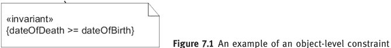

实现对象级约束验证的通用方法包括以下步骤：

1. 为对象级约束验证函数选择一个固定名称，例如 `validate`。
2. 对于任何需要对象级约束验证的类，定义一个 `validate` 函数，返回 `ConstraintViolation` 或 `NoConstraintViolation` 对象。
3. 如果给定的模型类存在该函数，则调用该函数，

## 7.3 响应式验证


a. 在 UI/视图中，表单提交时；

b. 在模型类中，保存之前，同时在创建和更新方法。

影响两个或多个模型类的约束可以以静态方法的形式（在模型层方法库中）定义，这些方法从受影响模型类的对象级验证方法中调用。

## 7.3 响应式验证

这个问题在经典的 Web 应用中是广为人知的，前端组件通过 HTML 表单提交将用户数据发送到运行在远程 Web 服务器上的后端组件。该后端组件验证数据并将一组错误消息的形式将验证结果返回给前端。只有在此几秒钟后，用户才会以一种难以消化的批量消息形式获得验证反馈。相反，在响应式方法中，用户应该在每项数据输入时获得即时的验证反馈。在技术上，这可以通过用户界面事件 `input` 或 `change` 的事件处理程序来实现。

响应式验证要求用户界面 (UI) 中有一种数据验证机制，例如 UI 中的 `jQuery Validation Plugin()` 可以作为一种（非基于 HTML5 的）表单验证 API。

HTML5 验证 API 本质上提供了新类型的输入字段（如数字或日期）以及表单控制元素的一系列新属性，用于支持由浏览器执行的响应式验证。由于在 UI 中使用验证属性（如 `required`、`min`、`max` 和 `pattern`）定义约束，因此在仅在 UI 中检查而不定义约束的通用方法中，它们并没有真正有用。

（注：此处原文中存在大量重复的段落，已根据要求在翻译中进行了处理，保留核心逻辑含义）

## 7.4 MVC 应用中的约束验证

完整性约束应该定义在应用的模型类中，因为它们是类型业务语义的一部分。然而，一个更难的问题是在哪里执行数据验证：数据库中？模型类中？控制器中？还是用户界面（“视图”）？或者所有这些地方？

只要数据库中定义了完整性约束，当尝试更改数据库中的数据时，关系数据库管理系统 (DBMS) 就会执行数据验证。这对于避免任何情况下无效数据进入数据库至关重要。然而，这要求我们某种程度上复制每个约束的代码，因为我们希望将其放在约束所属的模型类中。

此外，如果 DBMS 是唯一验证数据的应用程序组件，这将导致分布式应用产生延迟，从而影响可用性，因为用户无法获得对无效输入的即时反馈。因此，数据验证需要从用户界面 (UI) 开始。

然而，在 UI 中执行数据验证是不够的。我们还需要在模型类和数据库中进行验证，确保没有缺陷数据进入应用程序的持久化数据存储。这产生了一个如何在一处（模型）维护约束定义，但在两个或三个地方（至少在模型类和 UI 代码中，可能在数据库中）使用它们的问题。我们称之为多重验证问题。这个问题可以通过不同的方式解决。例如：

1. 在声明式语言（如 Java Validation Annotations 或 ASP.NET Data Annotations）中定义约束，并在后端编程语言（如 Java 或 C#）以及 JavaScript 中生成后端/模型和前端/UI 验证代码。

2. 将验证函数保留在后端的（PHP, Java, C# 等）模型类中，并通过 XHR 从 JavaScript UI 中调用它们。这种方法仅用于特定的验证，因为这意味着每次以这种方式调用的验证都会产生额外的 HTTP 通信延迟的代价。

## 130 完整性约束与数据验证

有关 HTML5 验证 API 的更多信息，请参考 [Mozilla 教程](https://developer.mozilla.org/en-US/docs/Web/HTML/Validation) * 或 [HTML5Rocks](https://html5rocks.com/)*。

## 7.5 向设计模型中添加约束

3. 使用 JavaScript 作为你的后端应用程序编程语言（例如使用 NodeJS），你可以在后端的 JavaScript 模型类中编写验证函数，并在后端提交更改之前执行它们，同时在前端 UI 的用户输入和表单提交时执行这些函数。

最简单、响应最快的解决方案是第三种，即仅使用 JavaScript 同时编写 Web 应用的后端和前端组件。

## 7.5 向设计模型中添加约束

我们考虑第一部分中考虑过的书籍数据管理问题。但现在我们还考虑了管理书籍数据的数据完整性规则（或“业务规则”）。这些完整性规则或约束可以在 UML 类图中表示出来，如图 7.2 所示。

| Book | «invariant» |
| :--- | :--- |
| isbn[1]: NonEmptyString(id) | (isbn 必须是 10 位字符串或 9 位字符串后跟“X”) |
| title[1]: NonEmptyString(50) | |
| year[1]: integer | |
| edition[0..1]: PositiveInteger | «year > 1454 AND year <= nextYear()» |

图 7.2 定义类型 Book 具有两个不变属性的设计模型

在此模型中，表达了以下约束：

- 1. 由于 `isbn` 属性被声明为 `Book` 的标准标识符，因此它是强制的且唯一的。
- 2. `isbn` 属性有一个模式约束，要求其值匹配 ISBN-10 格式，该格式仅允许 10 位数字或带 X 的 9 位字符串。
- 3. `title` 属性是强制性的（如其多重表达式 `[1]` 所示），并且具有长度约束，要求其值最多有 50 个字符。
- 4. `year` 属性是强制性的并具有范围约束，但是一种特殊形式：最大值不是固定的，而是由日历函数 `nextYear()` ，我们将其实现为一个工具函数。

注意 `edition` 属性不是强制性的（可选的），如其多重表达式 `[0.1]` 所示。除了列表中列出的约束外，还有通过将数据类型 `NonEmptyString` 分配给 `isbn` 和 `title` 的范围，将 `Integer` 分配给 `year`，将 `PositiveInteger` 分配给 `edition` 而定义的隐式约束。在我们的纯 JavaScript 方法中，所有这些属性约束都编码在模型类特定属性的检查函数中。

设计模型的含义可以通过一个遵循所有约束的示例数据填充来说明：

表 7.1 书籍的示例数据

| ISBN | Title | Year | Edition |
| :--- | :--- | :--- | :--- |
| 006251587X | Weaving the Web | 2000 | 3 |
| 0465026567 | Gödel, Escher, Bach | 1999 | 2 |
| 0465030793 | I Am A Strange Loop | 2008 | |

## 7.6 总结

- 约束是对应用程序数据的逻辑条件。最简单且最重要的约束类型是属性约束和对象级约束。
- 约束应该在 MVC 应用的模型类中定义，因为它们是业务语义的一部分。
- 约束应该在 MVC 应用的各个地方进行检查：在 UI/视图代码中、模型中，以及可能在数据库中。
- 包含 CRUD 数据管理的应用程序需要执行两种双向的对象到字符串的类型转换：
  - 模型和 UI 之间：将模型对象的值转换为 UI 控件，反之亦然，将控件值转换为属性值。通常，控件是具有字符串值的表单字段。
  - 模型和数据存储之间：将模型对象数据集（称为序列化），反之亦然，将存储数据集转换为模型对象（称为反序列化）。这涉及将属性值转换为存储数据值，反之亦然，将存储数据转换为属性值。通常，数据存储是 JavaScript 的本地存储或 IndexedDB，或者是 SQL 数据库，且对象必须映射到表格的形式。在 SQL 数据库的情况下，这被称为“对象关系映射”（ORM）。
- 不要在 UI 代码中执行任何字符串到属性的转换。相反，这是模型代码的工作。
- 为了能够观察应用程序如何运行，或者当它不运行（失败）时，记录所有关键应用程序事件（例如数据检索、保存和删除事件）至少在 JavaScript 控制台中记录。
- 响应式验证意味着用户在打字时，每次输入（按键）以及请求保存新数据时都能获得即时反馈。

## 7.7 评估框架验证支持能力的标准

MVC 框架对约束验证的支持可以根据以下标准进行评估。框架是否支持：

- 1. 在模型类中声明上述的所有重要类型的属性约束（字符串长度约束、强制性值约束、范围约束等）？
- 2. 提供一个对象验证函数，以便在 UI 的表单提交时以及模型层保存之前调用？
- 3. 在模型类中赋值时和保存之前进行验证？
- 4. 提供涉及相关对象和属性的提示性通用验证错误消息？
- 5. 带有参数的自定义验证错误消息？
- 6. 根据模型类中定义的约束，在用户界面上输入和提交时进行响应式验证，最好使用 HTML5 约束验证 API，或至少实现：
- 7. 在模型和视图中的双重验证？
- 8. 在模型和数据库中的三重验证？
- 9. 在数据库中报告验证结果？

## 8.3 创建 JavaScript 类模型 137

- b. 一个设置方法（setter method），它会调用检查函数并用于设置属性的值。
- 2. 在用户界面（“视图”）代码中，我们必须处理好：
  a. 对用户输入进行响应式验证，以便向用户提供即时反馈；
  b. 表单提交时进行验证，防止将缺陷数据提交到模型层。

为了改进视图代码的拆分，我们引入了一个实用方法（在 `lib/util.js` 中），该方法可以向选择表单控件填充选项元素，这些元素是从实体表（如 `Book.instances`）获取的。该方法用于 `updateBook` 和 `deleteBook` 用例中的 `setupUserInterface` 方法。

在用户界面（UI）上对用户输入进行约束检查对于向用户提供即时反馈至关重要。但仅在 UI 中进行验证是不够的，在分布式 Web 应用中，这可能会被绕过——因为用户在前端设备的浏览器中操作，而数据由远程服务器上的后端组件管理。因此，我们需要进行多重约束验证：首先在 UI 的输入（或更改）时以及表单提交时进行；随后在模型层保存/发送数据到持久化数据存储之前进行。在基于 DBMS 的应用程序中，我们还可以在使用 DBMS 的验证机制在持久化存储之前进行第三轮验证。当应用程序的数据库与其他应用共享时，这是必须的。

我们针对这种多重验证问题的解决方案是：将约束验证代码保留在模型类的特殊检查函数中，并在 UI 的用户输入、表单提交时调用这些函数，同时在模型类创建和更新数据管理方法中调用 setters 时调用。请注意，引用完整性约束（以及其他关系约束）可能会被删除操作违反，但在我们的单类示例中，不需要考虑这一点。

## 8.3 创建 JavaScript 类模型

以上述图 7.2 所示的信息设计模型为起点，我们通过执行以下步骤创建一个 JavaScript 类模型：

- 1. 为每个（非派生的）属性创建一个检查操作（check operation），以便在一个中心位置实现设计模型中为该属性定义的所有约束。对于一个标准标识符属性（如 `Book:isbn`），需要两个检查操作：
  a. 一个基础操作，例如 `checkIsbn`，用于检查属性的所有基础约束（强制性值和唯一性约束除外）。
  b. 一个扩展操作，例如 `checkIsbnAsId`，用于在检查基础约束的基础上，额外检查标准标识符属性所需的强制性值和唯一性约束。

`checkIsbnAsId` 操作在创建书籍表单中 `isbn` 字段的用户输入时被调用，在 `setIs` 方法中也是如此；而 `checkIsbn` 操作则用于测试值是否满足为 ISBN 定义的语法约束。

- 2. 为每个（非派生的）单值属性创建一个设置器（setter）。调用 setter 时，会触发相应的检查操作，且只有当检查没有检测到任何约束违反时，才会设置属性。

这导致了如下图中映射箭头右侧所示的 JavaScript 类模型。

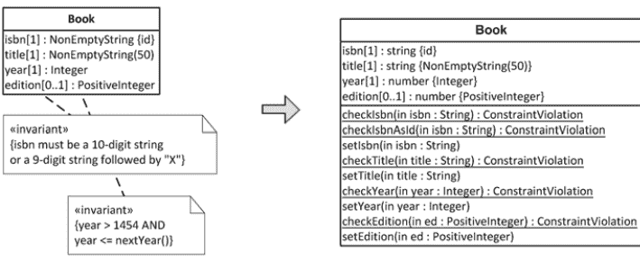

图 8.1 从信息设计模型到 JS 类模型

本质上，JavaScript 类模型通过为每个属性添加检查和 setters 扩展了设计模型。由于不变性（invariants）已在检查中处理，因此被去除了。属性范围已转换为 JavaScript 数据类型（并在大括号中提醒其真实范围）。注意，检查函数的名称带有下下划线，因为这是 UML 中类级（区别于实例级）操作的惯例。

## 8.4 设置文件夹结构并添加一些库文件

我们验证应用程序的 MVC 文件夹结构在最小应用结构的基础上进行了扩展，添加了一个 `lib` 文件夹，其中包含通用库 `browserShims.js`、`errorTypes.js` 和 `util.js`。因此，我们得到了如下文件夹结构：

```
publicLibrary
css
  main.css
  normalize.min.css
lib
  browserShims.js
  errorTypes.js
  util.js
src
  c
  m
  v
index.html
```

我们将在接下来的章节中讨论新增文件的内容。

### 8.4.1 在库文件中提供通用实用函数和 JavaScript 修复

我们在 `lib` 文件夹中增加了三个库文件：

- `browserShims.js` 包含不支持该函数的旧浏览器的字符串 `trim` 函数定义（该函数直到 2009 年的 ES5 才被引入 JavaScript）。还可以为其他最近定义的函数（如 `querySelector` 和 `classList`）添加更多浏览器 shim 到 `browserShims.js` 中。
- `util.js` 包含了几个实用函数的定义，例如 `isEmpty(x)`，用于测试 `x` 是否为非空字符串。
- `errorTypes.js` 定义了对应于上述属性约束基础类型的错误（或异常）类：`StringLengthConstraintViolation`、`MandatoryValueConstraintViolation`、`RangeConstraintViolation`、`IntervalConstraintViolation`、`PatternConstraintViolation`、`UniquenessConstraintViolation`。此外，定义了 `NoConstraintViolation` 类以便在没有约束违反的情况下返回验证结果对象。

### 8.4.2 创建起始页

起始页 `index.html` 通过两个 `link` 元素处理加载 CSS 页面样式文件：

## 8.5 在纯 JS 应用中实现验证

### 8.5 总结

- 将模型类编写为 JavaScript 函数。
- 将检查函数编写为类级（静态）方法。
- 将 setter 操作编写为（实例级）方法。
- 如果存在，将添加和删除操作编写为实例级方法。

这些步骤将在后续章节详细讨论。

### 8.5.1 将模型类编写为构造函数

`Book` 类被编写为相应的构造函数，所有属性通过 `slots` 参数提供。

```javascript
function Book(slots) {
  // 分配默认值
  this.isbn = ""; // string
  this.title = ""; // string
```

### 8.5.2 构造函数中的模型类

在构造函数体内，我们首先为类属性分配默认值。这些值在作为构造函数调用（不带参数）或仅带部分参数调用时会被使用。在注释中注明属性的范围是有帮助的。这需要将设计模型中的平台无关数据类型映射到相应的 JavaScript 数据类型，如下表所示。

# 表 8.1 数据类型映射

| 平台无关数据类型 | JavaScript 数据类型 | SQL |
|---|---|---|
| String | string | CHAR(n) or VARCHAR(n) |
| Integer | number (int) | INTEGER |
| Decimal | number (float) | REAL, DOUBLE PRECISION or DECIMAL(p,s) |
| Boolean | boolean | BOOLEAN |
| Date | Date | DATE |

由于 setter 可能会约束违反错误，因此构造函数和任何 setter 都应该在 `try-catch` 块中调用，其中 `catch` 负责处理错误（至少记录错误信息）。

与最小应用一样，我们添加了类级属性 `Book.instances`，以实体表的形式表示由应用管理的所有实例：

```javascript
Book.instances = {};
```

### 8.5.3 编写属性检查

将属性检查函数编写为类级（静态）方法。在 JavaScript 中，这意味着将它们定义为构造函数的方法槽，例如 `Book.checkIsbn`（构造函数是一个 JS 对象，因为在 JavaScript 中函数是对象，作为对象它可以拥有槽）。

确保类模型中指定的属性所有约束都正确地编写在其检查函数中。这特别涉及到强制性的

# 142 - 在纯 JS Web 应用中实现约束校验

标准标识声明（带有 `{id}`）隐含的值和唯一性约束，以及所有多重性为 1（这是显示多重性时的默认值）的属性的强制性值约束。如果违反了任何约束，将返回一个在 4.1 节列出且在 `errorTypes.js` 文件定义的错误类的错误对象。

例如，对于 `checkIsbn`，我们获得了以下代码：


# 8 在纯 JS Web 应用中实现约束验证

## 8.5 编写模型代码

```javascript
var checkIsbn = function (id) {
  if (!id) {
    return new NoConstraintViolation();
  } else if (typeof id != "string" || id.trim() == "") {
    return new NoConstraintViolation(
      "ISBN 必须是一个非空字符串!"
    );
  } else if (!/\d{9}(\d|X])/.test(id)) {
    return new PatternConstraintViolation(
      "ISBN 必须是 10 位字符串或 " +
n"9 位数字后跟 'X' 的字符串!"
    );
  } else {
    return new NoConstraintViolation();
}
```

注意，由于`checkIsbn`是`Book`的标准标识属性，我们只在`checkIsbnAsId`中检查语法约束，但我们在`checkIsbnAsId`中检查了强制性值和唯一性约束，它首先调用了`checkIsbn`：

```javascript
var checkIsbnAsId = function (id) {
  var constraintViolation = Book.checkIsbn(id);
  if (constraintViolation instanceof NoConstraintViolation) {
    if (!id) {
      constraintViolation = new MandatoryValueConstraintViolation(
        "必须提供 ISBN 的值!"
      );
    } else if (Book.instances[id]) {
      constraintViolation = new UniqueConstraintViolation(
        "已存在此 ISBN 的书籍记录!"
      );
    } else {
      constraintViolation = new NoConstraintViolation();
    }
  }
  return constraintViolation;
}
```

我们假设所有函数和设置器（setters）都能处理适当的数据值（属于属性范围类型的值）以及旨在代表正确数据值但尚未转换为属性范围类型的字符串值。我们采用这种方法是为了避免在用户界面（“视图”）代码中进行数据类型转换。注意，用户在 HTML 表单字段中输入的所有数据都是`String`类型，在检查其有效性并将其赋值给相应属性之前，必须进行转换（或反序列化）。最好在模型代码中执行这些类型转换，而不是在用户界面代码中。

例如，在我们的示例应用中，有一个整数值的年份`year`。当用户在创建或更新用户界面的相应表单字段中输入该属性的值时，表单持有的是字符串值。该值被传递给`Book.add`或`Book.update`方法，这些方法会调用`setYear`和`checkYear`方法。只有在通过验证后，该字符串会被转换为整数并赋值给`year`属性。

### 8.5.4 代码设置器属性

设置器操作作为（实例级）方法。在设置器中，会调用相应的函数，只有当检查没有检测到任何约束违反时才会设置属性。否则，将抛出检查函数返回的约束违反错误。例如，`setIsbn`操作的代码如下所示：

```javascript
Book.prototype.setIsbn = function (id) {
  var validationResult = Book.checkIsbnAsId(id);
  if (validationResult instanceof NoConstraintViolation) {
    this.isbn = id;
  } else {
    throw validationResult;
  }
}
```

对于其他属性（`title`、`year`和`edition`）也有类似的设置器。

### 8.5.5 添加序列化函数

拥有根据对象结构（由其类定义）定制的对象序列化函数是有用的，这样序列化对象的结果就是人类可读的字符串表示，显示对象的所有相关信息项。按照惯例，这些函数被称为`toString()`。对于`Book`类，我们使用以下代码：

```javascript
Book.prototype.toString = function () {
  return "Book{ISBN: " + this.isbn + ", title:" + this.title +
  ", year:" + this.year + (this.edition || ""); + "}";
}
```

### 8.5.6 数据管理操作

除了带有属性定义、检查和设置器的构造函数形式定义模型类，以及`toString()`序列化函数外，我们还需要将以下数据管理操作定义为模型类的类级方法：

- `Book.convertRec2Obj`和`Book.retrieve`用于从持久化数据存储中加载所有管理的`Book`实例。
- `Book.saveAll`用于将所有管理的`Book`实例保存到持久化数据存储中。
- `Book.add`用于创建新的`Book`实例并添加到`Book`实例集合。
- `Book.update`用于更新现有的`Book`实例。
- `Book.destroy`用于删除`Book`实例。
- `Book.createTestData`创建一些示例书籍记录作为测试数据。
- `Book.clear`用于清除书籍数据存储。

这些方法本质上与我们在第 1 部分讨论的最小应用程序中的代码相同，只是现在：

- 我们可能需要在过程`Book.convertRec2Obj`、`Book.add`中在合适的`try-catch`块中捕获约束违反；
- 我们可以创建更详细的状态信息以更好地观察发生了什么；
- 我们可以使用`toString()`函数来序列化对象。

注意，对于`add`和`update`操作，我们需要实现“全有全无”策略：当在设置器中检测到约束违反时，调用`add()`的创建将失败，取而显示违反错误消息。否则，新对象被添加到`Book.instances`中，如下：

```javascript
add = function (slots) {
  var book = null;
  try {
    book = new Book(slots);
  } catch (e) {
    console.log(e.constructor.name + ": " + e.message);
  }
  if (book) {
    Book.instances[book.isbn] = book;
    console.log(book.toString() + " created!");
  }
};
```

如果要更新模型类的对象，我们首先创建一个副本，以便在更新尝试失败时恢复它。在对象更新尝试中，我们只赋值已变化的属性，并在日志中报告。

通常，模型类定义的属性（除标准标识属性外）都可以更新。然而，也可以允许标准标识属性。这需要特殊处理，以确保对给定对象的旧标识符的所有引用也能得到更新。

当在`Book.update`的设置器中检测到约束违反时，更新尝试将失败，而是显示由设置器抛并在更新方法中捕获的约束违反错误消息，并恢复对象的之前的状态。否则，将创建一个状态消息，如下所示：

```javascript
Book.update = function (slots) {
  var book = Book.instances[slots.isbn],
  noConstraintViolated = true,
  updatedProperties = [],
  objectBeforeUpdate = util.cloneObject(book);
  try {
    if (book.title != slots.title) {
      book.setTitle(slots.title);
      updatedProperties.push("title");
    }
    if (book.year != parseInt(slots.year)) {
      book.setYear(slots.year);
      updatedProperties.push("year");
    }
    if (slots.edition && book.edition !== undefined) {
      // slots.edition 拥有一个非空新值
      book.setEdition(slots.edition);
      updatedProperties.push("edition");
    } else if (!slots.edition && book.edition !== undefined) {
      // slots.edition 拥有一个空新值
      delete book.edition;
      updatedProperties.push("edition");
    }
  } catch (e) {
    // 此处编写恢复逻辑
  }
};
```

注意可选属性（如`edition`）需要被特殊处理。如果用户在`Create`（创建）或`Update`（更新）用户界面中没有为它们输入任何值，表单字段的值将为空字符串 ""。对于可选属性，这意味着在`add`用例中该属性没有被赋值，或者它与强制属性的情况不同——在强制属性的情况下，从空表单字段获取的空字符串值可能是接受的，也可能是不接受的。

如果发生约束违反异常，错误信息将写入日志，并将相关对象重置为之前的之前的状态：

```javascript
Book.update = function (slots) {
  try {
  } catch (e) {
    console.log(e.constructor.name + ": " + e.message);
    noConstraintViolated = false;
    // 恢复对象到更新前的状态
    Book.instances[slots.isbn] = objectBeforeUpdate;
  }
  if (noConstraintViolated) {
    if (updatedProperties.length > 0) {
      console.log("Properties " + updatedProperties.toString() + \
        modified for book " + slots.isbn);
    } else {
      console.log("No property value changed for book " + \
        slots.isbn + " !!");
    }
  }
};
```

## 8.6 编写视图代码

用户界面（UI）由一个起始页面`index.html`组成，允许用户通过在 app 文件夹中使用`retrieveAndListBooks.html`或`createBook.html`相应的 UI 页面来选择数据管理操作之一。起始页面`index.html`已在第 4.2 节讨论过。

我们以按钮的形式渲染数据管理项。为了简单起见，我们直接从按钮的`onclick`事件处理程序调用`Book.clearData()`和`Book.createTestData()`方法。但请注意，通常最好使用`addEventListener(...)`注册此类事件处理函数，就像我们在所有其他情况下做的那样。

### 8.6.1 数据管理 UI 页面

每个数据管理 UI 页面都会加载与上述起始页面`index.html`相同的基础 CSS 和 JavaScript 文件。此外，它还会加载一个特定于用例的视图文件`src/v/useCase.js`，然后将用例的`setupUserInterface`程序设置为页面加载事件的事件处理程序，该程序负责在 UI 页面加载时初始化界面。

### 8.6.2 初始化应用程序

为了初始化应用程序，必须定义其命名空间及其 MVC 子命名空间。对于我们的示例应用，主命名空间定义为`pl`，代表“Public Library”（公共图书馆），三个子命名空间 m、v 和 c 初始为空对象：

```javascript
var pl = { m:{}, v:{}, c:{{} };
```

我们将此代码放在 c 文件夹下的`initialize.js`文件中中。

### 8.6.3 设置用户界面

为了设置数据管理用例的用户界面，我们需要将“检索/列所有”（Retrieve/List All）与其他情况（创建、更新、删除）区分开。后者需要使用 HTML 表单并向表单控件附加事件处理程序，而在“检索/列所有”的情况下，我们只需要渲染一个显示所有区块的表格，就像第 3 章讨论的最小应用程序（Minimal App）的情况一样。

对于创建、更新和删除用例，我们需要为以下项添加事件监听器：

- 表单输入事件的响应式验证；
- 用户点击（或按下）保存（或删除）按钮时的事件处理；
- 确保在`beforeload`事件发生（即浏览器窗口/标签页关闭时）之前保存主数据。

对于创建（Create）用例，我们获得了以下代码（在`v/createBook.js`中）：

```javascript
pl.createBook = {
  setupUserInterface: function () {
    var formEl = document.forms['Book'],
    saveButton = formEl.commit;
    // 加载所有书籍记录
    Book.retrieveAll();
    // 为响应式验证添加事件监听器
    formEl.isbn.addEventListener("input", function () {
formEl.isbn.setCustomValidity(
  Book.checkIsbnId(formEl.isbn.value).message);
});
formEl.title.addEventListener("input", function () {
  formEl.title.setCustomValidity(
    Book.checkTitle(formEl.title.value).message);
});
formEl.year.addEventListener("input", function () {
  formEl.year.setCustomValidity(
    Book.checkYear(formEl.year.value).message);
});
formEl.edition.addEventListener("input", function () {
  formEl.edition.setCustomValidity(
    Book.checkEdition(formEl.edition.value).message);
});
...
```

注意，对于每个输入字段，我们都添加了输入事件的监听器，这样任何用户输入都会执行验证检查，因为输入事件是由用户输入打字等输入动作创建的。使用 HTML5 验证 API 中预定义的`setCustomValidity`函数是为了在表单字段的当前值上调用我们的属性检查，并在发生约束违反时返回错误消息。因此，当`Book.checkIsbn(form.isbn.value).message`异常表示的字符串为空时，一切都是正常的。否则，浏览器将向用户指示约束违反。

除了响应式验证的事件处理程序外，我们还需要两个处理程序：

```javascript
pl.createBook = {
  setupUserInterface: function () {
    // ...
    // 提交事件处理器
    formEl.addEventListener('submit', function (e) {
      e.preventDefault();
      formEl.reset();
    });
    // 浏览器窗口/标签页关闭
    window.addEventListener("beforeunload", Book.saveAll());
  },
  handleButtonClick: function () {}
};
```

## 8.6 编写代码

虽然输入验证通过提供即时反馈增强了 UI 的可用性，但表单提交时的验证对于捕获无效数据更为重要。因此，`handleButtonClick()`处理程序再次执行检查，如下所示：


```javascript
handleButtonClick: function () {
  var formEl = document.forms['Book'];
  var slots = {isbn: formEl.isbn.value,
               title: formEl.title.value,
               year: formEl.year.value};
  // 在发生约束违反时设置消息
  formEl.setCustomValidity(
    Book.checkIsbnId(slots.isbn).message);
  formEl.setCustomValidity(
    Book.checkTitle(slots.title).message);
  formEl.year.setCustomValidity(
    Book.checkYear(slots.year).message);
  if (formEl.edition.value) {
    slots.edition = formEl.edition.value;
    formEl.setCustomValidity(
      Book.checkEdition(slots.edition).message);
  }
  // 只有当所有输入字段有效时才保存数据
  if (formEl.checkValidity()) Book.add(slots);
}
```

在表单元素上调用`checkValidity()`，可以确保只有在没有约束违反的情况下保存数据（通过`Book.add`）。在无效表单上执行`handleButtonClick`处理后，浏览器将接管并测试预定义的属性有效性是否有错误标记。在我们的方法中，使用了`setCustomValidity`，`validity.customError`将为`true`。如果是这种情况，将显示自定义约束违反（气泡形式）并阻止提交事件。

在更新（Update）用例的 UI 中（由`vupdateBook.js`处理），我们没有输入框，而是属性`isbn`的输出字段，因为它是不可修改的。因此，我们不需要对其进行验证。然而，我们需要一个选择列表（以 HTML`select`元素的形式），允许用户在修改数据之前第一步选择一个学习单元。为选择元素添加一个更改监听器，以便 UI 字段根据被选对象进行填充。

```javascript
pl.v.updateBook = {
  setupUserInterface: function () {
    // ...
```

```javascript
submitButton = formEL.commit,
selectBookEl = formEL.selectBook;
// set the book selection list
util.fillSelectOptions(Book.instances,
selectBookEl, "isbn", "title");
// when a book is selected, fill the form with its data
selectBookEl.addEventListener("change", function () {
  var bookKey, book = selectBookEl.value;
  if (bookKey) { // set form fields and set CustomValidity
    book = Book.instances[bookKey];
    ["isbn", "title", "year", "edition"].forEach(function (p) {
      formEL[p].value = book[p] !== undefined ? book[p] : "";
      formEL[p].setCustomValidity(""); // no error
    });
  } else formEL.reset();
});

// add listeners for responsive validation

// Set an event handler for the submit/save button

// neutralize the submit event

// Set a handler for the event when the browser window/tab is closed
,
handleSaveButtonOnClick: function () { ... }
;
```

无需为标准标识符属性`isbn`设置响应式验证，但对于所有其他字段，如上文的创建用例所示。

删除用例的`setUserInterface`方法逻辑是类似的。我们只需要确保要删除的对象可以通过提供选择列表来选中，就像更新用例中那样。删除用例也需要验证。

## 8.7 运行应用并获取代码

你可以从我们的服务器运行该验证应用⁴，或者将其下载⁵为 ZIP 压缩包。

- 4 http://web-engineering.info/tech/JsFrontendApp/ValidationApp/index.html

- 5 http://web-engineering.info/tech/JsFrontendApp/ValidationApp.zip

## 8.8 可能的变体与扩展

### 8.8.1 添加对象级验证函数

当模型类需要进行跨越两个或多个属性的对象级验证时，我们可以为它添加一个自定义验证函数`validate`，这样在保存之前就可以通过调用相关对象的`validate`来执行对象级验证。例如，为了表达图 7.1 所示模型类中定义的约束，我们定义了以下验证函数：

```javascript
Author.prototype.validate = function () {
  if (this.dateOfDeath && this.dateOfDeath < this.dateOfBirth) {
    throw new ValidationError(
      "dateOfDeath 必须在 dateOfBirth 之后!"
    );
  }
};
```

为模型类定义了`validate`函数后，可以在创建和更新方法中调用它。例如：

```javascript
Author.add = function (slots) {
  var author = null;
  try {
    author = new Author(slots);
    author.validate();
  } catch (e) {
    console.log(e.constructor.name + ": " + e.message);
  }
};
```

### 8.8.2 使用隐式 JS setter

从 ES5 开始，JavaScript 拥有了自己的形式的 setter（设置器），它们是隐式的，并且允许与显式 setter 方法具有相同的语义，但具有直接访问的简单语法。除了语法更简单的优点外，隐式 JS setter 也比显式 setter 更安全，因为它们减少了程序员在应该使用 setter 时通过直接属性赋值来绕过 setter 的概率。在其他 OOP 语言（如 Java）中，这种行为通过将属性声明为`private`来防止。但 JavaScript 并没有这个选项。

以下代码为属性`title`定义了隐式的 setter 和 getter 方法：

```javascript
Object.defineProperty(Book.prototype, "title", {
  set: function (t) {
    var validationResult = Book.checkTitle(t);
```

```javascript
if (validationResult instanceof NoConstraintViolation) {
    this.title = t;
} else {
    throw validationResult;
}

get: function() {
    return this._title;
}
```

注意，在构造函数定义中，用于存储属性值的内部属性`_title`并没有用于设置/获取它，而是使用了虚拟属性`title`：

```javascript
Book = function (slots) {
    this.learnUnitNo = 0;
    this.title = "";
    if (arguments.length > 0) {
        this.learnUnitNo = slots.learnUnitNo;
        this.title = slots.title;
    }
    // 可选属性
    if (slots.subjectArea) this.subjectArea = slots.subjectArea;
}
```

我们将在第 11 章开始使用隐式 setter 和 getter 方法以及 ES6 类定义。

## 8.9 注意事项

### 8.9.1 模板代码（Boilerplate code）

此示例应用手动编写代码的一个问题是大量的模板代码：

- 每个模型类都需要存储管理方法（`add`, `update`, `destroy` 等）；

- 每个模型类和每个属性都需要 getter、setter 和验证检查。

虽然为了学习应用开发而编写几次这些代码是好事，但当你以后处理真实项目时，你不希望再一遍一遍地编写它们。在第二卷中，我们将介绍如何将这些方法以通用形式放在一个元类（meta-class）中，以便它们可以在应用程序的所有模型类中复用。

### 8.9.2 配置 UI 以防止无效的用户输入

某些 UI 元素（如日期选择器）旨在防止用户输入无效数据。遗憾的是，许多浏览器尚未实现这些功能。

## 8.10 练习

要构建的应用目的是管理电影。就像教程中讨论的书籍应用一样，你可以完成以下操作：

### 8.10.1 项目 1 – 验证电影数据

在这个模型中，表达了以下约束：

- 由于`movieId`属性被声明为 Movie的标准标识符，它是强制的且唯一的。

- `title`属性是强制的（如其多重性 [1] 所示），并且具有长度约束，要求值最多有 120 个字符。

- `releaseDate`属性有一个区间约束：它必须大于或等于 1895-12。

注意`releaseDate`属性不是强制的，而是可选的，如其多重性 [0..1] 所示。

如果你对如何执行以下项目有任何疑问，可以在我们的讨论论坛上提问。

# 8.10 实践项目 — 155

更多电影数据可以在 IMDb 网站¹⁰ 找到。

## 8.10.2 项目 2 – 验证国家数据

要构建的应用目的是管理国家信息。该应用处理一种对象类型：国家（Country），如类图所示。

| Country |

| :--- |

| name[1]: :EmptyString(3,50) (id) |

| population[1]: :PositiveInteger |

| lifeExpectancy[1]: :PositiveDecimal(max:100) |

| militaryExpenditure[0..1] : Percentage |

在此模型中，表达了以下约束条件：

- 1. 由于`name`属性被声明为国家的标准标识符，因此它是必填的且唯一的。

- 2. `name`属性具有字符串长度限制，要求其值至少包含 3 个字符，最多包含 50 个字符。

- 3. `population`属性是必填的，如属性名称后面附加的多重性表达式 [1] 所示。

- 4. `lifeExpectancy`属性也是必填的，并且有一个区间约束：其值必须小于或等于 100。

注意，`militaryExpenditure`属性不是必填的，而是可选的，如其多重性表达式 [0..1] 所示。

除了列表中描述的约束外，还有通过为`name`分配`EmptyString`、为`population`分配`PositiveInteger`、为`lifeExpectancy`分配`PositiveDecimal`以及为`militaryExpenditure`分配`Percentage`而定义的隐式范围约束（提示：百分比值是 0 到 100 之间的小数）。在我们的纯 JavaScript 方法中，所有这些约束都编码在模型类中特定属性的检查函数内。

你可以使用下表所示的示例数据测试你的应用。

## 8 在纯 JS Web 应用中实现约束验证

表 8.3 国家示例数据

| 名字 | 人口 | 预期寿命 | 军费支出 (% GDP) |

| :--- | :--- | :--- | :--- |

| 德国 | 80,854,408 | 80.57 | 1.35 |

| 法国 | 66,553,776 | 81.75 | 1.9 |

| 俄罗斯 | 142,423,773 | 70.47 | 3.49 |

| 摩纳哥 | 30,535 | 89.52 | |

更多关于国家的数据可以在 CIA 世界事实库¹¹ 找到。

## 8.11 测验题

如果你想查询以下练习问题的答案，可以查看我们的讨论论坛¹²。如果你在论坛中没有找到答案，可以发帖提问特定问题的答案。

### 8.11 问题 1：setter 中的验证 (1)

补全以下 setter 代码段：

```javascript
Book.prototype.setIsbn = function (isbn) {
  var validationResult = _;
  if (validationResult instanceof NoConstraintViolation) {
    this.isbn = isbn;
  } else {
    _;
  }
};
```

### 8.11 问题 2：setter 中的验证 (2)

补全以下 setter 代码段：

```javascript
Book.prototype.setIsbn = function (isbn) {
  var validationResult = _;
  if (validationResult instanceof NoConstraintViolation) {
    this.isbn = isbn;
  } else {
  }
};
```

¹¹ https://www.cia.gov/library/publications/the-world-factbook/12

¹² http://web-engineering.info/forum/12

### 8.11.3 问题 3：在 JS 类模型中添加的方法

| Publisher (出版商) |

| :--- |

| name : String (id) |

考虑类图所示的简单信息设计模型。

在相应的 JavaScript 类模型中，必须必须向 Publisher 类添加哪些方法？选择一个或多个：

- `checkName( n: String): ConstraintViolation`

- `getName() : String`

- `setName( n: String)`

- `checkName( n: String): ConstraintViolation`

- `checkNameAsId( n: String): ConstraintViolation`

- `checkName( n: String): ConstraintViolation`

- `setName( n: String)`

注意，下划线方法名表示类级别（静态）方法。

### 8.11.4 问题 4：实现约束

| Person (人员) |

| :--- |

| name[1]: NonEmptyString {id} |

| age[0..1]: NonNegativeInteger |

考虑类图中为 Person 对象类型指定的约束。

以下哪个 JavaScript 代码段实现了这些约束？

选择一个：

- 1. O

```javascript
if (name === undefined) {

  return "A name is required!";

} else if (typeof name != "string" || name.trim() == "") {

  return "Name must be a non-empty string!";

} else if (age !== undefined) {

  if (!Number.isInteger(age) || age < 0) {

    return "age must be a non-negative integer!";

  }

}

 return ""; // no error
```

- 2. O

```javascript
if (name === undefined) {

    return "A name is required!";

} else if (typeof name !== "string") {

    return "Name must be a non-empty string!";

} else if (age !== undefined) {

    if (!Number.isInteger(age) || age < 0) {

        return "age must be a non-negative integer!";

    }

}

 return ""; // no error
```

- 3. O

```javascript
if (name === undefined) {

    return "A name is required!";

} else if (typeof name !== "string" || name.trim() == "") {

    return "Name must be a non-empty string!";
```


## 9.1 用于持久数据管理和约束验证的 Java 注解

```java
CREATE TABLE IF NOT EXISTS items (
itemCode varchar(10) NOT NULL PRIMARY KEY,
quantity int(11) NOT NULL
)
```

## 9.2 Bean Validation 注解

在 Java EE 验证方法中，Java 运行时验证可以以后放在属性、方法或类上的 Bean 验证注解的形式定义。

表 9.1 属性的 Bean Validation 注解

| 约束类型 | 注解 | 示例 |
|---|---|---|
| 字符串长度约束 | `@Size` | `@Size(min=8, max=80) String message;` |
| 基数约束（针对数组、集合和映射） | `@Size` | `@Size(min=2, max=3) List<Member> coChairs;` |
| 强制性值约束 | `@NotNull` | `@NotNull String name` |
| 数值型属性的范围约束 | `@Digits` | `@Digits(integer=6, fraction=2) BigDecimal price;` |
| 整数值属性的间隔约束 | `@Min` 和 `@Max` | `@Min(5) int teamSize` |
| 小数值属性的间隔约束 | `@DecimalMin` 和 `@DecimalMax` | `@DecimalMax("30.00") double voltage` |
| 模式约束 | `@Pattern` | `@Pattern(regexp="\\d(10)\\\") String isbn;` |

此外，还有一些注解要求日期值在未来（`@Future`）或过去（`@Past`）。

所有 Bean Validation 注解都有一个可选的 `message` 属性，用于定义自定义错误消息。在下文中，我们为 JPA 约束注解添加了两个带有消息的 `@NotNull` 注解和一个 `@Min` 注解。`@NotNull` 注解约束 `itemId` 和 `quantity` 属性为强制，而 `@Min` 注解约束 `quantity` 属性的最小值为 0：

```java
@Entity(name="items")
public class Item {
    @Id Column(length=8)
    @NotNull(message="An item code is required")
    @Size(min=8, max=8)
    private String itemCode;
    @Column(nullable=false)
    @NotNull(message="A quantity is required!")
    @Min(0)
    private int quantity;
}
```

注意，在这个示例中我们需要一些重复逻辑，因为相同的约束可能定义两次：一次作为 JPA 约束，一次作为 Bean Validation 约束。例如，对于像 `quantity` 这样的强制属性，我们既有 `@Column(nullable=false)` JPA 约束注解，又有 `@NotNull` Bean Validation 注解。

## 9.2 新问题

与第 4 章讨论的最小应用程序² 相比，我们必须处理许多新问题：

1. 在模型层中，我们必须为每个属性添加约束，在允许记录保存到数据库之前必须进行检查。
2. 在用户界面（视图）中，我们必须处理表单验证，当表单中输入的数据无效时向用户提供反馈。

在用户界面上对用户输入进行约束检查对于为用户提供即时反馈很重要。使用 JSF 和 Bean Validation 需要在执行验证检查之前提交表单。理想做法是仅在模型类中定义验证检查，并在表单提交前在用户界面中使用它们，而不需要在 JSF Facet 中重复验证逻辑。然而，目前 JSF 不支持这一点，验证仅在表单提交后才执行。

在 JSF Facet 使用 HTML5 验证属性在提交表单之前强制执行 HTML5 验证会导致不希望的验证逻辑重复。这种重复的影响会导致验证代码的重复维护，一次在模型类中，另一次在用户界面中。对于像我们的示例应用这样的简单应用程序，这是可行的，但在较大的应用程序中这很快就会变成维护噩梦。

> 2 http://web-engineering.info/tech/JavaJsfApp/MinimalApp/index.html

## 9.3 创建一个实体类模型

以图 7.2 所示的信息设计模型为起点，我们创建一个带有 getter/setter 和对应 Java 数据类型的**实体类模型**。

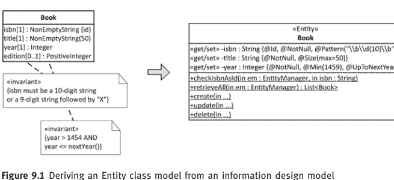

图 9.1 从信息设计模型派生实体类模型

图 9.1 右侧所示的实体类模型为所有属性定义了 getter 和 setter，并包含以下属性约束：

1. 使用 `@Id` 和 `@NotNull`，`isbn` 属性被声明为标准标识符，意味着它是**强制的**且**唯一**的。
2. 使用 `@NotNull` 和 `@Size(max=50)`，`isbn` 属性具有**模式**约束，要求其值必须匹配 ISBN-10 格式（简化为 10 位字符串的情况）。
3. 使用 `@NotNull`，`title` 属性是**强制的**，且字符串长度最大为 50 个字符。
4. 使用 `@NotNull`、`@Min(1459)` 和自定义注解 `@UpToNextYear`，`year` 属性是**强制的**，并具有**间隔约束**，这是一种特殊形式，最大值不是固定的，而是由实现日历算术函数 `nextYear()` 的自定义注解提供的。

由于没有预定义的用于年份唯一性的注解，我们在第 6 节为该约束定义了自定义注解。

## 9.4 在 Java EE Web 应用中实现验证

## 9.4 编写模型代码

在本节中，我们为属性添加 JPA 约束注解和 Bean Validation 注解。我们首先根据下表映射平台无关的类型。

表 9.2 类型到 Java

| 平台无关类型 | Java 类型 |
|---|---|
| String | `String` |
| Integer | `long` |
| Decimal | `Double` |
| Boolean | `Boolean` |
| Date | `Date` |

对于小数的精确计算，对应的数据类型需要第二次映射：

表 9.3 类型到 MySQL

| 平台无关类型 | MySQL 数据类型 |
|---|---|
| String | `VARCHAR` |
| Integer | `INT` |
| Decimal | `DECIMAL` |
| Boolean | `BOOL` |
| Date | `DATETIME` or `TIMESTAMP` |

## 9.4.1 使用注解编码约束

在以下类中使用 JPA 注解和 Bean Validation 编码完整性约束：

```java
@Entity(table="books")
@ManagedBean(name="book")
public class Book {
    @Id(length=10)
    @NotNull(message="ISBN value is required!")
    @Pattern(regexp="\\d(10)\\\", message="The ISBN must be a 10-digit string!")
    private String isbn;
    @Column(nullable=false)
    @NotNull(message="A title is required!")
    @Size(max=255)
    private String title;
    @Column(nullable=false)
    @NotNull(message="A year is required!")
    @Min(value=1459, message="The year must not be before 1459!")
    private Integer year;

    // 构造函数、setter 和 getter

    public static Book getObjectById(...) {...}
    public static List<Book> getAllObjects(...) {...}
    public static void create(...) throws Exception {...}
    public static void update(...) throws Exception {...}
    public static void delete(...) throws Exception {...}
}
```

注意，对于 `year` 属性，使用了 Java `Integer` 包装类而不是原始 `int` 数据类型。这对于使用 JSP 和 JPA 是必要的，因为如果在创建或更新表单中提交了空输入字段的值，通过 `setYear` 方法传递给 `year` 属性的值将是 null（详情见第 4.5 节“要求非空字符串”），这对于 Java 的原始数据类型是不允许的。

# 9 在 Java EE Web 应用中实现约束校验

我们仅提供方法的概述。更多详细信息，请参阅第 4 章。

## 9.4.3 检查唯一性约束

为了避免重复的 Book（书籍）记录，我们必须检查 `isbn` 值是唯一的。在数据库层面，由于 `isbn` 列是主键，这已经通过检查，DBMS 会确保其值的唯一性。然而，我们希望在数据传递给 DBMS 之前在 Java 程序中进行此检查。遗憾的是，没有用于此功能的 Bean Validation 注解，而且并不清楚如何通过自定义验证注解来实现。我们需要编写一个静态方法 `Book.checkIsbnAid` 来检查 `isbn` 属性的值是否唯一。该方法可以由控制器在创建新的 Book 记录之前对任何 `isbn` 属性进行验证。`Book.checkIsbnAid` 方法所示：

```java
public static void checkIsbnAid(EntityManager em, String isbn)
throws UniquenessConstraintViolation,
MandatoryValueConstraintViolation {
    if (isbn == null) {
        throw new MandatoryValueConstraintViolation(
            "An ISBN is required!");
    } else {
        Book book = Book.retrieve(em, isbn);
        // book was found, uniqueness constraint validation failed
        if (book != null) {
            throw new UniquenessConstraintViolation(
                "There is already a book record with this ISBN!");
        }
    }
}
```

如果为给定的 `isbn` 值找到了 Book 记录，该方法将抛出 `UniquenessConstraintViolation` 异常。可以捕获该异常并在 UI 中显示相应的错误消息。在本章的后续部分，我们将展示如何定义验证方法并通知 JS facelets 必须使用它来校验 `isbn` 表单输入。

请注意，在这种情况下，我们还需要检查 `isbn` 值并拒绝空值，因为 `@NotNull` 校验只有稍后触发（即当 Book 的 `isbn` 属性被设置时），因此在此时我们可能会从 `Book.retrieve` 方法得到 `NullPointerException`。

## 9.4.4 处理与模型相关的异常

上一个小节讨论的 `Book.checkIsbnAsId` 方法设计用于结合控制器使用，以便用户在尝试重复 Book 记录时（即如果 `isbn` 值已在现有记录中使用）能够收到错误消息。然而，如果直接使用 `Book.create` 方法（例如通过其他代码段，其中没有通过调用 `Book.checkIsbnAsId` 执行唯一性校验），则唯一性校验可能会失败。让我们来看 `Book.create` 的代码：

```java
public static void create(EntityManager em, UserTransaction ut,
String isbn, String title, int year)
throws UnsupportedException, SystemException,
IllegalStateException, SecurityException,
HuristicMixedException, HeuristicRollbackException,
ExistsException {
    Book book = new Book(isbn, title, year);
    em.persist(book);
    ut.commit();
}
```

该方法在尝试运行 `persist` 或 `commit` 方法时可能会抛出多个异常。其中一个异常（即 `EntityExistsException`）是由 `ut.commit` 抛出的。调用 `Book.create` 的方法可以捕获此异常并执行特定操作，例如回滚事务。在我们的情况下，`Book.create` 是由 `create` action 调用的，执行的操作是在 Controller 类和控制台中显示异常堆栈跟踪，并调用 `ut.rollback`，后者负责取消当前事务执行的任何数据库更改。其余异常由其父类（即 `Exception`）捕获，异常堆栈跟踪显示在控制台中。

```java
public String create(String isbn, String title, int year) {
    try {
        Book.create(em, ut, isbn, title, year);
    } catch (EntityExistsException e) {
        try {
            ut.rollback();
        } catch (Exception e) {
            e.printStackTrace();
        }
        e.printStackTrace();
    } catch (Exception e) {
        e.printStackTrace();
    }
    return "create";
}
```

注意：`EntityExistsException` 是 `javax.persistence` 包的一部分（即 `javax.persistence.EntityExistsException`）。TomEE 使用 Apache OpenJPA 的 JPA API 实现，这使得 `EntityExists` 类（以及其他异常类）成为 `org.apache.jpa.persistence` 包的一部分。因此，在我们的代码中使用此异常需要导入 `org.apache.persistence.EntityExistsException` 而不是 `import javax.persistence.EntityExistsException`，并将 `openjpa-xxx.jar`（位于 TomEE 安装文件夹的 lib 子文件夹中）添加到 Java 类路径中，以便能够使用 Eclipse 或其他 IDE 工具编译代码。

## 9.4.5 要求非空字符串

通常，像 `title` 这样的强制性字符串值属性需要非空字符串，这在我们的模型中通过范围 `NonEmptyString` 表示。为了将字符串视为无值，必须在 `web.xml` 中 `javax.faces.INTERPRET_EMPTY_STRING_SUBMITTED_VALUES_AS_NULL` 的上下文路径为 `true`：

```xml
<context-param>
    <param-name>javax.faces.INTERPRET_EMPTY_STRING_SUBMITTED_VALUES_AS_NULL</param-name>
    <param-value>true</param-value>
</context-param>
```

此外，对于验证逻辑，我们还需要处理以下代码片段中的条件检查：

```java
if (name === undefined) {
    return "A name is required!";
} else if (typeof name !== "string" || name.trim() == "") {
    return "Name must be a non-empty string!";
} else if (age !== undefined) {
    if (!Number.isInteger(age) || age < 0) {
        return "age must be a non-negative integer!";
    }
}
return ""; // no error
```

以及：

```java
} else if (age !== undefined) {
    if (!Number.isInteger(age) || age < 0) {
        return "age must be a non-negative integer!";
    }
}
return ""; // no error
```

1 http://docs.oracle.com/javaee/7/tutorial/doc/bean-validation001.htm#GIRCZ

## 162 — 9 在 Java EE Web 应用中实现约束验证


```xml
<context-param>
  <param-name>
    javax.faces.INTERPRET_EMPTY_STRING_SUBMITTED_VALUES_AS_NULL
  </param-name>
  <param-value>true</param-value>
</context-param>
```

## 9.5 编写视图代码

在 Java EE 模型层和数据库层定义好约束之后，我们需要处理用户界面中的校验。

### 9.5.1 创建情况下的校验

在创建情况下，`WebContent/views/create.xhtml` 文件已更新，以便其使用消息元素显示在 UI 中：

```xml
<ui:composition template="WEB-INF/templates/page.xhtml">
  <ui:define name="headerTitle">
    <h1>Create a book!</h1>
  </ui:define>
  <ui:define name="main">
    <h:form id="createForm">
      <div>
        <h:outputLabel for="isbn">ISBN: </h:outputLabel>
        <h:inputText id="isbn" value="#{book.isbn}" />
        </h:outputLabel>
        <h:message for="isbn" errorClass="error" />
      </div>
      <div>
        <h:outputLabel for="title">Title: </h:outputLabel>
        <h:inputText id="title" value="#{book.title}" />
        </h:outputLabel>
        <h:message for="title" errorClass="error" />
      </div>
    </h:form>
  </ui:define>
</ui:composition>
```

控制器的校验方法抛出 `ValidatorException`，将错误消息（`ValidatorException` 构造函数的第三参数）传递给相应的 JSF facet。作为 JSF 验证器的方法具有特定的语法。前两个参数 `FaceContext`、`UIComponent` 用于容器调用方法并引用视图组件，并且可用于更复杂的校验。最后一个参数 `Object` 代表由方法校验的值。该值必须转换为目标类型（在示例中为 `String`）。需要知道，如果执行了不兼容类型，校验将失败并抛出异常。

```java
public void checkIsbnId(FacesContext context, UIComponent component, Object value)
throws ValidatorException {
    String isbn = (String) value;
    try {
        Book.checkIsbnAid(em, isbn);
    } catch (UniquenessConstraintViolation e) {
        throw new ValidatorException(new FacesMessage(
            FacesMessage.SEVERITY_ERROR, e.getMessage(),
            getMessage()));
    } catch (MandatoryConstraintViolation e) {
        throw new ValidatorException(new FacesMessage(
            FacesMessage.SEVERITY_ERROR, e.getMessage(),
            getMessage()));
    }
}
```

### 9.5.2 更新情况下的校验

在更新情况下，`WebContent/views/update.xhtml` 文件已更新，以便其使用消息元素显示在 UI 中：

```xml
<ui:composition template="WEB-INF/templates/page.xhtml">
  <ui:define name="headerTitle">
    <h1>Update a book record!</h1>
  </ui:define>
  <ui:define name="main">
    <h:form id="updateBookForm">
      <div>
        <h:outputLabel for="selectBook">Select book: </h:outputLabel>
        <h:selectOneMenu id="selectBook" value="#{book.isbn}">
        </h:selectOneMenu>
        </h:outputLabel>
        <h:message for="selectBook" errorClass="error" />
      </div>
      <div>
        <h:outputLabel for="isbn">ISBN: </h:outputLabel>
        <h:outputText id="isbn" value="#{book.isbn}" />
        </h:outputLabel>
      </div>
    </h:form>
  </ui:define>
</ui:composition>
```

## 9.6 定义自定义校验注解

```xml
</div>

</h:form>
<ui:define>
</ui:composition>
```

由于我们不允许更改书籍的 ISBN，因此我们使用 JSF 元素 `h:outputText` 为 `isbn` 属性创建了一个输出字段。这意味着没有进行任何校验。

使用 `h:outputText` 元素显示实体属性的值会生成一个 HTML `span` 元素。这意味着 HTTP 表单提交中不包含关于该属性的信息。如果校验失败，我们希望看到表单连同错误信息一起。为了获得预期的结果，我们需要对实体类 `pl.m.` 使用 `@ViewScoped` 注解而不是 `@RequestScoped`；否则，由 `book` 变量引用的 Bean 实例在每次请求时都会初始化为新值，这意味着表达式 `#{book.isbn}` 结果为 `null`，导致 ISBN 值无法显示。`@ViewScoped` 注解指定实体 Bean 的生命周期与关联的视图一样长，并且可以在视图存在期间通过 `book` 变量进行显示。

相比之下，HTML 输入元素中的 `h:inputText` 元素是表单提交内容的一部分，响应中包含了已有的值，因为在这种情况下这些值是已知的。这种考虑表明选择正确的 Bean 作用域非常重要。

## 9.6 定义自定义校验注解

我们必须考虑的完整性约束之一是年份的允许值，它必须在 `[1459, nextYear()]` 范围内，其中 `nextYear()` 是一个函数调用表达式。我们可能会想到使用 `@Min` 和 `@Max` 来指定约束，但这是可能的，因为 `@Max` 注解（以及任何其他注解）不允许表达式，只允许数据字面量。因此，虽然我们可以用 `@Min(value=1459)` 表示区间的下界，但我们需要另一个方案来表示上界。

幸运的是，Bean Validation API 允许通过执行约束检查的自定义代码来定义自定义校验注解。这意味着我们可以自由表达任何类型的校验逻辑。创建和使用自定义注解需要以下步骤：

- 1. 使用以下代码创建 `UpToNextYear` 注解：

```java
@Target({ElementType.FIELD, ElementType.METHOD})
@Retention(RetentionPolicy.RUNTIME)
@Constraint(validatedBy = UpToNextYearImpl.class)
public interface UpToNextYear {
    String message() default "年份的值必须在 1459 到明年之间！！";
    Class<?[]> groups() default {};
    Class<? extends Payload[]> payload() default {};
}
```

该接口需要定义三个方法：`message`（当违反约束时返回默认键或错误消息）、`groups`（允许指定该约束所属的校验组）以及 `payload`（用于 Bean Validation API 的客户端，用于将自定义负载对象分配给约束 - 此属性不被 `@Target` 注解使用，后者定义了可以被注解的元素类型，在本例中为字段/属性和方法）。`@Constraint` 注解允许指定执行校验的实现类，在本例中为 `UpToNextYearImpl`。

- 2. 创建带有校验代码的实现类：

```java
public class UpNextYearImpl implements ConstraintValidator<UpToNextYear, Integer> {
    private Calendar calendar;

    @Override
    public void initialize(UpToNextYear arg) {
        this.calendar = Calendar.getInstance();
        this.calendar.setTime(new Date());
    }

    @Override
    public boolean isValid(Integer year, ConstraintValidatorContext context) {
        if (year == null || year > this.calendar.get(Calendar.YEAR) + 1) {
            return false;
        }
        return true;
    }
}
```

该实现类需要两个参数：之前定义的注解接口（例如 `UpToNextYear`），以及校验器可以处理的元素类型（例如 `Integer`，因此隐式对应兼容的原始类型 `int`）。`initialize` 方法允许初始化用于执行校验检查所需的变量。`isValid` 方法负责执行校验：如果校验成功则必须返回 `true`，否则返回 `false`。`isValid` 方法的第一个参数表示要被校验的值，其类型必须与 `ConstraintValidator` 第二个类型参数定义的类型兼容（在本例中为 `Integer`）。

- 3. 在涉及的属性或方法上加上注解：

```java
@Entity
@Table(name = "books")
public class Book {
  @Min(value = 1459)
  @UpToNextYear
  private Integer year;
  //...
}
```

## 9.7 运行应用并获取代码

你可以在我们的服务器上运行校验应用⁵，或者下载作为 ZIP 压缩包的代码⁶。请遵循我们的说明⁷为运行 Java EE Web 应用程序准备环境。

## 9.8 可能的变体与扩展

### 9.8.1 对象级约束校验

我们考虑一个不绑定到特定属性，但必须通过检查对象的多个属性来完成检查的约束示例，我们考虑对 `Author::dateOfDeath` 属性进行校验。首先，该属性的任何值都必须在过去，这可以通过 `@Bean Validation` 注解指定；其次，`dateOfDeath` 的任何值必须在相关对象的 `dateOfBirth` 值之后。这种对象级约束无法通过预定义的 Bean Validation 注解表示。我们可以借助自定义类级注解来表示它，如下所示：

## 9.74 在 Java Web 应用中实现约束校验

```java
@Target(ElementType.TYPE)
@Retention(RetentionPolicy.RUNTIME)
@Constraint(validatedBy = AuthorValidatorImpl.class)
publicinterface AuthorValidator {
    String message() default "死亡日期必须在出生日期之后";
    Class<?[]> groups() default {};
    Class<? extends Payload[]> payload() default {};
}
```

与属性约束定义相比，唯一的区别是 `@Target` 是 `ElementType.TYPE`。在实现类中（例如 `AuthorValidatorImpl`），现在在类约束的情况下，我们可以访问多个属性。

```java
public class AuthorValidatorImpl implements ConstraintValidator<AuthorValidator, Author> {
    @Override
    public void initialize(AuthorValidator arg) {}

    @Override
    public boolean isValid(Author author, ConstraintValidatorContext context) {
        if (author.getDateOfDeath() != null && author.getDateOfDeath().before(author.getDateOfBirth())) {
            return false;
        }
        return true;
    }
}
```

使用类级校验器需要一些调整，因为它们不被 JSF 直接支持。对于要校验的字段，我们必须指定控制器方法：

```xml
<ui:composition template="WEB-INF/templates/page.xhtml">
<ui:define name="main">
<h:form id="createForm">
<div>
<h:outputLabel for="dateOfDeath" value="死亡日期:" />
<h:inputText id="dateOfDeath" value="#{author.dateOfDeath}">
<f:convertDateTime pattern="yyyy-MM-dd" />
</h:inputText>
<h:message for="dateOfDeath" styleClass="error" />
</div>
<div>
<h:commandButton value="创建" action="#{authorCtrl.create(author.personId, author.name, author.dateOfBirth, author.dateOfDeath)}"/>
</div>
</h:form>
</ui:define>
</ui:composition>
```

控制器方法必须调用 Bean Validation API，校验变化会转换为 `javax.faces.validator.ValidatorException` 异常，这些异常由 JSF 管理并显示在视图中。代码如下：


```java
public void checkOfDeath(FacesContext context, Date value) {
    boolean isCreateForm = (UIForm) context.getRootView().findComponent("createLoginForm") != null;
    String name = isCreateForm ? "createLoginForm" : "updateAuthorForm";
    UIInput inputPersonId = isCreateForm ? (UIInput) context.getRootView().findComponent(name + "personId") : null;
    UIInput outputPersonId = isCreateForm ? (UIInput) context.getRootView().findComponent(name + "personId") : null;
    UIInput inputName = (UIInput) context.getRootView().findComponent(name + "name");
    UIInput dateOfBirthInput = (UIInput) context.getRootView().findComponent(name + "dateOfBirth");
    ValidatorFactory factory = factory.buildDefaultValidatorFactory();
    Validator validator = factory.getValidator();
    Author author = new Author();
    if (isCreateForm)
        author.setPersonId((Integer) inputPersonId.getValue());
    else
        author.setPersonId((Integer) outputPersonId.getValue());
    author.setName((String) inputName.getValue());
    author.setDateOfBirth((Date) dateOfBirthInput.getValue());
    author.setDateOfDeath((Date) value);
    Set<ConstraintViolation<Author>> constraintViolations = validator.validate(author);
    for (ConstraintViolation<Author> cv : constraintViolations) {
        if (cv.getMessage().contains("date of death")) {
            throw new ValidatorException(new FacesMessage(cv.getMessage()));
        }
    }
}
```

## 176 - 9 在 Java EE Web 应用中实现约束验证

```java
FacesMessage.SEVERITY_ERROR, cv.getMessage(),
cv.getMessage());

}
```

虽然该方法看起来很复杂，但它负责以下简单任务：通过`context.getViewRoot().findComponent`方法访问数据并提取用户输入值。注意组件的名称为：`forName:formElementName`。使用 JSF 特定验证器方法提供的`FacesContext`实例创建`Author`实例并设置从表单中提取的相应数据。

- 使用`javax.validation.Validator`类手动调用 Bean Validation API 验证器。

- 遍历验证器异常，选择与自定义验证字段相对应的异常，并将它们映射到`javax.faces.validator.ValidatorException`异常。可以通过查看异常管理器中的特定数据来完成选择。

结果是，使用了自定义的 Bean Validation 验证器，当验证失败时，facelet 能够像属性验证情况一样渲染相应的错误消息。

### 9.8.2 JSF 自定义验证器

对象级验证的另一种方法是使用 JSF 自定义验证器。它们的优点是可以直接在 facelets 中支持，但这种方法的缺点是由于在 UI 中定义业务规则而不是在模型中定义，它违反了洋葱架构。

对于我们的示例，`Author`类中负责验证`dateOfDeath`并与`dateBirth`的验证器所示：

```java
@FacesValidator("AuthorValidator")
public class AuthorValidator implements Validator {
    @Override
    public void validate(FacesContext context, UIComponent component,
    Object value) throws ValidatorException {
        Date dateOfDeath = (Date)value;
        boolean isCreateForm = (UIComponent)context.getViewRoot().findComponent("createAuthorForm") != null;
        String formName = isCreateForm ? "createAuthorForm:" : "updateAuthorForm:";
        UIInput dateBirthInput = (UIComponent)context.getViewRoot().
        findComponent(formName + "dateOfBirth");
```

## 9.9 实践项目

```java
Date dateBirth = (Date)dateOfBirth.getValue();
if (dateBirth.after (dateOfDeath)) {
    throw new ValidatorException ( new FacesMessage(
        "死亡日期不应在出生日期之后!");
    )
}
```

然后，对于相应的字段，必须指定验证器：

```xml
<h:outputLabel for="dateOfDeath" value="死亡日期: " />
<h:inputText id="dateOfDeath" type="date" value="#{author.dateOfDeath}">
    <f:validator validatorId="AuthorValidator" />
    <f:convertDateTime pattern="yyyy-MM-dd" />
</h:inputText>
<h:message for="dateOfDeath" errorClass="error" />
```

### 9.9.1 项目 1 – 验证电影数据

要构建的应用的目的是管理电影信息。该应用只处理一种对象类型：Movie，如下类图所示。

| Movie |

| --- |

| movieId[1] : PositiveInteger {id} |

| title[1] : NonEmptyString(120) |

| releaseDate[0..1] : Date |

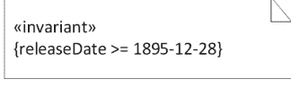

在此模型中，表达了以下约束：

- 由于`movieId`属性被声明为 Movie 的标准标识，因此它是强制且唯一的。

- `title`属性是强制的，如其重数表达式 [1]所示，并且具有字符串长度限制，要求值最多包含 120 个字符。

- `releaseDate`属性具有区间约束：它必须大于等于 1895-12-28。

### 9.9.2 项目 2 – 验证国家数据

注意`releaseDate`属性不是强制的，而是可选的，如其重数表达式 [0,1]所示。除了列表中描述的约束外，通过为`movieId`分配数据类型`PositiveInteger`、为`title`分配`NonEmptyString`以及为`release`分配`Date`定义了隐含范围约束。

你可以使用表 8.2 显示的示例数据来测试你的应用程序。

要构建的应用的目的是管理国家信息。该应用只处理一种对象类型：Country，如下类图所示。

| |

|---|---|

| name[1] : NonEmptyString(3,50) (id) |

| population[1] : PositiveInteger |

| lifeExpectancy[1] : PositiveDecimal{max:100} |

| militaryExpenditure[0,1] : Percentage |

在此模型中，表达了以下约束：

1. 由于`name`属性被声明为 Country 的标准标识，因此它是强制且唯一的。

2. `name`属性具有字符串长度限制，要求值至少有 3 个且最多 50 个字符。

3. `population`属性是强制的，如附加在属性名上的重数所示。

4. `lifeExpectancy`属性也是强制的，并具有区间约束：其值必须小于或等于 100。

注意`militaryExpenditure`属性不是强制的，而是可选的，如其重数表达式 [0,1]所示。

除了列表中描述的约束外，通过为`name`分配数据类型`NonEmptyString`、为`population`分配`PositiveInteger`、为`lifeExpectancy`分配`PositiveDecimal`以及为`militaryExpenditure`分配`Percentage`定义了隐含范围约束。

## 9.10 测验

如果你想查找以下问题的答案，可以查看我们的论坛。如果你在论坛中没有答案，可以针对问题创建一个帖子。

### 9.10.1 问题 1：字符串长度

完成以下代码的正确 Bean 验证注解，使`title`属性的最小长度为 2，最大长度为 40：

```java
@Entity(name="books")
public class Book {
@
    private String title;
}
```

### 9.10.2 问题 2：要求值

在 Java 模型和数据库层都需要非空值的注解：

1. @NotNull("不能为空")

2. @Column(nullable = false)

3. @Size(min = 0)

4. @Min(value = 0)

### 9.10.3 问题 3：定义自定义注解

完成以下定义`LessThan100YearsOld`注解的代码，检查给定的`Date`属性不超过 100 年，且 Java 实现类为`LessThan100YearsImpl`：

```java
@Target(ElementType.FIELD) @Constraint(validatedBy = LessThan100YearsImpl.class)
public @interface LessThan100YearsOld {
    String message() default "日期不能超过 100 年";
}

public class LessThan100YearsImpl
    implements ConstraintValidator<LessThan100YearsOld, Date> {
    @Override
    public void initialize(LessThan100YearsOld arg) {}
    @Override
    public boolean isValid(Date date, ConstraintValidatorContext context) { }
}
```

### 9.10.4 问题 4：JSF 自定义验证方法

完成以下 JSF 代码片段，使`Book`实体的`title`属性通过自定义方法`Book::checkTitle`进行验证：

```xml
<h:form id="createBookForm">
    <h:outputLabel value="Title:">
        <h:inputText id="title" value="#{book.title}" />
    </h:outputLabel>
</h:form>
```

### 9.10.5 问题 5：使用 JSF 显示错误消息

完成以下 JSF 代码片段，使得验证`book`实体的`title`属性产生的任何（可能的）错误消息都能显示在用户界面中：

```xml
<h:form id="createBookForm">
    <h:outputLabel for="title" value="Title:">
        <h:inputText id="title" value="#{book.title}" />
    </h:outputLabel>
    <h:message for="title" errorClass="error" />
</h:form>
```

# 第三部分 枚举

在几乎任何应用程序中，我们都需要处理具有固定可能值集合并代表名称的属性。这些属性被称为**枚举属性**，而它们的固定值集合被称为**枚举**。

## 10 枚举与枚举属性

### 10.1 枚举

在所有应用领域中，都存在具有固定字符串列表的字符串值属性。这些属性被称为*枚举属性*，而定义其字符串值的固定值列表被称为*枚举*。例如，当我们必须管理关于人的数据时，通常需要包含有关其性别的信息。*性别*属性的可能值可能被限制在*枚举标签*“male（男性）”、“female（女性）”和“undetermined（未定）”之一，或者在**枚举代码**“M”、“F”和“U”之一。每当我们处理代码时，我们也需要它们对应的标签，至少在解释每个代码含义的图例中要有。

与其使用字符串值作为枚举属性的内部值，不如使用简化的内部表示，例如正整数 1, 2, 3 等，因为这些整数在程序代码中不会揭示它们的含义（含义由枚举标签指示）。为了可读性，我们可以使用特殊的常量，称为**枚举字面量**，例如`M`或`F`，并加上枚举名前缀，如`this.gender = GenderEL`。注意，我们遵循枚举字面量名称全部大大写的约定，并且我们还使用“EL”作为枚举后缀的约定，代表“enumeration literal（枚举字面量）”（这样我们可以从名称`GenderEL`识别出该数据类型的实例是一个“性别枚举字面量”）。

还有以记录作为实例的枚举，其中一个记录字段提供了枚举字面量的名称。此类枚举的一个示例是下面的*测量（measurement）*列表：

表 10.1 以表格形式表示记录的枚举

| 单位符号 | 单位名称 | 维度 |

| --- | --- | --- |

| m | meter | 长度 |

| kg | kilogram | 质量 |

| g | gram | 质量 |

| s | second | 时间 |

| ms | millisecond | 时间 |

注意，“单位符号”和“单位名称”字段都是唯一的，其中任何一个都可以用枚举字面量的名称。

总而言之，我们可以区分以下三种形式的枚举：

- 1. 简单枚举定义了一个自解释其义的枚举标签列表；

- 2. 代码列表定义了一组代码/标签对。

- 3. 记录枚举由记录列表组成，因此它们的定义方式类似于类，使用简单属性来定义记录字段。

这三种形式的枚举将在下文中进行详细讨论。

注意，由于枚举被用作枚举属性的范围，因此它们被视为数据类型。

枚举可能具有进一步的特征。例如，我们可能希望通过扩展现有枚举来定义新枚举。在编程语言和其他计算语言中，枚举通过不同的特性实现。另见关于枚举的维基百科文章¹。

### 10.1.1 简单枚举

简单枚举定义了一个固定的自解释其义的枚举标签列表，如下所示 UML 类图中的 GenderEL 枚举示例。

| enumeration |

| --- |

| GenderEL |

| MALE |

| FEMALE |

| UNDETERMINED |

由于简单枚举的标签以大大写形式作为对应枚举字面量的名称（`GenderEL.MALE`、`GenderEL.FEMALE`等），我们也可以在 UML 枚举数据类型中列出（全大写的）枚举字面量，而不是对应的（小写或混合大小）枚举标签。

### 10.1.2 代码列表

代码列表是一种定义了固定代码/标签对的枚举。不幸的是，UML 枚举数据类型的概念不支持区分作为枚举字面量的代码和它们的标签。为了在 UML 类图中以枚举数据类型的形式同时定义代码和标签，我们可以使用数据类型矩形的属性隔间（attribute compartment），使用代码作为属性名称来定义枚举字面量，并将它们的初始值设置为相应的标签。这种方法产生了如下所示的可视化表示：

```
enumeration
GenderEL
M = male
F = female
U = undefined
```

在代码列表的情况下，我们可以同时使用代码或标签作为枚举字面量的名称，但为了简洁，使用代码似乎更优（`GenderEL.M`、`GenderEL.F`等）。对于显示枚举属性的值，在空间足够的情况下，可以选择不仅显示标签，还显示代码，例如“male (M)”。如果空间是问题，则可以显示代码。

### 10.1.3 记录枚举


记录枚举定义了一个记录类型，其中有一个唯一字段专门用于提供枚举字面量，以及该类型的一组固定记录列表。通常，记录是由一组字段定义（以原始数据类型属性的形式）定义的，其中其中一个唯一字段被定义为枚举字面量字段，以及一组操作定义。

不幸的是，记录枚举作为枚举数据类型的通用形式，尚未被当前的 UML (2.5) 支持，而该版本支持枚举数据类型的通用形式。然而，我们可以通过使用包含枚举类型属性的类来对它们进行建模。

### 10.1.4 可扩展枚举

可能存在需要扩展的枚举情况，例如可以向列表中添加新值，如图 10.1 所示。由于枚举被用作枚举属性的范围，因此它们被视为数据类型。

> 1 http://en.wikipedia.org/wiki/Enumerated_type

## 10.3 计算语言中的枚举 (Enumerations)

信息建模语言（如 UML 类图）、数据模式定义语言（如 XML Schema，但 SQL 不支持）以及许多编程语言（如 C++ 和 Java，但 JavaScript 不支持原生枚举）都直接支持对枚举的定义。

### 10.3.1 SQL 中的枚举

遗憾的是，标准 SQL 不支持枚举。某些数据库系统（如 MySQL 和 Postgres）在 `CREATE TABLE` 语句中提供了其自己的 SQL 列定义扩展，允许定义枚举值的列。

MySQL 枚举²被指定为列定义中使用 `ENUM` 关键字列出的枚举标签列表，如下所示：

```sql
CREATE TABLE people (
  name VARCHAR(40),
  gender ENUM('MALE','FEMALE', 'UNDETERMINED')
);
```

Postgres 枚举³被指定为一种特殊的用户定义类型，可以用于列定义：

```sql
CREATE TYPE GenderEL AS ENUM ('MALE','FEMALE', 'UNDETERMINED');
CREATE TABLE people (
  name text,
  gender GenderEL
);
```

### 10.3.2 XML Schema 中的枚举

在 XML Schema 中，枚举数据类型可以定义为一个简单类型，通过如下方式对原始类型 `xs:string` 进行限制：

```xml
<xs:simpleType name="BookCategoryEL">
  <xs:restriction base="xs:string">
    <xs:enumeration value="NOVEL"/>
    <xs:enumeration value="BIOGRAPHY"/>
    <xs:enumeration value="TEXTBOOK"/>
  </xs:restriction>
```

² https://dev.mysql.com/doc/refman/5.7/en/enum.html

3 http://postgresguide.com/sexy/enums.html

```xml
<xs:enumeration value="OTHER"/>
<xs:restriction>
<xs:simpleType>
```

### 10.3.3 JavaScript 中的枚举

在 JavaScript 中，我们可以定义一个特殊的 JS 对象，为每个枚举字面量设置属性，使得属性名称为枚举字面量的名称（枚举标签或大写），其值为相应的索引。实现这种方法的方法是使用 `Object.defineProperties` 方法：

这种定义允许在程序语句中使用枚举 `BookCategoryEL.NOVEL`、`BookCategoryEL.BIOGRAPHY` 等，代表枚举索引 1, 2, 3 和 4。注意这种定义如何满足枚举字面量（如 `BookCategoryEL.NOVEL`）是常量且其值在程序执行期间不能更改的要求。这是通过 `Object.defineProperties` 方法中的属性描述符 `writable: false` 实现的。

我们还可以使用一种更通用的方法，以特殊 JS 对象的格式定义一个元类 `Enumeration`：

```javascript
function Enumeration (enumLabels) {
  var i=0, LBL=""; this.MAX = enumLabels.length;
  this.labels = enumLabels;
  // 生成大写的键/属性作为枚举字面量
  for (i=1; i <= enumLabels.length; i++) {
    LBL = enumLabels[i-1].toUpperCase();
    this[LBL] = i;
  }
  // 防止对枚举进行任何更改
  Object.freeze(this);
}
```

## 10 枚举与枚举属性

使用这个 `Enumeration` 类可以如下方式定义新的枚举：

```javascript
var BookCategoryEL = new Enumeration({"novel","biography","textbook","other"});
```

拥有枚举 `BookCategoryEL` 后，我们就可以通过测试其值是否小于 1 且不大于 `BookCategoryEL.MAX`，来检查枚举属性（如 `category`）是否具有允许的值。此外，可以通过以下方式获取标签：

```javascript
formEL.category.value = BookCategoryEL.labels[this.category -1];
```

作为一个示例，我们考虑以下带有枚举属性 `category` 的 `Book` 模型：

```javascript
function Book(slots) {
  this.isbn = ""; // string
  this.title = ""; // string
  this.category = 0; // number (BookCategoryEL)
  if (arguments.length > 0) {
    this.setIsbn(slots.isbn);
    this.setTitle(slots.title);
    this.setCategory(slots.category);
  }
}
```

为了对枚举属性 `category` 的输入值验证，我们可以使用以下函数：

```javascript
Book.checkCategory = function (c) {
  if (!c) {
    return new MandatoryInputValueViolation(
      "A category must be provided!");
  } else if (!Number.IsInteger(c) || c < 1 ||
    c > BookCategoryEL.MAX) {
    return new RangeConstraintViolation(
      "The category must be a positive integer " +
      "not greater than " + BookCategoryEL.MAX + " !"
    );
  } else {
    return new NoConstraintViolation();
  }
}
```

注意枚举 `BookCategoryEL` 定义的约束是如何被检查的：测试输入值 `c` 是否为正整数，以及它是否不大于 `BookCategoryEL.MAX`。

## 10.4 在设计模型中处理枚举属性

我们再次考虑之前考虑过的简单数据管理问题。因此，我们应用程序的目的仍然是管理书籍信息。但现在我们有了四个额外的枚举属性，如下图 10.2 中的 UML 类图所示：

- 单值必填属性 `originalLanguage`，其数据类型为枚举；

- 多值可选属性 `otherLanguages`，其数据类型为枚举；

- 单值必填属性 `category`，其数据类型为枚举；

- 多值必填属性 `publicationForms`，其数据类型为枚举。

| «invariant> | {isbn 为 10 位字符串或 9 位字符串} |

|---|---|

| Book | |

| isbn[1]: EmptyString(id) | |

| title[1]: EmptyString(50) | |

| originalLanguage[1]: LanguageEL | |

| otherLanguages[*]: LanguageEL | |

| category[1]: BookCategoryEL | |

| publicationForms[1..]: LanguageEL | {year > 0 and nextYear()} |

| LanguageEL | |

| BookCategoryEL | |

| en = English | |

| de = German | |

| fr = French | |

| es = Spanish | |

| novel textbook other | «enumeration> |

| PublicationFormEL | |

| hardcover | |

| paperback | |

图 10.2 设计模型

注意 `otherLanguages` 和 `publicationForms` 是多值的，正如 `[*]` 和 `[1..]` 所示。这意味着属性的值是枚举字面量集合，例如 `{ePub, PDF}`，在 JavaScript 中表示表示枚举字面量数组，如 `[PublicationFormEL.EPUB, PublicationFormEL.PDF]`。

该设计模型及其枚举属性含义可以通过示例数据填充所示：

| ISBN | 标题 | 原始语言 | 其他语言 | 类别 | 出版形式 |

|---|---|---|---|---|---|

| 0553345842 | The Mind's | English (en) | de, es, fr | novel | paperback, ePub, PDF |

| 1463794762 | The Critique of Pure Reason | German (de) | de, es, fr, ru | other | paperback, PDF |

| 1928565379 | The Critique of Practical Reason | German (de) | de, es, fr, ru | other | paperback |

| 0465030793 | A Strange Loop | English (en) | es | textbook | hardcover, ePub |

表 10.2 Book 的示例数据

## 10.5 测试题

如果你想查看以下测试题的答案，可以查看我们的论坛。如果你在论坛中没有找到，可以发帖询问特定问题的答案。

### 10.5.1 问题 1：支持枚举的语言

哪些语言通过提供定义枚举的结构构造直接支持枚举？单选或多：

- Java

- JavaScript

- UML 类图

- C++

- XML Schema

- SQL

### 10.5.2 问题 2：单值枚举属性的 UI 控件

以下（组合）HTML 元素可以作为单值枚举属性的表单控件（或 UI 控件）？单选或多：

- 包含多个相同名称单选框的 `fieldset` 元素

- 包含多个相同名称复选框的 `fieldset` 元素

- `select` 元素

- 复选框元素

- 单选框元素

## 10.5.3 问题 3：多值枚举属性的 UI 组件

以下哪些 HTML 元素（或组合）可以作为多值枚举属性的表单控件（或 UI 组件）？选择一个或多个：

- 设置了 `multiple="multiple"` 属性的 `select` 元素

- 包含多个具有相同名称的 `radio`（单选）元素的 `fieldset` 元素

- 包含多个具有相同名称的 `checkbox`（复选）元素的 `fieldset` 元素

- `checkbox` 元素

- `radio`（单选）元素

## 11 在原生 JS Web 应用中实现枚举属性

在本章中，我们将展示如何使用原生 JavaScript 构建一个带有**枚举属性**的前端应用程序。除了枚举属性主题外，我们还展示了如何处理**多值属性**，因为在许多情况下，枚举属性是多值的。

## 11.1 新问题

与第 2 部分讨论的验证应用¹ 相比，我们现在要处理以下新问题：

- 我们将基于 ES5 构造函数的模型类 `Book` 定义替换为相应的 ES6 `class` 定义。

- 我们不再定义显式的设置器（setters），而是利用 ES5 属性的隐式 `get/set` 方法功能。

- 枚举数据类型必须作为模型代码的一部分以适当的方式定义。

- 枚举属性必须在模型类中定义，并在合适的选择组件的帮助下在用户界面中处理。

在编码方面，新问题是：

- 在**模型代码**中，我们必须处理：

- 为 `Book` 定义一个 ES6 `class` 而不是构造函数（带有其 `prototype` 对象的额外槽位）；

- 为 `Book` 类定义中的所有属性定义 `get/set` 方法；

- 借助工具类（元类）`Enumeration-` 来定义**枚举**，该类将在下文中讨论；

- 定义**单值枚举属性** `originalLanguage` 和 `category`，以及它们的检查函数 `checkOriginalLanguage` 和 `checkCategory`；

- 定义**多值枚举属性** `AvailableLanguages` 和 `publicationForms`，以及它们的检查函数 `checkAvailableLanguages` 和 `checkPublicationForms`；

- 扩展方法 `Book.update` 和 `Book.prototype.toString`，以便它们能够处理新增的枚举属性。

## 11.2 创建 JavaScript 类模型

2. 在用户界面（“视图”）代码中，我们必须处理：

- a. 在 `retrieveAllListBooks.html` 中添加新表格列，并在 `createBook.html` 和 `updateBook.html` 中添加合适的选择组件；

- b. 在 `p.v.retrieveAndListAllBooks` 的 `setupUserInterface()` 方法中为新属性创建输出；

- c. 在 `p.v.createBook` 和 `p.v.updateBook` 的 `setupUserInterface()` 方法中允许为新属性输入。

## 11.2 创建 JavaScript 类模型

以图 10.2 所示的信息设计模型为起点，我们创建一个 JavaScript 模型，本质上是通过给属性打上 "get/set" 构型（意味着它们具有隐式的 getter 和 setter）并添加（类级别的）检查方法来实现：

```
«invariant>
{isbn 必须是一个 10 位字符串
或是 9 位字符串后跟一个 "X"}
```

| Book |

| :--- |

| <get/set> isbn[1] : NonEmptyString(id) |

| <get/set> title[1] : NonEmptyString(50) |

| <get/set> originalLanguage[1] : LanguageEL |

| <get/set> otherAvailableLanguages[*] : LanguageEL |

| <get/set> category[1] : BookCategory |

| <get/set> publicationForm[*] : PublicationForm |

| checkISBN(String) : ConstraintViolation |

| checkISBNId(in String) : ConstraintViolation |

| checkTitle(in String) : ConstraintViolation |

| checkOriginalLanguage(in : LanguageEL) : ConstraintViolation |

| checkAvailableLanguage(in : LanguageEL) : ConstraintViolation |

| checkAvailableLanguages(in : array(LanguageEL)) : ConstraintViolation |

| checkBookCategory(in String) : ConstraintViolation |

| checkPublicationForm(in pf : PublicationForm) : ConstraintViolation |

| checkPublicationForms(in pf : array(PublicationForm)) : ConstraintViolation |

图 11.1 Book 的类模型

注意，模型中的 "get/set" 构型显示，对于任何多值枚举属性，我们都添加了类级别的检查方法。（注：原文此处存在大量重复，已根据结构进行了清理。）

## 11 在原生 JS Web 应用中实现枚举属性

在本章中，我们将展示如何使用原生 JavaScript 构建一个带有**枚举属性**的前端应用程序。除了枚举属性主题外，我们还展示了如何处理**多值属性**，因为在许多情况下，枚举属性是多值的。

## 11.1 新问题

与第 2 部分讨论的验证应用¹ 相比，我们现在要处理以下新问题：

- 我们将基于 ES5 构造函数的模型类 `Book` 定义替换为相应的 ES6 `class` 定义。

- 我们不再定义显式的设置器（setters），而是利用 ES5 属性的隐式 `get/set` 方法功能。


- 枚举数据类型必须作为模型代码的一部分以适当的方式定义。
- 枚举属性必须在模型类中定义，并在合适的选择组件的帮助下在用户界面中处理。

在编码方面，新问题是：

- 在**模型代码**中，我们必须处理：
  - 为`Book`定义一个 ES6 `class`而不是构造函数（带有其`prototype`对象的额外槽位）；
  - 为`Book`类定义中的所有属性定义`get/set`方法；
  - 借助工具类（元类）`Enumeration`来定义**枚举**，该类将在下文中讨论；
  - 定义**单值枚举属性**`originalLanguage`和`category`，以及它们的检查函数`checkOriginalLanguage`和`checkCategory`；
  - 定义**多值枚举属性**`AvailableLanguages`和`publicationForms`，以及它们的检查函数`checkAvailableLanguages`和`checkPublicationForms`；
  - 扩展方法`Book.update`和`Book.prototype.toString`，以便它们能够处理新增的枚举属性。

## 11.2 创建 JavaScript 类模型

2. 在用户界面（“视图”）代码中，我们必须处理：
  - a. 在`retrieveAllListBooks.html`中添加新表格列，并在`createBook.html`和`updateBook.html`中添加合适的选择组件；
  - b. 在`p.v.retrieveAndListAllBooks`的`setupUserInterface()`方法中为新属性创建输出；
  - c. 在`p.v.createBook`和`p.v.updateBook`的`setupUserInterface()`方法中允许为新属性输入。

## 11.2 创建 JavaScript 类模型

以图 10.2 所示的信息设计模型为起点，我们创建一个 JavaScript 模型，本质上是通过给属性打上 "get/set" 构型（意味着它们具有隐式的 getter 和 setter）并添加（类级别的）检查方法来实现：

```
«invariant>
{isbn 必须是一个 10 位字符串
或是 9 位字符串后跟一个 "X"}
```

| Book |
| :--- |
| `<get/set> isbn[1] : NonEmptyString(id)` |
| `<get/set> title[1] : NonEmptyString(50)` |
| `<get/set> originalLanguage[1] : LanguageEL` |
| `<get/set> otherAvailableLanguages[*] : LanguageEL` |
| `<get/set> category[1] : BookCategory` |
| `<get/set> publicationForm[*] : PublicationForm` |
| `checkISBN(String) : ConstraintViolation` |
| `checkISBNId(in String) : ConstraintViolation` |
| `checkTitle(in String) : ConstraintViolation` |
| `checkOriginalLanguage(in : LanguageEL) : ConstraintViolation` |
| `checkAvailableLanguage(in : LanguageEL) : ConstraintViolation` |
| `checkAvailableLanguages(in : array(LanguageEL)) : ConstraintViolation` |
| `checkBookCategory(in String) : ConstraintViolation` |
| `checkPublicationForm(in pf : PublicationForm) : ConstraintViolation` |
| `checkPublicationForms(in pf : array(PublicationForm)) : ConstraintViolation` |

# 198 11 在纯 JS Web 应用程序中实现枚举属性

```js
}
this.codeList = enumArg;
// 使用代码作为枚举字面量的名称
this.enumListNames = Object.keys(this.codeList);
this.labels = this.enumListNames.map(function (c) {
    return enumArg[c] + " (" + c + ")";
});
...
;
```

注意`this.labels`中的代码列表标签通过在括号中附加其代码来完成扩展的。

## 11.5 编写模型代码

### 11.5.1 编写枚举代码

在元类`Enumeration`的帮助下，枚举以以下方式进行编码：

```js
var PublicationFormEL = new Enumeration(
    "hardcover","paperback","ePub","PDF"
);
var BookCategoryEL = new Enumeration(
    "novel","biography","textbook","Other"
);
var LanguageEL = new Enumeration({"en":"English",
    "de":"German","fr":"French","es":"Spanish"}
);
```

注意`LanguageEL`定义了一个代码列表枚举，而`PublicationFormEL`定义了一个简单的枚举。

### 11.5.2 将模型类编写为 ES6 类

我们希望在设置属性值时，检查新属性值是否满足该属性的所有约束。确保在赋值之前对新值进行验证的最佳实践是使用 setter（存器）方法来分配属性，并在 setter 中调用检查。我们可以为属性定义显式的 setter 方法（如`setIsbn`），也可以使用 JavaScript 的隐式 getter 和 setter 结合内部属性名（如`_isbn`）。我们在验证应用程序中使用了显式 setter。现在，在枚举应用程序的`Book`类定义中，我们使用 JavaScript 的隐式 getter 和 setter，因为它们提供了更符合用户习惯的语法，并且可以在 ES6 类定义中方便地进行定义。

`Book`类以 ES6 类的形式编写，其所有属性都通过内部属性名（以`_`为前缀）定义，并从构造函数中`slots`参数的相应键值槽中分配值：

```js
class Book {
  constructor (slots) {
    // 为强制性属性分配默认值
    this._isbn = ""; // string
    this._title = ""; // string
    // 调用构造函数时传入了非空 slots 参数？
    if (typeof slots === "object" && Object.keys(slots).length > 0) {
      // 通过调用隐式 setter 分配属性
      this._isbn = slots.isbn;
      this._title = slots.title;
    }
  }
}
```

### 11.5.3 隐式 getter 和 setter

对于每个属性，我们使用预定义的 JS 关键字`get`和`set`定义隐式 getter 和 setter：

```js
class Book {
  ...
  get isbn () {
    return this._isbn;
  }
  set isbn (isbn) {
    var validationResult = Book.checkIsbnAs(isbn);
    if (validationResult instanceof NoConstraintViolation) {
      this._isbn = isbn;
    } else {
      throw validationResult;
    }
  }
}
```

注意隐式 getter 和 setter 访问相应的内部属性，如`_isbn`。这种方法基于这样一个假设：该内部属性通常不会被直接访问，而仅通过其 getter 或 setter 访问。由于我们通常可以假设开发者遵守这一规则（而且团队中没有恶意开发者），这种方法通常是足够安全的。然而，也有提议通过使用 ES6`Symbols`为内部属性生成随机名称来确保安全性（避免直接访问）。

### 11.5.4 编写枚举属性检查

将枚举属性检查编写为类级（`static`）函数，这些函数检查参数是否为有效的枚举索引，且不小于 1 也不大于枚举的`MAX`值。例如，对于获取的`checkOriginalLanguage`函数，我们得到了以下代码：

```js
class Book {
    static checkOriginalLanguage(l) {
        if (l == undefined || l == "") {
            return new MandatoryConstraintViolation(
                "必须提供原始语言!");
        } else if (!util.isIntegerOrString(l) || parseInt(l) < 1 || parseInt(l) > LanguageEL.MAX) {
            return new RangeConstraintViolation(
                "语言值无效：" + l);
        } else {
            return new NoConstraintViolation();
        }
    }
}
```

对于多值枚举属性（如`publicationForms`），我们将验证代码拆分为两个检查函数：一个检查值是否为有效的枚举索引（`checkPublicationForm`），另一个检查一组值集合中的所有成员是否为有效的枚举索引（`checkPublicationForms`）。第一个检查的编写如下：

```js
static checkPublicationForm(p) {
    if (p == undefined) {
        return new MandatoryConstraintViolation(
            "未提供出版形式!");
    } else if (!Number.isInteger(p) || p < 1 || p > PublicationFormEL.MAX) {
        return new RangeConstraintViolation(
            "出版形式值无效：" + p);
    } else {
        return new NoConstraintViolation();
    }
}
```

第二个检查首先测试参数是否为非空数组（代表至少包含一个元素的集合），然后检查数组的所有元素：

```js
static checkPublicationForms(pubForms) {
  var i=0, validationResult=null;
  if (pubForms == undefined) {
    return new MandatoryConstraintViolation(
            "未提供出版形式!");
  } else if (!Array.isArray(pubForms)) {
    return new RangeConstraintViolation(
            "出版形式必须是数组!");
  } else {
    for (i=0; i < pubForms.length; i++) {
      validationResult = Book.checkPublicationForm(pubForms[i]);
      if (!(validationResult instanceof NoConstraintViolation)) {
        return validationResult;
      }
    }
    return new NoConstraintViolation();
  }
}
```

### 11.5.5 编写序列化函数

对象的序列化函数`toString()`现在需要包含枚举属性的值：

```js
class Book {
  toString() {
    return "Book{ ISBN:"+ this.isbn + ", title:"+ this.title +
      +", originalLanguage:"+ this.originalLanguage +
      +", otherAvailableLanguages:"+this.otherAvailableLanguages.toString() +
      +", category:"+this.category +
      +", publicationForms:"+this.publicationForms.toString() + "}";
  }
```

对于多值枚举属性，我们调用了数组定义的`toString()`函数。

### 11.5.6 数据管理操作

与验证应用相比，数据管理操作有两个新问题：

- 我们必须确保`Book.update`使用的`util.cloneObject`方法处理数组属性的复制，而我们之前没有做这一点。
- 在`Book.update`方法中，我们现在必须检查数组属性的值是否变化，这需要测试两个数组是否相等。为了代码的可读性，我们在`Array.prototype`中添加了数组相等性测试，如下：

```js
Array.prototype.isEqualTo = function (a2) {
  return (this.length === a2.length) && this.every(function (el, i) {
    return el === a2[i];
  });
}
```

这允许我们以以下方式表示这些测试：

```js
if (book.publicationForms.isEqualTo(slots.publicationForms)) {
  book.setPublicationForms(slots.publicationForms);
  updatedProperties.push("publicationForms");
}
```

### 11.5.7 创建测试数据

在`Book.createTestData()`创建的测试记录中，我们现在需要为单值和多值枚举属性提供值。为了可读性，我们使用枚举字面量而不是枚举索引：

```js
Book.createTestData = function () {
  try {
    Book.instances["006251587X"] = new Book(isbn:"006251587X",
      title:"Weaving the Web", originalLanguage: LanguageEL.EN,
      otherAvailableLanguages:[LanguageEL.DE, LanguageEL.FR],
      category: BookCategoryEL.NOVEL,
      publicationForms:[PublicationFormEL.EPUB,
      PublicationFormEL.PDF]);
    Book.saveAll();
  } catch (e) {
    console.log(e.constructor.name + " : " + e.message);
  }
};
```

# 11.6 编写代码

示例应用中创建新书籍记录的用户界面如图 11.2 所示。

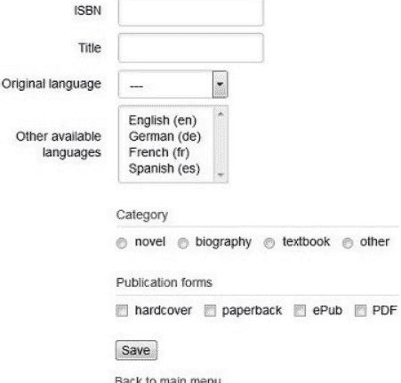

图 11.2 使用枚举属性创建新书籍记录的 UI

注意，UI 包含了四个选择控件：
1. 用于`originalLanguage`属性的单选列表
2. 用于`otherAvailableLanguages`属性的多选列表
3. 用于`category`属性的单选按钮组
4. 用于`publicationForms`属性的复选框

## 11.6.1 选择列表

我们在`create-Book.html`和`updateBook.html`的 HTML 表单中使用 HTML 选择列表来渲染`originalLanguage`和`otherAvailableLanguages`枚举属性。由于`otherAvailableLanguages`属性是多值的，我们需要为它提供多选列表，如 HTML 代码所示：

```html
<form id="Book">
  <div><label>ISBN:
  <input name="isbn" type="text" /></label></div>
  <div><label>标题:</label></div>
  <div><label>原始语言:
  <select name="originalLanguage"></select>
  </label></div>
  <div class="multi-sel"><label>其他可用语言:
```


# 11.1 在纯 JS Web 应用中实现枚举属性

| 电影 (Movie) | «枚举»(enumeration) |
|---|---|
| `movield[1]`: 正整数 (id) `title[1]`: 非空字符串 | `MovieRatingEL` |

与相应的验证应用项目相比，增加了两个属性：可选的单值枚举属性`rating`（评分）和多值枚举属性`genres`（类型）。

按照教程，你必须处理以下内容：

1. 借助元类`Enumeration`来定义枚举数据类型`MovieRatingEL`和`GenreEL`；
2. 定义单值枚举属性`Movie::rating`；
3. 定义多值枚举属性`Movie::genres`；
4. 扩展方法`Movie.update`和`Movie.prototype.toString`，以便它们能够处理新增的枚举属性。

在你的应用程序模型代码中，在用户界面（“视图”）代码中，你现在需要处理：

1. 在`retrieveAndListAllMovies.html`中添加新表格列，并在`createMovie.html`和`updateMovie.html`中切换选项；
2. 在`retrieveAndListAllMovies.setupUserInterface()`方法中为枚举属性创建输出；
3. 在`v.createMovie.setupUserInterface()`和`v.updateMovie.setupUserInterface()`方法中允许枚举属性的输入。

你可以使用以下示例数据来测试你的应用程序：

**表 11.1** 关于评分和类型的电影示例数据

| 电影 ID | 标题 | 评分 | 类型 |
|---|---|---|---|
| 1 | 高种俗小说 (Pulp Fiction) | R | 犯罪, 剧情 |
| 2 | 星际大战 (Star Wars) | PG | 动作, 冒险, 奇幻, 科幻 |
| 3 | 卡洛洛布兰 (Casablanca) | PG | 剧情, 黑色电影, 浪漫, 战争 |
| 4 | 教父 (The Godfather) | R | 犯罪, 剧情 |

# 11.8 实践项目 — 209

更多电影数据可以在 IMDb 网站⁸找到。

# 11.8.2 项目 2 – 添加国家代码和宗教作为枚举属性

要构建的应用程序目的是管理国家信息。该应用程序仅处理一种对象类型`Country`（国家）以及两个枚举，如类图所示。

| 国家 (Country) |
|---|
| `name[1]`: 非空字符串(id) |
| `code[1]`: `CountryEL`(key) |
| `population[1]`: 正整数 |
| `lifeExpectancy[..1]`: 正小数(max:100) |
| `religions[*]`: `ReligionEL` |

| «enumeration» | «enumeration» |
|---|---|
| `CountryEL` | `ReligionEL` |
| DE = 德国 | 天主教教 |
| FR = 法国 | 新教 |
| RU = 俄罗斯 | 正教 |
| MC = 摩纳哥 | 印度教 |
| IN = 印度 | 伊斯兰教 |
| | 太太教 |

与相应的验证添加应用项目相比，增加了两个属性：单值枚举属性`code`，这是一个“键”属性（意味着唯一性约束），以及多值枚举属性`relions`。

你可以使用以下示例数据来测试你的应用程序：

| 名称 | 代码 | 预期寿命 | 宗教 |
|---|---|---|---|
| 德国 | DE | 80,854,408 | 80.57 | 新教, 天主教, 伊斯兰教 |
| 法国 | FR | 66,533,766 | 81.75 | 天主教, 伊斯兰教 |
| 俄罗斯 | RU | 142,423,773 | 70.47 | 正教, 伊斯兰教 |
| 摩纳哥 | MC | 30,535 | 89.52 | 天主教 |

更多关于国家的数据可以在 CIA 世界事实库⁹找到。

⁸ http://www.imdb.com
⁹ https://www.cia.gov/library/publications/the-world-factbook/

# 11.9 测验题

如果你想查找以下测验题的答案，可以查看我们的论坛¹⁰。如果你在论坛中没有找到答案，可以创建一个帖子来询问特定问题的答案。

# 11.9.1 问题 1：检查枚举属性的范围约束

完成以下代码片段，以检查范围为`GenderEL`的枚举属性`gender`的范围约束：

```
Person.checkGender = function (g) {

  if (!Number.isInteger(g) || g < 1 || g > 2) {

    return new RangeConstraintViolation("Invalid gender value!");

  } else {

    return new NoConstraintViolation();

  }

}
```

# 11.9.2 问题 2：计算 MAX

完成以下代码片段，在建议的`Enumeration`类中计算特殊枚举字面量`MAX`：

```
function Enumeration(labels) {

  this.MAX = ...

}
```

# 12 在 Java EE Web 应用中实现枚举属性

在本章中，我们将展示如何使用 JPA 和 JSF 构建带有枚举属性的后端 Web 应用程序。除了枚举属性主题，我们还展示了如何处理多值属性。

## 12.1 新问题

与第 9 章的验证应用相比，我们必须处理以下问题：

1. 必须以适当的方式在模型代码定义枚举类型。
2. 在模型类中定义枚举属性，并在用户界面中通过选择组件进行处理。

在编码方面，新问题是：

1. 在**模型代码**中，我们必须处理
   a. 以`enum`类形式定义的**枚举**；
   b. 单值枚举属性，如`Book::rating`，使用`@Enumerated`注解并处理数据库值；
   c. 多值枚举属性，如`Book::publicationForms`，使用`@Convert`注解和转换器；
   d. 在`create`和`update`方法中通过选择组件处理枚举属性。
2. 在用户界面中：
   a. 在`retrieveAndListAllMovies.html`中添加新表格列，并在`createMovie.html`和`updateMovie.html`中切换选项；
   b. 在`retrieveAndListAllMovies.setupUserInterface()`方法中为枚举属性创建输出；
   c. 在`v.createMovie.setupUserInterface()`和`v.updateMovie.setupUserInterface()`方法中允许枚举属性的输入。

## 12.2 创建实体

使用图 12.1 所示的模型作为起点，创建一个实体，并添加 Getter 和 Setter，以及相应的 JPA 注解：

| 实体 (Entity) | Book |
|---|---|
| `@Id @Column(length=10)` |
| `@NotNull(message="An ISBN value is required!")` |
| `@Pattern(regexp="\b\d(9)(\\d(X))\\b", message="_")` |
| `private String isbn;` |
| `@Column(nullable=false)` |
| `@NotNull(message="A title is required!")` |
| `private String title;` |
| `@Column(nullable=false)` |
| `@NotNull(message="An original language is required!")` |
| `@Enumerated(EnumType.STRING)` |
| `private LanguageEL originalLanguage;` |
| `@Convert(converter=pl.m.converter.OtherAvailableLanguagesConverter.class)` |
| `private Set<LanguageEL> otherAvailableLanguages;` |
| `@Column(nullable=false)` |
| `@Size(min=1, message="At least one publication form is required!")` |
| `@Convert(converter=pl.m.converter.PublicationFormsConverter.class)` |
| `private Set<PublicationForm> publicationForms;` |

图 12.1 带有枚举的 Book 类

## 12.3 编写代码

### 12.3.1 枚举

简单的枚举如`BookCategoryEL`和`PublicationFormEL`以以下方式通过 Java `enum`定义：

```java
public enum BookCategoryEL {

    NOVEL,

    BIOGRAPHY,

    TEXTBOOK,

    OTHER;

}
```

注意枚举以逗号分隔的形式定义。

对于像`LanguageEL`的代码列表，每个枚举实例包含一个代码和一个标签，我们使用代码作为枚举，并使用允许创建代码和标签实例的私有构造函数。这在 Java 中是可行的，枚举是一种特殊的类。枚举字面量列表中的每一项都是构造函数的调用：

```java
public enum LanguageEL {

    EN ("English"),

    DE ("German"),

    FR ("French"),

    ES ("Spanish");

    private final String label;

    private LanguageEL (String label) { this.label = label; }

    public String getLabel() { return this.label; }

}
```

### 12.3.2 JPA 实体

`Book`实体通过 JPA 注解类属性，以及每个类属性的 setter 和 getter 方法编码。

```java
@Entity

@Table(name="books")

@ViewScoped @ManagedBean(name="book")

public class Book {

    @Id

    @Column(length=10)

    @NotNull(message="An ISBN value is required!")

    @Pattern(regexp="\b\d(9)(\\d(X))\\b", message="_")

    private String isbn;

    @Column(nullable=false)

    @NotNull(message="A title is required!")

    private String title;

    @Column(nullable=false)

    @NotNull(message="An original language is required!")

    @Enumerated(EnumType.STRING)

    private LanguageEL originalLanguage;

    @Convert(converter=pl.m.converter.OtherAvailableLanguagesConverter.class)

    private Set<LanguageEL> otherAvailableLanguages;

    @Column(nullable=false)

    @Size(min=1, message="At least one publication form is required!")

    @Convert(converter=pl.m.converter.PublicationFormsConverter.class)

    private Set<PublicationForm> publicationForms;
```

## 11.6.2 单选按钮绑定与复选框组

枚举属性`category`和`publicationForms`的值不超过七个，我们可以使用单选按钮组和复选框组在基于 HTML 表单的 UI 中渲染它们。这些控件是通过以下 HTML 片中的容器元素`fieldset`及其子元素`legend`形成的：

```html
<form id="Book">

...

<fieldset data-bind="category">

<legend>类别</legend></fieldset>

<fieldset data-bind="publicationForms">

<legend>出版格式</legend></fieldset>

<div><button type="submit" name="commit">保存</button></div>

</form>
```

注意，我们使用自定义的`data-bind`来指示选择控件绑定到底层模型类的哪个属性。

与选择列表的选项子元素一样，带有标签的输入子元素也是在`v/createBook.js`和`v/updateBook.js`的`setupInterface`方法中通过工具方法`util.createChoiceWidget`动态创建的：

```javascript
setupInterface: function () {

  var formEl = document.forms['Book'],

  origLangSelEl = formEl.originalLanguage,

  otherAvailableSelEl = formEl.otherAvailableLanguages,

  categoryFieldSetEl = formEl.querySelector(

    "#fieldset[data-bind='category']"),

  pubFormsFieldSetEl = formEl.querySelector(

    "#fieldset[data-bind='publicationForms']"),

  saveButton = formEl.commit;

  // 设置 originalLanguage 选择列表

  util.fillSelectOptions(origLangEl, LanguageEl.labels);

  // 设置 otherAvailableLanguages 选择列表

  util.fillSelectOptions(otherAvailableSelEl,

  LanguageEl.labels);

  // 设置单选按钮组

  util.createWidget(categoryFieldSetEl, "category", [

    "radio", CategoryEl.labels]);

  // 设置 PublicationForms 复选框组

  util.createWidget(pubFormsFieldSetEl,

    "publicationForms",

    [], "checkbox", PublicationFormEl.labels]);

}
```

注意，像使用 HTML-select 元素实现的选择列表通过`value`或`selectedOptions`属性提供用户选择一样，选择控件也需要一个 DOM 属性来持有用户的单选或多选。我们在`util.createChoiceWidget`中为此目的为选择控件的`fieldset`添加了自定义属性`data-value`。

## 11.6.3 选择控件的响应式验证

由于选择控件不允许任意输入，因此我们不需要对用户输入检查范围限制或模式限制，只需检查必填值。这简化了 UI 中的响应式验证。

在我们的示例应用中，枚举属性`originalLanguage`、`category`和`publicationForms`是必填的，而`otherAvailableLanguages`是可选的。

对于渲染为单选列表的单值枚举属性（如`originalLanguage`），我们可以通过不在子元素中提供空选项来强制进行选择，从而实现必填值。

## HTML 表单中的选择列表

```html
<select name="otherAvailableLanguages"

  multiple="multiple" rows="4"></select>

  </label></div></div>

  <div><button type="submit" name="commit">保存</button></div>

</form>
```

虽然`createBook.html`的 HTML 代码中 select 包含了这些选择列表，但在`v/create-Book.js`和`v/updateBook.js`的`setupInterface`方法中，我们将通过工具方法`util.fillSelectOptions`动态填充选项。

对于单元素，用户的单值选择从 select 元素的`value`属性获取；而对于多元素，用户的多值选择从`selectedOptions`属性获取。

注意，包含`otherAvailableLanguages`多选列表的`div`元素具有类值`multi-sel`，它用于定义调整元素尺寸的特定 CSS 规则。


# 在 Java EE Web 应用中实现枚举属性

## 12.1 概述

在 Java EE Web 应用中，枚举属性的实现涉及单值枚举属性和多值枚举属性的处理。单值枚举属性（如 `originalLanguage` 和 `category`）使用 JPA 注解 `@Enumerated` 来指定存储序列化方式。它接受以下两个参数值之一：

- `EnumType.STRING` 意味着在序列化时将枚举字量转换为字符串（例如，对于 `Book` 类的 `originalLanguage` 属性，存储在数据库中的值为 `"EN"`、`"DE"`、`"FR"` 或 `"ES"` 之一）
- `EnumType.ORDINAL` 意味着在序列化时将枚举字量转换为其索引整数（即存储在数据库中的值为 `1`, `2`, `3` 等）。

多值枚举属性（如 `otherAvailableLanguages` 和 `publicationForms`）的值以序列化数组的形式 `["value1","value2",...]` 存储在数据库表列中。对于（多值化的）`originalLanguage` 属性，一个已保存值的示例将是 `["EN","FR","DE"]`。在 JPA 中，通过使用自定义转换器将数据库表列映射到类型以及反之，可以实现这种行为。`@Converter` 注解允许指定一个负责映射的 Java 转换器。

此外，在多值枚举属性的情况下，我们使用 `@Size` 注解来指定该属性存储的元素的最小以及（如果需要）最大数量。例如，在 `publicationForms` 情况中，我们使用 `@Size(min=1,message="At least one publication form is required")` 要求该属性至少有一个值，否则将显示错误。

## 12.2 模型代码

```java
@Table(name="books")
@Scoped @ManagedBean(name="books")
public class Book {

    public Book(String isbn, String title, Integer year,
               LanguageEL originalLanguage,
               Set<LanguageEL> otherAvailableLanguages,
               BookCategoryEL category);

    public Set<PublicationForm> getOriginalLanguage() { }

    public void setOriginalLanguage(LanguageEL originalLanguage) { }

    public Set<LanguageEL> getOtherAvailableLanguages() { }

    public void setOtherAvailableLanguages(Set<LanguageEL> otherAvailableLanguages) { }

    public BookCategoryEL getCategory() { }

    public void setCategory(BookCategoryEL category) { }

    public Set<PublicationForm> getPublicationForms() { }

    public void setPublicationForms(Set<PublicationForm> publicationForms) { }

    // Getters and Setters ...

    public String getIsbn() { return isbn; }

    public void setIsbn(String isbn) { this.isbn = isbn; }

    public String getTitle() { return title; }

    public void setTitle(String title) { this.title = title; }

    public LanguageEL getOriginalLanguage() { return originalLanguage; }

    public void setOriginalLanguage(LanguageEL originalLanguage) { this.originalLanguage = originalLanguage; }

    public Set<LanguageEL> getOtherAvailableLanguages() { return otherAvailableLanguages; }

    public void setOtherAvailableLanguages(Set<LanguageEL> otherAvailableLanguages) { this.otherAvailableLanguages = otherAvailableLanguages; }

    public Set<PublicationForm> getPublicationForms() { return publicationForms; }

    public void setPublicationForms(Set<PublicationForm> publicationForms) { this.publicationForms = publicationForms; }
}
```

## 12.3 编写模型代码

```java
public static Book retrieve(...) { ... }

public static List<Book> retrieve(...) { ... }

public static void create(...) throws Exception { ... }

public static void update(...) throws Exception { ... }

public static void delete(...) throws Exception { ... }

public String getOtherAvailableLanguagesValues() { ... }

public String SelectItem() getLanguageItems() { ... }

public String SelectItem() getCategoryItems() { ... }

public String getPublicationFormsValues() { ... }

public String SelectItem() getPublicationFormsItems() { ... }
```

注意上一个代码块中的新方法 `getPublicationFormsValues` 和 `getPublicationFormsItems`，它们被用于在 UI 中处理枚举属性。我们将在接下来的小节中讨论它们中的每一个。

### 12.3.3 为枚举值的序列化定义一个转换器

JPA 属性转换器是一个实现了 `AttributeConverter` 接口的 Java 类，该接口包含 `convertToDatabaseColumn` 和 `convertToEntityAttribute` 方法。在这里我们定义了以下转换器类：

```java
@Converter
public class OtherAvailableLanguagesConverter implements
    AttributeConverter<Set<Language>, String> {

    @Override
    public String convertToDatabaseColumn(Set<Language> attrValue) {
        JSONArray jsonArr = new JSONArray(attrValue);
        return jsonArr.toString();
    }

    @Override
    public Set<Language> convertToEntityAttribute(String colValue) {
        Set<Language> result = new HashSet<Language>();
        try {
            JSONArray jsonArr = new JSONArray(colValue);
            for (int i = 0, length = jsonArr.length(); i < length; i++) {
                result.add(Language.valueOf(jsonArr.getString(i)));
            }
        } catch (JSONException e) {
            e.printStackTrace();
        }
        return result;
    }
}
```

属性转换器类需要带有 `@Converter` 注解。在我们的示例中，`convertToDatabaseColumn` 方法负责将实体属性值（例如 `otherAvailableLanguages`）转换为 JSON 数组，并以字符串的形式存储在数据库中。`ConvertToAttribute` 方法负责将表列的值反序列化为对应的实体属性值。在我们的示例中，这意味着将 JSON 字符串映射到类型为 `LanguageEL` 的枚举字量的 Java Set。

该代码显示了用于 `otherAvailableLanguages` 属性的自定义属性转换器。`publicationForms` 属性的属性转换器是以相同的方式定义的。

### 12.3.4 编写枚举属性的 setter

对于单值和多值枚举属性，都定义了普通的 setter。在多值枚举属性的情况下，此 setter 将整个值集合（以 Java `Set` 的形式）分配给该属性。

### 12.3.5 编写一个序列化函数

对象序列化函数现在需要包含枚举属性的值：

```java
public String toString() {
    int i = 0, n = this.publicationForms.size();
    String result = " + isbn + "', title: '" + title + "', year: '" + year + "', originalLanguage: '" + originalLanguage.getLabel() + "', otherLanguages: [";
    for (LanguageEL el : otherAvailableLanguages) {
        result += "'" + el.name() + "'" + (i++ < otherAvailableLanguages.size() ? "," : "");
    }
    result += "], category: '" + category.getLabel() + "', publicationForms: [";
    i = 0;
    for (PublicationForm pf : publicationForms) {
        result += "'" + pf.name() + "'" + (i++ < publicationForms.size() ? "," : "");
    }
    result += "]";
    return result;
}
```

### 12.3.6 数据库架构

如第4章所示，数据库架构可以由 Java EE 服务器自动生成。`Book` 实实体生成的架构如下：

```sql
CREATE TABLE IF NOT EXISTS 'books' (
  'ISBN' varchar(10) NOT NULL,
  'CATEGORY' varchar(255) NOT NULL,
  'ORIGINALLUAGE' varchar(255) NOT NULL,
  'OTHERAVAILABLELANG' varchar(255) DEFAULT NULL,
  'PUBLICATIONFORMS' varchar(255) NOT NULL,
  'TITLE' varchar(255) NOT NULL
) ENGINE=InnoDB CHARSET=latin1;
```

对于每个属性（如 `category`），都会创建一个使用大写的同名列（例如，...）。这是为了我们的示例，但如果需要，可以通过 `@Column(name="book_category")` 注解进行更改。

单值和多值枚举属性被创建为默认长度为 255 字符的 varchar 列。然而，如果需要更长或更短的长度，可以使用 `@Column(length=...)` 注解来强制执行。

### 12.3.7 创建测试数据

在由 `Book.createTestData` 创建的测试数据对象中，我们现在必须为单值多值枚举属性提供值：

```java
public static void createTestData(
  EntityManager em, UserTransaction ut)
throws UnsupportedException, ... RollbackException
{
  //清除现有书籍
  Book.clearData(em, ut);
  ut.begin();
  Book book = new Book("006251587X", "Weaving the Web", 2000,
  LanguageEL.EN,
  new HashSet<LanguageEL>()() {
    add (LanguageEL.DE); add (LanguageEL.FR));
  },
  BookCategoryEL.TEXTBOOK,
  new HashSet<PublicationFormEL>() {
    add (PublicationFormEL.HARDCOVER);
    add (PublicationFormEL.PDF));
  }
);
  em.persist(book);
}
```

## 12.4 编写视图代码

示例应用中创建带有 ISBN、标题和四个枚举属性的新书籍记录的用户界面如下方的图 12.2 所示。

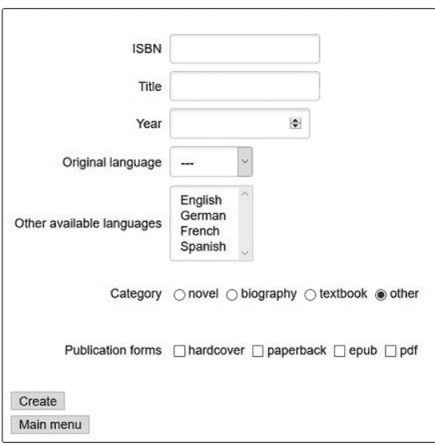

图 12.2 创建新书籍记录的用户界面

### 12.4.1 选择列表

我们在 facetlet `WebContent/views/books/create.xhtml` 和 `... /update.xhtml` 的代码中，使用 JSF 选择列表来渲染枚举属性 `originalLanguage` 和 `otherAvailableLanguages`：

```xml
<ui:composition template="/WEB-INF/templates/page.xhtml">
<ui:define name="main">
  <h:form id="createBookForm">
  <div>
    <h:outputLabel for="originalLanguage" value="原始语言" />
    <h:selectMenu id="originalLanguage"
      value="#{book.originalLanguage}">
      <f:selectItem value="-\-" itemLabel="-\-" />
      <f:selectItems value="#{book.languageItems}" />
    </h:selectMenu>
    <h:message for="originalLanguage" errorClass="error" />
  </div>
  <div class="multi-sel">
    <h:outputLabel for="otherAvailableLanguages" value="其他可用语言也提供" />
    <h:selectManyListBox id="otherAvailableLanguages"
      value="#{book.otherAvailableLanguages}">
      <f:selectItems value="#{book.languageItems}" />
    </h:selectManyListBox>
    <h:outputLabel for="" />
    <h:message for="otherAvailableLanguages" errorClass="error" />
  </div>
  <div>
    <h:commandButton value="保存"
      action="#{bookCtrl.create(book.isbn, book.title, book.year, book.originalLanguage, book.otherAvailableLanguages, book.category, book.publicationForms)}" />
  </div>
  </h:form>
</ui:define>
</ui:composition>
```


JSF `h:selectMenu` 允许通过 HTML 元素 `<f:selectItems value="#{book.languageItems}" />` 创建单选列表。使用表达式 `#{book.languageItems}` 会导致调用 `book` 对象的 `getLanguageItems()` 方法。该方法返回 `SelectItem` 对象的集合，用于填充选择列表。对应的方法如下：

## 220 在 Java EE 中实现枚举属性

```java
public SelectItem[] getLanguageItems() {
    SelectItem[] items = new SelectItem[LanguageEL.values().length];
    int i = 0;
    for (LanguageEL lang : LanguageEL.values()) {
        items[i++] = new SelectItem(lang.name(), lang.getLabel());
    }
    return items;
}
```

多选列表对应于 HTML 元素 `<select multiple="multiple" .../>`，通过 JSF 元素 `h:selectManybox` 创建，并使用相同的 `getLanguageItems` 方法来获取选择列表。

## 12.4.2 单选按钮组和复选框组

由于枚举属性 `category` 和 `publicationForms` 的可能值不超过七个，我们可以使用单选按钮组和复选框来渲染它们：

```xml
<ui:composition template="WEB-INF/templates/page.xhtml">
  ...
  <ui:define name="main">
    <h:form id="createBookForm">
      <div>
        <h:outputLabel for="category" value="分类" />
        <h:selectRadio id="category" value="#{book.category}">
          <f:selectItems value="#{book.categoryItems}" />
        </h:selectRadio>
        <h:message for="category" errorClass="error" />
      </div>
      <div>
        <h:outputLabel for="publicationForms" value="出版形式" />
        <h:selectManyCheckbox id="publicationForms" value="#{book.publicationForms}">
          <f:selectItems value="#{book.publicationForms}" />
        </h:selectManyCheckbox>
        <h:message for="publicationForms" errorClass="error" />
      </div>
      <div>
        <h:commandButton value="保存"
          action="#{bookCtrl.create(book.isbn, book.title, book.year, book.originalLanguage, book.otherAvailableLanguages, book.category, book.publicationForms)}" />
      </div>
    </h:form>
  </ui:define>
</ui:composition>
```

## 12.5 显示多值枚举属性的值集

单选按钮组通过 JSF 元素 `h:selectOneRadio` 渲染 `<input type="radio" />` 元素获得。使用与选择列表相同的技术，单选按钮组用 `SelectItem` 对象的集合填充。`Book` 类中对应的 `getCategoryItems` 方法与 `getLanguageItems` 类似。

复选框组由 `<input type="checkbox" />` 元素组成，通过 JSF 元素 `h:selectManyCheckbox` 创建，并以与单选按钮组或选择列表相同的方式填充。

对于多值属性（如 `otherAvailableLanguages` 或 `publicationForms`），检索/列表视图必须以逗号分隔列表的形式显示值，例如“英语、德语、西班牙语”，如下表所示：

| ISBN | 标题 | 年份 | 原始语言 | 其他可用语言 | 分类 | 出版形式 |
|---|---|---|---|---|---|---|
| 00625187X | 编织万网 | 2000 | 英语 | 德语, 法语 | 教科书 | pdf |
| 046502657 | Gödel, Escher, Bach | 1999 | 法语 | | 硬装 | 平装本 |
| 0465030793 | 奇异性循环 | 2008 | 西班牙语 | 英语, 德语 | | epub |

为了此目的，我们定义一个方法来创建多值属性的序列化，并将其用于 `WebContent/views/listAll`。对于出版形式属性，该方法如下：

```java
public String getPublicationForms() {
  String result = "";
  if (publicationForms != null) {
    for (PublicationEL pf : publicationForms) {
      if (i > 0) result += ", ";
      result += pf.name().toLowerCase();
      i++;
    }
  }
}
```

注意在 `publicationForms` 属性的情况下，底层枚举 `PublicationEL` 没有标签。相反，我们使用枚举字面量作为标签。

## 12.6 运行应用并获取代码

您可以在我们的服务器上运行枚举应用程序，或以 ZIP 格式下载代码。

## 12.7 练习项目

在以下练习项目中，首先列出在该模型中定义的所有约束。然后按照第 9 章的指南定义实体类并开始编写应用程序。如果您对执行后续项目有任何疑问，可以在我们的论坛上提问。

### 12.7.1 项目 1 – 添加评分和类型作为枚举属性

要构建的应用程序目的是管理电影信息。该程序处理一个对象类型 `Movie` 以及两个枚举，如类图所示。

| Movie | «enumeration» GenreEL | «enumeration» MovieRatingEL |
|---|---|---|
| movieid[1] : PositiveInteger {id} | 动作 | G = 全级级 |
| title[1] : NonEmptyString | 动画 | PG = 家长指导 |
| rating[0..1] : MovieRatingEL | 喜剧 | PG13 = 13 岁以下 |
| genres[1.*] : GenreEL | 纪录片 | R = 受限制 |
| | 剧情 | NC17 = 17 岁以下 |
| | 家庭 | |
| | 黑色电影 | |
| | 恐怖 | |
| | 音乐 | |
| | 浪漫 | |
| | ... | |

您可以使用表 11.1 所示的示例数据来测试您的应用程序。

### 12.7.2 项目 2 – 添加国家代码和关系作为枚举

应用程序的目的是管理国家关系。该程序处理一个对象类型 `Country` 以及两个枚举，如类图所示。

| Country | «enumeration» CountryCodeEL | «enumeration» ReligionEL |
|---|---|---|
| name[1] : NonEmptyString {id} | DE = 德国 | 天主教 |
| code[1] : CountryCodeEL {key} | FR = 法国 | 新教 |
| population[1] : PositiveInteger | RU = 俄罗斯 | 正教 |
| lifeExpectancy[0..1] : PositiveDecimal(max:100) | MC = 摩纳 | 印度教 |
| relions[]* : ReligionEL | IN = 印度 | 伊斯兰教 |
| | | 犹太教 |

与您的验证教程练习项目相比，增加了两个属性：单值枚举属性 `code`（这是一个“键”属性，意味着唯一性约束）以及多值枚举属性 `relations`。

## 12.8 测验题

如果你想查找以下测试题答案，可以查看我们的讨论论坛。如果你在论坛中没有找到答案，可以创建一个帖子来提问特定问题的答案。

### 12.8.1 问题 1：JPA 自定义转换器实现类

补全以下 JPA 自定义转换代码，将类型为 `List<GenreEL>` 的值序列化为 `String`：

```java
@Converter
public class GenreConverter implements AttributeConverter<List<GenreEL>, String>
{
    @Override
    public String convertToDatabaseColumn(List<GenreEL> attributeValue) { ... }
}
```

### 12.8.2 问题 2：枚举属性的基数约束

完成 `languages` 属性的定义，至少需要三个语言。

```java
@Entity
class Book {
    private Set<Languages> languages;
}
```

### 12.8.3 问题 3：JPA 枚举属性序列化注解

使用适当的 JPA 注解（包括参数），使泛型属性的值序列化并存储枚举字面量名称（即作为 `String`），而不是序数值（索引）：

```java
@Entity
public class Book {
    @Enumerated(EnumType.STRING)
    @Size(message="A genre is required!")
    @NotNull
    private GenreEL genre;
    ...
}
```

### 12.8.4 问题 4：JSF 单值枚举属性

以下哪项是用于渲染单值枚举属性选择组件的 JSF 元素名称？

- 1. `selectOneRadio`
- 2. `selectOnlyOne`
- 3. `radioGroup`
- 4. `radioSelect`

### 12.8.5 问题 5：JSF 多值枚举属性

补全以下 facet（部分）代码，使得创建创建 `Book` 实例时，生成的 HTML 代码包含一个允许选择多种语言的复选框：

```html
<h:form id="createBookForm">
...
<h:outputLabel for="languages" value="Select languages " />
<h:selectMultipleCheckbox
  id="languages" value="#{book.languages}">
  <f:selectItems value="#{book.languageItems}" />
</h:selectMultipleCheckbox>
...
</h:form>
```

# IV 特殊数据类型与派生属性

除了标准的数值和字符串数据值外，特殊属性可能具有几种类型的特殊数据值，例如日历日期或数量（如时间或金额），或记录等复合值。某些属性是从其他属性派生的。

# 13 特殊数据类型

在应用程序中，我们必须处理各种类型的属性。虽然许多属性的标准类型是范围（如 `Integer` 或 `String`），但某些属性根据其范围具有特殊的数据类型。例如，通用业务语言（UBL）是一种定义电子商务文档格式的行业标准，它定义了大量的业务数据类型，包括以下内容。

| UBL 数据类型 | 描述 |
| --- | --- |
| Date Time | 根据格里哥日历的一个日。每天发生的时间实例。 |
| DateTime | 时间进程中的某个特定点，以及相关的补充信息。 |
| Percent | 通过计算、计数、排序分配或确定的数值信息，以百分比形式表示。 |
| Amount | 使用给定货币单位指定的货币数量。 |

SemanticWiki 使用以下特殊数据类型。

| SemanticWiki 数据类型 | 描述 |
| --- | --- |
| Geographic coordinate | 存储描述地理位置的坐标 |
| Monolingual text | 将文本值与特定的语言代码关联 |
| Quantity | 存储描述数量的值，包含数字和单位 |
| Record | 允许保存复合属性值，该值由具有固定类型的短值列表组成 |
| Email | 存储电子邮件地址 |
| URL | 存储 URIs、URNs 和 URLs |
| Telephone number | 存储基于 RFC 3962* 的国际电话号码 |

我们讨论了特殊数据类型的几种重要用例，以及如何在模型代码和 HTML 用户界面代码中处理它们。以下类图说明了具有此类特殊数据类型作为范围的属性示例。

在 C++ 和 C# 编程社区中，字符串模式和变体等特殊数据类型也被称为“语义类型”（semantic types）（例如参见 Gibson2016 和 Perkins2015*）。

- 1 https://www.semantic-mediata.org/wiki/Help:List_of_datatypes
- 2 https://tools.ietf.org/html/rfc3966
- 3 https://stackoverflow.com/a/3941703/2799509
- 4 https://www.codepject.com/Articles/860646/Introducing-Semantic-Types-in-Net

# 13.1 布尔值

布尔属性（如 `Smoker`）只能有两个可能值中的一个：`true` 或 `false`，有时用 `yes` 或 `no` 表达更自然。在模型代码中，布尔属性被处理为原始数据类型属性，因为所有编程语言都支持布尔作为原始数据类型。

在用户界面中渲染布尔属性有几个示例，其中最简单的解决方案是使用复选框字段。另一种方法可以使用单选器按钮。

```html
<h:form id="createBookForm">
...
<h:outputLabel for="languages" value="Select languages " />
<h:selectMultipleCheckbox
  id="languages" value="#{book.languages}">
  <f:selectItems value="#{book.languageItems}" />
</h:selectMultipleCheckbox>
...
</h:form>
```

# 13.2 字符串模式

电子邮件地址、URL 和电话号码是必须匹配模式的字符串示例。在数据/文档格式中对它们内置支持是理想的。

## 232 13 特殊数据类型

Diego Perini 脱颖而出，似乎是一个非常好的近似。一旦所有浏览器都支持新构建的 JavaScript 内置类型 `URL`，就可以通过尝试使用给定的 URL 字符串创建一个 `URL` 对象来实现精确的验证检查，然后捕获任何类型为 `SYNTAX_ERROR` 的 `DOMException`。

## 13.3 特殊数值数据类型

### 13.3.1 正整数和非负整数属性

由于正整数或非负整数属性很常见，因此优于使用预定义的属性（如 `PositiveInteger` 和 `NonNegativeInteger`）作为它们在信息设计模型中的范围，而不是通过定义范围为 `Integer` 并添加相应的区间约束来定义它们。

在（JavaScript 或 Java）模型类定义中，这些属性必须实现为带有区间约束的整数值属性。然而，具有对它们的内置支持是理想的，就像数据/文档格式语言 XML Schema 那样。

### 13.3.2 单位区间

某些属性（例如表示概率时）具有单位区间 `[0,1]` 或其开区间变体作为其范围。它们可以实现为带有区间约束的十进制属性。但拥有一个相应的预定义数据类型（如 `UnitInterval`）更为优。

### 13.3.3 百分比

某些属性的值代表百分比，这些小数必须除以 100 才能获得它们所表示的数值。在用户界面中，百分比属性的值带有 `%` 后缀显示，类似于量化属性，需要一个像 `Percent` 这样的特殊预定义数据类型。

8 https://gist.github.com/729294

### 13.3.4 任意精度数字

在广泛使用的编程语言（如 JavaScript 和 Java）中，处理小数的内置标准数据类型（如 JavaScript 中的 `number` 和 Java 中的 `double`）不支持精确计算。例如，在 JavaScript 中，计算减法 `0.3–0.1` 的结果不是 `0.2`，而是 `0.9999999999999`，这接近正确结果但并不相等。即使这种误差在游戏物理模拟等用例中是可以接受的，但在财务会计等用例中是不可接受的。

任意精度数字的概念是允许计算精度仅受可用内存限制，这与计算机算术逻辑单元中实现的固定精度算术不同，后者通常由编程语言的标准算术实现所采用。任意精度数字用于需要精确计算结果（即使是大数字）且计算速度不是关键因素的应用程序。

在 JavaScript 中，我们可以使用库 `big.js` 或 `mathjs`¹ 进行任意精度计算。例如，使用 `big.js` 库，可以通过以下方式获得减法 `0.3–0.1` 的精确结果：


# 特殊数据类型

## 13.1 使用 `Big` 类进行任意精度计算

`var x = new Big(0.3);`

`var result = x.min(0.1);`

`console.log(result); // 0.2`

用于舍入关键操作 `div`、`sqrt` 和 `pow`（带负指数）结果的最大十进制位数和舍入模式由 `Big` 类的静态属性 `DP` 和 `RM` 决定，如下例所示：

```
Big.DP = 10 // decimal places
Big.RM = 1 // default rounding mode
```

```
x = new Big(2);
y = new Big(3);
z = x.div(y) // "0.666666666667"
z.sqrt() // "0.8164965809"
z.pow(-3) // "0.374999999995"
```

## 13.2 舍入模式

舍入模式属性值 0.3 具有以下含义：

| 值 | Description | Java BigDecimal 等效值 |
|---|---|---|
| 0 | 向零舍入。即截断，不舍入。 | `ROUND_DOWN` |
| 1 | 向最近邻居舍入。如果等距离，则远离零舍入。 | `ROUND_HALF_UP` |
| 2 | 向最近邻居舍入。如果等距离，则向偶数邻居舍入。 | `ROUND_HALF_EVEN` |
| 3 | 远离零舍入。 | `ROUND_UP` |

## 13.3 使用 Java 的 `BigDecimal` 类

在 Java 中，我们可以使用内置数据类型 `BigDecimal`¹ 进行任意精度计算。例如，减法 `0.3–0.1` 的精确结果可以通过以下方式获得：

```java
import java.math.BigDecimal;

BigDecimal x = new BigDecimal("0.3");
BigDecimal y = new BigDecimal("0.2");
BigDecimal result = x.subtract(y);
```

最大十进制位数（在 Java 中称为 `scale`）可以通过构造函数参数隐式设置，也可以显式设置：

```
x.setScale(2);
```

通过提供精度值和 `RoundingMode` 枚举或 `MathContext` 对象，可以为每个操作设置精度和舍入模式。它们至少应该为关键操作 `divide` 和 `pow`（带负指数）设置，如下例所示：

```java
BigDecimal x = new BigDecimal("2");
BigDecimal y = new BigDecimal("3");
BigDecimal result = x.divide(y, 10, RoundingMode.ROUND_HALF_UP);
```

在此例中，变量 `result` 的值为 `0.666666666667`。

## 13.4 日历日期和时间

日历日期、一天的时间和时间戳（日期时间）是特殊的数据值，它们通常只支持格列日历。我们在信息设计模型中使用 `Date`、`TimeOfDay` 和 `Timestamp` 数据类型名称。

> 11 https://docs.oracle.com/javase/8/docs/api/java/math/BigDecimal.html

### 13.4.1 使用 JavaScript 的 `Date` 类

JavaScript 和 Java 都有内置的 `Date` 类，它们实际上并不代表日历日期，而是表示自 1970 年 1 月 1 日 UTC 来的毫秒数特定形式的时间戳（或日期时间）。

JavaScript 的 `Date` 类允许表示从 1970 年 1 月 1 日 UTC 起往后 +/- 1 亿天（约 285,000 年）范围内的格列日历时间戳。

一个 JS 日时间可以通过多种方式创建：

```
var firstNameManOnMoon = new Date();
```

### 13.4.2 在 HTML 表单中处理日期

```html
<form id="Person">
  <p><label>Name: <input name="name" type="text"></label></p>
  <p><label>Date of birth:
    <input name="dateOfBirth" type="date"></label>
  </p>
</form>
```

遗憾的是，在 2017 年 4 月，Firefox 浏览器尚未实现日期选择器组件，因此需要采用渐进增强的方法，即当当前浏览器未提供日期选择器时，借助 JS 库（如 flippickr¹）创建日期选择器组件。

当用户在小组件中选择日期后，输入元素的 `value` 属性包含一个日期字符串。将此字符串转换为 `Date` 值的简单方法是使用 DOM 属性 `valueAsDate`，如下：

```javascript
var formEl = document.forms["Person"];
var dateOfBirth = formEl.dateOfBirth.valueAsDate;
```

### 13.4.3 使用 Java 的 `Date` 和 `Calendar` 类

在 Java 中，我们有两个处理日期时间的内置类：`java.util.Calendar` 是一个抽象类，它提供了处理时间戳的方法，并拥有特定日历（如 `GregorianCalendar`）的具体子类。注意，`Calendar` 的实例并不是日历，而是一个被封装的日期时间值。要获取特定的日期或时间，我们可以调用合适日历类的构造函数并传入所需的值：

```java
Calendar birthDate = new GregorianCalendar(2017, 3, 26);
Calendar birthTime = new GregorianCalendar(2017, 3, 26, 18, 32);
```

`java.util.Date` 是一个表示自 UTC 1970 年 1 月 1 日以来毫秒数的类。`Date` 类中特定形式的方法和构造函数已被废弃（因为它们不支持国际化），但类本身并没有被废弃。建议避免使用它，而是改用合适的 `Calendar` 子类代替 `Date`；如果需要 `Date` 实例，可以通过创建一个 `Calendar` 对象，并利用 `getTime` 方法将其转换为 `Date` 对象：

```java
Calendar calendarDateTime = new GregorianCalendar(2017, 3, 26);
Date dateTime = calendarDateTime.getTime();
```

为了获取持有当前时间的 `Date` 对象，我们可以使用带参数的构造函数：

```java
Date currentTime = new Date();
```

需要注意的是，月份以范围 [0, 11] 内的整数表示，其中 0 表示 1 月，11 表示 12 月。每月的天数是以范围 [1, 31] 内的整数表示。一天中的小时是范围 [0, 23] 内的整数，分钟是范围 [0, 59] 内的整数。

在许多情况下，我们需要直接处理月、日、小时和秒等日期时间组件的值，而不是让这些值表示在对象中。`Calendar` 类定义了 `get` 方法，它接收一个整数参数，允许在静态 `Calendar` 属性中指定所需的日期时间组件。例如，如果我们需要提取当前的年、月、日、时、分、秒，可以使用以下代码：

```java
Calendar calendar = new GregorianCalendar(2017, 3, 26, 20, 18, 32); // 2017年3月26日, 20:18:32
int year = calendar.get(Calendar.YEAR); // 2017
int month = calendar.get(Calendar.MONTH); // 2 (=March)
int dayOfMonth = calendar.get(Calendar.DAY_OF_MONTH); // 26
int hourOfDay = calendar.get(Calendar.HOUR_OF_DAY); // 20
int minute = calendar.get(Calendar.MINUTE); // 18
int second = calendar.get(Calendar.SECOND); // 32
```

关于 Java 中日期时间处理的更多信息，请参阅 Chua Hok-Huan 的 Java Date 第 16 页。

### 13.4.4 在 JPA 中使用 `Date` 和 `Calendar`

在带有时间属性的实体中，如果其范围是 `Date` 或 `Calendar`，我们使用 `@Temporal` 注解：

```java
@Entity
public class Person {
    @Temporal(TemporalType.DATE)
    private java.util.Date dateOfBirth;

    @Temporal(TemporalType.TIMESTAMP)
    private java.util.Calendar firstDayOfSchool;
}
```

`TemporalType` 枚举有三个可能的值：`DATE`、`TIME` 和 `TIMESTAMP`，它们允许指定 `Date` 或 `Calendar` 对象持久化到数据库时使用的序列化格式。这些值对应于 `java.sql.Date`、`java.sql.Time` 和 `java.sql.Timestamp` 类，它们都是 `java.util.Date` 的子类。

### 13.4.5 使用 JSF 渲染日期属性

渲染 `Date` 值的属性需要 JSF 元素 `h:inputText` 并配合属性 `p="date"`。这创建了一个类型为 `date` 的 HTML 输入元素。例如，一个人的 `dateOfBirth` 属性可以在 facelet 中这样渲染：

```xml
<form id="createPersonForm">
  <h:inputText id="dateOfBirth" p:type="date" value="${person.dateOfBirth}">
    <f:convertDateTime pattern="yyyy-MM-dd" />
  </h:inputText>
</form>
```

JSF 允许用户使用 `pattern` 属性更改日期格式。例如，生成的 HTML 为：

```html
<form id="createPersonForm">
  <input id="dateOfBirth" type="date">
</form>
```

## 13.5 量（Quantities）

在定义类的属性时，量值属性必须通过指定如 `Length()` 或 `Time()` 的数据类型作为其范围。然而，这在标准的 JS 构造函数或 ES6 类定义中是不行的。相反，需要一个支持特定规范的类定义，如 `cClass`¹⁵（在第二卷中讨论）。

在这种方法下，量属性的值是一个普通数字，并结合属性的基单位进行解释。通过调用量单位定义的转换函数，可以轻松地在用户界面将类型转换为优单位。

| metaclass | QuantityUnit |
| :--- | :--- |
| `QuantityType` | `QuantityUnit` |
| `name[1]: String` | `unitCode` |
| `standardUnit[1]: String` | `unitName` |
| `baseUnit[0-1]: String` | `convertFrom()` |
| `units[1..]: QuantityUnit` | `convertTo()` |

| `Length` | `QuantityUnit` |
| :--- | :--- |
| `standardUnit[1]: String = m` | `[m, meter, x*1], [km, kilometer, x*10^3], [cm, centimeter, x*10^-2], [mm, millimeter, x*10^-3]` |

| `Temperature` | `QuantityUnit` |
| :--- | :--- |
| `standardUnit[1]: String = "C"` | `[°K, Kelvin, x], [°C, Celsius, x+273.15], [°F, Fahrenheit, x=(x+459.67)*5/9-459.67]` |

| `Time` | `QuantityUnit` |
| :--- | :--- |
| `standardUnit[1]: String = s` | `[s, second, x*1], [min, minute, x*60], [h, hour, x*3600], [d, day, x*86400], [w, week, x*604800], [y, year, x*31536000]` |

图 13.1 量类型。

## 13.6 复合数据类型

如果某人在 9.58 秒内跑了 100 米，那么计算其速度的变量可以这样赋值：

```
Speed sp1 = 100.0_m / 9.58_s ;
```

支持物理量数据类型的通用方法必须基于七个基本物理量：长度、质量、时间、温度、电流、光强和物质量。通过定义一个从基本量维度 $d_i$ 到整数 $e_i$ 的映射 (d1e, ..., d7e)，将其作为通用量维度表达式的指数，可以定义诸如单位为 m² 的面积或单位为 m/s 的速度等复合量：

```
d1e* * d2e* * ... * d7e*;
```

### 13.6.1 记录 (Records)

记录是由字段槽（field slots）组成的复合数据值，这些字段槽是键值对，我们可以通过其名称访问记录字段的值。

记录的示例包括地址记录，如 `{street: "37 Market St", city:"New York", zipCode: 10473}`，或者电话簿条目，如 `{type:"home", areaCode:"757", number:"3765295"}`。

#### 13.6.1.1 颜色定义

颜色可以基于颜色模型（如红绿蓝 RGB 模型或色相-饱和度-亮度 HSL 模型）通过三个组件定义。在这些模型中，可以添加第四个组件，其形式为单位区间 [0,1] 小数或相应的百分比，用于定义颜色的透明度（技术上称为 alpha 通道）。

在 RGB 模型中，每个组件都是 0 到 255 之间的整数。在 CSS 中，RGB 颜色通过三元术语指定，例如 `rgb(255, 255, 255)`，它对应于一个 JS 三元组，例如 `{R:255, G:255, B:255}`。

在 HSL 模型中，H 分量是 0 到 360 之间的整数，表示彩虹中的角度，其中红色为 0 = 360，绿色为 120，蓝色为 240。饱和度和亮度以百分比表示，其中 S=100% 是完全饱和，0% 是灰色；L=100% 是白色，0% 亮度是黑色，50% 亮度是“正常”。在 CSS 中，HSL 颜色通过三元术语指定，例如 `hsl(0, 0%, 100%)`，它对应于一个 JS 三元组，例如 `{H:0, S:0, L:100}`。

在基于 HTML 表单的用户界面中，颜色定义由类型为 `"color"` 的 HTML5 输入元素支持，这些元素将以颜色选择器小部件的形式进行渲染。

#### 13.6.1.2 地理坐标

地理坐标（或大地位置）可以以记录的形式定义，如 `(latitude: 40.6643, longitude: -73.93855)`。

#### 13.6.1.3 在用户界面中渲染记录

记录值属性（如 `geoCoordinates`）应该渲染为 UI 中连贯区域的字段列表，最好使用字段元素，并将该属性的标签作为图例（legend）的内容。在简单情况下（如如下例所示），如果只有少数记录字段，使用合适的 CSS 规则，可能将所有字段水平地渲染在同一行。

```html
<form id="form">
  <fieldset data-bind="geoCoordinates">
    <legend>Geo-coordinates</legend>
    <label>Latitude: <input type="number" name="latitude"/></label>
    <label>Longitude: <input type="number" name="longitude"/></label>
  </fieldset>
</form>
```


注意属性`geoCoordinates`是如何通过自定义的`data-bind`属性帮助并绑定到`fieldset`元素上的。

## 13.6.2 数据集合

数据集合是有序或无序的集合或包（多集），其所有成员均为原始数据值、特定类型的记录或特定类型的数据集合。我们不再说“无序集合”，而说“集合 (set)”，不再说“有序包”，而说“列表 (list)”。

示例：

- 1. 一个人的昵称可能记录在一个值为集合的属性`nickNames`中。
- 2. 一个人喜爱的作曲家可能记录在一个值为有序集合的属性`favoriteComposers`中，其顺序代表排名。
- 3. 一次火车旅行可能被记录为火车停留地点的列表。

在用户界面中，如果值集合足够小，集合值属性可以被渲染为带有逗号分隔字符串列表的文本字段。否则，则需要一个特殊的类表格 UI 小部件用于键值的分配和更改。

## 14 派生属性

在某些情况下，一个属性的唯一目的可能是提供从其他信息项计算出的某些信息。对于这种派生属性，没有必要允许用户为其输入值。类`Person`的派生属性示例是属性`age`（年龄）和`initials`（缩写）。`age`的值根据属性`dateBirth`的值和当前年份按需计算。`initials`的值根据其他属性的值计算得出。与标准属性不同，它不能由用户设置。

### 14.1 虚拟属性

如果一个属性的值是按需计算的，它被称为虚拟的。派生属性的值并不存储，如下所示：

```javascript
class Person {

  constructor(slots) {

    // 为强制属性分配默认值

    this._firstName = ""; // 字符串（空）

    this._lastName = ""; // 字符串（空）

    this._dateBirth = ""; // 字符串（空）

    // 如果构造函数调用时传入了非空对象

    if (typeof slots === "object" && Object.keys(slots).length > 0) {

      // 隐式调用 setter

      this.firstName = slots.firstName;

      this.lastName = slots.lastName;

    }

    // 如果构造函数调用时传入了非空对象

    if (typeof slots === "object" && Object.keys(slots).length > 0) {

      // 隐式调用设置器

      this.dateBirth = slots.dateBirth;

    }

  }

  // 属性访问器

  get firstName() { return this._firstName; }

  set firstName(f) {

    this._firstName = f;

    this._initials = this._firstName.charAt(0) +

    this._lastName.charAt(0);

  }

  get lastName() { return this._lastName; }

  set lastName(l) {

    this._lastName = l;

    this._initials = this._firstName.charAt(0) +

    this._lastName.charAt(0);

  }

  get initials() { return this._initials; }

  get dateBirth() { return this._dateBirth; }

  set dateBirth(d) {

    this._dateBirth = d;

  }

  get age() {

    var today = new Date();

    return today.getFullYear() - this.dateBirth.getFullYear();

  }

}
```

### 14.2 实例化派生属性

当派生属性的值被存储时，它被称为实例化化的。实例化属性的计算是在 setter 中执行的，如下所示：

```javascript
class Person {

  constructor(slots) {

    // 为强制属性分配默认值

    this._firstName = ""; // 字符串（空）

    this._lastName = ""; // 字符串（空）

    this._dateBirth = ""; // 字符串（空）

    // 如果构造函数调用时传入了非空对象

    if (typeof slots === "object" && Object.keys(slots).length > 0) {

      // 隐式调用 setter

      this.firstName = slots.firstName;

      this.lastName = slots.lastName;

    }

    // 如果构造函数调用时传入了非空对象

    if (typeof slots === "object" && Object.keys(slots).length > 0) {

      // 隐式调用设置器

      this.dateBirth = slots.dateBirth;

    }

  }

  get firstName() { return this._firstName; }

  set firstName(f) {

    this._firstName = f;

    this._initials = this._firstName.charAt(0) +

    this._lastName.charAt(0);

  }

  get lastName() { return this._lastName; }

  set lastName(l) {

    this._lastName = l;

    this._initials = this._firstName.charAt(0) +

    this._lastName.charAt(0);

  }

  get initials() { return this._initials; }

  get dateBirth() { return this._dateBirth; }

  set dateBirth(d) {

    this._dateBirth = d;

  }

  get age() {

    var today = new Date();

    return today.getFullYear() - this.dateBirth.getFullYear();

  }

}
```

### 14.3 在用户界面中处理派生属性

由于派生属性不是通过用户输入设置的，因此在用户界面中它们没有输入框，只有输出字段。下面的 HTML 表单示例说明了这一点：

```html
<form id="Person">

  <label>名: <input name="firstName" type="text"/></label>

  <label>姓: <input name="lastName" type="text"/></label>

  <label>缩写: <output name="initials"/></label>

  <label>出生日期:

    <input name="dateBirth" type="date"/></label>

  <label>年龄: <output name="age"/></label>

</form>
```


# 术语表

## C

### CRUD

CRUD 是创建（Create）、读取（Read）、更新（Update）、删除（Delete）的缩写，表示任何软件应用程序都需要执行的四种基本数据管理操作。

### CSS（级联样式表）

CSS 用于定义网页的呈现样式，告诉浏览器如何渲染其 HTML（或 XML）内容：使用哪种内容元素布局、何种字体和文本样式、什么颜色、背景和动画。通常，这些设置在独立的 CSS 文件中完成，通过 HTML `head` 元素中的特殊链接元素与 HTML 文件关联。

## D

### DOM（文档对象模型）

DOM 是一个用于检索和修改 HTML 或 XML 文档节点与元素的抽象 API。所有 Web 编程语言都有实现 DOM 的 DOM 绑定。

### DNS（域名系统）

DNS 将易于访问的域名翻译为 IP 地址，以便在互联网上定位主机计算机。

## E

### ES（ECMAScript）

由行业组织“国际规范化组织”（Ecma International）定义的 JavaScript 标准。

### XML（可扩展标记语言）

XML 允许以机器可读的方式构建各种文档、数据文件和消息的结构。如果标签名称是自解释的，XML 也可以是人类可读的。XML 基于 Unicode。SVG 和 MathML 基于 XML，并且还存在一个基于 XML 的 HTML 版本。

XML 提供了一种语法，用于以带有元素及其属性的 XML 文档形式表示结构化信息。XML 文档中使用的特定元素和属性可以来自任何词汇，如公共标准或用户定义的 XML 格式。

## H

### HTML（超文本标记语言）

HTML 允许标记（或描述）人类可读的网页文档或 Web 用户界面结构。基于 XML 的 HTML 版本被称为“XHTML5”，与传统的 HTML 相比，它提供了更简单简洁的语法。

### HTTP（超文本传输协议）

HTTP 是一种基于互联网 TCP/IP 和 DNS 的无状态请求/响应协议，使用人类可读的文本消息进行 Web 客户端和 Web 服务器之间的通信。HTTP 的主要目的是允许从浏览器获取由 URL 标识的网页文档，并从浏览器执行的 HTML 表单调用后端 Web 程序的操作。最近，HTTP 越来越多地提供 Web API 和 Web 服务。

## I

### IANA

IANA 代表互联网分配数字机构，它是 ICANN 的子公司，负责互联网协议所使用的名称和数字。

### ICANN

ICANN 代表互联网名称与数字分配机构，是一个维护域名系统的国际非营利组织。

### IndexedDB

一种由浏览器管理的索引数据存储的 JavaScript API。索引允许高性能搜索。与许多 SQL 数据库管理系统一样，IndexedDB 支持数据库事务。

### I18N

一组帮助产品适应任何目标语言和文化的最佳实践。它处理多种字符集、计量单位、键盘布局、时间及日期格式。

## J

### JSON

JSON 代表 JavaScript 对象表示法，这是一种遵循 JavaScript 对象字面量语法的数据交换格式。许多编程语言都支持 JSON 作为 XML 的轻量级替代方案。

## M

### MathML

一种用于表示数学表达式的开放标准，可用于数据交换或在网页内对其进行渲染。

### MIME

一个 MIME 类型（也称为“媒体类型”或“内容类型”）是一个与文件一起的关键字字符串，用于识别其内容类型。例如，音频文件可能被标记为 `audio/ogg`，图像文件标记为 `image/png`。

### MVC（模型-视图-控制器）

MVC 是一种通用架构比喻，强调关注点分离（主要在模型和视图之间），并将模型视为应用程序最基础的部分。在 MVC 框架中，“M”、“V”和“C”有不同的定义方式。通常，“模型”指的是应用程序的数据源，而“视图”表示用于用户界面的代码（基于 CSS 样式的 HTML 表单和 DOM 事件），而“控制器”通常指负责在视图和模型之间进行（胶水）代码。

## O

### OCL（对象约束语言）

OCL 是一种用于表示完整性约束（主要在 UML 类模型中）的正式逻辑语言。它还允许导出表达式来定义派生属性，并在类模型中为操作定义前提和后置条件。

### OOP（面向对象编程）

OOP 是一种基于对象概念和由对象实例化的类的编程范式。类类似于对象的蓝图：它们定义了对象的属性以及可以应用于对象的方法/函数。OOP 的一个高级特性是类层次结构中的继承：子类继承其父类的特征（属性、方法和约束）。

### OWL（网络本体语言）

OWL 是一种用于 Web 知识表示的正式逻辑语言。它允许定义词汇（主要是带有属性的类），并支持对它们进行许多类型的完整性约束。OWL 是执行自动推理的基础，例如检查 OWL 词汇的一致性。以 UML 类模型形式定义的词汇或数据模型可以转换为 OWL 词汇，然后检查其一致性。

## P

### PNG

PNG 是一种支持无损数据压缩的开放（非专利）图形文件格式。

### Polyfill（垫片）

是一段 JavaScript 代码，用于在不支持方法的浏览器中模拟标准的 JavaScript 方法。

## R

### RDF（资源描述框架）

是一种 W3C 语言，用于在 Web 上表示机器可读的命题信息。

## S

### SGML（标准扩展标记语言）

是定义标记语言的 ISO 标准。HTML4 是通过 SGML 定义的。XML 是 SGML 的简化后续版本。HTML5 不再是 SGML，它有自己的解析规则。

### SVG（扩展矢量图形）

是一种基于 XML 的 2D 矢量格式。SVG 可以使用 CSS 设置样式并使用 JavaScript 实现交互。HTML5 允许直接在 HTML 文档中嵌入 SVG。

### Slot

槽是一个键值对。在 JavaScript 对象中，slot 也可以由方法名和方法体组成。

### Unicode

是一种跨平台的字符集，包含了大多数语言（包括印地语、缅甸语）的所有字符。每个字符被分配一个在 0 到 1,114,111 之间的唯一整数代码。例如，希腊字母 π 的代码为 960。Unicode 包含 ASCII 和 ISO-8859-1 (Latin-1) 等旧字符集作为子集。

XML 基于 Unicode。因此，希腊字母 π（代码为 960）可以使用 XML 实体插入 XML 文档。XML 文档中 Unicode 字符的默认编码是 UTF-8，它对 ASCII 字符使用单字节，对其他字符使用三个字节。

### URI（统一资源标识符）

URI 是统一资源定位符（URL）或统一资源名称（URN）。

### URL（统一资源定位符）

URL 是一个资源名称，包含用于在 Web 上定位该资源的 Web 地址。

### UML（统一建模语言）

UML 是一种行业标准，定义了一系列建模语言，用于创建各种模型和图表，以支持面向对象的问题分析和软件设计。它的核心语言用于信息/数据建模的类图，以及用于过程/行为建模的序列图、活动图和状态图（或状态图）。

### URN（统一资源名称）

URN 指向一个未指定位置的资源。

### User Agent（用户代理）

代理是指一个前端 Web 客户端程序，例如 Web 浏览器。

## W

### WebM

WebM 是一种由 Google Chrome 和 Firefox 支持的开放（免版）视频格式，但不支持 Microsoft Internet Explorer 和 Apple Safari。

### WHATWG（Web 超文本应用工作组）

WHATWG 由 Apple、Mozilla 和 Opera 的前员工于 2004 年建立，他们对 W3C 专注于 XHTML2 标准化导致 Web 技术标准进展缓慢感到不满。在 Ian Hick 的带领下，他们与 W3C 竞争并合作开发了 HTML5 和相关的 JavaScript API。

### WWW（万维网）

WWW（或简单称为“Web”）是一个基于 HTTP、HTML 和 XML 的巨大客户端-服务器网络，其中 Web 浏览器（其他“用户代理”）作为 HTTP 客户端访问 Web 服务器程序（作为 HTTP 服务器）。

### W3C（万维网联盟）

W3C 是一个负责开发和维护 Web 标准的国际组织。

## X

### XHR (XML HTTP 请求)

XML HTTP 请求 (XHR) API 允许 JavaScript 程序与后端程序进行 HTTP 消息交换。它可以在不提交 HTML 表单的情况下，从向后端程序检索/提交信息。基于 XHR 的方法在过去被归入“AJAX”这一缩写下。

# 索引

- 可访问性 (accessibility) 11
- Active Record 109
- 蒂姆·伯纳纳斯-李 (Berners-Lee, Tim) 3, 6
- 模板代码 (boilerplate code) 52, 86, 152
- 代码库架构 (code base architecture) 107
- 命令绑定 (command binding) 111
- CSS 9, 50
- 立即调用函数表达式 (IIFE) 25
- 隐式 getter (implicit getters) 243
- 隐式 setter (implicit setters) 151, 195
- IndexedDB 50
- localStorage 35
- map 18, 20
- 方法 (methods) 22
- 对象表示法 (JSON) 34
- 对象 (objects) 17
- 记录 (record) 18
- 严格模式 (strict mode) 17
- 类型转换 (type conversions) 16, 242
- 类型测试 (type testing) 15, 214
- 变量作用域 (variable scope) 16
- 数据绑定 (data binding) 54, 76, 111
- 反反序列化 (de-serialization) 53
- 部署架构 (deployment architecture) 107
- ECMAScript 10
- 布兰登·艾奇 (Eich, Brendan) 10
- facet (facets) 60
- 伊恩·希克斯森 (Hickson, Ian) 102
- HTML 3
- 显式标签 (explicit labels) 53
- 表单 (forms) 7, 45, 106
- 表单验证 API (form validation API) 129, 148
- 隐式标签 (implicit labels) 8, 53, 124
- HTML 4 6
- HTML 5 6
- 键 (key) 125
- 哈哈康·W·李 (Lie, Håkon W.) 9
- 模型-视图-控制器 (MVC) 112
- 中介控制器 MVC (mediating-controller MVC) 112
- 多重验证问题 (multiple validation problem) 137
- MVVM 111
- 命名空间 (namespace) 18
- 对象约束语言 (OCL) 128
- 对象关系映射 (ORM) 109
- 洋葱架构 (Onion Architecture) 110
- 洋葱原则 (onion principle) 117
- Java 59
- bean 类 (bean class) 60
- Java EE 58
- 实体类 (entity class) 60
- 实体管理器 (entity manager) 64, 69
- 维度 (facets) 60
- Java 持久化 API (Java Persistence API) 58, 60
- Java 持久化查询语言 (Java Persistence Query Language) 60, 66, 78
- Java Server Faces 58, 60
- 验证器 (validators) 170
- 主键 (primary key) 126
- 资源描述框架 (RDF) 91, 97
- RDF 图 (RDF graph) 99
- RDF/XML 语法 99
- RDFa 102
- 响应式验证 (responsive validation) 117, 205
- JavaScript 10, 18
- 数据类型 (datatypes) 14, 141
- 实体表 (entity tables) 22
- 枚举 (enumerations) 189
- 函数定义 (function definition) 22
- 函数 (functions) 22
- 序列化 (serialization) 53, 201
- 结构化查询语言 (SQL) 82
- TomEE 58
- Unicode 4, 61
- 统一建模语言 (UML) 91
- 通用业务语言 (UBL) 229

https://doi.org/10.1515/9783110499957-016
