# Javascript 或 Java Web 应用开发第 2 卷：关联与类层结构


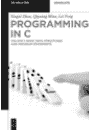


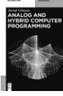

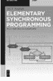


OLDENBOURG

## 作者

Gerd Wagner 教授、博士

BTU Cottbus-Senftenberg 大学

互联网技术系

Konrad Wachsmann-Allee 5

03046 Cottbus

wagner@b-tu.de

Mircea Diaconescu

dimircea@gmail.com

2021年 Gerd Wagner

封面设计：Gruter

排版：Integra Software Services

## 前言

本书两卷著作介绍了如何使用模型驱动的方法来设计和实现 Web 应用，利用了目前最流行的两种技术：前端的 JavaScript 和后端的 Java。我们关注的是 Web 开发中的通用概念：数据完整性、枚举以及类层次结构。

我们假设读者已经熟悉 JavaScript 的 Web 开发基础知识，并对学习如何使用 Java 进行后端开发感兴趣。本书特别适用于计算机科学或相关专业的学生，以及正在参加相关 Web 应用开发课程的开发者。

本书还提供了关于 JavaScript 框架（如本地存储以及 MySQL 数据库）的详细信息。

前言 — VII

12.5 种类与角色 — LXX七

https://doi.org/10.1015/9783110500325-204

表 1.1 功能类型 — 8

# 第一部分：关联

我们在第一卷中过的三个示例应用程序——最小应用、验证应用和枚举应用——都局限于管理一个对象类型的数据。然而，一个真实的应用程序必须管理多个对象类型的数据，这些类型通常以各种方式相互关联。特别是，对象类型之间可能存在关联和子类型（继承）关系。处理关联和子类型关系是软件应用工程中的高级问题。它们在教科书中往往没有得到充分讨论，也没有得到应用开发框架的良好支持。

关联是信息模型的重要元素。应用程序必须以适当的方式实现它们，特别是在模型-视图-控制器（MVC）架构的模型层中。遗憾的是，应用开发框架对处理关联提供的支持有限。

有两个重要的区别，它们之间是相互独立的：

- 1. 功能性与非功能性（“多对多”）关联。
- 2. 单向关联与双向关联。

功能性关联对应于数学中所谓的函数（function），而多对多关联对应于数学中所谓的关系（relation）。

在 OO 建模和编程中，单向关联对应于引用属性（reference property），而双向关联对应于一对互反的引用属性。

为对象类型（或类）定义的属性，如果其值是指向另一个类型或同类型类型对象的引用，则被称为引用属性。例如，下方图 1.1 所示的委员会（Committee）有一个引用属性 `chair`，其值是指向俱乐部成员（ClubMember）对象的引用。

对象类型之间的关联对这些类型对象之间的关系进行了分类。例如，委员会-拥有-俱乐部成员作为主席（Committee-has-ClubMember-as-chair）的关联在图 1.2 所示的类图中被可视化为一条线，它分类了财务委员会-拥有彼特·米勒作为主席（FinanceCommittee-has-PeterMiller-as-chair）、招聘委员会-拥有苏珊·史密作为主席（RecruitmentCommittee-has-SusanSmith-as-chair）以及咨询委员会-拥有莎拉·安德森作为主席（AdvisoryCommittee-has-SarahAnderson-as-chair）的关系，其中对象彼特·米勒（PeterMiller）、苏珊·史密（SusanSmith）和莎拉·安德森（SarahAnderson）是俱乐部成员（ClubMember）类型，而财务委员会（FinanceCommittee）、招聘委员会（RecruitmentCommittee）和咨询委员会（AdvisoryCommittee）是委员会（Committee）类型。作为关系集的关联可以表示如下表：

| 委员会-拥有-俱乐部成员作为主席 (Committee-has-ClubMember-as-chair) | | |
| :--- | :--- | :--- |
| 财务委员会 (Finance Committee) | 彼特·米勒 (Peter Miller) | |
| 招聘委员会 (Recruitment Committee) | 苏珊·史密 (Susan Smith) | |
| 咨询委员会 (Advisory Committee) | 莎拉·安德森 (Sarah Anderson) | |

引用属性对应于关联的一种特殊形式，即单向二元关联。通常情况下二元关联不需要方向性，但引用属性表示从属性的域类（定义处）到其范围类（引用处）的单向关联。

通常，关联是涉及两个或多个对象类型的关系类型。两个对象类型之间的关联被称为二元关联。在本书中我们只讨论二元关联。为了简单，当我们是指二元关联时使用“关联”。

个体关系（如财务委员会-拥有彼特·米勒作为主席 (FinanceCommittee-has-PeterMiller-as-chair)）是业务交流和信息系统中重要的信息项，而委员会-拥有-俱乐部成员作为主席 (Committee-has-ClubMember-as-chair)）是信息模型的重要元素。应用程序必须以适当的方式实现它们，特别是在模型-视图-控制器（MVC）架构的模型层中。遗憾的是，许多应用框架缺乏所需的支持。

在数学中，关联以抽象方式形式化为均匀元组的集合，称为关系（relation）。在信息系统和软件工程经典的实体关系（ER）建模中，对象被称为实体，关联被称为关系类型。统一建模语言（UML）包含了用于信息建模的 类图。在 UML 中，对象类型被称为类，关系类型被称为关联，而个体关系被称为“链接”（links）。这些术语总结表所示：

| 我们首选的术语 | UML | ER 图 | 数学 |
| :--- | :--- | :--- | :--- |
| 对象 (object) | object | entity | individual |
| 对象类型 (object type) | class | entity type | unary relation |
| 关系 (relationship) | link | relationship | tuple |
| 关联 (relationship type) | association | relationship type | relation |
| 功能性关联 (functional association) | | | function |

我们首先讨论引用属性，它们在“无关联”的类模型中隐式地表示二元关联。

## 1.1 引用和引用属性

引用可以是人类可读的，也可以是内部对象引用。人类可读的引用指向人类交流中使用的标识符，例如天体的唯一名称、书籍的 ISBN 以及公司员工的编号。内部对象引用指向 OOP 对象的计算机内存地址，从而为访问主内存中的对象提供了高效机制。

## 1.1 引用与引用属性

在术语中，我们把人类可读的引用称为 ID 引用（ID references）。我们遵循在类 A 中定义的 ID 引用属性的标准命名约定，引用类 B 对象的属性具有名为 `b_id` 的名称，并使用后缀 `_id`。当我们以记录或表行的行的形式存储持久化对象时，我们需要将存储在 `publisher_id` 等属性中的内部对象引用转换为存储在 `publisher_id` 等属性中的 ID 引用。这种转换是在对象序列化过程中完成的，通过将被引用对象的标准标识符值分配给引用对象的 ID 引用属性来实现。

在面向对象（OO）语言中，属性是为对象类型（或类）定义的，该类是它的域。属性的值要么是某些数据类型的数据值，在这种情况下该属性被称为属性（attribute），要么是引用某个类中对象的对象引用，在这种情况下该属性被称为引用属性（reference property）。例如，在图 1.1 所示的 `Committee` 类有一个范围为 `String` 的 `name` 属性，以及一个范围为 `ClubMember` 的引用属性 `chair`。

| Committee | ClubMember |
| :--- | :--- |
| name: String | |
| chair: ClubMember | |

图 1.1: 委员会通过引用属性 `chair` 表达其拥有一个俱乐部成员。

面向对象的编程语言（如 JavaScript、PHP、Java 和 C#）直接支持引用属性的概念，即该属性的引用不是数据类型，而是引用类型或类，其值是指向该类实例的对象引用。

默认情况下，属性的重基数（multiplicity）为 1，这意味着该属性是强制的且功能性的（换句话说，是单值的），恰好有一个值，例如图 1.1 所示 `Committee` 类中的 `chair` 属性。功能性属性是可选的（非强制），重基数位 0..1，这意味着该属性的最小基数为 0，最大基数为 1。

引用属性可以是单值的的（功能性的），也可以是多值的（非功能性的）。例如，图 1.1 所示的 `Committee::chair` 属性是单值的，因为它为俱乐部分配了一个唯一的俱乐部成员作为主席。多值引用属性的示例是图 1.11 所示的 `Book::authors` 属性。

通常，多值引用属性的集合值是一个引用集合，这意味着引用的顺序并不重要。然而，在某些情况下，顺序是重要的，因此这种多值引用属性的集合值是一个有序的引用集，通常以列表（list）的形式实现。

## 1.2 引用完整性

引用是我们应用程序数据库中的重要信息项。然而，只有当应用程序维护了它们的引用完整性（referential integrity）时，它们才有意义。这意味着对于任何引用，数据库中都必须存在一个被引用的对象。因此，任何域为类 `C` 范围为类 `D` 的引用 `p` 都带有一个引用完整性约束，该约束在以下任何情况下都必须检查：

1. 创建类型为 `C` 的新对象时；
2. 类型为 `C` 的对象的 `p` 值被改变时；
3. 销毁类型为 `D` 的对象时。

引用还意味着两种变更依赖：

1. 对象创建依赖：带有另一个对象引用的对象只能在被引用对象创建后才能创建。
2. 对象销毁依赖：被另一个对象引用的对象只能在以下情况后被销毁：
   1. 引用对象首先被销毁（级联删除 CASCADE 策略），或者
   2. 引用对象中的引用被删除（删除引用 DROP-REFERENCE 策略）或被另一个引用替换。

对于应用程序模型类中的每个引用属性，我们必须选择这两种属性删除策略中的哪一个适用。

在某些情况下，我们可能希望放宽这种严格规定，允许创建对 ID 引用属性具有非引用值的对象，但我们不考虑此类情况。

通常，对象创建依赖在用户界面中管理，通过不允许用户输入 ID 引用属性的值来实现。

源类和目标类之间的单向关联可以表示为源类的引用属性。这在下图 1.3 中通过两个单向关联所示：多对一和多对多关联。

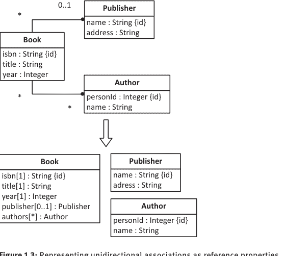

注意，在某种程度上，我们消除了显式关联，并将其替换为相应的引用属性，从而得到可以用经典的面向对象语言直接编码的类模型。面向对象语言确实

语言不支持将关联作为一等公民。它们没有用于定义关联的语言元素。因此，一个 OOP 类设计模型（我们称之为 OO 类模型）不应包含任何显式关联。

当我们以 UML 类图的形式创建信息模型时，我们通常会得到一个包含一个或多个其末端没有明确所有权的关联的模型，例如图 1.4 所示。当关联的末端都没有所有权点时（如本例所示），这意味着模型没有指定如何通过引用属性（reference properties）来表示（或实现）该关联。这种关联没有方向性。根据 UML 2.5 规范，此类关联的末端由关联自身“所有”，而不是由参与其中的任何类所所有。

| chairedCommittee | ClubMember |
|---|---|---|
| name : String | 0.1 | 1 |

图 1.4: 委员会与俱乐部成员之间非方向性关联的模型。

一个包含没有关联末端所有权点的关联的信息设计模型作为关系型数据库设计模型是可以接受的，但作为 OOP 语言的设计模型它是不完整的。

例如，图 1.4 的模型提供了一个包含实体表（委员会和俱乐部成员）的关系型数据库设计，以及一个独立的对一一关系表 `committee_clubmember_as_chair`。但它没有提供 Java 类的设计，因为它没有指定如何通过引用属性来实现该关联。

将一个非方向性关联的信息设计模型（不包含任何关联所有权点）转换为所有关联均为单向或双向的信息模型，有三种方案：我们可以在关联的任一末端或两个末端放置所有权点。这三个选项中的每一个都定义了通过引用属性表示或实现关联的不同方式。因此，对于上述图 1.4 所示的关联，我们有以下选项：

- 1. 在 chair 关联末端放置所有权点，形成图 1.2 所示的模型，该模型可以转换为上述图 1.1 所示的 OO 类模型。

## 1 引用属性与单向关联

- 2. 在 chairedCommittee 关联末端放置所有权点，形成下文图 1.8 所示的完成模型。
- 3. 通过在两个关联末端都放置所有权点使关联变为双向，如图 1.5 所示，这意味着该关联通过一对互逆的引用属性 `Committee::chair` 和 `ClubMember::chairedCommittee` 以冗余方式实现，正如第 7 章讨论的那样。

| Committee | chair | ClubMember |
|---|---|---|
| name : String | 0.1 | 1 |

**图 1.5:** 委员会与俱乐部成员之间双向关联的建模。

每当我们对关联建模时，必须做出选择，即哪一个末端代表引用属性并因此被标记为所有权点。可以是一个，也可以是两个。这一决策也意味着对关联的可导航性（navigability）做出了决策。当一个关联表示引用属性时，这意味着它是可导航的（通过该属性）。

对于非一对一的功能性关联，最简单的设计是根据其功能定义关联的方向，将关联所有权点放置在多重性为 `0..1` 或 `1` 的关联末端。。对于非方向性的一对一或多对多关联，我们可以随心所欲地选择方向，即我们可以将所有权点放置在任何一个关联末端。

下图 1.6 所示的模型（关于出版社和书）作为我们单向功能性关联的示例。注意，它包含了单向的多对一关联 `Book-has-Publisher`。

| Publisher | Book |
|---|---|
| name : String | isbn : String (id) |
| address : String | title : String |
| 0.1 | * * |

**图 1.6:** 具有单向关联（多值引用属性）的出版社。

我们可能还需要处理表示单向关联的引用属性。例如，单向

## 1.7 消除单向关联

书与作者之间的多对多关联，如下文图 1.7 所示，模型了多值的（非功能）引用属性。

| Publisher | Author |
|---|---|
| name: String (id) | personId: (id) |
| address: String | name: String |
| Book | |
| isbn: String (id) | |
| year: Integer | |


由于传统的 OOP 语言不支持关联作为一等公民，只支持类和表示单向关联的引用属性，我们必须从信息模型中消除显式关联以获取类模型。

我们关联消除程序的起点是一个包含各种类型单向关联的信息模型，如图 1.6 所示。如果模型仍然包含非方向性关联，我们首先通过对它们的所有权做出决策将其转换为方向性关联。连接源类与目标类的单向关联被源类中相应的引用属性所取代，该属性具有：

- 与关联端相同的名称（如果有），否则设置为目标类的名称（可能是复数），如果引用属性是多值的；
- 目标类；
- 与关联端相同的多重性；
- 如果单向关联是反函数的，则具有唯一约束。

这种替换过程在图 1.8 的一对一单向关联案例中说明，其中引用属性 `chairedCommittee` 的唯一约束通过 `{key}` 修饰符表示。

| chairedCommittee | ClubMember |
|---|---|---|
| name : String | 0.1 | 1 |
| Committee | ClubMember |
|---|---|
| name : String | chairedCommittee[0..1] : Committee {key} |

图 1.8: 将功能端转换为引用属性。

对于单向的一对多关联，图 1.9 提供了关联消除过程的说明。在这里，非功能关联端被转换为相应的引用属性，其名称由目标类名的复数形式获得。

| Polygon | Point |
|---|---|
| 1 3.* | x : Integer
y : Integer |

图 1.9: 将非功能端转换为多值引用属性。

| Polygon | Point |
|---|---|
| points[3..] : Point | x : Integer
y : Integer |


在我们示例模型——“出版社-书-作者”信息模型中，我们必须将两个单向关联替换为合适的引用属性。在第一步中，我们将图 1.6 模型中的多对一关联 `Book-has-Publisher` 替换为 `Book` 类中的功能性引用属性 `publisher`，形成图 1.10 所示的 OO 类模型：

| Book | Publisher |
| :--- | :--- |
| isbn[1] : String (id) | name : String (id) |
| title[1] : String | address : String |
| year[1] : Integer | |
| publisher[0..1] : Publisher | |

图 1.10: 出版社和书的 OO 类模型。

请注意，由于“书籍拥有出版社”（`Book-has-Publisher`）关联的目标关联多重性为 0..1，因此我们必须通过将其多重性定义为 0..1，将新属性 `publisher` 声明为可选。

可以通过下表所示的 `Book` 和 `Publisher` 两个类的示例数据填充来说明此面向对象类模型及其引用属性 `publisher` 的含义：

| 名称 | 属性 |
|---|---|
| Bantam Books | New York, USA |
| Basic Books | New York, USA |

| ISBN | 标题 | 年份 | 出版社 |
|---|---|---|---|
| 0553345842 | The Mind's I | 1982 | Bantam Books |
| 1463794762 | The Critique of Pure Reason | 2011 |  |
| 1928565379 | The Critique of Practical Reason | 2009 |  |
| 0465030793 | I Am A Strange Loop | 2000 | Basic Books |

注意 `Book` 表中“Publisher”列的值是唯一的名称，它们引用了 `Publisher` 表中的某行。由于相应的引用属性 `publisher` 是可选的，某些行的“Publisher”列可能没有值。

在第二步中，我们将图 1.7 模型中的多对多“书籍拥有作者”（`Book-has-Author`）关联替换为 `Book` 类中的多值引用属性 `authors`，从而得到了图 1.1 所示的面向对象类。

| 书籍 | 出版社 |
|---|---|
| isbn[1] : String (id) | name : String (id) |
| title[1] : Integer | address : String |
| year[1] : Integer | |
| publisher[0..1] : Publisher | |
| authors[*] : Author | |

| 作者 |
|---|
| personid : integer (id) |
| name : String |

**图 1.11：** `Book`、`Publisher` 和 `Author` 类的面向对象类模型。

此面向对象类模型及其引用属性 `Book::publisher` 和 `Book::authors` 的含义可以通过三个模型类的示例数据填充来说明：

| 名称 | 属性 |
|---|---|
| Bantam Books | New York, USA |
| Basic Books | New York, USA |

| ISBN | 标题 | 年份 | 作者 | 出版社 |
|---|---|---|---|---|
| 0553345482 | The Mind's I | 1982 | 1, 2 | Bantam Books |
| 1463974762 | The Critique of Pure Reason | 2011 | 3 | |
| 1928565379 | The Critique of Practical Reason | 2009 | 3 | |
| 0465030793 | I Am A Strange Loop | 2000 | 2 | Basic Books |

| 作者 ID | 名称 |
|---|---|
| 1 | Daniel Dennett |
| 2 | Douglas Hofstadter |
| 3 | Immanuel Kant |

完成平台无关的面向对象类模型后，可以从中推导出针对特定实现平台选择的一个或多个特定平台实现模型。特定平台实现模型的类型示例包括 JS 类模型、Java 实体类模型和 SQL 表模型。

特定平台实现模型仍然可以用 UML 类图的形式表示，但它仅包含可以在所选平台中直接编码的建模元素。因此，对于任何考虑的平台，都需要两个准则：1) 如何制作特定平台的实现模型，2) 如何对该模型进行编码。

用于用户界面（UI）中数据输入和输出的小部件（widgets）通常对应于模型中定义的属性。我们必须区分对应各种类型的输入字段与对应枚举属性或引用属性的选择部件（如选择列表）。在 UI 中使用选择控件而非输入字段来表示引用属性，可以防止输入无效的 ID，从而维护引用完整性。

通常情况下，单值引用属性无论属性填充了多少个对象，都可以渲染为 UI 中的单选列表。如果引用属性的范围足够小（例如小于 7 个），则可以使用单选按钮组。

多值引用属性可以渲染为 UI 中的多选列表。然而，当有许多选项（例如超过 20 个）时，相应的 HTML 多选控件实际上是不可用的，因为选择方式太分散。在只有少数选项（例如不超过 7 个）的特殊情况下，对于 UI 中所有关联对象的列表，我们需要开发一种特殊的 UI 小部件，允许从引用属性范围中添加（删除）对象。

这种多选控件由以下部分组成：

- 1. 关联对象的 HTML 列表，每个项目包含一个删除按钮；
- 2. 一个选择控件，允许多值引用属性范围内添加新的关联对象。

默认情况下，非功能关联将目标类的实例关联到源类的任何实例，这意味着对应多值引用属性是集合（sets）。还存在某些情况，非功能关联是有序的，因此对应引用属性的值的形式为有序集合。

在以下示例中，`publishedBooks` 关联无序，而 `authors` 关联是有序的，因为作者的顺序是有意义的。注意在 UML 类图中，有序关联用 `{ordered}` 注解标记。

| 出版社 | 已出版书籍 | 作者 (有序) | 作者 |
|---|---|---|---|
| name : String (id) | isbn : String (id) | * | personid : Integer {id} |
| address : String | 0.1 * | title : String, year : Integer | * | name : String |

有序关联不应基于目标类的属性。在我们的示例中，这意味着作者的顺序不应该代表字母顺序，而是代表无法通过 `Author` 属性获取的信息。事实如此，因为它代表了某种无法通过任何属性表达的意义。

注意，通过向关联的目标类添加一个或多个属性，可以将有序关联转换为无序关联。有序关联通过不需要辅助属性显式排序，允许更简洁的信息模型和更高效的实现。

多值引用属性的两个重要集合类型是集合（sets），对于包（多集合）和序列（有序多集合），多值引用属性的集合类型是包或序列，这可以在类图中使用 `{nonunique}`（或 `{ordered, nonunique}`）注解表示。注意，使用列表（如 JS 数组或 `List` 接口）作为有序和无序多值属性的范围是非常常见的。

如果你想查找以下测验的答案，可以查看我们的讨论论坛。如果你在论坛中没有找到答案，可以发帖提问。

说一个关联是“一对一”意味着什么？

意味着它是（选择一个）：

- 双向的
- 同时具有功能性和完全性
- 是功能性的
- 同时具有功能性和反向性

对于域为 C 范围为 D 的引用属性 `p`，在何时必须检查引用完整性（选择一个或多个）：

- □ 一个 C 类型对象被销毁。
- □ 某个 C 类型对象的 `p` 值被更改。
- 创建了一个新的 C 类型对象。
- □ 一个 D 类型对象被销毁。
- □ 创建了一个新的 D 类型对象。

单向二元关联是功能性的，当且仅当（选择一个）：

- O 源类的每个对象最多关联一个目标类对象。
- O 目标类的每个对象最多关联一个源类对象。
- O 源类的每个对象至少关联一个目标类对象。
- O 源类的每个对象恰好关联一个目标类对象。

假设我们有一个具有标准标识符属性 `id` 的对象 B，以及一个具有引用 `B::id` 的引用属性 `b_id` 的对象 A。此外，有一个 `b.id = 11` 的 B 类型对象 b 以及一个 `a.b_id = 11` 的 A 类型对象 a。以下描述是正确的？选择一个或多个：

- □ 当对象 a 中的引用被取消赋值（在 JS 中将 `a.b_id` 设置为 `undefined`，在 Java 中设为 `null`）且没有其他对象引用 b 时，对象 b 可以被销毁。
- □ 只有在 b 被销毁之前，对象 a 才能被销毁。
- 当对象 a 中的 ID 引用被重置为类型 B 的另一个对象时，b 可以被销毁，例如通过设置 `a.b_id = 7` 且没有其他对象引用 b。
- 当 a 已经被销毁时，b 也可以被销毁。

### 1.10.5 题 5：单值引用属性的渲染

关于单值引用属性 `p` 以及如何通过合适的表单控件在 Web 用户界面中对其渲染，以下哪些描述是正确的？请选择一个或多个：

- 使用 `type="text"` 的输入控件可以获得适当的渲染。
- 如果 `p` 范围的基数（cardinality）不大于 7，可以使用复框组进行渲染。
- 如果 `p` 范围的基数不大于 7，可以使用单选按钮组进行渲染。
- 它始终可以通过单选择控件进行渲染。

可以使用哪种“x-to-y”形式（其中 x,y 表示“一个”或“多个”）来表达一种关联既不是功能性的也不是反向功能的？

答案：________________________________

单向功能关联可以是一对一的，也可以是多对一。在这两种情况下，这种关联都通过一个单值引用属性来表示或实现。

在本章中，我们将展示：

- 1. 如何从具有表示单向功能关联的单值引用属性的 OO 类模型推导出 JS 类模型，
- 2. 如何以原生 JavaScript 模型类的形式编写 JS 类模型，
- 3. 如何基于模型代码编写视图（view）和控制器（controller）代码。

在推导出 JS 类模型并用 JavaScript 编码之前，我们首先介绍 JavaScript 语言的几个新元素，我们将在本书讨论的 JavaScript 代码中使用这些元素。

### 2.1 新的 JavaScript 元素

### 2.1.1 使用 let 和 const 的块作用域变量声明

ES5 不允许声明作用域为大括号对 `{` 和 `}` 限定的块或由 `for` 循环定义的变量。相反，所有用 `var` 声明的变量即使在函数作用域或全局范围内也是。`let` 和 `const` 的块作用域变量声明新功能允许局部变量具有细粒度的作用域，这有助于避免意外的重复并使代码更加模块化。

`let` 和 `const` 之间只有一个区别。用 `const` 声明的变量是冻结或不可变的，从这个意义上说是常量，而 `let` 变量不是。对于所有预期不需要改变变量，最好使用 `const`。否则，或者如果不明确，如果是块作用域变量，应用 `let` 声明；如果是全局或函数作用域变量，应用 `var` 声明。

### 2.1.2 箭头函数

与经典的 JS 函数相比，箭头函数（带有 `=>`）提供了更简洁函数语法，见示例 1，并允许在函数体中使用函数外部环境（其*闭包*）的 JavaScript `this` 变量，见示例 2。

**示例 2.1.**

```
let evens = [0,2,4,6,8];
odds = evens.map(v => v+1); // [1,3,5,7,9]
// 代替 evens.map(function (v) { return v+1; });
```

```
this.nums = [1,3,5,8,10,12,15,17];
this.fives = [];
this.nums.forEach(v => { if (v % 5 === 0) this.fives.push(v); });
// 代替 this.nums.forEach(
  function (v) { if (v % 5 === 0) this.fives.push(v); }););
```

迭代对象包括字符串、数组、类数组（例如内置的 `arguments` 或 `HTMLCollection` 和 `NodeList` 的实例）以及 `TypedArray`、`Map` 和 `Set` 数据类型的实例，以及用户定义的可迭代对象。例如：

```
const divElems = document.getElementsByTagName("div");
// 一个 HTMLCollection 是可迭代的
for (let dEl of divElems) {
  console.log(dEl.id);
}
```

当不需要计数器变量时，*for-of* 循环通常比 *for* 循环方便。与 *forEach* 循环相比，*for-of* 循环允许遍历 `HTMLCollection` 并且可以使用 `break` 退出。

模板字符串使用反引号（如 `` `...` ``）而不是双引号或单引号封闭，并允许对固定文本部分与变量/表达式组合形成的（可能是多行的）字符串值提供简洁语法。例如：

```
const classValues = "card important";
const name = "Joker";
const htmlTemplate = `<div`
```

### 2.1.5 扩展运算符

...允许在预期参数的地方展开 (1) 可迭代对象的元素，或者 (2) 将对象的字段展开到新对象中。例如：

```
const user = {name: "Alice", age: 30};
const {name, ...rest} = user;
```

使用解构，参数字段被赋值给普通变量，从而简化了函数：

```javascript
function displayName({first, last}) {
  alert(first + " " + last);
}
```

注意，发布者（publisher）名称被用作 ID 引用，因为它是 `Publisher` 类的标准 ID。

构建 JS 类模型的起点是一个面向对象（OO）的类模型，如图 1.10 所示。

我们现在展示如何通过四个步骤从该 OO 类模型派导出 JS 类模型。OO 类模型中的每个类：

- 1. 为所有（非派生的）单值属性添加 `<get/set>` 刻型（stereotype），意味着它们具有隐式的 getter 和 setter。回想一下在 setter 中，会调用相应的检查操作（check operation），且只有当检查没有检测到任何约束违背时，才会设置属性。
- 2. 为每个（非派生的）属性创建一个检查操作，以便在实现属性约束时有一个集中的位置置点。对于一个标准的 ID 属性（例如 `Book::isbn`），需要两个或三个检查操作：
  - 1. 一个基础检查操作，如 `checkIsbn`，用于检查所有的语法约束，但不包括强制性值和唯一性约束。
  - 2. 一个标准的 ID 检查操作，如 `checkIsbnAsId`，用于检查标准 ID 属性隐含的强制性值和唯一性约束。
  - 3. 如果其他类有一个引用正在考虑的类的引用属性，添加一个 ID 引用检查操作，用于检查施加在 ID 引用（或外键）属性上的引用完整性约束。例如，由于 `Book::publisher` 属性引用 `Publisher` 对象，我们需要在 `Publisher` 类中添加 `checkNameAsIdRef` 操作。

  对于引用属性（如 `Book::publisher`），检查操作 `Book.checkPublisherAsIdRef`，并可能通过调用 `Publisher.checkNameAsIdRef` 引用完整性约束，如果该属性是强制性的，可能还需要强制性约束。

- 3. 在 `toString()` 中添加一个对象序列化函数，用于在错误消息和日志中显示对象的状态。
- 4. 在 `toRecord()` 中添加一个对象到存储的转换函数，为将模型对象存储为实体表中的行做准备，该行可以通过 `JSON.stringify` 序列化为 JSON 字符串，从而存储为应用 `localStorage` 数据存储中的值。

这导致了以下针对 `Book` 的 JS 类模型，其中类级（`static`）方法用下划线表示：

| Book | Book |
| --- | --- |
| isbn[1]: String (id) | «get/set» isbn[1]: string (id) |
| title[1]: String | «get/set» title[1]: string |
| year[1]: integer | «get/set» year[1]: number(int) |
| publisher[0..1]: Publisher | «get/set» publisher[0..1]: Publisher |
| | checkIsbn(isbn: string): ConstraintViolation |
| | checkIsbnAsId(isbn: string): ConstraintViolation |
| | checkIsbnAsIdRef(isbn: string): ConstraintViolation |
| | checkTitle(in: string): ConstraintViolation |


## 2.5.2 将 JS 类模型编码为 JS 类

我们必须对 `Publisher` 类执行类似的转换。这为我们提供了从上述 OO 类模型派出的完整 JS 类模型，如图 2.1 所示。

| Publisher |
| --- |
| «get/set» name: string (id) |
| «get/set» address: string |
| `checkName(in n: string): ConstraintViolation` |
| `checkNameAsId(in n: string): ConstraintViolation` |
| `checkNameAsIdRef(in n: string): ConstraintViolation` |
| `checkAddress(in a: string): ConstraintViolation` |
| `toString(): String` |
| `toRecord(): Object` |

与第 卷中讨论的验证和枚举应用相比，我们必须处理许多技术问题：

1. 在模型代码中，我们现在必须处理需要以下要求的引用属性：
   1. 维护引用完整性；
   2. 在第 1.2 节讨论的两种删除策略中选择并实现一种，用于在属性自身类的 `destroy` 方法中管理相应的销毁依赖；
   3. 在序列化函数 `toString()` 和转换函数 `toRecord()` 以及构造函数中，进行内部对象引用与外部 ID 引用之间的转换。
2. 在用户界面（“视图”）中，我们现在必须处理：
   1. 在检索/列出（Retrieve/List）用例中显示有关关联对象的信息；
   2. 在创建（Create）和更新（Update）用例中，允许从关联目标类的所有实例列表中选择对象，并将其添加到关联对象列表或从从列表中移除对象。

可以直接为 JS 类编码以获取我们应用的 JS 类。

将 JS 类模型中的每个类编码为具有隐式 getter 和 setter 的 ES2015 类（class）：

1. 以类级（`static`）方法的形式编写属性检查。确保 JS 类模型中指定的属性的所有约束在属性检查中都被正确地编码。
2. 对于每个单值属性，编写指定的 getter 和 setter，在每个 setter 中，会调用相应的检查，且只有当检查没有检测到任何约束违背时才会设置属性。
3. 编写序列化函数 `toString()` 和转换函数 `toRecord()`。
4. 在 `destroy` 方法中处理依赖。

这些步骤将在后续章节中详细讨论。

JS 类模型中的每个类 C 编码为具有记录参数（record）的 ES2015 类，这指定了属性。这些属性的范围应在注释中说明。在构造函数体中，我们将记录参数的字段赋值给属性。这些属性赋值会调用 setter 方法。

例如，JS 类模型中的 `Publisher` 类如下所示编码：

```javascript
class Publisher {
  constructor(({name, address})) {
    this.name = name;
    this.address = address;
  }
```

由于 setter 可能会抛出约束违背异常，构造函数以及任何 setter 都应该放在 try-catch 块中，其中 catch 子句负责记录合适的错误消息。

对于每个模型类 C，我们定义一个类级属性 C，表示由应用管理的 C 实例（形式为记录的映射）。该属性初始化为 `{}`。例如，在 `Publisher` 模型类的情况下，我们定义：

```javascript
Publisher.instances = {};
```

JS 类模型中的 `Book` 类以类似的方式编码：

```javascript
class Book {
  constructor(({isbn, title, year, authors, authorRefs,
    publisher, publisher_id})) {
    this.isbn = isbn;
    this.title = title;
    this.year = year;
    this.authors = authors || authorRefs;
```

```javascript
if (publisher || publisher_id) {
  this.publisher = publisher || publisher_id;
}
...
```

注意，`Book` 构造函数可以使用对象引用 `authors` 或使用 ID 引用 `authorRefs` 和 `publisher_id` 来调用。这种方法使得 `Book` 构造函数更加灵活、更加健壮。

### 2.5.3 编写属性检查

确保 JS 类模型中指定的属性的所有约束在其检查函数中都被正确编码，正如第 卷第 8 章所述。回想一下，约束违背（或验证错误）类定义在 `lib/errorTypes.js` 文件中。

例如，对于 `Publisher.checkName` 函数，我们得到以下代码：

```javascript
class Publisher {
  static checkName(n) {
    if (n === undefined) {
      return new NoConstraintViolation(); // 非强制
    } else {
      if (typeof n !== "string" || n.trim() === "") {
        return new RangeConstraintViolation(
          "The name must be a non-empty string!"
        );
      } else {
        return new NoConstraintViolation();
      }
    }
  }
  static checkNameAsId(n) { .. }
}
```

注意，由于 `name` 属性是 `Publisher` 的标准 ID 属性，我们只在 `checkName` 中检查语法约束，并在 `checkNameAsId` 中检查必填值和唯一性约束，后者会调用 `checkName`：

```js
static checkNameAsId(n) {
  var validationResult = Publisher.checkName(n);
  if ((validationResult instanceof NoConstraintViolation)) {
    if (n === undefined) {
      return new MandatoryValueConstraintViolation(
        "A publisher name is required!");
    } else if (Publisher.instances[n]) {
      validationResult = new UniquenessConstraintViolation(
        "There is already a publisher record with this name!");
    } else {
      validationResult = new NoConstraintViolation();
    }
  }
}
```

如果我们需要在其他类中处理 ID 引用（外键），我们需要提供进一步的检查，称为 `checkNameAsIdRef`，用于检查引用完整性约束：

```js
static checkNameAsIdRef(n) {
  var validationResult = Publisher.checkName(n);
  if ((validationResult instanceof NoConstraintViolation) &&
    n !== undefined) {
    if (!Publisher.instances[n]) {
      validationResult = new ReferentialIntegrityConstraintViolation(
        "There is no publisher record with this name!");
    }
  }
  return validationResult;
}
```

条件 `!Publisher.instances[n]` 检查是否存在具有给定名称 `n` 的出版社对象，然后创建一个 `ReferentialIntegrityConstraintViolation` 异常类实例的 `validationResult` 对象。`Book.checkNameAsRef` 函数由 `Book.checkPublisher` 函数调用：

```js
class Book {
  ..
  static checkPublisher(publisher_id) {
    var validationResult = null;
    if (publisher_id === undefined || publisher_id === "") {
      validationResult = new NoConstraintViolation(); // optional
    } else {
      // 调用外键约束检查
      validationResult = Publisher.checkNameAsRef(publisher_id);
    }
    return validationResult;
  }
  ..
}
```

在 setter 方法中，会调用相应的检查函数，只有当检查未检测到约束违反时，才会设置属性。对于引用属性，我们避免使用对象引用或 ID 引用调用 setter。由此产生的歧义通过测试在调用 setter 时提供的参数是否为对象来解决。例如，出版社的 setter 是如下方式编写的：

```js
class Book {
  ..
  set publisher(p) {
    if (!p) // 取消出版社
      delete this._publisher;
    } else { // 注意此处此处多了一个大括号
      // p 可以是 ID 引用或对象引用
      publisher_id = (typeof p==="object") ? p : p.name;
      const validationResult = Book.checkPublisher(publisher_id);
      if (validationResult instanceof NoConstraintViolation) {
        // 创建新的出版社引用
        this._publisher = Publisher.instances[publisher_id];
      } else {
        throw validationResult;
      }
    }
  }
}
```

对于任何引用属性，我们必须在第 1.2 节讨论的两种可能的删除策略中选择并实现一种，用于属性范围类的 `destroy` 方法中管理相应的对象销毁依赖。在我们的案例中，当删除出版社记录时，必须在两者之间选择：

1. 删除所有由删除出版社出版的书记录（生存依赖）；
2. 从所有由删除出版社出版的书中删除指向该删除出版社的引用（生存独立）。

假设书籍在生存上不依赖于其出版社，我们选择第二种方案。在下面的 `Publisher.destroy` 方法代码中，对于所有相关的书籍对象，`book.publisher` 属性都被清空了：

```js
Publisher.destroy = function (name) {
    const publisher = Publisher.instances[name];
    // 删除书籍对象中所有对该出版社的引用
    for (let key of Object.keys(Book.instances)) {
        const book = Book.instances[key];
        if (book.publisher === publisher) {
            delete book.publisher; // 删除槽位
            console.log("" + book.isbn + " updated.");
        }
    }
    // 删除出版社记录
    delete Publisher.instances[name];
    console.log("Publisher " + name + " deleted.");
};
```

注意，对已删除出版社的所有引用的删除是通过顺序扫描所有书籍对象完成的，当书籍很多时，这可能是无效的。如果每个出版社对象都持有一个指向所有该出版社出版的书的列表，效率将会高得多。创建和维护列表将使书籍与其出版社之间的关联变为双向的。

## 2.5.6 序列化与对象到存储的映射

对于引用属性（例如 `Book::publisher`），序列化函数 `Book::toString()` 必须显示被引用对象的人类可读标识符，例如 `publisher.name`：

```js
toString() {
  var bookStr = `Book: ISBN: ${this.isbn}, title: ${this.title},` +
  `year: ${this.year}`;
  if (this.publisher) bookStr += `, publisher: ${this.publisher.name}`;
  return bookStr + "";
}
```

对象到存储的转换函数 `Book::toRecord()` 将带有对象引用的（无类型）带类型对象转换为带有 ID 引用的记录对象：

```js
toRecord() {
  var rec = {};
  for (let p of Object.keys(this)) {
    // 只处理带下划线的属性
    if (p.charAt(0) === "_") {
      switch (p) {
        case "_publisher":
          // 将对象引用转换为 ID 引用
          if (this._publisher) rec.publisher = this._publisher.name;
          break;
        default:
          // 移除下划线
          rec[p.substr(1)] = this[p];
      }
    }
  }
  return rec;
}
```

反向转换，从带 ID 引用的无类型记录转换为带对象引用的类型对象，是由 `Book` 构造函数完成的，它接受参数。

## 2.6 编写视图与控制器

用户界面（UI）由 `index.html` 组成，允许导航到各个管理页面（例如 `books.html` 和 `publishers.html`）。每个数据管理页面包含 5 个部分：查询、创建、编辑、更新和删除，每次只显示一个（通过设置 CSS `display:none` 属性来实现）。

### 2.6.1 初始化 App

为了初始化数据管理用例，所需的数据（例如出版社和书籍记录）必须从持久化存储中加载。这是通过 `c/books.js` 中的 `pl.c.books.manage` 实现的：

```js
pl.c.books.manage = {
  initialize: function () {
    Publisher.retrieveAll();
    Book.retrieveAll();
    pl.v.books.setUserInterface();
  }
}
```

管理的 `initialize` 方法首先加载出版社，然后通过调用 `setUp` 方法渲染书籍数据。

### 2.6.2 在查询列表中显示关联对象

在示例中，我们只有一个引用属性 `Book::publisher`，它是功能且可选的。要在查询列表用例中显示可选的出版社，HTML 表格中的相应单元格将被填充：


```js
pl.v.books.retrieveAndAll = {
  setupUserInterface: function () {
    const tableBodyEl = document.querySelector("#sectionBook-R tbody");
    tableBodyEl.innerHTML = ""; // 清空旧内容
    for (let key of Object.keys(Book.instances)) {
      const book = Book.instances[key];
      const row = tableBodyEl.insertRow(-1);
      row.insertCell(-1).textContent = book.isbn;
      row.insertCell(-1).textContent = book.title;
      row.insertCell(-1).textContent = book.year;
      // 如果书籍有出版社，则显示其名称
      row.insertCell(-1).textContent =
        book.publisher ? book.publisher.name : "";
    }
  }
  document.getElementById("Book-M").style.display = "none";
  document.getElementById("Book-R").style.display = "block";
};
```

对于多值引用属性，表格单元格必须填充所有引用的关联对象的列表。

## 2.6.3 在创建和更新用例中选择关联对象

为了在创建和更新用例中从当前编辑的对象中选择关联对象，HTML 选择列表（即 `select` 元素）将通过实用方法 `fillSelectWithOptions` 根据关联对象类型的实例填充选项。该 HTML 元素定义在 `books.html` 视图文件中：

```html
<section id="Book-C" class="UI-Page">
  <h1>Public Library: Create a new book record</h1>
  <form>
    ...
    <div class="select-one">
      <label>Publisher: <select name="selectPublisher"></select></label>
    </div>
    ...
  </form>
</section>
```

## 2.6 编写视图和控制器 — 35

创建用户界面的设置通过以下过程：

```javascript
pl.v.books.create = {
  setupInterface: function () {
    const formEl = document.querySelector("section#Book-C > form"),
      selectPublisher = formEl.selectPublisher,
      saveButton = formEl.commit;
    // 为响应式验证添加事件监听
    formEl.isbn.addEventListener("input", function () {
      formEl.isbn.setCustomValidity(
        Book.checkIsbnAsId(formEl.isbn.value);
    });
    // 设置一个单选列表来选择出版社
    util.fillSelectWithOptions(selectPublisher,
      Publisher.instances, "name");
    // 为提交按钮点击定义事件处理器
    saveButton.addEventListener("click",
      this.handleSaveButtonClickEvent);
    // 定义中消提交事件的事件处理器
    formEl.addEventListener("submit", function (e) {
      e.preventDefault();
      formEl.reset();
    });
    // 用创建表单替换管理表单
    document.getElementById("Book-M").style.display = "none";
    document.getElementById("Book-C").style.display = "block";
    formEl.reset();
  },
  handleSaveButtonClickEvent: function () {
    // ...
  };
```

当用户点击（或触摸）保存按钮时，所有的表单控件值（包括选择控件的值）都会复制到 slots 列表中。在对所有表单字段进行有效检查后，该列表用于调用 `add` 方法的参数，如下程序所示：

```javascript
handleSaveButtonClickEvent = function () {
  const formEl = document.querySelector("section#Book-C > form");
  const slots = {
    isbn: formEl.isbn.value,
    title: formEl.title.value,
    year: formEl.year.value,
    publisher_id: formEl.selectPublisher.value
  }
  // 验证所有表单控件并显示错误消息
  formEl.isbn.customValidity(
    Book.checkIsbnAsId(slots.isbn).message); /* ... (title 和 year 同理) */
  // 仅当所有字段有效时才保存输入数据
  if (formEl.checkValidity()) {
    Book.add(slots);
  }
};
```

更新书籍用例的 `setupInterface` 代码类似。

## 3 — 2 使用原生 JS 实现单向函数关联

## 2.7 测验题

### 2.7.1 问题 1：JS 类模型

从给 OO 类模型派生的 `Committee` 类，正确的 JS 类模型是哪个？

选择一个：

| Committee | ClubMember |
|---|---|
| name : String (id) | memberid : Integer (id) |
| chair : ClubMember | firstName : String |

- 1. O

| Committee |
|---|
| <get/set> name : string (id) |
| <get/set> chair : ClubMember |
| checkName(n : string) : ConstraintViolation |
| checkChair(ic : ClubMember) : ConstraintViolation |
| toString() : string |
| toRecord() : Object |

- 2. O

| Committee |
|---|
| <get/set> name : string (id) |
| <get/set> chair : ClubMember |
| checkName(in n : string) : ConstraintViolation |
| checkNameAsId(in n : string) : ConstraintViolation |
| checkNameAsIdn(in n : string) : ConstraintViolation |
| checkChair(in c : ClubMember) : ConstraintViolation |
| toString() : string |
| toRecord() : Object |

- 3. O

| Committee |
|---|
| <get/set> name : string (id) |
| <get/set> chair : ClubMember |
| checkName(in n : string) : ConstraintViolation |
| checkNameAsId(in n : string) : ConstraintViolation |
| checkChair(in c : ClubMember) : ConstraintViolation |
| toString() : string |
| toRecord() : Object |

## 3 使用原生 JS 实现单向非函数关联

单向非函数关联可以是一对多，也可以是多对多。在这两种情况下，这种关联都通过多值引用属性来表示（或实现）。

在本章中，我们将展示：

- 1. 如何从具有表示单向非函数关联的多值引用属性的 OO 类模型推导出 JS 类模型，
- 2. 如何以 JavaScript 模型类的形式编写 JS 类模型，
- 3. 如何基于模型代码编写视图和控制器代码。

## 3.1 实现多值引用属性

多值引用属性（例如 `Book::authors` 属性）允许对某些类型对象（如 `Author` 对象）的引用集合。在创建 `Book` 类型的新对象时，构造函数需要一个参数来为该属性提供适当的值。我们可以允许该值是内部对象引用的集合，也可以是 ID 引用的集合，如下例：

```javascript
class Book {
  constructor({isbn, title, year, authors, authorIdRefs,
      publisher, publisher_id}) {
    this.isbn = isbn;
    this.title = title;
    this.year = year;
    // 分配对象引用或 ID 引用
    this.authors = authors;
    if (authorIdRefs) {
      this.authorIdRefs = authorIdRefs;
    } else {
      this.authorIdRefs = [];
    }
    this.publisher = publisher;
    this.publisher_id = publisher_id;
  }
}
```

注意，构造函数的参数预期包含内部对象引用的集合或 ID 引用。`authors` 表达式如果是 slot 则为 map，否则为数组。我们通过以下片段在 setter 中处理歧义：

```javascript
set authors(a) {
  if (Array.isArray(a)) {
    this._authors = a;
  } else {
    this._authors = {};
    for (let id in a) {
      this._authors[id] = a[id];
    }
  }
}
```

## 3.2 制作类模型

在 JS 中，集合值属性有两种实现方式：

- 1. 使用数组作为值，
- 2. 使用 map 作为值，将其映射到 ID。

我们倾向于使用 map 实现集合值属性，因为它们可以保证元素唯一，而使用数组时我们需要手动处理重复。制作类模型的起点是以下 OO 类模型：

| Book | Publisher |
|---|---|
| isbn[1]: String (id) | name : String (id) |
| title[1]: String | address : String |
| year[1]: Integer | |
| publisher[0..1]: Publisher | |
| authors[*]: Author | |

## 4 使用原生 JS 实现单向非函数关联

该模型除了单值引用属性 `::publisher` 之外，还有一个多值引用属性 `Book::authors` 表示单向多对多关联。对于 OO 类模型的类模型，我们需要遵循：

- 1. 创建类级检查操作，例如 `checkAuthor`，它负责检查要添加到属性集合中的引用的引用完整性；
- 2. 创建一个添加操作，例如 `addAuthor`，将引用添加到集合中；
- 3. 创建一个移除操作，例如 `removeAuthor`，从集合中移除引用。

这导致了以下 JS 模型：

| Book | Publisher |
|---|---|
| /get/set(isbn): string (id) | /get/set(name): string (id) |
| /get/set(title): string | /get/set(address): string |
| /get/set(year): integer | |
| /get/set(publisher[0..1]): Publisher | |
| /get/set(authors[*]): Author | |

## 3.3 新问题

在处理如上一章讨论的函数关联时，我们现在必须处理以下技术问题：

- 1. 在模型代码中，我们需要处理需要实现的多值引用属性

## 3.4 模型编码

- 1. 一个添加方法和一个删除方法，例如 `addAuthor` 和 `removeAuthor`，以及一个通过 `add` 方法分配一组对象引用的设置（setter）方法，可能将 ID 引用转换为对象引用；这三个方法都可能需要检查基数约束（如果存在的话）；
- 2. 一个类层级的检查操作，例如 `checkAuthor`，它必须调用属性范围类中对应的 `checkAsIdRef` 方法，以检查属性的隐式引用完整性约束；
- 3. 在对象到存储的转换函数 `toRecord` 中，将对象引用集合转换为 ID 引用集合。

## 2. 我们现在在用户界面（“视图”）代码中需要处理以下事项：

- 1. 在“检索/列出所有”（Retrieve/list all）用例的表格视图的属性列中，显示一组关联对象的信息；最简单的方法是显示用逗号分隔的 ID 引用列表，可能与相应的名称结合；或者，可以在属性的数据单元格中渲染 HTML 列表；
- 2. 在“创建”（Create）和“更新”（Update）用例中，允许从属性范围类的所有实例列表中选择一组关联对象。

最后一个问题，即允许从某个类的所有实例列表中选择一组关联对象，无法通过 HTML 多选表单控件解决，因为其可用性较差。每当可选选项超过阈值时（由在不滚动屏幕的情况下屏幕上可见的选项数量定义），多选元素的可用性就会变差，必须使用替代的多选框组件。

## 3.4 模型编码

注意，为了简单起见，我们没有在示例应用程序代码中包含 JS 类模型中显示的所有约束验证检查代码。

### 3.4.1 总结

将 JS 类模型中的每个类编码为具有隐式获取器（getters）和设置器（setters）的 ES2015 类：

- 1. 以类层级（`static`）方法的形式编写属性检查。确保 JS 类模型中指定的属性的所有约束在属性检查中都被正确编码。
- 2. 对于每个单值属性，编写指定的 getter 和 setter，使得在每个 setter 中都会调用相应的属性检查，并且只有在检查没有检测到任何约束违反时，才设置/取消该属性。

## 3. 使用纯 JS 实现单向非功能关联

- 3. 对于每个多值属性，编写其添加和删除操作，以及指定的 get/set 操作：
  - 1. 将添加/删除操作编码为（实例级）方法，这些方法会调用相应的属性检查。
  - 2. 编写 setter，使其对要分配的集合中的每个项调用 `add` 操作。
- 4. 编写序列化函数 `toString()` 和对象到存储的函数 `toRecord()` 的代码。
- 5. 在 `destroy` 方法中处理删除依赖关系。

这些步骤将在接下来的章节中进行详细讨论。

### 3.4.2 编写添加和删除操作

对于多值属性 `Book::authors`，我们需要编写操作 `addAuthor` 和 `removeAuthor`。这两个操作都接受一个参数，用通过 ID 引用（整数或字符串格式的作者 ID）或对象引用来表示作者。`addAuthor` 的代码如下：

```javascript
addAuthor (a) {
  // 可以是 ID 引用或对象引用
  const author_id = (typeof a == "object") ? parseInt(a) : a.authorId;
  const validationResult = Book.checkAuthor(author_id);
  if (author_id && validationResult instanceof NoConstraintViolation) {
    // 添加新的作者引用
    let key = String(author_id);
    this._authors[key] = Author.instances[key];
  } else {
    throw validationResult;
  }
}
```

在 `removeAuthor` 方法中，首先检查作者引用，如果没有检测到约束违反，则删除映射 `this._authors` 中的相应条目：


```javascript
removeAuthor (a) {
  // 可以是 ID 引用或对象引用
  const author_id = (typeof a == "object") ? parseInt(a) : a.authorId;
  const validationResult = Book.checkAuthor(author_id);
  if (validationResult instanceof NoConstraintViolation) {
    // 删除作者引用
    delete this._authors[author_id];
  } else {
    throw validationResult;
  }
}
```

对于将 ID 引用数组或对象引用映射分配给属性 `Book::authors`，`setAuthors` 方法通过 `addAuthor` 逐个添加：

```javascript
setAuthors (a) {
  this._authors = {};
  if (Array.isArray(a)) { // IdRefs 数组
    for (let idRef of a) {
      this.addAuthor(idRef);
    }
  } else // IdRefs 到对象引用的映射
    for (let idRef of Object.keys(a)) {
      this.addAuthor(a[idRef]);
    }
  }
}
```

### 3.4.3 选择并实现删除策略

对于引用属性 `Book::authors`，我们必须在 `Author` 类的 `destroy` 方法中选择并实现删除。我们必须在删除所有由删除作者共同（co）的书（反映存在依赖的逻辑）之间进行选择：

- 1. 删除所有由删除作者共同（co）的书（反映存在依赖的逻辑）；
- 2. 丢弃所有由删除作者编写的书（反映独立性逻辑）。

为了简单起见，我们使用第二种方案。这在以下代码所示：

```javascript
Author.destroy = function (authorId) {
  for (let isbn of Object.keys(Book.instances)) {
    let book = Book.instances[isbn];
    if (book.authors[authorId]) {
      delete book.authors[authorId];
    }
  }
  console.log("Author " + authorId + " deleted.");
};
```

### 3.4.4 序列化与对象到存储

我们需要一个序列化函数 `toString()` 和一个对象到存储的函数 `toRecord()`。在这两种情况下，内部对象引用都被转换为 ID 引用。`Book::toString()` 创建一个包含关联对象的字符串，类似于逗号分隔的 ID 列表：

```javascript
toString() {
  var bookStr = `ISBN: ${this.isbn}, title: ${this.title}, year: ${this.year}`;
  if (this.publisher) bookStr += `, publisher: ${this.publisher.name}`;
  return bookStr + `, authors: ` + this.authors.join(", ");
}
```

`Book::toRecord()` 函数需要序列化所有属性。它删除了相应记录的下划线前缀：

```javascript
toRecord() {
  var rec = {};
  for (let p of Object.keys(this)) {
    // 只复制带下划线的属性
    if (p.charAt(0) !== "_") continue;
    switch (p) {
      case "_publisher":
        // 对象引用转换为 ID 引用
        if (this._publisher) rec.publisher = this._publisher.name;
        break;
      case "_authors":
        // 对象引用映射转换为 ID 引用列表
        rec.authorIdRefs = [];
        Object.keys(this.authors).forEach(authorIdStr => {
          rec.authorIdRefs.push(parseInt(authorIdStr));
        });
        break;
      default:
        // 移除下划线前缀
        rec[p.substr(1)] = this[p];
    }
  }
  return rec;
}
```

## 3.5 编写视图

### 3.5.1 在检索/列出所有显示关联对象信息

为了“检索/列出所有”用例中显示书籍作者，HTML 表格中对应的单元格将通过函数 `util.createListFromMap` 填充所有作者名称的列表：

```javascript
pl.v.books.retrieveAndListAll = {
  setupInterface: function () {
    const tableBodyEl = document.querySelector("#section#Book-R><table><tbody>");
    tableBodyEl.innerHTML = ""; // 清空旧内容
    for (let key of Object.keys(Book.instances)) {
      const book = Book.instances[key];
      // 为此书籍创建作者列表
      const listEl = util.createListFromMap(book.authors, "name");
      const row = tableBodyEl.insertRow(-1);
      row.insertCell(-1).textContent = book.isbn;
      row.insertCell(-1).textContent = book.title;
      row.insertCell(-1).textContent = book.year;
      row.insertCell(-1).appendChild(listEl);
      // 如果书籍有出版商，显示其名称
      row.insertCell(-1).textContent = book.publisher ? book.publisher.name : "";
    }
    document.getElementById("Book-M").style.display = "none";
  }
};
```

# 46 3 使用原生 JS 实现单向非功能关联

```js
document.getElementById("Book-R").style.display = "block";
}
;
```

工具函数 `createListFromMap` 具有以下代码：

```js
createListFromMap: function (m, displayProp) {
  var listEL = document.createElement("ul");
  util.fillListFromMap(listEL, m, displayProp);
  return listEL;
}

fillListFromMap: function (listEL, m, displayProp) {
  const keys = Object.keys(m);
  // 删除旧内容
  listEL.innerHTML = "";
  // 根据对象属性值创建列表项
  for (let key of keys) {
    let listItem = document.createElement("li");
    listItem.textContent = m[key][displayProp];
    listEL.appendChild(listItem);
  }
```

## 3.5.2 在“创建”用例中选择关联对象

为了在“创建”用例中允许选择多个作者与当前编辑的书籍关联，需要使用一个多选择列表（带有 `multiple="multiple"` 的 select 元素），如下方的 HTML 代码所示，由关联对象类型的实例进行填充。

```html
<section id="Book-C" class="UI-Page">
  <h1>图书馆：创建新的书籍记录</h1>
  <form>
    <div class="select-one">
      <label>出版社: <select name="selectPublisher"></select></label>
    </div>
    <div class="select-many">
      <label>作者:
      <select name="selectAuthors" multiple="multiple"></select>
      </label>
    </div>
....
  </form>
</section>
```

“创建”界面（UI）通过通过借助工具方法 `fillSelectWithOptions` 填充选择作者和出版者的选择列表来设置的，如下程序列表所示：

```js
pl.v.books.create = {
  setupUserInterface: function () {
    const formEL = document.querySelector("#Book-C > form"),
      selectAuthorsEL = formEL.selectAuthors,
      selectPublisher = formEL.selectPublisher,
      saveButton = formEL.commit;
    // 为响应式验证添加事件监听器

    // 设置用于选择作者的多选择列表
    util.fillSelectWithOptions(selectAuthorsEL, Author.instances,
      "authorId", displayProp: "name");
    // 设置用于选择出版者的单选择列表
    util.fillSelectWithOptions(selectPublisher,
      Publisher.instances, "name");
  },
  handleSaveButtonClick: function () {...}
};
```

当用户点击保存按钮时，所有的表单控件值（包括任何单选控件的值）都会被复制到槽记录（slots record）的相应字段中，并在所有字段通过有效性检查后作为调用 `add` 方法的参数。在调用 `add` 之前，必须先从多作者列表的选定选项创建一个 ID 引用列表（在 `authorIDRefs` 槽中），如下程序列表所示：

```js
handleSaveButtonClickEvent: function () {
  const formEL = document.querySelector("#Book-C > form"),
    selAuthorsOptions = formEL.selectAuthors.selectedOptions;
  const slots = {
    isbn: formEL.isbn.value,
    title: formEL.title.value,
    year: formEL.year.value,
    authorIdRefs: [],
    publisher_id: formEl.selectPublisher.value
  };
  // 验证所有表单控件并显示错误消息
  ...
  // 检查作者的强制值约束
  formEl.selectAuthors.customValidity(
    selAuthOptions.length > 0 ? "" : "未选择作者!"
  );
  // 仅当所有表单字段有效时才保存输入数据
  if (formEl.checkValidity()) {
    // 构建作者 ID 引用列表
    for (let opt of selAuthOptions) {
      slots.authorIdRefs.push(opt.value);
    }
    Book.add(slots);
  }
}
```

“更新”用例将在下一节中讨论。

## 3.5.3 在“更新”用例中选择关联对象

遗憾的是，在有数百或数千个作者的现实用例中，多选控件并不真正适用于显示和允许维护作者集合，因为其渲染选择的方式在视觉上太散乱了。因此，我们必须使用一种特殊的多选择组件（widget），该组件允许向关联对象列表添加（并从列表中移除）对象，正如第 1.8 节所讨论的。为了展示此组件如何工作，我们现在“更新”用例中使用它。

为了在“更新”用例中维护与当前编辑书籍关联的作者集合，下方的 HTML 代码所示的多选择组件由 `Author` 类的实例进行填充。

```html
<section id="Book-U" class="UI-Page">
  <h1>公共图书馆：更新书籍记录</h1>
  <form>
    <div class="select-one">
      <label>出版社: <select name="selectPublisher"></select></label>
    </div>
    <div class="widget">
      <label for="upBookSelectAuthors">作者: </label>
      <div class="MultiSelectionWidget" id="upBookSelectAuthors"></div>
    </div>
    ....
  </form>
</section>
```

“更新”界面通过借助工具方法 `fillSelectWithOptions` 填充作者和出版者的选择列表来设置（在 `setupInterface` 过程中）。只有在选择书籍后，才会填充出版者的选择列表和作者的多选择组件。


```js
pl.v.books.update = {
  setupInterface: function () {
    const formEL = document.querySelector("#Book-U > form"),
      selectPublisher = formEL.selectPublisher,
      saveButton = formEL.commit;
    // 设置选择列表
    util.fillSelectWithOptions(selectPublisher, Publisher.instances, "name");
    // 为响应式验证添加事件监听器

    // 定义提交点击事件处理器
    saveButton.addEventListener('click', function (e) {
      var authorsSelWidget = document.querySelector("section#Book-U form .SelectionWidget");
      e.preventDefault();
      authorsSelWidget.innerHTML = "";
      formEl.reset();
    });
    document.getElementById("Book-M").style.display = "none";
    document.getElementById("Book-U").style.display = "block";
    formEl.reset();
  },
  handleSelectChangeEvent = function () {
    const formEL = document.querySelector("section#Book-U > form"),
      saveButton = formEL.commit,
      selectAuthorsWidget = formEL.querySelector(".MultiChoiceWidget"),
      selectPublisher = formEL.selectPublisher;
      isbn = formEl.Book.value;
    if (isbn !== "") {
      let book = Book.instances[isbn];
      formEl.isbn.value = book.isbn;
      formEl.title.value = book.title;
      formEl.year.value = book.year;
      // 设置关联作者组件
      util.createMultipleWidget(selectAuthorsWidget, book.authors, Author.instances, "authorId", "name", 1); // minCard=1
      // 设置关联出版社选择列表
      util.fillSelectWithOptions(selectPublisher, Publisher.instances, "name");
      // 将关联出版社分配为选择元素的选中选项
      if (book.publisher) formEl.selectPublisher.value = book.publisher.name;
      saveButton.disabled = false;
    } else {
      formEl.reset();
      formEl.selectPublisher.selectedIndex = 0;
      selectAuthorsWidget.innerHTML = "";
      saveButton.disabled = true;
    }
  }
};
```

当用户在更新某些值后最终点击保存按钮时，所有的表单控件值（包括分配出版者的单选控件的值）都会被复制到槽记录变量`slots`的相应插槽位中，并在所有值通过有效性检查后作为调用`update`方法的参数。在调用它之前，根据在关联作者选择组件中记录的更新，借助`classList`值创建一个要添加的作者 ID 引用列表，以及另一个要移除的作者 ID 引用列表（`authorIdRefsToAdd`和`authorIdRefsToRemove`槽），如下程序列表所示：

```javascript
handleSaveButtonClickEvent: function () {
  const formEl = document.querySelector("#Book-U> form"),
  selectBookEl = formEl.selectBook,
  selectAuthorsWidget = formEl.querySelector(".MultiChoiceWidget"),
  multiChoiceListEl = selectAuthorsWidget.firstElementChild;
  const slots = { isbn: formEl.isbn.value,
    title: formEl.title.value,
    year: formEl.year.value,
    publisher_id: formEl.selectPublisher.value
  };
  // add event listeners for responsive validation
..
  // commit the update if all form values are valid
  if (formEl.checkValidity()) {
    // construct authorIdsToAdd-ToRemove from the association list
    let authorIdsToAdd = [], authorIdsToRemove = [];
    for (let mclListItemEl of multiChoiceListEl.children) {
      if (mclListItemEl.classList.contains("removed")) {
        authorIdsToRemove.push(mclListItemEl.getAttribute("data-value"));
      }
      if (mclListItemEl.classList.contains("added")) {
        authorIdsToAdd.push(mclListItemEl.getAttribute("data-value"));
      }
    }
    // if the add/remove list is not-empty create a corresponding slot
    if (authorIdsToRemove.length > 0) {
      slots.authorIdsToRemove = authorIdsToRemove;
    }
    if (authorIdsToAdd.length > 0) {
      slots.authorIdsToAdd = authorIdsToAdd;
    }
    Book.update(slots);
    // update the book selection list's option element
    selectBookEl.options[selectBookEl.selectedIndex].text = slots.title;
  }
}
```

## 3.6 如何运行应用并获取代码

你可以从我们的服务器运行示例应用并将其下载为 ZIP 压缩包。

## 3.7 注意事项

我们仍然在模型层中针对每个类和每个属性包含了重复性的代码结构（称为样板代码），用于约束验证（检查和设置器），并针对每个类包含了数据存储管理方法（添加、更新和删除）。虽然为了学习应用开发而编写几次代码是很有帮助的，但在实际项目中，你不希望反复编写这些代码。为了避免重复的样板代码，需要这些方法的通用形式，以便它们可以在应用的所有模型类中被复用。例如，`cLjs`库就提供了这种方法。

## 4 使用 Java EE 实现单向功能关联

单向功能关联可以是一对一或多对一的。在这两种情况下，这种关联都通过一个单值引用属性来表示或实现。

在本章中，我们将展示：

- 如何从具有代表单向功能关联的单值引用属性的面向对象（OO）类模型中，推导出以 Java 实体类模型形式的数据模型；

- 如何以实体类（实现模型类）的形式编写 Java 实体类模型；

- 如何基于实体类编写查看器和控制器代码。

## 4.1 在 Java 中实现单值引用属性

单值引用属性（例如对象类型`Book`的发布者）允许存储对另一种类型对象（如`Publisher`）的内部引用。在创建新对象时，构造函数需要一个参数，以允许为引用属性分配合适的值。在强类型编程语言（如 Java）中，如果预期该值是内部对象引用还是 ID 引用，我们可能需要做出决定。使用 JPA 对象关系映射技术，我们可以处理对象引用，并将到相应 ID 引用的映射留给 JPA。`Book`类扩展如下：

```java
@Entity @Table(name="books")
@ViewScoped @Bean(name="Book")
public class Book {

    private Publisher publisher;

    public Book() {}

    public Book(String isbn, String title, Integer year,
        Publisher publisher) {. . . }

    public Publisher getPublisher() {. . . }
```

## 4.2 制作 Java 实体类模型

```java
public void setPublisher( Publisher publisher) { . . . }
```

制作 Java 实体类的起点是类似于图 1.10 所示的 OO 类模型。

如之前解释过的，我们通过以下方式从相应的 OO 设计类中获取 Java 实体类`Publisher`：(1) 将所有属性设为私有；(2) 使用 Java 数据类型类（`String`、`Integer`等）；(3) 为属性添加`«get/set»`刻型（指定公共的 getter 和 setter）；(4) 添加`toString`函数；(5) 添加（类级别的）数据存储方法以进行检索、更新和删除：

| Java Entity |

| :--- |

| Publisher |

| <get/set>-name : String |

| <get/set>-address : String |

| +checkNameAid(in : String, em : EntityManager) : ConstraintViolation |

| +toString() : String |

| +retrieveAll(in : EntityManager) : List<Publisher> |

| +retrieve(in : EntityManager, name : String) : Publisher |

| +create(in : EntityManager, name : String, address : String) |

| +update(in : EntityManager, name : String, address : String) |

| +delete(in : EntityManager, name : String) |

在 Java 实体类模型中，对于 OO 类模型中的任何关联端，我们都显示表示关联的引用属性并对其进行注解。

| Java Entity |

| :--- |

| Book |

| <get/set>-isbn : String |

| <get/set>-address : String |

| <get/set>-year : Integer |

| <get/set>-publisher : Publisher |

| +checkNameAid(in : String, em : EntityManager) : ConstraintViolation |

| +toString() : String |

| +retrieveAll(in : EntityManager) : List<Publisher> |

| +retrieve(in : EntityManager, name : String) : Publisher |

| +create(in : EntityManager, name : String, address : String) |

| +update(in : EntityManager, name : String, address : String) |

| +delete(in : EntityManager, name : String) |

## 4.4 编写模型代码

## 4.3 新问题

与之前讨论的单类相比，我们必须处理许多技术问题：

1. 在模型代码中，我们必须借助合适的注解来考虑定义引用约束；

2. 在用户界面（视图）代码中，我们现在必须处理在创建和更新情况下显示关联对象的信息。

### 4.4.1 总结

Java 实体类模型可以直接为后端编写代码：

- 根据 Java 实体类模型将每个类编写为相应的实体类。

- 使用 JPA 注解`@Id`编写 id 属性。

- 使用 Java Bean 验证注解编写模型中指定的完整性约束。

- 编写 getter 和 setter。

- 将创建、更新和删除存储操作编写为类级方法。

这些步骤将在后续章节中详细讨论。

## 4.4.2 编写模型中的每个类

实体类模型中的每个类`C`都被编写为带有名称`C`的注解 Bean 类，其具有一个默认构造函数（无参数）和一个带有实体创建参数的构造函数。

例如，实体类模型中的`Book`类按如下方式编写：

```java
@Entity(name="books")
@ViewScoped(name="book")
public class Book {
    @Id @NotNull(message="An ISBN is required!")
    private String isbn;
    @Column(nullable=false)
    @NotNull(message="A title is required!")
    private String title;
    @Column(nullable=false)
    @NotNull(message="A year is required!")
    private Integer year;
    @ManyToOne( fetch=FetchType.EAGER)
    private Publisher publisher;

    public Book() {}
    public Book(String isbn, String title, Integer year, Publisher publisher) {
        this.setIsbn(isbn);
        this.setTitle(title);
        this.setYear(year);
        this.setPublisher(publisher);
    }
    .. // getters, etc.
}
```

`publisher`上的`@ManyToOne`注解用于指定`Book`与`Publisher`关联的功能类型，因为它体现了“一本书有一个发布者，而一个发布者有许多书”。此注解允许通过参数指定获取类型，该参数可以取以下可能值之一：

- `FetchType.EAGER`，意味着检索实体时包含对该属性引用的关联实体的检索。在我们示例中，这意味着当检索一个`Book`实体时，其`publisher`属性引用的`Publisher`实体也会被检索。这种行为非常

## 4.4 编写模型代码

这非常有用，每当要检索的数据可以在主内存中处理时，就应该使用它。

- `FetchType.LAZY`，意味着引用的实体不会被自动检索。在我们的示例中，这意味着引用的`Publisher`实体不会与引用它的`Book`实体一起被检索，导致`publisher`属性的值被设置为`null`。通过这种获取行为，引用的实体必须在事务上下文中通过调用引用属性的 getter 方法来单独检索（在我们的示例中是通过调用`getPublisher`）。

对于标记了`@OneToOne`或`@ManyToOne`注解的单值引用属性（表示功能性关联），其默认值为`FetchType.EAGER`，因此引用的实体会与引用实体一起获取；而在非功能性关联（使用`@OneMany`或`@ManyToOne`，此处此处应为`@OneToMany`）的情况下，默认值为`FetchType.LAZY`，因此引用的实体不会与引用实体一起获取，但如果需要，则必须单独检索。

作为 JPA 注解的结果，将生成用于创建表的以下 SQL 表创建语句：

```sql
CREATE TABLE IF NOT EXISTS `books` (
`ISBN` varchar(10) NOT NULL,
`TITLE` varchar(255) NOT NULL,
`YEAR` int(11) NOT NULL,
`PUBLISHER_NAME` varchar(255) DEFAULT NULL,
FOREIGN KEY (`PUBLISHER_NAME`) REFERENCES `publishers` (`NAME`)
)
```

## 4.4.3 编写约束


# 实体模型属性约束与 Bean Validation

确保实体类模型中指定的所有属性约束都使用适当的 Bean Validation 注解正确编码。例如，对于属性名，我们必须使用 JPA 注解 `@Id` 来指定该属性对应实体映射的数据库表的主键列，并使用 Bean Validation 注解 `@NotNull` 来定义强制性值约束，该约束在实体保存到数据库之前会进行检查。

对于地址属性，我们必须以两种形式定义强制性值约束：使用 JPA 注解 `@Column(nullable=false)` 对应表列，以及使用 Bean Validation 注解 `@NotNull` 对应属性。

```java
@Id @NotNull(message="A name is required!")
private String name;
```

```java
@Column(nullable=False)
@NotNull(message="An address is required!")
private String address;
```

注意，遗憾的是，当前的 Java EE 技术要求定义两次相同的约束：一次是以 JPA 注解的形式针对数据库，另一次是以 Bean Validation 注解的形式针对 Java 应用。

## 4.4.4 编写 Getters 和 Setters

将 setter 操作编码为（实例级）方法。setters 只负责赋值，不执行任何验证，因为属性约束仅由 Java EE 执行环境在保存之前进行检查。getters 简单地返回属性的实际值。

## 4.4.5 实现删除策略

对于引用属性，我们必须选择并实现删除策略，以便在引用属性范围类的 delete 方法中处理相应的对象销毁依赖。在我们的案例中，必须在以下两者之间选择：

- 删除所有属于被删除发布者的书籍；
- 从所有由被删除发布者出版的书中删除指向该发布者的引用。

我们选择了第二种策略，该策略仅适用于可选引用属性（如 `book.publisher`）的情况。这在下面 `Publisher.delete` 方法的代码中显示，所有涉及 `publisher` 属性的 `book` 实体都被清除了。

```java
public static void delete(EntityManager em, UserTransaction ut, String name) throws Exception {
    ut.begin();
    Publisher publisher = em.find(Publisher.class, name);
    // 查找所有此发布者的书籍
    Query query = em.createQuery(
    "SELECT b FROM Book b WHERE b.publisher.name = :name");
    query.setParameter("name", name);
```

```java
List<Book> books = query.getResultList();
// 清空这些书籍的发布者引用
for ( Book b: books) { 
    b.setPublisher(null);
}
em.remove(publisher);
ut.commit();
}
```

该方法遍历所有引用销毁发布者的 `Book` 实体，将其 `publisher` 属性设置为 `null`。

## 4.4.6 序列化与反序列化

基于 JPA 注解，结合需要时合适的转换器类，序列化（从 Java 对象到表行）以及相应的反序列化（从表列到 Java 对象）将自动完成。

## 4.5 视图与控制器层

用户界面（UI）包含一个用于导航到数据管理页面的起始页，以及每个对象类型和数据管理用例的 UI 页面。所有 UI 页面都以 JSF 视图文件的形式定义 `WebContent/views/` 文件夹的子目录下。我们在 `WebContent/views/app` 子目录下创建了主页 `index.xhtml`，内容如下：

```xml
<!DOCTYPE html>
<html xmlns="http://www.w3.org/1999/xhtml" xmlns:ui=".. " xmlns:f="..">
<ui:composition template="/WEB-INF/templates/page.xhtml">
<ui:define name="content">
    <h2>Public Library</h2>
    <h:button value="Manage publishers" outcome="/views/publishers/index" />
    <h:button value="Manage books" outcome="/views/books/index" />
    <h:form>
        <h:commandButton value="Clear database" action="#{appCtrl.clearData()}" />
        <h:commandButton value="Create test data" action="#{appCtrl.createTestData()}" />
    </h:form>
</ui:define>
</ui:composition>
```

它创建了菜单按钮，为每个功能提供相应的视图。此外，我们需要创建一个 `AppController` 类，负责测试数据的创建和删除。控制器用于如下所示组合 `Publisher.delete` 和 `Book.delete` 方法的代码：

```java
@ManagedBean(name="appCtrl") @SessionScoped
public class AppController {
    @PersistenceContext(unitName="UnidirocApp")
    private EntityManager em;
    @Resource
    UserTransaction ut;

    public String clearData() {
        try {
            Book.clearData(em, ut);
            Publisher.clearData(em, ut);
        } catch (Exception e) {
            e.printStackTrace();
        }
        return "index";
    }

    public String createTestData() {
        try {
            Publisher.createTestData(em, ut);
            Book.createTestData(em, ut);
        } catch (Exception e) {
            e.printStackTrace();
        }
        return "index";
    }
}
```

`Book` 和 `Publisher` 数据的删除必须按特定顺序进行，以避免引用完整性冲突（必须先删除书籍）。

## 4.5.1 初始化应用程序

由于代码在 Tomcat 容器中运行，初始化由容器内部完成。

## 4.5.2 在*检索/列出*中显示关联对象信息

在示例中，我们只有一个引用属性 `Book::publisher`，它是功能性的。为了在*检索/列出*使用时显示可选发布者的信息，HTML 表中相应的列将填充发布者的名称（如果有的话）：

```xml
<ui:composition template="/WEB-INF/templates/page.xhtml">
<ui:define name="content">
    <h:dataTable value="#{bookCtrl.books}" var="b">
        <h:column>
            <f:facet name="header">Publisher</f:facet>
            #{b.publisher.name}
        </h:column>
    </h:dataTable>
    <h:button value="Main menu" outcome="index" />
</ui:define>
</ui:composition>
```

注意 `#{b.publisher.name}` JSF 表达式中的级联调用，它访问了书籍实例 `b` 的发布者属性。

## 4.5.3 在*创建和更新*中允许选择关联对象

在本节中，我们将讨论如何创建和更新具有引用属性的对象，例如具有引用属性 `publisher` 的 `Book` 对象。

## 4.5.1 创建对象到字符串的转换器

HTML 需要字符串或数字值来填充表单。在案例中，`Book` 类的 `publisher` 属性是一个对象引用。JSF 允许将对象转换为

# 62 4 使用 Java EE 实现单向功能性关联

通过转换器实现字符串与反之间的转换，转换器是标记了 `@FacesConverter` 注解并实现了 `javax.faces.convert.Converter` 接口的类：

```java
@FacesConverter(value="pl.m.converter.PublisherConverter")
public class PublisherConverter implements Converter {
    @Override
    public Object getObject(FacesContext context,
        UIComponent component, String value) {
        PublisherController ac = FacesContext
            .getCurrentInstance()
            .getApplication()
            .evaluateExpressionGet(context, "#{publisherCtrl}",
                PublisherController.class);
        EntityManager em = ac.getEntityManager();
        if (value == null) return null;
        else return em.find(Publisher.class, value);
    }
    @Override
    public String getAsString(FacesContext context,
        UIComponent component, Object value) {
        if (value == null) return null;
        else if (value instanceof Publisher) {
            return ((Publisher) value).getName();
        }
        else return null;
    }
}
```

转换器定义了两个方法：`getAsObject` 和 `getAsString`，它们负责两种转换。为了能够从数据库检索对象，我们需要一个 `EntityManagerManager`，它可以从控制器获取（例如托管的 Bean `publisherCtrl`）。可以通过 `FacesContext` 单例获取控制器：

```java
PublisherController ac = FacesContext.getCurrentInstance()
    .getApplication()
    .evaluateExpressionGet( context, "#{publisherCtrl}",
        PublisherController.class);
```

## 4.5 视图层与控制器层 63

此外，我们需要在控制器类中添加一个 `getEntityManager` 方法，如下所示：

```java
@ManagedBean(name="publisherCtrl") @SessionScoped
public class PublisherContext {
    @PersistenceContext(unitName="UnidirAssocApp")
    private EntityManager em;
    @Resource()
    UserTransaction ut;

public EntityManager getEntityManager() {
    return this.em;
}
}
```

在更新书籍的用例中，当出版社列表需要自动选择当前出版社时，JSF 需要比较两个出版社实例。因此，`Publisher` 模型类需要实现 `equals` 方法。在我们案例中，如果两个出版社的 `name` 属性值相等，则它们是“同一个”：

```java
@Override
public boolean equals(Object obj) {
    if (obj instanceof Publisher) {
        Publisher publisher = (Publisher) obj;
        return this.name.equals(publisher.name);
    } else return false;
}
```

### 4.5.3.2 编写视图代码

为了在创建和更新用例中允许选择与当前编辑对象关联的对象，一个 HTML 选择列表（一个 `select` 元素）将通过 `h:selectOneMenu` 的关联对象类型的实例进行填充。位于 `WebContent/views/books/` 文件夹下的 `create.xhtml` 文件更新如下：

```xml
<ui:composition template="/WEB-INF/templates/page.xhtml">
<ui:define name="content">
<h:form id="createBookForm" styleClass="pure-form pure-form-aligned">
```

```xml
<h:panelGrid columns="3">

<h:outputLabel for="publisher" value="Publisher:" />
<h:selectOneMenu id="publisher" value="#{book.publisher}">
<f:selectItem value="" itemLabel="----" />
<f:selectItems value="#{publisherCtrl.publishers}" var="p" itemLabel="#{p.name}" itemValue="#{p}" />
<f:converter converterId="pl.m.converter.PublisherConverter" />
</h:selectOneMenu>
<h:message for="publisher" errorClass="error" />
</h:panelGrid>
<h:commandButton value="Create" 
action="#{bookCtrl.create(book.isbn, book.title, book.year, book.publisher.name)}" />
</h:form>
</ui:openMenu>
</ui:composition>
```

转换器由 `f:converter` 元素及其关联的 `@ConverterId` 指定。该属性的值与定义转换器类时使用的 `@FacesConverter` 注解的 `value` 属性指定的必须相同，例如：

```java
@FacesConverter(value = "pl.m.converter.PublisherConverter")
```

通常，可以使用转换器的本地名称（例如 `PublisherConverter`），或者在存在命名冲突风险时使用全限定名（例如 `pl.m.converter.PublisherConverter`）。我们建议在所有情况下都使用全限定名。`PublisherController` 的 `getPublishers` 方法负责返回可用出版社列表：

```java
public List<Publisher> getPublishers() {
    return em.findAll();
}
```

书籍的创建是通过使用 `h:commandButton` 实现的。它会调用 `PublisherController` 类的 `create` 方法：

```java
public String create(String isbn, String title, Integer year, Publisher publisher) {
  try {
    FacesContext facesContext = FacesContext.getCurrentInstance();
    facesContext.getExternalContext().getRequestMap().remove("book");
    Book book = new Book(isbn, title, year, publisher);
    em.persist(book);
    ut.commit();
  } catch (EntityException e) {
    ut.rollback();
  } catch (Exception e) {
    e.printStackTrace();
  }
  return "create";
}
```


它仅仅在`books`表中创建了一个新行。更新用例的代码非常相似，区别在于添加了选择元素（即`h:selectOneMenu`）来选择书籍：

```xml
<ui:composition template="/WEB-INF/templates/page.xhtml">
<ui:define name="content">
<h:form id="updateBookForm" styleClass="pure-form pure-form-aligned">
<h:panelGrid columns="3">

<h:outputLabel for="selectBook" value="Select book: " />
<h:selectOneMenu id="selectBook" value="#{book.isbn}">
<f:selectItem value="" itemLabel="-" />
<f:selectItems value="#{bookCtrl.books}" var="b"
  itemLabel="#{b.title}" />
<f:ajax listener="#{bookCtrl.refreshObject(book)}"
  render="isbn publisher"/>
</h:selectOneMenu>

<h:message for="selectBook" />
</h:panelGrid>
<h:commandButton value="Update"
action="#{bookCtrl.update(book.isbn, book.title, book.year, book.publisher.name)}" />
</h:form>
</ui:define>
</ui:composition>
```

## 5 使用 Java EE 实现单向功能性关联

单向功能性关联是一对多或多对多的关联。在两种情况下，这种关联都通过多值引用属性来表示。

在本章中，我们将展示：

- 1. 如何从具有多值引用属性的 OO 类模型导出 Java 实体模型，
- 2. 如何以实体类的形式编写 Java 实体模型（实现模型类），
- 3. 基于模型编写视图和控制器代码。

## 5 在 Java 中实现多值引用属性

多值引用属性如`Book::authors`允许存储某些类型的内部引用集合，例如对`Author`对象的引用。创建`Book`类型的对象时，构造函数需要一个参数来为该属性提供适当的值。通常，值可以是内部对象引用或 ID 引用。使用 JPA 时我们使用对象引用：

```java
@Entity @Table (name="books")
@ManagedBean (name="book")
@ViewScoped
public class Book {

    private Set<Author> authors;

    public Book() { // JPA @Entity 注解需要！
    public Book( String isbn, String title, Integer year,
            Publisher publisher, Set<Author> authors) { . . . }

    public Set<Author> getAuthors() { return this.authors; }
    public void setAuthors( Set<Author> authors) { this.authors = authors; }
}
```

## 5.2 创建 Java 实体类模型

我们创建 Java 实体类模型的起点是以下面向对象（OO）类模型：

| Book | Publisher |

| --- | --- |

| isbn[1] : String (id) | name : String (id) |

| title[1] : String | address : String |

| year[1] : Integer | |

| publisher[0..1] : Publisher | |

| authors[*] : Author | |

| | Author | |

| | personid : integer (id) |

| | name : String |

该模型除了表示单向对一关联`Book-has-Publisher`的单值引用属性`Book::-publisher`外，还包含了表示单向对多关联`Book-has-Author`的多值引用属性`Book::authors`。

回想，我们通过以下步骤从 OO 类模型中的相应类获取 Java 实体类（如`Author`）：(1) 将所有属性设为私有；(2) 使用 Java 数据类型类；(3) 添加公共的 getter 和 setter；(4) 添加`toString`函数；(5) 添加数据存储方法`create`、`retrieve`、`update`和`delete`：

| «Java Entity» |

| :--- |

| Author |

| get/set() -personid : Integer (id) |

| get/set() -name : String |

| +checkPersonidAid(in pid : Integer, in em : EntityManager) : ConstraintViolation |

| toString() : String |

| +(...) |

在 Java 实体类模型中，OO 类模型中指定的任何引用属性都用其所表示的关联的功能类型进行注解。

## 5.4 编写模型代码 — 69

在示例中，我们为实体类`Book`中的属性`authors`标注了`manyToMany`（多对多）：

| «Java Entity» |

| :--- |

| «get/set>-isbn[1] : String (id) |

| «get/set>-title[1] : String |

| «get/set>-year[1] : Integer |

| «get/set>-publisher[0..1] : Publisher (manyToMany) |

| «get/set>-authors[*] : Author (manyToMany) |

| +checknAid(in : String, in em : EntityManager) : ConstraintViolation |

| +addAuthor(in : Author) |

| +removeAuthor(in : Author) |

| +toString() : string |

## 5.3 新问题

与上一节讨论的处理单向功能关联相比，我们必须处理以下新技术问题：

- 1. 在**模型类**中，我们必须处理**多值引用属性**，这些属性必须用`@OneToMany`或`@ManyToMany`进行注解。
- 2. 在**用户界面**代码中，我们需要处理：
   - 1. 在 *retrieve/list*（检索/列表）对象用例中，在渲染多值引用属性的视图表列中显示关联对象集合的信息；
   - 2. 在 *create* 和 *update* 对象用例中，允许从目标类的所有现有实例列表中选择关联对象集合。

最后一个问题（即从某个类的所有现有实例列表中选择关联对象集合）通常由于可用性问题，无法通过 HTML `select multiple` 元素来解决。当可选选项集超过某个阈值（由屏幕无需滚动即可可见的选项数量定义）时，HTML `select multiple` 元素不再可用，必须使用替代的*多选*小部件。

## 5.4 编写模型代码

可以直接对 Java 实体类模型进行编码，以实现我们 Java 后端应用的模型层。

### 5.4.1 总结

1. 将 Java 实体类模型的每个类编码为相应的实体类。
2. 为`[id]`属性修符编写 JPA 属性注解`@Id`。
3. 为任何表示引用属性功能类型的修符（如`[ManyToOne]`）编写相应的 JPA 注解（如`@ManyToMany`）。
4. 使用 Java Bean Validation 注解（或自定义校验注解）编写模型指定的完整性约束。
5. 为多值属性编写 getter、setter 以及 add 和 remove 方法。
6. 将`create`、`retrieve`、`update`和`delete`存储管理操作编码为类级方法。

这些步骤将在后续章节中详细讨论。

## 5.4.2 Java 实体类模型的每个类

对于多值引用属性`Book::authors`，我们使用参数化的`Set`类型：

```java
@Entity @Table( name="books")
@ViewScoped @ManagedBean( name="book")
public class Book {

    @ManyToMany ( fetch=FetchType.EAGER)
    private Set<Author> authors;

    public Book() {}
    public Book(String isbn, String title, Integer year,
               Publisher publisher, Set<Author> authors) { . . . }

    public Set<Author> getAuthors() { return this.authors; }
    public void setAuthors(Set<Author> authors) { this.authors=authors; }

}
```

JPA 注解`@ManyToMany`允许指定`Book`和`Author`之间的多多关系。使用了`FetchType.EAGER`参数，因此当创建`Book`实例时，作者列表将用相应的`Author`实例填充。

## 5.4 编写模型代码 — 71

由于该注解，会创建一个`Book`和`Author`之间的关系表，生成的 SQL 如下所示：

```sql
CREATE TABLE IF NOT EXISTS books_author (
  'ISBN' varchar(10) NOT NULL,
  'PERSONID' int NOT NULL,
  PRIMARY KEY ('ISBN', 'PERSONID')
);
```

`Book`和`Author`之间的关系表已创建，生成的 SQL 如下所示：

```sql
CREATE TABLE IF NOT EXISTS books_author (
  'ISBN' varchar(10) NOT NULL,
  'PERSONID' int NOT NULL,
  PRIMARY KEY ('ISBN', 'PERSONID')
);
```

（注：OCR 文本存在碎片化。我已根据逻辑流提供了清理后的合并版本。）

## 5.5 编写用户界面代码

### 5.5.1 在“检索/列出所有”中显示关联对象的信息

在`retrieve/list all`书用例中，为了显示书籍作者的信息，HTML 表格中对应的单元格必须填充所有作者名称的列表。对于此列表，我们在`Book`类中实现了一个方法，返回序列化的作者名称列表（格式为`authorName_1`、`authorName_2`, ..., `authorName_n`）：

```java
public String getAuthorNames() {
  String result = "";
  int i = 0, n = 0;
  if (this.authors != null) {
    n = this.authors.size();
    for (Author author : this.authors) {
      result += author.getName();
      if (i< n-1) {
        result += ",";
      }
      i++;
    }
  }
  return result;
}
```

在`WebContent/views/books/`文件夹下的`retrieveAndAll.xhtml`文件中，该方法在“作者”（Authors）列的 JSF 表达式中调用：

```xml
<ui:composition template="WEB-INF/templates/page.xhtml">
  <ui:define name="content">
    <h:dataTable value="#{bookController.books}" var="b">
      <h:column>
        <f:facet name="header">Publisher</f:facet>
        #{b.publisher.name}
      </h:column>
      <h:column>
        <f:facet name="header">Authors</f:facet>
        #{b.authorNames}
      </h:column>
    </h:dataTable>
```

```xml
<h:button value="Back" outcome="index" />
<ui:define>
<ui:composition>
```

回想使用`b.authorNames`会调用`b`对象上名为`getAuthorNames`的方法。

### 5.5.2 在创建时允许选择关联对象

为了在创建书籍用例中允许选择多个作者关联书籍，需要使用一个多选列表（带有`multiple="multiple"`的 select 元素），如下面的 facet 所示，用填充关联对象类型的实例。以下代码是`WebContent/views/`文件夹下`create.xhtml`视图文件的一部分：

```xml
<ui:template template="WEB-INF/templates/page.xhtml">
<ui:define name="content">
<h:form id="createBookForm">
<h:panelGrid columns="3">
<h:outputLabel for="authors" value="Authors" />
<h:selectManyList id="authors" value="#{book.authors}" var="a">
<f:selectItems value="#{authorController.authors}" itemLabel="#{a.name}" itemValue="#{a}" />
<f:converter converterId="AuthorConverter" />
</h:selectManyList>
<h:message for="authors" errorClass="error" />
</h:panelGrid>
<h:commandButton value="Create" action="#{authorController.create(book.isbn, book.title, book.year, book.publisher, book.authors)}"/>
</h:form>
<h:button value="Back" outcome="index" />
</ui:define>
</ui:composition>
```

记住我们必须为`Author`模型类添加`equals`方法。在我们的情况下，如果两个作者的`personId`属性值相等，则认为这两个作者是“同一个”的：

```java
@Override
public boolean equals(Object obj) {
    if (obj instanceof Author) {
        Author author = (Author) obj;
        return (this.personId.equals(author.personId));
    } else return false;
}
```

与`Publisher`的情况类似，使用 JSF 转换器类是为了在选择列表填充时将对象序列化为显示字符串，并在调用`BookController`的`create`方法时（用户点击了“创建”按钮）将它们转换回对象。`BookController.create`方法扩展了一个新参数：作者列表：


```java
public String create(String isbn, String title, Integer year,
    Publisher publisher, Set<Author> authors) {
    try {
        Book.create(em, ut, isbn, title, year, publisher, authors);
    // 确保在创建 Book 记录后清空表单
        FacesContext facesContext = FacesContext.getCurrentInstance();
        facesContext.getExternal().getRequestMap().remove("book");
    } catch (EntityExists e) {
        try {
            ut.rollback();
        } catch (Exception e1) {
            e1.printStackTrace();
        }
        e.printStackTrace();
    } catch (Exception e) {
        e.printStackTrace();
    }
    return "create";
}
```

更新书籍用例与创建书籍用例类似。

## 5.6 运行应用并获取代码

要运行你的应用程序，你可能需要先停止 Tomcat/TomEE 服务器（Windows 使用 `bin/shutdown.bat`，Linux 使用 `bin/shutdown.sh`）。接下来，下载并解压我们的 ZIP 文件，其中包含了应用的所有源代码以及你必须编辑的 ANT 脚本文件（修改 `server.folder` 属性值）。

现在，在控制台或终端中执行 `deploy` 命令：

```bash
ant deploy -Dapp=Unidirectional
```

最后，启动你的 Tomcat 服务器（Windows 使用 `bin/shutdown.bat`，Linux 使用 `bin/shutdown.sh`）。请耐心等待，这可能需要一些时间。当你通过浏览器打开以下地址时，它就准备就绪了：

`http://localhost:8080/Unidirectional/views/index.xhtml`

## 5.7 集合作为值

回想集合是无序且元素唯一的集合，而列表可以包含相同的元素。当非功能关联是有序的（如图 5.1 中的 `Book::authors`），这意味着相应属性的范围需要是一个有序集合。

| Book | authored | Author |
|---|---|---|
| `<std>` isbn : String | | `<std>` personid : Integer |
| title : String | | name : String |
| year : Integer | * | |

在理论上，集合值属性应该定义为 `Set<T>`，例如作为 `authoredBooks` 的范围；而有序集合值属性应该定义为 `SortedSet<T>`，例如作为 `authors` 的范围。Java 接口通常由 `HashSet` 实现，`SortedSet` 则由 `TreeSet` 实现。

然而，如果不担心重复元素，集合值和有序集合值都可以使用通用接口类型 `List<T>` 定义其范围，它通常由 `ArrayList` 实现。

# 6 单向关联练习项目

所有项目都包含以下任务：

- 1. 根据给定的设计模型推导出 **OO 类模型**。提示：将关联替换为相应的引用属性。
- 2. 根据 OO 类模型推导出 *JavaScript 类模型*或 *Java 实体模型*。提示：添加检查和 setter 方法。
- 3. 按照指南编写你的 JS 类模型或 Java 实体模型。

### 6.1 为电影分配导演和演员

此项目基于下方所示的信息设计模型。之前的应用程序需要扩展，以增加管理电影导演和演员数据的功能。这是通过添加 `Person` 模型类以及 `Movie` 与 `Person` 之间的两个单向关联来实现的：

- 1. 多对一关联，分配恰好一个人作为电影的**导演**；
- 2. 多对多关联，分配零个或多个个人作为电影的**演员**。

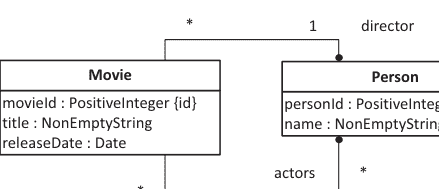

## 80 6 单向关联练习项目

你可以使用以下示例数据来测试你的应用程序：

| 电影 ID | 标题 | 上日期 | 导演 | 演员 |
|---|---|---|---|--|
| 1 | 巧州物语 | 1994-05-12 | 3 | 4, 5 |
| 2 | 星际大战 | 1977-05-25 | 2 | 6, 7 |
| 3 | 危险关系 | 1988-12-16 | 1 | 8, 4 |

| 人员 ID | 姓名 |
|---|--|
| 1 | Stephen Frears |
| 2 | George Lucas |
| 3 | Quentin Tarantino |
| 4 | Uma Thurman |
| 5 | John Travolta |
| 6 | Ewan McGregor |
| 7 | Natalie Portman |
| 8 | Keanu Reeves |

更多电影数据可以在 IMDb 网站上找到。

## 6.2 为国家分配城市和首都，为组织分配成员

该项目基于下方所示的信息设计模型。之前作业中的相关应用程序将通过扩展，增加管理国际组织（及其成员）以及城市数据（作为首都和总部位置）的功能。这通过添加相应的模型类 `InternationalOrganization` 和 `City` 以及以下单向关联来实现：

- 1. `InternationalOrganization` 与 `Country` 之间的多对多关联，将零或多个国家分配为国际组织的成员；以及
- 2. `Country` 与 `City` 之间的一一关联，将恰好一个城市分配为国家的首都；
- 3. `Country` 与 `City` 之间的一对多关联，将城市分配给某个国家。

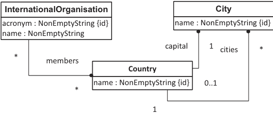

你可以使用以下示例数据来测试你的应用程序：

| 缩写 | 名称 | 成员 |
|---|---|---|
| UN | 联合国 | 德国、法国、俄罗斯 |
| WHO | 世界卫生组织 | 德国、法国、俄罗斯 |
| NATO | 北西洋条约组织 | 德国、法国 |

| 名称 | 首都 | 城市 |
|---|---|---|
| 法国 | 巴黎 | 马赛赛、里昂、巴黎 |
| 德国 | 柏林 | 柏林、汉堡、法兰克福 |
| 俄罗斯 | 莫斯科 | 莫斯科、新西伯利亚 |

| 名称 |
|---|
| 柏林 |
| 法兰克福 |
| 汉堡 |

（待续）

| 城市名称 |
|---|
| 里昂 |
| 马赛赛 |
| 莫斯科 |
| 新西伯利亚 |
| 巴黎 |

关于国家的更多数据可以在 CIA 世界事实库中找到。

# 7 双向关联

在面向建模和编程中，双向关联是指表示为一对互逆引用属性的关联，它允许在两个方向上进行“导航”（对象访问）。

下方图 7.1 显示的模型（关于出版商、书籍及其作者）作为我们的运行示例。注意，它包含了两个双向关联，如关联两端的所有权点所示。

| 出版商 | 出版书籍 | 书籍 | 编写书籍 | 作者 |
| :--- | :--- | :--- | :--- | :--- |
| name : String (id) | | isbn : String (id) | | personid : Integer (id) |
| address : String | 0.1 | * | year : Integer | * | name : String |

图 7.1：具有两个双向关联的出版商-书籍-作者信息设计模型。

## 7.1 逆向属性

为了能够轻松检索由俱乐部成员担任或共同担任主席的委员会，我们在 `Committee-ClubMember` 示例中添加了两个引用属性：俱乐部成员担任委员会主席的属性（`ClubMember::sharedCommittee`）以及俱乐部成员担任委员会联合主席的属性（`ClubMember::coChairedCommittee`），可以担任一个委员会的主席或联合主席（该取或关系是非排他的）。因此，我们得到了如下模型：

| 委员会 | 俱乐部成员 |
| :--- | :--- |
| name : String | chairedCommittee[0..] : Committee |
| chair : ClubMember | coChairedCommittee[0..] : Committee |

注意，`Committee::chair` 和 `ClubMember::chairedCommittee` 两个引用属性之间存在密切对应关系。它们是互逆的：当俱乐部成员 Tom 是预算委员会的主席时（由元组 ("budget committee", "Tom") 表示），那么预算委员会是由俱乐部成员 Tom 主席的（由逆向元组 ("Tom", "budget committee") 表示）。为了在图中表示这种逆向对应关系，我们在 `ClubMember::chairedCommittee` 属性的声明中在大括号中添加了一个逆向属性约束 `inverse of chair`，并在 `Committee::chair` 属性中添加了类似的约束，如下所示：

| 委员会 | 俱乐部成员 |
| --- | --- |
| name : String | chairedCommittee[0..1] : Committee (inverse of chair) |
| chair : ClubMember (inverse of chairedCommittee) | coChairedCommittee[0..1] : Committee |

使用 OOP 语言的引用路径表示，用 `c` 引用 `Committee` 对象，我们得到方程：

```
c.chair.chairedCommittee = c (7.1)
```

或者反过来，`m` 引用 `ClubMember` 对象，我们得到方程：

```
m.chairedCommittee.chair = m (7.2)
```

注意，当属性 `p2` 是属性 `p1` 的逆向属性时（此处原文逻辑略有跳跃，根据上下文理解为 `p1` 是 `p2` 的逆向），反过来，`p1` 是 `p2` 的逆向。因此，我们声明 `ClubMember::chairedCommittee` 是 `Committee::chair` 的逆向。为了在图中表示这种逆向对应关系，我们在 `ClubMember::chairedCommittee` 属性的声明中在大括号中添加了一个逆向属性约束 `inverse of chair`，并在 `Committee::chair` 属性中添加了类似的约束... 即：

`chairedCommittee[0..1] : Committee (inverse of chair)`

`chair : ClubMember (inverse of chairedCommittee)`

（注：此处由于原文段落存在重复和逻辑混乱，翻译已根据语意进行了对齐）。

（后续部分原文存在大量严重的逻辑重复，似乎是文稿生成错误，以下翻译涵盖了其核心逻辑，即关于双向导航的维护性）

为了支持在两个方向上进行高效的对象访问，在维护冗余信息时，通常将逆向属性中的一个视为“主”（master），另一个视为“从”（slave），并在受影响类的代码中考虑这种区分。我们通过使用斜杠（/）前缀来标记逆向引用属性是派生的（derived），如下所示：

| 委员会 | 俱乐部成员 |
| --- | --- |
| name : String | chairedCommittee[0..1] : Committee (inverse of chair) |
| chair : ClubMember | coChairedCommittee[0..1] : Committee |

`ClubMember` 中的 `chairedCommittee` 现在是派生的（如其斜杠所示），根据 `Committee::chair` 的反向规则定义。

## 7.1 双向关联

当一个派生的反向引用属性是多值的，而其反向属性是单值的（例如图 7.4 所示的 `Publisher::publishedBooks` 是由 `Book::publisher` 派生的），其生命周期依赖意味着：

- 1. 每当创建一个“基对象”（例如书）时，对应的反向属性必须进行更新，方法是向其值集中添加指向新基对象的引用（即向 `Publisher::publishedBooks` 中添加指向新对象的引用）；
- 2. 每当基属性更新时（例如，为书分配了新的出版商），对应的反向属性（在我们的示例中为 `Publisher::publishedBooks`）也必须更新，即从其值集中移除旧对象引用并添加新引用；
- 3. 每当销毁一个基对象（例如书）时，对应的反向属性必须更新，即从其值集中移除该基对象（例如从 `Publisher::publishedBooks` 中移除指向待销毁对象的引用）。

请注意，从计算的角度来看，我们可以选择两个互反的引用属性（如 `Book::authors` 和 `Author::authoredBooks`）中的任意一个为主。在许多情况下，关联代表了不对称的本体论存在依赖，这种依赖决定了两个互反属性中哪一个是主。例如，`Book` 类和 `Author` 类之间的作者关系关联代表了书对其作者的本体论存在依赖。一本书在存在上依赖于它的任何一个作者，而作者在存在上并不依赖于她的任何书。因此，`Book` 和 `Author` 之间对应的对象生命周期依赖意味着，它们的双向关联通过在 `Book::authors` 中维护 `Author` 引用作为主属性的自然选择来维护，而 `Author::authoredBooks` 则是从 `Book::authors` 派生的从属属性。

## 7.2 构建 OO 类模型

由于经典编程语言不支持将显式关联作为一等公民，而仅支持通过引用属性表示隐式关联的类，因此我们必须消除所有显式关联以获取 OO 类模型。

### 7.2.1 基本属性

我们消除关联过程的起点是一个包含各种单向和双向关联的信息设计模型，例如图 7.1 所示的模型仍然包含任何非定向关联，我们首先必须通过对其端点的所有权做出决策将它们转换为定向关联，这种决策通常基于导航需求。

请注意，在 `Publisher-Book-Author` 信息设计模型中，两个关联——`publisher-publishedBooks` 和 `authoredBooks-authors`（或 `Authorship`）都是定向的，如关联端点的所有权点所示。为了从信息设计模型中消除所有显式关联，我们必须执行以下操作：

- 1. 消除连接源类与目标类的单向关联，通过用源类中的引用属性替换它们，使目标类成为其取范围（range）。
- 2. 通过用一对互反的引用属性替换来消除双向关联。

### 7.2.2 如何消除单向关联

连接源类与目标类的单向关联被替换为其源类中一个对应的引用属性，该属性的范围是目标类。其多重性与目标关联端的多重性相同。它的名称是该关联端的名称（如果有的话），否则设置为目标类的名称（如果引用属性是多值的，则可能使用复数形式）。

### 7.2.3 如何消除双向关联

双向关联（如图 7.1 所示中 `Book` 类和 `Author` 类之间的作者关联）被替换为一对互反的引用属性，如 `Book::authors` 和 `Author::authoredBooks`。由于这两个引用属性表示相同的信息（相同的二元关系集合），因此考虑将其中一个视为“主”，另一个视为“从”（后者由主属性派生）。我们讨论了一一对一关联和多对多关联的情况：

- 1. 在双向的一对一关联的情况下，这会在两个关联类中的每个类中产生一对互反取值的引用属性。由于两者本质上代表相同的信息（链接/关系的集合），必须选择其中一个被视为主属性，使得另一个是从属属性，该从属属性通过反转由主属性派生。在类图中，从属属性被指定为派生属性，并且每当发生以下情况时会自动更新：1) 创建了新的主对象，2) 主引用属性被更新，或 3) 主对象被销毁。这种转换在图 7.2 中所示。

| Committee | chairedCommittee | chair |
| --- | --- | --- |
| name : String | 0..1 | ClubMember |


| Committee | ClubMember |
| --- | --- |
| name : String | /chairedCommittee[0..1] : Committee (inverse of chair) |
| chair : ClubMember | |

**图 7.2：** 将双向一对一关联转换为一对互反的单值引用属性的主从属性对。

- 2. 双向多对多关联被映射到参与关联的两个类中各的一对互反的多值引用属性。同样，在其中一个类中，表示（反向）关联的多值引用属性被指定为派生属性，每当另一个类中的对应属性更新时，它就会自动更新。这种转换在图 7.3 中所示。

| Book | authored Books | Author |
| --- | --- | --- |
| name : String | (id) | name : String |
| title : String | | ID : Integer |


### 图 7.3：将双向多对多关联转换为互反多值属性的主从对

| Book | Author |
| --- | --- |
| `isbn : String` | `name : String` |
| `title : String` | |
| `authors : Author` | `/authoredBooks : Book`（`author` 的逆） |

### 7.2.4 得到的 OO 类模型

将两个双向关联替换为引用属性后，我们得到了图 7.4 所示的 OO 类模型。

| Book | Publisher |
| --- | --- |
| `isbn[1] : String {id}` | `name[1] : String {id}` |
| `title[1] : String` | `address[1] : String` |
| `year[1] : Integer` | `/publishedBooks[*] : Book`（`publisher` 的逆） |
| `publisher[0..1] : Publisher` | Author |
| `authors[*] : Author` | `name[1] : String` `/authoredBooks[*] : Book` |

图 7.4：具有两互反属性对的 OO 类模型。

由于书本质上依赖于出版商，反之则不然，因此在出版商和作者对象中维护主引用作为派生（或“从”）数据是自然的。因此，我们将`publishedBooks`和`authoredBooks`定义为派生反向属性，这在 OO 类模型中通过斜杠前缀指示。

该 OO 模型含义可以通过涉及的三个模型类的示例数据填充来说明：

| Name | Address | Published books |
| --- | --- | --- |
| Bantam Books | New York, USA | 0553345842 |
| Basic Books | New York, USA | 0465030793 |

| ISBN | Title | Year | Authors | Publisher |
| --- | --- | --- | --- | --- |
| 0553345842 | The Mind's I | 1982 | 1, 2 | Bantam Books |
| 1463794762 | The Critique of Pure Reason | 2011 | 3 | |
| 1928563799 | The Critique of Practical Reason | 2009 | 3 | |
| 0465030793 | I Am A Strange Loop | 2000 | 2 | Basic Books |

| 作者 ID | 姓名 | 著过的书籍 |
| --- | --- | --- |
| 1 | Daniel Dennett | 0553345842 |
| 2 | Douglas Hofstadter | 0553345842, 0465030793 |
| 3 | Immanuel Kant | 1463794762, 1928565379 |

注意书籍（`Book`）记录是如何引用出版者（`Publisher`）和作者（`Author`）记录的，反之亦然，出版者和作者记录也引用了书籍记录。

# 8 使用原生 JS 实现双向关联

在本章中，我们将展示：

1. 如何从具有派生反向引用属性的面向对象（OO）类模型推导出 JS 类模型，
2. 如何以 JavaScript 类的形式编写 JS 类模型，
3. 如何基于模型代码编写视图（view）和控制器（controller）代码。

## 8.1 创建 JavaScript 类模型

构建我们 JS 类模型的起点是一个具有派生反向引用属性的 OO 类模型，如上面讨论的，为了方便起见，我们再次展示：

| 书籍 (`Book`) | 出版者 (`Publisher`) |
| --- | --- |
| `isbn[1] : String`（id） | `personId[1] : Integer`（id） |
| `title[1] : String` | `name[1] : String` |
| `year[1] : Integer` | `/publishedBooks[*] : Book`（`publisher` 的逆） |
| `publisher[0..1] : Publisher` | |
| `authors[*] : Author` | （`author` 的逆） |

注意，该模型包含两个派生反向引用属性：`Publisher::publishedBooks` 和 `Author::authoredBooks`。它们中的每一个都链接到一个主属性，并从该属性派生。因此，每一个都代表了一对对应于双向关联的互为反向引用属性。

与使用单向关联构建 JS 类模型相比，唯一的问题是：

1. 为所有派生反向引用属性添加 `«get»` 刻型，意味着它们具有隐式的 getter（获取），而没有 setter（设置）。每当其主引用属性更新时，它们都会被隐式设置。

这涉及到两个派生反向引用属性 `Publisher::publishedBooks` 和 `Author::authoredBooks`。因此，我们得到了以下 JavaScript 类模型：

### Book

| `<get/set/isbn>1 : string`（id） | `<get/set/title>1 : string` | `<get/set/year>1 : number(int)` | `<get/set/publisher>[0..1] : Publisher` | `<get/set/author>[1] : Author` | `checkIsbn(isbn : String) : ConstraintViolation` | `checkIsbnAid(isbn : String) : ConstraintViolation` | `checkTitle(in : String) : ConstraintViolation` | `checkPublisher(in : Publisher) : ConstraintViolation` | `checkAuthor(in : Author) : ConstraintViolation` | `addAuthor(in : Author)` | `removeAuthor(in : Author)` | `toString() : string` | `toRecord() : Object` |

### Publisher

| `<get/set/set adress>1 : string`（id） | `<get/set/publishedBooks>[*] : Book`（`publisher` 的逆） | `checkName(in : String) : ConstraintViolation` | `checkNameAs(in : String) : ConstraintViolation` | `checkRefIn(in : String) : ConstraintViolation` | `checkAddress(in : String) : ConstraintViolation` | `toString() : string` | `toRecord() : Object` |

### Author

## 8.2 编写模型代码

可以直接为 JS 类模型以获取我们 JavaScript 前端应用模型层代码。

### 8.2.1 新问题

与单向关联应用相比，我们必须处理许多新的技术问题：

- 我们定义了派生反向引用属性（如 `Publisher::publishedBooks`），但不包含检查操作，也不包含设置操作。
- 我们还需要通过维护派生的（集合）反向引用属性（以收集派生反向引用属性的值）来维护这些派生反向引用属性。这特别要求：每当单值引用属性的值通过 setter 初始化或更新时（例如将指向 `Publisher` 实例 `p` 的引用赋值给 `Book` 实例 `b`），都必须从派生反向引用属性的对应值中添加或删除反向引用（例如将 `b` 添加到 `p.publishedBooks`）；当主引用属性的值更新且派生反向引用属性为多值时，必须删除对象指向单值主引用属性旧值的反向引用；
- 每当可选的单值主引用属性的值被取消时（例如通过为 `Book` 实例 `b` 的 `b.publisher` 赋值 `null`），如果派生反向引用属性是多值的，则必须从派生反向引用属性的对应值中移除反向引用（例如从 `p.publishedBooks` 中移除 `b`），否则必须取消或更新派生反向引用属性的对应值；
- 每当通过 `add` 方法向多值主引用属性中添加引用时（例如向 `Book` 实例 `b` 的 `b.` 添加一个 `Author`），必须向派生反向引用属性的对应值中分配或添加反向引用（例如将 `b` 添加到 `a.authoredBooks`）；
- 每当通过 `remove` 方法从多值主引用属性中移除引用时（例如从 `Book` 实例 `b` 的 `b.` 移除一个 `Author`），必须从派生反向引用属性的对应值中移除反向引用（例如从 `a.authoredBooks` 中移除 `b`）；如果派生反向引用属性是多值的，否则必须取消或更新派生反向引用属性的对应值；
- 每当具有单引用或多引用作为主引用属性值的对象被销毁时（例如通过为 `Book` 实例 `b` 的 `b.publisher` 赋值 `null`），从派生反向引用属性的对应值中移除反向引用（例如从 `p.publishedBooks` 中移除 `b`），如果派生反向引用属性是多值的，否则必须取消或更新派生反向引用属性。

注意当具有单引用或多引用作为主引用属性值的对象被创建时，其 setter 将处理反向引用。

### 8.2.2 编码总结

为了获取模型层代码，直接将每个 JS 类编码为 ES15 类（或者，作为 ES5 构造函数）：

1. 在类级方法中编写属性检查。
2. 对于每个单值属性，编写指定的 getter 和 setter：
   - 在每个 setter 中调用属性检查，只有在未检测到约束违反时才设置/取消属性。
   - 如果该属性是派生属性的反向（表示双向关联），确保 setter 同时分配/取消（或添加/移除）反向引用到/从集合值中。
3. 对于每个多值属性，编写其 `add` 和 `remove` 操作以及指定的 get/set 操作：
   - 编写调用相应属性检查的实例方法。
   - 编写 setter，使其对要赋值的集合项调用 `add` 操作。
   - 如果该属性是派生属性的反向（表示双向关联），确保 `add`/`remove` 方法同时也分配/取消（或添加/移除）反向引用到/从集合值中。
4. 编写序列化函数 `toString()` 和对象转字符串转换函数 `toRecord()`。在出版者或作者对象的 `toRecord()` 转换中，不包含派生属性 `published` 和 `authored books`（因为它们是从书籍的 `publisher` 和 `authors` 属性得到的）。
5. 在 `destroy` 方法中处理删除依赖。确保当具有单引用或多引用作为主引用属性值的对象被销毁时，首先取消（或移除）派生引用。这些步骤将在接下来的章节中详细讨论。

### 8.2.3 JS 类模型的类代码

例如，JS 类模型中的 `Publisher` 类按以下方式编码：

```javascript
class Publisher {
  constructor({name, address}) {
    this.name = name;
    this.address = address;
    // 派生反向引用属性（Book::publisher 的逆）
    this._publishedBooks = {}; // 初始化一个 map
  }
  getName() { . . }
  static checkName(n) { . . }
  static checkNameAsId(n) { . . }
  static checkNameAsIdRef(n) { . . }
  set name(n) { . . }
  get address() { . . }
  static checkAddress(a) { . . }
  set address(a) { . . }
  toString() { . . }
  toRecord() { . . }
}
```

注意，我们已经添加了（派生的）多值引用属性 `publishedBooks`，但我们没有在构造函数中为其赋值，因为它是一个只读属性，当它的反向主引用属性 `Book::publisher` 被赋值时，会被隐式赋值。

### 8.2.4 为单值属性编写 Set 方法代码

任何与双向反向引用属性（实现双向关联）耦合的属性的 setter，还需要从/到反向引用属性的相应集合值处赋值/添加/删除反向引用。此类 setter 的一个示例是 `Book` 类中的 `publisher`：

```javascript
set publisher(p) {
  if (!p) { // 发布者引用被删除
    // 删除 Publisher::publishedBooks 中的反向引用
    delete this._publisher.publishedBooks[this._isbn];
    // 取消发布者属性
    delete this._publisher;
  } else {
    // p 可以是 引用或对象引用
    const publisher_id = (typeof p != "object") ? p.name;
    const constraintViolation = Book.checkPublisher(publisher_id);
    if (constraintViolation instanceof NoConstraintViolation) {
      // 删除 Publisher::publishedBooks 中的反向引用
      delete this._publisher.publishedBooks[this._isbn];
      // 创建新的反向引用
      this._publisher = Publisher.instances[publisher_id];
      // 将新的反向引用添加到 Publisher::publishedBooks
      this._publisher.publishedBooks[this._isbn] = this;
    } else {
      throw constraintViolation;
    }
  }
}
```

### 8.2.5 编写 Add 和 Remove 操作代码

对于任何与派生引用属性耦合的多值引用属性，`add` 和 `remove` 方法也必须对/从（反向属性的值集）赋值/添加/移除引用。

例如，对于多值引用属性 `Book::authors` 耦合到派生反向属性 `Author::authoredBooks` 以实现 `Book` 和 `Author` 之间的双向作者关联，`Book::addAuthor` 方法的编码如下：

```javascript
addAuthor(a) {
  // a 可以是 引用或对象引用
  const author_id = (typeof a === "object") ? parseInt(a) : a.authorId;
  const validationResult = Book.checkAuthor(author_id);
  if (author_id && validationResult instanceof NoConstraintViolation) {
    // 添加新的作者引用
    this._authors[author_id] = Author.instances[author_id];
    // 自动添加派生的反向引用
    this._authors[author_id].authoredBooks[this._isbn] = this;
  } else {
    throw validationResult;
  }
}
```

对于删除操作 `removeAuthor`，我们得到以下代码：

```javascript
removeAuthor(a) {
  // a 可以是 引用或对象引用
  const author_id = (typeof a === "object") ? parseInt(a) : a.authorId;
  const validationResult = Book.checkAuthor(author_id);
  if (validationResult instanceof NoConstraintViolation) {
    // 自动删除派生的反向引用
    delete this._authors[author_id].authoredBooks[this._isbn];
    // 删除作者引用
    delete this._authors[author_id];
  } else {
    throw validationResult;
  }
}
```

### 8.2.6 抑制派生属性值的存储

在发布者对象或作者对象到存储的转换 `toRecord()` 中，派生属性 `publishedBooks` 和 `authoredBooks` 不被包含在内，因为它们的信息是冗余的（衍生自书籍的发布者和作者属性）。在 `Author::toRecord` 函数中的编码如下：


```javascript
toRecord() {
  var rec = {};
  // 遍历所有 Author 属性
  for (let p of Object.keys(this)) {
    // 保留下划线前缀的属性，除非 "_authoredBooks"
    if (p.charAt(0) == "_" && p != "_authoredBooks") { // 移除下划线前缀
      rec[p.substr(1)] = this[p];
    }
  }
  return rec;
}
```

## 8.2.7 处理删除依赖关系

当 `Book` 实例 `b`（具有单引用 `b.publisher` 指向 `Publisher` 实例 `p` 以及多个引用 `b.authors` 指向 `Author` 实例）被销毁时，必须先移除派生的反向引用（例如通过从 `p.publishedBooks` 中移除 `b`）：

```javascript
Book.destroy = function(isbn) {
  const book = Book.instances[isbn];
  if (book) {
    console.log(book.toString() + " deleted!");
    if (book.publisher) {
      // 从 book.publisher 删除反向引用
      delete book.publisher.publishedBooks[isbn];
    }
    // 从所有 book.authors 删除反向引用
    for (let authorID of Object.keys(book.authors)) {
      delete book.authors[authorID].authoredBooks[isbn];
    }
    // 最后，从 Book.instances 中删除 book
    delete Book.instances[isbn];
  } else {
    console.log(`There is no book with ${isbn}`);
  }
}
```

## 8.3 在用户界面中利用反向属性

在 UI 代码中，我们现在可以为 Retrieve/ All 用例利用反向属性。例如，我们可以为每个发布者高效地创建一个书籍列表。

### 8.3.1 在 Retrieve/ All 中显示关于书籍的信息

为了在 Retrieve/ All 中显示关于书籍的信息，我们现在可以利用反向属性：

```javascript
publishers.retrieveAndAll = {
  setupInterface: function () {
    const tableBodyEl = document.querySelector("section#R");
    tableBodyEl.innerHTML = "";
    for (let key of Object.keys(Publisher.instances)) {
      const publisher = Publisher.instances[key];
      const row = tableBodyEl.insertRow(-1);
      // 创建该发布者的书籍列表
      const listEl = util.createListFromMap(publisher.publishedBooks, "title");
      row.insertCell(-1).textContent = publisher.name;
      row.insertCell(-1).textContent = publisher.address;
      row.insertCell(-1).appendChild(listEl);
    }
    document.getElementById("Publisher-M").style.display = "none";
    document.getElementById("Publisher-R").style.display = "block";
  }
};
```

# 9 使用 Java EE 实现双向关联

在本章中，我们将展示：

- 1. 如何从类模型（已派自信息设计模型）导出 Java 实体类；
- 2. 如何以类的形式编码实体模型（表示模型类）；
- 3. 如何基于类编写视图和控制器代码。

## 9.1 创建实体模型

创建 Java 实体模型的起点是具有派生反向属性的类模型，如上所述（图 7.4），为了方便起见，我们在此展示：

| Book | Publisher |
|---|---|
| isbn[1]: String (id) | address[1]: String |
| title[1]: String | /publishedBooks[*]: Book (inverse of publisher) |
| year[1]: Integer | |
| publisher[0..1]: Publisher | |
| authors[*]: Author | |
| | Author |
| | personid[1]: Integer (id) |
| | name[1]: String |
| | /authoredBooks[*]: Book (inverse of authors) |

注意，该模型包含两个反向引用属性：`Publisher::publishedBooks` 和 `Author::authoredBooks`。它们每一个都通过 `inverse-of` 约束与其主属性关联。因此，它们中的每一个都代表了对应双向关联的一对互反反向引用。

- 我们展示如何从类模型导出 Java 实体类模型：

1. 将每个类转换为 `<Java Entity>`，并将所有属性私有化。
2. 将类模型中平台无关的数据类型名称替换为相应的 Java 数据类型（`Integer`, `Float` 等）。
3. 为所有非派生属性添加 `<get/set>` 型，以指示它们需要 getter 和 setter。
4. 为所有派生属性添加 `<get>` 型，以指示它们需要 getter。

## 9.1 创建 Java 实体类模型

5. 对于任何引用属性，根据其所表示的关联功能类型，添加相应的关键字作为属性修饰符。对于给定的 OO 类模型，添加以下属性修饰符：

- 为派生引用属性 `Publisher::publishedBooks` 添加 `oneToMany`，
- 为引用属性 `Book::publisher` 添加 `manyToOne`
- 为引用属性 `Book::authors` 添加 `manyToMany`
- 为派生引用属性 `Author::authoredBooks` 添加 `manyToMany`

6. 对于任何被指定为另一个引用属性反向的派生属性，将其（inverse of...)）属性替换为相应的 `[mappedBy="..."]` 属性修饰符。
7. 创建所需的属性约束检查操作。
8. 为每个多值属性创建一个添加（add）和删除（remove）操作。

这生成了以下 Java 实体类：

| Java 实体 » |
| :--- |
| Publisher |
| +get/set-name[1]: String (id) |
| +get/set-address[1]: String |
| +get/publishedBooks[]*: Book (oneToToMany, mappedBy="publisher") |
| +checkNameId(in n: String, em: EntityManager) : ConstraintViolation |
| +toString(): String |
| +retrieveAll(em: EntityManager) : List<Publisher> |
| +create(in em: EntityManager, name: String, address: String) |
| +update(in em: EntityManager, name: String, address: String) |
| +delete(in em: EntityManager, name: String, address: String) |

| Java 实体 » |
| :--- |
| Book |
| +get/set-isbn[1]: String (id) |
| +get/set-title[1]: String |
| +get/set-year[1]: Integer |
| +get/set-publisher[0..1]: Publisher (manyToOne) |
| +get/set-authors[]*: Author (manyToMany) |
| +checkAuthorId(in isbn: String) : ConstraintViolation |
| +addAuthor(in author: Author) |
| +removeAuthor(in author: Author) |
| +toString(): String |
| +... |

| Java 实体 » |
| :--- |
| Author |
| +get/set-personId[1]: Integer (id) |
| +get/set-name[1]: String |
| +get/authoredBooks[]*: Book (manyToMany, mappedBy="authors") |
| +checkPersonId(in pld: Integer, em: EntityManager) : ConstraintViolation |
| +toString(): String |
| +... |


## 9.2 编写模型

可以直接编写 Java 实体模型类，以获取我们 Java 后端应用的模型层代码。

### 9.2.1 新问题

与之前讨论的单向关联应用相比，我们必须处理许多新的技术问题：

1. 在模型代码中，你现在需要通过维护构成派生反向引用属性值的派生（集合）反向引用，来维护派生反向引用属性。具体而言：

- 每当通过 setter 初始化或更新单值主引用属性的值时（例如将 `Publisher` 实例 `p` 的引用赋值给 `Book` 实例 `b.publisher`），必须向派生反向引用属性的相应值分配或添加反向引用（例如将 `b` 添加到 `p.publishedBooks`）；当主引用属性的值更新且派生反向引用属性为多值时，必须删除指向单值主引用属性旧值的过时反向引用；
- 每当可选的单值主引用属性的值取消设置时（例如通过为 `Book` 实例的 `b.publisher` 赋值 `null`），必须从派生反向引用属性的相应值中移除反向引用（例如从 `p.publishedBooks` 中移除 `b`）；如果派生反向引用属性是多值，否则必须设置或更新派生反向引用属性的相应值；
- 每当通过 add 方法向多值主引用属性的值添加引用时（例如为 `Book` 实例的 `b.authors` 添加 `Author` 引用），必须向派生引用属性的相应值分配或添加反向引用（例如将 `b` 添加到 `a.authoredBooks`）；
- 每当通过 remove 方法从多值主引用属性的值移除引用时（例如从 `Book` 实例 `b` 的 `b.authors` 中移除 `Author` 实例的引用），必须从派生反向引用属性的相应值中移除反向引用（例如从 `a.authoredBooks` 中移除 `b`），如果派生反向引用属性是多值，否则必须设置或更新派生反向引用属性的相应值；
- 每当具有单引用或多个主引用属性值引用的对象被销毁时（例如一个具有单引用 `b.publisher` 指向 `Publisher` 实例 `p` 的 `Book` 实例被销毁），必须首先移除派生反向引用（例如从 `publishedBooks` 中移除 `p`）。注意，当创建一个带有单引用或多引用值的值的对象时（例如一个带有单引用 `b.publisher` 的新 `Book`），其 setter 或 add 方法将被调用并处理这些情况。

在 UI 代码中，我们现在可以利用这些反向引用，例如。

### 9.2.2 总结

1. 代码双向关联。
2. 在模型类中编写反向引用属性。
3. 使用 JPA 注解编写反向属性。
4. 编写约束。
5. 编写 getters 和 setters 以及 add 和 remove 方法。
6. 代码创建、更新和删除操作。
7. 在后续章节中编写反向引用。

### 9.2.3 代码每个实体类

在 `Publisher` 类中，我们添加 `publishedBooks` 属性并使用对应 `Book` 类的 `@OneToMany` 注解：

```java
public class Publisher {
  ..
  @OneToMany(fetch=FetchType.EAGER, mappedBy="publisher")
  private Set<Book> publishedBooks;
}
```

`@OneToMany` 注解的 `mappedBy` 参数指定 `Book` 类中的属性：

```java
public class Book {
  ..
  @ManyToOne(fetch=FetchType.EAGER)
  @JoinColumn(name="PUBLISHER_ID")
  private Publisher publisher;
}
```

在 `Author` 类中，我们带有 `@ManyToMany` 注解添加 `authoredBooks` 属性，对应 `Book` 类：

```java
public class Author {
  ..
  @ManyToMany(fetch=FetchType.EAGER, mappedBy="authors")
  private Set<Book> authoredBooks;
}
```

`authoredBooks` 属性的 `@ManyToMany` 注解的 `mappedBy` 属性指定 `Book` 类中反向属性的名字：

```java
public class Book {
  ..
  @ManyToMany(fetch=FetchType.EAGER)
  @JoinTable(
    name="books_authors",
    joinColumns = @JoinColumn(name="BOOK_ISBN"),
    inverseJoinColumns = @JoinColumn(name="AUTHOR_PERSONID")
  )
  private Set<Author> authors;
}
```

我们还使用 `@JoinTable` 注解来指定多对关系的表名以及该表的列名，例如表名为 `books_authors`，列名为 `BOOK_ISBN` 和 `AUTHOR_PERSONID`。

### 9.2.4 代码 setter 操作

任何与派生反向属性关联的引用属性 setter（实现双向关联），现在还需要向反向属性的值（集合）分配/添加/移除反向引用。此类 setter 的示例是下面的 `setPublisher` 方法：

```java
public class Book {
  ..
  public void setPublisher(Publisher publisher) {
    // 从 publisher.publishedBooks 中移除书籍引用
    if (this.publisher != null) {
      this.publisher.removePublishedBook(this);
    }
    // 将书籍添加到 publisher.publishedBooks 中
    if (publisher != null) {
      publisher.addPublishedBook(this);
    }
    this.publisher = publisher;
  }
}
```

### 9.2.5 代码 add 和 remove 操作

对于任何与派生反向属性关联的多值引用属性，其 add 和 remove 方法都必须向反向属性的值（集合）分配/添加/移除相应的引用。

## 106 9 使用 Java EE 实现双向关联

例如，对于多值引用属性 `Book::authors`，它与派生的反向引用属性 `Author::authoredBooks` 耦合，以实现 `Book` 和 `Author` 之间的双向关联，`addAuthor` 方法的代码如下：

```java
public class Book {
  ..
  public void addAuthor(Author author) {
    if (this.authors == null) {
      this.authors = new HashSet<Author>();
    }
    if (!this.authors.contains(author)) {
      // 添加新的作者引用
      this.authors.add(author);
      // 添加派生的反向引用
      author.addAuthoredBook(this);
    }
  }
}
```

对于删除操作 `removeAuthor`，我们得到以下代码：


```java
public class Book {
  ..
  public void removeAuthor(Author author) {
    if (this.authors != null && author != null &&
        this.authors.contains(author)) {
      // 删除作者引用
      this.authors.remove(author);
      // 删除派生的反向引用
      author.removeAuthoredBook(this);
    }
  }
}
```

记住，对于 Java 集合（如 `Set` 或 `List`），`contains` 方法通过使用对象的 `equals` 方法来比较两个对象。例如，为了 `Author` 类对 `Set<Author>`（如 `publishedBooks`）使用 `contains` 方法，我们实现了以下 `equals` 方法（如果两个作者的 `personId` 属性值相等，则认为它们相等）：

```java
public class Author {
  @Override
  public boolean equals(Object obj) {
    if (obj instanceof Author) {
      Author author = (Author) obj;
      return this.personId.equals(author.personId);
    } else return false;
  }
}
```

### 9.2.6 处理删除依赖

当一个 `Book` 实例 `b`（具有单一引用 `b.publisher` 指向 `Publisher` 实例 `p` 以及多个引用 `b.authors` 指向 `Author` 实例）被销毁时，必须首先移除派生的反向引用（例如，通过从 `p.publishedBooks` 中移除 `b`）。这是通过在 `Book.delete` 方法中调用单一值和多值属性的方法并传入 `null` 参数来实现，例如 `b.setPublisher(null)` 和 `b.setAuthors(null)`：

```java
public class Book {
  public static void delete(EntityManager em, UserTransaction ut, String isbn) throws Exception {
    ut.begin();
    Book b = em.find(Book.class, isbn);
    b.setPublisher(null);
    b.setAuthors(null);
    em.remove(b);
    ut.commit();
  }
}
```

同样地，在删除 `Publisher` 或 `Author` 实例时，我们必须处理对 `Book` 实例引用的删除：

```java
public class Author {
  ..
  public static void delete(EntityManager em,
    UserTransaction ut, Integer personId) throws Exception {
    ut.begin();
    Author a = em.find(Author.class, personId);
    a.setAuthoredBooks(null);
    em.remove(a);
    ut.commit();
  }
}
```

同样地，

```java
public class Publisher {
  public static void delete(EntityManager em,
    UserTransaction ut, String name) throws Exception {
    ut.begin();
    Publisher p = em.find(Publisher.class, name);
    p.setPublishedBooks(null);
    em.remove(p);
    ut.commit();
  }
}
```

### 9.2.7 实体管理器与缓存实体

遗憾的是，JPA 不提供对反向引用的自动维护。根据 Java Persistence Wiki，我们必须通过 `set/add/remove` 方法来实现对（直接和反向）关系的管理：

> 双向关系中的一个常见问题是应用程序更新了关系的一侧，而另一侧没有更新，导致不同步。在 JPA 中，与通常情况一样，维护关系是应用程序或对象模型的责任。如果你的应用程序向关系的一侧添加了内容，那么它也必须向另一侧添加。这通常通过对象模型中处理关系双边的 `add` 或 `set` 方法来解决，这样应用程序代码就不需要担心这个问题。有两种方法：你可以在一侧添加该关系的维护代码并使用该侧的 setter（例如将另一侧设为 `protected`），或者在双侧都添加并确保避免无限循环。

我们为每个控制器类使用了一个实体管理器（entity manager）。每个实体管理器都维护一组缓存实体，这些实体可以通过 `merge` 方法与其他实体管理器进行“共享”。在我们的示例代码中，作为每个模型类 `create` 和 `update` 方法的一部分，我们必须合并属于另一个实体管理器的实体。例如，在 `Book.create` 方法中，我们需要合并新书籍的出版商（由 `PublisherController` 的实体管理器管理）以及它所有的作者（由 `AuthorController` 的实体管理器管理）：

```java
public class Book {
    public static void create(EntityManager em,
        UserTransaction ut,
        String isbn, String title, Integer year,
        Publisher publisher, Set<Author> authors)
    throws Exception {
    ut.begin();
    Book book = new Book(isbn, title, year,
        publisher, authors);
    em.persist(book);
    if (publisher != null) {
        em.merge(publisher);
    }
    if (authors != null) {
        for (Author a : authors) {
            em.merge(a);
        }
    }
    ut.commit();
}
```

## 9.3 在用户界面中利用反向属性

在单向关联的情况下，对于作者的情况，我们在 `Book` 模型类中使用了一个方法 `getAuthorNames()`，它返回一个用逗号分隔的作者名称列表字符串：

```java
public class Book {
  ..
  public String getAuthorNames() {
    String result = "";
    int i = 0, n = 0;
    if (this.authors != null) {
      n = this.authors.size();
      for (Author author : this.authors) {
        result += author.getName();
        if (i<n-1) {
            result += " ";
        }
        i++;
      }
    }
    return result;
  }
}
```

出版社可能有大量的书籍。作为序列化的更好的替代方案，可以使用 JSF 转换类以自定义的方式展示作者列表。在我们的案例中，我们选择以列表的形式展示，每个名称单独占一行。并使用 `@FacesConverter` 对其注解如下：

```java
@FacesConverter(value="p.m.converter.BookListConverter")
public class ListConverter implements Converter {
    @Override
    public Object getAsObject(FacesContext context,
UIComponent component, String value) {
        return null; // 此方法不需要
    }
```

```java
    @Override
    public String getAsString(FacesContext context,
UIComponent component, Object value) {
    String result = "";
    int i=0, n=0;
    if (value == null) {
        return null;
    } else if (value instanceof Set<?>) {
        n = ((Set<Book>)value).size();
        for (Book b : (Set<Book>) value) {
            result += b.getTitle();
            if (i<n-1) {
                result += "<br/>";
            }
        }
    }
    i++;
    return result;
    }
}
```

我们在 XHTML 页面中使用该转换器：

```xml
<ui:composition template="/INF/templates/page.xhtml">
<ui:define name="content">
<h:dataTable value="#{publisherController.publishers}" var="p">
<h:column>
<f:facet name="Published books</f:facet>
<h:outputText value="#{p.publishedBooks}" escape="false" converter="#{p.m.converter.BookListConverter}"/>
</h:column>
</h:dataTable>
<h:button value="Back" outcome="index" />
</ui:define>
</ui:composition>
```

```java
}
  return result;
}
  return null;
}
```

然后，我们使用 facet（部分）中的 `converter` 属性来指定在渲染相应的视图组件时，必须使用我们的转换器类，例如 `pl.m.converter.BookListConverter`：

```xml
<h:column>
  <facet name="header">Published books</f:facet>
  <h:outputText value="#{p.publishedBooks}" escape="false"
    converter="pl.m.converter.BookListConverter"/>
</h:column>
```

由于序列化文本包含 HTML 元素（即用于产生 HTML 换行的 `<br />`），我们需要指定 `escape="false"` 属性，否则 `<` 和 `>` 将被替换为相应的实体 `&lt; &gt;`。

JSF 转换器的主要优势在于我们没有将模型代码与特定的视图混合，我们的类保持整洁且分层。如果我们想将 JSF 替换为另一种 UI 技术，我们的模型类保持不变，只需要为新技术处理相应的转换器即可。

## 9.4 运行应用并获取代码

运行应用程序之前，你可能需要先停止你的 Tomcat/TomEE 服务器（Windows 使用 `shutdown.bat`，Linux 使用 `shutdown.sh`）。接下来，下载并解压包含应用程序所有源代码的 ZIP 存档，以及你必须编辑的 ANT 脚本（修改 `server.folder` 属性值）。现在，在控制台或终端中执行以下命令：

```bash
ant deploy -Dappname=BidirectionalAssociationApp
```

最后，启动你的 Tomcat Web 服务器（使用 Windows 的 `bin/startup.bat` 或 Linux 的 `bin/startup.sh`）。请耐心等待，取决于电脑的速度，这可能需要一些时间。最后，打开浏览器并输入：

```
http://localhost:8080/BidirectionalAssociationApp/WebContent/views/app/index.xhtml
```

# 10 关联特殊主题

## 10.1 部分-整体关联 (Part-Whole Associations)

部分-整体关联表示部分类型与整体类型之间的关系。实例是两个对象之间的部分-整体关系，其中一个是另一个（整体）的部分。UML 将部分-整体关联分为两种：聚合（aggregation）和组合（composition）。虽然这两个术语在 UML 中的定义相当精确，尽管并不尽人意，但许多软件开发者遵循 C++ 编程社区的术语传统，有不同的解释：与“聚合”的部分不同，“组合”的部分不能脱离引用它们的组合对象而独立存在。

我们遵循 UML 并通过引入两种组合之间的区别来改进对组合的定义：具有可分离部分的组合和不可分割部分的组合。

#### 10.1.1 聚合 (Aggregation)

聚合是部分-整体关联的一种特殊形式，其中整体的部分可以与其他整体共享。例如，我们可以对 `DegreeProgram`（学位计划）类和 `Course`（课程）类之间的聚合进行建模，如图所示，因为课程是学位计划的一部分，且一门课程可以在两个或多个学位计划之间共享（例如，工程学学位可以与计算机科学学位共享一门 C 语言课程）。

| DegreeProgram | Course |

| :--- | :--- |

| name : String | id : String |

| * | name : String |

然而，具有共享部分的聚合概念实际上并没有太大意义，因此对如何编写关联代码没有产生任何影响，许多开发者倾向于不在他们的类图中使用空心菱形，但 UML 规定：“共享聚合的精确语义取决于应用领域和建模者”。

聚合关联在整体侧的多重性（multiplicity）可以是任意数字 (*)，因为一个部分可能属于或共享于任意整体。

# 10 关联特殊主题

#### 10.1.2 组合 (Composition)

在部分-整体关联概念中，聚合和组合之间的区别竟然存在如此多的困惑，这令人惊讶。其主要问题在于广泛的误解（即使在专家软件开发者和 UML 作者中也是如此），认为组合的概念意味着整体与其部分之间存在生命周期依赖，即部分离开整体就无法存在。但这种观点忽略了事实：即也存在具有非共享部分的部分-整体关联，在这种情况下，部分可以从整体中脱离并在整体销毁后继续存活。

在 UML 规范文件中，“组合”一词的定义一直暗示了不可共享的部分，但并没有明确“组合”的定义性特征是什么，哪些仅仅是可选的特征。即使在 UML 2.5 版本（截至 2015 年），在尝试提供“组合”术语的定义后，它仍然模糊，并且没有为如何建模不可共享部分的部分-整体关联提供指导——即部分可以从整体中脱离并在销毁后存活的情况，而不是无法脱离并随整体一起销毁的情况。它们说：

如果一个组合对象被删除，它的所有部分都是与其一起被删除的对象。

但同时他们又说：

> 一个对象可以在组合对象被删除之前从组合对象中移除，因此不会作为组合对象的一部分被删除。

这指向了 UML 定义的不完全性，它没有考虑到组件和组合对象之间的生命周期依赖。因此，理解如何增强 UML 定义非常重要，例如通过引入 UML 刻型（stereotype）来刻画“不可分割”的组合，或者通过引入约束关键字 `separable` 来刻画组件侧的关联端。

Martin Fowler 解释说，刻画组合关系的主要问题是“一个对象只能是一个组合关系的一部分”。G. Bellelekens 在博客文章《UML Composition with Aggregation as Association》中也解释了这一点。除了定义组合的这种特征（拥有独有的或非共享的部分）外，组合还可能伴随着组合对象与其组件之间的生命周期依赖。事实上，此类依赖有两种类型：

- 1. 每当一个组件必须附加到另一个组合对象上（或者说，当它具有强制性组合时，如组合线组合侧的“恰有一个”多重性所表示），那么当它当前的组合对象被销毁时，它必须被重新使用（内部或重新附加到另一个组合对象）或被销毁。`Person`（人）和 `Heart`（心脏）之间的组合就是示例，如下所示。当主人去世时，心脏要么被销毁，要么移植到另一个人。

- 2. 每当一个组件不能从其组合对象中脱离（或者说，当它是不可分割的），那么且只有在这种情况下，当其组合对象被销毁时，组件才被销毁。不可分割部分的组合示例是 `Person`（人）和 `Brain`（大脑）之间的组合。


总结来说，不可分割部分创建生命周期依赖适用于特定的组合，但不通用。因此，它不是一个定义性特征。UML 规范规定：部分可以在组合实例被删除之前被移除，从而不会作为组合实例的一部分被删除。

当这种生命周期依赖适用时，它代表生存依赖（Existential Dependency）的一种特殊形式，这包含了第 1.2 节讨论的级联删除策略。


在汽车-引擎组合的示例中（如图所示），显然引擎在汽车被销毁之前可以从汽车上脱离，在这种情况下，引擎不会被销毁并可以重新使用。这由组合线组合侧的零或一多重性所暗示。

| `Car` | `Engine` |
|---|---|
| `licenseNo : String` | `id : String` |
| `color : String` | `0..1` | `cylinderCapacity : Decimal` |

组合在组合侧的多重性是 `1` 或 `0..1`，取决于组件是否具有强制性的组合对象。当然，组件不可分割的事实意味着它具有强制性的组合对象，因此组合的多重性必须是 `1`。

## 10.1.3 示例

作为部分-整体关联的一个示例，我们考虑了教材与其章节之间的关联。通常情况下，教材的一个章节在不修改的情况下无法在另一书中重用（例如，因为它可能引用了书的其他部分）（教科书）。此外，允许不属于教科书的章节是不符合逻辑的。因此，我们将这种关联建模为一种不可拆分的组合，如下图所示。

```
«invariant
（教科书的 ISBN
与章节的 sequenceNo 的组合是唯一的。）
```


| 教科书 | 不可分 | 章节 |
| :--- | :--- | :--- |
| `isbn: String (id)` | | `sequenceNo: Integer` |
| `title: String` | | `title: String` |
| `year: Integer` | * | |

代表不可拆分组件类型的对象类（如章节）不需要具有标准的标识符属性，因为没有必要让不可拆分组件独立于其复合对象而被引用。为了引用不可拆分组件对象，使用一个复合键，该复合键由复合类型的主键和组件类型的合适的（相对唯一的）属性组成。例如，一个教科书章节是通过教科书的 `ISBN` 和章节的序列号的组合来引用的。

由于对象作为 `Textbook` 对象的不可拆分组件，当其 `Textbook` 不存在时无法继续存在，因此在*删除教科书*操作的实现中，我们需要使用 `CASCADE` 删除策略，要求在删除教科书时删除所有相关的章节。

不可拆分组件类型不需要自己的 `CRUD` 数据管理接口。相反，所有的 `CRUD` 操作都在其复合类型的数据管理接口中提供。例如，创建、检索、更新和删除教科书章节是在这些管理教科书数据的接口内完成的。

## 10.2 关联类

关联类是表示关联的类。
记住，在 OO 类模型中，简单关联通过将其转换为涉及的对象类的引用属性而被消除了，如第 1.7 节所示。但每当关联具有属性时，它就无法被消除，必须在 OO 类模型中转换为一个类。
例如，考虑对象类型 *Book* 和 *Person* 之间的关联 *Reservation*，该关联允许表达诸如“`ISBN` 为 3627921105 的书被 ID 为 4701199 的人于 2020-08-22 预订”的事实。由于它有一个日期属性，该关联在信息设计模型中被建模为关联类，如下类图所示：

| Reservation | | | Person |
| :--- | :--- | :--- | :--- |
| `date : Date` | * | * | `id : Integer (id)` |
| Book | | `reserved_by` | `name` |
| | | | |

在 OO 类模型中（这是编写应用模型类的基础），关联类被转换为普通类，并带有引用涉及的对象类的引用属性。例如，关联类 *Reservation* 被转换为以下 OO 类模型：

| Reservation |
| :--- |
| `book : Book` |
| `reserved_by : Person` |
| `date : Date` |

# 11 双向关联实践项目

所有项目都包含以下任务：

- 1. 根据给定的信息设计模型派生出一个 OO 类模型。
  提示：将 JavaScript 类模型替换为相应的引用属性。
- 2. 根据 OO 类模型派出一个 JavaScript 类模型或 Java 实体类模型。提示：添加检查和 `setter` 方法。
- 3. 按照提供的指南编写你的 JavaScript 类模型或 Java 实体类模型。

确保你的页面符合 HTML5 的 XML 语法，并且你的 JavaScript 代码符合你的编码指南并经过 JSHint (http://www.jshint.com) 检查。

## 11.1 为电影分配导演/演员，以及为导演/演员分配电影

此项目基于信息设计模型。在之前的作业的基础上，将通过添加派生的反向引用属性来实现双向关联。这是通过在模型类 `Person` 中添加多值引用属性 `directedMovies` 和 `playedMovies` 实现的，其范围为 `Movie`。

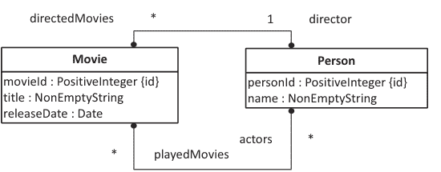

你可以可以使用示例数据来测试你的应用：

| 电影 ID | 标题 | 上日期 | 导演 | 演员 |
|---|---|---|---|---|
| 1 | 极地迷踪 | 1994-05-12 | 1 | 5, 6 |
| 2 | 危险关系 | 1988-12-16 | 2 | 7, 5 |
| 3 | 无良英仇 | 2009-05-20 | 1 | 9, 1 |

## 11.2 为国家分配城市，为组织分配成员，反之亦然

### 人物

| 人物 ID | 姓名 | 导演过的电影 | 参过的电影 |
|---|---|---|---|
| 1 | 昆汀·塔伦诺 | 1, 3 | 3 |
| 2 | Stephen Frears | 2 | |
| 5 | Uma Thurman | | 1, 2 |
| 6 | John Travolta | | 1 |
| 7 | 基努·瑞维 | | 2 |
| 9 | 布拉德·皮特 | | 3 |

更多电影数据可以在 IMDb 网站找到。

## 11.2 为国家分配城市，为组织分配成员，反之亦然

此项目基于所示的信息设计模型。之前作业中的相应应用将通过添加管理国际组织（以国家为成员）以及城市（作为首都和总部所在地）数据的能力进行扩展。这是通过添加相应的模型类 `InternationalOrganization` 和 `City` 以及以下单向关联实现的：

- 1. `InternationalOrganization` 与 `Country` 之间的多对多关联，将多个国家分配为国际组织的成员，反之则将多个国际组织分配给国家；
- 2. `Country` 与 `City` 之间的一多关联，将多个城市分配给国家，反之则将一个城市分配给国家。

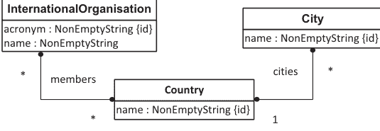

你可以使用以下示例数据来测试你的应用：

| 缩写 | 名称 | 成员 |
|---|---|---|
| UN | 联合国 | Germany, France |
| WHO | 世界卫生组织 | Germany, France |
| NATO | 北西洋条约组织 | Germany, France |

| 名称 | 城市 | 国际组织 |
|---|---|---|
| Germany | 柏林、汉堡、法兰克福 | |
| France | 马赛、巴黎 | |
| Russia | 新西伯利亚 | |

更多国家数据可以在 CIA 第二部分：类层次中的继承

当应用需要管理大量类型的数据时，类型之间可能存在各种子类型（继承）关系。子类型和继承是信息模型的重要元素。软件应用程序必须以适当的方式实现它们，通常作为模型-视图-控制器（MVC）架构的一部分。遗憾的是，应用开发框架对处理类层次的支持有限。

# 12 子类型与继承

子类型（或子类）的概念是自然语言、数学和信息学中的基本概念。例如，在英语中我们说鸟是动物，或者鸟类是动物类的子类。在语言学中，“鸟”这个词是“动物”的下位词。

对象类型可以通过子类型特化（例如，鸟特化为鹦鹉），也可以子类型泛化（例如，鸟和哺乳动物泛化为动物）。特化和泛化是硬币的两面。

子类型继承父类型的所有特征。当子类型从父类型继承属性、关联和约束时，这意味着图中不需要重复渲染这些特征，但图读者必须理解父类型的所有特征也适用于其子类型。

当一个类型具有多个直接父类型时，我们就有了多继承的情况，这在概念建模中常见，但在许多面向对象的语言（如 Java 和 C#）中是不允许的，这些语言只允许每个类型具有唯一的子类型。

## 12.1 通过特化引入子类型

当一个新对象类型代表另一个对象的特殊情况时，就可以通过特化引入。我们在示例模型中说明了这一点，我们将教科书和传记捕作为书籍的特殊情况。这意味着教科书和传记也具有 `ISBN`、标题和年份，但它们还有进一步的特征，例如教科书和传记的学科属性（`subjectArea`）。因此，在图 12.1 中，我们通过特化对象类型 `Book` 引入了 `Textbook` 和 `Biography` 类型，即作为其子类型。

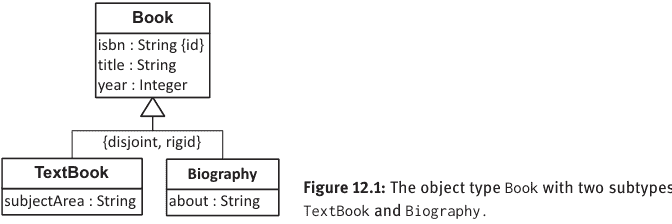

图 12.1：对象类型 `Book` 的两个子类型：`Textbook` 和 `Biography`。

# 12 子类型与继承

在对对象类型进行特化时，许多情况下，这些额外功能是添加到子类型的更具体的属性。例如，在 `TextBook`（教材）特化 `Book`（书籍）的情况下，我们定义了额外的属性 `subjectArea`（学科）。在某些编程语言中（如 Java），因此子类型扩展超类型。

然而，我们也可以在不定义额外属性或操作/方法的情况下通过定义额外约束来特化对象类型。

## 12.2 通过泛化引入超类型

我们通过图 12.2 所示的示例来说明泛化。

| Employee | | | |
| :--- | :--- | :--- | :--- |
| `employeeNo : Integer (id)` | | Book | Author |
| `name : String` | | `isbn : String (id)` | `authorId[1] : Integer (id)` |
| `dateOfBirth : Date` | | `title : String` | `name[1] : String` |
| `salary : Decimal` | | `year : Integer` | `dateOfBirth[0..1] : Date` |
| * | | * | `biography[1] : Text` |
| Publisher | published Books | authored Books | |
| `name : String (id)` | | | |
| `address : String` | 0.1 * | * | |

**图 12.2：** 对象类型 `Employee` 和 `Author` 共享若干属性。

在添加对象类型 `Employee` 后，注意到 `Employee` 和 `Author` 共享许多属性，这是因为员工和作者都是人，而成为员工和作者都是人所扮演的角色。因此，我们可以通过添加一个共同的超类型 `Person`（人）来泛化这两个对象类型，如图 12.3 的所示所示。

在泛化两个或多个对象类型时，我们将它们共享的特征移动到新添加的超类型中，并在那里进行集中管理。在 `Employee` 和 `Author` 的情况下，这组共享特征包括属性 `name`（姓名）、`dateOfBirth`（出生日期）和 `dateOfDeath`（死亡日期）。通常，共享特征可能包括属性、关联和约束。

注意，由于在信息设计模型中，每个顶层类都需要一个标准的标识符，在新的类 `Person` 中，我们声明了标准标识符属性 `personId`，它被所有子类继承。因此，我们

## 12.3 意图与扩展 — 125

| Employee | Person |
| :--- | :--- |
| `employeeNo: Integer (key)` | `personid[1]: integer (id)` |
| `salary : Decimal` | `name[1]: String` |
| | `dateOfBirth[1]: Date` |
| | `dateOfDeath[0..1]: Date` |

* 0._1

| Publisher | Book | Author |
| :--- | :--- | :--- |
| `name : String (id)` | `isbn: String (id)` | `biography : Text` |
| `address : String` | `title : String` | | |
| | `year : Integer` | | |
| 0._1 | * | * |

**图 12.3：** 对象类型 `Employee` 和 `Author` 通过共同的超类型被泛化。

我们必须在泛化之前重新考虑在子类中被声明为标准标识符的属性。在 `Employee` 的情况下，我们曾宣布属性 `employeeNo` 为标准标识符。由于员工编号是一个重要的业务信息项，即使它不再需要作为标准标识符，我们也必须保留这个属性。因为它是一个备用标识符（"key"），我们使用约束关键字 `key` 为其定义唯一性约束。

在 `Author` 的情况下，我们曾宣布属性 `authorId` 为标准标识符。假设该属性代表一个纯技术性的而非业务性的项，我们将其舍弃，因为它不再需要作为作者的标识符。结果，我们得到了一个模型，允许通过员工编号或其 `personId` 值来识别员工，并通过其 `personId` 来识别作者。

我们考虑对原始示例模型的以下扩展，如图 12.4 所示：

- 1. 将 `Book` 进行不相交（但不完全）的划分为 `TextBook` 和 `Biography`（传记），
- 2. 将 `Person` 进行重叠且不完全的划分为 `Author` 和 `Employee`，后者进一步被 `Manager`（经理）所特化。

## 12.3 意图与扩展

对象的类型的意图由其特征集给出，包括属性、关联、约束和操作。

对象的类型的扩展是实例化该类型的所有对象的集合。对象类型的扩展也被称为种群（population）。

## 126 — 12 子类型与继承

| Employee | Person |
| :--- | :--- |
| `employeeNo: Integer (key)` `salary : Decimal` | `personid[1]: Integer (id)` `name[1]: String` `dateOfBirth[1]: Date` `dateOfDeath[0..1]: Date` |
| * | | |
| 0.1 | | |
| Publisher | Book authored Books |
| `name: String (id)` `address : String` | `isbn: String (id)` `title: String` `year : Integer` |
| 0.1 | * | * |
| managed Publisher 0.1 | (disjoint) | |
| | TextBook | | |
| | `subjectArea : String` `about : String` |
| Manager | | |

图 12.4：具有两个类层次的信息模型。

我们存在以下这种对偶性：虽然超类型的所有特征都包含在其子类的意图（或特征集）中（内涵包含），但子类的所有实例都包含在其超类型的扩展（或实例集）中（外延包含）。这种形式结构已经在形式概念分析中得到了研究。

由于意图/扩展的对偶性，我们可以通过两种不同的方式特化给定的类型：

- **通过添加特征来扩展类型的意图**，如添加特征。
- **通过添加约束来限制类型的扩展**（如为 `TextBook` 添加 `subjectArea`）。

典型的编程语言（如 Java）仅支持第一种可能性（通过扩展意图来特化），而 SQL 也支持第二种可能性（通过限制扩展来特化）。

## 12.4 类型层次

一个*类型层次*（或类层次）由两个或多个类型组成，其中一个是*根*类型，而其他类型至少有一个直接超类型。

## 12.4 类型层次 127

当所有类型都具有一个唯一的超类型时，类型层次是**单继承层次**，否则它是**多重继承层次**。例如，图 12.5 显示的具有两个直接父类的多重继承层次示例。

图 12.5：类层次。

图 12.6：多重继承层次。

只有一个层特化的最简单层次情况在 UML 中被称为*泛化*，但更自然地被称为**分划**（segmentation）。如果所有子类的并集等于父类的范围，则该分划是*完全*的。如果父类的某个实例实例化多个子类，则该分划是*不相交*的。否则，它是*重叠*的。

在类图中，我们可以通过在泛化箭头上标记 {*完全* 和 *不相交* 来表示这些约束。默认情况下，如果分划没有任何标记（如图 12.4 中将 `Vehicle` 划分为 `LandVehicle` 和 `WaterVehicle`），它是（不完全且重叠的）。

信息模型可以包含任意数量的类层次。

## 12.5 类与角色

为了更好地理解自然语言语句中关于本质性（sortal）与非本质性、刚性与非刚性的分类，我们可以像 Giancarlo Guizzardi 在他的对象类型理论中那样区分本质性和非本质性。

如果一个对象类型对其实例具有统一的身份标识，那么它就是本质性的。这种条件定义了两个实例之间不具有的属性（或属性集）。`Person` 是本质性对象的示例，因为它的所有实例（人）都可以通过出生属性（何时、对谁出生）来识别。`Book` 是非本质性对象的示例，因为它包含了以不同方式识别的实例（例如，教材和自出版小说）。

如果一个对象类型的实例不会停止作为该类型而存在，那么它就是刚性的。`Person` 是刚性对象的示例，而 `Employee` 不是刚性的。如果一个分划的所有子类都是刚性的，则该分划被称为刚性的。

类是刚性的本质对象类型。`TextBook` 和 `Person` 是类的示例。

角色是一个本质性对象类型，它用于分类与对象类型 `O` 的实例参与（特定类型 `A`）关系的类 `K` 的实例。注意 `R` 是 `K` 的非刚性子类型，因为其实例在停止参与与类型 `O` 的类型 `A` 关系时不会停止存在。

例如，`Employee` 是角色的示例，因为它是一个本质性对象类型，用于分类与 `Enterprise` 实例参与雇佣关系的 `Person` 实例。

根类，使得这些子类可以从模型中移除，从而简化模型。

这种“类层次结构合并”（Class Hierarchy Merge）设计模式有两种形式。在最简单的形式中，原始类层次的分段是互不交的，这允许使用单值类别属性来表示根类每个实例的特定类别，该类别由其实例化的唯一子类对应。当原始类层次的分段不是互不交时，或者我们需要使用多值类别属性来表示对象实例化的类型集合时。我们只讨论针对互不交分段的简单类层次结构合并重构情况，我们采取以下重构步骤：

- 1. 添加一个枚举数据类型，其中包含每个分段子类对应的枚举字面量。在我们的示例中，我们添加了枚举数据类型 `BookCategoryEL`。
- 2. 在根类中添加一个类别属性，并将该枚举作为其范围。如果分段是完整的，则该类别属性是强制的 [1]；如果不完整，则是可选的 [..]。在我们的示例中，我们向类中添加了一个范围为 `BookCategoryEL` 的类别属性。该类别属性是可选的，因为将 `Book` 分为 `Textbook`（教科书）和 `Biography`（传记）是不完全的。
- 3. 每只要分段是固定的，我们将类别属性指定为冻结（frozen），这意味着它只能在创建新对象时通过设置值来赋值，而不能更改。
- 4. 将分段子类的属性移动到根类中，并将它们设为可选。我们将这些通常列在类别属性下方的属性称为分段属性。在我们的示例中，我们将属性 `subjectArea` 从 `Textbook` 移动到 `Book`，将 `about` 从 `Biography` 移动到 `Book`，使 `subjectArea` 变为可选（即 [..]）。
- 5. 在扩展后的根矩形中添加一个约束（在不变性框中），强制要求当且仅当根类实例化相应的类别时，可选的子类属性才有值。在我们的示例中，这意味着一个 `Book` 实例属于“Textbook”类别，当且仅当其属性 `subjectArea` 有值时；且当且仅当其属性 `about` 有值时，它才属于“Biography”类别。
- 6. 从模型中移除分段子类。

在我们的示例案例中，这种设计重构的结果如图 12.7 所示。注意，约束（或“不变性”）表示一个逻辑句子，其中逻辑运算符关键字“IFF”代表逻辑运算符“当且仅当”，而属性条件 `prop=undefined` 测试属性 `prop` 是否没有值。

## 12.6 类层次结构合并设计模式

| Book | «enumeration» |
|---|---|
| `isbn[1] : String (id)` | `BookTypeEL` |
| `title[1] : String` | `TextBook` |
| `year[1] : Integer` | `Biography` |
| `category[0..] : BookTypeEL (frozen)` | |
| `subjectArea[0..] : String` | |

```


`invariant`

```
((category="Textbook" IFF NOT subjectArea=undefined) AND
(category="Biography") IFF NOT about=undefined))
```

图 12.7：应用类层次结构合并设计模式的结果。

## 12.7 计算语言中的子类型化与继承

子类型化和继承关系已经在面向对象编程（OOP）、数据库语言（如 SQL99）、XML 架构语言 XML Schema 以及其他计算语言中以各种方式和不同程度得到了支持。其核心在于，计算语言中的子类型化关于定义层次结构以及特征的继承：OOP 中的属性、约束和方法；SQL99 中的表列和约束；XML Schema 中的元素、属性和约束。

通常，在类型层次结构中支持多重分类和多重继承是理想的。这两种语言特征紧密相关，并被认为是高级特性，在许多应用中可能不需要，或者可以使用通通方法处理。

多重分类意味着一个对象拥有多个类型。这主要发生在一个对象同时扮演多个角色时，因此直接实例化了定义这些规则的多个类。

多重继承通常也与角色类（role classes）有关。例如，学生助教同时扮演学生和学术职员的角色，因此相应的 OOP 类`StudentAssistant`继承了`Student`和`AcademicStaffMember`两个类。同样，我们上面的示例模型`AmphibianVehicle`（两栖车辆）继承了两个角色类`LandVehicle`（陆地车辆）和`WaterVehicle`（水上车辆）。

### 12.7.1 OOP 中的子类型化与继承

OOP 对子类型化的最低支持水平（例如由 Java 和 C# 提供）允许在单继承层次结构中定义属性和方法的继承，可以通过`instance-of`谓词进行检查，以测试一个类是否是对象的直接或间接类型。此外，希望通过以下方式检查继承层次结构：

- 预定义的实例级属性，用于获取对象的直接类型（如果允许多重分类，则获取其多个直接类型）；
- 预定义的类型级属性，用于获取类型的直接父类型（如果允许多重继承，则获取其多个父类型）。

JavaScript 是 OOP 语言的一个特例，它最初没有定义类的显式语言元素，只有定义构造函数的元素。由于其动态编程特性，JavaScript 允许使用各种代码模式来实现类、子类型化和继承。在现代 JavaScript 中（从 ES2015 开始），定义类和子类是非常直观的。首先，我们定义一个基类`Person`，有两个属性`firstName`和`lastName`：

```javascript
class Person {
  constructor (first, last) {
    // 分配基类属性
    this.firstName = first;
    this.lastName = last;
  }
}
```

然后，我们定义一个子类`Student`，带有一个额外的属性`studentNo`：

```javascript
class Student extends Person {
  constructor (first, last, studNo) {
    // 调用父类构造函数
    super(first, last);
    // 分配额外属性
    this.studentNo = studNo;
  }
}
```

注意如何通过`super(first, last)`来分配父类属性。

### 12.7.2 XML Schema 中的子类型化与继承

在 XML Schema 中，子类型可以通过“扩展”（extending）或“限制”（restricting）复杂类型来定义。扩展复杂类型意味着通过添加元素或属性来扩展其意图，而限制复杂类型意味着通过添加约束来限制其扩展。

我们可以通过以下方式定义复杂类型`Person`和其子类型`Student`：

```xml
<xs:complexType name="Person">
  <xs:attribute name="firstName" type="xs:string" />
  <xs:attribute name="lastName" type="xs:string" />
  <xs:attribute name="gender" type="GenderValue" />
</xs:complexType>

<xs:complexType name="Student">
  <xs:extension base="Person">
    <xs:attribute name="studentNo" type="xs:string" />
  </xs:extension>
</xs:complexType>
```

我们可以通过以下方式限制`Person`来定义子类型`FemalePerson`：

```xml
<xs:complexType name="FemalePerson">
  <xs:restriction base="Person">
    <xs:attribute name="firstName" type="xs:string" />
    <xs:attribute name="lastName" type="xs:string" />
    <xs:attribute name="gender" type="GenderValue"
                  use="fixed" value="f" />
  </xs:restriction>
</xs:complexType>
```

注意通过将`gender`属性固定为“f”，我们定义了一个仅由`Person`的女性实例满足的约束。

### 12.7.3 OWL 中的子类型化与继承

在网络本体语言 OWL 中，属性定义与类定义是分离的，且属性默认不是单值的，而是多值的。因此，标准属性需要声明为*函数性*（functional）。因此，我们获取以下代码以表示`Person`是一个具有`name`属性的类：

```xml
<owl:Class rdf:ID="Person"/>
<owl:DatatypeProperty rdf:ID="name">
  <rdfs:domain rdf:resource="#Person"/>
  <rdfs:range rdf:resource="xsd:string"/>
  <rdf:type rdf:resource="owl:FunctionalProperty"/>
</owl:DatatypeProperty>
```

OWL 允许如下方式声明一个类是另一个类的子类：

```xml
<owl:Class rdf:ID="Student">
  <rdfs:subClassOf rdf:resource="#Person"/>
</owl:Class>

<owl:DatatypeProperty rdf:ID="studentNo">
  <rdfs:domain rdf:resource="#Student"/>
  <rdfs:range rdf:resource="xsd:string"/>
  <rdf:type rdf:resource="owl:FunctionalProperty"/>
</owl:DatatypeProperty>
```

为了更好的可用性，OWL 应该允许在类定义中定义类的属性，并以函数属性作为默认情况。

### 12.7.4 使用 SQL 数据库表表示类层次结构

标准的 DBMS 将信息（对象）存储在表的行中，这些行在关系型数据库系统中被构想为集合关系。关系型数据库语言 SQL 用于定义、填充、更新和查询此类数据库。但也有更简单的存储技术允许以表行的形式存储数据，特别是键值存储系统，例如 JavaScript 的 Local Storage API，允许将 JSON 实体（实体记录映射）的序列化作为与表键关联的字符串值存储。

虽然 SQL 的经典版本（SQL92）不支持子类型化和继承，但这在 SQL99 中发生了变化。然而，SQL99 中子类型相关的语言元素仅在某些 DBMS 中实现，例如在开源 DBMS PostgreSQL 中。因此，为了设计可以使用各种 SQL DBMS 框架（包括 MySQL 和 SQLite 等较弱的技术）实现的模型，我们无法使用 SQL99 的子类型化功能，而必须在数据库设计模型中通过普通表和外键依赖来建模继承层次结构。这种从类层次结构到关系型表（以及反之）的映射是对象关系映射（ORM）框架的工作，例如 JPA 提供程序（如 Hibernate）、微软的 Entity Framework 或 Rails 框架的 Active Record 方法。

用数据库表表示类层次结构本质上有三种替代方法：

1. **单表继承 (STI)** 是最简单的方法，其中整个类层次结构由单个表表示，该表包含根类及其所有子类的所有属性的列，并以根类的名称命名。
2. **类表继承 (TCI)** 是一种方法，层次结构中的每个类都由一个对应的表表示，该表还包含继承属性的列，重复了表示其父类的表中的列。
3. **连接表继承 (JTI)** 是一种更符合逻辑的方法，每个子类都由一个对应的表（子表）表示，该表通过其主键引用父类的主键与表示其父类的表（父表）连接，使得父类的（继承的）属性不表示为子表的列。

注意，STI 方法与上面 12.6 节讨论的**类层次结构合并（Class Hierarchy Merge）**设计模式密切相关。当此设计模式已经应用于设计模型中，或者设计模型已经根据此设计模式进行了重构时，数据模型中的类层次结构（其子类）在设计中已被消除，因此在应用程序的模型层中也以类定义的形式编码，因此不再需要将类层次结构映射到单表。否则，设计模型包含一个类层次结构，该结构在应用程序的模型层中通过相应的类层次结构实现，并将通过 STI 方法映射到数据库表。

我们通过两个简单的示例来说明这些方法的使用。第一个例子是`Book`类层次结构，如上面的图 12.1 所示。第二个例子是`Person`角色`Employee`、`Manager`和`Author`的类层次结构，如下面的图 12.8 中的类图所示。

#### 12.7.4.1 单表继承

考虑上面图 12.1 所示的单级类层次结构，它是类`Book`的不完全不相交分段，作为 MVC 应用的模型类设计。在这种情况下，每当我们拥有一个只有一层（或少数几层）子类型化的模型层次结构，且每个子类型都有几个额外属性时，使用 STI 是优的；或者我们建模一个包含所有属性的单表，其中表示分段子类额外属性（“分段属性”）的列是可选的，如下面的图 12.9 中的 SQL 表模型所示。


**图 12.8:** 一个带有`Person`角色层次结构的信息设计模型。

```sql
SQL table
isbn[1] : VARCHAR (pkey)
title[1] : VARCHAR
year[1] : INTEGER
category[0..1] : "TextBook","Biography" (frozen)
subject_area[0..1] : VARCHAR
about[0..1] : VARCHAR
```


# 12.6.2 单表继承 (Single Table Inheritance)

## 12.6.2.1 单表继承 (Single Table Inheritance) 的 SQL 模型

```
invariant
{(category="TextBook" IFF subject_area IS NOT NULL)
(category="Biography" IFF about IS NOT NULL)}
```

**图 12.9:** 表示 `Book` 层次结构的单表 SQL 模型。

一种常见的方法是添加一个特殊的判别列来表示对象所对应的子类类别。该列通常是字符串值的，但受限于子类的名称之一。DBMS 支持枚举，它也可以是枚举值的。我们使用名称作为判别列，在我们的 `Book` 示例中，由于教科书-传记的分段是硬性的，它具有固定值约束。

根据书籍的类别，我们必须强制当且仅当它是 `"TextBook"` 时，其属性 `subjectArea` 有值，且当且仅当它是 `"Biography"` 时，其属性 `about` 有值。这个隐含约束在上面的类图中附加到 `Book` 类上表示，其中逻辑运算符 `IFF` 表示“当且仅当”。它需要在数据库中实现，例如使用 SQL 表 `CHECK` 子句或 SQL 触发器。

当给定的分割是不相交时，使用单值枚举类别来表示实例所属的子类信息。否则，如果是非相交的，则使用多值枚举类别来表示实例所属的子类信息。这种属性可以通过为相应的枚举代码或标签定义一个字符串值列在 SQL 中实现。

考虑图 12.8 中的类层次结构。在 `Employee`、`Manager` 和 `Author` 子类中定义了三个额外属性后，该类层次结构可以使用 STI 方法映射，如表 12.10 中的 SQL 表所示。

| | |
|---|---|
| `person_id[1]` | INTEGER (pkey) |
| `name[1]` | VARCHAR |
| `categories[*]` | VARCHAR (`"Employee"`, `"Manager"`, `"Author"`) |
| `emp_no[0..1]` | INTEGER (unique) |
| `biography[0..1]` | VARCHAR |
| `department[0..1]` | VARCHAR |

**图 12.10:** 表示 `Person` 层次结构的 STI 表。

注意，现在判别列 `categories` 是多值的，`Person` 的分割不是相交的，而是重叠的，这意味着 `Person` 对象可能属于多个类别。同样注意，由于角色分割（如 `Employee`、`Manager`、`Author`）不是硬性的，判别列 `categories` 没有固定值约束。

## 12.7 计算语言中的子类型化与继承

该模型的一个可接受种群示例如下：

| `person_id` | `name` | `categories` | `biography` | `emp_no` | `department` |
| --- | --- | --- | --- | --- | --- |
| 1001 | Harry Wagner | 作者，员工 | 1956年出生于马萨诸塞州波士顿，. . . | 21035 | |
| 1002 | Peter Boss | 经理 | | 23107 | Sales |
| 1003 | Tom Daniels | | | | |
| 1077 | Immanuel Kant | 作者 | 曼努埃尔·康德（1724–1804）是一位德国哲学家。. . . | | |

注意，`Person` 包含了四种不同类型的人：

1. 一个人，Harry Wagner，既是作者（有传记）又是员工（有员工编号）。
2. 一个人，Peter Boss，他是一个经理（员工的一种特殊类型），负责销售部。
3. 一个人，Tom Daniels，他既不是作者也不是员工。
4. 一个人，曼努埃尔·康德，他是一个作者（有传记）。

**STI 方法的优点：** 它能够忠实地表示原始类层次结构中表达的子类型关系；特别是，任何代表子类实例（员工、经理或作者）的行也代表一个父类实例（人）。

**缺点：** (1) 在多级类层次结构中，如果子类之间的共同点较少，STI 方法将无法导致良好的表示。(2) 给定类层次结构在各个元素（类）方面的结构仅被隐式地保留了。

### 12.7.4.2 每类继承表 (Table Per Class Inheritance)

在更真实的模型中，图 12.8 中 `Person` 的子类将拥有更多属性，因此 STI 方法将不再可行。TCI 方法将得到下图 12.11 所示的 SQL 表模型。TCI 模型将类层次结构中的每个具体类表示为一个表，使得每个子类都由一个包含继承属性列的表来表示，从而重复了表示父类的表的列。

| «SQL table» | «SQL table» |
| :--- | :--- |
| `people` | `employees` |
| `person_id` : INTEGER (pkey) | `person_id` : INTEGER (pkey) |
| `name` : VARCHAR | `name` : VARCHAR |
| | `emp_no` : INTEGER (unique) |
| «SQL table» | «SQL table» |
| `authors` | `managers` |
| `person_id` : INTEGER (pkey) | `person_id` : INTEGER (pkey) |
| `name` : VARCHAR | `name` : VARCHAR |
| `biography` : VARCHAR | `emp_no` : INTEGER (unique) |
| | `department` : VARCHAR |

**图 12.11：** 表示 `Person` 角色层次结构的 TCI 表模型。

通过执行以下步骤可以从信息设计模型导出 TCI 表：

1. 将所有类中的标准 ID 属性修符 `[id]` 替换为 `{pkey}`以指示标准 ID 属性为主键。
2. 将单数（大写）类名（`Person`, `Author`, 等）替换为复数小写表名（`people`, `authors`, 等），并将驼峰命名属性（`personId` 和 `empNo`）替换为小写下划线分隔列名（`personid` 和 `empno`）。
3. 为所有类矩形添加 `<table>` 刻型。
4. 将平台无关的数据类型名称替换为 SQL 数据类型名称。
5. 移除所有泛化/继承箭头，并将父表的所有列（如来自 `people` 的 `person_id` 和 `name`）添加到其子表（`authors` 和 `employees`）中。

每个表将只填充与所表示类的直接实例对应的行。该模型的一个可接受种群示例如下：

| `people` | |
| :--- | :--- |
| `personId` | `name` |
| 1003 | Tom Daniels |

| `authors` | | | |
| `person_id` | `name` | `biography` |
| 1001 | Harry Wagner | 1956年出生于马萨诸塞州波士顿，. . . |
| 1077 | Immanuel Kant | 曼努埃尔·康德（1724–1804）是一位德国哲学家。. . . |

| `person_id` | `name` | `emp_no` |
|---|---|--|
| 101 | Harry Wagner | 21035 |

`employees`

| `person_id` | `name` | `emp_no` | `department` |
|---|---|---|--|
| 1002 | Peter Boss | 23107 | Sales |

`managers`

**TCI 方法的优点：** (1) 给定类层次结构在各个元素（类）方面的结构被显式地表示。(2) 当给定类层次结构的划分互不相交时，TCI 会导致内存高效的冗冗存储。

**缺点：** (1) TCI 方法无法忠实地表示原始类层次结构中表达的子类型关系。特别是，对于任何代表子类（员工、经理或作者）的行，没有信息表明它代表一个父类（人）。因此，TCI 模式没有告知所表示的子类型；相反，保留在应用模型中的元信息与数据库解耦了。(2) TCI 方法需要重复列定义，这是一种模式冗余的形式。(3) 每当子类重叠时，TCI 方法可能会导致数据冗余。在我们的示例中，作者可以是员工，因此对于任何重叠的情况，我们需要复制父类的数据。

### 12.7.4.3 链接继承 (Joined Inheritance)

为了避免重叠情况下的数据冗余，我们采用图 12.12 所示的 JTI 方法，通过将子表（`subtables`）通过父类（`super`）的主键连接到父类（`superclasses`），并使用带有 «fk» 刻型标记的外键列来实现。

**图 12.12：** 表示 `Person` 角色的 JTI 模型。

该模型的一个可接受种群是：

| `person_id` | `name` |
| --- | --- |
| 1001 | Harry Wagner |
| 1002 | Peter Boss |
| 1003 | Tom Daniels |
| 1077 | Immanuel Kant |

| `person_id` | `biography` |
| --- | --- |
| 1001 | 1956年出生于马萨诸塞州波士顿，. . . |
| 1077 | 曼努埃尔·康德（1724–1804）是一位德国哲学家。. . . |

| `person_id` | `emp_no` |
| --- | --- |
| 1001 | 21035 |
| 1002 | 23107 |

| `person_id` | `department` |
| --- | --- |
| 1002 | Sales |

**JTI 方法的优点：** (1) 子类型关系被显式保留。(2) 避免了重叠情况下的数据冗余。

**缺点：** (1) JTI 方法的主要缺点是查询子类时需要连接（join），这可能会产生性能问题。

## 12.8 测验 (Quiz)

如果你想查看这些答案，可以查看我们的论坛。如果你不在论坛上找到答案，可以发帖询问。

### 12.8.1 问题1：关于类层次

考虑以下类模型：

| `Abc` | `Bcd` |
|---|---|
| `a1` : (id) | `b1` : id |
| `a2` : Integer | |
| `a3` : Integer | |

| `Cde` | invariant |
|---|---|
| `c` : key | (`a3` > `a2`) |

以下哪些说法是正确的？选择一个或多个：

- 所有 `Cde` 实例都有属性 `a1`。
- `Cde` 的标识符是 `a1`。
- 所有 `Cde` 实例引用 `Bcd` 对象。
- `Abc` 的实例具有 `c` 值。
- 对于任何 `Abc` 实例，`a3` 的值必须大于 `a2`。
- 对于任何 `Cde` 实例，`a3` 的值必须大于 `a2`。
- `Cde` 的标识符是 `c`。

### 12.8.2 问题2：类层次合并

考虑以下类模型：

在这种简单的类层次结构情况下，我们可以使用类层次合并模式，将整个类层次结构合并到一个类中。以下哪个模型描述了 `Abc` 类层次结构类层次合并模式的正确实现？选择一个：

1.
| `Abc` | <<enumeration> |
| `a1[1]` : Integer (id) | `AbctypeEL` |
| `category[1]` : `AbctypeEL` | `Bcd` |
| `a2[1]` : String | `Cde` |
| `a3[0..]` : String |

2.
| `Abc` | <<enumeration> |
| `a1[1]` : Integer (id) | `AbctypeEL` |
| `category[0..1]` : `AbctypeEL` | `Bcd` |
| `a2[1]` : String | `Cde` |
| `a3[0..1]` : String |

3.
| `Abc` | <<enumeration> |
| `a1[1]` : Integer (id) | `AbctypeEL` |
| `category[0..1]` : String | `Bcd` |
| `a3[0..1]` : String | `Cde` |

4.
| `Abc` |
| `a1[1]` : Integer (id) |
| `a2[1]` : String |
| `a3[0..1]` : String |

## 13 使用原生 JS 进行子类化

在本章中，我们首先将解释 JavaScript 中基于构造函数的子类化通用方法，然后根据我们运行示例——即上面所示的公共图书馆（Public Library）应用程序的信息模型片段，展示两个案例研究。

在第一个案例研究中，我们考虑了图 12.1 所示的以 `Book` 为根的单级类层次结构，这是一个不完全的刚性划分。我们使用“类层次结构合并”（Class Hierarchy Merge）设计模式将这个简单的类层次结构重构为一个可以映射到持久化数据库映射的单一类。

在第二个案例研究中，我们考虑了图 12.8 所示的由 `Employee`（员工）、`Manager`（经理）和 `Author`（作者）角色组成的多级类层次结构。将 `Person` 划分为 `Employee` 和 `Author` 没有任何约束，这意味着它是完全的、重叠的（非不交）且非刚性的。

对于简单的“经理是员工”（`Manager`-is-`Employee`）子层次结构，我们使用层次结构结构合并设计模式；对于将“员工和作者都是人员”（`Employee`-and-`Author`-is-a-`Person`）类层次结构映射到一组通过外键依赖关联的三个数据库表，我们使用“连接继承”（Joined Inheritance）方法。

在两个案例研究中，我们都展示了：

1. 如何推导出 JS 类模型以及相应的实体表模型，
2. 如何以 JS 模型类的形式编写 JS 类模型，
3. 如何基于模型代码编写视图（view）和控制器代码。

## 13.1 基于构造函数的类的子类化

在 ES2015 版本之前，JavaScript 没有显式的类概念，也不直接支持子类化，它必须在某些代码模式的帮助下实现，提供两种继承机制：(1) 属性继承和 (2) 方法继承。

正如我们在第一卷第 1 章中解释所过的那样，类可以通过两种替代方式定义：基于构造的和基于工厂的。这两种方法都有各自实现继承的方式。

我们通过以下示例总结了使用 ES2015 代码模式，在基于构造函数的单继承类层次结构中定义父类和子类：

| `Person` |
| --- |
| `firstName` : String |
| `lastName` : String |

| `Student` |
| --- |
| `studNo` : Integer |

首先，我们定义一个基类 `Person`，带有两个属性 `firstName` 和 `lastName`，通过 getters 和 setters 定义：

```javascript
class Person {

  constructor ({first, last}) {

    // 通过调用 setters 分配属性
    this.firstName = first;
    this.lastName = last;

  }

  getFirstName () {return this._firstName};
  setFirstName (f) {

    . . . 检查约束
    this._firstName = f;

  }

  getLastName () {return this._lastName};
  setLastName (l) {

    . . . 检查约束
    this._lastName = 1;

  }

}
```

然后，我们定义一个子类 `Student`，带有一个额外的属性 `studNo`：

```javascript
class Student extends Person {

  constructor ({first, last, studNo}) {

    // 调用父类的构造函数
    super({first, last});

    // 分配额外的属性
    this.studNo = studNo;

  }

  get studNo () {return this._studNo;}
  set studNo (sn) {

    // 检查约束
    .. this._studNo = sn;

  }

}
```


## 13.2 案例研究 1：消除类层次结构

通过应用“类层次结构合并”设计模式可以消除简单的类层次结构。我们案例研究的起点是图 12.1 信息设计模型所示的简单类层次结构，它代表了 `Book` 划分为 `TextBook`（教材）和 `Biography`（传记）的不交（但不完全）的刚性划分。该模型首先通过应用“类层次结构合并”模式进行简化，得到了以下模型：

| isbn[1] : String (id) | <<enumeration> |
|---|---|
| title[1] : String | BookTypeEL |
| year[1] : Integer | TextBook |
| category[0..1] : BookTypeEL (frozen) | Biography |
| subjectArea[0..1] : String | |
| about[0..1] : String | |

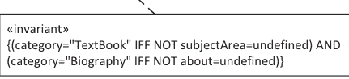

我们现在从这个设计模型推导出一个 JS 类模型。

### 13.2.1 构建 JS 类模型

我们分 3 步构建 JS 类模型：

- 将平台无关的数据类型（用属性和参数的范围）替换为 JS 数据类型。这包括枚举值属性的情况，例如 `category`，它们被转换为数值型属性，并限制在底层枚举类型的枚举整数值范围内。
- 为所有属性装饰 `«get/set»` 刻板类型（stereotype），以指示它们具有隐式的 getters 和 setters。
- 添加属性检查函数，如第一卷第 8 章所述。`checkCategory` 函数以及对分段属性的检查需要根据其隐含的语义进行特殊考虑。特别是，分段检查函数必须确保只有当 `category` 属性具有代表对应分段的值时，才能给该属性赋值。我们将在稍后讨论如何编写 JS 类模型时，更详细地解释这种验证语义。

这产生了 JS 类模型：

| Book | «enumeration» |
| --- | --- |
| <get/set> isbn[1] : String | BookTypeEL |
| <get/set> title[1] : String | TEXTBOOK |
| <get/set> year[1] : Integer | TEXTBOOK |
| <get/set> category[0..1] : BookTypeEL (frozen) | BIOGRAPHY |
| <get/set> subjectArea[0..1] : String | |
| <get/set> about[0..1] : String | |

图 13.1：合并类层次结构的 JS 类模型。

### 13.2.2 新问题

与第一卷第 11 章讨论的枚举相比，我们需要处理若干问题：

1. 在模型代码中，我们需要处理：
   1. 在 `errorTypes.js` 中添加 `FrozenValueConstraint`。
   2. 编写作为 `category` 属性范围的枚举类型 `BookTypeEL`。
   3. 为 `category` 属性编写 `checkCategory` 函数。在我们的示例中，由于划分不完全，该属性是可选的。如果应用类层次结构合并模式的划分是完全的，则该属性是强制的。
   4. 编写所有分段属性的检查函数，使其接收 `category` 作为第二个参数以便测试相关分段。
   5. 通过增加类别区分 switch 语句来完善 `toString()` 函数，仅序列化适用于给定类别的分段属性。
   6. 在 `Book.update` 中实现 `category` 属性的冻结值约束，仅在尚未定义时允许更新书籍类别。这意味着一旦定义，就无法再更新。
2. 在 UI 代码中，我们需要处理：
   1. 在 `books.html` 的“出所有书籍”用例表格中添加“特殊类型”（或“类别”）列。没有特殊类别的书籍单元格将为空，而所有其他书籍将在该格中显示类别。这需要在 `books.js` 文件的 `v.books.retrieveAndListAll.setupInterface` 中相应的 switch 语句。
   2. 在 `books.html` 的“创建书籍”和“更新书籍”用例表单中，添加“特殊类型”选择控件（通常是选择列表）以及所有分段属性的响应表单字段。只有当选择了相应的书籍类别时，才会显示分段属性表单字段。这种根据特定条件渲染特定表单字段的方法被称为动态表单。

### 13.2.3 编写类模型的类

我们可以直接为类模型编写代码，以获取我们 JS 前端应用的类代码。

#### 13.2.3.1 总结

1. 如第一卷第 11 章所解释，借助元类 `Enumeration` 编写枚举类型 `BookTypeEL` 作为 `category` 属性的范围。
2. 以 JS 类定义编写模型类 `Book`，包含 get 和 set 方法以及静态检查函数。

这些步骤将在接下来的章节中详细讨论。

148 13 使用原生 JS 实现子类型

#### 13.2.3.2 编码枚举类型 BookCategoryEL

枚举类型 `BookCategoryEL` 在 `Book.js` 模型类文件的开头，通过我们的库元类 `Enumeration` 按照以下方式进行编码：

```javascript
BookCategoryEL = new Enumeration([ "Textbook", "Biography"]);
```

#### 13.2.3.3 编码模型 Book

我们以 ES2015 类定义的形式编写了模型类 `Book`，其中 `category` 属性以及段属性 `subjectArea` 和 `about` 是可选的，并为所有属性提供了 getter、setter 和静态检查函数：

```javascript
class Book {

  constructor({isbn, title, year, category, subjectArea, about}) {

    this.isbn = isbn;

    this.title = title;

    this.year = year;

    // 可选属性

    if (category) this.category = category;

    if (subjectArea) this.subjectArea = subjectArea;

    if (about) this.about = about;

  }

  get isbn() { . . }

  static checkIsbn(isbn) { . . }

  static checkIsbnAsId(isbn) { . . }

  set isbn(isbn) { . . }

  get title() { . . }

  static setTitle(t) { . . }

  set title(t) { . . }

  get year() { . . }

  static checkYear(y) { . . }

  set year(y) { . . }

  get category() { . . }

  static checkCategory(c) { . . }

  set category(c) { . . }

  get subjectArea() { . . }

  static checkSubjectArea(sA, cat) { . . }

  set subjectArea(s) { . . }

}
```

## 13.2 案例研究 1：消除类层级结构 — 149

```javascript
get about() { . . . }

static checkAbout(a, cat) { . . . }

set about(a) { . . . }

}
```

注意，构造函数使用 ES2015 的函数参数解构功能通过单个记录参数进行定义。
我们按照以下方式为 `category` 属性编码 `checkCategory` 和 `setCategory` 方法：

```javascript
static checkCategory(c) {

  if (c === undefined || c === "") {

    return new NoConstraintViolation(); // category 是可选的

  } else if (!util.isIntegerOrIntegerString(c) || parseInt(c) < 1 ||

    parseInt(c) > BookCategory.MAX) {

    return new NoConstraintViolation(

      "Invalid value for category: " + c);

  } else {

    return new NoConstraintViolation();

  }

}

set category(c) {

  var validationResult = null;

  if (this.category) { // 已设置/赋值

    validationResult = new FrozenConstraintViolation(

      "The category cannot be changed!");

  } else {

    validationResult = Book.checkCategory(c);

  }

  if (validationResult instanceof NoConstraintViolation) {

    this._category = parseInt(c);

  } else {

    throw validationResult;

  }

}
```

虽然段属性的 getter（在本例中：`subjectArea` 和 `about`）遵循标准模式，但它们的检查和 setter 必须确保该属性适用于被检查实例的类别。这通过

150 13 使用原生 JS 实现子类型

通过检查属性值和类别的组合来实现，如下例所示：

```javascript
static checkSubjectArea(sa, c) {

if (c === BookCategoryEL.TEXTBOOK && !sa) {

  return new MandatoryConstraintViolation(

    "A subject area must be provided for a textbook!");

} else if (c === BookCategoryEL.TEXTBOOK && sa) {

  return new ConstraintViolation("A subject area must not be provided if the book is not a textbook!");

} else if (sa && typeof(sa) !== "String" || sa.trim() === "") {

  return new RangeConstraintViolation(

    "The subject area must be a non-empty string!");

 else {

  return new ConstraintViolation();

}

```

在 `toString` 函数中，我们使用 `switch` 语句序列化 `category` 属性和段属性：

```javascript
toString() {

  var bookStr = "Book(ISBN:" + this.isbn + ", title:" +

    this.title + ", year:" + this.year;

  switch (this.category) {

    case BookCategoryEL.TEXTBOOK:

      bookStr += " , subject area:" + this.subjectArea;

      break;

    case BookCategoryEL.BIOGRAPHY:

      bookStr += " , about:" + this.about;

      break;

  }

  return bookStr + ")";

}
```

在模型类的 `update` 方法中，只有当属性被更新时（即存在一个与旧属性值不同的更新参数），我们才设置它。对于 `category` 属性的 `FrozenConstraint` 特殊情况，我们需要确保它在尚未赋值时可以随段属性一起被更新。那么，在 `update` 方法中，如果 `book.category === undefined` 对于

13.2 案例研究 1：消除类层级结构 151

我们以更标准的方式处理段属性 `subjectArea` 的更新：

```javascript
Book.update = function ({isbn, title, year, category, subjectArea, about}) {

  const book = Book.instances[isbn];

  objectBeforeUpdate = util.clone(book);

  var noConstraintViolated=true, updatedProperties=[];

  try {

    if (category && book.category !== category) {

      book.category = category;

      updatedProperties.push("category");

    } else if (category === "" && "category" in book) {

      throw new FrozenConstraintViolation("The category cannot be unset!");

    }

    if (subjectArea && book.subjectArea !== subjectArea) {

      book.subjectArea = subjectArea;

      updatedProperties.push("subjectArea");

    }

    if (about && book.about !== about) {

      book.about = about;

      updatedProperties.push("about");

    }

  } catch (e) {

    // ...

  }

};
```

#### 13.2.4 编写 View 和 Controller

应用程序的用户界面 (UI) 包含一个允许导航到数据管理页面（在示例中为 `books.html`）。此类数据管理页面包含：管理书籍、列出所有、创建书籍、更新书籍和删除书籍，且每次只显示其中一个（通过设置 `display:none`）。

##### 13.2.4.1 总结

我们需要通过以下方式处理“列出所有”用例以及“创建书籍”和“更新书籍”用例中的 `category` 属性和段属性 `subjectArea`：

1. 在 `books.html` 的“列出所有”用例显示表中添加段信息列（标题为“Category”）。
2. 在 `books.html` 的“创建书籍”和“更新书籍”用例表单中添加“Category”选择字段以及所有段属性的输入字段。段属性字段仅在选择了相应的类别。

##### 13.2.4.2 在检索/列出所有中添加段列

我们在 `books.html` 的“列出所有书籍”用例显示表中添加一个“Special”类别：

```html
<table id="books">

  <head>

    <tr>

      <th>ISBN</th>

      <th>Title</th>

      <th>Year</th>

      <th>Category</th>

    </tr>

  </head>

  <tbody></tbody>

</table>
```

没有特殊类别的书籍在该列中将有一个空单元格；对于其他书籍，它们的类别将在该列显示并带有特定类别信息。这需要在 `view/books.js` 文件的 `pl.v.books.retrieveAndAll.setupInterface` 中对应相应的 `switch` 语句：

```javascript
if (book.category) {

  switch (book.category) {

    case BookCategoryEL.TEXTBOOK:

      row.insertCell(-1).textContent = book.subjectArea + " textbook";

      break;

    case BookCategoryEL.BIOGRAPHY:

      row.insertCell(-1).textContent = "Biography about " + book.about;

      break;

  }

}
```

##### 13.2.4.3 在创建和更新中添加类别选择字段

在这两种情况下，我们需要通过选择字段允许选择特殊的书籍类别（'textbook' 或 'biography'），如下 HTML 片段所示：

```html
<div class="field">

  <label>Category: <select name="category"></select></label>

</div>

<div class="field Textbook"> <!-- 条件字段 -->
```


<label>Subject area: <input type="text" name="subjectArea" /></label>

</div>

<div class="field Biography"> <!-- 条件字段 -->

  <label>About: <input type="text" name="about" /></label>

</div>

注意，我们将 "Textbook" 和 "Biography" 作为段字段容器元素的 `class` 属性值。这支持根据 `category` 属性的值对 "Textbook" 和 "Biography" 字段进行渲染和取消渲染。

在 `handleCategorySelectEventHandler` 中，只有在选择了相应的类别时，才会通过 `pl.v.app.displaySegmentFields` 显示段属性字段。

## 13.3 案例研究 2：实现类层次结构

当类层次结构变得复杂时，我们不能简单地消除它，而必须在 (1) 应用模型代码、(2) 底层数据库以及 (3) 用户界面中实现它。

我们案例研究的起点是图 12.8 所示的设计模型。在接下来的章节中，我们从设计模型推导出 JS 类模型和 JS 实体模型。实体表模型被用于对象到存储映射的设计，我们利用浏览器的 Local Storage 技术来存储应用中的对象。

### 13.3.1 构建 JS 类模型

我们通过从设计模型推导出的 JS 类模型来定义示例应用的模型类。推导本质上是保持泛化行（generalization rows）不变，仅为每个类添加 get/set 方法和静态检查函数。然而，在示例应用中，自然地将**类层次合并**设计模式（在第 12.6 节中讨论）应用于 Employee 的单子类部分，通过消除 Manager 子类来简化类模型。这导致了图 13.2 所示的模型。注意，Person 可能是 Employee、Author 或两者都是。

| Person |
| :--- |
| «get/set» personid : Integer (id) |
| «get/set» name : String |
| checkPersonid(in string) : ConstraintViolation |
| checkPersonAsid(in id : string, in type) : ConstraintViolation |
| checkName(in n : string) : ConstraintViolation |

| Author |
| :--- |
| «get/set» biography : string |
| checkBiography(in b : string) : ConstraintViolation |

| Employee |
| :--- |
| «get/set» empno[1] : number (unique) |
| «get/set» category[0..1] : EmployeeCategoryEL |
| «get/set» department(in n : string) : string |
| checkEmpno(in n : number) : ConstraintViolation |
| checkCategory(in c : number) : ConstraintViolation |
| checkDepartment(in d : string) : ConstraintViolation |

| «enumeration» |
| :--- |
| EmployeeCategoryEL |
| MANAGER |

图 13.2：Person 角色类层次结构的 JS 类模型。

### 13.3.2 构建 JS 实体表模型

由于我们使用浏览器的 Local Storage 作为示例应用的持久化存储技术，我们必须处理简单的键值存储。对于每个具有单数（大写）名称 Entity 的设计模型类，我们使用其复数小写名称 entities 作为对应的表名，并作为键；其关联的字符串值通过 `JSON.stringify` 方法对对象集合 Entity 进行序列化获得。

我们从信息设计模型推导出一组合适的 JS 实体表，形式为 JS 实体表。我们必须对如何组织数据存储以及如何推导出相应的实体表模型做出选择。

第一个要考虑的选择是使用**单表继承 (STI)**、**类按表继承 (TCI)** 或 **连接表继承 (JTI)** 方法，这些方法在第 12.7.4 节中介绍。在 STI 方法中，一个分段（或整个层次结构）由单个表表示，包含所有相关类的所有属性的列，如图 13.3 所示的示例模型。

| « entity table » | category: |
| :--- | :--- |
| personid[1]: number (pkey) | 1 = Author |
| name[1]: string | 2 = Employee |
| categories[?]: number (1,2,3) | 3 = Employee & Manager |
| biography[0]: string | |
| empno[0]: number (unique) | |

**图 13.3：**Person 角色类层次结构的 STI 模型。

由于给定的分段是非不交的，因此使用多值枚举属性 `categories` 来表示子类实例所属的信息。

对于给定的示例使用 STI 方法是可行的，因为角色层次结构层级不多，且分段子类没有添加任何属性。但在更真实的示例中，给定的角色层次结构中的分段子类会有更多属性。对于表示“Manager 是 Employee 的子类”这种多级角色层次结构，STI 方法并不是一个可行的选择。

为了简单起见，并且浏览器的 Local Storage 不支持 JTI 需要的外键，我们选择了 TCI 方法，即为 Person 分段的每个类获取一个单独的表，但不包含外键。我们的选择导致了下方图 13.4 所示的模型，该模型是从图 12.8 所示的设计模型推导出来的：

1. 根据第 12.6 节描述的类层次合并模式，将 Manager 子类合并到其父类 Employee 中。
2. 将 Person、Author 和 Employee 的 personId 属性的标准 ID 修饰符 `<id>` 替换为 `<pkey>`，以指示该属性为主键。
3. 将单数（大写）类名（Person, Author 和 Employee）替换为复数小写表名（people, authors 和 employees）。
4. 为所有类矩（people, authors 和 employees）添加 `<JS entity table>` 刻型。
5. 将平台无关的数据类型替换为 JS datetime 名称。
6. 丢弃所有泛化/继承箭头，并将父表的所有属性（personId 和 name）添加到子表中。

| JS entity table |
| :--- |
| people |
| personid : number (pkey) |
| name : string |
| JS entity table |
| authors |
| personid : number (pkey) |
| name : string |
| biography : string |
| JS entity table |
| employees |
| personid[1] : number (pkey) |
| name[1] : string |
| empno[1] : number (unique) |
| category[0..1] : number |
| department[0..1] : string |

图 13.4：Person 角色的 TCI。

在 JTI 方法的情况下，除了上述步骤 1-5 之外，我们还会：

1. 将根表 (people) 的主键列 (personId) 复制到所有子表中。
2. 将泛化箭头替换为 `fkey` 刻型的依赖箭头（表示外键依赖），并在源端端上子表的主键名称（此处为：personId）。

### 13.3.3 新问题

与图 13.1 所示的第一个案例研究模型相比，在模型代码中我们需要处理一些新问题：

1. 使用 13.1 节讨论的 `extends` 关键字定义 Employee 与 Person、以及 Author 与 Person 之间的子类关系。
2. 从持久化存储（`Person.retrieve()`）加载根类 (`Person.instances`) 实例时，我们加载 (1) 代表根类的表 (people) 的记录以创建直接实例，(2) 同时加载代表所有子类的表 (authors 和 employees) 的记录以创建它们的直接实例，并将它们的对象引用添加到根类集合 (`Person.instances`)。这样，根类集合不包含直接实例，而是包含所有实例。
3. 当 Employee 和 Author 的实例作为 JS 实体表 employees 和 authors 的记录保存到持久化存储时（`Employee.saveAll` 和 `Author.saveAll`，在 `pl.v.employees.manage` 和 `pl.v.authors.manage` 中调用），我们将 Person 的直接实例作为 people 表的记录进行保存。

### 13.3.4 JS 类模型的模型类代码

图 13.2 所示的 JS 类模型可以直接编码，以获取 Person、Employee 和 Author 模型类的代码以及枚举类型 EmployeeCategoryEL。

#### 13.3.4.1 定义子类关系

我们使用 `extends` 定义 Employee 与 Person、以及 Author 与 Person 之间的子类关系。例如，在 `m/Employee.js` 中我们定义：

```javascript
EmployeeCategoryEL = new Enumeration(["Manager"]);
```

```javascript
class Employee extends Person {

  constructor ({personId, name, empNo, category, department}) {

    super({personId, name});

    this.empNo = empNo;

    if (category) this.category = category;

    if (department) this.department = department;

  }

}
```

#### 13.3.4.2 加载根类 Person 的实例

当我们从按照 TCI 方法组织的持久化数据存储中检索类层次结构的根类（在我们的示例中为 Person）的实例时，我们不仅需要从代表根类的表（people）中检索其直接实例，还需要从代表其所有子类的表（employees 和 authors）中检索间接实例，如下代码所示：

```javascript
Person.retrieve = function () {

  var people={}, employees={}, authors={};

  if (!localStorage["authors"]) localStorage["authors"] = "{}";

  if (!localStorage["employees"]) localStorage["employees"] = "{}";

  if (!localStorage["people"]) localStorage["people"] = "{}";

  try {

    people = JSON.parse(localStorage["people"]);

    employees = JSON.parse(localStorage["employees"]);

    authors = JSON.parse(localStorage["authors"]);

  } catch (e) {

    console.log(`Error when retrieving from Local Storage\n` + e);

  }

  for (let key of Object.keys(authors)) {

    try { // convert record to (typed) object

      Author.instances[key] = new Author(authors[key]);

      // create superclass extension

      Person.instances[key] = Author.instances[key];

    } catch (e) {

      console.log(`${e.constructor.name} while deserializing` + `author ${key}: ${e.message}`);

    }

  }

}
```

authors 表中的每条记录都会被检索并转换为 Author 对象，其引用被复制到 `Person.instances` 中。employees 表的记录也以这种方式处理，而 people 表的记录则被简单检索并转换为 Person 对象：

```javascript
Person.retrieveAll = function () {

...

for (let key of Object.keys(employees)) {

}
```

```javascript
for (let key of Object.keys(people)) {

  try { // convert record to (typed) object

    Person.instances[key] = new Person(people[key]);

  } catch (e) {

    console.log(`${e.constructor.name} while deserializing ${key}: ${e.message}`);

  }

}
```

#### 13.3.4.3 在保存子表时保存主表

由于应用数据在运行期间一直保存在主内存中（只要浏览器中的应用网页保持开启），因此在应用退出时（例如关闭浏览器标签页），必须将数据保存到持久化存储中。当我们在 `pl.v.employees.manage.exit` 和 `pl.v.authors.manage.exit` 将实例（作为 JS 实体表 employees 和 authors 的记录）保存到持久化存储时，我们同时也保存 Person 的直接实例（作为 people 表的记录）。这是必要的，因为 Employee 或 Author 实例的更改可能意味着 `Person.instances` 的变化。

例如，对于 Employee 数据管理，我们在 `v/employees.js` 中定义：

```javascript
pl.v.employees.manage = {

  exit: function () {

    Employee.saveAll();

    Person.saveAll();

  },

..
```

# 14 使用 Java EE 进行子类型化

在本章中，我们将基于我们的运行示例（公共图书馆应用）的信息模型片段，解释两个案例研究。在第一个案例研究中，我们考虑了图 12.1 所示的以 Book 为根的单级类层次结构，这是一个不完全的不相交划分。我们使用单表继承（Single Table Inheritance）方法将此类层次结构映射到单个数据库表。

在第二个案例研究中，我们考虑了图 12.8 所示的由 Employee、Manager 和 Author 角色组成的多级类层次结构。我们使用连接表继承（Joined Table Inheritance）方法将此类层次结构映射到一组通过外键依赖相互关联的数据库表。

在两种情况下，我们都展示了：

- 1. 如何推导出 Java 实体类模型，
- 2. 如何以 Java 实体类的形式编写 Java 实体类模型，
- 3. 如何基于模型代码编写视图和控制器代码。

# 14.1 Java 中的子类型化

Java 通过其 `extends` 关键字提供了子类型化的内置支持，但不支持多继承。考虑以下信息设计模型：

| Person |
| :--- |
| firstName : String |
| lastName : String |
| |
| Student |
| studNo : Integer |

首先，我们定义父类 Person。然后，我们定义子类 Student 并通过 `extends` 关键字定义其与 Person 的子类型关系：

```java
public class Person {

    private String firstName;

    private String lastName;

    ..

}

public class Student extends Person {

    private int studentNo;
```

# 14.2 案例研究 1：使用单继承实现类层次结构 — 161

```java
public Student( String first, String last, int studNo) {

  super(firstName, lastName);

  this.setStudNo( studNo);

}
```


注意，在`Student`类中，我们定义了一个包含创建`Student`实例所需的所有参数的构造函数。在这个子类构造函数中，我们使用`super`来调用父类`Person`的构造函数。

# 14.2 案例研究 1：使用单表继承实现类层次结构

在本示例中，我们实现了图 12.1 所示的`Book`层次结构。Java 实体模型是从此设计模型推出的。

## 14.2.1 构建 Java 实体类模型

回想一下，我们从 OO 类模型获取 Java 实体类模型：(1) 将所有属性设为私有，(2) 使用 Java 数据类型类，(3) 添加公共的 getter 和 setter，(4) 添加`toString`函数，(5) 添加（静态）数据存储方法`create、retrieve、update`和`delete`，得到图 14.1 所示的模型。

## 14.2.2 新问题

我们必须处理一些新问题：

1. 在模型代码中，我们需要：
   - 编写枚举类型（`BookCategoryEL`），该类型用于 UI 代码中创建选择列表小部件，允许选择书籍类别。
   - 使用适当的 JPA 注解编写`Book`类层次结构中的每个类，以便将其持久化到相应的数据库表（如`books`）中。
2. 在 UI 代码中，我们需要：
   - 在`retrieveAndList.xhtml`文件夹下的`retrieveAndList.xhtml`中“检索/列出所有书籍”用例的显示表中添加“特殊类型”列。

# 14 使用 Java EE 进行子类型化

## 14.1 Java 中的子类型化

```java
@Min(value=1459, message="The year must not be before 1459!")
private Integer year;

// constructors, set, get and other methods
```

当使用 JPA 单表继承（Single Table Inheritance）技术处理类层次时，必须为父类设置`@Inheritance`注解（例如示例中的`Book`），并将其`strategy`参数设置为`InheritanceType.SINGLE_TABLE`。`@DiscriminatorColumn`注解指定了存储区分不同子类类型（在我们的示例中为`Textbook`和`Biography`）值的表列名。

遗憾的是，我们无法使用`BookCategoryEL`枚举来定义判别器列的类型，因为像`BookCategoryEL.TEXTBOOK.name()`这样的 Java 表达式不是常量，因此会导致 Java 编译器抛出异常。相反，我们使用`DiscriminatorType.STRING`。`@DiscriminatorValue`注解指定了存储在代表类实例行的判别器列中的唯一值。

此外，我们定义了子类型`Textbook`和`Biography`：

```java
@Entity(name="textbooks")
@DiscriminatorValue(value="TEXTBOOK")
@ManagedBean(name="textbook")
@ViewScoped
public class Textbook extends Book {

    @Column(nullable=false)
    @NotNull(message="A subject area value is required")
    private String subjectArea;

    // constructors, set, get and other methods
}
```

`Textbook`和`Biography`是`Book`的子类，因此我们通过`extends Book`来定义它们。对于每个子类，我们都添加一个`@DiscriminatorValue`注解，其值来自`BookCategoryEL`枚举。

## 14.2.4 STI 数据库架构

由于注解：

```java
@Inheritance(strategy=InheritanceType.SINGLE_TABLE)
```

使用一个数据库表来表示类层次。该表包含了对应于层次中所有类属性的列，加上判别器列。在我们的示例中，`books`表包含以下列：`isbn`、`title`、`year`、`subjectArea`、`about`和`category`。用于为我们的应用程序生成`books`表的简化 SQL-DDL 代码所示：

```sql
CREATE TABLE IF NOT EXISTS `books` (
  `ISBN` varchar(10) NOT NULL,
  `TITLE` varchar(255) NOT NULL,
  `YEAR` int(11) NOT NULL,
  `SUBJECTAREA` varchar(255) DEFAULT NULL,
  `ABOUT` varchar(255) DEFAULT NULL,
  `category` varchar(16) DEFAULT NULL
)
```

## 14.2.5 编写视图和控制器代码

用户界面（UI）包含一个允许导航到数据管理页面（在我们的示例中，位于`WebContent/views/books/`文件夹下的`index.xhtml`）。此类数据管理页面包含四个部分：检索/列表书籍、创建书籍、更新书籍和删除书籍。

### 14.2.5.1 总结

在“列出所有书籍”以及“创建书籍”和“更新书籍”用例中，我们必须处理类别判别器以及`subjectArea`和分段属性：

1. 在`WebContent/views/books/`文件夹下的`retrieveGetAll.xhtml`中，“检索/列表所有”用例的显示表中添加一个分段信息列（`Special type`）。
2. 在`WebContent/views/books/`文件夹下的`create.xhtml`和`update.xhtml`中，“创建书籍”和“更新书籍”用例的表单添加一个“Special type”选择控件，以及对应所有分段属性的表单字段，这些字段仅在选择了相应的书籍类别时才会显示，并且仅进行验证。

### 14.2.5.2 在检索/列表所有添加分段信息列

我们在`books.html`的“列出所有书籍”用例的显示表中添加了“Special type”列。

```xml
<h:dataTable value="#{bookController.books}" var="b">
  --
  <h:column>
    <f:facet name="header">Special type</f:facet>
    #{b.getClass().getSimpleName() != 'Book' ? b.getClass().getSimpleName() : ''}
  </h:column>
</h:dataTable>
```

使用条件表达式来检查 Java Bean 名称是否为`Book`，如果是则不显示，如果是其他内容（例如`Textbook`或`Biography`）则显示。此表达式还展示了如何调用各种 Java Bean 方法，而不只是自定义方法。

### 14.2.5.3 在创建和更新中添加“Special Type”选择控件

在这两种情况下，我们都需要通过`panel grid`元素中的选择控件来允许选择特殊类别的书籍（'textbook' 或 'biography'）：

```xml
<h:panelGrid id="bookPanel" columns="3">
  <h:outputText value="Special type: " />
  <h:selectMenu id="bookType" value="#{viewScope.bookType}">
    <f:selectItem itemLabel="--" />
    <f:selectItems value="#{book.typeItems}" />
    <f:ajax event="change" execute="@this" render="textBookPanel biographyBookPanel standardBookPanel"/>
  </h:selectMenu>
  <h:message for="bookType" errorClass="error" />
</h:panelGrid>
```

在选择控件中，引用了三个备用面板：

1. `standardBookPanel`
```xml
<h:panelGroup id="standardBookPanel" rendered="#{viewScope.bookType == null}">
  <h:commandButton value="Create" action="#{bookController.create(book.isbn)}" />
</h:panelGroup>
```

2. `textBookPanel`
```xml
<h:panelGroup id="textBookPanel" rendered="#{viewScope.bookType == 'textbook'}" columns="3">
  <h:outputText value="Subject: " />
  <h:inputText id="subjectArea" value="#{book.subjectArea}" />
  <h:message for="subjectArea" errorClass="error" />
  <h:commandButton value="Create" action="#{bookController.create(book.isbn)}" />
</h:panelGroup>
```

3. `biographyBookPanel`
```xml
<h:panelGroup id="biographyBookPanel" rendered="#{viewScope.bookType == 'biography'}" columns="3">
  <h:outputText value="About: " />
  <h:inputText id="about" value="#{book.about}" />
  <h:message for="about" errorClass="error" />
  <h:commandButton value="Create" action="#{bookController.create(book.isbn)}" />
</h:panelGroup>
```

# 14.3 案例研究 2：使用连接表继承实现类层次结构

我们案例研究的起点是图 12.8 所示的设计模型。在接下来的章节中，我们将展示如何使用**类层次结构合并**设计模式消除`Manager`类，以及如何借助 JPA 框架实现`Person`层次结构并使用连接多表继承（Joined Multiple Table Inheritance）存储策略。

## 14.3.1 构建 Java 实体类模型

我们借助 Java 实体模型来设计示例应用的模型类，该模型通过从设计模型推导出，本质上是保留了泛化结构，仅为每个类添加了 getter 和 setter。然而，在我们的示例应用中，将类层次结构合并设计模式应用于`Employee`的划分是自然的，从而通过消除`Manager`子类来简化数据模型。这导致了下方图 14.2 所示的模型。注意我们做出了两个技术决策：

| Java 实体 |
| :--- |
| Person |
| `<get/set> personid : Integer (id)` |
| `<get/set> name : String` |
| `checkPersonIdAsId(in id : String, in type) : ConstraintViolation` |

| 枚举 |
| :--- |
| `EmployeeTypeEL` |
| `MANAGER` |

| Java 实体 |
| :--- |
| Employee |
| `<get/set> empNo[1] : Integer (unique)` |
| `<get/set> type(0.[1] : EmployeeTypeEL` |
| `<get/set> department(0.[1] : String` |
| `checkUniqueEmpNo(in n : Integer) : ConstraintViolation` |
| `toString() : String` |
| `create(in pld : Integer, in n : String, in bio : String)` |
| `retrieveAll() : Employee[*]` |

{disjoint, complete} |

| Java 实体 |
| :--- |
| Author |
| `<get/set> biography : String` |
| `toString() : String` |
| `create(in pld : Integer, in name : String, in bio : String)` |
| `retrieveAll() : Author[*]` |


1. 我们声明将`Person`划分为`Employee`和`Author`是互斥的（disjoint）且完全的（complete），即任何人员要么是员工或是作者。由于 Java 不支持多重分类，我们无法在 Java 中实现重叠划分（这在建模角色时是需要的）。
2. 我们将`Person`变成一个抽象类（通过类矩形中的斜体名称指示），这意味着它不能直接实例化，只能通过其子类`Employee`和`Author`间接实例化。这一技术设计与任何`Person`都是`Employee`或`Author`（或两者都是）事实兼容，因此不需要任何对象直接实例化。

## 14.3.2 新问题

与上方图 14.1 所示的案例研究模型相比，我们必须使用 JPA 注解定义`Employee`与`Person`之间以及`Author`与`Person`之间的类别关系。
在 UI 中，我们需要处理：

1. 为相应的`Author`和`Person`模型类添加视图（位于`WebContent/views/authors`和`WebContent/views/employees`文件夹下）和控制器类（`AuthController`和`EmployeeController`）。
2. 处理`Manager`情况，通过在`WebContent/views/books/create.xhtml`和`WebContent/views/books/update.xhtml`的“创建书籍”和“更新书籍”用例表单添加“特殊类型”选择控件。分段属性字段（例如我们示例中的`department`）仅在选择了相应的员工类型时才显示并进行验证。

## 14.3.3 编写 Java 实体类的模型类

上方图 14.2 所示的实体类模型是通过使用 JavaBeans `Person`、`Employee`和`Author`以及枚举`EmployeeCategoryEL`编写的。

### 14.3.3.1 定义类别关系

我们使用 JPA 注解定义`Employee`与`Person`之间以及`Author`与`Person`之间的类别关系。首先，我们创建如下所示的`Person`类：

```java
@Entity
@Table(name="persons")
@Inheritance(strategy=InheritanceType.JOINED)
```

```java
@DiscriminatorColumn(name="category",
discriminatorType=DiscriminatorType.STRING, length=16)
public abstract class Person {

    @Id
    @NotNull(message="A person ID is required!")
    Integer personId;

    @NotNull(message="A name is required!")
    @Column(nullable=false)
    private String name;
}
```

与用例 1 中所示的`Book`层次结构相比，`@Inheritance`注解定义`strategy=InheritanceType.JOINED`。这意味着对于继承体系中的每个类，都使用一个数据库表。`@DiscriminatorColumn(name="category")`指定了顶层层次类（即`Person`）对应表（即`persons`）中的列，该列存储用于识别每个条目（表行）类型的判别器值。

注意 Java 类`Person`被声明为抽象类，这意味着它不能被初始化，相反，我们可以初始化派自它的子类（即`Employee`和`Author`）。这意味着我们没有声明`@DiscriminatorValue`，因为数据库表中没有存储`Person`的实例。

此外，我们按如下定义`Author`类：

```java


# 14.3.3 实体类定义

`@Entity @Table(name="authors")`、`@DiscriminatorValue(value="AUTHOR")`、`@ManagedBean(name="author") @ViewScoped` 注解定义了 `Author` 类：

```java
@Entity @Table(name="authors")
@DiscriminatorValue(value="AUTHOR")
@ManagedBean(name="author") @ViewScoped
public class Author extends Person {

    @NotNull(message="A biography is required!")
    private String biography;

}
```

`Author` 类继承自 `Person`，因此对应 `personId` 和 `name` 属性的 get 和 set 方法可用。`@DiscriminatorValue(value="AUTHOR")` 指定了类别表中的列为每个来自持久化 `Author` 实例的条目存储值 `AUTHOR`。

最后，我们定义 `Employee` 类：

```java
@Entity @Table(name="employees")
@DiscriminatorValue(value="EMPLOYEE")
@ManagedBean(name="employee") @ViewScoped
public class Employee extends Person {

    @Column(nullable=false)
    @NotNull(message="An employee ID is required!")
    private Integer empNo;

    @Column(nullable=false, length=32)
    @Enumerated(EnumType.STRING)
    private EmployeeCategoryEL type;

    @Column(nullable=true, length=64)
    private String StringDescriptor;

}
```

注意用于标识 `Manager` 类型的 `type`。其值由 `EmployeeCategoryEL` 定义。

## 14.3.3.2 连接表的数据库架构

由于继承层次结构中的每个类使用了 `@Inheritance(strategy=InheritanceType.JOINED)`，会创建一个数据库表。创建 `persons`、`authors` 和 `employees` 表对应的 SQL-DDL 脚本所示：

```sql
CREATE TABLE IF NOT EXISTS 'persons' (
  PERSONID int(11) NOT NULL,
  category varchar(16) DEFAULT NULL,
  NAME varchar(255) NOT NULL
);

CREATE TABLE IF NOT EXISTS 'authors' (
  PERSONID int(11) NOT NULL,
  BIOGRAPHY varchar(255) DEFAULT NULL
);

ADD CONSTRAINT FK_authors_PERSONID FOREIGN KEY (PERSONID)
REFERENCES 'persons' (PERSONID);

CREATE TABLE IF NOT EXISTS 'employees' (
  PERSONID int(11) NOT NULL,
  DEPARTMENT varchar(64) DEFAULT NULL,
  EMPNO int(11) NOT NULL,
  TYPE varchar(32) DEFAULT NULL
);

ADD CONSTRAINT FK_employees_PERSONID FOREIGN KEY (PERSONID)
REFERENCES 'persons' (PERSONID);
```

可以看到，每个表都包含 Java Bean 类定义的直接属性。此外，`authors` 表和 `employees` 表通过引用 `persons` 表的 `PERSONID` 列关联。

## 14.3.4 编写视图和控制器代码

在用户界面中，对于每个 Java Bean 类，我们有一个控制器类，它包含 `create`、`update` 和 `delete` 方法。`PersonController` 类被声明为抽象，并包含了所有子类通用的 `checkPersonIdAsId` 方法。`AuthorController` 和 `EmployeeController` 继承自 `PersonController`。

对于非抽象实体类，我们定义了对应 CRUD 操作的视图。例如，在 `Author` 的情况下，我们在 `WebContent/views/authors/` 文件夹中有 `RetrieveAll.xhtml`、`create.xhtml`、`update.xhtml` 和 `delete.xhtml` 文件。对于 `Employee`，`Retrieve/List Employees` 用例用于显示“特殊类型”列：

```xml
<h:column>
    <facet name="header">Special type of employee</facet>
    #{e.type == null ? e.type.concat(" ").concat(e.department).concat(" department") : ""}
</h:column>
```

## 14.4 运行应用

运行你的应用程序之前，你可能需要停止你的 Tomcat/TomEE 服务器（Windows 使用 `bin/shutdown.bat`，Linux 使用 `bin/shutdown.sh`）。接下来，下载并解压包含应用程序所有源代码的 ZIP 包，以及你需要修改的 ANT 脚本文件（修改 `server.folder` 属性值）。现在，在控制台或终端中执行以下命令：

```
ant deploy -Dappname=SubtypingApp
```

最后，启动你的 Tomcat Web 服务器（Windows 操作系统使用 `bin/startup.bat`，Linux 使用 `bin/startup.sh`）。请耐心等待，取决于计算机的速度，这可能需要一些时间。当控制台显示以下消息时，即表示就绪：`INFO: Initializing Mojarra [此处显示某些库的版本和路径] for context '/subtypingapp'`。最后，打开浏览器并输入：

```
http://localhost:8080/SubtypingApp/WebContent/views/app/index.xhtml
```

## 15 个子类型实践项目

## 15.1 项目 1 – 人物类型与电影类型

要构建的应用目的是管理电影及其导演、演员的信息，其中电影分为两种类型：传记片和剧集，如下模型所示：

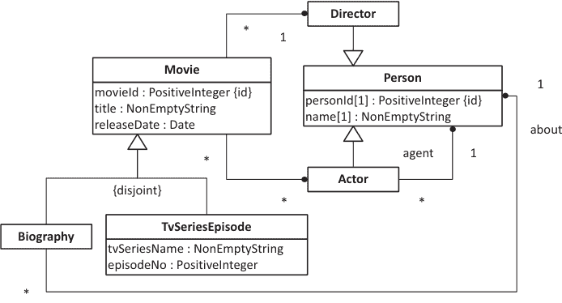

按照我们的指南编写应用程序代码。确保你的页面符合 HTML5 的 XML 语法，并且你的 JavaScript 符合我们的编码规范（并经过 JSHint 检查）。

## 术语表

### C

### CRUD

CRUD 是 *Create, Read/Retrieve, Update, Delete*（创建、读取、更新、删除）的缩写，表示任何软件应用程序执行的四种基本数据管理操作。

### 层样式表

CSS 用于定义网页的样式，告诉浏览器如何渲染其 HTML（或 XML）内容：使用内容元素的布局、字体和文本样式、颜色、背景以及动画。通常，这些设置是在单独的 CSS 文件中完成的，通过 HTML 头部中的特殊链接元素与 HTML 文件关联。

### D

### 文档对象模型

DOM 是用于检索和修改 HTML 或 XML 文档节点及元素的抽象 API。所有编程语言都有实现 DOM 的 DOM 绑定。

### 域名系统

DNS 将用户易读的域名翻译为 IP 地址，以便在互联网上定位主机计算机。

### E

### ECMAScript

由行业组织“国际电子设备标准组织”（Ecma International）定义的 JavaScript 标准。

### 可扩展标记语言

XML 允许以机器可读的方式标记各种类型文档、数据文件和消息的结构。如果标签名是自解释的，XML 也可以是人类可读的。XML 基于 Unicode。SVG 和 MathML 也基于 XML，并且有一个基于 XML 的 HTML 版本。

XML 提供了一种语法，以带有元素和属性的 XML 文档形式表示结构化信息。XML 文档中使用的特定元素和属性可以来自任何词汇，例如公共标准或用户定义的 XML 格式。

### H

### 超文本标记语言

HTML 允许标记（或描述）人类可读的网页文档或 Web 用户界面结构。基于 XML 的 HTML 版本被称为“XHTML5”，与传统的 HTML 相比提供了更简洁的语法。

### 超文本传输协议

HTTP 是一种基于互联网技术 TCP/IP 和 DNS 的无状态请求/响应协议，使用人类可读的文本消息在客户端和 Web 服务器之间通信。HTTP 的主要目的是允许从浏览器获取由 URL 标识的网页文档，通过浏览器执行的表单调用后端 Web 应用程序的操作。最近，HTTP 越来越多地用于提供 Web API 和 Web 服务。

### I

### IANA

IANA 代表互联网分配数字机构，它是 ICANN 的附属机构，负责互联网协议使用的名称和数字。

### ICANN

ICANN 代表互联网分配名称与数字机构，是一个维护域名系统的国际非营利组织。

### IndexedDB

由浏览器管理的索引数据存储的 JavaScript API。索引允许高性能搜索。像许多 SQL 数据库管理系统（DBMS）一样，IndexedDB 支持数据库事务。

### I18N

一组帮助产品适应任何目标语言和文化的最佳实践。它处理多种字符集、计量单位、键盘布局、时间和日期格式以及文本方向。

### J

### JSON

JSON 代表 JavaScript 对象表示法，它是一种遵循 JavaScript 对象字面量语法的的数据交换格式。许多编程语言都使用 JSON 作为 XML 的轻量级替代方案。

### M

### MathML

一种用于表示数学表达式的开放标准，可用于数据交换或在网页内渲染。

### MIME

MIME 类型（也称为“媒体类型”或“内容类型”）是随文件一起发送的关键字字符串，用于指示其内容类型。例如，音频文件可能被标记为 `audio/ogg`，或者图像文件标记为 `image/png`。

### 模型-视图-控制器

MVC 是一种通用的架构比喻，强调关注点分离原则（主要在模型和视图之间），并将模型视为应用程序最基础的部分。在 MVC 框架中，“M”、“V”和“C”的定义方式各不相同。通常，“模型”指的是应用程序的数据源，“视图”指的是用于用户界面的应用程序代码（基于 CSS 样式的 HTML 表单和 DOM 事件），而“控制器”通常指的是负责在视图和模型之间调调的（胶水）代码。

### O

### 对象约束语言

OCL 是一种用于完整性约束的正式逻辑语言，主要用于 UML 类模型中。它还允许定义派生表达式来定义派生属性。

### 面向对象编程

OOP 是一种基于对象概念的范式。

### Web 本体语言

OWL 是一种用于知识表示的正式逻辑语言。

### P

### 便携式网络图形

PNG 是一种支持无损压缩的开放（非专利）图形格式。

### R

### 资源描述框架

RDF 是用于表示机器读信息的 W3C 语言。

### S

### 标准标记语言

SGML 是标记语言的 ISO 规范。

### 可缩矢量图形

SVG 是一种基于 XML 的 2D 图像格式。

### U

### Unicode

Unicode 是一种与平台的字符集，包含了世界上大多数脚本语言的几乎所有字符。每个字符都被分配一个 0 到 1,114,111 之间的唯一整数代码。

### WebM

WebM 是一种开放（免版税）的网页视频格式，受 Google Chrome 和 Firefox 支持，但不支持 Microsoft Internet Explorer 和 Apple Safari。

## 世界维网

WWW（或简单称为“Web”）是一个基于 HTTP、HTML 和 XML 的巨型客户端-服务器网络，其中 Web 浏览器（以及其他“用户代理”）作为 HTTP 客户端，访问作为 HTTP 服务器的 Web 服务器程序。

## 世界维网联盟

W3C 是一个负责开发和维护 Web 标准的国际组织。

## X

## XML HTTP 请求

XML HTTP 请求 (XHR) API 允许 JavaScript 程序与后端程序交换 HTTP 消息。它可以用于在不提交 HTML 表单的情况下，从后端程序检索信息或提交信息。基于 XHR 的方法在过去被归类在“AJAX”这一缩写下。

## 索引

抽象类 170
聚合 113
关联 4
– 双向 72
– 消除 11, 86
– 功能性 5
– 功能性 7–8, 56, 68, 85
– 无方向性 9–10, 86,
– 整体与部分 113–115
– 单向 6
关联消除 11, 86
关联端点 6
– 有序 39
– 所有权点 7
关联端点所有权点 7
属性 5
属性 15
排他的 114
存在依赖 31
存在独立性 31
扩展 132
扩展 125
基于工厂的 143
外键 4
for-of 循环 20
冻结值约束 147
函数参数解构 22, 149
功能性关联 7

包 16
块作用域变量声明 169
样板代码 52

可读的 4
ID 引用 24
信息模型 3
继承 123
继承
– 区分器列 135
– 接表继承 134, 143, 155
– 单表继承 134, 155, 160
– 类类继承 134, 155
输入字段 15
不可消除的 113
内涵 125
内部对象引用 4
实例实例 311

更改依赖 26
检查 41
选择小部件 15
类层次结构 123
类层次合并 129, 134, 143
完整的 127
组合 113
基于构造函数的 143
转换器 62

数据模型 53
数据存储开销 84
数据值 5
派生规则 84
派生反向引用-属性 91, 118
不相交 127
域 6
动态表单 147, 162

Java 类模型 53, 67, 198
Java 实体类模型 14
JavaScript 类模型 79, 118
接表继承 160
JS 类模型 154
JS 类模型 14
JS 实体表模型 154
JS 实体表 133

种类 128
生命周期依赖 85
列表 16

实体 4
实体类模型 100
实体-关系 4
枚举属性 15
恰好一个 55

主菜单 59
强制性的 5
强制值 24
强制值约束 24

https://doi.org/10.1515/97831110500325-019

# 184 — 索引

+ 多对多 85
多对一 85
物化视图 85
模型类 53
模型-视图-控制器 3, 121
多分类 130
多重继承 123, 130
多选小部件 15, 48
多重继承层次结构 127
多重性 113
多值引用属性 38, 40, 67, 69
多值引用属性 15
导航性 10
– 双向 84
– 非功能性 7
– 不可共享 114
对象依赖 6
对象销毁依赖 6
对象引用 5
对象类型 3
对象关系映射 134
一对一 85
OO 类模型 9, 79, 118
可选的 5, 15
有序集 15
有序集合 39
互反向引用属性对 84
分区 127
主键 4
单选按钮组 15
范围 6
冗余 84
引用属性 5, 15, 26, 55
引用属性 3, 5
– 派生 84
– 反向 83–84
– 多值 5, 93, 102
– 单值 5, 19, 92, 102
+ 引用 3
引用完整性 6, 26
引用完整性约束 6, 24, 40
引用完整性约束 55
关系数据库 9
关系 4
关系类型 3, 4
限制 132
检索/列出所有对象 69
硬性的 128
分段 127
选择列表 15
可分离的 113
序列 16
集 6
setter 27, 41
集合值的 39
可共享部分 113
单重继承层次结构 127
单值引用属性 15
排序顺序的 128
源 6
SQL 表模型 14
子类 123
子表 139
子类型 123
父表 139
目标 6
UML 类图 4
单向关联应用 92
单向功能性关联 19, 53
单向非功能性关联 38, 67
单向二元关联 3
统一建模语言 (UML) 4
唯一性 24
更新开销 84
用户界面 69
