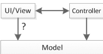
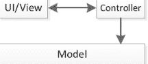
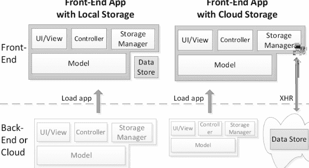
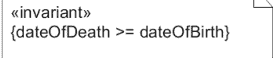
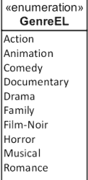
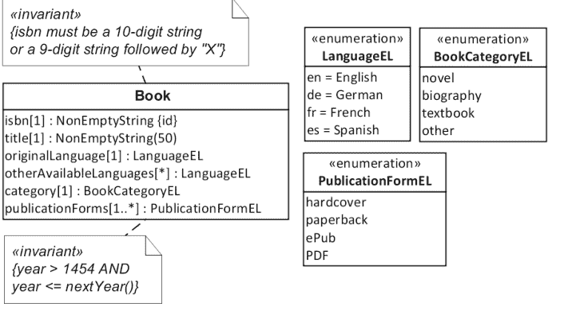
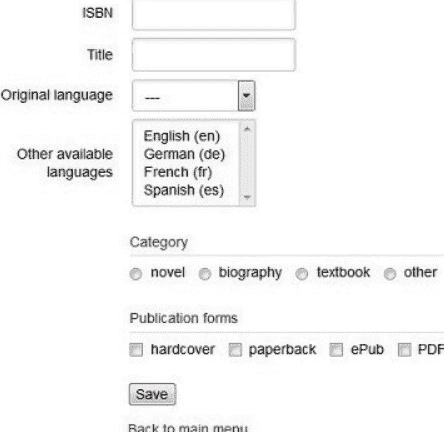
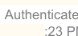
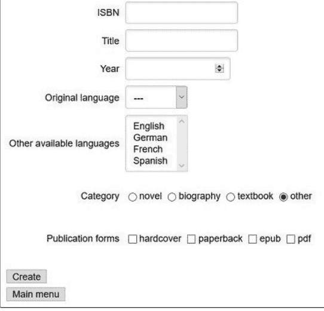

# JavaScript 或 Java Web 应用：卷 1：约束验证、枚举、特殊数据类型 (de Gruyter 教科书) 1


# 作者

Gerd Wagner 教授、博士

科特布斯-森夫滕贝格应用技术大学 BTU

互联网技术系

Konrad-Wachsmann-Allee 5

03046 Cottbus

wagner@b-btu.de

Mircea Diaconescu

dimircea@gmail.com

+ 前言 — XI

# 术语表 — 246

# 索引 — 252

# 前言

本书分为两卷，展示了如何使用基于模型的工程方法设计并实现 Web 应用程序，并使用了 Web 开发中最相关的两种技术平台：JavaScript 和 Java。Web 应用程序在 UML 类图形式的信息模型帮助下进行设计并实现：

1. JavaScript 前端，使用 `localStorage` 和 `IndexedDB` 提供的两种本地存储技术；
2. Java 后端，使用 Java Server Faces (JSF) 作为用户界面技术，使用 Java Persistence API (JPA) 进行对象到存储的映射，以及 MySQL/MariaDB 数据库管理系统；
3. 分布式 JavaScript 应用，具有：
   a. 用于管理用户界面并处理应用程序逻辑的某些部分的前端组件（包括基于约束的数据验证），
   b. Node-JS 后端组件，用于管理持久化存储并处理应用程序逻辑的某些部分（包括基于约束的数据验证）。

本书的重点是关于基础信息管理问题的通用概念和技术：

1. 完整性约束和数据验证；
2. 枚举和枚举属性；
3. 对象类型之间的单向和双向关联；
4. 类层次结构中的子类型和继承。

列表中的前两个问题将在本书的第一卷中讨论，而后两个问题将在第二卷中讨论。

我们假设读者熟悉 HTML 和面向对象编程，最好熟悉 Java（或者，熟悉 C++、PHP、Python 或 C#）。此外，我们还假设读者对 CSS 和 JavaScript 有一定了解，并愿意学习更多使用现代 JavaScript 进行编程。

本书可用于：

1) 计算机科学及相关专业学生的 Web 开发课程；
2) 用于 JavaScript 开发者学习 Java；
3) 用于 Java 开发者学习 JavaScript；
4) 用于 JavaScript 和 Java（以及 PHP/Python/C# 等）开发者学习：
   - 使用 JavaScript 和 Java EE 进行面向对象 (OO) 编程；
   - 如何使用原生 JavaScript 和 Java EE 实现基本信息管理概念并构建完整的 Web 应用程序。

本书附带六个示例应用的完整源代码，您可以从本书的网站 http://web-engineering.info/WebAppBook 运行或下载。读者可以在 web-engineering.info 网站提供的讨论论坛之一中，就书的任何章节或主题进行提问。

# 1 精通应用开发不仅需要编码技能

要精通应用开发，仅仅掌握你最喜欢的编程语言的编码是不够的。至重要的是理解所有的基本概念和技术，不仅是在编程方面，而且在信息管理方面。

编程（或软件开发）技术通常将编程语言（如 `JavaScript` 或 `C#`）与框架或许多库（如 `JavaScript` 配 `BackboneJs`，`Java` 配 `JPA` 或 `JSF`，或 `C#` 配 `.NET MVC`）相结合，用于编写用户界面和数据存储管理。

许多开发者认为，他们职业生涯需要学习和掌握的所有技术都是正确的技术。然而，如果他们不能学会正确应用编程技术所需的通用概念和技术，他们就无法精通开发。

理解编程和信息管理中的通用概念和技术有助于你：

- 通过将它们识别为通用概念的具体化身，来理解语言或框架的元素；
- 比较不同的技术并评估它们的优缺点；
- 根据你的需求，对新的、有前景的语言/技术做出明智的选择。

虽然特定技术的知识对于精通编程和应用开发非常重要（事实上，它是基础），但其半衰期很短，这也是事实。在书中，我们不仅以独立于技术的方式解释了编程和信息管理的概念与技术，还解释了这些概念和技术在两种最相关的技术（`JavaScript` 和 `Java`）中是如何被支持的。

## 2 为什么 JavaScript 是构建 Web 应用程序的好选择？

今天，`JavaScript` 不仅仅是一种编程语言，更是一个平台，它比其他平台具有许多优势：

1. 它是唯一在 Web 浏览器中获得原生支持的语言。
2. 它是唯一的（“通用的”）允许：
   a. 仅用一种编程语言构建 Web 应用程序；所有其他语言（如 `Java` 和 `C#`）只能用于后端，并且需要与前端 `JavaScript` 结合，因此开发者需要至少掌握两种。
   b. 在后端和前端执行相同的代码（例如，用于约束验证）。
3. 它是唯一允许动态发布的语言，即根据运行时条件（如可用的前端资源）在后端或前端执行相同的代码（例如，用于业务计算）。
4. 它将面向对象与函数式编程结合在一起。
5. 它的设计允许各种形式的元编程，这意味着它允许开发者编写自己的编程概念，如类和枚举。

## 3 为什么 Java 是构建 Web 应用程序的好选择？

在 2017 年以及在未来的多年里，企业级软件平台 Java Enterprise Edition (`Java EE`) 将 `Java` 语言封装在一起，它是信息技术最重要的编程平台，适用于各种软件系统。它的强大之处主要源于：

1. 它拥有丰富的生态系统，包括大量的库、框架和工具；
2. `Java` 的执行速度比 `Python`、`Ruby` 等脚本语言；
3. `Java` 应用可以扩展，例如通过分布式事务；
4. 它提供了高级安全保护。

# 4 Java 与 JavaScript

与 `Java` 相比，`JavaScript` 相对容易学习。原因之一是 `Java` 需要变量、参数和返回值的显式定义，而 `JavaScript` 不需要。

`Java` 和 `JavaScript` 都是面向对象的编程语言，但 `JavaScript` 比 `Java` 更“面向对象”，`Java` 则是“面向类”。`JavaScript` 中没有显式的类概念。然而，可以在不实例化类的情况下创建对象。运行时，可以向对象添加或删除方法。`Java` 类无法这样重新定义，而 `JavaScript` 允许定义特定对象的方法。`Java` 方法是类类的。`JavaScript` 对函数式编程有更好的支持。例如，它支持闭包，即函数上下文。`Java` 只支持有限的匿名类闭包。

## 5 良好的程序是有效的、健壮的、高效且可维护的

正如 Nick Gonzalez 所所示¹良好的程序是有效的：它解决了应该解决的问题。良好的程序在接收到用户的错误输入时不会崩溃；它是健壮的。良好的程序是高效的：快速完成任务。由于需求可能会变化，良好的程序应该是可维护的，以便在需求变化时进行修改。程序只有以清晰的方式编写时才是可维护的。

> 任何傻瓜都能写出计算机能懂的代码，技巧在于编写人类能懂的代码。（Martin Fowler，《程序规则》²）

代码通常“不必要地复杂、混乱、无组织且蔑蔑地缝合在一起”，正如 Santiago L. Valdarrama 的文章所示³建议在必要时使用注释，仅解释那些不够清晰的内容，但通过良好的命名、合理的结构以及正确的间距让你的代码展示意图。

## 6 运行应用并获取代码

要从我们的 Web 服务器运行任何示例应用并下载代码，请访问 http://web-engineering.info/WebAppBook-CodeLinks。

¹ http://engineering.theadders.com/2016/04/26/what-is-a-good-program/

² http://martinfowler.com/distributedComputing/refactoring.pdf

³ https://blog.svpino.com/2015/04/22/the-thing-with-code-clarity-you-cant-be-proud-of-something-l-cant-read

# 图表列表

- 2.1 内置的 `JavaScript` 类 `Object` 和 `Function` — 31
- 3.1 对象类型 `Book` — 37
- 4.1 对象类型 `Book` — 58
- 5.1 从概念模型通过设计模型到 `JavaScript` 类模型 — 97
- 5.2 从概念模型通过设计模型到实现模型 — 98
- 6.1 以模型为构为基础的 MVC 代码库架构 — 108
- 6.2 前端 Web 应用的架构 — 113
- 6.3 后端和分布式 Web 应用的架构 — 114
- 7.1 对象级约束的示例 — 130
- 7.2 定义了具有两个不变性的对象类型 `Book` 的设计模型 — 131
- 8.1 从信息设计模型到 `JS` 类模型 — 138
- 9.1 从信息设计模型推导出实体类模型 — 165
- 10.1 可扩展模型的示例 — 186
- 10.2 针对对象类型 `Book` 的信息设计模型 — 191
- 11.1 针对对象类型 `Book` 的 `JavaScript` 类模型 — 195
- 11.2 带有枚举属性的创建新书籍记录的 UI — 203
- 12.1 针对对象类型 `Book` 的 `JPA` 实体模型 — 212
- 12.2 创建新书籍记录的用户界面 — 218
- 13.1 数量类型 — 240

# 表列表

- 2.1 代表书籍集合的实体表示例 — 23
- 2.2 类 `JS` 代码模式的需求和理想特性 — 28
- 3.1 以表格形式表示书籍对象集合 — 57
- 3.2 关于电影的示例数据 — 56
- 3.3 关于国家的示例数据 — 57
- 4.1 关于书籍的示例数据 — 58
- 4.2 `Java` 可见性级别 — 60
- 7.1 `Book` 的示例数据 — 132
- 8.1 数据类型映射 — 141
- 8.2 关于电影的示例数据 — 154
- 8.3 关于国家的示例数据 — 156
- 9.1 属性的 `Bean` 校验注解 — 161
- 9.2 到 `Java` 的类型映射 — 164
- 9.3 到 `MySQL` 的类型映射 — 164
- 10.1 以表格形式表示记录枚举 — 183
- 10.2 `Book` 的示例数据 — 192
- 11.1 带有评分和类别的电影示例数据 — 208
- 11.2 带有国家代码和宗教的国家示例数据 — 209

# 1 Web 应用基础快速览

如果你已经熟悉 `HTML`、`XML` 和 `JavaScript`，可以跳过本章，直接进入下一章开始开发一个简单的 Web 应用。

## 1.1 世界维维网 (WWW)

互联网在 20 世纪 80 年代建立后，蒂姆·伯纳斯-李（Tim Berners-Lee）于 1989 年在瑞士日内瓦的欧洲核子研究组织（CERN）提出了 WWW 的理念并并了首次实现。WWW（或简称为“Web”）基于互联网技术 `TCP/IP`（互联网协议）和 `DNS`（域名系统）。最初，Web 包含：

- 超文本传输协议 (`HTTP`)，
- 超文本标记语言 (`HTML`)，
- 作为 `HTTP` 服务器运行的 Web 服务器程序，以及添加到这些 `HTTP` 客户端的“用户代理”（如浏览器）。

后来，更多重要的技术组件被添加到这组基础 Web 技术中：

- 1995 年页面/文档样式语言样式表 (`CSS`)，
- 1995 年 编程语言 `JavaScript`，
- 1998 年可扩展标记语言 (`XML`)，作为 Web 格式的基础（如 `SVG` 和 `RDF/XML`），
- 2001 年基于 `XML` 的矢量图形 (`SVG`) 格式，
- 2004 年用于 Web 知识表示描述框架 (`RDF`)。

## 1.2 HTML 和 XML

`HTML` 允许标记（或）可读 Web 文档或用户界面的结构，而 `XML` 允许标记各种文档、数据文件和消息，无论它们是否可读。`XML` 也可以作为定义名为 `XHTML` 的 `HTML` 版本的基础。

### 1.2.1 XML 

`XML` 提供了一种以嵌套元素及其属性的 `XML` 文档形式表示信息的语法。`XML` 文档中使用的特定元素和属性可以来自任何词汇，例如公共标准或（私有的）用户定义格式，用于指定：

- 文档格式，如 `HTML5`、矢量图形 (`SVG`) 或 `DocBook`，
- 数据交换格式，如数学标记语言 (`MathML`) 或通用业务语言 (`UBL`)，
- 消息格式，如 Web 服务 `SOAP`

### 1.2.2 Unicode 和 UTF-8

`XML` 基于 `Unicode`，这是一个与平台的字符集，包含了世界上大多数语言的字符，包括印地语、缅甸语和盖尔语。每个字符都被分配了一个 0 到 65535 之间的唯一整数代码。例如，希腊字母 π 的代码为 960，因此可以使用 `XML` 实体插入 `XML` 文档中。`XML` 文档的默认编码是 `UTF-8`，它对 `ASCII` 字符使用单字节，对不常用的字符使用三个字节。在良好的文档中，所有的 `Unicode` 字符都是合法的，除了 0 到 31 的控制字符（回车符、换行符和制表符）。将另一个非 `XML` 文本复制到 `XML` 文档是危险的（通常会产生问题）。

### 1.2.3 XML 命名空间

通常，命名空间有助于避免冲突。它们允许在不同的上下文中重用（本地）名称。许多语言都有某种形式的命名空间，例如 `java` 和 `PHP`。`XML` 命名空间通过命名空间 URI 标识，例如 `SVG` 命名空间 `"http://www.w3.org/2000/svg"`，关联命名缀 `svg`。这种命名空间代表元素和属性的名称集合，并允许类似 `http://www.w3.org/TR/html40/` 的命名空间限定名称。

默认名称如下所示在元素的起始标签中：

```html
<html xmlns="http://www.w3.org/1999/xhtml">
```

此示例显示了 `HTML` 根元素的起始标签，其中 `XHTML` 命名空间被声明为默认名称。下面的示例显示了嵌入 `HTML` 文档的元素命名空间声明：

```html
<html xmlns="http://www.w3.org/1999/xhtml">
<head></head>
<body>
<figure>
<figcaption>图 1: 蓝色圆形</figcaption>
<svg xmlns:svg="http://www.w3.org/2000/svg">
<svg:circle cx="100" cy="100" r="50" fill="blue"/>
</svg>
</figure>
</body>
</html>
```

### 1.2.4 正确的 XML 文档

`XML` 定义了两个语法标准。`XML` 文档必须是良好的（well-formed），如果它是基于某种语法（或模式），那么它相对于该语法必须是有效的（valid），换句话说就是满足语法的所有规则。

如果 `XML` 文档满足以下语法条件，则被称为良好的：

1. 必须有且只有一个根元素。
2. 每个元素必须有一个起始标签和一个结束标签；然而，空元素可以用 `<tag/>` 代替 `<tag></tag>`。
3. 标签不能重叠。例如，我们不能有 `<author>Lee</name>`。
4. 属性名称在元素范围内是唯一的。例如，以下代码是不正确的：`<attachment file="2.html" file="3.html/>`

如果 `XML` 文档符合特定语法（如 `DTD` 或 `XML Schema`），则被称为有效的：

1. 它是良好的
2. 并且它遵守语法。

### 1.2.5 HTML 的演变

世界维网联盟（W3C）开发了以下 `HTML` 重要版本：

- 1997 年：**HTML 4**，一种基于 `SGML` 的语言，
- 2000 年：*XHTML 1*，作为基于 `XML` 的 `HTML 4` 清理版本，
- 2014 年：*(XHTML 5)*，与浏览器供应商支持的 WHAT 工作组合作（并竞争）。

作为 Web 的发明者，蒂姆·伯纳斯-李在 1990 年开发了第一版本的 `HTML`。几年后，在 1995 年，蒂姆·伯纳斯-李和丹·康诺利（Dan Connolly）创建了 `HTML2` 标准，该标准捕捉了当时 `HTML` 元素的用法。在随后的几年里，`HTML` 被不断扩大的 WWW 采用者社区使用并逐渐扩展。`HTML` 的演变导致了一系列混乱的元素和属性（被称为“标签汤”），这主要由浏览器供应商及其之间的竞争控制。W3C 尝试清理这种混乱的开发忽略了 `HTML` 面向更广泛用户界面的功能，而这是由 Ian Hickson 领导的 WHAT 工作组的重点，他被认为是 `HTML 5` 及其许多辅助 `JavaScript` API 的主脑和主要作者，这些 API 使 `HTML` 适用于应用程序。

`HTML` 最初被设计为结构描述语言，也是一种演示描述语言。`HTML4` 有很多源于演示元素，如字体。`XHTML` 一直将 `HTML` 带回根源，放弃演示元素并定义了简单清晰的语法，以支持以下目标：

- 设备无关性
- 可访问性
- 易用性

我们采用符号方程

**HTML = HTML5 = XHTML5**

意味着当我们说“`HTML`”或“`HTML5`”时，我们实际上指的是 `XHTML5`，因为我们更倾向于 `XML` 文档清晰的语法，而不是 `HTML` 允许的宽松且混乱的 `HTML4` 样式标签。


```html
<!DOCTYPE html>
<html xmlns="http://www.w3.org/1999/xhtml" xml-lang="en" lang="en">
<head>
  <meta charset="UTF-8" />
  <title>HTML5 Template Example</title>
</head>
<body>
<h1>HTML5 Template Example</h1>
<section><h1>First Section Title</h1>
</section>
</body>
</html>
```

请在第 1 行中声明了 HTML5 文档类型，这指示浏览器使用 HTML5 文档对象模型 (DOM)。在第 2 行的 `html` 标签中，使用默认命名空间声明属性 `xmlns` 将 URI `http://www.w3.org/1999/xhtml` 声明为默认命名空间，以确保浏览器和其他工具理解所有 `html`、`head`、`body` 等非限定元素均来自 XHTML 命名空间。

同样在 `html` 标签中，我们同时使用 `xml-lang` 属性和 HTML 的 `lang` 属性设置元素文本内容的（默认）语言（此处设置为英语 "en"）。这种属性重复是为了获得一个可以被 HTML 和 XML 工具处理的混合文档，这是付出的出的代价。

最后，在第 4 行，通过使用带有 `charset` 属性的空 `meta` 元素，我们将 HTML 文档的字符编码设置为 UTF-8，这同样 XML 文档的默认设置。

## 1.2.6 HTML 表单

对于用户交互型应用程序，网页浏览器需要渲染用户界面 (UI)。软件应用程序 UI 的传统比喻是表单。用于数据输入、数据输出和用户的特殊元素被称为表单控件或部件（widgets）。在 HTML 中，`form` 元素是网页的一部分，由包含表单控件及其标签的块级元素组成。

用户通过在输入字段、下拉选择列表、单选按钮组和复选框组中输入文本来创建表单。完成后的表单通过提交按钮提交。当用户提交表单时，通过 HTTP GET 方法或 HTTP POST 方法发送到服务器是提交的标准编码被称为 URL 编码（URL-encoded）。它由互联网媒体类型 `application/x-www-form-urlencoded` 表示。在这种编码中，空格变为加号，任何其他保留字符根据 RFC 1738 的定义变为百分号和十六进制数字。

## 1.3 Web 应用程序基础快速概览

每个表单控件都有初始值和当前值，两者都是字符串。初始值通过元素的 `value` 属性指定，但 `textarea` 元素的初始值由其初始内容提供。控件的当前值首先被设置为初始值。之后，控件的当前值可能会通过用户交互或脚本进行修改。当表单被提交处理时，某些控件将将其名称与其当前值成对，这些键值对随表单一起提交。

通过将标签作为 `label` 元素内的子元素来关联表单（隐式标签），或者通过给控件赋予一个 `id` 值并在 `label` 元素的 `for` 属性中引用此 ID（显式标签），将标签与表单关联。

在“入门级”应用程序的简单用户界面中，我们只需要四种表单控件：

1. 使用 `<input name="" />` 元素创建单行输入字段，
2. 使用 `<output name="" />` 元素创建单行输出字段，
3. 使用 `<button type="button">...</button>` 元素创建推入按钮，
4. 使用如下形式的 `select` 元素创建下拉选择列表：

```html
<select name="">
<option value="value1"> option1 </option>
<option value="value2"> option2</option>
...
</select>
```

用于创建此类用户界面的 HTML 表单示例：

```html
<form id="Book">
<p><label>ISBN: <output name="isbn" /></label></p>
<p><label>Title: <input name="title" /></label></p>
<p><label>Year: <input name="year" /></label></p>
<p><button type="button">Save</button></p>
</form>
```

在基于 HTML 表单的数据管理用户界面中，应用程序模型类中定义的不同类型属性与用于输入和输出这些值的表单控件之间存在对应关系。我们区分了各种类型的模型类属性，这些属性映射到各种类型的表单字段。这种映射也称为数据绑定（data binding）。

## 1.4 使用 CSS 为 Web 文档和用户界面样式

虽然 HTML 用于定义文档或 Web 界面的内容结构，但层叠样式表 (CSS) 用于用于定义网页的呈现样式，这意味着你使用它来告诉浏览器你希望如何渲染 HTML（或 XML）：使用哪种内容元素布局、字体和文本样式，使用哪些颜色、背景和动画。通常，这些设置是在单独的 CSS 文件中完成的，该文件通过 HTML head 部分中的 link 元素与 HTML 文件关联。

Håkon W. Lie 在 1994 年 10 月提出了 CSS 的草案，他后来成为了浏览器厂商 Opera 的首席技术官。官方的 CSS1 标准追溯到 1996 年 12 月，“大部分内容是 Håkon W. Lie 与 Bert Bos 在 1995 年 7 月在 Sophia-Antopolis 的白板上敲定的”（正如他在一次采访中解释的那样）。

CSS 基于一种规则的形式，规则由选择器和声明组成。选择器指示样式适用于哪个 HTML 元素，而声明包含了要应用的属性和值。

在“入门级”应用程序的简单用户界面中，我们只需要四种表单控件：（见前述一节）。

我们不会在书中深入探讨 CSS，因为我们的重点是逻辑而非其美观。

以特殊 JS 对象形式存在的模式：既可以是构造函数（可能使用了 ES6 类声明的语法糖），也可以作为工厂对象。

然而，对象也可以在不实例化类的情况下创建，在这种情况下，它们是无类型的，并且可以独立于任何类定义，为特定对象定义作为方法的属性。在运行时，可以向任何对象和类添加或删除属性和方法。JavaScript 的这种动态性提供了强大的元编程功能，例如定义你自己的类和枚举（或其他自定义类型）。

### 1.4.2 关于 JavaScript 的进一步阅读

关于 JavaScript 的优秀开放获取书籍：

- 《Speaking JavaScript》，由 Axel Rauschmayer 博士编写。
- 《Eloquent JavaScript》，由 Marijn Haverbekeke 编写。

## 1.5 Web 应用的无障碍性

为 Web 应用提供无障碍性的推荐方法由“无障碍富交互应用程序”（ARIA）标准定义。正如 Bryan Garaventa 在其关于交互 Web 技术功能的文章中所述：无障碍性三个主要方面：1) 键盘可访问性，2) 屏幕阅读器可访问性以及 3) 认知可访问性。

关于 ARIA 的进一步阅读：

1. [浏览器如何与屏幕阅读器交互，以及 ARIA 在其中的位置]，来自 Bryan Garaventa
2. [无障碍训练树指南]，来自 whatsock.com
3. [ARIA 角色符合性矩阵]，来自 whatsock.com
4. Mozilla 的 ARIA 概览文章
5. W3C ARIA 概览页面

> 17 https://speakingjs.com/es5/index.html
> 18 https://eloquentjavascript.net/
> 19 https://www.linkedin.com/profile/view?id=26751364&trk=groups-post-b-author
> 20 https://www.linkedin.com/grp/4512178-134539009
> 21 https://link.in/ue-Q08
> 22 https://whatsock.com/training
> 23 https://whatsock.com/training/matrices
> 24 https://developer.mozilla.org/en-US/docs/Web/Accessibility/ARIA
> 25 https://www.w3.org/WAI/intro/aria.php

## 1.6 测验题

如果你想查找以下测验的答案，可以查看我们的讨论论坛。如果你在论坛中没有找到答案，可以创建一个帖子来提问特定问题的答案。

### 1.6.1 问题 1：良好的 XML

以下哪些片段代表良好的 well-formed XML？选择一个或多个：

1. `<em><STRONGER>This is some text <b>and this is more text. Here is even more.</bold> text</STRONGER></em>`
2. `<strong>This text is bold. <em>And this is italicized and bold.</em>/<strong><em>And this is just italics.</em>`
3. `<em><STRONGER>This text is bold. <em>And this is italicized and bold.</em></STRONGER></em>`
4. `<strong>This text is bold. <em>And this is italicized and bold.</em><strong><em>And this is just italics.</em></strong>`

### 1.6.2 问题 2：HTML 表单

回想起 HTML 表单是文档中包含控件的区域。以下哪些代表正确的表单？选择一个或多个：

1. `<input type="text" name="username">`
2. `<input type="password" name="password">`
3. `<input type="submit" value="Submit">`
4. `<input type="checkbox" name="agree">`
5. `<input type="radio" name="gender" value="male">`

## 1.7 更多 JavaScript 基础

除了数字和布尔值外，日期和时间也是重要的原始值类型，尽管它们不是以原始值的形式实现的，而是以包装对象的形式实现的。

赋值空数组字面量，如 `var a = []` 与调用不带参数的 `Array()` 构造函数如 `var a = new Array()` 相同，但前者更简洁，因此更推荐。

赋值空对象字面量，如 `var o = {}` 与调用不带参数的 `Object()` 构造函数 `var o = new Object()` 相同，但前者更简洁。然而，空对象字面量 `{}` 并不是真正的空对象，因为它包含了从 `Object.prototype` 继承的属性和方法槽。因此，一个真正的空对象（不包含任何槽）必须通过 `null` 创建，例如 `emptyObject = Object.create(null)`。

下表提供了类型测试的总结：

| 类型 | 示例值 | 测试 x 是否为该类型 |
| --- | --- | --- |
| string | "Hello world", 'A3F0' | `typeof x === "string"` |
| boolean | true, false | `typeof x === "boolean"` |
| (浮点数) | -2.75, 0, 1, 0, 3.1e10 | `typeof x === "number"` |
| integer | -2, 0, 1, 250 | `Number.isInteger(x)` |
| Object | {num:3, denom:4}, isbn:"006251587X",title:"Weaving the Web", "one": "two", "three":3} | 排除 x: `instanceof Object` 包含 null: `typeof x === "object"` |
| Array | ["one", [1,2,3], ["one", []] | `Array.isArray(x)` |
| Function | function () { return "one"; } } | `typeof x === "function"` |
| Date | new Date("2015-01-27") | `x instanceof Date` |
| RegExp | /\(\w+)\s\(\w+)/ | `x instanceof RegExp` |

4 https://developer.mozilla.org/en-US/Web/JavaScript/Reference/Global_Objects/Object/prototype
5 https://developer.mozilla.org/en-US/Web/JavaScript/Reference/Global_Objects/Array
6 https://developer.mozilla.org/en-US/Web/JavaScript/Reference/Global_Objects/Function
7 https://developer.mozilla.org/en-US/Web/JavaScript/Reference/Global_Objects/Date
8 https://developer.mozilla.org/en-US/Web/JavaScript/Reference/Global_Objects/RegExp

## 2.1 JavaScript 基础

下表提供了类型转换的总结：

| 类型 | 转换为字符串 | 将字符串转换为类型 |
| --- | --- | --- |
| boolean | `String(x)` | `Boolean(y)` |
| (浮点数) number | `String(x)` | `parseFloat(y)` |
| integer | `String(x)` | `parseInt(y)` |
| Object | `x.toString()` or `JSON.stringify(x)` | `JSON.parse(y)` |
| Array | `x.toString()` or `JSON.stringify(x)` | `y.split(y)` |
| Function | `x.toString()` | `new Function(y)` |
| Date | `x.toString()` | `new Date(y)` |
| RegExp | `x.toString()` | `new RegExp(y)` |

### 2.1.2 变量作用域

在 JavaScript 当前版本 ES5 中，变量只有两种作用域：全局作用域（以 `window` 为上下文对象）和函数作用域，但**没有块作用域**。因此，在代码块中声明变量是混淆的，并且可以避免。例如，尽管即使经验丰富的 JavaScript 程序员也经常使用这种模式，但在 **for** 循环内部声明计数变量是一个陷阱，如下：

```javascript
function foo() {
  for (var i=0; i < 10; i++) {
    // 对 i 进行某些操作
  }
}
```

相反，这正是 JavaScript 解释这段代码的方式（通过变量声明的“提升”），我们应该写：

```javascript
function foo() {
  var i=0;
  for (i=0; i < 10; i++) {
    // 对 i 进行某些操作
  }
}
```

所有变量都应该在函数的开头声明。在 JavaScript 的下一个版本 ES6 中，将通过关键字 **let** 的新变量声明形式支持块作用域。

### 2.1.3 严格模式

从 ES5 开始，我们可以使用严格模式来获取更多的运行时错误检查。例如，在严格模式下，所有变量必须声明。对未声明变量的赋值将抛出异常。

我们可以通过在 JavaScript 文件的第一行或 `<script>` 元素内部输入来开启严格模式：

```javascript
'use strict';
```

通常建议使用严格模式，除非你的代码依赖于与严格模式不兼容的库。

### 2.1.4 不同对象

JS 对象不同于经典的 OO/UML 对象。特别是，它们不需要实例化类。它们可以以方法槽的形式拥有自己的（实例级）方法，但它们不仅有（普通的）属性槽，还有方法槽。此外，它们还可能拥有键值对槽。因此，它们可能拥有三种不同类型的槽，而 UML 中的经典对象（称为“实例规范”）只有属性槽。

JS 对象本质上是一组名称-值对（也称为槽），其中名称可以是属性名、函数名或映射的键。可以使用 JavaScript 的对象字面量符号（JSON）以即时方式创建对象，而无需实例化类：

```javascript
var person = { lastName:"Smith", firstName:"John" };
```

空对象通过以下方式创建：

```javascript
var emptyObject = Object.create(null);
```

当标识符是字符串时，该槽可能表示属性槽、方法槽或键值槽。使用“数组”术语而不说明是“JS 数组”会产生术语歧义。

对象的属性可以通过两种方式访问：

1. 使用点符号，如 `object.property`
2. 使用括号符号，如 `object["property"]`

### 2.1.5 数组列表

JS 数组实际上是一种列表结构，其中每个项可以通过索引访问。使用“数组”术语而不说明“JS 数组”会产生术语歧义。为了简单起见，我们有时使用“数组”代替“JS 数组”。变量可以使用数组字面量初始化：

```javascript
var a = [1,2,3];
```


由于它们是列表，JS 数组可以动态增长：可以使用大于数组长度的索引。例如，在上面的初始化后，变量 `a` 持有的数组长度为 3，但我们仍然可以赋值第五个元素：

```
a[4] = 7;
```

数组 `a` 的内容通过标准的 `for` 循环进行处理，计数器从第一个数组索引 0 开始到最后一个数组索引（即 `a.length-1`）：

```
for (i=0; i < a.length; i++) { ... }
```

由于数组是特殊类型的对象，我们有时需要方法来判断变量是否表示数组。我们可以通过应用预定义的类型 `isArray` 来测试变量是否为数组，如 `Array.isArray(a)`。向数组添加新元素，我们使用 `push` 操作将其追加到数组：

```
a.push(newElement);
```

要从数组 `a` 的位置 `i` 删除元素，我们使用预定义的数组方法 `splice`。要在数组 `a` 中搜索值 `v`，我们可以使用预定义的数组方法 `indexOf`，如果找到则返回位置，否则返回 -1，如下：

```
a.splice(i, 1);
a.indexOf(v) > -1
```

遍历数组 `a`，我们有两种选择：要么使用 `for` 循环，要么使用数组循环方法 `forEach`。在任何情况下，我们都可以使用 `for` 循环：

```
var i=0;
for (i=0; i < a.length; i++) {
   console.log(a[i]);
}
```

## 2.1 JavaScript 基础

如果性能不是问题，也就是说，如果数组足够小（例如，不包含几百个元素），我们可以使用数组循环方法 `forEach`。在下面的示例中，参数 `elem` 随着数组的每个元素的值进行迭代：

```
a.forEach(function (elem) {
  console.log(elem);
})
```

对于克隆数组，我们可以以下方式使用数组函数 `slice`：

```
var clone = a.slice(0);
```

## 2.1.6 Maps

Map（也称为“哈希映射”或“关联数组”）提供了从键到其关联值的映射。JS map 的键是字符串字面量，其中可能包含空格：

```
var myTranslation = {
  "my house": "mein Haus",
  "my boat": "mein Boot",
  "my horse": "mein Pferd"
}
```

map 的处理通过对 map 的所有键进行特殊循环来完成，该循环使用预定义的函数 `Object.keys(m)`，该函数返回一个 map 键的数组。例如：

```
var i=0, key="", keys=[];
keys = Object.keys(myTranslation);
for (i=0; i < keys.length; i++) {
  key = keys[i];
  alert('The translation of ' + key + ' is ' + myTranslation[key]);
}
```

向 map 中添加新条目，我们只需将新值与其键关联即可，如下：

```
myTranslation["my car"] = "mein Auto";
```

从 map 中删除条目，可以使用预定义的 `delete` 操作符，如下：

```
delete myTranslation["my boat"];
```

搜索 map 是否包含某个特定的键值（例如测试 map 是否包含 "my bike" 的条目），我们可以检查以下：

## 2.2 关于 JavaScript 的更多

遍历 map `m`，我们首先通过预定义的 `Object.keys` 方法将其转换为键的数组，然后我们可以使用 `for` 循环或 `forEach` 方法。下面的示例展示了如何使用 `for` 循环：

```
var i=0, key="", keys=[];
keys = Object.keys(m);
for (i=0; i < keys.length; i++) {
  key = keys[i];
  console.log(m[key]);
}
```

同样，如果 `m` 足够小，我们可以使用 `forEach` 方法，如下例所示：

```
Object.keys(m).forEach(function (key) {
  console.log(m[key]);
});
```

注意，`forEach` 方法更加简洁。

克隆 map `m`，我们可以使用 `JSON.stringify` 和 `JSON.parse` 的组合。我们首先使用 `JSON.stringify` 将 `m` 序列化为字符串表示，然后使用 `JSON.parse` 将字符串表示反序列化为 map 对象：

```
var clone = JSON.parse(JSON.stringify(m))
```

注意，如果 map 仅包含简单值（可能嵌套的）包含简单数据值的数组/map，此方法运行良好。在其他情况下，例如，如果 map 包含 `Date` 对象，我们必须编写自己的克隆方法。

### 2.1.7 JavaScript 支持四种基本数据结构

总之，支持以下四种基本数据结构：

- 1. 数组列表（array lists），例如 `["one","two","three"]`，它们被称为“数组”的特殊 JS 对象，但由于它们是动态的，因此它们更接近 Java 编程语言定义的数组列表。

- 2. 记录（records），即特殊的 JS 对象，例如 `{firstName:"Tom", lastName:"Smith"}`，如上所述，

- 3. 映射（maps），也是特殊的 JS 对象，例如 `{"one":1, "two":2, "three":3}`，如上所述，

- 4. 实体表（entity tables），如下表所示，它们是特殊的 map，其具有标准 ID（或主键）槽位，使得 map 的键是这些实体记录的标准 ID。

### 表 2.1 实体表的书籍示例

| 键 (Key) | 值 (Value) |
| --- | --- |
| 00625187 | { name:"00625187", title:"Weaving the Web", year:2000 } |
| 04650267 | { name:"04650267", title:"Gödel, Escher, Bach", year:1999 } |
| 04650373 | { name:"04650373", title:"I Am Strange Loop", year:2008 } |

注意，map 和实体表之间的区别纯粹是概念上的，而非语法上的。对于 JavaScript 引擎来说，`{firstName:"Tom", lastName:"Smith"}` 和 `{one:"two",three:3}` 只是对象。概念上，`{firstName:"Tom", lastName:"Smith"}` 是一个记录，因为 `firstName` 和 `lastName` 是预期的属性（或字段），而 `{one:1,"two":2}` 是 map，因为 "one" 和 "two" 是用作键的任意字符串。概念上的区分有助于程序设计，语法上的区分有助于代码的可读性。

### 2.1.8 程序、方法和函数

通常，一个带参数的程序（procedure）是一个可以多次调用的子程序。当程序返回一个值时，它被称为函数。在 OOP 中，如果它们在类或对象的上下文中定义，则被称为方法。在 JavaScript 中，函数是对象，具有可选的 `name` 属性和提供参数数量的 `length` 属性。这意味着 JS 函数可以存储在变量中、作为参数传递给函数、由函数返回并可以动态更改。因此，JS 函数是一等公民，JavaScript 可以被视为函数式编程语言。函数的通用形式是将表达式赋值给变量：

```
var myMethod = function (params) {
```

其中 `params` 是逗号分隔的参数列表（或参数记录）。当省略时，方法/函数是匿名的。在任何情况下，JS 函数通常通过引用函数的变量调用。在上述情况下，这意味着 JS 函数是通过 `myMethod()` 调用的，而不是 `name()`。然而，命名函数可以在函数内部通过 `name` 调用。因此，递归函数必须是命名的。匿名函数表达式在其他编程语言中被称为 lambda（或更短的 lambda）。作为匿名函数表达式作为另一个（高阶）函数的参数示例，我们可以将比较函数传递给预定义的 `sort` 函数。这种比较函数如果第一个参数小于第二个参数，必须返回负数；如果两个参数相同，必须返回 0；如果第二个参数小于第一个，则必须返回正数。在下面的示例中，按字典顺序排序数字列表：

```javascript
var list = [[1,2],[1,3],[1,1],[2,1]];
list.sort(function (x,y) {
  if (x[0] == y[0]) return x[1]-y[1];
  else return x[0]-y[0];
});
```

JS 声明形式如下：

```javascript
function myMethod (params) { }
```

它等同于以下命名函数定义：

```javascript
var myMethod = function myMethod(params) { }
```

也就是说，它创建了一个带有引用该函数的名的函数。

JS 函数有内部函数。闭包（closure）机制允许 JS 函数使用其作用域内的变量（`this` 除外），闭包中创建的函数记得它被创建的环境。在下面的示例中，不需要通过参数将作用域变量 `result` 传递给内部函数，因为它是可用的：

```javascript
var sum = function (numbers) {
  var result = 0;
  numbers.forEach(function (n) {
    result = result + n;
  });
  return result;
}
console.log(sum([1,2,3,4])); // 10
```

```javascript
var sum = function () {
  var result = 0, i=0;
  for (i=0; i<arguments.length; i++) {
    result = result + arguments[i];
  }
  return result;
}
console.log(sum(0,1,2,3,5,8)); // 20
```

在构造函数的原型上定义的方法可以在用该构造函数创建的所有对象上调用，例如 `Array.prototype.forEach`，其中 `Array` 代表构造函数，必须用 `this` 变量引用的类实例作为上下文对象调用（见下一节关于类）。在 `forEach` 的调用中，数组 `numbers` 就是上下文对象：

```
var numbers = [1,2,3]; // 创建 Array 的实例
numbers.forEach (function (n) {
  console.log(n);
});
```

每当需要在没有上下文对象的情况下通过一个对象作为普通参数调用原型方法时，我们可以将调用该方法的对象作为第一个参数传递给 JS 函数调用方法，后跟是待调用的方法的参数。例如，我们可以在下面的代码将 `forEach` 循环方法应用到类数组对象 `arguments` 上：

```
var sum = function () {
  var result = 0;
  Array.prototype.forEach.call(arguments, function (n) {
    result = result + n;
  });
  return result;
}
```

`Function.prototype.call` 方法的两个参数变体（将待调用方法的所有参数收集在一个类数组对象中）是 `Function.prototype.apply`。`call` 和 `apply` 的第一个参数在内部将成为 `this`。

## 关于 JavaScript 的更多内容

第一个是函数，其余的被传递。因此，`f.call(x, y, z)` 等于 `f.apply(x, [y, z])`。

当为原型定义的方法在没有上下文对象的情况下被调用，或者定义在槽位中的方法在没有上下文的情况下被调用时，可以使用 JS 函数的 `bind` 方法（`Function.prototype.bind`）将 `this` 绑定到变量对象上。这允许为调用方法创建一个快捷方式，例如 `var querySel = document.querySelector.bind(document)`，这允许你使用 `querySel` 代替 `document.querySelector`。

立即执行 JS 函数表达式（IIFE）选项用于获取优于普通命名对象的命名空间机制，因为可以控制哪些变量和方法全局暴露，哪些不暴露。这种机制也是 JS 模块概念的基础。在下面的示例中，我们为应用的模型代码部分定义了一个命名空间，这允许构造函数中包含一些变量和模型类：

```javascript
myApp.model = function () {
  var appName = "My app's name";
  var someNonExposedVariable = ...;
  function Model1() {...}
  function Model2() {...}
  function someNonExposedMethod() {
    return {
      appName: appName,
      Model1: Model1,
      Model2: Model2
    }
  }
}(); // 立即执行
```

### 2.1.9 定义和使用类

类的概念是面向对象编程的基础。对象实例化（或由类分类）类。类定义了用它创建的对象的属性和方法（作为蓝图）。

在模型-视图-控制器（MVC）架构中，能够以模型类的形式实现数据模型是非常关键的。然而，类及其继承/扩展机制在经典的 OO 语言（如 Java）中被过度使用，在 Java 中，所有的变量和过程必须在类的范围内定义，因此在这些语言中类不仅用于实现对象类型（或模型类），还作为许多其他用途的容器。JavaScript 的情况并非如此，我们可以自由地使用类来实现对象类型，同时将方法库保留在命名空间对象中。

## 2.1 JavaScript 基础

JavaScript 中定义类的任何代码模式都应该满足五个要求。首先，(1) 它应该允许定义*类名*（实例级）*属性*，最好带有将它们保持“私有”的选项，一组（实例级）*方法*，以及一组*类级*属性和方法。属性带有范围/类型以及其他元数据（如约束条件）进行定义是理想的。还应该有两个内省功能：(2) 一个 *is-instance-of 谓词*，用于检查一个对象是否是类的直接或间接继承，以及 (3) 一个用于检索对象*直接类型*的实例级属性。此外，拥有三个用于检索类*超类型*的内省功能也是理想的。最后，有两种继承机制：

- 1. (4) *属性继承*和 (5) *方法继承*。此外，最好能支持多重继承和多重分类，允许对象通过实例化角色类（role classes）同时扮演多个角色。

JavaScript ES6 中原本没有类定义语法。已经提出了不同的定义 JavaScript 类的代码模式，并正被不同的框架使用。但它们并不满足上述五个要求。定义类的两种最重要方法是：

- 1. 以*构造函数*函数的形式，通过原型实现方法继承，并允许借助 `new` 对象创建类的新实例。这是 Mozilla 在其 JavaScript 指南¹ 中推荐的经典方法。这也是 ES6 中使用 `class` 定义语法时推荐的方法。

- 2. 以*工厂*对象的形式，使用预定义的 `Object.create` 方法创建类的实例。在这种方法中，原型链的方法继承机制被“复制并添加”机制所取代。Eric Elliott¹ 认为，基于工厂的类是 JavaScript 中基于构造函数的类的可行替代方案（事实上，他谴责在基于构造函数的类中使用类继承，这简直是“倒水倒孩子”）。

在构建应用时，我们可以根据应用需求使用这两种类。由于我们经常需要定义类层级结构而不仅仅是类，但必须确保不在同一个层级结构中混合这两种替代方法。虽然以 mODELcLASSJS¹² 为代表的基于工厂的方法有很多优势（总结在表 2.2 中），但基于构造函数的方法具有对象创建性能更高的优势。

¹ https://developer.mozilla.org/en-docs/Web/JavaScript/Guide/Details_of_the_Object_Model
¹² http://chimera.labs.oreilly.com/books/123400000062/ch03.html#fluentstyle_javascript
¹³ http://web-engineering.info/tech/mODELcLASSJs/validation-tutorial.html

### 表 2.2 JS 类代码模式所需和理想的功能

| 类特征 | 基于构造函数的方法 | 基于工厂的方法 | mODELcLASSJS |
| --- | --- | --- | --- |
| 定义属性和方法 | 是 | 是 | 是 |
| is-instance-of 谓词 | 是 | 是 | 是 |
| 直接类型属性 | 是 | 是 | 是 |
| 类的子类型 | 否 | 是 | 是 |
| 属性继承 | 是 | 是 | 是 |
| 方法继承 | 是 | 是 | 是 |
| 多重继承 | 否 | 是 | 是 |
| 多重分类 | 否 | 是 | 是 |
| 允许对象池 | 否 | 是 | 是 |

### 2.1.9 定义和使用类

ES6 引入了构造友好语法。

**步骤 1a)** 首先定义构造函数，通过在创建新对象时为构造参数赋值定义类的属性：


```javascript
function Person(first, last) {
  this.firstName = first;
  this.lastName = last;
}
```

注意构造函数内部的特殊变量 `this` 指向调用构造函数时创建的对象。

### 步骤 1b
接下来，将类的实例方法定义为构造函数原型引用的对象的方法：

```javascript
Person.prototype.toString = function () {
  return this.firstName + " " + this.lastName;
}
```

### 步骤 1c
类级（静态）方法可以定义为构造函数本身的方法槽（由于 JS 函数是对象，它们拥有槽位），例如：

```javascript
Person.checkLastName = function (ln) {
  if (typeof ln !== "string" || ln.trim() === "") {
    console.log("Error: invalid last name!");
  }
}
```

### 步骤 1d
最后，将类级（静态）属性定义为构造函数的属性槽：

```javascript
Person.instances = {};
```

最后在步骤 2 中，定义了一个子类，它具有额外的属性和方法，并可能覆盖父类方法：

```javascript
class Student extends Person {
  constructor(first, last, studNo) {
    super(first, last);
    this.studNo = studNo;
  }
  // 方法覆盖父类方法
  toString() {
    return super.toString() + " " + this.studNo + "";
  }
}
```

¹⁴ https://en.wikipedia.org/wiki/Object_pool

¹⁵ https://developer.mozilla.org/en-US/docs/JavaScript/Guide/Details_of_the_Object_Model

# 30 2 更多 JavaScript

```javascript
Person.instances = {};
```

### 步骤 2.a
定义一个带有额外属性的子类：

```javascript
function Student(first, last, studNo) {
  // 调用父类构造函数
  Person.call(this, first, last);
  // 定义并分配额外属性
  this.studNo = studNo;
}
```

通过对任何作为子类 `Student` 实例创建的新对象使用 `Person.call(this, ...)` 调用超类型构造函数，并由 `this` 引用，我们实现了在超构造函数中创建的属性槽（`firstName` 和 `lastName`）也能在子类实例中创建，并贯穿整个子类链。通过这种方式，我们建立了一种**原型继承**机制，确保了在创建对象时定义的属性包含了由父类构造函数定义的自有属性。

在 **步骤 2b** 中，我们通过构造函数的 `prototype` 属性建立了一种**方法继承**机制。我们将一个从超类型 `prototype` 对象创建的新对象赋值给子类构造函数的 `prototype` 属性，并调整了原型的构造函数属性。

```javascript
// Student 继承自 Person
Student.prototype = Object.create(Person.prototype);
// 调整子类的构造函数属性
Student.prototype.constructor = Student;
```

通过 `Object.create(Person.prototype)` 我们创建了一个以 `Person.prototype` 为原型且没有任何自有属性槽的新对象。通过将此对象赋值给子类的 `prototype` 属性，我们实现了在其中定义并继承自父类的方法对于实例化子类的对象可用。这种原型链机制处理了方法继承。请注意，将 `Student.prototype` 设置为 `Object.create(Person.prototype)` 优于将其设置为 `new Person()`，后者是 ES5 之前实现相同目标的方法。

### 步骤 2c
定义一个重写父类方法的子类：

```javascript
Student.prototype.toString = function () {
  return Person.prototype.toString.call(this) + " " + this.studNo + "";
};
```

通过对构造函数应用 `new` 运算符并为构造函数参数提供合适的参数，可以创建基于构造函数的类的实例：

```javascript
var pers1 = new Person("Tom", "Smith");
```

使用“点符号法”在对象 person 上调用方法 `toString` 方法：


# 2.1 JavaScript 基础 — 31

```javascript
alert("The full name of the person is: " + pers1.toString());
```

当使用 `o = new C()` 创建对象时，其中 `C` 引用一个名为 "C" 的命名函数，可以通过内省的 `o.constructor.name` 获取 `o` 的类型（或类），它返回 "C"。在此处使用的 `Function::name` 属性受所有浏览器支持，但 11 之前的 Internet Explorer 版本除外。

在 JavaScript 中，原型（`prototype`）是一个带有方法槽（有时也带有属性槽）的对象，其他对象可以通过 JavaScript 的方法/属性槽查找机制继承它。该机制遵循由内置引用 `__proto__`（带有双前后缀，ES5 非官方）构建的原型链来查找方法。如下方 2.1 所示，每个构造函数都有一个指向原型的引用，作为其引用属性的值。当使用 `new` 创建新对象时，其 `__proto__` 被设置为该构造函数的原型。

例如，在创建新对象 `f = new Foo()` 后，它持有的 `Object.getPrototypeOf(f)`（同于 `__proto__`）等于 `Foo.prototype`。因此，对 `Foo.prototype` 槽的更改会影响所有用 `new Foo()` 创建的对象。虽然每个对象都有一个 `__proto__` 槽，但只有通过 `new` 构造的对象才有 `constructor` 属性。

| Object |
| :--- |
| `hasOwnProperty(in p)` : Boolean |
| `isPrototypeOf(in obj)` : Boolean |
| `create(in Object, prop-def)` : Object |
| `defineProperties(in obj, prop-def)` : Object |
| `keys(in obj)` : Array |
| `getPrototypeOf(in obj)` : Object |
| `(...)` |
| `prototype` |

| Function |
| :--- |
| `name[0..]` : String |
| `length[1]` : Integer |
| `apply(in thisObj, arguments)` : Array |
| `call(in thisObj, arg1, arg2, in ...)` |
| `bind(in thisObj, arg1, arg2, in ...)` |
| `(...)` |
| `constructor` |

*图2.1 内置 JavaScript 类 Object 和 Function.*

注意我们可以通过 `Object.getPrototypeOf(o)` 获取对象的原型，它是 `o.__proto__` 的官方 ES5 替代方案。

## 2.1.9.2 工厂类

在这种方法中，我们定义了一个代表类的 `Person` 对象，带有特殊的 `create` 方法来创建类型 `Person` 对象：

```javascript
var Person = {
  typeName: "Person",
  properties: {
    firstName: {range: NonEmptyString, label: "First name",
      writable: true, enumerable: true},
    lastName: {range: NonEmptyString, label: "Last name",
      writable: true, enumerable: true}
  },
  methods: {
    getFullName: function () {
      return this.firstName + " " + this.lastName;
    },
    create: function (props) {
      // 创建对象
      var obj = Object.create(Object.prototype);
      // 添加属性
      Object.keys(this.properties).forEach(function(prop) {
        Object.defineProperty(obj, prop, {
          value: props[prop],
          writable: this.properties[prop].writable,
          enumerable: this.properties[prop].enumerable,
          configurable: true
        });
      });
      // 添加方法
      Object.keys(this.methods).forEach(function(prop) {
        obj[prop] = this.methods[prop];
      });
      return obj;
    }
  }
};
```

（注：OCR 中的工厂类代码是破碎/损坏的，我根据上下文重建了逻辑）。

该 JS 对象实际上代表工厂类。通过调用其 `create` 方法创建此类工厂类的实例：

```javascript
var pers1 = Person.create({firstName: "Tom", lastName: "Smith"});
```

使用“点符号法”在对象 `pers1` 上调用 `getFullName`：

```javascript
alert("The full name of the person is: " + pers1.toString());
```

注意在通用方法中，我们不会为工厂类重复定义构造函数，而是拥有一个通用构造函数。这种机制通过与父类合并属性和方法提供了继承。

### 2.1.10 测验

如果你想查询以下问题的答案，可以查看我们的讨论。如果在论坛中没有找到答案，你可以发帖询问。

#### 2.1.10.1 问题1：删除映射条目
哪条 JavaScript 语句可以删除映射中键为 "k" 的条目？

#### 2.1.10.2 问题2：评估布尔表达式
布尔表达式 `null || !` 的值是什么？单选：

- false

#### 2.1.10.3 问题3：JavaScript 类型
以下哪些是 JavaScript 中的原始类型？单选多选：

- double
- string
- float
- int
- boolean
- number

#### 2.1.10.4 问题4：构造类

| City |
| :--- |
| name: String |
| setName(n : String) |
| checkName(n: String) : Boolean |

以下哪些 JavaScript 片段正确定义了类图所示的构造类？提示：注意 `setName` 是实例级方法，而 `checkName` 是类级（静态）方法。单选多选：

- 1. `function City(n) { this.name = n; City.prototype.setName = function (n) { this.name = n; } City.checkName = function (n) { return ...; }`
- 2. `function City(n) { this.setName(n); } City.prototype.setName = function (n) { this.name = n; } City.checkName = function (n) { return ...; }`
- 3. `function City(n) { this.setName(n); function checkName(n) { return ...; } City.prototype.setName = function (n) { this.name = n; }`
- 4. `function City(n) { this.name = n; this.setName = function (n) { this.name = n;}; checkName = function (n) { return ...; }`

#### 2.1.10.5 问题5：变量作用域
以下程序的输出是什么？

```javascript
function foo() {
  var i = 7;
  for (var i = 0; i < 10; i++) {
    // 做某事
  }
  console.log(i);
}
foo();
```

答案: 10

## 2.2 使用 JavaScript 的 localStorage API 存储数据库表

在大多数应用中，我们会有某种形式的数据管理，数据以表格的形式表示，表行对应对象，表结构（schema）对应对象的类型。使用 JavaScript 构建前端应用时，持久数据存储的最简单方法是 JavaScript 的 `localStorage` API，它提供了一个简单的键值数据库，但不支持数据库表。因此，问题是：我们如何使用 Local Storage 存储和检索表格呢？

我们将展示如何在 JavaScript 中以实体表（我们称之为）的形式表示数据库表，以及如何在 Local Storage 中存储这些表。

### 2.2.1 实体表

JavaScript 对象表示（JSON）¹⁹ 为 JavaScript 数组字面量（列表）和 JavaScript 对象字面量（映射）定义了简洁的语法：

- 列表表示为括号内的逗号分隔的数据字面量列表：`["penguin", "arctis", "snow"]`
- 映射表示为花括号内的逗号分隔的键值槽位列表：`{"id": 290165, "my phone number": "0049.30.227109"}`

记录（record）是一种特殊的映射类型，其键是允许的 JavaScript 标识符²⁰，因此在 JavaScript 代码中它们不需要加引号。例如，`id: 290165, phone: "0049.30.227109"` 就是一个记录。记录中属性的值或映射中与键关联的值可以是数据字面量、数组字面量或另一个对象字面量，例如：`{tags: "penguin", "arctis", "photographer": {"last": "Wagner", "first": "Gerd"}}`

实体表包含一组记录（或表行），其中每个记录代表一个具有标准标识符属性的对象。因此，实体表可以表示为记录的映射，其中映射的键是标准标识符属性，关联的值是记录，如下例所示：

| Key | Value |
| :--- | :--- |
| 006251587X | `{"isbn": "006251587X", "title": "Weaving the Web", year: 2000}` |
| 0465026567 | `{"isbn": "0465026567", "title": "Gödel, Escher, Bach", year: 1999}` |
| 0465030793 | `{"isbn": "0465030793", "title": "I Am a Strange Loop", year: 2008}` |

¹⁹ developer.mozilla.org/en/JavaScript/Reference/Global_Objects/JSON

²⁰ http://moreffect.in/js-variables

### 2.2.2 JavaScript 的 LocalStorage API

对于前端应用，我们需要能够持久化地存储数据：即前端设备。现代网页浏览器提供了两种技术来实现此：较简单的称为 Local Storage，更强大的称为 IndexedDB²。为了简单起见，我们在示例应用中使用 Local Storage API。

Local Storage 数据库按每个浏览器和每个源（origin）创建，源由协议和域名的组合定义。例如，`http://example.com` 和 `http://www.example.com` 是不同的源，因为它们有不同的域名；而 `https://www.example.com` 和 `https://www.example.com` 是不同的源，因为它们的协议不同（HTTP 与 HTTPS）。


由浏览器管理并与应用（其源）关联的 Local Storage 数据库暴露为内置的 JavaScript 对象 `localStorage`，并带有 `getItem`、`removeItem` 和 `clear` 方法。然而，与其调用 `getItem` 和 `setItem`，不如将 `localStorage` 处理为映射更方便，通过为键赋值值来写入，如 `localStorage["id"] = 2901465`，并通过读取 `localStorage["id"]` 来检索数据。以下示例显示了如何创建实体表并将其保存到 localStorage：

```
var persons = {};
persons["2901465"] = {id:2901465, name:"Tom"};
persons["3305079"] = {id:3305079, name:"Su"};
persons["6492003"] = {id:6492003, name:"Pete"};
try {
  localStorage["personTable"] = JSON.stringify(persons);
} catch (e) {
  alert("写入 LocalStorage 时出错" + e);
}
```

注意我们使用了定义方法 `JSON.stringify` 将实体表序列化为字符串并赋值给键 "personTable"。我们可以通过定义方法 `JSON.parse` 来检索表格：

```
var persons = {};
try {
  persons = JSON.parse(localStorage["personTable"]);
} catch (e) {
  alert("从 Local Storage 读取时出错" + e);
}
```

# 3 使用原生 JS 构建一个最小 Web 应用

在本章中，我们将展示如何使用原生 JavaScript 和 Local Storage 构建一个最小的前端应用。我们的示例应用的目的是管理书籍信息。也就是说，我们处理单一对象类型：Book，如图 3.1 所示。

图 3.1 对象类型。

| Book |
| :--- |
| isbn | String |
| title | String |
| year | Integer |

下表显示了模型类的示例数据：

| ISBN | Title | Year |
| :--- | :--- | :--- |
| 006251587X | Weaving the Web | 2000 |
| 0465026567 | Gödel, Escher, Bach | 1999 |
| 0465030793 | I Am a Strange Loop | 2008 |

数据管理应用需要什么？应用必须支持四种标准情况：

- **创建 (Create)** 一本新书，允许用户将书籍添加到存储记录中。
- **检索 (Retrieve)** 或从数据存储中读取所有书籍并以列表形式显示。
- **更新 (Update)** 书籍记录。
- **删除 (Delete)** 书籍记录。

这四种标准情况对应的数据管理操作通常总结为缩写 CRUD。为了通过键盘和计算机屏幕输入数据，我们使用 HTML 表单为 Web 应用提供用户界面。为了维护持久数据对象的集合，我们需要一种允许在辅助设备（如硬盘或固态硬盘）上保留数据的存储器。

## 第一步：设置文件夹结构

我们为应用取一个名称，例如“Public Library”，并为应用文件夹取一个相应的（可能是缩写的）名称，例如“PublicLibrary”或 MinimalApp。然后在计算机磁盘上创建一个文件夹以及存放 JavaScript 代码文件的子文件夹 `src`。在该文件夹中，按照软件应用模型-视图-控制器（MVC）范式创建 `m`、`v` 和 `c` 子文件夹。最后，我们为应用的启动页创建一个 `index.html` 文件，如下文所述。因此，我们得到了如下文件夹结构：

```
MinimalApp
src
  c
  m
  v
index.html
```

在应用的启动页 HTML 文件中，我们加载 `initialize.js` 和 `Book.js` 模型类文件：

```html
<!DOCTYPE html>
<html xmlns="http://www.w3.org/1999/xhtml" xml="en" lang="en">
<head>
  <meta charset="UTF-8" />
  <title>最小JS前端应用示例</title>
  <script src="src/initialize.js"></script>
  <script src="src/m/Book.js"></script>
</head>
<body>

</body>
</html>
```

启动页提供了一个选择 CRUD 数据管理用例的菜单。每个用例都通过选择相应的页面（如 `createBook.html`）来执行。菜单还包含通过 `Book.createTestData()` 过程创建测试数据以及通过 `Book.clearData()` 清空所有数据的选项：

https://dev.opera.com/articles/introduction-to-indexeddb/

```html
<body>
<h1>Public Library</h1>
<h2>最小 JavaScript 前端应用示例</h2>
<p>此应用支持以下操作：</p>
<menu>
  <li><a href="retrieveAndListAllBooks.html">列出所有书籍</a></li>
  <li><a href="createBook.html">添加新书</a></li>
  <li><a href="updateBook.html">更新书籍</a></li>
  <li><a href="deleteBook.html">删除书籍</a></li>
  <li><button type="button" onclick="Book.clearData()">清除数据库</button></li>
  <li><button type="button" onclick="Book.createTestData()">创建测试数据</button></li>
</menu>
</body>
```

## 第二步：编写模型代码

第二步，我们编写模型类的代码并将其保存到特定的模型文件中。在 MVC 应用中，模型代码是应用最重要的部分。它也是编写视图和控制器代码的基础。事实上，视图和控制器代码的大部分可以从模型代码自动生成。许多 MVC 框架都提供这种代码生成功能。

在上方所示的信息设计模型中，只有一个类，代表对象类型 Book。因此，在 `src/m` 文件夹中，我们创建一个 `Book.js` 文件，其初始包含以下代码：

```javascript
function Book(slots) {
  this.isbn = slots.isbn;
  this.title = slots.title;
  this.year = slots.year;
}
```

模型类 Book 被编码为一个 JavaScript 构造函数，带有一个 `slots` 参数，该参数是一个包含 `isbn`、`title` 和 `year` 字段的记录对象，代表要赋值给 Book 类 ISBN、标题和年份属性的构造参数。注意，为了简单，我们将类名 Book 放在全局作用域中，这对于只有几个类的小应用是可以的。通常情况下，我们应该使用模型命名空间来模型类，这需要如下类/构造定义：

```javascript
pl.m.Book = function (slots) {..}
```

# 3 七个步用原生 JS 构建一个极简 Web 应用

除了以构造器函数的形式定义模型类外，我们还在 `Book.js` 文件中定义了以下项：

1. 类属性 `Book.instances`，以实体表的形式表示由应用程序管理的所有 `Book` 实例集合。
2. 类方法 `Book.retrieveAll`，用于从持久化数据存储中加载所有 `Book` 实例。
3. 类方法 `Book.saveAll` 用于将所有受管理的 `Book` 实例保存到持久化数据存储中。
4. 类方法 `Book.add` 用于创建新的 `Book` 实例。
5. 类方法 `Book.update` 用于更新现有的 `Book` 实例。
6. 类方法 `Book.destroy` 用于删除一个 `Book` 实例。
7. 类方法 `Book.createTestData` 用于创建一些示例记录作为测试数据。
8. 类方法 `Book.clearData` 用于清空书籍数据存储。

### 3.2.1 表示所有 Book 实例的集合

为了表示应用程序管理的所有 `Book` 实例集合，我们以以下方式定义并初始化类属性 `Book.instances`：

```
Book.instances = {};
```

因此，初始状态下我们的书籍集合是空的。事实上，它被定义为一个空对象字面量，因为我们希望以实体表（实体记录的映射）的形式来表示它，其中 ISBN 是访问对应书籍记录（作为与键关联的值）的键。我们可以通过查找表的形式将实体表的结构视觉化：

| Key | Value |
|---|---|
| 006251587X | { isbn:"006251587X", title:"Weaving the Web", year:2000 } |
| 0465026567 | { isbn:"0465026567", title:"Gödel, Escher, Bach", year:1999 } |
| 0465030793 | { isbn:"0465030793", title:"I Am A String Loop", year:2008 } |

注意，此类映射的值对应于表行的记录。因此，我们也可以用简单的表格表示它们，如表 3.1 所示。

### 3.2.2 创建新的 Book 实例

`Book.add` 过程负责创建新的 `Book` 实例并将其添加到 `Book.instances` 集合中：

```
Book.add = function (slots) {
  var book = new Book(slots);
  // 将书籍添加到 Book.instances 集合中
  Book.instances[slots.isbn] = book;
  console.log("Book " + slots.isbn + " created!");
}
```

### 3.2.3 加载所有 Book 实例

对于持久化数据，我们使用现代浏览器支持的 Local Storage API。从 Local Storage 加载书籍记录涉及三个步骤：

1. 通过赋值 `bookString = localStorage["books"]`，从 Local Storage 中检索以 "books" 为键存储的大字符串书籍表。
2. 通过内置解析器 `JSON.parse: books = JSON.parse(booksString);` 将书籍表转换为以行作为元素的实体表 *books*。此转换是*反序列化*。
3. 通过在 `Book` 类中定义为“静态”方法的过程 `convertRec2Obj`，将 *books* 中的每行（代表一个（无类型对象））转换为相应的 *Book* 类型对象，并作为实体表 `Book.instances` 的元素：`Book.convertRec2Obj = function (bookRec) { var book = new Book(bookRec); return book;};`

以下是 `retrieveAll` 过程的完整代码：

```
Book.retrieveAll = function () {
  var key="", keys=[], i=0,
  bookString="", books={};
  try {
    if (localStorage["books"]) {
      bookString = localStorage["books"];
    }
  } catch (e) {
    alert("Error reading from Local Storage\n" + e);
  }
  if (bookString) {
    books = JSON.parse(bookString);
    keys = Object.keys(books);
    for (i=0; i < keys.length; i++) {
      key = keys[i];
    }
    Book.instances[key] = Book.convertRec2Obj(books[key]);
  }
};
```

由于 `localStorage["books"]` 操作可能会失败，我们在 `try-catch` 块中执行它，并在操作失败时跟随错误消息。

### 3.2.4 更新 Book 实例

对于更新现有的 `Book` 实例，我们首先从 `Book.instances` 中检索它，并重新赋值那些发生变化的属性：

```javascript
Book.update = function (slots) {
  var book = Book.instances[slots.isbn];
  var year = parseInt(slots.year);
  if (book.title != slots.title) { book.title = slots.title; }
  if (book.year != year) { book.year = year; }
  console.log("Book " + slots.isbn + " modified!");
};
```

### 3.2.5 删除 Book 实例

通过首先识别 ISBN 键并应用 `delete` 运算符从实体表中删除 `Book`：

```javascript
Book.destroy = function (isbn) {
  if (Book.instances[isbn]) {
    delete Book.instances[isbn];
    console.log("Book " + isbn + " deleted");
  } else {
    console.log("Book " + isbn + " not found");
  }
};
```

### 3.2.6 保存所有 Book 实例

将集合中的书籍保存到 Local Storage 需要两个步骤：

1. 通过 `JSON.stringify` 将实体表转换为字符串。
2. 将结果字符串作为键 "books" 写入 Local Storage。

这两个步骤在以下函数中完成：

```
Book.saveAll = function () {
  try {
    var booksString = JSON.stringify(Book.instances);
    localStorage["books"] = booksString;
  } catch (e) {
    alert("Error writing to Local Storage\n" + e);
  }
};
```

### 3.2.7 创建测试数据

为了测试代码，我们可以创建一些测试数据并将其保存到 Local Storage。我们可以使用以下过程：

```
Book.createTestData = function () {
  Book.instances["006251587X"] = { isbn:"006251587X", title:"Weaving the Web", year:2000 };
  Book.instances["0465026567"] = { isbn:"0465026567", title:"Gödel, Escher, Bach", year:1999 };
  Book.instances["0465030793"] = { isbn:"0465030793", title:"I Am A String Loop", year:2008 };
  Book.saveAll();
};
```

### 3.2.8 清空所有数据

以下过程清除 Local Storage 中的所有数据：

```
Book.clearData = function () {
  if (confirm("Do you really want to delete all data?")) {
    localStorage["books"] = "";
  }
};
```

## 3.3 第 3 步 – 初始化应用程序

我们通过定义其命名空间和 MVC 子命名空间来初始化应用程序。命名空间是软件工程中的重要概念，许多编程语言（包括 Java 和 PHP）对命名空间提供了特定支持，这有助于分组相关代码并避免命名冲突。由于 JavaScript 没有对命名空间的特定支持，我们为此使用特殊对象（我们可以称之为“命名空间对象”），为我们的应用定义三个子命名空间，分别对应应用程序代码的三个部分：模型、视图和控制器。在我们的示例应用中，可以使用以下代码：

```
var pl = {m: function(), v: function(), c: function()};
```

在这里，主命名空间由 `pl` 定义，代表“Public Library”（公共图书馆），三个子命名空间 `m`、`v` 和 `c` 初始化为空对象。我们将此代码放在 c 文件夹的独立文件 `initialize.js` 中，因为此类命名定义属于应用程序代码的控制器部分。

## 3.4 第 4 步 – 实现创建用例


# 使用原生 JS 用七步构建一个极简 Web 应用

## 3.5 步骤 5 – 实现检索/列出所有用例

对于示例，CRUD 用例 Create 的界面位于 `MinimalApp` 文件夹下的 `createBook.html`。在它的 `head` 元素中，加载了应用初始化文件 `initialize.js`、模型类 `Book.js` 和视图代码文件 `createBook.js`，并加载了用于设置创建界面的监听器：

```html
<!DOCTYPE html>
<html xmlns="http://www.w3.org/1999/xhtml" xml:lang="en" lang="en">
<head>
  <meta charset="UTF-8" />
  <title>Minimal JS Front-End App Example</title>
  <script src="src/initialize.js"></script>
  <script src="src/m/Book.js"></script>
  <script src="src/v/createBook.js"></script>
  <script>
    window.addEventListener("load",
      pl.v.createBook.setupInterface());
  </script>
</head>
<body>...</body>
</html>
```

对于带有用户输入的数据管理用例（例如“创建”[Create]），需要一个 HTML 表单作为用户界面。该表单通常为模型类的每个属性包含一个带有标签的输入框（`input`）和选择框（`select`）：

```html
<body>
<header>
  <h1>create a new book record</h1>
</header>
<main>
<form id="Book">
  <div><label>ISBN: <input name="isbn" /></label></div>
  <div><label>Title: <input name="title" /></label></div>
  <div><label>Year: <input name="year" /></label></div>
  <div><button type="button" name="commit">Save</button></div>
</form>
</main>
<footer>
  <a href="index.html">Back to main menu</a>
</footer>
</body>
```

代码文件 `src/v/createBook.js` 包含两个过程：

1. `setupInterface` 包含从持久化数据存储中获取所有对象的集合，并在保存按钮上设置一个事件处理器（`handleSaveButtonClick`），用于通过保存用户输入数据处理点击事件；
2. `handleSaveButtonClick` 从字段中读取用户输入数据，然后调用 `Book.add` 过程保存这些数据。

```javascript
pl.v.createBook = {
  setupInterface: function () {
    var saveButton = document.forms['Book'].commit;
    // 加载所有书籍对象
    Book.retrieveAll();
    // 为保存/提交按钮设置事件处理器
    saveButton.addEventListener("click",
      pl.v.createBook.handleSaveButtonClick(Event));
    // 当窗口/标签关闭时处理事件
    window.addEventListener("beforeunload", function () {
      Book.saveAll();
    });
  },
  handleSaveButtonClick: function () {
    var formEl = document.forms['Book'];
    var slots = { isbn: formEl.isbn.value,
      title: formEl.title.value,
      year: formEl.year.value };
    Book.add(slots);
    formEl.reset();
  }
};
```

CRUD 用例“检索[Retrieve]”的用户界面包含一个 HTML 表格，用于显示所有对象的数据。对于我们的示例，该页面名为 `retrieveAndListBooks.html`，位于主文件夹 `MinimalApp` 中，其 `head` 元素包含以下代码：

```html
<head>
  <meta charset="UTF-8" />
  <title>Simple JS Front-End App Example</title>
  <script src="/src/initialize.js"></script>
  <script src="/src/m/Book.js"></script>
  <script src="/src/v/retrieveAndListAllBooks.js"></script>
  <script>
    window.addEventListener("load",
      pl.v.retrieveAndListAllBooks.setupInterface);
  </script>
</head>
```

注意，除了加载初始化 JS 文件（此处为 `retrieveAndListAllBooks.js`）和模型类文件外，我们还通过加载事件监听器调用了它的 `setupInterface` 过程。这是我们用于所有 CRUD 用例的模式。

```html
<body>
  <header>
    <h1>Retrieve and list all book records</h1>
  </header>
  <main>
    <table id="books">
      <thead>
        <tr><th>ISBN</th><th>Title</th><th>Year</th></tr>
      </thead>
      <tbody></tbody>
    </table>
  </main>
  <footer>
    <a href="index.html">Back to main menu</a>
  </footer>
</body>
```

在 `setupInterface` 过程中，我们首先通过从数据库中检索所有书籍数据来设置数据管理文本，然后通过为 `Book.instances` 中的每个书籍对象创建表格行来填充表格：

```javascript
pl.v.retrieveAndListBooks = {
  setupUserInterface: function () {
    var tableBody = document.querySelector("table#books tbody");
    var keys=[], key="", row=null, i=0;
    // 加载所有书籍对象
    Book.retrieveAll();
    keys = Object.keys(Book.instances);
    // 对于每本书，创建一个包含 3 个属性单元格的行
    for (i=0; i < keys.length; i++) {
      key = keys[i];
      row = tableBody.insertRow();
      row.insertCell(-1).textContent = Book.instances[key].isbn;
      row.insertCell(-1).textContent = Book.instances[key].title;
      row.insertCell(-1).textContent = Book.instances[key].year;
    }
  }
};
```

具体来说，`setupUserInterface` 过程在遍历所有 `Book` 实例对象的循环时创建视图表格。在此的每一步中，都借助 JavaScript DOM 的 `insertRow()` 在表格 `tbody` 元素中创建一个新行，然后借助 DOM 操作 `insertCell()` 创建单元格：第一个用于书籍对象的 `isbn` 属性值，第二个和第三个用于标题（title）和年份（year）属性值。

## 3.6 步骤 6 — 实现更新[Update]用例

同样地，对于更新[Update] 用例，我们有用于用户界面的 `updateBook.html` 和 `src/v/updateBook.js`。`src/v/updateBook.js` 中的代码显示了 `setupInterface` 过程在选择书籍时如何用书籍对象的数据填充表单。

```html
<header>
  <h1>Edit a book record</h1>
</header>
<main>
<form id="Book">
  <div><label>ISBN: <input name="isbn" /></label></div>
  <div><label>Title: <input name="title" /></label></div>
  <div><label>Year: <input name="year" /></label></div>
  <div><button type="button" name="commit">Save</button></div>
</form>
</main>
```

## 3.7 步骤 7 – 实现删除[Delete]用例

删除[Delete] 用例的用户界面仅有一个用于选择要删除书籍的选择字段：

```html
<main>
<form id="Book">
  <div>
    <label>Select book: <select name="selectBook">
      <option value=""></option></select>
    </label>
  </div>
  <div><button type="button" name="commit">Delete</button></div>
</form>
</main>
```

与更新用例一样，`src/v/deleteBook.js` 视图代码中的 `setupUserInterface` 过程将书籍数据加载到主内存中，填充书籍选择列表并添加了一些事件监听器。删除按钮点击事件的处理器。

```javascript
Book.destroy(isbn);
// 从选择选项中移除已删除的书
selectEl.remove(selectEl.selectedIndex);
```

## 3.8 运行应用并获取代码

你可以从我们的服务器运行这个极简应用²，或者下载代码³作为 ZIP 压缩包。

## 3.9 可能的变体与扩展

### 3.9.1 使用 IndexedDB 代替 LocalStorage

可以使用 IndexedDB API 代替 Local Storage API 来在本地存储应用数据。使用 Local Storage 时你只有一个数据库（你可能需要将其与同一域名的其他应用共享），并且不支持数据库表（我们在方法中规避了这一局限性）。使用 IndexedDB，你可以为应用设置一个特定的数据库，并定义数据库表（称为“对象存储库”），这些表可以拥有索引，以便通过索引属性辅助访问记录。此外，由于 IndexedDB 支持更大的数据库，它的访问方法是异步的，并且只能在数据库事务的上下文中调用。

或者，为了借助 Web API 远程存储应用数据，可以使用后端解决方案组件或云存储服务。远程存储方法允许管理更大的数据库和多用户应用。

### 3.9.2 用户界面样式化

为了简单起见，我们使用了没有任何 CSS 样式的原始 HTML。但用户界面应该是吸引人的。因此，应该通过添加合适的 CSS 样式规则来扩展此应用的代码。

如今，Web 应用的 UI 页面必须自适应（通常称为“响应式”），以便在不同屏幕尺寸和分辨率的设备上渲染，这可以通过 CSS 媒体查询来检测。自适应 UI 的主要问题除了正确的视口设置外，还需要流式布局。当 UI 中使用图像时，我们还需要处理自适应位图的方法：为较小屏幕提供较小的图像，为高分辨率屏幕提供高分辨率图像，图表和艺术优先使用 SVG 图像。此外，我们还可以减小标题的字体大小并在小屏幕上抑制不必要的内容项。

为了我们的目的并保持简单，我们自定义了 HTML5 Boilerplate 项目定义的自适应页面设计（更准确地说，是 www.initializer.com 上提供的最小“响应式”配置）。它包含一个 HTML 模板和两个 CSS 文件：浏览器样式规范文件 `normalize.css`（压缩格式）和一个 `main.css`，后者包含了 HTML5 Boilerplate 样式和我们的自定义。因此，我们使用一个包含这两个 css 文件的新 css 子文件夹：

```
MinimalApp-with-CSS
css/
  main.css
  normalize.min.css
src/
  index.html
```

我们对新的 `index.html` 做的一个自定义是将 `<div class="main">` 元素替换为新的 HTML 5.1 元素 `<main>`，通过 `<header>`、`<main>` 和 `<footer>` 三容器元素的序列获得简单清晰的 UI 页面结构。HTML 文件的这一更改需要 `main.css` 中相应的更改。此外，我们定义了 `<table>`、`<menu>` 和 `<form>` 元素的样式。关于 HTML 表单的样式化，我们为隐式标签控制元素定义了简单的样式。

首页 `index.html` 现在必须通过以下两个链接负责加载 CSS 页面样式：

```html
<link rel="stylesheet" href="css/normalize.min.css">
<link rel="stylesheet" href="css/main.css">
```

由于用户界面的样式化不是我们主要关注的问题，我们不讨论其细节，将其留给读者仔细观察。你可以从我们的服务器运行带 CSS 样式的极简应用，或下载其代码作为 ZIP 压缩包。

- 2 http://web-engineering.info/tech/JsFrontendApp/MinimalApp/index.html
- 3 http://web-engineering.info/tech/JsFrontendApp/MinimalApp.zip
- 4 https://dev.opera.com/articles/introduction-to-indexeddb/
- 5 https://html5boilerplate.com/
- 6 http://web-engineering.info/tech/JsFrontendApp/MinimalApp-with-CSS/index.html
- 7 http://web-engineering.info/tech/JsFrontendApp/MinimalApp-with-CSS.zip

## 3.10 注意事项

### 3.10.1 捕获无效数据

本章讨论的应用仅限于支持数据管理应用的基本功能。它没有考虑防止用户向应用数据库输入无效数据。在第 8 章中，我们将展示如何在模型类中表示完整性约束，以及如何在应用模型/存储代码以及基于 HTML5 的用户界面中执行数据验证。

### 3.10.2 数据库大小与内存管理

注意，在本章中，我们假设所有应用数据都可以加载到主内存（例如所有书籍数据都加载到 `Book.instances` map 中）。这种方法仅适用于小型数据库的本地数据存储，例如小于 2 MB 的数据，大约对应于 10 张平均每表 1000 行、每行平均大小 200 字节的表。当需要管理更大的数据库或远程存储数据时，就不可能将所有表的所有数据加载到主内存，我们必须使用只加载部分表的技术。

### 3.10.3 模板代码

`index.html` 的另一个问题是模板代码。虽然我们有 `add`、`retrieve`、`update` 和 `destroy` 等方法，但我们不想再次编写它们。在卷 2 中，我们将介绍如何以通用的方式为应用使用这些方法。

### 3.10.4 值的序列化与反序列化

序列化一个值意味着将其转换为字符串。对于数据类型（如数字），当值是字符串时，必须进行反序列化，即转换为整数。例如，在我们的示例中，我们有一个整数值的年份。当用户在“创建”或“更新”用户界面的表单字段中输入值时，表单字段持有字符串，因此将其转换为整数：

```javascript
this.year = parseInt(formEl.value);
```

一个重要的问题是：我们在哪里处理反序列化：是在“视图”中（在值传递给“模型”层之前），还是在“模型”中？由于类型范围属于业务关注，且应用的业务逻辑应该封装在“模型”中，因此反序列化应该在“模型”层执行，而不是“视图”中。

### 3.10.5 隐式与显式表单标签


表单字段的显式标记需要在输入元素上添加 `id` 值，并并在其标签元素中添加 `for` 引用，如下例所示：

```html
<div>
  <label for="isbn">ISBN:</label>
  <input id="isbn" name="isbn" />
</div>
```

当页面上有许多表单字段时，这种将标签与表单字段关联的技术变得非常不方便，因为我们必须确保 `id` 值的唯一性，并确保它们与同一页面上的任何其他值冲突。因此，最好是使用隐式标签的方法，这种方法不需要这些 `id` 引用。在这种方法中，输入元素是其标签元素的子元素，如下：

```html
<div>
  <label>ISBN: <input name="isbn" /></label>
</div>
```

将输入元素作为标签的子元素似乎并不符合逻辑。相反，人们可能希望标签是输入元素的子元素。但 HTML5 正好是这样定义的。

使用隐式标签的一个小缺点可能是某些 CSS 库不支持它。在本教程的后续部分中，我们将为隐式标签表单字段使用我们自己的 CSS 样式。

# 用七步使用原生 JS 构建极简 Web 应用

## 3.10.6 视图与模型的同步

当一个模型被多个用户同时使用时，我们必须以某种方式处理用户可能发生的并发读写操作，以确保用户在“视图”中拥有的是最新数据，并防止他们相互干扰。这是一个非常困难的问题，不同的方法通过不同的方式来解决它。它主要针对多用户数据管理系统以及构建在其之上的大型企业应用进行了研究。

最初的 MVC 提案包含了一种数据绑定机制，用于自动的单向模型到视图的同步（每当数据发生变化时更新模型的视图）。在我们的最小化应用中，我们没有考虑这一点，因为一个带有本地存储的前端应用并没有真正的多个用户。然而，我们可以使用一个（相当人为的）场景来说明这个问题：

1. 两次打开最小化应用的“更新 UI”页面（例如，两次打开 `learningUnit.html`），这样就会有两个浏览器渲染同一个页面。
2. 在两个标签页中选择同一个学习单元，以便在“更新”视图中看到它的数据。
3. 在其中一个标签页中更改该学习单元的一个数据项，并观察你的更改。
4. 当你现在到另一个标签页时，你仍然看到旧的数据值，而你可能预期它会被自动更新。

观察者模式提供了一种在模型对象的属性值发生变化时自动更新该模型对象所有视图的机制，它将任何视图视为其模型对象的观察者。应用观察者模式要求：
1. 模型对象可以有一个像观察者那样的多值引用属性，它包含一个视图对象的引用集合；
2. 每当模型的某个属性值发生变化时，模型对象可以在视图上调用 `notify` 方法；
3. 为视图对象定义的 `notify` 方法负责刷新用户界面。

然而，请注意，通用的模型-视图同步问题并没有通过在模型数据发生变化时自动更新该模型对象的所有（其他）视图来得到真正的解决。只有当这些视图的用户本身在此期间没有对相关数据项进行任何更改时，这种方法才有帮助。否则，他们更改的数据值将被自动刷新覆盖，他们可能甚至无法察觉到这一点，这在易用性角度来看是不可接受的。

## 3.10.7 架构关注点分离

从架构的角度来看，保持应用的模型类独立于以下内容是非常重要的：

1. 用户界面 (UI) 代码，因为应该能够使用不同的 UI 技术复用相同的模型类；
2. 存储管理代码，因为应该能够使用不同的存储技术复用相同的模型类。

在本章中，我们保持了模型类 `Book` 独立 UI 代码，因为它不包含任何对 UI 元素的引用，也没有调用任何视图方法。然而，为了简单，我们没有保持它独立于存储管理代码，因为我们定义了 `add`、`update`、`destroy` 等方法，这些方法调用了 `localStorage` API 的存储管理方法。因此，在我们最小化示例应用中，关注点的分离是不完整的。

我们将在第二卷中展示如何通过在特殊的存储管理器类中定义抽象存储管理方法来实现完全的关注点分离，并辅以针对特定存储技术的具体存储管理方法库，这些被称为存储适配器。

## 3.11 练习项目

在你可以遵循的大多数项目中，你可以遵循甚至复制本章介绍的书籍数据管理应用的代码。就像书籍数据管理应用一样，你可以使用所有数据都可以保存在主内存中的简化假设。因此，在应用启动时，数据从持久数据存储中读取。当用户退出应用时，数据必须保存到持久数据存储中，这应该像本章所示使用 JavaScript 的 `Local Storage` API 以及更强大的 `IndexedDB` API 来实现。

开发应用只需简单遵循上述描述的七个步骤：

1. 第 1 步 设置文件夹结构
2. 第 2 步 编写模型代码
3. 第 3 步 初始化应用程序
4. 第 4 步 实现检索/列所有对象用例
5. 第 5 步 实现创建对象用例
6. 第 6 步 实现更新对象用例
7. 第 7 步 实现删除对象用例

> https://dev.opera.com/articles/introduction-to-indexeddb/

同时还要确保

1. 你的 HTML 页面符合 HTML5 的 XML 语法，最好通过 XHTML5 验证⁹（将验证器字段 `Preset` 设为“HTML5 + SVG 1 + MathML 3.0”），
2. 使用 UTF-8 编码让所有 HTML 文件支持国际字符，
3. 你的 JavaScript 代码符合我们的编码指南¹⁰，并且其样式通过 JSHint¹¹ 进行检查（例如，严禁使用不安全的 `==` 等价性测试，必须始终使用严格的 `===` 等价性测试）。

如果你对如何执行后续项目有任何疑问，可以在我们的讨论论坛¹² 上提问。

### 3.11.1 项目 1 — 管理电影信息

要开发的应用的目的是管理电影信息。该应用只处理一种对象类型：`Movie`，如下类图所示：

```
Movie
movieID: Integer
title: String
releaseDate: Date
```

注意，在 `Movie` 类中有一个属性类型为 `Date`，这在第 13 章中有所讨论。你可以使用表 3.2 所示的示例数据来测试你的应用。

#### 表 3.2 电影示例数据

| Movie ID | Title | Release date |
|---|---|---|
| 1 | Pulp Fiction | 1994 |
| 2 | Star Wars | 1977 |
| 3 | Casablanca | 1943 |
| 4 | The Godfather | 1972 |

### 3.11.2 项目 2 — 管理国家信息

要开发的应用的目的是管理国家信息。该应用处理一个对象类型：`Country`，如下所示：

```
Country
name: String
population: Integer
lifeExpectancy: Decimal
```

你可以使用表 3.3 所示的示例数据来测试你的应用。

#### 表 3.3 国家示例数据

| Name | Population | Life expectancy |
|---|---|---|
| Germany | 80854 | 80.57 |
| France | 66553 | 81.75 |
| Russia | 142223 | 70.47 |
| Monaco | 30535 | 89.52 |

更多国家数据可以在 CIA 世界书中⁵找到。

---

# 使用 Java EE 构建最小化 Web 应用

在本章中，我们将展示如何使用 Java 持久 API (JPA) 进行对象到存储的映射，并使用 Java Server Faces (JSF) 作为用户界面（视图）技术来构建简单的 Java EE 应用。此类应用需要支持 Java EE 规范 Servlet、EL、JPA 和 JSF 的服务器。除了后端执行 Java 代码外，前端仅渲染界面，我们将 Java EE 应用分类为后端应用。

我们将展示如何使用 TomEE Web 服务器开发、部署和运行一个简单的示例，TomEE 通过添加 Java EE 特性为轻级 Java EE 应用提供了运行环境。假设你已经安装了 TomEE Plume² 和 MySQL³。只需遵循我们的安装和配置说明即可。

我们最小化示例应用的目的是管理书籍信息。为了简单起见，我们处理单一对象类型 `Book`，如图 4.1 所示。

下表显示了模型类 `books` 的示例数据填充。

| ISBN | Title | Year |
|---|---|---|
| 006251587X | Weaving the Web | 2000 |
| 0465026567 | Gödel, Escher, Bach | 1999 |
| 0465030793 | I Am A Strange Loop | 2008 |

## 4.1 Java 基础

一个数据管理应用需要什么？应用程序必须支持四种标准用例：

1. **创建**（Create）一个新的书籍记录，允许用户输入书籍数据并将其添加到存储的书籍记录集中。
2. **检索**（Retrieve，或读取）从数据存储中获取所有书籍并以列表的形式显示出来。
3. **更新**（Update）书籍记录的数据。
4. **删除**（Delete）书籍记录。

这四个标准用例以及相应的数据管理操作通常被总结为缩写 *CRUD*。

为了通过计算机的键盘和屏幕帮助输入数据，我们使用 **HTML 表单**，它为 Web 应用程序提供了**用户界面**技术。

对于任何数据管理应用，我们都需要一种允许将数据存储在辅助存储设备（如硬盘或固态硬盘）持久化记录中的技术。JPA 允许使用许多不同的数据技术，包括许多 SQL 数据库管理系统（DBMS），如 Oracle、MySQL 和 PostgreSQL。从一种存储技术切换到另一种时，我们不需要更改大量的代码。通常我们只需要在 Java 运行时添加正确的实现、正确配置 DBMS 并更改基础访问即可。在我们的示例应用中，我们将解释如何为 MySQL 设置 JPA 配置。

### 4.1.1 Java 与 JavaScript 的区别

与 JavaScript 相比，Java 有什么不同？我们列出了一些观察结果：

1. **没有类就没有程序**：任何 Java 程序必须包含至少一个类。
2. **Java 是强类型的**：属性、参数和变量必须声明某种类型。
3. **没有全局变量、全局过程**：在 Java 中，变量、过程和函数必须在类的范围内定义，类为它们提供了命名空间。
4. **数组是静态的**：数组具有固定的大小，运行时无法更改。
5. **没有类就没有对象**：为了创建对象，必须使用（或定义）类来：
   - 定义对象属性槽的属性
   - 定义可以应用于对象（以及实例化该类的其他对象）的方法和函数
6. 类、属性和方法通过**可见性**级别（`public`、`protected` 或 `private`）进行定义，这限制了它们的可访问性。
7. 类型参数：类和复杂数据结构（如列表）可以借助类型参数进行定义。例如，参见 Oracle 的泛型教程⁵。
8. Java 程序必须在执行之前进行编译。
9. 速度：Java 的速度大约是优化过的 JavaScript 的倍。

在 Java 中，可见性级别被用于定义可能的访问级别：

#### 表 4.2 Java 可见性级别

| 类 | 包 | 子类 | 世界 |
| --- | --- | --- | --- |
| public | y | y | y |
| protected | y | y | n |
| 无修饰符 | y | y | n |
| private | y | n | n |

通常，属性被定义为私有（private），因此它们只能通过公共的 setter 方法进行赋值，这允许控制（并可能记录）属性值的任何变化。遗憾的是，Java 不允许只保护写入访问而不允许读取访问。因此，我们必须定义 getters 和 setters，即使它们并不需要。

Java bean 类（或简单称为 bean 类）是一个带有无参数构造函数的 Java 类，其中所有属性都是可序列化的，并且具有 get 和 set 方法（也称为 "getter" 和 "setter"）。Java bean 是借助 bean 类创建的对象。

JPA 实体类（或简单称为实体类）是带有 `@Entity` 注解的 Java bean 类，这意味着 EE 运行时环境（如 Tomcat PLUS Web 服务器提供的）将负责其实例的持久化存储。

JPA 是一种用于管理 Java 中持久数据的 Java API。它使用 Java 持久查询语言（JPQL），这是一种基于 SQL 的平台无关的对象查询语言。JPQL 查询看起来与 SQL 查询非常相似，它们在 JPA 实体的范围内执行。

JSF 是一种用于为应用程序构建基于组件的用户界 Java 规范。其当前版本 JSF 2 默认使用 Facelets 作为其视图技术。相比之下，JSF 1 使用 JavaServer Pages (JSP) 作为默认视图技术。

JSF facet 是一种基于 XML 的模板，它将静态 UI 内容项与数据变量相结合，以生成 XHTML 用户界面页面。

## 4.2 步骤 1 – 设置文件夹结构

在第一步中，我们为应用程序程序代码设置文件夹结构。应用程序名称为“Public Library”，因此为应用程序文件夹使用相应的名称“PublicLibrary”是很自然的，但我们更倾向于使用 Minimal-App。然后我们创建应用程序结构。有很多方法可以实现这一点，例如使用 Eclipse 开发环境（并创建和配置动态 Web 项目）。在本章中，我们将展示如何手动操作，因此不需要使用特殊工具。为了方便起见，我们还提供了一个脚本（用于下载链接），来自动创建 Web 应用程序的文件夹结构，将其编译为 Web 应用程序归 (WAR) 文件并部署到 TomEE 服务器上执行。应用程序结构（兼容动态 Web 项目）如下：

```
MinimalApp
src
pl
m
c
META-INF
persistence.xml
WebContent
```

该文件夹结构包含：

1. src 文件夹包含应用代码（作为快捷方式），以及 META-INF 配置文件：
   a. app 文件夹包含模型和控制器代码，
   b. 最重要的配置文件是 `persistence.xml`。它包含了数据库配置。
2. WebContent 文件夹包含各种 Web 资源，包括模板文件和自定义视图文件：
   - resources 文件夹用于资源，如可下载的文档、图像或视频。
   - views 文件夹包含应用程序的自定义视图文件，它代表了 MVC 范式的视图部分。请注意，必须命名为 "views"，但这样做非常有意义，因为这正是它代表的内容。
3. WEB-INF 文件夹包含项目库（lib 子文件夹中的 jar 文件，在我们中不需要此类库）、用于 UI 页面的 facet 文件（作为 templates 子文件夹的一部分）、以及用于运行应用程序的 TomEE 服务器的 web 配置文件。

我们为应用程序创建一个“主菜单”，因此我们在 views 文件夹中添加一个 `index.xhtml` 文件，内容如下：


```html
<!DOCTYPE html>
<html xmlns="http://www.w3.org/1999/xhtml"
xmlns:h="http://java.sun.com/jsf/html">
<head>
  <meta charset="UTF-8" />
  <title>Minimal App with Java and JSF</title>
</head>
<body>
  <header>
    <h1>Public Library</h1>
    <h2>Minimal App with Java and JPA/JSF</h2>
  </header>
  <main>
    <menu>
      <li><h:button value="Create" outcome="create" /> a new book</li>
      <li><h:button value="Retrieve" outcome="retrieveAndListAll" /> and list all books</li>
      <li><h:button value="Update" outcome="update" /> a book</li>
      <li><h:button value="Delete" outcome="delete" /> a book</li>
    </menu>
    <hr />
    <form>
      <menu>
        <li><h:commandButton value="Clear"
            action="#{bookCtrl.clearData()}" /> database</li>
        <li><h:commandButton value="Generate"
            action="#{bookCtrl.generateTestData()}" /> test data</li>
      </menu>
    </form>
  </main>
</body>
</html>
```

## 4.3 第二步 – 编写模型代码

代码由 HTML 元素和 JSF 元素组成，下文将对其进行讨论。

在第二步中，我们为应用程序创建模型类，为每个模型类使用一个独立的 Java 源代码文件（扩展名为 `.java`）。在图 4.1 所示的信息-sign 模型中，只有一个类，表示对象类型 `Book`（书）。因此我们在 `src/pl/m` 文件夹中创建了 `Book.java`，其代码如下：

```java
package pl.m;

@Entity @Table(name="books")
public class Book {
    @Id private String isbn;
    private String title;
    private int year;
    // 默认构造函数（实体类必需）
    public Book() {}
    // 构造函数
    public Book(String isbn, String title, int year) {
        this.setIsbn(isbn);
        this.setTitle(title);
        this.setYear(year);
    }
    // getter and setter methods
}
```

模型类 `Book` 被编码为 JPA 实体类，它是一个增强了以下 JPA 注解的 JavaBean：

1. `@Entity` 注解将一个类指定为实体类，这意味着该类的实例将被持久化存储。

2. `@Table(name="books")` 注解指定了用于存储 `Book` 实体的数据库表名称。该注解是可选的，默认表名与类名相同但全小写（即在我们的用例中将是 `book`）。

3. `@Id` 注解标记了标准标识属性，意味着底层 SQL 数据库表中对应列被指定为主键（PRIMARY KEY）。在我们的示例中，`isbn` 被用作标准标识属性，`books` 表中对应的 `isbn` 列存储了主键值。

在实体类 `Book` 中，我们还定义了以下静态（类级）方法：

1. `Book.create` 用于创建新的 `Book` 实例。

2. `Book.retrieveAll` 用于从持久化数据存储中检索所有 `Book` 实例。

3. `Book.retrieve` 用于通过其标准标识符从持久化数据存储中检索特定的 `Book` 实例。

4. `Book.update` 用于更新现有的 `Book` 实例。

5. `Book.delete` 用于删除 `Book` 实例。

6. `Book.generateTestData` 用于创建一些示例书籍记录作为测试数据。

7. `Book.clear` 用于清空书籍数据库存储。

这些方法的签名（在接下来的小节中将详细讨论）所示如下程序所示：

```java
// getter and setter methods
public String getIsbn() { return isbn; }
public void setIsbn(String isbn) { this.isbn = isbn; }
public String getTitle() { return title; }
public void setTitle(String title) { this.title = title; }
public int getYear() { return year; }
public void setYear(int year) { this.year = year; }
// CRUD data management methods
public static void create(...) { }
public static List<Book> retrieveAll(...) { }
public static Book retrieve(...) { }
public static void update(...) { }
public static void delete(...) { }
public static void clearData(...) { }
public static void generateTestData(...) { }
```

用于数据管理和对象存储映射的 JPA 架构基于实体管理器（entity manager）的概念，它提供了以下数据管理方法：`persist` 用于保存新创建或更新的实体，`find` 用于检索实体，以及 `remove` 用于删除实体。

由于实体的数据库访问操作是在事务上下文中执行的，因此我们的数据管理方法有一个参数类型 `UserTransaction`。在实体管理器调用数据库写入方法 `persist` 之前，需要通过 `ut.begin()` 启动事务。在所有写入（以及状态更改）操作完成后，需要通过 `ut.commit()` 进行提交。

### 4.3.1 在数据库表中存储 Book 对象

我们的实体类 `Book` 的实例是表示“实体”（或业务对象）的 Java 对象，它们可以被序列化，换句话说，可以转换为数据库表的记录（或行），如表 4.1 所示。

结构化查询语言（SQL）由 Donald D. Chamberlin 和 Raymond F. Boyce 在 20 世纪 70 年代初创建，是一种基于 Edgar F. Codd 关系数据库模型的 ISO 标准，它并定义了：

1. 数据定义语言（基于 `CREATE TABLE` 语句），用于创建包含原始数据的数据库；

2. 数据操作语言（基于 `INSERT`、`UPDATE` 和 `DELETE` 语句），用于创建、更新和删除数据库表的内容；

3. 查询语言（基于 `SELECT` 语句），用于从数据库表中检索存储的信息。

SQL 广泛用于数据库管理系统（DBMS）以及用于持久化数据存储的编程语言。尽管存在 SQL 标准，但每个 SQL DBMS 都有自己的 SQL 方言。因此，在实践中，如果不进行调整，SQL 在不同的 DBMS 之间并不是完全通的。

我们示例应用程序使用的数据存储技术是 MySQL，用于创建 `books` 表的 SQL 代码如下：

```sql
CREATE TABLE IF NOT EXISTS books (
    isbn VARCHAR(10) NOT NULL PRIMARY KEY,
    title VARCHAR(128),
    year SMALLINT
);
```

虽然也可以手动创建数据库架构（借助上述方法），但我们在下面展示了如何通过 JPA 自动生成数据库架构。在两种情况下，数据库的设置（创建、更新等）都必须手动完成。

### 4.3.2 创建新实例并进行存储

`Book.create` 方法负责创建新实例并将其存储到“实体管理器”中：

```java
public static void create(EntityManager em, UserTransaction ut, String isbn, String title, int year) throws Exception {
    ut.begin();
    Book book = new Book(isbn, title, year);
    em.persist(book);
    ut.commit();
}
```

### 4.3.3 获取所有实例

实体类的实例（如 `Book`）使用持久 Persistence语言（JPQL）从数据库中检索。这些查询使用类名而不是表名：

```java
public static List<Book> retrieveAll(EntityManager em) {
    Query<Book> query = em.createQuery("SELECT b FROM b", Book.class);
    return query.getResultList();
}
```

### 4.3.4 更新 Book 实例

要更新 `Book` 实例，我们需要使用 `find` 方法从数据库检索它，然后设置那些更改的属性：

```java
public static void update(EntityManager em, UserTransaction ut, String isbn, String title, int year) throws Exception {
    ut.begin();
    Book book = em.find(Book.class, isbn);
    if (!title.equals(book.getTitle())) book.setTitle(title);
    if (year != book.getYear()) book.setYear(year);
    ut.commit();
}
```

### 4.3.5 删除 Book 实例

从数据库中删除书籍实体如示例代码所示：

```java
public static void delete(EntityManager em, UserTransaction ut, String isbn) throws Exception {
    ut.begin();
    Book book = em.find(Book.class, isbn);
    em.remove(book);
    ut.commit();
}
```

### 4.3.6 创建测试数据

为了能够测试代码，我们可以创建一些测试数据并将其保存到数据库中。我们可以使用以下过程：

```java
public static void generateTestData(EntityManager em, UserTransaction ut) throws Exception {
    Book book = null; // 首先清空书籍表
    book.clearData(em, ut);
    ut.begin();
    Book b1 = new Book("006251587X","Weaving the Web", 2000);
    em.persist(b1);
    Book b2 = new Book("0465026567","Gödel, Escher, Bach", 1999);
    em.persist(b2);
    Book b3 = new Book("0465030793","I Am A Strange Loop", 2008);
    em.persist(b3);
    ut.commit();
}
```

## 68 七步构建基于 Java EE 的极简 Web 应用

```java
em.persist(book);
ut.commit();
}
```

在清理数据库后，我们连续创建了 3 个 Book 实体类实例，并借助 persist 方法将它们保存起来。

### 4.3.7 清除所有数据

以下步骤通过删除所有行来清除我们的数据库：

```java
public static void clearData( EntityManager em,
    UserTransaction ut) throws Exception {
    ut.begin();
    Query deleteStatement = em.createQuery("DELETE FROM Book");
    deleteStatement.executeUpdate();
    ut.commit();
}
```

JPA 不提供直接的方法从数据库中删除特定类的所有数据。然而，可以通过上述代码所示 JPQL 语句轻松实现。该 JPQL 代码可以读为：删除数据库中与实体类 Book 关联的所有行。

## 4.4 第 3 步 – 配置应用程序

在本节中，我们将展示如何：

1. 在控制器类中配置连接数据库的应用程序，

2. 获取执行数据库操作所需的 `EntityManager` 和 `UserTransaction` 实例，

3. 将应用封装为 WAR 文件并部署到 Web 服务器上执行。

### 4.4.1 创建 EntityManager 和 UserTransaction 对象

控制器类包含将视图（views）与模型（model）连接的代码，以及所有不属于模型也不属于视图的方法，例如获取数据库服务器的连接。在示例应用中，它是 `src/pl/c` 文件夹下的 `pl.c.BookController`。

JPA 需要一个 `EntityManager` 来执行 JPQL 查询（使用 `SELECT`）和数据操纵语句（使用 `INSERT`、`UPDATE` 和 `DELETE`）。此外，为了执行数据库写操作，需要一个 `UserTransaction` 对象来启动和完成事务。在独立应用程序中，程序员必须使用如下代码所示所示持久化模式手动创建实体管理器和事务：

```java
EntityManager emf =
  Persistence.createEntityManagerFactory("MinimalApp");
EntityManager em = emf.createEntityManager();
EntityTransaction et = em.getTransaction();
```

启用 JPA 的 Web 应用通常运行在一个名为“容器”（container）的环境中（在本例中为 TomEE），如果使用了正确的注解，它将负责创建 `EntityManager` 和 `UserTransaction` 对象。控制器类中负责这部分（例如 `plc.BookController`）的代码，因为控制器负责管理数据库连接。

```java
public class BookController {
  @PersistenceContext(unitName="MinimalApp")
  private EntityManager em;
  @Resource UserTransaction ut;

  public List<Book> getBooks() {...}
  public void refreshObject(Book book) {...}
  public String create(String isbn, String title, int year) {...}
  public String update(String isbn, String title, int year) {...}
  public String delete(String isbn) {...}
}
```

仔细观察可以发现，使用 `@PersistenceContext` 注解并提供 `unitName` 在运行时获取 `EntityManager` 实例就足够了。同样，`UserTransaction` 只需要为事务引用属性 `ut` 使用 `@Resource` 注解即可。这不仅代码简短简单，而且即使数据库类型发生变化（例如从 MySQL 切换到 Oracle 数据库），这些代码也保持不变。

### 4.4.2 配置 JPA 数据库连接

在上一节讨论 `BookController` 类时，我们展示了如何获取执行数据库操作所需的 `EntityManager` 和 `UserTransaction` 对象。`EntityManager` 引用属性的 `@PersistenceContext` 注解需要一个 `unitName`，它仅用于标识 `src/META-INF/persistence.xml` 文件中定义的存储管理配置。在我们的示例应用中，该文件内容如下：


```xml
<?xml version="1.0" encoding="UTF-8"?>
<persistence version="2.1"
xmlns="http://java.sun.com/xml/ns/persistence"
xmlns:xsi="http://www.w3.org/2001/XMLSchema-instance">
  <persistence-unit name="MinimalApp">
    <class>pl.m.Book</class>
    <properties>
      <!-- 请求自动生成数据库架构 -->
      <property name="javax.persistence.schema-generation.database.action" 
            value="create"/>
      <!-- 使用 JPA 注解创建数据库架构 -->
      <property name="javax.persistence.schema-generation.create-source" 
            value="metadata"/>
    </properties>
    <jta-data-source>jdbc/MinimalApp</jta-data-source>
  </persistence-unit>
</persistence>
```

配置名称 "MinimalApp" 由 `persistence-unit` 元素的 `name` 属性定义。这就是我们在 `@PersistenceContext` 注解的 `unitName` 属性使用的值。`persistence-unit` 元素包含三个部分：

1. 一个或多个 `class` 元素，每个包含实体类的完全限定名（例如示例中的 `pl.m.Book`）。
2. 一组配置属性元素，用于提供进一步的配置设置。
3. 一个 `jta-data-source` 元素，用于指定 Web 服务器安装目录下 `config/TomEE.xml` Web 服务器配置文件中的配置块。

在我们的 `persistence.xml` 文件中，设置了两个配置属性：

- `javax.persistence.schema-generation.database.action`，可能的值：`create`、`drop`、`none`。
- `javax.persistence.schema-generation.create-source`，可能的值：`metadata`。

### 4.4.3 创建主模板

主模板 `page.xhtml` 所示。它有两个子模板：

1. `header.xhtml` 定义通用头部
2. `footer.xhtml` 定义通用页脚

子模板通过 `ui:include` 元素包含在主模板中。

```html
<!DOCTYPE html>
<html xmlns="http://www.w3.org/1999/xhtml"
  xmlns:ui="http://java.sun.com/jsf/facelets"
  xmlns:h="http://java.sun.com/jsf/html">
<head>
  <meta charset="UTF-8" />
  <title>Public Library</title>
</head>
<body>
<header>
  <ui:insert name="headerTitle"/>
  <ui:insert name="headerMenu">
    <ui:include src="WEB-INF/templates/header.xhtml"/>
  </ui:insert>
</header>
<main>
  <ui:insert name="main"/>
</main>
<footer>
  <ui:insert name="footer">
    <ui:include src="WEB-INF/templates/footer.xhtml"/>
  </ui:insert>
</footer>
</body>
</html>
```

在代码中，可以看到一些 HTML 元素（例如 `title`、`header`、`main`、`footer`），而其他的 `h:head` 和 `ui:insert` 并不是 HTML 元素，它们是由 JSF 定义的。例如，JSF 通过 `h:head` 定义了自己的头部和页脚区域，用于注入 HTML 代码作为脚本元素来加载 JavaScript，通过调用 JavaScript API XML HTTP Request (XHR) 的方法来实现浏览器与后端 Java 提供者之间的 HTTP 消息。

### 4.4 步骤 3 – 配置应用程序

注意，`h` 命名空间必须在 `footer.xhtml` 中再次定义。在页脚模板组件中，我们定义了“返回主菜单”操作，该操作将注入到使用此模板的每个页面中。主区域是动态的，将被由面版模板生成的内容。

JSF 使用以下命名空间：

- `xmlns:ui="http://java.sun.com/jsf/facelets"` 用于 JSF Facelets 标签库，提供模板元素（例如 `ui:insert`，用于指定模板中注入内容的区域）。
- `xmlns:h="http://java.sun.com/jsf/html"` 用于 JSF HTML 标签库，提供 HTML 版本，这些版本映射到 HTML 元素。例如 `h:inputText`，它被映射到 HTML input 元素。
- `xmlns:f="http://java.sun.com/jsf/core"` 用于 JSF 核心标签库，提供独立于特定渲染的自定义选项。例如 `f:actionListener` 可用于定义在用户点击按钮时执行的 Java 方法。
- `xmlns:p="http://xmlns.jsp.org/jsf/passthrough"` 用于使用 HTML 属性并将其传递给生成的 HTML。
- `xmlns:c="http://java.sun.com/jsp/core"` 用于 JSTL 核心标签库，提供各种功能，如处理循环和定义变量。例如，我们可以使用 `<c:set var="isbn" value="#{book.isbn}"/>` 创建一个名为 isbn 的变量，该变量可以在视图中用于条件表达式。
- `xmlns:fn="http://java.sun.com/jsp/jst/functions"` 用于 JSTL 函数标签库，提供各种实用函数，如字符串转换。例如，我们可以使用 `fn:toUpperCase` 将字符串转换为大写。

### 4.4.4 在面版中定义托管豆

JavaBeans（包括实体类）可以在 `@ManagedBean` 注解的帮助下用于创建“托管豆”，该注解允许定义变量名称，以便在视图中访问创建的 bean（通常在 EL 表达式中）。在我们的示例中，我们可以添加一个 Book bean 和一个 BookController bean，因此这两个类都必须进行如下注释：

```java
@Entity
@Table(name="books")
@RequestScoped
@ManagedBean(name="book")
public class Book { ... }
```

```java
@SessionScoped
@ManagedBean(name="bookCtrl")
public class BookController { ... }
```

注意如何为 bean 指定生命周期范围。在我们的示例中，book bean 是 `@RequestScoped`，这意味着该实例在 HTTP 请求和相关响应被处理期间一直存在。bookCtrl bean 是 `@SessionScoped`，这意味着它在会话开始时创建，在会话关闭时销毁。其他范围也可用，但在我们的示例中我们只需要这两个。

### 4.4.5 构建 WAR 文件并部署到 TomEE

我们有多种方法可以编译源代码、创建 war 文件并将其部署到 TomEE 服务器。例如，可以使用 Eclipse IDE、或 Netbeans，或者可以使用 ANT 并编写一个能够处理所有这些任务的脚本。

我们提供了一个 ANT 脚本，允许自动创建 Java 应用程序的结构、编译 Java 代码、构建 WAR 文件并将其部署到 TomEE Web 服务器。我们的 ANT 脚本生成与 Eclipse IDE 兼容的文件夹，因此我们可以使用 Eclipse，直接从现有的应用程序代码创建一个项目。ANT 安装说明、可用任务的详细说明以及下载链接可以在我们的说明页找到。

对于我们的 "PublicLibrary" 示例应用程序，我们使用了 ANT 脚本并需要以下步骤：

- 创建应用程序文件夹结构：`ant create app -Dappname=publicLibrary`
- 编译 Java 代码并构建 war 文件：`ant war -Dappname=publicLibrary`
- 将应用程序部署到 TomEE 服务器：`ant deploy -Dappname=publicLibrary`。如果之前没有使用 war 任务创建 war 文件，则此操作也会构建 war 文件。

提示：我们不建议在文件夹名称中使用空格，但由于某种原因，应用程序名称需要包含空格，则必须用双引号括起来，例如 `create app -Dpgname=hw -Dappname="Hello World".`

### 4.5 步骤 4 – 实现“创建”用例

CRUD 用例在主内存中创建一个新对象，然后通过 create 方法将其保存到持久存储。来自 `src/pl/c/BookController.java` 的对应 create 方法显示如下：

```java
public class BookController {
    public String create(String isbn, String title, int year) {
        try {
            Book.create(em, ut, isbn, title, year);
            // 在保存 Book 记录后清除表单
            FacesContext fcontext = FacesContext.getCurrentInstance();
            fcontext.getExternalContext().remove("book");
        } catch (Exception e) {
            e.printStackTrace();
        }
        return "create";
    }
}
```

### 4.6 步骤 5 – 实现检索/列出所有用例

```xml
<div>
  <h:outputLabel for="year" value="Year:">
    <h:inputText id="year" p:type="number" value="#{book.year}" />
  </h:outputLabel>
</div>
<div>
  <h:commandButton value="Save" action="#{bookCtrl.create(book.isbn, book.title, book.year)}" />
</div>
```

此部分替换了 `page.xhtml` 中定义的模板的主区域，因为 `ui:define` 元素的 `name` 属性被设置为 "main"，它还替换了模板中的 `headerTitle` 区域，该区域位于页头并显示页面当前允许的操作。

`h:outputLabel` 元素可用于创建表单标签，而 `h:inputText` 元素用于创建 HTML 输入元素。可以通过使用特殊的命名空间前缀（`xmlns:p="http://xmlns.jcp.org/jsf/passthrough"`）指定 type 属性，强制其为“透传”，从而指定 HTML 输入元素的类型。这样，年份输入字段可以定义为 type number，以便由浏览器中相应的数字小部件进行渲染。

`h:commandButton` 元素允许创建渲染为 `type="submit"` 输入元素的提交按钮，并将其绑定到点击按钮时要执行的操作上。action 属性的值是一个方法调用表达式。在我们的用例中，我们使用 Create，当点击按钮时，将创建一个由相应表单字段提供的属性值的 Book 实例并进行保存。

### 4.6 步骤 5 – 实现检索/列出所有用例

对于检索用例，我们必须在控制器类（`src/pl/BookController.java` 文件）中添加一个方法，该方法从 books 数据库表中读取所有的 Book 记录，并将这些信息提供给视图。方法类 BookController 为：

```java
public List<Book> getBooks() {
  return Book.retrieveAll(em);
}
```

`getBooks` 方法返回一个 Book 实例列表，这些实例是通过调用 Book 模型类的静态方法 `retrieveAll` 获取的。`Book.retrieveAll` 方法的代码如下：

```java
public class Book {
    public static List<Book> retrieveAll(EntityManager em) {
        Query query = em.createQuery("SELECT b FROM Book b");
        List<Book> books = query.getResultList();
        return books;
    }
}
```

代码非常简单，并且如第 3.3 节所讨论的，它使用 JPQL 语句从 books 表中检索 Book 记录并创建相应的 Book 实例。执行 JPQL 查询所需的 `EntityManager` 对象已如第 4.1 节所述，从 `ViewController` 对象传递给 `Book.retrieveAll`。

现在是时候定义模板分部了，用于显示包含数据库中找到的所有书籍记录的表格。与我们应用的模型类对应的视图模板分部位于 `content/views/` 文件夹中。对于“检索/列出所有书籍”用例，我们在 `WebContent/views/books/` 目录下创建了一个名为 `RetrieveAndList.xhtml` 的文件，内容如下：

```xml
<!DOCTYPE html>
<html xmlns="http://www.w3.org/1999/xhtml"
xmlns:ui="" xmlns:h="" xmlns:f="">
<ui:composition template="/WEB-INF/templates/page.xhtml">
<ui:define name="headerTitle">
<h1>Retrieve and list all book records</h1>
</ui:define>
<ui:define name="main">
<h:dataTable value="#{bookCtrl.books}" var="b">
  <h:column>
    <f:facet name="header">ISBN</f:facet>
    #{b.isbn}
  </h:column>
  <h:column>
    <f:facet name="header">Title</f:facet>
    #{b.title}
  </h:column>
  <h:column>
    <f:facet name="header">Year</f:facet>
    #{b.year}
  </h:column>
</h:dataTable>
</ui:define>
</ui:composition>
</html>
```


该元素指定了应用哪种模板（即 `templates/WEB-INF/templates/page.xhtml`）以及运行时由该分部替换哪个视图块（`<ui:define name="main">`）。

`h:dataTable` 元素定义了一组记录的表格视图，然后将其渲染为 HTML 表格。其 `value` 属性定义了到记录集的绑定，而 `var` 属性定义了用于迭代访问该集合中记录的名称。`value` 属性提供的表达式通常指定一个集合值属性（此处为：`books`），该属性通过控制器类 `BookController` 中定义的 getter（此处为：`getBooks`）访问。在这种特定情况下，定义 `getBooks` 方法就足够了，因为控制器类中不需要 `books` 属性。在任何情况下，`value` 允许调用方法，因此我们无法直接 `getBooks`。相反，我们必须使用（可能是虚拟的）属性 `books`，它在内部求值为所有所有的 `getBooks`，而无需检查是否存在 `books` 属性。

`h:button` 元素允许创建重定向。`outcome` 属性的值指定分部的名称（省略了。

## 4.7 第 6 步 – 实现更新用例

与创建（Create）类似，更新（Update）用例在控制器类中也定义了一个方法：

```java
public class BookController {
    public String update(String isbn, String title, int year) {
        try {
            ut.begin();
            Book book = em.find(Book.class, isbn);
            if (book != null) {
                book.setTitle(title);
                book.setYear(year);
            }
            ut.commit();
        } catch (Exception e) {
            e.printStackTrace();
        }
        return "update";
    }
}
```

现在，我们创建一个可以选择书籍以便用户编辑标题和年份属性的视图。代码所示：

```xml
<!DOCTYPE html>
<html xmlns="http://www.w3.org/1999/xhtml"
xmlns:ui=""" xmlns:h=""" xmlns:f="">
<ui:composition template="/WEB-INF/templates/page.xhtml">
<ui:define name="headerTitle">
<h1>Retrieve and list all book records</h1>
</ui:define>
<ui:define name="main">
<h:form id="updateForm">
  <h:selectOne value="#{bookCtrl.isbn}" id="selectBook">
    <f:selectItems value="#{bookCtrl.books}" itemLabel="title" itemValue="isbn" />
    <f:ajax listener="#{bookCtrl.refreshObject}" render="isbn year" />
  </h:selectOne>
  <div>
    ISBN:
    <h:inputText id="isbn" value="#{bookCtrl.isbn}" readonly="true" />
  </div>
  <div>
    Title:
    <h:inputText id="title" value="#{bookCtrl.title}" />
  </div>
  <div>
    Year:
    <h:inputText id="year" value="#{bookCtrl.year}" type="number" />
  </div>
  <h:commandButton value="Save Changes"
action="#{bookCtrl.update(
bookCtrl.isbn, bookCtrl.title, bookCtrl.year)}"/>
</h:form>
</ui:define>
</ui:composition>
</html
```

在此模板中，通过 JSF 元素 `h:selectOne` 创建了一个单选列表（即单选 HTML 元素），其中列表项（选项元素）由 JSF 元素 `f:selectItem` 和 `f:selectItems` 定义。`h:selectOne` 的 `value` 属性将 `isbn` 绑定。`itemLabel` 和 `itemValue` 属性定义了选项元素的文本和值。

在视图中，当用户从列表中选择书籍时，表单字段将根据所选书籍的属性填充（ISBN、标题和年份）。虽然 ISBN 作为所选选项的值在前端立即可用，但标题和年份属性的值必须从后端数据库获取。这可以通过 JSF 元素 `f:ajax` 实现，它发送 HTTP 请求以通过 XHR 调用后端方法 `bookCtrl.refreshObject`。该方法接收托管 Bean 并根据检索到的属性更新其标题和年份。

为了在用户选择后强制更改 HTML 表单，以便显示 ISBN、标题和年份的值，`f:ajax` 允许通过 `render` 属性指定要更新的表单字段，在我们的案例中为 `render="isbn year"`。

最后，`h:commandButton` 元素用于调用 `BookController` 的 `update` 方法并传递参数 `isbn`、`title` 和 `year`，以使更改持久化。

## 4.8 步骤 7 – 实现删除用例

对于删除（Delete）用例，`BookController` 的删除动作方法通过提供要删除的 Book 对象的 ISBN 来调用 `Book.delete` 方法：

```java
public class BookController {
    public String delete(String isbn) {
        try {
            Book.delete(em, ut, isbn);
        } catch (Exception e) {
            e.printStackTrace();
        }
        return "delete";
    }
    ...
}
```

`Book.delete` 方法首先获取要删除的 Book 对象，并对其调用实体管理器（entity manager）的 remove 方法：

```java
public class Book {
    public static void delete(EntityManager em, UserTransaction ut, String isbn)
throws Exception, HeuristicRollbackException, RollbackException {
        ut.begin();
        Book book = em.find(Book.class, isbn);
        em.remove(book);
        ut.commit();
    }
}
```

删除动作视图提供了一个选择列表，用于选择要删除的书。“删除”按钮允许执行所选书籍的删除操作。`WebContent/views/books/delete.xhtml` 中的视图代码如下：

```xml
<!DOCTYPE html>
<html xmlns="http://www.w3.org/1999/xhtml"
xmlns:ui="_" xmlns:f="_">
<ui:composition template="/WEB-INF/templates/page.xhtml">
  <ui:define name="headerTitle">
    <h1>删除书籍记录|#{h1}</h1>
  </ui:define>
  <ui:define name="main">
  <form id="deleteBookForm">
```

```xml
<div><h:outputLabel for="selectBook" value="selectBook: 
<h:selectOneMenu id="selectBook" value="#{book.isbn}">
<f:selectItems value="#{bookctrl.books}" var="b"
itemValue="#{book.isbn}" label="#{book.title}"/>
</h:selectOneMenu>
</h:outputLabel></div>
<div><h:commandButton value="Delete"
action="#{bookctrl.delete(book.isbn)}"/>
</div>
</form>
</ui:define>
<ui:composition>
<html>
```

与更新用例一样，使用 `h:selectOneMenu` 元素来创建并填充包含所有可选书籍的选择列表。点击“删除”命令按钮将导致带有所选书籍 isbn 值的控制器的删除动作方法，从而从数据库中删除 Book 对象。

## 4.9 使用 CSS 样式化用户界面

我们借助 HTML5 Boilerplate CSS 和浏览器样式规范化文件 `normalize.css` 来对 UI 进行样式化。两个 CSS 文件 `main.css` 和 `normalize.min.css` 位于 `WebContent/resources/css` 文件夹。在 HTML 页面中添加 CSS 需要编辑 `WebContent/WEB-INF/templates/page.xhtml` 文件，并添加引用 CSS 文件的样式元素：

```xml
<head>
<title>公共图书馆</title>
<link rel="stylesheet" type="text/css"
ref="#{facesContext.externalContext.requestPath}/resources/css/normalize.min.css" />
<link rel="stylesheet" type="text/css"
ref="#{facesContext.externalContext.requestPath}/resources/css/main.css" />
</head>
```

注意，我们还需要将 CSS 添加到 `WebContent/views/books/index.xhtml` 文件，该文件并不是通过 `page.xhtml` 模板生成的。`facesContext.externalContext.requestPath` 允许获取 WebContent 文件夹的路径。然后我们需要为每个 CSS 文件追加剩余的路径，包括 CSS 文件名。

使用 JS 时，有两种主要方法将 CSS 样式应用于特定元素。对于用 JS 创建的元素，我们需要使用 `styleClass` 属性，例如：

```html
<form id="createBookForm" styleClass="clearfix">

</form>
```

对于 HTML 元素，我们像在任何普通 HTML 文档一样直接使用 CSS 类，例如：

```html
<div class="wrapper clearfix">

</div>
```

为了创建高级用户界面，使用作为容器的额外块元素来定义内边距（paddings）、外边距（margins）、各种背景颜色和其他样式。因此，在各种 HTML 页面中，可能会发现包含 `@class` 属性的 `div` 元素被用作你的用途的容器：

```html
<header>
  <div class="wrapper clearfix">
    <div class="title">
      <ui:insert name="headerTitle"/>
    </div>
    <ui:insert name="headerMenu">
      <ui:include src="WEB-INF/templates/header.xhtml" />
    </ui:insert>
    <ui:insert>
  </div>
</header>
```

## 4.10 运行应用并获取代码

你可以在我们的服务器上运行最小化应用¹⁸（或运行带 CSS 的最小化应用¹¹），或者下载 ZIP 压缩包代码²⁰。

按照我们的说明¹¹，让你的环境为运行带有 JPA 和 JS 的后端 Java EE 应用做好准备。

## 4 用七个步骤使用 Java EE 构建最小化 Web 应用

## 4.11 变体与扩展

### 4.11.1 使用 CSS

每当应用提供图书馆信息时，使用 CSS 是理想的。然而，这在 JSE 中是不可能的。

### 4.11.2 使用替代 DBMS

除了 MySQL，可以使用其他数据库系统。指定所用 DBMS 需要以下步骤：

```xml
<Resource id="application-unit-name" type="DataSource">
  JdbcDriver org.postgresql.Driver
  JdbcUrl jdbc:postgresql://host/database-name
  Username
  Password
</Resource>
```

- 将对应于 DBMS 的 `jar` 文件拷贝到 `lib` 文件夹。之后，需要重启 TomEE 服务器。

- 创建相应的用户和数据库。

## 4.12 注意事项

应用代码应通过添加约束校验来扩展。我们在第 9 章将如何这样做。

我们简要讨论另外三个问题。

### 4.12.1 模板代码

示例代码的另一个问题是每个实体类都需要存储管理方法（创建、检索、更新和删除），以及它们在相应类类中的封装。虽然学习开发时多次编写这些代码是有益的，但当你处理实际项目时，不想再写一遍。

### 4.12.2 离线可用性

当用户离线时，Web 应用仍然可以使用是理想的。然而，对于 Java EE 所暗示的后端 Web 应用架构来说是不可能的。离线可用性只有通过真正的分布式架构才能获得，即核心应用程序组件可以在后端和前端执行。

### 4.12.3 架构关注点

从架构角度来看，保持应用模型类独立于以下内容是重要的：

- 用户界面（UI）代码，因为可以使用不同的 UI 技术复用相同的模型类；
- 存储管理代码，因为可以使用不同的存储技术复用相同的模型类。

我们保持模型类 `Book` 独立于 UI 代码，因为它不包含任何对 UI 元素的引用也没有调用任何方法。为了简单起见，我们没有保持它独立于存储管理代码。首先，由于使用了 JPA 注解，模型类被绑定到了 JPA 对象到存储映射技术。其次，我们在模型类中包含了创建、更新、删除等方法的定义，这些方法调用 JPA 环境实体管理器的存储管理方法。因此，在我们的最小化应用中，关注点的分离是不完全。

## 4.13 实践项目

在接下来的项目的大部分中，你可以遵循甚至直接复制上述讨论的图书数据管理应用的代码。

在开发这些应用时，只需按照描述的七个步骤进行：

- 1. 第 1 步 – 设置文件夹结构
- 2. 第 2 步 – 编写模型代码
- 3. 第 3 步 – 配置并初始化应用程序
- 4. 第 4 步 – 实现检索/列所有用例
- 5. 第 5 步 – 实现创建用例
- 6. 第 6 步 – 实现更新用例
- 7. 第 7 步 – 实现删除用例

确保所有 HTML 文件都使用 UTF-8 编码支持国际字符。

### 4.13.1 项目 1 – 管理电影信息

该应用的目的是管理电影信息。该应用仅处理一种对象类型：Movie（电影），如下类图所示：

| Movie |
|---|
| movield : Integer |
| title : String |
| releaseDate : Date |

注意，在这个项目的大部分内容中，你可以遵循甚至复制图书数据管理应用的代码，但 Movie 类中有一个范围为 Date 的属性，因此你必须找出如何处理这种属性。

你可以使用表 3.2 显示的示例数据来测试你的应用。

### 4.13.2 项目 2 – 管理国家信息

要开发的应用目的是管理国家信息。该应用仅处理一种对象类型：Country（国家），如下类图所示：

| Country |
|---|
| name : String |
| population : Integer |
| lifeExpectancy : Decimal |

你可以使用表 3.3 的示例数据来测试你的应用。

## 4.14 测题

如果你想查找以下测题的答案，可以查看我们的讨论论坛²³。如果你在论坛中没有找到答案，可以发帖询问某个特定问题的答案。

### 4.14.1 问题 1：Java 中的类型转换

以下哪些是 Java 中合法的类型转换？

- `int x = Integer.parseInt("123");`
- `int x = (int) Double.parseDouble("123.47");`
- `int x = (int) 123.47;`
- `int x = (int) "123";`

### 4.14.2 问题 2：JPA 标准标识符属性

完成以下代码，使 Book JPA 实体类包含一个名为 isbn、类型为 String 的属性，并作为标准标识符的角色：

```java
@Entity
@Table(name="books")
public class Book {
    isbn;
}
```

### 4.14.3 问题 3：合法的 Java Bean 类


以下哪些类是合法的 JavaBean 类：

> 23 http://web-engineering.info/forum/JavaJpaJsfApp

```java
1. public class Person {
    private String name;
    public String getName() {return this.name;}
    public void setName(String n) {this.name = n;}
}
```

```java
2. public class Person {
    private String name;
    public Person() {}
    public Person(String n) {this.setName(n);}
    public String getName() {return this.name;}
    public void setName(String n) {this.name = n;}
}
```

```java
3. public class Person {
    private String name;
    public Person(String n) {this.setName(n);}
    public String getName() {return this.name;}
    public void setName(String n) {this.name = n;}
}
```

```java
4. public class Person {
    String name;
    public Person() {}
    public Person(String n) {this.setName(n);}
    public String getName() {return this.name;}
    public void setName(String n) {this.name = n;}
}
```

## 4.14.4 问题 4：带有 JSF 表单的 HTML5 属性

使用 JSF 构造完成以下代码，以便使用 date 作为渲染 input HTML5 元素的 `@type` 属性：

```html
<h:form id="createForm">
    <h:outputText value="Date of Birth: " />
    <h:inputText id="birthDate"
    <p>
        __________ value="#{person.birthDate}"
    </h:inputText>
</h:form>
```

## 4.14.5 问题 5：JPQL 查询

考虑一个名为 `Customer` 的 JPA 实体。写出 JPQL 查询以提取由 `EntityManager` 管理的所有实例（例如存储在数据库或内存存储中）：

```sql
SELECT c FROM _
```

# 5 信息建模

## UML

统一建模语言（UML¹）创建于 20 世纪 90 年代中期，是一种行业标准，它定义了一套建模语言，用于创建各种类型的模型和图表，以支持面向对象的的问题分析和软件设计。它的核心语言是用于信息/数据建模的类图，以及用于过程/行为建模的序列图、活动图和状态图（或状态图表）。

UML 类图为表达 UML 类模型提供了视觉语法，允许定义信息和数据模型。它们可以：

## 5.1 具有属性和方法的类

在 UML 类图中，一个类有一个名称（显示在类矩形的第一个隔格中），它可能具有属性（显示在第二个隔格中）和方法（显示在第三个隔格中）。属性和方法可以带有描述也可以不带细节。以下图表使用 `Book` 类的例子说明了这些选项。

类可以通过仅提供名称来在 UML 中表示，而不提供进一步细节，如下：

```
books
```

这种选项对于制作草图和概览图有用。使用普通的英语复数名称如 `books` 可以使类图对非技术人员更具可读性。

更有信息的类描述通过列出属性获得，可能不包含任何进一步细节，如下例所示：

| | |
|---|---|
| isbn | |
| title | |
| year | |

为了更好地理解属性的含义并能够在面向对象的编程语言中编写类，我们需要知道每个属性的范围，即其值的类型。属性的范围可以是原始数据类型或另一个类。在 Java 中，我们使用了通用的与实现无关的数据类型名称（如 `Integer`）。注意我们使用了常用的 OOP 命名规范，为类赋予大写的单数（混合大小写）名称，例如 `Book`（或 `LearningUnit`）。这允许我们说“类 C 的实例是一个 C（对象）”，例如“`Book` 的实例是一个 book（对象）”。

```java
Book
isbn: String (id)
title: String
year: Integer
```

## 5.1 具有属性和方法的类 — 93

最后，我们也可以在第三个区域定义类的方法和函数，如下所示：

| Book (书籍) |
|---|
| isbn : String (id) |
| title : String |
| year : Integer |
| checkISBN(): String |

在这个示例中，`Book` 有一个函数 `checkISBN()`，它返回一个字符串。给定了这种形式的类图，在 JavaScript 或 Java 等面向对象的编程语言中对其进行编码是非常直接的。

记住，在 JavaScript 中，类是以构造函数的形式定义的，该函数将其参数的值赋值给新创建对象的属性，如下所示：

```javascript
// JavaScript code
var Book = function (i, t, y) {
  this.isbn = i; // string
  this.title = t; // string
  this.year = y; // number (integer)
}
```

在 JavaScript 中，类的（实例级）方法被定义为构造函数原型对象上的方法槽（method slots）。我们就是这样编写 `checkISBN()` 方法的：

```javascript
// JavaScript code
Book.prototype.checkISBN = function () {
  // regular expression pattern matching test
  if (!/\d{9}X/.test(this.isbn)) {
    return "The ISBN must be a 10-digit string or " + 
      "a 9-digit string followed by 'X'";
  } else return ""
}
```

如果我们不需要考虑旧版本的浏览器（如 Internet Explorer 9），我们也可以使用新的类语法（在 JavaScript 的 ES6 版本中引入），并将属性和方法的定义合并到一段代码中：

```javascript
class Book { // JavaScript (ES6) code
  constructor (i, t, y) {
    this.isbn = i; // string
    this.title = t; // string
    this.year = y; // number (integer)
  }
  // instance-level methods
  checkISBN() {
```

## 5 信息建模

与 JavaScript 不同，Java 一直有一个语言元素 `class` 用来定义类：

```java
public class Book { // Java code
    private String isbn;
    private String title;
    private int year;

    // Constructor
    public Book(String i, String t, int y) {
        this.isbn = i;
        this.title = t;
        this.year = y;
    }

    // instance-level methods
    public boolean checkISBN() {
        
    }
}
```

我们需要意识到“对象（object）”一词的歧义。我们必须区分面向对象程序中意义上的真实世界对象（也称为“业务对象”或“实体”）与 JS 对象或 Java 对象。当我们想要管理应用中某种类型的业务对象的信息时，我们以 JS/Java 对象的形式来表示它们，这些对象通过实例化一个代表其（业务）对象类型的 JS/类来实现。我们称这些为“模型类（model classes）”，原因有两个：第一，因为它们实现了应用数据模型中定义的类；第二，因为它们代表了应用模型-控制器（MVC）代码库架构中的“模型”。

因此

## 5.2 通过关联连接类

每当一个应用程序需要管理多个一个对象类型的数据时，它们之间存在关联（associations）是非常可能的。例如，在下面的类图中，出版者与书籍之间存在关联，书籍与作为作者的人之间也存在关联。

| publishers (出版者) | published books (已出版书籍) | books (书籍) | authored books (创作的书籍) | authors (作者) | people (人) |
|---|---|---|---|---|---|
| name | | isbn | | | name |
| address | 1 | * title year | * | * | date of birth date of death |

两个类之间的关联可以从两个方向进行读取。出版者与书籍之间的关联将：

1. 将特定出版者出版的书籍关联起来，如关联名称 `published books` 所示；
2. 反向地（从右到左），将书籍的出版者与其关联。

书籍与作为作者的人之间的关联将：

1. 将书籍的作者与其关联起来，如关联名称 `authors` 所示；
2. 反向地（从右到左），将人创作的书籍与其关联，如关联名称 `authored books` 所示。

总之，关联的特征是多重性约束（multiplicity constraints），这些约束限制了关联类对象可以链接到给定类对象的数量可能性。在我们的示例中，出版者与书籍之间存在一对多的关联，书籍与人之间存在多对多的关联。为了保持简单起见，本书中只包含了对象类型，没有讨论具体的关联。第二卷将讨论如何建模关联以及如何实现它们。

## 5.3 从概念模型通过设计模型到类模型

在一个新的开发项目中，我们从创建概念模型（conceptual model）开始我们的分析和建模工作。这种模型也被称为领域模型（domain model），因为它描述了特定真实世界问题中的实体，而不是对软件实体进行建模。记得作为启动阶段（inception phase）结果书籍的概念模型：

| books (书籍) |
|---|
| isbn |
| title |
| year |

以这个概念模型为起点，我们必须做出许多设计决策以获取设计模型：为每个属性提供设置方法（setter method）是最佳实践，它允许对属性赋值进行更多控制。例如，我们可以在赋值之前检查值的有效性，或者可以通知应用的其他模块。实现阶段包括为特定技术制作实现模型（implementation model）、对该模型进行编码并测试生成的程序。

```xml
<rdf:resource="http://www.w3.org/2001/XMLSchema#title="string"/>
</rdf:Property>
<rdf:Property rdf:ID="#title">
<rdf:domain resource="#Book"/>
<rdf:range rdf:resource="http://www.w3.org/2001/XMLSchema#string"/>
</rdf:Property>
<rdf:Property rdf:ID="#year">
<rdf:domain resource="#Book"/>
<rdf:range resource="http://www.w3.org/2001/XMLSchema#int"/>
</rdf:Property>
<rdf:RDF>
```

注意 `rdf:resource` 属性必须是 URI。如果属性值是一个像 `#Book` 这样的值标识符，它代表一个相对 URI，并通过在基 URI 后面附加片段标识符（该基 URI 可能由 `xml:base` 属性定义）解析为完整的 URI。

如果是像 `http://www.w3.org/XMLSchema#string` 这样的绝对 URI，即使为它定义了命名空间前缀（如 `xsd` 或 `xs`），它也包含完整的命名空间 URI（如 `http://www.w3.org/2001/XMLSchema`）。这是因为命名空间前缀只能用于 XML 元素和属性名称，而不能用于属性值，遗憾的是，这使得 RDF/XML 对人类用户来说难以阅读。

注意，我们简单的 UML 类模型的 RDF 形式化有几个缺点：

1. 它没有表达所有属性都是必填且单值的约束条件，而这些属性在 UML 中默认是如此的。
2. 它没有表达 ISBN 属性作为标准标识符（主键）属性是必填且唯一的约束条件。

我们在下文中展示了如何利用 OWL 更强的表达能力来解决这两个问题。

## 5.4.2 RDF 事实陈述

用 RDF 可以表示的命题信息项（或称事实陈述）是分类类陈述，例如“`ex:Book` 是一个 `rdfs:Class`”或“`urn:isbn:006251587X` 是一个 `ex:Book`”，以及

2. 属性陈述，例如“`urn:isbn:006251587X` 的 `ex:isbn` 属性值为 '006251587X'”。

## 5.4 离题：使用 RDF 和 OWL 形式化信息模型 — 101

因此，对于一个如下 UML 对象定义：

| urn:isbn=006251587X : Book |
|---|
| isbn = 006251587X |
| title = Weaving the Web |
| year = 2000 |

我们得到了几个 RDF 事实陈述：

1. 分类陈述

```xml
<rdf:Description rdf:about="urn:isbn:006251587X">
  <rdf:type rdf:resource="http://example.org/ex1#Book"/>
</rdf:Description>
```

这可以用更简洁的方式表示为：

```xml
<ex:Book rdf:ID="urn:isbn:006251587X"/>
```

2. 三个属性陈述

```xml
<rdf:Description rdf:about="urn:isbn:006251587X">
  <ex:isbn>006251587X</ex:isbn>
  <ex:title>Weaving the Web</ex:title>
  <ex:year>2000</ex:year>
</rdf:Description>
```

它们也可以合并为一个 `rdf:Description` 元素：

```xml
<rdf:Description rdf:about="urn:isbn:006251587X">
  <rdf:type rdf:resource="http://example.org/ex1#Book"/>
  <ex:isbn>006251587X</ex:isbn>
  <ex:title>Weaving the Web</ex:title>
  <ex:year>2000</ex:year>
</rdf:Description>
```

## 5.4.3 在网页文档中表示结构化数据

网页文档中有很多嵌入机器可读数据（例如关于人、事件、产品等）的情况。例如，搜索引擎可以使用结构化数据来提供更具意义的搜索结果。结构化数据（或元数据）可以通过向网页文档中添加包含它的 JSON-LD `script` 元素，或者通过 RDFa 对文档内容（例如网页的 HTML 元素）进行注释来嵌入。

- 4 https://developers.google.com/search/docs/guides/intro-structured-data
- 5 http://json-ld.org/
- 6 http://www.w3.org/TR/rdf-primer/

## 5 信息建模

被称为“微格式”（microformats，约 2005 年提出）的非常有限的注释方法是通用注释语言 RDFa 的历史先驱，RDFa 源自 RDF。一些微格式（如 vCard 和 vEvent）仍在使用，但正日益被 RDFa 和 JSON-LD 等通用格式之一所取代。

HTML5 的主要作者 Hickson 提出了另一种通用注释语言，称为微数据（microdata），其目标是简化 RDFa 并解决其易用性问题（特别是通过舍弃其对 XML 命名空间的使用）。尽管对同一个注释概念使用了不同的名称（例如用 `itemprop` 代替 `property`），这是一种（相当遗憾的选择），但 Hickson 的微数据提议成功地展示了：

1. 以更低的成本获得本质上相同的注释功能，
2. 将注释与 DOM 集成。

由于 Hickson 结束了与 W3C 的合作，微数据提议未能获得官方的 W3C 状态，网页浏览器也放弃了对其的支持。然而，它触发了 W3C 提议使用 RDFa 的子集 RDFa Lite，它可以应用于大多数结构化数据任务，而不会给作者带来额外的复杂性负担。

我们展示了一个在网页中使用结构化数据的示例。考虑以下 HTML 片段：

```html
<p>My name is Jane Doe.</p>
```

对于这些内容，我们想要对以下信息进行代码编码：


- 可用信息是关于一个实体的，该实体已由搜索引擎标准 `schema.org` 定义为一类；
- 这个人的名字是“Jane Doe”；
- 这个人的电话号码是“unknown”。

使用 RDFa 属性，我们可以通过向 HTML 内容中添加以下注释来编码这些信息：

- 7 https://html.spec.whatwg.org/microdata.html
- 8 http://schema.org/

按照 Google 的建议，使用 JSON-LD，我们需要添加一个类型为 `"application/ld+json"` 的 `script` 元素，包含元数据：

```json
<script type="application/ld+json">
  "@context": "http://schema.org",
  "type": "Person",
  "name": "Jane Doe"
}
</script>
```

用 RDFa 和 JSON-LD 表达的命题信息对应于 RDF/XML：

```xml
<rdf:Description xmlns:schema="http://schema.org/">
  <rdf:type resource="http://schema.org/Person"/>
  <schema:name>Jane Doe</schema:name>
</rdf:Description>
```

## 5.4.4 OWL 词表和约束

OWL 通过添加许多额外的语言元素来扩展 RDF，用于表达 RDF 中未表达约束（例如 `rdf:Description`）。

OWL 提供了自己的定义的语言元素来定义类和属性：

- 预定义的类 `owl:Class` 是 `rdfs:Class` 的子类。
- 预定义的类 `owl:DatatypeProperty` 是 `rdfs:Class` 的子类。
- 预定义的类 `owl:ObjectProperty` 是 `rdfs:Class` 的子类。它分类了*属性*。`owl:DatatypeProperty` 的值为字面量。

OWL 词表比 RDF 词表更能真实地表示类图，因为它允许表达某些约束。考虑在 `Book` 类定义的标准标识符属性 `isbn`。在 RDF 词表中，该属性以以下方式定义：

```xml
<rdf:Property rdf:ID="#isbn">
<rdf:domain resource="#Book"/>
<rdf:range resource="http://www.w3.org/2001/XMLSchema#string"/>
</rdf:Property>
```

RDF 属性定义存在两个问题：

- 它没有明确表达定义的属性是属性，而不是引用属性。这只能通过发现范围类是数据类型而不是对象类型来推理。
- 它不包含属性只有一个值的约束，而这是 UML 语义所隐含的。

使用 OWL，我们可以弥补 RDF 的这些缺点。以下 OWL 属性定义明确了 http://example.org/isbn 是一个属性，而添加的 OWL 限制定义了“仅有一个”基数约束：

```xml
<owl:DatatypeProperty rdf:ID="#isbn">
<rdf:domain resource="#book"/>
<rdf:range resource="http://www.w3.org/2001/XMLSchema#string"/>
<owl:Restriction>
<owl:onProperty rdf:resource="#isbn" />
<owl:cardinality>1</owl:cardinality>
</owl:Restriction>
```

由于 Book 类的 ISBN 属性已被指定为标准标识，我们应该为它定义唯一性约束。我们可以通过在类定义中包含 `owl:hasKey` 元素来实现：

```xml
<owl:Class rdf:ID="#Book">
<owl:hasKey rdf:parseType="Collection">
<owl:ObjectProperty rdf:about="hasSSN">
</owl:hasKey>
</owl:Class>
```

## 5.4.5 RDF 和 OWL 的易用性问题

RDF 和 OWL 都有许多易用性问题。特别是 OWL，非常难以使用，大多数潜在用户都会对其望而却步。OWL 由一个更关注形式逻辑而非信息建模的社区创建，他们不熟悉信息建模中建立的概念和术语，他们为已经建立并命名的概念引入了许多新术语。他们甚至在 OWL 中引入了重复名称：一个属性在大多数地方被称为“数据属性”（data property），但在某些地方被称为“数据类型属性”（datatype property）（特别是 OWL/RDF 中）。

RDF 的易用性问题有：

- 出于历史，RDF 使用了一套奇怪的术语。特别是它的“主语-谓语-宾”（subject-predicate-object）术语非常糟糕。
- 出于历史，RDF 带有两个不同的 XML 命名空间，通常以两个命名空间前缀“rdf”和“rdfs”的形式存在。语言的历史不应该影响其语法。用户不应该操心使用哪个前缀。
- RDF 使用了不常用的“IRI”（国际资源标识符 International Resource Identifier 的缩写），遵循了从“URL”通过“URL”到“IRI”的这段不幸的命名历史，而 Web 工作组的 URL 标准已经回转了这一命名历史。
- 从实际角度考虑，RDF 是不完整的：
    - 它没有对属性（范围为数据类型）和引用属性（范围为对象类型）进行显式区分；
    - 它在 RDF 词表中不允许定义包含强制性和单值约束的简单类定义。获取这些基础功能需要 OWL。

OWL 的易用性问题有：

- 它使用了不常用的术语：例如，使用“data property”（数据属性）而不是 *attribute*（属性），使用“restriction”（限制）而不是 *constraint*（约束）；
- 它的某些元素名称具有误导性：例如，“ObjectIntersectionOf” 并不表示对象的交集，而是对象类型的交集，而“DataSomeValues-From”指的是“来自某些数据值”；
- 它的许多语言元素相当不自然且难以理解（更不用说记忆）：例如，唯一值属性约束（exactly-one-value property constraint）无法在类的定义中随属性声明一起表达，而需要一个独立的 Restriction 元素（如上所示）。

## 5.5 总结

- 开发项目在启动阶段包括问题分析和需求工程。该阶段的主要目标是创建一个概念信息模型，为应用程序的信息架构奠定基础，该架构由设计阶段使用的与实现无关的信息设计模型定义。然后，在实现阶段，从信息设计模型推导出特定平台的数据模型，并在平台的编程语言中进行编码。在 OOP 平台的情况下，特定平台数据模型以类模型的形式存在，编码为一组模型类。
- UML 类图为定义信息架构提供了一种视觉化语言。它们的主要构建模块是类矩形和关联线（连接矩形）。
- 类矩形有一个或两个隔间，包含类名、其属性和其方法。
- 关联线连接两个类。关联的目的是对对象之间的关系（链接）进行分类。在单向功能关联的特殊情况下，有一个直接的 OOP 对应物：用于引用通过关联链接到给定对象的引用属性。

## 5.6 练习

考虑电影信息管理问题，例如互联网电影数据库（Internet Movie Database）¹⁰。

- 借助项目列表形式的电影示例数据，描述一个说明性的信息片段。
- 将数据项目列表转换为对应的数据表，并配上表名和合适的列标题。
- 创建一个描述电影的概念信息模型，然后从其推导出信息设计模型，并将其转换为 JavaScript 类模型。
- 最后，以 JavaScript 模型类的形式对 JavaScript 类模型进行编码。

## 6 应用架构

Web 应用系统像任何其他复杂的工程制品一样，需要一种架构通过将它们分解为具有可管理依赖关系的较小部分，帮助掌握其复杂性。软件应用架构关注以下问题：

- 待设计的应用程序系统的状态结构以*信息模型*的形式定义，该模型描述了其*信息架构*。
- *基础架构*（base architecture）的目标是以这种方式组织和划分应用程序的整体代码，以实现可维护性这一基本的软件质量。
- 应用程序系统运行时组件在计算机网络中的分布由*部署架构*（deployment architecture）定义。Web 应用分布在 Web 上，Web 是基于 HTTP 通信的世界客户端-服务器网络系统。

在设计复杂系统的所有情况下，无论是要设计新建筑、新航天飞机、新计算机还是新的软件应用程序，架构都提供了一种定义系统结构的总计划。任何良好的架构都基于以下三个原则：

- **关注点分离**（separation of concerns），它通过将系统分解为较小的、功能定义的部分来帮助管理复杂性，这些部分其
- **相互依赖性降最低**，
- 保持更基础的部分独立于不基础的部分（**洋葱原则** onion principle）。

遵循这些原则更容易独立于其他部分开发、采购或更新系统部分。

应用程序代码库中最重要的三个部分是：

- *模型*（model），它以*模型类*的形式实现应用模型，定义适当的数据结构和约束；
- 数据*存储管理*（storage management）过程（通常是，但不限于 SQL 数据库系统），它建立与存储系统的连接并使用其存储和检索持久化数据；
- *用户界面*（UI）代码，负责向用户提供信息（或输出）。

洋葱原则要求保持应用模型独立于 UI 代码，因为可以使用不同的技术重用相同的模型类；以及存储管理代码独立，因为可以使用不同的技术重用相同的模型类。然而，在许多 Web 框架（例如 Java EE）中违反了洋葱原则。

## 6.1 模型-视图-控制器（MVC）架构

最流行和广泛使用的代码架构方法是模型-视图-控制器基础分区模式。尽管它没有精确定义，并且以多种方式实现（特别是在 Web 框架中），但它基于关注点分离原则，以及模型是应用程序其他部分（特别是用户界面）基础的基本洞察。

根据 Wikipedia，第一个 MVC 架构是由 Tryge Reenskau 在 20 世纪通过 Smalltalk-76 引入应用程序编程的。在后来关于 Smalltalk-80²的文章中，MVC 被解释为“应用程序的三部分划分”，涉及“将 (1) 代表底层应用程序领域模型的部分与 (2) 模型向用户展示的方式以及 (3) 用户交互的方式分离”。作者还使用了“MVC 隐喻”一词，指出他们的方法允许程序员通过首先定义体现应用程序特定信息的新类来编写应用程序模型。

注意，定义模型是为了捕获所需的领域信息。我们称它们为模型类。

## 6.1 模型-视图-控制器 (MVC) 架构比喻

UI 概念包含了输出（提供给用户的信息输出）。

Smalltalk MVC 比喻是为基于（单色的）文本-屏幕的用户界面而开发的，这种界面不产生 UI 事件。这可能解释了为什么他们没有将 UI 视为一个整体概念。虽然他们区分了模型中的对象状态与在 UI 中的状态（这两者都属于用户会话的范围），但他们没有考虑模型状态与数据库状态之间的区别。

Martin Martin Fowler 在他的网络文章《GUI 架构》（2006）中，以如下方式总结了原始 MVC 的原则：

- UI 与模型分离。
- 将 UI 分为“控制器”（controller）和“视图”（view）。
- 视图与模型同步（通过数据绑定机制）。

虽然第一和第三条原则对于软件应用程序的架构是基础性的，但第二条原则具有历史意义，并很快被 Smalltalk 的开发者抛弃了。

与 20 世纪 80 年代相比，计算机、人机交互和软件架构已经演变。特别是随着 Web 成为主流计算平台，Web 浏览器已成为用户界面最重要的基础设施。

MVC 术语今天仍被 Web 框架使用，但对“M”、“V”和“C”赋予了不同的含义。通常，“视图”（view）指的是用于基于 HTML 表单的用户界面应用代码，而“控制器”（controller）指的是负责在“视图”和“模型”之间进行调解的代码。

在许多 MVC 方法中，“模型”（model）与底层数据库紧耦合，通常使用对象关系映射（ORM）方法将类映射到表和行。模型类与数据库之间的这种紧密耦合违反了最小化间相互依赖的基本原则（因为模型类不需要依赖于数据库表），也违反了下文讨论的洋葱原则。

例如，在具有影响力的 Ruby-on-Rails 框架（如 CakePHP）的活动记录（Active Record）范式中，“模型”是底层数据库系统模式的直接表示，其中数据库的每个实体表都由一个“模型”类表示，该类继承了执行创建/更新/删除（CRUD）操作的数据处理方法。在这种从表到类的映射方法中，“模型”依赖于底层数据库的模式，并永远与底层的 ORM 技术紧密耦合。虽然这对于以数据库为中心的开发方法（即 SQL 数据库是应用程序的基础）可能是一种合适的方法，但这显然不是通用方法，并将“模型”变成了次要资产。

同样在基于 ORM 注解的框架中，例如带有 JPA 注解的 Java EE、带有 Entity Framework 和 Data Annotations 的 ASP.NET MVC 框架、带有 Doctrine 注解的 PHP 框架 Symfony，“模型”通过织入到模型类代码中的 ORM 注解与底层的 ORM 技术耦合，使得模型依赖于所使用的 ORM 技术。所有框架都使用 Data Mapper 方法基于 ORM 注解执行 CRUD 操作。

## 6.2 洋葱架构比喻

“洋葱架构”一词是由 Jeffry Palermo 在 2008 年的一系列博客文章中提出的。这种架构比喻的主要原则是：(1) 使用依赖层次结构，其中较不基础（核心）的部分依赖于更基础的部分，但绝不反之；以及 (2) 最基础的部分是*模型*（model），它以模型*类*（classes）的形式实现应用程序*数据模型*，而*存储*（storage）是一个独立的、较不基础的部分，且不能与*模型*耦合。

事实上，Palermo 和他的追随者在这个架构比喻中投入了更多内容，例如使用“仓库接口”和“服务接口”，但这对于洋葱比喻来说并非真正本质。他们使用的是不同的术语。当他们使用“领域模型”（domain model）而不是简单的模型时，他们是将“领域模型”与“数据模型的实现”融合在一起，而这正是模型类所做的。数据模型源于信息设计模型，而该模型本身又可能源于领域信息模型。这是基于模型的软件工程中的基本开发链。

原则上，Data Mapper 方法如果不是基于特定平台的 ORM（注解）技术，而是基于某种形式的平台无关映射逻辑，就可以用于洋葱架构中的存储管理。

## 6.3 “逻辑”与“物理”用户界面

逻辑 UI 模型概念（也称为视图模型，view model）最早由 Martin Fowler 在他 2004 年关于《演示模型》的文章中提出的（使用了不同的名称），在文中他指出，视图模型“将视图的状态和行为提取到[视图]模型类中”。这意味着 UI 的逻辑内容从“物理”UI 中抽象出来，而物理 UI 具有逻辑 UI 字段的特定渲染和“命令”（用户操作）。逻辑字段以 UI 控件的形式渲染，这些控件可能有自己的状态，而逻辑命令则以合适的 UI 形式渲染。

后来，在 2005 年，John Gossman（来自微软）在他的博客文章《演示模型导论》中采纳了视图模型概念。在许多情况下，视图模型是视图的抽象，提供了视图所需的所有数据和逻辑，而没有绑定到任何特定的 UI 框架。这使得视图逻辑可以脱离 UI 进行独立测试。

在许多框架中，视图模型充当模型和视图之间的调解者。视图观察视图模型并在视图模型变化时更新自己。当用户与视图交互时，视图通知视图模型，然后由其更新模型。这种关注点分离将 UI 从业务逻辑解耦来。

## 6.4 MVC Web 应用程序

MVC 术语今天仍在使用，特别是被 Web 框架使用，但对“M”、“V”和“C”赋予了不同的含义。在某些方法中，它通过增加另一个层来扩展，该层称为“视图模型”（view model），缩写为“VM”，我们将在后文中讨论。

在原始的 MVC 提案中，“模型”由实现应用数据模型的模型类组成，而许多 MV(VM) 框架并不包含任何模型类的概念，而是将数据对象（或记录）称为“模型”。此外，“控制器”一词具有歧义性。在原始的 MVC 提议中，“控制器”指的是对 UI 事件的处理。今天，它通常指的是用于在模型和视图之间进行调解的所有胶水代码。

总结来说，在今天的框架中，“模型”模糊地指代应用程序的数据源，而“视图”指的是用于用户界面的应用代码，该代码基于 CSS 样式的 HTML 表单和 DOM 事件，而“控制器”通常指的是负责在视图和模型之间进行调解的胶水代码。业界有广泛共识认为：

- 模型应该独立于视图和控制器，这意味着模型既不能调用视图也不能调用控制器（在模型代码中，不应有任何视图或控制器的调用）；
- 控制器可以同时调用模型和视图；
- 视图可以调用控制器。

然而，如如下所示，并不清楚视图是否也可以调用模型，或者它是否需要通过控制器运行任何模型过程。这两种方法在实践中都有使用。第一种方法（从视图可以直接调用模型过程）更简单，控制器更轻量。



第二种方法（通过将所有调用路由控制器来将视图与模型解耦）被称为调解控制器（mediating-controller）MVC 方法，如下所示。它的优点是依赖较少，并为基于数据绑定的模型-视图同步提供了更好的支持。

## 6.5 部署架构




在许多 MVC Web 应用框架中，模型与底层数据存储技术紧密耦合，通常通过对象关系映射（ORM）方法将类映射到表，将对象映射到表行。这种紧密耦合使得类依赖于特定的数据库技术或相应的数据库表。因此，它违反了**洋葱原则（onion principle）**，因为模型是应用程序最基础的部分，它不应该依赖于任何其他部分。

## 6.5 部署架构

除了信息架构和代码库组织架构（如 MVC）之外，我们还面临关于应用程序在部署时如何分配不同部分的跨交叉问题，因此我们也需要部署架构。

传统上，Web 应用的绝大部分部分在后端执行，而只有其 HTML/CSS 用户界面代码在前端（或客户端）侧的 Web 浏览器中执行。随着现代 JavaScript 的兴起，我们可以选择将传统的后端 Web 应用替换为 JavaScript 前端应用，此时应用程序的大部分将在 Web 浏览器或前端设备中执行。此类前端 Web 应用可能会使用本地存储或（远程）云存储服务，如图 6.2 所示的两个架构图。



图 6.2 前端 Web 应用的架构

## 6 应用架构

在两种情况下，前端应用的 JavaScript 代码都与其启动页面一起加载。使用本地数据存储（通过 JavaScript 的 `localStorage` 或 `indexedDB` API）不需要在应用加载后连接互联网，而通过 `XMLHttpRequest` API 使用 HTTP 消息进行云存储，则需要连接互联网。

通常情况下（但并非如此），前端应用是单用户应用程序，不与其他用户共享。

后端 Web 应用本质上由后端组件执行工作的 Web 应用，包括数据验证和界面页面创建。它没有任何前端组件，除了发送到用户前端计算机上由 Web 浏览器渲染的基于 HTML 表单（且可能由 JS 渲染）的用户界面页面之外。

控制器的一项重要任务（特别是在后端应用中）是路由：将传入的 HTTP 请求消息映射到应用程序的用例（通常由类的方法表示），该方法要么以 Web 页面的形式提供相应的用户界面，要么代表表单提交并可以被直接处理。

今天，通过 NodeJS，我们可以将应用程序的 JavaScript 组件部署在后端或前端，在未来，随着 WebAssembly 的出现，这可能适用于其他编程语言。两端使用相同 JavaScript 代码的 Web 应用被称为“通用型”（universal）或“同构型”（isomorphic）。这对于数据验证代码特别有用，因为正如第 7 章所讨论的响应式验证方法，我们在用户界面中立即验证用户数据，但在保存之前也会后端进行验证。现代 JavaScript 允许完全分布的应用。

图 6.3 所示的两个图说明了传统的后端 Web 应用架构与（真正的）分布式 Web 应用新架构之间的区别。

| 后端应用 | 分布式应用 |
|---|---|
| 前端 | 用户界面 (HTML + CSS + 少 JS) | UI/视图 |
| 控制器 | 存储管理器 | |
| | 模型 | 数据存储 |
| | HTTP 表单提交 | 加载应用 | XHR |
| 后端 | 控制器 | 存储管理器 | 存储管理器 |
| | 模型 | 数据存储 |

图 6.3 后端和分布式 Web 应用的架构

## 7 完整性约束与数据验证

## 7.1 引言

为了检测不可接受和不一致的数据，并防止此类数据被添加到应用程序数据库中，我们需要定义合适的**完整性约束（integrity constraints）**，以便应用程序的**数据验证**机制能够用来捕获这些缺陷数据。完整性约束是用户输入并存储在应用程序数据库中的数据必须满足的逻辑条件。

例如，如果一个应用程序管理有关人员的数据（包括出生日期和死亡日期），我们必须确保任何带有死亡日期的个人记录，该日期都不会早于该人的出生日期。

由于**完整性维护**是数据库管理基础，关系型数据库的数据定义语言 SQL 支持定义各种形式的完整性约束。然而，PHP、Java、C#、JavaScript 等常用编程语言几乎没有对完整性约束和数据验证的支持。在 Web 应用工程中，采取系统的方法进行约束验证是非常重要的，应选择一个能为此提供充分支持的应用程序开发框架。

遗憾的是，许多 Web 开发框架并没有为定义完整性约束和执行数据验证提供充分的支持。完整性约束应该在应用程序中的一处（中心）定义，然后用于在应用程序的不同部分（如用户界面和数据库）配置用户界面和验证数据。在可用性方面，目标应该是：

1. 如果可能，通过限制输入选项防止用户在用户界面 (UI) 中输入无效数据。
2. 尽早检测并拒绝无效输入。
3. 防止无效数据污染状态。

## 7.2 完整性约束

完整性约束（或简单称为约束）是数据的逻辑条件，可以有许多不同的形式。最重要的约束类型是**属性约束（property constraints）**，它定义了对象属性值的条件。

| 约束类型 | 描述 |
|---|---|
| 字符串长度约束 | 要求字符串长度小于某个最大值，或大于某个最小值。 |
| 强制性值约束 | 要求属性必须有值。 |
| 范围约束 | 要求属性必须从定义为其范围的值空间中取值。 |
| 区间约束 | 要求数值型属性的值在特定区间内。 |
| 模式约束 | 要求字符串属性的值符合正则表达式定义的模式。 |
| 基数约束 | 仅适用于多值属性，要求多值属性值的基数不小于最小基数或大于给定的基数。 |
| 唯一性约束 | 要求属性在所有给定类型类型的对象中是唯一的。 |
| 引用完整性约束 | 要求引用属性的值指向引用属性范围内已存在的对象。 |
| 冻结约束 | 要求属性值在初始赋值后不得更改。 |

## 7.2 完整性约束（Integrity Constraints）

表示无界。在类图中显示属性的重数性（或基数）约束，重数性表达式被括在括号内并附加在属性名称后面，如下方的 Person 类矩形所示。

在接下来的章节中，我们将详细讨论上述列出的不同类型的属性约束。我们还展示了如何在计算语言中表达某些约束，例如 UML 类图、SQL 表创建语句、JavaScript 模型类定义，以及基于注解的语言 Java Bean 注解和 ASP.NET 数据注解（Data Annotations）。

任何系统性的约束验证方法都需要定义一组错误（或“异常”）类，包括上述列出的每种标准属性约束。

### 7.2.1 字符串长度约束

对于如书籍标题之类的属性，其字符串值的长度可能需要限制，通常是限制最大长度，但可能也限制最小长度。在 SQL 表中，可以通过在 SQL 数据类型 `CHAR` 或 `VARCHAR` 后面附加括号来指定最大字符串长度，例如 `VARCHAR(50)`。UML 未定义在类图中表示字符串长度约束的任何特殊方法。当然，我们始终可以选择使用不变性（invariant）来表达任何类型的约束，但似乎使用更简单的形式来表达这些属性约束更好。一种方案是在数据类型名称后面附加最大长度，或同时附加最小最大长度，如下：

| Book |
|---|
| isbn : String |
| title : String(5,80) |

另一种方案是在属性修饰列表中使用 `min/max` 约束关键字：

| Book |
|---|
| isbn : String |
| title : String(min:5, max:80) |

### 7.2.2 强制值约束（Mandatory Value Constraints）

强制值约束要求属性必须有一个值。这可以在 UML 类图中通过重数性表达式的帮助来表达，其中下限重数为 1。对于单值属性，这将产生重数性表达式 `1..1` 或简化表达式 `1`，并附加在属性后面。

等效的 ASP.NET 数据注解是 `Required`，所示：

```csharp
public class Person{
    [Required]
    public string name { get; set; }
    public int age { get; set; }
}
```

### 7.2.3 范围约束（Range Constraints）

范围约束要求属性的值必须来自定义为其范围的类型的值空间。这通过定义其属性的类型作为其范围来隐式表示。例如，在上述类图中对象 `Person` 定义的属性 `age` 范围是 `Integer`，因此它不能有像 "aaa" 这样的值，因为这不表示整数。然而，它可能会有像 -13 或 321 这样的值，这些值作为人的年龄是没有意义的。同样地，它的类型是 `String`，属性名可能具有值 `""`（空字符串），这是一个有效的字符串，但作为名称时是没有意义的。

我们可以通过为这些属性分配特定的数据类型来避免出现如 -13 这样的负整数作为年龄，以及空字符串作为名称，例如为 `age` 分配 `NonNegativeInteger`，为 `name` 分配 `NonEmptyString`。注意，SQL 和通用编程语言中并没有预定义更具体的数据类型，因此我们必须以用户定义类型的形式实现它们（如在 PostgreSQL 等支持 SQL99 的数据库管理系统中所示），或者通过使用合适的约束（如区间约束 `interval constraints`，将在下一节中讨论）。在 UML 类图中，我们可以简单地将 `NonNegativeInteger` 和 `NonEmptyString` 定义为自定义数据类型，然后在属性定义中使用它们，如下图所示：

| Person |
|---|
| name[1]: NonEmptyString |
| age[0]: NonNegativeInteger |

在 JavaScript 中，我们可以通过函数编写一个范围检查，如下例所示：

```javascript
Person.checkName = function (n) {
    if (typeof(n) !== "string" || n.trim() === "") {
        return "Name must be a non-empty string!";
    } else return "";
};
```

如果给定的 `name` 值不是 "string" 类型或是空字符串，此检查将检测并返回约束违反。

在 Java EE 应用中，为了将空字符串声明为不可接受的用户输入，必须在 web 部署文件 `web.xml` 中将上下文参数 `javax.faces.INTERPRET_EMPTY_STRING_SUBMITTED_VALUES_AS_NULL` 设置为 `true`。

在 ASP.NET 中，默认空字符串是不允许的。

### 7.2.4 区间约束（Interval Constraints）

区间约束要求属性的值必须在一个特定的区间内，该区间由最小值或最大值或两者指定。此类约束可以定义为任何具有有序类型的属性，但通常我们只针对数值数据类型或日历数据类型定义。例如，我们想要定义一个区间约束，要求 `age` 属性必须在 `[25,70]` 区间内。在类图中，我们可以使用属性修饰符 `min` 和 `max` 来定义此类约束，如下图定义 `Driver` 类的 `age` 属性。

| Driver |
|---|
| name: String |
| age: Integer (min:25,max:70) |

在 SQL 表创建语句中，区间约束通过在下例的列定义后面附加合适的 `CHECK` 子句在表中表示：

```sql
CREATE TABLE drivers(
  name VARCHAR NOT NULL,
  age INTEGER CHECK (age >= 25 AND age <= 70)
)
```

在 JavaScript 中，我们通过以下方式定义区间约束：

```javascript
Driver.checkAge = function (a) {
  if (a < 25 || a > 70) {
    return "Age must be between 25 and 70!";
  } else return "";
};
```

在 Bean Validation 中，我们通过添加 `Min(25)` 和 `Max(70)` 注解来定义此区间约束：

```java
@Entity
public class Driver {
    @Min(25)
    @Max(70)
    private Integer age;
}
```

### 7.2.5 模式约束（Pattern Constraints）

模式约束要求字符串属性的值匹配特定模式，通常由正则表达式定义。例如，对于对象 `Book`，我们为 `isbn` 属性定义 `String` 类型并添加模式约束，要求 `isbn` 必须是 10 位字符串或 9 位字符串后跟 "X"，如下：

| Book |
|---|
| isbn: String |

在 SQL 表语句中，模式约束通过在列定义后面附加合适的 `CHECK` 子句在表中表示，如下：

```sql
CREATE TABLE books (
    isbn VARCHAR(10) NOT NULL CHECK (isbn ~ '\d{9}[X]$'),
    title VARCHAR(50) NOT NULL
)
```

在 JavaScript 中，我们可以使用内置的正则表达式测试编写模式约束，如下例所示：

```javascript
Person.checkIsbn = function (id) {
  if (!/\b\d{9}(\d|X)\b/.test(id)) {
    return 'The ISBN must be a 10-digit string or 9-digit string followed by X!';
  } else return "";
};
```

在 Java Bean Validation 中，`isbn` 的模式约束通过 `Pattern` 注解表示：

```java
@Pattern(regexp = "\\d{9}[dX]")
private String isbn;
```

### 7.2.6 基数约束（Cardinality Constraints）

基数约束要求多值属性值的基数不小于给定的最小基数也不大于给定的最大基数。在 UML 中，基数约束被称为重数性约束，最小和最大基数通过重数性表达式的下限和上限来表示，如下图所示，该图包含了两个具有基数约束的属性示例。

| Person | Team |
|---|---|
| name[1]: String | name[1]: String |
| age[0..1]: Integer | |
| nicknames[0..3]: String | members[3..5]: Person |

`Person` 类中的属性定义 `nicknames[0..3]` 指定了最小基数为 0，最大基数为 3，意味着一个人可以没有昵称或最多 3 个昵称。`Team` 类中的引用属性定义 `members[3..5]` 指定了最小基数为 3，最大基数为 5。

最小基数为 5，这意味着一个团队至少有 3 个且最多有 5 个成员。

在 SQL 数据库中如何检查基数约束并不而易见，因为 SQL 中没有显式的基数约束概念，而且 SQL 中通用的约束表达式形式（断言，assertions）并不被现有的数据库管理系统所支持。然而，实现最小（或最大）基数约束的最佳方法似乎是使用删除（或插入）触发触发器，该触发器会检查与被删除（或插入）行具有相同引用的行数。

在 JavaScript 中，我们可以通过测试属性值的大小来为多值属性编写基数约束验证代码，如下例所示：

```javascript
Person.checkNames = function (nickNames) {
  if (nickNames.length > 3) {
    return "There must be no more than 3 nicknames!";
  } else return ""
}
```

使用 Java Bean Validation 注解，我们可以指定：

```java
@Size(max=3)
List<String> nickNames

@Size(min=3, max=5)
List<Person> members
```

### 7.2.7 唯一性约束

唯一性约束（或键约束）要求属性的值（对于复合约束，为一组属性的值列表）在给定对象类型的所有实例中是唯一的。例如，在对象类型为 `Book` 的 UML 类图中，我们定义 `isbn` 属性为唯一（换句话说，主键），通过在下方所示的 `Book` 类矩形的属性定义后添加大括号中的（用户定义的）属性修饰符关键字 `key`。

| Book |
|---|
| isbn: String (key) |
| title: String |

在 SQL 表创建语句中，唯一性约束通过在列定义后附加 `UNIQUE` 关键字来表示，如下例：

```sql
CREATE TABLE books(
  isbn VARCHAR(10) NOT NULL UNIQUE,
  title VARCHAR(50) NOT NULL
)
```

在 JavaScript 中，我们可以通过一个检查函数来实现这种唯一性约束，该函数测试应用数据库的 `books` 表中是否存在具有给定 `isbn` 值的书籍。

### 7.2.8 标准标识符（主键）

如果一个唯一属性（或复合键）是强制性的（或者如果复合键的所有属性都是强制性的），则可以将其声明为给定类型对象的标准标识符。我们可以在 UML 类图中通过在属性 `isbn` 的声明后附加属性修饰符 `id` 来表示这一点，如下图所示。

| Book |
|---|
| isbn: String (id) |
| title: String |

注意，此种标准标识符的声明意味着对相关属性同时具有强制性约束和唯一性约束。

标准标识符在关系型数据库中称为*主键*（primary keys）。我们可以在 SQL 表语句中通过在列定义后附加 `PRIMARY KEY` 短语来将属性声明为主键：


```sql
CREATE TABLE books(
  isbn VARCHAR(10) PRIMARY KEY,
  title VARCHAR(50) NOT NULL
)
```

在`JavaScript`中，我们无法轻松编写标准标识符声明，因为这将是类定义元数据的一部分，而`JavaScript`不支持此类元数据。然而，我们至少应该通过调用上述的相应的检查函数，检查给定参数是否违反了隐含的强制值或唯一性约束。

### 7.2.9 引用完整性约束

引用完整性约束要求引用属性的值必须存在于该属性范围类的实例集合中。在本章中我们不处理引用属性，将引用完整性约束的讨论推迟到第 2 章。

## 7.2.10 冻结和只读值约束

为属性定义的冻结值约束（frozen value constraint）要求该属性的值在赋值后不能更改。这包括在对象创建时初始化的强制属性只读值约束特殊情况。

具有冻结值约束的属性典型示例是标准标识符属性和事件属性。在事件的情况下，过去不可改变的语义原则意味着事件属性值是可以更改的。对于标准标识符属性，我们希望防止用户更改对象的 ID，这要求使用旧 ID 对该对象的所有引用也必须更改（尽管 SQL 的`UPDATE CASCADE`子句通过对外键的管理为此类 ID 提供了支持）。

下图显示了如何为`isbn`属性定义冻结值约束：

| | |
|---|---|
| isbn | {id, frozen}|
| title | String |

在`Java`中，可以通过将属性声明为`final`来强制执行只读值约束。在`JavaScript`中，可以如下实现只读属性插位：

```javascript
Object.defineProperty(obj, "teamSize", {value: 5, writable: false, enumerable: true});
```

其中属性插位`obj.teamSize`变为不可写。整个对象可以使用`Object.freeze(obj)`进行冻结。

我们在属性的 setter 中如下实现一个属性的冻结值约束：

```javascript
Book.prototype.setIsbn = function (i) {
  if (this.isbn === undefined) this.isbn = i;
  else console.log("Attempt to re-assign a frozen property!");
}
```

### 7.2.11 约束之外

到为止，我们只讨论了如何定义约束。然而，在某些情况下，可能还存在不仅取决于属性的值，还取决于：

- 多个属性的值（对象级约束），
- 类型的集合（类型级约束）。

对象约束语言（OCL）于 1997 年定义，用于形式化表示：

- 类中的不变式（invariants），
- 操作的前条件（preconditions），
- 操作的后条件（postconditions）。

在 UML 中，这些约束可以通过 OCL 表达。一个不变式的简单示例所示：

| | |
|---|---|
| personId | {id} |
| name | String |
| dateOfBirth | Date |
| dateOfDeath | Date |


实现对象级验证的通用方法包括以下步骤：

1. 为对象级验证选择固定名称。
2. 对于任何需要对象级验证的类，定义一个返回`ConstraintViolation`或`NoConstraintViolation`对象的函数。
3. 在用户输入时调用此函数（如果存在）。

# 7 完整性约束与数据验证

为了显示违反消息，我们需要一个提交事件（submit event），即使我们并没有真正提交表单，而只是使用一个保存按钮。

更多关于 HTML5 表单验证 API 的信息，请参考此 [Mozilla 教程](https://example.org) 或 HTML5Rocks 教程。

## 7.4 MVC 应用中的约束验证

完整性约束应该定义在 MVC 应用的模型类中，因为它们是模型类（代表一种对象类型）业务语义的一部分。然而，一个更困难的问题是：在哪里执行数据验证？在数据库中？在模型类中？在控制器（Controller）中？还是在用户界面（“视图”）中？或者在所有地方？

每当尝试更改数据库中的数据时，关系数据库管理系统（DBMS）都会执行数据验证，只要数据库中已经定义了所有的完整性约束。这至关重要，因为我们希望在任何情况下避免无效数据进入数据库。然而，这要求我们以某种方式复制每个完整性约束的代码，因为我们希望将所有代码都包含在它所属的模型类中。

此外，如果 DBMS 是唯一验证数据的应用程序组件，这将在分布式应用程序中产生延迟，从而影响可用性，因为用户无法对无效输入数据获得即时反馈。因此，数据验证需要从用户界面（UI）开始。

然而，仅在 UI 中执行数据验证是不够的。我们还需要在模型类和数据库中进行验证，确保没有缺陷数据进入应用程序的持久化存储器。这产生了一个问题：如何在在一个地方（模型）维护约束定义，但在其他二或三个地方使用它们（至少在模型类和 UI 代码中，可能还有数据库中）？我们称之为为“多重验证问题”。这个问题可以通过不同的方式解决。例如：

1. 在声明式语言（如 Bean Validation 注解或 ASP.NET Data Annotations）中定义约束，并生成后端/模型和前端/UI 验证代码分别位于`Java`或`C#`等后端编程语言以及`JavaScript`中。
2. 将你的验证函数保留在后端的（`PHP`, `Java`, `C#`等）模型类中，并通过`JavaScript` UI 代码调用它们。这种方法仅适用于特定的验证，因为它意味着每次以此方式调用的验证都会产生额外的 HTTP 通信延迟代价。
3. 使用`JavaScript`作为你的后端编程语言（例如使用`NodeJS`），你可以在后端的`JavaScript`模型类中编写验证函数，并在后端提交更改之前，以及在前端 UI 的用户输入和表单提交时执行它们。

最简单、响应最快的解决方案是第三种，即仅使用`JavaScript`同时编写 Web 应用的后端和前端组件。

## 7.5 在设计模型中添加约束

我们考虑第 1 部分考虑过的书籍数据管理问题。但现在我们还考虑了管理书籍数据的数据完整性规则（或“业务规则”）。这些完整性规则或约束可以在 UML 类图中表示，如图 7.2 所示。

| Book | «invariant* |
| --- | --- |
| isbn[1]:NonEmptyString(id) | (isbn 必须是 10 位字符串或 9 位字符串后跟跟一个 “X”) |
| title[1]:NonEmptyString(50) | |
| year[1]:integer | «invariant*> {year > 1454 AND year <= nextYear()} |
| edition[0..1]:PositiveInteger | |

图 7.2 定义具有两个不变属性的类型类型的设计模型

- 在此模型中，表达了以下约束：

1. 由于`isbn`属性被声明为`Book`的标准标识符，因此它是强制的且唯一的。
2. `isbn`属性具有模式约束，要求其值匹配 ISBN-10 格式，该格式仅允许 10 位或 9 位字符串后跟 “X”。
3. `title`属性是强制的，如其多性表达式 `[1]` 所示，并且有一个字符串约束，要求其值最多有 50 个字符。
4. `year`属性是强制的，并有一个区间约束，但是一种特殊形式，因为最大值不是固定的，而是由日历函数`nextYear()`，我们将其实现工具函数。

注意`edition`不是强制的，而是可选的，如其多性表达式 `[0..1]` 所示。除了列表中描述的约束外，还有通过将数据类型`NonEmptyString`分配给`isbn`和`title`的范围，将`Integer`分配给`year`，以及将`PositiveInteger`分配给`edition`而定义的隐式约束。在我们的纯`JavaScript`方法中，所有这些属性约束都编码在模型类中特定属性的函数中。

设计模型的含义可以通过遵循所有约束的示例数据填充来说明：

表 7.1 Book 的示例数据

| ISBN | Title | Year | Edition |
|---|---|---|---|
| 006251587X | Weaving the Web | 2000 | 3 |
| 0465026567 | Gödél, Escher, Bach | 1999 | 2 |
| 0465030793 | I Am A Strange Loop | 2008 | |

## 7.6 总结

1. 为了显示违反消息，我们需要一个提交事件，即使我们并没有真正提交表单，而只是使用一个保存按钮。
2. 完整性约束应该定义在 MVC 应用的模型类中，因为它们是模型类（代表一种对象类型）业务语义的一部分。然而，一个更困难的问题是：在哪里执行数据验证？在数据库中？在模型类中？在控制器（Controller）中？还是在用户界面（“视图”）中？或者在所有地方？
3. 每当尝试更改数据库中的数据时，关系数据库管理系统（DBMS）都会执行数据验证，只要数据库中已经定义了所有的完整性约束。这至关重要，因为我们希望在任何情况下避免无效数据进入数据库。然而，这要求我们以某种方式复制每个完整性约束的代码，因为我们希望将所有代码都包含在它所属的模型类中。
4. 此外，如果 DBMS 是唯一验证数据的应用程序组件，这将在分布式应用程序中产生延迟，从而影响可用性，因为用户无法对无效输入数据获得即时反馈。因此，数据验证需要从用户界面（UI）开始。
5. 然而，仅在 UI 中执行数据验证是不够的。我们还需要在模型类和数据库中进行验证，确保没有缺陷数据进入应用程序的持久化存储器。这产生了一个问题：如何在在一个地方（模型）维护约束定义，但在其他二或三个地方使用它们（至少在模型类和 UI 代码中，可能还有数据库中）？我们称之为为“多重验证问题”。这个问题可以通过不同的方式解决。例如：
   1. 在声明式语言（如 Bean Validation 注解或 ASP.NET Data Annotations）中定义约束，并生成后端/模型和前端/UI 验证代码分别位于`Java`或`C#`等后端编程语言以及`JavaScript`中。
   2. 将你的验证函数保留在后端的（`PHP`, `Java`, `C#`等）模型类中，并通过`JavaScript` UI 代码调用它们。这种方法仅适用于特定的验证，因为它意味着每次以此方式调用的验证都会产生额外的 HTTP 通信延迟代价。
   3. 使用`JavaScript`作为你的后端编程语言（例如使用`NodeJS`），你可以在后端的`JavaScript`模型类中编写验证函数，并在后端提交更改之前，以及在前端 UI 的用户输入和表单提交时执行它们。
6. 最简单、响应最快的解决方案是第三种，即仅使用`JavaScript`同时编写 Web 应用的后端和前端组件。
7. 我们考虑第 1 部分考虑过的书籍数据管理问题。但现在我们还考虑了管理书籍数据的数据完整性规则（或“业务规则”）。这些完整性规则或约束可以在 UML 类图中表示，如图 7.2 所示。
8. 在此模型中，表达了以下约束：
   1. `isbn`属性被声明为`Book`的标准标识符，因此它是强制的且唯一的。
   2. `isbn`属性具有模式约束，要求其值匹配 ISBN-10 格式，该格式仅允许 10 位或 9 位字符串后跟 “X”。
   3. `title`属性是强制的，如其多性表达式 `[1]` 所示，并且有一个字符串约束，要求其值最多有 50 个字符。
   4. `year`属性是强制的，并有一个区间约束，但是一种特殊形式，因为最大值不是固定的，而是由日历函数`nextYear()`，我们将其实现工具函数。
9. 注意`edition`不是强制的，而是可选的，如其多性表达式 `[0..1]` 所示。除了列表中描述的约束外，还有通过将数据类型`NonEmptyString`分配给`isbn`和`title`的范围，将`Integer`分配给`year`，以及将`PositiveInteger`分配给`edition`而定义的隐式约束。在我们的纯`JavaScript`方法中，所有这些属性约束都编码在模型类中特定属性的函数中。
10. 设计模型的含义可以通过遵循所有约束的示例数据填充来说明：

表 7.1 Book 的示例数据

| ISBN | Title | Year | Edition |
|---|---|---|---|
| 006251587X | Weaving the Web | 2000 | 3 |
| 0465026567 | Gödél, Escher, Bach | 1999 | 2 |
| 0465030793 | I Am A Strange Loop | 2008 | |

## 7.7 框架支持的标准

MVC 框架对约束验证的支持可以根据以下标准进行评估。框架是否支持

1. 在模型类中声明上述的所有重要属性约束（字符串长度约束、强制值约束、范围约束等）
2. 提供对象验证函数，供在 UI 提交表单时以及模型层在保存之前调用？
3. 在模型类在赋值和保存之前进行验证？
4. 提供引用相关对象和属性的信息通用错误消息？
5. 带参数的自定义验证错误消息？
6. 根据模型类中定义的约束，在用户界面在输入和提交时进行响应式验证，优选使用 HTML5 验证 API，或至少使用像`jQuery Validation`这样的前端 API？
7. 在模型中定义约束，并在模型和视图中进行双重验证？
8. 在模型中定义约束，并在模型、视图和数据库系统中进行三重验证？
9. 报告从数据库系统传递到应用的数据库验证错误？

## 7.8 测验题

如果你想查找以下测验问题的答案，可以查看我们的讨论论坛。如果你在论坛中没有找到答案，可以发帖询问特定问题的答案。

### 7.8.1 问题 1：在哪里检查约束

应该在应用程序代码的哪里检查约束？在 ...

- 控制器代码
- 模型类
- 用户界面代码
- 底层 DBMS（如果它支持约束验证）

### 7.8.2 问题 2：在何定义约束

应该在应用程序代码的哪个位置**定义**约束？在 ...

- 控制器代码 (controller)
- 模型类
- 用户界面 HTML5 代码
- 用户界面 JavaScript 代码

### 7.8.3 问题 3：计数计数

| Author |
| --- |
| personID[1]: Integer (id) |
| name[1]: String |
| dateBirth[1]: Date |
| dateDeath[0..1]: Date |



图中所示的类模型指定了多少个约束？

输入数字：____

### 7.8.4 问题 4：约束名称

| Person |
| --- |
| name[1]: NonEmptyString (id) |
| age[0..1]: NonNegativeinteger (max:120) |

以下哪些约束是类模型所指定的？

- 针对属性`name`的范围约束。
- 针对属性`name`的唯一性约束。
- 针对属性`name`的引用完整性约束。
- 针对属性`age`的唯一性约束。
- 针对属性`name`的强制值约束。
- 针对属性`age`的强制值约束。

### 7.8.5 问题 5：合规对象

| Person |
| --- |
| name[1] : NonEmptyString (id) |
| age[0..1] : NonNegativeinteger (max:120) |

以下哪些对象不代表 Person 类型的允许实例（换句话说，即违反了约束）？

- {name: "Susan", age: 8}
- {name: " ", age: 0}
- {name: "Susan"}
- {name: "Peter", age: 122}

# 8 在纯 JS Web 应用中实现约束验证

## 8.1 引言

我们在第3章中讨论的最小`JavaScript`前端 Web 应用仅限于支持数据管理应用的基本功能。例如，它并没有考虑防止用户向应用程序数据库输入无效数据。在本章中，我们将展示如何在`JavaScript`*模型类*中表示完整性约束，以及如何在应用模型和使用 HTML5¹ 构建的用户界面中执行约束验证。

我们展示了如何使用 HTML5 表单验证 API² 执行响应式验证。由于使用新的 HTML5 `input` 字段类型和验证功能（如*required*、*min*、*max*和*pattern*）意味着要在 UI 中定义约束，因此在最佳实践方法中它们并不有用，因为这种方法要求只检查约束，不在 UI 中定义约束。

因此，我们使用新的 HTML5 特性在 UI 中定义约束，但仅使用 HTML5 表单验证 API 的两种方法：

1. `setCustomValidity`：允许通过分配空字符串或非空（约束违反）消息字符串来将字段标记为有效或无效；
2. `checkValidity`：该方法在表单提交或保存输入数据之前（例如表单提交）被调用；它会测试所有字段是否具有有效值。

在两种特殊属性（具有日历日期或颜色作为值）的情况下，最好使用 HTML5 定义的新 UI 控件来选择日期或颜色（带有相应的`input`字段类型）。遗憾的是，在 2017 年，HTML5`date picker`控件尚未被所有主流浏览器支持。

## 8.2 新问题

与第3章讨论的最小应用² 相比，我们必须处理新问题：

1. 在*模型*代码中，我们必须为类的每个属性添加：
   a. 一个`check`函数，可以调用以验证该属性的约束，以及

1 https://developer.mozilla.org/en-US/docs/Web/Guide/HTML5/Constraint_validation


## 8.3 构建 JavaScript 类模型

b. 一个 setter 方法，该方法调用 `check` 函数并用于设置属性的值。

2. 在用户界面（“视图”）代码中，我们必须处理：

a. 对用户输入的响应式验证，以向用户提供即时反馈；

b. 表单提交时的验证，以防止将缺陷数据提交到模型层。

为了改进视图代码的拆分，我们引入了一个实用方法（在 `lib/util.js` 中），它用选项元素填充选择表单控件，元素的内容从实体表（如 `Book.instances`）获取。该方法用于 `updateBook` 和 `deleteBook` 用例中的 `setUserInterface` 方法。

在用户界面（UI）中检查用户输入的约束对于为用户提供即时反馈非常重要。但仅在 UI 中执行约束验证是不够的，因为在分布式 Web 应用中，我们使用前端设备的浏览器，而应用程序数据由远程服务器上的后端组件管理，这可能会被绕过。因此，我们需要多次约束验证：首先在 UI 中（更改时和表单提交时），随后在数据保存之前在模型层中。我们对这一验证问题提出的解决方案是将约束验证保留在模型类中，并在 UI 更改和表单提交时调用这些函数。

以图 7.2 所示的信息模型为起点，我们通过以下步骤创建 JavaScript 模型：

1. 为每个（非派生的）属性创建一个 `check` 操作，以便：

a. 一个基础操作，例如 `checkIsbn`，用于检查属性的基本约束（强制值约束和唯一性约束除外）。

b. 一个扩展操作，例如 `checkIsbnAsId`，用于在基本约束的基础上，检查标识符属性所需的强制值约束和唯一性约束。

2. 为每个非派生属性创建一个 setter。在 setter 中，调用相应的 `check` 操作，并且只有当检查没有检测到任何违反时才设置属性值。

这导致了下图中箭头右侧的 JavaScript 类模型。

| Book | Book |
| --- | --- |
| isbn[1]: NonEmptyString (id) | isbn[1]: string |
| title[1]: NonEmptyString (so) | title[1]: (NonEmptyString(SO)) |
| year[1]: Integer | year[1]: number (integer) |
| edition(0..1): PositiveInteger | edition[0..1]: number (PositiveInteger) |
| *invariant* | (isbn 必须是 10 位字符串或 9 位字符串后加 "X") |
| checkIsbn(in isbn: String): ConstraintValidation | checkIsbnAsId(in isbn: String): ConstraintValidation |
| checkTitle(in title: String): ConstraintValidation | setTitle(in title: String): ConstraintValidation |
| checkYear(in year: Integer): ConstraintValidation | |
| *invariant* | (year > 1450 AND year <= nextYear(year())) |
| checkEdition(in ed: PositiveInteger): ConstraintValidation | setEdition(in ed: PositiveInteger) |
| *invariant* | (year > 1450 AND year <= nextYear(year())) |

**图 8.1** 从信息设计模型到 JS 类模型

本质上，JavaScript 类模型通过为每个属性添加检查和 setter 扩展了设计模型。附的不不变性已被删除，因为它们在检查中被处理了。属性范围已转换为 JavaScript 数据类型（在大括号中提醒其实际范围）。注意 `check` 函数的名称带有下划线，因为这是 UML 中类级操作（相对于实例级操作）的惯例。

## 8.4 设置文件夹结构并添加一些库文件

我们验证应用的 MVC 文件夹结构扩展了最小化应用的结构，增加了一个 `lib` 文件夹，其中包含通用代码库 `browserShims.js`、`errorTypes.js` 和 `util.js`。因此，我们得到了如下文件夹结构：

```
publicLibrary
  main.css
  normalize.min.css
lib
  browserShims.js
  errorTypes.js
  util.js
src
  c
    index.html
  m
  v
```

将在接下来的子节中讨论新增文件的内容。

### 8.4.1 在库文件中提供通用实用函数和 JavaScript 修复

我们在 `lib` 文件夹中添加了三个库文件：

- `browserShims.js` 包含了针对不支持该函数的旧浏览器的 `trim` 函数定义（该函数在 ES5 中才被添加到 JavaScript，定义于 2009 年）。也可以向 `browserShims.js` 添加更多其他最近定义的 shim（垫层），例如 `querySelector` 和 `classList`。

- `util.js` 包含了一些实用函数的定义，例如 `isNotEmpty(x)`，用于测试 `x` 是否为空字符串。

- `errorTypes.js` 定义了与上述讨论的属性约束基本类型对应的错误（或异常）类型：`StringLengthConstraintViolation`、`MandatoryValueConstraintViolation`、`RangeConstraintViolation`、`IntervalConstraintViolation`、`PatternConstraintViolation` 和 `UniquenessConstraintViolation`。此外，还定义了一个 `NoConstraintViolation` 类，以便在没有约束违反的情况下返回验证结果。

### 8.4.2 创建启动页

启动页 `index.html` 通过以下两个 `link` 元素处理 CSS 页面样式文件的加载：

```html
<link rel="stylesheet" href="css/normalize.min.css">
<link rel="stylesheet" href="css/main.css">
```

它加载了以下 JavaScript 文件：

1. 来自 `lib` 文件夹的 `browserShims.js` 和 `util.js`，定义了 4.1 节中的异常。
2. 来自 `lib` 文件夹的 `errorTypes.js`，定义了类。
3. 来自 `src/c` 文件夹的 `initialize.js`，如第 3 章所述，定义应用的 MVC 命名空间。
4. 来自 `src/m` 文件夹的 `Book.js`，这是一个模型类文件，提供了第 5 节讨论的数据管理和其他功能。

## 8.5 编写模型代码

图 8.1 右侧所示的 JavaScript 模型类将逐步编码，以获取我们 JavaScript 前端应用的模型层代码。这些步骤在下节中总结。

### 8.5.1 总结

1. 将模型类编写为 JavaScript 构造函数。
2. 将检查函数（如 `checkIsbn` 或 `setTitle`）编写为类级（'static'）方法。确保 JavaScript 模型类中指定的所有约束在检查函数中都被正确编码。
3. 将 setter 操作（如 `setIsbn` 或 `setTitle`）编写为（实例级）方法。在 setter 中，会调用相应的检查操作，只有当检查未检测到任何约束违反时才设置属性。
4. 如果有 `add` 和 `remove` 操作，将其编写为实例级方法。

这些步骤将在接下来的章节中详细讨论。

### 8.5.2 将模型类编写为构造函数

`Book` 类被编写为与 `Book` 同名对应的构造函数，使其所有（非派生的）属性都通过 `slots` 参数的对应值槽提供值。

```javascript
function Book(slots) {
  // 分配默认值
  this.isbn = ""; // string
  this.title = ""; // string
  this.year = 0; // number (int)
  // 只有当带参数调用构造函数时才设置属性
  if (arguments.length > 0) {
    this.setIsbn(slots.isbn);
    this.setTitle(slots.title);
    this.setYear(slots.year);
    // 可选属性
    if (slots.edition) this.setEdition(slots.edition);
  }
}
```

在构造函数体内，我们首先为类属性分配默认值。当作为默认构造函数（无参数）或仅带某些参数调用时，这些值将被使用。在注释中指示属性的范围是有帮助的。这需要根据下表将信息设计模型的平台无关数据类型映射到相应的隐式 JavaScript 数据类型。

**表 8.1 数据类型映射**

| 平台无关数据类型 | JavaScript 数据类型 | SQL |
|---|---|---|
| String | string | CHAR(n) or VARCHAR(n) |
| Integer | number (int) | Integer |
| Decimal | number (float) | REAL, DOUBLE PRECISION or DECIMAL(p,s) |
| Boolean | boolean | BOOLEAN |
| Date | Date | DATE |

由于 setter 可能会约束违反错误，构造函数和任何 setter 都应该在 `try-catch` 块中调用，其中 `catch` 子句负责处理错误（至少记录错误消息）。

作为一个最小化应用，我们添加了一个类属性 `Book.instances`，以实体表的形式表示应用管理的所有 `Book` 实例集合：

```javascript
Book.instances = {};
```

### 8.5.3 编写属性检查

将属性检查函数编写为类级（'static'）方法。在 `Book` 的情况下，我们使用以下内容：

（此处原文存在大量 OCR 错误和重复片段，已根据指令要求处理核心逻辑）

### 8.5.6 数据管理操作

除了以构造函数的形式定义模型类（包含属性定义、检查和 setter），以及一个 `toString()` 序列化函数外，我们还需要将以下数据管理操作定义为类级别的方法：

- 1. `Book.convertRec2Obj` 和 `Book.retrieveAll` 用于从持久化数据存储中加载所有管理的 Book 实例。
- 2. `Book.saveAll` 用于将所有管理的 Book 实例保存到持久化数据存储中。
- 3. `Book.add` 用于创建新的 Book 实例并将其添加到 Book 实例集合中。
- 4. `Book.update` 用于更新现有 Book 实例。
- 5. `Book.destroy` 用于删除 Book 实例。
- 6. `Book.createTestData` 用于创建一些示例书籍记录作为测试数据。
- 7. `Book.clear` 用于清空书籍数据存储。

所有这些方法本质上与我们在第 1 部分讨论的最小应用中的代码相同，区别在于：

- 1. 我们可能需要在 `Book.convertRec2Obj`、`Book.add`、`Book.update` 和 `Book.createTestData` 过程中在合适的 `try-catch` 块中捕获异常；
- 2. 我们创建了更详细的状态和错误日志消息，以便更好地观察运行情况；
- 3. 可以在状态和错误消息中使用 `toString()` 函数对对象进行序列化。

注意，对于 add（创建）和 update（更新）变更操作，我们需要实现“全有全无”的策略：只要任何属性违反了约束，就不能创建新对象，也不能对受影响的对象进行任何（部分）更新。

如果在在执行 `new Book(...)` 时调用的 setter 中检测到约束违反，则对象创建将失败，而是创建一个约束违反错误消息。否则，新的书籍对象将被添加到 `Book.instances` 中并创建一个状态消息，如下程序列表所示：

```javascript
Book.add = function (slots) {
  var book = null;
  try {
    book = new Book(slots);
  } catch (e) {
    console.log(e.constructor.name + ":" + e.message);
    book = null;
  }

  if (book) {
    Book.instances[book.isbn] = book;
    console.log(book.toString() + " created!");
  }
}
```

当需要更新模型类对象时，我们首先创建它的克隆，以便在更新尝试失败时恢复它。在对象更新尝试中，我们只对发生变化的属性赋值新值，并在状态日志中报告此操作。

通常，模型类定义的所有属性除标准标识属性外，都可以更新。然而，也可以允许更新标准标识属性。这需要特别处理，以确保对给定旧标准标识的所有引用也得到更新。

如果在 `Book.update` 中调用的 setter 中检测到约束违反，则对象更新尝试将失败，而是显示由 setter 抛并在更新方法中捕获的约束违反错误消息，并恢复对象的之前的状态。否则，将创建一个状态消息，如下程序列表所示：

```javascript
Book.update = function (slots) {
  var book = Book.instances[slots.isbn],
  noConstraintViolated = true,
  updatedProperties = [],
  objectBeforeUpdate = util.cloneObject(book);
  try {
    if (book.title != slots.title) {
      book.setTitle(slots.title);
      updatedProperties.push("title");
    }
    if (book.year != parseInt(slots.year)) {
      book.setYear(slots.year);
      updatedProperties.push("year");
    }
    if (slots.edition && slots.edition != book.edition) {
      // slots.edition 有新的非空值
      book.setEdition(slots.edition);
      updatedProperties.push("edition");
    } else if (!slots.edition && book.edition != undefined) {
      // slots.edition 有一个新的空值
      delete book.edition;
      updatedProperties.push("edition");
    }
  } catch (e) {
    // 处理错误
  }
}
```

## 8 在纯 JS Web 应用中实现约束验证

注意，可选属性（如 `edition`）需要被特殊处理。如果用户在创建或更新用户界面中没有为它们输入任何值，表单字段的值为空字符串 `""`。对于可选属性，这意味着在 `add` 用例中没有给该属性赋值，或者它与强制属性的情况不同——在后者情况下，从空表单字段获取的空字符串可能是也可能是不允许的值。

如果发生约束违反，错误消息将写入日志，并将相关对象重置为之前的状态：

## 8.6 编写视图代码

用户界面（UI）由一个 `index.html` 页面组成，允许用户通过导航到应用文件夹中使用 `retrieveAndListBooks.html` 或 `createBook.html` 等相应的 UI 页面来选择数据管理操作。起始页面 `index.html` 已在第 4.2 节讨论过。

我们以按钮的形式渲染数据管理菜单项。为了简单起见，我们直接从按钮的 `onclick` 事件处理器属性中调用 `Book.clearData()` 和 `Book.createTestData()` 方法。但注意，通常建议注册此类事件处理。

### 8.6.1 用户界面

用户界面的每个事件处理器定义在单独的文件中。对于检索列表页面，它是 `retrieveAndList.js`。对于创建页面，它是 `createBook.js`。

### 8.6.2 初始化命名空间

对于每个页面，我们定义了三个主要的命名空间：`m` 用于模型交互，`v` 用于视图逻辑，`c` 用于约束验证。例如，在创建页面中，我们有：

```javascript
var m = {}, v = {}, c = {};
```

### 8.6.3 设置验证

对于每个输入字段，我们添加 `input` 事件监听器，这样任何用户输入时都会执行验证检查。使用 HTML5 验证 API 定义的 `setCustomValidity` 函数，以便我们的检查函数可以在表单字段的当前值上运行。


# 实现应用并获取代码

你可以从我们的服务器运行验证应用⁴，或者以 ZIP 归档包的形式下载代码⁵。

- 4 http://web-engineering.info/tech/JsFrontendApp/ValidationApp/index.html
- 5 http://web-engineering.info/tech/JsFrontendApp/ValidationApp.zip

## 8.8 可能的变体与扩展

### 8.8.1 添加对象级验证函数

当对模型类需要对象级验证（跨越两个或多个属性）时，我们可以向它添加一个自定义验证函数 `validate`，这样在保存之前可以通过在相关对象上调用 `validate` 来执行对象级验证。例如，为了表示图 7.1 所示类模型中定义的约束，我们定义了以下验证函数：

```
Author.prototype.validate = function () {
  if (this.dateOfDeath && this.dateOfDeath < this.dateOfBirth) {
    throw new ConstraintViolation(
      "死亡日期 必须在出生日期 之后！"
    );
  }
};
```

当为模型定义了 `validate` 函数后，可以在 `add` 和 `update` 方法中调用它，例如：

```
Author.add = function (slots) {
  var author = null;
  try {
    author = new Author(slots);
    author.validate();
  } catch (e) {
    console.log(e.constructor.name + ": " + e.message);
  }
};
```

### 8.8.2 使用隐式 setter

在 ES5 中，JavaScript 有隐式 setter，它们比显式 setter 安全，因为它们减少了直接赋值的可能性。在 Java 等 OOP 语言中，通过声明私有属性来实现。以下代码为属性定义了 setter 和 getter：

```
Object.defineProperty(Book.prototype, "title", {
  set: function (t) {
    var validationResult = Book.checkTitle(t);
    if (!(validationResult instanceof ConstraintViolation)) {
      this._title = t;
    } else {
      throw validationResult;
    }
  },

  get: function() {
    return this._title;
  }
});
```

注意在构造函数中，用于存储的内部属性 `_title`：

```
Book = function (slots) {
  this.learnUnitNo = 0;
  if (arguments.length > 0) {
    this.learnUnitNo = slots.learnUnitNo;
    this.title = "";
    if (slots.subjectArea) {
      this.title = slots.subjectArea;
    }
  }
};
```

## 8.9 注意事项

### 8.9.1 模板代码

示例代码中的问题是需要模板代码的每个模型类的存储管理方法 `add`、`update`、`destroy` 等；每个模型类的 getter、setter 和验证检查。

虽然为了学习编写这些代码是有好处的，但以后处理实际项目时你不希望再次编写它们。在第 2 卷中，我们将

### 8.9.2 配置 UI 以无效输入

某些新的 HTML5 输入字段（如 `number`、`date` 或 `color`）旨在允许浏览器以 UI 控件（如日期选择器）的形式渲染输入元素。从易用性的角度来看，防止用户输入无效数据比允许其输入后再检查其有效性并报告错误要好。遗憾的是，在 2017 年，许多浏览器仍然没有这些 HTML5 输入类型的实现。

## 8.10 练习项目

对于以下项目，你需要：

- 为每个属性添加一个验证该属性定义的约束的检查函数，以及一个调用该检查函数并用于设置属性值的 setter；
- 在模型代码中，在保存任何数据之前进行验证。

而在用户界面（视图）代码中，你需要：

- 使用 CSS 规则对用户界面进行样式设计（例如，集成 Yahoo 的 Pure CSS 库）；
- 输入验证以向用户提供即时反馈；
- 表单提交验证以防止提交无效数据。

确保你的页面通过 XHTML5 验证符合 HTML5 的 XML 语法（将字段预设置为“HTML5 + SVG 1.1 + MathML 3.0”），并且你的 JavaScript 代码符合我们的编码指南并使用 JSHint 检查了风格。

如果你对执行以下项目有任何问题，可以在我们的讨论论坛上提问？

### 8.10.1 项目 1 – 验证电影数据

要构建的应用目的是管理电影信息。就像在教程中讨论的书籍数据应用一样，你可以简化假设所有数据都可以存储在主内存中。持久化数据存储通过 JavaScript 的 Local API 实现。

该应用只处理一种对象类型：Movie（电影），如下类图所示。

| Movie |
| --- |
| moveId[1] : PositiveInteger(id) |
| title[1] : NonEmptyString(120) |
| releaseDate[0..1] : Date |
| «invariant (releaseDate >= 1895-12-28) |

在模型模型中，表达了以下约束：

1. 由于 `moveId` 属性被声明为 Movie 的标准标识符，因此它是强制性的且唯一的。
2. `title` 属性是强制性的，如其多重性表达式 `[1]` 所示，并且具有长度约束，要求其值最多包含 120 个字符。
3. `releaseDate` 属性具有区间范围约束：它必须大于或等于 1895–12–28。

请注意，`releaseDate` 属性不是强制性的，而是可选的，如其多重性表达式 `[0..1]` 所示。

除了列表中描述的约束外，还通过为 `moveId` 分配数据 `PositiveInteger`，为 `releaseDate` 分配 `NonEmptyString` 和 `Date` 定义了隐式范围约束。在我们的纯 JavaScript 方法中，所有这些属性约束都编码在模型类中特定的属性检查函数中。

你可以使用以下示例数据来测试你的应用：

#### 表 8.2 电影示例数据

| Movie ID | Title | release date |
| --- | --- | --- |
| 1 | Pulp Fiction | 1994-05-12 |
| 2 | Star Wars | |
| 3 | Casablanca | 1943-01-23 |
| 4 | The Godfather | 1972-03-15 |

更多电影数据可以在 IMDb 网站¹⁰ 上找到。

### 8.10.2 项目 2 – 校验国家数据

要构建的应用目的是管理国家信息。该应用只处理一种对象类型：Country（国家），如下类图所示。

| Country |
| --- |
| name[1]: NonNotEmpty(3,50) (id) |
| population[1]: PositiveInteger |
| lifeExpectancy[1]: PositiveDecimal(max:100) |
| militaryExpenditure[0..1]: Percentage |

在模型模型中，表达了以下约束：

1. 由于 `name` 属性被声明为 Country 的标准标识符，因此它是强制性的且唯一的。
2. `name` 属性具有字符串长度约束，要求其值至少 3 个且最多 50 个字符。
3. `population` 属性是强制性的，如附加在属性名后的多重性表达式 `[1]` 所示。
4. `lifeExpectancy` 属性也是强制性的，并有一个内部约束；其值必须小于或等于 100。

注意 `militaryExpenditure` 属性不是强制性的，而是可选的，如其多重性表达式 `[0..1]` 所示。

除了列表中描述的约束外，还通过为 `name` 分配 `NonEmptyString`，为 `population` 分配 `PositiveInteger`，为 `lifeExpectancy` 分配 `PositiveDecimal` 以及为 `militaryExpenditure` 分配 `Percentage`（提示：0 到 100 之间的百分比值）定义了隐式约束。在我们的纯 JavaScript 方法中，所有这些属性约束都编码在模型类中特定的属性检查函数中。你可以使用下表所示的示例数据来测试你的应用。

#### 表 8.3 国家示例数据

| Name | Population | Life expectancy | Military expend. (% GDP) |
|---|---|---|---|
| Germany | 80,854,408 | 80.57 | 1.35 |
| France | 66,553,766 | 81.75 | 1.9 |
| Russia | 142,423,773 | 70.47 | 3.49 |
| Monaco | 30,535 | 89.52 | |

更多国家数据可以在 CIA World Factbook¹¹ 中找到。

## 8.11 Quiz题

如果你想查询以下测题的答案，可以查看我们的讨论论坛¹²。如果你在论坛中没有找到答案，可以创建一个帖子来询问特定问题的答案。

### 8.11.1 题 1：setter 中的校验 (1)

补全以下 setter 代码片段：

```
Book.prototype.setIsbn = function (isbn) {
  var validationResult = ;
  if (validationResult instanceof NoConstraintViolation) {
    this.isbn = isbn;
  } else {
    ;
  }
};
```

### 8.11.2 题 2：setter 中的校验 (2)

补全以下 setter 代码片段：

```
Book.prototype.setIsbn = function (isbn) {
  var validationResult = ...;
  if (validationResult instanceof NoConstraintViolation) {
    this.isbn = isbn;
  } else {
  }
}
```

### 8.11.3 题 3：setter 中的校验 (3)

### 8.11.4 题 4：setter 中的校验 (4)

```java
@Entity
@Table( name="items")
public class Item {
    @Id private String itemId;
    private int quantity;
    // define constructors, setters and getters
}
```

`itemId` 属性的 `@Id` 注解被映射到相应数据库表的 SQL 主键声明上。因此，生成的 `items` 表中的 `itemId` 列在每行中必须有一个值，且这些值必须是唯一的。然而，这些条件在 Java 环境中不会被检查。JPA 生成如下 `CREATE TABLE` 语句：

```
CREATE TABLE IF NOT EXISTS items (
    itemId varchar(25) NOT NULL PRIMARY KEY,
    quantity int(11) DEFAULT NULL
)
```

由于没有指定 `itemId` 字符串的长度，默认长度设置为 25。然而，在我们的情况下，我们知道 `itemId` 的固定长度为 10，这可以通过 `@Column` 注解强制执行，该注解具有以下参数：

- `name`: 用于指定创建表时使用的列名（默认使用实体类的属性名）
- `nullable`: 一个布尔参数，定义该列是否允许 NULL 值（默认为 true）
- `length`: 一个正整数，指定该列字符串值允许的最大字符数（默认为 255）
- `unique`: 一个布尔参数，定义该列的值必须唯一（默认为 false）

使用 `@Column` 注解，改进后的模型类 Java/JPA 代码如下：


```java
@Entity
@Table(name = "items")
public class Item {
    @Id
    @Column(length = 10)
    private String itemId;

    @Column(nullable = false)
    private int quantity;

    // define constructors, setters and getters
}
```

结果是，生成的 `CREATE TABLE` 语句现在包含了为 `itemId` 和 `quantity` 列表达出的额外约束条件：

```
CREATE TABLE IF NOT EXISTS items (
    itemCode varchar(10) NOT NULL PRIMARY KEY,
    quantity int(11) NOT NULL
)
```

## 9.1 用于持久化数据管理和约束验证的 Java 注解

### 9.1.2 Bean Validation 注解

在 Java EE Bean Validation 方案中，Java 运行时验证可以定义为放在属性、方法或类上的 Bean 验证注解。

#### 9.1.2.1 针对属性的 Bean Validation 注解

| 约束类型 | 注解 | 示例 |
| --- | --- | --- |
| 字符串长度约束 | `@Size` | `@Size(min=8, max=80) String message;` |
| 基数数量约束（针对数组、集合和映射） | `@Size` | `@Size(min=2, max=3) List<Member> coChairs;` |
| 强制性值约束 | `@NotNull` | `@NotNull String name` |
| 数值属性的范围约束 | `@Digits` | `@Digits(integer=6, fraction=2) BigDecimal price;` |
| 整数值属性的区间约束 | `@Min` 和 `@Max` | `@Min(5) teamsize` |
| 小数值属性的区间约束 | `@DecimalMin` 和 `@DecimalMax` | `@DecimalMax("30.00") double voltage` |
| 模式约束 | `@Pattern` | `@Pattern(regexp="\\d{10}") String isbn;` |

此外，还有要求日期在未来（`@Future`）或过去（`@Past`）的注解。

所有 Bean Validation 注解都有一个可选的 `message` 属性用于定义错误消息。接下来，我们在 JPA 约束注解中添加了两个带有消息的 `@NotNull` 注解、一个 `@Size` 和一个 `@Min` 注解。`@NotNull` 注解约束 `itemCode` 和 `quantity` 属性为强制性，而 `@Min` 约束 `quantity` 属性最小值为 0：

```java
@Entity(name = "items")
public class Item {
    @Id
    @Column(length = 8)
    @NotNull(message = "An item code is required!")
    @Size(min = 8, max = 8)
    private String itemCode;

    @Column(nullable = false)
    @NotNull(message = "A quantity is required!")
    @Min(0)
    private int quantity;
}
```

参考文档：<http://docs.oracle.com/javaee/7/tutorial/bean-validation001.html#GIRCZ>

注意，在这个示例中我们需要一些重复逻辑，因为相同的约束必须定义两次：一次作为 JPA 约束，一次作为 Bean Validation 约束。例如，对于像 `quantity` 这样的强制属性，我们既有 `@Column(nullable=false)` JPA 约束注解，也有 `@NotNull` Bean Validation 注解。

## 9.2 新问题

与第 4 章讨论的 Minimal App 相比，我们必须处理许多新问题：

- 在模型层，我们必须为每个属性添加约束，这些约束在允许将记录保存到数据库之前必须经过检查。
- 在用户界面（视图）中，我们必须处理表单验证，每当表单中输入的数据无效时，都要向用户提供反馈。

在用户界面上对用户输入进行约束检查，这对于向用户提供即时反馈至关重要。使用 JSF 和 Bean Validation 要求在执行验证检查之前提交表单。更好的做法是仅在模型类中定义验证检查，并在表单提交前在用户界面中使用，而无需在 JSF Facelets 中重复验证逻辑。然而，目前 JSF 不支持这一点，验证仅在表单提交后才会执行。

在 JSF Facelet 中使用 HTML5 验证属性在提交表单前强制 HTML5 验证需要重复验证逻辑，一次在模型中，另一次在用户界面中。对于像我们这样简单的应用程序，这是可以接受的，但在较大的应用程序中，这很快就会变成噩梦。

## 9.3 创建实体类

使用上述图 7.2 所示的信息模型作为起点，我们创建一个带有 getter/setter 和对应 Java 数据类型的实体类模型。

**图 9.1 从信息模型绘制实体类**

实体类模型定义了所有属性的 getter 和 setter，以及以下约束：

1. 使用 `@Id` 和 `@NotNull`

由于没有预定义的注解用于检查创建新实体时的唯一性，我们定义了一个静态方法 `checkIsbnAsId`，它可以在控制器方法中调用。

此外，实体类模型定义了静态 CRUD 数据管理方法 `retrieveAll`、`create`、`update` 和 `delete`。

## 9.4 编写模型代码

图 9.1 右侧所示的实体类模型可以逐步编码，以获取我们应用程序实体类的代码。

### 9.4.1 类型映射

在定义属性时，我们首先需要将信息模型中的平台无关数据类型映射到相应的隐式 Java 数据类型，如下表所示：

**表 9.2 类型映射到 Java**

| 平台无关数据类型 | Java 类型 |
| --- | --- |
| String | String |
| Integer | int, long, Integer, Long |
| Decimal | double, Double, java.math.BigDecimal |
| Boolean | boolean, Boolean |
| Date | java.util.Date |

注意，对于对小数的精确计算，需要特殊的 `java.math.BigDecimal`。

还需要第二个数据类型映射以获取对应的 MySQL 数据类型：

**表 9.3 类型映射到 MySQL**

| 平台无关数据类型 | MySQL 类型 |
| --- | --- |
| String | VARCHAR |
| Integer | INT |
| Decimal | DECIMAL |
| Boolean | BOOL |
| Date | DATETIME 或 TIMESTAMP |

### 9.4.2 以注解编码约束

在本节中，我们添加了 JPA 约束注解和 Bean Validation 注解，以实现 Java `Book` 类中定义的属性约束。

对于标准的标识符 `isbn`，我们添加了 JPA 约束注解 `@Id` 和 `@Column(length=10)`，以及 Bean 校验注解 `@NotNull` 和 `@Pattern(regex="\\d{10}$")`。请注意，为了代码的可读性，我们已经实现了 ISBN 模式约束。

对于属性 `title`（标题），我们添加了 JPA 约束注解 `@Column(nullable=false)`，以及 Bean 校验注解 `@NotNull` 和 `@Size(max=50)`。

对于属性 `year`（年份），我们添加了 JPA 约束注解 `@Column(nullable=false)`，以及 Bean 校验注解 `@NotNull` 和 `@Min(value=1459)`。请注意，我们无法使用标准的验证注解表达“年份不能大于某个年份”的约束。因此，我们将在第 6 节定义一个自定义注解。

使用 JPA 约束注解和 Bean Validation 编写完整性约束会得到如下注解类：

```java
@Entity(name = "book")
@ManagedBean(name = "book")
@ViewScoped
public class Book {
    @Id
    @Column(length = 10)
    @NotNull(message = "An ISBN value is required!")
    @Pattern(regexp = "\\d{10}$", message = "The ISBN must be a 10-digit string!")
    private String isbn;

    @Column(nullable = false)
    @NotNull(message = "A title is required!")
    @Size(max = 255)
    private String title;

    @Column(nullable = false)
    @NotNull(message = "A year is required!")
    @Min(value = 1459, message = "The year must not be before 1459!")
    private Integer year;

    // constructors, setters and getters

    public static Book getObjectByIdStdId(...) { }
    public static List<Book> getAllObjects() { }
    public static void create(...) throws Exception { }
    public static void update(...) throws Exception { }
    public static void delete(...) throws Exception { }
}
```

请注意，对于 `year` 属性，使用了 Java 包装类 `Integer` 而不是基本类型 `int`。这是使用 JSF 和 JPA 所要求的，因为如果在创建或更新表单中提交了空输入字段的值，JSF 通过 `setYear` 方法传递给 `year` 属性的值将是 `null`（更多细节见第 4.5 节，“要求非空字符串”），而 Java 的基本类型是不允许 `null` 值的。

## 9.4.3 检查唯一性约束

为了防止 `Book` 记录重复，我们必须检查 `isbn` 值是否是唯一的。在数据库层面，这已经检查过了，因为 `isbn` 列是主键，DBMS 会确保其值的唯一性。然而，我们希望在数据传递给 DBMS 之前在 Java 应用中进行此检查。遗憾的是，目前没有为此目的提供预定义的 Bean 校验注解，我们需要编写一个静态方法 `Book.checkIsbnAsId` 来检查 `isbn` 属性的值是否唯一。该方法可以由控制器调用，以便在创建新的 `Book` 记录之前验证任何 `isbn` 属性值。下文显示了 `Book.checkIsbnAsId` 方法：

```java
public static void checkIsbnAsId(EntityManager em, String isbn)
        throws UniquenessConstraintViolation, MandatoryValueConstraintViolation {
    if (isbn == null) {
        throw new MandatoryValueConstraintViolation("ISBN value is required!");
    } else {
        Book book = Book.retrieve(em, isbn);
        // 找到 book，唯一性约束验证失败
        if (book != null) {
            throw new UniquenessConstraintViolation("There is already a book record with this ISBN!");
        }
    }
}
```

如果为指定的 `isbn` 值找到了 `Book` 记录，该方法将抛出 `UniquenessConstraintViolation` 异常。可以捕获此异常并在 UI 中显示相应的错误消息。在本章的后续部分，我们将展示如何定义验证方法并通知 JSF Facelet 必须使用它来验证 `isbn` 表单输入。

请注意，在这种情况下我们还需要检查 `isbn` 值并拒绝 `null` 值，因为 `@NotNull` 验证只有在 `Book` 的 `isbn` 属性被设置时才会触发，因此在此时我们可能会从 `Book.retrieve` 方法中得到 `NullPointerException`。

### 9.4.4 处理模型相关的异常

上一小节讨论的 `Book.checkIsbnAsId` 方法设计用于与控制器结合，以便用户在尝试重复 `Book` 记录时能收到错误消息（即：如果 `isbn` 值已在现有记录中使用过）。然而，如果直接使用 `Book.create` 方法（即由任何代码调用，且没有通过调用 `Book.checkIsbnAsId` 执行唯一性检查），则约束验证可能会失败。让我们来看 `Book.create` 的代码：

```java
public static void create(EntityManager em, UserTransaction ut,
        String isbn, String title, int year)
        throws NotSupportedException, SystemException, IllegalStateException,
        SecurityException, HeuristicMixedException, HeuristicRollbackException,
        RollbackException, EntityExistsException {
    ut.begin();
    Book book = new Book(isbn, title, year);
    em.persist(book);
    ut.commit();
}
```

在尝试运行 `persist` 或 `commit` 代码时，该方法可能会抛出多个异常。其中一个异常（即 `EntityExistsException`）是由 `ut.commit` 抛出的。调用 `Book.create` 方法可能会捕获此异常并执行特定操作，例如回滚事务。在我们的案例中，`Book.create` 由 `BookController` 的 `create` action 调用，所执行的操作是在控制台中显示异常堆栈。

```java
public String create(String isbn, String title, int year) {
    try {
        Book.create(em, ut, isbn, title, year);
    } catch (EntityExistsException e) {
        try {
            ut.rollback();
            e.printStackTrace();
        } catch (Exception ex) {
            ex.printStackTrace();
        }
    } catch (Exception e) {
        e.printStackTrace();
    }
    return "create";
}
```

**注意：** `EntityExistsException` 属于 `javax.persistence` 包（即 `javax.persistence.EntityExistsException`）。TomEE 使用 JPA API 的 Apache OpenJPA 实现，这使得 `EntityExistsException` 类（以及其他异常类）属于 `org.apache.openjpa.persistence` 包。因此，在我们的代码中使用此异常需要导入 `org.apache.openjpa.persistence.EntityExistsException` 而不是 `import javax.persistence.EntityExistsException`，还需要将 TomEE 安装文件夹下的 `lib` 子目录中的 `openjpa-xxx.jar` 添加到类路径中，以便使用 Eclipse 等 IDE 工具编译代码。

### 9.4.5 要求非空字符串

通常，强制性的字符串属性（如 `title`）需要非空字符串，这在我们的模型中通过 `NonEmptyString` 范围表示。为了将空字符串视为 `null` 值，`web.xml` 中的上下文参数 `javax.faces.INTERPRET_EMPTY_STRING_SUBMITTED_VALUES_AS_NULL` 必须设为 `true`：

```xml
<context-param>
  <param-name>
    javax.faces.INTERPRET_EMPTY_STRING_SUBMITTED_VALUES_AS_NULL
  </param-name>
  <param-value>true</param-value>
</context-param>
```

## 9.5 编写视图代码

在 Java EE 模型层和数据库层定义约束之后，我们需要处理用户面的验证。特别是，我们需要确保通过渲染视觉指示和信息丰富的验证错误消息来告知用户问题。

### 9.5.1 创建用例中的验证


`WebContent/views/books/create.xhtml` 文件包含了用于创建新 Book 记录的 JSF facet 代码。我们现在使用 JSF `validator` 属性来执行唯一性验证，并使用 JSF `message` 元素来显示验证错误消息。

4 http://openjpa.apache.org/

## 9.5 编写视图代码 — 169

```xml
<ui:composition template="WEB-INF/templates/page.xhtml">
<ui:define name="headerTitle">
  <h>创建新的书籍记录</h>
</ui:define>
<ui:define name="main">
<h:form id="createBookForm">
  <div>
    <h:outputLabel for="isbn" value="ISBN: " />
    <h:inputText id="isbn" value="#{book.isbn}" validator="#{bookCtrl.checkIsbnAsId}" />
  </h:outputLabel>
  <h:message for="isbn" errorClass="error" />
  </div>
  <div>
    <h:outputLabel for="title" value="Title: " />
    <h:inputText id="title" value="#{book.title}" />
  </h:outputLabel>
  <h:message for="title" errorClass="error" />
  </div>
</h:form>
</ui:define>
</ui:composition>
```

与之前用于最小化应用程序的相同视图相比，只有极少数改动。第一个变化是新的 `h:message` 元素，它通过 `for` 属性绑定到特定的表单。我们为每个表单输入项都创建了这样的元素。请注意，对于使用（内置和自定义的）Bean Validation 注解执行的所有完整性约束检查，为了显示验证错误，我们不需要做任何操作。一旦约束验证失败，完整性约束注解的 `message` 属性中设置的消息（例如 `@Pattern`、`@NotNull` 等）将显示在 JSF 生成的 HTML `<span>` 标签中，就像使用 `h:message` 元素时的那样。

对于完整性约束，我们使用了 Bean Validation 注解；对于唯一性约束，我们使用了自定义代码，将不会为其显示错误消息。在视图代码中，我们可以看到 `isbn` 输入字段的 `h:inputText` 增加了一个新属性 `validator`。它指定了使用哪个自定义方法来对表单中提供的值进行验证。在案例中，我们使用了在 `BookController` 中定义的 `checkIsbnAsId` 方法，如下所示：

```java
public void checkIsbnAsId(FacesContext context,
UIComponent component, Object value)
throws ValidatorException {
  String isbn = (String) value;
  try {
    Book.checkIsbnAsId(em, isbn);
```

## 170 - 9 在 Java EE Web 应用中实现约束验证

```java
} catch (UniquenessConstraintViolation e) {
  throw new ValidatorException(new FacesMessage(
    FacesMessage.SEVERITY_ERROR, e.getMessage(),
    e.getMessage()));
} catch (MandatoryConstraintViolation e) {
  throw new ValidatorException(new FacesMessage(
    FacesMessage.SEVERITY_ERROR, e.getMessage(),
    e.getMessage()));
}
```

控制器的 `check` 方法抛出一个 `ValidatorException`，该异常也用于将错误消息（`ValidatorException` 构造函数的第三个参数）传递给相应的 JSF 节点以便在 UI 中显示。作为 JSF 验证器，接收 `FacesContext` 前两个参数的方法具有特定的语法。容器使用的 `UIComponent` 通过引用正确的视图组件来调用该方法，它们可以用于更复杂的验证方法。最后一个参数类型为 `Object`，表示要由方法验证的值。该值必须转换为预期的类型（在我们的示例中为 `String`）。需要重要的是，如果执行了向不兼容类型的转换，验证方法将失败并抛出异常。

### 9.5.2 更新用例中的验证

在更新用例中，`WebContent/views/books` 下的 `update.xhtml` 节点文件进行了更新，使其使用 `message` 元素来显示验证错误：

```xml
<ui:composition template="WEB-INF/templates/page.xhtml">
<ui:define name="headerTitle">
<h1>更新书籍记录！</h1>
</ui:define>
<ui:define name="main">
<h:form id="updateBookForm">
<div>
<h:outputLabel for="selectBook" value="选择书籍: ">
<h:selectOneMenu id="selectBook" value="#{book.isbn}">
--
</h:selectOneMenu>
</h:outputLabel>
<h:message for="selectBook" errorClass="error" />
</div>
<div>
<h:outputLabel for="isbn" value="ISBN: ">
<h:outputText id="isbn" value="#{book.isbn}" />
</h:outputLabel>
```

## 9.6 定义自定义验证注解 — 171

```xml
</div>
...
</h:form>
</ui:define>
</ui:composition>
```

由于我们不允许更改书籍的 ISBN，因此我们使用 JSF 元素 `h:outputText` 为 `isbn` 属性创建了一个输出字段。这意味着不会执行任何验证。使用 `h:outputText` 元素显示实体属性的值会生成一个 HTML `<span>` 元素。这意味着 HTTP 表单提交中不包含关于该字段的信息。如果验证失败，我们期望看到内容本身以及错误消息。为了获得预期的结果，我们需要对类 `pl.m.Book` 使用 `@ViewScoped` 注解而不是 `@RequestScoped`；我们由 `book` 变量引用的 Bean 使用一个新的请求初始化，只要视图显示，该 Bean 就会存在。相反，`h:inputText` 会产生表单提交的 HTML `<span>` 元素。

### 9.6 定义自定义验证注解

我们需要考虑的一个完整性约束是年份的允许值，它必须在 `[1459, 下一年]` 之间。我们可能会想到使用 `@Min` 和 `@Max` 来指定约束，但这是可能的，因为 `@Max` 注解（与其他任何注解）不支持表达式。幸运的是，Bean Validation API 允许使用自定义代码定义注解。创建和使用需要以下步骤：

1. 创建如下注解接口 `ToNextYear`：

```java
@Target({ElementType.FIELD, ElementType.METHOD})
@Retention(RetentionPolicy.RUNTIME)
@Constraint(validatedBy = ToNextImpl.class)
public @interface ToNextYear {
  String message() default "年份必须在 1459 到下一年之间";
  Class<?>[] groups() default {};
  Class<? extends Payload[]> payload() default {};
}
```

2. 创建带有验证代码的实现类：

```java
public class ToNextImpl implements ConstraintValidator<ToNextYear, Integer> {
  private Calendar calendar;

  @Override
  public void initialize(ToNextYear arg) {
    this.calendar = Calendar.getInstance();
    calendar.setTime(new Date());
  }

  @Override
  public boolean isValid(Integer year, ConstraintValidatorContext context) {
    if (year == null || year > this.calendar.get(Calendar.YEAR) + 1) {
      return false;
    }
    return true;
  }
}
```

实现类实现了 `ConstraintValidator` 接口，该接口需要两个参数：之前定义的注解接口（例如 `ToNextYear`），以及验证器处理的元素类型（即 `Integer`，因此对应的兼容基本类型为 `int`）。`initialize` 方法允许初始化执行验证检查所需的变量。`isValid` 方法负责执行验证：如果验证成功返回 `true`，否则返回 `false`。`isValid` 方法的第一个参数表示要验证的值。

# 9.8 可能的变体与扩展 — 173

其类型必须与 `ConstraintValidator` 第二个类型参数定义的类型兼容（在本例中为 `Integer`）。

+   3. 对相关的属性或方法进行注解：

```java
@Entity
@Table(name = "books")
public class Book {
  // /
  @Min(value = 1459)
  @UpToNextYear
  private Integer year;
  ///...
}
```

# 9.7 运行应用并获取代码

你可以在我们的服务器上运行验证应用⁵，或者以 ZIP 归文件格式下载代码⁶。

按照我们的说明⁷，为运行 Java EE Web 应用程序准备环境进行准备工作。

## 9.8 可能的变体与扩展

## 9.8.1 对象级约束验证

作为一个不绑定到特定属性、但必须通过检查对象的多个属性来完成检查的约束示例，我们考虑对属性 `Author::dateFormat` 进行验证。首先，该属性的任何值必须在过去，这可以通过 `@Past` Bean 验证注解来指定；其次，`dateOfDeath` 的任何值必须位于相关对象的 `dateOfBirth` 值之后。这种对象级约束无法用预定义的 Bean 验证注解来表示。我们可以借助自定义的类级注解来实现它，例如下面的 `AuthorValidator` 注解接口：

+   5 http://web-engineering.info/tech/JavaPaJsf/ValidationApp/

6 http://web-engineering.info/tech/JavaPaJsf/ValidationApp.zip

7 http://web-engineering.info/JavaPaJsf/Setup-Backend-for-JPA-and-JSF-Web-Applications

# 174 9 在 Java EE Web 应用中实现约束验证

```java
@Target(ElementType.TYPE)
@Retention(RetentionPolicy.RUNTIME)
@Constraint(validatedBy=AuthorValidatorImpl.class)
public interface AuthorValidator {
    String message() default "Author data is invalid!";
    Class<?>[] groups() default {};
    Class<? extends Payload>[] payload() default {};
}
```

与属性约束注解的定义相比，只有一个不同之处，即 `@Target` 注解的参数。在属性级和方法级约束注解的情况下，其值为 `ElementType.FIELD` 和 `ElementType.METHOD`，而在类级的情况下，它必须是 `ElementType.TYPE`。

对应的实现类，即 `AuthorValidatorImpl`，现在我们拥有了与属性约束注解相同的结构，但我们可以访问实体 bean 的所有属性，因此可以比较两个或多个属性。在例中，我们必须在 `isValid` 方法中比较 `dateOfBirth` 和 `dateOfDeath` 的值。

```java
public class AuthorValidator implements Validator<Author> {
    @Override
    public void initialize(AuthorValidator arg) {}
    @Override
    public boolean isValid(Author author,
        ConstraintContext context) {
        if (author.getDateOfDeath() != null &&
            author.getDateOfBirth().after(author.getDateOfDeath())) {
            return false;
        }
        return true;
    }
}
```

在 facet中使用类级 JPA 验证器需要一些调整，因为 JSF 不直接支持它们。对于要验证的特定表单字段，我们必须通过 `@validator` 属性的值指定一个负责验证的控制器：

```xml
<ui:composition template="/WEB-INF/templates/page.xml">
<ui:define name="main">
  <h:form id="createAuthorForm">
    <div>
      <h:outputLabel for="dateOfDeath" value="Date of death: "/>
      <h:inputText id="dateOfDeath" p:type="date"
                    value="#{author.dateOfDeath}"
                    validator="#{authorCtrl.checkDateOfDeath}">
        <f:convertDateTime pattern="yyyy-MM-dd" />
      </h:inputText>
```

# 9.8 可能的变体与扩展 — 175

```xml
</h:outputLabel>
<h:message for="dateOfDeath" styleClass="error" />
</div>
<div>
<h:commandButton value="Create"
action="#{authorCtrl.create(author.personId, author.name,
author.dateOfBirth, author.dateOfDeath)}" />
</div>
</h:form>
<ui:define>
</ui:composition>
```

控制器方法 `checkDateOfDeath` 必须调用 Bean Validation API 验证器，捕获验证异常并将它们转换为 `javax.faces.validator.ValidatorException` 类型的异常，这种异常由 JS 管理并在视图中显示。其代码如下：


```java
public void checkDateOfDeath(FacesContext context) {
    UIComponent component = (UIComponent) context.getRootView().
    findComponent("createAuthorForm") != null;
    String formName = isCreateForm ? "createAuthorForm" :
    "updateAuthorForm";
    UIInput personIdInput = isCreateForm ?
    (UIInput) context.getRootView().findComponent(
    formName + "personId") : null;
    UIInput personIdOutput = isCreateForm ?
    (UIInput) context.getRootView().findComponent(
    formName + "personId");
    UIInput nameInput = (UIInput) context.getRootView().
    findComponent(formName + "name");
    UIInput dateOfBirthInput = (UIInput) context.getRootView().
    findComponent(formName + "dateOfBirth");
    ValidatorFactory factory = Validation.buildDefaultValidatorFactory();
    // ... (省略部分逻辑以保持上下文一致)
}
```

*(注：原文代码块在提供处有截断或逻辑混乱，翻译已根据语境对齐结构)*

# 9.8.2 JSF 自定义验证器

对象级验证的另一种方法是使用 JSF 自定义验证器。它们的优点是可以在 facet 中使用，但缺点是将业务规则定义在 UI 中而不是模型中。

对于我们的示例，比较 `dateDeath` 和 `dateBirth` 的验证器所示：

```java
@FacesValidator("AuthorValidator")
public class AuthorValidator implements Validator {
    @Override
    public void validate(FacesContext context, UIComponent component, Object value) throws ValidatorException {
        Date dateDeath = (Date)value;
        Date dateOfBirth = (Date)component.getUI().findComponent("dateBirth").getValue();
        if (dateDeath != null && dateOfBirth != null && dateOfBirth.after(dateDeath)) {
            throw new ValidatorException(new FacesMessage("死亡日期应该在出生日期之后！"));
        }
    }
}
```

那么，对于对应的 facet，验证器应该是：

```xml
<h:outputLabel for="dateOfDeath" value="Date of death: "/>
<h:inputText id="dateOfDeath" p:type="date" value="#{author.dateOfDeath}">
    <f:validator validator="AuthorValidator" />
    <f:convertDateTime pattern="yyyy-MM-dd" />
</h:inputText>
<h:message for="dateOfDeath" styleClass="error" />
```

# 9.9.2 项目 2 – 验证国家数据

要构建的应用目的是管理国家信息。该应用仅处理一种对象类型：`Country`，如下所示类图所示。

| Country |
| :--- |
| `name`[1]: `NonEmptyString`(3,50) (id) |
| `population`[1]: `PositiveInteger` |
| `lifeExpectancy`[1]: `PositiveDecimal`{max:100} |
| `militaryExpenditure`[0..1]: `Percentage` |

在此模型中，表达了以下约束：

1. 由于 `name` 属性被声明为 `Country` 的标准标识符，因此它是强制且唯一的。
2. `name` 属性具有字符串长度约束，要求其值至少为 3 个字符，最多为 50 个字符。
3. `population` 属性是强制性的，如属性名称后附加的多重性 [1] 所示。
4. `lifeExpectancy` 属性也是强制性的，并且有一个区间约束：其值必须小于或等于 100。

注意 `militaryExpenditure` 属性不是强制性的，而是可选的，如其多重性表达式 [0..1] 所示。

除了列表中描述的约束外，还有通过为 `name` 分配 `NonEmptyString`、为 `population` 分配 `PositiveInteger`、为 `lifeExpectancy` 分配 `PositiveDecimal` 以及为 `militaryExpenditure` 分配 `Percentage` 定义的隐含范围约束（提示：百分比值是 0 到 100 之间的十数字）。在 Java 示例应用中，此类属性约束是在实体类中使用 Bean Validation API 编码的。

你可以使用表 8.3 中的示例数据来测试你的应用程序。

# 9.10 测验题

如果你想查找以下测验题的答案，可以查看我们的讨论论坛^8。如果你在论坛中没有找到答案，可以创建一个帖子提问特定问题的答案。

## 9.10.1 问题 1：字符串长度验证

完成以下代码，使用正确的 Java Bean 验证注解，使 `title` 属性的最小长度为 2，最大长度为 40：

```java
@Entity
@Table(name="books")
public class Book {
  private String title;
}
```

## 9.10.2 问题 2：要求值

在 Java EE 模型层和应用的数据库中，为属性要求（非空）值需要验证注解：

1. `@NotNull message = "A value is required"`
2. `@Column(nullable = false)`
3. `@Size(min = 0)`
4. `@Min(value = 0)`

## 9.10.3 问题 3：定义自定义验证注解

完成以下代码以定义 `LessThan100YearsOld` 注解，该注解检查 `Date` 属性值是否回溯未超过 100 年，且 Java 实现类为 `LessThan100YearsOldImpl`：

```java
@Target(ElementType.)
@Constraint(validated = )
public @interface LessThan100YearsOld { 
  String message()
  default "The date must not be over 100 years!";
}

public class LessThan100YearsOldImpl implements ConstraintValidator<LessThan100YearsOld, Date> {
    @Override 
    public void initialize(LessThan100YearsOld arg) { ... } 
    @Override 
    public boolean isValid(Date date, ConstraintValidatorContext context) { } 
}
```

## 9.10.4 问题 4：JSF 自定义验证器方法

完成以下 JSF 代码段，使 `Book` 实体的 `title` 属性通过自定义方法 `Book::checkTitle` 进行验证：

```xml
<h:form id="createBookForm">
  <h:outputLabel value="Title:">
    <h:inputText id="title" value="#{book.title}" />
  </h:outputLabel>
</h:form>
```

## 9.10.5 问题 5：使用 JSF 显示验证错误消息

完成以下 JSF 代码段，使得验证 `book` 实体 `title` 属性产生的任何（可能的）错误消息都能显示在用户界面上：

```xml
<h:form id="createBookForm">
  <h:outputLabel for="title" value="Title:">
    <h:inputText id="title" value="#{book.title}" />
  </h:outputLabel>
  <h:message for="title" errorClass="error" />
  ...
</h:form>
```

# 10 枚举和枚举属性

## 10.1 枚举

在所有应用领域中，都有具有固定字符串列表的字符串属性。这些属性被称为枚举属性，而定义其正确字符串值的固定值列表被称为枚举。例如，当我们必须管理关于人的数据时，通常需要包含关于他们性别的信息。性别的可能值可以限制为“male”（男）、“female”（女）或“undetermined”（未知）之一。

总结，我们可以区分以下三种形式的枚举：

1. **简单枚举**（simple enumerations）定义了一个自言自懂的枚举标签列表；
2. **代码列表**（code lists）定义了一个代码/标签对列表。
3. **记录枚举**（record enumerations）由记录列表组成，因此它们定义为带有简单属性的类。

这三种形式的枚举将在下文中进行详细讨论。注意，由于枚举被用作枚举属性的范围，它们被视为数据类型。

枚举可能具有进一步的功能。例如，我们可能希望通过扩展现有枚举来定义新枚举。在编程语言和其他计算语言中，枚举以不同的方式通过不同的特性实现。另请参阅关于枚举的维基百科条目^1。

### 10.1.1 简单枚举

*简单枚举*（simple enumeration）定义了一个固定的自言自懂的枚举标签列表，如下表所示的 `GenderEL` 枚举示例所示：

| enumeration |
| :--- |
| GenderEL |
| MALE |
| FEMALE |
| UNDETERMINED |

由于简单枚举的标签是以大写形式用作相应枚举字面量的名称（`GenderEL.MALE`, `GenderEL.FEMALE` 等）的，我们也可以在 UML 枚举数据类型中列出（全大写的）枚举字面量，而不是相应的（小写或混合大小写的）枚举标签。

### 10.1.2 代码列表

代码列表（code list）是一种定义了固定代码/标签对的枚举。遗憾的是，UML 枚举数据类型的概念不支持枚举字面量代码与其标签之间的区分。为了在 UML 类图中以枚举数据类型的形式定义代码和标签，我们可以使用数据类型矩形的属性隔槽，并将代码作为属性。

| Unit Symbol | Units of Measurement | Dimension |
| :--- | :--- | :--- |
| m | meter | length |
| kg | kilogram | mass |
| g | gram | mass |
| s | second | time |
| ms | millisecond | time |

> 1 http://en.wikipedia.org/wiki/Enumerated_type

定义枚举字面量的名称，并将其初始值设置为相应的标签。这种方法会产生如下所示的视觉化表示：

```
«enumeration»
GenderEL
M = male
F = female
u = undefined
```

在代码列表的情况下，我们既可以使用使用代码或标签作为枚举字面量的名称，但为了简洁起见，使用代码似乎更优（如 `GenderEL.M`, `GenderEL.F` 等）。在显示枚举属性的值时，在空间足够的情况下，可以选择只显示标签，也可以同时显示代码，例如“male (M)”。如果空间受限，则可以只显示代码。

### 10.1.3 记录枚举

记录枚举定义了一个记录类型，其中包含一个特定的唯一字段用于提供枚举字面量，并包含该类型记录的固定记录列表。通常情况下，记录类型由一组字段定义（以原始数据类型属性的形式存在）定义，其中其中一个唯一字段被定义为枚举字面量字段，以及一组操作定义。

遗憾的是，记录枚举作为枚举数据类型的最通用形式，在当前的 UML (2.5) 版本中并不支持。在当前版本中，枚举的通用形式被定义为特殊数据类型（带有可选的字段和操作定义），并有一个额外的唯一字符串列表作为枚举字面量（在第四个隔间显示）。UML 定义既不允许将其中一个唯一字段指定为枚举字面量，也不允许用记录来填充枚举。

因此，为了在 UML 类图中显示记录枚举，我们需要找到一种通用方法。例如，如果我们的建模工具允许绘制，我们可以画一个具有四个隔间的矩形，其中前三个隔间对应于数据类型矩形的名称、属性和操作隔间，第四个隔间是一个表格，将第二个隔间中定义的属性/字段名称作为列头，如图所示：

```
UnitEL
«el» unitSymbol: String
unitName: String
dimension: String

| 单位符号 | 单位名称 | 维度 |
| :--- | :--- | :--- |
| m | 米 | 长度 |
| kg | 公斤 | 质量 |
| g | 克 | 质量 |
| s | 秒 | 时间 |
| ms | 毫秒 | 时间 |
```

### 10.1.4 可扩展枚举

某些枚举可能需要扩展性，也就是说，必须能够添加新值来扩展其枚举值列表（标签或代码/标签对）。这在类图中可以通过在枚举值列表后附加省略号来表示，如图 10.1 所示。



> 图 10.1 可扩展枚举的示例

由于枚举值在内部由枚举字面量表示（这些通常在数据库中存储为普通的正整数），因此枚举值只能添加到列表末尾，这样它可以被分配一个新的索引，而无需重新分配其他枚举值的索引。否则，枚举索引到对应枚举值的映射将无法保持。

或者，如果必须在其他枚举值之间插入新的枚举值并重新分配它们的索引，这意味着：

1. 枚举索引是普通的序列号，不再标识枚举值；
2. 枚举字面量的值不再可以是枚举索引，而必须是一个标识字符串：在代码列表的情况下，优选枚举代码；否则是枚举标签。

## 10.2 枚举属性

枚举属性是一种其范围为枚举的属性。

在用户界面中，枚举属性的输出字段将显示枚举标签，而不是其内部值（即相应的枚举索引）。

为了允许用户对枚举属性进行输入，我们可以使用 UI 概念中的（下拉式）选择列表，这可以通过 HTML `select` 元素实现，其中枚举标签将用作 `option` 元素的内容，而枚举索引将用作它们的值。我们需要区分单值枚举属性和多值枚举属性。对于单值枚举属性，我们使用标准的 `select` 元素；对于多值枚举属性，我们使用设置了 HTML 属性 `setting="multiple"` 的 `select` 元素。

对于可选枚举属性的单选元素，我们需要在 `options` 元素中包含类似“—”的内容，以表示未选择任何内容。那么，CRUD 用例“创建”的 UI 页面将显示“—”作为初始选中选项。

为了易用性，只有当枚举字面量的数量不超过某个阈值（例如 20），这取决于用户在屏幕上无需滚动即可看到的选项数量时，多选列表才能通过 HTML `select` 列表实现。

对于单值枚举属性的输入，如果枚举字面量的数量足够小（例如不大于 7），可以使用单选按钮组代替单选列表。单选按钮组通过一个 HTML `fieldset` 实现，作为类型为“radio”的带标签输入元素的容器，所有这些元素具有相同的 `name`，该名称通常等于所表示的枚举属性的名称。

对于多值枚举属性的输入，如果枚举字面量的数量足够小（例如不大于 7），可以使用复选框组代替单选列表。复选框组通过一个 HTML `fieldset` 实现，作为类型为“checkbox”的带标签输入元素的容器，所有元素具有相同的 `name`，该名称通常等于所表示的枚举属性的名称。

## 10.3 计算语言中的枚举

定义枚举在建模语言（UML）、数据模式语言（XML）以及编程语言（C++, Java）中均有直接支持。

## 10.3.1 SQL 中的枚举

遗憾的是，标准 SQL 不支持枚举。某些数据库管理系统（如 MySQL 和 PostgreSQL）提供了扩展支持，如下：


```sql
CREATE TYPE GenderEL AS ENUM('MALE', 'FEMALE', 'UNDEFINED');
CREATE TABLE people (
 name VARCHAR(40),
 gender GenderEL);
```

PostgreSQL 的枚举被指定为自定义类型：

```sql
CREATE TABLE people (
 name text,
 gender GenderEL);
```

## 10.3.2 XML 中的枚举

在 XML Schema 中，枚举可以通过以下方式定义为简单类型：

```xml
<xs:simpleType name="BookCategoryEL">
  <xs:restriction base="xs:string">
    <xs:enumeration value="novel"/>
    <xs:enumeration value="biography"/>
    <xs:enumeration value="textbook"/>
    <xs:enumeration value="other"/>
  </xs:restriction>
</xs:simpleType>
```

## 10.3.3 JavaScript 中的枚举

在 JavaScript 中，我们可以通过特殊对象定义枚举。实现这种方法的方法是使用 `defineProperty` 方法：

```javascript
var BookCategoryEL = {};
Object.defineProperties(BookCategoryEL, {
NOVEL: {value: 1, writable: false},
BIOGRAPHY: {value: 2, writable: false},
TEXTBOOK: {value: 3, writable: false},
OTHER: {value: 4, writable: false},
MAX: {value: 4, writable: false},
labels: {value:["novel","biography","textbook","other"], writable: false}
});
```

这种定义允许在程序语句中使用枚举字面量 `BookCategoryEL.NOVEL`、`BookCategoryEL.BIOGRAPHY` 等代表枚举索引 1, 2, 3 和 4。注意这种定义确保了枚举字面量如 `BookCategoryEL.NOVEL` 是常量，其值在程序执行期间无法更改。这是通过属性描述符 `writable: false` 实现的。

我们也可以使用更通用的方法并以特殊对象的形式定义元类 `Enumeration`：

```javascript
function Enumeration(enumLabels) {
  var i=0, LBL=""
  this.MAX = enumLabels.length;
  this.labels = enumLabels;
  // 生成大写的枚举字作为键/属性
  for (i=1; i <= enumLabels.length; i++) {
    LBL = enumLabels[i-1].toUpperCase();
    this[LBL] = i;
  }
  // 防止对枚举进行任何更改
  Object.freeze(this);
}
```

使用此 `Enumeration` 类允许以以下方式定义一个新的枚举类：

```javascript
var BookCategoryEL = new
Enumeration(["novel","biography","textbook","other"]);
```

拥有枚举类 `BookCategoryEL` 后，我们可以通过测试其属性值是否小于 1 且不大于 `BookCategoryEL.MAX` 来检查该枚举属性是否具有可接受的值。此外，可以通过以下方式获取标签：

```javascript
formEL.category.value = BookCategoryEL.labels[this.category - 1];
```

作为一个示例，我们考虑以下具有枚举属性 `category` 的 `Book` 模型：

```javascript
function Book( slots) {
  this.isbn = ""; // string
  this.title = ""; // string
  this.category = 0; // number (BookCategoryEL)
  if (arguments.length > 0) {
    this.setIsbn(slots.isbn);
    this.setTitle(slots.title);
    this.setCategory(slots.category);
  }
}
```

为了对枚举属性 `category` 的输入值进行验证，我们可以使用以下函数：

```javascript
Book.checkCategory = function (c) {
  if (!c) {
    return new MandatoryValueConstraintViolation(
      "A category must be provided!"
    );
  } else if (!Number.IsInteger(c) || c < 1 ||
  c > BookCategoryEL.MAX) {
    return new RangeConstraintViolation(
      "The category must be a positive integer " +
      "not greater than " + BookCategoryEL.MAX + " !"
    );
  } else {
    return new NoConstraintViolation();
  }
}
```

注意枚举 `BookCategoryEL` 定义的范围约束是如何检查的：测试输入值 `c` 是否为正整数，以及它是否不大于 `BookCategoryEL.MAX`。

## 10.4 设计模型中的枚举属性处理

我们再次考虑之前考虑过的简单数据管理程序。因此，我们应用程序的目的仍然是管理书籍信息。但现在我们有四个枚举属性，如下图 10.2 所示的 UML 类图：

- 单值属性 `originalLanguage`，其取值范围为枚举数据类型 `LanguageEL`，
- 多值可选属性 `otherAvailableLanguages`，取值范围为 `LanguageEL`，
- 单值强制属性 `category`，其取值范围为 `BookCategoryEL`
- 多值强制属性 `publicationForms`，其取值范围为 `PublicationFormEL`



图 10.2 `Book` 对象类型的信息设计模型

属性 `otherAvailableLanguages` 和 `publicationForms` 是多值的，正如它们的重性表达式 `[*]` 和 `[1..]` 所示。这意味着这些属性的值是枚举字面量的集合，例如集合 `{ePub, PDF}`，它们在 JavaScript 中可以表示为相应的枚举字面量数组，`[PublicationFormEL.EPUB, PublicationFormEL.PDF]`。

设计模型及其枚举属性的含义可以通过示例数据填充来说明：

## 10 枚举与枚举属性

表 10.2 `Book` 的示例数据

| ISBN | 标题 | 原始语言 | 其他语言 | 类别 | 出版形式 |
|---|---|---|---|---|---|
| 055334842 | The Mind's I | 英语 (en) | de, es, fr | novel | paperback, ePub, PDF |
| 1463794762 | The Critique of Pure Reason | 德语 (de) | de, es, fr, pt | other | paperback, PDF |
| 1928565379 | The Critique of Practical Reason | 德语 (de) | de, es, fr, pt | other | paperback |
| 0465030793 | I Am A Strange Loop | 英语 (en) | es | textbook | hardcover, ePub |

## 10.5 题

如果你想查找以下测题的答案，可以查看我们的讨论论坛⁴。如果你在论坛中没有找到答案，可以创建一个帖子来询问特定问题的答案。

### 10.5.1 问题 1：支持枚举的语言

以下哪些语言通过提供定义枚举的特殊结构来直接支持枚举？选择一个或多个：

- Java
- JavaScript
- UML 类图
- C++
- XML Schema
- SQL

### 10.5.2 问题 2：单值枚举属性的 UI 控件

以下（HTML 元素的）组合可以作为单值枚举属性的表单控件（或 UI 控件）？选择一个或多个：

- 一个包含多个相同名称单选按钮（radio elements）的 `fieldset` 元素
- 一个包含多个相同名称复选框（checkbox elements）的 `fieldset` 元素
- `select` 元素
- `checkbox` 元素
- `radio` 元素

> 4 http://web-engineering.info/forum/13

### 10.5.3 问题 3：多值枚举属性的 UI 控件

以下（HTML 元素的）组合可以作为多值枚举属性的表单控件（或 UI 控件）？选择一个或多个：

- 设置了 `multiple="multiple"` 属性的 `select` 元素
- 一个包含多个相同名称复选框（checkbox elements）的 `fieldset` 元素
- `checkbox` 元素
- `radio` 元素

## 11 在普通应用中实现枚举属性

在本章中，我们将展示如何使用原生 JavaScript 构建带有枚举属性的前端。除了枚举属性主题，我们还将展示如何处理多值。

## 11.1 新问题

与第 2 部分相比，我们有以下问题：

1. 将 ES5 构造函数替换为 ES6 类。
2. 定义显式 setter，现在使用 ES5 特性。
3. 枚举数据类型需要以适当定义。
4. 在编码方面，新问题是：
   - 在模型代码中我们需要处理：
     - 定义 ES6 类而不是
     - 为属性定义 `get/set` 方法。
     - 定义枚举属性（类），下文将讨论；
     - 单值枚举属性 `originalLanguage` 和 `category` 以及相应的检查 `originalLanguage` 和 `checkCategory`；
     - 多值枚举属性 `otherAvailableLanguages` 和 `publicationForms`；
     - 扩展 `Book.toString` 方法以便

## 11.2 JavaScript 类模型

在用户界面（视图）中我们需要处理：

- 在 `retrieveListBooks.html` 中添加新列；
- 在 `createBook.html` 中为新属性创建输出。
- 在 `retrieveListBooks` 的 `setUserInterface()` 方法中允许对新属性输入；
- 在 `createBook` 和 `updateBook` 的 `setUserInterface()` 方法中处理属性。

使用图 10.2 中的信息设计模型为起点，创建一个 JavaScript 类模型，本质上是通过装饰属性来装饰 `get/set`（意味着它们具有隐式的 getter 和 setter），并添加（类级）检查方法：

```
«invariant>
{isbn 必须是10位字符串
或 9 位字符串后跟一个 "X"}
```

|<get/set> isbn[1] : NonEmptyString(id)|
|<get/set> title[1] : NonEmptyString(50)|
|<get/set> originalLanguage[1] : LanguageEL|
|<get/set> otherAvailableLanguages[] : LanguageEL|
|<get/set> category[1] : BookCategory|
|<get/set> publicationForm[] : PublicationFormEL|
|checkISBN(in : String) : ConstraintViolation|
|checkISBN(ai : String) : ConstraintViolation|
|checkTitle(in : String) : ConstraintViolation|
|checkOriginalLanguage(in : LanguageEL) : ConstraintViolation|
|checkOtherAvailableLanguage(in : array(LanguageEL)) : ConstraintViolation|
|checkOtherAvailableLanguages(in : array(LanguageEL)) : ConstraintViolation|
|checkBookCategory(in : BookCategory) : ConstraintViolation|
|checkPublicationForm(in : PublicationFormEL) : ConstraintViolation|
|checkPublicationForms(in : array(PublicationFormEL)) : ConstraintViolation|

> 图 11.1 `Book` 对象类型的 JavaScript 类模型

注意，对于任何多值枚举属性（如 `someThings`），我们添加一个针对单值的类级检查函数 `checkSomething` 和另一个针对值集合的函数 `checkSomeThings`，它们都返回一个 `ConstraintViolation` 类型的对象。

`get/set` 样式隐含的隐式 getter 和 setter 是 ES5 的特殊功能，允许定义获取和设置属性值的方法。

# 196 11 在纯 JS Web 应用中实现枚举属性

... 属性，同时保持了通过 `"... = p` 获取值以及通过 `p = ...` 设置值的语法。它们要求定义另一个内部属性（例如 `_p`）来存储 `p` 的值，因为名称 "p" 指向的不是一个普通属性，而是一对 get/set 方法。

使用隐式 getter 和 setter 最常见的原因是在设置属性之前需要始终检查约束条件。这也是我们之所以使用它们的原因。

## 11.3 添加库文件 Enumeration.js

我们枚举应用的文件夹结构在验证应用结构的基础上扩展，在 `lib` 文件夹中增加了 `Enumeration.js` 文件。因此，我们得到了 `lib` 文件夹中包含四个文件的结构：

```
public
  css
  lib
    browserShims.js
    errorTypes.js
    util.js
    Enumeration.js
  src
    index.html
```

在下一节讨论的 `Enumeration.js` 文件中，我们定义了一个元类 `Enumeration`，用于通过类似 `GenderEL = new Enumeration("male", "female", "undetermined")` 的语句来创建该元类的实例。

## 11.4 元类 Enumeration

我们定义了一个 `Enumeration` 元类，它同时支持简单枚举和代码列表（但不支持记录枚举）。简单枚举是通过 JS 数组形式的标签列表作为构造函数参数定义的，这些标签被用作枚举的名称；而代码列表被定义为一种 JS 对象形式的特殊键值映射（map）作为构造函数参数，这些代码被用作枚举的名称。因此，构造函数需要测试调用参数是否为 JS 数组。以下代码的第一部分展示了如何创建简单枚举：

```javascript
function Enumeration(enumArg) {
  var i=0, lbl="", LBL="";
  if (Array.isArray(enumArg)) {
```

# 11.4 元类 Enumeration 197


```javascript
// 一个由标签列表定义的简单枚举
if (enumArg.every(function (n) {
  return (typeof n === "string");
}))) {
  throw new OtherConstraintViolation(
    "枚举标签列表必须是字符串数组！");
}
this.labels = enumArg;
this.enumLitNames = this.labels;
this.codeList = null;
} else if (...) {
  // 由代码/标签映射定义的代码列表
  this.MAX = this.enumLitNames.length;
  // 通过大写化/规范化生成枚举字面量
  for (i = 1; i <= this.enumLitNames.length; i++) {
    // 将 " " 和 "-" 替换为 "_"
    lbl = this.enumLitNames[i - 1].replace(/(\s|-)/g, "_");
    // 转换为单词、大写并再转换
    LBL = lbl.split("_").map(function (lblPart) {
      return lblPart.toUpperCase();
    }).join("_");
    // 分配枚举索引
    this[LBL] = i;
  }
}
Object.freeze(this);
```

在设置了新创建枚举的 `MAX` 属性后，枚举字面量会在新枚举的后续属性中创建，该属性名是规范化的标签字符串，值是从 1 开始的索引或序列号。注意，像 "text book" 或 "text-book" 这样的标签会遵循广泛使用的常量命名约定，规范化为枚举字面量 "TEXT_BOOK"。最后，通过对新创建的枚举调用 `Object.freeze`，其所有属性都变为“不可写”（只读）。

代码的第二部分展示了如何创建列表枚举：

```javascript
function Enumeration(enumArg, LBL) {
  var i = 0, lbl = "";
  if (Array.isArray(enumArg)) {
    // 简单枚举
    // ...
  } else if (typeof enumArg === "object" &&
    Object.keys(enumArg).length > 0) {
    // 由代码/标签映射定义的代码列表
    if (!Object.keys(enumArg).every(function (code) {
      return (typeof enumArg[code] === "string");
    })) {
      throw new OtherConstraintViolation(
        "代码/标签映射的所有值必须是字符串！");
    }
    this.codeList = enumArg;
    // 使用代码作为枚举字面量的名称
    this.enumLitNames = Object.keys(this.codeList);
    this.labels = this.enumLitNames.map(function (c) {
      return enumArg[c] + "(" + c + ")";
    });
    // ...
  }
}
```

注意 `this.labels` 中的代码列表标签通过在括号中附加其代码进行了扩展。

# 11 在纯 JS Web 应用中实现枚举属性

## 11.5 编写模型代码

### 11.5.1 编写枚举

借助 `Enumeration` 元类，按照以下方式编写枚举：

```javascript
var PublicationFormEL = new Enumeration(
  "hardcover", "paperback", "ePub", "PDF");
var BookCategoryEL = new Enumeration(
  "novel", "biography", "textbook", "other");
var LanguageEL = new Enumeration({
  "en": "English",
  "de": "German",
  "fr": "French",
  "es": "Spanish"
});
```

注意 `LanguageEL` 定义的是代码列表，而 `PublicationFormEL` 定义的是简单枚举。

### 11.5.2 将模型编写为类

我们希望在赋值之前检查新值是否满足所有约束。确保新值通过验证的最佳实践是使用 setter。

### 11.5.3 编写 getter 和 setter

为每个属性使用以下内容定义隐式 getter 和 setter：

```javascript
class Book {
  constructor(isbn, title, publicationForms) {
    this.isbn = isbn;
    this.title = title;
    this.publicationForms = publicationForms;
  }

  get isbn() {
    return this._isbn;
  }

  set isbn(isbn) {
    var validationResult = Book.checkIsbn(isbn);
    if (validationResult instanceof NoConstraintViolation) {
      this._isbn = isbn;
    } else {
      throw validationResult;
    }
  }
  // ...
}
```

隐式 getter 和 setter 访问内部属性（如 `_isbn`）。这种方法基于一个假设：内部属性通常不会被直接访问，而是通过 getter 或 setter 访问。

通常假设开发者遵守此规则（并且团队中没有恶意开发者），这种方法通常是安全的。不过，也有提议通过为内部属性生成随机名称来增加安全性（避免直接访问）。

### 11.5.4 编写枚举属性检查

以类级（`static`）函数的形式编写枚举属性检查，检查参数是否为不小于 1 且不大于枚举 `MAX` 值的有效枚举索引。例如，`checkOriginalLanguage` 函数定义如下：

```javascript
class Book {
  static checkOriginalLanguage(l) {
    if (l === undefined || l === "") {
      return new MandatoryConstraintViolation(
        "必须提供原始语言!");
    } else if (!util.isIntegerOrString(l) || parseInt(l) < 1 ||
      parseInt(l) > LanguageEL.MAX) {
      return new RangeConstraintViolation(
        "无效的语言：" + l);
    } else {
      return new NoConstraintViolation();
    }
  }
}
```

对于多值属性（如 `publicationForms`），我们将验证代码分解为两个检查函数：一个检查值是否为有效枚举索引（`checkPublicationForm`），另一个检查值集合中的所有成员是否为有效枚举索引（`checkPublicationForms`）。第一个检查的编写如下：

```javascript
static checkPublicationForm(p) {
  if (p === undefined) {
    return new MandatoryConstraintViolation(
      "未提供出版格式!");
  } else if (!Number.isInteger(p) || p < 1 ||
    p > PublicationFormEL.MAX) {
      return new RangeConstraintViolation(
        "无效的出版格式：" + p);
    } else {
      return new NoConstraintViolation();
    }
}
```

第二次检查测试参数是否为非空数组（代表至少一个元素的集合），并在循环中检查数组的所有元素：

```javascript
static checkPublicationForms(pubForms) {
  var i = 0, validationResult = null;
  if (pubForms == undefined || (Array.isArray(pubForms) && pubForms.length == 0)) {
    return new MandatoryValueConstraintViolation(
      "No publication provided!");
  } else if (!Array.isArray(pubForms)) {
    return new RangeConstraintViolation(
      "The value of publication forms must be an array!");
  } else {
    for (i = 0; i < pubForms.length; i++) {
      validationResult = Book.checkPublicationForm(pubForms[i]);
      if (!(validationResult instanceof NoConstraintViolation)) {
        return validationResult;
      }
    }
    return new NoConstraintViolation();
  }
}
```

### 11.5.5 编写序列化函数

对象序列化函数 `toString()` 现在需要包含枚举型属性的值：

```javascript
class Book {
  toString() {
    return "Book{ ISBN:" +
      this.isbn + ", title:" + this.title +
      ", originalLanguage:" + this.originalLanguage +
      ", otherAvailableLanguages:" + this.otherAvailableLanguages.toString() +
      ", category:" + this.category +
      ", publicationForms:" + this.publicationForms.toString() +
      " }";
  }
}
```

注意，对于多值枚举型属性，我们调用了 JS 数组预定义的 `toString()` 函数。

### 11.5.6 数据管理操作

与验证应用相比，数据管理操作中只有两个新问题：

1. 我们必须确保在 `Book.update` 中使用的 `util.cloneObject` 方法能够处理数组值属性的拷贝，这一点在之前（验证应用）中是没有的。
2. 在 `Book.update` 方法中，我们现在必须检查数组值属性的值是否发生了变化，这要求我们测试数组是否相等。为了代码的可读性，我们在 `browserShims.js` 的 `Array.prototype` 中添加了数组相等性测试方法，如下：

```javascript
Array.prototype.isEqualTo = function (a2) {
  return (this.length === a2.length) && this.every(function (el, i) {
    return el === a2[i];
  });
};
```

这允许我们以以下方式表达这些测试：

```javascript
if (!book.publicationForms.isEqualTo(slots.publicationForms)) {
  book.setPublicationForms(slots.publicationForms);
  updatedProperties.push("publicationForms");
}
```

### 11.5.7 创建测试数据

在由 `Book.createTestData()` 创建的测试数据记录中，我们现在为单值和多值枚举型属性提供值。为了可读性，我们使用枚举字面量而不是枚举索引：

```javascript
Book.createTestData = function () {
  try {
    Book.instances["006251587X"] = new Book({
      isbn: "006251587X",
      title: "Weaving the Web",
      originalLanguage: LanguageEL.EN,
      otherAvailableLanguages: [LanguageEL.DE, LanguageEL.FR],
      category: BookCategoryEL.NOVEL,
      publicationForms: [PublicationFormEL.EPUB, PublicationFormEL.PDF]
    });

    Book.saveAll();
  } catch (e) {
    console.log(e.constructor.name + ": " + e.message);
  }
}
```

## 11.6 编写视图代码

示例应用中创建新书籍记录的用户界面如图 11.2 所示。



图 11.2 创建带有枚举属性书籍记录的 UI

注意 UI 包含四个选择控件：

1. 属性 `originalLanguage` 的单选列表，
2. 属性 `otherAvailableLanguages` 的多选列表，
3. 属性 `category` 的单选按钮组，以及
4. 属性 `publicationForms` 的复选框组。

### 11.6.1 选择列表

我们使用 HTML 选择列表在 `createBook.html` 和 `updateBook.html` 的 HTML 表单中渲染枚举属性 `originalLanguage` 和 `otherAvailableLanguages`。由于属性 `otherAvailableLanguages` 是多值的，我们使用了多选列表，如下所示的 HTML 代码所示：

```html
<form id="Book">
  <div><label>ISBN:</label>
  <input name="isbn" type="text" /></label></div>
  <div><label>Title:</label>
  <input name="title" type="text"></label></div>
  <div><label>Original language:
  <select name="originalLanguage"></select>
  </label></div>
  <div class="multi-sel"><label>Also available in:
  <select name="otherAvailableLanguages"
  multiple="multiple" rows="4"></select>
  </label></div>
  <div><button type="submit" name="commit">Save
  </button></div>
</form>
```

我们在 HTML 代码 `createBook.html` 中定义了这些选择列表的 `select` 容器，并在 `createBook.js` 和 `vUpdateBook.js` 的 `setupUserInterface` 方法中通过工具方法 `fillSelectOptions` 动态地填充 `option` 元素。


对于 `select` 元素，用户在 `createBook.html` HTML 代码中定义选择列表的容器，并在 `create-Book.js` 和 `vUpdateBook.js` 的 `setupUserInterface` 方法中通过工具方法 `fill-SelectOptions` 动态地填充 `option` 元素。


对于 `select` 元素，用户在 `createBook.html` HTML 代码中定义选择列表的容器，并在 `create-Book.js` 和 `vUpdateBook.js` 的 `setupUserInterface` 方法中通过工具方法 `fill-SelectOptions` 动态地填充 `option` 元素。


对于 `select` 元素，用户在 `createBook.html` HTML 代码中定义选择列表的容器，并在 `create-Book.js` 和 `vUpdateBook.js` 的 `setupUserInterface` 方法中通过工具方法 `fill-SelectOptions` 动态地填充 `option` 元素。

### 11.6.2 单选按钮和复选框

由于枚举属性 `category` 和 `publicationForms` 没有超过多个可能值，我们可以使用单选按钮组和复选框组来渲染它们，如下面的 HTML 片段所示：

```html
<form id="Book">
<fieldset data-bind="category">
<legend>Category</legend></fieldset>
<fieldset data-bind="publicationForms">
<legend>Publication forms</legend></fieldset>
<div><button type="submit" name="commit">Save
</button></div>
</form>
```

注意我们使用 `data-bind` 自定义属性来指示选择控件绑定的模型属性。


与通过 HTML `select` 元素实现的选择列表通过 `value` 或 `selectedOptions` 属性提供用户选择的方式不同，选择控件的 `option` 元素是在 `setupInterface.js` 和 `updateBook.js` 中动态创建的。

```javascript
setupInterface = function () {
  var formEL = document.forms['Book'],
  origLangSelEl = formEL.originalLanguage,
  otherAvailableSelEl = formEL.otherAvailableLanguages,
  categoryFieldSetEl = formEL.querySelector(
    "#fieldset[data-bind='category']"),
  pubFormsFieldSetEl = formEL.querySelector(
    "#fieldset[data-bind='publicationForms']"),
  saveButton = formEL.commit;

  // 设置原始选择列表
  util.fillSelectOptions(origLangSelEl, LanguageEL.labels);
  // 设置 otherAvailableLanguages 选择列表
  util.fillSelectOptions(otherAvailableSelEl,
  LanguageEL.labels);
  // 设置 category 单选按钮组
  util.createChoiceWidget(categoryFieldSetEl, "category", [
    "radio", CategoryEL.labels]);
  // 设置 publicationForms 复选框组
  util.createChoiceWidget(pubFormsFieldSetEl,
    "publicationForms",
    "checkbox", PublicationFormEL.labels]);
};
```

注意，类似于通过 HTML `select` 元素通过 `value` 或 `selectedOptions` 属性提供用户选择的选择列表，选择控件不需要持有用户单值或多值的 DOM 属性。为了这个目的，我们在 `util.createChoiceWidget` 中为选择控件的 `fieldset` 元素动态添加了自定义属性 `data-value`。

### 11.6.3 约束验证

`select` 的子元素。如果该属性被渲染为单选按钮组，我们可以在创建案例中强制执行选择，从而实现强制性值约束，具体方法是：将第一个单选按钮的 `checked` 属性设置为 `true`，并且不允许用户取消勾选按钮。这样一来，如果用户没有勾选任何按钮，第一个将是默认选择。

对于渲染为单选列表的可空值枚举，我们需要包含一个空选项或无效选项（例如，以字符串如““-”的形式的形式存在）。如果该属性被渲染为单选按钮组，我们初始时不勾选任何按钮，并且需要在点击事件监听器中允许用户通过鼠标点击取消勾选。

对于像 `publicationForms` 这样的强制值枚举属性，如果渲染为多选列表或复选框组，我们需要检查用户是否至少选择了一个选项。当用户选择或取消选择选项时，浏览器都会触发 `change` 事件，因此我们可以通过 `select` 元素 `change` 事件的监听器来实现响应式的强制性值约束验证，测试 `selectOptions` 是否为空。如果该属性被渲染为复选框组，我们需要在集合非空时设置 `click` 事件监听器，如下面的代码片段所示：

```javascript
setupInterface: function () {
  // 检查复选框组的强制值约束
  pubFormsFieldSetEl.addEventListener("click", function () {
    var val = pubFormsFieldSetEl[0].setCustomValidation(
      (!val || Array.isArray(val) && val.length === 0) ?
      "必须选择至少一个出版格式!" : ""
    );
  });
}
```

注意，HTML5 约束验证 API 不允许在 `fieldset` 元素（复选框组件的容器元素）上指示约束违反。作为变通方案，我们使用 `publicationForms` 选择组件的第一个复选框元素（可以通过 `formEl.publicationForms[0]` 访问），来调用 `setCustomValidity` 方法，如果参数是非空的（消息）字符串，该方法将指示约束违反。

## 11.7 运行应用并获取代码

你可以从服务器运行枚举应用²，或将代码³作为 ZIP 压缩包下载。

## 11.8 实践项目

- 与验证应用相比，你现在需要处理：

1. 借助元类 `Enumeration` 定义*枚举数据*类型，并在*model* 代码中定义任何*枚举属性*，同时带有一个静态检查函数和隐式的 get/set 方法；

2. 在*view* 代码的 *Create*（创建）和 *Update*（更新）用户界面为枚举属性添加合适的组件。

如果你对如何执行以下项目有任何疑问，请在讨论论坛上提问。

### 11.8.1 项目 1 – 将评分和类型作为枚举属性添加

要构建的应用的目的是管理电影信息。该应用仅处理一种对象类型 *Movie*（电影），以及两个枚举，如下类图所示。

2 http://web-engineering.info/tech/JsFrontendApp/EnumerationApp/index.html

3 http://web-engineering.info/tech/JsFrontendApp/EnumerationApp.zip

4 http://validator.nu/

5 http://oxygen.informatik.tu-cotburg.de/webeng/Coding-Guidelines.html

6 http://jshint.com/

7 http://web-engineering.info/forum/13

| Movie | «enumeration» |
|---|---|
| movield[1]: PositiveInteger (id) title[1]: NonEmpty rating[0.1]: MovieRatingEL genres[.*]: GenreEL | GenreEL MovieRatingEL |
| | Action Animation Comedy Documentary Drama Family Film-Noir Horror Musical Romance |
| | G = General Audiences PG = Parental Guidance PG13 = Not Under 13 R = Restricted NC17 = Not Under 17 |

与相应的验证应用项目相比，新增了两个属性：可选的单值枚举属性 `rating`（评分）和多值枚举属性 `genres`（类型）。

按照教程，你必须处理：

- 1. 借助元类 `Enumeration` 定义枚举数据类型 `MovieRatingEL` 和 `GenreEL`；

2. 定义单值枚举属性 `Movie::rating`；

3. 定义多值枚举属性 `Movie::genres`；

4. 扩展方法 `Movie.update` 和 `Movie.prototype.toString`，以便它们能够处理新增的枚举属性。

在你的应用的 `model` 代码中，在用户界面（“view”）中，你现在需要处理：

- 1. 在 `retrieveAndListAllMovies.html` 中添加新表格列，并在 `createMovie.html` 和 `updateMovie.html` 中添加选择组件；

2. 在 `v.retrieveListAllMovies.setupUserInterface()` 方法中为枚举属性创建输出；

3. 在 `v.createMovie.setupUserInterface()` 和 `v.updateMovie.setupUserInterface()` 方法中允许对枚举属性输入。

你可以使用示例数据来测试你开发的应用：

#### 表 11.1 关于评分和类型的电影示例数据

| Movie ID | Title | Rating | Genres |
|---|---|---|---|
| 1 | Pulp Fiction | R | Crime |
| 2 | Star Wars | PG | Adventure, Fantasy, Sci-Fi |
| 3 | Casablanca | PG | Drama-Noir, War |
| 4 | The Godfather | R | Drama |

## 11.8 实践项目

电影数据可以在 IMDb⁸找到。

### 11.8.2 项目 2 – 将国家代码和宗教作为枚举属性添加

要构建的应用的目的是管理国家信息。该应用仅处理一种对象类型 *Country*（国家），以及两个枚举，如下类图所示。

| Country |
|---|
| name[1]: NonEmpty(id) |
| code[1]: Key |
| population[1]: PositiveInteger |
| lifeExpectancy[0.1]: PositiveDecimal(max:100) |
| religions[] : ReligionEL |

| enumeration | enumeration |
|---|---|
| CountryEL | ReligionEL |
| DE = Germany | Catholic |
| FR = France | Protestant |
| RU = Russia | Orthodox |
| MC = Monaco | Hindu |

与相应的验证应用项目相比，新增了两个属性：单值枚举属性 `code`（代码）和多值枚举属性 `religions`（宗教）。

你可以使用以下示例数据测试你的应用：

#### 表 11.2 关于国家的示例数据

| Name | Code | Life expectancy | Religions |
|---|---|---|---|
| Germany | DE | 80 | Protestant, Catholic, Muslim |
| France | FR | 66 | Catholic, Muslim |
| Russia | RU | 70 | Orthodox, Muslim |
| Monaco | MC | 89 | Catholic |

⁸ http://www.imdb.com

⁹ https://www.cia.gov/library/world-factbook

¹⁰ http://web-engineering.info/forum/13

# 12 在 Java EE 应用中实现枚举属性

在本章中，我们将展示使用 Java JPA 和 JSF 构建带有枚举属性的后端应用程序。除了枚举主题，我们还会如何处理多值属性。

## 12.1 新问题

与第 9 章讨论的验证应用相比，我们需要处理以下新问题：

- 1. 枚举类型必须以适当的方式在 model 代码中定义。

2. 枚举属性必须在模型类中定义，并在用户界面通过合适的组件进行处理。

在代码编写方面，新问题是：

- 1. 在 model 中，我们需要处理：

  a. 以 Java enum 类的形式定义枚举；

  b. 单值枚举属性，如 `Book::originalLanguage`，需要使用 `@Enumerated` 注解来定义 Java 枚举字面量与数据库值之间的转换；

  c. 多值枚举属性，如 `Book::publicationForms`，需要带有适当参数的 `@Convert` 注解，以定义用于字面量集合序列化的 JPA 自定义转换器；

  d. 扩展处理枚举属性的方法 `Book.create` 和 `Book.update`。

2. 在用户界面中，我们需要处理：

  a. 在 `retrieveAndAll.xhtml` 中添加新表格列；


b. 在 `create.xhtml` 和 `update.xhtml` 中添加合适的选择组件；

c. 在 `retrieveAndListData.xhtml` 的视图以及 `create.xhtml` 和 `update.xhtml` 选择组件中渲染多值枚举属性（借助 `SelectItem` 数组，每个元素包含一个枚举值和一个标签）。

## 12.2 创建实体类模型

以上述图 10.2 所示的信息设计模型为起点，我们创建一个实体类模型，如前文所述，本质上是添加 getters/setters、约束注解以及 CRUD 方法：

```java
@Entity
public class Book {
    @get/set-isbn : String Id; @NotNull, @Pattern("\\d{10}")
    @get/set-title : String; @NotNull, @Size(max=50)
    @get/set-language : LanguageEL; @NotNull
    @get/set-otherAvailable : List<LanguageEL>
    @get/set-category : BookCategoryEL @NotNull
    @get/set-publicationForm : List<PublicationFormEL> @Size(min=1)

    @checkIsId(in EntityManager, in String)
    @retrieveAll(in EntityManager); List<Book>
    @create(...)
    @update(in...)
    @delete(in...)
}
```

图 12.1 用于 Book 类型的 JPA 类模型

## 12.3 编写模型代码

### 12.3.1 编写枚举类

简单的枚举（如 `BookCategoryEL` 和 `PublicationFormEL`）可以在 Java enum 构造的帮助下以以下方式编写：

```java
public enum BookCategoryEL {
    NOVEL,
    BIOGRAPHY,
    TEXTBOOK,
    OTHER;
}
```

注意枚举字面量是如何使用大写字母名称在逗号分隔的列表中定义的。

对于像 `LanguageEL` 这样的代码列表，其中每个枚举实例由一个代码和一个标签（label）组成，我们使用代码作为枚举列表，并定义一个属性标签来存储标签，同时定义一个允许创建代码和标签枚举实例的私有构造函数。这在 Java 中是可能的，枚举 是一种特殊的类。枚举字面量列表中的每个项（例如 `EN("English")`）都代表对枚举构造函数的调用：

```java
public enum LanguageEL {
    EN("English"),
    DE("German"),
    FR("French"),
    ES("Spanish");

    private final String label;
    private LanguageEL(String label) {
        this.label = label;
    }
    public String getLabel() {
        return this.label;
    }
}
```

### 12.3.2 编写 JPA 实体

Book 类通过 JPA 注解处理类属性，以及每个类属性的 setter 和 getter 方法来编写：

```java
@Entity
@Table(name="books")
@ViewScoped
@ManagedBean(name="book")
public class Book {
    @Id
    @Column(length=10)
    @NotNull(message="An ISBN value is required!")
    @Pattern(regexp="\\\d(9)(\\d|X)\\b", message="__")
    private String isbn;

    @Column(nullable=false)
    @NotNull(message="A title is required!")
    private String title;

    @Column(nullable=false)
    @NotNull(message="An original language is required!")
    @Enumerated(EnumType.STRING)
    private LanguageEL originalLanguage;

    @Column(nullable=false)
    @NotNull(message="A category is required!")
    @Enumerated(EnumType.STRING)
    private BookCategory category;

    @Convert(converter = pl.m.converter.OtherAvailableLanguagesConverter.class)
    private Set<LanguageEL> otherLanguages;

    @Column(nullable=false)
    @Size(min=1, message="At least one publication form is required!")
    @Convert(converter=pl.m.converter.PublicationFormsConverter.class)
    private Set<PublicationFormEL> publicationForms;
    ...
}
```

## 214 - 12 在 Java EE Web 应用中实现枚举属性

对于单值枚举属性（如 `originalLanguage` 和 `category`），使用 JPA 注解 `@Enumerated` 来指定存储序列化方式。它接受以下参数值之一：

- `EnumType.STRING` 意味着枚举字面量在序列化时会被转换为字符串（例如，对于 Book 的 `originalLanguage` 属性，保存到数据库中的值为 "EN"、"DE"、"FR" 或 "ES"）
- `EnumType.ORDINAL` 意味着枚举字面量在序列化时会被转换为其索引整数（即保存到数据库中的值为 1, 2, 3 等）。

我们将多值枚举属性集合（如 `otherAvailableLanguages` 和 `publicationForms`）以序列化数组的形式 `["value1", "value2",...]` 存储在数据库表列中。在 `originalLanguage` 属性的情况下，保存值的示例为 `["EN", "FR", "DE"]`。通过使用转换器（converter）将数据库表值映射到 Java 类型反之可以实现这种行为。`@Converter` 注解指定负责映射的 Java 转换器。

此外，在多值枚举属性的情况下，我们使用 `@Size` 注解来指定该属性存储的元素的最小以及（如果需要）数量。例如，在 `publicationForms` 情况下，我们使用 `@Size(min=1, message="At least one publication form is required!")`，这强制要求该属性至少有一个值，否则将显示错误。

```java
@Entity
@Table(name="books")
@ManagedBean(name="book")
public class Book {

    public Book(String isbn, String title, Integer year,
                LanguageEL originalLanguage,
                Set<LanguageEL> otherAvailableLanguages,
                BookCategory category,
                Set<PublicationFormEL> publicationForms) { }

    public LanguageEL getOriginalLanguage() {
        return originalLanguage;
    }
    public void setOriginalLanguage(LanguageEL originalLanguage) {
        this.originalLanguage = originalLanguage;
    }

    public Set<LanguageEL> getOtherAvailableLanguages() {
        return otherLanguages;
    }
    public void setOtherAvailableLanguages(Set<LanguageEL> otherAvailableLanguages) {
        this.otherLanguages = otherAvailableLanguages;
    }

    public BookCategory getCategory() {
        return category;
    }
    public void setCategory(BookCategory category) {
        this.category = category;
    }

    public Set<PublicationFormEL> getPublicationForms() {
        return publicationForms;
    }
    public void setPublicationForms(Set<PublicationFormEL> publicationForms) {
        this.publicationForms = publicationForms;
    }
}
```

### 12.3.3 为序列化值定义转换器

属性转换器是一个实现 `AttributeConverter` 并包含 `convertToDatabaseColumn` 和 `convertToEntityAttribute` 方法的 Java 类。对于 `otherLanguages` 属性，我们定义了以下转换器：

```java
@Converter
public class OtherAvailableLanguages implements AttributeConverter<Set<Language>, String> {
    @Override
    public String convertToDatabaseColumn(Set<Language> attrValue) {
        JSONArray jsonArr = new JSONArray(attrValue);
        return jsonArr.toString();
    }
    @Override
    public Set<Language> convertToEntityAttribute(String colValue) {
        Set<Language> result = new HashSet<>();
        try {
            JSONArray jsonArr = new JSONArray(colValue);
            for (int i = 0, length = jsonArr.length(); i < length; i++) {
                result.add(Language.valueOf(jsonArr.getString(i)));
            }
        } catch (JSONException e) {
            e.printStackTrace();
        }
        return result;
    }
}
```

### 12.3.4 编写枚举属性 setter

单值多值枚举属性都定义了普通的 setter。对于多值枚举属性，此 setter 将整个值集合（Java Set 形式）赋值给该属性。

### 12.3.5 编写序列化函数

对象序列化函数现在需要包含枚举属性的值：

注意最后一个代码块中的新方法，如 `PublicationFormsValues` 和 `PublicationFormsItems`，它们被用于 UI。我们将在接下来的章节中讨论其中的每一个方法。

等等，提供的 226-227 页原始文本代码块顺序混乱。我根据提供的源代码片段重构了逻辑流：

```java
public static Book retrieve(...) { ... }
public static List<Book> retrieveAll(...) { ... }
public static void create(...) throws Exception { ... }
public static void update(...) throws Exception { ... }
public static void delete(...) throws Exception { ... }

public String getAvailableLanguagesValues() { ... }
public static getLanguageItems() { ... }
public static getCategoryItems() { ... }
public String getPublicationFormsValues() { ... }
public static getPublicationFormsItems() { ... }
```

# 12.3 编写模型代码 — 217

```
result = "";
return result;
}
```

### 12.3.6 数据库模式 (Schema)

如第 4 章所述，数据库模式可以通过像 TomEE 这样的 Java EE 服务器自动生成。我们的 Book 实体类生成的模式如下：

```sql
CREATE TABLE IF NOT EXISTS 'books' (
'ISBN' varchar(10) NOT NULL,
'CATEGORY' varchar(255) NOT NULL,
'ORIGINALLANGUAGE' varchar(255) NOT NULL,
'OTHERAVAILABLELANGUAGES' varchar(255) DEFAULT NULL,
'PUBLICATIONFORMS' varchar(255) NOT NULL,
'TITLE' varchar(255) NOT NULL
ENGINE=InnoDB DEFAULT CHARSET=latin1;
```

对于每一个属性（如 `category`），都会创建一个具有相同名且全大写的列（例如，在我们的示例中使用 `@Column(name="book_category")` 注解是可以的，但如果需要，可以使用 `@Column(name="book_category")` 进行更改）。

单值和多值枚举属性被创建为 char 列，默认最大长度为 255 个字符。然而，如果需要更长（或更短）的长度，可以通过 `@Column(length=...)` 注解强制执行。

### 12.3.7 创建测试数据

在由 `Book.createTestData` 创建的测试对象中，我们现在必须为单和多值枚举属性提供值：

```java
public static void createTestData(
EntityManager em, UserTransaction ut)
throws NotSupportedException, ..., RollbackException
{
Book book = null;
// 首先清除现有书籍
Book.clearData(em, ut);
ut.begin();
Book book = new Book("006251587X", "Weaving of the Web", 2000,
LanguageEL.EN,
new HashSet<LanguageEL>() {
  add (LanguageEL.DE); add (LanguageEL.FR);
}
```



# 218 - 12 在 Java EE Web 应用中实现枚举属性

```java
},
BookCategoryEL.TEXTBOOK,
new HashSet<PublicationFormEL>()() {
  add (PublicationFormEL.HARDCOVER);
  add (PublicationFormEL.PDF));
}
);
em.persist(book);
```

## 12.4 编写视图代码

示例应用中创建具有 ISBN、标题和四个枚举属性的新书籍记录的用户界面如下方的图 12.2 所示。



图 12.2 创建新书籍记录的用户界面

### 12.4.1 选择列表

我们使用 JSF 选择列表来在 facetlet `WebContent/views/books/create.xhtml` 和 `...update.xhtml` 的代码中渲染枚举属性 `originalLanguage` 和 `otherAvailableLanguages`：


```xml
<ui:composition template="WEB-INF/templates/page.xhtml">
<ui:define name="main">
  <h:form id="createBookForm">
  <div>
    <h:outputLabel for="originalLanguage" value="Original language">
    <h:selectOneMenu id="originalLanguage">
    <f:item value="#{book.originalLanguage}" label="-" />
    <f:selectItems value="#{book.languageItems}" />
    </h:selectOneMenu>
    </h:outputLabel>
    <h:message for="originalLanguage" errorClass="error" />
  </div>
  <div class="multi-sel">
    <h:outputLabel for="otherAvailableLanguages" value="Also available in">
    <h:selectListbox id="otherAvailableLanguages"
    value="#{book.otherAvailableLanguages}">
    <f:selectItems value="#{book.languageItems}" />
    </h:selectListbox>
    </h:outputLabel>
    <h:message for="otherAvailableLanguages" errorClass="error" />
  </div>
  <div>
    <h:commandButton value="Save"
    action="#{bookCtrl.create book.isbn, book.title, book.year, book.originalLanguage, book.otherAvailableLanguages, book.category, book.publicationForm}" />
  </div>
  </h:form>
</ui:define>
</ui:composition>
```

JSF 元素 `h:selectOneMenu` 允许通过其 HTML 元素创建单选列表。列表由于其子元素 `<f:selectItems value="#{book.languageItems}"/>` 而填充了语言选项。使用表达式 `#{book.languageItems}` 会导致调用 `book` 对象上的 `getLanguages()` 方法。该方法返回一个 `SelectItem` 对象的集合，用于填充选择列表。相应的代码如下：

# 12 在 Java EE Web 应用中实现枚举属性

```java
public SelectItem[] getLanguageItems() {
  SelectItem[] items = new SelectItem[LanguageEL.values().length];
  int i = 0;
  for (LanguageEL lang : LanguageEL.values()) {
    items[i++] = new SelectItem(lang.name(), lang.getLabel());
  }
}
```

多值列表通过 JSF 元素 `h:selectMany` 使用 `getLanguageItems` 方法创建，对应的 HTML 元素是 `<select multiple>`，这种方式与单选列表相似的。

## 12.4.2 单选按钮和复选框

由于 `category` 和 `publicationForms` 枚举属性有多个值，我们可以使用单选按钮和复选框来渲染它们：

```xml
<ui:composition template="WEB-INF/templates/page.xhtml">
  ...
  <ui:define name="main">
    <h:form id="createBookForm">
      <div>
        <h:outputLabel for="category" />
        <h:selectOneRadio id="category" value="#{book.category}">
          <f:selectItems value="#{book.categoryItems}" />
        </h:selectOneRadio>
        </h:outputLabel>
        <h:message for="category" errorClass="error" />
      </div>
      <div>
        <h:outputLabel for="publicationForms" />
        <h:selectManyCheckbox id="publicationForms" value="#{book.publicationForms}">
          <f:selectItems value="#{book.publicationFormsItems}" />
        </h:selectManyCheckbox>
        </h:outputLabel>
        <h:message for="publicationForms" errorClass="error" />
      </div>
      <div>
        <h:commandButton value="Save"
          action="#{bookCtrl.create book.isbn, book.title, book.year, book.originalLanguage, book.otherAvailableLanguages, book.category, book.publicationForm}" />
      </div>
    </h:form>
  </ui:define>
</ui:composition>
```

对于多值属性如 `otherAvailableLanguages` 或 `publicationForms`，视图必须以逗号分隔列表的形式显示，例如“English, German”，如下表所示：

| ISBN | 年份 | 原语言 | 其他可用语言 | 类别 | 出版形式 |
|---|---|---|---|---|---|
| 006251587X | Weaving of the Web | 2000 | English, French | textbook | pdf, hardcover |
| 0465026567 | Gödel, Escher, Bach | 1999 | French | other | paperback, epub |
| 0465030793 | I Am A Strange Loop | 2008 | Spanish | English, German | textbook | epub |

为了此目的，我们定义了一个创建多值属性所需的序列化的方法，并在代码中使用它：

```java
public String getPublicationFormsValues() {
  String result = "";
  if (this.publicationForms != null) {
    int i=0, n = this.publicationForms.size();
    for (PublicationFormEL pf : this.publicationForms) {
      result += pf.name().toLowerCase();
      if (i < n-1) result += ", ";
      i++;
    }
  }
  return result;
}
```

注意对于 `publicationForms` 属性，底层枚举 `PublicationFormEL` 没有 `label` 属性。相反，我们使用枚举字面量的小写作为标签。

## 12.5 显示多值枚举属性的值

对于多值属性如 `otherAvailableLanguages` 或 `publicationForms`，我们使用逗号分隔的列表来显示它们。

## 12.6 运行应用并获取代码

你可以在我们的服务器上运行枚举应用¹，或以 ZIP 归档文件的形式下载代码²。

## 12.7 练习项目

在以下练习项目中，首先列出本文模型中定义的所有约束，并使用验证注解来表示它们。然后按照本章和第 9 章的指导创建一个实体类模型，作为编码应用的起点。

如果你对如何执行以下项目有任何疑问，可以在我们的讨论论坛³上提问。

### 12.7.1 项目 1 – 添加评分和类型作为枚举属性

要构建的应用目的是管理电影信息。该应用处理一个对象类型 `Movie`，以及两个枚举，如下面的类图所示。

¹ http://web-engineering.info/tech/JavaPaJsf/EnumerationApp/

² http://web-engineering.info/tech/JavaPaJsf/EnumerationApp.zip

³ http://web-engineering.info/forum/

## 12.7 练习项目 — 223

| 电影 | «枚举» |
| :--- | :--- |
| movield[1] : PositiveInteger {id} | 动作 |
| title[1] : NonEmptyString | 动画 |
| rating[0..1] : MovieRatingEL | 喜剧 |
| genres[1..] : GenreEL | 纪录片 |
| | «enumeration» | 剧情 |
| MovieRatingEL | 家庭 |
| G = 通用级 | 黑色电影 |
| PG = 监长指导 | 恐怖 |
| PG13 = 不满 13 岁 | 音乐 |
| R = 限制级 | 浪漫 |
| NC17 = 不满 17 岁 | ... |

你可以使用表 11.1 所示的示例数据来测试你的应用程序。

### 12.7.2 项目 2 – 将代码和枚举作为属性

该应用程序的目的是管理国家信息。该程序处理一个对象类型 `Country`（国家）以及两个枚举，如类图所示。

| Country |
| :--- | :--- |
| name[1] : NonEmptyString {id} |
| code[1] : CountryEL {key} |
| population[1] : PositiveInteger |
| lifeExpectancy[0..1] : PositiveDecimal(max:100) |
| religions[*] : ReligionEL |
| «enumeration» | «enumeration» |
| CountryEL | ReligionEL |
| DE = 德国 | 天主教 |
| FR = 法国 | 新教 |
| RU = 俄罗斯 | 正教 |
| MC = 摩纳哥 | 印度教 |
| IN = 印度 | 穆斯林犹太教 |

与我们验证教程中的练习项目相比，增加了两个属性：单值枚举属性 `code`，它是一个“键（key）”属性（意味着唯一性约束），以及多值枚举属性 `religions`（宗教）。

你可以使用表 11.2 所示的示例数据来测试你的应用程序。

## 12.8 测题

如果你想查找以下测试题的答案，可以查看我们的讨论论坛。如果你在论坛中没有找到答案，可以创建一个帖子并询问特定问题的答案。

### 12.8.1 题 1：JPA 自定义转换器实现类

完成以下 JPA 自定义转换器代码，将 `List<GenreEL>` 类型的值序列化为 `String`：

```java
@Converter
public class GenreConverter implements AttributeConverter<List<GenreEL>, String>
{
    @Override
    public String convertToDatabaseColumn(List<GenreEL> attributeValue) { ... }
}
```

### 12.8.2 题 2：枚举属性的基数约束

完成 `languages` 属性的定义，使得至少需要三种语言。

```java
@Entity
class Book {
    @Element
    private Set<Languages> languages;
}
```

### 12.8.3 题 3：JPA 枚举属性序列化注解

使用适当 JPA 注解（包括参数），使 `genre` 属性的值被序列化并存储为枚举字面量（即 `String`），而不是序数值（索引）：

```java
@Entity
public class Book {
    @Enumerated(EnumType.STRING)
    @NotNull(message="A genre is required!")
    private GenreEL genre;
...
}
```

### 12.8.4 题 4：JSF 单值枚举属性

以下哪项是用于渲染单值枚举属性的选择组件的 JSF 元素名称？

- 1. selectOneRadio
- 2. selectOnlyOne
- 3. radioGroup
- 4. radioSelect

### 12.8.5 题 5：JSF 多值枚举属性

完成以下 facetlet 代码，使得生成的 HTML 代码包含一个复选框组，允许在创建新实例时选择多种语言：

```xml
<h:form id="createBookForm">
...
<h:outputLabel for="languages" value="Select languages " />
<h:selectManyCheckbox id="languages" value="#{book.languages}">
  <f:selectItems value="#{book.languageItems}" />
</h:selectManyCheckbox>
</h:outputLabel>
...
</h:form>
```

## 13 特殊数据类型

在应用程序中，我们必须处理各种类型的属性。虽然其中许多属性具有标准数据类型（如 `Integer` 或 `String`）作为范围，但某些可能具有特殊数据类型作为范围。例如，通用业务语言（UBL）是一种定义电子商务文档格式的行业标准，它定义了大量的业务数据类型，包括以下：

| UBL 数据类型 | 描述 |
| :--- | :--- |
| Date Time | 根据格里高日历的一个历日。每天发生的时间实例。 |
| DateTime | 时间进程中的某个特定点，连同相关的补充信息。 |
| Percent | 通过计算、计数或排序分配或确定的数值信息，并以百分比形式表示。 |
| Amount | 使用给定货币单位指定的金额数字。 |

SemanticWiki 使用了以下特殊数据类型。

| SemanticWiki 数据类型 | 描述 |
| :--- | :--- |
| Geographic coordinate | 存储描述地理位置的坐标 |
| Monolingual text | 将文本值与特定的语言代码关联 |
| Quantity | 存储描述数量的值，包含数字和单位 |
| Record | 允许保存复合属性值，该值由固定顺序的短列表组成 |
| Email | 存储电子邮件地址 |
| URL | 存储 URI、URN 和 URL |
| Telephone number | 存储基于 RFC 3662* 的国际电话 |

我们讨论了特殊数据类型的几种重要情况，以及如何在模型代码和 HTML 用户界面代码中处理它们。以下类图说明了具有此类数据类型作为范围的属性示例。

在 C++ 和 C# 编程社区中，模式（patterns）和变体（variants）等特殊数据类型也被称为“语义类型（semantic types）”（例如 Gibson2016 和 Perdeck2015）。

- 1 https://www.semantic-mediawiki.org/wiki/List_of_datatypes
- 2 https://tools.ietf.org/html/rfc3966
- 3 https://stackoverflow.com/a/39417034/2795909
- 4 https://www.codeproject.com/Articles/860646/Introducing-Semantic-Types-in-
- 1 https://www.semantic-mediawiki.org/wiki/List_of_datatypes
- 2 https://tools.ietf.org/html/rfc3966
- 3 https://stackoverflow.com/a/39417034/2795909
- 4 https://www.codeproject.com/Articles/860646/Introducing-Semantic-Types-in
- 1 https://www.semantic-mediawiki.org/wiki/List_of_datatypes
- 2 https://tools.ietf.org/html/rfc3966
- 3 https://stackoverflow.com/a/39417034/2795909


- 4 https://www.codeproject.com/Articles/860646/Introducing-Semantic-Types-

  1.2 String Patterns

- 1 https://www.semantic-mediawiki.org/wiki/List_of_datatypes

- 2 https://tools.ietf.org/html/rfc3966

- 3 https://stackoverflow.com/a/39417034/2795909

- 4 https://www.codeproject.com/Articles/860646/Introducing-Semantic-Types-in

## 13.2 字符串模式

不同国家的号码格式存在许多差异。因此，https://doi.org/10.1515/978311

### 13.2.1 电话号码

简单的电话号码格式由国际电信联盟的 E123 标准定义。它要求电话号码包含前缀，并允许使用空格分隔数字组。ITU 还限制了号码长度最多为 15 位。由于使用的最短国际电话包含七位数，我们可以在以下 JavaScript 正则表达式定义中使用这两个约束：

```javascript
var ituPhoneNumberPattern = /^(?:[0-9] ?){6,14}[0-9]$/;
```

### 13.2.2 电子邮件

的格式最初由互联网工程任务组（IETF）定义，但由于某些缺陷，它在 HTML5 规范中引入 `type="email"` 的输入元素时对其进行了重新定义。HTML5 规范提供了一个电子邮件的正则表达式，用于验证本应该是电子邮件的字符串。

### 13.2.3 URL

URL 的格式最初由互联网工程任务组（IETF）定义，但由于某些缺陷以及历史上 URL 与 IRI 之间的混淆，它在 WHAT 工作组（WHAT 应用工作组）的 URL 规范中被重新定义。该规范定义的语法规则也定义了 HTML5 中 `type="url"` 输入元素中 URL 字符串的有效性。

- 5 https://developers.whatwg.org/states-of-the-type-attribute.html#e-mail-state-(type=email)

- 6 https://url.spec.whatwg.org/

- 7 https://mathiasbynens.de/demo/url-regex

## 13 特殊数据类型

Diego Perini 脱颖而出，似乎是一个非常好的近似。一旦所有浏览器都支持内置的 JavaScript 对象类型 `URL`，就可以通过创建一个带有给定 URL 字符串的 `URL` 对象来实现精确验证，然后捕获任何类型为 `SYNTAX_ERROR` 的 `DOMException`。

## 13.3 特殊数值数据类型

### 13.3.1 正整数和非负整数属性

由于正整数或非负整数属性非常常见，在信息设计模型中，最好使用预定义的数据类型（如 `PositiveInteger` 和 `NonNegativeInteger`），而不是将它们定义为范围 `Integer` 并添加相应的区间约束。

在（JavaScript 或 Java）模型类定义中，这些属性必须实现为带有区间约束的整数值属性。然而，拥有对它们的内置支持是理想的，就像数据/文档格式语言 XML Schema 那样。

### 13.3.2 单位区间

某些属性（例如表示概率时）具有单位区间 [0,1] 或其开区间变体作为其范围。它们可以实现为带有区间约束的小数值属性。但如果有一个相应的预定义数据类型（如 `UnitInterval`）会更好。

### 13.3.3 百分比

某些属性的值代表百分比，这些小数必须除以 100 以获得它们所表示的数值。在用户界面中，百分比属性的值带有 % 后缀的形式显示，类似于带有单位后缀的数量属性。为了支持百分比属性，需要一种像 `Percent` 这样的特殊预定义数据类型。

### 13.3.4 任意精度数字

在广泛使用的编程语言（如 JavaScript 和 Java）中，处理小数的内置标准数据类型（如 JavaScript 中的 `number` 和 Java 中的 `double`）不支持精确计算。例如，在 JavaScript 中，计算减法 0.3–0.1 的结果不是 0.2，而是 0.099999999999999，这接近于但不等于正确的结果。即使这种精度误差在物理模拟等用例中是可以接受的，但在财务会计等用例中是不可接受的。

任意精度数字的概念是允许计算的精度仅限于可用计算机内存，这与计算机算术逻辑单元（ALU）中实现的固定精度算术不同，后者通常由编程语言的标准算术实现所采用。任意精度数字用于需要精确计算结果（大数）且计算速度不是关键因素的应用中。

在 JavaScript 中，我们可以使用如 `big.js` 或 `mathjs` 库进行任意精度计算。例如，使用 `big.js` 库，可以通过以下方式获得减法 0.3–0.1 的精确结果：

```javascript
var x = new Big(0.3);
var result = x.min(0.1);
console.log(result); // 0.2
```

关键操作 `div`、`sqrt` 和 `pow`（负指数）结果的小数位数和舍入模式由 `Big` 类的静态属性 `DP` 和 `RM` 决定，如下所示：

```javascript
Big.DP = 10 // 小位数
Big.RM = 1 // 默认舍入模式
```

```javascript
x = new Big(2);
y = new Big(3);
z = x.div(y) // "0.6666666666667"
z.sqrt() // "0.8164965809"
z.pow(-3) // "3.374999999995"
```

舍入模式属性值 0.3 具有以下含义：

| 值 | 描述 | Java BigDecimal 等价 |
|---|---|---|
| 0 | 向零舍入。即截断，不舍入。 | ROUND_DOWN |
| 1 | 向邻居舍入。等距离时，远离零舍入。 | ROUND_HALF_UP |
| 2 | 向邻居舍入。等距离时，向偶邻居舍入。 | ROUND_HALF_EVEN |
| 3 | 远离零舍入。 | ROUND_UP |

在 Java 中，我们可以使用内置类型类 `BigDecimal` 进行任意精度计算。例如，通过以下方式获得减法 0.3–0.1 的精确结果：

```java
import java.math.BigDecimal;
BigDecimal x = new BigDecimal("0.3");
BigDecimal y = new BigDecimal("0.2");
BigDecimal result = x.subtract( y);
```

最大小数位数（在 Java 中称为 `scale`）可以通过构造函数参数隐式设置，也可以通过以下方式显式设置：

```java
x.setScale( 2);
```

可以通过提供标度值和 `RoundingMode` 枚举或 `MathContext` 对象为每个操作设置标度和舍入模式。它们至少应该为关键操作 `divide` 和 `pow`（负指数）进行设置，如下例所示：

```java
BigDecimal x = new BigDecimal("2");
BigDecimal y = new BigDecimal("3");
BigDecimal result = x.divide(y, 10, RoundingMode.ROUND_HALF_UP);
```

在此示例中，变量 `result` 的值为 0.666666666667。

## 13.4 日历日期和时间

JavaScript 和 Java 都有内置的 `Date` 类，它不表示日期，而是表示自 1970 年 1 月 1 日起的时间戳。在 JavaScript 中，我们可以使用 `big.js` 或 `mathjs` 等库进行任意精度计算。由于日期算术功能有限，使用 `date-fns` 库可能会很有帮助。https://date-fns.org/

### 13.4.2 在用户界面处理日历日期

为了在网页上显示日期/时间值，可以使用 `<time>` 元素，它允许显示人类可读的（通常是本地化的）字符串，并用标准（机器可读）格式标注。

我们通过以下示例说明 `<time>` 元素的使用：一个用于显示固定日期，另一个初始为空，用于显示通过 JavaScript 函数计算的日期。在这两种情况下，我们都使用 `datetime` 属性为显示的可读日期标注机器读格式。

```html
<!DOCTYPE html>
<html xmlns="http://www.w3.org/1999/xhtml" xml="en" lang="en">
<head>
<meta charset="UTF-8" />
<title>使用 HTML5 时间元素</title>
<script src="assignDate.js"></script>
<script>window.addEventListener("load", assignDate);</script>
</head>
<body>
<h1>HTML5 时间元素</h1>
<p>HTML5 2.0 发布于
<time datetime="1995-11-24">1995 年 11 月 24 日</time></p>
<p>今天是 <time id="today" datetime="">今天</time></p>
</body>
</html>
```

此页面加载并执行以下 JS 函数，以计算今天的日期作为 `Date` 值，并将其 ISO 标准表示和本地化表示执行到 `<time>` 元素：

```javascript
function assignDate() {
  var dateEl = document.getElementById("today");
  var today = new Date();
  dateEl.textContent = today.toLocaleString();
  dateEl.setAttribute("datetime", today.toISOString());
}
```

为了为用户界面提供更好的支持，HTML5 引入了 `input` 元素 `date` 和 `time`，它们应该指示浏览器渲染用于选择日期或时间的特殊 UI 小部件。例如，HTML 表单应该被渲染为一个日期选择器小部件：

```html
<form id="Person">
<p><label>姓名: <input name="name" type="text"/></label></p>
<p><label>出生日期:
<input name="dateOfBirth" type="date"/></label></p>
</form>
```

遗憾的是，在 2017 年 4 月，Firefox 浏览器尚未实现日期选择器组件，因此需要采用渐进增强的方法，即当当前浏览器未提供日期选择器时，通过 JS 库（如 flatpickr¹）的帮助创建日期选择器组件。

当用户在组件中选择日期后，输入元素的 `value` 属性包含一个日期字符串。将此字符串转换为 `Date` 值的一种简单方法是使用 DOM 属性 `valueAsDate`，如下：

```javascript
var formEl = document.forms["Person"];
var dateOfBirth = formEl.dateOfBirth.valueAsDate;
```

### 13.4.3 使用 Java 的 Date 和 Calendar 类

在 Java 中，我们有两个处理日期时间的内置类：`java.util.Calendar` 是一个抽象类，提供了处理时间戳的方法，并拥有针对特定日历（如 `GregorianCalendar`）的具体子类。注意，`Calendar` 的实例并不是日历，而是一个被封装的日期时间值。为了获取特定的日期或时间，我们可以带有所需的值调用相应类的构造函数：

```java
Calendar birthDate = new GregorianCalendar( 2017, 3, 26);
Calendar birthTime = new GregorianCalendar(2017, 3, 26, 18, 32);
```

`java.util.Date` 是一个表示时间戳（或日期时间）的类，具体格式为自 1970 年 1 月 1 日 UTC 以来的毫秒数。`Date` 类的大部分方法和构造函数已废弃（因为它们不支持国际化），但该类本身仍然存在。建议避免使用它，转而使用合适的 `Calendar` 子类代替 `Date`；或者如果需要 `Date` 实例，可以通过先创建一个 `Calendar` 对象，并借助 `getTime` 方法将其转换为 `Date` 对象来创建 `Date` 对象：

```java
Calendar calendarTime = new GregorianCalendar(2017, 3, 26);
Date dateTime = calendarTime.getTime();
```

- * https://chmln.github.io/flatpickr/

为了获取持有当前日期时间的 `Date` 对象，我们可以使用带参数的构造函数：

`Date currentTime = new Date();`

需要注意的是，月份用 [0, 11] 范围内的整数表示，其中 0 代表 1 月，11 代表 12 月。月份的天数用 [1, 31] 范围内的整数表示。小时是 [0, 23] 范围内的整数，分钟是 [0, 59] 范围内的整数。

在很多情况下，我们需要直接处理月、日、年等日期组件的值，而不是将这些值封装在对象中。`Calendar` 类定义了 `get` 方法，它接收一个整数参数，允许在静态 `Calendar` 属性中指定所需的日期时间。例如，如果我们需要提取当前的年、月、日、小时和秒，可以使用以下代码：

```java
Calendar calendar = new GregorianCalendar(2017,3,26,20,18,32); // 2017年3月26日, 20:18:32
int year = calendar.get(Calendar.YEAR); // 2017
int month = calendar.get(Calendar.MONTH); // 2 (=3月)
int dayOfMonth = calendar.get(Calendar.DAY_OF_MONTH); // 26
int hourOfDay = calendar.get(Calendar.HOUR_OF_DAY); // 20
int minute = calendar.get(Calendar.MINUTE); // 18
int second = calendar.get(Calendar.SECOND); // 32
```

更多关于 Java 中日期时间处理的信息，请参 Choc-Huan 的 Java Date 网页。

### 13.4.4 在 JPA 中使用 Date 和 Calendar

在实体类中，如果 `Date` 或 `Calendar` 作为其范围，我们使用 `@Entity` 注解：

```java
@Entity
public class Person {
    @Temporal(Temporal.DATE)
    private java.util.Date dateOfBirth;

    @Temporal(Temporal.TIMESTAMP)
    private java.util.Calendar firstDayOfSchool;
}
```

`Temporal` 枚举有三个可能的值：DATE、TIME 和 TIMESTAMP，它们允许指定 `Date` 或 `Calendar` 对象持久化到数据库时使用的序列化格式。这些值对应于 `java.sql.Date`、`java.util.Time` 和 `java.sql.Timestamp` 类，它们都是 `java.util.Date` 的子类。

- * https://www.3.ntu.edu.sg/home/ehchua/programming/java/DateTimeCalendar.html

### 13.4 使用 JSF 渲染日期属性

渲染 `Date` 值的属性需要 JSF 元素 `h:inputText` 并带有属性 `p="date"`。这会创建一个类型为 `date` 的 HTML 输入元素。例如，一个人的 `dateOfBirth` 属性可以在 facet 中这样渲染：

```xml
<h:form id="createPerson">
  <h:inputText id="dateOfBirth" p="date" value="${person.dateOfBirth}">
    <f:convertDateTime pattern="yyyy-MM-dd" />
  </h:inputText>
</h:form>
```

JSF 转换允许指定输出格式，如年、月、日。生成的 HTML 如下：

```html
<input id="dateOfBirth" name="person.dateOfBirth" type="date">
```

### 13.5 单位 (Quantities)

数据值由一个数字和一个单位组成。在用户界面中，如果单位可以从单位定义中获取，则可以使用数字表示数量。可能允许用户通过调用单位定义的转换函数来更改数量的单位。

| @metaclass | @complex 数据类型 |
|---|---|
| QuantityType | QuantityUnit |
| name[1] : String | unitCode : String |


| standardUnit[1] : String | unitName : String |
| baseUnit[0,1] : String | convertFrom() : Decimal |
| units[1..] : QuantityUnit | convertTo() : Decimal |

| 长度 | 单位 |
|---|---|
| standardUnit[1] : String = m | [m, 米, x => x, x => x], [km, 公里, x => x*10^3, x => x*10^3], [cm, 厘米, x => x^-2, x => x*10^-2], [mm, 毫米, x => x^-3, x => x^-3] |

| 时间 | 单位 |
|---|---|
| standardUnit[1] : String = K | [K, 开尔文, x => x, x => x], |
| baseUnit[1] : String = C | [C, 摄氏, x => x+273.15, x => x+273.15], [F, 华氏, x => (x+459.67) * 5/9] |

图13.1 单位类型。

在定义类属性时，数量属性值将通过指定 `Length()` 或 `Time(Y)` 等数据类型定义作为范围。然而，这在标准的 JS 构造函数或 ES6 类定义中是不行的。相反，需要一种支持范围指定的类定义方法，如书第二卷中讨论的 `cCLASSjs`¹15。

在这种方法中，数量属性的数据值是一个普通数字，该数字在属性数量的基单位中解释。通过调用数量单位定义的转换函数，用户界面中可以轻松将类型转换为首选单位。

Gibson201616 报告了关于 C++ 的提案，该提案允许基于运算符重载和用户定义字面量的 C++ 特性，在算术表达式中以自然的数字/单位的形式表示数量。

¹ 15 https://github.com/gwagner57/cCLASSjs
16 http://stackoverflow.com/a/39417034/27959090

# 13.6 复合数据类型

运行 100 米用时 9.58 秒，计算其速度的变量可以这样赋值：

```
Speed sp1 = 100.0_m / 9.58_s ;
```

支持物理量数据类型的通用方法必须基于七个基本物理量维度：长度、质量、时间、温度、电流、光光和物质量。通过定义一个从基本物理量维度 `di` 到整数 `ei` 的映射 `(d1e, ..., d7e)`，将其作为通用量维度表达式的指数，借此定义复合物理量（例如单位为 m² 的面积或单位为 m/s 的速度）：

```
d1e* * d2e* ... * d7e*;
```

## 13.6.1 记录 (Records)

记录是由字段槽（field slots）组成的复合数据值，字段槽是键值对，我们可以通过其名称访问记录字段的值。

### 13.6.1.1 颜色定义

颜色可以基于颜色模型（如红绿蓝（RGB）颜色模型或色相饱和度（HSL）颜色模型）通过三个组件来定义。在这两种模型中，都可以添加第四个组件，形式为单位区间 [0,1] 内的小数或相应的百分比，用以定义颜色的透明度（通常称为 alpha 通道）。

在 RGB 模型中，每个组件都是 0 到 255 之间的整数。在 CSS 中，颜色通过类似 `rgb( 255, 255, 255 )` 的术语指定，对应于例如 JS 三元组 `{R:255, G:255, B:255}`。

在 HSL 模型中，H 组件是 0 到 360 之间的整数，表示彩虹圆中的角度，其中红色 = 360，绿色 = 120，蓝色 = 240。饱和度和以百分比表示，因此 S=100% 是完全饱和，0% 是灰色。L=100% 是白色，0% 亮度为黑色，50% 亮度为“正常”。在 CSS 中，HSL 颜色通过类似 `hsl( 0, 0%, 100%)` 的术语指定，对应于例如 JS 三元组 `{H:0, S:0, L:100}`。

# 13 特殊数据类型

在基于 HTML 表单的用户界面中，颜色定义由类型为 "color" 的 HTML5 输入元素支持，这些元素将以颜色选择器组件的形式渲染。

### 13.6.1.2 地理坐标

地理坐标（或大地测量位置）可以以记录的形式定义，例如 `(latitude: 40.6643, longitude: -73.93855)`。

### 13.6.1.3 在用户界面中渲染记录

记录值属性（如 `geoCoordinates`）应该在 UI 的协调区域内以字段列表的形式渲染，最好使用 `fieldset` 元素，并将属性的标签作为 `legend` 的内容。在简单的情况下（如例例所示），如果只有几个记录字段，通过使用合适的 CSS 规则，可能可以在同一行内水平渲染字段。

```
<form id="form">
  <fieldset data-bind="geoCoordinates">
    <legend>geoCoordinates</legend>
    <label>Latitude: <input type="number" name="latitude"></label>
    <label>Longitude: <input type="number" name="longitude"></label>
  </fieldset>
</form>
```

注意属性 `geoCoordinates` 是如何通过自定义的 `data-bind` 属性绑定到 `fieldset` 元素的。

## 13.6.2 数据集合

数据集合是有序或无序的集合或包（多集合），所有成员都是原始类型数据值、特定类型的记录或特定类型的数据集合。我们不说“无序集合”，而说“集合 (set)”，不说“有序包”，而说“列表 (list)”。

示例：

1. 一个人的昵称可以记录在一个名为 `nickNames` 的集合值属性中。
2. 某人喜爱的作曲家可以记录在一个有序集合值属性 `favoriteComposers` 中，其中顺序代表排名。
3. 火车路线可以记录为火车位置的列表。

在用户界面中，如果值集合足够小，集合值属性可以作为逗号分隔的字符串列表文本字段的形式渲染。否则，则需要一个特殊的表格状 UI 组件用于值的分配和更改。

# 14 派生属性 (Derived Properties)

在某些情况下，一个属性的唯一目的是提供从其他信息项计算出的信息。对于这种派生属性，没有必要允许用户为其输入值。`Person` 派生属性示例是 `age`（年龄）和 `initials`（首字母）。`age` 的值根据属性 `dateBirth` 值和当前年份按需计算。`initials` 的值根据属性 `firstName` 和 `lastName` 值计算。

与标准属性的情况不同，派生属性的值不能由用户设置。相反，它是从其他属性的值计算出来的。因此，它没有 setter（Setter），只有 getter（访问器）。

## 14.1 虚拟派生属性

当派生属性的值是从属性值按需计算时，该派生属性是虚拟的。此类属性的值不被存储，在 JavaScript 中使用这种属性的方式如下：

```javascript
class Person {
  get age() {
    return new Date().getFullYear() - this.dateBirth;
  }
}
```

## 14.2 实例化派生属性 (Materialized Derived Properties)

如果派生属性的值在它所依赖的属性发生变化时都会计算，则该派生属性是实例化的。此类属性的值是被存储的，其 getter 方法获取存储值的方式如下：

```javascript
class Person {
  constructor(slots) {
    this._firstName = slots.firstName;
    this._lastName = slots.lastName;
    this._initials = this._firstName.charAt(0) + this._lastName.charAt(0);
  }

  get firstName() { return this._firstName; }
  set firstName(value) {
    this._firstName = value;
    this._initials = this._firstName.charAt(0) + this._lastName.charAt(0);
  }

  get lastName() { return this._lastName; }
  set lastName(value) {
    this._lastName = value;
    this._initials = this._firstName.charAt(0) + this._lastName.charAt(0);
  }

  get initials() { return this._initials; }
}
```

## 14.3 在用户界面中处理派生属性

由于派生属性不是通过用户输入设置的，因此在用户界面中它们没有输入框，只有输出字段。这通过以下 HTML 表单示例进行了说明：

```html
<form id="Person">
<label>First name: <input name="firstName" type="text"/></label>
<label>Last name: <input name="lastName" type="text"/></label>
<label>Initials: <output name="initials"/></label>
<label>Date of birth:
<input name="dateBirth" type="date"/></label>
<label>Age: <output name="age"/></label>
</form>
```

# 术语表

## C

CRUD 是 *创建、读取/检索、更新、删除*（Create, Read/Retrieve, Update, Delete）的缩写，表示任何软件应用程序需要执行的四个基本数据管理操作。

CSS（层叠样式表）用于定义网页的呈现样式，告诉浏览器渲染其 HTML（或 XML）内容：使用内容元素的布局、字体和文本样式、颜色、背景和动画。通常，这些设置是在单独的 CSS 文件中完成，该文件通过 HTML head 元素中的特殊链接元素与 HTML 文件关联。

## D

DOM（文档对象模型）DOM 是一种用于检索和修改 HTML 或 XML 文档节点和元素的抽象 API。所有 Web 编程语言都有实现 DOM 的 绑定。

DNS（域名系统）DNS 将用户友好的域名翻译为 IP 地址，以便在互联网上定位主机计算机。

## E

ES（ECMAScript）是由行业组织“欧洲电子设备标准化组织”（Ecma International）定义的 JavaScript 标准。

XML（可扩展标记语言）XML 允许以机器可读的方式构建各种类型文档、数据文件和消息的结构；如果使用的标签名是自解释的，XML 也可以是人类可读的。XML 基于 Unicode。SVG 和 MathML 基于 XML，并且存在基于 XML 的 HTML 版本。

XML 提供了一种语法，以带有元素及其属性的 XML 文档形式表示结构化信息。XML 文档中使用的元素和属性可以来自任何词汇，如公共标准或用户定义的 XML 格式。

## H

HTML（超文本标记语言）允许标记（或描述）人类可读的网页文档或 Web 用户界面的结构。与传统的 HTML 相比，基于 XML 的 HTML 版本提供了更简单简洁的语法。

HTTP（超文本传输协议）是一种基于互联网 TCP/IP 和 DNS 的无状态请求/响应协议，使用人类可读的文本在 Web 客户端和 Web 服务器之间进行通信。HTTP 的主要目的是允许 Web 浏览器获取 URL 标识的网页文档，并从 Web 浏览器执行的 HTML 表单调用后端 Web 程序的操作。最近，HTTP 越来越多地提供 Web API 和 Web 服务。

## I

IANA 代表互联网分配编号机构，是 ICANN 的子公司，负责互联网协议所使用的名称和数字。

ICANN 代表互联网名称与数字分配机构，是一个维护域名系统的国际非营利组织。

IndexedDB 是一种由浏览器管理的索引数据存储的 JavaScript API。索引允许高性能搜索。像 SQL 数据库管理系统一样，IndexedDB 支持数据库事务。

Internationalization（国际化）是一组帮助产品适应任何目标语言和文化的最佳实践。它处理多种字符集、测量单位、键盘布局、时间和日期格式以及文本方向。

## J

JSON 代表 JavaScript 对象表示法，是一种遵循 JavaScript 对象字面量语法的数据交换格式。许多编程语言支持 JSON 作为 XML 的轻量级替代方案。

## M

MathML：一种用于表示数学表达式的开放标准，无论是用于数据交换还是在网页内进行渲染。

MIME：MIME 类型（也称为“媒体类型”或“内容类型”）是随文件发送的关键字字符串，用于指示其内容类型。例如，声音文件可能标记为 audio/ogg，或者图像文件标记为 image/png。

MVC（模型-视图-控制器）：MVC 是一种通用架构比喻，强调关注点分离原则（主要在模型和视图之间），并将模型视为应用程序最基础的部分。在 MVC 框架中，“M”、“V”和“C”以不同的方式定义。通常，“模型”术语表示应用程序的数据源而“视图”表示应用程序的用户界面（基于 CSS 样式的 HTML 表单和 DOM 事件），而“控制器”通常表示负责在视图和模型之间进行调解的代码。

## O

OCL（对象约束语言）：OCL 是一种用于表示完整性约束的正式逻辑语言，主要用于 UML 类模型中。它还允许在类模型中定义导出表达式以定义派生属性，并为操作定义前提和后置。

OOP（面向对象编程）：OOP 是一种基于对象和由对象实例化的类的编程范式。类类似于对象的蓝图：它们定义了属性以及可以应用于对象的方法/函数。OOP 的一个高级特性是类层次结构继承：子类继承其父类的特征（属性、方法和约束）。

OWL（网络本体语言）：OWL 是用于 Web 知识表示的正式逻辑语言。它允许定义词汇（主要是带有属性的类）并支持对它们表示许多完整性约束。OWL 是执行推理的基础，例如检查 OWL 词汇的一致性。以 UML 类模型形式定义的词汇或数据模型可以转换为 OWL 词汇，然后检查一致性。

## P

PNG（便携网络图形）：PNG 是一种支持无损数据压缩的开放（非所有权）图形文件格式。

Polyfill：一段 JavaScript 代码，用于在不支持该方法的浏览器中模拟标准的 JavaScript 方法。

## R

RDF（资源描述框架）：RDF 是一种用于在 Web 上表示机器可读命题信息的 W3C 语言。

## S

SGML（标准通用标记语言）：SGML 是定义标记语言的 ISO 标准。HTML4 是通过 SGML 定义的。XML 是 SGML 的简化后续版本。HTML5 不再基于 SGML，而是有自己的解析规则。

SVG（可缩矢量图形）：SVG 是基于 XML 的 2D 矢量图像。SVG 可以用 CSS 进行样式处理并使用 JavaScript 实现交互。HTML5 允许在 HTML 文档中直接嵌入 SVG。

Slot：键值对。在面向对象的程序（例如 Java 对象）中，Slot 通常是键值对。但在一个 JavaScript 对象中，Slot 可能是一个映射。

## U

Unicode：一种平台无关字符集，包含了世界上大多数语言的包括印地语、缅甸语和盖尔语。每个字符都被分配一个 0 到 1,114,111 之间的唯一代码。例如，希腊字母 π 的代码为 960。Unicode 还包括如 ASCII 和 ISO-8859-1（Latin-1）等旧字符集。XML 文档中 Unicode 的默认编码是 UTF-8，它对 ASCII 字符仅使用一个字节，对其他字符使用三个字节。因此，希腊字母 π（代码为 960）可以使用 XML 实体语法插入 XML 文档中。

URI（统一资源标识符）：是统一资源定位符（URL）或统一资源名称（URN）。

URL（统一资源定位符）：URL 是在 Web 上定位资源的资源名称。

UML（统一建模语言）：UML 是一种行业标准，定义了一系列用于面向对象问题分析和软件设计的建模语言和图。其核心语言用于信息/数据建模的类图，以及用于过程/行为建模的序列图、活动图和状态图。

URN（统一资源名称）：URN 在不指定位置的情况下引用资源。

用户代理：代理是指前端 Web 客户端程序，例如 Web 浏览器。

## W

WebM：WebM 是一种由 Google Chrome 和 Mozilla Firefox 支持的开放（免版税）视频格式，但不支持 Microsoft Explorer 和 Apple Safari。

WHATWG（Web 应用技术工作组）：WHATWG 于 2004 年由 Apple、Mozilla 和 Opera 的前员工建立，他们对 W3C 选择专注于 XHTML2 标准导致 Web 技术进展缓慢感到不满。在 Ian Hick 的领导下，他们与 W3C 竞争合作开发了 HTML5 和相关的脚本 API。

WWW（万维网）：WWW（或简称“Web”）是一个基于 HTTP、HTML 和 XML 的巨大客户端/服务器网络，其中 Web 浏览器（或其他用户代理）作为 HTTP 客户端访问 Web 服务器程序（作为 HTTP 服务器）。

W3C（万维网联盟）：W3C 是一个负责开发和维护 Web 标准的国际组织。

## X

XHR (XML HTTP 请求)：XML HTTP 请求 (XHR) API 允许 JavaScript 程序与后端程序交换 HTTP 消息。它可以用于在不提交 HTML 表单的情况下，从后端程序检索/提交信息。过去，基于 XHR 的方法被归入“AJAX”这一缩写下。

# 索引

无障碍性 11

Active Record 109

+ - 伯纳斯-李 Berners-Lee 3, 6


# 索引

## 样板代码
52, 186

## 代码库架构
107

## 命令绑定
111

## CSS
9, 50

## 数据绑定
54, 76, 111

## 反序列化
53

## 部署架构
107

## ECMAScript
10

## 布兰登·艾奇奇 Brendan Eich
10

## facelets
60

## 立即调用函数表达式 (IIFE)
25

## 隐式 getter
243

## 隐式 setter
151, 195

## IndexedDB
35

## localStorage
35

## map
18, 20

## 方法
22

## 对象表示法 (JSON)
34

## 对象
17

## 记录
18

## 严格模式
17

## 类型转换
16, 242

## 类型测试
15, 214

## 变量作用域
16

## 键
125

## 霍孔·李 Håkon Lie
9

## 伊恩·希克斯森 Ian Hickson
102

## HTML
3

### 显式标签
53

### 表单
7, 45, 106

### 表单验证 API
129, 148

### 隐式标签
8, 53, 124

### HTML 4
6

### HTML 5
6

## 模型-视图-控制器 (MVC)
112

### 协调控制器
112

## 多重验证问题
137

## MVVM
111

## 命名空间
18

## 对象约束语言 (OCL)
128

## 对象关系映射 (ORM)
109

## 洋葱架构
110

## 洋葱原则
107

## IndexedDB
50

## 信息架构
107

## 完整性约束
117

## Java
59

### bean 类
60

## Java EE
58

### 实体类
60

### 实体管理器
64, 69

### facelets
60

### Java 持久化 API
58, 60

### Java 持久化查询语言
60, 66, 78

### Java Server Faces
58, 60

### 验证器
170

## JavaScript
10, 14

### 数据类型
14, 141

### 实体表
22

### 举
189

### 函数定义
22

### 函数
22

## 主键
126

## 资源描述框架 (RDF)
91, 97

### RDF 图
99

### RDF/XML 语法
99

### RDFa
102

## 响应式验证
117, 205

## 序列化
53, 201

## 结构查询语言 (SQL)
82

## TomEE
58

## Unicode
4, 61

## 统一建模语言 (UML)
91

## 通用业务语言 (UBL)
229

## 参考链接
https://doi.org/10.1515/9783110499957-016

## URL 编码
7, 111

## UTF-8
4, 63

## Web 本体语言
91

## XML
3, 5, 72

### 默认命名空间
5

### 命名空间
4

### 有效
5, 79

### 良好
5, 74

## XML HTTP 请求 (XHR)
72
