# JavaScript 或 Java Web 应用：卷 2：关联与类层次结构


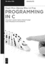

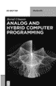
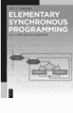


# 作者

Gerd Wagner 教授、博士

BTU Cottbus-Senftenberg

互联网技术学系

Konrad Wachsmann-Allee 5

03046 Cottbus

wagnerg@b-tu.de

Mircea Diaconescu

dimircea@gmail.com

封面图片：monsit

# 前言

本两卷本展示了如何使用基于模型的方法设计并实现 Web 应用，并涵盖了 Web 开发中最相关的两个平台：JavaScript 和 Java。Web 应用通过 UML 图形式的模型进行设计，并实现为：

- JavaScript 前端：使用浏览器提供的两种本地存储技术之一；
- Java 后端：使用 Java Server Faces (JSF) 作为用户界面技术，Java Persistence API (JPA) 用于对象到存储的映射，以及 MySQL/MariaDB 数据库系统。

本书的重点是关于以下通用概念和技术：

- 完整性约束和数据验证，
- 枚举和属性，
- 类型之间的单向和双向关联，
- 类层次结构中的子类型。

前两个问题将在第一卷中讨论，后两个将在第二卷。假设读者熟悉 HTML 以及至少一种面向对象的语言，如 C++、Java 或 C#。此外，我们假设读者对 CSS 和 JavaScript 有一定了解，并有兴趣学习使用 JavaScript 或 Java 进行面向对象的编程。适用于计算机科学或信息系统及相关专业的 Web 开发课程；适用于 JavaScript 开发者学习 Java；适用于 Java 开发者学习 JavaScript；适用于 JavaScript 和 Java（以及 PHP/C#）开发者。书中带有六个应用程序的完整源代码，您可以从我们的服务器下载。

## 1.10 问答 — 16

# 第一部分：关联

我们在第一卷中讨论过的三个示例应用程序——最小化应用、验证应用和枚举应用，它们都局限于仅管理一种对象类型的数据。然而，一个真实的应用程序必须管理多个对象类型的数据，这些类型之间通常以各种方式相互关联。特别是，对象类型之间可能存在关联和子类型（继承）关系。处理关联和子类型关系是软件应用工程中的高级问题。它们在教科书中往往没有得到充分讨论，也没有得到应用程序框架的良好支持。

关联是信息模型的重要元素。应用程序必须在模型-视图-控制器（MVC）架构的模型层中以正确的方式实现它们。遗憾的是，应用程序框架对处理关联的支持并不完善。

- 关联存在两种重要的区别，它们独立于：
  1. 功能性与多对多。
  2. 单向与双向。

在数学中，关联被形式化为元组集。在实体关系（ER）建模中（这是信息系统的经典信息建模方法），对象被称为实体，关联被称为关系类型。统一建模语言（UML）包含了用于信息建模的类图。在 UML 中，对象类型被称为类，关系类型被称为关联，个体关系被称为链接。这些术语总结如下表：

| 我们首选的术语 | UML | ER 图 | 数学 |
|---|---|---|---|
| 对象 | object | entity | individual |
| 对象类型（类） | class | entity type | relation |
| 关系 | link | relationship | tuple |
| 关联（关系类型） | association | relationship type | relation |

我们讨论引用属性，它们在“无关联”类模型（即没有显式关联元素的模型）中隐含地表示二进制关联。

## 1.1 引用与引用属性

引用可以是人类可读的，也可以是对象引用。人类可读引用指的是人类通信中使用的标识符，例如天体的唯一名称、书籍的 ISBN 以及公司员工的工号。内部对象引用指的是 OOP 对象的计算机内存地址，为访问计算机主内存中的对象提供了高效机制。

某些语言（如 SQL 和 XML）只支持人类可读引用不支持内部引用。在 SQL 中，人类可读引用被称为*外键*，它们所引用的标识符被称为*主键*。在 XML 中，人类可读引用被称为 *ID 引用*，对应的属性类型是 IDREF。

OO 程序中的对象既可以通过人类可读引用（例如整数代码），也可以通过内部对象引用进行引用，后者更有利于访问主内存中的对象。

在术语中，我们把人类可读的引用称为 ID 引用（ID references）。我们遵循 ID 引用属性的标准命名规范，即在类 `A` 中定义并引用类 `B` 对象的 ID 引用属性名称为 `b_id`，并使用后缀 `_id`。当我们将持久化对象存储在形式化表单记录或表行中时，我们需要将存储在如 `publisher` 等属性中的内部对象引用转换为存储在 `publisher_id` 等属性中的 ID 引用。这种转换是在对象序列化过程的一部分，通过将被引用对象的标准标识符值分配给引用对象的 ID 引用属性来实现的。

在面向对象（OO）语言中，属性是针对对象类型（或类）定义的，它是它的作用域。属性的值要么是来自某些数据类型的值，在这种情况下该属性被称为属性（attribute），要么是引用某个类中对象的对象引用，在这种情况下该属性被称为引用属性（reference property）。例如，图 1.1 所示的 `Committee` 类有一个范围为 `String` 的属性 `name`，以及一个范围为 `ClubMember` 的引用属性 `chair`。

| Committee | ClubMember |
| :--- | :--- |
| name: String | |
| chair: ClubMember | | |

**图 1.1：** 一个委员会有一个俱乐部成员担任主席，通过引用属性 `chair` 表达。

面向对象的编程语言（如 JavaScript、PHP、Java 和 C#）直接支持引用属性的概念，这些属性的引用不是数据类型，而是引用类型或类，其值是该该类实例的对象引用。

默认情况下，属性的重基数为 1，这意味着该属性是强制的且功能性的（换句话说，是单值的），恰好有一个值，例如图 1.1 所示的 `Committee` 类中的 `chair` 属性。功能性属性是可选的（非强制），其重基数为为 0..1，这意味着该属性的最小基数为 0，最大基数为 1。

引用属性可以是单值的（功能性的），也可以是多值的（非功能性的）。例如，图 1.1 所示的 `Committee::chair` 引用属性是单值的，因为它为一个俱乐部分配了一个唯一的俱乐部成员作为主席。图 1.11 所示的 `Book::authors` 属性是多值引用属性的示例。

通常，多值引用属性的集合值是一组引用，这意味着引用的顺序并不重要。然而，在某些情况下，顺序是重要的，因此，此类多值引用属性的集合值是一个有序的引用集合，通常以列表（list）的形式实现。

## 1.2 引用完整性

引用是我们应用程序数据库中的重要信息项。然而，只有当应用程序维护它们的引用完整性时，它们才具有意义。这意味着对于任何引用，数据库中必须存在一个被引用对象。因此，任何作用域为 `C` 且范围为类 `D` 的引用属性 `p` 都带有一个引用完整性约束，在每当以下情况下必须检查：

1. 创建类型为 `C` 的新对象时，
2. 为某些类型为 `C` 的对象更改 `p` 的值时，
3. 销毁类型为 `D` 的对象。

引用约束还意味着两个变更依赖：

1. 对象创建依赖：带有另一个对象引用的对象只有在被引用对象创建后才能创建。
2. 对象销毁依赖：被另一个对象引用的对象只有在以下之后才能销毁：
   1. 引用对象首先销毁（CASCADE 删除策略），
   2. 引用对象中的引用被丢弃（DROP-REFERENCE 删除策略）或被另一个引用替换。

对于我们应用程序模型类中的每个引用属性，我们必须选择这两种删除策略中的某一种。

在某些情况下，我们可能希望放宽这种严格规定，允许创建对 ID 引用属性具有非引用值的对象，但我们不考虑此类情况。

通常，对象创建依赖是在用户界面中管理的。

## 1.3 以引用属性表示单向关联

源类和目标类之间的单向关联可以表示为源类的引用属性。下图 1.3 展示了两个单向关联的示例：多对一关联和多对多关联。

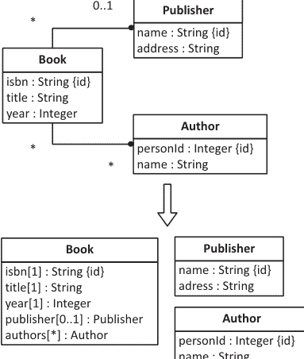

**图 1.3：** 用引用属性表示单向关联。

注意，在某种程度上，我们消除了显式关联并将其替换为相应的引用属性，从而得到可以使用经典的面向对象语言直接编码的类模型。面向对象语言确实不支持将关联视为一级公民。它们没有用于定义关联的语言元素。因此，面向对象（OOP）的类设计模型（我们称之为 OO 类模型）不能包含任何显式关联。

## 1.4 为非方向性关联添加方向性

当我们以 UML 类图的形式制作信息模型时，我们最终通常会得到一个包含一个或多个关联的模型，这些关联的末端没有定义任何所有权，例如图 1.4 所示。当关联的末端都没有所有权点时（如本例所示），这意味着模型没有指定如何通过引用属性来表示（或实现）该关联。这种关联没有方向性。根据 UML 2.5 规范，此类关联的末端由其自身“所有”，而不是由参与其中的任何一个类所所有。

| Committee | chairedCommittee | ClubMember |
| --- | --- | --- |
| name : String | 0.1 | 1 |

**图 1.4：** Committee 和 ClubMember 之间非方向性关联的模型。

包含没有关联所有权点的关联的信息设计模型作为关系型数据库设计模型是可以接受的，但作为 OO 语言的设计模型，它是不完整的。

例如，图 1.4 的模型提供了一个关系型数据库设计，包含两个实体表：committees 和 clubmembers，以及一个单独的一对一关系表：committee_clubmember_as_chair。它没有为 Java 类提供设计，因为它没有指定如何通过引用属性来实现该关联。

有三种方案可以将非方向性关联（不包含任何关联所有权点）的信息设计模型转换为所有关联均为单向或双向的信息设计模型：我们可以在关联的任一末端或两端末端放置所有权点。这三个方案中的每一个都定义了通过引用属性表示或实现关联的不同方法。因此，对于上述图 1.4 所示的关联，我们有以下选项：

1. 在 chair 关联末端放置所有权点，这将产生图 1.2 所示的模型，该模型可以转换为上述图 1.1 所示的 OO 类模型。
2. 在 chairedCommittee 关联末端放置所有权点，这将产生下方图 1.8 所示的完整模型。
3. 通过在两个末端放置所有权点来使关联变为双向，如图 1.5 所示，其意义是如第 7 章所述，通过一对互逆的引用属性 `Committee::chair` 和 `ClubMember::chairedCommittee` 以冗余方式实现关联。

| Committee | ClubMember |
| :--- | :--- |
| name : String | 0.1 | 1 |

**图 1.5：** Committee 和 ClubMember 之间双向关联的建模。

每当我们对关联进行建模时，都必须选择哪一个末端代表引用属性，并因此标记为所有权点。可以是其中一个，也可以是两者都是。这一决策也意味着对关联的可导航性做了决定。当一个关联表示引用属性时，意味着它是可导航的（通过该属性）。

在非一一的功能性关联的情况下，最简单的设计是根据其功能定义关联的方向，在多重基数为 0..1 或 1 的关联末端放置关联所有权点。对于非方向的一一或多对多的关联，我们可以根据意愿选择方向，即我们可以在任一关联末端放置所有权点。

## 1.5 我们的示例模型

下方图 1.6 所示的模型（关于出版者和书）作为我们单向功能性关联的示例。注意，它包含一个单向多对一关联 Book-has-Publisher。

| Publisher | Book |
| :--- | :--- |
| name : String (id) | isbn : String (id) |
| address : String | title : String |
| | year : Integer |
| 0.1 * | |

**图 1.6：** 出版者-书信息设计模型，其中一个非功能性（多值）引用属性表示一个单向非功能性关联。

我们可能还需要处理非功能性关联。例如，单向的...

## 1.6 消除单向关联

下方图 1.7 所示的 Book 和 Author 之间的多对多关联建模了一个多值（非功能性）引用属性 authors。

| | Publisher |
|---|---|
| Book | name: String (id)<br>address: String<br>isbn: String (id)<br>title: String<br>year: Integer |
| Author | personId: Integer (id)<br>name: String |

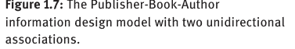

由于经典的 OO 编程语言不支持将关联视为一级公民，仅支持类和表示单向关联的引用属性，我们必须从通用信息设计模型中消除所有显式关联以获取 OO 类模型。

### 1.6.1 基本消除步骤

我们限制性关联消除程序的起点是一个具有各种单向关联的信息模型，例如上述图 1.6 所示的模型。如果模型仍然包含任何非方向性关联，我们首先必须将它们转换为方向性关联。连接源类与目标类的单向关联被替换为具有以下特性的相应引用属性：

1. 与目标类相同的名称（如果有）；
2. 目标类（可能是复数），如果引用属性是多值的；
3. 与目标端相同的多重性；
4. 如果单向关联是功能性的。

这种替换过程适用于图 1.8 所示的一一关联情况，其中目标类的非功能性端通过 `{key}` 修饰符表示。

| Committee | chairedMember |
| name : String | 0..1 |
| Committee | ClubMember |
| name : String | |

**图 1.8：** 将功能性关联转换为引用属性。

对于单向的一多关联情况，图 1.9 提供了消除过程的说明。在这里，目标类的非功能性端转换为目标类的复数形式。

| Polygon | Point |
| 3.* | Integer |

**图 1.9：** 将非功能性端转换为多值属性。

### 1.6.2 从设计模型中消除关联

在我们示例的出版者-书信息设计模型中，我们必须将两个单向关联替换为合适的引用属性。在第一步中，我们将图 1.6 中的多对一关联 Book-has-Publisher 替换为 `Book` 类的功能性引用属性，产生图 1.10 所示的 OO 类模型。

| Book | Publisher |
| isbn[1]: String (id) | name: String (id) |
| title[1]: String | adress: String |
| year[1]: Integer | |
| publisher[0..1]: Publisher | |

**图 1.10：** Publisher 和 Book 的 OO 模型。

注意，由于 Book-Publisher 关联的目标多重性为 0..1，我们必须通过定义其多重性为 0..1 将新属性 `publisher` 为可选。

此 OO 类模型及其引用属性的意义将通过下方两个类的示例数据填充来说明：

| Name | Address |
| Bantam Books | New York, USA |
| Basic Books | New York, USA |

| ISBN | Title | Year | Publisher |
| 0553345842 | The Mind's I | 1982 | Bantam Books |
| 1463794762 | The Critique of Pure Reason | 2011 | |
| 1928565379 | The Critique of Practical Reason | 2009 | |
| 0465030793 | I Am A Strange Loop | 2000 | Basic Books |

注意 `Book` 表中 `Publisher` 列的值是唯一的名称，引用 `Publisher` 表中的某行。由于相应的引用属性是可选的，`Publisher` 列在某些行中可能没有值。

在第二步中，我们将图 1.7 模型中的多对多关联 Book-has-Author 替换为 `Book` 类中的多值引用属性 `authors`，产生图 1.11 所示的 OO 类模型。

| Book | Publisher |
| isbn[1]: String (id) | name: String (id) |
| title[1]: String | adress: String |
| year[1]: Integer | |
| publisher[0..1]: Publisher | |
| authors[*]: Author | personid: integer (id) name: String |

**图 1.11：** 用于 Book、Publisher 和 Author 类的 OO 类模型。

## 1.7 引用属性与单向关联


此对象（OO）类模型及其引用属性 `Book::publisher` 和 `Book::authors` 的含义，可以通过三个模型类的示例数据填充来阐明：

| 名称 | 属性 |
|---|---|
| Bantam Books | 美国，纽约 |
| Basic Books | 美国，纽约 |

| ISBN | 标题 | 年份 | 作者 | 出版社 |
|---|---|---|---|---|
| 0553345482 | 《心灵的自我》 | 1982 | 1, 2 | Bantam Books |
| 1463794762 | 《纯粹理性批判》 | 2011 | 3 | |
| 1928565379 | 《实践理性批判》 | 2009 | 3 | |
| 0465030793 | 《我是一个奇异的环》 | 2000 | 2 | Basic Books |

| 作者 ID | 姓名 |
|---|---|
| 1 | Daniel Dennett |
| 2 | Douglas Hofstadter |
| 3 | Immanuel Kant |

在完成特定平台的 OO 类模型后，可以基于此推导出针对所选特定实现平台的一个或多个特定平台实现模型。特定平台实现模型的类型示例包括 JS 类模型、Java 实体类模型和 SQL 表模型。

特定平台的实现模型仍然可以用 UML 类图的形式表示，但它仅包含可以在所选平台中直接编码的建模元素。因此，对于任何考虑的平台，都需要两个准则：1) 如何制作特定平台的实现模型，2) 如何对此模型进行编码。

## 1.8 在用户界面中渲染引用属性

CRUD 数据管理接口中用于数据输入输出的控件（widgets）通常对应于应用模型类中定义的属性。我们需要区分对应（各种类型）属性的（各种类型）输入字段，以及对应于枚举属性或引用属性的控件（如选择列表）。在 UI 中使用选择控件而非输入字段来表示引用属性，可以防止用户输入无效的 ID 引用，从而维护引用完整性。

通常情况下，单值引用属性可以渲染为 UI 中的单选列表，无论引用的范围内填充了多少对象，都从中做出一个特定的选择。如果引用属性范围的基数足够小（例如，不超过 7），那么我们也可以使用单选按钮组选择列表。

多值引用属性可以渲染为 UI 中的多选列表。然而，一旦有许多（超过 20 个）不同选项可供选择，HTML 对应的多选控件就变得不可用，因为读者的选择在视觉上太分散了。在只有少数（例如，不超过 7 个）选项的特殊情况下，我们也可以使用复选框组代替多选列表。但对于在 UI 中列出从引用属性范围类中选择的所有关联对象的通用情况，我们需要开发一种特殊的 UI 控件，允许向已选对象列表添加（删除）对象。

这种多选控件由以下组成：

1. 一个包含（关联）对象的 HTML 列表元素，其中每个列表项包含一个用于从选择中移除对象的推按钮（push button）；
2. 一个单选控件，结合推按钮，允许从多值引用属性的范围中添加新的关联对象。

## 1.9 多值引用属性的集合类型

默认情况下，非功能关联端会将目标类的一组实例关联到源类的任何实例，这意味着相应多值引用属性的集合值是集合（sets）。某些情况下，非功能关联端是有序的，因此相应引用属性的集合值采用有序集合的形式。

在下面的示例中，关联端 `publishedBooks` 是无序的，而关联端 `authors` 是有序的，因为书籍作者的顺序是有意义的。注意，在 UML 类图中，关联端用注释 `{ordered}` 标记。

## 1.10 引用属性与单向关联

| 出版社 | 已出版书籍 | 作者 (有序) |
|---|---|---|
| name: String {id} | isbn: String {id} * | personId: Integer {id} |
| address: String 0.1 * | title: String year: Integer | name: String |

有序关联不应基于目标类的属性表示任何内容。在我们的示例中，这意味着书籍作者的顺序，例如，不应该代表他们的字母顺序，而应该代表某种无法通过 `Author` 属性获取的信息。事实确实如此，因为它代表了某种意义，而这种意义无法通过任何属性表达的。

注意，信息设计模型中的有序关联仅仅是为了方便，因为有序关联始终可以通过向关联的目标类添加一个额外的属性来转换为无序关联，使得这些属性的值可以用于排序。有序关联允许更简洁的信息模型和更高效的实现，因为它不需要借助辅助排序属性来显式地进行排序。

多值引用属性的两种重要集合类型是集合和有序集合，而使用包（多集合）和序列（有序多集合）的用例时，多值引用属性的集合类型为包（或序列），这可以在类图中使用注释 `{nonunique}`（或有序）来表示。注意，对于有序或无序的属性，使用列表（如 Java `List` 类型）是非常常见的。

## 1.11 测试题

如果你想查看以下测试题的答案，可以查看我们的论坛。如果在论坛中没有找到答案，你可以针对特定问题发帖。

### 1.11.1 题 1：“一对一”的含义

说关联是“一对一”意味着什么？这意味着它是（选择一个）：

1. 双向的
2. 都是功能性的完全的
3. 功能性的
4. 都是功能且反向的

### 1.11.2 题 2：何时检查引用完整性

对于域为 C 范围为 D 的引用属性 p，引用完整性约束每当发生以下情况时（选择一个或多个）必须检查：

1. C 类型的对象被销毁。
2. C 类型对象的 p 值发生变化。
3. 创建新的 C 类型对象。
4. D 类型的对象被销毁。
5. 创建新的 D 类型对象。

### 1.11.3 题 3：“功能性”的含义

单向关联是功能性的当当（选择一个）：

1. 每个源类对象最多关联一个目标对象。
2. 每个目标类对象至少关联一个源类对象。
3. 每个源类对象恰好关联一个目标对象。

### 1.11.4 题 4：对象销毁依赖

假设我们有一个具有标准标识符属性 `id` 的对象 B，以及一个具有引用 B::id 属性 `b_id` 的对象 A。此外，假设有一个类型 B 对象 `b.id = 11`，以及一个引用 b 的类型 A 对象 `a.b_id = 11`。哪些语句是正确的？选择一个或多个：

1. 当 a 中的 ID 引用未赋值（在 JS 中设为 `undefined`，在 Java 中设为 `null`）且没有其他对象引用 b 时，对象 b 可以被销毁。
2. 只有在 b 被销毁之前，对象 a 才能被销毁。
3. 当对象 a 中的 ID 引用被重置为类型为 B 的另一个对象时（例如通过设置 `a.b_id = 7` 且没有其他对象引用 b），对象 b 就可以被销毁。
4. 当 a 之前已经被销毁时，对象 b 可以被销毁。

### 1.11.5 题 5：单值引用属性的渲染

关于单值引用属性 p 以及它应该如何通过合适的表单控件在 Web 用户界面中进行渲染，以下陈述中哪些是正确的？请选择一个或多个：

- 使用 `type="text"` 的输入控件可以获得适当的渲染。
- 如果 p 范围的基数不大于 7，则可以使用复选框组进行渲染。
- 如果 p 范围的基数不大于 7，可以使用单选按钮组进行渲染。
- 它始终可以使用单选控件进行渲染。

### 1.11.6 题 6：表达功能类型

“x-to-y” 形式（其中 x,y 表示“一个”或“多个”）的哪个术语可以表示该关联既不是功能性的，也不是反功能性的？

答案：______________________

## 2 使用纯 JS 实现单向功能关联

单向功能关联要么是一对一，要么是多对一。在两种情况下，这种关联都通过一个单值引用属性来表示或实现。

在本章中，我们将展示：

1. 如何从具有表示单向功能关联的单值引用属性的 OO 类模型推导出纯 JS 类，
2. 如何以 JavaScript 模型类的形式对 JS 类模型编码，
3. 如何基于模型代码编写视图和控制器代码。

在展示如何推导纯 JS 类模型并用 JavaScript 对其编码之前，我们首先介绍 JavaScript 语言的几个新元素，我们将在本书讨论的整个 JavaScript 代码中使用这些元素。

## 2.1 新 JavaScript 元素

在本节中，我们将介绍由 ECMAScript 2015+ 引入 JavaScript 的重要新语言元素（即 2015+16+17+18+19+20+……）。

### 2.1.1 使用 let 和 const 的块级范围变量声明

ES5 不允许声明块级作用域（即由大括号 `{ }` 限定的块）。相反，所有用 `var` 声明的变量如果在块内声明，要么具有函数作用域要么具有全局作用域。`let` 和 `const` 的块级范围变量声明新功能允许声明具有细粒度范围的局部变量，这有助于避免重复并使代码更具模块化。`let` 和 `const` 之间有一个区别。用 `const` 声明的变量是冻结或不可变的，从这个意义上说是常量，而 `let` 变量不是。对于所有不应改变其值的变量，最好使用 `const`。否则，如果这一点不明确，如果是块级范围变量，则应用 `let` 声明，如果是函数作用域变量，则用 `var` 声明。

### 2.1.2 箭头函数

与经典函数相比，箭头函数（使用 `=>`）提供了更简洁的表达式语法，并允许在函数体中使用 JavaScript 的外部环境（即其*闭包*），参见用例。

```javascript
let evens = [0, 2, 4, 6, 8];
odds = evens.map(v => v+1); // 代替 evens.map(function (v) { return v+1; });
```

### 2.1.3 可迭代对象的 for-of 循环

可迭代对象包括字符串、类数组（例如 `HTMLCollection` 和 `NodeList`）、数据类型 `TypedArray`、`Map` 和 `Set` 以及用户定义的迭代器。在不需要计数器的情况下，`for-of` 循环通常比 `forEach` 循环更方便。与 `forEach` 循环不同，`for-of` 循环允许对 `HTMLCollections` 进行迭代并可以使用 `break` 退出。

```javascript
const divElems = document.getElementsByTagName("div");
for (let dEl of divElems) {
  console.log(dEl.id);
}
```

### 2.1.4 模板字符串

它们由反引号字符（如 `` ` ``）而不是双引号或单引号包裹，并允许为固定文本部分与变量/表达式组合而（可能是多行的）字符串值提供简洁的语法。例如

```javascript
const classValues = "card";
const name = "Joker";
const htmlTemplate = `<div class="${classValues}">
<p>Hello ${name}!</p>
</div>`;
```

### 2.1.5 展开运算符

允许在期望函数调用参数的地方 (1) 展开可迭代集合的元素，或者 (2) 在期望键值对的地方展开 JS 对象的槽位。例如

```javascript
let nums = [3, 4, 5], otherNums = [1, 2, ...nums]; // 克隆数组
let numsClone = [...nums];
// 克隆一个对象
let book = {title:"JavaScript: The Good Parts"};
let bookClone = {...book};
```

### 2.1.6 解构赋值

允许使用简洁的语法将 JS 对象的属性值或 JS 数组的元素赋值给相应的变量。例如

```javascript
var point1 = [10, 5];
var [x,y]=point1; // 一个解构赋值
console.log(`x = ${x} | y = ${y}`); // x = 10 | y = 5

var person = {firstName:"James", lastName:"Bond"};
var {firstName, lastName} = person;
console.log(`first: ${firstName} | last: ${lastName}`); // first: James | last: Bond
```

**例 2.3.** 函数的多个返回值

```javascript
function getRectangle() {
  return {width:50, height:20};
}
const {a, b} = getRectangle();
drawRectangle(a, b);
```

**例 2.4.** 交换两个变量

```javascript
var a = 1, b = 2;
[a,b] = [b,a];
console.log(`a = ${a} | b = ${b}`); // a = 2 | b = 1
```

**例 2.5.** 克隆数组

```javascript
const list = ['red', 'orange', 'yellow'];
const [...listClone] = list;
```

**例 2.6.** 使用参数记录简化函数

参数记录允许在函数调用中使用命名参数，例如：

```javascript
function displayName(paramRec) {
    alert(paramRec.first + " " + paramRec.last);
}
displayName({first:"James", last:"Bond"});
```

使用解构，参数字段被赋值给普通变量：

```javascript
function displayName({first, last}) {
    alert(first + " " + last);
}
displayName({first:"James", last:"Bond"});
```

## 2.2 单值引用属性

在对类时，ES15 函数参数解构功能允许为定义字段提供简洁的语法。我们利用这一新功能获取如下示例所示的简化类定义：

```javascript
class Book {
  constructor({isbn, title, year, ...rest}) {
    this.isbn = isbn;
    this.title = title;
    this.year = year;
  }
}
```

单值引用属性（例如 `Book` 对象的 `publisher` 属性）允许存储其他类型的内部引用，例如 `Publisher`。在创建新对象时，构造函数需要一个参数为引用属性提供合适的值。在类型编程语言（如 Java）中，我们必须决定该值是（内部）对象引用还是（外部）ID 引用。但在 JavaScript 中，我们可以采取更灵活的方法并允许使用其中一种，如下所示：

```javascript
class Book {
  constructor ({isbn, title, year,
    publisher, publisher_id}) {
    ...
    // 分配对象引用或 ID 引用
    if (publisher || publisher_id) {
      this.publisher = publisher || publisher_id;
    }
  }
}
```

```javascript
set publisher(p) {
  var publisher_id = ""
  // p 可以是 ID 引用或对象引用
  publisher_id = (typeof p==="object") ? p.name : p;
  ...
  this._publisher = Publisher.instances[publisher_id];
}
```

## 2.3 构建 JS 类模型

构建 JS 类模型的起点是如图 1.10 所示的面向对象（OO）类模型。

我们现在展示如何通过四个步骤从该 OO 类模型推导出 JS 类模型。对于 OO 类模型中的每个类：

1. 为所有（非派生的）单值属性添加 `<get/set>` 构型，意味着它们具有隐式的 getter（获取）和 setter（设置）。回想一下，在 setter 中会调用相应的检查操作，只有当检查没有检测到违反约束时，属性才会被赋值。
2. 为每个（非派生的）属性创建一个检查操作（check operation），以便在集中位置实现属性约束。对于标准的 ID 属性（如 `Book::isbn`），需要两个或三个检查操作：
    1. 一个基础检查操作，如 `checkIsbn`，用于检查语法约束，但不检查强制性值约束和唯一性约束。
    2. 一个标准的 ID 检查操作，如 `checkIsbnAsId`，用于检查标准 ID 属性所隐含的强制性值约束和唯一性约束。
    3. 如果其他类有一个引用正在考虑的类的属性，添加一个 ID 引用检查操作，用于检查对 ID 引用（或外键）属性的引用完整性约束。例如，由于 `Book::publisher` 属性引用 `Publisher` 对象，我们需要在 `Publisher` 类中一个 `checkNameAsRef` 操作。
3. 为 `toString` 添加序列化函数，用于在错误消息和日志消息中显示对象的状态。
4. 为 `toRecord()` 添加对象到存储的转换函数，为模型对象准备好存储为实体表中的某行，该行可以通过 `JSON.stringify` 序列化为 JSON 字符串，从而存储为应用 `localStorage` 数据存储的值。

对于像 `Book::publisher` 这样的引用属性，检查操作 `Book.checkPublisher` 必须通过调用 `Publisher.checkNameAsIdRef` 来检查隐含的引用完整性约束，如果该属性是强制性的，可能还需要检查强制性值约束。


## 2.3 构建 JS 类模型

这得出了 `Book` 的以下 JS 类模型，其中类级（`static`）方法用下划线表示：

| Book | Book |
| --- | --- |
| isbn[1]: String (id) | «get/set» isbn[1]: string (id) |
| title[1]: String | «get/set» title[1]: string |
| year[1]: integer | «get/set» year[1]: number(int) |
| publisher[0..]: Publisher | «get/set» publisher[0..1]: Publisher |
|  | checkIsbn(isbn: string): ConstraintViolation |
|  | checkIsbnAsId(isbn: string): ConstraintViolation |
|  | checkIsbnAsIdRef(isbn: string): ConstraintViolation |
|  | checkTitle(title: string): ConstraintViolation |
|  | checkYearIn(year: number(int)): ConstraintViolation |
|  | checkPublisher(p: Publisher): ConstraintViolation |
|  | toString(): String |
|  | toRecord(): Object |

我们必须对 `Publisher` 类执行类似的转换。这为我们提供了从上述 OO 类模型推导出的完整 JS 类模型，如图 2.1 所示。

| Publisher | |
| --- | --- |
| «get/set» name: string (id) | |
| «get/set» address: string | |
| checkName(in: string): ConstraintViolation | |
| checkNameAsId(in: string): ConstraintViolation | |
| checkNameAsIdRef(in: string): ConstraintViolation | |
| checkAddress(in a: string): ConstraintViolation | |
| toString(): string | |
| toRecord(): Object | |

**图 2.1：** 定义 `Book` 和 `Publisher` 类的 JS 类模型。

## 2.4 新问题

与第 1 卷讨论的验证和枚举应用相比，我们必须处理许多新的技术问题：

1. 在模型中，我们现在需要处理满足以下要求的引用属性：
   1. 维护引用完整性；
   2. 选择实现 1.2 节讨论的两种可能的删除策略之一，用于在属性范围类的 `destroy` 方法中管理相应的对象销毁依赖；
   3. 在序列化函数 `toString()`、转换函数 `toRecord()` 以及构造函数中，处理内部对象引用与外部 ID 引用之间的转换。

2. 在用户界面（“view”）代码中，我们必须处理：
   1. 在“检索/列表”用例中显示关联对象的信息；
   2. 在“创建”和“更新”用例中，允许从关联目标类的所有实例列表中选择对象，并将其添加到关联对象列表或从列表中移除对象。

## 2.5 编写模型

可以直接编写 JS 类来获取我们应用的 JS 类。

### 2.5.1 总结

编写应用中的每个类：

1. 使用类级（`static`）方法编写 JS 模型中的每个类。
2. 为每个单值属性编写 getter 和 setter：在 setter 中，调用相应的检查，只有当检查没有检测到违反约束时，属性才会被赋值。
3. 编写序列化函数 `toString()` 和存储函数 `toRecord()`。
4. 处理删除依赖。

这些步骤将在后续章节中详细讨论。

### 2.5.2 将每个类编写为 ES15 类

JS 模型中的每个类 `C` 都编写为具有隐式 getter 和 setter 的 ES15 类。在构造函数体内，将记录字段赋值给属性。这些赋值会调用相应的 setter。

例如，JS 模型中的 `Publisher` 类如下所示编写：

```javascript
class Publisher {
  constructor ({name, address}) {
    this.name = name;
    this.address = address;
  }
}
```

由于 setter 可能会抛出异常，构造函数以及任何 setter 都应该在 `try-catch` 块中调用，其中 `catch` 子句负责记录日志。

对于每个模型类 `C`，我们定义一个类级属性 `instances`，表示由应用程序管理的实例集合（记录的映射）。该属性初始化为 `{}`。例如，在 `Publisher` 类的情况下，我们定义：

`Publisher.instances = {};`

JS 模型中的 `Book` 类以类似的方式编写：

```javascript
class Book {
  constructor ({isbn, title, year, authors, authorRefs, publisher, publisher_id}) {
    this.isbn = isbn;
    this.title = title;
    this.year = year;
    this.authors = authors || authorRefs;
    if (publisher || publisher_id) {
      this.publisher = publisher || publisher_id;
    }
  }
}
```

注意，`Book` 构造函数既可以用对象引用 `authors` 调用，也可以用 ID 引用 `authorRefs` 和 `publisher_id` 调用。这种方法使得 `Book` 构造函数更加灵活健健。

### 2.5.3 编写属性检查

确保 JS 模型中指定的属性所有约束在其检查函数中正确实现，正如第 1 卷第 8 章所示。回想约束违反（或验证错误）类定义在 `lib/errorTypes.js` 文件中。例如，对于 `Publisher.checkName` 函数我们得到以下代码：

```javascript
class Publisher {
  
  static checkName(n) {
    if (n === undefined) {
      return new NoConstraintViolation(); // 非强制
    } else {
      if (typeof n !== "string" || n.trim() === "") {
        return new RangeConstraintViolation(
          "名称必须是非空字符串!"
        );
      } else {
        return new NoConstraintViolation();
      }
    }
  }
  static checkNameAsId(n) { . . }
  ..
}
```

注意，由于 `name` 属性是 `Publisher` 的标准 ID 属性，我们只在 `checkName` 中检查语法强制性约束，并在 `checkNameAsId` 中检查强制性值和唯一性约束，后者会调用 `checkName`：

```javascript
static checkNameAsId(n) {
  var validationResult = Publisher.checkName(n);
  if ((validationResult instanceof NoConstraintViolation) {
    if (n === undefined) {
      return new MandatoryValueConstraintViolation(
        "A publisher name is required!");
    } else if (Publisher.instances[n]) {
      validationResult = new UniquenessConstraintViolation(
        "There is already a publisher record with this name!");
    } else {
      validationResult = new NoConstraintViolation();
    }
  }
}
```

如果我们必须处理其他类中的 ID 引用（外键），我们需要提供进一步的检查，称为 `checkNameAsIdRef`，用于检查引用完整性约束：

```javascript
static checkNameAsIdRef(n) {
  var validationResult = Publisher.checkName(n);
  if ((validationResult instanceof NoConstraintViolation) &&
    n === undefined) {
    if (!Publisher.instances[n]) {
      validationResult = new ReferentialIntegrityConstraintViolation(
        "There is no publisher record with this name!");
    }
  }
  return validationResult;
}
```

条件 `!Publisher.instances[n]` 检查是否存在具有给定名称 `n` 的出版社对象，然后创建一个作为 `ReferentialIntegrityConstraintViolation` 异常类实例的 `validationResult` 对象。`Book.checkNameAsIdRef` 由 `Book.checkPublisher` 函数调用：

```javascript
class Book {
  ..
  static checkPublisher(publisher_id) {
    var validationResult = null;
    if (publisher_id === undefined || publisher_id === "") {
      validationResult = new NoConstraintViolation(); // 可选
    } else {
      // 调用外键检查
      validationResult = Publisher.checkNameAsIdRef(publisher_id);
    }
    return validationResult;
  }
  ..
}
```

### 2.5.4 编写属性设置器 (Setters)

在设置器中，会调用相应的检查函数，只有当检查没有检测到约束违反时，才会设置属性。对于引用属性，我们允许使用对象引用或 ID 引用调用设置器。产生的歧义通过测试在设置器调用中提供的参数是否为对象来解决。例如，出版社的设置器代码如下：

```javascript
class Book {
  ..
  set publisher(p) {
    if (!p) // 取消设置出版社
      delete this._publisher;
    } else {
      // p 可以是 ID 引用或对象引用
      const publisher_id = (typeof p=="object") ? p : p.name;
      const validationResult = Book.checkPublisher(publisher_id);
      if (validationResult instanceof NoConstraintViolation) {
        // 创建新的出版社引用
        this._publisher = Publisher.instances[publisher_id];
      } else {
        throw validationResult;
      }
    }
  }
  ..
}
```

### 2.5.5 选择并实现删除策略

对于任何引用属性，我们必须在第 1.2 节中讨论的两种删除策略中进行选择并实现，并在属性范围类的 `destroy` 方法中管理相应的对象销毁依赖。在我们的情况下，删除出版社记录时，我们必须在以下之间选择：

1. 删除所有由被删除出版社出版的书（生存依赖）；
2. 从所有由被删除出版社出版的书中删除对该出版社的引用（生存独立）。

假设书籍并不生存上依赖其出版社，我们选择第二种方案。在以下 `Publisher.destroy` 方法的代码中显示，对于所有相关的书籍对象，属性 `book.publisher` 将被清空：

注意，对被删除出版社引用的删除是通过扫描所有书籍对象执行的，当有很多书籍时，这种方法效率很低。维护书籍列表会更有效，建立书籍与出版社之间的双向关系。

### 2.5.6 序列化与对象到对象的映射

对于引用属性 `Book::publisher`，序列化函数 `toString()` 需要显示引用对象的可读标识符，如出版社的名称：

```javascript
toString() {
  var bookStr = `ISBN: ${this.isbn}, title: ${this.title},` +
  `year: ${this.year};`;
  if (this.publisher) bookStr += `, publisher: ${this.publisher.name}`;
  return bookStr;
}
```

对象到存储转换函数 `toRecord()` 将带下划线的无类型对象转换为 ID 引用：

```javascript
toRecord() {
  var rec = {};
  for (let p of Object.keys(this)) {
    // 仅处理带下划线的属性
    if (p.charAt(0) === "_") {
      switch (p) {
        case "_publisher":
          // 将出版社转换为 ID 引用
          if (this._publisher) rec.publisher_id = this._publisher.name;
          break;
        default:
          // 移除下划线
          rec[p.substr(1)] = this[p];
      }
    }
  }
  return rec;
}
```

## 2.6 用户界面

用户界面 (UI) 由允许导航到数据管理页面的页面组成（在示例中为 `books.html` 和 `publishers.html`）。这些数据管理 UI 包含以下部分：

### 2.6.1 初始化应用

初始化书籍数据（例如出版社和书籍记录）必须从持久化存储中加载。这是在控制器 `c/books.js` 中执行的：

```javascript
pl.c.books.manage = {
  initialize: function () {
    Publisher.retrieveAll();
    Book.retrieveAll();
    pl.v.books.manage.setUserInterface();
  }
};
```

初始化方法首先加载出版社。

### 2.6.2 在列表中显示关联对象

在示例中，我们有一个引用属性 `Book::publisher`，它是可选的。为了在列所有用例中显示书籍的可选出版社信息，HTML 表格中对应的单元格将填充出版社名称：

```javascript
pl.v.books.retrieveAndAll = {
  setupUserInterface: function () {
    const tableBodyEl = document.querySelector("#section-Book table tbody");
    tableBodyEl.innerHTML = ""; // 清空旧内容
    for (let key of Object.keys(Book.instances)) {
      const book = Book.instances[key];
      const row = tableBodyEl.insertRow(-1);
      row.insertCell(0).textContent = book.isbn;
      row.insertCell(1).textContent = book.title;
      row.insertCell(2).textContent = book.year;
      // 如果书籍有出版社，显示其名称
      row.insertCell(3).textContent =
        book.publisher ? book.publisher.name : "";
    }
  }
  document.getElementById("Book-M").style.display = "none";
  document.getElementById("Book-R").style.display = "block";
};
```

对于多值引用属性，表格单元格必须填充所有被该属性引用的关联对象列表。

### 2.6.3 在创建和更新用例中选择关联对象


为了在创建和更新用例中允许为当前编辑的对象关联关联对象，HTML 选择列表（即 `select` 元素）将通过工具方法 `fillSelectWithOptions` 从关联对象的实例进行填充。该 HTML 元素在 `books.html` 视图文件中定义：

```html
<section id="Book-C" class="UI-Page">
<h1>Public Library: Create a new book record</h1>
<form> ...
  <div class="select-one">
    <label>Publisher: <select name="selectPublisher"></select></label>
  </div>
  ...
</form>
</section>
```

## 2.6 编写视图和控制器

创建用户界面的设置通过以下过程：

```javascript
pl.v.books.create = {
  setupInterface: function () {
    const formEl = document.querySelector("section#Book-C > form"),
    selectPublisher = formEl.selectPublisher,
    saveButton = formEl.commit;
    // // 为响应式验证添加事件监听
    formEl.isbn.addEventListener("input", function () {
      formEl.isbn.setCustomValidity(
        Book.checkIsbnId(formEl.isbn.value);
      );
    });
    // 设置一个单选列表来选择出版社
    util.fillSelectWithOptions(selectPublisher,
      Publisher.instances, "name");
    // // 为提交按钮点击定义事件处理器
    saveButton.addEventListener("click",
      this.handleSaveButtonClick);
    // // 定义中和提交事件的事件处理器
    formEl.addEventListener("submit", function (e) {
      e.preventDefault();
      formEl.reset();
    });
    // // 将管理表单替换为创建表单
    document.getElementById("Book-M").style.display = "none";
    document.getElementById("Book-C").style.display = "block";
    formEl.reset();
  },
  handleSaveButtonClick: function () {
    ...
  };
};
```

当用户点击（或触摸）保存按钮时，所有表单控件的值（包括选择控件的值）都会复制到 `slots` 列表中。在所有表单字段通过有效性检查后，将其作为调用 `add` 方法的参数，如下列表所示：

```javascript
handleSaveButtonClick = function () {
  const formEl = document.querySelector("section#Book-C > form");
  const slots = {
    isbn:formEl.isbn.value,
    title:formEl.title.value,
    year:formEl.year.value,
    publisher_id:formEl.selectPublisher.value
  }
  // 验证所有表单控件并显示错误消息
  formEl.isbn.customValidity(
  Book.checkIsbnAsId(slots.isbn).message);
  /* ..（title 和 year 的部分相同） */
  // 仅当所有表单字段有效时才保存输入数据
  if (formEl.checkValidity()) {
    Book.add (slots);
  }
}
```

更新书籍用例的 `setupInterface` 代码类似。

## 2.7 习题

### 2.7.1 问题 1：JS 类模型

从给定的 OO 类模型派生的 `Committee` 类，正确的 JS 类模型是哪一个？

| Committee | ClubMember |
| :--- | :--- |
| name : String (id) | memberId : Integer (id) |
| chair : ClubMember | firstName : String |

选择其一：

- **1. O**

| Committee |
| :--- |
| <<get/set>> name : string (id) |
| <<get/set>> chair : ClubMember |
| checkName(in n : string) : ConstraintViolation |
| checkChair(in c : ClubMember) : ConstraintViolation |
| toString() : string |
| toRecord() : Object |

- **2. O**

| Committee |
| :--- |
| <get/set> name : string (id) |
| <get/set> chair : ClubMember |
| checkName(in n : string) : ConstraintViolation |
| checkNameAsId(in n : string) : ConstraintViolation |
| checkNameAsId(in n : string) : ConstraintViolation |
| checkChair(in c : ClubMember) : ConstraintViolation |
| toString() : string |
| toRecord() : Object |

- **3. O**

| Committee |
| :--- |
| <get/set> name : string (id) |
| <get/set> chair : ClubMember |
| checkName(in n : string) : ConstraintViolation |
| checkNameAsId(in n : string) : ConstraintViolation |
| checkChair(in c : ClubMember) : ConstraintViolation |
| toString() : string |
| toRecord() : Object |

# 3 使用原生 JS 实现单向非功能关联

单向非功能关联可以是一对多或多对多的。在这两种情况下，这种关联都通过一个多值引用属性来表示或实现。

在本章中，我们将展示：

1. 如何从具有表示单向非功能关联的多值引用属性的 OO 类模型派生 JS 类模型，
2. 如何以 JavaScript 模型类的形式编写 JS 类模型代码，
3. 如何基于模型代码编写视图和控制器代码。

## 3.1 实现多值引用属性

多值引用属性（例如 `::authors` 属性）允许对某些类型对象（如 `Author` 对象）的引用集合。在创建类型为 `Book` 的新对象时，构造函数需要一个参数为该属性提供合适的值。我们可以允许该值是内部对象引用的集合，或者是 ID 引用的集合，如下例：

```javascript
class Book {
  constructor({isbn, title, year, authors, authorIdRefs,
    publisher, publisher_id}) {
    this.isbn = isbn;
    this.title = title;
    this.year = year;
    this.authors = authors;
    this.authorIdRefs = authorIdRefs;
    this.publisher = publisher;
    this.publisher_id = publisher_id;
  }
}
```

注意，构造函数的参数预计包含内部对象引用的集合或 ID 引用的集合，如下例所示：

```javascript
class Book {
  constructor({isbn, title, year, authors, authorIdRefs,
    publisher, publisher_id}) {
    this.isbn = isbn;
    this.title = title;
    this.year = year;
    // 多值引用属性
    this.authors = authors;
    this.authorIdRefs = authorIdRefs;
    this.publisher = publisher;
    this.publisher_id = publisher_id;
  }
}
```

## 3.2 创建 JS 模型

创建 JS 模型的起点是以下类模型：

| Committee | ClubMember |
| :--- | :--- |
| name : String (id) | memberId : Integer (id) |
| chair : ClubMember | firstName : String |

| Book |
| :--- |
| isbn : String (id) |
| title : String |
| year : Integer |
| publisher : Publisher |
| authors : Author |
| authorIdRefs : String[] |

| Author |
| :--- |


| id : Integer (id) |
| name : String |
| Publisher |
| :--- |
| id : Integer (id) |
| name : String |
| ClubMember |
| :--- |
| memberId : Integer (id) |
| firstName : String |
| lastName : String |

对于单值引用属性，构造函数如下：

```javascript
class Book {
  constructor({isbn, title, year, publisher, publisher_id}) {
    this.isbn = isbn;
    this.title = title;
    this.year = year;
    this.publisher = publisher;
    this.publisher_id = publisher_id;
  }
}
```

对于多值引用属性，构造函数如下：

```javascript
class Book {
  constructor({isbn, title, year, authors, authorIdRefs,
    publisher, publisher_id}) {
    this.isbn = isbn;
    this.title = title;
    this.year = year;
    this.authors = authors;
    this.authorIdRefs = authorIdRefs;
    this.publisher = publisher;
    this.publisher_id = publisher_id;
  }
}
```

对于单值引用属性，setter如下：

```javascript
setPublisher(publisher) {
  this.publisher = publisher;
  this.publisher_id = publisher.id;
}
```

对于多值引用属性，setter如下：

```javascript
setAuthors(authors, authorIdRefs) {
  this.authors = authors;
  this.authorIdRefs = authorIdRefs;
}
```

对于单值引用属性，getter如下：

```javascript
getPublisher() {
  return this.publisher;
}
```

对于多值引用属性，getter如下：

```javascript
getAuthors() {
  return this.authors;
}
```

对于多值引用属性，我们需要处理引用的添加和删除：

```javascript
addAuthor(author) {
  if (!this.authors) {
    this.authors = [];
    this.authorIdRefs = [];
  }
  this.authors.push(author);
  this.authorIdRefs.push(author.id);
}

removeAuthor(authorId) {
  if (this.authors) {
    const index = this.authorIdRefs.indexOf(authorId);
    if (index !== -1) {
      this.authors.splice(index, 1);
      this.authorIdRefs.splice(index, 1);
    }
  }
}
```

多值引用属性（例如 `::authors` 属性）允许对某些类型对象（如 Author 对象）的引用集合。在创建类型为 Book 的新对象时，构造函数需要一个参数为该属性提供合适的值。我们可以允许该值是内部对象引用的集合，或者是 ID 引用的集合，如下：

```javascript
class Book {
  constructor({isbn, title, year, authors, authorIdRefs,
    publisher, publisher_id}) {
    this.isbn = isbn;
    this.title = title;
    this.year = year;
    this.authors = authors;
    this.authorIdRefs = authorIdRefs;
    this.publisher = publisher;
    this.publisher_id = publisher_id;
  }
}
```

## 3. 使用原生 JS 实现单向功能关联

单向非功能关联可以是一对多或多对多的。在这两种情况下，这种关联都通过一个多值引用属性来表示或实现。

## 2.6 编写视图和控制器 — 35

创建用户界面的设置通过以下过程：

## 3. 新问题

## 2.7 习题

### 2.7.1 问题 1：JS 类模型

从给定的 OO 类模型派生的 Committee 类，正确的 JS 类模型是哪一个？

| Committee | ClubMember |
| :--- | :--- |
| name : String (id) | memberId : Integer (id) |
| chair : ClubMember | firstName : String |

选择其一：

- 1. O

| Committee |
| :--- |
| <<get/set> name : string (id) |
| <<get/set> chair : ClubMember |
| checkName(in n : string) : ConstraintViolation |
| checkChair(in c : ClubMember) : ConstraintViolation |
| toString() : string |
| toRecord() : Object |

- 2. O

| Committee |
| :--- |
| <get/set> name : string (id) |
| <get/set> chair : ClubMember |
| checkName(in n : string) : ConstraintViolation |
| checkNameAsId(in n : string) : ConstraintViolation |
| checkNameAsId(in n : string) : ConstraintViolation |
| checkChair(in c : ClubMember) : ConstraintViolation |
| toString() : string |
| toRecord() : Object |

- 3. O

| Committee |
| :--- |
| <get/set> name : string (id) |
| <get/set> chair : ClubMember |
| checkName(in n : string) : ConstraintViolation |
| checkNameAsId(in n : string) : ConstraintViolation |
| checkChair(in c : ClubMember) : ConstraintViolation |
| toString() : string |
| toRecord() : Object |

## 3 使用原生 JS 实现单向非功能关联

单向非功能关联可以是一对多或多对多的。在这两种情况下，这种关联都通过一个多值引用属性来表示或实现。

在本章中，我们将展示

- 1. 如何从具有表示单向非功能关联的多值引用属性的 OO 类模型派生 JS 类模型，
- 2. 如何以 JavaScript 模型类的形式编写 JS 类模型代码，
- 3. 如何基于模型代码编写视图和控制器代码。

## 3.1 实现多值引用属性

多值引用属性（例如 `::authors` 属性）允许对某些类型对象（如 Author 对象）的引用集合。在创建类型为 Book 的新对象时，构造函数需要一个参数为该属性提供合适的值。我们可以允许该值是内部对象引用的集合，或者是 ID 引用的集合，如下例：

```javascript
class Book {
  constructor({isbn, title, year, authors, authorIdRefs,
    publisher, publisher_id}) {
    this.isbn = isbn;
    this.title = title;
    this.year = year;
    this.authors = authors;
    this.authorIdRefs = authorIdRefs;
    this.publisher = publisher;
    this.publisher_id = publisher_id;
  }
}
```

注意，构造函数的参数预计包含内部对象引用的集合或 ID 引用的集合，如下例所示：

```javascript
class Book {
  constructor({isbn, title, year, authors, authorIdRefs,
    publisher, publisher_id}) {
    this.isbn = isbn;
    this.title = title;
    this.year = year;
    // 多值引用属性
    this.authors = authors;
    this.authorIdRefs = authorIdRefs;
    this.publisher = publisher;
    this.publisher_id = publisher_id;
  }
}
```

## 3.2 创建 JS 模型

多值引用属性（例如 `::authors` 属性）允许对某些类型对象（如 Author 对象）的引用集合。在创建类型为 Book 的新对象时，构造函数需要一个参数为该属性提供合适的值。我们可以允许该值是内部对象引用的集合，或者是 ID 引用的集合，如下：

```javascript
class Book {
  constructor({isbn, title, year, authors, authorIdRefs,
    publisher, publisher_id}) {
    this.isbn = isbn;
    this.title = title;
    this.year = year;
    this.authors = authors;
    this.authorIdRefs = authorIdRefs;
    this.publisher = publisher;
    this.publisher_id = publisher_id;
  }
}
```

创建 JS 模型的起点是以下类模型：

| Committee | ClubMember |
| :--- | :--- |


| name : String (id) | memberId : Integer (id) |
|---|---|
| chair : ClubMember | firstName : String |

| Book |
|---|
| isbn : String (id) |
| title : String |
| year : Integer |
| publisher : Publisher |
| authors : Author |
| authorIdRefs : String[] |

| Author |
|---|
| id : Integer (id) |
| name : String |

| Publisher |
|---|
| id : Integer (id) |
| name : String |

| ClubMember |
|---|
| memberId : Integer (id) |
| firstName : String |
| lastName : String |

对于单值引用属性，构造函数如下：

```javascript
class Book {
  constructor({isbn, title, year, publisher, publisher_id}) {
    this.isbn = isbn;
    this.title = title;
    this.year = year;
    this.publisher = publisher;
    this.publisher_id = publisher_id;
  }
}
```

对于多值引用属性，构造函数如下：

```javascript
class Book {
  constructor({isbn, title, year, authors, authorIdRefs,
    publisher, publisher_id}) {
    this.isbn = isbn;
    this.title = title;
    this.year = year;
    this.authors = authors;
    this.authorIdRefs = authorIdRefs;
    this.publisher = publisher;
    this.publisher_id = publisher_id;
  }
}
```

对于单值引用属性，setter如下：

```javascript
setPublisher(publisher) {
  this.publisher = publisher;
  this.publisher_id = publisher.id;
}
```

对于多值引用属性，setter如下：

```javascript
setAuthors(authors, authorIdRefs) {
  this.authors = authors;
  this.authorIdRefs = authorIdRefs;
}
```

对于单值引用属性，getter如下：

```javascript
getPublisher() {
  return this.publisher;
}
```

对于多值引用属性，getter如下：

```javascript
getAuthors() {
  return this.authors;
}
```

对于多值引用属性，我们需要处理引用的添加和删除：

```javascript
addAuthor(author) {
  if (!this.authors) {
    this.authors = [];
    this.authorIdRefs = [];
  }
  this.authors.push(author);
  this.authorIdRefs.push(author.id);
}

removeAuthor(authorId) {
  if (this.authors) {
    const index = this.authorIdRefs.indexOf(authorId);
    if (index !== -1) {
      this.authors.splice(index, 1);
      this.authorIdRefs.splice(index, 1);
    }
  }
}
```

多值引用属性（例如 `::authors` 属性）允许对某些类型对象（如 `Author` 对象）的引用集合。在创建类型为 `Book` 的新对象时，构造函数需要一个参数为该属性提供合适的值。我们可以允许该值是内部对象引用的集合，或者是 ID 引用的集合，如下：

```javascript
class Book {
  constructor({isbn, title, year, authors, authorIdRefs,
    publisher, publisher_id}) {
    this.isbn = isbn;
    this.title = title;
    this.year = year;
    this.authors = authors;
    this.authorIdRefs = authorIdRefs;
    this.publisher = publisher;
    this.publisher_id = publisher_id;
  }
}
```

（注：由于原文存在大量重复段落，此处已根据要求对核心内容进行了翻译处理。）

## 3.4 编写模型

1. 一个**添加（add）**和一个**删除（remove）**方法，例如 `addAuthor` 和 `removeAuthor`，以及一个**设置器（setter）**方法，用于通过 add 方法分配一组对象引用，可能将 ID 引用转换为对象引用；所有方法可能需要检查*基数约束（cardinality constraints）*，如果存在的话；
2. 一个类级的**检查（check）**操作，例如 `checkAuthor`，它必须调用属性范围类中相应的 `checkAsIdRef` 方法，以检查属性的隐式*引用完整性约束*；
3. 在从对象到存储的的转换函数 `toRecord` 中，将对象引用集合转换为 ID 引用集合。
4. 在**用户界面**（“视图”）代码中，我们现在必须处理：
   1. 在“检索/列出所有”（Retrieve/list view all）用例的表格视图属性列中，显示一组关联对象的信息；简单的方法是显示用逗号分隔的 ID 引用列表，可能结合相应的名称；或者，可以在属性的数据表单元格中渲染 HTML 列表；
   2. 在“创建”（Create）和“更新”（Update）用例中，允许从属性范围类的所有实例列表中选择一组关联对象。

最后一个问题（允许从某些类的所有实例列表中选择一组关联对象）无法通过 HTML 多选表单控件解决，因为它的可用性差。当可选选项大于阈值时（由无需滚动即可在屏幕上看到的选项数量定义），多选元素将不再可用，必须使用替代**多选组件**。

注意，为了简单起见，我们没有在示例应用的代码中包含 JS 类模型中显示的所有约束验证检查代码。

### 3.4.1 总结

将 JS 类模型中的每个类编写为具有隐式 getter 和 setter 的 ES2015 类：

1. 以类级（静态的 `static`）方法的形式编写属性检查。确保 JS 类模型中指定的属性的所有约束都已在属性中正确地编码。
2. 对于每个单值属性，编写指定的 getter 和 setter，使得在每个 setter 中都会调用相应的属性检查，并且只有当检查没有发现任何约束违反时，才设置/取消该属性。
3. 对于每个多值属性，编写其 add 和 remove 操作，以及指定的 get/set 操作：
   1. 将 add/remove 操作编写为（实例级）方法，这些方法会调用相应的属性检查。
   2. 编写 setter，使其对要分配的集合中的每个项目调用 add 操作。
4. 编写序列化函数 `toString()` 和从对象到存储的函数 `toRecord()` 的代码。
5. 在 `destroy` 方法中处理删除依赖。

这些步骤将在后续章节中进行详细讨论。

### 3.4.2 编写添加和删除操作

对于多值属性 `Book::authors`，我们需要编写操作 `addAuthor` 和 `removeAuthor`。这两个操作都接受一个参数，用通过 ID 引用（整数或字符串格式的作者 ID）或对象引用来表示作者。`addAuthor` 的代码如下：

```javascript
addAuthor (a) {
  // 可以是 ID 引用或对象引用
  const author_id = (typeof a == "object") ? parseInt(a) : a.authorId;
  const validationResult = Book.checkAuthor (author_id);
  if (author_id && validationResult instanceof NoConstraintViolation) {
    // 添加新的作者引用
    let key = String(author_id);
    this._authors[key] = Author.instances[key];
  } else {
    throw validationResult;
  }
}
```

在 `removeAuthor` 方法中，首先检查作者引用，如果没有检测到约束违反，则删除 map `this._authors` 中对应的条目：

```javascript
removeAuthor (a) {
  // 可以是 ID 引用或对象引用
  const author_id = (typeof a == "object") ? parseInt(a) : a.authorId;
  const validationResult = Book.checkAuthor (author_id);
  if (validationResult instanceof NoConstraintViolation) {
    // 删除作者引用
    delete this._authors[author_id];
  } else {
    throw validationResult;
  }
}
```

对于将 ID 引用数组或对象引用映射赋值给属性 `Book::authors`，`setAuthors` 方法将通过 `addAuthor` 逐个添加：

```javascript
setAuthors (a) {
  this._authors = {};
  if (Array.isArray(a)) { // IdRefs 数组
    for (let idRef of a) {
      this.addAuthor(idRef);
    }
  } else { // IdRefs 到对象引用的映射
    for (let idRef of Object.keys(a)) {
      this.addAuthor(a[idRef]);
    }
  }
}
```

### 3.4.3 选择并实现删除策略

对于引用属性 `Book::authors`，我们必须在 `Author` 类的 `destroy` 方法中选择并实现删除逻辑。我们必须在以下之间选择：

1. 删除所有由被删除作者合著的书籍（反映存在依赖的逻辑）；
2. 丢弃所有由被删除作者合著的书籍（反映存在独立性的逻辑）；
3. 删除所有由被删除作者编写的书籍（反映引用完整性逻辑）。

为了简单起见，我们采用第二种方案。这在代码所示：

```javascript
Author.destroy = function (authorID) {
  for (let isbn of Object.keys(Book.instances)) {
    let book = Book.instances[isbn];
    if (book.authors[authorID]) {
      delete book.authors[authorID];
    }
  }
};
```

### 3.4.4 序列化与对象到存储映射

`Book::toString()` 创建一个人类可读的字符串，用于用户界面。显示一组关联对象的简单方法是创建一个逗号分隔的 ID 列表：

```javascript
toString() {
  var bookStr = `ISBN: ${this.isbn}, title: ${this.title}, year: ${this.year}`;
  if (this.publisher) bookStr += `, publisher: ${this.publisher.name}`;
  return bookStr + `, authors: ${this.getAuthors()}`;
}
```

`Book::toRecord()` 函数需要序列化所有属性以持久化存储。在两种情况下，内部对象引用都被转换为 ID 引用：

```javascript
toRecord() {
  var rec = {};
  for (let p of Object.keys(this)) {
    // 只复制下划线开头的属性
    if (p.charAt(0) !== "_") continue;
    switch (p) {
      case "_publisher":
        // 将对象引用转换为 ID 
        if (this._publisher) rec.publisher_id = this._publisher.name;
        break;
      case "_authors":
        // 将对象引用映射转换为 ID 引用列表
        rec.authorIdRefs = [];
        Object.keys(this._authors).forEach(authorIdStr => {
          rec.authorIdRefs.push(parseInt(authorIdStr));
        });
        break;
      default:
        // 移除下划线前缀
        rec[p.substr(1)] = this[p];
    }
  }
  return rec;
}
```

## 3.5 在检索/列出所有显示关联对象

要在“检索/列出所有”用例中显示书籍的信息，HTML 表格中相应的单元格将通过工具函数 `createListfromMap` 填充作者名称列表：

```javascript
pl.v.books.retrieveAndListAll = {
  setupUserInterface: function () {
    const tableBodyEL = document.querySelector("#section#Book-R><table><tbody>");
    tableBodyEL.innerHTML = ""; // 清空旧内容
    for (let key of Object.keys(Book.instances)) {
      const book = Book.instances[key];
      //为此书籍创建作者列表
      const listEl = util.createListfromMap(book.authors, "name");
      const row = tableBodyEL.insertRow(-1);
      row.insertCell(-1).textContent = book.isbn;
      row.insertCell(-1).textContent = book.title;
      row.insertCell(-1).textContent = book.year;
      row.insertCell(-1).appendChild(listEl);
      // 如果书籍有出版社，显示其名称
      row.insertCell(-1).textContent = book.publisher ? book.publisher.name : "";
    }
    document.getElementById("Book-M").style.display = "none";
  }
};
```

## 3 使用原生 JS 实现单向非功能关联

```javascript
document.getElementById("Book-R").style.display = "block";
}
);
```

工具函数 `createListFromMap` 具有以下代码：

```javascript
createListFromMap: function (m, displayProp) {
  var listEL = document.createElement("ul");
  util.fillListFromMap(listEL, m, displayProp);
  return listEL;
},
fillListFromMap: function (listEL, m, displayProp) {
  const keys = Object.keys(m);
  // 删除旧内容
  listEL.innerHTML = "";
  // 从对象的属性值创建列表项
  for (let key of keys) {
    let listItem = document.createElement("li");
    listItem.textContent = m[key][displayProp];
    listEL.appendChild(listItem);
  }
}
```

### 3.5.2 在“创建”用例中选择关联对象


为了在“创建”用例中允许选择多个作者与当前编辑的书籍关联，我们需要一个多选择列表（一个带有 `multiple="multiple"` 的 `select` 元素），如下面的 HTML 代码所示，它由关联对象类型的实例进行填充。

```html
<section id="Book-C" class="UI-Page">
  <h1>公共图书馆：创建新的书籍记录</h1>
  <form>
    <div class="select-one">
      <label>出版社：<select name="selectPublisher"></select></label>
    </div>

    <div class="select-many">
      <label>作者：
      <select name="selectAuthors" multiple="multiple"></select>
    </label>
    </div>
  </form>
</section>
```

“创建” UI 的界面设置通过借助工具方法 `fillSelectWithOptions` 填充选择作者和出版者的选择列表来完成的，如下面的程序列表所示：

```js
pl.v.books.create = {
  setupInterface: function () {
    const formEL = document.querySelector("section#Book-C > form"),
          selectAuthorsEL = formEL.selectAuthors,
          selectPublisher = formEL.selectPublisher,
          saveButton = formEL.commit;
    // 添加响应式验证事件监听器

    // 设置一个用于选择作者的多选择列表
    util.fillSelectWithOptions(selectAuthorsEL, Author.instances,
      "authorId", displayProp: "name");
    // 设置一个用于选择出版者的单选择列表
    util.fillSelectWithOptions(selectPublisherEL,
      Publisher.instances, "name");

  },
  handleSaveButtonClick: function () {...}
};
```

当用户点击保存按钮时，所有的表单控件值（包括单选控件的值）都会被复制到 slots 记录的相应字段中，该记录将在检查所有表单字段有效性后作为调用 `add` 方法的参数。在调用之前，我们首先从多作者选择的选项中创建一个（在 `authorIDRefs` 槽中）作者 ID 引用列表，如下面的程序列表所示：

```js
handleSaveButtonClickEvent: function () {
  const formEL = document.querySelector("section#Book-C > form"),
        selAuthOptions = formEL.selectAuthors.selectedOptions;
  const slots = {
    isbn: formEL.isbn.value,
    title: formEL.title.value,
    year: formEL.year.value,
    authorIdRefs: [],
    publisher_id: formEl.selectPublisher.value
  };
  // 验证所有表单控件并显示错误信息
  ...
  // 检查作者的必填值约束
  formEl.selectAuthors.customValidity(
    selAuthOptions.length > 0 ? "" : "未选择作者!"
  );
  // 只有当所有表单字段有效时才保存输入数据
  if (formEl.checkValidity()) {
    // 构建作者 ID 引用列表
    for (let opt of selAuthOptions) {
      slots.authorIdRefs.push(opt.value);
    }
    Book.add(slots);
  }
}
```

“更新”用将在下一节中讨论。

### 3.5.3 在“更新”用例中选择关联对象

遗憾的是，在有几百或数千个作者的现实用例中，多选择控件并真的适用于显示和维护作者集合，因为它们渲染选择的方式在视觉上太分散了。因此，我们必须使用一种特殊的多选小组件，它允许向关联对象列表添加（并从中移除）对象，正如第 1.8 节所述。为了展示此小组件如何替换上一节讨论的多选择列表，我们现在将其用于“更新”用例。

为了在“更新”用例中维护与当前编辑书籍关联的作者集合，使用如下下面的 HTML 代码所示的多选小组件，用 `Author` 类的实例进行填充。

```html
<section id="Book-U" class="UI-Page">
  <h1>公共图书馆：更新书籍记录</h1>
  <form>
    <div class="select-one">
      <label>出版社：<select name="selectPublisher"></select></label>
    </div>
    <div class="widget">
      <label for="upBookSelectAuthors">作者：</label>
      <div class="MultiSelection" id="upBookSelectAuthors"></div>
    </div>
  </form>
</section>
```

“更新”用户界面的设置（在下面的 `setupInterface` 过程中）通过借助工具方法 `fillSelectWithOptions` 填充作者和出版者的选择列表来完成。分配作者的多选小组件：

```js
pl.v.books.update = {
  setupInterface: function () {
    const formEL = document.querySelector("section#Book-U > form"),
          selectBook = formEL.selectPublisher,
          saveButton = formEL.commit;
    // 设置选择列表
    util.fillSelectWithOptions(selectBook, Publisher.instances, "name");
    // 设置作者的多选小组件
    const authorsWidget = formEL.querySelector(".MultiSelection");
    util.createMultipleChoiceWidget(authorsWidget, [], Author.instances, "authorId", "name", 1); // minCard=1

    // 添加响应式验证事件监听器
    selectBook.addEventListener("change", this.handleSelectChangeEvent);
    // 添加响应式验证事件监听器
    saveButton.addEventListener("click", this.handleSaveButtonClick);
  },

  handleSelectChangeEvent: function () {
    const formEL = document.querySelector("section#Book-U > form"),
          saveButton = formEL.commit,
          authorsWidget = formEL.querySelector(".MultiSelection"),
          selectBook = formEL.selectPublisher,
          isbn = formEL.isbn.value;

    if (isbn !== "") {
      let book = Book.instances[isbn];
      formEL.isbn.value = book.isbn;
      formEL.title.value = book.title;
      formEL.year.value = book.year;
      // 设置关联作者
      util.updateMultipleChoiceWidget(authorsWidget, book.authors);
      // 将出版社赋值为选择选项
      if (book.publisher) formEL.selectPublisher.value = book.publisher.name;
      saveButton.disabled = false;
    } else {
      formEL.reset();
      formEL.selectPublisher.selectedIndex = 0;
      authorsWidget.innerHTML = "";
      saveButton.disabled = true;
    }
  },

  handleSaveButtonClick: function (e) {
    e.preventDefault();
    const formEL = document.querySelector("section#Book-U > form"),
          authorsWidget = formEL.querySelector(".MultiSelection"),
          selectBook = formEL.selectPublisher;
    const slots = {
      isbn: formEL.isbn.value,
      title: formEL.title.value,
      year: formEL.year.value,
      publisher_id: selectBook.value,
      authorIdRefsToAdd: [],
      authorIdRefsToRemove: []
    };

    const selectedAuthors = authorsWidget.getSelectedOptions();
    const currentAuthors = Book.instances[slots.isbn].authors;

    for (let opt of selectedAuthors) {
      if (!currentAuthors.find(a => a.authorId === opt.value)) {
        slots.authorIdRefsToAdd.push(opt.value);
      }
    }
    for (let auth of currentAuthors) {
      if (!selectedAuthors.find(a => a.authorId === auth.authorId)) {
        slots.authorIdRefsToRemove.push(auth.authorId);
      }
    }
    Book.update(slots);
  }
};
```

## 3.6 如何运行应用并获取代码

```javascript
handleSaveButtonClickEvent: function () {
  const formEl = document.querySelector("#Book-U> form"),
    selectBookEl = formEl.selectBook,
    selectAuthorsWIdget = formEl.querySelector(".MultiChoiceWidget"),
    multiChoiceListEl = authorsWIdget.firstChild;
  const slots = {
    isbn: formEl.isbn.value,
    title: formEl.title.value,
    year: formEl.year.value,
    publisher_id: formEl.selectPublisher.value
  };
  // add event listeners for responsive validation
  ..
  // commit the update only if all field values are valid
  if (formEl.checkValidity()) {
    // construct authorIdRefsToA/ToRemove from the association list
    let authorIdRefsToAdd=[], authorIdRefsToRemove=[];
    for (let mclListItemEl of multiChoiceListEl.children) {
      if (mclListItemEl.classList.contains("removed")) {
        authorIdRefsToRemove.push(mclListItemEl.getAttribute("data-value"));
      }
      if (mclListItemEl.classList.contains("added")) {
        authorIdRefsToAdd.push(mclListItemEl.getAttribute("data-value"));
      }
    }
    // if the add/remove list is non-empty create a corresponding slot
    if (authorIdRefsToRemove.length > 0) {
      slots.authorIdRefsToRemove = authorIdRefsToRemove;
    }
    if (authorIdRefsToAdd.length > 0) {
      slots.authorIdRefsToAdd = authorIdRefsToAdd;
    }
    Book.update(slots);
    // update the book selection list's option element
    selectBookEl.options[selectBookEl.selectedIndex].text = slots.title;
  }
}
```

你可以从我们的服务器运行示例应用并将其下载为 ZIP 压缩包。

## 3.7 注意事项

我们仍然在模型层中每个类和每个属性中包含了重复的代码结构（称为样板代码），用于约束验证（检查和设置器），以及每个类中用于数据存储管理方法（添加、更新和删除）。虽然为了学习应用开发而编写几次这些代码是好事，但在处理真实项目时，你不想反复编写它们。为了避免重复的样板代码，需要这些方法的通用泛化形式，以便它们可以在应用的所有模型类中被复用。例如，`cCLASSjs` 库就提供了这种方法。

## 4 使用 Java EE 实现单向功能关联

单向功能关联可以是一对一的也可以是多一的。在这两种情况下，这种关联都是通过单个单值引用属性来表示或实现的。

在本章中，我们将展示：

- 1. 如何从具有代表单向功能关联的单值引用属性的 OO 类模型中，推导出以 Java 实体类模型形式的数据模型，
- 2. 如何以实体类（实现模型类）的形式编写 Java 实体类模型代码，
- 3. 如何基于实体类编写视图和控制器代码。

## 4.1 在 Java 中实现单值引用属性

单值引用属性（例如对象类型 Book 的发布者）允许存储对另一种类型对象（例如 Publisher）的内部引用。在创建新对象时，构造函数需要一个参数，以便允许为引用属性分配合适的值。在 Java 等强类型编程语言中，我们可能需要决定此值预期是内部对象引用还是 ID 引用。使用 JPA 对象到存储的映射技术，我们可以处理对象引用，并将映射到相应 ID 引用的工作交给 JPA。Book 类扩展如下：

```java
@Entity @Table(name="books")
@ViewScoped ManagedBean(name="Book")
public class Book {

    private Publisher publisher;

    public Book() {}

    public Book(String isbn, String title, Integer year,
        Publisher publisher) { . . }

    public Publisher getPublisher() { . . . }

    public void setPublisher( Publisher publisher) { . . .
}
```

## 4.2 制作 Java 实体类模型

制作 Java 实体类模型的起点是如图 1.10 所示的 OO 类模型。


如前所述，我们通过以下方式从相应的 OO 设计类获取 Java 实体类 `Publisher`：(1) 将所有属性设为私有，(2) 使用 Java 数据类型类（`String`、`Integer` 等），(3) 为属性添加 `get/set` 刻型（指定公共的 getter 和 setter），(4) 添加 `toString` 函数，(5) 添加用于检索、更新和删除的（类级）数据方法：

| Java 实体 |
| :--- |
| Publisher |
| `<get/set>`-name : String |
| `<get/set>`-address : String |
| `+checkNameAid(in : String, em : EntityManager) : ConstraintViolation` |
| `+toString() : String` |
| `+retrieveAll(in : EntityManager) : List<Publisher>` |
| `+retrieve(em : EntityManager, name : String) : Publisher` |
| `+create(em : EntityManager, name : String, address : String)` |
| `+update(em : EntityManager, name : String, address : String)` |
| `+delete(em : EntityManager, name : String)` |

在 Java 实体类模型中，对于任何关联端，我们都显示该关联端并用以下内容对其注解：

| Java 实体 |
| :--- |
| Book |
| `<get/set>`-isbn : String |
| `<get/set>`-title : String |
| `<get/set>`-year : Integer |
| `<get/set>`-publisher |

## 4.3 新产生的问题

与单值属性相比，我们必须处理许多技术问题：

1.  在模型代码中，我们需要通过 JPA 注解为引用属性定义引用约束；
2.  通过获取类型扩展创建、更新和删除操作；
3.  在用户界面（视图）代码中，我们现在需要在创建和更新情况下显示关联的对象。

## 4.4 编写模型代码

Java 实体类模型可以直接为后端模型层编写。

### 4.4.1 总结

1.  将实体模型中的每个类编写为相应的实体类。
2.  使用 JPA 注解 `@Id` 编写 id 属性。
3.  为代表功能类型的属性（如 `manyToOne`）编写相应的 JPA 注解，如 `@ToOne`。
4.  使用 Bean Validation 注解编写模型中指定的完整性约束。
5.  编写 getter 和 setter。
6.  以类方法的形式编写创建、检索、更新和删除存储操作。

### 4.4.2 实体模型的每个类

实体模型的每个类都被编写为注解类，具有默认构造函数（无参数）和一个带有实体创建参数的构造函数。

例如，实体模型中的 `Book` 类编写如下：

```java
@Entity @Table(name="books")
@ViewScoped(name="book")
public class Book {
    @Id @NotNull(message="An ISBN is required!")
    private String isbn;
    @Column(nullable=false)
    @NotNull(message="A title is required!")
    private String title;
    @Column(nullable=false)
    @NotNull(message="A year is required!")
    private Integer year;
    @ToOne(fetch=FetchType.EAGER)
    private Publisher publisher;

    public Book() {}
    public Book(String isbn, String title, Integer year, Publisher publisher) {
        this.setIsbn(isbn);
        this.setTitle(title);
        this.setYear(year);
        this.setPublisher(publisher);
    }
    ... // getter 等
}
```

`publisher` 上的 `@ManyToMany` 注解用于指定 `Book` 与 `Publisher` 关联的功能类型，因为它持有了书有一个发布者，而发布者有很多书籍。该注解允许通过参数取以下两个值之一指定获取类型：

- `FetchType.EAGER`，意味着检索实体时包含对该属性引用的关联实体的检索。在我们的示例中，这意味着当检索一个 `Book` 实体时，其发布者属性引用的 `Publisher` 实体也会被检索。这种行为非常有用，当要检索的数据可以在主内存中处理时，应该尽可能使用它。
- `FetchType.LAZY`，意味着在检索引用实体时不会自动检索引用的实体。在我们的示例中，这意味着在检索引用实体 `Book` 时，不会检索引用的 `Publisher` 实体，导致 `publisher` 属性的值为 `null`。通过这种获取行为，引用的实体是在事务上下文中通过调用属性的 getter（在我们的示例中通过调用 `getPublisher`）单独获取的。

对于标记了 `@ToOne` 或 `@ManyToOne` 注解的单值属性（表示功能关联），默认值为 `FetchType.EAGER`，因此引用的实体会与引用实体一起获取；而在非功能关联（使用 `@OneToMany` 或 `@ManyToMany`）的情况下，默认值为 `FetchType.LAZY`，因此引用的实体不会与引用实体一起获取，而如果需要，必须单独获取。

由于 JPA 注解的作用，将生成用于创建表的 SQL 表创建语句：

```sql
CREATE TABLE IF NOT EXISTS `books` (
  `ISBN` varchar(10) NOT NULL,
  `TITLE` varchar(255) NOT NULL,
  `YEAR` int(11) NOT NULL,
  `PUBLISHER_NAME` varchar(255) DEFAULT NULL,
  FOREIGN KEY (`PUBLISHER_NAME`) REFERENCES `publishers` (`NAME`)
);
```

### 4.4.3 编写约束

请确保实体类模型中指定的所有属性约束都已使用合适的 Bean Validation 注解正确编码。例如，对于属性 `name`，我们必须使用 JPA 注解 `@Id` 来指定映射到实体类的的数据库表的主键列，并使用 Bean Validation 注解 `@NotNull` 来定义强制性值约束，该约束在实体保存到数据库之前会进行检查。

在 `address` 属性的情况下，我们必须以两种形式定义强制性值约束：使用 JPA 注解 `@Column(nullable=false)` 对应表列，以及使用 Bean Validation 注解 `@NotNull` 对应该属性。

```java
@Id @NotNull(message="A name is required!")
private String name;
```

```java
@Column(nullable=false)
@NotNull(message="An address is required!")
private String address;
```

请注意，遗憾的是，当前的 Java EE 技术需要定义两次相同的约束：一次是以 JPA 注解的形式针对数据库，另一次是以 Bean Validation 注解的形式针对 Java 应用。

### 4.4.4 编写 Getter 和 Setter

将 setter 操作编写为（实例级）方法。setters 只负责赋值，不执行任何验证，因为属性约束仅在 Java EE 执行环境在保存之前进行检查。getters 只是简单地返回属性的实际值。

### 4.4.5 实现删除策略

对于任何引用属性，我们必须选择并实现一种删除策略，以处理引用属性类范围的 `delete` 方法中相应的对象销毁依赖。在我们的案例中，我们必须在以下两者之间选择：

1.  删除所有由被删除出版者出版的书；
2.  从所有由被删除出版者出版的书中删除对该删除出版者的引用。

我们选择第二种策略，该策略仅适用于可选的引用属性（如 `book.publisher`）。这在下面 `Publisher.delete` 方法的代码中显示，其中对于所有相关的实体，`book` 属性都被清空了：

```java
public static void delete(EntityManager em, UserTransaction ut, String name) throws Exception {
    ut.begin();
    Publisher publisher = em.find(Publisher.class, name);
    // 查找所有拥有此出版者的书籍
    Query query = em.createQuery(
    "SELECT b FROM Book b WHERE b.publisher.name = :name");
    query.setParameter("name", name);
    // ... (其余逻辑)
}
```

```java
List<Book> books = query.getResultList();
// 清空这些书籍的出版者引用
for ( Book b: books) { 
    b.setPublisher(null);
}
em.remove(publisher);
ut.commit();
```

方法遍历所有引用待销毁出版者的 `Book` 实体，并将其 `publisher` 属性设置为 `null`。

### 4.4.6 序列化与反序列化

基于 JPA 注解，结合需要时合适的转换器类，序列化（从 Java 对象到表行）以及相应的反序列化（从表列到 Java 对象）会自动完成。

## 4.5 视图与控制器层

用户界面（UI）包含一个用于导航到数据管理 UI 页面的起始页，以及每个对象类型和每个数据管理用例的 UI 页面。所有 UI 页面都定义在 `WebContent/Views/` 文件夹子目录下的 JSF 视图文件中。我们在 `WebContent/Views/content` 子文件夹中创建主页 `index.xhtml`，内容如下：

```xml
<!DOCTYPE html>
<html xmlns="http://www.w3.org/1999/xhtml" xmlns:ui=".." xmlns:f="..">
<ui:composition template="/WEB-INF/templates/page.xhtml">
  <ui:define name="content">
    <h2>Public Library</h2>
    <h:button value="Manage publishers" outcome="/views/publishers/index" />
    <h:button value="Manage books" outcome="/views/books/index" />
    <h:form>
      <h:commandButton value="Clear database" action="#{appCtrl.clearData()}" />
      <h:commandButton value="Create test data" action="#{appCtrl.createTestData()}" />
    </h:form>
  </ui:define>
</ui:composition>
</html>
```

它创建了菜单，为每个视图提供了相应的按钮。此外，我们需要创建一个对应的 `AppController` 类，负责测试数据的创建和删除。控制器结合了 `Publisher` 和 `Book` 方法：

```java
@ManagedBean(name="appCtrl") @SessionScoped
public class AppController {
    @PersistenceContext(unitName="UnidiroApp")
    private EntityManager em;
    @Resource
    UserTransaction ut;

    public String clearData() {
        try {
            ut.begin();
            // 清空数据的逻辑
            ut.commit();
        } catch (Exception e) {
            e.printStackTrace();
        }
        return "index";
    }

    public String createTestData() {
        try {
            ut.begin();
            // 创建数据的逻辑
            ut.commit();
        } catch (Exception e) {
            e.printStackTrace();
        }
        return "index";
    }
}
```

`Book` 和 `Publisher` 数据的删除必须按照特定顺序进行（先删除书籍）。

### 4.5.1 初始化应用

由于代码运行在 Tomcat 容器中，初始化由容器内部完成。

### 4.5.2 在检索/列表中显示关联对象信息

在我们的示例中，我们只有一个引用属性 `Book::publisher`，它是功能性的。为了在检索所有书籍时显示可选出版者的信息，我们使用如下代码，相应的表格列将填充出版者的名称：

```xml
<ui:composition template="/WEB-INF/templates/page.xhtml">
  <ui:define name="content">
    <h:dataTable value="#{bookCtrl.books}" var="b">
      <h:column>
        <f:facet name="header">Publisher</f:facet>
        #{b.publisher.name}
      </h:column>
    </h:dataTable>
    <h:button value="Main menu" outcome="index" />
  </ui:define>
</ui:composition>
```

注意 `#{b.publisher.name}` JSF 表达式中的级联调用，它访问了书籍实例 `b` 的出版者属性的属性。

### 4.5.3 在创建和更新中选择关联对象

在本节中，我们将讨论如何创建和更新具有引用属性的对象，例如具有 `publisher` 引用属性的 `Book` 对象。

### 4.5.3.1 创建对象到字符串的转换器

HTML 需要字符串或数值来填充表单。在我们的案例中，`Book` 类的 `publisher` 属性是一个对象引用。JSF 允许将对象转换为

## 6.4 使用 Java EE 实现单向功能关联

通过转换器（Converters）实现字符串与对象之间的转换，转换器是带有 `@FacesConverter` 注解并实现 `jax.faces.converter.Converter` 接口的类：

```java
@FacesConverter(value="pl.m.converter.PublisherConverter")
public class PublisherConverter implements Converter {
    @Override
    public Object getAsObject(FacesContext context,
        UIComponent component, String value) {
        PublisherController ac = FacesContext
            .getCurrentInstance()
            .getApplication()
            .evaluateExpressionGet(context, "#{publisherCtrl}",
                PublisherController.class);
        EntityManager em = ac.getEntityManager();
        if (value == null) return null;
        else return em.find(Publisher.class, value);
    }
    @Override
    public String getAsString(FacesContext context,
        UIComponent component, Object value) {
        if (value == null) return null;
        else if (value instanceof Publisher) {
            return ((Publisher) value).getName();
        }
        else return null;
    }
}
```


转换器定义了两个方法：`getAsObject` 和 `getAsString`，它们负责两种转换。为了能够从数据库检索对象，我们需要一个 `EntityManager`，它可以从控制器中获取（例如，托管 Bean `publisherCtrl`）。可以通过 `FacesContext` 单例获取控制器：

```java
PublisherController ac = FacesContext.getCurrentInstance()
    .getApplication()
    .evaluateExpressionGet(context, "#{publisherCtrl}", PublisherController.class);
```

## 4.5 视图层与控制层

此外，我们需要在控制器类中添加如下 `getEntityManager` 方法：

```java
@Bean(name="publisherCtrl") @SessionScoped
public class PublisherContext {
    @PersistenceContext(unitName="UnidirAssocApp")
    private EntityManager em;
    @Resource
    UserTransaction ut;

    public EntityManager getEntityManager() {
        return this.em;
    }
}
```

在“更新书籍”的用例中，当出版社列表需要自动选择当前出版社时，JSF 需要比较两个出版社实例。因此，`Publisher` 模型类需要实现 `equals` 方法。在我们的情况下，如果两个出版者的 `name` 属性值相等，则它们是“同一个”：

```java
@Override
public boolean equals(Object obj) {
    if (obj instanceof Publisher) {
        Publisher publisher = (Publisher) obj;
        return this.name.equals(publisher.name);
    } else return false;
}
```

### 4.5.3.2 编写视图代码

为了在“创建”和“更新”用例中允许选择与当前编辑对象关联的对象，通过 `h:selectOneMenu` 向一个 HTML 选择列表（`select` 元素）中填充关联对象类型的实例。`WebContent/views/books/` 文件夹下的 `create.xhtml` 文件更新如下：

```xml
<ui:composition template="/WEB-INF/templates/page.xhtml">
<ui:define name="content">
<h:form id="createBookForm" styleClass="pure-form pure-form-aligned">
<h:panelGrid columns="3">
<h:outputLabel for="publisher" value="Publisher:" />
<h:selectOneMenu id="publisher" value="#{book.publisher}">
<f:selectItem value="" itemLabel="----" />
<f:selectItems value="#{publisherCtrl.publishers}" var="p" itemLabel="#{p.name}" itemValue="#{p}" />
<f:converter converter="pl.m.converter.PublisherConverter" />
</h:selectOneMenu>
<h:message for="publisher" errorClass="error" />
</h:panelGrid>
<h:commandButton value="Create" action="#{bookCtrl.create(book.isbn, book.title, book.year, book.publisher.name)}" />
</h:form>
</ui:define>
</ui:composition>
```

转换器由 `f:converter` 元素及其关联的 `converter` 属性指定。该属性的值必须与定义转换器类时使用的 `@FacesConverter` 注解的 `value` 属性指定的值相同，例如：

```java
@FacesConverter(value = "pl.m.converter.PublisherConverter")
```

通常，可以使用转换器的本地类名（例如 `PublisherConverter`），或者在存在命名冲突风险时使用全限定类名（例如 `pl.m.converter.PublisherConverter`）。我们建议在所有情况下使用全限定名。

`#{publisherCtrl.publishers}` 表达式的结果调用 `PublisherController` 类的 `getPublishers` 方法，该方法负责返回可用出版社的列表：

```java
public List<Publisher> getPublishers() {
    return Publisher.retrieveAll(em);
}
```

书籍的创建是通过使用 `h:commandButton` 元素实现的。这将调用 `BookController` 类的 `create` 方法：

```java
public String create(String isbn, String title, Integer year, Publisher publisher) {
    try {
        Book.create(em, ut, isbn, title, year, publisher);
        // 在创建 Book 行后清除表单
        FacesContext faces = FacesContext.getCurrentInstance();
        faces.getExternalContext().getRequestMap().remove("book");
    } catch (EntityException e) {
        ut.rollback();
    } catch (Exception e) {
        e.printStackTrace();
    }
    return "create";
}
```

创建书籍的操作通过调用 `Book.create` 方法实现。更新用例的代码与创建非常相似，不同之处在于添加了 `select` 元素，即：

```xml
<ui:composition template="/WEB-INF/templates/page.xhtml">
<ui:define name="content">
<h:form id="updateBookForm" styleClass="pure-form pure-form-aligned">
<h:panelGrid columns="3">
<h:outputLabel for="publisher" value="Publisher:" />
<h:selectOneMenu id="publisher" value="#{book.publisher}">
<f:selectItem value="" itemLabel="----" />
<f:selectItems value="#{publisherCtrl.publishers}" var="p" itemLabel="#{p.name}" itemValue="#{p}" />
<f:converter converter="pl.m.converter.PublisherConverter" />
</h:selectOneMenu>
<h:message for="publisher" errorClass="error" />
</h:panelGrid>
<h:commandButton value="Update" action="#{bookCtrl.update(book.isbn, book.title, book.year, book.publisher.name)}" />
</h:form>
</ui:define>
</ui:composition>
```

## 5 使用 Java EE 实现单向功能关联

单向功能关联可以是多对一或多对多的。在本章中，我们将展示：

1. 如何从 OO 类推导出具有多值引用属性的 Java 实体模型；
2. 如何实现实体类；
3. 如何编写视图和控制器代码。

## 5.1 多值属性

多值引用属性如 `Book::authors` 允许对某些类型（如 `Author`）的集合。创建新的 `Book` 类型时，构造函数需要该属性的参数。通常可以使用 ID 引用，但 JPA 使用对象引用：

```java
@Entity @Table(name="books")
@ManagedBean(name="book")
@ViewScoped
public class Book {

    private Set<Author> authors;

    public Book() { // JPA 需要
    }

    public Book(String isbn, String title, Integer year, Publisher publisher, Set<Author> authors) { ... }

    public Set<Author> getAuthors() { return authors; }
    public void setAuthors(Set<Author> authors) { this.authors = authors; }
}
```

## 5.2 制作 Java 实体模型

制作 Java 实体模型的起点是以下 OO 类：

| Book | Publisher |
|---|---|
| isbn[1] : String (id) | name : String (id) |
| title[1] : String | adress : String |
| year[1] : Integer | |
| publisher[0..1] : Publisher | |
| authors[*] : Author | |
| | Author |
| | personid : integer (id) |
| | name : String |

该模型除了代表多对一关联 `Book-has-Publisher` 的单值引用属性 `Book::publisher` 外，还包含了代表多对多关联 `Book-has-Author` 的多值引用属性 `Book::authors`。

回顾我们如何从 OO 类模型获取 Java 实体类（例如 `Author`）：(1) 将所有属性设为私有；(2) 使用 Java 类型类；(3) 添加公共 getter 和 setter；(4) 添加 `toString` 函数；(5) 添加数据存储方法创建、检索、更新和删除：

| «Java Entity» Author |
|---|
| +get/set-personid : Integer (id) |
| +get/set-name : String |
| +checkPersonidAid(in pid : Integer, in em : EntityManager) : ConstraintViolation |
| +toString() : String |
| +(...) |

在 Java 实体类模型中，OO 模型中指定的任何引用属性都将用其所代表的关联的功能类型进行注解。

在我们的示例中，我们使用 `manyToMany` 对 `Book` 实体类中的作者属性 `authors` 进行了注解：

| «Java Entity» |
|---|
| <<get/set>>-isbn[1] : String (id) |
| <<get/set>>-title[1] : String |
| <<get/set>>-year[1] : Integer |
| <<get/set>>-publisher[0..1] : Publisher (manyToOne) |
| <<get/set>>-authors[*] : Author (manyToMany) |
| +checkisbnAid(in isbn : String, in em : EntityManager) : ConstraintViolation |
| +addAuthor(in author : Author) |
| +removeAuthor(in author : Author) |
| +toString() : string |
| +-() |

## 5.3 新问题

与上一节讨论的处理单向函数关联相比，我们必须处理以下新的技术问题：

1. 在**模型类**中，我们必须处理需要用 `@OneToOne` 或 `@ManyToMany` 注解的**多值引用属性**。
2. 在**用户界面**代码中，我们需要处理：
   - 在**检索**（retrieve）列表对象的列表用例中，在视图表格列中显示渲染多值引用属性的关联对象集合的信息；
   - 在**创建**（create）对象和**更新**（update）对象的用例中，允许从目标类的所有现有实例列表中选择关联对象集合。

最后一个问题，即从某些类的所有现有实例列表中选择关联对象集合，通常由于可用性问题，无法通过 HTML `select multiple` 元素来解决。每当可选选项集大于某个阈值（由滚动时屏幕上可见的选项数量定义）时，HTML `select multiple` 元素将不再可用，此时应使用替代的**多选**小部件。

## 5.4 编写模型代码

Java 实体类模型可以直接编写代码，以实现我们 Java 后端应用的模型层。

### 5.4.1 总结

将 Java 实体类模型中的每个类编码为对应的实体类。

1. 为任何 `[id]` 属性修饰符使用 JPA 属性注解 `@Id` 进行编码。
2. 为任何表示引用属性功能类型的修饰符（如 `[ManyToOne]`）使用相应的 JPA 注解（如 `@ManyToOne`）进行编码。
3. 使用 Java Bean Validation 注解（或自定义验证注解）对模型中指定的完整性约束进行编码。
4. 为多值属性编写 getter、setter 以及 `add` 和 `remove` 方法。
5. 将创建、检索、更新和删除存储管理操作编码为类级方法。

这些步骤将在接下来的章节中进行更详细的讨论。

### 5.4.2 Java 实体类模型的每个类

对于多值引用属性 `Book::authors`，我们使用了一个参数化的 `Set` 类型：

```java
@Entity @Table(name="books")
@ViewScoped @ManagedBean(name="book")
public class Book {

    @ManyToMany(fetch=FetchType.EAGER)
    private Set<Author> authors;

    public Book() {}
    
    public Book(String isbn, String title, Integer year, Publisher publisher, Set<Author> authors) { ... }

    public Set<Author> getAuthors() { return this.authors; }
    public void setAuthors(Set<Author> authors) { this.authors = authors; }
}
```

JPA `@ManyToMany` 注解允许指定 `Book` 和 `Author` 之间的多对多关系。使用了注解参数 `FetchType.EAGER`，因此当创建一个 `Book` 实例时，作者列表将用相应的 `Author` 实例填充。由于该注解，会创建一个 `Book` 和 `Author` 之间的关系表，生成的 SQL 代码如下：

```sql
CREATE TABLE IF NOT EXISTS 'books_author' (
  'Book_ISBN' varchar(10) NOT NULL,
  'Author_ID' int(11) NOT NULL
);
```

`books_author` 关系表是 `Book` 和 `Author` 之间的关系。上文 `books_author` 表中的主键。通过使用 `@JoinTable` 注解来控制这些参数。在我们的应用程序中，保持默认，因此不使用 `@JoinTable`。

Java 实体类创建如下：


```java
@Entity
@Table(name = "author")
@ViewScoped
@ManagedBean(name = "book")
public class Author {
  // 属性
  @Id
  @Nullable(false)
  private Integer personId;
  @NotNull(message = "required")
  private String name;
  @Positive
  private Date dateBirth;
  @Positive
  private Date dateOfDeath;

  // 构造函数
  public Author(Integer personId, String name, Date dateBirth, Date dateOfDeath) { ... }

  // Setter 和 getter
  // 数据管理操作
  public static void create(EntityManager em, UserTransaction ut, Integer personId, String name, Date dateBirth, Date dateOfDeath) { ... }
  public static void update(...) { ... }
  public static void delete(...) { ... }
}
```

## 5.4.3 实现删除策略

对于引用属性 `Book::authors`，我们必须在 `Author` 类中实现删除策略。如果我们尝试删除一个作者，而该作者被任何书籍引用，则会抛出完整性约束违反，导致无法删除。我们有两种处理方式：

1. 删除所有由该作者编写的书；
2. 从所有由该作者编写的书移除对该作者的引用。

我们选择第二种方案。如下所示的 `Author.delete` 方法：

```java
public static void delete(EntityManager em, UserTransaction ut, Integer personId) throws Exception {
  ut.begin();
  Author author = em.find(Author.class, personId);
  // 查找该作者的所有书籍
  Query query = em.createQuery("SELECT DISTINCT b FROM Book b " +
  "INNER JOIN b.authors a WHERE a.personId = :personId");
  query.setParameter("personId", personId);
  List<Book> books = query.getResultList();
  // 从书籍的作者列表中移除作者
  for (Book b : books) {
    b.getAuthors().remove(author);
  }

  // 删除作者记录（表行）
  em.remove(author);
  ut.commit();
}
```

本质上，删除操作包含三个步骤：

1. 创建查询该作者所有书籍的 JPQL 查询。
2. 对于找到的每个引用该作者的书籍，我们必须在其作者列表中移除该作者引用。
3. 最后，删除作者记录。

## 5.5 编写用户界面代码

### 5.5.1 在“检索/列出所有”中显示关联对象的信息

在检索/列出所有书籍的情况下，为了显示书籍作者，HTML 表格中对应的单元格必须填充所有作者名称的列表。为此，我们在 `Book` 类中实现了一个方法，返回作者名称的序列化列表（格式为 `authorName_1`, `authorName_2`, ..., `authorName_n`）：

```java
public String getAuthorNames() {
  String result = "";
  int i = 0, n = 0;
  if (this.authors != null) {
    n = this.authors.size();
    for (Author author : this.authors) {
      result += author.getName();
      if (i < n - 1) {
        result += ",";
      }
      i++;
    }
  }
  return result;
}
```

在文件夹 `WebContent/views/books/retrieveAndList.xhtml` 文件中，该方法在“Authors”列的 JSF 表达式中被调用：

```xml
<ui:composition template="WEB-INF/templates/page.xhtml">
  <ui:define name="content">
    <h:dataTable value="#{bookController.books}" var="b">
      <h:column>
        <f:facet name="header">Publisher</f:facet>
        #{b.publisher.name}
      </h:column>
      <h:column>
        <f:facet name="header">Authors</f:facet>
        #{b.authorNames}
      </h:column>
    </h:dataTable>
    <h:button value="Back" outcome="index" />
  </ui:define>
</ui:composition>
```

回想使用 `b.authorNames` 会在给定的 `b` 对象上调用名为 `getAuthorNames` 的方法。

### 5.5.2 在“创建”中允许选择关联对象

为了在创建书籍的情况下允许选择多个关联作者，多选列表（带有 `multiple="multiple"` 的 `select` 元素，如 facet 代码所示）由关联对象类型的实例填充。以下代码是文件夹 `WebContent/views/create.xhtml` 视图文件的一部分：

```xml
<ui:composition template="WEB-INF/templates/page.xhtml">
  <ui:define name="content">
    <h:form id="createForm">
      <h:panelGrid columns="3">
        <h:outputLabel for="authors" value="Authors"/>
        <h:selectManybox id="authors" value="#{book.authors}" var="a">
          <f:item label="#{a.name}" itemValue="#{a}" />
          <f:converter id="AuthorConverter"/>
        </h:selectManybox>
        <h:message for="authors" errorClass="error"/>
      </h:panelGrid>
      <h:commandButton value="Create" action="#{bookController.create(book.isbn, book.title, book.year, book.publisher, book.authors)}" />
      <h:button value="Back" outcome="index" />
    </h:form>
  </ui:define>
</ui:composition>
```

记住我们必须为 `Author` 模型类添加 `equals` 方法。在我们的案例中，如果两个作者的 `personId` 属性值相等，则他们是“相同”的：

```java
@Override
public boolean equals(Object obj) {
  if (obj instanceof Author) {
    Author author = (Author) obj;
    return (this.personId.equals(author.personId));
  } else return false;
}
```

与 `Publisher` 的情况类似，在填充选择列表时，使用 JSF 转换器将对象序列化为字符串，并在调用 `BookController` 的 `create` 方法时（用户点击“Create”按钮）将其转回对象。`BookController.create` 方法扩展了一个新参数：作者列表：

```java
public String create(String isbn, String title, Integer year,
  Publisher publisher, Set<Author> authors) {
  try {
    Book.create(em, isbn, title, year, publisher, authors);
    // 在创建 Book 记录后清除表单
    FacesContext facesContext = FacesContext.getCurrentInstance();
    facesContext.getExternalContext().remove("book");
  } catch (EntityExistsException e) {
    try {
      ut.rollback();
    } catch (Exception e1) {
      e1.printStackTrace();
    }
    e.printStackTrace();
  } catch (Exception e) {
    e.printStackTrace();
  }
  return "create";
}
```

更新书籍的情况与创建书籍类似。

## 5.6 运行应用并获取代码

运行你的应用之前，你可能需要先停止 Tomcat/EE 服务器（Windows 使用 `bin/shutdown.bat` 或 Linux 使用 `bin/shutdown.sh`）。接下来，下载并解压包含应用所有源代码以及你需要修改的 ANT 脚本文件的压缩包（修改 `server.folder` 属性值）。现在，在你的控制台或终端执行部署命令：

`ant deploy -Dappname=UnidirectionalApp`

最后，启动你的 Tomcat Web 服务器（Windows 使用 `bin/startup.bat` 或 Linux 使用 `bin/startup.sh`）。请耐心等待，这取决于计算机的速度，可能需要一些时间。当控制台显示消息：`INFO: Initializing Mojarra [此处显示某些库的版本和路径] for context "webappapp"` 时，即表示就绪。最后，打开以下类型的浏览器：

`http://localhost:8080/UnidirectionalApp/WebContent/views/app.xhtml`

## 5.7 集合与有序集合作为属性值

回想，集合是无序且元素唯一的集合，而列表是可以包含重复元素的有序集合。

当非功能关联端是有序的，例如 `Book::authors`，如图 5.1 所示，这意味着相应属性的范围需要是一个有序类型，例如 Java 接口 `SortedSet` 和 `List`。

| Book | authored | Author |
| --- | --- | --- |
| isbn : String | | personId[1]: Integer, name[1]: String |
| title : String | | |
| year : Integer | (ordered) | |

图 5.1：集合属性 authored 和有序集合属性 authors。

在理论上，集合属性应使用 `Set<T>` 定义，例如将 `Set<Book>` 作为 `authored` 的范围；而有序集合属性应使用 `SortedSet<T>` 定义，例如将 `SortedSet<Author>` 作为 `authors` 的范围。Java 接口通常由 `HashSet` 实现，而 `SortedSet` 通常由 `TreeSet` 实现。

然而如果不担心避免重复元素，集合属性和有序集合属性都可以使用泛型接口类型 `List<T>` 定义其范围，该类型通常由 `ArrayList` 实现。

当主要的用例是向集合添加元素并在随后遍历时，最佳选择是使用 `ArrayList` 实现的 `List`，它比 `LinkedList` 或任何 `Set` 的实现都节省内存，且插入、迭代和随机访问速度快。`HashSet` 仅在查找元素的用例中具有性能优势。

## 6 单向关联练习项目

所有项目包含以下任务：

- 1. 根据给定的设计模型构建类模型。提示：将关联替换为相应的属性。
- 2. 根据类模型构建 JavaScript 模型或 Java 实体模型。提示：添加检查方法。
- 3. 按照提供的指南编写你的 JS 模型或 Java 实体模型。

确保你的页面符合 HTML5 的 XML 语法，并且你的 JavaScript 代码符合编码规范并经过 JHint 检查。

### 6.1 为电影分配导演和演员

此项目基于下方的信息设计模型。需要扩展之前的作业应用，增加管理电影导演和演员数据的功能。这通过添加一个 `Person` 模型类以及 `Movie` 与 `Person` 之间的两个单向关联来实现：

- 1. 多对一关联，分配恰好一个个人作为电影导演；
- 2. 多对多关联，分配零或多个个人作为电影演员。

你可以使用以下示例数据来测试你的应用程序：

| 电影 ID | 标题 | 发布日期 | 导演 | 演员 |
|---|---|---|---|---|
| 1 | 普俗小说 | 1994-05-12 | 3 | 4, 5 |
| 2 | 星大战 | 1977-05-25 | 2 | 6, 7 |
| 3 | 危险的关系 | 1988-12-16 | 1 | 8, 4 |

| 人员 ID | 姓名 |
|---|---|
| 1 | Stephen Frears |
| 2 | George Lucas |
| 3 | Quentin Tarantino |
| 4 | Uma Thurman |
| 5 | John Travolta |
| 6 | Ewan McGregor |
| 7 | Natalie Portman |
| 8 | Keanu Reeves |

更多电影数据可以在 IMDb 网站上找到。

### 6.2 为国家分配城市和首都是，并为组织分配成员

该项目基于下方所示的信息设计模型。需要对之前作业中的应用程序进行扩展，增加管理国际组织（及其成员）以及城市（作为首都和总部所在地）数据的功能。这通过添加相应的模型类 `InternationalOrganization` 和 `City`，以及以下单向关联来实现：

- `InternationalOrganization` 与 `Country` 之间的多对多关联，将零或多个国家分配为该国际组织的成员；
- `Country` 与 `City` 之间的一对一关联，将恰好一个城市分配为国家的首都；
- `Country` 与 `City` 之间的一对多关联，将城市分配给某个国家。

| International组织 | 城市 |
| :--- | :--- |
| acronym : NonEmptyString (id) | name : NonEmptyString (id) |
| name : NonEmptyString | |

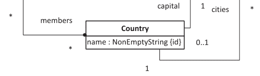

你可以使用以下示例数据来测试你的应用程序：

| 缩写 | 名称 | 成员 |
| :--- | :--- | :--- |
| UN | 联合国 | 德国, 法, 俄罗斯 |
| WHO | 世界卫生组织 | 德国, 法, 俄罗斯 |
| NATO | 北西洋公约组织 | 德国, 法 |

| 名称 | 首都 | 城市 |
| :--- | :--- | :--- |
| 法国 | 巴黎 | 马赛赛、里昂、巴黎 |
| 德国 | 柏林 | 柏林、汉堡、法兰克福 |
| 俄罗斯 | 莫斯科 | 莫斯科、新西伯利亚 |

| 名称 |
| :--- |
| 柏林 |
| 法兰克福 |
| 汉堡 |

（续上）

| 城市名称 |
|---|
| 里昂 |
| 马赛赛 |
| 莫斯科 |
| 新西伯利亚 |
| 巴黎 |

更多关于国家的数据可以在 CIA 世界事实汇中找到。

## 7 双向关联

在面向对象建模和编程中，双向关联是指表示为一对互逆引用属性的关联，它允许在两个方向上进行“导航”（对象访问）。

下方图 7.1 所示的模型（关于出版商、书籍及其作者）作为我们的运行示例。注意，它包含了两个双向关联，如关联两端的所有权点所示。

| 出版商 | 已出版书籍 | 书籍 | 创作的书籍 | 作者 |
| --- | --- | --- | --- | --- |
| name : String (id) | | isbn : String (id) | * | personid : Integer (id) |
| address : String | 0.1 | * | year : Integer | * | name : String |

图 7.1: 具有两个双向关联的出版商-书籍-作者信息模型。

### 7.1 逆引用属性


为了能够轻松检索由俱乐部成员担任或共同担任主席的委员会，我们在 `Committee-ClubMember` 示例中添加了两个引用属性：俱乐部成员担任委员会主席的属性（`ClubMember::Committee`）以及俱乐部成员担任委员会共同主席的属性（`ClubMember::coChairedCommittee`），它们最多担任或共同担任一个委员会（其中取或是非排他的）。我们得到以下模型：

| 委员会 | 俱乐部成员 |
| --- | --- |
| name : String | chairedCommittee[..] : Committee |
| chair : ClubMember | coChairedCommittee[..] : Committee |

注意 `Committee::chair` 和 `ClubMember::coChired` 引用属性之间存在对应关系。它们是互逆的：当俱乐部成员 Tom 是预算委员会主席时（用元组 `("budget committee", "Tom")` 表示），那么预算委员会由俱乐部成员 Tom 主席（用逆元组 `("Tom", "budget committee")` 表示）。为了在图中表示这种逆对应关系，我们在 `ClubMember::chairedCommittee` 属性声明中添加一个大括号括起来的逆属性约束 `inverse of chair`，并在 `Committee::chair` 属性中添加类似的约束，如下图所示：

| 委员会 | 俱乐部成员 |
|--- |--- |
| name : String | chairedCommittee[0..1] : Committee (inverse of chair) |
| chair : ClubMember (inverse of chairedCommittee) | coChairedCommittee[0..1] : Committee |

使用 OOP 语言的引用路径表示，用 `c` 引用 `Committee` 对象，我们得到方程：

`c.chair.chairedCommittee = c`

或者反过来，用 `m` 引用 `ClubMember` 对象，我们得到方程：

`m.chairedCommittee.chair = m`

注意，当属性 $p_2$ 是 $p_1$ 的逆属性时（即 $p_2$ 允许 $p_1$ 的反向访问），反过来，$p_1$ 是 $p_2$ 的逆属性。因此，我们声明 `ClubMember::chairedCommittee` 是 `Committee::chair` 的逆属性。为了在图中表示这种逆对应关系，我们在 `ClubMember::chairedCommittee` 的声明中添加了约束 `{inverse of chair}`，并在 `Committee::chair` 中添加一个，如下所示：

| 委员会 | 俱乐部成员 |
|--- |--- |
| name : String | chairedCommittee[0..1] : Committee (inverse of chair) |
| chair : ClubMember (inverse of chairedCommittee) | coChairedCommittee[0..1] : Committee |

使用**双向引用属性对**。为了支持两个方向的高效对象访问，这种双向关联意味着**数据冗余**和**更新开销**。

为了维护双向引用属性对的重复信息，通常将其中一个逆属性视为主属性（master），另一个视为从属性（slave），并在受影响的类的方法（如 setter）中考虑这种区别。我们使用斜杠 `/` 作为前缀来指示模型中的从属性：

| 委员会 | 俱乐部成员 |
| --- | --- |
| name : String | chairedCommittee[0..1] : Committee |
| chair : ClubMember | coChairedCommittee[0..1] : Committee |

现在 ClubMember 中的 `chairedCommittee` 是派生的（如其前缀所示）。其注释 `{inverse of chair}` 定义了一个推导规则，即通过反转 `Committee::chair` 来导出。

### 7.1 逆引用属性

在 UML 类图中，属性的派生可以通过评估给定对象的属性值的 OCL derive 来指定。当属性是另一个属性的逆时（通过附加在属性声明后的约束表达式 `inverse of anotherProperty` 指定），导出表达式是隐含的。在我们的示例中，对于任何俱乐部成员 $m$，它评估满足 $c.chair = m$ 的委员会对象。在 OCL 中，这种派生的执行如下：

```ocl
context ClubMember::chairedCommittee: Committee
drive:
if Committee.allInstances().exists(c | c.chair = m) then c
```

实现属性派生有两种方式：可以通过读取时计算派生，也可以在导出表达式中的任何变量（通常是另一个属性）值改变时，通过更新时计算派生。后者对应数据库中的物化视图。虽然读取时派生的属性可能无法保证高效导航（因为读取时计算可能会产生不可接受的延迟），但更新时派生的属性提供了高效的导航。

对于派生引用属性，我们必须处理受影响模型类之间的生命周期依赖，这需要根据所表示关联的功能（一对一、多一或多对多）采用特殊的变更机制。

在我们派生逆引用属性 `ClubMember::chairedCommittee` 的示例中，它是单值的且可选的，这意味着：

1. 每当创建一个新的委员会对象时（强制分配主席），必须相应地分配 `ClubMember::chairedCommittee` 属性；
2. 每当 `chair` 属性更新时（即为委员会分配了新主席），必须取消上任主席的成员的相应 `ClubMember::chairedCommittee` 属性，并为新主席设置该属性；
3. 每当委员会对象被销毁时，必须取消相应的 `ClubMember::chairedCommittee` 属性。

## 8.7 双向关联

当一个派生的反向引用属性是多值的，而其反向属性是单值的时（例如图7.4中所示的 `Publisher::publishedBooks` 是由 `Book::publisher` 派生的），生命周期依赖关系意味着：

1. 每当创建一个“基对象”（例如书籍）时，都必须通过向其值集中添加指向该新基对象的引用来更新对应的反向属性（例如向 `Publisher::publishedBooks` 中添加指向该新对象的引用）；
2. 每当基属性更新时（例如，为某本书分配了新的出版社），对应的反向属性（在示例中为 `Publisher::publishedBooks`）也必须进行更新，即从其值集中移除旧的对象引用并添加新的引用；
3. 每当一个基对象（例如书籍）被销毁时，都必须通过从其值集中移除该基对象来更新对应的反向属性（例如从 `Publisher::publishedBooks` 中移除指向该对象的引用）。

请注意，从纯粹计算的角度来看，我们可以自由地选择两个反向引用属性之一（如 `Book::authors` 和 `Author::authoredBooks`）作为主属性。然而，在许多情况下，关联代表了非对称的依赖关系，这决定了两个反向引用属性哪一个是主。例如，`Book` 和 `Author` 类之间的关联代表了书籍对其作者的本体论依赖，而作者在存在上并不依赖于任何书籍。因此，双向关联通过将 `Book::authors` 保持为主属性来维护，而 `Author::authoredBooks` 是从 `Book::authors` 派生的从属性。

## 7.2 构建面向对象（OO）类模型

由于经典编程语言不支持将显式关联作为一等公民，而仅支持表示隐式关联的引用属性，因此，我们在获取 OO 类模型时必须消除所有显式关联。

### 7.2.1 基础属性

我们消除过程的起点是一个包含各种类型单向和双向关联的设计模型，例如图 7.1 所示的模型，它仍然包含非方向性关联；我们首先必须通过对其端点的所有权做出决策来将其转变为有向的，这种决策通常基于导航需求。请注意，在 `Publisher-Book-Author` 设计模型中的两个关联——`publisher-publishedBooks` 和 `authored-authors`——根据端点所有权的指示，都是双向的。为了消除设计模型中的所有显式关联，我们必须执行以下步骤：

1. 消除连接源类与目标类的单向关联，通过将它们替换为源类中的引用属性，使目标类成为其范围。
2. 通过将它们替换为一对反向引用属性来消除双向关联。

### 7.2.2 如何消除单向关联

连接源类与目标类的单向关联被替换为源类中的一个引用属性，其范围为该目标类。其多重性与目标端的多重性相同。如果存在名称，其名称为关联端点的名称，否则设置为目标类的名称（如果引用属性是多值的，则可能使用复数形式）。

### 7.2.3 如何消除双向关联

图 7.1 所示模型中 `Book` 和 `Author` 类之间的双向关联被替换为一对反向引用属性，即 `Book::authors` 和 `Author::authoredBooks`。由于这两个引用属性表示相同的信息（相同的关系集合），因此有一个选项可以将其中一个视为“主”属性，另一个“从”属性，后者是从主属性派生的。

1. 在双向一对一关联的情况下，这会导致两个关联类中的每个类都有一对反向单值引用属性。在其中一个类中，必须选择哪一个作为主属性，使得另一个成为从属性。在该类中，从属性被指定为*派生属性*，每当满足以下情况时会自动更新：1) 创建了新的主对象，2) 主引用属性被更新，或 3) 主对象被销毁。这种转换如图 7.2 所示。

| Committee | chairedCommittee | ClubMember |
| :--- | :--- | :--- |
| name : String | 0..1 | 1 |

![img/1a8b608b42ede8e4d7e1a97445ae019_1330.png)

**图 7.2：** 将双向一对一关联转换为互为反向的单值引用属性的主从对。

| Committee | ClubMember |
| :--- | :--- |
| name : String | chairedCommittee[0..1] : Committee (inverse of chair) |
| | ClubMember |

2. 双向多对多关联映射到参与关联的两个类中的各一对互为反向的多值引用属性。同样，在其中一个类中，表示（反向）关联的多值引用属性被指定为*派生属性*，每当另一个类（维护关联的地方）中的对应属性被更新时，它会自动更新。这种转换如图 7.3 所示。

| Book | Author |
| :--- | :--- |
| isbn : String (id) | personid : Integer (id) |
| title : String | name : String |

![img/1a8b608b42ede8e4d7e1a97445ae019_1331.png)

| Book | Author |
| :--- | :--- |
| isbn[1] : String (id) | personID[1] : Integer (id) |
| title[1] : String | name[1] : String |
| authors[*] : Author | authoredBooks[*] : Book (inverse of chair) |

**图 7.3：** 将双向多对多关联转换为互为反向的多值引用属性的主从对。

### 7.2.4 得到的 OO 类模型

将所有双向关联替换为引用属性后，我们得到了 7.4 所示的 OO 类模型。

| Book | Publisher |
| :--- | :--- |
| isbn[1]: String (id) | name[1]: String |
| title[1]: String | publishedBooks[*]: Book (inverse of publisher) |
| year[1]: Integer | Author |
| publisher[0..1]: Publisher | personId[1]: Integer (id) |
| authors[*]: Author | |

图 7.4：具有两对互为反向的引用属性的 OO 类模型。

由于书籍本质上依赖于并可能依赖出版社，反之则不然，在书籍对象中维护主引用并将出版社和作者对象中的反向引用视为派生（或“从”）数据是自然的。因此，我们将 `publishedBooks` 和 `authoredBooks` 定义为反向引用属性，这在 OO 类模型中通过它们的斜杠前缀来表示。

该 OO 类模型的意义可以通过涉及的三个模型类的示例数据填充来说明：

| Name | Address | Published books |
| :--- | :--- | :--- |
| Bantam Books | New York, USA | 0553345842 |
| Basic Books | New York, USA | 0465030793 |

| 作者 ID | 姓名 | 著作 |
| :--- | :--- | :--- |
| 1 | Daniel Dennett | 0553345842 |
| 2 | Douglas Hofstadter | 0553345842, 0465030793 |
| 3 | Immanuel Kant | 1463794762, 1928565379 |

注意书籍（Book）记录引用了出版者（Publisher）和作者（Author）记录，反之亦然，出版者和作者记录也引用书籍记录。

## 8 使用原生 JS 实现双向关联

在本章中，我们将展示：

1. 如何从具有派生反向引用属性的 OO 类模型导出 JS 类模型，
2. 如何以 JavaScript 模型类的形式编写 JS 类模型，
3. 如何基于模型代码编写视图（view）和控制器（controller）代码。

## 8.1 构建 JavaScript 类模型

构建 JS 类模型的起点是一个具有派生反向引用属性的 OO 类模型，如上面讨论的，为了方便起见，我们再次展示：

| 书籍 (Book) | 出版者 (Publisher) |
| :--- | :--- |
| isbn[1]: String (id) | personId[1]: Integer (id) |
| title[1]: String | name[1]: String |
| year[1]: Integer | /publishedBooks[*]: Book (出版者的反向引用) |
| publisher[0..1]: Publisher | /authoredBooks[*]: Book (作者的反向引用) |

注意该模型包含两个派生反向引用属性：Publisher:/publishedBooks 和 Author:/authoredBooks。它们中的每一个都链接到一个主属性（master property），并从中派生。因此，每个属性都代表了一对对应双向关联的互为反向引用属性。

与构建单向关联的 JS 类模型相比，唯一的新问题是：

1. 为所有派生反向引用属性添加 «get> 构型，意味着它们具有隐式的 getter（获取），但没有 setter（设置）。每当它们的反向主引用属性更新时，它们会被隐式地设置。

这涉及到两个派生反向引用属性 Publisher:/publishedBooks 和 Author:/authoredBooks。因此，我们得到了以下 JavaScript 类模型：

| 书籍 (Book) | 出版者 (Publisher) |
| :--- | :--- |
| <get/set/isbn> : string (id) | <get/set/name[1]> : string (id) |
| <get/set/title> : string | <get/set/address[1] : string |
| <get/set/year> : number(int) | checkName(in : String) : ConstraintViolation |
| <get/set/publishedBooks[]>* : Book (出版者的反向引用) | checkName(in : String) : ConstraintViolation |
| <get/set/publisher[0..1] : Publisher | checkIsbn(in : isbn : String) : ConstraintViolation |
| checkIsbn(in : isbn : String) : ConstraintViolation | checkAddress(in : isbn : String) : ConstraintViolation |
| checkIsbnRef(in : isbn : String) : ConstraintViolation | tostring(string) |
| checkTitle(in : title) : ConstraintViolation | toRecord() |
| checkPublisher(in : publisher : String) : ConstraintViolation | |
| checkAuthor(in : author : String) : ConstraintViolation | Author |
| addAuthor(in : author : Author) : ConstraintViolation | | |
| removeAuthor(in : author : Author) : ConstraintViolation | | |


| toString() | | | |
| tRecord() : Object | | | |

## 8.2 编写模型代码

我们可以直接对 JS 类模型进行编码，以获取 JavaScript 前端模型层的代码。

### 8.2.1 新问题

与单向关联应用相比，我们需要处理许多新的技术问题：

1. 我们定义了派生反向引用属性（如 `Publisher:/publishedBooks`），但没有检查操作，也没有设置操作。
2. 我们还必须通过维护派生的反向引用属性集合（即这些集合构成了派生反向引用属性的集合值），来维护派生反向引用属性。这特别要求：每当单值引用属性的值通过 setter 初始化或更新时（例如将指向 `Publisher` 实例 `p` 的引用赋值给书籍实例 `b`），都必须向派生反向引用属性的相应值分配或添加反向引用（例如将 `b` 添加到 `p.publishedBooks`）；当主引用属性的值更新且派生属性是多值的，必须删除指向单值主引用属性旧值的过时反向引用。
3. 每当可选的单值主引用属性值被取消设置时（例如通过为书籍实例 `b` 的 `publisher` 赋值 `null`），如果派生反向引用属性是多值的，则必须从派生反向引用属性的相应值中移除反向引用（例如从 `p.publishedBooks` 中移除 `b`），否则必须取消或更新派生反向引用属性的相应值。
4. 每当通过方法向多值主引用属性添加引用时（例如为书籍实例 `b` 添加一个作者 `Author`），都必须向派生反向引用属性的相应值分配或添加反向引用（例如将 `b` 添加到 `a.authoredBooks`）。
5. 每当通过删除方法从多值主引用属性中移除引用时（例如从书籍实例 `b` 中移除对实例 `a` 的引用），必须从派生反向引用属性的相应值中移除反向引用；如果派生反向引用属性是多值的，则必须取消或更新派生反向引用属性的相应值。

### 8.2.2 编码总结

将每个类编码为具有隐式 getter 和 setter 的 ES215 类（或者作为 ES5 构造函数的显式 setter）：

1. 以类级（静态）方法的形式编写属性检查。
2. 对于每个单值属性，编写指定的 getter 和 setter：
   1. 在每个 setter 中调用属性检查，如果检查没有检测到违规，则设置/取消属性。
   2. 如果该属性是派生属性的反向引用（对应双向关联），确保多值属性具有以下操作以及指定的 get/set 操作：
      1. 以实例方法编写 add/remove 方法调用相应的属性检查。
      2. 编写 setter，使其对要赋值的集合中的项调用 add 操作。
      3. 如果该属性是派生属性的反向引用（对应双向关联），确保 add/remove 方法也分配/取消（或添加/移除）反向引用到/从（集合值）。
3. 编写序列化函数 `toString()` 和对象存储转换函数 `toRecord()`。在出版者或作者对象的对象存储转换 `toRecord()` 中，不包含派生的 books 和 authors 属性，因为这些信息是冗余的（它们是从书籍的 publisher 和 authors 属性得到的）。
4. 在 `destroy` 方法中处理删除依赖。确保当具有单引用或多引用主引用属性的对象销毁时，首先取消（或移除）派生反向引用。

这些步骤将在后面的章节中进行详细讨论。

### 8.2.3 JS 类模型的类

例如，JS 类模型中的 `Publisher` 类以以下方式编码：

```javascript
class Publisher {
  constructor({name, address}) {
    this.name = name;
    this.address = address;
    // 派生反向引用属性（Book::publisher 的反向引用）
    this._publishedBooks = {}; // 初始化为空 map
  }
  getName() { . . }
  static checkName(n) { . . }
  static checkNameAsId(n) { . . }
}
```

```javascript
static checkNameAsIdRef(n) { . . }
set name(n) { . . }
get address() { . . }
static checkAddress(a) { . . }
set address(a) { . . }
tToString() { . . }
toRecord() { . . }
}
```

注意，我们添加了（派生的）多值引用属性 `publishedBooks`，但我们没有在构造函数为其赋值，因为它是一个只读属性，当它的反向主引用属性 `Book::publisher` 被赋值时，它会被隐含赋值。

### 8.2.4 为单值属性编写 Set 方法代码

任何耦合到延迟反向引用属性（实现双向关联）的属性的 setter，也需要向或从反向引用属性的集合值赋值/添加/删除对应的反向引用。此类 setter 的一个示例是 `Book` 类中的 `publisher`：

```javascript
set publisher(p) {
  if (!p) { // 发布者引用被删除
    // 删除 Publisher::publishedBooks 中的反向引用
    delete this._publisher
    this._publisher.publishedBooks[this._isbn] = this;
  } else {
    throw constraintViolation;
  }
}
```

### 8.2.5 编写 Add 和 Remove 操作代码

对于任何耦合到派生反向属性的多值引用属性，add 和 remove 方法也必须向或从（反向属性的值集）赋值/添加/删除对应的引用。

例如，多值引用属性 `Book::authors` 耦合到派生反向属性 `Author::authoredBooks` 以实现 `Book` 和 `Author` 之间的双向作者关联，`Book::addAuthor` 方法编码如下：

```javascript
addAuthor(a) {
  // a 可以是 ID 引用或对象引用
  const author_id = (typeof a === "object") ? parseInt(a) : a.authorId;
  const validationResult = Book.checkAuthor(author_id);
  if (author_id && validationResult instanceof NoConstraintViolation) {
    // 添加新的作者引用
    this._authors[author_id] = Author.instances[author_id];
    // 自动添加派生的反向引用
    this._authors[author_id].authoredBooks[this._isbn] = this;
  } else {
    throw validationResult;
  }
}
```

对于删除操作 `removeAuthor`，我们得到以下代码：

```javascript
removeAuthor(a) {
  // a 可以是 ID 引用或对象引用
  const author_id = (typeof a === "object") ? parseInt(a) : a.authorId;
  const validationResult = Book.checkAuthor(author_id);
  if (validationResult instanceof NoConstraintViolation) {
    // 自动删除派生的反向引用
    delete this._authors[author_id].authoredBooks[this._isbn];
    // 删除作者引用
    delete this._authors[author_id];
  } else {
    throw validationResult;
  }
}
```

### 8.2.6 禁止派生属性值的存储

在通过 `toRecord()` 将 `publisher` 或 `author` 对象从对象到存储进行转换时，派生的属性 `publishedBooks` 和 `authoredBooks` 不包含在，因为它们的信息是冗余的（派生自书籍的 publisher 和 author 属性）。在 `Author::toRecord` 函数中的编码如下：

```javascript
toRecord() {
  var rec = {};
  // 遍历所有 Author 属性
  for (let p of Object.keys(this)) {
    // 保留下划线开头的属性，除 "_authoredBooks" 外
    if (p.charAt(0) == "_" && p != "_authoredBooks") {
      // 移除下划线前缀
      rec[p.substr(1)] = this[p];
    }
  }
  return rec;
}
```

### 8.2.7 处理删除依赖

当一个书籍实例 `b`（具有单引用 `b.publisher` 指向 `Publisher` 实例 `p` 以及多个引用 `b.authors` 指向 `Author` 实例）被销毁时，必须先移除派生引用（例如通过从 `p.publishedBooks` 中移除 `b`）：

```javascript
Book.destroy = function (isbn) {
  const book = Book.instances[isbn];
  if (book) {
    console.log(book.toString() + " deleted!");
    if (book.publisher) {
      // 从 book.publisher 中移除反向引用
      delete book.publisher.publishedBooks[isbn];
    }
    // 从所有 book.authors 中移除反向引用
    for (let authorID of Object.keys(book.authors)) {
      delete book.authors[authorID].authoredBooks[isbn];
    }
    // 最后，从 Book.instances 中删除 book
    delete Book.instances[isbn];
  } else {
    console.log(`数据库中没有 ISBN 为 ${isbn} 的书籍！`);
  }
}
```

## 8.3 在用户界面中利用反向引用属性

在 UI 代码中，我们现在可以利用反向引用属性在“检索/列出所有”用例更高效地创建反向关联对象的列表。例如，我们可以更高效地为每个发布者创建所有出版书籍列表。然而，我们不允许在“更新对象”用例中更新反向关联对象的集合（例如，在“更新发布者”用例中更新出版书籍集合）。

### 8.3.1 在“检索/列出所有”中显示书籍

在“检索/列出所有”用例中显示书籍时，我们可以利用反向引用属性：

```javascript
publishers.retrieveAndListAll = {
  setupInterface: function () {
    const tableBodyEl = document.querySelector("section-R>table tbody");
    tableBodyEl.innerHTML = "";
    for (let key of Object.keys(Publisher.instances)) {
      const publisher = Publisher.instances[key];
      const row = tableBodyEl.insertRow(-1);
      // 为 publisher 创建出版书籍列表
      const listEl = util.createList(publisher.publishedBooks, "title");
      row.insertCell(-1).textContent = publisher.name;
      row.insertCell(-1).textContent = publisher.address;
      row.insertCell(-1).appendChild(listEl);
    }
    document.getElementById("Publisher-M").style.display = "none";
    document.getElementById("Publisher-R").style.display = "block";
  }
};
```

## 9 使用 Java 实现双向关联

在本章中，我们将展示：

1. 如何从面向对象模型推导出 Java 实体类（代表了实体类模型），
2. 如何在实体类实现双向关联，
3. 如何根据实体类编写控制器代码。

## 9.1 制作 Java 实体类模型

制作 Java 实体类的起点是具有派生属性的 OO 模型，如图 7.4 所示：

| Book | Publisher |
| --- | --- |
| isbn: String | name: String |
| title: String | address: String |
| year: Integer | publishedBooks: Book |
| publisher: Publisher | authoredBooks: Book |

注意，模型包含两个反向属性：`publishedBooks` 和 `authoredBooks`。它们都关联到一个对象。

现在我们展示如何推导出 Java 实体类：

- 将每个类转换为「Java Entity」，并使所有属性私有。
- 将 OO 类的平台无关类型替换为 Java 数据类型（`Integer` 等）。
- 为所有非派生属性添加 `get/set` 注解。
- 为所有派生属性添加 `get` 注解。
- 对于任何引用属性，根据关联的功能类型添加相应的关键字。对于给定的 OO 模型，添加以下修饰符：
  - `oneToMany` 引用属性
  - `manyToOne`
  - `manyToMany` 引用属性
- 对于任何被指定为反向的引用属性，替换其 `(mappedBy="...")` 修饰符。
- 创建所需的属性检查操作。
- 为每个多值属性创建 `add` 和 `remove` 操作。

这导致以下实体类：

| Publisher |
| --- |
| name: String (id) |
| address: String |
| publishedBooks: Book (`manyToMany`, `mappedBy="publisher"`) |
| checkNameAsId(in n : String, em : EntityManager) : ConstraintViolation |
| toString() : String |
| retrieveAll(in em : EntityManager) : List<Publisher> |
| create(in em : EntityManager, in name: String, in address: String) |
| update(in em : EntityManager, in name: String, in address: String) |
| delete(in em : EntityManager, in name: String, in address: String) |

| Book |
| --- |
| isbn: String (id) |
| title: String |
| year: Integer |
| publisher: Publisher (`manyToOne`) |
| authors: Author (`manyToMany`) |
| checkAuthor(in isbn : String) : ConstraintViolation |
| addAuthor(in author : Author) |
| removeAuthor(in author : Author) |
| toString() : String |

| Author |
| --- |
| personId: Integer (id) |
| name: String |
| authoredBooks: Book (`manyToMany`, `mappedBy="authors"`) |
| checkPersonId(in pld : Integer, em : EntityManager) : ConstraintViolation |
| toString() : String |

## 9.2 编写模型

可以直接为 Java 实体模型类编码，以获取我们 Java 后端应用程序的模型层代码。

### 9.2.1 新问题

与之前讨论的单向关联应用相比，我们必须处理许多新的技术问题：

1. 在模型代码中，你现在必须维护派生的反向引用属性（derived inverse reference properties），方法是维护构成派生反向引用属性值的派生反向引用（集合）。具体而言：


1. 每当单值主引用属性的值通过 setter 初始化或更新时（例如通过为 `Book` 实例 `b` 的 `b.publisher` 分配一个 `Publisher p` 引用），必须向派生反向引用属性对应的值分配或添加反向引用（例如将 `b` 添加 `p.publishedBooks`）；当主引用属性的值被更新且派生的反向引用属性为多值时，必须删除对该单值主引用属性旧值的过时引用；

2. 每当可选的单值主引用属性的值被取消设置时（例如通过为 `Book` 实例 `b` 的 `b.publisher` 分配 `null`），必须从派生反向引用属性对应的值中移除反向引用（例如将 `b` 从 `p.publishedBooks` 中移除）；如果派生反向引用属性是多值的，否则必须取消设置或更新派生反向引用属性对应的值；

3. 每当通过 add 方法向多值主引用属性的值添加引用时（例如为 `Book` 实例 `b` 的 `b.authors` 添加一个 `Author` 引用），必须向反向引用属性对应的值分配或添加反向引用（例如将 `b` 添加 `a.authoredBooks`）；

4. 每当通过 remove 方法从多值主引用属性的值中移除引用时（例如从 `Book` 实例 `b` 的 `b.authors` 中移除对 `Author` 实例的引用），如果派生反向引用属性是多值的，则必须从派生反向引用属性对应的值中移除反向引用（例如将 `b` 从 `a.authoredBooks` 中移除），否则必须取消设置或更新派生反向引用属性对应的值；

- 每当具有单引用或多引用作为主引用属性值的对象被销毁时（例如当一个具有单引用 `b.publisher` 指向 `Publisher` 实例 `p` 的 `Book` 实例被销毁时），必须首先移除派生引用（例如通过从 `p.publishedBooks` 中移除 `b`）。

注意，当创建一个具有单引用或多属性作为主引用属性的对象时（例如具有单引用 `b.publisher` 的新 `Book` 实例），其 setter 或 add 方法将被调用并处理反向引用的创建。

- 在 UI 中，我们现在可以利用反向引用属性在列表对象用例中高效地创建关联对象列表。例如，我们可以高效地为每个出版社创建所有出版书籍列表。

### 9.2.2 总结

- 将 Java 实体类模型中的每个类编码为相应的实体类。
- 使用 JPA 注解 `@Id` 编写 (id) 属性修饰符。
- 为任何表示引用属性功能的属性修饰符（如 `ManyToOne`）编写对应的 JPA 注解，如 `@ManyToMany`。
- 使用 Java Bean Validation 注解（或自定义验证注解）对模型中指定的完整性约束进行编码。
- 为值属性编写 getters、setters 以及 add 和 remove 方法。
- 将创建、检索、更新和删除存储管理操作编码为类方法。
- 在创建和更新方法中处理反向关系管理。

这些步骤将在后续章节中进行详细讨论。

### 9.2.3 编码 Java 实体类模型的每个类

在 `Publisher` 类中，我们添加了 `publishedBooks` 属性，并使用对应 `Book` 类中 `@ManyToOne` 的 `@OneToMany` 注解，表示反向关系：

```java
@Entity
public class Publisher {
  ..
}
```

```java
@OneToMany(fetch=FetchType.EAGER, mappedBy="publisher")
private Set<Book> publishedBooks;
..
```

`Publisher::publishedBooks` 属性的 `@OneToMany` 参数指定了 `Book` 类中实现 `@ManyToOne` 关系的属性：

```java
@Entity
public class Book {
  ..
}
```

```java
@ManyToOne(fetch=FetchType.EAGER)
@JoinColumn(name="PUBLISHER_NAME")
private Publisher publisher;
..
```

在 `Author` 类中，我们添加了 `authoredBooks` 属性，并使用对应 `Book` 类中 `@ManyToMany` 的 `@ManyToMany` 注解，表示反向关系：

```java
@Entity
public class Author {
  ..
}
```

```java
@ManyToMany(fetch=FetchType.EAGER, mappedBy="authors")
private Set<Book> authoredBooks;
..
```

`Author` 类中 `authoredBooks` 引用属性的 `@ManyToMany` 属性指定了 `Book` 类中反向引用属性的名称：

```java
@Entity
public class Book {
  ..
}
```

```java
@ManyToMany(fetch=FetchType.EAGER)
@JoinTable(name="books_authors",
joinColumns = {@JoinColumn(name="BOOK_ISBN")},
inverseJoinColumns = {@JoinColumn(name="AUTHOR_PERSONID")})
private Set<Author> authors;
```

我们还使用 `@JoinTable` 注解来指定多对多关系的表名以及连接表的列名，例如，表名为 `books_authors`，列名为 `BOOK_ISBN` 和 `AUTHOR_PERSONID`。

### 9.2.4 编写 Setter 操作

对于任何耦合到派生反向属性的引用属性（实现双向关联），其 setter 现在需要向反向属性的值（集合）分配/添加/移除反向引用。此类 setter 的示例是下面的 `setPublisher` 方法：

```java
public class Book {
  ..
  public void setPublisher(Publisher publisher) {
    // 从 publisher.publishedBooks 中移除书籍引用
    if (this.publisher != null) {
      this.publisher.removePublishedBook(this);
    }
    // 将书籍添加到 publisher.publishedBooks
    if (publisher != null) {
      publisher.addPublishedBook(this);
    }
    this.publisher = publisher;
  }
}
```

### 9.2.5 编写 Add 和 Remove 操作

对于任何耦合到派生反向属性的多值引用属性，add 和 remove 方法都必须向（反向属性的值）分配/添加/移除引用。

例如，对于实现 `Book` 和 `Author` 双向关联的耦合到派生反向属性 `Author::authoredBooks` 的多值引用属性 `Book::authors`，`addAuthor` 方法的编码如下：

```java
public class Book {
  ..
  public void addAuthor(Author author) {
    if (this.authors == null) {
      this.authors = new HashSet<Author>();
    }
    if (!this.authors.contains(author)) {
      // 添加新的作者引用
      this.authors.add(author);
      // 添加派生反向引用
      author.addAuthoredBook(this);
    }
  }
}
```

对于移除 `removeAuthor` 我们得到以下代码：

```java
public class Book {
  ..
  public void removeAuthor(Author author) {
    if (this.authors != null && author != null &&
        this.authors.contains(author)) {
      // 删除作者引用
      this.authors.remove(author);
      // 删除派生反向引用
      author.removeAuthoredBook(this);
    }
  }
}
```

记住，对于 Java 集合（如 `Set` 或 `List`），`contains` 方法通过使用对象的 `equals` 方法来比较两个对象。例如，在 `Author` 类中对 `Set<Author>`（如 `publishedBooks`）使用 `contains` 方法时，我们实现了以下 `equals` 方法（如果两个作者的 `personId` 属性值相等，则它们相等）：

```java
public class Author {
  ..
  @Override
  public boolean equals(Object obj) {
    if (obj instanceof Author) {
      Author author = (Author) obj;
      return this.personId.equals(author.personId);
    } else return false;
  }
}
```

### 9.2.6 处理删除依赖关系

当一个 `Book` 实例 `b` 被销毁时（它有一个单一引用 `b.publisher` 指向 `Publisher` 实例 `p` 以及多个引用 `b.authors` 指向 `Author` 实例），必须先删除派生的反向引用（例如通过从 `p.publishedBooks` 中移除 `b`）。这是通过调用单值和多值属性的 setter 方法并传入 `null` 参数来实现，例如在 `Book.delete` 方法中调用 `b.setPublisher(null)` 和 `b.setAuthors(null)`：

```java
public class Book {
  ..
  public static void delete(EntityManager em,
    UserTransaction ut, String isbn) throws Exception {
    ut.begin();
    Book b = em.find(Book.class, isbn);
    b.setPublisher(null);
    b.setAuthors(null);
    em.remove(b);
    ut.commit();
  }
}
```

同样，在删除 `Publisher` 或 `Author` 实例时，我们必须处理对 `Book` 实例引用的删除：

```java
public class Author {
  ..
  public static void delete(EntityManager em,
    UserTransaction ut, Integer personId) throws Exception {
    ut.begin();
    Author a = em.find(Author.class, personId);
    a.setAuthoredBooks(null);
    em.remove(a);
    ut.commit();
  }
}
```

同样地，

```java
public class Publisher {
  public static void delete(EntityManager em,
    UserTransaction ut, String name) throws Exception {
    ut.begin();
    Publisher p = em.find(Publisher.class, name);
    p.setPublishedBooks(null);
    em.remove(p);
    ut.commit();
  }
}
```

### 9.2.7 实体管理器与缓存实体

遗憾的是，JPA 不提供反向引用的自动维护。根据 Java Persistence Wiki，我们必须通过 `set/add/remove` 方法来实现（直接和反向的）关系管理：

> 双向关系中的一个常见问题是，应用程序更新了关系的一侧，而另一侧没有更新，导致不同步。在 JPA 中，与通常情况一样，维护关系是应用程序或对象模型的职责。如果你的应用程序向关系的一侧添加了内容，那么它也必须向另一侧添加。这通常通过对象模型中处理关系双边的 `add` 或 `set` 方法来解决，这样应用程序代码就不需要担心这个问题。有两种方法可以实现：你可以在仅一侧添加关系维护代码并仅使用该侧的 setter（例如将另一侧设为 `protected`），或者在两侧都添加，并确保避免无限循环。

我们为每个控制器类都使用了一个实体管理器（entity manager）。每个实体管理器都维护一组缓存实体，这些可以通过 `merge` 方法与其他实体管理器“共享”。在我们的示例中，作为每个模型类 `create` 和 `update` 方法的一部分，我们必须合并属于另一个实体管理器的更新实体。例如，在 `Book.create` 方法中，我们需要合并新书籍的出版社（由 `PublisherController` 的实体管理器管理）以及所有的作者（由 `AuthorController` 的实体管理器管理）：

```java
public class Book {
    public static void create(EntityManager em,
        UserTransaction ut,
        String isbn, String title, Integer year,
        Publisher publisher, Set<Author> authors)
        throws Exception {
        ut.begin();
        Book book = new Book(isbn, title, year,
            publisher, authors);
        em.persist(book);
        if (publisher != null) {
            em.merge(publisher);
        }
        for (Author a : authors) {
            em.merge(a);
        }
        ut.commit();
    }
}
```

如果不使用 `merge`，出版社以及 `authors` 列表中所有作者实例将不会表示对原始缓存实体的引用，并且不会保留我们的更改。更多详细信息，请检查与此相关的 Java Persistence 文档。

也可以禁用 JPA 缓存，以便为每个新实例从数据库中重新加载，例如当调用 `EntityManager.find` 方法时。这可以通过 `persistence.xml` 文件中添加以下行来实现：

```xml
<property name="eclipselink.cache.shared.default" value="false"/>
```

上述配置适用于 `eclipselink` 实现，对于其他 API 实现可能会有所不同。请注意，如果没有严重理由，不建议禁用实体缓存，因为会降低应用的性能，并在某些情况下可能会产生意外行为，例如使用 `@SessionScoped` 管理的实体时。

# 9.3 在用户界面中利用派生的反向引用属性

现在我们可以利用派生的反向引用属性 `Publisher::publishedBooks` 和 `Author::authoredBooks`，在“检索/列出所有出版社”以及“检索/列出所有作者”的用例中更有效地创建关联书籍列表。

## 9.3.1 在检索/列出所有中显示出版书籍信息

为了在检索/列出所有出版社时显示出版书籍的信息，我们现在可以使用派生的反向引用：

```xml
<h:composition template="/WEB-INF/templates/page.xhtml">
<h:define name="content">
<h:dataTable value="#{publisherController.publishers}" var="p">
<h:column>
  <f:facet name="header">出版书籍</f:facet>
  <h:outputText value="#{p.publishedBooks}" escape="false"/>
</h:column>
</h:dataTable>
<h:button value="返回" outcome="index" />
</h:define>
</h:composition>
```

在单向关联的情况下，我们使用了 `Book` 类中的 `AuthorNames()` 方法，它返回一个逗号分隔的字符串：


```java
public class Book {
  ..
  public String getAuthorNames() {
    String result = "";
    int i = 0, n = 0;
    if (authors == null) {
      return null;
    } else if (authors instanceof Set) {
      n = ((Set<Author>)authors).size();
      for (Author author : (Set<Author>)authors) {
        result += author.getName();
        if (i<n-1) {
            result += "<br/>";
        }
        i++;
      }
    }
    return result;
  }
}
```

然后，在 `facet` 中使用 `converter` 属性指定我们的转换器类，例如 `m.ListConverter`，当相应的视图需要渲染时：

```java
@FacesConverter(value="m.ListConverter")
public class ListConverter implements Converter {
    @Override
    public Object getObject(FacesContext context, UIComponent component, String value) {
        return null; // 此方法不需要
    }
    @Override
    public String getString(FacesContext context, UIComponent component, Object value) {
        String result = "";
        int i=0, n=0;
        if (value == null) {
            return null;
        } else if (value instanceof Set) {
            n = ((Set<Book>)value).size();
            for (Book b : (Set<Book>)value) {
                result += b.getTitle();
                if (i<n-1) {
                    result += "<br/>";
                }
                i++;
            }
        }
        return result;
    }
}
```

由于序列化文本包含 HTML 元素，即用于产生 HTML 换行的 `<br />`，我们必须指定 `escape="false"` 属性，否则 `<` 和 `>` 将被替换为相应的 `&lt;` 和 `&gt;` 实体。

JSF 转换器的主要优势是我们没有将模型代码与特定的视图混合，我们的模型类保持整洁和分层，如果我们想用其他 UI 技术替换 JSF，我们的模型类保持不变。

## 9.4 运行应用并获取代码

运行应用程序可能需要停止 Tomcat/TomEE 服务器（Windows 使用 `shutdown.bat`，Linux 使用 `shutdown.sh`）。接下来，下载并解压包含应用程序源代码的 ZIP 文件以及你需要修改的 ANT 脚本文件（修改 `server.folder` 属性值）。现在，在控制台或终端中执行以下命令：

```bash
ant deploy -Dappname=BidirectionalAssociationApp
```

## 关联的 10 个特殊主题

## 10.1 部分整体关联 (Part-Whole Associations)

部分整体关联表示部分类型与整体类型之间的关系。它的实例是两个对象之间的部分整体关系，其中一个对象是另一个对象的部分（根据 UML）。UML 将部分整体关联分为两种：*聚合*（aggregation）和*组合*（composition）。虽然这两个术语在 UML 中的定义方式相当精确，尽管并不完全尽如人意，但许多软件开发者遵循 C++ 编程社区的术语传统，有不同的解释：与“聚合”中的部分不同，“组合”中的部分无法脱离引用它们的复合对象而独立存在。

我们遵循 UML，并通过引入两种组合的区分来改进对组合的定义：具有*可分离的*部分的组合和具有*不可分离的*部分的组合。

### 10.1.1 聚合 (Aggregation)

聚合是部分整体关联的一种特殊形式，其中整体的部分可以与其他整体共享。例如，我们可以对类 `DegreeProgram`（学位课程）和 `Course`（课程）之间的聚合进行建模，如图所示，因为课程是学位课程的一部分，并且可以在两个或多个学位课程之间共享（例如，工程学位可以与计算机科学学位共享一门 C 语言课程）。

| DegreeProgram | Course |
| --- | --- |
| name : String | id : String |
| | name : String |

然而，具有*共享部分*的聚合概念实际上并没有太大意义，因此它对如何编写该关联的代码没有影响，许多开发者倾向于不在他们的类图中使用白色菱形，但 UML 规范说：“共享聚合的精确语义随应用领域和建模者而异”。

聚合关联在整体侧的*多重性*（multiplicity）可以是任何数字 (`*`)，因为一个部分可能属于或*共享*于任意数量整体。

### 10.1.2 组合 (Composition)

关于部分整体关联概念中聚合和组合之间的区别，存在如此多的困惑真是令人惊讶。主要问题在于一种广泛的误解（即使在专家软件开发者和 UML 作者中也是如此），认为组合的概念意味着整体与其部分之间存在生命周期依赖，即部分离开整体就无法存在。但这种观点忽略了也存在具有不可共享部分的部分整体关联，在这种情况下，部分可以被分离并在整体销毁后继续存在。

在 UML 规范文件中，“组合”一词的定义一直暗示了不可共享的部分，但并不清楚哪些仅仅是可选特征。即使在 UML 2.5 版本（截至 2015 年），在尝试提供“组合”术语的定义后，它仍然模糊，并且没有为如何建模具有不可共享的部分整体关联提供指导——即部分可以从整体分离并在销毁后生存，对比部分无法分离并随整体销毁的情况。他们说：

> 如果一个复合对象被删除，它的所有部分实例都会随之销毁。

但同时他们也说：

> 部分在复合对象被删除之前可以从复合对象中移除，从而不会作为复合对象的一部分被删除。

这种困惑指向了 UML 定义的不完整性，它没有考虑到组件和复合对象之间的生命周期依赖。因此，理解如何增强 UML 定义是非常重要的，例如通过引入一个用于“不可分离”组合的 UML 刻画（stereotype），或者通过引入一个约束关键字来刻画组件侧的关联端。

Martin Fowler 解释过，刻画组合关系的主要问题是“一个对象只能是某一个组合关系的一部分”。G. Bellekenens 在博客文章《UML 组合与聚合作为关联》中也解释了这一点。除了定义组合的这种特性（拥有独占的或不可共享的部分）外，组合还可能伴随着复合对象与其组件之间的生命周期依赖。事实上，有两种依赖关系：

1. 每当一个组件必须附加到复合对象上，换句话说，当它具有强制性组合时（由组合线复合对象侧的“恰好一个”多重性表示），那么它必须在另一个复合对象中被重用（或重新附加），或者在当前复合对象销毁时被销毁。`Person`（人）和 `Heart`（心脏）之间的组合就是其中的例子，如下所示。当所有者死亡时，心脏要么被销毁，要么被移植到另一个人。

2. 每当一个组件不能从其复合对象中分离时，换句话说，当它是不可分离的，那么当复合对象销毁时它也必须被销毁。具有不可分离部分的例子是 `Person` 和 `Brain`。(img/a8b608b42ede8e4d7e1a974745010)

这种困惑指向了 UML 定义的不完整性，它没有考虑到组件和复合对象之间的生命周期依赖。因此，理解如何增强 UML 定义是非常重要的，例如通过引入一个用于“不可分离”组合的 UML 刻画，或者通过引入一个约束关键字来刻画组件侧的关联端。

Martin Fowler 解释过，刻画组合关系的主要问题是“一个对象只能是某一个组合关系的一部分”。G. Bellekenens 在博客文章《UML 组合与聚合作为关联》中也解释了这一点。除了定义组合的这种特性（拥有独占的或不可共享的部分）外，组合还可能伴随着复合对象与其组件之间的生命周期依赖。事实上，有两种依赖关系：

1. 每当一个组件必须附加到复合对象上，换句话说，当它具有强制性组合时（由组合线复合对象侧的“恰好一个”多重性表示），那么它必须在另一个复合对象中被重用（或重新附加），或者在当前复合对象销毁时被销毁。`Person`（人）和 `Heart`（心脏）之间的组合就是其中的例子，如下所示。当所有者死亡时，心脏要么被销毁，要么被移植到另一个人。

2. 每当一个组件不能从其复合对象中分离时，换句话说，当它是不可分离的，那么当复合对象销毁时它也必须被销毁。具有不可分离部分的例子是 `Person` 和 `Brain`。(img/a8b608b42ede8e4d7e1a974745010)

这种困惑指向了 UML 定义的不完整性，它没有考虑到组件和复合对象之间的生命周期依赖。因此，理解如何增强 UML 定义是非常重要的，例如通过引入一个用于“不可分离”组合的 UML 刻画，或者通过引入一个约束关键字来刻画组件侧的关联端。

| Car | Engine |
| --- | --- |
| licenseNo : String | id : String |
| color : String | |
| cylinderCapacity : Decimal | |

组合关联在复合对象侧的多重性是 1 或 0.1，取决于组件是否具有强制性的复合对象。当然，组件不可分离的意味着复合多重性必须为 1。

### 10.1.3 示例

作为部分整体关联的一个例子，我们考虑了教材与其章节之间的关联。通常情况下，教材的一个章节不能在另一本书中重用（例如，因为它可能引用其他教材）。此外，允许不属于教材的章节是没有意义的。因此，我们将这种关联建模为不可分离的组合，如下图。

```
«invariant (教材的 ISBN 和章节的 sequenceNo 是唯一的。)
```

等等，图表缺失了，让我们重新检查文本。

代表不可分离组件类型的对象类（如章节）不需要标准的标识符属性，因为没有需要独立引用不可分离的组件。对于引用不可分离的组件，使用一个由复合对象的主键和组件类型的合适的（相对唯一的）属性组成的复合键。例如，教材章节通过教材的 ISBN 和章节的序列号进行引用。

由于章节对象作为教材对象的不可分离组件，当教材不存在时它们无法继续存在，因此我们需要使用 CASCADE 删除策略，要求在删除教材时删除所有相关的章节，这体现在 `Delete Textbook` 操作的实现中。

组件类型不需要自己的 CRUD 数据管理接口。相反，所有的 CRUD 操作都在其复合类型的数据管理用户界面中提供。例如，创建、检索、更新和删除章节是在管理教材数据的界面中完成的。

## 10.2 关联类 (Association Classes)

关联类是表示关联的类。

回想一下，简单关联在面向对象模型中通过将其变为涉及对象类的引用属性来消除，如 1.7 节所示。但每当关联拥有属性时，它就无法被消除，必须转换为面向对象模型中的一个类。

例如，考虑 `Book`（书）和 `Person`（人）对象类型之间的关联 `Reservation`（预订），允许表达诸如“ISBN 为 3627921105 的书被 ID 为 4701199 的人于 2020-08-22 预订”这样的事实”。由于它有一个属性 date，此关联在信息设计模型中被建模为一个关联类（association class），如下类图所示：

| Reservation | * | * |
| :--- | :--- | :--- |
| date : Date | | |
| | Person | |
| isbn : String (id) | | id : Integer (id) |
| title : String | | name |
| year : Integer | reserved_by | |

在面向对象（OO）类模型中（这是编写应用模型类代码的依据），关联类被转换为普通类，并带有引用所涉及对象类的引用属性（reference properties）。例如，关联类 `Reservation` 被转换为以下 OO 类模型：

| Reservation |
| :--- |
| book : Book |
| reserved_by : Person |
| date : Date |

## 11 双向关联实战项目

所有项目均包含以下任务：

1. 根据给定的信息设计模型派生出一个 OO 类模型。
   提示：将 JavaScript 类模型替换为相应的引用属性。
2. 根据 OO 类模型派生出一个 JavaScript 类模型或 Java 实体类模型（Entity class model）。提示：添加检查方法（check）和 setter 方法。
3. 遵循提供的指南编写你的 JavaScript 类模型或 Java 实体类模型。

确保你的页面符合 HTML5 的 XML 语法，且你的 JavaScript 符合你的编码规范并经过 JSHint (http://www.jshint.com) 检查。

## 11.1 为电影分配导演/演员，以及为导演/演员分配电影

该项目基于下方的信息设计模型。所有之前的分配都需要进行扩展，通过添加派生的反向引用属性（inverse reference properties）来实现双向关联。这是通过向模型类中添加多值引用属性 `directedMovies` 和 `playedMovies` 实现的，其范围为 `Movie`。

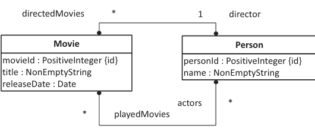

你可以使用以下示例数据测试你的应用：

| 电影 ID | 标题 | 上映日期 | 导演 | 演员 |
|---|---|---|---|---|
| 1 | 学德小说 | 1994-05-12 | 1 | 5, 6 |
| 2 | 危险关系 | 1988-12-16 | 2 | 7, 5 |
| 3 | 无无耻英仇 | 2009-05-20 | 1 | 9, 1 |

https://doi.org/10.1515/9783110500325-012

## 11.2 为国家分配城市，为组织分配成员，反之亦然 — 119

### 人员

| 人员 ID | 姓名 | 导演作品 | 演过的电影 |
|---|---|---|---|
| 1 | 昆汀·塔伦蒂诺 | 1, 3 | 3 |
| 2 | 史蒂芬·弗尔斯 | 2 | |
| 5 | 乌玛·瑟曼 | | 1, 2 |
| 6 | 约翰·特拉沃尔 | | 1 |
| 7 | 基亚努·里维斯 | | 2 |
| 9 | 布拉德·皮特 | | 3 |

更多电影数据可以在 IMDb 网站找到。

## 为国家分配城市，为组织分配成员，反之亦然

该项目基于下方所示的信息设计模型。之前作业中的对应应用需要扩展，添加管理有关国际组织（以国家为成员）以及有关城市（作为首都和总部所在地）数据的能力。这是通过添加相应的模型类 `InternationalOrganization` 和 `City` 以及以下单向关联实现的：

1. `InternationalOrganization` 与 `Country` 之间的多对多关联，将零或多个国家分配为某个国际组织的成员；反之，将零或多个国际组织分配给一个国家。
2. `Country` 与 `City` 之间的一一关联，将零或多个城市分配给一个国家；且反之，一个城市恰好对应一个国家。

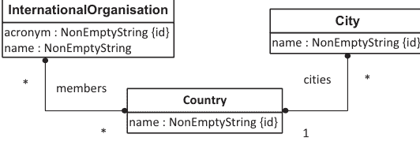

你可以使用以下示例数据测试你的应用：

| 缩写 | 名称 | 成员 |
| --- | --- | --- |
| UN | 联合国 | 德国、法国、俄罗斯 |
| WHO | 世界卫生组织 | 德国、法国、俄罗斯 |
| NATO | 北大西洋公约组织 | 德国、法国 |

| 名称 | 城市 | 国际组织 |
| --- | --- | --- |
| 德国 | 柏林、汉堡、法兰克福 | UN, WHO, NATO |
| 法国 | 马赛、里昂、巴黎 | UN, WHO, NATO |
| 俄罗斯 | 莫斯科、新西伯利亚 | UN, WHO |

| 城市 | 国家 |
| --- | --- |
| 柏林 | 德国 |
| 法兰克福 | 德国 |
| 汉堡 | 德国 |
| 里昂 | 法国 |
| 莫斯科 | 俄罗斯 |
| 新西伯利亚 | 俄罗斯 |
| 巴黎 | 法国 |

关于国家的更多数据可以在 CIA World Factbook 网站找到。

## 第二部分：类层次中的继承

当应用必须管理大量对象类型的数据时，某些对象类型之间存在各种子类型（继承）关系。子类型和继承是信息模型中的重要元素。软件应用程序必须以适当的方式实现它们，通常作为模型-视图-控制器（MVC）架构中模型层的一部分。遗憾的是，应用开发框架通常并不提供继承的支持。

## 12 子类型化与继承

子类型或子类的概念是自然语言中的一个基本概念，在面向对象编程中，我们说鸟是动物。子类型继承其父类型的所有特征。在面向对象（OO）类模型中（这是编写应用模型类代码的依据），关联类被转换为普通类，并带有引用所涉及对象类的引用属性。例如，关联类 `Reservation` 被转换为以下 OO 类模型：

| Reservation |
| :--- |
| book : Book |
| reserved_by : Person |
| date : Date |


| reserved_by : Person |
| date : Date |

当一个对象类型有多个父类型时，我们就有了多继承的情况，这在许多编程语言（如 Java）中是不允许的。

## 12.1 通过特化引入子类型

当一个对象类型代表另一个类型的特例时，就可以通过特化引入一个新的对象类型。我们在示例中说明了这一点，即将教科书和传记作为书籍的特例。这意味着书籍和传记也拥有 ISBN、标题和出版年份，但此外它们还有诸如 `subjectArea` 的特征。

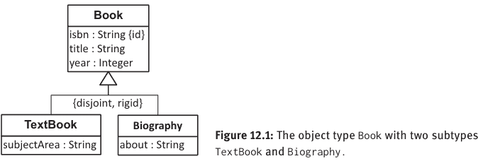

在特化对象类型时，我们为新添加的子类型定义额外的特征。在许多情况下，这些额外的特征是更具体的属性。例如，在教材特化书籍的情况下，我们定义了 `subjectArea` 属性。在某些编程语言（如 Java）中，可以说子类型扩展了父类型。

然而，我们也可以通过定义额外的约束来而不是额外的属性或方法。

## 12.2 通过泛化引入父类型

我们通过图 12.2 所示的示例来说明泛化。

| Employee | | | |
|---|---|---|---|
| employeeNo : Integer (id) | | Author | authorid[1] : Integer (id) |
| name : String | | isbn : String (id) | name : String |
| dateBirth : Date | | title : String | dateBirth : Date |
| salary : Decimal | | year : Integer | dateDeath [0..1] : Date |
| * | * | * | biography[1] : Text |

图 12.2：Employee 和 Author 对象类型共享多个属性。

在添加对象类型 Employee 后，我们注意到 Employee 和 Author 共享许多属性，这是因为员工和作者都是人，而成为员工和作者是人所扮演的角色。因此，我们可以通过添加一个联合父类型 Person 来对这两个对象类型进行泛化，如图 12.3 所示。

在泛化两个或多个对象类型时，我们将它们共享的特征移动到新添加的父类型中并对其进行集中管理。在 Employee 和 Author 的情况下，这组共享特征由姓名、出生日期和死亡日期属性组成。通常，共享特征可能包括属性、关联和约束。

注意，由于在信息设计模型中，每个层级类都需要一个标准标识符，因此我们在新的 Person 类中声明了标准标识符属性 `personId`，它会被所有子类继承。因此，我们

## 12.3 内涵与外延

| Employee | Person |
| :--- | :--- |
| employeeNo: Integer (key) | personid[1]: Integer (id) |
| salary : Decimal | name[1]: String |
| | dateOfBirth[1]: Date |
| | dateOfDeath[0..1]: Date |

| Publisher | Book | authored | Author |
| :--- | :--- | :--- | :--- |
| name : String (id) | isbn: String (id) | Books | * |
| address : String | title : String | * | biography : Text |
| | 0..1 | year : Integer | * |

图 12.3: 对象类型 Employee 和 Author 被共同的超类型 Person 泛化。

我们必须重新考虑在泛化之前在子类中被声明为标准标识符的属性。在 Employee 的情况下，我们曾将属性 `employeeNo` 声明为标识标识。由于员工编号是一个重要的业务信息项，我们必须保留该属性，即使它不再需要作为标识符（“键”），我们也通过 `key` 约束关键字为其定义一个唯一性约束。

在 Author 的情况下，我们曾将属性 `authorId` 声明为标准标识符而非业务信息项，现在我们将其删除，因为它不再需要作为作者的标识符。因此，我们最终得到的模型允许通过员工编号或 `personId` 值来识别员工，并通过 `personId` 来识别作者。

我们考虑对原始示例模型的以下扩展，如图 12.4 所示：

1. 将 Book 分割为不相交（但不完全）的 TextBook（教材）和 Biography（传记），
2. 将 Person 分割为重叠且不完全的 Author 和 Employee，并进一步由 Manager 专门特化。

对象的内涵由其特征集给出，包括属性、关联、约束和操作。

对象的外延是实例化对象类型的所有对象的集合。对象的外延也称为其总体。

## 12.4 类型层次结构

*类型层次结构*（type hierarchy，或类层次结构）由两个或多个类型组成，其中一个是*根*（或*顶层*）类型，所有其他类型至少有一个直接超类型。

当所有非根类型都有唯一的直接超类型时，该类型层次结构就是**单继承层次结构**，否则它是**多继承层次结构**。例如，在下方的图 12.5 中，`Vehicle` 类是单继承层次结构的根，而图 12.6 显示了多继承层次结构的示例，这是因为 `AmphibianVehicle` 有两个直接超类：`LandVehicle` 和 `WaterVehicle`。

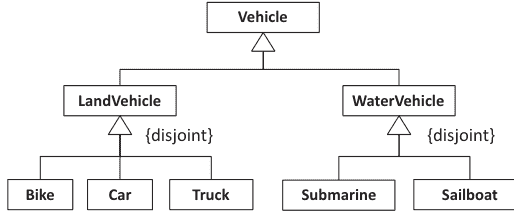

**图 12.5:** 具有根类 `Vehicle` 的类层次结构。

类层次结构的最简单情况（只有一个子类型层级）在 UML 中被称为*泛化*（generalization）集，但可能更自然地称为*分割*（segmentation）。如果所有子类的并集等于超类的范围（换句话说，如果超类的所有实例都实例化某个子类），则该分割是*完全的*（complete）。如果所有子类之间两两不相交，则该分割是*不相交的*（disjoint）（换句话说，如果超类的没有实例实例化超过一个子类）。否则，被称为*重叠的*（overlapping）。完全且不相交的分割被称为*划分*（partition）。

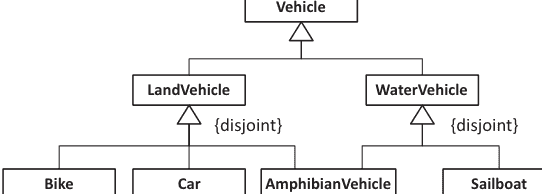

**图 12.6:** 多继承层次结构。

在类图中，我们可以通过在分割上标记 *complete* 和 *disjoint* 来表示这些。例如，上方图 12.6 中 `Vehicle` 分割为 `LandVehicle` 和 `WaterVehicle` 的分割是不完全且重叠的。

信息模型可以包含任意数量的类层次结构。

| | | |
|---|---|---|
| isbn[1] : String (id) | «enumeration» | |
| title[1] : String | BookTypeEL | |
| year[1] : integer | TextBook | |
| category[0..] : BookTypeEL (frozen) | Biography | |
| subjectArea[0..] : String | | |

```
<<invariant>
((category="TextBook") IFF NOT subjectArea=undefined AND
(category="Biography") IFF NOT about=undefined))
```

图 12.7: 应用类层次结构合并（Class Hierarchy Merge）设计模式的结果。

## 12.7 计算语言中的子类型与继承

面向对象编程（OOP）、数据库语言（如 SQL99）、XML 架构定义 XML Schema 以及其他计算语言，已经以各种方式和不同程度支持了子类型和继承。计算语言中子类型的核心在于定义类型层次结构以及特征的继承：OOP 中的属性、约束和方法；SQL99 中的表列和约束；XML Schema 中的元素、属性和约束。

通常情况下，在类型层次结构中支持多重分类（multiple classification）和多重继承（multiple inheritance）是理想的。这些语言特性密切相关，被认为是高级特性，在许多应用程序中可能不需要，或者可以通过变通方案来处理。

多重分类意味着一个对象具有多个直接类型。这主要发生在对象同时扮演多个角色时，因此它直接实例化定义这些角色的多个类。

多重继承通常也与角色类（role classes）有关。例如，助教同时扮演学生角色和教职员角色，因此相应的 OOP 类 `StudentAssistant` 同时继承了 `Student` 和 `AcademicStaffMember` 两个类。同样，我们上面的例子，水陆两栖车 `AmphibianVehicle` 继承了 `LandVehicle` 和 `WaterVehicle` 两个角色类。

### 12.7.1 OOP 中的子类型与继承

OOP 对子类型的最低支持水平（例如 Java 和 C# 提供）允许在单继承层次结构中定义属性和方法的继承，可以通过 `is-instance-of` 谓词辅助检查，以测试一个类是否是对象的直接或间接类型。此外，希望通过以下方式检查继承层次结构：

1. 一个预定义的实例级属性，用于获取对象的直接类型（如果允许多重分类则获取多个直接类型）；
2. 一个预定义的类型级属性，用于获取类型的直接父类型（如果允许多重继承则获取多个父类型）。

JavaScript 是 OOP 语言的一个特例，它最初没有定义类的显式语言元素，只有定义构造函数的元素。由于其动态编程特性，JavaScript 允许使用各种代码模式来实现类、子类型和继承。在现代 JavaScript 中（从 ES2015 开始），定义类和子类是非常简单的。首先，我们定义一个基类 `Person`，它有两个属性 `firstName` 和 `lastName`：

```javascript
class Person {
  constructor (first, last) {
    // 初始化基类属性
    this.firstName = first;
    this.lastName = last;
  }
}
```

然后，我们定义一个子类 `Student`，它有一个额外的属性 `studentNo`：

```javascript
class Student extends Person {
  constructor (first, last, studNo) {
    // 调用父类的构造函数
    super(first, last);
    // 分配额外属性
    this.studentNo = studNo;
  }
}
```

注意如何通过 `super(first, last)` 调用父类的构造函数来分配父类属性。

### 12.7.2 使用 XML Schema 的子类型与继承

在 XML Schema 中，可以通过扩展（extending）或限制（restricting）现有复杂类型来定义子类型。扩展复杂类型意味着添加元素或属性来扩展其意图，而限制复杂类型意味着通过添加约束来限制其扩展。

我们可以通过以下方式扩展 `Person` 来定义复杂类型 `Person` 和子类型 `Student`：

```xml
<xs:complexType name="Person">
  <xs:attribute name="firstName" type="xs:string" />
  <xs:attribute name="lastName" type="xs:string" />
  <xs:attribute name="gender" type="GenderValue" />
</xs:complexType>
<xs:complexType name="Student">
  <xs:extension base="Person">
    <xs:attribute name="studentNo" type="xs:string" />
  </xs:extension>
</xs:complexType>
```

我们可以通过以下方式限制 `Person` 来定义子类型 `FemalePerson`：

```xml
<xs:complexType name="FemalePerson">
  <xs:restriction base="Person">
    <xs:attribute name="firstName" type="xs:string" />
    <xs:attribute name="lastName" type="xs:string" />
    <xs:attribute name="gender" type="GenderValue" use="fixed" value="f" />
  </xs:restriction>
</xs:complexType>
```

注意，通过将 `gender` 属性的值固定为 "f"，我们定义了一个仅适用于 `Person` 的女性实例的约束。

### 12.7.3 使用 OWL 的子类型与继承

在 Web 本体语言 OWL 中，属性定义与类定义分离，且属性默认是多值的而非单值的。因此，标准属性需要声明为功能性的（functional）。

```xml
<owl:Class rdf:about="#Student">
  <rdfs:subClassOf rdf:resource="#Person"/>
</owl:Class>
<owl:ObjectProperty rdf:about="#name">
  <rdfs:domain rdf:resource="#Person"/>
  <rdfs:range rdf:resource="string"/>
</owl:ObjectProperty>
```

（注：OWL 部分的 OCR 文本是碎片化的；我根据片段中提供的上下文重构了可能的标准 OWL 结构）。

### 12.7.4 使用表表示类层次结构

虽然 SQL 的经典版本（SQL92）不支持子类型，但这种情况在 SQL99 中得到了改变。然而，SQL99 中与子类型相关的特性仅在某些 DBMS（例如 PostgreSQL）中得以实现。因此，为了设计一个可以在多种 DBMS 中实现的模型（包括 MySQL 和 SQLite 等较弱的技术），我们必须在表中对继承层次结构建模。这就是对象关系映射（Object-Relational Mapping）的工作。

用数据库表表示类层次结构本质上有三种替代方法：

1. **单表继承 (Single Table Inheritance, STI)** 是最简单的方法，整个类层次结构由单表表示，该表包含根类及其所有子类的所有属性的列，并以根类的名称命名。
2. **按类表继承 (Table per Class Inheritance, TCI)** 是一种方法，层次结构中的每个类都由相应的表表示，该表包含继承属性的列，并重复表示其父类表中的列。
3. **连接表继承 (Joined Tables Inheritance, JTI)** 是一种更逻辑的方法，每个子类都由相应的表（子表）表示，该表通过其主键引用父类的主键与表示其父类的表（父表）连接起来，使得子类的（继承的）属性不表示为子表的列。


注意，STI 方法与上述第 12.6 节中讨论的类层次结构合并设计模式密切相关。每当此设计模式已经应用于设计模型中，或者设计模型已经根据此设计模式进行了重构时，类层次结构（及其子类）在设计中就被消除了，因此在要在应用模型层中以类定义形式编码的代码的数据模型中也被消除了，所以不再需要将类层次结构映射到单表。否则，设计模型包含一个类层次结构，该层次结构在应用模型层中通过相应的类层次结构实现，并将通过 STI 方法映射到数据库表。

我们通过两个简单的示例来说明这些方法的使用。第一个例子是上述图 12.1 所示的 `Book` 类层次结构。第二个例子是下方图 12.8 所示的 `Person` 角色 `Employee`、`Manager` 和 `Author` 的类层次结构。

### 12.7.4.1 单表继承

考虑图 12.1 所示的单层类层次结构，它是作为 MVC 应用模型类的设计，对 `Book` 类的一个不完全不交划分。

## 12.7 计算语言中的子类型化与继承 — 135

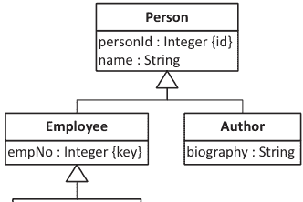

图 12.8：具有 `Person` 角色层级结构的信息设计模型。

如果子类型只有一层（或仅少数层）且每个子类型只有几个额外的属性，那么最好使用 STI（单表继承）。因此，我们建模一个包含所有属性列的单表，其中表示段子类额外属性的列（“段属性”）是可选的，如图 12.9 所示的 SQL 表模型所示。

```sql
isbn[1] : VARCHAR (pkey)
title[1] : VARCHAR
year[1] : INTEGER
category[0..1] : "TextBook","Biography" (frozen)
subject_area[0..1] : VARCHAR
about[0..1] : VARCHAR
```

```sql
invariant
{(category="TextBook" IFF subject_area IS NOT NULL)
(category="Biography" IFF about IS NOT NULL)}
```

图 12.9：用单表表示 `Book` 类层级的 SQL 表模型。

一种常见的方法是添加一个特殊的判别列，用于表示对应于所表示对象所实例化的子类的类别。该列通常为字符串值，但被限制为子类名称之一。DBMS 支持枚举，因此它也可以是枚举值。我们使用 `category` 作为判别列的名称，在我们的 `Book` 类层级示例中，由于教材和传记的分段是固定的，因此该列具有 `frozen`（冻结）约束。

根据书籍的 `category`，我们必须强制：当且仅当它是 "TextBook" 时，其属性 `subjectArea` 必须有值；当且仅当它是 "Biography" 时，其 `about` 必须有值。这种隐含约束表示在上述类图中附在 `Book` 类上的不变性（invariant）框中，其中逻辑运算符关键字 "IFF" 代表逻辑等价运算符“当且仅当”。这需要在数据库中实现，例如使用 SQL 表的 `CHECK` 子句或 SQL 触发器。

当给定的分段是互斥的时，使用单值枚举类别来表示子类实例所属的信息。否则，如果是非互斥的，则使用多值枚举类别来表示实例所属的子类。此类属性可以在 SQL 中通过为一组枚举代码或标签定义一个字符串值列（作为相应的连接）来实现。

考虑图 12.8 中的类层级。在子类 `Employee`、`Manager` 和 `Author` 中仅定义了三个属性的情况下，该类层级可以使用 STI 方法进行映射，如图 12.10 所示的 SQL 表模型。

| people |
| :--- |
| person_id[1] : INTEGER (pkey) |
| name[1] : VARCHAR |
| categories[*] : VARCHAR ("Employee", "Manager", "Author") |
| emp_no[0..1] : INTEGER (unique) |
| biography[0..1] : VARCHAR |
| department[0..1] : VARCHAR |
> «invariant
("Employee" IN categories IFF NOTNULL(emp_no) AND ("Manager" IN categories IFF NOTNULL(emp_no) AND NOTNULL(department) AND ("Author" IN categories IFF NOTNULL(biography)))

**图 12.10：** 表示 `Person` 层级的 STI 表模型。

注意，现在判别列 `categories` 是多值的，因为 `Person` 的分段不是互斥的，而是重叠的，这意味着一个 `Person` 对象可能属于多个类别。同样注意，由于角色分段（如 `Employee`、`Manager`、`Author`）不是固定的，判别列 `categories` 没有具有 `frozen` 约束。

## 12.7 计算语言中的子类型化与继承 — 137

该模型的一个可接受群体示例如下：

| person_id | name | categories | biography | emp_no | department |
| :--- | :--- | :--- | :--- | :--- | :--- |
| 1001 | Harry Wagner | Author, Employee | Born in Boston, MA, in 1956, . . . | 21035 | |
| 1002 | Peter Boss | Manager | | 23107 | Sales |
| 1003 | Tom Daniels | | | | |
| 1077 | Immanuel Kant | Author | Immanuel Kant (1724–1804) was a German philosopher. . . . | | |

注意 `Person` 表包含四种不同类型的人：

1. 一个人，Harry Wagner，他既是作者（有传记）又是员工（有员工编号）。
2. 一个人，Peter Boss，他是一个经理（一种特殊的员工），管理销售部门（Sales）。
3. 一个人，Tom Daniels，他既不是作者也不是员工。
4. 一个人，Immanuel Kant，他是一个作者（有传记）。

**STI 方法的优点：** 能够忠实地表示原始类层级中表达的子类型关系；特别是，任何表示子类实例的行（员工、经理或作者）也代表了父类实例（人）。

**STI 方法的缺点：** (1) 在子类之间之间共同点较少的多级类层级中，STI 方法无法产生良好的表示。类层级结构在元素（类）方面的结构仅被隐式地保留了。

### 12.7.4.2 每类一表 (Table Per Class)

在更真实的模型中，由于子类具有很少的共同点，STI 方法无法产生良好的表示。在元素（类）方面的类层级结构仅被隐式地保留了。

在更真实的模型中，由于子类具有很少的共同点，TCI（每类一表）方法将不再可行。TCI 方法通过将表示子类的表替换为表示父类的表，并如图 12.1 所示的 SQL 表，使得每个表都代表了父类实例。

| supertable | subtable |
| :--- | :--- |
| people | authors |
| person_id : INTEGER (pkey) | person_id : INTEGER (pkey) |
| name : VARCHAR | name : VARCHAR |
| categories[*] : VARCHAR | biography VARCHAR |
| emp_no[0..1] : INTEGER (unique) | |
| biography[0..1] : VARCHAR | |
| department[0..1] : VARCHAR | |
| | managers |
| | employees |
| | department | |

图 12.1：表示 `Person` 层级的 TCI 表模型。

TCI 表模型可以从信息设计模型通过以下步骤推导出：

1. 将单数形式的类名替换为复数表名（例如 `Person` 到 `people`）。
2. 将驼峰命名属性名称替换为下划线分隔的名称（例如 `personid` 到 `person_id`）。
3. 为所有类添加 `<table>` 符号。
4. 将平台无关的数据类型替换为 SQL 数据类型。
5. 丢弃泛化/继承箭头，并将所有父表的列（如 `person_id` 和 `name`）添加到子表（`authors`、`employees`）。

每个表只填充对应于该类的直接实例。

### 12.7.4.3 关联继承 (Joined Inheritance)

为了避免 TCI 在重叠分段情况下的数据冗余问题，我们可以使用 JTI（连接继承）方法，如下图 12.12 所示的 SQL 表模型示例。该模型通过定义其主键同时同时指向父类主键的外键，从而将表示子类的表（`subtables`）与表示其父类的表（`supertables`）连接起来。注意，外键以带有 `«fkey»` 标记的 UML 依赖箭头的形式可视化，并在源表侧标注外键列的名称。

# 12 子类型与继承

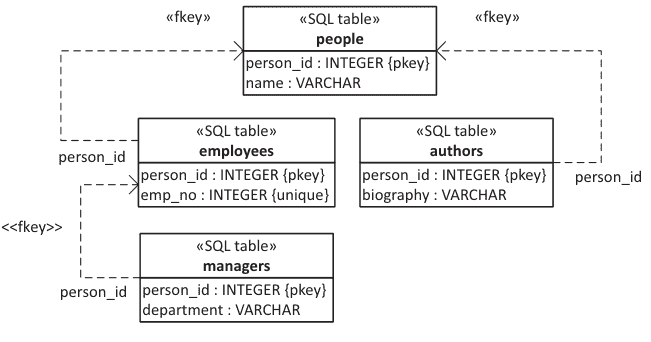

该模型的一个可接受总体示例如下：

| person_id | name |
|---|---|
| 1001 | Harry Wagner |
| 1002 | Peter Boss |
| 1003 | Tom Daniels |
| 1077 | Immanuel Kant |

| person_id | biography |
|---|---|
| 1001 | 1956年出生于马萨诸塞州波顿，. . . |
| 1077 | 曼纽尔·康德（1724–1804）是一位德国哲学家 . . . |

| person_id | emp_no |
|---|---|
| 1001 | 21035 |
| 1002 | 23107 |

| person_id | department |
|---|---|
| 1002 | Sales |

JTI 方法的优点：(1) 显式保留了子类型关系和类层次结构。(2) 避免了重叠分段情况下的数据冗余。

缺点：(1) JTI 方法的主要缺点是，在查询子类时需要进行连接查询（用于连接被隔离的实体数据），这可能会产生性能问题。

## 12.8 练习题

如果你想查找以下练习题的答案，可以查看我们的讨论论坛。如果你在论坛中没有找到答案，可以发帖提问特定问题的答案。

### 12.8.1 第 1 题：关于类层次的陈述

考虑以下类模型：

| Abc | | Bcd |
|---|---|---|
| a1 : String (id) | | b1 : Integer (id) |
| a2 : Integer | * | ..0.1 |
| a3 : Integer | | |
| Cde | invariant |
|---|---|
| c : Integer (key) | (a3 > a2) |

下列陈述中哪些是正确的？请选择一个或多个：

- 1. [] `Cde` 的所有实例都有属性 `a1` 的值。
- 2. [] `Cde` 的标准标识符是 `a1`。
- 3. [] `Cde` 的所有实例都可能有一个对象引用 `ab` 指向类型为 `Bcd` 对象。
- 4. [] `Abc` 的直接实例具有 `c` 的值。
- 5. [] 对于任何类型为 `Ab` 的对象，`a3` 的值必须大于 `a2` 的值。
- 6. [] 对于任何类型为 `Cde` 的对象，`a3` 的值必须大于 `a2` 的值。
- 7. [] `Cde` 的标准标识符是 `c`。

### 12.8.2 第 2 题：类层次合并

考虑以下类模型：

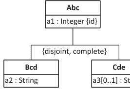

对于这种简单的类层次结构，我们可以使用类层次合并（Class Hierarchy Merge）设计模式，将整个类层次结构合并到单个类中。以下哪个模型描述了针对给定 `Ab` 类层次结构实现类层次合并设计模式的正确方式？请选择一个：

- 1. 0

| Abc | <enumeration> |
|---|---|
| a1[1] : Integer (id) | AbctypeEL |
| category[1] : AbctypeEL | Bcd |
| a2[1] : String | Cde |
| a3[0..1] : String | |

- 2. 0

| Abc | <enumeration> |
|---|---|
| a1[1] : Integer (id) | AbctypeEL |
| category[0..1] : AbctypeEL | Bcd |
| a2[1] : String | Cde |
| a3[0..1] : String | |

- 3. 0

| Abc | <enumeration> |
|---|---|
| a1[1] : Integer (id) | AbctypeEL |
| category[1] : AbctypeEL | Bcd |
| a2[0..1] : String | Cde |
| a3[0..1] : String | |

- 4. 0

| Abc |
|---||
| a1[1] : Integer (id) |
| a2[1] : String |
| a3[0..1] : String |

## 13 使用原生 JS 实现子类型化

在本章中，我们首先介绍 JavaScript 中基于构造函数的子类型化的通用方法，然后根据上文所示的运行示例（公共图书馆应用）的信息模型片段，展示两个案例研究。

在第一个案例研究中，我们考虑图 12.1 所示的根类为 `Book` 的单级类层次结构，作为一个不完全的不相交刚性分段。我们使用类层次合并设计模式将此简单层次结构重构为可以映射到持久化数据库表的单个类。

在第二个案例研究中，我们考虑图 12.8 所示的由 `Person` 角色 `Employee`、`Manager` 和 `Author` 组成的多级类层次结构。将 `Person` 划分为 `Employee` 和 `Author` 的分段没有任何约束，这意味着它是完全的、重叠的（非相交的）。我们使用类层次合并设计模式重构简单的 `Manager`-is-`Employee` 层次，并使用连接继承（Joined Inheritance）方法将 `Employee`-and-`Author`-is-`Person` 层次映射到三个通过键依赖关联的表中。在两个案例研究中，我们展示了：

1. 如何从信息设计模型推导出 JS 类模型和实体表；
2. 如何以模型形式编写 JS 类；
3. 如何根据模型编写代码。

## 13.1 基于构造函数的类的子类型化

在 ES2015 版本之前，JavaScript 没有显式的类概念，且不支持支持子类型化，必须通过两种继承机制来实现：(1) 属性继承和 (2) 方法继承。正如我们在第一卷第一章中所述，类可以通过两种替代方式定义：基于构造的和基于工厂的。我们通过以下示例总结了在单继承层次结构中定义父类和子类的 ES2015 代码：

| Person |
|---|
| firstName : String |
| lastName |
| Student |
|---|
| stdNo : Integer |

首先，我们定义带有 `firstName` 和 `lastName` setter 的基类 `Person`：

```javascript
class Person {
    constructor ({first, last}) {
        // 通过 setter 赋值属性
        this.firstName = first;
        this.lastName = last;
    }

    getFirstName () {return this._firstName};
    setFirstName (f) {
        // ... 约束
        this._firstName = f;
    }

    getLastName () {return this._lastName};
    setLastName (l) {
        // ... 约束
        this._lastName = l;
    }
}
```

然后，我们定义一个带有额外属性 `stdNo` 的子类 `Student`：

```javascript
class Student extends Person {
    constructor ({first, last, stdNo}) {
        // 调用父类构造函数
        super(first, last);
        // 赋值额外属性
        this.stdNo = stdNo;
    }

    get stdNo () {return this._stdNo;}
    set stdNo (sn) {
      // 约束
      this._stdNo = sn;
    }
}
```

注意父类构造函数的调用：`super(first, last)`。

### 13.2 案例研究1：消除类层次

可以通过应用类层次合并设计模式消除简单的类层次结构。我们案例研究的起点是图 12.1 的信息设计模型所示的简单类层次结构，它将 `Book` 划分为 `TextBook` 和 `Biography` 的不相交（但不完全的）刚性分段。该模型首先通过类层次合并模式简化如下模型：

| isbn[1]: String (id) | <<enumeration> |
|---|---|
| title[1]: String | BookTypeEL |
| year[1]: Integer | TextBook |


| category[0..1]: BookTypeEL (frozen) | Biography |

| subjectArea[0..1]: String | |

| about[0..1]: String | |

> invariant ((category="TextBook" NOT subjectArea=undefined) AND (category="Biography" NOT about=undefined))

现在我们从这个设计模型推导出 JS 类模型。

### 13.2.1 构建 JS 类模型

我们通过三个步骤构建 JS 类模型：

- 将与平台无关的类型（用于属性范围和参数）替换为 JS 类型。这包括枚举值属性（如 `category`），转换为底层枚举类型整数限制的数值属性。

- 为所有属性装饰 `«get/set»` 立体型，表示它们具有隐式的 getter 和 setter。

- 添加如第一卷第八章描述的属性检查函数。根据其隐含语义，`checkCategory` 函数以及段属性的检查需要特别考虑。特别是，段属性检查函数必须确保只有在类别属性代表对应段的值时才能赋值。我们在下文讨论如何编写 JS 类模型时更详细地解释这种验证语义。

这导致了 13.1 所示的 JS 类模型，其中类级（静态）方法带有下划线标记：

| Book | «enumeration» |

|---|---|

| `«get/set» isbn: string` | BookCategoryEL |

| `«get/set» title: string` | TEXTBOOK |

| `«get/set» year[1]: number` | BIOGRAPHY |

| `«get/set» category[0..1]: number (from BookCategory, frozen)` | |

| `«get/set» subjectArea[0..1]: string` | |

| `checkIsbn(isbn: string, string): ConstraintViolation` |

| `checkIsbn(isbn: string): string: ConstraintViolation` |

| `checkTitle(title: string): ConstraintViolation` |

| `checkYear(year: number): ConstraintViolation` |

| `checkCategory(in type: number): ConstraintViolation` |

| `checkSubjectArea(in subjectArea: string): ConstraintViolation` |

| `checkAbout(in about: string): ConstraintViolation` |

**图 13.1:** 合并后类层次结构的 JS 类模型。

### 13.2.2 新问题

与第一卷第11章讨论的枚举相比，我们必须处理许多新问题：

1. 在模型代码中我们需要处理：

   1. 添加约束违反类 `FrozenValueConstraintViolation.js`。

   2. 编写示例中作为类别属性 `BookCategoryEL` 范围的枚举。

   3. 编写类别属性的 `checkCategory` 函数。在我们的示例中，由于 Book 分段是不完全的，该属性是*可选的*。如果应用类层次合并模式的分段是完全的，那么类别属性就是*强制的*。

## 13.2 案例研究 1：消除类层次结构

- 4. 为所有分段属性编写检查函数，使其接受类别作为第二个参数，以便能够测试所涉及的分段属性是否适用于给定的实例。

- 5. 细化序列化函数 `toString()`，通过添加分类区分（`switch` 语句）来仅序列化适用于给定分类的分段属性。

- 6. 在 `Book.update` 中为类别属性实现“冻结值约束（Frozen Value Constraint）”，只有在书籍类别尚未被定义时才更新其类别。这意味着类别一旦被定义，就不能再进行更新。

- 2. 在 UI 中，我们需要处理：

    - 1. 在 `books.html` 的“列出所有书籍”用例中添加一个“特殊类型”（或“类别”）列以显示表格。没有特殊分类的书籍其表格单元格将为空，而对于所有书籍，其类别将显示在该单元格中，并带有其他分段特定的属性值。这需要在 `v.books.retrieveAndList setupInterface.js` 视图代码文件中编写相应的 `switch` 语句。

    - 2. 在 `books.html` 的“创建书籍”和“更新书籍”用例中添加“特殊类型”选择组件（通常为选择列表）以及针对所有分段属性的响应式表单字段。分段属性表单字段仅在选择了相应的书籍类别时才显示。这种仅在特定条件下渲染特定表单字段的方法被称为动态表单。

### 13.2.3 编写 JS 类模型的模型类

可以直接为 JS 类模型编码，以获取我们 JS 前端应用中模型类的代码。

#### 13.2.3.1 总结

- 1. 编写枚举类型 `BookCategoryEL`，如第一卷第 11 节所示，借助元类 `Enumeration` 将其用作类别属性的范围。

- 2. 以 JS 类定义的形式编写模型类 `Book`，并带有 `get` 和 `set` 方法以及静态检查函数。

这些步骤将在后续章节中进行详细讨论。

### 13.2.3.2 编写枚举类型 BookCategoryEL

枚举类型 `BookCategoryEL` 在 `Book.js` 模型类文件的开头通过我们的库元类按以下方式编写：

```javascript
BookCategoryEL = new Enumeration([ "Textbook", "Biography"]);
```

### 13.2.3.3 编写模型类 Book

我们以 ES2015 类的形式编写模型类 `Book`，其中类别属性以及分段属性 `subjectArea` 和 `about` 是可选的，并为所有属性编写了 getter、setter 和静态检查函数：

```javascript
class Book {
  constructor ({isbn, title, year, category, subjectArea, about}) {
    this.isbn = isbn;
    this.title = title;
    this.year = year;
    // 可选属性
    if (category) this.category = category;
    if (subjectArea) this.subjectArea = subjectArea;
    if (about) this.about = about;
  }
  get isbn() { . . }
  static checkIsbn(isbn) { . . }
  static checkIsbnAsId(isbn) { . . }
  set isbn(isbn) { . . }
  get title() { . . }
  static checkTitle(t) { . . }
  set title(t) { . . }
  get year() { . . }
  static checkYear(y) { . . }
  set year(y) { . . }
  get category() { . . }
  static checkCategory(c) { . . }
  set category(c) { . . }
  get subjectArea() { . . }
  static checkSubjectArea(sA, cat) { . . }
  set subjectArea(s) { . . }
  get about() { . . . }
  static checkAbout(a, cat) { . . . }
  set about(a) { . . . }
}
```

注意，构造函数使用 ES2015 的函数参数解构功能定义了一个单一记录参数。我们按以下方式为类别属性编写了 `checkCategory` 和 `setCategory` 方法：

```javascript
static checkCategory(c) {
    if (c === undefined || c === "") {
        return new NoConstraintViolation(); // c 是可选的
    } else if (!util.isIntegerOrIntegerString(c) || parseInt(c) < 1 ||
        parseInt(c) > CategoryEL.MAX) {
        return new NoConstraintViolation(
            "Invalid value for category: " + c);
    } else {
        return new NoConstraintViolation();
    }
}
set category(c) {
    var validationResult = null;
    if (this.category) { // 已经设置/赋值
        validationResult = new FrozenConstraintViolation(
            "类别不能更改!");
    } else {
        validationResult = Book.checkCategory(c);
    }
    if (validationResult instanceof NoConstraintViolation) {
        this._category = parseInt(c);
    } else {
        throw validationResult;
    }
}
```

虽然分段属性的 getter（在本例中：`subjectArea` 和 `about`）遵循标准模式，但它们的检查函数和 setter 必须确保该属性适用于被检查实例的类别。

```javascript
// 分段属性的 getter（在本例中：`subjectArea` 和 `about`）遵循标准模式，但它们的检查函数和 setter 必须确保该属性适用于被检查实例的类别。```

### 13.2.4 编写视图和控制器

应用程序的用户界面（UI）由一个可以导航到数据管理页面的起始页组成（在我们的示例中为 `books.html`）。此类数据管理页面包含五个部分：管理书籍、列出所有书籍、创建书籍、更新书籍和删除书籍，每次只有一个部分显示（通过设置 `display:none`）。

#### 13.2.4.1 总结

我们在“列出书籍”用例中处理了类别属性以及分段属性 `subjectArea` 和 `about`，在“创建书籍”和“更新书籍”用例中也是如此：

- 1. 在 `books.html` 的“列出书籍”用例表格中添加一个“类别”信息列。

- 2. 在 `books.html` 的“创建书籍”和“更新书籍”用例表单中添加“类别”选择字段以及所有分段属性的输入字段。分段属性字段仅在选择了书籍类别时才显示。

#### 13.2.4.2 在检索/列出全部中添加分段信息列

我们在“列出所有书籍”用例的 `books.html` 表格中添加了“特殊类型”类别：

```html
<table id="books">
<head><tr><th>ISBN</th><th>标题</th><th>年份</th><th>类别</th></tr></head>
<tbody></tbody></tbody>
</table>
```

没有特殊分类的书籍在该列的表格单元格将为空，对于所有其他书籍，其类别将显示在该单元格中，并带有其他类别特定的信息。这需要在 `view/books.js` 文件中的 `pl.v. books.retrieveAndList.setupUserInterface` 中编写相应的 `switch` 语句：

```javascript
if (book.category) {
    switch (book.category) {
        case CategoryEL.TEXTBOOK:
            row.insertCell(-1).textContent = book.subjectArea + " textbook";
            break;
        case CategoryEL.BIOGRAPHY:
            row.insertCell(-1).textContent = "Biography about " + book.about;
            break;
    }
}
```

## 13.2 案例研究 1：消除类层次结构 153

### 13.2.4.3 在创建和更新中添加类别选择字段

在这两种情况下，我们都希望通过选择字段允许选择特殊类别的书籍（“教科书”或“传记”），如下 HTML 片段所示：

```html
<div class="field">
<label>Category: <select name="category"></select></label>
</</div>
<div class="field" Textbook><!---- conditional field -->
<label>Subject area: <input type="text" name="subjectArea" /></label>
</div>
<div class="field" Biography><!---- conditional field -->
<label>About: <input type="text" name="about" /></label>
</div>
```

注意，我们在分段容器元素的 `class` 属性中添加了“Textbook”和“Biography”作为额外值。这支持根据 `category` 属性的值来渲染或取消渲染“Textbook”和“Biography”字段。

在 `handleCategorySelectChangeEvent` 处理器中，只有当选择了相应的类别书籍时，才会通过 `pl.v.app.displaySegmentFields` 显示分段属性表单。

```javascript
pl.v.books.handleCategorySelectChangeEvent = function (e) {
  var formEl = e.currentTarget.form,
  categoryIndexStr = formEl.category.value;
  if (categoryIndexStr) {
    pl.v.app.displaySegmentFields(formEl, BookCategoryEL.labels,
    parseInt(categoryIndexStr) + 1);
  } else {
    pl.v.app.undisplayAllSegmentFields(formEl, BookCategoryEL.labels);
  }
}
```

回想一下，类别选择列表包含一个空字符串"""" 的非选择选项，由 `BookCategoryEL.labels` 的标签组成的选项列表，其值为相应的数组索引（从 0 开始）的字符串。因此，变量 `categoryIndexStr` 的值要么是 `""`（空字符串），要么是“0”、“1”、“2”等之一。

## 13.3 案例研究 2：实现类层次结构

当类层次结构变得复杂时，我们不能简单地消除它，而必须实现它：(1) 在应用模型代码中，(2) 在底层数据库中，以及 (3) 在其用户界面中。我们案例研究的起点是图 12.8 所示的设计模型。在接下来的章节中，我们从设计模型推导出 JS 类模型和 JS 实体表。实体表模型被用于对象到存储映射的设计，我们使用浏览器的 Local storage 技术来存储应用对象。

### 13.3.1 构建一个 JS 类模型

我们借助一个 JS 类模型来设计示例应用的模型类，该模型是从设计模型推导出来的，本质上是由于我们保留了泛化行，只是为每个类添加了 `get/set` 方法和静态检查函数。然而，在我们的应用中，将**类层次结构合并**设计模式（在 12.6 节讨论）应用于 `Employee` 的单子子类分段，通过消除 `Manager` 子类来简化类模型。这导致了图 13.2 所示的模型。注意，`Person` 可以是 `Employee` 也可以是 `Author`。

| Person |

| :--- |

| `«get/set» personid: Integer (id)` |

| `«get/set» name: String` |

| `checkPerson(in id string) : ConstraintViolation` |

| `checkPersonAid(in id string, in type) : ConstraintViolation` |

| `checkName(in n string) : ConstraintViolation` |

| Employee | Author |

| :--- | :--- |

| `«get/set» empno[1] : number (unique)` | `«get/set» biography : string` |

| `«get/set» category[0..1] : EmployeeCategoryEELL` | `checkBiography(in b string) : ConstraintViolation` |

| `«get/set» department[0..1] : string` | EmployeeCategoryEL |

| `checkEmpno(in n number) : ConstraintViolation` | MANAGER |


| checkCategory(in c number) : ConstraintViolation | |
| checkDepartment(in d string) : ConstraintViolation | |

图 13.2：Person 角色类层次结构的 JS 类模型。

### 13.3.2 构建一个 JS 实体表模型

由于我们使用浏览器的 Local Storage 作为示例应用的持久化存储技术，因此我们必须处理简单的键值存储。对于每个具有单一（大写）名称 `Entity` 的模型类，我们使用其复数小写名称实体作为对应的表名，并作为一个键，通过 `JSON.stringify` 方法对对象集合 `Entity` 实例进行序列化以获取关联的字符串值。

我们从信息设计模型推导出一组合适的 JS 实体表，形式为 JS 实体表模型。我们必须决定如何组织数据以及如何推导出对应的实体表模型。

第一个选择涉及使用**单表继承 (STI)**、**按类继承 (TCI)** 还是**连接表继承 (JTI)** 方法，这些方法在 12.7.4 节中被介绍过。在 STI 方法中，一个分段（或整个层次结构）用单个表表示，该表包含所有涉及类的所有属性的列，如图 13.3 示例模型所示。

| JS entity table |
| :--- |
| id[1]: number (pkey) |
| name[1]: string |
| categories[1,2,3]: number |
| empNo(0..1): number (unique) |
| department[0..1]: string |
| 1 = Author |
| 2 = Employee |
| 3 = Manager |

图 13.3：Person 角色层次结构的 STI 模型。由于给定的分段是不相交的，使用多值属性来表示所属的类。使用 STI 方法对于给定的示例是行的，因为角色层次没有很多层，且分段子类没有添加属性。但在更真实的示例中，角色层次的分段子类会有更多属性。为了简单起见，并且因为浏览器 Local Storage 不支持 JTI 需要的外键，我们选择了 TCI 方法，即为每个类获取表，但不包含外键。我们使用纯 JS 子类型得到了下方图 13.4 所示的模型，该模型是从 12.8 设计模型推导出来的：

1. 根据类层次结构合并模式将 `Manager` 子类合并到其父类 `Employee` 中。
2. 将 Person、Author 和 Employee 的 `personId` 属性的标准修饰符 `{id}` 替换为 `{pkey}` 以指示该属性为主键。
3. 将单数（大写）类名（Person、Author 和 Employee）替换为复数小写名（people、authors 和 employees）。
4. 为所有类框（people、authors 和 employees）添加 «JS entity table» 立体构型。
5. 将平台无关的数据类型名称替换为 JS 数据类型名称。
6. 删除所有泛化/继承箭头，并将父表的所有属性（personId 和 name）添加到其子表中。

| JS entity table |
| :--- |
| people |
| personid : number (pkey) |
| name : string |
| authors |
| personid : number (pkey) |
| name : string |
| biography : string |
| employees |
| personid[1] : number (pkey) |
| name[1] : string |
| empNo[1] : number (unique) |
| category[0..1] : number |
| department[0..1] : string |
| category |
| 1 = Manager |

图 13.4：Person 类层次结构的 TCI 模型。

在 JTI 方法的情况下，除了上述 1-5 步外，我们还会：

1. 将根表（people）的主键列（personId）复制到所有子表（authors 和 employees）中。
2. 将泛化箭头替换为带有 «fk» 立体型的依赖箭头，并在其源端标注子表主键的名称（此处为 personId）。

## 13.3.3 新问题

与上图 13.1 显示的第一个案例的模型相比，我们必须在模型代码中处理一些新问题：

1. 使用第 13.1 节讨论的 JS 关键字 `extends`，定义 `Employee` 与 `Person` 之间以及 `Author` 与 `Person` 之间的子类关系。
2. 从持久化存储（`Person.retrieveAll()`）加载根类实例（`Person.instances`）时，我们需要加载 (1) 代表根类（`people`）的表记录以创建其直接实例，以及 (2) 加载其所有其他子类（`authors` 和 `employees`）的表记录以创建它们的直接实例，同时将它们的对象引用添加到根类集合中（即 `Person.instances`）。通过这种方式，根类集合中不仅包含直接实例，还包含所有实例。
3. 在 `Employee.saveAll` 和 `Author.saveAll`（在 `pl.v.employees.manage.exit` 和 `pl.v.authors.manage.exit` 中调用）中，将 `Employee` 和 `Author` 实例作为 JS 实体表 `employees` 和 `authors` 的记录保存到持久化存储时，我们还需要将 `Person` 的直接实例作为表的记录保存。

## 13.3.4 JS 类模型的模型类

上图 13.2 显示的 JS 类模型可以直接编码，以获取模型类 `Person`、`Employee` 和 `Author` 的代码以及枚举类型 `EmployeeCategory`。

### 13.3.4.1 定义子类型关系

我们使用 `extends` 定义 `Employee` 与 `Person` 之间以及 `Author` 与 `Person` 之间的子类型关系。例如，在 `m/Employee.js` 中我们定义：

```javascript
EmployeeCategoryEL = new Enumeration(["Manager"])

class Employee extends Person {
  constructor({personId, name, empNo, category, department}) {
    super({personId, name});
    this.empNo = empNo;
    if (category) this.category = category;
    if (department) this.department = department;
  }
}
```

### 13.3.4.2 加载根类 Person 的实例

当从根据 TCI 方法组织的持久化数据存储中检索类层次结构根类（在我们的示例中为 `Person`）的实例时，我们不仅从代表根类的表（`people`）检索其直接实例，还需要从代表其所有子类的表（`employees` 和 `authors`）检索间接实例，如下代码所示：

```javascript
Person.retrieve = function () {
  var people = {}, employees = {}, authors = {};
  if (!localStorage["authors"]) localStorage["authors"] = "{}";
  if (!localStorage["employees"]) localStorage["employees"] = "{}";
  if (!localStorage["people"]) localStorage["people"] = "{}";
  try {
    people = JSON.parse(localStorage["people"]);
    employees = JSON.parse(localStorage["employees"]);
    authors = JSON.parse(localStorage["authors"]);
  } catch (e) {
    console.log("Error reading from Local Storage\n" + e);
  }
  for (let key of Object.keys(authors)) {
    try { // 将记录转换为（类型化的）对象
      Author.instances[key] = new Author(authors[key]);
      // 创建父类扩展
      Person.instances[key] = Author.instances[key];
    } catch (e) {
      console.log(`${e.constructor.name} while deserializing` + `author ${key}: ${e.message}`);
    }
  }
}
```

`authors` 表的每条记录都被检索并转换为 `Author` 对象，并复制其引用。同样，`employees` 表的记录也这样处理，而 `people` 表的记录仅被检索并转换为 `Person` 对象：

```javascript
Person.retrieveAll = function () {
  ..
  for (let key of Object.keys(employees)) {
  }

  for (let key of Object.keys(people)) {
    try { // 将记录转换为（类型化的）对象
      Person.instances[key] = new Person(people[key]);
    } catch (e) {
      console.log(`${e.constructor.name} while deserializing ` + 
        `${key}: ${e.message}`);
    }
  }
}
```

### 13.3.4.3 保存子表时保存主表

由于只要应用程序运行，数据就会保存在主内存中（只要应用程序的网页在浏览器中打开），因此当程序退出时必须将数据保存到持久化存储（例如关闭浏览器标签页）。在 `pl.v.employees.manage.exit` 和 `pl.v.authors.manage.exit` 中将 `Employee` 和 `Author` 实例保存到持久化存储时，我们还需要保存 `Person` 的直接实例（作为 `people` 表的记录）。这是必要的，因为 `Employee` 或 `Author` 实例的更改可能意味着 `Person.instances` 的变化。

例如，对于 `Employee` 数据管理，我们在 `v/employees.js` 中定义：

```javascript
pl.v.employees.manage = {
  exit: function () {
    Employee.saveAll();
    Person.saveAll();
  },
..}
```

## 14 使用 Java EE 进行子类型化

在本章中，我们将根据运行示例——公共图书馆（Public Library）的信息模型片段，解释两个案例。在第一个案例中，我们考虑了 12.1 所示的带有 `Book` 的单级层次结构，这是一个不完整的划分。在第二个案例中，我们考虑了 12.8 所示的带有 `Person`、`Employee` 和 `Author` 的多级层次结构。我们使用连接继承将其映射到表。

在两种情况下，我们都展示了：

1. 如何导出实体模型；
2. 如何以实体类的形式编写模型；
3. 如何基于模型编写视图和控制器代码。

## 14 Java 中的子类型化

Java 通过 `extends` 关键字内置支持子类型化，但不支持多重继承。考虑以下设计模型：

| Person |
| :--- |
| firstName \| String |
| lastName \| String |
| Student |
| studNo \| Integer |

首先，我们定义父类 `Person`。然后，我们通过 `extends` 关键字定义子类 `Student` 及其与 `Person` 的子类型关系：

```java
public class Person {
    private String firstName;
    private String lastName;
    ...
}
public class Student extends Person {
    private int studentNo;
}
```

## 14.2 案例 1：实现类层次结构 — 单一继承 — 161

```java
public Student(String first, String last, int stdNo) {
    super(first, last);
    this.setStudentNo(studNo);
}
```

注意在 `Student` 类中，我们定义了一个包含创建 `Student` 实例所需的所有参数的构造函数。在这个子类构造函数中，我们使用 `super` 调用父类的构造函数。

### 14.2 案例 1：使用单表继承实现类层次结构

在本示例中，我们实现了 12.1 所示的 `Book` 层次结构。Java 实体模型派自该设计模型。

### 14.2.1 构建 Java 实体类

回顾从 OO 模型获取 Java 实体类的方法：(1) 将所有属性私有化；(2) 使用数据类型；(3) 添加公共 getter 和 setter；(4) 添加 `toString` 函数；(5) 添加静态数据存储方法 `create`、`retrieve`、`update` 和 `delete`，从而得到如图 14.1 所示的模型。

### 14.2.2 新问题

我们需要处理以下几个新问题：

1. 在模型代码中，我们有一个枚举类型 `BookCategoryEL`，它用于 UI 代码创建选择列表组件，允许选择书籍类别。
2. 使用适当的 JPA 注解编码 `Book` 层次结构中的每个类，以便持久化到相应的数据库表中（如 `books`）。
3. 在 UI 代码中，我们需要处理：
   1. 在“检索/列出所有书籍”用例的 `retrieveAndList.xhtml`（位于 `WebContent/views/books/` 文件夹）的显示表中添加“特殊类型”列。没有特殊分类的书籍该单元将为空。

## 162 14 Java EE 中的子类型

单元，对于所有其他书籍，其类别将在此单元格中显示，以及与其他特定段的属性值。

在 `WebContent/views/books/` 文件夹下的 `create.xml` 和 `update.xml` 的“创建书籍”和“更新书籍”案例中，添加“特殊类型”选择控件以及针对所有段属性的相应表单字段。只有在选择了渲染的书籍类别时，才会显示段属性字段并对其进行验证。这种仅在特定条件下渲染特定表单字段的方法被称为动态表单。

| Java Entity |
| :--- |
| Book |
| get/set/-isbn: String (id) |
| get/set/-title: String |
| get/set/-year: Integer |
| +checkIsbnAid(in em : EntityManager) : ConstraintViolation |
| +toString(): String |
| +create(in isbn : String, in title : String, in year: integer) |
| +retrieveAll(): Book[*] |
| +...() |
| Java Entity |
| :--- |
| Textbook |
| get/set/-subjectArea : String |
| +toString(): String |
| +create(in i : String, in t : String, in y : Integer, in sA : String) |
| +retrieveAll(): TextBook[*] |
| +...() |
| enumeration |
| :--- |
| BookTypeEL |
| TEXTBOOK |
| BIOGRAPHY |
| Java Entity |
| :--- |
| Biography |
| get/set/-about : String |
| +toString(): String |
| +create(in i : String, in t : String, in y : Integer, in a : String) |
| +retrieveAll(): Biography[*] |
| +...() |

图 14.1：Book 类层次结构的 Java Entity 类模型。

## 14.2.3 Java Entity 类模型的类

可以直接对 Java Entity 类模型进行编码，以获取我们 Java EE 后端应用模型类的代码。

## 14.2 案例研究 1：使用单继承实现类层次结构 — 163

### 14.2.3.1 摘要

1. 编码枚举类型（将用于 Facelets）。
2. 编码模型类并为类层次结构添加相应的 JPA 注解。

这些步骤将在后续章节中进行详细讨论。

### 14.2.3.2 编码枚举类型 BookCategoryEL


# 枚举类型 `BookCategoryEL`

枚举类型 `BookCategoryEL` 被编码为 Java `enum`，同时也提供了枚举字面量作为（人类可读的）标签：

```java
public enum BookCategoryEL {
    TEXTBOOK("TextBook"), BIOGRAPHY("Biography");
    private final String label;

    private BookCategoryEL(String label) {
        this.label = label;
    }
    public String getLabel() {return this.label;}
}
```

## 14.2.3.2.1 编码模型类

我们使用合适的 JPA 注解，以 Java Entity 形式编码模型类 `Book`、`TextBook` 和 `Biography`：

```java
@Entity
@Table(name="books")
@Inheritance(strategy=InheritanceType.SINGLE_TABLE)
@DiscriminatorColumn(name="category", discriminatorType=DiscriminatorType.STRING, length=16)
@DiscriminatorValue(value="BOOK")
@ManagedBean
public class Book {
    @Id
    @Column(length=10)
    @NotNull(message="An ISBN is required!")
    @Pattern(regex="\\d(\\d|X)\b", message="The ISBN must be a . . !")
    private String isbn;
    @Column(nullable=false)@NotNull(message="A title is required!")
    private String title;
    @Column(nullable=false)@NotNull(message="A year is required!")
    @UpToNextYear
    @Min(value=1459, message="The year must not be before 1459!")
    private Integer year;
    constructors, set, get and other methods
}
```

在对类层次结构使用 JPA 单表继承技术时，必须为父类设置 `@Inheritance` 注解（例如我们示例中的 `Book`）。它为 `strategy` 参数提供了 `InheritanceType.SINGLE_TABLE` 的值。`@DiscriminatorColumn` 注解指定了存储不同类型子类之间值（在我们示例中的 `Textbook` 和 `Biography`）的表列名。

遗憾的是，我们无法使用 `BookCategoryEL` 枚举来定义区分符列的类型，因为像 `BookCategoryEL.TEXTBOOK.name()` 这样的 Java 不是常量，因此 Java 编译器抛出异常。相反，我们使用 `DiscriminatorType.STRING`。`@DiscriminatorValue` 注解指定了存储在代表类实例表的区分符列中的唯一值。

此外，我们定义了子类型 `Textbook` 和 `Biography`：

```java
@Entity(name="textbooks")
@DiscriminatorValue(value="TEXTBOOK")
@ManagedBean(name="text") @ViewScoped
public class Textbook extends Book {
  @Column( nullable=false) @NotNull(
    message="A subject area value is required")
  private String subjectArea;
  constructors, set, get and other methods
}
```

`Textbook` 和 `Biography` 是 `Book` 的子类，因此我们用 `extends Book` 来定义它们。对于每个子类，我们添加一个带有来自 `BookCategoryEL` 枚举值的 `@DiscriminatorValue` 注解。

## 14.2.4 STI 数据库模式

由于注解的结果：

```java
@Inheritance(strategy=InheritanceType.SINGLE_TABLE)
```

只有一个表用于表示类层次结构。在我们的示例中，它包含了 `isbn`、`title`、`year`、`subjectArea` 和 `about`。生成的 SQL 如下：

```sql
CREATE TABLE IF EXISTS books (
  `ISBN` varchar(10) NOT NULL,
  `TITLE` varchar(255) NOT NULL,
  `YEAR` int NOT NULL,
  `SUBJECTAREA` varchar(255) NULL,
  `ABOUT` varchar(255) NULL,
  `category` varchar(16) NULL
)
```

## 14.2.5 编写视图和控制器

用户界面 (UI) 由一个允许导航管理页面（位于 `WebContent/views/books/`）的页面组成。

### 14.2.5.1 摘要

我们需要在“列所有书籍”以及“创建书籍”和“更新书籍”中处理类别和 `subjectArea`。

- 在 Retrieve/List 用例中添加段信息列（“特殊类型”）。
- 在 `create.xml` 和 `update.xml` 的“创建书籍”和“更新书籍”案例中添加“特殊类型”选择控件以及相应的表单字段。

### 14.2.5.2 在 Retrieve/List 中添加段信息列

我们在 `books.xhtml` 的列表用例中添加了“特殊类型”列：

```xml
<h:dataTable value="#{bookController.books}" var="b">
  <h:column>
    <f:facet name="header">Special type</f:facet>
    #{b.getClass().getSimpleName() != 'Book' ? b.getClass().getSimpleName() : ''}
  </h:column>
</h:dataTable>
```

使用条件表达式来检查 Java Bean 名称是否为 `Book`，如果是则不显示；如果是其他（例如 `Textbook` 或 `Biography`），则显示。该表达式还展示了如何调用各种 Java Bean 方法，而不仅仅是自定义方法。

### 14.2.5.3 在创建和更新中添加“特殊类型”选择控件

在用例中，我们需要通过面板格元素中的选择控件来选择特殊的书籍类别（“textbook”或“biography”）：

```xml
<h:panelGrid id="bookPanel" columns="3">
  <h:outputText value="Special type:" />
  <h:selectOneMenu id="bookType" value="#{viewScope.bookTypeVal}">
    <f:selectItem label="--" />
    <f:selectItems value="#{book.typeItems}" />
    <f:ajax event="change" execute="@this" render="textBookPanel standardBookPanel"/>
  </h:selectOneMenu>
  <h:message for="bookType" errorClass="error" />
</h:panelGrid>
```

在选择控件中，引用了三个替代面板组：

#### 1. 一个 “standardBookPanel”：

```xml
<h:panelGroup id="standardBookPanel">
  <h:commandButton value="#{viewScope.bookTypeVal == null rendered="#{bookController.create(book.isbn, book.title, book.year)}"/>
  book.title, book.year)" />
</...
```

#### 2. 一个 "textBookPanel":

```xml
<h:panelGroup id="textBookPanel">
  <h:panelGrid rendered="#{viewScope.bookType == 'TEXTBOOK'}" columns="3">
    <h:outputText value="Subject area: " />
    <h:inputText id="subjectArea" value="#{textBook.subjectArea}" />
    <h:message for="subjectArea" errorClass="error" />
  </h:panelGrid>
  <h:commandButton value="Create"
    rendered="#{viewScope.bookType == 'TEXTBOOK'}"
    action="#{textBookController.create(book.isbn, book.title, book.year)}" />
</h:panelGroup>
```

#### 3. 一个 "biographyPanel":

```xml
<h:panelGroup id="biographyPanel">
  <h:panelGrid rendered="#{viewScope.bookType == 'BIOGRAPHY'}" columns="3">
    <h:outputText value="About: " />
    <h:inputText id="about" value="#{biography.about}" />
    <h:message for="about" errorClass="error" />
  </h:panelGrid>
  <h:commandButton value="Create"
    rendered="#{viewScope.bookType == 'BIOGRAPHY'}"
    action="#{biographyController.create(book.isbn, book.title, biography.about)}" />
</h:panelGroup>
```

关于上述代码有几点重要的说明：

- 使用 `h:selectOneMenu` 来创建一个选择列表，该列表通过 Book 类的 `getType` 方法填充标题。更详细的解释请见第 3 部分。
- 可以使用 `rendered` 属性条件地渲染组件。JSF EL 必须返回 true 或 false，从而决定 HTML 元素是否成为 HTML DOM 的部分。注意，条件表达式是在服务器端评估的，例如 TextBook 拥有 `subjectArea` 属性，而 Biography 拥有 `about` 属性。
- 与 `f:ajax` 一起使用的 `render` 属性指定了要更新哪些 JSF 组件。这是必要的，因为 AJAX 调用后会发生 DOM 变化（客户端或服务器端）。使用 `execute="this"` 强制在服务器端重新评估表单，因此生成的 HTML DOM 包含了各种 JSF 元素 `rendered` 属性相应指定的更改。
- 注意，带有条件表达式的元素必须是始终属于 DOM 的其他元素的子。`h:panelGroup` 被用于定义一组显示或隐藏的元素。
- `h:commandButton` 的 `action` 属性不能与条件表达式一起使用，我们必须创建三个按钮，每个对应一种情况：更新 Book、TextBook 或 Biography。会调用相应控制器类（即 BookController、TextBookController 或 BiographyController）的方法。
- 由于我们没有在 Java 类中为该特殊类型（类别）设置相应的属性，我们可以使用变量来存储选择列表的值，然后在各种元素的 `rendered` 条件中使用该变量。
- 因此，对于 `h:selectOneMenu`，`value="#{viewScope.bookTypeValue}"` 规定我们使用一个“即时定义”的、名为 `bookTypeValue` 的属性，它是视图作用域（view scope）JSF 对象的一部分。我们也可以在视图之外定义变量，例如 `value="#{bookTypeValue}"`，但这些变量是按请求的，因此在提交表单后值会丢失，且无法正确评估渲染条件。

对于层级结构中的类，定义了一个对应的控制器类。它包含了特定的创建、更新和删除方法。共享方法（如 `getAllObjects`）由顶层类的控制器定义（例如，对于我们的示例，这是 BookController）。请参阅小型应用程序获取关于如何实现控制器类及相应 CRUD 方法的细节。

Update Book 测试用例与 Create Book 测试用例非常相似。Delete 测试用例保持不变。

# 14.3 案例研究 2：使用连接表继承实现类层级

我们案例研究的起点是图 12.8 所示的设计模型。在接下来的章节中，我们将展示如何使用类层级合并模式（Class Hierarchy Merge pattern）消除 Manager 类，以及如何借助 JPA 框架实现 Person 层级并使用连接多表继承（Joined Multiple Table Inheritance）存储。

## 14.3.1 构建 Java 实体类模型

我们借助 Java 实体模型来设计示例应用的模型类，该模型是从设计模型推导出来的，基本上保留了泛化结构，仅为每个类添加了 getter 和 setter。然而，在我们的示例应用中，自然会将类层级合并设计模式应用于 Employee 的切分，通过消除 Manager 子类来简化数据模型。这导致了下图 14.2 所示的模型。注意，我们做了两个技术决策：

| Field/Method |
| :--- |
| get/set personId : Integer (id) |
| get/set name : String |
| checkPersonId(id : String, in type) : ConstraintViolation |
| enumeration |
| :--- |
| EmployeeTypeEL |
| MANAGER |
| Details |
| :--- |
| get/set empNo : Integer (unique) |
| get/set type(0..1) : EmployeeTypeEL |
| get/set department(0..1) : String |
| checkUniqueEmpNo(n : Integer) : ConstraintViolation |
| toString() : String |
| create(in pid : Integer, in name : String) |
| get/set biography : String |
| toString() : String |
| create(in pid : Integer, in name : String) |

图 14.2：Person 的实体类模型。

- 我们做了两个技术决策：
  1. `h:panelGroup` 被用于定义一组显示或隐藏的元素。注意，带有条件表达式的元素必须是始终属于 DOM 的其他元素的子。
  2. Java 类 Person 被声明为抽象类，这意味着它不能被初始化，相反，我们可以并初始化从它派生出的子类。

```java
@NotNull message="An employee ID is required!"
private Integer empno;
@Column(nullable=false, length=32)
@Enumerated(EnumType.STRING)
private EmployeeCategoryEL type;
@Column(nullable=true, length=64)
private String StringDesc;
}
```

注意用于识别员工类型（如经理）的 `type` 属性。它的值由 `EmployeeCategoryEL` 枚举定义。

## 14.3.3.2 连接表类层次结构的数据库架构

由于使用了注解：

```java
@Inheritance(strategy = InheritanceType.JOINED)
```

继承层次结构中的每个类都会创建一个数据库表。JPA 生成的创建 persons、authors 和 employees 表的对应 SQL-DDL 脚本所示：


```sql
CREATE TABLE IF NOT EXISTS 'persons' (
  `PERSONID` int(11) NOT NULL,
  `category` varchar(16) DEFAULT NULL,
  `NAME` varchar(255) NOT NULL
);
CREATE TABLE IF NOT EXISTS 'authors' (
  `PERSONID` int(11) NOT NULL,
  `BIOGRAPHY` varchar(255) DEFAULT NULL
);
ADD CONSTRAINT `FK_authors_PERSONID` FOREIGN KEY (`PERSONID`)
REFERENCES 'persons' (`PERSONID`);
CREATE TABLE IF NOT EXISTS 'employees' (
  `PERSONID` int(11) NOT NULL,
  `DEPARTMENT` varchar(64) DEFAULT NULL,
  `EMPNO` int(11) NOT NULL,
  `TYPE` varchar(32) DEFAULT NULL
);
ADD CONSTRAINT `FK_employees_PERSONID` FOREIGN KEY (`PERSONID`)
REFERENCES 'persons' (`PERSONID`);
```

我们可以看到，每个表都包含了对应 Java Bean 类定义的直接属性。此外，`authors` 和 `employees` 表通过外键约束 `PERSONID` 列关联到 `persons` 表的 `PERSONID` 列。

## 14.3.4 编写视图和控制器代码

在用户界面中，对于每个 Java Bean 类，我们都有一个包含创建、更新和删除 CRUD 方法的控制器类。`PersonController` 类被定义为抽象类，并包含了 `checkPersonIdAs` 方法，这是所有子类通用的。`AuthorController` 和 `EmployeeController` 继承自 `PersonController`。

对于继承层次结构中的非抽象实体类，我们定义了一组对应于 CRUD 操作的视图。例如，对于 `Author`，我们在 `WebContent/views/authors/` 文件夹下拥有 `RetrieveAll.xhtml`、`create.xhtml`、`update.xhtml` 和 `delete.xml`。对于 `Employee`，Retrieve/List All 用例需要显示特殊类型的员工列：

```xml
<h:column>
  <facet name="header">Special type of employee</f:facet>
  #{e.type == null ? e.type.concat(" ").concat(e.department).concat(" department") : ""}
</h:column>
```

注意，在 EL 表达式中，我们不能使用 `+` 运算符来拼接字符串。EL 只允许将 `+` 运算符用于数值相加。然而，我们可以使用 `concat` 方法。

## 14.4 运行应用

对于你的应用程序，你可能需要先停止 Tomcat/TomEE 服务器（Windows 使用 `bin/shutdown.bat`，Linux 使用 `bin/shutdown.sh`）。接下来，下载并解压包含应用程序所有源代码的 ZIP 文件，以及你需要编辑的 ANT 脚本文件（修改 `server.folder` 属性值）。现在，在控制台或终端中执行以下命令：

```bash
ant deploy -Dappname=SubtypingApp
```

最后，启动你的 Tomcat Web 服务器（Windows 系统使用 `bin/startup.bat`，Linux 使用 `bin/startup.sh`）。请耐心等待，根据计算机的速度这可能需要一些时间。当控制台显示以下消息时，即可就绪：`INFO: Initializing Mojarra [此处显示某些库的版本和路径] for context '/subtypingapp'`。最后，打开浏览器并输入：

```
http://localhost:8080/SubtypingApp/WebContent/views/app/index.xhtml
```

## 15 子类化练习项目

### 15.1 项目 1 – 人员类型与电影类型

要构建的应用程序目的是管理电影及其导演、演员的信息，其中区分了两种电影：传记片和剧集，如下模型所示：

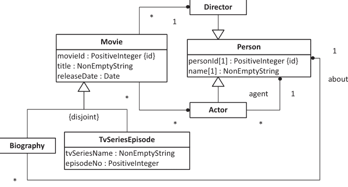

按照我们的指南制作应用程序。

确保你的页面符合 HTML5 的 XML 语法，并且你的 JavaScript 遵循我们的编码规范（并经过 JSHint 检查）。

## 术语表

### C

### CRUD

CRUD 是 *Create（创建）、Read/Retrieve（读取）、Update（更新）、Delete（删除）* 的缩写，表示任何软件应用程序执行的四种基本数据管理操作。

### Cascading Style Sheets（级联样式表）

CSS 用于网页的呈现样式，告诉浏览器如何渲染其 HTML（或 XML）内容：使用哪些内容元素布局、字体和文本样式、哪些颜色、背景以及哪些动画。通常，这些设置在独立的 CSS 文件中进行，通过 HTML `head` 中的特殊链接元素与 HTML 文件相关联。

### D

### Document Object Model（文档对象模型）

DOM 是用于检索和修改节点的抽象 API。

### Domain Name System（域名系统）

DNS 将用户友好的名称翻译为 IP 地址。

### E

### ECMAScript

一种由行业界定的 JavaScript 标准。

### Extensible Markup Language（可扩展标记语言）

一种用于标记信息的语言。

### H

### Hypertext Markup Language（超文本标记语言）

HTML 允许标记文档结构。

### Hypertext Transfer Protocol（超文本传输协议）

一种用于客户端和服务器之间通信的无状态响应协议。

### I

### IANA

IANA 代表 Internet Assigned Numbers（互联网分配数字机构）。

### ICANN

ICANN 代表 Internet Corporation of Assigned Names and Numbers（互联网名称分配机构）。

### IndexedDB

一种用于数据存储的 JavaScript API。

### I18N（国际化）

使产品适应任何语言和文化的最佳实践。

### J

### JSON

JSON 代表 JavaScript Object Notation（JavaScript 对象表示）。

### M

### MathML（数学标记语言）

一种表示数学表达式的开放标准。

### MIME

用于指示文件内容的关键字字符串集。

### Model-View-Controller（模型-视图-控制器）

一种强调关注点分离原则的架构架构。

### O

### Object Constraint Language（对象约束语言）

一种用于表示完整性约束的形式化逻辑语言。

### Object-Oriented Programming（面向对象编程）

一种基于对象和类概念的编程范式。

### O

Web 本体语言 (OWL) 是一种用于在 Web 上进行知识表示的格式化逻辑语言。它允许定义词汇（主要是带有属性的类），并支持对它们表达许多类型的完整性约束。OWL 是执行自动推理的基础，例如检查 OWL 词汇的一致性。以 UML 类模型形式定义的词汇或数据模型可以转换为 OWL 词汇，然后检查其一致性。

### P

便携式网络图形填充 (PNG Polyfill) 是一种开放的（非专利）图形文件格式，支持无损数据压缩。填充程序（polyfill）是一段 JavaScript 代码，用于在不支持该方法的浏览器中模拟标准的 JavaScript 方法。

### R

资源描述框架 (RDF) 是一种 W3C 语言，用于在 Web 上表示机器可读的命题陈述信息。

### S

标准泛化标记语言 (SGML) 是一种用于定义语言的 ISO 规范。HTML4 是用 SGML 定义。XML 是 SGML 的简化继任者。HTML5 不再基于 SGML，而是有自己的解析规则。

可缩放矢量图形 (SVG) 是一种基于 XML 的 2D 图像格式。SVG 可以使用 CSS 进行样式化，并使用 JavaScript 实现交互。HTML5 允许在 HTML 文档中直接嵌入 SVG 内容。

槽位（slot）是一个键值对。在面向对象的程序的对象中（例如，在 Java 对象中），槽位通常是一个属性-值对。但在 JavaScript 对象中，槽位也可能由方法名和方法体组成，或者可能是 map 中的一个键值对。

### U

Unicode（统一编码）

一种与平台无关的字符集，包含了世界上大多数脚本语言的几乎所有字符，包括印地语、缅甸语和盖尔克语。每个字符被分配一个 0 到 1,114,111 范围之间的唯一整数代码。例如，希腊字母 π 的代码为 960。Unicode 包含 ASCII 和 ISO-8859-1 (Latin-1) 等旧字符集作为子集。XML 基于 Unicode，希腊字母 π（代码为 960）可以作为 `&#960;` 插入 XML 文档中。XML 文档中 Unicode 字符的 XML 语法编码是 UTF-8，它对 ASCII 字符仅使用一个字节，而对不常用的字符使用三个字节。

统一资源标识符 (URI)

URI 或是统一资源定位符 (URL) 或是统一资源名称 (URN)。

统一资源定位符 (URL)

URL 是一种资源名称，包含一个在 Web 上定位该资源的 Web 地址。

统一建模语言 (UML)

UML 是一种行业标准，定义了一组建模语言，用于创建各种模型和图表，以支持面向对象的问题分析和软件设计。它的核心语言是用于信息/数据建模的类图，以及用于过程/行为建模的序列图、活动图和状态图（或状态图）。

统一资源名称 (URN)

URN 指向一个资源而不指定其位置。

用户代理 (User Agent)

用户代理是指前端 Web 程序，例如 Web 浏览器。

### W

WebM

WebM 是一种由 Google Chrome 和 Mozilla Firefox 支持的开放（免版税）视频格式，但不支持 Microsoft Internet Explorer 和 Apple Safari 的支持。

Web 超文本应用技术工作组 (WHATWG)

WHATWG 由 Apple、Mozilla 和 Opera 的前员工于 2004 年建立，他们对 W3C 选择专注于 XHTML2 的标准化导致 Web 技术标准化进展缓慢感到不满。在 Ian Hickson 的领导下，它在与 W3C 的竞争与合作中开发了 HTML5 以及相关的 JavaScript API。

万维网 (World Wide Web)

WWW（或简单称为“Web”）是一个基于 HTTP、HTML 和 XML 的巨大客户端-服务器网络，其中 Web 浏览器（以及其他“用户代理”）作为 HTTP 客户端访问作为 HTTP 服务器的 Web 服务器程序。W3C 是负责开发和维护 Web 标准的国际组织。

万维网联盟 (World Wide Web Consortium)

### X

XML HTTP 请求 (XHR)

XML HTTP 请求 (XHR) API 允许 JavaScript 程序与后端程序交换 HTTP 消息。它可以用于在不提交 HTML 表单的情况下，从或向后端程序检索/提交信息。基于 XHR 的方法过去已统归入“AJAX”这一缩写下。

# 索引

- 抽象类 170

- 聚合 113

- 关联 4

- 双向 7

- 消除 11, 86

- 性的 5

- 功能性 7–8, 56, 68, 85

- 无方向的 9–10, 86,

- 整体-部分 113–115

- 单向 6

- 关联消除 11, 86

- 关联端 6

- 有序的 39

- 所有权点 7

- 关联端所有权 7

- 属性 5

- 属性 15

- 唯一的 114

- 存在依赖 31

- 扩展 132

- 扩展 125

- 基于工厂的 143

- 外键 4

- for-of 循环 20

- 冻结值 147

- 参数解构 22, 149

- 功能性关联 7

- 人类可读 4

- ID 引用 24

- 信息模型 3

- 继承 123

- 区分符列 135

- 合并表 134, 143, 155

- 单表继承 134, 155, 160

- 每个类一个表 134, 155

- 输入字段 15

- 不可分割的 113

- 内涵 125

- 内部对象引用 4

- 实例是 131

- 块作用域 19

- 模板代码 52

- 检查 41

- 选择控件 15

- 类层次 123

- 类层次 129, 134, 143

- 完整的 127

- 组合 113

- 基于构造函数的 143

- 转换器 62

- 数据模型 53

- 数据存储 84

- 数据值 5

- 派生规则 84

- 派生的反向属性 91, 118

- 互斥不相交的 27

- Java 类模型 53, 67, 79, 118

- Java 实体类模型 14

- JavaScript 类模型 79, 118

- 合并表继承 160

- JS 类模型 154

- JS 类模型 14

- JS 实体表模型 133

- 域 6

- 动态表 147, 162

- 种类 128

- 生命周期依赖 85

- 列表 16

- 实体类模型 100

- 实体-关系 4

- 恰好一个 5

- 强制 5

- 强制值 24

- 值约束 24

- 多对多 85

- 多对一 85

- 物物化视图 85

- 模型类 53

- 模型-视图-控制器 3, 121

- 多重分类 130

- 多继承 123, 130

- 多选控件 15, 48

- 多重继承层次 127

- 多重性 113

- 多值属性 38, 40, 67, 69

- 多值属性 15

- 引用 3

- 完整性 6, 26

- 完整性约束 6, 24, 40

- 完整性约束 55

- 关系数据库 9

- 关系 4

- 关系类型 3, 4

- 限制 132

- 检索所有对象 69

- 刚性的 128

- 导航性 10

- 非功能性的 7

- 不共享 114

- 分段 127

- 选择列表 15

- 不可分离的 113

- 序列 16

- 集合 16

- 设置器 27, 41

- 集合值的 39

- 可共享部分 113

- 单继承继承层次 127

- 单值属性 15

- 排序的 128

- 对象创建依赖 6

- 对象销毁依赖 6

- 对象引用 5

- 对象类型 3

- 对象-关系映射 134

- 一对一 85

- OO 类模型 9, 79, 118

- 可选 5, 15

- 有序集合 15

- 有序集合 39

- 源 6

- SQL 表模型 14

- 子类 123

- 子表 139

- 子类型 123

- 超类 139

- 一对互反向属性对 84

- 分区 127

- 主键 4

- 目标 6

- UML 类图 4

- 单向功能性关联 92

- 单向功能性关联 19, 53

- 单向非功能性关联 38, 67

- 单向二元关联 3

- 统一建模语言 (UML) 4

- 唯一性 24

- 更新开销 84

- 用户界面 69
