# JavaScript 或 Java Web 应用开发第2卷：约束验证、枚举、特殊数据类型

第 2 卷：关联与类层级

# 献辞

致我们的家人。

# 前言

本书分为两卷，展示了如何基于模型的方法设计并实现 Web 应用，并使用了 Web 开发中最相关的平台：JavaScript 和 Java。Web 应用通过 UML 图表形式的信息模型来辅助设计，并实现为：

本书的重点是关于信息管理问题的通用概念和技术：

1. 完整性约束和数据验证
2. 枚举和属性
3. 对象类型之间的单向和双向关联
4. 子类型与继承

列表中的前两个问题将在第一卷中讨论，而最后两个将在第二卷中讨论。我们假设读者已经熟悉 HTML 和至少一种面向对象的编程语言，例如 C++、Java、PHP 或 `C#`。此外，我们假设读者对 CSS 有一定了解，并对学习使用 JavaScript 或 Java 进行编程感兴趣。

本书可用于：

1. 计算机科学或相关专业的学生 Web 开发课程；
2. JavaScript 开发者学习 Java；
3. Java 开发者学习 JavaScript；
4. JavaScript 和 Java（以及 PHP/Python/C#）开发者通过此学习：
   - 使用 JavaScript 或 Java 进行面向对象 (OO) 编程；
   - 如何使用原生 JavaScript 或 Java 实现基础信息管理概念并构建完整的 Web 应用。

本书附带六个示例应用的完整源代码，你可以从我们的 Web 服务器运行或下载。

# 第一部分：关联

我们在第一卷中讨论的三个示例应用——`minimal app`、`validation app` 和 `enumeration app`——仅限于管理单个对象类型的数据。然而，真实的应用程序必须管理多个对象类型的数据，这些类型通常以各种方式相互关联。特别是，对象类型之间可能存在 `associations`（关联）和 `subtype`（子类型/继承）关系。处理关联和子类型关系是软件应用工程中的高级问题。它们在教科书中往往没有充分讨论，也没有得到应用开发框架良好的支持。

关联是信息模型的重要元素。软件应用程序必须以适当实现它们，特别是在 `model-view-controller` (`MVC`) 架构的 `model` 层中。遗憾的是，应用开发框架对处理关联提供的支持不多。

有两个相互重要的区别：

1. `功能性`关联与`非功能性`（多对多）关联。
2. `单向`关联与`双向`关联。

功能性关联对应于数学中所说的 `function`（函数），而多对多关联对应于数学中所说的 `relation`（关系）。单向关联对应于建模和编程中的引用属性，而双向关联对应一对相互取反的引用属性。

## 1 引用属性与单向关联

如果为对象类型（或类）定义的属性其值是指向另一个（或相同）类型对象的 `references`（引用），则该属性被称为 `reference property`（引用属性）。例如，下方图 1.1 所示的 `Committee` 类有一个引用属性 `chair`，其值是指向 `ClubMember` 类型对象的引用。

对象类型之间的 `association`（关联）对这些类型中对象之间的关系进行了分类。例如，`Committee`-`has`-`ClubMember`-as-chair 关联（它在下方图 1.2 所示的类图中可视化为一条连接线）分类了 `FinanceCommittee`-`has`-`PeterMiller`-as-chair、`RecruitmentCommittee`-`has`-`SusanSmith`-as-chair 和 `AdvisoryCommittee`-`has`-`SarahAnderson`-as-chair 的关系，其中对象 `PeterMiller`、`SusanSmith` 和 `SarahAnderson` 类型为 `ClubMember`，而 `FinanceCommittee`、`RecruitmentCommittee` 和 `AdvisoryCommittee` 类型为 `Committee`。作为关系集的关联可以表示为如下表：

| *Committee*-has-*ClubMember*-as-chair |
| --- |
| Finance Committee | Peter Miller |
| Recruitment Committee | Susan Smith |
| Advisory Committee | Sarah Anderson |

引用属性对应于关联的特殊形式，即 `unidirectional`（单向）`binary associations`（二元关联）。虽然二元关联通常不需要方向性，但引用属性表示了一种从属性的域类（domain class，即定义处）指向其值类（range class）的二元关联。

通常，关联是具有两个或多个 `object types`（对象类型）参与其中的 `relationship types`（关系类型）。两个对象类型之间的关联被称为 `binary`（二元）。在本书中，我们只讨论二元关联。为了简单起见，当我们实际上是指“二元关联”时，我们直接说“关联”。

虽然个体关系（例如 `FinanceCommittee`-`has`-`PeterMiller`-`as-chair`）是业务通信和信息系统中的重要信息项，但关联（例如 `Committee`-`has`-`ClubMember`-`as-chair`）是*信息模型*中的重要元素。因此，软件应用程序必须以适当的方式实现它们，通常作为其在*模型-视图-控制器* (MVC) 架构中*模型*层的一部分。遗憾的是，许多应用开发框架缺乏处理关联所需的支持。

在数学中，关联以抽象的方式被形式化为均匀元组的集合，称为*关系*（*relations*）。在*实体-关系*（`ER`）建模中（这是信息系统和软件工程中经典的信息建模方法），对象被称为*实体*（*entities*），关联被称为*关系类型*（*relationship types*）。*统一建模语言 (UML)*包含了用于信息建模的 `UML 类图` 语言。在 UML 中，对象类型被称为 `classes`（类），关系类型被称为 `associations`（关联），而个体关系被称为“链接”（links）。这三个术语总结在下表中：

| 我们首选的术语 | UML | ER 图 | 数学 |
| --- | --- | --- | --- |
| object | object | entity | individual |
| object type (class) | class | entity type | unary relation |
| relationship | link | relationship | tuple |
| association (relationship type) | association | relationship type | relation |
| functional association |  | 一一、多一或一多关系类型 | 函数 (one-to-one/many-to-one is function) |

我们首先讨论引用属性（reference properties），它们在“无关联”的类模型（即不包含任何显式关联元素的模型）中隐式地表示单向二元关联。

### 1.1 引用与引用属性

引用可以是*人类可读的*，也可以是*内部对象引用*。人类可读引用是指在人类通信中使用的标识符，例如天体的唯一名称、书籍的 ISBN 以及公司员工的工号。内部对象引用是指 OOP 对象的内存地址，从而为访问计算机主内存中的对象提供了一种高效的机制。

某些语言（如 `SQL` 和 `XML`）仅支持人类可读的引用，不支持内部引用。在 `SQL` 中，人类可读引用被称为 `foreign keys`（外键），它们所引用的标识符被称为 `primary keys`（主键）。在 `XML` 中，人类可读引用被称为 `ID references`（ID 引用），对应的属性类型为 `IDREF`。

OO 程序中的对象可以通过人类可读引用（如整数代码）或内部对象引用来引用，后者更有利于高效访问主内存中的对象。遵循 `XML` 术语，我们将人类可读引用称为 `ID references`。我们遵循 ID 引用属性的标准命名规范：在类 `A` 中定义并引用类 `B` 对象的 ID 引用属性名称为 `b_id`，并使用后缀 `_id`。当我们以记录或表行的形式存储持久化对象时，我们需要将存储在 `publisher` 等属性中的内部对象引用转换为存储在 `publisher_id` 等属性中的 ID 引用。这种转换是在对象序列化过程的一部分完成的，方法通过将被引用对象的标准标识符值分配给引用对象的 ID 引用属性来实现。

在 OO 语言中，属性是为对象类型（或类）定义的，其为*域*（*domain*）。属性的值要么是某些数据类型的*数据值*，在这种情况下属性被称为***属性***（*attribute*），要么是指向某类对象的*对象引用*（*object references*），在这种情况下属性被称为***引用属性***（*reference property*）。例如，下方图 1.1 所示的 `Committee` 类具有一个范围为 `String` 的属性，以及一个范围为 `ClubMember` 的引用属性 `chair`。

图 1.1：委员会有一个俱乐部成员担任主席，通过引用属性 `chair` 表达。

面向对象的编程语言（如 `JavaScript`、`PHP`、`Java` 和 `C#`）直接支持*引用属性*的概念，这种属性的范围不是*数据类型*，而是*引用类型*或*类*，其值是指向该类实例的对象引用。

默认情况下，属性的基数数为 1，这意味着该属性是***强制的***（*mandatory*）且***函数的***（*functional*，换句话说，是*单值的*），拥有***恰好一个***值，类似于图 1.1 中所示 `Committee` 类中的 `chair` 属性。当函数属性是***可选的***（非强制的）时，它的基数为 0..1，这意味着该属性的最小基数为 0，最大基数为 1。

引用属性可以是***单值的***（*函数的*）或***多值的***（*非函数的*）。例如，图 1.1 中所示的引用属性 `Committee::chair` 是单值的，因为它分配了一个唯一的俱乐部成员作为 `chair`。*多值*引用属性的示例是下方图 1.11 所示的 `authors` 属性。

通常，多值引用属性的集合值是一个集合，这意味着引用的顺序并不重要。但在某些情况下，顺序是重要的，因此这种多值引用属性的集合值是有序的集合，通常由列表实现。

### 1.2 引用完整性

引用是我们应用程序数据库中的重要信息项。然而，只有当应用程序维护其*引用完整性*时，它们才有意义。这要求任何引用都存在一个被引用对象。因此，任何域类为 `C` 范围类为 `D` 的引用属性 `p` 都带有一个*完整性约束*，该约束在以下情况下需要检查：

1. 创建新的 `C` 类型对象时；
2. 更改某些 `C` 类型对象的 `p` 值时；
3. 销毁一个 `D` 类型对象时。

引用完整性约束还意味着两个*变更依赖*：

1. ***对象创建依赖***：带有另一个对象引用的对象在被引用对象创建后才能创建。
2. ***对象销毁依赖***：被其他对象引用的对象只有在以下情况后才能销毁：
   - 首先销毁引用对象（`CASCADE` 级联策略），或者
   - 引用对象中的引用被删除（`DROP-REFERENCE` 删除策略）或替换为另一个引用。

对于我们应用程序模型类中的每个引用属性，我们必须选择这两种可能的*删除策略*之一来适用。

通常，对象创建依赖在用户界面中管理，即不允许用户输入 ID 引用属性的值，而只允许他们从所有现有目标列表中选择一个。

### 1.3 将引用属性建模为单向关联

引用属性（如上述图 1.1 示例中的 `chair`）可以在 UML 类图中以其领域类拥有的 `association end`（关联端）的形式进行建模，该关联端通过一个较小的实心圆圈（也称为“点”）来可视化。这需要用关联线连接引用属性的领域类（domain class）和范围类（range class），在连线的范围类一侧端放置一个 `ownership dot`（所有权点），并用属性名称和多重符号对该关联端进行注释，如下所示针对我们示例情况的图 1.2。通过这种方式，我们得到了一个 `unidirectional association`（单向关联），其 `source`（源）类是属性的 `domain`，其 `target`（目标）类是属性的 `range`。

关联端被另一端的类 `owned`（拥有）这一事实（正如下方图 1.2 示例中关联端 `chair` 处的 `association end ownership dot` 视觉表达所示），意味着该关联端表示一个引用属性。在图 1.2 示例中，表示的引用属性是 `Committee::chair`，其范围为 `ClubMember`。这种只有一个关联端所有权点的关联在意义上是 `unidirectional` 的，因为它只允许在一个方向上进行 `navigation`（导航/对象访问）：从点相反侧的类（`source` 类）到放置点的类（`target` 类）。

图 1.2：带有“点”的关联端。

因此，图 1.1 和 1.2 中所示的两个图表表示了本质上等价的模型。当一个引用属性（如图 1.1 中的 `chair`）通过带有“点”的关联端建模时，该属性的多重性会附加到关联端上。由于在设计模型中，所有关联端都需要多重性，我们还必须为 `Committee` 类一侧的另一端定义一个多重性，它代表了属性的反向关系。这种多重性（反向属性的多重性）在所示图 1.1 模型中的原始属性描述中是不可用的，因此必须根据关联的预意语义进行添加。这可以通过回答问题“任何 `ClubMember` 必须是某个 `Committee` 的主席吗？”来找到最小基数，并通过回答问题“一个 `ClubMember` 可以是多个 `Committee` 的主席吗？”来找到最大基数。

当属性的值是来自其范围的一组值值集合时，该属性是 `non-functional`（非函数的），其多重性为 `0..*` 或 `n..*`（其中 `n > 0`）。与其表示“既不是强制的也不是函数的” `0..*`，我们可以简单地写星号符号 `*`。图 1.2 中所示的关联为一个 `Committee` 类型的对象分配最多一个 `ClubMember` 类型的对象作为 `chair`。因此，它是 `functional association`（函数性关联）的一个示例。

关于关联功能不同情况的概述请见表 1.1。

表 1.1：功能类型。

| 功能类型 | 意义 |
| --- | --- |
| 一一 (one-to-one) | 既是函数也是反向的 |
| 多对一 (many-to-one) | 函数的 |
| 一对多 (one-to-many) | 反向的 |
| 多对多 (many-to-many) | 既不是函数的也不是反向的 |

注意关联的方向功能是相互独立的。因此，单向关联可以是 `one-to-one` 或 `many-to-many`。

### 1.4 用引用属性表示单向关联

`source` 和 `target` 类之间的单向关联可以表示为 `source` 的引用属性。这在下方图 1.3 中所示，针对两种关联：多对一和多对多。

通过这种方式，我们消除了显式关联并将其替换为引用属性。

### 1.5 为无向关联添加方向

当我们以 UML 类图的形式制作模型时，通常会得到没有方向的关联，例如在图 1.4 所示。当关联的任何端都没有所有权点时，这意味着该模型属于关联本身，而不属于参与它的任何类。

图 1.4：无向关联的模型。

包含没有关联端的信息设计作为关系数据库模型是可以接受的，但作为 OOP 语言的设计来说是不完全的。例如，图 1.4 模型提供了包含两个实体表 `committees` 和 `clubmembers` 的关系数据库设计，以及一个独立的一对一关系表 `committee_has_clubmember_as_chair`。但它没有提供 Java 类的设计，因为它没有说明如何通过引用属性来实现该关联。

有三种方案可以将无向关联（无任何关联端）的信息设计模型转换为所有关联均为单向或双向的信息设计模型：我们可以在关联的任一端或两端放置所有权点。这三种方案每种定义了使用引用属性表示或实现关联的不同方式。因此，对于上方图 1.4 中所示的关联，我们有以下选项：

1. 在 `chair` 关联端放置所有权点，从而导致如图 1.2 所示的模型，该模型可以转换为上方所示的图 1.1 中的 OO 类模型。
2. 在 `charedCommittee` 关联端放置所有权点，导致下方所示的图 1.8 中的完成模型。
3. 通过在关联的两端都放置所有权点（ownership dots），使关联变为双向的，如图 1.5。

图 1.5：建模委员会（Committee）与俱乐部成员（ClubMember）之间的双向关联。

因此，每当我们对关联进行建模时，都必须做出选择：它的哪一端代表引用属性，并因此标记上所有权点。可以是其中一个，也可以是两者都是。这一决定也意味着对关联的可导航性（`navigability`）的决定。当关联的一端代表引用属性时，意味着它是可导航的（通过该属性）。

对于非一对一的功能性关联，最简单的设计是根据其功能定义关联的方向，在多重性为 `0..1` 的关联端放置关联所有权点。对于非方向性的一对一或多对多关联，我们可以根据意愿选择方向，即我们可以在任何一个关联端放置所有权点。

### 1.6 我们的运行示例

图 1.6 所示的模型（关于出版者和书籍）作为我们单向功能性关联的运行示例。请注意，它包含了单向多对一关联 `Book-has-Publisher`。

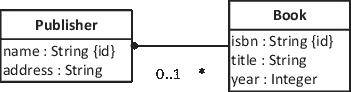

图 1.6：带有单向关联的出版者（Publisher）-书籍（Book）信息设计。


我们可能还需要处理代表单向非功能性关联的非功能性（多值）引用属性。例如，下方图 1.7：

图 1.7：带有两个单向关联的出版者-书籍-作者（`Publisher-Book-Author`）信息设计。

### 1.7 消除单向关联

由于经典的面向对象语言不支持将关联视为一等公民，仅支持类和表示单向关联的引用属性，因此我们必须从通用信息设计中消除所有关联，以获取 OO 类模型。

#### 1.7.1 基本消除步骤

我们受限的“关联消除”（`association elimination`）程序的起点是一个包含各种单向关联的信息设计模型，如上方的图 1.6：

图 1.8：将功能性关联端转换为引用属性。

对于单向一对多的关联案例，下方的图 1.9：

图 1.9：将非功能性关联端转换为多值引用属性。

#### 1.7.2 从设计模型中消除关联

在我们的运行示例——出版者-书籍-作者（`Publisher-Book-Author`）信息设计模型中，我们必须将两个单向关联替换为合适的引用属性。在第一步中，我们将图 1.6 中的多对一关联 `Book-has-Publisher` 替换为 `Book` 类中的功能引用属性 `publisher`，从而产生了图 1.10 所示的 OO 类模型。

图 1.10：出版者（`Publisher`）的 OO 类模型。

注意，由于 `Book-has-Publisher` 关联的目标端多重性为 `0..1`，我们将新属性 `publisher` 声明为可选。该 OO 类及其引用属性含义可以通过以下示例数据进行说明：

| Publisher | | 
| :--- | :--- |
| Name | Address |
| Bantam Books | New York, USA |
| Basic Books | New York, USA |

| Book | | | | 
| :--- | :--- | :--- | :--- |
| ISBN | Title | Year | Publisher |
| 0553345842 | The Mind’s I | 1982 | Bantam Books |
| 1463794762 | The Critique of Pure Reason | 2011 | Bantam Books |
| 1928565379 | The Critique of Practical Reason | 2009 | Bantam Books |

注意，`Book` 表中 `publisher` 列的值是引用 `Publisher` 表行的唯一名称。`publisher` 列是可选的。

在第二步中，我们将图 1.7 中的多对多关联 `Book-has-Author` 替换为 `Book` 类中的多值引用属性 `authors`，从而产生了图 1.11 所示的 OO 类模型。

图 1.11：类、出版者（`Publisher`）和作者（`Author`）的 OO 类模型。

| Publisher | | 
| :--- | :--- |
| Name | Address |
| Bantam Books | New York, USA |
| Basic Books | New York, USA |

| Book | | | | | 
| :--- | :--- | :--- | :--- | :--- |
| ISBN | Title | Year | Authors | Publisher |
| 0553345842 | The Mind’s I | 1982 | 1, 2 | Bantam Books |
| 1463794762 | The Critique of Pure Reason | 2011 | 3 | Bantam Books |
| 1928565379 | The Critique of Practical Reason | 2009 | 3 | Basic Books |

| Author | | 
| :--- | :--- |
| Author ID | Name |
| 1 | Daniel Dennett |
| 2 | Douglas Hofstadter |
| 3 | Immanuel Kant |

在完成与平台无关面向对象（OO）类模型后，可以针对特定的实现平台，从中推导出一个或多个特定平台的实现模型。特定平台实现模型的类型示例包括 `JS class models`、`Java Entity class models` 和 `SQL table models`。

特定平台的实现模型仍然可以用 UML 类图的形式表示，但它仅包含可以在所选平台中直接编码的建模元素。因此，对于任何被考虑的平台，都需要两个准则：1) 如何制作特定平台的实现模型，以及 2) 如何对该模型进行编码。

### 1.8 在用户界面中渲染引用属性

在 (CRUD) 数据管理用户界面 (UI) 中，用于数据输入输出的控件通常对应于应用模型类中定义的属性。我们必须区分对应于（各种）`属性`的（各种）`输入字段`，以及对应于`枚举属性`或`引用属性`的`选择控件`（如`选择列表`）。在 UI 中使用选择控件而非输入字段来表示引用属性，可以防止用户输入无效的 ID 引用，从而确保了`引用完整性`。

通常情况下，`单值引用属性`可以渲染为 UI 中的单选列表，无论该引用属性范围由多少个对象填充，只需从中选出一个特定选项即可。如果引用属性范围的基数足够小（例如，不超过 7 个），我们也可以使用`单选按钮组`代替选择列表。

`多值引用属性`可以渲染为 UI 中的多选列表。然而，当有许多（例如，超过 20 个）不同的选项可供选择时，HTML 对应的多选控件就没那么好用了，因为其渲染选择的方式在视觉上太分散了。在只有少数（例如，不超过 7 个）选项的特殊情况下，我们也可以使用`复选框组`代替多选列表。但对于在 UI 中包含一个从引用属性范围类中选出的所有关联对象的通用情况，我们需要开发一种特殊的 UI 控件，允许向已选对象列表添加（并从列表中移除）对象。

这种`多选控件`由以下部分组成：

1. 包含已选（关联）对象的 HTML 列表元素，其中每个列表项包含一个用于从选择中移除该对象的推按钮；
2. 一个单选控件，配合推按钮使用，允许从多值引用属性的范围内添加一个新的关联对象。

### 1.9 多值引用属性的集合类型

默认情况下，非功能性关联端会将目标类实例的`set`（集合）关联到源类的任何实例上，这意味着对应的多值引用属性的集合值是集合。然而，也存在某些情况，非功能性关联端是有序的（`ordered`），因此对应的多值引用属性的集合值采用`ordered sets`（有序集合）的形式。

在下面的示例中，关联端 `publishedBooks` 不是有序的，而关联端 `authors` 是有序的，因为一本书的作者顺序是有意义的。注意，在 UML 类图中，有序的关联端用注释 `{ordered}` 标记。

有序的关联端不应基于目标类的属性表示任何排序。在我们的示例中，这意味着书籍作者的排序不应该代表他们的字母顺序，而应该代表某种无法通过 `Author` 属性获取的信息。这事实确实如此，因为它代表了某种意义，而这种意义无法通过任何属性来表达。

注意，信息设计模型中的有序关联端只是一种方便特性，因为有序关联端始终可以通过向关联的目标类添加一个或多个属性来转换为无序关联端，使得这些属性的值可以用于排序。有序关联端允许使用更简洁的信息模型和更高效的实现，因为它们不需要借助辅助排序属性来显式地标记排序信息。

多值引用属性的两种重要集合类型是 `sets`（集合）和 `ordered sets`（有序集合），而将 `bags`（多重集）和 `sequences`（有序多重集）作为多值引用属性的集合类型的情况非常罕见。当多值引用属性的集合类型为 `bag`（或 sequence）时，可以在类图中通过关联端或属性修饰符的注释 `{nonunique}`（或 `{ordered, nonunique}`）来表示。

但要注意，将 `lists`（如 `JS arrays` 或 Java 接口类型 `List`）作为多值引用属性的范围是非常常见的，无论是有序属性还是无序属性都是如此。

### 1.10 测题

如果你想查找以下测题的答案，可以查看我们的讨论论坛。如果你在论坛中没有找到答案，可以创建一个帖子来询问某个特定问题的答案。

#### 1.10.1 问题 1：“一对一”的含义

说一种关联是“一对一”的什么意思？

这意味着它是（选择一个）：

1. O 双向的
2. O 既是功能性的也是全的
3. O 功能性的
4. O 既是功能性的也是反向的

#### 1.10.2 问题 2：何时检查引用完整性

对于域类 `C` 和范围类 `D` 的引用属性 `p`，引用完整性约束在以下情况下需要检查（选择一个或多个）：

1. ☐ 类型 C 的对象被销毁
2. ☐ 类型 C 的对象的 `p` 值被改变
3. ☐ 创建了新的类型 C 的对象
4. ☐ 类型 D 的对象被销毁
5. ☐ 创建了新的类型 D 的对象

#### 1.10.3 问题 3：“功能性”的含义

单向二进制关联是功能性的，当且仅当（选择一个）：

1. O 源类的每个对象最多关联到目标类的一个对象。
2. O 目标类的每个对象最多关联到源类的一个对象。
3. O 源类的每个对象至少关联到目标类的一个对象。
4. O 源类的每个对象恰好关联到目标类的一个对象。

#### 1.10.4 问题 4：对象销毁依赖

假设我们有一个类型 `B` 的标准标识符属性 `id` 以及一个引用 `B::id` 的类型 `A` 的引用属性 `b_id`。此外，假设有一个类型 `B` 的对象 `b`（`b.id = 11`）以及一个引用它的类型 `A` 对象 `a`（`a.b_id = 11`）。哪些描述是正确的？选择一个或多个：

1. ☐ 当对象 `a` 中的 ID 引用未分配（在 JS 中将 `b_id` 设置为 `undefined` 或在 Java 中设为 `null`）且没有其他对象引用 `b` 时，对象 `b` 可以被销毁。
2. ☐ 只有在 `b` 被销毁之前，对象 `a` 才能被销毁。
3. ☐ 当对象 `a` 中的 ID 引用被重置为另一个类型 `B` 的对象时（例如通过设置 `a.b_id = 7`）且没有其他对象引用 `b` 时，对象 `b` 可以被销毁。
4. ☐ 当 `a` 被销毁之前，对象 `b` 可以被销毁。

#### 1.10.5 问题 5：渲染单值引用属性

关于 `single-valued` 引用属性 `p` 以及它如何通过合适的表单控件在 Web 用户界面中进行渲染，以下哪些陈述是正确的？选择一个或多个：

1. ☐ 使用 `type="text"` 的输入控件可以获得适当的渲染。
2. ☐ 如果 `p` 范围的基数不大于 7，可以使用 `check button group`（复选框组）进行渲染。
3. ☐ 如果 `p` 范围的基数不大于 7，可以使用 `radio button group`（单选按钮组）进行渲染。
4. 它始终可以使用单选控制控件进行渲染。

#### 1.10.6 问题 6：表达功能类型

在“x-to-y”形式（其中 `x`、`y` 表示“一个”或“多个”）中，哪个术语可以表示该关联既不是函数性的，也不是反函数性的？

答案：________________________________

## 2 使用原生 JS 实现单向函数关联

单向 `functional` 关联是一对一或多对一的。在这两种情况下，这种关联都通过借助 `single-valued` 引用属性来表示或实现。

在本章中，我们将展示：

1. 如何从具有表示 `unidirectional functional associations` 的单值引用属性的 OO 类模型推导出原生 JS 类模型，
2. 如何以原生 JavaScript 模型类的形式编写 JS 类模型，
3. 如何基于模型代码编写视图和控制器代码。

在展示如何推导原生 JS 类模型并用 JavaScript 编写代码之前，我们首先介绍 JavaScript 语言的几个新元素，这些元素将在本书讨论的整个 JavaScript 代码中使用。

### 2.1 新的 JavaScript 元素

在本节中，我们将介绍由 ECMAScript 2015+（即 2015+16+17+18+19+20+ …）引入 JavaScript 的最重要的新语言元素。

#### 2.1.1 使用 `let` 和 `const` 的块作用域变量声明

ES5 不允许声明作用域为一对大括号 `{` 和 `}` 围定的块，或由 `for` 循环定义的变量。相反，所有用 `var` 声明的变量即使在块内声明，也具有函数作用域或全局作用域。使用 `let` 和 `const` 的 `block-scope variable declarations` 新功能允许具有更细粒度作用域的局部变量，有助于避免意外的变量重复并产生更模块化的代码。

`let` 和 `const` 之间只有一个意义区别。用 `const` 声明的变量是`冻结`的或不可变的，从这个意义上来说是“常量”，而 `let` 变量不是。对于所有不应改变值的变量，最好使用 `const`。否则，或者如果不明确，如果是块作用域变量，应用 `let` 声明；如果是全局或函数作用域变量，则应用 `var` 声明。

#### 2.1.2 箭头函数

与经典的 JS 函数相比，箭头函数（使用 `=>`）提供了更简洁的函数表达式语法（见示例 1），并允许在函数体中使用函数外部环境（其 `closure`）的 JavaScript `this` 变量（见示例 2）。

**示例 2.1.**

```
let evens = [0,2,4,6,8];
let odds = evens.map( v => v+1); // [1,3,5,7,9]
// instead of evens.map( function (v) {return v+1;})
```

**示例 2.2.**

```
this.nums = [1,3,5,8,10,12,15,17];
this.fives = [];
this.nums.forEach( v => {if (v % 5 === 0) this.fives.push(v);});
// instead of this.nums.forEach(
//     function (v) {if (v % 5 === 0) this.fives.push(v);}, this)
```

#### 2.1.3 可迭代对象的 For-Of 循环

迭代对象包括字符串、数组、类数组对象（例如内置的 `arguments` 对象或 `HTMLCollections` 和 `NodeList` 的实例）、类型对象 `TypedArray`、`Map` 和 `Set` 的实例，以及用户定义的迭代器。例如：

```
const divElems = document.getElementsByTagName("div");
// an HTMLCollection is iterable
for (let dEl of divElems) {
    console.log( dEl.id);
}
```

当不需要计数器时，`for-of` 循环通常比 `for` 循环更方便。与 `forEach` 循环不同，`for-of` 循环允许遍历 `HTMLCollections` 并可以使用 `break` 退出。

#### 2.1.4 模板字面量

… 使用引号（如 ` … `）而不是双引号或单引号包裹，并允许对由固定文本部分和变量/表达式组合成的（可能是多行的）字符串值使用简洁的语法。例如：

```
const classValues = "card important";
const name = "Joker";
const htmlTemplate = `<div class="${classValues}">
    <p>Hello ${name}!</p>
</div>`
```

#### 2.1.5 展开运算符

…允许展开（1）数组元素、（2）对象的属性。例如：

```
const arr = [1, 2, 3];
const [...copy] = arr;

const obj = {a: 1, b: 2};
const {...copyObj} = obj;
```

#### 2.1.6 解构赋值

…允许从数组或对象中提取值的简洁语法。例如：

```
const point = [1, 2];
const [x, y] = point;

const user = {name: "Alice", age: 30};
const {name, age} = user;
```

```javascript
class Book {
    constructor ({isbn, title, year,
             publisher, publisher_id}) {
        …
        // assign object reference or ID reference
        if (publisher || publisher_id)  {
            this.publisher = publisher || publisher_id;
        }
        …
    }
    …
}
```

注意，记录参数的 `publisher` 字段表示一个 JS 对象引用，而其 `publisher_id` 字段表示一个 ID 引用。在 JavaScript 中，我们可以使用析取表达式（如 `expr1 || expr2`）来获取第一个表达式的值，如果它已定义（且不为 0），否则获取第二个表达式的值。我们在属性设置器（setter）中通过检查参数的类型来处理由此产生的歧义，如下代码片段所示：


```javascript
 set publisher(p) {
      var publisher_id = "";
      // p can be an ID reference or an object reference
      publisher_id = (typeof p !==  "object") ? p : p.name;
      …
      this._publisher = Publisher.instances[ publisher_id];
      …
}
```

注意，发布者的名称被用作 ID 引用，因为它是 `Publisher` 类的标准 ID。

### 2.3 构建 JS 类模型

构建 JS 类模型的起点是一个如图 1.10 所示的 OO（对象）类模型。

我们现在展示如何通过四个步骤从该 OO 类模型推导出 JS 类模型。对于 OO 类模型中的每个类：

1. 为所有（非派生的）单值属性添加 «get/set» 刻型（stereotype），意味着它们具有隐式的访问器和设置器。记住，在设置器中，会调用相应的检查操作，并且只有当检查没有检测到任何约束违反时，属性才会被设置。

2. 为每个（非派生的）属性创建一个 `check` 操作，以便在集中实现`属性约束`（property constraints）。对于标准的 ID 属性（例如 `Book::isbn`），需要两个或三个检查操作：

   1. 一个基础检查操作，如 `checkIsbn`，用于检查所有的语法约束，但不检查`必填值`（mandatory value）和`唯一性`（uniqueness）约束。

   2. 一个标准的 ID 检查操作，如 `checkIsbnAsId`，用于检查标准 ID 属性隐含的`必填值`和`唯一性`约束。

   3. 如果其他类具有引用所考虑类的引用属性，则添加一个 `ID reference` 检查操作，用于检查施加在 `ID reference`（或外键）属性上的引用引用完整性（referential integrity）约束。例如，由于 `Book::publisher` 属性引用 `Publisher` 对象，我们需要在 `Publisher` 类中一个 `checkNameAsIdRef` 操作。

   对于引用属性（如 `Book::publisher`），检查操作 `Book.checkPublisher` 必须通过调用 `Publisher.checkNameAsIdRef` 来检查隐含的`引用完整性约束`，如果属性是强制的，可能还需要检查`必填值约束`。

3. 添加一个对象序列化函数 `toString()`，用于在错误消息和日志中显示对象的状态。

4. 添加一个对象到存储的转换函数 `toRecord()`，将模型对象准备好以实体表中的行的形式存储，该行可以通过 `JSON.stringify` 序列化为 JSON 字符串，从而存储为应用 `localStorage` 数据存储中键的值。

这得出了 `Book` 的以下 JS 类模型，其中类级（“静态”）方法用下划线表示：

我们必须对 `Publisher` 类执行类似的转换。这为我们提供了从上述 OO 类模型推出的完整 JS 类模型，如图 2.1 所示。

图 2.1：定义 `Book` 和 `Publisher` 类的 JS 类模型。

### 2.4 新问题

与第一卷中讨论的验证和枚举应用相比，我们必须处理许多新的技术问题：

1. 在*模型*代码中，我们现在需要处理`引用属性`，这些属性需要：

   1. 维护`引用完整性`；

   2. 选择并实现第 1.2 中讨论的两种可能的删除策略之一，用于在属性的范围类的 `destroy` 方法中管理相应的对象销毁依赖关系；

   3. 在序列化函数 `toString()` 和转换函数 `toRecord()` 以及构造器函数中，进行内部对象引用和外部 ID 引用之间的转换。

2. 在*用户界面（“视图”）*代码中，我们现在需要处理：

   1. 在*检索/列出*（Retrieve/List）用例显示关联对象的信息；

   2. 允许从所有现有实例的列表中选择一个对象，并在*创建*和*更新*用例中从关联对象列表中添加或从中移除一个对象。

### 2.5 编写 JS 类

JS 类模型可以直接为应用编写。

#### 2.5.1 总结

将每个类编写为具有隐式访问器和设置器的 ES015 类：

1. 编写类级（“静态”）方法。对于每个单值属性，编写指定的设置器，并在其中调用属性检查。

2. 编写序列化函数 `toString()` 和转换函数 `toRecord()`。

3. 在 `destroy` 方法中处理删除依赖。这些步骤将在后续章节](#9783110500240_000634.xhtml_b_9783110500325-002_s_005)中详细讨论。

#### 2.5.2 编写每个模型类

JS 模型中的每个类 `C` 编写为具有相同名称 `C` 具有单个记录参数的构造函数，该参数指定类的每个（非派生）属性。这些属性的范围应在注释中说明。对于引用属性，范围是另一个模型类。

在构造函数体内，我们将记录参数的字段赋值给相应的属性。这些属性赋值会调用相应的*设置器*方法。

例如，`Publisher` 类以以下方式编写：

```javascript
 class Publisher {
     constructor ({name, address}) {
         this.name = name;
         this.address = address;
     }
     …
};
```

由于设置器可能会抛出约束违反异常，构造函数以及任何设置器都应该在 `try-catch` 块中调用，其中 `catch` 负责记录合适的错误消息。

对于每个模型类 `C`，我们定义一个类级属性 `C.instances`，表示由应用管理的所有 `C` 实例集合（记录的映射）。该属性初始化为 `{}`。例如，在模型类 `Publisher` 的情况下，我们定义：

```javascript
 Publisher.instances = {};
```

模型中的 `Book` 类以类似的方式编写：

```javascript
 class Book {
     constructor ({isbn, title, year, authors, authorIdRefs,
           publisher, publisher_id}) {
       this.isbn = isbn;
       this.title = title;
       this.year = year;
       this.authors = authors || authorIdRefs;
       if (publisher || publisher_id) {
           this.publisher = publisher || publisher_id;
       }
    }
    …
}
```

注意，`Book` 构造器既可以使用对象引用 `authors` 和 `publisher` 调用，也可以使用 ID 引用 `authorIdRefs` 和 `publisher_id` 调用。这种方法使得使用 `Book` 构造器更加灵活且健壮。

### 2.5.3 编写属性检查代码

确保 JS 类模型中指定的所有属性约束都正确地编码在它的检查函数中，正如第 1 第 8 章所解释的。记住，约束违反（或验证错误）类定义在 `lib/errorTypes.js` 文件中。

例如，对于 `Publisher.checkName` 函数，我们得到以下代码：

```js
 class Publisher {
     …
     static checkName(n) {
         if (n === undefined) {
             return new NoConstraintViolation(); // not mandatory
         } else {
             if (typeof n !== "string" || n.trim() === "") {
                  return new RangeConstraintViolation (
            "The name must be a non-empty string!" );
            } else {
                 return new NoConstraintViolation();
           }
        }
    }
    static checkNameAsId(n) {…}
    …
}
```

注意，由于名称属性是 `Publisher` 的标准 ID 属性，我们只在 `checkName` 中检查语法约束，并在 `checkNameAsId` 中检查必填值和唯一性约束，后者会调用 `checkName`：

```js
 static checkNameAsId ( n) {
     var validationResult = Publisher.checkName(n);
     if ((validationResult instanceof NoConstraintViolation)) {
         if (n === undefined) {
             return new MandatoryValueConstraintViolation (
                 "A publisher name is required!");
          } else if (Publisher.instances[n]) {
             validationResult = new UniquenessConstraintViolation (
                 "There is already a publisher record with this name!");
          } else {
             validationResult = new NoConstraintViolation();
          }
      }
}
```

如果我们需要在其他类中处理 ID 引用（外键），我们需要提供另一个进一步的检查函数 `checkNameAsIdRef`，用于检查引用完整性约束：

```js
 static checkNameAsIdRef(n) {
    var validationResult = Publisher.checkName(n);
    if ((validationResult instanceof NoConstraintViolation) &&
             n !== undefined) {
        if (!Publisher.instances [n]) {
             validationResult = new ReferentialIntegrityConstraintViolation (
                "There is no publisher record with this name!");
         }
     }
     return validationResult;
}
```

条件 `!Publisher.instances[n]` 检查是否存在具有给定名称 `n` 的出版社对象，然后创建一个作为异常类 `ReferentialIntegrityConstraintViolation` 实例的 `validationResult` 对象`Book.checkNameAsIdRef` 函数由 `Book.checkPublisher` 函数调用：

```js
 class Book {
     …
     static checkPublisher( publisher_id) {
          var validationResult = null;
          if (publisher_id === undefined || publisher_id === "") {
               validationResult = new NoConstraintViolation(); // optional
          } else {
               // 调用外键约束检查
               validationResult = Publisher.checkNameAsIdRef( publisher_id);
         }
         return validationResult;
     }
     …
}
```

### 2.5.4 编写属性 Setter（设置器）

在 setter 中，会调用相应的检查函数，只有当检查没有检测到任何约束违反时才会设置属性。对于引用属性，我们允许使用对象引用或 ID 引用来调用 setter。产生的歧义通过测试调用 setter 时提供的参数是否为对象来解决。例如，出版社的 setter 是如下方式编码的：

```js
 class Book {
      …
      set publisher( p) {
          if (!p) { // 取消出版社
               delete this._publisher;
          } else {
               // p 可以是 ID 引用或对象引用
               const publisher_id = (typeof p !== "object") ? p : p.name;
               const validationResult = Book.checkPublisher( publisher_id);
               if (validationResult instanceof NoConstraintViolation) {
                   // 创建新的出版社引用
                  this._publisher = Publisher.instances[ publisher_id];
              } else {
                 throw validationResult;
             }
        }
     }
     …
}
```

### 2.5.5 选择并实现删除策略

对于任何引用属性，我们必须在 第 1.2 节 的两种可能的删除策略中选择并实现一种，以便在属性范围类的 `destroy` 方法中管理相应的对象销毁依赖。在我们的案例，当删除出版社记录时，我们必须在两者之间选择：

1. 删除由删除出版社出版的所有书籍记录（*生存依赖* Existential Dependency）；

2. 从由删除出版社出版的所有书籍中删除对该删除出版社的引用（*生存独立* Existential Independence）。

假设书籍并不依赖于其出版社，我们选择第二种方案。这在以下 `Publisher.destroy` 方法的代码中显示，对于所有相关的书籍对象，清除了属性 `book.publisher`：

```js
 Publisher.destroy = function (name) {
      const publisher = Publisher.instances[name];
      // 在书籍对象中删除对该出版社的所有引用
      for (let key of Object.keys( Book.instances)) {
           const book = Book.instances[key];
          if (book.publisher === publisher) {
          delete book._publisher;  // 删除槽
          console.log("Book " + book.isbn + " updated.");
       }
      }
      // 删除出版社记录
      delete Publisher.instances[name];
      console.log("Publisher " + name + " deleted.");
};
```

注意，删除指向删除出版社的所有引用是通过遍历所有书籍对象完成的，当书籍很多时这种效率可能不高。如果每个出版社对象持有其出版书籍的引用列表，效率将会高得多。创建和维护这样的列表将书籍与出版社之间的关联变为*双向*。

### 2.5.6 序列化与对象存储映射

对于引用属性（例如 `Book::publisher`），序列化函数 `Book::toString()` 必须显示被引用对象的可读标识符，例如 `this.publisher.name`：

```js
 toString() {
    var bookStr = `Book{ ISBN: ${this.isbn}, title: ${this.title},` +
         `year: ${this.year}`;
     if (this.publisher) bookStr += `, publisher: ${this.publisher.name}`;
     return bookStr + "}";
}
```

对象到存储的转换函数 `Book::toRecord()` 将带有对象引用的类型 JS 对象转换为带有 ID 引用的相应的（无类型）记录对象：


```js
toRecord() {
  var rec = {};
  for (let p of Object.keys(this)) {
    // 只拷贝带下划线前缀的属性槽
    if (p.charAt(0) === "_") {
      switch (p) {
        case "_publisher":
          // 将对象引用转换为 ID 引用
          if (this._publisher) rec.publisher_id = this._publisher.name;
          break;
        default:
          // 下划线前缀
          rec[p.substr(1)] = this[p];
      }
    }
  }
  return rec;
}
```

从带有 ID 引用的无类型记录对象到带有对象引用的相应对象的反转换由 `Book` 构造函数完成，该构造函数允许在设置引用属性时同时接受 ID 引用和对象引用。

## 2.6 编写视图与控制器

用户界面（UI）包含一个起始页 `index.html`，它允许导航到数据管理 UI 页面，每个对象类型对应一个页面（在我们的示例中为 `books.html` 和 `publishers.html`）。每个数据管理 UI 页面都包含 5 个部分：一个 `Manage` 部分（如 `Manage books`），带有一个用于选择 CRUD 用例的菜单；以及每个 CRUD 用例的对应部分（如 `Retrieve/list all books`、`Create book`、`Update book` 和 `Delete book`），使得每次只显示其中一个（例如，通过为其他部分设置 CSS 属性 `display:none`）。

### 2.6.1 初始化应用

为了初始化数据管理用例，必须从持久化存储中加载所需的数据（例如，所有的出版者和书籍记录）。这在 `c/books.js` 中的控制器程序（例如 `pl.c.books.manage.initialize`）中执行，代码如下代码所示：

```
pl.c.books.manage = {
  initialize: function () {
    Publisher.retrieveAll();
    Book.retrieveAll();
    pl.v.books.manage.setUpUserInterface();
  }
};
```

管理书籍数据的 `initialize` 方法首先加载出版者表和书籍表，因为书籍数据管理 UI 需要显示它们的数据。然后通过调用 `setUpUserInterface` 程序渲染书籍数据菜单。

### 2.6.2 在检索/列出所有中显示关联对象

在示例中，我们只有一个引用属性 `Book::publisher`，它是功能性且可选的。为了在 `Retrieve/list all` 用例中显示书籍可选出版者的信息，如果存在出版者，HTML 表格中相应的单元格将填充出版者的名称：

```
pl.v.books.retrieveAndListAll = {
  setupUserInterface: function () {
    const tableBodyEl = document.querySelector(
      "section#Book-R>table>tbody"
    );
    tableBodyEl.innerHTML = ""; // 删除旧内容
    for (let key of Object.keys(Book.instances)) {
      const book = Book.instances[key];
      const row = tableBodyEl.insertRow(-1);
      row.insertCell(-1).textContent = book.isbn;
      row.insertCell(-1).textContent = book.title;
      row.insertCell(-1).textContent = book.year;
      // 如果书籍有出版者，则显示其名称
      row.insertCell(-1).textContent =
        book.publisher ? book.publisher.name : "";
    }
    document.getElementById("Book-M").style.display = "none";
    document.getElementById("Book-R").style.display = "block";
  }
};
```

对于多值引用属性，表格单元格必须填充由该属性引用的所有关联对象的列表。

### 2.6.3 在创建和更新用例中选择关联对象

为了允许在 `Create` 和 `Update` 用例中选择与当前编辑对象关联的对象，可以使用一个 HTML 选择列表（即 `select` 元素），该列表通过工具方法 `fillSelectWithOptions` 填充由关联对象类型实例构成的 `option` 元素。HTML `select` 元素在 `books.html` 视图文件中定义：

```
<section id="Book-C" class="UI-Page">
  <h1>公共图书馆：创建新的书籍记录</h1>
  <form>
    …
    <div class="select-one">
      <label>Publisher: <select name="selectPublisher"></select></label>
    </div>
    …
  </form>
</section>
```

`Create` 用户界面通过以下程序进行设置：

```
pl.v.books.create = {
  setupUserInterface: function () {
    const formEl = document.querySelector("section#Book-C > form"),
      selectPublisherEl = formEl.selectPublisher,
      saveButton = formEl.commit;
    // 添加响应式校验的监听器
    formEl.isbn.addEventListener("input", function () {
      formEl.isbn.setCustomValidity(
        Book.checkIsbnAsId(formEl.isbn.value).message
      );
    });
    // 设置单选列表来选择出版者
    util.fillSelectWithOptions(selectPublisherEl, Publisher.instances, "name");
    // 为 submitButton 点击事件定义事件处理器
    saveButton.addEventListener("click", this.handleSaveButtonClickEvent);
    // 定义取消提交事件的事件处理器
    formEl.addEventListener("submit", function (e) {
      e.preventDefault();
      formEl.reset();
    });
    // 将管理表单替换为创建表单
    document.getElementById("Book-M").style.display = "none";
    document.getElementById("Book-C").style.display = "block";
    formEl.reset();
  },
  handleSaveButtonClickEvent: function () {
    …
  }
};
```

当用户点击（或触摸）保存按钮时，所有的表单控件值（包括选择控件的值）都会复制到一个列表中。在对所有表单字段进行校验后，该列表将作为调用 `add` 方法的参数，如下程序列表所示：

```
handleSaveButtonClickEvent: function () {
  const formEl = document.querySelector("section#Book-C > form");
  const slots = {
    isbn: formEl.isbn.value,
    title: formEl.title.value,
    year: formEl.year.value,
    publisher_id: formEl.selectPublisher.value
  };
  // 校验所有表单控件并显示错误消息
  formEl.isbn.setCustomValidity(Book.checkIsbnAsId(slots.isbn).message);
  /* …（对 title 和 year 执行相同操作） */
  // 仅当所有表单字段有效时才保存输入数据
  if (formEl.checkValidity()) {
    Book.add(slots);
  }
}
```

`update book` 用例的 `setupUserInterface` 代码类似。

### 2.7 练习题

#### 2.7.1 问题 1：JS 类模型

从给定的 OO 类模型派生的 `Committee` 类，正确的 JS 类模型是哪个？

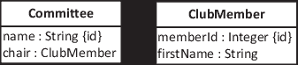

选择一项：

1. O 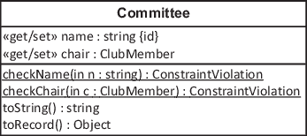

2. O 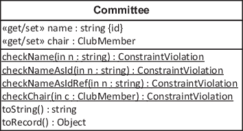

3. O 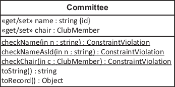

## 3 使用纯 JS 实现单向非功能关联

单向非功能关联可以是*一对多*或*多对多*的。在这两种情况下，这种关联都是通过*多值*引用属性的帮助来表示（或实现的）。

在本章中，我们将展示：

1. 如何从具有代表*单向非功能关联*的*多值引用属性*的 OO 类模型派生出 JS 类模型，

2. 如何以 JavaScript 模型类的形式为该 JS 类模型编写代码，

3. 如何基于模型代码编写视图和控制器代码。

### 3.1 实现多值引用属性

多值引用属性（例如 `Book::authors` 属性）允许存储某些类型对象（如 `Author` 对象）的引用集合。在创建 `Book` 类型的新对象时，构造函数需要有相应的参数来为该属性提供合适的值。我们可以允许该值是内部对象引用集合或 ID 引用集合，如下例所示：

```
class Book {
  constructor({ isbn, title, year, authors, authorIdRefs, publisher, publisher_id }) {
    this.isbn = isbn;
    this.title = title;
    this.year = year;
    // 分配对象引用或 ID 引用
    this.authors = authors || authorIdRefs;
    if (publisher || publisher_id) this.publisher = publisher || publisher_id;
  }
  …
}
```

注意，构造函数的参数记录预计将包含 `authors` 或 `authorIdRefs` 槽。JavaScript 表达式 `authors || authorIdRefs` 使用逻辑或运算符 `||`，如果存在名为 `authors` 的槽，则评估为映射 `authors`，否则评估为数组 `authorIdRefs`。我们在属性设置器（property setter）中通过检查参数的类型来处理产生的歧义，如下所示代码片段所示：

```
set authors(a) {
  this._authors = {};
  if (Array.isArray(a)) {
    // array of IdRefs
    for (let idRef of a) {
      this.addAuthor(idRef);
    }
  } else {
    // map of IdRefs to object references
    for (let idRef of Object.keys(a)) {
      this.addAuthor(a[idRef]);
    }
  }
}
```

在 JS 中，集合值引用属性（collection-valued reference property）可以通过两种方式实现：

1. 拥有一个对象引用数组列表（JS 数组）作为其值；

2. 拥有一个映射作为其值，其中对象的标准 ID 属性的值作为键，并映射到内部 JS 对象引用。

我们倾向于使用映射来实现实现 `set-valued` 引用属性，因为它们能保证每个元素都是唯一的，而在数组中，我们必须防止重复元素。此外，映射中的元素可以很容易地删除（借助 `delete` 运算符），而在数组的情况下这需要更多努力。然而，对于实现对应于 `ordered-collection`-值（或包/序列值）引用属性的 `ordered`（或 `nonunique`）关联端，我们使用 JS 数组。

### 3.2 构建 JS 类模型

我们构建 JS 类模型的起点是以下面向对象类模型：

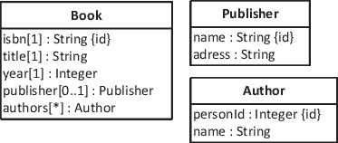

该模型除了包含单值引用属性 `Book::publisher`（表示单向多对一关联 `Book`-`has`-`Publisher`）外，还包含多值引用属性 `Book::authors`（表示单向多对多关联 `Book`-`has`-`Author`）。

要从 OO 类模型推导出 JS 类模型，我们必须遵循与 2.3 节相同的步骤，并且我们还必须处理多值引用属性，例如 `Book::authors`，对于这些属性我们需要：

1. 创建一个类级别的 `check` 操作，例如 `checkAuthor`，负责检查要添加到属性集合的引用的相应 `引用完整性约束` (referential integrity constraint)；

2. 创建一个 `add` 操作，例如 `addAuthor`，用于向集合添加引用；

3. 创建一个 `remove` 操作，例如 `removeAuthor`，用于从集合中移除引用。

这得到了如下 JS 类模型：

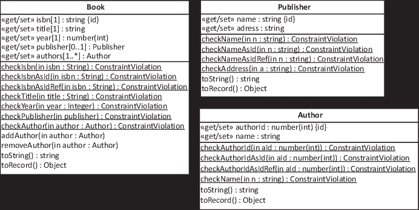

### 3.3 新问题

与上一章讨论的处理函数关联相比，我们现在必须处理以下新技术问题：

1. 在 `model` 代码中，我们现在必须处理 `多值引用属性`，这需要实现：

   1. 一个 `add` 和 `remove` 方法，例如 `addAuthor` 和 `removeAuthor`，以及一个用于通过 `add` 方法分配一组对象引用的 `setter` 方法，可能需要将 ID 引用转换为对象引用；如果存在基数约束（cardinality constraints），这三个方法可能都需要检查；

   2. 一个类级别的 `check` 操作，例如 `checkAuthor`，它必须调用属性范围类相应的 `check …AsIdRef` 方法来检查属性的隐式 `引用完整性约束`；

   3. 在对象到存储的转换函数 `toRecord` 中，将对象引用集合转换为 ID 引用集合。

2. 在 `用户界面（“视图”）` 代码中，我们现在必须处理：

   1. 在 `Retrieve/list all` 用例的表格视图的属性列中，显示一组关联对象的信息；最简单的方法是显示逗号分隔的 ID 引用列表，可能结合相应的名称；或者，可以在属性的表格数据单元格中渲染 HTML 列表；

   2. 在 `Create` 和 `Update` 用例中，允许从属性范围类所有现有实例的列表中选择一组关联对象。


最后一个问题，即从某些类的所有实例列表中选择一组关联对象，通常无法通过 HTML 多选表单控件来解决，因为其易用性较差。每当可选选项集大于某个阈值（由无需滚动即可在屏幕上看到的选项定义）时，多选元素就不再可用，必须使用替代的`多选组件`（`multiple-choice widget`）。

### 3.4 为模型编码

注意，为了简单起见，我们没有在示例应用代码中包含 JS 类模型中显示的所有约束检查代码。

#### 3.4.1 总结

将 JS 类模型中的每个类编码为具有隐式 getter 和设置器（setter）的 ES2015 类：

1. 以类级别（`static`）方法的形式编写属性检查。确保 JS 类模型中指定的所有属性约束都已正确编码。
2. 对于每个单值属性，编写指定的 getter 和 setter，使得在每个 setter 中调用相应的属性检查，并且只有当检查没有检测到任何违规时，才设置/取消属性。
3. 对于每个多值属性，编写其添加和移除操作，以及指定的 get/set 操作：
   1. 将 add/remove 操作编写为（实例级别的）方法，这些方法调用属性检查。
   2. 编写 setter，使其对要分配的集合中的每个项调用 add 操作。
4. 编写序列化函数`toString()`和对象到存储的转换函数`toRecord()`的代码。
5. 在`destroy`方法中处理删除依赖关系。

这些步骤将在后续章节中详细讨论。

#### 3.4.2 编写添加和移除操作

对于多值引用属性`Book::authors`，我们需要编写操作`addAuthor`和`removeAuthor`。这两个操作都接受一个参数，通过 ID 引用（整数或字符串类型的作者 ID）或对象引用表示作者。`addAuthor`的代码如下：

```
addAuthor(a) {
  // a 可以是一个 ID 引用或一个对象引用
  const author_id = (typeof a !== "object") ? parseInt(a) : a.authorId;
  const validationResult = Book.checkAuthor(author_id);
  if (author_id && validationResult instanceof NoConstraintViolation) {
    // 添加新的作者引用
    let key = String(author_id);
    this._authors[key] = Author.instances[key];
  } else {
    throw validationResult;
  }
}
```

在`removeAuthor`方法中，首先检查作者引用，如果没有检测到约束违规，则删除映射`this._authors`中的相应条目：

```
removeAuthor(a) {
  // a 可以是一个 ID 引用或一个对象引用
  const author_id = (typeof a !== "object") ?
    parseInt(a) : a.authorId;
  const validationResult = Book.checkAuthor(author_id);
  if (validationResult instanceof NoConstraintViolation) {
    // 删除作者引用
    delete this._authors[author_id];
  } else {
    throw validationResult;
  }
}
```

对于向属性`Book::authors`分配 ID 引用数组或对象引用映射，`setAuthors`方法将帮助通过`addAuthor`逐个添加它们。

```javascript
set authors(a) {
  this._authors = {};
  if (Array.isArray(a)) { // array of IdRefs
    for (let idRef of a) {
      this.addAuthor(idRef);
    }
  } else { // map of IdRefs to object references
    for (let idRef of Object.keys(a)) {
      this.addAuthor(a[idRef]);
    }
  }
}
```

### 3.4.3 选择并实现删除策略

对于引用属性`Book::authors`，我们必须在`Author`类的`destroy`方法中选择并实现删除策略。我们必须在两者之间进行选择：

1. 删除所有由被删除作者（合）的书（反映了*存在依赖*/Existential Dependency 的逻辑）；
2. 从所有由被删除作者（合）的书中删除对该删除作者的引用（反映了*存在独立性*/Existential Independence 的逻辑）。

为了简单起见，我们选择了第二种方案。在下面的静态方法`Author.destroy`代码中，对于所有相关的书籍对象，作者引用`book.authors[authorKey]`都被删除了：

```javascript
Author.destroy = function(authorId) {
  const author = Author.instances[authorId];
  // 删除所有相关的书籍记录
  for (let isbn of Object.keys(Book.instances)) {
    let book = Book.instances[isbn];
    if (book.authors[authorId]) delete book.authors[authorId];
  }
  // 删除作者对象
  delete Author.instances[authorId];
  console.log("Author " + author.name + " deleted.");
};
```

### 3.4.4 序列化与对象到存储的映射

我们需要一个序列化函数`toString()`将对象转换为人类可读的字符串表示，用于在用户界面中显示对象；以及一个对象到记录的映射函数`toRecord()`，将类型对象转换为可以保存到持久化数据存储中的记录。在这两种情况下，内部对象引用都被转换为 ID 引用。

`Book::toString()`函数创建一个可能只包含相关属性的字符串表示。显示一组关联对象（如书籍的作者）最简单的方法是创建一个逗号分隔的 ID 列表：

```javascript
toString() {
  var bookStr = `Book{ ISBN: ${this.isbn}, title: ${this.title},` +
    `year: ${this.year}`;
  if (this.publisher) bookStr += `, publisher: ${this.publisher.name}`;
  return bookStr + ", authors:" +
    Object.keys(this.authors).join(",") + "}";
}
```

`Book::toRecord()`函数需要对对象的所有属性槽进行序列化。这包括删除下划线前缀以获取对应的记录字段名：

```javascript
toRecord() {
  var rec = {};
  for (let p of Object.keys(this)) {
    // 仅拷贝带有下划线前缀的属性槽
    if (p.charAt(0) !== "_") continue;
    switch (p) {
      case "_publisher":
        // 将对象引用转换为 ID 引用
        if (this._publisher) rec.publisher_id = this._publisher.name;
        break;
      case "_authors":
        // 将对象引用映射转换为 ID 引用列表
        rec.authorIdRefs = [];
        Object.keys(this.authors).forEach(authorIdStr => {
          rec.authorIdRefs.push(parseInt(authorIdStr));
        });
        break;
      default:
        // 移除下划线前缀
        rec[p.substr(1)] = this[p];
    }
  }
  return rec;
}
```

### 3.5 编写视图

#### 3.5.1 在检索/列出所有中显示关联对象信息

在“检索/列出所有”（Retrieve/List All）用例中显示书籍作者的信息时，通过工具函数`util.createListFromMap`在 HTML 表格的相应单元格中填充所有作者名称的列表：

```javascript
pl.v.books.retrieveAndListAll = {
  setupUserInterface: function() {
    const tableBodyEl = document.querySelector(
      "section#Book-R>table>tbody");
    tableBodyEl.innerHTML = ""; // 丢旧内容
    for (let key of Object.keys(Book.instances)) {
      const book = Book.instances[key];
      // 为此书籍创建作者列表
      const listEl = util.createListFromMap(book.authors, "name");
      const row = tableBodyEl.insertRow(-1);
      row.insertCell(-1).textContent = book.isbn;
      row.insertCell(-1).textContent = book.title;
      row.insertCell(-1).textContent = book.year;
      row.insertCell(-1).appendChild(listEl);
      // 如果书籍有出版社，显示其名称
      row.insertCell(-1).textContent =
        book.publisher ? book.publisher.name : "";
    }
    document.getElementById("Book-M").style.display = "none";
    document.getElementById("Book-R").style.display = "block";
  }
};
```

工具函数`util.createListFromMap`具有以下代码：

```javascript
createListFromMap: function(m, displayProp) {
  var listEl = document.createElement("ul");
  util.fillListFromMap(listEl, m);
  return listEl;
},
fillListFromMap: function(listEl, m, displayProp) {
  const keys = Object.keys(m);
  // 删除旧内容
  listEl.innerHTML = "";
  // 从对象值创建列表项
  for (let key of keys) {
    let listItemEl = document.createElement("li");
    listItemEl.textContent = m[key][displayProp];
    listEl.appendChild(listItemEl);
  }
}
```

#### 3.5.2 在创建用例中选择关联对象

为了在“创建”（Create）用例中允许选择多个作者与当前编辑的书籍关联，如 HTML 代码所示，一个多选列表（带有`multiple="multiple"`的`select`元素）将由关联对象类型的实例填充。

```html
<section id="Book-C" class="UI-Page">
  <h1>公共图书馆：创建新书</h1>
  <form>
    …
    <div class="select-one">
      <label>出版社: <select name="selectPublisher"></select></label>
    </div>
    <div class="select-many">
      <label>作者:
        <select name="selectAuthors" multiple="multiple"></select>
      </label>
    </div>
    …
  </form>
</section>
```

“创建” UI 的设置通过工具方法`fillSelectWithOptions`填充作者和出版社的选择列表来实现的，如下面的程序列表所示：

```javascript
pl.v.books.create = {
  setupUserInterface: function() {
    const formEl = document.querySelector("section#Book-C > form"),
      selectAuthorsEl = formEl.selectAuthors,
      selectPublisherEl = formEl.selectPublisher,
      saveButton = formEl.commit;
    // 为响应式验证添加监听器
    …
    // 设置选择作者的多选列表
    util.fillSelectWithOptions(selectAuthorsEl, Author.instances,
      "authorId", { displayProp: "name" });
    // 设置选择出版社的单选列表
    util.fillSelectWithOptions(selectPublisherEl,
      Publisher.instances, "name");
    …
  },
  handleSaveButtonClickEvent: function() {…}
};
```

当用户点击保存按钮时，所有的表单控件值（包括任何单选控件的值）都会被复制到相应槽记录的字段中，并在检查所有表单字段有效后作为调用`add`方法的参数。在调用`add`之前，我们必须首先从多选作者列表的选中选项中创建一个作者 ID 引用列表（在`authorIdRefs`槽中），如下面的程序列表所示：

```
handleSaveButtonClickEvent: function() {
  const formEl = document.querySelector("section#Book-C > form"),
    selAuthOptions = formEl.selectAuthors.selectedOptions;
  const slots = {
    isbn: formEl.isbn.value,
    title: formEl.title.value,
    year: formEl.year.value,
    authorIdRefs: [],
    publisher_id: formEl.selectPublisher.value
  };
  // 验证所有表单控件并显示错误消息
  …
  // 检查作者的必值约束（mandatory value constraint）
  formEl.selectAuthors.setCustomValidity(
    (selAuthOptions.length > 0) ? "" : "No author selected!"
  );
  // 仅当所有表单字段有效时保存输入数据
  if (formEl.checkValidity()) {
    // 构建作者 ID 引用列表
    for (let opt of selAuthOptions) {
      slots.authorIdRefs.push(opt.value);
    }
    Book.add(slots);
  }
}
```

`Update`用例在下一节中讨论。

### 3.5.3 在 Update 用例中选择关联对象

遗憾的是，在有数百或数千个作者的现实用例中，多选控件并不能真正用于显示和维护关联作者集合，因为其渲染选择的方式在视觉上太过于分散了。因此，我们必须使用一种特殊的“多选小部件”（`multiple-choice widget`），它允许向关联对象列表添加（并从中移除）对象，正如第`1.8.`节所述。为了展示此小部件如何替换上一节中讨论的多重选择列表，我们现在在`Update`用例中使用它。

为了在`Update`用例中允许维护与当前编辑书籍相关的作者集合，下方的 HTML 代码所示的`multiple-choice widget`将使用`Author`类的实例进行填充。


# 公共图书馆：更新书籍记录

```html
<section id="Book-U" class="UI-Page">
  <h1>公共图书馆：更新书籍记录</h1>
  <form>
    …
    <div class="select-one">
      <label>出版社：<select name="selectPublisher"></select></label>
    </div>
    <div class="widget">
      <label for="updBookSelectAuthors">作者：</label>
      <div class="MultiSelectionWidget" id="updBookSelectAuthors"></div>
    </div>
    …
  </form>
</section>
```

`Update` 用户界面的设置（在下方所示的 `setupUserInterface` 过程中完成）是通过借助工具方法 `fillSelectWithOptions` 填充选择列表，以选择要更新的书籍来实现的。用于分配发布者的选择列表以及用于分配书籍作者的多选小部件，只有在选择了要更新的书籍后才会（在 `handleSubmitButtonClickEvent` 中）进行填充。

```
pl.v.books.update = {
  setupUserInterface: function () {
    const formEl = document.querySelector("section#Book-U > form"),
        selectBookEl = formEl.selectBook,
        saveButton = formEl.commit;
    // 设置书籍选择列表
    util.fillSelectWithOptions(selectBookEl, Book.instances,
        "isbn", {displayProp:"title"});
    selectBookEl.addEventListener("change", this.handleBookSelectChangeEvent);
    // 添加事件监听器用于响应式验证
    …
    // 为提交点击事件定义事件处理器
    saveButton.addEventListener("click", this.handleSaveButtonClickEvent);
    // 处理中消提交事件并重置表单
    formEl.addEventListener('submit', function (e) {
      var authorsSelWidget = document.querySelector(
              "section#Book-U > form .MultiSelectionWidget");
      e.preventDefault();
      authorsSelWidget.innerHTML = "";
      formEl.reset();
    });
    document.getElementById("Book-M").style.display = "none";
    document.getElementById("Book-U").style.display = "block";
    formEl.reset();
  },
```

当选择了要更新的书籍后，表单输入字段 `isbn`、`title` 和 `year` 以及更新发布者的选择控件将从所选书籍中分配相应的值，并设置关联的作者选择控件：

```
handleBookSelectChangeEvent: function () {
  const formEl = document.querySelector("section#Book-U > form"),
      saveButton = formEl.commit,
      selectAuthorsWidget = formEl.querySelector(".MultiChoiceWidget"),
      selectPublisherEl = formEl.selectPublisher,
      isbn = formEl.selectBook.value;
  if (isbn !== "") {
    let book = Book.instances[isbn];
    formEl.isbn.value = book.isbn;
    formEl.title.value = book.title;
    formEl.year.value = book.year;
    // 设置关联的作者选择控件
    util.createMultipleChoiceWidget(selectAuthorsWidget, book.authors,
        Author.instances, "authorId", "name", 1); // minCard=1
    // 设置关联的出版社选择列表
    util.fillSelectWithOptions(selectPublisherEl, Publisher.instances,
    // 为出版社分配选中的选项
    if (book.publisher) formEl.selectPublisher = book.publisher;
    // 启用保存按钮
    saveButton.disabled = false;
  } else {
    formEl.reset();
    selectPublisher.selectedIndex = 0;
    selectAuthorsWidget.innerHTML = "";
    saveButton.disabled = true;
  }
},
```

当用户在更新某些值后最后点击保存按钮时，所有的表单控件值（包括分配出版社的单选控件）将被复制到 `slots` 记录中，该记录将在检查所有值后作为调用 `update` 方法的参数。在关联的作者选择控件中，将根据下面的程序列表创建 `authorIdRefsToAdd/ToRemove` 列表：

```
handleSaveButtonClickEvent: function () {
  const formEl = document.querySelector("section#Book-U > form"),
      selectBookEl = formEl.selectBook,
      saveButton = formEl.commit; // 添加事件监听器用于响应式验证
  …
  // 仅当所有字段值有效时提交更新
  if (formEl.checkValidity()) {
    // 从关联列表构建 authorIdRefsToAdd/ToRemove 列表
    let authorIdRefsToAdd=[], authorIdRefsToRemove=[];
    multiChoiceListEl = formEl.querySelector(".MultiSelectionWidget").firstElementChild;
    for (let mcListItemEl of multiChoiceListEl.children) {
      if (mcListItemEl.classList.contains("removed")) {
        authorIdRefsToRemove.push(mcListItemEl.getAttribute("data-value"));
      }
      if (mcListItemEl.classList.contains("added")) {
        authorIdRefsToAdd.push(mcListItemEl.getAttribute("data-value"));
      }
    }
    // 如果添加/删除列表不为空则创建对应的槽
    if (authorIdRefsToRemove.length > 0) {
      slots.authorIdRefsToRemove = authorIdRefsToRemove;
    }
    if (authorIdRefsToAdd.length > 0) {
      slots.authorIdRefsToAdd = authorIdRefsToAdd;
    }
    Book.update(slots);
    // 更新书籍选择列表的元素
    selectBookEl.options[selectBookEl.selectedIndex].text = slots.title;
  }
}
```

## 3.6 如何运行应用并获取代码

## 3.7 注意事项

我们在模型层中仍然为每个类和每个属性包含了重复的代码结构（称为`样板代码`），用于约束验证（检查和设置器方法），并为每个类包含了数据存储管理方法（添加、更新和删除）。虽然在学习应用开发时编写几次这些代码是有益的，但在处理真实项目时，你并不希望一遍又一遍地编写它们。为了避免重复的样板代码，需要这些方法的通用形式，以便在应用程序的所有模型类中重用。例如，`cLASSjs` 库就提供了这种方法。

## 4 使用 Java EE 实现单向功能关联

单向`functional`关联要么是一对一的或者是多对一的。在这两种情况下，这种关联都是通过一个`single-valued`引用属性来表示或实现的。

在本章中，我们将展示：

1. 如何从具有表示`单向功能关联`的单值引用属性的 OO 类模型中，推导出形式为`Java 实体类模型`的`数据模型`模型；

2. 如何以实体类（实现`模型类`）的形式为`Java 实体类模型`编写代码；

3. 如何基于实体类编写视图和控制器代码。

### 4.1 在 Java 中实现单值引用属性

单值引用属性（例如对象类型 `Book` 的属性 `publisher`）允许存储对另一种类型对象（如 `Publisher`）的内部引用。在创建新对象时，构造函数需要一个参数，以便允许为引用属性分配合适的值。在像 `Java` 这样的强类型编程语言中，我们可能需要决定此值是预期为内部对象引用还是 ID 引用。使用 JPA 对象存储映射技术，我们可以使用对象引用，并将到相应 ID 引用的映射留给 JPA。`Book` 类的扩展如下：

```
@Entity @Table(name="books")
@ViewScoped @ManagedBean(name="book")
public class Book {
  …
  private Publisher publisher;

  public Book() {}
  public Book(String isbn, String title, Integer year,
        Publisher publisher) {…}
  public Publisher getPublisher() {…}

  public void setPublisher(Publisher publisher) {…}
  …
}
```

### 4.2 创建 Java 实体类模型

创建`Java 实体类模型`的起点是如图 1.10 所示的 OO 类模型。

如前所述，我们通过以下方式从相应的 OO 设计类获取`Java 实体类` `Publisher`：(1) 将所有属性设为私有；(2) 使用 Java 数据类型类（`String`、`Integer` 等）；(3) 为属性添加«get/set»刻型（指定公共的 getter 和 setter）；(4) 添加 `toString` 函数；(5) 添加（类级）数据存储方法 `create`、`retrieve`、`update` 和 `delete`：

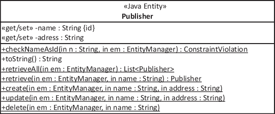

在`Java 实体类模型`中，对于 OO 类模型中的任何关联端点，我们都显示表示该关联端的引用属性，并用其表示的单向关联的功能类型对其进行注解。在我们的示例中，我们在实体类 `Book` 中添加了引用属性 `publisher`，并用关联的功能类型 `manyToOne` 对其进行了注解：

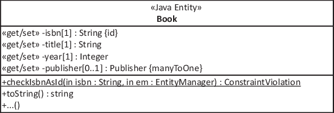

### 4.3 新问题

与之前讨论的单类应用相比，我们必须处理许多新的技术问题：

1. 在`model` 代码中，我们现在必须处理需要以下操作的`reference properties`：

   1. 借助合适的 JPA 注解定义`引用完整性约束约束`；

   2. 通过考虑引用属性来扩展 `create`、`update` 和 `delete` 方法的代码；

   3. 一个在序列化和反序列化操作中转换（内部）对象引用和相应的（外部）ID 引用之间的方法。

2. 在`user interface`（视图）代码中，我们现在必须处理：

   1. 在 `retrieve/list all` 用例中显示关联对象的信息；

   2. 在 `create object` 和 `update object` 用例中，允许从目标类的所有现有实例列表中选择关联对象。

### 4.4 编写模型代码

可以直接为`Java 实体类模型`编写代码，以获取 Java 后端应用的模型层代码。

#### 4.4.1 总结

1. 从`Java 实体类模型`中为每个类编写对应的相应的实体类。

2. 使用 JPA 注解 `@Id` 编写 `{id}` 属性修饰符。

3. 为任何表示引用属性功能类型的属性修饰符（例如 `{manyToOne}`）编写相应的 JPA 注解（例如 `@ManyToOne`）。

4. 借助 Java Bean Validation 注解（或自定义验证注解）为模型中指定的完整性约束编写代码。

5. 编写 getters 和 setters。

6. 将 `create`、`retrieve`、`update` 和 `delete` 存储管理操作编写为类方法。

这些步骤将在接下来的章节中进行详细讨论。

#### 4.4.2 编写实体的每个类

Java 实体模型中的每个类 `C` 都被编写为一个带注解的 Bean 类，包含一个无参数的构造函数和一个带有实体创建参数的构造函数。

例如，来自实体类模型的 `Book` 类以以下方式编写：

```
@Entity @Table(name="books")
@ViewScoped @ManagedBean(name="book")
public class Book {
  @Id @NotNull(message="An ISBN is required!")
  private String isbn;

  @Column(nullable=false)
  @NotNull(message="A title is required!")
  private String title;
  @Column(nullable=false)
  @NotNull(message="A year is required!")
  private Integer year;
  @ManyToOne(fetch=FetchType.EAGER)
  private Publisher publisher;

  public Book() {}
  public Book(String isbn, String title,
            Integer year, Publisher publisher) {
    this.setIsbn(isbn);
    this.setTitle(title);
    this.setYear(year);
    this.setPublisher(publisher);
  }
  …  // getters, setters, etc.
}
```

属性 `publisher` 上的 `@ManyToOne` 注解用于指定由引用属性 `publisher` 表示的关联 `Book has Publisher` 的功能类型，因为它持有*一个书有一个出版社*且*一个出版社有很多本书*的关系。该注解还允许通过参数 `fetch` 指定`fetch type`，该参数取以下可能值之一：

* `FetchType.EAGER`，意味着检索实体包含了对由该属性引用的关联实体的检索。在我们的示例中，当检索一个 `Book` 实体时，由书出版社属性引用的 `Publisher` 实体也会被检索。这种行为非常有用，当检索的数据可以在主内存中处理时应该使用它。

* `FetchType.LAZY`，意味着在检索引用实体时不会自动检索引用的实体。在我们的示例中，这意味着不会与引用 `Book` 实体一起检索引用的 `Publisher` 实体，导致属性的值被设置为 null。通过这种获取行为，必须在事务上下文中调用引用属性的 getter 来单独检索引用的实体（在我们的示例中通过调用 `getPublisher()`）。

对于带有 `@OneToOne` 或 `@ManyToOne` 注解的 `single-valued` 引用属性（表示 `functional` 关联），默认值为 `FetchType.EAGER`，因此被引用的实体会与引用实体一起获取；而在 `non-functional` 关联（使用 `@OneToMany` 或 `@ManyToMany`）情况下，默认值为 `Type.LAZY`，因此被引用的实体不会与引用实体一起获取，而是在需要时单独检索。


由于这些 JPA 注解的作用，生成了创建 `books` 表的以下 SQL 创建语句：

```
CREATE TABLE IF NOT EXISTS `books` (
    `ISBN` varchar(10) NOT NULL,
    `TITLE` varchar(255) NOT NULL,
    `YEAR` int(11) NOT NULL,
    `PUBLISHER_NAME` varchar(255) DEFAULT NULL
    FOREIGN KEY (`PUBLISHER_NAME`) REFERENCES `publishers` (`NAME`)
);
```

### 4.4.3 编写约束

确保实体类模型中指定的所有属性约束都通过合适的 Bean Validation 注解正确编码。例如，对于名称属性，我们必须使用 JPA 注解 `@Id` 来指定该属性对应于实体类映射数据库表的主键列，并使用 Bean Validation 注解 `@NotNull` 定义一个强制值约束，该约束在实体保存到数据库之前会进行检查。

对于地址属性，我们必须以两种形式定义强制值约束：使用 JPA 注解 `@Column(nullable=false)` 对应相应的表列，使用 Bean Validation 注解 `@NotNull` 对应该属性。

```
@Id
@NotNull(message="A name is required!")
private String name;

@Column(nullable=false)
@NotNull(message="An address is required!")
private String address;
```

注意，遗憾的是，当前的 Java EE 技术需要定义两次相同的约束：一次是以 JPA 注解的形式针对数据库，另一次是以 Bean Validation 注解的形式针对 Java 应用程序。

### 4.4.4 编写 Getter 和 Setter

将 setter 操作编写为（实例级）方法。setter 仅负责赋值，不执行任何验证，因为属性约束仅在 Java EE 执行环境在保存之前进行检查。getter 则简单地返回属性的实际值。

### 4.4.5 实现删除策略

对于任何引用属性，我们必须选择并实现一种删除策略，以便在引用属性范围类的 delete 方法中处理相应的对象销毁依赖。在案例中，我们必须在以下选项之间选择：

1. 删除删除出版者出版的所有书籍；
2. 从删除出版者出版的所有书籍中删除对该删除出版者的引用。

我们选择第二种策略，该策略仅适用于可选引用属性，如 `book.publisher`。这在以下 `Publisher.delete` 方法的代码中显示，对于所有涉及的图书实体，清空了 `book.publisher` 属性：

```
public static void delete(EntityManager em, UserTransaction ut,
        String name) throws Exception {
    ut.begin();
    Publisher publisher = em.find(Publisher.class, name);
    // 查找所有拥有出版者的书籍
    Query query = em.createQuery(
        "SELECT b FROM Book b WHERE b.publisher.name = :name");
    query.setParameter("name", name);
    List<Book> books = query.getResultList();
    // 清空这些书籍的出版者引用
    for (Book b : books) {
        b.setPublisher(null);
    }
    em.remove(publisher);
    ut.commit();
}
```

该方法遍历所有引用待销毁出版者的 `Book` 实体，并将其出版者属性设置为 null。

### 4.4.6 序列化与反序列化

基于 JPA 注解并在需要时配合转换类，序列化（从 Java 对象到表行）以及相应的反序列化（从表列到 Java 对象）将自动完成。

### 4.5 视图与控制器层

用户界面（UI）包含一个用于导航到数据管理 UI 页面的起始页，以及每个对象类型和数据管理用例的 UI 页面。所有这些 UI 页面都以 JSF 视图文件的形式定义在 `WebContent/views/` 文件夹的子目录下。我们在 `WebContent/views/app` 子目录下创建首页 `index.xhtml` 内容如下：

```
<!DOCTYPE html>
<html xmlns="http://www.w3.org/1999/xhtml"
      xmlns:ui="…" xmlns:h="…" xmlns:f="…">
  <ui:composition template="/WEB-INF/templates/page.xhtml">
    <ui:define name="content">
      <h2>公共图书馆</h2>
      <h:button value="管理出版者"
          outcome="/views/publishers/index" />
      <h:button value="管理书籍" outcome="/views/books/index" />
      <h:form>
        <h:commandButton value="清空数据库"
            action="#{appCtrl.clearData()}" />
        <h:commandButton value="创建测试数据"
            action="#{appCtrl.createTestData()}" />
      </h:form>
    </ui:define>
  </ui:composition>
</html>
```

它创建了菜单按钮，提供跳转到每个管理页面对应视图的链接。此外，我们需要创建 `AppController` 类，它负责测试数据的创建和删除。控制器通过如下代码结合 `Publisher.createTestData` 和 `Publisher.clearData`：

```
@ManagedBean(name="appCtrl")
@SessionScoped
public class AppController {
    @PersistenceContext(unitName="UnidiroApp")
    private EntityManager em;
    @Resource()
    UserTransaction ut;

    public String clearData() {
        try {
            Book.clearData(em, ut);
            Publisher.clearData(em, ut);
        } catch (Exception e) {
            e.printStackTrace();
        }
        return "index";
    }

    public String createTestData() {
        try {
            Publisher.createTestData(em, ut);
            Book.createTestData(em, ut);
        } catch (Exception e) {
            e.printStackTrace();
        }
        return "index";
    }
}
```

`Book` 和 `Publisher` 数据的删除必须按特定顺序进行，以避免引用完整性冲突（必须先删除书籍，再删除出版者）。

#### 4.5.1 初始化应用程序

由于代码在 Tomcat 容器运行，初始化由容器完成。

#### 4.5.2 在检索/列所有显示关联对象信息

在示例中，我们只有一个引用属性 `Book::publisher`，它是功能性的。为了在*检索/列所有书籍*用例中显示可选出版者的信息，HTML 表格中相应的列将填充出版者的名称（如果存在）：

```
<ui:composition template="/WEB-INF/templates/page.xhtml">
    <ui:define name="content">
        <h:dataTable value="#{bookCtrl.books}" var="b">
            …
            <h:column>
                <f:facet name="header">出版者</f:facet>
                #{b.publisher.name}
            </h:column>
        </h:dataTable>
        <h:button value="主菜单" outcome="index" />
    </ui:define>
</ui:composition>
```

注意 JSF 表达式 `${b.publisher.name}` 中使用的级联调用，它访问了书籍实例 `b` 的出版者属性。

### 4.5.3 在创建和更新中选择关联对象

在本节中，我们将讨论如何创建和更新具有引用属性的对象，例如带有 `publisher` 引用属性的 `Book` 对象。

#### 4.5.3.1 创建对象到字符串的转换器

HTML 需要字符串或数字值来填充表单。在我们的案例中，`Book` 类的发布者属性发布者是一个对象引用。JSF 允许通过转换器（converters）将对象转换为字符串反之亦然，转换器是使用 `@FacesConverter` 注解并实现 `javax.faces.convert.Converter` 接口的类：

```
@FacesConverter(value="pl.m.converter.PublisherConverter")
public class PublisherConverter implements Converter {
    @Override
    public Object getAsObject(FacesContext context,
            UIComponent component, String value) {
        PublisherController ac = FacesContext
                .getCurrentInstance()
                .getApplication()
                .evaluateExpressionGet(context, "#{publisherCtrl}",
                        PublisherController.class);
        EntityManager em = ac.getEntityManager();
        if (value == null) return null;
        else return em.find(Publisher.class, value);
    }

    @Override
    public String getAsString(FacesContext context,
            UIComponent component, Object value) {
        if (value == null) return null;
        else if (value instanceof Publisher) {
            return ((Publisher) value).getName();
        }
        else return null;
    }
}
```

转换器定义了两个方法：`getAsObject` 和 `getAsString`，它们负责两种转换。为了能够从数据库中检索对象，我们需要一个 `EntityManager`，它可以通过控制器（例如托管豆 `publisherCtrl`）来获取。该控制器可以通过 `FacesContext` 单例获取：

```
PublisherController ac = FacesContext.getCurrentInstance()
        .getApplication()
        .evaluateExpressionGet(context, "#{publisherCtrl}",
                PublisherController.class);
```

此外，我们需要在控制器类中按照如下所示添加 `getEntityManager` 方法：

```
@ManagedBean(name="publisherCtrl")
@SessionScoped
public class PublisherController {
    @PersistenceContext(unitName="UnidirAssocApp")
    private EntityManager em;
    @Resource()
    UserTransaction ut;

    public EntityManager getEntityManager() {
        return this.em;
    }
    …
}
```

在 `update book` 用例场景中，当发布者列表需要自动选择当前发布者时，JSF 需要比较两个发布者实例。出于此原因，`Publisher` 模型类需要实现 `equals` 方法。在我们的案例中，如果两个发布者的 name 属性值相等，则这两个发布者是“同一个”：

```
@Override
public boolean equals(Object obj) {
    if (obj instanceof Publisher) {
        Publisher publisher = (Publisher) obj;
        return (this.name.equals(publisher.name));
    } else return false;
}
```

#### 4.5.3.2 编写视图代码

为了允许在 `create` 和 `update` 用例中从列表中选择与当前编辑对象关联的对象，通过 `h:selectOneMenu` 元素帮助在一个 HTML 选择列表（`select` 元素）中用关联对象类型的实例进行填充。位于 `WebContent/views/books/` 文件夹下的 `create.xhtml` 文件更新如下：

```
<ui:composition template="/WEB-INF/templates/page.xhtml">
    <ui:define name="content">
        <h:form id="createBookForm" styleClass="pure-form pure-form-aligned">
            <h:panelGrid columns="3">
                …
                <h:outputLabel for="publisher" value="Publisher:" />
                <h:selectOneMenu id="publisher" value="#{book.publisher}">
                    <f:selectItem itemValue="" itemLabel="---" />
                    <f:selectItems value="#{publisherCtrl.publishers}" var="p"
                            itemLabel="#{p.name}" itemValue="#{p}" />
                    <f:converter converterId="pl.m.converter.PublisherConverter" />
                </h:selectOneMenu>
                <h:message for="publisher"/>
            </h:panelGrid>
            <h:commandButton value="Create" action="#{bookCtrl.create(
                book.isbn, book.title, book.year, book.publisher.name)}" />
        </h:form>
    </ui:define>
</ui:composition>
```

转换器通过使用 `f:converter` 元素及其 `converterId` 属性指定。该属性的 `value` 必须与 `@FacesConverter` 注解指定的相同。


通常，可以使用转换器的本地名称（例如`PublisherConverter`），或者在存在命名冲突时使用完全限定名（例如`pl.m.converter.PublisherConverter`）。我们建议在所有情况下使用完全限定名。`#{publisherCtrl.publishers}`表达式调用`PublisherController`类的`getPublishers`方法，该方法负责返回发布者列表：

```
public List<Publisher> getPublishers () {
    return Publisher.retrieveAll ( em);
}
```

书籍的创建是通过使用`h:commandButton`元素实现的。它调用`BookController`类的`create`方法：

```
public String create( String isbn, String title, Integer year,
        Publisher publisher) {
    try {
        Book.create( em, ut, isbn, title, publisher);
        // 创建书籍后清除表单
        FacesContext facesContext = FacesContext.getCurrentInstance();
        facesContext.getExternalContext().getRequestMap().remove( "book");
    } catch ( EntityExistsException e) {
        try {
            ut.rollback();
        } catch ( Exception e1) {
            e1.printStackTrace();
        }
        e.printStackTrace();
    } catch ( Exception e) {
        e.printStackTrace();
    }
    return "create";
}
```

它简单地调用`Book.create`在表中新建一行。

*update book*用例的代码非常相似，主要的区别是增加了选择元素（即使用`h:OneMenu`）以允许选择书籍：

```
<ui:composition template="/WEB-INF/templates/page.xhtml">
    <ui:define name="content">
        <h:form id="createBookForm" styleClass="pure-form pure-form-aligned">
            <h:panelGrid columns="3">
                …
                <h:outputLabel for="selectBook" value="Select book: " />
                <h:selectOneMenu id="selectBook" value="#{book.isbn}">
                    <f:selectItem itemValue="" itemLabel="---" />
                    <f:selectItems value="#{bookCtrl.books}" var="b"
                        itemValue="#{b.isbn}" itemLabel="#{b.title}" />
                    <f:ajax listener="#{bookCtrl.refreshObject( book)}"
                        render="isbn title publisher"/>
                </h:selectOneMenu>
                <h:message for="selectBook"/>
            </h:panelGrid>
            <h:commandButton value="Update" action="#{bookCtrl.update(
                book.isbn, book.title, book.year, book.publisher.name)}" />
        </h:form>
    </ui:define>
</ui:composition>
```

多值引用属性（例如`Book::authors`）允许存储对某种类型对象的内部引用的集合，例如对`Author`对象的引用。在创建类型为`Book`的新对象时，构造函数需要一个参数来为该属性提供合适的值。通常情况下，这个值可以是一组内部对象引用集合，或者是 ID 引用集合。在 JPA 中，我们使用对象引用：

```
@Entity @Table ( name="books")
@ManagedBean ( name="book")
@ViewScoped
public class Book {
    …
    private Set<Author> authors;

    public Book() { // JPA @Entity 注解所要求的！
    public Book( String isbn, String title, Integer year,
            Publisher publisher, Set<Author> authors) {…}

    public Set<Author> getAuthors() { return this.authors;}
    public void setAuthors( Set<Author> authors) { this.authors = authors;}
    …
}
```

## 5.2 构建 Java 实体类模型

我们构建 Java 实体类模型的起点是以下面向对象（OO）的类模型：


该模型除了表示单向多对一关联`Book`-拥有-`Publisher`的单值引用属性`Book::publisher`外，还包含了表示单向多对多关联`Book`-拥有-`Author`的多值引用属性`Book::authors`。

回想一下我们通过以下方式从 OO 类模型中的对应类获取 Java 实体类（如`Author`）：(1) 将所有属性设为私有，(2) 使用 Java 数据类型类，(3) 添加公共 getter 和 setter，(4) 添加`toString`函数，(5) 添加数据存储方法`create`、`retrieve`、`update`和`delete`：

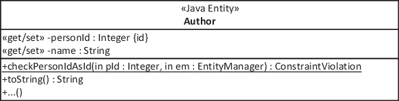

在 Java 实体类模型中，OO 类模型中指定的任何引用属性都用其所表示的关联的功能类型进行注解。在示例中，我们为实体类`Book`中的引用属性`authors`标注了`manyToMany`：

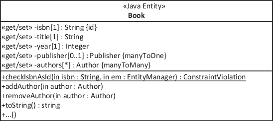

### 5.3 新问题

与上一节讨论的单向功能性关联相比，我们必须处理以下新技术问题：

1. 在*模型类*中，我们现在必须处理需要用`@OneToMany`或`@ManyToMany`注解的*多值引用属性*。

2. 在*用户界面*代码中，我们现在必须处理：
   1. 在`检索/列出所有对象`用例中，在渲染多值引用属性的视图表列中显示有关关联对象集合的信息；
   2. 在`创建对象`和`更新对象`用例中，允许从目标类所有现有实例的列表中选择关联对象的集合。

最后一个问题，即从某个类的所有现有实例的列表中选择关联对象的集合，通常由于易用性问题，无法通过 HTML `select multiple`表单元素来解决。每当可选选项集超过某个阈值时（由不无需滚动条即可在屏幕上显示的选项数量定义），HTML `select multiple`元素将不再可用，必须使用替代的*多选择控件*。

### 5.4 编写模型代码

可以直接对 Java 实体类模型进行编码，以实现我们 Java 后端应用的模型层。

#### 5.4.1 总结

1. 将 Java 实体类模型的每个类编码为对应的实体类。
2. 为任何`{id}`属性修饰符编写 JPA 属性注解`@Id`。
3. 为表示引用属性功能类型的属性修饰符（例如`{manyToOne}`）编写相应的 JPA 注解，例如`@ManyToOne`。
4. 使用 Java Bean Validation 注（或自定义校验注解）对模型中指定的完整性约束编码。
5. 为多值属性编写 getter 和 setter 以及`add`和`remove`方法。
6. 将`create`、`retrieve`、`update`和`delete`存储管理操作编码为类方法。

这些步骤将在接下来的章节中详细讨论。

#### 5.4.2 编写 Java 实体类模型中的每个类

对于多值引用属性`Book::authors`，我们使用参数化的`Set`类型：

```
@Entity @Table ( name="books")
@ViewScoped @ManagedBean ( name="book")
public class Book {
    …
    @ManyToMany ( fetch=FetchType.EAGER)
    private Set<Author> authors;

    public Book() {}
    public Book( String isbn, String title, Integer year,
            Publisher publisher, Set<Author> authors) {…}
    …
    public Set<Author> getAuthors() { return this.authors;}
    public void setAuthors( Set<Author> authors) { this.authors=authors;}
    …
}
```

JPA 注解`@ManyToMany`允许指定`Book`和`Author`之间的**多对多**关系。使用了注解参数`FetchType.EAGER`，因此当创建`Book`实例时，作者列表将用相应的`Author`实例填充。由于该注解的作用，在`Book`和`Author`之间创建了一张关系表，生成的 SQL 代码如下：

```
CREATE TABLE IF NOT EXISTS `books_author` (
    `Book_ISBN` varchar(10) NOT NULL,
    `authors_PERSONID` int(11) NOT NULL
);
```

生成的类名是表名用下划线连接的组合（例如`books_author`）。来自两个表的主键列被用于实现该关系。相应的列名创建如下：

* 对于对应带有`@ManyToMany`注解类（例如`Book`）的表（例如`books`），同时使用了类名和主键名，例如`Book_ISBN`。
* 对于另一个表（例如`authors`），将表名与主键名拼接，例如`authors_PERSONID`。

可以通过`@JoinTable`注解来控制这些参数，即表名和关系列名。要获取自定义命名的关系表（例如`books_authors`）以及相应的命名列（例如`book_isbn`和`author_personid`），可以使用：

```
@JoinTable( name="books_authors",
    joinColumns = {@JoinColumn( name="book_isbn", 
    referencedColumnName="ISBN")},
    inverseJoinColumns = {@JoinColumn( name="author_personid",
                                        referencedColumnName="PERSONID")
```

在我们的应用程序中，保持默认设置，因此没有使用`@JoinTable`注解。

相应的`Author`类使用适当的注解编码为 Java 实体类：

```
@Entity @Table ( name="author")
@ManagedBean ( name="author") @ViewScoped
public class Author {
    // 属性
    @Id @PositiveInteger
    private Integer personId;
    @Column ( nullable=false)
    @NotNull ( message="必须提供名称！")
    private String name;
    @Column ( nullable=false)
    @NotNull ( message="必须提供出生日期！")
    @Past private Date dateOfBirth;
    @Past private Date dateOfDeath;
    // 构造函数
    …
    // Setters/getters
    …
    // 数据管理操作
    …
}
```

除了定义属性外，实体类还需要定义构造函数、setter/getter 以及数据管理操作：

```
@Entity @Table( name="author")
@ManagedBean( name="author") @ViewScoped
public class Author {
    // 
    …
    // 构造函数
    public Author() {}
    public Author( Integer personId, String name,
            Date dateOfBirth, Date dateOfDeath) {…}
    // Setters/getters
    …
    // 数据管理操作
    public static void create( EntityManager em, UserTransaction ut,
            Integer personId, String name, Date dateOfBirth,
            Date dateOfDeath) {…}
    public static void update(…) {…}
    public static void delete(…) {…}
}
```

### 5.4.3 实现删除策略

对于引用属性`Book::authors`，我们必须在`Author`类的`delete`方法中实现删除策略。如果我们仅仅尝试删除一个作者，而该作者被任何书籍记录所引用，则会抛出完整性约束违反异常（integrity constraint violation exception），导致作者无法被删除。处理这种情况有两种可能方法：

1. 删除所有由被删除作者（共同）编写的书籍；
2. 从所有由被删除作者（共同）编写的书籍中移除对该作者的引用。

我们选择第二种方案。下在`Author.delete`方法的代码中所示：

```
public static void delete( EntityManager em, UserTransaction ut,
        Integer personId) throws Exception {
    ut.begin();
    Author author = em.find( Author.class, personId);
    // 查找该作者的所有书籍
    Query query = em.createQuery( "SELECT DISTINCT b FROM Book b "+
        "INNER JOIN b.authors a WHERE a.personId = :personId");
    query.setParameter( "personId", personId);
    List<Book> books = query.getResultList();
    // 从书籍的作者列表中移除该作者引用
    for (Book b : books) {
        b.getAuthors().remove( author);
    }
    // 删除作者记录（表行）
    em.remove( author);
    ut.commit();
}
```

本质上，删除操作包含三个步骤：

1. 创建一个 JPQL 查询，选择该作者的所有书籍（由于这是从书籍到作者的单向关联，无法直接从作者访问其书籍）。
2. 对于每个找到的引用该作者的书籍，我们必须从其作者列表中移除该作者引用。
3. 最后，删除作者记录。

### 5.4.4 序列化与反序列化

在 Java EE 中，从对象到相应数据库记录的序列化，以及从数据库记录到对象的反序列化，是由 Java EE 执行环境根据 JPA 注解和用于自定义转换的转换类自动完成的。

### 5.5 编写用户界面代码

#### 5.5.1 在检索/列出所有中显示关联对象信息

为了在“检索/列出所有书籍”用例显示书籍作者的信息，HTML 表格中对应的单元格必须填充所有作者名称的列表。为此，我们在`Book`类中实现了一个方法，该方法返回序列化后的作者名称列表（格式为`authorName_1, authorName_2, …, authorName_n`）：


```
public String getAuthorNames() {
    String result = "";
    int i = 0, n = 0;
    if ( this.authors != null) {
         n = this.authors.size();
         for ( Author author : this.authors) {
             result += author.getName();
             if ( i< n - 1) {
                  result +=", ";
             }
             i++;
         }
     }
     return result;
}
```

在`WebContent/views/books/`文件夹下的视图文件`retrieveAndListAll.xhtml`中，该方法在“Authors”列的 JSF 表达式被调用：

```
<ui:composition template="/WEB-INF/templates/page.xhtml">
    <ui:define name="content">
        <h:dataTable value="#{bookController.books}" var="b">
            …
             <h:column>
                 <f:facet name="header">Publisher</f:facet>
                 #{b.publisher.name}
             </h:column>
             <h:column>
                 <f:facet name="header">Authors</f:facet>
                 #{b.authorNames}
            </h:column>
        </h:dataTable>
      <h:button value="Back" outcome="index" />
    </ui:define>
</ui:composition>
```

记得使用`b.authorNames`会在给定的`b`对象上调用名为`getAuthorNames`的方法。

#### 5.5.2 在创建时允许选择关联对象

为了在“创建书籍”用例中允许选择多个作者与书籍关联，一个多选列表（带有`multiple="multiple"`的 select 元素，如下面的 facelet 代码所示）将用关联对象类型的实例填充。以下代码是`WebContent/views/books/`文件夹下`create.xhtml`视图文件的一部分：

```
<ui:composition template="/WEB-INF/templates/page.xhtml">
    <ui:define name="content">
        <h:form id="createBookForm">
            <h:panelGrid columns="3">
             …
             <h:outputLabel for="authors" value="Authors:"/>
             <h:selectManybox id="authors" value="#{book.authors}">
                 <f:selectItems value="#{bookController.authors}" var="a" itemLabel="#{a.name}" itemValue="#{a}"/>
                 <f:converter id="AuthorConverter"/>
             </h:selectManybox>
             <h:message for="authors" errorClass="error"/>
          </h:panelGrid>
          <h:commandButton value="Create" action="#{bookController.create(book.isbn, book.title, book.year, book.publisher, book.authors)}"/>
        </h:form>
        <h:button value="Back" outcome="index" />
    </ui:define>
</ui:composition>
```

记得我们需要为`Author`模型类添加`equals`方法。在我们的案例中，如果两个作者的`personId`属性相等，它们是“同一个”：

```
@Override
public boolean equals( Object obj) {
     if (obj instanceof Author) {
          Author author = (Author) obj;
          return (this.personId.equals( author.personId));
     } else return false;
}
```

像`Publisher`情况一样，使用 JSF 转换器在填充列表时将对象序列化为字符串，并在调用`BookController.create`方法时反序列化为对象。`BookController.create`方法扩展了一个新参数，即作者列表：

```
public String create( String isbn, String title, Integer year,
         Publisher publisher, Set<Author> authors) {
    try {
         Book.create ( em, ut, isbn, title, year, publisher, authors);
        // 创建书籍记录后强制清除表单
        FacesContext facesContext = FacesContext.getCurrentInstance();
       facesContext.getExternalContext().getRequestMap().remove( "book");
    } catch ( EntityExistsException e) {
       try {ut.rollback();} catch (Exception e1) {
          e1.printStackTrace();
      }
      e.printStackTrace();
    } catch (Exception e) {
      e.printStackTrace();
    }
    return "create";
}
```

*更新书籍*用例与*创建书籍*用例相似。

### 5.6 运行应用并获取代码

运行你的应用，可能需要先停止 Tomcat/TomEE 服务器（Windows 使用`bin/shutdown.bat`，Linux 使用`bin/shutdown.sh`）。接下来，下载并解压我们包含应用所有源代码以及你需要修改的 ANT 脚本文件的压缩包。现在，在你的控制台或终端中执行以下命令：

```
ant deploy -Dappname=UnidirectionalAssociationApp
```

最后，启动你的 Tomcat Web 服务器（Windows 操作系统使用`bin/startup.bat`，Linux 操作系统使用`bin/startup.sh`）。请耐心等待，取决于计算机的速度，这可能需要一些时间。当控制台显示以下消息时，它就准备绪了：`INFO: Initializing Mojarra [some library versions and paths are shown here] for context `/subtypingapp'`。最后打开浏览器并输入：

```
http://localhost:8080/UnidirectionalAssociationApp/WebContent/views/app/index.xhtml
```

### 5.7 引用属性值的集合与有序集合的区别

回想一下，`set`是一个具有唯一元素的无序集合，而`list`是一个可能包含相同元素的有序集合。

当非功能性关联端是`ordered`（有序的）时，例如图 5.1 中类图所示`Book::authors`，这意味着对应的引用属性的范围需要是一个有序集合类型，例如 Java 集合接口类型`SortedSet`和`List`。

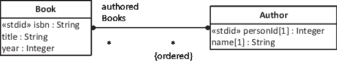

图 5.1：一个集合值的引用属性`authoredBooks`和一个有序集合值的引用属性`authors`。

在理论上，集合值的引用属性应该使用`Set<T>`定义，例如将`Set<Book>`声明为`Author::authoredBooks`的范围；而有序集合值的引用属性应该使用`SortedSet<T>`定义，例如将`SortedSet<Author>`声明为`Book::authors`的范围。Java 接口类型`Set`通常由 Java 类`HashSet`实现，而`SortedSet`通常由`TreeSet`实现。

然而，如果不担心避免重复元素，集合值和有序集合值的引用属性都可以使用泛型接口类型`List<T>`作为其范围，该类型通常由`ArrayList`实现。

当主要的用例是向集合中添加元素并在以后对它们进行迭代时，最佳选择是使用`ArrayList`实现的`List`，它比`LinkedList`或任何`Set`的实现都更节省内存，并且具有快速插入、迭代和随机访问的特性。使用`HashSet`仅在集合中查找元素的用例中才能提供性能优势。

## 6 单向关联实践项目

所有项目都包含以下任务：

1. 根据给定的设计模型创建一个派生的面向对象类模型（OO class model）。提示：将关联替换为相应的引用属性。

2. 根据 OO 类模型创建一个派生的 JavaScript 类模型或 Java 实体类模型（Java Entity class model）。提示：添加检查方法和 setter 方法。

3. 遵循提供的指南编写你的 JS 类模型或 Java 实体类模型的代码。

确保你的页面符合 HTML5 的 XML 语法，并且你的 JavaScript 代码符合我们的编码规范并通过了 (`JSHint`) 检查。

### 6.1 为电影分配导演和演员

该项目基于下方所示的信息设计模型。需要扩展之前作业中的应用程序，增加管理电影演员和导演数据的可能性。这通过添加模型类`Person`以及在`Movie`和`Person`之间添加两个单向关联来实现：

1. 一个多对一关联，将恰好一个人分配为电影的`director`（导演）；

2. 一个多对多关联，将零或多个个人分配为电影的`actors`（演员）。

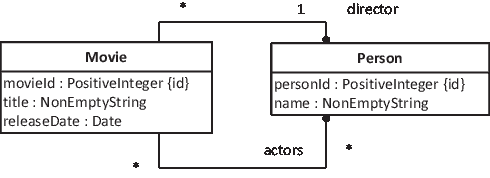

你可以使用以下示例数据来测试你的应用程序：

| 电影 (Movies) | | | | |
| --- | --- | --- | --- | --- |
| 电影 ID | 标题 | 上映日期 | 导演 | 演员 |
| --- | --- | --- | --- | --- |
| 1 | 低俗读小说 (Pulp Fiction) | 1994-05-12 | 3 | 4, 5 |
| 2 | 星际大战 (Star Wars) | 1977-05-25 | 2 | 6, 7 |
| 3 | 危险的关系 (Dangerous Liaisons) | 1988-12-16 | 1 | 8, 4 |

| 人员 (People) | | |
| --- | --- | --- |
| 人员 ID | 姓名 | |
| --- | --- | --- |
| 1 | Stephen Frears | |
| 2 | George Lucas | |
| 3 | Quentin Tarantino | |
| 4 | Uma Thurman | |
| 5 | John Travolta | |
| 6 | Ewan McGregor | |
| 7 | Natalie Portman | |
| 8 | Keanu Reeves | |

更多电影数据可以在 IMDb 网站上找到。

### 6.2 为国家分配城市和首都，为组织分配成员

该项目基于下方所示的信息设计模型。需要扩展之前作业中的应用程序，增加管理`international organizations`（国际组织）数据的可能性，国家作为`members`（成员），以及关于`cities`（城市）作为`capitals`（首都）和总部所在地的数据。这通过添加相应的模型类`InternationalOrganization`和`City`以及以下单向关联来实现：

1. `InternationalOrganization`与`Country`之间的多对多关联，将零或多个国家分配为国际组织的`members`；

2. `Country`与`City`之间的一对一关联，将恰好一个城市分配为国家的`capital`（首都）；

3. `Country`与`City`之间的一对多关联，将城市分配给国家。

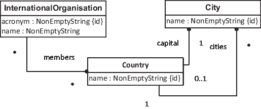

你可以使用以下示例数据来测试你的应用程序：

| 国际组织 (International organizations) | |
| --- | --- |
| 缩写 | 成员 |
| --- | --- |
| UN | 联合国 |
| WHO | 世界卫生组织 |
| NATO | 北西洋公约组织 |

| 国家 (Countries) | |
| --- | --- |
| 名称 | 首都 |
| --- | --- |
| 法国 | 巴黎 |
| 德国 | 柏林 |
| 俄罗斯 | 莫斯科 |
| 马赛 (Marseille) | |

更多关于国家的数据可以在`CIA` Worldbook 中找到。

## 7 双向关联

在面向对象建模和编程中，`bidirectional`（双向）关联是指表示为一对互反属性的关联，它允许在两个方向上进行“导航”（对象访问）。

下方的图 7.1 所示的模型（关于出版社、书籍及其作者）作为我们的运行示例。注意它包含两个双向关联，如两端的圆点所示。

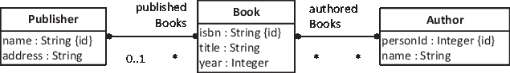

图 7.1：具有双向关联的出版社-书籍-作者信息设计模型。

### 7.1 反向引用属性

为了能够轻松检索由俱乐部成员担任主席的委员会，我们在`Committee-ClubMember`示例模型中添加了两个引用属性：成员担任委员会主席的属性（`ClubMember::chairedCommittee`）以及成员担任委员会副主席的属性（`ClubMember::coChairedCommittee`）。我们假设任何成员最多担任一个委员会的主席或副主席（这种析取是不互斥的）。因此，我们得到了以下模型：

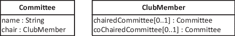

注意`Committee::chair`和`ClubMember::chairedCommittee`两个引用属性之间的紧密对应关系。它们是彼此的`inverse`（反向）：当俱乐部成员 Tom 是预算委员会主席时（通过元组（“budget committee”, “Tom”）表示），预算委员会就是 Tom 担任主席的委员会（通过反向元组（“Tom”, “budget committee”）表示）。为了在图中表示这种反向对应关系，我们在`ClubMember::chairedCommittee`属性的声明在大括号中添加了一个反向属性约束`inverse of chair`，并在`Committee::chair`属性中添加了类似的，如下图所示：

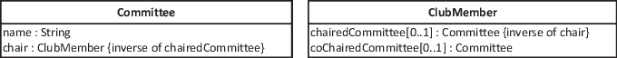

使用 OOP 语言的引用路径表示，用`c`引用一个`Committee`对象，我们得到方程：

(7.1)`c.chair.chairedCommittee=c`

或者反过来，用`m`引用一个`ClubMember`对象，我们得到方程：

(7.2)`m.chairedCommittee.chair=m`

注意，当属性`p[2]`是属性`p[1]`的逆反时，这意味着反过来，`p[1]`也是`p[2]`的逆反。因此，当我们声明属性`ClubMember::chairedCommittee`为`Committee::chair`的逆反时，隐含地，`Committee::chair`也是`ClubMember::chairedCommittee`的逆反。因此，我们将`Committee::chair`和`ClubMember::chairedCommittee`称为一对互反的引用属性。在模型中具有这样一对属性意味着`冗余`，因为涉及的两个引用属性中的每一个都可以通过反转从另一个导出。这种冗余意味着`数据存储开销`和`更新开销`，这是为了支持双向高效对象访问而付出的代价。


为了维护互反引用属性对的重复信息，通常是将涉及的两个属性之一视为`主(master)`，另一个视为`从(slave)`，并在受影响模型类的更改方法（如属性设置器）代码中考虑这种区别。我们在模型图中通过使用 UML 符号斜杠（`/`）作为属性名称的前缀并将从属性声明为`派生(derived)`属性，来指示逆引用属性对中的从属性，如图所示：

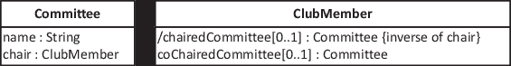

`ClubMember` 中的属性 `chairedCommittee` 现在是`派生`的（如其斜杠前缀所示）。它的注释 `inverseinverse of chair}` 定义了一个`推导规则`，根据该规则，它是通过反转属性 `Committee::chair` 得到的。

在 UML 类图中，属性的派生可以通过 OCL `derive` 表达式指定，该表达式对于给定对象求出派生属性的值。当属性是另一个属性的逆反时（通过附加在属性声明后的约束表达式 `{inverse of anotherProperty}` 指定），派生表达式是隐含的。在我们的示例中，对于任何俱乐部成员对象 `m`，它求出的委员会对象 `c` 满足 `c.chair = m`。在 OCL 中，该推导规则的表达式如下：

```
context ClubMember::chairedCommittee: Committee
derive:  
  if Committee.allInstances().exists( c | c.chair = self) then c
```

实现属性派生有两种方式：它可以通过读取时计算值来实现`读取时派生(derived on read)`，也可以通过更新时计算来实现`更新时派生(derived on update)`，每当派导表达式中的变量（通常是另一个属性）的值变化时执行计算。后者对应于数据库中的`物化视图`。虽然读取时派生的引用属性可能无法保证高效的导航，因为读取时的计算可能会产生不可接受的延迟，但更新时派生的引用属性确实提供了高效的导航。

当我们通过在名称前加斜杠（`/`）来将逆引用属性指定为派生时，我们表示它是更新时派生的。例如，上例中的属性 `/chairedCommittee` 是从属性 `chair` 在更新时派生的。

在派生引用属性的情况下，我们必须处理受影响模型类之间的`生命周期依赖`，这需要根据表示关联的功能类型（`一对一`、`多对一`或`多对多`）特殊的更改管理机制。

在我们关于派生逆引用属性 `ClubMember::chairedCommittee` 的示例中，它是单值且可选的，这意味着：

1. 每当创建一个新的委员会对象时（带有强制性的主席分配），对应的 `ClubMember::chairedCommittee` 属性必须进行相应的赋值；

2. 每当更新 `chair` 属性时（即为委员会分配一个新主席），必须取消之前主席的俱乐部成员的对应的 `ClubMember::chairedCommittee` 属性，并为新主席的成员设置该属性；

3. 每当委员会对象被销毁时，必须取消对应的 `ClubMember::chairedCommittee` 属性。

当派生逆引用属性是多值而其逆反基属性是单值时（例如下方图 7.4 所示的模型。如果模型中仍包含任何非定向关联，我们首先必须通过对其端点的所有权做出决策，将它们转换为定向关联，这通常基于导航需求。

1. **消除单向关联**（连接源类与目标类的单向关联），通过在源类中使用一个引用属性来替换它们，使目标类成为其范围。

### 2. 通过将双向关联替换为一对互逆的引用属性来消除双向关联

### 7.2.2 如何消除单向关联

连接源类与目标类的单向关联被替换为在**源类中的一个对应的引用属性，该属性的范围（range）为目标类。其多重性与目标关联端的多重性相同。如果关联端有名称，则该属性名称为关联端的名称；否则，设置为目标类的名称（如果引用属性是多值的，则可能使用复数形式）。

### 7.2.3 如何消除双向关联

双向关联，例如上述图 7.1 所示模型中 `Book` 类与 `Author` 类之间的作者关系关联，被替换为一对互逆的引用属性，例如 `Book::authors` 和 `Author::authoredBooks`。由于这两个引用属性表示的是相同的信息（同一组二元关系），可以考虑将其中一个作为“主属性”，另一个作为从主属性派生出的“从属属性”。我们讨论讨论一对一关联和多对多关联的两种情况。

1. 在双向一对一关联的情况下，这会导致产生一对互逆的单值引用属性，分别位于两个关联类中的每一个中。由于它们本质上表示的是相同的信息（同一组链接/关系集合），必须从中选择一个作为主属性，使得另一个成为从属属性，该从属属性通过反转从主属性派生。在类图中，从属属性被指定为*派生属性*（derived property），每当发生以下情况时，它都会自动更新：1) 创建了新的主对象，2) 更新了主引用属性，或 3) 销毁了主对象。这种转换如图 7.2 所示。

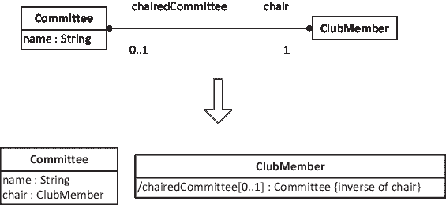

图 7.2：将双向一对一关联转换为一对主从的互逆单值引用属性。

1. 双向多对多关联被映射为一对互逆的多值引用属性，分别位于参与关联的两个类中的每一个中。同样，在两个类中的其中一个，表示（反向）关联的多值引用属性被指定为*派生属性*，每当另一个类（维护关联的类）中的相应属性更新时，该属性就会自动更新。这种转换如图 7.3 所示。

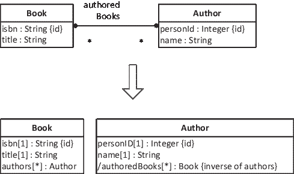

图 7.3：将双向多对多关联转换为一对主从的互逆多值引用属性。

### 7.2.4 得到的面向对象 类模型

在将两个双向关联都替换为引用属性后，我们得到了 7.4 所示的 OO 类模型。

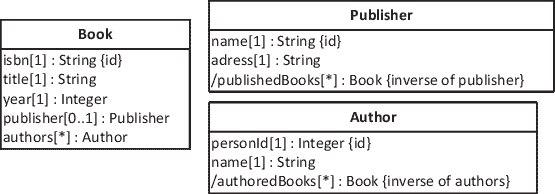

图 7.4：具有两对互逆引用属性的 OO 类模型。

由于书籍在存在上依赖于作者并可能依赖于出版商，而反之不然，因此在书籍对象中维护主引用，并将出版商和作者对象中的反向引用视为派生（或“从属”）数据是自然而然的。因此，我们将 `publishedBooks` 和 `authoredBooks` 定义为派生的反引用属性，这在 OO 类模型中通过其斜杠前缀来指示。

该 OO 类模型的意义可以通过涉及的三个模型类的示例数据填充来来说明：

| 出版社 (Publisher) |
| --- |
| 名称 (Name) | 地址 (Address) | 出版书籍 (Published books) |
| --- | --- | --- |
| Bantam Books | 美国，纽约 | 0553345842 |
| Basic Books | 美国，纽约 | 0465030793 |

| 书籍 (Book) |
| --- |
| ISBN | 标题 (Title) | 年份 (Year) | 作者 (Authors) | 出版社 (Publisher) |
| --- | --- | --- | --- | --- |
| 0553345842 | The Mind’s I | 1982 | 1, 2 | Bantam Books |
| 1463794762 | The Critique of Pure Reason | 2011 | 3 | |
| 1928565379 | The Critique of Practical Reason | 2009 | 3 | |
| 0465030793 | I Am A Strange Loop | 2000 | 2 | Basic Books |

| 作者 (Author) |
| --- |
| 作者 ID (Author ID) | 名称 (Name) | 过的书籍 (Authored books) |
| --- | --- | --- |
| 1 | Daniel Dennett | 0553345842 |
| 2 | Douglas Hofstadter | 0553345842, 0465030793 |
| 3 | Immanuel Kant | 1463794762, 1928565379 |

注意书籍引用出版商和作者，出版商和作者引用书籍。

## 8. 使用原生 JS 实现双向关联

在本章中，我们将展示 1 如何从具有派生属性的 OO 类模型派生 JS 模型，2 如何以类的形式编写 JS 模型，3 如何基于模型编写视图和控制器代码。

### 8.1 制作 JavaScript 模型

制作 JS 模型的起点是一个具有派生属性的 OO 类模型，为了方便所示：

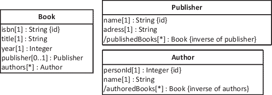

注意模型包含两个派生反属性：`Publisher::publishedBooks` 和 `Author::authoredBooks`。它们每一个都链接到一个主属性，并从中派生。因此，它们每一个都代表对应双向关联的一对引用属性。

与制作单向关联的 JS 类模型相比，唯一的新问题是：

1. 为所有派生反属性添加 «get»类型，意味着它们有一个隐式的 getter，但没有 setter。每当对应的主属性更新时，它们都会被隐式设置。

因此，我们得到了下面的 JavaScript 类模型：

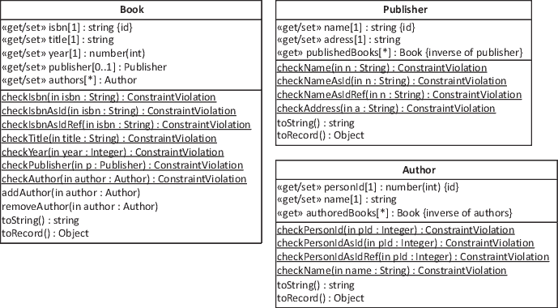

### 8.2 编写模型代码

可以直接编写 JS 类模型以获取我们 JavaScript 前应用的模型层代码。

#### 8.2.1 新问题

与*单向关联应用*相比，我们需要处理许多新的技术问题：

1. 我们定义派生反属性（如 `Publisher::publishedBooks`）时不包含 *check* 操作，也不包含 *set* 操作。

2. 我们还必须通过维护构成派生属性集合值的派生（反向）引用集合来维护派生反属性。这特别要求：

1. 每当*单值*主引用属性通过 setter 进行*初始化或更新*时（例如为书籍实例 `b` 分配指向出版商实例 `p` 的引用），都必须向派生反属性的相应值分配或添加反向引用（例如将 `b` 添加到 `p.publishedBooks`）；当主引用属性的值被*更新*且派生反属性是*多值*时，必须删除指向单值主引用属性旧值的过时反向引用。

2. 每当一个可选的 `single-valued`（单值）主引用属性的值被 `unset` 时（例如通过为 `Book` 实例 `b` 的 `b.publisher` 赋值 `null`），如果派生反向引用属性是多值的，则必须从对应的派生反向引用属性的值中移除反向引用（例如从 `p.publishedBooks` 中移除 `b`），否则必须取消或更新派生反向引用属性的值；

3. 每当通过添加方法向 `multi-valued`（多值）主引用属性的值中 `added` 一个引用（例如向 `Book` 实例 `b` 的 `b.authors` 中添加 `Author` 引用 `a`）时，必须向对应的派生反向引用属性赋值或添加反向引用（例如向 `a.authoredBooks` 中添加 `b`）；

4. 每当通过移除方法从 `multi-valued`（多值）主引用属性的值中 `removed` 一个引用（例如从 `Book` 实例 `b` 的 `b.authors` 中移除对 `Author` 实例 `a` 的引用）时，如果派生反向引用属性是多值的，则必须从对应的派生反向引用属性的值中移除反向引用（例如从 `a.authoredBooks` 中移除 `b`），否则必须取消或更新派生反向引用属性的值；

5. 每当一个具有单引用或多引用作为主引用属性值的对象被 `destroyed` 时（例如当一个具有单引用 `b.publisher` 指向 `Publisher` 实例 `p` 的 `Book` 实例 `b` 被销毁时），必须先移除派生的反向引用（例如从 `p.publishedBooks` 中移除 `b`）。

注意，当创建一个具有单引用或多引用作为主引用属性值的新对象时（例如一个带有单引用 `b.publisher` 的新 `Book` 实例 `b`），其 setter 或 add 方法将被调用，并将负责创建派生的反向引用。

#### 8.2.2 编码总结

将 JS 类模型中的每类类编码为 ES2015 类，并带有隐式的 getter 和 setter（或者，编码为带有显式 setter 的 ES5 构造函数）：

1. 以类级（`static`）方法的的形式编写属性检查。确保 JS 类模型中指定的所有属性约束都已正确编码在属性检查中。

2. 针对每个单值属性，编码指定的 getter 和 setter：

    1. 在每个 setter 中，调用相应的属性检查，且仅当检查未检测到任何约束违反时，才对属性进行设置/取消。

    2. 如果涉及的属性是派生引用属性的反向属性（表示双向关联），确保 setter 同时也向反向属性（或反向属性的集合值）赋值/取消（或添加/移除）相应的反向引用。

3. 针对每个多值属性，编码其 `add` 和 `remove` 操作以及指定的 get/set 操作：

    1. 将 add/remove 操作编码为（实例级）方法，这些方法会调用相应的属性检查。

    2. 编码 setter，使其对要赋值的集合中的每个项都调用 add 操作。

    3. 如果涉及的属性是派生引用属性的反向属性（表示双向关联），确保 add/remove 方法也向反向属性（或反向属性的集合值）赋值/取消（或添加/移除）相应的反向引用。

4. 编写序列化函数 `toString()` 和对象到存储转换函数 `toRecord()` 的代码。在出版社或作者对象的 `toRecord()` 对象到存储转换中，不包含派生属性 `publishedBooks` 和 `authoredBooks`，因为它们的信息是冗余的（这些信息从书籍的 publisher 和 authors 属性得出）。

5. 在 `destroy` 方法中注意删除依赖。确保当具有单引用或多引用作为主引用属性值的对象被销毁时，先取消派生的反向引用（或移除）。

这些步骤将在后续章节中进行详细讨论。

#### 8.2.3 编码 JS 类模型中的每个类

例如，JS 类模型中的 `Publisher` 类是以以下方式编码的：

```
class Publisher {
   constructor ({name, address}) {
     this.name = name;
     this.address = address;
     // 派生的反向引用属性 (Book::publisher 的反向)
     this._publishedBooks = {}; // 初始化为空 map
   }
get name() {…}
static checkName( n) {…}
static checkNameAsId( n) {…}
static checkNameAsIdRef( n) {…}
set name( n) {…}
get address() {…}
static checkAddress( a) {…}
set address( a) {…}
toString() {…}
toRecord() {…}
}
```

注意，我们添加了（派生的）多值引用属性 `publishedBooks`，但我们没有在构造函数中对其赋值，因为它是一个只读属性，当其反向主引用属性 `Book::publisher` 被赋值时会被隐式赋值。

#### 8.2.4 编码单值属性的 Set 方法

任何与派生反向引用属性（实现双向关联）耦合的引用属性的 setter，现在也需要向反向属性的集合值赋值/添加/移除反向引用。此类 setter 的一个示例是 `Book` 类中的 `publisher`：

```
set publisher( p) {
if (!p) { //引用要被删除
    // 移除 Publisher::publishedBooks 中的反向引用
    delete this._publisher.publishedBooks[this._isbn];
    // 取消 publisher 属性
    delete this._publisher;
} else {
  // p 可以是 ID 引用或对象引用
  const publisher_id = (typeof p !== "object") ? p : p.name;
  const constraintViolation = Book.checkPublisher( publisher_id);
  if (constraintViolation instanceof NoConstraintViolation) {
  if (this._publisher) {
       // 移除 Publisher::publishedBooks 中的反向引用
       delete this._publisher.publishedBooks[this._isbn];
}
   // 创建新的 引用
   this._publisher = Publisher.instances[ publisher_id];
   // 向 Publisher::publishedBooks 添加新的反向引用
      this._publisher.publishedBooks[this._isbn] = this;
} else {
  throw constraintViolation;
}
}
```

## 8.2.5 编码 Add Remove 操作

对于任何与派生反向引用属性耦合的多值引用属性，其 add 和 remove 方法都必须向反向属性（或其集合值）赋值/添加/移除相应的引用。

例如，对于为了实现 `Book` 和 `Author` 之间的双向作者关联而与派生反向引用属性 `Author:authoredBooks` 耦合的多值引用属性 `Book::authors`，`Book::addAuthor` 方法按以下方式编码：


```javascript
addAuthor( a) {
// a 可以是 ID 引用或对象引用
const author_id = (typeof a !== "object") ? parseInt(a) : a.authorId;
const validationResult = Book.checkAuthor( author_id);
if (author_id && validationResult instanceof NoConstraintViolation) {
    // 添加新的作者引用
    this._authors[author_id] = Author.instances[author_id];
    // 自动添加派生的反向引用
    this._authors[author_id].authoredBooks[this._isbn] = this;
} else {
   throw validationResult;
}
}
```

对于移除操作 `removeAuthor`，我们获得以下代码：

```javascript
removeAuthor( a) {
      // a can be an ID reference or an object reference
      const author_id = (typeof a !== "object") ? parseInt(a) : a.authorId;
      const validationResult = Book.checkAuthor( author_id);
      if (validationResult instanceof NoConstraintViolation) {
        // automatically delete the derived inverse reference
         delete this._authors[author_id].authoredBooks[this._isbn];
        // delete the author reference
        delete this._authors[author_id];
} else {
   throw validationResult;
}
}
```

### 8.2.6 抑制派生属性值的存储

在通过 `toRecord()` 对出版者或作者对象进行对象到存储的转换时，派生属性 `publishedBooks` 和 `authoredBooks` 不被包含，因为它们的信息是冗余的（自书籍的 `publisher` 和 `authors` 属性）。例如，`Author::toRecord` 函数的实现如下：

```javascript
toRecord() {
var rec = {};
// loop over all Author properties
for (let p of Object.keys( this)) {
    // keep underscore-prefixed properties except "_authoredBooks"
    if (p.charAt(0) === "_" && p !== "_authoredBooks") {
    // remove underscore prefix
    rec[p] = this[p];
}
return rec;
}
```

### 8.2.7 处理删除

当一个 `Book` 实例 `b`（它包含单个 `Publisher` 实例引用和多个 `Author` 实例引用）被销毁时，必须先移除派生引用（例如通过从 `p` 中移除 `b`）：

```javascript
Book.destroy = function (isbn) {
     const book = Book.instances[isbn];
     if (book) {
         console.log(book.toString() + " deleted!");
         if (book.publisher) {
             // remove inverse reference
             delete book.publisher.publishedBooks[isbn];
         }
         // remove references from authors
         for (let authorID of Object.keys(book.authors)) {
             delete book.authors[authorID].authoredBooks[isbn];
         }
         // finally delete book from instances
         delete Book.instances[isbn];
     } else {
       console.log(`There is no book with ${isbn}`);
     }
};
```

### 8.3 在用户界面中利用反向属性

在 UI 中，我们现在可以在“检索/全部”用例中利用反向属性。例如，我们可以在“更新”用例中更高效地创建关联对象的列表。然而，更新必须通过书籍集合来进行。

#### 8.3.1 显示有关已书籍的信息

为了在“检索/全部”用例中显示有关书籍的信息，我们现在可以利用 `publishedBooks`：

```javascript
retrieveAndListAll = {
  setupInterface: function () {
     const tableBodyEl = document.querySelector("section#R>tbody");
     tableBodyEl.innerHTML = "";
     for (let key of Object.keys(publishers)) {
       const publisher = publishers[key];
       const row = tableBodyEl.insertRow();
       // create list from publisher
       const listEl = document.createElement("ul");
       row.insertCell(0).textContent = publisher.name;
       row.insertCell(1).appendChild(listEl);
     }
     document.getElementById("M").style.display = "none";
     document.getElementById("R").style.display = "block";
  }
};
```

## 9 使用 Java 实现双向关联

在本章中，我们将展示：

1. 如何从模型派生 Java 实体类，
2. 如何根据模型对实体进行编码（示例），
3. 如何编写视图和控制器代码。

### 9.1 创建 Java 实体类

创建实体类的起点是一个带有反向属性的 OO 模型，如图 7 所示（我们再次展示它）：

注意，该模型包含两个反向属性：`publishedBooks` 和 `authoredBooks`。它们每一个都通过某种方式与其派生的主属性相关联。现在我们展示如何从该 OO 模型派生 Java 实体类：

1. 将每个类转换为「实体」类，并将所有属性设为私有。
2. 将 OO 模型中平台无关的数据类型名称替换为相应的 Java 数据类型（例如 `Integer`, `Float`）。
3. 为所有非派生属性添加「get/set」刻型，以指示它们需要 getter 和 setter。
4. 为所有派生属性添加「get」刻型，以指示它们只需要 getter。
5. 对于任何引用属性，根据其所表示的关联的功能类型，添加相应的关键字作为属性修饰符。对于给定的 OO 模型添加添加属性修饰符：
   - 为派生属性 `publishedBooks` 添加 `oneToMany`
   - 为引用属性 `publisher` 添加 `manyToOne`
   - 为引用属性 `authors` 添加 `manyToMany`
   - 为派生属性 `authoredBooks` 添加 `manyToMany`
6. 对于任何被指定为另一个属性的反向属性的派生引用属性，将其 `{inverse of … }` 属性修饰符替换为相应的 `{mappedBy="…"}` 属性修饰符。
7. 创建所需的属性约束检查操作。
8. 为每个*多值*属性创建一个 `add` 和 `remove` 操作。

### 9.2 编写模型代码

可以直接对 Java 实体类模型进行编码，以获取我们 Java 后端应用的模型层。

#### 9.2.1 新问题

与之前讨论的*单向关联应用*相比，我们必须处理许多新的技术问题：

1. 在*模型代码*中，你现在需要负责维护派生反向属性，方法是维护构成派生反向属性值的派生反向引用（或引用集合）。这特别要求：
   - 每当***单值***主引用属性的值通过 setter ***初始化或更新***时（例如将 `Publisher` 实例 `p` 的引用赋值给 `Book` 实例 `b` 的 `b.publisher`），必须向派生反向属性的对应值分配或添加反向引用（例如将 `b` 添加 `p.publishedBooks`）；当主引用属性的值*更新*且派生反向引用属性是*多值*时，则必须删除指向单值主引用属性旧值的过时反向引用。
2. 每当可选的 `single-valued` 主引用引用属性的值被 `unset` 时（例如，通过为 `Book` 实例 `b` 的 `b.publisher` 赋值 `null`），如果派生的反向引用属性是多值的，则必须从派生反向引用属性的对应值中移除反向引用（例如从 `p.publishedBooks` 中移除 `b`）；否则，必须将派生反向引用属性的对应值 `unset` 或更新；
3. 每当通过添加方法向 `multi-valued` 主引用引用属性的值中 `added` 引用时（例如向 `Book` 实例 `b` 的 `b.authors` 添加 `Author` 引用 `a`），必须向派生反向引用属性的对应值中赋值或添加反向引用（例如向 `a.authoredBooks` 中添加 `b`）；
4. 每当通过移除方法从 `multi-valued` 主引用引用属性的值中 `removed` 引用时（例如从 `Book` 实例 `b` 的 `b.authors` 中移除对 `Author` 实例 `a` 的引用），如果派生的反向引用属性是多值的，则必须从派生反向引用属性的对应值中移除反向引用（例如从 `a.authoredBooks` 中移除 `b`）；否则，必须将派生反向引用属性的对应值 `unset` 或更新；
5. 每当具有单引用或多引用作为主引用引用属性值的对象被 `destroyed` 时（例如，当一个具有指向 `Publisher` 实例 `p` 的单一引用 `b.publisher` 的 `Book` 实例 `b` 被销毁时），必须首先移除派生的反向引用（例如从 `p.publishedBooks` 中移除 `b`）。

注意当创建一个具有单引用或多引用作为主引用引用属性值的新对象时（例如一个具有单一引用 `b.publisher` 的新 `Book` 实例 `b`），其 setter 方法或 add 方法将被调用，并负责创建派生的反向引用。

2. 在 `UI code` 中，我们现在可以利用反向引用属性，在 `list objects` 用例场景中更高效地创建反向关联对象的列表。例如，我们可以更高效地为每个出版商创建所有已出版书籍的列表。

#### 9.2.2 总结

1. 将 Java `Entity` 类模型中的每个类编码为相应的实体类。
2. 使用 JPA 注解 `@Id` 编码 `{id}` 属性修饰符。
3. 为任何表示引用属性功能类型的属性修饰符（如 `{manyToOne}`）编码相应的 JPA 注解，例如 `@ManyToOne`。
4. 利用 Java Bean Validation 注解（或自定义验证注解）对模型中指定的完整性约束编码。
5. 为多值属性编码 getters 和 setters 以及 `add` 和 `remove` 方法。
6. 将创建、检索、更新和删除存储管理操作编码为类级方法（class-level methods）。
7. 在创建和更新方法中 care 处理好反向关系的管理。

这些步骤在接下来的 sections.

```java
private Set<Book> publishedBooks;  

…

}
```

`Publisher::publishedBooks` 属性的 `@OneToMany` 注解的 `mappedBy` 参数指定了 `Book` 类中实现 `@ManyToOne` 关系的属性：

```java
@Entity
public class Book {

  …

  @ManyToOne( fetch=FetchType.EAGER)
  @JoinColumn( name="PUBLISHER_NAME")
  private Publisher publisher;

  …

}
```

在 `Author` 类中，我们添加 `authoredBooks` 属性并使用对应 `Book` 类中 `@ManyToMany` 的 `@ManyToMany` 注解，表示反向关系：

```java
@Entity
public class Author {

…

@ManyToMany( fetch=FetchType.EAGER, mappedBy="authors")
private Set<Book> authoredBooks;

…

}
```

`Author` 类 `authoredBooks` 引用属性的 `@ManyToMany` 注解的 `mappedBy` 属性指定了 `Book` 类中反向引用属性的名称：

```java
@Entity…
public class Book {

  …

  @ManyToMany( fetch=FetchType.EAGER)
  @JoinTable( name="books_authors",
  joinColumns = {@JoinColumn( name="BOOK_ISBN")},
  inverseJoinColumns = {@JoinColumn( name="AUTHOR_PERSONID")})
private Set<Author> authors;

…

}
```

我们还使用 `@JoinTable` 注解来指定多对多关系的连接表以及连接表的相应的列名，例如，表名为 `books_authors`，列名为 `BOOK_ISBN` 和 `AUTHOR_PERSONID`。

#### 9.2.4 编码 Setter 操作

任何耦合到派生反向引用属性（实现双向关联）的引用属性的 setter，现在也需要向反向属性的对应值（set）赋值/添加/移除反向引用。此类 setter 的示例是下面的 `setPublisher` 方法：

```java
public class Book {

…

public void setPublisher( Publisher publisher) {

// remove the book reference from publisher.publishedBooks
if (this.publisher != null) {
this.publisher.removePublishedBook( this);
}

// add the book to publisher.publishedBooks
if (publisher != null) {
publisher.addPublishedBook( this);
}

this.publisher = publisher;
}
}
```

#### 9.2.5 编码 Add 和 Remove 操作

对于任何耦合到派生反向引用属性的多值引用属性，`add` 和 `remove` 方法也必须向反向属性（其值集）赋值/添加/移除相应的引用。

例如，对于耦合到 `Author` 类中派生反向引用属性 `Author::authoredBooks` 的多值引用属性 `Book::authors`，以实现 `Book` 和 `Author` 之间的双向作者关联，`addAuthor` 方法编码如下：

```java
public class Book {

…

public void addAuthor( Author author) {

if (this.authors == null) {
this.authors = new HashSet<Author>();
}

if (!this.authors.contains( author)) {
// add the new author reference
this.authors.add( author);
// add the derived inverse reference
author.addAuthoredBook( this);
}
}
}
```

对于移除操作 `removeAuthor`，我们获得以下代码：

```java
public class Book {

…

public void removeAuthor( Author author) {

if (this.authors != null && author != null &&
this.authors.contains( author)) {
// delete the author reference
this.authors.remove( author);
```


// delete the derived inverse reference

`author.removeAuthoredBook(this);`

### 9.2.6 处理删除依赖关系

当一个`Book`实例`b`（具有指向`Publisher`实例`p`的单一引用`b.publisher`以及多个指向`Author`实例引用`b.authors`）被销毁时，必须先移除派生的反向引用（例如通过从`p.publishedBooks`中移除`b`）。这通过调用单值和多值属性的 set 方法并传入`null`参数来实现，例如在`Book.delete`方法中调用`b.setPublisher(null)`和`b.setAuthors(null)`：

```java
public class Book {
    ...
    public static void delete(EntityManager em,
                              UserTransaction ut, String isbn) throws Exception {
        ut.begin();
        Book b = em.find(Book.class, isbn);
        b.setPublisher(null);
        b.setAuthors(null);
        em.remove(b);
        ut.commit();
    }
}
```

同样，在删除`Publisher`或`Author`实例时，我们也必须删除对`Book`实例的引用：

```java
public class Author {
    ...
    public static void delete(EntityManager em,
                              UserTransaction ut, Integer personId) throws Exception {
        ut.begin();
        Author a = em.find(Author.class, personId);
        a.setAuthoredBooks(null);
        em.remove(a);
        ut.commit();
    }
}
```

同样地：

```java
public class Publisher {
    public static void delete(EntityManager em,
                              UserTransaction ut, String name) throws Exception {
        ut.begin();
        Publisher p = em.find(Publisher.class, name);
        p.setPublishedBooks(null);
        em.remove(p);
        ut.commit();
    }
}
```

### 9.2.7 实体管理器与缓存实体

遗憾的是，JPA 不提供对派生反向引用的自动维护。根据 Java Persistence Wiki，我们必须在`set/add/remove`方法中实现（直接和反向）关系的管理：

> 双向关系中的一个常见问题是应用程序更新了关系的一侧，但另一侧没有更新，导致数据不同步。在 JPA 中，就像在普通 Java 中一样，维护关系是应用程序或对象模型的责任。如果你的应用程序向关系的一侧添加了内容，那么它也必须向另一侧添加。这通常通过对象模型中的 add 或 set 方法来解决，这些方法会处理关系的两个侧，这样应用程序代码就不需要担心这个问题。处理这个问题有两种方法：你可以只将关系维护代码添加到关系的一侧，并仅使用该侧的 setter（例如将另一侧设为 protected），或者将其添加到双侧，并确保避免无限循环。

我们为每个控制器类使用了一个实体管理器（entity manager）。每个实体管理器都维护一个缓存实体集合，可以通过`merge`方法与其他实体管理器“共享”。在我们的示例代码中，作为每个模型类创建和更新方法的一部分，我们必须合并属于另一个实体管理器的那些已更新的实体。例如，在`Book.create`方法中，我们需要合并新书籍的出版者（由`PublisherController`的实体管理器管理）以及其所有的作者（由`AuthorController`的实体管理器管理）：

```java
public class Book {
    public static void create(EntityManager em,
                              UserTransaction ut,
                              String isbn, String title, Integer year,
                              Publisher publisher, Set<Author> authors)
            throws Exception {
        ut.begin();
        Book book = new Book(isbn, title, year,
                publisher, authors);
        em.persist(book);
        if (publisher != null) {
            em.merge(publisher);
        }
        if (authors != null)
            for (Author a : authors) {
                em.merge(a);
            }
        ut.commit();
    }
}
```

如果不使用`merge`，出版者以及`authors`列表中的所有作者实例将不会代表对原始缓存实体的引用，并且不会保留我们的更改。更多细节请查阅与此事项相关的 Java Persistence 文档。

也可以禁用 JPA 缓存，这样每次创建新实例都会从数据库重新加载实体，例如当调用`EntityManager.find`方法时。这可以通过`persistence.xml`文件中添加以下行来实现：

```xml
<property name="eclipselink.cache.shared.default" value="false"/>
```

上述配置适用于`eclipselink`实现，对于其他 API 实现可能会有所不同。注意，如果没有严重原因，不建议禁用实体缓存，因为这会降低应用的性能，并在某些情况下（例如使用`@SessionScoped`管理的实体）可能会产生不可预知的行为。

### 9.3 在用户界面中利用派生反向引用属性

我们现在可以利用派生反向引用属性`Publisher::publishedBooks`和`Author::authoredBooks`，在*检索/列出所有出版者*和*检索/列出所有作者*用例中更高效创建关联书籍列表。

#### 9.3.1 在检索/列出所有中显示书籍信息

为了在*检索/列出所有出版者*用例中显示已书籍的信息，我们现在可以利用派生反向引用属性`publishedBooks`：

```xml
<ui:composition template="/WEB-INF/templates/page.xhtml">
    <ui:define name="content">
        <h:dataTable value="#{publisherController.publishers}" var="p">
            ...
            <h:column>
                <f:facet name="header">Published books</f:facet>
                <h:outputText value="#{p.publishedBooks}" escape="false"
                              converter="pl.m.converter.BookListConverter"/>
            </h:column>
        </h:dataTable>
        <h:button value="Back" outcome="index" />
    </ui:define>
</ui:composition>
```

在单向关联的情况下，针对*检索/列出所有书籍*用例，我们在`Book`模型类中使用了一个方法，即`getAuthorNames()`，它返回一个用逗号分隔的作者名称字符串列表：

```java
public class Book {
    ...
    public String getAuthorNames() {
        String result = "";
        int i = 0, n = 0;
        if (this.authors != null) {
            n = this.authors.size();
            for (Author author : this.authors) {
                result += author.getName();
                if (i < n - 1) {
                    result += ", ";
                }
                i++;
            }
        }
        return result;
    }
}
```

这对于书籍的情况来说是合理的，因为作者的数量通常限制在较小范围内。然而，一个`Publisher`可能有大量的出版书籍。相比字符串序列化，更好的替代方案是使用 JSF 转换类，它允许我们以自定义的方式展示作者列表。在我们的案例中，选择以列表形式展示，每个名称单独占一行。为此，我们实现了`pl.m.converter.BookListConverter`类，并按如下方式对其添加了`@FacesConverter`注解：

```java
@FacesConverter(value="pl.m.converter.BookListConverter")
public class BookListConverter implements Converter {
    @Override
    public Object getAsObject(FacesContext context,
                              UIComponent component, String value) {
        return null; // 此方法不需要
    }

    @Override
    public String getAsString(FacesContext context,
                              UIComponent component, Object value) {
        String result = "";
        int i=0, n=0;
        if (value == null) {
            return null;
        } else if (value instanceof Set<?>) {
            n = ((Set<Book>) value).size();
            for (Book b : (Set<Book>) value) {
                result += b.getTitle();
                if (i < n-1) {
                    result += "<br />";
                }
                i++;
            }
        }
        return result;
    }
}
```

然后，我们在 facelet 中使用`converter`属性来指定在渲染相应的视图组件时使用我们的转换类，例如`pl.m.converter.BookListConverter`：

```xml
<h:column>
    <f:facet name="header">Published books</f:facet>
    <h:outputText value="#{p.publishedBooks}" escape="false"
                  converter="pl.m.converter.BookListConverter"/>
</h:column>
```

由于序列化文本包含 HTML 元素，即用于产生 HTML 换行的`<br />`，我们必须指定`escape="false"`属性，否则`<`和`>`将被替换为相应的实体`&lt;`和`&gt;`。

使用 JSF 转换器的主要优势是我们没有将模型代码与视图特定的代码混合，因此我们的模型类保持了整洁。以后，如果我们想将 JSF 替换为其他 UI 技术，我们的模型类保持不变，我们只需要为新技术准备相应的转换器。

### 9.4 运行应用并获取代码

运行你的应用程序之前，你可能需要先停止 Tomcat/TomEE 服务器（Windows 使用`bin/shutdown.bat`，Linux 使用`bin/shutdown.sh`）。接下来，下载并解压我们的 ZIP 压缩包，其中包含了应用程序的所有源代码，以及你需要编辑的 ANT 脚本文件（修改`server.folder`属性值）。现在，在控制台或终端中执行以下命令：

```
ant deploy -Dappname=BidirectionalAssociationApp
```

最后，启动你的 Tomcat Web 服务器（Windows 操作系统使用`bin/startup.bat`，Linux 使用`bin/startup.sh`）。请耐心等待，取决于你电脑的速度，可能需要一些时间。最后，打开浏览器并输入：

```
http://localhost:8080/BidirectionalAssociationApp/WebContent/views/app/index.xhtml
```


## 10 关联的特殊主题

### 10.1 部分整体关联 (Part-Whole Associations)

部分整体关联表示部分类型与整体类型之间的关系。它的实例是两个对象之间的部分整体关系，其中一个对象是另一个对象（整体）的部分。UML 将部分整体关联分为两种类型：`aggregation`（聚合）和 `composition`（组合）。虽然这两个术语在 UML 中以一种相当精确但并不尽意的方式进行了定义，但许多软件开发者遵循 C++ 编程社区的术语传统，对它们有不同的解释：与“聚合”中的部分不同，“组合”中的部分不能脱离引用它们的复合体而独立存在。

我们遵循 UML，并通过引入两种组合之间的区别，改进了它们对“组合”的定义：具有 `separable`（可分离）部分的组合和具有 `inseparable`（不可分离）部分的组合。

#### 10.1.1 聚合 (Aggregation)

聚合是部分整体关联的一种特殊形式，其中整体的部分可以与其他整体共享。例如，我们可以对 `DegreeProgram`（学位课程）和 `Course`（课程）类之间的聚合进行建模，如下图所示，因为课程是学位课程的一部分，而且课程可以在两个或多个学位课程之间共享（例如，工程学位可以与计算机科学学位共享门 C 语言课程）。

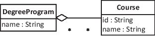

然而，具有 `shareable parts` 的聚合概念实际上并没有太大意义，因此它对如何编写该关联没有任何影响。因此，许多开发者倾向于不在他们的类图中使用白色菱形，而是仅建模一个普通的关联。UML 规范说：“共享聚合的精确语义取决于应用领域和建模者”。

聚合关联在整体侧的端点 `multiplicity`（乘数性/多重性）可以是任何数字（`*`），因为一个部分可能属于或 `shared` 任意数量的整体。

#### 10.1.2 组合 (Composition)

关于部分整体关联概念 `aggregation` 和 `composition` 之间的区别，存在如此多的困惑，真是令人惊讶。主要问题在于广泛的误解（即使在专家软件开发人员和 UML 作者之间也是如此），认为“组合”概念意味着整体与其部分之间存在生命周期依赖，导致部分在没有整体的情况下无法。但这种观点忽略了事实：也存在具有不可共享部分的部分整体关联，这些部分可以从整体中分离并在整体销毁后生存。

在 UML 规范文档中，“组合”一词的定义一直暗示了不可共享的部分，但并不清楚“组合”的定义性特征是什么，哪些又仅仅是可选的特征。即使在 UML 2.5 版本（截至 2015 年），在尝试改进“组合”一词的定义后，它仍然是模糊的，没有提供如何对具有不可共享部分的部分整体进行建模（即部分可以脱离并在整体破坏后生存，对比部分无法分离并随整体一起销毁的情况）。他们说：

> 如果复合对象被删除，其所有作为对象的部分实例也将随之被删除。

但同时他们又说：

> 部分对象可以在复合对象被删除之前从复合对象中移除，从而不会作为复合对象的一部分被删除。

这种困惑指向了 UML 定义的不完全性，它没有考虑到组件和复合体之间的生命周期依赖。因此，理解如何增强 UML 定义是非常重要的，例如通过引入用于 «inseparable»组合的 UML 态型（stereotype），或通过引入约束关键字 `inseparable` 来表征组件侧的关联端。

正如 Martin Fowler 所解释的，刻画组合关系的主要问题是“一个对象只能是一个一个组合关系的部分”。这在 G. Bellekens 的博客文章《UML Composition vs Aggregation vs Association》中也得到了解释。除了组合的这种定义特征（拥有 `exclusive` 唯一的或 `non-shareable` 不共享的部分）外，组合还可能伴随着复合体与其组件之间的生命周期依赖。事实上，有两此类依赖：

1. 每当组件 `must always be attached`（必须连接到）复合体时，或者说，当它具有 `mandatory composite`（强制复合体，如复合体侧的“恰一个”多重性所示）时，它必须在另一个复合体中复用（或重新连接），或者在当前复合体销毁时被删除。`Person` 和 `Heart`（心脏）之间的组合说明了这一点。当所有者去世时，心脏要么被删除，要么移植另一个人。

2. 每当组件 `must not be detached`（不能从复合体中分离），或者说，当它是 `inseparable`（不可分离的）时，那么只有在复合体销毁时，组件才会被删除。这种具有不可分离部分的组合示例是 `Person` 和 `Brain`（大脑）之间的组合。

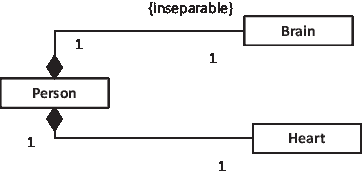

总结来说，由不可分离部分创建的生命周期依赖仅适用于组合的特定情况，而不是一般的。因此，它不是定义特征。UML 规定：“部分可以在复合实例被删除之前从复合实例中移除，从而不会作为复合实例的一部分被删除。”

当这种生命周期依赖适用时，它代表了 *Existential Dependency*依赖的一种特殊形式，这暗示了第 1.2 节中讨论的级联删除策略。

在 `Car-Engine` 组合的示例中（如下所示），显然引擎可以在汽车销毁之前从汽车上分离，在这种情况下，引擎不会被删除并可以复用。这由组合线复合侧的“零或一”多重性暗示。

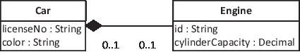

组合关联在复合侧的端点 `multiplicity` 是 1 或 0..1，取决于组件是否具有强制性的复合体。当然，组件不可分离的事实意味着它具有强制复合体，因此复合体多重性必须是 1。

#### 10.1.3 示例

作为部分整体关联（part-whole association）的一个示例，我们考虑教材与其章节之间的关联。通常情况下，教材的一个章节在不经过修改的情况下无法重用到另一本书中（例如，因为它可能会引用该教材的其他部分）。此外，允许存在不属于任何教材的章节是没有意义的。因此，我们将这种关联建模为不可分割的组合（inseparable composition），如图所示。

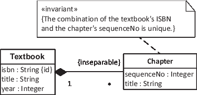

表示不可分割组件类型的对象类（如 `Chapter`）不需要具有标准的标识符属性，因为不需要让不可分割组件对象独立于其复合对象被引用。为了引用不可分割组件对象，使用一个复合键，该复合键由复合类型的主键和组件类型的适当（相对唯一的）属性组成。例如，教材章节是通过教材的 `ISBN` 和章节的序号组合来引用的。

由于 `Chapter` 对象作为 `Textbook` 对象的不可分割组件，当其 `Textbook` 对象消失时无法继续存在，因此在 `Delete Textbook` 操作的实现中，我们需要使用 `CASCADE` 级联删除策略，要求在删除教材的同时删除所有相关的章节。

不可分割组件类型不需要它自己的 CRUD 数据管理用户界面。相反，其所有的 CRUD 操作都在其复合类型的数据管理用户界面中提供。例如，创建、检索、更新和删除教材章节是在管理教材数据的界面中完成的。

### 10.2 关联类 (Association Classes)

关联类是一种表示关联的类。

回想一下，简单关联在面向对象 OO 类模型中通过将其转换为相关对象类的引用属性（reference properties）被消除，如第 1.7 节所示。但只要关联具有属性，它就无法被消除，并且在 OO 类模型中必须转换为一个类。

例如，考虑对象类型 `Book` 和 `Person` 之间的关联 `Reservation`，它允许表达诸如此类的事实，例如“`ISBN` 为 3627921105 的书被 ID 为 4701199 的人于 2020-08-22 预订了”。由于它有一个属性 `date`，该关联在信息设计模型中被建模为关联类，如下类图所示：

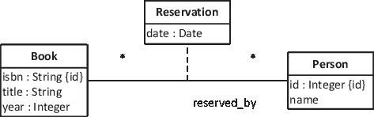

在 OO 类模型中（这是编写应用程序模型类的基础），关联类被转换为普通类，并带有引用相关对象类的引用属性。例如，关联类 `Reservation` 被转换为以下 OO 模型类：

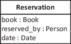

## 11 双向关联 实践项目

所有项目都包含以下任务：

1. 根据给定的信息设计模型派出一个 `OO class model`。提示：将关联替换为相应的引用属性。
2. 根据 OO 类模型派出一个 `JavaScript class model` 或 `Java Entity class model`。提示：添加检查方法（check）和设置方法（setter）。
3. 遵循提供的指南对你的 JavaScript 类模型或 Java 实体类模型进行编码。

确保你的页面符合 HTML5 的 XML 语法，并且你的 JavaScript 代码符合我们的编码指南并经过 JSHint 检查（[`www.jshint.com`](http://www.jshint.com)）。

### 11.1 为电影分配导演/演员，为导演/演员分配电影

此项目基于下述的信息设计模型。上一个作业的应用程序将通过添加派生反向引用属性（derived inverse reference properties）来扩展，以实现双向关联。这是通过向模型类 `Person` 添加多值引用属性 `directedMovies` 和 `playedMovies` 实现的，范围都是 `Movie`。

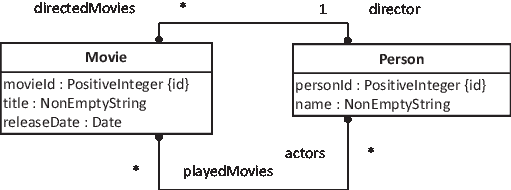

你可以使用以下示例数据测试你的应用程序：

| Movies (电影) |
| --- |
| Movie ID (电影 ID) | Title (标题) | Release date (发行日期) | Director (导演) | Actors (演员) |
| --- | --- | --- | --- | --- |
| 1 | 高俗小说 (Pulp Fiction) | 1994-05-12 | 1 | 5, 6 |
| 2 | 危险关系 (Dangerous Liaisons) | 1988-12-16 | 2 | 7, 5 |
| 3 | 无籍英仇 (Inglourious Basterds) | 2009-05-20 | 1 | 9, 1 |

| People (人员) |
| --- |
| Person ID (人员 ID) | Name (姓名) | Directed movies (导演的电影) | Played movies (主演的电影) |
| --- | --- | --- | --- |
| 1 | 昆丁·塔伦蒂诺 (Quentin Tarantino) | 1, 3 | 3 |
| 2 | 史蒂芬·弗里斯 (Stephen Frears) | 2 | |
| 5 | 乌玛·瑟曼 (Uma Thurman) | | 1, 2 |
| 6 | 约翰·特拉沃尔特 (John Travolta) | | 1 |
| 7 | 基亚努·里维斯 (Keanu Reeves) | | 2 |
| 9 | 布鲁德·比特 (Brad Pitt) | | 3 |

更多电影数据可以在 IMDb 网站找到。

### 11.2 为国家分配城市，为组织分配成员，反之亦然

此项目基于下方所示的信息设计模型。上一个作业的相应应用程序将通过扩展增加管理 `international organizations`（国际组织）数据的可能性，其中国家作为 `members`（成员），以及关于 `cities`（城市）的数据，作为首都和总部所在地。这是通过添加相应的模型类 `InternationalOrganization` 和 `City` 以及以下单向关联实现的：

1. `InternationalOrganization` 与 `Country` 之间的多多关联，将零或多个国家分配为国际组织的 `members`，反之为一个国家分配零或多个国际组织；
2. `Country` 与 `City` 之间的一多关联，将零或多个城市分配给国家，反之，一个城市恰对应一个国家。

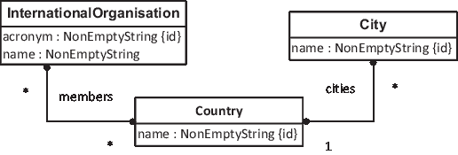

你可以使用以下示例数据测试你的应用程序：

| International organizations (国际组织) |
| --- |
| Acronym (缩写) | Name (名称) | Members (成员) |
| --- | --- | --- |
| UN | 联合国 (United Nations) | 德国，法国，俄罗斯 |
| WHO | 世界卫生组织 (World Health Organization) | 德国，法国，俄罗斯 |
| NATO | 北西洋约组织 (North Atlantic Treaty Organization) | 德国，法国 |

| Countries (国家) |
| --- |
| Name (名称) | Cities (城市) | International organizations (国际组织) |
| --- | --- | --- |
| 德国 | 柏林、汉兰堡、法兰克福 | UN, WHO, NATO |
| 法国 | 马赛、里昂、巴黎 | UN, WHO, NATO |
| 俄罗斯 | 莫斯科、新西伯利亚 | UN |

| Cities (城市) |
| --- |
| Name (市名) | Country (国家) |
| --- | --- |
| 柏林 | 德国 |
| 法兰克福 | 德国 |
| 汉兰堡 | 德国 |
| 里昂 | 法国 |
| 马赛 | 法国 |
| 莫斯科 | 俄罗斯 |
| 新西伯利亚 | 俄罗斯 |
| 巴黎 | 法国 |

更多国家的数据可以在 CIA 世界事实库（World Factbook）网站找到。

# 第二部分：类层次结构中的继承

当应用程序需要管理大量对象类型的数据时，某些对象类型之间可能存在各种 `subtype`（子类型）继承关系。子类型和继承是信息模型中的重要元素。应用程序必须以适当的方式实现它们，通常是在模型-视图-控制器（MVC）架构的模型层中。

## 12 子类型化与继承

`subtype`（子类型）或 `subclass`（子类）的概念是自然语言、数学和信息科学中的基本概念。例如，在英语中，我们说*鸟是动物*，或者所有鸟的类是所有动物类的*子类*。在语言学中，“鸟”是名词“动物”的下位词（hyponym）。

对象类型可以被子类型特化（例如，*鸟*特化为*鹦鹉*），也可以被父类型泛化（例如，*鸟*和*哺乳动物*被泛化为*动物*）。特化和泛化是同一枚硬币的两面。

子类 `inherits` 继承其所有父类的特征。当子类从父类继承属性、关联和约束时，这意味着在类图中不需要为该子类重复渲染这些特征，但类图的读者必须理解，父类的所有特征也适用于其子类。

当一个对象类型拥有多个直接父类时，我们就处于 `multiple inheritance`（多重继承）的情况，这在概念建模中很常见，但在许多面向对象的编程语言中是被禁止的，例如 `Java` 和 `C#`，这些语言仅允许每个对象类型具有唯一直接父类的 `class hierarchies`（类层次结构）。

### 12.1 通过特化引入子类

每当一个对象类型代表另一个对象类型的特例时，就可以通过特化（specialization）引入一个新的对象类型。我们在示例模型中说明这一点，即我们希望将教材和传记作为书籍的特例。这意味着教材和传记也拥有 `ISBN`、`title`（标题）和 `publishing year`（出版年份），但它们还具有进一步特征，例如教材的 `subjectArea`（学科领域）属性和传记的 `about`（关于）属性。因此，在图 12.1 中，我们通过特化对象类型 `Book` 来引入对象类型 `TextBook` 和 `Biography`，即它们作为 `Book` 的子类。

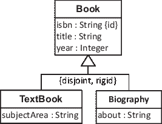

图 12.1：对象类型 `Book` 的两个子类：`TextBook` 和 `Biography`。

在特化对象类型时，我们为新添加的子类定义额外的特征。在许多情况下，这些额外特征是更具体的属性。例如，在 `TextBook` 特化 `Book` 的情况下，我们定义了额外的属性 `subjectArea`。在某些编程语言（如 `Java`）中，因此说子类 `extends`（扩展）父类。

然而，我们也可以在不定义额外属性或操作/方法的情况下，通过定义额外的约束来特化对象类型。

### 12.2 通过泛化引入父类

我们通过图 12.2 所示的示例来说说明泛化（generalization）。

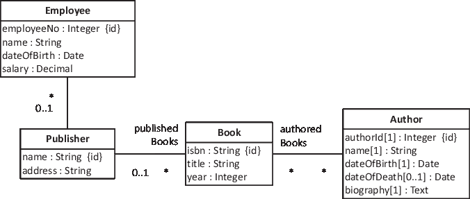

图 12.2：对象类型 `Employee` 和 `Author` 共享若干属性。

添加对象类型 `Employee` 后，我们注意到 `Employee` 和 `Author` 共享许多属性，这是因为员工和作者都是人，而“成为员工”和“成为作者”是人扮演的 `roles`（角色）。因此，我们可以通过添加一个共同的父类 `Person` 来对这两个对象类型进行泛化，如图 12.3 中的图所示。

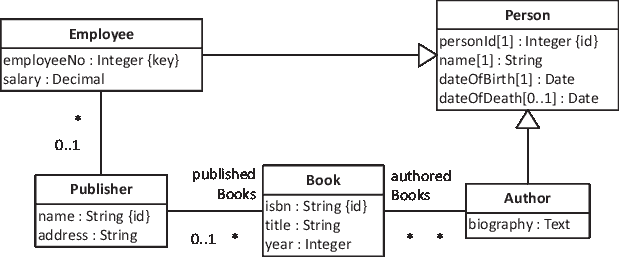

图 12.3：对象类型 `Employee` 和 `Author` 通过共同的父类 `Person` 泛化。

在泛化两个或多个对象类型时，我们将它们共享的特征移动到新添加的父类中进行集中。在 `Employee` 和 `Author` 的情况下，这组共享特征包括属性 `name`（姓名）、`dateOfBirth`（出生日期）和 `dateOfDeath`（死亡日期）。通常，共享特征可能包括属性、关联和约束。

注意，由于在信息设计模型中，每个顶层类都需要一个标准的标识符，我们在新类 `Person` 中声明了标准标识符属性 `personId`，它由所有子类继承。因此，我们必须重新考虑在泛化之前在子类中声明为标准标识符的属性。在 `Employee` 的情况下，我们将属性 `employeeNo` 声明为标准标识符。由于员工号是一个重要的业务信息项，即使它不再是标准标识符，我们也必须保留该属性。因为它仍然是一个备用标识符（一个“键”），我们使用约束关键字 `key` 为其定义了一个 `uniqueness`（唯一性）约束。

在 `Author` 的情况下，我们将属性 `authorId` 声明为标准标识符。假设该属性代表的是纯技术性的而非业务的信息项，我们舍弃它，因为它不再需要作为作者的标识符。因此，我们最终的模型允许通过员工号或其 `personId` 值来识别员工，并通过其 `personId` 值来识别作者。

我们考虑了原始示例模型的以下扩展，如图 12.4 所示，添加了两个类层次结构：

1. 将 `Book` 分为 `TextBook` 和 `Biography` 的不相交（但不完全）的划分；
2. 将 `Person` 分为重叠且不完全的 `Author` 以及进一步由 `Manager` 特化的 `Employee`。

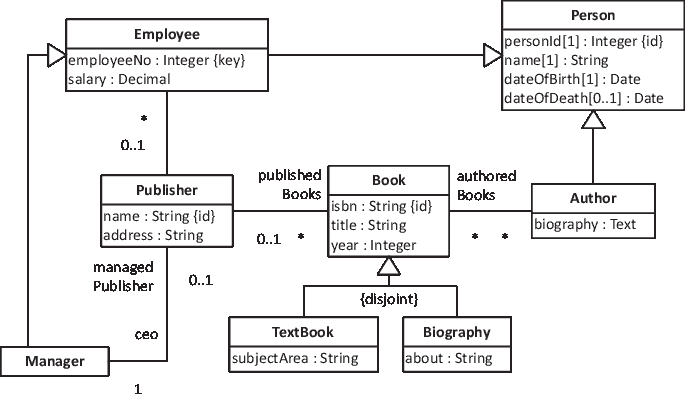

图具有两个层次结构的信息模型。

### 12.3 内涵（Intension）与扩展（Extension）

对象类型的 `intension`（内涵）由其特征（属性、关联、约束给出。对象类型的 `extension`（扩展）是实例化该类型的对象集合，也称为其种。我们有如下对立关系：父类的所有特征都在子类的内涵中（内涵包含），子类的所有实例都在类型的扩展中（扩展包含）。这种形式结构已经在形式分析中得到了研究。

由于内涵/扩展的对立，我们可以通过两种方式特化给定的类型：

1. 通过在子类中添加特征来扩展类型的内涵（例如添加属性 `subjectArea`）。
2. 通过添加约束来限制类型的扩展（例如定义一个 `subjectArea` 为“Mathematics”的子类）。

典型的对象语言（如 `Java` 和 `C#`）仅支持第一种可能性（通过扩展内涵来特化类型），而 `XML Schema` 和 `SQL99` 也支持第二种（通过限制扩展来特化类型）。

### 12.4 类型层次结构

`type hierarchy`（类型层次结构）由两个或多个类型组成，其中一个是根类型（或顶层）类型，所有其他类型至少有一个父类。当所有非根类型都有唯一的直接父类时，该类型层次结构就是 `single-inheritance hierarchy`（单继承层次结构），否则它是 `multiple-inheritance hierarchy`（多重继承层次结构）。例如，在下面的图 12.5 中，`Vehicle` 类是单继承层次结构的根；而图 12.6 展示了一个多重继承层次结构的示例，因为 `AmphibianVehicle` 有两个直接父类：`LandVehicle` 和 `WaterVehicle`。

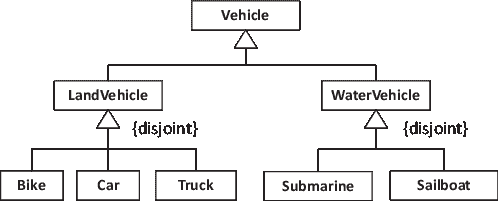

图 12.5：具有根类 `Vehicle` 的类层次结构。

类层次结构的简单情况（只有一层子类型关系）在 UML 中被称为 `generalization set`（泛化集），但可能更自然地称为 `segmentation`（划分）。如果所有子类扩展的并集等于父类的扩展，则该划分是 `complete`（完全的）（或者说，父类的所有实例都实例化了某个子类）。如果所有子类两两不相交，则该划分是 `disjoint`（不相交的）（或者说，没有父类实例实例化了多个子类）。否则，它被称为 `overlapping`（重叠的）。完全且不相交的划分被称为 `partition`（分区）。

在类图中，我们可以通过在共享的泛化箭头上标注大括号内的关键字 `complete`（完全）和 `disjoint`（不相交）来表示这些约束。例如，对一个分段进行 `{complete, disjoint}` 标注表示它是一个划分（partition）。默认情况下，每当分段没有任何标注时（如上方图 12.6

图 12.6：多重继承层次。

信息模型可以包含任意数量的类层次。

### 12.5 种类与角色

为了更好地理解真实世界的自然语言表述以及信息模型中不同类型的对象类型和子类型，我们可以根据 Giancarlo Guizzardi 在其《结构化概念模型的本体论基础》第 4 章的对象类型分类理论中提出的建议，区分 `sortal`（分类的）与非 `sortal`，以及 `rigid`（刚性的）与非刚性的对象类型。

如果一个对象类型对其实例具有统一的身份标识条件，则该对象类型是 `sortal` 的。这种条件定义了某种属性（或属性集），使得两个实例在不属于同一个对象的情况下，无法共同拥有这些属性。`sortal` 对象类型的例子是 `Person`（人），因为其所有的实例（人）都可以通过一组与其出生相关的属性（何时出生、何地出生以及为谁出生）来识别。`Book`（书）是非 `sortal` 对象类型的例子，因为它包含了以不同方式识别的实例（例如，教科书和自出版的小说）。

如果一个对象类型的实例在不消失（或不改变其身份）的情况下不再属于该类型，则该对象类型是 `rigid` 的。`Person` 是 `rigid` 对象类型的例子，而 `Employee`（员工）不是刚性的。如果所有分段子类都是刚性的，则该分段被称为 `rigid`。

`kind`（种类）是一种刚性的 `sortal` 对象类型。种类的例子有 `TextBook`（教科书）和 `Person`。`role`（角色）是一个 `sortal` 对象类型 `R`，用于分类所有与对象类型 `O` 的实例参与（某种类型 `A`）关系的种类 `K` 的实例。请注意，`R` 是 `K` 的非刚性子类型，因为当其实例由于不再参与与类型 `O` 实例的类型 `A` 关系而停止实例化 `R` 时，它们并不会消失。

例如，`Employee` 就是角色的例子，因为它是一个 `sortal` 对象类型，用于分类所有与类型为 `Enterprise`（企业）的实例参与雇佣关系的 `Person` 实例。

### 12.6 类层次合并设计模式

考虑上方图 12.1 中设计模型的简单类层次，它显示了类 `Book` 的不相交分段。在这种情况下，每当只有一层（或只有少数层）子类型，且每个子类型只有一个（或少数几个）额外属性时，通过将所有子类的所有额外属性合并到根类的扩展版本中来重构类层次也是一种选择，使得这些子类可以从模型中删除，从而实现模型的简化。

`Class Hierarchy Merge`（类层次合并）设计模式有两种形式。在最简单的形式中，原始类层次的分段是 `disjoint`（不相交），这允许使用 `single-valued`（单值）类别属性来表示根类每个实例的具体类别，该类别对应于它实例化的唯一子类。当原始类层次的分段不相交时，即至少有一个段是 `overlapping`（重叠）的，我们需要使用 `multi-valued`（多值）类别属性来表示对象实例化的类型集合。我们只讨论针对不相交分段的简单 `Class Hierarchy Merge` 重构情况，我们采取以下重构步骤：

1. 添加一个 `enumeration datatype`（枚举数据类型），其中包含每个分段子类对应的枚举字面量。在我们的示例中，我们添加了枚举数据类型 `BookCategoryEL`。

2. 在根类中添加一个类别属性，并将该枚举作为其范围。如果分段是完全的，则类别属性是强制的 [1]；否则是可选的 [0..1]。在我们的示例中，我们为类 `Book` 添加了一个范围为 `BookCategoryEL` 的类别属性。该类别属性是可选的，因为 `Book` 划分为 `TextBook` 和 `Biography`（传记）的分段是不完全的。

3. 每当分段是 `rigid`（刚性的）时，我们将类别属性指定为 `frozen`（冻结），这意味着它只能在创建新对象时通过设置值赋值一次，此后不能更改。

4. 将分段子类的属性移动到根类，并将其设为 `optional`（可选）。我们将这些通常列在类别属性下方的属性称为 `segment properties`（分段属性）。在我们的示例中，我们将来自 `TextBook` 的 `subjectArea`（学科领域）和来自 `Biography` 的 `about`（关于）移动到 `Book`，并将它们设为可选，即 `[0..1]`。

5. 添加一个约束（在附在扩展的根类矩形上的不变式框中），强制当且仅当实例实例化相应的类别时，可选的子类属性才有值。

6. 从模型中删除分段子类。

在我们的示例中，这种重构的结果如下方的图 12.7 所示。注意，该约束（或“不变式”）表示一个逻辑语句，其中逻辑运算符 `IFF` 代表逻辑“当且仅当”，属性条件 `prop=undefined` 测试属性是否没有值。

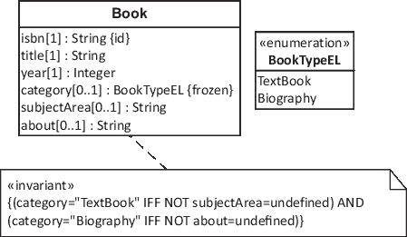

图 12.7：应用类层次合并模式的结果。

### 12.7 计算语言中的子类型与继承

子类型和继承已在面向对象编程 (*OOP*)、数据库语言（如 *SQL99*）、XML 架构定义语言 *XML Schema* 以及其他计算语言中以不同的方式和程度得到支持。计算语言中子类型处理的核心在于定义类型层次以及特征的继承：OOP 中的属性、约束和方法；SQL99 中的表列和约束；XML Schema 中的元素、属性和约束。通常，在类型层次中支持*多重分类*和*多重继承*是理想的。这两个语言特性密切相关，被认为是高级特性，在许多应用程序中可能不需要，或者可以通过变通方法解决。

#### 12.7.1 OOP 中的子类型与继承

面向对象编程（OOP）中对子类型的最基本支持（例如 Java 和 C# 所提供的）允许在单继承层次结构中定义属性和方法的继承。这种继承可以通过 `is-instance-of` 谓词进行检查，该谓词允许测试一个类是否是对象的直接类型或间接类型。此外，最好能够通过以下方式检查继承层次结构：

1. 一个预定义的实例层级属性，用于检索`对象的直接类型`（如果允许多重分类，则为其`多个直接类型`）；
2. 一个预定义的类型层级属性，用于检索`类型的直接父类型`（如果允许多重继承，则获取其`多个直接父类型`）。

JavaScript 是一种特殊的 OOP 语言，它最初没有用于定义类的显式语言元素，只有用于定义构造函数的元素。由于其动态编程的特性，JavaScript 允许使用各种代码模式来实现类、子类型和继承。在现代 JavaScript 中（从 ES2015 开始），定义父类和子类是非常直接的。首先，我们定义一个基类 `Person`，包含两个属性 `firstName` 和 `lastName`：

```


# 类继承与子类型定义

## 12.7.1 JavaScript 中的类继承

首先，我们定义一个基类 `Person`，包含两个属性 `firstName` 和 `lastName`：

```javascript
class Person {
  constructor(first, last) {
    // assign base class properties
    this.firstName = first;
    this.lastName = last;
  }
}
```

然后，我们定义一个子类 `Student`，包含一个额外的属性 `studentNo`：

```javascript
class Student extends Person {
  constructor(first, last, studNo) {
    // invoke constructor of superclass
    super(first, last);
    // assign additional properties
    this.studentNo = studNo;
  }
}
```

注意如何通过 `super(first, last)` 调用父类的构造函数来为父类属性进行赋值。

## 12.7.2 使用 XML Schema 的子类型和继承

在 XML Schema 中，子类型可以通过`扩展（extending）`或`限制（restricting）`现有的复杂类型来定义。扩展复杂类型意味着通过添加元素或属性来`扩展其内涵（intension）`，而限制复杂类型意味着通过添加约束来`限制其外（extension）`。

我们可以通过以下方式通过扩展 `Person` 来定义复杂类型 `Person` 和子类型 `Student`：

```xml
<xs:complexType name="Person">
  <xs:attribute name="firstName" type="xs:string" />
  <xs:attribute name="lastName" type="xs:string" />
  <xs:attribute name="gender" type="GenderValue" />
</xs:complexType>

<xs:complexType name="Student">
  <xs:extension base="Person">
    <xs:attribute name="studentNo" type="xs:string" />
  </xs:extension>
</xs:complexType>
```

我们可以通过以下方式限制 `Person` 来定义子类型 `FemalePerson`：

```xml
<xs:complexType name="FemalePerson">
  <xs:restriction base="Person">
    <xs:attribute name="firstName" type="xs:string" />
    <xs:attribute name="lastName" type="xs:string" />
    <xs:attribute name="gender" type="GenderValue"
      use="fixed" value="f" />
  </xs:restriction>
</xs:complexType>
```

注意，通过将 `gender` 属性的值固定为“f”，我们定义了一个仅由 `Person` 的女性实例满足的约束。

## 12.7.3 使用 OWL 的子类型和继承

在 Web 本体语言（OWL）中，属性定义与类定义分离，且属性默认不是单值的，而是多值的。因此，标准属性需要声明为`函数的（functional）`。因此，我们得到以下代码来表示 `Person` 是一个拥有属性 `name` 的类：

```xml
<owl:Class rdf:ID="Person"/>

<owl:DatatypeProperty rdf:ID="name">
  <rdfs:domain rdf:resource="#Person"/>
  <rdfs:range rdf:resource="xsd:string"/>
  <rdf:type rdf:resource="owl:FunctionalProperty"/>
</owl:DatatypeProperty>
```

OWL 允许通过以下方式说明类是另一个类的子类：

```xml
<owl:Class rdf:ID="Student">
  <rdfs:subClassOf rdf:resource="#Person"/>
</owl:Class>

<owl:DatatypeProperty rdf:ID="studentNo">
  <rdfs:domain rdf:resource="#Student"/>
  <rdfs:range rdf:resource="xsd:string"/>
  <rdf:type rdf:resource="owl:FunctionalProperty"/>
</owl:DatatypeProperty>
```


为了更好的可用性，OWL 应该允许在类定义内部定义类的属性，并以函数属性作为默认情况。

## 12.7.4 使用 SQL 数据库表表示类层次结构

标准的数据库管理系统（DBMS）在表行中存储信息（对象），这些行在经典的`关系型（relational）`数据库系统中被设计为集合论的关系。关系型数据库语言`SQL`用于定义、填充、更新和查询此类数据库。但也有更简单的数据存储技术允许以表行的形式存储数据，但它们不支持`SQL`。特别是键值对存储系统（例如 JavaScript 的`Local Storage API`），允许将`JS 实体表`（实体记录的映射）的序列化作为与表名键关联的字符串值进行存储。

虽然在经典的`SQL`版本（`SQL92`）中不支持子类型和继承，但这种情况在`SQL99`中发生了变化。然而，`SQL99`中与子类型相关的语言元素仅在某些 DBMS 中实现，例如在开源 DBMS`PostgreSQL`中。因此，为了创建一个可以使用各种框架、通过各种`SQL DBMS`（包括较弱的技术，如`MySQL`和`SQLite`）实现的设计模型，我们无法使用`SQL99`的子类型功能，而必须通过普通表和外键依赖在数据库设计模型中对继承层次结构。这种从类层次结构到关系表（以及反之）的映射是`对象关系映射（Object-Relational-Mapping）`框架的工作，例如 JPA 提供者（如`Hibernate`）、微软的`Entity Framework`或 Rails 框架的 Active Record 方法。

本质上有三种使用数据库表表示类层次结构的替代方法：

1. `单表继承`（`Single Table Inheritance`, `STI`）是最简单的方法，整个类层次结构由单个表表示，该表包含根类及其所有子类的所有属性的列，并以根类命名。
2. `类表继承`（`Table per Class Inheritance`, `TCI`）是一种方法，层次结构中的每个类都由相应的表表示，该表也包含继承属性的列，从而重复了表示其父类的表的列。
3. `连接表继承`（`Joined Tables Inheritance`, `JTI`）是一种更符合逻辑的方法，每个子类都由相应的表（子表）表示，通过其主键引用父类的主键与表示父类的表（父表）连接，使得父类的（继承的）属性不作为子表的列表示。

注意，`STI`方法与上面 12.6 节讨论的`类层次结构合并（Class Hierarchy Merge）`设计密切相关。每当设计模型中已经应用该设计模式，或者设计模型已经根据该设计模式进行了重构，相关的类层次结构（其子类）就已经在设计中被消除了，随之在以类定义形式编码的数据模型中也被消除了，因此不再需要将类层次结构映射到单表。否则，设计模型中包含一个类层次结构，该层次结构在应用层模型中通过相应的类层次结构实现，并将通过`STI`方法映射到数据库表。

我们通过两个简单的示例来说明这些方法的用法。第一个例子是`Book`类层级结构，如上方图 12.1 所示。第二个例子是`Person`角色的`Employee`、`Manager`和`Author`的类层级结构，如下方图 12.8 中的类图所示。

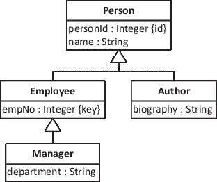

图 12.8：具有 Person 角色层级的信息设计模型。

### 12.7.4.1 单表继承

考虑上方图 12.1 所示的单级类层级结构，作为 MVC 应用模型类的设计，它是类`Book`的不完全不交划分。在这种情况下，当我们模型类层级结构只有一级（或少数几）子类型，且每个子类型只有少数额外属性时，使用 STI 更好，因此我们建模一个包含所有属性列的单表，其中表示分段子类额外属性的列（分段属性”）是可选的，如下方图 12.9 中的 SQL 表模型所示。

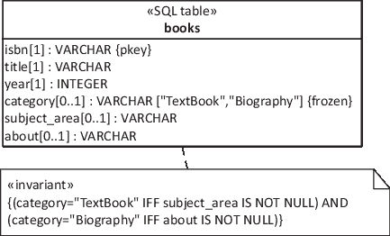

图 12.9：表示 Book 类层级结构的单表 SQL 模型。

添加一个特殊的`discriminator column`（判别列）来表示每行对应的由表示对象实例化的子类类别是一种常用方法。此类列通常为字符串值，但受限于子类的名称之一。如果 DBMS 支持枚举，它也可以是枚举值。我们使用名称`category`作为判别列，在我们的`Book`类层级结构示例中，由于教科书和传记的划分是硬性的，它具有冻结值约束（frozen value constraint）。

根据书籍的类别，我们必须强制：当且仅当它是“TextBook”时，其属性`subjectArea`必须有效；当且仅当它是“Biography”时，其属性`about`必须有值。这种隐含约束表示在上方类图中附着在`Book`表类上的不变性框（invariant box）中，其中逻辑运算符关键字`IFF`表示逻辑等价运算符`if and only if`（当且仅当）。它需要在数据库中实现，例如使用 SQL 表的`CHECK`子句或 SQL 触发器。

当给划分是不交的时，使用单值枚举属性`category`来表示实例所属的子类信息。否则，如果是非交的，则使用多值枚举属性`categories`来表示实例所属的子类信息。此类属性可以在 SQL 中实现，通过定义一个字符串列来表示一组枚举代码或标签，并以相应的字符串连接表示。

考虑上方图 12.8 所示的类层级结构。在子类`Employee`、`Manager`和`Author`中仅定义了三个额外属性，该类层级结构可以再次使用 STI 方法映射，如下方的 SQL 表模型图 12.10 所示。

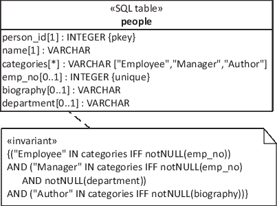

图 12.10：表示 Person 角色层级的 STI 表模型。

注意，现在判别列`categories`是多值的，因为`Person`的划分不是交的而是重叠的，这意味着`Person`对象可能属于多个类别。同样注意，由于角色划分（如`Employee`、`Manager`、`Author`）不是硬性的，判别列`categories`没有冻结值约束。

该模型的一个允许种群示例如下：

| people |
| --- |
| person_id | name | categories | biography | emp_no | department |
| --- | --- | --- | --- | --- | --- |
| 1001 | Harry Wagner | Author, Employee | Born in Boston, MA, in 1956, … | 21035 |   |
| 1002 | Peter Boss | Manager |  | 23107 | Sales |
| 1003 | Tom Daniels |  |  |  |  |
| 1077 | Immanuel Kant | Author | Immanuel Kant (1724–1804) was a German philosopher … |  |  |

注意`Person`表包含四种不同类型的人：

1. 一个人，Harry Wagner，他既是作者（带有传记）又是员工（带有员工编号）。
2. 一个人，Peter Boss，他是一个经理（一种特殊的员工），管理销售部。
3. 一个人，Tom Daniels，他既不是作者也不是员工。
4. 一个人，Immanuel Kant，他是一个作者（带有传记）。

STI 方法的**优点**：它能够忠实地表示原始类层级结构中表述的子类型关系；特别是，任何表示子类实例（员工、经理或作者）的行也表示了父类实例（人）。

**缺点**：(1) 在子类之间共同点较少的多级类层级结构中，STI 方法无法产生良好的表示。(2) 给定类层级结构在元素（类）方面的结构仅被隐式保留。

### 12.7.4.2 每类表

在更真实的模型中，`Person`的子类如图 12.8 所示将有更多属性，因此 STI 方法不再可行。在 TCI 方法中，我们得到下方图 12.11 所示的 SQL 模型。TCI 模型将类层级中的每个具体类表示为一个表，使得每个分段子类都包含继承属性的列，从而重复了父类的列。

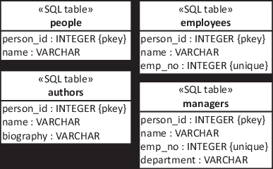

图 12.11：表示 Person 角色层级的 TCI 表模型。

可以通过以下步骤从信息设计模型导出 TCI 表模型：

1. 将所有类中的标准 ID 修饰符`{id}`替换为`{pkey}`以表示标准 ID 是主键。
2. 将单数（大写）类名（`Person`、`Author`等）替换为复数小写表名（`people`、`authors`等），并将驼峰属性名（`personId`和`empNo`）替换为小写下划线列名（`person_id`和`emp_no`）。
3. 为所有类矩形添加`«table»`属性。
4. 将平台无关的数据类型替换为 SQL 数据类型。
5. 删除所有泛化/继承箭头，并将父表（如`people`中的`person_id`和`name`）的所有列添加到表中。每个表仅由所表示类的直接实例填充。该模型的一个允许种群示例如下：

| people |
| --- |
| personId | name |
| --- | --- |
| 1003 | Tom Daniels |

| authors |
| --- |
| person_id | name | biography |
| --- | --- | --- |
| 1001 | Harry Wagner | Born in Boston, MA, in 1956, … |
| 1077 | Immanuel Kant | Immanuel Kant (1724–1804) was a German philosopher … |

| employees |
| --- |
| person_id | name | emp_no |
| --- | --- | --- |
| 1001 | Harry Wagner | 21035 |

| managers |
| --- |
| person_id | name | emp_no | department |
| --- | --- | --- | --- |
| 1002 | Peter Boss | 23107 | Sales |

## TCI 方法的**优点**：

(1) 显式保留了给定类层级结构在元素（类）方面的结构。(2) 当给定的类层级结构的分段是互不相交时，TCI 能够实现内存高效的非冗余存储。

**缺点**：(1) TCI 方法无法对原始类层级结构中表达的子类型关系提供忠实的表示。特别是，对于任何表示子类实例（员工、经理或作者）的行，没有信息表明它代表一个父类实例（人员）。因此，TCI 数据库模式无法提供有关所表示的子类型关系的信息；相反，这些保存在应用程序类模型中的元数据与数据库是解耦的。(2) TCI 方法需要重复定义列定义，这构成了模式冗余的一种形式。(3) 每当分段子类发生重叠时，TCI 方法可能会导致数据冗余。在我们的示例中，作者也可以是员工，因此对于重叠部分的任何人员，我们需要对代表父类属性的所有列进行数据存储重复（在我们的示例中，这仅涉及属性名称）。

### 12.7.4.3 贯表继承 (Joined Tables Inheritance)

为了避免分段重叠情况下 TCI 的数据冗余问题，我们可以采用 JTI 方法，如下所示图 12.12 所示的 SQL 表模型示例。该模型通过将子类的主键列（列）同时定义为引用其父表主键的外键，将表示子类（*子表*）的表与表示其父类（*父表*）的表连接起来。请注意，外键以带有 «fkey»刻字样的 UML 依赖箭头的形式可视化，并在其源表侧标注外键列的名称。

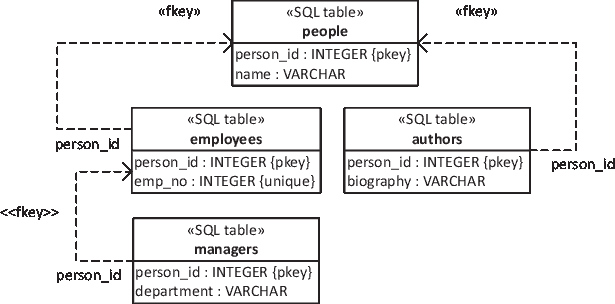

图 12.12：表示人员角色层级的 JTI 表模型。

该模型的一个可接受的人口示例如下：

| people |
| --- |
| person_id | name |
| --- | --- |
| 1001 | Harry Wagner |
| 1002 | Peter Boss |
| 1003 | Tom Daniels |
| 1077 | Immanuel Kant |

| authors |
| --- |
| person_id | biography |
| --- | --- |
| 1001 | Born in Boston, MA, in 1956, … |
| 1077 | Immanuel Kant (1724–1804) was a German philosopher … |

| employees |
| --- |
| person_id | emp_no |
| --- | --- |
| 1001 | 21035 |
| 1002 | 23107 |

| managers |
| --- |
| person_id | department |
| --- | --- |
| 1002 | Sales |

JTI 方法的**优点**：(1) 子类型关系和类层级结构被显式保留。(2) 避免了分段重叠情况下的数据冗余。

**缺点**：(1) JTI 方法的主要缺点是，查询子类时需要进行*连接查询*（用于连接分离的实体数据），这可能会产生性能问题。

### 12.8 测验题

如果您想查找以下测试题的答案，可以查看我们的讨论论坛。如果您在论坛中没有找到答案，可以创建一个帖子来询问某个特定问题的答案。

#### 12.8.1 问题 1：关于类层级的陈述

考虑以下类模型：

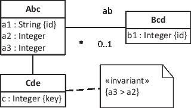

以下哪些说法是正确的？请选择一个或多个：

1. □ `Cde`的所有实例属性`a1`都有一个值。
2. □ `Cde`的标准标识符是`a1`。
3. □ `Cde`的所有实例都可能有一个指向类型为`Bcd`对象的对象引用`ab`。
4. □ `Abc`的直接实例属性`c`可能有一个值。
5. □ 对于任何类型为`Abc`的对象，`a3`的值必须大于`a2`的值。
6. □ 对于任何类型为`Cde`的对象，`a3`的值必须大于`a2`的值。
7. □ `Cde`的标准标识符是`c`。

#### 12.8.2 问题 2：类层级合并

考虑以下类模型：

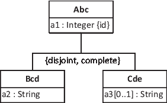

在这样的简单类层级情况下，我们可以使用*类层级合并*（Class Hierarchy Merge）设计模式，将整个类层级合并到单个类中。以下哪些模型描述了针对给定`Abc`类层级实现类层级合并设计模式的正确方式？请选择一个：

1. O 
2. O 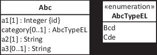
3. O 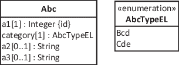
4. O 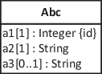

## 13 使用纯 JS 实现子类型

在本章中，我们首先介绍基于构造函数的子类型通用方法，介绍基于信息模型的案例。

在第一个案例中，我们考虑图 12.12 所示的单层类层级，它是完整的。我们使用*类层级合并*设计模式将该层级重构为单个类。

在第二个案例中，我们考虑由人员角色组成的图 12.12 所示的多层类层级。人员分为员工和作者的分段没有任何约束，这意味着它是完整的、重叠的非刚性的。我们使用*类层级合并*设计模式重构经理-员工子层级，并使用*贯表继承*方法将员工-作者-人员类层级映射到一组通过外键关联的数据库表。

在两个案例中，我们都展示了：

1. 如何从信息模型导出 JS 类模型和相应的实体模型，
2. 如何编写 JS 模型类，
3. 如何基于模型编写视图和控制器代码。

### 13.1 基于构造函数的类的子类型

在 2015 版本之前，JavaScript 还没有显式的类概念，也不直接支持子类型，因此必须借助提供两种继承机制的代码模式来实现：(1) 属性继承和 (2) 方法继承。

正如我们在第一卷第 1 章中解释过的那样，类可以通过两种替代方式定义：***基于构造函数的***和***基于工厂的***。两种方法都有各自实现继承的方式。

我们通过以下示例总结了 ES2015 定义父类和子类的基于构造的代码模式：

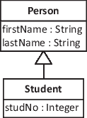

首先，我们定义一个基类`Person`，带有带有 getter 和 setter 的两个属性`firstName`和`lastName`：

```
class Person {

    constructor ({first, last}) {

        // 通过调用 setter 分属性

        this.firstName = first;

        this.lastName = last;

    }

    get firstName () {return this._firstName;}

    set firstName ( f) {

        … // 检查约束

        this._firstName = f;

    }

    get lastName () {return this._lastName;}

    set lastName ( l) {

        … // 检查约束

        this._lastName = l;

    }

}
```

然后，我们定义一个子类`Student`，它有一个额外的属性`studNo`：

```javascript
class Student extends Person {


`constructor({first, last, studNo})` {

    // 调用父类的构造函数

    `super({first, last})`;

    // 分配额外的属性

    `this.studNo = studNo`;

}

`get studNo()` {return `this._studNo`;}

`set studNo(sn)` {

    … // 检查约束

    `this._studNo = sn`;

}

```

注意父类的构造函数是如何调用的：通过 `super({first, last})`。

## 13.2 案例研究 1：消除类层次

简单的类层次可以通过应用“类层次合并”（Class Hierarchy Merge）设计模式来消除。我们案例研究的起点是图 12.1 信息设计模型所示的简单类层次，它代表了将 `Book` 划分为 `TextBook` 和 `Biography` 的不相交（但不完全）的刚性划分。我们首先通过应用“类层次合并”设计模式对该模型进行简化，得到了以下模型：

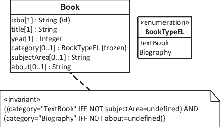

我们现在可以从这个设计模型推导出一个 `JS class model`。

### 13.2.1 构建 JS 类模型

我们通过 3 个步骤构建 JS 类模型：

1. 将平台无关的数据类型（用作属性和参数的范围）替换为 JS 数据类型。这包括枚举值属性的情况，例如 `category`，它会被转换为数值型属性，并限制在底层枚举类型的枚举整数范围内。
2. 为所有属性装饰一个 «get/set» 构型（stereotype），以指示它们具有隐式的 getter 和 setter。
3. 添加属性 `check` 函数，如卷 1 第 8 章中描述的。根据其隐含的语义，`checkCategory` 函数以及对分段属性（segment properties）的检查需要特殊的考虑。特别是，分段属性的 `check` 函数必须确保只有当 `category` 属性具有代表相应分段的值时，才能赋值该属性。我们将在下面讨论如何编写 JS 类模型时，更详细地解释这种隐含的验证语义。

这导致了所示图 13.1 中的 JS 类模型，其中类级（“静态”）方法带有下划线：

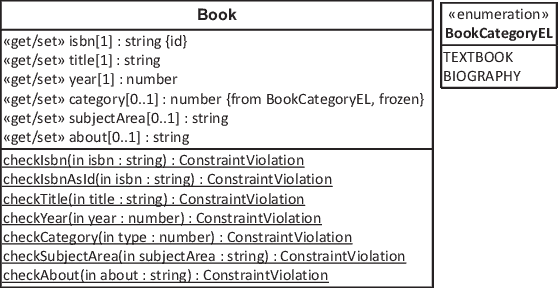

图 13.1：合并后的 `Book` 类层次的 JS 类模型。

### 13.2.2 新问题

与卷 1 第 11 章讨论的枚举应用相比，我们必须处理许多新问题：

1. 在 `model code` 中，我们需要处理：
   1. 向 `errorTypes.js` 添加约束违例类 `FrozenValueConstraintViolation`。
   2. 编码用于 `category` 属性范围的枚举类型（在我们的示例中为 `BookCategoryEL`）。
   3. 为 `category` 属性编码 `checkCategory` 函数。在我们的示例中，该属性是可选的（`optional*`），这是因为 `Book` 划分是不完全的（`incomplete*`）。如果应用“类层次合并”模式的划分是完全的，那么 `category` 属性就是强制的（`mandatory*`）。
   4. 为所有分段属性编码 `check` 函数，使其能够接受 `category` 作为第二个参数，以便测试所涉及的分段属性是否适用于给定的实例。
   5. 通过细化序列化函数 `toString()`，添加一个类别分支判断（`switch`）语句，以仅序列化适用于给定 `category` 的分段属性。
   6. 在 `Book.update` 中为 `category` 属性实现“冻值约束”（Frozen Value Constraint），仅在书籍的 `category` 尚未定义时才更新它。这意味着一旦它被定义，就不能再被更新。

2. 在 `UI code` 中，我们需要处理：
   1. 在 `books.html` 的“列出所有书籍”用例的显示表中添加一个“特殊类型”（或“类别”）列。没有特殊类别的书籍，其表格单元格将为空，而对于所有其他书籍，它们的 `category` 将显示在该单元格中，并带有其他特定分段的属性值。这需要在 `books.js` 视图代码文件的 `pl.v.books.retrieveAndListAll.setupUserInterface` 中编写相应的 `switch` 语句。
   2. 在 `books.html` 的“创建书籍”和“更新书籍”用例的表单中，为所有分段属性添加“特殊类型”选择控件（通常是选择列表）以及相应的表单字段。分段属性字段只有在选择了相应的书籍 `category` 时才会显示。这种在特定条件下渲染特定表单字段的方法被称为“动态表单”（dynamic forms）。

### 13.2.3 编写 JS 类模型的模型类

可以直接对 JS 类模型进行编码，以获取 JS 前端应用模型类的代码。

#### 13.2.3.1 总结

1. 如卷 1 第 11 章所述，借助元类 `Enumeration` 编码枚举类型 `BookCategoryEL`，用作 `category` 属性的范围。
2. 以 JS 类定义的形式编写 `Book` 模型类，带有 `get` 和 `set` 方法以及静态 `check` 函数。

#### 13.2.3.2 编码枚举类型 BookCategoryEL

枚举类型 `BookCategoryEL` 通过元类 `Enumeration` 在 `Book.js` 模型文件的开头编码：

```javascript
BookCategoryEL = new Enumeration(["Textbook", "Biography"]);
```

#### 13.2.3.3 编写模型类

以 JS 类定义的形式编写 `Book` 模型类，带有 `get` 和 `set` 方法以及所有属性的静态 `check` 函数：

```javascript
class Book {
    constructor ({isbn, title, year, category, subjectArea, about}) {
        this.isbn = isbn;
        this.title = title;
        this.year = year;
        // 可选的
        if (category) this.category = category;
        if (subjectArea) this.subjectArea = subjectArea;
        if (about) this.about = about;
    }

    get isbn() {…}
    static checkIsbn(isbn) {…}
    static checkIsbnAsId(isbn) {…}
    set isbn(isbn) {…}

    get title() {…}
    static checkTitle(t) {…}
    set title(t) {…}

    get year() {…}
    static checkYear(y) {…}
    set year(y) {…}

    get category() {…}
    static checkCategory(c) {…}
    set category(c) {…}

    get subjectArea() {…}
    static checkSubjectArea(sA, cat) {…}
    set subjectArea(s) {…}

    get about() {…}
    static checkAbout(a, cat) {…}
    set about(a) {…}
}
```

注意构造函数使用 ES2015 的参数解构定义了一个单个记录参数。我们以以下方式为 `category` 属性编写 `checkCategory` 和 `setCategory` 方法：

```javascript
static checkCategory(c) {
    if (c === undefined || c === "") {
        return new NoConstraintViolation(); // category 是可选
    } else if (!util.isIntegerOrIntegerString(c) || parseInt(c) < 1 ||
            parseInt(c) > BookCategoryEL.MAX) {
        return new RangeConstraintViolation("Invalid value for category: "+ c);
    } else {
        return new NoConstraintViolation();
    }
};

set category(c) {
    var validationResult = null;
    if (this.category) {  // 已设置/赋值
        validationResult = new FrozenValueConstraintViolation("The category cannot be changed!");
    } else {
        validationResult = Book.checkCategory(c);
    }
    if (validationResult instanceof NoConstraintViolation) {
        this._category = parseInt(c);
    } else {
        throw validationResult;
    }
}
```

虽然分段属性（在本例中：`subjectArea` 和 `about`）的 getter 方法遵循标准模式，但它们的检查逻辑和 setter 方法必须确保该属性适用于正在检查的实例的类别。这是通过检查属性值和类别的组合来实现的，如下所示：

```javascript
static checkSubjectArea(sA, c) {
    if (c === BookCategoryEL.TEXTBOOK && !sA) {
        return new MandatoryValueConstraintViolation(
                "A subject area must be provided for a textbook!");
    } else if (c !== BookCategoryEL.TEXTBOOK && sA) {
        return new ConstraintViolation("A subject area must not " +
                "be provided if the book is not a textbook!");
    } else if (sA && (typeof(sA) !== "string" || sA.trim() === "")) {
        return new RangeConstraintViolation(
                "The subject area must be a non-empty string!");
    } else {
        return new NoConstraintViolation();
    }
}
```

在序列化函数 `toString()` 中，我们在 `switch` 语句中序列化类别属性和分段属性：

```javascript
toString() {
    var bookStr = "Book{ ISBN:"+ this.isbn +", title:"+
            this.title +", year:"+ this.year;
    switch (this.category) {
    case BookCategoryEL.TEXTBOOK:
        bookStr += ", textbook subject area:"+ this.subjectArea;
        break;
    case BookCategoryEL.BIOGRAPHY:
        bookStr += ", biography about: "+ this.about;
        break;
    }
    return bookStr + "}";
};
```

在模型类的 `update` 方法中，我们只在属性需要更新时才设置它，即如果存在对应的参数槽且其值与旧属性值不同。对于具有`冻结值约束`（Frozen Value Constraint）的类别属性的特殊情况，我们需要确保只有在它尚未赋值时，才能连同相关的 set 分段属性一起更新。因此，在 `Book.update` 方法中，我们对 `book.category === undefined` 进行特殊测试以处理初始赋值的特殊情况，而以更标准的方式处理分段属性 `subjectArea` 和 `about` 的更新：

```javascript
Book.update = function ({isbn, title, year,
        category, subjectArea, about}) {
    const book = Book.instances[isbn],
            objectBeforeUpdate = util.cloneObject(book);
    var noConstraintViolated=true, updatedProperties=[];

    try {
        …
        if (category && book.category !== category) {
            book.category = category;
            updatedProperties.push("category");
        } else if (category === "" && "category" in book) {
            throw FrozenValueConstraintViolation(
                    "The book category cannot be unset!");
        }
        if (subjectArea && book.subjectArea !== subjectArea) {
            book.subjectArea = subjectArea;
            updatedProperties.push("subjectArea");
        }
        if (about && book.about !== about) {
            book.about = about;
            updatedProperties.push("about");
        }
    } catch (e) {
        …
    }
    …
};
```

### 13.2.4 编写视图和控制器代码

应用程序的用户界面（UI）包含一个启动页面，允许导航到数据管理页面（在本例中，到 `books.html`）。此类数据管理页面包含 5 部分：`管理书籍`、`列出并检索所有书籍`、`创建书籍`、`更新书籍`和`删除书籍`，一次只有一个部分显示（通过为其他部分设置 CSS 属性 `display:none`）。

#### 13.2.4.1 总结

我们需要在“检索并列出所有书籍”用例以及“创建书籍”和“更新书籍”用例中处理类别属性和分段属性 `subjectArea` 和 `about`，方法如下：

1. 在 `books.html` 的“检索并列出所有书籍”用例的显示表格中添加分段信息列（标题为“Category”）。
2. 在 `books.html` 的“创建书籍”和“更新书籍”用例的表单中添加“Category”选择字段以及所有分段属性的输入字段。分段属性的表单字段仅在选择了相应的书籍类别时才显示。

#### 13.2.4.2 在检索/列出所有中添加分段信息列

我们在 `books.html` 的“列出所有书籍”用例的显示表中添加了一个“Special type”列：

```html
<table id="books">
    <thead><tr><th>ISBN</th><th>Title</th><th>Year</th><th>Category</th>
</tr></thead>
    <tbody><tbody>>></</</tbody>>
</table>
```

没有特殊类别的书籍在该列中将显示一个空单元格，而对于所有其他书籍，其类别将在该列中显示，以及其他类别特定的信息。这需要在 `view/books.js` 文件的 `pl.v.books.retrieveAndListAll.setupUserInterface` 中编写相应的 `switch` 语句。


```
if (book.category) {

    switch (book.category) {

    case BookCategoryEL.TEXTBOOK:

         row.insertCell(-1).textContent = book.subjectArea + " textbook";

         break;

    case BookCategoryEL.BIOGRAPHY:

         row.insertCell(-1).textContent = "Biography about "+ book.about;

         break;

    }

}
```

#### 13.2.4.3 在创建和更新中添加类别选择字段

在两个用例中，我们都需要允许通过选择字段选择特殊的书籍类别（“教科书”或“传记”），如下 HTML 片段所示：

```
<div class="field">
<label>Category: <select name="category"></select></label>
</div>

<div class="field Textbook"><!-- 条件显示字段 -->
<label>Subject area: <input type="text" name="subjectArea" /></label>
</div>

<div class="field Biography"><!-- 条件显示字段 -->
<label>About: <input type="text" name="about" /></label>
</div>
```

注意，我们向分段字段容器的`class`属性中添加了“Textbook”和“Biography”作为额外值。这支持根据类别属性的值渲染和取消渲染“Textbook”和“Biography”表单字段。

在`handleCategoryChangeEvent`处理器中，只有当选择了相应的书籍类别时，才会通过`pl.v.app.displaySegmentFields`显示分段属性表单字段：

```
pl.v.books.handleCategoryChangeEvent = function (e) {
    var formEl = e.currentTarget.form,
           categoryIndexStr = formEl.category.value;
    if (categoryIndexStr) {
         pl.v.app.displaySegmentFields(formEl, BookCategoryEL.labels,
                  parseInt( categoryIndexStr) + 1);
    } else {
       pl.v.app.undisplayAllSegmentFields(formEl, BookCategoryEL.labels);
    }
};
```

记得类别选择列表包含一个返回空字符串的无选择选项“–––”，以及一个由`BookCategoryEL.labels`枚举标签组成的选项列表，其值为相应的数组索引（从 0 开始）的字符串。因此，变量`categoryIndexStr`的值为“”（空字符串）或“0”、“1”、“2”等之一。

### 13.3 案例研究 2：实现类层次结构

当类层次结构变得复杂时，我们不能简单地消除它，而必须在(1)应用程序的模型代码中、(2)底层数据库以及(3)用户界面中实现它。

本案例研究的起点是上方图 12.8 所示的设计模型。在接下来的章节中，我们从设计模型中推导出*JS 类模型*和*JS 实体表模型*。实体表模型被用于通过浏览器的 Local Storage 技术存储应用程序对象时，所需的对象到存储映射的设计。

#### 13.3.1 制作 JS 类模型

我们借助`JS class model`来设计示例应用的`model classes`，该模型是从`design model`派生而来的，本质上是保留了泛化箭头，并为每个类添加了`get/set`方法和静态`check`函数。然而，在我们的示例应用中，自然的方法是将`Class Hierarchy Merge`设计模式（在第 12.6 节中讨论）应用于`Employee`的单子类类分段，通过消除`Manager`子类来简化类模型。这导致了下方图 13.2 所示的模型。请注意，`Person`可能是`Employee`、`Author`或两者兼有。


图 13.2：Person 角色类层次结构的 JS 类模型。

### 13.3.2 创建 JS 实体表模型

由于我们使用浏览器的`Local Storage`作为示例应用的持久化存储技术，我们必须处理简单的键值存储。对于每个具有单数（大写开头）名称`Entity`的设计模型类，我们使用其复数小写名称`entities`作为对应的表名和键，以便通过`JSON.stringify`方法对对象集合`Entity.instances`进行序列化来获取其字符串值。

我们以`JS entity table model`的形式设计了一系列合适的 JS 实体表，该模型是从信息设计模型派生的。我们必须对如何组织数据存储以及如何导出相应的实体表模型做出某些选择。

第一个选择涉及使用`单表继承` `(STI)`、`类表继承` `(TCI)`或`连接表继承` `(JTI)`方法，这些方法在第 12.7.4 节中介绍。在`STI`方法中，一个分段（或整个类层次结构）由单个表表示，包含所有涉及类的所有属性的列，如图 13.3 中的示例模型所示。


图 13.3：Person 角色类层次结构的 STI 模型。

由于给定的分段不是不交的，因此使用多值枚举属性类别来表示实例属于哪些子类的信息。

对于给定的示例，使用`STI`方法是可行的，因为角色层次结构层级不多，且分段子类没有添加很多属性。但在更真实的示例中，给定角色层次结构的分段子类会有非常多的属性。`STI`方法并不是表示多级角色层次结构的理想选择。然而，我们可以选择它来表示单分段类层次结构`Manager-is-subclass-of-Employee`。

为了简单起见，并且因为浏览器的`Local Storage`不支持`JTI`需要的外键，我们选择了`TCI`方法，即为`Person`分段的每个类获取一个单独的表，但不包含外键。我们的选择导致了下方图 13.4 所示的模型，该模型是由图 12.8 所示的设计模型派生而来的：

1. 根据第 12.6 节描述的`Class Hierarchy Merge`设计模式，将`Manager`子类合并到其父类`Employee`中。
2. 将`Person`、`Author`和`Employee`的`personId`属性的标准 ID 修饰符`{id}`替换为`{pkey}`，以指示该属性是`主键`。
3. 将单数（大写）类名（`Person`、`Author`和`Employee`）替换为复数小写表名（`people`、`authors`和`employees`）。
4. 为所有类矩形（people, authors and employees）添加«JS entity table»原型。
5. 将平台无关的数据类型名称替换为 JS 数据类型名称。
6. 移除所有泛化/继承箭头，并将父表（`personId`和`name`）的所有属性添加到其子表（`authors`和`employees`）中。


图 13.4：Person 角色类层次结构的 TCI 模型。

在使用`JTI`方法的情况下，除了上述步骤 1-5 外，我们还会：

1. 将根表（`people`）的主键列（`personId`）复制到所有子表（`authors`和`employees`）中。
2. 将泛化箭头替换为带有«fkey»原型的依赖箭头（表示`外键依赖`），这些箭头在源端标注了子表的主键名称（此处：`personId`）。

### 13.3.3 新问题

与上方第一个案例研究的模型（图 13.1 所示相比，我们必须在`model code`中处理许多新问题：

1. 使用第 13.1 节中讨论的 JS 关键字`extends`定义`Employee`与`Person`之间以及`Author`与`Person`之间的子类关系。
2. 从持久化存储加载根类实例（`Person.instances`）时（在`Person.retrieveAll`中），我们加载 (1) 代表根类的表（`people`）的记录以创建其直接实例，以及 (2) 代表所有其他子类的表（`authors`和`employees`）的记录以创建它们的直接实例，同时将它们的对象引用添加到根类集合中（即`Person.instances`）。通过这样，根类集合不仅包含直接实例，还包含所有实例。
3. 在`Employee.saveAll`和`Author.saveAll`中（在`pl.v.employees.manage.exit`和`pl.v.authors.manage.exit`中调用）将`Employee`和`Author`的实例作为 JS 实体表`employees`和`authors`的记录保存到持久化存储时，我们还将`Person`的直接实例保存为`people`表的记录。

### 13.3.4 编写 JS 类模型的模型类代码

上方图 13.2 所示的 JS 类模型可以直接进行编码，以获取模型类`Person`、`Employee`和`Author`的代码以及枚举类型`EmployeeCategoryEL`的代码。

#### 13.3.4.1 定义子类关系

我们使用`extends`定义`Employee`与`Person`之间以及`Author`与`Person`之间的子类关系。例如，在`m/Employee.js`中我们定义：

```js
EmployeeCategoryEL =  new Enumeration(["Manager"]);

class Employee extends Person {
     constructor ({personId, name, empNo, category, department}) {
         super({personId, name});
         this.empNo = empNo;
         if (category) this.category = category;
         if (department) this.department = department;
      }
      …
}
```

#### 13.3.4.2 加载根类实例

```
Person.retrieveAll = function () {
      var people={}, employees={}, authors={};
      if (!localStorage["authors"]) localStorage["authors"] = "{}";
      if (!localStorage["employees"]) localStorage["employees"] = "{}";
      if (!localStorage["people"]) localStorage["people"] = "{}";
      try {
           people = JSON.parse( localStorage["people"]);
           employees = JSON.parse( localStorage["employees"]);
           authors = JSON.parse( localStorage["authors"]);
      } catch (e) {
           console.log("Error when reading from Local Storage\n" + e);
      }
      for (let key of Object.keys( authors)) {
           try { // convert record to (typed) object
            Author.instances[key] = new Author( authors[key]);
            // create superclass extension
            Person.instances[key] = Author.instances[key];
       } catch (e) {
       console.log(`${e.constructor.name} while deserializing` +
                 `author ${key}: ${e.message}`);
        }
     }
      …
}
```

`authors`表中的每条记录都会检索并转换为`Author`对象，其引用被复制到`Person.instances`中。同样，`employees`表的记录也通过这种方式处理，而`people`表的记录则简单地检索并转换为`Person`对象：

```
Person.retrieveAll = function () {
     …
    for (let key of Object.keys( employees)) {
         …
    }
    for (let key of Object.keys( people)) {
        try { // convert record to (typed) object
          Person.instances[key] = new Person( people[key]);
        } catch (e) {
          console.log(`${e.constructor.name} while deserializing` +
                `author ${key}: ${e.message}`);
        }
    }
}
```

### 13.3.4.3 在保存子表时保存超表

由于应用的数据在运行期间一直保存在主内存中（只要应用的网页页在浏览器中处于打开状态），因此在应用退出时（例如通过关闭浏览器标签页），数据必须保存到持久化存储中。在`pl.v.employees.manage.exit`和`pl.v.authors.manage.exit`中将`Employee`和`Author`实例（作为 JS 实体表`employees`和`authors`的记录）保存到持久化存储时，我们也保存了`Person`的直接实例（作为`people`表的记录）。这是必要的，因为对`Employee`或`Author`实例的变化可能意味着`Person.instances`的变化。

例如，对于`Employee`数据管理，我们在`v/employees.js`中定义了：

```
pl.v.employees.manage = {
      …
      exit: function () {
          Employee.saveAll();
          Person.saveAll ();
        },
        …
}
```

# 14 Java EE 中的子类型

在本章中，我们将基于运行示例——*Public Library*应用的信息模型片段，解释两个案例研究。在第一个案例研究中，我们考虑了图 12.1 所示的以`Book`为根的单级类层次结构，这是一个不完全的不相交划分。我们使用*单表继承*（Single Table Inheritance）方法将此类层次结构映射到单个数据库。

在第二个案例研究中，我们考虑了图 12.8 所示的由`Person`角色`Manager`和`Author`组成的多级类层次结构。我们使用*连接表继承*（Joined Table Inheritance）方法将此类层次结构映射一组通过外键依赖相关的数据库表。

在这两种情况下，我们展示了：

1. 如何推导出 Java 实体模型，
2. 如何以 Java 实体类的形式编写 Java 实体模型，
3. 如何编写视图和控制器代码。

## 14.1 Java 中的子类型

Java 通过其`extends`关键字提供了对子类型的内置支持，但不支持*多重继承*。考虑以下信息模型：


首先，我们定义超类`Person`。然后，我们定义子类`Student`并通过`extends`关键字定义它与`Person`的子类型关系：

```
public class Person {
    private String firstName;
    private String lastName;
}

public class Student extends Person {
    private int studentNo;
  public Student( String first, String last, int studNo) {
      super(firstName, lastName);
      this.setStudNo(studNo);
  }
```


注意在`Student`类中，我们定义了一个带有创建`Student`实例所需的所有参数的构造函数。在子类构造函数中，我们使用`super`调用超类`Person`的构造函数。

## 14.2 案例研究 1：使用单表继承实现类层次结构

在本例中，我们实现了图 12.1 所示的层次结构。Java 实体类模型是从此设计出的。

### 14.2.1 构建 Java 实体模型

回顾，我们通过以下步骤从 OO 类模型获取 Java 实体类：(1) 将所有属性设私有，(2) 使用 Java 数据类型类，(3) 添加公共 getter 和 setter，(4) 添加`toString`函数，(5) 添加（静态）数据存储方法`create`、`retrieve`、`delete`，从而得到图 14.1 所示的模型。


图 14.1：`Book`层次结构的 Java 实体类模型。

### 14.2.2 新问题

我们必须处理许多新问题：

1. 在*模型代码*中我们必须处理：
    - 编写枚举类型`BookCategoryEL`，该类型用于 UI 代码以创建一个选择列表，允许选择书籍类别。
    - 使用适当的 JPA 注解编写`Book`类层次结构中的每个类，以便持久化存储在相应的数据库表（如`books`）中。
2. 在*UI 代码*中我们必须处理：
    - 在`WebContent/views/books/`文件夹下的`retrieveAndListAll.xhtml`的“检索/列出所有书籍”用例的显示表中添加“特殊类型”列。没有特殊类别的书籍表格单元格将为空，而对于所有其他书籍，其类别将显示在此单元格中，并带有特定部分的属性值。
    - 在`WebContent/views/books/`文件夹下的`create.xhtml`和`update.xhtml`的“创建书籍”和“更新书籍”用例表单中添加“特殊类型”选择控件以及所有部分属性的表单字段。只有选择了相应的书籍类别，才会显示部分属性表单并对其进行验证。这种根据特定条件渲染特定表单的方法有时称为*动态表单*（dynamic forms）。

### 14.2.3 编写 Java 实体类的类

我们可以直接编写 Java 实体类模型以获取 Java EE 后端应用的模型类代码。

#### 14.2.3.1 总结

1. 编写枚举类型（用于 facelets）。
2. 编写模型类并添加相应的类层次 JPA 注解。

#### 14.2.3.2 编写枚举类型`BookCategoryEL`

枚举类型`BookCategoryEL`被编写为 Java `enum`，提供了枚举字面量以及（人类可读）标签：

```
public enum BookCategoryEL {

    TEXTBOOK("TextBook"), BIOGRAPHY("Biography");

    private final String label;

    private BookCategoryEL( String label) {

        this.label = label;

    }

    public String getLabel() {return this.label;}

}
```

##### 14.2.3.2.1 编写模型类

我们以 Java 实体类的形式使用适当的 JPA 注解编写`Book`、`TextBook`和`Biography`模型类：

```
@Entity @Table( name="books")
@Inheritance( strategy=InheritanceType.SINGLE_TABLE)
@DiscriminatorColumn( name="category",
       discriminatorType=DiscriminatorType.STRING, length=16)
@DiscriminatorValue( value="BOOK")
@ManagedBean( name="book") @ViewScoped
public class Book {

        @Id @Column( length=10)
        @NotNull( message="An ISBN is required!")
        @Pattern( regexp="\\b\\d{9}(\\d|X)\\b",
                 message="The ISBN must be a …!")
        private String isbn;

        @Column( nullable=false) @NotNull( message="A title is required!")
        private String title;

        @Column( nullable=false) @NotNull( message="A year is required!")
        @UpToNextYear
        @Min( value=1459, message="The year must not be before 1459!")
        private Integer year;
        // constructors, set, get and other methods
        …
}
```

在类层级结构使用 JPA 单表继承（Single Table Inheritance）技术时，必须为父类设置`@Inheritance`注解（例如我们示例中的`Book`）。它为`strategy`参数提供了`InheritanceType.SINGLE_TABLE`的值。`@DiscriminatorColumn`注解指定了用于区分不同子类类型（在我们的示例中`TextBook`和`Biography`）的表列名称。

遗憾的是，我们无法使用`BookCategoryEL`枚举来定义区分器列的类型，因为像`BookCategoryEL.TEXTBOOK.name()`这样的 Java 表达式不是常量，因此会抛出 Java 编译器异常。相反，我们使用`DiscriminatorType.STRING`。`@DiscriminatorValue`注解指定了一个唯一值，存储在表行的区分器列中，用于表示给定类的实例。

此外，我们定义了子类型`TextBook`和`Biography`：

```
@Entity @Table( name="textbooks")
@DiscriminatorValue( value="TEXTBOOK")
@ManagedBean( name="textBook") @ViewScoped
public class TextBook extends Book {

      @Column( nullable=false) @NotNull(
              message="A subject area value is required")
      String subjectArea;
      // constructors, set, get and other methods
     …
}
```

`TextBook`和`Biography`是`Book`的子类，因此我们使用`extends Book`来定义它们。对于每个子类，我们添加一个带有来自`BookCategoryEL`枚举值的`@DiscriminatorValue`注解。

### 14.2.4 STI 数据库结构

由于使用了注解

```
@Inheritance( strategy=InheritanceType.SINGLE_TABLE)
```

只有一个数据库表用于表示类层级结构。该表包含了层级结构中所有类的所有属性对应的列，加上区分器列。在我们的示例中，`books`表包含以下列：`isbn`、`title`、`year`、`subjectArea`、`about`和`category`。内部用于为应用程序生成`books`表的简化对应 SQL-DDL 代码所示：

```
CREATE TABLE IF NOT EXISTS `books` (
    `ISBN` varchar(10) NOT NULL,
    `TITLE` varchar(255) NOT NULL,
    `YEAR` int(11) NOT NULL,
    `SUBJECTAREA` varchar(255) DEFAULT NULL,
    `ABOUT` varchar(255) DEFAULT NULL,
    `category` varchar(16) DEFAULT NULL,
)
```

### 14.2.5 编写视图和控制器代码

用户界面（UI）由一个起始页面组成，允许导航到数据管理页面（在我们的示例中，到`WebContent/views/books/`文件夹下的`index.xhtml`）。此类数据管理页面包含四个部分：*检索/列出所有书籍*、*创建书籍*、*更新书籍*和*删除书籍*。

#### 14.2.5.1 总结

我们需要在“列出所有书籍”用例以及“创建书籍”和“更新书籍”用例中处理类别区分器以及`subjectArea`和`about`段属性：

1. 在`WebContent/views/books/`文件夹下的`retrieveAndListAll.xhtml`的*检索/列出所有*用例的显示表中添加一个段信息列（“特殊类型”）。
2. 在`WebContent/views/books/`文件夹下的`create.xhtml`和`update.xhtml`的“创建书籍”和“更新书籍”用例表单中，添加“特殊类型”选择控件以及对应所有段属性的相应表单字段。段属性表单字段仅在选择了相应的书籍类别时才显示并进行验证。

#### 14.2.5.2 在*检索/列出所有*中添加段信息列

我们在`books.html`的“列出所有书籍”用例的显示表中添加了“特殊类型”列：

```
<h:dataTable value="#{bookController.books}" var="b">
    …
    <h:column>
        <f:facet name="header">Special type</f:facet>
        #{b.getClass().getSimpleName() != 'Book' ?
              b.getClass().getSimpleName() : ''}
    </h:column>
</h:dataTable>
```

使用一个条件表达式来检查 Java Bean 类名是否为`Book`，如果是，则不显示它；如果是其他内容（例如`TextBook`或`Biography`），则显示。该表达式还展示了如何调用各种 Java Bean 方法，而不仅是自定义方法。

#### 14.2.5.3 在*创建*和*更新*中添加“特殊类型”选择控件

在两个用例中，我们需要通过面板格元素中的选择控件允许选择书籍类别（`textbook`或`biography`）：

```
<h:panelGrid id="bookPanel" columns="3">
    …
    <h:outputText value="Special type: " />
    <h:selectOneMenu id="bookType" value="#{viewScope.bookTypeVal}">
        <f:selectItem itemLabel="---"/>
        <f:selectItems value="#{book.typeItems}" />
        <f:ajax event="change" execute="@this" render="textBookPanel biographyPanel standardBookPanel"/>
    </h:selectOneMenu>
    <h:message for="bookType" />
```

在选择控件中引用了三个替代面板组：

1. “standardBookPanel”：

```
<h:panelGroup id="standardBookPanel">  
    <h:commandButton value="Create"
            rendered="#{viewScope.bookTypeVal == null}"
            action="#{bookController.create( book.isbn,
           book.title, book.year)}" />
</h:panelGroup>
```

2. “textBookPanel”：

```
<h:panelGroup id="textBookPanel">  
    <h:panelGrid rendered="#{viewScope.bookTypeVal == 'TEXTBOOK'}"
                columns="3">
        <h:outputText value="Subject area: " />
        <h:inputText id="subjectArea" value="#{textBook.subjectArea}"/>
        <h:message for="subjectArea" errorClass="error" />
    </h:panelGrid>
    <h:commandButton value="Create"
                rendered="#{viewScope.bookTypeVal == 'TEXTBOOK'}"
                action="#{textBookController.create( book.isbn, book.title,
                        book.year, textBook.subjectArea)}" />
</h:panelGroup>
```

3. “biographyBookPanel”：

```
<h:panelGroup id="biographyBookPanel">  
    <h:panelGrid rendered="#{viewScope.bookTypeVal == 'BIOGRAPHY'}"
              columns="3">
        <h:outputText value="About: " />
        <h:inputText id="about" value="#{biographyBook.about}"/>
        <h:message for="about" errorClass="error" />
    </h:panelGrid>
    <h:commandButton value="Create"
                rendered="#{viewScope.bookTypeVal == 'BIOGRAPHY'}"
                action="#{biographyBookController.create( book.isbn,
                        book.title, book.year, biographyBook.about)}" />
</h:panelGroup>
```


关于上述代码有几点重要说明：

* `h:selectOneMenu` 用于创建单次选择列表，通过使用 `Book` 类的 `getTypeItems` 方法填充书籍标题。更详细的解释将在第 3 部分枚举应用例中给出。
* 可以使用 `rendered` 属性来条件条件渲染 facelet 组件。JSF EL 表达式必须返回 `true` 或 `false`，这将决定生成的 HTML 元素是否包含在 HTML DOM 中。请注意，条件表达式是在服务器端求值的。我们使用这种方法来隐藏或显示对应各种书籍类型的输入表单元素（例如，`TextBook` 拥有 `subjectArea` 属性，而 `Biography` 拥有 `about` 属性）。
* `f:ajax` 使用的 `render` 属性指定了要更新哪些 JSF 组件。这是因为在 AJAX 调用后会发生实时的 DOM 更改（客户端，而非服务器端）。
* 当特殊类型选择列表字段发生变化时（选择了某项），会使用 AJAX 提交表单以进行重新评估。结果是，它强制了对应三个书籍案例的三个面板（普通书、教科书和传记）的渲染。通过使用 `execute="@this"`，我们强制在服务器端对表单进行重新评估，因此生成的 HTML DOM 结构包含了根据各种 JSF 元素的 `rendered` 属性所指定的更改。请注意，具有条件渲染表达式的 JSF 元素必须是始终位于 DOM 中的另一个 JSF 元素的子元素。
* `h:panelGroup` 用于定义一组显示或隐藏的元素。
* `h:commandButton` 的 `action` 属性不能与条件表达式一起使用，因此我们必须创建三个命令按钮，每个情况一个：创建/更新书籍、`TextBook` 或 `Biography`。这会调用相应控制器类的 `create` 方法（即 `BookController`、`TextBookController` 或 `BiographyController`）。
* 由于我们对应的 Java bean 类中没有为特殊类型（类别）设置相应的属性，我们可以使用 JSF 变量来存储单选列表的值，然后在各种元素的 `rendered` 条件中使用该变量。因此，对于 `h:selectOneMenu`，`value="#{viewScope.bookTypeVal}"` 指明了我们使用一个名为 `bookTypeVal` 的“即时”定义属性，它是视图作用域（view scope）内部 JSF 对象的一部分。我们也可以在视图作用域之外定义此类变量，例如 `value="#{bookTypeVal}"`，但在这种情况下它们是请求作用域（request scoped）的，因此在提交表单后它们的值会丢失，且渲染条件无法被正确评估。

对于类层次结构中的一个类，定义了一个对应的控制器类。它包含了特定的 `create`、`update` 和 `delete` 方法。共享方法（如 `getAllObjects`）由顶层类的控制器定义（例如，对于我们的示例，这是 `BookController`）。有关如何实现控制器类及相应的 CRUD 方法的更多细节，请参见示例应用程序。

`Update Book` 测试用例与 `Create Book` 测试用例非常相似。`Delete Book` 测试用例保持不变。

## 14.3 案例研究 2：使用连接表继承（Joined Table Inheritance）实现类层次结构

案例研究的起点是上方图 12.8 所示的设计模型。在接下来的章节中，我们将展示如何通过类层次结构合并（Class Hierarchy Merge）设计模式消除 `Manager` 类，以及如何借助 JPA 框架实现 `Person` 层次结构并使用连接、多表继承（Joined, Multiple Table Inheritance）存储。

### 14.3.1 制作 Java 实体类

我们使用 Java `Entity` 类设计示例的模型，我们直接从 `model` 派生并仅添加 `getters` 和 `setters`。然而，在示例中，我们应用了类层次结构合并设计模式来消除 `Manager` 类，如图 14.2 所示。注意在 JSF 元素中我们做出了两个技术决策：

1. 我们将 `Person` 的划分声明为不相交（disjoint）且完全（complete），即任何人要么是 `Employee` 要么 `Author`。由于 Java 不支持重叠划分。
2. 我们将 `Person` 变成一个抽象类（由斜体名称指示），这意味着它不能被实例化，相反我们可以实例化并初始化派生自它的子类。这意味着我们没有声明 `@DiscriminatorValue`，因为数据库表中没有存储 `Person` 的直接实例。

### 14.3.2 新问题

与测试用例 1 中所示的 `Book` 层次结构相比，`@Inheritance` 注解现在定义了 `strategy=Inheritance.JOINED`。这意味着对于继承层次结构中的每个类，都使用一个数据库表。`@DiscriminatorColumn(name="category")` 指定了顶层层次类（即 `Person`）在对应表（即 `persons`）中的列，该列存储了用于识别每个条目（表行）存储类型的判别器值。

在 UI 中我们必须处理：

1. 添加视图（`WebContent/authors` 和 `WebContent/employees`）和控制器类（`AuthorController` 和 `EmployeeController`）。
2. 处理 `Manager` 情况，在 `WebContent/books/create.xhtml` 和 `WebContent/books/update.xhtml` 中添加“特殊类型”选择控件。

### 14.3.3 编写 Java 实体模型类

我们使用 JPA 注解定义 `Employee` 与 `Person` 以及 `Author` 与 `Person` 之间的类别关系。首先，我们如下所示创建 `Person` 类：

```java
@Entity @Table(name="persons")
@Inheritance(strategy=Inheritance.JOINED)
@DiscriminatorColumn(name="category", discriminatorType=DiscriminatorType.STRING, length=16)
public abstract class Person {
     @Id @NotNull(message="A person ID is required!")
     private Integer personId;
     @NotNull(message="A name is required!") @Column(nullable=false)
     private String name;
    …
}
```

#### 14.3.3.1 定义类别关系

我们使用 JPA 注解定义 `Employee` 与 `Person` 以及 `Author` 与 `Person` 之间的类别关系。首先，我们如下所示创建 `Person` 类（上文）：

Java 实体模型通过使用 `Person`、`Employee` 和 `Author` 以及枚举 `EmployeeCategory` 来编写。

`Author` 类继承自 `Person`，因此可以使用对应 `personId` 和 `name` 属性的 `get` 和 `set` 方法。`@DiscriminatorValue(value="AUTHOR")` 指定了 `persons` 表的列分类对于每个通过持久化 `Author` 实例产生的条目都存储值 `AUTHOR`。

最后，我们定义了 `Employee` 类：

```java
@Entity @Table(name="employees")
@DiscriminatorValue(value="EMPLOYEE")
@ManagedBean(name="employee") @ViewScoped
public class Employee extends Person {
     @Column( nullable=false)
     @NotNull( message="An employee ID is required!")
     private Integer empNo;
     @Column( nullable=false, length=32)
     @Enumerated( EnumType.STRING)
     private EmployeeCategoryEL type;
     @Column( nullable=true, length=64)
     private String department;
     …
}
```

注意用于识别 `Employee` 类型的 `type` 属性，例如 `Manager`。它的值由 `EmployeeCategoryEL` 枚举定义。

### 14.3.3 连接表类层次结构的数据库模式

由于注解

```java
@Inheritance( strategy = InheritanceType.JOINED)
```

对于继承层次结构中的每个类，都会创建一个数据库表。JPA 用于创建 `persons`、`authors` 和 `employees` 表的相应简化 SQL-DDL 脚本所示所示：

```sql
CREATE TABLE IF NOT EXISTS `persons` (
      `PERSONID` int(11) NOT NULL,
      `category` varchar(16) DEFAULT NULL,
      `NAME` varchar(255) NOT NULL
);
CREATE TABLE IF NOT EXISTS `authors` (
      `PERSONID` int(11) NOT NULL,
      `BIOGRAPHY` varchar(255) DEFAULT NULL
);
ADD CONSTRAINT `FK_authors_PERSONID` FOREIGN KEY (`PERSONID`)
       REFERENCES `persons` (`PERSONID`);
CREATE TABLE IF NOT EXISTS `employees` (
      `PERSONID` int(11) NOT NULL,
      `DEPARTMENT` varchar(64) DEFAULT NULL,
      `EMPNO` int(11) NOT NULL,
      `TYPE` varchar(32) DEFAULT NULL
);
ADD CONSTRAINT `FK_employees_PERSONID` FOREIGN KEY (`PERSONID`)
       REFERENCES `persons` (`PERSONID`);
```

如我们所示，每个表都包含由相应 Java Bean 类定义的直接属性。此外，`authors` 和 `employees` 表在创建时带有 `PERSONID` 列的外键约束，引用了 `persons` 表中的 `PERSONID` 列。

### 14.3.4 编写视图和控制器代码

在用户界面中，对于每个 Java Bean 类，我们都有一个控制器类，其中包含创建、更新和删除 CRUD 方法。`PersonController` 类被定义为抽象类，并包含 `checkPersonIdAsId` 方法，该方法被所有子类共有。`AuthorController` 和 `EmployeeController` 继承了 `PersonController`。

对于继承层次中的每个非抽象实体类，我们定义了一组对应于 CRUD 操作的视图。例如，在 `Author` 的情况下，`WebContent/views/authors/` 文件夹中有 `retrieveAndListAll.xhtml`、`create.xhtml`、`update.xhtml` 和 `delete.xhtml` 文件。在 `Employee` 的情况下，`Retrieve/List All Employees` 用例需要显示 `Special type of employee` 列：

```xml
<h:column>
  <f:facet name="header">Special type of employee</f:facet>
  #{e.type != null ? e.type.label.concat(" of ").concat(
                                        e.department).concat(" department") : ""}
</h:column>
```

注意在 EL 表达式中，我们不能使用 `+`（加）运算符来拼接字符串。EL 只允许 `+` 运算符用于数值相加。然而，我们可以改用 `concat` 方法。

### 14.4 运行应用

要运行你的应用程序，你可能需要先停止 Tomcat/TomEE 服务器（Windows 使用 `bin/shutdown.bat`，Linux 使用 `bin/shutdown.sh`）。接下来，下载并解压包含应用程序所有源代码的 ZIP 压缩包，以及你必须编辑的 ANT 脚本文件（修改 `server.folder` 属性值）。现在，在你的控制台或终端执行以下命令：

```
ant deploy -Dappname=SubtypingApp
```

最后，启动 Tomcat Web 服务器（Windows 操作系统使用 `bin/startup.bat`，Linux 使用 `bin/startup.sh`）。请耐心等待，这取决于你计算机的速度。当控制台显示以下消息时：`INFO: Initializing Mojarra [some library versions and paths are shonw here]` 对于上下文 `/subtypingapp`，它就准备绪了。最后，打开浏览器并输入：

```
http://localhost:8080/SubtypingApp/WebContent/views/app/index.xhtml
```


### 15 子类型练习项目

### 15.1 项目 1 – 人物类型和电影类型

要构建的应用目的是管理电影信息及其导演和演员，其中区分了两种类型的电影：传记片和电视剧剧集，如下模型所示

按照我们的指南编写应用。

确保你的页面符合我们的指南。

# 术语表

| **C** |
| :--- | :--- |
| CRUD | CRUD 是 `创建`、`读取`、`更新`、`删除` 的缩写，表示任何软件应用程序执行的四种基本数据管理操作。 |
| Cascading Style Sheets | CSS 通过告诉浏览器如何渲染 HTML（或 XML）内容的布局元素。通常，这些设置在独立的 CSS 文件中完成，通过 HTML 中的特殊链接进行关联。 |

| **D** |
| :--- |
| Document Object Model | DOM 是一种用于检索和修改 HTML 或 XML 文档节点和元素的抽象 API。所有 Web 语言都有 DOM 绑定来实现 |
| Domain Name System | DNS 将用户友好的域名转换为 IP 地址，以便在 Internet 上定位主机。 |

| **E** |
| :--- |
| ECMAScript | 由行业组织“Ecma”定义的 JavaScript 标准。 |
| Extensible Markup Language | XML 允许以机器可读的方式标记各种文档、数据文件和消息结构。如果使用的标签名是自解释的，XML 也可以人类可读的。XML 基于 Unicode。SVG 和 MathML 基于 XML，并且有一个基于 XML 的 HTML 版本。 |
| XML 提供了一种以`XML 文档`形式通过`元素`和`属性`结构化信息的语法。XML 文档中的特定元素和属性可以来自任何词汇，例如公共标准或用户定义的 XML 格式。 |

| **H** |
| :--- |
| Hypertext Markup Language | HTML 用于标记人类可读 Web 文档或 Web 界面的结构。基于 XML 的 HTML 版本称为“XHTML5”，与传统的 HTML 相比提供了更简洁的语法。 |
| Hypertext Transfer Protocol | HTTP 是一种基于 Internet 技术 TCP/IP 和 DNS 的无状态请求/响应协议，使用人类可读的文本进行 Web 客户端和 Web 服务器之间的通信。HTTP 的主要目的是允许 Web 浏览器获取 URL 标识的 Web 文，并从 HTML 表单调用后端 Web 应用程序的操作。最近，HTTP 越来越多地用于提供 Web API 和 Web 服务。 |

### 术语表

#### IndexedDB
一种由浏览器管理的索引数据存储的 JavaScript API。索引允许高性能搜索。与许多 SQL 数据库管理系统（DBMS）一样，IndexedDB 支持数据库事务。

#### I18N
一组帮助产品适应任何目标语言和文化的最佳实践。它处理多种字符集、度量单位、键盘布局、时间和日期格式以及文本方向。

#### J
#### JSON
JSON 代表 `JavaScript Object Notation`（JavaScript 对象表示法），它是一种遵循 JavaScript 对象字面量语法的的数据交换格式。许多编程语言都支持 JSON 作为 XML 的轻量级替代方案。

#### M
#### MathML
一种用于表示数学表达式的开放标准，可用于数据交换或在网页内渲染。

#### MIME
MIME 类型（也称为“媒体类型”或“内容类型”）是随文件发送的关键字字符串，用于指示其内容类型。例如，声音文件可能标记为 `audio/ogg`，或者图像标记为 `image/png`。

#### Model-View-Controller
MVC 是一种通用架构隐喻，强调关注点分离原则，主要位于模型（model）和视图（view）之间，并将模型视为应用程序最基础的部分。在 MVC 框架中，“M”、“V”和“C”有不同的定义方式。通常，“模型”指的是应用程序的数据源，而“视图”表示用于用户界面的应用程序代码（基于 CSS 样式的 HTML 表单和 DOM 事件），而“控制器”通常指负责在 `view` 和 `model` 之间进行调的胶水代码。

#### O
#### Object Constraint Language
OCL（对象约束语言）是一种用于表示完整性约束的正式逻辑语言，主要用于 UML 类模型。它还允许在类模型中定义推导表达式以定义派生属性，并为操作定义前提和后置条件。

#### Object-Oriented Programming
OOP（面向对象编程）是一种基于`objects`（对象）和对象的`classes`（类）概念的编程范式。类类似于对象的蓝图：它们定义了对象的`properties`（属性）以及可以应用于它们的`methods`/functions`（函数）。 OOP 的高级特性是类层次结构中的 `inheritance`（继承）：子类继承父类的特征（属性、方法和约束）。

#### Web Ontology Language
OWL（网络本体语言）是一种用于 Web 知识表示的正式逻辑语言。它允许定义词表（主要是带有属性的类），并支持对这些类表示许多类型的完整性约束。OWL 是执行自动推理的基础，例如检查 OWL 词表的一致性。以 UML 类模型形式定义的词表或数据模型可以转换为 OWL 词表，然后检查其一致性。

#### P
#### Portable Network Graphics
PNG 是一种支持无损数据压缩的开放（非专利）图形文件格式。

#### Polyfill
Polyfill（垫片方案）是一段 JavaScript 代码，用于在不支持该方法的浏览器模拟标准的 JavaScript 方法。

#### R
#### Resource Description Framework
RDF（资源描述框架）是一种 W3C 语言，用于在 Web 上表示机器可读的命题信息。

#### S
#### Standard Generalized Markup Language
SGML 是一种定义标记语言的 ISO 规范。HTML4 是基于 SGML 定义的。XML 是 SGML 的简化后续。HTML5 不再基于 SGML，而是有它自己的解析规则。

#### Scalable Vector Graphics
SVG 是一种基于 XML 的二维矢量图像格式。SVG 可以使用 CSS 进行样式设置，并使用 JavaScript 实现交互。HTML5 允许直接在 HTML 文档中嵌入 SVG 内容。

#### Slot
Slot 是一个键值对。在面向对象程序的对象内部（例如，在 Java 对象中），slot 通常是一个属性-值对。但在 JavaScript 对象中，slot 也可以由一个方法名和方法体组成，或者它可能是 map 中的键值对。

#### U
#### Unicode
一种与平台无关字符集，包含了世界上大多数脚本语言的几乎所有字符，包括印地语、缅甸语和盖尔尔语。每个字符被分配一个位于 0 到 1,114,111 之间的唯一整数代码。例如，希腊字母 `π` 的代码是 960。Unicode 包含 `ASCII` 和 `ISO-8859-1`（Latin-1）等旧字符集的子集。

XML 基于 Unicode。因此，希腊字母 `π`（代码为 960）可以使用 XML 实体语法作为 `&#960;` 插入 XML 文档。XML 文档中 Unicode 字符的默认编码是 `UTF-8`，它对 ASCII 字符仅使用一个字节，但对不常用的字符使用三个字节。

#### Uniform Resource Identifier
URI 是 `Uniform Resource Locator (URL)`（统一资源定位符）或 `Uniform Resource Name (URN)`（统一资源名称）。

#### Uniform Resource Locator
URL 是一种资源名称，包含用于在 Web 上定位该资源的 Web 地址。

#### Unified Modeling Language
UML（统一建模语言）是一种行业标准，定义了一系列建模语言，用于创建各种模型和图表，以支持面向对象的的问题分析和软件设计。它的核心语言是用于信息/数据建模的 `Class Diagrams`（类图），以及用于过程/行为建模的 `Sequence Diagrams`（时序图）、`Activity Diagrams`（活动图）和 `State Diagrams`（状态图）。

#### Uniform Resource Name
URN 指向一个资源，但不指定其位置。

#### User Agent
用户代理是类的前端 Web 客户端程序，例如 Web 浏览器。

#### W
#### WebM
WebM 是一种由 Google Chrome 和 Mozilla Firefox 支持的开放（免版）网络视频格式，但不支持 Microsoft Internet Explorer 和 Apple Safari。

#### Web Hypertext Application Technology Working Group
`WHATWG` 由 Apple、Mozilla 和 Opera 的前员工于 2004 年建立，他们对 W3C 选择专注于 XHTML2 标准化导致 Web 技术标准化进展缓慢感到不满。在 Ian Hickson 的带领下，他们在与 W3C 的竞争与合作中开发了 HTML5 和相关的 JavaScript API。

#### World Wide Web
WWW（或简单地称为“Web”）是一个基于 HTTP、HTML 和 XML 的巨大的客户端-服务器网络，其中 Web 浏览器（以及其他“用户代理”）作为 HTTP 客户端访问作为 HTTP 服务的 Web 器程序。

#### World Wide Web Consortium
`W3C` 是一个负责开发和维护 Web 标准的国际组织。

#### X
#### XML HTTP Request
XML HTTP Request (XHR) API 允许 JavaScript 程序与后端程序交换 HTTP 消息。它可以用于在不提交 HTML 表单的情况下从或向后端程序检索/提交信息。基于 XHR 的方法在过去被归入“AJAX”这一缩写下。

# 索引

* abstract class（抽象类）
    * aggregation（聚合）
    * association（关联）
    * – bidirectional（双向的）
    * – elimination（消除）
    * – functional（函数性的）
    * – functionality type（功能类型）
    * – non-directed（无向的）
    * – part-whole（整体部分的）
    * – unidirectional（单向的）
    * association elimination（关联消除）
    * association end（关联端）
    * – ordered（有序的）
    * – ownership dot（所有权点）
    * association end ownership dot（关联端所有权点）
    * attribute（属性）
    * attributes（属性）
* bags（包）
    * block-scope variable declarations（块范围变量声明）
    * boilerplate code（模板代码）
* change dependencies（变化依赖）
    * check（检查）
    * choice widgets（选择组件）
    * class hierarchies（类层次结构）
    * Class Hierarchy Merge（类层次合并）
    * complete（完整的）
    * composition（组合）
    * constructor-based（基于构造函数的）
    * converters（转换器）
* data model（数据模型）
    * data storage overhead（数据存储开销）
    * data values（数据值）
    * derivation rule（推导规则）
    * derived inverse reference properties（派生反引用属性）
    * disjoint（不交的）
    * domain（域）
    * dynamic forms（动态表单）
* entities（实体）
    * Entity class model（实体类模型）
    * Entity-Relationship（实体-关系）
    * enumeration attributes（枚举属性）
    * exactly one（恰好一个）
    * exclusive（排斥的）
    * Existential Dependency（存在依赖）

- 存在独立性
- 扩展
- 扩展
- 基于工厂的
- 外键
- for-of 循环
- 冻结值约束
- 函数参数解构
- 泛指关联
- 人类可读
- ID 引用
- 信息模型
- 继承
- 继承
- 辨别器列
- 连接表继承
- 单表继承
- 每个类表继承
- 输入字段
- 不可分割的
- 意图
- 内部对象引用
- is-instance-of
- Java 实体类模型
- Java 实体类模型
- JavaScript 类模型
- 关联表继承
- JS 类模型
- JS 类模型
- JS 实体表模型
- JS 实体表
- 类型 (kind)
- 生命周期依赖关系
- 列表
- 主菜单
- 强制性的
- 必填值
- 必填值约束
- 多对多
- 多对一
- 物化视图
- 模型类
- 模型-视图-控制器 (MVC)
- 多分类
- 多重继承
- 多选择组件
- 多重继承层级
- 多重性
- 多值引用属性
- 多值引用属性
- 可导航性
- 双向的
- 非功能的
- 不可共享的
- 对象创建依赖
- 对象销毁依赖
- 对象引用
- 对象类型
- 对象关系映射 (ORM)
- 一对一
- OO 类模型
- 可选的
- 有序集
- 有序集合
- 互逆引用属性对
- 分区
- 主键
- 单选按钮组
- 范围
- 冗余
- 引用属性
- 引用属性
- 派生的
- 逆向
- 多值的
- 单值的
- 引用
- 引用完整性
- 引用完整性约束
- 引用完整性约束
- 关系型数据库
- 关系
- 关系类型
- 限制
- 获取/列出所有对象
- 性的
- 分段
- 选择列表
- 可分离的
- 序列
- 集合
- setter (设置方法)
- 值的
- 可共享部分
- 单继承层级
- 单值引用属性
- 可排序的
- 源
- SQL 表模型
- 子类
- 子表
- 子类型
- 超表
- 目标
- UML 类图
- 单向关联应用
- 单向功能关联
- 单向非功能关联
- 单向二关联
- 统一建模语言 (UML)
- 唯一性
- 更新开销
- 用户界面
