# Java Web 服务

## 1. 引言

当我们想到 Web 应用程序时，脑海中浮出的第一个通常是运行在应用程序服务器上的程序。该程序响应来自浏览器发送的请求，其最终目标是根据数据源获取的信息创建一个 HTML 或 XHTML 页面，然后通过 HTTP 响应将其送回客户端浏览器。

尽管这是对 Web 应用程序的准确诠释，但它也是一个某种局限的模型，因为它将应用程序生成的响应的唯一目的限制在了屏幕上显示信息上。

Web 服务代表了一种新类型的 Web 应用程序，其目的不是向屏幕传递 HTML/XHTML 页面，而是为连接到同一网络的其他应用程序提供服务，为这些程序提供执行常见任务的一系列功能。这意味着 Web 服务生成的响应数据并不遵循任何特定的格式或表示语言，而是遵循一种通用的“中立”语言。

这种可以被其他程序（甚至其他服务）消费的面向服务型应用程序的新概念，扩展了基于 Web 的开发能力，使其能够实现从分布式任务自动化到业务应用程序集成的各种可能性。

在本单元中，我们将详细分析 Web 服务的内部工作原理和目的，以及其架构所基于的不同技术和标准。从实践角度来看，我们将学习如何使用 Java / Java EE 实现基于 Web 服务的应用程序。

## 2. 面向服务的架构（SOA）

面向服务的架构（SOA）是一组通过集成现有软件模块（服务）来构建应用程序的设计原则。

其结果是一个分布式应用程序，该程序集成了不同的程序，每个程序都有不同的实现方式，负责为应用程序添加不同的功能。

例如，假设你想要开发一个使用 SOA 架构来处理信贷审批的银行应用程序。我们可以有一个负责接收用户申请的模块或服务，另一个根据其个人详情进行信誉检查，另一个将他们的申请添加到内部数据库中等等。

**图 1。**

从本质上说，构建应用程序简单地涉及组织如何处理对服务的调用。

### 2.1 服务

服务可以被定义为应用程序函数，它被封装成一个可重用的自治组件，该组件可以在构建其他应用程序时使用。为了让服务能够用于构建 SOA 应用程序，它必须满足以下要求：

- **良好的定义接口**：SOA 服务通过接口暴露其功能，接口描述了服务提供的操作以及它们应该接收和返回的信息，同时隐藏了服务的实现细节。

- **技术独立性**：SOA 服务必须能够被任何客户端应用程序使用，而不受实现每个程序时使用的语言、技术以及它们运行平台的影响。

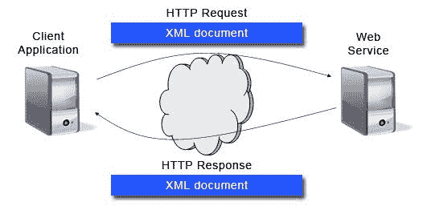

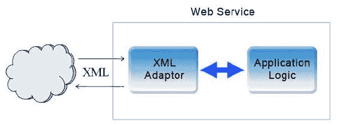

- **消息通信**：客户端通过交换包含信息的的消息与服务通信，这些信息的格式应该在服务的接口中描述。

### 2.2 Web 服务

Web 服务是一种部署在应用程序服务器上的特殊 SOA 服务，客户端应用程序通过 Web 使用 XML 和 HTTP 标准连接到它。具体来说，Web 服务可以被定义为软件模块，它以方法的形式在 Web 上暴露其功能，客户端应用程序可以通过在 HTTP 请求中发送 XML 文档来调用这些方法（图 2）。

**图 2。**

Web 服务执行其方法后产生的数据将通过 HTTP 响应传递给客户端，同样采用 XML 格式。Web 服务使用 XML 与客户端应用程序通信的能力允许它们完全相互独立。这意味着 Web 服务可以用 Java 实现，而应用程序可以用 C 或 VB 语言编写。在这种情况下，由 Java 服务生成的 XML 文档可以被 C/VB 应用程序正确解释，反之亦然。

### 2.3 Web 服务的结构

从技术角度来看，Web 服务只是部署在应用程序服务器上的 Web 应用程序。

**图 3。**

该应用程序由两个定义良好的层组成，如图 3 所示：

- **应用逻辑**：包含用你选择的任何语言实现的 Web 服务所暴露的方法。在 Java/Java EE 应用程序的情况下，此层由 `EJBs` 或标准类实现。

- **XML 适配器**：负责使用服务的方法调用信息解释接收到的 HTTP 请求中的 XML 文档。一旦文档被解密，并从中提取出我们想要调用的服务的方法名和参数，该组件将对应用层对象执行相应的调用。因此，根据这些对象返回的数据，XML 适配器构建出 XML 响应文档，该文档将通过 HTTP 消息的正文发送给客户端。

在 Java/Java EE 应用程序中，此层将由 `Servlets` 和 `JSPs` 实现。尽管，为了帮助构建它们，Java EE 包含一个名为 `JAX-RPC` 的 XML API，通过它可以在 Java 对象和 XML 文档之间以及反之创建简单的映射，便于对其进行操作。

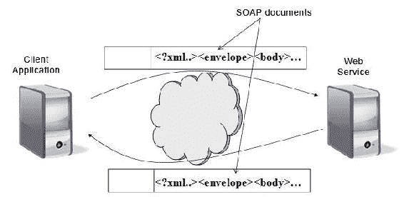

## 3. Web 服务架构标准

除了构成所有 Web 服务架构的基础标准 XML 和 HTTP 之外，由 W3C 组织管理的国际社区也有必要定义额外的标准，以解决基于此类模式实现应用程序时出现的问题。例如，在与 Web 服务交互时使用的 XML 文档如何结构，或者服务应该如何定义其接口。

这些标准是：

- SOAP
- WSDL
- UDDI

### 3.1 SOAP

SOAP（简单对象访问协议）是一种用于在计算机网络中传输 XML 消息的协议规范。SOAP 定义了 XML 文档应该具备的格式，以便在 Web 服务和客户端应用程序之间交换信息，即它建立了用于调用服务方法的 XML 文档结构，以及由服务生成的包含响应的文档结构（图 4）。

**图 4。**

尽管 SOAP 独立于使用的网络传输协议，但当前的规范（SOAP 1.2）专注于在请求/响应场景中使用 HTTP，以及用于异步调用服务方法的 JMS。

#### 3.1.1 SOAP 消息

由 SOAP 标准定义的请求和响应 XML 文档被称为 SOAP 消息。一个 SOAP 消息由两部分组成：

- **头部（Header）**：包括用于中间应用程序的可控制信息。

- **主体（Body）**：包含消息本身，即从一个应用程序传输到另一个应用程序的信息。

XML SOAP 文档的结构如下：

```xml
<Envelope>
  <Header>
    <!-- control information-->
  </Header>
  <Body>
    <!--message-->
  </Body>
</Envelope>
```

从这里我们可以看到命名空间中有三个主要元素：`http://schemas.xmlsoap.org/envelope/`

- **Envelope（节点）**：代表所有 SOAP 文档的根元素。

- **Header（头部）**：一个可选元素，包含头部参数。

- **Body（主体）**：强制性的 `body` 元素包含消息内容。这包括特定于应用程序元素，描述 Web 服务与客户端应用程序之间交换的信息。

除了这些应用程序元素，SOAP 规范还允许在 `body` 中使用 `fault` 元素用于错误管理。

以下 XML 是一个用于调用 Web 服务提供的函数的请求 SOAP 文档示例，用户凭据（用户名和密码）作为参数传递。

```xml
<?xml version="1.0" encoding="UTF-8"?>
<soapenv:Envelope xmlns:soapenv="http://schemas.xmlsoap.org/envelope/" xmlns:serv="http://www.myservice.com/">
   <soapenv:Header>
   </soapenv:Header>
   <soapenv:Body>
      <serv:login>
         <serv:user>teacher</serv:user>
         <serv:password>admin</serv:password>
      </serv:login>
   </soapenv:Body>
</soapenv:Envelope>
```

如所示，包含在 `body` 中的 `login` 元素代表要调用的方法，参数的值出现在各自的参数元素中。所有这些元素都定义在特定的命名空间中。一旦方法被调用，下面的列表显示了验证 Web 服务生成的可能的 SOAP 响应 XML 文档：

```xml
<?xml version="1.0" encoding="UTF-8"?>
<soapenv:Envelope xmlns:soapenv="http://schemas.xmlsoap.org/envelope/" xmlns="http://www.myservice.com/">
   <soapenv:Header>
   </soapenv:Header>
   <soapenv:Body>
      <loginResponse>
         <result>true</result>
      </loginResponse>
   </soapenv:Body>
</soapenv:Envelope>
```

在上述内容中我们可以看到 `body` 结构由一个根元素组成，通常称为 `service_nameResponse`，它包含一个持有返回值的子元素。与请求文档一样，响应正体中包含的元素也定义在应用程序的命名空间中。

#### 3.1.2 SOAP 消息类型

根据 Web 服务处理信息的方式，分为两种 SOAP 消息样式。

##### 3.1.2.1 RPC 消息

RPC 消息基于一种名为**远程过程调用（Remote Procedure Call, RPC）**的交互类型，其中 Web 服务的请求 XML 文档代表对方法或过程调用以及相应的输入参数，而作为响应生成的 XML 文档则代表该方法的返回值。

这是最简单且常见的 Web 服务类型，客户端和服务之间进行同步通信。

##### 3.1.2.2 文档导型消息

此类文档的 `body` 可以包含一个或多个子元素，根据其所代表的应用程序进行结构化。

这些 XML 文档完全由 Web 服务处理，这可能涉及对服务器不同内部方法的调用。处理此类文档的应用程序需要访问定义其结构和语法的架构（schema）。

此类文档的一个示例可以用于处理订单的 Web 服务。在这种情况下，客户端向 Web 服务发送一个 XML 文档，其中包含购买的产品代码、银行详情和送货地址。一旦消息被解码，Web 服务就会开始执行各项任务，如检查客户端的银行详情、通知分销商等。最后，Web 服务发送一个带有确认或拒绝购买订单的响应文档。

#### 3.1.3 错误消息

在处理 SOAP 请求时可能会发生错误，在这种情况下，应通过发送名为 SOAP 错误的特殊消息来通知客户端应用程序。

此消息包含一个 `<fault>` 元素，通过一系列子元素来描述错误的特征，每个子元素都由 SOAP 规范定义。

以下是 `<fault>` 的子元素：

- `faultcode`：错误源。可以具有以下四个值之一：
  - `mustUnderstand`：表示文档头中被标记为 `mustUnderstand` 的值无法被目标节点或某些中间节点解释。
  - `versionmismatch`：响应消息中指定的 SOAP 版本未被某些节点识别。
  - `server`：服务器在处理消息时发生了了错误。
  - `client`：由于客户端请求消息内部错误导致了错误。

- `faultstring`：解释性错误消息。

- `faultfactor`：表示引起错误的角色。

- `detail`：特定于应用程序的错误信息。仅当错误发生在 `body` 而非 `header` 时，该元素存在。

### 3.2 WSDL

WSDL（Web 服务描述语言）是一种基于 XML 的语言，用于描述 Web 服务的接口。Web 服务提供者使用这种语言通过扩展名为 `.wsdl` 的 XML 文档来定义服务暴露的方法以及它们接收和返回的数据。

WSDL 文档包含以下关于 Web 服务的信息：

- 服务提供的方法。
- 每个方法的输入和输出参数。
- 连接到服务应使用的协议及其 URL。

接下来的列表显示了一个名为 Operations 的示例 Web 服务的 WSDL 文档，它暴露了一个方法，通过通过 `user` 和 `password` 执行验证用户凭据的过程：

```xml
<?xml version="1.0" encoding="UTF-8"?>
<wsdl:definitions targetNamespace="http://services"
xmlns:impl="http://services" xmlns:intf="http://services"
xmlns:wsdl="http://schemas.xmlsoap.org/wsdl/"
xmlns:wsdlsoap="http://schemas.xmlsoap.org/wsdl/soap/"
xmlns:wsi="http://ws-i.org/profiles/basic/1.1/xsd"
xmlns:xsd="http://www.w3.org/2001/XMLSchema">
<wsdl:types>
<schema targetNamespace="http://services"
xmlns="http://www.w3.org/2001/XMLSchema"
xmlns:wsdl="http://schemas.xmlsoap.org/wsdl/"
xmlns:xsd="http://www.w3.org/2001/XMLSchema">
<wsdl:types>
<targetNamespace="http://services"
</schema>
<schema targetNamespace="http://services"
xmlns="http://www.w3.org/2001/XMLSchema"
xmlns:wsdl="http://schemas.xmlsoap.org/wsdl/"
xmlns:xsd="http://www.w3.org/2001/XMLSchema">
<wsdl:types>
<targetNamespace="http://services"
</schema>
</wsdl:types>
```

*（注：源文件中提供的 XML 已被截断/不完整；根据指令保留了结构。）*

#### 3.2.1 WSDL 文档的结构

每个 WSDL 文档由根元素 `definitions` 组成，其中声明了文档中使用的不同命名空间（图 5）。

为了完成服务的定义，`definitions` 中包含的其余子元素是 `types`、`message`、`portType`、`binding` 和 `service`。

##### 3.2.1.1 types

此元素定义了服务将使用的数据类型，包括方法参数及其返回值。在定义 Web 服务的数据类型时，使用了 XML 架构（XML Schema）：

```xml
<wsdl:types>
<schema targetNamespace="http://services"
xmlns="http://www.w3.org/2001/XMLSchema"
xmlns:wsdl="http://schemas.xmlsoap.org/wsdl/"
xmlns:xsd="http://www.w3.org/2001/XMLSchema">
...
</schema>
</wsdl:types>
```

##### 3.2.1.2 message

每个 `message` 元素定义了 Web 服务与其客户端之间交换的信息消息，这些消息由 `types` 中定义的数据组成。事实上，每个消息都包含一个子元素 `part`，其中指定了它所包含的数据类型。

```xml
<wsdl:message name="loginRequest">
<wsdl:part element="intf:login" name="parameters"/>
</wsdl:message>

<wsdl:message name="loginResponse">
</wsdl:message>
```

```xml
<wsdl:part element="intf:loginResponse" name="parameters"/>
</wsdl:message>
```

##### 3.2.1.3 portType

`portType` 元素描述了 Web 服务暴露出的操作。实际上，每个操作都由 `operation` 元素定义，并与一个输入消息和一个输出消息相关：

```xml
<wsdl:portType name="Operations">
  <wsdl:operation name="login">
    <wsdl:input message="intf:loginRequest" name="loginRequest"/>
    <wsdl:output message="intf:loginResponse" name="loginResponse"/>
  </wsdl:operation>
</wsdl:portType>
```

##### 3.2.1.4 binding

一旦定义了 Web 服务将执行的操作，就应该将它们绑定到特定的协议。这是通过 `binding` 元素实现的，在其中我们可以指定传输类型（SOAP 或 JMS）、执行特定操作的网络访问点以及样式（document 或 RPC）：


```xml
<wsdl:binding name="OperationsSoapBinding" type="intf:Operations">
  <wsaw:UsingAddressing wsdl:required="false" xmlns:wsaw="http://www.w3.org/2006/05/addressing/wsdl"/>
  <wsdlsoap:binding style="document" transport="http://schemas.xmlsoap.org/soap/http"/>
  <wsdl:operation name="login">
    <wsdlsoap:operation soapAction="login"/>
    <wsdl:input name="loginRequest">
      <wsdlsoap:body use="literal"/>
    </wsdl:input>
    <wsdl:output name="loginResponse">
      <wsdlsoap:body use="literal"/>
    </wsdl:output>
  </wsdl:operation>
</wsdl:binding>
```

### 3.2.1.5. service

最后，我们需要在`service`元素中指定 Web 服务的地址或入口。在`port`子元素中，指定了每个`binding`元素的地址。在 SOAP 的情况下，`address`元素中的`location`属性包含了实际地址。

```xml
<wsdl:service name="OperationsService">
  <wsdl:port binding="intf:OperationsSoapBinding" name="Operations">
    <wsdlsoap:address location="http://localhost:9080/login_ws/services/Operations"/>
  </wsdl:port>
</wsdl:service>
```

### 3.3. UDDI

UDDI（通用描述、发现与集成项目）规范的目的是定义在与 UDDI 连接的服务注册表中发布和定位 Web 服务的标准。

UDDI 注册表是一种“金页/黄页”风格的数据库，存储了与发布的 Web 服务相关的信息。这意味着两种类型的应用程序可以访问此类注册表：

* **服务提供者**：发布服务。UDDI 提供了机制，使提供者能够注册其 Web WSDL 描述和其他相关信息。

* **服务消费者**：使用注册表定位服务并使用该服务（服务绑定）。UDDI 支持服务搜索机制。

对于发布、编辑和搜索，使用 SOAP 消息来访问 UDDI 注册表。

### 3.3.1. UDDI schema

识别构成 Web 服务注册条目的 XML 数据结构类型。UDDI XML 架构定义了四种基本数据类型，描述了存储在 UDDI 注册表中的信息。这些数据通过以下元素供所有人可见：

* **businessEntity**：描述提供服务的实体的信息。这些信息包括实体的名称、描述、提供的服务列表、类别以及可用于搜索的标识列表（图 6）。

```xml
<businessEntity businessKey="35AF7F00-1419-11D6-A0DC-000C0E00ACDD" authorizedName="0100002CAL" operator="www-3.ibm.com/services/uddi">
  <name>Shop</name>
  <description xml:lang="en">All kind of product sales</description>
  <contacts>
    <contact>
      <personName>Jhon Cook</personName>
      <phone>918890234</phone>
    </contact>
  </contacts>
  <businessServices>
    …
  </businessServices>
</businessEntity>
```

**图 6。**

* **businessService**：识别由实体提供的 Web 服务。由于一个实体可以提供多个 Web 服务，因此一个`businessEntity`可以包含多个`businessService`元素，所有这些元素都封装在`businessServices`中。每个`businessService`条目都包含服务的描述，以及可选的所属类别列表。`businessService`的主子元素是`bindingTemplates`，它提供了绑定到服务的技术信息。

```xml
<businessServices>
  <businessService serviceKey="2AB346C0-2282-43B0-756B-0003CC35CC1D">
    <name>Prices</name>
    <description xml:lang="en">Calculate product prices</description>
    <categoryBag>ntis-gov:naic</categoryBag>
    <bindingTemplates>…</bindingTemplates>
  </businessService>
</businessServices>
```

**图 7。**

* **bindingTemplate**：每个`bindingTemplates`由一个或多个`bindingTemplate`元素组成。`bindingTemplate`元素提供两种信息：

  * 技术规范，例如用于与服务通信的协议。

  * 访问点，即可以调用该服务的 URL。

```xml
<wsdl:portType name="Operations">
  <wsdl:operation name="login">
    <wsdl:input message="intf:loginRequest" name="loginRequest"/>
    <wsdl:output message="intf:loginResponse" name="loginResponse"/>
  </wsdl:operation>
</wsdl:portType>
```

**图 8。**

* **tModel**：基本上，`tModel`包含了 WSDL 文档地址。除此之外，`overviewDoc`包含了服务。服务所属类别可以包含在`categoryBag`中。

```xml
<tModel businessKey="35AF7F00-1419-11D6-A0DC-000C0E00ACDD" authorizedName="0100002CAL" operator="www-3.ibm.com/services/uddi">
  <name>Price calculation</name>
  <description xml:lang="en">Calculate product prices</description>
  <overviewDoc>
    <description xml:lang="en">Link to WSDL document</description>
    <accessPoint>http://localhost:9080/login_ws/services/Operations</accessPoint>
  </overviewDoc>
  <categoryBag>
    <keyedReference tModelKey="clacf26d-9672-4404-9d70-39b75e62ab4" keyName="uddi-org:types" keyValue="wsdlSpec" />
  </categoryBag>
</tModel>
```

**图 9。**

可以看出`businessEntity`、`businessService`和`tModel`结构可以归类在`categoryBag`指定列表中，结构所属的每个类别由子元素`keyedReference`定义。

### 3.3.2. UDDI API

为了让应用程序与 UDDI 注册表交互，后者应该以 SOAP Web 服务的形式暴露一系列函数。这些 Web 服务允许搜索操作并在注册表中发布其他 Web 服务。

根据所执行的操作类型，UDDI 函数被分为两类：查询函数和发布函数。图 10 显示了主要函数及其所属的类别。

| 函数 | 类别 |
| :--- | :--- |
| `find_business` | Inquiry |
| `find_service` | Inquiry |
| `find_binding` | Inquiry |
| `find_tModel` | Inquiry |
| `get_businessDetail` | Inquiry |
| `get_serviceDetail` | Inquiry |
| `get_bindingDetail` | Inquiry |
| `get_tModelDetail` | Inquiry |
| `save_business` | Publication |
| `save_service` | Publication |
| `save_binding` | Publication |
| `save_tModel` | Publication |
| `delete_business` | Publication |
| `delete_service` | Publication |
| `delete_binding` | Publication |
| `delete_tModel` | Publication |

### 图. 10.

要从应用程序调用这些函数，你应该发送在`body`中包含适当内容的 SOAP 消息。例如，要查找一家名为“Shop”的公司，你需要在`body`中包含图 11 所示的 XML 块。

```xml
<find_business generic=”2.0” xmlns=”urn:uddi-org:api_v2">
  <name>Shop</name>
</find_business>
```

### 图. 11.

注册表生成的响应也是一个 SOAP 文档，其`body`中包含一个 XML 块，其中包含了通过搜索准则找到的信息。

对于图 12 中的消息，注册表将生成一个包含`businessList`元素的响应，其中将出现一组`businessInfo`子元素，每个元素代表一个名为 Shop 的注册公司。

```xml
<businessList generic="2.0" operator="uddi.sourceOperator" truncated="true" xmlns="urn:uddi-org:api_v2">
  <businessInfos>
    <businessInfo businessKey="35AF7F00-1419-11D6-A0DC-000C0E00ACDD">
      <name>Shop</name>
      <servicesInfos>
        <serviceInfo serviceKey="2AB346C0-2282-43B0-756B-0003CC35CC1D">
          <name>Prices<name>
        </serviceInfo>
      </servicesInfos>
    </businessInfo>
    [<businessInfo/>...]
  </businessInfos>
</buseinessList>
```

### 图. 12.

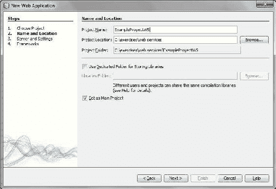

# 4. 使用 JAVA / JAVA EE 基于 Web 服务的应用程序实现

如前所述，Java EE 平台提供了一个便于构建基于 Web 服务应用程序的 API，称为 JAX-RPC。然而，最近大多数开发环境都包含了助手，它们极大地简化了构建 Web 服务的工作，将过程简化为实现应用程序逻辑层。

NetBeans 也是如此。使用此 IDE，程序员只需要负责实现带有所需业务方法的 EJB 或类，而让 NetBeans 动态生成描述接口的 XML 适配器和 WSDL 文档。

## 4.1. 使用 NETBEANS 创建和部署 Web 服务

借助 NetBeans 的帮助，我们可以在应用程序服务器中创建并部署 Web 服务。我们的操作方法取决于我们已经拥有什么，这为我们提供了三个起点：

- **从零开始创建 Web 服务**：不使用任何现有的应用程序逻辑或任何类型的规范，而是从零开始创建 Web 服务。

- **从现有的 EJB 创建 Web 服务**：应用程序逻辑已实现在 EJB 中，我们希望将其暴露为 Web 服务。

- **从 WSDL 文档创建 Web 服务**：Web 服务应该暴露的方法描述已在 WSDL 接口中定义好。

### 4.1.1. 从零开始创建 Web 服务

为了解释使用 NetBeans 创建 Web 服务的过程，我们将开发一个名为`CalcWS`的简单示例 Web 服务，它将暴露一个名为`factorial`的方法，该方法的作用是计算传入参数的数字阶乘。

首先，由于所有 Web 服务都是 Web 应用程序，我们将创建一个名为`ExampleProyectWS`的 Web 应用程序类型项目（图 13）。

### 图. 13.

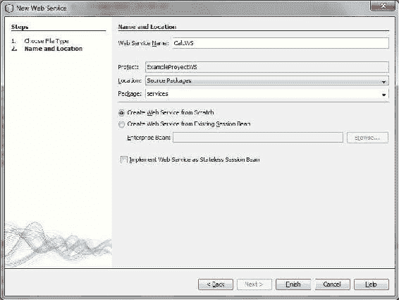

出于部署目的，我们可以使用 Tomcat 或 GlassFish 作为应用程序服务器。

项目创建完成后，使用鼠标在项目（Project）窗口中右键点击，从弹出菜单中选择`New -> Web Service`。将出现图 14 所示的对话框。

### 图. 14.

在这个对话框中，我们应该输入 Web 服务名称和它将所在的包，同时选择是从零开始创建 Web 服务（默认）还是从现有的会话 bean EJB。

假设我们从零开始创建 Web 服务，点击“Finish”（完成）后，我们将在 NetBeans 编辑器中看到`CalcWS`类（图 15）。在这里，我们实现想要在 Web 服务中暴露的方法。

```java
package services;

import javax.jws.WebService;

// Web Service class annotation
@WebService()
public class CalcWS {
}
```

### 图. 15.

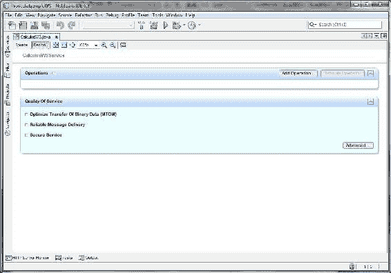 

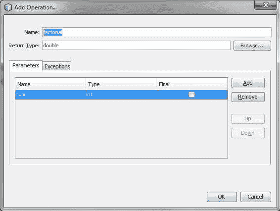

正如我们所见，带有服务方法的实现类是一个普通的 Java 类，区别在于它必须按照`javax.jws.WebService`包定义的声明带有`@WebService`注解。使用此注解，运行时环境将生成所有必要的内容，以便类方法被暴露为 Web 服务方法。

在编辑器窗口的最上方有一个名为`Design`（设计）的按钮，允许你切换到类的设计视图（图 16）。

### 图. 16.

使用`Add Operation`（添加操作）按钮，我们可以图形化地添加服务方法，输入方法名、参数和返回类型（图 17）。

### 图. 17.

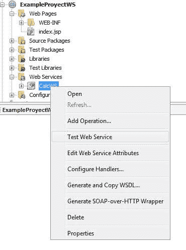

点击 OK 按钮返回到我们的类源码视图，我们可以看到阶乘方法的声明，在这里我们可以确认方法和参数都标记了`@WebMethod`和`@WebParam`。

```java
package services;

import javax.jws.WebMethod;
import javax.jws.WebParam;
import javax.jws.WebService;

@WebService()
public class CalcWS {
    @WebMethod(operationName = "factorial")
    public double factorial(@WebParam(name = "num") int num) {
        double result=1.0;
        for(int i=1;i<=num;i++){
            result*=i;
        }
        return result;
    }
}
```

这就是使用 NetBeans 实现 Web 服务所需的所有操作。接下来我们通过`Deploy`弹出菜单将应用程序部署到应用程序服务器。一旦部署完成，Web 服务即可供客户端使用。从 NetBeans 内部我们可以测试 Web 服务。要这样做，在 Web 服务文件夹内部，右键点击我们的 Web 服务并从弹出菜单中选择`Test Web Service`（图 18）。

测试 Web 服务时，NetBeans 打开一个浏览器实例向 Web 服务发送请求，并在 URL 中包含`tester`参数。给定此参数，应用程序知道这是来自浏览器的请求，并生成一个允许选择要执行的方法并输入参数的测试页面（图 19）。

### 图. 18.

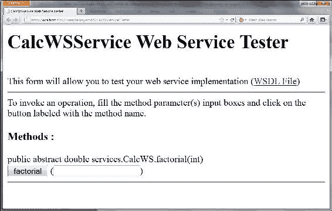

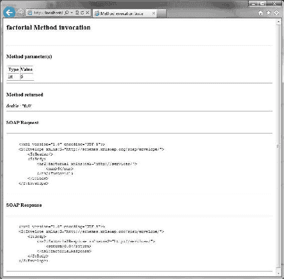

### 图. 19.

执行方法后，响应将返回页面，包含了测试页面与 Web 服务之间交换的 SOAP 消息（图 20）。

### 图. 20.

### 练习 1

在本次练习中，我们将开发一个通过数据库验证用户的 Web 服务，该服务可以在许多其他需要相同功能的应用程序中重用。

首先，在我们创建了 Web 服务将所在的应用程序后，我们将创建一个封装应用程序数据访问逻辑的类。该类的源代码（命名为`Operations`）所示：


```java
package model;

import java.sql.*;

public class Operations {
    //se establecen unos valores por defecto
    //para la conexión con la BD
    private String driver="com.mysql.jdbc.Driver";
    private String sCon="jdbc:mysql://localhost:3306/books";
    private String user="root";
    private String pwd="root";

    public Operations(){}

    public Operations(String driver, String sCon,
    String user, String pwd){
        this.driver=driver;
        this.sCon=sCon;
        this.user=user;
        this.pwd=pwd;
    }

    private Connection getConnection() throws SQLException{
        Connection cn=null;
        try{
            Class.forName(driver);
            cn=DriverManager.getConnection(sCon, user, pwd);
        }
        catch (ClassNotFoundException e) {
            throw new SQLException(e);
        }
        return cn;
    }
}
```

```java
catch(ClassNotFoundException ex){
    ex.printStackTrace();
}

catch(SQLException ex){
    ex.printStackTrace();
    throw ex;
}

return cn;

}

public boolean login(String user, String password){
    boolean result=false;
    try{
        Connection cn;
        Statement st;
        ResultSet rs;
        String sql;
        //Clients table contains the user and password
        //fields with the user credentials
        sql="select user, password from Clients where ";
        sql+="user='"+user+"' and password='"+password+"'";
        cn= getConnection();
        st=cn.createStatement();
        rs=st.executeQuery(sql);
        //if user exists, next() method will return true
        result=rs.next();
    }
    catch(Exception ex){
        ex.printStackTrace();
    }
    return result;
}
}
```

从这里开始，按照上一节概述的步骤，我们将创建一个名为`ValidationsWS`的 Web 服务，它暴露一个`login()`方法，该方法利用`Operations`类检查用户是否存在于数据库中。Web 服务的实现类源码应该如下所示：

```java
package service;

import javax.jws.WebMethod;
import javax.jws.WebParam;
import javax.jws.WebService;
import model.*;

@WebService()
public class ValidationsWS {
    private String driver="com.mysql.jdbc.Driver";
    private String sCon="jdbc:mysql://localhost:3306/books";
    private String buser="root";
    private String bpwd="root";

    @WebMethod(operationName = "login")
    public boolean login(
        @WebParam(name = "user") String user,
        @WebParam(name = "password") String password) {
        Operations op=new Operations(
        driver,sCon,buser, bpwd);
        if(op.login(user, password)){
            return true;
        }
        else{
            return false;
        }
    }
}
```

#### 4.1.1.1 复杂返回类型

Web 服务方法不仅限于返回基本类型，它们还可以返回复杂类型。对于用 Java 实现的 Web 服务，方法可以返回`JavaBean`类型对象，这意味着从 SOAP 响应的角度来看，它是一个包含一组 XML 子元素的条目，这些元素代表了 bean 的每个字段。

例如，假设我们想为上一个练习中的 Web 服务添加一个名为`loginClient`的新方法，该方法返回的不是简单的`Boolean`，而是与客户端相关的完整数据集，例如用户、密码和电子邮件。第一要工作是实现一个名为`Client`的类，并带有一个封装所需字段的默认构造函数。该类的代码可以如下：

```java
package beans;

public class Client {
    private String user;
    private String password;
    private String email;
    public Client(){}
    public Client(String user, String password, String email) {
        this.user = user;
        this.password = password;
        this.email = email;
    }

    public String getUser() {
        return user;
    }

    public void setUser(String user) {
        this.user = user;
    }

    public String getPassword() {
        return password;
    }

    public void setPassword(String password) {
        this.password = password;
    }

    public String getEmail() {
        return email;
    }

    public void setEmail(String email) {
        this.email = email;
    }
}
```

下一步一步是修改`Operations`类以包含以下`loginClient()`方法：

```java
public Client loginClient(String user, String password){
    Client c=null;
    try{
        Connection cn;
        Statement st;
        ResultSet rs;
        String sql;
        //Clients table contains the user and password
        //fields with the user credentials
        sql="select * from Clients where ";
        sql+="user='"+user+"' and password='"+password'";
        cn= getConnection();
        st=cn.createStatement();
        rs=st.executeQuery(sql);
        if(rs.next()){
            c=new Client(rs.getString("user"),
            rs.getString("password"),
            rs.getString("email"));
        }
    }
    catch(Exception ex){
        ex.printStackTrace();
    }
    return c;
}
```

对于该 Web 服务的新方法，它看起来像这样：

```java
@WebMethod(operationName = "loginClient")
public Client loginClient(
    @WebParam(name = "user") String user,
    @WebParam(name = "password") String password) {
    Operations op=new Operations(driver, sCon, buser, bpwd);
    return op.loginClient(user, password);
}
```

如果我们测试该 Web 服务，可以检查 Web 服务在响应调用方法时生成的 SOAP 文档如下：

```xml
<?xml version="1.0" encoding="UTF-8"?>
<S:Envelope xmlns:S="http://schemas.soap.org/soap/envelope/">
  <S:Body xmlns:ns2="http://service/">
    <return>
      <email>test1@gmail.com</email>
      <password>test1</password>
      <user>test1</user>
    </return>
  </ns2:loginClientResponse>
</S:Envelope>
```

我们可以从中看到，`Client` bean 被转换为了具有三个元素的 XML 文档。

### 4.1.2 从 EJB 创建 Web 服务

如果业务逻辑实现在`EJB`中，我们可以创建一个 Web 服务，其方法将调用重定向到`EJB`的方法，从而暴露任何应用程序的组件逻辑。第一要工作是在 IDE 中打开我们已经定义`EJB`模块的企业项目。

例如，假设我们有一个名为`Calculator-ejb`的简单`EJB`模块，其中一个无状态会话 EJB 暴露两个方法：一个计算两个数字之和，另一个计算它们的乘积。实现组件的源码如下：

```java
package ejbs;
import javax.ejb.Stateless;

@Stateless
public class Calculator implements CalculatorLocal {
    public int add(int x, int y) {
        return x+y;
    }

    public long multiplication(int x, int y) {
        return x*y;
    }
}
```

为了创建“封装”`EJB`方法的 Web 服务，我们创建一个 Web 应用，可以在与`EJB`相同的应用程序中，也可以作为一个独立的应用程序。接下来，我们按照之前创建 Web 服务的步骤操作，但在进入`New Web Service`对话框时，我们应该选择`Create Web Service From Session Bean`，并点击`browse`按钮选择实现应用程序逻辑的会话 bean。

生成的 Web 服务类代码如下：

```java
package services;
import ejbs.CalculatorLocal;
import javax.ejb.EJB;
import javax.jws.WebMethod;
import javax.jws.WebParam;
import javax.jws.WebService;

@WebService()
public class CalculatorWS {
    @EJB
    private CalculatorLocal ejbRef;

    @WebMethod(operationName = "add")
    public int add(@WebParam(name = "x") int x, @WebParam(name = "y") int y) {
        return ejbRef.add(x, y);
    }

    @WebMethod(operationName = "multiplication")
    public long multiplication(@WebParam(name = "x") int x, @WebParam(name = "y") int y) {
        return ejbRef.multiplication(x, y);
    }
}
```

### 4.1.3 从 WSDL 文档创建 Web 服务

虽然自底向的开发方法更为常见（即从预定义的方法集创建 Web 服务），但在其他情况下需要所谓的自顶向的开发方法。在自顶向的开发中，起点是描述我们想要实现的 Web 服务功能的`WSDL`接口，我们据此开发 Web 服务的方法代码和 XML 适配器。

在 NetBeans 中，从`WSDL`接口构建 Web 服务实现类非常简单。要这样做，从项目弹出菜单中选择`New -> Web Service From WSDL`选项，这将打开一个对话框，除了输入 Web 服务名称外，我们还需要输入定义其方法的 WSDL 文档地址。

点击`Finish`后，将生成一个带有`@WebService`注解的类，包含根据`WSDL`文档规范 Web 服务应该暴露的方法：

```java
@WebService(serviceName = "OperationsWS",
portName = "Operations",
endpointInterface = "services.Operations",
targetNamespace = "http://service",
wsdlLocation = "WEB-INF/wsdl/service_from_wsdl/Operations.wsdl")
```

```java
public class service_from_wsdl {
    public boolean login(String email, String password) {
        //TODO implement this method
    }
}
```

显然，实现这些方法的代码是程序员的责任。一旦完成，Web 服务就可以像上一节中那样正常部署。

## 4.2. 开发 Web 服务的客户端应用程序

正如我们之前在 Web 服务中所看到的，在客户端应用程序中也存在两个独立的、定义良好的模块。一方面，我们有应用程序逻辑，即使用 Web 服务的方法执行应用程序特定任务的程序部分。另一方面，我们有一个与服务交互的模块，其任务是编码和解码 SOAP 消息。这个模块被称为`proxy`（代理）（见图 23）。

**图 23。**

### 4.2.1. 代理对象

大多数开发环境也提供了你所需的一切内容，因此你无需担心实现代理模块，我们只需要集中在应用程序逻辑上。

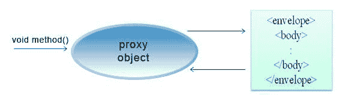

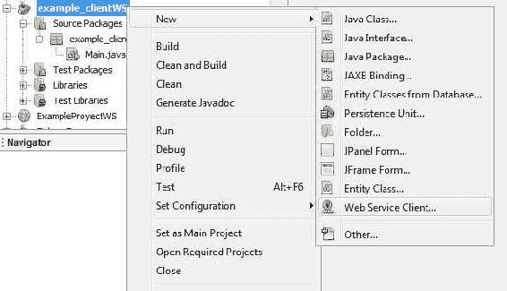

NetBeans 的情况也是如此，当需要创建 Web 服务的客户端应用程序时，它会自动根据描述 Web 服务的 WSDL 文档地址创建一组用于创建代理的类。

代理对象提供了 Web 服务暴露的 Java 版本方法。这意味着应用程序访问 Web 服务方法的方法简单地通过一个普通 Java 类的实例（见图 24）。该类的方法内部会处理连接远程 Web 服务所需的所有工作、生成 SOAP 调用消息并处理 SOAP 响应消息。

**图 24。**

### 4.2.2. 使用 NetBeans 创建客户端应用程序

Web 服务的 Java 客户端应用程序可以是一个控制台应用程序、servlet 甚至是另一个 Web 服务等。无论如何，一旦选择了客户端的项目类型，我们就可以点击项目弹出菜单中的`New -> Web Service Client`选项来创建代理类（见图 25）。如果该菜单中没有`Web Service Client`选项，你可以选择`Other`，在随后的对话框中，在`Web Service`类别下，你也会找到相同的选项。


在弹出的对话框中，它会要求我们指定描述 Web 服务的 WSDL 文档（见图 26）。NetBeans 将根据提供的这些信息构建代理。我们的 WSDL 文档可以发布在服务器上，在这种情况下我们将输入服务器的 URL。我们也可以提供位于实际客户端项目中的本地副本，甚至位于另一个已加载的项目。

**图 25。**

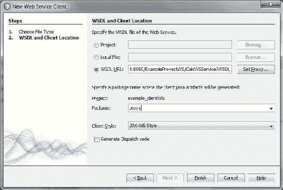

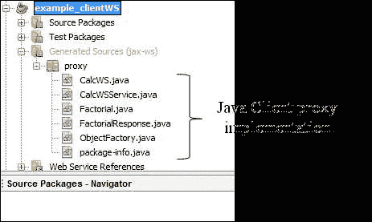

在同一个对话框中，我们还需要指定客户端应用程序中的包（即我们想要存储代理和辅助类的地方），以及调用样式。

**图 26。**

点击“Finish”（完成）后，生成代理的过程就开始了。如果我们查看项目管理器窗口，会发现在我们的客户端应用程序项目内部创建了一个名为 `Generated sources (jax-ws)` 的新文件夹，其中包含了组成代理的类和接口（见图 27）。

**图 27。**

与 Web 服务名称相同的接口（在我们的案例中为 `CalcWS.java`）定义了服务暴露的 Java 版本方法。代理对象将是任何实现此接口的类的对象，我们可以使用 `<ServiceName>Service.java` 类获取该对象（在我们的示例中为 `CalcWSService.java`）。因此，要获取代理对象，我们遵循以下步骤：

1. 创建一个 `CalcWSService` 对象：使用无参数的类构造函数，我们可以创建一个它的实例：

```java
CalcWSService cservice = new CalcWSService ();
```

2. 获取代理对象：对上一个对象调用 `getCalcWSPort()` 方法，该方法返回一个实现 `CalculosWS` 接口的对象：

```java
CalcWS proxy = cservice.getCalcWSPort();
```

我们现在已经了可以使用 `proxy` 变量引用的 Java 实例调用 Web 服务方法阶段。

以下代码属于一个 Java 控制台应用程序，它要求用户输入一个数字，并使用我们已经创建的示例 Web 服务计算其阶乘：

```java
package example_clientws;

import proxy.*;
import java.util.Scanner;

public class Main {
    public static void main(String[] args) {
        Scanner sc=new Scanner(System.in);
        CalcWSService cservice = new CalcWSService();
        CalcWS proxy=cservice.getCalcWSPort();
        System.out.println("Type a number ");
        int num = sc.nextInt();
        System.out.println("Factorial is "+
        proxy.factorial(num));
    }
}
```

当 Web 服务的客户端应用程序是运行在 Java EE 容器中的 servlet 时，我们使用 `javax.xml.ws` 包中的 `@WebServiceRef` 注解来注入 `service` 对象的引用。只需要在其 `wsdlLocation` 属性中指定 NetBeans 在客户端应用程序中创建的 WSDL 文档本地地址（通常在 `WEB-INF` 目录下的 WSDL 文件夹中）：

```java
@WebServiceRef(wsdlLocation = "WEB-INF/wsdl/YourService.wsdl")
private Service service;
```

**练习 2**

接下来我们将开发一个之前实现的验证 Web 服务客户端应用程序。我们需要创建一个带有登录页面的应用程序请求用户的凭据。该页面将联系 Web 服务以验证用户，如果用户存在则显示欢迎消息，否则将再次显示登录页面。

以下是登录页面的代码：

```html
<%@page contentType="text/html" pageEncoding="UTF-8"%>
<!DOCTYPE HTML PUBLIC "-//W3C//DTD HTML 4.01//EN"
"http://www.w3.org/TR/html4/loose.dtd">
<html>
<head>
<meta http-equiv="Content-Type" content="text/html;charset=UTF-8">
<title>JSP Page</title>
</head>
<body>
<center>
<h1>Authentication Form</h1>
<form action="login">
User:<input type="text" name="user"/>
<br/><br/>
Password: <input type="text" name="password"/>
<br/><br/>
<input type="submit" value="Enter"/>
</form>
</center>
</body>
</html>
```

Web 服务的 servlet 客户端如下：

```java
package servlets;

import java.io.*;
import javax.servlet.*;
import javax.servlet.http.*;
import javax.xml.ws.WebServiceRef;
import proxy.ValidationsWervice;

public class Login extends HttpServlet {
    @WebServiceRef(wsdlLocation = "WEB-INF/wsdl/ValidationsWervice.wsdl")
    private ValidationsWervice service;

    protected void service(HttpServletRequest request,
    HttpServletResponse response)
    throws ServletException, IOException {
        response.setContentType("text/html;charset=UTF-8");
        PrintWriter out = response.getWriter();
        try {
            proxy.ValidationsWS port =
            service.getValidationsWSPort();
            String user = request.getParameter("user");
            String password = request.getParameter("password");
            boolean result = port.login(user, password);
            if(result){
                out.println("<html>");
                out.println("<body>");
                out.println("<h1>Welcome to my page</h1>");
                out.println("</body>");
                out.println("</html>");
            }
            else{
                response.sendRedirect("login.jsp");
            }
        }
        catch(Exception e){
            e.printStackTrace();
        }
    }
}
```

在代理模块包含的类中，我们可以看到 `Client` 类，它在调用 `ValidationsWS` 对象的 `loginClient()` 方法时会非常有用。换句话说，Web 服务返回的复杂数据由客户端代理映射为 JavaBean 对象。

### 练习 3

在练习中，我们将开发一个 Web 应用程序，利用一个外部 Web 服务来检查用户在文本框中输入的电子邮件地址是否有效。

我们将使用一个属于 CDYNE Corporation [(www.cdyne.com)](http://www.cdyne.com/) 的免费公共 Web 服务，该服务是使用 .NET 实现的 Web 服务，我们可以从 Java 应用程序中访问它。描述其接口的 WSDL 文档地址为：

`http://ws.cdyne.com/emailverify/Emailvernotestemail.asmx?wsdl`

在 [`www.xmethods.org/`](http://www.xmethods.org/) 网页上，我们可以找到关于提供常见功能的不同公共使用的 Web 服务信息。

该电子邮件验证 Web 服务暴露了四个方法，其中我们将使用 `verifyEmail()`。该方法接收一个电子邮件地址和一个许可密钥（由于是免费的，你可以输入空字符串），并返回一个带有验证结果的复杂数据类型。在创建 Java 代理时，此数据类型被映射为类 `ReturnIndicator` 的 JavaBean，该类提供了以下返回验证信息的方法：

*   `getResponseText()`：返回一个关于刚完成的验证信息的字符串。
*   `getResponseCode()`：返回一个验证结果代码。
*   `isGoodEmail()`：指示电子邮件是否有效。

按照已经讨论过的流程，我们从 NetBeans Web 应用程序生成代理类。在所有生成的类中，`EmailVerNoTestEmail` 和 `EmailVerNoTestEmailSoap` 将是我们用于创建代理对象的。

该 Web 应用程序由一个使用 JSP 实现的 Web 页面，包含一个文本框和一个提交按钮，要求用户输入要检查的电子邮件地址。该页面的代码所示：

```jsp
<%@page contentType="text/html" pageEncoding="UTF-8"%>
<!DOCTYPE HTML PUBLIC "-//W3C//DTD HTML 4.01 Transitional//EN"
"http://www.w3.org/TR/html4/loose.dtd">
<html>
<head>
<meta http-equiv="Content-Type" content="text/html;charset=UTF-8">
<title>JSP Page</title>
</head>
<body>
<center>
<form action="Verify" method="post">
Email:<input type="text" name="email"/><br/>
<input type="submit" value="Verify"/>
</form>
</center>
</body>
</html>
```

`verify` servlet 的作用是调用 `verifyEmail()` Web 服务方法并生成一个带有验证返回信息的页面。servlet 的代码如下：

```java
package servlets;

import java.io.*;
import javax.servlet.*;
import javax.servlet.http.*;
import proxy.*;

public class Verify extends HttpServlet {
    protected void service(HttpServletRequest request, HttpServletResponse response)
    throws ServletException, IOException {
        response.setContentType("text/html;charset=UTF-8");
        PrintWriter out = response.getWriter();
        try {
            EmailVerNoTestEmail service = new EmailVerNoTestEmail();
            EmailVerNoTestEmailSoap port = service.getEmailVerNoTestEmailSoap();
            String email = request.getParameter("email");
            String licenseKey = "";
            ReturnIndicator result = port.verifyEmail(email, licenseKey);
            out.println("<html><body>");
            out.println("<h1>Result = " + result.getResponseText() + "</h1>");
            out.println("</body></html>");
        } catch (Exception ex) {
            ex.printStackTrace();
        } finally {
            out.close();
        }
    }
}
```

### 4.3. 异步调用 Web 服务的方法

自然地，当通过代理对象调用 Web 服务方法时，遵循已经概述的步骤，程序将阻塞在调用方法的指令处，等待 Web 服务生成的 HTTP 响应返回结果。这就是所知的同步模式。

然而，在某些情况下，我们不需要方法返回的值就能继续执行客户端应用程序。在这种情况下，能够异步调用方法将很有趣，这意味着程序将调用方法并继续正常执行，而无需等待其返回结果。

为了实现这一点，客户端应用程序应该提供一个回调方法，该方法一旦从 Web 服务接收到响应值，就会由代理执行。

#### 4.3.1. 代理对象配置

在开发 Web 服务以进行异步调用时不需要特殊步骤，但你必须恰当地配置代理以允许这种可能性。因此，一旦在客户端应用程序中创建了代理，为了能够进行异步方法调用，我们在“Web Service References”文件夹中选择我们的 Web 服务引用，并在弹出菜单中点击“Edit Web Service Attributes”选项（图 28）。

**图 28。**

在随后的对话框中，点击“WSDL Customization”选项卡，打开“Port Type Operations”文件夹，在我们想要异步调用的方法中，勾选“Enable Asynchronous Client”选项（图 29）。

**图 29。**

点击“OK”后将出现信息对话框，告诉我们代理类将重新生成。

如果我们打开客户端中的“Service References”文件夹，可以看到除了同步方法版本外，还创建了两个新版本。其中一个方法用于回调函数（我们通常使用的），另一个使用轮询，定期检查响应是否到达。

**图 30。**

#### 4.3.2. 异步调用方法

要异步调用 Web 服务，我们将“Async Callback”元素拖到客户端类中，生成如图 31 所示的应用程序：


```java
public static void main(String[] args) {
    try {
        //调用 Web 服务(异步回调)
        proxy.CalcSService service = new proxy.CalcSService();
        //代理对象
        proxy.CalcWSPort port = service.getWSPort();
        //在此处初始化 WS 参数
        int num = 0;
        javax.xml.ws.AsyncHandler<proxy.FactorialResponse> asyncHandler =
        new javax.xml.ws.AsyncHandler<proxy.FactorialResponse>(){
            public void handleResponse(javax.xml.ws.Response<proxy.FactorialResponse> response){
                try {
                    //在此处处理异步响应
                    System.out.println("Result = " + response.get());
                } catch (Exception ex) {
                    //处理异常
                }
            }
        };
        //定义方法异步调用的匿名类
        java.util.concurrent.Future<? extends java.lang.Object> result =
        port.factorialAsync(num, asyncHandler);
        //检查是否存在结果
        while (!result.isDone()) {
            //做一些事情
            Thread.sleep(100);
        }
    } catch (Exception ex) {
        //在此处处理自定义异常
    }
}
```

**图 31。**

除了 Web 服务自身的参数外，该方法还接收一个实现了`AsyncHandler`接口的对象。调用此方法返回一个`Future`对象，允许我们使用`isDone()`方法检查结果是否已返回给客户端。

例如，以下程序使用`CalcWS` Web 服务计算 7 的阶乘，在计算进行期间，客户端程序每隔十分之一秒显示一次“waiting（等待中）”消息：

```java
package client;

import javax.xml.ws.*;
import proxy.*;
import java.uti.concurrent.*;

public class Test {
    public static void main(String[] args) {
        try {
            CalcWSService service = new CalcWSService();
            CalcWS port = service.getCalcWSPort();
            int num = 7;
            AsyncHandler<FactorialResponse> asyncHandler =
                new AsyncHandler<FactorialResponse>() {
                    public void handleResponse(Response<FactorialResponse> response) {
                        try {
                            System.out.println("Result = "+
                            response.get().getReturn());
                        } catch(Exception ex) {}
                    }
                };
            Future<? extends Object> result =
                port.factorialAsync(num, asyncHandler);
            while(!result.isDone()) {
                System.out.println("waiting");
                Thread.sleep(100);
            }
        } catch (Exception ex) { }
    }
}
```

# 5. 使用 GOOGLE 搜索 Web 服务

Google 提供了多种 Web 服务，开发者可以使用这些服务将其强大的搜索引擎集成到自己的应用程序中。

2003 年，Google 发布了他们的第一个 Web 服务——经典的 Google 搜索。该 Web 服务暴露了一个定义其功能的 WSDL 接口，但从 2006 年起该接口已过时，从 2009 年 3 月起 Google 不再支持该 Web 服务。

如今，Google 提供的各种 Web 服务应该通过 Google 自己创建的特殊 API 进行访问，从而不再需要依赖许多开发环境创建的代理对象。

以下是访问 Google 服务的一些主要 API：

* **AJAX API**：一组 JavaScript 对象，允许从任何访问经典的 Google 搜索服务，并集成了 AJAX 功能。
* **Google maps API**：让您能够在网站中集成交互式地图。
* **Google Web ToolKit**：用于在任何应用程序中集成搜索服务的 Java API。

作为使用这些 Web 服务的示例，我们将分析 Google AJAX API，通过它，我们可以在自己的网页中实现一个 Google 搜索引擎。

## 5.1. 使用 AJAX API

为了使用此服务，您需要从以下链接免费获取许可密钥：`http://code.google.com/intl/es/apis/ajaxsearch/signup.html`

一旦拥有此密钥，就可以很容易地访问 Google 的 JavaScript 对象，我们将使用这些对象来实现自己的搜索页面。

### 5.1.1. 使用 Google 搜索控件

实现搜索页面的简单方法是包含 Google 自己的搜索控件。第一步工作是在页面头部中添加以下引用 Google AJAX API 加载器的脚本：

```html
<script type="text/javascript" src="http://www.google.com/jsapi?key=mykey"></script>
```

在这里，`mykey`代表 Google 在上述 URL 中提供的密钥。该密钥可以用于应用程序中所有想要使用 AJAX API 的页面。

接下来，我们使用`google`对象的`load`方法来加载搜索 API：

```html
<script type="text/javascript">
google.load("search", "1");
</script>
```

加载器（实际上是`google`对象）可以加载多个不同的 API。通过将字符串“search”作为第一个参数显然加载了搜索 API，而如果我们想加载 Google Maps API，则在这里输入“maps”。

接下来，我们将创建一个`SearchControl`实例，该对象代表 Google 搜索控件，即带有搜索按钮的文本字段：

```javascript
var searchControl = new google.search.SearchControl();
```

为了执行搜索，控件需要知道在哪里进行搜索，例如是本地搜索、Web 搜索、搜索新闻组等。要定义您想在哪里进行搜索，您必须实例化相关的搜索对象并使用`addSearcher()`方法将它们添加到搜索集合中。例如，要执行 Web 搜索，请包含以下指令：

```javascript
searchControl.addSearcher(new google.search.WebSearch());
```

最后，剩下的就是指定我们想在哪里显示 Google 搜索控件。这是一个`<div>`元素，除了控件外，搜索结果也将显示在这里。例如，如果`<div>`元素的 id 为`search`，则应包含以下指令：

```javascript
searchControl.draw(document.getElementById("search"));
```

这就是增强我们的页面以搜索控件所需的所有内容，该控件利用 Google 的 Web 服务，通过 AJAX 技术在同一页面显示搜索结果。以下代码用于图 32 中的 .html 页面，该页面包含了 Google 的搜索控件：

```html
<!DOCTYPE html PUBLIC "-//W3C//DTD XHTML 1.0 Strict//EN" "http://www.w3.org/TR/xhtml1/DTD">
<html xmlns="http://www.w3.org/1999/xhtml">
<head>
<meta http-equiv="content-type" content="text/html; charset=utf-8"/>
<title>Hello World - Search API Sample</title>
<style type="text/css">#search { width: 400px; }</style>
<script src="http://www.google.com/jsapi?key=mykey"></script>
<script type="text/javascript">
google.load('search', '1');
function OnLoad() {
    var searchControl = new google.search.SearchControl();
    searchControl.addSearcher(new google.search.WebSearch());
    searchControl.draw(document.getElementById("search"));
}
</script>
</head>
<body onload="OnLoad()">
<center><h1>Using the search control</h1></center>
<br />
<div id="search">Loading</div>
</body>
</html>
```

#### 5.1.2. 个性化搜索控件

如果我们想使用自己的搜索控件而不是 Google 的，我们需要在 JavaScript 代码中包含与执行搜索所执行的操作相同的指令。为了执行 Web 搜索，我们需要一个`google.search.WebSearch`类的实例，其`execute()`方法使用提供的字符串在 Web 上执行搜索。

由于`execute()`是异步执行的，我们应该使用`WebSearch`的`setSearchCompleteCallback()`方法指定回调函数，在浏览器接收响应后进行处理。使用`WebSearch`的`results()`方法访问响应数据，它包含一个`SearchResult`类型的结果数组。`SearchResult`暴露了一系列属性如`title`或`url`，分别为我们提供找到的页面标题及其 URL。

以下代码用于图 33 中的页面，该页面实现了一个使用简单 HTML 控件与用户交互的个性化搜索控件：

```html
<!DOCTYPE html PUBLIC "-//W3C//DTD XHTML 1.0 Strict//EN" "http://www.w3.org/TR/xhtml1/DTD">
<html xmlns="http://www.w3.org/1999/xhtml">
<head>
<meta http-equiv="content-type" content="text/html; charset=utf-8"/>
<title>Search API Sample</title>
<style type="text/css">#searchcontrol { width: 400px; }</style>
<script src="http://www.google.com/jsapi?key=mykey"></script>
<script type="text/javascript">
google.load('search', '1');
var searchControl;
function search() {
    searchControl = new google.search.WebSearch();
    searchControl.setSearchCompleteCallback(this, process);
}
function process(response) {
    var results = searchControl.results();
    for (var i = 0; i < results.length; i++) {
        document.write(results[i].title + " - " + results[i].url + "<br>");
    }
}
</script>
</head>
<body>
<input type="text" id="searchtext" />
<input type="button" value="search" onclick="search()" />
<div id="searchcontrol"></div>
</body>
</html>
```

```javascript
searchControl.execute("servers");

}

function process() {
  for (var i = 0; i < searchControl.results.length; i++) {
    // 对于每个结果，创建几个自定义
    // 元素来显示每个结果的信息
    var p = document.createElement('p');
    var a = document.createElement('a');
    var b = document.createElement('b');
    var c = document.createElement('c');
    a.href = searchControl.results[i].url;
    a.innerHTML = searchControl.results[i].title;
    b.innerHTML = "<br>" + searchControl.results[i].url;
    c.innerHTML = "<br>" + searchControl.results[i].content;
    // 使用结果构建一个元素树
    p.appendChild(a);
    p.appendChild(b);
    p.appendChild(c);
    document.getElementById("result").appendChild(p);
  }
}
```

</script>

</head>

<body>

  <center>

    <h1>使用 Google 搜索控制控件</h1>

    搜索文本: <input type="text" id="text" /><br />

    <input type="button" onclick="search();" value="搜索" />

  </center>

  <br />

  <div id="result"></div>

</body>

</html>

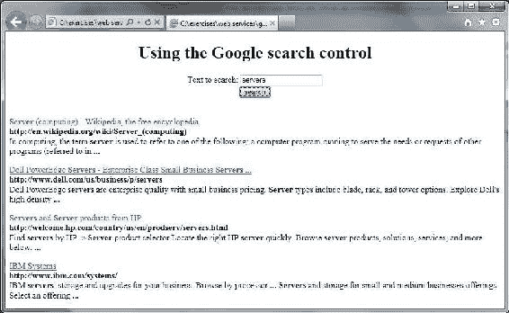

**图 33.**

# 自测测试

1. 用 Java 实现的 Web 服务和客户端应用程序通过以下方式进行通信：

   A. HTTP。

   B. RMI

   C. FTP。

   D. HTML

2. SOAP 协议定义了：

   A. 实现 Web 服务的编程语言。

   B. 服务暴露的方法与客户端应用程序交换的数据类型。

   C. 客户端访问 Web 服务的方法。

   D. Web 服务请求和响应 XML 文档的格式。

3. 选择下列陈述中**错误**的一项：

   A. 仅需 WSDL 文档即可开发 Web 服务的客户端应用程序。

   B. 用 Java 开发的 Web 服务可以在 .NET 应用程序中使用。

   C. Web 服务的方法只能通过同步方式访问。

   D. 使用 UDDI API 可以从应用程序查找 UDDI 注册项。

4. 下列哪些 SOAP 文元素是可选的？

   A. Envelope（封包）

   B. Header（头部）

   C. Body（主体）

   D. 所有都是可选的

5. Web 服务处理的数据类型在其接口文档中使用以下描述：

   A. 实现 Web 服务的原生语言。

   B. SOAP 规范中的特定标签。

   C. UDDI

   D. XML Schema

6. 下面代码属于一个 servlet，它使用代理对象调用名为`SearchWS`的 Web 服务的方法：


```java
public class TestServlet extends HttpServlet {
  // 缺失的代码行在此处
  private SearchWSservice service;
  protected void service(HttpServletRequest request, HttpServletResponse response)
  throws ServletException, IOException {
    response.setContentType("text/html;charset=UTF-8");
    PrintWriter out = response.getWriter();
    try {
      SearchWS proxy = service.getSearchWSPort();
      // servlet 的其余部分
    }
```

下列哪项可以成功完成代码（替换注释掉的缺失行）？

A. `@WebServiceRef(wsdlLocation = "dirección doc wsdl")`

B. `@WebService(name= SearchWSservice);`

C. `new SearchWSService();`

D. 无缺失代码

7. 在异步调用其方法后，访问 Web 服务返回的信息：

A. 我们应该调用代理对象的 `result()` 方法。

B. 必须实现 `handleResponse()` 方法。

C. 代理对象会将结果放在标记有 `@Result` 注解的变量中。

D. 应该创建一个 `WebService` 的子类。

8. 使用 Google AJAX API 从 JavaScript 代码进行个性化搜索，我们需要：

A. 一个 `google.search.Searcher` 对象。

B. 一个 `google.search.GoogleMap` 对象。

C. 一个 `google.search.WebSearch` 对象。

D. 一个 `google` 对象。

# 建议练习

1. 假设你有一个包含以下字段的书籍表：`isbn`、`title`、`author`、`pages`。创建一个 Web 服务，暴露一个方法，根据书籍的 `ISBN` 返回其所有数据。然后，为该 Web 服务创建一个控制台客户端应用程序，向用户询问 `ISBN` 并显示 Web 服务返回的书籍数据。

方法调用应该是异步的，这样当客户端应用程序等待结果时，每隔十分之一秒应显示一次“awaiting response”（等待响应）。

2. 开发一个 Web 应用程序，使用 [www.xmethods.org](http://www.xmethods.org/) 上发布的 Web 服务之一，允许其用户向手机发送短信。

# 自测测试答案页

1. A

2. D

3. C

4. B

5. B

6. A

7. B

8. C
