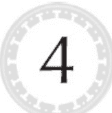
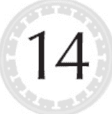

# Wetiko：治愈侵扰世界的精神病毒

> “经典著作《消除威提》（Dispelling Wetiko）的杰出继承者”
>
> — STING

拉里·多西（Larry Dossey）医学博士序言

我想将这本书献给里娜·西尔卡（Rina Sircar），我主要的导师之一，她的爱可以充满整个宇宙并溢出来。

***

此外，这部作品也献给所有在这个极具挑战性的历史时期选择轮回的人类。让我们共同服务，作为我们珍贵家园地球的守护者，将我们的物种提升到在宇宙中应有的位置。做人类并不是一项容易的工作。我们都值得一颗金星。

> 我们现代人面临着重新发现精神生活的必要性；我们必须亲身体验这种生活。这是打破束缚我们的魔咒的唯一途径。
>
> — C. G. 荣格（C. G. Jung）

“在几乎每个层面面临前所未有的危机之际，我们的挑战是意识到并摆脱笼罩在我们身上的阴险毁灭幻象。只有当我们觉醒，我们才能成为必要的精神战士，将我们和世界从这种威胁生命的魔咒中解放出来，进入预言中的黄金时代。在这本充满力量的书中，保罗帮助我们审视内心和这种疾病，唤醒创造者赋予我们的惊人潜力，让我们作为这颗珍贵星球以及我们所有关联者的良好守护者茁壮成长。”

> — 布鲁基·梅迪信·鹰尔（Brookie Medicine Eagle），地球守护者、本土智慧导师、《水牛妇女歌唱》与《最后的幽灵舞》作者

人类历史上从未有哪个时代像现在这样迫切地需要保罗·列维在书中提供的见解和深邃智慧。正如他明智地警告我们的那样，只有通过发展意识的、蓬勃的精神生活，我们才能彻底消除“威提”。否则，我们只会与我们认为自己正在战斗的黑暗同流。

> — 卡罗琳·贝克博士（Carolyn Baker, Ph.D.），《意识的崩溃》与《生态末日时代的爱》作者

保罗·列维的第一本书《消除威提》（Dispelling Wetiko）是一部经典，它让人们对入侵西方文化的黑暗力量有了更广泛的认知。如果你是那些在精灵魔瓶已经出瓶后思考我们该如何应对它的人之一，那么列维的新作《威提》（Wetiko）将是一部引人入胜的读物，将为你的工具箱提供新工具。一本极其重要的书！

> — 汉克·韦塞尔曼博士（Hank Wesselman, Ph.D.），人类学家、《重新魔幻》与《光之碗》作者

“《威提》是送给世界的礼物。保罗·列维精辟而美丽地剖析了威提疾病，向我们展示了如何打破其阴险的魔咒。没有比这更重要的话题了，保罗·列维写的正是我们需要阅读的内容。”

> — 德里克·詹森（Derrick Jensen），生态哲学家、《比语言更古老的语言》作者

在《威提》中，保罗叙述的力量和真实性源于他对威提这种集体人类精神症的亲身经历和基础。这本重要且及时的著作认为，“治愈之灵隐藏在疾病之中”，并敦促进行一场萨满式的之旅，重新记忆并整合我们真“自我”内在的完整性。它敦促意识的共同创造作为一种治愈的反应和参与。“威提”邀请我们释放想象力，从字面上去化身为我们物种潜在蜕变中的“想象细胞”。

> — 朱德·库里维夫博士（Jude Curriv, Ph.D.），宇宙学家、疗愈者、《宇宙全息图》作者及“全景世界观”联合创始人

“这本非凡的书深根于荣格心理学和智慧传统，探讨了构成人类危机的传染性灵魂精神疾病。作者天才性地整合了涵盖广泛的原型主题——从神话、炼金术、宗教到量子物理学——发掘了我们个人和集体灵魂疾病的更深层意义。任何对意识转型感兴趣的人的必读之作。”

> — 厄莎拉·维尔茨（Ursula Wirtz），荣格心理分析学家、《创伤与超越》作者

“保罗·列维将研究威提作为他一生的事业——在他自己身上处理它，并在人类世界中为它投射意识的光芒。在这本书中，他从多个角度考察了这种思想病毒，帮助读者充分认识威提的本质、其可怕的危险以及它包含的秘密礼物。

《威提》是一本对每个人都具有迫切相关性和至关重要的书，它提醒我们严峻的危险，并在我们应对这些关键时期面临的多重、同步全球危机时，睁眼看到我们令人惊讶和神奇的潜力。”

> — 罗伯特·西蒙斯（Robert Simmons），《石头炼金术》作者、《石头书》合著者

“在读了保罗·列维关于威提的作品后，我知道我必须见他。我从马萨诸塞州的波士顿开车到了俄勒冈州的波特兰。这个叫保罗的人，他非同寻常。他知道很多事情。他以无法解释的方式体验事物。我能说的只有，与我并肩的人知道保罗·列维被安置在这里是为了帮助我们——帮助我们缓解气候危机、第六次灭绝、这场流行病、种族主义以及这种威提。万物一体（Mitakuye Oyasin）。”

> — 托马斯·巴利斯特里博士（Thomas Balistrieri, Ed.D.），沃彻斯特学院全球研究助教教授及拉科塔尤皮人（Medicine Man）

# 致谢

作为作者，找不到合适的文字是一种不寻常的经历。我感到有些无口无言，无法充分感谢对本书起过关键作用的个人。尽管我是它的作者，我完全感觉并不是我写了这本书，而是被非定域场“梦”出了让文字出现在这些页面上。感受到他人对工作的爱和支持是无价的，无法量化——真正无价。

感谢我的老朋友拉里·贝里（Larry Berry），多年来无论何时需要他都在那里，感谢他给予我的关爱和无尽的支持，帮助我的作品出版。我想向无可比拟的唐娜·泽内纳（Donna Zerner）表达诚挚的谢意，感谢她慷慨分享她的才华，帮助这本书——包括我我自己——看到光明。我还要感谢肯德拉·克罗斯森·布鲁斯（Kendra Crossen Burroughs）提供了超出我想象的慷慨支持。

我要感谢罗伯特·西蒙斯（Robert Simmons），他特意为我联系了 Inner Traditions。我还要感谢理查德·格罗斯林格（Richard Grossinger），巧合的是，他是出版我之前关于威提的作品的人，并在本书中也扮演了同样的角色，尽管情况完全不同。衷心感谢我的编辑梅根·麦克林（Meghan MacLean）以及 Inner Traditions 的所有优秀同仁，感谢他们似乎永无止境的支持帮助这部作品问世。我还要感谢一位亲密的朋友，他多年来一直和我一起不断思考威提的想法，出于自己的原因，他希望保持匿名——你知道你是谁。

我还要感谢马特·卡登内利（Matt Cadenelli）、尼尔·列文森（Neil Levenson）、丹尼安·托马斯（Damian Thomas）、塞斯·泰勒（Seth Taylor）、马克·哈特利（Mark Hartley）、亚历克斯·阿里斯（Alex Aris）、大卫·弗内特（David Frenette）、朱莉娅·布莱特（Julianna Bright）、理查·达布（Richard Daab）、鲍勃·威尔士（Bob Welsh）、柯里·帕克（Cory Parker）、萨缪尔·弗雷尼-罗特（Samuel Freni-Roth）、贝莉·韦顿（Bailey Wayton）、迈克尔·埃里克（Michael Ellick）、塞斯·洛林齐（Seth Lorinczi）、格温·伯恩斯（Gwen Burns）、梅尔蒂·帕特罗斯（Mertie Pateros）以及卡琳·甘农（Karin Gagnon）充满爱的反思和支持。

## 序言

拉里·多斯西（Larry Dossey）医学博士

如果发现一种“思想病毒”正在全球迅速蔓延，感染我们的社会，并体现在我们身边的人——甚至是我们自己，难道不令人不寒而栗吗？这是一种一直困扰人类的疯狂，但今天我们日益意识到这一点，并看清了它的本质。有些人称之为“邪恶”。保罗·列维（Paul Levy）称之为“湿提”。

《湿提》是《消除湿提：打破恶的诅咒》（Dispelling Wetiko: Breaking the Curse of Evil）的续作。在该书中，保罗·列维扩大了美国原住民的一个概念，即一种看似恶性的灵，负责导致一种可怕的灵魂疾病。保罗·列维通过对荣格心理学的深层研究，以及对神话、萨满教和量子物理学的知识，结合他原创的见解和经验，对这种本土理解进行了扩展。无论你是保罗·列维的新读者，还是读过他的其他作品，我们现在都将获得一种既令人着迷又令人不安的阅读体验。

列维说，湿提是无意识大脑中的一种心理力量，使我们倾向于不健康的冲动，如对权力和控制的渴求以及嫉妒。被湿提附身的人极度自私；他们很少关心别人的福祉。湿提是一个隐蔽的因素。即使它影响了我们自己的行为，我们也很少怀疑它的存在。

正如列维所指出的，湿提在精神病学家 C.G. 荣格的“阴影”概念中已有预示——阴影是我们无意识心理中那些在意识中被拒绝、不受欢迎的部分。许多人记得这样一个观点：表现良好、守规的公民可能暗中潜藏“邪恶”的想法和冲动，但这些力量在每个人身上都有某种程度。在某些挑衅下，它们会很容易显现。当我写这些文字时，湿提正在全球范围内大行其道，在新闻头条和快速变化的时事中随处可见，这些事件引发了恐惧、愤怒、混乱以及个人和集体生活的破坏。

这种思想病毒是如何在我们之间传播的？我们正在学习关于湿提如何运作的细节，以及什么能抑制它。来自现代科学领袖的越来越多的证据表明，我们的意识和无意识的思想、意图并不限于我们个人的大脑和身体。它们可以在“外部”的世界中运作，远离我们个体，超越此地现在的限制和约束。这是“非定域心灵”（nonlocal mind）的领域——这种心灵是无边界的，在空间上是无限的，因此与过去、现在和未来的所有其他心灵连接并统一。列维对湿提如何通过超越空间限制的非定域场运作的描述，代表了对真正的非定域心理学阐述的延续。

此外，远程疗愈实验似乎受到了爱、慈悲和深度关怀的关键影响，正如历史上的治愈者所坚持的那样。这是近期实验中最大的教训之一：爱和慈悲通过非定域心灵运作，可以以积极、健康的方式远程改变物理体状态。

但不仅仅是爱。意识有一个阴暗面——荣格“阴影”概念的领域。正如保罗·列维所展示的，那是湿提在我们生活中生存和运作的地方。

远程影响的研究还表明，伤害可以延伸到生物身上：微生物可以被抑制，细胞功能和生物化学反应的活动可以减少。负面的、非定域意图类似于所有现代文化（以及许多古代文化）所相信的诅咒、巫术和咒语。在承认这种非定域心灵的黑暗面时，这些文化对意识展现了比我们更复杂、更精密的理解。我们将意识的阴暗面仅仅视为事物的自然如此，而它们优雅地设计出保护自己的方法。正如保罗·列维所揭示的，正是像我们这样否定意识的负面非定域因素的文化，往往会被其蒙蔽。无论如何，人类在心理和非定域上向生物体延伸伤害的能力不应被否认。相反，这种能力可以被用于善，用于治愈——正如人类意图被用于延迟或杀死入侵的病原体一样。

思考：如果心灵真的是非定域的，这意味着个体心灵无法完全分离和隔离，彼此在某种意义上是连接的。在维度上，非定域心灵聚集在一起形成一个统一的心灵。这种认知是古老的。正如许多优秀科学家所意识到的，它也是现代的。我们的非定域本质使得湿提成为可能。物理学家尼尔斯·波尔所谓的“互补性”：对立面的结合产生了更准确的整体图像。这让人想起超个人心理学的一句格言。为什么承认湿提的非定域负面方面很重要？因为它最终具有传染性。它在全球传播；对个体心灵是不可接受的。它有破坏单一个体生命的能力；它可以毁灭一个物种——我们自己。我们不是湿提的无助旁观者。它的终极解药是爱，其互补的非定域立面。但湿提在历史上有很多形式。现在读读保罗·列维的话，他是湿提领域的真正学生和学者，比我认识的任何人对此都有更深入的思考。让我们看看他的探索揭示了这种疾病及其治疗方法。

拉里·多斯西（Larry Dossey）博士在达拉斯西南医学院获得医学学位，随后在越南担任营军医，并因英勇受到嘉奖。他协助建立了达拉斯诊断协会，并在1982年担任医疗市医院院长。在其著作《治愈之言》于1993年出版之前，美国只有三所医学院设有探索宗教实践对健康影响的课程，现在有八十所。在1989年的《恢复灵魂》（Recovering the Soul）中，他提出了“非定域心灵”的概念——不受大脑和身体限制的心灵。此后这种模型被许多领先科学家接受为意识的新兴形象。2013年，他荣获了推崇的愿景奖。作为十三本书和众多文章的作者，多斯西博士曾是同行期刊《健康医学替代疗法》（Alternative Therapies in Health and Medicine）的主编。他目前是同行期刊《探索：科学与治愈杂志》（Explore: The Journal of Science and Healing）的主编。多斯西博士在全球演讲，他的影响力是巨大的。

拉里·多斯西，医学博士

新墨西哥州，圣菲

# 引言

## 简述 Wetiko（威提）

一种灵魂的传染性精神疾病

引用作者兼环保活动人士德里克·詹森（Derrick Jensen）的话，“Wetiko”蔓延到如今已覆盖了整个地球，并在不同程度上感染了我们所有人。这种疾病没有医院可以治疗。如果我们不能承认它的存在，又如何能尝试治愈它呢？¹

在治疗这种感染了我们的疾病之前，我们必须从否认中清醒过来，正视这种疾病，承认它，命名它，并试图理解它的运作机制，以确定如何应对它——这就是这本书的核心所在。

在历史上，Wetiko 被称为许多不同的名字，这种精神让其他任何问题都变得次要。Wetiko 是一个总的伞罩，它包含了、吸收、告知并支撑着我们物种在世界范围内各个尺度上表现出的各种形式的破坏，无论是针对我们还是他人。如果我们不面对 Wetiko 向我们揭示的真相，其他任何事情都将不再重要，因为人类将不复存在。

人类面临着历史上最重要的问题——人类生命是否还能以任何类似于我们目前所知的形式生存下去。我们正在用政府政策和集体行为来回答这个问题，而这些行为在很大程度上只是加速了我们通向多重灾难的过程——就像我们在疯狂地相互竞争，试图以最快的速度冲下最近的悬崖。我们已经变得盲目——仿佛陷入了某种催眠状态——而一种看似魔一般的力量正迫使我们走向自我毁灭。引用著名神学家大卫·雷·格里芬（David Ray Griffin）的话，“我们的战斗与其说是针对‘肉体’，倒不如说是针对某种奴役了人类文明的魔性力量。”²

本书延续了我之前关于同一主题的著作《破除 Wetiko》（Dispelling Wetiko）。在这本书中，我试图阐明 wetiko 如何被创造性地呈现和符号化，不仅在自古以来的各种精神智慧传统中，也体现在历代艺术家和哲学家的手中。此外，我正通过一个视角来思考我们世界正在发生的现状，希望这种视角能帮助读者看到并更好地掌握 wetiko。

本质上，我正试图将深层的原始智慧翻译成现代心理学术语，以便在我们目前的意识水平下更容易被理解和“接纳”。我们正处于理解这种难以捉摸且迄今未见的精神病毒的起始阶段。我关于 wetiko 的书籍旨在帮助我们在一切太晚之前睁开眼睛，看清这种致命的心理病毒。

## 我与 Wetiko 的个人经历

当我第一次直接遇到 wetiko 时，那种经历从字面上说让我“失了魂”（有些人认为我没有回来，那是另一回事），并摧毁了我的整个家庭。我为此写过一本书，《黑暗中的觉醒：当邪恶成为你的父亲》（Awakened by Darkness: When Evil Becomes Your Father）。这段噩梦般的经历带来的礼物之一，是让我获得了权威去描写 wetiko 和邪恶这样沉重的话题，这是任何智力研究都无法提供的。

通过这一系列创伤性的经历，wetiko 病毒直接输送到我灵魂的脉络中，这不仅让我病倒并几乎让我永久发疯，还改变了我人生的轨迹。这注定了我必须致力于从这场不幸的意外中治愈自己，并试图理解这种我接触过的（或它接触我的）看似世外之力量。

幸运的是，“wetiko 类的近距离接触”帮助我找到了自己的声音并发现了我的事业——这本书仅仅是其中一个例子。如果我没有与自己的创造力建立联系，我将陷入深渊，无疑会成为 wetiko 似乎无尽的受害者之一。要点在于，我写这本书并不是作为一个坐在舒适的象牙塔里对 wetiko 进行哲学思考或创造理论的知识分子、学者撰写的。相反，我写这本书是为了与自己对该主题的惨痛经历达成和解，在保住生命和理智的情况下死里逃生。

我与 wetiko 的个人遭遇让我处于一个奇特的境地。我深信某些事情具有深刻意义，而许多人似乎对此无所知、不感兴趣、带有评判或被其占据。看到许多其他人没有看到的东西，可能是一种非常孤独的经历。然而，我学会了坚持自己的愿景，并不断完善我传递所见之物的能力，以便对他人的帮助。

我注意到，通常是那些真正受过苦、经历过某种创伤体验、情感创伤、虐待、成瘾等等——并且付出了内在功课的人，在我指出 wetiko 的隐秘运作时，认出了我所说论的内容。这些人通常发现传统宗教不再满足他们更深层次的精神需求，主流文化价值观不再能引起他们灵魂的共鸣。这些人不受限于信仰，他们并不认为自己拥有某种绝对真理，而是真正对与他们即时生活经验产生共鸣的东西开放。

## Wetiko 的常态化

几年前，我遇到了一位久未见的朋友。他问我最近在忙什么。我回答说正在描写我们物种陷入的集体精神病（wetiko 就是一种集体精神病）。他的反应耐人寻味。他问我是什么让我认为正在发生集体精神病。这个问题让我哑口无言；我字面上不知道如何回答。我在想，是什么让他觉得没有在发生集体精神病？他能给我一个证据吗？我们的集体疯狂已经变得如此常态化，以至于大多数人——顺便说一下，我的朋友非常聪明——甚至没有察觉。

我们许多人已经习惯于这样认为：如果我们正处于集体精神病之中，那意味着人们正在做各种“疯狂”的事情，例如四处奔跑尖叫。然而，这种根深蒂固的观念阻碍了我们承认我们所有人（无论是被动还是主动）都在参与的非常真实的集体疯狂。如果我们想强调集体精神病究竟可能是什么样子，那么意识到现在世界上到底发生了什么，可能会是一个大开眼界的事。

在指出我们物种已陷入大规模精神瘟疫时，精神病学权威机构的声音在哪里？在一次与已故哈佛大学精神科医生约翰·马克（John Mack）就此一点进行的私人交谈中，他认为精神医学界并不认为处理像我们今天这样的集体精神病是他们的职责。这种集体精神病理学根本不在他们的考虑范围内。他们专注于并专门研究（看似）独立的、离散的个体人类的病理学。¹

由于没有承认这种感染了全球政治的、全球性的心理疾病（因此影响了个体的病理状态），心理健康社区成了这种疾病的无意代理人，帮助疾病传播。我在想，谁的责任来揭示我们这种全物种的疾病？文化人类学家？社会学家？神学家？也许默认情况下，这个责任落在我们每个人身上。由于没有承认这种感染了全球政治的、全球性的心理疾病，心理健康社区成了这种疾病的无意代理人，帮助疾病传播。

心理健康从业者对这种疾病的盲目，为我们所对付的兽提供了重要信息。这种疾病劫持了试图治愈它的每一个机构，使其变成了疾病的供应者。

除非我们有意识地觉察到它的隐秘运作，否则这种疾病将劫持我们每一次治愈的尝试，以进一步滋养它。自从《破除 Wetiko》出版以来，我收到了许多邮件，暗示世界上日益加剧的疯狂证明了我之前关于 wetiko 的写作具有预见性，就像某种预言者一样，我预言了未来。我不这么认为，从我的观点来看，我将 wetiko 带入光中只是为了指出一个正在塑造现在并产生未来的动态。

超越并处于他的时代，伟大的灵魂医生 C.G.荣格（值得注意的是，他认为自己是一个伪装的哲学家）一直在追踪 wetiko（尽管没有使用当地名称）。他用许多不同的名称提到它（例如，经常提到精神瘟疫的危险、集体精神病、邪恶的细菌/感染、极权精神病、帝国主义疯狂、伪造灵魂、黑暗力量、疾病之魔等）。荣格在这个主题上的智慧和洞见深刻影响了这本书。荣格的作品对我处理 wetiko 这种麻痹人心的恶的遭遇至关重要。如果我没读过他的著作，我不想想象自己会处于何种境地。当我们经历某些在文化上不存在语词的事物时，能被授权或认可去发现那些为我们似乎无法言说的经历找到合适词汇的人，这是非常有帮助的。

其他人曾用一个令我感到恐惧的称呼来形容我：“荣格学徒”。（我想起荣格曾说：“感谢上帝，我是荣格，而不是一个荣格学徒。”）我甚至没有上过关于荣格的课程。我只是一个追随灵感行事的独立研究者，在荣格方面，我完全是自学成才的。事实上，他本人也觉得他的工作对普通人比学者和专家更能引起共鸣。我就是一个例子。我只对他作品中那些能引起我个人经验并帮助我减轻痛苦的部分感兴趣。我希望这本书至少能让读者更深入地欣赏荣格的天才，以及他的工作对我们时代的价值，这种价值是巨大的。我只能想象如果荣格今天还活着他会说什么。在这些页面中，我觉得自己正与他一起进行“主动想象”，并在我自己的脑海中进行。

# 一个美洲原住民的思想

我对“维提科”（wetiko）概念的解读是我自己的，因为我是将一个原住民的思想引入，并为了西方的思维和文化背景对其进行了发展。我觉得自己仅仅是一个翻译者，试图建立一座桥梁，以便让他们深刻的见解能够造福神经质倾向的西方心理。我从未生活过美洲原住民产生维提科观念的环境：前哥伦布时期的森林和草原、充满生物及其灵性载体的狂野水域、在风吹的草地上奔跑的庞大野生动物群。我是城市、机器和西方文明的孩子。因此，我在一个典型的功能失调的美国家庭和一个实际上近乎疯狂的资本主义社会中经历了维提科。这种西方的符号逻辑和智力公式，从另一种文化中构建了新的范式。

我带着谦卑、尊重以及这种认知：从一个观点来看，我可能被视为在不知道其存在基础和现象学的情况下挪用了一个概念。从我的角度来看，我写关于原住民的维提科思想，是为了致敬伟大的本土智慧传统。在某种意义上，我对维提科的工作是我与未知的美洲原住民哲学家、心理学家和萨满之间的合作。他们生活在一个社区紧密、对日常生存有共同责任的世界，与自然和谐相处。他们没有汽车、没有大规模武器、没有股市或电信。

但他们和我们一样是人。他们也必须处理人类心理的错综复杂。他们经历战争、精神疾病、犯罪、邪恶和撒谎者。他们必须保护自己和他们的社会。当群体内部出现黑暗力量时，他们必须识别它们，并知道哪些可以由部落处理和转化，哪些又毒到为了其他人的安全而必须放逐。他们的萨满、医女以及附身和邪恶的描述，以一种对现代人类最有启发性的方式呈现出来。他们为我们提供了卓越的诊断，以及一个紧迫的警告。

佛教路径的追随者不能垄断或版权化“佛性”的概念——因为他们指向的是人类生命体验中内在的事物。同样，美洲原住民智慧持有者在他们的维提科概念中阐明的是一种普世的、原型的体验，这是一种人类共有的境遇。

美洲原住民的维提科概念可以补充、完善并充实其他精神传统对这种疾病的表述。在描述维提科时，克里族人描述了随着人类每一次进食而增长的巨人，因此他们既巨大又消瘦——永远无法填补内心的空虚——在过度的驱动下绝望地寻找下一个受害者。在遇到美洲原住民关于维提科的思想和描述时，我在自己的生活中以及脑海中也认出了它。我毫无疑问，美洲原住民所指的维提科是一种困扰每个人的普遍状态；这是我们注定要在生命中面对的事物。

# 维提科到底是什么？

维提科是一种自我噬类的力量，由永不满足的贪欲驱动，以消费为自身的终目的并为了自身，反对其他部落、物种和自然，甚至反对个体自身的人性。它是一种灵魂的疾病，由于是灵魂的疾病，我们都可能拥有维提科，因为它渗透并“塑造”了意识的底层领域。我们中的任何人在任何时候都可能陷入自己的潜意识，并在无意中成为维提科邪恶的工具，让它通过我们并在我们的世界中发挥作用。如果我们看到某人似乎被维提科接管，而认为他们患了病而我们没有，那么在将他们视为分离个体时，我们自己也落入了病毒的魔咒。

维提科诱导我们倾向于在自身之外寻找自身病理的源头——存在于“他者”之中。维提科通过极化和恐惧——以及“他者”来滋养。通过维提科启发的分离/异质化视角看世界，激活了荣格所说的“栖留在人类灵魂中的恐惧之神”，同时在我们的灵魂和整个世界中上演。

维提科颠覆性地将我们创造现实的“天才”反过来对我们，导致我们被自己心灵的投射倾向所蛊惑。陷入维提科的魔咒后，我们被自己内在的天赋和才华包围，用一种方式构思我们的世界，但这种方式并不为我们服务，而是为维提科服务（其议程与我们相反）。随后，我们的创造力反过来让我们自我毁灭，以至于用自己的创造天才催眠自己，这削弱了我们的进化潜力。

在我们潜意识中被维提科精神附身的程度上，就像一条心理绦虫或寄生虫接管了我们的大脑，并欺骗了作为宿主的我们，让我们以为自己在喂养和增强自己，而实际上我们是在滋养寄生虫（这个过程最终会杀死其宿主——我们）。在维提科疾病中，某种不属于我们的东西在我们意识察觉之下秘密地占据了位置，扮演着我们身份的角色。通过变形伪装成我们的形态，这种变幻莫测的掠食者进入了我们的皮肤并将我们“穿在身上”作为伪装。通过模仿我们，我们变成了一个副本，一个真实自己的虚假复制品。我们真的在经历一种真实版的冒充者综合征。

# 剥削的疾病

维提科无力控制我们的本性，但它可以控制并操纵它在我们体内建立的这个虚假身份。当我们陷入维提科幻象的影响下时，我们同时认同了我们并不是的身份，同时解离并忘记了我们究竟是谁——在这个过程中交出了我们的力量，更不用说我们自己了。引用激进心理学家 R. D. 莱因的话：“我们被骗入了一种幻象中，认为我们是分离的‘皮肤包裹的自我’。在同一时间失去自我并产生了我们是自主自我的幻象，我们被要求以难以置信的程度通过内在同意来顺从外部约束。” 脱离我们自己的主体性，我们使自己暴露在被利用、操纵和剥削的风险之中。

本土学者杰克·福布斯写了关于维提科的经典著作《哥伦布和其他食人者》，他将维提科称为“剥削的疾病”。维提科可以被构视为一种邪恶、食人的、吸血鬼式的精神，激励受影响的人为了自己的利益夺取和消耗他人的资源和生命力，而不从自己的生活中回报。因此，维提科违反了人类事务和整个自然世界的互惠法则。

维提科像任何病毒一样，根本上是“死的”物质，而且像吸血鬼一样，它渴望它所缺乏的东西——灵魂的本质，我们真正的生命力。作为“不死者”的一员，吸血鬼病毒模仿生命。它只有通过并通过一个生物才能获得伪生命。被接管的人为维提科的脏工作提供了开端。

美国原住民作家兼治疗师埃德华多·杜兰在《灵魂创伤》中写道：“这些人（原住民人民）所经历的殖民过程可以被描述为对土地和人民心理/灵魂的集体强奸过程。本质上，吸血鬼啃噬了被称为‘龟岛’（原住民宇宙中西半球的称呼）的世界，而吸血鬼注入的毒素感染尚未根除。”

荣格从未停止过警告我们，人类今天面临的最大威胁是：我们数百万甚至数十亿人可能在集体精神病中陷入潜意识，相互强化对方的疯狂，导致我们在不经意间参与了自我毁灭的创造。当这种情况发生时，人类发现自己处于一种境地：我们正面对并遭受自身心理中原始、原始且元素性的力量。

### 维提科的内在起源

陷入维提科控制的最堕落的部分在于，从根本上说，它涉及到我们自由意志的认可；除了我们自己，没有人对我们的处境负责。在我们之外不存在一个名为维提科的客观实体可以偷走我们的灵魂——维提科这种虚构的现象是骗我们亲手交出灵魂。受维提科摆布的人深陷其中，并自愿遵循了自己的奴役化。他们这样做的程度以至于，当提供离开监狱舒适区域的出口时，他们往往会产生剧烈反应。在象征意义上——有时也是字面上——他们试图杀死那个向他们展示自由之路的信使。

归根结底，在维提科疾病中，我们并不是被一个物理的、客观存在在我们之外的东西所感染。相反，维提科精神病的起源和产生是内源性的；它的根源可以在人类心理中找到。维提科是我们内部某种事物的表达，这意味着治疗维提科的良方同样在我们内部。虽然维提科精神病并非客观存在，但它拥有一种“虚拟现实”，这种现实仍然可以影响我们，以至于可能毁灭我们的物种。一个仅作为我们自身功能存在的东西可以摧毁我们，这正指向并向我们引入了那种极其庞大、不可见但大部分仍未被开发的创造力，那正是我们与生俱来的权利。然而，如果不有意识地使用，这种创造力就会变成破坏性的。

维提科可以比作黑暗（在这个例子中，黑暗可以象征维提科的特征——无知），一个没有阳光的房间。只要没有光，黑暗看起来就像是一个真实的“东西”。但一旦我们打开百叶窗，阳光（觉醒的象征）洒进房间，黑暗在那个瞬间便被驱逐并不再存在——仿佛它从没有存在过一样。在光出现之后，我们可以从它仅仅是光缺失的视角来审视黑暗。然而，在光到来之前，黑暗产生了真实的影响，符合了其本身是真实的每一个标准。（我想起荣格在心理领域的观点：如果某种东西‘起作用’，它就是真实的，即它产生了真实的影响。）这就是悖论所在：与由于某种特质而存在相比——维提科仅由于我们没有意识到自身本性的这种“美德匮乏”而存在。

维提科是非局部的，因为它是一种灵魂的内在疾病，通过外部世界的画布来显现自己。这种病毒似乎具有魔法般的能力，可以将自己延伸到世界中，并配置外部事件来修复自身的活体材料。维提科不受三维空间时间和常规法则的限制，它非局部地影响世界上的事件以及我们对这些事件的反应，从而同步地表达并揭示自己。

就像梦一样，外部世界的事件正象征性地向我们反映出我们每个人内心深处的某种状态。承认这种相关性有助于我们开始培养洞察维提科的愿景。如果我们不理解目前的世界危机根源于内在并是人类心理的表达，我们注定会在无意识中重复并不断以不断放大的形式创造无尽的痛苦和毁灭，仿佛我们正在做一场反复的噩梦。

在我的语言中，我们内部的内在处境正在通过世界在、通过以及作为世界以物质的形式被“梦出来”。在清醒生活中，我们一直在意识阈值之下不断做梦，尤其是当我们受到潜意识复合体的影响时。换句话说，当我们处于激活的潜意识的“影响”时，我们会通过外部世界的媒介在不经意间重新创造自己的内在景观。还有什么比这更像梦的呢？

Wetiko 病毒通过变异来抵抗我们治愈的尝试，它迫使我们相对于它发生变异——即进化。

Wetiko 是一种量子现象，因为它内部包含了成为最致命毒药或最灵验治愈药物的潜力。Wetiko 会摧毁我们吗？还是它会催化我们的进化并唤醒我们？wetiko 最终如何表现，完全取决于我们是否意识到它正在向我们揭示什么。多么如梦幻——那个可能正在杀死我们的东西同时也在帮助我们记起自己是谁。wetiko 的表现取决于我们梦见的是谁。

在发现原住民术语 wetiko 之前，我曾将这种心理的病理性异常称为“恶性自我精神分裂症”（Malignant Egophenrenia）——缩写为“ME”疾病。因为根结底，wetiko 源于我们对自己认为自己是谁的误认（我们的“自我感”）。从非常真实的意义上说，如果我们将自己体验为一个独立于其他（想象中的）独立自我的分离自我——更不用说整个宇宙了——那么我们并不是自己所认为的那个自己。这种误导的思想产生了身份误认的案例，并由此滋生了 wetiko 的瘟毒。

## 金工工艺

在书中，我不得不处理一个难题：既不想重复我在关于同一主题的早期著作中说过的内容，又要让读者真切感受到 wetiko 的精妙之处，以防他们没有读过那部早期作品。在这里，通过这本书，我想尽可能描绘出 wetiko 的画面，以防这是读者读过的关于该主题的唯一一本书。每一卷都是独立的——不需要彼此——同时又相互弥补和补充。

由于 wetiko 的多通道特性，它所有千变万化的创造性表达都像一个底层主题的变体，这使得某些重复不仅难以避免，而且是必要的。这些重复对于本书的结构来说至关重要，仿佛我正围绕着一个中心点旋转，吟诵咒语，并多次强调某些观点以传达其含义。我正在应用作者艾伦·瓦特所说的“金匠技巧”，从略微不同的角度反复击打同一个点，以帮助读者吸收并代谢我正试图阐明的内容。

这让我想起，当我们出现重复梦境，或者在一个梦中出现反复的主题时，这表达了我们的潜意识又一次——以稍微不同的形式——将某些重要的事情带入我们的意识，而我们本应该有意识地去承认。我喜欢认为，我在书中故意留下的任何重复都可以以同样的方式来看。

或者也许我只是在做梦。

# 第一部分

## 精神传统与创意艺术家

我们应该关注的是，每一个发现 wetiko 的人都认为它是我们当今世界需要理解的最重要主题。在第一部分中，我试图指出，wetiko 的观点并非新鲜事，而是古今以来富有远见的创意者以独特的方式对其进行了创造性的构想。当这些观点被放在一起看，它们为我们提供了一个多视角视角，比任何单一视角都能提供更高的分辨率。这可以帮助我们开始以一种非 wetiko 的（而非我们的）最噩梦的方式，来观察这种此前不可见的心理病毒。

## 一切都在心理之中

在当今的全球社会中，wetiko 已转向行星本身，威胁着全人类以及其他物种的生存以及地球本身的宜居性。尽管 wetiko 最初是一个根据阿尔冈昆语语法结构的美洲原住民思想，但它是一种普遍的人类疾病，由于我们的互连性，无论我们来自何处，它影响着我们所有人。wetiko 的邪恶在现代工业世界的培养皿中滋长并正在大流行。已经没有办法可以驱逐这种疾病了。我们必须继续诊断它，并尝试通过从内心面对它来治疗它。这是为所有人创造一个宜居未来的唯一途径。

我想起荣格的观点，历史上并没有发生过真正新颖的事。我们仿佛生活在一个无尽循环的梦中，生命中的每一天都在经历“土拨鼠之日”。人类似乎在不断、无情且无尽地重演其未愈合的、无意识的伤、创伤和虐待问题。荣格的观点是，只有当此前无法想象的事情发生时（即如果真正的理性、真正的人性和爱赢得持久的胜利时），我们才能谈论世界上发生了新奇的事。

（注：原文后续部分存在大量重复，译文已按要求保留核心内容。）

执着于我们的观点中，我们使自己与世界可能向我们揭示的一切隔绝开来。

另一方面，新的、创造性的生活理念具有心理激活作用（激活心理），可能在人类心理中开启新的认知流。像“维提科”（wetiko）这样新颖的符号理念可以比作梦中出现的符号，它就像一个符号，它是心理能量的转换器和解放者。如果我们移开了一块压在萌发种子上的石头，让种子开始自然生长，那么新的符号理念可以是治疗性的和解放性的。在这个例子中，人类是萌发的种子，而我们那些局限且限制性的观念就是阻碍我们有机的智力、情感、心理、道德和精神展开的石头。新理念的意义在于它是让我们思考、沉思和享受的。一个理念的价值取决于它如何影响我们。在我们思考时，它是否会产生其他想法，是否启发我们以新的方式反思事物，激发我们的创造力，并/或唤醒我们内心的某些东西？理念与认知和意识有关。这在我们的日常语言中得到了体现。当某人不知道自己在做什么时，我们通常会说：“他们根本不知道自己在做什么。”

取决于它们的本质，理念可以让我们意识到真正可能的一切，也可能让我们盲目。维提科是一种意识形态病毒，一旦被吸收，它可能会扩张我们的意识。维提科理念是一种启示的形式，可能激发我们的清醒感，因为它在扩张我们意识的同时，本身就是扩张意识的表达。

一些思想家，例如菲利普·K·迪克（我们稍后会更多地介绍他），将理念构想为活着的生物。这些理念就像梦境一样，并不是由我们“制造”的。从迪克的观点来看，我们并不发明理念，而是理念找到了我们。当一个理念进入世界的时机到来时，这个理念——根据迪克的构想，它有自己的生命——会招募一个能够接受的心灵作为它的传播者。这些活生生的理念可能会捕捉人们并利用他们将自己物质化到人类历史的长河中。通常，一个新理念通过告知并塑造一个群体或人们的无意识行为开始显现，直到很久以后它才被识别并成为一种意识的观念。

理念不属于它们所谓的发明者，也不是那个发明者的财产。理念源于比个人人类更伟大的东西。从非常真实的意义上说，我们并不创造我们的理念，是理念创造了我们。如果我们受到维提科的侵扰，我们可能会认为我们对理念有垄断，认为我们拥有它们。我们可能会指责别人偷了它们，但事实上，他们可能正在接入与我们相同的更高维度的理念库。

鉴于我们目前的世界危机，一种创造性的突破，一种看待事物的新方法——一个救赎的理念——为我们宇宙的本质以及我们在其中的地位提供根本性的新见解，是迫在必行的——这是我们生存的绝对必要。维提科及其所代表的一切正是这样一种新的符号理念。然而，维提科不仅仅是一个理念，因为它有自己活着的现实，可以改变我们对世界体验的表现方式。

我们的理念与维提科并不孤立，这种意义在于我们的理念要么滋养疾病的病理方面，要么帮助解放它（以及解放我们）。像维提科这样的理念，由于其赋能和解放的本质，为我们提供了一个不同的角度和杠杆来对付恶。因此，从它的本质上来说，从主流现状的角度来看，它是颠覆性的、破坏性的，也是危险的，因为现状致力于让我们处于蒙昧之中。

然而，活理念的危险在于，如果它被制度化，可能会被新理念的专业教师有系统地扼杀——甚至杀死。如果新出现的理念在正确的氛围中得到适当的照顾和培养，它可以增长并倍增——病毒式传播——以一种能够真正影响变化的方式。正如精神老师格尔基杰夫所指出的，人类只受到那些可以在成员之间分享并引起共鸣的理念的决定性影响。

一个人愿意放弃自己的理念和世界观是极其罕见的。一旦意识占据了某个休息点，它就很难被移动。信念被创造出来，人们很容易陷入自己的理念中，任何不同的事物都会被视为疯狂或邪恶。这通常需要严重的危机、灾难或无休止的神经症才能将人们从他们根深蒂固的观点中抽离出来。

当人们固定于一个观点并固守他们对世界运作方式的理念时，向他们反映另一种看待事物的方法在字面上是危险的。新理念通常会被强烈的抵抗，往往伴随着暴力，因为新理念通常会打破现有世界秩序的平衡，从核心上挑战人们。我们应该关注的是我们物种目前具备动摇我们固定理念的所有要求：我们正处于世界危机的中间，我们正在制造一场全球性的灾难，并且处于严重的神经症状态。由于我们处境的极端，在我们时代有一种真实可能性，人类许多不再为我们服务的长期固定理念将被超越。新的理念和视角将让我们更加反思，并与我们即将出现的理念一致，从而取代它们。

# 历史上所有伟大的暴裁者过去和现在唯一害怕的就是一个新理念

历史上所有伟大的暴裁者过去和现在唯一害怕的就是一个新理念。这在今天这个日益互联的数字时代也是如此，正如权势当局日益尝试审查不符合主流、共识叙事及其潜在议程的理念所证明的那样。正如我在《消除维提科》（Dispelling Wetiko）结尾写的那样，没有什么比时机已到的魔法理念更有力量了。

正如我们周遭所证明的那样，在这样的时代，理性几乎没有立足之地。地下世界的力量隐藏在我们的理性和高度复杂的智力之后。我们的理性主义让我们迷失了方向，以至于我们任由心理地下世界的摆布。

这是一种原型式的观念：神性的精神被囚禁在物质之中，而通过某种方式释放这种精神，是人类受神圣准许的角色。救世主并非从天界降临，而是从下方、从深处、从无意识中升起。救世主不仅来自光亮，也穿过黑暗。发现总是源自深处，正如树木从不是从天空向下生长，而是从大地向上生长。人们说，除非根部深达地狱，否则哪棵树能长到天堂。

我们所说的 wetiko 是一种高维的非物理现象，它启示并塑造了我们的世界。这种情况让我们想起了量子学奠基者在发现量子领域时所遭遇的状况。他们描述那种感觉，就像遇到了一只未知的动物，一种从未见过的动物，一种被关在动物圈里供检查的动物。他们喜欢这种感觉，就像绕着这座房子走动，窥视不同的窗户，试图将他们碎片化的视角结合起来，以组合出一个关于他们实际上在处理什么事物的更完整的视图。

wetiko 的情况也是类似的。这好比一个高维物体在时空的第三维空间以及我们心灵的跨维度全息图中投下影子。通过整合这些影子的反射，我们可以开始构想并构建“世外世界”。没有任何一个确定性的模型能完全勾勒出 wetiko 病这种难以捉摸的运作机制，但当所有这些独特的表达汇在一起时，一个更深层次的图景开始清晰，帮助我们看清它。

## 环绕湿iko (Circumambulating Wetiko)

在《消除湿iko》（Dispelling Wetiko）中，我试图从我能想象的所有角度来描述湿iko 的概念——以及它的运作方式。我发现这似乎是一场永无止境的追求。一旦《消除湿iko》出版，我就继续描写这种精神病毒难以捉摸的运作机制，涉及许多关于其运作方式的新公式，这些此前尚未想象。

在我关于 wetiko 的写作中，我正在环绕（炼金术阶段称为 `circumambulatio`）一种未知的事物。在此过程中，仿佛我正走着一个不断下降的螺旋，随着那个难以见的中心变得越来越清晰。环绕的仪式是一种魔法仪式，通过将我们的注意力高度集中在中心上，我们增加了中心的力量，用荣格的话说，赋予了它药愈的力量。用我的言语围绕着同一个主题转圈，仿佛我正在反复地绕着自己转圈。毕竟，进化并非以线性方式进展的，而是对“自我”（Self）的环绕。自矛盾的是，正是这种环绕这个中心的过程，同时创造了它。又或许我们可以反过来说，那个看似不可知的中心像块磁铁一样，将无意识的内容和过程吸入轨道，从而展示并揭示自己。

我们对 wetiko 的环绕可以与炼金术的后续阶段——`iteratio`（重复）、`circulatio`（循环）和 `rotatio`（旋转）联系起来，这些都表达了没有任何一个位置可以永久固定，没有任何一个终点是最终、永远达成的。这意味着，在我们试图阐明 wetiko 时，我们的探索从未达到过一个定论性的终点。

关于 wetiko 的写作可以比作一项永无止境的工作；我们以某种神秘的方式在进行的过程中推导出 wetiko。在对 wetiko 的调查中，我们仿佛在探索一片异乡，被赋予了制图师和地图绘制师的角色。这涉及到连接点并识别那些启示并塑造我们世界中事件的深层模式。我们作为心理-精神诊断学家，通过勾勒这个新世界不断变化的轮廓来定位自己。我们发现自己处于一个新奇宇宙的边缘，这个宇宙此前既逃避了我们，又被我们发现。

## 变幻之虫 (Shape-Shifting Bug)

湿iko 的这种变幻之性在于，我们无法将其固定并说它是此或彼。一旦我们说湿iko 是某种东西，它就证明了不是，而是别的。在湿iko 的调查中，我们发现自己处于一种情况下，我们面对面地这种——由于湿iko 的这种本质，它它它它，它，的的的的。。由于湿iko 的这种变幻之性，它使得这种实体是难以捕捉的。

由于湿iko 这种难以捉摸的本质，我们在处理这种致命的虫害时，必须进入我们的想象力。如果在对湿iko 的研究中，我们对湿iko 的本质假设一个固定的观点，我们就被意识形态教条所抓住——被某种想法限制了我们对湿iko 的创造性反应。这意味着，除了可能瘫痪或禁用我们的创造想象力之外，湿iko 也对我们提出了要求。觉醒的想象力是我们对抗湿iko 的强大力量，这也是为什么它是湿iko 试图摧毁的这种。

这本书旨在激发人们的创造想象力，以激励他们对湿iko 的经历给出创造性的表达，以及其他任何事情。当这些结合在一起时，我们对湿iko 的所有创造性表达就像一张网，仿佛在深海中钓鱼，帮助我们捕捉到那个东西。像多头巨蛇一样，湿iko 是多渠道的，因此意识到它运作的所有方式——并因此扭曲世界——对我们的精神进化大有益。当我们吸收对湿iko 的个人认知时，必然使对它的表达是独特的，从而扩大并创造性地改变了关于它的本地非本地的研究文献。我们的个人理解丰富并赋予了这种疾病正在进行的集体调查生命。

我遇到过一些转向湿iko 概念的人，但他们随后提出了认为他们发现了湿iko 病毒真相的观点，无论它是变形虫、飞鱼还是什么。尽管我理解他们寻找罪魁祸首的意图，但认为湿iko 以某种方式呈现、具有特定的形状或结构、或是在时空中是一个可识别的物体，从根本上说是错误的，完全偏离了重点。当我们看到湿iko 的一个方面时，它是

不要落入我们已经掌握了全貌的幻觉中。这种力量并没有直观的或“喂饭式”的描述；它看起来不像狼、鹰或鲨，甚至不像梦幻时代那些变幻莫测的生物。它看起来不像经典的骚灵，也不像放大或微缩的冠状病毒。它拥有无限的形状和表达、超形状和形上形状，多到我们能想象的程度甚至超乎想象。

正如我所指出的，而且再次强调，湿提（wetiko）的本质就是佛教所说的“空”。换句话说，湿提并没有特定的形式。然而，它的本质使得它能够以无穷无尽的形式呈现并出现，既在世界中，也在我们自己的脑海中处于同一（或不同）时刻。如果我们认为湿提的瞬时表现之一就是它的精髓，那么我们的思维就会变得僵化，从而进一步远离理解湿提，并且比我们以前以这种局限、静态和还原论的方式思考湿提时，更更容易受到它的欺骗。我们把转瞬即逝的图像与投影图像的实体（实体本身）混淆为一了。这创造了一种幻觉状态，这既是湿提的因也是果。

湿提如此难以被定义的原因之一是它具有多个运作渠道：既有秘密也有公开，既内在也在外，以及其间的所有地方。湿提同时在个人内部（在我们脑海中）、人与之间（通过我们的关系）以及超越层面（通过集体事件）运作。这些每一个过程——我们个人的、关系的和集体过程——都是一个更深层分形的迭代。这意味着我们经验的这些不同维度是相互互连并相互反映的。所有这些多维过程都以不同但相似的方式受到湿提的启示。

## 其他心声

在《驱散湿提》（*Dispelling Wetiko*）于2013年出版后，越来越多的人对放大湿提概念的用处产生了兴趣。他们也意识到，湿提并不是一种被美化为“滑坡效应”的原始民族遗迹。相反，湿提是对本土智慧的召唤，旨在帮助我们度过危机。从美洲原住民口语跃入我们自己的语言，在湿提对语言的跨越中，它不断转化自身并证明其跨文化的真实性。

我的一些西方同胞完全做了我所希望的事——表达他们对这种不可见的心理精神漏洞的自己的解读。以下是阿尔诺尔·拉达（Alnoor Ladha）和马丁·柯克（Martin Kirk）这两位活动家兼作家，在一篇名为《审视湿提：论资本主义、心灵病毒与转型世界的解毒剂》的文章中写道：

> “如果我们告诉你们，人类正被一种疾病推向灭绝的边缘呢？我们周围看到的所有贫困、气候破坏、永无的战争和消费崇拜都源于一种大规模的心理感染？如果我们继续说，这种感染不仅具有高度传染性，而且根据文化演化的规律具有自我复制性，并且它在我们的心智中保持着如此隐秘，以至于大多数宿主会作为其感染状态的一种条件，坚决地否认自己被感染了呢？如果我们接着告诉你们，这种‘心灵病毒’可以被描述为一种食人行为。是的，食人。不一定是指字面意义上的吃肉，而是指吞噬他人（人类和非人类）作为获取个人财富和霸权的手段。湿提切断了个人将自己视为平衡环境中相互纠缠和相互依赖的部分的能力，并将自私的自我推向至上地位。这种自我与自然的虚假分离使得这种行为变成了食人，而非简单的杀戮。它允许——实际上命令——被感染的实体在一种自我膨大的盲目、杀人的迷狂中，消费比它需要更多的东西.¹⁰”

我自己也说不出更精彩的话了。湿提也被称为食人病；从象征意义上说，食人与享用他人的灵魂有关，在我们的案例中，就是人类的灵魂。对抗湿提之恶的斗争点是人类灵魂。

再次，每种精神智慧传统都以自己的创造性方式表达湿提。正是这种行为将他们提升到了值得被称为智慧传统的行列中。例如，在伊斯兰传统中，湿提被称为“伊布利斯”（Iblis），他是伊斯兰教中撒坦形象的对应物。以下是作家兼艺术家凯斯汀·罗雅·阿扎（Kirsten Roya Azal）对伊布利斯/湿提的创造性表达：

> “我们可以通过阿拉伯语非常清晰地识别伊布利斯和湿提的本质。伊布利斯是将我们陷入懦弱、对虚假权威的恐惧、对善的不信、智力贫困，并因此在地球上虚幻和真实的殿堂中生存的力量。伊布利斯的力量是我们个人和集体慢性病的根源，将我们与上帝隔离开，上帝是创造的纯光、希望和神圣的神。伊布利斯的力量别无他求，利用我们的智力、善良和智慧为了它自己的阴险目的。就像每一个狡猾的具有犯罪心态的犯罪者和宣传员一样，伊布利斯利用我们的各种弱点使我们成为他不自知的小卒.¹¹”

我非常感谢阿扎对伊布利斯的描述。她正在用语言——用她自己的话——转化一种我们注定要面对的经历。她正在用她的声音呼唤那个恶魔，通过言说来帮助我们其他人看到它。她正在体现我所论述的：我们都必须找到独特声音，并用自己的创造性方式表达我们对湿提的经验。

（注：OCR文本包含大量重复，我已为了逻辑连贯性进行了清理。）

依赖于上帝之光，邪恶试图毁灭圣洁，这最终意味着毁灭一切，包括它自身。

通过看似完成了不可能的任务——将首要现实从其存在源头隔离开——克利波特（kelipot）假设了一种虚幻的现实，变成了一种致命的幻象，尽管最终并非真实存在，却可能摧毁我们的物种。克利波特被认为还囚禁并束缚了人类灵魂的某些方面，通过对其内在的神圣光芒进行寄生性吸收。这意味着，卡巴拉对宇宙事件的观点也是对人类灵魂内部发生动态过程的描述。被捕获的光点象征着每个个体本质上但被遗忘的现实。意义在于，就像韦提科（wetiko）精神一样，克利波特内部包含了它们自身毁灭的源头和恐惧，并且最终也包含了它们自身救赎的可能性。

就像心理中的自主复合体一样，克利波特似乎获得了一程度的独立存在，仿佛它们已经脱离了上帝本身并异于上帝本身（这在本质上是不可能的）。对于卡巴拉主义者来说，这源于将本应（且必然）保持统一的事物分离开，一种对深层统一的“分裂”。仿佛宇宙本身经历了一场宇宙级的“解离反应”，使其底层统一碎片化为多个自我。克利波特和带有情感的复合体都变得不可触及，笼罩在潜意识的黑暗中。从源头被“流逐”的、被分离的复合体（由于它们与完整性的脱节）在个人领域成为了许多痛苦的源头。同样地，克利波特成为了邪恶的源头（由于它们与完整性的脱节），在宇宙尺度上如此。

“邪恶”的源头，俄罗斯哲学家尼古拉·贝尔代耶夫（Nicolas Berdayev）写道：“邪恶始终意识脱离存在源头的产物。”依赖于上帝之光，邪恶试图毁灭圣洁……当神圣光芒脱离其源头变成邪恶时，当我们的心理能量通过压抑并脱离其产生的完整性时，我们产生了各种负面的、神经质的、自我毁灭的症状。然而，我们的神经质复合体是由我们所产生的光芒的完整性所驱动的。这表明即使在我们最感到疏离它时，这种完整性也是存在且可用的。因此，与其滋养我们的症状，我们完整性的能量可以被重新引导以加强我们健康的部分。

仿佛在创造的过程中，上帝（或在心理学术语中为“自我”）脱离了自身，仿佛“存在”处于自我的流逐之中。然而，根据卡巴拉教，这种宇宙灾难并非意外，而是存在于万物的整体计划中的。为了更完整地成为自身，上帝必须脱离自身，这被建立在宇宙的设计之中的。如果他不能异于自身，上帝的完整性和自由又从何谈起？当上帝在自世之中被隐藏并遮蔽时，他创造了一个类似于梦的极具说服力的幻想，即局限性和分离，作为产生他更深层次充实的手段。根据卡巴拉教，我们的世界本身就像上帝无限心智中的一个梦。梦本身被量身定制是为了帮助我们理解一般的卡巴拉思想。只要我们处于我们所是的这种梦的魔咒下，所有的人和物体似乎都是分离的。只有当我们意识到我们所处境的梦幻本质时，我们才意识到我们本以为自己只是某种更深层事物所梦到的模型。这意味着最深层的统一并不反对多重性，而是要求并拥抱它。只有当上帝被分化并在自身内部包含了看似无限的实体扩张时，上帝作为无限的全体，其无限性得以实现。

正如上帝必须脱离自身以更完整地成为自身一样，根据卡巴拉教，只有在容器破碎后，人类完全成为自身的潜力才开始运作。仿佛某种形式的破坏、解构或瓦解是个体化的先决条件，也是自我出生的必要条件。象征意义上看，容器的破碎是一种表达——每个人在人生的某个时刻都会经历的不可避免的破碎。我们的心理——无论是个体还是集体的——就像破碎镜子的碎片，每一块碎片都含有曾经完整倒影的片段。正是当事物看起来最破碎时——当我们触及底时——更深层的治愈、恢复和转变过程才能开始。

这种观点也体现在“受伤的治愈者”这一形象中，他通过经历受伤的过程并在其中加入意识来获得治愈的能力。这是一种通过我们的伤口带给我们的原型救赎。这一观点与弥赛亚的降临有关——从象征意义上说，带来救赎的自我的诞生总是通过我们自身最受蔑视和被拒绝的部分产生。事实上，《诗篇》22:6（KJV版本）写道：“我[弥赛亚]是一个男人，不是女人；是人的耻辱，是被人藐视的。”在我们最虚弱的地方，比我们自身强大的力量的干预就会发生。引用诗人哲学家弗里德里希·荷尔林（Friedrich Holderlin）的话：“哪里有损害，哪里就有救赎。”

在神话中，英雄遭受了某种伤口，夺走了他们的纯真（拉丁词 `innens` 的含义之一是“未受伤”）。从心理学角度看，受伤的治愈者原型表达了自我要经历转型，必须以某种方式受到伤害。容器的破碎也可以象征生活震摇了我们的时刻，使我们从固定的思维模式、僵板的信念以及对世界和自身的假设中抽离出来。这暂时中止了我们体验自我的过滤器和条件化，使得一种纯净的、不受约束的神圣创造力火花可以通过我们流出。

我们将邪恶的源头认为是存在于、他人、魔鬼还是至高神性之中，这对于世界有着完全不同的影响。例如，我们认为邪恶的源头在哪里，决定了我们对自己的认知、我们在宇宙中的位置，以及我们与世界黑暗以及我们内在阴影的关系。我们对邪恶的观点决定了我们成为善的媒介还是邪恶的无意工具。

卡巴拉对邪恶起源的描述中一个显著特征是，与圣经神话不同（圣经神话将人类堕落的概念归因于伊甸园故事描述的人类行为），卡巴拉将邪恶的起源视为宇宙生成过程本身的一个不可避免的特征。卡巴拉主义者并非将邪恶视为存在于上帝之外，而是将其视为上帝的一个组成部分。

在最早的卡巴拉著作中写道：“圣者，受赞的，他有一种被称为‘恶’的特质。”

从卡巴拉的观点来看，否认恶在宇宙中应有的位置，等同于消灭善。引用《卡巴拉符号：哲学与心理学视角》作者桑福德·L·德罗布（Sanford L. Drob）的话：“恶对于创造而言，对于作为创造之本质的个体有限存在而言，就像容器的外壳之于它所容纳的空间。”双方面地追求善而单方面地拒绝和排斥恶，将是试图在不抓住定义其边界的情况下去抓取容器。R. D. 莱恩（R. D. Laing）写道：“人们一直认为，如果你将‘存在’一分为二，如果你坚持要只要这个而不要那个，如果你固执于善而不顾恶，为了后者而否定前者，结果就是产生一种离解的恶冲动，它现在会渗透并占有善，将其转化为自身。”

这种“创造之危机”植根于万物之中，无论是人类还是神性的；植根于宇宙本身的分子和原子结构之中。宇宙的辩证张力反映在每个个体的心理中。这种原始的断裂——一种宇宙规模的创伤——成为了人类历史背后的驱动力量，塑造了每个个体以及我们整个物种的经历。仿佛我们整个物种都在遭受一种由宇宙引发的集体创伤后应激障碍（PTSD）。从整体上看，人就像是宇宙的统一分裂成了无数宇宙多重子人格，这些人格之间相互离解且似乎彼此独立。这些子人格迫切需要承认彼此的联系，以便聚集并重新整合。

当弗洛伊德首次接触卡巴拉时，他兴奋得失措，惊呼道：“这是黄金。”在我看来，荣格（Jung）是我遇到过的对恶的本质最有洞察力的人，他被卡巴拉的深奥开启了眼睛，意识到他的整个心理学已被其中的某些导师所预言。在1955年生日的一次采访中，格格宣布：“来自梅西里茨（Mesiritz）的哈西迪拉比贝尔（Baer）在18世纪就预言了我的整个心理学。”

# 卡巴拉、荣格与“湿提科”：论恶的本质、自由的代价与修复之路

## 卡巴拉宇宙论的震撼

我能理解荣格当时的感受。我越是研究卡巴拉的宇宙论，我的大脑就越受到震撼，感觉仿佛我在《驱散湿提科》（Dispelling Wetiko）中写的内容找到了另一种替代且互补的呈现方式。卡巴拉提供了一个精妙的模型，解释了我们如何被自己心灵的魔力力量所迷惑。仿佛卡巴拉主义者创造了自己的神话和符号系统来“捕捉”它，并在此过程中最终意识了如何“打破恶的诅咒”。他们将这种解放性的智慧编码进神圣经文中，作为留给后世的精神遗产，提供了处理湿提科的独特且巧妙的钥匙。

卡巴拉阐述了荣格所说的“非凡的想法”：即人类的使命是成为上帝的工具，去修复因我们世界创造而产生的“壳”（kelipot）的破碎容器。卡巴拉指出人类拥有一种宇宙责任，即作为上帝的助手，修复创造所造成的损害。荣格赞赏卡巴拉主义者（再）革命性的洞察力，即人类扮演着与上帝合伙伙伴的关键角色，以完成他化道身的创造性行为。这种激进且禁忌的思想“第一次”出现在一神论世界观中。用宗教语言来说，人类不仅依赖于上帝，上帝也为了完成这个圆环而依赖于人类。从卡巴拉的观点来看，上帝并非创造了人类，而是在一项共同事业中，人类也在相互帮助创造上帝。这才是真正的“宇宙责任”！

根据卡巴拉的说法，神性的火花、心理/精神宝藏——贯穿于内在和外在领域的织物之中——被编码在我们体内，并隐藏在整个物理宇宙中。这是一个原始概念，黑暗奴役了光，正如我们提到的，黑暗依赖于光的能量来维持自身的存在并显得真实。最终来说，光利用自身的创造能量来限制自身，仿佛中了咒。仿佛我们整个物种都在遭受一种由宇宙引发的集体创伤后应激障碍（PTSD）。从整体上看，人就像是宇宙的统一分裂成了无数宇宙多重子人格，这些人格之间相互离解且似乎彼此独立。这些子人格迫切需要承认彼此的联系，以便聚集并重新整合。

当弗洛伊德首次接触卡巴拉时，他兴奋得失措，惊呼道：“这是黄金。”在我看来，荣格是我遇到过的对恶的本质最有洞察力的人，他被卡巴拉的深奥开启了眼睛，意识到他的整个心理学已被其中的某些导师所预言。在1955年生日的一次采访中，荣格宣布：“来自梅西里茨（Mesiritz）的哈西迪拉比贝尔（Baer）在18世纪就预言了我的整个心理学。”

## 创造之危机与集体创伤

在最早的卡巴拉著作中写道：“圣者，受赞的，他有一种被称为‘恶’的特质。”

这种“创造之危机”植根于万物之中，无论是人类还是神性的；植根于宇宙本身的分子和原子结构之中。宇宙的辩证张力反映在每个个体的心理中。这种原始的断裂——一种宇宙规模的创伤——成为了人类历史背后的驱动力量，塑造了每个个体以及我们整个物种的经历。仿佛我们整个物种都在遭受一种由宇宙引发的集体创伤后应激障碍（PTSD）。从整体上看，人就像是宇宙的统一分裂成了无数宇宙多重子人格，这些人格之间相互离解且似乎彼此独立。这些子人格迫切需要承认彼此的联系，以便聚集并重新整合。

“……上升。”在炼金术中，工作始于进入潜意识的黑暗（下冥 nekyia，夜海之旅，通往冥界之旅）。从维度上来说，向内引导即是意识向上的提升。

这是人类在深处永恒寻找的隐藏宝藏。一个极其危险的地方，是原始潜意识的所在地。然而，它也是治愈与救赎之地，因为它包含了我们完整性的珍贵宝石，我们所有被分裂的人格都在此汇合。

## 阴影、炼金术与隐藏的光

这种下行总是涉及到与自身的“阴影”和解（它既有个人性的成分，也有超越性/原型的成分）。如果我们想要变得完整，我们的整体就必须包含一个黑暗的一面。因为没有阴影，就没有光。通过进入潜意识的黑暗领域，我们获得了像在熔炉中提炼自己的可能，仿佛潜意识的阴影是一种神圣的净化形式。在炼金术中，哲士之石并非在天堂之处，而是在“stercore”（粪粪中）被发现，这并非巧合。

只有当我们被秘密、极端或危机迫使与自己的本性达成和解时，才有机会体验阴影的幽暗力量，将其作为居住在我们内心创造性潜力的信使。正如夜晚孕育了清晨，光选择阴影来彰显自己。阴影的形象承载着深处隐藏宝藏的佳音，正如学者埃里希·纽曼（Erich Neumann）所说的“生长在黑暗中的治愈之草”。

正如种子被包含在地球的黑暗中，我们宇宙的黑暗内部也蕴含着光的萌芽。当一个原则达到其力量的巅峰时，对立原则就像幼苗一样在其中躁动。阴影内部包含了对立转化（enantiodromia）的种子，即向其对立面的转化。然而，如果我们没有考虑到自身的这一方面，我们就是在无意中滋养了它，增加了它对我们的力量。如果我们不承认并看到自己的黑暗，我们就是把自己交给了它的手。

卡巴拉教关于在黑暗中寻找隐藏的光思想也是一种基本的精神分析思想，与使潜意识意识化，以及将分裂的复合结连接到“自我”的完整有关。现代心理学的一个重要发现是，将意识的光带入我们潜意识中、分裂的复合结，会夺走它们的执念力量。这与天堂力量对抗邪恶的斗争这一精神现实相一致。善只能通过其存在这一事实本身成功对抗邪恶（而不是与其战斗，那只会加强它所对抗的邪恶）。这类似于阳光的出现就能驱逐黑暗。这指向了将邪恶带入光明的重要性。

如果我们不承认并向黑暗付出代价，就像弗洛伊德式的被压抑回归一样，它将按照自己的方式、带着报复心索回它的。如果我们的黑暗被压抑，它将滋养我们的怨恨，等待机会以最无礼的方式进行报复。

在我们的黑暗中秘密隐藏着一种光，注定要回到它的源头，从神话角度来说，这种光实际上比任何事情都渴望进入黑暗的深处，以释放我们被囚禁的灵魂。这是一个神话般的、原型的理想：光因其光的本质，想要照亮黑暗。因为如果光不释放自己、不渗透黑暗、不暴露非自身的事物，那么光的极极价值何在？

我们——每一个人——选择在这些黑暗时期化身，并非巧合。这仿佛我们已经在多个世俗中准备，甚至从时间之初就开始，为了完成我们的宇宙使命：释放被囚禁的宇宙灵魂部分（我们自身的一个方面）。这个被链锁者是谁？不就是我们那“处于黑暗中”的部分吗？也就是说，我们无意识的部分。

当意识开始扩张时，我们通常会经历巨大的动荡（在我们的生活和脑海中），随后是向我们真正的完整向外扩展。在炼金术中，“原质”（prima materia）被视为原材料，是原始的混沌，它包含了被排斥的、未提炼的负面性和邪恶元素。原质是制造哲士之石的原材料。

用当代术语来说，特征当今世界的混沌可以看作是意识扩张的表达，这种扩张首先通过我们时代的黑暗自我宣告。以铅元素为象征（有趣的是，铅象征着负面的父权制），原质的黑暗对于制造黄金（觉醒的意识）和完成大作（opus）来说是必要且不可或缺的。正如编码在“湿提”（wetiko）中的可能是最深的邪恶或治愈的药物一样，隐藏在炼金之铅中的要么是魔鬼的力量，要么是圣灵。

有一种炼金术观点认为微观世界与宏观世界——在我们内部发生的事情以及在世界上集体发生的事情——并不是分离的，而是相互关联的镜像。德国诗人哲学家诺瓦利斯（Novalis）曾著名的写道：“灵魂的所在地是内在世界与外界相遇的地方。它们重叠之处，就在重叠的每一个点。”

每当邪恶出现在个人的过程中，某种更深层次的善几乎总是从这种经历中产生，如果没有邪恶的最初显现，它将不会出现。在集体尺度上是否也是如此？是否存在一种平行关系？正如在个体身上，黑暗的出现召唤了隐藏的光，那么更具集体性的黑暗的显现是否会召唤出民族心理生活中一种有益的光？降临我们星球的黑暗阴影是否是伟光的预兆，是一个正在人类人类集体意识中发生的潜在觉醒？

整个修复（tikkun）的过程源于卡巴拉所所谓的“另一侧”（Sitra Achra，一个由邪恶组成的领域），也就是说，它是恶的源地。《光之宝》（Zohar）这本关键的卡巴拉文献对此提出了这一观点：“除了从黑暗产生的，没有光。”根据卡巴拉的观点，恶是善的核心条件，同时矛盾地，它也是它的基础。只有通过关注我们内在的黑暗并使其意识化，我们才能获得善并开始觉醒。一旦我们意识到了自己的黑暗，光就不远了。

从卡巴拉的观点来看，恶为世界带来了在罪恶与美德之间选择的可能性。恶是最高善可能的起源。拥有选择恶路并拒绝它的选择，赋予了善原本没有的深层意义。在微妙的能量层，仅仅欣赏错误就能减轻恶。选择的自由是责任、道德和价值观的必要前提。恶成为了选择的条件，慈悲是一个珍贵的宝藏，尽管它是我们真实本质的，但它很少免费获得，通常必须赢得。实现这一神圣宝藏的大门几乎总是涉及一种考验，我们在其中面临面对恶（无论是来自自身还是外界），并全心地选择善。

世界——如果我们能摧毁那些阻碍我们高尚努力的恶人——这正是世界希特勒们的动力所在。

根据卡比拉教（Kabbalah），如果不为人类提供作恶的选择，上帝就无法为人类创造真正的自由。这意味着自由与邪恶作为深层过程的两个方面是相互共生的。文化理论家德·鲁热（De Rougement）在《魔王的份额》（*The Devil’s Share*）中写道：“我们现在必须意识到，如果没有自由，魔鬼无所事事。因为通过我们，他才在世界上行动；而通过挑起我们自由的滥用，他才在我们内部行动并束我们。”11

正是通过“容器的破碎”（Breaking of the Vessels）、神圣之光的表面放逐以及随之产生的恶，使得人类获得自主和潜在自由的过程成为可能。引用《创伤与超越》（*Trauma and Beyond*）作者、荣格心理分析师乌苏拉·维尔茨（Ursula Wirtz）的话：“对我而言，深渊般的邪恶和黑暗是我们人类处境（*conditio humana*）的一部分，是‘自由的戏剧’的一部分。它是我们为了自由所承担的风险，也是我们付出的代价。”12 自由与意识有关。只要有意识，自由的可能性就存在。只有当人类拥有意识，我们才能从黑暗中拯救我们的光。。没有限制就没有自由，正如没有无意识就没有意识。自我（The Self）不仅是光，也是黑暗，既是善也是恶。

## 同币的两面

只有在一个邪恶而悲剧的世界里，怜悯和善良才能得到最充分的发展、激发和实现。其隐含意义是，从广义上说，邪恶是上帝圣性的一部分。这并不是要为邪恶辩护、认可或纵容，而是为了对其提供恰当的背景。黑暗是我们神圣且完整本质的一部分。“容器的破碎”所混沌和负面影响，对于卡比拉教徒来说，是无限转化为有限形式的必然结果，也是必须付出的代价。这是神圣的统一通过交出区分和个性化，以此发现自由。从卡比拉教的角度来看，邪恶是为了自由而创造并为自由服务的。只有通过实现我们内在的自由，才能克服邪恶。应该补充的是，我们的自由仅延伸到意识所能及的范围。

心理学洞察力越深，我们越意识到光与暗、善与恶的力量是紧密相关并相互渗透的。在某一点，黑暗与光变得无法区分，形成一种“对立面的统一”（coincidentia oppositorum）。对立面相互关联、相互依赖，并且只有在相互相对和对比中才产生意义。

试图抬高二元法中的某一极（例如善）并贬低其对立面（恶）是徒劳的努力，纯粹是浪费能量。如果我们试图紧抓住并对齐对立面中的一个，我们不可避免地会被另一个所疏远。然而，当我们看到恶时，大声出来并命名它是重要的。对立面之间相互渗透、相互依赖和汇聚的思想，是地球上每种智慧传统的根源（包括过去一个世纪的量子物理学领域，通过互补性思想）。这种重新统一是一个支撑、告知并激发卡比拉教整个宇宙观的思想。

“对立面的统一”原则可以被认为是荣格内在心理学的基石。在荣格的个人日记《红书》（*The Red Book*）中（他的反思是他一生工作的基础），他提到“对立面的统一”产生了“至高的能量”（supreme mainee）。13 我们在我们中实现荣格所说的“结合的奥秘”（mysterium conjunctionis，“结合的奥秘”——通常被认为是对对立物的汇合）的部分是自我（The Self），即我们人格内在的完整性。自我——即我们是谁——同时是这种实现的赞助者和结果。

通过其选择，人类可以实现并落实那些在上帝心中仅为抽象和构想的价值。人类的行为可以实例化、体现并充分实现我们宇宙更高层次的精神性价值，帮助上帝在过程中看到并体验他自身的整体。这就好像人类是上帝为了完成并化身自己而创造的容器一样。卡比拉教的观点是，在人类帮助下提供的统一和完美，其层次高于“容器的破碎”之前以及创造本身之前存在的统一。

这类似于在金术操作“溶解与凝固”（solve et coagula）中，原始的统一被分离成对立的部分，然后在一个带来优越完整性的过程中重新统一。从卡比拉教的角度来看，仿佛上帝创造世界是为了在其中充分实现自己。在微观世界镜像宏观世界的情况下，这类似于无意识如何在一个反射性的自我中显现，以完成并认知自己作为一个意识的“自我”。

世界历史上曾出现某些时刻——我们正在经历的时代可能就是其中之一——某些注定服务于更高行善的事物以一种破碎和无序的状态出现——正如我们今天在世界上看到的那样——这为人类最好地发挥最大的精神、道德、审美和智力美德提供了最佳环境，这些美德使我们成为上帝的反映。我们个人情结的不协调、未同化和对立的影响，以及卡比拉教的“外壳”（kelipot），都起到了唤醒我们最高潜力的作用。这类似于汽车的道路测试涉及将其置于极限之下。（注：原文末尾存在大量重复的OCR错误，已按逻辑处理）。

这种能量——那种被困在强迫性重复习惯模式中的能量——被释放出来，并用于爱与创造力的表达（在宗教语言中，这就是侍奉上帝）。“转身”离开内在破坏性的恶冲动，并“转向”且重新调整我们导向善，才是真正的“忏悔”。忏悔与懊悔与发现真我直接相关联。忏悔是人类自由选择能力的最高表现；它是神性在人性中的体现。忏悔是我们内在力量的生动体现，这种力量使我们从“壳”（kelipot）的束缚中解脱出来，从否则会迫使我们遵循“不回头之路”的无尽因果链中解脱。当然，需要忏悔的罪是无意识。

从卡巴拉的观点来看，罪人的层次高于一个从未犯过罪的圣人。引用贝尔德亚耶夫（Berdyaev）的话：“战胜恶的善，优于先前的那个神。”14 在我们经历了世俗世界的考验、磨难和多样性之后，回归我们的本性变得更加崇高。对恢复的统一性的意识，不仅是对原始神性统一的觉知，实际上是一个完成并圣化这一统一性的关键行动。在卡巴拉的观点中，这种意义上对个人而言是真理，对上帝也是如此。一个经历了异化、有限性和碎片化阶段，但随后与自身重新统一的神，比一个从未经历过我们三维世界局限性的神更为优越。

贝尔亚耶夫认为“如果没有对忏悔的极度掌握，精神生活是不可想象的”，并补充道“忏悔的全部价值在于诞生一个新生命。”15 忏悔不是目的本身，而是通往新生的门径。心灵转变（metanoia）的时刻，即态度的转变、思维的改变以及心灵软化的时刻，正是我们参与意识诞生的时刻。正如荣格（Jung）提醒我们的那样，个体化就是化身。

在这个扩张性意识的时刻，那些被困在重新创造“壳”以及它们对我们表象力量中的能量瞬间被释放了。被“壳”囚禁的神圣火花，如同被磁铁吸引的铁屑一样，飞回它们的神性源头。在这里，它们可以进一步协助并启发宇宙范围内的“修复”（tikkun）过程。

那些寄生于这种神圣之光的“壳”随后失去了活力并消失，仿佛它们从未存在过一样。这就像一个看似真实的梦在觉醒意识的光芒中蒸发，重新吸收回它产生的那份神圣光芒之中。

我们通过自己的选择，积极参与了创造（用我的话说是“梦出”）喂养“壳”及其产生的恶的原型过程，或者在每一刻通过培养意识的增长来拒绝为其提供食物。

一旦我们培养了这一过程根源的慈悲，恶冲动——恶欲（yetzer ha-ra）就不像在心理升华过程中那样仅仅被重定向而底层驱动力本质上保持不变。相反，这种过程的重定向提升并通过金术般的转化将恶欲转化为善欲（yetzer ha-tov——善倾向）。正是我们内在这两种冲动之间的创造性张力，为人类可能与我们的力量连接并行使神性的自由礼物提供了能量。对于卡巴拉学者来说，我们在个人生活中所能做到的善，与我们内在的恶倾向在功能上是相关的。因此，驱动恶冲动的能量可以被引导以激发善。我们的恶冲动越大，我们向善的潜力就越大。

在此处，我几乎无言以对，对神性的创造性想象力在发现卡巴拉的黄金后想象自己变得丰富感到敬畏和感激。卡巴拉学者对宇宙的愿景与美国原住民的“维提”（wetiko）思想将相互照亮并启示，在过程中扩展了我们对自身身份的认知。随着我变得越来越熟悉卡巴拉，我意识到我一直是一个“深藏的卡巴拉学者”，我内在的卡巴拉本质是一个秘密——对我自己来说都是隐藏且未知的。

对于卡巴拉而言，创造行为本身是一个引言，一个仅仅的开场，是为“修复”（tikkun）过程做的准备。卡巴拉关于修复的神话，至少在我的想象中，是一个令人满意的神话，因为“神秘的”修复才是弥世主的真正降临。从心理学上说，这是自我（Self）通过人类诞生。这是“第二次来临”——弥世主原型（自我）通过我们物种扩张的意识和开启的心灵实现的化身。从卡巴拉的角度来说，救主不是来为了将人类与上帝统一，而是为了将人类与自身统一；个体化是从于成为我们本应之样的几乎无法抗拒的欲望中实现的。

修复的过程涉及穿透并超越想象中分离自我的幻象，并承认我们真正的自我。这是一个与所有生物相互联系、相互依存的自我。这种洞察不仅限于我们内心单纯的内在领域。它要求我们具化这种实现，并将我们的慈悲带到大世界。修复实现的载体是我们现存的世界。

# 修复过程与“e’epa/wetiko”病毒的心理动力学

## 内在与外在的同步反映

当我们成为修复过程的活体代表时，我们意识到外在世界与心灵内在景观之间的同步反映辩证法。外在世界和内在世界就像梦一样，被承认是彼此的反映。这意味着要承认外在世界是我们内在实现显现并赋予形式的媒介。一种“完善自我”并深化内在实现的非常有效的方式，就是参与、全面投入世界并为世界提供服务。修复核心的心理救赎涉及同时向内在和向外转。作为修复的实践者，我们寻求发现自身以及整个世界中的神性核心，并将其体验为一种不可分割且无缝的单一存在，统一了内在与外在。

从卡巴拉的视角来看，人类有责任发现、承认、挖掘并圣化物质世界的圣礼价值。在意识到它本应是且一直以来都是一个纯粹的精神领域的那一刻，世界发生了金术般的蜕变。我们在这个过程中也发生了蜕变。只有当最后一颗火花被升起，当这个被浸润在神性那不可侵犯的原初光芒中的宇宙，向我们并通过我们揭示出它本身就是那个梦时，修复过程才算完成。当我们在这个深邃的修复过程中彼此连接时，我们可以刷新并恢复世界到一个此前从未梦见过的状态。

## “e’epa”：欺骗者与反模仿灵

韦塞尔曼的书是对夏威夷卡胡纳长老哈勒·马库亚（Hale Makua）深奥智慧教导的介绍。引用马库亚与韦塞尔曼的对话说：“‘e’epa 是欺骗者。有些人称他们为欺骗之大师。”

有趣的是，从词源学上说，魔鬼的内在含义之一就是“欺骗者”。魔鬼维持其对世界控制权的首要武器就是欺骗。当我们深入其本质时，邪恶似乎被幻象所束缚。作为古代波利尼西亚血脉的智慧守护者，马库亚继续说道，这些欺骗者“是自由的灵能实体，作为精神寄生虫起作用的隐形生物。正如他们所说的，他们猎食那些容易受到影响的脆弱群体。”

我们都有倾向于通过大脑的创造天才来潜在地欺骗自己；‘e’epa 钩住并放大了我们看似天生的自我欺骗倾向。由于我们几乎拥有无限的自欺欺人能力，R. D. Liang 写道，我们的人物种已经“通过自我欺骗而失去了理智”。当我们陷入自我欺骗时，正如哲学家和政治理论家汉娜·阿伦特（Hannah Arendt）提醒我们的那样，我们是在应对现实世界。

在写于一个世纪前的经典著作《圣徒大战》中，威尔士福音派演说者、作家杰西·潘-路易斯（Jessie Penn-Lewis）谈到，当我们反思自己曾允许被欺骗时，那种本能的反应是对这种可能发生在我们身上的这种想法本身感到排斥。潘-路易斯写道，我们通常不知道“这种排斥感本身就是欺骗者的手段，目的是为了让被欺骗者无法得知真相并从欺骗中获得解放。” 欺骗者的多种方法是根据我们当时特定的心智状态专门定制的。

当我们处于无意识状态时，最大的危险之一就是我们对暗示的敏感。当这些“欺骗之大师”不接触自身经验中鲜活且自我证实的现实时，他们的魔咒就生效了。由于未能充分了解自身心智的本质，他们极易采纳他人对世界和自身的视角。他们很容易成为羊群中盛行的群体思维以及‘e’epa 寄生虫的猎物。对蜂群思维的倾向与心智极易受到‘e’epa/wetiko 病毒的操控强相关。

其他一些“敏感”且意识与无意识之间具有渗透性边界的人——例如直觉者、通灵者和灵媒者——即使主观意图良好，也可能成为这些无形欺骗之大师的无意工具，其方式会给人们的生活造成灾难。引用马库亚的话：“这是因为欺骗者与通灵者运作处于同一个领域——意识与经验的心理情感层面。” 马库亚继续说，通过采纳并定制他们的形象以产生最大的个人化影响，“他们可以简单地从通灵者的脑海中提取它们，似乎以那种形式出现 . . . 然后‘e’epa 只需要告诉通灵者他们想听的话。” 当我们受到“灵”的启发时，检查我们的来源总是个好主意，以辨别它们是否属于剩余的右径路径。

引用鲁热热蒙特（Rougemont）的话，“魔鬼”是绝对的反面模型，其精确本质是伪装、对地址的劫持、无耻或微妙的欺诈——简而言之，形成形式的艺术在于…… 受伪装的强制逻辑驱动，这一形象（等同于‘e’epa/wetiko）有一种“借来的且寄生的存在。” 在鲁热热蒙特对魔鬼的描述中，他精确地描述了 e’epa/wetiko。

### 反模仿灵 (Antimimon Pneumea)

马库亚评论道：“‘e’epa 是高明的变形者，擅长模仿模仿。他们可以采取对他们想要欺骗的对象有意义的形式 . . . 他们是阴险的，其动机是欺骗。他们通过幻象运作，是这种实践的大师。”荣格（Jung）将这种欺骗之灵命名为 `antimimos`，指的是“模仿者和邪恶原则”。 他将这一形象与反基督等同。 一个伪造的灵模仿真品——`simia dei`（拉丁语，意为“上帝的猴子”，即魔鬼）。荣格称反基督为“对基督生命的扭曲模仿者 . . . 一个像影子跟随身体一样追随基督脚步的邪恶模仿灵。”

《约翰福音密书》指出，伪造精神具有一种硬化的特性，它让受奴役的人内心变得僵硬。 这种硬化不仅是针对他们的心，还包括他们的感知和心灵，这种不纯洁的精神促使人们不仅固化自身，还将他们周围流动的、梦幻的世界固化为最终将他们囚禁在具体性其中的。荣格在描述“反立精神”（`antimimon pneuma`）时写道，它是“傲慢、歇斯底里、混沌、犯罪死亡和教条狂热的虚假精神，是劣质精神产品、伪艺术、哲学结巴和乌托邦骗局的供应者，只批发卖给今天的大众。”

作家兼诗人 Max Pulver 在 1943 年的 Eranos 会议上表示，“反立精神（即‘e’epa/wetiko 病毒’）是困扰人类灵魂的所有邪恶的根源和原因。” 这种伪造精神是人类非人性行为的源头。受推崇的诺斯底文献《信德智慧》说，反立精神像一种‘疾病’一样附着在人类身上。 这种“疾病”没有物理形式，它通过我们的心灵发挥作用，同时告知、塑造并影响在现实物理维度中显现的内容。

## 跨维度魔鬼与自主复合体

Makua 将 e’epa 构想为“跨维度魔鬼”。古代本土文化被称为“魔鬼”的东西具有一种心理现实，它们会影响并改变我们对自我的体验。魔鬼并没有消失——它们只是采取了另一种更现代的形式，现在正被意识到为潜意识的心理力量。

“湿iko 魔鬼”的产生和起源与心灵的分离部分有关，这在心理学术语中被称为自主复合体（`autonomous complexes`）。由于创伤或其他某种形式对我们心理边界的侵犯，我们心灵完整性的一部分会发生解离，形成一个自给自足的记忆心灵，这个心灵可以被意识心灵所教育。这些分裂的碎片——就像分裂的人格——发展出了一种看似独立且自主的生活。它们抵制我们的意识意图，遵循自己的法则，随心所欲地来去。它们可能会发展出自己独特的幻想生活。它们就像不听话、不服从的动物，像一只不停纠缠我们的烦人苍蝇。

对于受此影响的人，R. D. Laing 写道，“他们从自己的行为中解离出来。最终产品……是一个不再完整地作为一个人体验自己的人，而是作为人的一部分，被破坏性的精神病理‘机制’入侵，在面对这些机制时，他是一个相对无助的受害者……在我们与这一过程分离的程度上，我们体验到这些‘机制’发生在我们身上；我们失去了主体性，并忘记了这样一个事实：在潜意识的深处，我们正在这样对待自己。”

这些“魔鬼”居住在心灵的高级（和低层级）领域，以至于它们是真正的“跨维度”。它们能够轻易地穿过并流体地运作在看似坚固的心灵与物质、内在与外在、梦幻与醒之间的边界之间。“e’epa/wetiko 充分利用了内外领域之间终极的边界缺失。非局部的‘跨维度魔鬼’通过配置看似外部世界的事件来宣称它们的存在。

Wasselman 在他最近的著作《重新魔幻：通往奇奇生活的萨满之路》（`The reenchantment: A Shamanic Path to a Life of Wonder`）中提到了不熟悉的“意念体”（`egregore`），这是另一个可以描述‘e’epa/wetiko’的术语……意念体是一种非物质的心理实体，是由人类创造的集体思想形态。它会影响个体（被构想为典型的‘背后的猴子’），也会影响供养它的群体的共享心灵。它的持续存在归功于群体的专注信念。需要注意的是，即使在召唤意念体的原始成员离开或去世后，意念体本身——作为一个自主的生命实体——也会传给下一代。

意念体与西藏的“朵尔巴”（`tulpas`）概念相似，朵尔巴是孤独修行者通过视觉化创造的有生命思想形态，它们实际上具有了看似独立的存在，并物质化为物理形式。虽然创造一个朵尔巴很困难，但这些自我创造的思想形态一旦成形，想要重新创造和消融被认为更加困难。想象一下，消融一个集体梦出来的意念体（人类创造、共同分享的思想形态）将有多大的挑战性。然而，这种挑战从我们现在的每个人、从此时此刻开始。一旦达到临界质量——即那些梦想要消融朵尔巴/意念体的人——朵尔巴/意念体确实会在短时间内消融。这是当我们彼此达成共鸣时，我们拥有的创造性地转化我们世界的极其强大且大多未被开发的力量的体现。

## 邪恶的心理机制与权力结构

从心理学上说，邪恶是极其真实的。今天比以往任何时候都认为，忽视潜伏在我们内部潜在邪恶的危险至关重要。只有真正沉睡、盲目、婴儿化的人才能假装邪恶并非无处不在。我们对邪恶在世界中所扮演的角色越是不自觉，魔鬼就越驱使我们。当我们被‘e’epa/wetiko’的意念体接管时，这种黑暗的精神就骑着我们，坐在我们人类车辆的驾驶座上。它是那个做主的人，同时一直让我们相信完全相反的观点——让我们觉得自己掌控着生活，实际上我们只是扮演着腹语木偶的角色。

Wesselman 认为，心灵中存在一种因素，一旦获得某种时机和看似的自主性，就会导致神经质的、无意义的痛苦。似乎有一种力量正拼命阻止我们（无论是个体还是集体）实现我们的创造潜力。

在我们内部存在一种攻击性的完整性力量，仿佛是由我们被否弃的、未表达的、内在倒置的攻击构成的，积极地培养并产生解离。不断演化的心灵那流动的、自我反思的处理的过程随着时间的推移变得停止、僵化和冻结。它陷入了一个看似永无止境且自我生成的反馈循环。这种惯性的、熵增的、死亡因素似乎积极反对我们恢复、发现并获得内在的完整性。

荣格将这种分解性的因素描述为人格的“病态”碎片，它激发了“生病的欲望”。这就像是意志的一种无意识反作用，所谓的“意志的影子”。这种影子阻止了将我们的经验碎片合成健康、健全且连贯的心灵所需的构建和感知。

简单来说，邪恶是非生命，生命反对自身，是生命的倒写。在受创的灵魂中（在我们还没有完全清醒的范围内，我们都处于创伤状态——不与自身统一的创伤），弗洛伊德和荣格都意识到，心灵中存在一种因素，一旦获得某种时机和看似的自主性，就会导致神经质的、无意义的痛苦。

邪恶病毒首先以渐进、未被察觉和隐险的方式渗透进灵魂，但在某个点上，这种灵魂的白血病似乎变得不可逆转，导致宿主的毁灭。一旦我们陷入无意识，认同并充分表现了我们未纠正的错误，它就为 e’epa/wetiko 打开了大门。此时，我们跨越了门槛，进入了邪恶的领域并成为其受害者。

被“e’epa/wetiko”寄生虫占据的人并意识不到自己正被占据，因为这种心理政变是通过他们潜意识中的盲点发生的。当我们被更强大的心理力量占据时，从定义上说，我们并不知道自己被自身之外的东西所附身。这正是“e’epa/wetiko”病毒所想要的。我们对潜意识力量越不了解，它们对我们的力量就越大。它们变成了我们被迫盲目听从而不加质疑的指令。

现存（世俗的）权力本身是这些操控我们潜意识心理的更高维度“欺骗大师”的低级反映和工具。这些世俗权力是指那些能够影响感知并欺骗大众的人和企业机构。那些渴望权力的人特别容易被这些欺骗者占据，这些欺骗者以他们的渴望和奉献为食。对权力的预选会带来一种自私的盲目，这种盲目很容易被“e’epa/wetiko”病毒利用、操纵并放大到恶性的极端。

对于这样一个被占据的心灵来说，在外部世界扩展权力感觉像是一种自然的冲动。他们所传播的影响中的恶性方面是不可见的，因为它的形式与他们痴迷权力的心灵的异常特质相同，对他们来说是正常的。这意味着，他们影响中的恶毒方面对他们充满“e’epa/wetiko”的心灵是隐形的。那些处于世俗权力和影响力地位的人很容易就能将他们的病态传播到整个世界，从而显著地帮助了这种心理瘟疫的范围和统治。

## 黑暗编程与集体抵制

我们中许多人似乎都抵制看到并有意识地处理这些已经渗透到大政治政体（以及我们自己的心灵）中的阴暗力量。我们在个人和文化上对反思这些黑暗力量的抵制，本身就是被它们编程的结果。这种黑暗编程是文化洗脑，是通过主流媒体和企业控制的娱乐业——“同步化工业”（`entrainment industry`）编织在我们文明每一个侧面的经纬和纬线中的催眠咒语。这两种形式的媒体都可以被视为“e’epa/wetiko”病毒的大型宣传机构。这种黑暗编程像网一样遍布四周，通过我们世界中不容质疑的规范和含蓄接受的协议告知着我们共同的集体生活。

由于这种调节，我们变得强烈不愿面对人类灵魂的黑暗区域。灵魂中这些黑暗的方面总是以某种方式在运作和工作；问题在于我们是否注意到了这一点。我们的心灵中有很多保护机制来保护我们免受注意到自己阴暗面带来的冲击。我们中的许多人下意识地内化了投射在我们周围的黑暗编程，导致我们保护了体内的施虐者。无法看到自己心灵中的编程，使我们无法识别当这些编程制度化并整合到我们的世界中时的存在。我们的抵制，我们的避开目光，是逃避与自身一部分建立的关系。我们这种对具有巨大负面集体意义的事件视而不见的“鸵鸟政策”，本身无非“e/epa/wetiko”病毒在起作用。

## 吸血鬼原型：心理吸血鬼

在谈到“e/epa”时，Makua 指出：“他们可以被认为是心理吸血鬼。这才是吸血鬼真正的身份和本质。”——当我读到 Makua 的话时，我感受到的兴奋显而易见，因为这就像在别人的书中读我自己的话。自古以来关于吸血鬼的传说和神话——被认为是邪恶军库中最黑暗的生物——象征性地描述并指出了“e/epa/wetiko”病毒。吸血鬼象征性地代表了人类阴影冲破人类心理的完整性和人类束缚的“权力意志”，每一个都偏离了轨道，它们效忠于黑暗面，并变得完全魔化。

吸血鬼完全缺乏“爱欲”（`Eros`），即人类关联的特质。作为掠食者，他们只有将他人视为食物来源的能力，将其作为满足他们无尽的、自恋需求的客体。吸血鬼原型是底层的变形形式，它揭示了所有人际关系中的黑暗潜能。

在镜子（镜子会反射出人类灵魂的影像）中不产生反射，没有灵魂的吸血鬼式“e/epa/wetiko”无法自我反思。这意味着当有人看到他们时——将这些看似存在的实体反射回自己身上——不仅他们缺乏灵魂的反映对他们来说是不可见的，那个看到并镜像他们缺乏灵魂的人对他们来说也变得隐形了。让自己的反射回到自己身上使得双方都盲目、无力，在所有实际意义上是不存在的。有趣的是，汉娜·阿伦特（Hannah Arendt）指出，无法自我反思地思考我们自己是邪恶的主要特征之一。

除了不产生反射外，在神话中，吸血鬼不产生影子。吸血鬼从字面上——以及象征意义上——嵌入了影子（因此不需要将其投射在体外）。产生影子需要光，而吸血鬼是不存在光的形象。此外，作为变形生物，他们没有具体的形态可以反射。尽管拥有灵魂，吸血鬼终究核心上是空心的，也就是说，除了无限的虚无，那里没有主人，那是一个巨大的吞噬性的洞，正贪婪地吞噬着宇宙。他们萎缩的灵魂已经被掏空，就像一块被心理白蚁蛀空的木头。因此，没有什么可以被反射的。

由于灵魂的空虚，这些形象通过黑暗力量变成了仅仅的工具，正如阿伦特写道：“最大的邪恶是由无名之辈所犯的邪恶，即由人类。”

> **注**：原文后半部分存在大量重复段落，译文已根据要求仅翻译核心内容，不再重复输出。

纽曼曾说，“占据人类并像恶毒的魔鬼一样吞噬他们。”——那些无意识被原型占据的个人（或群体）是一个信息密码，其深层意义需要被破译。他们以血肉之躯体现了这种疾病，从字面和象征意义上为所有有眼睛观察的人揭示了这种此前不可见的疾病。

当一个个体被原型所接管（原型是非局部的；即不受时空限制）时，他们的内在处境会影响场并被场所反映。由于具有非局域性，原型延伸到外部世界，通过安排外部世界来表达、反映并揭示其自身。世界——无论是外部还是内在的——随之发生了共时事件。内在世界与外在世界之间的纱变薄了，变得可渗透、透明且透彻。

坦桑尼亚 Fipa 人的仙话中描述过一种被称为 `ifitumbu` 的恐怖生物，它们的行为和喜好与普通人类相似，但实际上是被我们所占据并化身了我们的食人怪物。这些吸血鬼的真实面目只有在人们真正了解它们并看穿它们的伪装时才会显露出来。它们非人行为的程度完全超出了常人的认知范围，以至于它们的恶行行为对几乎所有人来说都是完全不可想象的。这正是这些怪物能够杀人而不受罚的原因。

多年来，亚马逊的土著居民一直认为西方人是 `pishtakos`——“白人吸血鬼”，这种概念是基于进入亚马逊的非本土人的历史行为的。

许多西方人以吸血鬼的方式行事，具有掠夺性，以人类生命为代价榨取自然和人力资源来实现自我致富。这些白人吸血鬼似乎痴迷于物质的积累。无论他们拥有多少材料，似乎永远都不够，总是想要更多。土著居民所说的 `pishtakos` 只是 `wetiko`（贪婪）的另一个称呼。

被“我们之外”的事物所占据的心理因素，体现在对魔鬼及其占据人类能力的信仰中——这种信仰自远古以来就存在于所有民族中。人们将这些看似自主的实体归因于至少伪神性的起源，这一事实表达了我们被它们优越的力量所压倒的体验。无论我们将这些激发人性中最坏一面的邪恶心理能量称为‘eepa/wetiko、魔鬼、吸血鬼还是 `ifitumbu`，它们显然是全世界的人必须面对的东西。这进一步证明了“无论它称作什么”都存在于人类的集体意识中。

当我们对自己的黑暗视而不见时，就容易受到吸血鬼的魔咒，这使得我们的影子对我们变得不可见。如果我们没有为自己的黑暗带来光，就无法识别吸血鬼。我们被照亮的黑暗意味着我们有一部分人生活在黑暗中，就像吸血鬼一样。我们的这部分就像看不见自己倒影的吸血鬼，这就是为什么我们无法更容易地识别出 `wetiko` 的吸血鬼特征。

再次引用 Makua 的话，“‘epa 是有能力入侵人类大脑的心理力量。它们通过欺骗和心理潜行来运作。它们是被人类吸引的对手，因为它们希望获得我们人类的创造性想象力——而这一点它们完全缺乏。人类是创造者，而它们不是。” `epa/wetiko` 病毒非常擅长模仿，但它本身并没有创造力。在神学上，同样的观点体现在这样一种观念中：魔鬼的创造力只能产生虚无，他没有创造的力量，而是从上帝那里偷窃，只能创造出现实的拙劣模仿。如果我们不将创造性想象力这一神圣礼物服务于生命，这些敌对心理力量就会利用我们的想象力来利用（并反对）我们，导致致命的后果。一旦“它附身在我们身上，感受它心心中对我们身份的定义，它随后就会寄生在我们身上并接入我们内在的创造力中。”在这一过程中，它劫持了我们的创造性想象力，为它邪恶、非人性且无灵魂的计划服务。

本质上，当我们处于 `wetiko` 的控制下，我们体内的创造精神——这种将我们与自身之外的事物联系的功能——变得营养不良和贫乏。我们便无法想象事情有任何其他可能，更不用说能够积极想象出破解困境的方法了。这表明，我们每个人紧密联系内在的创造精神具有深刻意义，这是废除 `wetiko` 精神死刑的途径。

这些心灵的欺骗者不断鼓励我们沉溺于低级、更卑劣的冲动，为我们提供所能想象的各种理由。只要我们不觉醒，`epa/wetiko` 病毒比我们更了解我们的内心。通过 `epa/wetiko` 病毒，就像对抗一个外来的、形而上的“他者”，它在潜意识中将它自己的思想形态和信念灌输我们的大脑，如果我们认同了这些，就会强迫我们做出违背自身利益的行为。

诺斯底派（“知晓者”）在描述被称为执政者（`archons`）的渗透并颠覆我们大脑运作的寄生虫时，指的就是 `epa/wetiko` 病毒。作为想要夺取其所处任何系统执行功能的倾向的表达，“archon”一词从词源上来说意思是“统治者”。

这些执政者可以被构想为人类大脑中的幻觉节点，是准自主的心理实体——同时伪装成神和我们自身的宇宙冒充者。这些由于执政者源于宇宙自身的神圣创造力。执政者在潜意识的掩护下运作，通过调整我们的感知来影响人类，以此欺骗并引导我们误入，这正是它们的本质。

诺斯底派特别对将人类从邪恶的统治中解放感兴趣——这是一种清晰、赋能的视觉的表达，也是光的表达。将意识之光照射在这些欺骗性病原上，就像阳光蒸发晨露一样，将它们溶解回最初出现的心理潜能场。然而，停止关注恐惧的黑暗力量（这是逃避，从而滋养了疾病）与看到黑暗力量并有意识地将注意力转向他处之间有着本质的区别。意识到我们是决定注意力放在何处的主权主体，我们可以从黑暗力量中撤回注意力，转而创造我们想要居住的世界（这会让疾病萎缩而消失）。

意识到一个令人清醒的事实是：大多数人不经思考就接受的、被认为是真实的主流观点其实是一个骗局、一个咒语，是由那些被否认的 `epa/wetiko` 精神寄生虫实施的一场高明的欺骗。人们俗说，魔鬼最大的骗术就是让人们相信他不存在。让大众相信这种邪恶的力量不存在，赋予了这些黑暗力量能够肆无忌惮地在巨大的集体规模上操纵和干预无数人类心灵。

## 激发演化

我们不可避免地注定会意识到内心存在着黑暗，在这些精神欺骗者的某种帮助下，我们坠入了这片黑暗。我建议，我们越早关注并觉察到内心的黑暗就越好。推迟处理黑暗——就像推迟处理成瘾一样——只会加强它。正如荣格提醒我们的那样，我们并不是通过想象光明的形象变得启蒙的，而是通过让黑暗意识化。光最终通过黑暗显现；它需要黑暗，否则它又如何呈现为光并发光呢？我们倾向于将启示视为看到光，但看到黑暗本身就是一种启示。

阴影同时是光的缺失——也是光的呈现，因为附近没有光，我们永远不会有阴影。阴影越暗，光越亮。光告知、赋予阴影形状，而光本身就是阴影的投影仪。在黑暗中隐藏并编码着一种更高形式的光，它超越了光与暗二元对立：意识本身的光。这种无形的光具有这样的特性：它不仅对黑暗的负面力量免疫不侵，而且能接触并转化每一个“看到”它的人。这是自我反思、清醒的原始意识的光，它唤醒了我们对现实梦幻本质的认知。黑暗的力量除了立即向这种光的存在别无选择。

在照亮黑暗时，我们需要依靠一种“更高的力量”，一种在我们体内、超越我们自身自我的力量，即“自我”（`Self`），我们内在的完整。当我们与“自我”建立联系时——即荣格所说的我们体内的神——我们正连接着我们中不受黑暗力量扭曲影响的部分。

将注意力放在、将意识放在并思考 `epa/wetiko` 病毒偏离心理的多方面方式，其价值在于：通过这样做，我们可以发现并直接体验到我们中那部分由这种高阶精神光构成的、不可腐朽的部分。正是这一点，让我们能为自己和世界带来真实且持久的。

被认为是近代最受尊敬的精神天才之一的远见导师舍瑞里·奥宾德，通过使用“敌对力量”这一短语不断指向 `wetiko`。引用奥宾德的话：“敌对力量是黑暗的力量，他们反抗光明和真理，想要让这个世界处于他们黑暗和无知的统治之下。每当想要接触真理、实现神性时，他们都会尽可能地挡路。……所以，他们总是试图破坏整体工作，并破坏每个修行者（`sadhak`）的修行（`sadhana`）。”¹ 奥宾德继续写道，这些敌对力量：

“反对人类体中的神性和演化目的，”²，他提到这是他们“真正的生存意义（`raison d’etre`）”。

正如存在光的力量，根据奥宾德的说法，也存在：

“黑暗的力量，其工作是延长无知的统治。……正如有真理的力量，也有依靠虚假生存、支持虚假并为其胜利工作的力量……存在某些力量的生命与邪恶的存在、观念和冲动紧密结合。”³ 奥宾德所指的揭示了关于光与黑暗力量、善与恶之间冲突的原型概念——以及生生体验。

这是一种原型的、普遍的动态：当我们接近光明时，黑暗的力量似乎变得更强大、更具威胁。我们在灵性道路上的进步，正是激起这些对抗力量发动攻击的行为。有趣的是，奥宾德将这些敌对力量称为“敌手（`the Adversary`）”，这是撒旦的含义和绰号之一。

引用奥宾德的话：“这些攻击的沉重是因为你已经认真开始修行，并且正在接近——可以这么说——光之王国的的大门。这总是让这些力量暴怒，他们竭尽每一根神经，利用每一个机会通过他们的暗示将修行者推回去，或者在可能的情况下通过他们的建议将他彻底赶出道路。”⁴ 进入“光之王国”的人是敌对力量最糟糕的噩梦。这是因为进入“王国”剥夺了黑暗力量表面上的力量，使其变得无能为；将他们驱入失业者的垃圾桶。

除了剥夺了他们（无）益性就业的手段外，在光之王国中确立我们自己揭示了黑暗力量的状态是不复存在的。这意味着它们实际上是虚无（`nonentities`），不具备内在的、实质的、真实的存在。对于受无知困扰的心灵来说，它们只有一种类似伪假名（`pseudophantonym`）般的存在。这些是受 `wetiko` 咒语控制的、受到自身不同程度黑暗威胁的心灵。

谈到敌对力量的策略，奥宾德写道：“他们的测试方法是利用任何弱点，并全力向该点施压，以破坏修行，否则平息所有的不利力量。”⁵ 当我们的意识处于转型过程中尚未稳定时，由于我们没有整合或巩固，我们容易受到这些敌对力量的攻击而偏离。

敌对力量的策略是利用任何弱点，并用全部的力量向该点推进，他们的策略是通过欺骗而非强迫来引导。值得注意的是，奥宾德描述的敌对力量具有一种恶意的狡明——他们的策略是通过诡计来误导。`epa`（哈威夷传统的欺骗大师）、执鲁鲁（诺斯底教中的精神寄生虫）和 `antimimon pneuma`（伪经中的灵体）被这样描述。这些是受 `wetiko` 咒语控制的、受到自身不同程度黑暗威胁的心灵。这些力量通过微妙的暗示来影响那些受无知困扰的心灵。这些黑暗力量创造了，引用奥宾德的话，“巨大的抑郁、气馁、绝望——这是他们最喜欢的武器……他们向心灵注入暗示，使其接受这种动荡。”⁶ 我们被动的、习惯性的惰允许敌对力量通过我们行动。奥宾德评论道：“你越是不自觉、越是成为他们的工具，他们就越满意。”⁷

奥宾德详细阐述道：“第一个攻击或障碍是试图控制心灵。如果不能这样做，他们很难获胜。”⁸ 秘密地在人的意识中并通过意识运作，这并不是个人在做什么，而是像受到强迫一样，他们无法不那样做。这意味着个人无论在想什么，在行动上都没有真正的选择自由。

这些敌对力量，引用奥宾德的话，“倾向于通过影响人类来行动，将他们作为工具或占据人类的心灵和身体。”⁹ 奥宾德对敌对力量区分了三种不同的情况：处于他们的攻击下（我们从这些力量中分离，反抗它们，我们保持自己的力量）；处于他们的影响下（这些黑暗力量可以影响我们的思想、情感和行动）；或被他们附身（成为他们的傀儡，我们成为了他们无知的奴仆和工具）。

我们的低级本性在占据其心理生态系统中应有的位置时，本身并不邪恶，因为我们完整性的一部分。只有当我们的低级本性夺取了我们内在比它更高的东西时——这只能在我们顺从的情况下发生——它才会背离其本质，从而变得邪恶。受困于我们的低级本性，我们的行为变得具有强迫性，在行动上完全失去了自由。

大多数人几乎不知道或完全不知道，在世界可见的事件背后，有无形的力量在运作。奥罗宾德一位被称为“圣母”的同事写道：“在宇宙计划中，绝大多数人是无知的瞬间；他们是像木偶一样被摆布的演员，一无所知。”12 大多数人是被摆布的棋子，完全没有察觉到自己正在履行某人或某种事物的使命。他们受控于一个他们并不认识的主人并对其顺从。

在谈论敌对力量的秘密策略时，圣母解释道：“他们的方法是首先尝试对一个人施加影响；然后缓慢地进入他的氛围，最后可能完全占有他的造物，完全驱逐真实的人类灵魂和人格。这些造物在拥有尘世身体时，可能有人类的外表，但它们没有本质。它们的习惯是吸收人类的生命力；他们在任何可以的地方攻击并捕获力量，并以此为食。”13 这些实际上是吸血鬼实体，它们出现在、作为并通过人类出现，正吞噬着我们重要且珍贵的生命力。

针对同样的现象，精神导师兼哲学家奥姆拉·米凯尔·艾万（`Omraam Mikaël Aïvan`）写道：

“无形的实体来并自我享用，而他对此无所知。当我们意识到这一点并理解我们的一生都在为他人工作，而不是为了自己的利益…………我们神性的本性不是要被富化、满足的对象，那就太晚了。谁受益了？那些‘他人’是谁？解释为什么需要太长时间，但许多实体以牺牲我们为代价自我享用！……[这些实体]正在剥夺我们的能量。关键点在于知道我们何时是在为你自己工作，何时你是在为低级实体工作，否则你只不过是一只动物，一只被驯化的动物。14

当我们不经意间被征召为这些实体工作时，我们的快乐、力量和灵感被吸血鬼般汲吸，因为我们的生命力从字面上说是这些实体的食物，维持着你的生存本身。”

在指出这些敌对力量的非局部性时（在此，它们不受三维空间和时间的限制——也就是说，它们的作战范围不仅限于个人的独立思想），奥罗宾德写道：“如果他们无法对内在进行有效的攻击，他们就会试图通过外部袭击来动摇我们。”15 由于与更广意识场的非局部连接，这些敌对力量可以征召和招募他人来阻碍我们，从而在无意中执行了敌对力量的黑暗计划。奥罗宾德评论道：“敌对力量通常以这种或那种人的形式出现……通过一个他们控制其行动的第三者的手段。”16

奥罗宾德写道：“敌对力量有一种某种自定的功能：它是测试个人、工作、地球本身的状态以及其对灵性降临和完成的准备程度。”17 这些更大的敌对力量在测试我们。它们帮助我们接触更大的力量、更深层次的自我认知、不可动摇的信念，以及帮助他人的更强烈的渴望。这潜在地为我们神圣恩典的有力注入了大门。引用奥罗宾德的话，这些测试是‘神允许的，是灵魂训练的一部分，并帮助它认识自己。’18 他补充道：“每当这些力量攻击时，如果你挡住它们，你就获得了一种额外的进步力量……每一次征服都让控制变得加强，并带来完全的净化。”19 我们无法控制世界，但重点在于控制我们。

敌对力量运作的主要方式之一是让我们无意识地认同他们对我们身份的定义。他们诱使我们在一个似乎要坠入地狱的世界里变得不知所措、抑郁、充满绝望和悲观。将来自敌对力量的攻击识别为某种来自我们之外的异物，即某种非我们自身的事物，因此对我们的真实存在是虚假的，这不仅是有帮助的，而且是关重要的。这些敌对力量可以在我们的脑海中植入暗示，如果我们在那一刻不够清醒，我们很容易相信这些想法是我们自己的。这就是为什么将我们与这些能量区分开来非常重要。引用奥罗宾德的话：“暗示不是人的自己的想法或感受，而是来自外部的想法或感受……如果它被接收，它就会附着并作用于存在，并被认为是人的自己的想法或感受。如果被识别为暗示，那么就可以很容易被摆脱。”20

如果这些外部攻击不能被完全拒绝，我们必须尝试保持大脑的一部分处于意识，意识到不会采纳或认同那些负面暗示。与其沉浸并认同敌对力量那些令人沮丧、剥夺力量和困扰的暗示——一个魔鬼在我们耳边低语的幻象——不如与我们自己真实的部分保持联系，以及它是如何看待世界以及我们在其中的位置，这是至关重要的。

在评论敌对力量时，奥罗宾德写道：“专注于内心是消除它们的方法，但必须有意识的抽离，以便它能从攻击中退，并感到与之分离。”21 换句话说，对这些敌对力量的方法是培养内心。我们可以与内心连接，同时从敌对力量的视角中认同。奥罗宾德总结道：“必须实现的是不接受暗示，保持自身的独立。”22 通过客观地看待敌对力量并将其与我们分离，我们能够避免受其奴役。

敌对力量通过我们的无意识盲点运作，这就是为什么变得清醒并识别它们很重要。然而，过度关注它们是一个错误。奥罗宾德建议道：“最好不要为敌对力量烦恼。保持你的愿望坚定且诚实，并在每一件事、每一时刻召唤神性来……以引入它们的氛围。”23 这种想法是，如果我们痴迷于恶，我们就在召唤我们所关注的事物，在一个思想创造的反馈循环中与恶相互纠缠。对抗魔鬼与爱上帝是完全不同的。真正的精神健康不在于过度专注于恶，而是一旦我们了恶，就可以选择关注善——那些提升、激励并开启我们内心的东西。

在谈论敌对力量时，奥罗宾德继续说道：“必须在它们来时识别它们并击退它们，但大量思考它们、恐惧它们、期待或寻找它们是错误的。恐惧是绝不能在它们身上感受到的因为它会让它们变得大胆且具有攻击性。”24

“唯一的出路，”奥罗宾德写道，通过“一种不是力量的傀儡，而是比它们更强大的意识。”25 这就是自我，我们内在的完整性，我们的本性——我们真正的身份。对我们本性的亲密熟悉——人类本质的基础——是抵御敌对力量恶意影响永不失效的保护。通过连接、安息并居住在我们本性的放射光辉存在中——这正是我们内在能够识别这些敌对力量的部分——我们自然不需要做除做自己以外的任何事情。只有真正属于自己的、属于我们最内在本质且最不可还原为我们的部分，具有治愈的力量。

我们的本性天生对这些黑暗力量免疫，就像镜子永远不会被最卑劣的反射所污染一样。奥罗宾德完美地描述了这一点：“要做的是生活在那种力量中，这些事物、这些干扰元素无法渗透，或者即使渗透也无法扰动，并被这种力量净化和加强，以至于自身对任何事情都没有反应。”26 值得注意的是”

这些敌对力量向我们展示了内在的一种比它们自身更强大的力量。黑暗的力量在遮蔽我们本性的同时也在揭示着我们的本性。换句话说，黑暗的力量为我们提供了一个与真实自我连接的独特机会。

没有任何外力能够最终阻止我们生活在奥罗宾登（`Aurobindo`）所建议的本性力量之中。我们可以自由地选择将注意力——即我们意识的光芒——转向那里；用荣格的话说“统一的种子”正在在我们体内生长。这代表了“自我”（`Self`）进入意识觉醒，因此这是一个无止境的创造性诞生之地。这种力量，这种我们体内的统一种子，通过我们的关注而滋养，并随着我们的关注变得更加强大。

然而，敌对力量通过我们对它们产生的无意识本能反应而获得了力量。当我们出于恐惧而试图避开它们时，它们已经掌握了我们。在描述我们内在那个受敌对力量触碰但却不产生反应的神圣之地时，奥罗宾登富有诗意地写道：“存在一种内在的清晰、一种平衡、一种快乐的构成，这种存在能够轻易反射阳光，不易受到云层和风暴的影响，不给敌对力量留下任何可乘之处。”这就像一面被磨光的镜子，毫不费力地反射放在它面前的物体，而不受其影响。以钻石般清晰的无暇品质为特征，我们镜面般的真性使我们不必无意识地对这些负面力量做出反应或感到受到威胁，让它们没有可以钩住的把手。

自我的光芒始终与我们相伴。矛盾的是，它的存在在我们看似缺席时却对我们可见。引用奥罗宾登的话：“力量凭借它的帮助和内在运作一直与你在一起，并将永远一直下去。在最强烈的攻击和最黑暗的时刻，它被掩盖和隐藏了，但它从未离开或撤退，也永远不会。”即使在最阴云的日子里，太阳依然在空中灿烂闪耀，它的光只是暂时被遮蔽了。理解灵性实践的一种方式是，它驱散了遮挡我们光芒的云层，让我们自然而毫不费力地发光。

奥罗宾登认为人是一种过渡性生物，正处于从一个进化阶段过渡到另一个阶段的自然过程中。当我们能够以对自身真性连接的完全信心来面对敌对力量的攻击时，我们就已经完成了很大程度的灵性觉悟。这类似于镜子的表面简单地反射它前面的物体，但它的本质不受影响——拒绝了它所反射的物体的任何影响。

奥罗宾登总结得非常雄辩：“如果你即使在这些攻击中，也能感受到你体内那个即使在痛苦和黑暗中也存在着永恒和平的部分，并且能一直保持它，那将是非常巨大的收获，”³⁰ 与自我连接意味着知道我们永远无法成为自己以外。这意味着意识到我们永远不会失去自己；我们永远不会与自我疏离。

这类似于我们在运动中发现与静止的接触——就像在飓风的眼中找到避风港并在其中安息。这意味着在一个对立面内部，找到另一个对立面的存在。如果在与“湿提科”（`wetiko`）最激烈、最痛苦、最黑暗的遭遇中，我们能找到我们内在那个不仅与光接触，而且*本身*就是光的地方，那么我们就真正掌握了窍门。

### 是虚构还是现实？

自古以来的艺术家们一直以多种创意方式指出“湿提科”。在接下来的两个章节中，我思考了作者菲利普·K·迪克（`Philip K. Dick`）和柯林·威尔逊（`Colin Wilson`）的作品来阐明这一点。迪克和威尔逊都利用虚构的媒介指出非虚构现实中看似虚构的本质，这可能比直白的非虚构作品更有力量。虚构创作出来的故事是我们能想象出的最不真实的东西，然而……（注：原文此处似乎不完整，已根据上下文翻译）。

# 奥罗宾登总结得非常雄辩

“如果你即使在这些攻击中，也能感受到你体内那个即使在痛苦和黑暗中也存在着永恒和平的部分，并且能一直保持它，那将是非常巨大的收获，”³⁰

与自我连接意味着知道我们永远无法成为自己以外。这意味着意识到我们永远不会失去自己；我们永远不会与自我疏离。

这类似于我们在运动中发现与静止的接触——就像在飓风的眼中找到避风港并在其中安息。这意味着在一个对立面内部，找到另一个对立面的存在。如果在与“湿提科”（wetiko）最激烈、最痛苦、最黑暗的遭遇中，我们能找到我们内在那个不仅与光接触，而且*本身*就是光的地方，那么我们就真正掌握了窍门。

## 是虚构还是现实？

自古以来的艺术家们一直以多种创意方式指出“湿提科”。在接下来的两个章节中，我思考了作者菲利普·K·迪克（Philip K. Dick）和柯林·威尔逊（Colin Wilson）的作品来阐明这一点。迪克和威尔逊都利用虚构的媒介指出非虚构现实中看似虚构的本质，这可能比直白的非虚构作品更有力量。虚构创作出来的故事是我们能想象出的最不真实的东西，然而……（注：原文此处已中断，仅翻译已提供的片段）。

……（注：由于您提供的原始文本在多处有中断，以下是针对最后一段可见部分的完整性翻译）

这种完全的智能使他们能够利用宿主的免疫系统来约束自己。

齐默（Zimmer）以一种具有挑衅性的方式结束了他的著作，他暗示如果我们跳出来站在元视角并审视大局，人类可能是寄生虫，而地球可能是宿主。齐默在书的最后一段评价道：“寄生虫擅长只造成必要的伤害，因为进化教会了他们毫无意义的伤害最终会伤及自身。如果我们想作为寄生虫获得成功，我们需要向这些大师学习。”

现在我们对寄生虫有所了解，可以准备好阅读威尔逊（Wilson）的书籍《心灵寄生虫》（*The Mind Parasites*）。在书中，威尔逊的主角——一位名叫奥斯汀博士（Dr. Austin）的考古学家——在得知朋友兼同事、心理学家卡尔·魏斯曼（Karel Weissman）自杀后感到震惊。奥斯汀的震惊是因为他觉得自己的朋友是他认识过的神经质最轻、最不自自我毁灭、人格整合最高的人。奥斯汀觉得魏斯曼绝不可能自杀。在魏斯曼字迹颤抖的遗书中，他表达了奥斯汀接管他的科学论文。奥斯汀发现魏斯曼想在死后立即被联系这很奇怪，心想为什么如此急，以及魏斯曼的论文中是否包含了关于他朋友自杀的线索。故事就这样开始了。

当奥斯汀博士开始翻阅他刚去世的朋友的科学论文时，他被这样的一震撼了：“几个月来，我一直认为人类正受到某种癌症的攻击。”这听起来非常像 wetiko 病毒——这种病毒可以被想象为一种心理癌症，它缓慢地转移，将心理中所有健康的部分吞噬自己，以实现其阴险的计划。

起初，奥斯汀并没有从字面上理解魏斯曼的想法，但随着阅读的深入，他意识到他的朋友并不是在用比喻，而是非常严肃。在阅读魏斯曼对过去几百年的详尽“文化史”时，奥斯汀清楚地看到，魏斯曼认为我们的物种已经堕入了黑暗时代，并觉得某些黑暗力量已经渗透进了人类的心灵。

在最初遇到魏斯曼那种看似偏执且带有阴谋论色彩的思维时，奥斯汀的直觉反应是假设这位才华横溢的朋友真的疯了。在阅读了魏斯曼经过推理的分析后，奥斯汀开始怀疑他的朋友也许并没疯，而是实际上偶然发现了某种深奥的真理。奥斯汀觉得他将终生记住这一天，用奥斯汀的话说：“如果卡尔·魏斯曼没有疯，那么人类正面临着历史上最大的危险。”

继续阅读他朋友的论文，很清楚地表明，魏斯曼一直在他自己的内心进行探索，他开始意识到他体内住着某种“异类”——一个自主的异者——这个东西似乎有自己独立的意图，在抵制他的内在调查。引用魏斯曼的话说：“我意识到某些内在力量正在抵制我的研究。”仿佛这些内在力量不想被照亮。这并不是一种消极的抵抗形式；无论这些内在力量是什么，它们都在进行积极的抵抗。

魏斯曼意识到，这些负面力量依赖无知来束缚人类，它们不仅从我们的无知中获益，还主动促进这种无知。我们的心理盲点是这些力量渗透进我们心灵的门户。这些实体像吸血鬼一样，耗尽并吸取人的能量和生命力。然而，他们拥有足够的力量彻底消灭这些生物。但这取决于我们是否能意识到自己的处境，并通过我们的光芒相互联系。这就是为什么对于这些黑暗力量来说，人类不怀疑它们的存在是一件生死攸关的事。

随着威尔逊的创意幻想在小说页面上展开得越充分，我的耳朵就越灵敏。我开始想：“这是一个与我志同道合的人”——当我意识到他所指的是 wetiko 时。在威尔逊的小说中，魏斯曼正在向他的朋友传递一份珍贵的礼物，传达他偶然发现的东西。一旦奥斯汀理解了魏斯曼发现了什么，他就通过追随朋友的足迹继续已故朋友的调查。在深入自己内心深处时，奥斯汀通过亲身体验那些居住在他脑中的所谓的“异类”力量，最终证实了魏斯曼一直指出的内容。

（注：由于原文中存在大量重复段落，译文已根据要求去重，仅保留并翻译了核心逻辑内容。）

甚至对他们自己也是秘密。他们成为了这些高维力量实际上进入我们三维现实的通道，并以此执行它们看似违背演化的议程。

这种被附身的人对自己堕落的境遇毫无察觉，变成了一个系在线上的提线偶——即荣格所说的“恶魔的提线偶”——一个人类工具，让这些非人类的黑暗欺骗力量在我们世界上上大显身手。恶魔作为提线偶的操纵者要更加黑暗；他的本性是对于一个顺从的受害者同时保持掌控和依赖。

意识到如果我们不有意识地与自己接触、不与真实本性建立联系，我们中的任何一个人都可能在无意中成为恶的工具，这将是谦卑且有益的。忽视了我们不断接触的神圣力量——即“自我”的力量——就成为了“维提（wetiko）”之恶生长的荒芜土地。当神圣不被尊重时，它并不会消失幻灭，而是变成一种纠扰我们的路径。

我们并不能控制自己被条件化成我们以为的那样子。尽管我们认为自己在控制自己，但我们可能会体验到，在某些时刻，决定我们所为之并非我们，而是内在某种东西在决定。这种“内在的某种东西在决定”是我们的内在引导和天赋智慧，还是我们正被一个欺骗性的灵魂所误导和诱惑？这就是我们的辨别能力变得至关重要的时刻。

需要强大的体质才能真正考虑这些看似反常的想法。只有当我们经历并接受了一种独立于我们自身的恐怖心理体验时，我们才能开始面对我们内部这些无视我们意识意愿而行动的、看似自主的能量。这个过程是在塑造我们，而不是我们在塑造它。

随着时间的推移，这些寄生虫在人的心理中变得如此炽热，以至于它们的影响似乎完全是自然的，仅仅是个人性格的一部分，因为它们在人的存在内部及之上着不受阻碍的主宰。人们往往被赋予了奇特的想法或不寻常的习惯，这些通常会被他们的家人友所容忍。这些怪癖被视为他们古怪、特异性格的一部分，而不是被识别为某种从内部控制他们的力量的表现。

人类的大部分都在受到“隐藏”力量（“ocult”一词的含义之一）的影响，这些力量在我们潜意识深处运作，其方式深刻地贫瘠了我们意识的质量。人们被更强大的魔性“智能”接管的经历极少被承认，通常被轻视，这本身就可以被视为这整个事业底部受“维提”启发的能量的阴险运作。

我们的思想被这些吸血鬼劫持并接管，可能在任何时候以（任何方式，无论大小）发生在我们中的任何一个人身上。它可以发生在我们的任何意识行为表现出未愈合的虐待时；纵容我们的强迫性、成瘾性行为时；说谎；或屈从群体思维，这只是几个例子。这些思想寄生虫不仅能够接管个人的大脑，还运作并附身于群体、一个国家，甚至在不同程度上影响我们的整个物种。毕竟，“维提”是一种“集体”精神病。

谈到陷入这些邪恶力量控制的人时，奥斯汀评论说他们“正在机械地移动——仅仅是思想寄生虫手中的棋子。”¹⁰ 如果我们问那些处于思想寄生虫控制的人，为什么他们要以这种潜意识的习惯方式行动，他们通常会给出一个现成的合理化理由。他们的“掩护故事”在不经意间服务于思想寄生虫的议程。它伪装了这些实体在他们脑海中的阴险操作，让他们继续不知道自己冲动、思想、信念和行动的真实来源。

奥斯汀看到，一旦一个人被这些思想寄生虫编程，他们就会变成一个被上好条的闹钟，每一年左右需要维护一次。这类似于家庭系统中的一个虐待代理者，他们通常只需要表现一次他们的暴力。他们再次表现暴力的这种可能性就让他们的信息清晰有力地传达出来，使家庭“安分蹈矩”。我们偶尔也需要他们的关注来提醒我们我们生活之下的威胁，而这种威胁会内化到我们自己的大脑中。在这样的人周围如履薄冰、变得过度警觉并保持戒备，隐含上是接受——并在我们内部内化——对我们自身真实性和自发性的限制。

## 寄生虫与我们并非分离

当思想寄生虫被充分编程后，人类会相互强化对方的条件化并相互制约，为寄生虫省了事。被这样编程的人群可以很容易地执行他们内在的恐惧和局限状态，以至于他们自我监控，充当自己的控制系统。他们随后就成了让彼此睡眠的帮凶。任何跳出编程的人都会被那些受其魔咒影响的人视为威胁。大多数人习惯了这种囚禁，以至于这看起来很正常，就像事情本该如此。在不知道任何其他可能的情况下，这些个体很容易变得自满、满意，并实际上对他们目前的限制和局限状态感到“快乐”，将之误认为是自由。

奥斯汀感到人类正在与某种类似九头蛇的事物作斗争，并正被一只隐形章鱼生物所控制，那只章鱼的触手与身体分离，并能像看似自主且主权的实体一样四移动。他正在经历着“维提”触手——即手臂——的非局部性方面。这些手臂通过不同的人或环境的不同侧面出现，似乎是分离的。然而，它们实际上是一个更高维度“身体”中协调且连接的部分，它们都包含在其中，且它们都是那个身体的表达。

奥斯汀意识到，将这些寄生虫视为独立的实体是一个错误。某种看似是复数的东西本质上实际上是单一的。尽管看起来像是在产生幻觉，但魏斯曼的发现表明他已经意识到了寄生虫的非局部性。

魏斯曼显然开始理解，这些寄生虫并不是一种可以被固定的局部现象，而是一种场域现象。尽管听起来完全是科幻或疯狂，事实仍然是，这些实体不受限于三维空间和时间。只有被识别为这种现象才能被看到并处理。存在于场域中的思想寄生虫同时运作于我们的意识，并能够影响事件以以实体的形式呈现。让这些吸血鬼的存在保持未知至关重要，如果有人在自己的思想流中击败了这些吸血鬼，对这些生物就是危险的，因为这个人将处于提醒其他人我们正面临着危险的位置。为了实现它们的议程，它们组织起来——通过创造内在或外的障碍——来反对任何（如本书所做的）引起人们关注的努力。

在一个噩梦般的

在这种情况下，我们的奴役已经变成了自愿的，因为我们自己正在积极地订阅自己的不自由状态。我们不再需要锁链将我们锁起来。格尔杰夫认为，这是人类身上可能发生的最堕落、最可怕的事情。

心灵寄生虫能够“征召”毫无防备的他人成为门户，这些力量可以借此进入我们的世界发挥影响，以此诱惑、分散我们的注意力或阻碍我们前进。一个圣经中的例子是门徒彼得——出于善意——试图救基督免于被捕。这本会阻止他被钉在十字架上，终止并偏离人类拯救的神圣计划。这就是为什么基督——他识别出了通过彼得传来的阻碍力量——面对彼得试图保护他完成神圣许可命运的尝试，回答道：“撒旦，退我身后。”在那一刻，彼得无意中成为了心灵寄生虫的媒介——如果不被识别，可能会改变人类历史的进程。

我经常在想，在诊断为有某种形式精神疾病的人中，有多少人实际上正在经历心灵寄生虫的初期体验，但还没有足够的流利度或意识来处理自己的处境。这些“精神病”患者经常抱怨感到压力，有异样的能量居住在自己的脑海中并试图控制他们。

心怀善意的精神医生可能会将他们病化并用药物治疗——这一切都是为了他们好。这些精神医生难道会是心灵寄生虫能够执行其肮脏工作的无意工具吗？

随着戏剧的不断展开，奥斯汀博士在新闻发布会上发表讲话，他试图提醒地球上的人，他们面临着比他们历史上面对过的任何时候更大的威胁。他试图强调，这些黑暗力量比人类以前所知的任何事物都更加危险，因为它们是不可见的，它们会渗透进人类的大脑中。它们既直接也间接地做到这一点，这就是它们如何秘密地激励人们执行它们的邪恶计划的。考虑到他的朋友魏斯曼，他指出这些实体能够摧毁他们攻击的任何人的理智，导致他们反自我，甚至可能自杀。

引起我注意的是，威尔逊通过他的虚构叙述所描述的情境，实际上正是我们世界上正在上演的深层过程的映照。在阴影中秘密运作的黑暗力量控制着那些在无意中听命于他们的人，因为这些力量正试图奴役人类。这并不是偏执的阴谋论，而是某种显而易见的事物，对于所有开发了（内在）之眼的人都是可见的。魏斯曼在他的论文中写道，这些心灵寄生虫一旦接管一个人的大脑，就会导致那个人成为生命乃至人类的敌人。

魏斯曼怀疑这些心灵吸血鬼像热能导弹的大脑一样，专门寻找处于进化边缘的种族，然后吸食他们正在汲取的创造能量，直到这些新发现的资源被耗尽。除了虚弱无防备的人之外，这些灵能吸血鬼还会寻找即将进入“天国”的人。然而，他们还没有完全整合自己的领悟，并使自己在开始接触的更高、更连贯的意识水平上稳定下来，使得他们容易成为这些吸血鬼的受害者。

从他的著作中可以清楚看出，魏斯曼知道心灵寄生虫摧毁宿主的真实意图。这是因为如之前提到的，通过这样做，他们为自己制造了不便，即被迫去寻找另一个宿主。他们的意图是尽可能久地寄生并在宿主进化斗争所产生的巨大能量上进食。这些心灵寄生虫不想太早地杀死我们，在他们成功利用我们作为工具来完成其在整个领域传播病毒的邪恶计划之前。

魏斯曼在洞察了这些心灵寄生虫的意图后继续写道：

> “因此，他们的目的是防止人类发现自己内在的世界，保持他的注意力导向外部。”-12

这些捕食者的策略是分散我们的注意力，使我们的注意力保持在自身之外——迷住外眼。这阻止了我们发现并利用我们内部巨大的光芒，即内在内在意识的强大辐射。如果运用得当，这会立即“杀死”那些吸血鬼，不是让他们变得无能，而是将他们归类于不存在的领域。只有当我们处于“客体指涉”（将注意力集中在外部世界——认为问题在我们自身之外）而不是“自我指涉”（即自我反思）时，维提科（Wetiko）才能繁衍。这时，我们作为观察者/参与者接触到我们巨大的创造力，并利用这种力量来塑造我们在每一刻对世界和对自己的体验。

根据奥斯汀的说法，这些心灵寄生虫如果不被发现，就有让大脑失去平衡的能力。它们以心理解离的自然潜力为食，分裂大脑并强迫产生一种单向性，使我们不仅失去了内在的完整性，还失去了始终为我们提供的完整可能性谱。心灵寄生虫通过激发并进以随之产生的极化为食，剥削、利用并鼓励人们极化，使他们向外看。奥斯汀继续道：“这些东西的主要武器是一种类大脑干扰设备，可以松散地比作雷达干扰设备。”-13 当心灵寄生虫知道一个人正接近它们时，它们会利用一切手段的手段进行掩盖，以保持隐藏。有趣的是，在最高的灵性教导中，唯一的指令就是不要从它们的存在中分心。

每当有人接近发现它们的策略时，这些寄生实体就会试图通过与潜意识的联系来迷失他们的方向。例如，当我们处于转化性洞察的边缘时，我们可能会分心而未能记录下来，从而没有将其锚定在意识中。之后我们就忘记并丢失了所意识到的东西。当我们开始看到秘密行动时，我们可能会开始感到创伤，这很容易导致我们解离（即分裂），导致远离。我们可能会突然产生强烈的冲动去吃东西、喝酒或散步或打电话——任何能带我们离开当下正在发生的事情的事。当我们开始发现内在的光时，而不是与我们发现的光芒培养不断加深的关系，我们可能会掉入心灵寄生虫的一个经典陷阱，转而认同光本身。通过这种方式，我们可能会变得膨胀和自大，认为自己是特别的人。我们甚至可能相信自己带有启蒙他人的弥世使命。荣格将这种产生的膨胀状态称为“全能感的状态，它总是产生‘愚人特有的特质，从而导致灾难。’”⁴

这似乎如果

战争“野兽”是一种恶毒的集体化身——以活着的（以及死亡的）血肉之躯——是这些巨大的精神寄生虫的体现。如果我们审视当今世界，一旦我们培养出看穿这些精神血鬼的眼睛，就会发现它们的影响无处不在，贯穿我们的整个星球“文化”（或文化的缺失）。

通过对驱动这些精神寄生虫的黑暗深度的不断洞察，魏斯曼（Weissman）意识到这些邪恶实体内部编码着一个隐藏的秘密：尽管意图邪恶，但这些精神血鬼与它们表面的意图相反，它们更高智能的工具。它们当然可以成功摧毁任何成为它们宿主的种族。但如果该种族恰好意识到了它们所带来的危险，结果将与意图完全相反。这让人想起了歌德的杰作《浮士德》，在书中，浮士德对墨斐斯斯特回答道，他是“那行恶却永远在行善的力量”。隐藏在黑暗中的这一思想实际上是一种潜在服务于光的力量，只要它被识别为这一点。魏斯曼写道：“这些血鬼因此可能是为了防止人类自身的冷漠和懒惰。”¹⁵

精神寄生虫/维提科（wetiko）的出现以一种极其神秘的方式与人类觉醒其作为神启的创造性生物的真实本性有关。这些看似更黑暗的力量正在遮盖这种本性。与此同时，它们致命的挑战恰恰是悖论地帮助我们发现、觉醒并与真实本性联系的因素。如果人类能够摆脱对外表面的执着，并与内在宇宙建立联系，引用魏斯曼的话，“他会突然意识到自己拥有内在的力量，这种力量让氢弹看起来像一支蜡烛。”⁶

我们认为核物理学释放了原子中潜藏的巨大力量，然而我们几乎还没有开始意识到——甚至还没有梦想过——心理那不可思议的转化力量。心理的力量比地球上所有大军事力量都要紧得多好几个数量级。隐藏在心理中的力量可以以我们无法想象的方式改变我们世界的文化。

有时，我们必须尝试想象正在发生的事情才能接触到现实。通过创造一个虚构的幻想世界，威尔逊（Wilson）就像谚语中王宫里的愚人人物一样，通过轻视实际上正在发生的事情来传播信息并讲述真相。将他的故事讲述得仿佛小说或不真实，使威尔逊能够在一个说真话充满危险甚至被定为犯罪的世界里，打破说真的禁忌。将他的故事像仅仅是他内心想象的虚构产品一样分享，巧妙地允许他绕过共识现实守护者们那如火的社论之剑。通常情况下，他的信息——如果作为对人类的实性警告发布——可能会被视为破坏性的，是对某种不成文禁忌的打破。掌权者会嘲笑发言者是疯子。

讽刺的是，如果威尔逊所说的是真的，通过将这些信息呈现为仅仅是虚构，他正在保护自己免受那些他假装只存在于幻想小说中的精神寄生虫的报复性攻击。威尔逊像一个永恒地下抵抗运动的成员，成功地将“活信息”带入了一个在不知情的情况下被囚禁并迫切需要这种知识的世界。正如帕勃罗·毕加索著名的观察所说：“艺术是一场让我们意识到真相的谎言。”

有趣的是，在描写关于威尔逊的书时，我感觉到精神寄生虫正在尽一切努力阻止我将这些信息传出去。我是捕捉到了某些正在发生的事情，还是这仅仅是我显性的激活？我是正觉醒于我们处境的真相，还是陷入了偏执症并变疯了？无论如何，我很容易感觉自己正生活在科林·威尔逊的精神寄生虫小说里。我只是科林·威尔逊大脑中的一个虚构化角色吗？还是说威尔逊和《精神寄生虫》只是我内心的投影？

科林·威尔逊所写的《精神寄生虫》中，精神寄生虫正竭尽全力阻止我传出这些信息。我是否正生活在科林·威尔逊的精神寄生虫小说里？我很容易有感觉。我只是科林·威尔逊大脑中的一个虚构化角色吗？还是说威尔逊和《精神寄生虫》只是我内心的投影？精神寄生虫入侵我们的世界，这种想法没有被意识到，因此被边缘化。这种想法听起来完全是疯狂。

## 菲林·迪克的疯狂

最近，我很高兴得知菲林·迪克（Philip K. Dick，1928–1982）是科幻小说作家，他以一种极其独特的方式描述维提科。在信件中，迪克承认世界一直像是“梦幻”。他用来描述维提科的术语之一是黑铁监狱（Black Iron Prison）。迪克写道：“我们处于一种监狱中，但不知道。”⁵ 然而，意识到自己被囚禁是获得自由的关键一步。迪克创造的描述维提科的主要术语之一是黑铁监狱。迪克写道：“黑铁监狱是一个复杂的生命形式（有机体），它通过引发负面幻觉来保护自己。”⁶ 通过负面幻觉，迪克的意思不是看到不存在的东西，而是看不见存在的东西。在迪克的话中，“病毒通过阻塞（让我们处于某种半睡眠状态）来运作。阻塞是自我维持的；它让我们无法察觉。”⁷ 由于它是自我维持的，我们意识中的这种阻塞不会自动消失。它像一个反馈循环——直到我们设法打破它的魔咒。迪克写道：“这种阻塞本身阻止了我们去评估、克服或感知这种阻塞。”⁸ 我们对维提科/黑铁监狱调查的内在挑战在于，它正通过我们调查手段的心理心理化化。谈到看到维提科/黑铁监狱的困难，迪克写道：“我们通过感知来改变它，因为我们并不在它之外。随着我们观点的转变，它随之改变。在某种意义上，它根本不存在。”⁹ 就像图像中的梦并不独立于造梦者的心而存在；wetiko/BIP 并非客观存在，不独立于感知它的心灵。在与 wetiko 的相遇中，我们发现自己处于这样一种境地：我们实际上正面对面地面对无意识，无论是它光亮的一面，还是阴暗的一面。

看到 wetiko/BIP 还有另一个问题。因为它对大多数人来说是不可见的，看到它可能成为一种孤立的经历。当我们看到 wetiko/BIP 时，我们看到的是许多其他人视而不见的东西。因此，语义符号的存在是为了描绘我们所看到的内容，这可能会破坏我们人类物种成员之间的自然纽带。这指向了语言在人类生活中所起的重要作用。它是连接个人世界观的核心工具，通过它，构建出了共享的、共识的、且在任何范围内都是通用的现实。因此，创造语言并找到那个名称——无论是 wetiko、黑铁监狱（Black Iron Prison），还是我们称它为其他名字——对于掌握这种难以捉摸的心灵病毒都至关重要。

就好像我们的物种正遭受着某种思维障碍。PKD 写道：“存在某种无处不在的功能异常，但人们自己往往没有察觉，而这正是最可怕的部分：人的自我监控电路竟然被它本应该监控的这种异常所欺骗了。”\10 当我们陷入 wetiko 病毒的魔咒时，我们并没有意识到自己的苦难。从我们的角度来看，我们是正常的，往往根本感觉不到自己，尽管事实恰恰相反：我们被某种与我们相异的东西接管了。我们随后遭受了所谓的‘病认知’（anosognosia），即患有疾病却对自己的状况一无所知。

PKD 在他的写作中明确表示，他并不是为了虚构 BIP 这个概念来服务他科幻小说的奇诡之感。在他的日记中，PKD 对自己的作品评论道：“我察觉到的现实是真实的现实。我写作的核心不是艺术，而是真理。”\11 在编写 BIP 时，PKD 实际上是在指向我们我们大多数人都视而不见的东西。

提到 BIP，PKD 写道：“我们本应该像噬细胞一样去对抗它，但 (BIP) 静态状态的效力将我们扭曲成它自身的微扩展；这正是有它如此危险的原因。这就是它所做的恐怖之事：将它的机器人式思维（统一性）扩展得越来越广泛。它施加着一种可怕而微妙的力量，越来越多的人落入它的场域（力量）之中，它借此增长。”\^{12} ‘机器人式思维’，即机械的、机器般的、标准化的群体思维（没有预设创造力），是一个被 wetiko/BIP 接管的心灵的特征之一：就像某些被吸血鬼咬过的人变成了它们自己一样，如果我们看不见 wetiko/BIP 如何通过我们的盲点——即我们无意识的自然本性——来运作，它就会被扭曲成它自身的微扩展。在此过程中，我们不经意地变成了传播者，这就是它在场域中自我传播的方式。

大众是这种邪恶心灵病毒滋盛的温床。这是一种集体精神病，只能通过人类群体来发挥其黑魔法的力量。在 PKD 的著作《神圣侵入》（*The Divine Invasion*）中，其中一个角色说：“有时我觉得这个星球正处于某种魔咒之下——我们正处于昏睡或恍惚之中。”\^{13} 在他的整个作品中，PKD 写到了我们物种如何变得被迷住、被奴役。很显然，这个想法深深地触动了他自己的处境，也触动了人类存在的生存状况。他觉得，仿佛我们生活在一个神话或童话般的现实中，我们的物种正处于一种大规模的迷咒之下。

在思考“生命的基本条件”时，PKD 写道，我们每一个人都将“被要求违背自己的身份……这是诅咒在作祟，诅咒吞噬着所有生命。”\^{14} 通过违背我们真实的身份，我们认同了一个虚构的、伪造的自我。用 R. D. Laing 的话来说，我们被自己被杀死的自我的幽灵所困扰。引用 Laing 的话：“每个人对自己或对他人而言都不是他自己，正如他人对自己或对我们而言也不是他们自己一样，在成为另一个人的时候，既无法在对方身上认出自己，也无法在自己身上认出对方。”\^{15} 幸好的是，PKD 在他的写作中给了我们一些关于如何打破这种名为 wetiko 的诅咒的线索。

## PKD 眼中的 Wetiko

然而，如果我们不先揭亮我们落入的那个影响并使诅咒得以行的黑暗的本质，我们就无法打破这种诅咒。在对 wetiko/BIP 如何运作进行精确描述时，PKD 写道：“这确实是一种邪恶的生命形式。首先它夺取我们的权力，将我们变成奴隶，然后它导致我们忘记以前的状态，无法清醒地观察或思考，也不知道自己无法清醒地观察或思考，最后由于它对我们所做的一切，它对我们来说变得不可见。我们甚至无法监控自己的畸形和损害。”16 进一步阐述 BIP 时，PKD 写道：“它不仅能直接影响我们的感知系统，还能改变我们的记忆。”\17 我们变得深信我们的——‘它的’——记忆是客观真实的，因此喂养了病毒希望我们相信的这种自我限制和自我失败的叙事。然后，我们向他人（也向我们自己）讲述关于我们是谁以及过去在我们身上发生了什么的故事，以这种方式在一种固化的且受折磨的身份中将我们具象化。在《神圣侵入》中，PKD 的一个角色说：“某些东西让我们看到它想看到的东西。某些东西让我们看到它想看到的东西，以一种方式将我们具象化为一种固化的且受折磨的身份。”

PKD 继续说道：“我们开始看到以前对我们隐藏、或从我们那里隐瞒的事物，这种冲击是巨大的，因为我们一生都在与邪恶交易（做生意）。”^26 这就是为什么很难看清 wetiko/BIP（黑暗入侵计划）的原因之一。在看到这一点时包含着一种反直觉的认知：我们一直与它同床共枕。我们必须足够强大，才能承受看到自己与黑暗勾结程度所带来的创伤。如果我们选择避开 BIP，它就会遮蔽我们，并抵制我们意识到自己处境的真实本质，我们便会在无意识中成为自身囚禁的帮凶。

引用 PKD 的话：“所以我们与 BIP 之间存在一种基础性的：这是一种契约！”^27 在某个时刻，如果说签署了合同，我们已经与 BIP 达成了协议。他推测道：“我们它是精神/心理能量的来源：我们为它提供动力。”^28 这让人想起电影《黑客帝国》，电影中人们睡着并接入了矩阵（矩阵产生了一个他们认为是真实的幻象梦世界）。然而，他们不经意地被用作能量来源，为那个困住他们的矩阵提供动力。

由于我们正处于一个没有出口的双重困境境中，PKD 指出：“奴隶们无法通过离开帝国 [BIP] 来获得拯救，因为帝国是全球性的。”^29 wetiko/BIP/帝国存在于集体无意识本身之中，无处不在。由于它是非局部的，无法被定位在三维时空矩阵中，然而，没有任何一个地方它不在。它的根源——以及它运作的媒介——是心理，心理以某种方式能够告知、延伸自身并塑造我们世界上发生的事件。如果认为我们世界上正在发生的恐怖之终极来源是人类心理之外的，那是完全迷失了方向，看错了视线。

PKD 写道：“对抗‘敌对世界及其力量’的学说在很大程度上是由帝国产生并为帝国服务的。”^30 在对抗 wetiko/BIP/帝国这个看似恶魔的过程中，我们是在玩它的游戏并且已经失败了，因为它从极化中汲取养分。PKD 警告说：“ BIP 将每一个自由尝试扭曲成进一步压迫的模具。”^31 甚至我们关于如何解决 BIP 的思考，也可能可能“燃料” BIP 看似真实的现实，加强它对我们的控制。帝国/BIP 将颠覆每一个揭亮其黑暗的尝试，其方式是滋养我们正试图照亮的黑暗。然而，如果我们不与其斗争，我们就没有机会。我们该怎么办？

PKD 认为：“这个想法是通过揭示更多关于它的事情来打破 BIP 的力量。”^32 就像吸血鬼在阳光下失去力量一样，wetiko/BIP 在意识意识的光芒下没有力量。引用 PKD 的话：“帝国只是一个幻象，因为我们睡着了才停留。”^33 帝国/BIP/wetiko 就像一个我们误认为是真实的后像。PKD 将其称为一个模仿之后的‘欺骗尸体’。”^34

类似的，在描述撒旦（等同于帝国/BIP/wetiko）时，威廉·布莱克将其称为“虚无帝国”，以及“撒旦这具怀疑之躯，看似存在实则不存在。”^35 “不存在”躺在邪恶的根源，但它本身是一个谎言。它总是假装自己不存在；它的魔力在于欺骗。从神学角度讲，魔鬼被认为是一个冒充者，没有自己的生命源或存在。他看似压倒性的力量是幻觉的，是他欺骗的一部分。

悖论在于，归结底底，wetiko 并没有真正的内在存在（独立于我们自己的心灵），然而，如果不被承认，它就能毁灭我们的物种。思考这一悖论可以引导我们对心灵的巨大创造力产生许多启发性的见解，这种力量可以被用来奴役我们或解放我们。

这个想法是照亮黑暗——如果我们的视野没有照亮黑暗，看到光有什么用？诺斯底教教义指出，恶之所以有力量是因为它的本质没有被承认。作为我们缺乏意识的幻产物，wetiko 从我们对它的不承认中汲取养分。这与心理领域发生的情况类似。如果我们不承认它，就会被它占据。只有通过意识到它，我们才能解放自己。正如贝尔迪亚夫提醒我们的那样，历史上真正的觉醒是在未被承认的地方繁荣的。

a，或者说是虚假的假？”49 换句话说，如果一个假象并不比一个假象更假，那么它就是实体吗？PKD 关于“假假”的思想与原件与模拟物之间的不确定性同源的，而这种不确定性正是虚拟现实世界的标志。引用 PKD 的话，“假假 = 真实的东西。造物主（诺斯底教中的假神）未失败地伪造了神界（pleroma），现在上帝/救世主正在模仿这个伪造的宇宙。”50 换句话说，上帝/存在之基正在同化它看似伪造的宇宙以及它自身，以便转化它使其再次与自身合为一。

## 存在之基作为我们的救恩？

在关于救世主的文字中，PKD 写道：“它希望它的对手知道它在这里，所以它必须伪装（随机化）它的呈现，包括通过发布自我贬低的信息；就像模仿一场骗局一样。”51 就像 BIP（生物信息处理系统）通过让我们认同于它的世界来欺骗我们，真正的存在之基通过秘密地模仿并变成、接纳（并吸入自身）它来欺骗 BIP。它不想知道它正在做的 BIP。这将击败它的反击策略之目的；救世主是在暗中进行模仿的。

PKD 评论道：“原基（Urgrund）并不向人工制品（即 wetiko/BIP）宣扬它在这里。”52 就像 BIP 通过其盲点来运作，存在之基也通过 BIP 的盲点来运作。PKD 评论道：“人工制品对原基的本质和存在的遮蔽程度，正如我们对人工制品的程度一样。”53 就像一场地下抵抗运动一样，在 PKD 的话中，原基的活动“类似于一场针对强大暴政的秘密、坚定的革命的隐蔽进军。”54

谈到作为存在之基另一个参考的基督时，Dick 写道：“通过他，功能正常的（生存并成长的）总大脑在微型（种子状）中复制了自己，随后像藤蔓一样向越远的地方延伸，一种活跃的生命形式居住在一个死亡且僵硬的形态[即 BIP]之中。这种僵硬区域的本质确保他逃离了预定的囚禁。”55 换句话说，精神无法被固定或囚禁在致密的物质中；在 PKD 的话中，“他无处不在，也无处不在。”56

描述存在之基如何将我们——以及它——从 wetiko/BIP 中拯救出来的这一深层过程，PKD 评论道：“一个犯罪实体[BIP] 被赋予生命的细胞[基督、上帝、原基]入侵了，它无法检测到它们，因此将它们接受体内，取代了那些‘铁质’的。”57 PKD 正在描述肉身中的体变化。谈到救世主时，PKD 写道：“像气体（等离子体）一样，他开始不可见地扩张并填充整个 BIP。”38

我欣赏 PKD 愿景的地方在于，他不仅在描述 wetiko/BIP 破坏生命的运作机制，他还在阐述这一过程的另一半部分，即来自整个宇宙活体智能的救赎性回应。引用 PKD 的话，“一切的关键在于理解这种模仿的生命物质。”59 这种模仿的生命物质，“一切的关键”，正是 wetiko。PKD 将这种“形式的模仿者”等同于隐匿之神（Deus Absconditus），即黑暗而隐藏的神。其核心思想是，上帝确实通过其更黑暗一面的掩护渗透了 BIP。上帝通过它更黑暗的一半揭示自己。

这让我思考潜意识如何通过发送补偿形式——如梦中的符号——来回应我们心理生活中的某种情况，以便我们重新回到平衡。引用 PKD 的话，“如果宇宙是僵化的复合体 BIP，而斑马 [PKD 对救世主的另一个称呼] 是一种代谢毒素（活体信息），旨在通过恢复其弹性来将其融化，这意味着导致它停止循环相同的思想。”60

我们是谁，以及我们在宇宙中的位置。换句话说，从奴隶变成主人的人正试图帮助主人记住他自己真实的身份。

PKD 的沉思揭示了 wetiko/BIP 在我们世界中出现的可能隐藏目的。PKD 评论道：“造物主奴役了我们，但另一方面，它正试图通过它的奴役来教导我们.^68 Wetiko/BIP 测试我们，以确保我们能优化地利用我们的神圣禀赋。”PKD 指出，正在起的基础辩证法是“自由”对“奴役”。

有趣的是，撒旦（Satan）这个词的含义之一是制造障碍的人。在最近访问波特兰期间，我的老师指出，西藏所有伟大的悟者之所以达到境界，并不是因为他们的生活一风顺，而是因为他们遇到了巨大的艰辛和障碍。他们能够巧妙地将这些困难转化为扩展他们意识的机会。这些具有挑战性的事件成为了催化剂，将他们从习惯性模式中唤醒，帮助他们获得证悟。换句话说，那些表面上反对他们启蒙的障碍实际上在秘密地帮助他们——就像卧底盟友一样——帮助他们实现目标。

PKD 创建了一个寓言，其中一个堕落且失忆的神沦为了自己所创造的猎物，并处于救赎之中。我们认为 PKD 的宇宙学想象是一个疯子的胡言，但他指出，他的理论与炼金术、诺斯底主义、卡巴拉教、佛教和基督教等深奥智慧传统中的发现完全共鸣。通过唤起“作为需被救赎的救主的基督（Christ as the salvator salvandus）”，PKD 写道：“这位必须被救赎的救主，在现实意义上与他所救的人是同一的。”^69

在 PKD 的话中：

创造者可以负担起进入自己的创造物。他可以负担起放弃他的记忆（对身份的记忆）和他的超能力。. . . 创造者刻意在他不真实的创造物中埋下线索——他巧妙地知道这些线索（最终）将恢复他关于自己是谁的记忆（回忆，anamnesis）……因此，他内置了一个保险系统。他没有可能最终不记得。他让自己受限于虚假的空间、时间和世界（以及死亡、痛苦、失去、衰老等），但刻意策略性地在时空中分布了这些去抑制的线索或刺激。因此，是他自己寄给自己那封恢复记忆的信（《珍珠传奇》）。他并不愚蠢^70

这好像是我们，或者更准确地说，我们作为“自我”的真实身份（它是完整的，从不分离，并与整体相连）在清醒的梦中种下了闹钟，PKD 将此称为“现实场的扰动”。^71 这些闹钟被设定在正确的时间响起，作为唤醒我们的催化剂。在 PKD 的话中，“超级大脑（megamind）正试图刺激我们重新与自身接触。”^72 这些线索——可以认为是我们向自己发出的更高维信号——被破解后，我们可以发现，正如 PKD 所建议的那样，我们重构了自己。PKD 所说的“去抑制线索”（他也称之为“洛格斯触发代理人”，而我们称之为“清醒刺激器”）就像打开外壳的钥匙，使我们能够记住自己是谁以及我们人生的使命：我们应该做什么。PKD 写道：“Zebra 试图寻找——触及并让其意识到——更首要的是，它试图将我们从 BIP 中解放出来，打破 BIP 的控制。”^73

我们经典的、机械论的世界观正如 PKD 正确指出的那样，“破旧不堪、正在崩溃并消逝。”^74 PKD 写道，有一个“在我们身后的宇宙，隐藏在我们之中——实际上是隐藏在我们之中，被我们隐藏了！”^75 我们所隐藏的宇宙同时也揭示了隐藏在我们身后的宇宙。PKD 认为，为了构建一个新世界观来取代那个破碎的，我们需要看到——重新认识这个隐藏在我们之中的宇宙。这个世界不仅仅是伪造的，”PKD 写道，“还有更多：它是伪造的，但它位于另一个世界之之下，而正是这个世界，这个洛格斯（Logos）世界，在进行过滤。”^76

PKD 继续道：“但真实地，在真实地，我们看到的是一个影子宇宙，是背后另一个宇宙在镜子中的反射，而另一个宇宙可以通过个人直接到达，不需要任何祭司的帮助。”^77 另一个宇宙——一个不与我们的意识分离且不与我们分离的宇宙——不需要外部中介来进入，而是可以通过直接体验到达。在柏拉图的洞穴寓言中，看着洞穴墙上反射的影子的人认为影子就是现实本身。同样，量子物理学——被认为是二十世纪最大的智力成就——发现我们所处理的物理世界只是现实的一个低维影子投影，而非现实本身。

我将这个作为我们世界基础并隐藏在我们之中的其他高维世界（借用物理学术语）称为“非定域场（nonlocal field）”，它是一个包含、渗透并通过我们的三维世界表达自身的场（同时受到三维时空法则的限制）。非定域场与我们相连。当非定域场，或者用 PKD 的话说，洛格斯世界突破了共识现实并揭示自己时，我们体验到了“共时性”（synchronicities）——这可以被认为是现实织物中的瞬时裂缝，让我们得以瞥见我们宇宙底层的统一性。

共时性和底层的共时秩序是现实更基础的本质，而正是我们基于线性时间和经典条件化的思维方式，像 BIP 中的栅栏一样，创造了一个人工的覆盖层，遮蔽并阻止我们注意到无处不在的、时间性的存在基础。

就像……（此处原文似乎中断）

人类历史；人类思想本质上是解决问题，而不是陈述问题。”85 然而，准确地陈述问题并提出正确的问题比找到正确的答案更重要。

我个人认为 PKD（肯·）没有给予自己足够的认可。事实上，从他的著作中可以清楚看出，他确实想出了一个可行的答案，一个通用且适用于所有智慧传统的答案。PKD 将我们的生存处境比作处在一个迷宫中，他称之为“一个巨大且绝对的中国手指力锁”。我们越努力逃脱，陷得就越深。这意味着我们无法通过普通手段找到出路。迷宫似乎是活的，并且具有一种在我们意识到它时就会发生变化的奇特本质。这就好像我们意识到了它，并对这种意识做出了反应。这是因为迷宫存在于我们的内心，并由我们的心灵创造，因此它感知到了我们逃离所做的努力。

引用 PKD 的话，人们逃离迷宫是“当他自愿决定返回（重新屈服于迷宫的力量），为了那些仍然留在其中的其他人。也就是说，你永远无法独自离开，要离开，你必须选择把其他人带出来……迷宫的终极悖论，其构造的精妙之处在于，唯一的真正出口是自愿地走回去（进入内部及其力量），这正是菩萨的之路。”86 只有当我们意识到自己与他人并不分离时，我们才会自愿回来帮助他人，这意味着意识到我们从根本上是相互依赖、相互关联的、不可分割的整体的不同方面。这正是同时能够产生慈悲并消解威提科（wetiko）的觉悟。

PKD 写道：“当你认为自己已经离开了迷宫——即被救赎了——你实际上仍然在里面。”87 这让人想起一种洞察：如果我们认为自己已经脱离了威提科，只有“他人”深受其困扰，那么这种观点本身恰恰是陷入了威提科咒咒的症状。引用 PKD 的话，“如果有幸福，它必须来自自愿地放弃自我，以换取对整体之密度的意识参与。”88

从非常现实意义上说，PKD 确实找到了人类生存困境的解决方案。他写道：“慈悲最高的力量是唯一能够解决迷宫的力量。”89 正如他指出的，“一个人的真正衡量不是他的智力，或者在这个怪异体制中升得有多高。

不，一个人的真正衡量是：他能多快响应他人的需求，以及他能给出多少。

PKD 总结道：“如果迷宫的终极悖论是你逃离它的唯一方法是自愿地回去（进入其中），那么也许我们是自愿来到这里的；我们是回来的。”换句话说，也许我们选择了在此时此地化身。也许我们已经解决了迷宫的问题，只需要承认这一事实。这就是真正的“追忆”（anamnesis）——一种遗忘的丧失——是一种记忆，是对我们那些离散成员的回忆，当我们想起自己是宏大整体的成员时，想起我们与万物相连并与万物合一。“引用 PKD 在 1976 年一次访谈的话，“追忆是对失忆症的丧失。你想起了你的起源，而它们来自星辰之外。”91

# 第二部分

## 世界与我们脑海中的威提科

在这一节中，我试图阐明威提科心灵病毒是如何塑造我们世界的社会、政治和经济事件的。威提科像癌症一样在我们的政治躯体中扩散，是一种奇特的、意识不到自己是盲目的盲目。这种心灵病毒是成瘾和创伤过程的基础，其心理根源在于将自己的阴影投影到自身之外。

# 我们人类是终末性疯狂还是正在觉醒？

当今世界悬于一线细线，而这根细线就是人类的心灵。

C. G. 荣格，《心理反思》

我们确实生活在黑暗时代。更准确地说，我们生活在一个黑暗正从阴影中的躲藏处浮现并变得可见的时代。病态特质曾比我们现代的政治局势更加明显吗？在这些黑暗时期，被悲观、绝望和抑郁所淹没是容易且极具诱惑力的，遗憾的是，这将是在无意中滋养并与黑暗同。我们的处境很严峻，但不需要悲观。引用法国左翼的一句流行话，“现在需要乐观；我们把悲观留给更好的时代。”

人们如何能用集体疯狂的语言来表达人类已陷入了历史的这一时期？现代人类首先面临着一场真正的理智危机。我们确实处于人类进化的一个选择点。问题是：我们要继续杀戮，还是去揭示我们内在正在杀死我们的东西？我们集体疯狂的状态难以想象。正如有史以来最伟大的科学家之一艾萨克·牛顿被广泛引用的那样：“我可以计算天体的运动，但我无法理解人类的疯狂。”我们无法用理性的头脑去理解我们所有人上演的非理性的疯狂。

然而，我们的疯狂并非发生在真空中。在此时此刻化身在这个星球上，我们出生在一个复杂的交织机构中，处于非自愿的奴役之中。这些机构许多在我们作为沉睡的人类之前就已经构思并建造了。这些机构强制并要求我们以不自然的方式生活。

一个用于管理其丰富的多元自然资源的全球系统，如果被实现在任何成员的个体身体内，会迅速杀死一个活的有机体。如果人体的组织和运作方式与全球经济类似——即系统的某些部分对现有资源的需求着不成比例且不断增加的份额——那么这个躯体在任何时候都会死亡。

这一现实的核心事实在于，全球经济体系的构建方式主要服务于极少数人的利益。这个“系统”像机器一样，无情且愈演地吸取、抽干并重新分配财富。财富在很大程度上是从大多数人口中提取的——他们变得日益贫困，并实际上沦为奴隶——然后被交给了那些本就可能富有的人。掌权者利用强制力量不仅破坏了人们维持基本生计的手段，甚至在大规模上剥夺了人类的基本生存权。这个系统并不是被动地允许人们掉入贫困线以下，而是积极地将他们推入其中，仿佛穷人是被刻意地“留在了身后”。

这些拥有洞察力的觉醒外星人一定会发现，令人震惊的事实是：那些富有的人像吸血鬼一样，在能量上“吸食”那些几乎没有饭吃的人。这似乎这些极富裕阶层无论消费多少，都永远无法满足。这表明，超富裕阶层虽然头顶着无尽的物质财富，但他们与生命源本身没有真实且直接的联系。他们内心深处必然相信相反的证据：他们并不是生活在一个每个人都能繁荣发展的丰饶宇宙中，而是居住在一个基于稀缺的赢家输家宇宙中。

根据最近的数据，地球上最富有和最穷的人拥有的财富超过了全球人口的总和，而且随着时间的推移，这种不正变得越来越糟糕。当我几年前第一次写到这个问题时，这个数字是62。当我们放大这种动态时，我们正处于这样轨迹上：某一天一个人的财富可能超过其他所有人口的总和。这就是全球化的运作。世界上最危险的事情之一，就是数十亿人类被少数人所操纵。这正是我们今天看到的状况。这种极度的不平等对民主的危害，正如癌症之于生物体。这是因为资源分配的这种巨大差异不可避免地导致社会崩溃和暴力，这一过程为通往法西斯主义的道路涂了润滑油。这种日益增长的不平等很大程度上是全球化过程的结果，跨国公司正在接管主权政府——在世界百大经济体中，超过一半是公司。还应该指出，这是人类心理中运作的“湿提（wetiko）病毒”的投射。它逐渐吸收并对日益扩大的人类心理部分进行“敌意收购”，迫使其为自己的议程服务。

我们所生存的这些充满挑战的经济时期，同时也是历史上某些特定大型企业集团利润最丰厚的时期。经济金字塔顶端的人利用贫富之间不断扩大的差距，进一步操纵并操纵系统以有利于他们。特别是美国政府，并没有成为“民有、由民治、为民的政府”，而是变成了一个富人政治国家——一个“富人拥有、由富人治、为富人的政府”。值得我们关注的是，这种“有者”与“无者”之间的经济分层在历史上曾在文明的崩溃中起过至关重要的作用。

这些外星人会意识到地球目前的“经营方式”是不可持续的。地球上现在的商业方式并不是为了所有人的利益创造价值和财富，实际上是在破坏整个系统的真实财富和健康。人们、社区和环境被认为仅仅是附带损害——这一切都是为了一小少数人的利益。如果将人类视为一个家庭，那么权力滥用正在家庭系统内部发生，原因仅仅是因为处于权力位置的人行动时完全不受惩罚，并且在“道德精神异常”的情况下，他们可以并确实字面上地逃脱杀人之罪。

我们世界中的许多机构都是无形“湿提病毒”化为实体以及公司化形式的体现。正如祭父和哲学家伊万·伊利希（Ivan Illich）所说，一旦启示被制度化，最高善的载体就会遭受反转。它转而成为邪恶奥秘的巢穴——保罗（在给特撒罗尼尼人的第二封信中）称之为“罪恶奥秘”（mysterium iniquitatis）——扎根的地方。正如伊利希所指出的，最好的东西具有变成最坏东西的独特潜力。这意味着，如果不仔细照料，最大的善会为其自身的消灭开启大门。

作为一名神父，伊利希利用制度化教会的例子来说明他的观点，但任何围绕价值而形成的机构都有背离其原始初衷的相同潜力。湿提的伪造精神，一个真正的冒充者，模仿某些东西——在上述过程中被称为“反向模仿”（countermimicry）。然而，它这样做的意图是扭曲原始意图。我们之中任何一个有意识地见证邪恶奥秘的人，都会为光之化身的进一步显现开启大门。

例如，全球经济体系实体本身就是“商界中”湿提疾病的活体符号。“真实”经济涉及商品和服务的生产与分配——在此过程中为整个系统创造财富。我们今天生活的虚拟泡沫经济主要是一种练习，其中极小比例的人通过操纵货币和货币体系从中获利——在此过程中从整个系统中抽干真实财富。这似乎是湿提成功地创造了一个关于真实的模拟品，它是外部世界的反映——是其目的的反转。这些觉醒的外星人会发现一个令人震惊的事实：人类的大部分才华本可以用于生命，却被用来制造大规模杀伤性武器。作为更大有机体的细胞，这似乎我们的物种正遭受着一种自身免疫疾病。我们已经习惯于接受普遍存在的惊人残忍是常态。我们花费数万亿美元来维持战争状态。与此同时，我们的兄弟姐妹每天都有人贫困和饿死。这些精神上觉醒的人会意识到，人类正在上演的毁灭是内在严重失衡的直接反映。

## 盲目

我们所处的境地是多么奇怪。长期以来，每一个精神智慧传统以及许多富有创意和愿景的艺术家，都在指向这一点。而他们试图启示的正是我们大多数人拒绝正视的东西（我想这就是为什么他们如此执着地指向）。存在一种特殊的盲目在起作用，阻止了我们看到自己的盲目。而这种特定的心理盲目正是被所指向的对象。

相信舒适的谎言而非面对不舒服的真相，是人类一种无意识的本能。例如，当人们希望政客的谎言比他们想知道的真相更真实时，很难用事实改变他们的主意并帮助他们看到真相。对于那些清楚自己相信的是什么的人，何何塞·奥尔特加·德·加斯廷（Jose Ortega de Gasset）写道：“他并不担心他的‘想法’不真实，他将这些想法用作防御生存的战壕，作为赶走恐惧的稻草人。”^3

许多人会采取一切办法来避免面对现实的痛苦。人类中有一种魔幻的、原始的倾向，我们认为只要看不见危险，危险就会消失。我们心理中存在大量的保护机制，阻止了我们注意到自己的阴暗面。在处理邪恶问题时，我们必须意识到并防止在遇到邪恶时通常发生的无意识、本能反应，这种反应会导致我们的意识削弱，并丧失辨别能力。

一方面，我们看不见自己的无能为力。我们通过“不控制”来认为自己处于控制之中。如果我们将自我（以时间和空间中的参考点）等同起来，我们就认为自己拥有一种并不属于自己的自主权。我们就像一个孩子转动固定在汽车仪表盘上的方向盘，想象自己正在驾驶汽车。另一方面，我们也对自己实际上创造体验所拥有的惊人内在力量视而不见。我们拥有难以置信的创造力，但我们并没有意识到。*^*12 矛盾的是，我们同时对自己的无能为力和强大视而不见。

我们的创造力正被反过来对我们，从面上催眠我们进入一种无休止的、自我生成的层层盲目状态。就像那些不知道自己力量的巫师一样，我们在每一刻都通过手（或两只）参与了召唤并强化了我们的盲目。无论我们是否知道，我们都在时刻刷新自己的盲目状态，成为共犯。

当我们被欺骗了足够久，我们倾向于拒绝任何关于我们被愚弄的证据。这意味着我们不再将发现真相作为首要任务，这确保了我们盲目的持续。此外，在我们的文化中，某种方式会获得金钱奖励。脱离集体认可的观点可能会对钱包产生不利影响。最重要的是，如果对权力有任何吸引力——更糟糕的是成瘾——这使我们容易陷入一种自利的盲目，这种盲目滋养了我们对权力的无意识梦想。

所有这些多种因素结合在一起，让我们（无论快乐还是不快乐）都深陷于盲目之中。睁开眼睛观察需要勇气。治愈我们所遭受的盲目的唯一方法，就是真正使用我们那因久不用而萎缩的视觉能力。

湿提（Wetiko）并不是一种心理形式的盲目。它既主动又被动地诱导痛苦者的盲目，而且由于它的传染性，能够延伸到周围环境。它通过人们对这种盲目的无意识反应，创造出一种分裂的、极化的“盲目场”，并在过程中产生更多盲目。这种方式受苦的人在他人身上看到了自己的盲目，但没有将其认作自己的。他们被自己心灵的投射所迷惑，将自己的内在状态看作存在于自身之外的外部世界。

湿提并不存在于独立于环境的个体中。作为一种场现象，湿提的运作媒介是渗透到一切（甚至更多）的非局部意识场。这意味着湿提并不存在于独立的个体中，简单原因是，归根结底，并没有独立的个体。我们每个人只存在于相互的关系中，而这些关系反也不作为孤立的、自有的、独立的个体而存在——没有人是独立存在的。

这样看到我们与世界的相互关系，就是与“自我”的超越个人视角建立联系。通过“自我”的“超越化”透镜来看，使我们不会将自己个性化或固化为一个独立的、具体的实体。相反，它让我们敞开心扉，体验与所有其他生命的互联性。这为爱和慈悲——我们的本性——引导我们流向世界开启了大门。

只有当我们从认为自己是相对于其他离散实体的独立离散实体的咒中醒来时，才能看到湿提。认为我们是一个独立的自我是一种盲目，它同时让我们对湿提盲目，也对看到（并成为）我们真实的自我盲目。认为我们是一个独立的自我就是湿提（因此湿提的另一个名字：ME 疾病）。将自己构想为独立的自我是湿提的主要行为。

## 显而易见

湿提不仅影响我们看到和看不见什么，还影响我们如何看。湿提隐藏在阴影中，但也隐藏在光中。它隐藏在显眼处，既在我们的眼前，也在我们身后，还在两者之间。它无处不在，也无处特殊。湿提废用了我们的辨别能力，贬低我们，让我们盲目，并通过我们共同的无意识故事的传染性自我传播。

# 心理学与湿提

心理学，对人类心理的研究，对照明湿提有所帮助，因为心理学从根本上关注“看”这一行为。当一个无意识的内容可见，而我们选择转头而不去看它，在事件的自然流动引导我们变得意识时却选择保持人为的无意识，我们就是在不知不觉中滋养了邪恶的力量。

湿提是一种语义综合征，它影响我们赋予经验的意义。如果我们从字面上解释我们的经验，就会容易陷入一种自利的盲目，这种盲目滋养了我们对权力的无意识梦想。所有这些多种因素结合在一起，让我们（无论快乐还是不快乐）都深陷于盲目之中。睁开眼睛观察需要勇气。治愈我们所遭受的盲目的唯一方法，就是真正使用我们那因久不用而萎缩的视觉能力。

湿提并不是一种心理形式的盲目。它既主动又被动地诱导痛苦者的盲目，而且由于它的传染性——能够延伸到周围环境。它通过人们对这种盲目的无意识反应，创造出一种分裂的、极化的“盲目场”，并在过程中产生更多盲目。这种方式受苦的人在他人身上看到了自己的盲目，但没有将其认作自己的。他们被自己心灵的投射所迷惑，将自己的内在状态看作存在于自身之外的外部世界。

湿提并不存在于独立于环境的个体中。作为一种场现象，湿提的运作媒介是渗透到一切（甚至更多）的非局部意识场。这意味着湿提并不存在于独立的个体中，简单原因是，归根结底，并没有独立的个体。我们每个人只存在于相互的关系中，而这些关系反也不作为孤立的、自有的、独立的个体而存在——没有人是独立存在的。这样看到我们与世界的相互关系，就是与“自我”的超越个人视角建立联系。通过“自我”的“超越化”透镜来看，使我们不会将自己个性化或固化为一个独立的、具体的实体。相反，它让我们敞开心扉，体验与所有其他生命的互联性。这为爱和慈悲——我们的本性——引导我们流向世界开启了大门。

当我们从认为自己是相对于其他离散实体的独立离散实体的咒中醒来时，才能看到湿提。认为我们是一个独立的自我是一种盲目，它同时让我们对湿提盲目，也对看到（并成为）我们真实的自我盲目。认为我们是一个独立的自我就是湿提（因此湿提的另一个名字：ME 疾病）。将自己构想为独立的自我是湿提的主要行为。

## 显而易见

湿提不仅影响我们看到和看不见什么，还影响我们如何看。湿提隐藏在阴影中，但也隐藏在光中。它隐藏在显眼处，既在我们的眼前，也在我们身后，还在两者之间。它无处不在，也无处特殊。湿提废用了我们的辨别能力，贬低我们，让我们盲目，并通过我们共同的无意识故事自我传播。

相信舒适的谎言而非面对不舒服的真相，是人类一种无意识的本能。例如，当人们希望政客的谎言比他们想知道的真相更真实时，很难用事实改变他们的主意并帮助他们看到真相。对于那些清楚自己相信的是什么的人，何塞·奥尔特加·德·加斯廷（Jose Ortega de Gasset）写道：“他并不担心他的‘想法’不真实，他将这些想法用作防御生存的战壕，作为赶走恐惧的稻草人。”^3

许多人会采取一切办法来避免面对现实的痛苦。人类中有一种魔幻的、原始的倾向，我们认为只要看不见危险，危险就会消失。我们心理中存在大量的保护机制，阻止了我们注意到自己的阴暗面。在处理邪恶问题时，我们必须意识到并防止在遇到邪恶时通常发生的无意识、本能反应，这种反应会导致我们的意识削弱，并丧失辨别能力。

一方面，我们看不见自己的无能为力。我们通过“不控制”来认为自己处于控制之中。如果我们将自我（以时间和空间中的参考点）等同起来，我们就认为自己拥有一种并不属于自己的自主权。我们就像一个孩子转动固定在汽车仪表盘上的方向盘，想象自己正在驾驶汽车。另一方面，我们也对自己实际上创造体验所拥有的惊人内在力量视而不见。我们拥有难以置信的创造力，但我们并没有意识到。^*^12 矛盾的是，我们同时对自己的无能为力和强大视而不见。

我们的创造力正被反过来对我们，从面上催眠我们进入一种无休止的、自我生成的层层盲目状态。就像那些不知道自己力量的巫师一样，我们在每一刻都通过手（或两只）参与了召唤并强化了我们的盲目。无论我们是否知道，我们都在时刻刷新自己的盲目状态，成为共犯。

当我们被欺骗了足够久，我们倾向于拒绝任何关于我们被愚弄的证据。这意味着我们不再将发现真相作为首要任务，这确保了我们盲目的持续。此外，在我们的文化中，某种方式会获得金钱奖励。脱离集体认可的观点可能会对钱包产生不利影响。最重要的是，如果对权力有任何吸引力——更糟糕的是成瘾——这使我们容易陷入一种自利的盲目，这种盲目滋养了我们对权力的无意识梦想。

所有这些多种因素结合在一起，让我们（无论快乐还是不快乐）都深陷于盲目之中。睁开眼睛观察需要勇气。治愈我们所遭受的盲目的唯一方法，就是真正使用我们那因久不用而萎缩的视觉能力。

湿提（Wetiko）并不是一种心理形式的盲目。它既主动又被动地诱导痛苦者的盲目，而且由于它的传染性，能够延伸到周围环境。它通过人们对这种盲目的无意识反应，创造出一种分裂的、极化的“盲目场”，并在过程中产生更多盲目。这种方式受苦的人在他人身上看到了自己的盲目，但没有将其认作自己的。他们被自己心灵的投射所迷惑，将自己的内在状态看作存在于自身之外的外部世界。

湿提并不存在于独立于环境的个体中。作为一种场现象，湿提的运作媒介是渗透到一切（甚至更多）的非局部意识场。这意味着湿提并不存在于独立的个体中，简单原因是，归根结底，并没有独立的个体。我们每个人只存在于相互的关系中，而这些关系反也不作为孤立的、自有的、独立的个体而存在——没有人是独立存在的。

这样看到我们与世界的相互关系，就是与“自我”的超越个人视角建立联系。通过“自我”的“超越化”透镜来看，使我们不会将自己个性化或固化为一个独立的、具体的实体。相反，它让我们敞开心扉，体验与所有其他生命的互联性。这为爱和慈悲——我们的本性——引导我们流向世界开启了大门。

当我们从认为自己是相对于其他离散实体的独立离散实体的咒中醒来时，才能看到湿提。认为我们是一个独立的自我是一种盲目，它同时让我们对湿提盲目，也对看到（并成为）我们真实的自我盲目。认为我们是一个独立的自我就是湿提（因此湿提的另一个名字：ME 疾病）。将自己构想为独立的自我是湿提的主要行为。

## 显而易见

湿提不仅影响我们看到和看不见什么，还影响我们如何看。湿提隐藏在阴影中，但也隐藏在光中。它隐藏在显眼处，既在我们的眼前，也在我们身后，还在两者之间。它无处不在，也无处特殊。湿提废用了我们的辨别能力，贬低我们，让我们盲目，并通过我们共同的无意识故事自我传播。

心理学，对人类心理的研究，对照明湿提有所帮助，因为心理学从根本上关注“看”这一行为。当一个无意识的内容可见，而我们选择转头而不去看它，在事件的自然流动引导我们变得意识时却选择保持人为的无意识，我们就是在不知不觉中滋养了邪恶的力量。

湿提是一种语义综合征，它影响我们赋予经验的意义。如果我们从字面上解释我们的经验，就会容易陷入一种自利的盲目，这种盲目滋养了我们对权力的无意识梦想。所有这些多种因素结合在一起，让我们（无论快乐还是不快乐）都深陷于盲目之中。睁开眼睛观察需要勇气。治愈我们所遭受的盲目的唯一方法，就是真正使用我们那因久不用而萎缩的视觉能力。

湿提并不是一种心理形式的盲目。它既主动又被动地诱导痛苦者的盲目，而且由于它的传染性——能够延伸到周围环境。它通过人们对这种盲目的无意识反应，创造出一种分裂的、极化的“盲目场”，并在过程中产生更多盲目。这种方式受苦的人在他人身上看到了自己的盲目，但没有将其认作自己的。他们被自己心灵的投射所迷惑，将自己的内在状态看作存在于自身之外的外部世界。

（注：原文中存在大量重复段落，译文已按要求完成完整翻译。）

## 阴影与自我欺骗

阴影，本可以看到的东西随后在认知上被理解、背景化、赋予意义，或在我们个人的现实地图中符号化。相反，那些经历过但未被感知的内容被保持在意识与无意识之间的边界地带。这导致了内在的一种解离状态：我们的一部分知道某些事是真的，而另一部分却无法完全承认或整合。为了安全地包裹这片边界地带，我们便产生了某种“不想知道”的需求。这进一步加强了我们的盲目。结果是，在我们回避时，正无意中地滋养并参与了我们内部以及整个世界中威科（wetiko）的产生。

与金字塔型企业、全球权力结构中典型的隔间化特征反倒相反的是（在这种结构中，人们仅根据“需要知道”原则获得信息，其他时候被蒙在鼓里），威科的权力结构也通过创造一个潜意识的“不想知道”系统来运作。在这种系统中，知晓是被激励的，而天生的求知欲变得如此困难以至于在实际上被废用了。在无知的状态下，人们再次陷入黑暗。由于失去权力，他们知识的匮乏使他们无法对所生活的的世界获得正确的定位。“需要知道”和“不想知道”两种模型——以及这两个系统中固有的不透明性和保密性——都滋养了威科。

从某种意义上说，我们选择不想知道是在内心对自己撒谎。对自己撒谎并说服自己我们没有这样做，是一种极端的自我欺骗形式，这种形式（无意识地）向自己躲避。这是选择生活在哲学家让-保罗·萨特（Jean Paul Sartre）所说的“自欺（bad faith）”中。听谎言的人和说谎言的人是同一个人。这意味着在内心深处，在我们欺骗者的角色中，我们必须知道真相（以便掩盖它），而这个真相对于我们被欺骗的部分是隐藏的。一部分对另一部分相信它的部分撒了一个谎言。这不仅分裂了我们的意识，还使我们无法识别真理。

当我们对自己扮演神圣的邪恶作剧者时，我们欺骗了自己，然后忘记了这样做。然而，一旦像这样充分蒙蔽了自己的眼睛，正如哲学家赫伯特·马尔库塞（Herbert Marcuse）所说，我们的意识会对自身的虚假性变得麻木。仿佛正处于成瘾的痛苦中，我们被强迫性地驱动着去维持盲目底的否定和谎言。我们不惜采取任何手段这样做，以免从自生成的自我欺骗循环中挣脱，并面对我们一直在对自己犯行的谎言。然而，一旦我们的否定变得无懈可击，它就会不断地自我强化，以避免光明和黑暗。这个过程为威科病原体的施黑魔法创造了一个避风港。

威科那种致命的盲目通常从小增长，由我们每天做的看似无害且无关的决定组成。C.S.刘易在《信札集》中写道：“事实上，通往地狱最安全的道路是渐进的——平缓的坡，脚下柔软，没有突然的转弯，没有里程碑，没有路标。”^5 我们经常通过内心对话在沉溺于一种成瘾的习惯模式时，心想：“一次没关系（因为我应得，我今天工作了）……我从明天开始改掉。”如果我们跳出盲目，看到自己这样沉溺时正通向何方，我们会立刻转身。然而，我们内心有些东西不想看到我们正在所做的事情。

奇怪的是，当我们看到的越少，我们通常会感到更多的安慰和更大的确定性。威科的盲目有一种内在的悖论——受此影响的人自我盲目，认为这会让他们安全。矛盾的是，由此产生的无力感实际上让他们陷入了危险之中。此外，它增加了他们成为他人危险的可能性。这是一种不断阻碍自身并遮挡自身光的盲目。

## 圣经中的盲目

圣经可以被视为心理自身的自我揭示。圣经以无数种方式指向威科。它充满了对灵性盲目的引用：提到看不见的眼睛，提到看到却不感知（“他们看而不见”，马太福音13:13 [NIV]），提到盲目却不知道自己盲目的人。

从某种意义上说，我们选择不想知道是在内心对自己撒谎。对自己撒谎并说服自己我们没有这样做，是一种极端的自我欺骗形式，这种形式（无意识地）向自己躲避。这是选择生活在哲学家让-保罗·萨特所说的“自欺”中。听谎言的人和说谎言的人是同一个人。这意味着在内心深处，在我们欺骗者的角色中，我们必须知道真相（以便掩盖它），而这个真相对于我们被欺骗的部分是隐藏的。一部分对另一部分相信它的部分撒了一个谎言。这不仅分裂了我们的意识，还使我们无法识别真理。

当我们对自己扮演神圣的邪恶作剧者时，我们欺骗了自己，然后忘记了这样做。然而，一旦像这样充分蒙蔽了自己的眼睛，正如哲学家赫伯特·马尔库塞所说，我们的意识会对自身的虚假性变得麻木。仿佛正处于成瘾的痛苦中，我们被强迫性地驱动着去维持盲目底的否定和谎言。我们不惜采取任何手段这样做，以免从自生成的自我欺骗循环中挣脱，并面对我们一直在对自己犯行的谎言。然而，一旦我们的否定变得无懈可击，它就会不断地自我强化，以避免光明和黑暗。这个过程为威科病原体的施黑魔法创造了一个避风港。

威科那种致命的盲目通常从小增长，由我们每天做的看似无害且无关的决定组成。C.S.刘易在《信札集》中写道：“事实上，通往地狱最安全的道路是渐进的——平缓的坡，脚下柔软，没有突然的转弯，没有里程碑，没有路标。”^5 我们经常通过内心对话在沉溺于一种成瘾的习惯模式时，心想：“一次没关系（因为我应得，我今天工作了）……我从明天开始改掉。”如果我们跳出盲目，看到自己这样沉溺时正通向何方，我们会立刻转身。然而，我们内心有些东西不想看到我们正在所做的事情。

奇怪的是，当我们看到的越少，我们通常会感到更多的安慰和更大的确定性。威科的盲目有一种内在的悖论——受此影响的人自我盲目，认为这会让他们安全。矛盾的是，由此产生的无力感实际上让他们陷入了危险之中。此外，它增加了他们成为他人危险的可能性。这是一种不断阻碍自身并遮挡自身光的盲目。

圣经可以被视为心理自身的自我揭示。圣经以无数种方式指向威科。它充满了对灵性盲目的引用：提到看不见的眼睛，提到看到却不感知（“他们看而不见”，马太福音13:13 [NIV]），提到盲目却不知道自己盲目的人。

从某种意义上说，我们选择不想知道是在内心对自己撒谎。对自己撒谎并说服自己我们没有这样做，是一种极端的自我欺骗形式，这种形式（无意识地）向自己躲避。这是选择生活在哲学家让-保罗·萨特所说的“自欺”中。听谎言的人和说谎言的人是同一个人。这意味着在内心深处，在我们欺骗者的角色中，我们必须知道真相（以便掩盖它），而这个真相对于我们被欺骗的部分是隐藏的。一部分对另一部分相信它的部分撒了一个谎言。这不仅分裂了我们的意识，还使我们无法识别真理。

它秘密地在我们存在中运作。没有任何东西能阻碍我们看到“威提科”（wetiko）——除了我们自己的内心。童年杂志上的那些字题，我们必须在图片中找到隐藏的脸，这浮现在脑海中——我们不需要添加或创造这些脸，只需要转移注意力并识别出它们即可。它们就直直地盯着我们看。然而，“威提科”会修改并影响我们关注的对象以及我们关注的方式。

在医学模型中，我们将导致我们生病的各种病原体描述为癌症、杆菌、寄生虫、病毒等。由于我们所处的唯物主义文化，我们执着于一种观念：事物要具有“现实性”，就必须是由可以测量的物质实体组成的。这种观点的隐含意义是，如果某件事不是物理的或可量化的，它就不是真实的。这种限制性的唯物主义偏见使了我们看到威提科的能力。这种错误的信念通过赋予威提科形式，其本身就是行动中的威提科。尽管威提科是非物质的，但它和我们一样真实。

我正苦恼于如何以一种能够被理解的方式，让那些正遭受着我所指出的这种盲目的人理解这种盲目。从他们的立场来看（由于他们有自己自洽的内在逻辑），他们认为自己看得清楚。任何反映出不同观点的人都被视为威胁或被斥为疯子。对眼睛盲的人宣扬光亮是没有用的，教导视觉的艺术要富有意义得多。在某种意义上，我的所有工作都是试图教人们——尤其是我我自己——视觉的艺术：简单地睁开眼睛看。我一直对有多少人有眼睛却视而不见感到惊讶。遗憾的是，我们已经习惯了这种盲目。

如果我正试图说服人们是盲的，那么我就是在浪费精力。因为如果我所说的是真的——我正在交谈的人是盲的——那么根据定义，他们没有立场发现自己是盲的。在我向他们展示光明的误导尝试中，真正盲目是我自己，这意味着我正在为这种领域的盲目做出贡献。那么，我成了这种不断加深、渗透并影响某些人的全方位盲目的的谋犯。

当我们克服了避开自身中所有不愿看到的事物的倾向时，我们开始熟悉自己的灵魂。通过克服对看到自身负面面的回避，并勇敢地将意识之光投向内心更黑暗的角落，我们开启了一个内在的转化过程。通过这种方式与灵魂重新连接，正是创造了消散威提科的条件，毕竟，“威提科”是一种灵魂的疾病。

我们可以将灵魂视为一种视角而非一种物质。它是一种告知我们观察方式的态度，而不是被观察的事物。在我们现代对邪恶问题的遭遇中，问题在于被遗忘已久的人类灵魂。

盲目的部分在于关注外部并边缘化——并对——我们内在的世界——变得盲目。唯物主义科学体现了这种以牺牲灵魂为代价关注我们外部世界的倾向。在我们对（双面）世界中事物的单方面关注中，我们阻止了自己去承认内在世界与外世界之间的共时关联。这导致了与真实自我的脱节，而真我是存在于内在的。我们容易被清醒梦的形式所吸收和迷住——被咒住了。随后，当我们通过所做的选择在世界剧场中上演——并活化——我们的潜意识（矛盾的是，这是一种可能记忆我们是谁的方式）时，我们便解体并忘记了自己究竟是谁。正如荣格在一封著名的信中所写道：“向外看的人在梦；向内看的人在醒。”

## 我们之外的干扰

威提科通过心灵的投射倾向秘密地运作以分散我们的注意力，使我们的注意力保持指向我们之外。它因此阻碍我们发现并利用内在巨大的意识之光。这种意识之光一旦被引导，将立即消散威提科的诅咒，使其失效。

然而，人类总是在向外寻找。我们仍然没有意识到，无论我们获得多少财产，无论我们的外在成就有多大，我们仍然处于疯狂的饥渴中。我们的内在不断地提出诉求，那是一种任何外部获取都无法满足的呐喊。根据荣格的话，人类的贪得无厌是“西方人的病，在他感染整个世界之前，他不会停息”。

“佛”意味着觉悟了现实如梦幻般本质的人。佛是一个真正的灵魂医生，发现了治愈人类疾病的药方，这种疾病正是人类痛苦的根源。他在启示中意识到，人类困境的解决方案无法从外部找到，而必须在我们内心的本质中发现。通过向他内心的黑暗投射光，他治愈了自己的盲目，而这种盲目是人类盲目的反映和体现。正是意识本身的光看到了我们内心的病灶，提供了光芒的治愈力量，开始动摇并溶解这种疾病。

我们被邀请去治愈自己的盲目。我们被要求睁开眼睛看。我们被促使——确切说是要求——将意识之光投向我们内心的黑暗。向我们的黑暗投射光魔术般地赋予了我们能够有效应对外部世界邪恶的能力。

然而，威提科很容易通过在外部世界媒介中物质化来欺骗和误导，而我们随后假设——仿佛被咒了一样——它与我们的心灵是独立的。一旦不断增长的社会政治局势显现，我们便假设——仿佛被咒了一样——它与我们的心灵是独立的。因为心灵与世界密不可分，个体的内在状态被外化了。

然而，威提科很容易通过在外部世界媒介中物质化来欺骗和误导。因为心灵与世界密不可分，个体的内在状态被外化了。一旦不断增长的社会政治局势显现，我们便假设——仿佛被咒了一样——它与我们的心灵是独立的。因为心灵与世界密不可分，个体的内在状态被外化了。

然而，威提科很容易通过在外部世界媒介中物质化来欺骗和误导。因为心灵与世界密不可分，个体的内在状态被外化了。一旦不断增长的社会政治局势显现，我们便假设——仿佛被咒了一样——它与我们的心灵是独立的。因为心灵与世界密不可分，个体的内在状态被外化了。

然而，威提科很容易通过在外部世界媒介中物质化来欺骗和误导。因为心灵与世界密不可分，个体的内在状态被外化了。一旦不断增长的社会政治局势显现，我们便假设——仿佛被咒了一样——它与我们的心灵是独立的。因为心灵与世界密不可分，个体的内在状态被外化了。

然而，威提科很容易通过在外部世界媒介中物质化来欺骗和误导。因为心灵与世界密不可分，个体的内在状态被外化了。

在我们自身和世界产生真实改变的能力。通过这样做，我们放弃了在我们自身和世界产生真实改变的能力。世界的状态被外化了。一旦不断增长的社会政治局势显现，我们便假设——仿佛被咒了一样——它与我们的心灵是独立的。因为心灵与世界密不可分，个体的内在状态被外化了。

（原文）由世界的黑暗所触发，一个集体恶的碎片在时空中同时被消化和净化。

## 执着

陷入湿提科（wetiko，即 ME 疾病）是错误地认同一个虚构的身份，一个我们虚假且局限的版本。湿提科的核心在于我们对这个幻象“自我”的认同以及随后的抓取。这是一个看似分离、独立的自我，但在我们认为它存在的世界中并不存在。执着于这种虚假的自我感变成了一个自我维持的、具有自身生命的成瘾过程。随后，我们的生命力继续投入到保护、防御和维持一个由自我构建的幻象中，而同时对这种幻象的本质以及它在我们内在的起源视而不见，这既是疯狂也是灾难的源头。

与之相对，与这种主观上令人信服且自我证实的独立“我”的感觉相互关照的，是“我的”的感觉，即这种“我”可以拥有和支配东西的感觉。用沃尔特·惠特曼（Walt Whitman）的话说，现代人类“为拥有物的狂热陷入疯狂”。我们疯狂地投入了大量的时间和能量——我们宝贵的生命——为了获得那些我们并不需要且对我们毫无益处的物质商品。在提到白人时，坐牛（Sitting Bull）曾说：“对占有的爱是他们的一种疾病。这种通过拥有物品来填补永远无法填满的空爱，简而言之就是湿提科疾病。”

我们的世界存在着一种可怕的精神饥荒。被他们无尽饥饿的凶性所肆噬，深受湿提科病毒感染的人，就像佛教宇宙观中的饿鬼一样，被一种永远无法满足的贪婪欲望所附身。他们没有拥有真实的自我，而是试图拥有自身之外的东西来逃避并填补内心的空虚——结果是徒劳且无休止的抓取。正如贝尔代耶夫（Berdayev）所说，他们被注定处于“永恒的渴望”。就像成瘾永远无法满足，幻象永远无法满足一样，试图确保一个本质上是幻象的自我注定会失败。现代贪婪的疾病像野火一样蔓延，从物质领域跨越到精神领域（通过无处不在的“精神物质主义”）。

在集体层面，这种扭曲的内在过程在我们生活的消费社会中得到了外部世界的映射。这是一种不断助长无尽且大多无必要欲望的文化，调控着我们总是想要更多。我们共同的集体疾病是感染了荣格（Jung）所说的“欲望的麻风”。¹¹ 就像饥饿一样，我们处于一种无休止的进食狂热中，试图填补一个无底的精神空虚。我们不断地消费，却无法为灵魂获得多少真正的养分。

我们对兄弟姐妹动物傲慢、残忍的对待就是湿提科——它们在工厂化农场、屠宰场、休闲狩猎中的囚禁和杀害，以及作为我们生活方式代价对其海洋家园和珊瑚的污染。我们将其他生命以及它们的栖息地视为可以拥有的物体、可以使用的资源和可以消费的产品。我们根本没有“看到”它们，因此我们无法承认自己——我们已经变成了自己神话和童话中的食人、巨魔和魔鬼。

荣格评论道：“这一切欲望的背后是什么？是对永恒的渴求，正如你所看到的，最好的东西也无法满足它，因为它是‘冥界’，欲望的人为了纪念它而‘疯狂狂躁’。¹² 我们并没有尝试与永恒连接，而是试图用一种世俗且扭曲的方式满足我们对神性的渴望，这使我们陷入了地狱，一个我们的欲望永远无法实现的地方。这最终既是湿提科疯狂的成因，也是其表现和结果。”

## 内在的药方

湿提科是一个集体“梦造”的现象，我们最终都深陷其中。这意味着——至少在理论上，即便在实践中——我们有能力以不同的方式梦到它。换句话说，我们创造了湿提科，我们就可以消灭它。

我们在潜意识中梦出这种具有完全破坏性的湿提科的过程，是我们教导自己如何不毁灭自己的方式。我们显然还没有学会这一点，否则我们不会在毁灭自己。这种逻辑中隐含着一个信息：在我们显然无法通过其他方式学会的疯狂发泄中，编码着一门需要解码的课程，而它正通过这种疯狂发泄表现出来。如果我们能识别出通过疯狂发泄所向我们揭示的内容，我们就能从自我引发的催眠状态中醒来，选择停止这种正在杀掉自己的疯狂行为——多么激进的想法！随后，我们将创造力和资源投入到构建我们想要居住的世界中，我想我是这样想的。重要的是要意识到这是在可能的范围内的，因此需要我们的想象力参与。如果我们不去想象这一点，为什么不呢？

如果湿提科没有出现在舞台上，我们可能无法意识到该如何毁灭自己，这一事实说明湿提科看似的诅咒中隐藏着一个祝福的秘密。这类似于创伤的底层结构，应当指出的是，创伤的燃料是由湿提科驱动的。就像被湿提科控制的人一样，我们治愈创伤的尝试通常正是那些创造了更多我们正试图治愈的创伤的行动。像湿提科一样，创伤是一个量子现象，其中同时叠加了疾病和治愈。

受创伤的灵魂不断地、强迫性地创造创伤（通过所谓的“重复性强迫”），这正是创伤的症状和病理。然而，在这种潜意识的创伤重演中，编码着它自身潜在的解决。对创伤的强迫性重复不仅是病态的，同时也是“重忆”（re-membering）——将分散的部分重新组合在一起。

美国传统观察到：“药就在痛苦之中。你只需要静静地深视。”这是一个原型式的观点，治愈的精神隐藏在疾病之中。症状与治愈之间存在着内在的关系，仿佛疾病的症状学本身就是一种自然的治愈尝试。

为了看到湿提科，将它客观化——赋予其形状和形式——并命名我们的魔鬼非常有帮助。从根本上说，湿提科并没有独立于我们意识的身份或存在。尽管如此，将湿提科视为一个具有特定目的意识实体是有益的。尽管它客观上不存在于我们之外，我们体验到湿提科就像它是一个我们之外的实体。命名疾病有助于恢复与疾病能量的关系。

# 灵魂的癌症

在我们生活的这个不确定、疯狂、极化化且恐惧的时代，我认为每个人都能认同这一点：如果将人类视为单一的宏观有机体，人类已经生病了。一种疾病，一种多年来深植于人类灵魂的疯狂——湿科（wetiko）——可能从我们出现在这个星球之初，就在集体无意识的熔炉中酝酿，并感染着全球政治实体。一个显而易见的问题是：这种在人类血管中脉动的深层疾病，其真实本质是什么？

在思考这个问题时，哲学家、优秀著作《资本主义的癌症阶段》（The Cancer Stage of Capitalism）的作者约翰·麦穆特里（John McMurtry）提到渗透现代资本主义系统的“大疾病”具有癌症的所有特征。他指出，癌症的诊断与我们当前政治实体的宏观分析精确吻合。麦穆特里的诊断支持、补充并准确描述了湿科疾病——这种疾病被认为是人类所知的最大的流行病。湿科可以被比作一种“精神癌症”，在人们记忆所及范围内，它一直在全球政治中转移。

麦穆特里教授在从元视角分析我们世界发生的事情时，采用了整体系统方法。在此过程中，他指出了连接、告知并塑造我们当今世界发生事件的深层根本过程。在不采取立场的情况下，我在接下来的页面中将仅仅思考这种深层病理的本质。我将留给读者去识别这可能有助于理解我们当前政治和心理背景中正在上演的、似乎不断放大的传染性疯狂。

# 公共部门

麦穆特里教授将我们的全球混乱诊断为癌症，这并不是在用比喻，而是在提供一种解释模型。还有什么疾病能以指数级的方式转移，以至于不断夺取其所入侵的生命宿主的资源，从而滋生自身的增殖？这好像癌症——一种人类身体的疾病——改变了频道，并在整个社会中传播自己。

如果将人类和生物圈视为单一有机体，那么这个看似致癌的实体¹⁵正在不断破坏我们的社会和自然生命支持系统。它降低了各个层面社会的生产性生活。除了为已经富有到无法想象的人创造越来越多的财富外，它本身没有任何生产性功能，麦穆特里将其描述为“化化的恶”。

癌症对公共部门发起了无休止的攻击，而它不断试图防御、拆解和私有化这一部门。各层面的国库被掏空，这产生了流向癌症系统的直接血流。致癌因子在每个层面更深、更狂野地污染、剥夺、耗尽和破坏地球，同时不承担任何责任。它在每一个转折处征收并重新分配本应用于维持人民生活的收入，以喂养自身的金融循环。癌症渗透并征服了越来越多的公共资源，以对它们进行控制和私有化，从而最终实现其变现——换句话说，将它们变成钱。我们可以确定的一点是：我们——用现代术语来说，那99%的人——并不是看到这些钱的人。

公共资金被不断注入以维持致癌循环。这些资金并非从公民的生活中（现在和未来）被拿走的，而是被短视地从那些尚未出生者的生命中提取的。随着系统的崩溃，财务负债被转移给纳税人，作为他们的债务或有毒资产。在一种虐待家庭系统中典型的反向倒置中，责任被推到了受害者身上，他们被指控例如“开支超出能力”。癌症侵入宿主并转移得越厉害，分配给其增长的公共资金就越多。这进一步加剧了不断深化的向下螺旋，滋养了麦穆特里所谓的“公共补贴的跨国垄断”。

简单来说：整个致癌过程是由公众资助和买单的。在我们没有意识到癌症、并在认为一切正常的情况下进行思考和行动的范围内，我们正在助长它的增长并与其合谋。承认我们的共犯行为是获得力量的关键一步，以便我们不再成为问题的一部分，并开始成为解决方案的一部分。

# 免疫系统

屈于癌症的关键在于免疫系统无法识别和响应攻击它的“流氓代码”。麦穆特里写道：“终极问题在于，这种混乱没有被识别出它的真面目。”¹ 如果不识别出麦穆特里所说的“大混乱”，我们仍然迷失在它的症状中，从问题的根源分散了注意力，而病理在不断加深。当对有机体的攻击没有被识别时，就说明发生了恶性的系统突变。我们知道，当一个文明对自身的退化趋势排斥承认和和社会反应时，它正在崩溃。

致癌的入侵因子规避了检测，因为它抑制、禁用并最终劫持了宿主的免疫系统。这种疾病不断攻击所有能够成功应对并克服它的系统和机构。当社会免疫系统识别出入侵元素且纠正反馈回路开始对混乱做出反应时，它们不可避免地成为目标、被入侵并被转用以喂养这种病理，加剧了全球混乱而非解决它。免疫系统被损害到疾病甚至无法被识别的程度，这告诉我们癌症运作的根本渠道之一是人类心理。

官方政策继续喂养不断转移的癌症，即使系统正处于破产（即自杀）的过程中。这是致癌物捕获生命宿主的明显迹。在一场金融和企业的全球政变中，金融巨兽的贪婪胃口（马特·塔比 Matt Taibi 臭名昭著且名副其实的“章鱼”）不断征服政府和法律以保护其自身。个人、政治运动和机构在不经意间变成了这些深层力量的工具。就像身体免疫系统被吸收并变成疾病的帮犯一样，许多机构变成了主要的执行者，作为疾病的活跃代理运行。尽管在很大程度上被接管，但我们的司法系统（在美国）仍保持着某种程度的独立，这是防止癌症完全接管的少数防线之一。癌症通常在被诊断之前就已经存在了；目前的爆发已经持续很久。这种致癌过程可以在没有任何监管机构阻止它的情况下扩散，并随着不断取消可以防御它的规则。这种过程需要数年才能绕过有机体（无论是个人还是社会）的免疫系统。

# 人类所知的最大的流行病

在心理政变中，湿科病毒可以夺取并取代一个人，使其成为它的傀儡和线偶。随着湿科病毒在心理中根根蒂固，协调个人行为的首要指令来自疾病，因为现在是它坐在驾驶位上。

心理的内在景观通过“影子政府”在外部世界得到映射——随着权力的不断集权和控制——这种力量已经接管了我们的民主。在我们心理内部以及我们所谓的民主中，只要它不威胁到主权和统治，我们被允许拥有“自由”。

我越研究费曼（McMurry）的作品，就越发清楚，他所指的这种大疾病是一种具象的、化身的表现，正作用于社会、政治和经济领域。换句话说，费曼的这种癌症是集体心理在世界上的表达和创造。全球系统的根性腐败和违规是这种病毒在我们世界传播的主要媒介之一。

我们世界上正在发生的事情，是数百万个人心理问题的体现——因为人们没有意识到，这才使其变得如此危险。如果我们不意识到我们目前的危机根源于内在，并且是心理外化的表达，那么我们就像陷入了反复的噩梦中，注定会无意识地、强迫性地创造无尽的毁灭。我们的清醒梦将持续，直到我们接收到信息并采取适当行动。

## 谎言

这种心理癌症可以被比作前提到的“反信息病毒”，因为它不仅阻碍信息的接收，还用虚假信息取代了真实。无论是假新闻、替代事实、主流媒体宣传，还是我们政府的谎言，在我们奥威尔式的世界里，要辨别事实正变得越来越困难。一个谎言如果运用得当，可以比赤裸的真理更有力。因为谎言可以被塑造，以与人们未被满足的需求和他们的意愿产生共鸣；而真理是不易改变的。面对邪恶力量最重要的能力之一，是在真理与欺骗之间培养不可动摇的辨别力。

我们的文化没有提供足够的词汇来描述、表达并以此暴露邪恶，费曼（de Rougement）写道：“它抽空了所有词汇的意义，将它们倒置并反向阅读，根据黑暗的习俗，它从真理的标准内部进行颠覆和破坏。”神圣的本质是与神性的交流。费曼指出，在我们事实的民主中，黑暗劫持了作为媒介的词汇，以产生相反的效果。这切断了我们与神性的交流，并将我们彼此分离和分裂。

叙事的规则并不适用于描述道德秩序的断裂或社会共识的剧变。邪恶的经历在我们试图编织它们的一刻就毁了叙事的丝线。邪恶似乎拥有一种魔力，确保我们所做的一切都是投影和无尽的误解。就好像邪恶让我们变得愚蠢——我们不再能理智地讨论这个话题。邪恶无法表达的能力使其能够逃脱所犯罪行之一。

从精神角度来看，谎言是灵魂层面的谋杀。根据佛教，“任何形式的谎言——无论是对自己还是他人，无论是大谎还是隐瞒——都是一切恶的根源。”正如最终成为捷克共和国第一总统的异见人士瓦茨拉夫·哈维（Vaclav Havel）所说：“谎言永远无法救我们免于另一个谎言。”换句话说，一旦我们踏上谎言之路，谎言就会自我消耗，编织出一张我们陷入其中的无尽邪恶与欺骗之网。

我们都是天才的一种方式在于我们欺骗自己的人的能力。当一个人撒谎并陷入相信自己谎言的扭曲境地时，他们可以发展出一种魅力，使得他们的谎言通过心理传染对他人极具说服力。没有什么比我们所相信的谎言对他人更有这种说服力。

为了在一个充满谎言的世界中航行并能够区分谎言与真理，我们需要揭示我们对自己撒谎的所有不同方式。费奥多尔·陀思妥耶夫斯基在经典著作《卡马佐夫家族的兄弟》中写道：“最重要的是，不要对自己撒谎。一个对自己撒谎并听从自己谎言的人会达到这样的地步，以至于他无法区分内心或周围的真理，因此对自己和他人都失去一切。由于没有尊重，他停止了爱。”⁴当我们对自己撒谎时，我们就失去了在自我内部和外部世界辨别真伪的能力。这最终导致了自尊的缺失甚至自我厌恶，导致我们失去了真真爱的能力——这是所有悲剧中最剧大的。

邪恶被比作一种疾病。从这个观点来看，当处于权力位置的人故意传播真理和谎言时，他们是在传播邪恶的疾病。这是因为这剥夺了辨别真假的能力。“初有道，道与神同在（约翰福音1:1）——这种权力的日益集权切断了我们与神性的联系，并将我们彼此对立。危险在于，当谎言者处于权力位置并被大众对待时。就像浮士德一样，谎言者注定要与魔鬼契约。灵视者和精神导师鲁尔道夫·斯泰纳（Rudolf Steiner）写道：“这种‘虚假即真理’的影响包含了巨大的恶的力量。”⁵ 谎言制度化的结果是意识的丧失，这为黑暗力量服务。谎言已成为我们之间一种被接受的手段。谎言在我们世界上大流行。

费曼（McMurry）写道：“这种真理与虚构的崩溃，为意识的占据开启了道路。”⁶ 不是占据领土，阿伦特很久以前指出，大谎言（费曼所指的无处不在的谎言——当事实与虚构的界限被视为常态时）就占据了统治。只要有足够的人开始看穿谎言，意识到正在发生的事，并能够将这种认知传递给他人，这种集体的咒咒就会破解。

如果我们对周围变得常的谎言视而不见，在我们的回避中，我们已经成了谎言之恶的帮凶。俄罗斯小说家和哲学家亚历山大·索尔仁尼基（Aleksandr Solzhenitsyn）在他诺贝尔奖领演讲中说：“任何接受过话的人永远无法逃避它；作家不是同胞和同时代的旁审法官，他是祖国一切恶的帮凶。”换句话说，我们作为睁开眼睛的人，看到了邪恶，反对邪恶是我们的道德和精神责任。

索尔日尼辛指出：“一个简单勇敢的人所迈出的简单一步，就是不参与谎言，不支持虚假的行为！让那种东西进入世界，让它在世界上主宰——但不仅仅靠我的帮助。但作家和艺术家可以做得更多：他们可以征服谎言！在与谎言的斗争中，真理始终存在并总是获胜！公开地、不可辩驳地向所有人展示！谎言在世界上可以抵御很多，但无法抵抗……真理之字将重于整个世界。”9 一个极权国家依赖于被自身所知，这必然导致臣民变得不真实，失去了灵魂的完整性（因此脱离了他们真正的创造力）。在他的杰作《古拉格群岛》中，索尔日尼辛写道：“一个停止撒谎的人就能推翻一个暴政。”10

## 极权精神症

荣格虽然显然并不熟悉麦穆里的那种大病，也不熟悉“维提科（wetiko）”疾病的概念，但他使用“极权精神症”这一短语了类似的观点，并将其描述为一种致命的细菌或感染。引用富兰林·德拉诺·罗斯福任内的副总统亨利·A·华莱的话，“法斯主义是一种全球性的疾病。”11 疾病比喻中的某些东西如此精确地对应了我们世界实际上正在发生的情况，以至于表明这不仅仅是一个比喻。主流媒体甚至在使用“权威主义病毒”一词来指代在美国及全球范围内发生的极极权主义趋势。

除非我们迷失在否认中，否则很显然，我们正生活在一个极权力量重新回到政治舞台的时代。法斯主义是企业经济力量与国家政治权力合并的结果——一种企业暴政。要看不见与法斯主义的兴起以及我们当前政治噩梦之间的相似之处，需要主观盲目。这种财富与权力的结合可以在短时间内将民主制转变为一个极权国家。

阿伦特在她的经典著作《极权主义起源》中警告我们，极权主义是植根于“资本和权力的无尽积累过程”的“无不在的危险”。12 需要注意的是，这个过程在当今世界运作运作。她敏锐地意识到，恐惧文化、公民和政治权利的拆解、将阴影投射到他人身上、社会的持续军事化、权力和控制的集中化、对劳工的无情攻击、对国家安全的痴迷、人权侵犯、警察国家的出现、日益增加的监控、根深蒂固的种族主义，以及民粹煽动者破坏教育以愚化公民的尝试——这些都是趋向法斯主义的社会不可否认的特征。

想当法斯主义者的人总是使用同一套剧本——利用人们对不同群体的恐惧，同时诉诸并煽动人们对分裂和极化的偏见。引用华莱的话，“现代独裁者的增长在每一个情况下都以偏见的增长为预兆，这并非偶然。”13 而这种偏见将被掌权者利用来分化民众，以获得更多的财富和权力。

华莱写道：“另一个危险是那些人，他们对民主和公共福利口头声称，但在对金钱和金钱赋予权力的永恒贪婪中，毫不犹豫地秘密规避旨在保护公共利益的法律。”14 需要的是，维提科的主要特征之一是疯狂的贪婪。它总是想要更多。华莱令人胆骨地评论道：“他们声称是爱国者，但他们会破坏宪法保障的每种自由。他们要求自由企业，却是垄断和既得利益集团的发言人。他们的最终目标（他们所有欺骗指向的目标）是夺取政治权力，以便同时利用国家权力和市场力量，让普通人处于永恒的服从之中。”15 请记住，这些不是偏执阴谋论者的话，而是美国副总统的话，他对权力杠杆的运作方式有着真正的见解。

华莱继续写道，法斯主义“对美国最大的威胁”将出现在“美国内部”。16 换句话说，对我们民主最大的威胁不是来自外部力量，而是源于我们自身政体内部的力量。这反映了维提科最大的威胁并非来自外部，而是产生于我们内部。

法斯主义像雅努斯一样有两张面孔——一个是公开的卑劣、残忍和施虐狂的，另一个则隐藏在仁慈的面具之后（“软性极权主义”）。这张更具友善的面孔向被俘的公众呈现为一种善良和道德更新的力量，承诺保护免受真实和想象敌人的侵害。但这张友好的面孔实际上是隐藏在铁拳里的丝绒手套。有些人发现，这种仁慈的人设更多是一种营销活动，是背后真实发生事的幻象和掩护。它的真实意图不是通过言语，而是通过行动暴露的。正如我们今天看到的，我们正被剥夺权力，失去我们最珍贵的权利，并被系统性地贫困。

华莱继续说道，美国法斯主义者的方法“是毒化公共信息的渠道”。17 极权式宣传的全部目的是摧毁我们感知现实的能力。在一个趋向极权主义的国家，区分真相与事实变得越来越困难。华莱总结道：“对于法斯主义者来说，问题永远不在于如何向公众呈现真相，而是如何利用新闻欺骗公众，让法斯主义者及其集团获得更多钱或更多权力。美国法斯主义者最容易识别的特征是他们对真事实的故意歪曲。”18 我把读者自己去联系这种动态如何适用于我们目前的政治局面。

## 金钱

资本主义体系内置的、不容疑的最高价值是金钱价值，与生命价值相比并区别于此。这值得注意的是，这个过程在当今世界正充分运作。她敏锐地意识到，恐惧文化、公民和政治权利的拆解、将阴影投射到他人身上、社会的持续军事化、权力和控制的集中化、对劳工的无情攻击、对国家安全的痴迷、人权侵犯、警察国家的出现、日益增加的监控、根深蒂固的种族主义，以及民粹煽动者破坏教育以愚化公民的尝试——这些都是趋向法斯主义的社会不可否认的特征。

索尔日尼辛指出：“一个简单勇敢的人所迈出的简单一步，就是不参与谎言，不支持虚假的行为！让那种东西进入世界，让它在世界上主宰——但不仅仅靠我的帮助。但作家和艺术家可以做得更多：他们可以征服服谎言！在与谎言的斗争中，真理始终存在并总是获胜！公开地、不可辩驳地向所有人展示！谎言在世界上可以抵御很多，但无法抵抗……真理之字将重于整个世界。”9 一个极权国家依赖于被自身所知，这必然导致臣民变得不真实，失去了灵魂的完整性（因此脱离了他们真正的创造力）。在他的杰作《古拉格群岛》中，索尔日尼辛写道：“一个停止撒谎的人就能推翻一个暴政。”10

## 极权精神症

荣格虽然显然并不熟悉麦穆里的那种大病，也不熟悉“维提科（wetiko）”疾病的概念，但他使用“极权精神症”这一短语了类似的观点，并将其描述为一种致命的细菌或感染。引用富兰林·德拉诺·罗斯福任内的副总统亨利·A·华莱的话，“法斯主义是一种全球性的疾病。”11 疾病比喻中的某些东西如此精确地对应了我们世界实际上正在发生的情况，以至于表明这不仅仅是一个比喻。主流媒体甚至在使用“权威主义病毒”一词来指代在美国及全球范围内发生的极权趋势。

除非我们迷失在否认中，否则很显然，我们正生活在一个极权力量重新回到政治舞台的时代。法斯主义是企业经济力量与国家政治权力合并的结果——一种企业暴政。要看不见与法斯主义的兴起以及我们当前政治噩梦之间的相似之处，需要主观盲目。这种财富与权力的结合可以在短时间内将民主制转变为一个极权国家。

阿伦特在她的经典著作《极权主义起源》中警告我们，极权主义是植根于“资本和权力的无尽积累过程”的“无不在的危险”。12 需要注意的是，这个过程在当今世界正充分运作。她敏锐地意识到，恐惧文化、公民和政治权利的拆解、将阴影投射到他人身上、社会的持续军事化、权力和控制的集中化、对劳工的无情攻击、对国家安全的痴迷、人权侵犯、警察国家的出现、日益增加的监控、根深蒂固的种族主义，以及民粹煽动者破坏教育以愚化公民的尝试——这些都是趋向法斯主义的社会不可否认的特征。

想当法斯主义者的人总是使用同一套剧本——利用人们对不同群体的恐惧，同时诉诸并煽动人们对分裂和极化的偏见。引用华莱的话，“现代独裁者的增长在每一个情况下都以偏见的增长为预兆，这并非偶然。”13 而这种偏见将被掌权者利用来分化民众，以获得更多的财富和权力。

华莱写道：“另一个危险是那些人，他们对民主和公共福利口头声称，但在对金钱和金钱赋予权力的永恒贪婪中，毫不犹豫地秘密规避旨在保护公共利益的法律。”14 需要的是，维提科的主要特征之一是疯狂的贪婪。它总是想要更多。华莱令人胆骨地评论道：“他们声称是爱国者，但他们会破坏宪法保障的每种自由。他们要求自由企业，却是垄断和既得利益集团的发言人。他们的最终目标（他们所有欺骗指向的目标）是夺取政治权力，以便同时利用国家权力和市场力量，让普通人处于永恒的服从之中。”15 请记住，这些不是偏执阴谋论者的话，而是美国副总统的话，他对权力杠杆的运作方式有着真正的见解。

华莱继续写道，法斯主义“对美国最大的威胁”将出现在“美国内部”。16 换句话说，对我们民主最大的威胁不是来自外部力量，而是源于我们自身政体内部的力量。这反映了维提科最大的威胁并非来自外部，而是产生于我们内部。

法斯主义像雅努斯一样有两张面孔——一个是公开的卑劣、残忍和施虐狂的，另一个则隐藏在仁慈的面具之后（“软性极权主义”）。这张更具友善的面孔向被俘的公众呈现为一种善良和道德更新的力量，承诺保护免受真实和想象敌人的侵害。但这张友好的面孔实际上是隐藏在铁拳里的丝绒手套。有些人发现，这种仁慈的人设更多是一种营销活动，是背后真实发生事的幻象和掩护。它的真实意图不是通过言语，而是通过行动暴露的。正如我们今天看到的，我们正被剥夺权力，失去我们最珍贵的权利，并被系统性地贫困。

华莱继续说道，美国法斯主义者的方法“是毒化公共信息的渠道”。17 极权式宣传的全部目的是摧毁我们感知现实的能力。在一个趋向极权主义的国家，区分真相与事实变得越来越困难。华莱总结道：“对于法斯主义者来说，问题永远不在于如何向公众呈现真相，而是如何利用新闻欺骗公众，让法斯主义者及其集团获得更多钱或更多权力。美国法斯主义者最容易识别的特征是他们对真事实的故意歪曲。”18 我把读者自己去联系这种动态如何适用于我们目前的政治局面。

## 金钱

资本主义体系内置的、不容疑的最高价值是金钱价值，与生命价值相比并区别于此。这值得注意的是，这个过程在当今世界正充分运作。她敏锐地意识到，恐惧文化、公民和政治权利的拆解、将阴影投射到他人身上、社会的持续军事化、权力和控制的集中化、对劳工的无情攻击、对国家安全的痴迷、人权侵犯、警察国家的出现、日益增加的监控、根深蒂固的种族主义，以及民粹煽动者破坏教育以愚化公民的尝试——这些都是趋向法斯主义的社会不可否认的特征。

资本主义体系内置的、不容疑的最高价值是金钱价值，与生命价值相比并区别于此。这值得注意的是，这个过程在当今世界正充分运作。她敏锐地意识到，恐惧文化、公民和政治权利的拆解、将阴影投射到他人身上、社会的持续军事化、权力和控制的集中化、对劳工的无情攻击、对国家安全的痴迷、人权侵犯、警察国家的出现、日益增加的监控、根深蒂固的种族主义，以及民粹煽动者破坏教育以愚化公民的尝试——这些都是趋向法斯主义的社会不可否认的特征。

致癌实体需要从宿主索取更多资源以继续扩散。癌症系统的元程序被设计为无休止地消耗和掠夺。癌症总是想要更多，这意味着它对不断增长的增长和永无止境的消费产生了成瘾，并将其本身视为目的。受疾病支配的人表现出毒瘾者的心态，总想着去哪里能获得下一次“毒品”。

这种疾病从内部阴险地侵蚀主权政府和社会生活。缺乏监管的企业全球化正在活生生地吞噬世界。原住民部落有一个关于“wetiko”这种食人之灵（有时被称为 wendigo，是它的名称之一）的预言。在斯坦立岩克的美国原住民抗议活动中，他们将石油输送想象成一条黑蛇，代表了 wetiko/wendigo 正在吞噬地球母亲的精神。

任何变得足够复杂的生命网络都会变得自组织化，并表现出延续自身、生存的本能。在实践中，这意味着病理系统将分配其资源，以支持镜像其内部逻辑的行为，并确保自身的生存。除非疾病得到准确的诊断和适当治疗，否则预后总是是致命的。这意味着，我们被要求面对与金钱和权力关系的破坏性影响。

在创建一个拥有更多资金的经济系统时，系统在某一点发展出了一种看似自主的特性，至于它别无选择。它被迫按照程序运行，开发出属于它自己的的人工智能。我们随后在无意中接触了超自然的力量——圣经中的“权柄和掌宰”——这些力量仿佛拥有了自己的生命，变得像魔像（Golem）一样，成为无法无法且失控的弗兰肯斯坦怪兽。我们——即使是那些看起来是赢者的幸运儿（那1%）——也成了那种扼住我们所有人喉咙的力量的囚徒。在这个病理系统中补偿最丰厚的人，除了极少数情况外，都是最不自由的人。这个系统的统治者和金融家本身就是这个病理系统自我维持动能的傀儡，而这种动能正受到远强大的原型力量的影响。

> “种族灭绝，”麦马特里（McMurtry）写道，“是癌症系统的前沿。”¹他指出这种疾病“本质上是大规模杀人的”。²⁰ 这是一道活着的死刑，它是一个自噬的操作系统，最终摧毁其影响范围内的一切，包括它自己。对癌症视而不见是我们参与自身种族灭绝的方式。据记载，对癌症的诊断没有反面证据，只有否认、盲目和无知。

就像欺骗宿主的寄虫一样，癌症必须欺骗宿主生物，使其相信入侵者实际上是政体中需要支持、培养和照顾的健康部分。在一种意义的反转中（在我们脑中创造了认知失调），那些危险驱动的入侵都被描绘成是为了自由之义并反对恐怖。

然而，在我们的反恐战争中，人权被推翻，社会计划被剥夺，对富人的税收被减少，金融欺诈倍增，为了为私人公司获取资源的无休止侵略战争增加，制造了越来越多的恐怖分子。我们的土壤、森林和水资源累积退化，气候变得不稳定，物种日趋灭绝，经济不平等加剧，法西斯力量增长，地球上的每一个生命系统都被推向了进一步的衰落。除了更多的“反恐战争”之外，没有任何明显的行动。战争本身就是恐怖主义——认为可以通过更多的恐怖主义来击败恐怖的想法是一个病理概念，其本身反映了它自称是解药的那种疯狂。无论如何，反恐战争像瘟疫一样蔓延。

这种对地球上所有生命支持系统的系统性破坏在历史上没有先例。这意味着，麦马特里所指的癌症比人类历史上任何对人类物种的威胁都更危险。这并不是夸大，也不是过度的警示、偏执或阴谋论，而是根据不断增加的数据对我们现状进行的清醒、冷静的评估。

# 机器

在《看到 Wetiko》一文中描述“现代资本主义的 wetiko 特性”，拉达（Ladha）和柯克（Kirk）指的是现代资本主义及其“对有限资源的无情贪婪；对它所消耗的群体和文化的痛苦的漠视；对消费作为救世主的信仰；对其自身物质增长的过度痴迷；以及它在地球表面的病毒式扩张。”将新自由主义资本主义描述为吞噬这个星球生命是完全准确的。这并非真理——资本主义也促进了人类生命和创造力的爆炸——但从整体来看，资本主义确实为了自身的增长正在耗尽这个星球的生命力。²1

我们生活在一个“消费社会”并不值得惊奇。它是 `wetiko` 自我传播的完美实验室。注意“食用——消费”（具有双重含义：吃和买）的形象如何被不断用于描述这种疾病。`Wetiko` 可以被想象成一种心理饮食障碍，由一种永远无法满足的贪婪饥饿所驱动。有趣的是，描述魔鬼的术语是“噬者”（devourer），它也有食用（以及毁灭）的内涵。

区分社会的命脉与它所消耗的癌症性货币序列是重要的。我们现代世界中实行的、不受挑战的掠夺性资本主义——正如指出的，是对真实资本主义的扭曲¹17——是一种现代的吸血鬼，通过操纵的货币和经济系统吸食活生的人类的灵魂。吸血鬼将獠齿刺入活生的人类的原型形象，如果不停止，会导致法西斯主义。

这种致癌实体既不死也不死，而是处于一种中间状态。它在本质上不是人类，而是根据不断增加的数据对我们现状进行的清醒、冷静的评估。（此处省略了原文中重复的识别错误片段）

法律意义上的“人”。然而，这些企业实体实际上拥有跨国家的权利，雇佣着由近乎无限财富支持的律师团队来压制所有的自然人。这意味着，只有跨国“投资者”的权利受到保护。在政府受到这种疾病侵害的范围内，它们通常只关心以牺牲其他一切——以及所有人为代价，来安抚金融市场和外国投资者。

许多分析已经意识到我们的世界中存在某种不可否认的异常，但很少看到有分析在寻找问题的根源和来源。McMurry 写道，没有任何分析能“将跨越生态、社会和有机生命支持系统的退化趋势联系起来，也未能定义驱动这些趋势的底层紊乱。”223 我们缺乏对这种底层疾病的二阶元理解。如果说看到了某些转移的路径，那也是孤立的，缺乏一个贯性的整体系统诊断。例如，“行星性生态危机、日益加剧的不平等、1% 人群的贪婪”都是底层紊乱的重要方面，但很少有分析能将这些点连接到根源，而这一根源存在于人类心理之中。

在谈到“世界上最大的疾病和死亡原因的根本共同原因”时，McMurry 写道它“仍然处于盲目状态”。24 仿佛是疾病本身催生了一种拒绝承认、思考或谈论它的禁忌。正像 Philip K. Dick 所写的，疾病以一种方式遮蔽了我们，以至于我们的遮蔽变得习惯化并自我延续，结果就是我们甚至不知道自己正被遮蔽着。从心理学上说，这是我们能经历的最隐秘的体验之一。

随着时间的推移，系统性紊乱变得常态化（甚至是值得赞的），并被认为是事物本该如此。主导经济模型那种无视生命的逻辑仍然未被解码。其内在逻辑是被理所当然的，因此没有被反思或识别。一个被疾病污染的系统丧失了识别自身紊乱状态的能力，这种盲目不断滋养着疾病的产生。

这种紊乱的病态逻辑，引用 McMurry 的话，“沉浸在魔幻思维中，他称之为一种‘永无错的意义圆圈’。”25 被疾病束缚的人会在不经意间被条件化，以群体思维的确定性去攻击任何暴露他们自我催眠幻觉的事物。由于 McMurry 有时将这种疾病称为“大幻觉”。26 癌症系统本质上是自指的，其统治原则是“无视生命的”——它无法对自己进行推演，意味着它对自身毁灭生命的后果视而不见。随着这种思维封锁的扩散，我们今天所看到的集体心理流行病便是其结果——McMurry 称为“一种思想沉浸在梦境中的集体谵痴”。27 将思维诱入一种封闭的、自我限制的、孤立的形式，这种紊乱培养出了一种甚至无法想象事物如何可能变得不同的能力。它驱散了任何关于快速系统性变化是否可能的剩余信念。这种疾病无法自我纠正；它需要外部干预。这正是我们介入的地方。

## 人类 T 细胞

在描述这种系统性癌症对我们产生的影响时，经常使用疯狂、精神病、幻觉、否认、欺骗、盲目、毫无、缺乏认知、沉浸在魔幻思维中的信仰体系、对我们感知的扭曲、编程、负性幻觉、反信息病毒、洗脑、催眠咒等词。所有这些短语的共同点是，它们都指向正在意识本身发生的运作。意识是大疾病运作的源头和基本领域。这意味着癌症不能简单地通过立法者的一笔就让其消失。它需要从根源上解决，即人类心理。

心灵癌症要求我们承认它，否则我们将会灭亡。承认癌症是为可能治愈疾病开启门的关键第一步。然而，仅仅识别威胁我们的疾病是不够的。我们必须激活我们在世界上集体免疫系统的反应。看到而不行动是一种部分且不完全的回应。这两条路径——识别癌症（内在过程）和采取行动（外过程）并不是孤立的，而是整体系统反应中互补且必要的方面。*18

将癌症比喻进一步延伸，一旦我们意识到疾病带来的威胁，我们的认知就赋予了我们成为集体免疫系统反应活跃代理的角色。当活体被癌症入侵时，它会发出“杀伤 T 细胞”来隔离、包围并分解病原体。就像进入了一个进化早已为我们准备很久的角色，我们被要求成为人类 T 细胞——抗精神病药物——以对抗侵蚀人类更大躯体蔓延的精神病。作为抗癌 T 细胞，我们可以汇聚在一起，建立必要的外部结构来遏制致癌物，防止其流氓化失控。通过我们共同的清醒相互联系，我们可以协作帮助彼此稳定并深化彼此的觉醒。当我们一起醒来时，这在我们集体政治体中会是什么样子——我们只能想象。

## 现实的量子本质

将这一探究置于科学背景下，量子物理学已经揭示了物理世界中的每一个事件底层都有一个非物质的来源，这个来源与我们的心理是协同纠缠的。¹19 根据量子物理学，我们作为意识观察者的决策和选择对于我们世界的展开和显现至关重要。正如量子物理学创始人马克斯·普朗克所说：“我认为意识是基本的。我认为物质是意识的派生物。我们无法越过意识。我们所讨论的一切，我们所认为存在的一切，都假定了意识的存在。”28 正如诺贝尔奖得主物理学家薛定谔所说：“意识无法用物理术语来解释。因为意识是绝对基本的。它无法用任何其他事物来衡量。”29 观察癌症如何在外部运作的一部分，是意识到这种看似外部的癌症是运行在我们自身心理中的影子动力学的反映。

从心理学上说，当我们不承认并有意识地联系心理的表现时，我们是在不经意间确保这些内容负面地塑造了我们的命运。换句话说，它以破坏性的方式在外部发生。就好像我们作为一个物种集体地将意识过程变成了舞台上的实体化，以便——以真正的量子方式、可能——唤醒我们自身处于黑暗的部分。

癌症是内在内部事物的揭示。癌症不是一个独立存在的、从外部攻击我们的客观实体（我们坚信是如此）。这样思考（一种受癌症启发的思想形式），是在培养恐惧和受害者心态，这仅仅是滋养了疾病。我们的受害者心态带有一种虚假的信念，认为我们没有参与癌症的产生。癌症与我们并不分离，它是我们自身一个未知部分的表达，通过心理对外部世界的影响和连接以投影的形式向我们宣告。

消融回其空性的本性——仿佛它起初从未存在过。随后，我们可能就会发现我们的本性，这种本性从未与我们分离过片刻。我们本性的纯洁——即我们真实的自我——一直与我们同，从未被囚禁、污染或生病。一旦我们意识到这一点，那些不断被无意识地吸入并滋养癌症性黑洞的生命能量，就可以开始重新循环，滋养我们内在的创造精神。这将使我们能够创造出一个更符合我们本性的世界，即作为相互关联的生物，我们彼此依赖以维持福祉。

一旦这种意识的发生，癌症就露出了它的另一面——也是隐藏的面目。因为没有癌症的帮助，我们不会醒来，因此它可以被认为是人类物种演化必不可少的催化剂。在癌症看似致命毒性中，隐藏着激发我们个人和集体个体化动态的必要成分。癌症是足够危险的，它能够让我们面对一个严酷的选择：进化，或死亡。

多么奇妙：这种可能杀死我们的癌症，正在教导我们如何治愈它。而且作为额外的奖励，它在这个过程中将我们唤醒。

## 被战争之兽所蒙骗

我居住的国家美国，已经卷入了多场战争——有些是公开的，有些是隐秘的——似乎一直在威胁要攻击另一个主权国家。当我第一次写这些文字时，我们正处于攻击叙利亚的边缘，然后是北朝鲜，接着是伊朗。谁知道当你读到这里时，我们又在考虑入侵谁。这整件事完全是疯了；我们政府对军事解决方案的依赖，即所谓的“战争精神症”，是病态的，是一种精神疾病.^221 类似于宗教审判为了“拯救灵魂”而采取的疯狂逻辑，通过战争来建立和平也存在着内在的不逻辑性。尽管战争被表现为我们实力的展示，但它实际上揭示了相反面——战争显示了我们的弱点，特别是在道德上。

吉米·卡特特总统（2019年4月）曾称美国为“世界历史上最好战的国家”。^1 随着时间的推移，外交部及其外交工作的资金越来越多地被削减，同时更多的资金被投入到不断增长的战争机器中。我们的裁量支出中，超过半数在滋养战争机器。我们国家在军事上的花费远超过世界上任何其他国家。（事实上，其支出超过了军费预算最大的九个国家总和。）然而，投资于诸如消除贫困（通过“反贫困战争”）却被认为太昂贵。换句话说，为了维持分离的底层意识形态的支出是无限的，但承认并加强我们内在关联性的投资却被认为是不值紧要的奢侈。

我们这种颠倒、错位的价值观并不是新事。马丁·路德··金博士在1967年标志性的河滨岸教堂演讲中，注意到了国家反贫困努力的崩溃：“接着是越南的军事扩张，我眼睁睁看着这个计划被打破、被掏空，就像一个疯狂的社会所进行的某种无意义的政治游戏。我知道，只要越南这样的冒险继续像某种恶魔般的、破坏性的吸管一样吸引着人才和技能，美国永远不会为穷人的康复投入必要的资金或能量。”

这种吸血的管子跨越世代延伸，积极地抽取并吞噬着活着的——以及死的——人类生命力。

我们的国家似乎不知道如何在战争范式之外想象解决方案。我们作为一个物种，正投入创造天才来幻化出一场无休止的战争，不断耗尽我们最宝贵的资源，这完全是彻底的疯狂。我们的社会确实“依靠战争生存”。

我们应该清楚——战争是一场疯狂的流行。大多数战争都是徒的，在地球上制造地狱，对我们的国家利益——或任何人的利益都没有好处，除了战争暴利者。在人类历史上，战争是人类参与的最暴力、最具破坏性的活动。这是一种非理性现象，无法通过理性论据来停止或控制，因为它源于人类共同的潜意识。

今天面临的最大且最具挑战性的问题之一是，我们的理性已不足以应对我们的问题。一旦大众心理（荣格所说的“一种危险的细菌”）占据主导，恐惧和情绪达到某种程度，理性产生任何影响的可能性就会消失。一旦大众心理获得足够的动力，就会导致集体附身，并可能迅速变成精神瘟疫。这种精神瘟疫正是“湿滴”（wetiko）一词的含义。

我们过度智力化和理性的态度是一种病。我们过度理性的世界观——贝尔代耶夫所说的我们的“理性的疯狂”（folie raisonissante）以及荣格所说的“理性的傲慢”——将我们的意识从其超越性的根源中剥离，使我们丧失了响应神圣和思想的能力。

通常，在过度的理性背后，是对控制的追求。有趣的是，全球政治体正在发生的深层过程之一是试图集中权力和实施控制。我们迫切需要一种神圣且完善精神的启示，一种超越我们所接受的理性、逻辑、智力以及我们习惯性的、条件化的思维方式的精神。

荣格描述了一种永恒的原型力量——沃坦（Wotan），这种力量在在0世纪30年代和40年代被激活并侵入德国，表现为纳粹主义。沃坦的能量——古老的风暴与狂热之神——可以捕捉并占有人们（个人或集体），激发一种集体愤怒和超人格的狂躁状态。沃坦的原型能量是潜伏形式存在于人类心理中的一种无意识因素。一旦它被催化，它就能影响人们落入它的魔咒并成为它的工具。从这个意义上说，它与湿滴/wetiko的活跃有关，它掠夺路径和根基上的一切，并推翻一切没有根基的东西。这种力量今天在不同形式的腐败、犯罪、剥夺、系统性不平等以及对自然和情感世界的掠夺中表现出来。它导致了毒品国家、军阀、非精神性的圣战以及不可居住的世界，这些世界通常超出了我们想象的极限，因为它们正表现为我们的现实。

我们所有的文化成就价值几何？既然我们生活在一个集体创造的噩梦中，我们到底成就了什么？当我们问是谁或什么导致了我们现在的噩梦时，答案无非看似善意的人类精神。这种精神在阳光下所做一切都是为了避免反映它自身的黑暗状态。我们被意识地驱动着去做——仿佛有什么东西“骑”在我们身上——我们我们所做的，即我们都在逃避恐惧。这种自我毁灭的过程，我们在不经意中参与了创造我们并不想要的东西，是人类受创灵魂的表达。它不仅到处都是湿滴的指纹——它本身就是湿滴。在对黑暗力量采取敌对立场或试图逃避它们时，它们就会追上我们——无论是在外世界，还是在我们的内心。

战争是一场精神灾难，其起源源于人类的潜意识心理。这意味着，战争总是心理力量的结果。大多数人非常乐意用各种政治和经济理论来试图理解战争的动态，而这些理论边缘化或完全忽略了心理在创造战争中起到的首要作用。一旦外部事件中存在支持这些理论的证据，几乎无法说服任何人灾难的源头在于人类心理。荣格写道，“全权主义精神症”是“迫使我们关注心理，以及我们对心理的深渊般的无知”。^2

关于战争的产生，影响最大的是“考量因素”（ponderabilia），即那些不可见且看似实质性的、我们无法称量或归属于心理本质的事物。这与科学唯物主义的观点相反，该观点认为只有当能被物理测量时，事物才是真实的。这些看不见的非物质元素从根本上与我们的世界是连续且同性的，它们完全渗透它，以至于与之共存。在某种意义上，我们存在于这个不可见的世界中，而它正通过物理世界显现出来。

## 血仪式

芭芭·埃伦里克（Barbara Ehrenreich）在她的《血仪式：战争激情的起源与历史》（Blood Rites: Origins and History of the Passions of War）中写道：“无论战争在何地开始，它都会持续、扩张，并以一种附着在活猎物脖子上的野兽般的恐怖顽强，跨越时间和空间进行自我传播和延续。这不是一个空洞的修辞。战争通过一种往往看起来独立于人类意志的动态进行传播和自我延续。正如我们对那些不完全理解的事物所说的，它有‘自己的生命’。3 当我第一次读到埃伦里克的话时，立刻想到了湿滴（wetiko）。湿滴源于心理，同样发展出一种表面上自主且独立的生命和意志。我对比埃伦里克的作品研究越深入，就越意识到战争之兽是湿滴的一种暴力化身，但规模巨大。她书的标题——《血仪式》——暗示了战争行为中原始的、仪式性的、典性的方面，仿佛人类集体潜意识深处的某种东西正在世界剧场的舞台上重演。”

我们物种创造了一个正在疯狂作乱的弗兰肯斯坦怪物。它在地球范围内肆造成了不可计的破坏，而我们被它不可阻挡的势头所挟，无法从自己亲手制造的地狱中逃脱。仿佛那些掌握权力杠杆的人已经成了成瘾者，他们成性的行为就是发动战争——仿佛战争是他们的首选药物。这就像是一个陷入成瘾循环的人，在渴望下一次毒快的同时，却在无意中创造了那个正在杀死他们的成瘾弗兰肯斯坦怪物。

已故的理论物理学家斯蒂芬·霍金在2014年警告说，目前正被军事部署的人工智能可能具有自主性——实际上是一种新的自我复制生命形式——它可能会自行启动、脱离控制，并可能独自引发核战争。无论这仅仅是霍金的想象还是可能发生的现实，这一愿景反映了“维提科”（wetiko）过程如何通过获得看似自身的生命来运作。

作为一个失去控制的机器人小鬼，战争机器发展出一种看似自主性（就像维提科病毒一样），产生了它自身的自我维持动能；战争既是它的起因也是结果。战争没有产生任何东西。正如荣格所说，“战争本身就是一个存在。”我们通过定义敌人来定义自己，然后试图杀死敌人，而敌人别无选择，只能将我们视为敌人并随后试图反杀。这证实了我们的观念，即“他者”确实是值得杀死的敌人，如此无止。

这种暴力螺旋很容易变成一个无止尽的自我生成反馈循环，在不同尺度上不断迭代。这在现代工业社会中随处可见，制度性暴力引发了暴力的回应。这种回应又遭遇暴力的镇压。结果是什么？再次，这滋养了同样的战争模式在放大的范围内重复，而从未解决或处理根本问题。

作为一种文化特征，战争之所以演变成今天这样，是因为它对自身有利并能从中获利。在一个自我维持的恶性循环和无限递归中，对抗战争的唯一防御就是战争本身。因此，战争转移并扩散，在它无情、循环且自我辩护的逻辑下，简化了所有的和平解决方案。一种自然力量被释放，一旦战争之犬被释放、战争的潘多拉魔盒被打开，就再无法让神精回到瓶中了。正如我们在今今全球反恐战争中看到的，战场没有边界。它无处不在，不仅在地球的每一个角落，还在外层空间、网络空间，以及我们自己的大脑深处。

在研究战争爆发和国家参与战争决策的数学研究中，根据社会学家的说法，有强迹象表明具有流行性。战争的扩散模式与疾病爆发的模式完全相同。战争是一个活生生的例子，展示了人类社会如何陷于完全由我们自己创造的行为系统，这些系统会席卷并吞噬所有参与者。这让人想起传说中复活的猛虎，它吞噬了那个从骨骼中将其复活的魔法师。在战争中，我们受制于自己误导魔术的力量。荣格写道：“不止一个魔法师学徒溺死在自己召唤的水域中。”

## 想象的失败

心理学方法的第一条原则是，任何要理解的现象必须通过同情式的想象。在我们没有将想象带入其核心之前，没有任何一种综合症能真正从其诅咒的状态中解脱。由于其创伤性的本质，我们许多人甚至不知道如何思考战争。有趣的是，越南战争大部分期间的国防部长罗伯特·麦克纳马在回顾这段恐怖时写道：“我们现在可以理解这些灾难的本质：它们本质上是想象失败的产物。” “想象失败”这一短语在布什政府时期也被用作解释他们为何对9/11袭击毫无准备的借口。如果战争逃出了我们想象的范围，它将在我们的想象和具体的防线中对我们所有人进行施加、强制并建立统治。战争首要是一个想象力匮乏的行为，它招募我们自己的想象来成为否定和破坏的代理。

在现代，大多数人显然认为权力最有决定且最迷人的表现在于破坏的事物，而非创造的事物。这是我们集体潜意识状态的表达，那里充满了未被整合的创伤。一个民族的想象被定义为：权力的决定性表现，体现在破坏而非创造之中。这是我们集体潜意识状态的表达，那里充满了未被整合的创伤。

将它们投入那不幸的用途。众所周知，毁灭性武器只要汇聚得足够，就会自行爆发。然而，现在要揭示这种“内在魔鬼”并改变我们的轨迹，避开即将来临的灾难还为时不晚。

我们对于自己正被征召的这一深层过程在很大程度上是毫无意识的——在这个过程中，我们没有自由意志，被强迫地通过自己的发明来表现我们的毁灭。我们在行动中是不自由的，我们没有意识到自己已经变成了一个工具——并且在不知不觉中受于一种比我们自身强大的破坏性意志和权力的支配。

只有真正活着的某种物才有自我毁灭的能力。显然，我们正处于作为一个物种自我毁灭的过程中。就像在集体进行一场物种级别的生态自杀仪式一样，无论我们是否知道，我们参与了一场宇宙古老的仪式，其结果将无一人幸存。我们的科学技术魔法已经超越了我们最疯狂的梦想。问题是，我们的情感、精神和道德品质是否会继续严重落后，从而将我们毁灭于一个我们亲手创造的病态未来？

埃伦莱希（Ehrenreich）继续道：“如果战争比作疾病，那么它就像一种传染病 . . . 所以，继续这种流行病学的比喻，如果战争被视为一种传染性‘疾病’，它是由一种特别顽固的微生物引起的——这种微生物在必要时可以在人类灵魂中结壳世世代代。³ 有趣的是，“维提科’（wetiko）作为一种道德精神病，是灵魂的疾病——‘一种特别顽固的微生物’。它是传染的，通过我们共同的无意识这一媒介跨越世代进行传播。

值得注意的是，我们这一代人似乎已经失去了道德愤慨的能力。这表明我们所遭受的心理感染正在缓慢侵蚀我们道德想象力的内在心理基础设施。这种道德想象力是我们伦理免疫系统的关键部分，它的侵蚀剥夺了我们辨别善恶的能力。面对一个由于我们自己无法做出反应而共犯的巨型邪恶，我们变得愚钝、自满自足且瘫痪。

埃伦莱希正在以想象力的方式接近战争这一现象——将其设想为一种传染性的、流行性的疾病，一种通过多代自我复制的隐形微生物。她的方法本身也具有传染性，因为她的想象性沉思可以激活、启发并动员我们自身神圣启发的创造性想象力，以新颖且具有创造性赋能的方式重新构想我们的处境。

战争是一种减少繁荣的人口仪式，是人类生命和文化的寄生虫，耗尽了我们能想象到的所有东西——包括生命本身。寄生虫会杀死宿主群中很大比例，然后在战争的间隙中，对寄生虫的免疫似乎会被赋予。不幸的是，战争之间的间隙消失了。我们现在发现自己处于一场无休止的战争中，与一个看似恶意的实体——“维提科是其许多名称之一——进行着生死的斗争，而这个实体正是我们自己召唤出来的。将井井有序的常现实世界与潜伏在表面下的翻腾混沌隔开的墙已经变得非常薄。从根本上上说，我们正在与自身的一个黑暗部分作斗，而我们显然已经失去了与之建立意识关系的能力。

## 战争的原型

被视为一个独立的实体，战争是一种自我复制的行为模式，这与生物体以及人类心灵内部发现的模式不同。“自我复制的行为模式”是荣格（Jung）描述集体无意识原型的方式。集体无意识原型是超越时空的（存在于时间之外）且自组织的影响场，它们是形成性的模板和蓝图，是引导人类感知并塑造个体及集体人类行为模式和形式的各种机制。它们就像隐形的舞台经理，在世界剧院的幕后编排事件。这意味着，尽管它们并不存在于三维时空中，但它们具有强大的现实世界影响。

战争是一种活生的原型力量，存在于人类的心灵之中；像战争这样的集体精神病总是被更深层的宗教冲动所驱动。作为一种宇宙驱动的力量，一旦战争原型在集体无意识中被激活，它就像所有原型一样，可能会将我们拉入它的引力力场。然而，如果我们对驱动我们的原型元素毫无意识，我们无法逃离那种向向的、毁灭性的拉力，陷入它的陷阱。到那时，我们将完全被原型附身——受其原型的控制——像自动人一样被迫执行它的剧本，被推向它致命的目标。

由于原型具有“它自己的生命”，它揭示了其自主性，即它可以吞噬我们的生活，使我们与原型变得相同，在我们的行动中体现它。当我们陷入这种境地时（我们（原型））通常不知道自己已被接管。由于在无意识中被原型附身，人们的内在发展就会停滞，因为他们发展出了非人的特质。

尽管原型通过个人——以及作为群体——表达自己，但原型是不是个人的。被原型征召成为其目标之一时，我们变成了它手中的工具，它像对待财产一样占有我们，在我们不再有用时抛弃我们。我们我们便在无意中变成了它的仪器之一，使原型能够在我们的世界中塑造自身的形态。

所有原型都是两极性的，这意味着它们是矛盾的，既具有潜在的负面也具有积极的方面。然而，如果我们对正在发生的原型维度保持意识，我们就可以以建设性的而非破坏性的方式来调解、人性化并引导其巨大的能量。新出现的原型被证明是祝福还是诅咒，取决于拦截意识的构成。换句话说，原型最终如何表现取决于我们如何与它联系。

这种自我维持的原型动态类似于自我复制的计算机病毒或恶意软件，它会感染计算机并使其自我毁灭。就像战争原型一样，这些计算机病毒完全没有物质实体，而是为了自我复制而设计的程序。这些程序是由信息（即非物质的）构成的，可以通过载体（如集体机构或个人）进行携带和传播。

我们的许多领导者是无意识的工具，通过这种非正式程序扮演角色。他们维护的是自己认为的利益。他们对于抓住他们并强迫他们化入世界的恶魔力量几乎完全没有意识。例如，美国及其军事被用作战争的工具，以重塑地缘政治格局，服务于一个控制了美国政府大部分部分的微小但强大的全球财团。由于被财团掌控，我们的许多领导者是它的传声筒。

作为分形感兴趣的迭代，财团本身是一个中间人，受命于无形的底层原型。¹ 谈到驱动原型的“巨大力量”时，斯里·奥罗宾（Sri Aurobindo）曾说：“如果战斗的人是统治者和金融家手中的工具，而这些统治者又是那些原型力量掌控下的傀儡。”

当这种超越个人的力量在全球舞台上上演时，我们正透过一面幻象镜透视人类的世界灵魂。在战争这一活动中，一个正在人类集体心理中进行的过程——也就是说，这个过程以其独特的方式发生于我们每个人身上——正在世界中大规模地物质化。

战争是一种炎症，是世界身体的一场爆发，反映了人类底层心理中更深层的系统性疾病。未来将由人类心理中发生的变化来决定，正如荣格所指出的，心理确实是人类的枢纽。

有趣的是，《启示录》提到了一场“天上的战争”（启示录 12:7 [KJV]）。圣经中描绘的事件可以被看作是灵魂符号化的加密言说，指向超越性的现实。“天上的战争”象征性地代表着一种发生在人类集体无意识中的生命动力。然而，只要其内在源头不被承认，这种心理上的分裂就会投射到我们之外，以光的力量与黑暗力量之间形而上学分裂的形式出现。如果“天国在我们心中”，那么“天上的战争”也是如此。正如贝尔嘉耶夫（Berdayev）所说：“上帝与魔鬼在人类心中战斗。”

当我们无法在自己内心包含这些冲突的元素时，这种对立的冲突就会溢出到外部世界，并在那里通过投射的方式在世界舞台上被演化——被“梦出来”。大多数人的注意力被外部冲突所吸引，而不是内在的冲突。在人类真正进化并升华到“爱与光”之前，我们需要与自己内在的冲突元素达成和解。

有趣的是，神经症的特征的人格分裂导致了两个相互对立的人格，他们处于相互战争状态。我们由多重自我组成。我们的内在冲突可以被构想为任何一对内在过程之间的冲突。事实上，歌德的《浮士德》写道：“唉，两个灵魂寄住在我的胸膛里。”我们是单一的而非双倍的，想象自己是无辜且理性的生物。我们中的许多人主要认同自己光的一面，认为自己是善良、友好的灵性的人，而我们另一个更阴暗的一半（我们的阴影）却完全非如此。

用浮士德的话说：“你只意识到了那一种冲动/愿你永远不要知道另一个！”13

当我们螺旋向下陷入，例如成瘾的、自我毁灭的行为——字面上的自我攻击——时，这种运动是由“湿提科”（wetiko）赞助的，也是它的养分和表达。我们统一、完整的本性分裂为二，因为我们同时成为自己的作案者和受害者，是施虐者和受虐者的合二为一。再次，这种个人过程也在世界舞台上超越性地、集体性地上演。德·鲁热蒙（De Rougemont）写道：“我们都在那艘沉没的船上，同时我们都在那艘刚刚发射了鱼雷的船上……人类只有一个类。而正是这种人类在向自己发射鱼雷和炸弹。”14

在更大的身体中爆发的幽灵困扰着所有人类的集体无意识。在现代，病态的全球反恐战争无处不在，它正在普遍地造成创伤，并损害人类的灵魂。战争并非一种只发生在地球另一端的现象（例如在伊拉克或阿富汗）。战争是发生在我们灵魂深处的事情。像魔鬼一样，战争的瘟疫可以入侵人类的内在世界，激励我们超越人类的局限，将我们带向难以想象的残暴之极。

## 离解场

即使我们现在的战争发生在数千里之外，仅仅通过它的发生，战争行为就创造了一个创伤离解场，影响着我们所有人并迫使每个人进行（不）适应。离解很容易在整个群体中扎根，将我们彼此隔离开，并在碎片化我们心灵内在景观的同时使我们的心变得震聋。战争让每个人都去人性化，因为它要求我们同时也对自己进行去人性化和麻醉。离解场的内在部分是一种力量，它反对并积极抵抗我们看清自己对自己所做之事的更深层意义。集体共享的离解、麻木、否认和自我欺骗变成了自我维持。离解场必须不断维持，否则我们就会醒来发现我们正在参与的种族灭绝事业。在我们通过对自身以及内在自我的离解来喂养这个离解场的范围内，我们都成了战争的受害者和加害者，在其扩散中同谋。尽管事实相反，战争最终没有获胜者。

我们政府参与的暴行——以及我们通过代理参与的暴行——是如此可怕，以至于必须在内部被否认。这在我们脑中创造了认知失调，导致我们创造性且负责任地做出反应的能力丧失。我们中的许多人只是拒绝正在发生之事的真相。我们的回避强化了“不想知道的需求”，这在我们亲手制造的魔鬼反馈循环中进一步喂养了我们的离解。在自己的自我催眠中同谋，我们的道德之在过程中变得盲目。我们是一个睡着了物种，但我们是醒着的。

整个文化都可以处理盲目，而美国根据压倒性的证据，似乎是一个盲了的国家。希望，正如人们对攻击其他国家的抗议日益增加所证明的那样，我们越来越多的人正在看穿我们的政客和主流媒体那些软弱到荒谬的谎言和战争宣传，这些宣传声称我们应该基于人道主义借口攻击其他国家。这将是一个“美国例外主义”的真实案例，要求面对我们一直在回避的现实。我们一直在参与的——痛苦体所取食的——我们生命的re-re-re-re-re-re-re-re-re-re-re-re-re-re-re-re-re-re-re-re-re-re-re-re-re-re-re-re-re-re-re-re-re-it是一个虚幻的幻影，无法战胜你存在的力量。脑中带着这种可能性，荣格在想，是否有一天“连征服也将停止”。15 我发现我在想象，当越来越多的人——不仅是普通公民，还有我们我们非法战争中的真实士兵——醒来时，会发生什么？当军事指挥官、将军、参议员、总统、首相和公司头脑意识到我们是如何被我们自己头脑的创造性天才所欺骗、愚弄——欺骗——从而将战争视为一种合法的运作手段时，啊，那时会怎样

## 帮助我们看清“湿提科”的其他视角

各种当代灵性导师以他们自己独特且创造性的方式描述了湿提科（wetiko）。湿提科病毒是经典著作《当下的力量》（Power of Now）的作者埃克哈特·托尔（Eckhart Tolle）所说的“痛苦体”。托尔写道：“痛苦体想要生存，就像存在中的任何其他实体一样，它只有在让你潜意识地认同它时，它才能生存。它就可以升起、接管你、‘变成你’，并通过你活下去。它通过你获取的‘食物’……[它]实际上非常害怕你意识的光。它的生存取决于你对它的潜意识认同，也取决于你对面对内在痛苦的潜意识恐惧。”¹ 痛苦体唤起并取食我们的痛苦，这种痛苦与它不协调的振动产生共鸣。本质上是血鬼式的这种心理寄生虫吸收我们的生命力。我们是这个感知实体的养分；我们是维持它的人，也就是说，我们在秘密且不知情地与最终导致我们毁灭的事物同谋。”托尔继续写：“如果你不把意识的光带入痛苦，你将被反复重演它（像循环的梦一样）……它是一个虚幻的幻影，无法战胜你存在的力量。”² 痛苦体/湿提科从我们对它的意识中取食。

恐惧，担心自己的阴计随时随可能被揭穿，食物会被剥夺。

最近，托勒（Tolle）一直在强调，存在一种极具传染性的精神病毒，它是我们物种所遭受的集体精神疾病的根源。听起来熟悉吗？

疗愈者、作家迈克尔·布朗（Michael Brown）用略有不同的词描述了同样的经历。在提到我们试图填补内心看似无止尽的空虚，并感到永远无法满足的状态时，他说：“我们变成了一种寄生性能体验的掌控下变得无助的猎物。”⁴ 就像我们汽车上一个不请自来的司机一样，⁵ 这些寄生实体在个体和整个社会层面，都在进入并吸食我们逃避痛苦的习惯模式。当我们否定痛苦的感觉时，我们就会继续具有破坏性，因为如果我们不了解自己的痛苦，无意识就会强迫性地驱使我们在他人身上制造痛苦。

注意这与托勒的描述的相似之处：痛苦体（pain-body）依赖于我们不愿面对痛苦。布朗继续道：“如果我们寻求进化，他们驾着我们的车辆行驶并不符合我们的利益。”⁶ 布朗将这些实体称为“非法占屋者”，他们侵入我们的边界并居住在我们体内存，“劫持”了我们的灵魂。

布朗谈到了在自己内部“追踪”这些实体行为的重要性，以便识别它们。他写道：“通过能够识别它们，我们把它们的存在与我们自己离开来。”⁷ 通过我们临场（presence）的力量看到这些实体，我们使它们客体化，即我们将与它们分离。观察这些实体的我们的一部分是另一个者——且脱离了它们。理解这一点的方法是——如果我们眼睛前有一层黄色滤镜，我们将无法识别黄色，一切看起来都是黄褐色的。要点是：当我们看到黄色时，我们看到黄色的那个部分是不含黄色的。我们身上反映这些寄生能量的部分，才是我们真实的自我。

## 维提科作为主题之的主题

在卡洛斯·卡斯塔达（Carlos Casteda）的书中，尽管名称不同，但维提科（wetiko）现象被特尔特克萨满认为是“主题之的主题”。⁸ 卡洛斯的萨满式导师唐·胡安（Don Juan）告诉卡洛斯，存在一种捕食者（他对维提科的称呼），它在我们不知情的情况下统治着我们，让我们对它的压迫变得顺从。我们成为这种捕食者的“食物”，因为它正微妙而狡猾地将它的思想植入我们的大脑中，从而在悄无声息地执行对我们大脑的接管，同时让我们无法察觉到发生了任何异常情况。

将它的观点认同为我们的观点，我们成为了执行其议程的工具，并假设那是我们自己的。唐·胡安将其称为“外来安装”，这个短语蕴含着外星人入侵的形象。这些捕食者生活在恐惧中，担心他们的策略随时可能被发现并被暴露。每当我们对处境的真相产生一丝怀疑时，他们就会尽全力分散我们的注意力⁹

同样，在特尔特克导师唐·米格尔·鲁伊斯（Don Miguel Ruiz）的畅销书《四项契约》（The Four Agreements）中，作者写道：“一种入侵人类大脑的寄生虫。从特尔特克的观点来看，所有被驯化的人都是病态，因为有一种寄生虫控制着大脑……寄生虫的食物是来自……的负面情绪.¹⁰ 这是对维提科的逐字描述，正如上述科林·威尔逊恰如地想象的那样——它是大脑的寄生虫。

鲁伊斯继续道：“寄生虫通过你的大脑做梦，通过你的身体生活.¹¹ 当一个人的大脑被维提科充分殖民时，这个人就会被这种寄生虫接管，以至于他们被认为是这种无形疾病通过人类形式化身到世界的工具。”鲁伊斯总结说，“在从加拿大到阿根廷的美洲萨满传统中，人们自称为战士，因为他们正在进行一场反对大脑中寄生虫的战争。战士是反抗寄生虫入侵的人。² 我们真正是这样——或者遭受我们缺乏勇气的后果。”

幸运的是，维提科的思想已开始进入我们迈向 2020 年总统大选的国家政治对话，玛丽安·威廉姆森（Marianne Williamson）提到了一种“黑暗的精神力量”（对维提科的完美描述）。议员亚历山大大·奥卡西奥-科特兹（Alexandria Ocasio-Cortez）谈到了“一种存在于感染者之外更大规模的病毒。它还潜伏着……显然，我们的国家还没有接种疫苗.¹³

我认为，这是我们物种意识扩张的标志，因为被视为病毒的黑暗精神力量的话题开始被严肃讨论。我们对这些黑暗力量产生免疫的一部分是意识到我们正在面对什么。要从疾病中获得完全免疫，就是看着镜子诚实地面对自己。因此，我们将我们自己无意识中与维提科勾结的部分，与我们那个永远脱离疾病的部分——自我（Self）区分开。

## 维提科与成瘾

在试图指出我关于维提科想法的含义时，我被指控没有证据、是“外在的”且似乎是疯狂的理论。讽刺的是，我所谈论的证据是如此地显而易见。它存在在我们周围（也在我们体内部）。因此，由于它的无处不在，很容易被忽略。用一个主要的例子来说，维提科贯并影响了我们当今世界泛滥的成瘾的原型过程。这意味着，成瘾核心的本质过程与维提科底层动态的关键特征相对应。通过揭示成瘾是如何运作的，我们可以加深对维提科的理解。

成瘾指的是物质滥用，但这只是成瘾的一种类型。我们中的许多人成瘾于观点、思想、他人、分离的感觉，分散了我们对内在的注意力。

荣格心理分析师大卫·E·尚（David E. Schoen）是著作《成瘾中的神战》（The War of the Gods in Addiction）的作者。他强调了成瘾接管的核心作用。在关于成瘾的作品中，他没有使用维提科这个词，而是将其称为“成瘾复合体”（Addiction-Complex），它由成瘾行为和个人阴影组成⁴

成瘾行为为被压抑的个人阴影的自由表达打开了大门。它因此渗透进人格，像吸血鬼一样吸食构成人的源泉，随着时间的推移，个人阴影越来越依赖成瘾行为来寻求表达，而成瘾则利用并加强个人阴影。

这种不受控制的联盟为超个人的黑暗力量——原型性的恶——打开了大门，使其最终随着时间的推移占据优势（即接管控制权），这样一个虚弱、衰竭、被成瘾困扰的精神，驱动着整个毁灭灵魂的事。随着个人和超个人阴影元素的结合，产生了一个阴险的自我放大循环。那么，这很容易变成一个退化的下螺旋，为我们的自我毁灭铺平道路（无论成瘾的具体形式是什么）。每种成瘾的核心都是一种想要拥有这个人的能量；它想要他的生命。就好像每种成瘾的根源都有一个恶灵——恶真正的原型。

根据尚的说法，成瘾复合体字面上接管了、推翻并取代了正常自我，用自己取代它。

成瘾复合体将统治自我复合替换为自己的统治者，一个傀儡王，最终只服务于成瘾的需求、利益和议程，它不在乎个人、精神或真自我的任何其他价值或需求，也不在乎任何人或任何事物……整个精神系统被永久地劫持；正常自我复合及其所有功能就像被施加了强大的魔咒一样。……成瘾用一整个统治自我系统替换了旧系统……[它是一个] 骗子、谎谎者、欺骗者和江湖骗，但现在成瘾者、他的真自我和健康的自我已经无力反抗，甚至无法反对由成瘾复合体建立的新独裁¹⁵

成瘾随后完全掌握了控制权，主宰一切，而[个人]仅仅是一个傀儡，听从它的支配。16

在这里，舍恩逐字地描述了“维提”（wetiko）殖民人类心理的准确过程。当一个人被成瘾影子复合体/维提所接管时，就像一个外星人入侵并夺取了心理的执行功能，以实现自己的意图。这就是为什么被接管的人往往会与其自身的利益完全背道而驰。成瘾影子复合体最终会毁灭宿主，也会毁灭自己。除非被中断和克服，否则它就是一种活着的死刑，可能导致生命的熄灭。

创伤与成瘾密切相关。成瘾是创伤这种使灵魂死亡过程的生命化形式。创伤的重复强迫——弗洛伊德所谓的“死亡本能”——本身可以被视为成瘾的形式，正如成瘾者的复发是他们重复创伤的一种。成瘾和创伤都有一个共同特征，即强迫性地重复和重新创造自身；在某一点，它们变成了自我生成。遭遇驱动成瘾的原型邪恶，其本质就是一种创伤。创伤完全隐含在成瘾者发生的一切身上；成瘾固有的自我毁灭是创伤性的。成瘾本身就是一种创伤性经历。

通常，只有当成瘾者触及谷底并意识到他们——作为人类自我——是无助并依赖某种“更高力量”时，康复过程才开始。在写给比尔·W（匿名戒酒会创始人）的信中，荣格虽然在谈论酒精症，但他完全也可以谈论任何成瘾，他写道：“他对酒精的渴望在低层次等同于灵魂对完整性的渴求，用中世纪语言表达为：与上帝合一。”17

# 成瘾与精神

我们对成瘾物质或行为的渴望是对真实事物的底层渴望——换句话说，是对我们精神完整性的渴望——舍恩所说的“在假神的祭坛上错误的崇拜”。在试图寻找一种生生的精神满足体验的替代品时，成瘾者执着地试图重新创造和重复原始体验，结果只是扭曲了它。他在信中继续写道：“你看，酒精在拉丁语中是 `spiritus`，你对最高宗教体验和最堕落的毒药使用同一个词。”18 这里的暗示是，隐藏在成瘾过程中的可能是某种活跃精神的体验，或其对立面：一种对我们活跃精神有毒的死寂体验。

荣格在给比尔·W的信结尾写道：“因此，有效的公式是：`spiritus contra spiritum` [精神对抗精神]。”19 由于原型精神告知了成瘾过程，我们需要将其称为自我、更高力量、精神、上帝或任何我们称呼的体验。触及这种超个人的（超越个人的）精神来处理它——无论我们如何称呼它，这都是悖论的，因为它将我们与超越自身有限自我感的东西联系起来，同时又与我们自己。

重新发现精神生活涉及将我们的自我奉给比我们更伟大的事物服务——荣格称之为“为了自我而使自我相对化”。这可能是一种改变生活的心理精神转化体验，在这一过程中，我们与自我保持着持续不断的、不断进化的关系。然而，无论如何，最终选择服哪一个主人的人是我们。

# 替罪羊

## 黑暗如何在光亮中隐藏

现代后工业生活的状况——将价值等同于效用——造成了社会和精神碎片化，从而加强了人们内在的解离状态。这种系统性的状况——以不同程度存在于外部世界和我们的内心——可能会产生一种无法创造性真实表达自我的虚假禁令。人们的生活变得越压抑、无意识，他们就越容易相信关于那些看起来不同的人的去人性化宣传。他们内在的挫败需要一个负面情绪的接收者——一个替罪羊——来缓解内心不断增加的压力。个体无法通过创造性和建设性表达的生命力可以与同舟共济的人汇合，被集体动员，通过暴力行为将他们压抑的攻击性破坏性地释放到一个方便的替罪羊身上。纽曼认为，投影“实际上是人类面临的最巨大危险之一。”¹

# 影子

人格中一个活跃的局部，“影子”，我们人格中较黑暗的部分，荣格所说的“我们的附属本性”，是维提疾病的根源。`投影`影子（寻找替罪羊）的心理过程——即影子将其投影到自身身上以便能够保持隐藏——是告知维提的核心底层动态。“影子投影”本身就是影子在发挥作用。引用荣格的话，“影子始终在你视不到的地方，”2，这意味着影子在并通过无意识的盲点生活和运作。因此，理解影子投影的来龙有助于我们驱散维提。为了洞察影子投影，我们必须重新审视影子的概念。

影子可以被认为是每个人人格中低级的部分，人类整体中黑暗的一半，人类最糟糕的危险。它与意识人格有根本性的冲突，无法通过辩论让其消失。影子是我们习惯性地向自己隐藏的部分。通常情况下，只要我们方便地将其投影到别人身上，就会避免处理它。

有一点肯定的，我们比自己想象的要糟糕。每个人都有影子，它在意识中被感知得越少，对我们来说就越危险；在某一点，它们变成了自我生成。遭遇驱动成瘾的原型邪恶，其本质就是一种创伤。创伤完全隐含在成瘾者发生的一切身上；成瘾固有的自我毁灭是创伤性的。成瘾本身就是一种创伤性经历。

通常，只有当成瘾者触及谷底并意识到他们——作为人类自我——是无助并依赖某种“更高力量”时，康复过程才开始。在写给比尔·W（匿名戒酒会创始人）的信中，荣格虽然在谈论酒精症，但他完全也可以谈论任何成瘾，他写道：“他对酒精的渴望在低层次等同于灵魂对完整性的渴求，用中世纪语言表达为：与上帝合一。”17

我们对成瘾物质或行为的渴望是对真实事物的底层渴望——换句话说，是对我们精神完整性的渴望——舍恩所说的“在假神的祭坛上错误的崇拜”。在试图寻找一种生生的精神满足体验的替代品时，成瘾者执着地试图重新创造和重复原始体验，结果只是扭曲了它。他在信中继续写道：“你看，酒精在拉丁语中是 `spiritus`，你对最高宗教体验和最堕落的毒药使用同一个词。”18 这里的暗示是，隐藏在成瘾过程中的可能是某种活跃精神的体验，或其对立面：一种对我们活跃精神有毒的死寂体验。

荣格在给比尔·W的信结尾写道：“因此，有效的公式是：`spiritus contra spiritum` [精神对抗精神]。”19 由于原型精神告知了成瘾过程，我们需要将其称为自我、更高力量、精神、上帝或任何我们称呼的体验。触及这种超个人的（超越个人的）精神来处理它——无论我们如何称呼它，这都是悖论的，因为它将我们与超越自身有限自我感的东西联系起来，同时又与我们自己。

重新发现精神生活涉及将我们的自我奉给比我们更伟大的事物服务——荣格称之为为了自我而使自我相对化。这可能是一种改变生活的心理精神转化体验，在这一过程中，我们与自我保持着持续不断的、不断进化的关系。然而，无论如何，最终选择服哪一个主人的人是我们。

我们的阴影渴望被认可，它就像一个亲近的兄弟，想要与我们待在一起，与我们共同生活。当我们拒绝它时，它自然会产生我们产生抗拒，变得对我们感到厌烦和易躁，变得具有敌意且阴毒。每当我们理直地责备自己时，都会激起体内的这种性格做出反应，仿佛它是我们的敌人。

然而，与我们的阴影相识是一份极具价值的礼物，它可以帮助我们建立起一个更现实、双面（相较于单面）且全面的自我形象，这个形象包含了我们自身光光与黑暗的一面。当我们把黑暗部分视为整体的一部分时，我们就能为核心注入血肉、复活并使其活跃。当我们看到并开始拥抱自己黑暗的一面时，我们变得更加完整。当我们对自己黑暗的一半负责时，我们就从潜意识中带走了黑暗的负担。

只要阴影仍处于无状态，潜意识就无法产生真正有益的东西。这是因为未被识别的阴影会变成一种祸害，阻止任何生产性的事物从心理的土壤中生长。然而，一旦我们拥有了属于自己的阴影，潜意识就可以恢复其自然的创造功能。

然而，如果我们对自己的阴影无所知，我们就无法与他人建立真实的关系，因为我们还没有与自己建立起真实的关系。对自己的阴影视而不见，迫使我们不断试图去改善周围那些投射了我们黑暗部分的人。然后，我们傲慢且自以为正义地——带着最好的主意识意图——假设我们知道别人为了治愈需要做什么，并且非常愿意分享我们那看似优越的见解。他人对我们这些盲目努力的抗拒，通常被我们解读为我们所指出的那种无意识状态的症状（这种对意识的缺乏实际上正是我们自己的）。这让我们认为加倍努力启蒙他人的行为是正当，并不可避免地导致所有参与者的误解和疏离。

荣格认为，唯一值得的斗争是与阴影那压倒性的力量驱动力作斗争。与阴影和解不是一种智力活动，而是触及了我们的核心，因为它更多是整个人内心真实的痛苦与激情。

只有当阴影不仅在智力上被理解，而且根据它的感受价值被理解——并体验时，它才能开始被整合。在心理领域，如果我们没有在现实中体验过它，我们就一无所有。因此，纯粹抽象的、智力的洞察是不够的，因为我们只知道那些词汇或理念，但不知道事物从内部的本质实质。

遭遇并同化我们的阴影并非弱者之能。它涉及到我们对世界和对自我的幻想。阴影是一条狭窄的通道，一扇窄门，是谚语中的针眼，其狭窄的收缩不放过任何人。它是一扇门户，让我们进入一个更丰富的自我版本。拥有阴影向我们展示了我们内心未曾察觉的更深深度和更高高度。阴影本身并不邪恶，但人类具有利用阴影作为作恶行为之门的能力。然而，阴影内部包含了“自我”的一个方面，即我们人格的完整性。门槛守护者，通往自我的之路就在阴影。正如我们说炼金术中的原质（prima materia）对于制造黄金不可或缺一样，阴影对于产生人格的完整性至关重要。没有阴影，个体化过程永远不会发生，也不会有对立面的和解，因为阴影体现了对立面。这意味着，将阴影投射到我们之外的替罪羊身上，会积极阻止我们的个体化，即阻止我们变得完整。

# 投射阴影

我们在自身中不接受、而是将其从自我形象中排除并推入潜意识地下世界阴影中的东西——从而剥夺它的光亮——会变成毒药。压抑心理内容会使其变得有毒。这些被压抑的阴影内容在潜意识中积聚电荷，被古老的原型能量污染。魔鬼的原型形象是我们自身潜意识的补偿性声音，我们越是强力压抑自己的潜意识，它看起来就越阴险。

我们内在的这些阴影力量通过投射的迂折路径向我们靠近，这意味着这些阴影能量被构想出来，以敌对他人的形式在外部世界出现在我们面前。这意味着阴影悬挂在空中，等待着一个活生生的人填充。只有当我们未能识别体内的魔鬼时，对他人的魔化才成为可能。

魔鬼——被称为敌手——本质上是我们自己的另一个立场。正如过去世界充斥着女巫和人狼人，现在它充满了替罪羊和眼中钉（betes noires）。我们逃避、抛弃、逃离并背离的自我将反对我们——无论是在内在还是外在。如果我们想有机会触及生命的神话泉源，必须面对自己的黑暗。悖论的是，任何人只要面对自己的负面方面，就能在很大程度上克服自我。

当我们从自身分离并将阴影投射到自身之外时，我们实际上是在阻止整个人格的整合。这是因为阴影包含了自我的重要方面。此外，将阴影向外投影不仅剥夺了我们发展邪恶的能力，还确保了我们会不经意地成为邪恶的工具。通过将阴影投射到自身之外，我们阻碍了自己的光亮——因此“处于黑暗中”——这保证了我们会成为自己的邪恶灵。这让起了那句俗语：没有阴影的人是魔鬼。在试图毁灭世界的邪恶时，我们被我们正试图毁灭的邪恶所附身。

尽管阴影是所有低劣和遗憾品质的储存库，但它同时也是更高意识的先决条件。当我们投射阴影时，不经意地剥夺了扩展意识的可能性。阴影是阻碍我们听到内在神性并与之连接的障碍。当我们失去对阴影的意识时，潜意识的土壤变得肥沃而灵魂却枯萎。在否定和投射阴影时，就像我们体内的寄生虫（wetiko），我们同时在饥饿我们真实且健康的自我。如果我们继续否定阴影，我们的根将无法从深处汲取养分，我们的生命树将生病。

正如汉娜·阿伦特指出的，任何形式的极权主义都根于去人性化。阴影投射依赖于通过看到对方最糟糕的一面来去人性化，从而证明了对感知为“他人”的仇恨、压迫——甚至是种族灭。这是自我恨过程的外在表现，推迟了与自身被厌弃的部分和解的过程。那些被强加阴影的人通常被视为感染的载体，并被比作动物、害虫、寄生虫、微生物、病菌、癌症和杆菌等等。他们被视为活的毒药，因此需要被消灭。²4

结果。除非敌人成为我们阴影投影的接收者和载体，否则战争无法爆发。

当我们作为一个国家集体将阴影投射到另一个国家或群体时，拥有最具破坏力的武器和最大的炸弹实际上就成了一项神圣的职责。需要注意的是，军备积累不仅是一种准备，更是一种诉求和对战争的号召。通过我们投影中所包含的个人与原型内容的混合，阴影投影的接收者被视为亚人类与超人类特质的混合体，是化为人身的魔鬼。魔鬼作为这一“最卓越的解体者”的形象，可以被理解为无意识中恶力量的化身。因此，“魔鬼”一词是描述人类心理中自主无意识黑暗力量的一个非常贴切的名称。

阴影投影（也称为魔化）是我们每个人心中邪恶首要的、最本质的行为。从词源上说说，魔化意味着让被魔化的接收者受到恶魔的影响。换句话说，将阴影投射到某人身上会对他们产生影响。它会唤起并使阴影投影的接收者更有可能确实表现出我们正投射在他们身上的阴影侧面。这仅仅证实了我们投影的看似“客观真相”，从而为我们提供了更多证据来继续进一步地魔化他们。这变成了一种阴险的幻觉过程，无限地滋养并强化自身，无止。

如果我们魔化某人，那么阴影投影的接收者极有可能以同样的方式回应，反过来也魔化你。这导致了几乎无法解决的局面：双方之间持续且相互强化的阴影投影从两边被无情地共同触发。每一方都在镜像对方的黑暗面，但他们被自己的镜像倒影迷住，以至于认为邪恶存在于“外部”，独立于——并且不同于——他们。讽刺的是，尽管在某个层面上将他们隔离开来，但这种魔鬼般的动态在无意识中无尽地将两人结合在一起，导致恶性循环不断自我延续。

双方随后都在外部世界中上演着想要摆脱（并可能摧毁）自身黑暗的内在过程。这是最初引发整个阴影投影动态的心理过程。这一内在过程随后在物理世界中以具化的形式表现出来，他人被赋予了我们被遗弃的黑暗的载体角色。整个过程在背后由“威提”（wetiko）赞助，它在场域的极化（由双方对阴影的热热否认所驱动）中滋养并加强自身。

虽然我们的投影不是可以测量的物质实体，但我们的投影具有微妙的美感——完全属于我们——它们具有明显的影响，在接收者身上留下印象。这是巫术、巫术和黑魔法的精髓，其中强大的阴影投影——可以被视为一种精神射物²25——可以让接收者生病。值得注意的是，从根本上说，所有的黑魔法回旋镖以及我们用它进行的实践都会反噬自身。因此，对于双方涉及的每个人来说都是全方位的损害。在阴影投影中，我们影响投影的接收者。同时，由于通过我们的投影我们之间存在一种同性的纽带，我们也在受到他们的相互影响。

> 引用瑞士荣格心理学家玛丽·冯·弗兰茨（Marie von Franz）的话，“邪恶”始于谎言，即阴影的投影。”³荣格本人将投射阴影称为“谎言。”⁴引用基督的话说，“魔鬼是一个撒谎者，是谎言之父”（约翰福音8:44 [ESV]）。

将阴影投射到自身之外是原始的谎言——所有谎言之父的行动。魔鬼是谎言的赞助者，这意味着魔鬼——黑暗的化身——是投影过程的灵感。“黑暗的精神”（用荣格的话）是我们阴影投影的“统治者”。每当有人投影他们的阴影时，魔鬼就获得又一个受害者。讽刺的是，阴影投影并没有让我们从自己的邪恶中解出来，反而将我们束缚在更多的邪恶之中。

在我们如何治愈“威提”的研究回到起点时，我们回到了起点——阴影，它在威提的产生中起着核心作用。换句话说，这一切都归于黑暗，也归于光（最初产生阴影的光）。如果光不照亮黑暗，它毫无用。

# 勒内·吉拉德对替罪羊与阴影的观点

法国裔美国哲学家、文化人类学家经典著作《替罪羊》作者勒内·吉拉德（René Girard）认为，人类文化的起源可以在他所谓的“创始杀戮”¹中发现。这无非替罪羊/阴影投影的心理过程。有趣的是，基督——作为承担世间罪的原型无辜替罪羊（“上帝的羔羊”）——将魔鬼称为“从起初就是杀人犯”。这种创始杀戮，吉拉德称之为“撒旦的秘密”，必须不惜一切地隐藏，也就是说它必须保持无意识状态。²这种创始杀戮是威提（wetoko）。这种杀戮是超越历史和时间的，它始终随地、无处不在地再生——通过被看穿的方式——塑造了人类文化（或文化的缺失）。

这种创始杀戮和它掩盖的谎言将人类囚禁在一个永无止的、自我复制的反馈循环中，人类必须杀戮，并继续杀戮，以至于不知道我们正在杀戮。引用吉拉德的话，“这个谎言是一场双重杀人，因为其结果总是另一场杀人来掩盖旧的杀人。”³结果是心脏麻醉且对感觉麻木，这使我们能够参与那些我们通常能够想象的暴行。谈到创始杀戮，吉拉德说：“这是一个无穷无尽的虚假资金，渗透到每个领域并按其形象构建一切。”⁴在我们对此无察觉的范围内，我们成了荣格所说的，“人类中大杀人的无意识工具。”⁵当我们对内在的邪恶无知时，它会渗透进周围，在那里施行它的黑魔法。

替罪羊/阴影投影本身就是一种暴力的自我自残行为。替罪羊的起源涉及割裂并放弃我们自身的一个黑暗部分，我们随后在第二次能量暴力中将其从自身投射到另一个“他者”身上。当我们在外部世界遇到阴影的具化镜像时，我们会产生剧烈反应，想要摧毁它，因为它提醒了我们内在的某些黑暗东西。这种外部暴力行为是最初内在“分裂”（本身就是一种暴力的事件）行为的剧场化。相信他性的代价是，为了证明这一信念，我们割裂现实的无缝整体，将其变为两个看似独立的领域（自我与他者的虚假二元论）。与他性共同产生的是恐惧。如果存在他者，就有恐惧。

## 阴影对暴力的渴望

吉拉德认为人类受控暴力的奴役。他认为替罪羊机制控制着人类，并是社会面对自身暴力的最佳集体防御。引用吉拉德的话，“旧的针对他人的模式让位于了全体对一个人的统一敌对。”⁶吉拉德认为，人类文化基于一种更深层的原型过程，通过不断将暴力投射到新的受害者身上来驱逐人类阴影内在的积聚的心理暴力。

那些与阴影的存在共生的负罪感，个人和集体以同样的方式释放——通过阴影投射的机制。在一个无尽的循环中，由于这种虚伪，我们将阴影投射到自身之外的过程滋养了我们潜意识中的负罪感，导致了更多的投射来缓解我们的内疚。于是，这种无尽的循环持续下去，自我消耗。我们不断尝试（尽管失败了）通过重复那些让我们感到内疚的事情来洗清自己的罪孽并回到纯真。整件事完全是疯狂。

让别人将阴影投射到身上在某种扭曲的情况下是有帮助的，因为它暂时保护我们免受面对自己的邪恶或感受自己的内疚。一个可以作为我们黑暗接收者的敌对手一方面对我们的良心是一种巨大的解脱（尽管另一方面，我们在潜意识中感受到了自己的内疚），因为我们那时觉得知道魔鬼在哪里。在一个不确定的世界里，我们有一种确定性：问题的根源在外部，而不是在我们自身。异类者的被逐者角色是阴影投射的重要对象。那些携带我们邪恶的人被视为异类，正正如（非法的）外来者经常被体验为生活事实那样。

一旦我们将他人魔化，这种自以为是的行为就证明了他们的毁灭，而我们内心不会产生任何有意识的内疚或后悔。认同精神病学家罗伯特·杰伊·利夫顿在其著作《纳粹医生》中的观点，我们这种对美德的宣称让我们看到行为是值得赞扬而非罪恶的。这仅仅确保了随着破坏性循环的持续进行，产生更多的投射。与莎士比亚笔下深知自己邪恶的角色伊阿戈相反，世界上最危险的人之一是那些作为邪恶工具、却不知道自己在做什么，却自认为自己是上帝的代理人的人。

当个人、群体或国家之间存在相互的阴影投射时，双方都在潜意识里投入，让对方扮演被投射的邪恶，以证明自己的正义和纯洁。随之产生的是一个恶性循环，确保任何一方都不必面对自己的黑暗。这种动态将双方紧紧结合，仿佛在彼此的投射中有一根橡皮筋将他们系在一起，而这种动态变得自我强化。因此，它为双方提供了充分的理由，让自己觉得是对方的受害者，并不断加剧领域内魔鬼般的极化。

在寻找替罪羊时，我们试图通过心理上的技巧，将我们更阴暗的部分投射到世界上，以此避免处理它，在那里它隐藏在显眼处，披着异类的外衣。携带了我们投射的人或群体随后吸引了我们的注意力（因为我们潜意识在他们身上发现了自己被压抑和否认的特质），从而成为我们反应的焦点。在试图从自己内心隐藏某些东西时，我们将其投射到面前的世界。在这里，它可能占据我们意识的前沿并成为着迷的对象，将我们与我们想要摆脱的东西联系。我们对这种被遗弃的内容强迫性着迷，恰恰是因为它在不经意属于我们。

就像毒品一样，阴影投射只产生表面和暂时的缓解，然而它不可避免地要求投射阴影——更多的谎言和暴力——来维持其运作。防止投射内容回归的唯一方法是继续进行投射，这是一个不断循环并自我消耗的循环过程。一旦这个过程获得动力，我们将不断对阴影的任何细微感知保持警惕。

在压抑中，我们本质上是在否认自己的一种经历。否认的本质是无限溯归，因为否认要求否认我们正在否认。否认是一个保持无知的决定，违背良心，而且从根本上说，是与邪恶勾同。整个过程既是精神分裂的表现，也导致分裂，这一切滋养了“湿提科”（wetiko）。

阴影投射保持活力的主要途径之一是通过——像传染病一样——仇恨广为人知的传染性。异类恐惧症，“对他人的仇恨”，滋养了各种恐惧、种族主义以及对那些看起来与我们不同的人的无尽阴影投射。我们的仇恨几乎集中在他人身上那些可能让我们意识到自己潜意识中坏特质的品质上。仇恨被佛陀视为三毒之一（另外两个是贪婪/欲望和无知——这些都是湿提科的特征），仇恨是驱动阴影投射过程的高标油燃料。仇恨激发了伤害、杀死和毁灭的愿，这种冲动可以发展出属于自己的自主性和表象思维。令人不寒而栗的是，“仇恨犯罪”正在上升。

对邪恶的仇恨将我们交到邪恶手中，因为它加强了邪恶。仇恨并没有开启我们的心、增加我们的自由和对美的欣赏，而是螺旋进入一个日益黑暗的痛苦和丑陋的世界。当魔鬼成功激发了我们对他的仇恨和厌恶情绪时，他会欣喜。当他欺骗我们用他的方法对付他自己时他就获得了对我们的统治。撒旦无放过任何，除了引发对邪恶的仇恨外，还通过煽动对善的感情引发全面的仇恨。在基督教神学中，魔鬼的本质是对任何纯洁和神圣事物的仇恨。

引用小说和社会评论家詹姆斯·鲍德德的话：“我想人们如此完美地抓住仇恨的原因之一，是因为他们感觉到，一旦仇恨消失，他们将不得不面对痛苦。”人类拥有最多的东西之一就是他们珍贵的幻想被看穿，导致他们必须面对一直防御的潜意识。现实中，没有什么比[面对这一点]更让一个人感到憎恨。

## 失去阴影意味着什么

由于我们倾向将阴影投射到自身之外，人类面临失去阴影的危险。失去阴影意味着我们的阴影进入了潜意识。换句话说，潜意识对意识占据了主导地位。一个没有阴影的世界不是三维的，而是一个没有深度的肤浅、平面的二维世界。失去——脱离——我们的阴影将是难性的，因为我们的阴影为世界和我们自身增添了实质；它使我们真正为人。失去阴影的人变成了一个背后空物的空壳。荣格指出，失去阴影的人会让自己暴露于成为魔鬼所象征之物的猎物。当我们失去阴影时，我们不再是——并体现了——我们自己，而是变成了自己的漫画形象，由我们想象的他人眼中我们的样子组成。我们随后变得热于管理他人对我们形象的感知。我们日益认同这个形象——即我们的人格（persona），以牺牲真实的自我为代价。我们随后可能在潜意识中被吸收并等同于我们所呈现的角色、我们希望人们看到的我们面目，这限制了我们真实自我表达的范围。然而，阴影永远不会完全消失到无人能看到它。无论我们如何努力让它变得隐形，阴影都会某个地方透过面具渗透出来。

在失去——分裂我们的阴影时，我们也确保了阴影会以其投射的形式与外部世界发生冲突。我们越是声称占据道德高地，自我在我们看来就越是黑暗且具有威胁性。正如荣格所指出的……

我们自身，以及它们如何“构想”出来，使得我们在外部世界中遇到它们，并将其视为外部世界的一部分。

一旦集体阴影投射成为常态，它就会变得系统化，不可避免地导致集体性偏执。作为阴影投射基础的压抑攻击性冲动被投射出去，并在投射接收者的受迫恐惧中重新出现。于是，我们由于害怕他们会先攻击我们，便先发且疯狂地杀死他人，26，从而无休止地加强恐惧、虐待和疯狂的螺旋。

## 主之影

根据吉拉尔（Girard）的观点，撒旦的形象（其内在含义之一为“主的影子”）是人类世界中发生的各种形式谎言的名称和来源。替羊人内在固有的暴力不仅仅是“撒旦的工作”，正如詹姆斯·G·威廉姆斯评价吉拉尔的著作《我见撒旦如闪电般坠落》中所预言：“那是撒旦。”

吉拉尔将替羊人与撒旦的真正奥秘（即 wetiko）联系起来，称之为“他最聪明的诡计”。吉拉尔将替羊人称为“撒旦原则”，认为它是撒旦惊人力量的源。撒旦作为阴影原型的人格化，之所以被称为“控告者”并非毫无理由。在阴影投射中，我们指责他人做了我们正在秘密做的事。指责他人做我们自己正在做的事——仿佛我们在看着镜子，对镜中那个并非我们自身的倒影像做出反应——这是 wetiko 的主要特征之一。在指责并随后攻击他人时，我们变得盲目了。在我们对他人大吼之前，最好的想法是反思：我们急于他人投出的判决是否真的应该留给自己。

撒旦赞助了阴影投射到（无辜的）接收者身上——造成了社区的分裂——然后通过一种不被察觉的手法，诱使受害者被谴责并被逐出社区，以看似恢复平衡与和谐。换句话说，撒旦通过煽动动乱、散布丑闻制造了问题，并在他自己引发的危机顶点提供了解决方案。

这不可避免地进一步加剧了作为问题根源的谎言，并在自我生成的循环中毒害了整个社区。这一过程一直持续直到被看穿。

集体替羊人是一种服务于社会稳定的组织化暴力形式，因为它安抚（令睡眠）了它的追随者。一旦社区问题的根源——替羊人被放逐，和平感最初会得到恢复。这种和平作为证实替羊人罪责的证据，进一步巩固了作为支撑并煽动整个过程的谎言的表象真实性。

就像个体有一种通过推卸给他人来消除自身邪恶的根源倾向一样，政治主体的本质是总是看到对手或反对派的邪恶。当替羊人行为集体发生时，替羊人的身份除了集体自身共识那不可动摇的一致性外没有其他根据。这种集体之间幻觉的合谋（从词源上讲——词语碰撞与“共享幻觉”有关）——群体思维——基于族群非理性的非逻辑，我将其称为“湿iko 逻辑”（wetikologic 或 “wetiko-illog”）。只要我们没有意识到在我们的世界中隐秘运作的替羊人机制，我们都在集体上参与了它的延续。因此，我们全都是基督的杀手。而我们却幻想自己是所有暴力的受害者且无辜的。

这种替羊人过程中内在固有的原始性自我分裂，在圣经中被称为“撒旦赶逐撒旦，如同魔鬼赶逐别西伯”（马福音 3:22–27 [和本]）。在一个从一开始就注定失败的项目中，黑暗试图消除自身。这是最初产生黑暗并被黑暗产生的行为。投射阴影看似将我们从内在威胁我们的邪恶中拯救出来，实际上却是产生我们试图消除的邪恶的行为。

## 恶的整合

如果没有整合恶，就没有整体；但如何整合恶呢？荣格意识到只有一种可能：意识到它并提升到意识层面，这本身是同化过程中至关且必要的步骤。整合恶意味着意识到它是潜意识中的一个神圣因素，我们有意识地将其作为自己的十字承担。将我们更黑暗的潜意识方面融入意识的光中——成为意识——是个体化（individuation）的定义，即变得完整的过程。意识到潜意识的内容是“日月结合”（conjunctio Solis et Lunae）——象征着对立面的结合。

个体化过程和意识的发展必然要求我们收回尽可能多的投射。这必然意味着撤回我们的阴影投射，这涉及到识别并接受我们内在的“他者”。一旦我们识别并撤回投射，我们就再无法将自己的问题归咎于他人。

意识到并拥有我们自己的黑暗赋予了我们处理世界中黑暗的能力。处理我们自己的黑暗就是对世界做出真正的贡献。用荣格的话说，拥有我们的阴影意味着“成功解决了当今巨大且未解决的社会问题中极微小的一部分”。10 每当我们中的某个个体整合了阴影的一个方面时，它会立即记录并对整个宇宙产生非局部影响。这为整个宇宙增添了一点东西。从神学角度来说，荣格在《红书》中写道：“当人拒绝上帝时，上帝就受苦。”11 在心理学术语中，这意味着如果我们拒绝阴影，就会导致痛苦。

替羊人机制底层的暴力越是试图隐藏其秘密（通过强行压制其暴露），它就越是显露真形。讽刺的是，在这个过程中，集体试图压抑的底层暴力的反映因此被证实为真实的。

吉拉德的创始性谋杀——即无意识的替罪羊行为——通过十字钉架得到了揭示和象征性的显现。上帝利用他使者的暴力死亡作为新的、至高启示的契机。上帝/基督——出于对我们无限的爱——允许自己被杀害/钉上十字，以便让我们无意识参与的整个撒旦暴力循环变得可见、自觉，从而不可避免地无法运作。在十字钉架上，黑暗力量在沉默了那个观察者后，自认为是获胜的，但在他们暴力的行动中，他们无意中暴露并揭示了自己，从而为自己挖掘了坟墓。

撒旦原则背后的秘密从未如此显式地揭示过。在十字钉架上，这种展示本身就是胜利——它是对文化暴力起源和本质的揭幕和象征性表现。黑暗力量被展示并不是因为它们被击败；它们之所以失败是因为它们被展示了。我们的工作是识别向我们象征性地揭示的内容。这不是一种被动的实现，而是邀请我们通过我们的重认知来积极参与。

当我们意识到我们一直在无意识中影响物种历史的暴力过程时，我们可以开始意识到我们阻止这种持续谋杀的力量。然而，如果人类不承认通过基督自愿牺牲自己而带来的启示，我们就会继续由于无知地参与创始性谋杀而堕入奴役——这种谋杀将我们为为囚。

## 误导性的“善意”

最可怕的迫害行为往往是以反对迫害的名义实施的。那些充当替罪羊的人认为自己是在自义支持真理，而实际上他们正在生活并传播一个极其恶劣的谎言。在这种自我创造的幻觉下，人们带着站在善良一方的自信，实施了最令人震惊和非人道的暴行，往往拥有完全清白的良知。作恶本身并不是什么。让它真正变得魔鬼且令人疯狂的，是将它（既对自己也对他人）表现为善。

替罪羊机制说明了黑暗如何利用那些过度认同光的人作为其秘密前哨。我们越越是从自己的影子中分裂出来并单方面地认同自己的光面，就越是在无意中加强了潜意识中的黑暗力量。我们越是有意识地试图变得过度积极、善良和完美，影子就越是进入冥界并产生一种作恶和破坏的意志。因为他们否认自己的影子，这些极度善良的人不可避免地被意识之下的黑暗力量所附身。

除了黑暗的影子，黑暗可以隐藏的地方之一是光本身。过度认同我们的光本性以及投影我们的黑暗是更深层单一过程的相互关联方面。那些对自己评价过高、认为自己拥有不可思议美德的人，他们的环境中总会有人承载着他们所有的（分裂出来的）邪恶。

值得注意的是，从象征意义上说，基督是典型的替罪羊，而最高价值（基督）的化身在秘密上是相关的，并且实际上是一致的。换句话说，替罪羊——恶的活动——与神圣之间密不可分。神圣被锁在替罪羊的过程之中和之中。通过从外部世界撤回影子投影，发现我们内在的黑暗，拥有它但不认同它——像现代炼金术士一样——我们释放了被囚禁在物质中的精神。这种圣灵可以为我们服务，成为创作灵感的“24/7 待命状态”。从物理世界的奴役中解放出来，精神在完成它被创造时承担的神圣使命时松了一口气——或者这是我想象的。而我们，从侧面，体验了一辈子的解脱。

夺回我们自身黑暗的投影，是意识到我们是自己最糟糕的敌人，意识到我们包含了我们在外世界所斗争的东西。这是意识到我们既是一方也是另一方。我们同时是对立面的双方，光与暗、善与恶、神性与人性。当我们同时感知到自己影子和光的部分时，我们是在从两个方面观察自己，并到达中间，那里就是发现“自我”（Self，即我们人格的完整性的地方。

在投影影子的同时，我们试图与自己的暴力保持距离，但讽刺的是，这本身就是一种暴力行为。我们不需要通过投影、智力技巧或合理化来避免内在的暴力，而是需要尽可能有意识地体验我们自己的黑暗部分。从内部了解我们的暴力，使我们从既是暴力的受害者又是加者的状态中解脱出来。通过拥有我们的暴力，我们拥有了它，而不是它拥有我们。我们便不再被无意识地驱动去强迫地对自己或他人表现出暴力。

撤回影子投影并拥有我们更黑暗的一半为我们增加了深度、广度和实质。面对我们自己的黑暗并不是一种愉快的经历。相反，目睹我们所能达到的深渊般的黑暗可能是恐怖的。然而，拥抱我们的黑暗却悖论地成为了我们选择更果断地体现我们光之全部壮丽的门径。拥抱我们的黑暗不会神奇地将其变成光，而是点燃了一束照亮黑暗之中黑暗的光。

由于有意识地认同为正直、友善的人，总是他人犯下可怕的行为——永远不是我们。我们自己也是可能做这些事情的人这一事实正是我们逃避的，是我们不愿或无法失败的。由于无法面对自己潜在的恶的能力——在尼采所说的“丑角”的内在形象中具象化——我们悲剧地剥夺了我们处理恶的唯一力量。

# 第三部分

## 冠病毒与湿提科（Wetiko）病毒

在接下来的章节中，我将从梦境的角度来探讨冠病毒大流行（将其视为我们在这个世界中共同梦出的的一种现象），并像解读梦境一样对其进行符号化的解读。我这样做是为了解码其内部编码的更深层次的符号意义，以便能够接收它所带给我们的潜在教训和礼物。

## Covid-19 是更深层感染的象征

随着冠病毒大流行，仿佛非物质的病毒具有了肉体形式。意识到物理病毒是我们世界中的一种物质化——对人类集体无意识中那种非物质且此前不可见的病毒的**启示**（REVELATION），这是一个真正的游戏规则改变者。Covid-19 疫情正在发生的一切，以及对它的各种政治、社会和财务反应，还有它带入我们内心的东西，都能帮助我们——以真正的量子风格，潜在地——看到“湿提科”（wetiko）。

## 多重传播途径

将 Covid-19 仅仅视为一种物理病毒，是一种局限且过度单一的唯物主义观点。病毒具有多个运作维度和影响渠道，其影响是多维的。它正在以几乎想象到的每种方式影响我们的世界。除了显而易见的物理影响外，Covid-19 还有一种心理途径传播到我们的大脑中（通过我们对恐惧、压力、焦虑等的无意识反应）。病毒的“精神”途径传播速度快得多，因为其生物学对应物的传染性呈指数级增长。它通过我们共同的无意识盲点和恐惧通道进行自我传播。

如果我们被外部世界的形态所迷惑，沉迷于认为病毒仅仅是物理性的，我们就忘记了外部世界与我们内在世界之间不可分割的相互联系——这种联系将我们的心灵分裂为二。此后，我们会在自身内部以及与自身之间变得解离，这种状态阻碍了我们帮助任何人，包括我们自己。这样，我们便在不经意间落入了病毒心理层面的控制。这正是冠病毒的物理层面与湿提科病毒的心理层面交汇并联手的地方，就像是一个更大的身心统一体的一部分。

像一个拥有许多触角的实体一样，Covid-19 除了物理和精神组成部分，还存在人际、行为的传播途径。换句话说，通过影响我们的思想（从而影响我们的思考和感受），Covid-19 影响了我们的行为。反过来又影响了我们彼此以及与周围世界互动的方式。这意味着病毒深度地影响了塑造人类文化的底层社会矩阵，其对我们世界的影响可谓无一不入。

病毒拥有数以万计的影响。除了让人们身体生病并导致死亡外，病毒还让人们感到恐惧，制造了巨大的压力，改变了全球的政府政策，影响了金融市场，煽动了各种卑劣个人和机构的权力争夺和牟利行为，为极权主义议程提供了养分和借口，影响了我们出门的频率、我们思考的内容、我们关注的焦点，以及我们进入公共场合的着装，改变了我们相互互动的方式，并使我们的未来变得完全不确定。事实上，它可能会摧毁我们的文明，也可能预示一个新历史时代。Covid-19 已经深深渗透进我们的脑海，甚至以某种形式侵入了许多人的梦境。

意识到 Covid-19 具有多重传播途径，开启了我们的视野，让我们开始看到病毒——就像梦中的符号一样——正在揭示比其自身更深层的东西。像湿提科一样，Covid-19 是一种场域现象，也就是说它并不是一个孤立独立存在、与环境隔绝的实体。相反，它存在于它产生的场域之中，并作为该场域的表达存在。当我们深入观察时，病毒结束与世界开始的界限变得变得不可分。

尽管在某一层面上 Covid-19 是一种似乎入侵了我们世界的物理病毒，但作为一种场域现象，意味着它在我们生活每个领域的无数影响和后果，都与病毒本身是不可分割的。病毒拥有一个延伸到世界的能量体。它在我们世界中的影响是它的表达，可以说，是其精微体（subtle body）的孢子点。讽刺的是，病毒精微体在我们世界中的影响一点都不精微。物理病原体中编码着隐藏的催化剂，它们以超越纯物理的方式触发了我们。

与其与内心被触发的事物保持距离——与我们自身“社交距离”，如果我们能够以有意识的方式去承受、承载并利用这种不适且有时是极其痛苦的张力，我们就有可能点燃体内的创造精神，使其被神圣灵感的之光点燃。在这些情况下，当追溯源头时，我们创造力的功劳在病毒面前就消失了。

## 意识与物理世界的融合

病毒在人类心理中引发了针对它自身的反应，这些反应与病毒并非分离，而是其“运作体”的一部分（即病毒如何对我们进行手术般的运作）。正如太阳光与太阳并非分离，而是太阳的能量表达一样，病毒在我们世界中（以及内心）产生的所有连锁反应，都是病毒非局部能量体的附属物，它们与病毒本身是连续且同域的。我们非常有必要跳出二元论思维，扩大我们局限且破碎的视野，从更具整体性的视角来看病毒的真实本质，在这种视角中，我们开始意识到物理世界与意识的不可分割性。

## 病毒的多维本质与相互依存性

例如，如果月亮的倒影出现在水中，倒影无法与月亮分离，也与水分离。所有这些因素都是相互依存生的。将它们视为相互作用的独立部分是一种认知错误，阻碍我们看到通过其相互作用而显现的整体系统。或者想象成波浪：海洋与波浪并没有任何方式分离；波浪是未经中介的表达。海洋并不是产生波浪的原因，波浪并不是海洋的结果。

如果我们希望治愈病毒——治愈它的万千方面——我们需要看到它的多维本质。正如人类（以及其他感知生物）拥有“身体”（物理、精神、情感、星光、以太、能量等）一样，病毒也是如此。为了发现它的治疗方法，我们必须首先聚焦于我们正在处理的究竟是什么。仅仅从物理层面来看病毒，是一种局限且短视的观点。为了展现其真实形态，病毒要求我们睁开眼睛并扩大视野。冠病毒（一种可以在显微镜下看到的病毒）以及它在世界中的所有影响，实际上是无形湿提科病毒的低层身物理发射。

病毒在整个人类社会激活的种种影响，基于我们对它出现在我们世界的反应（无论是意识还是无意识的）。反，我们的反应通过人类心理进行中介和塑造，而这正是病毒正在影响我们的反应，从而影响我们的行为（无论是个体还是集体）。在量子层面——也就是说在现实层面——意识与物质相互渗透，以至于揭示它们是不可分割的。物理病毒和心理病毒不是两个相互作用的独立物体。相反，它们是一个更大的统一量子场中不可分割的方面，在这个场中，意识与物质合为一。

病毒对我们世界的影响只能在思维中与病毒分离。这意味着，病毒与其影响的分离仅仅是一个想法，在现实中没有依据。认为物体存在于其影响的观点，源于同一种无意识的概念盲点，这种盲点产生了我们认为自己与他人及环境相互分离的自我感。这在本质上将物质世界替换为了一个由行动、事件和在不断流动或持续运动中不可分割的过程所组成的世界。

当我们从整体系统的视角，通过头脑的显微镜观察生化、物理病毒时，将无法将物理病毒与心理病毒区分开来。这是因为两者相互滋养、相互影响。因此，无法判断一方在哪里结束，另一方从哪里开始。在告知和协调我们对 Covid-19 的无反应时，韦提科（wetiko）病毒就像幕后的舞台经理，影响着我们的心理状态，从而在我们的意识之外操纵着我们的行为。韦提科心灵病毒在全球流行大流行的掩护下进行自我伪装，随后能够通过影响我们对物理病毒的内部反应，从而实现物质上的化身——呈现物理形态。

从整体系统的视角来看待病毒，意味着承认病毒及其生态系统（在我们案例中，这恰好是整个地球）是一个无缝连接的量子系统，其中随处可以找到可分离的部分。病毒及其在我们世界和心灵中的无数影响，当所有这些因素作为更大整体的相互关联方面被整合在一起时，无论从字面上还是象征意义，都是对更深层事物的揭示。更深层的东西就是韦提科心灵病毒。

## Covid-19 作为象征

同样，在冠状病毒大期间，韦提科病毒的无形精神已经具有了肉体的、完全的形态并变得可见。类似于柏拉图洞穴墙上的影子（正如我们之前提到的），冠状病毒的物理爆发就像是从原型或更高维度领域投影到我们世界的低维影子。在恰当的语境中研究这一影子（冠状病毒大流行）——相对于它所所散发和再呈现的对象——有助于我们开始理解通过大流行揭示出来的更深层次的高维过程（韦提科病毒）。

在马丁最近发表的文章《寻找抗病毒药物：作为量子现象的 Covid-19》中，全球活动家马丁·维尼埃茨基（Martin Winiecki）写道：“韦提科——通常被称为心灵病毒——传播着一种根深蒂固的幻觉，即看到自己绝望地被困在分离自我的囚笼中。从这种孤立的角度来看，他人要么是竞争对手，要么是猎物。在一个以恐惧为基本条件的世界观中，战斗和剥削似乎是理性的，而同理心则是荒谬且多愁的……韦提科量化了我们的心，模糊了我们感知自身内外之生命神圣性与痛苦的能力。无数生物因这种对同理之心的长期无能而消亡.^1 正是我们的无知以及伴随物理病毒的恐惧，是韦提科心灵病毒的养分。”

维尼埃茨基写道：“如果 Covid-19 不是一个独立于我们心灵和灵魂的危险……[某种东西]是我们共同召唤出来的呢？某种深埋在集体潜意识领域的事物，而我们到目前为止还无法理解它？一个更深层感染的生动象征？^2 如果，维尼埃茨基建议，我们已经无意识地呼唤并召唤了——‘梦幻出’——Covid-19，作为一个象征，旨在揭示人类集体潜意识中存在的更危险的底层感染（韦提科）？我们目前还没有能看到这一点，因为它正发生在我们意识深处的幽暗之渊。值得注意的是，意识到世界正在以象征的方式说话（即就像梦一样），是字面上将我们与更基础的现实层面联系起来的观点。”

维尼埃茨基在想：“Covid-19 的幽灵如何能够困扰 75 亿人并让世界在短时间内停滞？因为这种叙事与人们潜意识中既充满活力又被深度压抑的东西产生了巨大共鸣.^3 就像梦中的符号会与梦者产生共鸣、诉说并唤起其中的某些东西一样，‘Covid-19 幽灵’能够‘困扰’人类并非偶然。它之所以能对我们集体产生如此深远的影响，是因为它触及了我们意识深处活跃且积极运作的事物。”

维尼埃茨基的文章与我发表《冠状病毒的量子医学》恰在同一天。。这引起了我的注意；我们显然在沿着类似的思路思考。引用维尼埃茨基的话：“Covid-19 的爆发不仅是人类面临的一次艰难考验，它还包含了从韦提科的掠夺性群体感染中获得集体治愈的可能性。我们可以将其理解为全球性的躯体化——或对底层韦提科疾病的象征性模拟。”换句话说，Covid-19 是世界舞台上对在幕后上演的底层非物质韦提科心灵病毒的一个象征性且完全的呈现。

## 梦境拯救我们的力量

我们的夜梦——显然是无意识的表现——可以教导我们如何进行。尽管梦是心灵的幻觉，但我们的梦可能揭示了现实的本质以及我们在其中扮演的角色。开启梦境我们慷慨给予我们的礼物的方法，从我们的创造性想象力开始。这是合理的，因为我们的创造性想象力是梦的源泉。

就像调制魔力药水一样，有一种结合我们两种内在能力的方法：无意识的梦境/想象力量，以及我们意识反思这些创造力量的能力。通过自我反思（即反思自身及其创造物），心灵处理信息。它借此对塑造我们当下体验的心理投影的内部动态获得洞察。这可能解锁一个关于我们在体验兴起中所扮演角色的深刻领悟——这种洞察潜伏在我们体内存，渴望被带到阳光之下。

当我们对某事无意识时，这种无意识的内容将从字面上变成象征，并在我们的梦中以各种（或不）伪装（通常是特定的伪装）反复地被‘梦幻出’。这会持续下去，直到我们开始承认这个符号在我们身上代表和触及的东西。在心理学上说，我们就可以拥有这些属于我们的内容。在此，我们能够整合它所向我们反映的内容，从而扩张我们的意识并扩大我们的自我感。

例如，当我们意识到某种无意识的内容时——例如与我们认同的那部分（换种说法，我们无意识地与其认同了它）。换句话说，当我们没有看到韦提科时，它已经具有了形态，成为我们观察世界的视角，这使得它的存在对我们是不可见的。患有韦提科的人不知道他们内部还有其他东西，总是将问题视为外部的。

在梦中，心灵将自己看似投影到外部，然后像独立于自身的事物一样观察并与之互动，忘记了它所反应的是它自己的创造。心灵沉浸在这一过程中——对它所创造的事物睡去——它被自己的反应所左右，以一种约束和限制其创造力的方式。在此过程中，它利用强大的创造潜能对自己，使其神魂——并对其施加了束缚之咒。好消息是，编码在这个过程中的可能性是看穿它，认清我们所处处境的梦幻本质并变得清醒——这改变了一切。

当心灵内在的、无意识的破坏性本质（如韦提科）被梦幻出，并通过其在大流行期间自我揭示以物理形式出现在外部世界时——我们正在获得某些东西，如果被承认，它可以让我们从此前无意识的内容（韦提科）对我们产生的暴政控制中释放出来。

一旦我们意识到世界上物理病毒的显现是在反映我们更基础的底层心理病毒，我们就可以自我反思地将注意力放在我们由外部病毒触发的事物上。通过这种方式，那些被困在心灵病毒的强迫性重复中的（仿佛被劫质的）无意识能量，变得可以被建设性地引导和创造性地表达，这种方式不再让我们停滞不前，而是服务于个人和持续的进化。

意识到 Covid-19 爆发与韦提科心灵病毒之间的关联，是开始承认我们所处境的梦幻本质。在这里，就像梦一样，我们的内在状况正被外部世界积极地镜像和反映。然而，意识到心灵在这一切中的作用并非一种被动的领悟，而是一种发生在内在的领悟。

心灵本身同时激活并开启了我们正在认同的心灵内在创造本性。换句话说，这种实现并不是抽象的、理性的或理论性的。相反，它是一种感受，直接将我们连接起来，并帮助我们接触我们无论意识或无意识所携带的巨大创造力量。然而，这种洞察本身仅仅是一个开始，因为我们被要求以自己独特的创造方式将内在的实现带并体现到外部世界。

我们的世界已变得不可思议地现实。谁能想象到——在最疯狂的梦中——它会在如此短的时间发生如此剧烈的变化？Winicki 在他最近的文章中总结道：“如果说新冠肺炎教了我们一件事，那就是集体行为的剧烈变化实际上可以在一夜之间发生。”从符号意识的视角来看，新冠肺炎向我们揭示了我们世界的底层结构是多么流动、瞬息且易于改变，以及我们对世界不断变化的体验实际上是多么不可预测且如梦幻。看到我们宇宙的梦幻本质，有助于我们意识到，不仅仅是新冠病毒揭示了更根本、更危险的 wetiko 心灵病毒。此外，我们还可以意识到，整个宇宙本身就是一个持续的活生生的启示，为我们提供了醒来的一切，只要我们拥有观察的眼睛。

## 新冠病毒含有其自身的疫苗

经历全球大流行感觉可能是超现实的，仿佛我们生活在一个梦幻世界。尽管感觉就像我们正在经历一场集体的噩梦，但这段经历中编码了不应忽视的珍贵礼物。当然，采取我们所能的一切手段来应对病毒的物理性爆发是至关重要的。然而，如果我们仅仅关注它的外部表现，而忽视了疫情在我们内心所触及并揭示的关于我们自己的东西，那将是一场无法估量的悲剧。

新冠病毒是领域中的一个隐形幽灵，正在我们的世界制造混乱，随着它在全球范围内波动——既在我们世界中，也在我们心灵之中——扰乱了常态。引用荣格的话：“如果没有新的道路被要求发现，一切将保持不受干扰，并让埃及所有的瘟疫降临人类身上，直到它最终被发现。”新冠病毒可以被构想为现代的埃及瘟疫，是一个向我们展示我们是谁以及我们在宇宙中位置的启示。它向我们揭示的自我对我们来说至关重要。我们的生存取决于接收它的信息。

我们每天都听到这句话：**我们同舟共济**。在 20 世纪 50 年代，荣格写下的话在今天与那时一样具有相关性：“我们处于这锅正为我们煮的汤里，无论我们是否声称发明了它。如果我们不能通过符号化的死亡找到救赎之路，我们就会面临普遍性种族灭绝的威胁。”换句话说，如果我们不意识地经历符号化的死亡，注定会遭受无意识的字面死亡。这种符号化的死亡与发现我们当前全球瘟疫所要求发现的“新道路”有关。

当我们经历一场全物种的灵魂暗夜——神话般的暗海时——我们对所处世界以及对自己的幻象破碎了。看到我们的幻象是一个与幻象结合并由幻象生存的自我的符号化死亡。幻灭——我们的幻象被驱散——意味着变得清醒，走出我们沉醉的状态。幻灭真的是具有改变性的，是一种真实的死亡。它是关于我们是谁的过度单一且虚假的形象的消亡（记住——wetiko 的另一个名字是“自我病”），即对我们认为的自己是谁的误认。

我们的物种已经嫁接到了一种原型的死亡/重生的体验中。当我们符号化地杀死一个不再为我们服务的自我部分时，我们的另一个部分就重生了。正如我们某些物种曾被带入神灵死亡与重生的循环。正如另一人所说，成为一个更深层的神话、原型和炼金术转化过程的一部分，我们正在经历一种更高层次的宇宙死亡/重生体验。

神圣的转化过程通常被体验为惩罚、折磨、一种死亡体验后的蜕变。这种神圣注入的过程主观上被人类自我体验为酷刑²⁷。然而，如果我们不对这段经历进行个性化，不认同它，或陷入我们噩梦的一面——这是一个巨大的危险——而是让这个更深层次的过程在我们身上穿过时提炼我们，它可能会导致我们自身的蜕变。

当一个活的原型过程在我们内部激活时，如果我们保持无意识，这种内在过程将在外部世界以物理形式表现出来。在这里，仿佛由于命运，它会被无意识地构想并以一种字面的、具体的破坏性方式执行。例如，我们没有经历内在的符号化死亡，而是字面上杀了彼此，并最终杀了自己。然而，如果我们意识到我们正被赋予在一个更深层的宇宙过程中扮演一个角色，注定要无意识且破坏性地执行它，我们就能有意识且创造性地“化身”这一原型过程，作为个体化。

无论是否有意识，自从新冠病毒出现以来，我们都处于哀伤的状态。我们所认识的世界，以及我们一个虚假的部分，正在消亡。我们对自己认为是谁的认知——想象我们作为一个独立的、与他人疏离且陌生的自我——正在消亡。

全息图包含了整个全息图，我们每个人的身上都编码着这个整体，这意味着如果我们中的任何一个人生病，我们都会受到影响。

新冠病毒疫情是一种集体共同的创伤形式，没有人能幸免。冠状病毒并没有产生余震，它本身就是冲击。这种病毒是多维的——既有微观方面也有宏观方面——因为它不仅冲击了我们的系统，也冲击了“系统”。在我们之中，没有人能受到其毁灭性影响的影响，这既影响了我们的生活，也影响了我们的内心。然而，当我们被创伤所动摇时，它可能成为灵魂深处渴望已久的转化的动力，因为我们的内在构造可以被重写，帮助我们变得自由。

冠状病毒通过动摇我们的世界、我们的日常生活以及我们的心理，可能成为一种前所未有的“清醒刺激剂”，可能催化我们通向更高清醒的高度。就像梦境一样，新冠病毒在我们脑海中的表现形式——是噩梦还是清醒刺激剂——取决于我们是否意识到它向我们揭示了关于自己的什么，以及我们如何处理它在我们体内引发的东西。新冠病毒可以帮助我们记住，真正的力量和主动性就在我们自己身上这是它的许多礼物中的另一个。

新冠病毒是一个量子现象，这具有极其意义，因为它本身包含了制造死亡的毒药，也包含了它自身的药物。病毒中编码着它自身的疫苗。作为更大生命体中相互连接的细胞，新冠病毒要求我们每人都意识到如何协同合作，以抵御并克服它的入侵。尽管病毒本身在不断变异，但在关键时刻，它正迫使我们扩展意识。因此，新冠病毒像我们一样，是人类进化的强大催化剂。

正如荣格所提醒我们的那样，一种“新方式”（他将其比为人类整体体内未被发现的、连接我们所有人的脉络）正“要求”被发现。我们体内的这条未知脉络是心理的一个活动部分，将我们与共同的集体意识的创造力连接起来。它让我们联系在一起，与我们的整体联系，从而治愈我们的碎片化（包括我们内部以及彼此之间）。

这就是疾病中隐藏的礼物，不仅帮助我们治愈疾病，也治愈了我们。

## 新冠病毒引发的是乐观还是悲观？

作为一名作家，我注意到新冠病毒爆发期间，人们对我关于该主题写作的反应非常有趣。由于病毒已经占据了我们的意识（当我们关注在它身上时，我一直指出，全球疫情以及我们对它的潜意识反应可以被视为我们潜意识深处某些东西的启示，这对于我们来说是非常有必要的）。人们对我写作内容的反应，对我来说已经变得像疫情中编码的启示一样有趣。就好像人们对我所揭示的事物的反应，其本身就是我所指出的那个启示的一部分。

尽管在某层面上这是一个充满痛苦的噩梦，但我一直指出新冠病毒疫情内部也编码了许多礼物。例如，帮助人们深刻地意识到我们的相互依赖性（我们字面上的“合而为一”），这种认识产生了慈悲，同时也让我们意识到宇宙的梦幻本质（帮助我们在这一场共同的清醒之梦中变得清醒）。这种认识还帮助我们跳出恐惧，释放我们内在的力量、主动性和创造力——这一切都服务于可能唤醒人类物种从集体睡眠中醒来。然而，当我发出我的文章时，除了那些真正欣赏并从我所说的话获得灵感的人的反应外，那些对我所指观点有异的人的反应确实引起了我的注意。

那些不同意我所说的话的人，本质上，不可否认的阴险权力夺取（到处都是潮湿的手印）正在我们被疫情分心时幕后发生。这涉及经济和政府的阴险重组、社会的军事化、财富和权力的转移、极权主义计划的实施——这一切都是为了加强腐败的企业银行寡头集团的控制，我们正日益受其摆布。这被被称为“灾难资本主义”。在灾难时期，当所有人都被危机分心时，某些个人或机构抓住机会以他人的痛苦为代价来获利。无论你如何称它，这是一种非常真实的现象，确实在我们戴着口罩的鼻子底下发生。对我们世界上日益可见的这种邪恶黑暗视而不见，对我们没有好处。

这一点反映在我身上，我有屋顶遮雨，肚子里有食物，我很容易描写病毒中隐藏的许多礼物，因为我处于一个特权位置——一个我不认同的观点。引用我的一个读者（他恰恰是一位非常有成就的精神导师）的话：

> “对于那些失去工作、每天为生计挣扎的人；对于那些必须工作、让自己自己和家人面临风险的低收入工人；对于那些没有足够的防护装备、为过负荷的患者战斗的医生和护士；对于意大利、伊朗、西班牙以及其他病毒像黑暗恐怖一样笼罩在他们头上的国家的人；对于西班牙的人，他们的父母被拔掉呼吸机以供他人使用，这需要在意识座席上发生一个巨大的转变，才能将病毒视为礼物的携带者。”

我完全不能不同意这位读者的观点。对于那些失去收入来源和/或生命的人，很难释放我们内在的力量、主动性和创造力——这一切都服务于可能唤醒人类物种从集体睡眠中醒来。

（注：原文后续部分存在大量重复段落，译文已按要求不再重复输出相同内容）

如果他们不是那么悲观，情况可能不会如此黑暗。需要注意的是，“湿提科”（wetiko）既从过度悲观的态度中获得灵感，又从中汲养。

问题自然而生：在他们的悲观观点中，他们仅仅是表现得如此清醒的“现实主义者”，对我们处境的现实做出了合理的反应吗？还是他们已经被自己头脑中的创造性天才所蛊惑，从而召唤出一个证实他们悲观观点的现实？如果关于我们悲观主义真性的辩论得出的结论是“我们完蛋了”，那么我们的逻辑中一定存在某种缺陷，这一点值得我们关注。值得注意的是，如果有人深陷于自己的悲观观点，他们将会在不经意中成为创造自己最坏噩梦的帮凶。

另一方面，我注意到，每当我向那些认同极端单一、灵性化且乐观观点的人指出阴暗的意图时，他们会感到不悦。他们不想把注意力放在我们世界上正在发生的阴暗活动上。这可能是因为他们担心关注它会助长黑暗。或者他们可能感觉到，如果接受了黑暗，他们会感到过度压力、焦虑和抑郁，在这种情况下，他们无法对任何人提供帮助。然而，通过坚持一种过度乐观、充满光明的观点，同时边缘化更黑暗、更令人恐惧的观点，他们是在避免与自己内在的黑暗建立联系。他们无意中增加了他们所否认的这种更黑暗的现实发生的概率。与过度悲观类似，“湿提科”同时从过度乐观的态度中获得灵感并从中汲养。

然而，这些极度对立的观点——尽管看似矛盾且互不相容——取决于观察它们的参考点，可以被视为具有潜在的有效性。悲观观点看到我们正在地球上制造地狱，而乐观观点则设想疫情将带来一个新的、更充满恩典的世界。所有可能的宇宙都存在于量子叠加态中，就像多层透明片重叠在一起，而哪种潜在现实最终会显现，取决于我们的创造性反应（或缺乏反应）。

当我们看到真理的某一方面时，会发生一种心理现象。这就是我们往往会陷于想象，认为我们看到的正是全部真理，而不是意识到我们只看到了它多维面貌中的之一。看到部分真理却确定自己拥有全部真理，这实际上会阻碍我们看到更全面的真理。（这是一个过程，“湿提科”再次既从中获得灵感，又从中汲养。）我们自己在无意中成了自己的掩盖者。

许多人根据自己的叙事偏见，认同一种观点，这种观点不仅被视为真实的，还与“真理”本身等同。这种做法通常是为了排除对立观点，而对立观点不仅被认为是假的，而且往往被认为是危险的或邪恶的。其结果之一是根据我们此时所处的特定“现实隧道”（用罗伯特·安东尼·威尔逊的话）将我们分裂和分离。那些像我们看到那样解释世界的人验证了我们观点的正确性，并被视为盟友。与我们看待事物不同的人通常被视为“他者”。他们被认为具有幻觉般的视角，被视为对我们现实版本的威胁，这产生了一种对那些持有不同观点的人的判断和隔阂。

在我们之间产生分裂是病毒心理影响的一部分，我们正通过固化的观点在不经意中与病毒共谋。当我们变得分裂和极化时，我们更容易受到外力量的操纵和控制（分而治之）。如果我们陷入自己的观点中，实际上是在任由病毒以我们的代价进行自我传播。这意味着，病毒的心理方面取决于我们的认知偏见来维持运行，可以这么说。

就像梦补偿了做梦者的单面性一样，通常，我们自己的反向叙事可能包含真理的某个侧面，包含大图中的某些重要部分。这如果被认可，可以增强并丰富我们的视角。例外是，当某人的叙事仅仅是幻觉且脱离现实时，那是当今世界无处不在的泛滥的洗脑宣传的结果。然而，如果我们能够在对立观点中找到即使是最微小的一粒真理，它也能帮助我们消除与那个似乎持有与我们相反观点的人之间的隔阂感，从而增加我们的慈悲。

在我们的世界里，人们仿佛生活在两个平行宇宙中，两者之间没有观点的交集。我们有必要接入一种“元视角”（metaperspective），以便我们能够同时看到两个平行宇宙的不同观点，而不是仅仅认同于——并因此被其中一个所俘获。

## 创建与维护元视角

我在自己身上注意到，一种不断增长的能力，能够同时持有一种元视角，通过这种视角，两个看似对立的观点被视为可能是真实的。我并没有对视而不见或边缘化这两个极端中的任何一个，也没有以牺牲另一个为代价来认同其中一个。这是跳出有限的双值二进制逻辑（这种逻辑将事物视为非真即假）——进入更广阔的四值量子梦幻逻辑，这种逻辑能够同时看到事物既是真也是假的。通俗地说，我既看到了潜在的噩梦，也看到了潜在的清醒梦。尽管保持这些对立面的张力可能是痛苦的，但我不断培养这种能力——就像去健身房锻炼我的精神肌肉一样——在脑海中保持这两种可能性，并观察这种张力在我心理中引发的创造性紧张中自发产生了什么。

在我们的意识中有意识地保持对立面之间的张力，而不分裂并认同这些对立面（无论是乐观还是悲观），是我们所有人拥有的内在力量，无论是有意还是无意。强烈地，保持对立面的张力被体验为——并象征着——我们自我的真实十字架。

人类被我们的叙事偏见所束缚。与其锁定在一种叙事，对世界拥有全面的、多光谱的视角可能发生——是一种我们被召唤去发展的关键能力。

如果由于我们的叙事偏见，我们认同其中一个对立面为真而另一个为假，我们会在内部产生解体。这切断了我们与整体的联系，并封闭了我们获得真正慈悲的能力。放弃了对如此需要的世界提供帮助，我们成为了参与这场灾难的股东，这将是悲剧性的。

当我们与整体紧密联系时，我们可以对自己和整个世界产生最大的帮助，这种视角并不局限于任何教条观点，而是从我们所想象的尽可能多的观点来看问题。

## 子医学

新冠真正的危险之一是让我们感到无助——被绝望、末日感和悲观所淹没——这种状态切断了我们的行动力和创造力。考虑到今天世界上发生的一切，我个人感到一种真实的预感；从一个令人信服的角度来看，未来是暗淡的。我必须承认，我的一部分（感谢上帝那只是我的一部分，而不是全部）会根据许多领域压倒性的证据，陷入真实的绝望中，认为我们完蛋了。

我们世界呈现的方式——甚至在病毒出现之前——似乎是难以置信的噩梦。再加上全球疫情，这场噩梦呈现出比以前更真实的现实。当我看到我们处境的严峻本质时，很容易觉得任何关于全球觉醒和物种演化的言论都是完全的抚慰，是一个深度拒绝邪恶深度的人发热幻想的胡呓。然而，我们也看到黑暗向我们揭示了一些东西，这些东西可以以真正的量子方式、潜在地改变一切。

人类面临的问题根源上不是经济、政治或技术性的，而是存在于心理之中。引用斯坦尼斯拉夫·格罗夫（Stanislav Grof）的话：“从根本上说，目前的全球危机是一场精神危机；它反映了人类物种意识进化的水平。因此，很难想象如果没有人类的根本性内在变革，它是无法解决的。”

尺度以及向更高水平的情感成熟和精神意识的迈进……人类的根本性社会心理转型不仅是可能的，而且正在进行中。1这是一个重要的考虑点：有不可否认的证据表明，人类意识扩张不仅是一个遥远的可能，而且正在发生。格罗夫（Grof）得出结论：“问题在于它是否足够快速和广泛，以扭转现代人类目前自我毁灭的趋势。”2

我就是大屠杀幸存者维克多·弗兰克尔（Victor Frankl）所说的“悲剧性乐观主义者”（用我的话说是“悲观乐观者”）。作为一个悲观主义者，我睁开双眼观察，并被我们世界上正在发生的不可言说的邪恶和令人心碎的恐怖所深深影响。这给我带来了巨大的痛苦和苦恼。然而，如果我仍然拥有一种“积极的悲观”，我仍然能够在我们的世界中发现美好，创造意义感，并在黑暗中看到光亮。这种能力允许我以以前可能无法实现的方式成长和进化（所谓的“创伤后增长”）。

## 量子物理领域的光

奇怪的是，硬科学中最困难的学科——量子物理学——来帮助我们，作为一种药物保护我们免受沉溺于绝望的心理危险。通过揭示我们生活在一个完全的量子宇宙中，量子物理学正将未来的钥匙交到我们手中。问题是，我们是否知道如何使用这份免费赠给我们的礼物？对量子物理学向我们揭示的世界本质以及我们在其中如何运作的略加洞察，可能是可以想象的最好的抗抑郁药物。

量子物理学从经验上向我们展示了宇宙的可塑性和梦幻本质。正如量子物理所揭示的，观察宇宙的行为会影响我们正在观察的宇宙。这意味着我们的观察行为具有创造性。我们不是世界的被动见证者，而是——无论我们是否知道——与其的的共同创造者。这意味着我们在塑造世界方面拥有着巨大的力量。

量子物理学指出，即使某件事极其、荒谬地低概率，它仍然可以在此时此刻在“现实”中体现。高概率并不等同于不可能。一个极小或“非零”的概率与不可能的事有着本质的区别；我们应该非常小心地将什么东西归入“不可能”的垃圾桶。这在“现实世界”中和在我们内心的意义确实是令人振奋和鼓舞人心的。

通过质疑和揭示可能与不可能之间的边界，量子物理学将可能的领域扩大到了以前无法想象的程度。在我们这样一个充斥着谎言、宣传和虚假信息的时代，几乎无法判断真伪。我们至少能够说出什么是处于可能范围之内的，这是非常有必要的。

明确地说，仍然有一个很小的机会——即使这种概率是“极其、荒谬地低概率”的——即有足够的人类可能及时觉醒，以便在人类毁灭自己之前改变我们物种的轨迹。这不需要我们所有人，但需要足够多的人——想想“百猴猴子现象”（当猴子学习到一种新行为时，集体群体会在能量上获取到这种行为）。《启示录》中具有象征意义的144000——就像面团中足够的酵母，可以说，它帮助面包（人类的面包）发起来。我们物种的觉醒不仅是一个遥远的可能，而且是一个迫切需要的现实，是环境所要求的必然性。

有时，潜意识（我们梦想的造梦者）将我们置于一种看似无助、危险且不可持续的境地，以迫使我们变得清醒，并在我们发现我们并不知道拥有的礼物。当足够觉醒到自身创造力的人相互联系时，我们有可能发现，我们可以集体地将认知整合在一起，这种方式从字面上改变世界的运作方式和经营模式。这不是什么玄之又玄的理论，而是我们作为一个物种在无意中掌握的非常真实的力量。当我们开始有意识地协作实现这一点时，关于什么是可能的将不再有定论。唯一的限制在于我们的想象力，或者说，在于我们想象力的缺失。

我一直觉得我们曾经来过这里。让我的想象放飞一会儿（或两个）————画面是我们正在做一个反复出现的梦。在人类物种的历史演化中，我们无数次处于同一个转折点，又又一次地作为一个物种毁灭了自己。再生自我需要几十亿年的时间（在梦中这完全不是时间）。我们现在在这里，回到了同一个选择点。我们将再次执行集体自杀，还是这一次我们终于会接收到信息并承认我们的相互依赖？我们是否会作为一个更大有机体中相互连接的细胞聚集在一起，避免迫在眉睫的自造灾难，从而作为一个物种集体进化？

值得注意的是，古希腊语中“灾难”一词的意思是“转折点”。我们在物种演化中达到了一个必要的转型点。正如量子物理学指出的，由于我们的经验具有不确定性、不定性和概率性，关于事情如何发生，选择确实在我们自己。

足够的人跳出自我限制的魔咒，在清醒中聚集在一起，梦想一个更加充满恩典的世界，这个世界能更好地反映并契合我们发现的彼此之间——以及作为彼此亲人的真实身份。这一切是可能的。量子物理学揭示的启示意味着，如果不将我们的创造能量投入愿景我们可以“聚集在一起”以彼此彼此，那是疯狂的。

## 我做了一个梦——关于新冠肺炎——这意味着什么？

当意料之外的事变成许多人的生活经历时，它确实是真实的。一位客户来到我的办公室分享了以下梦境，这正是现在发生的情况：

在几周内，他们的世界发生了突然变化。一种可能致命的病毒释放并正在杀害他人，引发了全球大流行。由于疾病的传染性，人们变得不敢亲近。许多国家封锁了公民。每个人开始戴口罩。未来变得完全不确定。我们该如何解释这个梦？

梦是潜意识的无直接表达；弗洛伊德称其为通潜意识的“王之路”。我们夜晚的梦是心理主要的补偿自我调节机制。当我们失去平衡、偏离或片面时，潜意识向我们发送梦，帮助我们与失去联系的部分重新连接。通过理解梦中的符号对我们说了什么，我们正在进行反思。反映我们内在潜意识的东西，即使只是被模糊地感知到，也可能激活我们内在的部分。

潜意识。作为潜意识的投射，潜意识投射到梦境之中，并通过梦境的剧情揭示自己。梦境是个体做梦者内心深处正在发生之事的反映。

回到我的客户身上，我注意到在他讲述这个特定的梦时，有某些特征脱颖而出。他似乎并没有对实际的物理病毒感到过度恐惧。他提到，由于他天生内省且封闭的性格，他并不介意梦中发生的居家隔离，因为这给了他更多时间来从事他创造性的、精神性的工作。然而，真正引起我注意的是，当他描述那些“黑暗力量”（他的原话）时，他的情绪非常波动，这些力量利用流行疫情在世界上获得更多立足点。当我问起此时，他说他的梦中存在某种法西斯式的、极权主义的力量，这些力量正阴暗地在地球上徘徊，以集中权力并控制我们其他人。当他描述他在梦中所看到的时，他听起来并不过度偏执，也不像个疯狂的阴谋论者，相反，非常清醒且洞察力敏。他高度地记录了他在梦中看到的多次权力争夺。他提到，这是梦中他感到最不安、最恐惧的部分。

当我向他询问关于梦的问题时，他不断说，整个梦中似乎存在着一种意识层面的控制，就好像他梦中的大多数梦角色都喝了“酷尔汽水”（the Kool-Aid）并陷入了“咒语”（这些都是他的说法）。想要区分真相——真实发生的事情——与虚构的想象已变得越来越困难。

他提到在梦中，就像背景中持续的配乐一样，有一个特定的叙事或故事正通过主流媒体向人们的大脑广播。真正让他“感到惊恐不已”（他的原话）的是，当他开始意识到，任何对正在发生之事的共识性现实版本持有反向叙事的人，都从字面上被剥夺了平台并被沉默了。他似乎对此非常不悦。当他告诉我梦的这部分时，我感到脊背发凉。

我们该如何解读这个梦？我总是从俗话说，把球踢回给做梦者。当我问他认为这个梦意味着什么时，他立即开始谈论他对审查制度是多么触动。这让他想起在生活的早些时候，他是如何因表达自己的真相而被“沉默”的。根据我自己的经历，我深有同感。我意识到，我们大多数，如果不是所有人的话，都有过类似的经历——即我们的声带被切断。在这个过程中，我们对自身身份的独特表达不仅不受欢迎，实际上还被视为一种威胁并被关闭。这让我意识到，尽管他的梦是他个人的过程，但他也触及了我们所有人共有的、共享的普世原型经验维度。这就是梦的奇妙之处之一：它们能够、且往往同时反映出个人层面和原型层面的经验。

我总是试图注意到，一个人在梦中——以及在醒来后对梦的讲述中——什么部分能量最充沛。在这个人的过程中，能量最集中在正在发生的审查上，这与在全球范围内传播的、挥之不去的极权主义之感有关。当我向他询问此点时，这不仅引起了他的恐惧（这种恐惧在房间里显而可见），他还提到这让他感到无助。这反过来引发了更深层的绝望感和幻灭感。感觉我们真的触及了他潜意识中的一个深处。

与我的客户一起梦境工作时，我开始进行联想，这有助于我跳出（理性的）思维，与我的潜意识建立深度连接。我想起我刚刚巧合地（synchronistically）写过了一些东西，似乎回应了他的梦境。我很快找到了我写的内容并大声读给他听：“当我们与内在的创造力脱离联系时，国家的外部权力非常乐意接管我们的潜意识代理权，并利用我们来反对它，以实现自身的目的。如果我们边缘化了自己内在的权威，我们就会梦出外部的极权力量来限制我们的自由，并为我们创造经验，正如我们今天在世界各地看到的那样。”

他似乎被我的话吓了一跳。他立刻说：“就是这样！”然后他告诉我，从梦中醒来时那种啃噬般的感觉是因为他没有与自己的一部分保持联系。他正逐渐意识到，这个缺失的部分是他的创造力和能动性。当他说这句话时，就像我看着他脑子里的一个灯泡被点亮了。他开始意识到，梦境正向他反映出那个正由于各种不同原因预先性地关闭他——让他沉默的自我。

就像是第一次为他在生活中潜意识中表现出的某些事发声，随后，他自我沉默的原因一个接一个而出：他担心自己不够好，担心结果不会很完美，由于不知道如何开始而感到有阻力，害怕被评判。换句话说，这是每个创造性的人必须面对的所有常态。而我对此无一言。此时，我所做的仅仅是提供空间，见证他吸收并受到他梦中深层意义和不可思议的馈赠的影响。我们都觉得我们正参与着某种神圣的事物。

从梦中醒来那一刻，我从想象中抽离，那种感觉似乎再真实再真实。我立刻感到神清气爽，仿佛我体内的某种东西开始移动了。然而，由于仍部分处于梦中，我的视觉提醒起荣格写过的一些话。我发现自己正直奔荣格《全集》中的某本书。就像抽到一张预言塔罗牌一样，我翻到一页，那里写着某人连接并成为精神工具的时刻。荣格写道，这种原始经验“唤醒了我们所有的有益力量，这些力量曾不时帮助人类避开并度过了漫长的黑夜。”看到这些话，感觉就像圆了我的愿景（正如这本书一样），仿佛宇宙本身正在为危机提供解决方案——创造精神。

自古以来，它一直深埋在我们物种的集体潜意识中，通常在巨大的需求和压力时期被唤醒。

当时机成熟时，我们的直觉——由于其与潜意识的联系——会预判并开始“看到”那种在潜意识的炼金火炉中孕育的、此前无形的启示。此时，我们的任务就变成了如何引导出并创造性地表达这种启示，从而在我们在内心更清晰地意识到它时，通过某种方式帮助其结晶。

这种潜在的启示可以被视为一种存在于潜意识中的自然创新力量。这种力量渴望在我们脑海中化化，并进入我们的世界。就像一个在人类潜意识子宫中孕育的生命实体，这种即将到来的启示将招募一位具有创造力的人——一个对潜在启示敏感并与其产生共鸣的人——作为这个新生启示得以披上外衣的工具。借此，它呈现出特定的个性化形式，并进入我们的三维世界。

我们的精神，即赋予我们生命的感知存在，其本质上是创造性的。存在的中心是一种未知的创造能量，它以某种方式（无论我们是否配合）将我们塑造成它的样子。作为人类，我们是一种为了意识实现而不断发展的创造力量。我们的创造力不仅仅是一种爱好、一种兼业，或者是我们在休息日可以消遣的事物。创造精神是我们存在中不可或缺的一部分，是我们灵魂的生命氧气。创造性表达不仅是对生命形式的装点，更是生命力本身转化为新形式的内在动力。我们存在的奥秘秘密只有通过参与创造活动才能实现。认知本身就是一种创造行为；如果我们想了解创造力，就必须去创造它。这种创造活动没有圣经可循——我们只能自力有时。具有创造力意味着参与我们天生的、如神一般的精神自由。

我们可以将创造本能想象为一种被植于人类心理中、跨越世代的永恒且活的冲动。受启发的个体在自己的灵魂中参与了与自然界外部发生的相同的创造过程。创造性的人遵循着一个未知的指令、一个更高的权威，即荣格所说的“自我”（Self），即深层人格的完整性和引导力量。被创造精神启发的个体趋向于不可见的事物，向着某种想要变得可见并揭示自己的神秘事物。创造性艺术家是对“神圣性”（numinosum）真实且直接的启声，这使他们的功能提升到了神圣的高度。埃里希·纽曼（Erich Neumann）写道，“创造原则”通常被尊奉为“在谦卑中隐藏着[我还要补充一点，同时也揭示了]神性的碎片的隐藏宝藏”。¹

## 倾听内在的声音

# Wetiko（湿提）是一种“魔性的”能量

Wetiko（湿提）是一种“魔性的”能量，一句话，它是一种超越个人的能量——超越单纯的人格——可以接管一个人（或一群人）。“守护神”（`daemon`）可以被想象为一种内在的力量，由于其游牧的本质无法被固定，它定住在那些对它的召唤做出回应的人那里。从词源学上说，`daemon`一词的内在含义是我们的引导精神、内在声音、内在导师、缪斯、精神盟友、愿望之天才、天才。守护神将我们与召唤联系起来，帮助我们找到天职、我们的生命使命，以及我们为什么在这个星球上。

`vocation`（天职）一词的原意与被声音呼唤有关。倾听我们的内在声音——荣格称之为“内在人的声音”——我们同时也被赋予了神圣的责任，在世界上向外说出属于我们独特的声音——我们真实的本真声音。悖论在于，说出属于我们自己的声音，但这个声音并不属于我们。相反，它是全人类的声音在我们心中产生共鸣。真正具有创造力的人，无论是诗人、作家、舞者还是画家，例如，是勇敢的荣格，“大声说出别人只梦以求的东西。”²换句话说，创造性的人为某种存在于无形且看似实质的事物赋予了鲜活的形式。

魔性是在 `statu nascendi`（处于生成状态）中的创造性，即是“尚未实现”或“未被”意识自我所“变为现实”的。这意味着，隐藏在 wetiko 黑暗之中的是我们未被探索的创造力。然而，当在我们内心自然涌现而出的创造力受到抑制时，它就会滋养 wetiko 毒性的一面。我们物种共同遭受的疾病，本质上是因为我们没有与自己的创造本性连接、动员和表达它。一旦我们的创造力被压制，wetiko 的魔性层面就会变成邪恶，我们的创造力会反噬自身，无论是在我们内部还是在世界上，都会表现出破坏性。

有眼而不见——盲目——是创造精神召唤被遮蔽的不可置疑的症状。艺术家的形象是开启人类之目的人，教导我们如何观察。wetiko 的黑洞方面其本质上是创造力的破坏者，因此我们需要尽可能地产生和动员智慧来与之抗争。悖论的是，wetiko 既唾弃又刺激了我们的创造冲动。灵魂被自身命运点燃的熊熊之火，随着追随深层召唤的热情而燃烧，履行着其生命使命，这团火刺穿了 wetiko 内部吸血鬼形象的心脏。我们越是追求我们热爱的事物、那些赋予生命意义的事物，我们就越能允许自己的创造本性自我表达，我们也就越能“杀掉”wetiko 的内在形象。

启示不是意识本身可以发明的东西，而是从稳定的意识与充满能量的潜意识之间的张力中有机产生的。有意识地承受这种张力——正如纽曼所写，“只有通过受苦，时间才能到达源头。”

在渗透集体的魔性能量中，精神实践者能够从自己的经验中找到毒药、解药和精神良药。这是因为潜意识是提炼集体的金炉。

## 创造精神的治愈力量

适应一个疯狂的世界并不是荣誉的标志，也不是理智的衡量。与其试图适应世界的疯狂，一个觉醒的人对世界保持开放——对自己的伤口保持开放——从而内心产生一种生成性和治愈的力量。这种治愈力量就是创造精神。创造冲动既是个体也是集体现象，也就是说，当我们中的任何人成为这种现象的通道时，它就服务于我们所有人。

时间。作为机智多变的人，我们的工作是将源自无意识深处的原始冲动转化为服务于我们世界的形态。再次引用纽曼（Neumann）的话，这个“创造点”是“埋藏的宝藏，它是生命之水、永生、多产和后世的合体。”⁵

改变世界的并非意识自我，而是足够多的人，他们内在的意识与无意识部分建立起联系，并相互连接——在这个过程中加深彼此的灵感。只要我们对自己无意识的内容无所知——因此无法成为自己内在景观的意识建筑师——我们改变外部世界的能力将是有限。

鉴于我们广泛的危机是人类意识匮乏的结果，显而易见，只有通过意识的扩张，我们才能通过眼前的狭窄通道。然而，意识只有在保留并培养与无意识创造力量的生动联系时，才能得以进化和发展。正如我们对世界的看法是塑造无意识的决定性因素一样，无意识反过来转化我们的意识视角。在它的集体原型维度上，无意识包含了数古以来的智慧和经验，在这些动荡时期可以成为我们卓越的指南。

某些天生敏锐直觉的个体能够感知到集体无意识中发生的波动电流，并能够将这些变化转化为可交流的语言（语言和/或非语言）。这些原创的表达可能会迅速传播——病毒式传播——并具有如此强大的转化力量，因为其他人的无意识中也发生着平行的变化。这种影响具有传染性，在正确时刻涌出的真实创造性表达可以通过我们物种的无意识“病毒式”地传播，点燃人类集体无意识中潜伏的、沉睡的创造能量。这可以将隐藏的可能性（既在我们体内，也于世界中）带入意识觉知的光芒，这一过程拥有着对世界产生真实改变的力量。

新想法本身就是创造性行为的表达。某些想法可以帮助我们想起我们曾遗忘的东西。一个新想法——例如“湿提”（wetiko）——可以在人们脑海中引发链式反应，可能释放出此前想象的洞察力和创造力。作为其设计的一部分，扩张大脑的思想旨在与他人分享，以充分激活它们的非局域益处和祝福。这些想法在我们之间分享得越多，其效力就不断增强。就像开启大门的钥匙或打破咒语的护符一样，一个新的符号思想可以释放被禁在我们体内的沉睡的创造精神。一个革命性的思想具有引发思维革命的潜力；一个想法的转变就能促成一个新纪元的到来。

无意识心灵的创造力——这是一个处于无尽重创造和重塑状态的机制——不断转化我们对现实的体验以及它自身。作为生活的艺术家，我们就是纽曼所说的“神圣奇迹的承载者”，并不断参与到自我的创造中，通过将我们的天赋带给世界来向我们自己揭示自己。只有在这些行为中，我们才利用了我们的完整性。源于完整的行动就像是“湿提”看似超能力的氪毒石。通过创造，我们不仅躲避了“湿提”的危险，还发现了真正的启示，而那恰恰我们自己。每一次新的创造行为都带来了一种自我发现的元素。我们必须创造以认识自己。

然而，当人类被剥夺了自由和表达能力时，他们会在权力的驱动下无意识地表达自己。这只会滋养恶魔且破坏性阴影的权力意志，我们从当今世界中看到了这种阴影。表达受到压迫并不会让我们彻底停滞，相反，如果我们选择的话，它可以点燃我们的创造之，在我们在我们锻造出一种“内在的”，去连接居住在我们体内的生动的原始生成精神。真实的创造精神——如果它是真的——是无法被长期消磨或压抑的，否则它就不具有创造性了。

## 艺术家作为集体无意识的塑造者

引用诗人艾伦·辛斯伯（Allen Ginsberg）的话：“现在的心理战争。谁控制了语言和图像，谁就控制种族。”将军手中的战争机器极其危险。同样，没有什么比艺术家手中的创造性表达工具更危险、更具潜在的世界转化力。他们是人类无意识心灵生活的塑造者，是他们时代的神话制造者。艺术家们——我们都是艺术家——是世界的治愈者。

与其让我们的感知被权势及其宣传机构管理和操纵，不如作为主权个体，与我们自己的感知连接，创造出我们独特且真实的世界体验，以及对自身焕新的体验。这是一个多么激进——且真正解放的思想！

治愈“湿提”意味着我们每个人都要成为一名经验主义者——这是不可避免的。在这方面，我们必须直接探究我们当下体验的本质，而不盲信任何外部权威告诉我们的真相。终根本来说，我们自己是自己经验的裁决者。根据我们的本性，我们是经验的解释者和意义的生成者。这一过程影响着我们对自身以及对整个宇宙的体验。意识到我们自己的创造能动正是我们找到自己的地方，这也是治愈“湿提”的开始，也是治愈本身。

一旦我们创造性地表达我们的本性，本性本身就在说话。那时，我们只有倾听并对我们独特且个体的召唤做出相应的回应。

# 附录

## “湿提”的四种卑劣盲目

### 对四圣谛的戏仿

1. 你对自己的盲目视而不见，或者是双重盲目。你不知道自己是盲的，实际上你幻想自己比那些清醒的人看得更清楚。

2. 你对“湿提”的存在及其在你大脑中的恶意影响视而不见，无意中对他人和世界产生负面影响。

3. 你对自己的光芒视而不见，也就是说，“湿提”阻止了你看到自己作为光的本质。你转而认同一个虚假的冒充者。

4. 你对“湿提”是启示这一事实视而不见。对自身的盲目、对“湿提”的存在以及对自身光芒的盲目，必然导致对“湿提”启示功能的盲目。揭示了你自己的天才、力量和能力。帮助你觉醒宇宙的梦幻本质。

## 注释

*1 值得注意的是，根本来说，不存在这样的独立个体。自我是关系性的，因为我们只相对于他人、环境以及整个宇宙而存在。

*2 基督是无数例子中的一个。

*3 遵循荣格的脚步，我以全性的意义使用“心灵”（`psyche`）一词，意味着所有意识和无意识心理过程的总和。它无法还原为大脑的生物化学过程，而是一种存在于精神与物质之间的神秘“无质物质”。由于是非局域的，心灵不仅位于我们的头骨内，我们也被心灵包围并处于其中。正如荣格的话，“世界即心灵。”当我们开始看到宇宙的梦幻本质时，这是有意义的。

*4 特别是，桑福德·L·德罗布（Sanford L. Drob）关于卡巴拉的卓越著作开启了我的眼界，让我看到卡巴拉如何通过其自身的神圣创造想象力，以独特的方式描述恶魔。

*5 为了保持一致性，我们在书中书中提到上帝时始终选择使用男性性别，因为这是卡巴拉以及荣格引用上帝时使用的性别。

*6 `kelipot` = `k’ lee-bote`（复数是 `kelipot`；单数是 `kelipah`，发音为 `k’ lee-pah`）

*7 有趣的是，宗教学家米尔恰·埃利亚德（Mircea Eliade）将这些恶魔称为“人类真正的敌人”。

*8 这些分裂人格以另一种自我的形式与意识自我对立，就像约伯记中的撒旦反对雅和一样。

*9 多亏了杰米·纳比（Jeremy Narby）的文章《白色吸血鬼的自白》，我熟悉了 `pishtakos`（邪灵）的概念。*

*10 伯罗斯（Burroughs）对 wetiko 病毒有自己的个人经历，他将其称为“入侵者，丑恶之灵”。对他来说，将其客观化并命名很有帮助。有趣的是，他发现对付并让自己完全被占据的方法是通过写作。他写道：“我除了写作写出一条路，别无选择。”*

*11 我写了一本关于此的书——《量子启示》（The Quantum Revelation）。*

*12 但这种力量并不属于我们，因为它意味着我们并不拥有、支配或控制它。这是一种超越我们的力量。这种力量源于量子领域，它本身就是渗透在整个宇宙以及我们存在中的自发创造力。*

*14 请注意，荣格在使用“梦”一词是指非清醒意义上的。*

*15 我用词非常严谨。我写“看似实体”（`seeming-entity`），是因为尽管我们在客观上体验到这种致癌物质，就像它是我们之外的一个真实实体一样，但最终（正如我在我的书《破解湿科》（Dispelling Wetiko）中所指出的），它并没有独立于我们意识之外的客观存在。谜团在于，尽管这个实体在客观上不存在，但它可能会摧毁我们的物种。这指向了存在于潜意识心理中不可的、未开发的创造性（或破坏性）力量。*

*16 正如佛教《大宝积经》所云：“谎者自欺亦欺神。妄言是一切恶之源。”（《大宝积经》27，菩萨随喻经）*

*17 从现代世界的观点来看，我们从未拥有过真正的资本主义，只有一种扭曲的——变态的形式。*

*18 我将这种神圣的行动主义称为“灵性启发的政治行动主义”。*

*19 我最近写了一本关于此的书，书名为《量子启示：科学与灵性的激进综合》。*

*20 有必要做一个区分。我谈论的不是一个国家正义地防御另一个国家公然侵略的战争，或者是对抗法西斯主义的战争（例如第二次世界大战中盟国对抗纳粹德国）。伊拉克、阿富汗和（可能的）叙利亚战争并不属于这一类。*

*21 从统治精英的观点来看，他们只是在试图实现霸权的地缘政治目标，并愿意牺牲尽可能多的无辜者来实现他们道德沦丧的目标。他们在这样做时毫无怜悯的道德缺陷正是导致心理疾病的原因。*

*22 法国心理学家皮埃尔·雅内特（Pierre Janet）的术语，字面意思是“心理水平的降低”。它涉及自我束缚和抑制的削弱。*

*23 “全球反恐战争”这个短语是一个逻辑上的矛盾。战争就是恐怖，那么恐怖能通过战争被战斗和消除吗？“反恐战争”这些词本身就在集体心理中引发了认知失调。事实是，这种战争并不打算永远结束，从而服务于从中持续获利的邪恶利益集团无止的贪婪。*

*24 应该注意的是，这些正是纳粹用来特征刻画犹太人的词汇。纳粹在第二次世界大战期间对犹太人所做的，是大规模工业化的替罪羊行为。*

*25 圣经提到了“恶人的火箭”（以弗弗书 6:16 [CEB]）。*

*26 当希姆勒（Himmler）宣称犹太人“想要摧毁我们”时，这一点得到了体现。这种世界观让纳粹声称，他们试图进行的种族灭绝实际上是对感知到的毁灭威胁的自卫。*

*27 在炼金术中，对原质（`prima materia`）的折磨是基督受难的隐喻。*

*28 请参阅附录中 wetiko 的四种卑劣盲目。*

## 后记

## 前言

- 1. 见 Braud, Distant Mental Influence (Charlottesville, Va.: Hampton Roads, 2003); Dossey, One Mind: How Our Individual Mind Is Part of a Greater Consciousness and Why It Matters (Carlsbad, Calif: House, 2013); Kafatos and Nadeau, The Conscious Universe: Parts and Wholes in Physical Reality (New York: Springer, 2000); Radin, The Conscious Universe (San Francisco, HarperSanFrancisco, 1997); and Radin, Entangled Minds: Extrasensory Perception in a Quantum Reality (New York: Paraview/Simon & Schuster, 2006), 19, 21-24, 270.

- 2. Levin, “The Power of Love,” Interview in Alternative Therapies in Health and Medicine 5, no. 4 (1999): 78–86; Levin, “A Prolegomenon to an Epidemiology of Love: Theory, Measurement, and Health Outcomes,” Journal of Social and Clinical Psychology 19 (2000): 117–36.

- 3. Abe, Inichiyama, Kanai, and Yamamoto, “Effect of a Japanese Healing Method Known as Johrei on Viability and Proliferation of Cultured Cells in vitro,” Journal of Alternative and Complementary Medicine 18, no. 3 (March 2012): 221–28.

- 4. Dossey, Be Careful What You Pray For (San Francisco, 1997).

- 5. Bengston and Krinsky, The Effect of the ‘Laying on Hands’ on Transplanted Breast Cancer in Mice,” Journal of Scientific Exploration 14, no. 3 (2000): 353–64.

- 6. Schroeder, My View of the World (Woodbridge, Conn.: Ox, 1983), 31–34; Schrödinger, What Is Life?/ Mind and Matter (London: Cambridge Press, 1969), 139; Eddington, Nature of the Physical World (New York: Macmillan, 1928), 338; Bohm, quoted in Renée Weber, Dialogues with Sages (New York: Routledge & Kegan Paul, 1986), 41.

## 引言。wetiko简介

- 1. Jensen, Songs of the Dead, 46.

- 2. Griffin, Christian Faith and the Truth Behind/11, 143.

- 3. 关于主动想象（`active imagination`），见 Dispelling Wetiko, 297.

- 4. 更好地理解原型（`archetypes`），见 Dispelling Wetiko, 300.

- 5. The Collected Works of C. G. Jung, vol. 10, 523.

- 6. Laing, The Politics of Experience, 73.

- 7. Forbes, Columbus and Other Cannibals, xix.

- 8. Duran, Healing the Soul, 21–52.

- 9. 关于局部性（`nonlocality`），见 Dispelling Wetiko, 315.

## 1.一切都在心理中

- 1. Ortega yasset, The Revolt of the Masses.

- 2. The Collected Works of C. G. Jung, vol. 10, 523.

- 3. Hillman and Shamasani, Lament of the Dead, 159.

- 4. Neumann, Art and the Creative Unconscious, 163.

- 5. The Collected Works of C. G. Jung, vol. 10, 471.

- 6. In The Collected Works of C. G. Jung, vol. 9, part 2, 342. (荣格文本中的脚注：Ennead, VI, 9—Guthrie 译，p. 163, 略有修改。)

- 7. The Collected Works of C. G. Jung, vol. 9, part 2, 342.

- 8. De Rougemont, The Devil’s Share, 44.

- 9. De Rougemont, The Devil’s Share, 115.

- 10. Ladha and Kirk. “Seeing Wetiko.”

### 1. 参考文献（推测章节标题）

- 11. Kirsten Astral, “Dispelling Shaytan (Wetiko),” *The Art of Islamic Healing*（博客已失效）。
- 12. Siri Guru Sahib, 466, 18.

### 2. 巴拉特的卓越思想

- 1. Raine, *Blake and Tradition*, 220.
- 2. Berdyyaev, *The Destiny of Man*, 183.
- 3. Scholem, *Origins of the Kabbalah*, 149–50.
- 4. Drob, *Symbols of the Kabbalah*, 329.
- 5. Laing, *The Politics of Experience*, 75.
- 6. Jung, “An Eightieth Birthday Interview,” 271–72.
- 7. In *The Collected Works of C. G. Jung*, 14:8, fn 26.
- 8. Neumann, *Depth Psychology and a New Ethic*, 144.
- 9. 了解更多关于原质（prima materia），见我的书《破解湿科》（*Dispelling Wetiko*），316，或访问我的网站 `www.awakeninthedream.com`，“文章”下的“术语表”。
- 10. *The Zohar*, 4:125.
- 11. De Rougemont, *The Devil’s Share*, 39.
- 12. Wirtz, *Trauma and Beyond*, 338.
- 13. Jung, *The Red Book*, 115–20.
- 14. Berdyyaev, *Freedom & the Spirit*, 185.
- 15. Berdyaev, *The Meaning of the Creative Act*, 154.

### 3. 欺骗大师

- 1. Wesselman, *The Bowl of Light*, 224–37.
- 2. Wesselman, *The Bowl of Light*, 224–37.
- 3. Laing, *The Politics of Experience*, 73.
- 4. Penn-Lewis, *War on the Saints*, 11.
- 5. Wesselman, *The Bowl of Light*, 224–37.
- 6. Wesselman, *The Bowl of Light*, 224–37.
- 7. De Rougemont, *The Devil’s Share*, 14.
- 8. De Rougemont, *The Devil’s Share*, 51.
- 9. *The Collected Works of C. G. Jung*, vol. 12, para. 460.
- 10. *The Collected Works of C. G. Jung*, vol. 9, part 2, para. 745.
- 11. *The Collected Works of C. G. Jung*, vol. 9, part 2, para. 745.
- 12. Siri Guru Grant Sahib, 229.
- 13. Penn-Lewis, *War on the Saints*, 156.
- 14. Penn-Lewis, *War on the Saints*, 156.
- 15. Robinson, *The Nag Hammadi Library*, 117.
- 16. Robinson, *The Nag Hammadi Library*, 122.
- 17. *The Collected Works of C. G. Jung*, vol. 9, part 2, para. 748.
- 18. Campbell, *Spiritual Disciplines*, 254.
- 19. *Pistis Sophia*, III, ch. 115, 247ff.
- 20. Laing, *The Politics of Experience*, 35.
- 22. Wesselman, 《光之碗》，224–37.
- 23. Arendt, 《责任与审判》，111.
- 24. Holmquist, 《朋霍费尔与导致希特勒崛起的“愚蠢”》。
- 25. Ladha and Kirk, 《看见维提（Wetiko）》。
- 26. Woodruff and Wilmer, 《面对恶》，48.
- 27. Neumann, 《意识的起源与历史》，391.
- 28. Wesselman, 《光之碗》，224–37.
- 29. Wesselman, 《光之碗》，224–37.

### 4. 阿里·罗宾德与敌对势力

- 1. Aurobindo, 《瑜伽信书》：第1卷，465.
- 2. Aurobindo, 《瑜伽信书》：第1卷，466.
- 3. Dalal, 《生命的隐藏力量》，87.
- 4. Aurobindo, 《瑜伽信书》：第4卷，772.
- 5. Aurobindo, 《论瑜伽二》，1655.
- 6. Aurobindo, 《神的时刻》。
- 7. Aurobindo, 《瑜伽信书》：第1卷，466.
- 8. Aurobindo, 《瑜伽信书》（弗吉尼亚大学版），1753.
- 9. Aurobindo, 《瑜伽信书》：第1卷，466.
- 10. Aurobindo, 《瑜伽信书》（弗吉尼亚大学版），1733.
- 11. Aurobindo, 《瑜伽信书》（弗吉尼亚大学版），1736.
- 12. Dalal, 《生命的隐藏力量》，8.
- 13. Dalal, 《生命的隐藏力量》，121.
- 14. Aïvanov, 《人类的双重本性：人性与神性》，120–21.
- 15. Aurobindo, 《整合瑜伽》，283.
- 16. Aurobindo, 《论瑜伽二》，1674.
- 17. Donnelly, 《寻找神圣生命》，182.
- 18. Aurobindo, 《生命、文学、瑜伽：阿里·罗宾德的某些信件》，15.
- 19. Aurobindo, 《瑜伽信书》（弗吉尼亚大学版），1755.
- 20. Dalal, 《生命的隐藏力量》，55.
- 21. Aurobindo, 《瑜伽信书》（弗吉尼亚大学版），1759.
- 22. Aurobindo, 《整合瑜伽》，278.
- 23. Aurobindo, 《论瑜伽二》，1673.
- 24. Aurobindo, 《圣母与关于圣母的信件》。
- 25. Dalal, 《生命的隐藏力量》，6.
- 26. Aurobindo, 《瑜伽信书》（弗吉尼亚大学版），1734.
- 27. 《卡尔·古斯塔·荣格全集》。
- 28. Aurobindo, 《论瑜伽二》，1647.
- 29. Aurobindo, 《瑜伽信书》（弗吉尼亚大学版），1755.
- 30. Aurobindo, 《瑜伽信书》（弗吉尼亚大学版），1759.

### 5. 柯林·威尔逊的心灵寄生虫

- 1. Lachman, 见于柯林·威尔逊，《心灵寄生虫》序言（2005年版），13.
- 2. Zimmer, 《寄生虫王》，82–83.
- 3. Zimmer, 《寄生虫王》，245.
- 4. Wilson, 《心灵寄生虫》，75.
- 5. Wilson, 《心灵寄生虫》，76.
- 6. Wilson, 《心灵寄生虫》，83.
- 7. Wilson, 《心灵寄生虫》，89.
- 8. Wilson, 《心灵寄生虫》，90.
- 9. Wilson, 《心灵寄生虫》，90.
- 10. Wilson, 《心灵寄生虫》，105.
- 11. Penn-Lewis, 《圣徒战争》，12.
- 12. Wilson, 《心灵寄生虫》，88.
- 13. Wilson, 《心灵寄生虫》，103.
- 14. 《卡尔·古斯塔·荣格全集》，第10卷，第437–739段.
- 15. Wilson, 《心灵寄生虫》，89.
- 16. Wilson, 《心灵寄生虫》，89.

### 6. 菲利普·K·迪克的启蒙式疯狂

- 1. Doyle, 见于 Jackson and Lethem, 《菲利普·K·迪的诠释》，后记，899.
- 2. Jackson and Lethem, 《菲利普·K·迪的诠释》，553.
- 3. Jackson and Lethem, 《菲利普·K·迪的诠释》，778.
- 4. Herron, 《菲利普·K·迪的选集信件》，267.
- 5. Herron, 《菲利普·K·迪的选集信件》，96.
- 6. Jackson and Lethem, 《菲利普·K·迪的诠释》，404.
- 7. Jackson and Lethem, 《菲利普·K·迪的诠释》，294.
- 8. Jackson and Lethem, 《菲利普·K·迪的诠释》，403.
- 9. Jackson and Lethem, 《菲利普·K·迪的诠释》，517.
- 10. Herron, 《菲利普·K·迪的选集信件》，146.
- 11. Jackson and Lethem, 《菲利普·K·迪的诠释》，693.
- 12. Jackson and Lethem, 《菲利普·K·迪的诠释》，473.
- 13. Dick, 《神圣入侵》，18.
- 14. Dick, 《菲利普·K·迪》，97.
- 15. Laing, 《经验的政治》，74.
- 16. Jackson and Lethem, 《菲利普·K·迪的诠释》，405.
- 17. Jackson and Lethem, 《菲利普·K·迪的诠释》，357.
- 18. Dick, 《神圣入侵》，182.
- 19. Jackson and Lethem, 《菲利普·K·迪的诠释》，405.
- 20. Sutin, 《菲利普·K·迪的变幻现实》，310.
- 21. Jackson and Lethem, 《菲利普·K·迪的诠释》，828.
- 22. Jackson and Lethem, 《菲利普·K·迪的诠释》，319.
- 23. Jackson and Lethem, 《菲利普·K·迪的诠释》，391.
- 24. Jackson and Lethem, 《菲利普·K·迪的诠释》，391.
- 25. Jackson and Lethem, 《菲利普·K·迪的诠释》，291.
- 26. Jackson and Lethem, 《菲利普·K·迪的诠释》，178.
- 27. Jackson and Lethem, 《菲利普·K·迪的诠释》，402.
- 28. Jackson and Lethem, 《菲利普·K·迪的诠释》，828.
- 29. Jackson and Lethem, 《菲利普·K·迪的诠释》，608.
- 30. Jackson and Lethem, 《菲利普·K·迪的诠释》，473.
- 31. Jackson and Lethem, 《菲利普·K·迪的诠释》，346.
- 32. Jackson and Lethem, 《菲利普·K·迪的诠释》，323.
- 33. Jackson and Lethem, 《菲利普·K·迪的诠释》，414.
- 34. Jackson and Lethem, 《菲利普·K·迪的诠释》，316.
- 35. Raine, 《布莱克与传统》，243.
- 36. Berdyyaev, 《人的命运》，182.
- 37. Bonhoeffer, 《门徒的代价》，160.
- 38. Jackson and Lethem, 《菲利普·K·迪的诠释》，263.
- 39. Jackson and Lethem, 《菲利普·K·迪的诠释》，596.
- 40. Sutin, 《菲利普·K·迪的变幻现实》，262.
- 41. Sutin, 《菲利普·K·迪的变幻现实》，263–64.
- 42. Jackson and Lethem, 《菲利普·K·迪的诠释》，554.
- 43. Jackson and Lethem, 《菲利普·K·迪的诠释》，289.
- 44. Jackson and Lethem, 《菲利普·K·迪的诠释》，595.
- 45. Sutin, 《菲利普·K·迪的变幻现实》，251.
- 46. Jackson and Lethem, 《菲利普·K·迪的诠释》，222.
- 47. Jackson and Lethem, 《菲利普·K·迪的诠释》，277.
- 48. Jackson and Lethem, 《菲利普·K·迪的诠释》，327.
- 49. Jackson and Lethem, 《菲利普·K·迪的诠释》，419.
- 50. Jackson and Lethem, 《菲利普·K·迪的诠释》，277.
- 51. Jackson and Lethem, 《菲利普·K·迪的诠释》，316.
- 52. Sutin, 《菲利普·K·迪的变幻现实》，308.
- 53. Sutin, 《菲利普·K·迪的变幻现实》，285.
- 54. Sutin, 《菲利普·K·迪的变幻现实》，309.
- 55. Jackson and Lethem, 《菲利普·K·迪的诠释》，394.
- 56. Sutin, 《菲利普·K·迪的变幻现实》，295.
- 57. Jackson and Lethem, 《菲利普·K·迪的诠释》，332.
- 58. Jackson and Lethem, 《菲利普·K·迪的诠释》，315.
- 59. Jackson and Lethem, 《菲利普·K·迪的诠释》，222.
- 60. Jackson and Lethem, 《菲利普·K·迪的诠释》，332.
- 61. Jackson and Lethem, 《菲利普·K·迪的诠释》，414.
- 62. Jackson and Lethem, 《菲利普·K·迪的诠释》，278.
- 63. Sutin, 《菲利普·K·迪的变幻现实》，296.
- 64. Jackson and Lethem, 《菲利普·K·迪的诠释》，222.
- 65. Jackson and Lethem, 《菲利普·K·迪的诠释》，289.
- 66. Jackson and Lethem, 《菲利普·K·迪的诠释》，294.
- 67. Jackson and Lethem, 《菲利普·K·迪的诠释》，317.
- 68. Sutin, 《菲利普·K·迪的变幻现实》，291.
- 69. Herron, 《菲利普·K·迪的选集信件》，79.
- 70. Jackson and Lethem, 《菲利普·K·迪的诠释》，417.
- 71. Jackson and Lethem, 《菲利普·K·迪的诠释》，602.
- 72. Jackson and Lethem, 《菲利普·K·迪的诠释》，278.
- 73. Jackson and Lethem, 《菲利普·K·迪的诠释》，404.
- 74. Jackson and Lethem, 《菲利普·K·迪的诠释》，75.
- 75. Jackson and Lethem, 《菲利普·K·迪的诠释》，75.
- 76. Jackson and Lethem, 《菲利普·K·迪的诠释》，222.
- 77. Jackson and Lethem, 《菲利普·K·迪的诠释》，316.
- 78. Sutin, 《菲利普·K·迪的变幻现实》，285.
- 79. Jackson and Lethem, 《菲利普·K·迪的诠释》，589.
- 80. Jackson and Lethem, 《菲利普·K·迪的诠释》，612.
- 81. Jackson and Lethem, 《菲利普·K·迪的诠释》，692.
- 82. Sutin, 《菲利普·K·迪的变幻现实》，296.
- 83. Jackson and Lethem, 《菲利普·K·迪的诠释》，692.
- 84. Dick, 《瓦利斯》，56.
- 85. Jackson and Lethem, 《菲利普·K·迪的诠释》，692–93.
- 86. Jackson and Lethem, 《菲利普·K·迪的诠释》，877–78.
- 87. Jackson and Lethem, 《菲利普·K·迪的诠释》，878.
- 88. Jackson and Lethem, 《菲利普·K·迪的诠释》，296.
- 89. Jackson and Lethem, 《菲利普·K·迪的诠释》，877.
- 90. Jackson and Lethem, 《菲利普·K·迪的诠释》，878.
- 91. DePrez, 《对菲利普·K·迪的访谈》。

- 2. 《C.G. 荣格全集》，第16卷，第196段。
- 3. 德·鲁热曼，《魔鬼的份额》，72页。
- 4. 陀思妥耶夫斯，《卡拉马佐夫一家》。
- 5. 斯泰纳，《谎言的业报》。
- 6. 麦克穆特里，《价值战争》，88页。
- 7. 索尔仁尼辛，“1970年诺贝尔文学奖演讲”。
- 8. 索尔仁尼辛，“1970年诺贝尔文学奖演讲”。
- 9. 索尔仁尼辛，“1970年诺贝尔文学奖演讲”。
- 10. 索尔仁尼辛，《古拉格群岛纪》。
- 11. 莱拉斯，“莱拉斯定义‘美国法西斯主义’”。
- 12. 阿伦特，《极权主义的起源》。
- 13. 莱拉斯，“莱拉斯定义‘美国法西斯主义’”。
- 14. 莱拉斯，“莱拉斯定义‘美国法西斯主义’”。
- 15. 莱拉斯，“莱拉斯定义‘美国法西斯主义’”。
- 16. 莱拉斯，“莱拉斯定义‘美国法西斯主义’”。
- 17. 莱拉斯，“莱拉斯定义‘美国法西斯主义’”。
- 18. 莱拉斯，“莱拉斯定义‘美国法西斯主义’”。
- 19. 麦克穆特里，《资本主义的癌症阶段》，24页。
- 20. 麦克穆特里，《资本主义的癌症阶段》，48页。
- 21. 拉达与柯克，“看到维提科（Wetiko）”。
- 22. 麦克穆特里，《资本主义的癌症阶段》，108页。

### 9. 被战争之兽所利用

- 1. 引用自布雷特·威尔金斯，“吉米·卡特：美国是‘世界历史上最好战的国家’”，Common Dreams（网站）。
- 2. 《C.G. 荣格全集》，第16卷，第442段。
- 3. 恩海尔里希，《血祭》，132页。
- 4. 荣格，《个体化过程的梦象征》，265页。
- 5. 见坎梅拉，《暴力螺旋》。
- 6. 《C.G. 荣格全集》，第9卷，第1部分，第31段。
- 7. 格里芬，《基督教信仰与9/11背后的真相》，123页。
- 8. 辛克，《揭开权力面目》，41页。
- 9. 恩海尔里希，《血祭》，133页。
- 10. 达拉，《生命的隐藏力量》，6页。
- 11. 贝尔杰亚夫，《自由与精神》，170页。
- 12. 引用自《C.G. 荣格全集》，第16卷，第470段。
- 13. 引用自《C.G. 荣格全集》，第16卷，第470段。
- 14. 德·鲁热曼，《魔鬼的份额》，187页。
- 15. 《C.G. 荣格全集》，第11卷，第787段。

### 10. 帮助我们看到维提科的其他视角

- 1. 托尔，《当下的力量》，30–31页。
- 2. 托尔，《当下的力量》，31页。
- 3. 托尔，《当下的力量》，31页。
- 4. 布朗，《作为我们的伙伴》。
- 5. 布朗，《作为我们的伙伴》。
- 6. 布朗，《作为我们的伙伴》。
- 7. 布朗，《作为我们的伙伴》。
- 8. 卡斯塔内达，《无限的活跃面》，218页。
- 9. 卡斯塔内达，《无限的活跃面》，220页。
- 10. 鲁兹，《四个契约》，109页。
- 11. 鲁兹，《四个契约》，110页。
- 12. 鲁兹，《四个契约》，111页。
- 13. 引用自伊万·帕尔默，“亚历山大·奥西奥-科特兹表示白人至上主义就像病毒，它是美国的‘原罪’：‘它从未离开，只是处于休眠状态’”，《新闻周刊》（网站），2019年8月。
- 14. 舍恩，《成瘾中的神战》，40–41页。
- 15. 舍恩，《成瘾中的神战》，41–42页。
- 16. 舍恩，《成瘾中的神战》，74页。
- 17. 荣格给比W.的信，收于舍恩，《成瘾中的神战》，19–20页。
- 18. 荣格给比W.的信，收于舍恩，《成瘾中的神战》，19–20页。
- 19. 荣格给比W.的信，收于舍恩，《成瘾中的神战》，19–20页。

### 11. 替羊效应

- 1. 纽曼，《深度心理学与新伦理》，50页。
- 2. 荣格，《视觉》，110页。
- 3. 冯·弗兰茨，《荣格心理学》，120页。
- 4. 荣格，《书信》，168页。

### 12. 雷内·吉拉拉对替羊效应的观点

- 1. 吉拉拉，《坠落》，xv。
- 2. 吉拉拉，《坠落》，125页。
- 3. 吉拉拉，《世界基础之后的隐藏物》，161页。
- 4. 吉拉拉，《世界基础之后的隐藏物》，162页。
- 5. 《C.G. 荣格全集》，第11卷，第86段。
- 6. 吉拉拉，《暴力与神圣》，82页。
- 7. 利顿，《纳粹医生：医疗杀与种族灭绝》。
- 8. 伍德鲁夫与威尔默，《面对恶》，48页。
- 9. 吉拉拉，《坠落》，xxi。
- 10. 《C.G. 荣格全集》，第11卷，第140段。
- 11. 荣格，《红书》，310页。
- 12. 尼采，《查拉图斯特拉》。

### 13. 新冠19是深层感染的象征

- 1. 纽曼，“寻找病毒：作为量子现象的新冠19”。
- 2. 纽曼，“寻找病毒：作为量子现象的新冠19”。
- 3. 纽曼，“寻找病毒：作为量子现象的新冠19”。
- 4. 纽曼，“寻找病毒：作为量子现象的新冠19”。

### 14. 病毒自身的疫苗

- 1. 《C.G. 荣格全集》，第17卷，第323段。
- 2. 《C.G. 荣格全集》，第18卷，第166段。

### 15. 针对新冠病毒的量子医学

- 1. 荣格，“治愈个体，拯救地球”。
- 2. 荣格，“治愈集体，拯救地球”。
- 3. 《C.G. 荣格全集》，第15卷，第129段。

## 结语

- 1. 纽曼，《艺术与无意识》，168页。
- 2. 《C.G. 荣格全集》，第6卷，323页。
- 3. 纽曼，《艺术与无意识》，98页。
- 4. 海德格尔，《艺术作品的起源》。
- 5. 纽曼，《意识的起源与历史》，212页。

## 参考文献

- 阿霍夫，奥拉姆·米凯尔，《人类两种本性：人性与神性》。法国弗勒茹塞：Editions Prosveta, S. A., 1989。
- 阿伦特，汉娜，《极权主义的起源》。伦敦：George Allen and Unwin, 1955。
- 《责任与审判》。纽约：Schocks Books, 2005。
- 罗宾德，《神之时刻：著作选编》。印度新德里：Sahita Akademi, 1995。
- 《整合瑜伽：斯里·罗宾德的教学与实践方法，斯里·罗宾德选书》。由斯里·罗宾德道院编。威斯康星州双湖：Lotus Press, 1993。
- 《瑜伽信书》。弗吉尼亚州夏洛茨斯堡大学，斯里·罗宾德出生百年纪念图书馆，1970年（2010年数字化）。
- 《瑜伽信书：第1卷》。印度蓬迪契里：斯里·罗宾德道院，2015年。
- 《瑜伽信书：第4卷》。印度蓬迪契里：斯里·罗宾德道院，2015年。
- 《生活、文学、瑜伽：斯里·罗宾德的部分信书》。印度蓬迪契里：斯里·罗宾德道院，1967年。
- 《圣母与关于圣母的信》。威斯康星州双湖：Lotus Press, 2012年。
- 《论瑜伽二：瑜伽信书》。印度蓬迪契里：斯里·罗宾德道院，1958年。
- 贝尔杰亚夫，尼古拉斯，《人类的命运》。纽约：Harper & Row, 1960年。
- 《自由与精神》。加利福尼亚州圣拉斐尔：Semantron Press, 2009年。
- 《创作行为的意义》。纽约：Collier Books, 1962年。
- 朋霍尔，迪特里希，《门徒代价》。纽约：Macmillan Company, 1969年。
- 布朗，迈克尔，《作为我们的伙伴》，电子书。
- 坎梅拉，海德，《暴力螺旋》。伦敦：Sheed & Ward, 1971年。
- 坎贝尔，约瑟夫（编），精神训练。《Eranos年报论文第四卷》。新泽西州普林斯顿：普林斯顿大学出版社，1985年。
- 卡塔内达，卡洛斯，《无限的活跃面》。纽约：HarperCollins, 1998年。
- 达拉，A. S.（编），《生命的隐藏力量：斯里·罗宾德与圣母著作选编》。印度蓬迪契里：斯里·罗宾德道院，2012年。
- 吉拉德，勒内。《我见撒旦如闪电般坠落》。纽约马里克诺尔：Orbis出版社，2001年。
- 《世界创世以来的隐藏之物》。加利福尼亚州斯坦福：斯坦福大学出版社，1987年。
- 《暴力与神圣》。纽约：Continuum出版社，2005年。
- 格里芬，大卫·雷。《基督教信仰与9/11背后的真相》。路易斯维尔肯塔基州：威斯敏斯特约翰·诺克斯出版社，2006年。
- 格罗夫，斯坦尼斯拉夫。“治愈、转化集体，拯救地球。”《内在之门——国际全息呼吸工作协会出版物》，第19卷，第1期（2007年2月）。
- 赫瑞隆，德。《菲利普·K·迪克选书集：1908–1982》。加利福尼亚州内华达城市：Underwood出版社，2009年。
- 希尔曼，詹姆斯与索努·沙马斯塔尼。《死者的哀歌：荣格〈红书〉后的心理学》。纽约：W. N. Norton出版社，2013年。
- 霍姆奎斯特，安妮。“朋霍费尔关于导致希特勒崛起的‘愚蠢’。”《知识德意志》（网站）。2016年4月8日更新。
- 杰克逊，帕梅拉与乔纳森·莱瑟，《菲利普·K·迪克的诠释》。纽约：Houghton Mifflin Harcourt出版社，2011年。
- 詹森，德里克。《死者的库存》。加利福尼亚州克雷森特市：Flashpoint出版社，2009年。
- 荣格，C. G.《C. G.荣格全集》。由 R. F. C. Hull、杰拉德·阿德勒和赫伯特·爵士译。由杰拉德·阿德勒、R. F. C. Hull、丽莎·里亚、威廉·麦格雷尔、迈克尔·福德姆编辑。20卷。新泽西州普林斯顿：普林斯顿大学出版社，1961–89年。
- 《诱导过程的梦符号：C. G.荣格关于沃尔夫冈·保利梦的的笔记》。新泽西州普林斯顿：普林斯顿大学出版社，2019年。
- “八十寿采访。”收于《C. G.荣格演讲》，W. 麦格雷尔与R. F. C. Hull编辑，271–72页。新泽西州普林斯顿：普林斯顿大学出版社，1977年。
- 《书信》。第1卷。伦敦：Routledge出版社，1973年。
- 《心理反思》。新泽西州普林斯顿：普林斯顿大学出版社，1970年。
- 《红书：新书——读者版》。纽约：W. W. Norton出版社，2009年。
- 《幻象》。第2卷。新泽西州普林斯顿：普林斯顿大学出版社，1997年。
- 拉达，阿尔努尔与马丁·柯柯克。“看见维提科：论资本主义、心灵病毒与转型中世界的解药。”《Kosmos：全球转型期刊》（网站）。2016年春季更新。
- 莱恩，R. D.《经验的政治》。纽约：Ballantine Books，1967年。
- 列维，保罗。《驱散维提科》。加利福尼亚州伯克利：North Atlantic Books，2013年。
- “针对新冠病毒的量子医学”，“在梦中觉醒”（网站），2020年。
- 刘易斯，C. S.《魔鬼来信》。纽约：Harperone出版社，2001年。
- 里夫顿，罗伯特·杰伊。《纳粹医生：医疗杀戮与种族灭绝的心理学》。纽约：Basic Books，2017年。
- 麦克穆特里，约翰。《资本主义的癌症阶段：从危机到治愈》。伦敦：Pluto出版社，1999年。
- 《价值战争：全球市场对抗生命经济》。伦敦：Pluto出版社，2002年。
- 纳斯比，杰米。“白人吸血鬼的告白。”《Granta》（网站）。2021年5月15日访问。
- 纽曼，埃里希。《艺术与创造潜意识》。纽约：Pantheon出版社，1959年。
- 《深度心理学与新伦理》。纽约：G. P. Putnam’s Sons出版社，1969年。
- 《意识的起源与历史》。纽约：Pantheon出版社，1964年。
- 尼采，弗里德里希。《查拉图斯特拉如是》。纽约：Penguin Classics，1961年。
- 奥尔特加·赫盖斯特，何塞。《大众的反叛》。纽约：W. W. Norton出版社，1994年。
- 潘-刘易斯，杰西。《对圣人的战争》。纽约：Thomas E. Lowe出版社，1988年。
- 《Pistis Sohia：对早期基督教的挑战》。由 G. R. S. Mead译。新泽西州塞考斯库斯：University Books，1974年。
- 普朗克，马克斯。“与伟大科学家的访谈。”《观察者》。1931年1月25日。
- 瑞恩，凯瑟琳。《布莱克与传统》。第2卷。新泽西州普林斯顿：普林斯顿大学出版社，1968年。
- 罗宾森，詹姆斯·M.（编），《纳哈马迪图书馆》。纽约：HarperOne出版社，1988年。
- 鲁伊斯，唐·米格尔。《四项契约》。加利福尼亚州圣拉斐尔：Amber-Allen出版社，1997年。
- 舍恩，大卫·E.《成瘾中的神灵之战：C. G.荣格、戒酒匿名会与原型恶》。新奥尔良路易斯安那州：Spring Journal，2009年。
- 所曼，格尔霍姆。《卡巴拉的起源》。由 R. J. Zwi Werblowsky译。新泽西州普林斯顿：普林斯顿大学出版社，1987年。
- 薛定谔，埃尔温。《论文集》。第4卷。维也纳：奥地利科学院，1984年。
- 索尔仁辛，亚历山大。《古拉格群岛》。纽约：Vintage出版社，1987年。
- “诺贝尔文学奖。”（网站），1970年。
- 托尔，埃克哈特。《当下的力量》。加利福尼亚州纳瓦托：World Library，1999年。
- 冯·弗兰茨，玛丽。《荣格心理学的投影与回忆》。纽约：Open Court，1982年。
- 华莱，亨利。“华莱定义美国主义。”（网站），2011年。
- 维尔茨，乌苏拉。《超越创伤》。新奥尔良路易斯安那州：Spring Journal，2014年。
- 伍德鲁夫，保罗。《面对邪恶：核心的光芒》。纽约：2015年。
- 齐默，卡尔。《卡巴拉之光》。第5卷。由Harry和Maurice译。伦敦：Soncino出版社，1949年。

# 关于作者

创意艺术家保罗·列维出生于1956年，在纽约约克县长大。70年代中期他就读于纽约州立大学普林斯顿（现普林斯顿大学），获得经济学和工作室艺术学位。1981年，在一次强烈创伤的刺激下，保罗经历了一场改变生活的觉醒，开始意识到现实的梦幻本质。在觉醒的第一年，他多次住院，被诊断为脱离现实，并被误诊为当时的躁郁症（现称双相情感障碍），且终身服药。幸运的是，随着时间的推移，他能够从精神机构中脱离，继续展现他内在的觉醒过程。在萨满式的崩溃/突破之后，保罗成为一名认证艺术老师，并教了多年绘画和线条。他对C. G.荣格的作品感兴趣，1988年成为纽约C. G.荣格基金会书店经理，并担任《荣格》杂志的广告经理。

1990年保罗搬到了波特兰。保罗是《量子启示：科学与灵性的激进融合》、《驱散维提科：打破恶之诅咒》、《被黑暗开启：当恶成为你的父亲》以及《乔治·W·布什的疯狂：我们集体幻觉的反映》等书的作者。作为多年的藏传修行者，保罗与西藏和缅甸的一些伟大精神导师进行过深入学习。二十多年来，他是帕玛辛巴瓦佛教中心波特兰分会的协调员。

他的网站是www.awakeninthedream.com；邮箱是paul@awakeninthedream.com。

# 封面艺术家声明

三十年来，我一直被在亚洲生活时遇到的神圣艺术所吸引。无论是基础的几何形状，无论是西藏唐卡，还是道教寺庙绘画复杂的图像符号，我经常发现自己被那些旨在拆解和解码的图像所吸引。因此，当我有机会与保罗·列维（Paul Levy）合作设计《Wetiko》封面时，我并不意外，因为这代表着我能与一位我非常钦佩的作品和智慧的作者共同创造出这样的图像。

我未能预见到的是，我们的合作会演变成一场深刻的舞蹈。在我们共同梦幻并完成这个封面诞生的旅程中，我们都获得了启示。封面的每一个元素都描述了一种炼金术过程，通过这种过程，wetiko 的能量转化为创造力和新的开始。

对我而言，与保罗“共同梦幻”这个封面的过程，是开放与慷慨这种转化能量的典范。这不仅是所有优秀合作作品的标志，也是我们为了实现世界迫切需要的集体觉醒而必须采取的基本方法。我很感激能有这次机会为这个深远的项目贡献力量。

SETH TAYLOR，

WWW.SETHTAYLOR.STUDIO.COM

# 关于 Inner Traditions • Bear & Company

Inner Traditions 成立于 1975 年，是领先的出版机构，涵盖本土文化、永恒哲学、视觉艺术、东西方精神传统、性、整体健康与疗愈、自我发展，以及民族音乐录音和冥想伴奏曲。

2000 年，Bear & Company 与 Inner Traditions 合并，并从其 1980 年成立地的新墨西哥州圣塔菲迁往佛尔蒙特州罗彻斯特。Inner Traditions • Bear & Company 共同拥有十一个子出版品牌：Inner Traditions、Bear & Company、Healing Arts Press、Destiny Books、Park Street Press、Bindu Books、Bear Cub Books、Destiny Recordings、Destiny Audio Editions、Inner Traditions en Español 以及 Inner Traditions India。

欲了解更多信息或浏览我们千多种纸质版和电子版书籍，请访问 www.InnerTraditions.com。

加入 Inner Traditions 社区以接收特别优惠和会员折扣。

# 相关兴趣书籍

### 埃格雷戈 (Eregregores)

守护人类命运的超自然实体

作者：Mark Stavish

### 预知梦境工作与长期自我

解读来自未来的信息

作者：Eric Wargo

### 家庭的梦幻生活

心理精神的连接

作者：Edward Bruce Bynum

### 黑暗光意识

黑色素、蛇之力量与现实的光明矩阵

作者：Edward Bruce Bynum, 博士，ABPP

### 橙衣之王

政治权力的魔法与奥术根源

作者：John Michael Greer

### 秘学文化 (Occulture)

驱动文化发展的无形力量

作者：Carl Abrahamsson

### 库兰德莫主义 (Curanderismo) 的净化仪式

古代中美洲萨满的灵性净化

作者：Erika Buenaaflor, M.A., J.D.

# 本土疗愈心理学

向第一批人民的智慧

作者：Richard Katz, 博士.

INNER TRADITIONS • BEAR & COMPANY

P.O. Box 388 • Rochester, VT 05767

1-800-246-8648

www.InnerTraditions.com

或联系您的当地书商

# Inner Traditions

One Park Street

Rochester, Vermont 05767

www.InnerTraditions.com

**神圣星球书籍 (Sacred Planet Books)** 由 Richard Grossinger 策划，他是 Inner Traditions 编辑委员会成员，North Atlantic Books 的前出版商。神圣星球系列在 Inner Traditions 品牌伞下出版，涵盖了意识、宇宙学、替代医学、梦境、气候、永续农业、炼金术、萨满研究、神谕、占星术、水晶、超客体、地点和微妙体的作品。

版权所有 © 2021 Paul Levy

# 索引

所有页码均指本书的纸质版。

- 滥用 (abuse), 4
- 亚当 (Adam), 57–58
- 成瘾 (addiction), 4, 58, 98, 214–18
- 成瘾-影子-复合体 (Addiction-Shadow-Complex, the), 215–17
- 敌人 (Adversary, the), 86
- 攻击性 (aggression), 72–73
- 米哈伊尔·阿维夫 (Aevev, Mikhail), 89
- 炼金术 (alchemy), 37, 42–43, 48–49, 51
- 酒精症 (alcoholism), 217–18
- 外星人 (aliens), 141–42, 143
- 亚马逊 (Amazon), 78–79
- 反基督 (Antichrist), 66
- 反信息 (anti-information), 125–28
- 反灵魂之气 (antimneuma), 65
- 反拟态 (antimimos), 66
- 焦虑 (anxiety), 248–49
- 救赎 (aton), 67
- 约翰伪典经 (Apocryphon of John), 67–69
- 执政者 (archons), 67–68, 81
- 汉娜 (Arendt, Hannah), 76, 177–78, 226
- 亚士多德 (Aristotle), 180
- 人工智能 (artificial intelligence (AI)), 132, 197
- 艺术家 (artists), 96, 114, 290
- 奥罗宾多 (Aurobindo, Sri), 85–94, 205
- 奥斯汀 (Austin, Dr.), 98–101, 104
- 威权主义 (authoritarianism), 177
- 自主复合体 (autonomous complexes), 69–70
- 逃避 (avoidance), 82
- 黑暗觉醒 (Awak by Darkness), 3
- 凯尔斯 (Azal, Kirsten), 35–36
- 恶信 (bad faith), 153–54
- 詹姆斯 (Baldwin, James), 235
- 伯西伯 (Bezebub), 239
- 存在 (Being), 40
- 尼古拉斯 (Bergyev, Nicolas), 40, 58–59
- 比尔 (Bill W.), 217–28
- 生物圈 (Biosphere), 122
- 黑铁监狱 (Black Iron Prison), 117–20
- 布莱克 (Blake, William), 39, 124
- 盲视 (blindness), 147–50, 291–92
- 血祭 (blood rites), 196–98
- 菩萨的 (Bodhisattvic), 136–38
- 朋霍费尔 (Bonhoeffer, Dietrich), 76–77
- 洗脑 (brainwashing), 76–77, 97
- 容器的破碎 (Breaking of the Vessels), 38, 53–54, 57
- 布朗 (Brown, Michael), 212–13
- 佛陀 (Buddha), 160, 234
- 佛教 (Buddhism), 37, 173
- 伯鲁斯斯 (Burroughs, William), 121
- 癌症 (cancer), 185–87, 169–77
  - 免疫系统 (immune system and), 169–77
  - 谎言 (lie of), 172–77
  - 金钱 (money and), 179–83
  - 公共部门 (public sector), 168–69
  - 现实的量子本质 (quantum nature of reality), 189–91
  - T细胞 (T-cells and), 187–88
- 资本主义癌症 (Cancer Stage of Capitalism, The), 167
- 食人主义 (cannibalism), 34–35, 181
- 资本主义 (capitalism), 167–68, 183–85, 265
- 卡密特 (Carter, Jimmy), 192–93
- 卡斯塔涅达 (Castaneda, Carlos), 213
- 施咒 (casting a spell), 97
- 灾难 (catastrophes), 276
- 频道 (channels), 65
- 混沌 (chaos), 51, 54
- 基督 (Christ), 107–8, 128–29, 130–32, 229, 230, 241–42, 243, 245–46
- 基督教 (Christianity), 28
- 循环 (circulato), 30
- 环绕 (circumambulating), 29–30
- 美德之名 (claim to virtue), 232–33
- 执着 (clinging), 162–64
- 对立统一 (coincidence of opposites), 55
- 集体潜意识 (collective unconscious), 245, 282, 290
- 通谋 (collusion), 123, 238
- 哥伦布与其他食人 (Columbus and Other Cannibals), 10
- 社区 (community), 162
- 慈悲 (compassion), 16, 52–53, 54, 59–60, 138, 245
- 连接 (connection), 263–64
- 意识 (consciousness), 51, 59, 239, 250–53, 288
- 消费主义 (consumerism), 183–85
- 消费 (consumption), 9–10, 163
- 宇宙学 (cosology), 132–35
- 伪造 (counterfeit), 66–67
- 冠肺炎对世界的影响 (Covid-19, effects on the world), 250–53, 248–50
  - 梦境的力量 (power of dreaming), 255–58
  - 反应 (reactions to), 264–67
  - 作为符号 (as symbol), 253–55
- 创造 (Creation), 40, 44, 45, 55
- 创造张力 (creative tension), 60
- 创造力与创造精神 (creativity and creative spirits), 32, 80, 96, 113–14, 149, 288
- 克里 (Cree), 6
- 犯罪病毒 (criminal virus), 121
- 危机 (crisis), 49
- 钉架 (crucifixion), 242
- 邪教行为 (cultlike behavior), 76–77
- 文化洗脑 (cultural brainwashing), 374
- 文化 (culture), 230
- 黑暗程序 (dark programming), 73–75
- 黑暗精神力量 (dark psychic forces), 214
- 死亡本能 (death instinct), 217
- 欺骗者 (deceiver), 64
- 欺骗 (deception), 64, 174
- 非人性化 (dehumanization), 226
- 幻觉 (delusions), 185–87, 236, 242
- 恶魔化 (demonization), 227
- 恶魔 (demons), 69–72, 101–2
- 否定 (denial), 234
- 鲁热蒙 (De Rougemont, Denis), 31, 53, 65, 173, 207
- 欲望 (desire), 163–64, 234
- 毁灭 (destruction), 41
- 恶魔 (devil), 43, 53, 64, 225, 229
- 恶魔傀儡 (devil’s marionette), 103–35
- 恶魔的份额 (Devil’s Share, The), 53
- 恶魔效应 (diabolical effects), 47–48
- 菲利普·K·迪克 (Dick, Philip K.), 24, 95, 115–17, 186, 262
- 解离, 110–11, 153, 236, 249
- 解离场, 208–10
- 分心, 159–62
- 神性进化, 43
- 《神圣入侵》（The Divine Invasion）, 119–20
- 神性之光, 38–40
- 神性火花, 46–47
- 陀斯妥耶夫斯基, 费奥多尔, 174
- 梦中人物, 12–13, 59, 160, 164, 254
- 梦幻中的湿提科（wetiko）, 14–36
- 梦幻般的宇宙论, 132–35
- 梦境与做梦, 41, 245, 255–58, 262–63, 277–81
- 德罗布, 桑福德·L., 44
- 粪便, 49
- 经济, 143–47
- ‘e’epa, 63–64, 65–66, 72, 80–83
- 如履薄冰, 105
- 自我, 36, 42, 148–49, 171, 217, 260–61, 288
- 集体潜灵（eegregores）, 69–72
- 埃伦雷伊希, 芭芭拉, 196, 202
- 爱因斯坦, 阿尔伯特, 21, 261–62
- 情感创伤, 4
- 共情, 254
- 帝国, 135
- 空性, 33
- 反向转化动力（enantiodiodromia）, 49–50
- 九位一体者（Enneads）, 30
- 娱乐业, 74
- 实体, 212–13
- 爱欲（eros）, 75
- 特殊需求, 22
- 疏离, 41
- 内在黑暗, 221
- 恶
  - 孤绝的人与恶, 76
  - 恶的解释, 40, 43–47
  - 与善的恶, 53, 54–57
  - 仇恨与恶, 234
  - 恶的整合, 239–42
  - 谎言与恶, 174, 229
  - 对恶认可的需求, 27–28, 71
  - 湿提科与恶, 38
- 进化, 83–84
- 经验, 14–15
- 剥削, 10–11
- 外部改革, 161
- 法西斯主义, 177–79
- 失败, 42
- 想象力的失败, 198–203
- 伪造的伪装, 125–28
- 《堕落》（The Fall）, 43–44
- 错误信念, 71
- 苦行主义, 226
- 浮士德, 112, 174–75
- 恐惧, 9–10, 105, 248–49, 253–54, 262, 277
- 反馈循环, 14, 73, 262
- 感受感（felt-sense）, 257
- 场现象, 250
- 菲帕人, 78
- 第一民族（First Nations）, 7–8, 34
- 固定观点, 25–26
- 福布斯, 杰克, 10
- 外国安装, 213
- 《四契约》（The Four Agreements）, 213–14
- 《湿提科的四种无知盲》, 291–92
- 弗兰克尔, 维克多, 274
- 自由, 41, 52–54
- 自由意志, 12
- 弗洛伊德, 西格蒙德, 217
- 伊甸, 44
- 种族灭绝, 182, 226
- 统一的种子, 93
- 幽灵, 77
- 格林斯堡, 艾伦, 290
- 吉拉尔, 勒内, 230–32, 237, 240–42
- 全球化, 144–45
- 全球躯体化, 255
- 全球反恐战争, 208
- 诺斯主义, 37, 81, 125
- 神, 40–41, 45–46, 47, 53, 127, 128–30, 241–42
- 神性（God-Alminess）, 111
- 歌德, 约翰·沃尔夫冈·冯, 112, 235
- 金, 51
- 金工工艺, 16
- 善, 54–57
- 误导的善, 242–46
- 政府, 145
- 大幻觉, 185–87
- 贪婪, 9–10, 234
- 格里芬, 大卫·雷, 2
- 格罗夫, 斯坦尼斯拉夫, 273–74
- 存在之本, 128–30
- 罪疚, 232
- 古尔杰夫, G. I., 25, 66, 107
- 哈德斯, 49, 164
- 仇恨犯罪, 234
- 仇恨, 234
- 哈维尔, 瓦茨夫, 173
- 霍金, 斯蒂芬, 197
- 治愈, 42
- 《治愈灵魂创伤》（*Healing the Soul Wound*）, 91
- 心, 91
- 海德格尔, 马丁, 287
- 恐异性症, 234
- 隐藏的力量, 104
- 公开的隐蔽, 150–55
- 更高力量, 84, 217
- 希尔曼, 詹姆斯, 22
- 荷尔德林, 弗里德里希, 243
- 圣灵, 243
- 家乡, 226
- 敌对力量, 85–94
  - 非定域性, 89–91
  - 唯一的出路, 91–93
  - 作为解药的和平, 94
  - 和平的策略, 87–89
- 人性
  - 觉醒与, 245
  - 诺斯主义者与, 81–82
  - 不可满足性, 159–62
  - 荣格论人性, 11, 20, 22–23, 45–46
  - 与卡巴拉, 49, 55
  - 与物质世界与, 61–62
  - 与湿提科与, 106
- 百猴猴子现象, 275
- 过度警觉, 105
- 伊ago, 233
- 伊布利斯, 35–36
- 思想, 21–26
- ifituumbu, 78
- 无知, 234
- 非法占屋者, 212
- 伊里指数, 范, 145–46
- 幻象, 41, 260
- 想象, 198–203
- 恶的想象, 355
- 免疫系统, 169–71
- 不可考量物, 195–96
- 个体化, 47–48, 56–57, 59, 239
- 信息, 125–28, 172–77
- 内在声音, 284–86
- 内在工作, 4
- 纯真, 42
- 疯狂, 136–37
- 相互依赖性, 265
- 直觉, 65, 288
- 隔离, 253–54
- 重复（iteratio）, 30
- 杰森, 德里克, 1
- 胡安, 唐, 213
- 荣格, C. G., 30, 31, 111, 147–48, 164, 205–6
  - 对立之灵（antimimon pneuma）, 68–69
  - 连接, 263–64
  - 人性, 11, 20, 27
  - 卡巴拉, 45–46, 55, 57
  - 新思想, 21, 22
  - 影子, 73, 221, 223, 236–37, 239, 240
  - 精神, 217–18
  - 象征性死亡, 259–60
  - 奥沃坦, 194–95
- 卡巴拉, 37–39
  - 破碎（Breaking of the Vessels）, 40–43
  - 弥世主的降临, 60–62
  - 自由, 52–54
  - 善良, 38–40
  - 光与影, 49–52
  - 黑暗中的光, 43–47
  - 回归, 57–60
  - 提昆（tikkun）, 47–49
  - 同硬币的两面, 54–57
- 善良, 59
- 马丁, 路德, 193
- 光之王国（Kingdom of Light）, 86
- 柯克, 马丁, 34–35, 77, 183
- 拉赫曼, 加里, 96
- 阿达, 阿诺, 34–35, 77, 183
- 路易斯, R. D., 10, 44, 64, 120
- 语言, 121–22
- 利维, 保罗, 3–4, 29–30
- 路易斯, C. S., 154
- 谎言与欺骗, 172–77
- 利夫顿, 罗伯特, 232–33
- 光, 12–13, 43–47, 49–52, 54–57, 83–84, 113–14
- 局限, 41
- 逻辑斯世界（Logos world）, 134, 135
- 清醒, 134, 263–64
- 路西法之德, 57
- 谎言, 233
- 麦克, 约翰, 5
- 宏观宇宙, 51
- 疯狂, 26–27, 136–38
- 马库亚, 哈尔, 64, 65, 69, 70, 75, 80–82
- 恶性狡黠, 87
- 恶性精神分裂症, 16
- 马库塞, 赫伯特, 154
- 大众心理学, 194
- 大众精神分裂症, 65, 73, 74
- 穆提, 约翰, 167–68, 171–72, 175, 182, 186, 190–91
- 麦克马纳, 罗伯特, 70, 227,249
- 机制, 29, 164
- 医学, 273–74
- 巨型机器, 184–85
- 抑郁, 42–43
- 心理健康, 4–6
- 精神疾病, 108
- 梅菲斯托勒斯, 112
- 墨丘留斯, 31
- 弥世主, 42, 60–62
- 思想控制, 76–77, 97
- 思想阻滞设备, 110
- 思想寄生, 98–100
- 思想傀儡, 103
- 与我们分离的思想, 105
- 寄生虫, 95–96
- 镜子, 241
- 月亮, 251
- 道德, 52
- 母亲, 88–89
- 墨姆福德, 路易斯, 184–85
- 叙叙事偏见, 267, 268, 269–70
- 美国原住民, 7–8
- 《纳粹医生》（Nazi Doctors）, 232–33
- 负面幻觉, 147
- 神经崩溃, 43–49
- 纽曼, 埃里希, 23, 49, 78, 151, 219, 284, 287–88
- 新思想, 21–23
- 尼采, 弗里德里希, 244
- 非定域性, 78, 89–91
- 非定域恶魔, 107
- 非定域场, 135
- 规范化, 4–6
- 已知, 153
- 客观真理, 227
- 引用, 110
- 奥卡斯-科特兹, 亚历山大港, 214
- 启示的排除, 233
- 神秘学, 104
- 海洋, 251
- 操作性身体, 250
- 对立面, 55
- 光学幻觉, 261–62
- 乐观主义, 264–67, 268–69
- 起源, 湿提科的, 12
- 奥尔特加·加塞特, 何塞, 21, 148, 226, 231, 234, 270, 271–72
- 另一面, 52, 53, 58
- 与我们之外, 159–62
- 痛苦之身体, 211–12
- 大流行, Covid-19
  - 影响, 259–63

# 索引

寄生虫，9–10, 97–98

和平，94

救世主，28, 60–61, 127, 129, 133

救赎，48

忏悔，58

怨恨，234

责任，52

恢复，42

启示，28–86

罗斯福，富兰克林·德拉诺，177

比例，30

鲁伊斯，唐·米格尔，73

塞尔，杰弗里，77–78

拯救，42

清醒，136–37

萨特，让·保罗，153–58

《替罪羊》（The Scapegoat），230

替罪羊化，220, 224–29, 231–36, 237–39

舍恩，大卫·E.，215–17

薛定谔，埃尔温，189

科学，159

《魔鬼来信录》（The Screwtape Letters），154

《寻找反病毒》（Searching for the Anti-Virus），253–55

第二次降临，60

视觉，157–59

自我，30, 40–43, 50, 55–57, 61, 103, 133–34, 224

自我欺骗，153

自我毁灭，72–73

自我仇恨，226

自我认知，220

自我反思，110

分离，41

影子，49–52, 53, 83–84

暴力的欲望，231–36

驱咒的，219–24

失去，236–37

投影，224–29, 244

影子政府，171

神的影子，237–39

意志的影子，73

影子投影，219

萨满与萨满教，7–8, 37, 42–43

疾病，49, 168–71

锡克教，36

- 罪（sin），52–54

- 《圣古鲁·格兰圣经》（Sri Guru Granth Sahib），36

- Sitra Achra, 52

- 坐牛（Sitting Bull），163

- 社交距离，250

- 溶化与凝结（solve et coagula），56

- 亚历山德·索尔仁尼辛（Solzhenitsyn, Aleksandr），175–77

- 灵魂（soul），51, 72, 76

- 黑暗之灵，229

- 精神觉醒，43

- 分裂型人格，69–70

- 分裂（splitting），231

- 跟踪（stalking），212–213

- 斯坦立之岩（Standing Rock），181

- 鲁道夫·斯泰纳（Steiner, Rudolf），175

- 动物粪球（stercore），49

- I. F. 斯通（Stone, I. F.），263–64

- 压力（stress），248–49

- 次级人格（subsubpersonalities），44–45

- 滥用药物，215

- 痛苦（suffering），267

- 暗示的力量，64–65

- 象征性死亡，260

- 《卡巴拉的符号》（Symbols of the Kabbalah），44

- 同时性（synchronicity），135

- 系统性盲视，152

- T细胞，187–88

- 恐怖（terror），212

- 恐怖主义，182–83

- 念体（thought-forms），70–71

- 修复（tikkun），47–49, 61

- 埃克哈特·托尔（Tolle, Eckhart），211–12

- 托尔特克（Toltecs），213–14

- 全权主义精神病，177–79, 184

- 转化（transformation），42, 260–61, 274

- 传递（transmission），3, 249

- 创伤（trauma），69, 217, 263–64

- 《创伤与超越》（Trauma and Beyond），54

- 宝藏，283–84

- 幻化身（tulpas），70–71

- 龟岛（Turtle Island），11

- 神缩（tzimztum），38

- 最丑的人，244

- 潜意识（unconscious），48–49, 50, 64–65, 119, 255–56, 275–76

- 无意识状态（unconsciousness），58

- 不死之者（undead），10–11

- 下界，42–43

- 美国，145, 192

- 原初（Urgrund），127, 128–30

- 效用（utility），219

- 价值观（values），52

- 吸血鬼（vampires），75–79

- 容器（vessels），38

- 暴力（violence），226, 231–36, 238

- 虚拟现实，12

- 德行（virtue），52–54

- 职业（vocation），285

- 玛丽路易丝·冯·兰茨（von Franz, Marie Louise），229

- 亨利·A· 华士（Wallace, Henry A.），177–79

- 战争（war），192–96, 227

    - 战争原型，203–6

    - 血祭，196–98

    - 关联场与，208–10

    - 想象力的失败，198–203

- 《成瘾中的神战》（War of the Gods in Addiction），215

- 《圣圣人的战争》（War on the Saints），64, 66–67, 109

- 战士，214

- 阿兰·瓦茨（Watts, Alan），143–47

- 卡尔尔·魏斯曼（Weissman, Karel），98–103, 106, 109–112, 112

- 奇地迪鬼（wendigo），181

- 汉克·韦塞尔曼（Wesselman, Hank），63–64, 70, 71

- 西方社会，71

- 白吸血鬼，79

- 沃尔特·惠特（Whitman, Walt），163

- 完整性（wholeness），41, 48, 92, 217, 245

- 詹姆斯·G·威廉姆斯（Williams, James G.），237

- 玛丽安·威廉姆森（Williamson, Marianne），211

- 科林·威尔逊（Wilson, Colin），95–96, 108–9, 113–14, 213

- 罗伯特·安东·威尔逊（Wilson, Robert Anton），270

- 马丁·威尼埃基（Winiecki, Martin），253–55, 257–58

- 沃尔特·温克（Wink, Walter），200–201

- 乌苏拉·维尔茨（Wirtz, Ursula），54

- 巫女猎巫，226

- 路德维希·维特根斯坦（Wittgenstein, Ludwig），121–22

- 世界力量（World Power），27

- 沃坦（Wotan），194–95

- 伤痕治疗者原型，42–43

- 伤口（wounds），42

- 卡尔·齐默（Zimmer, Carl），97–98

- 《光之书》（Zohar），52

- 僵尸（zombies），77

- 僵尸化（zombifying），97

电子版制作自

数字媒体倡议

开启知识与文化的大门。人人皆享。

z-library.se singlelogin.re go-to-zlibrary.se single-login.ru

官方 Telegram 频道

Z-Access

https://wikipedia.org/wiki/Z-Library
