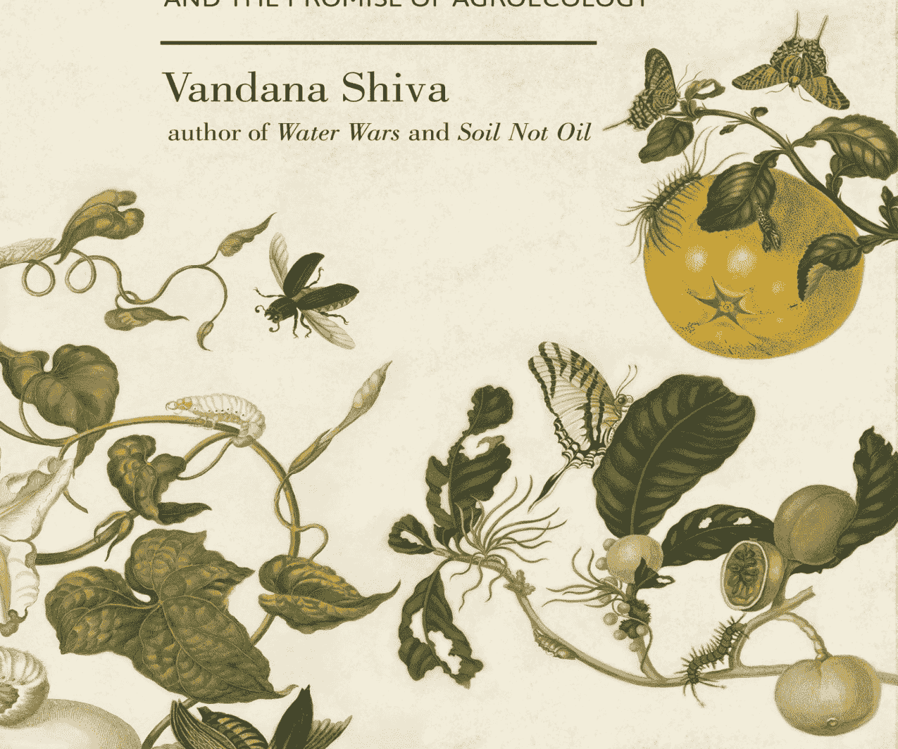

# 谁在真正喂养世界？农业企业之失败与农业生态学的希望

> 对农业生态学的深度观察，它是世界当前粮食危机的替代方案 —— 出版者提供。

> 献给所有赋予食物的生物。

献给 Richa，感谢她的编辑。

# 引言

我们正面临着一场深层且日益增长的危机，这种危机根源于我们生产、加工和分配食物的方式。受贪婪和利润驱动的工业化全球农业正严重威胁着地球的福祉、人类健康和社会稳定。一种低效、浪费且不可持续的食品生产模式正将地球、生态系统及其多样物种推向毁灭的边缘。食物的首要目的是提供营养和健康，但如今它已成为世界上最大的健康问题：近十亿人遭受饥饿和营养不良的困扰，二十亿人遭受肥胖和糖尿病等疾病，还有无数人遭受由食物中毒素引发的疾病，包括癌症。¹

食物不再是营养的来源，而是变成了一种商品：一种可以用来投机并从中获利的物品。这导致了食品价格上涨，并在全球范围内制造了社会不稳定。自2007年以来，37个国家发生了51次食品骚乱，包括突尼斯、南非、喀麦隆和印度。食品系统在可持续性、公正和和平等所有衡量指标上都表现糟糕。

今天，一种替代方案已成为我们生存的必然选择，因此让我们从问一个问题开始：“究竟是谁在养活世界？”

食物和农业已成为重大范式战争的战场。在每种范式下，某种类型的知识、经济、文化，当然还有耕作正在经历去殖民化。我们需要意识到，当前的危机并非自然的偶然，而是特定范式的结果。工业范式基于对自然和人的剥削，而生态范式基于两者之间的和谐。在工业范式中，关注点是短期利润；而在生态范式中，重点是长期的可持续性和公正。

我们必须转向一个重视所有生命形式的系统。这意味着要重新思考我们的种植、分销和消费方式。这意味着要支持小农户，保护生物多样性并恢复土壤健康。这是一项艰巨的任务，但对于我们地球和物种的生存来说，这是必不可少的。

前行的道路并不容易，但方向是明确的。我们挑战当前系统的假设，并建立一个基于原则的新系统。通过这种方式，我们可以真正地养活世界。

一种机械化的、暴力的范式塑造了围绕知识、科学、技术以及粮食农业政策的主流观点。事实上，一个破坏自然经济（粮食生产赖以生存的生态基础）的食物系统是无法养活世界的。一个旨在取代小农户（他们是真正农业的社会基础）的农业系统也无法养活世界。工业农业的每一个方面都在撕裂脆弱的生命网，并破坏着粮食安全的基石。

工业农业正在杀灭授粉者和益虫。爱因斯坦在其超越时代的远见中警告道：“蜜蜂消失时，人类也将消失。”如今，在过去的三十年里，由于有毒农药的影响，某些地区75%的蜜蜂数量被杀灭。化学农药杀灭了益虫，取而代之的是制造了害虫。合成肥料通过杀死自然产生活土的生物来破坏土壤，反过来又导致了土壤侵蚀和土壤退化。

工业农业正在开采和污染水资源。地球上70%的水资源正因化学密集型工业农业所需的密集灌溉而枯竭和污染。来自工业农场水中的硝酸盐正在海洋中制造“死区”：即没有任何生命存在的空间。

工业农业主要是由化石燃料驱动的农业。在一种将人视为原材料或农业投入的逻辑下，用化石燃料取代人类被包装得更具效率。但化石燃料的财务和生态成本是天文数字。在美国农业中，每个工人的背后都隐藏着超过250个隐藏的“能量奴隶”。能量奴隶是人的化石燃料对应物，如果我们考虑到粮食生产和消费系统的化石燃料强度，显而易见，工业农业消耗的比生产的多。正如阿莫里·洛文斯（Amory Lovins）指出的：“从劳动力角度来看，地球人口不是40亿，而是大约2000亿，关键点在于其中约98%的人不吃传统食物。”那是因为他们不是人；他们是能量奴隶，吃的是油。工业农业投入十单位的化石燃料能量，只产出一个单位的食物。浪费的能量导致了大气污染并使我们的气候变得不稳定。

农业的工业范式正在导致气候变化。导致气候变化的所有温室气体排放的40%来自基于化石燃料的全球农业系统。用于制造肥料、运行农机以及将食物浪费地跨越全球数千公里的化石燃料导致了二氧化碳排放。化学氮肥释放氧化亚氮，其对气候的不稳定性影响是二氧化碳的300%。此外，工厂化养殖是甲烷的主要来源，另一种导致全球变暖的毒素。1995年，联合国计算出工业农业已导致超过75%的农业生物多样性（农业发现的生物多样性）灭绝。今天，这个数字可能已经达到了90%。

矛盾的是，虽然这种对自然资本的生态破坏从“养人”的角度来看是不合理的，但饥饿问题却加剧了。有一亿人处于永久饥饿状态，另有十亿人遭受肥胖等与食物相关的疾病的困扰。这些情况是硬币的两面：营养危机。随着食物麦当劳化将加工垃圾食品传遍全球，即使是那些能吃饱肚子的人，也很少获得他们所需的营养。与大众认知相反，肥胖并不是因为人们吃得太多：往往是发展中国家的贫困人口承担了最严酷的饮食相关疾病。此外，与工业饮食相关的疾病以及食物中的毒素（包括癌症）正在稳步增长。商品并不养活人；食物才是。

尽管企业化的工业农业系统制造了饥饿，尽管它使用了地球75%的资源却仅对食物系统贡献了25%，尽管它是生态破坏的主导力量，是对粮食生产所依赖的自然系统的破坏者，但“工业农业养活世界”的神话仍在延续。这一神话建立在一个过时的范式基础之上，而事实上，这种范式已经被科学所抛弃。将自然视为死物质以及可以被人类操纵之物的错误观念，让我们认为向食物系统投入越多的毒素，长出的食物就越多。一个生态上具有破坏性且营养效率低下的食物系统已成为我们脑海中的主流范式，成为土地上最受推崇的实践，尽管实际上，与自然过程合作的小型生物多样性农场生产了我们吃的大部分食物。

工业农业对多样性缺乏包容。多样性具有滋养和天然抵抗力，但为了增加利润，工业农业使作物依赖化学肥料、农药、除草剂和转基因种子等外部投入。工业农业看起来越来越像针对行星的化学战争，食物的分配也看起来像战争，所谓的“自由贸易”协约让农民与农民、国家与国家之间陷入永恒的“竞争”和冲突。自由贸易允许公司和投资者夺取每一个种子、每一滴水和每一寸土地；无限制地剥削地球、农民和所有公民。这种模式将利润视为终点，完全不考虑土壤、生产者和人类健康。企业不生产食物；它们生产利润。

工业范式用操纵取代了真理，用虚构取代了现实。第一个虚构是“公司即人”的虚构。在这种人格的掩护下，公司编写生产和贸易规则以实现利润最大化并剥削生物。第二个虚构是“资本”——而非自然的生态过程以及农民辛勤且聪明的劳动——创造了财富和食物。人和自然被简化为单纯的投入。第三个虚构是，投入大于产出的系统是高效且高产的。这通过隐藏财务成本和投入被操纵着。第四个虚构是对公司有利的对地球也有好处。第五个虚构是食物是商品。现实是，食物越被转化成商品，从穷人身上夺取的就越多，质量也越退化。

我们在这里讨论的不是一个食物系统——它陷入了冲突并被当作垃圾丢弃。结果是生态灾难、贫困和饥饿。食物的未来取决于记住生命网是一个食物网。这本书致力于这种记忆，因为遗忘食物的生态学是导致饥荒的药方。在过去的三十年里，我意识到我们目前的食物系统是破碎的。1984年，我开始在旁遮普研究“绿色革命”。绿色革命是对一种基于化学物质的农业模式的误导性命名，该模式于1965年引入印度。二战后，化学公司和工厂急切地为合成肥料和战争期间的工厂寻找新市场。当地作物品种拒绝了人工肥料，因此植物被重新设计成矮生品种，以便它们吸收并成为化学品的载体。到20世纪60年代中期，这种新的种子/化学品包准备好以“绿色革命”的名义出口到全球南方国家。

绿色革命所延续的虚假叙事，对于理解围绕粮食和农业创造的主流叙事至关重要。这种叙事将绿色革命归功于让印度脱离了饥饿，项目的首席科学家诺曼·鲍尔格（Norman Borlaug）因此在1970年荣获了诺贝尔和平奖。但1965年的印度并没有饥荒。由于全国性干旱，城市粮食价格上涨，该国需要进口粮食。但在促进农业中使用化学品的政策下，美国政府和世界银行设定了一个条件：只有在印度进口种子和化学品的情况下，粮食才会送到印度。

作物受病虫害侵扰，需要更高剂量的农药。

尽管旁遮普邦的绿色革命留下了沙漠化的土壤、枯竭的含水层、消失的生物多样性、债台高筑的农民，以及一个将农药相关癌症受害者运往拉贾斯坦进行免费治疗的“癌症火车”，但这种不可持续的模式正在向印度东部国家和非洲出口。比尔·盖茨凭借数十亿美元的资金，正通过“非洲绿色革命联盟”极其成功地向非洲推销化学品和商业种子。事实上，所有通过G8国家政策路线的援助，都是在民主化地向非洲强加一种失败的模式。遗憾的是，旁遮普邦绿色革命的真正教训，只有那些随之毁灭的人才学到。

今天，第二次绿色革命正在进行：一场由转基因生物（GMOs）驱动的革命。GMO，即转基因生物，是经过工程引入毒素的工程作物。与最初的绿色革命一样，GMO声称要“养饱世界”。但现实是，GMO并没有增加产量，它们导致了化学品使用的增加，并且无法控制杂草和害虫。基因工程在我们星球上创造了一种全新的污染类型，对植物、动物、人类健康以及农民和当地社区的生计产生了负面影响。基因农作物的唯一受益者是公司，因为他们销售了更多有毒化学品，并对种子收取专利费。事实上，公司的贪婪和对拥有种子的欲望，是GMO被民主化地推向全球食品和农业系统的唯一原因。

但某些东西正在发生变化。1984年在旁遮普邦爆发的愤怒正在处处爆发——无论是在埃及的街头（阿拉伯之春始于反对面包价格上涨的抗议），还是在叙利亚（冲突始于农民因严重干旱导致歉收而寻求救援的抗议），亦或是各行各业的数百万加入“反对孟山都游行”，抗议公司对我们种植和食用食物的控制。处处都存在着不满，因为由少数公司控制的主导性工业化和全球化食品系统正在破坏地球、农民的生计、人类健康、民主和和平。面对这些，重新设计食品系统已成为生存的必要选择。

那么，是什么阻碍我们向生态友好、亲民的食品系统转型呢？

第一个障碍来自公司的权力，这种权力根植于战争的架构之中。仅有的五个种子和化工巨头——孟山都、先正达、拜耳、道尔和杜邦——试图完全主宰我们的食品系统。公司是法律上的构体，现在正声称拥有“人格”。但公司不是人。他们不会出生，也不会死亡。他们无法种植食物，也无法食用。然而，他们正在接管我们可持续且富有营养的食品系统，用商品和暴力来取代它们。

第二个障碍来自军事化、机械化、还原论和碎片化的农业范式，这种范式导致了人们对多样化物种的贡献，以及它们所提供和参与的生态过程与功能视而不见。这种范式拒绝承认和纳入妇女和小农，而他们提供了世界的大部分食物，且他们的知识对于可持续食品生产至关重要。

第三个障碍来自贪婪以及基于贪婪的冷酷繁荣。公司对利润的贪婪阻碍了向健康、可持续和民主的食品系统转型。对于农民来说，公司贪婪的系统表现为一种追逐金钱幻象的迫切，尽管农民在高成本的工业化生产系统中是输家。作为公民，公司贪婪将我们简化为纯粹的消费者，我们大多数人仍然不知道我们的食物是如何种的、由谁种的，以及我们的食物实际上含有什么。

那么，究竟是什么在喂养世界？我们必须再次问自己，我们所说的“食物”和“世界”意味着什么。如果“食物”是生命之网——生命的货币、我们的营养、细胞、血液、文化和认同——而“世界”是盖亚——我们丰富且活力的星球，我们的地球母亲，充满了多样化的生物和生态系统、众多民族和文化的生机——那么，是生物多样性、同心以及小农的知识和智慧在喂养世界。我过去三十年的研究和生活经历告诉我，关于食物问题的答案不在于工业农业，而在于农业生态学和生态农业。

食物由土壤、种子、阳光、水和农民生产，它们相互作用。食物体现了生态关系，而产生食物的相互作用和关联性的知识与科学被称为农业生态学。农业生态学滋养着我们。

肥沃的土壤是粮食生产的基础。土壤肥力是由数十亿土壤生物聚集形成土壤食物网而创造的。生物多样性和富含有机物的土壤也是适应气候和节水的最佳策略。水对于活体土壤至关重要，有机农业通过循环有机物来增加土壤的持水能力来节水。土壤变得像海绵一样，可以吸收更多水，减少用水，并增强对气候变化的韧性。活土滋养着我们。

蝴蝶等授粉者将花粉从一株植物带到另一株植物，在此过程中使其受粉。没有授粉者，植物无法繁殖。授粉者滋养着我们。

喂养地球意味着维持食物网的完整性和多样性：从土壤到海洋，从微生物到哺乳动物，从植物到人类。食品系统并不在自然和地球之外。它基于地球创造、维持和更新生命的生态过程。星球是活生的；它的货币是生命；它就是食物。正如古老的印度文献《泰提里耶乌帕尼沙德》所提醒我们的那样：“万物皆为食物。万物皆为某物的食物。”自然，与工业农业告诉我们的事实相反，是极具生命力的，它的多样性滋养着我们。

农民是植物育种者和拯救者，土壤保护者和建设者，水资源保护者和守护者。农民是生产者。虽然只使用了世界资源的30%，小农提供了世界70%的食物。小农、农民家庭和园丁们滋养着我们。

种子是食品系统的第一个环节。没有种子就没有食物。没有种子的多样性就没有食物和营养，而这对健康至关重要。在气候动荡和不稳定的时期，没有种子多样性就没有气候弹性。种子滋养着我们。

食物不是商品；它不是可以在世界各地出售的珠宝。每个生物以不同的方式接触食物，每个文化或地区都生产自己的食物。由于每个人必须吃食物，本土粮食主权是粮食安全的关键：本土化滋养着我们。

根据自然和生态法则，种子、生物多样性、土壤和水的知识及其实践传统上属于妇女，妇女是世界上主要的生产者。**妇女滋养着我们。**

食物是生命，它是通过维持生命的过程创造的。在农业和粮食生产中，自然和自然法则优先。违反这些法则并侵入自然的界限——种子、土壤、水和能量——是粮食安全和未来饥荒的配方。在恢复自然经济的同时，生态农业生产更多、更好的食物，并恢复社区的健康和福祉。照顾地球和喂养人类是并行的。

喂养地球引发了我们时代最基本的问题。食物问题变成了一个关于我们与地球及其他物种关系的伦理问题；关于我们是否有权将物种推向灭绝，或拒绝人类获得安全、健康和营养食物。它变成了一个生态问题，关于人类是作为地球社区的成员生存，还是通过破坏农业的生态基础而走向毁灭。它变成了一个文化问题，关于我们的食物文化、认同以及对地方的归属感。

喂养人类是一个知识问题，关于我们是继续通过破坏性的、还原论的、机械的范式思考，将种子和土壤视为可以操纵和投毒的死物质，还是将种子和土壤视为活的、自我组织的、自我更新的系统，它们可以在不需要化学品和毒药的情况下提供食物。它也是一个知识问题，关于我们是否看到农民基于知识的几个世纪的耕作以及他们的智慧，还是仅仅因为他们没上过大学就认为他们无知。

食物问题也是一个经济问题：关于穷人是挨饱还是挨饿；关于公共税是否用于补贴一个不健康且不可持续的食品系统；关于种子是在公有领域中还是通过专利被公司拥有；以及食物是建立在正义、公平和主权的原则之上，或建立在所谓“自由贸易”的不公平规则之上。

当我意识到占据主导地位的农业系统是多么误导和虚假时，我将毕生致力于拯救种子、推广有机农业和生态农业。我没有去加强那些将我们的小农户推向债务深渊的化学和资本投入，而是致力于加强生物多样性和生态过程，与自然合作，而不是向自然宣战。

1987年，我发起了Navdanya运动，这是一项旨在拯救种子、保护生物多样性以及传播生态耕作方法的运动。我们帮助创建了的一百多个社区种子库，这些种子库为农民提供了开放获取的种子，让他们能够在没有外部投入的情况下种植出美味、富营养的作物，从而在增加他们自身营养水平的同时，也增加了收入。这些种子库在气候极端天气（包括干旱、洪水和气旋）期间拯救了农民。从种子的拯救和分享开始，我们现在又分享农业生态学知识的种子。通过我们的地球大学（Earth University），我们传播了与活种子、活土壤、活食物、活经济和活民主相关的理念和实践。通过基于生物多样性的生态农业实践，我们教导如何健康且充足地生产食物，以及如何通过农业来增强土壤肥力、增加生物多样性、节水并减少导致气候变化的温室气体。

这两种食物范式之间的竞争，是两种理念和组织原则之间的竞争。一种范式基于剥削法和统治法，始于战争并根植于暴力。第二种范式植根于农业生态学和活经济，并基于回报法则：即向社会、小农户和地球回馈。它体现了分享和关怀的价值观，而不是自私和贪婪。今天，范式的转变已成为一项不容忽视的全球生存使命。

《谁在喂养世界？》（Who Feeds the World?）是对三十年研究与行动的总结，是对全球转变的呼吁。

我们需要范式的转变和权力转移。受企业贪婪塑造的工业农业没有、也无法带给我们可持续性和健康。相反，我们可以通过关注拯救种子、回馈土壤、培育生物多样性以及保护我们的小农户和妇女，向农业生态学转型并实现充足的自给自足。我们必须停止贫化我们美丽的星球。播种希望的种子，建立一个造福星球及其人类健康的食物系统，就在我们手中。

# 农业生态学喂养世界，而非暴力的知识范式

在过去的上万年里，人类一直以生态方式耕作。自然的系统和循环产生了更新、繁殖和多样性，让所有生物能够和平共存。这些可持续系统并不是停滞或静态的；它们处于不断演化之中。在这些生态系统中，有机农业蓬勃发展。事实上，其繁荣程度令那些最初从工业农业中获利的人发现，他们的化学品和农药对“改进”传统生态农业的作用微乎其微。

早在1889年，约翰·奥古斯塔·沃尔莱克（Dr. John Augustus Voelcker）博士被派往印度，为英国帝国政府就化学农业在印度农场的应用提供建议。在研究印度农业系统后，沃尔莱克表示：“几乎没有什么是可以改进的。……我可以确定，至少我没有见过比这更精细耕作的完美画面了。我可以大胆地说，对英国农业提出改进建议比对印度农业提出有价值的建议容易得多。”

二十多年后，现代可持续农业的“父亲”阿尔伯特·哈华德爵士（Sir Albert Howard）对印度和中国写道：“东方的农业实践已经通过了最高测试，它们几乎像原始森林、草原或海洋一样永久。”这些陈述中引人注目的是，这两个人终究是殖民者，他们寻求更大的利润和对本土土地更强的控制。即使是他们，也无法在这些“完美”的耕作系统中发现任何缺陷。与普遍观点相反，饥荒的发生并非因为本土农业系统没有产生充足的食物，而是因为……（此处原文似乎中断，但根据逻辑应指某种系统性因素）。

（注：原文文本在此处似乎不完整，翻译根据提供的段落进行。）

第一是牛顿-笛卡尔式的分离思想：一个由固定的、不可改变的原子组成的碎片化世界。在这种世界观中，牛顿本人写道：“坚固、有质量、不可穿透、可移动的粒子……非常坚硬，永远不会磨损或破碎：没有任何凡俗的力量能分割上帝在最初创世时创造的整体……因此，为了使自然界能够是永恒的。” 这种对世界的理解将自然看作是由死物质组成的：就像一套乐高积木，粒子和碎片可以被使用、移动、替换，而不会产生任何全局性的后果。这种机械论的假设催生了遗传还原论和遗传决定论，并导致了所谓的分子生物学中心教条的发展，即该教条认为遗传物质（或 DNA）充当了主分子的角色。这一教条如此深刻地根植于科学信仰之中，以至于它“等同于刻在石头上的科学十诫”。

随后，这种信仰体系为基因工程和转基因种子（`GMOs`）提供了基础。正如我们在整本书中所看到的，转基因生物并没有杀灭害虫并生产粮食，反而是在产生新的超级植物和超级杂草的同时减少了粮食产量，而这些杂草对杀灭它们的喷剂表现出越来越强的抗性。与产生它们的科学范式一样，转基因生物用一种机械的、还原论的世界观取代了本土知识，特别是女性的知识。正如遗传学家何梅婉（`Mae-Wan Ho`）博士所说：“生物正在进行其自身的自然基因改良，这是一场生存所必需的生命之舞。遗憾的是，基因工程师并不知道这支舞的步骤、节奏和音乐。”

牛顿-笛卡尔理论已被量子理论、生态学、新生物学和表观遗传学等新科学证明是错误的。量子理论告诉我们，世界并非由坚硬、不可改变的物质组成，而是由势场组成，粒子在波与粒子之间进行动态转换。我关于量子理论基础的博士论文关注的是不可分性，而非牛顿式的分离，这是量子宇宙的定义特征。生态学告诉我们，万物都是生命之网，盖亚（`Gaia`）从细胞到生物的每一个层面都是一个自组织系统。表观遗传学告诉我们，存在所谓的“基因”这种生命原子——它们决定了所有生物的特征——这种观点是不真实的。它向我们展示了环境影响基因，而基因不会独立于周围环境进行调节或组织。

在《DNA 教义》（`The Doctrine of DNA`）中，理查德·刘森（`Richard Lewontin`）写道：

> DNA 是一个死分子，是世界上活性最低、化学惰性的分子之一。它没有自我复制的能力。相反，它是由复杂的蛋白质细胞机制由基础材料产生的……虽然经常说 DNA 产生蛋白质，但实际上是蛋白质（酶）产生 DNA。当我们说基因是自我复制的时，我们赋予了它们一种神秘的自主力量，这种力量似乎将它们置于身体普通物质之上。然而，如果世界上有什么东西是可以自我复制的，那不是基因，而是作为一个复杂系统的整个生物体。

构建工业农业知识范式的第二个重大理论是达尔文的作为进化基础的竞争理论。在他的著作《信仰的生物学》（`The Biology of Belief`）中，布鲁斯·H·利普顿（`Bruce H. Lipton`）写道：

> “[达尔文]得出结论，生物体永远处于生存的斗争中。对于达尔文来说，斗争和暴力不仅是动物本性的一部分，更是演化参与的主要力量。在《物种起源：由于自然选择引起的起源或生存斗争中有利物种的保护》的最后一章中，达尔文写到了不可避免的‘生存之斗争’，并认为演化是由‘自然的方式，通过饥荒和死亡’驱动的。”

但生命并非通过竞争进化；相反，生命是通过合作和自组织进化的。五十万亿个细胞协作创造了人体。数百万物种协作塑造了生态系统和地球。

达尔文的竞争范式助长了工业农业范式。单植栽培产生于植物之间在相互竞争的想法，而现实是植物之间在相互合作。例如，在墨西哥的玉米、豆类和南瓜的混合耕作系统中，固氮豆和豆类为谷物提供免费氮源，作为回报，玉米或小米等谷物的茎为豆藤的攀爬提供了支撑。反之，南瓜为土壤提供覆盖，防止土壤侵蚀、水分蒸发和杂草出现。这些多样化的作物共同为土壤、动物和人类提供营养。而达尔文范式则将每种昆虫都看作是在与人类作战，因此是应该用毒药消灭的。

这两种科学理论共同构成了一个还原论的、机械论的知识范式，允许无限制的剥削。虽然在这种范式下的执行工具各异，但这种知识的特权为工业主义作为一种生产系统和对自然的控制系统提供了智基础。在这一范式诞生的工业农业系统下，土壤被视为化学肥料的惰性容器，植物被定义为工厂，并被视为依靠农药运行的机器。

牛顿-笛卡尔的碎片与分离理论，以及达尔文的竞争范式，导致了地球资源的不可再生利用、不可持续的粮食与农业模式，以及一种不健康的健康与营养模式。强调这些论点作为唯一“科学”方法的合法性，通过贬低农民的知识以及大地母亲的智慧与创造力，造成了“知识的种族隔离”。毕竟，如果自然已经死亡了，你又如何能杀死她呢？

暴力的科学范式为强化战争铺平了道路。在第二次世界大战期间，大公司从数百万人的死亡中赚取了更多的钱。战争结束后，通过制造战争爆炸药而增长并获利的行业将自身重塑为农药工业。在选择关门或“重塑品牌”之后，它开始制造合成肥、杀虫剂和除草剂。化学推动改变了农业的理解和生活方式。与其与生态过程合作并考虑整个生态系统的健康，农业被还原为基于毒药的外部系统。因此，曾经从土壤到水到植物都是循环利用的耕作系统，现在变成了一个依赖种子、化学品和肥料外部投入的系统。工业农业的核心是一种死亡经济——其利润根植于死亡与破坏。

工业化农业是气候变化的巨大贡献者。它占全球二氧化碳排放量的 25%、甲烷排放量的 60% 以及氧化亚二排放量的 80%，这些都是强效温室气体。正如我们在接下来的章节中看到的，它还导致了土壤侵蚀和贫瘠、水污染和含水层枯竭，以及自给自足社会的破坏。

即使小规模农场通过多样性产生更多食物，农业已转向基于密集使用化学品、化石燃料和资本的大型单植农场。与其基于全球 8500 多种植物种的多样化文化，这些农场生产的是用于全球贸易的少数单一作物。

政府可能认为从维持生活的资源中提取资金资助战争是合理的。`GDP`（国内总值）对农业是有害的，因为它产生了一种虚假的想法：如果你生产了你消耗的东西，你就没有生产。因此，过去你拥有自然和女性作为食物生产者，而现在，商品——即创造经济利润的物品——被计为生产。

通过这种人为强加的经济，社会被简化为商品的生产者和消费者，而不是食物的种植者和食用者。自然对生态产品和服务的生产，以及社会维持自然和提供生存的能力，首先在人们脑海中被抹除，随后在真实的生态系统和局部经济中消失。这种数百年来为土壤和社会提供营养和养的知识，是生态破坏的基础，并导致了全球范围内的贫困和饥饿。

还原论经济范式的构建赋予了资本和公司神秘色彩，使其被视为带给我们食物的创造力量。通过让自然、女性和小农户所做的生产变得隐形，食物经济中唯一变得可见的部分是受企业控制的部分。基于多样性的系统被单一种作物栽培取代，后者产生的营养较少，但商品更多。农民变得依赖购买昂贵的种子和化学品，许多陷入债务陷阱的农民最终走向了自杀。

在一个维持生命的农业生态系统中，存在三种并存的经济：自然经济、人类经济和市场经济。它们共同构成了可持续性经济。自然经济包括生物多样性、土壤肥力和水资源保护，这些要素共同构成了农业所依赖的生态基础。人类经济是一种生存性经济，社区生产所需的物品并相互照顾。最后，市场经济涉及真实实体（而非公司）之间的交换与互动。

自然经济和人类经济的可持续性基于“回报法则”（`Law of Return`）：回馈种子、土壤和社会。种子的回报法则维持了活种子的循环。它包括允许种子在变为新种子的同时也为我们提供食物。它还允许由自然和农民演化出的活种子通过我们所说的“种子自由”在农民之间自由流动。土壤的回报法则包括向土壤归有机物，以更新肥力并维持活土。社会的回报法则包括向生产食物和为我们提供营养的农民支付公平的报酬，让他们能够过上尊严和自由的生活。它包括合作与互助，以及关闭生产与消费之间的循环。最重要的是，它包含了代际之间的回报法则，每一代人都记住从祖先那里接受的馈赠，并为后代留下种子、土壤、知识和文化的遗产。

在一个可持续的系统中，这三种经济作为一个稳定的金字塔存在。自然经济及其所有丰富的、再生的生存资料，构成了金字塔的基础。自然经济支持人类经济，人类经济则回收和更新其使用的自然资源。金字塔的顶端是基于自然和人类经济的市场经济，由不同社区共享资源、知识和理念的互动组成。

在还原论、机械论的知识和利润范式下，“可持续性”概念本身正在发生变异。“可持续性”显然有两种不同的含义。真正的含义是指自然和人类的可持续性，它认同自然支持着我们的生活和生计，是生存的首要来源。维持自然意味着维持自然过程、循环和节奏的完整性。

然而，现在存在第二种“可持续性”，指的是大写字母 `M` 代表的“市场”（`Market`）。这种范式仅通过 `GDP` 衡量市场经济的增长，尽管这种增长与自然和人类经济的破坏和萎缩有关。在这个无所不能的市场中，可持续性意味着确保原材料的供应、商品的流动、资本的积累和投资回报。它无法提供我们因损害自然支持生命的能力而正在失去的生存。全球市场的增长掩盖了国内生产和消费局部经济的破坏。由于工业原材料和市场商品可以相互替代，国内生产和消费局部经济的破坏被掩盖了。

当工业化农业将自然视为死物质或机器时，农业生态学则将生命重新注入地球，将其视为一个活着的、有呼吸的整体。

在农业生态学的知识范式和有机农业中，食物是生命之网。人类是这个网的一部分，既是共同创造者和生产者，也是进食者。当我们拯救种子并重新种植时，我们便成了生命循环的一部分。当我们将有机物归还土壤时，我们是在喂养土壤微生物。按照自然的规律运作，参与大自然的创造与生产过程。这是食物和农业系统可持续性的基础。一个农业生态知识体系喂养的是世界，而不是一种暴虐的、还原论的农业范式。

## 2 活土滋养世界，而非化学肥料

> **“PRITHVI-SUKTA”**，源自古印度文献《阿陀吠罗达》的一篇祷文
>
> 噢大地，无论我从你挖掘了什么，
> 愿它们能在你身上迅速生长，
> 噢纯洁者，愿我的刺入永远不会穿透
> 你的生命要害，你的心

英国植物学家阿尔伯特·霍华爵士（`Sir Albert Howard`）于 1905 年抵达印度印多尔。他与妻子加布里埃（`Gabrielle`）开始担任农业顾问，观察农民和农人的耕作方法。霍华德被称为“有机农业之父”，但实际上是印度的农民孕育并哺养了这位科学家如今闻名世界的农业哲学与实践。正在这里，他开始推崇将养分归还土壤的耕作技术，并在他的多部著作中，他最著名的观察是：“土壤、植物、动物和人的健康是一个伟大的课题。”

土壤是一个活的系统，数以亿计的土壤微生物织成一张复杂的土壤食物网，以创造、维持和更新土壤肥力。所有的食物生产都依赖于这张网。土壤的健康对人类的健康至关重要，从这个角度来看，施肥的目的不仅仅是增加产量和通过肥肥植物，而是滋养活土。

然而，为工业化化学农业铺平道路的还原论范式将土壤视为装化学肥料的惰性空容器。第一次世界大战后，拥有固氮设备工厂的炸药制造商不得不为他们的产品寻找其他市场。合成肥料为战争产品的和平用途提供了一种便利的“转化”，只不过这些化学物质并非和平，而是对土壤和地球发动了战争。第二次世界大战后，这场反对地球的战争在“绿色革命”的旗帜下进行，旨在将这些有毒化学品出口到全球南方。

仅在印度，二十年的绿色革命农业就成功摧毁了旁遮普邦土壤的肥力。这些土壤由世代农户维持了几个世纪，如果不是国际“专家”和印度追随者们错误地认为技术可以替代土地、化学品可以取代土壤的有机肥力，这些土壤本可以无限维持下去。

如今，全球农业系统每年流失 240 亿吨肥沃土壤。印度每年流失 66 亿吨土壤，中国流失 55 亿吨，美国流失 30 亿吨。事实上，土壤流失的速度是其自然补充速度的十到四十倍。土壤侵蚀造成的养分损失每年高达 200 亿美元。化学单作还使土壤容易干旱，进一步加剧了粮食不安全。这种退化导致了清洁水可用性的减少，并增加了影响地区对气候变化、粮食不安全和贫困的脆弱性。今天，全球范围内已有 15 亿人因收入减少或粮食不安全而直接受到土地流失的影响¹。根据土壤退化的现状，如果我们继续破坏地球的土壤，在未来二到五十年内，地球上的食物将减少 30%。

在剥削法和主宰法的驱动下，我们现在用化学肥料取代了土壤。对更多肥料的追求是新种子扩散的重要因素，因为种子在哪里都能开辟新市场。合成肥料为战争产品的和平用途提供了一种便利的“转化”，只不过这些化学物质并非和平，而是对土壤和地球发动了战争。

土壤持水能力提高了 20%。这使得土壤对干旱更具韧性。有蚯蚓的土壤排水速度比没有蚯蚓的土壤快十倍，这使得土壤具有抵御洪水的能力。在每平方米有机土壤中，可以有三十到三百只蚯蚓。

除了蚯蚓、真菌和细菌外，每克土壤中含有一万到十万个绿藻和蓝藻细胞。每平方米有机土壤中可以发现一千到十万只螨、蜘蛛、蚂蚁、甲虫、蜈蚣和马陆。土壤微生物越多，土壤就越健康；它越肥沃，保水能力越强，越不容易受到侵蚀。

氮是农业生产中的重要组成部分，因为它有助于植物制造食物。为了利用氮，必须在一个过程中将其从大气中“固定”，转化为铵。在工厂中，通过消耗大量的化石燃料和能量从空气中固定氮。在有机耕作中，不同植物并排生长，豌豆和豆类等固氮作物为我们提供了免费的氮。植物与根瘤菌有共生关系，根瘤菌是土壤中的细菌，进入植物根部帮助它们通过生物固氮作用从空气获取氮。

此外，在有机农业中，许多植物品种能为我们提供天然绿肥。例如，合欢、刺槐和白草可以极大提高土壤肥力。这些在传统农业中通常被用绿篱种植，但在工业单一种作物中无处可见。它们非常有效，作为绿篱的刺槐，每公顷每年可产生多达 6-8 吨的生物质或有机物。工业农业的支持者反复告诉我们，有机农业是不可能的，因为没有足够的有机物。但通过绿肥，我们可以产生大量的有机氮和有机物，这些可以取代那些通过杀死土壤微生物而耗尽土壤肥力的合成肥料。

生态农业基于有机物的循环，因此也是养分的循环。它基于“报答律”，将养分归还给土壤，而不是简单地从中提取营养。只取不予是对土壤的掠夺，是盗窃行为，“一种尤为卑劣的盗窃行为，因为它涉及掠夺那些尚未出生、无法保卫自己的后代。”¹¹

阿尔伯特·霍华德爵士（`Sir Albert Howard`）在《农业遗嘱》中写道：

> 西方施肥的特点是使用人工肥料。第一次大大战期间从事固氮以制造炸药的工厂必须寻找其他市场，农业中氮肥的使用不断增加，直到今天，大多数农民和市场园艺者的经营计划都基于市场上最廉价的氮（`N`）、磷（`P`）和钾（`K`）形式。这可以方便地描述为实验站和农村地区盛行的“`NPK`心态”耕作。在国家紧急关头根深蒂固的利益集团已占据了据足地。¹²

在工业农业的范式中，土壤被视为死物质：一个倾倒合成肥料（尤其是 `NPK`）的空容器。尽管植物和土壤的健康生长需要三十三种元素，这种做法依然在进行。由于其根在水中，这些合成肥料持续着我们对活体土壤的战争。

菌根细菌和蚯蚓在施用化学肥料后无法生存。肥料会堵塞向植物提供养分和水的土壤毛细管。雨水渗透被停止，径流增加，土壤面临干旱，需要不断增加灌溉和不断增加用于抽取地下水的化石燃料。

施用的氮肥三分之二没有被植物吸收；相反，硝酸盐污染破坏了地下水。它还污染了地表水，导致河流湖泊的富营养化（过肥），并在沿海水域形成死区。大部分氮肥以一氧化氮的形式逸入大气，其大气寿命为 166 年，对大气的损害是二氧化碳的三百倍。尽管化学公司想让我们相信某些事情，但事实是，固氮作物提供的氮足以替代合成肥料。

在我们 `Navdanya` 的农场，我们发现了同样的趋势。我们的农场始于一片从澳大利亚引进到印度的桉树种植场遗留的、贫瘠且沙化的的土地，那里的树木无法参与“回报法则”。它们的叶子不会降解，消耗过多的水分，并释放出他感性单萜，抑制任何其他植物的生长。那里土地没有土壤微生物，也没有蓄水能力。我们用爱培育了多样性，并向土壤归还了尽可能多的有机质。土壤充满了微生物，蚯蚓的洞穴遍布农场，我们已经能够减少 70% 的用水量，因为土壤现在可以蓄水了。土壤充满生机，赋予我们生命。

健康的土壤产生健康的植物，正如霍华德（`Howard`）曾经所说：“每种作物的出生权利就是健康。”这在气候变化时代尤为如此。工业农业负责了导致气候变化的 40% 温室气体，而重施肥的粪肥更容易受到气候变化的影响。

在 2009 年印度全国性干旱期间，当我访问了全国不同地区的 `Navdanya` 农民时，我发现他们的作物并没有遭受损失，因为他们使用的是当地适应的种子，而且由于有机施肥，土壤具有蓄水能力。使用“绿色革命”、高肥力品种或转基因 `Bt` 棉花的农民则遭遇了歉收，因为无论是种子还是土壤都不具备韧性。

种植多样性和发展有机耕作已成为我们的土壤适应气候变化的必要手段。支持健康的土壤是从大气中吸收二氧化碳最有效的方法。含有有机质的土壤对干旱和极端气候更具韧性。生物多样性密集型系统——实际上是光合作用密集型系统——驱动二氧化碳从大气中进入植物，然后进入土壤。土壤而不是石油，掌握着人类的未来。基于石油的、化石燃料密集型的、化学密集型的工业农业利用正在杀死土壤的过程，在这里终结了我们的未来。

历史证明，社会和文明的命运与我们对待土壤的方式密切相连：我们是通过“回报法则”还是通过“剥削法则”与土壤建立联系？回报法则，即回馈，确保了肥沃土壤的创造与维持，并能由活土壤支撑数千年之久。剥削法则，即索取而不回馈，导致了文明的崩溃。

随着土壤被侵蚀、退化、埋在混凝土之下并被剥夺生命，全球当代社会正处于崩溃边缘。但情况可以有所不同。

霍华德近一个世纪年前曾警告过我们：

> 我们必须将现在的文明视为一个整体，并彻底领悟这一伟大的原则：人类的活动创造了我们现在所生活的机器时代，但这些活动建立在一个非常不安全的基础之上——即通过掠夺土壤肥力储备获得的剩余食物，而这些肥力不属于我们，而是后代代人的财产……没有任何一个代人有权耗尽人类赖以生存的土壤。

印度诗人、哲学家拉比宾德拉纳·泰戈尔（Rabindranath Tagore）邀请我们回归土壤，与地球和解：

> 让我们都回归大地
>
> 她铺开衣裳的角
>
> 等待着我们。
>
> 生命从她的怀抱中生长，
>
> 花朵从她的微笑中绽放
>
> 她的呼唤是最甜美的音乐；
>
> 田野从一角延伸到另一角，
>
> 她掌控着生命的弦律。
>
> 她鸣唱的水流带来了
>
> 来自永恒的低语。

# 3

## 蜜蜂和蝴蝶喂养世界，而非毒药和农药

> 消灭害虫是逃避而非解决所有农业问题。
>
> —阿尔伯特·霍华德爵士（SIR ALBERT HOWARD）

蜜蜂、蝴蝶、昆虫和鸟类在花与花之间传播花粉，使植物授粉并繁殖。没有授粉者，大多数植物无法繁殖；没有植物的繁殖，我们的食物供应将受到威胁。种子的循环，无论是森林中的树木还是构成我们食物的作物，都依赖于授粉循环。

生态生物多样性系统不仅保护了我们的蜜蜂和授粉者，还通过自然的害虫/捕食者平衡来控制害虫。它们支持了大量的天敌，防止了害虫数量的爆发。另一方面，工业化单一种植为害虫提供了盛宴，因为没有生物多样性来提供控虫的生态功能。

在知识和农业的最初范式中，控虫是一场战争。正如一本害虫管理教材所述：“与害虫的战争是一场持久战，人们必须战斗以确保生存。害虫（尤其是昆虫）是我们地球上主要的竞争对手。”

五十多年前，瑞切尔·卡森（Rachel Carson）写了《寂静的春天》，这是对后代的早期预警。她对周围的世界提出了质疑：

> 有一种奇异的寂静。例如鸟类——它们去到哪儿了？随处看到的几只鸟都是垂死的；它们剧烈地颤抖，无法飞行……在农场里，母鸡在孵化，但没有小鸡出生……苹果树开了花，但花丛间没有蜜蜂的嗡嗡声，因此没有授粉，也不会有果实……这是一个没有声音的春天。

卡森这本如今已标志性的著作探讨了化学品和农药的危害生态后果，警告说那些让春光之声沉默的致命化学品也不会放过人类。今天，她的警告已变成广泛的现实，我们的食品系统里到处都是毒素。

在过去的四十年里，我们见证了源自化学战争的农药使用量剧增。农药不仅对生态系统和友好授粉者具有破坏性，对我们的健康也是如此。（注：原文此段落存在大量OCR识别错误导致的重复，译文已根据逻辑进行了去重处理）

在印度，所有商业销售的种子都涂有农药。在美国，90%的玉米种子涂有拜耳（Bayer）的烟碱类杀虫剂，这些农药与蜜蜂死亡密切相关。

农药的制造和使用正在不断增加。新的化学品定期进入市场，政府注册和控制农药的系统存在很大缺陷，并可以根据公司利益被操纵。这种增长在全球南方尤为明显，那里农药的使用每年以5-7%的速度增长。现在，农药出现在我们的河流、地下水、母乳、土壤、食物和空气中。食用食物是人类暴露于农药和工业污染物的主要途径。我们都暴露在农药中，并且身体里携带了可测量的这些有害化学物质。我们通过日常饮食摄入的这些农药的完全影响尚未被完全[理解]，但研究表明，最有害的影响是儿童，因为儿童单位体重摄入的食物量更多。例如，印度的婴儿接触的砷含量比普通人高，因为婴儿摄入更多的米饭，而米中的砷浓度较高。

除了农药在我们的食物中产生的毒素外，农药还对与其接触的人构成了严重的健康风险，特别是农民，或居住在生产这些工厂附近的人。

I. G. 法本公司和其他公司专门负责开发沙林和芥子气，这些化学品属于有机磷类（OPs）一类，曾被纳粹集中营用作神经性毒气。如今，市场上绝大多数农药都是神经毒素，这意味着它们作用于神经系统。这解释了它们的有效性以及其毒性潜力。这些农药即使是极少量，也会损害神经系统，从而导致神经生理功能障碍，其病程可能是慢性或长期的。暴露于有机磷类会导致急性疾病，如恶心、呕吐、头痛、腹痛、眩晕、皮肤病、眼病、流产和出生畸形。I. G. 法本公司在二战后的纽伦堡审判中因其在大屠杀中的作用受到审判。然而，它在传播近期种族灭绝中的作用在很大程度上没有受到限制。

1984年12月，被广泛认为是世界上最恶的工业灾难发生在印度博帕尔由联合碳化公司（Union Carbide）拥有的一家农药厂。一场被称为博帕尔毒气事件的气体泄漏在夜之间杀死了三千人，还杀死了超过三万非人类生物。农药厂排出的气体污染了饮用水和土壤，导致两百名妇女流产，四百名婴儿死亡。根据官方数据，一万人永久残疾，十万人遭受轻微功能受损。尽管斗争了三十年，博帕尔毒气灾难的受害者并未获得正义。相反，道尔公司（Dow）多次对活动人士提起诉讼。

与此同时，道尔公司正在向全球范围内传播其化学品。橙剂——一种由道尔公司开发并在越南战争期间由美军喷洒的产品——以及农业中的农药正在杀死农民、消费者、儿童和蝴蝶。纳夫丹尼亚（Navdanya）的报告《我们食物中的毒素》显示，农药的使用与流行病之间存在明确的联系。在旁遮普邦，每天使用大量农药，癌症发病率异常高。毒素对人类饮食的破坏性影响是深远的。每年有近七千印度人死于癌症，而超过一百人被诊断患有某种形式的这种疾病。在全球范围内，2012年有30万人死于癌症，世界卫生组织报告，每年有22万人死于农药中毒。1960年的美国，每二十人中有一个患癌症。到1995年，由于农药使用量的增加，这一数字跳到八分之一。

斯里兰卡的一项研究发现甘磷酸（在孟山都品牌 `Roundup Ready` 下使用）的使用增加与肾脏疾病之间有关，这影响了四千名农民。根据美国疾病控制与预防中心的数据，自闭症在二十年增加了35%，从每八十五儿童中一个增加到每六十八儿童中一个。全球增长的数据表明，我们无法忽视食品系统带来的危险和威胁生命的代价。一种应对这些数据的公司策略是试图沉默、骚扰和迫害那些工作表明农药和转基因生物对健康损害的科学家。例子包括英国的阿帕德·普斯泰（Arpad Pusztai）、法国的吉尔·埃里克·塞拉利尼（Gilles-Éric Séralini）、加州大学伯克利分校的泰隆·海斯（Tyrone Hayes）以及南卡罗来纳大学的维基·范斯（Vicki Vance）。鉴于农药应用中只有1%作用于目标“害虫”，其对益虫和授粉者的影响是毁灭性的。授粉者对我们的粮食安全和农业经济做出了巨大贡献。例如，蜜蜂授粉了百种最常见作物中的七十一种，这些作物占了世界食物供应的90%。在全球范围内，蜜蜂对作物生产的贡献估计为2000亿美元。世界上每四口食物中有一口是由授粉者的生态贡献产生的。美国的昆虫授粉作物价值200亿美元。然而，蜜蜂和蝴蝶正被作为工业农业基础的毒药库所杀死。从1985年到1997年，美国农场的蜂群数量减少了约57%。农药是这种变化的主要原因。蜜蜂的免疫系统在暴露于农药后会变弱，它们更容易受到天敌侵害。暴露于农药还会干扰它们的繁殖和发育。

授粉者是为农民提供的基本自然服务，没有它们，我们的粮食安全将面临威胁。美国科学家保罗·德巴赫（Paul DeBach）写道：

> 化学防治害虫的哲学一直是实现可能的最高杀灭，而死亡率一直是实验室筛选新化学品的主要衡量标准。这种目标，即可能的最高杀灭，结合对非目标昆虫和螨虫的无知或忽视，注定是导致失衡和产生抗药性的快速途径。

许多进入农化行业的大型公司后来通过基因工程进入了种子行业。在这些公司中，位于美国的孟山都（Monsanto）拥有垄断地位，占据了全球专利种子市场的23%。 在转基因作物随处可见的美国，80%的玉米和93%的大豆使用的是孟山都的转基因种子。有2.8亿英亩土地被用于孟山都作物（1996年为300万英亩）。

基因工程被作为化学农药的替代方案。然而，转基因作物是由主宰法则和军事化范式推动的自然战争逻辑的一部分。在转基因生物的情况下，毒素是作为产生毒性的基因引入植物的，因此实际上，转基因生物变成了生产农药的植物。正如农药制造了害虫而非控制它们一样，作为生产农药植物的转基因生物也增加了害虫而非控制它们。

转基因生物无法控制害虫和杂草。相反，它们创造了超级害虫和杂草。在转基因作物商业化的二十年里，只有两种特征在大规模上商业化：抗除草剂性和抗虫性。抗除草剂作物（在孟山都品牌 `Roundup Ready` 下命名）本应控制杂草，而Bt作物旨在控制害虫。2013年，食物与水观察组织计算，孟山都利润的27%来自草甘膦除草剂的销售。但由于没有控制杂草和害虫，这些转基因作物导致了超级杂草和超级害虫的出现。在美国，抗草甘膦（`Roundup Ready`）作物已经产生了抗草甘膦的杂草。现在有约1500万英亩的土地被超级杂草占据，为了杀死这些杂草，孟山都公司支付农民每英亩12美元，用于喷洒致命的除草剂，例如越南战争期间使用的**橙剂**。

像抗草甘膦玉米和大豆这类抗除草剂植物，导致了草甘膦（除草剂中的成分）的使用量增加，这种物质会杀死所有其他植物，包括乳草——这是帝王蝴蝶产卵的唯一植物。帝王蝴蝶是作物重要的授粉者，也是世界上最美丽的生物之一。随着抗草甘膦作物增加到90%，乳草减少了60%，每年跨越美国进入墨西哥的帝王蝴蝶数量已从1997年的10亿只下降到最低的3350万。

印度，以`Bollgard`命名出售的Bt棉本应控制棉铃虫害虫。如今，棉铃虫已对Bt棉产生了抗性，孟山都公司正在销售带有两个额外毒性基因的`Bollgard II`。纳夫丹尼亚和科学技术与生态研究基金于2008年进行的田间调查显示，在马哈拉施特拉邦的Vidarbha地区，引入Bt棉后农药使用量增加了三倍。最近的一项研究还显示，Bt棉的化学农药支出高于其他作物品种。

这些数据并非印度独有。查尔斯·本布鲁（Charles Benbrook）的一项报告显示，1996年至2011年间，抗除草剂作物技术导致美国农药使用量增加了2.9亿公斤，而Bt作物通常减少了5600万公斤的杀虫剂使用。总体而言，这意味着农药使用量增加了1.83亿公斤，或约7%。此外，杀虫剂使用的减少并非适用于所有作物。Bt玉米的引入对化学品的使用没有影响，但在广泛种植Bt棉的阿拉巴马州，杀虫剂的使用量在1997年至2008年间增加了一倍。

此外，同一报告还发现，2008年，转基因作物每英亩所需的农药比种植传统品种的高出26%，并预计由于草甘膦抗性杂草的扩散，这种情况将持续下去。草甘膦抗性杂草的兴起使得通过使用其他通常是更有毒性的除草剂来对抗这些杂草变得必要。2010年美国农业部的数据证实了这一趋势，显示草甘膦使用量的激增伴随着其他、更有毒性的除草剂使用率的持续不变或增加。

在中国，自1997年引入Bt棉以来，此前对农民构成微小问题的棉铃虫数量增加了十倍。《国际生物技术杂志》2008年的一项研究发现，种植Bt棉带来的任何财务收益都被为了对抗非靶害虫而增加的农药使用所消耗。

在阿根廷，1999年引入抗草甘膦大豆后，除草剂的使用量增加了三倍以上。抗草甘膦大豆使用的除草剂是传统大豆的两倍多；2007年，报告称在超过12万公顷优质农田上发现了抗草甘膦版本的牛筋草（被认为是世界上最糟糕、最难处理的杂草之一）——这是草甘膦使用量增加的结果。估计，每位农民每年还需要额外25升除草剂来控制这些抗性杂草。在阿根廷所谓的“转基因带”内，公民们对激进喷洒农药引起日益严重的健康风险（包括癌症和出生缺陷）表示不满。

巴西自2008年以来一直是全球最大的农药消费者，转基因作物占该国所有行作物的45%。这一比例预计还将上升。

本布鲁对美国农药使用的研究得出结论：

> 与反复强调的认为今天的基因工程作物已经并正在减少农药使用的说法相反，在抗除草剂杂草管理系统中，草甘膦抗性杂草的扩散导致除草剂施用数量和体积的大幅增加……在抗性土地上除草剂使用量的增幅远超过了过去16年Bt作物杀虫剂使用的减少，并且在可预见的未来将继续如此。

尽管有人声称GMO将降低化学品的使用水平，但事实并非如此。这令人忧虑，既是因为这些化学品对生态系统和人类有负面影响，还因为化学品使用的增加会导致害虫和杂草产生抗性，从而需要更多的化学品来管理它们。

这不是食品生产。这是战争。

先正达化工公司首席执行官迈克·麦克（Mike Mack）在世界经济论坛上为GMO的使用辩护，他表示：“很少农业是自然的……农业已经存在了万年，很多时间[被花在]试图无论如何，把害虫驱离农场。”

但对抗害虫的战争既不必要也不有效。当农业系统中的不同组成部分存在生态平衡时，害虫就会得到控制，而生物多样性是我们处理害虫问题的最好朋友。这在两个面上发挥作用。

首先，害虫不会出现在基于多样性的农业系统中，因为在农发生态农业系统中，没有任何一种昆虫或杂草是“害虫”。通过生物多样性实现的生态平衡是最好的控制机制，益虫如瓢虫、甲虫、蜘蛛、胡蜂和螳螂都对这一过程做出了贡献。

在印度尼西亚，联合国粮农组织（FAO）与政府合作建立了农民学校，教授综合防治方法。这被广泛认为是减少农药依赖的最成功案例之一。在印度，安得拉普拉德什邦政府已承诺推广无农药农业，该地区的农民既增加了产量又降低了成本。

生物多样性的第二个益处是，如果发生爆发，生物多样性提供了植物源杀虫剂的生态替代方案，如苦楝。苦楝（`Azadirachta indica`）是一种起源于印度的树，因其益处传遍全球。1985年博帕尔气体悲剧发生，我发起了一场口号为“不要博帕尔，种苦楝”的运动。十年后，我发现苦楝的使用已被美国农业部和W. R. Grace公司专利化（该公司曾因污染波士顿外的地下水而导致癌症疾病；书籍和电影《永不妥协》基于此案）。与欧洲议会绿党的马格达·埃沃（Magda Aelvoet）以及国际有机农业联盟主席琳达·布拉德（Linda Bullard）一起，我针对生物专利提诉。花费了十几年，但我们推翻了专利，苦楝作为天然控虫方式的使用权回给了自然和农民。在生物多样性系统中，提供安全有效控虫的多种植物得以蓬勃生长。这些植物包括苦楝、苦楝（`Melia azedarach`）、五叶楝、番荔枝（`Annona squamosa`）、油桐（`Pongamia pinnata`）、大蒜（`Allium sativum`）和烟草（`Nicotiana tabacum`）。

全球各地的人正在反抗食品系统中使用的农药和毒药。美国蜂农在因油菜种子农药处理导致损失数千个蜂群后，起诉了拜耳公司。2013年4月29日，欧盟为了保护蜜蜂禁止了烟碱类杀虫剂的使用。这些农药的销售名称直接来自战争火器：`Helix`、`Cruiser`、`Flagship`和`Honcho`。在欧洲，烟碱类农药占80亿欧元农药市场的16%……市场，在5.35亿欧元的种子处理市场中占77%。时任欧盟健康专员托尼·博格（Tonio Borg）表示，他们计划从2013年12月开始实施这项里程碑式的禁令。他表示：“我承诺将尽最大努力确保对我们生态系统至关重要且每年为欧洲农业贡献超过220亿欧元的蜜蜂得到保护。”然而，拜耳公司阻止了这一决定的执行，并于2013年起诉欧洲委员会，指控其试图限制农药的使用。

2014年5月6日，中国政府宣布将不再向军事人员提供转基因粮食、食品和油脂。湖北省襄阳市粮油局网站显示，“目前中国对转基因粮食和油类产品的安全性担忧尚未确定，为了保障我市居住军人员的整体健康，将禁止转基因食品。”更具意义的是，2014年4月，俄罗斯禁止了进口任何转基因产品，其总理德米特里·梅德韦杰夫评论道：“如果美国人喜欢吃转基因产品，让他们吃去吧。我们不需要这样做；我们有足够的空间和机会生产有机食品。”

无论是有机运动——迈向无化学品、无农药、无转基因的耕作——还是环保运动——反对气候变化——都在试图创造一个无毒的世界。传播毒素的紧迫性并非自然运作的生态紧迫性，也不是创造繁荣经济的社会经济迫切。相反，它仅仅是企业利润的迫切，而这些利润根源于战争带来的毒素。这些公司随后对利润产生了依赖，并产生军事化的思维和知识范式，这种范式使得毒素看起来对于害虫控制并延伸到养活世界变得必不可少。

但正如我们所看到的，无毒耕作方式不仅是可能的，而且是必要的。打破毒素循环对于保护我们的健康和生物多样性至关重要，而生物多样性正受到农药及产生农药的植物的威胁。生物多样性和生态过程是控制害虫最复杂且经过证明的方法。现在是时候进行范式转移了：从将所有物种视为待消灭敌人的军事化思维，转变为将人类视为地球家庭的一部分，并承认授粉者和益虫昆虫为我们食物网中的共同生产者的世界观。

## 战争军库

成就、行动、目标、盟友、伏击、弹药、末日、军库、主张、权威优先、复仇、齐轰、Bice II、边界、布拉沃、斗殴、旅、广攻、子弹、学员、干部、捕获、冠军、冲锋、定结者、眼镜蛇、命令、控制、旋风、干扰、领域、双马格南、卓越、执行者、极端、猎隼、火暴、首射、力量、边疆、狂怒、齐射、枪手、骚乱、高产杀戮、老大、荣誉卫队、点燃、影响、步兵4l、标枪、陪审、套索、闪电、砍刀、五角大楼、扑击、快杀、狂暴、报复、左轮、围捕、军刀、野蛮、权杖、散枪、大锤、中队、征服、全杀、扳机、击败

来源：Vandana Shiva，《生存之道》（新德里：Kali Unlimited, 2010）；Joni Seager，《卡松的寂静春天》（纽约：Bloomsbury, 2014）。

# 4

## 生物多样性滋养世界，而非毒性单一作物

历史上，超过七千种生物曾养过人类：这是我们星球生物多样性的显著标志。在生物多样化的农业系统中，数以千计的昆虫为作物授粉并为我们提供食物。益虫通过维持自然的虫敌平衡来控制害虫。数百万微小生物为土壤创造生命和肥力。肥沃健康的土壤为我们提供丰富健康的食物。在生物多样化的农场、生态系统或星球上，食物网就是生命。

但今天，三十种作物提供了人类饮食中90%的热量，而只有三类物种——水稻、小麦和玉米占了我们热量摄取的50%以上。根据《世界粮食植物遗传资源状况》，20世纪初在美国记录的7,098个苹果品种中，96%已经丢失了。此外，95%的卷心菜、91%的田玉米、94%的豌豆和81%的番茄品种也丢失了。在墨西哥，1930年报告的所有玉米品种，今天仅存20%。

我们食物和土地上生物多样性的丧失是因为工业化农业系统促进了单一作物。单一作物基于仅一种品种作物的栽培，这种品种是为了应对外部施加的化学品或毒素而培育的。

# 生物多样性的快速侵蚀与工业农业的迷思

生物多样性的快速侵蚀发生在一个食品体系之下，这种体系将农场视为商品工厂，而非食物生产和生命的网格。这些工厂依靠曾为战争设计的化学品运行，并正在摧毁在我们星球上繁荣了数千年的多样物种。生物多样性增加了生态系统及其生态功能的稳定性，而基因、物种和生物群数量的减少降低了整个社区的效率和韧性。

## 三大驱动力：企业对种子的控制

三种力量驱动了全球生物多样性的消失，这三者都与企业对种子的控制有关。

1.  **大企业进入种子市场**：使农民演化的局部多样化品种被公司工程并销售的统一商业杂交种和转基因生物所取代。尽管我们过去曾拥有形状不同、营养丰富且具有季节性的水果，而今天，我们有全年供应的统一品种。
2.  **全球化驱动的长途贸易**：多样性与地方性并存，但在长途贸易中，多样性消失了，取而代之的是全球化的单一性。
3.  **工业化农业系统促进单一作物**：单一作物基于仅一种品种作物的栽培，这种品种是为了应对外部施加的化学品或毒素而培育的。

> **注**：原文后半部分存在大量逻辑重复和表述混乱，译文在保持原意基础上对部分句式进行了对齐处理以确保可读性；原文后续段落存在大量词汇重复，译文已忠实反映了原文的结构特征。

## 打破迷思：单一作物的真实代价

我们必须打破这些迷思。在工业范式下，有毒化学品杀死了蜜蜂、蝴蝶和益虫昆虫的生物多样性。化学肥料杀死了土壤生物，破坏了土壤和肥力。氮肥造成了死亡区，并杀死了水生和海洋生物的生物多样性。此外，由于单一作物耕作模式高度依赖致命化学品的投入，农民和消费者的成本都更高；而利润完全被大型农业企业占据。

**思维的单一化**（Monocultures of the Mind）关注的是一种经济：由全球公司控制的全球市场。它们忽视了自然和社会的经济，忽视了自然的经济，忽视了人类的生计经济。我们需要终结土地和人类思维中的单一化，并且迫切需要评估工业化农业的真实成本以及生物多样化、生态农作的真正效益。

## 生物多样性混合耕作系统 vs 工业农业

生物多样性的混合耕作系统基于土壤、水、农场动物和植物之间的共生关系。生态农业以可持续的方式将这些元素联系在一起，每个元素都相互依赖，它们之间的关系也随之加强。绿色革命农业或工业农业，通过引入外部投入（如为响应化学品而培育的种子）或化学品本身，取代了这种整合。种子/化学品的组合不仅破坏了生态农作的内在联系，还与土壤和水系建立了其有毒的相互作用。在衡量工业农业的成本或产量时，并没有考虑到这些新的相互作用。

### “高产品种”（HYVs）的迷思

在农业中，由于存在认为多样性与低生产力相关的这种错误假设，多样性被破坏了。结果，农民多样化的本土品种被误导性称为“高产品种”（HYVs）的新作物所取代。高产品种是推行工业化单一作物农场系统的第一个迷思的一部分：即化学耕作能产生更多食物。跨国公司方便地忘记告诉我们的是，高产品种本身并不高产。相反，它们对化学品反应良好（这些化学品很可能由推广高产品种的同一种子公司生产）。事实上，对它们更合适的标签应该是：**此类品种的培育目的是只有在高水平的化学品投入下才能提高谷物产量**。

如果我们将耕作系统视为一个不仅养活人类、而且养活农场所有生物的生态系统，那么高产品种表现出极低的系统生产力。例如，在印度等国，从谷物中获得的秸草数量与牲畜饲料一样重要。高产品种无法产生足够数量或质量的秸草，导致公司可以增加谷物的市场产出。但农场上的动物仍然需要食物，因此它们被喂了原本供人类食用的谷物。这种谷物在营养和数量上对动物来说都不足。土壤和动物都没有从高产品种中受益，而谷物市场产出的增加是以牺牲动物和土壤生物量减少、以及由于过度使用资源导致生态系统生产力下降为代价实现的。

### 总生物量视角下的对比

如果我们考虑到耕作系统中的总生物量，农民的本土品种表现就优于高产品种。事实上，许多品种在谷物产量和总生物量输出方面都比取代它们的高产品种产量更高。一项比较传统间作轮作（polycultures）与工业单一作物耕作的研究显示，间作轮作系统可以从 5 单位的投入中产生 100 单位食物，而工业系统需要 300 单位的投入才能产生同样的 100 单位食物。那额外的 295 单位投入在生物多样化农场上本可以提供 5900 单位的额外食物。因此，工业系统导致了 5900 单位食物的减少。这是让人类饿死的配方，而不是养活他们的方法。

绿色革命范式下对产量和生产力的衡量，脱离了对增加单一物种单一功能的过程如何影响维持农业生产条件的过程的理解。这种现象通过减少耕作系统的物种数量和功能多样性，以及用危险的农药替代生物多样性提供的内部投入来实现。虽然这些还原论的产量和生产力类别允许获得更高的衡量，但它们忽略了维持农业生产条件的生产性。

传统耕作实践的生产性一直很高，因为它们对外部投入的需求极少。虽然绿色革命被描绘为增加了绝对生产力，但在考虑到资源利用时，单一作物系统在绝对意义上的生产力更低。

## 有机农业与生态农业的优势

推广农业基因工程的一个常见论点是，只有工业农业和育种才能跟上增长的人口对食物的需求。《科学美国人》的一项研究显示，通过密集的外部投入维持的单一化导致了粮食不安全和饥饿。

由于有机农民种植更多样化的作物，农场的整个生产不会受到相同害虫或季节性天气事件的影响。此外，有机耕作的土壤能吸收更多的降水，从而为干旱提供了保护。¹如果发生全面歉收，有机农民遭受的经济损失更小，因为他们投入的购买成本较少。有机农场作物的多样性还有其他益处。多样性为单一商品的价格波动提供了某种保护，并提供了更好的季节性投入分配。

由于两个原因，有机农民比传统农民需要的贷款更少。首先，有机农民购买的投入较少（如肥料和农药）。其次，多样化有机农场的成本和收入在全年分布更均匀。在印度，农民自杀的潮集中在那些由于化学密集化导致成本增加、且经济作物单一化因全球化而面临价格和收入下降的地区。高生产成本是农村债务的最主要原因，在一个方程中：**单一化 = 化学品 = 债务 = 自杀**。

### 单一化“高产”论的四大幻象

当我们考虑到所有数据时，认为通过单一化可以获得更多更廉价食物的说法在四个方面上都是幻象的。

1.  **关注局部而非整体**：单一化关注单一作物的局部方面，而不是多种作物和综合系统的总产量。
2.  **关注商品而非营养**：工业育种关注的是一或两种全球性商品的产量，而不是人们实际食用的多样化作物。这里的关注点在于每亩产量而非每亩营养价值，但事实上，工业化农业导致每亩营养价值的下降。
3.  **资源利用极其密集且浪费**：工业化育种（包括基因工程）对自然资源的利用极其密集且浪费。如果根据资源利用来定义生产力，那么工业化农业的生产力极低，它通过消耗那些在可持续生产系统中本可以直接用于生产更多食物的资源，损害了粮食安全。
4.  **产出更少**：单一种作物中的化学强化和基因工程所产生的食物少于基于生物多样性强化的生态替代方案。

## 统一性生产模式的悖论与危险

根据粮食生产的主导范式，多样性阻碍生产力。这导致了对统一性和单一种作物的迫切需求，并产生了一个悖论局面：现代植物的“改良”建立在破坏其随后作为原料使用的生物多样性的基础之上。动植物育种的讽刺之处在于，它破坏了技术赖以生存的基石。林业发展计划引入了桉等工业物种的单一种林，并将曾经满足当地需求的当地物种多样性推向灭绝。农业现代化方案将新的、统一的作物引入农民田间，破坏了当地品种的多样性。畜牧业现代化则破坏了多肉品种并引入了工厂化养殖。

这种基于破坏多样性来增加生产力的策略是危险且不必要的。单一种作物在生态和社会上都是不可持续的，因为它们同时破坏了自然经济和人类经济。在农业、林业、渔业和畜牧业中，生产正不断被推向破坏多样性的方向。因此，基于统一性的生产成为生物多样性保护以及生态和社会经济可持续性的主要威胁。

## 多样性必须成为生产的逻辑

多样性必须首先成为生产的逻辑，才能被保护。如果生产继续基于统一性和同质化的逻辑，统一性将继续取代多样性。从企业观点或西方农业或林业研究的观点来看，“改良”往往对全球南方而言是一种损失，特别是对全球南方的贫困地区而言。农业中的植物改良一直以牺牲不需要的植物部分为代价，增加目标产品的产量。然而，“目标”产品对于农业企业和农民来说是不相同的，而一个农耕系统中的哪些部分被视为“不需要的”，取决于个人所属的阶级、种姓或性别。对于农业企业而言不需要的特性，可能是穷人所需要的，而通过挤压这些生物多样性的方面，“农业发展”助长了贫困和生态退化。因此，“生产与多样性背离”这一神话并非事实。统一性作为一种生产模式，只有在控制和利润的语境下才会变得不可避免。

### 生产力衡量框架的差异

在产生多样化产出的农林混合系统中，其生产力和可持续性要高得多。在多样化产出和需求的背景下，单一种作物的生产力很低。只有在森林和农场生物量“部分之部分”产出的局限背景下，它的生产力才是高的。“高产”绿色革命作物模式从数百种作物中挑选出一种——例如小麦——仅从小麦植物的一个部分（谷物）获取产量。高局部产量并不意味着高总产。因此，生产力的高低取决于是在多样性框架还是统一性框架内进行衡量的，取决于它是通过“报酬律”还是“统治律”来理解的。

通过这种方式，主导范式中对农业生产力的经济计算扭曲了生产力的衡量。它们忽略了源自生物多样性的内部投入的收益，并未能考虑到在单一种作物系统中购买外部化学投入以替代内部自然投入所产生的额外财务和生态成本。

## 基于多样性的替代方案：生物多样性强化

基于多样性的系统具有更高的生产力，这表明基因工程和工业化农业存在替代方案：一种更生态、更公平的替代方案。这种替代方案基于生物多样性强化而非化学强化。但尽管多样性的产出比单一种作物多，但单一种作物对工业是有利的，无论是为了市场还是政治控制。从高产多样性向低产单一种作物的转变之所以成为可能，是因为市场逻辑从穷人手中夺取资源并交给富人，然后将其摧毁。同时，更高的商品生产只给那些拥有经济权力的人带来利益，讽刺的是，正是穷人的饥饿被用来证明那些加剧了他们饥饿的农业策略。

### Navdanya：九种种子的智慧

在印度南部泰米尔纳德邦的一个部落地区收集种子时，我遇到一位同时种植九种作物的农民。他解释了土地上作物多样性如何从宏观到微观联系起来：从太阳系的行星平衡到地球的生态平衡，再到我们体内的营养平衡。Navdanya 的意思是“九种种子”或“九种作物”，作为这种多样性的证明，我将我们的拯救运动命名为 Navdanya。

“多样性即繁荣”的理念与历史一样悠久，其实践在整个地球上可见。加尔瓦尔喜马拉雅山脉的当地山民在不同物种之间开发了互补和协同的关系，以促进以生物多样性为中心的农业实践。其中，**Baranaaja** 文化是一个典型的例子，也是多样性繁荣的证明。Baranaaja 由十二种粮食组成，并与指谷（基础作物）间作。苋、荞、腰豆、马豆、黑大豆、黑豆、绿豆、豇豆、稻豆、红豆、高粱和龙爪草是通常与指谷混合种植的作物。Baranaaja 有助于在最小土地上提供最多数量的食物，同时确保均衡饮食。Baranaaja 占据了农田中最不肥沃的地区，而在那里其他喜水或耗水作物将无法生长。这种精心设计的生物多样性管理增强了农农生态系统的可持续性，提高了整个农业社区的粮食安全水平。

### Milpa 与“三姐妹”：中美洲的古老智慧

在距离喜马拉雅山脉几个洋之外的地方，中美洲的农民几个世纪以来一直使用名为 **milpa** 的混合作物系统。基于玛雅、扎波特克等中美洲人民的古代农业方法，milpa 农业生产玉米、豆类和南瓜，以及适合当地条件的其他作物。该系统在消费水平上完全自给自足，并包括牛油果、瓜、西红柿、辣椒、红薯、山药、苋和苦豆。记者兼作家 Charles C. Mann 将 milpa 描述为“营养和环境上互补的”。他写道：

> “玉米缺乏赖氨酸和色氨酸，而身体需要这些物质来产生蛋白质和烟酸……豆类既含有赖氨酸也含有色氨酸……南瓜类则提供了多种维生素；牛油果提供了脂肪。根据波士顿马萨诸塞大学玉米研究员 H. Garrison Wilkes 的估计，milpa ‘是人类历史上创造过的最成功的、最伟大的发明之一’。”

在 San Felipe el Agua，**milpa** 不仅仅是田地和作物：它是由家庭、商业和实践组成的网络，其中许多非常古老。San Felipe 的 **milpa** 包含了传统知识、手工工具、用于耕地的瘤杂克罗牛、地道、狗、后院饼工厂、厨房桌、餐食和汗水——这是一种以玉米为中心的生活方式，不仅是生物多样性的证明，也是文化多样性的证明。

这种有机实践（从作物角度看是有机的，从植根于社区的角度看也是有机的）的变体跨越文化。在一些原住民部落中，milpa 系统被称为“三姐妹”，将玉米、豆类和南瓜结合在一起。当欧洲殖民者在 17 世纪初到达美国时，爱洛华人种植三姐妹已有三个多世纪了。这些蔬菜在生理和精神上都支撑着原住民；在传说中，这些植物是神灵赐予的礼物，永远一起种植、一起食用、一起庆祝。

## 从“每亩产量”到“每亩营养”

粮食危机的这两个方面——一方面是农业危机，另一方面是营养不良危机——都与粮食生产已变为化学强化并关注“每亩产量”这一事实有关。然而，每亩产量忽略了导致营养不良危机的营养流失。因此，虽然绿色革命导致了在化学密集、资本密集和水密集投入下水稻和小麦增加，但它同时也将豆类、油籽、小米、蔬菜和水果从人们的饮食中取代了。

这仅仅是针对农业企业利润的衡量标准。在农业生态学的范式下，我们可以衡量的应该是每亩土地的营养。

Navdanya 的报告《每亩健康》显示，转向生物多样性有机农业和生态强化可以在增加营养产出的同时降低投入成本。在某项研究中，我们在有机农场进行了田间实验，农民们种植了 12 种作物 (baranja)、9 种作物 (navdanya) 和 7 种作物 (saptarshi)。在每亩农地上，有机 baranja 产生的蛋白质比传统单一种作物高出 73.5%，维生素多 3,200%，矿物质多 67%，铁元素多 186%。有机 navdanya 产生的蛋白质比传统单一种作物高出 355%，维生素多 174%，矿物质多 57%，铁元素多 160%。最后，有机 saptarshi 产生的蛋白质比传统单一种作物高出 66%，矿物质多 54%，铁元素多 153%。当农业产量的衡量标准是“每亩健康”和“每亩营养”而非“每亩产量”时，生物多样性生态系统显然具有更高的产出。

## 迫切需要的范式转变

鉴于食品系统内部的快速变化和危机，迫切需要一个基于生物多样性的框架来监测农业全球化的生态成本，以反映自然经济和人类经济。我们在 Navdanya 在过去的三十年里开发了这样一个框架：

- 提供了作物、树木和动物的生物多样性状态记录；
- 指明了生物多样性对内部投入的贡献；
- 对土壤、水资源和生物多样性的保护与维护；
- 指明了生物多样性对家庭和社区自给自足需求的贡献；
- 反映了农产品销售的收入经济，以及当失去外部投入时所面临的额外成本。

我们建议的范式转变是：

- 从单一种作物转向多样化；
- 从化学密集型农业转向生态强化农业；
- 从外部投入转向内部投入；
- 从资本密集型生产转向低成本或零成本生产；
- 从每亩产量转向每亩营养；
- 从食物商品转向食物营养。

这种转变解决了食品系统相关的多种危机：农民收入下降、消费者成本增加以及我们食品中日益严重的污染。

生物多样性有机农业通过公平贸易增加了农场生产力和收入，通过无农药、无化学生产和加工降低了消费者成本，并为人类和动物提供了健康的食物，保护了环境和健康。通过最大化每亩健康并培育生物多样性，我们可以确保每个人都能获得健康、有营养的食物。

---

# 小农养活世界，而非大规模工业农场

在痴迷巨型的时代，我们生活在一种幻觉中，认为“越大越好”、产量越多、规模越强大。涉及到食物时，这种想法转化为我们需要大型农场和大公司来养活世界。今天，五家公司控制着世界上大部分的种子、水资源和土地。

但现实是，“小即大”——在生态上、文化和经济上都是。

尽管面临大型公司的威胁，当地社区仍生产了世界 70% 的食物。这些农业系统已存在了世纪，由小农经营并深植于多样性之中。一方面，它们反映了农业气候特征；另一方面，它们在多样化的食物文化中发展。正如我们所看到的，农业系统的多样性和食品系统的文化多样性是在自然与文化的相互作用中共同进化的。生物多样性与文化多样性并行，在文化上也是小即大。

从经济上来说，人们通常错误地假设小农场和小农的生产率低。但正如我们看到的，小型生物多样性农场比大型工业单一种作物更具生态效率。当人们意识到全球的小农场产生了更多多样化的营养作物时，就会发现工业化实际上降低了粮食安全。工业农业制造了饥饿和贫困；然而，大型工业农场被认为是生产更多食物的必须。

农业全球化导致了多样化农业系统的破坏和全球小农的流失。这反过来导致了环境和农村生计（尤其是农民的生计）的破坏。为了我们自己以及地球上所有生命的未来，我们必须回到最初的真理核心：小即大，小即美。

## 工业农业的效率迷思

根据工业农业的主导范式，增加化学投入和能源消耗对于不断增长的人口是必要的，因为投入强化和大型农场会导致生产提高从而产生更多食物。事实并非如此。生产是对单位投入产出的衡量。在资源和能源方面，投入越高，效率越低。由于工业农业是资源和能源密集型的，它导致了生态效率和资源利用效率生产力的下降。

在生态和小农场系统中，产出包括生态过程的恢复、作物、牲畜、树木的多样化产出，以及通过共同创造和共同生产产生的生计。在大工业系统中，产出减少为单一商品（植物部分），投入减少为动力。化学和化石燃料的强化主要旨在替代动力并将土地所有权集中在公司手中。当动力被人为选择为唯一“有效”的投入时，就产生了一种幻觉。这种幻觉培养了虚假的生产感和更丰富的食物供应。事实上，更多的资源被浪费，更多的生计被破坏，更多的饥饿被产生。

当我们使用“生计（livelihood）”一词时，我们指的是基于共同创造和共同生产的生存经济中的自组织工作。生计不是工作（job）。“job”一词最早出现在工业革命时期，用于描述计件工资：一种通过生产物品数量（或件）来衡量的工作，例如服装或工具。当我们思考今天“job”一词的用法时，其词源意义重大。“job”的基础是将一个具有创造力、自主的人还原为动力，并进一步将动力还原为商品。

## 全球粮食体系中的不平等

但在发达国家，一个面包的价格中只有 15% 进入了农民的口袋——其余则用于磨坊、烘焙、包装、运输和营销。对于农业企业而言，高生产成本和低廉的大宗商品价格意味着双赢的利润；而对于农民来说，这意味着负收益的经济状况和螺旋上升的债务。尽管美国大面积单一种植的农产品出口蓬勃发展，但农民却无法生存。美国农民自杀的人数超过了任何其他非自然因素的原因。²作为一个群体，农民自杀的概率是普通人口的三倍。

2000年，加拿大国家农民联盟向参议院提交了一份名为《农场危机》的报告。报告写道：

当种植谷物（小麦、燕麦、玉米）的农民获得负收益报报，并被推向破产边缘时，生产早餐麦片的公司却攫了巨额利润。1998年，谷物公司家乐客（Kellogg’s）、桂谷大麦（Quaker Oats）和通用磨坊（General Mills）的净资产收益率分别达到56%、165%和222%。当一蒲耳玉米售价低于4美元时，一蒲耳玉米片的售价却高达133美元。1998年，谷物公司的利润率是农场的186到740倍。也许是因为农民赚得太少，因为其他人都拿走了太多。³

通过“更多神话”建立了一种虚假的逻辑，根据这种逻辑，工业化单一种植产生的产量更多，而更多的食物会导致更低的价格。但从食物总产量的来看——规模化农业并没有生产更多食物。正如我们在第七章看到的，低价格（如小麦麦片的情况所示）与垄断控制有关，而非更多的食物生产。农产品价格的下降并非源于生产力或效率的提高，而是源于农业企业，它们从土地上索取的比回给农民或地球的要多若干倍。

印度农业部应当向其在绿色革命和大规模单一种植实施之前的自身粮食生产成功经验中学习。正如印度前总理查兰·辛格（Charan Singh）曾说：

> 农业是一项生命过程，在实践中，在给定条件下，随着农场面积的扩大，每亩产量会下降（换句话说，每亩投入的人力劳动和监督减少了）。上述结果具有普适性：小农场的每亩投资产出高于大农场。因此，如果像印度这样人口稠密、资本匮乏的国家在100英亩单一农场和2.5英亩农场之间做出选择，如果国家选择小农场，对国家经济的资本成本将较低。

小农场生产的食物比大型工业农场多，因为小农民对土壤、植物和动物更加关注，他们强化的是生物多样性而非外部化学投入。当农场规模扩大时，他们用化石燃料农机取代了劳动，用有毒化学品取代了农民的细心工作，用粗浅的技术取代了自然和农民的智慧。

然而，当利润成为这种（食物）游戏的主旨时，被全球化和贸易驱动的经济改革所破坏的正是小农场和小规模农民。自农业“改革”引入以来，印度有五百万农民失去了生计。在短短十五里，有28.4万名农民因为基于不可再生种子的资本和化学密集型农业的不可持续性而自杀。

现在，是时候打破“更多神话”并将功劳归于正确的人了：不是归全球农业企业，而是归全世界的小规模农民，尽管他们面临所有威胁，他们仍为我们的餐桌提供了食物。

在食物方面，小即是大。尽管所有所有的补贴都流向了大农场，尽管有所有促进工业农业的政府政策，但根据联合国粮农组织（FAO）的数据，如今世界上70%的食物来自小农场。如果我们加上家庭菜园和城市菜园，就很清楚，人们吃的大部分食物都是小规模种植的。在大农场上生长的不是食物；而是商品。例如，在接管世界农业的玉米和大豆中，只有10%被食用。90%被用作生物燃料驱动汽车，或饲养在工厂农场中受折磨的动物。

在还原论、军事化的知识和科学范式所助的“剥削法则”下，食物以线性链的形式生产，这隐藏了生态上的不可持续性和社会不公。通用的企业语言是价值观。食物网被转化为食物链，而更新和焕发生机的的循环现在被转化为剥削的线性流。当回给农民的价值被减少为增加公司利润时，它被称为“增值”。当工业加工夺走了食物的营养和质量时，它被称为“增值”。在食物链中，被移除的价值被呈现为增值。

相反，回报法则基于关系网络中循环。这个网络回馈地球、社会和农民。利用食物链的基础时，食物网是可持续性和正义的基础。食物链受企业贪婪控制，而食物网由小农场和小规模农民维持。这在全世界都是如此。

农民和小规模农民（尤其是妇女）占俄罗斯农业产量的半以上，但仅占农业地的四分之一。在乌克兰，小规模农民在仅16%的土地上生产了该国55%产量，而在哈萨克斯坦，他们占据一半土地，却占了农业产量的73%。事实是，这些国家是由农民和小规模农民养活的。这在全世界都是如此。任何有官方数据的地方（包括欧盟、哥伦比亚和巴西），或进行研究的地方（包括亚洲、非洲和拉丁美洲），小规模农业都被证明比大型农场更有效。

以以下例子为例：

- 在巴布亚新内亚，种植了多达五千种红薯，仅一个花园里就有二十多种品种。
- 在爪哇，小规模农民种植了607个物种，物种多样性相当于热带落叶林。
- 在泰国，一个家庭菜园就有230个品种。
- 在尼日利亚东部，占户土地2%的家庭菜园占农场总产量的一半。
- 印度尼西亚的家庭菜园估计提供了家庭收入的20%以上和国内粮食供应的40%。

农场是比绿色革命或基因工程更有效的全球饥饿解决方案。

纳德达尼亚（Navdanya）在印度的研究表明，小规模、生物多样化的农业增加了农民收入。如今外部强加在印度农民身上的四种作物是转基因棉花、杂交稻、杂交玉米。在公平的贸易体系中，种植有机棉、本土水米、小米和本土豆类的农民，比通过大宗贸易销售农产品的农民赚得更多。种植杂交稻的农民每公顷收入 71,862 卢比，而纳达达尼亚成员穆昆迪·拉尔（Mukundi Lal）种植本土巴斯马米每公顷收入 30,131 卢比。种植大豆的农民每公顷收入 2,863 卢比，而像恰克拉塔的莫汉·辛（Mohan Singh）这样种植本土菜豆的农民每公顷收入 267,399 卢比。种植杂交玉米的农民每公顷收入 30,657 卢比，而鲁德拉普拉亚杰的拉杰什瓦里（Rajeshwari）种植小米（ragi）每公顷收入 219,400 卢比，而种植苋菜的苏谢拉·德维（Sushela Devi）收入更多。在小农场保护生物多样性和实践农业生态学无疑增强了农民的收入。

小规模农民不仅是食物和营养的生产者。他们还是种子和土壤的守护者、水和土地的保护者，以及生物文化多样性的保护和恢复者。他们用更少的资源产出更多，因此比取代他们的大型工业单一种作物更有生产力和效率。小规模农民仅占全球不到 30% 的耕地，生产了世界上 70% 的食物。另一方面，农业企业利用全球 70% 的耕地仅生产了 30% 的食物。

那么，究竟是谁在养养世界？数据清晰有力。

今天，小规模农民正处于危机之中。他们正在被企业全球化的规则抹杀，这些规则旨在以小规模农民为代价来实现企业利润的最大化。企业以种子和化学品的形式向农民出售昂贵的投入品，并廉价收购他们的农产品。农民陷入债务陷阱，耕作变得无法维持，导致大量人口从农村向城市贫民窟迁移。自 1991 年农业全球化政策实施以来，农民人数从 1.1 亿人减少到 9580 万。这意味着失去了近 1500 万名农民，或者平均每天损失两千名农民。

通过激进的土地掠夺，农民正在失去他们的土地。全球农用地总量在萎缩，但土地正日益集中在少数大型私有实体手中。在欧盟，前 1% 的农场控制了欧盟 20% 的耕地，前 3% 的农场控制了欧盟 50% 的耕地。 80% 的农场（假设由小规模农民组成）控制着所有农用地的 14.5%。向大规模农业经营的转变迅速排挤了农民；在 2007 年至 2010 年间，拥有少于 10 公顷欧洲耕地的小规模农民减少——这一面积大于瑞士，而拥有超过 50 公顷土地的农民和公司在同期增加了近 700 万公顷——这一面积是比利时的两倍。

在美国，农田正离开农民手中，要么是因为他们“太老了”无法耕种，要么是被迫抵押土地。企业开始收购农田，特别是在大规模工业农业主导的地区。根据美国农业部（USDA）的一份报告，美国 40% 的农田是农民从银行和投资者那里租的。在包括爱荷华州、伊利诺伊州和加利福尼亚州在工业农业中心州，数字高达 50%。

在印度，为了矿山、公路和扩张城市的土地掠夺使农民和部落人失去了农田和家园。根据印度农业部的数据，在通往 2010-2011 年的十年里，印度失去了 1.6 万平方公里（0.8%）的耕地面积。这些损失大部分是以农村土地为代价并增加到城市的；印度人口普查专员计算，同一时期城市面积增加了 2.4 万平方公里。随着城市增长，邻近的农业区域萎缩。印度 28.4 万起自杀事件与债务引发的土地掠夺有关。企业在“农民将赚得更多”的虚假承诺下推销昂贵的种子和化学品，使农民陷入债务陷阱。当债权人来夺地时——因为农民没有变富，反而欠了债——农民服农药结束生命。

“大规模养活世界而非小规模”的假设正在破坏养活我们的农业和社区基石，从而破坏了我们的粮食安全基础。

是时候让小规模的活力经济与小规模的活力民主相结合，为所有人创造和平、和谐、富足和福祉了。甘地通过拿出纺车来对抗大英的庞大，手工纺织衣服，从而拒绝从英国进口机器纺织品，而这些纺织品本身依赖印度的棉花。通过这样做，他发起了本土运动（Swadeshi movement），鼓励无数印度人效法他的榜，在范围内收回纺织生产。这种小规模产生了巨大的连锁影响。正如甘地所说：“数百万人做的事将具有独特的力量……这个轮子是没有生命的，但当我赋予它象征意义时，它对我来说变成了一个活生的东西。”

受甘地纺车的启发，纳德达尼亚开始拯救种子并推广农业生态学，创造了粮食安全、生计安全和生态安全。种子是微小的，但它也是生命的源泉。通过与规模农民合作，我们正在创造粮食安全、生计安全和生态安全。种子是微小的，但它也是生命的源泉。

“大规模养活世界而非小规模”的假设正在破坏养活我们的农业和社区基石，从而破坏了我们的粮食安全基础。

是时候让小规模的活力经济与小规模的活力民主相结合，为所有人创造和平、和谐、富足和福祉了。

这些当地农民的品种可以一年一年保存并重新种植。在全球范围内，有超过 14 亿人依赖农留种子作为他们主要的种子来源。为了让农业企业获利，它们必须破坏这种自给自足、营养丰富的食物生产系统。因此，农民的品种正在被三种新种子品种所取代：高产品种（HYVs）、杂交种子和转基因生物（GMOs）。

正如我们所看到的，高产品种实际上是响应性品种，并且严重依赖化学品和肥料。高产品种还容易受到病虫害的侵害；虽然农民最初可能保存它们，但在一个或两个收获季后它们就需要更换。为了做到这一点，农民不得不购买新种子。

杂交种子是两个遗传性不相同的植物物种杂交产生的第一代种子。这些种子的后代无法保存或重新种植，因为后几代的产量会低得多。杂交种子迫使农民每个季节都去市场。杂交种子为种子的生物专利奠定了基础。除非知道亲本（这是公司的秘密），否则没有其他人或竞争公司能够生产相同的种子。结合新法律的引入，这种生物专利有效地阻止了农民繁殖、保存和销售种子。

转基因生物（或基因工程生物）是通过使用基因剪接或重组 DNA 技术将不相关生物的基因引入植物细胞而制成的。这通过两种方法之一实现：使用基因枪射基因，或引入一种名为农杆菌的植物癌症感染植物。由于这两种技术都是不可靠的，因此在吸收了新基因的细胞中加入了抗生素抗性基因以以区分。此外，由于基因不是植物基因组的一部分，植物倾向于不表达引入该基因的性状。例如，病毒基因被作为启动子添加，以便植物更有可能表达这些性状。通过这种方式，每个转基因生物都有四个特征：不属于植物的基因、植物癌症基因、抗生素抗性标记基因，以及作为启动子的病毒基因。这组基因对植物、对生物多样性以及食用者造成了伤害。

另一种较新的转基因生物类型是终止种子。终止种子是经过基因工程的种子，它们会释放一种致命毒素杀死种子的胚胎，使其不育。孟山公司与美国农业部共同拥有终止技术的专利。几年前曾试图将终止技术商业化，但一场我参与其中的全球运动通过《联合国生物多样性公约》对这些种子实施了禁令。

公司说转基因生物与非转基因作物和食品实质等同，但这些公司同时声称转基因生物是新颖不同的，它们是发明。根据这种逻辑，在规避安全责任时，同样的转基因生物是自然的；但在涉及所有权时，它又与自然（或非自然）有所不同。这是本体论上的精神分裂。转基因生物的引入只有一个目的：播种种子和生命形式。通过这种方式，转基因生物既是控制的来源，也是通过收取特许费获得利润的来源。

农民种子的多样性在一个从绿色革命开始的过程中变得隐形了。绿色革命农业植入了农民种子品种是“空虚”的假设，今天的绿色革命农业通过企业工业化育种继续下去，持续为我们提供不仅营养空虚，而且充满毒素的种子和作物。

向高产品种、杂交种子和转基因生物的转变意味着，种子从曾经在农场上繁殖的免费资源，变成了农民现在需要购买的昂贵投入。各国被迫承担国际贷款来帮助新种子，农民则不得不从银行获得贷款才能使用它们。国际农业中心——如墨西哥的国际玉米小麦改良中心（CIMMYT）和菲律宾的国际稻稻中心（IRRI，后来成为世界银行的一部分）运行的农业研究中心——是它们新种子的发射平台。

二十年前有数千家种子公司，大多数是小规模家族企业。今天，全球前十大种子公司控制着 230 亿美元商业种子贸易中的三分之一。¹跨国种子公司正在寻求对种子的绝对控制，并通过对种子的控制来实现对食物系统的控制。如果所有作为原始育种者的农民每年都能被迫进入市场，种子行业将拥有一个价值万亿美元的市场。

每一粒种子都是数千年自然演化和百年农民育种的体现。它是地球智慧和农业社区智慧的浓缩表达。农民育种种子是为了多样性、韧性、味道、营养、健康以及对当地农业生态系统的适应。

另一方面，工业化育种将大自然的贡献和农民的贡献视为虚有。正如“无主地”（*terra nullius*）法学将土地定义为空地并允许欧洲帝国国家进行大规模殖民一样，与生命形式相关的知识产权法学是“生物无主地”（*bio nullius*）：即生命是空虚的。地球被定义死物质，它无法创造。农民的头是空的，所以他们不能培育植物。

秘鲁人类学家和诗人何塞·马里亚·阿尔格达斯在《给某些学者的呼吁》中写道：

> “我们说我们什么都不知道。我们的大脑需要换一个更好的。他们说有些学者是对我们这样说的。这些学者在我们自己的生活中复制自己。医生，这些河流的岸上有什么？拿出你的望远镜和眼镜。看看你能不能看到。在你的眼睛无法触及的深渊之上的，长着来自五百种不同类型土豆的花。那五百朵花是我的大脑，我的肉体。”

为了通过统治和剥削法实现“生物无主地”，公司声称自己是种子的“创造者”。这样做，农民保存和分享种子的权利现在被定义为“盗窃”或“知识产权犯罪”。

基因工程开启了种子和生命专利的大门。通过在植物细胞中添加一个新基因，公司声称他们发明并创造了这种植物，并且所有未来的种子都是他们的财产。简单来说，TRIPS（贸易有关知识产权协定）对种子实施了专利，而专利允许孟山公司这样的公司阻止农民保存种子。

2007年，孟山公司起诉印第安纳州的美国农民维农·休伊·鲍曼（Vernon Hugh Bowman）繁殖专利种子。但鲍曼从未购买孟山公司的种子；他以前在所谓的“粮物电梯”向其他农民购买种子。事实证明，其中一些种子是转基因的：它们含有孟山的基因。鲍曼（Bowman）这场诉讼一直斗争到2013年，一直最高法院，法院最终裁定孟山公司胜诉。这项裁决将种子产生的谷物描述为孟山的财产，这意味着农民无法从市场上购买谷物并在此基础上种植而不向孟山公司付费。

更糟糕的是，我们发现了珀西·施迈尔（Percy Schmeier）的案例，他是一位加拿大农民，他的油菜作物遭到了孟山公司甘油枯 Roundup Ready 的基因污染。这是在孟山公司派遣私人侦探进入他的农田后发现的，孟山公司并没有向农民支付生物污染补偿，反而起诉施迈尔20万美元，指控他“偷窃”了他们的财产。施迈尔以作物被腐蚀为由与孟山公司抗争。2004年，法院判决孟山公司胜诉，但也让施迈尔取得了部分胜利，规定他无需支付给这家种子巨头，因为没有证据表明他从作物的污染中获利。

这两项裁决产生了严重的后果。在鲍曼案中，法院的裁决为孟山公司和其他机构拥有后代种子创下了先例（因为种子的本质上就是繁殖）。在施迈尔案中，该裁决意味着像孟山这样的公司可以使用专利起诉那些作物被其污染的农民。换句话之，污染就使其成了他们的财产……令人担忧的是，孟山公司还在北美赞助免费的“举报热线”，以帮助那些可能被污染或可能从孟山公司以外来源购买种子的农民。正如国际农村进步基金会（Rural Advancement Foundation International）的霍普·斯坦德（Hope Stand）所说：“我们的农村社区正在变成企业警察国家，农民正在变成罪犯。”

此现在，美国正代表孟山公司向发展中国家推行《贸易有关的知识产权协定》（TRIPS），基因污染正在蔓延。印度由于孟山转基因棉花的污染失去了本土棉花。墨西哥作为玉米历史上的摇篮，已经失去了其80%的玉米品种。这仅仅是当地和国家种子遗产流失的两个例子。污染后，正如施迈尔案所示，生物技术种子公司利用专利侵权起诉农民。最近，超过80个小组聚集在一起在美国提诉，以防止孟山公司起诉种子被污染的农民。

《TRIPS协定》中关于生命专利的条款本应在1999年进行强制审查。在提交的书中，印度表示：“显然，有必要审查全球范围内授予的生命形式专利。在这些系统建立之前，建议 . . . 排除对所有生命形式的专利。”¹

同样，非洲小组发表了以下声明：

> 为了使植物品种在《TRIPS协定》下受到保护，这种保护必须明确（而非仅仅隐含或通过例外）与整个社区的利益达成良好平衡，保护农民权利和传统知识，并确保生物多样性的保护。¹

这项强制审查被美国破坏了，美国阻止了审查讨论的进行。

同时，美国政府一直威胁包括印度在内的改变法律，承认孟山创造了种子。但它并没有创造种子；孟山所做的只是添加毒性基因。孟山应该被承认是一个垄断，正如世界各地的例子所示，这种逻辑被严重歪曲了。

到目前为止，他们尚未成功扭转印度的法律。2013年7月5日，印度法院拒绝了孟山公司对植物抗逆性特征申请专利的尝试。法院使用了《印度专利法》第3(j)条，该条款将植物和动物的整体或任何部分排除在专利之外，包括种子、品种和物种以及植物动物生产或繁殖的本质生物过程之外。

换句话说，该裁决表明生命及其生物过程会（再）产生自身，不能被视为由外部力量制造或组装的。

今天，除了专利之外，全球正在执行新的种子法，使公司可以将农民的种子和当地多样化品种变为非法。这些是统一性法律，要么通过UPOV（植物新品种国际保护联盟，该联盟允许71个成员国对植物拥有知识产权），要么通过要求种子注册的种子法案来实施。

2004年，印度曾试图引入一种种子法，这将要求对农民品种进行强制注册。作为回应，我们发起了“种子萨提亚格哈”（Seed Satyagraha），该法律尚未通过。Satyagraha的意思是“真理的力量”，是甘地用来鼓励不配合不公正法律的词。用甘地的话说：“只要不公正法律必须服从的迷信存在，奴隶制就会持续。”

但有很多例子说明了种子法和知识产权如何防止世界各农民从事自己的种子生产。以德国的有机农民约瑟夫·阿尔布雷希特（Josef Albrecht）为例，他对市售的种子并不满意。他开发了自己的生态小麦品种，邻近村庄的另外十名有机农民拿了他的种子。为了保存、分享和种植自己的种子，政府对阿尔布雷希特进行了罚款，因为他交易了未经认证的种子。

在苏格兰，有大量的马豆农民。直到20世纪90年代初，他们可以自由地向其他马豆种植者、商人和农民出售种子。20世纪90年代，植物品种权者通过英国植物生产者协会向马豆种植者发布通知，并将向其他农民出售马豆种子变为非法。1995年2月，该协会决定对一名阿伯丁郡农民进行备受关注的法院诉讼。该农民被迫支付3万英镑的赔偿，以补偿由于农民间直接交换而损失的特许权。目前，英国和欧盟的种子法律阻止了任何类型的种子交换。

在全球范围内推行的强制注册种子法是基于人们自由的非法限制。公司还在操纵各国政府，引入伪安全和伪卫生法律，使安全食品变为非法，并将有害食品宣布为安全。印度的《食品掺杂法》被《食品安全标准法》取代，该法正在使街头小贩、社区摊位和农民犯罪化。我称之为食品法西斯法。在美国，《食品安全现代化法》正在做同样的事情。有机农民乔尔·萨拉丁（Joel Salatin）写了一本非常贴切的书《我想做的一切都是非法的：当地食物前线的战战》，描述了这种从真实食物到商品的优先顺序的转变。

企业对种子的控制首先是对农民的一种暴力。当农民为了多样性培育时，企业为了统一性培育。当农民为了韧性培育时，企业为了脆弱性培育。当农民为了口味、质量和营养培育时，工业为了工业加工和全球化食品系统的远距离运输培育。工业作物的单栽培和垃圾食品的单栽培相互强化，浪费了土地，浪费了食物，并浪费了我们的健康。

将统一性置于多样性之上，将数量置于质量之上，退化了我们的饮食并取代了食物和作物的丰富生物多样性。它是基于虚假的“创造边界”，排除了自然的智慧和创造力以及农民的智慧和创造力。它创造了一个法律边界，剥夺农民的种子自由和种子主权，强加不公正的种子法以建立企业垄断。一套法律工具正在被非民主地发明和实施，使农民的种子育种、种子保存和分享犯罪化。这种针对农民的暴力主要体现在三个方面。

首先，他们对育种的贡献被抹除，他们与自然共同进化的东西被专利化为创新。我们称之为生物海盗。生命形式专利是对生物多样性和传统知识的劫持；它们是对生命本身的垄断控制工具。对生物资源和传统知识的专利是对生物的圈地知识共有。生命形式被重新定义为“被制造的”和“机器”，剥夺了生命的完整性和自我组织能力。传统知识正被盗版并授予专利，通过生物海盗行为，西方公司声称土著居民的生物多样性和农民品种为他们的“发明”。印度的这些例子可以在苦楝、姜黄和印度香米的专利中看到。为了维护农民的主权和权利，我们的法律体系必须承认社区的权利以及他们在育种多样性方面的集体和累积创新，而不仅仅是公司的权利。

其次，专利导致了特权费的收取，而收取特权费是以技术和改进的名义进行的勒索。在巴西，农民一直在与孟山都种子公司斗争，最近提起诉讼起诉该公司索要金额超过600万美元，理由是该公司一直向农民收取特权费。孟山都收取特权费的种子是所谓的“再生”种子收获，这意味着这些种子是从上一次收获中收集的：这是一个已经使用了几个世纪的做法。但由于这些种子源自孟山都的转基因植物，孟山都要求农民付费。这些特权费不仅被执行不执行，还将农民推入无法偿还的债务深渊，让他们在失败的转基因作物田里痛苦挣扎。

第三，当转基因作物污染了邻近农民的田地时，“污染者付费”原则被颠倒了。公司利用专利建立了一个“污染者获赔”的原则。这发生在加拿大的珀西·施梅泽（Percy Schmeiser）案中，也发生在美国数千名农民身上。

如果说基于“无主地”（terra nullius）的第一次殖民给了我们地主（他们在1943年孟加拉大饥荒期间导致了数百万人的死亡），那么基于“生物无主地”（bio nullius）的新帝国主义则给了我们生命之主：生物技术/种子/化学行业，它迫使全球成千上万的农民自杀。2003年，韩国农民李京海（Lee Kyung Hae）在反对世界贸易组织（WTO）的抗议路障前自杀，该组织在种子自由化和私有化方面发挥了关键作用。在他刺向自己时，手里拿着一张写着“WTO杀死农民”的横幅。

李先生的自杀象征着全球成千上万农民因公司控制种子而导致的自杀。

无法偿还过去的债务——因此无法获得新贷款——被广泛认为是印度不同地区频发农民自杀的最主要直接原因。自1995年以来，印度有284,000名农民因投入价格上涨和产出价格波动而自杀。随着自由化导致政府对农民的支持减少，育种者无法再从公共部门或合作社银行获得贷款，他们被推向了可能更具剥削性的高利贷关系。虽然机构信贷本会让农民失去土地，但农民却被迫向传统高利贷者或更糟糕的种子和化学公司的代理人贷款，后者以农民的土地作为抵押。农民失去土地的那一天，就是农民自杀的那一天。

农村社区日益失去他们的家庭成员，他们因种子成本增加、债务增加和作物歉收而被逼死。已经有若干农民不得不变卖土地甚至肾脏来偿还贷款。在其他情况下，他们的房屋或拖拉机被抵押给贷款方，或者在未能偿还贷款时被捕。

Navdanya组织自1997年以来一直在更新一份名为《自杀之种子》（Seeds of Suicide）的报告，该报告显示印度乃至全球的农民自杀是市场自由政策的结果。农业自由化、私有化和全球化趋势导致了不受监管种子市场的产生。同时，现有的规则制度被遗弃或修改以适应跨国和跨区域公司。农民的种子供应和直接交换网络受到不受监管种子市场扩散的不利影响。

对我来说，每个生命都是平等的，无论是美国公民还是印度农民。然而，那些将全球范围内农民的死亡视为改善经济的附带损害的人，应该考虑他们论点的谬误。如果将国家对生命价值的意外和健康保险措施应用于农民自杀对印度经济造成的成本，这一数字将占GDP的5%。

对于自1995年以来的284,000起农民自杀，这相当于1.99万亿美元。

农民是原始的育种者，农民对食物和生计的权利是面对毒素的基本权利。然而，孟山都和其他公司创建了一个体系，使那些曾是种子守护者和提供者的人现在被犯罪化了。在印度等极端情况下，他们被迫结束生命。种子作为生命的源泉，被挪用和私有化导致了农民生命的终结。这是种族灭绝。

今天，自然和文化演化的自由正面临暴力和直接威胁。生物无主的世界观在地球、农民和所有公民身上释放了暴力和不公。我们正在失去生物多样性和文化多样性，我们正在失去食物中的营养、味道和质量。最重要的是，我们正在失去决定种什么种子、谁来种我们的食物以及我们吃什么的基本自由。种子是攻击的第一点，但相反，它也是我们的第一道防线。这是我们开始争取种子自由的地方。

我们使用“种子自由”这一术语讨论种子作为一种、自我组织系统的权利，它可以自由演化，而不受灭绝威胁、基因污染或通过旨在使种子不育的技术而终止。

通过种子萨提格哈（Seed Satyagraha）反对不公正种子法律是种子自由的一个方面。拯救和分享种子是另一个方面。这就是为什么Navdanya与当地社区合作，通过建立一个一百多个社区种子库来收回种子多样性并将种子作为公共资源。在全球范围内，社区正以各种符合其背景的不同方式拯救和交换种子。他们正在创造并重塑自由——为了种子、为了种子守护者，也为了所有生命。

2012年，全球的气候运动和科学家共同编写了一份参与性报告，引发了全球种子自由运动。参与这一倡议的组织和运动包括：Shumei International、Kokopelli（法国）、慢食国际、ETC Group、GRAIN（国际）、Nayakrishi（孟加拉国）、非洲生物安全中心、非洲生物多样性网络、IFOAM（国际有机农业运动联盟）、Grupo de Refusión Rural（阿根廷）、食品安全中心（美国）、OSGATA（美国有机种子种植者和贸易协会）、Perennia（加拿大）、种子无专利（No Patents on Seeds）、Arche Noah（奥地利）、Associazione Donne in Campo（意大利）、Fondation Danielle Mitterrand（法国）以及Red Semillas Libres（智利）。

该运动汇集了活动家、科学家和公民，共同对种子危机做出应对，警告人们和政府种子供应已变得多么脆弱。自成立以来，该运动已在全球多个国家触达了500万人，旨在收回种子作为公共资源并保护我们地球的生物多样性。种子自由运动是一粒小种子，我们希望它能不断增殖繁殖，而不让任何种子、农民或公民被束缚、殖民化或奴役。种子自由的故事是勇敢且富有创造力的个人和组织挑战不公正法律的故事。

在世界各地，各样的种子运动正在捍卫种子、农民和公民的自由。在印度，一次Bija Satyagraha在2004年阻止了一项种子法的引入，该法律将使农民的种子变为非法。在欧洲，当欧盟委员会试图引入一项批评生物多样性和当地种子品种的法律时，种子自由运动与欧洲议会合作，该法律被退回给了欧盟委员会。在哥伦比亚，农民们走上街头阻止了一项将他们的种子变为非法的种子法律。

2014年访问了非洲，以支持种子主权和粮食主权的本土运动。

在每个国家，争取种子自由的人民运动与企业推动的种子独裁之间都存在竞争。粮食民主建立在种子自由的基础上。种子独裁是粮食独裁的基础。在越南战争期间，亨利·基辛格曾说：“食物是武器”。今天，种子已成为反对地球及其人民战争的终极武器。在这场战争中，如果企业获胜，我们将失去所有的食物和未来。

种子自由已成为一项生态、政治、经济和文化上的紧迫任务。如果我们不回应，或者我们的回应是碎片化且脆弱的，物种将不可逆转地消失。农业（包括依赖生物多样性的食物和文化图谱）将会消失。小农户将消失，健康的食物多样性将消失，种子主权将消失，粮食主权也将消失。

另一方面，如果我们齐一致声、采取有力行动捍卫种子自由，我们就可以将种子和生命专利的猥琐、暴力、不公正和不道德抛在脑后。另一个时代，奴隶制已成为历史。正如今天公司认为拥有生命没有问题一样，奴隶主也认为拥有其他人类没有问题。正如人们质疑并挑战奴隶制一样，挑战种子专利是我们的伦理和生态责任，也是权利。我们有责任解放种子和我们的农民。我们有责任捍卫我们的自由并保护开源种子作为公共资源。我们有责任也有权利捍卫地球上的生命。

# 7

两个原则塑造了全球食品系统的演变。第一是每个人都必须吃饭。第二是人类居住的每个地方都有食物。从北极到热带雨林再到沙漠，每个地方都有不同的生态系统，因此有不同的食品系统，但只要有人的地方就有食物。在这两个原则之间，演化出的滋养人类的食品系统其本质上是本地的。这些食品生产系统滋养了生物多样性和文化多样性。食物的本地化不仅是自然的，而且是关键的，因为它允许农民实践“回归之法则”（Law of Return），通过生物多样性生产更多食物，创建适应当地文化和生态的食品系统，并滋养他们、社区以及他们回馈的土壤。

在过去的二十年里，食品和农业系统的全球化被呈现为一种自然且不可避免的现象。然而，全球化并没有自然可言，特别是食品的全球化。

第一波全球化始于17世纪，由欧洲驱动，他们试图控制来自印度的香料贸易。这导致了东印度公司的建立，以及东印度公司与崩溃中的莫卧儿帝国之间签署了第一份“自由贸易协议”。东印度公司交易的是香料，而非主食。事实上，直到1995年世界贸易组织成立之前，食物一直是地方和国家主权的主题，而非全球贸易的主题。

全球贸易规则是由公司编写的，目的是扩大它们对食品和农业的控制，从而增加利润。自由贸易基于竞争的观点是一个神话。它导致了垄断，仅有五家巨头控制种子——孟山都、先正达、杜邦、拜耳和陶氏杜邦；五家谷物巨头控制粮食供应——嘉吉、ADM（阿彻·丹尼尔斯·米德兰）、邦吉、嘉吉能国际和路易·德雷福斯国际；五家加工巨头控制食品饮料——百事可乐、JBS、泰森食品、达能和雀巢；以及五家零售巨头控制食品零售——沃尔玛、家乐福、大润发集团、永旺和乐购。

全球化的推行基于以下论点：它将对粮食产生两件事。首先，它将增加粮食产量，理论是公司比小群体更擅长生产。其次，它会让食物更廉价，从而让穷人负担得起。这两个主张都是谎言。在粮食生产方面，我们已经看到“更多”的神话如何通过单作物栽培、大型农场和毒药产生更少。事实上，全球化并不生产食物；它生产的是商品。世界上90%的玉米和大豆被用于生物燃料或饲料，因为那里利润最大。商品并不能养饱人类；它们制造了饥饿。

将公共物品私有化，并建立一个接受企业统治的框架。

今天，全球粮食供应正面临危机。这场危机具有多个方面。首先，化学品密集型、化石燃料密集型工业农业的生态成本是巨大的，并导致了气候变化、生物多样性侵蚀、水资源枯竭和土壤侵蚀。其次，全球工业农业导致了小农的大规模流离：一方面，不断增加债务迫使成千上万农民自杀；另一方面，大规模的失业正滋生不同形式的极端主义。第三，工业化食品生产的设计本身就在制造饥饿、营养不良和疾病。饥饿源于农民被迫出售其农作物时产生的债务；饥饿源于破坏生计的倾销行为；饥饿还源于将食品变成长途贸易的商品，这浪费了大量的粮食。

粮食危机的每一个维度——不可持续性、不公正、失业、饥饿和疾病——都与全球化、工业化的食品体系密切相关，而危机的每一个维度都可以通过生态农业和当地食品系统得到解决。为了促进可持续性、营养和粮食民主，我们必须从小处着手，而非大处着手；立足当地而非全球。

全球化造福富人（包括富裕国家）并剥削穷人。这是以“自由贸易”的名义进行的，通过贸易自由化以及拆除政府对国家进口数量的限制来实现。它与私有化的根深蒂固有关，因为当政府（被迫）通过世界贸易组织（WTO）等组织强制执行的政策而靠后时，私公司就会介入并填补空白。贸易自由化被吹捧为国家边界的“开放”，允许商品和服务的自由流动。事实上，从这些协议中受益的利益相关者只有大公司和富国。在过去的二十年里，新自由主义政策破坏了全球的生计和粮食安全。

贸易自由化迫使各国消除进口壁垒，这使得他们容易受到“倾销”的影响。倾销是指全球北方国家获得补贴的商品被大量“倾销”到全球南方国家的过程。这创造了一种人工假象，即贫穷国家现在有了更廉价的商品。然而，这种做法实际上是破坏了当地的食品生产和分配来源，包括农民的生计。

1998年，当印度首次拆除数量限制（或进口壁垒）时，几种商品被倾销以削弱当地食品来源。因此，当时美国在国际市场上以每公吨150美元的价格出售大豆。然而，给予大农场和公司的补贴（大豆生产背后的补贴）是每公吨190美元。如果没有补贴，大豆将无法与印度的当地产品竞争。随着这种人工廉价的商品涌入印度市场，它开始破坏当地农民和粮食生产。这种情况发生在各种农作物上。在喀拉拉邦（Kerala），一个椰子的价格曾是10卢比，在拆除数量限制后，价格跌到了每个果子2卢比。在作为椰子之乡的喀拉拉邦，人们开始砍掉树木，转而种植其他作物或出售土地。

一项让倾销以牺牲贫穷国家为代价而持续的重大条约是欧盟的共同农业政策（CAP），这是一套农业补贴体系。它于1962年首次实施，但经过了多次修订，以允许向贫困国家更大规模的倾销。在牙买加，受高度补贴的欧盟奶粉的倾销导致了当地乳制品生产的崩溃。讽刺的是，欧盟乳制品农民在很大程度上未能从补贴中受益，因为补贴是直接支付给大型食品加工公司的，而不是农民本人。

在西非，有一千万至一千一百万名农民因通过《美国农场法案》实施的美国补贴直接损失了2亿美元。在南非，研究显示，欧盟的糖政策让高成本的欧洲农民以牺牲更高效的南非生产者为代价获益，导致这个正在与艾滋病和种族隔离遗产斗争的国家失去了工作和收入。全球南方的农民将CAP和美国农场法案视为北方双重标准的典型反例，总结为“你们自由化，我们补贴”。

由于全球北方高水平的补贴，保护性壁垒的消除向国内市场传递了扭曲的价格信号，反过来将价格推至生存水平以下。这还造成了供需失衡，正如我们在章节末尾所探讨的那样，它开始激进地重塑人们可以获得的东西。

贸易自由化的政策远超倾销。这些政策——自由化的支柱——削弱了政府在确保民众粮食安全和农民生计安全方面的作用。贸易自由化的倡导者将旨在援助民众的政府措施称为“扭曲贸易的”，并要求取消这些措施。这样，当农民和当地生产者被大量进口货物挤到破产时，政府无法介入提供帮助。

与此同时，贸易自由化并没有鼓励社区倡议，而是鼓励了通过“私有化”、“市场准入”和取消进口数量限制等计划，让农业企业对食品生产和分配系统的控制权日益增加的政策。这种从以人为中心的关注转向以贸易和企业为中心的关注的政策转变的一个明显例子是：法律不允许农民将农产品运出边界，而贸易商可以从任何地方收购产品并将其运往任何地方。事实上，政府（在强行夺走农民和社区的资源后）正在修建超级公路，连接农业生产中心与机场和港口，以便企业能够快速运输这些商品进行出口。

各国曾经是出口国，但现在它们已变成进口国。换句话说，它们已经从粮食独立、自给自足的经济转向了依赖粮食的经济。例如，印度是世界上最大的芥子油、芝麻和花生油生产国之一。在1985年至1996年的十年间，油籽产量增加了一倍多，印度实现了自给自足。1990年至1991年间，这一数字增加到131亿卢比。然而，随着1998年贸易自由化的引入和进口壁垒的拆除，印度从食用油出口国变为进口国。到2001年，印度进口了1.3亿美元；到2003年，进口额飙升至9.4亿美元，占我们进口总量的63.5%。

1992年，印度尼西亚农民的大豆产量供应国内市场。大豆制豆腐和天贝是整个群岛日常饮食的重要部分。在实施新自由主义学说后，该国对食品进口开放，允许廉价的美国大豆（换句话说，高度补贴的大豆）涌入市场。这破坏了国内生产，如今印度尼西亚消费的大豆60%为进口。2007年美国大豆价格暴涨导致了印度尼西亚的国内危机，当时被称为“穷人的肉”的豆腐和天贝价格在短短几周内翻了一番。

根据粮农组织（FAO）的数据，1995年至2004年间，西非的粮食缺口增加了81%。在同一时期，粮食进口增加了102%，糖进口增加了83%，乳制品进口增加了152%，禽肉进口增加了500%。然而，根据国际农业发展基金（2007）的数据，该地区具有生产足够粮食的潜力。在全球范围内，自由化仍在继续，尽管它增加了国家的脆弱性。

农业全球化是企业对农业的控制。1995年的WTO《农业协定》是一项国际条约，它迫使各国自由进出口，允许全球公司控制国内生产、国内市场和全球贸易。该条约与企业部门之间的联系清晰得令人震惊，因为其原始文本是由前嘉吉副总裁丹·阿姆斯特茨（Dan Amstutz）起草的。全球谷物供应几乎完全由少数私人企业控制：嘉吉（Cargill）、大陆农业（Continental）、康爱格（ConAgra）、路易·德雷福斯（Louis Dreyfus）、邦吉（Bunge）、Gac、三井/Cook以及阿彻·丹尼尔斯·米德兰（Archer Daniels Midland）。嘉吉最近收购了大陆农业，成为最大的谷物巨头。

这些谷物巨头既是农业全球化的建筑师也是受益者。他们从种子到餐桌、从农场到工厂控制着农业和食品生产。他们控制农民的购买以及农民销售产品的市场。至关重要的是，他们决定了农民销售作物的价格。短期内，他们通过降低价格来占领市场；长期来看，这种垄断会导致高食品价格。

由于农民被迫在投入上花费日益增加的资金，而产品收入却在减少，全球范围内的食品生产已转变为一种负经济。低农产品价格通常被解释为过剩和过度生产的结果。事实上，价格与单一种作物和垄断有关。当所有农民只种植一种商品时，该产品自然会过剩。但这是一种“过剩”，而非真正的过剩。它并不是在满足自然生态维护需求或农户家庭食物生存需求后剩余的。

工业农业意味着生物多样性本可以为农民执行的所有自然功能现在都必须购买。向农民出售外部投入的同一批农业企业也购买农民的产品。在印度，由于贸易自由化政策，政府对农民的支持迅速减少，土豆价格已跌至每公斤0.40卢比。这使得百事可（PepsiCo）和麦当劳（McDonald’s）等大公司向农民支付少于0.08卢比，即可制作每200克卖10卢比的薯片。对于1300万公吨土豆，这相当于从贫困的农民手中向全球跨国公司转移了200亿卢比¹。在德国，农民看到牛奶的场后价格下降了20–30%，使他们陷入破产，因为超市利用廉价乳制品作为营销工具来吸引消费者。

低价并非产量提高的结果。事实上，价格在产量下降的情况下仍在下跌，这违背了所有通用的供需理论。价格崩溃更多地与控制权的集中和供应过剩有关。农产品价格低是因为它们被企业垄断机构“固定”了。企业巨头之所以能决定价格，是因为农民在购买投入和销售产品方面陷入了依赖。对于农业企业来说，高昂的生产成本和低廉的商品价格转化为双重利润；对于农民来说，这变成了负经济和螺旋上升的债务。

在这个由企业控制的系统中，“竞争”的概念与“过剩”、“自由市场”的概念一样是虚假的。新自由主义政策认为，资本主义生产体系鼓励公司与个人之间进行竞争，从而为消费者提供最好、最廉价的商品和服务。这完全不是事实。首先，考虑到只有几家公司控制着几乎全球所有的食品生产，这种竞争发生在农业企业之间，而他们乐意以牺牲小农户和普通人的利益为代价互相结持。

其次，在全球自由贸易计算中，“竞争力”的衡量标准既是虚拟又是抽象的，而这种计算是基于商品国际价格与国内价格之间的比较。印度农业部的一份文件写道：

> “印度面临消除进口数量限制的巨大压力……鉴于此，迫切需要印度农民做好面对国际竞争的准备……基于出口竞争力分析的结果显示，稻、香蕉、葡萄、哈果、荔枝、洋葱、番茄和蘑菇等作物具有高度竞争力。芒果和土豆等作物具有中等竞争力。具有或不具竞争力的脆弱部分包括玉米、高粱、大豆、油棕、豆类、椰子、丁香、香料、黄麻和其他多种作物¹²”

竞争力的问题在于，它完全没有考虑到气候、生态、当地经济和人们的需求。当国际价格由两家同样控制外部投入市场的公司控制时，价格可以被设定在极低的水平。北方国家向工业化农场和出口商提供巨额补贴，并给予农民足够的支持以让他们在负农业经济中生存。当这些受大量补贴的商品被倾销到全球南方时，这被称为“竞争力”。贫穷国家生产人们真正食用食物的农民被认为无法跟上这种“竞争”，而全球化支持者将农民生计的破坏描述为不可避免。

价格不仅被人为降低，还被人为提高。在许多国家，大型超市已获得近乎垄断的权力，其涨价远超农产品实际价格增长幅。此外，自2007年夏天以来，国际金融投机在食品价格上涨中发挥了主要作用。由于美国金融崩溃，投机者从金融产品转向包括农产品在内的原材料。这直接影响了国内市场的价格，正如我们看到的，许多国家变得越来越依赖食品进口。投机者对预期短缺进行投注，而生产水平仍保持高位。基于这些预测，跨国公司（TNCs）获得了巨额利润。在印度尼西亚，2008年1月，嘉实公司仍囤积1.3万吨大豆。这在有足够食物的情况下造成了饥饿。正如考夫曼（Kaufman）所说，“虚幻小麦影响了真实小麦。”³

过去几十年的国际政策已将数亿人从农村逐出城市中心，那里大多数人生活在贫民窟，维持着维艰的生计。这些城市居民被迫从事极廉的工资工作，并以昂贵的价格购买食物和其他商品。他们是当前危机的首批受害者，因为他们没有办法生产自己的食物。他们的人数大幅增加，并将收入的大部分花在食品上。根据联合国粮农组织（FAO），在发展中国家（包括无地农民和农业工人），食品占消费者出的60%-80%。¹⁴

即使在全球北方的富裕国家，饥饿已成为一种紧急状况。在美国，14.5%的家庭为维持足够的食物而挣扎。超过4800万美国人（包括1590万儿童）正处于饥饿状态.¹⁵ 根据科学家和医生给《英国医学杂志》的一封信，英国饥饿正成为一种“公共卫生应急”。自经济危机开始以来，营养不良的病例激增。2008年，有3361名患者因营养不良相关疾病入住英国医院；2012年，这一数字上升到5000人。2006年，食品银行救助了26000人；2012年，这一数字超过了347000人.¹⁶

通过取消贸易壁垒和实行倾销行为，政府被迫进口昂贵的食物以满足消费者需求，并且没有手段支持最贫困的消费者。企业无情地利用现状，接受了牟利的代价是让越来越多的人陷入饥饿。

来自世界各国的例子说明了贸易自由化、倾销以及人为抬高或降低价格的政策是如何破坏粮食安全的。在这里，我们将探讨两个案例研究。

## 肯尼亚

与殖民统治后几十年里的许多非洲国家一样，肯尼亚接受了大量贷款形式的援助以稳定其经济。

1980年，作为无法偿还援助的回报，肯尼亚被迫通过世界银行的结构调整贷款实现市场自由化。在新项政策下，肯尼亚政府减少了对农民的支持，削减了进口关税，并取消了市场管制。20世纪90年代初，肯尼亚加入了世界贸易组织（WTO），这使得这些政策得以更激进地推进。从衣服、糖到钢铁，廉价的补贴商品涌入该国市场。在与其他国家的竞争中，肯尼亚新兴的工业和脆弱的农民完全没有机会。更糟糕的是，由于其与国际社会签署的协议，政府被阻止干预提供帮助。

肯尼亚的情况稳步恶化，最明显的影响之一是对粮食的生产和消费。例如，乳制品业因廉价供应的奶粉而遭到毁灭，糖业则被涌入的廉价糖所取代。像其他自由化后的国家一样，肯尼亚也成为了食品出口国。每晚，肯尼亚都会出口350公吨切花花和蔬菜，供第二天在英国销售。出口到英国比例最高的是豆类蔬菜，包括豌豆、豆类蔬菜和荷兰豆。2008年，肯尼亚农村地区的130万人和城市地区的近400万人面临粮食不安全问题；他们处于饥饿状态。世界粮食计划组织称，肯尼亚每年需要3亿美元的粮食援助，而出口商在2010年出口的食品超过30亿美元。出口食品的公司是由非肯尼亚人拥有的大型跨国公司。

肯尼亚的贸易自由化不仅破坏了当地工业，还恶化了人们的生活水平。土地所有权的变化——从共有土地制度转变为现在登记在家庭男性户主名下的制度——不仅通过向现金作物的大规模运动影响了种植的食物种类，还排挤了马林赛人（Masai）；肯尼亚的游牧部落社区。作为该国大多数粮食生产者的女性，承受了这些变化的主要打击。男性进入了新行业，让女性承担了更多生产食物的责任，但在决定种植什么时却拥有更少的自由和空间：土地始终在男性手中。

女性被迫转向种植营养价值较低且劳动力需求较少的作物，或者依靠童工（特别是女孩）。

失业、贫困和饥饿造成了数处暴力与犯罪的交结点。通常贫穷且未受过教育的年轻人被索马里和肯尼亚的犯罪头目招募，在印度洋的商业船和私人船上索要勒钱。人口、武器和毒品的贩卖也有所增加。2001年的一项调查发现，肯尼亚北部90%至95%的家庭拥有武器。

这些并非偶然或不可避免的情况，而是自20世纪90年代后期执行的贸易自由化和全球化政策的直接后果。考虑这些数字。2005年的数据显示，56%的肯尼亚人生活在贫困中；1990年，这一数字为如此。2005年的数据显示，48%的肯尼亚人没有正式工作；1988年，这一数字为70%。2005年的数据显示，30%的肯尼亚人处于这种状态；1993年，这一数字为31%。由于自由化的影响，肯尼亚陷入了曾经自给自足的工业破坏粮食安全的第一步也是最后一步。2003年的数据显示，这种发展陷入了深渊。

## 墨西哥

2014年1月标志着墨西哥签署北美自由贸易协定（NAFTA）二十周年，该协定由美国和加拿大共同签署，被美国总统克林顿吹作为缩小美国与墨西哥工人之间差距的尝试。然而，过去二十年显示，NAFTA以墨西哥人为代价取得了成功。

一万年来，墨西哥农民种植了209个品种的玉米。大约有300万农民种植种植玉米，其中三分之二能够养活家庭。玉米一直是墨西哥饮食的支柱。如今，这些农民正处于危机。NAFTA下采取的最激进措施是玉米部门的自由化，通过扩大进口配额和降低关税实施。来自美国的受美国政府大量补贴的廉价玉米涌入墨西哥市场。在NAFTA的第一年，墨西哥玉米价格下降了20%，并在整个90年代持续这种趋势。由于无法与这些下跌的价格竞争，墨西哥农民家庭陷入了日益危险、不可持续或暴力的生活。NAFTA生效后，许多小农被迫向毒枭集团借贷。无法通过出售土地上的玉米还债，农民开始种植非法药物。如今，墨西哥是麻醉最大的供应国和海因的第三大供应国。大多数药物消费发生在富裕国家，而大部分生产发生在贫困国家，并以这些国家为代价。在2007年至2010年间，墨西哥发生了五万起与毒品相关的杀戮。曾经种植当地生产且有营养食物的田地现在种满了鸦片和大麻，并充满了暴力和剥削。

被挤出农业后，墨西哥人进入了为了支撑全球性公司的就业。土地区域被分配用于建立24小时运转的工厂，即马奎拉工厂（maquadoras），货物在其中被制造或组装。这些工厂位于免税区，每天24小时不受监管地运行。NAFTA实施后，马奎拉工厂增长了86%，截至2007年，有130万墨西哥人在工厂工作。

土地部分被出售给公司和零售商。在农业系统受到破坏后，出现了一场向非法、暴力经济演变的运动。尤其是女性的安全已经丧失——这包括人口贩卖，以及由于冷漠的、由全球化主导的政策和增长所导致的暴力文化。墨西哥过去二十年的经历揭示了“自由贸易”的谎言，表明它是一个仅为已掌权者服务的剥削体系。

今天，全球有十亿人正处于饥饿状态。矛盾的是，世界上一半的饥饿人口是粮食生产者。这是因为全球化导致了大规模的土地掠夺，使农民流离失所，并让数万人加入了无地者的行列。联合国粮食权特别报告员2010年的报告显示，超过五亿依赖小规模农业的人口处于饥饿，因为他们无法在全球市场中进行“竞争”，而且因为他们的小块土地被边缘化干旱、贫瘠或缺乏灌溉的土壤上。肥沃的土地已被农业企业收购。全球化导致了政策从“粮食优先”向“出口优先”转变，在这种政策下，种植用于出口的奢侈作物优先于为人们种植粮食作物。化学密集型农业迫使更多农民出售他们的产品，显而易见，债务陷阱也是饥饿陷阱。

在饥饿之都印度，有2.14亿人饥饿。在撒哈拉以南非洲，有1.98亿饥饿；在中国，有1.35亿饥饿；在其他亚洲和太平洋国家，有1.56亿饥饿；在拉丁美洲和加勒比地区，有5600万人饥饿。

2008年发生了全球粮食危机，食品价格飙升至空前水平。根据世界银行的数据，自2007以来，食品价格上涨已导致37国家发生51起粮食暴乱。José Cuesta在一篇名为《没有食物就没有和平》的世界银行博客中警告说：“在可见的未来，我们很可能会经历更多的粮食暴乱……食品价格冲击反复导致自发性的——通常是城市社会政治动荡。”

仅在2005年至2008年间，各种食品的国际价格上涨了近一半。小麦每公吨价格从2005年的152美元上涨到2008年的343美元；大米从207美元上涨到580美元；豆油从545美元飙升至1423美元。面对这些上涨的价格，时任美国总统布什使用了一个荒谬的论点来解释负担不起的食品：他归咎于发展中国日益增长的中产阶级。在密苏里一次关于经济的新闻会上，他说：“印度有3.5亿人被归类中产阶级。这比美国还要大。他们的中产阶级比我们整个人口还要多。当你开始获得财富，就会要求更好的营养和更好的食物，因此需求很高并导致价格上涨。”这一论点一方面将美国政治辩论从美国农业企业引发粮食危机的作用中转移开，另一方面将经济全球化呈现成对印度等国家有利的。

但数据所示，印度是世界饥饿之都，随着全球化的进一步根根，饥饿也随之加剧。布什总统所传播的谎言是一个增长的谎言。人们反复提到，价格上涨是因为“中国和印度等新兴经济体的需求激增”。其逻辑是，由于中国和印度的经济已经增长，中国人和印度变得富有并吃得更多，这种增加的需求导致了更高的价格。这个增长的谎言在许多方面都是错误的。虽然印度经济确实增长了，但大多数印度人变得更穷了，因为作为全球化的直接结果，他们失去了土地和生计。事实上，大多数印度人吃得比比全球化和贸易自由化时代以前要少。人均食品供应量从1991年的每人117公斤下降到2003年的每人152公斤。每日食品供应量从每天485克下降到每天419克，每日热量摄入量从每天2220卡里下降到每天2150卡里。每年有数百万印度儿童因缺乏食物而死亡。

印度是饥饿之都的事实表明，增长并不能减少饥饿；世界上大多数饥饿人口本身又是粮食生产者的事实表明，工业农业模式在制造饥饿方面深有其责。一方面将小农推向绝路，另一方面推广经济作物的农业政策导致了粮食产量的下降。由于出口导向型农业的推动，自20世纪90年代初以来粮食产量持续下降。20世纪90年代后期，对粮食生产的国内支持崩溃（通过拆除进口壁垒、投入成本上升以及由于种子种子导致的歉收），加剧了这种从自给自足、粮食独立的人口向饥饿、依赖粮食人口的转变。

当工业化生产和全球化分配将食品变为商品时，食品的工业化加工将食品降为垃圾或废物：它变成了“反食品”。随着食品变得越来越合成，新的健康危害随之产生，使食品安全成为世界公民日益关注的问题。

正如我们所看到的，全球化产生了饥饿和营养不良。但这枚工业加工食品硬币的另一面是肥胖和其他饮食相关的健康状况。在美国等国家，肥胖流行病非常可见，并与……（文本截断，根据OCR继续）

## 当今的气候变化

当今的气候变化其原因和影响都是全球性的：贸易自由化和企业全球化正以多种方式导致气候变化。最显著的是，资源和能源密集型污染行业正向全球南方国家转移。1991年，世界银行首席经济学家劳伦斯·萨默斯（Lawrence Summers）给世界银行高级工作人员写了一封备忘录，他在其中写道：“私下里，世界银行不应该鼓励更多污染行业向最不发达国家（LDCs）迁移吗？”⁴42

萨默斯从三个方面证明了在全球南方增加污染的经济逻辑合理性。首先，由于全球南方的工资较低，因疾病和死亡增加而导致的污染经济成本在最贫穷的国家是的。其次，根据萨默斯的说法，由于全球南方许多国家的污染率仍然较低，因此引入污染在经济上是有意义的。第三，他认为穷人就是穷人，他们不可能担心环境问题。

今天，这种雇佣逻辑正被付诸实践。例如在印度，我们正看到钢铁、铝和海绵铁生产、汽车制造以及石化化工行业的爆炸式增长，所有这些导致了二氧化碳排放量的增加。

随着当地经济和生产遭到破坏，为了满足相同的人类需求，大气中加入了更多的二氧化碳。这是因为全球食品商品的生产、运输、冷藏和包装需要更多的化石燃料。我们还看到当地经济和当地生产的破坏，结果就是为了满足相同的人类需求，大气中加入了更多的二氧化碳。通过这些过程，全球工业生产的负担现在落在了较贫的国家身上，而且在一个扭曲的范式下，这些行业造成的污染被呈现为发展的证明。

全球化导致气候变化的另一种方式是通过“食品里程”（food miles）。食品里程是指食品从产地到消费地的运输距离。丹麦环境部的一项研究显示，跨越全球的1公斤食品会产生10公斤二氧化碳。加拿大的一项研究计算出，2003年多伦多的食品平均旅行了3,333英里（约5,364公里）。在英国，从1978年到1999年，食品的运输距离增加了50%。令人震惊的是，瑞典的一项研究发现，典型早餐的食品里程相当于地球的周长。

很多时候，全球化实现的仅仅是食品交换，这再次导致了食品里程。特蕾西·沃瑟（Tracy Worcester）在《复兴》（Resurgence）中写道：

> 1996年，英国出口了1.11亿升牛奶，进口了1.73亿升。它进口了4900万公斤黄油，但出口了4700万公斤。为什么它不消耗自己的4700万公斤而只进口缺口，从而节省所有的运输成本呢？为什么？因为大规模的进出口无法为跨国公司及其运输船队产生利润。食品巨头们从14,000英外的新西兰将苹果运往英国，从4,000英外的肯尼亚运来豆角，尽管英国农民可以轻松地种植这两种植物。

全球化导致了多个领域的浪费，联合国粮农组织（FAO）估计，全球食品供应的30%被浪费，每年食品浪费总量达1万亿美元。数据显示，工业化世界一半的食品被零售商或消费者浪费了，而全球南方收获后的损失正在增加。

长距离食品链在生产层面和分配层面都会破坏食品。浪费始于食品的生长方式。工业农业基于单植栽培和对生物多样性的破坏；这种生物多样性就是食物。集中且通用的食品供应促进了统一化。苹果和桃必须完全符合零售商要求的形状和大小，卷心菜和生菜在被“计数”之前必须保持统一。这导致了农场层面巨大的浪费。

安全食品是食品安全的关键组成部分。然而，以“现代化”之名强加的伪安全标准并不能保证食品安全。蔬菜形状和大小的统一与安全无关。利用工业食品加工的标准来关闭手工艺生产和当地加工，是将健康、安全、具有文化多样性的食品强制替换为不健康的加工垃圾食品。这是对人们所食的真实食品的浪费。

粮农组织的“浪费足迹”项目显示，除了食品的零售成本外，还有7000亿美元的自然资源被浪费，包括1720亿美元的水资源、420亿美元的森林清除以及4290亿美元的温室气体成本。这种对自然资本的生态破坏在“养人”的角度上是合理的。⁴⁸

用来驱动汽车是浪费。用10公斤粮食生产1公斤肉类是浪费。一个关注利润而非人类或地球健康与福祉的食品系统不仅会浪费食物，还会浪费人类和地球。事实上，印度的一半儿童严重营养不良，在技术描述上被定义为消瘦。而且，根据粮农组织的说法，70%未被浪费的食品洒了农药，每年让我们花费3500亿美元的医疗费用：这是金钱的浪费。⁴⁹

每年价值4000亿美元的补贴被浪费在维持这个系统的虚假运转。“廉价”商品具有极高的财务、生态和社会成本。工业农业取代了有生产能力的农村家庭。它创造了债务，债务与贷款一起成为家庭农场消失的主要原因。在极端情况下，如印度的棉花带，这种债务已导致超过28.4万农民自杀。“自由”已变成一个充满争议的词。当我说“自由”时，我指的是人们拥有种子、水和土地自由生活的自由。但公司也使用“自由”这个词。“自由贸易”规则是由公司编写的，旨在私有化最后一寸土地、最后一滴水、最后一个种子和最后一口食物。

# 我们迫切需要设计从全球化范式向本地化范式的转型

这并不意味着国际贸易的终结，但意味着优先考虑本地。这意味着食物的去商品化，重新夺回食物作为我们的存在、养分、身份和人权的地位。意味着让农业从世贸组织（`WTO`）规则中脱离，并根据粮食主权原则进行管理。意味着让赌博者远离我们的食物，以免他们像摧毁金融经济那样摧毁粮食经济。意味着停止地主的剥削，并停止将本该属于贫困人的食物转变为富人汽车的燃料。意味着记住万物皆为食物，人如其所食，而在生物学层面，粮食正义是一项生态必然要求。作为生物体，我们都有平等获得地球资源及其为所有人提供食物的潜力。种子掠夺、土地掠夺和粮食掠夺违反了人类本质内涵的伦理和生态设计。设计的饥饿是不道德的、不公正且不可持续的。我们有能力转向一种更伦理、公正且可持续的设计。

## 我们该如何实现这一转型？

首先，各国应在预算中优先支持最贫困的消费者，使他们能够获得足够的食物。其次，各国应优先考虑国内粮食生产，以减少对世界市场的依赖。这意味着要增加对基于农民和农户粮食生产的投入。我们确实需要更密集的粮食生产，但这种密集是指现在劳动投入和对自然资源的持续利用上。必须开发多样化的生产体系，以整合自绿色革命以来被忽视的本地食物。小规模农场可以生产多样化的食物，既能保证均衡饮食，又能为市场提供剩余。第三，内部市场价格必须稳定在农民和消费者都能接受的合理水平——对于农民，要确保价格能覆盖生产成本并获得体面的收入；对于消费者，要保护他们免受高粮价的影响。必须鼓励农民和小规模农户向消费者的直接销售。

第四，每个国家都必须建立一套能够稳定市场的干预系统。为了实现这一目标，需要通过关税和配额等进口控制来监管进口，避免倾销或破坏国内生产的低价进口。必须建立由国家管理的粮食国家储备作为市场；在丰收年，可以从市场上买入谷物以建立储备；在短缺时，则可以释放谷物。

最后，为了实现这一点，必须通过真正的农业改革和土地改革，将土地平等分配给无地者和农民家庭。这应该包括对水资源、种子、信贷和适当技术的控制与获取。应该让人们重新生产自己的食物并养活自己的社区。任何土地掠夺、土地驱逐以及为农业企业主导的农业扩大用地的行为必须停止。

二十年的全球化带来了农业危机、粮食危机、疾病流行、粮食浪费以及生态危机的加剧。作为一种粮食系统，工业全球化失败了地球和人类。我们现在需要转向基于本地经济和本地食物系统的生产与分配体系。这些本地系统带给我们真实的活食物，在这里是由真实的农民通过充满生机的种子和充满生机的土壤生产的，而不是通过全球公司。我们需要摆脱全球公司编写的农业规则，并编写新的规则：由人民书写、为人民而写、通过真正的粮食民主来实现的规则。

# 女性喂养世界，而非公司

女性是全球社会食物、营养和养分的主要种植者和提供者，她们进化了农业。世界上大多数农民是女性，大多数女孩都是未来的农民：她们在田间农场学习耕作的技能和知识。以女性为中心的食物系统基于分享与关怀，基于保护与福祉。农场上种植什么决定了什么生计得到保障、吃什么、吃多少以及由谁来吃。女性的食物是多样化且具有维持力的，当女性控制食物系统时，生物多样性专家、营养专家以及知道如何用更少资源产出更多产物的经济学家都能受益。女性对粮食安全做出了最巨大的贡献，她们生产了世界上一半以上的食物，并提供了粮食安全不安全家庭和地区 80% 以上的食物需求。

但由资本主义父权制驱动的集团全球化改变了食物：其内成分、生产方式和分配方式。受公司控制的食物不再是食物；它是为了利润而制造的商品。食物——或公司口中的食物——可以被随意地穿插在汽车的生物燃料、工厂化农场的饲料和饥饿者的口粮之间。今天，少数家公司控制着全球粮食系统，食物被取代，女性的知识、劳动、技能和创造力遭到了破坏。从种子到餐桌的整个食物链的控制权正从女性手中转向全球公司的贪婪手中，而他们正是当今的全球父权者。女性对种子、生物多样性和营养拥有丰富的知识。治理女性食物的知识是非机械论的、非还原论的，并深根于农业生态学原则。女性在种植和加工食物方面比任何人都做得得多，她们对耕作的知识比推广工业农业的行业和所谓的“专家”更为精深。通过生物多样性提供营养方面，她们比生物技术人员通过基因工程提供的“奇迹”要明得多。

然而，女性的知识或其劳动都没有被纳入父权科学和父权经济的结构之中。父权科学基于对一个虚构的“创造边界”的人工构建。这种构筑抹灭了自然和女性的创造力和智慧，使她们的知识变得隐形。反过来，父权经济通过建立一个不公正的“生产边界”，使女性作为农民的身份变得隐形——在这个边界下，`GDP` 和正式工作的规则意味着，如果你消费的是自己生产的东西，你就不被视作“生产者”。父权经济构建了一个排除女性工作的边界，而这些工作是为了生存，而非以牺牲自然和人类为代价获利。

在农业领域——正如其他科学和经济活动领域——女性的科学和经济贡献被抹杀了。女性在食物和农业方面的劳动被隐形了，尽管它是社会的基石。由女性塑造的旨在维持家庭、社区、生物多样性和地球的可持续食物系统，在这种父权式的生产力计算和父权式的科学计算中被降为零。

相比之下，公司只为了利润而存在。当它们进入种子、食物和农业领域时，它们破坏了食物系统的滋养和维持特性，并将一切转化为为了利润贸易的商品。女性的知识和劳动被破坏了，随之，地球和人类的健康也遭受了毁灭。

工业农业根植于一种父权科学范式，这种范式优先考虑暴力、碎片化和机械思维。这种范式根植于战争意识形态，推崇思想的单一化和土地的单一栽培，否定了对农业生态学和多样性的知识，而这正是女性的知识。

正如我们在第一章看到的，牛顿-笛卡尔式的将自然视为碎片化世界的观点否定了自然的相互关联性，并随后被量子物理学和表观遗传学等新科学科学证明是错误的。

根据培根的观点，科学知识的学科及其引导的机械发明并“仅仅是对自然的运行过程施加温和的引导；它们拥有征服和镇服她的力量，从根基上动摇她。”在《时间的男性化诞生》（*The Masculine Birth of Time*）中，培根承诺创造一个“受祝福的英雄和超人种族”，他们将统治自然和社会。他话语中的性别暴力色彩是不言而喻的：英雄和超人将统治并从根基上动摇自然。

成立于1660年伦敦的英国皇家学会，被认为是17世纪和18世纪科学革命的重要推动。该学会受到培根哲学的启发，并被其组织者视为一项男性的工程。1664年，其秘书亨利·奥尔登堡（`Henry Oldenburg`）宣布，该学会的意图是“建立一种男性的哲学。借此，人类的心灵可以因认知坚实的真理而升华。”皇家学会另一位成员约瑟夫·格兰维尔（`Joseph Granville`）认为，科学的男性目标是了解“捕捉自然的方法，并让它服从我们的意志，从而实现人类对自然的帝国”。

科学家罗伯特·波义尔（`Robert Boyle`）是皇家学会的创始成员和新英格兰公司的董事，他将机械哲学的兴起视为权力的工具：不仅针对自然，也针对美洲的原住民。他明确宣布了自己的意图，要让新英格兰印第人摆弃关于自然运作的“荒谬”观念。他们攻击了当地将自然视为“某种女神”的认知，并辩称“人类对他们所谓的‘自然’所蕴含的崇拜，已成为人类统治上帝之下低等生物帝国的一种令人沮丧的障碍。”

脑海中自然的死亡导致了一场针对地球的战争爆发。毕竟，如果地球仅仅是死物质，那么没有任何东西可以被杀死。正如女性主义历史学家卡罗琳·墨奇（`Carolyn Merchant`）指出的，自然从一个活的、滋养的母亲变为惰性的、死亡且可操纵的物质，这种转变极其符合日益增长资本主义的剥削性需求。滋养性的地球形象曾是剥削自然的一种文化制约，正如墨奇所写的，“人们不会轻易杀掉一个母亲，挖开她的内脏或残害她的身体。”但培根计划所创造的主宰和统治形象，以及科学革命的男性冲动，消除了所有的束缚，并当了剥夺自然的文化制裁。

女性的农业知识演变了五千年。虽然科学革命对这种知识视而不见，但它却摧毁了食物和农业的基础。但现在，在短短二十年的时间内，随着全球公司、基因工程和专利的兴起，对女性知识和生产的直接攻击正在发生。

全球公司利用男性科学奠定的基础，通过忽视农业生产中的多样性维度，使女性的知识和生产力变得隐形。正如粮农组织（`FAO`）一份名为《女性养世界》的报告提到的，女性使用的植物多样性（包括栽培和未栽培）远超农业科学家的认知。在尼日利亚的家庭花园中，女性在一个家庭花园里种植了18至57种植物。在撒哈拉以南的非洲，女性在男性管理的作物间隙空间内栽培了多达120种不同的植物。在危地马拉，面积不足0.1公顷的家庭花园种植了十多种树木和作物。

在非洲的一个单一家庭花园中，统计了超过60种产粮树木。在印度的农业中，女性使用150种不同植物用于蔬菜、饲料和健康护理。在西孟加拉，从稻田采集的124种“杂草”品种被证明对农民具有经济和营养价值。在墨西哥的韦拉克鲁斯（`Veracruz`），农民利用了约435种动植物品种，其中229种是可以食用的。女性是全球的生物多样性专家。遗憾的是，在隐形和工业农业统治的双重压力下，她们作为食物生产者和生物多样性专家的潜力被剥夺了。

当女性管理和生产多样性时，占主农业范式却在“单作物产量更高”的错误假设下推崇单一种作物。但单作物并不能产生更多；它们只是将控制权和权力集中在少数公司手中。对女性农业知识的系统性侵蚀违背了女性作为农业专家的地位，由于她们的专业知识与模仿自然再生模式建立农业有关，这种知识的破坏与对自然过程的生态破坏以及对人类生计和生活的毁灭并存。

父权经济学构建了一个虚拟的生产边界，否定了发生在自然经济和人类生计经济中的生产。对资源和人的剥削被呈现为生产和增长。`GDP`基于一个错误的假设：如果你消费了你生产的东西，你就没有生产。因此，女性在食物经济中的工作被简化为零，尽管正是她们的工作维持了人们的饮食。

这种父权经济学使女性作为食物提供者的工作变得隐形，因为女性服务的是家庭而非公司，而且因为女性承担着涉及多种技能的任务。尽管女性对农业有贡献，但她们作为农民一直是隐形的，因为父权经济体系未能将女性的生产计为“工作”，因为这超出了生产边界。这些收集农业工作数据的问题出现，并不是因为工作的女性太少，而是因为工作的种类太多。统计学家和研究人员在概念上无法定义家庭内外的女性工作，而农业通常是两者的结合。这种对什么是劳动、什么不是劳动的缺失，由于女性做的工作量巨大以及她们同时进行多项工作而进一步加剧。工资以金钱支付，但金钱不再仅仅代表支付或支付手段。像农民一样，女性没有“工作”；她们有生计。“资本”（`capital`）一词的拉丁语根是 *caput*，意为“头”。金钱作为真人生产真实财富的手段，被表现得像是由公司在生产的。公司剥削者随后操纵“资本”的含义，将自己变成“头”：去统治和剥削人类。今天，随着全球化和跨国公司（`TNCs`）的出现，所有关于经济的话语都被简化为“外来投资”，正如“资本”一样，“投资”是1%的人躲在后面的概念，用以剥夺99%的人的资源和机会。

在整合经济学中，罗尼·莱姆（`Ronnie Lessem`）和亚历山大·谢弗（`Alexander Schieffer`）反思，如果资本理论的奠父们选择母亲而非单一男性作为理论构建的最小单位，他们就无法以现在的方式制定人类自私性的公理。

今天，什么是人类正在发生变化。

美国的标签法。作为回应，孟山都（`Monsanto`）与该国最大的垃圾食品游说集团——食品制造业协会（`GMA`）声称，这“强加了负担负担的新言论要求”。通过这种方式，孟山都将隐藏毒素信息的权利描绘成了言论自由权。今天，全球有六十个国家制定了强制性转基因标签法，但美国其他州通过这些法律的努力均被工业界阻挠。在加利福尼亚和华盛顿，孟山都和`GMA`花费了近亿美元击败了支持标签的投票。

当公司等人工实体被视为自然人时，它们的权利变得绝对，并可以损害所有物种、所有人类以及所有女性的权利。公司没有自己的思想，但它可以通过知识产权掠夺女性数千年来保护的种子和种子知识集体财富。公司不生产任何东西，但通过自由贸易规则，它可以掠夺农民生产的所有食物并将其变为商品。公司不能投票，但可以通过企业资助来窃取选举。美国最高法院将选举资助的限制解释为对公司“言论自由”的干涉。

企业对食品系统的控制不仅导致了女性知识和生产能力的边缘化，还在破坏我们物种自给自足的潜力。五个巨头和五个食品巨头取代了数十亿女性生产者和加工者，这导致了全球粮食不安全。超过十亿人无法获得食物，另十亿人因工业加工食品遭受肥胖及相关疾病的折磨。在遭受这两种营养不良的人中，女性和女孩受害最深。这就是为什么世界上饥饿的人口是食物种植者：他们大多数是女性。

基于对地球暴力的科学和经济模型与针对女性的真实暴力直接相关。当我在旁遮普研究绿色革命时，我看到墙上手绘了第一批选择性别流产广告。这种用化学品和机器取代女性、使其离开农业生产工作的农业模式，现在正使她们变成一次性的性别。根据全球范围内下降的性别比例（衡量每千名男性中女性数量的数据），经济学家阿马蒂亚·森（`Amartya Sen`）表示，超过一亿女性失踪.¹¹⁴ 一个男性化的生产模式系统性地贬低女性在世界上的地位，女性自身也被贬值、驱逐和消失。全球范围内强奸发生率的增加和残暴性也与一种将每个生物（尤其是女性）转变为商品的暴力经济有关。当数百万人被连根和流离时，遭受残暴对待的男性也会变得残暴。

种子是食物链的第一个环节。五千年来，农民一直生产自己的种子，在食物链中进行选择、储存、重新种植，并让自然顺其发展。女性原则指导着种子的保护，通过种子保护，女性保护了遗传多样性和农作物的自我更新能力。这种可持续的知识和农业实践是新兴农业生态学范式的基础，却被绿色革命破坏了。

绿色革命的核心是新型的“奇迹”种子，博尔格（`Borlaug`）收到的这种“奇迹”种子获得了诺贝尔奖，并在第三世界迅速蔓延，但它也种下了农业新商业化的种子。博尔格通过创造一种技术，使跨国公司获得了对种子的控制，从而获得了整个食品系统的控制，开启了企业控制食品生产的时代。绿色革命使种子商业化和私有化，剥夺了全球南方农民妇女对植物基因资源的控制。这种控制权转而交给了世界银行运行的国际研究中心（如`CIMMYT`和`IRRI`）的男性技术官以及跨国公司。

几个几个世纪一直是遗传遗产的守护者。对尼泊尔农村女性的研究发现，种子选择主要是女性的责任。在研究涉及的60.4%案例中，由女性独立决定使用什么种类的种子，而男性仅在20.7%的案例中做决定。在家庭使用自己种子的情况下，81.2%的时间由女性独立做决定.¹¹⁵

女性数千年来细心维护着食品生产的遗传基础。但现在，一种关于种子的男性观点将这种共同财富定义为“原始的”，并将其自己的新产品视为“先进”品种。

绿色革命是一种通过破坏种子的自我繁殖特性和遗传多样性，来育种“女性原则”的策略。植物育种中女性原则的死亡是种子成为利润和控制来源的开始。但杂交“奇迹”种子是一种商业上的奇迹，因为农民每年必须购买它们的供应；它们不会自我繁殖。杂交后不会产生相同结果的种子，因为杂交不会将其活力传递给下一代。通过杂交，种子不再是植物生命的来源，不再通过食物和营养提供维持；它们现在是私人利润的来源。

从自然、女性和贫穷农民的角度来看，绿色革命种子并没有增加粮食。这些品种对于希望在种子和化肥销售中寻找新利润途径的公司唯一有用。资助新种子研究的国际机构也为分配提供了资金。向数百万买不起这些种子的的小农民销售新品种这一不可能的任务，由世界银行、联合国开发计划、粮农组织（`FAO`）以及一系列双边援助计划解决，他们开始优先考虑分配高产（`HYV`）种子。绿色革命通过杂交种子和转基因生物传播了化学水稻和小麦的单栽培，将生物多样性、尤其是营养从我们的农场和饮食中驱逐。那些在化学冲击中幸存的作物，如苋叶菜和藜等自生植物——它们富含铁——随后被洒了毒素和除草剂。本该被视为富铁和营养丰富的作物，却被视为“杂草”。孟山都的一位代表曾说，基因工程作物“掠夺了阳光”。孟山都在印度的广告告诉女性：“解放你自己”。但转基因生物是为了女性的解放，还是为了营养。

富铁香蕉同样是一个神话。同一位科学家——来自澳大利亚昆兰大学的詹姆斯·戴尔（`James Dale`）——正在乌干达进行富A香蕉的人体试验，他声称通过在香蕉中强化铁来结束母亲产后死亡，以预防缺铁性贫血。经过十年的研发，转基因富铁香蕉每100克食物仅提供2-3毫克铁。这远逊于女性知识提供的选择。例如，苋叶每100克食物含有11毫克铁，苦楝含25.3，米糠含35，莲藕茎含60，芒果粉每100克含45.2毫克铁¹。这些只是无数本土来源中的少数几个²

印度饮食中含有铁。事实上，由于铁的吸收随着维生素 C 的增加而增加，女性的知识确保了富含维生素 C 的酱（`chutneys`）作为饮食的一部分被食用。但这种知识正在被忽视和抹除.¹¹⁸

营养不良的解决方案在于种植营养，而种植营养意味着增加生物多样性。这意味着要承认数百万印度女性对生物多样性和营养的知识，这些知识是她们作为祖母的智慧代代相传的。但存在一种创造神话，它对自然的创造力、生物多样性，以及女性的创造力、智慧和知识视而不见。根据这种父权制科学的创造神话，富有且权力的男性是“创造者”。他们可以通过专利和知识产权拥有生命。他们对数千年的自然复杂演化进行摆弄，并声称他们微不足道的具有破坏性的基因操纵“创造”了生命、“创造”了食物并“创造”了营养。

用于生物化的转基因生物（`GMOs`）是一个父权项目的一部分，该项目使得女性在生物多样性和营养方面的优越知识变得隐形并被取代。在转基因香蕉的案例中，是一个人——比尔·盖茨——资助了一位澳大利亚科学家——戴尔（`Dale`），后者通过了解一种作物——香蕉——将低效且危险的转基因香蕉强加给印度和乌干达的数百万人，而这些人在数千年来已经种植了数百种香蕉品种以及数千种其他作物。

营养不良的答案不在于单一栽培和男性企业对我们种子和食物的支配性统治。它在于我们农场和花园中的生物多样性，以及我们食物系统的文化多样性：它在于女性的手和女性的大脑中。

由女性塑造的农业系统具有许多关键特征：农业从小规模经营，自然资源得到保护和再生，对化石燃料和化学品的依赖很少或没有依赖。

生产所需的投入（如肥料）是在农场通过堆肥、绿肥或固氮作物生产的。多样性和整合是关键特征，营养是一个关键考虑因素。小农场上的女性在保护资源的同时，使每英里的营养和健康水平最大化。

由于为了食用而种植了食物，大多数食物在家庭或当地水平消费，只有一部分运往远方。以女性为中心的农业是农村社区粮食安全的基础。当家庭和社区粮食安全时，女性儿童就有粮食安全。当家庭和社区粮食不安全时，由于性别歧视，女性儿童在营养不良方面付出的代价最高。

全球南方的女性农民主要是小农户。女性与生物多样性之间的伙伴关系在历史上一直让世界饱腹，并在未来将继续滋养世界。确保粮食安全需要保护和促进这种伙伴关系。

基于多样性、去中心化和通过生态方法提高小农场生产力的农业，是以女性为中心、亲近自然的农业。在这种以女性为中心的农业中，知识是共享的，其他物种和植物是亲缘而非“财产”，可持续性基于地球肥力的再生。女性的耕作和知识与新兴的农业生态科学范式深层联系，在这个范式中，没有基因工程作物的单一栽培之地，也没有寻求破坏而非保护的无情经济学。

食物的未来需要由女性夺回、由女性塑造并由女性进行民主化控制。只有当食物在女性手中时，食物和女性才能安全。

1996年，玛丽亚·米斯（Maria Mies）和我发起了《粮食安全掌握在女性手中的莱比锡倡议》。全球的女性正在抵抗企业对食物系统的控制，并创造替代方案以确保其社区的粮食安全。这些包括：

- 本地化和区域化，而非全球化
- 非暴力而非侵略性统治
- 公平与互惠而非竞争
- 对自然及其物种完整性的尊重
- 将人类视为自然的一部分，而非自然的主宰
- 保护生产和消费中的生物多样性

以下是倡议书文本的一些摘录：

千年来，女性一直生产自己的食物，并为其子女和社区提供粮食安全。直到今天，非洲当地食物生产中80%的工作由女性完成，在亚洲[比例为] 50%到60%，在拉丁美洲[比例为] 30%到40%。

我们的粮食安全是一个至关重要的问题，不能交给少数几具有利润动机的跨国公司，不能交给日益丧失对粮食安全决策控制权的国家政府，亦不能交给联合国会议上少数（大多为男性）国家代表，他们所做的决策影响着我们所有人的生活。

粮食安全在任何地方都必须留在女性手中！男性必须分担必要的工作，无论是有偿还是无偿。我们有权知道我们吃了什么……我们将抵抗那些强迫我们以破坏自然和自身的方式进行生产和消费的人.¹¹⁹

## 前行之路

我们正处于食物、人类与地球相互连接未来的十字路口。

如果我们继续沿着工业化农业、转基因生物、有毒化学品和企业控制的道路，从中获得的任何益处都将是幻象。随着农田转化为单一作物商品化生产空间，将产生一种更多食物流动的幻象。随着更多资金的流向，将产生一种繁荣的幻象，尽管随着农民的种子、土地和水被商品化，随着他们对昂贵投入的依赖加深，以及对购买食物的依赖增加，更多的资金将从他们流流。

短期来看，更多真正喂养世界的小农户将被流逐，更多的人将面临饥饿并遭受与劣质食物相关的疾病，生态危机的加剧将威胁到他们的生存，粮食民主的侵蚀将导致粮食独裁的出现。

从远来看，我们将为自己作为物种的灭绝创造条件。

正如我之前写过的，只有30%的食物来自大型农场，这种食物是人类所吃的；而70%来自小型、生物多样化的农场。另一方面，对土壤、水和生物多样性75%的破坏是由工业化农业造成的，而生态的崩溃是一个非线性现象，正以指数级曲线发生。即使假设工业农业能提供40%的食物供应，这也是灭绝的配方，而非滋养世界的方案。

灭绝并非我们的命运。

基于多样性、民主和去中心化的农业模式已经贡献了70%的滋养食物，可以增加到100%。通过这一过程，我们可以治愈和恢复地球，为农民带来繁荣，结束农业痛苦和流离，改善人们的健康、营养和福祉，增加生活机会并创造更公正的经济。

那么我们如何从这里开始？

不可持续、不健康、公正且缺乏民主的食物系统是根据起源于战争的公司的规律设计的。但一个符合回归规律的生态可持续、健康、社会公正且民主的食物系统正由各地的公民倡导和创造。具体细节取决于背景情况，但转型和新兴设计的原则是共同的。

正是这些共同的原则，是让生态和民主食物系统成为地球上所有人100%现实的关键。为此，我们需要一份路线图，从企业驱动和企业控制的工业化全球化，转向以地球为中心和人为中心的农业生态和粮食民主范式。在这里，我将这一转型过程分为九步。

### 第一次转型：从虚幻走向现实

我们需要从公司人格的虚幻转向种植、加工、烹饪和食用真实食物的真实。从小农户到园丁，再到母亲和孩子，这些都是拥有真实身体和大脑的人，他们可以与自然共同创造、共同生产。这些人也是在无法获得食物时会饥饿的人，在摄入有毒和垃圾食品时会遭受肥胖、糖尿病、高血压、心血管疾病和癌症的人。

真实的人正在创造保护地球并服务人类真实食物系统。在重重困难中，人们正在设计新的食物系统，这是转型的动力。农业和园艺正在成为新的革命。工业农业的兴起是基于人类离开土地，而新农业范式的出现是基于回归泥土、地球和土壤：在城市和学校里，在露台和墙上。没有无法种植食物的人，而成为完全的人类的一部分是与地球及其社区重新建立联系。

### 第二次转型：从机械论、还原论的科学转向基于关系和互联互性的农业生态学科学

它承认土壤、种子、水、农民和我们的身体都是智能生物，而不是死寂的物质或机器。基于战争暴力的专业知识对于演进这种智能没有意义，它对于养活人类或复兴地球也没有意义。这种智能存在于土壤中，在种子中；在植物和动物中；在我们的手和身体中。那些将化学战作为农业专业知识进行教授的老旧大学正被作为学校的农场所取代，在那里，增长着生产真实食物的真实耕作知识。从企业和利润的统治中转出来，也是一种通向新兴的农业生态学科学范式的知识转型。

### 第三次转型：从种子作为公司的“知识产权”转向种子作为活的、多样化的且演化的生命

种子作为公有资源是食物的来源和生命的源泉。社区种子库和种子图书馆的建立是种子自由运动的一部分，这些运动正在抵抗基于统一性的不科学且不公正的种子法律的强加。这种抵抗的一部分还包括通过参与式和进化性育种进行创新的科学运动，它们为工业化育种提供了成功且优越的替代方案。

### 第四次转型：从化学强化转向生物多样性强化和生态强化，从单一种作物转向多样化

我们必须实现从将化学品和毒素作为农业的主要投入转向无化学的、农业生态系统。生态系统能产生更多食物和营养的证据正在增加。化学品在耕作和我们的食物中没有立足之地。这种转型必须从“高产”的幻象转向多样化系统输出的现实，包括数量、质量、口感、健康和营养。生物多样化的农业系统不仅生产率更高、更有韧性，生物多样化的食物系统也是防御与营养缺乏相关的疾病的最佳保险。例如，印度的阿育吠陀科学（Ayurveda）证明，所有食物都应该具有六种味道，这确保了多样性和健康。

### 第五次转型：从伪生产力转向真实生产力

将活的自然和创造性的人类还原为“土地”、“劳动”以及投入工业系统的更多投入，是一种基于剥削法则的伪生产力系统。复兴自然资源并创造有意义的工作和可持续生计是良好耕作的目标和产出，不能被还原为投入。在伪生产力的计算法中，逻辑是最小化劳动投入以增加生产力。这意味着排挤农民。在真实的生产力计算法中——一种基于真实而非抽象的计算——创造性工作作为产出被最大化以增加生产力。真实的生产力必须体现化学化、资本密集型和化石燃料密集型工业农业的所有社会、健康和生态成本，以及生态农业对公共健康、社会凝聚力和生态可持续性的益处。真实的生产力计算法承认农民的权利。在一个生态和充满生命的世界里，农民不仅是食物的生产者；他们还是生物多样性和稳定气候的保护者和建设者，是健康的提供者，以及我们多样集体文化的守护者。

我们时代最重要的转型是土地和劳动的去商品化和解放，关注自然的生命智能，以及她的多样性和创造丰饶的潜力。我们还必须将焦点转向创造性的、智能的、努力的人，他们拥有对自己的土地、种子、知识、创造性工作以及通过“回报法则”（Law of Return）获得其创造性工作成果的权利。这种转型正由多元运动的塑造，这些运动致力于承认地球母亲的权利，以及所有人类在食物网中进行智能和民主参与的权利。

### 第六次转型：从虚假食物转向真实食物，从破坏我们身体和心智的食物

这也是从食物作为为了利润生产的商品转向食物作为健康和福祉最重要的来源的。整个食物和农业系统将食物视为一种待生产、加工和交易的商品，完全是为了最大化公司利润。食物的最高价值在于提供健康和营养，食物的主要贡献是对公共健康，而非公司利润。商品仅基于数量，而无论它们是营养空虚的还是满了毒素和毒物。作为可交易商品的食物丧失了它的营养价值。

真正挑战主导食物系统涉及培养种植真实、多样化食物的能力，建立创新的系统在当地分发新鲜健康的食物，并培养对真实食物与虚假食物区别的认知。这涉及到知道你所吃食物的权利、选择生态可持续、健康且安全食物的权利，以及作为一个社会拥有独立于工业的科研和监管机构的权利。由于对安全食物权利的威胁源于不公正和不民主的法律，通过“真理力量”（Satyagraha）——一场为了真理的斗争——不履行此类法律成为一种伦理和政治上的必要要求。这就是我们在 Navdanya 通过“芥末真理力量”（Sarson Satyagraha）所做的，当时我们的冷榨食用油（包括芥末油）被禁止，其目的是为了让市场通过大量倾销转基因大豆油而被淹没。由于我们的行动和运动，冷榨芥末油没有被禁。近期爆发的无化学和无转基因食品运动是基于人们为了健康和安全做出选择。一种新的食物安全政治正在兴起，随着公民们反抗食物中的毒素并反抗转基因生物的强加。

### 第七次转型：从对“大”的痴迷转向对“小”的养护，从全球转向局部

工业化、全球化食物系统中的大规模、远距离食物链必须变成小规模、短距离的食物网，这基于一种生态启蒙：没有哪个地方小到不能生产食物。每个人都有生产食物的权利。每个人都有吃食物的权利。每个人都有获得健康食物的权利。每个人都有获得安全食物的权利。每个人都有获得负担得起的食物的权利。每个人都有获得营养食物的权利。每个人都有获得当地食物的权利。每个人都有获得可持续食物的权利。每个人都有获得生态食物的权利。每个人都有获得有机食物的权利。每个人都有获得公平食物的权利。每个人都有获得公正食物的权利。每个人都有获得清洁食物的权利。每个人都有获得多样化食物的权利。每个人都有获得自然食物的权利。每个人都有获得季节性食物的权利。每个人都有获得传统食物的权利。每个人都有获得遗产食物的权利。每个人都有获得祖先食物的权利。每个人都有获得社区食物的权利。每个人都有获得集体食物的权利。每个人都有获得共享食物的权利。每个人都有获得神圣食物的权利。每个人都有获得精神食物的权利。每个人都有获得伦理食物的权利。每个人都有获得道德食物的权利。每个人都有获得政治食物的权利。每个人都有获得社会食物的权利。每个人都有获得恢复性食物的权利。每个人都有获得再生食物的权利。每个人都有获得韧性食物的权利。每个人都有获得适应性食物的权利。每个人都有获得丰富食物的权利。每个人都有获得足够食物的权利。每个人都有获得主权食物的权利。每个人都有获得赋权食物的权利。每个人都有获得解放食物的权利。每个人都有获得转化食物的权利。每个人都有获得治愈食物的权利。每个人都有获得进化食物的权利。每个人都有获得觉醒食物的权利。每个人都有获得意识食物的权利。每个人都有获得智慧食物的权利。每个人都有获得爱食物的权利。每个人都有获得和谐食物的权利。每个人都有获得和平食物的权利。每个人都有获得喜悦食物的权利。每个人都有获得优美食物的权利。每个人都有获得活力食物的权利。每个人都有获得宏伟食物的权利。每个人都有获得奇妙食物的权利。每个人都有获得神圣食物的权利。每个人都有获得神性食物的权利。每个人都有获得无限食物的权利。每个人都有获得永恒食物的权利。每个人都有获得永 timeless食物的权利。每个人都有获得通用食物的权利。每个人都有获得行星食物的权利。每个人都有获得宇宙食物的权利。每个人都有获得银河食物的权利。每个人都有获得恒星食物的权利。每个人都有获得所有食物的权利。每个人都有获得一种食物的权利。每个人都有获得多种食物的权利。每个人都有获得无食物的权利。每个人都有获得任何食物的权利。每个人都有获得每一种食物的权利。每个人都有获得某些食物的权利。每个人都有获得该食物的权利。每个人都有获得这些食物的权利。每个人都有获得那些食物的权利。每个人都有获得这里食物的权利。每个人都有获得那里食物的权利。每个人都有获得这些食物的权利。每个人都有获得右食物的权利。每个人都有获得上方食物的权利。每个人都有获得下方食物的权利。每个人都有获得旁边食物的权利。每个人都有获得内部食物的权利。每个人都有获得外部食物的权利。每个人都有获得之间食物的权利。每个人都有获得前食物的权利。每个人都有获得后食物的权利。

这些基于一种将利润置于人们获得健康、安全且负担得起的食品权利之上的食品体系。这是基于企业巨头和金融机构通过富裕国家的补贴、金融投机和对农业的赌博对价格进行的操控。另一方面，公平贸易倡议允许农民为他们对健康和地球保护的贡献获得公平、公正的回报。

任何物品的价格都应反映其真实成本和真实收益：对于化学密集型工业农业而言，生态退化和对人类健康的损害成本高昂；而生态农业在复活土壤、保护生物多样性和水资源、缓解气候变化以及提供健康营养的食品方面具有积极贡献。

我们需要让食物去商品化，让它回归尊严。我们必须让最贫穷的人拥有食物的尊严。食物的价值在于它所体现的滋养、文化和正义。食物的真实价值和真实价格不需要基于全球共识。回报法则通过一种食物民主，重新重申了良好、健康且负担得起的食物对地球上每个物种生命和健康的中心地位。

### 第九次转型：从竞争的虚假观念转向合作的现实

工业生产、自由贸易和全球化的整个大厦都是基于将竞争视为美德、视为一种基本的人类特质。植物之间以及与昆虫之间相互竞争，文化之间以及与消费者之间相互竞争，每个国家都通过追求投资业绩和贸易战与其他国家进行竞争。从星球和人类的角度来看，竞争创造了一个向下的螺旋，但对企业利润来说是一个向上的尖峰。但竞争的最终后果是崩溃。

生命网的现实是合作：从最微小的细胞和微生物到最大的哺乳动物。多样化物种之间的合作增加了粮食生产并控制了害虫和杂草。人与人之间的合作创造了社区和生活经济，使人类福利（包括生计）最大化，利润最小。合作系统基于回报法则。它们创造了可持续性、正义和和平。在崩溃时期，合作是生存的必然。

这些转型并非虚假的乌托邦；它们实际上正在全球范围内发生。从破碎的食品体系和破碎的政治体系中诞生出了一种基于活种子、活土壤、活食物和活农民的新型生命食品体系。对我们来说，这一转型过程在过去的三十年里通过纳万丹亚（Navdanya）运动得以延续。

在纳万丹亚，我们就是我们想要在世界上看到的改变。多样性、自组织、合作和回报法则指导我们在各个层面的工作。多样性是我们所做一切的手段和目的，从保护植物和种子的生物多样性，到复兴知识体系的多样性，到创建生物多样化的经济，到塑造一个生命的食物民主。

有机不是一种“东西”；它不是一种产品。它是一种哲学；一种思维方式和生活方式，基于万物皆相联系、万物与其他物之间都存在关系的意识。我们影响生物多样性、土壤、水资源、气候和农民。我们对土壤和种子的做法影响我们的身体和健康。

Navdanya 的意思是“九粒种子”，也意味着“新礼物”。九粒种子代表多样性，新礼物代表我们播种的生命、自由和希望的种子。对我们来说，种子是公有物，而不是公司的发明和专利财产。纳万丹亚始于一个简单的承诺：保护生物多样性并拯救种子，使它们免受基因工程和专利的侵害。今天，在由纳万丹亚建立的一百多个社区种子库中，已经保护了三千多种稻。社区种子库的设计不是为了成为博物馆；它们是活种子库，是社区的开源种子供应源，是不同的农业社区之间可以自由交换的种子。种子和社区不是静态的；它们在演变和变化，而作为保存者的农民也是育种了数千年种子和植物的育种者。活种子根据气候的变化而演化，因此它们是我们应对气候变化的最佳保险。

对我们来说，环境、贫困和健康不是相互分离的：它们是一个相互互联的生命食品系统的不同维度——一个食物网，即生命之网。对我们来说，种子、土壤和小农户是创造力和生产力的连续体。从“种子到餐桌”，我们致力于通过连接生产者与消费者来保护和复兴自然、农民的生活、人们的健康和社会福祉。纳万丹亚的“种子到餐桌”循环中有四个至关重要的环节。

- 第一个环节是活种子和一百多个由妇女经营的社区种子库，我们保护并分发多样化的种子，包括“被遗忘的食物”，如磨制的荞（mandua）和指甲（jhangora），以及 gahat 和 naurangi 等豆类，它们的营养价值远高于绿色革命所依赖的化学单一种作物小麦水稻。它们所需的水比工业育种品种少十倍。通过三十年的奉献，我们拯救了三千个水稻品种和一百百个小麦品种。这正在扭转种子多样性的侵蚀，并抵抗种子垄断的出现。我们挑战并赢得了针对大米、巴斯米（basmati）和无麸小麦生物海盗的诉讼。种子不是东西。它们是数世纪进化智慧的体现，它们内部蕴含着数千年创造性演化的潜力。活种子是基于生物多样性而非单一种作物的生态农业的基础。

- 我们在食物链中的第二个环节是通过基于生物多样性的有机农业，将活种子与活土壤结合起来。种子产生土壤，土壤产生种子，这是一个基于回报法则的互利互惠、永续更新的循环。

- 第三个环节是生命食物经济。工业农业和转基因生物（GMOs）将我们的农民陷入了自杀经济。在全球，十亿饥饿者中有一半是农民，因为工业全球化农业是基于剥削法则：它既剥削农民也剥削土地。我们正在创造基于多样性和回报法则的生命食物经济，确保农民回报土壤，社会回报农民。

在连接种子到餐桌的过程中，我们通过公平贸易促进了生产者与消费者之间的合作。我们与农业社区合作，建立生产者小组，让他们自己决定价格并塑造一个公正的市场。在这个……方式，他们并没有被推入相互竞争，仅仅是为了被不公平、不正义的市场剥削。

由于每个人都有享受良好食物的基本权利，我们通过有机公平贸易将农村地区与城市连接起来。全球化的所谓“自由贸易”仅对大公司是自由的。对于公民而言，这意味着通过奴隶化或排斥来参与。全球化让消费者与农民对立起来。在 Navdanya，我们在生产者与食者之间、城市与乡村之间建立了合作关系。我们将城市成员称为“共同生产者”，因为通过选择食用有机食品，他们正在成为与农民的伙伴，共同参与保护生物多样性和生产优质食物的行动。Navdanya 在德里有四家零售店，在孟买有一家。我们还经营着一家有机咖啡馆，人们在那里可以品尝到被遗忘的食物。

城市也可以是生产者。这就是为什么我们在学校和社区开展了“希望之园”（Gardens of Hope）。通过园艺，每个孩子都成为了潜在的农民：地球的孩子，创造者。我们还与旁遮普邦和维达尔哈邦曾自杀的农民的遗孀一起开展了“希望之园”。通过“希望之园”，人们学习了成为“世界大一家”（Vasudhaiva Kutumbakam，地球家庭）成员意味着什么。面对地球，我们都是孩子。每个人，无论贫富、老幼、何种信仰和种姓，都应该学会种植食物。每一个社区空间、每一个阳台和每一处露台都应该变成花园。

# 有机种植与地球和解：Navdanya 的实践与愿景

在各地农场和花园中进行有机种植已成为人类的星球使命。我们见证了数十年来破坏性农业，它消灭了生物多样性，导致土壤沙漠化，耗尽了水资源，污染了空气并毒害了我们的身体。我们正在进行创新，建立一个能够恢复地球、社区、城市和健康的食品农业系统。

对于 Navdanya 而言，我们工作的第四个环节是知识种子。位于山谷 Navdanya 农场的 Bija Vidyapeeth——地球大学，是一个学习中心，旨在传播基于自然学习的知识体系。它的基础源于几个世纪以来女性、我们的祖母以及世界各地教师的本土知识的演变。我们把农民称为“核心协作者”，因为他们与地球合作，而非对抗地球。Navdanya 的农民已经培训并影响了 75 万名农民，让他们实践保护地球、重建土壤、提高粮食产量并增加农村收入的农业模式。

种子主权与粮食主权以及知识主权息息相关。每个人都是其通过生活经验所获得知识的专家。一种碎片化的、还原论的范式不仅碎片了现实。通过创造一个还原论专家阶层，它奴化了我们重新设计破碎食品系统所需的多元化活态知识体系。

“为了多样性的多元化女性”以及 Navdanya 的“Mahila Anna Swaraj”（女性粮食主权）计划将食品安全、粮食保障和粮食主权重新还给女性。女性加工的食品产品之所以独特，不仅是因为它们的加工温和且碳足迹低，还因为它们正宗且独特的味道。这些产品在我们直销营销网点的货架上销售。这些食物创造了就业机会，并且是工业垃圾食品的健康替代品。事实上，世界卫生组织（WHO）近期建议应该对垃圾食品行业征收“健康税”。

我们在 Navdanya 的工作表明，我们必须与地球和解以解决饥饿问题。在 Navdanya，我们不生产商品；我们培育地球社区：在头脑中，在土地上。我们喂养土壤生物，它们反过来喂养我们。我们培育多样性，从而支持更多多样性。害虫/天敌的平衡有助于控制害虫，我们不需要喷洒毒药。我们种植有机质，并尽可能将其归还土壤。土壤中的有机质是化肥施用暴力和大型水坝暴力的替代方案。生物多样性系统在气候混乱时期增加了韧性。一个系统的生物多样性越高，每英亩土地为消费者提供的营养和健康水平就越高，为农民提供的水资源就越多。

在过去的三十年里，我创立了 Navdanya，旨在建立一个与地球和解的食品农业系统。保护物种的非暴力耕作也有助于我们生产更多食物。它产生更好的食物，从而结束这场针对身体的战争，这场战争导致了肥胖、糖尿病、高和癌症。

同样侵犯地球的技术和经济系统也侵犯了社区对其自然资源的权利。当生物多样性和水资源被还原为可交易商品并私有化时，不仅自然的权利受到侵犯，社区的权利也受到了侵犯。与地球和解始于范式的转变：从将地球视为死物质的机械论思想，转变为将地球视为盖亚（Gaia）：一个活着的星球，我们的母亲。

工业农业和工业食品系统带给我们三重危机：垂死的地球、患病的公民和债台高累的农民。生态化且公正的替代方案已成为迫切需求。

种子自由和粮食自由是粮食民主的基础。粮食民主是农民保存和分享种子以实践无毒农业生态学的权利。农民有通过多元化和公平的市场自由种植和分享多样性的权利。粮食民主是所有公民获得健康、营养丰富、安全、负担得起、符合文化且可持续生产的食物的权利。它是了解食物中含有什么的的权利。基于粮食民主的替代方案正在随处绽放。

但一个不计代价追求利润的行业会竭尽全力阻止这些替代方案的绽放。伪安全法、法西斯风格的种子法、新自由主义政策和市场正在阻止对一个深陷危机的模型进行替代。这是召唤“真理力量”（Satyagraha）——为真理而战的时刻。

让我们成为自己想要看到的模样，让我们为从有毒食物向生命食物的转变贡献力量。不应有农民自杀。不应有孩子死于饥饿。通过按照自然规律，我们可以在地球上开辟天堂。

# 注脚

1. Marie-Monique Robin, *Our Deadly Poison: How Chemicals Have Contaminated the Food Chain and Are Making Us Sick* (New York: New Press, 2014).
2. Mike Adams, "World Bank Fears Food Riots as Rising Food Prices Push Populations toward Revolt," OpenNews, June 1, 2014, openednews.com/articles/140601-Food-Contamination_389.
3. "Hungry for Land: Small Farmers Feed the World Less than a Quarter of All Farmland," Grain, May 28, 2014, www.grain.org/article/entries/4929-hungry-for-land-small-farmers-the-world-with-a-quarter-of-farmland.
4. "Report of the International Conference on Plant Genetic Resources, Leipzig, Germany, 17–23 June 1996," Food and Agriculture Organization of the United Nations, Rome, 1996.
5. "Colony Collapse Disorder Progress Report," US Department of Agriculture, June 2010, quoted in www.greenpeace.org/eu-unit/eu-unit/reports-briefings/2013/130409_GPI-Report_BeeesDecline.pdf.
6. "Water Uses," AQUSTAT, Food and Agriculture Organization of the United Nations, 2014, www.fao.org/en/water/aquastat/water_use/index.htm.
7. Vandana Shiva, *Earth Democracy* (Cambridge, MA: South East Press, 2005).
8. Vandana Shiva, *Soil Not Oil* (New Delhi: Women Unlimited, 2008), 97.
9. "Climate Change 2007: Synthesis Report," Intergovernmental Panel on Climate Change (IPCC), 2007, www.ipcc.ch/pdf/assessment-report/ar4/syr/ar4_syr.pdf.
10. Vandana Shiva, "Poisoned Roots," Asian Age, February 26, 2014, http://archive.asian.com/columnists/poisoned-roots-591, accessed August 7, 2015.

# 第一章

1. John·奥古斯塔·沃莱克，《印度农业改进报告》（伦敦：Eyre and Spottiswoode, 1893），11。
2. 阿尔伯特·霍华德，“*农业遗嘱*”（伦敦：牛津大学出版社，1940），10。
3. 阿玛尔蒂亚·森，《贫困与饥荒：关于权利权与被剥夺的论文》，1983年，牛津大学学术在线，2003年11月，www.oxfordscholarship.com/view/10.1093/0198284632.001/acprof-9780198284635。
4. 范达达纳·希瓦，《绿色革命的暴力》（印度德赫拉敦：Natraj, 2010）。
5. 引用自洛特尔·沙费尔，《无限的潜力》（纽约：Random House, 2013），34。
6. 布鲁斯·H·利普顿，《信念的生物学》（加州卡尔斯巴德：Hay House, 2008），31。
7. 史蒂文·万·何和伊娃·西拉廷辛格吉，《现在就禁止转基因：健康与环境危害，特别是考虑到新遗传学的背景下》（伦敦：科学与社会协会，2010），27。
8. 理查德·刘温汀，《作为意识形态的生物学：DNA学说》（纽约：HarperCollins, 1993），22。
9. 利普顿，《信念的生物学》，11。
10. 玛丽莲·沃林，《如果女性被计入：一种新的女性主义经济学》（旧金山：HarperCollins, 1988），25。

# 第二章

1. “普里提维-苏塔：大地的赞歌（阿达罗吠陀）”，Jaimaa.org，2014年6月22日，www.jaimaa.org/articles/prithvi-sukta-hymn-to-the-earth-atharva-ved/。
2. 阿尔伯特·霍华德，“*土壤与健康*”，第一版（纽约：Devin-Adair, 1956），11。
3. 希瓦，《绿色革命的暴力》，104。
4. “土地退化的经济学：可持续土地管理的全球倡议”，ELD 简报，2014年。
5. 大卫·皮门特尔，“土壤侵蚀：对粮食和环境的威胁”，《环境、发展与可持续性》 8 (2006): 119–137。
6. 范达达纳·希瓦，《范达达纳·希瓦读者》（莱克斯敦：肯塔基大学，2014），243，https://books.google.com/books?id=IyjfBQAABAJ。
7. 露易丝·霍华德，《在印度的阿尔伯特·霍华德爵》（伦敦：Faber and Faber, 1953），xv。
8. 希瓦，《土壤而非石油》，101–102。
9. N. C. 巴西和 R. 威尔，《土壤性质与属性要素》，第三版（新泽西州上萨德河：Prentice Hall, 2009）。
10. 查尔斯·达尔文，《蠕虫作用形成的植物腐殖质》（伦敦：John Murray, 1881）。
11. 霍华德，《土壤与健康》，63。
12. 霍华德，《一份农业遗嘱》，25。
13. “关于土壤、补贴与生存：活土报告”，绿色和平印度协会，2011年，12。
14. 希瓦，《土壤而非石油》，101。
15. 理查德·怀恩伯格，《政党时代结束了：石油、战争与工业社会的命运》（不列颠比比亚省加布罗拉岛：New Society, 2003）。
16. “活土报告”，绿色和平印度，2011年2月3日，www.greenpeace.org/india/en/publications/The-Living-Soils-Report/。
17. 希瓦，《绿色革命的暴力》，104。
18. 霍华德，《土壤与健康》，xx。
19. 同上。
20. 同上。
21. 霍华德，《土壤与健康》，64, 13。
22. “Palli Prakriti, Bhoomi：向自然学习，纪念泰戈尔”（新德里：Navdanya, 2012），10。

# 第三章

1. 霍华德，《土壤与健康》，同上。
2. W. W. 弗莱彻，《病虫战争》（牛津：Blackwell, 1984），1。
3. 瑞切尔·卡森，《寂静春天》（波士顿：Houghton Mifflin, 1962），2。
4. 同上，35。
5. 约翰·S·威尔逊和大树宏，《喷洒还是不喷洒：农药、香蕉出口与食品安全》（华盛顿特区：世界银行发展研究小组，2002）。
6. 范达达纳·希瓦、米拉·希瓦和瓦伊巴博夫·希瓦，《食物中的毒素》（印度德赫拉敦：Natraj, 2012），2。
7. J. 杰亚拉特南，“急性农药中毒：全球性健康问题”，《世界健康统计》 43 (1990): 139–144。
8. “种子包衣保护作物”，《农业应用科学通讯》 70, no. 3 (2005): 225–229。
9. “种子处理”，国际种子联盟，2014年6月13日，www.worldseed.org/if/seed-treatment。
10. Tom·Philbott，“90% 的玉米种子涂有拜耳的农药”，Mother Jones，2014年5月16日，www.motherjones.com/tom-philbott/2012/05/catching-pesticide-industry/，访问于6月14日。
11. V. 希瓦、M. 希瓦，《食物中的毒素》，23。
12. Will·艾伦，《所有昆虫》（白河：Chelsea Green, 2008），96。
13. V. 希瓦、M. 希瓦，《食物中的毒素》，1。
14. 同上，16。
15. “比帕尔：世界最严重的工业灾难”，2014年6月20日，www.greenpage.org/international/multimedia/slideshow/bhopal-the-worst/。
16. K. Raja，“关于比帕尔的短记”，Preserve Articles，2014年6月14日，www.preservearticles.com/20210322/short-notes-on-bhopal-tragedy.html。
17. “橙橙剂/二恶英的健康影响”，Agent Orange History，2014年6月14日，http://agentorangehistory.org/agent-orange-resources/health-effects-of-agent-orange-dioxin/。
18. Sinha，“去年有近70万印度死于癌症：WHO”，《印度时报》，2013年12月14日，http://timesofindia.indiatimes.com/india/7-lakh-indians-died-of-cancer-last-year-WHO/article2731742.cms，访问于6月14日。
19. “癌症事实单第90”，世界卫生组织，2014年2月，www.who.int/mediacentre/factsheets/fs29，访问于4月14日。
20. Josef Thehus、Toby Judder、Nida Beselli 和 Jenny Prenzoncuk，“急性农药中毒：分类工具”，《世界卫生组织公报》 86, no. 3 (2008年3月): 161–240, www.who.int/bulletin/vol/86/3/07418。
21. David Patel，“在美国环境中使用农药的环境和经济成本”，《发展与可持续性》 7 (2005), 229–252。
22. Channa Jayamasuma、Sarah Gunatilake 和 Priyanka Senanayake，“甘膦、硬水和肾毒性金属：它们是斯里兰卡不明原因慢性肾病流行的元凶吗？”，《国际环境研究与健康期刊》 11, no. 2 (2014): 2115–2147。
23. “自闭症谱系疾病为何增加？”疾病控制与预防中心，2014年6月18日，www.cdc.gov/features/autismprevalence/。
24. K. W. Richards，“蜜蜂作为作物授粉者”，《动物学杂志》 100 (1993): 807–822。
25. “授粉者：”，农业本土授粉者项目，www.agpollinators.org/pollinators，访问于2014年6月20日。
26. Marshall Levin，“蜜蜂授粉对美国农业的价值”，《美国蜜蜂杂志》 124, no. 3 (1984): 184–186。
27. V. 希瓦、M. 希瓦，《食物中的毒素》，1。
28. 引用自希瓦，《绿色革命的暴力》，97。
29. “谁拥有自然？生命商品化中的权力和前沿”，ETC集团，2008年11月12日，www.etcgroup.org/content/who-owns-nature，访问于2014年6月14日。
30. “孟山都：企业简介”，Food and Water Watch，2013年4月8日，www.foodwaterwatch.org/feature/monsanto-a-corporate-profile/，访问于2014年6月14日。
31. 同上。
32. Warren Colburn，“消失的黑君王”，Slate，2014年1月29日，www.slate.com/articles/health_and_science/science/2014/butterfly-decline/。
33. Madhura Sivakrishnan 和 Vikas Rao，“棉花种植的益处？”，《农业评论》 1, no. 1 (2011年1月–6月)。
34. Charles Benbrook，“基因工程作物对美国的影响——前十六年”，《科学》 24 (2012)。
35. 同上。
36. http://www.usda.gov/waves/2015-managing-glyphosate-resistance-may-sustain-efficacy-and-increase-returns-to-corn-and-soybean-production.aspx
37. Jennifer H. Zhao、Peter Ho 和 Hosein Aziz，“转基因益处被次生虫抵消了吗？对生态变化的感知”，《环境监测与评估》 173, no. 1–4 (2011), 985–994。
38. “谁从转基因作物中受益？生物巨头而非穷人，”绿色地球国际，2009年2月，www.foei.org/en/resources/pdfs/2009/gmcrops2009exec.pdf，访问于6月14日。
39. Linda Presley，“农药是否与阿根廷的健康问题有关？”BBC新闻杂志，2014年5月14日，www.bbc.com/uk/news-2737134。
40. 巴西农药的使用驱动了增长，GM Watch，2011年4月18日，www.gmwatch.org/latest-listing/1-news-events/13072-use-of-pesticides-in-brazil-continues-to-growth，访问于6月14日。

访问于2014年6月14日。

# 参考文献

## 第3章

- 44. Joko Mariyono, “印度尼西亚的综合害虫管理培训：农民培训的水平重要吗？”，《农村与社区发展杂志》第4卷，第2期（2009年）: 93–104页。
- 45. “政府推广无农药农业，”《印度教报》（The Hindu），2014年11月21日，www.hindu.com/2004/11/21/stories/2004112103040500.htm，访问于2014年6月14日。
- 46. “农药与蜜蜂：科学现状，”北美农药行动网络，2012年5月。
- 47. 蜜蜂联盟（The Bee Coalition），“关于新烟碱类环碱类杀虫剂、化学品和农药行业的迷言与真相。”，www.biglife.org/sites/default/files/The%20bee%20coalition%20202014%20Myths%20and%20truth%20about%20neonicotinoids.pdf。
- 48. Charlotte McDonald-Gibson, “蜜蜂的胜利：欧盟禁止被认为导致蜜蜂种群毁灭的新烟碱类农药，”，《独立报》（The Independent），2013年4月29日，www.independent.co.uk/environment/nature/victory-for-bees-as-european-union-bans-neonicotinoid-pesticides-blamed-for-destroying-bee-population-8595408.html，访问于2014年6月20日。
- 49. “中国军队禁止在供应站提供所有转基因粮食和油，”，《可持续脉动》（Sustainable Pulse），2014年5月14日，http://sustainablepulse.com/2014/05/14/chinese-army-bans-gmo-grains-oil-supply-stations#.U6v11-hY2nw1，访问于2014年6月25日。
- 50. “正式宣布——俄罗斯完全禁止转基因生物，”集体进化》（Collective Evolution），2014年4月15日，www.collective-evolution.com/2014/04/15/its-official-russia-completely-bans-gmos/，访问于2014年6月25日。

## 第4章

- 1. “对植物遗传资源威胁的效用性，”亚洲开发银行学院（ADB Institute），2014年6月5日，www.adbi.org/working-paper/2009/10/15/3347.biodiversity.organic.agriculture/usefulness.of.and.threats.to.plant.genetic.resources。
- 2. B. J. Cardinale 等人，“生物多样性丧失及其对人类的影响”，《自然》（Nature）第486卷: 59–67页。
- 3. “William Lockeretz，美国农业部：替代农耕系统信息中心，”2014年6月20日，http://afsc.nal.usda.gov/videos/histories/william-lockeretz。
- 4. Francesca Bray，“发展中国家的农业”，《科学美国人》（Scientific American），1994年7月: 33–35页。
- 5. 同上。
- 6. T. Cacek，“有机农业：另一种保护性耕作系统”，《土壤与水土保护杂志》第39卷（1984年）: 357–360页。
- 7. Charles Mann，《1491：哥伦布发现之前的美洲新发现》（纽约：Vintage Books，2005年），197–198页。
- 8. “间作植物：‘三姐妹’，”Almanacac.com，2014年6月5日，www.almanac.com/content/companion-planting-three-sisters。
- 9. Vandana Shiva 和 Vaibhav Singh，“每英亩的健康”（新德里：Navdanya，2011年）。

## 第5章

- 1. 引用自 Vandana Shiva，《被奴致死：全球化与企业对农业的控制》（新德里：科学、技术与生态研究基金，2001年），第21页。
- 2. Joel Dyer，《愤怒的收获：为什么俄克拉荷马市仅是个开始》（波尔德德，科罗拉多州：Westview，1998年）。
- 3. 引用自 Shiva 著作的《被奴致死》，第24页。
- 4. Charan Singh，《印度的经济噩梦》（新德里：国家出版局，1984年），119页。
- 5. 国家犯罪记录局，内政部，“印度的意外死亡与自杀：2014年，”http://ncrb.gov.in/ADS2014/ADS2014.htm；P. Sainth，“马哈拉施特拉邦自杀人数超过60,000，”2014年7月15日，https://psainth.org/maharashtra-crosses-60000-suicides。
- 6. “为什么粮农组织（FAO）和欧洲复兴银行（EBRD）在推动破坏农民和家庭农业？”，《谷物》（Grain），2012年9月14日，www.grain.org/article/entries/4572-why-are-the-fao-and-ebrd-promoting-the-destruction-of-peasant-and-family-farming，访问于2014年6月15日。
- 7. Shiva 著作的《被奴致死》，第8-9页。
- 8. 在为太晚之前醒来：让气候变化下的农业变得真正可持续，《贸易与环境》2013年（日内瓦：UNCTAD）。
- 9. Peter Rosset，“小即美”，《经济人》（The Economist）第29卷（1999年）。
- 10. 国际劳工组织，“合作社”，《国际新闻》，第4。
- 11. “欧洲的土地状况”，《农业正义》（Agrarian Justice），2014年4月14日，www.tni.org/infographic/state-land-europe。
- 12. Tom Philpott，“华尔街投资者的农田目标”，《母亲琼》（Mother Jones），2014年3月14日，www.motherjones.com/tom-philpott/2014/03/land-grabs-not-africa。
- 13. “印度失去了多少农田”，《经济时代》（The Economic Times），2013年11月12日，http://article.economictimes.com/2013/11/12/439813_cultivable-land。
- 14. 引用自 Pyarel，《新地平线》（艾哈迈巴德：Navajivan Press，1959年），150页。
- 15. Chakraborty 和 José Graziano da Silva，“渴望投资：私营部门可以的发展”，《华尔街日报》（Wall Street Journal），2012年9月6日，http://online.wsj.com/news/articles/SB100008723969304436860045766330819714，访问于2014年6月15日。

## 第6章

- 1. Vandana Shiva 和 Kunwar Jain，《自杀种子》（新德里：Navdanya，2006年），第48页。
- 2. 同上，第2–3页。
- 3. 同上，第3页。
- 4. 由 William Rowe 将克契丘亚语翻译为英语，引用自 Shiva 著作，《绿色革命的暴力》，第255页。
- 5. “与贸易相关的知识产权协议”，《世界贸易组织》，1994年4月15日。
- 6. Food and Watch，2013年。
- 7. Vandana Shiva，《被盗的收获：全球粮食供应的劫持》（新德里：India Research Press，2000年），第25页。
- 8. “基因警察引发担忧”，《华盛顿邮报》（Washington Post），1999年2月3日：第2页。
- 10. WTO 与贸易相关的知识产权委员会，IP/C/W/161，1993年11月3日。
- 11. WTO 与贸易相关的知识产权委员会，IP/C/W/404，2003年6月26日。
- 12. Shiva 和 Jain 著作的《自杀种子》，第25页。
- 14. 同上，第246–247页。

## 第7章

- 1. Ethan A. Huff，“种子公司的合并导致企业主导全球粮食供应”，《自然新闻》（Natural News），2011年7月27日，www.naturalnews.com/033148_seed_companies_Monsanto.html，访问于2014年6月25日。
- 2. Nigel Morris，“控制世界粮食贸易的五大公司”，《独立报》（Independent），2013年1月23日，www.independent.com/uk/news/uk/home-news/the-big-companies-that-control-the-worlds-grain-trade-8462266.html，访问于2014年6月25日。
- 3. “全球前十大公司：公司指南”，《Just Food>加拿大有限公司，2013年11月。
- 4. “领先零售商”，《食品零售》（Food Retail），2014年6月25日，www.foodretail-world.com/LeadingRetailers.html。
- 5. Duncan Green 和 Matthew Griffith，“对穷人的倾销：共同农业政策、WTO与国际发展，”CAFOD贸易正义运动，2002年9月，www.iatp.org/files/Dumping_on_The_Poor_The_Agricultural_Policy。
- 6. Kevin Watkins，“北方农业政策：多哈回合会有改变吗？”乐贫会（Oxfam），2003年。
- 8. Vandana Shiva, Afsar Jaffri 和 Kunwar Jain，《市场的幻象：全球化如何破坏农民的生活和生计》（新德里：科学与技术研究基金，2003年），第25页。
- 9. “对全球危机的回答：农民和小农可以养活整个世界！”，《La Campania：国际农民运动，2008年5月1日，http://viampesina.org/index.php/main-issues-menmanu-27/505-an-answer-to-the-food-crisis-peasants-and-small-farmers-can-feed-world，访问于2014年6月15日。
- 10. 同上。
- 11. Shiva, Jaffri 和 Jain 著作的《获取幻象》，第63页。
- 12. 引用自 Shiva 著作的《被奴致死》，第40页。
- 20. Samuel L. Aronson, “肯尼亚的犯罪与发展：政治、经济和社会稳定性的新兴趋势及跨国影响”，《学生脉动》第2卷，第9期 (2009)，www.studentpulse.com/articles/278/2/crime-and-development-in-kenya-emerging-trends-and-the-transnational-implications-of-political-economic-and-social-instability，访问于 2014年6月20日。
- 21. “EPAS：透过肯尼亚的视角”。
- 22. 肯尼亚政府，《2003-2007财富与就业创造经济复苏战略》，2003年6月， xiii。
- 23. Emilio Godoy，“药物在墨西哥小农场取代了玉米”，“新闻服务，2014年1月22日，www.ipsnews.net/2014/01/drugs-displace-mexicos-small-farms/，访问于 2014年6月20日。
- 24. Matthew Davis，“墨西哥的全球化与贫困”，“国家经济研究局，www.nber.org/digest/apr05/w11027.html，访问于 2014年6月20日。
- 25. 同上。
- 26. Elvira R. Arriola，“加工工厂中玉米的问责：将差异与美墨性别暴力联系起来”，《西雅图社会正义杂志》第5卷，第2期（春/夏季）2007年。
- 27. 联合国粮及农业组织，《世界粮食安全状况：经济危机——影响与教训》，2009年，11。
- 28. 联合国粮食权特别报告员报告，第3页，www.srfood.org/images/pdf/officialreports/20101021-access-to-food-report-en.pdf。
- 29. 发展教育，www.developededucation.in。
- 30. Adams，“世界银行粮食之源，”联合国粮食组织，www.fao.org/es/esc/prices/CIWP。
- 31. 联合国粮农组织，《为什么每四个人中就有一个饥饿？粮食不安全的原因与对策》（新德里：Dhawan，2009年），1。
- 32. Vandana Shiva 和 Kunwar Jales，《为什么每四个人中就有一个饥饿？粮食不安全的原因与对策》（新德里：Dhawan，2009年），1。
- 33. 同上。
- 34. 同上。
- 35. 印第安纳大学生物系，“肥胖、2型糖尿病与果糖，”2010年8月24日，www.indiana.edu/oso/Fructose.html，访问于 2014年6月20日。
- 36. George A. Bray, Samray J Nielsen, and Mary M. Popkin，“饮料中高果糖玉米糖的消耗可能在肥胖流行中发挥作用”，《美国临床营养杂志》第79卷，第4期（2004）537–543。
- 37. “百事可公司年度财务报告，”MarketWatch，https://secure.marketwatch.com/investing/stock/PEP/financials#。
- 38. 百事公司网站，www.pepsico.com。
- 39. Shiva, Steven Harvey, 70；Herschel，“科学院发现饮食与癌症的关系，素食者术语，”1982年7–8页，https://books.google.com/books?id=hQcAAAAAMBAJ。
- 40. Vandana Shiva，“错误的选择，宝贝？”《亚洲时代》，2013年12月4日，http://dc.asianage.com/columns/wrong-choice-baby-873，访问于 2014年6月22日。
- 41. “印度可能超越中国成为世界减肥之都”，“硅谷印度”，2014年6月13日，www.siliconindia.com/news/life/India-Likely-To-Beat-China-To-Beat-Dieters-Capital-In-The-World-nid-17867-cod-51.html，访问于 2014年6月15日。
- 42. “世界银行备忘录引发骚动”，《纽约时报》，1992年2月7日，www.nytimes.com/1992/02/07/business/furor-on-memo-at-world-bank.html，访问于 2014年6月22日。
- 33. Shiva, 《土壤而非石油》，103。
- 44. Stephen Bentley 和 Ravenna Barker，“在农贸市场对抗全球变暖，”，《FoodShare 行动中的研究报告》，FoodShare 多伦多，2005年。
- 45. Tim Lang 和 Michael Hesman，《粮食战争：争夺口粮、思想和市场的全球之战》（伦敦：Earthscan，2004年），235–238。
- 46. Andy Jones，《食用油：气候变化中的食物》（伦敦：Sustain/ELM 农场研究中心，2001年），13。
- 47. Tracy Worcester，“当地食品”，《复兴》第199期（2000年3月/4月）。
- 48. 粮农组织，“工具箱：减少食物浪费，”www.fao.org/docrep/018/i342e/i342e.pdf。
- 49. 同上。
- 50. 国家犯罪局，“印度意外死亡与自杀，”P. Sainath，“马哈拉哈特拉邦自杀人数超过6万。”

## 第8章

- 1. 联合国粮农组织，“妇女对农业生产和粮食安全的贡献：现状与展望，”www.fao.org/docrep/x0198/x0198e.htm，访问于 2014年6月。
- 2. J. Spiegel 等编，《培根集》第V卷（斯图加特，1963），506。
- 3. 引用 Evelyn Fox Keller，《科学反思》（耶尔港：Yale Press，1985），7。
- 4. 引用 Brian Eagle，《科学与自然的对峙》（伦敦：Weidenfeld and Nicholson，1981），64。
- 5. 同上，70。
- 6. 同上，73。
- 7. Carolyn Merchant，《自然的死亡：女性、生态与科学革命》（纽约：Harper and Row，2006年），182。
- 8. 粮农组织，“妇女供给世界，”1998年。
- 9. Vandana Shiva，《国际经济》（英国：Gower，2010年），124。
- 10. Alexander Schiefer，“公司和你拥有同样的权利吗？运作机制，”www.stuffworks.com/person.html，访问于 2014年6月15日。
- 11. “孟山起诉佛蒙特州，GMO标签法违反言论自由，”The Media，2014年，http://theantimedia.com/monsanto-sues-vermont-claims-first-ever-gmo-labeling-in-us-violates-speech/，访问于 2014年6月18日。
- 12. Doug Rushhoff，“作为用户的公司，”Rushhoff.com，2010年1月22日，博文/corporations-as-user-citizens.html。

13. Amartya Sen，“超过一亿女性失踪”，《新书评论》，1990年12月20日，www.nybooks.com/articles/1990/dec/20/more-than-100-million-women-are-missing/，访问于 2014年6月17日。

14. Shiva，《生存》，xvi。

15. Guang Tang, Jian Qin, Gregory G. Dolnikowski, Robert R. Russell 和 Michael A. Grant，“黄金米是维生素A的有效来源”，《美国临床营养杂志》第89卷，第6期（2009），1776–783。

17. C. Gopalan 等，《印度食品营养价值》（海得拉巴，印度：医学研究委员会，2009年）。

18. 同上。

19. Navdanya，“运动，”www.navdanya.org/archives/20-the-movement，访问于 2014年6月18日。

# 索引

# A

- 放射菌，18–19
- ADM（雅宝·丹尼尔斯德），86, 92
- Avoet, Magda，38
- Aeon，86
- 非洲生物多样性网络，81
- 非洲生物安全中心，81
- 橙剂，32, 34
- 农业生态学
  - 生物多样性，37
  - 知识范式，x–xi, 3, 11–13
  - 意义，xviii–xix
  - 可持续性，9–10
  - 转型，126–33
- Albrecht, Josef，75
- 藻类，19
- 美国氰胺，29
- 美国临床营养学会，103
- Amstutz, Dan，92
- Arche Noah，81
- 阿根廷，36
- Arguedas, José María，71
- 砷，30–31
- Associazione Donne in Campo，81
- 自闭症，32

# B

- 培根，弗朗西，113–14
- 土壤中的细菌，18–19, 21
- 强化香蕉，121, 122
- Baranaaja，51–52, 53
- Basel AG，29
- BASF，29
- 拜耳，xvii, 29, 30, 34, 39, 86
- 蜜蜂，见 授粉者
- Benbrook, Charles，35
- 博霍尔毒气，31
- Bija Satyagraha，82
- Bija Vidyeth，33
- 生物强化，121–22
- Bio nullius，71, 79
- 生物海盗，76–77
- Bollard，35
- Bollard, Linda，38
- Bunge，86
- Borg, Tonio，39
- 博格，Norman，xvi, 17, 119
- Bowman, Vernon Hugh，72–73
- Boyle, Robert，114

# C

- 喀麦隆，ix
- 加拿大，58, 99, 106
- 加拿大国家农民联盟，59
- 嘉吉，86, 92, 94
- 卡尔富，86
- 卡森，瑞切尔，28, 29
- 食品安全中心，81
- 查克拉巴蒂（Chakarti），Suma，65
- 中国
  - 粮食价格，102
  - 转基因，36, 39
  - 增长，101–2
  - 饥饿，101
  - 肥土流失，16
- CIMMYT（国际玉米和小麦改良中心），70, 119
- 气候变化
  - 全球化，105–6
  - 工业化农业，xiii, 8, 24
  - 农药，39
  - 合成肥料，21
- 克林顿，比，99
- 哥伦比亚，61, 82
- 共同农业政策 (CAP)，89
- 竞争，6–7, 93–94
- 康优，92
- 陆大陆，92
- 公司。见 个人公司
  - 种子控制权，42, 43
  - 主导，55
  - 全球化，86, 112–113
  - 贪婪，xiii, 39
  - 军事化思维，39–40
  - “人格化”，xiv–xv, xvii, 117–xviii
  - 权力，xvii–xviii
- 克罗特利亚亚，20
- 库鲁塞尔，39

# D

- Dale, James, 122
- Danone, 86
- Darwin, Charles, 6, 19
- DeBach, Paul, 33–34
- Descartes, René, 113
- Devi, Susheela, 63
- Dhaikan, 38
- Diabetes, 103–4
- Diverse Women for Diversity, 137
- Domination, Law of, x, 34, 47–48
- Dow, xvii, 31–32, 86
- Dumping, 88–89
- DuPont, xvii, 26

# E

- I. G. Farben, 29, 31
- Fertilizers, synthetic
  - 影响的, xiii, 16, 21
  - 化石燃料和, xii–xiii, 22
  - 全球年消费量 of, 21
  - 起源于, 7, 16, 20–21
- Flagship, 39
- Fondation Danielle Mitterrand, 81
- Food and Agriculture Organization (FAO), 38, 60, 62, 65, 91, 96, 106, 107, 120
- Food and Water Watch, 34
- Food chains vs. food webs, 60–61
- Food democracy, 138–39
- Food miles, 105–6
- Food prices, 92–96, 101–2, 110, 131–32
- Food riots, ix, 101
- Food safety laws, 76, 107
- Food security, 47, 55–56, 97–100, 107, 112, 124
- Food sovereignty, xx, 12, 82, 108–9, 137
- Food waste, 10–7
- Fossil fuels, xii–xiii, 22
- France, 39
- “Freedom,” meaning of, 108–9
- Frito-Lay, 104

# F

- G
- Gandhi, Mahatma, 65, 75
- Gardens of Hope, 136–37
- Garlic, 38
- Garnac, 92
- Gates, Bill, xvi, 122
- Gatorade, 104
- Gaucho, 39
- General Mills, 59
- Genetic engineering. See also GMOs
  - 背后的信仰体系, 5
  - 虚假声明的, 17, 47
  - 专利和, 71
- Germany, 75, 93
- Glanvill, Joseph, 114
- Glencore International, 86
- Globalization
  - 建筑师的, 92
  - 受益者的, 88, 92
  - 气候变化和, 105–6
  - 竞争和, 93–94
  - 成本的, 87
  - 影响的, 56, 63–64, 86, 87–88, 108–9, 110
  - 虚假声明的, 86–87
  - 食物价格和, 92–96
  - 食物浪费和, 106–7
  - 历史的, 86
  - 饥饿和, 87–88, 96–102
  - 垄断和, 86
  - 肥胖和, 103–4
  - 父权经济学和, 112–13
  - 贸易自由化和, 88–91
  - 转型自, 136
- Glyphosate, 32, 35–36
- Glycricia, 20
- GMOs (genetically modified organisms)
  - 禁令, 39
  - 受益者的, xvii
  - 特质的, 69
  - 声明的, xvii, 69
  - 污染由, 73, 77
  - 影响的, 5, 32–33, 34–35, 125–26
  - 标签法的, 117–18
  - 制造商的, 34
  - 农药和, 34, 35–37
  - 生产方法的, 69
  - 目的的, 69–70
  - 特许费征取的, 77
  - 终止种子, 29
- W. R. Grace, 38
- GRAIN, 81
- Grain monopolies, 86, 92
- Graziano da Silva, José, 65
- Green manures, 20
- Green Revolution
  - 对土壤的影响, 16, 23
  - 虚假声明的, xvi, 17
  - 与 GMOs 的, xvii
  - 历史的, xv–xvi
  - 农药和, 32
  - 生产力和, 46–47, 53
  - 种子和, 70, 119–20
- Grocery Manufacturers Association (GMA), 117–18
- Grupo de Reflexión, 81

# G

- H
- Hayes, Tyrone, 33
- Heinberg, Richard, 29
- Helix, 39
- HFCS (high fructose syrup), 103
- Hitler, Adolf, 29
- Ho, Mae-Wan, 5
- Hoechst, 29
- Honcho, 39
- Howard, Albert, 2, 15, 17, 20–21, 24
- Hubbert, M. King, 22
- Humus, 18, 23
- Hunger, 87–88, 96–102, 109
- Hybrid seeds, 68–69
- HYVs (high yielding varieties), 45–46, 50

# H

- I
- IFOAM (International Federation of Organic Movements), 81
- ILO (International Labour Organization), 62
- India
  - 生物多样性的, 43, 51–52
  - 饮食的, 104
  - 农民自杀的, 48, 60, 64, 78–79, 107
  - 食物价格的, 92–93, 1–2
  - 食物根部的, ix
  - 食物安全法的, 76
  - 全球化的, 88–89, 90
  - GMOs 的, 35, 74, 121
  - 绿色革命的, xvi, 16, 17
  - 增长的, 101–2
  - 历史的, 1–2
  - 肥沃土壤流失, 16
  - 肥胖的, 104
  - 农药的, 30–31, 32
  - 污染的, 105
  - 种子衣的, 30
  - 小规模农业的, 63, 64
  - 蔬菜油生产的, 90
- Indonesia
  - 食物价格的, 94–96
  - 集成害虫管理的, 38
  - 小规模农业的, 62
  - 大豆生产的, 91, 94–95
- Industrial agriculture See also Monocultures
  - 气候变化和, xiii, 8, 24
  - 影响的, xii–xv, 2, 44–45, 56, 87–88, 125–26, 138
  - 虚假生产力的, xii, 44–49, 56–57, 63, 92
  - 食物价格和, 92–96
  - 害虫控制和, 28
  - 补贴的, 87
  - 转型自, 130–31
  - 对法案的, 23
  - 暴力范式的, ix–x, xi–xii, 3, 7–8, 113
- International Fund for Development, 91
- IRRI (International Rice Research Institute), 70, 119

# I

- J
- Jamaica, 89
- Java, 61
- JBS, 86
- “Jobs,” meaning of, 57
- Junk food, xiii, 103–4, 137

# J

- K
- Karanj, 38
- Kazakhstan, 61
- Kellogg's, 59
- Kenya
  - 全球化的影响, 97–99
  - 饥饿, 98
  - 小规模农业的, 62
- KFC (Kentucky Fried Chicken), 104
- Kissinger, Henry, 82
- “Knowledge terrorism,” 33

# K

- L
- Lal, Mukundi, 63
- Large-scale farming
  - 影响的, 8, 58–59
  - 生产力和, 57, 59, 60
- Lee Kyung Hae, 78
- Leipzig Appeal for Food Security in Women’s Hands, 124
- Lessem, Ronnie, 117
- Lewontin, Richard, 5–6
- Lipton, Bruce, H., 6
- livelihoods
  - 破坏的, 58, 60
  - 贬值的, 58
  - 意义的, 57
- Localization
  - 益处的, 108
  - 重要性的, xx, 85–86
  - 转型到, 109–10, 130–31, 136–37
- Lockeretz, William, 48
- Louis Dreyfus, 86, 92
- Lovins, Amory, xiii

# L

- M
- Mack, Mike, 37
- Mahila Anna Swaraj, 137
- Mann, Charles C., 52
- Maquiladoras, 100
- March against Monsanto, xvii
- McDonald’s, 42, 92, 104
- Medvedev, Dmitry, 39
- Merchant, Carolyn, 114
- Metro Group, 86
- Mexico
  - 生物多样性流的, 42, 43, 73
  - 全球化的影响, 99–100
  - 混合农业的, 2
  - 黑斑蝴蝶的, 35
- Maria, 124
- Milkweed, 35
- Milpa, 52–53
- Mitsra, Shri, 81
- Mitsui/Cook, 92
- Monarch butterflies, 35
- Monocultures
  - 竞争和, 2
  - 生产的, 44, 45–49
  - 持续性的, 49–50
  - 害虫和, 27
  - 盛行的, 41–42
  - 转型自, 128
- Monsanto, xvii, 32, 34, 35, 69, 72–74, 79, 86
- Mycorrhizae, 18, 21
- Myth of order, 58, 59, 60

# M

- N
- NAFTA (North American Trade Agreement), 99–100
- Navdana (seed saving movement), 51, 53
  - 目标的, xxi, 80, 133–34, 138
  - 灵感, 65
  - 研究, 35, 53–54, 63, 78
  - 零售渠道的, 136
  - “从种子到餐桌”的循环, 134–38
  - 土壤的, 23–24
- Nayak, 81
- Nematodes, 19
- Neonicotinoids, 39
- Nestlé, 86
- Newt on, Isaac, 4
- Nigeria, 62, 19–21, 22
- Nitrogen, 115
- Nitrous oxide, 21
- No Patents on Seeds, 81
- Nutrition, 38

# N

- O
- Obesity, 103–4
- Oldenburg, Henry, 114
- Organic farming
  - 父亲的, 15
  - 固氮作物和, 20
  - 生产力和, 48, 54
- Organophosphates (OPs), 31
- OSGATA (Organic Seed Growers and Trade Association), 81

# O

- P
- Papua New Guinea, 61
- Patriarchal economics, 112–13, 116–19
- “Peak oil,” 22
- PepsiCo, 42, 86, 92, 104
- Perennia, 81
- Pesticides
  - 禁令, 38–39
  - 类别的, 29
  - 种子包衣处理的, 30
  - 影响的, 28–33
  - 暴露于, 30–32
  - 与 GMOs 的, 34
  - 增加使用的, 28, 30, 35
  - 制造商的, 29
  - 营销的, 28
  - 名称的, 40
  - 起源于, 29
  - 抗性, 34
- Pest management. See also Pesticides
  - 生物多样性系统的, 27, 37–38, 40, 41
  - 工业农业的, 27, 28
- Pizza Hut, 104
- Pollinators
  - 重要性, ix, 27, 33
  - 农药的影响, 29, 32, 33
- Pollution, xii, 105
- Pongam, 38
- The Protection of Plant Varieties and Farmers' Rights Act, 81
- Pusztai, Arpad, 33

# P

- Q
- Quaker Oats, 59, 104

# Q

- R
- Red Semillas Libres, 81
- Research Foundation for Science, Technology and Ecology, 35
- Return, Law of
  - 生物多样性的, 47
  - 食物网和, 61
  - 活土壤和 20, 24
  - 本地化和, 85–86

# 索引

## R

- 持续性和, 9–10
- 转型到, 131–32

Rhône-Poulenc, 29

Rice, golden, 121

Roundup, 32, 34, 35, 36, 73, 121

Royal Society, 114

Rumi, 66

Russia, 39, 61

## S

Salatin, Joel, 76

Saptarshi, 53

Sarson (Mustard) Satyagraha, 130

Schieffer, Alexander, 117

Schlosser, Eric, 103

Schmeiser, Percy, 73, 77

Scientific Revolution, 114

Scotland, 75

### Seed freedom

- 争取的, 79, 82–83
- 食物民主和, 138–39
- 意义的, 79–80
- 运动的, 81–82

### Seeds

- 包衣的, 30
- 销售的, 70, 86
- 企业的控制的, 42, 43, 67, 74, 76, 79
- 成本的, 70
- 农民本土品种的, 67, 68
- 重要性, ix, 67, 70, 119
- 知识产权和, 75
- 知识的, 137
- 专利的, 71–74, 76, 77, 81
- 注册的, 75
- 保存和分享的, 71–72, 75, 80, 81
- 终止子的, 69
- 女性和, 119–20

Seed Satyagraha, 75, 81

Seed sovereignty, 76, 80, 82, 137

国际慢食组织, 81

### 小规模农业

- 生物多样性与, 56, 61
- 危机, 63–66
- 食品安全与, 55–56
- 重要性, xix, 55–56
- 生产力, 56, 59–63
- 向……转型, 130–31

### 土壤

- 退化, 16–17, 25
- 肥力, xix, 17–20, 135
- 重要性, xix, 22–24
- 作为活体系统, 15–16, 18–20
- 其中的微生物, 18–19
- 复活, 134–35
- 合成肥对土壤的影响, 16

南非洲, ix, 89

西班牙, 95

糖, 103

农民自杀, 48, 58–60, 64–65, 77–79, 107

劳伦斯·萨默 (Lawrence Summers), 105

可持续性, 9–11, 49–50

斯瓦德运动 (Swadeshi movement), 65

先正达 (Syngenta), vii, 37, 86

## T

泰戈，拉宾德纳特 (Tagore, Rabindranath), 25

泰提里雅奥义毗书 (Taittiriya Upanishad), xix

终止者种子, 69

乐购 (Tesco), 86

泰国, 61

“三姐妹花”, 53

烟草, 38

贸易自由化, 88–91

《与贸易有关的知识产权协定》 (TRIPS Agreement), 72–74

妙力果汁 (Tropicana), 104

突尼斯的, ix

泰森食品 (Tyson Foods), 86

## U

乌干达, 122

乌克兰, 61

联合国生物多样性公约, 69

联合国贸易和发展会议 (UNCTAD), 62

联合碳化物 (Union Carbide), 29, 31

### 英国

- 食品里程, 106
- 饥饿状况, 96
- 种子法, 75

联合国开发计划, 120

### 美国

- 农业补贴, 89
- 自闭症, 32
- 生物多样性丧失, 42
- 癌症发病率, 32
- 农民自杀, 58–59
- 农田, 64
- 食品安全法, 76
- 转基因生物 (GMOs), 34, 36–37, 39, 72–73, 117–118
- 饥饿状况, 96
- 肥沃土壤流失, 16
- 与北美自由贸易区 (NAFTA), 99
- 肥胖, 103
- 农药, 32, 36
- 授粉者, 33
- 种子包衣, 30
- 植物新品保护国际联盟 (UPOV), 75
- 美国农业部, 38, 69
- 美国医学学院, 32

## V

维基·范斯 (Vance, Vicki), 33

约翰·奥古斯塔·福尔克 (Voelcker, John Augustus), 1–2

## W

沃尔玛 (Walmart), 86

哈·加里森·威尔克斯 (Wilkes, H. Garrison), 52

### 女性

- 女性塑造的农业系统, xx, 111–12, 114–15, 123–24
- 父权制经济学, 112–13, 116–19
- 种子保护, 119–20
- 针对女性的侵害, 118–19
- 其工作, 116–17

特蕾西·沃彻斯特 (Worcester, Tracy), 106

世界银行, xvi, 70, 97, 101, 105, 119, 120, 135

世界粮食计划, 98

世界卫生组织 (WHO), 30, 32, 137

世界贸易组织 (WTO), 72, 78, 88, 92, 97, 109

## Z

齐克隆 B (Zyklon B), 29

# 关于作者

摄影：Kartikey Shiva

万达纳·希瓦（VANDANA SHIVA）是一位物理学家、世界著名的环保思想家和活动家，也是经济、粮食和性别正义的不懈斗士。她是许多影响性著作的作者和编辑，包括《与地球和解》、《地球民主学》、《土壤而非石油》、《被盗的收成》、《水战争》以及《全球化的新战争》。希瓦博士曾获得二十多项国际奖，其中包括正义生活奖（1993年）、约翰·列侬-小野洋子和平奖（2008年）、悉尼和平奖（2010年）以及卡尔加里和平奖（加拿大，2011年）。此外，她还是世界未来理事会的成员，以及全球化国际论坛的领导人和董事成员。她经常前往世界各地进行演讲。

通往知识与文化的的大门。人人可用。

z-library.se singlelogin.re go-to-zlibrary.se single-login.ru

官方 Telegram 频道

Z-Access

https://wikipedia.org/wiki/Z-Library
