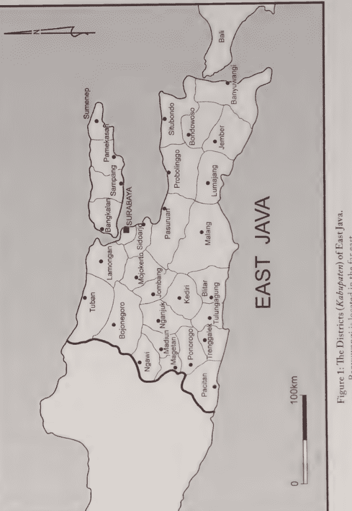
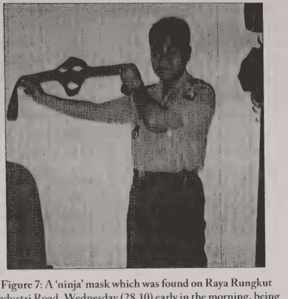
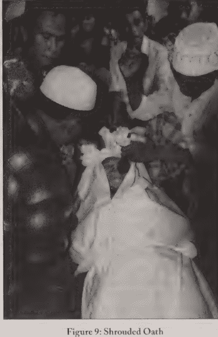

# 猎巫与阴谋：东爪哇的“忍者案”（莫纳什亚洲系列）

## 东爪哇的“忍者案”

尼古拉斯·赫里曼（Nicholas Herriman）


## 东爪哇的“忍者案”

尼古拉斯·赫里曼


《巫猎与阴谋：东爪哇的“忍者案”》作为“莫纳什亚洲系列”的一部分出版。莫纳什亚洲系列包含了一系列对我们理解一个或多个亚洲国家或地区做出重大贡献的作品。构成这一多学科丛书的单部作品是根据其当代相关性挑选的。

莫纳什亚洲研究所的莫纳什亚洲系列取代了莫纳什大学 20 世纪 70 年代初的 MAI 出版社品牌，展示了该大学对亚洲研究的浓厚兴趣和专业知识。

# 莫纳什亚洲系列编辑委员会

- Majka Viciany 教授，亚洲政治经济学，莫纳什亚洲研究所，艺术学院
- Greg Barton 教授，艺术学院政治与社会调查学院
- Gloria Davies 副教授，艺术学院语言、文化与语言学学院
- Julian Miller 博士，艺术学院政治与社会调查学院
- Jagat Ptale 博士，商学院与经济学院管理系
- David 博士，艺术学院哲学、历史与国际研究学院


# 关于作者

尼古拉斯·赫里曼（Nicholas Herriman）是拉托伯大学（La Trobe University）的人类学高级讲师。他在东爪哇的野外调查引起了许多媒体的关注。这本书代表了他在十多年时间里对巫猎的研究成果。

# 致谢

在这一期间，我非常感谢 Habib 博士和 Haji Hatip 的慷慨指导，自己的野外经历要等到 2000 年到 2002 年。

我有时会梦到再次经历这一切：rawon 午餐；祈祷休息；长长的对话与沉默。我体验了另一种生活方式。

野外调查结束后，我很幸运地在 David Boucher 和 Greg Acciaioli 的指导下工作。一切终有时，但他们有理由怀疑这一点，因为直到 2008 年我才毕业。但最终是 Monika 鼓励我完成了论文。她在家乡进行博士野外调查；跟随她回到了澳洲国立大学（ANU），在那里建立了自己的人类学家庭，包括我的岳母 Yunita Winarto，她是印度尼西亚大学的人类学教授。

对于我最珍视的孩子们 Joey、Kiki 和 Miya，我希望我带给他们他们的“迈克爷爷”带给我的那种兴奋和好奇心。

索伦托，2015年7月

## 风格与拼写说明

对于可能涉及定罪信息的地点和姓名，我使用了化名。在我的访谈转录中，有些词汇丢失了，我的线人说话不符合语法且结构生硬，“思维链”在句子中途发生了变化，此类如此。为了最大限度地减少我在解释或歪曲数据方面的作用，我尽可能忠实于充满错误的原文对访谈进行了翻译——尽管这往往缺乏修辞上的美感。我对较长的引用进行了缩进处理，对较短的引用使用双引号，对引用中的引用使用单引号。

对于现代奥辛语（Osing language），根据爪哇语的影响，有两种拼写系统。最一致但较不受流行的一种，例如将英文术语 'hamlet had' 和 'no' 呈现为 'kamituwa' 和 'using'。更流行但一致性较低的则将术语呈现为 'kamituwwo' 和 'osing'。本文采用后者的拼写系统。

在拼写印度尼西亚人名时，我尝试遵循最常用的用法，例如我选择了 'Soekarno' 和 'Ma'oed'，但在引用他人的话时，我会遵循他们使用的拼写。出于文献目的，在字母列表中将使用作者的姓。

为了方便起见，我使用“爆发”（outbreak）一词来描述1998年杀戮频率的增加，但我并不希望暗示这些事件与疾病有相似。为了指代我采访的对象或协助我研究的人，我使用了“线人”（informant）而非“参与者”（participant）。这是为了避免与“参与杀戮”意义上的“参与者”产生混淆。尽管如此，我也希望避免“线人”的负面含义。通过“巫师”（sorcerer）一词，指的是学会了黑魔法能力的人。因此，我使用动词 'ensor' 来指巫师使用魔法。这与“女巫”（witch）一词形成对比，后者指的是具有内在黑魔法能力的人，而我使用的动词 'bewitch' 则指女巫使用黑魔法。

## 前言

1998年，在印度尼西亚爪哇岛东部的望岸，约有100人因巫师而被杀害。杀手是当地居民，他们对自己的行为感到自豪，并得到了其他社区的大力支持。[注：根据上下文，此处文本似乎是破碎的]

这些杀戮——被称为 Peristiwa Banyuwangi（望岸事件）、Kasus Banyuwangi（望岸案件）等——被认为是。[注：此处文本存在大量重复和破碎]

1998年，在印度尼西亚爪哇岛东部的望岸，约有100人因巫师而被杀害。杀手是当地居民，他们对自己的行为感到自豪，并得到了其他社区的大力支持。

与密切参与这一爆发的人进行日常访谈和互动，使得对针对女巫和“巫师”的行为的理解超越了基于书面记录和其他来源获取的理解。至少对于参与者来说，这种背景下对“巫师”的暴力是一种社区正义。1998年，这种社区冲动由于地区和国家事件的反应而升级。

尽管如此，杀戮背后并没有阴谋的这一发现是我研究中最受批评的部分。在研讨会、对话和对我的作品的评论中，一些朋友和同事批评我（“但你真的理解发生了什么吗？”）；另一些人做了不悦的人身攻击（“我希望你意识到听起来有多像（苏哈尔托时代的将军）维多托”）；还有人则诉诸幽默（“哇，你会为此获得武装部队的勋章的”）。大多数这些批评都是出于善意的，不仅反映了大多数认为杀戮背后存在阴谋的观点，也反映了在印度尼西亚，阴谋存在于“异常”的社会、经济、政治尤其是暴力现象之下的假设。

# 巫猎与阴谋

我曾生活过的人怀疑他们的邻居、朋友，甚至家人偷窃，在极端情况下，甚至怀疑他们施巫术。当我自己的财物丢失，或者当我被认为冒犯了某个“巫师”时，我开始意识到自己正无意中卷入、并几乎被带入这个恐惧与怀疑的世界。我生活在一个参与了杀害当地“巫师”的人之中，在几乎每天前往其他村庄的途中遇到过许多这样的人。我早期的实地调查经常被他们讲述的那些不安故事带来的噩梦困扰。在深夜，悠闲地采访一名杀手，喝着他妻子礼貌提供的咖啡，看着天花板上微弱灯泡映亮他的脸庞，以及他点燃的香烟发出的火光——在我惊恐的想象中，幻化出了被欧洲巫猎中燃烧的火炬照亮的男妇女面孔。

随着对这些故事和感受变得习惯，并与那些指控和杀死“巫师”的人变得越来越熟悉，我发现自己很难隔绝那些步步紧逼的道德问题。我交谈过的人既不是特别好也不是特别坏，但据我所知，他们是正常的。然而，他们也是那些将剑刺入“巫师阴道”、将“巫师”拖在卡车后面、或火烧“巫师”的人。此外，他们对自己的所为感到自豪，他们的行为得到了村子里广泛的支持。

在本书中，我反对主流的学术观点，即“杀巫师”事件的爆发源于某种阴谋，或是更大的政治或经济力量。我认为，大政治和经济力量的影响仅体现在它们塑造了朋友、邻居和家人之间的局部互动；我强调了那些很大程度上被忽视的国内因素和当地信仰体系的重要性。

## 序

是十个人杀了他，但整个村子支持了他们。

每个人讲述故事的方式都不同，但对之后几乎所有的内容达成了一致。故事发生在爪哇岛东部的特加加林（Tegalgaring）村。起于萨曼（Saman）从他奶奶哈迪帕（Hadipa）的地上摘了一片椰子叶。椰叶是有价值的。它们可以用于装饰，例如在婚礼上。故事是这样的……

哈迪帕的儿子库斯塔里（Kustari）很不高兴。萨曼是库斯塔里的侄子，他从库斯塔里的亲母哈迪帕那里偷走了叶子！库斯塔里发出威胁：“谁拿了这片叶，很快就会为自己的行为付出代价。”

萨曼去了奶奶哈迪帕那里。他解释自己有权取走椰子叶。他告诉奶奶他不怕库斯塔里。但他确实怕。库斯塔里是个巫师。

随后，萨曼做得太过分。然后他死了。

每个人都认为库斯塔里做得太过分。东西丢了很正常。除此，没人喜欢身边有巫师。如果你冒犯了他们，即使是无意的，最后也可能丢命。

因此，对于穷劳工布纳利（Bunali）来说，在决定为儿子萨曼报仇时聚集支持并不……初，布纳利向萨利米（Salimi）寻求帮助。萨利米曾是个硬汉。布纳利显然给了萨利米一大笔钱请他帮忙杀人。（萨利米声称从未拿过钱，这导致了此后多年的争议。）

他们招募了其他人的帮助。而且正如村子里所有的秘密一样，很快就都知道了……布纳利计划杀死他的妻舅，即库斯塔里。

# 巫猎与阴谋

即使是库斯塔里也意识到自己已成为目标。他随身带着刀防身。他被建议离开村子。但库斯塔里不想走。如果他走了，其他人会认为那是他杀了萨曼的信号。

行动多多是自发的。1998年9月的一个周一晚上，十个人聚在一起了。他们聚集在村子中心通往村外两条道路的交汇处。他们寻找了库斯塔里，但没有找到，于是决定推迟到晚上。

第二天晚上，有几个人无法到。但没关系，另外几个人可以。这次他们一定要抓到他。

他们是一支混合队伍。几个人是农工。另一个是青少年。一个是布哈里（Buhari），萨利米给了他钱。剩下的都是地痞。其中有一个刚从巴厘回来的小偷。两个以酒量大闻名的兄弟也在场。还有一个回家探亲的摩托车贼，需要帮个手。他们都恨巫师。他们都恨库斯塔里。他们喝酒以坚定意志，好让他们能“忘掉自我”。一个人把纱笼（sarong）裹在头上，只露着眼睛，“像忍者一样。”

首先，他们去了村角的一处哨所。在这里，他们招募了邻居家的两个男孩去找库斯塔里。两个男孩带回消息：库斯塔里正坐在赛里（Sairi）家门口，和妻子一起看电视。

杀手们走进黑暗和细雨中。一个人向路上的每栋房子扔了一块石头。这是一个他们应该关灯的信号。灯光一盏接一盏熄灭。小组穿过墓地，绕过房屋侧面。在接近目标的最后几米处，他们贴地爬行。

其中一名攻击者抓住了库斯塔里，并朝马路拖了几米。其他人帮他按倒在地上。另一个人用木棍砸了他的眼睛。他们留下他等死，离开了。消息很快传开库斯塔里死了。一些当地人开始收钱。警察大约一小时后到达，大约9:30。结果发现库斯塔里并没有死，而是伤得很重。去医院的路上车坏了两次。最终，库斯塔里到达医院后去世了。那天晚上，风刮得前所未有。

为什么库斯塔里被杀？为什么在库斯塔里被杀的1998年前，杀死的“巫师”比平时多？我们又如何理解随后的“忍者”杀戮？

## 引言

位于火山群和巴厘海峡之间的是望旺（Banyuwangi），爪哇岛最东端的地区。望旺的乡村维持着一种可以被称为农民社会。主要的族群有奥辛人（Osing，当地人）、马达莱人和爪哇人（移民而来）。这些群体倾向于分开居住：奥辛人住在稻田区，马达莱人住在渔村，爪哇人住在种植园附近。然而，族群之间几乎没有紧张或敌意。他们都相信魔法和巫术。当地居民将主流宗教伊斯兰教与魔法的存在相结合，理由是魔法巫术只有在上帝允许的情况下才会。在我研究的每个村子里，我交谈的人都报告说几个当地人是巫师。



## 引言

在印度尼西亚的不同社会中，都有对所谓的巫师或术士的指控和行动记录。历史证据包括“东南亚现存最古老的法律文本之一”（Hoadley and Hooker 1981:1）。《Agama》——一部产生于16世纪的爪哇语文本——禁止巫术（Hoadley and Hooker 1981:206–207）。此外，一位18世纪末爪哇宫廷士兵的日记记录了一起对巫术的指控（Kumar 1980:72）。然而，基于这些来源无法得出太多结论。

根据印度尼西亚各地记录的 `adat`（习俗）法辩论，涉及的规则允许对巫术士采取报复性行动。19世纪90年代的荷兰学术报告称：

- 在巴巴尔群岛（原文为Barbar archipelago），民众可能会用棍棒打死巫师及其成年的家人。这种行为发生于通过巫术发现该巫师导致了……某些人的……疾病……在加莱拉（Galela）和托贝尔（Tobolese）人之间……巫师被杀死，尸体被抛入大海（Burns 1999:153）。

在荷兰新几内亚，据报道称一名女巫师：

将接受神判审判。通常她是自愿参加的。她会被带到一个特定地点，并被迫喝下某种藤蔓[热带森林中的木质爬缘植物]的汁液。然后她会被要求行走跳舞。接受这种治疗的人中大多数会在一段时间后开始呕吐，这就是有罪的证明。她最终会死亡或被杀。那些没有呕吐或死亡的人被视为无辜（Slaats and Portier 1993:140）。

几位作者还注意到20世纪80年代和90年代爪哇及其他岛屿曾发生过“巫师”的零星杀戮。在东爪哇，Wessing（1996:272n）记录了1990年8月至1993年2月期间发生的30起“涉嫌巫师被杀或受伤的报告”。在爪哇和其他岛屿，Nitibaskara（2001:58–153）在20世纪80年代的报中记录了70多案件。这些攻击似乎在地理位置分散的区域间歇性发生。

相比之下，在某些时期，杀戮在狭小地理区域内发生的频率之高，以至于可以描述为“爆发”。本书中讨论的1998年巴尼乌旺岸（Banyuwangi）爆发事件显然并非孤例。1999年1月至6月期间，西爪哇有55名至150名被认定的巫师被杀（Munir 2001:22; Ricklefs 2001:411; Sidel 2006:142），其中恰米斯（Ciamis）有37名受害者（Sidel 2006:246n.）。随后，在1999年11月至2000年1月，一次小规模爆发导致9人死亡（Herriman 2006b）。同样在西爪哇，7月至10月间，20名被指控为巫医的村民在恰米斯的袭击中被杀（BBC News 2000）。

## 猎巫的阴谋

Sidel（2006:142）认为，苏哈托于1998年辞职后的爆发是“一种新型的大规模集体暴力”。然而，几次暴力爆发早于1998年。受害者包括：1981年詹伯（Jember）的20名假幸存者和罪犯（Barker 1998:17n），1987-1988年期间在北苏门答腊使用恶灵的人（Slaats and Portier 1993:141-2），以及20世纪60年代中期和80年代初巴尼乌旺岸的大量“巫师”（Beatty 1999:77的记录以及当地老人的记忆）。此类证据表明，在独立以后的多年里，杀死“巫师”是一个反复出现的现象。

然而，对这些现象尚少有详细研究。关于1998年的学术研究分别关注了受害者、作者以及更广泛的背景。更多细节请参阅Herriman（2007:68–69）。

## 猎巫阴谋

有时由于身体不好，受访者有时不在家，或者在家里但对杀人事件一所不知；有时司机或研究助理无法到位，或者天气恶劣等。尽管如此，我最终还是进行了150多次采访。

关于这场动乱爆发最准确的记录是一份从地区政府获取的针对“巫师”的暴力行为名单。它显示1998年共有99起杀案：2月1起；7月3起；8月7起；9月达到80起的巅峰；随后在10月回落至8起。利用这份记录，我在每个发生过杀人案的地区至少抽取了一起杀人案。从这些样本中，我对受害者属、目击者和当地官员进行了采访。

我主要通过“滚球法”建立了这群受访者。在完成采访后，根据一位线人提供的联系方式，我利用这些联系进一步拓展人脉。我特别关注的筛选标准是：谁在攻击发生时在场，无论是直接参与还是作为旁观者（尽管在实践中这种区别似乎很模糊）。这意味着要对因杀死“巫师”而入狱的人进行采访，包括他们在狱期间和出狱后。我还采访了被杀“巫师”的家属，以及当地社区领袖，如伊斯兰学者、村镇官员和非正式领袖。

这些信息由当时两份主要的爪哇岛日报——《爪哇波报》（Jawa Pos）和《泗水邮报》（Surabaya Post）的报道补充。我使用了两份来自传统主义伊斯兰组织（NU）的报告，我分别将其翻译为《临时报告》（TPPNU 1998）和《研究结果》（Lakpesdam-NU 1998）。此外，我使用了一份公正党（PK）的报告（Partai Kadilan 1999）。

我研究的目的是理解人们为何被杀害。因此，我专注于通过与当地线人共处，来了解他们对事件的理解，而不是去法院、医院和警察局搜寻官方记录。尽管某些当地社区似乎成功隐瞒了一些杀人案，但大多数都经过了官方记录和处理。尽管如此，此类记录往往难以获得，且有些并不准确或根本不存在。

本书共分为八章。在引言之后，我在第一章中描述了九个代表性的案例研究。这些案例展示了了1998年杀人事件的当地动态。具体而言，是邻居、朋友和家庭成员怀疑其中某人是巫师，然后杀杀了那个人。

## 引言

第二章关注紧随杀人事件爆发的一起事件。传言传遍了东爪哇，称邪恶阴谋者或“忍者”是杀死“巫师”的幕后黑手，而且这些阴谋者或忍者并不是在迫害传统的主义穆斯林多数。尽管没有证据表明此类阴谋者存在，但当地居民建立了路边哨所，警惕地等待、发现、攻击并有时杀掉“忍者”。

接下来的章节将从历史时期、魔术信仰、当地正义观念以及国家级事件的影响等大背景来理解这些案例。因此，第三章概述了印尼改革运动（Reform Movement），这是事件爆发的国家历史背景。我特别关注这一时期印尼的暴力现象。在第四章中，我考察了对魔术和巫术的迷信。在第五章中，我阐了万汶宜（Banyuwangi）杀死“巫师”的行为在社会环境中被理解为一种“社区正义”——因为大多数当地居民实施了他们认为的“正义”。第六章对如998年杀人事件的爆发提供了概述，并说明了促使其发生的当地和国家动态。至关重要的是，当地居民将改革运动解读为国家权力的削弱，并由此获得了杀死“巫师”的机会。

在将杀人事件置于这些大背景之后，我探讨了对杀人事件的竞争性解释。在第七章中，我证明了几种所谓的杀人事件解释理论并未掌握万汶宜的情况，因此缺乏坚实的证据依据。在第八章中，我拒绝了将杀死“巫师”视为阴谋的观点，这种观点主要由东爪哇的两份主要报纸《泗水邮报》和《爪哇波报》以及其他组织的调查任务所追求。有趣的是，必须承认阴谋论的想法确实具有吸引力：我采访过的当地居民仍然信此此。

## 第一章：巫术杀

- 这些信息由当时两份主要的爪哇岛日报——《爪哇波报》（Jawa Pos）和《泗水邮报》（Surabaya Post）的报道补充。
- 我还使用了两份来自传统主义伊斯兰组织（NU）的报告，我分别将其翻译为《临时报告》（TPPNU 1998）和《研究结果》（Lakpesdam-NU 1998）。
- 此外，我使用了一份公正党（PK）的报告（Partai Kadilan 1999）。


我研究的目的是理解人们为何被杀害。因此，我专注于通过与当地线人共处，来了解他们对事件的理解，而不是去法院、医院和警察局搜寻官方记录。尽管某些当地社区似乎成功隐瞒了一些杀人案，但大多数都经过了官方记录和处理。尽管如此，此类记录往往难以获得，且有些并不准确或根本不存在。

本书共分为八章。在引言之后，我在第一章中描述了九个代表性的案例研究。这些案例展示了1998年杀人事件的当地动态。具体而言，是邻居、朋友和家庭成员怀疑其中某人是巫师，然后杀死了那个人。

# 巫猎与阴谋

Haji Habib 感到松了一口气，因为追踪那个杀人村庄“没有受到干扰，警察也没有骚扰”，因此没有提出指控。

## 1998年7月18日：Tegaldlimo 地区

7月的另外两起杀案发生在 Tegaldlimo，该地区比邻巴尼乌旺吉（Banyuwangi）东南部的丛林。这是一个贫瘠的地区，主要是灌溉田、石灰岩地带以及长而笔直、尘土飞扬的道路。人口主要是马达杜拉人和爪哇人，以及少数的 Osing 人族。除了占多数的穆斯林外，这里有规模较大的印度教徒，拥有一座大寺庙。所有这些群体和谐共处。杀案发生在 Kendaljo，它是 Tegaldlimo 七个村庄之一，由爪哇人居住。Paiman 和 Jamirah（或称 Jami）于 7 月 17 日周五午夜左右被杀害。

他们不幸的证据似乎源于与 Paiman 和 Jami 最亲的人：他们的家人和邻居。一些线人并不确定 Bu Jami 是否是女巫，报告说：

> “在她死之前，她的家人中几个人反对她，有一个人生病了，但现在即使在 Bu Jami 被杀后，他们仍然生病……这种病是自然的还是故意的（由‘巫师’诱发的）？直到现在他们还在生病。”

根据邻居的怀疑，Jami 将这种病传给了她的侄女兼邻居 Buariah。作为 Paiman 巫术的受害者，“如果真的出了问题……他的巫术并没有直接针对人类，而是降临在邻居的动物身上（这些动物受了影响）。”“没有人类[受害者]，但有很多牛和水牛，”所以“在他活着时，邻居们就忍无可忍（resab）了。”

线人经常提到在晚上看到 Jami 裸体出现。村长解释道：“Jamirah 每天晚上都[光裸着]。我光着走路遇到过她。”他继续说道：

> “Jamirah 很有名。她被整个村的社区盯上[disorot]为一个巫师[tukang santel]。居民向警察报告了，但巫术[santel]的问题无法通过物理手段和证据来解释。因此警察无法传唤她。整个村的社区不相信她没有害人。最后，她被居民围攻了……居民们举行示威、游行、暴动……所以警察搜查了 Jami 的房子寻找巫术工具，但一无所获。”

## 第一章：巫师之死

社区感到愤怒并结成了一个暴徒，她被暴徒杀害了。

Jami 被木棍和绳子捆着，拖到墓地并埋葬，可能当时还是活着的。传闻她：“她是最难死的……可能她的魔力 `ilmu` 比 Pak Paiman 的还要强。”我的助手会意后回答道：“所以她身体很强吗？”他被纠正了：“不是她的体力。男力和女性的体力之间有很大区别。”隐含的原因是，一个女人只有拥有超自然的力量才可能更难杀死。

其他来源也证实了这一点。NU（一个代表传统伊斯兰观的印度尼西亚宗教组织）在书中会被频繁提到。它向巴尼乌旺吉派遣了事实调查小组。该小组报告说：

> 指控为巫师的谋杀案在几个案件中均可见。Paiman、Eplok 以及巴尼乌旺吉 Tegaldimo 地区 Kendal Rejo 的居民 Ny Djamariah 属于其中之一。社区对上述两个受害者的确定是基于 Kedungsari 和 Kedungwungu 村落居民的叙述，这些村落靠近受害者所在的 Kendalsari 村。[这些居民]相信两名受害者都拥有巫术。上述两个村落的社区经常看到这两个受害者在每个周四晚上外出[那是增强力量的时间]。根据证词，他们都正前往 Kutorejo 公共墓[墓地是 Kendal Rejo 村村长的理想地点]。根据 1992 年的信息，两名受害者都被邻近村的居民赶出了家园。尽管在 1995 年，他们又回了 Kendal Rejo 村（Lakpesdam-NU 1998:15）。

小组认为此案是独特的，而在其他杀案中，受害者是因为政治原因被选中的。然而，我的数据表明，Jami 和 Paiman 之死是典型的，因为他们的邻居、家人和朋友怀疑他们是巫师，并出于这种怀疑杀死了他们。

尽管受害者恰好是穆斯林，但杀手中既有穆斯林也有印度教徒。杀案发生后，四人被捕，但其他许多人逃了，因为人数太多，未能确认身份。

## 巫猎阴谋

四人因杀害 Paiman 被判处六年监禁，其中一人因杀害 Jami 又被判处六年。这些判决在上诉无果后维持原判，且前四人的刑期被加长（Manan, et al. 2001:Appendix V）。这仅仅是审理的一百多案件中的第二个，而且这些早期的判决相对严厉；在后来的案件中，刑期通常为一到三年。

## 1998年8月3日：Kabat 地区

下一次记录的杀案发生在 8 月 3 日的 Kabat 地区。

## 1998年9月10日：斯罗诺区（Srono Subdistrict）

Basir 和 Haeriyah 是一对居住在斯罗诺区 Pon 村的夫妇。根据 Haeriyah 表姐/妹的说法，这对夫妇从邻村的一位老巫术士那里学了巫术；Haeriyah 拥有可以杀人的巫术，而 Basir 的巫术只能杀死像水牛这样的动物。我听说是，Haeriyah 曾找一个邻居买一个牛饲槽，当对方拒绝后，那个邻居就生病了。另一个说法是 Haeriyah 经常在深夜烘烤东西——这是拥有巫术的明显证据。Basir 的兄弟提到，问题出在 Haeriyah 身上，而不是 Basir。然而，Basir 的侄子并不愿意透露他的叔叔是否是一个巫师。尽管如此，Basir 还被指控在警察局拍了照片。此外，一名警察建议 Basir 的兄弟指示 Basir 离开 Paiton，尽管 Basir 并不愿听从这一建议。

因杀人被入狱的人之一 Imron 告诉我说：

> “多年来，Haeriyah 一直被指控施巫。很多人病了，他们证实了 Haeriyah 拥有巫术。社区里大家都是这么说的。最后，发生了那场屠杀[pembantaian]。”

这场“屠杀”并不是第一个采取的措施。

## 1998年9月15日：罗贾米区（Rogojampi）

Idris 提到，Yasin 的家周围 400 米处……巫术。他拥有巫术。

这也是针对 Ayin 施展的巫术背后的原因。官员命令他们两人治好 Ayin 的疾病。当时，已经聚集了大量群众，互相敦促要杀掉那些“巫师”，但 Arifin 和 Haji Hosin 在那一刻逃过一劫。

杀害 Arifin 似乎是经过良好组织的。而且手段特别残忍。Sebob 的当地人互相敦促“加入”。拒绝参与被认为是不可接受的。Gufron 说，那些在煽动中表现更活跃的人被认为是“煽动者”（propokator）。《爪哇波斯报》（1998年10月13日）将这些杀手描绘为一群匿名的“疯狂的猎巫狂人暴徒”。同一份报纸（1998年9月27日）报道称，尸体上刻有一个十字架。然而，作案者并没有赋予这种标记（仪式性的、神秘的或其他）太大的意义，而是认为这是在暴力发生期间偶然发生的，就像据报道他的一条腿从身体上切断的一样。当我问起为什么要割掉十字架时，Gufron 报告说：

> 他被毁了，[杀戮的情绪被认为是一种疾病。无论你想做什么，都由你决定……因为 tukang santet（巫师）在这个村子里被视为疾病。这种情绪的产生是因为我们觉得我们在清除病菌。如果我们让事情继续下去，会有更多人死亡。

这种情绪可能解释了为什么许多其他“巫师”在袭击中被当地居民残害（无论生前还是死后）。在同一晚，同一群人继续去杀害另一名被指控的巫师 Mahfud，同样的暴力也降临在他身上；“他的器官[阴囊]被拉扯直到两个睾丸被撕掉。”Haji Hosin 显然已经离开了村庄，据称是由于杀戮蔓延。根据一位 Sebogang 居民和《爪哇波斯报》（1998年9月27日）的文章，Jum 怀疑自己成了目标，因此他试图逃到另一个村庄。然而，他被发现并带回 Sebogang 并在那里被杀死。

Gufron 证词了 Aliyan 一场杀戮（警察显然释放了某个“巫师”的杀手）对这三次袭击的影响，他讲述道：

> 首先在 Aliyan 发生了一场杀戮。重点在于，我们可以自由地杀掉巫师，只要他们真的是巫师。我们这里的杀戮已经接近尾声。没有经过任何商量，我们立刻团结在了一起。

## 第1章：猎杀巫师

在与村庄高层讨论后，警方逮捕了多名嫌疑人。与其他村庄一样，这里没有进行法医或犯罪学调查。一位村官告诉我，巫师的家属对杀手并没有怨恨。Gufron 还提到，如果非要说的话，他们对杀手非常感激。

## 1998年9月22日：Giri 区

Penataban 村正式被归类为农村，但实际上是包含万尼旺岸市（Banyuwangi City）的大城市区域的一部分。1998年有三人遭到袭击：Padil，已去世；Humaidi，幸存并搬到了巴厘岛；Nasir 被送往医院，最终（显然）因受到的伤势去世。《泗水邮报》周二版（1998年9月22日）称，袭击发生在周二早上早些时候（如果属实，这意味着新闻发布得非常快）。

除了这篇文章，我的来源是一个名叫 Mukhlis 的当地居民，以及两个名叫 Supriadi 和 Haris 的男人，我在他们因杀害 Padil 入狱期间采访了他们。Supriadi 解释说他被判了九年：为了 Padil 两年半，为了 Nasir 两年半，为了袭击 Humaidi 两年半（Mukhlis 面临的“问题”是 Humaidi 活了下来并可以对 Supriadi 作证）。Haris 表示，Padil 和 Nasir 都怕他（因为他知道他们的行径和行为）。所有三位受访者 Mukhlis、Supriadi 和 Haris 都解释说，这三名受害者被怀疑有巫术，且三个人都感觉到当局（aparat）支持这种杀戮。

至于 Padil 是否是巫师，Mukhlis 说道：

> 是的，很多人[知道]，这这里的社区都知道。Padil 死后，他们就不再生病了。无烟之处必有火。这个指控非常准确。[如果]他没有[施巫术]，他就不会[被指控]。他从20世纪60年代起就被公认为巫师。他说 Padil 家的人曾遭受过“奇怪的疾病”。

如果人们向他要水，他们就会痊愈。Padil 显然对他的侄子 Ravi' 施了咒。至于 Humaidi，Mukhlis 只是说 Humaidi 与一位办公室同事发生争执，随后那位同事出现了腹部肿大。同事向 Humaidi 道歉，但随后去世了。根据 Haris 的说法，Nasir 从1955年起就被认为是巫师。

## 猎巫与阴谋

三名受害者在同一晚遭到袭击。根据 Mukhlis 的说法，这最初是通过口口相传（`dari mulut-mulut`）安排的。杀手小组由二十五人组成，其中六个人戴着忍者式的围巾，但在每个案例中，“那些离[受害者房子]近的人支持”杀戮。Nasir 和 Padil 一样被拖在马路上。Humaidi 的头被一个巨大的木柱砸开了。那些人还打算杀死另一个“巫师”Sukardi，但他逃脱了。

## 1998年9月27日：Wongsorejo

在 Wongsorejo 杀害 Syafi'i（警察显然释放了某个“巫师”的杀手）表明，Wongsorejo 大部分人口是达达人。Gufron 证词了 Aliyan 一场杀戮（警察显然释放了某个“巫师”的杀手）对这三次袭击的影响。

（注：提供的文本包含重叠和重复的 OCR 源片段；以上是根据提供的页面重构的流程）。

另一位被禁者 Matari 是一个小罪犯（preman），但众所周知他对杀人案是无辜的。Muadnan 声称，尽管 Matari 计划杀死 Syafii，但 Muadnan “先一步”接触了 Syafii。尽管 Matari 错过了提升声誉的机会，但他显然继续吹嘘自己参与了其中。因此，对于警察来说（由于他们显然更关心维持行动成功的表象，而不在乎谁是真正的凶手），Matari 变成了一个容易对付的目标。与参与杀人案相关的自豪感在许多其他案件中显而易见。

## 1998年9月：Sanggon 乡

来自 Sumberbulu 村 Siberag 组（subvillage）的 Hasan（也称为 Nipan 和 Hasan Hanipin）于 9 月被杀。我未能确定确切日期。来自 Sumberbulu 村的另外两个巫师也被杀害——Umi 和 Paiman。

怀疑的起源似乎是一场纠纷。一只属于 Ramelan 一家的鸡闯入 Hasan 的稻田并开始挖掘。Hasan 向那只鸡扔了三块石头。这一行动似乎激怒了 Ramelan 一家的成员，他们当时袭击了 Hasan。一段时间后，Ramelan 死亡，人们似乎怀疑是巫术，但并不是每个人都这么想。

四名杀手之一的回忆道，Sunanyo 雇佣了杀手 Briowo，Briowo 邀请了 Misful 和另外两人。他们在中午时分在稻田里发现了 Hasan：

> 当他正在稻田耕作时，我去找他问：“你会巫术吗？”他生气了，于是我打了他。他倒在田里，我的朋友也赶过来开始殴打他。我们对这样还并不满意（`puas`），于是把他吊在了一棵椰子树上。

Hasan 案是一个特例。首先，我发现有一位幸存者深受这场杀人案的影响。在研究期间，我遇到的绝大多数家庭成员都表示顺从和接受，有些人甚至同意或参与了杀戮。其次，当地社区对于受害者是否是巫师显然存在分歧。《Jarwa Pos》（报（1998年10月11日）报道了这一点，我的研究也支持了这一点。Hasan 的儿子否认父亲是巫师。组长也没有准备好给出定论。另一位当地居民（邻居或组长）表示，“信息在社区中传得很开（`informasi ramai sama masyarakat`）”。社区指责他拥有巫术”。无论如何，某些邻居确实怀疑他有巫术，甚至有人组织了杀手杀掉他。

这种雇佣杀手的方法也是特例。这是少数从远远村庄雇佣杀手的案例之一。在其他一些案件中，当地居民出资支付给领导杀戮的人，或者他们被捕，但杀手都是当地人，报酬并不是参与的先决条件，而是感激的表示或团结的表达。

这些因素似乎解释了为什么 Hasan 的死法与邻居、家人和朋友杀死他们怀疑为巫师的同村人的模式有所不同。除了 Hasan 案外，在我研究期间学习的所有案例中，我发现 1998 年的杀戮中，被指控的受害者显然被大多数当地居民认为是“巫师”。

本章涉及的杀戮案指向了杀戮的当地动态。在所有案件中，邻居、家人和/或朋友在识别和杀死嫌疑人方面发挥了作用。在所有案件中，除 Hasan 案外，杀手的行为都得到了广泛的支持。即使在 Hasan 这个特例中，似乎社区的某些部分也支持这一行动。万尼旺岸对“巫师”的杀戮在 10 月初突然停止，取而代之的是（至少在信息人的记忆中是被取代了）“忍者恐惧”。

# 忍者恐惧

> “匪患”……正在武装掠夺乡村并破坏农民的财产…………传言传开了……并……煽动了农村人口。于是农民武装起来等待入侵者。但那些作为恐慌和兴奋想象产物的“匪患”并未出现。
>
> —— George Rude，《历史中的群众》

对“巫师”的杀戮大多局限在万尼旺岸（Banyuwangi）县。正如上一章解释，当地居民针对的是他们认为是巫师的其中一人。媒体几乎没有提到这些对巫师的杀戮，就好像它们没有发生过一样。然而，一旦杀戮平息，邻居的闲言和报纸关于杀害巫师的报道相结合，为这个故事又创造了一个血腥的章节。

传言说戴着面具的“忍者”是暴力事件的后，他们开始在东爪攻击无辜。事实上，这种观点也出现在新闻中（大多发表于 10 月和 11 月）。相信传言的，整个东爪的当地居民建立了路障作为哨兵，并攻击甚至杀害怀疑是忍者的人。这一传言似乎通过面对面的交流传播到了异常广泛的地区。然而，广播和出版媒体也对传言的产生和传播做出了贡献。

## 阴谋论

关于杀戮案的阴谋论主导了东爪西两份主要的印尼语日报：《Jawa Pos》和《Surabaya Post》。它们在爪哇西的发行量最大，几乎没有外部竞争。

- Thufail (2005) 分析了总部位于雅加达和新加坡的英文报中的忍者故事和阴谋论。这些在爪哇西几乎没有发行。

## 忍者传言

曾一度，最引人入胜的阴谋论是由忍者发起的，他们还针对传统派穆斯林及其领袖。1998 年 10 月，在杀害巫师平息后，这一想法似乎很快传遍了万尼旺岸，然后是整个爪哇。黑衣杀手团在乡村游荡的传言引发了恐慌。由于害怕“忍者”，当地社区在村庄和城市部署哨兵。“忍者”被寻找、捕获甚至杀死。在我的信息人的回忆中，尽管这段时间的死亡人数较少，但作为一种普遍恐惧的来源，这些事件掩盖了对巫师的杀戮，导致巫师之死被记忆为“忍者时期”（waktu ninja）的一部分。


# 第二章：忍者的恐惧

报纸提供了忍者传言是如何发展的感觉。在 9 月，文章提到类忍者的凶手对杀害巫师的行为负责。在《Surabaya Post》中，凶手“伪装成忍者”（1998年9月17日 *Ditudub Jadi*）；他们“戴着忍者式的面具”（1998年9月27日 *Itsu Santi*）；并在《Jawa Pos》中“穿着忍者式的服装”（1998年10月10日 *Bupati Banyuwangi Ditudub*）。

- 3


图 3：当地守卫在爪伯（Jember）搜查经过的车辆寻找“忍者”。

注意前景中男子左手拿着的小刀（clurit）。

同样注意他的装扮风格，这与武术有关。

*苏水巴邮报，1998年10月13日。*

犯罪分子是忍者。《爪哇邮报》（Jawa Pos，1998年10月15日“NU Satukan”）报道了“忍者的屠杀与恐怖”。根据《苏水巴邮报》（1998年11月30日《Tim NU Serabkan》），到11月底，关于“忍者”的所有证据已被揭开。

忍者的传言与阴谋论相结合，这种理论认为在前一章介绍的传统主义伊斯兰组织——纳哈达拉（NU）正成为目标。纳哈达拉的评论员在《爪哇邮报》（1998年10月8日“Pembantaian Dukun...”）上声称，“忍者”正针对传统主义穆斯林以及他们的宗教导师（guru ngaji）和教长（kiai）。这一理论迅速发展。整个爪哇的穆斯林领袖报告遭到死亡威胁（1998年10月22日“Ulama Magetan”）、开车时被跟踪（例如，1998年10月16日“Teror Kiai”）或接到电话威胁。“神秘”或身份不明的人接近伊斯兰学校委员会或询问当地教长的情况（1998年10月17日“Diduga Ninja”）。

忍者通常被认为拥有神力或超能力。《苏水巴邮报》报道了一些“忍者”被目击后消失在虚空中的案例（1998年10月13日“Ninja Teror”；1998年10月15日“Geropok Ninja”；1998年10月20日“Ninja Tembakkan”；1998年10月21日“Polda Amankan”），戴着面具后消失（1998年10月14日“Warga Berjaya”），以及跳入排水沟后消失（1998年10月16日“Gara-gara Isu”），以及在香蕉树后消失（1998年10月13日“Dikira Ninja”）。焦虑的当地居民随后毁掉了这些树（1998年10月16日“Gara-gara Isu”；1998年10月16日“Teror Kiai”）。而且，在其中一个案例中，在之后

“忍者”变成了一只猫，猫被杀死了（1998年10月16日“Gara-gara Issu”^4

也许最完整的故事出现在《苏水巴邮报》（1998年10月17日“Dari Issu”）中，可以总结如下：

某所伊斯兰寄宿学校的人看到两个忍者在快跑并提着链子。两名人力车夫[tukang becak]也看到两个忍者跳到寄宿学校后方的商店屋顶上。寄宿学校的小孩子们看到两个似乎在瓦片上飞行的身影[sosok]。寄宿学校的一位管理员[pengasuh pondok]看到忍者通过在人与人之间以及树顶跳跃来戏弄学生。随后忍者似乎贴在一棵树上，然后消失了。学生和当地居民袭击了树木和香蕉树。警察被叫来，由于找不到忍者，他们发射了警告射.^2 警察离开后，忍者再次出现。学生们成功将他们逼入角落，随后他们贴在墙上并再次消失。当地市民和学生围住了墙壁。触摸墙壁后，两名学生陷入了恍惚状态，仿佛被电击了一样。（图 4）。

尽管他们拥有隐身和不死的能力，但在几乎所有情况下，“忍者”都没有在身体上攻击宗教领袖。少数声称遭受过攻击的宗教领袖也声称成功地了了自己，这暗示他们拥有比赋予“忍者”的更强大的（超自然）力量（1998年10月10日“Jember Mencekam”；1998年10月18日“Guru Ngaji”）。然而，在所有这些情况下，“忍者”都没有留下任何“攻击”的痕迹或证据，或者证据被警察驳回了.^6

当地居民整夜警觉地守护他们的村庄和教长（1998年10月3日“Seorang Lagi”；1998年10月11日“Massa Bunuh”；1998年10月16日“Gara-gara Ninja”；1998年10月17日“Diduga Ninja”）。根据《爪哇邮报》（1998年10月1日“Pangdam Minta”），这种加强的监控得到了政府官员的支持，包括东爪哇军事司令部和纳哈达拉领导层，根据……

+   4 George (2004:39) 描述了苏拉威锡的一个案例，其中两个拥有“精神力量”的男人据说“能够飞到清真寺屋顶顶部”。

5 Retaks (2006:60) 避免判断忍者是否存在，但指出“国家没有提供适当的认可，或者说没有提供保护”（2006:65）。

6 参见[缺失引用]。

# 巫猎与阴谋


图 4：忍者的证据

这张照片于1998年10月14日出现在《苏水巴邮报》。配文描述了墙。《苏水巴邮报》，1998年10月14

似乎被警觉的当地居民杀死的“忍者”是陌生人。《爪哇邮报》（Jawa Pos，1998年10月13日“Dua Korban”）报道巴隆洛村的两个陌生人被带到了村堂（balai desa）。在那里扣留期间，关于这两个是忍者的传言流传并加剧。当地居民最终袭击了村堂并打死了那两人。

## 第二章：忍者的恐惧


图 5：一名教长正在质问在卡里帕雷（Kalipare）被捕的涉嫌忍者的人。

这张照片描绘了一个满脸血迹的被控制男子。看起来桌子上摆放了一个饮料和一盘食物。

苏水巴邮报，1998年10月20日

曾几何时刻一名“忍者”在马兰县图伦县被杀死并斩首（1998年10月19日“Massa Makin”）。随后，大型摩托车“车队”袭击了马兰的几个地区。该车队的54名男子随后于10月19日被捕（1998年10月20日“54 Tersangka”）（图 6）。似乎受害者是 Zaenal Arifin，他来自马兰市并患有精神疾病（sakit ingatan）（1998年11月12日“BAP Pembantai”；1998年10月21日“Pembawa Kelapa，1998年10月23日“Algojo 'Ninja’”；以及1998年10月29日“Tim Kejari”）。到10月22日，马兰县警方已确认了25名因涉嫌是忍者而被杀或受害的人员（1998年10月22日“Daftar Korban”）。

# 巫猎与阴谋


*《泗水邮报》（Surabaya Post），1998年10月20日。*

其他陌生人似乎是在路边哨所被拦截并被要求提供身份证明的旅行者。如果他们未能提供官方文件，就会受到怀疑。《泗水邮报》（1998年“三个疯子的命运”/'Nasib Tiga Gila'）也报道称，乞丐（*pengemis*）和流浪工人被误认为是忍者。

许多“忍者”后来被家属或当局确认为是精神病人（1998年10月20日“疯狂忍者”；1998年10月24日“警察局警员”/Piskiatier Polda；1998年10月29日“忍者身份澄清”/Ninja Diklarifikasi；1998年10月29日“病人涌入”/Dibanjiri Pasien；以及1998年10月30日“多达30”/Sebanyak 30）。在东爪哇，精神病人流浪汉（*wong gembel*）是一种常见的现象，尽管他们可能会被嘲笑或戏，但他们的出现很少受到质疑。当忍者传言传开时，一些当地居民认为“忍者”已经变成了疯子。当地守卫认为他们正在攻击忍者，而警察和受害者家属认为是守卫杀杀了患病的流浪者。惊讶的是，在《泗水邮报》（1998年10月22日“格西克的班塞尔”/Banser Gresik）中，一位NU武装组织（Banser）领似乎暗示受害者并不是忍者。他暗示警察和政府搜集病人是为了*避免因误捕而导致无意义的杀戮或袭击。*

许多警察局发生了搜查。《泗水邮报》（1998年10月14日b）报道说，格伦莫尔区警察局也遭到了示威，因为当地居民想要接触被认为在警察局内并受警察保护的“忍者”。

## 第二章：忍者的恐惧



《泗水邮报》（1998年10月21日）还报道说，泗的穆斯林教士警告警察不要释放“忍者”，如果他们被释放，一旦区警察局被焚，穆斯林教士将承担责任。

正如保罗·科恩（Paul Cohen, 1997:151）指出的，在面对矛盾证据时，传言依然存在。面对许多受害者是精神病人的证据时，另一种阴谋论出现了：当精神病人被捕时，会有其他神秘特人赶来并保护他们，正是这些神秘特人计划攻击宗教导师（kiai）。另一个进一步渲染的版本是尸体是由神秘特人“丢弃”的（1998年10月20日“是谁……”/Siapa yang..）。或者在另一个版本中，人们捕获并移交给警察的忍者被调换成了精神病人。最后，在《泗水邮报》（1998年12月9日“苏里亚哈提布”/Khatib Suriyah）中，NU认为忍者的手段本身就是一种恐吓NU的尝试。

尽管规模小得多，但1998年的忍者杀人案与1965–1966年印度尼的共产主义者大屠杀有相似之处，在那场屠杀中，数十万所谓的党员或同情者被杀害（George 2004; Retsikas 2006）。据传共产党曾发起了一场血腥政变。在据指的种种罪行中，该党妇女组织的成员据称曾在1965年9月30日晚上在被杀害的将军尸体旁裸体舞蹈。这些传言也部分归因于反共产主义报纸，它们发表了关于“堕落”的描述（Langenberg 1990:47）。George（2004）发现，传言在两种情况下都是*基础性*的。

## 巫猎阴谋

### 具有可信度的阴谋论

阴谋论之所以获得额外的可信度，是因为军队、警察和政治领袖支持了它们。东爪哇指挥官暗示，那些因杀害“巫师”被捕的人是根据更高权威的指示行动的。他表示有必要“斩首不捉尾”（1998年10月24日《司令官：……》/Pangdam: Yang），并且阴谋者正在东爪哇进行实验，并打算在其他地方使用这些技术（1998年10月27日“巫术传闻”/Isu Santel）。类似的观点被归于东爪哇警察局长（1998年10月10日“劫掠后”/Stelah Penjarahan）、东爪哇州长（1998年10月22日“我确定”/Saya Yakin）以及一位国家部长（1998年10月15日“政治与安全部长”/Menko Polkam）。我遇到的几乎所有官员，包括警察、军队和政府官员，都同意存在阴谋。

来自军队、警察和行政部门等的发言人似乎在指责政府的其他分支。例如，在《爪哇报》的一篇文章（1998年10月8日“‘巫师……’屠杀……”/Pembantaian 'Dukun...'）中，东爪哇州长：[文本省略]

# 第二章：忍者恐惧

“捍卫真理”（“memela yang benar”）的声誉可能在这件事中赋予了它一种权威的话语权。

在苏新秩序时期被边缘化后，伍洛纳玛（NU）是由于选举即至而争夺新权力位置的众多组织之一。事实上，伍洛纳玛的政治侧翼 PKB 在 1999 年的选举中在爪哇东和全国范围内都获得了大量的选票。根据媒体报道，伍洛纳玛本身可能参与了传言的传播，如果不是说其编造的话。Bubandt (2008:808) 将古斯杜（Gus Dur）称为“阴谋论的安卓机器人贩子”，他将此类理论作为“政治武器”。这并不是该组织有意识地策划了忍者的结论；我们最多能断定的是伍洛纳玛组织为传言的可信度贡献了力量。

媒体的运作在这方面同样重要。《爪哇邮报》（Jawa Pos）和《泗水邮报》（Surabaya Post）的文章几乎完全来自评论员。记者和编辑很少进行自己的研究或核实评论员的意见。或者，似乎他们被期望这样做此。正如我所展示的，评论员大多推崇宏大的理论。在关于这一主题的数百篇文章中，我只发现了少数几篇发表非阴谋论观点的文章。

编辑和记者的稀有意见是模棱两可的：一方面，他们报道忍者的存在是一个传言（并未试图证实其真实性）；另一方面，另一些人写得就像事实一样。标题甚至比文章内容更加直白地富有色彩。一篇典型的具有煽性的《泗水邮报》（1998年10月22日“五名忍者”）标题宣布“五名忍者将因触犯犯罪被起诉（Lima Ninja Akan Ditidakan）”。文章内容记录，警方已确认五名男子为流浪者，并打算将他们交给社会事务。

然而，重要的问题不在于写了什么，而在于读者如何反应。这种反应会被一种怀疑态度所调节，这种态度在一个情人的意见中得到了恰当的：“至于《爪哇邮报》，你们看”

- 8 例如，在《泗水邮报》（1998年10月15日“Sutarnas Menyelamatkan”）中，爪哇东省议会的发言人目击了阴谋论；而在《爪哇邮报》（1998年10月18日“Gus Dur: Dalang”）中，人权委员会的成员声称当地人（而非外地人）承认是杀死“巫”的人。这些都是例外。

- 9 在第二次世界大战期间，有人流传俄罗斯援军带着“脚上的雪”经过了英国，德国人在柏林使用一名活着的祭司作为教堂牧师。Taylor (1966:57) 将这些传言中的一些归于“拥有更好素材的天才记者”的捏造，但“大多数源于对战争就是那样的普遍信念”。

## 巫猎与阴谋

某些东西可能有助于解释并称之为白色。[他们所写的内容中]甚至没有一半真实发生。尽管如此，宣称这种怀疑态度是一回事，而付诸实践则是另一回事。

“忍者”可能出于不同的原因而具有可信度。这一时期，印尼军队成员等据传在某些行动中伪装成忍者（Aditjondro 2000; Kammen 2001:167–168, 172）。此外，“忍者”也符合预先的观念，因为爪哇东部的人相信超自然力量，如精灵和巫师。将忍者描绘成致命杀手的电影和电视节目也助了这一形象。¹⁰

这些因素可能有助于解释我发现的一个矛盾。当地线人知道杀死当地“巫”的杀手，是因为这些杀手是其他当地居民，但同样的线人又在其他村庄的杀戮背后看到了阴谋。许多人没有为阴谋的存在提供任何理由，无论表面上是否有效。其他人，像马哈穆德（Mahmud）那样与当地居民一起，在没有“外部干扰”的情况下，杀杀了来自瓦图博（Watukebo）的雅辛（如第一章所述）。他和其他杀手在袭击了一个据称杀过人的“巫”的村庄后被捕。此外，警察和法官说那个“巫”雅辛是一位教父（kiai）。对于马哈穆德来说，这是“这一切都是警察策划的”的证据。苏普里迪曾因在 Giring 袭击 Padil、Humaidi 和 Nasir 而入狱。尽管他知道只有当地人参与了他所承认实施的袭击，但苏普里迪告诉我“我的惩罚 [hukuman] 是军方/警察策划的结果。”

其他线人提供了道言证词。例如，邻近村庄的村长提到，当地居民“认为军队参与了[在 Tegalgaring 杀害‘巫’的事件]”，那里曾是我的实地调查地点。事实上，Tegalgaring 的杀手都是根据自己的意愿的当地人。我问苏普里迪：“武装力量是这[爆发]的幕后吗？”他回答说：“我从监狱里知道有坏人（oknum）参与了。”

也许在传言发展过程中发挥最重要的作用的是爪哇东部的普通人。他们是那些害怕忍者到来，而在当地道路和小径上设立守哨点，声称看到甚至被这些忍者“恐扰”（diteror）过的人。

- 10 Bubandt (2008:806) 记录道，在北马鲁库对具有魔法能力的煽动者存在广泛恐惧。此外，传闻荷兰马鲁库人的杀手队会在深夜抵达，并在黎明前……神秘地消失……(2008:808)。

# 第二章：忍者恐惧

此类主张通常缺乏可信度，但也许不是因为逻辑不同，而是因为此类主张的可接受性。否定忍者的真实性就是站在忍者的一边。

### 传言：大众媒体与口口相

显然，这些传言的传播可以用媒体与当地网络——八卦和传言之间的互动来解释。这些传言的一个迷人特征是，怀疑指向了政府、精英和武装力量。

¹¹ 确认威胁真实的压力在麦卡锡时代显而易见，当时任何“批评麦卡锡的新闻都可能让作者面临指控”（Cardozo 1990:474）。

# 第三章：改革、政权更迭与暴力

## 改革

1998 年对“巫”和“忍者”的杀戮必须在印尼改革（Reformasi）的背景下理解。“Reformasi”此前被翻译为“改革运动”，指的是 1998 年 5 月苏哈托倒台之前及之后的时期。关于改革究竟何时开始或结束，并没有学术共识，但我将其设定为 1996–1999 年的时期。

在改革之前的近三十年里，苏哈托一直是印尼执政政权的首脑。他曾在 1945-1949 年间反对荷兰人，并在印尼第一任总统苏加诺的时期在军队中晋升。然而，在军高层中，他并不突出。但是，在 1967 年，他成为了印尼总统。这发生在 1965 年一场明显的政变尝试引发的混乱以及随后的共产主义者大屠杀之后，导致数十死亡。

苏哈托政权——自称为“新秩序”（Orde Baru）——继续扩张权力。与其军队随者一起，苏哈托在屠杀共产主义者方面发挥了领导作用。随后，他使用暴力镇压的行为在镇压亚齐省的分离分子、建立和维护东帝主权、镇压活动人士、激进穆斯林分子、学生和工会领袖，以及打击抗议者（如 1984 年的丹绒普里约大屠杀）中显而易见。

政权还试图通过严格控制的选举来建立其合法性。从 20 世纪 70 年代开始，选举限于三个党——政权的选举工具 Golkar（它总是获胜）、一个伊斯兰党 PPP 和一个“民族主义”党 PDI。 1993 年，梅加瓦蒂（Megawati）作为……

# 第三章：改革、政权更迭与暴力

苏哈托的前任者苏加诺被选为印尼民主党（PDI）的主席。她成为了对苏哈托政权不满情绪的象征，并日益威胁要将 PDI 变成一个真正的反对党。苏哈托随后试图通过任命一个傀儡为 PDI 主席来推翻她的地位，但梅瓦维蒂的支持者拒绝放弃对政党的控制，并占领了位于雅加达的党总部。人们广泛认同，苏哈托煽动了那场暴力袭击，最终将他们赶走，并让那个傀儡实际上当了 PDI 的领导人。据信，袭击者本身是士兵和暴徒（preman）。在雅加达，袭击发生后随后了几日的暴乱。为了方便起见，我们可以规定，这些1996年的事件标志着“改革时代”（Reformasi）的开始。


# 第三章：改革、政权更迭与暴力

当年，其他重要情况也增加了对该政权的压力。其中之一是新国家汽车项目（`mobnas`）的丑闻。该项目由苏哈托的儿子托米领导，旨在最终开发印尼汽车；然而，第一个型号是在印尼境外设计建造的，尽管使用了印尼劳动力。在国际上，印尼的地位也因将1996年诺贝尔和平奖授予两位东帝汶活动家——贝洛主教和何塞·拉莫斯·霍尔塔而遭受了负面影响。诺贝尔委员会（`nobelprize.org 1996`）指出，由于印尼占领了东帝汶，“估计东帝汶三分之一的人死于饥荒、瘟疫、战争和恐怖”。

然而，如果苏哈托政权内部正酝酿着危机，这在民意调查中并没有反映出来。诚然，1997年选举竞选期间确实充满了暴力（`Cribb 2002:524`），比通常的印尼选举活动更为激烈。尽管如此，哥卡卡党以其获得以来最高的得票率再次当选。真正为“改革”提供动力的是1997年的货币危机（`krismon` 或 `krisis mon`）。

货币危机是全亚洲经济危机的一部分，尽管人们广泛认为印尼受到的打击最重。国家货币大幅贬值。当危机在1997年7月开始时，卢比汇率约为每美元2,500卢比。到1998年1月，它已跌至每美元17,000卢比。如GDP、通货膨胀和股市价格等其他经济指标也表明经济表现糟糕。由于经济低迷，“该国的每一家现代企业都破产了，闲散者的储蓄被清空，数百万工人失了业”（`Ricklefs 2001:404`）。“九大生活必需”（大米、食用油等）的价格飙升。

## 巫猎与阴谋

因此，在1997年10月，该政权转向了国际货币基金组织（`IMF`）。作为获得约100亿美元贷款的回报，`IMF`要求宏观经济改革。它还要求“大幅限制苏哈托家族及其朋友所享有的特权，并减少在作为赞助关系重要来源领域的政府开支”（`Cribb 2002:525`）。显然，健康状况恶化的苏哈托对推行改革态度模糊，特别是在涉及其家族企业时。谈判“得到的回复是关闭16家银行”，“引发了对国内私人银行的挤兑”（`Bird 1999:27`）。更令人幻灭的是，苏哈托在1998年1月提出的乐观年度预算对于日益不满的印尼人来说脱离现实。`IMF`加大了压力。当苏哈托被拍摄签署写给`IMF`的“意向书”时，`IMF`负责人站在一旁双臂交叉胸前，这导致了更多的羞辱。这种肢体语言是清晰且强烈的。所要求的改革将瘫痪苏哈托政权的运作模式。

农业部门的问题加剧了这种局面。1998年与厄尔尼诺现象相关的降雨减少导致大米产量下降10%，其他产品也遭到了负面影响。经济的恶化引发了合法性危机。苏哈托政权被认为违背了与自己的约定——以限制政治权利换取经济改善。反对派领袖如现代派穆斯林阿米恩·莱斯、伍拉乌玛（`NU`）负责人古斯·杜尔和梅瓦维蒂开始表达他们的批评。

对“改革”的要求不断增加。正如`Cribb`所指出的，“改革”对不同人意味着不同的含义，这个“单一口号”变成了“罢免苏哈托这一简单目标的代号”。这种概括很困难，但对于学生和活动人士来说，它意味着苏哈托政权“腐败”做法（被称为“`KKN`”，代表腐败、勾结和任亲主义）、其压迫性政策以及对异见的暴力回应的结束。它还涵盖了对社会正义、更自由的选举和强大的公民社会的需求。

1998年3月，苏哈托宣布了一个充斥着他亲信的新内阁。该政权似乎在承诺的改革上出现了倒退，结果国际压力得到巩固。在国内，领袖们——梅瓦维蒂、古斯·杜尔和阿米恩·莱斯——对该政权的反对声音日益响亮。

压力不仅来自精英阶层。学生开始以日益增长的活力示威要求改革。这些抗议规模更大、频率更高，并获得了社会不同部门的支持。5月12日，雅加达精英大学三拉克蒂大学（`Trisakti`）周围的示威者被士兵击杀。这一事件被证明是一个“转折点”（`Ricklefs 2001:406`）。军队和警察对改革的暴力反应引发了进一步的民骚动。

愤怒和悲痛在5月13日至15日的暴乱中爆发。暴乱者主要针对华裔，并记录了大规模的强奸（`Winarita 2012`）。暴乱者还针对了苏哈托家族的企业。商场和其他财富的象征被焚毁。结果是估计有50人死亡，3000栋建筑被焚，数千辆车辆被毁。据报道另有700人被杀死（`Cribb 2002:526`）。

要求苏哈托辞职的声音来自他自己的支持者和军队。苏哈托试图通过任命“改革”内阁来弥救，但14位新任命的部长拒绝上任。学生抗议在雅加达等地升级——最具象征性的抗议是5月18日起占领议会大楼（`Gedung MPR`）。1998年5月21日，苏哈托辞职，他的门下哈哈比比任命临时总统。他一直担任这一职位直到1999年10月20日。

哈比比继承了一个陷入危机、如果不是濒临崩溃的国家。新总统缺乏广泛支持，他的控制——特别是对军队的控制——显得很脆弱。与此同时，国家在“种族灭杀”的发作中崩溃。“巴尔干化”一词最初指19世纪和20世纪巴尔干半岛的碎片化，在对群岛“后印尼”未来的预测中被频繁提及（`Kingsbury and Aving 2003`）。事后看来，这种国家即将崩溃的观点被放大了。然而，书中描述的地区性巫猎等民变在哈比比执政期间具有普遍性。

当时的情况显得模棱两可。除了暴力瓦解的可能性外，民主改革似乎迫在眉睫。这一点在11月10日至13日的特别人民咨询会议（`MPR`）会议上表现得最为明显。在会外的街道上，会议因其他原因而臭名昭著。抗议的学生挑战“该机构的合法性及其对改革的权利和承诺”（`Cameron 1999:5`）。射击（可能由军队发起）开始，造成14人死亡。在`MPR`内部，会议通过了民主改革。它同意限制总统任期，撤销总统紧急权力，并验证了哈比比关于1999年6月举行选举的计划（`Mietzner 2008`）。

1999年6月的投票被誉为半世纪以来首次自由公平的选举。在很大程度上，事实确实如此。梅瓦蒂新成立的政党`PDI-P`（印尼民主斗争党）获得了大部分选票，但在随后的议会会议上，`PKB`的古斯杜当选了总统。很难重现当时改革时期（`Reformasi`）的精神。尽管由于哈比比的执政，社会已经发生了实质性的变化。但对某些人看来，哈比比这个被广泛认为是苏哈托走狗的人，竟然能如此迅速地产生如此巨大的变化，那么那些真正的“改革派”人物一旦当选，理应能走得更远、做得更好吧？

## 经济变化

尽管金融危机（`krismon`）是改革运动的诱因，但它并没有随着苏哈托的倒台而消失。`Ricklefs (2001:408)`指出1998年“经济仍然处于灾难中”。货币兑美元持续疲软，大型企业（包括许多银行）破产，失业率高高不下。因此，学者们的普遍印象是印尼人遭受了极大的痛苦。

我想提出一种反对意见。尽管流行观点认为金融危机构成了一场国家性的经济灾难，但关于金融危机的数据是矛盾的。

早期，报纸报道称“雅加达街上有大量儿童，学校入学率下降，贫困人口急剧增加”（`Cameron 1999:12`）。但1999年由世界银行委托的一项研究发现，贫困率仅“略微增加”，从危机前的几乎不足10%增加到不超过14%（引自`Breman and Wiradi 2002:2`）。可能，印尼的不同地区，甚至是爪哇岛，对金融危机的经历各不相同（`Breman and Wiradi 2002:3`）。那么不同地区的研究说明了什么？

结果依然参差不齐。`Breman`和`Wiradi (2002)`发现爪哇岛两个村庄的贫困程度大幅上升。`Lont`对雅加达一个社区的研究发现，大多数人“管理得相当好”（`2005:20`）。他写道：“危机的真正受害者是少数人，他们中的许多人即使没有危机也会面临问题”（`Lont 2005:193`）。在其他地区，金融危机似乎是有益的。针对中爪哇省孕妇的研究发现，营养水平在金融危机期间实际上提高了（`Hartani 2004`）。金融危机还预示了“繁荣”，特别是对于与美元挂钩的行业。`Timmer (2010)`报告说，在低卢比的推动下，东加里曼马哈坎三角州的虾出口业经历了疯狂增长。因此，不同地区具有不同的特征。

这不仅是地区的问题，也是阶层、人口统计和部门的问题。在阶层方面，`Popple`、`Sumarto`和`Pritchett`的研究（引自`Breman and Wiradi 2002:2`）发现金融危机“对富裕人的打击比穷人更大”。在人口统计方面，金融危机对城市经济的负面影响比农村严重。同样，另一项研究发现，金融危机导致农村地区的人均家庭支出没有下降，尽管城市地区下降了（`Cameron 1999`）。最后，金融危机对某些部门的影响比其他部门更糟。另一个由世界银行支持的团队（引自`Breman and Wiradi 2002:2`）`Jelinek`和`Rustanto`声称，危机实际上是一场经济繁荣……小生产者获得了丰收，替代了被挤出市场的昂贵商品。作为补充，`Sumarto`、`Wetterberg`和`Pritchett`的一份报告发现，“受影响最严重的许多地区是危机前经济繁荣部门所在的富裕地区”（引自`Cameron 1999:14`）。总而言之，金融危机对不同阶层、人口统计和部门的影响是复杂的，但农村穷人，尤其是那些非正式部门工作的人，受到的影响并不严重。

我的观点在这一时期的通书中并未得到认同，这些历史强调这对于理解杀巫和忍者事件具有意义。正如稍后将讨论的，几位学者认为金融危机与杀戮直接相关，贫穷和绝望的人卷入杀戮这一“事实”有助于解释事件的爆发。相反，我认为万尼旺岸（`Banyuwangi`）农村地区大多未受经济低迷的影响。即使贫困水平显著上升，这也不会特别有助于解释村庄里的杀戮事件。无论如何——全印尼是否普遍贫困，万尼旺岸是否被隔离——金融危机的意义仅体现在它与整体的改革运动有关，包括在此期间发生的社会转型。

## 巫术阴谋

### 社会变化

在此期间，示威活动增加。1998年2月23日，中产阶级妇女组织“爱的母亲之”（`Voice of Caring Mothers`）举行的一场示威引发了对雅加达贫困妇女的关注。这次活动基本上是和平的，并在获得广泛同情的媒体报道方面取得了成功。随后，在4月，雅加达、望加角（`Ujung Pandang`）和万隆（`Bandung`）举行了大型示威。

军队因侵犯人权而受到谴责，而`GAM`（亚齐自由运动）势力再次抬头，最终控制了亚齐高达70%的领土。

因此，独立活动在这些限制最严格的省份势头一涨。

在其他地区，为了促进民族或地区利益而形成的组织，其形式往往与犯罪团伙难以区分。例如，在随后的巴厘岛，`preman`（流氓）团伙与当地政治家勾结开展了“清理”行动。这些行动表现为对岛上非巴厘里居民的迫害，有时以维护巴厘里特色（`Ajeg Bali`）的形式出现。

除了1998年传统（`adat`）和地区认同的复兴外，伊斯兰基础主义、激进主义或字面主义的抬头变得更加明显。伊斯兰防御者阵线（`FPI`）显然成立于1998年8月（见`Wilson 2006:279`）。在接下来的几年里，它通过“对酒吧和妓院的突袭”“声名显赫”（`Desker 2002`）。正义党（后称为繁荣正义党）于1998年成立。它在1999年的选举中获得了约1%的选票，但在多年维持其字面主义辞令（即便实践如此）后，成功在此基础上建立了支持。吉亥圣军（`Laskar Jihad`）是一支前往安汶马鲁库岛对抗基督徒的非正军（`Desker 2002`）。这些团体是政治伊斯兰影响力日益增强的字面主义或基础主义的早期表现之一。

吉亥圣军和伊斯兰防御者阵线能够参与暴力活动，而国家对这种暴力行为采取了模糊的态度。我稍将证明，国家在对待导致“巫师”和“忍者”杀人案的社会暴力时也采取了模糊的态度。

## 公民社会

公民社会在改革（`Reformasi`）时期得到了增长，民主得到了巩固。这部分体现在政党、议会和选举中。改革见证了政党数量的惊人增长。在苏哈托政权时期，仅允许三个政党，且这些政党经过精心管理。梅瓦蒂（`Megawati`）领导了从印尼民主党（`PDI`）的分离，建立了一个新的有影响力的政党`PDI-P`。在苏哈托辞职后的几个月里，还成立了即将产生影响力的政党，包括：正义党（`PK`，后称为`PKS`：繁荣正义党）、民族觉醒党（`PKB`，将成为纳格拉乌玛[`NU`]组织的政治支柱）、国家授权党（`PAN`）和新月星党（`PBB`）。这些政党在大城市的活跃程度远高于农村地区。在苏哈托辞职后一年内，形成了约200个政党（`Cameron 1999:6`）。结果是在1999年选举出现了一个真正具有竞争性的政党体系。许多新的非政府组织（`NGO`）也在此时成立。

除了政党的竞争性增长，议会的角色在1998–1999年间被重塑。议会变得更加强大，而总统的权力略微削减。在苏哈托时代，总统非正式地主导了议会。然而，1998年11月的人民咨询会议（`MPR`）会议将总统和副总统的任期限制为最多两个五年任期，并废除了苏哈托颁布的权力。以前作为议会两个“院”的“下院”（`DPR`）和“上院”（`MPR`）——无论是在国家层面还是地方议会（`DPRD`）——曾是总统决定的传声筒和橡皮章；现在，议会正变得独立，即便不完全是选民的代表。

其他改革旨在使议会成为通过选举产生而非任命的机构。在苏哈托辞职后，议会重回了权威并开始更独立地行动。11月的`MPR`会议同意将保障给武装部队的议会席位从75席减少到38席。

鉴于政党和议会承担的新角色，举行选举的决定具有重大意义。此前，政权操纵了选举。高乐尔（`Golkar`）作为苏哈托政权的选举组织，一直主导国家和地区议会。现在，民主进程迫在眉睫。哈比比（`Habibie`）宣布将于1999年6月举行全国议会选举。此外，公务人员不再需要为高乐尔投票。1998年4月，`DPR`还通过了一项法律，县长（`bupati`）将由县议会（`kabupaten`）选举，而非由雅加达任命（`Cribb 2002:527`）。这一行动标志着政治方向的正式转变。事实上，在“巫师”杀人案之后，万爪瓦地的县长将通过自由选举更换。由于结果不再是定局，整个印尼从县级到国家级的选举都是民主、有竞争性、自由且公平的。

在1998年11月的`MPR`会议之前，政党就已经开始争夺地位。不仅是`NU`（它刚刚成立了其议会支柱`PKB`），正义党也派遣了“事实调查小组”来调查万爪瓦地的杀人案。双方都将这一现象描述为精英针对伊斯兰教的阴谋。这可以说，这有助于将政党定位为反对旧精英的信仰捍卫者。政府成员、伊斯兰政党和报纸记者对事件的解读包含了煽动性和阴谋论的叙述。如前所述，这种被感知到的削弱，但正如我稍后解释的那样，它解释了杀人时的“机会”感，这刺激了杀手们。

为了将目前讨论的政治和社会发展联系起来，可以说国家镇压有所减少，允许了更多的公民自由。5月的三里萨蒂（`Trisakti`）枪击事件和11月的阿特玛雅亚（`Atma Jaya`）杀戮事件是苏哈托政权普遍暴力镇压的典型，但哈比比在就职后几个月内就释放了政治犯。苏哈托的女婿兼政治执行者普拉伯沃不得不面对一个军事荣誉委员会，该委员会“决定免除普拉伯沃的现役”（`Barton 2002:254–255`）。由苏哈托建立的国家人权委员会（`Komnas HAM`）到6月时对绑架、强奸和三里萨蒂枪击事件变得愈发直言。该委员会还向万尼乌旺岸（`Banyuwangi`）派遣了事实调查团，调查对“巫师”的杀戮，这构成了其活动日益增加且广泛的证据。同样，失踪者和暴力受害者委员会（`Kontras`）也向万尼乌旺岸派遣了事实调查小组。我不知道这两支队伍在调查中实际上有多活跃、多谨慎或多全面。至少，调查杀戮事件时对公开可见的感知需求，预示着一种新的公共文化。

除了国家镇压的限制和政治表达的蓬放外，另一个重要发展是去中心化和地方自治。集权控制的部分瓦解是“改革时代”（`Reformasi`）的直接影响。在苏哈托时代，国家加强了集权控制。11月特别人民代表会议的一项关键决定认为，以前人民代表会议（`MPR`）的地区代表由总统选拔，现在他们将由省议会选举（`Ziegenhan 2008:98`）。次年，1999年著名的《地方自治》（`Otonomi Daerah`）立法（`22/1999`）正式颁布了县级权力的新时代。县现在将保留更多来自当地自然资源的收入份额。这为获得国家遗产和从资源项目中提取收入份额开启了竞争。许多分析师哀叹，地方自治去中心化的仅仅是腐败和裙带关系（`KKN`）。事实上，它为那些往往看不见的地方小皇帝（`raja kecil`）主导当地政治经济铺平了道路。

国家内部关系的局部破裂也是这一时期的特征。例如，在爪哇东部，警察与军队之间的敌意导致了枪击。特别是在1999年，尚不清楚军队真的在东帝汶执行了命令。甚至政府官员也声称，在杀戮“巫师”和“忍者”的背后隐藏着一个阴谋。

这些变化对万尼乌旺岸的杀戮有直接影响。政治的去中心化比杀戮发生后对万尼乌旺岸县长辞职的压力更为明显。他被错误地指控列出“巫师”名单并意图杀害他们，以及散布恐怖。最终他失去了职位。但在幕后，将万尼乌旺岸杀戮“巫师”的责任归咎，显然是职位控制以及资源和遗产控制斗争的一部分。

## 暴力

“改革时代”与大规模暴力有关，在1997–2002期间导致了多达19,000人死亡（`Klingen 2007`）。暴力蔓延整个群岛，形式多样，且似乎在升级，这场灾难性的暴力在当时看起来正在撕裂国家。1998年底，大约在万尼乌旺岸“巫师”和“忍者”遭受攻击的同时，暴力在发生地点和表现形式上都开始扩散。

为了理解这一点，`Van Klingen`规定了1997–2002年期间的五类暴力。社会暴力包括村庄间的斗殴和对小偷的私刑处决。局部社区暴乱包括上述的雅加达暴乱、1996–1997年“短促而剧烈的反华暴乱”，以及雅加达和西帝汶基督徒与穆斯林徒之间的暴力。“恐怖主义”行为包括2002年的巴厘岛爆炸案。分离主义暴力在东帝汶、亚齐和巴布亚显而易见。大规模社区暴力包含了“族”或“宗教”冲突，占了19,000人死亡的一半以上。在这五类暴力中，`Van Klingen`将本书的主题——杀戮巫师描述为社会暴力。然而，他只是顺带提到，因为他的重点是社区暴力。

`Sidel (2006)`是该时期暴力研究的另一主要贡献者。他（`2006:xi`）将“改革时代”暴力视为一个更长轨迹的一部分，涉及：

- 1995–1997年省份和城市的反华暴乱
- 1998–2001年苏拉威西中部和马鲁古的反巫术运动和宗教间屠杀
- 2000–2005年“圣战”旗号下的武装动员和恐怖爆炸。

`Sidel`认为暴力源于持有不同宗教观的社会阶层，这使他得出万尼乌旺岸的杀戮发生在……（注：原文从下一页继续）

# 第四章

# 魔法与巫术

尽管邻里之间几乎没有人不对这个男人的断言付之一笑，并在脸上写满坚信，口着“那些东西根本不存在”之的话，但在他们内心深处，极少数人是不信的。

> 托马斯·哈迪，《卡斯特布里奇镇长》

## 引言


# 第四章：魔法与巫术

## 印度尼西亚的魔法信仰

魔法信仰和实践遍布整个印度尼西亚。在某些地区，它们与灵魂明确相关。源自苏拉威锡岛西南部的布吉斯族已扩散到东南亚群岛地区的许多地方（Lineton 1975）。在苏拉威锡岛中部林杜湖附近的迁移社区中，他们作为商人获得了政治、经济和文化上的主导地位。仪式为布吉斯人提供了机会，不仅让灵魂“站在自己一边”，还能展示财富和地位并吸引粉丝（Acciaioli 2004）。

苏拉威锡岛的轮耕农者瓦纳人正与他们认为在社会和心理上具有破坏性的离心力作斗争。例如，瓦纳人认为疾病的发生是因为人的灵魂部分飞走了，特别是由于“小情绪”导致的结果。正如阿金森（1987:350）所解释的，“人们在受到侮辱、拒绝或忽视时会产生‘小情绪’。对‘小情绪’的一种特征性反应是远离那些给你带来伤害的人”。社会瓦解也是由轮耕农业的扩散造成的，这种广泛的农业形式通常要求或使人们能够“离开去年的农田几天路程”（Atkinson 1987:349）。在瓦纳人的治愈仪式中，萨满代表他们的社区与隐藏的力量进行谈判（Atkinson 1987:346）。萨满在保持人们及其世界凝聚力的斗争中发挥着至关重要的作用。

巫术信仰在西伊里的科罗瓦人中也很常见。食人巫师袭击孤独的受害者（通常是关系非常近的亲属），这些人在不知情的情况下遭遇了灾难；直到最近，失去亲人的幸存者有时会根据指控直接伏击并杀死涉嫌的巫师，或者通过将其捕获捆绑，运送一天路程交给关系较远的第三方，由他们聚集在一起处决巫师并吃掉他的尸体（Stasch 2001:38）。

这些杀戮是不安、创伤和恐怖的来源（Stasch 2001:38）。隐秘或鬼祟（如偷窃、通奸或施行巫术）被认为是不道德的，而反巫术措施则被“由于巫师事先不可见的暴力证明是合理的”（Stasch 2001:39）。杀死巫师宣扬了人类对他们的控制。吃掉巫师的人通过举办西米宴会并提供妻子来报答巫师的亲属。杀死和吃掉巫师的暴力将巫术转化为社区中的某种积极事物。然而，警察的回应方式被科罗瓦人认为是“没有深度”：在一个案件中，一名杀巫者及其同犯被警察带走并受到酷刑（Stasch 2001:46）。

在印度教巴厘岛，寡妇娘达是一个神话人物。不幸发生后，通过神灵媒介发现身份，通常发现他们是受害者的邻居或亲属。

治愈者有时被怀疑拥有巫术，因为他们获得了奥秘知识；女性比丈夫甚至孙辈活得长，她们可能被认为对他们的死亡负责（Stephen 2000）。此外，人们认为由于仪式性的污染（`sebel`），女性具有成为巫师的自然倾向，尤其是经期的影响（Ruddick, 1989）。巫术力量也被认为通过挖掘危险的仪式力量源（`sakti`）得到增强（May 2005）。

在居住在爪哇中部和东部大部分地区的爪哇人中，对魔法的信仰也很常见。格尔茨在20世纪50年代的研究中（1960:66-87）发现了多种萨满（`dukun`）。格尔茨（110）还注意到，爪哇的巫术“倾向于”对邻居、朋友、亲戚和其他近的熟人实施……爪哇人不会指控外人行巫。同样，巫师通常不会“自我认同；也就是说，他们不会公开宣布自己的这种身份”（Nitibaskara 1993:126; Wessing 1996:270）。

## 印度尼西亚的魔法与精英

精英们往往认同解决巫师和女巫所引起问题的需要。Slaats和Portier（1989:33）观察到，巫术并不局限于文盲人。例如，在马鲁古，巫术被认为是坏的，但被精英所使用。通过这种方式，巫术被用来获得重要的职位（Wessing, 1996）。

精英使用魔法的另一个例子体现在学者身上。在印尼西亚的大学，薪水很低，因此候选人寻求更高的职位（可以让你获得资金），而不是干涸的职位（没有资金）。

有些事情就要发生在我身上了。我变得极其紧张并大声抗议，但无济于事。我的妻子、他的儿子和一个朋友安慰了我，等我再次清醒时，五厘米长的安全针插在我的手臂里，延伸在皮肤下方，但似乎并没有刺得更深。接着他又取了另一根并拔掉了安全针，露出了我皮肤上的一个针孔。他指出这个针孔并没有出血。这种经历，除了或许是为了他刻意展示他的“能力”之外，其目的是为了赋予我某种抵抗攻击的免疫力（`kebal`）。这确实带给我一种真诚的、幸运的是毫无根据的恐惧，我感染了破伤风或其他疾病。

相比之下，我的受访者相信此类行为的有效性——这种有效性源于一种力量，正如一位受访者所说，“无法通过五感来证明”。这种力量在这里被称为“魔法”。

我在万爪望岸（Banyuwangi）农村的所有受访者都相信魔法的存在。有些人对自己的信仰很公开坦诚。另一些人则对魔法表示怀疑，尤其是那种会伤害的魔法。他们会将魔法信仰斥为过时的（`kepercayaan kuno`）或类似的言论。这部分可能是由于他们担心被我视为落后。一些桑特里（正统）穆斯林，尤其是现代主义者，具有偶像崇拜的影响（Cederro 1994:155）。此外，一些受访者否认对有害魔法的任何信仰，并暗示否定它就能让自己免疫。然而，在我看来，他们否定信仰是因为他们真的害怕有害魔法。无论他们最初说什么，我所有的桑特里受访者经常求助于像 Salimi 这样的魔法从业者。随着对他们的深入了解，我也发现他们不经意中流露了对有害魔法的真诚恐惧。

## 万爪望岸对魔法的理解

我的研究受访者是如何看待魔法的，特别是看待巫术和巫师的？遵循 Caro Baroja (1965:243)，本章关注的是人们对巫师的信仰，而不是对那些所谓的巫师本人所信仰的观点。我试图记录并分析当地人对魔法的信仰，以理解并为杀害“巫师”的行为提供部分文化背景。

对巫术和魔法的迷似乎是万爪望岸农村生活的特征。关于魔法的大多数知识是通过口头传播的，或者与从大众文化来源中获取的观点截然不同。与伊斯兰教信仰不同——其合法性最终基于书面文献《古兰经》和圣训——在这里很难孤立出那些必须遵守的或可以被称为“教义”的观点。相反，信仰是异质的。正如吉尔茨 (1960:17) 所指出的，尽管在超自然领域的重要性上存在共识，但每个人对这一领域的细节似乎都有自己的意见。因此，虽然本章描述的魔法信仰存在不一致之处，但我们应该预料文化叙述是不连贯且自矛盾的（Geertz 1973:17–18）。因此，引用埃文斯-普查德 (1937:540) 的话，如果这段叙述没有呈现出一个严谨、全面、一致或精确的魔法图景，我希望是因为它准确反映了当地的信仰。

在实地调查中，我观察到受访者倾向于两种方式理解魔法：理论和实践。人们以理论的方式谈论魔法，例如提到有关魔法起源的民间故事。这种抽象的讨论不参考“实际”案例或魔法的特定实例。相比之下，当人们从“实践”角度谈论魔法时，他们谈论的是“具体的”或“真实的”魔法案例。

有时理论知识和实践知识是一致的。例如，在理论上认为人需要成熟才能获得知识。在实践中，大多数被声称施展魔法的人都是成熟的。在其他情况下，理论和实践知识是不一致的。在谈论“理论”时，受访者报告说，所有对巫术的指控都是故意虚假的，被指控巫术的人是诽的受害者，通常是因为有人嫉妒他们。然而，在讨论实践中的巫术时，在例如八言者既认识受害者又认识巫师的情况下，对巫术的指控几乎被认为是真实的。个人的杀戮主要基于对魔法的“实践性”理解，例如村民 Kastari……理论与实践之间的区别并不能总是轻易维持，但本章将重点关注实践性的理解。

受访者感知到超自然世界与自然世界之间的二元性。他们认为巫师“吹”向受害者身上的魔法是一种超自然现象，而吹在脸上的风是自然或“可感知的”现象（`nyata`）。我所指的“超自然”是对概念“`ga’ib`”或“`halus`”的临时翻译。“`ga’ib`”可以指那些“看不见也感觉不到”的事物，如上帝或死后世界。另一个在此境下与“`halus`”意义近同的术语是指不可见的，或“无法感知或非物质的”。“`Gaib`”和“`halus`”指的是幽鬼（`hantu`）、精灵/神灵（`jin`）、灵魂（`roh`）、天使（`malaikat`）、村神（`danyang desa`）以及祖先或墓地灵（`ahli kubur`）。在理论上，所有这些生物都被认为能够影响自然（`nyata`）世界，尽管实践中，我很少遇到超自然生物被认为出于自主意愿案例，正如吉尔茨 (1960:16–20) 所描述的那样。

如上所述，魔法也被认为是一种超自然现象。它是人类导致物理或“现实”（`nyata`）世界变化的能力，而这种变化没有可观测的原因，而是使用了不可观测的、超自然的（`gaib`）力量。控制这些力量需要奥秘知识（`ilmu`）；施展魔法的能力或力量被称为“`ilmu gaib`”（字面意思是超自然知识）或有时被称为“`ilmu`”。

人们将施咒、入咒或施法称为“`jampe-jampe`”。咒语包含了被称为 `mantra` 的词组，这些词被认为是神圣的或注入了能量，并在诵（`dibaca`）时被认为可以利用超自然力量。这些词据说来自古兰经或爪哇语文献。通常，嘴唇快速移动且不发出可听或识别的声音。除了这种声音元素外，咒语通常包含物质对象。最常见的治愈方法是对一勺水念咒语，然后将其倒在目标身上。

魔法被构想为两种基本类型，“黑魔法”（用术语 `ilmu hitam`、`ilmu sihir`、`ilmu santet`、`ilmu setan`、`ilmu cemeng` 表示），以及英语中的“黑魔法”和“白魔法”（对应为“`ilmu putih`”和“white magic”）。我们受访者认为，“黑魔法”传递的是与邪恶有关的事，而“白魔法”与好事有关。”换句话说，“黑魔法导致疾病，而白魔法可以用来帮助。”尽管如此，黑魔法和白魔法被构想为用于不同目的的同一力量，而不是两套独特的知识。人们可能会像 slaats 和 Portier (1993:136–137) 那样，批评黑白魔法的分析性区分可能指向受访者在理论上的分歧。

魔法的种类不仅仅有黑与白。然而，在实践中，大多数消息人士根据魔法是伤害还是帮助，将魔法理解为黑魔法或白魔法。

## 白魔法实践者是 Dukun 和 Kiai

在万爪望岸（Banyuwangi）的村庄里，每个人都被认为能够产生一点白魔法。尽管如此，一些像 Salimi 这样的人被认为拥有了更高的能力。这些人被视为白魔法的专家或从业者，并因他们的服务获得报酬。白魔法从业者分为两种：`dukun`（巫医）和 `kiai`（宗教教导师）。

以下摘自我野外笔记的片段描述了与一位 `dukun` 的会面：

> 我偶然碰到了 Pak Jumadi，他带我去找一位名叫 Mak Ita 的 `dukun`……我请她建议我如果/当我完成博士学位后，最好的工作地点在哪里。她让我把我想到的地方写在一张纸上。她看着我把一个接一个地写下“美国、日本、澳大利亚”。然后她让我把手放在另一张纸上……她低声念诵了一句以“bismillah rohman hirohim”开头的伊斯兰咒语，将纸放在灯上方，她的手移动着。最后她向我展示了结果：阿拉伯语写的“Allah”（真主），两个代表眼睛的圆圈，下面写着“Amerika”和类似“Jep字”。这些是我应该工作的地方。在灯的另一侧有一件传宝（`pusaka`），是一把祭祀刀（`Kris`）。她让我隔着布感受那把刀，并评论说感觉像是一具尸体，但我的印象并非如此。根据 Mak 的说法，那件传宝是“会说话的”（`yang bicara`）。

除了占卜，我还记录了 `dukun` 使用魔法帮助寻找丢失的手表、协助解决婚姻问题、找回被盗的钱、确保升职、当上村长以及治愈顽固的脚痛等案例。

另一种白魔法实践者是 `kiai`。`kiai` 受尊重主要是因为他们作为穆斯林领袖或学者的身份，其次是因为他们的魔法力量。尽管如此，`kiai`提供的魔法服务与 `dukun` 类似。一位 `kiai` 解释道，“所有的 `kiai` 都拥有 `ilmu`（知识/法力）……而且确实有宗教指导。他们都拥有帮助人的 `ilmu`……” 这种 `ilmu` 被认为是从 `kiai` 对伊斯兰教的知识中自然流出的。与 `dukun` 相比，`kiai` 与邻居们有明显的区别，他们完全是男性，穿着伊斯兰服装，并拥有对他们带有某种虔意的追随者。`kiai` 的人数也较少；在 Tegalgaring 只有三四位 `kiai`。

任何人都可以通过家人、邻居和朋友教授咒语和其他技巧获得有限的魔法能力。`dukun` 和 `kiai` 将这种知识发展到更高水平。人们认为，就像踢足球或演奏乐器一样，他们的魔法天赋可能部分遗传自父母，但能力主要是后天获得的。`dukun` 和 `kiai` 的高级（`tinggi`）能力需要应用和学习。这种训练涉及苦行修法——禁食、剥夺睡眠、游荡、冥想等等，有时在导师或 `guru` 或 `kiai` 的指导下进行。一位 `kiai` 向我解释说，他的 `ilmu` 是“从那些老 `kiai` 那里获得的，来源是古兰经”。似乎对于 `kiai` 来说，重点在于学习伊斯兰的圣经，而对于 `dukun` 来说，在于爪哇文文献。Wessing (1996:168) 认为，拥有被认为超自然力量的物品（如护符、匕首等）也被认为有助于魔法实践者。

变得“聪明”或“熟练”（`pintar`）也有助于 `ilmu` 的获取。因此，`dukun` 有时被称为“聪明人”（`orang pintar`、`wong pinter`、`ngerti`）。另一个指代 `dukun` 的委婉语是“老人”（`orang tua`、`wong tuo`、`wong tuwek`）。从这个角度来看，这是有道理的，因为 `dukun` 的 `ilmu` 被认为需要多年才能获得。大多数人无论是由于缺乏能力还是应用，都没有获得足够的满足其魔法目的 `ilmu`。他们访问白魔法实践者——`dukun` 或 `kiai`——寻求超自然的帮助。另一类实践者则专攻黑魔法。

## 黑魔法实践者是巫师

在我开始实地调查之前，我印度尼朋友告诉我关于万爪望岸县的所有信息，就是那里被称为“巫术仓库”（`Gudang Santel`）。巫术潜伏在每一个角落，我能活命逃出来就走运了。我带着恐惧开始了实地调查。我发现 Tegalgaring 的 5000 人口中，有大约十个人在全村“已知”是巫师¹³。在当地俚语中，巫师有很多术语，包括‘`tukang-santet`’、『`tukang sihir`’、『`dukun santet`’ 和‘`tukang nyuwuk`’¹⁴。

> 13 这与 Geertz (1960:110) 的发现形成对比，“在 Modjukuto 找不到煽唆巫术声声良好的私人个人”。

此外，大约还有十五个人也被认为是巫师，但仅限于某些区域（显然这个词没有传遍整个村庄）。这些人被认为对他人使用了黑魔法，导致轻微的不幸（通常），或疾病和死亡。Tegalgaring 以及万爪望岸其他村庄的所谓黑魔法实践者是恐惧和怨恨的对象、“示威”和放逐的目标，也是被杀的受害者。

被指控巫术的人不承认自己是巫师，而且他们的巫术据称是发生的。因此，关于巫术的信息大多来自邻居的闲话，这是 Tegalgaring 生活的特征，而非来自第一手或目击。

## 巫术的手段与影响

虽然我所有的消息人士都能长论巫师和巫术的话题，但没有人能报告看到巫师正在作案。据信，巫师的恶毒行为是隐蔽的，通常在家里和半夜进行。Douglas (1991:723) 指出，巫术通常是某种“隐险的伤害……隐藏在观察之外”，以至于“巫师看起来不像其他人”。这适用于万爪望岸的巫术，Siegel (2001:32) 发现实例“没有人报告看到被控者施展他的技艺……”（注：此处原文由于存在大量重复和乱码，已根据上下文进行清理整合翻译）


这位女性认为自己被施了咒。从这个侧面可以看到她凸出的腹部。作者位于背景中。

照片由 L. Indrawati 于 2003 年拍摄。

“称之为肿胀吧”。在当地人眼中，还有其他疾病属于医学范畴，但同时被认为是巫术的结果。一个明显的例子是特加尔加拉林（Tegalgalaring）一位巫师据称引发的破伤风。对巫术的信仰并非源于无知，而是将医学知识整合到了对魔法的信仰中。除了腹部肿大，我记录的其他归因于巫术的症状还包括呕血、“眼病”、便秘、喉痛、盲明、瘫痪、脓肿、脱水、精神疾病（压力）、皮肤过敏以及未诊断的疾病。

除了疾病外，还有一些“西方人”可能归因于倒霉、不幸或巧合的事件，这些有时会被归咎于巫术。我记录的此类案例包括离婚、轮胎爆胎和牲畜死亡。似乎任何疾病状态或不幸都可以归因于巫术。

## 巫师为何使用他们的巫术

万爪望岸（Banyuwangi）的“巫师”被认为会故意使用黑魔法。但根据当地人的说法，他们为什么要这样做呢？在我记录的“真实”巫术案例中，巫师对他施咒的原因之一是嫉妒或羡慕。一位线人提到，巫师会对人施咒，“如果他嫉妒，就只是如此。Rabi’i [一位巫师]，在他产生不满（`sakit hati`）时，他的手段就会发挥。如果他嫉妒某人，那个人就会被打（`dihantam`）。”另一个案例中，一位大学教授的女佣向我抱怨，她的女儿被当地一位巫师施了咒，那个巫师嫉妒女儿在咖啡馆的工作。

然而，最常见的情况据报道，“巫师”在受到冒犯后会施咒。换句话说，巫术受害者认为他们得罪了巫师，作为报复，“巫师”导致了他们的疾病或不幸。一位腹部肿大的女性向她嫉妒的嫂子诉了她的病痛。她解释说，她的嫂子是一个妓女，要求在她的土地上修一条路，以便她的客户更容易进入。该女性觉得她通过拒绝这一请求对抗了嫂子，并认为嫂子通过让她生病来报复。NU 报告的作者（Lakpesdam-NU 1998:7）记录道：

> ... 在他的邻居看来，Ruslan 拥有巫术。“如果他不拥有巫术，他绝不可能胆敢公开调戏别人的妻子，也不可能可能强迫别人的稻田灌溉水停止，”Hanafi 说道。每当他受到挑战时，他都会后退，但挑战者很快就会生病去世。

我还听过关于一个巫师的故事，他在一个女性拒绝了他的调戏后，据报道给了她一些天贝（`tempe`），导致她的腹部肿胀。这些源自感知到的巫术真实案例的描述，与广泛存在的认为巫术会随机攻击人们（甚至是陌生人）的理论形成了对比。


# 第四章：魔法与巫术

虽然任何疾病或不幸都可以归因于巫术，但只有当受苦者认为他们得罪了巫师，或者更罕见地，认为他们得罪了使用巫师的人时，才会归咎巫术。最常见的情况下，冒犯发生在冲突或口角期间。如果所谓的被冒犯者已经被怀疑是巫师，那么对自己的痛苦源于巫术的恐惧就会更加明显。在谈论据称巫师魔法的效力时，一位线人提到：“有时会出现腹部肿大，社区很怕他……有时发生了争执，现在那个人病了……所以人们很害怕。”如果所谓的被冒犯者尚未被认为是巫师，这可能是巫术怀疑的开始。因此，班尤瓦西的巫术符合女巫或巫术的普遍模式，即：“怀疑通常落在最近与所谓的受害者发生过冲突的人身上”（Mair 1969:51）。

## 巫术的来源与获取

一些线人在被问及这种魔法的来源时回答得非常模糊。例如，一位参与者解释说，“黑魔法的特点是伤害或刺伤人，但它不能让人死，死人的是真主。”最常见的观点与《古兰经》中名为《牛》的章节启示一致，即使用黑魔法的人“除了真主的允许外，他们无法伤害任何人”。这同时也符合一种观点：白魔法和黑魔法本质上是同一种力量，只是在道德目的上不同。黑魔法、白魔法，以及其他任何事物，都只存在上帝的恩典。

获取 `ilmu`（知识/法）无论是白魔法还是黑魔法，都需要达到年龄的成熟。因此，对于巫师来说，“他们越老，他们的 `ilmu` 就越强大。”在实践中，这一原则阻止了年轻人被视为事实上的医生，但医生不能说那是疾病。这种疾病很难治愈。为了治疗，我们必须寻找一位老人（`orang tua`），而不是医生。如果我们患有普通疾病，去看普通医生；如果我们受到巫术影响，就必须找一位老人或巫医（dukun）。

## 巫术的预防与治疗

我关于巫术预防和治疗的研究得出了不一致的结果。理论对于预防或治疗是否可行存在分歧。在实践中，线人建议了方法，包括：

- 在房子周围的要位置放置 rajah（阿拉伯风格文字）。正如一位参与者解释的，rajah 被放置在门上方或房屋的角落；在院子里种 kilor 被认为可以保护房子；使用母亲的尿滴；使用泥土。根据其中一个人的说法，“如果你母亲已经去世，你可以用她脚下的土，”；根据我的东主的说法，还可以使用自己踩过的地面；使用护身符（penangkal）；采用粪疗法。在卡里翁贡（Kaligung），一个巫术受害者被建议吃自己的粪便。还向我解释说，如果被施了咒，可以将自己的粪便储存在巫师家里，从而使巫术返回到巫师身上（尽管我从未听说这真的被付诸实践）；使用猪的下颌。人们认为，在房子周围某些位置放置猪下颌可以分散注意力，使咒语无法到达目标。有趣的是，在这一概念中，咒语是有生命的生物。

这些和其他预防措施并不被广泛认为是有效的，但显然是因为对巫术的恐惧而坚持。

巫术有治疗吗？一位线人表示：“无法治疗，如果施了咒，那个人一定会死。”大家一致认为药物是无效的（`mempan`），尽管有些人坚持认为白魔法师在治疗上是有效的，但其他人对此表示怀疑。另一位线人解释说，在巫术的情况下：人病了但我们去看医生，但医生不能说那是疾病。这种疾病很难治愈。为了治疗，我们必须寻找一位老人（`orang tua`），而不是医生。如果我们患有普通疾病，去看普通医生；如果我们受到巫术影响，就必须找一位老人或巫医（dukun）。然而当我问另一位参与者，“如果一个人被害了病，能治好吗？”他回答道：“不能，就是那样。医生不行，`kiaian` 可以。”

尽管这些意见不一，但在实践中，人们经常会去找 duk（巫医）或 kiai（宗教导师）来治愈疾病或据称是由巫术导致的不幸。然而，在滨汶岸（Banyuwangi），我很少遇到被认为 duk 或 kiai 解除了魔咒的案例；他们只是暂时缓解了最严重的症状。几十年前，索莱基（Kiai Sole）是德加林（Tegalgaring）最著名的 kiai。作为一名 kiai，他被认为拥有魔法力量。尽管如此，根据传说，一个名叫 Tajeri 的巫师对他施了咒。由于他无法自救，最终去世了。唯一的例外是我遇到的一位 duk，她声称在被邻居施下咒后自己痊愈了。

在实践和理论上，“异常”疾病通常认为可以由导致该疾病的巫师治愈。在“巫师”哈迪斯（Hadis）的案例中，如果你受到了他的影响，必须由哈迪斯本人提供治疗，“没有[其他]治疗方法。”另一位参与者类似地解释道：“必须由那个人[巫师]来治愈。”通常的方法是向巫师“求水”（`minta air`, `njaluk banyu`）。不可其妙的解释是：“我家里有人患了异常疾病，[所以]我向那个[负责]人要了水。”人们希望这些水被施了咒语，以撤回巫师所造成的恶果。在某些情况下，这似乎是成功的。一名受害者向吉里的“巫师”帕迪（Padil）要了水，然后“好转”。在另一个案例中，尽管从“巫师”那里得到了水，一个月后[该受害者]又病了。“受害者”通常会拜访“巫师”，但如果他们病得太严重，就会要求或强制“巫师”去探望。胡苏海（Husuhail）讲述了卡巴的牛仔丁（Jaenuddin）兄弟的故事，他在临终前向我哥哥要了水，“也许我会好起来。”向“巫师”要水也是一种指控他们的间接方式。鉴于这种请求具有自罪性，被指控的巫师拒绝也并不意外。人们认为没有万无一失的方法可以防止巫术，而且治愈的可能性也很小，尽管在这两个问题上几乎没有共识。采取预防或治愈巫术的措施是在不确定的情况下进行的，而且对成功没有太大期望。惊讶的是，“受害者”和他们的家人通常认为情况是绝望的。

另一种信念让巫师在当地居民眼中更加危险。人们认为巫师是被迫使用他们的魔法。正如一位知情人所说：“那种 `ilmu`（法术）的问题在于，如果不使用它，它有时会回来反噬他们[‘巫师’]自己。”另一位参与者类似地解释道：“如果[巫术]不被使用，它会影响人的自己的身体。武器会杀死它的主人。”这主要是一个理论上的认知。我只遇到过一个巫术吞噬巫师身体的假设案例——哈吉·霍金（Haji Hojin）可能就是那样。“因为他之后再也没有伤害过自己，”一位知情人解释道。我问他是否去世了，得到的回答是“没有，他瞎了……拉贾克（Rajak，‘巫术’受害者）就是那样死的，那种[魔法]太毒了。”尽管此类案例显然很少见，但当地人坚信巫师的部分动机是由这种担忧驱动的。这种施咒的“需要”进一步让当地居民深信，在社区中供养一个巫师是危险的。

人们认为，如果社区里有一个巫师，这个巫师定会很活跃。而且，没有万无一失的方法可以防范或从巫术中自愈自己。可能，如果当地人相信有一种有效的超自然或自然手段来应对巫术威胁，就不会采取杀害巫师的行为了。

## 证明某人是巫师的证据

当地居民如何认为他们知道谁是巫师？几个人告诉我，害者的存在构成了证明。然而，在田野调查过程中，我很少听到这种推理。当我向知情人索要证据（bukti）时，回答几乎是一致的——没有巫术的证据。

知情人理解“证明”、感知、理性、逻辑和理据这些概念。他们认为巫术与这些概念相矛盾，认为它不合常理（`masuk akal`）。因此，不能说对巫术的信仰源于对这些概念缺乏理解。例如，在讨论现实与超自然之间的区别时，一位知情人说“如果你想证明它，那很难，因为它是不理性的，”或者说是 `ilmu`。此外，当地居民认为它是“不可感知的”、“不合理性的”或“不符合逻辑的”。

在滨汶岸的农村地区，罪行的“证明”并不是必须的，因为其具有“超自然”属性。虽然许多知情人坚持没有巫术的“证明”，但他们仍然相信巫术存在，他们的谈论和行为就像被集体杀害的受害者实际上是一个“巫师”。事实上，我经常遇到参与过杀害巫师的人，尽管他们也承认缺乏巫术的证据。

杀害巫师并非迫切，证据的匮乏反而使得杀掉他们变得更有必要。一位参与者解释道：“我们个人上同意杀掉巫师，因为他们很残忍……即使[他们的残忍无法被证明]。”对巫术证据的缺乏被视为巫师难以捉摸且危险的迹象。我认为知情人不断强调他们所感知到的证据缺失，指认巫师是一项艰巨而严肃的任务。正如一个杀手所说：“社区不会随意指控任何人[巫术]。”他们意识到错误指认巫师的后果，但同样担心漏掉真正的巫师。

由于没有巫术的证据，一旦有人被指控，就没有证据可以开脱或辩护。我只遇到过一个案例，巫术传言消失了，或者说被指控巫师的名字洗清了。那些被指控巫术的人就像苏门腊的黑术士一样：

> 无助……明确的拒绝只会增加对其罪行的怀疑。没有任何程序可以证明某人正在或未使用[恶灵]……使得疑人无法证明自己的清白（Slaats and Portier 1989:31）。

一旦有人被确定为巫师，他们的行为就会被不利解读。就像其他文化中的隐性伤害指控一样，滨汶岸的巫术“必须是模糊的、具体的、难以证明或反驳的”（Douglas 1991:726）。

在缺乏证据的情况下，当地居民是如何确信某人拥有巫术的？对于加林（Teggalaring）的知情人来说，这个问题的答案非常直接：人们被称为巫师是因为他们练习巫术。这种循环论解释对于质疑巫术存在的西方读者来说可能无法令人信服。然而，在知情人关于“真实”巫术的故事中，出现了几个主题，可能有助于对“巫师”的识别。

其中之一是，巫师在承认自己是巫师时可能会被区分出来。当地居民认为巫师知道自己是巫师，他们有意识地执行恶法，并在大多数情况下否认自己的行为。然而，在某些情况下，真正的“巫师”会自我认同。据称这发生在不同的情况下。据称，“巫师”在威胁他人、收取费用提供服务或供认时自我认同。知情人经常引用巫师在被围攻时供认的案例。然而，他们意识到错误指认巫师的后果，但同样担心漏掉真正的那个。这些“巫师”他们可能并不认为自己拥有巫术的力量，但可能还是声称如此。考虑到同村对巫术的恐惧，他们的言行或行为也可能被误解或夸大。无论何种，自我认同的情况都是极少数的。通常，“巫师”会竭力维护良好的声誉——无论这最终被证明是徒劳的。在日常生活中，我从未研究过任何所谓的精通巫术的巫师。

还有其他解释可以说明为什么某一个人会被认为是巫师，而其周围的人却不是。这些解释包括巫师的外貌、在施咒时被抓到、目睹咒语在空中飞行，以及发现巫术工具。

关于巫师的外貌，一些知情人告诉我，你只需看一眼就能判断出谁是巫师。$^{16}$ 有知情人说巫师很傲慢或自大（`sombong`, `sombong acuh`），并且喜欢找事（`golet perkara`）。另人告诉我巫师看起来很害羞（`dilihat malu`），或者巫师的脸不光亮（`tidak herseri`），或者巫师的眼睛血红。然而，我很少听过真正拥有这些特征之一的“巫师”。我遇到过许多具有这些特征的人，但他们从未被怀疑是巫师。最重要的是，我没有关于任何实际案例的信息，证明这些特征曾被用来识别某人为巫师。例如，一位参与者告诉我，他如何去一个巫师的新家，告诉受惊的邻居们他们中间混入了一个巫师。那个巫师的新邻居们并没有识别出那个巫师；他们需要被告知。换句话说，巫师在肉体上是无法区分的。

巫师之所以被识别出来，可能是因为施咒时被抓到。例如，一位村长讲述了关于名叫 Udin 的“巫师”的故事。

一天，Inul 姨妈在半夜醒来，对于[晨祷]来说太早了，她在凌晨 3 点就醒了。因为她[看不懂]时表，她也没有时钟，所以她以为快天明了。当她去祈祷室时，她发现 Udin 房子后面有一个男人[Udin]赤身裸体，在地上打滚，满地打滚。

16 O'Rourke (2002:166) 声称，在望岸（Banyuwangi），“巫师”通常在乡村社会中占据重要地位，但我没有发现证据支持这一点。

在这些故事中，情节通常发生在晚上，巫师通常是裸体的，有时在房屋的角上打滚或祈祷，在少数情况下，事件现场是当地的墓地。这对于当地人来说都是合理的，他们认为夜间的户外活动，在不穿衣服的情况下打滚和祈祷，在房屋角或墓地，可以促进巫师邪恶咒语的发挥。在这种情况下看到“巫师”可能会造成创伤。在上述事件发生后，Inul 姨妈显然颤抖了好几个小时。我曾一两次听到关于某人处于这种尴尬境地的“巫师”的故事，之后就再无法谈论此事。

我从未注意到过“巫师”。相反，我认为偏见和夸大解释了这些故事的起源——一旦某人被“知”是巫师，那么这个人叙述、记忆甚至感知到那个“巫师”的过程就可能受到偏见恐惧的影响，这种恐惧可能会美化“事实”。尽管如此，此类故事是极少数的，不能解释大多数“巫师”的识别。

识别“巫师”的其他可能手段是他们用于巫术的工具。在一个起“异常”的不幸事件中，婚礼时在新郎新娘身后藏了**黄米饭（nasi kuning），第二天他们就离婚了。据推，黄米饭是巫师对他害者的手段，而那个受害者还是他的侄子。大多数故事都集中在对小型、尖锐金属物体的使用上，这些物体据称包括蚊香丝、针、碎玻璃和钉子。我听过很多故事，医生在手术期间移除了此类物体。

根据《爪哇波报》（Jawa Pos）的一篇文章，名叫 Cicin 的女性腹部肿胀，X光“清楚地显示了……刀片、铁丝和发卡”。根据医院人员介绍，Cicin 因为血压极低和尿路感染去世。《望岸射线》（Radar Banyuwangi）称之为“怪病”（penyakit an）。这种涉及巫术的暗示似乎没有被读者忽略，一个讨论该案件的博客（2009年8月30日）的各种贡献者讨论了这个问题。

与北苏门答腊（Slaats and Portier 1989:31）一样，在望岸也存在常见的轶闻：一位德肯（dukun）告诉患有“异常”疾病的患者，物体被埋在患者房子附近，随后当患者在某个地点挖掘时，发现了与巫术相关的物体。在对“巫师”发动攻击后，攻击者有时会搜查“巫师”的房子，对巫术的物质证据进行“法医”搜索；不可避免地，此类物体会被发现。例如，一个“巫师”的房子被拆破了，事实证明那里有香炉、一个饭勺和一个[带子]，这神秘地被认为是巫术的手段。然而，人们在望岸几乎每家房子里都能找到这些东西，而且它们在某人被识别为巫师之后才被发现和引用。$^{⁷

当地居民关于如何识别“巫师”的理论是矛盾的、可疑的或过于极端的，不能作为解释。从表面采取知情人故事收集的数据来看，并没有一个简单的公式来解释为什么某人被指控巫术而另一个人不是。相反，似乎要理解如何识别“巫师”，必须转向当地人并不认可的标准。需要另一个关于识别“巫师”的解释。

## 巫术指控与杀巫的社会背景

家人、邻里和朋友通常是“巫术”犯罪者也是受害者。此外，尽管有时这些人试图保护巫师的声誉和生命，但在大多数情况下，最初指控并随后杀死巫师的人来自同一个群体。邻里、家人和朋友之间的关系并非

⁷ 转述一位持怀疑态的参与者对此类法医检查结果的话，“如果有巫术证据，那么我也是巫师。”在实践中，这位参与者的怀疑态度在所有案例中消失了。取而代之的是一种证明有罪的热情尝试。

邻里之间最容易产生巫术指控，因为他们经常认为自己是巫术的“受害者”。在谈及他管辖范围内的一个“巫师”时，一位社区负责人向我解释道：“很明显那个人拥有巫术。”我问他：“谁知道？”他回答说，确定的人是邻居们。在“巫师”马哈利被杀死的村庄里，一位知情人回忆道：“他的邻居们病了，[他们]和他吵架，然后[他们也]病了。”

因此，邻里关系是巫术指控的核心。然而，被认为受害者并据此被指控施用巫术的不仅是邻居，还有家人。在一个女性“巫师”的案例中，她的邻居也是她的亲戚。据解释，她的受害者“全都是邻居——萨雷是她的亲戚。萨雷的侄子还很，肚子肿胀。”鉴于巫术相关的恶名，预料被指控的家庭成员会苦苦否认被指控者是巫师。正如我所料的那样，一些家庭成员确实声称被控者不是巫师。但令我惊讶的是，在许多情况下，家庭成员并不否认也不肯定受害者有一个巫师。例如，罗贾姆皮的朱马里的儿子告诉我，朱马里被怀疑是巫师大约十年了，但他不知道这一指控是否属实。在这种背景下，这等同于承认。更为显著的是，其他家庭的成员甚至更加明确，表示当事人是一个巫师。这种现象可能不仅限于巴尼瓦西，Nitibaskara (1993:131) 引用了一份关于爪哇西部一名疑似巫师的报告，他被自己的四名成员（包括一名孙子）杀害。

还有许多熟人既是巫师的受害者又是攻击者的案例。例如，布纳斯罗德的丈夫雅辛因涉嫌巫术被杀害。她解释道：“如果[她丈夫和朋友之间]即使有微小的问题，朋友就会生病。他[那个朋友]会受到攻击，肚子肿胀。”结果，她建议其他人：“不要像雅辛那样，否则你明天就会死。”这种观点得到了理论意见的支持。一位伊斯兰学者（kia）向我解释：“即使是他们的亲戚……如果你犯错了或伤害了[巫师的感情…………]他们不在乎你是否是亲戚，或是他们的好朋友。”

在大多数情况下，是邻居、家人和朋友共同产生了怀疑，并稍后参与了杀害巫师。一位学校老师解释了那些怀疑卡西姆是巫师的人：“不是随什么人，而是离他最近的人。此外，一些亲戚也这么说，但那也是秘密。”在与特加拉当的一个分区村长谈及一名疑似巫师时，我追问：“是谁怀疑了他？”他解释道：“整个社区、邻居、周围环境（`lingkungan`），有时是家庭关系。”

除了前几页根据出的描述外，对巫术“受害者”、巫师指控者、巫师本人或他们之间关系的任何社会学画像都没有揭示出任何显著的模式。年龄、宗教、性别、职业、种族、财富或政治倾向的模式并未将“巫师”与谴责他们的人区分开来。例如，声称被指控巫术的人是被无地工人迫害的大地主，或是杀人者的后代被被杀受害者的后代诽谤，这些都是毫无根据的。“巫师”并不会因为懒惰、疏忽邻里义务或忘记报恩而受到惩罚。知情者从未提到这些因素。相反，愤恨集中在被指控巫师的行为上：通过巫术杀死或伤害他人，或者罕地伤害他们的牲畜。

我的研究表明，巴尼瓦西的“巫师”总是来自村内部，可能是叔叔、邻居、姐夫或朋友。这与其他几位学者的发现形成对比，他们认为爪哇岛的巫术表现为社会群体之间的冲突。Brown (2000:15) 规定，“巴尼瓦西巫术师[巫术师] 之间的道德准则禁止他们使用魔法针对同一村庄的人”。在他对爪哇岛巫术的研究中，Jing (1996:270) 写道：“东南亚的数据显示，巫师被视为某种局外人，要么是某个族族的成员，要么是社会的边缘成员。”尽管他的发现被印尼新闻杂志《Tempo》（2002年1月14日）激烈质疑，但 Kammen 认为，巴尼瓦西爆发杀戮是因为大地主被指控为巫师，杀戮是无地者与地主之间社会冲突的表现。

也许“巫术”在邻里、家人和朋友之间起着作用，Siegel (2001:29) 建议杀戮标志着“社会互惠的终结”。事实上，群体内部的“巫术”和报复是巴尼瓦西农村社会强大社区纽带的症状。这些亲缘和友谊的关系是生活的根据。

### 巫师是如何识别的


总结来说：如果发生争执后有人遭受了不幸（特别是“肚子大”），这可能被认为是不正常的，并会寻找原因。正如一位参与者所说：“有人病了，有人死了，然后有人怀疑”（Ada orang sakit, ada yang meninggal, nanti ada yang sang）。争论不断发生，为了识别导致疾病或不幸的“巫师”，受害者和其他同情者会寻求巫师的诊断。大多数受害者在这个阶段就已经产生了怀疑，而且通常是一个已经具有巫师声誉的人。最初，对巫术的指控可能只是私语，随着谣言在几个邻居或部分家人中流传。然而在“实际”巫术案例中，整个社区都知情了。整个村庄最终是如何得知这一切的？

# 猎巫与阴谋

针对真寺的扩音广播限于宗教宣告、公告以及周五祈祷的布道。我在进行实地调查期间，Tegalgaring 村没有报纸出售，而在订阅地镇可以买到的报纸上，也没有关于 Tegalgaring 事件的报道。广播和电视也同样缺乏此类报道。相反，八卦是了解当地动态最重要的信息来源。正如 Beatty（1999:124）所指出的（Osing 的定居点异常密集，即使按照爪哇人的标准也是如此，万万尼瓦吉乡村居民的倾向很可能促进了八卦。无论如何，八卦消耗了大量时间，通过这种互动，当地居民掌握了周围世界的现实，包括关于谁是巫师的想法）。

对某人是巫师的信念并非通过“公开演讲”传播——正如 Evans-Pritchard（1937:92）在赞德人发现的那样——而是通过传言或八卦。当被称为“巫师”的 Udin 被发现在某人附近“窥视”时，根据一名知情人的说法，事件的消息“已经传播并变成了一个公开的秘密……通过口口相传遍了整个 Tegalgaring 村”。我怀疑人们是因为参与了或听到了某次对话才意识到 Udin 的巫术的。我询问知情人他们是如何知道某人是巫师的，最常见的回答是他们“偶然听到”（“dengar-dengar”）事实是这样。大多数人坚持认为某人是巫师，是基于别人告诉他们某场纠纷后紧接着发生了疾病，或者是基于某种感觉，亦或是参与了巫医（dukun）的占卜。

知情人倾向于将此类信息称为“社区信息”（informasi masyarakat）。如果你的邻居告诉你村长有外遇，他们会字面上说，“根据社区信息，村长有一个小妾”（“menurut informasi masyarakat”）。这种略显生硬且正式的表达被广泛使用。正如预期的那样，像其他新闻来源一样，社区信息有时是虚假的，有时是真实的，并且经常包含两者兼具的元素。不同意这些信息的人可能会将其称为“八卦”（“gosip”）、“传言”（“rumor”, “isu”）或诽谤（“fitnah”）。在这种情况下，内容被视为诽谤或谎言，尽管它是通过社区内部产生“知识”相同的过程产生的。同时，正如 Mayer（1982:63）所指出的，对巫术的指控（我们在这里也可以加上“巫术”）通常取决于

## 第 4 章：魔法与巫术

一个“客观”标准；在万瓦尼瓦吉，“社区信息”就是那个“客观”标准。

知情人通常会维持（我怀疑可能是不诚实的）主称他们对所谓巫师的罪行一无所知，但同时表示“根据社区信息”那人是一个巫师，并在谈论和行事时就像他们已被证实一样。例如，在谈到 Kustari 时，副村长告诉我：“根据这里人的说法（menurut lingkungan），他被指控是巫师……人们不知道真假。”另一位知情人解释说，当地人知道他们中有一个巫师，因为这种知识是“绝大多数人的信息”。这两位知情人都明确向我表明，他们相信“社区信息”的对象就是巫师。另一位承认自己处于杀害“巫师”群体前沿的人也说，那个巫师确实是一个巫师。因为来自 Tegalgaring 社区（masarakat）人民（rakyat）的信息……根据人民（rakyat）的信息，是 [Tajeri] 围住了这些人，我自己不知道。

那人可能情愿参与杀戮，表明“社区信息”被认为是有据可的。对于当地人来说，说“根据社区信息，村长有外遇”就是肯定了它的真实性。同样，说“根据社区，Kustari 是一个巫师”足以定判了他。在陈述中加入“根据社区信息”将信息从个人观点转变为事实陈述，转变为一种普遍信念。因此，共识在有关巫师的“真理”构建中起着重要作用。

在八卦中，人们聚集在一起并贡献关于巫师的想法，这些想法被所有相关者所接受。正如 Besnier（2009:16–17）观察到的，“八卦是一项涉及许多参与者的共同努力，特定八卦故事的作者从根本上是模糊的。”关于巫师的讨论越多，这种想法就通过修饰和不准确而越增强。正如 Herskovits（引自 Guckman 1963:307）在提到八卦时指出的，“幻想补充甚至取代了事实”。例如，哈吉帕克（PH）和我正在与一位行政村长（HH）讨论三位涉嫌是巫师的人，他们说：

# 猎巫与阴谋

HH：至于另外[三]个人，没错。那是来自区域的信息，来自社区的信息。我不会说他们是巫师，因为没有证据，社区注意到他们拥有巫术。

PH：不只是邻里，是整个 Tegalgaring 都知道。

HH：整个 Tegalgaring 都很清楚，没错。

在这次交流中，这位行政村长快速而微妙地改变了他的观点，从说没有证据转变为说整个社区都“知道”。这可以被解释为来自哈吉帕克的压力，但在我看来，他正从一个“没有证据”的官方立场转变为他们是巫师的共识意见。

关于巫医（dukun）提供“巫师”名字的传言也是通过真理共识产生的。在 Rogojampi 的“巫师” Jair 事件中，一些知情人说巫医给出了方向，说是南边的某个邻居。这可能表明了巫术传言在“巫师”死亡之前之后可能的传播方式。正如上面讨论的，那些没有在巫医所谓的占卜现场的人，仍然表现得像他们在场过一样。在其他情况下，患者被带到西方医生那里，医生们据称患者身体不同部位有钉子或针。这类事件可能发生过，但重要的是人们并不是第一手“知道”这些情况的。人们是根据道听，根据社区信息（menurut informasi masyarakat）知道某人是巫师的。

一些知情人似乎对这种共识在判定罪行中的作用感到自我自觉。其中一人提到：

那些被认为拥有巫术、黑魔法的人——黑魔法是用来杀人的——这一事实并非来自个人，而是来自整个群体，即整个 Kemundung 村。

此外，关于某人巫术的八卦事实本身被认为是其罪行的证明。几位知情人表示“有烟必有火”（印尼语中使用了相同的谚语）。最后，人们可能会感到一种半意识的、热烈相信八卦的。Gluckman (1963:315) 指出：

> 我认为八卦和丑闻在社会是有益且有价值的，这并不意味着我总是赞同它们。事实上，在实践中，我发现当我对我的朋友和敌人说八卦时，我深知自己在履行一项社会职责；但当我听到——他们恶意地议论我时，我理所当然地充满了义愤。

这或许解释了为什么即使知情人在理论上对传言的作用持怀疑态度，在实践中也参与了八卦。

八卦和怀疑似乎随着时间的推移在数量（有多少人参与、程度如何）和质量（他们在说什么）上变化。在初始阶段，“巫师”的名声可能限于一个小区域，但一段时间后，这会扩散，直到嫌疑人“受到社区的关注”。

## 第 4 章：魔法与巫术

...

正如 Kustari 一样，1998 年其他村的大多数杀戮案属于“大鱼”类别。

## 巫术与阴谋

### 对巫术的指控

对巫师的识别主要通过秘密的流言来进行。直接指控非常罕见。直接指控的一种形式是在攻击和驱逐过程中对“巫师”大大大或尖叫。指控某人精通巫术，类似于当代欧洲文化中指控某人是恋童癖的诽谤，并且会引起更激烈的反应。正如第一章所述，一名指控 Salimun 曾在 Singojurauh 施黑术的年轻人，其手臂被 Salimun 砍断。为了报砍断指控者手臂之仇，以及他的黑魔法，Salimun 立即被一群由指控者父亲带领的大人杀死。除了在攻击“巫师”期间的叫喊和要水外，我只有极少数关于直接指控的记录。

间接指控通常通过寻求帮助来实施。例如，一个患有“异常”疾病的人向“巫师”Hadis 请求水以治愈，此人同时也暗示 Hadis 导致了疾病的产生。此人可以假装相信 Hadis 不是“巫师”，而是拥有足够的白魔法来治愈。这可能解释了为什么“巫师”同意治疗——他们这样做的前提是他们被认为只拥有白魔法，或者为了帮助平息不稳定的局势。但明确的是，当一个“巫师”顺从时，其他居民会将其视为巫师正在治疗他们的受害者。

事实上，在几起“巫师”顺从的案例中，这反而谴判了他们。在 Malang 地区大量人的坚持要求下，一名被指控的女性“巫师”同意看望一位重病的“受害者”。受害者在她在家里时去世，人群随后杀杀了她（Herriman 2006b:92）。

避免直接指控可以归因于在巴尼瓦吉（Banyuwangi）农村，人们面临着与邻居、家人和朋友维持表面正常、友好关系的巨大压力。这种表现“正常”的压力尤为紧迫，因为人们害怕“巫师”。在一种案例中，有一位被认为是巫师的古经老师（guru ngaji）。如果邻居相信他愿意并能够用黑魔法杀人，那么他们还会把孩子送给这位伊斯兰老师，这似乎是不可理喻的。然而，他们可能认为，如果晚上不让孩子去他那里接受几个小时的教育，可能会给家庭带来更大的危险。对待巫师与村里其他人不同可能会引起他们的愤怒和巫术。

这与 Evans-Pritchard (1935:420) 的观察一致，在赞德人（Azande）中，“名声臭臭的女巫完全没有被排挤，受对待的方式与所有人完全一样。”

## 第 4 章：魔法与巫术

尽管在社区生活中维持极佳关系的必要性也延伸到了“巫师”，但在我能证实的被指控巫师的案例中，他们意识到自己是周围人怀疑的对象。例如，Wongsorejo 的 P. Sanen 去找村长说：“社区怀疑我，他们说我是巫师，请让我举行‘裹尸之誓’（shrouded oath）。”我不我不声称知道这种意识是如何产生的。接近“巫师”的人可能会偷听到流言并传出去。也有可能，人们在“巫师”周围的行为会有细微的不同，他们会体验到，例如进入一个人们正在议论自己的房间时的那种感觉。

### 被怀疑的巫师可以保护自己的方法

当被指控的巫师意识到关于他们的流言流传时，他们只有两种常见的程序。一种是进行被称为“裹尸之誓”的仪式性死亡（sumpah pocong）。这在巴尼瓦吉和东爪哇腊的其他地区广为人知，但很少执行。我只遇到过关于这种仪式的零星一手记录。一名线人向我解释了裹尸之誓：在大量当地见证者的见下，“它通常在周五祈祷结束后在当地清真寺举行，社区和宗教领袖参加，有时还有地区领袖。”被指控的巫师像尸体一样裹在白布里。古兰经被举在“巫师”头顶，正如在宣印尼总统就职誓时的做法一样。仪式部分具有惩罚性——“巫师”发誓自己清白，声称如果他们撒谎，将遭受某种痛苦，或者明确表示他们已准备好死亡。其理念是，如果巫师撒谎，或违背誓言继续练习巫术，他们就会死。这种审判（trial by ordeal）也是具有预言性的——线人认为它可以确定巫师是否有罪。

尽管在其他村庄有更近期的案例，但在 Tegalgaring 只发生过两次裹尸之誓，发生在 1960 年左右。裹尸之誓的过程是由住在真寺旁的 Haja Sitiamanah 向我解释的。她说五个人——Sudir, Tajeri, Harip, Hadiri 和 Palahi：



图 9：裹尸之誓

这张裹尸之誓的照片出现在 2002 年 1 月 13 日版的《Tempo》杂志上。

摄影：J. Head，1998 年 10 月。

## 巫猎与阴谋

为了避免遭受迫害，巫师可能会寻求流放。如果“秘密誓”（shrouded oath）不是一个吸引人的选择，那么流放同样如此。流放等同于“逃跑”，正如一名线人所说：“如果你有[黑魔法]，你一定会逃跑，对吧？如果你不拥有[黑]魔法，你就不会逃跑。”可以理解，有些“巫师”可能察觉到了这些怀疑，他们选择不逃跑，因为担心这会给人他们有罪的印象。卡马尔（Kamal）就是这种情况，他是1998年被杀于Jember的一个“巫师”。我问他的妻子为什么卡马尔从未离开过村子，她回答道：“一位叫Pak Salid的亲戚建议我们，如果我们觉得没问题，就不要离开房子。”同样，Glagah的Mahfud也被建议离开村庄。根据《爪哇邮报》（1998年10月13日）报道，他激烈地回应道：

> “别担心这个。我就留在这里。我哪哪儿也不去，因为如果我离开了这里，等同于承认我是个巫师。人们确实认为我是。正因如此，我不想去任何地方。哪怕我死。最重要的是我不被人们诋毁。”

不久后，Mahfud被杀害。Mahfud被报道的勇气表明，如果你被认为是巫师且“如果你不离开，你会被杀死”。

- Pak M：那个人被从Rogojampi（Rogojampi）的卢马邦（Lumabang）村放逐。

- NH：因为他被认为拥有巫术吗？

- Agus：是的，他被赶出了这里。

所以，无论哪个“巫师”离开后发现新村的人已经“知道”或会被告知，还是离开后又回来，或者根本不离开，这个问题很可能是无法解决的。这种情况与非洲莱le人（Lele）的情况相似，在那里，“巫师”们无论定居在哪里，“都带着他们那臭名昭著的名声”（Douglas 1991:728）。“巫师”的选择要么是逃亡并自毁灭（并可能被杀），要么留下来等死。

也许有一个解释了为什么“巫师”不会直接收拾行李离开村庄。家庭、邻居和朋友之间的纽带如此紧密，几乎令人窒息。日常关系中这些纽带的紧密性有两个相关的意义。首先，在这种氛围下，纠纷、对偷窃的怀疑很容易产生。其次，人们被“社会化”为寻求和依赖亲属。换句话说，纽带的极紧密本身就会产生怀疑，也让巫师极难离开。不仅是“巫师”，甚至那些本应是他们“最亲近的人却怀疑他们”的人，也陷入了我会称之为“病态纽结”的状态中。

其他社会可能会通过交换礼物作为补偿来象征事情的结束，但万尼瓦吉（Banyuwangi）的农村地区没有任何非暴力的方法来有效应对对巫术的怀疑。秘密誓或流放都是有罪的。在Kabat，一名被指控的巫师Haji Shamsul Hadi同意了（或者可能是请求了）秘密誓。在Bomo，Mistari请求了一场仪式性的宴（slametan）并请求了秘密誓。这两个人都随后被杀害。令人惊讶的是，“巫师”请求这些选择的情况并不常见。

“巫师”们可能只有在攻击似乎迫在眉睫时，才理解这两个选项是流放或秘密誓，而且这似乎是用来争取更多时间的最后手段。因此，大多数被怀疑的巫师继续像他们以前那样生活，处于一种病态的社交表演中——假装对周围的怀疑一无所知，而他们的家人、邻居和朋友则假装完全不怀疑他们。

秘密誓通常被持怀疑态度。当地居民往往不从被指控巫师关于秘密誓的请求。在“巫师”Mistari的案例中，这可能是因为他们不相信誓言的效力，并认为“巫师”也知道它是无效的。Lili想要通过秘密誓来证明她父亲对指控是清白的，但邻居们怀疑父亲是巫师，他们不情愿。

那些邻居不愿意。他们说：“拥有魔法力量的人愿意接受秘密誓。我们想要，但他们不。”

许多线人对秘密誓的效力表示怀疑，有些人甚至声称它是不合法的。Bumo村的村长表示：

> “即使一个人真的做了[巫术]并且有胆量进行秘密誓，那也叫自卫……如果我拥有巫术而你命令我进行秘密誓，我是不会死的。”

人们有一种广泛的观点，认为秘密誓在早期更有效，就像超自然力量在过去更强大一样。例如，线人回忆起往年竞争对手巫师及其徒弟之间的比赛，在那里可以看到箭和其他超自然投射物在天空中飞行。同样，秘密誓也更有效。

# 第四章：魔法与巫术

## 巫猎与阴谋

### 当地人的反应

秘密誓通常被持怀疑态度。当地居民往往不从被指控巫师关于秘密誓的请求。在“巫师”Mistari的案例中，这可能是因为他们不相信誓言的效力，并认为“巫师”也知道它是无效的。Lili想要通过秘密誓来证明她父亲对指控是清白的，但邻居们怀疑父亲是巫师，他们不情愿。

## 结论

理解“巫师”是如何被识别的，对于解释1998年的杀戮事件至关重要，因为关于谁被杀以及为什么，存在矛盾说法。巫师的识别或指控并非他们之间某种社会关系或政治派别的基础。相反，这一过程根于群体内部持续的实践、行为和社会动态。我研究的巫术指控的基础是家人、邻居和朋友之间的冲突或分歧。如果一方随后遭受了疾病或不幸，这就会被认为是异常的，暗示这是巫术造成的。医生（dukun）的占卜在这些情况下可以起到证实指控的作用。

- 一参与者问：“流逐到哪里？流逐到A？那是事实。Baseri带着家人去了Bondowoso。他们在那里过得不开心，于是回来了。”

## 巫猎与阴谋

针对巫师的暴力行为其基础是对巫术的广泛且显然根深蒂固的恐惧，以及对某些人是巫师的真诚信念。很难说受害者中是否有人（或根本没有人）认为自己是巫师。无论如何，社区的同胞们认为受害者“知道”自己是巫师，并试图掩盖这一事实。由于受到“巫术”的伤害，并且看到没有任何万无一失的手段来保护自己、家庭、邻居、社区甚至动物免受这种威胁，社区成员决定，处理巫术的唯一有效方法就是杀死其从业者。

## 第 5 章

## 社区正义

……我想，有一件事是他们敢说的：他们并不反对有罪人应该受到惩罚；他们可能争议的是有罪人是谁，他做了什么，以及他何时做的……

> 柏拉图，《苏格拉底的最后一天》

如果对巫术的怀疑源于社区内部，这是为什么呢？在我的实野调查期间，我多次访问了位于泗水附近的波龙（Porong）监狱，那里关押着许多因1998年杀害“巫师”的人。我试图采访其中一名囚犯哈里斯（Haris），询问1998年杀戮事件爆发的情况，但他无法抑制谈论他女儿的愿望。我的研究助手注意到他的嘴唇在颤抖——“她病了8个月没好，我带她看了她女儿的照片。”我看到泪水顺着脸颊流下。他告诉我，他们村里的巫术“王”[raja]杀了她——并最终输给了一个无法治愈她的医生。是金国王[Pak Raja]对他施了诅咒。他被刺了……被我们杀了！这就是居民们在暴力针对某个“巫师”时经常给出的背景或理由。

如前所述，当发生感知到的巫术事件时，邻居、家人和朋友有时会组成一个小组来惩罚被指控的“巫师”。这种惩罚可能是对事件的自发反应，但报复可能是计划好的，或者不满的情绪在长时间内慢慢积聚。这种暴力专门针对被指控者。即使配偶和孩子试图支持或保护该“巫师”，他们通常也不会受到波。惩罚是草率且暴力的，而且尸体往往被亵渎。当局通常默许同情并忽视这种暴力。

## 巫猎与阴谋

理解这种现象的一种方法是将此类杀戮视为一种私刑执法或“私刑处决”（Sidel 2006:142）。一位作者认为，“人们自己伸张正义，源于对制度的深层不信任”（Liem Soei Liong 2002:211）。在当地居民眼中，当局是无效率、腐败的，并且没有对“巫师”采取足够的行动。但如果说杀手是私自伸张正义的暴民集团或私刑者，就意味着正义的责任完全属于国家范畴。当地居民并非这样看的。显然，他们从未放弃过处理当地问题的“权利”和“责任”。


那么，这些杀戮行为代表了什么样的正义？

从法律术语来说，在印度尼西亚社会中，“多套规范系统在同时运作。”Slats 和 Portier (1993:137) 将这种现象称为“法律多元化”。可能是这些规范系统中的一个或几个系统影响了杀手以及他们社区中支持杀戮的人。换句话说，对“巫师”的杀戮可能与若干非正式承认的道德或正义系统有关。

## adat

杀戮是 `adat` 的形式吗？在原始用法中，“adat”描述那些被认为与宗教法不同的规范规则。与这一原始含义密切相关，`adat` 可能指印度尼西亚不同文化群体之间变化的习俗。这些包括仪式、艺术和法律元素。在第二种“更狭义的意义”上，该术语指的是“治理社会生活的规范规则”（Benda-Beckmann 1984:34n）。第三种含义是“带有制裁的成文规范规则”。

`adat` 通常通过口头或范例传承，但 `adat` 的法律元素已被文字记录。这一过程始于荷兰法学家记录了他们所谓的“`adatrecht`”（`adat` 法）(Hoeebel and Schiller 1948)。“`adatrecht`”这一术语本身是荷兰人的发明，旨在作为适用于“本土”印度尼西亚人的法律体系的基础。因此，这种意义上的 `adat` 是指成文的 `adat`，具有“法律后果”或“法律影响”（Vollenhoven 1981:6）。为了清晰起见，在讨论中第三种意义将被称为“`adat` 法”。

尽管荷兰殖民者假设他们记录的是准确反映当地习俗和道德的 `adat` 法，但后殖民学者从多个角度质疑了这一假设。

## 第 5 章：社区正义

首先，他们认为荷兰 `adat` 学者在构建“村庄”概念时忽略了荷兰权威的存在（Breman 1982）。例如，曾有一种观念认为殖民者是与原住民“并肩生活，而非生活在其之中”（Vollenhoven 1981, 145）。“本土”村庄被错误地建造成自治的、法人制的共和国（`dorsps`）。

其次，荷兰殖民者假设他们记录的是准确反映当地习俗和道德的 `adat` 法，后殖民学者从多个角度质疑了这一假设。（注：OCR 文本高度重复；我已合并了独特的逻辑流）。

## 第五章：社区司法

在许多法律中，以下在英国人到达时在某些东部地区仍然生效的法令，将揭示了当时法律在针对民众的运作上的残暴，以及对权贵者的宽仁。

- “任何杀害上级的人都将被斩首，分尸肢解并喂给野兽，头颅将插在 `bambu`（竹竿）上。”
- “任何不从上级命令并企图杀害其的人，可以被上级杀死，而无需向镇长报备。”
- “任何胆敢破坏政府颁布的任何公告的人，将没收右手。”
- “任何作为 `Demáng` 或其他 `désá` 首领的人，若知晓任何旨在损害国家利益的阴谋而未予通报，将被处以割掉一只耳朵、剃光并流逐。”
- “任何胆于对清真寺或墓地中的祭司实施暴力的人，将没收一只手。”
- “若女子杀死男性，应罚款 500 个 `batú` 里亚尔。”
- “若上级杀死下级，应罚款 1,000 个 `doings`。”
- “若人刺瞎眼睛，应罚款 500 个 `batú` 里亚尔；若仅刺一只眼，罚 50 里亚尔。”

残害身体不同部位有不同的罚金。割舌罚 500 里亚尔；打掉牙罚 25；打断拇指罚 500；以此类推。

> 《望乌让本土法律集》（Collection of Native Laws at Banyuwangi）

这些“本土法律”的真实性必须怀疑。²² 伊斯兰教直到 19 世纪才开始进入望乌让。因此，Stoppelar 发现关于“对清真寺中的祭司实施暴力”的“法令”可疑。此外，Stoppelar 认为 `adat`（习俗）源于村庄，而这些“法令”似乎是“从上而下强加的”（`van bovenafopgelegd`）。

²² 遗憾的是，我未能找到拉夫斯所提到的《望乌让本土法律集》。Stoppelar 对这一材料的起源也同样困惑。感谢英国图书馆的 Ann Gallop 协助寻找该“集”的来源。

## 巫术阴谋

虽然柯迪诗和拉夫斯的记载都规定了死刑，但两者似乎都关注中央法律权威，而非基于社区的决策，且都没有涉及“巫术”问题（Stoppelar 1927:108）。

转向荷兰学者在 20 世纪初进行的 `adat` 记录，Van Vollenhoven（1981:145）在 1917 年的写作中发现，爪哇和马达拉岛“据说没有 `adat` 法，或只有极少数残留”。尽管 Van Vollenhoven 似乎试图通过对该地区的 `adat` 法提供一些性评论来反驳这一观点，但这些内容比该群岛其他地区关于 `adat` 的研究详尽得多。

尽管如此，望乌让仍有份 `adat` 法记录。第一份是 Stoppelar 编写的《习俗法》（`Adat Law`），他是一位在 20 世纪初任职于望乌让的荷兰法官。另一部专著由 Artmosoedirdjo（1952）撰写，他显然是望乌让西部卡里巴鲁的一名爪哇官员。

这些作品倾向于强调民事纠纷和补偿，而非犯罪行为惩罚。这被认为反映了学者对爪哇村民世界观的理解。荷兰学术评论强调了村民之间及其与村庄之间的精神-社会纽带。例如，ter Haar 写道，村民将村庄构想为“宇宙与世俗世界”之间的平衡点（ter Haar 1948:49, 213）。这种平衡会被如诽谤或通奸等行为所打破。`adat` 法的目的是恢复平衡——造成冒犯的人必须向受害者提供补偿。通过这种方式，“本土人”对平衡的信仰被认为与他们规避刑事惩罚而选择民事裁决有关。

虽然 Stoppelar 主要关注民事裁决，但他确实包含了对纯刑事事务的简要描述，他似乎将其与 `adat` 区分开来。然而，盗窃、通奸、谋杀和巫术等刑事案件并未出现在 Stoppelar 对望乌让 `adat` 法的表述中。有趣的是，该章节提到了望乌让民众中存在“复仇”、“暴民暴力”和死刑的倾向。Stoppelar 记录道：

> 一个社区，无论是来自一个村庄、一个小村还是几个村庄整体，也可以作为村民成员可能经历的行为的复仇者……采取[复仇]的意图可能导致极其仔细的反思和准备，尽管如此，它也可能导致作为自身社区行为/法律（`hukum`）的完全自发的行动（Stoppelar 1927:110）。

这一描述与杀死巫师的行为完美契合，Stoppelar 似乎并不认为复仇行为是 `adat`。柯迪诗、拉夫斯、Stoppelar 和 Atmosoedirdjo 的记录也没有任何迹象表明 `adat` 规定了杀死巫师。

我自己的研究表明，杀死巫师是 `adat` 规定的。

# 第五章：社区正义

未改变。无论其背后的动机是什么，从最初的“自由裁量规则”时期（Lev 1985:59）到荷兰殖民地的结束，多元制度一直占据主导。

在许多地方，涉及“土著”的法律事务由殖民法官审理，这些法官在西式的地方法院（`Landraad`）工作，并参考了荷兰人所说的 `adat`（习惯法）。在某些地区，这些 `adat` 或其成法化的解释被殖民者采纳作为当地正义体系的模型。正如前文对 `adat` 的讨论所示，某些习俗法体系规定了对“巫师”处以死刑或通过神判审判。在 `adat` 体系中，对巫师实施暴力行为的正当理由是，“作为对威胁到社会的魔法行为的必要反应，且符合传统的道德和规范标准”（Slaats and Portier 1993:19）。

殖民（土著）法似乎允许杀死巫师。然而，正如 Slaats 和 Portier 所写，荷兰殖民法官被指示要像父亲对待家人一样尊重当地臣民。在这些指示下，法官被赋予使用“排斥性”条款的特权，在当地法与其教牧性职责发生冲突的情况下推翻当地法。该条款意味着“如果 `adat` 法的应用违反了普遍接受的人类价值观，则其不适用”（Slaats and Portier 1993:140-141）。尽管该条款本意仅适用于特殊情况，但排斥性条款却被反复应用。在实行《刑法典》的地区，Slaats 和 Portier (1993:19) 写道：

> 受审判的并非魔法实践者，而是那些暴力反抗他的人，从而侵犯了法律。他们被指控犯《刑法典》下的犯罪……大多数法官是荷兰人，拥有西方价值观并接受过西方法律训练，他们厌恶所认为对无辜受害者的非人类且理性的攻击。

简而言之，由于意识到 `adat` 法可能导致杀死“巫师”的行为在殖民地法律体系内受到谴责，但由于排斥性条款的存在，这种可能性并没有实现。²¹

+ 23 同样，在 20 世纪上半叶的北罗德罗西亚，作为限制本土法院法权的英国殖民条例的一部分，这些法院失去了除经特殊许可外审理“巫术案件”的权力（Gluckman 1955:3）。

# 巫术与阴谋

在《刑法典》管辖范围之外的类似案件为法官们带来了一个有趣的难题。在这些地方，法官被指示不要遵循本土的 `adat` 法，因为这种法律“将违背法官自身的道德信念，且与政府将领土内现有法律秩序提升到更现代、更人性水平的政策不符。”（Slaats and Portier 1993:139）

## 国家法

独立后，许多人认为殖民政府官方的多元法律体系与民族主义诉求背道而驰。因此，从殖民国家法到后殖民或独立国家法最大的变化之一，是试图提供一个统一的正义体系。普遍观点是，除此之外，司法实践中的法律体系并没有发生重大变化（Lev 1985:69; Tholen 1987:55–56）。换句话说，印度尼西亚现行的刑法在很大程度上基于荷兰法。然而，正如 Lindsey (1999:1) 指出的，“假设印度尼西亚仅仅采纳了荷兰法律体系……是错误的”。

印度尼西亚当代的刑法立法仅间接涉及魔法。正如 Slaats 和 Portier 解释道：

> 如果从国家法的正式体系的角度来讨论印度尼西亚魔法与法律之间的关系，那么这个故事将会非常简短，因为在实践中几乎没有关于魔法的规定。在殖民地立法或现今的印度尼西亚法典中，都没有对魔法和巫术的直接引用，只有极少数的间接引用（1993, 138）。

从殖民法典中继承的两项立法针对那些出售、教授或提供他们声称或指控为魔法的力量或物品的人。《刑法典》第 545 条使占卜和解梦变为不法。第 546 条使佩戴护身符和蓄意提供脆弱性变为非法。

尽管如此，关于巫术应该惩罚或可能如何惩罚的问题，在报纸和研讨会上频繁出现。这些讨论的参与者假设“巫师”规避了刑事制裁，而杀死“巫师”的人则是“（刑事）法律无法防止或解决由魔法引发的事件的受害者”（Anwar March 10 2003）。例如，在万尼乌瓦吉爆发杀戮事件后，《爪哇波报》（1998年10月15日）记载道：

> 许多法律专家建议制定强有力的措施，对巫术（`santet`）实施者采取行动。然而，现实情况是，将巫师（`tukang santetnya`）带上法庭显然困难。这是因为在刑法典的几项立法中，没有一项适用于将巫术实施者（`pelaku tukang santet`）带上法庭。

为了解决这个问题，已经提出了一项针对魔法和巫术的条款，并包含在国家主持的《刑法典草案》的数百其他条款之中。

自 1981 年以来，改革印度尼西亚《刑法典》的尝试产生了各种草案，包括 1993 年、2005 年和 2008 年的草案（Blackwood 2007:301）。然而，在经历了三十多年和多次修订后，《刑法典草案》仍未被采纳。目前的修订责任在于印度尼西亚选举产生的立法机构——国民代表议会（`DPR`），它由 500 多名成员组成。这些成员分为十一个跨党委员会，每个委员会被委派不同的任务。通过一份涵盖司法事务的简报，第三委员会（`Komisi III`）目前负责准备《刑法典草案》。

巫术条款的早期表述出现在 1993 年《刑法典草案》（`RUU KUHP`）第 223 条：

> 凡声称拥有魔法力量（`kekuatan magis`）并诱导他人相信其能导致死亡或痛苦者，最高处以五年有期徒刑或罚款处罚（Anwar March 10 2003; Sugiarti 1999:4）。

2005 年草案中的表述为：“任何声称魔法、诱导他人相信其能导致死亡或痛苦的人，最高处以五年有期徒刑或罚款处罚”。

2008 年草案中的表述为：“凡声称拥有魔法力量（`kekuatan magis`）并诱导他人相信其能导致死亡或痛苦者，最高处以五年有期徒刑或罚款处罚”。

2013 年草案中的表述为：“任何声称魔法、诱导他人相信其能导致死亡或身体痛苦的人，最高处以五年有期徒刑或罚款处罚（第四级，3,000,000 印尼盾或 29,230 澳元）。”

在《刑法典》管辖范围之外的类似案件为法官们带来了一个有趣的难题。在这些地方，法官被指示不要遵循本土的 `adat` 法，因为这种法律“将违背法官自身的道德信念，且与政府将领土内现有法律秩序提升到更现代、更人性水平的政策不符。”（Slaats and Portier 1993:139）

在印度尼西亚，这一草案被批评为“力度不够或过于模糊，因为它无法涵盖所有的行为”（Sugiarti 1999:49）。因此，为了改进草案，法律学者 Barda Nawami 建议将表述修改为：“凡在声称拥有巫术或其他力量时，协助导致死亡、精神或身体痛苦者……”（Sugiarti 1999:49）。在这里，“协助导致死亡”一词似乎意味着魔法行为已经发生。

# 第五章：社区正义

受访者很少尝试解释为什么要杀死巫师。这是因为对大多数受访者来说，杀掉“巫师”的需求是如此显而易见，以至于引用道格拉斯（2008:76）的话，“其正当性无需解释”。受访者以不同的方式传达了这一点。其中一人说，社区：

> “不喜欢巫术，因为巫术会产生对社区没有处的影响。在其他方面，受到巫术影响的人群中会突然发生疾病。”

另一个人解释说，一个“巫师”被“吊死是因为[（社区）很愤怒]。” 还有功利主义的解释，提到了为了救他人而牺牲一个人的生命的必要性：“我们拥有的是‘公交系统’，‘公交司机原则’。与其让许多受害者成为乘客，不如让某一个人被解决、被杀掉。”另一个比喻是关于疾病。一位受访者解释说，在 1998 年大杀之前，他的当地社区已经对一名涉嫌巫师的人采取了行动：“因为巫师被认为是这个村庄的祸害。情绪非常激动，因为这被认为是铲除毒菌（`membasmi kuman`）。如果我们放不管，会有更多的人死亡。”

然而，大多数受访者并没有探索这些哲学途径来证明或解释杀戮的合理性，如果陷入这些习语化的表达中一个所谓的“显而易见”的观点——即巫师应该被杀死——将具有误导性。这一点是杀手的首要动机。

杀人的次要动力是“加入其中”（`milikut`）的社会压力。一个杀手将杀掉一个“巫师”比作去泗水的家庭出游。“如果全家人都去泗水观光，他们他们加入会有什么感觉？会有什么感觉？”他问道。在另一个案例中，当地社区领袖反复强调，杀死一个“巫师”，当“每个人都打他时，你就必须打他。重要的是你要打他。这是协议的规则（`aturan kesepakatan`）。最重要的是‘你必须狠狠打他’。”

这种团结精神似乎并不适用于保护一个“巫师”的存在。正如指出的，与我的预期相反，被指控为“巫师”的人很少得到邻居、家人或朋友的支持。通常，这种现象的原因是他们本身就是怀疑那个“巫师”的人。在我研究的所有案例中，只有极少数当地社区准备说巫术指控是虚假的。许多当地居民没有保护“巫师”，恰恰是因为他们积极支持杀戮。

“巫师”遭到当地居民的攻击是因为人们认为巫师会暗中杀人。这些攻击本质上是先发制人或限制性的。因此，杀死“巫师”最好被理解为一种社区正义或法律的形式。在整个印度尼西亚，涉嫌家暴者、小偷、强奸犯等经常被当地居民暴力针对或杀死。然而，攻击的实施者除了指出所涉嫌的错误行为外，很少明确为自己的行为辩护。这种社区正义在万汶县无处不在。

## 第六章

## 恐惧与不确定性

如果孩子是一个人永生的唯一希望，如果这种永生可以被……人类的恶意、亲人的恶意所夺走……如果事实如此，除了不断的仇恨和怀疑，人还能如何生活？这就是表象下的东西吗？仇恨、嫉妒、恐惧？

*埃伦诺·鲍文，《回归笑容》*

在 1998 年之前，Tegalgaring 村至少有三个当地“巫师”被杀死。其中一个是塔杰里（`Tajeri`），根据老居民的回忆，他在荷兰殖民时期就被怀疑是巫师。正如第四章所述，他涉嫌施咒了一位当地的 `kiai`（宗教领袖），并在 20 世纪 50 年代和 60 年代两次被暗杀。在最后一次事件大约一年后，他遭到了身体攻击。在他从晚祷回来时，一群当地人冲向他。其中一名攻击者解释道：

> 人们（`rakyat`）做的，人们只是在履行他们的职责……气氛很激动，人们涌出来，因为有人在打他。他们只是加入了打他，所有人……很多人，整个群落（`semua massa`）都是激动的人。当他失去意识躺在水沟里时，他遮住了自己的私密部位，让人们无法打他……

在最后一次事件大约一年后，他遭到了身体攻击。在他从晚祷回来时，一群当地人冲向他。其中一名攻击者解释道：“人们（`rakyat`）做的，人们只是在履行他们的职责……气氛很激动，人们涌出来，因为有人在打他。他们只是加入了打他，所有人……很多人，整个群落（`semua massa`）都是激动的人。当他失去意识躺在水沟里时，他遮住了自己的私密部位，让人们无法打他……”

因此，杀死“巫师”最好被理解为一种社区正义或法律的形式。涉嫌家暴者、小偷、强奸犯等在整个印度尼西亚经常被当地居民暴力针对或杀死。然而，攻击的实施者除了指出所涉嫌的错误行为外，很少明确为自己的行为辩护。这种社区正义在万汶县无处不在。

## 杀戮的障碍

“巫师”遭到当地居民的攻击是因为人们认为巫师会暗中杀人。这些攻击本质上是先发制人或限制性的。因此，杀死“巫师”最好被理解为一种社区正义或法律的形式。在整个印度尼西亚，涉嫌家暴者、小偷、强奸犯等经常被当地居民暴力针对或杀死。然而，攻击的实施者除了指出所涉嫌的错误行为外，很少明确为自己的行为辩护。这种社区正义在万汶县无处不在。

## 巫猎与阴谋

在 1998 年之前，Tegalgaring 村至少有三个当地“巫师”被杀死。其中一个是塔杰里，根据老居民的回忆，他在荷兰殖民时期就被怀疑是巫师。正如第四章所述，他涉嫌施咒了一位当地的 `kiai`，并在 20 世纪 50 年代和 60 年代两次被暗杀。在最后一次事件大约一年后，他遭到了身体攻击。在他从晚祷回来时，一群当地人冲向他。其中一名攻击者解释道：


> 人们（*rakyat*）做的，人们只是在履行他们的职责……气氛很激动，人们涌出来，因为有人在打他。他们只是加入了打他，所有人……很多人，整个群落（*semua massa*）都是激动的人。当他失去意识躺在水沟里时，他遮住了自己的私密部位，让人们无法打他……

杀人的次要动力是“加入其中”（'milikut'）的社会压力。一个杀手将杀掉一个“巫师”比作去泗水的家庭出游。“如果全家人都去泗水观光，他们加入会有什么感觉？会有什么感觉？”他问道。在另一个案例中，当地社区领袖反复强调，杀死一个“巫师”，当“每个人都打他时，你就必须打他。重要的是你要打他。这是协议的规则（aturan kesepakatan）。最重要的是‘你必须狠狠打他。’”

这种团结精神似乎并不适用于保护一个“巫师”的存在。正如指出的，与我的预期相反，被指控为“巫师”的人很少得到邻居、家人或朋友的支持。通常，这种现象的原因是他们本身就是怀疑那个“巫师”的人。在我研究的所有案例中，只有极少数当地社区准备说巫术指控是虚假的。许多当地居民没有保护“巫师”，恰恰是因为他们积极支持杀戮。

“巫师”遭到当地居民的攻击是因为人们认为巫师会暗中杀人。这些攻击本质上是先发制人或限制性的。因此，杀死“巫师”最好被理解为一种社区正义或法律的形式。涉嫌家暴者、小偷、强奸犯等在整个印度尼西亚经常被当地居民暴力针对或杀死。然而，攻击的实施者除了指出所涉嫌的错误行为外，很少明确为自己的行为辩护。这种社区正义在万汶县无处不在。

# 猎巫与阴谋

`Asari`、`Gojali`、`Mujaki` ... 人们曾希望他们能被纳入[政府的]移民计划，以确保他们的安全。24

看来这场会议对某些人来说只是个借口，因为随后当地居民着手杀害了其中一名“巫师”——`Arifin`。根据其中一名因杀人被入狱的凶手的说法：

- 在墓地举行了一场会议，但大家热情不足。会议失败了，因为我们的朋友不够团结（`kompak`）。会议失败后，又在 `Asnawi` [一名当地居民] 的家里召开了另一场会议…… 大约有三百人。然后 `Asnawi` 召集社区成员在七点前往 `Arifin` 的家。`Arifin` 不在那里，于是社区转向了 `Hasan` 的家…… 在事件发生前，社区成员被命令关掉[自己家里的]灯…… 结果发现[`Hasan`]躲在 `Basuni` 家的床底下，`Basuni` 却并情不知。社区愤怒了。`Hasan` 被从家里拖出来，遭了拳打、殴打并被刺了…… 他被带到了沙矿，并在那里被吊死。之后社区回了家。

这些事件发生在 1998 年 9 月 16 日。一个月后，警察逮捕了四个人，其中两人最终被判处三年监，另两人被判处六年。

在许多方面，上述描述具有典型性。杀人事件的特征具有相同的模式：居民聚集在一起，并在其他居民的广泛支持下，杀害另一个被他们认为是巫师的当地居民。在五起杀人案中，使用了来自村外的雇佣杀手，但即便如此，我这个自称参与了全部五起杀人案的雇佣杀手在除一种情况外都坚持有当地居民的加入。

是什么导致了从“通常”的分散且随机发生的频率杀杀，变为 1998 年 9 月左右的大规模“爆发”？在“通常”的状态下，杀人的限制和动机普遍处于平衡状态，因此要发生杀人爆发，这种平衡必须发生了变化。

线人断言，关键因素是“`kesempatan`”，大致等同于“获得机会”或“被提供机会”。正如我的养父所说，一个“巫师”被标记要杀掉，然后机会就来了。

24 移民是一项内部迁移计划，居民被从印尼内岛人口稠密的地区派遣，并获得政府的一些援助，在印尼外岛人口较少的地区建立生计。

## 第 6 章：恐惧与不确定

对执法部门（`aparat`）阻止杀人事件的能力和意愿的怀疑源于三种认知。第一，认为改革运动（`Reformasi`）可能包含针对“巫师”的暴力行动。第二，与下文描述的“无线电”有关，政府通过记录“巫师”名单，使他们的身份识别合法化，从而对杀人行为了默许。第三是对法律缺失的感触，这种感触源于认为警察被“人权”和示威活动所压垮。

### 改革运动

改革运动与此次爆发紧密相连。再次：

`J`: `Jakarya` 经常受到创伤；有些人来到稻田里找他想杀了他。

`NH`: 为什么他没有被杀掉？

`J`: 在改革运动之前，那时还是安全的（`aman`）。

一些线人含蓄地将这种缺乏控制与之前的新秩序时期进行了对比。其中一人解释道，“在 '93 年 [一个‘巫师’] 被流放了

对许多村民来说，改革运动也意味着大众行动的时代。在万尼瓦吉（`Banyuwangi`），当地居民为了驱逐“巫师”或破坏其房屋的聚集有时会导致杀害“巫师”，这些通常被称为“`demo`”（示威）。例如，当我在那里进行调查时，附近的村庄发生过这样一次“`demo`”，针对一个最近搬到那里的“巫师”：

就像发生了一场“`demo`”。喝酒的流氓（`preman`）之间有了接触。之后，他们在其中一个领袖的带领下组织了一群人…… [‘巫师’的] 家完全被毁了。

“`demo`”一词也用于描述当地居民在警察局外抗议，要求释放因杀“巫师”而被捕的同胞。正如一名线人讲述的：

有人被带走了[被警察带走是因为杀杀了‘巫师’]，所以产生了团结，发生了示威…… 他们的形象看起来很凶，好让警察感到害怕。

其他被视为 `demo` 的行动还包括 1998 年改革运动期间从大城市传出的电视节目，例如倡导政治改革的学生游行，以及其他组织抢劫、洗劫、破坏和夷平知名商场和商店、对华裔实施暴力的行为。参与改革运动 `demo` 的人“逃脱了法律”，那么反对巫师的示威者为什么不能也逃脱法律呢？两位讨论将杀人案视为一种示威形式的线人反映道：

`HA`: 有了大规模的机会。

`HH`: 他们说没有法律了。

`HA`: 几乎和 `demo` 一样，是暴民的活动。

正如另一人所说

这里的重点是，杀害“巫师”被理解为与大城市的示威相似，甚至可能认为两者之间没有区别。改革运动是一个不受惩罚的时期，这种示威包含了针对巫师的行动。与改革运动的联系可以进一步理解为对不公行为的民意反应。也许万尼瓦吉人民感知到的最大不公并不是苏哈尔托政权的压迫，而是他们邻居的不公——那个邻居多年来一直在做法术。雅加达的改革示威真正的意义并不重要。重要的是当地居民将其视为国家控制的缺失、示威的时间，以及纠正错误的时间。

### 无线电报

引发杀人的更直接催化剂是关于收集数据的无线电报。在英语中，“`radiogram`”指的是带有音频和唱片的柜，或一种医学成像技术。在印尼语中，“`radiogram`”和电报一样是指发送信息的方式。然而，电报通过电话传输，而无线电报通过专用无线电发送。

1998 年的万尼瓦吉。县长（`bupati`）每天通过无线电报向各镇长（`camat`）发送十几条指令。指令在县办公室朗读，并通过双向无线电广播到各镇，在那里被手工转抄。我的理解是这种做法在印尼很常见。然而，县发送的无线电报被认为引发了杀人事件。正如一名线人解释的，一个当地“巫师”最终在 1998 年被杀是因为“县长收集数据的机会”。我们如何理解这一点？

2 月 4 日，似乎“巫师”`Marno` 在甘登镇（`Genteng`）被杀害。1998 年 2 月 6 日，县长 `Purnomo Sidik` 发送了一份最终导致他下台的无线电报。根据一个版本，无线电报的内容如下：

> …………考虑到由于巫术传言导致房屋被毁的情况，指示如下：
>
> - 1. 行政、警察和军事镇长之间要进行协调，尽早避免事件发生。
> - 2. 如果可能，向村长和社区主任进行劝，如果某公民被社区指控为巫师，为了确保自身安全，让他搬到更安全的地方。
> - 3. 每次发生的情况向地区秩序控制指挥部（`Komando Pengendalian Ketertiban Wilayah`）报告。²5

25 这是是 `Manan` 等人（2001）附录中的副本翻译：编号：300/70/439.013/1998。（下页续）

## 猎巫行动与阴谋

另一份无线电的副本描绘其包含两条指令。26 第一条指令是“对被社区认为是**巫师**的人员进行协调保护”。第二条是，“如果机会出现，邀请他们搬或建议他们迁徙，并为愿意的人提供协助”。尽管县办事处承认发送过该份无线电，27，并允许我阅读，但我并没有被允许复印。28 然而，根据我的记忆，上述两个版本的意图与原件非常吻合。

9月16日，县政府发布了第二份无线电，其内容与第一份相似，但语境有显著不同。29

```
发件人：Banyuwangi 县长 KDK TK II
收件人：Banyuwangi 全县各区长；全县县助理
分类：重要

AA 关于发生涉嫌巫案件的说明，特此指示如下：

- 1. 与当地协调小组（Muspika）进行协调，以防止事件进一步发生。
- 2. 如果可能，请通过村长（Kades）、社区主任（RW）、组长（RT）敦促疑似为巫师的居民前往其他地方确保自身安全。
- 3. 每发生一起事件向当地治安站（Pos Kal Tibwil）报告。
```

26 该版本记录在 `NU` 组织（`TPFNU 1998`）一份名为《Banyuwangi 巫术案件初步报告》的未出版文件中。他们对文本的描述是：

27 从办公室获取的文件证实了这一点。例如，名为《关于 Banyuwangi 县疑似巫术人员针对发展建设的会议材料》的文件记录了，县长“于1998年2月6日发送了文号为 300/070/439.013/1998 的无线电，发给各区长以提高安保水平”。

28 官方引用此处，可能是因为考虑到此处描述的事件，该无线电可能具有定罪性证据价值。

29 县长对事件的官方版本记录了第二份无线电（450/1126/439.023/1998，关于……进展……关于某位巫师女士）包含以下信息：

“日期”1998年9月16日，根据1998年9月16日编号为 450/1126/439.023/1998 的无线电，`Biki` 县长命令各区长处理疑似为巫师的人，目的是：

- a. 营救尝试
- b. 安全措施
- c. 对那些感到自己被怀疑的人采取说服措施，让他们搬出 `Banyuwangi`。

# 第六章：恐惧与不确定性

9月，`Banyuwangi` 陷入了杀戮的潮，部分原因是受2月份无线电的煽动。无线电的内容似乎证实了被指控巫术的人处于危险之中，应该从这种危险中被移除。尽管两份无线电的内容强调所谓的巫师受到保护并被鼓励搬迁，但实际上这些无线电导致了更多的杀戮。

指令被转发给村长，他们通过收集关于“巫师”的数据并将其交给警方做出回应。在 `Tegalgaring`，是由村小组长（`kepala dusun`）列出的“巫师”名单。`Tegalgaring` 的村长提到：

> 来自 `Rogojampi` 的警察来了，“谁是那些怀疑有巫术的人？”我觉得那是常识，所以我直接把他们列出来了。我非常清楚他们是谁，老老少少都有……这只是由村小组长们记录的。这些信息被警方记录了。

事实上，在 `Tegalgaring`，只有一名村小组长正式记录了这些信息。他是这样解释的：

> `R`：当时有一个要求任何被怀疑的、处于社区焦点（[`sorotan masyarakat`]）下的人拥有（这种身份）……这并不意味着 `A` 拥有巫师，只是他被社区推向焦点。[我口头报告了]，地点在[村]办公室。据我记忆是警察。那些被怀疑拥有巫术的人，警方索要了关于巫师的资料……`Kaderi`、`Mursid`、`Abdul`、`Urip`。我回起了四个人。警方发了一封信，要求被怀疑有巫术的人去警察局拍照。那个术语是“被传唤”。
>
> `NH`: 那是在他们被列入名单之后的，对吧？
>
> `R`: 是的。有一封警子的信传唤他们，我把信交给了相关人员。他很激动，他对我发火，他说我把他列在了名单上，列出了他的名字，`Urip`……他无论发生什么，他都不愿意被传唤，所以我说，“随你便，我来送达这个是因为这是我的工作。”

列名单的情况显然也在其他村庄发生。一位村级指导官回忆道：

在杀戮发生之前，所有被认为拥有巫术的人都被叫到了区派出局。那些被拍照的人，

## 猎巫行动与阴谋

他们感到很惊讶，社区竟然知道[他们拥有巫术]。区陆兵站（`koramil`）并不知道这件事……在他们被拍完照后，得到了一些建议。

因此，在编制名单的村小组或村庄中，被列入名单的“巫师”收到了一封信，要求他们前往区派出局。这显然是协助他们搬迁的第一步。另一种官方回应是召开会议。例如，在 `Watukebo`：在杀戮[某位巫师]发生的一个月前，村委会举行了一场会议。关于巫术问题，来自警方。所有的村官员、社区主任，以及来自警方。[他们给予了建议]。

在特定的案例中，当“巫师”被处理，当地人将信件、前往警察局和其他官方干预视为对“巫师”罪行的官方认可。许多受访者强调，前往警察局、区陆兵站（`koramil`）或村委会证实了该“巫师”的事实。此外，许多线人称巫师承认了巫术并在这些地点拍照。当我与线人谈论某个所谓的巫师时，我问：“那个人承认拥有巫术吗？”一名线人解释道：

我不知道有没有供。那个人被陆军拍过照。

但“巫师”是否真的被拍过照

总之，这两份无线电被解释为官方允许对“巫师”发动攻击。`Segob` 的 `Arifin` 说：“县长下达了消除巫师的命令。”

考虑到县长意在拯救“巫师”，但无线电可能产生相反的效果，当地官员审慎地忽略了这些指令。例如，尽管 `Tegalgaring` 有一个村小组长顺从了，如前所述，其他村小组长忽略了无线电。邻村村的负责人称：

> 村秘书被要求提供关于拥有巫术的人的数据。“不要发送，”我说。“我是一个虔诚的人，没有胆量[拥有]巫术……那是罪孽，没有其他[理由]。”

# 巫猎与阴谋

相比之下，当地线人认为这是政权（`aparat`）长期以来试图对巫师采取强硬手段的尝试。我的感觉并非如此。在一次媒体采访（1998年10月15日a）和与我的采访中，这位前任区长坚称，他的意图是拯救那些所谓的巫师。他不会从杀戮活动的爆发中获得任何个人利益或好处，而且这种法治缺失的状态反而会削弱他的权威。在发布电报时，他并不是出于对巫师”的利他关怀而打动（事实上，我不记得在实地调查期间遇到过任何有这种情怀的人）。作为一名退休军人（像大多数苏哈托时代的区长一样），我怀疑他不喜欢看到在其管辖范围内发生任何未经许可的事情（`hal-hal yang tidak diinginkan`）。无论如何，很显然他是因为这起杀戮事件而丢了了。

## HAM

“`HAM`”是导致法治缺失感的另一个因素。在印度尼西亚，英语中的“基本人权”概念通常翻译为 `HAM`。“`HAM`”是 `Hak`（权利）、`Asasi`（基本的）和 `Manusia`（人类）的缩写。在东爪哇，`HAM` 被解释为实际上允许人们在不受惩罚的情况下，杀死被识别为巫师的当地个人。如果我们进行翻译，可以在这种语境下将 `HAM` 解释为“阻止警察和军队逮捕人员的因素”。

我的线人认为，在事件爆发期间，警察和军队要么是不愿还是无法做出回应。事实上，他们拥有先验消息，警察显然没有对之前的杀戮事件做出反应。根据当地居民的说法，其原因是 `HAM`。“`HAM`”一词对我的线人来说与雅加达精英阶层具有不同的含义。虽然很难定义，我能找到的最接近的定义是：在望岸（`Banyuwangi`）使用的该术语指的是一种让国家（`aparat` 或 `pemerintahan`，或者说是 `negara`）对人民负责的力量，但同时也限制了官员对非法或暴力事件做出反应。例如，由于担心在1998年如果镇压抗议者会被追责，警察对针对华人的暴力示威没有做出反应。换句话说，警察受到了他们对 `HAM` 解释的约束。如果一名警察没有殴打一名被指控的拘留者，可能是因为他害怕 `HAM` 的力量。从这个角度来看，在改革时期（`Reformasi`）期间，国家担心阻止当地居民采取行动会被视为对 `HAM` 的侵犯。因此，正如一名当地居民

# 第6章：恐惧与不确定性

解释道，国家无法正常履行职责，因为“有了 `HAM` 之后，国家变得困惑（`bingung`）”。

在德加拉林（`Tegalaring`），许多居民尊重对一个名为 `Kartiman` 的当地“巫师”的杀死。许多人回忆道，由于对 `HAM` 的主流理解，当地居民对此采取了行动。在阿利扬（`Aliyan`），当当地居民杀死一个名为 `Jair` 的“巫师”时，警察逮捕了嫌疑人，但后来屈从了要求释放他们的当地居民暴民。根据当地居民的说法，警察屈从暴民是因为他们害怕 `HAM`。在两种情况下，杀害者都假定 `HAM` 会有效阻止警察做出反应。然而，在每种情况下，警察最终都逮捕并指控了数人犯下这些罪行。

类似的情况发生在 `Ashari` 被杀时。石头被扔向 `Ashari` 的屋顶。在某些情况下，这些行为预示着进一步的暴力。或许是因为这个，`Ashari` 在一所伊斯兰寄宿学校（`pondok pesantren`）寻求庇护。他的女儿 `Lili` 说道：“我们只是为他找一个地方，那是 `Kiai Mahfud` 的寄宿学校。”然而，当地居民威胁 `Lili`，如果她不让她父亲离开寄宿学校。她的父亲同意离开学校，前往克鲁宁（`Cluring`）当地军营（`Koramil Cluring`）。`Lili` 访问了罗戈贾皮警察局（`Polsek Rogojampi`），但他们只能建议将其父亲进行保护性拘留。与此同时，当父亲和 `kiai` 回到当地居民等待的寄宿学校时，两辆卡车去了寄宿学校，一些当地男子承诺“救”`Ashari`。寄宿学校的校长显然出席了。

卡车上的当地男子将 `Ashari` 带回 `Karangbendo` 村。在那里，一位社区领袖向我叙述，当地居民：

- 对 [`Ashari` 的家人] 示威，“必须死，我不在乎是否进监狱”

（注：此处原文中存在大量重复行，已根据要求去重并保留核心翻译）

# 猎巫与阴谋

爆发现象本身助长了杀害“巫师”的“机会”感。

最后一个因果因素是村庄内部以及村庄之间的竞争或敌对情绪。在村庄内部，一些线人试图通过参与杀戮来提升自己的地位。我遇到过一个案件，一个男子吹嘘自己参与了杀戮，随后被捕并入狱，尽管根据所有其他说法，他并没有参与过杀戮。一些线人坚持认为，如果他们没有杀掉巫师，他们会被认为是“胆小鬼”（`vedi`）或“女装异者（`banci`）”。一位线人提到：“起初到处都是杀戮，然后这个村庄遭到了[其他]村庄村民的嘲讽，他们说这里的人是胆小鬼（`wandu`）。”然而，这些关于竞争的描述可能被夸大了，我只记得听过祭司（`preman`）的故事。

通常情况下，模仿和竞争的影响也受到对其他村庄发生情况的（误）解的限制。通常，一个村庄的居民对杀戮中受害者和凶手的信息存在误导，甚至在邻近村庄也是如此。许多人觉得被杀掉的不是巫师，而是无辜的受害者。事实上，当时形成了一种理论，认为忍者正在杀害年轻人（`kias`）。因此，模仿和竞争可能只在杀戮者同时认识另一地的凶手和受害者的情况下起作用。似乎与改革（`Reformasi`）和无线电报相关的其他因果因素要重要得多。

## 第6章：恐惧与不确定性

### 爆发之后


是什么让这场暴力爆发停止了？简单来说，答案似乎是伴随着媒体报道的警察镇压行动。《爪哇邮报》（Jawa Pos, 1998年10月5日b）记录道，镇压行动包含了当地和省级警察力量。镇压行动于10月1日开始，杀戮在一周内平息——我记录的爆发中最后的一起杀戮是位于万尼瓦吉（Banyuwangi）最西端地区卡里巴鲁（Kalibaru）的斯里亚娜（Sriana），时间是10月7日。当局（`aparat`）的这种武力展示似乎制止了爆发。这进一步证明了，正是人们认为当局不愿或无法做出应对，才诱发了杀戮的爆发。

警察并没有在所有发生杀戮的村庄进行逮捕。在那些他们进行了逮捕的村庄，平均每个村庄逮捕了三到四名凶手，尽管还有许多人参与了其中。他们抱怨警察更关心向他们展示局势处于控制之下，而不是抓住所有的罪犯。正如一位线人所说：“谁容易被捕就抓捕谁。为什么？”另一个线人解释说，他所在的村庄发生的杀戮中，“有数百人参与了，但只有七个人被捕了。”其他人则抱怨审判是付于形式的，一个案件中多达八名被告同时受审。与西方国家相比，印度尼西亚刑事司法系统的无罪率较低，爆发后的这些审判也不例外。根据法院记录，250多名被告中除三人外，其余都被判定为有罪，平均刑期仅为三年多。尽管如此，在那些被捕和审判的人中，我的信息显示许多人确实参与了杀戮。

对于我的大多数线人来说，这些男人的入狱是整个事件中最大的不公——他们仅仅是在保护“社区”。此外，当有那么多人参与时，只挑出少数个人是不公平的。然而，对于极少数同情他们的当地死者来说，逮捕和审判是一个国家干预太少且为时过晚的。

杀戮者的支持者希望当地巫师可以在不受到当局指责的情况下被“处理”。随着改革（`Reformasi`）、无线电报、人权保护（`HAM`）以及警察的延迟反应，他们的愿望似乎实现了。然而，逮捕最终发生了，国家法律重新得到了确立。当地居民坚称他们早就知道逮捕将会接临，

# 猎巫与阴谋

他们如果知道逮捕将会接临，就不会支持或实施杀戮了。我其中一位因杀害来自卡巴特（Kabat）的阿菲因（Arifin）而入狱的线人评论道，“多达两三百人”参与了杀戮，因为起初警察允许了[杀害“巫师”的行为]；如果他们被捕，没有人会有胆量的。”逮捕和监禁最终还是发生了。对于大多数线人来说，1998年的杀戮是一场“悲剧”，是因为父亲和丈夫因实施杀戮而被逮捕和入狱，而不是因为被怀疑的“巫师”被杀。

有些人甚至坚称自己被误导了。“当局[起初对其他更早的杀戮做出反应]，”Supriadi坚持说，他是因袭击格里（Giri）的帕迪（Padil）、纳西尔（Nasir）和胡迈德（Humaider）而被捕的。然后补充道，“像个傻瓜一样[我加入了]，社区说这是一场集体杀戮，没有任何法律[所以我]参与了杀戮。”万尼瓦吉最北部的一个地区的另一位线人抱怨说，人们“利用了机会；如果南方有逮捕的话，”就不会有问题。因此，尽管大多数线人普遍认为杀掉自己村庄的“巫师”是合理的，但他们最终对引发爆发的法外状态感到遗憾。

还有另一个导致这种表象上的法外状态被视为遗憾的原因。这是一个通过媒体和口口相传的谣言，称在爆发期间，其他地区被杀掉的不只有巫师。由于巫术主要是一种局部现象，“巫师”在当地地区的直接环境之外极少为人知。线人“知道”死在他们村庄以及可能在邻近村庄的人是巫师。但他们认为当局不愿或无法做出应对，这诱发了杀戮的爆发。

## 第6章：恐惧与不确定性

回想起1965-1966年的法外状态和随之而来的“机会”。这与Beatty（1999:77）的观察共鸣，在万尼瓦吉：独立斗争时期[1945-1949]以及共和国初期的法外时期[1949–1950年代]，以及再次在60年代的动荡时期，“反社会元素”无论是政治煽动者、罪犯还是被指控的巫师——都被进行了“清理”。

### 总结

针对“巫师”的暴力是万尼瓦吉日常生活的一部分。1998年此类暴力频率的增加，源于当地居民对法外状态和机会的感知，特别是改革（`Reformasi`）、无线电报和人权保护（`HAM`）。

印度尼西亚刑法不承认巫师的存在，但当地居民“知道他们存在，并认为他们是真正的危险”。对于雅加达的学生来说，改革（`Reformasi`）可能是一场政治改革运动，而对于万尼瓦吉的当地居民来说，改革意味着国家控制的松动、群众行动的时间，以及纠正那些由“巫师”所犯下的错误的时间。对于国家来说，无线电报是保护被控巫师的尝试，而对于当地居民来说，这些是当局终于开始严厉打击巫师的证据。如果警察最初释放了一些没有直接参与杀害“巫师”的人，这种释放向当地居民表明，当局已被示威者压倒并屈服了。此外，警察对杀戮反应的“迟缓”向当地居民暗示当局完全不会、无法对杀戮做出反应。

对于雅加达的精英来说，杀戮防止了人权侵害，而对于当地居民来说，人权保护（`HAM`）允许了杀戮。在杀戮之后，来自国家人权委员会（`Komnas HAM`）的代表团访问了万尼瓦吉，根据另一份区域报纸《水寿日报》报道，他们发现了侵犯人权的证据。《爪哇邮报》引用了代表团的一员的话：“国家人权委员会对这种大规模屠杀表示深遗憾，在

# 猎巫与阴谋论

万别岸（Banyuwangi）及周边地区，是因为在这种案例中，发现了人权侵害（`HAM`）。莉莉回忆道，委员会无畏主席穆尼尔（Munir）曾采访过她。（随后，在一次国际航班上，为穆尼尔另一个案件的敌人工作的加鲁达航空乘务投毒了他，导致他去世。）代表团显然将杀害阿沙（Ashari）的行为与万别岸的其他杀人事件一样，视为一种侵犯人权。

当地居民对国家对针对“巫师”暴力的反应感到不确定。在1998年万别岸爆发爆发期间，潜在的杀手们谨慎地乐观，认为他们可能杀死“巫师”而不会受到`aparat`（当局机关）的报复。然而，当跨地区国家力量与当地居民最终达成共识时，他们对“巫师”的所有不确定性都消失了。10月初的打击对所有参与者意味着，国家或`aparat`（当局）将不再容忍杀害“巫师”。这种“机会”感消失了，爆发也随之停止。随后，针对“巫师”的暴力回到了其“通常”的零发状态。

# 第7章：解释杀人事件

……我们最终将把研究描述为一种艰辛且投入的尝试，试图将自然强迫进入职业教育提供的概念框架之中

托马斯·库恩（Thomas Kuhn），《科学革命的结构》

我已经证明，书中研究的杀人事件必须结合当地关系以及当地对地区和全国性事件的认知来理解。但是否可能还有其他因素在起作用？西格尔（Siegel）认为，这些杀人行为是以群众的名义进行的，是为了应对一种新类型的巫术。其他学者对杀人事件提出了进一步的原因：宗教紧张局势；经济危机；关于村长（`dukum`）报酬的争议；对“蒙面誓言仪式”效力的信仰丧失；以及至少有一些受害者被误认为是巫师，而实际上他们是教长（`kiai`）、宗教经经老师（`guru ngaji`）、被诽谤的受害者、控制土地的农民和/或村长（`dukum`）。

## 以群众的名义进行的杀人事件

西格尔（2001; 2002）采用了后结构主义方法。在文章和他的著作《命名巫师》（Naming the Witch，2006）中，他解构了“群众”和“巫术”的含义，发现杀人行为是以“`massa`”（群众）的名义进行的。这种“`massa`”的感觉是在苏哈托政权时期的，是一个越来越多被用来反对“人民”（`rakyat`）的术语，尽管属于该术语范围的实际人群是相同的（Siegel 2001:46）。尽管西格尔的推理是基于“`massa`”一词用于反对“`rakyat`”这一前提的，但在文中没有任何处提供过此类用法的例子。在缺乏证据的情况下，我们可以认为其在媒体上的用法就是所指。然而，阅读同期的报文章发现，除了频繁使用“杀死群众”（kill `massa`）外，还使用了不同的词汇来描述杀人者，例如“数百名公民”（“`ratusan warga`”）和“公众”（“`orang banyak`”）。另一种可能性是西格尔指的是当地居民对袭击的表述或理解。根据我的采访记录，显然虽然 `massa` 被频繁使用，但人们泛指或提到杀人者的其他常用术语包括“公众”（‘`orang banyak`’）、“公民”（‘`warga`’）、社区（‘`masyarakat`’）、集体努力（‘`gabungan bersama`’）、整个村庄（‘`satu desa`’）以及“人民”（`rakyat`）。一个 `rakyat` 的例子出现在以下用法，一位社区主任描述当地居民组成大群杀死一个巫师的行为是“人们都在忙碌和兴奋”（`rakyat beramai-ramai`）。在另一个案例中，一名当地居民解释道：“当人民（`rakyat`）、通过公众（`orang banyak`）、以及人民[针对‘巫师’的]示威时。”西格尔的论点基于 `massa` 必须与 `rakyat` 相相对的观点，这一观点被我研究的地区的当地理解（即巫师的杀人者属于“`Rakkyat`”）所损害，甚至被反驳了。

## 巫术的新形式

西格尔（2001:30）还提出了一种新形式的巫术正在起：“巫师不是生产性的，而是破坏性的……但在苏哈托总统离职后发生的巫术本身就是他。”西格尔声称，这种新形式的巫术让1998年的杀人者内心产生了一种无法承受的死亡感。他写道：“为什么要杀人？为什么被恐惧压倒而杀人？我自己有时也被恐惧困扰”（Siegel 2001:73）。他进一步指出这种感觉是“人类处境”；显然是普遍的。

虽然我经常感觉到人们害怕当地的“巫师”，但在我所有的采访中，我并没有获得将这种恐惧等同于“人类处境”之“恐怖”的数据。信源人在“巫师”被移除似乎表现出释然，杀人后唯一产生的恐惧可能是被指控和监禁。西格尔的论点基于印象主义的数据，而这些数据在我研究中采用的民族志方法并未得到证实。我从实地收集的证据表明，据称巫师的做法与以前相同；同样的杀人模式像过去几十年一样运作。这次爆发并非由某种“恐慌”驱动，无论是由于新形式的巫术、魔术还是其他。

### 宗教紧张局势 (Sidel)

西德尔（Sidel，2006）是这一时期暴力研究的主要贡献者，并对1998年的爆发撰写了数页内容。尽管他并不赞同阴谋论，但他的描述中存在一个误解。西德尔从地形的角度解释了万别岸的爆发——即“高地边界带”（Sidel 2006:148），这些地区位于传统伊斯兰信仰主行的地区与前伊斯兰信仰主行的地区之间（Sidel2006:146–153）。他将这些边界带正常化为“宗教紧张地区”（Sidel 2006:146），并根据这种紧张局势解释了杀人事件。

将多样化地区与杀人事件联系起来存在另一个问题。宗教紧张局势无法解释识别“巫师”的或杀人的模式。

## 巫猎阴谋

### 经济危机、向杜坤付钱，以及对“遮蔽之誓”的信仰缺失？

Brown (2000:15) 以及 Campbell 和 Connor (2000) 认为，与 `krisman`（巫术）相关的经济衰退是杀戮事件背后的重要因素。Campbell 和 Connor (2000:65–6) 声称，`krisman` 毁了万汶望宜（Banyuwangi）：

> “印度尼西亚受‘亚洲金融危机’的影响最为。世界银行的研究显示，爪哇岛的所有地区都处于受影响最严重的列席……由于危机发生前的干旱，导致食物短缺。这些统计数据对万汶望宜尤为相关……这是一个高度依赖灌溉的农业地区，那些因为泗水水和印度尼西亚其他地区建筑项目崩溃而被迫返回的人，由于作物歉收导致农业工作机会减少，使得大量失业或就业不足的人面临性通货膨胀。”

他们还声称，万汶望宜及周边地区承受了 20 世纪 90 年代经济和政治危机的冲击（Campbell and Connor 2000:64）。他们的观点得到了 Brown (2000:15) 的认同，后者写道：“货币危机使许多人陷入贫困线以下并制造了绝望”，同时也得到了 Kammen (Tempo 2002) 的支持。然而，作者似乎将他们认为的印尼或爪哇经济的普遍情况，具体应用到了万汶望宜，而没有寻求当地证据。

我的受访者对该时期的经历以及现有的统计数据与“危机”这一观点相矛盾。其中一位因杀害 Kabat 的 Sapuan 而入狱的受访者 Tarhit 坚持认为自己“负担（`kelebihan`）”。然而，在对他们的 `krisman` 经历进行详细提问时，大多数受访者声称一切“很正常（`biasa saja`）”。其中一人解释道，“并没有 `krisman`，一切都如常进行，`krisman` 是大官们的 `krisman`；是富人的 `krisman`（`kismman orang kaya`）”。另一人表示，“这里和往常一样，我们没有经历经济（衰退）。很寻常。农民种地，商人做生意。”作为一个最后的例子，我问了 Tegalgaring 的一名凶手，“你们在 `krisman` 期间遇到过困难吗？”他回答说：“没有，因为我是一个劳动力。”这很有意义，因为根据 Campbell 和 Connor 以及 Kammen 的说法，作为一个失业的农业工人，他本应该是受影响严重的人之一。如果万汶望宜真的存在 Campbell 和 Connor 所暗示的那种危机，我的受访者经历的却是常态——许多人似乎对这种所谓的危机一无所知。

且不说我的大多数受访者是如何理解 `krisman` 的，现有的统计数据也未能有力地支持万汶望宜存在危机。虽然产量大幅下降，但统计数据并未反映出“作物歉收”（见表 1）。

表 1：1995–2001 年万汶望宜降雨量与作物产量

| 年份 | 降雨量 (mm) | 大稻产量 (吨) | 玉米产量 | 红薯产量 |
|---|---|---|---|---|
| 1995 | 869 | 692,043 | 45,730 | 59,344 |
| 1996 | 1,035 | 720,783 | 81,092 | 64,502 |
| 1997 | 738 | 637,043 | 41,423 | 52,476 |
| 1998 | 1,407 | 674,138 | 44,050 | 59,816 |
| 1999 | 1,807 | 662,355 | 41,925 | 61,790 |
| 2000 | 1,719 | 683,902 | 47,946 | 67,410 |
| 2001 | 1,345 | 682,131 | 39,691 | 72,225 |

(Kabupaten Banyuwangi 1998; Kabupaten Banyuwangi 1999; Kabupaten Banyuwangi 2002)

万汶望宜的其他经济部门可能对经济衰退的最坏影响相对不敏感，因为从万汶望宜出口的劳动力似乎更多集中在拥有旅游经济的巴厘，其次是泗水。印尼临时咨询小组（2002:2）的发现表明，“巴厘的旅游业证明具有很强的韧性，受益于 1997 年后卢盾贬值的抵消”，尽管 1998 年有所下降（回到了 1995 年和 1996 年的水平），但巴厘的韧性以及万汶望宜工人汇款的能力可能使万汶望宜免受 `krisman` 的影响。

Siegel (2001:78) 表赞 Campbell 和 Connor 对“杀戮期间经济危机对东爪哇影响的宝贵见解”，但他们的言论对万汶望宜的适用性似乎站不住脚。如果万汶望宜真的存在 Campbell 和 Connor 所暗示的那种危机，我的受访者经历的却是常态——许多人似乎对这种所谓的危机一无所知。

### 关于杜坤报酬的争议、对“秘密誓言”的信仰缺失？

为了论证起见，我们可以接受存在经济衰退这一前提，但华财产暴力事件的关联性微乎其微。

当他们看到如此多的证据时，对这件事产生了怀疑：没有一个人被认为拥有巫术，而那些立下“秘密誓言”（`shrouded oath`）的人因其所立的誓言而死亡。社区并不相信“秘密誓言”是惩罚被指控为巫师（`dukun santet`）的一种机制。事实上，在边的伯尔（Jember）和万尼旺岸（Banyuwangi），流传着一个谣言，秘密誓言实际上提高了誓言者拥有的巫术（`santet`）水平。

另一份纳达乌玛（`NU`）报告还发现，杀戮事件的发生是因为“社区停止了继续将秘密誓言文化作为冲突的最终替代方案”（TPFN 1998:1）。正义党的调查小组（Partai Keadadilan 1999）也报告说，“近期在边的伯尔和万尼旺岸的社区产生了一种新观念，即秘密誓言无法让个人的巫术消失。” Campbell 和 Connor 引用此点并重申，秘密誓言“突然失去了它的凸显性”（2000:79–80）。诚然，目前对秘密誓言普遍存在怀疑态度；然而，这些研究人员或其他人提供的证据并未表明，人们过去拥有更多的信仰。我在进行实地调查期间唯一能确定的是，人们觉得感包括秘密誓言在内的超自然世界在过去曾更加强大。除此，如果秘密誓言真的完全失去了意义，为什么人们还要继续实践它呢？

## 被指控为巫师的 Kiai 或 Guru Ngaji

另一种理论是，`guru ngaji`（宗教导师）或 `kiai`（宗教领袖）在1998年作为阴谋的一部分被刻意针对了目标。Beatty（1999:259）断言，在1998年的杀戮事件中，“许多受害者是穆斯林传教者和 NU 人员”，这些杀戮源于当地对 `kiai` 和 `guru ngaji` 的怀疑。他的证据是“伊斯兰专业知识与巫术之间的假设联系”。在讨论普通穆斯林人的现实（他称之为“实践伊斯兰教”）时，Beatty（1999:77, 123）观察到，虔诚或对阿拉伯经文的精通与“巫术”有关。

魔法被认为处于实践伊斯兰教的轨道内（无论它如何违背教条），因为它取决于阿拉伯语咒语……这种将经文视为强大且可操纵但不可捉摸的观念的征兆是，在万尼旺岸，人们在魔法力量（甚至是巫术）与阿拉伯语知识之间存在一种普遍的联系（当然很少见，但事实上有证实）。

巴尤（Bayu）上一代的两位 `modin`（宣礼员）据传是巫师，并被指责导致了大量死亡。`modin` S 最终被暴民杀死；`modin` P 逃了，并变成了一只出没在阿拉斯普沃（Alas Purwo）东方森林的虎人。这些“巫师”的几个后代被父母禁止学习诵古兰经，因为这会使他们面临巫术的指控。

我在我的实地调查中没有发现任何此类关联的证据。

诚然，大多数咒语的咒词来自阿拉伯语，因此能够 `ngaji`（诵读和记忆古兰经和哈迪斯）对于施行魔法至关重要。例如，在谈到巫师 Soad 时，他解释道：

- S：他能读古兰经，所以他能学习巫术。
- N：他年轻时不能吗？
- S：是的，他那时不能，因为他还很年轻。

然而，致力于读古兰经或在读古兰经时被死的“巫师”被认为是伪善的变异，而非常态。例如，两个线人讨论了一个被认为外表虔诚的“巫师”，并说：

- HH：他喜欢崇拜吗？
- H：是的。
- HH：他能读古兰经吗？
- H：不能。
- HH：他会假装喜欢诵读古兰经吗？
- H：那是面具，掩盖了他阴险的一面。他的言谈很好，但内心……他是个两面面人，他口蜜舌肠的。

另一位线人讲述了一个“巫师”，说他“例行祈祷，并遵守他的宗教义务——那是为了掩盖他的秘密”。在这里，遵守和祈祷被想是“巫术”的烟雾弹。


# 巫猎与阴谋

## 被指控的巫师即为 Dukun

有一种被广泛引用的理论（尽管并非专门与1998年的杀戮事件有关），即在被指控为巫师的人中，有些或全部实际上都是 `dukun`（德医学）。Campbell和 Connor (2000:66) 断言：

> 那些因各种不明确事项（如异常疾病或个人问题）而寻求咨询的人简单称为 `dukun`。正是这些从业者容易受到巫术的指控，并可能被标记为 `dukun santet`（邪术巫师）。

支持这一结论的有两个原因：`dukun` 实践中的歧义以及语言上的歧义。

首先考虑实践中的歧义，一些研究人员认为，治愈实践的模糊性意味着大多数 `dukun` 都会被怀疑是巫师。例如，有人辩证道，“对 `dukun` 的普遍矛盾情感源于其客户问题的个人化性质，” (Campbell and Connor 2000:67)。³¹ 同样，Nitibaskara 断言，围绕 `dukun` 的角色和意图存在“本质上的模糊性” (1993:126)。这些观点与 Geertz (1960:96) 的发现有关：

- `dukun` 的力量具有内在的模糊性，他们既与神交易也与恶鬼交易，既能收割人类也能治愈人类，既参与对高神的虔诚祈祷，也与地位较低的灵进行可疑的交易——`ndukuni`（对某人 dukun 化）既指治愈人的疾病，也指让某人染病。

他还写道：“大多数 `dukun` 都会否认自己从事巫术，但显然，如果价格合适，并不难找到愿意这样做的人” (Geertz 1960:106)。`dukun` 据称使用的咒语通常被认为召唤了上帝以外的超力量，在某些情况下涉及奥术物品，如埋在墓地里的卡片。因此，像我继父这样虔诚的当地居民认为 `dukun` 的行为是在离异端或偶像崇拜的风险边缘游走（`kuat`），据我所知，他们并没有这种被怀疑是异端的疑虑）。对 `dukun` 这种态度的体现体现在倾向于避免使用 `dukun` 一词，转而使用其他委婉语，如“超自然者”、“老人”或“聪明的人”。

³¹ Lovric (1986:87) 讨论了一位在巴厘也涉足巫术的治疗师。

尽管觉得 `dukun` 的力量可能来源存疑，但知情人们并不认为他们的实践在宗教虔诚方面比其他行为更严重，例如人们在城市里光顾咖啡馆和夜场所（`tempat hiburan`），或在农村卖淫更为严重，因为这些活动都很常见。社区的其他成员会对这些活动进行恶毒的闲谈，但当他们认识的人参与时，他们并没有感到过度愤恨。`dukun` 的“异端”并没有阻止当地居民（甚至是那些更“虔诚”的人）使用他的服务。此外，这种异端行为完全没有与巫术混淆或混为，巫术总是受到鄙视，不是因为其异端性质，而是因为它会给他人带来厄运和死亡。换句话说，“巫师”被杀不是因为他们异端，而是因为使用了伤害他人的魔法。

对 `dukun` 实践态度的矛盾性可以通过以下观察得到加强：黑魔法白魔法都在上帝的力量范围内；两者之间的区别仅在于法师的意图。然而，对于我研究的参与者来说，识别巫师是一个严肃且困难的问题，他们在区分巫师与 `dukun` 方面的信心，就像他们区分巫师与任何其他人方面的信心一样。

关于态度矛盾性的最后一个论点有时由那些辩护“巫师”的人提供，主要是同情的家属。有时，如之前描述的那样，一个患有“异常”疾病的人向“巫师”寻求水，“巫师”提供了水。那些被指控的“巫师”和他们的同情者认为，这仅仅是“帮助”，提供水并不意味着什么。对于指控者来说，请求水和随后的提供水被认为意味着被请求的人是一个巫师。

一位知情人告诉我，“巫师”经常伪装成各种类型的 `dukun`。这支持了 Nitibaskara 的断言，“巫师”“会乐意泛泛地自称为具有特殊治愈能力的 `dukun`” (193, 126)。其中一个“巫师”是 Sudir，他还能帮助相亲和治愈人们。另一位来自 Kabat 的“巫师”据说被招来帮助他的当地业余足球队，将对方的射门偏离球门。此外，Watukebo 的 Yasin（《泗水邮报》1998年10月12日报道也被称为 `kiai`）尽管我的当地知情人不同意这一称呼，但也成功地通过超自然力量帮助了人们。然而，这些案例是特例。在任何情况下，知情人都认为巫师参与的是两种独立的活动：白魔法和黑魔法。我认识或听过的任何被称为 `dukun` 的人，都没有被认为从事巫术。此外，所有这些 `dukun` 在1998年都活了下来，而被指控的巫师被杀死了。他们没有担心自己的安全，因为没有人怀疑他们是巫师。

`dukun` 和巫师之间混淆的第二个论点是语言歧义。Nitibaskara 观察到，关于爪哇岛的巫术实践，“至少在当地术语中是不可能区分善人和恶意从业者的” (Nitibaskara 1993:23)。Nitibaskara 的观察似乎得到了我在实地收集的一些意见的支持。到目前，我根据在实地观察到的用法，将 `santet` 翻译为“黑魔法”或“巫术”。尽管如此，一些知情人坚持 `santet` 的“真实”含义指的是白魔法。这些人人告诉我，`santet` 原本指的是白魔法，一种让人们亲密的魔法……（注：原文此处存在大量重复的文本错误，译文已按要求处理并清理重复内容）。

指的是所有人类（男性和女性），也可能仅指男性。

关于“巫师”的杀戮，问题在于 `dukun`、`sanet` 或 `ilmu gaib` 等术语的歧义是否会导致“无辜”的人被**错误**识别。即使我们承认在某些“巫师”的术语中存在歧义或混淆，但也有其他术语明确指代黑术或巫术，这可以提供澄清。

除了其他术语的使用情况外，另一个重要因素是语境。语境通常区分“人”是指所有人类还是仅仅是男性。同样，语境通常指示 `sanet` 或 `dukun` 或 `ilmu gaib` 指的是什么，特别是当涉及到生命或死亡时。考虑到人们讨论“巫师”花费的时间，无法想象讨论中存在持续的混乱；例如，一个人使用 `sanet` 来指代白术师，而对话者使用同一个术语来指代黑术师。这种情况尤为常见，因为这些人的人通常是他们的邻居、亲戚或同学。

总而言之，有两种观点支持“白术师有时被误认为是黑术师”的结论。第一种观点集中在 `dukun` 实践中的假设歧义上。第二种观点关注语言上的歧义。它认为指代黑术和白术的术语之间存在语言混乱，并得出白术师有时被错误识别为黑术师的结论。但围绕 `dukun` 和 `sanet` 的微小语言歧义是基于对语言“应该是怎样的”的理想，而非语言实际如何运作的反映。此外，即使存在这种歧义，其他术语的存在以及讨论的具体语境也会澄清这个问题。巫师在爆发期间和零散杀戮期间在万宁等地被杀害，因为他们的邻居、家人和朋友在几个月或几年里一直相信巫师正在利用黑术伤害他人。

## 第8章：阴谋论

经常所谓的圣徒伤口立即愈合、力量恢复、失去的成员奇迹般恢复，这对于消除每一个困难和每一个反对意见来说极其方便。

> 爱德华·吉本，《罗马帝国兴衰史》

本书中调查的关于杀戮爆发的阴谋论，不仅限于村庄的口口传闻，还包括报纸报道。在我访问的爪哇岛地区，我遇到的所有高层人士都提出了阴谋论。例如在万宁的许多地区，我见到了NU地区领导。他目睹了在卡巴杀害Yasin，并告诉我他向警方报告了，但并没有进行任何调查。“这就是为什么我说巫术与政治有关。”他错了——事实上，有人因杀害Yasin被捕并入狱。）阴谋论传到了国际。许多印尼外的学者在对爆发事件的描述中借鉴了阴谋论的元素。似乎在该地区之外，如果没有后续的批判性评估，1998年万宁的巫师杀戮将作为一场阴谋载入历史。

下文将根据自己的研究对这些理论进行评估。由于我在万宁之外进行了实野调查，我无法对其他地区的阴谋证据发表评论。然而，这里讨论的大多数阴谋论或部分涉及万宁，因此我的实野调查结果可能适用于其他地区。

### 有组织的杀戮

许多学者认为1998年的杀戮是集中计划和组织的。对于Beatty（1999:259）来说，杀戮是“有组织恐怖”的形式；而对于Barker（1998:40），杀戮最初是局部的，但是由“高度组织的男士小组”执行的。Thufail（2005:156）写道：“杀戮发生在各地，且大多数受害者是NU的基亚（kyai），这表明这些行动是协调过的。”Cribb（2000:194）赞同：“此外，暗杀明显的相似性暗示了一场中央协调的行动，杀手显而易见的专业性也是如此。”Barton（2002:257）还报告道：“关于杀戮的轶闻提到了小规模、组织良好的个人，他们看起来像是受过训练的民兵，以及经过精心协调的攻击。”

这些想法可以很容易从媒体报道中获得。

我可以证实一个整个村庄的电力被切断的案例。这发生在 Sebogang，正如前文解释的那样，Arifin、Mahdud 和 Jumeli 在那里遭到了袭击。Gufran 解释道：

> 整个村庄的灯光都熄灭了。有命令（[ada komando]）不是来自 PLN（国家电力局），而是来自几名指挥官，他们把所有的电都关了。在（该村庄的）国家电表闸箱处。[这些指挥官]来自这个村子，好吧。

不论是某些灯光熄灭，还是整个村庄陷入黑暗，这远不能表明有外部指令或阴谋者，灯光的熄灭证明了当地社区对杀戮行为的参与程度。

### 身着黑衣的杀手

认为杀戮是经过组织或协调的观点，有时基于对杀手穿着黑色服装的报告。纳赫里（NU）的调查小组报告发现，“多达 253 人被身穿黑色忍者服的杀手杀害”。一位名为 Retnowati 的记者（1998年10月4日）写道，“杀手通常穿着黑色，而且组织严密，几十个人经常乘坐卡车出现。”赫夫纳（2000:210）认同，在万尼瓦吉（Banyuwangi）“执行是由黑衣武装分子实施的，他们被卡车运往偏远地区，捕获、杀害并肢解受害者。”Cb（2000a:193）写道，“这些杀戮被归因于所有黑衣男人的神秘帮派，他们很快被称为‘忍者’。”而 Thufail（2005:153）指出，“戴面具的‘忍者’形象的杀戮遍布东爪哇。暗示似乎是阴谋者为职业杀手提供了这些制服。”

我很少发现证实使用黑色衣服或制服的证据。SiaR（1998年12月12日）是一个致力于印尼的互联网新闻列表，它报道

路透社一名记者在公交上遇到了一个人，那人的亲属曾收到过制作黑色衣服的订单。在报道此事后，她据称被未知人士“恐吓”了。这一传闻证据链如此遥远（作者认识一个记者，记者认识某人，某人又认识某人），不值得严肃关注。尽管如此，我调查了这种可能性，并引出了一个可能指示阴谋的“证据”。一名线人，附近村庄的一个裁缝报告称，在他村子里发生一起杀戮后不久：

> 有一个人订制了黑色衣服。他是本地人。区军部指挥官。他订了黑色衣服，两套。是在杀戮[在此处]之后。他是体制内的人。[他订了]裤子和衬衫。如果我没记错的话[那是杀戮后的一周]。

即使这段证词被采纳，其意义也值得怀疑。毕竟，这套衣服是在大多数杀戮发生后才制作的。而且两套衣服很难足够让据称参与阴谋的大量人员穿着。这些衣服可能是为了补充物资，但物资不足表明杀戮并没有经过妥当的计划。比要求当地裁缝为某一套看起来像杀手装的衣服，可以找到更隐蔽的方式来秘密组织和实施杀戮。此外，完全不确定这些制服是为了此目的而订购的。例如，印尼民主党（PDI-PSatgas）的准军事组织制服以及马达拉拉“硬汉”（Sakera）穿的衣服也是黑色的。杀手据指使用黑色衣服的说法也与我的发现相矛盾。虽然我谈过的一些杀手记得在杀戮期间曾用过类似忍者的方式遮住脸的布料，但没有人提到过穿着黑色服装。

### 受害者名单

正如我早早提到的，人们广泛认为一份杀戮目标名单被刻意创建并分发（例如，参见 Barker 1998:40）。《爪哇日报》（1998年9月28日）报道称，例如，包括一名官员在内的这些人被列为杀戮目标。Barker（1998:40）写道，杀手们根据名单选择受害者。在万尼瓦吉，这暗示了当地的

有种解释可以说明这种谣言会流传。在讨论第一种解释时，我需要强调，这种倾向是当地人对这些人的谈论。与我的助理讨论这一问题时，他告诉我，那些戴面具的“忍者”在1965-1966年大屠杀期间被列入名单的A、B、C。这似乎暗示了名单的存在。作为另一个例子，一名当地官员告诉我，某些杀手比其他人更有势力。然而，通过这些数据，他指的不是一份独立的名单，而是当地人的所言。

有第二种解释可以说明为什么名单的想法会形成。这两种原因可能解释了名单的想法。然而，我没有发现名单被分发或泄露的证据。

### 资金与共同操作特征

资金也被认为是阴谋的证据。例如，根据《泗华日报》（1998年10月31日），地区军事长被引用说有资金提供者和数百名组织者。杀戮的报告除了停电、黑衣、名单和资金外还暗示了其他共同操作特征。Cibb（2000a:194）记录了杀手经常：

- 在攻击前切断受害者的电力，他们似乎配备了逃生路线的地图。
- 有人看到携带通信设备，并听到口音不是当地的。

Barker（1998:40）补充说，忍者杀手队使用了“对讲机、手势和地图。”《泗华日报》（1998年10月15日），PPP 调查小组的负责人被报道说：

> 有已知的挑唆者使用对讲机（无线通信），而且他们的语言是印尼语，而不是马达拉拉语。

然而，我没有发现使用地图、通信设备或非当地口音或语言的证据。

### 外人

许多新闻文章声称外人参与了杀戮，但这是误导性的。只有在少数案例中，我的线人才断言外人参与了。一名受害者的女儿在接受《爪哇日报》（1998年10月12日）采访时提到，她父亲被“无人认识的便衣人员”带走了。看到这篇报道时，人们可能会认为神秘人物或外才是幕后黑手。然而，在与这位女士建立信任后，她向我揭露当地居民（包括邻居）就是杀死她父亲的人。尽管她向我透露了杀手的身份，但为了维持良好的社区关系，她也担心公开他们的身份。在另一个案例中，一位村官僚机构的联系人安排陪同我的宿父去见一位村长的

因杀人被入狱。当我们开车大约一小时到达村庄后，接线人在最后一刻退出了，因此我和我的寄宿父亲在毫无准备的情况下接触了受访者。这个男人告诉我们，他从未坐过牢，而且杀害那个“巫师”的人是外地人。尽管有这些主张，他的邻居、一位同事以及我获得的正式文件都确认他是参与杀害的人员之一，并在随后被关入监狱。

最后，Kaligung 村的村长似乎对我非常怀疑，他坚持认为“外地人”杀了 Sairi。然而，其他线人（包括因杀害 Sairi 被入狱的当地人 Mistari）坚持认为当地居民参与了其中。这些关于外地人参与的陈述使得此类主张的真实性受到质疑。


# 猎巫与阴谋

在这三个案例中，线人指出“外地人”参与了，这可能是为了规避法律或其他后果。他们的证词与我收集的其他大量数据相矛盾。考虑到最初那种“没有人知道凶手是谁”或“凶手是外地人”的想法，也可能源于某些人为了保护自己或他人免受可能的“冲突”的愿望。在某些线人确认有外地人参与的案例中，这些“外部”作手虽然住在外面，但与村庄有着密切的关系。例如，在 Karangrejo 杀害 Hasan 事件中，一位当地社区负责人（kepala RW）注意到，其他村庄的人作为一个“来自各地方的联合小组”（gabungan bersama, dari sini sana）协助了当地居民。此外，在 Tegalgaring，一个参与杀害 Kustari 的人被归为“外地人”。尽管他住在邻村，但他是在 Tegalgaring 长大的，而且是另一位参与杀害的当地人的兄弟。另一个村庄的村长告诉我，“外部社区[成员]”（masyarakat luar）参与了杀害当地巫师的事件。当被问及这些人是谁时，村长说他们来自附近的村庄。他解释说，这场杀戮是“你们所说的团队协作”（istilahnya itu kelompok gabungan）。显然，这种将“外地人”视为当地居民“团队协作”一部分的想法并不支持新闻报道中暗示的阴谋论。在大多数情况下，线人乐意指出主要作案者的姓名。他们之所以能做到这一点，是因为作手是其他当地人。

## 第 8 章：阴谋论

### 煽动者！

关于杀戮事件的新闻报道反复提到了煽动者的参与。《泗水邮报》（*Surabaya Post*, 1998年10月15日）报道称存在“代表某种职业力量的煽动者，他们利用敏感问题来动员群众”。

虽然受过教育的印度尼西亚人（包括记者）使用的 *provokator*（煽动者）一词含义与英语（以及最初源自法语）单词相似，但在我的研究中，我发现了这个词的第二个含义，大致类似于“领导”。例如，一位当地军官告诉我：“Salimi 是一个煽动者。”Salimi 是策划杀害 Kasturi 的人之一。他也是在第一晚未成功寻获 Kasturi 的小组成员，但在随后他的朋友发现并杀害 Kastari 的晚上，他并不在场。顶多情况下，Salimi 可能被视为一个头目或类似的人物。他在村外没有任何政治关系；他不是根据军队的命令行动的。事实上，他不具备任何人们可能与英语“provocateur”一词联系的特征。

另一个例子是因杀害 Giri 的 Padil 被入狱的 Supriadi，他解释道：“没有任何 *provokator*。确实有煽动者，我是其中之一。有几个人激化了局势。”通过 *provokator*，他仅仅是指这些鼓励他人加入杀戮的当地人之一。一位线人解释说，在杀害 Ashari 之后，“许多人逃离了村庄]。据我所知，那些在反对他[Ashari]抗议时在现场的人可能太口舌了，[并且害怕]被指控为 *provokator*。”

我遇到了许多其他案例，据称有 *provokator* 参与了杀戮，但这个 *provokator* 一词被用来指代那些领导杀戮的当地人。重申一下，*provokator* 始终是当地居民。如果该词是指那些领导杀戮、或在杀戮中更活跃或提供支持的当地人，那么我见到了许多 *provokator*。至于那些挑唆当地人实施杀戮的阴暗神秘特工，没有任何证据出现，而且我收集的数据直接反驳了此类参与说法。

### Oknum 与悬挂

'oknum' 一词的意思类似于“煽动者”或“秘密特工”。正义党（Partai Keadilan 1999）的调查小组报告说：在一个煽动者（'oknum'）被村民捕获的地方，警察在五分钟内就到了，尽管“警察最快通常需要 30 分钟才能到达”。

一位澳大利亚学生的报告（Brown 1999:98, 112）记录了参与杀戮的政治 oknum（oknum politik）包括：

- 当地军事 oknum ……这些政治 oknum 仅仅是当地 oknum，当地 oknum ……这些政治 oknum 仅仅是当地 oknum，即那些担心自己在当地政治结构中的地位受到改革时代（Reformasi）威胁的人。

然而，我没有发现政治 oknum 的证据。'oknum' 一词通常用于描述在组织授权之外行动的个人。在我调查的案例中，'oknum' 往往是当地人物或低级官员，他们出于自身意愿或在当地局势的影响下采取行动。

（注：原文此后存在大量重复段落，已按要求去重并保留核心内容。）

……在 Pakel 村被杀害。然而，当地人并不看重某人是 takmir masjid（清真寺管理员）这一事实，因为他们并不认为这一职位与特定的宗教地位或虔诚联系在一起。在我的实地调查地点有四座清真寺，每座都有十几个 takmir masjid。如果我们不计入一名 kiai（宗教领袖）、一位 guru ngai（地方宗教导师）和几位 takmir masjid，即使我们考虑到这些类别中有几位受害者，这一证据也无法左右这一事实：1998年万尼旺宜（Banyuwangi）的一百多受害者中，绝大多数当地村民认为他们并不是 kiai、guru ngai 或虔诚的人物。

万尼旺宜的受害者是纳哈达乌玛（NU）成员这一观点，受到了 NU 领导人在新闻报道和对杀戮事件报告中的有力推行。一些“巫师”的杀手者对此持有异议。一名线人解释道：

> 在那些村子里，[受害者被杀]是因为[他们]被认为是巫师。通过引入政治因素，他们[NU 领导层]只是想引起某种反应。

另一名线人笑着抱怨道：

> 媒体上解释说他[某位当地杀戮事件受害者]是一个 guru ngai，但他并不是，他只是负责养鸭子……所有（[杀手者和受害者]都是 NU 的支持者。NU[领导层]搞错了，事情被放大了，最终导致他们自己的支持者[anak]遭受了负面影响。如果古斯杜（Gus Dur）没有说那样的话，事情早就结束了。

这些线人认为，NU 向“机构”施加了压力，要求回应杀戮事件并逮捕当地犯罪犯，否则警察和军队可能会倾向于忽视这些杀戮事件，这在以前经常发生。

### 军队阴谋？

认为杀戮事件背后存在军队阴谋的观点被广泛持有。Beatty (1999:259) 指出：“许多人在杀戮事件中看到了军队的手。”类似的观点在 SiaR 网络新闻源（1998年11月10日）中也被提出。具体而言，人们推测特种部队（KOPASSUS）的叛逃兵负责。SiaR（1998年11月4日）的一篇文章报道，两名被“万尼旺宜公民”捕获的忍者是精锐部队的叛逃兵。显然，这些叛逃兵声称特种部队正在万尼旺宜及周边地区行动，而且来自 Akabri（印军学院）的“退伍者”也参与了其中。我确实有证据显示有几起当地士兵曾针对“巫师”，但那是他们的自发行为，出于对其他居民的同情。在一种情况下，上级（错误地）认为当地士兵是阴谋者，并拘留和审问了他们。

另一个指向军队参与的因素是当局（通常指警察）对杀戮“巫师”事件的反应缓慢。《泗水邮报》（1998年10月13日a）引用了一位犯罪学家的话，该学家“对警察机构的行为表示质疑：‘他们去哪儿了？人的印象是他们放任不管，并且一直迟到。’”

我们可以争论军队的反应是否缓慢，如果是这样，是否有证据支持。在1998年9月之前，万尼旺宜发生过几起杀戮“巫师”的事件。这种杀戮频率在爪哇岛并不罕见，而且通常情况下，军队并没有做出反应。到10月初，当当年的杀戮总数达到近一百时，军队做出了反应，派遣部队支持警察进行镇压，其中对涉嫌杀害“巫师”的人进行了大规模逮捕。

军队的参与显然是被动的，因为我没有记录显示除警察之外的任何人执行过逮捕。鉴于9月底之前的杀戮数量，军队的反应可以被定义为“缓慢”。然而，我不认为这种缓慢可以被视为阴谋的证据；相反，它反映了预判和阻止杀戮“巫师”的困难。

### 共产党（PKI）重生？

另一种阴谋论是，印度尼西亚共产党成员的后代正在针对传统派穆斯林徒，而这些穆斯林徒是1965–1966年大杀共产党及疑似共产党成员事件的罪祸首。此类观点被归于忠于哈比比总统（BJ Habibie）和爪哇岛 NU 领导人哈希姆·穆扎迪（Hasyim Muzadi）的伊斯兰团体（Retnowati 10月4日）。在我的实地调查中，我只遇到过一个表达共产党阴谋论的人——地区军事指挥（Danramil）。他暗示了几种阴谋，其中一个包含了共产党。正如我在野笔记中记录的那样，他告诉我：

> 他禁斋并冥想，一个名字出现在他脑海中，然后他又再次禁斋冥想，地方出现了。他去了那里，那里确实有一个同名的人，而且他们刚刚离开雅加达。那个人被归为共产党（Golongan C）。这些杀戮无疑是一场共产阴谋。

除了这些，还有一些零散的信息可以支持这一主张。Salini 是杀害 Kastari 事件中的首脑之一，他曾是一个与共产党结盟的舞蹈团体（SRIMUDA）的成员。然而，不能说报仇是杀害 Kastari 的动机。Kastari 显然与1965-1966年杀害共产党人的凶手没有关联。Salini 的家人中也没有人在那些大屠杀中被杀害或迫害。关于 PKI 参与这一同样站不住脚的结论，我能找到的唯一证据是 Salini 曾在1965年目睹一名战友被杀，但这是一个非常弱的联系。

### 猎巫与阴谋

也有人认为这些忍者针对的是*kiai*（气合）小组。Cribb (2000a:182) 将这些忍者视为死士队成员，并声称“这些黑衣杀手由于其外貌与日本的秘密战士相似而被称为忍者，他们对传统的伊斯兰领袖发起了绑架和暗杀行动。”

这一观点的起源似乎源于某些杀手戴着面具这一事实。当我询问一名线人“有没有忍者参与了杀戮？”时，他回答道：

> 他们的衣服是忍者服；他们的衣服蒙住了头部。大约有六个人穿着忍者服。其他人没有那种衣服。他们在杀人后会喝咖啡，当时还穿着那些衣服，然后才把它们脱掉。

当我向一个邻村的人提出类似的问题时，他回答道：“嗯，如果我说‘忍者’，他们并不是真正的忍者，而是……嗯，就是蒙住头的人。”最后，一位参与过市附近杀戮的线人解释道，“每个人都像忍者一样”，并通过向上拉过T恤遮住脸来演示，只露出眼睛。

如果媒体报道准确反映了这类忍者现身以及针对忍者的攻击频率，那么从10月初开始随着目击和设立哨而逐渐积累的恐惧，似乎在10月第三周及之后达到了顶点。

正如之前解释的那样，许多被当作忍者杀害的人并没有穿黑色制服或戴面具，他们是被路障检查兵拦下的人；这些人要么无法提供适当的身份证明，要么精神疾病的流浪者。随后，我研究中的线人也对忍者的存在表示了怀疑。

### 阴谋合理性

阴谋论的广泛接受似乎与历史记忆或观点有关，即过去政府曾秘密使用法外暴力。在苏哈托时期，曾发生过秘密军事行动案例，例如20世纪80年代初的*Petrus*（处决）杀戮，以及在东帝尔使用军队资助的地方民兵（据称像忍者一样穿着黑衣）。人们通常假设阴谋是存在的，天真的人看不见阴谋，但受过教育或消息灵通的人会意识到它们的存在。基于“表象通常具有欺骗性”的假设，媒体对印尼政治和其他社会现象的大部分报道都在讨论阴谋。印尼的“政治”在某种程度上被认为是有阴谋色彩的，这种理解也是研究印尼暴力和/政治现象的学术方法的特征。阴谋经常被“揭露”。媒体上的评论员和学者都赋予了各种类型的宏大阴谋。

观察1996–1997年期间印尼的暴力事件，韦塞尔（Wessel）问道：“暴力背后是什么？”她的发现是暴力确实发生了，“外人作为该事件的作凶者发挥了重要作用。”虽然韦塞尔承认此类报告确实需要进一步研究，但在研究进行之前，她假设阴谋是存在的（Wessel 2001:67–68）。正如书开头提到的，我最初受到来自报纸和NGO报告中关于万尤旺岸杀戮事件的描述的影响，而这些报告既是传言也是推测。我在一次研究生研讨会上展示了研究结果，发现杀戮背后存在着某种形式的阴谋（Herriman 1999）。当时，我也认同一个假设，即杀戮背后一定有某种“端倪”，并继续寻找这一证据。

由于没有关于阴谋的有力证据，可以反驳说，考虑到这些阴谋的秘密性质，如果存在阴谋，可能没有任何可验证的证据。例如，西德（Sidel 2001:58）认为阴谋论中“缺乏可靠的、有记录的调查和策划证据”是“可以理解的”。这种推理也可能适用于1998年的东爪，在那里，忍者存在或行为的证据“匮乏”（例如他们能够无痕迹地消失）被视为其存在的证明。这意味着如果存在阴谋，就不会有证据；而鉴于没有证据，我们应该得出没有阴谋的结论。根据同样的逻辑，我们也可以假设CIA、锡锡的长老和俄罗斯黑手党参与了这些杀戮。如果我们接受这种作为信仰的逻辑，我们就可以相信每一个逻辑上可能但没有证据的命题。

### 结论

关于万尤旺岸1998年爆发的所谓“巫师”杀戮背后存在周密、秘密计划的观点存在着严重的缺陷。我曾直接与杀手、受害者家属、目证者和其他当地居民进行过交流。我收集的证据表明，这些杀戮是由当地人实施，通常是邻居，有时甚至是受害者的家人和朋友。“巫师”被杀害是因为他们被认为通过巫术杀害或严重伤害了。只有在当地甚至邻里层面，某些杀戮可以说是是有组织的。尽管如此，杀戮背后存在阴谋的想法被证明是极具吸引力的。正如前所述，当地居民坚信武装忍者正在攻击东爪的穆斯林人口，他们进入小巷和街道设立路障，逮捕甚至杀害了嫌疑的忍者。

## 第 9 章：结论

……人群中的男女受到他们正在捍卫传统权利或习俗的信念的影响；而且总的来说，他们得到了更广泛社区共识的支持。偶尔，这种大众共识会通过某种程度的许可得到认可。E.P. 汤普森，《英国农民的道德经济 1795–1795》（The Moral Economy of the English Peasant 1795–1795）

1998年前后，万尤旺针对巫师的攻击间歇性发生。这些攻击通常是家庭或局部的；邻居、家人、朋友或其他当地居民怀疑其中某人是巫师，并采取了报复行动。由于当局对此类攻击很大程度上表示同，很少发生逮捕。如果随后发生了逮捕，当地居民有时会在警察局等政府机关示威以释放被关留的人。因此，杀戮可以被视为一种社区司法，与国家的法律体系形成对比。通常，杀手并不确定政府会对针对“巫师”的攻击做出什么反应。

1998年的巫师杀戮和忍者现象具有国家乃至国际意义。在印尼国内，来自政治组织和政党、NGO、部长以及其他社会高层人物的评论人士认为，这场爆发的背后存在着具有国家政治影响的精英阴谋。国际媒体也关注了这些故事，并将两种现象混淆——万尤旺的巫师杀戮与对忍者的恐惧。随后，学者们也发表了关于这两次杀戮爆发的报告，并将事件的起因归结于阴谋或忍者。

巫术指控必须主要从小群体的动态来理解。小群体既是一个“经济”或“情感”单位，也是一个“社会”单位。在这些群体中，不满可能源于任何事情（性嫉嫉妒、开玩笑等），但在许多情况下，对互惠经济的抱怨和不满是其积聚的基础。总之，不满源于家庭、邻居和朋友之间的互惠关系。大多数情况下，这些不满可以通过闲话表达，很少发生公开冲突。但当地居民相信某些人通过巫术寻求报复；这些居民怀疑他们的某人是负责的“巫师”。

降临在他们身上的不幸。有时，他们会聚集在一起攻击或杀掉那个“巫师”。相反，如果你被怀疑是“巫师”，你可能会被邻居、家人或朋友杀害。自矛盾的是，社会凝聚力是围绕家庭、邻居和朋友组织的，但怨恨却导致了这些人中的某些疏离。知情人讲述，在杀死一名“巫师”后，由于村庄社会凝聚力如此重要，人际关系必须得以维持。

因此，这种在1998年以猎巫形式表现的迫害，必须从宏观历史和微观社会学的角度来理解。在改革运动（Reformati）动荡期间，人们产生了一种“机会感”，并“利用”危机去攻击那些长期以来他们怀疑会巫的人。相比之下，在随后的“忍者现象”中，攻击者杀害了他们并不认识、对其一无所知的人。在这次爆发期间，完全陌生的人被杀害了。因此，一次杀戮爆发是基于内在关系的，而另一场则不是。

为了理解忍者杀人事件，我们还需要转向报纸对阴谋者和忍者的描述。这些描述让人想起科恩（Cohen 1980:9-10）所说的“道德恐慌”，其底层是阶级斗争。科恩关注将某些群体（特别是来自底层阶级的人）标记为偏离者或民间魔鬼。统治阶级通过其代理——媒体、警察和法院，将怀疑指向下层阶级。

科恩所描述的20世纪60年代英国是一个相对组织化、工业化且稳定的社会。广播、报纸和电视已成为日常交流的主要形式。控制广播站和印刷厂的社会群体对思想传播具有广泛的影响，因此，根据该观点，他们能够制造“民间魔鬼”和道德恐慌。

非政府组织（NGOs）在东爪哇的作用表明，谣言的发展并没有遵循统治阶级控制或影响下层阶级的简单模式。此外，在许多爪哇维村庄，报纸并不卖，但会被运进来。内容可能会被传播，不仅仅通过传递报纸，更重要的是通过口头传播。东爪哇内部的主要区别在于面对面交流在报道当地、地区和国家事件中的作用。对村庄内外外的许多事件的认知并非由媒体调介。“Kabar angin”或“风传中的消息”驱动了当地的谣言工厂，关于阴谋论和目击忍者的信息也是通过这种方式传播的。谣言可以以去中心化的方式通过关系网络（一个人与另一个人见面并聊天）传播。

无论谣言源自何处，在1998年阴谋和忍者盗贼的产生过程中，这两种交流形式似乎相互作用——媒体为当地八卦提供素材，反之亦然。阴谋论不仅收到了来自媒体的预处理信息，而且在地方层面被产生和解释，然后反馈给媒体。这种地方性的参与有助于解释为什么有谣言称国家或精英力量是那些攻击当地居民的忍者背后的黑手。虽然在20世纪60年代的英国，媒体是针对下层阶级“道德恐慌的主要推动者”（Cohen 1980:xxii），但在1998年的东爪哇，怀疑指向了“上方”。这个巨大的谣言工厂是由当地八卦的“风声”和印刷机的运转共同产生的。

这两场杀戮爆发——针对所谓的巫师和忍者——都与改革运动（Reformasi）的大尺度动态有关。包括中央控制的减少，这导致地方官员日益自治。当地方官员试图遵从停止杀戮的指示时，他们被示威活动阻碍了。新闻自由的增加让阴谋论得以生存。这一切都发生在一个充满不确定性、谣言四飞和暴力爆发的时期。

理解本书书中相关的1998年事件至关重要。如果我们想要反对巫术和巫师受害的现象，我们必须首先理解导致这种受害的信念的特定起源和本质。我们必须试图理解这些信念如何影响我们正在观察的不同社会环境中的行动。并且在过程中，必须避免自信地施加基于大都市来源的数据或信息而产生的分析——无论这些分析多么复杂——因为这些信息实际上可能部分反映了我们自身的大都市利益、关注点和思维模式。

1998年滨旺（Banyuwangi）杀人事件继续影响着印尼及世界关于巫术和巫师受害的文献。这次爆发并非源于对“巫师”或“人民”文化理解的改变，并非源于与现代性相关的变化和紧张，也不是源于众多阴谋论中的一种。档案和长期实地研究证明了这种针对“巫师忍者”的暴力主要具有地方起源。


当然，我开展的研究范围存在局限性。尽管迹象显示1998年东爪哇其他地区和望杜（Madura）发生了数十起杀人案，但我只关注滨旺的杀戮。尽管如此，我也花短时间研究了爪绒（Jember）的杀戮，从这些数据中发现了与滨旺类似的模式。关于这些地区的报纸报道也反映了这种高于常的杀戮频率。我的重点是杀戮，而不是石投屋顶、放逐和其他类针对巫师的行为。

我获取数据也存在局限性。官僚程序阻碍了我对档案的获取。获得完全准确的受害者人数是不可能的。我对忍者现象的研究很大程度上基于道道和报纸报道，这些信息并不可靠，但显然在煽风点火方面起了重要作用。无疑，通过采访凶手和幸存受害者将改进对忍者现象的研究发现。这些局限性地表明了进一步研究的至关重要。

人类学研究表明，在许多社会中，通常是内部人士——你的家人、家族或村庄、邻居或朋友——被怀疑为女巫或巫师（Herriman 2009）。在某些社会中，针对此类人的行动可以通过审判或仪式形式化（Evans-Pritchard 1937）。在许多情况下，随着对巫师的怀疑长时间发酵，报复行为根据隐含的正义原则得到了整个社区的“批准”，然后以或或自发的方式爆发为杀戮。此外，有时这些行动变得如此频繁，以至于可以使用“爆发”、“猎巫狂热”或类似的术语。在某种程度上，这与1998年滨旺的爆发产生相似之处。

这种源自内部的无处不在的慢性危险。他们恐惧自己的家人、邻居或朋友已久。他纠缠着他们的梦境。尽管在他路过时他们对他微笑聊天，但在他离开后就会私下议论他。他杀过人，如果他们不先下手，他还会杀杀。

# 参考文献

## 书籍

Atmosoedirdjo, Raden Slamet Prajoedi. 1952. *Vergleichende Adatrechtliche Studie van Oostjavaase Madoerezen dan Oesinger*. Amsterdam: Studentendrukkerij van Poortpers.

Barton, Greg. 2002. *Gus Dur: The Authorised Biography of Abdurrahman Wahid*. Jakarta: Equinox.

Beatty, Andrew. 1995. *Varieties of Javanese Religion: An Anthropological Account*. Cambridge: Cambridge University Press.

Benda-Beckmann, Keet. 2004. *The Broken Stairways to Consensus: Village Justice and State Courts in Minangkabau*. Dordrecht: Foris.

Besnier, Niko. 2009. *Gossip and the Everyday Production of Politics*. Honolulu: University of Hawaii Press.

Bowen, Elenore Smith. London: Rutgers Union. Bregman and Gunawan Wiradi. 2002. *Good Times and Bad Times in Rural Java: Case Study of Socio-Economic Dynamics in Two Villages Towards the End of the Twentieth Century*. Leiden: KITLV Press.

Burns, Peter. 1999. *The Legal Legacy: Concepts of Law in Indonesia*. Jakarta: Pradnya Paramita.

Caro Baroso, Julio. 1995. *The World of Witches*. Chicago: Chicago University Press.

Cribb, Robert. 2000b. *Historical Atlas of Indonesia*. Honolulu: University of Hawai'i Press.

Davies, Owen. 1999. *Witchcraft, Magic and Culture 1736–1951*. Manchester: Manchester University Press.

Evans-Pritchard, Edward. 1937. *Witchcraft, Oracles and Magic Among the Azande*. Oxford: Clarendon Press.

Fullknill, John. 1944. *Netherlands India: A Plural Economy*. Cambridge: Cambridge University Press.

Geertz, Clifford. 1960. *The Religion of Java*. Chicago and London: The University of Chicago Press.

Gluckman, Max. 1955. *The Judicial Process among the Barot of Northern Rhodesia*. Manchester: Manchester University Press.

Hakluy, Richard. 1904. *The Principal Navigations Voyages Traffiques and Discoveries of the English Nation Made by Sea of Over-land to the Remote and Farthest Quarters of the Earth at any time within the compass of the 1600 Years*. XII vols. Volume XI. Glasgow: James Maclehose and Sons.

## 猎巫与阴谋

Hefner, Robert. 2000. *Civil Islam: Muslims and Democratization in Indonesia*. Princeton: Princeton University Press.

Hoadley, M.C. and M. B. Hooker. 1981. *An Introduction to Javanese Law: A Translation of and commentary on the Agama*. Tuscon, Arizona: University of Arizona Press.

Kabupaten Banyuwangi. 1998. *Kabupaten Banyuwangi Dalam Angka 1997: BAPPEDA Kabupaten Banyuwangi DATI II Banyuwangi dan Kantor KBS Banyuwangi*.

- 1999. *Kabupaten Banyuwangi Dalam Angka 1998: BAPPEDA Kabupaten DATI II Banyuwangi, Kantor KBS Kabupaten Banyuwangi*.

- 2002. *Kabupaten Banyuwangi Dalam Angka 2001: BAPPEDA Kabupaten Banyuwangi dan Badan Pusat Statistik Kabupaten Banyuwangi*.

Klingen, Gerry Van. 2007. *Communal Violence and Democratization in Indonesia: Small Town Wars*. New York: Routledge.

Lont, Hotze. 2005. *Juggling Money: Financial Self-help Organizations and Social Security in Yogyakarta*. Leiden: KITLV Press.

Man, Abdul Ismadadjadi dan Veven S Wardhana. 2001. *Geger Santet di Banyuwangi*, n.p.: Institut Arus Informasi.

Nitibaska, Tubagus Ronny Rahman. 2001. *Teori, Konsep & Kasus Sihir Dalam Indonesia*, n.p.: Peradaban.

O'Rourke, Kevin. 2002. *Reformasi: The Struggle for Power in Post-Soharto Indonesia*. Crows, N.S.W.: Allen and Unwin.

Plato. 1959. *The Last Days of Socrates*. Harmondsworth: Penguin.

Raffles, Thomas. 1978. *The History of Java*. Volume 1. Kuala Lumpur: Oxford University Press.

Ricklefs, M.C. 2001. *A History of Modern Indonesia since c. 1200*. Houndmills. Palgrve.

Rude, George. 1981. *The Crowd in History: A Study of Popular Disturbances in England and 1730–1840*. London: Lawrence & Wishart.

Sen, Krishna and David T H. 2000. *Media, Culture and Politics in Indonesia: South Melbourne, Victoria: Oxford University Press*.

Sidel, John. 2006. *Riots, Pojamas, Religious Violence in Indonesia*. Ithaca, York: Cornell University Press.

Siegel, James. 2006. *Making the Witch*, California: Stanford University Press.

Stroeppel, Dr. J. 1927. *Adat*. Wageningen: Zonen.

Sullivan, John. 1992. Local Government. In *Decentralization*, J. P., ed.

Taylor, A. 1966. In *The First War*. London: Harms.

Tonkinson, Robert. 1974. In *The Rituals*. Menlo Park: Cummings.

van Klingen, Gerry. 2003. In *Small Town Wars*. New York: Routledge.

Warren, Karol. 1993. In the deployment of adat. Kuala Lumpur: .

Ziegen, James. 2008. In Democratization. Singapore: Institute of Asian Studies.

Kingsbury, Damien and Harry Aveling. 2003. 引言。收于《印度尼西亚的自治与解体》（*Autonomy and Disintegration in Indonesia*）。D. Kingsbury dan H. Aveling，编。pp. 1–8. Routledge.

Langenberg, Michael van. 1990. 印度尼西亚的 Gestapu 与国家权力。收于《1965–66年印度尼西亚大屠杀：爪哇与巴厘的故事》（*The Indonesian Killings of 1965–66: Stories from Java and Bali*）。R. Crib，编。pp. 45–61. Clayton, Victoria: 莫纳什大学东南亚研究中心。

Liem Jong. 2002. 是军事的问题，笨蛋！。收于《印度尼西亚的根源：历史视角下的当代暴力》（*Roots of Indonesia: Contemporary Violence in Historical Perspective*）。F. Colombijn dan J.T. Lindblad，编。pp. 197–222. Leiden: KITLV Press。

Lindsey, Timothy. 1999. 印度尼西亚法律概述。收于《印度尼西亚：法律与社会》（*Indonesia: Law and Society*）。T. Lindsey，编。pp. 1–10. Sydney, Australia: Federation Press。

Mayer, 1982. 巫术与魔法。M. Marwick，编。pp. 54–70. Hardsworth: 企。

Munir. 2001. 印度尼西亚、暴力与整合问题。收于《印度尼西亚》（*Indonesia*）。I. Wessel dan G. Wimhöfer，编。pp. 17–24. Hamburg: Nibaskara, 1993. 对爪哇巫术实践的观察。收于《理解东南亚的巫术与魔法》（*Understanding Witchcraft and Sorcery in Southeast Asia*）。C.W. Watson dan R. Ellen，编。pp. 123–133. Honolulu: 夏威夷大学。

Sidel, John T. 2001. 暴乱、教会、阴谋：20世纪印度尼西亚群体的道德经济。收于《印度尼西亚的暴力》（*Violence in Indonesia*）。I. Wessel dan G. Wimhöfer，编。pp. 47–63. Hamburg: Slats, Haarten dan Karen Porter, 2093. 现代印度尼西亚的魔法与法律。收于《理解东南亚的巫术与魔法》（*Understanding Witchcraft and Sorcery in Southeast Asia*）。C.W. Watson dan R. Ellen，编。pp. 135–148. Honolulu: 夏威夷大学。

Tholen, Hans. 1987. 宪法法与法律框架。收于《印度尼西亚与法治：“新秩序”政府的二十年》（*Indonesia and the Rule of Law: Twenty Years of ‘New Order’ Government*）。H. Tholen，编。pp. 32–33. London: Finest Printers。

Thaufail, Fadjar J. 2015. 苏哈尔托时期印度尼西亚地方与国家暴力叙事中的忍者。收于《记住（为了...）：印度尼西亚现状中的过去》（*Remembering to: The Past in the Indonesian Present*）。M. S. Zurburchen，编。pp. 150–167. Singapore: 大学出版社。

Volhoven, C. van 1981. 习惯法，本土法。收于《Van Volhoven 与印度尼西亚 Adat 法》（*Van Volhoven en Indonesian Adat Law*）：选自《荷兰属东印度档案》（*Selections from Het van Nederlands-Indië*）。J.F. Holleman，编。5–307. 海牙: Magnus Nijhoff。

Weiss, 2001. 20世纪最后十年新秩序时期印度尼西亚的暴力政治学。收于《印度尼西亚的暴力》（*Violence in Indonesia*）。I. Wessel dan G. Wimhöfer，编。pp. 64–81. Hamburg:

## 期刊文章

Acciacelli, Greg. 2004. 从经济行为者到道德代理人：布基人的知识、命运与等级。《印度》（*Indonesia*）78:147–179。

Atkinson, Jane M. 1987. 印度尼西亚仪式中萨满的效力。《美国人类学家》（*American Anthropologist*）89(2):342–355。

Barker, Joshua. 1998. 恐惧之邦：控制苏哈尔托新秩序下的传染。《印度》（*Indonesia*）66:1–43。

Blackwood, Evelyn, 2007. 印度尼西亚话语中的性规制：规范性性别、刑法与文化策略的转变。《健康与性：研究、干预与护理国际期刊》（*Health & Sexuality: An International Journal for Research, Intervention and Care*）9(3):293–307。

Breman, Jan. 1982. 爪哇的村庄与早期殖民国家。《农民研究杂志》（*Journal of Peasant Studies*）9(4):189–240。

# 参考文献

Brown, Jason. 2000. 万旺岸杀人案：为什么1998年底在东爪哇有百名黑巫师死亡？《深入印度尼西亚》（*Inside Indonesia*）92:14–16。

Cameron, Lisa. 1999. 近期发展调查。《印度尼西亚经济研究公报》（*Bulletin of Indonesian Economic Studies*）35(1):3–40。

Campbell, Caroline and Linda H. Connor. 2000. 东爪哇万旺岸的社会、现代性与社会转型。《印度尼西亚与马来事务评论》（*Review of Indonesian and Malay Affairs*）34(2):61–97。


# 参考文献

## 书籍章节

Kingsbury, Damien and Harry Aveling. 2003. 引言。收于《印度尼西亚的自治与解体》（Autonomy and Disintegration in Indonesia）。D. Kingsbury dan H. Aveling，编。pp. 1–8. Routledge.

Langenberg, Michael van. 1990. 印度尼西亚的 Gestapu 与国家权力。收于《1965–66年印度尼西亚大屠杀：爪哇与巴厘的故事》（The Indonesian Killings of 1965–66: Stories from Java and Bali）。R. Crib，编。pp. 45–61. Clayton, Victoria: 莫纳什大学东南亚研究中心.

Liem Jong. 2002. 是军事的问题，笨蛋！。收于《印度尼西亚的根源：历史视角下的当代暴力》（Roots of Indonesia: Contemporary Violence in Historical Perspective）。F. Colombijn dan J.T. Lindblad，编。pp. 197–222. Leiden: KITLV Press.

Lindsey, Timothy. 1999. 印度尼西亚法律概述。收于《印度尼西亚：法律与社会》（Indonesia: Law and Society）。T. Lindsey，编。pp. 1–10. Sydney, Australia: Federation Press.

Mayer, 1982. 巫术与魔法。M. Marwick，编。pp. 54–70. Hardsworth: 企.

Munir. 2001. 印度尼西亚、暴力与整合问题。收于《印度尼西亚》（Indonesia）。I. Wessel dan G. Wimhöfer，编。pp. 17–24. Hamburg.

Nibaskara, 1993. 对爪哇巫术实践的观察。收于《理解东南亚的巫术与魔法》（Understanding Witchcraft and Sorcery in Southeast Asia）。C.W. Watson dan R. Ellen，编。pp. 123–133. Honolulu: 夏威夷大学.

Sidel, John T. 2001. 暴乱、教会、阴谋：20世纪印度尼西亚群体的道德经济。收于《印度尼西亚的暴力》（Violence in Indonesia）。I. Wessel dan G. Wimhöfer，编。pp. 47–63. Hamburg.

Slats, Haarten dan Karen Porter, 2093. 现代印度尼西亚的魔法与法律。收于《理解东南亚的巫术与魔法》（Understanding Witchcraft and Sorcery in Southeast Asia）。C.W. Watson dan R. Ellen，编。pp. 135–148. Honolulu: 夏威夷大学.

Tholen, Hans. 1987. 宪法法与法律框架。收于《印度尼西亚与法治：“新秩序”政府的二十年》（Indonesia and the Rule of Law: Twenty Years of ‘New Order’ Government）。H. Tholen，编。pp. 32–33. London: Finest Printers.

Thaufail, Fadjar J. 2015. 苏哈尔托时期印度尼西亚地方与国家暴力叙事中的忍者。收于《记住（为了...）：印度尼西亚现状中的过去》（Remembering to: The Past in the Indonesian Present）。M. S. Zurburchen，编。pp. 150–167. Singapore: 大学出版社.

Volhoven, C. van 1981. 习惯法，本土法。收于《Van Volhoven 与印度尼西亚 Adat 法》（Van Volhoven en Indonesian Adat Law）：选自《荷兰属东印度档案》（Selections from Het van Nederlands-Indië）。J.F. Holleman，编。5–307. 海牙: Magnus Nijhoff.

Weiss, 2001. 20世纪最后十年新秩序时期印度尼西亚的暴力政治学。收于《印度尼西亚的暴力》（Violence in Indonesia）。I. Wessel dan G. Wimhöfer，编。pp. 64–81. Hamburg.

## 期刊文章

Acciacelli, Greg. 2004. 从经济行为者到道德代理人：布基人的知识、命运与等级。《印度》（Indonesia）78:147–179.

Atkinson, Jane M. 1987. 印度尼西亚仪式中萨满的效力。《美国人类学家》（American Anthropologist）89(2):342–355.

Barker, Joshua. 1998. 恐惧之邦：控制苏哈尔托新秩序下的传染。《印度》（Indonesia）66:1–43.

Blackwood, Evelyn. 2007. 印度尼西亚话语中的性规制：规范性性别、刑法与文化策略的转变。《健康与性：研究、干预与护理国际期刊》（Health & Sexuality: An International Journal for Research, Intervention and Care）9(3):293–307.

Breman, Jan. 1982. 爪哇的村庄与早期殖民国家。《农民研究杂志》（Journal of Peasant Studies）9(4):189–240.

Brown, Jason. 2000. 万旺岸杀人案：为什么1998年底在东爪哇有百名黑巫师死亡？《深入印度尼西亚》（Inside Indonesia）92:14–16.

Cameron, Lisa. 1999. 近期发展调查。《印度尼西亚经济研究公报》（Bulletin of Indonesian Economic Studies）35(1):3–40.

Campbell, Caroline and Linda H. Connor. 2000. 东爪哇万旺岸的社会、现代性与社会转型。《印度尼西亚与马来事务评论》（Review of Indonesian and Malay Affairs）34(2):61–97.

Desker, Barry. 2002. 911事件后东南亚的伊斯兰教与社会。《澳洲国际事务杂志》（Australian Journal of International Affairs）56(3):383–394.

Douglas, James. 1991. 巫术与麻风：排斥的两种策略。《人》（Man）25(4):723–736.

Epp, F. 1849. Janowij。《荷兰属东印度杂志》（Tijdschrift voor Nederlands-Indië）2:249–261.

Evans-Prince, Edward. 1935. 巫术。《非洲语言与文化国际学院杂志》（Journal of the International Institute of African Languages and Cultures）8(4):417–422.

Gluckman, Max. 1963. 八卦与当代人类学。《当代人类学》（Current Anthropology）40(3):307–316.

Herriman, Nicholas. 2006. 恐惧状态：控制苏哈尔托新秩序下的传染。《印度》（Indonesia）66:1–43.

## 报纸文章

1998年10月a. 关于安亚大学FISIP巫术的讨论：巫术案被指为伪造。载于《泗波日报》.

1998年10月b. 不要掩盖万宁县案件。载于《爪瓦日报》.

1998年10月c. Mahfud患癌症，被指中巫术。载于《爪瓦日报》.

1998年10月d. 被指为巫术者的屠杀：受害者为女性。载于《泗波日报》.

1998年10月a. 在杜班的绕圈寄宿学校：2,000名使用母语的教师中巫术。载于《泗波日报》.

1998年10月b. 至少有10人因冲入Glenmore警察局被扣留。载于《泗波日报》.

1998年10月c. 九名嫌疑人被捕，次日再次被杀。载于《爪瓦日报》.

1995年10月，Muladi和Loeb拥有巫术条款：民代会必须采取行动。载于《爪瓦日报》.

1995年10月a. 县长：如果错了，准备好受罚。载于《爪瓦日报》.

1995年10月b. 当万宁成为“巫术师”的屠宰场 (8)：在看《迷人的茄子》时被拖走，载于《爪瓦日报》.

1998年10月c. 马达杜拉教士防范“忍者”。载于《泗波日报》.

1998年10月nu. Sukman面对恐怖时的表现：数千人日益捆绑行动迟缓的部门。载于《爪瓦日报》.

1998年10月8a. 被指为巫术者的屠杀：被群众处决或被忍者杀害。载于《泗波日报》.

1998年10月b. 解决巫术案件的分类问题：警方团队难以进行切分。载于《泗波日报》.

1999年. 当万宁成为“巫术师”的屠宰场：被威胁要吊死，民众选择自吊？载于《爪瓦日报》.

1998年10月. Gus Dur：内阁的指责：Habibie的做法已经很公平。载于《爪瓦日报》.

1998年10月21日. 教士对警察局的“最后通牒”。载于《泗波日报》，第3页.

1998年1月31日/爪瓦的真理：万宁案嫌疑人组织严密。载于《泗波日报》.

1998年9月12日. 夜，4名万宁人被屠杀。载于《爪瓦日报》.

1998年9月15日. 巫术杀手“出没”警察局长。载于《泗波日报》.

1998年9月18日. 再次被指中巫术；6名成年人被群众屠杀。载于《泗波日报》.

1998年9月22日. 以盲目巫术为指控的杀人：凶手被认为收了钱。载于《泗波日报》.

1998年9月23日. 被指中巫术，一人被群众屠杀：另一人因害怕被杀而妄自自杀。载于《爪瓦日报》.

1998年9月27日. 西马兰县下诅咒，次日该人物被捕.

1998年9月28998a. 再次发生“披着巫术外衣”的屠杀：四个生命在万宁丧生。载于《泗波日报》.

1998年9月2898b. 前清寺管理员和经经老师也被屠杀。载于《爪瓦日报》.

1998年9月29日. 奇异的是，嫌疑人被捕，警察反而被杀了。载于《爪瓦日报》.

1998年9月30日. 再次有七名成年人被指中巫术。载于《泗波日报》.

2002年1月14日. 万宁黑魔法悲剧：测试新证据。载于《Tempo》.

2009年8月30日. 戒指终于离世。载于《万宁记者》.

2003年3月10日. 法律的群聚，将巫术纳入《刑法典》。Anwar, Yesmil。载于《人民思想报》.

## 其他来源

Aspinall, Edward. 2005. 亚齐/印度尼西亚：冲突分析与系统性冲突转型的选择。堪培拉：澳洲国立大学.

BBC News. 2000. 印度尼西亚猎巫活动嫌疑人被捕。电子文档，BBC News，2012年3月3日访问.

BBC News. 1998. 恐怖的杀戮席卷爪哇岛。电子文档，BBC News Online，2005年1月23日访问.

Brown, Jason. 1999. 巫术、超自然现象与给予事件（万宁的死亡恐怖）。马马兰穆罕马姆迪亚大学.

Hartini, Teresia Nurnik. 2004. 印度尼西亚中爪经济危机期间孕妇的食物习惯、摄入和营养状况，《公共卫生与临床医学》，Uname大学.

Herriman, Nicholas. 1999. 忍者与武士刀：印度尼西亚的普罗克鲁斯暴力与国家。在《暴力剖析：后会议》。悉尼大学.

- 2008. 1992年东爪哇巫术杀人：报道分析。澳洲亚洲学生协会第17次双年会议论文。初步评估.

Lakdesman-NU. 1998. 研究结果：东爪哇的人权侵侵害。钟望.

nobelprize.org. 1996. 1996年诺贝尔和平奖。电子文档，2009年10月20日访问.

Partai Keadilan. 1999. 正义党的发现。电子文档，1999年访问.

Retnowati, Harry. 1998年10月4日. 印度尼西亚军队被凶手镇压.

Rumah Sakit Blambangan. 2002. 兰巴甘医院状况.

Rumah Sakit Blambangan. 2001. 万宁：兰巴甘医院。在《SiaR》，11月4日.

Rumah Sakit Blambangan. 12. 通往万宁的忍者。在《SiaR》，11月10日.

Sugiarti, Nurul. 1999. 刑法视角下的巫术。马马兰穆罕马姆迪亚大学.

TPFN. 1998. 万宁案临时报告。电子文档，1999年访问.

van Klingen, Gerry. 1998. 印度尼西亚反华暴力。电子文档，2006年7月27日访问.

# 索引

## A

Acciaioli, Gred 39

亚齐, 分离运动 39–40

Achmad (of Glagah), 被杀 39

adat（习俗）的含义 88

复兴 39

法律构建与成法化 88–90 作为巫术杀戮的框架 90–4

伊斯兰法的影响 89–90

Akabri学院, “掉队” 149

Aliyan村, 嫌疑人的逮捕与释放 113, 114–15

被控的巫术士 证据 1–17, 66–7, 71–3, 37 流亡 82–3, 84–5 历史记载与行动 axii–xxx

无罪 16, 53, 99

教士和经老师 xxii, 9, 10, 21–20, 28–30 作为受害者 79–84

当地人的反应 84–5

官方的保护尝试 107–12

作为诽谤 130 另见巫术士；巫术指控；巫术杀戮

## B

巴厘对巫术的信仰 49–50

死亡仪式与社会制裁 94

“巴厘性”的保护 40

巴厘爆炸案 45

Balung Lor村 23

# 猎巫与阴谋

万宁县 adat 90–4

对魔法和族群的信仰 xix

krismon的影响 37, 124–5

关于魔法的知识 52–4

无治 101–16

魔法信仰 51–2

地区地图 f

官方保护巫术士的尝试 107–12


# 索引

## 降雨和产量 1995–2001
125

## 宗教多样性
123

## 杀戮后县长的辞职
45

## 共产屠杀 (1965–66)
10, 25–6, 103, 118–19

## 社区信息作为来源
73–7

## 作为证据标准
75–6

## 社区正义，巫术杀戮
1, 98–100, 156

## Connor, L.H.
xxii, xiii, 124–5, 128, 132

## 反阴谋论
150–1

## 军队阴谋
148–9

## 凶手的黑色衣服或制服
140–1

## 阴谋证据的缺失
139–40

## 共产主义阴谋论
149–50 作为可信 26–31

## 军队、政策和政治领袖的支持
26, 28–9

## 筹款和组织作为证据
142–3

## 涉及奥术和吊死
146

## 杀戮作为中央计划或组织
138–9

## 受害者名单
21

## 标记性与灵活性
27–8

## “忍者”传闻
19–26

## 涉及万宁
137

## 合理性
152–3

## 政治阴谋参与
145 xxii–xiii, 18–19

## 作为政治武器
29

## 煽动者
xx

## “作为巫术仓库”
56 另见巫术杀戮

## C

### Campbell, C.
xxii, xiii, 124–5, 127, 128, 132

### 死刑在 adat 下的应用
90

### Cavendish, Thomas
92

### 审查
42–3

### 殖民正义
94–66

### 失踪人员与暴力受害者委员会
44

## D

### Davidson, Jamie
39

### 去中心化
44–5

### 民主改革
35–6, 41

### Douglas, Mary
57, 99

### DPR (人民协商会议)
41

### dukun (巫医)

#### 术语歧义
135, 136

#### 对灾厄来源的占卜
72–3

#### 刑法典中对魔法和巫术的处理
96–8

## E

### 东爪哇，地区地图
xxf

### 东帝汶

#### 印度尼西亚武装部队的行动
45, 152

#### 独立要求
39

#### 被印度尼西亚占领
32, 33

### 经济变化
36–7

### 厄尔尼诺（El Niño）
34

### 选举
32–3, 36, 41–2

### 扩大至
13, 14, 50–78, 60, 67

### “种族清洗”暴力
35

### Evans-普里查德（E. Evans-Pritchard）
53, 74, 78n

### 被指控巫师的流放
32–4, 84–5

## F

### 家庭，内部的巫术指控
1–17, 68–71

### 实地调查
xxiii–xxiv, 159

## G

### 绞吊（Gantung）
146

### 吉尔茨（C. Geertz）
50, 53, 54, 56n

### Giri 区，杀案
13–14, 30

### Glagah 地区，杀案
10–13

### Glenmore 亚区警察局，关于“忍者”的示威
24–5

### 格鲁克曼（May Gluckman）
71, 76–7

### 高加尔党（Golkar）
32, 31, 42

### 八卦，作为社区信息
73–77, 158

### guru ngai（山地老师）

#### 杀案
xxii, 10

#### 被“忍者”针对
20–1, 128–30, 146–8

### 古斯·杜（Abdurrahman Wahid / Gus Dur）
29, 34, 36, 138, 146, 150, 151

## H

### 哈比布（Habib），总统制
35–6, 38, 44

### Haeriyah（Paiton, Srono），杀案
8, 27

### HAM 以及巫师猎杀事件的爆发
112–14

### Hasan/Asan（来自 Karangjeto），杀案
103–4, 144, 150

### Hasan/Nipan（来自 Sumberagung, Songgon），杀案
16–17

### Hasyim Muzdari
149

### 乔纳森（Jonathon）
80n

### 赫夫纳（Robert Hefner）
xxii, 140, 150–1

### 亨利（David Henley）
39

### 霍塔（Jose Ramos Horta）
33

### 胡马伊迪（Humaidi，来自 Petanabati, Giri），袭击
13–30, 118

## I

### 知识（ilmu），获取
55–6, 61

### 秘术（ilmu gaib）的含义
135

### 印度尼西亚

#### 政治概念
153

#### 信仰与实践
48–51

#### 国家地位
33

#### 占领东帝汶
32, 33

### 国际货币基金组织（IMF），对宏观经济改革的需求
34

### 里亚乍亚（Irian Jaya），独立前的示威
39

### 伊斯兰捍卫阵线（FPI）
40, 43

### 伊斯兰基础主义的兴起
40

### 伊斯兰法对习惯法（adat）的影响
89–90

## J

### 杰丁丁/扎因丁丁（Jaenuddin/Zainuddin，来自 Keyayunan, Kabat），杀案
6–7

### 贾尔（Jair，来自 Airy）杀案
113, 114

### 声誉
134

### 贾米/贾米拉（Jami/Jamirah，来自 Kendalrejo, Tegaldimiro），杀案
4–6, 127

### 声誉
147

### 爪哇人

#### 与习惯法（adat）
93

#### 在温望岸（Banyuwangi）
xix

#### 魔法信仰
50

## K

### 卡巴（Kabat）亚区，杀案
6–7

### Karangrego 村庄
103

### Kedayunan 庄
6–7

### Kebonji 庄
1–3

### Kendralje 庄
4–6

### 关于灾厄之源的占卜
72–3

### 杀案
xxii, 9, 30

### 作为土地所有者
131

### 作为白巫术从业者
55–6

### 被“忍者”针对
20–1, 128–30, 146–8

### 范林克（Gerry van Klink）
45

### 科瓦伊人（Korowai people），巫术信仰
49

### 基莫诺（kismono）
33–4, 36–7, 124–7

### 库斯塔（Kustari，来自 Tegalgalaring），杀案
51, 53, 77, 144, 150

## L

### 拉哈特（Lahat，来自 Sgongo），杀案
115

### 吉圣军（Laskar Jihad）
40

### 法律多元性
88

### 林德西（Timothy Lindsey）
96

### 爱情魔法
134

## M

### 马达拉拉人（Madurese people）

#### 习惯法（adat）
93

#### 在温望岸
xix

### 魔法

#### 所用术语的歧义
134–6

#### 有关的知识
52–5

#### 《刑法》下的处理
96–8

#### 精英阶中的魔法信仰
50

#### 在温望岸地区
51–2

#### 在印度尼西亚
48

#### 魔法能力的获取
56

### 马哈富德（Mahfud，来自 Segobang, Galag），杀案
10–11, 82, 140

### 对巫术指控的质询
10, 16

### 贾米（Jami，来自 Segobang, Galag），杀案
10, 11, 12–13

### 记者联盟（PWI）
42

### 正义党（后来的繁荣党）
40, 42, 139, 146

### 司法体系

#### 习惯法（adat）
88–94

#### 社区司法
98

#### 现代国家法
98

## N

### 纳西尔（Nasir，来自 Penataban, Giri），袭击
13–34, 30, 118

### 国家计划
33

### 纳瓦维（Barda Nawawi）
98

### 邻里关系与巫术指控
1–17, 69

### “新秩序”（Orde Baru）
32

### 忍者面具
19, 25, 27

## O

### 习惯法（adat）
93

### 辛格人（Osing people）
ix

### 辛格语言
ix

### 在温望岸
wix

### 帕迪尔（Padil，来自 Penataban, Giri），杀案
13–14, 30, 118, 145

### 派曼（Paiman，来自 Kendalrejo, Tegaldimimo），杀案
4–6, 123

### Paiton 村
8

### PAN（国家授权使命党）
41, 42

### PDI（印度尼西亚民主党）
32–3, 42

### 议会改革
41

### 媒体改革
2–3

### 煽动者，参与巫师杀案
145

## P

### 拉弗斯（Stamford Raffles）
90–1

### 莱（Amien Rais）
34, 138

### 娘达（Rangda，巫妇）
49

### 苏哈托（Soeharto）

#### 辞职总统职
35

#### 上台
32

### 苏哈托政权

#### 改革运动（Reform Movement）

#### 集权控制
44

#### 改革的需求
34

#### 经济变化
36–7

#### 合法性危机
44

#### 暴力的使用
32, 35, 44

#### 与巫术猎杀的联系
104–6, 158

#### 1998年流亡
1–7

### 习惯法（adat）
90

### 学生抗威
35, 38

### 当局（aparat）的反应
45–6

### 102–3, 105, 114–15

### 地区自治
44

### 地区利益
95

### 殖民法
95–6

### 宗教多样性
123

### 宗教紧张局
123

### 社区司法
98–100

### 殖民法中的排斥条款
95

### 雷特瓦蒂（Retnowati）
140

### 村庄
116

### 针对巫术的磨坊示威
126

### 与改革的联系
105–6, 158

### 暴乱
35, 48

### 经济危机
37, 124–7

### 罗奇米（KH Rochmidi，来自 Donorejo, Demak），

#### 发起并组织
42–3

### 模仿
116

### 罗贾甘皮警察局（Rogojampi Police Station）
113

### 罗贾甘比亚区（Rogojambi Subdistrict）
8–10

### 受害者名单
141–2

### 数量
159

### 地点
23

### 西德尔（John Sidel）
xxii 45–6, 123, 127, 153

### 西格尔（James Siegel）
57, 70, 121–2, 125

### 见所有阴谋论；

### 新乔鲁亚区（Singojuruh Subdistrict）1998年杀案
1–4

### 斯提汶多的地区（Situbondo District）杀案
151

### 赛（M Said，来自 Watukube），杀案
147

### 赛里（Sairi，来自 Kaligung），杀案
144

### 萨利姆（Salimum），杀案
1–3

### 萨穆尔·哈迪（Samsul Hadi，来自 Kabat）杀案
83

### 外人参与
143–4

### 煽动者参与
145

### 列出巫术嫌疑人的电报
107–12

### HAM的作用
112–14

### 塞博岗村（Sebogang village）
10–13

### 突破机会和机会感
115–16, 157

### 分离主义运动
39–40

### 习惯法（adat）
90

### 学生抗威
35, 38

### 当局（aparat）的反应
45–6

### 102–3, 105, 114–15

### 地区自治
44

### 地区利益，组织
95

### 殖民法
95–6

### 宗教多样性
123

### 宗教紧张局势
123

### 社区司法
98–100

### 殖民法中的排斥条款
95

### 雷特瓦蒂（Retnowati）
140

### 村庄
116

### 针对巫术的磨坊示威
126

### 与改革的联系
105–6, 158

### 暴乱
35, 48

### 经济危机
37, 124–7

### 罗奇米（KH Rochmidi，来自 Donorejo, Demak），

#### 发起并组织
42–3

### 模仿
116

## S

### 巫师 (sorcerers)

#### 获取 ilmu
61

#### 外貌与举止
66

#### 信仰
52–5

#### 身份识别
1–17, 66–7, 71–3, 77

#### 恶名昭彰
77

#### 作为黑术从业者
56–7

#### 被杀的原因
64, 159–60

#### 使用巫术的原因
59–60

#### 另见巫师

### 咒术 (sorry)

#### 治疗方法
62–4

#### 与伊斯兰专业知识的联系
128–30

#### 含义
ix

#### 手段与影响
57–9

#### 预防措施
61–2

#### 证明
xii, 3, 4–5, 6, 8, 9, 10–13, 14, 15, 64–8, 75–

#### 所谓的新形式
122

#### 使用原因
59–60

#### 来源
61

#### 使用的工具或物品
67–8

#### 刑法下的处理
96–8

### 巫术获取

#### 针对 kiai 或 guru ngaji
xxii, 9, 10, 20–1, 30–128–30

#### 避免直接攻击
78–9

#### 虚假声明
130–1

#### 影响
78

#### 间接攻击
77

#### 保护
79–84, 127–8

#### 社会背景
1–17, 68–7, 156–7

#### 另见涉嫌的巫师

### 巫术受害者画像
70, 131

### 特种部队 (KOPASUS) 值得
148–9

### Strono 地区 (Strono Subdistrict)
8

### Stoppelar, J. W.
91–3

### 示威
35, 38

### 苏哈尔托 (Suarto Soeharto)

### Sulinim（来自 Kebonjati, Sininjoruj），被杀
1–4

### Semberbul 村
16–17

### 泗宝邮报 (Surabaya Post)

#### 关于阴谋论
18–19, 29

#### 关于万宁旺岸警察局总部外的示威
7

#### 关于“忍者”
19–25, 29

### Syafi’，被杀
14–16

## T

### Tafsir（来自 Kautan），被杀
82

### Tajeri（来自“Tegalgaring”），被杀
63, 75, 101–2

### 笼罩的盟誓仪式
79, 81, 101

### Tegaldimo 地区 (Tegaldimo Subdistrict)，杀人案
4–6

### Thompson, E.P.
127

### Thoolen, Hans
90

### Thufail, F. I.
xxii, 138, 140

### 审判法 (trial by ordeal)
xii, 79

### 三胜学院枪击事件
35, 44

### Turen 地区 (Turen Subdistrict)
23

## V

### 暴力 (violence)

#### 与改革时代 (Reformasi) 相关
45–6

#### 缺乏后果
46

#### 类型
45

#### 苏哈尔托的使用
32–3, 35, 44

### 关爱母亲之 (Voice of Caring Mothers)
38

### Vhoven, C. van
90, 92, 93

## W

### Wahid, Abdurrahman（Gus Dur）
29, 34, 36, 138, 146, 150, 151

### 忍者时期 (waktu ninja)
19

### Wana 人，魔法信仰与实践
49

### Warren, Carol
94

### Watukebo 村
8–9, 27, 30

### 印度 Wengral
153

### Wessing, Robert
70

### 白魔术 (white magic)

#### dukun 和 kiai 作为从业者
55–6, 61

#### 以及爱情魔法
134

#### 性质
54–5

### Wiradi, Gunawan
36

### 巫术 (witchcraft)

#### 巴厘岛信仰
49–50

#### Korowai 信仰
49

#### 所谓的新形式
122

### 巫女 (witches)，含义
ix

### 女人，获取 ilmu
61

### Wonsoreorejo 地区 (Wonsoreorejo District)，杀人案
14–16

## X

## Y

### Yasin（来自 Krajan, Rogojampi），被杀
8–10, 27, 30, 69, 137

### 名声
133

### Yudhoyono, Susilo Bambang
51

## Z

### Zaenal Arifin
23

# 巫术猎与阴谋

# 东爪哇的“忍者案件”

### NICHOLAS HERRIMAN


# 东爪哇巫术暴力事件：本土信仰与外部解读的错位

## 暴力事件的爆发与“忍者”传说

在印度尼西亚爪哇东部，村民有时会因为被指认为巫师而被杀害。1998年，这种偶发的暴力突然升级为一场大规模风暴，造成超过100人死亡。在这场杀戮中，流传出一种说法：凶手是经过训练的“忍者”。当地人的反应是建立路边哨站，警觉地等待这些“忍者”出现。随后发生了更多死亡，这次针对的对象变成了所谓的“忍者”。

## 理论解释与本土现实的背离

对于这场暴力爆发有许多不同的解释，但每种观点都认为其背后与印度尼西亚社会内部更广泛的社会、政治或宗教分歧相关的紧张局势有关。然而，尼古拉斯·赫里曼（Nicholas Herriman）通过深入相关当地社区发现，这种暴力的源头与理论化的解释完全不同。压倒性的证据表明，是特定的局部信仰、习俗和社会动态所导致的，而这些发生在一个遥远感知到的印度尼西亚政府动荡大背景之下。

## 本书的核心价值

本书详细阐明了1998年东爪哇发生的事件，并在过程中深入剖析了该地区人民的文化。作者进一步指出，如果缺乏当地知识，分析印度尼西亚的观察家和评论员对这一世界的描绘方式，最终反映的只是他们自身毫无帮助的利益和职业偏见。
