# 像专家一样编写代码：创建工作应用程序

## 引言

你想制作属于自己的视频游戏吗？你想学习如何用 Java 编写代码吗？这是一个非常棒的主意！

编写 Java 代码可能是一项艰苦的工作，尤其是编写用于视频游戏的 Java 代码。例如，初版的《塞尔达传说》（Legend of Zelda）花费了 100 多人三年的时间才完成！但别担心，这本书将引导你通过所有步骤，学习 Java 编程的基础知识，并制作两个你自己的视频游戏。你制作的第一个游戏类似于马里奥（Mario），你有一个角色在屏幕上奔跑，并试图避开岩浆坑和敌人。你编写的第二个更大的游戏类似于《愤怒的小鸟》（Flappy Bird），它被称为 `Ninja Bird`。追踪分数、让水管随机移动、甚至帮助小鸟飞行——你的朋友们会玩你做的游戏玩好几个小时！

### 关于本书

本书使用了一个名为 `Processing` 的计算机应用程序，它是为了让 Java 视频游戏的编码变得简单得多而设计的。正如你看到的，你可以轻松地用不同的形状和颜色进行绘制，可以将从网上找到的（当然，需要获得成人的许可！）加入到你的绘画和游戏中，而且它带有一个完整的代码库供你直接使用。它是免费的，可以在线获取。在第一章中，你将学习如何通过几个简单的步骤下载并开始使用。

《像专业人士一样编写代码》（Write Code Like a Pro）包含了你要编写的三类程序。首先，你将使用 `Processing` 库提供的许多功能创建一个简单的图形。通过形状和颜色，本书的前几章将引导你完成一个艺术程序。书的下一部分将教你如何将绘画转换为动画——让形状和图像在画布上移动。最后，你将有机会构建两个不同的视频游戏。

虽然这本书将引导你一步一步地制作这些游戏，但我们非常鼓励你在读完这本书后继续编程，并对在这里学到的游戏进行变体！这只是你编程和视频游戏开发生涯的开始。以本书为起点，你永远不知道能取得什么样的成就！

### 基础假设

每个人都必须从某个地方开始，对吧？我在写这本书时，必须假设你已经擅长处理这些内容：

* **在电脑上打字和使用鼠标：** 你可能知道如何使用 Windows 系统或 Mac；任一系统都可以。本书中的示例是在 Mac 上展示的。
* **遵循指令：** 编码是非常精确的。在制作应用程序时有很多拼图碎片。你已经知道如何仔细遵循指令，并将书中的图片与你自己制作的内容进行对比，这是非常重要的。

### 本书中使用的图标

当你阅读书中的项目时，你会看到图标。这些图标指出了不同的内容：

 “记住”（Remember）图标强调了你应该记住的观点。

 “提示”（Tip）图标标记了可以让编码更简单的建议和快捷方法。

### 从这里开始

在本书中，最好从第 1 章开始，一直到第 12 章。你在早期章节中学到的某些内容确实有助于你完成后期章节中更大的问题。书中的章节分为三类：第 1 章到第 6 章引导你通过画布学习 Java 编码的基础；你将学习如何制作形状、添加颜色、让对象移动，甚至进行用户交互——这些对于编写视频游戏都非常重要。第 7 章到第 8 章引导你制作你的第一个视频游戏！这个游戏类似于马里奥，但只是视频游戏制作的预览。最后，第 9 章到第 12 章引导你制作 `Ninja Bird`，这是一个像《愤怒的小鸟》的游戏。

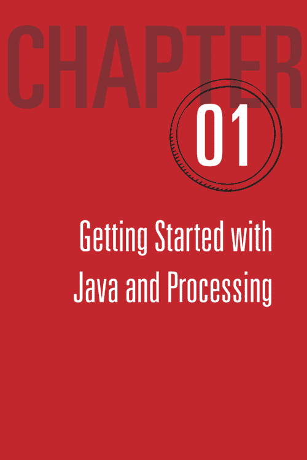

所以，你想学习如何用 Java 编写代码。这是一个很棒的目标！在本书中，你将在学习制作视频游戏的同时学习 Java 的基础知识！编码可能是很复杂的。有时它会令人沮丧。记住继续尝试，测试你的代码，并双倍检查是否正确输入了所有内容。通过努力，你会学到很多并享受其中！

在本章中，你将安装 `Processing` 应用程序，这将允许你编写 Java 代码。然后你将有机会测试一些真实的 Java 代码，并确保你理解应用程序在书中范围内如何工作。

## 开始使用 PROCESSING

要开始 Java，你将使用一个名为 `Processing` 的编程环境。`Processing` 自带一个库，有助于让 Java 视频游戏的编码变得简单得多。

### 下载与安装

要开始使用 `Processing`，你需要下载并安装。按照以下步骤操作：

1. 访问 `www.processing.org` 并点击 Download 按钮。
2. 找到你使用的操作系统（参见图 1-1），并选择正确的版本。
3. 文件下载完成后，解压文件。


图 1-1 Processing 网站。


图 1-2 下载选项。


图 1-3 可选贡献。

### 开始使用 PROCESSING

现在你已经安装了 `Processing`，可以开始使用它了。按照以下步骤操作：

1. 双击 `Processing` 文件。
2. 第一次打开 `Processing` 时，可能会弹一个提示框，询问你是否确定要打开文件（参见图 1-4）。打开。
3. 取消勾选“每次显示此消息”（Show This Message Each Time）框，然后点击“开始使用”（Get Started）按钮。

打开一个新的 `Sketch`。`Sketch` 是 `Processing` 对程序文件的称呼。你会发现 `Sketch` 右上角的编程语言设置为 Java（参见图 1-5）。


图 1-4 首次打开 Processing 时可能会警告。


图 1-5 欢迎界面。


图 1-6 打开了新 Sketch 的 Processing 窗口。

### 尝试代码

现在你已经打开了 `Processing`，可以测试一些代码来确保一切正常！

在这本书中，你将学习如何从零开始编写自己的代码。但在首次设置编程环境时，测试一些你认为*应该*可以运行的代码是一个好主意，以确保你的编程环境工作正常。按照以下步骤操作：

1. **访问** [`www.processing.org/examples/star.html`](http://www.processing.org/examples/star.html) **（参见** 图 1-7**）。**
2. **向下滚动到创建这些星星的代码，如图 1-8**所示。**
3. **选中所有代码。然后右键点击代码，从弹出的菜单中选择“复制”（参见** 图 1-9**）。**

   如果你使用的是 Mac，也可以选中代码并按 `Command+C`；如果你使用的是 Windows 电脑，可以按 `Ctrl+C`。

4. **再次点击 Processing 应用程序，在 Sketch 窗口中右键，从弹出的菜单中选择“粘贴”（参见** 图 1-10**）。**

   如果你使用的是 Mac，也可以点击 Sketch 窗口并按 `Command+V`；如果你使用的是 Windows 电脑，可以按 `Ctrl+V`。

5. **点击 Processing 窗口左上角的运行（Run）按钮（参见** 图 1-11**）。**
6. **观察三颗不同的星星旋转（参见** 图 1-12**）！**

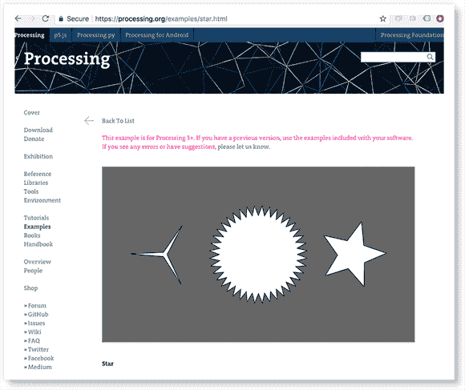

图 1-7: Processing 网站上的 Star 程序示例。

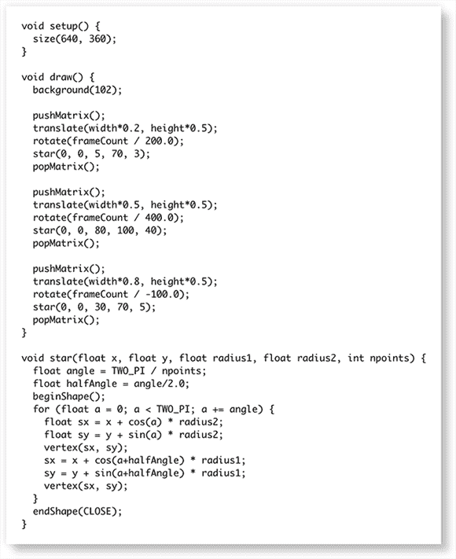

图 1-8: 你将复制的 Star 程序代码。

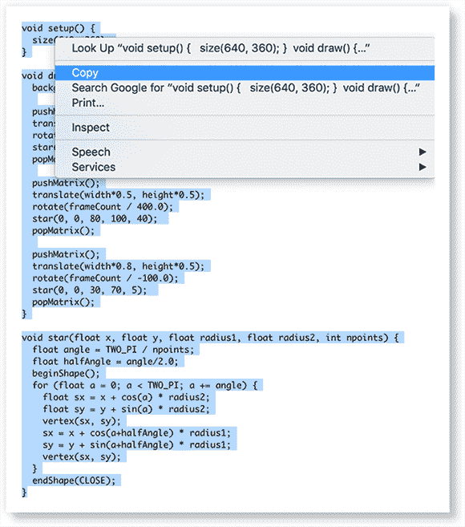

图 1-9: 通过选中和右键复制 Star 程序代码。

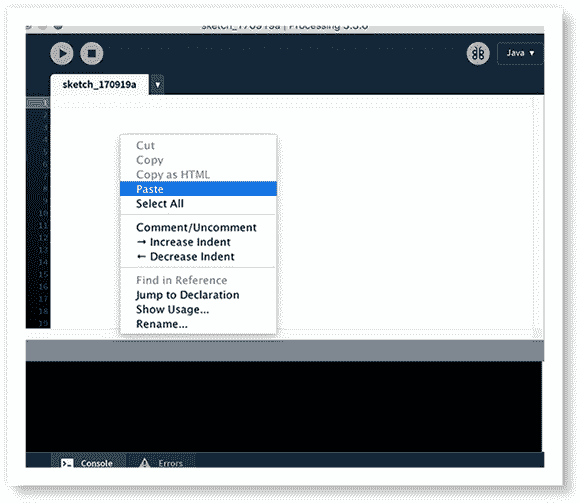

图 1-10: 在 Sketch 中右键粘贴 Star 程序代码。

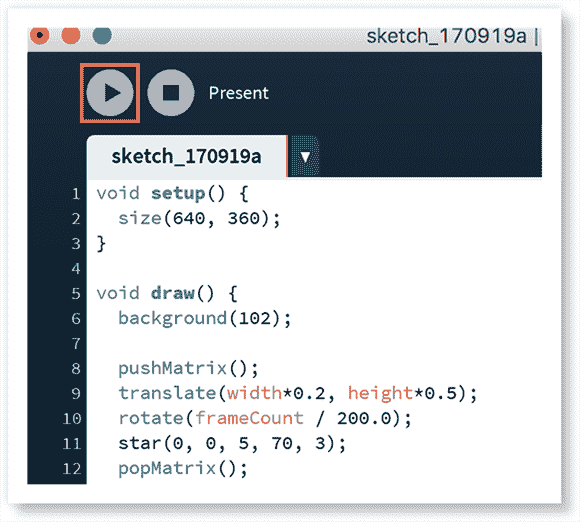

图 1-11: 点击运行按钮测试 Star 程序。

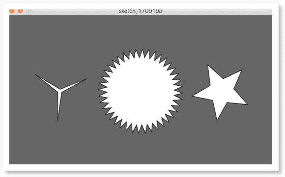

图 1-12: 带有旋转星星的画布。

恭喜！你测试了你的第一个 Java 程序！如果代码现在还看不懂，不要担心。在整本书中，你将学习很多 Java 知识，并有机会理解一切是如何运作的。

## 保存并重新打开 Processing 程序

在我结束本章之前，你需要了解如何保存你的工作，并在关闭 Processing 应用程序后再次访问它。按照以下步骤操作：

1. **通过选择 `File`⇒`Save` 保存你的代码（参见** 图 1-13**）。**
2. **将你的文件重命名为“StarProgram”并点击 Save（参见** 图 1-14**）。**
3. **通过选择 `Processing`⇒`Quit Processing` 关闭 Processing 应用程序（参见** 图 1.15**）。**
4. **如果你想再次打开此文件，只需打开 Processing 应用程序并选择 `File`⇒`Open`（参见** 图 1-16**）。**

   Processing 显示保存到 Processing 文件夹中的程序，那里是你第 2 步中保存程序的地方。

5. **选择 StarProgram 文件夹并点击 Open（参见** 图 1-17**）。**
6. **选择 `StarProgram.dpe` 文件并点击 Open（参见** 图 1-18**）。**

   你在第 1 步中保存的代码将打开（参见 图 1-19）。

7. **如果你想开始一个新程序，选择 `File`⇒`New`（参见** 图 1-20**）。**

   一个新的 Processing 窗口将打开（参见 图 1-21），你可以编写新代码！

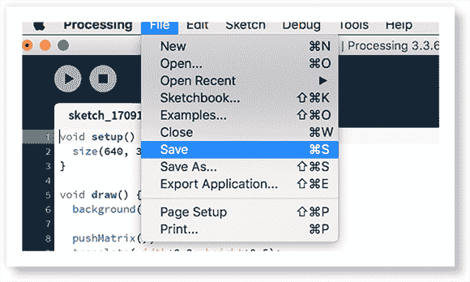

图 1-13: 从 File 菜单保存你的 Star 程序。

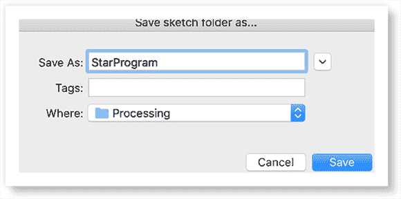

图 1-14: 重命名程序。

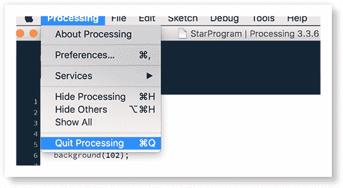

图 1-15: 从 Processing 菜单退出 Processing。

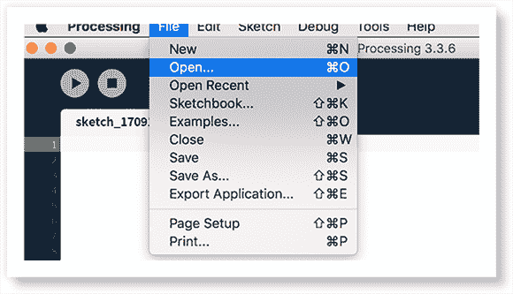

图 1-16: 从 File 菜单打开保存的程序。

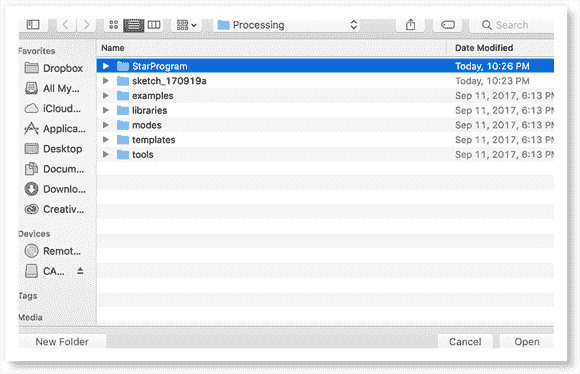

图 1-17: 在同名文件夹中找到保存的程序。

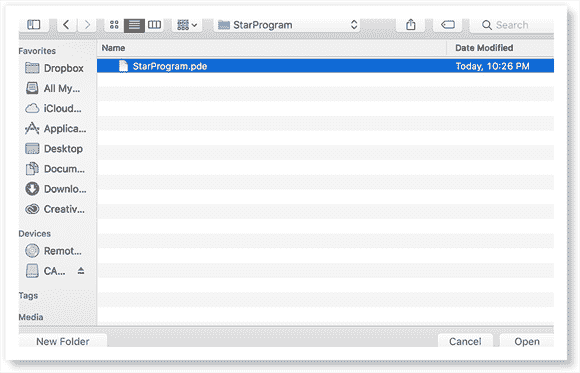

图 1-18: 打开 `StarProgram.dpe` 文件查看代码。

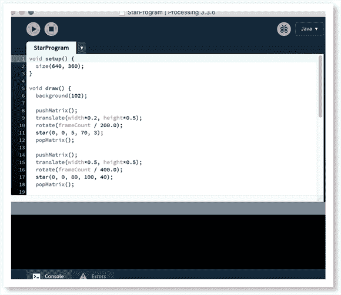

图 1-19: 在 Processing 中重新打开 Star 程序。

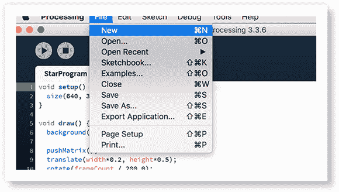

图 1-20: 从 File 菜单创建一个新程序。

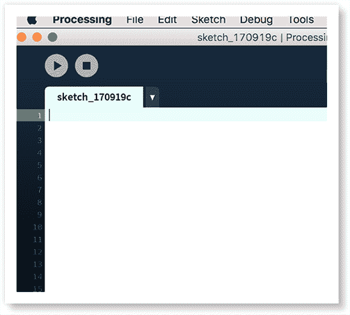

图 1-21: 一个空白的 Sketch 文件。

在本章中，你将学习 Java 编程中非常重要的概念：方法（methods）和变量（variables）。在学习这些内容时，你将创建自己的画布并添加颜色！

## 了解画布

正如你在第 1 章中注意到的，运行 Processing 程序时会弹出一个画布。`canvas` 是显示程序视觉部分的窗口，就像你测试的旋转星星那样。

### 创建画布

在本节中，你将学习关于画布的知识，这对于理解如何与其交互非常重要。按照以下步骤操作：

1. **打开 Processing 应用程序并创建一个新程序（参见** 图 2-1**）。**
2. **输入一行代码创建一个宽 500 像素、高 500 像素的画布（参见** 图 2-2**）。**

```
size(500, 500);
```

3. **点击 Processing 窗口左上角的运行按钮，你可以在图 2-2 中看到。**

   画布应该出现在你的屏幕上（参见 图 2-3）。

4. **点击屏幕左上角的红色 X 关闭画布。**
5. **将代码更改为 500 比 250 像素，如图 2-4 所示。**

```
size(500, 250);
```

6. **在点击运行按钮之前，预测画布将是横矩形还是竖矩形。**
7. **点击运行按钮，查看你的预测是否正确！**

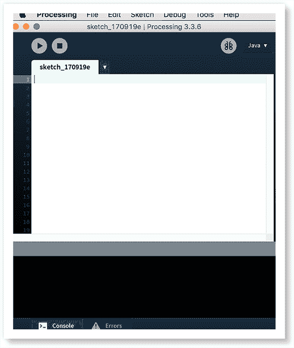

图 2-1: 一个空白的 Sketch 文件。

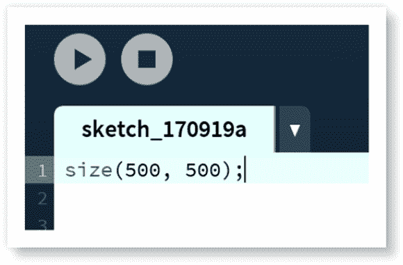

图 2-2: 创建 500x500 像素画布所需的代码。

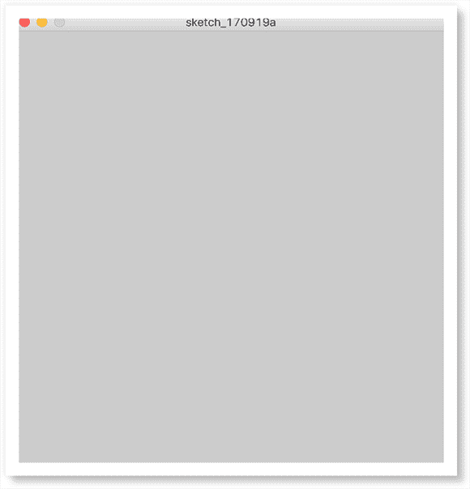

图 2-3: 空闲的 500x500 像素画布。

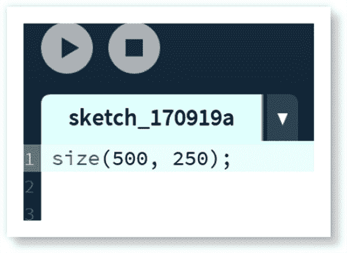

图 2-4: 创建 500x250 像素画布所需的代码。

### 理解画布中的像素

你创建的每个画布（canvas）都是由许多像素组成的。例如，通过你在上一节中编写第一段代码，你就创建了一个包含 250,000 个像素的画布！它有 500 行像素，每行有 500 个像素。

画布上的每个像素都有一个位置和一个颜色。像素的位置由像素的 `x` 和 `y` 位置指定。你可以使用 `set` 方法更改单个像素的颜色。请按照以下步骤操作：

1. 确保你的代码正在创建一个 500x 500 像素的画布，如图 2-5 所示：

   ```
   size(500, 500);
   ```

2. 添加第二行代码，创建一个新的颜色变量（参见图 2-6）：

   ```
   color black = color(0);
   ```

3. 添加第三行代码，将正中心像素的颜色改为你在第 2 步中创建的颜色（参见图 2-7）：

   ```
   set(250, 250, black);
   ```

4. 点击**Run**（运行）按钮。

   注意中心像素现在是黑色的（参见图 2-8）。

5. 尝试将第 2 步中的数字改为 0 到 255 之间的任意数字，并再次点击 Run 按钮，观察中心按钮变为不同的颜色。

   你也可以像第 3 步中那样添加更多行，将画布上的其他像素更改为其他颜色。例如，这里制作一条每隔一个像素为黑色或白色的线条的方法（参见图 2-9）：

   ```
   size(500, 500);
   color black = color(0);
   color white = color(255);
   set(240, 250, black);
   set(241, 250, white);
   set(242, 250, black);
   set(243, 250, white);
   set(244, 250, black);
   set(245, 250, white);
   set(246, 250, black);
   set(247, 250, white);
   set(248, 250, black);
   set(249, 250, white);
   set(250, 250, black);
   set(251, 250, white);
   set(252, 250, black);
   set(253, 250, white);
   set(254, 250, black);
   set(255, 250, white);
   set(256, 250, black);
   set(257, 250, white);
   set(258, 250, black);
   set(259, 250, white);
   ```

   这里是制作一条包含 10 个黑色像素后接 10 个白色像素的线条的方法（参见图 2-10）：

   ```
   size(500, 500);
   color black = color(0);
   color white = color(255);
   set(240, 250, black);
   set(241, 250, black);
   set(242, 250, black);
   set(243, 250, black);
   set(244, 250, black);
   set(245, 250, black);
   set(246, 250, black);
   set(247, 250, black);
   set(248, 250, black);
   set(249, 250, black);
   set(250, 250, white);
   set(251, 250, white);
   set(252, 250, white);
   set(253, 250, white);
   set(254, 250, white);
   set(255, 250, white);
   set(256, 250, white);
   set(257, 250, white);
   set(258, 250, white);
   set(259, 250, white);
   ```

   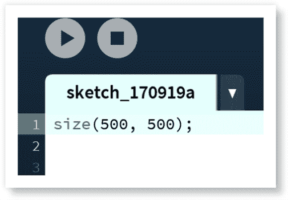

图 2-5 创建 500x500 像素画布的代码。

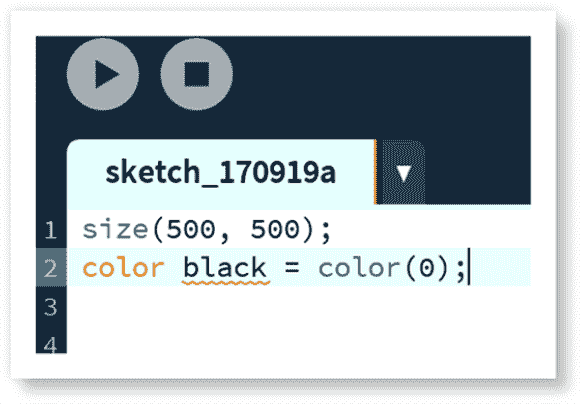

图 2-6 创建黑色的代码。

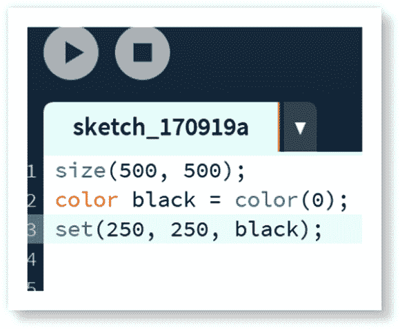

图 2-7 更改特定像素的代码。

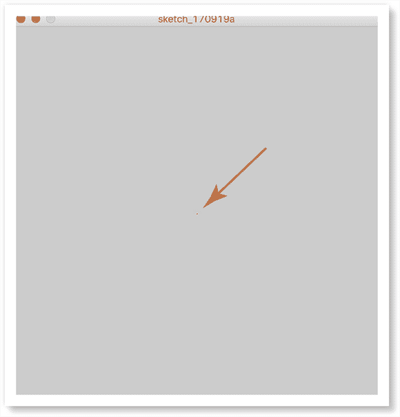


图 2-8 中心有一个黑色像素的 500x500 像素画布。

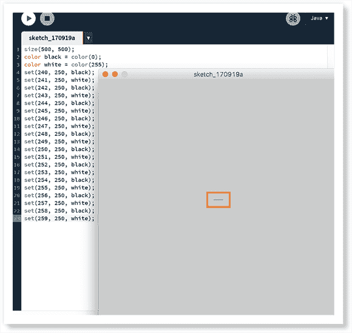

图 2-9 制作黑白线条的代码和输出。

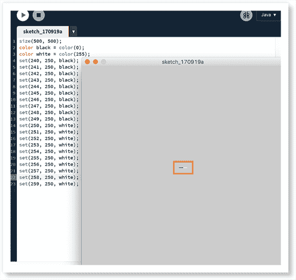

图 2-10 制作另一条黑白线条的代码和输出。

在第 4 章中，你将学习更多关于颜色的知识，但这里是对像素属性（位置和颜色）的基础介绍。

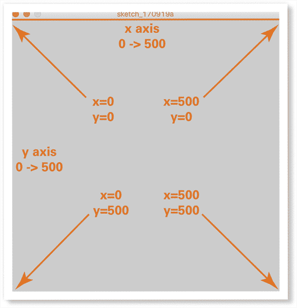

图 2-11 位置指南。

恭喜！你现在已经学习了关于像素、位置、颜色以及如何在 Java 中调用方法的知识！在下一节中，你将概述目前使用的方法并了解调用方法的原理。

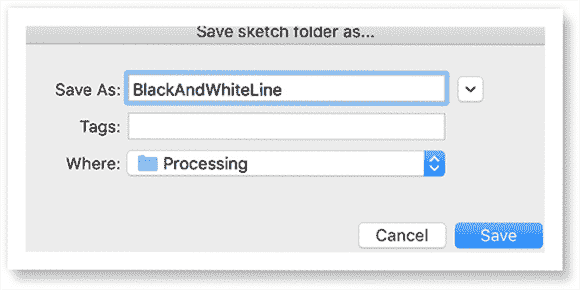

图 2-12 保存前务必命名文件。

## 在 Java 中调用方法

你已经在为本章编写的代码中调用了好几个方法，但在编写代码时，理解你正在写什么很重要。在你目前调用的方法中包含两个部分：方法名和参数：

`methodName(Parameters)`

方法名后面总是有左括号和右括号。在你目前使用的所有示例中，中间都有参数，但有时也没有。例如，有一个你尚未使用过的不带任何参数的方法：

`exit()`

你可以尝试将这行代码添加到程序的最后一行。当你点击 Run 时，你应该看到画布出现然后立即关闭。这是因为 `exit` 方法会关闭画布。

如果方法确实有参数，那么参数的顺序必须正确且类型正确。例如，`size` 方法需要两个参数（或数字）；第一个数字必须是画布的宽度，第二个数字是画布的高度：

`size(width, height)`

你可以尝试放置较少或更多的参数并更改类型，你会发现会得到错误。例如，假设你第一个写的是：

`size("abc")`

你将收到一个错误消息，说明 `size` 方法需要两个整数参数（参见图 2-13）。


图 2-13 在 Processing 中可能获得的错误消息示例。

在每个参数之间必须有一个逗号。

最后，每个方法调用都以分号结尾。这告诉 Processing 该行代码已结束。

在第 2 章中，你已经调用了四个不同的方法：

`size(width, height)`

`color(colorCode)`

`set(x, y, color)`

`exit()`

## 创建变量

变量基本上是你为你想要重复使用的值命的名字。在本章中，你创建了两个变量：`black` 和 `white`。

就像调用方法一样，创建变量时有固定格式：

`type variableName = value;`

在本章中，我们使用的类型是 `color`。你可能会在书中遇到的其他简单类型有：

* `int`: 整数/数字

* `boolean`: 真或假

* `char`: 单字符，如 `a` 或 `b`

* `color`: 像素的颜色

变量的用在于你可以给一个值命名（例如 `color(0)`），然后通过使用该名称来使用该值。例如，这里相同的代码——第一个使用了变量，第二个没有：

```
color black = color(0);
set(240, 250, black);
set(241, 250, black);
set(242, 250, black);
```

```
set(240, 250, color(0));
set(241, 250, color(0));
set(242, 250, color(0));
```

你可以看到，输入 `black` 而不是 `color(0)` 不仅更快，而且对于人类来说，使用单词 `black` 而不是代码 `color(0)` 也要清晰得多。

这仍然会将这 3 个像素设置为黑色，因为当你在调用 `color` 方法时使用 `0` 作为参数，但任何阅读这段代码的人都可能认为这 3 个像素被设置为紫色了！

在本书的其余部分中，你将再次复习方法、参数和变量。

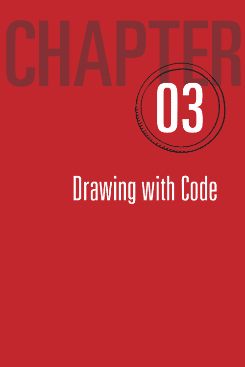

在第 2 章中，你学习了如何画一条黑白线。为了画一条长度为 20 像素的线就需要大量的代码！想象一下如果你想画一个黑白色的正方形，你必须画 20 条线，这意味着需要 400 行代码！那太疯狂了——而且非常很容易出错。

尽管画一个宽 20 像素、高 20 像素的正方形基本上是改变每个像素的颜色，但 Processing 编程环境已经创建了你可以调用的方法来创建正方形，而不是编写所有 400 行代码来更改单个像素！

Processing 提供的五种原始（或简单）形状是：

```
triangle(x1, y1, x2, y2, x3, y3);
```

```
rect(x, y, width, height);
```

```
quad(x1, y1, x2, y2, x3, y3, x4, y4);
```

```
ellipse(x, y, width, height);
```

```
arc(x, y, width, height, start, stop);
```

尽管 Processing 让创建这些形状变得更简单，但它仍然可能棘手。在本章中，你将创建每种形状并稍微更改参数，以便在画布的不同部分绘制形状，并让它们具有不同的尺寸。

## 绘制三角形

在 Processing 中，`triangle` 方法将创建一个接受六个参数的三角形，这些是三角形每个点的 `x` 和 `y` 位置。按照以下步骤操作：

1. **打开 Processing 并创建一个新程序。**

2. **创建一个 500 像素乘 500 像素的画布（参见[图 3-1]](#06_9781119404170-ch03.xhtml_c03-fig-0001)):**

```
size(500, 500);
```

3. **创建一个三角形，其上顶点位于画布中心（`x` = 250, `y` = 250）。三角形的高度应为 100 像素，宽度应为 200 像素（参见[图 3-2]](#06_9781119404170-ch03.xhtml_c03-fig-0002)):**

```
triangle(250, 250, 150, 350, 350, 350);
```

4. **点击运行查看你创建的三角形（参见[图 3-4]](#06_9781119404170-ch03.xhtml_c03-fig-0004）。**

5. **尝试更改每个点的 `x` 和 `y` 坐标以创建不同的三角形。**

   这段代码创建了图 3-5 中所示的三角形：

```
triangle(250, 250, 250, 350, 300, 300);
```

   这段代码创建了图 3-6 中所示的三角形：

```
triangle(250, 250, 150, 450, 350, 450);
```

   这段代码创建了图 3-7 中所示的三角形：

```
triangle(250, 250, 250, 450, 450, 450);
```

6. **当你探索完不同的三角形形状后，注释掉创建三角形的行代码。**

   要做到这一点，在方法名称前面添加两个正斜杠（参见[图 3-8]](#06_9781119404170-ch03.xhtml_c03-fig-0008)):

```
//triangle(250, 250, 250, 450, 450, 450);
```

   这将使 Processing 忽略与 `//` 同一行上的所有内容。

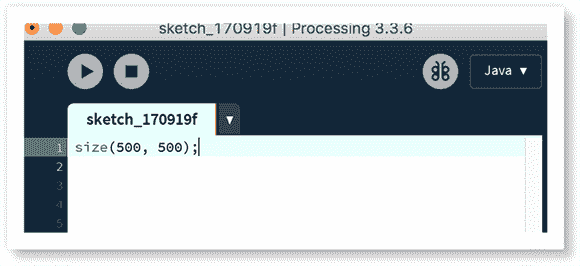

图 3-1: 创建 500x500 像素画布所需的代码。

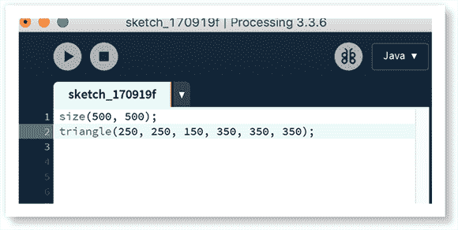

图 3-2: 创建三角形所需的代码。

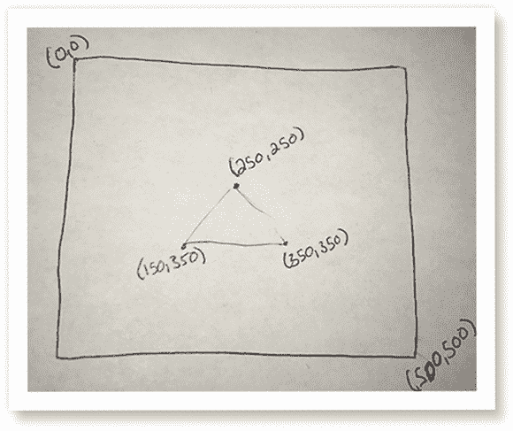

图 3-3: 手绘草图示例，有助于可视化代码。

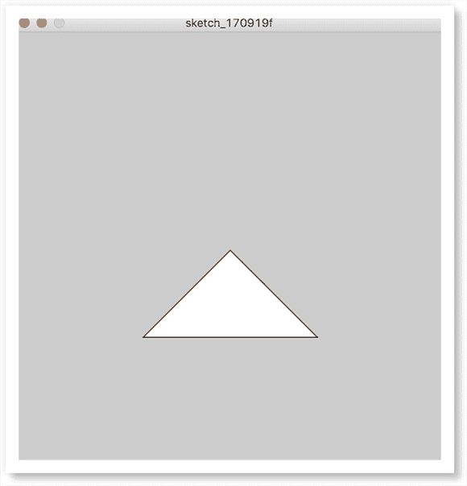

图 3-4: 从图 3-2 创建的三角形。

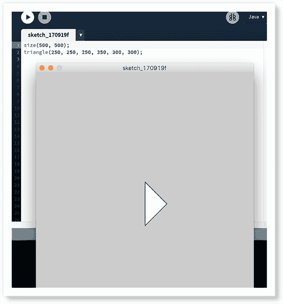

图 3-5: 小三角形示例。

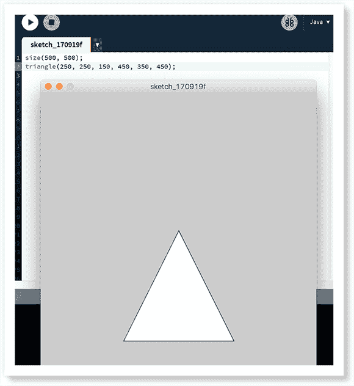

图 3-6: 高瘦三角形示例。

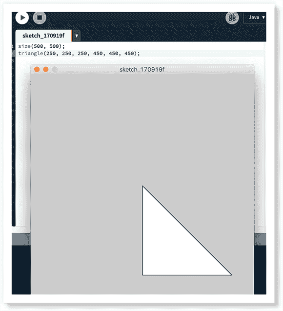

图 3-7: 直角三角形示例。

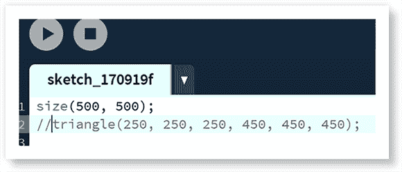

图 3-8: 注释掉的代码。

## 绘制矩形

在 Processing 中，`rect` 方法将创建一个接受四个参数的矩形：左上角的 `x` 和 `y` 值、宽度和高度。

1. **创建一个左上角 `x` = 100，`y` = 100 且宽 50 像素、高 50 像素的矩形。点击运行（参见图 3-9):**

```
rect(100, 100, 50, 50);
```

2. **尝试更改 `x` 和 `y` 坐标以及宽度和高度以创建不同的矩形。**

   这段代码创建了图 3-10 中所示的矩形：

```
rect(100, 100, 200, 100);
```

   这段代码创建了图 3-11 中所示的矩形：

```
rect(100, 50, 200, 400);
```

3. **当你探索完矩形形状后，注释掉创建矩形的行代码（参见图 3-12).**

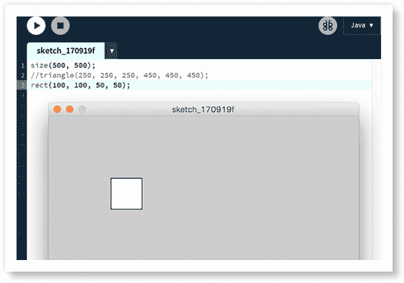

图 3-9: 50x50 像素正方形示例。

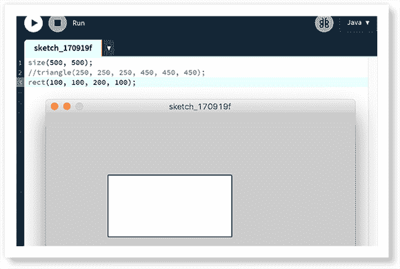

图 3-10: 横向矩形示例。

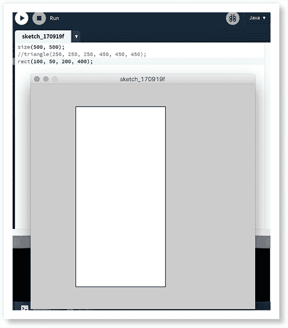

图 3-11: 竖向矩形示例。

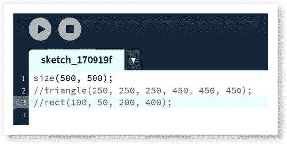

图 3-12: 注释掉的代码。

## 绘制四边形

在 Processing 中，`quad` 方法将创建一个有四边的形状。与三角形类似，有八个参数，代表每个点的 `x` 和 `y` 坐标。按照以下步骤操作：

1. **创建一个四边形，其左上角 `x` = 50，`y` = 50，右上角 `x` = 100，`y` = 100，右下角 `x` = 100，`y` = 150，左下角 `x` = 50，`y` = 200（参见图 3-13):**

```
quad(50, 50, 100, 100, 100, 150, 50, 200);
```

2. **尝试更改 `x` 和 `y` 坐标以创建不同的四边形。**

   这段代码创建了图 3-14 中所示的四边形：

```
quad(50, 50, 150, 50, 200, 150, 100, 150);
```

   这段代码创建了图 3-15 中所示的四边形：

```
quad(50, 50, 150, 50, 150, 150, 50, 150);
```

3. **当你探索完不同的四边形形状后，注释掉创建四边形的行代码（参见图 3-16).**

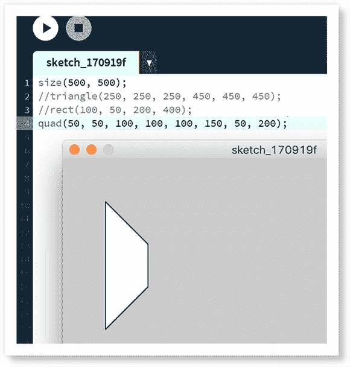

图 3-13: 侧置梯边形示例。

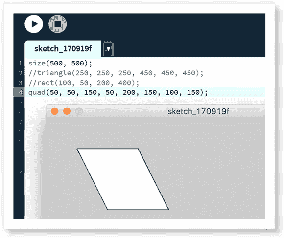

图 3-14: 平行四形示例。

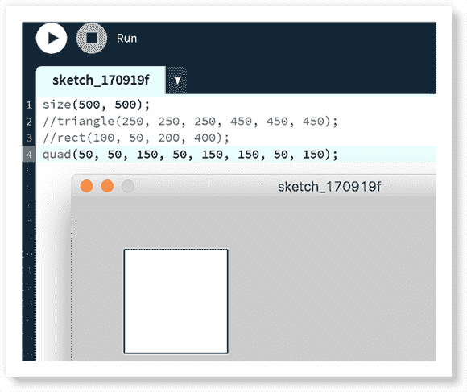

图 3-15: 正方形示例。

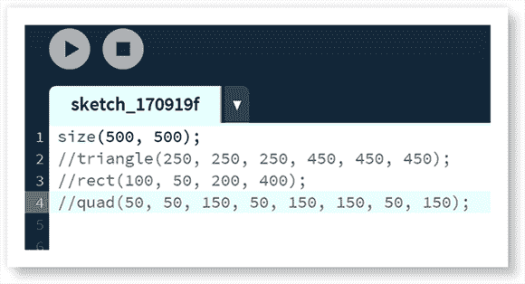

图 3-16: 被注释掉的多边形代码。

## 绘制椭圆

在 Processing 中，`ellipse` 方法将创建一个圆形的形状。与四边形类似，它有四个参数，分别代表形状中心的 `x` 和 `y` 坐标、宽度和高度。按照以下步骤操作：

1. 创建一个圆点在 `x` = 250 和 `y` = 250，高度为 100 像素，宽度为 100 像素的椭圆（参见图 3-17）。

```
ellipse(250, 250, 100, 100);
```

2. 尝试更改 `x` 和 `y` 坐标以及宽度和高度，创建不同类型的圆形形状（椭圆）。

这段代码创建了图 3-18 所示的椭圆：

```
ellipse(250, 250, 100, 300);
```

这段代码创建了图 3-19 所示的椭圆：

```
ellipse(250, 250, 300, 100);
```

3. 当你完成对不同椭圆形状的探索后，注释掉创建椭圆的代码行（参见图 3-20）。

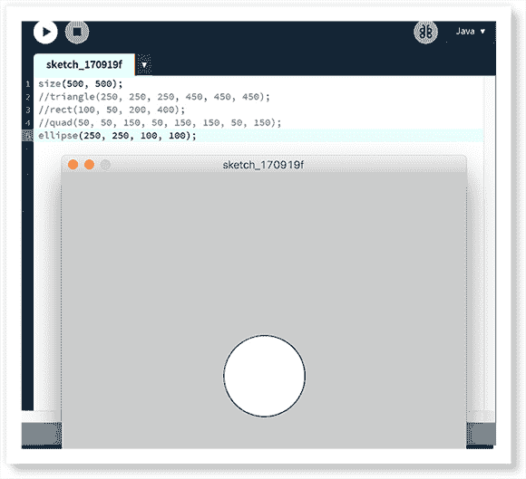

图 3-17: 小圆的示例。

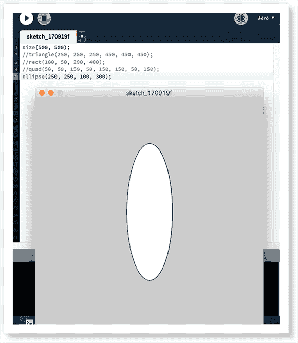

图 3-18: 垂直椭圆的示例。

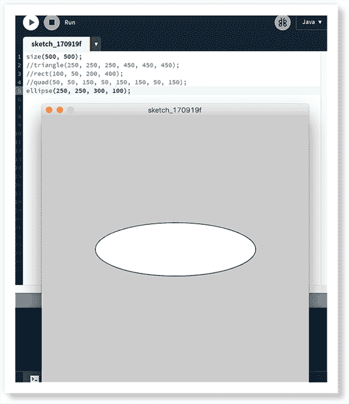

图 3-19: 水平椭圆的示例。

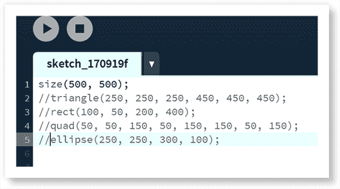

图 3-20: 被注释掉的椭圆代码。

## 绘制弧

在 Processing 中，`arc` 方法将创建一个圆形的形状。与椭圆类似，它有四个参数，分别代表形状中心的 `x` 和 `y` 坐标、弧的宽度和高度，以及起始角度和结束角度。这个形状比其他形状复杂得多，因为最后两个参数涉及的值可能会让人困惑。

1. 创建一个中心在 `x` = 50 和 `y` = 55，高度为 50 像素，宽度为 50 像素的弧。弧应该从 0 开始并结束于 `PI`（参见图 3-21）：

```
arc(50, 55, 50, 50, 0, PI);
```

2. 尝试更改 `x` 和 `y` 坐标、宽度和高度以及起始和结束角度，创建不同类型的弧。

这段代码创建了图 3-22 所示的弧：

```
arc(50, 55, 50, 50, 0, HALF_PI);
```

这段代码创建了图 3-23 所示的弧：

```
arc(50, 55, 50, 50, 0, QUARTER_PI+PI);
```

3. 当你完成对不同弧的探索后，注释掉创建弧的代码行（参见图 3-24）。

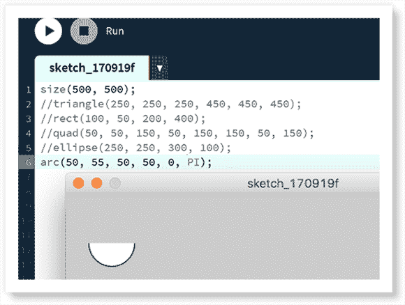

图 3-21: 半圆弧的示例。


图 3-22: 四分之一圆弧的示例。


图 3-23: 使用圆的八分之一和半圆的弧示例。


图 3-24: 被注释掉的弧代码。

## 创建独特的画作

现在你已经知道了如何使用 `triangle`、`rect`、`ellipse` 和 `arc` 来制作基础形状，尝试通过在画布上放置多个形状来创建一个独特的画作（参见图 3-25）。


图 3-25: 在同一个画布上绘制所有形状的示例。

## 给画布上色

现在你已经知道了如何使用 `triangle`、`rect`、`ellipse` 和 `arc` 来制作基础形状，尝试通过在画布上放置多个形状来创建一个独特的画作（参见图 3-25）。


图 3-25: 在同一个画布上绘制所有形状的示例。

现在你已经知道了如何使用 `triangle`、`rect`、`ellipse` 和 `arc` 来制作基础形状，尝试通过在画布上放置多个形状来创建一个独特的画作（参见图 3-25）。


图 3-25: 在同一个画布上绘制所有形状的示例。

现在你已经知道了如何使用 `triangle`、`rect`、`ellipse` 和 `arc` 来制作基础形状，尝试通过在画布上放置多个形状来创建一个独特的画作（参见图 3-25）。


图 3-25: 在同一个画布上绘制所有形状的示例。

现在你已经知道了如何使用 `triangle`、`rect`、`ellipse` 和 `arc` 来制作基础形状，尝试通过在画布上放置多个形状来创建一个独特的画作（参见图 3-25）。


图 3-25: 在同一个画布上绘制所有形状的示例。

现在你已经知道了如何使用 `triangle`、`rect`、`ellipse` 和 `arc` 来制作基础形状，尝试通过在画布上放置多个形状来创建一个独特的画作（参见图 3-25）。


图 3-25: 在同一个画布上绘制所有形状的示例。

现在你已经知道了如何使用 `triangle`、`rect`、`ellipse` 和 `arc` 来制作基础形状，尝试通过在画布上放置多个形状来创建一个独特的画作（参见图 3-25）。


图 3-25: 在同一个画布上绘制所有形状的示例。

现在你已经知道了如何使用 `triangle`、`rect`、`ellipse` 和 `arc` 来制作基础形状，尝试通过在画布上放置多个形状来创建一个独特的画作（参见图 3-25）。


**FIGURE 3-25:** 在同一个画布上绘制所有形状的示例。

现在你已经知道了如何使用 `triangle`、`rect`、`ellipse` 和 `arc` 来制作基础形状，尝试通过在画布上放置多个形状来创建一个独特的画作（参见图 3-25）。


**FIGURE 3-25:** 在同一个画布上绘制所有形状的示例。

现在你已经知道了如何使用 `triangle`、`rect`、`ellipse` 和 `arc` 来制作基础形状，尝试通过在画布上放置多个形状来创建一个独特的画作（参见图 3-25）。


**FIGURE 3-25:** 在同一个画布上绘制所有形状的示例。

现在你已经知道了如何使用 `triangle`、`rect`、`ellipse` 和 `arc` 来制作基础形状，尝试通过在画布上放置多个形状来创建一个独特的画作（参见图 3-25）。


**FIGURE 3-25:** 在同一个画布上绘制所有形状的示例。

现在你已经知道了如何使用 `triangle`、`rect`、`ellipse` 和 `arc` 来制作基础形状，尝试通过在画布上放置多个形状来创建一个独特的画作（参见图 3-25）。

**FIGURE 3-16:** 被注释掉的多边形代码。

## 绘制椭圆

在 Processing 中，`ellipse` 方法将创建一个圆形的形状。与四边形类似，它有四个参数，分别代表形状中心的 `x` 和 `y` 坐标、宽度和高度。按照以下步骤操作：

1. 创建一个圆点在 `x` = 250 和 `y` = 250，高度为 100 像素，宽度为 100 像素的椭圆（参见图 3-17）。

```
ellipse(250, 250, 100, 100);
```

2. 尝试更改 `x` 和 `y` 坐标以及宽度和高度，创建不同类型的圆形形状（椭圆）。

这段代码创建了图 3-18 所示的椭圆：

```
ellipse(250, 250, 100, 300);
```

这段代码创建了图 3-19 所示的椭圆：

```
ellipse(250, 250, 300, 100);
```

3. 当你完成对不同椭圆形状的探索后，注释掉创建椭圆的代码行（参见图 3-20）。


**FIGURE 3-17:** 小圆的示例。


**FIGURE 3-18:** 垂直椭圆的示例。


**FIGURE 3-19:** 水平椭圆的示例。


**FIGURE 3-20:** 被注释掉的椭圆代码。

## 绘制弧

在 Processing 中，`arc` 方法将创建一个圆形的形状。与椭圆类似，它有四个参数，分别代表形状中心的 `x` 和 `y` 坐标、弧的宽度和高度，以及起始角度和结束角度。这个形状比其他形状复杂得多，因为最后两个参数涉及的值可能会让人困惑。

1. 创建一个中心在 `x` = 50 和 `y` = 55，高度为 50 像素，宽度为 50 像素的弧。弧应该从 0 开始并结束于 `PI`（参见图 3-21）：

```
arc(50, 55, 50, 50, 0, PI);
```

2. 尝试更改 `x` 和 `y` 坐标、宽度和高度以及起始和结束角度，创建不同类型的弧。

这段代码创建了图 3-22 所示的弧：

```
arc(50, 55, 50, 50, 0, HALF_PI);
```

这段代码创建了图 3-23 所示的弧：

```
arc(50, 55, 50, 50, 0, QUARTER_PI+PI);
```

3. 当你完成对不同弧的探索后，注释掉创建弧的代码行（参见图 3-24）。


**FIGURE 3-21:** 半圆弧的示例。


**FIGURE 3-22:** 四分之一圆弧的示例。


**FIGURE 3-23:** 使用圆的八分之一和半圆的弧示例。


**FIGURE 3-24:** 被注释掉的弧代码。

## 创建独特的画作

现在你已经知道了如何使用 `triangle`、`rect`、`ellipse` 和 `arc` 来制作基础形状，尝试通过在画布上放置多个形状来创建一个独特的画作（参见图 3-25）。


**FIGURE 3-25:** 在同一个画布上绘制所有形状的示例。

## 给画布上色

现在你已经知道了如何使用 `triangle`、`rect`、`ellipse` 和 `arc` 来制作基础形状，尝试通过在画布上放置多个形状来创建一个独特的画作（参见图 3-25）。


**FIGURE 3-25:** 在同一个画布上绘制所有形状的示例。

现在你已经知道了如何使用 `triangle`、`rect`、`ellipse` 和 `arc` 来制作基础形状，尝试通过在画布上放置多个形状来创建一个独特的画作（参见图 3-25）。


**FIGURE 3-25:** 在同一个画布上绘制所有形状的示例。

现在你已经知道了如何使用 `triangle`、`rect`、`ellipse` 和 `arc` 来制作基础形状，尝试通过在画布上放置多个形状来创建一个独特的画作（参见图 3-25）。


**FIGURE 3-25:** 在同一个画布上绘制所有形状的示例。

现在你已经知道了如何使用 `triangle`、`rect`、`ellipse` 和 `arc` 来制作基础形状，尝试通过在画布上放置多个形状来创建一个独特的画作（参见图 3-25）。


**FIGURE 3-25:** 在同一个画布上绘制所有形状的示例。

现在你已经知道了如何使用 `triangle`、`rect`、`ellipse` 和 `arc` 来制作基础形状，尝试通过在画布上放置多个形状来创建一个独特的画作（参见图 3-25）。


**FIGURE 3-25:** 在同一个画布上绘制所有形状的示例。

现在你已经知道了如何使用 `triangle`、`rect`、`ellipse` 和 `arc` 来制作基础形状，尝试通过在画布上放置多个形状来创建一个独特的画作（参见图 3-25）。


**FIGURE 3-25:** 在同一个画布上绘制所有形状的示例。

现在你已经知道了如何使用 `triangle`、`rect`、`ellipse` 和 `arc` 来制作基础形状，尝试通过在画布上放置多个形状来创建一个独特的画作（参见图 3-25）。


**FIGURE 3-25:** 在同一个画布上绘制所有形状的示例。

现在你已经知道了如何使用 `triangle`、`rect`、`ellipse` 和 `arc` 来制作基础形状，尝试通过在画布上放置多个形状来创建一个独特的画作（参见图 3-25）。


**FIGURE 3-25:** 在同一个画布上绘制所有形状的示例。

现在你已经知道了如何使用 `triangle`、`rect`、`ellipse` 和 `arc` 来制作基础形状，尝试通过在画布上放置多个形状来创建一个独特的画作（参见图 3-25）。


**FIGURE 3-25:** 在同一个画布上绘制所有形状的示例。

## 学习 RGB 值

正如你可能在上一节中注意到的，`background` 方法的每个参数都有独特之处。每个参数可以取 0 到 255 之间的数值：

* `Red` 代表颜色中的红色含量。

* `Green` 代表颜色中的绿色含量。

* `Blue` 代表颜色中的蓝色含量。

注意参数的顺序是 `Red`、`Green` 然后是 `Blue`。这就是为什么它被称为 RGB！如果这三个参数的值都是 `0`，颜色将是黑色（参见图 4-7）：

```
background(0, 0, 0);
```

如果所有三个参数的值都是 255，颜色将是白色（参见图 4-8）：

```
background(255, 255, 255);
```

**图 4-8:** 将背景完全变为白色的示例。

你可以尝试调整每个参数的值来获得特定的颜色。


**图 4-9:** Rapid Tables 网站上用于选择颜色的 RGB 选择器。


**图 4-10:** 在代码中使用来自网站的 RGB 数字。

## 为形状添加颜色

形状可以通过两种不同的方式设置颜色：

* **描边 (Stroke)**：形状的轮廓

* **填充 (Fill)**：形状内部的颜色

向你的程序中添加三行代码（参见图 4-11):

```
stroke(255, 255, 255);
fill(56, 205, 130);
triangle(250, 250, 250, 450, 450, 450);
```


**图 4-11:** 将三角形改为绿色并带有白色轮廓的示例。

注意，描边是白色的，填充是绿色的。如果你不想让轮廓可见，可以将其设置为与填充相同的颜色（参见图 4-12):

```
stroke(56, 205, 130);
fill(56, 205, 130);
triangle(250, 250, 250, 450, 450, 450);
```


**图 4-12:** 使整个三角形变为绿色的示例。

如果你想让所有形状都具有相同的颜色，只需要在开头调用一次 `stroke` 和 `fill`（参见图 4-13):

```
stroke(56, 205, 130);
fill(56, 205, 130);
triangle(250, 250, 250, 450, 450, 450);
rect(100, 50, 200, 400);
quad(50, 50, 150, 50, 150, 150, 50, 150);
```


**图 4-13:** 使三个形状完全变为绿色的示例。

但如果你想让所有形状具有不同的颜色，你需要在绘制每个形状之前调用 `stroke` 和 `fill`（参见图 4-14):

```
stroke(56, 205, 130);
fill(56, 205, 130);
triangle(250, 250, 250, 450, 450, 450);
stroke(56, 105, 205);
fill(556, 105, 205);
rect(100, 50, 200, 400);
stroke(205, 56, 205);
fill(205, 56, 205);
quad(50, 50, 150, 50, 150, 150, 50, 150);
```


**图 4-14:** 使三个形状颜色不同的示例。

尝试为你在第 3 章中制作的绘画添加颜色，或者现在就可以使用颜色创建一个新的绘画吧！


在本书的前四章中，你学习了如何调用方法。你调用方法来创建画布、更改画布颜色、创建形状以及更改这些形状的颜色。方法是编程中非常有用的工具，因为许多代码只需要编写一次并命名，然后程序员就可以使用方法名称来执行所有这些代码。方法让代码更容易理解且更易于管理。

在本章中，你将学习为什么方法是有用的，发现你可能想要编写的制作动画（以及以后的游戏！）的方法，并了解如何编写自己的方法。在此之前，对方法进行简单概述！

## 学习方法

在本节中，你将更多地了解 Java 方法。方法是编程中非常重要的部分，因为它们将你的代码分解成命名的代码块。然后你可以使用这些代码块的名称反复调用相同的代码。方法是编程的基础之一，即使在其他编程语言（而不只是 Java）中也有用。

### 方法签名

在 Java 中，你总是以的方式编写方法：

```
returnType methodName(parameterType parameterName)
{
    CODE
}
```

上述代码段的第一行代码被称为方法签名。它包含了你（或使用你代码的程序员）调用方法所需的所有信息。

方法签名包含三个部分：

* `returnType`：方法返回的值的类型。

* `methodName`：调用方法的名称。

* `(parameterType parameterName)`：方法接受的输入。

**图 5-2:** 带有新的红色画布的 `setup` 方法体。


**图 5-3:** 当你点击运行（Run）按钮时，会出现红色画布。

在编写简单的程序时，`setup` 方法可能会非常简单，就像你刚刚编写的那样。但当你开始制作视频游戏时，设置设置代码可能会变得更加复杂。你将在本书的后面看到这一点。

## 编写 DRAW 方法

下一个方法称为 `draw`。该方法在 `setup` 方法执行完毕后会自动被调用。然后，`draw` 方法会被反复地（一次又一次）调用，直到画布关闭。

1. 在 `setup` 方法的右大括号之后，添加另一个名为 `draw` 的方法，它没有返回值且不接受任何参数（参见图 5-4）：

   ```
   void draw()
   {
   }
   ```

2. 在方法体内添加三行代码，在画布中心绘制一个圆，该圆具有白色轮廓和蓝色填充（参见图 5-5）：

   ```javascript
   void draw()
   {
     stroke(255, 255, 255);
     fill(0, 0, 250);
     ellipse(250, 250, 300, 300);
   }
   ```

3. 点击运行（Run）按钮并确保圆已经画出来（参见图 5-6）。


**图 5-4:** 一个空的 `draw` 方法。


**图 5-5:** 创建一个带有白色轮廓的蓝色圆的三行代码。


**图 5-6:** 画布上的蓝白相圆。

`draw` 方法被反复、一次又一次地调用，但圆只出现了一次。这是因为圆实际上在被反复绘制，但它是在完全相同的位置绘制的，所以你看不见任何变化。在下一节中，你将学习如何制作一个简单的动画！

## 编写你的前两个原始方法

本节的目标是让你在上一个节中创建的圆（参见图 5-6）跨屏幕移动！

### 创建两个有用的变量

在两个方法上方，你需要添加两个变量，用于跟踪椭圆的 *x-* 和 *y-* 坐标。

1. 首先，添加两个名为 `xCoordinate` 和 `yCoordinate` 的变量。这些变量的类型应为 `int`（整数），且值应为 250（参见图 5-7）：

   ```javascript
   int xCoordinate = 250;
   int yCoordinate = 250;
   ```

2. 将 `ellipse` 方法调用中的两个 250 值替换为你第 1 步中创建的变量（参见图 5-8）：

   ```javascript
   void draw()
   {
     stroke(255, 255, 255);
     fill(0, 0, 250);
     ellipse(xCoordinate, yCoordinate, 300, 300);
   }
   ```


3. 点击运行（Run）按钮进行测试，确保蓝白相间的圆仍然在图 5-6 所示。由于你将两个变量设置为 250，所以圆留在原地（参见图 5-9）。

4. 将`xCoordinate`变量设置为 0（参见图 5-10）：

```javascript
int xCoordinate = 0;
int yCoordinate = 250;
```

5. 点击运行（Run）按钮测试蓝白相间的圆的位置。圆现在位于 *x* = 0, *y* = 250，即画布左侧中央（参见图 5-10）。

6. 同样将`yCoordinate`变量设置为 0（参见图 5-11）：

```javascript
int xCoordinate = 0;
int yCoordinate = 0;
```

7. 点击运行（Run）按钮，确保蓝白相间的圆在画布左上角。


图 5-7: 用于跟踪圆的 *x* 和 *y* 位置的两个变量。


图 5-8: 在`ellipse`方法调用两个变量。


图 5-9: 测试代码以确保圆仍在中心。


图 5-10: 将`xCoordinate`变量设置为 0，让圆向左移动。


图 5-11: 将`yCoordinate`变量设置为 0，让圆向上移动。

现在你有了两个可以帮助圆在画布上移动的变量，你可以编写两个方法在画布开启时更改变量的值。

### 创建自定义方法

现在你有了控制圆在画布绘制位置的两个变量`xCoordinate`和`yCoordinate`，你可以编写一个方法在画布开启时更改变量的值。

1. 编写一个名为`moveDownAndRight`的新方法，无返回值且没有参数（参见图 5-12）：

```javascript
void moveDownAndRight()
{
}
```

确保`xCoordinate`和`yCoordinate`变量都设置为 0（参见图 5-12）：

```javascript
int xCoordinate = 0;
int yCoordinate = 0;
```

2. 将`xCoordinate`和`yCoordinate`变量设置为它们之前的值加 1（参见图 5-13）：

```javascript
void moveDownAndRight()
{
  xCoordinate = xCoordinate + 1;
  yCoordinate = yCoordinate + 1;
}
```

所以，如果`xCoordinate`从 0 开始，那么第一次调用`moveDownAndRight`时，`xCoordinate`将设置为 1，第二次调用该方法时，它将被设置为 2。这种情况将持续到画布关闭。

3. 在绘制圆之后添加一行代码调用`moveDownAndRight`方法（参见图 5-14）：

```javascript
void draw()
{
  stroke(255, 255, 255);
  fill(0, 0, 250);
  ellipse(xCoordinate, yCoordinate, 300, 300);
  moveDownAndRight();
}
```

4. 点击运行（Run）按钮测试你编写的代码。

因为`draw`方法被反复调用直到画布关闭，圆应该开始向右下方移动（参见图 5-15）。

5. 正如你注意到的，圆被反复绘制，你可以看到它留下的痕迹。如果你想让圆移动而不留下痕迹，请在绘制圆之前调用一次`background`方法（参见图 5-16）：

```javascript
void draw()
{
  background(255, 0, 0);
  stroke(255, 255, 255);
  fill(0, 0, 250);
  ellipse(xCoordinate, yCoordinate, 300, 300);
  moveDownAndRight();
}
```

现在，你的`draw`方法执行以下步骤：

* 使画布变为全红色
* 绘制一个具有白色轮廓和蓝色填充的圆
* 更新圆的位置
* 重复直到画布关闭。

6. 点击运行按钮，确保你的圆跨越屏幕时后面没有留下痕迹（参见图 5-17）。


图 5-12: 一个空的`moveDownAndRight()`方法。


图 5-13: 在`moveDownAndRight`中添加了两个行代码，用于更新`xCoordinate`和`yCoordinate`变量。


图 5-14: 每次绘制圆时都调用一次`moveDownAndRight`。


图 5-15: 蓝白相色的圆带有痕迹跨越画布。


图 5-16: 再次调用背景方法以覆盖圆的痕迹。


图 5-17: 圆跨越画布且没有留下痕迹。

恭喜！你现在已经制作了一个动画！在下一节中，你将学习如何调整动画的速度。

## 为你的方法添加参数

现在你已经有了动画，可以添加一个参数来加速你的动画。给`xCoordinate`增加 1 并给`yCoordinate`增加 1，基本上就是每次绘制时让圆向左移动 1 像素并向下 1 像素。如果你将 1 改为 2，圆将向左移动 2 像素并向下 2 像素，这会让圆看起来移动速度快了一倍（参见图 5-18）：

```javascript
void moveDownAndRight()
{
  xCoordinate = xCoordinate + 2;
  yCoordinate = yCoordinate + 2;
}
```


图 5-18: 修改`xCoordinate`和`yCoordinate`变量，每次移动 2 像素而不是 1 像素。

在这个示例中，只有两个地方需要更改显示速度的值：

```javascript
xCoordinate = xCoordinate + 2;
yCoordinate = yCoordinate + 2;
```

但你仍然不想意外地改变其中一个而忘记改变另一个。为了避免这种错误，你可以为你的`moveDownAndRight`方法添加一个参数，这样`xCoordinate`和`yCoordinate`变量总是按相同的量变化。

1. **在`moveDownAndRight`方法签名中添加参数类型和参数名称。类型应该是`int`（因为该值是一个数字），名称应该是`speed`：**

```javascript
void moveDownAndRight(int speed)
{
  xCoordinate = xCoordinate + 2;
  yCoordinate = yCoordinate + 2;
}
```

你实际上可以给参数起任何你喜欢的名称，最好的做法是让名称代表该值，所以`speed`是一个很好的选择。

注意，你在 Processing 窗口底部收到一个错误消息（参见图 5-20）。这是发生是因为当你调用`moveDownAndRight`时，没有传递一个数值。

2. **在`moveDownAndRight`方法调用的括号之间放入数字 2（参见图 5-21）：**

```javascript
void draw()
{
  background(255, 0, 0);
  stroke(255, 255, 255);
  fill(0, 0, 250);
  ellipse(xCoordinate, yCoordinate, 300, 300);
  moveDownAndRight(2);
}
```

3. **将`moveDownAndRight`方法体中的两个 2 替换为参数`speed`（参见图 5-22）：**

```javascript
void moveDownAndRight(int speed)
{
  xCoordinate = xCoordinate + speed;
  yCoordinate = yCoordinate + speed;
}
```

4. **点击运行按钮，确保你的圆跨越屏幕时后面没有留下痕迹（参见图 5-17）。**

5. **尝试将参数的值改为 8（参见图 5-23）：**

```javascript
void draw()
{
  background(255, 0, 0);
  stroke(255, 255, 255);
  fill(0, 0, 250);
  ellipse(xCoordinate, yCoordinate, 300, 300);
  moveDownAndRight(8);
}
```

```javascript
yCoordinate = yCoordinate + speed;
}
```

2. **在你的`draw`方法中找到对`ellipse`方法的调用，并将`xCoordinate`修改为`mouseX`，将`yCoordinate`修改为`mouseY`（参见图 6-2）。

   你应该修改的代码行是对`ellipse`的调用：

```javascript
ellipse(mouseX, mouseY, 300, 300);
```

3. **注释掉调用你的`moveDownAndRight`方法的代码行（参见图 6-3）。**

   因为现在圆的位置将通过`mouseX`和`mouseY`变量进行更新，你不再需要更新`xCoordinate`或`yCoordinate`变量了。

   **记住：** 要注释掉代码，可以在代码行前面加上两个`//`，如下所示：

```javascript
//moveDownAndRight(8);
```

   虽然通常删除未使用的代码更好，但当你不确定将进行哪些更改时，先注释掉这些行可能会更好。等你的代码按照你想要的方式正常运行后，就可以删除注释的代码以便于阅读。

4. **点击运行（Run）按钮，观察你的圆如何移动到鼠标所在的位置（参见图 6-5）！**


图 6-1： 来自第 5 章末尾的 CircleAnimation 草图。


图 6-2： 修改代码将圆移动到鼠标所在的位置。


图 6-3： 注释掉对`moveDownAndRight`方法调用。


图 6-4： 删除了未使用代码的 CircleAnimation 代码变体。


图 6-5： 当你运行代码时，圆始终跟随鼠标。

## 与鼠标点击交互

有时你可能希望形状始终跟随鼠标移动，但其他时候你又希望形状仅在用户点击鼠标时才随之移动。把它想象成“点击并拖拽”。你可能在网站或游戏上遇到这种情况，比如有一个圆，你必须点击并拖动它来提交问题的答案。

例如，你可能遇到过像 W3Schools.com 网站上的滑动块（[www.w3schools.com/howto/howto_js_rangeslider.asp](http://www.w3schools.com/howto/howto_js_rangeslider.asp)；参见图 6-6）。


图 6-6： 这种滑动块的设计使得仅当用户点击并拖拽它们时，形状才会水平移动。

你可以通过使用应用程序自带的另一个 Processing 方法`mouseDragged`来快速将你的代码转换为滑动块版本。按照以下步骤操作：

1. **添加另一个名为** `mouseDragged` 的方法，该方法不返回值且不接受参数（参见图 6-7）。

   `mouseDragged`是 Processing 在用户点击并移动鼠标时知道要调用的方法。你在`draw`方法之后、`moveDownAndRight`方法之前添加的代码如下：

```javascript
void mouseDragged() {

}
```

2. 在`mouseDragged`中添加两行代码，将`xCoordinate`和`yCoordinate`变量更新为鼠标位置（参见图 6-8）。

   这两行代码是：

```javascript
xCoordinate = mouseX;
yCoordinate = mouseY;
```

3. 将`ellipse`方法调用改为`xCoordinate`和`yCoordinate`，而不是`mouseX`和`mouseY`（参见图 6-9）。

   `ellipse`的调用现在应该是：

```javascript
ellipse(xCoordinate, yCoordinate, 300, 300);
```

4. **点击运行按钮，确保圆只在你拖拽鼠标时才移动。**

   如果你松开鼠标，圆应该停止移动。如果你在按下按钮的情况下上下鼠标，圆不会移动。


图 6-7： 空的`mouseDragged`方法。


图 6-8： 两行代码。


图 6-9： 更新后的`ellipse`调用。

正如你可能注意到的，条件语句有特定的部分，就像方法调用和方法定义一样：

```javascript
if(CONDITION)
{
  CODE
}
else
{
  CODE
}
```

条件语句始终以小写的`if`开始，后面跟着一对圆括号。在左右括号之间是一个条件。这个条件必须是一个求值为为真（true）或假（false）的值。在上面的`eatDinner`示例中，条件是`eatDinner == true`。如果变量`eatDinner`为真，那么整个条件实际上是`true == true`，其求值为为真。如果`eatDinner`为假，那么整个条件实际上是`false == true`，其求值为为假。你可以将条件看作一个有“是”或“否”答案的问题（true = 是，false = 否）。

条件语句的另一个有趣特性是，你并不总是需要`else`部分。这是一个有效的条件语句：

```javascript
if(CONDITION)
{
}
```

有时候你并没有备选方案。例如，也许你的父母说如果你不吃晚饭就什么也得不到！你的代码看起来像这样：

```javascript
if(eatDinner == true)
{
  giveIceCream();
}
```

你可能还有不止一个选项。例如，也许你和父母有一个约定，如果你考试至少得到 90 分，你就能得到一个巧克力冰圣奶；但如果你至少得到 70 分，你至少能得到一个冰淇淋；如果你得到不到 70 分，就会被关禁。你的代码看起来像这样：

```javascript
if(examPoints >= 90)
{
  giveChocolateSundae();
}
else if(examPoints >= 70)
{
  giveScoop();
}
else
{
  giveGrounding();
}
```

注意，这些`if`语句的条件仍然求值为真假，但它们是将变量与数字进行比较，而不是与真假比较。

你认为如果你得到 91 分，你会得到一个巧克力冰圣奶和一个球冰淇淋吗？你确实得到了`>= 90`分，但你也得到了`>= 70`分。

不。你只会得到巧克力冰圣奶。因为条件语句被视为代码块，一旦你找到了一个真的条件，实际上就会跳过其后的所有代码。所以，如果你考试得了 91 分，那么第一个`if`语句内部的代码将执行（给你一个巧克力冰圣奶），而第二个`if`语句内部以及`else`语句内部的代码将被跳过。这也是你在书中其他地方也会看到的。

### 在你的代码中添加条件语句

现在你已经对条件语句有了简要介绍，是时候在代码中添加一些了！你将实现：当按下鼠标时，圆的颜色为蓝色；当松开鼠标时，圆的颜色为绿色。按照以下步骤操作：

1. 在`stroke`和`fill`行周围添加一些空格，以便在视觉上区分你将添加条件语句的区域（参见图 6-12）。

2. 在`stroke`和`fill`方法调用周围添加一个`if`语句（参见图 6-13）。

   确保大括号包裹了这两行代码。此`if`语句的条件应如下：

   `mousePressed == true`

   `mousePressed`是 Processing 应用程序给你使用的变量，就像`mouseX`和`mouseY`一样。

```javascript
if(mousePressed == true)
{
  stroke(255, 255, 255);
  fill(0, 0, 250);
}
```


3. 在`if`语句下方添加`else`语句以完成条件语句，并在`if`语句的大括号内添加两行代码，使描边变为白色，填充变为绿色（参见图 6-14）。

```
else
{
  stroke(255, 255, 255);
  fill(0, 255, 0);
}
```

4. 点击运行（Run）按钮，确保当你按下鼠标时圆是蓝色的，当松开鼠标时它变成绿色！


图 6-12: 在此处留出空格


图 6-13: 添加`if`语句


图 6-14: 添加`else`部分

### 使用键盘移动形状

本节介绍了键盘。在最后一章中，你将学习如何使用键盘移动形状。按照以下步骤操作：

1. 修改`ellipse`方法（参见图 6-15）。

```
ellipse(xCoordinate, yCoordinate, 300);
```

2. 删除你创建的`mouseDragged`方法（参见图 6-16）。

3. 添加一个新的`keyPressed`方法（参见图 6-17）。

```
void keyPressed()
{
}
```

4. 在`keyPressed`方法中添加一个条件语句，检查按键是否为 W（参见图 6-18）。

```
if(key == 'w')
{
}
```

5. 添加一行代码将`yCoordinate`变量改为原有值减 1 像素。该行代码应该位于条件语句的左右大括号之间：

```
yCoordinate = yCoordinate – 1;
```

6. 点击运行按钮并按下 W 键。确保每次按下按键时圆都会向上移动像素。

7. 在你的条件语句中添加另外三个`if`语句部分，以检查按按键是否为 A、S 或 D（参见图 6-20）。

确保你正确修改了`xCoordinate`和`yCoordinate`变量！

```
void keyPressed()
{
  if(key == 'w')
  {
    yCoordinate = yCoordinate – 1;
  }
  else if(key == 'a')
  {
    xCoordinate = xCoordinate – 1;
  }
  else if(key == 's')
  {
    yCoordinate = yCoordinate + 1;
  }
  else if(key == 'd')
  {
    xCoordinate = xCoordinate + 1;
  }
}
```

8. 点击运行按钮并尝试按下所有四个键（W、A、S 和 D）来移动画布上的圆圆。

9. 为了确保你刚刚写的内容没有弄乱任何东西，尝试再次点击鼠标，确保它仍然会改变颜色。


图 6-15: 使用`xCoordinate`和`yCoordinate`变量控制圆的位置。


图 6-16: 删除`mouseDragged`方法，以免被意外调用。


图 6-17: 创建名为`keyPressed`的新方法。


图 6-18: 在`keyPressed`方法中添加条件语句。


图 6-19：当按下`w`时，更新`yCoordinate`变量以使圆向上移动。


图 6-20: 在条件中再添加三个 if 语句，使形状可以在四个方向上移动。


图 6-21: 让圆从画布中心开始。

你也可以创建一个名为`speed`的变量，如果你将变量设置为更大的数字，形状就会移动得更快（参见图 6-22）。

```
int speed = 5;
```


图 6-22: 添加一个设置为 5 的新变量`speed`。

然后在`keyPressed`方法中，用变量`speed`代替 1 来更改`xCoordinate`和`yCoordinate`变量（参见图 6-23）。

```java
void keyPressed()
{
  if(key == 'w')
  {
    yCoordinate = yCoordinate – speed;
  }
  else if(key == 'a')
  {
    xCoordinate = xCoordinate – speed;
  }
  else if(key == 's')
  {
    yCoordinate = yCoordinate + speed;
  }
  else if(key == 'd')
  {
    xCoordinate = xCoordinate + speed;
  }
}
```


图 6-23: 使用`speed`代替 1 更改`xCoordinate`和`yCoordinate`变量。

恭喜！你已经让一个形状通过键盘移动并通过鼠标改变颜色了！这真的令人兴奋，因为在下一章中，你将利用所学的所有知识来创建你的第一个电子游戏！


创建你的第一个电子游戏的时间到了！本章将引导你完成制作简单电子游戏所需的所有步骤。在这个游戏中，你有一个真正的角色（而不仅仅是一个形状），当玩家使用键盘时，它会在屏幕上移动并收集积分！

你在本章制作并在下一章完成的游戏类似于马里奥（Mario）。你拥有一个可以执行以下操作的角色：

*   使用 A 和 D 键左右移动

*   使用空格键跳跃

*   撞击黄色圆（硬币！）以收集它们

*   获得积分

## 创建场景

首先，你需要一个你的角色可以探索的场景。你可能想先在纸上画出它。你需要：

*   某种地面

*   彩色的天空

*   一些可以跳过去或跳在上面的上面的东西

现在你已经对想在场景中创建的内容有了想法（无论是通过列表还是通过你的画作），是时候开始你的游戏了！按照以下步骤操作：

1. 打开 Processing 并创建一个新的 Sketch 文件。

2. 创建`setup`方法（参见图 7-1）。

```java
void setup()
{
}
```

3. 创建一个 1000 x 500 像素且背景为浅蓝色的画布（参见图 7-2）。

```java
void setup()
{
  size(1000, 500);
  background(173, 216, 230);
}
```

4. 在第 3 步添加的代码上方添加注释，以便人类阅读（参见图 7-3）。*注：此处原文图号似乎有误，根据上下文推断*。

```java
void setup()
{
  // Canvas and sky
  size(1000, 500);
  background(173, 216, 230);
}
```

5. 添加注释和三行代码创建草地（参见图 7-4）。

```java
void setup()
{
  // Canvas and sky
  size(1000, 500);
  background(173, 216, 230);
  // Grass
  stroke(0, 255, 0);
  fill(0, 255, 0);
  rect(0, 400, 1000);
}
```

草地基本上是屏幕底部的绿色矩形。

6. 添加注释和三行代码创建一个山（参见图 7-5）。

```java
void setup()
{
  // Canvas and sky
  size(1000, 500);
  background(173, 216, 230);
  // Grass
  stroke(0, 255, 0);
  fill(0, 255, 0);
  rect(0, 400, 1000);
  // Hill
  stroke(165, 42, 42);
  fill(165, 42, 42);
  arc(300, 400, 100, PI, TWO_PI);
}
```

山基本上是草地上的棕色弧。

7. 添加三行代码创建第二个山（参见图 7-6）。

```java
void setup()
{
  // Canvas and sky
  size(1000, 500);
  background(173, 216, 230);
  // Grass
  stroke(0, 255, 0);
  fill(0, 255, 0);
  rect(0, 400, 1000);
  // Hills
  stroke(165, 42, 42);
  fill(165, 42, 42);
  arc(300, 400, 100, PI, TWO_PI);
  arc(600, 400, 100, PI, TWO_PI);
}
```

确保你将注释改为“Hills”而不是“Hill”，因为注释下面的代码创建创建两个山。


图 7-1: 一个空的`setup`方法。


图 7-2: 像天空一样的画布。


图 7-3: 为了清晰添加的注释。


图 7-4: 创建代表草地的绿色矩形的代码。


图 7-5: 创建代表山的棕色弧的代码。


图 7-6: 创建第二个山的代码。

太棒了！现在你有一个角色可以在其中跳跳跃的场景了！是时候选择并将你的角色添加到场景中了。

## 为你的游戏添加角色

现在是时候选择角色了。如果你有在计算机上创建角色经验，你可以创建自己的。否则，你可以在网上找到免费使用的角色。

按照以下步骤操作：

1. 打开网络浏览器并访问`www.google.com`。

2. 在搜索框中输入`cartoon`并点击图像标签页（参见图 7-7）。

3. 点击“工具”，然后点击“权限”。

4. 选择“允许修改后使用”（参见图 7-8）。

5. 找到一个你喜欢的卡通角色，点击角色图像，然后点击“查看图像”（参见图 7-9）。

有时，当你点击“查看图像”（View Image）时，会打开一个新标签页显示图片，你可以右键点击并选择“图片另存为”。其他时候，当你点击“查看图像”时，会打开一个新标签页，你可以在其中下载图片。在这个示例中，打开的新标签页是[`www.pixabay.com`](http://www.pixabay.com)。

6. **点击“免费下载”（参见图 7-10）。**

7. **选择你需要的尺寸（参见图 7-11）。** 你稍后会更改尺寸，所以现在选择什么尺寸并不重要。

8. **可能会出现带有验证码的弹出窗口（参见图 7-12）；如果是这样，请填写。**

9. **打开你刚刚下载的图片。**

如果你使用的是 Mac，请在“预览”（Preview）中打开图片。（如果你双击图片文件，它可能会自动在“预览”中打开。）选择“工具”→“调整大小”（参见图 7-13）。

如果你使用的是 PC，请在“画画”（Paint）中打开图片。点击菜单栏中的“首页”选项卡并选择“调整大小”。

10. **将图像高度更改为 100 像素（参见图 7-14）。**

在 Mac 上，确保勾选“等比例比例”（Scale Proportionally）按钮，这样图片就不会被压缩。

在 PC 上，该按钮是“保持纵横比”（Maintain Aspect Ratio）而不是“等比例”。

11. **选择“处理首选项”（Processing Preferences）来找到保存项目的 Processing 文件夹（参见图 7-15）。**

在弹出窗口顶部，你应该能看到“草稿位置”（Sketchbook Location），这就是你电脑上 Processing 文件夹所在的位置（参见图 7-16）。

12. **保存你的 Sketch 项目，并命名为 FirstVideoGame。**

13. **打开 FirstVideoGame 文件夹并将下载的图片移动到该文件夹中（参见图 7-17）。**

14. **为你的程序添加三行代码将角色添加到场景中（参见图 7-18）。**

首先，添加代表角色的变量。这需要添加到程序的顶部，位于`setup`方法之外，以便所有方法都够访问它：

```java
PImage character;
```

添加一行代码将图像加载到程序中，并添加一行代码将图像放置在屏幕最左侧草地上方的：

```java
character = loadImage("penguin.png");
image(character, 0, 300);
```

15. **点击“运行”（Run）按钮测试角色是否加载在正确的位置。**


图 7-7: 在 Google 上搜索卡通图片。


图 7-8: 寻找你可以使用并修改的图片。


图 7-9: 选择一个角色。


图 7-10: 下载图片。


图 7-11: 选择图片尺寸。


图 7-12: 你可能需要填写验证码。


图 7-13: 打开图片调整尺寸。


图 7-14: 调整图片高度为 100 像素并保持等比例。


图 7-15: Processing 选项。


图 7-16: Processing 文件夹的位置。


图 7-17: 将图片移动到 FirstVideoGame 文件夹。


图 7-18: 将角色添加到场景中的三行代码。

太棒了！现在你的场景中有一个角色了！在下一节中，你将学习如何角色在屏幕上移动。

## 为你的游戏添加移动功能

现在你已经有了场景和角色，是时候让它在场景中移动了。按照以下步骤操作：

1. 在程序顶部添加两个角色的`x`和`y`坐标变量；将它们初始化为`characterX = 0`和`characterY = 300`（参见图 7-19）。

```java
int characterX = 0;
int characterY = 300;
```

2. 将`image`方法中的`0`和`300`替换为`characterX`和`character`（参见图 7-20）。

```java
image(character, characterX, characterY);
```

3. 添加一个空的`keyPressed`方法（参见图 7-21）。

```java
void keyPressed() {
}
```

4. 在`keyPressed`方法中添加条件语句，检查是否按了 A 或 D（参见图 7-22）。

```java
void keyPressed() {
  if (key == 'a') {
  } else if (key == 'd') {
  }
}
```

5. 添加代码根据是否按了 A 或 D 键来更新`characterX`变量以向左右移动（参见图 7-23）。

```java
void keyPressed() {
  if (key == 'a') {
    characterX = characterX - 10;
  } else if (key == 'd') {
    characterX = characterX + 10;
  }
}
```

6. 添加一个`draw`方法并持续调用`image`方法，这样每次按下 A 或 D 键时，角色的位置都会更新（参见图 7-24）。

```java
void draw() {
  image(character, characterX, characterY);
}
```

7. 测试你的代码，确保在按下 A 和 D ，角色会左右移动（参见图 7-25）。


图 7-19: 用于跟踪位置的两个变量。


图 7-20: 使用第 1 步的变量更新角色位置。


图 7-21: 添加一个`keyPressed`方法。


## 图 7-22：检查是否按了 A 或 D 的条件语句


## 图 7-23：使用第 1 步的变量代替硬编码值


## 图 7-24：添加一个 `draw` 方法来始终更新角色的位置

正如你可能在图 7-25 中看到的，每当你按下 A 或 D 键时，你的角色都会留下一道痕。要修复这个问题，你必须在每次重新绘制角色时重新绘制场景。请按照以下步骤操作：

1. **创建一个名为 `drawScene` 的新方法，并将背景颜色、草地和两座山丘的代码移动到 `drawScene` 方法中（参见图 7-26）：**

```java
void drawScene()
{
  //Sky
  background(173, 216, 230);
  //Grass
  stroke(0, 255, 0);
  fill(0, 255, 0);
  rect(0, 400, 1000, 500);
  //Hills
  stroke(165, 42, 42);
  fill(165, 42, 42);
  arc(300, 400, 100, 150, PI, TWO_PI);
  arc(600, 400, 100, 150, PI, TWO_PI);
}
```

确保你更新了代码中的注释。

2. **在你的 `setup` 方法中添加对 `drawScene` 方法的调用（参见图 7-27）：**

```java
void setup()
{
  //Canvas
  size(1000, 500);
  //Draw the sky, grass, and hills
  drawScene();
  //Create the character
  character = loadImage("penguin.png");
  image(character, characterX, characterY);
}
```

3. **在你的 `draw` 方法中添加对 `drawScene` 方法的调用（参见图 7-28）：**

```java
void draw()
{
  //Redraw the sky, grass, and hills
  drawScene();
  //Redraw the character
  image(character, characterX, characterY);
}
```

4. **测试你的代码以确保场景仍然正确（参见图 7-29）。**

现在当你移动角色时，它就不会再留下痕迹了。


**图 7-26：** 将 `drawScene` 代码移动到新方法中。


**图 7-27：** 从 `setup` 中调用 `drawScene`。


**图 7-28：** 从 `draw` 中调用 `drawScene`。


**图 7-29：** 测试以确保你的角色移动时没有留下痕迹。

## 为你的视频游戏添加重力

你现在游戏中一个奇怪的方面是你的角色直接穿过了山丘（参见图 7-30）。


**图 7-30：** 你的角色可以穿过山丘。

在本节中，你将让角色在按下空格键时向上移动，会自动向下移动。这本质上就是重力。按照以下步骤操作：

1. **在条件语句中添加第三个条件，在按下空格键时更改 `characterY` 变量（参见图 7-31）：**

```java
else if(key == ' ')
{
  characterY = characterY - 5;
}
```

2. **在 `draw` 方法中添加一个条件语句，只要角色仍在草地上方，就更改 `characterY` 变量让角色向下移动（参见图 7-32）：**

```java
void draw()
{
  //Redraw the sky, grass, and hills
  drawScene();
  if(characterY < 300)
  {
    characterY = characterY + 2;
  }
  //Redraw the character
  image(character, characterX, characterY);
}
```

3. **调整更改 `characterY` 变量的数字，以便跳得很高并缓慢落下（参见图 7-33）：**

在 `draw` 方法的条件中，如果值小于 300：

`characterY = characterY + 2;`

在 `keyPressed` 方法的条件中，当按下空格键时：

`characterY = characterY - 5;`

4. **调整更改 `characterX` 变量的数字，使其跳过山丘（参见图 7-34）：**

在 `keyPressed` 方法的条件中，当按下 A 键时：

`characterX = characterX - 10;`

在 `keyPressed` 方法的条件中，当按下 D 键时：

`characterX = characterX + 10;`


**图 7-31：** 按下空格键时移动。


**图 7-32：** 在草地上方时向下移动。


**图 7-33：** 调整跳跃高度。


**图 7-34：** 跳过山丘。

现在当你移动角色时，它不应该再留下痕迹。

恭喜！你已经为世界添加了重力！

5. **添加对 `text` 方法调用，让角色在接触岩浆时说“OW!”（参见图 7-39）：**

```javascript
//text(characterX, characterX + 60, characterY – 5);
//Check to see if the character hit the lava
if((characterX >= 150 && characterX <= 310) || (characterX >= 450 && characterX <= 610))
{
    text("OW!", characterX + 60, characterY – 5);
}
```

注释掉你在第 2 步中添加的代码，使其只在接触岩浆时才说话。

6. **在你的条件语句中添加最后一个条件，以确保你的角色只有在接触岩浆时才说“OW!”，而不是跳到它上方（参见图 7-40）：**

```javascript
//Check to see if the character hit the lava
if((characterX >= 150 && characterX <= 310) || (characterX >= 450 && characterX <= 610)) && characterY >= 300)
{
    text("OW!", characterX + 60, characterY – 5);
}
```


**图 7-35：** 使用 `arc` 方法创建岩浆坑而非丘丘。


**图 7-36：** 使用 `text` 方法收集有关角色的信息。


**图 7-37：** 添加条件语句来测试角色是否正在接触第一个岩浆。


**图 7-38：** 添加条件语句以测试角色是否正在接触第二个岩浆。


**图 7-39：** 添加对 `text` 方法的调用，在接触岩浆时说“OW!”。


**图 7-40：** 添加额外条件以确保角色在岩浆地面上，而不是在它上空中。

恭喜你！你制作了一个小游戏。在这个游戏中，目标是避开岩浆坑，让你的角色不受伤！在下一章中，你将为你的游戏添加分数和其他角色。


这一章非常精彩！在这里，你将为游戏添加新角色，这些角色不是由玩家控制的，而是由你的代码控制！这就是人工智能，这也是本章的主题。

## 在你的视频游戏中添加一个敌人

创建人工智能的第一步是将敌人引入你的游戏。

1. **打开 Processing 应用程序，并打开你在第 7 章中创建的 FirstVideoGame Sketch（参见图 8-1）。**

2. **在网上找到另一个角色，下载它并保存到你的 FirstVideoGame 文件夹中（参见图 8-2）。**

   你可以使用我在第 7 章中介绍的技巧，转到“向你的视频游戏添加角色”部分。

3. **添加创建敌人代码，将其放置在视频游戏中，并控制它的 x 和 y 位置（参见图 8-3）。**

   首先，在 `setup` 方法上方添加此代码：

```javascript
PImage enemy;
int enemyX = 200;
int enemyY = 300;
```

   然后，在 `setup` 方法底部添加此代码：

```javascript
//Create the enemy
enemy = loadImage("crab.png");
image(enemy, enemyX, enemyY);
```

4. **每次调用 `draw` 方法时添加一行代码来重绘敌人（参见图 8-4）。**

   此代码应添加到你的 `draw` 方法底部：

```javascript
//Redraw the enemy
image(enemy, enemyX, enemyY);
```

5. **测试你的代码，确保你的第一个敌人出现在你想的地方（参见图 8-5）。**

6. **调整敌人的起始位置使其更真实（参见图 8-6）。**

   将 `setup` 方法上方的代码改为：

```javascript
PImage enemy;
int enemyX = 350;
int enemyY = 325;
```


**图 8-1：** 第 7 章的 Sketch 程序。


**图 8-2：** 将敌人图像下载到你的 FirstVideoGame 文件夹。


**图 8-3：** 在画布上创建敌人的代码。


**图 8-4：** 重绘敌人使其移动的代码。


**图 8-5：** 第一次在你的视频游戏中敌人。


**图 8-6：** 修改代码将敌人正确放置在画布上。

太棒了！现在你的视频游戏里既有角色又有敌人！

## 让敌人移动

下一步是让敌人通过代码移动，而不是通过用户输入（如键盘或鼠标）。开始，敌人将在两个岩浆坑之间移动，为玩家增加额外的难度。为了做到，你将使用一个新变量来跟踪敌人应该向左（–1）还是向右（+1）。

1. **创建一个名为 `enemyMovement` 的新变量并初始化为 1（参见图 8-7）。**

   在你的 `setup` 方法上方添加此行代码：

```javascript
int enemyMovement = 1;
```

2. **添加条件语句，根据敌人到达哪个岩浆来更新 `enemyMovement` 变量（参见图 8-8）。**

   如果敌人到达左岩浆（`enemyX = 350`），它应该向右移动（+1）。如果敌人到达右岩浆（`enemyX = 450`），它应该向左移动（–1）。

   此代码应添加到你的 `draw` 方法底部：

```javascript
//Move enemy
if(enemyX == 350)
{
    enemyMovement = 1;
}
else if(enemyX == 450)
{
    enemyMovement = -1;
}
```

3. **根据第 2 步将敌人的 `enemyX` 更新为 1 或 –1（参见图 8-9）。**

   此代码应添加到你的 `draw` 方法底部：

```javascript
enemyX = enemyX + enemyMovement;
```

4. **通过点击运行按钮测试代码，确保敌人在两个岩浆之间来回移动（参见图 8-10）。**


**图 8-7：** 设置敌人方向的 `enemyMovement` 变量。


**图 8-8：** 切换敌人方向的条件语句。


**图 8-9：** 根据第 4 步的条件语句让敌人左右移动的代码。

你的第一个个人人工智能（AI）已经写好了！这其实就是 AI 的本质：让虚拟角色自己移动的代码！

# 创建你自己的 Java 类

在继续下去之前，你将学习如何创建一个 Java 类。`class`（类）是定义虚拟对象的一种方式。该对象可能具有属性（如位置和颜色），并可能拥有方法（如移动）。通过将敌人和角色代码移动到类中，你可以轻松地创建更多运行良好的敌人和类！

## 创建敌人类

你创建的第一个类是敌人类。这样，如果你需要，就可以添加更多敌人，并且可以轻松地更新它们。

1. 在你的 Sketch 文件底部，创建一个名为 `Enemy` 的新类（参见图 8-11）。

   ```java
   class Enemy
   {
   }
   ```

2. 将 Sketch 文件顶部所有的 `enemy` 变量移动到你的 `Enemy` 类中（参见图 8-12）。

   ```java
   class Enemy
   {
   PImage enemy;
   int enemyX = 350;
   int enemyY = 325;
   int enemyMovement = 1;
   }
   ```

3. 创建一个构造函数，并将创建敌人的代码从 `setup` 方法移动到构造函数中（参见图 8-13）。

   构造函数用于创建对象。将此代码放在 `Enemy` 类的底部。

   ```java
   Enemy()
   {
   enemy = loadImage("crab.png");
   image(enemy, enemyX, enemyY);
   }
   ```

4. 在 Sketch 文件顶部创建一个类型为 `Enemy` 且名为 `enemy1` 的新变量。在 `setup` 方法中使用你在第 3 步中创建的构造函数来初始化 `enemy1` 变量（参见图 8-14）。

   在 `setup` 方法上方输入此代码，即你之前从第 2 步移动代码的位置：

   ```java
   Enemy enemy1;
   ```

   然后在 `setup` 方法底部输入此代码，即你之前第 3 步代码的位置：

   ```java
   //Create the enemy
   enemy1 = new Enemy();
   ```

5. 创建名为 `move` 的新方法，该方法不返回内容并接收两个名为 `leftX` 和 `rightX` 的整数参数。将 `draw` 方法中移动敌人的代码移动到这个新方法中（参见图 8-15）。

   此方法应该位于 `Enemy` 类内部，紧接在你第 3 步中编写的构造函数之后：

   ```java
   void move(int leftX, int rightX)
   {
   //Redraw the enemy
   image(enemy, enemyX, enemyY);
   //Move enemy
   if(enemyX == 350)
   {
   enemyMovement = 1;
   }
   else if(enemyX == 450)
   {
   enemyMovement = -1;
   }
   enemyX = enemyX + enemyMovement;
   }
   ```

6. 更新条件语句以使用参数而不是硬编码的值（参见图 8-16）。

   ```java
   void move(int leftX, int rightX)
   {
   //Redraw the enemy
   image(enemy, enemyX, enemyY);
   //Move enemy
   if(enemyX == leftX)
   {
   enemyMovement = 1;
   }
   else if(enemyX == rightX)
   {
   enemyMovement = -1;
   }
   enemyX = enemyX + enemyMovement;
   }
   ```


7. 在原始的 `draw` 方法中调用新创建的 `move` 方法（参见图 8-17）。确保传递你在第 6 步中替换的原始值。

```java
//Redraw the enemy
enemy1.move(350, 450);
```

8. 测试你的敌人是否仍在反复移动。

9. 修改你的 `Enemy` 构造函数，使其两个参数作为敌人的起始位置（参见图 8-18）。

```java
Enemy(int x, int y)
{
enemyX = x;
enemyY = y;
enemy = loadImage("crab.png");
image(enemy, enemyX, enemyY);
}
```

10. 修改对 `Enemy` 构造函数的调用，让敌人从相同的位置开始（参见图 8-19）。此代码位于 sketch 主部分的 `setup` 方法中：

```java
//Create the enemy
enemy1 = new Enemy(350, 325);
```

![images/9781119404170-fg0811.png]

图 8-11 一个新的空 `Enemy` 类。

![images/9781119404170-fg0812.png]

图 8-12 在你的 `Enemy` 类中添加 `enemy` 变量。

![images/9781119404170-fg0813.png]

图 8-13 一个 `Enemy` 构造函数。

![images/9781119404170-fg0814.png]

图 8-14 在主部分创建敌人。

![images/9781119404170-fg0815.png]

图 8-15 用于移动敌人的 `move` 方法。

![images/9781119404170-fg0816.png]

图 8-16 使用 `move` 方法代替硬编码的值。

![images/9781119404170-fg0817.png]

图 8-17 在 `draw` 方法中调用 `move` 方法。

![images/9781119404170-fg0818.png]

图 8-18 更新构造函数以接受参数。

![images/9781119404170-fg0819.png]

图 8-19 更新对构造函数的调用。

## 创建第二个敌人

现在你有了类，添加第二个敌人就很简单！按照以下步骤操作：

1. 在你的 `setup` 方法中创建名为 `enemy2` 的另一个 `Enemy` 变量：

```java
Enemy enemy2;
```

然后在 `setup` 方法底部添加此代码：

```java
enemy2 = new Enemy(650, 325);
```

2. 在 `draw` 方法中添加另一个 `move` 调用，让 `enemy2` 在岩浆和屏幕边缘之间移动：

```java
enemy2.move(650, 900);
```

3. 点击运行确保两个敌人都在移动。

## 创建第二个 Java 类

你创建的第二个类是角色类。虽然在这个游戏中只有一个角色，但创建第二个类可以通过分离代码来清理代码，使其更易读。

1. 创建名为 `Character` 的新类（参见图 8-23）。

将此代码添加到 Sketch 文件的底部，位于 `Enemy` 类下方：

```java
class Character
{
}
```

2. 创建一个构造函数，正如你在“创建敌人类”节中所做的那样，创建角色并初始化其起始位置（参见图 8-24）。

```java
class Character
{
  PImage character;
  int characterX;
  int characterY;
  Character(int x, int y)
  {
    characterX = x;
    characterY = y;
    character = loadImage("penguin.png");
    image(character, characterX, characterY);
  }
}
```

### 3. 在 `setup` 方法中调用 `Character` 构造函数（参见图 8-25）

首先，在你的 Sketch 文件顶部添加这行代码：

`Character character;`

然后，在你的 `setup` 方法中间添加这段代码：

```java
void setup()
{
  //画布
  size(1000, 500);
  //绘制天空、草地和山丘
  drawScene();
  //创建角色
  character = new Character(0, 300);
  //创建敌人
  enemy1 = new Enemy(350, 325);
  enemy2 = new Enemy(650, 325);
}
```

### 4. 在 `Character` 类中创建一个 `move` 方法，并将所有的角色移动代码从 `draw` 方法移动到新的 `move` 方法中（参见图 8-26）

```java
void move()
{
  if(characterY < 300)
  {
    characterY = characterY + 1;
  }
  //重绘角色
  image(character, characterX, characterY);
  //text(characterX, characterX + 60, characterY – 5);
  //检查角色是否触碰到了岩岩
  if(((characterX >= 150 && characterX <= 310)
  || (characterX >= 450 && characterX <= 610))
  && characterY >= 300)
  {
    text("OW!", characterX + 60, characterY – 5);
  }
}
```

### 5. 在 `draw` 方法中调用 `move` 方法（参见图 8-27）

这段代码应该写在你之前在本章稍早时候调用敌人 `move` 方法的地方上方：

```java
//重绘角色
character.move();
```

### 6. 在 `Character` 类中创建一个 `keyPressed` 方法，并将原始 `keyPresssed` 方法中的所有代码移动到新方法中（参见图 8-28）

在 `Character` 类内部：

```java
void keyPressed()
{
  if(key == 'a')
  {
    characterX = characterX – 10;
  }
  else if(key == 'd')
  {
    characterX = characterX + 10;
  }
  else if(key == ' ')
  {
    characterY = characterY – 100;
  }
}
```

### 7. 在原始 `keyPressed` 方法中调用新的 `keyPressed` 方法（参见图 8-29）

这段代码应该在主 sketch 的 `keyPressed` 方法中输入：

```java
void keyPressed()
{
  character.keyPressed();
}
```

### 8. 测试以确保你的角色在按下 A 或 D 时仍然移动，按下空格键时仍然跳跃，在地面上方时仍然下落，并且在触碰岩岩时仍然说“OW!”


图 8-23: 一个新的 `Character` 类。


图 8-24: 创建一个构造函数来创建角色。


图 8-25: 在 `setup` 方法中创建角色。


图 8-26: `Character` 类中新的 `move` 方法。


图 8-27: 调用新的 `move` 方法。


图 8-28: 新 `Character` 类中的 `keyPressed` 方法。


图 8-29: 从原始 `keyPressed` 调用 `Character` `keyPressed`。

## 为角色添加生命值

现在你有一个可以运行的游戏，唯一要做的是添加一个跟踪生命值的变量。这会让玩家想要避开岩岩。遵循以下步骤：

1. 在 `Character` 类顶部添加一个 `health` 变量，其值为 100（参见图 8-30）。

2. 创建一个名为 `updateHealth` 方法，它不接受参数并将生命值减少 1（参见图 8-31）。

```java
void updateHealth()
{
  health = health - 1;
}
```

3. 在 `move` 方法中添加一行代码，每当角色触碰岩岩时调用 `updateHealth`（参见图 8-32）。

```java
updateHealth();
```

4. 创建一个名为 `getHealth` 方法，返回整数类型的生命值（参见图 8-33）。

```java
int getHealth()
{
  return health;
}
```

5. 确保在 `setup` 方法最后调用 `drawScene` 方法（参见图 8-34）。这是因为你需要先创建角色才能访问该变量。

6. 在画布上添加大小为 32 的文本来显示角色的生命值（参见图 8-35）。这段代码应该写在 `drawScene` 方法的底部：

```java
textSize(32);
text(character.getHealth(), 900, 50);
```

1. 在你的 `Enemy` 类中创建一个名为 `collidedWith` 的新方法，它返回一个 `Boolean`（true 或 false），并带有四个整数参数（`x`、`y`、`x2` 和 `y2`），如图 8-36 所示。

这四个参数最终将拥有角色的位置值。

你可以将此代码添加到 `Enemy` 构造函数的下方：

```java
boolean collidedWith(int x, int y, int x2, int y2)
{
    return false;
}
```

2. 添加一个条件语句，检查敌人的位置是否在角色的矩形范围内（参见图 8-37）。

```java
boolean collidedWith(int x, int y, int x2, int y2)
{
    if(enemyX >= x && enemyX <= x2 && enemyY >= y && enemyY <= y2)
    {
        return true;
    }
    return false;
}
```

3. 为你的 `Character` 类添加四个方法，以返回角色起始点的 `x` 和 `y` 坐标以及角色结束点的 `x` 和 `y` 坐标（参见图 8-38）。

将这些方法添加到 `Character` 构造函数的下方：

```java
int getX()
{
    return characterX - (character.width/2);
}

int getY()
{
    return characterY;
}

int getX2()
{
    return characterX + (character.width/2);
}

int getY2()
{
    return characterY + character.height;
}
```

4. 在 `draw` 方法中添加一个条件，检查是否任一个敌人与角色发生了碰撞；如果是，则调用 `updateHealth` 方法（参见图 8-39）。

将此条件添加到 `draw` 方法的底部：

```java
if(enemy1.collidedWith(character.getX(), character.getY(), character.getX2(), character.getY2()))
{
    character.updateHealth();
}
else if(enemy2.collidedWith(character.getX(), character.getY(), character.getX2(), character.getY2()))
{
    character.updateHealth();
}
```

5. 测试你的代码以确保它正常工作。当你的角色碰到岩岩或敌人时，它应该开始失去生命值（参见图 8-40）。


FIGURE 8-36: 新的 `collidedWith` 方法。


FIGURE 8-37: 用于检查敌人是否在角色边界内的条件语句。


FIGURE 8-38: 用于确定角色边界的四个方法。


FIGURE 8-39: 当角色与任一敌人碰撞时将更新生命值的条件语句。


FIGURE 8-40: 运行中的最终游戏。你刚刚制作了一个游戏！游戏的目标是在失去所有生命值之前尝试让角色到达边缘！在下一章中，你将构建一个与其非常相似的游戏。不要忘记：如果你遇到困难，可以随时参考之前的章节来获取帮助。


在开始之前，你将在线玩 Flappy Bird，以了解在重新创建你自己的版本的游戏（称为 Ninja）时需要做什么。

1. 打开网络浏览器并访问 `http://flappybird.io`。

当页面加载时，你可能会看到一个广告（参见图 9-1）。等到你可以点击 Skip 按钮并点击。

2. 你应该会在浏览器中看到 Flappy Bird 游戏（参见图 9-2）。

3. 点击 Flappy Bird 开始游戏。

过程中，你需要不断点击鼠标让小鸟保持在空中。当你碰到管子时，会弹出一个菜单（参见图 9-3）。

4. 玩几次游戏感受一下。

要继续玩，可以点击 Restart 按钮。

5. 注意当你玩时，游戏会记录你的当前分数和最高分（参见图 9-4）。


FIGURE 9-1: 玩 Flappy Bird 之前看到的广告示例。


FIGURE 9-2: 浏览器中的 Flappy Bird 游戏。


FIGURE 9-3: 第一次失败时出现的菜单。


FIGURE 9-4: 该游戏记录你的最高分和最近的分。

## 理解 FLAPPY BIRD 代码

当你编写了长时间代码后，你将能够开始使用新技术并猜测编写什么样的代码来使该软件运行。尽管你刚刚开始，但你现在将在书中练习这些。

### 开始界面

你所玩的 Flappy Bird 游戏首先要注意到的是开始界面（参见图 9-5）。它有三个部分：

- **背景**：背景有蓝色背景、云朵、建筑和树的图像；棕色的地面以及似乎在移动的绿草。

- **小鸟**：下一部分是小鸟本身。小鸟是一个简单的图像，但它有一个动画让它看起来像在扇动翅膀。小鸟还会上下跳动。

- **分数**：最后部分是一个带轮边的大白数字，代表分数。


FIGURE 9-5: Flappy Bird 的开始界面。

根据你到目前在书中所做，创建所有这些应该相当简单。复杂的是让草看起来像在移动以及让小鸟的翅膀扇动。这些是你需要研究如何实现的代码片段。在你游戏的第一版本中，它们不会移动。

### 游戏界面

当你开始玩游戏时，界面发生了微变化，有四个部分需要注意（参见图 9-6）：

- **背景**：背景与开始界面相同。

- **小鸟**：小鸟看起来一样，但现在除非玩家点击它，否则它会掉落。当玩家点击小鸟时，它向上移动。如果小鸟撞到管子，它会自动脸朝地掉到地上。

- **分数**：分数的样式与开始界面相同，但每当小鸟成功通过一组管子时，分数加 1。

- **管子**：屏幕上最多有四根管子。其中两根从屏幕底部向上移动，另外两根直接在底部管子的上方，从屏幕顶部向下移动。每当一组新的管子出现在屏幕右侧时，它们之间的开口在垂直轴上的位置不同。管子之间的开口似乎始终是相同的像素数。


FIGURE 9-6: 游戏期间的 Flappy Bird。

你已经在这本书中完成了大量的编码工作以来实现这一切。可能比较困难的部分是，让每当有一组新管道从屏幕右侧出现时，管道之间的开口处每次都出现在随机的位置。

## 结束界面

当你游戏失败时，界面会发生最后一次变化。在这种情况下，有三个部分需要注意（请参见图 9-7）：

- **背景**：背景与游戏屏幕完全相同。唯一的区别是现在草地不再移动了。

- **鸟和管道**：鸟和管道保持在游戏屏幕结束时的完全相同的位置。它们不再移动。


**分数：** 分数现在被一个方框围着，里面显示了刚刚玩的游戏的分数以及所有玩过的游戏最高分。

**按钮：** 在这个版本中，有三个按钮：重启（`Restart`）、分享（`Share`）和添加到排行榜（`Add to Leaderboard`）。


FIGURE 9-7: 游戏失败时显示的结束界面。

由于你的游戏不在互联网上，而是在你的电脑上，你可以忽略“分享”和“添加到排行榜”按钮。你需要设解决的是“重启”按钮。按下此按钮时，它会将管道移回起点，将鸟送回天空，让按钮消失，让草地重新移动，并重置分数显示。

# 规划你的忍者鸟

现在你已经有机会玩过一个版本的 Flappy Bird 并尝试破译代码中发生了什么，现在是时候规划你如何让你的忍者鸟工作工作了。

**背景：** 这部分应该是简单的，因为你已经在本书前面的部分在画布上创建了形状和图像。这里棘手的部分是草地移动，但这是可选的。

**鸟：** 你的鸟需要一直处于下降状态，除非用户执行某些操作，例如点击鼠标或键盘上的某个键。鸟需要一张图像（可能是一只鸟），这样它就不只是一个点。可选的是，鸟的翅膀应该是移动的。

**管道：** 这是一个有趣的点。尽管当你玩的时候，鸟看起来是正在穿过无限数量的管道，但如果你玩得足够久，你会注意到屏幕上同时只有两组管道。实际上发生的情况是，两组管道从屏幕右侧移动到屏幕左侧。当它们到达左侧时，它们会变得不可见，移回右侧并再次变得可见！这是一个让游戏看起来像有无限物品，而实际上只有几个的巧妙方法！这里的诀窍在于，你必须弄清楚如何确保管道之间的间隙在每次回到右侧时都处于一个随机的位置。

**分数：** 就像你之前玩过的 Flappy Bird 游戏一样，你应该有一个分数变量，用来记录鸟成功飞过了多少根管道。你还应该有第二个变量，记录鸟成功飞过的管道最大数量。游戏时时应该显示当前分数，一旦玩家失败，两个分数都应该显示出来。

**按钮：** 对于你的忍者鸟游戏，你应该有一个重启游戏的按钮。当游戏重启时，你必须改变鸟（位置）、管道（位置）以及两个分数变量（将当前分数重置为 0，如果当前分数高于最高分，则应更新最高分）。

# 设计你的 Java 类

现在你已经对游戏将如何进行有了了解，是时候规划你的 Java 类了，这样你就知道需要编写哪些变量和方法。在这一节中，你将向一个新的 Sketch 文件中添加注释，以概述你想要编写的代码。这种策略是软件工程师在编写复杂程序有时会使用的策略。通过先添加注释，你可以确保在编写代码时不会忘记任何内容。它也有助于调试（找到你代码中的错误），因为你可以将你想要执行的（注释）与你实际执行的（代码）进行比较。

打开 Processing 并创建一个新的 Sketch 文件。立即保存该文件并将其命名为 `NinjaBird`。

## 主类 (MAIN CLASS)

虽然你不需要像创建其他类时那样添加 `class` 单词，但你的第一个类是你开始时所使用的那个 Sketch 文件，它包含了 `setup` 和 `draw` 方法。

在这个类中，你将希望：

- 同时对两个分数变量的跟踪。
- 绘制背景。
- 在需要的时候显示按钮。
- 跟踪游戏状态（开始、进行中、结束）。

在你空的 Sketch 文件中，输入以下代码，为你为主类所需的代码创建注释和空方法签名。（参见图 9-8）

```java
// 同时对两个分数变量的跟踪
// 绘制背景
// 在需要的时候显示按钮
// 跟踪游戏状态
void setup()
{
}

void draw()
{
}
```


FIGURE 9-8: 主类。

## 鸟类 (BIRD CLASS)

下一个要构建的类是 `Bird` 类。为了方便跟踪你的代码，你将在单独文件中编写该类。遵循以下步骤：

1. 点击 `NinjaBird` 标签旁边的箭头，选择 `New Tab`（新标签页）。
2. 将该文件命名为 `Bird`（大写 B）。
3. 你现在应该看到一个名为 `Bird` 的空标签。

```java
class Bird
{
  // 鸟的图像
  // 鸟的位置两个变量
  // 创建鸟的构造函数
  Bird()
  {
  }

  // 鸟的方法
  void move()
  {
  }

  // 当鼠标被点击时调用的方法
  void mouseClicked()
  {
  }

  // 鸟撞地时的结束序列
  void endSequence()
  {
  }
}
```


FIGURE 9-9: 创建新标签。

## 管道类 (PIPE CLASS)

下一个要构建的类是 `Pipe` 类。为了方便跟踪你的代码，你将在单独文件中编写该类。遵循以下步骤：

1. 点击 `NinjaBird` 标签旁边的箭头，选择 `New Tab`（新标签页）。
2. 将该文件命名为 `Pipe`（大写 P）。
3. 你现在应该看到一个名为 `Pipe` 的空标签。

```java
class Pipe
{
  // 管道的图像
  // 管道的位置两个变量
  // 创建管道的构造函数
  Pipe()
  {
  }

  // 移动管道的方法
  void move()
  {
  }

  // 将管道重置位置的方法
  void reset()
  {
  }
}
```


FIGURE 9-10: 命名文件为 Pipe。

## 按钮类 (BUTTON CLASS)

下一个要构建的类是 `Button` 类。为了方便跟踪你的代码，你将在单独文件中编写该类。遵循以下步骤：

1. 点击 `NinjaBird` 标签旁边的箭头，选择 `New Tab`（新标签页）。
2. 将该文件命名为 `Button`（大写 B）。
3. 你现在应该看到一个名为 `Button` 的空标签。

```java
class Button
{
  // 按钮的图像
  // 按钮的位置变量
  // 创建按钮的构造函数
  Button()
  {
  }

  // 显示按钮的方法
  void display()
  {
  }

  // 点击按钮的方法
  void click()
  {
  }
}
```


FIGURE 9-11: 命名文件为 Button。

## 逻辑类 (LOGIC CLASS)

下一个要构建的类是 `GameLogic` 类。为了方便跟踪你的代码，你将在单独文件中编写该类。遵循以下步骤：

1. 点击 `NinjaBird` 标签旁边的箭头，选择 `New Tab`（新标签页）。
2. 将该文件命名为 `GameLogic`。
3. 你现在应该看到一个名为 `GameLogic` 的空标签。

```java
class GameLogic
{
  // 游戏逻辑相关的变量
  // 创建游戏逻辑的构造函数
  GameLogic()
  {
  }

  // 检查碰撞的方法
  void checkCollision()
  {
  }

  // 更新分数的的方法
  void updateScore()
  {
  }
}
```

最后，你需要列出的最后一个类是 `Pipe` 类。你需要在另一个标签页中创建另一个类来完成它。按照与前一节相同的步骤操作。现在，你的编程环境中应该有三个标签页：`NinjaBird`、`Bird` 和 `Pipes`（参见图 9-13）。


图 9-13： 你的三个类的三个标签页。

在这个类中，你想要：

- 为水管创建一个图像。
- 为两根水管创建一个构造函数。
- 绘制两根水管，其中一根倒置。
- 获取所有管道的位置。
- 更新管道的位置。
- 设置一个停止管道的结束序列。

在你空的 `Pipes` sketch 草稿文件中，输入以下代码。参考图 9-14 来确定代码应该的位置。

```java
class Pipes
{
  //Variable for the image of the pipes
  //Two variables for the location of the pipes
  //Constructor to create the pipes
  Pipes()
  {
  }
  //Method to move the pipes
  void move()
  {
  }
  //Method to make the pipes stop when the bird hits
  //them
  void endSequence()
  {
  }
}
```


图 9-14： 你的 `Pipes` 类大纲。

在关闭 Processing 之前，确保确保已保存代码。在下一章中，你将规划所有的方法。


在第 9 章中，你为你的 Ninja Bird 游戏做了很多规划。你创建并列出了三个类的结构，并考虑了可能需要的变量。作为一种挑战，在本章中，你将在方法内部编写代码，但使用英文注释而不是代码。就像在第 9 章中一样，在执行之前理解你计划要做什么是有用的。

## 你的你的 SETUP 方法

在你的 `setup` 方法中，你需要：

- 创建画布。
- 为画布上色。
- 创建地面。
- 创建城市背景。
- 创建鸟。
- 创建至少两组水管。

你可以将这些注释加入你的代码中。和之前一样，你将添加的注释和代码将在书中编写，而图像将帮助你看到应该添加代码的位置。按照以下步骤操作：

1. **在你想要创建 800-x-800 像素画布的地方添加注释（参见图 10-1）：**

   `//Create an 800-x-800-pixel canvas`

2. **在你想要将画布变为蓝色的地方添加注释（参见图 10-2）：**

   `//Turn the background of the canvas blue`

3. **在你想要创建地面的地方添加注释（参见图 10-3）：**

   `//Create a green rectangle that spans across the bottom of the canvas`

4. **在你想要显示城市图像的地方添加注释（参见图 10-4）：**

   `//Create an image that represents the city`

5. **在你的 `setup` 方法上方，为你的鸟和两组水管创建三个变量（参见图 10-5）：**

   `//Variables for the bird and two sets of pipes`

6. **在你想要调用鸟和两组水管构造函数的地方添加注释（参见图 10-6）：**

   `//Call the constructors for the bird and two sets of pipes`

 图 10-1： 你创建 800-x-800 像素画布的地方。

 图 10-2： 你将画布变为蓝色的地方。

 图 10-3： 你创建地面的地方。

 图 10-4： 你创建城市的地方。

 图 10-5： 你在 `setup` 方法上方添加变量的地方。

 图 10-6： 你调用鸟和两组水管构造函数的地方。

太棒了！现在你有了整个 `setup` 方法。在下一章，当你添加代码时，它应该非常简单！

## 设计你的 DRAW 方法

下一个设计的方法是 `draw` 方法。这个稍微复杂一点，因为你想：

- 重新绘制整个背景。
- 使用更新的位置重新绘制鸟。
- 使用更新的位置重新绘制两组水管。
- 检测鸟是否撞到了任何水管。

通过先设计注释代码，你已经可以看到此方法中的许多内容已经在 `setup` 方法中完成了。这意味着你想创建一个被 `setup` 和 `draw` 同时调用的方法，这样你就不需要写两次代码！按照以下步骤操作：

1. **编写一个名为 `drawScene` 的新方法，它不返回任何内容也不接受任何参数（参见图 10-7）：**

   ```java
   //Method to draw the background color, grass, and
   //city image
   void drawScene()
   {
   }
   ```

2. **将 `setup` 方法中变为背景蓝色、绘制地面和绘制城市图像的注释移动到 `drawScene` 方法中（参见图 10-8）：**

   ```java
   //Turn the background of the canvas blue
   //Create a green rectangle that spans across the
   //bottom of the canvas
   //Create an image that represents the city
   ```

3. **在 `setup` 方法中第 2 步代码的地方调用 `drawScene` 方法（参见图 10-9）：**

   `//Call the drawScene method`

4. **同样在 `draw` 方法内部调用 `drawScene` 方法（参见图 10-10）：**

   `//Call the drawScene method`

5. **在 `draw` 方法内部调用鸟的 `move` 方法（参见图 10-11）：**

   `//Call the bird move method to redraw the bird`

6. **在 `draw` 方法内部调用两组水管的 `move` 方法（参见图 10-12）：**

   `//Call the pipes move method for both sets of pipes to redraw the pipes`

7. **添加一个条件语句来检查鸟是否撞到了任何水管（参见图 10-13）：**

   ```java
   //Conditional statement to check if the bird has hit
   //the pipes
   ```

 图 10-7： 新 `drawScene` 方法所在的位置。

 图 10-8： 绘制场景代码移动的地方（从 `setup` 到 `drawScene`）。

 图 10-9： 在 `setup` 方法中调用 `drawScene` 方法的地方。

图 10-11: 在 `draw` 方法中应该调用鸟的 `move` 方法的地方。


图 10-12: 在 `draw` 方法中应该调用管道的 `move` 方法的地方。


图 10-13: 在 `draw` 方法中应该放置条件语句的地方，用于检查鸟是否撞到了管道。

哇！这将是大量的代码。要使此部分完整，你仍然缺少的一个部分是测试鸟是否撞到了任何管道。

## 设计你的碰撞方法

本章的最后一步是设计你的碰撞方法。如果鸟触碰了其中一个管道，该方法将返回一个布尔值（true 或 false）。按照以下步骤操作：

1. **创建一个名为 `checkCollision` 的新方法，它返回一个布尔值且不接受任何参数（参见图 10-14）。**

   ```java
   //Method to check to see if the bird has hit any of
   //the pipes
   boolean checkCollision()
   {
       return false;
   }
   ```

2. **获取鸟的位置、宽度和高度**（参见图 10-15）。**

   ```java
   //Get the location, width, and height of the bird
   ```

3. **获取两组管道的位置、宽度和高度**（参见图 10-16）。**

   ```java
   // Get the location, width, and height of both sets
   //of pipes
   ```

4. **添加一个条件语句来检查鸟是否与任何管道的位置相同**（参见图 10-17）。**

   ```java
   //Conditional statement to check if the bird is in
   //the same location as the pipes
   ```


图 10-14: 新的 `checkCollision` 方法应该编写的地方。


图 10-15: 在新的 `checkCollision` 方法中获取鸟的位置、宽度和高度的地方。


图 10-16：在`checkCollision`方法中获取两组管道的位置、宽度和高度的地方。


图 10-17：实际测试碰撞的条件语句应该在`checkCollision`方法中的位置。

## 添加辅助方法

在上一节中，你在步骤 2 和 3 中添加了注释来获取鸟和两组管道的位置、宽度和高度。然而，你目前还没有任何方法来帮助获取这些信息。在本节中，你将为`Bird`和`Pipes`类添加四个方法来收集并返回这些信息。

1. **添加四个名为`getX`、`getY`、`getWidth`和`getHeight`的方法。每个方法应该返回一个整数（数字）且不应该有任何参数（参见图 10-18）。**

```java
//Method to return the x-coordinate of the bird
int getX()
{
    return 0;
}
//Method to return the y-coordinate of the bird
int getY()
{
    return 0;
}
//Method to return the width of the bird
int getWidth()
{
    return 0;
}
//Method to return the height of the bird
int getHeight()
{
    return 0;
}
```

2. **你目前没有用于跟踪鸟的宽度和高度的变量，因此在`Bird`类顶部添加它们（参见图 10-19）。**

```java
//Two variables for the width and height of the bird
```

3. **对于`Pipes`类，你需要知道顶部和底部管道的 x 坐标、y 坐标、宽度和高度，因此你需要在类中添加八个方法（参见图 10-20）。**

```java
//Method to return the x-coordinate of the top pipe
int getXTop()
{
    return 0;
}
//Method to return the y-coordinate of the top pipe
int getYTop()
{
    return 0;
}
//Method to return the width of the top pipe
int getWidthTop()
{
    return 0;
}
//Method to return the height of the top pipe
int getHeightTop()
{
    return 0;
}
//Method to return the x-coordinate of the bottom pipe
int getXBottom()
{
    return 0;
}
//Method to return the y-coordinate of the bottom pipe
int getYBottom()
{
    return 0;
}
//Method to return the width of the bottom pipe
int getWidthBottom()
{
    return 0;
}
//Method to return the height of the bottom pipe
int getHeightBottom()
{
    return 0;
}
```

4. **添加用于跟踪顶部和底部管道宽度和高度的四个变量（参见图 10-21）。**

```java
//Four variables for the width and height of the top
and bottom pipes
```

5. **再添加两个变量来跟踪两组管道的位置，而不仅仅是一个组（参见图 10-22）。**

```java
//Four variables for the location of the top and
bottom pipes
```


图 10-18：在`Bird`类中应该编写四个新方法的地方。


图 10-19：添加宽度和高度变量的地方。


图 10-20：在`Pipes`类中添加八个方法的参考。


图 10-21：在`Pipes`类中创建四个新变量的地方。


图 10-22：在`Pipes`类中更新`location`变量以包含顶部和底部管道。

恭喜！你现在已经完整勾勒出了整个 Ninja 游戏！在下一章中，你将开始在注释下方添加代码并测试你的游戏。


在第 9 章](#12_9781119404170-ch09.xhtml)和第 10 章](#13_9781119404170-ch10.xhtml)中，你完整地勾勒了程序，并在需要代码的地方都写了注释。在本章中，你将面临编写和测试制作游戏实际代码的挑战！在本章结束时，你将拥有一个基础的有效的视频游戏。

## 将注释转换为代码

确保你打开了来自第 10 章](#13_9781119404170-ch10.xhtml)的 NinjaBird 代码（参见图 11-1）。你应该有三个标签页：`NinjaBird`、`Bird`和`Pipes`。在每个标签页中，你都应该有很多空方法和许多注释，它们将引导你完成本章。


图 11-1：来自第 10 章的 NinjaBird 代码。

在本节中，你将开始将注释转换为代码。仅仅从文件顶部开始向下移动是行不通的，因为你希望在编写代码时能够对编写的每一小部分代码进行测试。因此，你把代码编写过程分为几个逻辑步骤：背景、小鸟和管道，以及用户输入。

### 将背景注释转换为代码

首先，你应该创建背景。你将需要：

* 创建一个 800x800 像素的画布。
* 将画布涂成蓝色。
* 寻找一张城市的图片。
* 创建草地。
* 将城市放在草地上方。

你将为这一部分编写的代码将分布在你的主类（`NinjaBird`标签页）的`setup`和`drawScene`方法中。

1. **创建一个 800 x 800 像素的画布（参见图 11-2）：**

```
size(800, 800);
```

2. **测试你的代码，确保创建的画布大小合适（800 x 800 像素）。**

要进行测试，点击图 11-3 所示的 Run 按钮。你应该看到一个与图 11-4 中类似的画布。

3. **在你的`drawScene`方法内部调用`background`方法，将画布背景涂成天空蓝色（参见图 11-5）：**

```
background(173, 216, 230);
```

4. **在你的`setup`方法中调用`drawScene`方法，这样你就可以实际测试画布是否变为了蓝色（参见图 11-6）：**

```
drawScene();
```

5. **测试你的代码，确保画布现在是蓝色而不是灰色（参见图 11-7）。**

6. **在画布底部创建一个绿色矩形，看起来像草地（参见图 11-8）：**

```
stroke(0, 255, 0);
fill(0, 255, 0);
rect(0, 700, 1000, 1000);
```

7. **测试以确保草地在你的画布上看起来良好（参见图 11-9）。**

8. **与前面的章节一样，在网上寻找一张你想要在游戏背景中使用的图片（参见图 11-10）。**

在 Google 图片上搜索“cityscape drawing”，并确保你获得使用该画作的许可。

9. **当你找到并下载了想要使用的图片后，将文件保存到存放代码的`NinjaBird`文件夹中（参见图 11-11）。**

10. **在你的程序中添加一行代码来加载城市图片（参见图 11-12）：**

```
PImage city = loadImage("cityscape.png");
```

11. **将城市图片添加到你的画布中（参见图 11-13）：**

```
image(city, 0, 500);
```

12. **测试你的代码，确保你的城市位于正确的位置（参见图 11-14）。** 如果位置不对，调整图片的大小或位置，使其看起来像你想要。

恭喜！你的背景现在看起来像你在第 9 章中在[`www.flappybird.io`](http://www.flappybird.io)上玩过的 Flappy Bird 版本！

### 将小鸟注释转换为代码

现在你已经有了背景，是时候让小鸟进入你的游戏并在四周飞翔了！按照以下步骤操作：

1. **找到一张你想使用的（并有许可的）鸟图片，将其放入你的`NinjaBird`文件夹中（参见图 11-15）。**

2. **在你的`Bird`类中创建鸟图片（参见图 11-16）：**

```
PImage bird = loadImage("bird.png");
```

3. **在画布上画出小鸟（参见图 11-17）：**

```
image(bird, 300, 200);
```

4. **回到你的主类，在文件顶部创建一个小鸟变量（参见图 11-18）：**

```
Bird bird;
```

5. **在主类的`setup`方法中调用`Bird`类的构造函数（参见图 11-19）：**

```
bird = new Bird();
```

6. **测试你的代码，确保小鸟在游戏中的位置良好（参见图 11-20）。**

7. **添加跟踪小鸟位置、宽度和高度的四个变量（参见图 11-21）：**

```
// 小鸟位置的变量
int xCoordinate = 300;
int yCoordinate = 200;
// 小鸟宽度和高度的
// 变量
int width = bird.width;
int height = bird.height;
```

8. **更新你的构造函数以使用你刚刚创建的位置变量（参见图 11-22）：**

```
image(bird, xCoordinate, yCoordinate);
```

9. **在`Bird`类的`move`方法中添加代码，让小鸟始终掉落（参见图 11-23）：**

```
// 模拟重力让小鸟不断掉落
if(yCoordinate < 700)
{
yCoordinate = yCoordinate + 5;
}
```

这与你在第 7 章中让游戏模拟重力时编写的代码非常相似。

10. 既然你已经更新了鸟的位置，现在在画布上重新绘制小鸟（参见图 11-24）：

```java
//Redraw the bird in on the canvas
image(bird, xCoordinate, yCoordinate);
```

11. 在主类的`draw`方法中调用鸟的`move`方法来重新绘制小鸟（参见图 11-25）：

```java
bird.move();
```

12. 在主类的`draw`方法中调用`drawScene`方法，这样鸟在落下时就不会留下痕迹（参见图 11-26）：

```java
drawScene();
```

13. 测试你的代码，确保鸟落在地面时会停止移动（参见图 11-27）。

14. 添加一行代码，当玩家点击鼠标时让小鸟向上移动。这部分位于`Bird`类的`mouseClicked`方法中（参见图 11-28）：

```java
//Move the bird up when the mouse is clicked
yCoordinate = yCoordinate - 75;
```

15. 除非同一类中也有一个`draw`方法，否则 Processing 不会自动调用`mouseClicked`方法。由于`Bird`类没有`draw`方法，你必须在主类中创建一个`mouseClicked`方法，并从该方法调用鸟的`mouseClicked`方法。在主类中添加一个新方法来执行此操作（参见图 11-29）：

```java
//Call the mouseClicked button for the bird when the
//mouse is clicked
void mouseClicked()
{
    bird.mouseClicked();
}
```

16. 测试你的代码，确保当你点击画布内部时小鸟会向上移动。


图 11-15：你的 NinjaBird 代码文件夹中的鸟的图像。


图 11-16：鸟图像在`Bird`类中应该创建的位置。


图 11-17：鸟应该在`Bird`类的构造函数中绘制。


图 11-18：`bird`变量在主类中应该创建的位置。


图 11-19：调用`Bird`类构造函数的地方。


图 11-20：当测试时，你的鸟现在应该出现在游戏中了。


图 11-21：位置、宽度和高度变量应该添加到`Bird`类的顶部。


图 11-22：`Bird`类构造函数中的代码。


图 11-23：在`move`方法中编写重力代码的位置。


图 11-24：添加到主类`draw`方法中的那行代码。


图 11-25：在`Bird`类中重新绘制鸟的代码。


图 11-26：从`draw`方法调用的`drawScene`方法。


图 11-27：鸟落在地面。


图 11-28：在`Bird`类中移动鸟的代码位置。


图 11-29：主类中的`mouseClicked`方法。

### 将水管转换为代码

本章最后一部分是让水管从画布的右侧移动到左侧。在这一部分，你将不会得到逐行的引导，而是会看到大块的代码需要编写：

1. 找到一个你想使用的水管图像，将其保存到你的`NinjaBird`文件夹中，并将图像垂直翻转以获得上、下水管。

2. 在`Pipes`类的顶部创建你贯穿所需的变量。

3. 在`Pipes`类的构造函数和`move`方法中绘制上、和下水管。

4. 在你的 NinjaBird 主类中，为水管创建一个新变量。在`setup`方法中调用`Pipes`构造函数，并在`draw`方法中调用水管的`move`方法。

哇！你到为止所完成的工作太思议了！这一部分还有一点需要编写的代码：让水管在正确的位置出现在画布上。测试你的代码，确保水管在正确的位置出现在画布上。

```
{
  xCoordinateTop = 800;
  xCoordinateBottom = 800;
}
```

8. **为了让游戏稍微变得一点，你可以添加第二组管道！但要做到这一点，你必须调整`Pipes`构造函数，使其首先接收顶部和底部管道的起始`x`坐标和`y`坐标。**

首先，删除`Pipes`类顶部的初始值：

```java
//用于存储顶部和
//底部管道位置的四个变量
int xCoordinateTop;
int yCoordinateTop;
int xCoordinateBottom;
int yCoordinateBottom;
```

然后，为`Pipes`构造函数添加四个参数，并将四个位置变量设置为这些新参数的值：

```java
Pipes(int xTop, int yTop, int xBottom, int yBottom)
{
  xCoordinateTop = xTop;
  yCoordinateTop = yTop;
  xCoordinateBottom = xBottom;
  yCoordinateBottom = yBottom;
}
```

接下来，更新 NinjaBird 主类中对`Pipes`构造函数的调用，以包含初始值：

```java
pipes = new Pipes(500, -300, 500, 500);
```


现在，你的`Pipes`类开头应该反映你在图 11-37 中看到的内容。

`NinjaBird`主类中的`setup`方法现在应该反映你在图 11-38 中看到的内容。

9. **测试你的代码，确保管道仍然从右向左移动并重置到画布的右侧。**

10. **添加第二组从画布不同位置开始的管道。**

首先，在你的`NinjaBird`主类顶部创建第二个`pipes`变量：

```java
Pipes pipes2;
```

然后，在`setup`方法中调用第二个管道变量的构造函数。确保使用与第一个管道变量不同的`x`坐标：

```java
pipes2 = new Pipes(0, -300, 0, 500);
```

最后，调用第二个管道变量的`move`方法让它也移动：

```java
pipes2.move();
```

图 11-39 显示了添加这三行代码的所有位置。

11. **测试你的代码，观察两组管道如何跨越画布从右向左移动，然后重置到右侧（参见图 11-40）！**


图 11-30： 在 Mac 的预览中水平翻转图像。


图 11-31： `Pipes`类所需的十个变量。


图 11-32： 绘制管道的`Pipes`构造函数和`move`方法。


图 11-33： 步骤 4 中的代码应添加到主类的三个不同位置。


图 11-34： 带有管道的画布。


图 11-35： `Pipes`类中`move`方法中的移动代码。


图 11-36： 更新后的`move`方法，将管道重置到画布右侧。


图 11-37： 带有步骤 8 修改的`Pipes`类开头。


图 11-38： 带有步骤 8 修改的主类`setup`方法。


图 11-39： 更新后具有第二组管道的`NinjaBird`主类。


图 11-40： 具有两组管道的`NinjaBird`游戏。

恭喜！你制作了一个`Ninja Bird`游戏！在本书的最后一章中，你将添加得分功能并让管道上下移动！


在之前的章节中，你已经规划并开始编写你的`Ninja Bird`游戏。在最后一章，你将为游戏添加一些随机性，增加挑战性。在本章结束时，你将找到整个游戏的代码以便与你的代码进行对比！

## 为你的管道添加随机性

确保你打开了第 11 章](#14_9781119404170-ch11.xhtml)的`NinjaBird`代码。在本节中，你将学习如何向代码添加一些随机性——具体来说，是让管道在每次回到画布右侧时具有不同的位置。

为了使用随机性，你将学习 Java 库。Java 库是任何任何人都可以使用的代码段。它们与 Processing 应用提供的代码（如`rect`方法）类似。按照以下步骤操作：

1. 在`Pipes`类的顶部导入`Random`库（参见图 12-1）：

```java
import java.util.Random;
```

2. 在`Pipes`类中添加一个允许你选择随机数的变量（参见图 12-2）：

```java
//创建随机数的变量
Random rand = new Random();
```

3. 添加两行代码来更新顶部和底部管道的`y`坐标。

   首先，选择一个随机数作为底部管道的`y`坐标：

```java
yCoordinateBottom = rand.nextInt(450) + 250;
```

   然后，设置顶部管道的`y`坐标，使其距离底部管道正好 800 像素：

```java
yCoordinateTop = yCoordinateBottom - 800;
```

   图 12-3 显示了这两行新代码应该添加到`Pipes`类的`move`方法中。

4. **测试你的代码，确保管道在每次回到屏幕右侧时都具有随机的`y`坐标（参见图 12-4）。**


图 12-1： 在`Pipes`类顶部导入的`Random`库。


图 12-2： 你新变量的位置。


图 12-3： 更新顶部和底部管道`y`坐标的代码位置。


图 12-4： 两组管道在测试代码时应具有随机的`y`坐标。

## 检测碰撞

进入你的`NinjaBird`主类，并找到你在第 10 章](#13_9781119404170-ch10.xhtml)中概述的`checkCollision`方法。注意，你需要访问鸟类和管道的位置、宽度和高度。与其为这些创建新变量，你可以直接使用你在这本书早些规划的辅助方法。但首先，你需要在这些辅助方法中实际返回正确的值：

1. 从你的`Bird`类中的四个方法中返回正确的变量（参见图 12-5）：

```java
//Method to return the x-coordinate of the bird
int getX()
{
  return xCoordinate;
}
//Method to return the y-coordinate of the bird
int getY()
{
  return yCoordinate;
}
//Method to return the width of the bird
int getWidth()
{
  return width;
}
//Method to return the height of the bird
int getHeight()
{
  return height;
}
```

2. 从`Pipes`类中的八个辅助方法中返回正确的变量：

```java
//Method to return the x-coordinate of the top pipe
int getXTop()
{
  return xCoordinateTop;
}
//Method to return the y-coordinate of the top pipe
int getYTop()
{
  return yCoordinateTop;
}
//Method to return the width of the top pipe
int getWidthTop()
{
  return widthTop;
}
//Method to return the height of the top pipe
int getHeightTop()
{
  return heightTop;
}
//Method to return the x-coordinate of the bottom
//pipe
int getXBottom()
{
  return xCoordinateBottom;
}
//Method to return the y-coordinate of the bottom
//pipe
int getYBottom()
{
  return yCoordinateBottom;
}
//Method to return the width of the bottom pipe
int getWidthBottom()
{
  return widthBottom;
}
//Method to return the height of the bottom pipe
int getHeightBottom()
{
  return heightBottom;
}
```

图 12-6 显示了这八个辅助方法在你`Pipes`类文件中的位置。

3. 删除`NinjaBird`主类中`checkCollision`方法中的两个注释（参见图 12-7）。

既然你已经有了这些辅助方法可以使用，就不再需要注释来提醒你访问这些方法了。

4. 因为你有两组管道，所以在`Pipes`类内部检查鸟是否撞到了管道会更合理；这样一来，你就不需要为每组管道编写碰撞检测代码了。在`Pipes`类中，创建一个名为`checkIfHit`的新方法，它返回一个 Boolean 值并接受三个整数参数（参见图 12-8）：

```java
boolean checkIfHit(int x, int topY, int bottomY)
{
  return false;
}
```

5. 在你的`NinjaBird`主类中，为鸟的`rightX`、`topY`和`bottomY`创建三个变量，然后将它们传递给`pipes`和`pipes2`组管道的`checkIfHit`方法。如果其中一个返回 true，则说明鸟已经撞到了某组管道，你的`checkCollision`方法应该返回 true。否则，你的`checkCollision`方法应该返回 false。新的`checkCollision`方法如图 12-9 所示。

```java
//Method to check to see if the bird has hit any of
//the pipes
boolean checkCollision()
{
  int birdRightX = bird.getX() + bird.getWidth()/2;
  int birdTopY = bird.getY() - bird.getHeight()/2;
  int birdBottomY = bird.getY() + bird.getHeight()/2;
  if(pipes.checkIfHit(birdRightX,
birdTopY, birdBottomY) || pipes2.checkIfHit(birdRightX,
birdTopY, birdBottomY))
  {
    return true;
  }
  return false;
}
```

6. 回到`Pipes`类，创建三个变量来确定鸟在水平方向上是否位于管道范围内（参见图 12-10）：

```java
//Determine if the bird is within the pipes
//horizontally
boolean birdPastPipesBeg = x >= xCoordinateTop;
boolean birdBeforePipesEnd = x <= (xCoordinateTop + widthTop);
boolean birdWithinPipes = birdPastPipesBeg && birdBeforePipesEnd;
```

再添加三个变量来确定鸟在垂直方向上是否位于管道的间隙内：

```java
//Determine if the bird is within the gap of the
//pipes vertically
boolean birdBelowTopPipes = topY > (yCoordinateTop + heightTop);
boolean birdAboveBottomPipes = bottomY < yCoordinateBottom;
boolean withinGap = birdBelowTopPipes && birdAboveBottomPipes;
```

最后，添加一个条件语句，如果鸟在水平范围内且不在间隙内，则返回 true（这意味着它碰到了管道）：

```java
//Conditional statement to check if the bird is in
//the same location as the pipes
if(birdWithinPipes && !withinGap)
  {
    return true;
  }
```

7. 在`NinjaBird`主类的`draw`方法中添加一个条件语句以检查是否发生了碰撞。如果是，在鸟上方显示 YES；否则，在鸟上方显示 NO（参见图 12-11）。

```java
//Conditional statement to check if the bird has hit
//the pipes
if(checkCollision())
  {
    text("YES", bird.getX() + 60, bird.getY() - 5);
  }
else
  {
    text("NO", bird.getX() + 60, bird.getY() - 5);
  }
```

测试你的代码，确保鸟根据它是避开了管道还是碰到了管道来更新上面的文字。

## 在游戏中记录分数

现在你已经可以判断鸟是否撞到了管道，是时候记录游戏分数了。幸运的是，你已经知道鸟是否正通过管道的间隙——你只需要添加另一个方法让主类知道这一点。

1. 在你的`Pipes`类中，创建两个返回 Boolean 并接受整数参数的新方法。第一个方法名为`birdWithinPipes`；第二个方法名为`birdWithinGap`。将`checkIfHit`方法中的代码移动到刚创建的两个方法中（参见图 12-14）：

```java
boolean birdWithinPipes(int x)
{
```

```java
//判断鸟是否在管道的水平
//范围内内
boolean birdPastPipesBeg = x >= xCoordinateTop;
boolean birdBeforePipesEnd = x <= (xCoordinateTop + widthTop);
boolean birdWithinPipes = birdPastPipesBeg && birdBeforePipesEnd;
return birdWithinPipes;
}

boolean birdWithinGap(int topY, int bottomY)
{
//判断鸟是否在管道的垂直
//间隙内
boolean birdBelowTopPipes = topY > (yCoordinateTop + heightTop);
boolean birdAboveBottomPipes = bottomY < yCoordinateBottom;
boolean withinGap = birdBelowTopPipes && birdAboveBottomPipes;
return withinGap;
}

boolean checkIfHit(int x, int topY, int bottomY)
{
//使用条件语句检查鸟是否与管道
//位于同一个位置上
if(birdWithinPipes(x) && !birdWithinGap(topY, bottomY))
{
return true;
}
return false;
}
```

2. **创建一个名为**`birdPassedPipes`****新方法，它接收一个整数参数并返回一个布尔值。如果鸟到达了管道的右侧（即成功通过），则该方法应返回 true。**

```java
boolean birdPassedPipes(int x)
{
boolean birdAtPipesEndLeft = x >= ((xCoordinateTop + widthTop) - 2);
boolean birdAtPipesEndRight = x <= ((xCoordinateTop + widthTop) + 2);
if(birdAtPipesEndLeft && birdAtPipesEndRight)
{
return true;
}
return false;
}
```

3. **创建一个名为**`checkIfPassed`****新方法，它返回一个布尔值并接受三个整数参数。如果鸟通过了管道*且*鸟在间隙内（参见** 图 12-15**），该新方法应返回 true。**

```java
boolean checkIfPassed(int x, int topY, int bottomY)
{
//使用条件语句检查鸟是否与管道
//位于同一个位置上
if(birdPassedPipes(x) && birdWithinGap(topY, bottomY))
{
return true;
}
return false;
}
```

4. **在你的 NinjaBird 主类顶部创建两个变量，用于记录当前得分和最高分（参见** 图 12-16**）。****

```java
//用于记录当前得分和最高
//分的两个变量
int currentScore = 0;
int bestScore = 0;
```

5. **在你的 NinjaBird 主类中创建一个名为**`trackScore`****新方法，用于检查鸟是否通过了其中一组管道（参见** 图 12-17**）。****


```java
//检查鸟是否成功通过了
//一组管道的方法
void trackScore()
{
int birdRightX = bird.getX() + bird.getWidth()/2;
int birdTopY = bird.getY() - bird.getHeight()/2;
int birdBottomY = bird.getY() + bird.getHeight()/2;
if(pipes.checkIfPassed(birdRightX, birdTopY,
birdBottomY) || pipes2.checkIfPassed(birdRightX,
birdTopY, birdBottomY))
{
currentScore = currentScore + 1;
}
}
```

在`draw`方法中调用`trackScore`方法，并在鸟头上方打印当前得分。

```java
//持续检查鸟是否应该获得
//另一个分
trackScore();
text(currentScore, bird.getX() + 60, bird.getY() - 5);
```

在`checkCollision`条件语句内部添加一个条件语句，当鸟撞到管道时，如果当前得分高于最高分，则更新`bestScore`变量。然后将`currentScore`重置为 0（参见图 12-18）。

```java
//检查鸟是否撞到了
//管道的条件语句
if(checkCollision())
{
if(currentScore > bestScore)
{
bestScore = currentScore;
currentScore = 0;
}
}
```

测试你的代码，确保每当鸟通过管道时得分都会更新，如图 12-19 所示，并且每当鸟撞到管道时得分都会恢复为 0，如图 12-20 所示。

在你的`NinjaBird`类的`draw`方法末尾添加一行代码，在屏幕上方显示最高分。

```java
text("BEST:" + bestScore, 400, 50);
```

测试你的代码，确保每当鸟撞到管道时最高分都会更新，如果当前得分高于最高分（参见图 12-22）。

`SARAH GUTHALS`于 2014 年获得加州大学圣地亚哥分校（UCSD）计算机科学博士学位，专注于计算机教育。研究生期间，她开发了`CodeSpells`的测试版本，这是一款 3D 沉浸式视频游戏，旨在孩子们通过扮演魔法师和编写“咒语”来学习编程。随后，她共同创立了`ThoughtSTEM`，这家公司致力于为儿童编程开发软件（如`LearnToMod`）、课程和教学法，并赋能 K–12 教师向其学生教授编程。她写过四本关于 Minecraft 的书和一本关于移动开发的书，还为兴趣教授编程的老师上线了 Coursera 和 EdX 课程，近期入选了福布斯“30 岁以下 30 位精英榜”科学类，并创立了 We Can，这是一家致力于鼓励所有孩子尝试任何事情的公司。她的热情是让每个人都能接触到编程，目标是使其成为一项基础素养。Sarah 目前在 UCSD 授课。

## 献辞

我想将这本书献给支持我的亲密朋友和家人，他们不仅在我撰写这本书期间支持我，更成就了今天的我。我想特别将这本书献给 Adrian Guthals，他一直帮助我看到，只要充满热情奉献，我真的可以任何任何想做的事情。

## 作者致谢

我要感谢为开发 Processing 所付出的所有努力——没有这些出色的工程师，制作视频游戏将困难得多。我还要感谢世界各地的教师和家长，他们意识到编程在学习中的重要性，为我们的下一代创造者传授了许多宝贵的课程。

## 出版社致谢

- **执行编辑：** Steven Hayes
- **项目编辑：** Elizabeth Kuball
- **高级编辑助理：** Cherie Case
- **制作编辑：** Antony Sami
- **封面图片：** © FrankRamspott/iStockphoto

# WILEY 用户许可协议

请访问 [www.wiley.com/go/eula](http://www.wiley.com/go/eula) 获取 Wiley 电子书用户许可协议 (EULA)。
