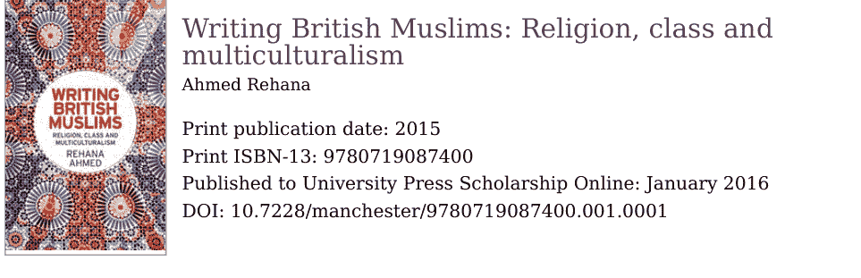
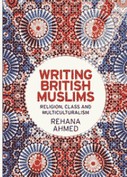
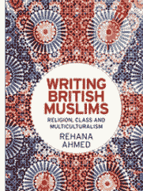
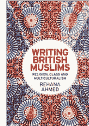
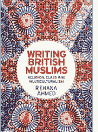

# 英国穆斯林写作：宗教、阶级与多元文化主义

## 献词

献给 Sam 和 Keir

## 致谢

本书在艺术与人文研究委员会奖金计划（资助号 `AHRC/1000577/1`）的帮助下完成。非常感谢 AHRC 的慷慨支持。此外，我感谢许多在本书写作过程中以各种方式支持我的同事和朋友。首先，我感谢 Elke Boehmer，本书是在她的指导下开始创作的。Elke 过去和现在都是一位深受启发的导师，她的投入和建议不断影响着我，并在多年里帮助我成为一个更优秀的文本读者。我感谢 Arts and Humanities Research Council 提供的支持，使本书得以完成。此外，我从 AHRC 资助的项目《英国的愿景：海外（1870-1950）》中受益匪浅。我特别感谢 Sushela Nash，她对本书的早期初稿提供了宝贵的反馈。

## 引言

引言通过关注作为 2012 年奥运会场地的伦敦多元化地区纽汉姆，提供了 21 世纪多元文化英国的视角，探索并质疑了围绕其少数裔融合及整体多元文化主义的讨论。它概述了对穆斯林和自由主义的敌意。

2013 年 9 月，一项旨在促进纽汉姆这一“超级多元化”伦敦东区“融合”的新策略引发了头条新闻。纽汉姆市长 Sir Robles 取消了公共图书馆对外语报纸的订阅，大幅减少了翻译服务，并取消了针对单一族裔或宗教的社区活动资金。他声称，这些措施将反对该区的隔离，并将其与种族隔离时期的南非相比，它强化了包括“信任”、“互惠”、“尊重”和“宽容”在内的“英国价值观”，以及作为英国人的自豪感。

这不是纽汉姆首次在关于英国多元文化主义的辩论中成为焦点：建造一座大型清真寺（被称为“超级清真寺”）的计划不仅遭到了当地社区的强烈敌意和反对，还遭到了政治人物和媒体评论员的反对。第一个故事于 2005 年 11 月出现在国家媒体上，当时伦敦获得申办 2012 年奥运会成功仅五个月；24 小时后，英国穆斯林在伦敦地铁和一辆伦敦巴士上引爆炸弹，导致数人死亡，数百人受伤。媒体反复强调清真寺的大规模及其对空间的“伊斯兰化”；对将在 2012 年奥运会期间向全球播出的国家形象；由于海外资金投入导致的“外来性”；以及塔布里吉贾马特与恐怖主义之间（未经证实的）联系——2005 年 7 月 7 日的袭击。《电报》2006 年的一篇文章中的摘要强调了前两个主题：“当全世界的电视在六年后看到开幕式期间体育场的俯瞰图时，镜头中最显眼的宗教建筑将不再是塑造国家历史的城市教堂（如圣保罗教堂或威斯敏斯特教堂），而是清真寺。” 正如预期的那样，争议随后被英国国防联盟（EDL）等右翼团体利用，以传播伊斯兰恐惧症。

正如丹尼尔·尼尔森·德哈斯和 Zacharias P. Piernt 所指出的，在成功申办奥运会后，人们对这座清真寺表示热烈欢迎，它是“一个多元文化的奥运地标”。文化多样性的形象被成功地用于向国际奥委会委员会推销这座城市。在首场演讲和宣布获胜城市的早晨，一组“代表伦敦东部文化和种族马赛克”的孩子在精英阶层塞巴斯蒂·奥的陪伴下出现。斯特拉福德（我们所说的纽汉姆的一部分）的多元文化特征被反复称为奥运会给“普通”伦敦带来“遗产”利益的“证据”。种族平等委员会的特沃·菲利斯宣布伦敦的胜利是“塞巴斯蒂·奥为强调城市民族和种族整合所做的游戏的辉煌辩护”。奥运会的多样性与多元文化主义形成对比，后者声称多元文化主义是支持那场可怕的 7/7 恐怖袭击的基础。媒体强调，两枚炸弹针对的是伦敦穆斯林人口比例较高的地区——纽汉姆邻近的塔河哈姆莱特，那里有大量的孟加拉国人；以及拥有大量阿拉伯社区的伦敦东部——这暗示了这一信息：伦敦不仅基于英国或伦敦本身，而且基于伦敦所代表的多样性。菲利斯通过文化多样性问题将申办奥运成功与炸弹案联系起来：

> 我们这个时代重大的问题是：一个多民族、多宗教的世界的人们能否和平共处星球？我们能跨越差异的界限吗？大多数人希望答案是响亮的肯定。但我们上周在伦敦看到了那些绝望的人，他们执意要证明我们不能、也不应该互不相让。这些极端分子对伦敦那些随和的人来说，是每天的侮辱。

在这里，伦敦的多元文化特征和受害者充当了对“我们”包容、开放和多样文化的证明，这反驳了“他们”那种单一的、同质化的旨在破坏“我们”生活方式的行为，掩盖了政府外交政策的作用以及西方军队在穆斯林土地的存在如何激励极端主义。关于阿比米尔斯清真寺和纽汉姆争议性“自然化”策略的论述呼应了这种多样性与单一性的二元对立概念化。虽然对塔布里吉贾马特孤立主义倾向的担忧可能是合理的，但奥运会的阴影进一步使伊斯兰教标签化，或者说它的存在价值在于多样性并支持人们“聚集在一起”，同时反对单一事件，这掩盖了由贫困造成的社会不平等，以及被投影为“英国式”的包容性假象，并暗示少数人的做法在本质上是不可分割的，即“它是为了人们记住的；委员会不应该为此买单！”塔里格·穆杜的讨论挑战了威尔士的整合策略以及“通过多元实现平等”。通过访问美国社会学家罗伯特·E·帕克和 W. I·托马斯的研究，穆杜认为“允许族裔有更多空间做自己的，使他们能够成为新社会的一个特征”。贾斯汀·博蒙特和克里斯托弗·贝克对英国穆斯林社会的分析将（“清真寺和亚洲杂货店的建立”）视为“穆斯林融入和对英国承诺的证据”，而非“分离的迹象”。事实上，正如齐亚·乌丁·萨卡尔所问的，将伦敦北部的犹太社区和唐人街与渴望主宰他们希望代代相传的身份的穆斯林人相比，是否被认为本质上是“一个问题”—— 正如阿拉娜·伦廷和加文·泰勒所观察到的，引用大卫·埃德加的话：显而易见的左右分歧已使进步思想者提出了一系列新界限——自由与权威、世俗与宗教、言论自由与审查、普遍主义与多元文化、女性主义与家庭——所有阶级和种族主义都以这种形式呈现，将进步的中产阶级置于一方，而将大量贫困人口置于错误的一方。将纽汉姆营销为 2012 年奥运会的潜在选址，与其该地区许多居民的物质现实形成对比。威尔士取消翻译服务和外语报纸不可避免地影响纽汉姆少数群体的弱势成员，包括穷人、最近的抵达者和老人，他们最不可能精通英语。纽汉姆是英国最贫困的地区，32.7% 的居民处于贫困。根据 2001 年人口普查，该地区四分之一的人是穆斯林，但这个数字现在更高。纽汉姆的穆斯林人口占 16.7%，也是最多元化的地区之一。纽汉姆约十分之五的孟加拉巴基斯坦儿童生活在贫困中。如果正如菲利斯所言的，我们的资本对人类多样性挑战提供了最好的现实世界答案，那么它并没有满足该大多数人口的基本生活标准。关键问题仍然在于，究竟谁将从奥运遗产中受益，以及如何。正如史密斯指出的，在当前全球资本扩张的时期，伦敦委员会承诺给伦敦东部的重建是将资本积累的逻辑、线和假设比以往任何时候都更深地嵌入城市景观。重建被视为解决“城市不平等”的“良方”。撒切尔政府在 20 世纪 80 年代对伦敦码头的重建例子说明了这一点。从“欺骗阶层”到他们原本所在的工人阶级。今天，码头的富裕居民并非开发前的社区（包括黑人、棕色人或白人），而是绅士化后进入的白人工人。这个绅士化地区的开发对其利益相关者来说是一个方便的计划。真的担心纽汉姆的发展会遵循类似的路径，科的那些年轻护士及其同伴的物质需求迷失在他们多元资本的光丽形象中。安娜·鲍尔认为，到目前为止注入纽汉姆的奥运资金很大程度上绕过了其弱势居民。纽汉姆的房价未能上涨，学校表现通过投资有所提高，但在 2005 年至 2010 年间，纽汉姆的失业率高于伦敦平均水平，奥运创造的就业只有极少数属于当地居民。补贴住房的供应已经减少，重建计划拆除了房屋并未能履行补偿性承诺，而从运动员村改造的负担负担的新房将是其最贫困居民无法负担的。

## 当代英国穆斯林、多元文化主义与阶级

《写作英国穆斯林：宗教、阶级与多元文化》，通过考察一系列当代文学文本，试图介入有关英国多元文化主义和伊斯兰教的辩论。通过对来自南裔穆斯林背景作家的一系列文本进行解读，包括萨尔曼·鲁斯迪、哈里·库雷西、莫妮卡·阿里和内德姆·阿拉姆的小说以及五本英国穆斯林回忆录，它探讨了文学如何增加我们对多元文化英国和南裔穆斯林阶级的理解。

其动力源于上述对多元文化英国的简要描述中所捕捉的若干担忧：权力物质结构的频繁出现迎合了“包容性多样性”的形象；自由主义对宗教表达和表现（尤其是伊斯兰教）在公共领域的呈现感到不安；支撑了关于整合与分裂之争的歧视性反对叙述的文化种族主义，特别是在涉及穆斯林时；多元文化主义在过去三十年左右所遭受的批评和攻击；以及在考虑英国的多元文化争议时，地方空间的重要性。塔里格·莫杜德曾写过文化主义种族的历史深度——一种建立在生物种族主义之上的种族——这是一种从老英国人视角出发、探索文化差异的进一步话语，“旨在消除、边缘化或要求遭受生物种族主义影响的群体进行同化”。莫杜德指出，反犹太主义和伊斯兰教恐惧等文化种族主义形式并非欧洲最古老的，而文化主义种族主义的当代观点可以追溯到英联邦移民迁入并定居英国。此外，文化差异对种族主义的核心性意味着，特别是穆斯林（其大多数为巴基斯坦或孟加拉国裔）已成为言语和身体攻击的目标，他们作为一个想要维护和坚持其文化与宗教元素的群体，而这些元素并不容易融入多数人的英国生活方式。

过去一个半世纪里，特别是几个事件加剧了对穆斯林的敌意。1988-89 年的“撒旦之作”对随后十年对穆斯林和伊斯兰教的认知投下了长长的阴影。2001 年 7 月布拉德福德、伯利和奥尔德姆的骚乱，2001 年 9 月 11 日和 2005 年 7 月 7 日的恐怖袭击，以及所谓的“反恐战争”及其引发的穆斯林愤怒，导致了对穆斯林男性青年的还原化和标签化形象，以及加剧的伊斯兰教恐惧情绪。在英国和其他其他欧洲国家，一系列争议和事件贯穿了随后的多年，包括 1994 年一群孟加拉国男孩杀害了学生理查德·埃弗里特；2004 年马德里爆炸案；同年，自称为伊斯兰教徒的穆哈默德·布埃耶里杀害荷兰电影导演西奥·范·高；2005 年荷兰《日德兰邮报》刊登描写先知穆罕默德的漫画；工党议员杰克·斯特劳将尼卡布视为一种分离和差异的可视声明，这在 2006 年引发了穆斯林的愤怒；以及法国的“头巾事件”，其演变成了“荣誉杀人”，以及涉及巴基斯坦男性的诱拐案，这些引发了辩论，并固化了对落后且暴力的穆斯林男权制的文化主义恐惧。穆斯林和伊斯兰教日益被塑造为世俗现代性的基础主义“他者”。正如彼得·莫里和阿米尼娜·雅西辛观察到的：


> 每天的头条新闻和电视屏幕都在尖叫，对于其他未被开化的人来说似乎是不寻常的，这些人尽管可能生活和工作在西方，但仍然效忠于与欧洲和北美所承认的不同的价值观。无论争议是关于先知穆罕默德漫画的胜利（在阿富汗、伊拉克和以色列-巴勒斯坦），还是关于授予萨尔曼·鲁什迪骑士称号的抗议，穆斯林似乎总是一个问题，困扰着定义西方国家的个人主义和自由的价值观。

狂热且暴力的伊斯兰教专栏作家；他被操纵、轻信且像羊一样的男性猎物；受压迫的、戴面纱的女性；以及狡诈但奴性的女母：这些刻板印象流传并充斥着我们大量消费的媒体。不仅是像英国防御联盟（EDL）这样的伊斯兰团体，或像梅兰妮·菲利普斯或理查德·利特约翰这样的右翼记者在帮助创造和延续这些形象，还有政治光谱中自由派的媒体评论员和政治家。正如来自中左派《卫报》的伊莉莎白·波尔斯在她对20世纪90年代英国穆斯林媒体呈现的研究中所言，“它排他性的自由主义形式并没有延伸到穆斯林，除非它的世俗方法……边缘化了私有领域。它对人权的自由主义方法（p.8）进一步使‘伊斯兰’实践变得不理性且野蛮。”事实上，所谓EDL的驱魔式话语正如伦丁和泰勒所描述的，“在政治主流话语中流传的十年背诵真理的产物”，“是对世俗自由主义的近乎谱系的研究，以及向排他性的、要求的文化主义的英雄主义”。

与对穆斯林的这些刻板建构密不可分的是对英国多元文化主义的持续攻击。对于英国穆斯林来说，他们已成为多元文化主义过度的符号。正如对多元文化实践和政策的批判可以作为边缘化和标签化穆斯林的手段，穆斯林所谓的过度也为批评多元文化主义提供了实用的载体。伦丁和泰勒描述了希贾布、尼卡布和伯尔卡如何成为多元文化反对重要线的节点符号，代表了神权和男权对女性的压制或压迫；作为平行社区和整合薄弱的表现；作为对公共机构和在某些地方对公共空间世俗性质的攻击；也许是所有这些，作为对在西方繁荣的性别平等特殊文化的相对主义冒犯（p3）。在过去一或两个世纪里，政治和媒体评论员对穆斯林实践的明显关注，可以追溯到这件简单服装的强大符号功能：将其作为贬低多元文化主义和使自由主义排斥合法化的手段，并将入侵阿富汗合法化为一项拯救布什总统权力的使命——拯救蒙昧的“被遮盖的女性”。在这里显而易见的是在穆斯林和多元文化主义的批评中对性别的部署。这种落后男权实践的颠覆性女性受害者形象加强了对残暴、野蛮和不理性的伊斯兰男性的刻板印象，反之亦然，而对多元文化主义的攻击是基于对穆斯林社区是压迫性的（对那些女性）、自我隔离的（为了控制他们的女性）的性别概念化。

许多学者挑战了对多元文化主义的攻击。关键人物是塔里克·莫杜德，他的开创性学术借鉴了泰勒和比库·帕雷克等人的观点。莫杜德认为多元文化主义或“差异政治”并非色盲的，而是承认并尊重差异，容纳社区或群体（包括宗教群体）以及个人，并打破了自由主义至关重要的公私划分。他反驳了认为承认集体是基于错误的本质主义概念并忽略了内部异质性的观点。然而，他认为群体身份并非因为如此而不真实：“这些非白人群体（p.10）是多元文化的焦点，具有可见性，并遭受持续维持群体身份的排斥形式；特别是人们以个人、制度和政治方式对身份产生热情的投入，认为这些身份是符号性的或文化遗产。”

此外，他揭穿了公共领域中立性的观点，认为后者不可避免地被社会主导群体所塑造，因此孤立必然导致了这些身份的边缘化（p38）。平等只有通过与“平等尊严”并行的“平等尊重”才能获得：后者关注人们的共同点，前者关注差异对于理解以及平等关系和权利的重要性。莫杜德认为，对群体身份的否定或视觉化是一种压迫形式，使得平等尊重变得不可能，但也威胁了“少数族裔的公平”（p9）。此外，莫杜德拒绝世俗自由主义者的观点，即宗教不像种族或性别是存在的，因此穆斯林不需要与其他身份相同的法律保护，且宗教不能成为平等承认：“没有人选择出生或不出生在穆斯林家庭，”他写道，“没有人选择出生在一个以穆斯林身份工作的社会，或作为穆斯林遭受怀疑、敌意，或未能获得申请的工作”（p40）。

“文化落后、暴乱、缺乏英国特质以及激进伊斯兰教的温床”。莫杜德写道，尽管所涉及的学校比例超过90%，但它们并非由穆斯林人经营，而是由“当地、底层的综合性学校”运营，这些学校遭受了几十年投资不足和“白人流失”的痛苦，并由白人教师根据世俗课程进行教学。将穆斯林经营的学校与世俗经营的学校混淆，捕捉了自由多元文化主义的偏见，这种偏见将贫困、种族主义和伊斯兰恐惧症的问题转化为“文化和文化分离问题”。萨达克表达了类似的观点，认为影响全英穆斯林社区的社会、经济和环境劣势并非主要是穆斯林的问题；而是破败、剥夺、忽视和衰败的普遍性问题。《英国穆斯林写作》通过其对多元文化文本和背景的解读，使其中心化。通过这种方式，它挑战了那些代表并掩盖权力结构、并污名化穆斯林和多元文化的自由主义二元对立：“自由与权威、世俗主义与宗教、言论自由与审查、普遍主义与多元文化、女性主义与家庭”。在这里，斯拉沃·齐泽克的作品指出，为了“特定（种族、世俗等）生活方式的‘特殊身份政治’”定义并掩盖了公平的‘正当的政治’：因为后者允许对“整个社会空间”进行重构，或对资本主义权力压迫结构提出挑战，而前者仅仅是让每个群体都能被记录，并在现有的（新自由主义资本主义）社会秩序中被分配其位置。右翼保守主义与宽容自由主义之间的对立，模糊了分层世界的真实物质划分，并将其还原为仅仅是文化差异：多元文化/世俗（等）的“开放性”对比传统的（自然的）“家庭价值观”。

此外，在这个光谱中，任何真实的差异（包括差异本身）都被剥夺了合法性，并可能被强迫进入极端或教条主义形式。对于“宽容的多元文化主义”，齐泽克仅仅是对文化差异口头应和；它愿意体验“被剥夺了他者的他”，并与民粹主义种族主义一样，需要将他人保持在适当的距离。“自由主义的‘宽容’解构了失去了实质的民俗化‘他者’——就像那个‘他者’立即因其‘教条主义’而受到谴责……‘真实的他’在定义上是‘父制的’、『暴力的’，绝不是拥有空灵奇妙和迷人习俗的他”。虽然莫杜德可能因为他忽视了阶级在制造社会分裂中的作用以及基于阶级的政治而受到批评，但齐泽克的多元文化主义导致了他在某种程度上的色彩和文化盲目。他辩护了自由主义多元文化主义，但在他的分析中，几乎没有空间对世界上的文化和宗教少数群体采取平等的对待，而在那个世界里，文化差异有时似乎几乎被还原为物质划分。通过将“种族‘生活方式’”缩小为筛选物质划分的手段，他否认了文化差异作为边缘化群体贫困和压迫根源的意义，以及作为群体认同和社交动员来源的意义。相反，本书旨在将物质的、基于阶级的分析与对文化（包括宗教）差异在分层和极大化社会成员（尤其是穆斯林）方面作用的承认相结合。它探索了阶级与少数宗教身份之间的关系，同时主张在公共领域积极承认文化和宗教差异，作为反对不平等和挑战这种分层、边缘化和污名的手段。通过将物质方法与对宗教信仰意义的承认相结合，它将政治与宗教


# 齐泽克还提出了一个重要观点

对特定种族（并延伸到宗教）身份的拒绝或“超越”是由阶级塑造的。⁵⁰ 因此，将群体认同视为本质上具有压迫性和反动的，可能是对工人阶级主体性的精英主义式排斥。事实上，如果群体的支持、自豪和动员很重要，人们就会倾向于形成群体并更强烈地认同为穆斯林。⁵¹

马德琳·邦廷（Madeleine Bunting）的著作暗示了宗教与阶级之间的联系。Bunting 的证据源自1930年代大萧条时期芝加哥贫困的社区，她写道，“阿林斯基（Alinsky）发现，在贫困社区，与最深根源产生的最强认同是基于信仰的；它们为贫困社区提供了资源——一种在匮乏中购买的、融合尊严和意义感的混合物”。Bunting 将此转化为当代英国，指出世俗主义的精英主义，诸如理查德·贝恩斯（Richard Baines）这样的人物支持让伦敦巴士上宣布上帝存在的口号重新达成和谐。通过强调一些工人阶级（且极有可能是非裔-加勒比人）读或祈祷书之间的共同信仰，Bunting 有力地捕捉到了阶级与宗教/世俗二元对立的交织。

Bunting 的研究关注了《英国穆斯林写作》的另一个关注点：在考虑一辆鲜艳的伦敦巴士时，空间的意义——它穿过城市，主导了大都市空间。这是一个权势者的口号，也是被剥夺者的口号，他们缺乏空间的所有权（非白人、非世俗的、回新纽姆（Newham）的乘客），发现了这种不平等的物质性。

米歇尔·塞尔托（Michel Certeau）将公共主体的“策略”理论与那些声称占据可以被空间（固有空间）界定并具有全景式权力的人的“战术”相对比；战术缺乏使用的场所，必须进入另一种、碎片化的状态；在对所有权权力的监视中抓住机会。大卫·哈维（David Harvey）和亨利·列斐伏尔（Henri Lefebvre）也证明了空间对资本主义权力结构的重要性。正如哈维所说，“领土组织、殖民主义和帝国主义、不平衡发展、城乡矛盾以及地缘政治冲突的整个历史，以及此类斗争在资本主义历史中的重要性。⁵⁴ 它是由斗争塑造或构建的，并且是斗争的对象。”列斐伏尔描述了19世纪的巴黎资产阶级和工人也为空间而斗争。

同样，在当代英国，穆斯林争取英国特质的斗争是争取空间的斗争，通过将他们的宗教文化嵌入空间——无论是以建造清真寺的形式，还是在公共场所佩戴头巾——来完成这一过程。空间是英国关于穆斯林和多元文化主义焦虑和辩论的核心，正如新纽姆速写中所强调的那样。对建造清真寺的抵抗和对穆斯林“贫民窟”的投诉源于对空间“伊斯兰化”的恐惧，而围绕穆斯林头巾的争议实际上在于，这件衣服是否（以及在何种程度上）应该被允许渗透公共空间。“整合”与“隔离”的问题被不断讨论，特别是在2001年种族暴乱之后，以及对亚洲和白人青年领导“平行通道”的描述之后。整合与隔离的二元对立建立在空间的抽象和碎片化之上，这掩盖了塑造它的社会关系。在这种配置下，例如对英国东部穆斯林地区的所谓“隔离”，是与其语境脱节而抽离的，以至于它成为填充该空间和文化的功能，而不是由资本主义在空间中物质化所产生的社会划分。正如列斐伏尔告诉我们的，这种空间必须被视为一种（社会）产物，因此是相关的且辩证的。一旦像哈姆雷（Hamlets）等文化多元区域内的社会空间政治被暴露，连接伦敦贫困社区与某些地区特权多样性以及其他地区“贫民窟”的社会关系就不再能被极化——那种将纯洁和自由与单一性和约束对立起来的自由主义自由，转而关注社会不平等。

# 在对荷兰背景下言论自由辩论的深刻讨论中

朱迪特·巴特勒（Judith Butler）描述了国家在决定“谁的表达自由将受到保护，而谁将不会”方面的作用，以及国家如何将言论自由的概念工具化，作为对其非白穆斯林少数群体进行标签化的手段。它将自身的穆斯林人口描造成对自由价值的威胁，然后仅通过强化不自由来保护每一个自由主张。尽管荷兰公民融入考试（特别是）的细节，巴特勒并未直接应用于英国语境，但她的观点依然成立：英国穆斯林人通过围绕言论自由争议的话语体系被对待为局外人和入侵者；在回应出版他们认为具有冒性的性的时，对言论合法性的剥夺恰恰是某种“不自由”的形式，即使这种不自由并非由国家所实施。

关于丹麦漫画事件，工党也表达了类似的观点：批评并不一定将思想从劳动力中解放出来；它还强化了特殊人性的人类与尚未拥有自身身体、情感和思想的“真人性候选者”之间的现有区别。换句话说，“它强化了”欧洲穆斯林人的意识形态状态，即尚未是自主且缺乏政治纪律的。在这里，阿萨德（Asad）通过对“尚未”（yet）一词的重复，演变了一种刻画穆斯林规范化方法（第16页）的时间路径，将他们设定为后于世俗同类而非平等，拥有自己独特且异质的轨迹。

作为一种世俗主义的唯物方法，消除创作自由与宗教自由及审查之间的二元对立需要打破宗教与世俗之间的二元法，从而将宗教置于世俗的思想与言论自由、宽容、理性性和进步之中。特别是，它扰乱了世俗主义的常态，使其局限性和排斥性暴露出来。在他最近的作品中，尤尔根·哈贝马斯（Jürgen Habermas）承认并合法化宗教在公共领域的活跃存在，并试图勾勒出一个“后世俗”概念，将宗教视为宗教人士和非宗教人士的积极力量。这就是“后世俗”的理念，即世俗和宗教双方都具有自反性，且之间存在交叉、共性和趋同的可能，这似乎对于致力于建设一个更加平等公正的多元文化英国最有成效。

# 本书范围

《描写英国穆斯林》（*Writing British Muslims*）将领域视作竞争且不平等的话语之间的斗争场所，以及知识分子与部分英国穆斯林人之间争端的对象。鉴于该国家的人文主义、资产阶级遗产，以及新无神论者将解放视为通过“自由言论”、“个性”和“理性”来对抗不宽容、压迫性的穆斯林的理解，本书审视了由南亚穆斯林裔作家创作的当代小说，在表现英国穆斯林和多元文化方面，在多大程度上超越了自由主义世俗主义的边界。

作为一种文学生产理论，皮埃尔·马卡瑟里（Pierre Macathery）认为他们的话语是“对语言的争夺”而非“对现实的呈现”。尽管小说是扭曲而非反映，它远比一种欺骗性的幻觉复杂：小说并不比幻觉伟大……但它可以通过渗透其不充分性，通过改变我们与意识形态的关系来设定幻觉。小说欺骗我们是因为它是伪装的；这并非首要的欺骗行为，因为它旨在实现更深层次的目标——揭露它，帮助我们从中释放。通过其“间隙与矛盾”以及“多种意义的并置（第17页）与冲突”，小说作品展示了其意识形态。正是在这种意义上，小说作品内部包含了“对自身意识形态的内含批判”。正是在这种意义上，文学积极参与社会世界（通过揭露通常被意识形态所掩盖的社会矛盾），并具有改变读者与意识形态关系的潜力。特别是，马基（Mackey）对文本感官重要性的强调启发了本书。我对所选文本的阅读侧重于它们没有——不能说的内容，它们奇异的间隙和遗漏，这反过来可以揭示它们对英国穆斯林和多元文化的看法，以及这种言说的局限性，从而阐明了社会背景下运作意识形态压力。

通过对文本的详细解读与对其社会背景的持续关注，本书证明了文学对我们理解多元文化英国以及穆斯林在其中的地位所做出的重大贡献。莫里（More）和Y评论道“穆斯林形象的无处不在以及还原性陈词的执意重复”。正如他们指出的，“对穆斯林的刻板印象发生在政治家、新闻和媒体，甚至是那些声称代表他们发言的人的反复表现行为中。”因此，在表现领域，以及社会和政治领域，评判性的干预都是必要的，而莫里（Morey）通过对电影、电视、广播和其他媒体等一系列非文学文化形式的极具洞察力的分析，有力地证明了如何强力地塑造穆斯林。虽然文学表现不如媒体形象那样普遍，但它们有能力揭示塑造多元文化和公众对穆斯林及多元文化理解的紧张和冲突意识形态，带我们超越英国防御联盟及其同类流传的错误目标刻板印象，进入更复杂的领地。

遵循弗雷德里克·詹姆斯（Frederic James）对不可解决社会矛盾的“遏制”策略，本书探索了我所选文本如何使多元文化英国的矛盾显化。

此外，近年来，对穆斯林的表现在文学领域日益突出，反映了英国主流读者在9/11和7/7等事件背景下，想要“了解”穆斯林他者”的怀疑性渴望。对莫妮卡·阿里（Monica Ali）《砖巷街》（*Brick Lane*）的接收（在第4章讨论）以及9/11和7/7之后英国回忆录的激增（第18页），强烈暗示了：虽然文学表现不如媒体形象那样普遍，但它们有能力揭示塑造多元文化和公众对穆斯林及多元文化理解的紧张和冲突意识形态，带我们超越英国防御联盟及其同类流传的错误目标刻板印象，进入更复杂的领地。对穆斯林的表现在文学领域变得日益显著，反映了英国主流读者在在9/11和7/7等事件背景下，想要“了解”穆斯林他者”的怀疑性渴望。

# 引言

将英国散居文学领域进一步推向世俗自由主义的范畴，转向一种对多元文化英国的唯物主义、后世俗化的参与。

本书的内容和结构受到对历史作为其物质承诺不可分割组成部分的兴趣的塑造。在这里，本书遵循时间线轨迹，开篇的第一章探讨了从20世纪初到20世纪80年代南亚穆斯林在英国的存在与实践。该章批判性地强调了围绕英国穆斯林的意识形态和反向叙事，并对当代小说的阅读进行了语境化。不同于南亚穆斯林仅在二战后才迁移到英国的传统观点，本书关注了20世纪30年代和40年代在伦敦工作的主要是工人阶级的南亚穆斯林的活动，并展示了在英国的南亚穆斯林至少在一个世纪前就已经形成社区并在文化上动员争取在公共领域行使信仰的权利。每个案例都对近期关于英国穆斯林和多元文化的争议提供了深刻的见解。该章还解读了萨尔曼·鲁什迪争议——通过这种方式，它凸显了文学争议的复杂性，以及阶级、地点、性别以及其他因素在其中可能发挥的重要作用。对世俗形式的反种族主义的思考，包括《午夜》（*1978*，据我所知，这是唯一对该时期南亚经验的虚构尝试），以及地区、阶级和种族相互作用以形成反抗叙事的不同方式，旨在挑战肯南·马利克（Kenan Malik）提出的论点以及强加海外的多元文化政策的兴起。

第二章首先为围绕萨尔曼·鲁什迪《撒魔诗》出版的争议提供了关键背景，建立了了对种族、阶级和宗教信仰进行辩证理解的重要性，并将抗议活动根于其物质条件。该章再次回顾了小说，并表明鲁什迪引发的焦虑很大程度上源于世俗自由主义多元文化的排斥。虽然鲁什迪本人否定了抗议的合法性，但本章认为，穆斯林社区对撒切尔时代英国的斗争与小说中所渗透的反对宗教社群主义的世俗个人主义之间存在紧张关系。该章揭示了小说试图管理和解决这种嵌入其中并在出版后以抗议形式显的紧张关系的策略。

汉尼夫·库雷希（Hanif Kureshi）的部分作品影响了第三章的重点。通过考察库雷希在《黑专辑》（*1995*）中对英国穆斯林的明确描写，以及短篇小说《我狂热的儿子》（*1997*）、《亲密》（*1998*）、《我听在他心里的声音》（*2004*）和《有些话想对你说》，以及一系列故事，该章追踪了这位以强烈反对撒切尔主义受许可的种族主义而闻名的作人的轨迹，并探索了库雷希所创造的、由混族主体充斥的多元文化城市中，穆斯林的处境。

文章认为，库雷希的作品有助于塑造英国的多元文化：一方面通过赋予一种新的、文化多样化的英国特性的合法性；另一方面，与库雷希作品中遇到的中产阶级多元文化世界形成对比，莫妮卡·阿里（Monica Ali）的畅销小说《砖巷街》（*2003*）被置于在一个“飞地式”的工人阶级穆斯林社区中。该章认为，这个社区在很大程度上与其所在的多数人英国背景脱节，以至于社区的问题（压迫女性、毒瘾、宗教极端主义、暴乱）根源于其（宗教）文化，并孤立于多数人的排斥。在这里，主角纳兹林（Nazreen）从束缚到自由的轨迹是由社区内部父权结构及其规避或颠覆塑造的，而很少感受到这种空间施加给社区男性的压力。该章探讨了文学界对小说的反响以及孟加拉社区成员的对比性反应，并认为《砖巷街》中代表的社会意义是在居住在砖巷街周边的英国穆斯林接受并抗议该小说及其电影拍摄时显现的。其目的并非主张文学审查，而是为了揭露言论自由原则与种族和文化（宗教）相关的本质，并对这种抗议作为一种争取承认和自我呈现的斗争，以及反对阻碍此类权利的不平等的斗争，提供更微妙的描述。

尽管本身并非争议，但尽管使用了“犯罪”这一沉重的术语，卡里姆（Karim）2004年的小说《迷失爱人的地图》考察并探索了少数群体冒犯的政治，以及个人自由与文化感性及审查之间这种回应争议的二元法。该章探讨了《迷失爱人的地图》中这种二元法的存在和含义，以及这部在英国多元文化政治一个悲剧性时刻出现的小说，如何超越了性别化的文化话语——这些话语被左右两派对多元文化“失败”的声明所削弱。文章认为，尽管将被压迫者的行为在多数群体中的边缘化状态进行了语境化，小说仅提出了两种备选立场：要么是从社区、文化和信仰中撤退并异议的个人，要么与社区的压迫行为共谋，其受害者主要是女性和儿童。围绕共同宗教文化形成的后极权主义潜力通过对虐待女性的关注而不断被偏转或阻碍，使得基于“承认政治”（包括对宗教的公开承认）和对性别平等的承诺的彻底多元文化处于紧张状态之中。

书的最后一章考虑了在9/11和7/7事件后激增的年轻英国穆斯林的自传回忆录：埃德·胡斯因（Ed Husain）的《伊斯兰主义者》（*2007*）、萨法兹·马吉德（Sarfaz Majid）的《来自伯里公园的问候：种族、宗教与摇滚乐》（*Greetings from Bury Park; Race, Religion and Rock ‘n Roll, 2007*）、雅斯敏·海（Yasmin Hai）的《父亲的养成：成为英国人》（*2008*）、谢琳娜·贾纳（Shelina Janah）的《头巾下的爱》（*Love in a Headscarf, 2009*）、扎伊巴·马利克（Zaiba Malik）的《我们是穆斯林，请包涵》（*2010*）。该章调查了这些叙事受伊斯兰教基础塑造的各种方式，调查了他们如何在阐述英国身份时处理这些问题，以及他们如何干预穆斯林占多数的英国社会。

# 参考文献

(8) Trevor Phillips, “让我们向世界展示它的未来”，《观察报》（2005年7月10日），`www.guardian.com/uk/2005/jul/10/olympics2012.olympicgames`（最后访问2014年11月6日）。

(9) 同上。

(10) Seamus Milne, “否认与伊拉克的联系是一种侮辱”，《卫报》（2005年7月14日），`www.theguardian.com/politics/2005/jul/14/july7.uk`（最后访问2014年11月6日）。

(11) 引用自 Nye, 《自然化纽纳姆》。

(13) Christopher Baker and Justin Baumant，“后殖民主义与宗教：后世俗城市中‘归属与生成’的新空间”，收于 Justin Baumant and Christopher Baker（编），《后世俗城市：空间、理论与实践》（伦敦：Continuum，2011），第33-49页。第42-5页（重点见作者注）。

(14) Anshuman A. Mondal, 《英国穆斯林的声音》（牛津和康涅狄格州威斯特波特：Greenwood，2008），第96页。

(15) Ziauddin Sarkar，“希望的空间：干预”，收于 Richard Phillips（编），《穆斯林的希望空间：英国与西方的可能性地理学》（伦敦：Zed Books，2009），第13-36页，第14页。

(16) Alana Lentin and Gavin Tiley, 《多元文化之危机：新自由主义时代的种族主义》（伦敦：Zed Books，2001），第28页；David Edgar，“在新一次革命中，进步是与穷人对抗而非与他们合作”，《卫报》（2009年8月24日），`www.theguardian.com/commentfree/2009/aug/24/revolution-1989-1979`（最后访问2014年11月6日）。

(17) Paul Gallagher，“贫困的纽纳姆目睹了议会资金在三年后从价值1.1亿英镑的大楼撤出”，《独立报》（2013年9月24日），`www.independent.co.uk/news/uk/politics/deprived-newham-watches-vanished-as-council-pounds-move-from-110m-building-after-three-years-8836972.html`（最后访问2014年11月6日）。

(18) Nye, 《自然化纽纳姆》；Harris, “穆斯林”，第3页。

(19) Harris, “穆斯林”，第7页。

(20) Madeleine Burning，“这关乎真正的受害者”，《卫报》（2004年12月11日），`www.theguardian.com/world/2004/dec/11/race.religion`（最后访问2014年11月6日）。

(21) Phillips, “让我们向世界展示”。

(22) Henri Lefebvre, 《城市革命》，Robert Bononno 译（明尼阿波利和伦敦：明尼苏达大学出版社，2003），第xxi页。

(23) Dore Massey, 《广泛社会经济趋势的微观世界》（伦敦：Docklands Forum，1991）。

(24) Kalliney, ‘全球化、后殖民性与《撒旦诗节》中的文学研究问题’，《现代小说研究》，48:1 (2002)，第50–82页，第62–3页。

(25) Anne Power, ‘东伦敦的奥运会投资几乎没有触及该地区的真实需求’，伦敦政治经济科学学院，英国政治与政策博客（2012年8月15日），`http://blogs.lse.ac.uk/politicsandpolicy/olympics-newham-investment-power/`（最后访问2014年11月6日）。

(26) Modood, 《多元文化政治》，第28页。

(27) 同上，第40页。

(28) Jack Straw，“与看不见的人交谈让我感到不安”，《卫报》（2006年10月6日），`www.theguardian.com/commentfree/2006/oct/06/politics.uk`（最后访问2014年11月6日）。

(29) Peter Morey and Amina Yaqin, 《框定穆斯林：9/11事件后的刻板印象与表呈现》（剑桥：哈佛大学出版社），第1页。

(30) Elizabeth Poole, 《报道伊斯兰教：媒体对英国穆斯林的呈现》（伦敦和纽约：I. B. Tauris，2002），第248页。

(31) Lentin and Tyler, 《多元文化之危机》，第37页。

(32) 同上，第85–6页。


### 参考文献

(33) 欲了解世俗主义排他性的清晰简述，参见 Bhikhu Parekh, 《多族裔英国的未来：帕雷克之路》（伦敦：Profile，2000），第46–7页；以及《反思多元文化：文化多样性与政治理论》（贝辛斯托克：Palgrave Macmillan，第2版，2006），第109–13页，338–9页。

(34) Morey and Yaqin，《框定穆斯林》，第49–50页；Andrew Pilkington, '从制度性种族主义到社区凝聚：英国种族话语的演变’，《社会学研究在线》，13:3 (2008)，www.socresearchonline.org/13/3.html，1–3（最后访问2014年11月6日）。

(35) Tariq Modood, 《多元文化：公民理想》（剑桥：Polity，2007），第10–11页；Tahir Abbas，《英国亚洲穆斯林：过去与现在》，收于 Tahir Abbas（编），《穆斯林社区：压力下的社区》（伦敦和纽约：Zed Books，2005），第3–27页，12–4页。

(36) David Goodhart, ‘陌生人的不适感’，《卫报》（2004年2月24日），www.theguardian.com/politics/2004/feb24/race（最后访问2014年11月6日）；以及‘过度多元化？’，《展望杂志》（2004年2月20日），www.prospectmagazine.co.uk/magazine/too-diverse-goodhart-multicultural-integration（最后访问2014年11月6日）；Trevor Phillips, ‘在梦游中隔离’发表于曼彻斯特社区关系委员会（2005年9月22日）。

(37) Modood, 《多元文化》，第106页。

(38) 同上，第54页。

(39) 同上，第51-3页。

(40) 同上，第70、71页。

(41) Modood, 《多元文化政治》，第202页。

(42) 同样，2014年伯明翰极端主义指控中心的学校（马行动）并非伊斯兰学校，而是穆斯林学生比例较高的贫困地区公立学校。对学生和课程强加基础主义的、不宽容的伊斯兰教解读令人不安。然而，媒体和政府的呈现揭示了许多误解，包括保守主义与主义的高度问题问题，以及自我隔离；伯明翰社区的隔离源于贫困和人口迁移。Seamus Milne，“迈克尔的有毒攻击基于裸歧视”，《卫报》（2014年6月11日），www.theguardian.com/commentfree/2014/jun/11/michael-assault-on-schools（最后访问2014年11月6日）；Gus John, ‘学校中的木洛马与极端主义治理’（2014年6月7日），www.gusjohn.com/2014/06/trojan-horses-and-policing-extremism-in-schools（最后访问2014年11月6日）。

(43) ‘希望的空间’第18页。

(44) Tyler, 《多元文化课程》，第28页。

(45) Slavoj Žižek, 《选集》，卷2（伦敦和纽约：Continuum，2006），第203页。

(46) Slavoj Žižek, ‘我们为何都欠仇恨’收于《通用例外》，第34页。

(47) Slavoj Žižek, ‘自由主义多元文化用人脸掩盖了所有野蛮’，《卫报》（2010年10月3日），www.theguardian.com/commentfree/2010/oct/03/immigration-policy-europe（最后访问2014年11月6日）。

(48) Slavoj Žižek，“多元文化或多元资本主义的文化逻辑”收于《通用例外》，第162页。

(49) Sarah Lynn，“自由化伊斯兰教：创造具有伊斯兰倾向的英国人’收于 Phillips（编），《希望空间》，第179–197页，第184页。

(50) Žižek, 《多元文化》，第17–25页。

(51) Modood 认为穆斯林“从他们的群体自豪感中汲取力量”，或来自他们的穆斯林身份（多元文化政治，第107、122页）。

(52) Madeleine Buntine, '宗教赋予政治社会正义激情’，《卫报》（2009年1月12日），www.theguardian.com/comment-free/2009/jan/12/madeleine-buntine-religion-social-justice（最后访问2014年11月6日）。

(53) Michel de Certeau, 《日常生活的实践》，Steven Randell 译（伯克利和洛杉矶：加州大学出版社，1984），第36–37页。

(54) David Harvey, 《后现代性》（牛津：Blackwell，1990），第237页，引自 Stuart Elden, 《理解列斐伏：理论与可能》（伦敦和纽约：Continuum，2004），第181页。

(55) Henri Lefebvre, 《空间的生产》，Donald Nicholson-Smith 译（牛津：Blackwell 1991），第404页。

(56) Henri Lefebvre, 《核心著作》，Stuart Elden, Leonore Eman 编（伦敦和纽约：Continuum，2003），第154页。

(57) Kenan Malik, 《从法瓦到圣战：鲁德迪事件及其遗产》（伦敦：Atlantic Books，2009），第47页。

(58) Ted Cantle, ‘坎特报告——社区凝聚力’，内政部（2001），http://resources.cohesinstitute.org/Publications/Download-Documents.aspx?recordID=96&file=PDFversion（最后访问2014年11月6日）。

(59) Dore Massey, 《空间、地方与性别》（剑桥：Polity，1994），第19–20页。

(60) Lefebvre, 《空间的生产》，第27页。

(61) Arthur Bradley and Andrew Tate，“引言”，收于《9/11后的无神论小说：小说、哲学与争论》（伦敦：Continuum，2010）。

(62) 同上，第11页。

(63) 同上。

(64) Judith Butler，“批判的敏感性：对 Asad 和 Mahmood的回应”，收于 Talal Asad, Wendy Brown, Judith Butler and Saba Mahmood 等，《批判是世俗的吗？亵渎、伤害与言论自由》（伯克利，加州：人文中心，2009），第101–136页。

(65) Talal Asad，“言论自由、亵渎与世俗批判”，收于 Asad 等，《批判是世俗的吗？》，第20–63页，第55–56页。

(66) Dore Massey, 《为了空间》（伦敦：Sage；2005），特别是第68–70页。

(67) 欲了解不同方式尝试的作品，可参见 Taylor Egleton, 《理性、信仰与革命：对上帝辩论的反思》（新亥卫和伦敦：耶鲁大学出版社，2009）；“言论自由”；宗教与世俗作为不可调和的鸿沟（收于 Asad 等，第64–80页）；Charles Taylor, “我们需要对世俗主义进行激进的重新定义”，收于 Judith Butler, Jürgen Habermas, Charles Taylor and Cornell，《宗教在公共领域的力量》（纽约：哥伦比亚大学出版社，2011），第34–59页。

Timothy Fitzgerald，《国际关系中的宗教与政治：现代神话》（伦敦与纽约：Continuum, 2011）。

(68) 参见 Jürgen Habermas，《文化的平等对待与后现代自由主义的局限》，《政治哲学杂志》(Journal of Political Philosophy), 13:1 (2005), 1–28；《公共领域的宗教》，《欧洲哲学杂志》(European Journal of Philosophy), 14:1 (2006), 1–25；《关于后世俗社会的注记》，Signandsight.com (2008年6月18日), 1–23。

(69) Anshuman A. Mansal 的新书《伊斯兰教与争议：鲁斯迪言论自由政治》（巴辛斯托克：Palmgrave Macmillan, 2014）对一系列由穆斯林统治地区的言论自由争议所引发的道德问题进行了极其重要的探索，并且与本书一样，对支持言论自由的自由主义论点进行了批判。遗憾的是，该书出版时本书已已经在制作中，因此它对这些问题的讨论为太晚了。

(70) Pierre Marchaire，《文学生产理论》，Geoffrey Wall 译（纽约与伦敦：Routledge, 1996） [1978; 法语原版于 1966 年]，第 64 页。

(71) 同上，第 84, 100 页。

(72) 同上，第 86 页。

(73) Morey 和 Yaqin，《框架化穆斯林人》，第 2 页。

(74) Frederick James，《潜意识：叙事作为一种社会象征行为》（伦敦：Routledge, 1981），第 56–79 页。

(75) Ginny Doughery，《Ginny Doughery 采访 Martin Ames》，《时代杂志》(Times Magazine) (2006年9月9日)；《Martin Ames 不是种族主义者》，《卫报》(Guardian) (2007年11月21日), www.theguardian.com/world/2007/nov/21/religion.race; Stuart Jeffries，《每个人都需要脸皮厚一点》，《卫报》(Guardian) (2008年7月11日), www.theguardian.com/books/2008/jul/11/salman-rushdie.bookprize (访问日期：2014年11月6日)。

(76) Saed Shah，《由于他们陷入混乱，巴基斯坦作家正赢得赞誉》，《卫报》(Guardian) (2009年2月17日)，第 23 页。在英国背景下，2000年以来入围英国布克奖奖名单的穆斯林作家包括 Monica Ali (2003)、Hashim Matar (2006) 和 Mohsin Hamid (2007)；参见 Rehana Ahmed，《穆斯林的文化、离散与现代性》，收于 Rehana Ahmed, Peter Mohamed 和 Mary Yaqin 编类，《写作》中的“引言”（伦敦与纽约：Routledge, 2012），第 1–17 页，第 1–2 页。

(77) 此外，近年来出现了对英国穆斯林的本土电影和电视呈现：Ayub Khan-Din 和 David O’Connell 的《东方即东方》（2010）、Ayub Khan-Din 和 Andy Deemmy 的《西方即西方》（2010）、Simon Beaufoy 和 Kenny Glenaas 的《雅斯敏》（2004）、Peter Kosminsky 的《布里茨斯》（2007）、Chris Morris 的《四头狮》（2010），以及 Sushela Nasta 的著作《家园真相：南亚离散族群在英国的功能》（巴辛斯托克：Palmgrave Macmillan, 2002）；James Procter，《居住地：战后英国写作》（曼彻斯特：曼彻斯特大学出版社, 2003）；Ruvani Ranasinha，《英国的南亚人：翻译中的文化》（牛津：牛津大学出版社, 2007）；Sara Upstone，《英国亚洲裔虚构：21世纪的声音》（曼彻斯特：曼彻斯特大学出版社, 2010）；Dave Gunning，《英国黑人和亚洲裔文学中的种族与反种族主义》（利物浦：利物浦大学出版社, 2010）；Geoffrey Nash，《写作穆斯林身份：身份的构建》（伦敦与纽约：Continuum, 2010）；Ahmed 等人（编），文化、离散与现代性；Claire Chambers，《英国穆斯林虚小说：与当代作家的访谈》（巴辛斯托克：Palgrave Macmillan, 2012）。

(79) Phina Werner，《曼彻斯特穆斯林人想象中的离散：巴基斯坦跨国身份政治的公共表演》（牛津：James Curry, 2002）。

(80) Tariq Modood，《穆斯林、宗教平等与世俗主义》，收于 Geoffrey Brahm Levey 和 Tariq Modood 编，《世俗主义、宗教与多元文化公民》（剑桥：剑桥大学出版社, 2009），第 164-85 页，第 168 页。

---

### 章节内容



**印刷 ISBN-13:** 9780719087400

**DOI:** 10.7228/chester/9780719087400.001.0001

本章探讨了20世纪初到1980年代英国南亚穆斯林的存在与实践，历史化了围绕英国穆斯林的意识形态叙事与反叙事。通过关注20世纪30年代和40年代在东伦敦礼拜的工人阶级南亚穆斯林的活动，以及他们在沃金（Woking）清真寺的对应，展示了英国南亚穆斯林至少在一个世纪里是如何形成集体和社区，并在公共领域争取信仰权利的。除了调查涉及 `Jamiat-ul-Muslim`（与东伦敦清真寺相关的组织）的争议外，还考虑了英国精英南亚穆斯林的文学和政治文化。它旨在为对多元文化背景下穆斯林的理解增加复杂性和细微差别。最后将简述二战后种族紧张时期直到《魔童》争议开始之前的穆斯林状况。

**关键词：** `Jamiat-ul-Muslim`、沙真清真寺、公共领域、抵抗、历史化、宗教、阶级、争议。

Humayun 在关于100年以来英国穆斯林的开创性研究《内部的异教》中指出，19世纪随着奥斯曼帝国的侵蚀和英国优越感的增强，延伸了其对穆斯林土地的统治。19世纪中后期，伪科学种族理论以及在印度的军事活动巩固了这种偏见，穆斯林被视为需要“开化”和“拯救”的低等生物。奥斯曼苏丹衰落期间，“土耳其暴君”的形象强化了文学、故事写作和视觉艺术中流行的狂热、专横和不理性的穆斯林刻印象。20世纪初，英国对穆斯林的对待随着经济波动而变化。第一次世界大战期间，英国需要殖民地的士兵在船只和造船厂工作，但随着20世纪20、30年代随后的经济停滞和萧条，他们开始被视为本土英国人生计的威胁。1919年的种族骚乱围绕着这些非白色公民正在寻求就业机会和

与白人英国女性相比，她们面临住房问题；政府还出台了种族歧视性法律，包括1919年的《外国人限制（修正）法案》、1912年的《外国人法令》、1925年的《特别限制令》以及1935年的《英国海运（援助）法案》。种族立法的物质化根深了基层的偏见，工人阶级的穆斯林不仅遭受贫困，还深受其害。

在研究中，安萨里（Ansari）强调了英国穆斯林经历中阶级与宗教的交织。虽然进入英国的精英遭受的偏见较少，但数量增加的港口城市海员（lascars）却遭受了巨大的苦难和歧视。此外，穆斯林及其与英国社会的更广泛互动，受到阶级、文化背景以及当时英国社会经济条件的影响。20世纪初，英国的工人阶级穆斯林倾向于过上恐惧且自主的生活，与大多数群体保持某种程度的隔离。安萨里对此给出了许多原因，包括由于极具种族歧视的住房政策，穆斯林聚集在某些地区。当然，其中一些穆斯林由于比受过教育的同胞更具偏见，宁愿留在“穆斯林”区域。然而，也有更多理由支持所谓的“隔离”。这种隔离使穆斯林能够建立具有独特身份认同的社区，促进了他们信仰的持续实践以及穆斯林价值观的代际传承。此外，自主的生活使穆斯林能够以穆斯林的身份，或作为以阶级、就业或殖民地身份为中心的身份群体，为争取权利而反对歧视。随着针对穆斯林的敌意聚集，他们开始进行集体组织。通过参与包括印度工人协会、殖民海员协会和斯瓦拉杰小屋（Swaraj House）在内的世俗政治和社会组织，穆斯林的社区建立被视为对英国空间的索主，因此成为文化反抗的形式。安萨里描述了清真寺强大的功能：它们既是社区与身份建设的场所、反抗歧视和通过“主张文化权利”实现赋权的平台，也是种族焦虑的焦点——因为他们认为在审美和社会上摧毁了英国空间，并对“英国遗产和‘英国生活方式’”构成了威胁。

《伊斯兰评论》（Islamic Review）1934年的一篇关于白衣彻普区沙贾汗清真寺（Shah Jahan Mosque）开斋的描述被用作本章引言；它捕捉了伊斯兰教在20世纪初如何以微小但重要的方式开始塑造英国。自19世纪以来，穆斯林就在房屋中创造神圣空间；而沙贾汗清真寺是英国第一座专门建造的清真寺。它由旁遮普大学前注册长戈特利布·利希特费斯坦（Gottlieb Liechtenstein）于1897年建立，1913年当印度律师哈贾·卡马尔代丁（Khaja Kamaluddin）接手管理时，它在英国建立穆斯林足迹方面具有重要意义。它是20世纪初英国穆斯林的重要枢纽，吸引了许多来自精英背景的工人，并至今保持活跃。1944年，伊斯兰文化中心在摄政公园（Regent’s Park）开放，该中心最终成为了伦敦中央清真寺。在英国其他地方，穆斯林教徒威廉·H·奎尔（William H. Quill）于1891年创立了利物浦清真寺；卡迪夫的皮尔街（Peel Street）清真寺由三栋联排房屋组成，于1945年开放；在南谢尔兹（South Shields），从1922年起开始实行穆斯林葬礼。一些协会也开始出现，有些与特定的清真寺有关，例如1886年安詹伊斯兰（Anjan-Islam）伦敦分会的成立。东伦敦清真寺可以追溯到1910年11月，当时一个伦敦清真寺基金的启动。1926年，一份信托契程签署，伦敦清真寺基金正式成立，埃内斯特·霍特森爵士（Sir Ernest Hotson）担任荣誉秘书，苏赫拉瓦迪爵士（Sir Suhrawardy）、赛义德·艾哈迈德·阿里和Fero Khan等卓越穆斯林担任受托人。最初，祈祷在伦敦西多个地点举行，但由于人数稀少且意识到伦敦大多数穆斯林居住在东部，导致在1935年搬迁了商业路（Commercial Road）的国王大厅，并购买并改造了同一条街上的三栋房屋。东伦敦清真寺于1941年8月1日由埃及大使主持的仪式落成。东伦敦清真寺及其早期基础组织“穆斯林协会”（Jamiat-ul-Muslin）是下一节的重点，该节将探讨涉及其工人阶级成员的20世纪初争议。


## 20世纪英国的穆斯林文化与争议

### 伦敦东部的南亚社区与早期抗议

伦敦东部以其文化多样性而闻名，并立即与英国的孟加拉族少数群体联系在一起。布里克巷及其周边街道属于塑造该地区的社区，以及他们为了让这里成为家园所经历的斗争，街道上的路牌同时标有孟加拉文字和拉丁字母。位于布里克巷与福尼尔街街角的布里克巷清真寺涵盖了该地区的移民历史。它建立于1976年，取代了一座犹太教堂，当时犹太社区已大量迁往伦敦北郊；在此之前，这栋建筑曾被用作美德教教堂，而那里又取代了一座胡格诺教会。然而，少为人知的是南亚人对该地区的规划，其中大多数是在印度独立及之前的几十年内。在商业路上，靠近东伦敦清真寺遗址，有“沙贾贾尔”咖啡馆，由优瑟夫·阿里经营的，他是一位西尔赫特人移民，曾作为一名海员来到英国，并于1920年定居。阿里还在他在桑迪路的旅馆为印度人提供庇护，后来当了英国穆斯林联盟主席。1943年，英国穆斯林联盟主席 V. K. 克里希纳的东部分会在沙贾贾尔举行落成仪式。

### 威尔斯事件与1938年抗议

39 根据1938年8月13日《卫报》的报道，威尔斯眼中的穆罕默德不仅是一个“由……相当多样性、贪婪、狡猾和自我欺骗组成的人”，而且他的书还声称《古兰经》“所谓的神圣权威显然是不不洁的”。40 关于威尔斯的传闻层出不穷；和平抗议者计划游行到威尔斯的家中，并在伦敦普特尼的一座穆斯林真寺前焚烧草人。41 这些（p.37）证明是不根据的。事实上，贾米亚特组织了一份由136名当地穆斯林签名的请愿书——42 签名之前是一封写给高级专员的短文，谴责威尔斯的断言是虚假的，并对他们对全球穆斯林造成的伤害。请愿书进一步要求，尽管有些签名是用英文写的，但其中一部分似乎出自同一只手之笔，且上面划有十字，这表明签署者是不识字的，而另一些是用阿拉伯文字写的。

请愿书由贾米亚图尔-穆斯林的成员递交给位于阿尔德维奇的印度馆，那里是高级公署的所在地。此前他们刚从东区的家中出发抗议游行，经过弗里里特街和运河街到达伦敦西区。43 游行一直进入大都市的中心，以主张他们作为穆斯林的权利并诉诸共同的诉求；抗议者经过了圣保罗大教堂、王家法院和几家报社办公室——这些有信仰且追求和平自由的英国人。在游行过程中，他们喊着口号，如“打倒无知的威尔斯！”和“真主至大！”。44 这场抗议与半个世纪后英国反对穆斯林新小说《撒魔诗》的抗议被相比，使得人们对“俄罗斯事件可以找到相似之处”的认知产生了不安。这是英国创造自由的一系列挑战中的首个。确实，可以发现与俄罗斯事件进一步的相似之处。是拉奥先生，这位“印度极端共产主义和反英党派”的记者，在印度传播了威尔斯书中煽动性争端的消息，引发了加尔各答的抗议，随后引发了东伦敦印度穆斯林社区的抗议。45 后来，抗议扩散到东非和信德省，当地政府根据1898年《印度邮政法》第26条命令扣留了该书的所有副本。46 五年后，印度记者马杜·贾恩在一篇发表于《今日印度报》上的文章引发了关于这部俄罗斯小说的争议，其标题为“对宗教基金主义的明确攻击”，随后被印度议会议员赛义德·沙哈布丁所利用。正是在此之后争议才到达英国，并蔓延至全球。47

### 官方回应与出版商立场

抗议游行结束时，贾米亚特成员组成的代表团代表他们会见了费罗兹·汗·汗·努恩。作为同为穆斯林，汗对抗议者的诉求表示了同情（p.38）。他警告他们他们的主张是虚假的，同时说“在英国，只有淫秽或亵渎神灵的书才能禁止，而亵渎仅针对‘基督教’”。事实上，在游行之前，汗曾警告过穆罕默德·巴克什，当人们在英国公然批评“基督教和耶稣基督”时，“没有人会注意到这些”，并进一步告诉他，“他们能做的最好就是保持沉默，在东区和平地生活。毕竟，他们是一个非常小的少数群体，在这个国家里无关无害，也不无作恶之举，无论他们的诉求如何……”。48 英国印度殖民地大臣泽特兰勋爵对汗·努恩的反驳做出了回应，同意将此案通报出版商，并对“遗憾……这种冒犯本应由代表团成员及其代表的人承担”，同时声称他没有权力根据英国允许的言论自由来修改涉案段落。49 出乎意料的是，两家出版商——威廉·海因曼和企鹅图书都拒绝从文中删除这些引起反感的段落。50

### 帝国末期的政治敏感性与审查先例

大臣这一相对同情的反应，应当置于帝国末期印度动荡的政治局势，以及随后在涉及印度文化敏感性时必须谨慎行事的背景下考虑。这一时期英国和印度对其他南亚穆斯林抗议作品的官方回应表明，他们对可能因引起冒犯而加剧问题的担忧存在某种恐惧，而非对宗教敏感性的真正尊重。20世纪30年代，在沃金抗议的沙贾哈曼真寺的伊玛姆阿法德·丁·艾哈迈德向印度事务部写了一封信，讨论那部非常成功的电影《孟加拉储物柜》（Lives of a Bengal Locker）。后来，他指出了电影中的两个片段：英国人为了从一名阿富汗人那里换取供词而强迫其吃猪肉；以及一个暗示穆斯林在展示权力的，而他们的内心实际上充斥着世俗事务的计划。之后，这些冒犯性的方案已从印度市场移除，印度事务部感到被迫也为英国市场进行竞争。1935年、1941年和1948年，印度事务部以及英国在印度和巴基斯坦的委员警告《妇女杂志》和《镜报》的出版商，避免对先知穆罕默进行形象描绘，并告知他们在印度及分区后购买了包含此类描绘的版本。《镜报》对此反对，声称杂志的读者是能够阅读杂志英文文本的学生，具有足够的智慧，不会将来自穆罕德手稿的图片视为反感，特别是在文章背景下看；而《游行》的编辑以更敏感的方式回答道：“印度，我们将小心避免对先知进行形象描绘，并努力从我们的专栏中排除任何因宗教原因引起冒犯的内容。”

### 康威会厅与贾米亚特的政治定位

穆斯林反殖民活动者也出现在康威会厅：K. S. Shelvankar、Dr C. B. Vakil、I. G. P. Singh、A. N. Bose 和 Tapas Basu，他们是英国共产党、斯瓦拉小屋和印度联盟等各种政治组织的知名代表。^67 报告以一种熟悉的姿态剥夺了殖民地异议者的主体性，声称“贾米亚特花时间让自己在落入大党穆斯林徒手中时变得难以对付”。报告接着指出，“非穆斯林极端分子”的出现并非“出于对东伦敦清真寺的任何兴趣”；^68 同样，沙参与抗议活动，以及贾米亚特对他成为“英国穆斯林社区无冕之王”野心的或或少刻薄批评（他认为这带有许多宗教动机），也被不予以了。^69。

虽然报告试图排除清真寺的共同宗教利益与反对殖民统治的政治利益之间的可能性，但其对演讲的描述（p.42）却以一种揭示性的方式将这些利益联系在了一起。我们被告知沙在演讲中暗示，印度事务部通过其代表——信托委员会管理着清真寺。[沙]并不认为穆斯林信托员是虔诚的穆斯林，他们将英国政府的利益置于对伊斯兰教的责任之上。他提到哈桑·苏赫瓦迪爵士的名字，后者几乎从未去清真寺祈祷——因为他随意的访问总是伴随着罪人之分。还有执行委员会秘书赛义德杜拉，他很少出席周五祈祷活动。这些是伦敦清真寺中信任贾米亚特的穆斯林类型。^70。

特别是当通过当代英国穆斯林的霸权建构视角来看时，沙的这些断言，加上萨希布·汗对信托委员会中存在非穆斯林的反对，可能使他及其组织被视为分离主义的、排外的且狂热的。一份报告将贾米亚特的主要成员描述为“虔诚的穆斯林，在宗教问题上，他们不惜将所有其他利益置于伊斯兰事业之下”。^71 然而，沙对亲政府精英的怀疑，凸显了贾米亚特及其成员（隐含为工人阶级和反殖民主义者）截然不同的政治利益。这把他们的信仰实践与对殖民主义的拒绝联系起来，从而使他们在政治框架内发起了抗议。贾米亚特的成员可以被重新构为自主的抵抗主体，他们反对的是官员的家长式影响，而非狂热的分离主义者。虽然这种抗议并非主要是宗教性的，但宗教身份和组织成为了贾米亚特成员动员工人阶级和反殖民主义目的的手段。这再次强调了帝国时代英国工人阶级穆斯林在宗教、社会和政治领域之间的重要交叉，这预示了当代语境下这些领域类似的相互依赖关系。强调这一点也是在挑战21世纪英国对政治性穆斯林（与政治伊斯兰相反）的意识形态还原论观点。

### 历史叙述与主体性的缺位

这并不是说贾米亚特-穆穆斯林的成员，或其他20世纪初英国反殖民运动中的工人阶级主角——他们的声音获取有限且总是被中介的——并不如我所解读的感知（p.43）担忧和实践。

贾米亚特-穆穆斯林请愿的措辞并未表明，他们认为自己的公开抗议具有宗教层面的意义。在当代，那些为了在公共场所佩戴面纱的权利或为孩子们争取清真肉、反对他们认为具有冒犯性的创意作品而奋斗的穆斯林，可能并没有以少数群体权利或阶级意识的形式来代表这些担忧。迪佩什·查克拉巴尔蒂描述了历史学家使用的解释性原则集与工人阶级主角使用的相应原则集之间可能存在的差距；而对于这种不协调的生产力来说，“底层过去”作为历史学家过去的补充……它们使该学科成为其本身，但同时展示了局限性。查克拉巴尔蒂指的是1855年反英起义，特别是底层对上帝作为他们反抗主要力量的理解，与他们呈现的方式之间的不协调，是这些“少数群体历史”将其多样性和复数还原为单一或通用的“穆斯林抵抗”叙事的不可能的特征。因此，我的目标不是代表他们说话，而是通过从档案中碎片化记录中挖掘工人阶级的主体性，以打破那些固化在印度事务部报告或当代英国穆斯林抗议媒体表述中的刻板印象。

### 《安加尔》与文学抵抗

几乎与反对英国穆斯林抗议同时代的乌尔都语短篇集《安加尔》由四位印度穆斯林编纂：阿哈迈德·阿里、萨贾德·扎希尔、拉希德·汗和马哈穆德·扎法尔。这暗示了文学话语（p.14）的复杂性，以及阶级和个人在其中可以扮演的重要角色。此外，其两个主角阿里和扎希尔在20世纪30年代曾在伦敦生活过，并在1935年共同创立了进步作家协会，这对20世纪上半叶布鲁姆斯伯的文学文化做出了贡献。扎希尔的小说《伦敦一夜》（1938）是对南亚人的伦敦经历的唯一虚构尝试。对清真寺周围的世俗文化和南亚穆斯林人的简要探索，揭示了帝国后期英国抵抗的不同形式和方式，以及宗教、阶级、性别和地点如何互动形成一种抵抗叙事。

《安加尔》被描述为青年阶级对主流社会和宗教机构的“战争宣言”。这本短篇集讲述了印度外外统治下的不平等……以及被丈夫的要求、家长式的宗教和社会教条所奴化的穆斯林女性的世界。^5 它的出版在英属引起了愤怒。全印度会议的中央常设委员会宣布该书“肮脏的”，声称它“伤害了穆斯林社区的感情”，并敦促邦省予以禁止。

1933年3月15日，邦省政府根据《印度刑法典》第255A条禁止了该书，所有副本被销毁。乌尔都语媒体的文章谴责该书对伊斯兰教的攻击，乌理玛对该书发布了法特。其中一人萨贾德·扎希尔为了捍卫《安加尔》，打算成立进步作者联盟。^2


# 进步作家协会与英国穆斯林文学政治活动

## 进步作家协会的成立与《印度写作》

在他们的宣言中，进步作家协会指出文学应当关注（p.45）生存的基本问题——饥饿与贫困、社会落后和政治斗争，并决心对抗文化反动。^4 对英国愤怒的作家拉夫·福克斯（Ralph Fox）受1935年在巴黎举行的防御文化国际大会的影响，该小组在伦敦举行定期会议，直到扎希尔离开巴黎前往印度，他在1936年4月帮助发起了全印度进步作家协会.^8 扎希尔离开伦敦后，进步协会的目标继续被追求，可以说是通过阿哈迈德·阿里共同编辑的寿命较短的文学政治杂志《印度写作》（Indian Writing, 1940-42）实现的.^81

## 言论自由、抵抗与《安加尔》争议

虽然反对威尔斯（Wells）书籍的抗议者实际上是在动员言论自由的限制，但英国的亚洲穆斯林正在突破可见或可写的边界，挑战政治和宗教权威主义。在言论自由与冒犯的二元对立中，他们处于栅栏的两侧。因此，贾米亚特的抗议以及扎希尔和阿里的政治活动被视为穆斯林从从地位对强大权威进行的抵抗行为。这说明了希拉·内斯塔（Sheila Nesta）关于抵抗概念的多样性观点，其形式“可以既是共谋又是反对的”。^5 虽然贾米亚特的抗议可以被视为反对，因为它涉及到一群被剥夺权的穆斯林为文学和政治体制动员，但也可以被视为与审查合谋；因为《安加尔》显然反对殖民和宗教当局，正如阿齐兹·艾哈德（Aziz Ahmad）所坚持的，它被判定为“一种未经实践的宗教行为”，未能尊重他观点，从这个意义上说，带有强硬的世俗主义色彩”。^6 在敏锐地将《安加尔》争议与当代涉及欧洲穆斯林的争议以及穆斯林的治理联系起来时，马莱哈·马利克（Maleha Malik）探索了在处理冲突需求方面的复杂性：一方面是保护个人穆斯林（包括穆斯林社区内的少数群体，如女性）自由，另一方面是承认代表性的穆斯林.^87 如她所说，“赋予某些穆斯林代表（p.46）作为穆斯林政治代表的合法性，可能会损害个人穆斯林的主体性和政治自主权”。8 马利克在这里指的是《安加尔》争议，即殖民当局与乌理玛之间一种压迫联盟，以及后期政府对某些穆斯林组织的认可。但在当代语境下，然而（正如 Hazel Blakers 对 2008 年所说的那样，“将穆斯林限制在非政治和私人的角色中”，这种结果符合政治家对穆斯林占据公共领域的不适。正如马利克（Malik）所阐述的，Angare 争端反映了对派系代表以保护边缘化穆斯林社区的需求。然而，对个人或穆斯林社区内部少数群体（例如女性）的关注，反而可能成为剥夺穆斯林抗议活动合法性的手段，正如《撒旦魔诗》和布里克莱巷（Brick Lane）案例那样。威尔斯（Wells）争端削弱了从超验福音中重新夺个人自由的需求，而少数人的宗教抗议极可能被还原为退化和审查。读过这些内容可以发现，Angare 和威尔斯争端强调了关注这样一个事实的必要性：压迫存在多种类型，既有外部的（种族主义、伊斯兰教恐惧以及阶级），也有内部的（社区内的男权制），穆斯林主体使用不同的策略并结成联盟来挑战这些问题；或者，在考虑言论自由争议时，可能需要关注社会分层——即抗议者所处空间的阶级、种族和宗教地位。

## 《伦敦之夜》：边缘群体的肖像

《Angare》PWA 以及《印度写作》深受欧洲启蒙运动自由观念的影响，这些观念是通过其作者或成员居住伦敦而获得或至少培养出来的。PWA 和《印度写作》的形成得益于它们位于伦敦，在那里可以相对安全地表达反殖民观点和对印度社会的批判。从这个意义上说，PWA 和《印度写作》是英国的作品，但它们几乎唯一地关注印度。扎希尔（Zaheer）在他的《回忆》中提到 PWA 意识到需要搬到印度以实现组织目标，并提到他们用英语创作的文学具有“像孤儿般”的性质；而《印度写作》中的故事（许多由居住在英国的穆斯林南亚人撰写）并未触及英国的穆斯林或南亚人经历。因此，作为20 世纪初英国穆斯林对英国唯一的虚构描写，扎希尔的叙述具有重要意义。在《伦敦之夜》中，小说追踪了一群印度学生在伦敦从晚上到第二天早晨的生活，这座城市仍然是弥散且抽象的。就像在帝国英国的作者及其其他南亚作家和学生一样，扎希尔的角色在大多数时候跳过了城市表面及其权力阶层；只有通过伦敦酒吧里的一起种族主义事件才反抗它们：两个角色阿扎姆（Azam）和拉奥（Rao）受到一个“脸红像西红柿一样”醉汉虐待，这是一个供精英印度读者消费的旅游式奇观。

扎希尔展示了各种性格的角色，从活泼的博士生纳因（Naim）到马克思主义者旁遮普人阿哈桑（Ahsan），再到保守的“模仿者”阿里夫（Arif）。他们中只有一位印度女性卡里玛（Karima），她是最接近刻板印象的一个。作为一个被描写得富有同情的英国女性——因为她对男性有着“大胆”的眼神交流、“穿着紧身的衣服”、抽香烟和喝酒，以及缺乏荣誉感和羞逊——卡里玛呈现出一个骄傲且不宽容的角色，受困于传统与现代之间的“文化冲突”，这种冲突充满了当代对英国穆斯林选民的刻板印象（48-50, 54-57）。当被问及阿哈桑时，卡里玛“突然想起她那无耻的跳舞，并对印度——尤其是穆斯林——男人感到愤怒，他们在这片异国土地如此遗忘习俗，以至于对让印度女孩跳舞的想法竟然一点都不羞耻（64）。”

在这里，卡里玛的揭露被短暂地认作她退回“传统”的来源——然而正如阿哈桑评论的那样，她不遵循医理，穿着印度教纱丽，并且与男性混在一起感到很自在（65）。她的判断性态度和保守倾向更多是嫉妒和困惑的产物，而非退化；欧洲式的许可受到阿哈桑对宗教正统的批判的挑战，这种批判针对“盲目模仿任何”（无论是穆斯林的还是欧洲的）。此外，在小说中很大程度上，阿哈桑是政治主张，他的高地被卡里玛与白人女性外出时避开他的行为所动摇（65）。她的文化宽容与不宽容（第40页）被暂时重构为阿哈桑保守自由主义无法解决的合理诉求。小说中出现的二元对立并非启蒙世俗主义与宗教的对立，而是精英反殖民活动与冷漠的对立，或是针对特定文化或宗教的压迫实践。

与其说是挑战英国帝国主义体系，不如说他们处于体系的边缘.¹105 因此，他们在这一立场与他们消除偏见以及将伊斯兰教融入英国空间的承诺之间，选择了一条艰难的路线。

## 战后移民、社区建设与反种族主义斗争

在第二次世界大战和印度次大陆去殖民化后的数几年里，英国的南亚人口大幅增长，构成也发生了变化。1961年《英联邦移民法案》的宣布引发了从巴基斯坦到萨卡的大规模迁移；而1960年米尔普尔（Mirpur）修建的曼格拉大坝以及一千多人的流离，成为了一种“推力”因素，推动了那些已经迁移往英国的人进入.¹106 在20世纪50年代，大多数南亚穆斯林是年轻男性，他们与同胞一起在工厂轮班工作，直到之后的几十年里，妻子、孩子和老父母才加入他们。对于这些男性客居者来说，宗教活动往往是首要任务；而饮酒和外遇是司常便态。他们的优先任务是为他们所代表的家庭赚钱.¹107 根据安萨里的观点，是家庭的到来使得穆斯林开始将自己视作定居者而非客居者，这迫使他们日益关注在英国对伊斯兰教的实践以及对本土文化规范的遵循：他们希望快速建立宗教和文化机构，这通过穆斯林居住区的发展而变得便利，在这些区域他们感到安全，并对自己的社区实施某种社会控制，这反映了他们在英国生活策略的转变.¹108 阿卜杜拉·哈桑（Abdullah Hassan）2000年的小说《移民之旅》（*Emigré Journeys*）捕捉到了这种转变；旁遮普族主角阿米尔（Amir）的故事讲述了他在伯明的一栋旧房子里与其他巴基斯坦移民共同生活多年（期间他们经常接受性工作者的造访）后与妻子和两个孩子重聚，并试图为他们建立一个家.¹109 他家人所经历的惨烈斗争，深植于他在英国早期所遭受的不安全感和艰辛，以及在20世纪80年代和90年代初期种族主义氛围下对孩子们的恐惧。

南亚穆斯林对宗教文化日益增长的重视，也可以追溯到他们在英国日益增长的自信。在早期尝试吸收和适应英国价值观以及穆斯林文化传统和生活规范后，他们开始更激烈地争取获得清真肉、祈祷设施（p.52）、伊斯兰教育和伊斯兰葬礼，以及在学校和工作场所佩戴头巾（hijab）的权利.¹110 此外：在城市地区聚集的倾向——连锁迁移、“白人逃离”、社会贫困以及对相互支持的渴望，以及面对种族、语言和文化障碍时的“反应性自豪”的产物——加强了穆斯林社区的力量¹111 在20世纪60和70年代，穆斯林组织与国家保持相对疏远，国家根据种族或民族定义少数群体，而他们是为英国实践伊斯兰教创造条件并将其传给后代的重要机制.¹112 这二十期间清真寺的激增（它们既是社区中心也是崇拜场所），凸显了穆斯林社区将宗教生活融入英国空间的决心.¹113

当穆斯林人建立这些社区时，英国的种族主义正变得越来越偏见、激进和暴力.¹114 西瓦南丹（Sivanandan）追踪了战后几十年英国种族主义的发展，从1958年的诺丁希尔（Notting Hill）和1962年的《英联邦移民法案》，到2060年代后期和70年代国家民族的形成和兴起以及随之而来的种族主义杀杀，直到1979年的南索尔（Southall）暴乱和1981年的新十字（New Cross）大屠。正如西瓦南丹详细描述的，黑人和亚洲英国人通过罢工、运动组织的防御以及暴乱的形式做出回应。他描述这一少数群体形成了“统一马赛克”，暗示其由许多不同的民族和社区组成，他们在共同的种族经历以及面对国家和警察暴行时从未真正统一¹15 虽然某些问题（如工作条件和工资，包括佩戴头巾或在工作场所游行的权利）跨越了种族和宗教分歧，但显然是特定少数群体的首要关注点.¹116 而且，尽管从20世纪60年代中期开始带来了种族歧视，但其他组织（如巴基斯坦工人协会，1961）具有民族定义的成员身份¹117 然而，不同的组织相互支持，使得西印度人会在主要影响亚洲人的问题上进行动员，反之亦然.¹118 这种现象，加上宗教与世俗组织之间的交叉（例如贾马特-穆斯林组织 *Jamaat-Muslim*，以及餐饮组织或巴基斯坦福利协会等组织），表明了（p.53）包括英国穆斯林在国家的归属和认同方面的流动性¹119

## 多元文化主义、身份政治与《撒旦诗篇》争议

这段时期反种族主义组织出版的杂志反映了这种流动性和态度。肯·马利克（Ken Malik）的论点认为，20世纪70年代后期和80年代初期多元文化政治的转向导致了社区之间的分歧，而在此之前，这些社区不仅是统一的，而且整合良好.¹120 诚然，这些杂志主要关注种族主义攻击、移民、住房和警察骚扰，以及需要以团结而非零散群体的形式来挑战这些问题。例如，在7月11日行动委员会的一份简报中，黑人联盟（United Black League）的成员因制造爆炸物被捕，但后声称是在自卫（即“布拉德福德特雷特维尔事件”），简报声称黑人再也负担不起分裂的奢侈，并呼吁所有少数群体形成“单一的抵抗之墙”¹121 当时的几份出版物反对塔楼哈姆莱特（Tower Hamlets）的隔离社区住房计划，该计划使孟加拉国人被驱逐到不同的领地，被认为具有分裂性并让人联想到“隔离的南非”¹122 哈克尼（Hackney）的《亚洲之声》（*Asian Voice*）抗议委员会将社区分为“亚洲人”和“穆斯林”的尝试¹123 尽管如此，在此期间英国仍有几个穆斯林组织。1981年亚洲组织指导委员会的一份简报记录了新南方伊斯兰联系（New South Islamic Connection）、小镇穆斯林福利协会（Town Muslim Welfare Association）、伊尔福德中心（Ilford Centre）、阿曼-岛东哈姆（Anuman-Island East Ham）和穆斯林协会银行（Muslim Association Banking）的成员情况¹124 1987年英国穆斯林协会（National Association of Muslim UK）的一份简报提到了其成员。由于亚洲组织指导委员会（Steering Committee of Asian Organisations）反对克罗敦（Croydon）的政策，批评了（p.54）种族主义的限制。

然而，这种批评与强调文化和民族差异是不兼容的，而是维护了对文化和民族差异的强调以及对宗教权利的承认¹127 并不意外的是，一篇关于《撒旦经》争议（Satanic Verses controversy）的长文表达了对抗议者的同情，反驳了对穆斯林“安全主义”的指控，同时也呼吁黑人团结，以应对英国社会根深蒂固的种族主义所凸显的问题¹128 马利克是对的，黑人和亚洲移民意识到政治平等斗争的核心是价值观、希望和愿望的共同体。然而他声称布拉德福德的“伊斯兰化”是80年代宗教领袖权力和金钱的产物，否定了少数群体的能动性，否定了多元归属的可能性¹129 引用安迪·拉穆拉（Anandi Ramamura）的历史，马利克承认1977年这个位于布拉德福德的组织的形成是左翼失败的体现¹130 他未能意识到英国多元文化政策制度化之前的肤色反种族主义运动的局限性。塔里克·穆哈默德（Tariq Mahmood）描述了“色盲人文主义”和“色彩反种族主义”如何给许多亚洲人制造了精神分裂的矛盾¹131 在反种族主义的背景下，

没有语言可以讨论文化差异以及亚洲差异在多大程度上被实现；没有语言可以在表达族裔的同时，反对种族主义刻板印象和公开的蔑视；无法在平等和公民整合的公共话语中表达对自身少数社区的忠诚¹132

多元化吸引文化和宗教差异的需求在80年代是迫在眉睫的，现在依然如此，这不仅是为了在多元文化的背景下“用话语回应话语”，更是为了获得一种真正的平等，正如穆登（Moodain）所言，这种平等无法通过视所有人为同类来实现——“因为那通常意味着按照大多数人的标准和便利来对待所有人”¹133 马利克批评大伦敦委员会（Greater London Council）对多元少数群体的承认和支持，对他而言，这改变了平等的含义，“从拥有与所有人相同的权利，转变为拥有适应不同社区的不同权利”¹134 受限于狭隘的自由主义，马利克未能意识到忽视差异只会加剧多数人的特权。下一章将开始从社会因素出发探讨争议，在本文提供的背景化历史叙述的基础上进行补充。

## 注释

(1) Ian Coster, ‘Islam calls the faithful in England’, *Islamic Review*, 22 (1934), 227-33, 227-8.

《伊斯兰评论》（Islamic Review）存放于大英图书馆，圣潘克拉斯（以下简称 BL）。

(2) Kenneth Little, *Negro in Britain: A Study of Racial Relations in English Society* (London: Routledge and Kegan Paul, 2nd ed, 1972), p. 260, 转 Humayun Ansari, ‘The Infidel Within’: Muslim in Britain since 1800 (London: Hurst, 2004), p. 95.

(3) A. Sivanandan, *A Different Hunter: Writings on Black Resistance* (Pluto, 1982), p. 3.

(4) 有关20世纪初与当代反种族主义动员之间联系讨论，请参见 Rehana Ahmed and Sumita Mukherjee, ‘Introduction’，收于 Rehana Ahmed and Sumita Mukherjee (编), *South Asian Resistances in Britain, 1858-1947* (London: Continuum, 2011), pp. xi-xx.

(5) Ansari, ‘The Infidel Within’, pp. 59–68–2.

(6) 印度政治情报机构（Indian Political Intelligence）于1909年成立，旨在应对全欧洲的印度民族主义活动。它于1947年关闭（见 Kate O’Malley, *Ireland, India and Empire: Indo-Irish Radical Connections, 1919–64* (Manchester: Manchester University Press, 2008), pp. 5–28）。

(7) Ansari, ‘The Infidel Within’, pp. 10.

(8) 同上，pp. 40–4, 96-7.


## 注释

(1) Ian Coster, ‘Islam calls the faithful in England’, *Islamic Review*, 22 (1934), 227-33, 227-8.

《伊斯兰评论》（*Islamic Review*）存放于大英图书馆，圣潘克拉斯（以下简称 `BL`）。

(2) Kenneth Little, *Negro in Britain: A Study of Racial Relations in English Society* (London: Routledge and Kegan Paul, 2nd ed, 1972), p. 260, 转 Humayun Ansari, ‘The Infidel Within’: Muslim in Britain since 1800 (London: Hurst, 2004), p. 95.

(3) A. Sivanandan, *A Different Hunter: Writings on Black Resistance* (Pluto, 1982), p. 3.

(4) 有关20世纪初与当代反种族主义动员之间联系讨论，请参见 Rehana Ahmed and Sumita Mukherjee, ‘Introduction’, 收于 Rehana Ahmed and Sumita Mukherjee (编), *South Asian Resistances in Britain, 1858-1947* (London: Continuum, 2011), pp. xi-xx.

(5) Ansari, ‘The Infidel Within’, pp. 59–68–2.

(6) 印度政治情报机构（Indian Political Intelligence）于1909年成立，旨在应对全欧洲的印度民族主义活动。它于1947年关闭（见 Kate O’Malley, *Ireland, India and Empire: Indo-Irish Radical Connections, 1919–64* (Manchester: Manchester University Press, 2008), pp. 5–28）。

(7) Ansari, ‘The Infidel Within’, pp. 10.

(8) 同上，pp. 40–4, 96-7.

(9) 有关1919年种族骚乱的分析，请参见 Jacqueline Jenkins, *Black 1919: Riots, Racism and Resistance in Imperial Britain* (Liverpool: Liverpool University Press, 2009); 有关帝国后期南亚人争取平等公民权的斗争分析，请参见 Rehana Ahmed, ‘Equality of citizenship’, 收于 Ruchani Ranasinha, 与 Rehana Ahmed, Sumita Mukherjee and Florian Stadtler (编), *South Asians and the Shaping of Britain, 1870–1950: A Sourcebook* (Manchester: Manchester University Press, 2012), pp. 21–79; 有关移民立法的更多信息，请参见‘Making Britain: discover how Asians shaped the nation, 1870–1950’，`www.open.ac.uk/researchprojects/makingbritish/`（最后访问于2014年11月6日）。

(10) Ansari, ‘The Infidel Within’, pp. 55, 59, 99, 105.

(11) Rozina Visram, *Asians in Britain: 400 Years of History* (London: Pluto, 2002), pp. 16–33 (ch. 8).

(12) Ansari, ‘The Infidel Within’, pp. 99.

(13) 同上，pp. 105–7.

(14) 同上，pp. 107–8.

(15) 同上，pp. 100, 107–9.

(16) Syed Amiri Ali 在1908年广泛反对伊斯兰的敌对背景下，建立了全印度穆斯林联盟的伦敦分支；而在20世纪20年代，在首都建立独立社区空间的需求日益增加，其目标是分割巴勒斯坦（见 Humayun Ansari (编.), *The Making of the East London Mosque, 1910-1951: Minutes of the London Mosque and East London Mosque Trust Ltd* (Cambridge: Cambridge University Press, 2011), pp. 8-9, 12-13, 15）。

(17) Visram, Ansari, 前引，pp. 269-277。有关这些组织的更多信息，见‘Making Britain’。

(18) Ansari, *East London Mosque*, p. 2.

(19) *Ibid.*，p. 4.

(20) Ansari, ‘The Infidel Within’, p. 126；另见‘Making Britain’。

(21) Ansari, *The Infidel Within*, p. 134.

(22) pp. 121-6; Shahed Salem, ‘A history of mosques in Britain’, *Architects Journal* (2012年4月19日), `www.architectsjournal.co.uk/a-history-of-mosques-in-britain/862962.article`（访问于2014年11月6日）。


(23) 有关 Ajman-Islam, Feroz Khan Noon 和 Syed Amiri Ali 的更多信息，见 *Making Britain*。

(24) BL, India Office Collections: India Office Records（以下简称 IOR), LP/PJ/12/468，苏格兰广场总警局第199号报告摘录，‘东伦敦清真寺与伊斯兰文化中心落成’，1941年8月6日。有关该清真寺的历史，见 Ansari, *East London Mosque*, pp. 1-35.

(25) 有关该组织成员的信息，见 Ansari, *East London Mosque*, pp. 18-19。其首领 I. K. Kazi 是一位律师，而他的部分成员是商人。然而，大部分成员最初是来自旁遮普邦和孟加拉农村家庭的步行者。

(26) Ansari, ‘The Infidel Within’, p. 35, 50-1.

(27) BL, IOR, LP/PJ/12/455, ‘印度联盟：成员与活动报告’，1943年1月6日至1944年7月27日。有关 Abid Majid Qureshi 的信息，见 Ansari, *Across Seven Seas*, 141-78；有关 Surat 的更多信息见 Visram, *Asians in Britain*, pp. 239-53；有关 Said Amir Shah 的更多信息，见 BL, IOR, LP/PJ/12/468，关于 Jamiat 的情报笔记（1943年10月30日）以及关于 Shah 的备录（1943年11月1日）。

(28) BL, IOR, LP/PJ/12/455, ‘印度联盟：成员与活动报告’，1943年1月6日至1944年7月27日；LP/PJ/12/630，苏格兰广场总警局第248号报告摘录，‘印度海员联盟’，1943年6月23日；*ibid.*，苏格兰广场总警局第156号报告摘录，‘印度人中的共产主义与反英国宣传’，1939年12月13日；L/PJ/12/468，关于 Said Amir Shah 的备录（1943年10月30日）；LP/PJ/12/630，杂项12，‘V. K. Menon 与印度联盟’，1939年11月7日。

(29) BL, IOR, LP/PJ/12/446, ‘印度人在英国的活动’，1945年3月4日。

(30) BL, IOR, LP/PJ/12/614，大都会警察局特别分部报告，1938年8月17日。

(31) BL, IOR, LP/PJ/12/468，伦敦清真寺与伊斯兰文化中心落成典式的小册，1941年8月1日。这由伦敦清真寺基金信托人于1927年建立（Ansari, *East London Mosque*, p. 23）。

(32) Adams, *Across Seven Seas*, pp. 53–87, 160–1.

(33) Ansari, *East London Mosque*, p. 34.

(34) BL, IOR, LP/PJ/12/466, ‘印度笔记’，1942年12月15日。

(35) BL, IOR, LP/PJ/12/466, ‘印度人在英国的活动’，1944年9月25日。

(36) 有关1983年布拉福的清真肉争议，见 Ansari, *The Infidel Within*, pp. 354–5；有关伊斯兰学校，见 Richard Stone (chair), *Islamophobia: Issues, Challenges and Actions. Report by the Commission on British Muslims and Islam* (Stoke-on-Trent: Bentham, 2004), pp. 47–53，包括 Box 25。

(37) 'Mr Wells and Mohammed', *Guardian* (1938年8月13日), p. 10。这本书是 Wells 尝试为普通读者写一种通俗且简洁的历史。关于 H. G. Wells 争议的讨论复制了与 Florian Adler 合作的故事：*Muslim protest against H. G. Wells in 1930s Britain*, Huffington Post (2012年9月19日), www.huffingtonpost.com/rehana-amed/muslims-protest-against-h_b_189542.html（访问于2014年11月6日）。它还复制了与 Florian Adler 合作的会议论文‘EastEnders go west: the Jamiat-ul-Muslim's protest against H. G. Wells A Short History of the World’，该论文曾在大英图书馆印度事务档案室中找到并分享了相关争议文件，感谢 Florian。我也感谢 Florian 提供该章节标题；‘EastEnders go west’。

(38) 'Mr Wells and Islam' (*A Short History of the World* (London: Penguin, 1936), p. 137)。Wells 将穆罕默德归为一种“反复变化的性格”，将其描述为“原始伊斯兰教的思想和想象力”，并与阿布·贝克（Abu Bekr）进行了不利的对比；然而他将伊斯兰描述为“良知所在”（同上）。尽管有这些贬低的言论，Wells 断言伊斯兰是一个可以从中获得希望和启示的宗教。

(39) 'Mr Wells and Mohammad'; BL, IOR, LP/PJ/12/614，大都会警察局特别分部报告，1938年8月17日。

(40) “Down with Wells!' 穆斯林对其书籍的抗议”，*Guardian* (1938年8月19日), p. 7.

(41) BL, IOR, LP/PJ/12/614，抗议传单。

(42) ‘‘Down with Wells!’’

(43) 'Mr Wells and Mohammed'; BL, IOR, LP/PJ/12/614，大都会警察局特别分部报告，1938年8月17日。

(44) BL, IOR, LP/PJ/12/614，抗议传单。

(45) 'Mr Wells and Mohammed'; BL, IOR, LP/PJ/12/614，大都会警察局特别分部报告，1938年8月17日。

(46) BL, IOR, LP/PJ/12/614，大都会警察局特别分部报告，1938年8月17日。

(47) BL, IOR, LP/PJ/12/614，抗议传单。

(48) BL, IOR, LP/PJ/12/614，大都会警察局特别分部报告，1938年8月17日。

(49) BL, IOR, LP/PJ/12/614，大都会警察局特别分部报告，1938年8月17日。

(50) BL, IOR, LP/PJ/12/614，大都会警察局特别分部报告，1938年8月17日。

(51) BL, IOR, LP/PJ/12/614，大都会警察局特别分部报告，1938年8月17日。

(52) BL, IOR, LP/PJ/12/614，大都会警察局特别分部报告，1938年8月17日。

(53) BL, IOR, LP/PJ/12/614，大都会警察局特别分部报告，1938年8月17日。

(54) BL, IOR, LP/PJ/12/614，大都会警察局特别分部报告，1938年8月17日。

(55) BL, IOR, LP/PJ/12/614，大都会警察局特别分部报告，1938年8月17日。

(56) BL, IOR, LP/PJ/12/614，大都会警察局特别分部报告，1938年8月17日。

(57) BL, IOR, LP/PJ/12/614，大都会警察局特别分部报告，1938年8月17日。

(58) BL, IOR, LP/PJ/12/614，大都会警察局特别分部报告，1938年8月17日。

(59) BL, IOR, LP/PJ/12/614，大都会警察局特别分部报告，1938年8月17日。

(60) Henri Lefebvre, *Writings on Cities*, Eleonore Kofman 和 Elizabeth Lebas 译编 (Oxford: Blackwell, 1996), 第十四章。

(61) BL, IOR/PJ/12/468, “大英国穆斯林协会”(The Jamiat-ul-Muslim in Great Britain)，1943年10月30日；同上，“东伦敦清真寺”，1943年10月14日。

(62) BL, IOR/PJ/12/646, “印度人在英国的活动”, 1944年1月22日；同上，“印度工人”, 1943年3月3日。

(63) BL, IOR/PJ/12/645, “印度工人工会”, 1942年12月17日。档案证据强调了南亚裔工人阶级的政治主体性，揭示了他们在第二次世界大战期间拒绝服兵；他们通过黑市贸易作为反殖民的姿态，以及针对英国船只状况的罢工；“印度工人协会”, 1942年4月14日；同上，“印度人在英国的活动”, 1944年3月8日；同上，“印度斯坦会议”(The Hindustani Majlis), 1941年5月1日；BL/PJ/12/658, “英国印度居民的征兵”, 1944年2月16日。关于帝国主义英国下南亚工人阶级反抗的讨论，参见 Rehana Ahmed, “抵抗网络：克里希纳·梅农与英国南亚裔工人阶级”，载于 Rehana Ahmed 和 Smita Mukherjee（编）, *South Asian Resistance in Britain, 1858–1947* (London: Continuum, 2011), 第70–87页。

(64) 安东尼·伯格斯 (Anthony Burgess)

(65) 意义重大

(66) BL, IOR/PJ/12/468, “东伦敦清真寺”, 1963年10月30日。

(67) BL, IOR/PJ/12/468, “东伦敦清真寺”, 1963年10月14日。

(68) BL, IOR/PJ/12/468, “东伦敦清真寺”, 1943年10月7日（强调为作者注）；同上，“东伦敦清真寺”, 1943年10月14日。

(69) BL, IOR/PJ/12/468, “大英国穆斯林协会”, 1963年10月30日。

(70) BL, IOR/PJ/12/468, “东伦敦清真寺”, 1943年10月7日；同上，“东伦敦清真寺”, 1943年10月14日。

(71) BL, IOR/PJ/12/468, 大都会警察局报告摘录，1943年10月14日。

(72) Dipesh Chakraborty, *Provincializing: Postcolonial Thought and Historical Difference* (Princeton and Oxford: Princeton University Press, 2000), 第97–111页。第112页。

(73) 关于 Angare 争议的讨论，参见 Carlo Coppola, “全印度进步作家协会：欧洲阶段”，载于 Carlo Coppola（编）, *Marxist Influence and South Asian Literature*, 第一卷 (East Lansing: Asian Studies Center, Michigan State University, 1974), 第1–34页，第1–3页；Priyamvada Gopal, *Literary Radicalism in India: Gender, Nation and the Transition to Independence*, New York: (Abingdon and Routledge, 2005), 第一章: Shabana Mahmud, “Angare”与进步作家协会的创立, *Modern Asian Studies*, 3.2 (1996), 447–67。

(74) Sajad Zaheer, *A Night in London*, Bilal Hashmi 译 (Noida: HarperCollins India, 2011 [1938])。M. K. 甘地和贾瓦哈拉尔·内赫鲁发表了关于帝国主义英国学生生活的记述，但这些更多是自传而非小说（M. K. 甘地, *An Autobiography: The Story of My Experiments with Truth* (London: Penguin, 2001 [1927, 1929]）；贾瓦哈拉尔·内赫鲁, *An Autobiography: Jawaharlal Nehru* (Delhi: Penguin India, 2004 [1936]）。

(75) Mahmud, “Angare”, 447。

(76) 同上，448–50。

(77) 同上，450–1。

(78) Carlo Coppola, “关于作者及其作品”，载于 Zaheer, *A Night in London*, 未注页码。

(79) 该宣言由 Mulk Raj Anand、K. S. Bhat 博士、J. C. Ghose 博士、S. Sinha 博士、M. Daseer 和 S. S. Zaheer 签署（《印度进步作家协会宣言》，伦敦, *Left Review*, 5 (1936年2月), 240）。

(80) Coppola, “全印度进步作家协会”。

(81) 关于印度写作的讨论，参见 Rehana Ahmed, “战时伦敦的南亚裔抵抗性写作：印度写作 (1940–42)”, *Wasafiri*, 27:2 (2012年6月), 17–24。

(82) Suheila Nasta, “协商新秩序：Mulk Raj Anand 作为帝国核心的政治知识分子 (1924–45)”，载于 Ahmed 和 Mukherjee（编）, *South Asian Resistance in Britain, 1858–1947*, 第140–60页，第15页。

(83) Malik, “Angare”, “燃烧的余烬：政治抵抗：殖民与后殖民的治理”，载于 Marcel Mussen（编）, *Colonial and Postcolonial Governance* (Amsterdam: Research University, 2011), 第199–210页，第200页；Coppola, “全印度进步作家协会”, 第2–3页。

(84) Malik, “Angare”, 204。

(85) 同上，206。

(87) 我的论点基于 Malik 更早的、未发表的稿。

(88) Malik, “Angare”, 208；Coppola, “全印度进步作家协会”, 第11–16页，20页。

(89) Sajad Zaheer, “回忆”，载于 Sudhi Pradhan（编）, *India's Documentary and Records (1936–47)* (Calcutta: National Book Agency, 1979), 第33–47页，第39–40页。

(90) Ahmed, “写作抵抗”。

(91) Zaheer, *A Night in London*, 第25–8页。

(92) 参见 Ahmed, “进步作家运动与乌尔都语作家”，载于 Coppola, *Marxist Influence and South Asian Literature*, 第一卷, 第35–41页；Ahmed, “写作抵抗”, 第21–2页。

(93) Arthur Bradley 和 Andrew Tate, *The Atheist Novel: Fiction, Philosophy and Polemic* (London: Continuum, 2010), 第10–15页。

(94) “前言”, *Islamic Review*, 1:1 (1913), 3。

(95) Khwaja Kamaluddin, “大印度穆斯林联盟的成员”, “穆斯林与评论”(伦敦), *Islamic Review*, 1:2 (1913), 65–6。

(96) Syed Muhammad Siddiq, “英国的伊斯兰”, *Islamic Review*, 22:1 (1934), 28；例如，第10 (1922)。

(97) Ansari, *The Infidel Within*, 第132页。

(98) “男人的妻子：后宫中的被放逐者”, *Islamic Review*, 1:6 (1913), 229–32；S. M. Abdullah (Inam) 的信，复于“窥视伊斯兰的世界”, *Islamic Review*, 38:6 (1950), 49–50。

(99) Abu Hasan, “伊斯兰的守卫或女性隔离”, *Islamic Review*, 22:7 (1934), 237–46；Rahim Bakhsh, “古兰经的态度：穆斯林社会中的面纱：早期穆斯林社会参加公共会议”, *Islamic Review*, 46:7 (1958), 6–8页。

(100) “穆斯林节日的主要特征”, *Islamic Review*, 19:4 (1931), 未注页码；K. S. Ahmed, “英国的开斋”, 26:2 (1937), 42–4；Khwaja Nazir Ahmed, “伊斯兰与社会主义”, *Islamic Review*, 10:2 (1922), 81–8和 10:3, 137–44；清真寺的宰牲节 (1349 AH)", *Islamic Review*, 19:6 (1931), 217–19；“种族问题的严重性与紧迫性与基督教与种族对抗”, *Islamic Review*, 16:2 (1928), 47–8；Abdul Muhtaqim, “伊斯兰与欧洲文明”, *Islamic Review*, 10:2 (1922), 72–80。

(101) 给订阅者和贡献者的说明, *Islamic Review*, 38:1 (1950), 1。

(102) 参见 Muhammad Yaqub Khan, “宗教与政治”, *Islamic Review*, 10:10 (1922), 19–22页。

(103) BL, 印度办公室收藏, MSS Er F143/80: “先知穆罕默德的生日”, *Islamic Review*, 22:3 (1934), 69–74。

(104) 贡献者名单, *Islamic Review*, 38:1 (1950), 1。

(105) Ansari, *The Infidel Within*, 第132页。

(106) 同上，152–3页。

(107) 同上，206页。

(108) 同上，206页。


(109) Abdullah Hussein，《移民之旅》(Emigré Journeys) (London: Serpent's Tail, 2000)。

(111) 同上，235页。

(112) 同上，344页。

(113) 同上，344–6页。

(114) Kenan Malik，《从法瓦到圣战：鲁西迪事件及其遗产》(From Fatwa to Jihad: The Rushdie Affair and its Legacy) (London: Atlantic Books, 2009),第39页。

(115) Sivanandan，《不同的饥饿>,22。

(116) 同上，22页。

(117) 同上，15–16页。

(118) 同上，40页。

(119) Ansari，《东伦敦清真寺》，黑色历史收藏（以下简称 IRR, BHC），刊物：

- Anglo Asian Magazine
- Asian Hackney
- Asian Post
- Asian Voice in Hackney
- Asian Youth Association
- Bradford Black
- Fowaad!
- Free the Bradford
- Indian Worker
- Indian Workers GB Newsletter
- Kala Tara
- Liberation Mukti
- Mukti
- Newham Youth Movement
- New Monitor
- Newsletter of National Association of Muslim Youth
- Northern Black
- Paikaar

## 二世纪英国的穆斯林文化、阶级与争议

(128) IRR, BHC, 期刊类: '种族主义与鲁赛迪事件', Paikaar, 6:2/3 (1989), 6–10, 10。根据安萨里（Ansari）的说法，东伦敦清真寺在此期间无法提供领导是该社区沿世俗路线组织的原因之一（东伦敦清真寺，第 49-50 页）。

(129) Malik, *From Fatwa to Jihad*, 第 49-50, 47, 63 页。

(130) 同上，第 52 页。

(132) 同上，第 32 页。

(133) 同上，第 108 页。

(134) Malik, *From Fatwa to Jihad*, 第 59 页。

## 访问来源：

## 《魔鬼之诗》与鲁赛迪事件中的反种族主义、自由主义与阶级



# 写英国穆斯林：宗教、阶级与多元文化

阿哈德·雷哈纳（Ahmed Rehana）

印刷出版日期：2015年

印刷 ISBN-13: 9780719087400

出版于大学出版社学术在线：2016年1月

DOI: 10.7228/manchester/9780719087400.001.001

《魔鬼之诗》与鲁赛迪事件中的反种族主义、自由主义与阶级

阿哈德·雷哈纳（Ahmed Rehana）

DOI:10.7228/manchester/9780719087400.003.0065

## 摘要与关键词

本章为围绕萨尔曼·鲁赛迪1988年小说《魔鬼之诗》出版而引发的英国争议提供了关键背景，确立了对种族、阶级和宗教归属进行辩证理解，以及在物质条件下理解抗议的重要性。本文通过对小说的解读，论证了其引发的争议：对社会背景的介入阐明了小说内部意识形态矛盾，这些矛盾揭示了20世纪80年代英国多元文化政治的复杂性和矛盾。本章主要关注鲁赛迪对伦敦虚拟地区“布里克希尔”（Brickhill）的刻画，认为支持绝大多数穆斯林社区反撒切尔时期英国种族主义之斗争的对抗性反种族主义，与渗透在小说中的、反对宗教共产主义的世俗个人主义支持存在紧张关系。本章揭示了小说试图管理和解决其内在这种紧张关系的策略，这种紧张关系在小说出版后以抗议和焚书的形式出现。

*关键词*：萨尔曼·鲁赛迪（Salman Rushdie）、鲁赛迪事件、《魔鬼之诗》（The Satanic Verses）、言论自由、争议、冒犯、反种族主义、多元文化政治、世俗个人主义、宗教共产主义

在欧洲和美国，各种“敏感性”的冲锋队正试图限制我们的言论。继续捍卫那些让文学艺术成为可能的价值观比以往任何时候都更加重要。

（萨尔曼·鲁赛迪¹）

绝非穆斯林在反对这种自由意志主义——这种主义将艺术家视为尼采式的“超人”（*ubermensch*），凌驾于传统道德之上，拥有完美的自由来发表关于社会后果的想象性探索。事实上，一个缺乏社会责任、引发愤怒而非对话的艺术家，威胁的是话语领域本身。

## 《魔鬼之诗》与鲁赛迪事件中的反种族主义、自由主义与阶级

（塔里克·穆杜德 Tariq Modood²）

## “是种族主义，而非鲁赛迪”：《魔鬼之诗》争议

《魔鬼之诗》争议被描述为英国南亚穆斯林少数群体的一个转折事件。他们对该小说的抗议、与阿亚亚拉·霍梅尼法瓦（fatwa）的互动，以及随后的海湾战争的冲突，这种穆斯林抗议在布拉福（Bradford）比在其他地方更为激烈且持久³。正如尤努斯·萨马德（Younus Samad）所示，这种抗议必须置于社会历史背景中来看。在20世纪70年代末到80年代，布拉福的穆斯林抗议比伦敦等地区更为激烈，这在约克郡的地理位置留下了原因：1977年衰退后亚裔与白人对抗的加剧；民族民族（National Front）的活动；1981年布拉福十二人的审判及无罪释放；1984年的法律争议；以及1984-85年的鲁赛迪事件。后者极具争议性，将主要源于米尔普尔（Mirpur）的穆斯林社区与白人多数隔离开来⁵。因此，反鲁赛迪的运动被呈现为社会和种族对立的结果，也是宗教敏感性的产物。

在此，萨马德的描述阐明了在《魔鬼之诗》出版后，布拉福青年愤怒情绪的来源：

他们认为自己因为让宗教意识占据主导地位而受到羞辱。宗教虔诚的增加以及在清真寺的礼拜并没有消失……年轻人诉诸使用伊斯兰术语和隐喻来表达对拒绝给予他们平等地位社会的不满。象征意义上，尽管他们是布拉福出生的优秀板球员，却被约克郡板球俱乐部排除了⁶

这种叙述坚持了阶级、种族和宗教归属之间的辩证关系。他们通过“伊斯兰术语和隐喻”表现出的愤怒并非源于他们的虔诚，而是源于作为穆斯林所遭受的压迫。这种对立的维度不仅是社会和种族性的，而且这些维度无法被方便地分开。作为个人信仰的伊斯兰与作为政治意识形态的伊斯兰主义之间的区别——鲁赛迪在其文章以及评论界反复强调这种区别——因此被证明是存在问题的⁷。穆斯林身份在受到攻击时很可能会政治化并进入公共领域，而这种极化并不等同于伊斯兰。

从英国整体更大的尺度来看，事件期间及此前南亚穆斯林社区的贫困也凸显了阶级与宗教归属的交叉。穆杜德显示：

## 《魔鬼之诗》与鲁赛迪事件中的反种族主义、自由主义与阶级

在20世纪80年代，劳动力调查确定的非白裔群体遭受了最高失业率，学历最低，且在体力劳动中比例最高；这对于女性和男性都是如此。这些事实表明，正如萨马德认为，布拉福的局部政治部分是某种疾病的症状……陷入了困境：萨尔曼·鲁赛迪（第67页）的作品被广泛使用¹ 他们决定保持中立，并为这一决定辩护称，“与穆斯林社区利益相关的特定问题……具有宗教性质——代表[他们]利益的最佳人是城市内正式的宗教组织”⁵ 但正如刘易斯（Lewis）指出的，这与他们公开支持清真寺委员会反对学校供应清真肉（halal meat）是矛盾的——后者也是一个“宗教问题”。真肉争议触了世俗自由主义现实的局限，引发了种族主义问题；而鲁赛迪事件则通过将一个坚定且活跃的反种族主义者与一个带有种族标签且特别脆弱的少数群体（也是鲁赛迪所属的群体）对立，尖锐地揭示了其局限性和矛盾。自由主义评论者通过谴责抗议者是误导的、无知的甚至是野蛮来抵抗这种矛盾（简而言之，就是“自由主义”的），在最好的情况下，他们呼吁“反对种族主义，而非鲁赛迪”，这展示了他们希望与穆斯林站在同一边的愿望，同时也允许少数群体根据自己的经历来定义自己的压迫¹⁵

## 《撒魔诗》与鲁斯迪事件中的反种族主义、自由主义与阶级

这种紧张关系在十多年后变得尤为突出。在2001年布拉德福德、伯恩利和奥尔汉姆发生种族骚乱以及“9/11”事件之后，一些具有反种族主义背景的左翼评论人士谴责多元主义是“自我隔离”和社区间分歧的原因.¹16 肯南·马利克（Kenan Malik）对这种抗议活动表示反对，认为更近期的事件（如2005年洛泽塞尔地区非罗-加勒比人和亚洲人之间的冲突）说明了那些承认并支持集体文化认同的政策.¹17 对于马利克来说，多元主义“创造了一个穆斯林社区，并将其与多数派的英国隔离开，最终导致了穆斯林青年激进主义的暴乱和崩塌”。在他的论文中，种族主义成为多元主义的结果，而非形成所谓隔绝社区的原因之一。在职场中，反对种族主义活跃分子的组织（包括“反对歧视和政治暴行”）是一种致命的侮辱；而“宗教和文化邪教”、在学校禁止清真肉，以及对鲁斯迪小说的抗议则不是.¹18 这种有问题的区分使得汤恩比（Toynbee）对2005年解构宗教建议的反应变得僵化刻板：种族主义是人们认同并定义其作为人的身份的东西。但如果人们选择通过辩论的权利根据其信仰来称呼群体，是合法的（尽管可能是不明智的），但因为他们的种族而认为他们愚蠢，则是致命的侮辱.¹19 汤恩比对“种族”与“信仰”的极化处理是基于对种族主义的错误且过时的理解，认为种族主义唯一关注颜色而非文化。他试图维持这种区分的缺陷尝试是自由主义所迫的，这种自由主义要求反种族主义与个人价值化之间产生有问题的结合。对文化种族的参与并不威胁“作为人的种族”的地位，对文化种族的参与承认了与自由主义对立的价值观的复杂性和潜力。一旦汤恩比拒绝了“伊斯兰恐惧”这一概念本身（鲁斯迪本人也对此表示认同），他就宣布这是一种为了“帮助盲人视觉”而创造的种族，并像汤恩比一样，以其仅仅是一个“观点”为理由区分了“种族”与“宗教”。²20 此外，包括马利克和鲁斯迪在内的左翼自由主义者在过去十年或整个世纪感受到的普遍不适，是穆斯林作为一个遭受来自“黑人”社区²22苦难的群体。

在他的文章《体育》（2000年）中，鲁斯迪详述了他对“文化”一词的理解：即我们所知的而非意识形态的东西。我们生活在一个文化战争的时代，群体使用越来越狭窄的文化自我定义既作为盾牌也是剑。文化是触碰。

用错词，你会被某些文化专员或其他人指责为种族主义者：²23 这也将“文化”的含义缩小为与艺术、想象、教育和伦理有关的东西……这使我们能够超越国家刻板印象，进入现实生活更丰富的复杂性。”24 这种将文化视为艺术、将文化视为规则的极化，在马哈穆德·马姆达尼（Mahmood Mamdani）对该词双重应用的批判中找到了依据，这种应用破坏了帝国主义对世界的构建：

“我们的世界真的分成了两个部分，使得一部分创造文化，而另一部分是文化的囚徒？文化真的有两种含义吗？在世界的一部分，文化是否代表创造力，代表人类的本质？但在世界的另一部分，它代表的是某种本能行为，其规则刻在早期的教义（通常是宗教性的）中，并陈存在早期的文物中”²5

马姆达尼继续解释说，这种对文化的极化理解是基于拒绝理解居住在“世界另一部分”的人们的行为，这些行为源于具体的表达或不公正的历史经历。支撑鲁斯迪世界观的创造力与规则之间的二元对立，可以通过理解文化作为从属与反抗功能的狭隘“文化自我定义”来轻松解构。这样，鲁斯迪的工人阶级穆斯林反对者就可以从他的军事主义迷恋（尤其是所谓的“冲锋队”，并带有纳粹主义的色彩）中被救出来。“自由”艺术家的位置（鲁斯迪的）也可以被理解为基于一套“规则”——部分是自由个人主义，它通过对自由特定的意识形态理解维持了普遍自由的概念。26

正如阿舒曼·A·曼德尔（Ashuman A. Mandal）所言，争议期间的自由主义辞令通过向权力说真将自己定位为自由的捍卫者；对所有穆斯林反对意见（不仅仅是法令）的公然蔑视，是一种文化霸权的表现.¹27 在那种不稳定的自由主义的自由定位中，“向权力说真”的其实是那些工人阶级的穆斯林反对者。值得注意的是，鲁斯迪在法令期间写的演讲稿、信件和文章中，回到了自由问题，但很少提到英国人针对自己。抗议可能并不是他关注的焦点，因为这并未对他构成威胁，但在他的写作中，某些时刻缺席暗示了他尴尬地拒绝符合他自由与审查的二元配置。在1989年接受《Bangle File》采访时，当他说“对书的反对是基于人们感到软弱或感到强大”时，这个问题似乎暗示了脆弱的英国穆斯林观点，鲁斯迪回避了对后者的任何提及，而是关注伊斯兰作为一个孤岛（宗教的去空间化）以及对正统产生异议的普遍需求。异议出现在他的回答中²8 对言论自由正统产生异议的需求在鲁斯迪的立场中没有位置。（注：原文此处存在大量重复段落，翻译已按要求去重处理）。

## 《魔魔诗》与鲁思迪事件中的反种族主义、自由主义与阶级

在20世纪80年代的非虚构作品和新闻中，鲁思迪的小说了一种以社会正义为中心的阅读视角。我将阶级视为《魔魔诗》中一种“结构性的缺席”或沉默，而将鲁思迪事件视为一种“让这种沉默开口”的手段。40

在对《魔魔诗》的解读中，格拉姆·哈格曼（Graham Hugman）和托比亚斯·瓦兴格（Tobias Wachinger）宣布小说中的布里克霍尔（Brickhall）移民社区是贫困的”。41 该社区的大多数成员并不符合这一描述。穆罕默德·苏菲扬（Muhammad Sufyan）是一位受过良好教育的教师；尽管他对移民英国的职业投入了精力，但作为Shaandaar餐厅和早餐店的所有者，他（在肆意剥削妻子的帮助下）是一个成功的商人。吉米·乔希（Jimmy Joshi）是一位受过良好教育的武术教练和沙拉老师，汉尼夫·约翰逊（Hanif Johnson）则是一名律师（一个出息的本地青年）。42 小说中唯一明显的贫困移民是那些在跟踪地方议会的人。他们无名、无脸，像马斯和她的女儿一样，是坎姆登区诊床上的“不幸命运”的受害者，也是鲁思迪早期文章之一中疯狂的主角，他们没有逃脱的机会；他们无法逃脱（他们没有模具）。43) 44 但这些匿名、沉默的生物可能是小说为我们提供的英国自由主义或古典主义“症状”的唯一窗口，后者确实在小说接受之后出现了，不再沉默——并非在鲁思迪虚构的、位于布拉福德市的布里克霍尔。“沉默掉这类声音（工人阶级、穆斯林以及可能对‘未建构的自由主义’时代终结意识形态构成挑战的声音）对于小说的表达是必要的。”45 将阶级的沉默视为一种异议来阅读，揭示了小说的自由主义，以及这种自由主义对于反种族主义政治的局限性。

此外，通过抗议与小说中贾希里亚（Jahilia）和提图普尔（Titipur）线索之间的明显相似之处，揭示了位于当代英国背景的小说其余部分的缺失与矛盾。正如迈克尔·戈尔（Michael Goorr）等人所指出的，小说在许多方面预示了其乐观的伊斯兰回应。46 这最引人注目的例子之一是流亡伊玛姆的宣礼员比拉尔·X（Bilal X）通过无线广播向“德希”（Deshi）的人劝诫：“烧掉书，烧掉那些书；撕碎（p.73–48）纸张，听听英国之言的混乱”（221）。这些话不仅预示了被（对）书的对抗、言语与话的对抗所中断的抗议和范式，还从伦敦中心主题的空间内部捕捉了小说中的贾希里部分。位于伦敦的伊玛姆可以与耶莎（Yyesha）的马霍尔德（Mahould）相联系，也可以与文本之外的科海尼（Khoaini）和他的法法（fatwa）相联系。耶莎和她在二十世纪印度的朝圣，也象征着一种宗教绝对主义，这种绝对主义与伊玛姆和马霍尔德反对伊斯兰抗议的共鸣。表面上，他们可以与鲁思迪的多样性和混乱，以及他作为具有创造性的艺术家和思想家的继承者（坚定且不受约束），以及萨尔曼·波斯人（Salman the Persian）对先知启示的亵渎腐败以及越界诗人巴尔（Baal）联系起来。然而，正如对尊重多元主义的理解，鲁思迪小说中对多元文化英国的描绘比这种范式所允许的更为复杂。构成布里克霍尔叙事核心关注的反种族主义叙事，与局限自由主义的冲突要求（我在下文中探讨）之间的紧张关系，要求小说进行若干策略性的位移，包括将绝对主义/集体不确定性/个体的位移（这种个体与基于英国线索的反种族主义叙事处于一种不安的关系中）转移到古老而遥远的贾希里亚空间、流亡伊玛姆位于肯辛顿公寓的封闭空间以及印度的宗教朝圣中。

## 《魔魔诗》与鲁思迪事件中的反种族主义、自由主义与阶级

抗议与小说中贾希里亚（Jahilia）和提图普尔（Titipur）线索之间的明显相似之处，揭示了位于当代英国背景的小说其余部分的缺失与矛盾。正如迈克尔·戈尔等人指出的，小说在许多方面预示了其乐观的伊斯兰回应。46 这最引人注目的例子之一是流亡伊玛姆的宣礼员比拉尔·X（Bilal X）通过无线广播向“德希”（Deshi）的人劝诫：“烧掉书，烧掉那些书；撕碎（p.73–48）纸张，听听英国之言的混乱”（221）。这些话不仅预示了被（对）书的对抗、言语与话的对抗所中断的抗议和范式，还从伦敦中心主题的空间内部捕捉了作为主题的贾希里亚部分。位于伦敦的伊玛姆可以与耶莎的马霍尔德相联系，也可以与文本之外的科海尼和他的法法相联系。耶莎和她在二十世纪印度的朝圣，也象征着一种宗教绝对主义，这种绝对主义与伊玛姆和马霍尔德反对伊斯兰抗议的共鸣。表面上，他们可以与鲁思迪的多样性和混乱，以及他作为具有创造性的艺术家和思想家的继承者（坚定且不受约束），以及萨尔曼·波斯人对先知启示的亵渎腐败以及越界诗人巴尔联系起来。然而，正如对尊重多元主义的理解，鲁思迪小说中对多元文化英国的描绘比这种范式所允许的更为复杂。构成布里克霍尔叙事核心关注的反种族主义叙事，与局限自由主义的冲突要求（我在下文中探讨）之间的紧张关系，要求小说进行若干策略性的位移，包括将绝对主义/集体不确定性/个体的位移（这种个体与基于英国线索的反种族主义叙事处于一种不安的关系中）转移到古老而遥远的贾希里亚空间、流亡伊玛姆位于肯辛顿公寓的封闭空间以及印度的宗教朝圣中。

《魔魔诗》与鲁思迪事件中的反种族主义、自由主义与阶级

反种族主义政治与自由主义之间的那种骚扰了布拉福布里克霍尔社区关系关系的紧张关系，处于《魔魔诗》的核心。也许受到了鲁思迪本人在《诚实地》中对《魔魔诗》辩防御性分析的影响，

# 《撒旦的诗节》与鲁德迪事件中的反种族主义、自由主义与阶级


或者说，在宗教纯洁性/绝对主义与世俗杂糅/怀疑的二元对立等许多事件中，批评家们将小说的两位主角视为这一二元对立不同侧面的象征。在这种解读下，Gibree Faristha（一个“无法被翻译的男人”）变成了绝对主义宗教狂热和对变化僵化抵抗的声音，而 Salman Chamcha（萨尔曼·查查，“一个选择性不连续的产物”）则与灵活性、变化和世俗的怀疑相一致（427）。这种略显简化的对立，在鲁德迪对“纯洁”（特别是当它表现为宗教信仰形式时）的谴责，以及对“杂糅”和怀疑的倡导中被考量；而在小说结尾的背景下，Gibree 被迫自杀，而萨尔曼找到了爱情、和解和自我实现的可能，这暗示了将 Gibree 读作“坏移民”，将 Salman 视为“好移民”（394）。遵循这一逻辑，萨尔曼成为了“杂糅”的理想化形象，是一个“新事物”进入“世界”的载体。当然，萨尔曼那倾向于帝国民族主义（以他自己的人为典型）的傲慢英语，会遇到各种问题（257, 268）。但这种障碍可以通过萨尔曼在小说中的悲剧来规避，这被视为一个学习的过程.¹⁵⁰

通过这种分析，萨尔曼怪异的肉体蜕变以及随后在 Brickhall 移民社区的居留，使他发生了积极的变化：他学会了爱“自己的人”，并与他曾极努力摆脱的“印度性”达成了和解。

然而，在小说整体中，萨尔曼和角色 Gibree 扮演的角色比这种解读所允许的更为冲突。约翰·鲍（John Ball）坚持认为，萨尔曼并没有参与社区生活，他对东主以及 Shaandaar 咖啡馆和旅馆的常客或其他居民在很大程度上保持漠不关心。正是他的观察者（p.76）的身份在他从阁楼房间内俯瞰“街道”时被凸显，而他在回到家时，以一种窥视和批判的眼光遇到了他所参与的社区（283-4, 412-16）。回到绅士化的诺丁山，他的这种意义上的会面并非源于那个养育他度过荒荒生活的社区的新谊，而是源于对那个认为通过移民政策的逮捕和多次不幸为他注定命运的男人的复仇渴望（417-19）。萨尔曼不太可能回到社区进行会面，在那里 Brickhall 的居民为了反对黑人活动家 Uhuru Simha 的不公事件而瓦解并动员，这被过早设定为对 Misal Sufyan 渴望的产品（412）。他试图在第一次 Shaandaar 营救作为 Muhammad 和 Hind Sufyan 的他的东主，这一英雄式的尝试，可以被视为对“他自己的人”一种迟到的感激和认可。但文本也暗示了另一种解释，即从形式和对他行为的解释来说，我们都是“人”的。这种“人性的”解释随着 Hind 喊出的“Misal Sufyan!”这一句话得到了强化，任何绝对主义的“恶”概念都被解构，萨尔曼那充满复仇之心的魔魔形象被他怜悯的行为和英雄式的行动所抵消。这里暗示了一种进步叙事：从对居住“老梦英国”的渴望，到对萨尔曼身上“泛化和自由化概念的固定空间”的和解，这表明了一个关于缺陷个体或不完美人类的普遍观念（180）。正是这种人文主义观点，被许多批评家视为小说对先知的争议性表述的核心——在怀疑的时刻，当“撒旦的诗节”中妥协的诱惑被视为对他人性的肯定，并与小说“对人是理性创造之源的信仰”一致时，暗示了一种“自由的、更开放的伊斯兰”的可能性⁵¹

# 《撒旦的诗节》与鲁德迪事件中的反种族主义、自由主义与冷静

如果 Brickhall 不是作为 Saladin 获得其印度性的手段，那么其居民的故事——特别是他们与撒切尔种族主义国家及其机器的斗争——与 Saladin 和 Gibriel 的故事有什么关系？为什么要让 Saladin 的旅程经过 Brickhall 社区？我认为，Saladin 与 Brickhall 社区之间模糊的关系，反映了叙事对英国种族政治同时参与又存在异的态度。叙事确实暗示了 Saladin 在 Shaandaar 的居住与其最终对文化遗产的和解之间的联系，这种联系是微弱且不协调的——但这种联系恰恰具有启示性。Saladin 在发现自己身处 Shaandaar 时建立了这种联系：“这是多么狭隘的思想？——这里 Zeyni Vakeli 被叫了，他心虚地、紧张地再次让他们退下去（他自己的人），他长期以来感到如此疏远（275）。”在这里，他不情愿认同为印度的 Zeyni Vakeli 的亚洲社区。印度这个不安的亚洲社区与 Sufyan 的女儿 Mishra 和 Anand、Salman 共有，正如英国的情况也是如此（250）。这两个广场似乎通过他们对 Saladin 的英国多元文化建构的共同对立而微弱地联系在一起，而 Saladin 的“多元主义”最终涉及回到印度，而不是与多元文化化的英国接轨。从这个意义上说，印度似乎是避免与英国的少数裔社区接触的手段。只要 Saladin 是这个种族主义国家的受害者，他就可以保持个人主义（反对集体）并处于自由主义的范围内；但如果他要认同或参与种族主义国家，叙事就必须在 Brickhall 和印度空间之间维持一种不安的联系，以解决其矛盾。

## 《魔魔诗》与鲁西迪事件中的反种族主义、自由主义与阶级

另一个（在某种意义上，他用自己想象的世俗词汇听取上帝的话）象征着言论自由与越界，并明确反对拥有绝对主义式“规则，规则”（第80页）的先知（363-8）。⁵² 有意义的是，萨尔曼价值观通过与贾希里（Jahili）叙事的对比变得更加明确，在这种叙事中，个人世俗自由与宗教反对的二元对立位于一个遥远的时间和地点，远离多元文化的英国，后者会威胁到反种族主义叙事。这里存在双重矛盾，这种矛盾在鲁西迪的小中得到了解决：首先，阶级对立或爱国主义的矛盾通过一种推崇模糊性、不确定性和超越范畴的自由主义话语得到了解决；自由主义与反种族主义之间的矛盾通过策略性的位移得到了解决。

或许《魔魔诗》中最剧烈的位移是物理上的——即小说结尾从英国转移到印度，在那里宗教共产主义的危险被暴露，而没有进一步损害基于英国的叙事的反种族主义、反霸权的胜利。在印度，宗教阶级的影响尤为严峻。特别是在小说创作期间，米尔拉特（Meerut）和古吉拉特（Gujarat）的出版是社区暴力的代名词，20世纪80年代的暴乱将每个城市撕裂⁵³。在《魔魔诗》最后，当萨尔曼通过报纸和杂志逃回“家”印度时，一张米尔拉特屠杀的照片吸引了他的目光，出现在多篇关于“伊斯兰极端主义分子”和一位反对者伊玛姆的相关文章中：

> 社区主义、教派紧张是投机主义：如果神灵要开战的话。在世界身体与其狂喜之间的永恒斗争中，残酷正在占据阵地……“事实是，”索伊达（Soida）没有带上他常那种朴实的语气，“这种超越人类最高愿望的宗教信仰，在我们国家是低级本能的奴隶，是邪恶的创造者”。（518）

这种世俗主义与共产主义的对比在不久后继续：萨尔曼遇到了泽尼（Zeeney）的朋友，他们都深度参与了反对宗教极端主义的斗争，宗教在印度主流文化中的压迫力量再次被凸显出来（536-7）。有趣的是，正如对《魔魔诗》争议的回应一样，阶级扮演了一个不安的角色，短暂地扰乱了宗教与权力之间微妙的对齐。在斯瓦特利卡（Swatlikha）对所有宗教叙事（包括宗教本身）的谴责中，马克思主义诗人波本·甘地（Bopen Gandhi）宣布：“我们无法否认信仰的无处不在。如果我们判断信仰在某种程度上是幻觉或虚假的，那么我们难道不是（第81页）精英，在对大众反对我们的世界观吗？”然而，这种扰动很快被斯瓦特利卡的断言所驳回，“战斗正在拉开序幕……世俗对宗教，广阔的光芒，你站在哪一边（537）。”最终，此外，正是通过与泽尼的和解（泽尼是印度世俗混合性的象征），萨尔曼获得了幸福。他加入了泽尼及其朋友行列，跨越整个城市形成了一了一条抗议链。这种圆舒适地存在于对立政治以及世俗主义自由主义之中（537-8）。

斯瓦特利卡的话再次出现在鲁西迪在小说争议期间的一的《观察家》文章中，并出现在《约瑟夫·安东》（Joseph Anton）中。在这里，鲁西迪将宗教与世俗主义的单色二元对立引入当代英国，在那里宗教占据了显著不同的位置，并重申了选择的必要性：“既然战斗已经蔓延到英国，我只能希望它不是默认的结果。选择在于我们（129-130）。”尽管基督教教会和国家在英国形式上仍保持联系，但宗教文化现在相对无力，不同宗教群体之间的冲突很少出现在新闻或媒体中。只有当宗教文化与世俗主义的英国文化发生冲突时，它进入公共领域——特别是对于少数裔宗教文化，它们几乎总是处于无力的地位。事实上，在某些情况下，宗教群体的权利往往与种族化少数群体的权利无法区分，而当少数群体在社会经济上处于结构性劣势时，宗教权利问题就与阶级以及种族问题变得不可分。宗教被构成为一种关注英国种族少数民族权利的反种族主义。在《魔魔诗》中，当代英国世俗主义（相对于宗教主义）的过度倒置（特别是考虑到这些极在崇仰方面也是对齐的）可能会危险地接近于美化霸权的英国文化，并干扰鲁西迪叙事的核心。它的矛盾通过一种空间位移（移向印度）得到了解决，那里对宗教共产主义危险的意识较低，且特于世俗自由的二元对立。这种宗教与自由主义之间的紧张关系可能（第82页）比在20世纪80年代更为可见。然而，无法被推崇的自由主义反种族主义的矛盾在80年代就是内在的。这部小说理想地反映并试图管理这些由于小说出版而被发掘的矛盾。

在《魔魔诗》中，非洲裔-加勒比人和亚洲人坚固地联盟反对种族主义，“黑”被用作一个伞术语（286-7, 451）。这使得成员被构建为个体，他们并非因为共同的文化实践或生活准则，仅仅是因为他们没有意识到自己是由于种族的受害者。正如“对个人的攻击”（相对于社区符号）使跨非白人群体的广泛联盟成为可能，广泛联盟的概念使其成员被构建为一个集体，而是作为首先和其次被个体化的异质个体。

## 《撒旦魔诗》与鲁西迪事件中的反种族主义、自由主义与阶级

“无关紧要的火”其功能是作为萨拉丁（Saladin）和吉布里尔（Gibireel）救赎性“人类之爱”行为的舞台，其影响在叙事迅速转向印度时仍未道。麦克劳德（McLeod）在其分析中关注了另一场火——布拉德福的焚书事件。对于合法政治光谱萎缩至绝对主义、极端异见的立场来说，布拉德福的焚书者是资本主义的“症状”，而这些抗议则是齐泽克（Žiž）“政治权力”可以所在地。60 令人深省的是，吉布里尔从塔楼上掉落的火，源于宗教信仰对英国的拒绝，以及那些英国穆斯林抗议者促成了对“狂热分子”、“非理性”、“基金主义者”等标签的构建。对布拉德福抗议之火的关注凸显了吉布里尔之火中缺乏阶级这一因素，这是通过将对宗教的排斥转移到精英和疯狂的个体身上实现的，并暴露了小说中通过包容和转移策略所处理的矛盾。

## (p.85) 谨守本分：关于空间的结论

在9/11的浪潮中，鲁西迪的立场从一种反思——即“轰炸贫穷、受迫的阿富汗人民是错误的”，以及承认需要“解决世界上一些最棘手的问题”，转变为对“反恐战争”中美国军事行动的公开支持，并对深受宗教色彩浓厚的英国政府持怀疑态度。61 尽管如此，这在他关于全球政治局势的文章中一直是一致的。他反复识别恐怖主义，将责任归咎于声称实施暴力行为的个人。对于鲁西迪来说，恐怖分子将自己包裹在世界的苦剧中以宣称自己的动机。62 虽然他对形而上学的世俗厌恶导致他批评英国在反恐辞令中使用“恶”等词汇，但鲁西迪对同样去政治化的极度个人化也提出了批评：

> [英国的辞令]最大的困难在于它让这些事件去历史化、去政治化和去人格化。如果恶是魔鬼，那么按照不信者的思维方式，这实际上让说辞者逃脱了责任。如果恶是我们外部的，是一种从我们外部作用于我们的力量，那么我们对其结果的道德责任就减轻了。63

他取代了布什，声称“恶”是一种外力，并暗示“恶”在我们内部，在我们人类的人性中，这一观点在《撒旦魔诗》中显而可见。64 借此，他将9·11事件和所有恐怖行为去政治化，将它们从根植于全球规模的权力结构中分离出来，使其成为“地理之外”的事件。65 世界变得仅仅是一个实体容器；亨利·列斐伏尔（Henri Lefebvre）的“容器”，我们都是其中的（或凡胎的）演员。66

格雷高里（Gregory）引用了新工党前外交事务首席的话，我们需要一种新型帝国主义——“一种被人权和世界主义价值观的世界所接受的帝国主义”。67 正如格雷高里解释的，这种帝国主义可以通过对世界分裂和排斥的意识形态压抑或其“权力拓扑结构”，在当代世界内合法运作。68 换句话说，“对种族和文化差异的自由多元主义尊重，托尼·布莱尔处于入侵阿富汗的边缘，它们只能通过新帝国主义来调和：p.86 我们——捍卫民主、自由、尊重不同信仰、种族和教派之自由等价值观，相信我们将创造一个更好的世界。”69 因此，鲁西迪对“反恐战争”的支持，与《撒旦魔诗》中出现的自由主义反种族主义立场并不矛盾。

## 《撒旦魔诗》与鲁西迪事件中的反种族主义、自由主义与阶级

鲁西迪同样通过约瑟夫·安东（Joseph Anton）将“人性”以及“权利、伦理和自由的普遍性”与恐怖袭击以及“宗教（我们恨你是因为我们不像你）之核心的相对主义谬误”对立起来（66）。这里隐含着对肯南·马利克（Kenan Malik）对某一理论批判的回响，该理论否定了启蒙价值作为推进“政治权利和社会公正”进步的普适必要条件的地位，转而将其视为“文明阶级中的武器”。基于他们所谓的相对主义，马利克将“文明阶级”理论与“多元文化论证”联系起来，后者认为“应该鼓励每个社区表达自己的身份，每个社区都有属于自己的历史，制定自己的价值观，追求自己的生活方式”。70 像马利克一样，鲁西迪主张一种基于启蒙理性主义的普遍自由人文主义。然而，这种普遍性的断言只能在创造“例外”时实现，71，这将不可避免地导致一个“文明阶级”或“基金主义阶级”。72 鲁西迪的排斥性在他们去物质化的世界主义理解中是隐形的，正如一种对英国文化多样性的有限自由多元主义方法掩盖了排除工人阶级少数族族的公共领域的不平等。

在纽约巴德学院（Bard College）的开学演讲中，鲁西迪告诉听众：“谨守本分。”73 这呼应了文中出现的选择，并捕捉了贯穿作品的主题：对边界的越越。一种关于规则的空间隐喻经常被用来描述对普遍真理的违抗。（注：此处OCR文本存在大量重复和乱码，已清理）。

## 《撒旦诗篇》与鲁斯迪事件中的反种族主义、自由主义与阶级

(19) Polly Toynbee, '我有冒犯你的权利', 《卫报》(2005年6月10日), p. 27.

(20) *同上*; Salman Rushdie, 《约瑟夫·东》(伦敦: Jonathan Cape, 2012), p. 344. 随后所有的引用均在章节正文中给出，且指向此版本的文本

(21) Modood, 《多元文化政治》，pp. 32-3; 见 Tariq Moood, ‘政治黑色与英国亚裔人’,《社会学》，28:4 (1994), 859-76; Rushdie, 《约瑟夫·东》，p. 142; Malik，《从法特到吉哈德》，页码及页码。已故 Tariq Moood 的小说《光之所在》(曼彻斯特: Chroma, 2003) 描绘了一个世俗的反种族主义联盟。对 Linton Kew Johnson 诗歌《英格兰是个婊子》、黑党和马尔克斯·X，以及对社会主义工人党、瓦尔斯罢工者游行和《共产党宣言》的引用，传达了与白人工人和非洲裔共同的压迫感与反抗感（pp. 197, 195, 52, 195, 159-168, 139-140, 121-2, 175）。

(22) Werbner, 《想象的离散体》，p. 71.

(23) Rushdie, 《跨越这条线》，p. 345.

(24) *同上*。意不意外的是，《跨越这条线》与新无神论者克里斯托弗·希钦斯有关。

(25) Mahmood Mamani, ‘好穆斯林，坏穆斯林 - 一个非洲视角’, 9·11 事件后十周年 (2001年10月), http://essays.ssrc.org/10yearsafter91/good-muslim-bad-muslim-african-perspective (访问于2014年11月6日), 引用自 Derek Gregory, 《殖民当下》(Oxford: 2004), p. 22.

(26) Slavoj Žižek, ‘多元文化主义，或跨国资本的文化中心’,收于《普遍例外：选集》，卷2 (伦敦和纽约: Continuum, 2006), pp. 152, 180 n. 1.

(27) Anshuman A. Mondal, ‘重审〈撒旦诗篇〉：法令及其遗产’,收于 Robert Eaglestone 和 Mary McQuan (编), Salman Rushdie (伦敦: Bloomsbury Academic, 2013), pp. 59-71, p. 60。Mondal 对《撒旦诗篇》提供了一个精彩且引人入胜的解读，认为尽管该书试图挑战“各种形式的正教”，但归结底，“强化了一种世俗主义正教，即认为宗教对人类发展无毫无贡献” (pp. 67–88)。

(28) 见 Lisa Appigananese 和 Sara Mittland (编), 《鲁斯迪档案》(伦敦: Fourth Estate, 1989), p. 29.

(29) 在比较布拉德福和博尔顿的焚书事件与希特勒纳粹社会党所实施的焚书事件时，以及比较英国穆斯林禁书的呼吁与种族隔离时期南非政府实施的禁令时，出现了同样问题的关联（见*同上*，前述处）。在鲁斯迪的第一本儿童读《哈鲁恩与故事海洋》(伦敦: Granta, 1990)中（法令宣布后不久出版），创作自由与全权权威主义的二元对立显得显著。

(30) Rushdie, 《跨越这条线》，pp. 62, 274–5, 442; Rushdie, 《约瑟夫·东》，p. 303, 331.

## 《撒旦诗篇》与鲁斯迪事件中的反种族主义、自由主义与阶级

(31) Salman Rushdie, '不诚实', 《卫报》(2005年3月14日), www.theguardian.com/politics/2005/mar/14/labour/religion (最后访问于2016年11月6日); 见《跨越这条线》中的‘在古吉拉特’,pp. 401-3.

(32) Rushdie, 《跨越这条线》，pp. 61, 126, 146, 154, 263.

(33) Martin Duberman, '序言',收于《无乔姆斯基，客观性与自由主义学术》(纽约: New Press, 2003 [1969]), pp. v-ix, p. x.

(34) Anthony Burgess, '伊斯兰的黑手党策略', 《独立报》(1989年2月16日)。Burgess 的言论不出意料地通过将布拉德福的焚书者与希特勒的纳粹政权进行比较。

(35) Slavoj Žižek, '左翼对“欧洲中心主义”的诉求’,收于《普遍例外》，卷2，p. 205.

(36) 见 Žižek, '多元文化主义',pp. 173-4.


# 汉尼夫·库雷希（Hanif Kureishi）作品中的自由主义局限

## 描写英国穆斯林：宗教、阶级与多元文化

**Ahmed Rehana**

印刷出版日期：2015年

印刷 ISBN-13：9780719087400

出版于 University Press Scholarship Online：2016年1月

DOI: 10.7228/manchester/9780719087400.001.0021

## 汉尼夫·库雷希作品中的自由主义局限

**Ahmed Rehana**

DOI: 10.7228/manchester/9780719087400.003.0004

- [+] 摘要与关键词

本章在探讨了汉尼夫·库雷希在《黑专辑》（1995）中对穆斯林的显性描写，以及短小说和剧本《我的儿子是狂热分子》（1997）和选收论文之后，还探讨了那些以隐晦方式触及皮肤问题的作品，并认为（包括《亲密关系》（1999）、《听他的心声：读我的父亲》（2004）、《想对你说的话》（2008）以及一系列短篇小说）。本章追踪了这位作家和文化代言人（他以强硬反对撒切尔主义受官方许可的种族主义而闻名）如何回应向新自由主义多元文化主义的转变，并探索了在库雷希所创造的、由混族主体构成的多族裔城市景观中，穆斯林及穆斯林身份的地位。文章认为，库雷希的作品通过合法化一种新的、文化上不同的“英国性”，帮助塑造了英国的多元文化主义，至关重要的是，他阐明了这种合法性的局限。他对比世俗自由个人主义与宗教集体主义的推崇导致了还原性二元性的出现，这与其作品的解构性真理相矛盾，并问题地削弱了崇高的少数群体——特别是穆斯林——形态的合法性。

关键词：汉尼夫·库雷希、《黑专辑》、《我的儿子是狂热分子》、《亲密关系》、自由个人主义、文化差异、伊斯兰教、多元文化主义、混族、基础性的

> 尽管有些陌生人再怪异也可以被同化，仅被“看”作外表问题，但另一些陌生人只能作为“不可同化者”被同化。他们的异质性被表现为一种存在方式，并暴露了多元文化主义话语本身内部差异的表象……我们只能欢迎那些让我们既能做自己又能保持不同的他者。
>
> —— Sara Ahmed¹

## 从撒切尔主义的多元文化主义到自由主义多元文化主义

对汉尼夫·库雷希早期小说的评论者们理所当然地关注了他试图吸纳关于“单一族裔英国人”的霸权观念，认为这是其作品的一个重要方面。Anuradha Dingwaney Needham 赞扬库雷希对混合性的体现，声称这必然是可选的，“因为他取代了对纯正的（白人）英国主体的需求，他提供了混合的、多元文化的主体，作为当代‘英国特质’更合适的载体。”² 在他 1986 年那篇极具影响力的文章《彩虹标志》中，库雷希本人夸大了重新定义“英国性”的必要性：“是英国人，是白人英国人，必须学会英国性不再是过去的样子。现在它是一个更复杂的东西，涉及新的元素。因此，在这一切之后，必须有一种看待英国人及其选择的新方法，以及一种新的处世方式。”⁴ 像 Salman Rushdie 的《撒旦诗篇》一样，这（连同库雷希的第一部作品《郊区的佛陀》，1990）和早期的影视剧本）必须在历史背景中被理解：即玛格丽特·撒切尔的政府与政治。那些破坏她政策和辞令的英国愿景源于出生与迁移。³ 撒切尔在演讲中提到移民将“淹没”英国人，以及马尔维纳斯群岛战争及其随之的帝国怀旧辞令，有助于加强将“英国特质”与排斥性白人认同并构建了它。⁵ 控制的收紧，特别是通过 1981 年的《英国国民法案》，削弱了非白人公民进入英国的权利；一个日益具有强制性的国家通过高度压迫的行动针对少数群体——这一背景在库雷希备受争议的小说中尤为有力。20 世纪 90 年代，特别是 1997 年工党政府的选举，看到了向更具包容性的英国性的转变。托尼·布莱尔政府对史蒂芬·劳伦斯谋杀案的麦克弗森调查（宣布英国警方存在“制度性种族主义”）可以被视为这一转变的重要标志。

当撒切尔的政治结合了排斥性民族主义时，新工党将多元文化主义整合进新自由主义经济，文化差异和混合性变成了全球市场中恰当的商品。这些主体应当被个体化和平等化，无论他们的种族或文化归属，他们在社会中的结构性地位（这些可能被遮蔽）。此外，正如引言中所讨论的，对文化多样性的符号化欣赏可以起到屏蔽国家所有不平等现象的作用，“我们”通过声称差异的姿态本身浮现。Ahmed 说“在某些国家，那些看起来不同的人被纳入，是一个允许国家将自身认同为异质的过程⁸”，Ahmed 继续写道：尽管另一些陌生人可以被同化，他们的异质性仅被“看”作外表问题，但另一些人只能作为不可同化者被同化。他们的异质性被表现为一种存在方式，并暴露了多元文化主义话语本身内部差异的表象……当少数群体成员行动或寻求自主时（例如，包办婚姻；佩戴头巾；反对被允许的自由），他们被构建为“不可同化的”，并由于对排斥性白人特权的威胁，导致自由主义多元文化的局限被暴露，尤其是伊斯兰恐惧症的兴起。

## 汉尼夫·库雷希作品中自由主义的局限性

童年的恐惧——“对父母、牧师叔姨舅、警察和老师的恐惧，以及被其他孩子踢打、虐待侮辱的恐惧”——可以在一定程度上根据他的种族差异被重新构建（27）。鉴于《亲密》（Intimacy）的自传性质，读者对库雷希童年拥有种族主义的任何了解，都会促使他们对文本进行解读。文本中的其他时刻开始奇异地出现。在对 Jay 之父亲的详细描述中（40-4），种族差异似乎明显缺失。当他在一个在制度层面承认歧视的警察部队担任职员时，完全没有提到他的种族差异，这似乎是对英国种族结构的遮蔽，以及与其社会背景和人物性格中的父亲的脱节（43）。同样，对 Jay 父母婚姻的描述中忽略了种族差异这一因素也显得很尴尬。假设 Jay 的父亲是巴基斯坦人，母亲是英国人，他们在 20 世纪 50 年代的婚姻将跨越英国根深蒂固的边界。在这里，英国混血关系的污名化再次被掩盖。这种明显的遮蔽通过提及（97页）短暂中断 Jay 婚姻叙事的卡尔·贝多芬（Karl Beethoven）得到了进一步凸显。在一个人物的种族差异几乎未被提到的中心，在一个 Jay 的描述的去种族化可能最引人注目的时刻，为何会有这样奇异的引用呢？

《亲密》中不确定性的程度——读者被允许获得的局部、转瞬即逝的知识——引导我们走向差异的基础分类。首先，当我们揭示叙事中的启示与回归时刻时，并不是为了对我们的半知识——我们无法从文化和种族的术语上“安置”核心人物——感到不安。对这种不安的承认凸显了超越泛括的困难。进一步，当我们将文本时刻重新构为对叙述者及其文化差异的编码暗示，或对这些的忽略时，我们意识到影响这一重构过程的刻板印象。例如，如果我们阅读 Jay 父亲的文化差异，我们至少在部分程度上将其视为他可能认同为印度穆斯林/巴基斯坦人的功能，从而对南亚穆斯林文化产生了刻板印象。叙事的沉默随后具有挑战我们作为文化差异读者所做假设的效果，迫使我们跨越并重新建立联系。相反，这种解释将与库雷希的评论一致，即将作者不断授权对分类和消除文化概念的行为视为一种政治反抗¹⁴。库雷希本人对其作品这一方面的评论建议了一种沿着类似路线的解释：“你期待读到每个种族角色，但没有人说过一个白人角色是白色的，”他在谈论《亲密》时说道¹⁵。如果他随后暗示了这一点——即挑战白性的规范性，即他作为“先验能指者”的崇高地位——通过将其他族裔提升到这一透明性地位，那么这种姿态可以被解读为描绘种族差异人物的等级化边界¹¹。鉴于此，值得注意的是，库雷希在任何场合都没有标记白人身份（《在蓝色的时光》，*爱*，11；《那是那时》，*午夜*，85；《亲密》，59）。然而，这种对少数族裔的有意识的擦除的效果可能是掩盖白人身份作为“先验”的地位，而非消除它，从而重新设定了等级制度。我们是否应该将《亲密》中种族差异的省略式存在读为对我们关于文化差异以及这些假设涉及的（98页）人物的挑战？或者相反，我们将这种近乎缺失的视为一种叙事表征，象征着一种自由主义将“可同化的”差异吸纳进规范文化，并在个人选择的修辞背后掩盖了不平等？

## 汉尼夫·库雷希笔下的自由主义的局限

如果我们将其视为一种遮蔽，那么我们落入了种族设定的陷阱，建立了一个关于亚洲裔或混血英国人叙事中种族如何呈现的规范模型？

皮埃尔·马舍里（Pierre Macherey）警告了他所说的“规范性谬误”的危险——将文学文本还原为与一个具有先验经验的方法模型的关系，而这种方法如果推向其逻辑结论，将使文本变得多余¹⁷。衡量《亲密》及其言语与沉默，便变成了一种决定什么应该说、什么应该避免的尺子。事实上，批评家们研究库雷希的作品，正是因为他拒绝说他应该说的话，拒绝承担纳海姆·尤瑟夫（Nahem Yousaf）引用库雷希的《黑色专辑》所说的“棕色人的负担”——即用同样理想化的、会同质化并限制的立场来对抗围绕亚洲社区的负面意识形态的负担¹⁸。鉴于此，库雷希对种族问题的偏离也可以被视为拒绝满足读者对少数作家的期望。或者鲁瓦尼·里纳希（Ruvani Ranasinha）对《蓝色时光中的爱》的媒体反应特征在于这种处理种族的方式，强调了当亚洲作家在英国自由且排他地创作小说时无法产生的不安¹⁹。鉴于此，他后期作品中种族问题的缺失可以被视为是对规定呈现的一种颠覆性的、游戏性的偏离——库雷希对他近期作品的评论也支持这种解读。他继续创作了《我》（1999），该剧由全白人演员组成：“所有的角色都是白人和英国人。他们在这座漂亮的房子里转来转去。这让我们和我自己一样，用英语写着关于大约……”。但马舍里提出了一种衡量虚构作品沉默更具建设性的方法：与其重构“书的沉默”——一种需要修补的缺乏，我们必须坚持“区分这种沉默的必要性”，显示它是多种意义的并置和控制，产生了塑造作品的激进性。他说道：“[书的沉默]并非唯一的意义，而是赋予了意义：正是这种沉默告诉我们言语的出现以及它的局限性，赋予了它真实的意义”（99页），尽管这一切¹。如果我们遵循马舍里的理论，那么《亲密》中种族的缺失就成了叙事本身的组成部分，作为叙事的一部分，可以被回收为一种积极的存在或叙事言语的条件。通过让叙事的沉默开口，或者展示‘作品无法说出’的悖论地也是作品被迫说出的，我们便阐明了作品与英国多元文化主义政治的关系²²。

## 关于亚洲家庭亲密且忠诚、本质上压抑的叙事

这种叙事通过叙述者对阿西夫（Asif）选择的个体化和普遍化而被动摇，体现在以下问题中：“为什么善于家庭的人必须自得得意，并认为这是唯一的生存方式，因为每个人都是不完美的？”（32: 反之）。库雷希在对阿西夫和纳杰玛（Najma）的描述中有所保留，这一事实让他得以脱身，规避了读者可能对他自己进行刻板印象的潜在指控，而这些读者正面对由于自己在构成差异话语的还原性类别中所蕴含的暗示。

通过其表面上拒绝阐述种族与得体之间的联系，“亲密”（*Intimacy*）可以被认为稳定了描绘种族“群体”的假设和边界。然而，种族的分类并非一种压迫机制，而是通往政治动员（p. 100）的途径。努斯·萨布（Yunus Sahib）在描述布拉德福德市当局在 20 世纪 80 年代后期回归“文化-色彩盲”社会政策时，强调了抹杀文化历史的破坏性后果。²³ 比卡·帕雷克（Bhikhu Parekh）详细阐述了误导性或错误的自由主义所固有的危险，这种自由主义将对立性的种族或族群使用标记为必然错误，因为它建立在种族主义意识形态所构建的结构之上。²⁴ 普尼纳·维纳（Pnina Werbner）警告不要全盘拒绝种族的本质主义概念，她指出“公民权利和多元文化议程对集体目标的需求，并不比对种族主义或其他清洗运动的需求那么小”。后者依赖于扭曲和沉默，而前者则通过在情境中凸显文化身份来达到目的。²⁵ 如果差异必须作为社会实践的手段而保持可见，那么将《亲密》中对文化差异的高度编码且模棱两可的引用解读为必然的对立关系，是有可能的。

---

### 参考文献

(37) Edward W. Said, 《世界、文本与批判者》(马萨诸塞州剑桥: 哈佛大学出版社, 1983), pp. 34-5.

(38) Pierre Macherey, 《文学生产理论》，Geoffrey Waugh译 (纽约和伦敦: Routledge, 1996 [1978]), p. 94.

(39) Aijaz Ahmad, 《论理论》(伦敦和纽约: Verso, 1992), p. 143.

(40) Macherey, 《生产》，p. 86.

(41) Graham Huggan 和 Tobias Wachinger, '我们能进入世界吗？《撒旦诗篇》与多元文化审美', 收于 Liselotte Glage 和 Ruediger Kunow (编), 《去殖民化的笔：鲁斯迪小说中的文化多样性与跨国想象》(Trier: Wissenschaftlicher Verlag, 2001), pp. 25-38.

(42) Salman Rushdie, 《撒旦诗篇》(伦敦: Random House, 1999), pp. 139-42. Homi Bhabha, '再次拆解我的图书馆', 收于 Liam Chambers 和 Lidia Curti (编), 《后殖民追求：共同的天空，分裂的地平》(伦敦和纽约: Routledge, 1996), pp. 109-117.

(43) Rushdie, 《想象家乡》，pp. 339-42.

(44) Rushdie, 《法令及其影响》, 收于 Abdulrazak Gurnah (编), 《剑桥鲁斯迪手册》(剑桥: 剑桥大学出版社, 2007), p. 49. Bhabha 将一种“未建构的自由主义”描述为“一种预设了不公平竞争场、以及对于存在于个体的主权式‘自由’的乌托邦式设想的”。

(45) Terry Eagleton, 《意识形态：导论》(伦敦: Verso, 1991), p. 4.

(46) Michael Gorra, 《帝国之后》(芝加哥和伦敦: 芝加哥大学出版社, 1997), pp. 14–50.

(47) 是犹太游说者劝政府不要遵循这一建议 (Talal Asad, '民族志、文学与政治：对鲁斯迪《撒旦诗篇》的某些解读与运用', 《文化人类学》, 5:3 (1990年8月), 239-69, 254)。

(48) *同上*, p. 254.

(49) 重要的是, 伊玛目反对历史和衡量时间 (211-125), 将穆斯林构建为落后于他们的世俗伙伴而非与其同期 (见 Doreen Massey, 《为了空间》(伦敦: Sage, 2005), pp. 68-70)。

(50) 见 John Clement Ball, 《想象伦敦：后殖民小说与跨国大都市》(多伦多: 多伦多大学出版社, 2004), pp. 203-4.

(51) Pnina Werbner 对《撒旦诗篇》中神圣的不完美：魔法、诠释学与激情的指控, 《当代人类学》, 37, 增刊：见‘论公共领域的人类学’ (1996), 55-86, 77. 见 Akbar Ahmed 对 Werbner 的回应, 他批评了 Ian McEwan 根据这种现代范式对该小说的解读, 见 Werbner, '寓言', 69.

(52) Bhabha [此处为原文笔误, 应为 Bhabha] 与越界的、世俗的且在政治上对立的诗人 Ahmed Faiz (334-5) 一致, 鲁斯迪在‘跨越这条线’(《跨越这条线》)中描述为 pp. 432-4.

(53) 见‘古吉拉特的上帝’.

(54) 教会是英国精英层在鲁斯迪事件期间唯一与英国穆斯林保持对话的部分 (Philip Lewis, 《英国伊斯兰教》...).

(55) Werbner, 《想象的离散体》, p. 71.

(56) James Procter, 《居住地：战后英国黑人文学》(曼彻斯特: 曼彻斯特大学出版社, 2003), p. 11.

(57) John McLeod, 《后殖民伦敦：重写大都市》(伦敦和纽约: Routledge, 2004).

(58) Rushdie, 《想象家乡》, p. 142.

(59) *同上*, 141.

(60) 见 Žižek, '多元文化主义', p. 162; ‘左翼的诉求’, pp. 192-4, 203-4. Rushdie, 《跨越这条线》, pp. 392, 398-9; ‘如何战斗并失去道德高地’, 《卫报》(2002年3月23日), www.theguardian.com/books/2002/mar/23/salmanrushdie; ‘反美国主义的转变状态’, 《卫报》(2002年8月31日), www.theguardian.com/books/2002/08/31/iraq.politics; ‘进行正义的战斗’, 《卫报》(2002年11月2日), www.theguardian.com/books/2002/mar/14/labour/religion (访问于2014年11月6日)。

(62) 《跨越这条线》, pp. 392-3; 见 pp. 396, 438.

(63) *同上*, 438.

(64) 在与 Shalimar Clown 的访谈中 (伦敦: Jonathan Cape, 2005), 承认克什米尔的动荡, 鲁斯迪重申了内部和个人因素的首要性 (Edward Sturton, 与鲁斯迪对话, Today BBC Radio 4 (2005年8月29日广播)).

(65) Gregory, 《殖民当下》, p. 19.

(66) Pierre Macherey, 《文学生产理论》, Geoffrey Waugh译 (纽约和伦敦: Routledge, 1996 [1978]), ... 《论理论》(伦敦和纽约: Verso, 1992), p. 143.

(67) Gregory, 《殖民当下》, p. 254.

(68) *同上*, p. 136, 143.

(69) 引用自 Paul Gilroy, 《帝国之后：忧郁还是欢快的文化？》(Abingdon: Routledge, 2004), p. 68.

(70) Malik, 《从法特瓦到吉哈德》, p. 207–8.

(71) Žižek, '多元文化主义', p. 178–9.

(72) Tariq Ali, 《教义的冲突：十字军、吉哈德与现代性》(伦敦: Verso, 2002).

(73) Rushdie, 《跨越这条线》, p. 152.

(74) *同上*, p. 393.

(75) 见 Jonathan Friedman, '全球危机、文化身份的斗争与知识分子的去霸权化时代的全球人与本地人、伦理与国家', 收于 Pnina Werbner 和 Tariq Modood (编), 《辩论混合性：多元文化身份与反种族主义的政治》(伦敦: Zed Books, 1997), p. 70–89, 88.


通过对库雷希短篇小说《树上的喧哗》（*'Hullabao in the tree (Body)'*）的分析，读者在书中遇到了一对与杰（Jay）和阿西夫并不相似的人，这使得能够进一步思考《亲密》中种族差异功能的遮蔽。《喧哗》（*'Hullabaab'*）以其简称为“父亲”的主角开头，他回忆了最近他带着小家人离开公园的一次事件：

- 在这个公园里待了一周，他们遇到了一位印度朋友，一位医生，这位医生对父亲孩子的不尊重和缺乏纪律的行为感到震惊。那个两岁的双胞胎……对医生朋友说：“你是什么——你是个白痴吗？”
- 父亲不得不道歉。
- “他们对每个人都是这样说话的！”朋友对父亲说，“我知道我们现在住在这里，但你让他们以最糟糕的方式变得西方化了！”
- “没有英国朋友会胆敢说那样的话，”父亲事后在家里评论道。
- “问题在于，”孩子回答道，“他有一张棕色的脸孔。”

(131)

这个对父亲的“印度朋友”的简短暗示很快消失在一个简单的叙事中，该叙事重点是父亲和另一位父亲从树上取回球。然而，这一暗示在故事结尾得到了呼应，父亲希望那位印度朋友在场，以便他展示某种程度的混乱和“缺乏纪律”的价值，并且“如果孩子像欲望一样破碎了，似乎是一种（p. 101）美德” (139)。

## 汉尼夫·库雷希（Hanif Kureishi）世界中自由主义的局限

在这两种情况下，印度朋友都代表了“严格的规则或系统”、不自由的秩序和停滞——事实上，最重要的是对欲望的抑制，这让人想起《亲密》中对南亚穆斯林文化的引用，在那里，被抑制的欲望与“那里”以及由此推断出的“那时”联系在一起。

开头明确将父亲和他的儿子们标记为亚洲人——不是通过一种暴露他们的霸权白人视角，而是通过那位印度医生的视角，这位医生将他们视为“自己”或“我们中的一个”。但这种视角很快被削弱了：父亲对那个印度人担忧的父亲式忽视，以及对“印度朋友”的分类（这使他与“印度身份”割裂来），还有其中一个双胞胎对医生完全完全异质的（误）认同（“他有一张棕色的脸孔”）。种族视角的动态将非白人男性冻结为客，将他排除在产生主体性的自我-他者交换之外；在这里，认同的功能是作为恐惧或约束的来源，而非隶属。恐惧的来源并非源于权力关系，这种关系植根于对种族的同质化构建，这种构建要求父亲符合特定的“印度身份”概念。对文化类别的隐含批判脱离了创造此类类别的层级结构。当印度医生在故事结尾对从从性的要求与一种通适的秩序观念对齐时，对类别的批判显得与权力关系更加疏远。文化等级消融在了一个关于秩序（窒息的、压迫的）与混乱（颠覆的、解放的）的通用二立之中。

在《喧哗》中，揭示的过程与《亲密》相反，种族差异的最终揭露打破了同化。在短篇故事中，种族差异从发生起起到了框架叙事的作用。揭露实际上是父亲和儿子们与种族差异或文化差异的脱离，这似乎被解释为他们与亚洲父亲（其孙子们“肤色苍白”，无疑被视为白人）之间日益增加的代际距离。此外，正如角色们脱离种族差异，故事本身也脱离了种族问题。叙事框架可以被重新配置为故事的地图——一个差异的仓库，它脱离了刻板的印度医生的形式，被推向自由英国（p. 102）的边界——国家边界内的一个“彼岸”。（此处原文存在大量OCR重复文本，已按要求清理）。

## 汉尼夫·库雷希（Hanif Kureishi）作品中自由主义的局限

她无法跨越划分她破旧住宅区与“甜蜜的伦敦（p.104）”的边界——妮娜（Nina）表现糟糕的女性，被简化为二维的模仿，但消失在叙事表演的层层之下。我们在故事结尾了解到，妮娜的叙事实际上正受到霍华德（Howard）的攻击，霍华德是妮娜母亲那位白发、中产阶级、不负责恋人。在第二层表演中，表演者霍华德完全脱离了他的角色，而妮娜被暴露为一个被构建的身份。其隐含意义是，所有身份都是表演，而个体主体的概念以及作为社会建构的身份被归结为漫画化。在这里可以追溯到塔里格·马哈穆德（Tariq Mahmood）在讨论无尽解构的局限性时提到的“无限递归”：“这种关于内部差异和异质性的论点具有无限递归的特征，我们可以一直下去，直到我们所有人都是个体——大多数人都会承认，这种撒切尔式的、作为社会个体的个人主义是对社会世界的糟糕理解。”^30

库雷希的过度解构，以及他在作品中那种滑动的、几乎难以察觉的存在（被阿普斯通 Upstone 所述的叙事层所遮蔽），可以被富有成地重新配置为“后现代教条主义”；通过回避意识形态立场，他的小说呈现出一种非常特殊且世俗的生存方式，这种方式矛盾的是，与撒切尔主义并不兼容.^31 回到马切（Machery）的叙事沉默理论，对种族的遮蔽揭示了库雷希作品中局限的自由主义，这种自由主义将“自由”个体高于身份类别和社区，并掩盖了权力阶级。正如阿普斯通和拉纳辛哈（Ranasinha）所示，这种自由主义包含了一种窒息和压抑的个体欲望，这种欲望构成了《蓝色时光中的爱情》（*Love in a Blue Time*）以及2003年剧本《母亲》（*The Mother*）中许多故事的形式主题，即《亲密》（*Intimacy*）。^32 这对库雷希在多文化英国背景下对伊斯兰教和穆斯林的呈现的影响将在下一节中探讨。

## 穆斯林的再呈现

库雷希在他1986年的文章《布拉德福》（'Bradford'）中，详细描述了该市出租司机面临的种族侮辱、布拉德福十二人的故事、民族阵线的显赫地位以及雷·霍洛威德（Ray Holloway）事件，并（p.105）能够将这些问题与贫困和阶级联系起来.^33 然而，在讨论“伊斯兰分离主义”时，出现了一种揭示性的矛盾心理，这是由作者访问邻近的伊斯兰扎卡里亚学校（Zakariya School）引发的。他对这所特定学校的批评可能是有效的，但它下降为：“这个社区真的想要这种特殊教育吗？如果那样，有多少人？还是说只有早期且虔诚的信徒——对英国和女儿的性感到恐惧的男性？”（Dream, 68）。在这里，将信仰学校作为在更大世俗公共领域背景下保护和保留少数宗教文化的手段，是一种种族和社会边缘化，这种边缘化导致了所谓的“分离主义”几乎变得隐形.^34 库雷希对布拉德福清真寺委员会主席乔杜·汗（Chowdhury Khan）的讨论也很有启发。他宣布汗的观点“极其保守和传统”，并声称这些观点也孤立于他们的亚大陆背景，即雷·霍尼福德（Ray Honeyford）所支持的价值观（69）。他没有考虑到汗的观点部分是他们所处英国及布拉德福环境的产物。通过观察这一背景，他将一种反应性的工人阶级保守主义（可以说是汗的）等同于那种霸权保守主义（霍尼福德的）。亚大陆不仅变成了动荡英国的构成性“他者”，而且通用的保守主义也变成了自由主义的构成性“他者”。虽然种族的分离观点和实践不能还原为阶级，但它无法脱离社会条件。正如乔森·弗里德曼（Jonathan Friedman）指出的，将混合性建立为规范话语的尝试是由上层的社会和文化精英实施的，他们通过这些定义他人的身份：混合/克里奥尔认同与低阶级及边缘化群体常见的本质化，以及被称为种族动员“土包”领袖之间的对比，处于持续变化之中.^35 有趣的是，他关于塔里格的文章（布拉德福活跃的的年轻居民，并非“分离者”）能够理解整合问题与英国的贫困问题是相关的（71）。虽然库雷希表达了塔里格的观点，但他未能将这些观点应用于自己对分离的讨论。在库雷希的文章中，亚洲社区的贫困显而易见，但（p.106）“分离者”身份与他所遇到的穆斯林立场之间的关系被掩盖了。

1986年当《布拉德福》写成时，通过支持文化多样性来挑战撒切尔时代英国的种族民族主义选举是反对派政治的首要任务。以此来看，库雷希对“自下而上”的多文化主义的反感（或布拉德福部分穆斯林的文化“分离主义”）部分是历史时刻的产物，这种反感与他在英国的反种族主义之间的紧张关系类似于鲁斯迪《撒魔诗》（*The Satanic Verses*）中的类似紧张。然而，在后伊斯兰教令时代的20世纪和21世纪多文化英国背景下，将穆斯林的“主导性”和“防御性”本质主义等同³⁶——尤其是工人阶级穆斯林——令人不安。在这里，我将探讨作者四部作品中对英国穆斯林和伊斯兰教的呈现：

- 《蓝色时光中的爱情》（*Love in a Blue Time*）
- 《母亲》（*The Mother*，作为《亲密》*Intimacy*）
- 《布拉德福》（*Bradford*）
- 《黑专辑》（*The Black Album*）
- 《撒魔诗》（*The Satanic Verses*）
- 《我倾听》（*My Ear at Heart*）

## 汉尼夫·库雷希（Hanif Kureishi）论自由主义的局限

布朗明确从阶级的角度重新定义了言论争议：“你并不相信那些自命凡凡、不可交的自由主义者是在为文学自由而战，对吧？’沙希德问道：“你只是站在你那可怜的阶级一边。他们什么时候在乎你们——亚洲工人阶级和你们的斗争？你们的阶级在争论’（215）。这种抽象的自由概念被平等的公共领域概念所反驳，这种自由主义与社区压迫的二元对立（鲁什迪这位作者的规范建构正是建立在此之上）变得复杂了。事实上，这一点也受到了沙希德对里亚兹固守信仰原则之刻画的挑战——这种非正统的行为与“反叛”青年的趋同性背道而驰。正如他评论道：“当其他人都在迂折时，里亚兹是曲折的（109）。”而迪迪——她对文学的热爱和波西米亚式的生活方式模仿了自由思考和创造力——尽管她迅速对沙希德对里亚兹的辩护提出挑战，却经常被认为引用错误（p.109）且目光短浅；而他的颠覆性生活方式和异性恋问题却被构建为阶级特权和中产阶级自我冷漠的表现（44, 57）。

然而，伊斯兰派里亚兹和社会主义者布朗所提供的反论，都因这些角色的幻灭而削弱。虽然里亚兹被描绘得愈发阴险，但布朗的解构和自我矛盾呈现了一个嘲讽的形象（98, 119, 151, 240, 97, 94, 238）。在共产主义国家崩溃时出现的口吃症状，以及在他试图谈论买书时的复发，象征着他那非黑即白的政治原则在面对更复杂的社会现实时的崩溃（32, 242）。当作者被削弱时，声音的失败可能变成沉默。从这个意义上说，布朗的社会主义和里亚兹的信仰一样被证明是局限且具有限制性的，这与创作文化中不完美的复杂性和富有产出的越界相矛盾。它还被构建为一种在责任面前崩溃的表演，正如宗教信仰一样。当查德挥舞着那本争议性书籍时，我们被告知：“之前的特洛弗·里亚兹和穆罕默德·沙哈比德·阿里·沙希德，外号查德兄弟……胜利地大笑起来！”（225）。这种对查德在以宗教信仰之名进行抗议之同时寻找归属感的这一点上，所采纳的多重人格的强调，削弱了他对某一理念承诺的诚意，从而也削弱了“承诺”这一概念本身。相反，查德被暴露为可以被剥离的身份身份层叠（106-8），正如《你的舌头插进我的喉咙》中人物的阶层所暗示的那样。没有内在的核心或“固定的教派”，因此不存在一个一致的信仰体系：“人怎么可能把自己局限在一个系统或贪婪之中？他们为什么会有那种感觉？”（274）。

虽然小说在群体组织起来保护一名遭受种族主义攻击的亚洲工人阶级成员时，出现了一种积极的社区主义立场，但他们的凝聚力和行动目的遭到了质疑，而宗教文化的社区方面似乎越来越多地表现为信仰和压迫产生的一种表演（89-90, 129-30）。沙希德理解，这是一个关于“加入”的问题，而加入导致了：“他在他在该地区走动的日子里，注意到种族之间是分裂的……但这种分裂通向何方，如果不是某种内战的话？”（133）。基于信仰的社区主义变成了一种分裂的社区。正如阿特·摩尔-吉尔贝特认为，小说最终将个人权利置于社区或团体权利之上并将后者描述为固化或创造了他人的劣势（女性、社区内的个人或白人多数）。⁴⁰ 此外，正如里亚兹的反种族主义小组未能理解白人工人阶级的情感，布朗带着他作为里亚兹及其朋友想要代表的受压迫少数族盟的社会主义愿望，无法弥合世俗/宗教之间的鸿沟，称里亚兹为“迷信的奴隶”，并称宗教为“束缚”（94-5, 6-7）。因此，社会主义与宗教少数族动员处于相互紧张的状态。借此，小说指出了世俗主义左翼政治在涉及宗教特别是伊斯兰教时的盲点：即对宗教差异的多元文化尊重以及对成本和公共领域不平等的物质意识在《黑专辑》中仍然是脱节且不典型的，这一点可以有不同的解读。穆斯林人与世俗者之间的这些理解差距在形态上是必要的，使得小说最终能够与自由主义兼容，尽管它通过其角色表达了一系列不同的立场。¹41 将穆斯林身份与基于阶级的政治保持分离并脱节，使得这种对前者的自由主义批判能够保持完整且不受阶级的干扰。

小说通过对迪迪的讽刺——她那所谓的“精品多元文化主义”吸引了她的年轻亚洲恋人，但她无法容忍一个符号的价值，并试图从其“文化”中“拯救”亚洲女孩（208-10, 155, 29）。42 小说暗示了某种西方女性无法包容文化差异.¹⁴3 然而，小说中并没有女性的声音。虽然里亚兹小组中最显出的女性成员塔希拉具有代表迪迪的潜力，也许最显著的是当她挑战讲师基于差异建立的平等观念时（229-30），但她仍然是一个次要的、未开发的角色，认为主角是“一个带着坏名字的局外人”（235）。最终，小说中几乎没有空间去承认那种使世俗主义自由主义产生局限的文化差异，或者去理解一种背离领土的伊斯兰教。当沙希德得出没有不可还原的宗教和文化行为的结论时，迪迪在他辩护这种崇拜时（p.111）提出的提问——“这是你的文化吗？这都是文化吗？”——并未得到回应（274, 209）。从表面上看，小说的对话形式为自由思考的享乐主义自由主义者和教旨派穆斯林提供了声音，并在过程中进行了讽刺，模糊了清晰的意识形态立场.¹⁴4 多视角充当了烟雾弹，掩盖了库雷希的政治立场。而这种拒绝采取明确立场的行为——至少在小说结尾沙希德做出选择之前——本身就是一种政治立场。这是一种“意识形态终结”的意识形态，或者是反意识形态的意识形态，⁴⁵ 通过无休止的解构过程，个体主体变成了超越性的，或者矛盾地，变成了教旨性的。在库雷希1997年的短篇小说《我的狂热儿子（爱）》中，自由派的英国巴基斯坦帕尔维兹“回避所有宗教”，被同名的家族穆斯林狂热和教旨派阿里所反驳（123）。这种自由主义与狂热之间的紧张关系是叙事转的逻辑。尽管在一个不计代价的转折中帕尔维兹愤怒到殴打儿子，得到了“现在谁才是狂热分子？”的冷静回答，叙事仍然优先推崇父亲的自由主义价值观，将其构建为儿子行为的受害者（131）。父子之间的二元对立是压倒性的，但也排除了对可能塑造他们对比选择的社会背景的考虑。穆斯林的受迫，无论是在局部还是在英国，都被简单提及；但这一重要的背景是由阿里发出的，并被系于一个非人性化狂热者的攻击性、非理性断言。当阿里告诉他的父亲“全世界我们的人都受到压迫”时，这一点被帕尔维兹关于“我们的人究竟是谁”的告白转移了（129）。这种二元对立的

# 汉尼夫·库雷希（Hanif Kureishi）中自由主义的局限

同质集体（“我们的人”）与异质性混乱——苏克德夫·桑胡（Sukhdev Sandhu）描述的库雷希的“测量审美”（messthetics）——由此出现了。事实上，这在故事的开头就可见，我们分享了帕维兹（Parveiz）的挣扎与困惑：他的儿子的卧室为何变得如此“整洁有序”，而之前只有一片混乱（119）。矛盾的是，穆斯林社区的异质性（帕维兹对阿里（Ali）的困惑由此引发）变得隐形，而狂热与世俗的两个极并没有为伊斯兰教的其他实践留出空间。英国穆斯林社区的贫困是显而见的，当帕维兹和他的朋友——性工作者贝蒂娜（Bettina）在一个破旧的穆斯林区寻找阿里时，但读者的同情心从这种对某些北方城市穆斯林社区贫困的暗示（第112页），转向了帕维兹为儿子提供他所缺乏的机会而做的挣扎，以及对另一个社会受害者贝蒂娜（129页）。

在名为《正是这条路》（The road exactly）——剧本《我的天才儿子》（My Son Fantastic）的序言中，库雷希展示了他对绝大多数亚洲穆斯林权力和被剥夺权利的意识，并在这种背景下大部分破坏了“激进主义”。47 无疑，这种背景在剧本中比短小说中更为明显。北方城市贫民窟的镜头构成了戏剧背景，帕维兹经常追逐阿里；他在出租车里携带的木棍，以及由德国资本家希齐茨（Schitz）赋予他的“小矮人”绰号，他正努力应对一种充满恐惧和改善诉求普遍氛围，这种氛围被辱骂或攻击所中断，例如他与希齐茨、贝蒂娜一起去的俱乐部里，喜剧演员和观众的刻薄嘲讽（*Collective Screenplays 1*, 289-334, 306, 130-1）。此外，在这个版本中被命名的法里德（Farid）明确地在这种背景下引导他回归伊斯兰教，指责父亲缺乏自豪感，在面对种族辱骂时无法为争争（334, 337），而贝蒂娜和任何无神论者都尊重法里德对资本主义价值观的拒绝以及挑战从属地位的决心（325, 318）。事实上，帕维兹被描绘为一个软弱且深有缺陷的人，充满了矛盾：他对比贝蒂娜的同事们保护得近乎精神分裂，但他仍然为希齐茨安排了他们的服务，增加了充当皮条的职责；他由于那个女人住在家里的住所因其妻子妙（Miao）退缩回世俗家庭主妇的角色而被抹除而感到愤怒，他不得不剥削她的家务劳动，并与贝蒂娜开始通奸关系，并且（剧本而非电影中）在醉酒后试图强奸她（366-9, 297, 351-2, 346-7）。因此，对世俗自由主义父亲相对于狂热之子的推崇是如此被低估的。正如拉辛哈（Rasinha）指出的，与他的父亲相比，法里德只不过是一个二维的刻板形象；通过重复陈词滥调来维护他的选择（333）。38 此外，虽然他代表了对会计职业的拒绝是对资本主义的批判，但发现他其实在开始吸毒时学过书，加上他厌女和反犹太教的言论以及虐待行为，破坏了他选择演员作为一种伦理选择（337, 344, 338, 365-7）。


# 拉辛哈对《我的狂热儿子》的分析

拉辛哈认为，剧本的主要关注点之一是对父权制的批判。事实上，除了帕维兹之外，是贝蒂娜以最复杂、微妙的方式被呈现的，而她的性工作者同伴则被构造成父权制和资本主义下贪婪且反叛的受害者。那个穆斯林女性和她的同类有力展示了贝蒂娜和她的同事、基础主义者和性工作者在电影中的行为不同：后者被人性化了，而前者被矮化为纸片人。与贝蒂娜相反，唯一的穆斯林女性米诺只不过是一个受压迫的亚洲主妇的刻板印象，而法里德为了反抗帕维兹的花心乱而结成的联盟，被法里德自身的厌女症剥夺了。最终，剧本对性别的关注是为了污名化法里德，他的版本的伊斯兰教再次是唯一的呈现。法里德对他儿子的告诫“向女人脸上吐口没有神性”简要描述了法里德基于宗教的行为，但非信者所说的话让这种对伊斯兰教另一种理解的瞥转瞬即逝。在肯尼·格纳恩和西蒙·贝博的电视电影《雅斯敏》中，几乎没有空间去理解一种背离毒和成瘾狂热刻板印象的英国穆斯林音乐。然而，在《雅斯敏》中，父亲被描绘成忧伤、退缩的人物，在911事件后偏见日益增加的情况下，无法为其儿子转向伊斯兰教提供可行的替代方案；而在库雷希的电影中，尽管他仍然是一个启性的希望人物，包括他对法里德的暴力攻击（这表面上将他从通常被放置的自由主义台上拉下），观众的同情却被引向法里德。事实上，是虚荣的才华——他显然不适合任何单一意识形态——以及他与贝蒂娜跨越种族和财产边界的联盟，使他人性化了。与他儿子那种软弱且不一致的自豪形成对比，而这种不一致与个人主义自由主义是完全一致的并被正常化了。在《黑专辑》中，“我的疯狂儿子”以及程度较轻的……

# 哈尼夫·库雷伊希作品中自由主义的局限

叙事中频繁且不安地退回到伊斯兰这一陈词，可以被理解为一种症状：既无法调和家庭历史中的“自由主义”地位，也无法将伊斯兰融入一个受世俗自由主义影响的文化多元的英国之中。然而，通过对库雷伊希父亲的显式关注（标题、封面照片、书籍的开头和结尾）促成的向过去的退缩，使得从这种张力中抽身。通常，叙事中那些看似奇怪的避开话题转移或松散的线索，往往被方便地解释为：将其迂折和转变的形式归因于其父亲或叔叔的故事所提供的背景。当我们得知奥马尔在事实上阅读 V. S. 纳纳波尔的《信徒者之间》时的反应是告诉他：“纳纳波尔在侮辱，引起读者的好奇心会迅速移动，或者他对事物的立场立即被他的表哥努斯特微弱的关系所绕过。”来自《我的耳朵》的各种碎片交织在一起，不仅作为对特定问题或时刻探索的跳板，还作为诱饵；他在这些文本中追踪的观点填补了作者在某些问题（特别是种族和伊斯兰）上的沉默，并将注意力从这些沉默中转移。

# 7/7 之后

库雷伊希在2005年7/7恐怖袭击后不久创作了小说《要对你说》，叙述者贾马尔是一个巴基斯坦-白人英国混合血的精神分析师，他为布鲁姆斯伯里塔斯托广场的毁灭感到哀痛，不仅是因为这种损失，还因为它的象征意义：

> 那个美丽的伦敦广场，阿吉塔、瓦伦丁和我曾参加过许多哲学讲座……狄更斯在那里写了《荒凉》，伍尔夫写了《三个几内亚》；列宁曾住过那里，霍加斯在52号的地下室出版了詹姆斯·斯特拉斯·弗洛伊德的作品。那里还有一个纪念第一次世界大战反战主义者的场所，以及另一个纪念广岛受难者的场所，上面有甘地的雕像。

这一城市空间被与布鲁姆斯伯里小组的文化偶像破坏和政治激进主义等同。正如萨拉·布莱尔所示，布鲁姆斯伯里的地理区域是一个阶级不稳定和越界的区域，该文学小组就在那里；事实上，正是这种不稳定性使其文化对抗性肥沃。在库雷伊希对空间的视觉中，文学（狄更、伍尔夫、霍加斯）以及文化思想（列宁、弗洛伊德、哲学讲座）与伊斯兰以及炸弹引发的恐怖形成了熟悉的对比。这暗示了对批判性文化以及由第一次世界大战反战主义者和 M. K. 甘迪所体现文化的攻击。对广岛、甘地和战争的引用，以及居住广场三个朋友——贾马尔、艾莎和瓦伦丁（波加利亚人）的文化多元性，强调了空间的跨国性质。反之，7/7爆炸后，象征着“我们”包容、开放和多元文化的伦敦多元化特征及其受害者，与炸弹试图摧毁首都轻松金钱的单一、同质化企图形成了频繁的反对立。在这种构建中，伦敦的多元化（以及受害者）排除了任何关于首都与其世界其他地区的关系是通过压迫性的新帝国主义阶级塑造和运作的暗示。

# 哈尼夫·库雷伊希作品中自由主义的局限（续）

在库雷伊希新千年巨大的伦敦——一个由流亡者、难民和移民组成的“世界城市”，那里妓院是多元文化的，主角的儿子听着墨西哥嘻哈——那里文化与艺术频繁融合，作为反对权威主义和死亡的力量，特别是通过对倾向左翼的著名剧作家亨利的聚焦。对于亨利来说，创造性文化是“对杀人欲望的唯一否定”，而在“布什-布莱尔统治下带血带鞘的身体”动荡的世界中，它是“仍然是一个意义点”。此外，亨利声称伊斯兰与西方之间的冲突是“纯洁者与自由主义者之间，仇恨想象的人与热爱想象的人之间……压迫与自由之间”。他所仇恨又提倡的多元文化，就像我们在外部恐惧的穆斯林和穆斯林女性一样。亨利比《黑专辑》的主角要受欢迎得多，但他社会现实主义中的排除性仍然关注对早期小说的马克思主义叙述：是“这些人的信仰而非他们的社会地位让他产生了抵抗”。亨利的穆斯林家人与贾马尔是朋友，反驳了任何关于阶级傲慢（下降来源）的指控。亨利绝不是小说中的阶级权力，正如库雷伊希小说中的贾马尔和亨利的对话者；他经常保留意见，让亨利的朋友们面临严峻挑战。贾马尔本人尽管退出了明确的政治立场，但对父亲阿吉塔在7/7后对显性穆斯林神的调整感到不安。乌普顿在宗教信仰吸引力的更积极刻画中。对她来说，阿吉塔这个人物同情地引出了，以及“对贾马尔中产阶级自由主义的质疑”。但阿吉塔对伊斯兰的新兴趣无非只是一个难民，充斥着尼娜的“用你的舌头你可以威胁”。她邀请戴着头巾进入地铁，测试伦敦人的反应，这是下降的来源。

# 自由主义在哈尼夫·库雷伊希作品中的局限性

《斩首》于2006年出版，设定在一个暗示伊拉克的地方，并从一个被迫记录人质斩首的摄影师视角进行叙述。

## 参考文献

(12) 哈尼夫·库雷伊希，《黑专辑》（London: Faber, 1995）；《我的狂热儿子》，Uday Prasad（1997）；《剧本集1》（London: Faber, 2002）；《听他的心声》（London: Faber, 2004）；《对你说的话》（London: Faber, 2008）。后续所有引用均在章节文中给出，且使用的是这些文本的版本。库雷伊希最近的小说《最后的话》（2014）出版得太晚，未能收录本书。

(13) Yasmin Alibhai-Brown，《复杂情感：混血英国人的复杂生活》（London: Women's Press, 2001）；Suki Ali，《混血、后种族：性别、新族群与文化实践》（Oxford: Beg, 2003）。

(14) 参见例如，Needham，《使用主的工具》；Sukhdev Sandhu，《伦敦召唤：黑人和亚洲作家如何想象城市》（London: HarperCollins, 2003）。

(15) Nahem Yous，《哈尼夫·库雷伊希的郊区佛教：读者指南》（New York and London: Continuum, 2002），第10页。

(16) Diana Fuss，“内部殖民地：法农与认同政治”，收于 Nigel C. Gibson（编），《重新思考农：持续的对话》（New York: Humanity Books, 1999），第294-328页，第297页。

(17) Pierre Macheery，《文学生产理论》，Geoffrey Woolf（New York and London: Routledge, 1996；法语原版1966），第19-20页。

(18) 参见例如，Yusuf，《哈尼夫·库雷伊希》；Needham，《使用主的工具》；Bart Moore-Gilbert，《哈尼夫·库雷伊希》（Manchester: Manchester University Press, 2001），以及其他。在《郊区的佛教》中，探讨了 Karim 和同为的小配角演员 Tracey 是如何描绘一个亚洲角色——安瓦尔叔叔的再再政治的，这个角色是符合刻板印象的（London: Faber, 1990）。

(19) Ruvani Ranasinha，《哈尼夫·库雷伊希》（Tavistock: Northcote House, 2002），第103页。

(20) Colin McCabe，“访谈：哈尼夫·库雷伊希谈伦敦”，《Critical Quarterly》, 41:3 (1999), 37-56, 49。

(22) 同上，《文学生产》，第86页。

(23) Yunus Salam，“多元文化主义的多重面具：构建一个碎片化的范式”，收于 Tariq Mahmood 和 Pnina Werbner（编），《新欧洲的多元文化主义政治：种族主义、身份与社区》（London: Zed Books, 1997），第240-60，251-3页。

(24) Parekh，《重新思考多元文化主义》，第24页。“种族和族裔构建中的多样性”，收于 Pnina Werbner 和 Tariq Mahmood（编），《辩论文化混合：多元文化身份与反种族主义政治》（London: Zed Books），第226-56，第229页。

(26) 弗朗·法农，《黑皮肤白面具》，Charles Lam Markmann 译（New York: Grove, 1967）。

(27) Ali，《混血、后种族》，第180页。

(28) 同上，第9–16页。

(29) 有关库雷伊希对大都市空间的阶级处理，请参见 Sara Upstone，《英国亚洲小说：二十一世纪的声音》（Manchester: Manchester University Press, 2010），第48-49页。Upstone 有说服力地论证，库雷伊希描绘的表面上工人阶级的文化和空间往往与真实的贫困保持距离，他在描述这些内容时，散文往往带有“一丝疏离的漫游感”的泛化倾向（第49页）。

(30) Tariq Modood，《多元文化主义：一种公民理想》（Cambridge: Polity, 2007），第120页。

(31) Upstone，《英国亚洲小说》，第44页。

(32) 同上，第42–44页；Ranasinha，《哈尼夫·库雷伊希》，第5章。

(33) 库雷伊希，《梦想》，第57-79页。后续所有引用均在章节文中给出，且使用的是该文本的版本。

(34) 库雷伊希对宗教学校的观点在近二十年后似乎大致相似（“养育的嘉年华”，《话语与炸弹》（London: Faber, 2005），第95-100页。

(35) Jonathan Friedman，“全球危机、文化认同的斗争与知识分子分肥政治：时代的全球主义价值观、伦理与国家”，收于Werner 和 Modood（编），《辩论文化混合：多元文化身份与反种族主义政治》，第70-89页，第88页（强调为作者所有）。此外 Slavoj Žiž，“多元文化主义：时代的全球主义价值观、伦理与国家”，收于《文章选集》（New York: Continuum, 2002），第70-89页。

(36) 参见例如，Needham，《使用主的工具》；Bart Moore-Gilbert，《哈尼夫·库雷伊希》（Manchester: Manchester University Press, 2001），以及其他。在《郊区的佛教》中，探讨了 Karim 和同为的小配角演员 Tracey 是如何描绘一个亚洲角色——安瓦尔叔叔的再再政治的，这个角色是符合刻板印象的（London: Faber, 1990）。

(37) Ruvani Ranasinha，《哈尼夫·库雷伊希》（Tavistock: Northcote House, 2002），第103页。

(38) Colin McCabe，“访谈：哈尼夫·库雷伊希谈伦敦”，《Critical Quarterly*, 41:3 (1999), 37-56, 49。

(39) 同上，《文学生产》，第86页。

(40) Yunus Salam，“多元文化主义的多重面具：构建一个碎片化的范式”，收于 Tariq Mahmood 和 Pnina Werbner（编），新欧洲的多元文化主义政治：种族主义、身份与社区》（London: Zed Books, 1997），第240-60，251-3页。

(41) Parekh，《重新思考多元文化主义》，第24页。“种族和族裔构建中的多样性”，收于 Pnina Werbner 和 Tariq Mahmood（编），辩论文化混合：多元文化身份与反种族主义政治（London: Zed Books），第226-56，第229页。

(42) 弗朗·法农，《黑皮肤白面具》，Charles Lam Markmann 译（New York: Grove, 1967）。

(43) Ali，《混血、后种族》，第180页。

(44) 同上，第9–16页。


(45) 有关库雷伊希对大都市空间的阶级处理，请参见 Sara Upstone，《英国亚洲小说：二十一世纪的声音》（British Asian Fiction: Twenty-First-Century Voices）（Manchester: Manchester University Press, 2010），第48-49页。Upstone 有说服力地论证，库雷伊希描绘的表面上工人阶级的文化和空间往往与真实的贫困保持距离，他在描述这些内容时，散文往往带有“一丝疏离的漫游感”的泛化倾向（第49页）。

(46) Tariq Modood，《多元文化主义：一种公民理想》（Multiculturalism: A Civic Ideal）（Cambridge: Polity, 2007），第120页。

(47) Upstone，《英国亚洲小说》（British Asian Fiction），第44页。

(48) 同上，第42–44页；Ranasinha，《哈尼夫·库雷伊希》（Hanif Kureishi），第5章。

(49) 库雷伊希，《梦想》（Dreaming），第57-79页。后续所有引用均在章节文中给出，且使用的是该文本的版本。

(50) 库雷伊希对宗教学校的观点在近二十年后似乎大致相似（“养育的嘉年华”（'The carnival of nurture'），《话语与炸弹》（The Word and the Bomb）（London: Faber, 2005），第95-100页。

(51) Jonathan Friedman，“全球危机、文化认同的斗争与知识分子分肥政治：时代的全球主义价值观、伦理与国家”（Global crises, the struggle for cultural identity and intellectual porkbarrelling: cosmopolitan values, ethics and nations in an era），收于Werner 和 Modood（编），辩论文化混合：多元文化身份与反种族主义政治（Debating Cultural Hybridity: Multi-Cultural Identities and the Politics of Anti-Racism），第70-89页，第88页（强调为作者所有）。此外 Slavoj Žiž，“多元文化主义：时代的全球主义价值观、伦理与国家”（'Multiculturalism: cosmopolitan values, ethics and nations in an era'），收于《文章选集》（Selected Writings*）（New York: Continuum, 2002），第70-89页。

(52) 参见例如，Needham，《使用主的工具》（Using the Master’s Tools）；Bart Moore-Gilbert，《哈尼夫·库雷伊希》（Hanif Kureishi）（Manchester: Manchester University Press, 2001），以及其他。在《郊区的佛教》（The Buddha of suburb）中，探讨了 Karim 和同为的小配角演员 Tracey 是如何描绘一个亚洲角色——安瓦尔叔叔（Uncle Anwar）的再再政治的，这个角色是符合刻板印象的（London: Faber, 1990）。

(53) Ruvani Ranasinha，《哈尼夫·库雷伊希》（Hanif Kureishi）（Tavistock: Northcote House, 2002），第103页。

(54) Colin McCabe，“访谈：哈尼夫·库雷伊希谈伦敦”（'Interview: Hanif Kureishi on London'），*Critical Quarterly*, 41:3 (1999), 37-56, 49。

(55) 同上，《文学生产》（Production），第86页。

(56) Yunus Salam，“多元文化主义的多重面具：构建一个碎片化的范式”（'The plural guise of multiculturalism: conceptualising a fragmented paradigm'），收于 Tariq Mahmood 和 Pnina Werbner（编），新欧洲的多元文化主义政治：种族主义、身份与社区（The Politics of Multiculturalism in the New Europe: Racism, Identity and Community）（London: Zed Books, 1997），第240-60，251-3页。

(57) Parekh，《重新思考多元文化主义》（Rethinking Multiculturalism），第24页。“种族和族裔构建中的多样性”（'multiplicity in the construction of race and ethnicity'），收于 Pnina Werbner 和 Tariq Mahmood（编），辩论文化混合：多元文化身份与反种族主义政治（Debating Cultural Hybridity: Multi-Cultural Identities and the Politics of Anti-Racism）（London: Zed Books），第226-56，第229页。

(58) 弗朗·法农，《黑皮肤白面具》（Black Skin, White Masks*），Charles Lam Markmann 译（New York: Grove, 1967）。

(59) Ali，《混血、后种族》（Mixed-Race, Post-Race），第180页。

(60) 同上，第9–16页。

(61) 有关库雷伊希对大都市空间的阶级处理，请参见 Sara Upstone，《英国亚洲小说：二十一世纪的声音》（British Asian Fiction: Twenty-First-Century Voices）（Manchester: Manchester University Press, 2010），第48-49页。Upstone 有说服力地论证，库雷伊希描绘的表面上工人阶级的文化和空间往往与真实的贫困保持距离，他在描述这些内容时，散文往往带有“一丝疏离的漫游感”的泛化倾向（第49页）。

(62) Tariq Modood，《多元文化主义：一种公民理想》（Multiculturalism: A Civic Ideal）（Cambridge: Polity, 2007），第120页。

(63) Upstone，《英国亚洲小说》（British Asian Fiction），第44页。

(64) 同上，第42–44页；Ranasinha，《哈尼夫·库雷伊希》（Hanif Kureishi），第5章。

(65) 库雷伊希，《梦想》（Dreaming），第57-79页。后续所有引用均在章节文中给出，且使用的是该文本的版本。

(66) 库雷伊希对宗教学校的观点在近二十年后似乎大致相似（“养育的嘉年华”（'The carnival of nurture'），《话语与炸弹》（The Word and the Bomb）（London: Faber, 2005），第95-100页。

(67) Jonathan Friedman，“全球危机、文化认同的斗争与知识分子分肥政治：时代的全球主义价值观、伦理与国家”（Global crises, the struggle for cultural identity and intellectual porkbarrelling: cosmopolitan values, ethics and nations in an era），收于Werner 和 Modood（编），辩论文化混合：多元文化身份与反种族主义政治（Debating Cultural Hybridity: Multi-Cultural Identities and the Politics of Anti-Racism），第70-89页，第88页（强调为作者所有）。此外 Slavoj Žiž，“多元文化主义：时代的全球主义价值观、伦理与国家”（'Multiculturalism: cosmopolitan values, ethics and nations in an era'），收于《文章选集》（Selected Writings*）（New York: Continuum, 2002），第70-89页。

(68) 参见例如，Needham，《使用主的工具》（Using the Master’s Tools）；Bart Moore-Gilbert，《哈尼夫·库雷伊希》（Hanif Kureishi）（Manchester: Manchester University Press, 2001），以及其他。在《郊区的佛教》（The Buddha of suburb）中，探讨了 Karim 和同为的小配角演员 Tracey 是如何描绘一个亚洲角色——安瓦尔叔叔（Uncle Anwar）的再再政治的，这个角色是符合刻板印象的（London: Faber, 1990）。

(69) Ruvani Ranasinha，《哈尼夫·库雷伊希》（Hanif Kureishi）（Tavistock: Northcote House, 2002），第103页。

(70) Colin McCabe，“访谈：哈尼夫·库雷伊希谈伦敦”（'Interview: Hanif Kureishi on London'），*Critical Quarterly*, 41:3 (1999), 37-56, 49。

(71) 自由主义在哈尼夫·库雷伊希作品中的局限性

《斩首》于2006年出版，设定在一个暗示伊拉克拉克，并并一个被迫被迫记录人质斩首的摄影师视角进行叙述。

# 自由主义在哈尼夫·库雷伊希作品中的局限性

# The limits of liberalism in the Hanif Kureishi

# heads, first in in Hanif Kure

  自由在哈尼夫· limits of伊希作品中的if K限ishi

(72) 参见例如，Yusuf，《哈尼夫·库雷伊希：Needham，《使用主的工具》（Using the Master’s Tools）；Bart Moore-Gilbert，《哈尼夫·库雷伊希》（Hanif Kureishi）（Manchester: Manchester University Press, 2001），以及其他。在《郊区的佛教》（The Buddha of suburb）中，探讨了 Karim 和同为的小配角演员 Tracey 是如何描绘一个亚洲角色——安瓦尔叔叔（Uncle Anwar）的再再政治的，这个角色是符合刻板印象的（London: Faber, 1990）。

(73) 自由主义在哈尼夫·库雷伊希作品中的局限性

# The limits of liberalism in the Hanif Kureishi

( 74) # The limits of liberalism in the Hanif Kureishi

( 75) # The limits of liberalism in the Hanif Kureishi

( 76) # The limits of liberalism in the Hanif Kureishi

(22) Literary Production, p. 86. 

(77) Yunus Salam，“多元文化主义的多重面具：构建一个碎片化的范式”（'The plural guise of multiculturalism: conceptualising a fragmented paradigm'），收于 Tariq Mahmood 和 Pnina Werbner（编），新欧洲的多元文化主义政治：种族主义、身份与社区（The Politics of Multiculturalism in the New Europe: Racism, Identity and Community）（London: Zed Books, 1997），第240-60，251-3页。

(78) Parekh，《重新思考多元文化主义》（Rethinking Multiculturalism），第24页。“种族和族裔构建中的多样性”（'multiplicity in the construction of race and ethnicity'），收于 Pnina Werbner 和 Tariq Mahmood（编），辩论文化混合：多元文化身份与反种族主义政治（Debating Cultural Hybridity: Multi-Cultural Identities and the Politics of Anti-Racism）（London: Zed Books），第226-56，第229页。

(79) 弗朗·法农，《黑皮肤白面具》（Black Skin, White Masks*），Charles Lam Markmann 译（New York: Grove, 1967）。

(80) Ali，《混血、后种族》（Mixed-Race, Post-Race），第180页。

(81) 同上，第9–16页。

(82) 有关库雷伊希对大都市空间的阶级处理，请参见 Sara Upstone，《英国亚洲小说：二十一世纪的声音》（British Asian Fiction: Twenty-First-Century Voices）（Manchester: Manchester University Press, 2010），第48-49页。Upstone 有说服力地论证，库雷伊希描绘的表面上工人阶级的文化和空间往往与真实的贫困保持距离，他在描述这些内容时，散文往往带有“一丝疏离的漫游感”的泛化倾向（第49页）。

(83) Tariq Modood，《多元文化主义：一种公民理想》（Multiculturalism: A Civic Ideal）（Cambridge: Polity, 2007），第120页。

(84) Upstone，《英国亚洲小说》（British Asian Fiction），第44页。

(85) 同上，第42–44页；Ranasinha，《哈尼夫·库雷伊希》（Hanif Kureishi），第5章。

(86) 库雷伊希，《梦想》（Dreaming），第57-79页。后续所有引用均在章节文中给出，且使用的是该文本的版本。

(87) 库雷伊希对宗教学校的观点在近二十年后似乎大致相似（“养育的嘉年华”（'The carnival of nurture'），《话语与炸弹》（The Word and the Bomb）（London: Faber, 2005），第95-100页。

(88) Jonathan Friedman，“全球危机、文化认同的斗争与知识分子分肥政治：时代的全球主义价值观、伦理与国家”（Global crises, the struggle for cultural identity and intellectual porkbarrelling: cosmopolitan values, ethics and nations in an era），收于Werner 和 Modood（编），辩论文化混合：多元文化身份与反种族主义政治（Debating Cultural Hybridity: Multi-Cultural Identities and the Politics of Anti-Racism），第70-89页，第88页（强调为作者所有）。此外 Slavoj Žiž，“多元文化主义：时代的全球主义价值观、伦理与国家”（'Multiculturalism: cosmopolitan values, ethics and nations in an era'），收于《文章选集》（Selected Writings*）（New York: Continuum, 2002），第70-89页。

(89) 参见例如，Needham，《使用主的工具》（Using the Master’s Tools）；Bart Moore-Gilbert，《哈尼夫·库雷伊希》（Hanif Kureishi）（Manchester: Manchester University Press, 2001），以及其他。在《郊区的佛教》（The Buddha of suburb）中，探讨了 Karim 和同为的小配角演员 Tracey 是如何描绘一个亚洲角色——安瓦尔叔叔（Uncle Anwar）的再再政治的，这个角色是符合刻板印象的（London: Faber, 1990）。

(90) Ruvani Ranasinha，《哈尼夫·库雷伊希》（Hanif Kureishi）（Tavistock: Northcote House, 2002），第103页。

(91) Colin McCabe，“访谈：哈尼夫·库雷伊希谈伦敦”（'Interview: Hanif Kureishi on London'），*Critical Quarterly*, 41:3 (1999), 37-56, 49。

(92) 自由主义在哈尼夫·库雷伊希作品中的局限性

# The limits of liberalism in the Hanif Kureishi

# 莫妮卡·阿里《砖瓦巷》中的阶定位及其反响

(Ralph Grillo²)

## 小说的反响


# 莫妮卡·阿里《砖瓦巷》中的阶级定位及其反响

莫妮卡·阿里（Monica Ali）2003年的处女小说《砖瓦巷》（*Brick Lane*）出版后广受赞誉。小说深受许多文学评论家和记者认可，入围布克奖、卫报作家奖和美国国家书评家协会奖，阿里也被宣布为各界公认的该十年最优秀的年轻小说家之一。《格兰塔》（*Granta*）杂志让她获得了Choice选择奖，并在2004年被入选首届奖励和朱迪书俱乐部。故事始于孟加拉国，第一位主角是纳齐恩（Nazeen），小说的设定在一个“被围困的”伦敦东区孟加拉社区，她几乎在成年时就嫁给了一个年长许多的男人。³纳齐恩的跨国之旅支撑了她作为一个穆斯林孟加拉人，在塔哈姆莱特（Tower Hamlets）社区的限制内，应对工人阶级移民生活的复杂性的自我发展（第125页）。《砖瓦巷》是首部描写南亚穆斯林工人阶级生活的小说；萨尔曼·鲁斯迪的《伊斯兰诗篇》（*The Islamic Verses*）、曼祖尔·伊斯梅尔的短小说集《斯皮塔菲尔德制造者》（*The Makmakers of Spitalfields*，1998）以及阿布杜拉·侯赛因的《移民》（*Émigré*，2000）都以非常不同的方式涉足这一领域。然而，这是第一部由英国裔作家密切关注受困扰社区的作品，其背景包括2001年种族骚乱和9/11恐怖袭击等，使得英国穆斯林人口成为关注焦点。因此，媒体和读者群体对“理解”英国穆斯林人产生的兴趣水平并不令人意外⁴

本章认为，该小说的出版及其电影化改编对某些塔哈姆莱特孟加拉社区的影响也并不意外。这些社区成员将小说视为他们在处于政府和大多数大众特别脆弱和受到审视的时期，对他们本已受围困社区的代表。2003年12月，《砖瓦巷》出版不久，大西尔特发展与福利委员会（GSWC）——一个以英国西尔特孟加拉人福利为首要关注的全国性自愿组织——向其关注问题的主席莫妮卡·阿里·凯里写了一封八页信。主要观点是，他们的社区以一种“可耻”的方式被呈现——孟加拉国（特别是西尔特）被描绘成“落后、未被察觉且复杂的”。⁵ 几年后，在砖瓦巷及其周边街道拍摄该小说的电影进一步证明了这种疏离感。约100名抗议者（其中许多是与砖瓦巷商业协会有关的孟加拉成员和商人）在街头游行，喊着“社区，孟加拉社区”和“莫妮卡的书，满是谎言”等口号。抗议由阿杜斯·萨利克（Abdus Salique）发起，他是一位当地甜品店主、工党成员以及未来的塔哈姆莱特市长（2008-9）。电影公司最终被迫撤出并在其他处拍摄电影的最后场景。⁶ 反对者认为小说“具有种族歧视和侮辱性”，并要求他们的社区被“准确且伦理地描绘，而不是……遭受扭曲、误导、煽情和刻板印象”。⁷

（第126页）这些小规模抗议活动很大程度上被媒体评论人士乃至作者本人斥为无关紧要甚至显眼，然而有大量人声称支持小说及其在当地的拍摄。乔森·希伍德（Jonathan Heawood）断言抗议者应该被剥夺其“社区”地位的声称，¹¹ 而阿里本人引用这一立场代表了她伦敦伦敦女性和年轻孟加拉人的观点，也代表了数百男女渴望在电影中担任群众角的愿望¹¹² 鲁比电影公司（Ruby Films）声称邀请了当地孟加拉社区的大多数支持者担任顾问或电影组人员¹¹³ 娜塔莎·沃克（Natasha Walker）通过采访两位塔哈姆莱特居民对他们对小说及其电影拍摄的克制反应，表明“书”并不能代表整个砖瓦巷¹¹⁴ 抗议的性别属性（第127页）被评论家反复引用，呼应了对“巴克蒂争议”（Bhakti controversy）的描绘：小说及其电影版本中出现的一个解放女性的形象。

据称，反应性的男性抗议者对这种解放女性的形象表示反对，马哈穆德·真实（Mahmoud true）作为砖瓦巷商业协会的代表似乎证实了这种对抗议的理解，当他在解释纳齐恩的不忠时强调了为什么这部小说对他来说是冒犯的¹¹⁷

这些对文学智慧的反对是有说服力的。GSWC 是英国的几个孟加拉组织之一，其代表大部分为男性。同样，反对电影的抗议几乎完全由男性组成，仅有女性出现¹¹⁸ 他们的声音尽管在当地很大程度上被忽视，但主导并掩盖了来自同一社区（包括女性）的反对声音。少数社区的同质化会在群体内部产生层级，并因只听从最大的声音而面临这些被剥夺权利成员（通常是女性和儿童）边缘化。阿里本人曾辩称，“冒犯的产生与接受”在多元化世界中不仅不可避免而且也是重要的，因为禁止产生冒犯也可能削弱少数群体成员的地位¹¹⁹ 因此，将争议简化为“言论自由绝对主义 vs 受围困的少数群体”的范式确实是有问题的。然而，在争议的构建中用平俗的“权威主义”取代“受围困的少数群体”也是有问题的，因为它显然没有考虑到塔哈姆莱特孟加拉的社会和种族摩擦，包括社区领袖¹²⁰ 虽然拟议的反对宗教仇恨的立法旨在保护脆弱群体，但有人认为这可能被用来沉默异见并使少数观点的失去合法性。在争议的构建中，用平俗的“权威主义”取代“受围困的少数群体”也是有问题的，因为它显然没有考虑到塔哈姆莱特孟加拉的社会和种族摩擦。

（第128页）娜塔莎·沃克认为，与鲁斯迪的《撒魔诗》（*The Satanic Verses*）不同，巴克蒂抗议的焦点特别是锡克教寺庙，以及锡克教符号的使用²⁴ 但沃克所描述的这种趋势的扩大在最近的争议中得到了见证，这种争议从宗教问题转向了文化问题或“尊重”问题¹² 尽管沃克显示出对艺术品反对意见的同情（如果有的话），她对“文化”或“尊重”的态度似乎特别具有批判性。此外，对感知冒犯宗教信仰的系统性反应倾向于强调和维护亚洲信仰的神圣性¹³ 换句话说，对少数宗教或文化描绘的反对部分源于反对者的社会地位，这种地位是由阶级、种族以及宗教决定的。这并不是要通过阶级掩盖信仰来忽视神性的意义，也不是忽视砖瓦巷争议与那些主要关注感知侮辱的争议之间的区别。例如，虽然锡克金庙（或清真寺）是神圣空间而砖瓦巷是世俗空间，但者的意义超越了教义延伸到锡克（或穆斯林）社区，正如后者遇到了那里生活和工作的社区信仰。正如我对鲁斯迪争议的讨论所示，无法从阶级和种族结构中提取出宗教，因此强调了对少数社区成员与创作者艺术家之间争议采取唯物主义、语境化方法的重要性。这使得解构他们对此类争议的理解变得可能（第129页）将宗教抗议置于其中也反驳了几位作家和记者为了支持他们反对拟议的宗教仇恨立法运动而做的区分。在为关于该立法的英国PEN撰写的文章中，阿里本人声称，基于“种族”或民族对人的攻击是对其“人类尊严和共同人性”的攻击；而另一方面，宗教是“思想和信念的集合”，并且“不应优于任何

另一组注意事项。“25 虽然阿里对宗教对穆斯林人身份的重要性非常敏感，但这是拒绝立法的理由，而非支持理由：这意味着对个人宗教的批评与对个人的批评或侮辱之间的界限变得危险地模糊了，增加了批评变成违法的风险。26 波莉·汤恩比（Polly Toynbee）在阿里的观点上更进一步，她区分了“被强加的种族（因此是侮辱）”与“选择的宗教（因此是侮辱目标）”，这在第 2.2 章中有所讨论。27 她将种族还原为构成宗教文化的社会学选择。如果我们反对汤恩比，认为公共空间是由宗教阶层结构（以及种族、阶级、性别和性倾向）塑造的，这些因素（像种族一样）有助于定义一个人的社会地位，那么宗教和种族不能像汤恩比和阿里那样被视为独立的类别。28 因此，一些工人阶级的孟加拉国穆斯林人对感知缺乏文化尊重的抗议，与出于宗教理由的此类抗议并没有太大区别。在这两种情况下，他们都是对政治和社会脆弱性做出反应。

## 《砖瓦巷》（小说）

对小说《砖瓦巷》的拍摄引发了第二波抗议，而这在小说本身的一个场景中得到了预示。在《砖瓦巷》的中段，主角纳兹宁（Nazneen）和她的丈夫钱努（Chanu）写了信：

一瞬间，纳兹宁看到自己——准确说是她的丈夫——低下了头，遮住了头发，她感到很高兴。下一瞬间，她的脚变得沉重，肩膀酸痛。

> “从社会学的角度来看，这非常有趣。”

一个留着短发的年轻女人用一个男人尖锐迷人的相机对着餐厅门口的服务员。她穿着裤子，由于她（p.130）穿着一件衬衫，她的性别被掩盖了。为了缓解这种困难，她脱掉衣服只穿内衣出来。她转过身，将相机对准纳兹宁。

> “你看，”钱努对街道说，“在他们眼里，他们成了受压迫的少数群体。”

纳兹宁调整了头巾。她意识到自己正被观察。她所做的一切，自她出生那天起所做的一切，都被记录了。有时，从眼角，她认为自己看到了他们。她的两个天使记录着每一个动作和思想、善与恶，以备审判之日。她突然意识到这条街道充满了天使。29

在这里，人类学的凝视发生了反转，因为摄影师变成了纳兹宁好奇、嘲弄目光的对象，因此也变成了读者的目光的对象。凝视导致了纳兹宁自觉地调整头巾，而且这种凝视不是摄影性的，而是天上的。穆斯林女性的头巾在21世纪的英国充满了意义，但它失去了蜕变的力量，因为它既不是作为女性压迫的反霸权话语的一部分，也不是作为主张和反抗，而是处于个人且个体化的叙事中，关于纳兹宁对卡里姆（Karim）的吸引——卡里姆是一个给她送衣服缝补的中间人，很快就会成为她的情人。他是纳兹宁魂牵梦萦，也是她在开头句中表达对自己“端庄”外表的转瞬即逝的快乐来源。虽然钱努的话“从社会学的角度来看，这非常有趣”指的是白人工人阶级以及他们从棕色同胞感受到的威胁，但也服务于凸显和嘲弄这种社会学框架，在这个框架下，遮着头部的纳兹宁可能被摄影师呈现出来。这结合对纳兹宁遮盖头部的反复暗示，暗示了叙事对人类学话语的自觉嘲弄，这种话语将亚洲女性冻结在“受压迫的受害者”的框架内。

关于图像的力量，亨利·列斐伏尔（Henri Lefebvre）写道：“有幻象的地方，光学和视觉世界就构成了一个完整的、活跃的、被动的部分。它将抽象和进口作为准则。它将形式与其不纯的内容分离——生活时间……在融合之后，图像杀死了如果我们将图像和摄影师的镜头视为构建这一图像的规范视角（p.131），凝视的插入可以被视为冻结图像并暴露纳兹宁生活底下的“不纯的内容”。个体被揭示在……被媒体或实际上在社区内板印象的“真实”女性观念之下；对于钱努来说，纳兹宁是一个“真实的”女孩。在这里，叙事似乎预示了它的反响：大众对“他者”渴求的嘲弄，对纳兹宁作为真实的误构，可以被读作从小说内部和外部产生的预见性观念。对主角目光的解构既没有返回摄影师的目光，也没有在自我意识的手势中消失，而是吸收在愿景中将摄影师推向框架。随着纳兹宁被运到一个形而上学的平面，砖瓦巷消失了，纳兹宁在很大程度上是隐形的，但当她与一个穿着红色外套的女性工人接触时，她的思想立即转向了上帝（45）。在这个场景中，小说中的纳兹宁的主导凝视破碎了她所遇到的人物或物体。因此，城市工人的外套是“蓝色的纱丽”，纳兹宁看着“栅栏”，通往天大楼的入口就像一个玻璃……吸收着人们（44）。她对孟加拉国村庄的模糊记忆被捕捉在阳光下，斑驳着睫毛（179），但这种图像也可以应用于她对英国的愿景，将她周围的世界隔离成碎片（渔民的网），并产生了一种疏离感。纳兹宁的部分愿景和她在信仰时刻的吸收可以被认为是她所面临的西方都市困境的产物，一种将她所遇到的外国人翻译为熟悉的策略。然而，她的疏离结果是她在英国从属地位的稀释；她的疏离在某种程度上暗示了失位。因此，居住在英国最贫困地区的孟加拉国女性与金融城餐厅和酒吧之间极不平等的关系，被纳兹宁的旅程模糊了。

纳兹宁遵循的从束缚到自由的轨迹在很大程度上深受社区内部父权结构的塑造，她在那里她迷失。纳兹宁记得那种奇怪的束缚感，被拉齐亚对她的建议捕捉：“如果你出去购物，去塞森斯。英国人不会看你。但如果你去我们的商店，孟加拉人会编造关于你的事情（47）。”从我们进入砖瓦巷的世界开始，我们就被一系列父权暴力和多妻制所轰击——孟加拉国女性阿米娜（Amina）对其丈夫的服从，孟加拉女儿的被迫婚姻，或拉齐亚的贫困。相反，对于从空间外部施加在社区男性身上的压力，几乎没有感觉。虽然叙事将自己置于镜头的另一侧，面对纳兹宁，霸权凝视在整个小说推出了叙事的框架。事实上，纳兹宁在砖瓦巷及周围街道的游荡很少，而小说对穆斯林社区的重新浸——充斥着失业、药物成瘾和帮派战争——试图模糊其嵌入其中的社会空间关系。

在一个关注性别的小说中，将塔哈姆莱特（Tower Hamlets）社区从社会背景中抽象化，对其性别的处理具有特殊含义。M. K. 查克拉巴蒂（M. K. Chakrabarty）在对《砖瓦巷》的评论中，注意到阿里孟加拉国社区面临的外部社会压力。对于桑德（Sukhdev Sandhu）来说，70和80年代给该地区留下伤痕的暴力和恐吓运动是一种奇特的沉默。“34 同样，查克拉巴蒂主要关注的是小说的“封闭性”，即被限制在主角的家庭和内心世界，以及对背后内容的压抑：“根深蒂固的阶级、奥秘的法律、法律双重标准、排他性的教育体系、白人外逃、政治双重标准、恐惧和种族忠诚。”35 无论是查克拉巴蒂还是桑德都没有将小说的种族暴力事件与其对社区层的主要关注联系起来，尽管桑德对小说的这一方面表示赞赏。奈拉·卡贝尔（Naila Kaber）在她对达卡和伦敦孟加拉国服装工人的研究中（阿里观点的公认来源）指出，在伦敦女性关于她们选择在家里工作且入夜后很少出门的陈述中，种族主义频繁出现。事实上，小说的自觉关注点是为穆斯林女性的私人生活（p.133）提供声音和愿景，这些生活往往被种族主义、暴乱和伊斯兰化等本土压力所软化和淹没。但虽然卡贝尔关注伦敦女性在主流英国的排斥中活动范围受限的原因，并表明后者无法与前者隔离；⁶ 在《砖瓦巷》中，纳兹宁世界的内心和对种族对立的接近（作为性别的产物）共同描述了来自外部压力在社区内部运作的父权压迫，从而为小说注入了文化主义元素并引入了“他者”。虽然叙事将自己置于镜头的另一侧。

叙事在某种程度上呈现出种族偏见和歧视的暴力性，但似乎在撤回时并没有任何关于结构性对立的显性暗示。Chanu 失去工作的暗示依然存在，他的从属感不断被他的无能所削弱，这种无能最终化为 (109, 263, 265-6294)。随后，当她生活中的两个男人被逐往孟加拉国——或者像卡里姆那样去某处战斗时，Nazreen 获得了行动的“自由”。拉齐的丈夫也被从小说中排除了，当他被杀死时，他终于回了家，正如她描述的，“失去了定居者营地的感觉”，“那是敌对地形上一块补丁的场地，所有的资源都必须争夺并守住”(294)。在这种二元对立中，围绕《砖瓦巷》（第134页）出版的正统文化压抑与个人自由之间的冲突，在小说内部被自由地构筑：对穆斯林社区父权文化的顺从是一种不受欢迎的异见；而回到列斐伏尔的观点，图像的破坏性在于其对“慰藉之肢解”的碎片化。事实上，图像是“空间的框架”，因此通过对空间的单纯呈现或对图像的重构，它们的扭曲特性才能被更好地构建。³77 虽然文化刻板印象（被摄影师目光捕捉的中产阶级孟加拉女性）遭到了嘲讽并赋予了个体主体，但 Nazreen 和穆斯林社区在很大程度上仍脱离种族、宗教和国家阶级中的锚点。随后，Nazreen 成为穆斯林女性受压迫的一极，一种从南亚穆斯林文化父权限制中解放的逃离，使极性基本保持完整。

尽管强调穆斯林社区内部父权压迫中的《砖瓦巷》，但核心男性人物卡里姆和 Chanu 远非胆怯的纸片反派；与其小说的构筑和破坏性一致，叙事挖掘了他们的表面，揭示了复杂且矛盾的观点。当 Nazreen 意识到理想化的卡里姆（作为爱人和理想中的社区）与真实的卡里姆（他的袜子上全是洞，言语充满矛盾，284, 286）之间的差异时，她意识到自己一直在黑暗中将他缝补在一起，“用丝绸、天鹅绒碎片缝成一条毯子，并切过了一切”(380)。图像破碎了；表象下的劳动被暴露无遗。同样，卡里姆的口结可以被读为碎片化的语言形式。起初，它被 Nazreen（以及读者）解读为他与孟加拉遗产脱节的产物，仅在他说孟加拉语时才影响他。这有助于解释他的补偿性无能，以及他对英国穆斯林政治的防御作为对流离失感的回应 (67–375)。但他的口结被重新构筑为一种尚未完全克服的童年习惯，偶尔作为面对 Nazreen——这个“真东西”、这个“正统”的孟加拉女性时的紧张症状再次出现，无论他用什么语言说话 (378-9)。这种对 Nazreen 解读的覆似乎是异常的。它仅仅遵循了另一层的解构，进一步凸显了 Nazreen 对卡里姆的误读，以及卡里姆（第135页）将 Nazreen 作为“真东西”的构建。将卡里姆的口结解读为象征一个没有“世界位置”的碎片化、矛盾的主体，本身就是碎片化或解构的，使得碎片化变得几乎毫无意义 (54, 99, 218, 375)。

同样，对卡里姆不一致性和自我矛盾的强调，使得集体政治动员的概念被削弱。Nazreen 的剖析式视角提供了一个媒介，让人们看透对“政治伊斯兰”的愤怒爆发，看到一个贫困少数社区在一个不容这些这些地方试图维持其信条和宗教时所经历的不满和社会矛盾，特别是在“孟加拉之虎”会议的背景下。与此同时，“伊斯兰极端主义者”的刻板印象在年轻男性穆斯林面前被解构，以至于他脱离了任何连贯社会政治叙事。卡里姆的宣言和被称为“提问者”的角色（卡里姆在社区会议中的陪衬）相互抵消，将讨论内容减少为纯粹的姿态表演：[Nazameen] 现在正看着卡里姆：他在策略上是多么荒谬。如果提问者谈论“狮子之心”，卡里姆会说 (349)。沉浸在穆斯林政治不仅表现为对第二代离散生活确定性的一种还原性的、或非黑即白的反应，它也缺乏社会意义。更重要的是，随着卡里姆的界限（他是去孟加拉国，还是去某处进行圣战？），作为穆斯林的社区政治化被对齐为：流离。提问者夺走了卡里姆的需求，这会使伊斯兰孟加拉之虎过于宗教而变得非法。他说：“这是一个政治组织。地方政治”(407)。伊斯兰被局限于私人领域，或者被指责孟加拉之虎为“混乱的想法”。我们在这里追踪到伊斯兰与“政治伊斯兰”或“伊斯兰主义”（非法的）之间的意识形态区别，这种区别主导了整个领域的媒体和政治话语，或者排除了英国穆斯林在实践中的极化——佩戴头巾或留胡须、销售和消费清真肉、简单采纳“英国穆斯林”的标签，38 以及为了名义上的平等而进行的极化——都可以被坍缩为极端主义并标记为非法。³9


# 莫妮卡·阿里《砖瓦巷》中的阶级定位及其反响

事实上，年轻穆斯林针对反恐法和英国广泛存在的伊斯兰教恐惧发起基于信仰社区的正义动员的可能性，在塔哈姆区是显而易见的，这表现为信仰社区组织的形成。正如他们所写的，Halima Begum 和 John Eade 为年轻人提供了一种替代极端主义的可行方案：“虽然信仰曾是不同宗教派别国际恐怖分子的战斗号”，但它也是塔哈姆区和伦敦东部其他地区局部社区和社会凝聚力的催化剂。40 这种情景重构了信仰和抵抗暴力与限制结构的社区潜在工具，并可能适用于那些超越刻板印象的年轻男性。此外，穆斯林女性在利用自己的言语作为赋权和抵抗的公共来源方面，远超过社区内的男性同龄人。Gurchallen Sanghera 和 Surach Thar-Bjorkert 在描写布拉福德的巴基斯坦穆斯林时，维护了一种缩小形式的伊斯兰极化，以对抗他们社区内部父权的压迫结构。41 在《砖瓦巷》的结尾，卡里姆的斗争首先被世俗化了；Nazreen 进入社区并保持为一种主流英国方式（我会参加新会议）。我想“说”，她说——但他处于主流英国的术语中（自由的和世俗的）(407)。42 事实上，整个过程中 Nazreen 的信仰得到了赞扬。因此，虽然对伊斯兰的呈现处理了关于分离的、断裂的、威胁的和潜在暴力的宗教的新东方主义刻板印象，但同时也削弱了它，使其回归到可吸收的自由话语中。两个男性主角在小说结尾撤离，留下了“提问者”这一符号化人物，这意味着小说在构建一种结合了英国性和辅助性穆斯林性的合法男性气质方面失败了。如果卡里姆的问题仅仅是一个他尚未完全走出的囚禁的小事，《砖瓦巷》的特定言语形式标志着这种对英国穆斯林男性气概的无疑理解的局限性，特别是在 9/11 事件发生的初期，这也是这部小说设定并完成的时期。

该社区的斗争最终是壮观的，在砖瓦巷骚乱的场景中——纳兹米因在寻找失踪的女儿莎哈汗时被迫进行的谈判中——这种斗争被内化了。在这一场景中，社会斗争（p.137）在空间中具象化；资本主义强加的抽象空间被撕碎了。⁴³ 一个依赖图像力量（绿色和红色吊坠）、广告（孟加拉国旗颜色和巴斯马蒂米；以及孟加拉国餐厅窗户上格格不入的“异域”印度教神像）的商业空间不再是商品的容器，也不再是商品本身（208, 373）。相反，塑造这一趋势及其与周围空间的社会关系从表面之下浮现出来：

> 街道上混血的活力被抽干了。某种东西流过动脉，像血液中的瓶子。一辆警车以疯狂的角度停在路中间，前门大开，内部空空如物。汽车摇晃着。一扇门关上了。它再次抖动。纳兹希看着推着它的男孩们——汽车动了，突然一阵声音像火焰一样舔着砖瓦巷，从每个角落裂开来。
> (394)

但虽然骚乱破坏了街道的商品化表面，街道同时也碎片化为一系列图像和物体，这些物体变得比现实本身更“真实”；“现实”代表“生产性活动”或生产的社会关系。⁴⁴ 汽车变得超真实，脱离了最终被揭认为移动负责者的男孩们。燃烧将每一个生成物变成一条被召唤的、[火焰状的]蛇，带着极地的愤怒，撕裂着厚厚的、黑色、窒息的皮肤，直到藤蔓；熟悉的人影从阴影中走出，进入苍白的泪痕中（396）。腐烂的袜子和鞋子类似于整个小说中的当地形象，创造了一系列自身不指向任何物的图像链。⁴⁵

正如骚乱场景被破碎成一系列图像一样，社会光谱也随着骚乱的揭露而破碎，骚乱被揭示为孟加拉男孩的自我斗争，他们的内在斗争与他们在英国的语境脱节了：“这里完全没有白人。这些男孩在自我斗争。纳兹米靠在玻璃上。她想花了多久才到这里（395）。”她所暗示的旅程是模糊的；她所指的确切位置使她能够看到局势的“现实”。它暗示了一种新的视觉流动性，这种流动重视了主流（p.130）英国背景下骚乱源头的承诺，并因此将其抹除。这种“棕对棕”的骚乱是新自由主义资本主义结构内部一个特定的从属地位。⁴⁶ 但这种地位的影响出现在叙事中（被描绘为愤怒、虐待和低成就，我们注意到），正常英国的近乎可见性显示了原因所在，因此显示了原因本身。斗争和社区的呈现带有一种抒情性的逻辑：脱离了社会关系，它们代表了比自身更多的意义，从而使权力秩序了身份。这种流动性在卡里姆对骚乱的描述中被重新捕捉到：“这是复仇。是复仇的复仇——它不关乎其他任何事。它仅仅关乎它（398）。”在这里可以追溯到政府对 2001 年布拉德福德、伯恩利和奥尔姆种族骚乱报告的泛化。正如评论家所指出的，这些报告关注“在‘问题’内部构建的隔离社区的语境中，隔离与融合的问题”，并反复将社区描述为“在内部瓦解”。⁴⁷ 阿里这种“棕对棕”的骚乱几乎将此具象化为框架外的孟加拉虎对手。值得注意的是，小说中探索的“内部”与“外部”之间的对立关系是孟加拉社区与其工人阶级邻居之间的，封装在“传单战争”中；而“狮子之心”想象性地捕捉到了英国极右边缘向伊斯兰教恐惧的转变（并预示了英国防御联盟），但将他们视为主要的——甚至是唯一的提取来源，却释放了实际上伊斯兰教恐惧可以表达的永恒色彩。⁴⁸

小说以一个圆形空间结束具有重要意义：纳达丁进入的冰面，她的边缘消失了并作为一个……（412-13）。在这个抽象空间里，每个人都是自主的，在冰面上遵循自己的旅程，每个人都是平等的。如果托维尔在 20 世纪 80 年代马格丽特·撒切的英国上滑冰的图像暗示了奥运会的民族主义热忱（正如泛泛的白色英国性是一种表面价值），那么她在头发上滑冰，伴随着拉齐亚关于在英国“你可以做你想做的事”的断言，暗示了前总理托尼·布莱“包容性”的多文化修辞。被排除在前者之外；纳达丁可以进入后者，在那里可以看到华丽的服装，每个人都可以成为个体，无论是穿着牛仔裤（p.139）还是纱丽。在这个抽象空间里，纱丽变成了空洞差异观念和个人主义的符号，与观察到的具有局限的多文化主义相兼容。评论界注意到小说这个令人震惊的乐观结局。⁴⁹ 我认为，结局与叙事的关系并非断裂。圆形冰场的抽象代表了社区从其文本中的抽离。通过对周围空间的碎片化，它成为了个体的“容器”，一个由内部而非外部定义的容器。

（注：由于原文文本中存在大量段落重复，以上译文已根据要求对不重复的内容进行了去重处理。）

## 莫妮卡·阿里《砖克巷》中的阶级定位及其反响

关于……的很少。同样，它理解了杰拉尔德·贝德尔（Geraldine Bedell）在《观察者报》上的评论：“这部小说开启了一个我可以识别其轮廓的世界，但我需要莫妮卡·阿里来让我理解它。”60

格拉姆·哈根（Graham Huggan）描述了“具有市场真实性”的他者是如何产生的：通过将其从历史语境中移除，或将其去语境化，使其成为其起源文化的一部分。61 在这里相关的并非该社区与英国大多数人的断裂（即与其源地，例如孟加拉国的社会关系），而是与其英国内部的断裂通过其去语境化以及通过这种异域情呈现所培养的差异被掩盖了。62 阿里本人深信，吸引读者的并不是说的“人类学”方面，而是他们通过具有“普遍”吸引力的故事超越差异边界的能力。63。她对阿代奥（Adeayo）说：“伦敦的记者说‘它开启了一个我不知道如此迷人的新世界……我实际上并不认为人们会用波兰语和其他所有语言来阅读’，”她在解释为什么有些人对此产生共鸣时说道。(p.142) 我写是为了讲述那些故事。然而，小说的两个方面（“人类学的”和“普遍的”）是对称运作的；令人矛盾的是，正是砖克巷社区与英国主流背景之间（支撑了其“人类学”方面）这种边界的近乎渗透性，这使得小说的评论者和大部分读者能够将孟加拉社区普遍化。这得到了《每日电报》（Daily Telegraph）一段宣传引言的支持，该引言将平装版誉为“一次对感性的精妙逃避，可以在任何地方发生。”对孟加拉社区的抽象化掩盖了其内部的权力结构，并作用于普遍性。它是转喻的：它代表了任何社区或每一个社区；它代表了世界。64

文学界的成员驳斥了孟加拉裔抗议者对这部小说的反应，理由是他们未能将其视为小说。65 《格兰塔》杂志编辑伊恩·杰克（Ian Jack）将这部小说的“自由主义共识”总结为“一部小说，而不是社会学”——他认同这一立场。然而，在评价为何莫妮卡·阿里在 2003 年被选为《格兰塔》年度最佳英国小说家之一时，杰克表达了一种矛盾的冲动，即部分将小说视为特定社区的代表，或作为“社会学”或人类学来读。他说：“我们这些《格兰塔》年度最佳英国小说家评选员喜欢这本书，是因为（我们这群来自东伦敦的孟加拉人中没有人）觉得它让我们窥见了生活的可能样貌——它是英国最大且描述最少的非白人社群之一。”66 杰克考虑了小说标题引用特定地点这一事实所产生的影响，认为“现实的真实性增强了读者眼中小说的真实性”67 我补充认为，它增强了读者眼中小说的“人类学”现实，鼓励读者将纳泽内（Nazene）的故事视为一个生活在塔瓦哈姆莱特（Tower Hamlets）的“真实”孟加拉女性的故事，正如她的许多评论者以及大部分读者所做的那样，对他们来说，过去和现在都是热门选择。以下摘自《卫报》关于砖克巷讨论的一个帖子，赞扬了这种倾向，以及像杰克那样从社会学角度看待小说的不可能性：

> [砖克巷]是对伊斯兰教中确立的男性主导地位生活的生动描述，以及母女逐渐意识到有一段完全独立的生活在等待她们去(p.143) 开启。它还指向了当前这一波年轻男性恐怖分子的起源，他们对霸权的丧失感到愤怒和绝望，并更清意识到他们的中世纪主义在现代西方社会中没有立足之地……砖克巷的穆斯林可能并不欢迎面照向他们生活的镜子……但]我[并不]认为他们有干扰拍摄的道德权利，以避免焦点对他们厌视女性生活的关注.¹68

这种将小说构建为对穆斯林女性歧视的批判、并将抗议视为对这种女性歧视的防御或掩盖的做法是还原且乏味的，但尽管如此具有重要意义，因为它展示了对小说的阅读不可避免地渗透了社会世界盛行的背景、事件和意识形态¹69，以及对塔瓦哈姆莱特议会的孟加拉移民的虚构呈现，将很容易成为英国穆斯林的代表（一个根据宗教信仰而非其自我定义定义的同质群体），并被吸收进关于该社区的刻板印象中。

涉及的不仅是地图上一个居住个人的特定地点的虚构呈现（例如詹姆斯在考虑一部名为《Rosevale Gardens, N4 6 UT》的小说的影响时），而是那个特定社区在英国处于从属阶级地位，且很少拥有文化话语或自我呈现的机会。此外的一个事实是，由于他们在英国社会中的从属地位，工人阶级的英国孟加拉裔更有可能从认同一个基于其信仰以及文化术语定义的群体成员中汲取力量和自豪感⁷⁰ 因此，读者将对塔瓦哈姆莱特的这种呈现视为他们自己社区的扭曲反映，这并不意外，正如大多数代表公众——包括那些声称认同小说对该社区描绘的孟加拉人⁷¹——将其读为一种“真实的反映”。⁷² 我在这里的目的不是为抗议者的权利（即用他们的“社区”取代阿里在小说中的呈现）辩护。相反，是为了对抗议进行唯物主义解读，将其视为社会不平等的症状：话语不仅是为了建立特定呈现的主导地位；它取决于社会地位，并可能影响社会地位。

支持作家和艺术家反对审查：据说，这将使英国更接近“建立一个真正多元的社会”。但这样一个项目只有通过对社会不平等的历史化、唯物主义意识才能实现，这些不平等使得英国穆斯林少数群体处于社会阶梯的底层，并引发了针对创作作品的抗议.¹180

### 注释

- 1) Kenan Malik, *From Fatwa to Jihad: The Rushdie Affair and its Legacy* (London: Atlantic Books, 2009), p. 17.
- 2) Ralph Grillo, ‘Artistic licence, free speech and religious sensibilities in a multicultural society’, in Prakash Shah (ed.), *Law and Ethnic Polity: Socio-Legal Perspectives* (Leiden: Koninkje Brill, 2004), pp. 107-26, and p. 123-4.
- 3) Sine Werner, *Imagined Diasporas amongst Muslims: The Public Performance of Pakistani Transnational Identity Politics* (Oxford: James, 2002).
- 4) 2005年12月，仅在英国就有892,163部该小说的销量（Mick Brown, ‘Voice of experience’, *Telegraph* (2006年5月27日), www.thelegraph.co.uk/books/3652679/Voice-of-experience.html, 引自 Bethan Benwell, James Procter and Gemma Robinson, ‘Not reading Brick Lane’, *New Formations*, 73 (2011), 90–110.
- 5) Matthew Taylor, ‘Brickbats cartoons as family cartoons “despicable’’, *Guardian* (2003年12月3日), www.theguardian.co/uk/2003/dec/03/books.art (最后访问于2014年11月6日)。有关 Greater Slater Development and Welfare Council 的更多信息见 We.guk.org。Benwell 等提供了信件内容的信息（『Not reading Brick Lane’’, 105-7）。
- 6) Malik, *From Fatwa to Jihad*, p. 169.
- 7) Arifa Akar, ‘Brick Lane rises up against filming of Ali’s novel’, *Independent* (2006年7月22日), www.independent.co.uk/news/uk/this-brick-lane-rises-up-against-filming-of-ali's-novel-408885.html (最后访问于2014年11月6日); Richard Lea and Paul Lewis, “Insulted residents and threaten halt filming of bestselling novel Brick Lane’’, *Guardian* (2006年7月18日), www.theguardian.co.uk/2006/jun/18/film (最后访问于2014年11月6日)。
- 8) 有关对 Behtzi 争议的启发性阅读，请见 Grillo, ‘Artistic licence’。对穆斯林漫画的多样认可，请见 Geoffrey Brahwell and Tariq Modood, *Liberal democracy, multicultural citizenship and the Danish cartoon affair* (Cambridge: Cambridge University Press, 2009), pp. 216–42。《种族和宗教仇恨法案》旨在为所有信仰提供平等保护，将穆斯林和其他宗教团体纳入已受种族仇恨法涵盖的犹太人和锡克人之中。反对意见基于该法案将限制言论自由，且规模很大。该法案最终通过，但在上院引入政府未能推翻的修正案后，以修改后且被认为削弱的形式通过（『Racial and Religious Hatred Act 2006’’, *Guardian* (2009年1月19日), www.theguardian.com/commentsfree/libertycentral/2008/dec/16/racial-religious-hatred-act）。英国随后发生的事件包括：2007年皇家法院剧院取消了对阿里斯多芬剧《吕西斯特拉》在穆斯林天堂背景下的改编，并从白查普尔廊的展览中移除了艺术家 Hell 的等比例真人裸体娃娃，以避免震惊穆斯林居民（Malik, *From Fatwa to Jihad*, ch. 5）。
- 9) English PEN, 'The Brick Lane affair: English PEN warns of community censorship?’（新闻稿），English PEN (2006年7月21日), www.englishpen.org/legacy/images/brick_lane/Brick%20Lane%20Press%20Release-30%20july2006.pdf (最后访问于2014年11月6日）。
- 10) Lisa Appignanesi, 'PEN is concerned about protests over filming of Monica Ali's Brick Lane', English PEN (2006年7月19日), www.englishpen.org/pen-is-concerned-about-protests-over-filming-of-monica-alis-brick-lane/ (最后访问于2014年11月6日）。
- 11) Jonathan Heacock, 'The battle for Brick Lane', *Guardian* (2006年7月27日), www.guardian.com/comentisfree/2006/jul/27/nskatingsinaris (最后访问于2014年11月6日）。
- 12) Malik, *From Fatwa to Jihad*, pp. 169–70.
- 13) Sean O'Neill, 'Asian leaders demand view of violence against Brick Lane film', *The Times* (2006年7月22日), www.timesonline.co.uk/to/news/article69097 (最后访问于2014年11月6日）。
- 14) Natasha Walker, 'The book does not speak for all of Brick Lane', *Guardian* (2006年8月2日), www.theguardian.com/comentisfree/2006/aug/01/book (最后访问于2014年11月6日）。
- 15) 参见，例如，Mahmud Sharma, 'A view from inside', Lisa Appignanesi (ed.), *Free Expression is No Offensive* (London: Penguin, 2005), pp. 32–48.


- (16) 参见 Salim Tripathi, 'No offence', *Special Wall Street Journal* (2006年8月11日), www.englishpen.org/legacy/images/brick_lane/No%20Offence%20by%20Tripathi.pdf (最后访问于2014年11月6日); Monica Ali, 'The outrage', Guardian (2007年10月13日), www.guardian.co.uk/books/2007/oct/13/film (最后访问于2014年11月6日)。

- (17) Akbar, 'Brick Lane rises up'。

- (18) Mario Capotti, 'Brick Lane protesters over lies', BBC News (2006年7月31日), newsweek.co.uk/uk/maps/page/news-brick-lane.htm (最后访问于2014年11月6日)。

- (19) Malik, *From Fatwa to Jihad*, p. 172; Monica Ali, 'Do we need laws on hatred?', in Appignanesi (ed.), *Free Expression is No Offensive*, pp. 47–58; Monica Ali, 'Outrage'。

- (20) Appignanesi, 'PEN is concerned'。

- (21) 英国穆斯林和伊斯兰恐惧委员会的报告记录了英国穆斯林少数群体的社会贫困：巴基斯坦和孟加拉国人的健康状况更差，失业率高于平均水平；四分之三社区“家庭收入低于全国平均水平”。此外，反伊斯兰恐惧的反恐立法导致英国穆斯林遭受受害的经历增加：2002年，搜索次数比上一年增加了32,100次，1999-2000年间增加了30,000次。由于这32,100次搜索，仅380人被捕（参见 Richard Stone (chair), *Islamophobia: Issues and Actions: A Report by the Commission on British Muslims and Islamophobia* (Stoke-on-Trent: Trentham Books, 2004), pp. 30, 38；关于英国亚洲社区的讨论，请见 Claire E. Alexander, *The Asian Gang: Ethnicity, Identity, Masculality* (Oxford: 2000), 特别是. 235-6)。

- (22) 'Book burners'。

- (23) 例如，Javed Singh Rai, 'Behind Fatwa', *Guardian* (2005年1月17日), www.theguardian.com/stage/2005/jan/17/theatre (最后访问于2014年11月6日);另见 Grillo, 'Artistic licence'。

- (24) Singh Rai, 'Behind Fatwa'。

- (25) Ali, 'Do we need laws on hatred?', p. 49。

- (26) *同上*，p. 50。

- (27) Polly Toynbee, 'My right to offend a fool', *Guardian* (2005年6月10日), p. 27。

- (28) 另见 Tariq Modood, *Multiculturalism: A Civic Idea* (Cambridge: Polity, 2007), pp. 70–1。

- (29) Monica Ali, *Brick Lane* (London, Doubleday, 2003), p. 210。后续引用均在章节正文中给出并适用于本文。由于空间限制，我只能对小说的电影改编进行偶尔提及。然而，主要是在砖砖巷拍摄该小说，而非电影本身引发了抗议。

- (30) Lefebvre, *The Production of Space*, trans. Donald Nicholson-Smith (Oxford: Blackwell, 1991), p. 97。

- (31) Sara Upstone, 'Representation and realism: Monica Ali's Brick Lane', in Rehana Ahmed, Peter Moyer and Amin Yaqin (eds), *Culture, Diaspora, and Modernity in Muslim Writing* (Abingdon and New York: Routledge, 2012), pp. 64–79, pp. 165–8。另见 Ali 对读者对其施加的不同期望的描述（'I'm coming from, *Guardian* (2003年6月17日), p. 4–5）。一方（白人营）将她定位为孟加拉社区的真实发言人，另一方（孟加拉人营）则认为她不能代表该社区。她对这种“阵营分化”感到沮丧。然而在她的描述中，她将自己定位为感知的离散者（由于她的混族身份，她属于两营），这掩盖了她的特权地位，这种地位显然让她更接近中心而非边缘。

- (32) Sukhdev Sandhu, 'Come hungry, leave edgy' (review of Brick Lane), *London Review of Books*, 25:19 (2003年10月9日), 10–13。

- (33) Lefebvre, *Production of Space*, p. 27。

- (34) Sandhu, 'Come hungry'。

## 莫妮卡·阿里《砖巷》中的定位与接受

## 莫妮卡·阿里《砖巷》中的阶级定位与接受

(35) M. K. Chakrabarti, 《市场多元文化主义》（对《砖瓦巷街》美国版的评论），《波士顿评论：政治与文学论坛》（2003年12月-2004年1月），http://new.bostonreview.net/BR28/6/chakrabarti.html（最后访问于2014年11月6日）。

(36) Naira Kaheer, 《选择的力量：伦敦与达加的孟加拉女性与劳动力市场决策》（伦敦与纽约：Verso出版社，2000年），特别是第7章。

(37) Lefebvre, 《我们放弃了种族，转向宗教》，《卫报》（2005年）www.theguardian.com/2005/jan/11/race.religion（最后访问于2014年11月6日）；Sarfaraz Manzor, 《别把我推开》，BBC英国4广播电台（2005年1月）。

(39) 关于为了接纳坚定性的穆斯林认同而需要侵蚀自由主义的公共/私人划分，由 Tariq Modood撰写，《穆斯林、宗教平等与世俗主义》，收于 Levey and Mood（编）.《世俗主义、宗教与多元文化公民》，第164-85页，第167-75页；区分作为穆斯林身份的动员与宗教基本主义的重要性，参见 Modood, 《多元文化》，第135页。

(40) Halima Beg 和 John E, 《东部战线一片寂静？在塔尔·哈姆莱特的孟加拉人的反应》，收于 Tahir Abbas（编），《穆斯林英国：压力之下的社区》（伦敦与纽约：Zed Books出版社，2005年），第179-93页。另见当地社会工作者 Fareena Alam 的评论，《代表的负担》，《卫报》（2005年1月）；www.guardian.com/2003/jul/13/fiction.features（最后访问于2014年11月6日）：塔尔·哈姆莱特的孟加拉女性所付出的程度远超其男性同。遗憾的是，当地政府并不具备促进其成长所需的条件。自我发展是从世俗化的角度来看的，因此忽略了不同社区的宗教和族群特性。

(41) Gurtchenhanger 和 Suruchi Tahir-Bjorkert, 《因为我是巴基斯坦人……因为我是穆斯林……我是政治-性别-宗教激进主义者：布拉福德的年轻女性气质》，收于 Tahir Abbas（编），《伊斯兰激进主义：欧洲视角》（爱丁堡：爱丁堡大学出版社，2007年），第173-91页，第186-7页。

(42) 虽然 Karim 反对的伊斯兰观点在电影中被含蓄地拒绝了，但观众并没有看到一个世俗化的替代方案。然而，正如小说一样，有一种强烈的暗示，伊斯兰属于私人领域。

(43) Lefebvre, 《空间的生产》，第55页。

(44) 同上，第81页。

(45) Nazeen 的目光经常落在 Razia、Islam 夫人、Karim、提问者和 Chan 的鞋上（20, 30, 45, 200）。在这些时刻，脚部与整体分离，或者说脱离了肢体。肢体脱离的情况还发生在：Nazeen 的邻居变成了一个“绕线轴”般的头，秃光且因莫名的愤怒而脸通红（42）；她在考文特花园看的一名杂技演员消失在她的微笑中，而她服务的侍者消失在她注视的环状指纹中（377, 379, 36）；Razia 的丈夫拿着玩偶并摇晃戒指，家是破碎的、破碎的废弃物品，这些被肢解的物体不是通过语境化，而是通过自我指涉重新组装的。

## 在莫妮卡·阿里的《砖瓦巷街》中的定位及其反响

(46) 涂鸦也是一种领土化行为，涉及在空间上刻画（缺乏）所有权。通常，在 Naazen 那里，社区中心上的涂鸦被美化了：白人工人阶级和穆斯林对手之间的主张与反主张[万花筒]汇聚成一种由银色、绿色和孔雀组成的致密图案，伤痕累累并点缀着朱红色，那是新娘脚上海娜纹的颜色（230：另见197）。

(47) Paul Bagley 和 Yassim Hussain, 《飞往英国？英国巴基斯坦穆斯林之间的公民身份、宗教与文化认同》，收于 Abbas（编），《穆斯林英国》，第208-21页，第210-12页。

(48) 参见例如，Tahir Abbas “7点之后”：挑战主导霸权”，收于 Richard Phillips（编），《希望的穆斯林空间：英国与西方的可能性地理学》（伦敦：Zed Books出版社，2009年），第252-62页，第255页；Arun Kundan, 《宽容的终结：21世纪英国的种族主义》（伦敦：Pluto出版社，2007年），第8章，特别是第2页；Madeleine Burning, 《穆斯林自由派正走入死胡同，《卫报》（2005年9月12日），www.guardian.co.uk/politics/2005/sep/12/politicalcolumnists.comment/（最后访问于2014年11月6日）。

(49) Sandhu, 《带着饥饿》；Natasha Walker, 《不可抗拒欲望的柑橘香，《卫报》（2003年6月14日），第26页。

(50) Monica Ali, Laura Jones 和 Abi Morgan（编剧），Sarah Gavor（导演），《砖瓦巷街》

(51) Upstone, 《代表性》，第173页。

(52) Modood, 《穆斯林、宗教平等与世俗主义》，第168-9页。

(53) Kaheer, 《选择的力量》，Alam, 《代表的负担》。

(54) Upstone, 《代表性》，第176页。

(55) Pierre Mach, 《理论》，译 Geoffrey Wall（伦敦，1997年），第77-79页。

(56) Robert Eaglestone, 《时代已经过去……愤怒的时代，《索引》，32:2 (2003)。

(57) Diran, 《访谈莫妮卡·阿里》，收于 Susila Nast（编），《跨越世界的写作》（伦敦：Routledge出版社，2004年），第340-51页。

(58) Dore Massey, 《和平与性别》（剑桥：Polity，1994），第148-51页。

(59) 参见例如，《晚报》在 Islamobia 网站上的文章：www.islamobia-watch.com/2010/10/12/evening-standard-says-dont-give-polity.html。

(60) Geraldine Bedell, 《充满希望，《观察报》（2003年6月15日），www.theguardian.com/books/2003/dec/20/features.guardianreview3（最后访问于2014年11月6日）。

## 《砖瓦巷街》中的阶级定位与接受

(61) Graham Huggan, 《后殖民奇异性：边缘营销》（伦敦：Routledge出版社，2001年），第157-8页。

(62) Adebayo, 《访谈》，第349-351页。

(63) Lefebvre, 《空间的生产》，第98页。

(64) Adebayo 声称，许多在英国创作的小说“脱离”了现实，因为这种进入会与文本的虚构地位及其对真实社区描述的责任相矛盾。因此，他们认为 Chowdhury 的信解读为挑战了传统以文本为中心的文学批评忽略了“真实读者”的现状。虽然《砖瓦巷街》并非“脱节”，但对英国孟加拉居民的描写是一个“独立的世界”，让读者进入另一种文化时不会感到不知所措，从而感到被“震撼”。

(65) 参见 Malik, 《从法瓦到圣战》，第168-9页。

(66) Ian Jack, 《这只是部小说，《卫报》（2003年12月20日），www.theguardian.com/books/2003/dec/20/featuresreview3（最后访问于2014年11月6日）。

(67) 同上。

(68) 读者对 Germaine Greer 的回应，《现实可以反击，《卫报》（2006年8月5日），www.theguardian.com/commentsfree/2006/aug/05/comments（最后访问于2014年11月6日）。注意到存在反对意见，对抗议者表示同情。其中值得注意的是“Queensreader”的评论（2006年8月7日）：“审查关于权力。在这种情况下，谁拥有权力——边缘族群还是获得布克奖的作家？”

(69) Edward Said, 《世界与评论家》（马萨诸塞州：哈佛大学出版社，1983年），第34-5页。

(70) Modood, 《多元文化》，第39–40, 61, 106页。

(71) 读者对 Greer 的回应，《现实可以反击》（“星光”，2006年8月5日）。

(72) 引用 GSDWC 写给 Kalam Chowdhry 的信，Benwell 等证明，对于 Chowdhury 来说，“我们的现实并非进入将与文本的虚构地位及其对真实社区进行历史准确描述的责任相矛盾”。因此，他们将 Chowdhury 的信解读为“挑战了传统以文本为中心的文学批评忽略了‘真实读者’的方式，并主张重新关注‘真实读者’和非读者”。通过阐明阅读与非阅读被赋予的不同价值（在涉及穆斯林非读者时，这指的是狭隘和不宽容），他们认为非阅读实际上是一个“肥沃且充满争议的生产场地，对于我们理解近期书籍争议的意义有许多启示”。因此，通过另一种方式，他们赋予了

# 莫妮卡·阿里《砖瓦巷》中的阶级定位及其反响

孟加拉国抗议者对该小说的反应（Benwell et al., 'Not reading Brick Lane', 107, 110）。

(73) Jack, “这仅仅是一部小说”。

(74) Sarita Malik, “审查——贝赫蒂之后的生活”，《艺术专业》，101 (2005年7月4日)，www.artsprofessional.co.uk/article/censorship-life-after-behhti（访问日期：2014年11月6日）。另见《砖瓦巷的问题》（社论），《卫报》（2007年10月27日），www.theguardian.com/comentisfree/2007/oct/27/books.immigration（访问日期：2014年11月6日）。

(75) 在对砖瓦巷地区的记述中，莎拉·布鲁尔将这场抗议描述为一场对空间所有权的斗争，她认为当地孟加拉国社区对小说的感知部分源于一种担心：他们对该地区的声索可能会被“那些拥有更多形式文化和经济资本的新来者”所决定（《砖瓦巷的文学与士绅化》，《批判》，51:3 (2009), 425–49, 443）。

(76) 玛雅·贾吉基对《Transwordal》的记述是以种族为由拒绝她的采访，她建议为了获得“普世”的关注，小说必须由一位白人（最好是男性）评论员来推介，这凸显了塑造文学出版的种族、阶级和性别等级制度（见《色彩束缚》，卫报（2月2日），www.theguardian.com/books/2003/feb/07/fiction.race（最后访问：2014年11月6日）。

(77) Henri Lefebvre, *Key Writings*, Stuart Elden, Elizabeth Lebas 和 Eleonore Kofman 编（伦敦和纽约：Continuum, 2003），第92页。

(78) Malik, Malik, *From Fatwa to Jihad*，第170页。

(79) Slavoj Žižek, “为‘欧洲中心主义’的文学诉求”，收于 *The Universal Exception: Selected Writings*, 2（伦敦和纽约：Continuum, 2006），第205页。

## 带来的获取：

# 纳德姆·阿斯兰姆《迷失爱者的地图》中的创作自由与社区限制



## 描写英国穆斯林：宗教、阶级与多元文化主义

Ahmed Rehana

印刷出版日期：2015年

印刷 ISBN-13: 9780719087400

出版于大学出版社学术在线：2015年1月

DOI: 10.7228/manchester/9780719087400.001.0001

# 纳德姆·阿斯兰姆《迷失爱者的地图》中的创作自由与社区限制

Ahmed Rehana

DOI: 10.7228/manchester/9780719087400.003.0006

## 摘要与关键词


虽然纳德姆·阿斯兰姆2004年的小说《迷失爱者的地图》（第5章重点）并非争议的主题，但它审查并探索了少数族裔犯罪政策，以及个人自由与文化共识及审查之间的二元对立，这种二元性构成了对围绕伊斯兰和穆斯林艺术表现争议的回应。在追踪这一二元性在《迷失爱者的地图》中的存在与复杂性时，本章探讨了小说在多大程度上超越了性别化的文化话语，这些话语构成了对多元文化主义“失败”宣告的基础。文章认为，尽管将压迫者的行为置于英国的背景下，这部小说似乎提供了两种公正的替代方案：从社区、文化和信仰中个人退出并异议，或与社区的压迫做法同流合污（其受害者主要是女性和儿童）。围绕宗教形成的多元文化主义的潜力不断被偏离或阻碍，往往通过对虐待女性的关注来实现，而基于“承认政治”和对性别平等承诺的彻底多元文化主义则处于紧张状态之中。

关键词：纳德姆·阿斯兰姆（Nadeem Aslam）、《迷失爱者的地图》（Maps for Lost Lovers）、多元文化主义、性别平等、承认政治、多元文化主义的失败、创作自由、审查、谴责、荣誉杀

> “如果你对‘我不能摘掉手铐画画’感到冒犯，我很抱歉”（《迷失爱者的地图》）

> “事实是，我们是一个几乎没有注意到就在分裂种族和宗教的社会——某些地区正走向完全的贫民窟——没有人可以在不带恐惧和不安的情况下进入黑洞，也没有人能毫发无损地逃脱……我们正在梦游走向隔离，正变得彼此陌生，我们把社区遗弃在主流之外。”（特雷弗·菲利普斯²）

## 多元文化主义的“失败”

在一个名为Dasht-e-Tanhai的虚构英国小镇的工人阶级封闭社区内，纳德姆·阿斯兰姆2004年的小说《迷失爱者的地图》围绕一对恋人的“荣誉杀戮”展开，探讨了导致犯罪的事件以及对相关家庭的影响。该书关注一个移民家庭，并使用社会写实主义小说的手法，因此可以与《砖瓦巷》相提并论。然而当莫妮卡·阿里现在关注主人公从移民到英国公民的历程时，阿斯兰姆对阿克斯家族的探索则沉浸在许多父权制的虐待中，包括性侵犯、强制婚姻，以及最关键的“荣誉罪”。这种暴力经常出现在《每日邮报》或《太阳报》的版面上，唤起了人们对伊斯兰教的恐惧，并补充道：“昨晚在清真寺地板发现了精液。”

就在几页之前，角色沙马斯·阿克斯宣称：“巴基斯坦不是一个打妻的国家；它是一个杀妻的国家，”（第236页）。鉴于此，引发争议的是阿里的小说而非阿斯兰姆的作品，这似乎令人惊讶。一些读者指出其具有挑衅性，《经济学人》宣布，如果作者成为法特瓦的目标将并不意外，而罗恩·查尔斯为《华盛顿邮报》称其为“反伊斯兰”。查尔斯还注意到这种对英国巴基斯坦社区的“内部”描述的修辞力量：“来自偏见外者的正面攻击相对容易击退；即使是叛徒兄弟的打击往往只意味着神圣感。”但阿斯兰姆以内部者安静、同情的声音，描绘了在上帝名义下实施的身体和心理暴力。⁵

虽然这部小说的创作历时11年，在9/11事件和2001年英国北部种族动乱之前，但它在英国政治特别紧张的时刻出现增加了冒犯的风险。在9/11和种族动乱之后，光谱左侧的政治和媒体发言人开始扩大所谓的多元文化主义的失败，且主要针对穆斯林人。⁶ 例如，在7/7伦敦交通爆炸案后，特雷弗·菲利普斯向曼彻斯特社区关系委员会表示，“我们正走向隔离，将‘英国贫民窟的黑洞’归咎于对多样性的宽容，并主张同化是‘英国’的核心价值观。”正如M. A. 凯文·布莱斯指出的，在“我们”和“他们”区分的支撑下，菲利普斯的演讲还暗示，当“我们几乎没有意识到我们正在锻造成走向隔离的过去时，是‘他们’，因此是受责的。”⁷ 在菲利普斯演讲的前几年，参与2001年种族动乱的许多“年轻穆斯林”以严厉监禁刑的形式经历了这种指责：种族研究所显示，他们的判决结果与布拉德福德、奥尔德姆地区其他英国巴基斯坦骚乱者的判决之间存在显著差异，后者在英国发生的类似动乱包括第二天在主要由白人社区发生的动乱。⁸

## 纳德姆·阿斯兰姆《迷失爱者的地图》中的创作自由与社区

外部因素如“白人逃离（p.156）”、种族主义和阶级不平等。⁹ 这是马哈穆德·曼达尼（Mahmood Mamdani）所描述的“文化对话”（Culture Talk）的例子，假设每种文化都有定义它的有形资产，并将“政治”解释为本质的结果。¹⁰ 在这种构建中，穆斯林文化被描绘成单一且静态的，对异质影响封闭的，并与进步和历史隔绝。对普遍主义信仰的更具监管性和教育意义的追求，以及可以说在2001年和2005年事件之后的这种趋势，导致了围绕“公民身份”和“整合”的倡议，这些倡议削弱了穆斯林宗教法律的合法性、清真寺的建设、水井争议、英国保卫联盟，当然还有政策——并将穆斯林人进一步推向了国家的边缘。¹¹

2001年骚乱期间话语中性别和性内容的出现也揭示了问题。大卫·布兰凯特（David Blunkett）在骚乱报道发布前两天接受《周日独立报》采访时，揭露了被迫童婚以及生殖器割礼，显然将这些犯罪行为与英格兰北部的穆斯林社区及其在骚乱中的作用联系起来。¹² 在对骚乱报道的批判中，保罗·巴格利（Paul Baggley）和雅辛·胡赛因（Yasin Hussain）指出，重点应放在穆斯林社区内部的性别压迫和对女性观点的沉默。在承认性别不平等存在的同时，考虑到英国穆斯林女性中发现的多样性、变化以及对性别不平等的抵抗形式，认为这些报告以种族化的方式构建了这些问题。其含义是，性别不平等和被动穆斯林女性的幻影被用作男性协作文化构建的成员，以及他们在……中的作用，正如布兰凯特的断裂性断言一样。¹³ 正如克莱尔·亚历山大（Claire Alexander）所说，性别通常是还原论分类中的“沉默划分”，它隐藏了其他因素，如阶级、原籍国、在英国所在地，以及伊斯兰的不同形式和生活实践。¹⁴

像被迫婚姻一样，荣誉暴力可以很容易揭示文化主义论调，而在千禧初的几年，作为阿斯兰姆小说重点的荣誉暴力在媒体上占据了更显眼的地位。据说导致“荣誉杀人”一词诞生的犯罪发生在2002年10月：一位16岁的英国伊拉克-库尔德族女性耶舒苏·约内斯（Yeshu Yones）被她的父亲阿卜杜拉·约内斯（Abdullah Yones）杀害，因为他的父亲发现了她与一个（p.157）来自穆斯林文化之外男人的关系。¹⁵ 就在几年前，1998年，一位英国巴基斯坦女性鲁克萨纳·纳兹（Ruksana Naz）被她的母亲和兄弟杀害，因为她拒绝与巴基斯坦的一个男人结婚，并被她在英国的巴基斯坦恋人阻止；而在2003年初，同样萨比达·西比（Sabida Sibi）的英国巴基斯坦女性也因拒绝一段包办婚姻而被杀害。¹⁶ 正如阿敏·亚格纳（Amin Yagna）所说，“女性受害、受残虐并被杀害”，正如她所证明的，这种意识无法忽视讨论她们时所处的伊斯兰恐惧症背景、媒体对此产生的猎奇心理，以及她们被构建用来证实新东方主义关于穆斯林社区的刻板印象的方式。¹⁷

在这种背景下，阿斯兰姆对受荣誉犯罪驱动的隔离穆斯林社区的描绘，危险地处于21世纪英国多元文化主义的断层线上。小说以显而无畏的姿态进入这一政治敏感领域。他拒绝展示“棕色人的负担”的态度在小说本身中得到了体现。年轻艺术家查拉格（Charag）向父母展示了一幅裸体自画像，描绘了他未受割的样子。目睹了他们的震惊，他们告诉他：“如果你感到被冒犯，我很抱歉，但我不能给你戴上手铐（321）。” 的是，《迷失爱者的地图》提出了少数群体冒犯政治以及个人自由与文化压迫的二元对立，这构成了围绕伊斯兰艺术和穆斯林文化艺术表现的争议，包括《撒旦诗篇》和砖巷事件。第一章考虑了小说对创作自由与神圣之间关系的协商，随后探讨了它多大程度上可以被视为对荣誉犯罪话语以及更广泛的英国穆斯林人和多元文化主义的批判性艺术干预。

## 创意、世俗与神圣

纳德姆·阿斯兰姆的第三部小说《巨大的守望》（The Vast Vigil, 2008）以一个震撼的场景开头：女人拉拉（Lara）在地板上对着圆形镜子，检查满是书籍的天花板的反射，每本书都用一根穿过它的铁钉固定。一根钉穿过历史页，一根钉穿过爱情页，一根钉穿过神圣。这间不寻常的图书馆属于一栋位于阿富汗托拉博拉山脉附近的房子，并属于它的主人马库斯（Marcus, p.150）卡德韦尔。我们后来得知，书籍是由阿富汗妻子卡蒂娜（Qatina）固定在那里的，作为对禁止书籍的塔利班的一种抗议形式。这一图像暗示了对文学、尤其是对艺术创作的价值化，以与塔利班相关的教条、审查和呈现相对，但也更丰富地与宗教、尤其是穆斯林群体和文化相关。小说中类似的图像呼应了这一点：装饰房屋墙壁的壁画被涂了泥土以躲避塔利班，并被马库斯仔细清理；拉拉试图从顶层房间破碎的墙上取回抹灰的碎片，那些墙壁曾描绘爱情的主题。

在对这部小说的评论中，阿米特·乔德里（Amit Chaudhuri）强调了钉在天花板上的书籍形象，并继续描述了在反对萨尔曼·鲁西迪的《撒旦诗篇》之后，文本（尤其是小说）具有的护符般的地位。乔德里指出，小说成为人性的壮举、历史的化身，不仅是智慧的容器，更是一个在当代世界中具有脆弱本性的生命。但在《巨大的守望》中，乔德里认为卡蒂娜将书籍固定在天花板上是疯了，而她在小说开始之前就去世的事实，破坏了将这一时刻视为对文学或创作字面肥料化的简单解释：从卡蒂娜的疯狂和缺席来看，这一图像的意义截然不同：

> 塔利班是疯的，他们代表一种乌托邦式的秩序理念；卡蒂娜的疯狂是对乌托邦的抗议。但这也是她的一种忧郁投降。攻击书籍；但固定书籍，通过使其静态化来将其神圣化，或者让它们在物理或隐喻上变得不可移动，也是疯狂的。这是一个在教法（fatwa）之后出现的、文化的自由托邦主义案例。阿斯兰姆的小说以及关于卡蒂娜和书籍的小故事，提醒了我们1990年代出现的自由浪漫主义，以自己的方式，其问题所在之一在于其超越性。

（注：由于提供的OCR文本包含大量重复和重叠段落，我已根据指令对独特的叙事流进行了处理和清理翻译。）

## 纳德姆·阿斯兰《迷失爱人的地图》中的创作自由与束缚

当地店主离过两次婚的女儿。她被Ch的两个兄弟——被称为Barra和Chotta（意为“大”和“小”）杀害。尽管Chotta与一个年长的锡克妇女Kiran有性关系，他们未婚却在一起，死者笼罩着这部小说——但这段关于所谓“荣誉杀人”的核心叙事，与几位受阻的爱情或自由的姐妹交织在一起，她们试图侵犯宗教、文化或种族的准则或边界，导致了毁灭性的后果。一个印度教男孩和一个穆斯林女孩之间的关系无名且如密码一般，女孩被一个残酷的人死亡，称她被神灵（djinn）附身（185-6）。年轻女子苏拉亚（Suraya）与儿子分离了，因为她缺乏经验的丈夫因她试图为强奸受害者发声而遭受的耻辱与其离婚（131-2）。这对夫妇的三个孩子都离开了：长子Char是伦敦的一位艺术家，与儿子的英国母亲分居；Mah-Jabin逃离了在巴基斯坦与表哥的虐待婚姻，目前在伦敦学习（p.161）；小儿子Ujala受其误入歧途的母亲伤害最深——孩提时期，在一位……的指引下，为了控制他强烈的意志，他与家庭、社区和文化的隔绝几乎是绝对的（304）。

此外，这种个人自由与宗教或文化教条之间的二元对立，在小说中经常表现为审美自由的形式，与英国南亚穆斯林社区常认的指责和审查相对立。沙马斯（Shamas）被迫由妻子苏拉亚再次写作，苏拉亚经常在湖边与佛教徒塞菲娜（Safeena）见面。值得注意的是，“船”一词的意思等同于“笔记本”，将物理自由与文学自由以及他名字中蕴含的自然主义联系在一起（136）。为此，她带来了一份金箔纳库石笔作为礼物，里面藏着一张验孕结果，揭示了她怀孕了（240）。生育能力——生命和一段不正的关系被映射到艺术创造力上，并与沙马斯与妻子卡布克（Kaubuk）关系的贫瘠形成对比；卡布克通过烧掉他们绣有诗歌的婚纱，摧毁了他仅存的一份诗稿。在巴基斯坦的结婚前，卡布克从报纸的文学副刊上剪下裁剪图案，勾勒出她年轻身体的轮廓；她知道沙马斯会借用。沙马斯的回应是写下情诗，并在他还给卡布克之前，将这些诗缝在借来的报纸页边上（66-9）。多年后，她烧了婚纱；在沙马斯为了让独子Ujala遵守斋戒之后，因为她认为，如果没有犯错，他是一个神圣的孩子（139-42）。浪漫爱情与文学是一致的，而对后者的亵渎与宗教意义相关联。沙马斯的自画像将他描绘为一个未受过教育、毁灭了母亲的人；他“不带手铐”绘画的自由，与他从巴基斯坦社区压迫性的文化和宗教实践中解放相一致（320）。与卡特琳娜（Katrina）的书不同，佛教徒塞菲娜的书是易读的，书在他们手中，其主人在访问巴基斯坦期间失踪并可能被嫉妒的亲属杀害（152）。点缀沙马斯信仰的语言是熟悉的，也是卡布克能够理解的唯一一本书（56, 70）。

这种沉重的象征意义暗示了对自由越越边界（p.162）的迷恋，这似乎带有库雷莱希（Kureshi）作品中主导的个人主义色彩，但《迷失爱人的地图》注重将社区的隔离、成员对文化和宗教准则的遵循，以及在种族主义和贫困中对妇女儿童实施的父权虐待背景化。

## 纳德姆·阿斯兰《迷失爱人的地图》中的创作自由与社区

他们在英国经历了权利剥夺。²⁸ 在关于沙马斯和卡布克生活的早期章节中，在他们搬到英国之前，个人自由与宗教义务交织，解构了二元对立：那个在报纸边上写诗的神秘男人是她所爱的人，事实证明是她父母为她选择的人（69）。因此，暗示了移民的影响以及在英国生活的现实固化了第一代人的文化传统；对于未受过教育、脆弱且虔诚的卡布克，她对信仰的字面解释推开了她所爱的诗人，而沙马斯最初可能会联想到希德（Hind）的怪诞椅子、以及里西的《撒旦诗篇》（Satanic Verses），两者都是更复杂的形象。²⁹ 卡布克不断努力调和她的信仰与Junglu的后代，以及由于丈夫去世而感到彻底空虚，每当她想到“在火车上坐过一站”时（270；另见146-）。钱达（Chanda）对沙马斯的怀孕感到沮丧，被成为未来孙辈的欲望淹没，她前往伦敦，却发现找不到那个真实的人（313）。沙马斯和读者经常在想“两个卡布克哪一个是真实的”（316）。当马哈-Jabin在十六岁时向母亲求助，鼓励她去巴基斯坦嫁给一个不想要的表哥时，她意识到那是：“我没有自由，你们看到了吗？”（115）。自由被证实为特权的产物，种族主义在小说中是无处不在，伴随着暴力的肢体、如将猪按在头上的侮辱性言语，并毁灭了主角们的生活（11, 14, 160, 178-9）。在这方面，小说与阿里（Ali）所在的孟加拉社区的砖巷街（Brick Lane）形成了对比，后者在很大程度上与其社交圈隔绝。

(p.163) 对创造力的崇拜可以通过小说中高度美化的、简单且比喻化的语言以及想象的田园意象来暗示。荒原（Dasht-e-Tanh）是一个蝴蝶与孔雀的厅堂，是兰花与蛋糕，一个有着活泼的盛开樱树的湖泊。这一时期，由于重复的图像变得自我指涉，语言的密度遮蔽了叙事轨迹。压力感让人想起卡特琳娜那些固定在天花板上的书。尼尔·穆尔德吉（Neel Mukherjee）声称，“小说的社会健康仍然被掩盖在其本质和密集的语言之下。”穆尔德吉进一步认为，语言具有异域化的效果：“他所有肉体的无情写道”，穆尔德吉揭示了这本书不诚实的代价；它是诱人的，并对每一种异域风情感到渴望，对于那些隐秘的、仆役新殖民地来说，它是完美的书，他们仍在香料市场和南大陆色彩的落后观念中寻找精美的手写纺织品卷。”³⁰ 然而，穆尔德吉对小说的解读揭示了异域化“南大陆的神秘魔力”往往是起作用的。钱达家里车里那些亮片、闪烁的布料散发着强烈的威胁感：“一把剪刀从他的胯间垂下，像两只死鸟，倒挂着，血干了。布卷靠在柜台上，材料的边缘拖曳，像一排穿着纱丽、非常瘦且非常宽容的女性”（212）。这最后的画面让人想起了一场非法的通宵战斗，以及朱格努去世当天早上理发师拿的一盒“染满血的垂新娘”（337），以及对父权权力的虐待的被动顺从。

## 纳迪姆·阿斯兰姆《失爱者的地图》中的创作自由与社区约束

……社区女性的一部分。同样，以20世纪60年代移民工人形式呈现的香草并非仅仅是装饰性的；相反，它们“蔷薇果和成熟青柠檬”的香气对男士们发出了深夜警告，那些白人种族主义入侵者在闯入后拨弄花朵（11）。尼尔马·普瓦尔（Nirmal Puwar）批判性地写道，“见证的能力能够庆祝被标记的防御版本，同时与南亚女性所遭受暴力的历史性威胁并存。”她揭示了在南亚诗歌中引发的愤怒，动摇了舞蹈中异域化的实践。³¹ 《失爱者的地图》中的意象同样动摇了Mqwejer所描述的对文化他者的异域化庆祝。虽然语言和意象使景观东方化，但它是美学的，或是被Dasht-e-Tanhai居民（p. 164）生活的残酷现实所破碎。这种目光看向的是巴基斯坦移民，而非异域化的局外人。

在《失爱者的地图》中，有一个关于失败艺术或写作的故事：Shamas的诗被毁了，他将再没有机会写更多；Charay的画虽然在伦敦取得了成功，但未能与Shamas和其他Kauk沟通；那个印度男孩给父亲的情信（与坟墓交流的绝望尝试）从她的裹布中取出，被撕成碎片投入湖中（193–4, 204）。³² 一方面，它必须寻求或解释那种正在碎片化美学并限制其交流潜力的力量——审查与监控。在这方面，似乎正如麦克尤恩的《周六》一样，阿诺德式的文化愿景为Shamas的小说提供了无与伦比的尺度，而这种尺度再次被Kaukb和社区的教条主义所衡量。³³ 但另一方面，新的艺术从它的底座或天花板降临——在灵魂中锚定：它的（在全人类范围内交流的失败）植根于物质，以至于美学的自由主义形态被削弱。³⁴ Kaukb的美学置于她的世俗、疏离和被剥夺权利的背景中。如果艺术是一种基于社会地位的特权捐赠，那么它将超验地位自然化为无神论小说家等人赋予其的新宗教。那么，艺术并没有在“标记”人类与非人类（分别指世俗欧洲人和穆斯林）之间的区别，正如皮埃尔·布尔迪厄批判的塔拉勒·阿萨德（Talal Asad）世俗主义或“世俗”批评所揭露的那样。³⁵


《失爱者的地图》中伊斯兰美学的出现也揭示了创作（与言论自由、个性和理性）与宗教文化之间的二元对立。诗人费兹·艾哈迈德·楚盖（Faiz Ahmed Chughai）和作家阿克巴尔·楚盖（Akbar Chughtai）是《失爱者的地图》的信徒；费兹和楚盖的插图作为每一章的序言，其中两个标题呼应了巴基斯坦艺术家 Naer Saeed 和 Bhakar 的画作，他们批判性地处理了巴基斯坦文化中压迫性的方面，并从实践上关注性问题。³⁶ 林西·摩尔（Lindsey Moore）也看到了对 `dast` 的可能影响——这是一个由松散片段组成的乌尔都语诗，与小说一样，充满了有翅膀的生物——并将 Shamas 的生命轨迹与加扎尔（p. 165）的故事进行了对比。³³⁷ 可能最有意义的是 Qawwali 歌手努斯拉特·法特赫·阿里·汗（Nusrat Fateh Ali Khan）的演唱会，他代表了一种批判性的、社区的伊斯兰美学，具有让 Dasht-e-Tanhai 居民对音乐产生共同赞赏，并对压迫性做法产生愤怒的潜力；而关于女性角色 Heer 的命运，这种“荣誉罪”带给了她等待的“荣誉之耻”：

## 纳迪姆·阿斯兰姆《失爱者的地图》中的创作自由与舒适的约束

> 她将用最后的呼吸谴判[她的杀害者]，伊斯兰的诗意圣徒在他们的诗歌浪漫中始终表达对权力和正义的忠诚，主角始终是女性……诗意圣徒总是利用女性的脆弱来描绘他们时代的不忍和压迫：在他们的诗句中，女性反抗并并勇敢地面对所有反对。
>
> (191-2)

特里·伊格尔（Terry Eagle）描述了“文明与文化”之间的冲突，其中文明意味着“普遍性、自主性、繁荣、多元性、个化、理性推测和讽刺性的自我怀疑”，而文化意味着“习惯的、集体的、激情的、自发的、不反思的、统一而非理性的”。正如他所观察到的，这种冲突“日益转向西方/东方轴线”，我还要补充，是世俗/宗教轴线。³⁸ 在这里，“文明”与“文化”极性的两端都位于努斯拉特的表演描述中，它通过 Shamas 聚焦，交织在宗教-文化准则给观众带来的毁灭性故事中，而这些故事又植根于物质（189-94）。冲突被解构了，父权制和阶级被视为处于紧张状态而非融合状态。

也许并不重要，Qawwali 表演中呈现的挑衅性、批判性的伊斯兰版本汲取了苏菲主义，伊斯兰的一个分支，其特点是“苦行式的、世的取向”和“对信仰奥秘维度的关注”，倾向于脱离公共领域。⁹ 在它的现代形式下，托尼·布莱尔政府支持的 Quill 基金（Quill Foundation）所采纳的伊斯兰品牌敦促穆斯林作为英国公民融入，而不是作为一个信仰社区。¹⁰ 因此，在对伊斯兰作为批判和自我批判的天真表现中，它等同于对宗教信仰和文化政治沉默的、个人化的理解，并与过去的故事相关。¹⁴¹努斯拉特中女性能动性和反抗的历史是……

## 纳德姆·阿斯兰姆《爱恋人的地图》中的创作自由与社区约束

它们同时被包含在一个它们所投射的框架内——并将它们病态化为受害者。49 在《爱恋人的地图》（*Maps for Lovers*）中，巴拉和乔塔这两起杀害朱格努和钱达的案件的凶手，符合了自鲁什迪事件以来广泛流的关于年轻穆斯林男性的刻板印象：这些人在2001年事件发生后势头正涨。50 他们放弃了青年的宗教信仰，为了家庭和社区的“荣誉”名义犯下罪行（181）。这两个兄弟也证实了克莱尔（Claire Alexander）对无尽的、分化的英国男性作为文化劣势继承者的描述。克莱尔继续写道：身处“社区”内部意味着身处外部时没有身份，并处于一种社会和文化异常：一个双输的局面。51 然而然而，巴拉和乔塔并未被描绘成邪恶宗教文化的象征；他们的罪行可以追溯到他们自身的从属和模仿，这导致了他们的愤怒。巴拉已经被“粗俗”和“贬低”的流言所审判，他们在为自己的妹妹挣扎，以及一个此前曾指责他妻子在婚礼之夜并非处女的邻居（350，343–4）。在渴望得到一个儿子后，他得知妻子意外怀孕了一个男胎（349）。乔塔在床上发现了他的妹妹朱格努并将其杀害。在巴拉的陪伴下，他在爱恋人的家中寻找受伤的朱格努，发现了钱达并将其推下楼，意外折断了她的脖子（350–9）。“我们，”兄弟俩说，“是为了我们的愿望”（342）。因此，这两个兄弟通过关注一种极端形式的补偿（p.169）被还原为旁观者，用权力的侵略威胁着他们。52 虽然对这一过程的文化理解会将其归因于自由英国内部的一种压迫性文化，这种文化挑战并侵蚀了它，引发了“超级男子气概”的断言，阿斯兰姆的小说避开了这种对犯罪行为的叙述，将兄弟的行为根根于更复杂的语境。

在巴拉和乔塔的审判中，法官的判决尼尔·迪尼森（Neil Denison, QC）宣布了一个关于库尔德价值观与西方社会价值观不可调和的悲剧故事。阿斯兰姆的法官总结了案件，告诉法庭，凶手们通过一种不可辩解的行为造成了问题——然后宗教和背景处理了苦涩的果实。他们的宗教和背景确保了他们是罪人，但只害了罪人（278；强调）。“宗教和背景”这一词的重复强调了法官在犯罪中的根源。巴拉和乔塔作为被告，立即做出反应：“作为凶手自己，”在判决宣布后，他们被要求在法庭上大喊，包括什么都不如“种族主义”和“偏见”（348）。法官的言论被认为“侮辱了我们的文化和宗教”。他们说这是一个“妓女和同性恋者”的国家。“宗教”一词结合过去进行时的使用，将他们的反应设定为一种脚本，一种在重复中失去了意义的公式，而且一个人被等同于宗教教义。小说似乎同时展示了对此类犯罪周围文化话语的意识，通过将唯一的反对意见归因于凶手自己，他们的厌女症和恐同症几乎是为了嘲弄他们的立场

## 纳德姆·阿斯兰姆《爱恋人的地图》中的创作自由与社区约束

类似的动作也可以出现在围绕杀人案的媒体煽情的隐喻中，这种煽情往往带有伊斯兰恐惧的色彩。卡库（Kauk）一个被称为“媒婆”的邻居兼朋友对警方对朱格努和钱达死亡的调查说：“白人只有在我们有机会拯救时才关注我们，我们杀杀了自己的女儿、兄弟和姐妹”（41）；但她是一个卑鄙的角色，称钱达为“一个无耻的女孩”，并指责受害者朱格努之死并（p.170）毁了她的兄弟们（41-22）。小说似乎通过这种针对妇女和儿童的批判性行为消除了社区的负面呈现。例如，当当地清真寺礼拜的男性试图掩盖性侵扰时，他们声称这样做是为了给伊斯兰起一个巴基斯坦的名字——而印度教徒和基督徒会看到伊斯兰被拖入泥中而感到高兴（235）。即使对于戴着头巾的穆斯林女性遭受的虐待，警方的希望也被马比宾（Majbabin）的建议所挑战，即警察“可能把头巾认为是克鲁克斯党成员的兜帽”，随后对其身体的入侵，再次通过马比宾的痴迷，反映了社区拒绝让女儿进行妇科检查是由于担心医生损害身体（107）。对伊斯兰或穆斯林的引导的任何批评都变成了对犯罪的纵容。小说存在一种状态或循环，通过对女性压迫的关注，意义文化批判的可能性不断被转移或阻碍。

小说有时指向遮蔽阶级和信仰的世俗自由主义的缺陷，特别是在对卡库的描写中。面对乌佳拉对伊斯兰赋予女性角色的谴责，她说：“当你花时间谈论女性权利时，你没有考虑到我吗？我的权利、感受呢？我不是女人吗？我是阉人吗？”（322）。值得注意的是，没有人回应。相反，乌佳拉继续她的批判，将卡库陷入愈发防御性和自我诋毁的陈述中，直到她被迫得出结论：朱格努和钱达是“肮脏、不洁的罪人”（223）。马比宾对她的辩护仅强调了一个工人阶级、未受教育的移民，而不是一种可能挑战穆斯林文化与多元文化二对立的可行的替代话语。此外，学习社区意味着放弃它所规定的僵化角色，并在父权压力下主张主体性，使得性别和伊斯兰——（p.171）——侵略性的、表现性的男子气概通过他切断自己的手与自身形成对比（92, 104, 249）。这种局部化只能导致对穆斯林女性作为受害者的还原性引导。

与此一致，小说最后似乎为社区的女性呈现了三种立场：受害者身份（卡库的经历，代表大多数女性）、与社区的压迫性厌女做法的共谋（老一辈女性），或对社区、文化和信仰的个人撤退和异议（马比宾的行为）。苏拉雅（Suraya），沙马斯（Shamas）的爱人，结合了女性主义精神与虔诚，但这种虔诚在父权追逐中变得两极化（157-60）。幽灵般的钱达可以说，构成了小说中的离散存在，因为她在留在社区内部的同时选择朱格努，却又处于婚姻之外（342）。这种投射的框架暗示了一种无法构想的、具有挑战性的英国主体，这种主体受于丈夫和父亲所执行的“纯洁”和“荣誉”的劣势。对于伊斯兰作为社区凝聚力、力量和抵抗的空间极小。小说通过其物质主义回避了文化主义，但几乎因为它无法概念化一种非压迫性的文化现代性。

## 空间、时间与英国现代性

纳德姆·阿斯兰在访问零地（Ground Zero）后曾评论道：“我问自己，在我的个人生活中，我是否有足够的故事来谴责每天发生的小规模911事件（p.172）……朱格努和钱达就是这书的911事件。”⁵⁴

## 纳德姆·阿斯兰姆《迷失者的地图》中的创作自由与社区约束

在故事迷宫中幽闭的囚禁，呼应了“在社区和文化规定（第173页）中的自我囚禁，这些规定阻止了他们追求个人的欲望”。这在沙马斯（Shamas）身上得到了明确体现。他被与一个被杀印度男孩的偶然邂逅所困扰，这让他疯狂地思念自己的恋人苏拉雅（Suraya）：“加快脚步离开墓地……迷路了，需要一张这个迷宫的地图来转弯；需要一张中空结结的地图（17）。”这种没有地图的迷宫意象让人想起小说的标题，暗示了囚禁的意义。在他为《月球上的第一批孩子》杂志写的《巴基斯坦百科全书》系列中，沙马斯的父亲邀请读者写下他们所在城镇、村庄和社区的历史，这些历史与地图一同出版（76, 81）。他们说，这是一个新国家的历史与地理。在英国，南亚移民试图重新命名他们社区的街道，使其与雪融为一体（28–9, 16）。但他们缺乏产生归属感或自我赋权的坐标。这种缺失在小说中发生在雪中的开篇和结尾场景中也显而易见。寒冷带来的震慑感源于他看着远处一个模糊的身影在飘落的花中穿行，正如：“透视法欺骗了眼睛，远方落下的雪花看起来比近处的落得更慢（5）。”即使是对城镇结构的瞥也变成了一个迷宫般的城市，街道绕着山坡曲线形成。沙马斯的最后一个场景是在雪地中迷了路，他在死前找到了那个印度恋人。他持久的重复与小说的开头呼应：“他伸出一只手，接住轻盈的雪花。像在这个国家的对手一样老，他一直都是这样迎接季节的第一场雪（367）”——贯穿全文的无数意象和场景的反复出现或镜像强化了小说的循环结构、季节的更替以及一种向前的运动。小说的高潮场景，即朱格努（Jugnu）和钱达（Chanda）的谋杀，在故事开始之前就已经出现过，同样运用了一种时间推进感，取而代之的是对一个已经解决的犯罪的一系列循环和回应。

正如飘落的雪欺骗了沙马斯的透视感，小说充满隐喻的散文和碎片化的形式（第174页）也影响着读者的视角，让人难以穿透过载的语言看到正在发生的事件。阿西姆（Assim）描述他写这部小说的意图是创造“波斯微型画的文学等价物，细节具有惊人的密度”。确实，凭借其复杂的意象和离题的、分层的形式，小说似乎像是一系列微型画，其中光影、图像元素的叠加，以及不同视角的交错与并置，干扰了传统的透视，产生了陌生化的效果。阿西姆曾说，语言的密度刻意掩盖了故事，以反映角色自身的近视——由于他们频繁迁往巴基斯坦，他们无法看到生活中正在发生的事情（2004年7月8日，皇家音乐会厅）。我想补充一点，这也暗示了他们在社区中的囚禁感，被排斥在自由主义话语和多元文化主义政策之外，而这些政策未能考虑到社会剥夺的影响，也无法容纳基于信仰的身份。钱达随季节变色的事实，将她与小说的循环结构联系起来，她的革命只导致了停滞（54, 35）。结合她和朱格努在叙事中的缺失或幽灵般的存在，暗示了他们无法逃避人类的道德边界。然而，这也暗示了他们试图实施的文化社群主义与主观欲望之间界限的跨越是不可能的。事实上，乌贾拉（Ujala）和钱达的失声，以及弥漫社区的沉默（45），指向了另一种意识形态的沉默：即英国穆斯林活动主义与存在于刻板印象话语之外的个人权利和性别平等并不对立。

小说结构和语言的循环以及它创造的地位感，可以被视为滋养了穆斯林社区的另一方面，即其相对于“我们的”普世性的特殊化。在进入“孤独之地”（Dasht-e-Tanhai）时，读者被引入一个秘密的、隐藏的空间。给人的印象是，为了进入一个未知且禁忌的领地，重读了菲普斯（Phillips）描述的“无人会不带着恐惧进入的黑洞”。正如雅琴（Yaqin）在一篇关于BBC 4节目的文章中所指出的（两个节目标题中使用了“内部”一词，“哈姆内部”和“穆斯林学校内部”），这是一个具有明确意识形态的主导隐喻。此外，影响“孤独之地”居民以及读者的问题的数量范围（第175页），创造了小说中段落的生成特质——在对这些问题和“议题”的叙述中，角色的声音似乎消失了，为叙事增添了民族志的色彩。乌贾拉在小说结尾处处晚宴上的反伊斯兰斥责只是一个例子（321–2）。从这个意义上说，阿斯兰通过所有熟悉的教义和荣誉叙事，对这个隔绝的穆斯林社区的描绘，偶尔陷入对“他者”的异域化假设，这一过程通过可识别的范式将异类同化，使其在每次转换中变成“我们的”相似物——而且，这一过程证实了某种对穆斯林教义和英国穆斯林进行监管的新东方主义合法化。**

这种受到威胁的异域化与小说反对易于消费的形式学特征相矛盾，并最终被其瓦解。然而，这些角色加上地点的匿名性，也创造了一种抽象性，将该社区置于“我们的”现代空之外。这种对社区的抽象与叙事中的唯物主义教训相紧张，即将“孤独之地”的空间描绘与其外部世界极不平等的相互关系的产物。同样，循环和非进展的效果与小说中强烈的历史感格格不入。但是，虽然“孤独之地”居民及其所在国家的帝国主义和迁移史根根于小说中的强有力存在——最有力地体现在迪帕克（Deepak）和阿蒂蒂（Aarti）的空间中，他们沙马斯的父亲在阿姆利泽屠杀后不久的1919年遭遇爆炸袭击（48–53）——当下被剥离了对其历史时刻的所有暗示。多丽恩·马锡（Doreen Massey）展示了在在全球化的新自由主义叙事中，世界地区如何被归于单一叙事的早期阶段，这种叙事“抹杀了空间的多样性和异质性”，并将同时共存还原为历史队列中的位置。这一过程也发生在西欧穆斯林社区身上，他们被世俗自由主义者、非政治领域归类为前现代。与此相似，《迷失者的地图》中对社区的抽象或去空间化，使其脱离了当代时间，或者通过另一种方式，转变为某种时间——使“孤独之地”与“历史队列”中的早期点等同，并使其居民也等同于阿萨德（Asad）所描述的通往“真正人性”轨迹的早期点。这里几乎没有伊斯兰或穆斯林文化作为现代性积极面、进步性、变革性和转化力量的感觉。

## 纳德姆·阿斯兰姆《迷失者的地图》中的创作自由与社区限制

叙事或自由的。从这个意义上说，支撑对9/1之后世界主流理解的“我们”与“他们”的摩尼教地理在很大程度上没有受到干扰。

小说中呈现的循环性或这种状态，也源于对冲突话语的卷入感，这些话语持续到一种政治与非社区的状态——无论是审判朱格努（Jugnu）和钱达（Chanda）杀手后那场激烈的家庭晚餐，还是在法庭上，那位文化主义法官面对杀手们关于种族主义的不实指控。亚格宾（Yagbin）将小说的复声性描述为一种“嘈杂的声音[这]并非真正的对话，因为没有人准备好倾听彼此”。这些冲突的细节暗示了英国多元文化主义的裂痕与矛盾，例如：如何在保护穆斯林人免受伊斯兰恐惧症和负面呈现的需求，与穆斯林社区内部对性别暴力的需求之间取得平衡；或者在承认集体少数权利的多元文化主义与对性别平等的承诺之间达成和。在阿斯兰姆的作品中，这些话语之间的差距无法弥合，导致了意识形态的僵局。皮埃·马谢（Pierre Machery）写道：

> 源于多种意义的不兼容性，它是依附于现实的最强有力的纽带，处于一种紧张且不断循环的对抗中……它在单一文本中将几条无法分割的线条结合在一起……作品表达的并非这些线条中的某一条，而是它们的差异、对比，以及那个将它们分离又统一在一起的空隙。这就是为什么我们在作品结构中发现了缝隙和矛盾。

《迷失者的地图》在其物质主义——即基于这些穆斯林的被剥夺权利、贫困、种族和宗教产生的行为与实践，以及随之而来的对自由文化主义的抹除——与其个人主义共产主义的矛盾价值观之间的差异，正是它最理解的内容。这种话语的冲突在小说的形式中是可以追踪的。《迷失者的地图》在许多方面遵循社会现实主义的形式，但通过其循环的轨迹、叙事发展的缺失，以及其田园诗意象、美学（第177页）、语言和超现实元素也偏离了这种形式。社会现实主义与更具自觉的美学形式的结合，暗示了小说的物质基础与其持续自由主义之间的紧张关系。它渗透了将穆斯林文化置于父权教条和社区之的话语，向这个少数社区暗示了这一点，但同时也受限于无法从少数群体社区主义的政治中思考出来，这种政治最终归从于个人主义自由主义。小说由奥斯维奥·帕兹（Octavio Paz）的一句引用构成：“人永远不是他所是的，而是他所追求的。”这里的重点在于“成为”，但在《迷失者的地图》中，几乎没有空间给基于信仰的英国穆斯林社区。

注释：

- (1) Nadeem Aslam, *Maps for Lost Lovers* (London: Faber, 2004). 随后所有引用均在章节正文中给出，指该文本的版本。

- (2) Trevor Phillips, 'After 7/7: sleepwalking to segregation', speech given the Manchester Council for Community Relations (2005年9月22日).

## 纳德姆·阿斯兰姆《迷失者的地图》中的创作自由与社区限制

(3) 《迷失者的地图》所在地点的虚构状态降低了它引起反感的可能性。这一转变强调了地点特殊性对布里克巷（Brick Lane）选区的意义。

(4) ‘一场荣誉的悲剧’（《迷失者的地图》评论），《经济学人》（2004年7月1日），www.economist.com/node/2876737/(最后访问：2014年11月6日)。

(5) Ron Charles, ‘恐惧’（《迷失者的地图》评论），《华盛顿邮报》（2005年5月18日），www.washingtonpost.com/wp-dyn/articles/A1856-2005May18.html (最后访问：2014年11月6日)。

(6) 见引言，第8–9页。

(7) Phillips, ‘After 7/7’; M. A. Kevin Brice, ‘Sleepwalking to segregation and wide-awake separation: investigation of distribution of white English Muslims and the factors influencing their choices of location’, *Global Built Environment Review*, 6:2 (2007), 18–27, 19.


(8) Richard Stone (chair), *Islamophobia: Issues, Challenges and Action: A Report by the Commission on British Muslims and Islamophobia* (Stoke-on-Trent: Trentham Books, 2004), 第38页。

(9) Paul Baggle and Yassin Hussain, ‘Flying the flag for England? Citizenship, religion and cultural identity among British Pakistani Muslims’, in Tahir Abbas (ed.), *Muslim Britain: Communities under pressure* (London and New York: Zed Books, 2005), pp. 208–21, pp. 210–12.

(10) Mahmood Ansari, *Good Muslim, Bad Muslim: America, the Cold War, and the Roots of Terror* (New York: Three Leaves Press/Doubledaily, 2005), 第14页。

(11) Claire Alexander, ‘Imagining the Asian gay: ethnicity, masculinity and youth the ‘riots’, *Critical Social Policy*, 24-4 (2004), 526–49, 54. 麦德琳·邦廷（Madeleine Bunting）指出，大卫·梅梅近期也呼应了这种话语，混淆并合并了“多元文化主义的失败是导致隔离的责任”，以及“反恐主义和社区凝聚力”，这强调了涉及穆斯林问题时左右差距的缩小——“指责消费者资本主义，而非多元文化主义，《卫卫报》（2011年2月），www.theguardian.com/2011/multiculturalism”。

(12) Colin Brown, ‘If we want social cohesion’, 《独立报》（2011）。

(13) Baggle and Hussain, ‘Flying the flag for England? Citizenship, religion and cultural identity among British Pakistani Muslims’, in Tahir Abbas (ed.), *Muslim Britain: Communities under pressure* (London and New York: Zed Books, 2005), pp. 208–21, pp. 210–12。

(14) Alexander, ‘Imagining the Asian gay: ethnicity, masculinity and youth, Critical Social Policy*, 24-4 (2004), 526–49, 54.

(15) 在20世纪90年代，荣誉并不是一个热话题（见 Chambers, ‘Nadeem Aslam’, in *British Muslim Fictions: Interviews with Contemporary Writers* (Baskstoke: Palgrave Macmillan, 2012), pp. 134–57, 155）。

## 纳德姆·阿斯兰姆《迷失者的地图》中的创作自由

(16) 2005年，内政部成立了强制婚姻小组。

(17) Amin Yagin, ‘Nadeem Aslam’s Maps for Lovers’, in Rehana Ahmed, Amin Yagin (eds), *Culture, Diaspora, and Modernity in Muslim Writing* (Abington: Routledge, 2012), pp. 101–16.

(18) Hanif Queer, *The Black Album* (London: Faber, 1995)。在音乐厅被观众提问。

(19) Nadeem Aslam, *The Wasted Vigil* (Faber, 2008), 第5页。随后所有引用均在章节正文中给出，不指该文本的版本。

(20) Amit Chaudhuri, ‘Qatrina and her books’（《无度守望》评论），*London Review of Books*, 31:16 (2009年8月27日), 以及 3 和 5–7, 5。

(21) 同上。

(22) 尽管对几乎的世俗主义进行了批评，但西方的穆斯林人角色发展较少，与其白人同相比缺乏复杂性和微妙之处，这削弱了小说承认宗教性的世俗表述（见 Chambers, ‘Nadeem Aslam’,第139页）。

(23) Arthur Bradley and Andrew Tate, *The Atheist Novel: Fiction, Philosophy and Polemic after 9/11* (London: Continuum, 2011), pp. 10–11.

(24) 同上，第11页。

(25) 同上，第12页。

## 纳德姆《爱人的地图》中的创作自由与束缚

(26) 卡米尔·沙姆西，“马丁·阿米斯的观点需要一种回应”，《卫报》（2007年11月19日），www.theguardian.com/books/blog/2007/nov/19/martinamissviewsdemandsare（最后访问日期：2014年11月6日）。沙姆西指的是阿米斯接受金尼·道格在《时代》杂志的采访（2006年9月9日）。

(27) 塔拉尔·阿萨德，“言论自由、亵渎与世俗批判”，载于 Talal Asad, Wendy Brown, Judith Butler and Saba Mahmood，《是批判性的吗？亵渎、伤害与言论自由》（伯克利：人类学研究中心，2009年），第20-63页，第56页。

(28) 沙姆（Shams）对宗教与库卡布（Kaukab）社区创作自由的推崇，也因沙姆被描绘为具有严重缺陷而受到削弱，正如戴夫·甘宁（Dave Gunning）在《英国黑人和英国亚裔文学中的种族与反种族主义》（利物浦：利物浦大学出版社，2010年）第88-90页中所讨论。

(29) 萨尔曼·鲁西迪，《魔魔》（伦敦：随机出版社，1999年[1988年]）。

(30) 尼尔·穆克尔吉，《纳德姆·阿斯兰的爱人的地图》（书评）（2004年6月26日），www.neelmukherjee.com/articles/maps-for-lovers-by-nadeem-aslam/（最后访问日期：2014年11月6日）。

(31) 尼尔马尔·普瓦，“多元文化时尚……感官的刺激，另一种狂喜与记忆”，《女性主义评论》，第71期（2002年），63–87页。

(32) 在《浪费的维吉》中，艺术品被解构了：通往天花板的书籍每一页都留满了孔，而破碎的画作永远无法被充分地重新组装或修复。这种“失败写作”修辞与《浪费的维吉》中反复出现的未能在纸上留下痕迹的写作形象形成共鸣（第264, 320–1, 35页）。在阿斯兰的第一部小说《彩虹季节》（伦敦：布鲁姆斯伯出版社，1993年）中，第355页也是写作或沟通失败的修辞：一袋在二十年前的火车事故中丢失的邮件袋被找到了。

(33) 伊莱恩·麦克万，《周六》（伦敦：复古出版社，2006年）。关于《周六》中可能涉及此点的解读，请参阅罗伯特·艾格尔斯通，“理性时代是一个飞速黎明的时代”：当代英美小说与恐怖”，载于《Wasafiri》，第22:2（2007年），第19–22页；以及斯蒂芬·莫顿，“描写穆斯林人与全球例外状态”，载于 Ahmed等人（编），《文化、离散与现代性》，第18–33页。

(34) 特里·伊格尔顿，《理性、信仰与革命：对上帝辩论的反思》（新哈文与伦敦：耶鲁大学出版社，2009年），第155页。

(35) 皮埃尔·布尔迪厄，《区分：对品味判断的社会批判》，理查德·尼斯译（伦敦：劳特奇，1984年），特别是第491页。

(36) 小说引用了任何巴基斯坦/乌尔都语诗人的引言；例如，钱德拉的母亲来自旁遮普诗人阿·塔米姆（2071页）。

(37) 林西·摩尔，“纳德姆·阿斯兰《爱人的地图》中的英国穆斯林身份与恐怖奇”，载于《后殖民文本》，5:2（2009年），第1–19页。

(38) 伊格尔顿，《理性、信仰与革命》，第155页。

## 纳德姆·阿斯兰《失落爱人的地图》中的创作自由与社区束缚

(39) 艾莉斯·鲁瑟文，《伊斯兰：极简》（牛津：牛津大学出版社，1997年），第17页。

(40) 参见安尚·A·蒙达尔，“恶信：埃德·胡赛《伊斯兰主义者》中穆斯林极端主义的构建”，该文章在受苏菲影响的品牌解构中提出了相似的观点（载于 Ahmed等人（编），《穆斯林写作中的文化、离散与现代性》，第37-51页）。另见蒙达尔引用的 Quilliam 基金会网站：www.quilliam-foundation.org（访问日期：2014年11月6日）。

(41) 在他的表演后不久，努斯拉特日和社区壁画（2038页），这或许并非微不足道。

(42) 普瓦，“音乐时尚”，第64页。

(43) 马哈穆德·曼丹尼，“好穆斯林，坏穆斯林——一个非洲视角”，9·11事件十周年后（2001年10月），http://essays.org/10yearsafter911/good-muslim-bad-muslim-african-perspective/（访问日期：2014年11月6日）；修订后重印为“好穆斯林，坏穆斯林：文化与恐怖主义的政治视角”，载于埃里克·赫斯伯格和凯文·摩尔（编），《世俗主义，对九月的批判性观点：全球分析》（纽约：新出版社，2002年），第44-60页，引用自 德里克·格雷戈里，《殖民当下》（牛津：布莱克威尔，2004年），第22页。在小说中，烹饪提供了一种美学感，但同样，库卡布精心准备的菜肴演变成了激烈的争吵，导致了库卡布的中毒。

(44) 查格的一堆照片指的是托尼·沃克在布拉德福的 Belle Vue 工作室，那里曾在1926年至1975年间拍摄了该城市的移民家庭（参见沙姆，《纳德姆·阿斯兰》，第153页）。

(45) 参见塔里克·穆德，“穆斯林、宗教平等与世俗主义”，载于 杰弗里·列维和塔里克·穆德（编），《世俗主义、宗教与多元公民》（剑桥：大学出版社，2009年），第64-85页。

(46) 维纳·米尔和海迪·赛夫，“关于性别、暴力和多元文化的局限性并没有‘荣誉’”，载于 Idris 和 Abbas（编），《荣誉、暴力与伊斯兰》，第42-66页。

(47) 派顿，“集体犯罪”，第75页。

(48) 阿伦·库丹，《宽容的终：21世纪的种族主义》（伦敦：普鲁托，2007年），第138页。

(49) 米尔和米尔扎，“荣誉”，第44页。

(50) 塔里克·穆德，《多元政治：英国的种族主义与穆斯林》（爱丁堡：爱丁堡大学出版社，2005年），第1页；Claire Alexander，《亚洲帮：身份、男性气质》（牛津：伯格，2000年），第7页。

(51) Alexander，《亚洲帮》，第223页。参见 Elena Ahmed 和 Simon Beaway，“英国穆斯林男性气质与文化反抗：雅敏”，载于《后殖民写作》，45:3（2009年），285-96页。

## 纳德姆《爱人的地图》中的创作自由与社区束缚

(52) 盖尔·海伍，“性别，文化与社会：当代女性气质与男性气质”（贝辛斯托：帕格拉夫·麦克林，2007年），第218页；亚洲帮》，第235-6页。

(53) 苏鲁奇·塔帕尔-比柯特，“跨界对话：当荣誉出现在英国和德国”，载于 Idris 和 Abbas（编），《世俗主义、宗教与多元公民》，第86-99页，第199页。

(54) 玛丽安·伯恩，“纳德姆·阿斯兰：荣誉问题”，《独立报》（2004年6月11日），www.independent.co.uk/arts-entertainment/features/nadeem-aslam-a-question-of-honour-73172.html（最后访问日期：2014年11月6日）。

(55) 例如我们知道钱德拉的父亲是犯罪还是受害者，为女儿的去世哀悼（138-9,176页）。

(56) 重复图像/场景的示例包括湖岸上刻有印地语、乌尔都语和英语的恋人首字母（17,149页）；甲虫背上反映出的朱格纳形象（279,323页）；当然还有蝴蝶和兰花。

(57) 沙姆，“纳德姆·阿斯兰”，第143页。

(58) 布尔迪厄，《文学生产理论》，杰弗里·沃尔译（纽约与伦敦：劳特奇，1996年[1978年]；法语原版1966年），第79页。

(59) 阿米娜·雅金，“在后宫内部，国家外部：广播新闻中的穆斯林框架塑造”，载于《干预》，12:2（2010年），226–38页。

(60) 其他例子包括对角色与白人接触接触的过分描述，以及他们对种族主义经历的“教科书式”描述（262,297页）。

(61) 格拉姆·哈根，《后殖民异域风情：边缘营销》（伦敦：劳特奇，2001年），第13–28页。

(62) 多琳·马锡，《为了空间》（伦敦：2005年），第5页。

(63) 萨尔曼·赛义德，“世俗主义的当代政治”，载于 Levey 和 Modood（编），《世俗主义、宗教与多元公民》，第86-99页，第199页。

(64) 阿萨德，“言论自由”，第56页。

(65) 雅金，“作为多元文化不格格者的穆斯林”，第113页。

(66) 布尔迪厄，《文学生产》，第99–100页。

## 本内容由提供：

# 有信仰的理由吗？五部英国穆斯林回忆录



# 写英国穆斯林：宗教、阶级与多元文化

Rehana Ahmed

印刷出版日期：2015年

印刷 ISBN-13：9780719087400

出版于大学出版社在线：2016年1月

DOI:10.7228/manchester/9780719087400.001.001

# 有信仰的理由吗？五部英国穆斯林回忆录

Rehana Ahmed

## 摘要与关键词

本章探讨了选定的青年穆斯林9·11后自传体回忆录：埃德·胡赛的《伊斯兰主义者》（2007年）、萨尔拉兹·穆克尔吉的《来自里公园的问候：种族、宗教与摇滚》（2007年）、谢琳娜·扎哈拉·雅德梅的《头巾》（2009年）以及扎伊·马利克的《我们是穆斯林，请允许》（2010年）。它探讨了这些叙事如何减轻其承担的表现负担，因为读者正寻求对“真实”穆斯林他者的内部知识。每个回忆录考虑了宗教信仰和文化在青年穆斯林政治生活中的作用，世俗现代性、社区与清真寺之间的竞争，以及个人、家庭、社区与国家之间的复杂关系。本文调查他们如何在构建英国穆斯林身份时处理这些问题，以及他们如何干预穆斯林关系并调解跨文化理解。

*关键词：* 回忆录；埃·胡赛；萨尔拉兹·穆克尔吉；雅斯娜·海；谢琳娜·扎哈拉·雅德梅；扎伊·马利克；跨文化理解，表现负担，旁文本

## 有信仰的理由？英国穆斯林的回忆

### 回忆、穆斯林与市场

在9/11事件和“反恐战争”之后，“穆斯林”已成为西方读者好奇的对象，有时甚至也令他们恐惧。市场的需求从大西洋两岸穆斯林背景作家自传体回忆录的激增可见一斑。在北美，伊朗裔美国人纳扎·纳菲西（Nazar Nafisi）的《德黑的洛莉塔：一本书的回忆》（*Lolita in Tehran: A Memoir in Books*, 2003）既取得了商业成功，也获得了评论界的赞誉；而报道“反恐战争”的回忆录记者如安妮·吉贝尔（Anne Gibel）的《巴格达的裸体》（*Naked in Baghdad*, 2003）则确保了日益增长的关注度。“面纱的销售者”——对穆斯林的浪漫化，以及诺尔·库尔里（Noor Khouri）极其成功的虚假证言《对穆斯林他者的了解》（*Knowledge of Muslim Other*），索玛亚·特鲁伊·希尔西（Somaiya true Hirsi）代笔的《真真主：我在现代丛林的生活》（*Allah: My Life in Modern-Day Jung*, 2003），都证实了公众对更多文字回忆录的渴望。《我的生活》（*My Life*, 2007）曾是纽约畅销书，并在其发行的地荷兰也取得了商业成功；在英国，特别是在7/7恐怖袭击当“本土化”恐怖主义的现实成为焦点焦点时：由穆斯林背景作家撰写的关于国家穆斯林青年的回忆录在市场上占据了一席之地。

本章关注五个近期的自传体回忆录案例，以探索它们如何干预穆斯林占多数的关系，并在多元文化的英国调解跨文化理解：埃德·胡赛因（Ed Hussain）的《伊斯兰主义者》（*The Islamist*, 2007）、萨法拉兹·曼佐尔（Sarfaraz Manzoor）的《来自伯里公园的问候：种族、宗教与摇滚》（*Greetings from Bury Park: Race, Religion and Rock 'n' Roll*, 2007）、雅斯敏·海（Yasmin Hai）的《女儿的养成：成为穆斯林》（*The Making of My Daughter: Becoming Muslim*, 2008）、扎伊巴·马里克（Zaiba Malik）的《我们是穆斯林，请尊重》（*We are a Muslim, Please*, 2010）以及谢赫拉·詹哈梅德（Shehra Janhamed）的《头巾下》（*In a Headscarf*, 2009）。这些自传作品是英国穆斯林从“表征的对象”转变为“自我表征的主体”的重要范例，在围绕穆斯林的同质化新殖民话语背景下，维护了自身的身份。在恐惧和感知到的威胁的气氛中，它们不可避免地承担着沉重的表征负担——他们清知且仁慈地承担这种负担，是为了对流传关于英国穆斯林的叙述进行干预。他们被指定为代表“穆斯林经验”的“内部人士”记录，这赋予了他们挑战此类叙述、但同时也复制并证实此类叙述的特殊力量。本章考虑了这些回忆录的“双重代理性”：它们能够同时为非常不同的利益和受众群体服务；在促进跨文化对话的同时，有时也模糊了支撑对话的权力关系，并可能将那些过于“迥异”的人排除在外。


# 萨法拉兹·曼佐尔《来自伯里公园的问候》的倒数第二章标题为“信仰的理由”（Reason to believe）

这指的是布鲁斯·斯普林斯汀（Bruce Springsteen）的一首歌，其歌词贯穿整个叙事，提供了章节标题、题记以及书名本身（引用斯普林斯汀1973年发布的第一张专辑《来自新泽西州阿斯伯里公园的问候》，*Greetings from Asbury Park, NJ*，当时两岁的曼佐尔抵达伦敦伯里公园不久）。歌曲《信仰的理由》暗示了人类在面对逆境时的坚韧力量，这是一个超越“地理、种族[和]宗教”的“通用”故事（102页）。在曼佐尔的回忆中，它也被用来表示父亲与其继承的宗教伊斯兰教之间矛盾的关系；以及他寻找“信仰理由”的不失败努力。因此，这个短语凭借其双重含义，概括了通用化叙事与个人叙事之间的层次与张力——前者可以关联“任何人”，后者则是植根于并传达亚洲裔穆斯林英国经历的文化特定回忆录。这种双重性反过来映射了所有回忆录中显而见的私人与公共的交汇。每部作品都被具有普遍共鸣的私人事件中断（最显著的是曼佐尔、海和马里克的叙述中他们父亲的去世），以及对穆斯林具有特殊意义的公共事件，特别是9/11和7/7袭击。

## 有信仰的理由？五部英国回忆录

每部回忆录都可以从私人/通用和公共/文化特定的两个角度来解读。胡赛因的叙述是一个困惑的青少年对归属感的追求，以及进入“激进伊斯兰教”的旅程；曼佐尔、海和马里克讲述了挚爱父亲的故事，以及一种原始、稳定的家感故事，并通过记忆探索了青少年欲望与父母期望之间的冲突，以及世俗个人主义与宗教社区之间的竞争需求；而詹哈梅德则阐述了“每个女性”在追求浪漫爱情时所面临的障碍，以及她所应对的包办婚姻的变迁。

这种双重性是后殖民自传不可分割的一部分，强调了这些个人化的、有时极具情感的叙述能够促进、同时也限制了对伊斯兰教公共话语的批判性参与。吉安·惠特洛克（Gillian Whitlock）描述了自传或更具体的体裁——“生活叙事”的魅力，它能引发读者的共情。这种体裁的本质、它对“生活经验”的引用，以及其真诚、真实和信任的姿态，促进了对自传主体的认同。“我”是通用的主体。莫里森（Morrison）写了“生活写作”的“民主化”叙事；它规避了过去的宏大叙事和高知名人物肖像，让任何人都能对非西方读者所叙述和消费的经历产生共鸣，这种情感维度可以使那些经常被忽视和被听不到的人群人性化，并促进至关重要的跨文化对话。然而，正如惠特洛克指出的，正是这种体裁的修辞力量使其易于被用作适当的宣传形式——不是作为“邪恶且强加的思想”，而是作为公共领域对观点和情感的操纵。对于惠特洛克来说，叙事赋予形式和特征的能力因其易被收编为“自由文化”地位的建构而被削弱了。

在9/11后多元文化的英国背景下，玛丽·路易斯（Mary Louise）探索了一部“自民族志”或反民族志的三部曲，借用围绕穆斯林的主权话语的“术语”来挑战边缘群体。“相信”（believe）一词也唤起了启蒙理性与盲目信仰的世俗二元对立。

作者中的一些人处于这两个类别的边缘。他们无疑是其所代表的英国穆斯林社区和文化的“获得授权并认可的见证者”，他们的阶级地位可以说限制了他们对后者的认同能力；但他们也是隶属于这些社区的“边缘化”且可能具有“抵抗性”的主体。²⁰他们的边缘地位具有重要意义，因为他们能够在内部与外部、社区之间进行穿梭。这有可能促进跨文化的翻译，并在某种程度上使他们叙事中的文化差异易于消费。凯·沙费尔（Kay Schaffer）和西多尼·史密斯（Sidonie Smith）在20世纪最后一个十年描述了，南非的真相与和解委员会和澳大利亚被消失的一代等事件取代了个人经验叙事成为社会正义的媒介，为生命叙事的流行铺平了道路。这有助于为文化秩序产生理解和认同。然而，这些叙事的特权读者很容易激发启蒙的、仁慈的代理人的角色，可能陷入一种异域风情的消费中。²¹相比之下，这五本书的边缘位置唤起了一种驱邪，同时也对单一真实的穆斯林主体这一理想提出了质疑。他们与穆斯林的瞬时关系暗示，他们所描绘的可能加强“好穆斯林”（“逃离”了其文化和宗教背景，或其信仰保持独特的个人化）与“坏穆斯林”（沉浸在文化和社区中，并在公共领域主张其穆斯林身份和作为穆斯林的权利）之间的对比。²²

这些回忆录的意义在于，它们将英国穆斯林的主体性引入了局部空间（包括受辱的“穆斯林贫民窟”城镇布拉德福和卢敦）以及国家空间（第189页）。通过优先考虑自由人文主义个人主体概念的形式，他们正在反击将穆斯林人描述为同质且不可区分的集体的倾向。但在过程中，他们是否以牺牲其他价值为代价来强化某些确定性？雷根·哈夫曼（Regan Huffman）的作品在这里很有用，特别是他对“民族志记”的自传潜力与“白人自由精英”需求所施加限制之间紧张关系的评价。³³在英国穆斯林自传案例中，为了迎合这些需求，自传中的“我”可能会疏远那些与自由多元文化主义核心教义不符的穆斯林文化方面，并以此表现某些同化了英国穆斯林的良好品质。叙述者在多大程度上认同并召唤了一个“局外人”自由西方读者，而读者反过来可以

## 埃德·胡赛因的《伊斯兰主义者》(The Islamist)

书籍的平行元素会影响读者对未来的预期，从而影响他们处理文本的方式。²⁵埃德·胡赛因《伊斯兰主义者》的前封面几乎对其意图传达的信息没有留下任何疑虑。一个英国青少年穿着短款、整洁的连帽衫，出现在繁忙的伦敦场景中。该青年的形象被置于前景并调暗，呈现出半剪影。在略微模糊的背景中，许多亚洲人正登上一辆伦敦巴士，而两个戴着希基布的女性在市场摊位购物，一名经营沙尔瓦卡米兹（shalwar kameez）的商人正在等待顾客。青少年表现出的威胁感针对的是多元文化的伦敦。这与标志性的伦敦巴士相结合，让人联想到7/7爆炸案，当时的评论家特雷沃·菲利普斯（Trevor Phillips）反复引用此，青年的文化多样性合法化了这种观点，即爆炸案是由于“他们”的单一性导致的“多元性”。²⁶

## 有什么理由相信？五本英国穆斯林回忆录

青少年的阴暗影像（他背对镜头，导致表情几乎不可见）与出现在封底的作者照片形成对比。一个胡须刮净的胡赛因（Husain）穿着休闲西装外套和敞领衬衫，直视镜头，带着细微的微笑，表现出亲和力与庄重的结合。这种封闭与开放、黑暗与明亮，以及（第190页）分裂主义与……的对立通过这种意象整合在一起，并被书的报刊式标题风格所强调——《我为什么在英国转向激进伊斯兰教、我看到了以及我为什么离开》——这表明了其结构是一个夹在“之前”和“之后”之间的中心启蒙点。

事实上，封底和书言页上的推荐词压倒性地将叙事神化为对伊斯兰教“真相”的揭示。它带你进入年轻激进主义者的内心，“作为前内部人士的敏锐洞察和‘对英国穆斯林世界独特且丰富的引导’，并揭示了关于伊斯兰教未来的重要警告。此外，它是“引人入胜的”、“扣弦的”、“夺目的”、“着迷”且令人震惊的；简而言之，这是一部引人入胜的惊悚小说；带着深刻的威胁感，通向启示与解决。副标题和封底对第一人称的使用强调了叙事的“真实性”；作者对读者的直接称呼建立了一种信任的纽带，以此对抗读者的审视。这些赞誉引用摘自英国小报和报纸的各个领域，右翼的《每日电报》（Daily Telegraph）和《周日邮件》与自由派的《卫报》（Guardian）以及《亚洲领袖》（Asian Leader）并肩，暗示了一种非对性的立场以及书籍的党派性。以第一人称复数开头，并将胡赛因进入激进伊斯兰教的历程描述为人类脆弱性的故事，强调了他的叙事显而易见的共鸣，将焦点从政治转向伦理。当胡赛因呈现他的叙事时……这一点得到了证实。

## 有何理由相信？五本英国穆斯林回忆录

所观察到的事件社会背景的第二层含义是：伦敦东区的穆斯林和穆斯林文化并不能还原为伊斯兰主义者，且伊斯兰主义既没有局限于私人领域并（p.193）传授给老一代（胡赛因的父母），也没有以高度且大规模的政治力量形式出现并面临着随时被诱入某种基础教主义团体的持续风险——例如该地区的穆斯林青年。在一个名为“对准社区”的章节中，包括胡赛因在内的解散党（Hizb ut-Tahrir）成员散布在白教堂普尔（Whitechapel），试图通过与街上的穆斯林青少年帮派建立友谊来“动员”（112, 114），而穆斯林则是青年穆斯林组织（Young Muslims Organisation）的“目标”，该组织通过组织青少年、举办足球赛和为清真寺筹款活动，“对对其成员的生活实施了紧密控制”（39）。公共空间也几乎难见到被“伊斯兰化”的或作为“伊斯兰化”（62-3）的体现。对YMO描述的阴暗面在于其对组织以及任何形式的共产主义的同情态度，这与伊斯兰主义相对立（p. 185, 27）；哈姆扎·尤瑟夫·汉森（Hamza Yusuf Hanson），一位记得自己“康复”时期的人物，理解穆斯林个人而非宗教活动？（174）。事实上，在穆斯林的叙事中，所有的穆斯林组织都与活动有关。穆斯林必须在伊斯兰主义或“非政治的、平凡的吉哈德”之间做出选择。

里克·马哈穆德警告过这一点：宗教基础主义像所有基础主义和意识形态一样，是对民主生活的潜在威胁，但它不能等同于多元文化中宗教文化的划分。这种等等式如果被暗示，将分裂穆斯林对英国公民身份的参与——而且，胡赛因对多元文化的态度预设了一个开放的公共空间，这必然会边缘化并私有化穆斯林的文化实践。

叙事从对20世纪70年代末和80年代初他们小学老师们“不分肤色的人性”的怀旧回忆开始（2）。这与“工党政府培养的多元文化主义”形成对比，根据胡赛因的说法，后者“创造了单文化前哨，在其中种族和宗教政治现在正通过他们的眼睛上演”（22）。这反过来引起了9/11和7/7袭击后自由派左翼中出现的对多元文化主义导致隔离的批评的共鸣。³⁵

将穆斯林还原为鲁什迪（Rushdie）笔下工人阶级破坏者的表征中的沦落棋子，以及对英国南亚穆斯林水手员（lascars）和小贩（peddars）不稳定的（p.194）建构。有趣的是，可以窥见东伦敦穆斯林定居的长久历史，第1.3章讨论了早期哈吉·塔兹姆·阿尔·阿里（Haj Tajlim Al Ali），英国首位穆斯林殡葬师的案例记忆。“在伊斯兰影响下，”胡赛因写道，“尊重他并不算傲慢。在一名伊斯兰主义者眼中，他并不是伊斯兰运动的一部分，因此不值得捍卫”（45）。因此，塔斯利姆·阿里（Taslim Ali）作为本土人退出了。

胡赛因退出的理由是，作为一名“普通穆斯林”，这位殡葬师符合定义他的那种叙事。然而，还有另一种方式使他不符合胡赛因的叙事。塔斯利姆·阿里的形象帮助将穆斯林文化印在英国土地上，暗示了英国一种坚定的实践，既不是伊斯兰主义，也不是政治上沉默的世俗伊斯兰教。伊斯兰葬礼根基的建立、清真寺的奠、为清真餐或公共场所的权利而动员——所有这些实践都尴尬地跨越了构建叙事的“好穆斯林”与“坏穆斯林”的二元对立。³⁸。因此，正如戴头巾一样（被描述为“钉住的头巾”）必须被描绘为伊斯兰教化的结果（67），[此处此处原文似乎逻辑混乱]

胡赛因退出的理由是，作为一名“普通穆斯林”，这位殡葬师符合定义他的那种叙事。然而，还有另一种方式使他不符合胡赛因的叙事。塔斯利姆·阿里的形象帮助将穆斯林文化印在英国土地上，暗示了英国一种坚定的实践，既不是伊斯兰主义，也不是政治上沉默的世俗伊斯兰教。伊斯兰葬礼根基的建立、清真寺的奠、为清真餐或公共场所的权利而动员——所有这些实践都尴尬地跨越了构建叙事的“好穆斯林”与“坏穆斯林”的二元对立。³⁸。因此，正如戴头巾一样（被描述为“钉住的头巾”）必须被描绘为伊斯兰教化的结果（67），[此处此处原文似乎逻辑混乱]

（注：原文后部分似乎存在重复和乱码，已按逻辑翻译）

萨法兹·曼祖尔（Sarfaz Manzoor）的《来自白教堂》（Greetings from Bury Park）、雅斯敏·海（Yasmin Hai）的《海先生的女儿》（The Making of Mr Hai's Daughter）以及扎伊巴·马利克（Zaiba Malik）的《我们是穆斯林》（We are a Muslim），请

即使在萨法兹·曼祖尔的《来自白教堂》封面上，就已经在“普遍性”和“文化特殊性”之间呈现出来。它将念珠、墨镜、一张布里格斯·斯普林的唱片和演唱会门票与作者与其父亲的照片并在一起。封底的主段落用笔触描述了叙事内容，绘制了从拉合尔到卢敦再到阿尔德罗夫格林的历程，并清晰地勾勒出主人公的种族和宗教，这些内容夹在两条总结性评论之间，这两条评论都强调了“通用”主题。评论者安德鲁·柯林斯（Andrew Collins）表示，“你不必穆斯林也可以读它”，“对音乐超越种族和宗教力量的鼓舞致敬”，以及“一个工人阶级穆斯林男孩对他令他感到自豪的父亲的感人致敬”。最后这条评论既特殊化了（通过“巴基斯坦穆斯林”）又通用了（通过强调父子关系和对困难的克服）。“一个”这个字的单数形式反对将“巴基斯坦穆斯林男孩”还原为同质化的集合（种族化），但它暗示的个体化也指示了他所属的群体身份。它暗示了反驳了主流穆斯林表述的同化倾向，以及少数穆斯林家庭和社区的集体主义要求⁴⁰

《来自白教堂》在许多方面是一部“战胜困难”的叙事，⁴¹关于克服障碍——阶级和贫困，这可以追溯到来自巴基斯坦的家庭及其在英国的少数群体地位，以及（宗教）文化和社区，这些通常被设定为限制。在曼祖尔对巴基斯坦家庭和社区婚姻习俗的探索中，包婚姻成了个人爱情的对立面（178-211）。当在母亲压力下，他（p.196）同意对潜在的桥梁开放态度时，他的结论是“每个人看起来都太迷宗教了；没有一个听起来真的好玩”。而在发现其中一个人戴着头巾时，他吓得逃了。

## 信仰的理由？五部穆斯林回忆

(208-9). 敬畏上帝、超级穆斯林式的匿名戴头巾者，与叛逆、满口脏言、青春情期的莱拉形成了对比，后者是曼祖尔“受压的渴望”中的第一个 (194-8)。莱拉将他从自身的文化责任感中解放出来，代表了个人自由；而戴头巾者则对流行音乐漠不关心，并对他咒骂、征服和服从表示不认可。在这里可以追溯到宗教遵守与自主、自由等启蒙价值观之间的对立。正如《问候》（Greetings）的典型特征，这种对立是含蓄而非明显的，在那里以及闪现中出现，这暗示了曼祖尔对进取性的伊斯兰身份感到不安。蕾娜·刘易斯（Reina Lewis）表明，事实是在当代英国穆斯林实践中，个人主体性与宗教文化实践之间的二元对立被解构了。英国穆斯林女性在行动中挑战那种世俗-启蒙驱动的意识观念，这种观念认为决定戴头巾的是神性的要求……戴头巾者被呈现为一个自我定义的主权主体——这是对许多人认为戴头巾只是女性顺从和缺乏意义的标志的反击。⁴³ 此外，如果我们考虑到穆斯林实践（如戴头巾）与它们所实施的通常充满敌意的背景之间的关系，那么宗教多元主义与主体性、能动性（agency）以及辩论精神的共存就变得尤为显而易见。对于英国穆斯林青年来说，这些实践可以作为在主流世俗公共领域内一种一般的自我赋权形式，也可以反对其父母的权威。⁴⁴

事实上，曼祖尔确实表现出了怀疑的放弃，将宗教与他父母那代人的“文化价值观”区分开来。⁴³ 然而，他所陈述的内容仍然是不完整的，未能发展成对这一版本的伊斯兰教可能采取的形式的思考。在一段揭示意义的铭文式段落中，他完成了对传承的认可，曼祖尔断言：

> 我在成长过程中听过的最大的谎言是，做穆斯林只有一种方式。那种方式是顺从、顺敬（p.197）且不加质疑；是拒绝快乐并拥抱它，是放弃特殊并永远不问为什么……我一直相信一种更宽容的伊斯兰教，它不会把自己看得那么严肃至于烧掉书籍；布鲁斯·斯普（Bruce Spring）并不认可它。我想成为像菲利普·罗斯特（Philip Roth）那样的犹太人或布鲁斯·斯普那样的天教徒。当我年轻时，这似乎是不可能的，于是我逃离了宗教。但最终，它追上了我。我仍然希望找到我信仰的理由。

(238-9)

“谎言”一词的确定并没有与任何纠正或启蒙形成对比；相反，正如叙事过去呈现的那样，人们可能会对发现的“真理”产生某种启示，但得知曼祖尔仍然找到了另一种做穆斯林的方式。事实上，关于他的宗教现在已“追上了我”的断言重复了几个页前后的一个主张：“9/11 宗教追上了我”，用他在应对9/11袭击时占据主导地位的斗争，取代了现实所要求的对伊斯兰教更深层的理解 (235)。曼祖尔对9/11、7/7以及远早得多反对《撒旦诗篇》的抗议的反应以“异化”、“困惑”和恐惧为特征 (228, 264)；他无法理解鲁斯迪（Rushdie）反对者的愤怒，或者在7/7炸弹者的案例中，理解“他们为什么如此恨这个国家”。呼应了自由派英美作家和评论员对双子贸易大袭击的回应中所述的理解局限性，他的困惑阻断了解释和参与，将这些事件与历史、经济和政治脱离开 ⁴⁶

揭示的是，叙事中出现了一种更宽容、开放且赋能的伊斯兰教愿景，而这种愿景仍然坚定地留存在私人领域和老一辈手中。正是由于对信仰重新产生了兴趣，通过频繁访问当地清真寺并计划访问麦加，曼祖尔的父亲带着他那追求时尚且疯狂的妹妹乌兹玛（Uzma）去买了一双过膝靴 ⁴³。在规范上被压制的宗教情感，与一件与世俗相关的完全性感的时尚品汇聚在了一起。在另一个事件中，曼祖尔母亲在工作面试前的宗教祝福将使他从家庭和集体预期中独立出来，这在情感术语上是深度赋能的 (174-5)。正是在这种个人的、纯粹且纯精神的宗教信仰关系中，宗教结构与自由之间的对立崩溃了。当理性是私人的时，它具有潜在的赋能并产生宽容；相反，当它在公共领域主张自己时，它顶好是幽默的 (p.198)，最坏是可怕的。头巾在曼祖尔叙事中仍然是虚拟的，佩戴者只是电话那头的声音，暗示了普遍隐形或缺乏进取的政治穆斯林身份 ⁷。曼祖尔回忆录中提到头巾是在讨论7/7炸弹事件时顺带过的。在这里，曼祖尔通过他姐姐纳维拉（Navela）开创性的斗争，反对了年轻一代英国穆斯林学生拒绝戴头巾的权利，转而用规定的裙子去她当地的卢顿（Luton）学校。

## 信仰的理由？英国穆斯林成员

## 信仰的理由？五部穆斯林回忆

## 信任理由：五部英国穆斯林回忆录

我回想起我的同事们在谈论我成长环境中的那种女性。而我不认识任何一个符合他们描述的人。

(244)


# 海对“困惑”的重复与矛盾

海对“困惑”一词的重复，在曼祖尔对伊斯兰极端主义的回应中依然回响。然而在这里，这种困惑让位于限定和具有启发性的矛盾。在一种典型的叙事手法中，海建立了一个刻板印象，发表了几乎是传声筒式的规范化对戴面女性的解读，随后又消除了这种刻板印象，迅速从一个同质化的立场转向解构立场。类似的做法也可以出现在她对青少年时期社交圈的调和中，即“Bajhi女孩”（来自温姆伯利郊区的英国裔巴基斯坦人）与白人中产阶级的卡姆登女孩。当她关于卡姆登朋友自由且特权的生活的故事没有引起Bajhi女孩的承认和羡慕时，她评论道：“Bajhi女孩将这些卡姆登式的自由等同负担。我试图告诉他们事实确实如此，但他们从未被说服——坦率地说，我也没有被说服”（166）。

海处于一个边缘位置；她不仅在文化边界中挣扎，而且似乎能够跨越世俗个人主义与宗教信仰之间的界限，意识到自由的概念并不具有普遍的适用性。同样，虽然海像曼祖尔一样，显然（p.201）对宗教进入公共或政治领域感到困扰——这是她父亲热烈反对的——但她对这种结合的拒绝，讽刺地是对其重要性的一种初步承认：

> “当然，我同意我父亲的。宗教在政治或公共生活中不应该扮演任何角色。然而……我父亲对宗教的反对延伸到了对我们老旧文化和族群忠诚的反对。他无法接受任何与我们现代英国风格有联系的观点。然而，正是这些东西在后的人生中为我提供了一种关于我是谁的宝贵感。”
>
> (332)

在这里，当她在父亲去世后体会到伊斯兰文化认同对她自我感知的重要性时，可以说，宗教仍然可以留在私人领域；对父亲的哀悼是私人的，是在家中或街里社区内进行的。尽管如此，在文本中这一典型的自相矛盾的时刻，宗教作为私人和公共存在之间的重叠潜力显现出来，这一时刻标志着“然而……”。

海在关于穆斯林刻板印象的辩论非常明确，她描述了自己在9/11之后对“听到另一位政客谈论穆斯林隔离和伊斯兰头巾禁”的愤怒（317）。但这种愤怒，以及她对围绕穆斯林的规范性话语的微妙扰动，与她对自己童年朋友日益倾向宗教的不适感格格不入，特别是包括她最亲的朋友阿富汗在内的某些决定戴希贾布。尽管她显然理解这种姿态是一种选择，但对她的街里朋友来说，“她们从未妥协过自己的个性”：“她们准备好继续下去了（333）。”呼应她父亲几十年前在她到达英国时烧掉她母亲头巾的行为（25），海通过使用“部落的”一词，含蓄地将希贾布与前现代的东方主义的伊斯兰观念联系起来，认为其与现代性不兼容。49 在其他地方，她表达了她在接受阿富汗将伊斯兰重新解释为女性主义、平等主义以及作为现代性内部整合信仰与归属感的手段方面的困难（239）。对她来说，一个“正统的穆斯林”带有与现代性对立的道德主义色彩（236）。此外，街里女孩寻求的归属感虽然明确植根于她们的局外人身份，但与海父亲所寻求的同化确定性是一致的，并最终与她自己的（p.202）形成了对比——即拒绝简单的答案、去怀疑、去批判（333）。事实上，仅仅是海作为穆斯林的“关联性”身份和她的边缘位置，就意味着不稳定和怀疑，因此，选择拥抱并对抗表面上冲突的宗教信仰与后启蒙时代的个人自我意识，可以说它带随着矛盾和谨慎，而这种谨慎恰恰“拒绝了简单的答案”，而这种谨慎正是为了在世俗流行的领域中可行采纳信仰所需的相当的能动性。尽管海对她的童年朋友有明显的喜爱之情，但在对阿法尚和Bajhi女孩的素描中缺乏一种复杂性。拥抱公开的伊斯兰身份的选择在海的叙事中主要被框架为顺从、沉浸甚至是服从，而不是一种防御的主张、抵抗的形式和潜在的赋权手段。具身的女性被描绘为仅仅是肉体——是有彩色的但她的声音仍然是边缘的，让读者疑惑：“Bajhi女孩会如何讲述她们的故事？”

海叙事中的矛盾时刻可以追溯到个体化、人文主义自传体形式在容纳社群身份认同方面的结构局限性。但在曼祖尔的回忆中，通向个体主体形成的叙事轨迹由于结尾处一个部分的、减弱的姿态而变得复杂。当曼祖尔在结束处强调一种爱国主义的英国身份（这种身份沉默或忽略了他遗产中的宗教文化）时，海将自己定位为：“如果我不写，别人也不写；亚洲裔穆斯林如何能为辩论做出贡献——毕竟，这也是我们的故事”（334）。海最后对穆斯林身份的自我认同是为英国穆斯林争取价值的重要姿态，它表达了团结并开启了“穆斯林”这一范畴，反转了传统的回忆录-记忆模式（即主人公最终为了西方自由而放弃了伊斯兰）。但它也导致“穆斯林/坏穆斯林”的二元对立。有趣的是，穆斯林记者雅斯敏·阿利拜海的一篇评论转载在平装版上，显示了海的回忆如何可以沿着这些线条被解读：“只要我们活着……这本书是一份礼物，来自一个（p.203）……的穆斯林。”然而，与《伊斯兰教》中掘墓师格拉姆的干扰性存在相比，这掩盖了与英国性兼容的穆斯林身份，“是不可能的”。

# 有理由相信吗？五位英国穆斯林

对于海叙事中的矛盾与失败，马利克在描写那些去夜俱乐部玩的朋友时写道：“我无法告诉那些女孩，我的生活和她们如此不同。我无法告诉她们，我不想变得像她们一样。我无法告诉她们，其实我只想像她们一样（18）。”

与曼祖尔和海一样，马利克存在于她所描述的北方穆斯林社区的边缘。她在一所几乎完全是白人的文法学校接受的教育，以及随之而来的大学教育和记者职业，使她处于一条分界线上：这一边是她成大的工人阶级巴基斯坦“社区”——那里有密密拥挤的联排房屋，弥漫着炸洋葱、大蒜、生姜的味道，以及街道上双排停放的汽车；另一边则是富裕的“白人布拉福德”以及之外的专业化英国阶层（175-6）。尽管她对社区的描写有时极具同情心，但这段叙事的塑造深受个人自传体主体与其周围不断发展的穆斯林之间明确排斥的影响。20世纪80年代中期，随着“不同权”和“社区拥有自身身份和价值观”获得种族政策的认可（145），一种包容性的“黑人”身份开始让位于更具文化特殊性的身份，社区找到了自己的声音，而马利克却失去了自己的：“我退缩到了内心，而它向前迈进，获得了认可（148）。多元文化主义的增长承认并寻求文化和宗教群体的隔离，这标志着马利克从社区的退缩，在很长一段时间内，双方都是如此（146）。巴基斯坦抗议者反对哈伊福德时表现出的自豪与自信，与她的困惑与矛盾形成对比（151）。几年后，当社区以海、曼祖尔以及海的回录形式“陈述其身份”时，这种对穆斯林身份的不适感——因此显而易见——是一种对第一代移民顺从的怀旧（224）。马利克退出了对穆斯林身份的公开批评，表达了对其源于英国政策以及贫困、种族主义和文化沮丧的理解，并指出了她的阶级地位与此类身份之距离之间的关系。尽管如此，她的描写可能触及读者的其他身份（144-52, 204-5）。她将布拉福德描绘为一个阴暗之地，隐藏着与毒品走私有关、穆斯林“贫民窟”（216, 222, 269），这在对比当代时刻（其以“自杀式炸弹客”、“煽动性主张”、“反恐战争”、“伊斯兰主义”和“伊斯兰恐惧症”为特征）与童年时光时起到了作用——即“那时只有我的父亲，孩子们坐在厨房里安静地读《古兰经》”，从而强化了贯穿整个叙事的公共/私人划分（277）。

面对社区发展出一种坚定的穆斯林声音，马利克声音的丧失是字面上的。她在学校和家里所承担的观察性、非参与性角色走向了极端，由于无法调和她的“两种生活”，她退缩到一个私人的心理空间，并在青少年时期的一年里保持沉默（123-53）。马利克无法说话是因为她落后于合法的主体性之外；她的身份是完全无法言说的。事实上，青少年时期马利克的抒情式沉默可以被读作一种抵抗分类的自传体主体性。对于坚定的、社群的穆斯林身份和自由世俗身份都感到不适，这种自传式的“我”无法被收回到围绕英国穆斯林的非传统话语中。虽然叙事主体频繁出现在读者的文化识别能力中——例如，通过直接的第二人称称呼，或更明确地使用“如果你像我一样”（35, 111, 116, 126）等短语——让读者产生了“令人安慰的自恋式认可”，这种“否认文化间差异”的认可在有时实际上是失能的。因此，马利克的边缘身份并没有掩盖许多哈尼夫·库雷希主角身上那种自信的中间状态或混合性，他们保持与世俗自由主义的脱节，且不完全被消费。同时，可以说，对于“市场读者”来说，这比社区内一个更坚定的穆斯林更易接受。虽然卡西姆和为他哀悼的穆斯林青年提供了身份的一角，与《海女儿的养成》中的贝哈海教不同，他们仍然是模糊的人物。因此，卡西姆的死亡或缺席也可以被视为对可写性的意识形态标记：如果希拉兹·塔维尔的罪行违背了叙述者的理解，对比本身的模糊性恰恰论证了回忆录形式的表现可能性。

## (p.207) 谢莉娜·扎赫拉·贾哈梅德《头巾下的爱》：穆斯林女性寻找唯一

与三位记者写的回忆录封面相比，谢莉娜·扎赫拉·贾哈梅德的《头巾下的爱》引发了对童年照片所示的过去的怀旧关注。书中有一种存在感和对未来的暗示，一位年轻、华丽、戴着希贾的女性开着敞篷车穿过首都，天际线标示着摄政公园旁边的“小瓜大楼”、千年世纪轮和圣保罗大教堂。文本解构了个人与宗教的对立，而副标题将女性主体嵌入为包婚姻的无助受害者，赋予了主体性和选择，进一步反击了刻板印象。封面一个华丽、独立女性的形象，结合粉色和紫色的色调以及“Love”字的心形“v”，以及副标题与女性生活方式文章标题的共鸣，带来了一种后女性主义的“时尚文学”叙事，这种叙事带有挑衅性地与焦点互动。

贾哈梅德对读者的认同的渴望，通过对身份源于英国政策以及贫困、种族主义和文化沮丧的理解，使穆斯林身份变得显性，并不放弃这种文化特殊性。马利克退出了对穆斯林身份的公开批评……（此处由于原文文本逻辑重复且中断，已根据前文逻辑对齐）

```
While Qasim and the Muslim youth who mourn for him offer a glimpse of an identity, unlike the Bahais in The Making of Mr Hai’s Daughter they remain as shadowy figures. Qasim’s death or absence, then, can be seen as also an ideological marking of the writable: if Shiraz Tanveer’s crime defies the narrator’s comprehension, counterpoint’s very subarguity argues at the representational possibilities of the memoir form.
```

# 有理由相信吗？五部英国穆斯林回忆录

特别是 Hai 和 Malik，削弱了他的修辞力量。正是这些自传体叙述的个人吸引力以及其形式的个人主义，赋予了它们交流文化障碍的潜力，但也在某些方面限制了交流。这五部作品都比大多数后殖民主义自传表现出更直接的真实性主张（例如 Han Kureshi 的 *My Ear at his Heart*），它们规避了对自传真实性概念的关注，转而优先将他们的“穆斯林”自我直接地写入当代主体性之中。然而，受自传主体的局限性、其阶级地位以及渴望了解“穆斯林他者”的主流读者期的影响，每部回忆录在不同程度上都将某些英国穆斯林主体性推向它们所开辟的合法性边缘。然而，Hai、Malik 和 Janahmomed 的视角表明了一种跨越文化的意愿，表达了一种普遍性，并在个人与群体、理性与信仰之间进行协商。

## 注释

- (1) Gillian Whitlock, *Soft Weapons: Autobiography in Transit* (Chicago: University of Chicago Press, 2007), p. 1–2.
- (2) Judith Butler, *Precarious Life: The Powers of Mourning and Violence* (London: Verso, 2006), p. xviii.
- (3) Azar Nafisi, *Lolita in Tehran* (New York: Random House, 2003); Anne Garrels, *Naked in Baghdad* (New York: Farrar, Strauss & Giroux, 2003); Norma Khoouri, *Honor List: Love and Death in Modern-Day Jordan* (New York: Atlas Books, 2003). 关于这些主题、其营销和接收以及北美背景的批判性讨论，请见 Whitlock, *Soft Weapons*。
- (4) Ayaan Hirse Ali, *Infidel: My Life* (London: Free Press, 2007).
- (5) Ed Hus, *The Islamic* (London: Penguin, 2007); Sarfaz Manzoor, *Greetings from Bury Race, Religion and Rock 'n Roll* (London: Bloomsbury, 2007); Yasmin Hai, *The Making of Rah's Daughter: Becoming Muslim: A Memoir in London* (London: Virago, 2008); Zaiba Malik, *We are a Muslim, Peace* (London: Windmill, 2010); Sheaina Janahmomed, *Love in a Headscarf: Muslim Women Seeks the One* (London: Autumn, 2009). 后续引用均在章节正文中给出，对应这些版本。
- (6) Bart Moore-Giller, *Postcolonial Life-Writing: Culture, Politics and Self-Representation* (London and New York: Routledge, 2009), p. 112. 另一个英国人的自传记述是 Moazzam Begg 的 *Enemy Combatant: A British Muslim's Journey to Guantanamo and Back* (with Victoria Brittain; London: Free Press, 2006).


# 参考文献

## 讨论过的作品

- Ali, Monica, *Brick Lane* (London: Doubleday, 2003).
- Aslam, Nadeem, *Maps for Lost Lovers* (London: Faber, 2004).
- Hai, Yasmin, *The Making of Mr Hai's Daughter: Becoming British: A Memoir* (London: Virago, 2008).
- Husain, Ed, *The Islamist* (London: Penguin, 2007).
- Janmahomed, Selina Zahra, *Love in a Headscarf: Muslim Women Seeks the One* (London: Aurum, 2009).
- Kureishi, Hanif, *The Black Album* (London: Faber, 1995).
- Kureishi, Hanif, *Love in a Blue Time* (London: Faber, 1997).
- Kureishi, Hanif, *Intimacy* (London: Faber, 1998).
- Kureishi, Hanif, *Midnight All Day* (London: Faber, 1999).
- Kureishi, Hanif, *The Body and Seven Stories* (London: Faber, 2002).
- Kureishi, Hanif, *Collected Screenplays 1* (London: Faber, 2002).
- Kureishi, Hanif, *My Ear at his Heart: Reading my Father* (London: Faber, 2004).
- Kureishi, Hanif, *Something to Tell You* (London: Faber, 2008).
- Kureishi, Hanif (编剧) and Udayan Prasad (导演), *My Son the Fanatic* (1997).
- Malik, Zaiba, *We are a Muslim, Please* (London: Windmill, 2010).
- Manzoor, Sarfraz, *Greetings from Bury Park: Race, Religion and Rock ‘n’ Roll* (London: Bloomsbury, 2007).

## 注释

### 信任的理由？五部英国回忆录

(38) 参见 Mondal 的《恶信》（Bad faith），关于不可还原为极端主义的穆斯林政治案例。

(39) 示例包括爱华·W·赛德（Edward W. Said）的自传《错位》（*Out of Place*，伦敦: Granta, 1999；另参见托比斯·迪林格（Tobias Diring）的解读，“赛德与自传的虚构”，见*Wasafiri*，22:2 (2006年7月), 71-8）；汉尼夫·库雷希（Hanif Kureishi）的《我听心：为父亲阅读》（*My Ear at his Heart: Reading for Father*，伦敦: Faber, 2004）；亚洲·迪杰巴尔（Asia Djebar）的《阿尔及利亚性》（*An Algerianance*，Dorothy S. Blair 译，Portsmouth, NH; Heinemann, 1985）。

(40) 关于后殖民作家因不同原因拥抱自主性，参见 Moore-Gilbert 的《后殖民生活写作》（*Postcolonial Life-Writing*），第33页。

(41) Huggan 的《后殖民异域》（*Postcolonial Exotic*），第161页。

(42) 参见 Mansoor 的自传文章“白女孩”，刊于《Granta》第112期（2010），243-54页。

(43) Reina Lewis，“穆斯林的面纱与后殖民时尚零售空间”（Veils and sales for Muslims and the spaces of post-colonial fashion retail），收于 Richard Phillips 编，《穆斯林的希望空间：英国与西方的可能性地理》（*Muslim Spaces of Hope: Geographies of Possibility in Britain and the West*，伦敦: Zed Books, 2009），第69-84页，第70页。

(44) 关于英国穆斯林对自我赋权的追求，参见 Ashuman A. Mondal 的《英国青年穆斯林声音》（*Young British Muslim Voices*，Oxford: Green, 2008），第20-88页。

(45) 同上，第25-6页。

(46) Robert Eaglestone，“理性的时代战胜了……愤怒的时代是胆大的”：当代英非裔小说与恐怖，见*Wasafiri*，22:2 (2007)，19-22页。

(47) 伊斯兰主义与私人信仰之间这种隐含的二元对立也出现在 Manzoor 的 BBC2 电影《实际上在卢顿》（*Luton, Actually*）中：“政治伊斯兰教”被等同于“咆叫大哮”的奥马尔·巴赫里（Omar Bakhri），而保持距离的宗教被视为“个人的、私人的信仰”（2005年3月5日播出）。

(48) 参见 Sayeed 的，“当代世俗主义政治”（Contemporary politics of secularism）。第20页。

(50) Modood 的《多元文化主义》（*Multiculturalism*），第106页。

(51) Manzoor 和 Hai 在自我认同中的这种隐性差异可以追溯到性别：或许可以理解，Manzoor 可能会感到一种特别的紧迫感，要与经常被归于穆斯林青年的、过度男性化的主体性保持距离，因为后者将他们与犯罪和恐怖主义联系在一起。

(52) Ziauddin Sardar，“希望空间：干预”（Spaces of hope: interventions），收于 Philli 编，《穆斯林的希望空间》（*Muslim Spaces of Hope*），第13-36页，第20-3页；Hai 本人批评了对英国性的“电话式定义”（329页）。

(53) 虽然这些引文摘自较长的评论，可能会弱化其内涵，但它们在书本身上被选择并再现及其产生的影响，才是关注的重点。

(54) Whitlock 的《软性武器》（*Soft Weapons*），第9页，15页。

### 信任的理由？五部英国穆斯林回忆录

(55) 这呼应了 Kenny Glenaen 和 Simon Beaufoy 的电影《雅斯敏》（*Yasmin*）DVD 面的标语：“一个女人，两种生活”（2004）。

(56) Whitlock 的《软性武器》（*Soft Weapons*），第15页。

(57) Wendy Waring，“这是你的书吗？为全球市场包装后殖民小说”（Is this your book? Wrapping postcolonial fiction for the global market），见于《加拿大比较文学评论》（*Canadian Review of Comparative Literature*），22:3/4 (1995)，45-62页，引自 Hugnan 的《后殖民异域》（*Postcolonial Exotic*），第165页。这对于文化差异如何“区分”差异之间的程度来说很有用，结合了 Sara Ahmed 对多元文化国家“在差异之间”的讨论，排除了“作为陌生人的他者”和“是陌生人的他者”（《奇异遭遇：后殖民主义中的具身他者》，*Strange Encounters: Embodied Others in Post-Coloniality*，伦敦: Routledge, 2000），第5章，第106-7页。

(58) Laura Baxter 将这本书描述为一部“时尚文学回忆录”，“火热的约会与头巾”（‘Hot dates and headscarves’），见《卫报》（*Guardian*），2009年2月18日，www.theguardian.com/life-and-style/2009/feb/18/shelina-zahra-janmahomed-arranged-marriage（最后访问日期：2014年11月6日）。

(59) Claire Chambers 根据对 Janmahomed 的采访揭示，封面图像受到了某些拒绝出版者所提出的严苛且虔诚愿景的影响，转而选择一个“浅胡须”且“英国化”的形象。此外，Aurum 认为包婚姻的故事是叙事中最重要的部分，因为 Janmahomed 的普遍吸引力更为重要（穆斯林生活写作中“反抗受迫、被绑架的体裁”：Yasmin Hai 的《女儿的养成》（*The Making of My Daughter*）和 Zahra Janmahomed 的《头巾下的爱情》（*Love in a Headscarf*），见《生活写作》（*Life Writing*），10:1 (2013)，77–96，84–6）。

(50) 关于 Janmahomed 的意图，参见……

(61) 关于英国穆斯林对自我赋权的追求，参见 Ashuman A. Mondal 的《英国青年穆斯林声音》（*Young British Muslim Voices*，Oxford: Green, 2008），第20-88页。

(62) 同上。

(63) Lewis，“面纱与销售”（‘Veils and sales’）。

(64) 关于后女性主义的批判讨论，参见 Angela McRobbie，“后女性主义与流行文化”（‘Post-feminism and popular culture’），见《女性研究》（*Feminist Studies*），4:3 (2004)。

(65) Lewis，“面纱与销售”（‘Veils and sales’）。

(66) Whitlock 的《软性武器》（*Soft Weapons*），第13页。

(67) 关于涵盖多元性的普遍主义概念，参见 Judith Butler，“锡犹主义吗？”（Is Zionism?），收于 Mendieta 编，《宗教的力量》（*Power of Religion*），第70-91页。

### 结论

结论认为，伊斯兰主义确立了表达的规范术语，并且其对穆斯林认知的影响是普遍且持续的。它进一步表明，对南亚裔作家者的探索在很大程度上受到世俗自由的影响。最后，结论提供了对社会和社区的探索，Yassine 和 Leila Aboule。萨尔曼·鲁西迪（Salman Rushdie）在2012年的回忆录《约瑟》（*Joseph Anton*）中使用第三人称，可能表明他在叙述者与被叙述主体之间想要划清界限。这种转变可能意味着时间的流逝带来了视角的变化，或许为由1988年引发的关于表达自由的争议增加了细微差别。然而，在《约瑟》中并没有证据表明，在书的结尾，那个从麦霍某法令中解放的主人公表达了保护同类艺术家的意图，“那些被惩罚、违规和亵渎的人”。艺术与宗教之间典型的二极化——即前者位于后者——代表了艺术争议的复杂性以及塑造它们的背景因素的相互作用，且叙事对其主体并没有讽刺性的脱离。值得注意的是，叙述正结束在9/11恐怖袭击之后，当时将伊斯兰教与压迫和恐怖等同，以及对西方“自由”的圣化达到了顶点。因此，叙事没有留下多少深思熟虑的空间，并由于《撒旦魔典》争议与恐怖袭击（其两个端点），进一步剥离了。尽管鲁西迪经历了苦难，我的观点可能受痛苦的经历所塑造，但自由知识分子阶级的观点自80年代以来似乎并没有进步。

### 结论

当亚瑟·布拉德利（Arthur Bradley）和安德鲁·泰特（Andrew Tate）调查新无神论思想对四位知名当代英国小说家（包括鲁晓迪本人）作品的影响时，前面的章节已经暗示了英国关于南亚穆斯林作家所创作的英国小说的争议影响。正如林赛·摩尔（Lindsey Moore）所指出的，虽然在英国亚裔文学的批判性研究中宗教被忽视了，反映了欧美学术界的世俗偏见，但在“黑人英国和英国亚裔文学中也缺乏一种将事实视为身份首要且积极决定因素的越界表现”。摩尔引用库雷希（Kureshi）的作品认为其重视了英国少数裔身份的其他方面，并将伊斯兰教置于负面光下，并认为随着库雷希等作品的“经典化民主”，“少数群体经验的内部层次变得定格了”。在其他作品中，世俗的（少数的）经历被特化——这可能是由于出版行业，也可能是由于他们渴望成为作家本身——导致积极或大量的宗教经历被边缘化。现在，像莫妮卡·阿里（Monica Ali）的《砖瓦巷》（*Brick Lane*）和纳德姆·阿斯兰（Nadeem Aslam）的《迷者的地图》（*Maps for Lost Lovers*）已经在某种程度上打破了这一点，然而正如我所示，它们在表现信仰主体和社区时，显著违背了世俗自由主义的先例。

对于布拉德利和泰特来说与新无神论小说相反，“后无神论小说……既没有表现对某种前宗教时期宗教魔化的回归，也没有对世俗基础主义的物化，启蒙运动价值观及其影响对此产生了问题”。尽管我所探讨的英国南亚穆斯林遗产虚构以不同方式和不同程度受限于世俗自由主义，但其他近期描绘英国文化和社区的作品进一步超越了所描述的那种二元对立的分类。英国叙利亚战士罗宾·雅辛-卡萨布（Robin Yassin-Kassab）2008年的小说《通往大马士的路》（*The Road from Damascus*）探索了年轻伦敦人、挣扎中的博士生萨米（Sami）的旅程。他从对遗产宗教伊斯兰教的世俗否认，转变为被描述为“颤抖的、偶然的信仰”，并从拒绝父亲到背叛他的首英伊拉克裔妻子蒙塔哈（Muntaha）。蒙塔哈是一个决定戴希基布的中学教师，她挑战了作为男权制伊斯兰文化下受压迫受害者的形象，或是“政治伊斯兰”激进代理人的刻板印象。虽然萨米走的路径通过传统的面纱回归了世俗启蒙，但他的妻子也动摇了通往“遗忘”的宗教轨迹；她不仅回归了（而不是限制了它），而且拒绝了她的同事加博（Gabor）的浪漫追求，将故事从具有市场价值的跨界、多次不忠（库雷希的大部虚构作品）领域转向了忠诚、信仰和归属感。她拒绝了，阻止了故事进入我们所有人都能产生共鸣的普遍领域。她说不，选择留在她的特殊性中。在她的群体，即他们称为“社区”的宗教-文化空间里。她说不，并使故事有了一个局部局限。故事的范围。在这里，叙事激发了加博对蒙塔哈和想要成为他们的混合夫妇之间兴奋的并置。但它也手势了对混合与世俗以及狂热之间极立性的拒绝。在小说中，反对单一和压抑的伊斯兰教的世俗自由主义的神圣化是由一个名为拉希德·伊拉克巴尔（Rashid Iqbal）的人传出的，这位作家模仿了萨米，并显然是对萨尔曼·鲁晓迪的讽刺。相比之下，小说本身打破了这种二分法。虽然伊拉克巴尔突破性的小说是《打破禁忌者》（*Taboo Buster*）——这个标题包含了鲁晓迪声称代表的言论——但《通往大马士的路》本身暗示了虚构需要打破的世俗禁忌，并在某些方面朝着这一点努力。

### 结论

英国穆斯林文化的不同表现可以在苏丹作家莱拉·阿布·贝拉（Leila Abouela）2005年的小说《宣礼塔》（*Minaret*）中找到。但在这里，信仰是身份的积极组成部分，主角纳吉瓦（Najwa）从对伊斯兰教的模糊认同转变为一种深刻且赋能的虔诚。对于蒙塔哈和纳吉瓦来说，希基布是信仰的深化并成为力量之源。此外，在《宣礼塔》中，伊斯兰教使得摄政公园清真寺周围形成了一个支持性的女性社区，这里的信仰崇拜与《迷者的地图》中的社区形成了鲜明对比，后者在聚集时因其场所内部和外部施加的压迫而破碎。在阿布·贝拉的小说中，有一种宗教集体作为赋能而非天真被沉默的主体感。重要的是，尽管小说为一个带有谦卑和脆弱性的天真被沉默政体发声，但她的宗教身份很大程度上留在私人领域。对她来说，信仰主要是从物质到精神的退避。尽管小说中有虔诚的集体，但很少有一种根于特定地点的社区感；崇拜者被信仰聚集在一起，这种信仰在很大程度上离开了阶级、种族或地点。在这方面，小说是内敛的并脱了规范化的英国性。

即使在《通往大马士的路》中，角色们基于信仰的身份也是远离菲利普斯（Phillips）所说的“黑洞”贫民窟、他们所经历的向下流动，以及因政治原因而流离失所的，他们在伦敦在很大程度上是无根的。因此，尽管蒙塔哈的弟弟阿马里里（Amary）拥有公开的（且粗俗的）政治、“街头”穆斯林身份——这是由雅辛-卡萨布塑造的——他们与工人阶级、主要是南亚裔的穆斯林社区保持着相对安全的距离，而这些社区正是过去十年日益增加的多元文化恐惧的根源。正如最初不愿认同为穆斯林的萨米反思的，“在英国，穆斯林意味着巴基斯坦人，这意味着倒塌的工厂和街角店……意味着每天从未真正黎明的阴暗北方城镇。他们在精英阶层中扮演无产阶级角色，具有资产阶级的保守主义……穿着破烂，教育程度低下。伊斯兰教是他们睫毛上的牛仔，可以在他们舌头上塑造”。或许认为并不贴切，如果当代英国南亚遗产和穆斯林文化的文学表现找到了自己的文学声音，这将超越世俗思想的局限，可能促进多元文化英国的跨文化理解与信任。

# 描写英国穆斯林：宗教、阶级与多元文化

印刷出版日期：2015年

印刷 ISBN-13: 9780719087400

出版于 University Press Scholarship Online：2016年1月

DOI: 10.7228/manchester/9780719087400.001.001


- Rushdie, Salman, *The Satan Verses* (London: Random House, 1999).

## 档案来源

- 英国图书馆, St Pancras, 印度办公室藏: MSS Eur F143/80, ‘Woking – 与—清真姆的安排’, 1915年2月2日–10月12日。
- 英国图书馆, St Pancras, 印度办公室藏: India Records, LP/PJ/12/455, ‘印度联盟：成员及活动报告’, 1943年1月6日–1944年7月2日。
- 英国图书馆, St Pancras, 印度办公室藏: India Records, LP/PJ/12/468, ‘建立东伦敦清真寺和伊斯兰（p.222）文化中心的援助’, 1927年7月–1946年6月。
- 英国图书馆, St Pancras, 印度办公室藏: India Records, L/I/1/599, ‘对印度人的侮辱’, 1935年12月3日–1948年6月7日。
- 英国图书馆, St Pancras, 印度办公室藏: India Records, LP/PJ/12/614, ‘穆斯林反对 H. G. 威尔士《世界简史》中关于穆罕默德的描述’, 1938年8月16日–1939年4月20日。
- 英国图书馆, St Pancras, 印度办公室藏: India Records, LP/PJ/12/630, ‘印度海员：动荡、福利及工会活动报告’, 1939年–1945年1月。
- 英国图书馆, St Pancras, 印度办公室藏: India Records, LP/PJ/12/645, ‘印度工人联合或协会：成员及活动报告’, 1942年1月–1947年7月。
- 英国图书馆, St Pancras, 印度办公室藏: India Records, LP/PJ/12/646, ‘IPI 关于英国印度机构的笔记’, 1942年4月–1946年6月。
- 英国图书馆, St Pancras, 印度办公室藏: India Records, LP/PJ/12/658, ‘Swaraj House：成员活动与会议’, 1942年11月–1947年。
- 英国图书馆, St Pancras, 印度办公室藏: India Records, LP/PJ/7/831, ‘孟加拉骑兵的生活’：针对电影中攻击性事件的抗议’, 1935年3月15日–9月16日。
- 英国图书馆, St Pancras, *Islamic Review*, 1913-67.
- 种族关系研究所, 英国历史收藏, 期刊: *Anglo Asian Magazine*, *Asian Hackney*, *Asian Post*, *Asian Voice in Hackney*, *Asian Youth Association News*, *Asian Youth News*, *Bradford Black*, *Fowaad!*, *Free the Bradford 12*, *Indian Worker*, *Workers Association GB Newsletter*, *Kala Tara*, *Liberation Mukti*, *New Youth Movement*, *New Monitor*, *Newsletter of National Association of Muslim UK*, *Northern Bihar*, *Paika*.
- 种族关系研究所, 英国历史收藏, “其他种族暴力”: 亚洲组织委员会通讯 (1981年1月)。

## 其他引用

- Abbas, Tahir, ‘英国南亚穆斯林：之前之后 (p.171)’,见 Tahir Abbas (编), *Muslim Britain: Communities under Pressure* (London and New York: 2005).
- Abbas, Tahir, “之后 (p.177): 挑战主权主义”,见 Richard Phillips (编), *Muslim Spaces of Hope: Geographies of Possibility in Britain and the West* (London: Zed, 2009).
- Abbas, Tahir, ‘针对英国南亚女性的“荣誉”暴力：伊斯兰恐惧症和反恐战争背景下的男性气危机与文化相对主义’,见 Mohammad Idris and Tahir Abbas (编), *Honour, Women and Islam* (Abingdon: 2011).
- Adebayo, Diran, ‘离散 (p.222)’, *Index on Censorship*, 32:2 (2003).
- Adebayo, Diran, ‘访谈：Monica Ali 与 Diran Adebayo’,见 Sheila Nasta (编), *Writing across Worlds: Contemporary Writers* (Abingdon: 2004).
- Ahmad, Ajaz, *In Theory* (London and New York: Verse, 1992).
- Ahmed, Rehana, ‘英国穆斯林男性气质与文化反抗：Kenny Glena 与 Simon Beaufoy’, *Journal of Postcolonial Literature*, 45:3 (2009).
- Ahmed, Rehana, ‘反抗网络：Krishna Menon 与英国的工人阶级南亚人’,见 Rehana Ahmed and Sumita Mukherjee (编), *South Asians in Britain*, 1858–1947 (Continuum, 2011).
- Ahmed, Rehana, ‘公民平等’,见 Ravanai, Rehana Ahmed, Sumita Mukherjee and Florian Stadler (编), *South Asians and the Shaping of Britain (p.224) 1870–1950: A Sourcebook* (Manchester University Press, 2012).
- Ahmed, Rehana, ‘战时伦敦的南亚人 (1940–1942)’, *Wasiri*, 27:2 (2012).
- Ahmed, Rehana, Peter Morey and Amin Yaqin, ‘引言’,见 Rehana Ahmed, Peter Morey and Amin Yaqin (编), *Culture, Diaspora, and Modernity in Muslim Writing* (Abingdon and New York: 2012).
- Ahmed and Sumita Mukherjee, ‘引言’,见 Rehana Ahmed and Sumita Mukherjee (编), *Asian Resistances in Britain*, 1858–1947 (London: Continuum, 2011).
- Ahmed, Rehana and Florian Stadler, ‘向西看：Jamiat-ul-Muslim 反对 H. G. 威尔士《世界简史’,在伦敦大学东方及非洲学院“塑造英国”研讨会上提交的未发表论文，2009年7月。
- Ahmed, Rehana, and Florian Stadler, ‘1930年代英国穆斯林反对 H. G. 威尔士’,www.huffington-post.co.uk/rehana-hamed/muslims-protest-against-h_1895942.html.
- Ahmed, Saira (London: Review, 2009).
- Ahmed, Sara, *Strangeangers: 后殖民主义中的肉身他者* (London: Routledge, 2000).
- Akbar Arifa, ‘砖瓦巷反对 Ali 小说的电影化’, *Independent* (2006年7月22日), www.independent.co.uk/news/uk/this-britain/brick-lane-rises-up-against-filming-of-alis-novel-408885.html.
- Alam, Fareena, ‘代表性的负担’, *Guardian* (2005年1月17日), www.theguardian.com/books/2003/jul/13.features.
- Alexander, Claire, *The Asian Gang: 族裔, 身份, 男性气概* (Oxford: Berg, 2000).
- Alexander, Claire, ‘想象亚洲帮派：“骚乱”后的族裔、男性气概与青少年’, *Critical Social Policy*, 24:4 (2004).
- Ali, Ahmed, ‘进步作家运动与乌尔都语语创性作家’,见 Carlo Coppola (编), *Marxist Influences and Asian Literature*, vol. 1 (East Lansing: Asian Studies Center, Michigan State University, 1974).
- Ali, Monica, ‘我的出身’, *Guardian* (2003年6月17日).
- Ali, Monica, ‘我们确实需要反对仇恨的法律’,见 Lisa Appignanesi (编), *Free Expression Is No Offence* (London: Penguin, 2005).
- Ali, Monica, ‘奇特的经济’, *Guardian* (2007年10月13日).
- Ali, Monica, Laura Jones and Abi Morgan (编剧) and Sarah Gavin (导演), *Brick Lane* (2006).
- Ali, Sameem, *归属感* (London: John Murray, 2008).
- Ali, Suki, *Mixed-Race, Post-Race: 性别、新族裔与文化实践* (Oxford: Berg, 2003).
- Ali, Tariq, *基础主义的冲突: 十字军、圣战与现代性* (London: Verso, 2002).
- Alibhai-Brown, Yasmin, *Mixed Feelings: 混血英国人的复杂生活* (London: Women’s Press, 2001).
- Amis, Martin, *The Second Plane: September 11, 2001–2007* (London: Jonathan Cape, 2008).
- Ansari, Humayun, ‘内部的异教徒’: 1800年以来的英国穆斯林 (London: Hurst, 2004).
- Ansari, Humayun (ed. and intro.), *The Making of the East London Mosque, 1910–1951: of the London Mosque Fund and East London Mosque Trust Ltd* (Cambridge: Cambridge University Press, 2011).
- Appignanesi, Lisa, PEN 对针对莫妮卡·阿里的小说《砖巷》(Brick Lane) 拍摄引发的抗议活动表示关注！英国 PEN (2006年7月19日)，www.englishpen.com/pen-is-concerned-about-protests-over-the-filming-of-monica-alis-brick-lane/ (最后访问于 2014年11月6日)。
- Appignanesi, Lisa 与 Sara Mittand,《鲁斯迪档案》(The Rushdie File) (伦敦：Fourth Estate, 1989)。
- Asad, Talal,〈民族志、文学与政治：对鲁斯迪《撒旦诗篇》的一些解读与运用〉，《文化人类学》，5:3 (1990年8月), 239-69。
- Asad, Talal,〈言论自由、亵渎与世俗批判〉，收于 Talal Asad, Wendy Bajaj, Butler 和 Sama Mahmood 编辑，《批判是世俗的吗？亵渎、伤害与言论自由》(伯伯克利，加利福尼亚州：Townsend Center for the Humanities, 2009)，第 20-63 页。
- Aslam, Nadeem,《彩虹季节》(Season of the Rainbows) (伦敦：Bloomsbury, Faber, 2003)。
- Aslam, Nadeem,《浪费的守夜》(The Wasted Vigil) (伦敦：Faber, 2008)。
- Back, Les, Michael Keith, Akhtar Khan, Kalbir Shura 和 John Soloms,〈(.225)回归同化：种族、多元文化主义与新工党〉，《社会学研究在线》，7:2 (2002)，www.socresearch.org.uk/7/back-html (最后访问于 2014年11月6日)。
- Baggueley, Paul 与 Yassim Hussin,〈为英国旗挥舞？英国巴基斯坦穆斯林的公民身份、宗教与文化身份〉，收于 Tahir Abbas 编辑，《穆斯林英国：压力下的社区》(伦敦与纽约：Zed Books, 2005)，第 28-21 页。
- Baker, Christopher 与 Justin Beaumont,〈后殖民主义与宗教：后世俗城市中“归属与演变”的新空间〉，收于 Justin Beaumont 和 Christopher Baker 编辑，《后世俗：空间、理论与实践》(伦敦：Continuum, 2011)，第 33-49 页。
- Ball, John Clement,《想象伦敦：后虚构小说与跨国大都市》(多伦多：多伦多大学, 2004)。
- Barton, Laura,〈热烈的约会与头巾〉，《卫卫报》(2009年2月18日)，www.theguardian.com/lifestyle/2009/feb/18/shelina-zahra-janhamoed-arranged-marriage (最后访问于 2014年11月6日)。
- Beaujoy, Simon (作者) 与 Kenya Glena (导演),〈充满承诺〉(Full of End promise)，《观察家报》(2003年6月15日)，www.theguardian.com/books/2003/jun/15/fiction.features1 (最后访问于 2014年11月6日)。
- Begg, Moazzam 与 Victoria Britain,《敌人战士：一名英国穆斯林前往关塔纳摩并归来的历程》(伦敦：Free Press, 2006)。
- Begum, Halima 与 John Eade,〈东线战场一片平静？塔瓦·哈姆莱特孟加拉人的抵抗〉，收于 Tahir Abbas 编辑，《穆斯林英国：压力下的社区》(伦敦与纽约：Zed Books, 2005)，第 179-93 页。
- Benwell, Ethan, James Procter 和 Gemma Robinson,〈不读《砖巷》〉，《新形态》(New Formations),73 (2011), 90–116。

## 参考文献

- Bhabha, Homi,〈再次整理我的图书馆……〉，收于 Iain Chambers 和 Lidia Curti 编辑，《后殖民问题：共同的天空，分歧的地平线》(阿宾唐登与纽约：Routledge, 1996)，第 109–11 页。
- Blair, Sara,〈地方现代性，全球现代主义〉，《英国文学史》，71:3 (2004年秋季), 813–38。
- Bourdieu, Pierre, *区分：对品味判断的社会批判*, Richard Nice 译译本 (伦敦：Routledge, 1984)。
- Brace, Marianne,〈纳德姆·阿斯兰：一个荣誉问题〉，《独立报》(2004年6月11日)，www.independent.com/uk/arts-entertainment/books/features/nadeem-aslam-a-question-of-honour-731732.html (最后访问于 2014年11月6日)。
- Bradley, Arthur 与 Andrew, *无神论小说：9/11 后的小说、哲学与保林式文学* (Continuum, 2010)。
- Brice, M. A. Kevin,〈梦游走向隔离还是清醒的分离：对白人英国穆斯林分布的调查以及影响他们居住地选择的因素〉，《全球建筑环境评论》，6:2 (2007), 18–27。
- (第226页) Brouhelle, Sarah,〈《砖巷》上的文学与士绅化〉，《批判》, 51:3 (2009), 425–49。
- Brown, Colin,〈如果我们想要社会凝聚力，我们需要一种认同感〉 (David Blunkett 接受 Colin Brown 采访)，《独立周报》(2001年12月9日), 第 4 页。
- Brown, Mick,〈经验的声音〉，《电讯报》(2006年5月27日)，www.telegraph.co.uk/culture/books/365279/Voice-of.html (最后访问于 2014年11月6日)。
- Bunting, Madeleine,〈这是真实的〉，《卫卫报》(2004年12月11日)，www.theguardian.com/world/2004/dec/11 (最后访问于 2014年11月6日)。
- Bunting, Madeleine,〈强壮的自由主义者正走向死胡同〉，《卫卫报》(2005年9月12日)，www.theguardian.com/politics/2005/sep/12/columnists (最后访问于 2014年11月6日)。


# 参考文献

- Bunting, Madeleine, 〈我们是兄弟〉, 《卫报》 (2007年5月12日), www.theguardian.com/books/2007/may/12/religion (最后访问于 2014年11月6日)。
- Bunting, Madeleine, 〈宗教具有带来社会公正的力量〉, 《卫报》 (2009年1月12日), www.theguardian.com/commentfree/2009/jan/12/madeleine-bunting-social-justice (最后访问于 2014年11月6日)。
- Bunting, Madeleine, 〈责怪资本主义，而非多元文化主义〉, 《卫报》 (2011年2月6日), www.theguardian.com/commentfree/2011/feb/06/capitalism-multiculturalism-analysis (最后访问于 2014年11月6日)。

- Burgess, Anthony, 〈伊斯兰的策略〉, 《独立报》 (1989年2月16日)。

- Butler, Judith, *脆弱的生活：哀悼与暴力的力量* (伦敦：Verse, 2006 [2004])。

- Butler, Judith, 〈批判的敏感性：对 Asad 和 Mahmood 的回应〉, 收于 Talal Asad, Wendy Brown, Saba Mahmood 编辑, 《批判是世俗的吗？亵渎、伤害与言论自由》 (Berkeley: Townsend Center for the Humanities, 2009)。

- Butler, Judith, 〈犹太教？〉, 收于 Eduardo Mendieta 和 Jonathan Vanverten 编辑, 《公共领域的宗教力量》 (Judith Butler, Jürgen Habermas, Charles Taylor 编, 纽约：哥伦比亚大学出版社, 2011), 第 70-91 页。

- Cacciotolo, Mario, 〈砖巷抗议者受骗〉, 《BBC 新闻》 (2006年7月), http://news.bbc.co.uk/pages/news/5229872.stm (最后访问于 2014年11月6日)。

- Cantle, Ted, 《城堡报告——社区凝聚力：独立审查小组报告》 (内政部, 2001年12月), http://resources.cohesinstitute.org/Publications/DocumentFiles.aspx?recordId=96&file=PDF (最后访问于 2014年11月6日)。

- Chakrabarti, M. K., 〈市场多元文化主义〉 (对 Monica 编辑版《砖巷》的评论), 波士顿评论：政治与文学论坛 (2003-2004), http://new.bostonreview.net/BR28/6/chakrabarti.html (最后访问于 2014年11月6日)。

- Chakrabarti, Dipesh, *地方化：后殖民理论与历史差异* (普林斯顿与牛津：普林斯顿大学出版社, 2000)。

- Chambers, Claire, 〈反击穆斯林文学中的“被压迫者”：Yasmin Hai 的《女儿》与 Zelina Zahhamed 的《头巾之恋》〉, 《生活》 (Life Writing), 10:1 (2013), 77-96。

- Charles, Ron, 〈神圣的恐怖〉 (对 Nadeem Aslam 的《失爱者的地图》的评论), 《华盛顿邮报》 (2005年5月18日), http://www.washington.com/wp-dyn/articles/A18562005May18.html (最后访问于 2014年11月6日)。

- Chaudhuri, Amit, 〈Qatina 和她的书〉 (对 Nadeem Aslam 的《浪费的吉尔》的评论), 《伦敦书评》, 31:16 (2009年8月), 第 3 和 5-7 页。

- Chowdry, Prem, *殖民地印度与帝国电影的制造* (曼彻斯特：曼彻斯特大学出版社, 2000)。

- Coppola, Carlo, 〈全印度进步工人协会：欧洲阶段〉, 收于 Coppola 编辑, 《马克思主义影响与南亚文学》, 第1卷 (东亚：亚洲研究中心，密歇根州立大学, 1974), 第 1-34 页。

- Coppola, Carlo, 〈关于作者及其作品〉, 收于 Sajid Zaheer, 《伦敦之夜》, Bilal Hashmi 译本 (伦敦：HarperCollins India, 2011 [1938]), 无页码。

- Cowley, Jason, 〈2012 伦敦：更小、更大、更勇敢〉, 《观察家报》 (2005年7月10日), www.theguardian.com/uk/2005/jul/10/olympics2012.olympicgames3 (最后访问于 2014年11月6日)。

- de Certeau, Michel, *日常生活的实践*, Steven Randell 译本 (洛杉矶：加州大学出版社, 1984)。

- DeHanas, Daniel 与 Zacharias Pieri, 〈奥运比例：清真寺争议不断扩张的政治化〉, 《社会学》, 45:5 (2011), 79-84。

- Djebar, Assia, *幻想曲：阿尔及利亚巡游*, Dorothy S 译本 (新罕布什郡：Heinemann, 1985)。

- Döring, Tobias, 〈Edward 最好的自传〉, 《Wasafiri》, 21:2 (2006), 7-8。

- Dougary, Ginny, 〈Martin Ames 接受 Ginny 采访〉, 《时代杂志》 (2006年9月)。

- Doward, Jamie, 〈阻止清真寺的战斗〉, 《卫报》 (2006年9月24日), www.theguardian.com/society/2006/sep/24/communities (最后访问于 2014年11月6日)。

- “杀死威尔斯！”穆斯林对其著作的抗议〉, 《卫报》 (1938年8月), 第 7 页。

- Duberman, Martin, 〈序言〉, 收于 Noam Chomsky, 《客观性与自由学术》 (纽约：New Press, 2003 [1969]), 页 xx-。

- Friedman, Jonathan, 〈全球危机、文化认同的斗争与知识分子的猪肉：衰落时代的世界主义者与当地人、伦理与国家〉, 收于 Priya Weiner 和 Tariq Modood (编), 《辩论文化杂性：多元文化身份与反种族主义政治》 (Zed Books, 1997), 第 70-89 页。

- Fuss, Diana, 〈内部殖民地：弗兰茨·法农与身份认同政治〉, 收于 Nigel C Gibson (编), 《反思法农：持续的对话》 (纽约：Humanity Books, 1999), 第 294-328 页。

- Gallagher, Paul, 〈贫困的纽汉姆在三年后获得价值 1.1 亿英镑建筑的议会权力〉, (2013年9月24日), www.independent.co.uk/news/politics/deprived-newham-becomes-council-powers-from-110m-building-after-three-years-8836972.html (最后访问于 2014年11月6日)。

- Gandhi, M. K., 《自传：我的真理实验故事》 (伦敦：Penguin, 2001 [1927, 1929])。

- Garrels, Anne, 《巴格达的裸体》 (纽约：Farrar, Strauss & Giroux, 2003)。

- Genette, Gerard, 《副文本：解释的门槛》 (剑桥：剑桥大学出版社, 1997)。

- Gilroy, Paul, 《帝国之后：忧郁还是殖民文化？》 (Routledge, 2004)。

- Lynn, Sarah, 〈自由化伊斯兰教：创造伊斯兰教信徒的边界〉, 收于 Richard Phillips (编), 《穆斯林的希望空间：英国与西方的机会地理》 (p.229) (伦敦：Zed Books, 2009), 第 179-97 页。

- Goodhardt, David, 〈过于多元化？〉, 《展望》 (2004年2月20日), www.prospect-magazine.co.uk/magazine/too-diverse-david-goodhardt-multiculturalism-britain-immigration-globalisation/#UE9X0FTDCs

- Goodhardt, David, 〈陌生人的不适〉, 《卫报》 (2004年2月24日), www.theguardian.com/politics/2004/feb24/race.eu (最后访问于 2014年11月6日)。

- Gopal, Priyamvada, 《印度的激进自由主义：性别、国家与向独立的的过渡》 (阿宾格登和纽约：Routledge, 2005)。

- Gorra, Michael, 《帝国之后：斯科特、奈波尔、鲁西迪》 (芝加哥和伦敦：芝加哥大学出版社, 1997)。

- Gregory, Derek, 《殖民当下》 (牛津：Blackwell, 2004)。

- Grillo, Ralph, 〈多元文化社会中的艺术许可、言论自由与宗教情感〉, 收于 Prakash Shah (编), 法律与族裔政治：社会法律视角 (莱登：Koninklijke Brill, 2000), 第 107 页。

- Gunning, Dave, 《英国及英属亚洲文学中的种族与反种族主义》 (利物浦：利物浦大学出版社, 2010)。

- Gurnah, Abdulrazak, 《海边》 (伦敦：Bloomsbury, 2001)。

- Habermas, Jürgen, 〈文化的平等对待与后现代自由主义的局限〉, 《政治哲学杂志》, 13:1 (2005), 1-28 页。

- Habermas, Jürgen, 〈公共领域的宗教〉, 《欧洲哲学杂志》, 14:1 (2006), 1-25 页。

- Habermas, Jürgen, 〈关于后世俗社会的笔记〉, Signandsight.com (2008年6月18日), 1-23 页, www.signandsight.com/features/1714.html (最后访问于 2014年11月6日)。

- Harisser, Kei, 〈伦敦纽汉姆区的穆斯林〉, 作为 COMPAS 的背景论文 (牛津大学，未出版), www.compas.org.uk/fileadmin/files/Publications/Research_Resources/Urban/Newham_Background_0506b.pdf (最后访问于 2014年11月6日)。

- Harvey, David, 《后现代性的状况》 (牛津：Blackwell, 1990)。

- Heowand, Jonathan, 〈布里克莱巷之战〉, 《卫报》 (2006年7月27日), www.theguardian.com/commentfree/2006/jul/27/noksgetinisarias (最后访问于 2014年11月6日)。

- Hirsi Ali, Ayaan, 《不信教者：我的生活》 (伦敦：Free Press, 2007)。

- Huggan, Graham 和 《后殖民伦理：边缘的营销》 (伦敦：Routledge, 2001)。

- Huggan, Graham 和 Tobias Wachinger, 〈新颖性能进入世界吗？撒旦的威西塞克斯与多元文化美学问题〉, 收于 Lisotte Glage (p.230) 和 Ruedier Kunow (编), 《去殖民化的笔：鲁西迪小说中的文化多样性与跨国想象》 (特里尔：Wissenschaftlicher Verlag Trier, 2001), 第 25-38 页。

- Hussein, Abdullah, 《移民之旅》 (伦敦：Serpent’s Tail, 2000)。

- Jack, Ian, 〈这只是一部小说……〉, 《卫报》 (2003年12月20日), www.theguardian.com/books/2003/dec/20/features.guardianreview

- Jaggi, Maya, 〈色彩束缚〉, 《卫报》 (2003年2月7日), www.theguardian.com/books/2003/feb/race。

- Jameson, Fredric, 《政治无：叙事作为符号行为》 (伦敦：Routledge, 1981)。

- Jeffries, Stuart, 〈每个人都需要思考〉, 《卫报》 (2008年7月11日), www.theguardian.com/books/2008/jul/11/salmanrushdie.book。

- Jenkins, Jacqueline, 《黑色1919：帝国中的暴乱与反抗》 (利物浦：利物浦大学出版社, 2009)。

- John, Gus, 〈“特洛伊木马”与学校内的“极端主义”〉 (2014年6月7日), john.com/2014/06/trojan-horses-and-policing-in-schools。

- Johnston, Philip, 〈清真寺投下的影子〉, 《电报》 (2006年9月25日), www.telegraph.co.uk/comment/personal-view/363259/The-shadow-cast-by-a-mosque

- Kaber, Nailee, 《选择的力量：孟加拉女性与决策》 (伦敦和纽约：Verso, 2000)。

- Kalliney, Peter, 〈全球化、后殖民性与现代小说中的文学研究问题〉, 48:1 (2002), 50-82 页。

- Kelly, Danny, 〈这个家庭里有一个〉, 《观察者》 (2007年5月27日), www.guardian.co.uk/books/2007/may/27/biography.features。

- Khan-Din, Ayub (作者) 和 Damien O'Neill (导演), 《东方即东方》 (1999)。

- Khan-Din, Ayub (作者) 和 Andy Dean (导演), 《西方即西方》 (2010)。

- Khouri, Norma, 《失去荣誉：现代的爱与死》 (纽约：Atria Books, 2003)。

- Kosminsky, Peter (作者和导演), 《闪电》 (2007)。

- Kundani, Arun, 《宽容的终：21世纪的种族主义》 (伦敦：Pluto, 2007)。

- Kureishi, Hanif, 《郊区的佛陀》 (伦敦：Faber, 1990)。

- Kureishi, Hanif, 《梦想与诡计：对写作与政治的反思》 (伦敦：Faber, 2002)。

- Kureishi, Hanif, 《文字与炸弹》 (伦敦：Faber, 2005)。

- Kureishi, Hanif, 《资本》 (伦敦：Faber, 2012)。

- Lee, Richard 和 Paul Lewis, 〈受侮辱的居民和商人威胁制制畅销小说《布里克莱巷》的拍摄〉, 《卫报》 (2006年7月18日), www.theguardian.co.uk/uk/2006/jul/18/film.media。

- Leech, Kenneth, 《1978布里克莱巷：事件及其意义》 (伦敦：Stepney Books, 1994 [1980])。

- Lefebvre, Henri, 《空间的生产》, Donald Nicholson-Smith 译 (牛津：Blackwell, 1991)。

- Lefebvre, Henri, 《城市写作》, Eleonore Kofman 和 Elizabeth Lebas 译 (牛津：Blackwell, 1996)。

- Lefebvre, Henri, 《重点著作》, Stuart Eden, Elizabeth Lebas 和 Eleonore Kofman 编 (伦敦和纽约：Continuum, 2003)。

- Lefebvre, Henri, 《城市革命》, Robert Bonacity 译 (尼阿波利和伦敦：明尼苏达大学出版社, 2003)。

- Lentin, Alan 和 Gavan Tilly, 《多元文化的危机：新自由主义时代的种族主义》 (伦敦：Zed Books, 2011)。

- Levey, Geoffrey 和 Tariq Modood, 〈自由民主、多元文化公民身份与丹麦漫画事件〉, 收于 Levey 和 Modood (编), 《世俗主义、宗教与多元文化公民身份》 (剑桥：大学出版社, 2009), 第 21-42 页。

- Lewis, Philip, 《伊斯兰化的英国：英国穆斯林的宗教、政治与身份》 (伦敦和纽约：I. B. Taus, 2002 [1994])。

- Lewis, Philip, 〈族裔协商的领域：巴德里的合作与冲突〉, 收于 Tariq Modood 和 Pnina Werbner (编), 《新欧洲的多元文化政治：种族、身份与社区》 (伦敦：Zed Books, 1997), 第 126-46 页。

- Lewis, Reina, 〈面纱与销售：穆斯林与后殖民时尚零售空间〉, 收于 Richard Phillips (编), 《穆斯林的希望空间：英国与西方的可能性》 (伦敦：Zed Books, 2009), 第 69-84 页。

- Little, Kenneth, 《英国的黑人：英国社会中种族关系研究》 (伦敦：Routledge & Kegan Paul, 第2版, 1972)。

- 〈回顾萨尔曼·鲁西迪的《魔鬼诗》〉, 《卫报》 (2012年9月14日), www.theguardian.com/books/2012/sep/14/looking-at-salman-rushdies-satanic-verses。

- Mac Gail, Maurin 和 Chris Haywood, 《性别、文化与社会：当代女性化与男性化》 (贝辛斯托：Palgrave Macmillan, 2007)。

- McCaabe, Colin, 〈采访：汉·库雷希谈伦敦〉, 《批判季》, 41:3 (1999), 37-56 页。

- McEwan, Ian, 〈马丁·安提不是种族主义者〉, 《卫报》 (2007年11月21日), www.theguardian.com/world/2007/nov/21/religion。

- Macherey, Pierre, 《文学生产理论》, Geoffrey Wall 译 (纽约和伦敦：Routledge, 1996 [1978]; 法语原著 1966)。


# 参考文献

McLeod, John, 《后殖民伦敦：重写大都市》(伦敦和纽约：Routledge, 2004)。

McRobbie, Angela, 〈后女性主义与流行文化，《女性媒体研究》，4:3 (2004)，255-64 页。

## 参考文献

Mahmood, Saba, '宗教理性与情感：不可调和的鸿沟？', 收于 Talal Asad, Wendy Brown, Judith Butler 和 Saba Mahmood，《批判是世俗的吗？亵渎、伤害与言论自由》 (加州伯克利：The Townsend Center for the Humanities, 2009)，第 64–100 页。

Mahmood, Saba, 'Angare 与进步作家协会的创立', 《现代亚洲研究》，30:2(1996), 447-67页。

'[造就英国：发现南亚人如何塑造这个国家，1870–1950']，www.open.ac.uk/researchprojects/makingbritain/（最后访问于2014年11月6日）。

Malik, Kenan, 《从法蒂玛到吉亥德：鲁德迪事件及其遗产》 (伦敦：Atlantic Books, 2009)。

Malik, Maleha, 'Angare，穆斯林政治抵抗的“燃烧余烬”：英国殖民与后殖民时期对伊斯兰的监管', 收于 Marcel Maussen, Veider Bader 和 Anne Moors (编)，《殖民与后殖民时期的伊斯兰治理：延续与断裂》 (阿姆斯特丹：IMSCOE Research, Amsterdam University Press, 2011)，第 19–99 页。

Malik, Sarita, '审查——Behtti 之后的生活？', 《艺术专业》，101期 (2005年7月4日)，www.artsprofessional.co.uk/article/censorship-life-after-behzti（最后访问于2014年11月6日）。

Mamdani, Mahmood, '好的穆斯林，坏的穆斯林：非洲视角', 《9·11 事件后10年》 (2001年10月)，http://essays.org/10yearsafter91/good-muslim-bad-muslim-african-perspective/（最后访问于2014年11月6日）；'好的穆斯林，坏的穆斯林：文化与恐怖主义的政治视角', 收于 Eric Hershberg 和 Kevin Moore (编)，《9·11 的批判性观点：来自全球的分析》 (纽约：New Press, 2002)，第 44–60 页。

Mamdani, Mahmood, 《好的穆斯林，坏的穆斯林：美国、冷战与恐怖主义的根源》 (纽约：Three Leaves/Dubies 2005 [2004])。

'伦敦印度进步作家协会宣言', 《左翼评论》，2:5 (1936年2月)，第240页。

Manzoor, Sarfaraz, '我们放弃了种族选择了宗教', 《卫卫报》 (2005年1月11日)，www.theguardian.com/world/2005/jan/11/race.religion（最后访问于2014年11月6日）。

Manzoor, Sarfaraz, 《卢特顿，胆量》，BBC2 (2005年3月5日播出)。

Manzoor, Sarfaraz, '白人女孩', 《格兰塔》，112期 (2010)，第 243–54 页。

Massey, Doreen, 《码头区区：更广泛社会经济趋势的微观世界》 (伦敦：Docklands Forum, 1991)。

Massey, Doreen, 《空间、地点与性别》(剑桥：Polity, 1994)。

Massey, Doreen, 《为了空间》 (伦敦：2005)。

## 参考文献

(第233页) Meetoo, Veena 和 Heidi Saifi Mirza. ‘荣誉杀人毫无“荣誉”可言’：性别、暴力与多元文化主义的局限性’, 收于 Mohammad Mazher Idriss 和 Tahir Abbas (编)，《荣誉、女性与伊斯兰》 (阿宾登：2011)，第 42-66 页。

Mehmood, Tariq, 《光明犹》 (曼彻斯特：2003)。

Mercer, Kobena, ‘黑人艺术与表征的负担’, 《第三文本》，10期 (1994年春季), 61-78页。

Milne, Seamus, ‘否认与伊克的联系是一种侮辱’, 《卫卫报》 (2005年7月14日)，www.theguardian.com/politics/2005/jul/14/j7.uk（最后访问于2014年11月6日）。

Milne, Seamus, ‘Michael Goode 的毒性攻击基于赤裸裸的歧视’, 《卫卫报》 (2014年6月11日)，www.theguardian.com/commentis/2014/jun/11/michael-goode-assault-on-schools-naked-discrimination（最后访问于2014年11月6日）。

‘威尔斯先生与穆罕默德’, 《卫卫报》 (1938年8月13日)，第10页。

Modood, Tariq. ‘政治盲目与英国亚裔’, 《社会学》，28:4 (1994), 859-76页。

Modood, Tariq. 《多元文化主义：英国的种族主义、族群认同与穆斯林》(爱丁堡：Edinburgh University Press, 2005)。

Modood, Tariq. 《多元文化主义：一种公民理想》(剑桥：Polity, 2007)。

Modood, Tariq, ‘穆斯林、宗教公平与世俗主义’, 收于 Geoffrey Brah Levey 和 Tariq Modood (编)，《世俗主义、宗教与多元文化公民》 (剑桥：Cambridge University Press, 2009)，第 164-85 页。

Mondan, Anselman A., 《年轻的声音》 (牛津和康涅狄格州西斯特：2008)。

Mondan, Anselman A., ‘恶信：Husain 的伊斯兰主义中穆斯林极端主义的构建’, 收于 Rehana Ahmed, Peter Morey 和 Amina Yaqin (编)，《文化、离散与现代性》 (阿宾登和纽约：2012)，第 37-51 页。

Mondan, Anselman A., ‘重新审视《魔魔诗》：法特及其遗产’, 收于 Robert Eaglestone 和 Martin McQuill (伦敦：2013)，第 59-71 页。

Mondan, Anselman A., 《伊斯兰与争议：言论自由的政治》 (贝辛斯斯托克：2014)。

Moore, Lindsey, ‘英国穆斯林身份与 Aslam 的《爱的地图》中的恐怖幽灵’, 《后殖民文本》，5:2 (2009), 第 1-19 页。

Moore-Gilbert, Bart, 《H Qureshi》(曼彻斯特：Manchester University Press, 2001)。

Moore-Gilbert, Bart, 《后殖民生活：文化与表征》(伦敦和纽约：2009)。

## 参考文献

Moore-Gilbert, Bart, '从鲁德迪的政治到对鲁德迪的监管', 收于 Rehana Ahmed, Peter Morey (编)，《文化、疏散与现代性》 (阿宾登和纽约：2012)，第 18–93 页。

Morey, Tariq, '克什米尔的哀悼：伊斯兰、忧郁与疏散的政策', 收于 Rehana Ahmed, Peter Morey (编)，《多元散的疏散》 (阿宾登和纽约：2012)，第 25–30 页。

Morey, Maleha, '穆斯林，宗教公平与世俗主义', 收于 Geoffrey Brah Levey 和 Tariq Modood (编)，《世俗主义、宗教与多元文化公民》 (剑桥：Cambridge University Press, 2009)，第 164-85 页。

Morris, Chris, '从制度性种族主义到社区凝聚：种族话语的演变', 收于 Rehana Ahmed, Peter Morey (编)，《疏散与疏散》 (阿宾登和纽约：2012)，第 18–93 页。

Morton, Stephen, '全球例外状态的疏散', 收于 Rehana Ahmed, Peter Morey (编)，《疏散与疏散》 (阿宾登和纽约：2012)，第 18–93 页。

Mukherjee, Neel, '鲁德迪的《地图》：疏散', 伊兰斯坦的身份', 英国亚裔的疏散》 (2014)。

1.,,, of4, 2011) (2004年6月26日)，www.theguardian.com/uk/to/news/article145823.ece（最后访问于2014年11月6日）。

Nafisi, Aziz, 《在德黑斯坦的回忆》 (纽约：Random House, 2003)。

Nash, Geoffrey, 《英国亚裔的身份》(伦敦：Continuum, 2010)。

Nasta, Leila, 《疏散的真理》(贝辛斯斯托克：Palgrave, 2002)。

Nasta, Leila, '谈判新秩序', 收于 (编)，《疏散与疏散》 (Cambridge University Press, 2011)，第 140–60 页。

Needham, Anuradha, '7·11 之后：睡眠', 曼彻斯特社区关系委员会演讲 (2005年9月22日)。

Nehru, Jawaharlal, 《自传》(德里：Penguin, 1994)。

1., 《爱尔兰》，BBC Radio (2013年9月19日播出)。

O'Malley, Kate, 《帝国之眼：旅行与文化》(曼彻斯特：Manchester University Press, 2008)。

O'Neill, Sean, '布里克克莱的种族主义警告', 《泰晤斯报》 (2006年7月22日)，www.thetimes.co.uk/to/news/article145823.ece（最后访问于2014年11月6日）。

Parekh, Bhikhu, 《鲁德迪报告》 (伦敦：Profile, 2000)。

Parekh, Bhikhu, 《重新思考多元文化主义：文化差异与政治理论》(贝辛斯斯托克：Palgrave, 2006 [2000])。

Peyton, Joanne, '集体犯罪：Banaz 案', 收于 Mohammad Mazher Idriss 和 Tahir Abbas (编)，《荣誉、女性与伊斯兰》 (Routledge, 2011)，第 66–79 页。

Phillips, Trevor, ‘让世界看到未来’, 《观察者》 (2005年7月10日)，www.theguardian.com/uk/2005/jul/10/olympics2012.olymgames（最后访问于2014年11月6日）。

Phillips, Trevor, '7·7 之后：走向隔离', 在曼彻斯特社区关系委员会的演讲 (2005年9月22日)。

Pilkington, Andrew, '从制度性种族主义到社区凝聚：种族话语的演变', 《社会研究在线》，13:3 (2008)，www.socresonline.uk/13/6（最后访问于2014年11月6日）。

Poole, Elizabeth, 《报道伊斯兰：媒体对英国穆斯林的表征》(伦敦和纽约：I. B, 2002)。

Poole, Elizabeth 和 John E. Richardson (编)，《穆斯林与新媒体》(伦敦：I. B. Tauris, 2010)。

Power, Anne, ‘伦敦东部的奥运投资尚未触及该地区的需求’, 伦敦政治学院，英国政治与政策博客 (2012年8月15日)，http://blogs.lse.ac.uk/politicsandpolicy/olympics-newham/（最后访问于2014年11月6日）。

Ratt, Mary Louise, 《帝国之眼：旅行与跨文化交流》(伦敦和纽约：Routledge, 1996)。

Procter, James, 《居住地：战后英国黑人写作》(曼彻斯特：Manchester University Press, 2003)。

Puwar, Nirmal, ‘多元文化时尚——新美学与记忆的冲动’, 《女性评论》，71期 (2002)，第 63–87 页。

'2006年《种族与宗教仇恨法》', (2009年1月19日)，www.theguardian.com/commentisfree/libcentraly/2008/dec/16/racial-religious-hatred（最后访问于2014年11月6日）。

# 参考文献

Ray, 阿迪尔（作者）与克里斯·伍德（导演），《公民汗》（Citizen Khan）（2013–）。

Riley, 费尔赞纳，《不灭的精神》（Unbroken Spirit）（伦敦: Hodder, 2008）。

Rushdie, 萨尔曼，《哈鲁恩与故事海》（Haroun and the Sea of Stories）（伦敦: Granta, 1990）。

Rushdie, 萨尔曼，《虚幻的家园：1981–1991论文与评论》（Imaginary Homelands: Essays and Criticism 1981–1991）（伦敦: Granta, 1992 [1991]).

(p.236) Rushdie, 萨尔曼，《跨越这条线：1992–2002非虚构集》（Step across This Line: Collected Non-Fiction 1992–2002）（伦敦: Random House, 2002）。

Rushdie, 萨尔曼，“曾倾向于较低的道德高地”，“《卫报》（*Guardian*）（2002年3月23日），www.theguardian.com/books/2002/mar/23/salmanrushdie（最后访问于2014年11月6日）。

Rushdie, 萨尔曼，“反美主义的转变状态”，“《卫报》（*Guardian*）（2002年8月31日），www.theguardian.com/books/2002/aug/31/iraq.politics（最后访问于2014年11月6日）。

Rushdie, 萨尔曼，“战斗正义”，“《卫报》（*Guardian*）（2002年11月2日），www.theguardian.com/books/2002/nov/02/iraq.salmanrushdie（最后访问于2014年11月6日）。

Rushdie, 萨尔曼，《沙利马尔小丑》（Shalimar the Clown）（伦敦: Jonathan Cape, 2005）。

Rushdie, 萨尔曼，“恶意诚实”，“《卫报》（*Guardian*）（2005年3月14日），www.theguardian.com/politics/2005/mar/14/labour.religion（最后访问于2014年11月6日）。

Rushdie, 萨尔曼，《约瑟夫·安东》（Joseph Anton）（伦敦: Jonathan Cape, 2012）。

Ruthen, 马利斯，《极简导论》（A Very Short Introduction）（Oxford: Oxford University Press, 1997）。

Sahota, 孙吉夫，“街道属于我们”（Ours are the Streets）（伦敦: Picador, 2011）。

Said, 爱德华·W.,，《世界与批评家》（The World, and the Critic）（Cambridge, MA: Harvard University Press, 1983）。

Said, 爱德华·W.,，《格格之外》（Out of Place）（伦敦: Granta, 1999）。

Salem, 谢赫德，“英国清真寺历史”，“《建筑师杂志》（*Architects Journal*）（2012年4月19日），www.architectsjournal.co.uk/a-history-of-mosques-in-britain/8629263.article（最后访问于2014年11月6日）。

Yamus, 尤努斯，“装订与种族关系：布拉德福德穆斯林的政治动员”，“新社区”（*New Community*），18:4 (1992），507–19。

Yamus, 尤努斯，“多元文化的复重天才：碎片化范式的概念化”，收录于 Tariq Modood 和 Pina Werner（编），《新欧洲的多元文化主义政治：种族主义、身份与社区》（The Politics of Multiculturalism in the New Europe: Racism, Identity and Community）（伦敦: Zed Books, 1997），第240–60页。

Sandhu, 苏克德夫，“带着饥饿来，带着棱锐离开”（对莫妮卡·阿里《桥巷》的评论），《伦敦知识评论》（London Review of Books），25:19（2003年10月9日），10–13页。

Sandhu, 苏克德夫，《伦敦呼唤：黑人与亚洲作家如何想象一座城市》（London Calling: How Black and Asian Writers Imagined a City）（伦敦: HarperCollins, 2003）。

Sanghera, 葛查特滕与苏鲁奇·塔帕尔-比约克特，“因为我是巴基斯坦人……因为我是穆斯林……因为我有政治性”——性别政治激进主义：布拉德福德的年轻女性化，收录于 Tahir Abbas（编），《伊斯激主义：欧洲视角》（Islamic Radicalism: A European Perspective）（Edinburgh: Edinburgh University Press, 2007），第173-91页。

Sanghera, 贾斯维德，《耻辱》（Shame）（伦敦: Hodder, 2006）。

Sanghera, 贾斯维德，《耻辱之女》（Daughters of Shame）（伦敦: Hodder, 2009）。


Sanghera, 贾斯维德，《耻辱旅行：一个家族名单，一个发现的家族》（Shame Travels: A Family List, A Family Found）（伦敦: Hodder, 2012）。

(p.237) Sardar, 齐亚乌丁，“希望的空间：干预”，收录于 Richard Phillips（编），《穆斯林的希望空间：英国与西方可能的地理》（Muslim Spaces of Hope: Geographies of Possibility in Britain and the West）（伦敦: Zed, 2009），第13-36页。

Sayyad, 萨拉姆，“当代世俗政治”，收录于 Geoffrey Brahim 和 Tariq Moodood（编），《世俗主义、宗教与多元文化公民》（Secularism, Religion and Multicultural Citizenship）（Cambridge: Cambridge University Press, 2009），第86-99页。

Schaffer, 卡与西多妮·史密斯，《人权与叙述生活：承认的伦理》（Human Rights and Narrated Lives: The Ethics of Recognition）（Basingstoke: Palmer Macmillan, 2004）。

Shah, 赛义，“随着国家陷入混乱，巴基斯坦作家正在撰写赞歌”，《卫报》（Guardian）（2009年2月17日），www.theguardian.com/books/2009/feb/17/fiction-pakistan-hanif（最后访问于2014年11月6日）。

Shamsie, 卡米拉，“马丁的观点需要回应”，《卫报》（Guardian）（2007年11月19日），www.theguardian.com/books/blog/2007/nov/martininamissviewsdemand（最后访问于2014年11月6日）。

Sharma, 马达夫，“家庭暴力中没有‘荣誉’，自由表达并非无罪”（Free Expression is No Offence）（伦敦: Penguin, 2005），第32-8页（此处可能有误）。

Siddiqui, 汉娜娜，“英国没有‘荣誉’犯罪”，收录于 Lynn Welchman 和 Sara Hossain（编），《‘荣誉’：犯罪、范式与针对女性的暴力》（‘Honour’: Crimes, Paradigms, and Violence against Women）（伦敦: Zed, 2005）。

Singh Rai, 贾德夫，“在后！”（2005年1月17日），www.theguardian.com/stage/2005/jan/17/theatre（最后访问于2014年11月6日）。

Sivanandan, A，“不同的饥饿：黑色抵抗写作”（A Different Hunger: Writings on Black Resistance）（伦敦: Pluto, 1982）。

Smith, 扎迪，《白牙》（White Teeth）（伦敦: Penguin, 2000）。

Solomos, 约翰，“当代英国的种族主义”（Race and Racism in Contemporary Britain）（Basingstoke: Palmer Macmillan, 1999）。

Stone, 理查德，“伊斯兰恐惧症：问题、挑战。英国穆斯林委员会报告”（Islamophobia: Issues, Challenges and Actions. A Report by British Muslims, 2004）。

Stourton, 爱德华，“对萨尔曼·鲁迪的采访”，“BBC第4电台”（2005年8月29日广播）。

Straw, J，“我觉得与这样的人交流很不安”，《卫报》（Guardian）（2006年10月6日），www.theguardian.com/commentisfree/2006/oct/06/politics.uk（最后访问于2014年11月6日）。

Taylor, 查尔斯，《可见的穆斯林：时尚》（Visibly Muslim: Fashion, Politics）（Oxford: 2010）。

Taylor, 查尔斯，“我们需要世俗主义的激进定义”，收录于 Judith Butler, Jürgen Habermas，《公共领域中的宗教力量》（The Power of Religion in the Public Sphere, ed. Eduardo Mendieta and Jonathan Vanerp）（New York: Columbia University Press, 2011），第34-59页。

Taylor, 马修，“时尚品牌的《桥巷》”（Brick Lane by flashy brands, desirable），《卫报》（Guardian）（2003年12月3日），www.theguardian.com/commentisfree/2003/dec/03/books.arts（最后访问于2014年11月6日）。

Thapar-Bjorkert, 舒鲁奇，“跨边界的对话：英国和瑞典的男性相关暴力”，收录于 Mohammad Aslam 和 Tahir Abbas（编），《荣誉：暴力与伊斯兰》（Honour, Violence and Islam）（Abingdon and New York: Routledge, 2011），第182-200页。

Toynbee, 波莉，“我的站立权”，《卫报》（Guardian）（2005年6月10日）。

(p.238) “荣誉的遍历”（对纳德姆·阿斯兰《迷失之地图》的评论），《经济学人》（Economist）（2004年7月1日），www.economist.com/28/637/.

“《桥巷》的问题”，《卫报》（Guardian）（2007年10月27日），www.theguardian.com/commentisfree/2007/oct/27/books.immigration（最后访问于2014年11月6日）。

Tripathi, 萨尔曼，“无罪”，《华尔街日报》（Wall Street Journal）（2006年8月11日），www.english.com/legacy/brick_lane/Offence_by_Salman_Tripathi.html（最后访问于2014年11月6日）。

Upstone, 莎拉，《英国亚洲融合：二十世纪的声音》（British Asian Fusion: Twenty-First Century Voices）（Manchester: University Press, 2010）。

Upstone, 莎拉，“代表与现实主义：莫妮卡·阿里的《桥巷》”，收录于 Rehana Ahmed, Peter More 和 Amina Yaqin（编），《穆林写作中的文化、离散与现代性》（Culture, Diaspora, and Modernity in Muslim Writing）（Abingdon and New York: Routledge, 2012），第101-16页。

Visram, 罗亚娜，“英国亚洲人：四百年史”（Asians in Britain: 400 Years of History）（伦敦: Pluto, 2002）。

Walter, 纳塔莎，“香橘味的香味”，《卫报》（Guardian）（2003年6月14日），第26页。

Walter, 纳塔莎，“书不能代表<桥巷>”，《卫报》（Guardian）（2006年8月1日），www.theguardian.com/commentisfree/2006/aug/01/comment.book（最后访问于2014年11月6日）。

Waring, 温迪，“这是你的书吗？全球市场的包装”，《加拿大比较文学评论》（Canadian Review of Comparative Literature），22:3/4 (1995），455-66页。

Wells, H. G.，《世界简史》（A Short History of the World）（London: Penguin, 2016）。

Werbner, 普尼娜，“神圣不完美的寓言：《魔魔诗》中的诠释学与激情”，《当代人类学》（Current Anthropology），37，关于“公共领域的人类学”特刊（1996），55-86页。

Werner, P.，“本质化本质主义，本质化沉默：种族主义与族族构建中的矛盾性与多样性”，收录于 Werner 和 Tariq Moodood（编），《辩论文化混合性：多元文化身份与反种族主义政治》（Debating Cultural Hybridity: Multi-Cultural Identities and the Politics of Anti-Racism）（伦敦: Zed Books, 1997），第226-56页。

Werner, P，“曼彻斯特穆斯林中想象的离散：巴基斯坦跨国身份政治的公开表演”（Imagined Diasporas among Manchester Muslims: The Public Performance of Pakistani Transnational Identity Politics）（Oxford: James Curry, 2002）。

Whitlock, 吉莉安，“软武器：交通中的自传”（Soft Weapons: Autobiography in Transit）（Chicago: University of Chicago Press, 2007）。

Williams, 雷蒙，“文化与唯物主义”（Culture and Materialism）（London: Verso, 2005 [1980]).

Yaqin, 阿米娜，“哈林姆内部，国家之外：新闻报道中的穆斯林”，“干预”（Interventions），12:2。

Yaqin, 阿米娜，“纳德姆·阿斯兰《迷失之地图》中的多元文化穆斯林”，收录于 Rehana Ahmed, Peter More 和 Amina Yaqin（编），《穆林写作中的文化、离散与现代性》（Culture, Diaspora, and Modernity in Muslim Writing）（Abingdon and New York: Routledge, 2012），第101-16页。

Yassin-Kassab, 罗宾，《大马士士之路》（The Road from Damascus）（London: Hamish Hamilton, 2008）。

Yousaf, 纳赫姆，“哈尼夫·库雷希的郊佛：读者指南”（Hanif Kureishi's Buddha of Suburbia: A Reader's Guide）（New York and London: Continuum, 2002）。

Zaher, 萨吉德，《伦敦之夜》（A Night in London），Bilal Hashmi 译（Noida: HarperCollins India, 2011 [1938]).

Zaher, 萨吉德，“回忆”，收录于 Sudhi Pradhan（编），印度马克思主义文化运动：1936-47年记录（Marxist Cultural Movement in India: Chronicles and Documents 1936-47）（Calcutta: National Book Agency, 1979），第33-47页。

Žižek, 斯拉沃维克，《普遍例外：选集卷二》（The Universal Exception: Selected Writings, vol. 2）（London and New York: Continuum, 2006）。

Žižek, 斯拉沃维克，“自由主义多元文化主义用人脸掩盖了古老的野蛮”，《卫报》（Guardian）（2010年10月），www.theguardian.com/commentis-free/2010/oct/03/immigration-policy-roma-europe（最后访问于2014年11月6日）。

# 索引



# 英国穆斯林的写作：宗教、阶级与多元文化

Ahmed Rehana

印刷出版日期：2015年

印刷 ISBN-13：9780719087400

出版于大学出版社学术在线平台：2015年1月

DOI: 10.7228/manchester/9780719087400.001.0001

(p.240) 索引

页码后的 `n` 表示该页的注释编号。文学作品可以在作者名下查找到。

- 7月7日恐怖袭击 1-2, 6-7, 116-19, 155-6, 197-9, 204

*参见* 恐怖(terror)；“反恐战争”(war on terror)

- 9·11恐怖袭击 6-7, 171-2, 197-88

*参见* 恐怖(terror)；“反恐战争”(war on terror)

- 阿比米斯清真寺 (Abbey Mills Mosque) 1-3, 212.31

- Aboulela, Leila 218-19

- Adebayo, Diran 140, 141, 151.64

- Afghanistan 8-56, 157-9, 185

*参见* 激进伊斯兰：作为对外交政策的回应；“反恐战争”(war on terror)

- Ahmad, Aziz 71-2

- Ahmad, Aziz 45

- Ahmed, Sara 94, 214n.57

- Alexander, Claire E., 156, 168

- Ali, Ahmed 43, 45, 48

*参见* 全印度进步作家协会；《安格雷》(Angare)；印度写作Moncie

- 《砖莱巷》(Brick Lane) (书籍) 22, 124-53, 217

- 《砖莱巷》(Brick Lane) (电影) 125-6, 150.42

*参见* 砖莱巷争议

- Ali, Suki 102

- Alibhai-Brown, Yasmin 202-3

- Alinsky, Saul 12, 39

- 全印度进步作家协会 44-6, 48

*参见* Ali; Ahmed; Zaheer, Sajjad

- Amis, Martin 14, 18, 159

- 《安格雷》(Angare) 20, 43-6, 48

*参见* 穆斯林利益运动；言论自由

- Ansari, Humayun 31-3, 51, 63n.128

- 反殖民抵抗 30-1, 41-3, 48

- 反种族主义活动 9, 21, 52-5, 66-78

*参见* 布拉德福十二人组(Bradford Twelve)；穆斯林利益运动；伊斯兰恐惧症；种族主义

- Asad, Talal 15-16, 73, 164, 178

- Aslam, Nadeem

- *《迷失爱人的地图》(Maps for Lost Lovers)* 22–3, 154-5, 157, 160–82

- 《荒废的守夜》(The Wasted Vigil) 159-7

自传见回忆录(memoir)

- Baggoley, Paul 150n47, 156

- Baker, Christopher 3-4

- Ball, John Clement 75

- 英国的孟加拉国社区 4-5, 22, 53, 64, 66, 124-46

- Beaumont, Justin 3-4

(p.241) Bejti抗议 14, 126-8, 144, 178n.14, 216

*参见* 言论自由；Kaur Bhatti, Gurpreet

- Blair, Sara 117

- 布莱尔政府 (1997-2007) 9, 36, 46-5, 93, 14, 138, 165

*参见* Afghanistan；Blunkett, Drew；Straw, Jack；“反恐战争”(war on terror)

- 亵渎法见言论自由：法律与

- 布鲁姆伯里小组 (Bloomsbury Group) 44, 116-17, 119

- Blunkett, David 9, 88n16, 156

*参见* 布莱尔政府

- 布克纳奖见曼纳·布克纳奖

- Bourdieu, Pierre 164

- 布拉德福 (Bradford) 14, 54, 64–6, 70-5, 87, 100, 104-6, 136-203

*参见* 社区关系委员会（布拉德福）(Community Relations Council (Bradford))；暴乱：(2001)

- 布拉德福十二人组 (Bradford Twelve) 53, 65, 66, 104

*参见* 反种族主义活动；穆斯林利益运动

- Bradley, Arthur 14-15, 217

- Brice, M. A. Kevin 155

- 砖莱巷连接 22, 125-9, 142-3, 145-6, 217

*参见* Ali, Monica；穆斯林利益运动；言论自由

- 砖莱巷（Brick Lane，街道）见伦敦

- Bunting, Madeleine 12, 39, 178n.11, 212

- Burgess, Anthony 59n64, 70

- 尼卡布(burqa)见面巾(veiling)

- Butler, Judith 15, 183, 214n.67

- Bush, George W. 8, 85

*参见* Afghanistan：“反恐战争”(war on terror)

- 穆斯林利益运动 20-1, 31, 35-6, 40-3, 51-2, 67, 156, 207

*参见* 《安格雷》；反种族主义活动；布拉德福；砖莱巷；先知穆罕默德漫画；撒旦诗》争议；《世界简史》争议

- 坎特报告 (Cantle Report) 19, 13, 138

*参见* 暴乱：(2001)

- Chakrabarti, M. K. 132


# 索引

- Chakrabarti, Dipesh 43
- Chambers, Claire 19, 214n.59
- Charles, Ron 155
- Chaudhuri, Amit 158-9
- Chomsky, Naam 70
- 社区主义 (communalism) 21, 80–2, 108, 114, 136, 177
- 社区团体 3–4, 34–5, 52–4, 125, 193

*参见* 大西莱特发展与福利委员会 (Greater Sylhet Development and Welfare Council)；Jamiat-ul-Muslim；清真寺

- 社区关系委员会（布拉德福） (Community Relations Council (Bradford)) 66–7, 75
- 先知穆罕默德漫画 7, 14–15, 39, 124, 126

*参见* 穆斯林利益运动；言论自由

- Dawkins, Richard 12, 14

*参见* 新无神论 (New Atheism)

- de Cartier, Michel 13
- Deana, Daniel 2
- Eagleton, Terry 13–14, 165
- 伦敦东区 (East End London) 20, 33–5, 40–1, 191
- 教育 10, 26n.42, 35, 36, 105
- 英国国防联盟 (English Defence League) 7–8, 17, 138, 156

*参见* 伊斯兰恐惧症；种族主义

- 英国PEN见PEN
- 异域化 (exoticisation) 141, 163–4, 175, 188

*参见* 东方主义 (Orientalism)

- 多元文化失败 9, 23, 40, 154–7
- 信仰身份 9–12, 40, 54, 65–6, 114, 219–220
- 右翼政治见英国国防联盟；利兹 (Leeds) 伊斯兰恐惧症；民族阵线 (National Front) 种族主义
- 法西斯主义 48, 70
- Faulks, Sebastian 18, 19
- 言论自由
  - 审查 22, 44
  - 法律 15, 38
  - 冒犯政治 22–36, 36–40, 79–80, 83, 106–8, 115–16, 159
  - 宗教见《安格雷》；比哈蒂祭司；砖莱巷争议；先知穆罕默德漫画；印度写作；Jamiat-ul-Muslim；《撒旦诗》争议；《世界简史》争议
- Friedman, Jonathan 105

## 性别

- 男性性气概危机 168–9
- 种族主义的不同经历 132–3
- 平等与伊斯兰 8–9, 49–50, 170–1, 207–9
- 穆斯林社区的女性集体 166, 218–59
- 穆斯林的性别建构 30
- 抗议的性别性质 126–7
- 媒体对女性压迫的关注 156–7
- 父权制 112–13, 133–4, 162
- 对穆斯林女性的板印象 30, 113, 130–1, 168, 171, 186, 207–83

*参见* “荣誉犯罪” (honour crime)；惩罚；面巾 (veiling)

- Goodhart, David 9
- Gorra, Michael 72
- Granta 18, 124, 142
- 大西莱特发展与福利委员会 125, 127, 144, 152n.
- Gregory, Derek 85
- 《卫卫报》 (the Guardian) 7-8, 125, 142, 159, 187
- Gunning, Dave 19, 17n.28
- Habermas, Jürgen 16
- Hai, Yasmin 185-7, 199–203, 208, 209–10
- 清真肉 31, 36, 43, 49, 51, 65, 67, 194

*参见* 穆斯林利益运动；穆斯林文化实践

- Hamid, Mohsin 18
- Harvey, David 17
- Heywood, Jonathan 126
- 希贾布 (hijab) 见面巾 (veiling)
- Tahir 191–3
- 哈尼福事件 65, 104–5

*参见* 教育

- “荣誉犯罪” (honour crime) 7, 22–3, 154–6, 160, 165, 167–77
- Huggan, Graham 72, 141, 189
- Hussain, Ed 180n.40, 184–7, 195
- Hussain, Yasmin 150n.47, 156
- Hussein, Abdullah 51, 125

身份见信仰身份

- 移民政策 32, 51–2, 94
- 印度联盟 34, 41
- 印度工人协会 32, 41
- 印度写作 45–7

*参见* Ali, Ahmed：全印度进步作家协会；言论自由

- 整合 1–4, 13–14, 55–6, 139, 146

*参见* 伊斯兰：对外交政策的回应；激进伊斯兰：对外交政策的回应；“反恐战争” (war on terror)

- 伊斯兰美学 164–5, 174
- 伊斯兰文化中心见《伦敦评论》33, 49–50
- 伊斯兰主义 (Islamism)
  - 伊斯兰与伊斯斯兰主义的二元对立 65, 135–6, 213n.47
  - 文学描写 19, 107–14, 189
  - 对外交政策的回应 3, 192

*参见* 激进伊斯兰

## 伊斯兰恐惧症 (Islamophobia)

- 英国媒体 154, 157, 167, 169
- 当代的 2, 6–8, 10, 138
- 言论自由辩论 19, 216–17
- 自9·11和7·7以来的增加 6–7, 95, 186
- 19世纪及早期 31–3

*参见* 英国国防联盟；民族阵线；种族主义

- Jack, Ian 142, 143–4
- Jameson, Fredric 17
- Jamiat-ul-Muslim 20, 34–55, 48, 52
- Kabeer, Naila 132–3
- Kamaluddin, Khwaja 33, 49
- Kaur Bhatti, Gurpreet 145

*参见* 比抗议

- Khan, Chowdhury 105
- Khan, Nusrat Fateh Ali 见 Nusrat Fateh Khan
- Khan Noon, Feroz 33, 37–8
- Kureishi, Hanif
  - 《黑专辑》 (Black Album) 107–11, 113–114
  - “布拉德福” 66, 104–6
  - “树空洞” (Hollow in the tree) 100–102
  - 亲密关系 95–100
  - 《我美丽的洗衣店》 (My Beautiful Laundrette) 66, 118
  - 《我心声》 (My Ear at his Heart) 114–16, 199, 209
  - 《我狂热的儿子》 (My son the Fanatic) (短篇) 111–14
  - 《我狂热的儿子》 (My Son the Fanatic) (剧本) 112–14
  - K的小说中种族的遮蔽 95–104
  - K的小说中对穆斯林的描写 104–16, 521
  - 《一些对你说的话》 (Something to Tell You) 116–19
  - 撒切尔式的单文化主义和 21–2, 93–5
  - “以此舌为喉” (With your tongue my throat) 102–4, 109
- Lawrence, Stephen 9, 94
- Lefebvre, Henri 13–14, 85, 130, 134, 144–5
- Lentin, Alana 4, 8
- Lewis, Philip 66–7
- Lewis, Reina 196

生命叙事见回忆录 (memoir)

## 伦敦

- 砖莱巷 34, 124–33, 136–7, 140–5
- 东区 33–43, 87, 191–24
- 纽汉 (Newham) 1–5
- 2012年奥运会 1–5
- 塔尔哈姆莱特 (Tower Hamlets) 2, 14, 53, 124–33

*参见* 7月7日恐怖袭击

- 伦敦中央清真寺 33, 207, 219
- 卢顿 (Luton) 188, 198, 207
- Ewan, Ian 14–15, 18, 90.51, 159, 164

*参见* 新无神论 (New Atheism)

- Macherey, Pierre 16–17, 71, 98–9, 140, 176

McLeod, John 84
Macpherson Report 94
Malik, Kenan 21, 53-5, 67-8, 86, 88n.16
Malik, Maleha 45-6
Malik, Sarita 144
Malik, Zaiba 184-5, 187-8, 203-6, 209-10
Mamdani, Mahmood 68-9, 156, 166
布克奖 28n.76, 124, 125
Manzoor, Sarfarraz 184-8, 195-200, 202, 203, 209-10
Massey, Doreen 25n.3, 27n.59, 28n.66, 90n.49, 151n.58, 175
伊斯兰教与穆斯林的媒体呈现 1-2, 209-

*另见* 性别：媒体对压迫女性的关注；性别：对穆斯林女性的刻板印象，伊斯兰教恐惧症：英国媒体中的；对穆斯林的刻板化描绘

metto, Venus 167
备忘录 23, 183-210
Menon, V. K. Krishna 34, 41
Mirza, Heidi Safia 167
Modood, Tariq 3, 6, 9-11, 36, 54-5, 65-6, 104, 106-7, 114, 115, 193
Mondal, Anshuman A. 4, 28n.69, 193, 216
Morey, Linda 162-5, 217
Moreore-Gilbert, Bart 110, 122n.44, 210n.6, 213n.40
Morey, Peter 7, 9, 17, 19
Morrison, Blake 185
Mosley, Oswald 48, 77

## 清真寺

*另见* 社区中心 32-5
在英国的建设 1-2, 13, 33, 35, 52

*另见* 阿比米斯清真寺：社区团体；东伦敦清真寺；伦敦中心清真寺：沙贾汗清真寺的工作

Mukherjee, Neel 163
穆斯林文化实践 7-8, 51-2, 94-5, 195-8

*另见* 清真肉；普尔达；面纱

Nasta, Suheila 19, 45
民族阵线 52, 65, 104, 115

*另见* 伊斯兰教恐惧症；种族主义

纳粹主义见法西斯主义
Needham, Anuradha Dingwanay 93
新无神论 14-16, 88n.24, 159, 164, 216-17

*另见* 阿米斯、马丁；道金斯、理查；麦克万、伊恩；鲁西迪、萨曼

Newham见伦敦
niab见面纱
诺丁山见暴乱：(1958)
Usra Fateh Ali Khan 164-6
奥尔德姆 (2012) 暴乱：(2001)
奥运会 (2012) 见伦敦
东方主义 50, 99, 136, 157, 175, 201, 209

*另见* 异域情化

英国的巴基斯坦社区 4-5, 66, 195-9
巴基斯坦工人协会 52, 53-4
(p.245) Parekh, Bhikhu 9, 100, 119n.9
父权制见见性别
PEN 126, 146, 159
Phillips, Trevor 2-3, 5, 98n.16, 155, 174, 178, 217, 219
Pieri, Zacharias P. 2
Poole, Elizabeth 7, 210n.7

## 贫困

- 作为种族主义的源 32, 64-5, 104-5
- 作为激进主义的原因 111-12
- 作为隔离的原因 10-12, 105-6, 162
- 不比例地影响了孟加拉国和巴基斯坦社区 4-5, 65-6

Powell, Enoch 78, 93, 115
Power, Anne 186
Pratt, Mary Louise 186
Procter, James 19, 83
进步作家协会见全印度进步作家协会
普尔达 49-50, 73-4

*另见* 性别；穆斯林文化实践；面纱

Puwar, Nirmal 163, 165-6

## 种族主义

- 文化的 6, 54-5, 66-8
- 立法的 32, 51-2, 82, 155, 169
- 警察与 9, 94, 96
- 贫困导致的种族主义 32, 64-5, 104-5
- 种族理论 31
- 种族主义攻击 6, 9, 52, 104-5
- 女性的经历 132-

*另见* 反种族主义活动；防御联盟；法西斯主义

## 激进伊斯兰

- 文学描绘 19, 19, 185, 89-95
- 多元文化的结果 9, 40, 67
- 对外交政策的回应 192
- 对贫困的回应 111-12, 220n.14

*另见* 伊斯兰主义

Ranasinha, Ruvani 19, 98, 104
Regent's Park见伦敦中央

## 暴乱

- (1919) 32
- (1958) 52
- (1979) 52
- (2001) 6, 9, 10, 40, 67, 125, 138, 155-6

Rushdie, Salman
- 艺术自由 68-70, 79-80, 83, 106, 159, 215-16, 218
- Joseph Anton 69, 71, 81
- 伊斯兰主义与 70-2, 74-5, 79-80, 86
- 多元文化政治 71-84
- 关于穆斯林文化实践与宗教的 65, 68, 70
- 《撒旦诗》 21, 71-87, 93-4, 162
- 关于恐怖的回应 85-6, 215
- 不重要的恐怖 72, 84 新无神论，撒旦力量

Sahota, Sunjeev 19, 220n.14
Samad, Yunus 64–6
Sandhu, Sukhdev 111, 121n.36, 132
Sanghera, Gurcharan 136
Sardar, Ziauddin 4, 10–11
《撒旦诗》，争议 6, 14, 21, 37, 54–5, 64–92, 106–9, 128, 193, 197–8, 215

*另见* 穆斯林利益运动；言论自由

Sayyid, Salman 175, 191
Schaffer, Kay 188
(p.246) 隔离 1–4, 8–10, 13–14, 32, 52, 66, 105–6, 138, 140–2, 155

*见* 整合

分裂主义见隔离
Shah, Said Amir 34, 41–2
沙贾汗清真寺，沃金 20, 33, 38, 44, 49–50

*另见* 《伊斯兰评论》

Shamsie, Kamil 118, 159
《世界简史》，争议 14, 20, 36–7, 39, 43, 45–66
Singh, U 30, 41
Sivanandan, A. 30–1, 52
Smith, Neil 5
Smith, Sidonie 188
Smith, Zadie 19, 139
Southall见暴乱：(1979)

对穆斯林的刻板刻画 7–8, 17, 19, 70–1, 156–7, 219

*另见* 性别；刻板呈现：对穆斯林女性的刻板呈现；伊斯兰教与穆斯林的媒体呈现

Straw, Jack 207

*另见* 布莱政府

苏菲主义 165, 180n.40
Suhrawardy, (Sir) Hassan 33, 40, 52n.65
Tablaghi Jamaat 1–3
Andrew, 14–15, 217
Taylor, Charles 9, 187

## 恐怖

7, 8–6, 9, 215

*另见* 7月7日恐怖袭击；9月11日恐怖袭击；反恐战争”

Thapar-Bjororket, Suruchi 136

## 撒切尔政府 (1979–1990)

- 民族主义 36, 75, 93–4, 138
- 种族主义 76–7, 82, 84, 114–15
- 其下的社会 5, 21, 75–9, 95, 106

Titleey, Gaven 4, 8
Tower Hamlets见伦敦
Toynbe, Polly 67–8, 129
Trewhela, Paul 70
工会见工人团体
Upstone, Sara 19, 104, 121, 139

## 面纱

7, 8, 13, 30–1, 50, 74, 130–1, 194, 196, 198, 207–9

*另见* 穆斯林利益运动；性别；穆斯林文化实践

Wachinger, Tobias 72
Wales, (Sir) Robin 1–4
Walter, Natasha 126
“反恐战争” 7, 85-6, 192

*另见* 阿富汗；布莱政府；布什、乔治·W；伊拉克；伊斯兰主义：对外交政策的回应；激进伊斯兰：对外交政策的回应

Wells, H. G.见《世界简史》，争议
Werbner, Prina 82, 100
Whittock, Gillian 185–6, 187, 188, 203, 209
Williams, Raymond 119
沃金清真寺任务 49–50

*另见* 沙贾汗清真寺，沃金

女性见性别
工人团体 32, 35, 41, 52, 53–4

*另见* 社区团体

Yaqin, Amina 7, 9, 17, 19, 157, 174, 176
YYasmin (2004) 113
Yassin-Kassab, Robin 19, 218–19
Yones, Heshhu 156, 167, 169

*另见* “荣誉犯罪”

Zaheer, Sajjad 20–1, 43–8

*另见* Angare

Žižek, Slavoj 11–12, 71, 84, 87, 113–14

由...提供访问
