# X战警金刚 TP 卷 05 残酷而不寻常 漫威漫画

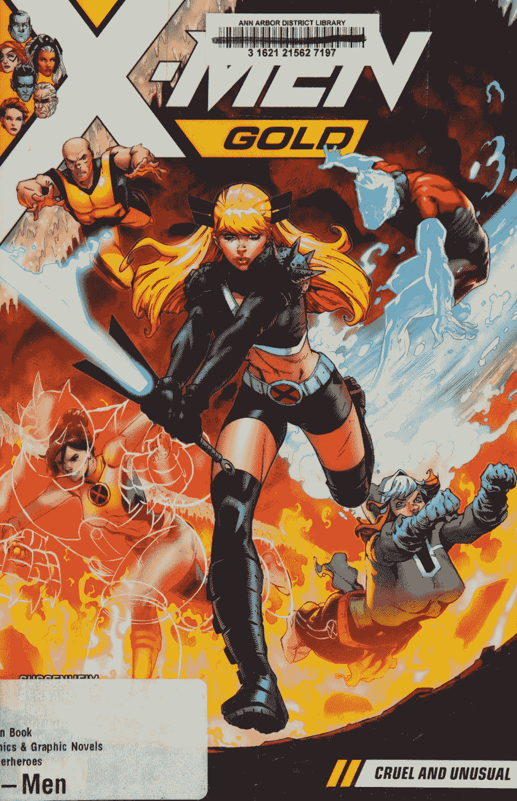

想知道探索漫威宇宙的最佳方法吗？这份指南将告诉你从何开始！

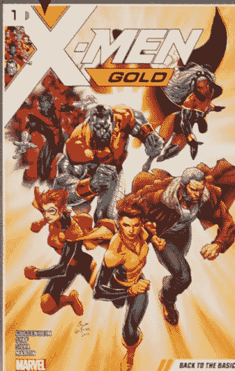
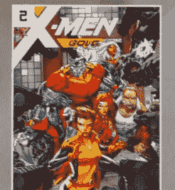
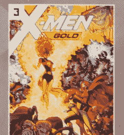
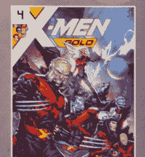

已撤回

X变形战队一直在从负物质区域的战斗中恢复过来，但他们的恢复可能是短暂的。团队此前发现，反变异人政治家莉迪亚·南斯（Lydia Lance）雇用了名为梅墨罗（Mesmero）的读脑反派，创造了一个新的邪恶变异人兄弟会。

## 制作人员

**主编** / JENNIFER GRÜWALD  
**助理编辑** / CAITLIN O'CONNELL  
**副执行编辑** / KATERI WOODY  
**特种项目编辑** / MARK D. BEAZLEY  
**制作与特种项目副总裁** / JETTY YOUNG  
**销售与营销** / DAVID GRABIL  
**书籍设计** / JAY BOWEN  
**总编辑** / C.B. CERULSKI  
**首席创意官** / JOE QUEASADA  
**执行总裁** / ALAN FINE

## 冷酷而反常

**编剧** / MARC GUGGENHEIM  
**第 21-22 期**  
**作画** / DIEGO BERNARD  
**上墨** / JP MEYER  
**上色** / ARIF PRIANTO 联同 JAVA TARTAGLIA (#22)  
**封面艺术** / MIKE DEODATO JR. & NOLAN WOODARD (#21) 以及 DAN MORA & JUAN FERNANDEZ (#22)

## 第 23-24 期

**作画** / THONY SILAS  
**上色** / ARIF PRIANTO 联同 MARCIO MENYZ (#24)  
**封面艺术** / DAVID NAKAYAMA

## 第 25-26 期

**作画** / PAULO SIQUEIRA & JOSÉ LUIS  
**上墨** / CAM SMITH & VICTOR OLAZABA  
**由 PAULO SIQUEIRA 协助**  
**上色** / ARIF PRIANTO, JAVA TARTAGLIAN & JUAN FERNANDEZ  
**封面艺术** / RYAN STEGMAN & EDGAR DELGADO

## 字体设计与编辑

**字体设计** / VC'S CORY PETIT  
**助理编辑** / CHRISTINA HARINGTON & CHRIST ROBINSON  
**编辑** / MARK PANICCIA  
**特别感谢** / MIKE O'SULLIVAN

X变形队由 STAN LEE & JACK KIRBY 创造

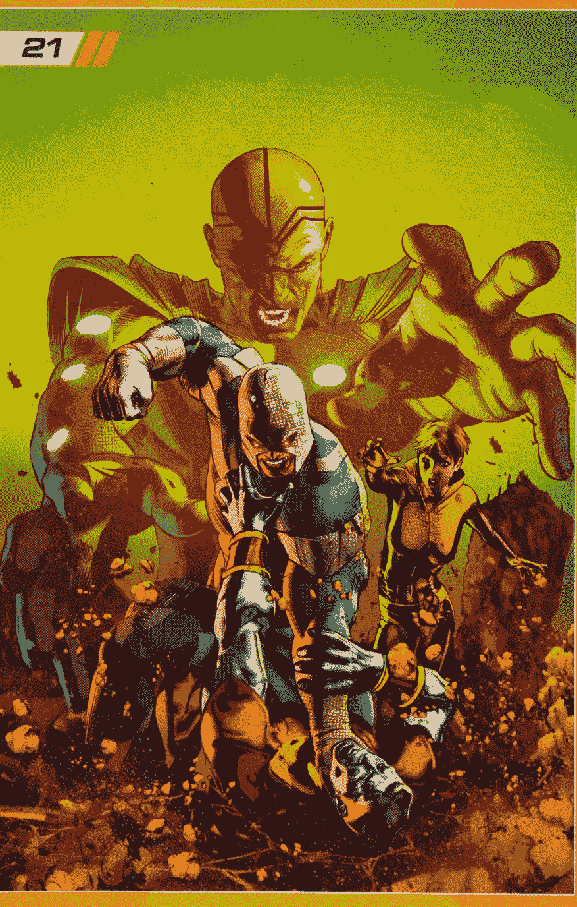

### 几个月前

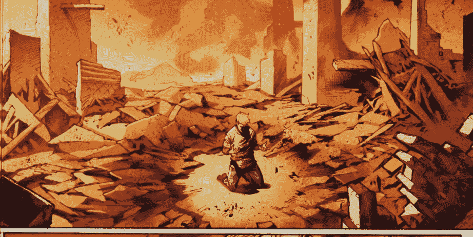

没关系的。

儿子……

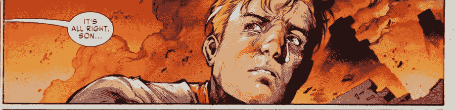

我在这里是为了帮助你。我叫查尔——

是的，我从新闻中认出你了。你本该已经死了。——查维尔。

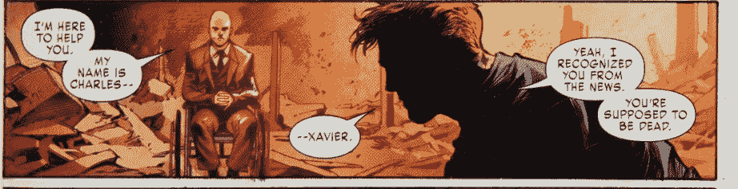

我是一个变形战队，儿子。我们从未死过。我只是——发生了什么？突然一切都在着火……你的特殊能力的表现，我很遗憾。特殊的……能力？是的，你。西蒙。是一个变异人。但帮助像你这样的人是我一生的工作。我曾认识一个特殊能力的变异人。他的名字叫普罗。你想让我帮他吗？是的……谢谢你……别担心。一切都会很完美的。我不是偏执者，我不反感对合同的任何暗示。撒谎……兄弟。你想向你报复吗？说出时间和地点梅墨罗。为什么这么生气，西蒙？我所做的只是你的潜力。你利用了我；你操纵了我们！你搞乱了我们的大脑！！！冷静点，雪崩（Avalanche）！别那样叫我！我所做的，莉迪亚·南斯也操纵了我。而且我不习惯被操纵。这全是废话。我们被困在这里。没有人能对任何人报仇。被困在这里是因为我们签署了——意味着。那么，你想因为我离开这里吗？我花了一些时间才破解了让我们保持正常的项圈。鬼扯。信不信由你决定。我的选择是从门出去。你怎么看？我觉得他是个谎子。如果他的力量真的有效，他现在可能正在操纵我们。但我比任何事情都想离开这里。如果目标是向南斯报仇，那也可以。换班，我该走了。没问题。只需要使用视网膜扫描。噢，我想为你打开门。我想为你打开门。这不可能简单……你怎么锁上项圈的？这些应该是不可破的吗？这些不是你寻找的监狱。当然是。当你在这里时……谁准备好开始他们的人生新篇章？儿子——罗根（Logan）。该死的，狂狼（Rogue），你觉得你在做什么？我正要问你同样的问题。呼中央公园，纽约市。

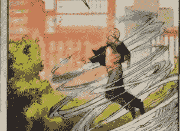

因为看起来你打算不跟任何人说就离开。是的，那是因为我打算不跟任何人说就离开。我老了，狂狼。一切都不像以前了。特别是我的自愈能力。在负物质区域发生的一切都付出了代价。X变形战队金刚第 5 至第 20 期。我不认为离开团队是答案，因为这让我免成为负担。我们所做的事情极其危险。链的强度取决于最薄弱的一环。我不只是弱了，我是精疲力竭。我是个老头。你会去哪里？去加拿大待呆，然后去日本。我想我渴望回到熟悉的土地。我们会想你的。我也会想你们的。麻烦总会发生。我只是来打个招呼。你说的刚离开是什么意思？正如我所说，瑞切尔·凯奇森（Rachel Katzzen）离开了医务室。她当时昏迷的——危险屋。而且她编写了这个场景？是的。我不认为这有什么好处。为什么？这样你可以想象雷耶斯博士（Dr. Reyes）有多惊讶！脑脑电脑将她的位置设在这里……因为她一直出现她作为“猎犬”（Hound）——一个变异人猎人的闪回。我很抱歉。我以为你知道。我想她告诉你是是因为——没关系的，凯奇森，我只是……你觉得这个新造型怎么样？……担心她。嘿，伙计们……我不明白这些服装的意义……- 根据梅墨罗告诉我们的，它们属于两个死人。- 你懂我的意思。- 没，这些衣服是新的。KIDDY 告诉我你那些关于曾经是猎犬的记忆碎片。而且你生气了？我没告诉你。我在担心。不是生气。你在短时间内经历了了双重创伤。你精疲力竭——用力过度——在战斗中哨兵 AI 和梅斯梅罗，在你陷入昏迷时攻击了你？分别在《X战警队黄金》第 6 期和第 16 期（带有 #6 号的期数是不吉利的）。瑞秋尔（猜的）——回溯莉斯蒂娜。这一切都是联系在一起的。库特。现在我看到了更多。感觉到了更多。不仅仅是在身体上。这种感觉就像我所有的感官旋钮都被拧到了最大。我从未感到如此充满活力。哈！没错，你们群混蛋。快跑！玩得开心吗，雪崩？你根本不知道，哥们儿。恐扰那些富有的社交名媛并不是我们来这里的目的。是的。她在哪儿？等等。我看到她了。莉迪亚·南斯，那个毁了我们生活的女人。这是什么时候发生的事？刚刚，梅斯梅罗、雪崩和火魔袭击了遗产倡议的年度筹款活动。那是——莉迪亚·南斯的反变异人坦克。真的吗？你为什么不早说？我要回睡觉了。你开玩笑呢。我在开玩笑。真希望我不是在开玩笑。等等，阿玛拉？你在这儿做什么？梅斯梅罗像控制自己的私人傀儡一样控制我，凯蒂。这让你的判断力受到了一点影响——我不打算袖手旁观。如果必须，我会独自去。盯着她，毛脸精灵。一旦有麻烦迹象，你就把她“传送”走。好。你呢？几个小时前，你还处于昏迷。嗯，还好我哪儿都不在，因为你即将面对一个工业级的心灵感应者。

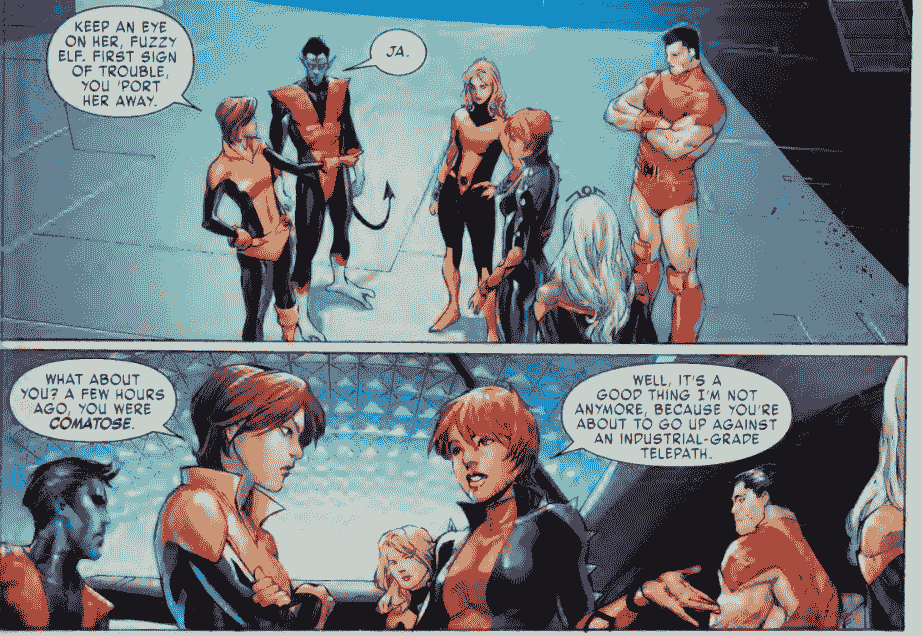

带着一个 X 因素进入外外——谁失去了超级团队？谁又掉了两个？由于罗根的离开，我们人手不足……好了。我们行动吧。坏主意，非常糟糕的主意。这事感觉不太对劲。

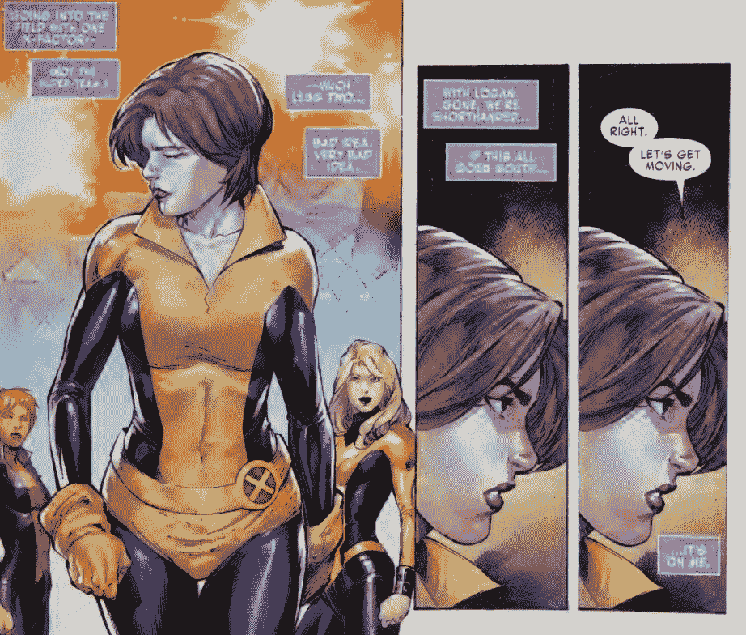

> 你在等什么？快点？我……
> 我不能。我不是个杀手。
> 不。我们来这里是为了报复的……

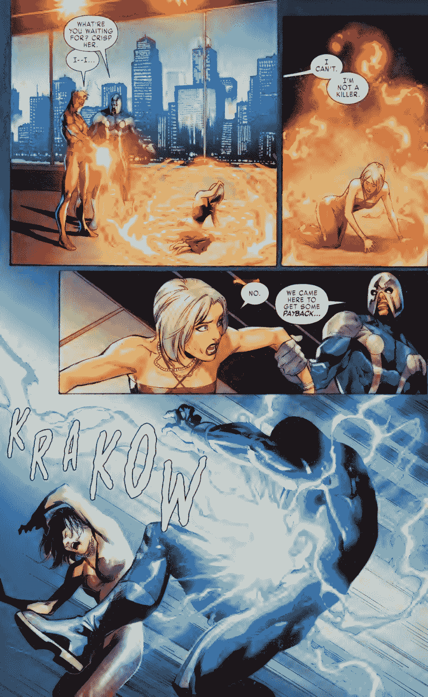
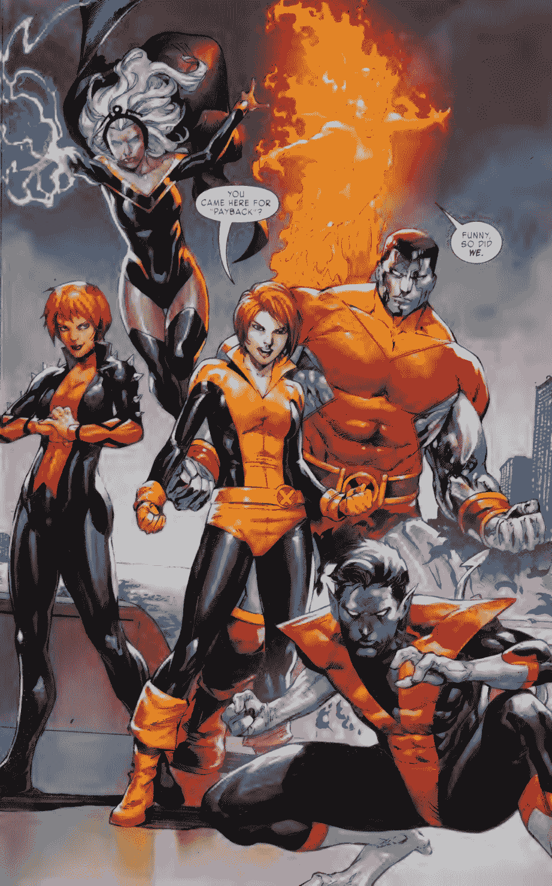

普瑞蒂（Prestige），解决掉梅斯梅罗。暴风，把我们的闺蜜南斯小姐带到安全的地方。岩浆，你去对付火魔。以彼还彼。不。这个混蛋是我的。库特——莉雅，我——阿玛拉？你这个怪物，我要看你被付于火，报报你对我所做的一切。

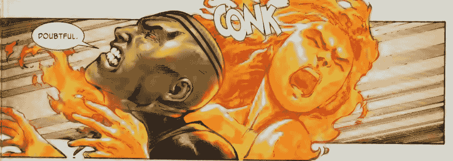

令人怀疑。你看到这些了吗？不……他们所做的只是在互相内斗。……偶尔，我们会遇到一个像你这样糟糕的人。趴下，别让我对你说第二遍。我以前搞定过你……你看起来似乎从那时起经历了一些变化。GHHG——而且不仅仅是这身行头。在你的脑海中突触通路……完美地重新排列了。而且最近是如此，我的大脑能感受到它……以及我大脑能感受到的任何事情……啊……它都会让人痛苦。哈特和多洛罗离开了。瑞秋尔阿玛拉也走了还有父亲……但我们正在战斗雪崩尝试穿模，你做不到的。我叫了他们。他现在就在你的脑子里。带着这种状态进入外外会让一切变糟。是我的责任。

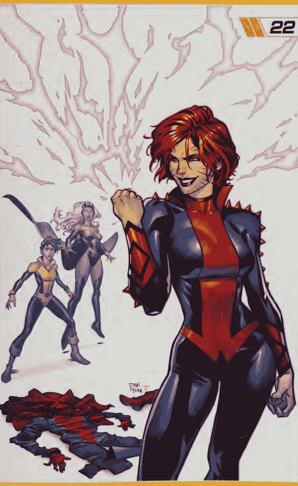

### 纽约，长岛。多年前

回来！콰隆你觉得我在耍弄你吗，女孩？你正处在一个痛苦的世界里，让我追逐你。一个痛苦的世界。我应该相信我的直觉，让我的团队远离他针对我们所做的的一切吗？记忆：我现在要出发了。

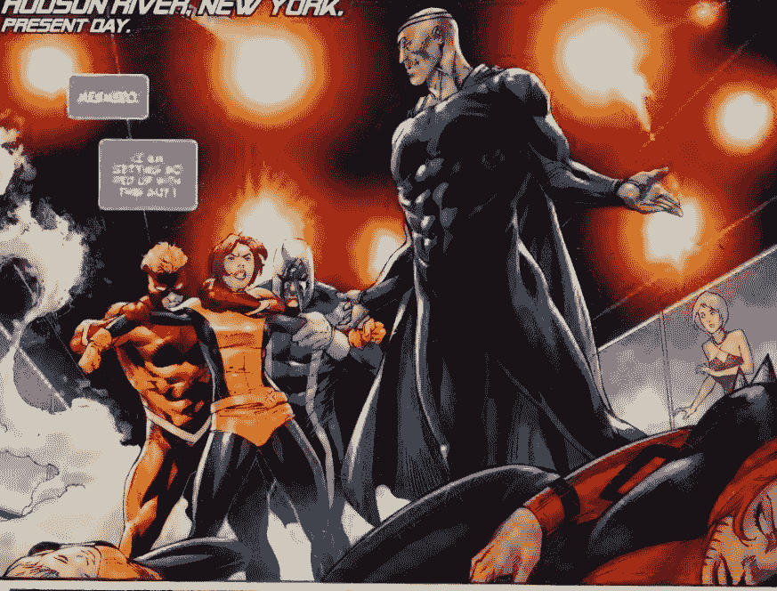

> 瑞秋尔，你睡醒了吗？其他人都在装死。阿玛拉倒下了。我正努力让她醒过来……目前为止还没有进展。真逗的，凯蒂。

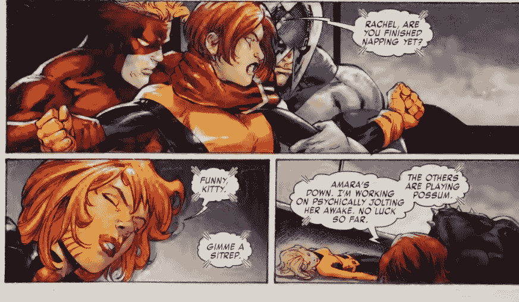

等待你的指令，无畏领袖。在在我们搞成这团乱子后，我不确定自己配得上这个头衔，毛脸精灵。听我信号，把阿玛拉传到安全处。其他人，梅斯梅罗是目标。收到。收到，小猫。但你的信号是什么？我想你会发现的。

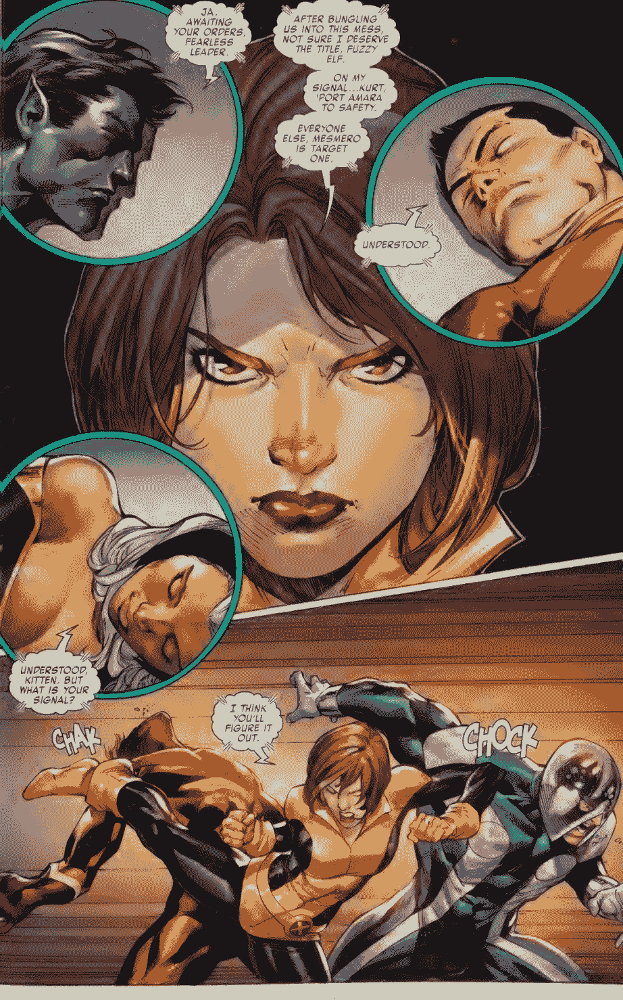

砰！确实，做得好，小猫。达，我完全准备好要收拾点东西了。令人印象深刻，你竟然成功地在我面前屏蔽了你的想法。这不算什么。看我的招数。这是在我的脑子里胡乱闹。趴下。我不会说第二遍。你还在像另一个雪崩那样思考——我的力量只对地球和泥土有效，对吧？错了。我可以让任何东西震动。比如你的内部。AGGGH！离她远点！留在，……你变得更强了，瑞秋尔。因此……变得脆弱了。AGGGHH!!!不，不是的。别担心，西蒙，一切都会大白的。这在发生什么鬼？我以为我们来这里是为了南斯，不是来和 X 战队战斗的。现在该你们离开了。这不明显吗？什么？我有援兵。几秒钟内就会着陆。你觉得 X 战队会让我们离开这里吗？完全不会。事实上，他们连你们都看不见。

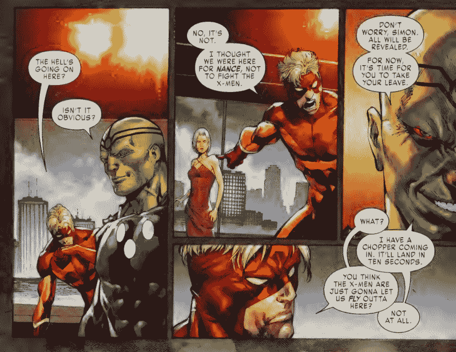
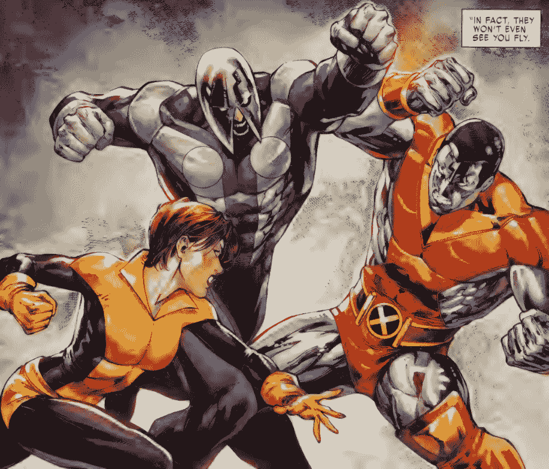

“你们将会消失。”你们将会消失。”莉雅，发生了什么？瑞秋尔——你还好吗？梅斯梅罗。噢，我不需要读心术也知道你不是个杀手。莉迪亚·南斯，她在哪儿？等等，这不太对劲。梅斯梅罗操控了我们。梅斯梅罗。他们被清理了。莉迪亚·南斯。所有人，趴下！莉雅！你好！想坐坐吗？真可惜你不是变异人……莉迪亚·南斯，关于你的朋友……西 54 街街 306 号。做得不错，普里雅。干得好，火星。你正试图阻止罪犯成为他们一个。

## 詹妮弗·沃尔特斯，ESO，又名“金刚狼”

你还好吗？他们正在中央登记处接受处理。你多久才能离开这里？我不想骗你，珍——我经历过比这糟糕的夜晚。团队其他人怎么样？我不行。你和其他人将被转移到“盒子”——一个变异人关押设施。但梅塞罗（Mesmero）——消失了，就好像他从未出现过一样。他抹除了所有人质的记忆——他当然这么做了——但我正在传唤他们的手机。我必须有人用录像拍下了他。但是？但是需要一些时间。而在这些程序进展期间，“你、戈尔、拉切尔、彼得和库尔特——你们都被监禁了。当我们正义的轮轮在转动时，我们所有的学生怎么办？这座城市怎么办？谁来保护它？你害怕会发生什么？我想是复仇者和冠军少年吧。为什么？这些读数与我遇到过的任何东西都不同，湮尼卢斯大人（Lord Annihilus）……你们这些博学的科学家，真可怜。你们怀疑自己双眼睛看到的证据吗？否定你们那可怜骨头里的感受吗……这个念头胎死了……神的力量。而他被恐怖的目的所驱使。……由于一个甚至比那自傲的湮尼卢斯更强大的力量的出现。在很久以前，他被称为索提亚恩（Soothian）。某种东西正在涌现：某种不同于——对那些试图将他困在负面区域漩涡中的人的复仇。对……的复仇——

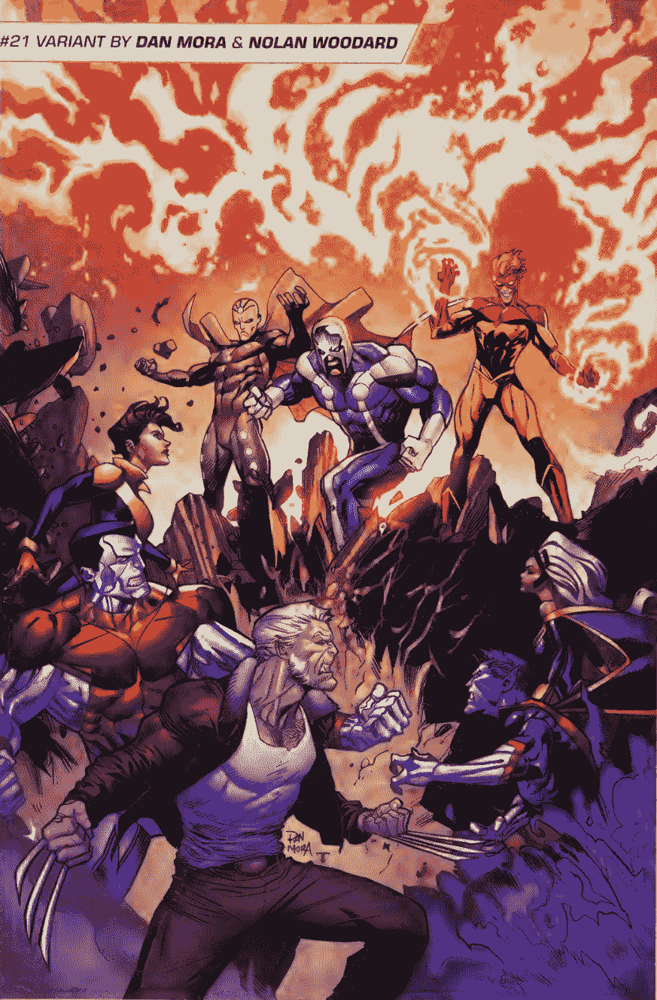

某种东西正在撕裂我们的宇宙与被称为“负面区域”的跨维度领域之间的织面。对于“这种东西会是什么？”这个问题，你可能会想回答道……“一个神。”这确实如此。塞提亚（Scythian）确实是达泰尤斯星球（Dartayus）的一个古老神。但撕裂一个维度另一个维度的并非神力。而是它的愤怒。纯粹的，元素的。原始的。而它不会被否认。

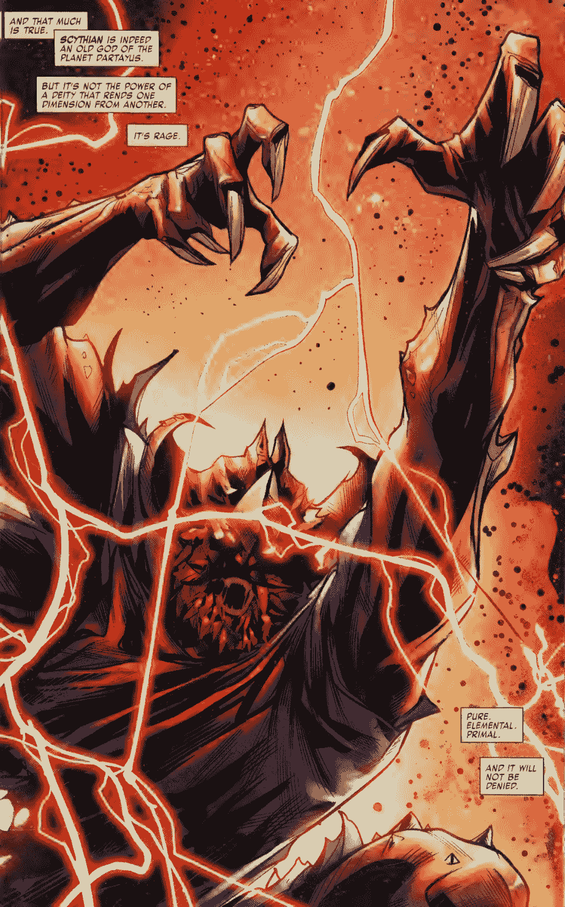

又名“盒子”。也是超级监狱。欢迎来到“盒子”，凯蒂·普德。希望你能活过这段经历。真可爱。

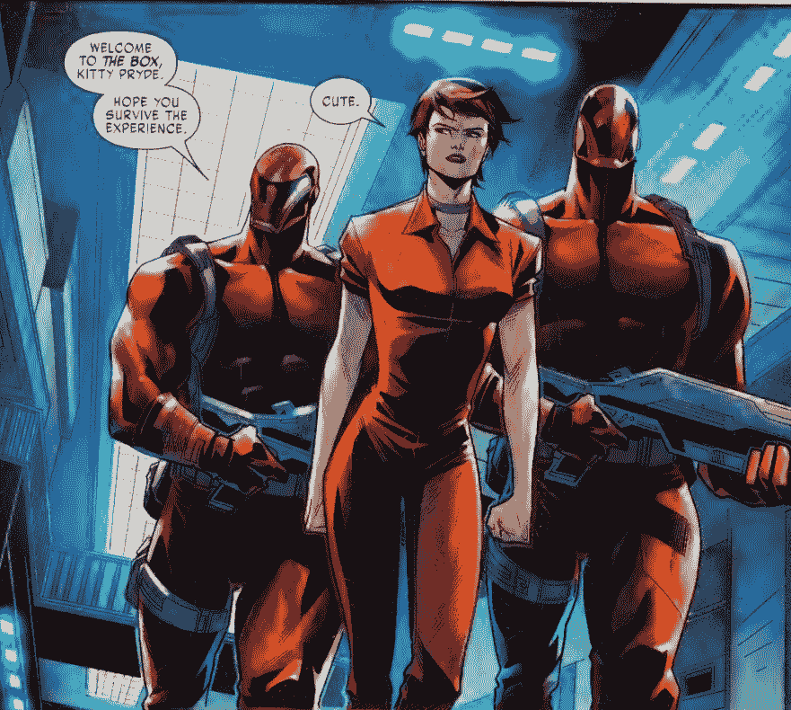

免费建议？别别想逃跑。这所监狱是为关押变异人设计的。做得不错。关住了梅塞罗和他的朋友们。梅塞罗、火人和阿瓦奇在《X战队黄金》#21 中逃脱了。字幕：克里斯蒂娜

给你的。欢迎回到家。你一定在开玩笑吧……我可以换个间房吗？更具体点，换个室友？普德。卡莉丝托（Callisto）。说真的，这个女人至少尝试杀了我百万次了。没错……辛克。……祝玩得开心。换个室友？真的吗？你真伤害我的感情。而且我只杀过你一次——两次——而且那是很久以前的事了。我的记忆很好，尤其是涉及到外星变异人帮派的首领时。莫洛克（The Morlocks）不是帮派？试着多一点同理心吧。你可能不喜欢我……但在这个地方的所有女性中，我是你最不需要担心的。我穿着这双监狱版运动鞋都在发抖。你应该发抖的，宝贝。这里有很多愤怒的变异人。他们都想分你一杯……

她还要从某些真正的 X 变人身上取下一两个来。妈死的，没错，没有什么能像除掉三个真正的 X-普ux 那样能稳固我顶尖的地位。

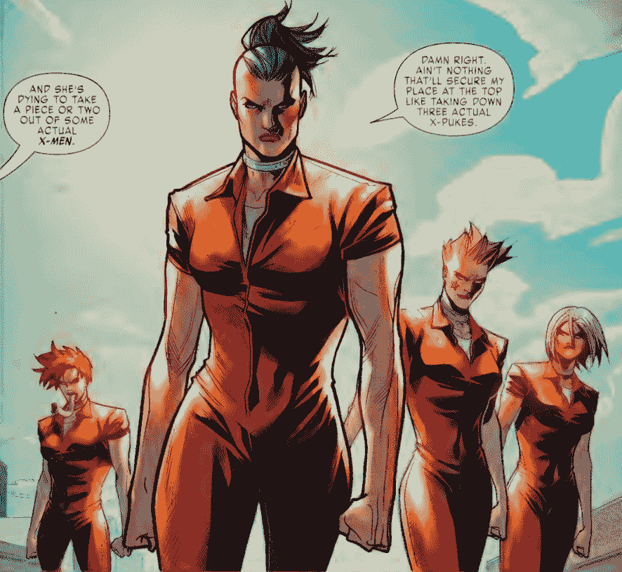

你的？主意？我不能说不是。虽然我不能说我不会很享受这场戏。他们叫我“疯狂的梅西”。你们这群娘们很快就会知道为什么了。

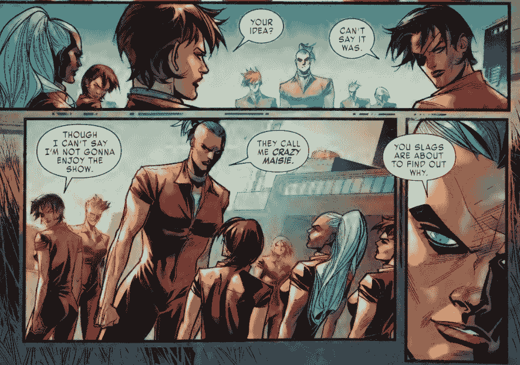

## 罗伯特·凯利矫正设施，又名“小盒子”。#1 号监狱

花了九包烟只为了和你们三个人单独待五分钟。听起来像是一道数学题。我认识这些。听起来像有很多香烟。“极乐”、“电光眼”和“阿尼克斯”。

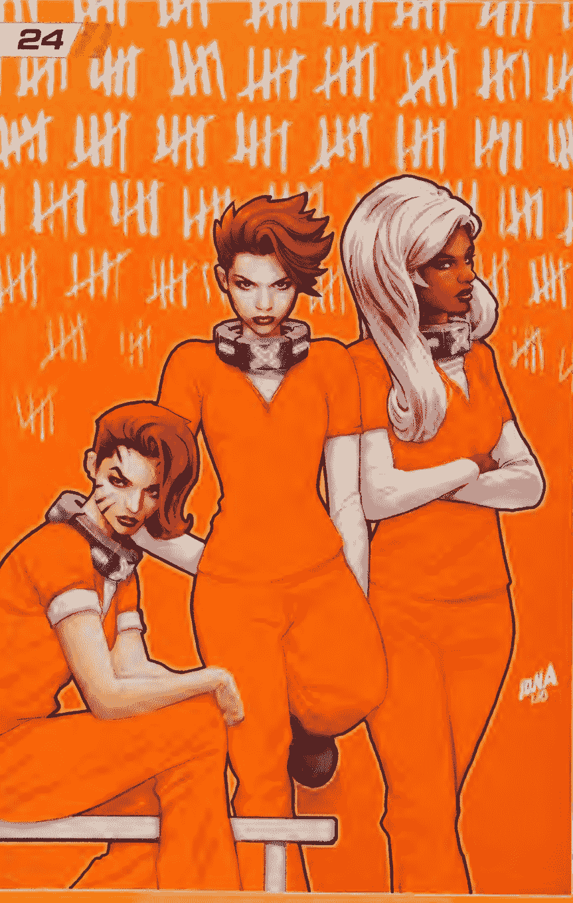

我的团队。带走你们三个中的一个会让我的状态在这里看起来很好。“疯狂的梅西”……我不乐观能和你讲通的可能性……但你应该知道，我们可能没有超能力，但我们受过大量的战斗训练。不在乎。

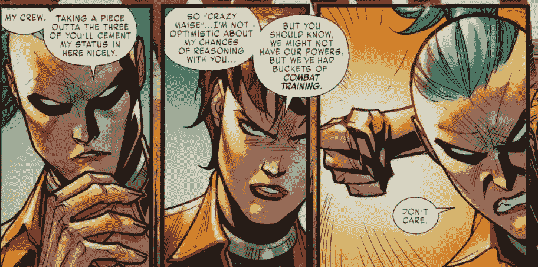

> 我认为你站在哪一边是没有疑问的，对吗？
> 正在——
> 永远的宠物。我的。
> 监狱院里的战斗。
> 看起来我可以从我的愿清单上划掉一项了。
> 在我把它加入愿清单之后。
> 琴蒂是对的。
> 我们是狼人亲自教我们战斗的……
> ……你凭什么认为我们解决掉那些无能力者？
> 确实如此。
> 噢！

我不能说我没警告过你们。闭嘴……实际上可能有一件事是我没警告过你们的。我的战斗训练不是学校的标准吗吗？我还是个忍者。你们三个！！！

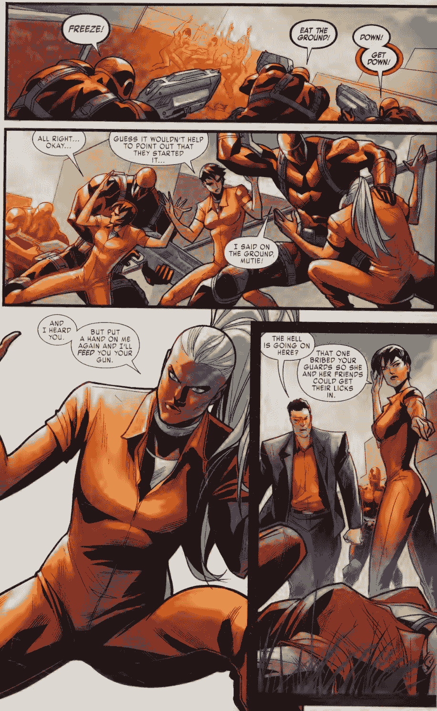

> 你是这样看到它的吗，梅西？
> 问她没意义，

> 这对梅西来说是双赢的。
>
> 我们输了，她就满足了。
>
> 我们赢了，疯狂梅西得到了奖励，梅西可以赢回她的地位。
>
> 我只是来这里透透新鲜空气的
>
> 每个人都要关禁禁三天。
>
> 你们难道看不见我很忙吗？
>
> 先生！先生，我们出问题了……
>
> 是曼哈顿，先生……

*有些东西正在袭击曼哈顿。*

如此奇异。

如此美丽。

波士顿完全不同。

失去控制了……

还是……

我应该为此准备一下。

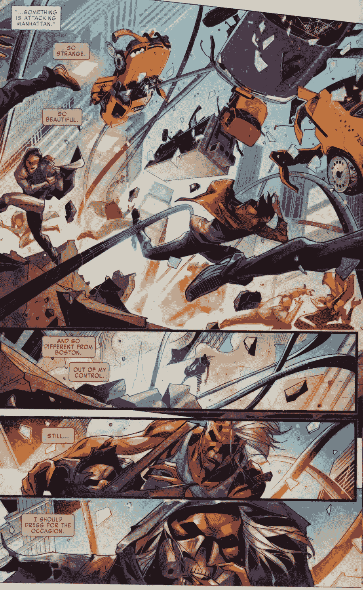

伊万·格雷罗，非人类和环保疯子。

根据他的档案，格雷罗可以产生他能控制的孢子。

这就是为什么我们带了线人的抗毒剂。

你确定它在他身上有效吗？

上次效果很不错。

盔甲，玛玛保护他。玛玛支持盔甲。

下下，格雷罗先生。

《不羁复仇者》（2016）#4 德雅感（似曾相识）

我只能请求一次。

“权威”，遗憾的是我发现自己缺乏这种东西，

缺乏这个。

啊，是的。未来人的“治愈”。

我记得那种感觉。

但恐怕，现在情况不同了。

你也应该感到恐惧的。

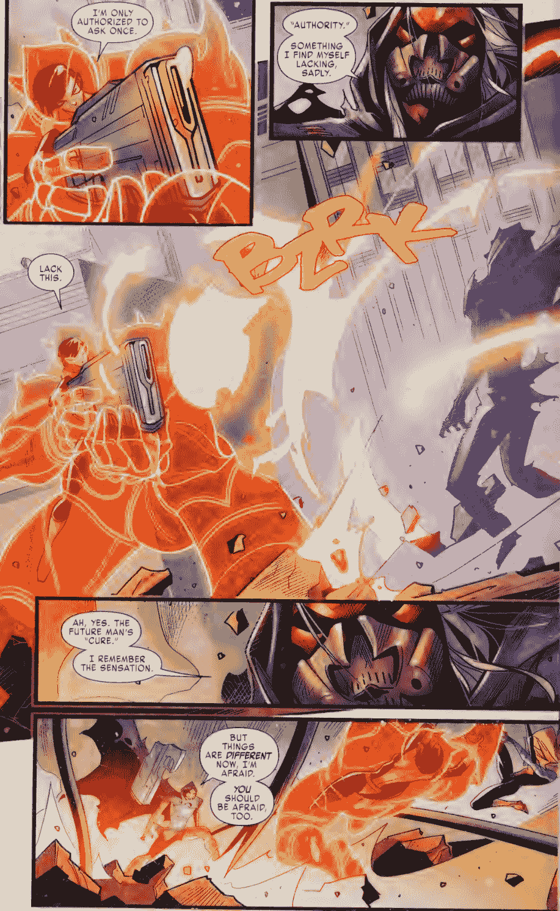

盔甲！魔法！

线人的治愈没用……

没有什么事是容易的，不是吧？

你得问问，不是吧，宝贝？

格雷罗自己种出来的……

那些藤蔓看起来是从地底出来的，你想让我们把它们烧掉吗？搞定。

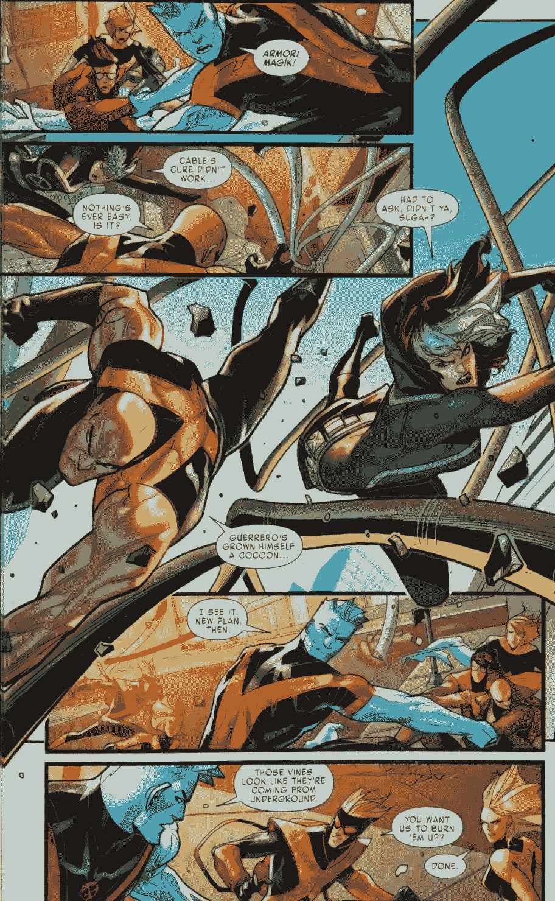

我知道这只是植物植物，但这些东西简直像钢铁一样。

等一下……

让我试试。

看起来结了。你想让我把它砸碎吗？我想让你们两个都把它砸碎。

无效。计划是什么？玛玛和火点。

他们要从源头烧掉这个东西。

妈死的。这些藤蔓是从哪里来的？

古老的生长，和这座城市一样老。甚至更老。如果它遍布曼哈顿，我们就出问题了。

如果你不认为我们已经出问题了，说明你没在注意。这些态度是怎么回事？如果它对兄弟会中的我有什么意见，记得你也在其中。

违背我的意愿，他控制了我的大脑。

当我去报仇时，他击晕了我，导致我的朋友被送进了监狱。所以我们是哥们儿。我还以为你永远不会问呢。我猜它确实有。

试着烧掉它，以为它还是生长植物和藤蔓。但它们现在是某种别的东西。它们变了。变异了。不可能了……我从未见过任何这样的东西……我知道这听起来很疯狂，但也许那些图像向我展示了我母亲的肺部。

有我们可以交流的医生吗？雷耶斯医生……你看到了吗？

她才六岁，一个巨大的物体撞击了她的家园，杀死了她的父母。

将她困在狭小的空间里是这座监狱最不该做的事。

她选择了愤怒，而非恐惧。

我……绝不会：

我绝不会为了一个笼子丧失理智。

不。

好几天了，她被困在废墟之中……

我是疾风行者。我是风暴……

还有她父母的遗骸。

那股愤怒是如此剧烈……

……压倒了那些试图否认她身份的低劣科技。

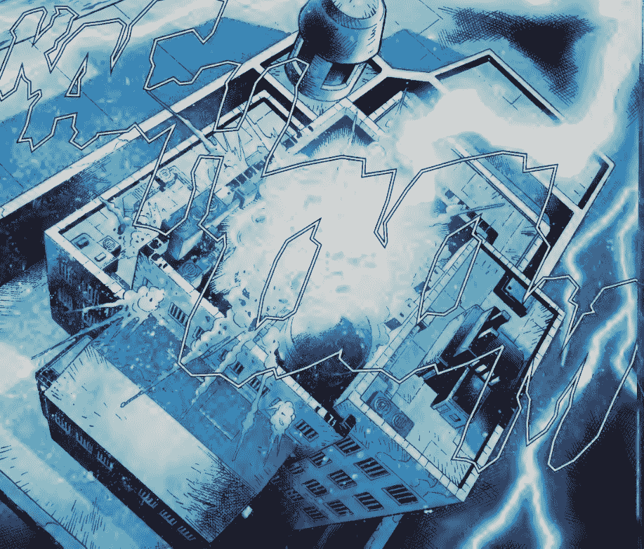

自然之力。

## 轰隆隆隆——

趴在地上！

趴在地上！

双手抱头！趴在地上！

## 古老阿斯加德

曾是神灵之乡。

亡者

之地在震动。

即使身处另一个

领域，奥洛洛的痛苦与力量在这里也能感受到。

由风暴法师打造。

这把由艾崔受受恶作剧之神洛基之托而锻造的魔法锤。

它听见了它女主人的

哭泣。它感受到了她的痛苦……

……并被迫

做出回应。

我说我们应该回到巴黎时，布莱恩，这可不是我预想的。

快点，亲爱的梅格根，巴黎的一切切都是浪漫的。

无论这件东西是什么，它都强大到仅仅是存在就能影响当地的天气。

还好你只带来了一个能控制元素的人。

那么，我们要不要给我们的这位新朋友一个小“小吻”？

梅格根！砰！

这到底是什么东西？

它叫“塞西提亚”。

梅格根！

可能我的“小吻”稍微用力过猛了。

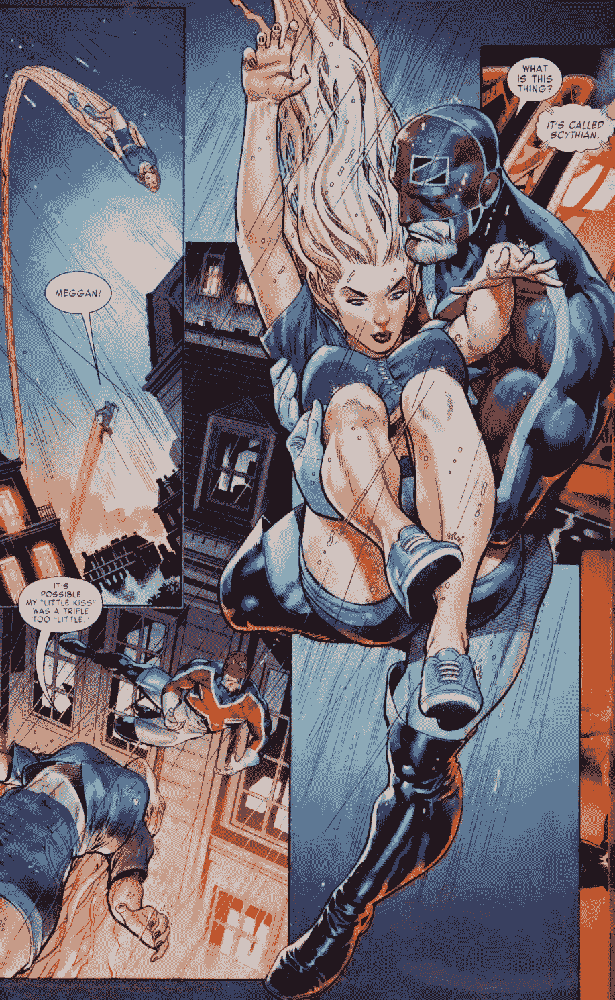

他是一个来自负面区域的神灵。

“我现在正在通过心灵感应给你们所有的详细信息。”

噢天哪。

是啊，为什么我们没在这里被彻底完蛋？

我们正在赶往你们的位置。

在我们到达之前，设法拖住他。

明白。

你建议我们怎么做？

“你没在听我说话。”

## 典长办公室。

除了你们那五个已经阻止了它的超级英雄，他们已经锁在这里了。

“那家伙在杀人。”

是啊，而且其中一个刚刚在我的监狱上炸了一个洞。

在巴黎，我这儿有一堆问题。

无论如何，我上次检查时，世界并不缺少超级英雄来阻止它。

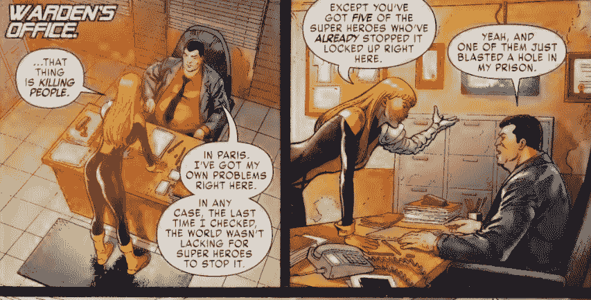

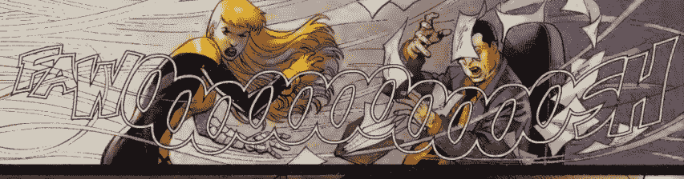

哇，时机真不错，风暴。

凯什曼典长……我需要谈谈。

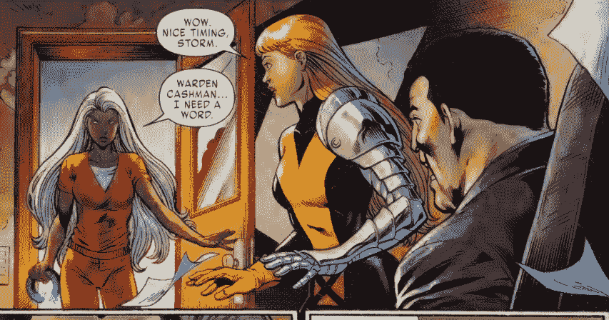

我已经和你们的几个守卫谈过了。

他们正在小睡一会儿。

你们这群蠢蛋在下面在干什么？我办公室里有守卫……

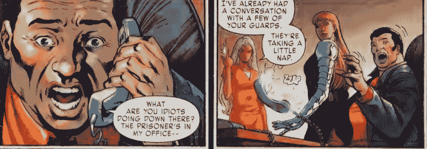

X战员一直很有耐心，因为这是正确的做法。

我们同意让正义发挥作用，因为这是正确的做法。

然后你们把我关进了笼子里。

奥洛洛

我知道你经历了一些事，但我们这儿确实遇到了一些小状况。

什么样的“状况”？

就是这种状况。

我和我的队友们将离开这一幕。

毫无疑问，我的朋友凯蒂此刻会给出一些见解。

关于我们如何成为世界对抗这种黑暗的唯一希望。

但看看我的脸。

我看起来像是有什么发人人心的话要说吗？

--我们还有18秒到达。英国队长和梅格根已经到位。

我们的先锋——墨水和野盗——将带上岩浆和装甲……让我们来个“快球特技”吐吐吧。

我呢，冰人？

我可以开启自动驾驶。你保持开启状态。

我曾是邪恶变异兄弟会的成员，所以你让我坐冷板？

我是在保护你的安全。

你是这里受过训练最少、测试最少的人。

只有在情况变得非常糟糕时才会涉及你。

我又怎么知道情况是否真的很糟糕呢？

嘎啦啦啊！

你非要问，不是吧？

野盗！

我正在办法……

啊啊啊啊啊！！！

干得好。

我所说的都会做到。我可不是在开玩笑。

为了打败这家伙，我们之前基本上把他扔进了等同于黑洞的地方。

而且即使那样也没能阻止他。

好吧，我们现在没有任何黑洞了。所以我们只能打算把他痛揍一顿。

蛮力解决不了这个问题。

……我带了一些相当强壮的猛汉。

而他们只是热身动作。

行动吧。你和我们一起。

收到。

我一直好奇的一件事。

我的吸收能力对外星神灵有效吗？

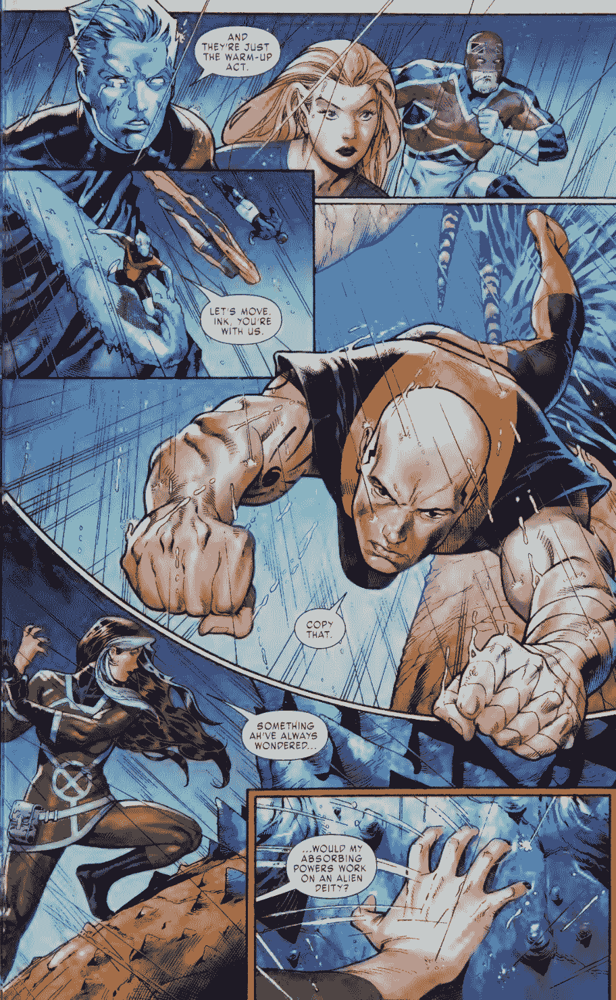

答案是肯。

她吸收所接触之人的能量和力量的能力是不可估量的。

太清楚了。

而野盗发现自己无法招敌。

野盗！

我抓住她了。继续猛攻这家伙。

但你不会飞。

现在你会告诉我了

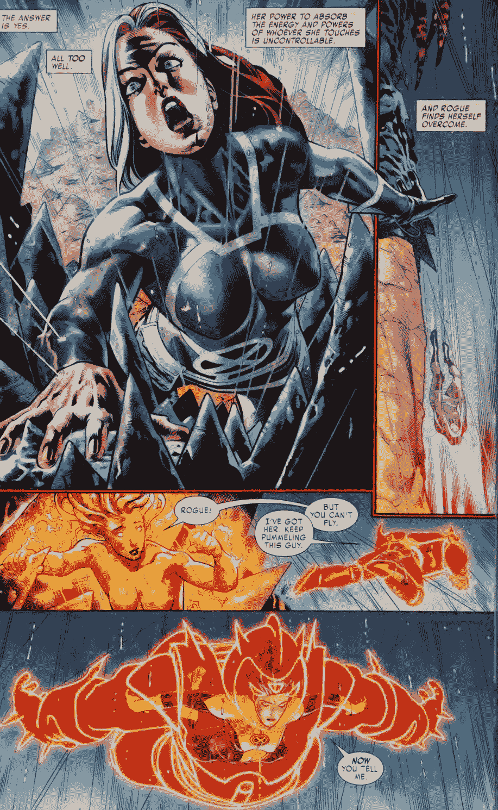

她吸收所接触之人的能量和力量的能力是不可估量的。

太清楚了。

而野盗发现自己无法招敌。

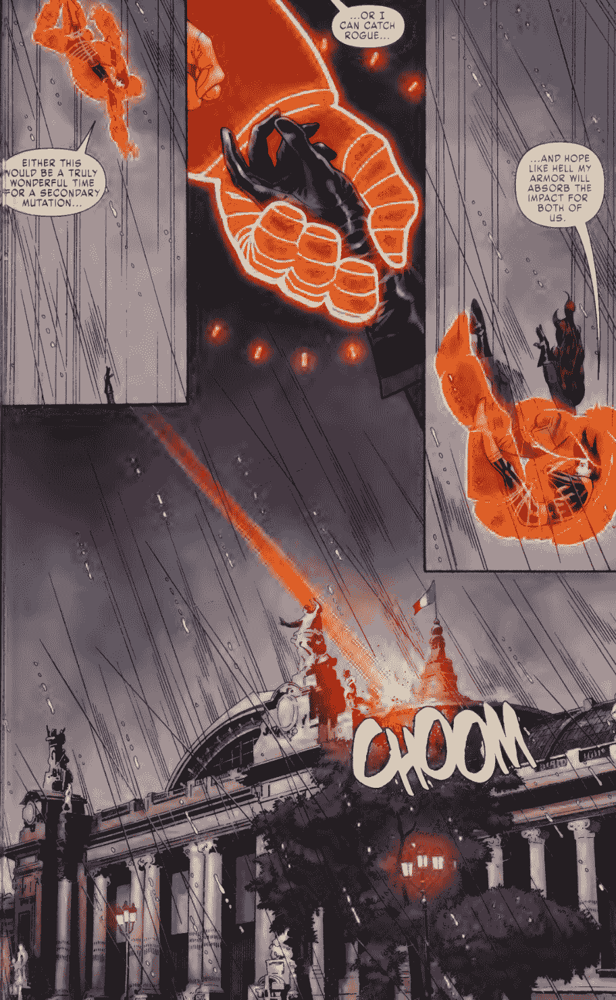

即使身处另一个

领域，奥洛洛的痛苦与力量在这里也能感受到。

由风暴法师打造。

这把由艾崔受受恶作剧之神洛基之托而锻造的魔法锤。

它听见了它女主人的人的哭泣。它感受到了她的痛苦……

……并被迫

做出回应。

我说我们应该回到巴黎时，布莱恩，这可不是我预想的。

快点，亲爱的梅格根，巴黎的一切切都是浪漫的。

无论这件东西是什么，它都强大到仅仅是存在就能影响当地的天气。

还好你只带来了一个能控制元素的人。

那么，我们要不要给我们的这位新朋友一个小“小吻”？

梅格根！砰！

这到底是什么东西？

它叫“塞西提亚”。

梅格根！

可能我的“小吻”稍微用力过猛了。

...让我来帮你。

奥洛罗，你有什么什么想告诉我的惊人事情吗？

我的朋友，我满脑子都是时机来得太好了。小猫……

现在交给你了。

大家准备掩护。这里会发生巨大的爆炸。

卡雅……

> 卡雅！

卡雅！

> 别担心，亲爱的。我没有忘记进行相位位移。

奥洛罗，你能处理一下这些烟雾和火光吗？

> 停下（SHATTOHOOM）

> 谢谢。

大家都还好吗？

> 赛提亚（SCYTHIAN）的大部分被困在了混沌中，但我掩护了他的其余。真恶心。

> 尽管如此……还是诚实的工作。

这让我们面临了下一个小问题……

> ……我们打算如何处理这十二名X变形战员？

## 纽约，沙地角。

莉迪亚·南斯的故乡。

在X变形战员昨天于巴黎展现了英雄壮举后，参议院民主党领袖表示，《变异人驱逐法》在参议院的进展已经陷入停滞。

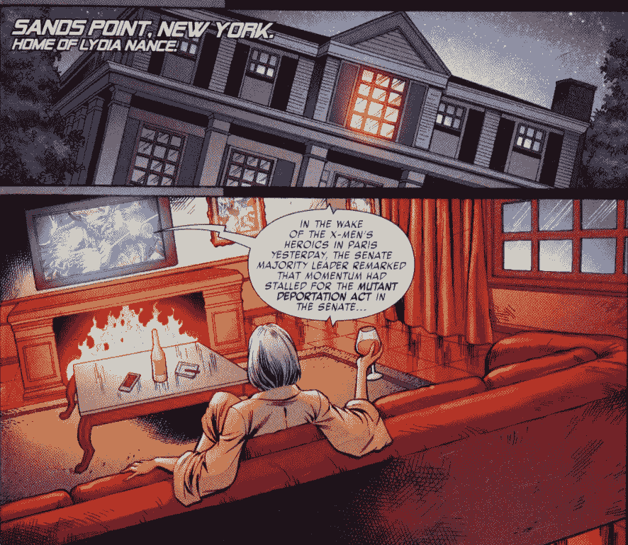

愚痴。胆骨的愚痴。

这不重要。

人类的法律。毫无意义。

它们必须被铲除。抹除。彻底毁灭。

变异人是一个你无法通过立法来解决的问题。

正如我们正要做的那样。

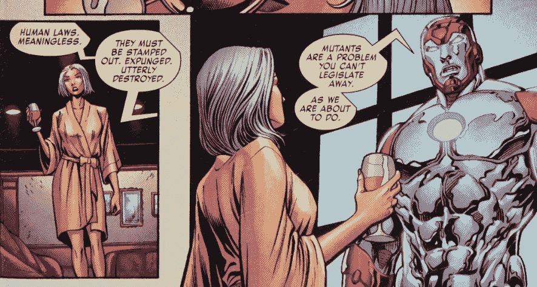

你以前尝试过，但彻底失败了。

我不喜欢用那个词。

那不一样。那是波莉（POLLY）。

我已经进化了，或者如果你愿意的话，可以说是变异了。

*参阅 X-MEN GOLD #4-6。*

不要在词汇选择上浪费感情。

专注于眼下的任务。

利用这个变异人，利用这个星球上任何携带X基因的生物。

下期：直到死亡分离。*

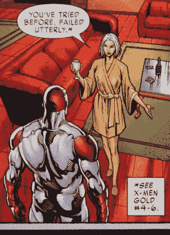

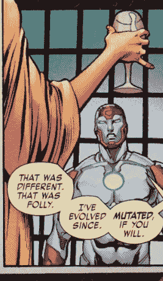

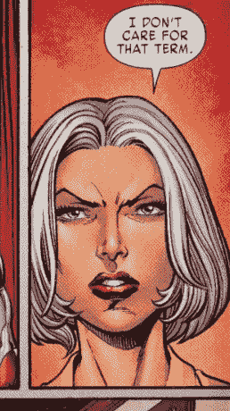

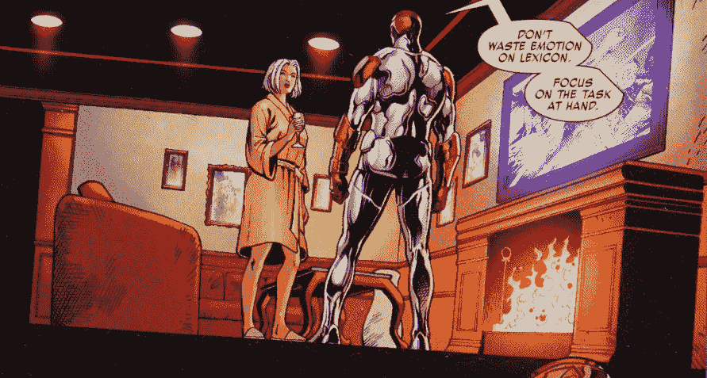

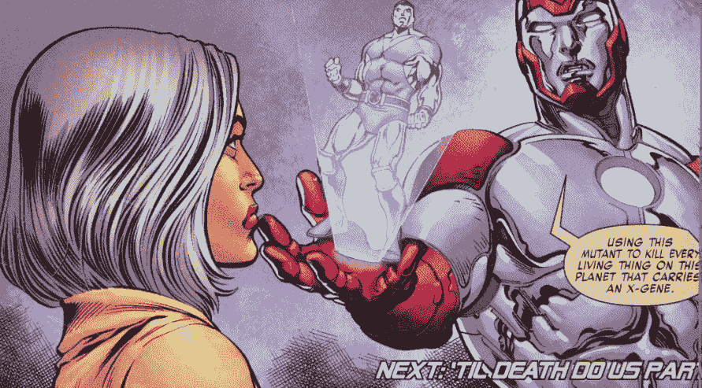

## 想知道探索漫威宇宙的最佳方法吗？这份指南将告诉你从何开始！

## 在这些合订中跟随X变形战员蓝（X-MEN BLUE）的冒险吧！

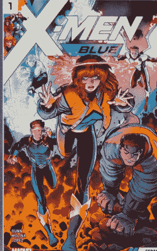

- X变形战员蓝 第1卷：奇异（Strangest）
- ISBN 978-1-302-90728-0

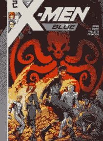

- X变形战员蓝 第2卷：劳苦与忧患（Toil and Trouble）
- ISBN 978-1-302-90729-7

- X变形战员金 第3卷：魔神全球（Mojo Worldwide）
- ISBN 978-1-302-91089-1

- X变形战员蓝 第3卷：时空奇遇（Cross Time Capers）
- ISBN 978-1-302-90798-9

- 毒液与X变形战员：毒性X（Poison-X）
- ISBN 978-1-302-91225-3

## 在对抗赛提亚的战斗中，人们付出了牺牲

——那么X变形战员接下来该往何方？

他们最好尽快做决定，因为邪恶变异人兄弟会回来了——比以往任何时候都更加致命！金色小队告别了其中一人，并面临着最毁灭性的损失，瑞秋尔·萨默斯（Rachel Summers）到底出了什么问题？当凯蒂·普莱德和团队陷入监狱时，谁来保护纽约的人民？准备迎接……新的X变形战员金！他们将对抗碎裂人（Shredded Man）和其他致命威胁——但某种比他们想象中更大的东西正带着负物质带赶在途中，寻求复仇！他们那些监狱里的变异人——在纽约城其他超级英雄的帮助下——是否能尽一份之力？

收录内容：GOLD #23—

MARC GUGGENHEIM, DIEGO BERNARDI

TONY SILAS, PAULO SIQUEIRA, JOSE L MEYER, CAM SMITH, VICTOR OLAZAGAR

ARMANDO, SILVIA AGLIA, MARCIO M AND JUAN FERNANDEZ.

ISBN 978-1-302-90975-8 $19.99

MARVEL.COM

